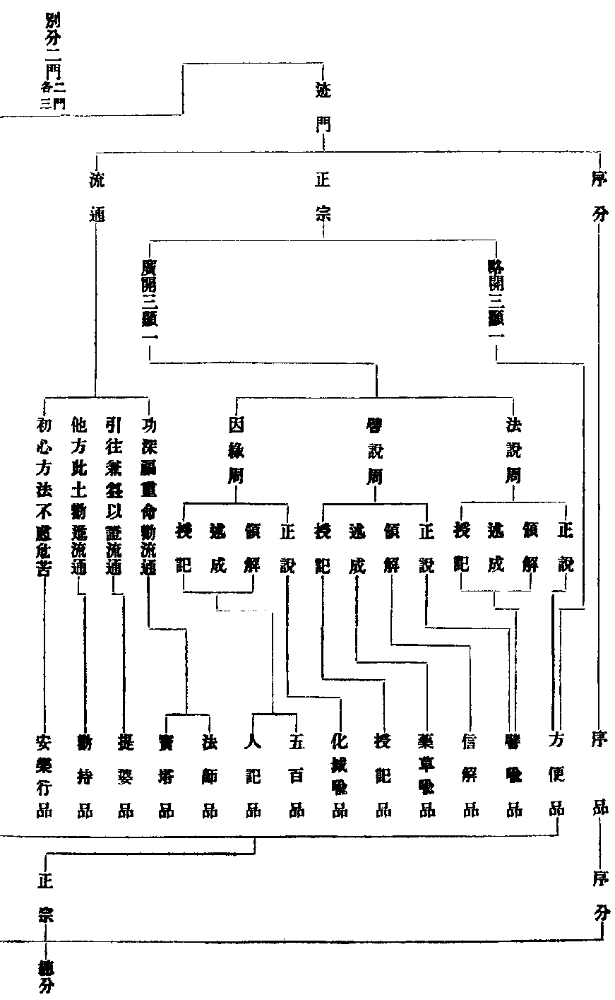
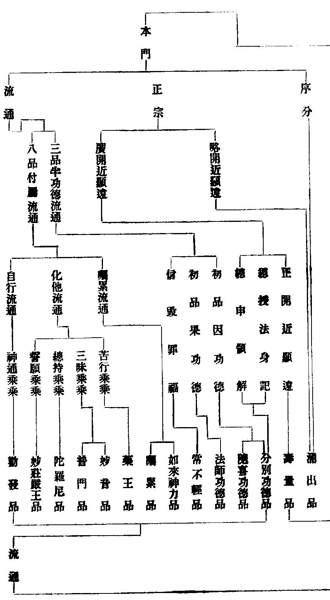

# 法华经科注



> **藏经**：卍新纂大日本续藏经（新纂卍续藏）　**册次** 第 31 册（X31）　**编号** X0606　**部类** 经疏部　**卷次** 8 卷　**篇幅** 255,201 字

> **卷／品**：8 卷 · 59 品



---



## 目录



  - [No. 606-A 重刻法华科注序](#no-606-a-重刻法华科注序)

  - [No. 606-B 依天台科释注法华经序](#no-606-b-依天台科释注法华经序)

  - [卷第一序](#卷第一序)

  - [序品第一](#序品第一)

  - [方便品第二](#方便品第二)

  - [卷第二譬喻品第三](#卷第二譬喻品第三)

  - [信解品第四](#信解品第四)

  - [卷第三药草喻品第五](#卷第三药草喻品第五)

  - [授记品第六](#授记品第六)

  - [化城喻品第七](#化城喻品第七)

  - [卷第四五百弟子授记品第八](#卷第四五百弟子授记品第八)

  - [授学无学人记品第九](#授学无学人记品第九)

  - [法师品第十](#法师品第十)

  - [见宝塔品第十一](#见宝塔品第十一)

  - [卷第五提婆达多品第十二](#卷第五提婆达多品第十二)

  - [劝持品第十三](#劝持品第十三)

  - [安乐行品第十四](#安乐行品第十四)

  - [从地涌出品第十五](#从地涌出品第十五)

  - [卷第六如来寿量品第十六](#卷第六如来寿量品第十六)

  - [分别功德品第十七](#分别功德品第十七)

  - [随喜功能品第十八](#随喜功能品第十八)

  - [法师功德品第十九](#法师功德品第十九)

  - [卷第七常不轻菩萨品第二十](#卷第七常不轻菩萨品第二十)

  - [如来神力品第二十一](#如来神力品第二十一)

  - [嘱累品第二十二](#嘱累品第二十二)

  - [药王菩萨本事品第二十三](#药王菩萨本事品第二十三)

  - [妙音菩萨品第二十四](#妙音菩萨品第二十四)

  - [卷第八观世音菩萨普门品第二十五](#卷第八观世音菩萨普门品第二十五)

  - [妙庄严王本事品第二十七](#妙庄严王本事品第二十七)

  - [普贤菩萨劝发品第二十八](#普贤菩萨劝发品第二十八)

  - [玅法莲华经弘传序](#玅法莲华经弘传序)

- [玅法莲华经卷第一](#玅法莲华经卷第一)

  - [玅法莲华经序品第一](#玅法莲华经序品第一)

  - [玅法莲华经方便品第二](#玅法莲华经方便品第二)

- [玅法莲华经科注卷第二](#玅法莲华经科注卷第二)

  - [玅法莲华经譬喻品第三(正经题应时品)](#玅法莲华经譬喻品第三正经题应时品)

  - [玅法莲华经信解品第四(正经名信乐品)](#玅法莲华经信解品第四正经名信乐品)

- [玅法莲华经科注卷第三](#玅法莲华经科注卷第三)

  - [玅法莲华经药艸喻品第五(正法华称药艸品，法华论号云雨品)](#玅法莲华经药艸喻品第五正法华称药艸品法华论号云雨品)

  - [玅法莲华经授记品第六(正经云授声闻决品)](#玅法莲华经授记品第六正经云授声闻决品)

  - [玅法莲华经化城喻品第七(正经名往古品)](#玅法莲华经化城喻品第七正经名往古品)

- [玅法莲华经科注卷第四](#玅法莲华经科注卷第四)

  - [玅法莲华经五百弟子受记品第八](#玅法莲华经五百弟子受记品第八)

  - [玅法莲华经授学无学人记品第九(正经云授阿难罗云决品)](#玅法莲华经授学无学人记品第九正经云授阿难罗云决品)

  - [玅法莲华经法师品第十](#玅法莲华经法师品第十)

  - [玅法莲华经见宝塔品第十一](#玅法莲华经见宝塔品第十一)

- [妙法莲华经科注卷第五](#妙法莲华经科注卷第五)

  - [妙法莲华经提婆达多品第十二(正经曰梵士品)](#妙法莲华经提婆达多品第十二正经曰梵士品)

  - [妙法莲华经持品第十三(正经名劝说品)](#妙法莲华经持品第十三正经名劝说品)

  - [妙法莲华经安乐行品第十四](#妙法莲华经安乐行品第十四)

  - [玅法莲华经从地涌出品第十五(正本品目同今)](#玅法莲华经从地涌出品第十五正本品目同今)

- [妙法莲华经科注卷第六](#妙法莲华经科注卷第六)

  - [妙法莲华经如来寿量品第十六(正经云如来现寿品)](#妙法莲华经如来寿量品第十六正经云如来现寿品)

  - [妙法莲华经分别功德品第十七(正经曰例福事品)](#妙法莲华经分别功德品第十七正经曰例福事品)

  - [玅法莲华经随喜功德品第十八(正经曰劝助品)](#玅法莲华经随喜功德品第十八正经曰劝助品)

  - [玅法莲华经法师功德品第十九(正经云叹法师品)](#玅法莲华经法师功德品第十九正经云叹法师品)

- [妙法莲华经科注卷第七](#妙法莲华经科注卷第七)

  - [妙法莲华经常不轻菩萨品第二十(正本名常被轻慢品)](#妙法莲华经常不轻菩萨品第二十正本名常被轻慢品)

  - [玅法莲华经如来神力品第二十一](#玅法莲华经如来神力品第二十一)

  - [玅法莲华经嘱累品第二十二](#玅法莲华经嘱累品第二十二)

  - [玅法莲华药王菩萨本事品第二十三](#玅法莲华药王菩萨本事品第二十三)

  - [玅法莲华经玅音菩萨品第二十四](#玅法莲华经玅音菩萨品第二十四)

- [妙法莲华经科注卷第八](#妙法莲华经科注卷第八)

  - [妙法莲华经观世音菩萨普门品第二十五](#妙法莲华经观世音菩萨普门品第二十五)

  - [妙法莲华经陀罗尼品第二十六(正经曰总持品)](#妙法莲华经陀罗尼品第二十六正经曰总持品)

  - [妙法莲华经妙庄严王本事品第二十七(正经曰往世净复净王品)](#妙法莲华经妙庄严王本事品第二十七正经曰往世净复净王品)

  - [玅法莲华经普贤菩萨劝发品第二十八(正经曰乐普贤品)](#玅法莲华经普贤菩萨劝发品第二十八正经曰乐普贤品)



---



### No. 606-A 重刻法华科注序



妙法者，是自心之别名。莲华者，乃妙法之巧喻也。心之於物，即事而真，犹如莲之方华即实，处染而净。经者训径，宜达自心玅境之要路也。盖目诸佛出兴，唯为斯一事，欲令众生开示佛知见，便得清净。故正与达磨直指人心，示其捷径，全无贰致矣。智者手不执卷，常读是经，口无言音，徧诵众典者，斯之谓乎。小子存䇿效，重锲於徐氏，拟予於柯山，重需讐校其书。伦师虽祖述天台及玅乐，旧所刊行，不能无差讹，岂翅分毫作亥豕而已。其义亦间燕说举烛，今为是正，而以便弘阐。所谓总持无文字，文字显总持。兹知文持持一佛乘，义持持弌大事，然则文辞义诠其舍诸。



元禄甲戌夏佛降诞日　释(养存)谨题於赞阳龟山



------



### No. 606-B 依天台科释注法华经序



四明海慧教院住持传教沙门平磵必升述



灵山会上玅法华经，昔日世尊金口宣畅，阿难贝多结集，罗什次翻此经。洎我天台玅谈玄疏，章安纂集，荆溪作记，良由如来教化之本原，祖师传弘之命脉，故历劫而不泯，徧刹土以流行。名德硕师处处建立法幢，长篇巨轴在在敷扬教义。有伦法师甞注此经，今习善徐居士深信佛乘，好乐教法，慨兹印板湮没，悉取其经依科分注，起伦师已坠之书，开后学易入之径。虽曰柯山之述注，实皆天台之疏文，科标于上，注显于下，一览周知，众义悉现，𨤲为七帙，寿诸良梓。又得诸山名德、里闬仁贤相与助成，必有寂光佛祖、冥空天龙密宣愿力。原夫天台智者，初依大苏，面承南岳，用普贤观为正行，诵法华经为历事，豁然大悟，获旋总持，彻见灵山，俨然大会，亲聆妙法，转示后人。今演此道，诚是先志，使后之人，闻此生信，即一念信解；微有开发，即略解言趣；复能润物，即广为他说；功倍理契，即深信观成。现在四信，灭后五品，两得相符，不远而复。其或知心道友，同门信人，一言之下，心地开通；一句之中，义天明朗。众宝大车，皆本然之物；长者大宅，即固有之家。实相体心旷神怡，珍宝所色盈目眩。服上玅珍御，饰顶髻明珠。论寿命则限量墨尘，言聚会则影响等玅。供养乃搅长河为酥酪，受用则变大地作黄金。功不浪施，福不唐捐。阎浮提内，岂是虗行？龙华会中，宜应庆快。必升属在校讐，辞不堪命，輙陈管见，赘云尔。



元贞改元乙未弥勒生辰书



法华经科注目次



------



### 卷第一序



智𫖮述观心诵经法  

与咸录释经六意  

法华三分总别之图  

弘传序注



------



### 序品第一



### 方便品第二



### 卷第二譬喻品第三



### 信解品第四



### 卷第三药草喻品第五



### 授记品第六



### 化城喻品第七



### 卷第四五百弟子授记品第八



### 授学无学人记品第九



### 法师品第十



### 见宝塔品第十一



### 卷第五提婆达多品第十二



### 劝持品第十三



### 安乐行品第十四



### 从地涌出品第十五



### 卷第六如来寿量品第十六



### 分别功德品第十七



### 随喜功能品第十八



### 法师功德品第十九



### 卷第七常不轻菩萨品第二十



### 如来神力品第二十一



### 嘱累品第二十二



### 药王菩萨本事品第二十三



### 妙音菩萨品第二十四



### 卷第八观世音菩萨普门品第二十五



陀罗尼第二十六



------



### 妙庄严王本事品第二十七



### 普贤菩萨劝发品第二十八



法华经科注目次(终)



天台智者大师观心诵经法



夫欲诵经灭罪，第一先须盥漱，整肃威仪，别座跏趺而坐。第二入观，观所坐之座，高广严好。次观座下，皆有天龙八部四众，围遶听法。次须运心作观，观我能为法师，传佛正教，为四众说。想所出声，非但此一席众，乃至十方，皆得听受，名为假观。次观能说之人，所诵之经，何者是经？为经卷是？为纸墨是？为标轴是？诵音为口出？为龈腭和合而出？为有我身？为无我身？谁是诵者？为心是诵？为口是诵？为和合出？观此四众，为是实有？为从想生？四众非有，无我能诵，是名空观。虽无所诵之经，而有经卷纸墨文字。虽无能诵之人，而有我身为四众宣说。虽非内外，不离内外。虽非经卷，不离经卷。虽非身口，不出身口。从始至终，必无差谬，名不可思议。能作此解，能作此观，名为三观。於一心中，得不前不后，三观宛然。虽无施者，而有法施。虽无受者，四众炳然。虽无法座，登座宣说。非一二三，而一二三，名为法施。檀波罗蜜，专心诵持，无诸遮碍，名为持戒。忍耐恶觉，名闻财利，皆不能恼，名之为忍。一心不息，从始至终，无有懈怠，名为精进。专念此经，无有爱味，名之为禅。分别无谬，序正流通，无不谛了，句文分明，名为般若。是名六波罗蜜具足。自行此经，名之为实。传授外人，名之为权。若能一生以此成办功德，於无始心，名为正因。仍有观心，名为了因。高座为四众说授，名为缘因。三观具足，若观未明，但是性德，研之不已，观心相应，名托圣胎。以胎业成就，名为修德。中间四十一位，亦修亦性，至於极果，名为种智。伊字三点，不纵不横，名大涅槃。能到彼岸，名第一义空。平等大慧，是名诵经正观。三世诸佛，无不从此而生。信者可施，无信莫说。第三言流通者，若自调度，不名为慈。见苦不救，不名为悲。既修正观现前，复应庄严法界。所诵经竟，出观之后，以此运观功德，已登正觉者，愿广度众生。入位之人，悉登上地。未入位者，即运慈悲二法，愿未来世，共成正觉。



先叙台宗释经六意



丹丘凝翠兰若泽山叟　与咸　录



○一约五时判大化。



一、华严时，佛初成道，於寂灭场为大菩萨现舍那身，说圆满教，即华严、梵网等经最初顿说。二乘之人，如聋如哑。经云：我始坐道场，观树亦经行，於三七日中，常思惟是事。又云：大富长者踞师子床，穷子惊走之时也。此如日出先照高山时。此经初从佛出，如从牛出乳味也。



二、鹿苑时。佛之本意，皆欲诸众生普入佛慧，奈何机有未堪，闻必生谤，反增罪业。今经云：若但赞佛乘，众生没在苦，寻以方便力，示以三乘教。於是脱舍那珍服，著丈六弊衣，於鹿苑说小乘法，闻则易解，即阿含、小乘等经。二乘悟解，证罗汉果。今经云：密遣二人，形色憔悴，诱引穷子，二十年中常令除粪，如日照幽谷，如转乳成酪味也。



三方等时，既於鹿苑权用小乘，得此一流，方堪受化。既受化已，将欲还令归於大乘，故寄净名弹诃殃掘，斥骂此一类，方堪受得道果。闻骂不瞋，内怀惭愧，恣殃掘之讥，任净名之折，如彼穷子。过是已后，心相体信，出入无难，见菩萨不思议事，心自耻之：云何如来以小乘法而见化度？是我等咎，非世尊也。此类小机，於方等中，能如此悔恨者，谓之回心向大，是说净名殃掘思益楞伽诸方等经。此如日照平地时，如从酪转生酥味也。



四、般若时，小乘之人心既回惑，大乘机发，於此时为说般若，融通淘汰，令彼穷子得见宝藏，心生欣喜。此如日禺中时，如转生酥成熟酥味也。



五、法华涅槃时，如来从彼鹿苑调停摄化此诸机缘，今日淳熟，堪受大法，故说无量义经。从一法出生诸法，欲令知此三乘诸法从一法生，可以会彼三乘皆归一乘。於是入无量义处三昧，放光现瑞，骇动群机。假弥勒怀疑而发问，寄文殊决答以引起，乃云：我见灯明佛，本光瑞如此。以是知今佛，欲说法华经。故世尊从三昧起，称叹方便，三请四止，略开广开，普令群机开佛知见，皆成佛道，方畅如来出世大意。使诸渐来一类声闻，悟本见闻皆是佛法无上大宝，不求自得，客作贱人，是长者子，授记声闻，悉皆成佛。此如日轮当午，时如醍醐上味，纯一无杂。然后说涅槃经，捃拾残机，扶律谈常，广开佛性。大事已毕，一化已周，故於双林示入涅槃，机尽化息矣。五、时次第竟。如上乃约如来出世已来化仪次第。



○二四，教释群经。



上来但约一代大化述其次第，然於此五时所说诸经不一，其中说法大小不同，故约四教而为判摄。四教有二：



一者化仪四教，二者化法四教。



一、化仪四者：一、顿；二、渐；三、秘密；四、不定。乃判教之大纲也。华严即顿教，鹿苑即渐始，方等即渐中，般若即渐终，此三时皆渐教也。秘密教者，如鹿苑本是说小乘阿含诸经，其中有大乘机，密为说大，或正说大乘；有小乘机，即密为说小，故名秘密也。不定教者，如说小时忽得大益，说大时忽得小益，於顿解渐，於渐解顿，故为不定也。此乃以化仪四判於五时，说法不同，有此仪式。若法华者，是顿非渐，是显露非秘密，是定非不定。何也？以由昔日机缘未淳，设化不一，劳於如来不思议化，或隐或显，或顿或渐。若法华者，机已淳熟，纯一贞实，一统大化，无复异端，普令一切咸归佛乘，故非昔日二三之异也。



二、化法四者：即於上来五时之中，或顿、或渐、或秘密、或不定，说於诸经，虽则为机，种种异说，统而摄之，不出四教。如华严说别、圆二教，鹿苑唯三藏一教，方等诸经备说四教，般若衍门唯说三教，法华一乘唯说圆教，涅槃扶律则有追说、追泯两种四教。如此五时，群经无量，括而统之，无出此四。故此四教，乃是释经之网目。故知法华五时中，乃纯圆独玅之经也。



○三三，观论修证。



教为能诠，教下则有理智、因果、行位等法为所诠。如诸大士闻教修行，依教而证，故约三观为所修，三惑为所破，三谛为所证。约此破惑证理之处，则有行位、浅深、高下所历也。於四教中，藏、通两教同诠真理，则以空观为所修，见思为所破，真谛为所证。此之二教所修空观亦有巧拙不同，藏拙则修析法空观，通巧则修体法空观，观虽巧拙，破惑证理皆归一真。别、圆两教以三观为所修，三惑为所破，三谛为所证。此之二教所修三观亦有巧拙不同，别拙则修次第三观，圆巧则修一心三观，圆破三惑，圆证三谛，圆成三德也。故五时唯第五时所说法华纯圆独玅，无复次第，於如来一代时教之中，乃究竟之极唱也。既知此已，然后可以消释经文。苟不如上判释，何以知其法华乃超群经之表？智者云：若释餘经，可无约教；若释法华，不可不约时、约教以判也。



○四五章释首题。



天台凡释经目，必用五章。此经乃以法譬为名，实相为体，一乘因果为宗，断疑生信为用，无上醍醐为教相。然释经题目，须此五者，法理合尔。一代藏中，经经有名，名下必有所诠之法为体，约何修行为宗，得何功力为用，然后区判何时所说，何教所收，偏圆大小，若何摄属，乃为教相。故此五法，诸经题目，缺一不可。故体宗用，即是三德。体即法身，宗即般若，用即解脱。又体即真性轨，宗即观照轨，用即资成轨。又体即境玅，宗即智玅，用即行玅。释名是总，总三法故。教相区判，判三法故。此五章，乃一经之至要。天台一家，玅得佛意，故用以释经目。得兹旨趣，於大藏中，信手抽经，可以判释也。



一、法譬为名者，玅法法也，莲华譬也。玅者，法上褒美之称也，则有迹门十玅、本门十玅(云云)。法者有三，所谓众生法、佛法、心法。众生法，即十界、十如、权实之法也(云云)。佛法者，非别有法，亦十界、十如、权实之法，悉能究竟照了无违也。心法者，即於自心具十界、百界、千如之法，皆一念本有也。此三种法，佛法太高，众生法大广，初学为难，观於心法，则易可了。学者现前，一念心起，或善或恶，必属一界，一必具十，十具百，即有百界、千如、权实之法，一一皆不思议，故心法玅也。心法既尔，佛法、众生法亦然。华严云：心佛与众生，是三无差别。故约三法皆不思议为玅法也。此法难解，假喻易知，故用莲华以喻此法，莲以喻实，华以喻权。莲华多奇，故有三喻：为莲故华，喻为实施权；华开莲现，喻开权显实；华落莲成，喻废权立实。此权实因果皆不思议，故以莲华为玅法之喻也。经者，训法、训常，即教、行、理可轨之法，皆悉常故。梵语修多罗，此翻契经。以何法为经？此方众生用三尘为经：一、用声尘为经，如佛在世，金口演说，声音诠辩，听者得道。大品云：从善知识处闻也。二、用色尘为经，今佛去世，纸墨传持。大品云：从经卷中闻也。三、用法尘为经，内自思惟，心与法合，不由他教，亦非纸墨，但心晓悟。故云：修我法者，证乃自知也。故智者云：手不执卷，常读是经；口无言音，徧诵众典；佛不说法，恒闻法音；心不思惟，普照法界。如此学问，岂不大哉！诵经者，当以此时时照心，方契玅法。莲华法，譬之经也。



二、实相为体者，体是一部之旨归，众义之都会，乃真性轨一实相印，为经正体。故经云：唯佛与佛，乃能究尽诸法实相。经体之旨，大有所涉，非此可具。



三、一乘因果为宗。宗者，修行之喉襟，显体之要蹊也。经体乃是非因非果，无修无证，真常玅理也。迷失此理为凡夫，悟得此理为上圣，欲修欲悟，须约宗论。修有进趣始终之渐，行始为因，行终为果，故以因果为宗。迹门破废方便，开显真实，亦明弟子实因实果，亦明师门权因权果，而成弟子实因实果，因正果傍，故於前段明迹因迹果也。本门发迹显本，废方便之近寿，明长远之实果，亦明弟子实因实果，亦明师门权因权果，而显师门实因实果，果正因傍，故於后段明本因本果，合前因果，共为经宗。



四、断疑生信为用。用是如来之玅能，此经之胜用。如来以权实二智为玅能，此经以断疑生信为胜用。迹门用佛菩萨二智，断七方便最大无明，同入圆因。本门破执近之情，生本地深信，乃至等觉亦令断疑生信。如是胜用，众经所无，故以断疑生信为用。



五、无上醍醐为教相。诸经多是逗会他意，令他得益，不谈佛意，意趣何之？今经但论如来布教之元始，中间取与，渐顿适时，大事因缘，究竟终讫，说教之纲格，大化之筌罤(云云)。但此法华，开权显本，前后二文，疑多请倍，不比餘经。秖为深论佛教，玅说圣心，近会圆因，远申本果，所以疑请不已。若精知教相，则识佛权实二智也。



○五、三分分起尽者，经前已作，图经中逐段分科自可见，故不重述。



○六、四释消经文者，一、因缘，二、约教，三、本迹，四、观心。始从如是，终至而去，句句皆约四释消文。因缘者，亦名感应。众生无机，虽近不见，慈善根力，远而自通，感应道交。故经云：诸佛皆以一大事因缘故，出现於世。故用因缘释也。十方机感，旷若虗空。此方以音声为佛事，则甘露门开。故经云：以种种法门，宣示於佛道。当知种种声教，若权若实，皆为佛道而作筌罤。故用约教释也。若应机设教，教有权实浅深不同，须置指存月，亡迹寻本。非本无以垂迹，非迹无以显本。故经云：今天人皆谓我出释氏宫，去伽耶城不远得菩提。然我实成佛，甚大久远。又云：内秘菩萨行，外现是声闻。此师弟皆明本迹，故用本迹释也。若寻迹迹广，徒自疲劳。若寻本本高，高不可极，如人数他宝耳。但观己心之高广，扣无穷之圣应，机成致感，逮得己利。故经云：若人信汝所说，则为见我，亦见於汝，及比丘僧，并诸菩萨。当知随有所闻，谛心观察，於信心中，得见三宝，闻说是法，见我是佛，见汝等是僧。故约观心释也。既文文之下，皆用四释，则文文之下，皆可观心。秖如王城耆山，其实不离自心，即现前一念心中，心王名王，五阴名舍，心王造此舍，观此五阴，舍即法性，法性即受想行识，一切众生，即是涅槃，毕竟空寂。又观色阴无知如山，识阴如灵，三阴如鹫，观此灵鹫山，即是三法，名秘密藏。山城既尔，诸字例然。故法华一部，全是自心法门，方免数宝之责。荆谿云：一一句入心成观，观与经合，非数他宝。方知止观一部，是法华三昧之筌罤。若得此意，方合一部经旨归趣。



○今录如是一句：四、释例因缘，及约三教义广。且说圆教经初如是者，佛明生死即涅槃，亦即中道。况复涅槃，宁非中道？真如、法界、实性、实际，徧一切处，无非佛法。阿难传此，与佛说无异，故名为如。如如不动，故名为是。此则圆经初如是也。若动俗入如，三藏义耳。不动俗即是如，通教义耳。动如入如，即别教义耳。不动如而是如，圆教义也。约本迹释者，三世十方，横竖皆尔。过去远远，现在漫漫，未来永永，皆悉如是。何处是本？何处是迹？且约释尊最初成道经初如是者，本也。中间作佛说经，今日所说经初如是者，皆迹也。观心释者，观前悉檀教迹等诸如是义，悉是因缘生法，即通观也。因缘即空即假者，别观也。二观为方便道，即入中道第一义，双照二谛者，亦别观也。上来悉是中道者，非通非别观也(云云)。



No. 606-C 法华三分总别之图











No. 606-D



------



### 玅法莲华经弘传序



终南山　释　道宣　述



△科文分三：初、翻译元由五：初、标经意。



玅法莲华经者，统诸佛降灵之本致也。



统该摄十方三世诸佛垂迹出现于世之意愿也。



△二传年数。



蕴结大厦。



蕴结，积集也。大厦，夏也，西国美号。



出彼千龄。



佛生周昭王之代，教来后汉明之朝，则千年也。



东传震旦，三百餘载。



或云真丹，或作震旦。



△三、诸译名。



西晋慧帝永康年中，长安青门炖煌菩萨竺法护者，初翻此经，名正法华。



初翻有十卷，题名无玅莲。



东晋安帝隆安年中，后秦弘始丘慈沙门鸠摩罗什次翻此经，名玅法莲华。



次在西晋之后，翻加仍玅。莲什法师事迹，见经首释。



随氏仁寿，大兴善寺北天竺沙门阇那笈多后所翻者，同名玅法。



阇那，具云阇那崛多。笈多，具云达磨笈多。二师同译添品法华。



△四、判文所尚



三经重沓，文旨互陈，时所宗尚，皆弘秦本。



△五支品别偈。



自餘支品别偈。



支品，如添品、添药艸喻品也。别偈者，如普门品，罗什译，无偈，笈多后加。



不无其流，具如序历，故所非述。



△二、感应所以二：初、通明机应二：初、机应相由。



夫以灵岳降灵，非大圣无由开化；适化所及，非昔缘无以导心。



灵岳降灵者，借用诗维岳降灵，生申及甫。灵鹫垂迹，适机开化，自非宿昔大通之缘，无由开导其心。此言机称於应。



△二、初后示义。



所以仙苑告成，机分小大之别。



华严大机，鹿苑小机，此二句言应必被机。



金河顾命，道殊半满之科。



金河，义详名义诸水篇。顾命，出书顾命。涅槃追说四教，藏为半字教，通别圆为满字教，此二句言机必禀教。



岂非教被乘时，无足核其高会。



△二、别示今经三：初、拣众得记。



是知五千退席，为进增慢之俦；五百授记，俱崇密化之迹。



五千退席，佛云：退亦佳矣。虽曰斥他，意在䇿进，在座上慢，不生退席之心也。五百授记，崇其密示，辅佛行化之迹也。



△二、明序判正



所以放光现瑞，开发请之教源。



弥勒疑念，文殊决答，引昔证今，开其教源。



出定扬德，畅佛慧之宏略。



从三昧起，广略开显权实之法。



朽宅通入大之文轨，化城引昔缘之不坠。系珠明理性之常在，凿井显示悟之多方。辞义宛然，谕陈唯远。



举经中四谕也。



△三、总结叹。



自非大哀旷济，拔滞溺之沈流。



视劳生皆为己子也。



一极悲心，拯昏迷之失性。



观法界性以为机也。



△三、时代流通三：初、判时盛弘。



自汉至唐，六百餘载，总历群籍，四千餘轴，受持盛者，无出此经。



△二、明机比益。



将非机教相扣，竝智胜之遗尘。



皆大通佛所结缘之众也。



闻而深敬，俱威王之餘𪟝。



深敬不怖，由威王佛所闻，常不轻所化也。



△三、指文用序三：初、标起。



輙於经首序而综之。



△二弘愿。



庶得早净六根，仰慈尊之嘉会。速成四德，趣乐土之玄猷。



△三谦赠。



弘赞莫穷，永贻诸后云尔。



No. 606



------



## 玅法莲华经卷第一



四明　信人习善　徐行善　(依科入注)



四明海慧教门住持　必升　校证



姚秦三藏法师鸠摩罗什奉　诏译



姚秦者，即后秦姚氏也。三藏，即经律论也。法师者，传译弘通之人也。鸠摩罗什者，具云鸠摩罗耆婆。父名鸠摩罗琰，母名耆婆，是丘慈王妹，什从父母立名。此云童寿，以童子之年有寿者之智耳。自七岁出家，日诵三万二千言。九岁同母至罽宾国，彼有法师盘头达多者，三藏通晓，什依而师之。至十二同母至月氏北山，有罗汉一见乃云：此小沙弥将大弘佛法也。什公之母体道悟明，位证三果。寻往天竺，临行语什曰：方等诸经汝必大阐，震旦唯汝自无少益耳。什言：若使大化流传，虽泥犁苦何憾。还彼丘慈悟大乘法要，其盘头达多反师於什。时前秦符坚僭号关中，谓吕光曰：朕闻有罗什者深解佛乘，矧贤哲者国之大宝也。光克丘慈，因得罗什。还至凉州，而符坚已为姚苌所害，光遂僭号关外。光死，其子袭位，至于吕隆已经十八年矣。苌复卒，其子兴立。弘始三年，有连理枝生于庙庭，有葱数畦悉变为茝(音止)香艸也。瑞异既作，秦主遂西伐吕隆，方迎得什师入关，以其年十二月至长安译诸经论。续於伪秦弘始十一年八月入寂，垂终誓曰：若平时翻宣无误，俾火后舌不焦黑。至阇维竟，其舌作红莲华色。什公位证三贤，译经首从七佛，其来尚矣。



------



### 玅法莲华经序品第一



序有训、义。训者，庠序也。谓阶位、宾主、问答，悉庠序也。义者有三，谓次、由、述也。如是等五事，冠於经首。次，序也。放光、六瑞，发起之端。由，序也。问答、决疑，正说之弄。引，叙述也。具此三义，故称为序。义类同者，聚在一段，故名品也。



△大段分为三：初、序分，次、正宗分，三、流通分。初文又二：通序，二、别序。初文又五：初、举所闻法体。



如是！



所闻法体，亦指法之辞。三世佛经皆安如是，亦信顺之辞。信则所闻之理会，顺则师资之道成。此下言通序者，由诸经通有之，故言通也。



△二举能持人。



我闻：



即阿难自称也。大论云：耳根不坏，声在可闻处，意欲闻即闻。我是耳之主，举我摄众缘也。



△三、闻持和合非异时。



一时。



肇师云：法王启运，嘉会之时。天台云：机应会在一时也。



△四、时从佛闻及闻持之处。



佛。



梵语佛陀，此云觉者。究竟觉了诸法，唯只是心。又觉有三义：自觉、觉他、觉满。天台云：佛名觉者、知者。於道场树下，知觉世间、出世间，总相、别相。觉世即苦、集，觉出世即道、灭。亦能觉他，身长丈六，寿八十。老比丘像，菩提树下，生艸为座，三十四心，正习俱尽，即三藏佛自觉觉他也。带比丘像，现尊特身树下，一念相应，断餘残习，即通佛自觉觉他也。单现尊特，坐莲华台，受佛职者，即别佛自觉觉他也。隐前三相，唯示不可思议，如虗空相，即圆佛自觉觉他也。今经教主，即圆教佛也。佛身本一，赴缘即三。在昔虽三，於今即一。昔之三，若展拳为指；今之一，若敛指为拳。体用似殊，其实则一。一则三，三则一，非一非三，即三即一。记云：法华以前，三佛离明，隔偏小故，来至今经。从劣辨胜，即三而一也。



住王舍城。



佛为能住王城？为所住王舍？梵云罗阅祇，城云伽罗。其城东北十五里至鹫峰，是说法华处。记云：如来本住王三昧三德之城，迹居忍土之王舍城耳。



耆阇崛山中。



此云灵鹫山，以山峰似鹫，故名其山。又云南有尸陀林，鹫食尸已栖其上，时呼为鹫。又前佛今佛皆居此山，佛灭后，罗汉支佛常居，为圣所居，故呼为灵。中者，以此山居五山之中。天台云：佛好居中，所以升中天，降中国，中日生，中夜灭，居中山，说中道也。



△五、闻持之伴二：初、列众，二、总结众集。初文又三：初、声闻众二：初、比丘众二：初、多知识六：初、举类。



与大比丘众。



与，共也。有大道、大用、大知，故言大也。比丘有三义：怖魔、破恶。乞士既出家，将离生死，乖於魔意，故魔惧而名怖魔。又出家破身口七支之恶，故云破恶。又佛不许如在家而营生业，唯乞食自资，身安道存，福利檀越，故云乞士。众者，梵云僧伽，此翻和合众。



△二明数。



万二千人俱。



此数众本是菩萨迹，言比丘耳。



△三明位



皆是阿罗汉。



阿𩙥经云应真，瑞应经云真人，悉约无生义释。或言无翻，名含三义：一、无明糠脱后有田中，不受生死果报，名无生；二者、九十八使烦恼惑尽，名杀贼；三者、具智断两德，堪为人天福田，名应供。此藏、通意耳。若别、圆释者，非但杀贼，亦杀不贼；非但无生，无生亦无；非但应供，亦能供应。此叹别、圆地住功德也。又观解者，从假入空观亦有三义，乃至中道观杀无明贼，不生三乘心，能供养此人，如供养世尊也。



△四叹德



诸漏已尽，无复烦恼，逮得己利，尽诸有结，心得自在。



漏者，三漏成。论云：失道故名漏。律云：痴人造业，开诸漏门。毗昙云：漏落生死，亡法身慧命，皆是贼义。此叹杀贼也。烦恼即是九十八使。逮得己利，叹应供也。三界因果名为他，智断两德名己利，己利具足故名应供。诸有即二十五有生处，结即二十五有生因，因尽果亡，此叹无生也。定具足故心自在，慧具足故名慧自在，今言心自在，即是定慧具足俱解脱人。



△五列名



其名曰阿若憍陈如。



阿若，是名翻，已知又无知，乃能知无也。憍陈如，是姓翻，火器婆罗门种，其先事火，从此名族也。



摩诃迦叶！



此翻大龟氏，其先学道，灵龟负仙图而应，以此命族。又翻饮光，身光炎涌。



优楼频螺迦叶。



螺亦作蠡，此翻木瓜林也。



伽耶迦叶！



迦耶，此云城。



那提迦叶！



那提，此云江，又云河也。



舍利弗！



此云身子，母好形身所生，故名身子。又云珠子，母聦明相在，眼珠之所生故也。



大目犍连！



此云莱茯根，又翻胡豆，皆以古仙嗜此二物，因此命族也。



摩诃迦旃延！



此云文饰，亦云好肩。



阿菟楼駄。



亦云阿那律，亦名阿泥卢豆，此翻无贫也。



劫宾那。



此云房宿，父祷房星得子，故名。



憍梵波提！



此云牛呞，宿习不忘，避世所笑，多居天上。



离婆多！



此云星宿，亦云假和合也。



毕陵伽婆蹉。



此云餘习树下苦坐，不避风雨也。



薄拘罗。



此翻善容，端正无病，年一百六十岁。



摩诃拘𫄨罗！



此云大膝，舍利弗舅。



难陀！



亦云牧牛难陀，此云善欢喜。大论云：牧牛者，频婆娑王请佛及僧三月安居，令牧牛人近住送乳，因得见佛出家成果也。



孙陀罗难陀。



此云端正，即佛之亲弟也。其妻名孙陀利，因妻而名，拣餘难陀名也。



富楼那弥多罗尼子。



上三字翻满愿，从父得名。下五字从母得名，诸梵人呼为满慈子。天竺男通称那，女通称尼，从父母得名。



须菩提！



此云善吉，亦云空生。生之日，室皆空，父母惊异，问相师，占云：此是吉相。因名善吉，又名空生。出家见空得道，得无诤三昧等也。



阿难！



此翻欢喜，佛成道日生，举国欢喜，因以名之。又名庆喜，即佛叔父白饭王之子。



罗睺罗！



又云：罗云，此云覆障，是佛的子。佛为太子时，欲求出家，父王不许，慇懃不已。王言：若汝有子，听汝出家。太子即指妃腹云：却后六年，汝当生男。在胎六年，故言覆障。佛出家后，耶输有孕，诸释感嗔，欲治欲杀。妃临火坑誓曰：我若为非，母子俱灭；若其遗体，天当为证。因抱子投坑，变为莲池，莲华捧体，王及国人始复不疑。佛还国，耶输、罗云奉佛欢喜丸。罗云以幼稚，於大众中径持上佛，耶输以此息谤，国人欢喜。



△六、结。



如是！



如上也。



众所知识大阿罗汉等。



肇师云：大士处世，犹日月升天，有目之徒，莫不知识。



△二少知识。



复有学、无学二千人。



三藏中十八种学人，九种无学。又通教九地皆名学，十地为无学。别、圆约有功用、无功用，明有学、无学。



△二、比丘尼众。



摩诃波阇波提比丘尼，与眷属六千人俱。



此名大爱道，亦名憍昙弥，此翻众主。尼者，出家女也。



罗睺罗母耶输陀罗比丘尼，亦与眷属俱。



此云华色，亦云名闻，以子标母，故云罗睺罗母。在家为菩萨之妻，天人知识，出家为尼众主，位居无学，即名闻也。



△二、菩萨众六：初、气类。



菩萨摩诃萨。



具云菩提萨埵、摩诃萨埵，什师略去提埵二字。菩提云道，萨埵云心，摩诃云大，此大道心气类也。



△二大数。



八万人。



餘经集众甚多，此经少者，语其大数耳。观心释约十法界性相，十善具万法，约八正道，即八万法门也。



△三阶位



皆於阿耨多罗三，藐三菩提不退转。



阿耨多罗，此云无上；三藐，此云正。又三云徧，菩提云知，即无上正徧知。不退转者，约位、行、念论之，应历四教，各有三。今略论圆教位、行、念，如初住得一身、无量身，具三不退是也。然此不退转者，意兼两向，今且从上释，应以此句贯通十三句，下文释之。若成上，即显阶位；若向下，即成叹德。以对初欢喜地，喜其不退，堕二边，入于中道，三不退也。



△四叹德(一十二句)。



皆得陀罗尼。



此下十二句，连上不退转一句，作横竖二意释。竖约十地，横约初住。上文不退转一句，已对初欢喜地释矣。此皆得陀罗尼者，叹第二离垢地。此地亦名离达，是遮离诸恶，达持众善，即总持义。



乐说辨才。



叹第三、发光地。内智既明，外说则辨。



转不退转法轮。



叹第四炎慧地，以由炎能破暗，又能焦炷转法轮。自害己惑，如焦炷也。破他迷妄，如除暗也。



供养无量，百千诸佛。



叹第五难胜地，得深禅定，用神通力，难胜难及，於一念顷，徧至十方，供养诸佛。



於诸佛所，植众德本。



叹第六现前地，得深禅定，能供诸佛，福德所资，种智现前。智是德本，如植种於地。



常为诸佛之所称叹。



叹第七远行地，二智方便，出过一切，广修利益，称会佛心。



以慈修身。



叹第八不动地，正智不动不出三界，以慈薰身应入五道，薰口为说诸法，薰心为设方便者也。



善入佛慧。



叹第九善慧地，深入实际，玅彻本源。



通达大智。



叹第十法云地。法身如虗空，禅定如大云，智慧如大雨。



到於彼岸。



叹十地内德，到於三谛之彼岸。



名称普闻，无量世界。



叹十地外德，由内德深广，而声名普闻。



能度无数，百千众生。



餘地度人，或一界至九界，不名能度。十地胜前，故能度也。诸地叹德，以竖义已释，次约横义叹。约初住一位说之，餘住例然。所谓初发心住，一发一切发，出过二边，革凡超圣，入于中道，其心寂灭，是不退转也。初句既尔，餘十二句叹德例然。且初住叹功德，更有不可思议。二住已去，乃至等觉，亦复如是。



△五列名



其名曰：文殊师利菩萨！



此云玅德。大经云：了了见佛性，犹如玅德等。在北方常喜世界，号欢喜藏摩尼宝积如来，新译云曼殊室利，此翻云玅吉祥也。



观世音菩萨。



天竺云婆楼吉泜税。思益云：若众生见者，必定得菩提。称名者，得脱众苦。悲华云：若有众生受苦，称我名，念我者，为我天眼天耳所见所闻，不得免苦，不取正觉也。



得大势菩萨。



思益云：我投足之处，震动三千大千世界及魔宫殿。



常精进菩萨。



大宝积云：是菩萨为一切众生，经无量劫随逐不舍，或不受化而无一念弃舍。



不休息菩萨。



思益云：恒河沙劫为一日一夜，是三十日为月，十二月为年，过百千万亿劫得值一佛。如是值恒河沙佛，行诸梵行，修习功德，然后受记，心不休息，故名耳。



宝掌菩萨。



普超三昧经云：被上德铠，乃至於佛无能沮败，令释大乘。若於梦中不志二乘，常以实心、诸通慧心为人讲宣，於诸珍宝心无吝惜，故名宝掌耳。



药王菩萨。



悲华云：愿贤劫一千四佛初成道时，我皆供养；诸佛入灭，我皆起塔；劫尽苦恼，我皆救护；刀兵疾疫，作大医王，然后作佛。宝藏佛言：字汝为火净药王，在后作佛。即楼至如来也。



勇施菩萨。



世间内外财、出世无上法财，悉能徧施，勇敢无惜。



宝月菩萨。



尊贵如宝，种智圆明，清凉如月。



月光菩萨。



分证中道智光，能破昏暗，使之顿明。



满月菩萨。



百福严备，玅相圆明，如月满故。



大力菩萨。



境智冥合，拔苦与乐，胜诸偏小。



无量力菩萨。



本高迹下，力大用深，普救徧提。



越三界菩萨。



玅悟千如，洞遣百非。超世出世。



䟦陀婆罗菩萨。



此云善守，亦云贤守。思益云：若众生闻名者，必定得三菩提。



弥勒菩萨。



此云慈氏。思益云：若众生见者，即得慈心三昧。是菩萨现居知足内院，当来出兴于堪忍补释迦之处，号弥勒世尊，於华林园内龙华树下而成正觉。



宝积菩萨。



分证三德。尊贵如宝名宝，圆融微玅名积。



导师菩萨。



於堕邪道众生，生大悲心，令入正道，不求恩报，故名：



△六、结。



如是等菩萨摩诃萨八万人俱。



△三、杂众八：初、欲界天。



尔时，释提桓因与其眷属二万天子俱，复有名月天子。



月天



普香天子。



星天



宝光天子！



日天子皆帝释内臣。



四大天王，与其眷属，万天子俱。



即帝释外臣，如武将护世。金光明四天王品。尔时，提头赖叱毗留勒叉毗留博叉毗沙门，始自东方，终于北方。



自在天子。



化乐，天也。



大自在天子。



他化自在天，乃欲天主也。



与其眷属三万天子俱。



△二色界天



娑婆世界，主梵天王，尸弃大梵。



标梵王。又尸、弃似二人，今举位显名，目一人耳。初禅有梵众、梵辅、大梵，今举王摄诸



光明大梵等，与其眷属万二千天子俱。



光明者，二禅也。此有少光、无量光、极光等者，三禅三天、四禅九天，即是色界十八梵天也。



△三龙王。



有八龙王：难陀龙王、䟦难陀龙王。



难陀，此云欢。喜䟦，此云善。即兄弟二龙护摩竭提，雨泽以时，国无饥年，即目连所降者。



娑伽罗龙王。



此云咸海，从居海受名。此如华严云：本住智度大海，迹处沧溟。



和：修吉龙王。



此云多头，亦云宝称。



德叉迦龙王。



此云现毒，亦云多舌。



阿那婆达多龙王。



从池得名，此云无热。阿含云：雪山有池，名阿耨达池，其中有五柱堂，龙常居此。龙有三患：一、热风，热沙著身，烧皮肉；二、恶风暴起，吹其宫殿，失宝饰等，龙身自现，以为苦恼；三、诸龙娱乐时，金翅鸟王入宫，搏撮始生龙子，诸龙恐怖。今此池无彼三患，若鸟欲起心往，便即命终，故云无热恼也。



摩那斯龙王。



此云大身，或大力大意，本住无边身法门，迹为大体。



优钵罗龙王等，各与若干百千眷属俱。



亦云沤钵罗，此云黛色莲华，龙依此住，从池得名。



△四紧那罗。



有四紧那罗王：法紧那罗王、玅法紧那罗王、大法紧那罗王、持法紧那罗王，各与若干百千眷属俱。



此云疑神，似人而有一角，故号人非人。天帝，法乐神。四、紧奏四教法门之乐，赞佛也。



△五乾闼婆。



有四乾闼婆王：乐乾闼婆王、乐音乾闼婆王、美乾闼婆王、美音乾闼婆王，各与若干百千眷属俱。



此云嗅香，以香为食。亦云香阴，其身出香。此天帝俗乐之神也。



△六、阿修罗。



有四阿修罗王：婆稚阿修罗王、佉罗骞駄阿修罗王、毗摩质多罗阿修罗王、罗睺阿修罗王，各与若干百千眷属俱。



此云无酒，四天下采华酿于大海，鱼龙业力其味不变，嗔妬誓断故云无酒。婆稚，此云被缚，五恶物系头不解脱故，亦云为天帝所缚故。佉罗骞駄，此云广肩胛。毗摩质多罗，此云净心。罗睺，此云障持，即障持日月也。举手障日，世谓日蚀，掩月亦尔。或作大声，世言天兽吼气，呵日月失光，来诉於佛。佛告罗睺：莫吞日月。罗睺颤动，身流白汗，即放日月，佛力、众生力不能为害。



△七迦楼罗。



有四迦楼罗王：大威德迦楼罗王、大身迦楼罗王、大满迦楼罗王、如意迦楼罗王，各与若干百千眷属俱。



迦楼罗，此云金翅，翮作金色，两翅相去三百三十六万里，居瞻部大树上，庄子呼为大鹏也。



△八、人众



韦提希子阿阇世王，与若干百千眷属俱。



韦提希，此云思惟，即阿阇世之母也。阿阇世，亦云未生怨，或呼为婆留支，此云无指，内人将护，呼为善见。大经云：阿阇名不生，世名怨，以不见佛性故，烦恼怨生。普超云：阿阇世从文殊忏悔，得柔顺忍，命终入宾咤罗地狱，即入即出，生上方国土，得无生忍。弥勒出时复来，名不动菩萨，后当作佛，号净界如来。



△二、总结众集。



各礼佛足，退坐一面。



退坐一面，总结众集作礼，退坐而听法也。疏：问云：佛在人中说法，今列人众何少？答：文略不载，人实不少，如下文云及诸小王、转轮圣王等。



△第二、别序五：初、众集序，二、现瑞序，三、疑念序，四、发问序，五、答问序。初文又二：初、众集威仪。



尔时，世尊四众围绕。



别序者，望通而得名也。尔时者，欲现六瑞之时也。世尊者，福慧具足，世出世间，尊无过上。四众者，旧言在家、出家各二，合为四众。今约一众，更开为四，谓发起、当机、影响、结缘也。权谋智鉴，知机知时，激扬发动，成办利益等者，名发起。夙植德本，缘合时熟，如痈欲溃，不起于座，闻即得道，此名当机。往古诸佛，隐其圆极，匡辅法王，如星遶月，虽无作为，而有巨益，此名影响。力无引导激动之能，德非伏物镇严之用，而过去根浅，覆漏污杂，三慧不生，虽现世见佛闻法，而无四悉檀益，但作未来得度因缘，此名结缘。比丘既尔，餘三众亦然，是则合为一十六众矣。围绕者，约因缘释。佛初出世，人未知法，净居天下，化为人像，到已右旋，旋已敬礼，礼已却坐听法，因於天敬，而人用为式焉。约教者，行旋威仪，表四门机动，俱见圆理，以圆对偏，例有四义。约观心者，佛身周帀，相好庄严，四旋瞻仰，增念佛定。约本迹者，若观色身，即见法身也。



△二、众集供养。



供养恭敬，尊重赞叹。



通语三业，皆是供养。别卑谨虔礼为恭敬，至心专注为尊重，发言称美为赞叹，施其依报为供养。



△二、现瑞序二：初、此土六瑞六：初、说法。



为诸菩萨说大乘经，名无量义教菩萨法佛所护念。



大乘者，善戒经有七大：一、法大，谓十二部；二、心大，谓求菩提也；三、解大，谓解菩萨藏；四、净大，谓见道净心；五、庄严大，谓福德智慧；六、时大，谓三阿僧祇行行；七、具足大，谓相好自严得菩提也；六、因也；七、果也。以大因大果合为大乘也。名无量义者，经云从一法生，其一法者谓无相，无相不相名为实相，从此实相生无量法，所谓二法、三道、四果。言无相者，无生死相也。不相者，不涅槃相。即指中道为实相也。二法者，顿渐二也。三道即三乘，四果即罗汉、支佛、菩萨、佛也。此等诸法名为无量，即指实相为义处耳。教菩萨法者，以此无量义处用教菩萨法，义处即谛理也，文云尽教以佛道是也。佛所护念者，以由无量义处是佛自证得，是故护念。虽欲开示众生根钝，而久默斯要不务速说者，是名护念。



△二入定



佛说此经已，结跏趺坐，入於无量义处三昧，身心不动。



入三昧者，慧定相成。非禅不智，须先入定；非智不禅，故先说法。即智而定，即定而智，先后出入，无有隔碍也。说经已，更入定者，是为法华作序耳。若不先开，则后无所合。所以先入开定，为合定作序，名为瑞相也。若作次第说者，先入无量义处三昧已，应入法华三昧。若明言彰显，时众则知，何待弥勒慇懃、文殊靳固？是知作序明矣。身心不动者，与所缘处相应也。其身之本源，湛若虗空；心之理性，毕竟常寂。所以称无量义处者，此定寂而常照，故知世出世间，从此一法出无量法也。



△三雨华。



是时，天雨曼陀罗华、摩诃曼陀罗华、曼殊沙华、摩诃曼殊沙华，而散佛上及诸大众。



曼陀罗，此云适意，又云白华。曼殊沙，此云柔輭，又云赤华。雨此四华者，表其当获佛因。佛因者，住、行、向、地、圆因也。小白表铜轮习种性，十住开佛知见。大白表银轮性种种，十行示佛知见。小赤表金轮道种性，十回向悟佛知见。大赤表瑠璃轮圣种性，十地入佛知见也。此四轮之因，从中道生，所以从天雨华而表之。以因有趣果之义，故云散佛上。如此因果，谁当感尅？只是此会时众，故言及诸大众。



△四地动。



普佛世界，六种震动。



此表圆家六番破无明也。无明若转，即变为明。故普佛世界六种，震动六种，表住、行、向、地等玅六番也。六种者，谓动、起、踊、震、吼、觉六也。一一有三，谓动三者，动、徧动、等徧动也。起三者，谓起、徧起、等徧起也。踊三者，踊、徧踊、等徧踊也。震三者，震、徧震、等徧震也。吼三者，吼、徧吼、等徧吼也。觉三者，觉、徧觉、等徧觉也。此十八种，表破十八界也。摇飏不安为动，自下升高为起，𡑝陇凹凸为踊，隐隐声为震，声大名吼，悟物名觉也。



△五、众喜。



尔时，会中比丘、比丘尼、优婆塞、优婆夷，天、龙、夜叉、乾闼婆、阿修罗、迦楼罗、紧那罗、摩睺罗伽、人非人，及诸小王、转轮圣王，是诸大众得未曾有，欢喜合掌，一心观佛。



今但列四众者，当机也。今略菩萨者，影响也。小王者，即世主如轮王也。应知雨华地动，是外瑞也。大众心喜，是内瑞也。知甘露将降，是以欣跃内充，此非常喜也。故能一心观佛，安得非瑞？若喜动阴心者，人天义也。喜动真谛无漏心者，藏通义也。喜动即假心者，别义也。喜动实相心者，圆义也。比丘翻除馑男，比丘尼翻除馑女，优婆塞翻清信男，优婆夷翻清信女。



△六放光



尔时，佛放眉间白毫相光，照东方万八千世界，靡不周徧。



放光，即表应机设教，破惑除疑也。白毫者，具种种功德，其毫中表俱空，状如白瑠璃筒，内外清净。从初发心行，行至涅槃，一切功德皆现毫中矣。毫在二眉中间，表中道常。其相柔软，表乐。卷舒自在，表我。白即表净也。放光破暗，表其中道生智慧光。照此土他土者，表自觉觉他也。照东方者，东为方之始，表十住是位之始也。是以迹门说法，生身菩萨朗然见理，入於十住，开佛知见，举初即知中后也。故云靡不周徧耳。所言徧者，诸方亦然，诸位亦然。若就本门说法，四方佛集，即表本门法身菩萨增道损生，四位增长也。



△二、他土六瑞六：初、见六趣。



下至阿鼻地狱，上至阿迦尼咤天，於此世界尽见彼土六趣众生。



阿鼻，此云无间，在地之下也。阿迦尼咤，此云质碍究竟，即色究竟天。从地狱至有顶，即是六凡。又见佛、菩萨、比丘等，则十法界具足矣。



△二、见诸佛。



又见彼土，现在诸佛。



彼佛现在，此佛亦然，明彼此二土佛皆出世间。



△三、闻佛说法。



及闻诸佛，所说经法。



是现彼佛初从无相一法，非顿而顿，与此土初说华严同。



△四、见四众得道。



并见彼诸比丘、比丘尼、优婆塞、优婆夷诸修行得道者。



是现彼佛非渐而渐，与此土佛次说三藏意同。



△五、见菩萨行行。



复见诸菩萨摩诃萨种种因缘、种种信解、种种相貌行菩萨道。



是现彼佛说三藏，后说方等般若诸经，与此土佛三藏之后所说意同也。种种因缘者，昔善为因，今教为缘。种种相貌者，共不共各四门，一一门复有无量相貌。如五百比丘各说身因，即共义也。不共四门亦如是。故知因缘相貌种别无量，皆是彼与此同。



△六、见佛涅槃。



复见诸佛般涅槃者；复见诸佛般涅槃后，以佛舍利起七宝塔。



是现彼土开权显实，收无量法，还归一法，唱入涅槃，息化起塔。当知此土从一出无量法，必当收无量法，还入一法，开权显实，息化归真，与彼同也。



△三、疑念序二：初、弥勒疑念三：初、念六瑞。



尔时，弥勒菩萨作是念：今者世尊现神变相，以何因缘而有此瑞？



神变者，神名天心，天然内慧；变名变动，即是六瑞外彰。首楞严云：佛住不二法，能作於神通。法王法力，超葢一切。弥勒不测神变，故兴疑念。又弥勒值佛，植善既多，何容不髣髴知？应须隐明，权言不知。



△二念。问：谁？



今佛世尊入于三昧，是不可思议现希有事，当以问谁？谁能答者？



△三、念问文殊。



复作此念：是文殊师利法王之子，已曾亲近供养过去无量诸佛，必应见此希有之相，我今当问。



问：经称文殊是法王子，此诸菩萨何人不是法王之子？答：有二义故：一、於王子中德推文殊，二、诸经中文殊竝为菩萨众首。



△二、大众疑念二：初、念六瑞。



尔时，比丘、比丘尼、优婆塞、优婆夷，及诸天、龙、鬼神等，咸作此念：是佛光明神通之相。



△二念。问：谁？



今当问谁？



问：文殊、弥勒德位相亚，何故一问一答耶？答：位虽齐等，宾主异宜，圣人乘机，非问者不能答也。又法门有权实，权者须问，实者须答。又迹有久近，近问久答。又名有便易，弥勒名慈，慈为众生，应须问。文殊名妙德，德应须答。此即四种。消文记云：此诸大众徧历多会，久知文殊神用莫测，众亦精诚专注妙德。



△四、发问序二：初、长行二：初、经家述二：初、述自疑。



尔时，弥勒菩萨欲自决疑：



△二、述他疑



又观四众比丘、比丘尼、优婆塞、优婆夷，及诸天、龙、鬼、神等众会之心。



△二、发问二：初、问此土。



而问文殊师利言：以何因缘而有此瑞，神通之相放大光明？



△二、问他土。



照于东方，万八千土，悉见彼佛，国界庄严。



△二、偈颂二：初、颂上问，二、请答。初文又二：初、问此土六瑞。



於是弥勒菩萨欲重宣此义，以偈问曰：



长行之后复有偈颂者，龙树毗婆娑云：一、随其国土，天竺有散华、贯华之说；二、随其乐欲不同，有乐散说，有乐章句；三、随其生解不同，或散说得解，或於章句得解；四、随其利钝不同，利者一闻即悟，钝者再说始明；五、表佛慇懃重说；乃至十、为众集前后故。具兹多义，故有偈也。



文殊师利！道师何故眉间白毫大光普照，雨曼陀罗、曼殊沙华、栴檀香风悦可众心？以是因缘地皆严净，而此世界六种震动，时四部众咸皆欢喜，身意快然得未曾有。



总问此土六瑞。此偈中长出香风地净，而无说法入定者，导师是也。良以说法入定，能导於人，即是说法入定也。风本无香，而香为奇，以成瑞耳。天华至妙，岂有色而无香？此表因运至果，如华有香风。华既集地，地则严净；因若趣果，果则严净。光明云：聚集功德，庄严佛身。故以二事，显成四华也。



△二、问他土六瑞六：初、问六趣。



眉间光明照于东方万八千土，皆如金色。从阿鼻狱上至有顶诸世界中，六道众生生死所趣、善恶业缘、受报好丑，於此悉见。



众生是能趣之人，生死是所趣之处，善恶业缘是趣因，受报好丑是趣果也。



△二、问见彼佛说法。



又覩诸佛，圣主师子，演说经典，微玅第一。其声清净，出柔輭音，教诸菩萨，无数亿万。梵音深玅，令人乐闻，各於世界，讲说正法。种种因缘，以无量喻，照明佛法，开悟众生。



上直见佛，此广明说法之相。谓说顿教，逗大根性，圣主师子，如此土卢舍那像也。演说经典，微玅第一，如此土日照高山，演华严也。教诸菩萨，如此土七处八会，无声闻人也。照明佛法，开悟众生，如此土始见佛身，入如来慧也。



△三、问他土众三：初、开声闻乘。



若人遭苦，厌老病死，为说涅槃，尽诸苦际。



若遭苦厌集，复厌依果，感佛说涅槃者，此人则能尽诸苦际耳。



△二、开中乘。



若人有福，曾供养佛，志求胜法，为说缘觉。



若供养佛多，虽遭苦而致福，故云声闻三生种福，支佛百劫种福，形彼声闻故言有福。志求胜法者，支佛求道故修行，深求缘起胜玅之理，即是他土开中乘也。



△三、开大乘。



若有佛子，修种种行，求无上慧，为说净道。



运真慈悲能绍佛种，故言佛子；修於六度，故言种种行；志求佛道，故言无上慧；於六度中无其六蔽，如药中无病，故言净道，非毕竟净也。



△四、结前开后。



文殊师利！我住於此，见闻若斯及千亿事，如是众多今当略说。



见闻若斯，即结前也。如是众多，是开后也。



△五、问他土菩萨修行三：初、总问。



我见彼土，恒沙菩萨，种种因缘，而求佛道。



△二、次第问六：初、问檀三：初、问舍财。



或有行施金、银、珊瑚、真珠、摩尼、砗磲、码碯、金刚诸珍、奴婢、车乘、宝饰辇舆，欢喜布施，回向佛道：愿得是乘，三界第一，诸佛所叹。或有菩萨驷马、宝车、栏楯、华葢、轩饰布施。



珍宝奴婢为施者，贵贱共能也。若驷马宝车者，则王者所施，以此行檀，故云布施。



△二、问舍身。



复见菩萨，身肉手足，及妻子施，求无上道。



身肉等内身，妻子等外身。



△三、问舍命。



又见菩萨，头目身体，欣乐施与，求佛智慧。



舍头目，即舍命也。而不言法施者，让后般若故也。又约身命财，与生死后际等，得不坏常住，即是法施。



△二、问戒。



文殊师利！我见诸王往诣佛所问无上道，便舍乐土、宫殿、臣妾，剃除须发而被法服。



在家施易而戒难，出家戒易而施难，故约比丘明戒。记云往诣者，表往非餘，故诣佛所。所问尊极，故云无上道。所舍不轻，故云乐土。身心俱离，故云剃除。如五王经云：昔有五王，互为亲友。有一王名普安，习菩萨行。餘四王邪见炽盛，普安愍之，呼来殿上，七日娱乐，送之还国。大王自送，半途问之曰：卿等各何所乐？四王各言世间之乐已，回问王：何所乐？王答曰：我所乐者，不生不灭，不苦不乐，存亡自在。四王问曰：如此之乐，何所有耶？王曰：吾师号佛，近在祇洹。诸王欢喜，俱诣佛所。佛说八苦，王及侍从百千万人，得须陀洹。舍国入道而被法服者，如璎珞经云：此袈裟衣，龙得一缕，则金翅不吞。明如僧祇律。



△三、问忍。



或见菩萨而作比丘，独处闲静乐诵经典。



忍有三种：而作比丘即苦行忍，独处闲静即生忍，乐诵经典即第一义忍。



△四问精进。



又见菩萨勇猛精进，入於深山思惟佛道。



夫深山可畏，非窳怯者所居，唯勇进者能安之。傍若无物，思修实相，念念不休，进求佛道。



△五、问禅二：初、问修根本禅(藏通)。



又见离欲，常处空闲，深修禅定，得五神通。



通途皆有根本之修也。离欲得五通者，此通教定也。别教兼离二乘欲，中道又离顺道法爱欲。深修者，初禅一品乃至九品，传传为深，转变自在，能发诸通。凡夫五通，二乘六通，别教菩萨让佛分有无漏，亦称五通，圆教初后皆具六通。



△二、问出世上上禅(别、圆)。



又见菩萨安禅合掌，以千万偈赞诸法王：



安禅偈赞者，是别圆上上禅寂散不相妨，所以不起灭定现诸威仪，如修罗琴不拊而韵，无缘无念有感则形。



△六、问般若二：初、问自行。



复见菩萨，智深志固，能问诸佛，闻悉受持。



智深慧穷，理本也。志固者，誓愿广大也。即二种庄严，能问能持也。



△二、问化他。



又见佛子定慧具足，以无量喻为众讲法，欣乐说法化诸菩萨，破魔兵众而击法鼓。



未到慧多，无色定多，四禅等。又背舍慧多，九定定多，十一切处中等。又二乘定多，菩萨慧多，於佛则等。破魔者，空观破四魔，假观次第破八魔，中观圆破八魔、十魔、一切魔。击鼓者，初发心便成正觉，分身百佛界作佛，圆击梵轮法鼓。



△三、不次第问七：初、问禅二：一、问入舍禅。



又见菩萨寂然宴默，天龙恭敬不以为喜。



△二、问入悲禅。



又见菩萨处林放光，济地狱苦，令入佛道。



次第问者，是渐一途；不次第问，不定一途。今初一行问入舍禅，即是自行。记云：舍禅者，第四禅也。亦可别圆忘怀之舍，忘彼禅故名舍。次一行入悲禅，即是化他。然菩萨入定放光种种利益，具出华严思益也。婆娑云：初禅修悲易，二禅修喜易，三禅修慈易，四禅修舍易。此慈悲喜舍四禅，名为四无量心，是菩萨行也。



△二、问精进。



又见佛子未尝睡眠，经行林中勤求佛道。



即是般舟念佛等法门耳。般舟翻佛立，此举除睡中最，以九十日常行故也。未尝睡眠，精进可知。



△三问戒。



又见具戒，威仪无缺，净如宝珠，以求佛道。



威仪无缺，即初不缺戒。净如宝珠，即第十究竟戒。此於十戒中，举其初后十戒，名出大论大经。



△四、问忍。



又见佛子住忍辱力，增上慢人恶骂捶打，皆悉能忍以求佛道。



问：生法二忍也。阿含云：力有六种：一、小儿啼为力，二、女人瞋为力，三、国王憍为力，四、罗汉进为力，五、诸佛悲为力，六、比丘忍为力也。



△五更问禅。



又见菩萨离诸戏笑及痴眷属，亲近智者，一心除乱，摄念山林亿千万岁以求佛道。



除五葢也。离戏笑是却掉悔葢，离痴眷属是除瞋葢，亲近智者是除疑葢，一心除乱是除贪葢，摄念山林是除眠葢。



△六、问檀二：初、明四事施。



或见菩萨，肴膳饮食，百种汤药，施佛及僧。名衣上服，价直千万，或无价衣，施佛及僧。千万亿种，旃檀宝舍，众玅卧具，施佛及僧。清净园林，华果茂盛，流泉浴池，施佛及僧。



△二、结成施。



如是等施，种种微玅，欢喜无厌，求无上道。



前三行，正明四事施，谓饮食、衣服、卧具、汤药也。第四行，施园林等。第五行，结成所施之意。名衣者，阿含云：迦叶出家时，选择家中最下衣裳，得一弊衣，其价直十万两金，作僧伽梨衣。肴，𦵔也。膳，美食也。



△七、问般若三：初、不可说而说般若。



或有菩萨说寂灭法，种种教诏无数众生。



△二、不可观而观般若。



或见菩萨，观诸法性，无有二相，犹如虗空。



三，而说而观论般若。



又见佛子，心无所著，以此玅慧，求无上道。



此三行，科文已明。第三一行，言语道断，心行所灭，即说不可说，观不可观，而论般若也。



△六、问涅槃六：初、总标起塔。



文殊师利！又见菩萨佛灭度后供养舍利。



△二塔数。



又见佛子，造诸塔庙，无数恒沙，严饰国界。



△三塔量



宝塔高玅五千由旬，纵广正等二千由旬。



△四塔相



一一塔庙，各千幢幡，珠交露幔，宝铃和鸣。



△五供养。



诸天龙神，人及非人，香华伎乐，常以供养。



△六、总结。



文殊师利，诸佛子等，为供舍利，严饰塔庙，国界自然，殊特玅好，如天树王，其华开敷。



今见他土佛般涅槃，佛子慕德，为树塔庙，即表无量悉归一也。梵云塔婆，此云方坟。树王者，即波利质多，正供舍利，傍严佛国土。天龙伎乐等者，以塔藏身界故。供养者，福大，不同殿堂形貌安处。长阿含云：佛临灭时，有梵摩比丘在佛前执扇扇佛，佛却去之。阿难思念：此比丘常随侍佛，今末后乃却之者云何？佛告阿难：今俱尸城十二由旬天神畟塞，诸天神等皆欲供养，而此比丘有大威德，光明映蔽，使不近近，是故令却。阿难问：以何因缘故，有是身光？佛言：昔於毗婆尸佛时，以欢喜心，手执火炬，照彼佛塔，由是福，光明乃尔。火照既尔，餘皆准知。



△二、请答二：初、举疑事述请三：初、举见此土事。



佛放一光，我及众会，见此国界，种种殊玅。



△二、举见他土事。



诸佛神力，智慧希有，放一净光，照无量国。



初、举此土事，以白毫为本，故先举及诸事，故言种种。二、他土事，以诸佛为本，总摄餘五瑞。



△三、请答决众疑。



我等见此，得未曾有。佛子文殊！愿决众疑。



△二、释四伏难二：初、正释。



四众欣仰，瞻仁及我：世尊何故，放斯光明？



连下三行释四伏难者，文殊内心构难，不肎时答，其意有三：一、此瑞希奇，不可仓卒，轻尔有判；二、智众如海，谦光推高；三、靳固前却，生众渴仰。故以伏难潜而拒之。弥勒彰灼释难，意亦有三：一、瑞大疑大，若不为释，忧兕在怀，妨闻正说；二、众海乃多，机在仁者；三、阖众瞻仁。故知注诚殷重，所以彰言释难，请令时答。初伏难者，因正请生。请云：佛子文殊！愿决众疑。文殊仍此起初伏难。汝云众疑，众未曾疑。若疑，应问：众既不疑，我何所决？弥勒即以第一偈释云：四众欣仰，瞻仁及我，及我欲令我问，瞻仁欲得仁答。



佛子时答，决疑令喜，何所饶益，演斯光明？



文殊因此又起第二难：众同有疑，不易可答，待佛出定，然后决疑。弥勒即以第二偈释：若有疑在怀，忧兕不泰，应以时答。复知如来何时定起？



佛坐道场所得玅法，为欲说此？为当授记？



文殊因此又起第三难：我与仁者同居学地，欲测佛意，微共筹量，独令我答，於理不可。弥勒即以第三偈释：我亦微心下思，踟蹰两楹，为说玅法？为当授记？故言佛坐道场(乃至)为当授记。



示诸佛土，众宝严净，及见诸佛，此非小缘。



文殊因此起第四难：若如汝说即是释疑，何烦我答？弥勒即以第四偈释：安得以我犹豫之心而判大事？故言示诸佛土此非小缘。文殊伏难既穷谦光，亦止后一偈结请答也。此四伏难者，昔光宅受於次师，次师受於江北钊(音昭)师，既是先贤文外巧思，故今用之。下文文殊决答於偈，后分明判答处即断，此四伏疑其意例然。



△二、结请。



文殊当知，四众龙神瞻察仁者，为说何等？



△五、答问序二：初、长行，二、偈颂。初文又四：初、惟忖答二：初、标章。



尔时，文殊师利语弥勒菩萨摩诃萨及诸大士：善男子等！如我惟忖：



惟，思；忖，量也。惟今如昔，忖昔如今，然文殊古佛岂应不知？迹示思惟也。



△二正惟忖



今佛世尊欲说大法，雨大法雨，吹大法螺，击大法鼓，演大法义。



欲说大法者，答说法瑞；雨大法雨者，答雨华瑞；吹大法螺者，答大众心喜瑞；击大法鼓者，答地动瑞；演大法义者，答放光瑞。欲说大法者，惟昔诸佛说无量义后，则开权显实，收无量而归于一忖；於今佛既说法已，亦应开权显实，会无量以归一。一者，即大法也。雨大法雨者，惟昔诸佛雨华之后，普入圆因住、行、向、地忖；於今佛亦然。吹大法螺者，惟昔四众见瑞欢喜，得未曾有，鄣除机动，即改人行，教理皆一忖；今众喜亦然。击大法鼓者，惟昔地动已后，即有六番破无明贼忖；於今佛亦然，声教极妙故。演大法义者，惟昔诸佛放白毫光后，即说法华忖；於今佛亦然，广明五佛道同。既是佛道，故言演大法义也。唯少入定一瑞，然而五瑞莫不皆由入定，意则兼含矣。又别释欲说大法是总，下四句是别，雨、吹、击、演、开、示、悟、入，以对住、行、向、地是也。初如种子得雨萌开，开於十住佛知见；次如吹螺改号，得十住闻法，改入十行，示佛知见；三如击鼓戒兵，从十行闻法，改入十向，悟佛知见也。演之言布，横竖广深，乃展演之义，在十向闻法，入於十地，入佛知见，穷源尽边，深广备足矣也。



△二、略曾见答。



诸善男子！我於过去诸佛曾见此瑞，放斯光已，即说大法。是故当知，今佛现光亦复如是，欲令众生咸得闻知一切世间难信之法，故现斯瑞。



初以己智惟忖，今以略曾见答他土问也。今见如昔，昔秪如今，欲令众生闻知者，即是闻思两慧，亦是信法两行。



△三、广曾见答三：初、引一佛同三：初、明时节。



诸善男子！如过去无量无边不可思议阿僧祇劫。



弥勒因光横见以问，文殊引昔竖见以答。如过去劫既云无量无边，是则不可思议矣。



△二、标名。



尔时，有佛号日月灯明如来、应供、正徧知、明行足、善逝、世间解、无上士、调御丈夫、天人师、佛、世尊。



标名同者，其通号同也。日是慧，月是定，定、慧是自行德，灯、明是化他德。又日、月、灯是三智，今佛亦三智，故言同耳。记云：通号者，应身皆具十号，故名为通。法身望应，亦得义立。吾今此身即是法身，故应号即法号也。然释法号，须从法立。如止观云：乘无二智，来契正觉，即名如来。以无二理，徧入诸法，名应供。了不二智，智体无偏，名正徧知。知无二法，互通法界，虽无来往，徧入三世，名明行足。无二之法，性冥三德，名善逝。理徧一切，具三世间，名世间解。能解此理，无复有过上，名无上士。解此理故，能调难调，调十法界，名调御。了法界法，名丈夫。契此理故，一切宗仰，过於人天之上，名天人师。觉此理故，名之为佛。达此理故，而为三世之所敬，故名世尊。



△三、说法三：初、始说顿教同。



演说正法，初善、中善、后善，其义深远，其语巧玅，纯一无杂，具足清白梵行之相。



初开顿教大乘七善也。初中后善者，即是顿教序正流通，名为时节善。其义深远，则顿教了义之理，此名为义善。其语巧玅，即顿教八音所吐也。会理直说，悦菩萨心，此名为语善。纯一无杂者，不与二乘共，即是顿教独一善。具足者，明界内外满字法，即顿教圆满善。清白者，无二边瑕秽，即顿教调柔善。南岳云：是行善耳。梵行之相，即顿教无缘慈善。



△二、顿后开渐同。



为求声闻者，说应四谛法，度生老病死，究究涅槃。为求辟支佛者，说应十二因缘法。为诸菩萨，说应六波罗蜜。



四谛法即是古佛於顿后开渐与今同，答上问为说涅槃也。十二因缘者，答上问为说缘觉也。说六波罗蜜者，答上问修种种行也。



△三、开权显实同。



令得阿耨多罗三藐三菩提，成一切种智。



此明古佛开顿渐后，即显实之说也。始终究竟，此答弥勒见他土佛般涅槃，涅槃后起塔之问也。



△二、引中二万佛同。



次复有佛，亦名日月灯明；次复有佛，亦名日月灯明；如是二万佛皆同一字，号日月灯明；又同一姓，姓颇罗堕。弥勒当知，初佛、后佛皆同一字，名日月灯明，十号具足，所可说法初、中、后善。



初引一佛备举顿渐说法同，中引二万佛但举说顿同，故言初中后善。后引一佛但举开渐同。所以然者，互举耳。指前可知。姓颇罗堕者，即婆罗门十八姓中一姓也。本行集翻名重幢。



△三、引最后一佛同三：初、曾见事与今已同。



其最后佛未出家时，有八王子：一名、有意，二名、善意，三名、无量意，四名、宝意，五名、增意，六名、除疑意，七名、响意，八名、法意。是八王子威德自在，各领四天下。是诸王子闻父出家得阿耨多罗三藐三菩提，悉舍王位，亦随出家，发大乘意，常修梵行，皆为法师，已於千万佛所植诸善本。



昔佛八子，今佛一子，数虽不等，并出同居之土。土有见思，俱示有子，有子事同。一八赴缘，别有所表，生一子表一道清净，生八子表八正道，数异义同。



△二、曾见事与今今同二：初、现相同二：初、明此土六瑞。



是时，日月灯明佛说大乘经，名无量义教菩萨法，佛所护念(说法同)。说是经已，即於大众中结跏趺坐，入於无量义处三昧，身心不动(入定同)。是时，天雨曼陀罗华、摩诃曼陀罗华、曼殊沙华、摩诃曼殊沙华，而散佛上及诸大众(雨华同)，普佛世界六种震动(地动同)。尔时，会中比丘、比丘尼、优婆塞、优婆夷，天、龙、夜叉、乾闼婆、阿修罗、迦楼罗、紧那罗、摩睺罗伽、人、非人，及诸小王、转轮圣王等，是诸大众得未曾有，欢喜合掌，一心观佛(众喜同)。尔时，如来放眉间白毫相光，照东方万八千佛土，靡不周徧(放光同)。



△二、明他土六瑞



如今所见，是诸佛土。



总云如今所见，则知昔佛他土六瑞亦与今同。



△二、疑念同



弥勒当知，尔时会中有二十亿菩萨乐欲听法，是诸菩萨见此光明普照佛上得未曾有，欲知此光所为因缘。



尔时，会中菩萨疑念，即与今弥勒同。



△二、曾见事与今当同六：初、因人同。



时，有菩萨名曰玅光，有八百弟子。



昔佛定起因妙光菩萨说经，今佛定起因身子说经，即是所因人同也。昔佛八子师於妙光，如来定起对告妙光，又付托妙光。今佛子罗云亦师身子，今佛从定起亦对告身子，至迹门竟又付托身子，是则古今与同矣。疑者云：妙光是菩萨，身子是声闻，此云何同？须知昔事已彰称为菩萨，今事未发且言声闻，比及发迹，身子是大菩萨，非同何谓？昔妙光垂迹，何必不作声闻？特是文殊巧说方便隐显耳。



△二、说法名同。



是时，日月灯明佛从三昧起，因玅光菩萨说大乘经，名玅法莲华，教菩萨法，佛所护念。



说经名同，即妙法同耳也。



△三时节同。



六十小劫不起于座。时会听者亦坐一处。六十小劫身心不动。听佛所说谓如食顷。是时众中无有一人。若身若心而生懈倦。



△四、唱灭同。



日月灯明佛於六十小劫说是经已，即於梵、魔、沙门、婆罗门，及天、人、阿修罗众中，而宣此言：如来於今日中夜，当入无餘涅槃。



昔佛说法华，即时唱入灭，亦如迦叶佛以土净故，於法华唱灭即入灭也。今佛说宝塔品中，明如来不久当入涅槃，化导已毕，唱灭事齐也。



△五、授记同。



时有菩萨名曰德藏，日月灯明佛即授其记，告诸比丘：是德藏菩萨次当作佛，号曰净身多陀阿伽度、阿罗诃、三藐三佛陀。



昔佛授德藏菩萨记，今佛授身子声闻记，岂得是同？昔事已成，故言菩萨记。正是会三归一，声闻得记也。若说昔授声闻记者，佛从定起，更何所论？此葢文殊巧谈，故不发迹耳。不发迹者，明所隐意，意待定记耳。多陀阿伽度，此云如来。阿罗诃，此云应供。三藐三佛陀，此云正徧知。此十号中，举其三也。净名云：若我分别此三者，穷劫不尽。



△六、灭后通经同五：初、明时节。



佛授记已，便於中夜入无餘涅槃。



△二出其人



佛灭度后，玅光菩萨持玅法莲华经。



△三明久近



满八十小劫，为人演说。



△四、明所化众二：初、明已成弟子。



日月灯明佛八子皆师玅光，玅光教化令其坚固阿耨多罗三藐三菩提。是诸王子供养无量百千万亿佛已，皆成佛道。其最后成佛者，名曰然灯。



已成即八子行，成久已得佛。



△二、明当成弟子。



八百弟子中，有一人号曰求名，贪著利养，虽复读诵众经，而不通利，多所忘失，故号求名。是人亦以种诸善根因缘故，得值无量百千万亿诸佛，供养恭敬，尊重赞叹。



引八子八百者，近则释疑，密开寿量。释疑者，或谓弥勒是补处为大，文殊非补处为小，小不应答、大不应问，故举八百宜应有问也。玅光昔亲对佛，先又为师，所以释疑非谬。密开寿量者，八子最小得成佛，号曰然灯，即是定光。玅光即是文殊，是释迦九世祖师孙，今成佛祖为弟子，师弟无定，将密显生非生、灭非灭之意也。问：弥勒昔见诸佛曾闻法华，今何疑问？答：时众机宜应须扣发耳。玅乐云九代祖师者，若据八子皆师玅光，得玅光居八代之首，八子最后名然灯，然灯既为释迦之师，是故玅光为九代祖也。生非生等者，既师弟更互，当知师弟之生实非生尔，前曾灭实非灭也，必久曾证非生非灭常住之理，故今迹示生灭耳。又迹难测故生非生，本理玅故灭非灭，本迹虽殊不思议一也。



△五、结会古今。



弥勒当知，尔时玅光菩萨岂异人乎？我身是也。求名菩萨，汝身是也。



△四、分明判答



今见此瑞与本无异，是故惟忖：今日如来当说大乘经，名玅法莲华教菩萨法，佛所护念。



今昔六瑞既同，惟忖决定不谬，略曾、广曾皆决定也。当说大乘者，决定前云说法瑞也。名玅法莲华者，决定前云雨华瑞也。教菩萨法者，决定前云众喜瑞也。佛所护念者，决定前云地动瑞也。兼总入定，悉在其中矣。



△二、偈颂二：初、颂广曾见答二：初、颂最初一佛同。



尔时文殊师利於大众中，欲重宣此义，而说偈言：



我念过去世，无量无数劫，有佛人中尊，号日月灯明。世尊演说法，度无量众生，无数亿菩萨，令入佛智慧。



△二、颂最后佛三同三：初、颂曾见事与今已同。



佛未出家时，所生八王子，见大圣出家，亦随修梵行。



△二、颂曾见事与今今同二：初、颂此彼六瑞同二：初、此土六瑞。



时佛说大乘，经名无量义，於诸大众中，而为广分别。佛说此经已，即於法座上，跏趺坐三昧，名无量义处。天雨曼陀华，天鼓自然鸣，诸天龙鬼神，供养



△中尊。一切诸佛土，即时大震动，佛放眉间光，现诸希有事。



於中而长出，天鼓自然鸣者，表无问而自说也。现诸希有事，即总颂诸瑞。



△二、他土六瑞五：初、见六趣同。



此光照东方，万八千佛土，示一切众生，生死业报处。有见诸佛土，以众宝庄严，瑠璃颇梨色，斯由佛光照。及见诸天人，龙神夜叉众，乾闼紧那罗，各供养其佛。



三行为四：初半行重颂总瑞；次一句正举六趣，故云一切；次一句总明生死因果及处，生死两字总标也，业因报果处即二十有；次一行明所依土，前长行之文及问答中皆不云光色，乃至此方云者，前岂应无？次一行明诸趣供养，意表机成，当知前亦非无也。问：既云庄严即是净土，那云道同耶？答：净由光照元具六道，净土则无恶道之名，故知非但色净由光，亦乃众宝具足，各供则指万八千土。



△二、颂见佛同。



又见诸如来，自然成佛道，身色如金山，端严甚微玅，如净瑠璃中，内现真金像。



自然成佛道者，方便道则加心修习，发真道即是自然，任运与理合也。又自然成佛道是报身，瑠璃是法身本净，金像是应物现形也。



△三颂说顿同。



世尊在大众，敷演深法义。



此则将法约人，法既深玄，当知必运大机而开顿教。此颂上纯一无杂也。



△四、颂说三乘同。



一一诸佛土，声闻众无数，因佛光所照，悉见彼大众。或有诸比丘，在於山林中，精进持净戒，犹如护明珠。又见诸菩萨，行施忍辱等，其数如恒沙，斯由佛光昭。



此即将人约法，人既二乘，必知开三藏说也。是颂上为求声闻者说应四谛法，虽不颂出缘觉，兼摄在中。次二行颂上六度大乘也。



○行施、忍辱等，等餘禅、慧二度耳。而以比丘为六度菩萨者，前发问偈中既云又见菩萨而作比丘，於此比丘为菩萨义，亦无妨也。



△五、颂菩萨修行同。



又见诸菩萨，深入诸禅定，身心寂不动，以求无上道。又见诸菩萨，知法寂灭相，各於其国土，说法求佛道。



△二、四众疑念同。



尔时四部众，见日月灯佛，现大神通力，其心皆欢喜，各各自相问：是事何因缘？



颂昔佛四众疑念，如文可解也。



△三、颂曾见事与今当同六：初、颂因人同。



天人所奉尊，适从三昧起。赞玅光菩萨，汝为世间眼。一切所归信，能奉持法藏。如我所说法，唯汝能证知。世尊既赞叹，令玅光欢喜。



世间眼者，言菩萨为世间出世间之眼目，化导於人也。



△二、颂说法同。



说是法华经。



△三颂时节同。



满六十小劫，不起於此座。所说上玅法，是玅光法师，悉皆能受持。



此约难思延促劫智也。玅光皆悉受持昔佛法也。此亦如身子受佛付嘱也。



△四、颂唱灭同四：初、唱灭。



佛说是法华，令众欢喜已，寻即於是日，告於天人众：诸法实相义，已为汝等说，我今於中夜，当入於涅槃。



此是昔佛唱灭，与今佛同寻继。



△二嘱累



汝一心精进，当离於放逸。诸佛甚难值，亿劫时一遇。



此是昔佛嘱累，亦与今佛同。如遗教经云：汝等比丘，我灭度后，当珍敬波罗木叉，如暗遇明，如贫得宝。当知此则是汝等大师。若我住世，无异此也。



△三悲泣



世尊诸子等，闻佛入涅槃，各各怀悲恼，佛灭一何速？



此时众闻佛入灭而生悲泣，亦与今佛同。如大经云：涕泣盈目，徧体血现，如波罗奢华。此即重法慕人之志也。



△四安慰



圣主法之王，安慰无量众，我若灭度时，汝等勿忧怖。



此昔佛慰谕时众，亦与今佛同。如遗教经云：汝等比丘，勿怀悲恼。若我住世，一劫二劫，会亦应灭。会而不离，终不可得。自利利人，法皆具足。若我久住，更无所益。例如今佛付弥勒(其义见记)。



△五颂授记同。



是德藏菩萨，於无漏实相，心已得通达，其次当作佛，号曰为净身，亦度无量众。



无漏实相，谓圆玅三谛之法也。无漏者，收摄三谛无漏失也。实相者，离虗妄分别之相，名为实相，即无相之相也。



△六、颂灭后通经同五：初、颂灭后时节四众得益。



佛此夜灭度，如薪尽火灭，分布诸舍利，而起无量塔。比丘比丘尼，其数如恒沙，倍复加精进，以求无上道。



薪尽火灭者，大小乘中各自不同，小乘佛以果报身为薪、智慧为火，慧依报身身灭智亡；大乘佛以机为薪、逗应为火，众生机尽应形亦亡。倍复加精进者，应以灭度度者也。



△二、颂能弘经人。



是玅光法师，奉持佛法藏。



△三颂弘经时节。



八十小劫中，广宣法华经。



△四、颂所益弟子二：初、颂已成弟子。



是诸八王子，玅光所开化，坚固无上道，当见无数佛。供养诸佛已，随顺行大道，相继得成佛，转次而授记。最后天中天，号曰然灯佛，诸仙之导师，度脱无量众。



△二颂当成弟子。



是玅光法师，时有一弟子，心常怀懈怠，贪著於名利。求名利无厌，多游族姓家，弃舍所习诵，废忘不通利。以是因缘故，号之为求名，亦行众善业，得见无数佛。供养於诸佛，随顺行大道，具六波罗蜜，今见释师子。其后当作佛，号名曰弥勒，广度诸众生，其数无有量。



△五、结会古今。



彼佛灭度后，懈怠者汝是，玅光法师者，今则我身是。



△三、颂分明判答三：初、颂说大乘经。



我见灯明佛，本光瑞如此，以是知今佛，欲说法华经。



此颂说经科文已见。又前弥勒释四伏难，令文殊决定有答，此中是文殊断四伏疑，令弥勒莫复更问。初第一疑，因文殊广引先佛曾说法华，故弥勒潜疑，欲问诸佛赴缘人时各异，古佛虽名法华，今佛何必如此？文殊即以此第一偈断云：我见灯明佛，本光瑞如此，以是知今佛，欲说法华经。此断其疑名之问也。



△二、颂教菩萨法。



今相如本瑞，是诸佛方便，今佛放光明，助发实相义。



弥勒因此又疑：自有名同义同，自有名同义异，此名何所显召？文殊即以第二偈断云：今相如本瑞，是诸佛方便，今佛放光明，助发实相义。此断其疑体之问也。



诸人今当知，合掌一心待，佛当雨法雨，充足求道者。



弥勒因而又疑实相无相，何人会之？故文殊以此第三偈，断其疑宗之问。



△三、颂佛所护念。



诸求三乘人，若有疑悔者，佛当为除断，令尽为有餘。



弥勒因而又疑佛雨法雨，止洽菩萨，亦润二乘，文殊即以第四偈断其疑用之问也。弥勒联翩构疑，文殊频烦为断，既事穷理尽，即得之於怀，可谓善於问答，具二庄严。光宅但知述於钊师释四伏难，使文殊必答，显弥勒之美；不见文殊释四伏疑，令弥勒不问，抑於玅德之能。此义出天台，非传他疏。



------



### 玅法莲华经方便品第二



此品一经之正宗，万法之都会，证信证此，发起发此，譬喻譬此，乃至流通通此。释此品题为二：先略，次广。略则三种方便，广则十双权实。三种方便，谓法、用、能通、秘妙三也。言法用者，方即法，便即用也。法有方圆，用有差会，三权是矩是方，一实是规是圆。此义可释他经，非今品意。言能通者，方便者门也。门名能通，通於所通，方便权略，皆是弄引，为真实作门，真实得显，功由方便，此从能显得名，故以门释方便。经云：开方便门，示真实相。此义可释他经，非今品意。言秘妙者，方者秘也，便者妙也，妙达於方，即是真秘。点衣内之珠，与王顶之珠，无二无别，指客作人，是长者子，亦无二无别，方法及门，即是秘妙。经云：唯我知是相，十方佛亦然，止止不须说，我法妙难思。故以秘妙释方便，正是今品之意，故言方便品也。言十双权实者，一事理，二理教，三教行，四缚脱，五因果，六体用，七渐顿，八开合，九通别，十悉檀。於此十中，复约生起次第、权实本迹等八意，详而释之，然亦不出自行因果、化他能所之义。



△二、就正说，分为两：初、略开三显一，二、广开三显一。初文又二：初、开三显一，二、胜疑致请。初文又二：初、长行并十七行半偈叹二智，二、三行半偈正略开显动执生疑。初文又二：初、长行二十七行半偈。初文又二：初、寄言叹二智，二、绝言叹二智。初文又二：初、明诸佛权实，二、明释迦权实。初文又三：初、双叹，二、双释，三、双结。初文又二：初、经家提记。



尔时，世尊从三昧安详而起，告舍利弗：



问：佛常在定，何故言起？答：此有所示，往古诸佛说此经时，必先入无量义定，即入法华三昧。今佛亦然，入定缘理安心实相，出定令他亦安心实相。告舍利弗者，小乘中智慧第一，将欲因其破小智显大智，故先告之以动群辈。



△二、正叹二智二：初、叹实智。



诸佛智慧，甚深无量。



诸佛智慧即实智也，此智慧体即一心三智也。甚深无量者，明佛实智竖彻如理之底故言甚深，横穷法界之边故言无量。



△二、叹权智。



其智慧门难解难入，一切声闻、辟支佛所不能知。



智慧门，即权智也。葢是自行道前方便，有进趣之力，故名为门。从门入道中，道中名实，道前名权也。难解难入者，七种方便不能测度，十住始解，十地为入，举其初后中间，难示难悟可知矣。别举小乘不能知者，彼执重，故别破之。无机逃走，故言不知。华严聋哑瞽聩，故言不知。方等弹斥，保住艸庵，故言不知。般若转教，心无希取，故言不知。今大机启发，放光动地，彼此今古诸佛道同，犹怀疑惑，故言不知。利根菩萨节节能知，钝同二乘，是亦不知也。



△二、双释二：初、释实智。



所以者何？佛曾亲近百千万亿无数诸佛，尽行诸佛无量道法。



外值佛多禀承至要，所以实智甚深；内行纯厚尽行道法，所以实智无量。



△二、释权智。



勇猛精进，名称普闻。



由於勇猛精进，所以能入难入之门。既入门已，泽被无疆，物钦德化，所以名称普闻。



△三、双结二：初、结实智。



成就甚深未曾有法。



称理究竟，故言成就。到彼岸底，故言甚深。



△二、结权智。



随宜所说，意趣难解。



称机适会，故言随宜。非七方便人所知，故言难解。



△二、明释迦权实三：初、双叹二：初、叹智。



舍利弗！吾从成佛已来。



实智不圆，则佛道不成。既云成佛，一成一切成。



△二、叹权实。



种种因缘，种种譬喻，广演言教，无数方便，引导众生，令离诸著。



四十餘年以三种化他权实逗会众生，故言种种因缘。譬喻者，小乘以芭蕉水沫为譬，大乘以乾城镜幻等为譬。广演者，能於一法出无量义也。无数方便者，即七方便也。引导离诸著者，说散十善离三涂著，说静十善离欲界著，说三藏法离见思著，说菩萨法离涅槃著，说佛法则离顺道法爱著。



△二、双释。



所以者何？如来方便知见波罗蜜皆已具足。



如来二字释实智，良以从真如实相中来而成正觉也。方便释权智，知见波罗蜜者，双举权实之知见也。然一切种智名实知，佛眼名实见，道种智名权知，法眼名权见，以其俱到事理边底，故名波罗蜜。具足者，权实悉究竟也。



△三、双结二：初、结实智。



舍利弗！如来知见广大深远。



广大明横，深远明竖，如此实智，非横非竖。寄言往叹，论其横竖，照无限极，如函葢俱大也。



△二、结权智。



无量、无碍、力、无所畏、禅定、解脱、三昧，深入无际，成就一切未曾有法。



无量者，即佛地四等也。无碍，即佛地四辨也。能於一辞一义旋出无量，乐说不穷。力即十力，畏即四无畏，禅尽禅之实相，定即首楞严定，三昧即王三昧。深入无际，结成竖深也。成就下，结成横广也。



△二、绝言叹二智二：初、绝叹因由二：初、举绝叹之由。



舍利弗！如来能种种分别巧说诸法，言辞柔软悦可众心。



再举权实为绝叹之由，表郑重慇懃耳。能善分别巧说诸法者，举权智也。言辞悦可众心者，举实智也。



△二、指绝言之境。



舍利弗！取要言之，无量无边未曾有法，佛悉成就。



举要，创指之端也。无量无边，指权。未曾有法，指实。言此二法，佛悉成就，修道得故，此那可说。若单明一事，不应言悉。既双指权实，其意明矣。



△二、正绝言叹二：初、绝言叹。



止！舍利弗！不须复说。



印师云：欲令因止生其疑请之心也。观师云：实法难知，故先抑止，惊其常情。今明此法深寂，言语道断，体不可说，故止而叹之。设慈悲为说，闻不能解，伤其善根，所以止之。



△二、释止叹意二：初、明佛是最上人，修得最上法不可说二：初、明最上人权实横满不可说。



所以者何？佛所成就第一希有难解之法。



△二、明最上人权实竖深不可说。



唯佛与佛，乃能究尽。



此释止叹之意。成就对不成就，乃至难解对不难解，此是横明成就修道得，故不可说。唯佛与佛能究尽边底，如十五日之月，体无不圆，光无不徧，如此竖深修道得故，故不可说。



△二、明甚深境不可思议故不可说二：初、略标权实章。



诸法实相。



诸法，权也；实相，实也。



△二、广释权实相。



所谓诸法如是相、如是性、如是体、如是力、如是作、如是因、如是缘、如是果、如是报、如是本末究竟等。



诸法实相者，略标甚深权实境也。诸法谓百界千如，即实之权也。实相谓中道理体，即权之实也。



○所谓诸法等者，广释甚深权实境也。相以据外，览而可别。性以据内，自分不改。主质名为体，功能为力，构造为作。习因为因，助因为缘。习果为果，报果为报。初相为本，后报为末。所归趣为究竟等。若作如义，初后皆空为等。若作性相义，初后相在为等。若作中义，初后皆实相为等。今不依此等三法具足为究竟等。南岳师读此文，皆云如故，呼为十如也。天台云：依义读文，凡有三转：一云是相如，乃至是报如。二云如是相，乃至如是报。三云相如是，乃至报如是。若皆称为如者，如名不异，即空义也。若作如是相等，点空相性，名字施设，即假义也。若作相如是等，如中道实相之是，即中义也。分别令易解故，明空假中。得意为言，空即假中。约如明空，一空一切空。点相明相，一假一切假。就是论中，一中一切中。非一二三，而一二三。不纵不横，名为实相。若依义便，便作三意分别。若依读便，当依偈文云：如是大果报，种种性相义。唯佛与佛，究竟此法。此之十如，乃是十界上因果之法，是十法摄一切法。又一法界具十如是，十法界具百如是。又一法界具九法界，则有百法界、千如是。九界为权，佛界为实。细论各具权实。(一界各具九故。)然此权实，不可思议，乃是诸佛二智之境。以此为境，何法不收？此境发智，何智不发？故荆溪云：指的妙境，出自法华。正指此也。文句云：今作四番释：一、约十法界，二、约佛法界，三、约离合，四、约位。经云诸法，故用十法界释；经云佛所成就希有之法，故用佛法界释；经云止止不须说，我法玅难思，故用离合释；经云唯佛与佛，乃能究尽，故用位释也。一、约十法界者，谓六凡四圣，法虽无量，数不出十；一一界中，虽复多派，不出十如。如地狱界，当分自具相性，乃至本末；亦具畜生界相性本末，乃至具佛法界相性本末，无有缺减。故阿毗昙婆沙云：地狱之道，成就他化天法。即是其例。餘九法界亦如是。当知一一界，皆互具餘九界十如。若照自位九界十如，皆名为权；照其自位佛界十如，名之为实。一中具无量，无量中具一，所以名为不可思议。凡夫虽具，绝理情迷；二乘虽具，舍离求脱；菩萨虽具，照则不周，名不了了。如来洞览，横竖具足，唯独自明了，餘人所不见，不可宣示，故止止绝言耳。玄义境妙中已说，今不具记。二、约佛法界释者，佛界非相非不相，而名如是相，指万善缘因，故下文云：众宝庄校也。佛界非性非不性，而名如是性，指智慧了因，故下文云有大白牛也(云云)。佛界非本非末，非不本非不末，而言本末，本即佛相，末即佛报，是自行权也。佛界非等非不等，而言究竟等，指於实相，故标章云实相，是自行实也。即实而权，故言本末，即权而实，故言为等，此是如来自行权实，最为无上。无上相乃至无上果报，横广竖深，而无有上，故标章云诸法实相。例亦应言诸法实性实体，乃至实究竟等，但略举一以蔽诸耳。如来遍照，横竖悉周，如观掌果，祇为凡夫如双盲，二乘如眇目，菩萨夜视，蒙胧不晓，不可得说，故止止绝言也。三约离合释者，若佛心中所观十界十如，皆无上相，乃至无上果报，惟是一佛法界，如海总万流，如千车共辙，此即自行权实。若随他意，则有九法界十如相性等，即是化他权实，即是自行化他权实。随他则开，随自则合，横竖周照，开合自在，惟佛与佛，乃能究尽。凡夫则诽谤不信，二乘则迷闷不受，菩萨则尘杌未明，为此义故，止止绝言也。四约位释者，如是相，谓一切众生皆有实相，本自有之，乃如来藏之相貌也。如是性，即是性德智慧第一义空也。如是体，即是中道法性之理也。是为三德，通十法界，位位皆有



○故是不可思议，不可得说，所以止。止，绝言也。妙乐云：所以四释者，明理摄遍故，约十界释。明自证极故，约佛界释。明佛化用故，约离合释。明三德遍故，约诸位释。若望止观，互有宽狭。今具四释，则此宽彼狭。此但正报，不语三千，则此狭彼宽。名目虽然，理必齐等，因必具果，正必有依。



△二十七行半，偈颂长行二：初、寄言叹二智二：初、合颂叹二佛二智二：初、颂叹诸佛二智。



尔时，世尊欲重宣此义，而说偈言：



世雄不可量，诸天及世人，一切众生类，无能知佛者。



世雄者，颂上诸佛智慧也。不可量，颂上甚深无量，此颂诸佛实智也。次三句，即颂诸佛权智也。



△二、颂叹释迦二智。



佛力无所畏，解脱诸三昧，及佛诸餘法，无能测量者。



佛者，颂吾从成佛也，正颂实智。力、无畏等，颂诸功德，是颂权智。餘法者，即指化他之权，是实智之餘助耳，正颂上种种因缘等也。



△二、合颂二：佛释叹、结叹。



本从无数佛，具足行诸道，甚深微玅法，难见难可了。



初二句，此颂上诸佛，释叹佛曾亲近百千诸佛尽行道法之文。甚深微玅法，颂上结叹实智成就甚深未曾有法。难见难可了，颂上结叹权智意趣难解也。



於无量亿劫，行此诸道已，道场得成果，我已悉知见。



颂上释迦知见波罗蜜，皆已得具足。行道已，举因具足成果。举果具足，我已悉知见。颂知见广大深远。



△二、绝言叹二智五：初、颂不思议境。



如是大果报，种种性相义。



颂上不思议境，十如但举初后，中间略可知。义之一字，兼究竟等。



△二、追颂绝言境。



我及十方佛，乃能知是事。



追颂取要言之，佛悉成就也。



△三、追颂正绝言叹。



是法不可示，言辞相寂灭。



追颂止止不须说，实相非方所故不可示，言语道断故云相寂灭。



△四、颂不知人八：初、总拣不入者。



诸餘众生类，无有能得解。



即是七方便人也。



△二、拣能入者



除诸菩萨众，信力坚固者。



即圆教十信故。言信力坚固者，长行明究竟佛知，今颂中明初信知，此乃互举耳。



△三、拣二乘不知。



诸佛弟子众，曾供养诸佛，一切漏已尽，住是最后身。如是诸人等，其力所不堪。



△四、举身子不知。



假使满世间，皆如舍利弗，尽思共度量，不能测佛智。



尽思度量，即极力竭思之谓。餘皆准此。



△五举诸弟子不知。



正使满十方，皆如舍利弗，及餘诸弟子，亦满十方刹，尽思共度量，亦复不能知。



△六、举支佛不知。



辟支佛利智，无漏最后身，亦满十方界，其数如竹林。斯等共一心，於亿无量劫，欲思佛实智，莫能知少分。



△七、举发心菩萨不知。



新发意菩萨，供养无数佛，了达诸义趣，又能善说法。如稻麻竹苇，充满十方刹，一心以玅智，於恒河沙劫，咸皆共思量，不能知佛智。



发心语通。或可六度菩萨，三僧祇未断惑，名为发心。或可指上诸天及世人等，自摄得六度，而发心之语别。拟通别二教初心之人，皆名新发意菩萨也。



△八、拣不退菩萨不知。



不退诸菩萨，其数如恒沙，一心共思求，亦复不能知。



通教不退断界内惑，所以不知别理。别教地前亦有证行，位不退等亦所不知也。



△五、颂难解法唯佛能知实相境。



又告舍利弗：无漏不思议，甚深微玅法，我今已具得，唯我知是相，十方佛亦然。



不思议者，颂所止之境。甚深妙法，颂第一希有难解之法。我今下三句，颂唯佛与佛乃能究尽也。此明诸佛道同俱皆究竟，故云唯我知是相，十方佛亦然。



△二、三行半正略开显动执生疑二：初、诸佛显实三：初、明诸佛道同。



舍利弗当知，诸佛语无异。



此论诸佛化道是同。



△二劝信。



於佛所说法，当生大信力。



△三、正显实。



世尊法久后，要当说真实。



即是显真，动昔之执，生今之疑。故下文云：将非魔作佛，正由闻此语。佛既以如实语而劝信之，何事翻疑？为防因疑起谤者，所以劝信开显。



△二、释迦开三三：初、正明开三。



告诸声闻众，及求缘觉乘，我令脱苦缚，逮得涅槃者。



将显二乘昔证俱非，故云逮得涅槃者。又解：可拟於六度菩萨乘。何以知之？修六度行即免四趣缚，未能入灭度，三祇百劫乃得涅槃，逮之言远乃及耳。又六度行前是度他，故言我令脱苦缚；后取无漏，故言逮得涅槃。此义推之，知是六度乘也。又下句云：佛以方便力，示以三乘教。若不指此，将何为三？不应重数二乘为三乘也。



△二、正斥三乘



佛以方便力，示以三乘教。



皆是虗伪。



△三、出立三之意



众生处处著，引之令得出。



意是权引离诸苦，故非真实，但是方便门耳。



△二、腾疑致请二：初、叙疑二：初、经家叙二：初、千二百疑。



尔时，大众中有诸声闻、漏尽阿罗汉、阿若憍陈如等千二百人。



△二、四众疑。



及发声闻、辟支佛心比丘、比丘尼、优婆塞、优婆夷。



上既斥三乘皆是方便，今此叙疑但在二乘者何？以其执重疑深，所以偏举耳。至下文陈疑中，即云求佛诸菩萨，是知三乘俱疑矣。



△二、正生疑二：初、疑佛二智二：初、总疑二智。



各作是念：今者世尊何故慇懃称叹方便？



△二、别疑二智二：初、疑实智。



而作是言：佛所得法，甚深难解。



△二、疑权智。



有所言说，意趣难知，一切声闻、辟支佛所不能及。



此三段文，疑权实二智总别己分。葢由闻诸佛语无异，要当说真实疑。何则？佛昔说三乘智慧同证不差，但其餘习有尽不尽耳。今忽称叹如来二智非我所及，是故疑佛二智也。



△二、疑己所得



佛说一解脱义，我等亦得此法到於涅槃，而今不知是义所趣。



一解脱者，藏教三人同一解脱，此是自疑所得三乘圣道是真出要，我修此理亦到涅槃。今者忽言皆是方便，未审何法是其真实？故言不知是义所趣。



△二、正请决文有三请三止三：第一、请二：初、长行二：初、陈疑。



尔时舍利弗知四众心疑自亦未了，而白佛言：世尊！何因何缘慇懃称叹诸佛第一方便甚深微玅难解之法？



△二陈请。



我自昔来未曾从佛闻如是说，今者四众咸皆有疑，唯愿世尊敷演斯事。世尊何故慇懃称叹甚深微玅难解之法？



此正请文中有三请二止之文，兼前为三止也。瑶龙二师云：初止为理深难解，初请为自他求决；次止为惊疑不信，次请为久植必解；后止为必谤堕苦，后请为利根得益。天台云：佛预知三周得益，前后不俱，是故三抑，俟其三请也。



△二、偈颂六：初、颂疑实智。



尔时舍利弗欲重宣此义，而说偈言：



慧日大圣尊，久乃说是法。



△二、颂疑权智。



自说得如是，力无畏三昧，禅定解脱等，不可思议法。道场所得法，无能发问者，我意难可测，亦无能问者。无问而自说，称叹所行道，智慧甚微妙，诸佛之所得。



△三、明三乘四众疑。



无漏诸罗汉，及求涅槃者，今皆堕疑网，佛何故说是？其求缘觉者，比丘比丘尼，诸天龙鬼神，及乾闼婆等，相视怀犹豫，瞻仰两足尊，是事为云何？愿佛为解说。



初一句明声闻，后二行明缘觉，中间及求涅槃者，即明六度菩萨。何以得知？上云逮得涅槃者，此中称及。及者，此菩萨自求涅槃，又以及他故异二乘，知是菩萨也。



△四、明身子疑



於诸声闻众，佛说我第一。我今自於智，疑惑不能了，为是究竟法？为是所行道？



身子今疑三乘依教修证，未尝有谬。若云方便非真实者，为是所证果非实耶？为是所行因非真耶？



○智，据正经属身子尔。



△五、明佛子疑



佛口所生子，合掌瞻仰待，愿出微妙音，时为如实说。



△六、总明同疑请。



诸天龙神等，其数如恒沙，求佛诸菩萨，大数有八万。又诸万亿国，转轮圣王至，合掌以敬心，欲闻具足道。



△第二止



尔时，佛告舍利弗：止！止！不须复说。若说是事，一切世间诸天及人皆当惊疑。



止意者，恐怀疑故。



△第二请。



舍利弗重白佛言：世尊！唯愿说之！唯愿说之！所以者何？是会无数百千万亿阿僧祇众生曾见诸佛，诸根猛利智慧明了，闻佛所说则能敬信。尔时舍利弗欲重宣此义，而说偈言：



法王无上尊，唯说愿勿虑。是会无量众，有能敬信者。



△第三止



佛复止舍利弗：若说是事，一切世间天、人、阿修罗皆当惊疑，增上慢比丘将坠於大坑。尔时世尊重说偈言：



次佛止之，护上慢故。



止止不须说，我法妙难思，诸增上慢者，闻必不敬信。



△第三请。



尔时，舍利弗重白佛言：世尊！唯愿说之！唯愿说之！今此会中如我等比百千万亿，世世已曾从佛受化，如此人等必能敬信，长夜安隐多所饶益。



无明黑暗，名长夜。若能敬信，必出生死海，名安稳。



尔时舍利弗欲重宣此义，而说偈言：



无上两足尊，愿说第一法，我为佛长子，唯垂分别说。是会无量众，能敬信此法，佛已曾世世，教化如是等，皆一心合掌，欲听受佛语。我等千二百，及餘求佛者，愿为此众故，唯垂分别说。是等闻此法，则生大欢喜。



△二、广明开三显一。七品半，文为三周三：初、为上根人法说，二、为中根人譬说(入譬喻品中)，三、为下根因缘说(入化城品初)。初文又五：初、正法说，二、身子领解(起譬喻品初)，三、佛述成，四、与授记，五、四众喜。初文又二：初、长行，二、偈颂。初文又三：初、许说三：初、顺许。



尔时，世尊告舍利弗：汝已慇懃三请，岂得不说？



初是顺；岂下，许。



△二、戒许。



汝今谛听，善思念之，吾当为汝分别解说。



初是诚，吾下许。谛听是闻慧，善思是思慧，念之是修慧。



△三拣许。



说此语时，会中有比丘、比丘尼、优婆塞、优婆夷五千人等，即从座起，礼佛而退。所以者何？此辈罪根深重及增上慢，未得谓得，未证谓证，有如此失，是以不住。世尊默然而不制止。



说此语时是拣众，许五千在座故如来三止，今将许说威神遣去故名拣众。五浊障多名罪重，执小翳大名根深，未得谓得名增上慢，未得三果未证无学。有如此失者，谓障执慢三种之失也。而不制止者，上闻开三显一，言略义隐犹未生谤，足作系珠因缘去则有益；若闻广开三显一，乖情起谤住则有损，是不制止也。



尔时，佛告舍利弗：我今此众无复枝叶，纯有贞实。舍利弗！如是增上慢人退亦住矣。汝今善听，当为汝说。



枝叶细末不任器用，此等执方便之方便，於大非器。大品云：攀附枝叶弃於根本，是人为不黠。即此义也。退亦佳矣者，既以小自翳，复妨他大光，今退无谤法之愆，复无障他之过，故言佳矣。上枝叶未去，如来三止贞实愿闻，故身子四请师弟鉴机，非徒靳固也。汝下，即结许也。



△二受旨



舍利弗言：唯然，世尊！愿乐欲闻。



受旨者，即遵承禀命之谓。



△三、正说二：初、明四佛章，广明上诸佛权实；二、释迦章，广明上释迦权实。初文又二：初、总明诸佛章，二、列三世佛章。初文又四：初、叹法希有。



佛告舍利弗：如是妙法，诸佛如来时乃说之，如优昙钵华时一现耳。



法譬双叹时乃说之者，诸佛同出五浊必前开三，如今世尊四十餘年始显真实久久稀疎，故言时乃说之。久而不说者，为人未堪故、时未至故、五千未退故，今人已堪时已至，五千已去决定说大乘也。优昙华此云灵瑞，三千年一现，现则金轮王出，此表三乘调熟已后方说妙法授法王记也。



△二、说无虗妄。



舍利弗！汝等当信佛之所说，言不虗妄。



汝等当信者，劝信无虗妄也。此理至深，理与昔异；此言至妙，言与昔反；此行至普，行与昔乖；此人至胜，胜於昔劣。还指客作四种之麤，而今皆妙，恐物生谤，故劝信也。信无虗妄人，说无虗妄法也。



△三、开方便三：初、开。



舍利弗！诸佛随宜说法，意趣难解。



诸佛随三种机，以方便说，故云随宜。佛意在实，物莫能解，故云意趣难解。



△二、释。



所以者何？我以无数方便、种种因缘、譬喻言辞演说诸法。



举今佛之权能，以释诸佛之方便耳。巧慧同故，借此释彼。如我以无数方便者，诸佛开权亦如我也。



△三、结。



四、示真实五：初、标胜人法。



是法非思量分别之所能解，唯有诸佛乃能知之。



是法非思量等，此有两义：或作结开权，或正作显实。结开权者，佛意难知，唯佛与佛能了禀教者，谓三诸佛知一耳。作显实者，即属后文初标人法，举无分别法惟是佛所知，佛以无分别智解知无分别法，即是显实义也。



△二、标出世意。



所以者何？诸佛世尊唯以一大事因缘故出现於世。



初总释，次分字。总释者，诸佛觉知如实之相，乘此实道，出应於世，只令众得此实道，唯为此事，曾无他事，除诸法实相，餘皆名魔事。次分字释者，一谓一实相也，非三、五、七、九，故言一也。其性广博，博三、五、七、九，故名为大。是诸佛出世之仪式，故名为事。众生有机，能感於佛，故名为因。佛承机而应，故名为缘。此为如来出世之本意也。



△三重标。



舍利弗！云何名诸佛世尊唯以一大事因缘故出现於世？



将欲分别，重更提起，以作解释之端耳。



△四、正释四：初、理一二：初、正释。



诸佛世尊欲令众生开佛知见使得清净故，出现於世；欲示众生佛知见故，出现於世；欲令众生悟佛知见故，出现於世；欲令众生入佛知见道故，出现於世。



此释理一，复为四意：一、约四位；二、约四智；三、约四门；四、约观心。



○一、约四位释者，谛境不可知见，唯佛智、佛眼乃能知见。若二智、四眼，则不能知见。今取圆教住、行、向、地分，得佛眼、佛智，则能知见。故寄此四位以释理。一、即约位显理也。开者，即是十住。初破无明，开如来藏，见实相理，如日出暗灭，眼目有用，故名为开。缘修破惑，故云使得清净。示者，即是十行。惑障既除，知见体显，法界众德，显示分明，故名为示。悟者，即是十向。障除体显，法界行明，事理融通，更无二趣，故名为悟。入者，即是十地。事理既融，自在无碍，任运从阿到荼，入萨婆若海，故名为入。



○二、约四智释者，一、道慧，见道实性，实性中得开佛知见也。二、道种慧，知十法界诸道种别解惑之相，一一皆示佛知见也。三、一切智，知一切法一相寂灭，即悟佛知见也。四、一切种智，知一切法一相寂灭相，种种行类相貌皆识，即入佛知见也。



○三、约圆教四门横释者，空门一，空一切空，即开佛知见也。有门一，有一切有，即示佛知见也。亦空亦有门，一切亦空亦有，即悟佛知见也。非空非有门，一切非空非有，即入佛知见也。能通则四，所通则一。开示悟入，是能通之门。所知所见，是所通之理也。



○四、约观心释者，观於心性三谛之理，不可思议，此观门净，名为开。虽不可思议，而能分别空、假、中心，宛然无滥，名为示。空、假、中心，即三而一，即一而三，名为悟。空、假、中心，非空、假、中，而齐照空、假、中，名为入。是为一心三观，而分开、示、悟、入之殊也。所以约四种释者，见理由位，位立由智，智发由门，门通由观。观故则门通，门通故智成，智成故位立，位立故见理，见理故名为理一也。



△二、结成。



舍利弗！是为诸佛唯以一大事因缘故出现於世。



结成理一。昔方便教，亦得义论开示悟入，而非佛知见，故是权。今明佛知见，故是实，实即理一也。



△二人一



佛告舍利弗：诸佛如来但教化菩萨。



若就昔方便谓教化三乘，理实而言即是化菩萨，如彼穷子自谓客作贱人，长者所观实为己子，此即人一也。



△三行一



诸有所作常为一事，唯以佛之知见示悟众生。



三乘众行，名之为诸，为圆故诸，即是一事。此行何所至到，唯趣佛之知见，即行一意也。



△四教一



舍利弗！如来但以一佛乘故为众生说法，无有餘乘若二、若三。



圆顿之教名一佛乘，故序品云说大乘经，即是教义也。自别教已去皆名有餘，即不了义，非佛一乘。今但以一佛乘者，纯说佛法，圆教乘也。无餘乘者，无别教带方便有餘之说。无二者，无般若中之带二。无三者，无方等中所对之三也。如此二三皆无，况三藏中三耶？



△五、总结法同。



舍利弗！一切十方诸佛法亦如是。



△二、列三世佛章三：初、过去佛二：初、开权。



舍利弗！过去诸佛以无量无数方便、种种因缘、譬喻言辞，而为众生演说诸法。



△二、显实。



是法皆为一佛乘故。是诸众生从诸佛闻法，究竟皆得一切种智。



皆为一，佛乘教一，从佛闻法，是谁闻法？被众生兼得人一，究竟皆得一切种智，种智所知即是理一，能知即是行一，虽不次第，四一兼足。



△二、未来佛二：初、开权。



舍利弗！未来诸佛当出於世，亦以无量无数方便、种种因缘、譬喻言辞，而为众生演说诸法。



△二、显实。



是法皆为，一佛乘故。是诸众生，从佛闻法，究竟皆得，一切种智。



△三、现在佛三：初、标出世意。



舍利弗！现在十方无量百千万亿佛土中，诸佛世尊多所饶益安乐众生。



如诸佛章中，唯以一大事因缘出现於世；此亦如是，唯为饶益安乐众生故而出於世也。



△二开权。



是诸佛亦以无量无数方便、种种因缘、譬喻言辞，而为众生演说诸法。



△三、显实二：初、别明现在教一行一。



是法皆为，一佛乘故。是诸众生，从佛闻法，究竟皆得，一切种智。



文具四一。



△三、总明三世人一理一。



舍利弗！是诸佛但教化菩萨，欲以佛之知见示众生故，欲以佛之知见悟众生故，欲令众生入佛知见道故。



但教化菩萨是人一，欲以下是理一。



△二、释迦章五：初、开权。



舍利弗！我今亦复如是，知诸众生有种种欲，深心所著，随其本性，以种种因缘、譬喻、言辞、方便力故，而为说法。



我即现在释迦佛也。先三后一，如四佛不异，故言亦复如是。知诸众生有种种欲者，即是五乘根性欲也。过去名根，现在名欲，未来名性。深心所著者，即是根也。方便者，即是随宜开三乘权法也。



△二、显实。



舍利弗！如此皆为得一佛乘、一切种智故。



如此等者，指权是实也。佛乘是教一，种智所知即理一，能知即行一，能得佛乘能得种智即兼人一。



△三、举五浊释方便二：初、标意。



舍利弗！十方世界中尚无二乘，何况有三？



将举五浊，先标其意。上已说诸佛开权显实，未明隐实施权。其法清净，湛如一空。尚无带二(般若)，带三(方等)之权。况有单三(三乘)，单五(加入天)之权。秪为五浊障重，实不得宣。须施单三单五之权，亦施带三带二之权。故言於一佛乘，分别说三。



△二、举五浊四：初、唱数。



舍利弗！诸佛出於五浊恶世。



△二列名



所谓劫浊、烦恼浊、众生浊、见浊、命浊。



△三体相。



如是！



劫浊无别体，劫是长时，刹那是短时，但约四浊立此假名，名为劫浊。文云劫浊乱时，即其义也。众生浊者，只是揽彼见慢果报，立此假名，名众生浊。烦恼浊指五钝使为体，见浊指五利使为体，命浊指连持色心为体。五浊相者，四浊增剧，聚在此时，所谓嗔恚增极刀兵起，贪欲增剧饥饿起，愚痴增极疾疫起。三灾起故，烦恼倍隆，诸见转炽，麤弊色心，恶名秽称，摧年减寿，众浊交煎，如水奔昏，风波鼓怒，鱼龙搅挠，无一憀赖，时使之然。亦如劫初光音天堕地，地使有欲，如忉利诸天入麤澁园，园生鬬心，是名劫浊相。贪海纳流，未尝满足，嗔虺吸毒，扰诸世间，痴暗顽嚚，过於漆黑，慢高凌下，凌忽无度，疑网无信，不可告实，是为烦恼浊相。无人谓有人，无我谓有我，十六知见、六十二等，犹如罗网，又似稠林，缠缚屈曲，不能自出，是见浊相。揽於色心，立一主宰，譬黐胶无物不著，流宕六道，处处受生，是为众生浊相。朝生暮殒，昼出夕亡，波转烟回，瞬息不住，此即命浊相。若约次第，以烦恼、见为根本，从此二浊成於众生也。从於众生有连持命此四经时，谓为劫浊。



○如是者，明五浊体、相也。浊体及相，不可具颁，但略云如是。经虽不具，疏文略述。



△四、释结。



舍利弗！劫浊乱时，众生垢重悭贪嫉妬，成就诸不善根故，诸佛以方便力，於一佛乘分别说三。



劫浊乱时即劫浊，众生垢重即众生浊，悭贪是烦恼浊，嫉妬是见浊，不善之言通烦恼浊、见浊，诸根成就即命浊。祗由此土众生五浊障重，能障大乘，故如来於一佛乘分别说三。



△四、拣伪敦信二：初、拣真伪二：初、若不闻知，非真弟子。



舍利弗！若我弟子自谓阿罗汉、辟支佛者，不闻不知诸佛如来但教化菩萨事，此非佛弟子、非阿罗汉、非辟支佛。



若佛弟子自能信解，若不信解非真弟子亦非罗汉，所以敦逼时众令信受解。文分二意：初、拣真伪。若不闻不知非真弟子，如世弟子随顺师法继嗣传灯，若不闻不知则无法可顺。何谓弟子？如来昔说五浊开三，汝既随顺得涅槃，得闻得知名为弟子。今五浊既除，为汝说一，何意不闻不知？不闻者即不闻教一，不知者即不知行一，非真即非理一，非弟子即非人一也。



△二、闻不信受成增上慢。



又，舍利弗！是诸比丘、比丘尼，自谓已得阿罗汉，是最后身究竟涅槃，便不复志求阿耨多罗三藐三菩提，当知此辈皆是增上慢人。所以者何？若有比丘实得阿罗汉，若不信此法，无有是处。



此第二、明不信成上慢，敦其使信。何者？汝自谓是后身，身尚无量，实非后身；汝自谓究竟，实非究竟，未得谓得，岂非增上慢耶？真罗汉者，浊除根利，知非究竟；不起上慢，知非究竟。信於究竟，即信理一；无增上慢，即成行一。信则信教，是为教一；是佛弟子，则是人一也。



△二、开除释疑二：初、开除二：初、除佛灭后。



除佛灭度后现前无佛。



若佛在世，正说此经，不信不受，非真罗汉，成增上慢。若佛灭后，方得罗汉者，偏执权经，不信圆法听许，非增上慢。



△二好人难得。



所以者何？佛灭度后，如是等经受持读诵解其义者，是人难得。



佛虽入灭，此经尚在，不信不受，应是上慢耶？即得开除。佛灭度后，虽有此经，解其义者，此人难遇，致令罗汉不信不解，亦听许非增上慢。



△二、释疑。



若遇餘佛，於此法中便得决了。



若佛灭后，解经之人，难遇得罗汉者，永入涅槃耶？即释云：是人虽生灭度之想，舍命已后，便生界外有餘之国，值遇餘佛，得闻此经，即便决了。南岳云：餘佛者，四依也。罗汉遇之，闻经决了。又罗汉修念佛定，见十方佛，为说此经，便得决了。又凡夫行人，苦到忏悔，见十方佛，为说亦得决了。



△五、明无虗妄三：初、劝信释迦。



舍利弗！汝等当一心信解受持佛语。



△二、劝信诸佛。



诸佛如来，言无虗妄。



诸佛道同，弥加信受。



△三、结成不虗



无有餘乘，唯一佛乘。



△二、偈颂二：初、颂上许答二：初、颂拣许二：初、颂五千退席。



尔时，世尊欲重宣此义，而说偈言：



比丘比丘尼，有怀增上慢；优婆塞我慢，优婆夷不信。如是四众等，其数有五千；不自见其过，於戒有缺漏。护惜其瑕疵，是小智已出；众中之糟糠，佛威德故去。斯人尠福德，不堪受是法。



上慢、我慢，不信四众通有，但出家二众多修道得禅，谬谓圣果偏起上慢，在俗矜高多起我慢，女人智浅多生邪僻。不自见其过者，三失覆心藏玼扬德，不能自省是无惭人也，若自见过是有羞僧也。於戒有缺漏者，律仪有失名缺，定共道共有失名漏，无道定等故内起恶觉如玉含瑕，无律仪故外动身口如玉露玼，覆罪自得故名护惜。小智者，不得学无学智而有世间小智，妄谓有漏以为无漏，小中之小故言小智也。糟糠者，是五千等，但有世间禅无无漏禅，定润故如糟，但有文字解无理会之实故如糠。又糟糠譬其无大机



△二、颂众已清净。



此众无枝叶，唯有诸贞实。



枝叶譬非好器，悉不任用，故须遣之。



△二颂诫许。



舍利弗！善听。



诫令善听。



△二、颂正答二：初、颂四佛章，二、颂释迦章。初文又四：初、颂诸佛章，二、颂过去佛章，三、颂未来佛章，四、颂现在佛章。初文又五：初、颂施权二：初、颂正施权。



诸佛所得法，无量方便力，而为众生说。众生心所念，种种所行道，若干诸欲性，先世善恶业。佛悉知是已，以诸缘譬喻，言辞方便力，令一切欢喜。或说修多罗，伽陀及本事，本生未曾有，亦说於因缘，譬喻并祇夜，优波提舍经。



诸佛所得法者，修道得於诸权法也。无量方便力下，颂上无数方便种种因缘演说诸法也。众生心所念者，颂上随宜说法也。颂中广出随宜之相，即是照九法界机说七方便，总言九七不可定判，故言若干。过去所习名性，现在欣乐名欲。善恶业者，七方便传传迭为善恶。佛悉知是己等者，佛以权智照诸性欲，然后随其所宜说九部经。修多罗，此云契经，有通有别，通则圣教之都名，别则为十二部中直说法相者名修多罗。伽陀，此云孤起，不重颂者是也。本事者，说本昔世界等事也。本生者，说本昔受生事也。未曾有者，佛现种种神力，众生怪未曾有也。因缘者，一切佛语缘起事神皆名因缘也。譬喻者，如云月隐重山举扇喻之，风息大虗动树训之。祇夜，此云重颂，重颂上直说修多罗也。优波提舍，此云论议。已上九部言昔施权，为七方便人说也。若十二部更有方广，无问自说授记。



△二、颂结施权意。



钝根乐小法，贪著於生死，於诸无量佛，不行深玅道，众苦所恼乱，为是说涅槃。



前世根钝，今世无机，不堪闻大，故云不行深妙道。前世贪著鄣重，今世众苦所恼，唯可闻小，故言为是说涅槃。



△二、颂显实四：初、颂理一。



我设是方便，令得入佛慧，未曾说汝等，当得成佛道。所以未曾说，说时未至故，今正是其时，决定说大乘。我此九部法，随顺众生说，入大乘为本，以故说是经。



令得入佛慧，颂上一大事因缘也。决定说大乘，总颂开示悟入佛知见也。我此九部法，或云小乘法，大乘则有十二部，小乘是灰断教，无如意珠身故无，方广无天鼓自然鸣故无，无问而自说，虽有授记以其少故故无授记，此且从别为说、通大为语，大小俱有十二部，部者类也，亦谓十二分教，此九部名在前已释。



△二颂人一。



有佛子心净，柔软亦利根，无量诸佛所，而行深妙道，为此诸佛子，说是大乘经。我记如是人，来世成佛道，以深心念佛，修持净戒故。此等闻得佛，大喜充徧身，佛知彼心行，故为说大乘。声闻若菩萨，闻我所说法，乃至於一偈，皆成佛无疑。



颂上诸佛如来但教菩萨以明人一，上直云云教化菩萨，颂中广出诸方便人皆成实人，有佛子心净即别教之人，为此佛子说大乘经得记心喜即成圆教真实之人，声闻若菩萨者声闻兼得，缘觉若菩萨兼收，六度及通教等菩萨皆成佛无疑，即是七种方便无非佛子也。



△三颂教一。



十方佛土中，唯有一乘法，无二亦无三。除佛方便说，但以假名字，引导於众生，说佛智慧故。



颂上如来但一佛乘，故为众生说法，无有餘乘若二若三。若十方佛唯说一法即是教，一假名引导即方便教。牒假名三教，显佛慧一教，其文分明。无二者，无通中半满相对之二也。无三者，无三藏中之三也。此皆假名引导众生，今唯一佛圆乘，故云说佛智慧也。



△四颂行一。



诸佛出於世，唯此一事实，餘二则非真，终不以小乘，济度於众生。佛自住大乘，如其所得法，定慧力庄严，以此度众生，自证无上道，大乘平等法。若以小乘化，乃至於一人，我则堕悭贪，此事为不可。



颂上诸有所作常为一事，事即是行。终不以小乘等，即是颂上常为一事之意也。佛自住大乘等，颂上唯以佛之知见示悟众生，后一行释不以小乘度之意。



△三、颂劝信二：初、举果劝信二：初、举内心。



若人信归佛，如来不欺诳，亦无贪嫉意，断诸法中恶，故佛於十方，而独无所畏。



此明佛心清净，无明悭恡众恶已断，净心中说，故是可信。



△二、举外色。



我以相严身，光明照世间，无量众所尊，为说实相印。



身相炳著，光色端严，内无惑暗，外有光明，口无欺诳，为众所尊，说大乘印，则可信受。



△二、举因劝信二：初、举昔誓愿。



舍利弗当知，我本立誓愿，欲令一切众，如我等无异。



我昔誓愿，非但自誓菩提，亦誓众生同入佛慧。今酬誓故说，是亦可信也。



△二、明今愿满。



如我昔所愿，今者已满足，化一切众生，皆令入佛道。



今菩提既满，众生亦入。汝既自证佛慧，亦验我誓不虗。问：本誓既普，今众生尚多，愿云何满？答：佛三世益物，今明现在，论愿满也。



△四、举五浊四：初、总明五浊障大。



若我遇众生，尽教以佛道，无智者错乱，迷惑不受教。



众生受苦，诸佛兴悲，悲苦相对，故云相遇。遇则尽令入於佛道，故五浊不能障大，无智不受，故云障大也。



△二、别明五浊障三五：初、众生浊。



我知此众生，未曾修善本，坚著於五欲，痴爱故生恼。以诸欲因缘，坠堕三恶道，轮回六趣中，备受诸苦毒。



善本者，真如实相，由不能於此种善根，不感大也。坚著於五欲，即诸恶之本。净名云：由痴有爱，则我病生。



△二命浊。



受胎之微形，世世常增长，薄德少福人，众苦所逼迫。



观心释者，一念心起即为未来作业，业即胎，胎业无穷世世不断即增长。形即五阴，阴亦名世，寿命连持诸阴入世，初从薄酪已至老死，故名世世增长。下二句明命浊相。



△三见浊。



入邪见稠林，若有若无等，依止此诸见，具足六十二。



五见交加，如稠林密茂，若有是常见，若无是断见，因此二见生六十二。如外道计我有四句：色即是我，离色是我，色大我小，我住色中，我大色小，色住我中。四阴亦尔，是为二十。三世为六十，并根本断常二见为六十二也。



△四、烦恼浊。



深著虗妄法，坚受不可舍。我慢自矜高，谄曲心不实。



△五劫浊。



於千万亿劫，不闻佛名字，亦不闻正法，如是人难度。



长时无佛法，即是劫浊。又上来四浊聚在时中故，故名劫浊。如是人难度者，五浊障故，不信一乘，则不可度也。



△三、为五浊故说小。



是故舍利弗，我为设方便，说诸尽苦道，示之以涅槃。



为说三藏四谛也。苦即苦谛，苦必有因即集谛，道即道谛，涅槃即灭谛。



△四、为大说小。



我虽说涅槃，是亦非真灭，诸法从本来，常自寂灭相。



佛子行道已，来世得作佛。



折三界妄尽，灭色取空，则非真灭。若体达无明本无常寂，即是真灭。本无虽寂，若不修道，无由契会。故言：佛子行道已，来世得作佛。



△五、颂不虗三：初、明释迦先开三。



我有方便力，开示三乘法。



△二、明诸佛后显实。



一切诸世尊，皆说一乘道。



释迦开三，诸佛显实，此互现耳。



△三、正明不虗



今此诸大众，皆应除疑惑，诸佛语无异，唯一无二乘。



前权后实，诚言不虗，诸佛道同，勿生疑也。



△二、过去佛章二：初、颂开三：



过去无数劫，无量灭度佛，百千万亿种，其数不可量。如是诸世尊，种种缘譬喻，无数方便力，演说诸法相。



△二、颂显一二：初、略颂上三一。



是诸世尊等，皆说一乘法，化无量众生，令入於佛道。



皆说一乘法，是颂教一。化无量众生，是颂人一。令入於佛道，是颂理一，兼得行一。



△二、约五乘广显一二：初、总约五乘显一。



又诸大圣主，知一切世间，天人群生类，深心之所欲，更以异方便，助显第一义。



天人群生类，此举诸乘以明人一。更以异方便，是举诸行以显行一，而兼得教一。第一义即是理一，若用圆妙正观，即是实相方便，此不名为异。若用七方便观助显第一义者，名异方便。



△二、别约五乘显一三：初、开菩萨乘。



若有众生类，值诸过去佛，若闻法布施，或持戒忍辱，精进禅智等，种种修福德，如是诸人等，皆已成佛道。



若作五乘释，但是六度菩萨乘；若作七方便，则兼得通、别菩萨乘。何者？三教大乘皆行六度，而运心有异。相心行六度，即三藏菩萨；无相，则通教非相；无相次第行六度，即别教菩萨。今但列六度，未知定判属谁。寻上文云更以异方便者，非独六度菩萨，即三教菩萨方便也。昔闻法，皆已成教一；昔六度行，皆已成行一；如是诸人等，皆已成人一；皆已成佛道，皆已成理一。



△二、开二乘。



诸佛灭度已，若人善软心，如是诸众生，皆已成佛道。



此开声闻、缘觉皆入一乘。何以得知？大品叹阿罗汉心调柔輭。又净名云：住调伏心是贤圣行。是以知之，昔善輭心皆成行一，诸众生是人一，成佛道是理一。



△三、开人天乘二：初、约天人小善成缘，因种子显实十：初、造塔明天乘。



诸佛灭度已，供养舍利者，起万亿种塔，金银及颇梨，砗磲与码碯，玫瑰瑠璃珠，清净广严饰，庄校於诸塔。或有起石庙，旃檀及沈水，木樒并餘材，甎瓦泥土等。若於旷野中，积土成佛庙。



因时至心倾财舍宝，果时任运自然受乐，故是人天乘也。木樒者，长安有木名樒，亦任造像。金光明云：以佛舍利如芥粟许置小塔中，三十三天已有自然果报。即其义也。



△二、戏沙作塔明人乘。



乃至童子戏，聚沙为佛塔，如是诸人等，皆已成佛道。



童子戏沙作塔，即是人业。因时泛泛悠然作善，果时作意勤求得乐，故是人业。



△三、志心造像明天业。



若人为佛故，建立诸形像，刻雕成众相，皆已成佛道。或以七宝成，𨱎鉐赤白铜，白镴及𫓪钖，铁木及与泥，或以胶膝布，严饰作佛像，如是诸人等，皆已成佛道。彩𦘕作佛像，百福庄严相，自作若使人，皆已成佛道。



优婆塞戒经不许用胶，得失意罪。而此经用者，古师云：外国用树胶耳。妙乐云：造像功德经言：造像功德有十一种：一、世世眼目清净；二者、生处无恶；三者、常生贵家；四者、身如紫磨金色；五者、珍玩丰饶；六者、生贤善家；七者、生得为王；八者、作金轮王；九者、生於梵天，寿命一劫；十者、不堕恶道；十一者、后生还能敬重三宝。又云：若人临命终时，发言造像，乃至大如麦𪍿，能除三世八十亿劫生死之罪。



△四戏畫佛明人业。



乃至童子戏，若艸木及笔，或以指爪甲，而畫作佛像。



△五、结成显实。



如是诸人等，渐渐积功德，具足大悲心，皆已成佛道，但化诸菩萨，度脱无量众。



诸人等皆成人一。渐渐积功德，具足大悲心，即成行一佛道，即成理一。既已成佛，复能化他，但化菩萨，即是教一。



△六、约诸尘供明天业。



若人於塔庙，宝像及𦘕像，以华香幡葢，敬心而供养。若使人作乐，系鼓吹角贝，箫笛琴箜篌，琵琶铙铜钹，如是众妙音，尽持以供养。或以欢喜心，歌呗颂佛德，乃至一小音，皆已成佛道。



贝，大螺也。呗者，或云呗匿，此云赞颂。



△七、约散心用尘供明人业。



若人散乱心，乃至以一华，供养於𦘕像，渐见无数佛。



贤愚经：有长者生一男，天雨众华，名天华。由前世以艸华散僧，故出家证罗汉果。



△八、约身业供明天人业。



或有人礼拜，或复但合掌，乃至举一手，或复小低头。



五体投地是上礼，即天业。合掌低头是中礼，是人业。



△九、结成供养者显实。



以此供养像，渐见无量佛，自成无上道，广度无数众，入无餘涅槃，如薪尽火灭。



非但自入佛道，亦能化度众生入涅槃。子果缚尽，名曰无餘。机薪既尽，应火云亡，故云薪尽火灭也。



△十、约口业供明人业。



若人散乱心，入於塔庙中，一称南无佛，皆已成佛道。



南无，或云那谟，或云南摩，此翻归命，或翻度我。大品云：佛言：若有一人称南无佛，乃至毕苦，其福不尽。



△二、约了因种子明显实。



於诸过去佛，现在或灭后，若有闻是法，皆已成佛道。



例上皆具相无相、非相无相、至心、散心等五乘种子，今皆开入一实。至心闻一句是天业，散心闻一句是人业。问：何意约过去佛门，广明五乘皆入实耶？答：三世佛皆有开权，但未来未起，现在始行，於证义弱。过去开权已久，受化之人皆成四一，并於十方施权显实，证义事强。构之虗言，不如验之以实，故於过去佛广说五乘也。



△三、颂未来佛章二：初、颂开三：



未来诸世尊，其数无有量，是诸如来等，亦方便说法。一切诸如来，以无量方便。



△二、颂显一四：初、颂人一。



度脱诸众生，入佛无漏智，若有闻法者，无一不成佛。



△二颂行一。



诸佛本誓愿，我所行佛道，普欲令众生，亦同得此道。



△三颂教一。



未来世诸佛，虽说百千亿，无数诸法门，其实为一乘。诸佛两足尊，知法常无性，佛种从缘起，是故说一乘。



知法常无性者，谓实相常住无自性，乃至无因性无性亦无性，是名无性。佛种从缘起者，中道无性即是佛种。迷此理者，由无明为缘则有众生起；解此理者，由教行为缘则有正觉起。欲起佛种须一乘教，此为颂教一也。



△四颂理一。



是法住法位，世间相常住，於道场知已，导师方便说。



是法住法位者，众生正觉一如无二，悉不出如，皆如法为位。世间相常住者，出世正觉以如为位，亦以如为相，众生亦然。世间相既常住，岂非理一？又释世间者，即是阴、界、入也。常住者，即是正因也。然此正因不即六法，缘了不离六法，正因常故，缘了亦常，故言世间相常住也。於道场知已者，此举果而释成，开显道场朗然，其理久畅，物情鄣重，方便施三。



△四、颂现在佛章三：初、标施化意。



天人所供养，现在十方佛。其数如恒沙，出现於世间，安稳众生故，亦说如是法。



即是施化之意，正为安稳众生也。



△二颂显实。



知第一寂灭，以方便力故，虽示种种道，其实为佛乘。



第一寂灭，即颂理一。实为佛乘，或颂教一，或颂行一。



△三颂开权。



知众生诸行，深心之所念，过去所习业，欲性精进力，及诸根利钝，以种种因缘，譬喻亦言辞，随应方便说。



△二、颂释迦章二：初、略颂上权实。为下，总譬作本二：初、颂显实。



今我亦如是，安稳众生故，以种种法门，宣示於佛道。



今我亦如是者，我即释迦一化之主，同以一实教化众生，故言如是。为下，长者譬为本。安稳者，即大涅槃常乐住处，此处寂静，无五浊障，故名安稳。安对不安，谓三界有五浊障，名不安稳。即为下，火宅譬作本。众生，即是五道受化之徒。为下，五百人譬作本。种种法门，即对不种种。为下，唯有一门譬作本。



△二颂开权。



我以智慧力，知众生性欲，方便说诸法，皆令得欢喜。



智慧力者，即权智力也。知众生性欲者，即是五道根性。有三乘差别，为下三十子譬作本。诸法即三乘法也。知者，鉴小机也。方便说者，正施权也。皆令得欢喜者，随宜称机也。二偈虽略，收佛一化开权显实，原始要终罄无不尽，故称略颂。为下总譬本也。



△二、广颂上六义，为下别譬作本六：初、颂上五浊，二、颂施化方便，三、颂显实，四、颂叹法希有，五、颂上不虗，六、颂上敦信。初文又三：初、明佛能见眼。



舍利弗当知，我以佛眼观。



佛眼观见，为下长者能见譬作本。明佛在法身地，以常寂佛眼鉴群机。若根利浊轻，则以卢舍那像说一乘法；若根钝浊重，则脱璎珞以老比丘像惊入火宅。方便开三，祗是于时鉴机，故言我以佛眼观见。



△二、明所见五浊五：初、众生浊。



见六道众生，贫穷无福慧。



妙乐云：贫故由无福，痴故由无慧，贫痴众生聚在一处，故名众生浊。



△二命浊。



入生死险道，相续苦不断。



玅乐云：於生死中又加险道，险道之中命易断故，即短寿处而犹相续，为命浊也。



△三、烦恼浊。



深著於五欲，如𤛆牛爱尾，以贪爱自蔽，盲瞑无所见。



𤛆牛者，兽如牛而尾长，牛爱其尾，就身护尾，人贪其尾，杀为旌旄。譬人贪五欲而害其身，亦若是也。



△四颂劫浊。



不求大势佛，及与断苦法。



玅乐云：劫中无佛，故名为浊。四浊生此，亦无所求。劫若有佛，虽浊能破。故经云：唯我一人，能为救护。



△五颂见浊。



深入诸邪见，以苦欲舍苦。



诸见是受，受即是苦，行此苦因欲望舍苦，岂可得耶？妙乐云：六十二多故名为诸。由此见故则有三受，故云见即是受。三受皆苦，以此苦受欲舍苦者，无有此处。



△三、明起大悲应赴。



为是众生故，而起大悲心。



前举能见，次明所见，今明大悲熏心应入三界，施设方便引趣佛慧故也。



△二、颂施化方便二：初、念用大乘拟宜不得三：初、明用大拟宜。



我始坐道场，观树亦经行，於三七日中，思惟如是事。我所得智慧，微玅最第一。



始坐道场者，至理无时，假时化物为化之初，故言始也。约事释者，初在此处修治得道，故云道场；坐此树下得三菩提，故名道树。观心释者，树即十二因缘大树，深观缘起自成菩提，欲以无漏法林树荫葢众生，故言观树。经行者，大乘三十七品是行道法，自以道品履一切地得成佛道，欲以此法化度众生，是故起行也。三七日者，过去因果经云：佛成道，初一七思惟我法微妙无能受者，二七思惟众生上中下根，三七思惟谁应先闻，即趣波罗柰为五人说四谛等。且以三乘而为三根，此就小乘释也。今明佛在法身之地寂而常照，恒以佛眼洞览无遗，岂始至道场淹留三七方思此事？言三七者，明有所表也。若通途约大乘释者，初七思惟欲说圆教，次七思惟欲说别教，后七思惟欲说通教，皆无机不得，是故息大说三藏三乘为方便之化也。



△二、明众生无机三：初、明障重。



众生诸根钝，著乐痴所盲。



△二、明不堪闻。



如斯之等类，云何而可度？



△三、明诸天请。



尔时诸梵王，及诸天帝释，护世四天王，及大自在天，并餘诸天众，眷属百千万，恭敬合掌礼，请我转法轮。



诸梵虽请说大，佛知无机，所以不说。妙乐云：问：何得知梵王请大？答：据佛酬云，若但赞佛乘等，故知是请大也。若据一四天下，只一梵王为三界天主。今云诸梵王者，如来统御大千世界，有百亿四天下，则有百亿梵王。又禅禅各一梵王，故云诸也。若论请法，正在初禅三界天主也。



△三、明念欲息化二：初、无机。



我即自思惟：若但赞佛乘，众生没在苦，不能信是法，破法不信故，坠於三恶道。



明无机强说，闻则有损。



△二息化



我宁不说法，疾入於涅槃。



说则有损，灭但无益。故此思惟，为下施权之张本也。



△二、念同诸佛，用三乘化称宜二：初、正明化得四：初、明三乘机宜。



寻念过去佛，所行方便力，我今所得道，亦应说三乘。



寻念者，仍念彼虽无大机不容永舍，要以方便而诱济之，非都不知开三欲引同诸佛，故云寻念。



△二、明有小机二：初、明诸佛叹五：初、释迦自叙诸佛现。



作是思惟时，十方佛皆现，梵音慰喻我。



佛现者，由念佛方便力故现现，由拟法、会机二义故佛现也。



△二、诸佛正叹释迦能隐实现权。



善哉释迦文！第一之导师，得是无上法，随诸一切佛，而用方便力。



上欲大化於彼无机故诸佛不叹，今欲说小曲会根缘则始终得度，所以佛叹善哉，为一施三引入佛慧，即是第一导师。得是无上法者，即是得实智微妙第一也。而用方便力者，随诸一切佛隐实用权也。



△三、明诸佛亦隐实用权。



我等亦皆得，最妙第一法，为诸众生类，分别说三乘。



△四、双释二义。



少智乐小法，不自信作佛，是故以方便，分别说诸果。



为众生少智，不堪闻大，所以隐实；而复乐小，所以施权。



△五、双结二我。



虽复说三乘，但为教菩萨。



虽复说三，但为显实。



△二、明释迦酬顺二：初、发言酬顺。



舍利弗当知，我闻圣师子，深净微妙音，喜称南无佛。



既闻诸佛称叹，即对曰：南无！南无！此云敬从。若翻度我等，非此意也。二、念顺物机。



复作如是念：我出浊恶世，如诸佛所说，我亦随顺行。



△三、明施化小



思惟是事已，即趣波罗奈。诸法寂灭相，不可以言宣，以方便力故，为五比丘说。



诸法寂灭相，不可以言宣，即是前说中道无性佛种之理。此理非数，又不可说，今以方便作三乘说。又非生非灭，而以方便作生灭说。又偏真之理，亦不可说，以方便作四门说。初为五人说，无常有门也。



△四、明受行悟入



是名转法轮，便有涅槃音，及以阿罗汉，法僧差别名。



转佛心中化他之法，度入他心，名转法轮。陈如初得见谛，即断见惑，分证灭谛，亦是分得有餘涅槃。涅槃之音，起自於此，由此得成无学，便有罗汉之名。能说三乘者名佛，所说三乘即法，见谛罗汉等名僧，三宝於是现世间。



△二、释疑念。



从久远劫来，赞示涅槃法，生死苦永尽，我常如是说。



恐疑师云：佛初末能鉴机，寻念诸佛始知根性。即释云：非我不知用於方便，特欲引同故念诸佛，非始念方知。从久远劫来见其乐小，已为赞示令尽众苦，所以闻小即得解脱也。恐疑弟子云：云何众生一世暂闻即证罗汉？即释云：从久远劫来为其赞示，称於本习故速得道。



△三、颂显实四：初、颂人一。



舍利弗当知，我见佛子等，志求佛道者，无量千万亿，咸以恭敬心，皆来至佛所，曾从诸佛闻，方便所说法。



此二行颂人，一、三乘行人皆是佛子故也。又此二行亦名大乘机发，亦云索果，明由机发故索果。志求佛道者，即是索大，非求小果。索有三意：一、大机有感果之义，机中论索；二、情中密求，为得为不得，即此意也；三、发言索，即是殷勤三请也。咸以二句大机感佛，各到佛所。曾从二句，此中初味调伏，受行三藏、六度、通、别等三教方便，由此调熟，故使障除机发而求大也。



△二颂理一。



我即作是念：如来所以出，为说佛慧故，今正是其时。



此一行颂理一，故云为说佛慧，即上种智佛知见也。又从此至下今我喜无畏二行一句，亦名佛欢喜。众生得大乘益故，佛为佛慧故出，昔障重无机不得说佛慧，今机发正是说时，故云今正是其时。今闻说必信解，不畏谤大堕恶，故云喜无畏也。



△三教一



舍利弗当知，钝根小智人，著相憍慢者，不能信是法。今我喜无畏，於诸菩萨中，正直舍方便，但说无上道。



此二行颂教一，故云但说无上道。於下三句亦名正，显实也。五乘是曲而非直，通别偏傍而非正，今皆舍彼偏曲，但说正直一道也。



△四行一



菩萨闻是法，疑网皆已除，千二百罗汉，悉亦当作佛。



此一行颂行一，故云悉亦当作佛。又此一行亦名受行，悟入六度通教二菩萨，初闻略说动旧执致新疑，今悉已除非独菩萨，二乘亦尔。而云声闻皆当作佛者，昔教不说二乘作佛，今与授记，授记岂独二乘？除疑岂独菩萨？互存则两备。



△四、颂叹法希有二：初、颂上如是妙法。



如三世诸佛，说法之仪式，我今亦如是，说无分别法。



如三世者，引同诸佛用权也。良以权是引物之仪式也。说无分别法者，引同诸佛显实也。实则言语道断，岂存仪式？又权实本无分别，为钝根小智分别权实，今还悟入一三不二，知佛说三一无分别也。诸佛皆尔，何独或耶？



△二、颂上时乃说之五：初、举人难遇。



诸佛兴出世，悬远值遇难。



久久悬远，时有佛出，此举人难。



△二、举法难说。



正使出于世，说是法复难。



如今佛出世四十餘年，始显真实也。



△三、举闻法难。



无量无数劫，闻是法亦难。



如五千之流，梵音盈耳，起席而去，闻岂不难乎？



△四、举信受难。



能听是法者，斯人亦复难。



众中唯身子前达中下之机，虽听犹未能了。



△五、举华譬四难。



譬如优昙华，一切皆爱乐，天人所希有，时时乃一出。闻法欢喜赞，乃至发一言，则为已供养，一切三世佛。是人甚希有，过於优昙华。



昙华一喻，譬上四难，今但合闻者难，餘例可解。



△五、颂上不虗二：初、勿於可信人生疑。



汝等勿有疑，我为诸法王，普告诸大众，但以一乘道，教化诸菩萨，无声闻弟子。



法王者，夫为人王，言则不二；佛为法王，岂容虗说？夫方便可是权假，真实宁应是妄？闻法王说法，勿生疑也。



△二、勿於可信法起疑



汝等舍利弗，声闻及菩萨，当知是妙法，诸佛之秘要。



四十餘年蕴在佛心，他无知者，名为秘。一乘直道，总摄万途，故言要也。



△六、颂上拣众敦信二：初、颂拣众三：初、拣非弟子。



以五浊恶世，但乐著诸欲，如是等众生，终不求佛道。



若乐诸欲是行魔业，故须拣之。上文著涅槃尚非佛弟子，此文著生死那是佛弟子？互拣非耳。终不求佛道者，颂上拣增上慢，上慢者未得上法谓得上法，是故其人不求佛道也。



△二、佛灭后解义者难得。



当来世恶人，闻佛说一乘，迷惑不信受，破法堕恶道。



当来世恶人者，颂佛灭后解义，其人难得。



△三、若遇餘佛决了。



有惭愧清净，志求佛道者，当为如是等，广赞一乘道。



△二、颂敦信二：初、敦信权。



舍利弗当知，诸佛法如是，以万亿方便，随宜而说法。其不习学者，不能晓了此。



△二敦信实。



汝等既已知，诸佛世之师，随宜方便事，无复诸疑惑，心生大欢喜，自知当作佛。



方便施权，正为於实，权实无疑，自知作佛。



------



## 玅法莲华经科注卷第二



### 玅法莲华经譬喻品第三(正经题应时品)



向来五佛开权，上根利智，圆闻获悟，中下之流，抱迷未达，动执生疑，踟蹰岐道，故更约三车一车譬喻而说，使其悟解，故言譬喻品。



△二、身子领解二：初、经家叙起二：初、叙内解。



尔时，舍利弗踊跃欢喜。



内解在心名欢喜，喜动於形名踊跃，从妙人闻妙法得妙解，三喜具足，宁不欢跃？



△二、叙外仪。



即起合掌，瞻仰尊颜。



解权即实，如二掌合。瞻仰尊颜者，表其解实。实即佛境，非方便法。瞻仰无餘思念，表开佛智见。



△二、身子自陈二：初、长行三：初、标，三、喜。



而白佛言：今从世尊闻此法音，以怀踊跃得未曾有。



今从世尊标我身见佛身，故名身喜；闻此法音依於佛口闻而欢喜，故言口喜；得未曾有我意解佛意，故名意喜耳。



△二、释失三：初、明昔不见佛为身失。



所以者何？我昔从佛闻如是法，见诸菩萨受记作佛，而我等不预斯事，甚自感伤，失於如来无量知见。



昔佛为菩萨授记：我不预斯事。见佛义远，既不见佛故无身喜。闻如是法者，若日照高山时密有闻义，显如聋哑，不得言闻如是法，秖是方等教中闻大乘实慧与今不殊，故言闻如是法也。受记者，亦是方等中与菩萨记，二乘不预。甚自感伤者，思益净名中闻褒大折小，内疑而外鄙，名为感伤。失如来知见者，失佛眼之见、失佛智之知。



△二、明昔不闻法为口失。



世尊！我常独处山林树下，若坐若行，每作是念：我等同入法性，云何如来以小乘法而见济度？是我等咎，非世尊也。



山林树下，思念之处；若坐若行，思念之仪。每下，良以身处山林，心执小道，则不闻法，故无口喜。同入法性者，谓与菩萨同入，正出其执小之过，以由不知小乘法性之外，别有妙理，菩萨得之故也。既执所入之一理，疑三教之能门，见佛授菩萨记，则疑佛有偏，所以成过。是我等咎者，由我迷权，何关佛偏？追述昔非，仰谢如来，是为引过自归耳。



△三、明昔意不解为意失。



所以者何？若我等待说所因成就阿耨多罗三藐三菩提者，必以大乘而得度脱。然我等不解方便随宜所说，初闻佛法，遇便信受，思惟取证。世尊，我从昔来，终日竟夜每自刻责：



良以不待说所因，则无实解。又不识方便，故无权解。解无故无意喜。昔失既彰，今得自显。待说所因二义，一不受待对於前，二不停待於后。初华严明三谛之慧，是得佛之因。以此待对於我，而我不受，是失之於前。诸佛法久后，要当说真实。我不停待，怱怱取小，是失之於后。若待此前后，必得大乘度脱也。



△三、结成三喜二：初、结。



而今从佛闻所未闻未曾有法，断诸疑悔，身意泰然，快得安稳。



从佛是结身喜，闻法是结口喜，断疑是结意喜。



△次成



今日乃知真是佛子，从佛口生，从法化生，得佛法分。



真是佛子，近佛义成，结身成也。从佛口生，结口成也。从法化生，结意成也。



△二、偈颂三：初、颂标三喜。



尔时舍利弗欲重宣此义，而说偈言：



我闻是法音，得所未曾有，心怀大欢喜，疑网皆已除。



△二、颂释三喜二：初、颂见佛喜。



昔来蒙佛教，不失於大乘，佛音甚希有，能除众生恼。我已得漏尽，闻亦除忧恼。



长行明失知见，颂中明不失大乘。长行论远论失，颂论近论得，文互现耳。



△二、颂不闻法二：初、颂上身远故不闻。



我处於山谷，或在林树下，若坐若经行，常思惟是事。呜呼深自责，云何而自欺？我等亦佛子，同入无漏法，不能於未来，演说无上道。金色三十二，十力诸解脱，同共一法中，而不得此事。八十种妙好，十八不共法，如是等功德，而我皆已失。我独经行时，见佛在大众，名闻满十方，广饶益众生。自惟失此利，我为自欺诳。



此颂不预授记失佛功德也。三十二相，初自足下安平，终至顶相高圆。十力，初自处非处智力，终至永断习气智力。八十种好，初自指爪狭长，终至胷万字相。十八不共，谓不与二乘共也。初自无过失，终至知过现未事无著无碍。妙乐云：金色三十二乃至十八不共等，并如止观第七。今文属圆，比说可见。不思议好，如具如下调达中。



我常於日夜，每思惟是事，欲以问世尊，为失为不失？我常见世尊，称赞诸菩萨，以是於日夜，筹量如此事。今闻佛音声，随宜而说法，无漏难思议，令众至道场。



我常於日夜者，生死为夜，涅槃为日，为於生死之中有涅槃耶？为离生死而有涅槃耶？若得悟时，二疑双遣也。



△二、颂入法性故不闻。



我本著邪见，为诸梵志师，世尊知我心，拔邪说涅槃。我悉除邪见，於空法得证，尔时心自谓，得至於灭度。



邪见是凡夫著，入法性是二乘著。凡夫初著邪见，世尊为说真空之法，拔其邪见。二乘既证空法时，莫不自谓已得究竟涅槃。故凡夫二乘，俱不闻大乘法也。



○梵志，即婆罗门，其种类自云从梵天口生。



△三、颂心得解。



而今乃自觉，非是实灭度。若得作佛时，具三十二相，天人夜叉众，龙神等恭敬，是时乃可谓，永尽灭无餘。



涅槃，此翻灭度。昔所证涅槃，非大涅槃。若得作佛，感尽果亡，方名大乘涅槃。



佛於大众中，说我当作佛，闻如是法音，疑悔悉已除。初闻佛所说，心中大惊疑，将非魔作佛，恼乱我心耶？佛以种种缘，譬喻巧言说，其心安如海，我闻疑网断。



说我当作佛者，方便品云我记如是人来世成佛道是也。闻佛所说等者，初闻略开三显一，动执生疑疑佛为魔，今知佛昔因缘譬说皆是为实施权，权既即实故心安疑断也。



佛说过去世，无量灭度佛，安住方便中，亦皆说是法。现在未来佛，其数无有量，亦以诸方便，演说如是法。如今者世尊，从生及出家，得道转法轮，亦以方便说。世尊说实道，波旬无此事，以是我定知，非是魔作佛。我堕疑网故，谓是魔所为。



上长行明不待所因不解方便，此明待所因又解方便。闻当作佛是所因闻，五佛道同解魔非魔是解方便，互显一边耳。



○波旬，正音波卑夜，此云恶，常有恶意，成恶法故。



△三、颂结成。



闻佛柔软音，深远甚微妙，演畅清净法，我心大欢喜，疑悔永已尽，安住实智中。我定当作佛，为天人所敬，转无上法轮，教化诸菩萨。



初一行半，颂结。此中前三句结口喜，后三句结意喜。次一行，颂成。



△三、如来述成三：初、昔曾教大。



尔时，佛告舍利弗：吾今於天、人、沙门、婆罗门等大众中说，我昔曾於二万亿佛所，为无上道故常教化汝，汝亦长夜随我受学，我以方便引导汝故生我法中。



上文身子自陈得悟，今如来述解非虗。无上道者，十住毗婆沙云：身无上谓相好，受持无上谓自利利他，具足无上谓命见戒，智慧无上谓四无碍，不思议无上谓六波罗蜜，解脱无上能坏二障，行无上谓圣行梵行。璎珞十三云：道当清净，秽浊非道；道当一心，多想非道；道当知足，多欲非道；道当恭敬，憍慢非道；道当捡意，放逸非道；道当显耀，自隐非道；道当连属，无行非道；道当精勤，懈怠非道；道当觉悟，愚惑非道；道当教化，矜悋非道；道近善友，习恶非道。如是等种种明无上道。今经以圆通为无上道，若偏若次皆他经所论。长夜随我受学者，昔虽大化未破无明，惑暗心中随佛受学，故云长夜等。纵若未破见思，所闻一句成了因种，纳种在识永劫不失，以暗望明暗尚非谬，况今真悟宁是虗耶？故举昔曾教大述见佛不谬。我以方便下，此义两向。若昔以大化今生大解，故云引导生我法中，此属初曾教大意。若令免恶道权以小引，故云引导生我法中，此属第二中忘取小意。



△二中忘取小



舍利弗！我昔教汝志愿佛道，汝今悉忘，而便自谓已得灭度。



汝今悉忘者，自在中途废大而习小者，此名中途悉忘也。而今自谓已得灭度者，即是而今悉忘也。



△三、今还说大。



我今还欲令汝忆念本愿所行道故，为诸声闻说是大乘经，名妙法莲华教菩萨法佛所护念。



还令忆本愿，即是述其得解不虗，先施权教，成其中途小善，后显真实，遂其本愿大心也。



△四、佛与授记二：初、长行十：初、时节。



舍利弗！汝於未来世，过无量无边，不可思议劫。



此下是授记段。若得大解自知得佛，何俟须记？记有四意：一、昔未记二乘而今须记；二、中、下未悟以记勉励之；三、令闻者结缘；四、满其本愿。是故记也。



○妙乐云：问：既得记已，何故更经若干劫耶？答：若记菩萨，但通途云得无生等。今记声闻，须约劫国，应佛成处，须有机缘。此诸声闻，昔未曾有净土之行，蒙记已后，与物结缘。物机不同，致劫多少。又诸声闻，时不同者，为逗物宜，随机长短。机缘不等，初住何殊？



△二行因



供养若干千万亿佛，奉持正法，具足菩萨所行之道。



△三得果



当得作佛，号曰华光如来、应供、正徧智、明行足、善逝、世间解、无上士、调御丈夫、天人师、佛、世尊。



曰华光者，法华妙道本於灯明，传於妙光继於然灯，佛佛授手光光相续，故身子得记号华光。盖发明是道，使有目者共覩从化也。正经言莲华光佛，义须并解。或言见雨华放光得悟故，或言准其国有华果故，共违正经不足采耳。既受佛记经劫得果者，显示万德圆备，乃成十号具足之佛矣。



△四国土。



国名离垢，其土平正，清净严饰，安稳丰乐，天人炽盛。瑠璃为地，有八交道，黄金为绳以界其侧，其傍各有七宝行树，常有华果。



国名离垢者，先立土名，其土下相也。无有高下曰平，不偏不倾曰正。安下土用瑠下，重明胜相。八交道者，尔雅：八达谓之崇期，四道交出也。有云：四方，四维也。



△五说法。



华光如来亦以三乘教化众生。舍利弗！彼佛出时虽非恶世，以本愿故说三乘法。



准今释迦，故云亦以此中有一乘经。文虽无既，酬愿说三，说一为正，傍正兼具。舍利下。明说三意。土净唯一，酧愿说三，即施即废。



○问：何处愿说？答：准大悲空藏经云：身子於六十劫行菩萨道，因婆罗门乞眼，唾而践之。身子瞋退，作凡夫愿。成佛日，开三乘法。故云以本愿等也。



△六劫名



其劫名大宝庄严。何故名曰大宝庄严？其国中以菩萨为大宝故。



△七、众数。



彼诸菩萨无量无边不可思议，算数譬喻所不能及，非佛智力无能知者，若欲行时宝华承足。此诸菩萨非初发意，皆久植德本，於无量百千万亿佛所净修梵行，恒为诸佛之所称叹，常修佛慧具大神通，善知一切诸法之门，质直无伪志念坚固，如是菩萨充满其国。



△八寿量。



舍利弗！华光佛寿十二小劫，除为王子未作佛时，其国人民寿八小劫。



△九、补处。



华光如来过十二小劫，授坚满菩萨阿耨多罗三藐三菩提记，告诸比丘：是坚满菩萨次当作佛，号曰华足安行多陀阿伽度、阿罗诃、三藐三佛陀，其佛国土亦复如是。



志念坚固，善知一切法门，故名坚满。华足安行正经曰：度莲华界至於其国，菩萨行则宝华承足，则威仪井井，道香郁郁，从其化者无不如堵也。或去呼之谓安乐行，盖失考於正本而已。



△十法住



舍利弗！是华光佛灭度之后，正法住世三十二小劫，像法住世亦三十二小劫。



大论云：舍利弗！正法三十二小劫者，三灾饥病刀灭众生者名小劫，又直是时节名小劫。如说法华六十小劫，非三灾灭外物为小劫也。



△二、偈颂二：初、颂长行九：初、超颂得果。



尔时，世尊欲重宣此义，而说偈言：



舍利弗来世，成佛普智尊，号名曰华光，当度无量众。



△二、追颂行因。



供养无数佛，具足菩萨行，十力等功德，证於无上道。



十力等者，即指佛果方名为力，初住分得名为功德。所言等者，非唯供养佛兼净土行，或由分得十力功德成初住记也。



△三、超颂劫名。



过无量劫已，劫名大宝严。



△四、颂国土净。



世界名离垢，清净无瑕秽，以瑠璃为地，金绳界其道。七宝杂色树，常有华果实。



△五、超颂众数。



彼国诸菩萨，志念常坚固，神通波罗蜜，皆已悉具足，於无数佛所，善学菩萨道。



神通波罗蜜，谓六神通、六波罗蜜也。



△六、追颂说法。



如是等大士，华光佛所化。



△七、超颂寿量。



佛为王子时，弃国舍世荣，於最末后身，出家成佛道。华光佛住世，寿十二小劫，其国人民众，寿命八小劫。



△八、法住久近



佛灭度之后，正法住於世，三十二小劫，广度诸众生。正法灭尽已，像法三十二。



△九、供养舍利。



舍利广流布，天人普供养。



△二、总结叹。



华光佛所为，其事皆如是。其两足圣尊，最胜无伦匹，彼即是汝身，宜应自欣庆。



自欣庆者，成初入欢喜位之解也。初住能百佛世界作佛行地倍是。



△五、四众领解二：初、长行三：初、经家叙众喜。



尔时，四部众比丘、比丘尼、优婆塞、优婆夷，天、龙、夜叉、乾闼婆、阿修罗、迦楼罗、紧那罗、摩睺罗伽等大众，见舍利弗於佛前受阿耨多罗三藐三菩提记，心大欢喜，踊跃无量。



△二陈供养。



各各脱身所著上衣，以供养佛。释提桓因、梵天王等，与无数天子，亦以天妙衣、天曼陀罗华、摩诃曼陀罗华等，供养於佛。所散天衣，住虗空中而自回转。诸天妓乐百千万种，於虗空中一时俱作，雨众天华。



各各脱衣等，此中通语四众、八部、出家二众。言上衣者，即大衣也。若论三衣俱不可舍，以西方法多但三衣故。若通说之，以兼俗故。而自回转者，表闻身子得记法性自然而转，因果依正自他悉转也。



○就中诸天所供衣物，回转空中，自作妓乐，及以领解。据正经，然回转之妙，乃是回向精诚所感也。



△三、正领解二：初、领开权。



而作是言：佛昔於波罗奈，初转法轮。



△二领显实。



今乃复转无，上最大法轮。



最大法轮者，最是今经圆中圆也，大是人理教行四种妙也。或境智等十妙，或心佛众生三妙，妙法之轮名妙法轮。



△二、偈颂二：初、颂上开权显实。



尔时诸天子欲重宣此义，而说偈言：



昔於波罗奈，转四谛法轮，分别说诸法，五众之生灭。今复转最妙，无上大法轮，是法甚深奥，少有能信者。



四谛如前释。五众者，五阴也。言昔於波罗奈等即是说藏教，今复转最妙等即是说圆教，法华开显藏圆相对，故不述中间方等般若也。



△二、述得解随喜回向。



我等从昔来，数闻世尊说，未曾闻如是，深妙之上法，世尊说是法，我等皆随喜。大智舍利弗，今得受尊记，我等亦如是，必当得作佛。於一切世间，最尊无有上，佛道叵思议，方便随宜说。我所有福业，今世若过世，及见佛功德，尽回向佛道。



初一行自述，次二行半随喜，后一行回向。我等亦如是者，如身子领解，如身子被佛述成，如身子之得记也。问：迦叶、善吉诸大声闻尚未得解，四众何人而获先悟？答：四众天人亦具三品，上根同身子，中下可知。又解：身子、迦叶并是权行，中下解未开，故迦叶满愿示同不解。净名云：众生未愈，菩萨亦未愈云云。



△二、三品半为中根人譬说四：初、半品正譬喻开显；二、信解品，中根得解；三、药艸品，如来述成；四、授记品，授大众记。初文又二：初、请三：初、述自无疑。



尔时，舍利弗白佛言：世尊！我今无复疑悔，亲於佛前得受阿耨多罗三藐三菩提记。



此去为中根作譬喻说，凡有四品，今品正是譬喻开三显一，信解品明中根得解，药艸品明如来述成，授记品明授记，此四番皆约譬说，是为譬喻周也。下四段皆约因缘，陈如明系珠领解，阿难引空王获记。又例法说，应有中根四众欢喜，而今无者，一谓经家存略，二例前后可知。后文在法师品中，请中述自如文可解。



△二、述他有惑



是诸千二百心自在者，昔住学地，佛常教化言：我法能离生老病死，究竟涅槃。是学无学人，亦各自以离我见及有无见等，谓得涅槃。而今於世尊前，闻所未闻，皆堕疑惑。



佛常教化下，执昔三教也。我见者，无明不了，於阴入界等法中妄计有我我所之实有。无见者，有即常见，无即断见，等即等亦有亦无等诸见。而今下，执昔一理也。昔说三是究竟，今又说一为真实，昔三今一矛楯致迷，故言皆堕疑惑。



○妙乐云：闻所未闻者，闻法说中身子四段，昔教所无也。



△三、普为四众。



善哉！世尊！愿为四众说其因缘，令离疑悔。



因缘者，前三后一之因缘也。



○妙乐云：即是前三后一始末根由，故云因缘。前四佛章略，释迦章稍广，虽以五浊用释於权，始末未明，故使中根於兹不晓。譬说委明轮回之相，具列三车出宅之由，兼示索三与一之意，广叙等赐、等子、等心，此乃方酬因缘之请也。



△二、答二：初、发起二：初、抑令愤勇。



尔时，佛告舍利弗：我先不言：诸佛世尊以种种因缘、譬喻、言辞、方便说法，皆为阿耨多罗三藐三菩提耶？是诸所说皆为化菩萨故。



我先不言下，指上开权皆为菩提，指上显实皆为化菩萨者，若权若实皆入佛道，上已明言，云何执教迷暗不解？如此责之，乃是抑令愤勇也。



△二、引令速进。



然，舍利弗！今当复以譬喻更明此义，诸有智者以譬喻得解。



此引摄安慰。前斥既切恐鄙怼自沈，今许譬喻更明此义，若能解者犹称智也。



△二、譬喻二：初、长行，二、偈颂。初文又二：初、开譬，二、合譬。初文又二：初、总譬六：初、长者譬三：初、名行。



舍利弗！若国邑聚落。



名如宾，行如主，行有亲疎，名有远近，故举处所以显名行也。封疆为国最远，宰治为邑居中，聚落是隣闾最近，长者名行徧此三处。近不见其细陋，远但挹其高风，口无择言，身无择行，意无择法，名行相称真实大人。今譬实报土为国，方便土为邑，同居土为聚落，内合如来三业，随智慧行，於此三土称机施化，名称普闻，德周法界也。



△二位号。



有大长者。



长者！譬如来世间长者备十德：一、姓贵，二、位高，三、大富，四、威猛，五、智深，六、年耆，七、行净，八、礼备，九、上敬，十、下归。姓则三皇五帝之裔，左貂右插之家；位则辅弼丞相，盐梅阿衡；富则铜陵金谷，丰饶侈靡；威则严霜隆重，不肃而成；智则胸如武库，权奇超拔；年则苍苍棱棱，物仪所伏；行则白圭无玷，所行如言；礼则节度庠序，世所式瞻。上则一人所敬，下则四海所归，十德具焉，名大长者。出世长者即是如来。姓则从三世真如实际中生；位则功成道著，十体无极；富则法财万德，悉皆具满；威则十力雄猛，降伏魔外；智则一心三智，无不通达；年则早成正觉，久远若斯；行则三业随智，运动无失；礼则具佛威仪，心大如海。上则十方种觉所共称誉，下则七方便人而来依止，是名出世佛。大长者即释迦一化之主也。



△三德业。



其年衰迈，财富无量，多有田宅及诸僮仆。



年高则博达今古，譬佛智德。衰迈则根志纯熟，譬佛断德。财富无量，总譬万德也。田宅，别譬也。田能养命，譬禅定资般若。宅可栖身，譬实境为实智所诧。若论福德，无行而不修。若论智慧，无境而不照。故曰多有田宅也。僮仆者，给侍使人，譬方便知见皆已具足，和光六道，曲顺万机，即实智之僮仆也。



△二、舍宅譬



其家广大。



家宅譬上，安稳对不安稳，不安稳譬三界也。众生冗冗，皆宅三界，如来应化，统而家之，故言广大也。



△三一门譬。



唯有一门。



一门者，譬上宣示佛道门。佛道理一，理为教所诠，以教为门。文云：以佛教门，出三界苦，得涅槃证是也。门有二：宅门、车门。宅者，生死也。门者，出要路也。此方便教之诠也。车者，大乘法也。门者，圆教之诠也。大小虽同有能所，须辨权实二能。若识二能，则二所有在。若识实所，权之能所，俱成实能也。



△四五百人譬



多诸人众，一百、二百乃至五百人止住其中。



五百人，譬上五道众生也。



△五、火起譬二：初、出所烧宅相，譬六道果报。



堂阁朽故，墙壁𬯎落，柱根腐败，梁栋倾危。



堂譬欲界，阁譬色、无色界，三界皆无常，故云朽。墙壁譬四大，𬯎落譬减损，柱根譬命，腐败譬危殆不久，梁栋譬意识，倾危譬迁变不停。此释通於三界己他，故属於事。若就己身作观释者，堂譬身下分，阁譬头等上分，墙壁譬皮肉，颓落譬老朽，柱根譬两足，腐败譬无常，梁栋譬背骨，倾危譬命终。



△二、明能烧火譬八苦五浊。



周帀俱时，歘然火起，焚烧舍宅。



八苦徧在四大四生，故言周帀。并皆无常，故云俱时。歘然，譬本无今有。本无此苦，无明故有之。



△六、三十子譬



长者诸子，若十二十，或至三十，在此宅中。



譬上知众生性欲曾习佛法，天性相关则子义成，性欲不同故有三十。若十是菩萨子，二十、三十是二乘子，此机俱得出宅故名为子，无此机是五百人。皆言十者，悉有十智之性，故云内有智性，但无如实智性耳。



△二、别譬四：初、长者见火譬，二、舍几用车譬，三、等赐大车譬，四、长者不虗譬。初文又四：初、明能见。



长者见。



标出能见，譬上我以佛眼观见也。



△二明所见。



是大火从四面起。



标出所见，譬上所见六道众生也。大火，譬三界五浊八苦也。四面，譬身受心法也。身受心法，即宅之四面。身起净倒，受起乐倒，心起常倒，法起我倒。起此四倒，故有生老病死，爱别离，怨憎会，求不得，五阴盛苦，譬如大火从四面起也。若知身不净，受是苦，心无常，法无我，即烦恼火灭。又依下文，以生老病死为四面也。



△三、明惊怖。



即大惊怖而作是念：我虽能於此所烧之门安稳得出。



譬上为是众生故，而起大悲心也。即大惊怖者，念其退大善，忧其将起重恶，故惊怖。惊即对慈，念其无乐；怖即对悲，忧其有苦。我虽下，即是释成慈悲惊怖之义。虽是未尽之辞，明佛以智慧力，能寻正教，见所诠谛，不为五浊八苦所危，故名安；不为四倒暴风所动，故名稳；萧然累外，故名出。而众生不尔，为火所烧，如来慈悲，犹为忧火所烧，故言我虽等也。



△四、广前所见。



而诸子等，於火宅内，乐著嬉戏，不觉不知，不惊不怖，火来逼身，苦痛切己，心不厌患，无求出意。



耽湎五尘，名嬉。空无所获，名戏。空生徒死而无厌离，如彼儿戏。都不言有火，名不觉不解。火是热法，名不知不畏。火能伤身，名不惊不虑。火能断命，故不怖。以譬众生全不觉五阴八苦，不知四倒三毒。既不识惑，云何忧虑？惑侵法身，伤於慧命。如是不觉於苦，不知於集，不惊失道，不怖失灭。逼身者，五识也。身为八苦所逼，浊在五识以切己，名为逼。以一一苦皆由五识以对於境故也。心不厌患者，心即意识心王也。不厌无常之苦，不患烦恼之集也。无求出意者，不修道求灭也。



△二、舍几用车譬二：初、舍几譬二：初、劝门拟宜三：初、拟宜。



舍利弗！是长者作是思惟：我身手有力，当以衣裓、若以几案从舍出之。



譬上念用大化三七日思惟也。身手有力者，身譬神通荷负，手譬智慧提拔，依三昧断德则有神通，依智慧智德则有说法。衣裓几案者，三藏法师云：衣裓是外国盛华之器，贡上贵人用此贮之。今取合譬，文云：若我但以神力及智慧力赞如来知见力无畏者，众生不能以是得度。神力即是身，慧力即是手，如上说。知见譬衣裓，无畏譬几，十力譬案。如来以神通发动此三法，以智慧宣说此三法，无机息化。当知知见譬衣裓，名略义玄；四无畏譬几，於法小广；十力譬案，於法则广。佛於三七思惟，欲作如是广略佛法说之，而众生不堪，故言衣裓几案也。



△二不受



复更思惟：是舍唯有一门，而复狭小，诸子幼稚，未有所识，恋著戏处。



譬上众生诸根钝，云何而可度也？唯有一门，门义如上说，今更明通别。别者，一谓一理一道清净，门谓正教通於所通，教理宽博则非狭小，断常及七方便众生不能以此理教自通，将谈无机故言狭小耳。通者，理纯无杂故言一，即理能通故言门，微妙难知故言狭小。幼稚者，二万佛所教无上道，大乘善根微弱名幼稚，若闻大乘能生谤毁名未有所识。恋著戏处者，前明善弱、此明恶强，即是因时深著见爱、果时深著依正，欲界著六尘、色界著禅味、无色界著定，故上文云众生诸根钝，著乐痴所盲，不堪闻大乘也。



△三、放舍。



或当堕落，为火所烧。



此是放舍善诱，譬上无机息化，我宁不说法疾入於涅槃也。堕落有二：一者、幼稚忆本戏处故堕落；二者、都无识执物不坚故堕落。初、幼稚忆本戏处，譬著五欲堕在三途；二、善弱无识谤毁大乘堕落三途也。



△二、诫门三：初、拟宜。



我当为说怖畏之事，此舍已烧，宜时疾出，无令为火之所烧害。作是念已，如所思惟，具告诸子：汝等速出。



既著戏处故说怖事，令得免五浊火烧五阴舍，宜应舍离，故云宜时疾出。若久住著必断善根，故云无令为火之所烧害。



△二不受



父虽怜愍善言诱喻，而诸子等乐著嬉戏不肯信受，不惊不畏了无出心，亦复不知何者是火？何者为舍？云何为失？



不惊不畏者，不惊故不生闻慧，不畏故不生思慧。不识八苦五浊能烧善根，如不知火。不识阴界入法是诸苦器，如不识舍。不知丧失法身之由，如不知何者为失。



△三、放舍。



但东西走戏，视父而已。



背明向暗如东西，生死往还速疾如驰走，於中起见爱如戏也。虽用大拟，不从大教，故言视父而已。



△二、用车譬四：初、拟宜，三、车譬。



尔时，长者即作是念：此舍已为大火所烧，我及诸子若不时出，必为所焚。我今当设方便，令诸子等得免斯害。



譬上寻念过去佛，亦作三乘化也。前言苦痛切己，犹是未死；今云必为所焚，即有死义也。问：上文於所烧之门安稳得出，今云若不时出，必为所焚，此义云何？答：须知前得出者，即是法身出；今言若不时出等者，即是应身，示同众生有疾。若众生有善，成机受化，则与应身时出；若众生善断，无机不受化，即不与应身时出，即是俱为所焚也。我今当设方便者，欲设三乘之权也。



△二、先心所好譬



父知诸子先心各有所好，种种珍玩奇异之物，情必乐著。



譬上作是思惟时，十方佛皆现等，明有小乘得度之机也。其昔曾习小，是知先心。又知本曾习大，名知先心。中厌老死，名各有所好。



△三、三车希有譬三：初、劝转。



而告之言：汝等所可玩好，希有难得，汝若不取，后必忧悔。



此叹三车希有譬，譬上施三乘，思惟是事已，即趣波罗奈也。



△二、示转。



如此种种羊车、鹿车、牛车，今在门外，可以游戏。



羊车譬声闻乘，鹿车譬缘觉乘，牛车譬菩萨乘，如下文释。今在门外者，今许在门外断见思，出三界外方得故也。



△三、证转。



汝等於此火宅，宜速出来，随汝所欲，皆当与汝。



皆当汝者，己身既证亦使他证，故名为与。



△四、适子所愿譬。



尔时，诸子闻父所说珍玩之物，适其愿故，心各勇锐，互相推排，竞共驰走，争出火宅。



譬上受行悟入，是名转法轮等也。前偈本略，今譬事广，广明修因至果。适愿者，机教相称，即闻慧也。心各勇锐者，思心动虑，即思慧也。互相推排者，推四真谛理，排伏见惑，邪正未决，名为互相。此入修慧，属煖、顶位也。竞者，竞取胜理，初则徧观上下八谛，历十六行相，竞趣真道；后则缩观至欲界苦谛，下趣苦法忍，此是忍法位也。共者，是世第一位，同观欲界苦谛，与忍位不别，故云共也。驰走者，入见道十五心，速疾见理，故云驰走。既断见惑，分得涅槃，譬上便有涅槃音也。争出者，即修道位也。争出三界，成无学果，断思惑尽，方出火宅，即譬上及以阿罗汉、法、僧差别名也。



△三、等赐大车譬四：初、见子免难欢喜譬。



是时，长者见诸子等安稳得出，皆於四衢道中露地而坐，无复障碍，其心泰然，欢喜踊跃。



譬上我即作是念至今我喜无畏，两行一句偈也。若子未免难，父则忧念；若得离火，心即泰然。以子欢喜，其父亦喜也。四衢者，譬四谛也。以四谛观异，名为四衢。见惑虽除，思惑犹在，不名露地。三界思尽，名为露地。住果不进，故云而坐。见思惑尽，真谛理显，故云无复障碍。不为见思所局，故云泰然。生灭度安稳想，故言欢喜也。



△二、诸子向父索车譬。



时，诸子等各白父言：父先所许玩好之具，羊车、鹿车、牛车，愿时赐与。



譬上大乘机发，我见佛子等志求佛道者两行偈也。就此明索车，文无索字，依此请辞明索车耳。索有三意：一、机索者，鹿苑证小之后至方等中，冥有大泴被斥不谤，理在有求大乘之意，名为机索。二、情索者，至般若会领知大法乐大心起，纵不彰言索义渐切，名为情索。三、口索者，来至法华因方便品初，闻佛略说皆称为方便，动宿疑情，是故发言三请，名为口索也。



△三、等赐诸子大车譬三：初、总标两章二：初、子等。



舍利弗！尔时长者各赐诸子。



此下譬上於诸菩萨中，正直舍方便，但说无上道也。此明子等，譬一切众生等有佛性，佛性天真本来同故，等是子也。



△二车等。



等一大车。



此明车等，以法等故无非佛法，譬一切法皆摩诃衍，摩诃衍同故等是大车。而言各赐者，各随本习四谛六度无量诸法，开示真实旧习不同，故言各皆摩诃衍，故言大车也。



△二、广明车等二：初、广叙体三：初、叙高广。



其车高广，众宝庄校，周帀栏楯，四面悬铃。又於其上张设幰盖，亦以珍奇杂宝而严饰之，宝绳交络，垂诸华缨，重敷婉筵，安置丹枕。



假名。车有高广相，譬如来知见深远，横周法界之边际，竖彻三谛之源底，故言高广。众宝庄校，譬万行修饰。周帀栏楯，譬总持，持万善，遮众恶。四面悬铃，譬四辩下化众生。张设幰葢，譬四无量众德之中，慈悲最高，普覆一切也。珍奇杂宝而严饰之者，真实万善，严此慈悲。大经云：慈若具足十力、无畏，名如来慈。宝绳交络，譬四弘誓坚固大慈心。垂诸华缨，譬四摄神通等。悦动众生，亦譬七觉玅鬘也。重敷婉筵，譬观鍊熏修一切诸禅。重沓柔软，安置丹枕，枕有内外。若车外枕者，车若驾运，随所到处，须此支昂，譬即动而静，即静而动，动静即十乘中通塞义也。若车内枕者，休息身首，譬一行三昧，息一切智、一切行。丹即赤色，譬无分别法也。



△二明白牛



驾以白牛，肤色充洁，形体姝好，有大筋力，行步平正，其疾如风。



驾以白牛者，譬无漏般若能导谛缘，度一切万行到萨婆若。白是色本，即与本净无漏相应，体具万德如肤充，烦恼不染如色洁。又四念处为白牛，四正勤中二世善满如肤充，二世恶尽如色洁。四如意足称行者心，如形体姝好。筋譬五根住立，能生义也。力譬五力摧伏，干用义也。行步平正譬定慧均等，又譬七觉调平。其疾如风，譬八正道中行速疾到萨婆若也。



△三明仆从。



又多仆从而侍卫之。



仆从者，譬方便波罗蜜，能屈曲随人给侍使令，即众魔外道二乘小行，皆随方便智用，故净名云皆吾侍也。又果地神通运役随意，即仆从也。



△二、释有车由。



所以者何？是大长者财富无量，种种诸藏悉皆充溢。



有车之由，由财富藏溢，以譬果地福慧圆满藏。有行藏、理藏。一切法趣檀、尸、忍等，是趣不过，是约行为如来藏。一切法趣阴、入、界、根、尘等，是趣不过，是约理为如来藏。自行此行理名充，以此化他名溢。



△三、广明心等二：初、广心等。



而作是念：我财物无极，不应以下劣小车与诸子等。今此幼童皆是吾子，爱无偏党。我有如是七宝大车，其数无量，应当等心各各与之，不宜差别。



此明心等，由财物无极、是子无偏，是故心等。若富而非子、是子而贫，则心不得等。七宝大车其数无量者，譬今经开显若教若行皆摩诃衍。又方等、般若、念处、正勤、根、力、觉、道，种种异名皆开示实相，历一切法亦复如是，故言无量。各各与之等者，不移本习而示真实，如身子於智慧开佛知见具一切佛法，目连於禅定开佛知见，餘人亦尔，以心等故不宜差别也。



△二、释心等。



所以者何？以我此物周给一国，犹尚不匮，何况诸子！



初释财多，尚周一国，况复诸子？譬大圆因，徧该善恶，况佛知见耶？次释子等者，非子尚充，况是子耶？譬佛无缘者尚度，况有缘子耶？



△四、诸子得车欢喜譬。



是时，诸子各乘大车，得未曾有，非本所望。



譬上菩萨闻是法，疑网皆已除也。三乘之人，本求羊鹿水牛之车，期出分段，今得白牛大车，尽於变易，过本所望，岂不欢喜？



△四、长者不虗譬三：初、问起。



舍利弗！於汝意云何，是长者等与诸子珍宝大车，宁有虗妄不？



初佛问者，本但许三，而今与一，非虗妄。不欲令身子领实，故以虗妄问之。



△二、答释二：初、免难不虗(亦名以重易轻不虚)三：初、标章。



舍利弗言：不也，世尊！是长者但令诸子得免火难，全其躯命，非为虗妄。



△二、解释。



何以故？若全身命，便为已得玩好之具。



全身免火，便为已得大宝。济子重命，所得岂虗。



○妙乐云：全於小乘五分法身，入空慧命，则为已得昔来所玩，况於火宅，方便济苦，本在大耶。



△三、况结。



况复方便於彼火宅而拔济之？



免八苦之火，全五分之身，已是大宝，况二万佛所，大乘慧命，圆因成就，佛知见开，宁是虗妄？



△二、不乖本心不虗(亦名过本，所望不虚)。初、标章。



世尊，若是长者，乃至不与最小一车，犹不虗妄。



初标不乖本心章。本知无三，意令不谤，不谤则不乖本心。



△二、解释。



何以故？是长者先作是意：我以方便令子得出。以是因缘无虗妄也。



本知无小而许小者，意令方便得出火宅。既昔方便非佛本意，不与小车不乖本意，岂虗妄耶？



△三、况结。



何况长者自知财富无量，欲饶泴诸子等与大车。



与一大车，过本所望，是故不虗。



△三、述叹



佛告舍利弗：善哉，善哉！如汝所言。



二善哉者，述其免难，不乖二不虗也。问：佛何不自说不虗？答：佛许三与一，自说为难。身子说不虗，取信为易。



△二、合譬二：初、合总譬六：初、合上长者三：初、合位号。



舍利弗！如来亦复如是。



此下合上长者有名行、位号、德业等。如来亦复如是，先合位号。如来无量德号略举十义，已如上说。



△二合名行



则为一切，世间之父。



一切世间，将处所以定名行。上云国邑聚落，今合直云一切世间，通指同居、方便、实报三土，皆是妙色妙心果报之处。如来徧应三处，即一切世间之父也。



△三、合德业。



於诸怖畏、衰恼、忧患、无明、暗蔽永尽无餘，而悉成就无量知见、力、无所畏，有大神力及智慧力，具足方便智慧波罗蜜。



於诸怖畏，无明永尽，合上衰迈，显断德也。成就无量知见，合上年高，显智德也。力无畏等，合上外德，财富无量也。神力者，深修禅定，能得神通，合上田也。智慧力者，智必照境，如身之托处，合上宅也。具足方便波罗蜜者，合上诸仆从也。



△二合五百人



大慈大悲，常无懈倦，恒求善事，利益一切。



慈悲是施化之本，一切是五道，恒为慈悲所被，合上五百人也。



△三、合舍宅譬



而生三界，朽故火宅。



合上，其家广大。



△四合三十子



为度众生。



众生有缘亲者，前度合上三十子也。



△五合上火起



生老病死，忧悲苦恼，愚痴暗蔽，三毒之火。



合上歘然火起譬也。



△六合上一门。



教化令得阿耨多罗三藐三菩提。



教能诠理，寻理起行，即得菩提。故知教理共用，合上唯有一门譬也。



△二、合别譬四：初、合见火譬四：初、合能见眼。



见。



合上能见之眼，即是如来寂照智眼能见也。



△二合所见火。



诸众生为生老病死、忧悲苦恼之所烧煑，亦以五欲财利故，受种种苦；又以贪著追求故，现受众苦，后受地狱、畜生、饿鬼之苦；若生天上及在人间，贫穷困苦、爱别离苦、怨憎会苦，如是等种种诸苦。



合上所见之火，从四面起。此中明八苦为火。四苦如文。贪著追求，求不得苦，后受地狱、天上、人间五盛阴苦。爱离怨会如文。此八苦从四倒四面起。



△三、合广所见。



众生没在其中，欢喜游戏，不觉不知，不惊不怖，亦不生厌，不求解脱，於此三界火宅东西驰走，虽遭大苦，不以为患。



合上所见火，譬诸子不觉不知等也。不观苦集故不生厌，不观道灭故不求解脱，虽遭大苦不以为患。合上心不厌患，无求出意也。



△四、合起怖畏。



舍利弗！佛见此已，便作是念：我为众生之父，应拔其苦难，与无量无边佛智慧乐，令其游戏。



合上我虽能於此所烧之门，安隐得出意也。应拔其苦难者，即大悲之力，拔五浊之苦也。与无量者，即大慈之力，与其大乐。



△二、合舍几用车譬二：初、合舍几三：初、合拟宜。



舍利弗！如来复作是念：若我但以神力及智慧力舍於方便，为诸众生赞如来知见、力、无所畏，众生不能以是得度。



上譬有劝诫，今但合劝不合诫，劝修为正、诫恶是傍故也。今拟宜中但以神力者合上身力，智慧力者合上手力，赞如来知见合衣裓力，无畏合几案。若佛初出即用此拟宜，众生不能以此得度也。



△二、合无机。



所以者何？是诸众生未免生老病死、忧悲苦恼，而为三界火宅所烧，何由能解佛之智慧？



释不得度，合上子不受劝譬也。正由五浊障重，未免生死等火，大乘微妙不能得入，故言何由能解佛之智慧。此一句合上唯有一门而复狭小，小故不能解佛智慧也。



△三、合息化三：初、牒前三譬三：初、身手救不得譬。



舍利弗！如彼长者，虽复身手有力而不用之。



合上放舍善诱，无机息化。此文虽无放舍语譬，及譬本息化，意甚分明也。



△二、牒施三车譬。



但以殷勤方便，勉济诸子火宅之难。



△三、牒等赐大车譬。



然后各与珍宝大车。



△二、正合息化



如来亦复如是，虽有力、无所畏而不用之。



△二、合用车四：初、合拟宜三车。



但以智慧方便，於三界火宅拔济众生。



△二、合知子先心



为说三乘：声闻、辟支佛、佛乘。



三乘者，乘以运载为义，各以谛缘度为乘，运出三界归於涅槃。



△三、合叹车希有三：初、合示转。



而作是言：汝等莫得乐住三界火宅，勿贪麤弊色、声、香、味、触也。若贪著生爱，则为所烧。汝速出三界，当得三乘：声闻、辟支佛、佛乘。



三界是示苦谛，速出三界是示灭、道二谛。灭、道即是示其三界外有智，断三乘之果，故令速出三界，当得三乘。三乘正取道、灭为体，合上三车，今在门外，可以游戏也。



△二、合证转。



我今为汝保任此事，终不虗也。汝等但当勤修精进，如来以是方便诱进众生。



合上随汝所欲，皆当与汝也。



△三、合劝转。



复作是言：汝等当知，此三乘法皆是圣所称叹，自在、无系、无所依求。乘是三乘，以无漏根、力、觉、道、禅定、解脱、三昧等而自娱乐，便得无量安稳快乐。



合上叹希有。如此三乘，是诸佛方便引物仪式，故众圣所称。我无生智为自在，得尽智为无系。我生已尽，不受后有，名无所依。所作已办，梵行已立，名无所求。以无漏等勤修道品也。住於真空涅槃，故云安稳快乐也。



△四、合适子所愿三：初、合羊车。



舍利弗！若有众生内有智性，从佛世尊闻法信受殷勤精进，欲速出三界自求涅槃，是名声闻乘，如彼诸子为求羊车出於火宅。



内有智性者，宿习三乘乐欲成三乘智性，故佛施三乘之教也。内有智性乃至从佛闻法信受，合上闻父所说珍玩之物，适其愿故闻慧也。殷勤，合上心各勇锐思慧也。精进，合上推排，推是推理、排是排恶，恶去故精、理明故进修慧也。欲速出下，合上竞共驰走。是名声闻乘，合上争出火宅。三乘修行皆有此四，声闻不能化他，如羊不顾后群，故以羊车譬声闻乘。



△二合鹿车。



若有众生从佛世尊闻法信受，殷勤精进求自然慧，乐独善寂深知诸法因缘，是名辟支佛乘，如彼诸子为求鹿车出於火宅。



梵语辟支迦罗，此云缘觉。言求自然慧者，从十二因缘门入。支佛是法行人，从佗闻法少，自推义多，故取譬於鹿，鹿不依人故也。



△三合牛车。



若有众生从佛世尊闻法信受勤修精进，求一切智、佛智、自然智、无师智、如来知见、力、无所畏，愍念安乐无量众生，利泴天人度脱一切，是名大乘。菩萨求此乘故名为摩诃萨，如彼诸子为求牛车出於火宅。



菩萨称一切智，不同二乘，乃是佛智。菩萨望此修因，即是大乘兼运之意也。菩萨慈悲化物，如牛之安忍运载，故以牛车譬菩萨乘也。然有小白之异，小牛车喻六度乘，大白牛车喻一佛乘也。



△三、合等赐大车二：初、牒二譬二：初、牒免难。



舍利弗！如彼长者见诸子等，安稳得出火宅到无畏处。



上譬有四，今但合二，合免难义兼索车，合等赐义兼欢喜。



△二牒等赐。



自惟财富无量等，以大车而赐诸子。



△二、双合二譬二：初、合免难。



如来亦复如是，为一切众生之父，若见无量亿千众生，以佛教门出三界苦怖畏险道，得涅槃乐。



门有三义，谓入、出、别。若三界为宅，五阴为舍，由迷一色心而入一色心，即是入宅生死之门。出义者，是乘从三界出，即是禀藏、通二教，教下所诠为门。若别义者，即是禀别，教下所诠为门也。今言佛教门，正是藏、通二教，教下之理共为门，得出三界而免难也。



△二、合等赐五：初、合有车之由。



如来尔时便作是念：我有无量无边智慧、力、无畏等诸佛法藏。



无量智慧者，合上财富无量，库藏充溢也。



△二、合广其心等。



是诸众生皆是我子，等与大乘，不令有人独得灭度，皆以如来灭度而灭度之。



合上我则物无极，不应以下劣小车与诸子也。如来灭度者，即大乘三德涅槃也。



△三合等心章门。



是诸众生，脱三界者。



合上各赐诸子等也。



△四合等车章门。



悉与诸佛禅定、解脱等娱乐之具。



合上等一大车。



△五合正广大车。



皆是一相一种圣所称叹，能生净妙第一之乐。



合上高广，乃至仆从等大车譬也。一相是实相，即法身。一种是种智，即般若。能生净妙之乐，乐即无苦，名为解脱。三德高广，具足庄严，收罗众德，名摩诃衍也。



△四、合无虗妄譬一。初、牒许小与大。



舍利弗，如彼长者，初以三车诱引诸子，然后但与大车，宝物庄严安隐第一，然彼长者无虗妄之咎。



三车诱引，本为除其五浊，五浊既除，大善自全，故但与大车也。



△二、合不乖本心二：初、合解释。



如来亦复如是，无有虗妄，初说三乘引导众生，然后但以大乘而度脱之。



合上，我以方便令子得出。



△二、合结况。



何以故？如来有无量智慧、力、无所畏诸法之藏，能与一切众生大乘之法，但不尽能受。舍利弗！以是因缘，当知诸佛方便力故，於一佛乘分别说三。



此明如来出世本欲说大，但为小智者乐著三界，故以方便而诱引之，既得出已还与大乘即称本心，故言能与众生大乘之法，但不尽能受也。



△二、偈颂二：初、重颂上长行，二、劝信流通。初文又二：初、颂开譬，二、颂合譬。初文又二：初、颂总譬，二、颂别譬。初文又四：初、颂长者。



佛欲重宣此义，而说偈言：



譬如，长者！



颂上位号，兼得名行德业。既有长人之德，即知名行徧为国邑所崇，亦知内外年德俱高。内合婆伽婆即位号，自知佛具足智断慈悲万德。



△二、颂舍宅二：初、颂宅广大。



有一大宅。



譬三界无大宅。



△二、颂广宅体。



其宅久故而复顿弊，堂舍高危，柱根摧朽，梁栋倾斜，基陛𬯎毁，墙壁圮坼，泥涂阤落，覆苫乱坠，椽梠差脱，周鄣屈曲，杂秽充徧。



此三行广出宅体，明所烧相。三界无始为久，非今所造为故。无常卑鄙名顿弊，色界为堂，欲界为舍，不免堕落名为高危，命根支持如柱，三相所迁名摧朽也。意识纲维以为梁栋，诸苦所坏如倾斜，过去行业为基陛，衰老之时为颓毁，四大为墙壁，皮肤为泥涂，皮肤皱朽为圮坼，壮色鲜净如初泥涂，老貌枯悴为阤落，发须朽老则皆脱落如覆苫乱坠，筋骨老弱支节不援如椽梠差脱，三十六物更相隔障故云周障，肚肠盘回故云屈曲，非但无常所迁，亦有不净苦等，故云杂秽充徧也。



△三颂五百人。



有五百人，止住其中。



二乘根性为五道所摄，兼得三十子譬也。



△四、颂火起譬四：初、明地上事譬。欲界火起四：初、明所烧类譬。众生十使二：初、正明所烧二：初、明禽兽被烧譬。五、钝使二：初、譬五：初、譬慢使。



䲭：枭、雕、鹫、乌、鹊、鸠、鸽。



慢使众生自举轻他，如鸟为性，陵高下视，故以八鸟譬八慢。陵他为慢，自贵为憍。文殊问经明八憍，今用譬八鸟：壮盛憍如鸱，姓憍如枭，富憍如雕，自在憍如鹫，寿命憍如乌，聪明憍如鹊，行善憍如鸠，色憍如鸽。



△二、譬瞋使



蚖蛇蝮蝎，蜈蚣蚰蜒。



此譬瞋使。瞋有三种：一、非理瞋，谓不问可否，欻起瞋心；二、顺理瞋，谓人实恼我；三、诤论瞋，谓著己所解为是，谓他说行为非。蚖蛇毒盛，不触而吸，譬非理生瞋；蝮蝎若触则螫，譬执理瞋；蜈蚣、蚰蜒，譬戏论瞋。世人云：赤颈者是蜈蚣，不赤者是蚰蜒也。



守宫百足，鼬貍鼷鼠，诸恶虫辈，交横驰走，屎尿臭处，不净流溢，𧏙蜋诸虫，而集其上。



此譬痴使。於境不了曰痴，即无明也。无明有二：一、独头；二、相应。守宫、百足等兀然，譬独头无明。鼬貍、鼷鼠，譬相应无明。诸恶虫辈者，从痴根本备起诸结使也。交横驰走者，明诸使相缘，或缘三界如交横，起之速疾如驰走。屎尿下，明痴心所著之境，皆无常、苦、无我、不净，故云屎尿臭处不净流溢。由痴不了，於中计常、乐、我、净而生染著，故云𧏙蜋诸虫而集其上也。



△四、譬贪使。



狐狼野干，咀嚼践蹋，哜啮死尸，骨肉狼藉。由是群狗，竞来搏撮，饥羸慞惶，处处求食。



此譬贪使。贪有二种：一、有力；二、无力。有力者，以威势取，如狐狼等；无力者，从他乞索，如野干等。咀嚼下。明贪取境。引物向己，如咀嚼；不以道理，如践踏。贪心取境，或取一物，或取多物，其有齐畔，如哜啮也。骨肉狼藉者，积聚五尘，不知止足也。群狗竞来等者，此有力贪。搏撮无力之者，谓王贼也。贪不知足，如饥；求不能得，如羸；种种营觅，如慞惶。多欲之人，虽富而贫也。处处求食者，驰逐五尘之境也。



△五、譬疑使



鬬诤摣掣，啀喍嘷吠。



此譬疑使。犹豫二边名疑，未决是非名鬬诤，意谓为是名掣，复谓为非名摣。啀喍嘷吠者，发言论决是非之理也。



△二、结。



其舍恐怖变状如是。



结上五钝使也。



△二、明鬼神被烧譬五利使二：初、总明。



处处皆有，魑魅魍魉。



此总譬五利使。身见等五触处生著，造次恒有，故名利使。徧缘四谛五阴下，故言处处皆有。夫鬼神有智，禽兽则无，故以利使譬鬼神，钝使喻禽兽。



△二、别明五：初、譬邪见。



夜叉恶鬼，食噉人肉，毒虫之属，诸恶禽兽，孚乳产生，各自藏护。夜叉竞来，争取食之，食之既饱，恶心转炽，鬬诤之声，甚可怖畏。



此譬邪见，由计断常，不信因果，故名邪见。夜叉，正云药叉，是捷疾鬼。人肉是善，毒虫是恶，邪见之心拨无善恶因果之事，如夜叉噉食人肉毒虫也。孚乳产生者，总说善恶并有因果相生之用也。食之既饱者，邪见之心成就也。恶心转炽者，邪见之增广也。鬬诤之声者，内心成就，外彰言教，宣於无因无果之法，能令闻者堕落三途，故言甚可怖畏也。



△二、譬戒取



鸠槃荼鬼蹲踞土埵，或时离地一尺二尺，往返游行纵逸嬉戏，捉狗两足扑令失声，以脚加颈怖狗自乐。



此譬戒取，执邪为道名非因，计因及鸡狗等戒名戒取。鸠槃荼此云瓮形，以其阴似瓮故。乃鬼之胜者，譬修有漏善能胜诸恶也。蹲踞土埵者，外道修十善戒能生六欲天，六天是欲界高处，如土埵也。或离下得色界定如一尺，得无色定如二尺，得升上界为往、退堕为返，起戒取之见如纵逸嬉戏，狗足如因、捉之如谤，谤无苦因之上复谤无苦果如脚加颈，苦因本得苦果如狗之有声，邪见之人拨言苦因无得苦果之理如扑令失声，既谤无苦因苦果如怖狗自乐也。



△三、譬身见。



复有诸鬼，其身长大，躶形黑瘦，常住其中，发大恶声，叫呼求食。



此譬身见。於阴界中，妄计为身，名身见。竖入三世，计我名长。横徧五阴，计我名大。计我自在，不修善法，即无惭愧，故言躶形。以恶庄严，故言黑。无功德资，故言瘦。计我者，不出三界，故言常住其中。计我在心，发言宣说，有我之相，故言发大恶声。冀因此说，望得道果，故言叫呼求食。



△四、譬见取。



复有诸鬼，其咽如针。



此譬见取，谓因此见通至非想，名见取。非想无常而计涅槃，如咽细命危而保其寿，故言其咽如针。



△五、譬边见。



复有诸鬼，首如牛头，或食人肉，或复噉狗，头发髼乱，残害凶险，饥渴所逼，叫唤驰走。



此譬边见，於身见上计我计断常，随执一边名边见，断常二边如牛角，为身是我、为我是身，起边见如牛两角也。计断常之过，能断出世善根如食人肉，能断世善根如或复噉狗，或时计常、或时计断，前后回转如头发髼乱，计常即破断、计断即破常如残害凶险，无有智定饮食自资如饥渴所逼，各陈二见如叫唤驰走。



△三、总结利钝。



夜叉饿鬼，诸恶鸟兽，饥急四向，穷看窻牖，如是诸难，恐畏无量。



此一行半总结欲界烦恼之相，亦是结利钝众生之相。上句利，下句钝。次二句通结利钝二使，并是有漏之心，常无道味，故云饥急看牖，明其邪观空理，慕仰道味，虽复观察，而滞著心多，不会正理，如穷窻见空，不得无碍。后二句收广结非。



△二、明火起之由



是朽故宅，属於一人。其人近出，未久之间。



三界是佛化应之处，发心已来，誓愿度脱，故云属於一人。长者在宅，能令慎火，由出去后，诸子无知，故令火起。内合正由如来大通佛时，常教是等，令伏五浊，如令慎火。此等於后，便起五浊，如令火起。佛於他土赴缘，非是永去，故言近出。



△三明火起之势。



於后宅舍忽然火起，四面一时其焰俱炽，栋梁椽柱𪹼声震裂，摧折堕落墙壁崩倒。



三界为宅，五阴为舍，四面是处所，即身受心法等，起四倒五浊八苦，故云一时。相续渐增，名俱炽受苦。吟名为𪹼声。诸根破坏，为裂气断。骨离筋绝，为摧折堕落。四大解散，为墙壁崩倒。



△四、明被烧之相。



诸鬼神等扬声大叫，雕鹫诸鸟、鸠槃荼等，周慞惶怖不能自出。



例上鬼神，譬利使之人。若计常者，谓法定常，已有还无，无即常故。计断者，谓法定断，唯此一死，更无复续。皆唱言定说，其事已显，故言扬声大叫。雕鹫诸鸟，譬钝使。鸠槃荼等，譬利使中戒取。钝使及戒取，本不计断，今见无常，但生疑怖，不知出离之方，故言惶慞不能自出也。



△二、明穴中事譬色界火起四：初、明所烧之类。



恶兽毒虫藏窜孔穴，毗舍阇鬼亦住其中。



四禅之定如孔穴，虽复不及门外敞豁，犹得免於猛焰。譬入四禅定中，虽未出界外，犹得免於欲界麤恶也。利使众生亦得禅定，如毗舍阇鬼亦住其中。



△二、火起之由



薄福德故。



由少福故，近恶遇苦。



△三火起之势。



为火所逼。



孔穴之中，虽无猛焰，犹有热恼。譬四禅虽无欲界恶，亦有喜乐爱味细苦，故言为火所逼。



△四、被烧之相。



共相残害，饮血噉肉。野干之属，并已前死。诸大恶兽，竞来食噉。臭烟蓬㶿，四面充塞。



利钝，诸使众生得禅是同，所计各异，互相是非，如相残害也。既於禅中起诸见，则不能生无漏定慧，但著默然如饮血，又著觉观等五支如噉肉野干，是譬欲界贪。於欲界修未来定，已断此贪，故言并已前死，亦名食噉。禅定之贪如大恶兽，能吞欲界之贪，故云竞来食噉。欲界四倒八苦如猛焰，色界四倒八苦如臭烟，以烟过焰，故以烟譬色界。色界亦通身受心法及以四大，如四面咸苦，故云充塞。



△三、明空中事，譬无色界火起二：初、所烧之类。



蜈蚣、蚰蜒、毒蛇之类，为火所烧，争走出穴。



前欲界中以蜈蚣譬瞋，今无色界中亦以蜈蚣譬瞋。色界中虽不言蜈蚣，而云毒虫，即兼蜈蚣，故知瞋通三界也。毒蛇等者，厌色界定，出向无色，厌色麤境，观无色法，如毒蛇类，火烧出穴。



△二、所烧之相。



鸠槃荼鬼随取而食。又诸饿鬼头上火然，饥渴热恼，周慞闷走。



若得无色，定必灭下界缘，故云随取而食。非想居於最顶，犹尚不免颠倒诸苦，如头上火然也。非想亦有八苦之火，心生异念名生苦，念念不住名老苦，行心扰扰妨定名病苦，退定是死苦，求定不得是求不得苦，求定不得必有於障，即怨憎会苦，修上失下名爱别离苦，四阴心即五盛阴苦，无无漏饮食所资，故饥渴所恼，犹是轮回，故周障闷走也。



△四、总结成三界众难非一。



其宅如是，甚可怖畏，毒害火灾，众难非一。



颂总譬竟。



△二、颂别譬三：初、颂长者见火譬三：初、颂能见。



是时，宅主在门外立，闻有人言：



宅主即长者，是能见之人。门外立者，正颂上於所烧之门安稳得出也。立者，如来在法身地，常怀大悲，欲救众生，不处第一义空之座也。上云见，今云闻，以闻代见，闻必从他。法是佛师，谓三昧法，此法为师，即他人也。若入三昧，即能见机，故云有人言也。



△二颂所见。



汝诸子等，先因游戏，来入此宅，稚小无知，欢娱乐著。



问：子本未出，云何因游戏来入？答：或在大通佛时曾发大心名出，三界而复退还名之为入，如人举足欲出至门侧而返，亦名为出亦名还入也。又理性本净非三界法，因无明故而起戏论便有生死名入，故云先因游戏来入也。昔结缘浅大善未著名为稚小，退大已后流转三界无明所覆名为无知也。



△三颂惊怖。



长者闻已，惊入火宅。



颂上即大惊怖，而起大悲心。



△二、颂舍几用车譬二：初、颂舍几譬三：初、颂拟宜。



方宜救济，令无烧害，告喻诸子，说众患难。恶鬼毒虫，灾火蔓莚，众苦次第，相续不绝。毒蛇蚖蝮，及诸夜叉，鸠槃荼鬼，野干狐狗，雕鹫鵄枭，百足之属，饥渴恼急，甚可怖畏，此苦难处，况复大火。



方宜者，以大教拟宜也。告喻者，即是说众患难诫教之义。灾火蔓莚，即连绵不绝貌。西京赋云：其形蔓莚。



△二、颂不受。



诸子无知，虽闻父诲，犹故乐著。



颂上，诸子不肯信受。



△三颂息化。



嬉戏不已。



颂上视父而已。嬉戏，即见思也。



△二、颂用车譬三：初、颂拟宜三车。



是时，长者而作是念：诸子如此益我愁恼，今此舍宅无一可乐，而诸子等耽湎嬉戏，不受我教，将为火害。即便思惟设诸方便。



初一行明拟宜意。次一行用小之由，由著见思故唯施小。次半行用小之意，若不用小则大小并亡，故云将为火害，火害故丧身，丧身故失命。次半行正思用小，施三乘教也。



△二、颂叹车希有四：初、颂劝转。



告诸子等：我有种种珍玩之具、妙宝好车。



妙宝者，仍属方便，如灭、止、妙离。若妙宝是大，何故皆诣父所索车？



△二颂示转。



羊车、鹿车、大牛之车，今在门外。



在门外者，如示四谛，令知出世也。



△三重劝转。



汝等出来！



此是劝其行相，应须观谛而得出宅。



△四、颂证转。



吾为汝等造作此车，随意所乐，可以游戏。



经文意者，吾善造车以给一切，验知自必不乏於车，引自无谬，证赐不虗。



△三颂适子所愿。



诸子闻说如此诸车，即时奔竞驰走而出，到於空地离诸苦难。



驰走颂上见谛。空地颂上无学。



△三、颂等赐大车譬四：初、颂免难欢喜二：初、颂免难。



长者见子，得出火宅，住於四衢，坐师子座。



坐师子座有二释：一云、是诸子坐座，得出三界，故无畏也；二云、是长者坐座，长者见子免难，即得无畏。初在门外，犹有忧畏，故云立；今得出门，方坐无畏。故方便品云：今我喜无畏。



△二、颂欢喜。



而自庆言：我今快乐。此诸子等，生育甚难，愚小无知，而入险宅，多诸毒虫，魑魅可畏，大火猛焰，四面俱起。而此诸子，贪乐嬉戏，我已救之，令得脱难。是故诸人，我今快乐。



而自庆言等者，得所化机是故庆快，二万亿佛所教其大缘是故云生，中间小熟是故云育，经此多时数数成熟将养不易故云甚难，大种微故愚小起五，浊由无知由因招果，故云入宅。贪乐嬉戏者，谓耽著五欲。令得脱难者，使离八苦。



△二颂诸子索车。



尔时，诸子知父安坐，皆诣父所，而白父言：愿赐我等三种宝车，如前所许。诸子出来，当以三车随汝所欲，今正是时，惟垂给与。



初二句明索车时，验知上文是父坐也。皆下，初一行正索，次一行述许。今下，二句结索。



△三、颂等赐大车四：初、超颂释大车由。



长者大富，库藏众多，金银瑠璃，砗磲玛瑙。



屋盛称库，地贮曰藏。行具一切法名藏，眼等六根具一切法名库。



○妙乐云：行具一切法名藏者，但约含藏为义。六根具一切名库者，藏宽库狭故也。亦可互论也。



△二颂广大车。



以众宝物造诸大车，庄校严饰，周帀栏楯，四面悬铃，金绳交络。



因果所有之法总名众宝，约教修得义之如造，行多子多故车非一，是故所造诸而复大。又须示方知起修名造，以性泯修造还本有，即车体也。庄下即具度，如前释。



真珠罗网，张施其上。金华诸缨，处处垂下。众彩杂饰，周帀围绕。



真珠等者，出幰盖相，慈门非一，犹如网孔，一一孔中皆一真珠，如众慈门并称於实。前文但云垂诸华缨，祇是直令见者欣悦，今云处处垂下，乃明众机徧悦也。众彩杂饰，譬垂化之处设应不同。周帀围绕，譬摄物之宜无所阙少也。



柔輭缯纩，以为茵褥。上妙细氎，价直千亿，鲜白净洁，以覆其上。有大白牛，肥壮多力，形体姝好，以驾宝车，多诸傧从，而侍卫之。



前直云重敷，今加叹柔輭者，以譬诸禅自在，故云柔輭。又以贵氎覆其上者，以妙冠麤，如细覆上。茵者，说文云：车中重席。具足事禅，有异凡小，故云鲜白净洁。



△三颂等车章门。



以是妙车。



△四颂等心章门。



等赐诸子。



△四颂得车欢喜。



诸子是时欢喜踊躣，乘是宝车，游於四方，嬉戏快乐，自在无碍。



游於四方者，乘中道慧，横游四种四门、四种四谛，竖游四十一位，究竟常乐我净之德，故言嬉戏自在。



△二、颂合譬二：初、颂合总譬四：初、颂合长者。



告舍利弗：我亦如是，众圣中尊，世间之父。



上二句合位号，下二句合名行，兼合叹德义。如来是七种方便贤圣中尊，九种世间之父。



○妙乐云：九种只是九界耳。七望於九，但除四趣，离开菩萨。以子义通，故世间从九；结缘义局，故方便唯七也。



△二颂合五百人。



一切众生，皆是吾子，深著世乐，无有慧心。



此合五道，义兼三十子。三十子是缘因子，一切众生是正因子。无有慧心者，通语无实也。



△三、颂合舍宅。



三界无安，犹如火宅。



正颂合家宅，兼得一门义。



△四、颂合火起。



众苦充满，甚可怖畏，常有生老，病死忧患，如是等火，炽然不息。



初二句总标，次二句释，次二句结合，总譬觉也。



△二、颂合别譬四：初、颂合长者见火譬三：初、颂合能见。



如来已离三界火宅，寂然闲居，安处林野。



颂上如来，能见正由。寂然闲居，能见五浊。诸子即合，闻有人言。



○妙乐云：寂然等者，在王三昧用智，即是安处也。



△二、颂合所见。



今此三界皆是我有，其中众生悉是吾子，而今此处多诸患难。



颂上所见诸众生为生老病死之所烧煑，合上所见火譬。



△三、颂合惊怖。



唯我一人，能为救护。



颂上佛见此已，便作是念，合惊入火宅也。



△二、颂合舍几用车譬二：初、颂合舍几三：初、颂合拟宜。



虽复教诏。



二颂合无机。



而不信受。



△三颂合息化。



於诸欲染，贪著深故。



颂上未免生老病死忧悲苦恼等也。



△二、颂合用车三：初、颂合拟宜三车。



以是方便。



颂上但以智慧方便欲拟宜也。



△二、颂合叹车希有。



为说三乘，令诸众生知三界苦，开示演说出世间道。



△三、颂合适子所愿。



是诸子等，若心决定具足三明及六神通，有得缘觉、不退菩萨。



若心决定者，从苦法忍已上，是真决定。此一句总颂三乘驰走之位。具足下一行，各颂三乘争出之位。三、明者，婆沙论云：宿命知过去苦，天眼知未来苦，俱能厌离生死故。漏尽能作正观，断诸烦恼，此三名明。身通但工巧而已，天耳但闻声而已，他心缘他别想而已，故不名明。不退菩萨者，不退义通，亦兼三藏。



△三、颂合等赐大车譬二：初、颂合等赐大车四：初、颂合大车章门。



汝舍利弗！我为众生以此譬喻说一佛乘。



颂上悉与诸佛禅定等。



△二、颂合等心章门。



汝等若能信受是语，一切皆当得成佛道。



颂上是诸众生脱三界者。



△三颂合正广大车。



是乘微妙清净第一，於诸世间为无有上，佛所悦可，一切众生所应称赞、供养、礼拜。



颂上皆是一相一种等。



△四、颂合释有车由。



无量亿千，诸力解脱，禅定智慧，及佛餘法。



颂：上我有无量，无边智慧等。



△二、颂合得车欢喜二：初、明各得大车。



得如是乘，令诸子等日夜劫数常得游戏，与诸菩萨及声闻众乘此宝乘直至道场。



日夜者，初得佛知见中道智光如日，分无明在如夜，自得中道智如日，慈悲入生死如夜，常行二法故言游戏，三乘之人同入佛智，故云与菩萨及声闻众。又此明自行化他，自获是乘故言日夜游戏，以此化他故言与诸菩萨及声闻众。能化三乘同乘宝乘直至道场者，妙觉位也。



△二、结劝信。



以是因缘，十方谛求更无餘乘，除佛方便。



所说一乘无三因缘，於十方土审实而求唯一无二，除佛方便则不在言耳。



△四、正颂合无虗妄譬二：初、颂不虗章门三：初、先定父子，明本欲与大。



告舍利弗：汝诸人等皆是吾子，我则是父。



既云皆是吾子，理应平等与大也。



△二、明说三乘意本为除障。



汝等累劫众苦所烧，我皆济拔令出三界。



△三障除遂本心还与大法。



我虽先说汝等灭度，但尽生死而实不灭，今所应作唯佛智慧。



初一行明障除但尽生死者，但尽分段生死，尚有变易生死，故言而实不灭。次半行遂本心，故云今所应作唯佛智慧也。



△二、颂合释不虗三：初、释同皆是子，理应平等。



若有菩萨，於是众中，能一心听，诸佛实法。诸佛世尊，虽以方便，所化众生，皆是菩萨。



若有菩萨者，方便三乘所化众生，皆是昔日结缘佛子，亦皆同有真如佛性，故云皆是菩萨也。



△二、释不能受化乃说三乘。



若人小智，深著爱欲，为此等故，说於苦谛。众生心喜，得未曾有，佛说苦谛，真实无异。



此下正明有作四谛，小智障重不即信受，为是方便开三接引。小智为说苦谛者，声闻於三乘中最小，复以苦谛为初门。众生心喜者，称其本习则喜，本厌生死自求涅槃，今闻出难即会宿习故心喜。真实无异者，遗教经云：佛说苦谛，实苦不可令乐。众下二句明机，佛下二句明应。



若有众生不知苦本，深著苦因不能暂舍，为是等故方便说道：诸苦所因，贪欲为本。



初一行，正明集谛。集是苦因，故言苦本。众生不知，是故深著。为下二句，显道能治。集诸下二句，明集过患。



若灭贪欲，无所依止，灭尽诸苦，名第三谛。



此明灭谛。初二句明灭集功能，若灭集因则苦无所依。次二句明灭谛得名也。



为灭谛故，修行於道。



此明道谛，道即能通之义，以能通至真空涅槃，略则戒定慧，广则三十七道品也。



离诸苦缚，名得解脱。是人於何而得解脱？但离虗妄，名为解脱。



初二句，重举得脱。集是能缚，苦是所缚，离此苦集，名得解脱。是下二句，徵观谛得脱为是何脱。但下二句，释但离虗妄者。无明已是不实，见思附无明起，故呼之为虗妄。有作四谛，但除此或名为解脱。脱於分段，未脱变易，故非自在。



△三、释后若堪能还与其大。



其实未得，一切解脱，佛说是人，未实灭度。斯人未得，无上道故，我意不欲，令至灭度。我为法王，於法自在，安稳众生，故现於世。



一切解脱即无作灭谛，无上道即无作道谛。佛本欲与一切解脱，今汝始断分段，所证真空非大涅槃，以其未得一切解脱故，终未称佛本心，故言我意不欲令至灭度，此小乘解脱也。今则还令得无上道入大涅槃，乃是究竟称佛本心。无作道灭破无作苦集，昔欲说此而众生不堪，障既已除还说此也。佛为法王，於权实法已得自在，开三权显一实，岂当有虗也？



△二、劝信亦名通经方法二：初、标二：初、标可说不可说。



汝舍利弗！我此法印，为欲利益世间故说。



法印，即前实相印也。如来说此法印，为利泴世间故说也。不说者，四十餘年未是说时，五千未去，是故不说也。



△二、标可通不可通。



在所游方，勿妄宣传。



恶者强说，令其堕苦；善者不说，误其失乐。若大悲愍恶，则不为通；若大慈念善，则应为通也。



△二、释二：初、释可说不可说。



若有闻者，随喜顶受，当知是人，阿鞞䟦致。若有信受，此经法者，是人已曾，见过去佛，恭敬供养，亦闻是法。若人有能，信汝所说，则为见我，亦见於汝，及比丘僧，并诸菩萨。斯法华经，为深智说，浅识闻之，迷惑不解。一切声闻，及辟支佛，於此经中，力所不及。汝舍利弗，尚於此经，以信得入，况餘声闻。其餘声闻，信佛语故，随顺此经，非己智分。



此八行偈，明如来利泴世间之相，通论三世利泴，别论令二乘入信。初一行，阿鞞䟦致，此翻不退转，是观现在。泴曾见者，是观过去，善为说也。信汝见我者，是观未来，善为说也。下文云：若深信解者，见佛常在灵鹫。即其义也。斯法华经下一行，结上开下。如来观知三世利泴，是故为说，是结上也。浅识闻之，迷惑不解，则不为说，是开下也。此即释如来说不说章也。



△二、释可通不可通二：初、明大悲门莫为说二：初、释二：初、明谤经故堕恶四：初、大悲愍物，恐谤不说。



又，舍利弗！憍慢懈怠计我见者，莫说此经。



先列憍慢懈怠，计我著欲等恶数，必起恶诽谤，获恶果报，是故大悲愍恶，不可为说。



凡夫浅识，深著五欲，闻不能解，亦勿为说。



△二、明若谤堕地狱。



若人不信，毁谤此经，则断一切世间佛种。



断世间佛种者，净名经以烦恼为如来种，此以三道为性种，犹氷是水种。大品经以一切种智学般若为佛种，此取了因性为佛种。涅槃经用心性理不断，此取正因性为佛种。今经明小善成佛，此取缘因为佛种。若不信小善成佛，即断世间佛种也。



或复颦蹙，而怀疑惑，汝当听说，此人罪报。若佛在世，若灭度后，其有诽谤，如斯经典，见有读诵，书持经者，轻贱憎嫉，而怀结恨，此人罪报，汝今复听。其人命终，入阿鼻狱，具足一劫，劫尽更生，如是展转，至无数劫。



△三、明堕畜生



从地狱出，当堕畜生，若狗野干，其形𫖪瘦，黧黮疥癞，人所触娆，又复为人，之所恶贱，常困饥渴，骨肉枯竭，生受楚毒，死被瓦石，断佛种故，受斯罪报。



妙乐云：畜生中言断佛种者，正当破坏缘、了二因。前文则断一切世间佛种，不信即断了因佛种，不行小善即断缘因佛种。此经徧开六道佛种，若谤此经，义当断也。



若作馲驼，或生驴中，身常负重，加诸杖捶，但念水草，餘无所知，谤斯经故，获罪如是。有作野干，来入聚落，身体疥癞，又无一目，为诸童子，之所打掷，受诸苦痛，或时致死，於此死已，更受蟒身，其形长大，五百由旬，聋𫘤无足，蜿转腹行，为诸小虫，之所𠯗食，谤斯经故，获罪如是。



非毁正乘，故召驰驴乘负之报。疑情偏见，故召野干一目之报。来入聚落，即业力所使，自求打掷也。蟒，大蛇，性多嗔，乃憎嫉结恨之报。聋无闻，𫘤无识，亦不信之类也。



△四明堕贱人



若得为人，诸根暗钝，矬陋𤼣躄，盲聋背伛，有所言说，人不信受，口气常臭，鬼魅所著，贫穷下贱，为人所使，多病痟瘦，无所依怙，虽亲附人，人不在意，若有所得，寻复忘失，若修医道，顺方治病，更增他病，或复致死，若自有病，无人救疗，设服良药，而复增剧，若他反逆，抄劫窃盗，如是等罪，横罹其殃。



蔑智慧明，故六根暗钝。毁正法身，故矬陋丑陋，手拘挛，足跛躄也。有所言说等，即谤诽口业之报。附而不亲，乃至横遭殃罪者，为不顺正理，故报皆乖背也。上明业报，次明难报。



△二、明由堕恶故不值佛三：初、不值佛。



如斯罪人，永不见佛，众圣之王，说法教化。



△二、复入恶道。



如斯罪人常生难处，狂聋心乱永不闻法，於无数劫如恒河沙，生輙聋哑诸根不具，常处地狱如游园观，在餘恶道如己舍宅，𫘞驴猪狗是其行处，谤斯经故获罪如是。



常生难处者，即八难也。永不见佛，即佛前佛后难。永不闻法，即世智辩聪难。生輙聋哑，即盲聋瘖哑难。常处地狱，即地狱难。驼驴等，即畜生难。在餘恶道，即应该北洲暨长寿天也。



△三复为贱人。



若得为人，聋盲瘖哑，贫穷诸衰，以自庄严，水肿乾痟，疥癞痈疽，如是等病，以为衣服，身常臭处，垢秽不净，深著我见，增益瞋恚，婬欲炽盛，不择禽兽，谤斯经故，获罪如是。



以病为服，言难脱诸衰也。身常不净，婬炽不择，由弃舍净业，增长恶习也。



△二、结。



告舍利弗：谤斯经者，若说其罪，穷劫不尽。以是因缘，我故语汝：无智人中，莫说此经。



妙乐云：问：谤经生罪，非经为罪缘。答：罪福由心，经乃缘助。然从佛元意，唯为生福，是迷者过，非路咎也。



△二、明大慈门应为说二：初、正明善人可说五：初、过现一双。



若有利根，智慧明了，多闻强识，求佛道者，如是之人，乃可为说。若人曾见，亿百千佛，植诸善本，深心坚固，如是之人，乃可为说。



夫弘经之要，谐和两门，令其得所，是善弘传。若不得所，是妄宣传而已。利根是现在，植善是过去，强识是现在，曾见是过去也。



△二上下一双。



若人精进，常修慈心，不惜身命，乃可为说。若人恭敬，无有异心，离诸凡愚，独处山泽，如是之人，乃可为说。



修慈是愍下，恭敬是尊上。



△三内外一双。



又，舍利弗！若见有人，舍恶知识，亲近善友，如是之人，乃可为说。若见佛子，持戒清洁，如净明珠，求大乘经，如是之人，乃可为说。



舍恶亲善是外求，持戒如珠是内护。



△四、自他一双。



若人无瞋，质直柔輭，常愍一切，恭敬诸佛，如是之人，乃可为说。复有佛子，於大众中，以清净心，种种因缘、譬喻、言辞，说法无碍，如是之人，乃可为说。



质直敬佛是自行，譬喻说法是化他。



△五始终一双。



若有比丘，为一切智，四方求法，合掌顶受，但乐受持，大乘经典，乃至不受，餘经一偈，如是之人，乃可为说。如人至心，求佛舍利，如是求经，得已顶受，其人不复，志求餘经，亦未曾念，外道典籍，如是之人，乃可为说。



四方求法，是请泴之始。顶受专修，是归凭之终。



△二、总结可说。



告舍利弗：我说是相，求佛道者穷劫不尽，如是之人则能信解，汝当为说妙法华经。



此总结也。相者，即上五双一只善人之相也。善相甚多，略举十相，以示流通也。



△二、信解中根得解二：初、品目。



------



### 玅法莲华经信解品第四(正经名信乐品)



此品明中根信解。夫根有利钝，惑有厚薄，说有法譬，悟有前后。法华座前犹如豌豆，文云：如来说法既久，我时在座，身体疲懈，但念空无相愿，於菩萨法都无一念好乐之心。初闻略说，动执生疑；广闻五佛，蒙茏未晓。今闻譬喻，欢喜踊跃(世界)，信发解生(为人)，疑去(对治)理明(第一义)，故名信解品(因缘)。



△二、释文二：初、经家叙喜二：初、叙内心。



尔时，慧命须菩提、摩诃迦旃延、摩诃迦叶、摩诃目犍连，从佛所闻未曾有法，世尊授舍利弗阿耨多罗三藐三菩提记，发希有心，欢喜踊跃。



善吉独称慧命，三称摩诃者，通论皆大皆慧，别论善吉解空，空慧为命(约行)。诸慧人中佛慧第一，佛於般若命其转教，其为慧人所命，故云慧命(约教)。餘三被命少，不以空为行宗，故不尔也。从佛所闻等，是得喜之由，由远闻方便品法说，见舍利弗得记，如是闻见昔所未有，故欢喜也。发希有心叙者，近闻譬喻希有心发，心发故名之为信，以信故入入欢喜位，即信解品意也。



△二、叙外敬。



即从座起，整衣服，偏袒右肩，右膝著地，一心合掌，曲躳恭敬，瞻仰尊颜。



例上身子，亦应三业领解：发希有心，心领解也；即从座起，身领解也；白佛言，口领解也。



△二、白佛自陈二：初、长行，二、偈颂。初文又二：初、略法说，二、广譬说。初文又二：初、正说法，二、略举譬。初文又二：初、明昔禀三故不求二：初、标三：初、居僧首故。



而白佛言：我等居僧之首。



明三不求述。昔失初居僧首者，我法腊既高，晚学以我为轨，忽改途易辙，弃小求大，为后来所嫌，自固护彼，所以不求也。



△二俗年迈故。



年竝朽迈。



二、俗年已迈者，若作菩萨当专任大道广度众生，今既朽老无所堪任，是故不求也。



△三、已证得故。



自谓已得涅槃，无所堪任，不复进求阿耨多罗三藐三菩提。世尊住昔说法既久，我时在座，身体疲懈，但念空、无相、无作，於菩萨法游戏神通，净佛国土、成就众生，心不喜乐。



三、已得涅槃无为正位，不能发大心，高原陆地不生莲华，故云无所堪任。尽无生智已立，无所依求，故云不复进求阿耨菩提。空、无相、无作，名三解脱门。观诸法无我、我所，名空。观男女相、一异相等，实不可得，名无相。若知一切法无相，都无所作，名无作。又於三界无所愿求，名无愿也。



△二、释二：初、先释得涅槃不求。



所以者何？世尊令我等出於三界得涅槃证。



所以者何？释三不求，但文不次第，先释得涅槃不求。



△二、释年迈。



又今我等年已朽迈，於佛教化菩萨阿耨多罗三藐三菩提，不生一念好乐之心。



次释年迈，不求即兼僧首。或指昔说法既久，心不喜乐，是释居僧首。不求既言在座，复道年朽，知释僧首。



△二、明今会一故自得。



我等今於佛前，闻授声闻阿耨多罗三藐三菩提记，心甚欢喜得未曾有，不谓於今忽然得闻希有之法，深自庆幸获大善利。



此陈得解之由，由远闻上略广二番开三显一，是故庆幸获大善利者，正陈得解是近闻上四番譬喻希有之法，而获开悟之善利也。



△二、略举譬。



无量珍宝，不求自得。



譬昔不求而今自得，希有法宝。妙乐云：昔般若领教，谓为菩萨之法，岂图於今全蒙等赐。



△二、广譬说二：初、开譬，二、合譬。初文又二：初、諮发。



世尊！我等今者乐说譬喻以明斯义。



妙乐云：应如世礼，欲有所决，须先諮发。



△二、开譬四：初、父子相失譬，二、父子相见譬，三、父命追诱譬，四、领付家业譬。初文又四：初、子背火而去二：初、背父而去。



譬若有人，年既幼稚，舍父逃逝，久住他国，或十、二十至五十岁。



譬若有人领二十子，譬二乘人，菩萨位行难知，且齐已领耳。年既幼稚者，无明厚重覆障解心，解心无力故言幼稚。舍父逃逝者，退大为舍，无明自覆曰逃，趣向生死为逝。问：佛舍应后众生起惑，是父离子、非是子舍父？答：由众生不感佛则去世，还成子舍父义。久住他国者，涅槃法界是佛自国，生死五欲是为他国，本求出离而退堕不返，故云久住他国。或十是天道，二十是人道，五十是五道，约於一人备轮诸道，故云或十等。



△二、向本而还。



年既长大，加复穷困，驰骋四方，以求衣食，渐渐游行，遇向本国。



善根熏被稍稍欲著名为长大，在三界中不见佛父不得出要之术故为穷，八苦火烧故为困。驰骋四方以求衣食者，佛未出时诸凡夫人依身受心法起於四倒之见，於中求正道如求食，求助道如求衣，以厌苦求理为可化之缘。佛初出时诸外道等皆先得度，即此意也。渐渐游行遇向本国者，明外道厌苦希脱邪求涅槃，虽非本意亦蒙值佛，故云遇向也。本国如上说。



△二、父求子中止二：初、求子不得



其父先来，求子不得。



二乘退大已后，佛常求机而机不会，故名不得。



△二中止一城



中止一城。



中止一城者，不为一子废家业，譬佛不以一处无机而废餘方施化，以方便有餘土为国，在同居、实报两间为中，有餘涅槃为城，住此涅槃名止处。此为家起胜劣两应，劣应应声闻，胜应应菩萨。五人断通惑者，同生其土皆为菩萨，纯以大乘家业训令修学中止，於此伺觅同居子机。



其家大富，财宝无量，金、银、瑠璃、珊瑚、琥珀、玻瓈珠等，其诸仓库悉皆盈溢，多有僮仆、臣佐、吏民，象、马、车乘、牛、羊无数，出入息利乃徧他国，商估贾客亦甚众多。



实相境为家，具足万德为富，五度福德名财，般若智慧名宝，导一切皆摩诃衍名无量金银珠等，是大乘三十七道品，即领上长者大富义也。盛米为仓，盛物为库。仓譬禅定，禅生百八三昧故。库譬实相，能发十八空智慧故。自资为盈，化外为溢，领上多有田宅义也。多有僮仆者，譬方便知见波罗蜜皆悉具足，屈曲随机，称事称理，领上又多仆从义也。就位为语，二乘及通教菩萨、别教三十心，悉如僮仆。别教、圆教十地如臣，十向如佐，十行如吏，十住如民。初入佛境界，率土之濵无非王民，虽得为民，比吏佐等犹为疎远。十行历别，修习诸法，种种驱驰，故如吏。十回向事理稍深，职近王边，故如佐。十地辅佛行化，降魔制敌，故如臣也。一心三观，如象运圆教大乘。次第三观，如马运别教大乘。即空析空观，如牛运通教等大乘。析法观自行，如鹿羊等运二乘之法。无数者，权实诸教皆名车乘，权实观智名象马牛羊，非但教法甚多，观智亦复无数也。出入者，二而不二是入，不二而二是出。又化他用为出，自行用为入，出法益众生为息，化功归己为利。乃徧他国者，徧於三土，行於非道，通达佛道，即其义也。唯法性是己国，法性之外者，皆名他国耳。此土菩萨往他方听法，他方大士来此土闻经，往还采利，有如商贾。又徧入实报，方便同居，以求法利，故云众多也。



△三子遇到父城三：初、到城之由



时贫穷子，游诸聚落，经历国邑。



无大乘功德法财，故名穷子。此等退大已来，备遭诸苦，深起厌患，欲求出离，取理不中，致成邪僻。由邪慧历心，易可入正，以求出世，为感佛之由也。以邪慧观察，五阴为聚落，十二入为邑，十八界为国，历此求理，名求衣食。



△二、遂到父城



遂到其父所止之城。



由向邪慧，助正成机，感佛大悲，名为到城。城即涅槃，涅槃通半满，众生惑尽，可有得涅槃之义，故言到城。



△四、其父忧念意二：初、念失子苦。



父每念子，与子离别五十餘年，而未曾向人说如此事，但自思惟，心怀悔恨。自念老朽，多有财物，金银珍宝，仓库盈溢，无有子息，一旦终没，财物散失，无所委付，是以殷勤每忆其子。



如来自昔至今，恒思子大机，故言每念。退大已来，流浪五道，故言与子。离别五十餘年，开鬼出修罗，故言餘也。未曾说者，未曾向方便土中臣佐吏民，说有此子机缘也。又应世已来，自昔华严、方等、般若诸座，未曾向诸大士说。此声闻本是大乘之子，既非佛子，不解佛法，或如聋哑，或去华拜座，或弃钵茫然，种种不逮也。心怀悔恨者，悔昔不勤教诏，致令无训逃逝也。恨子不思恩义，疎我亲他，内合如来，悔不殷勤令入内凡，遂使退失本解。恨其无心，不能精进固志，逃迷不返，故言悔恨也。自念老朽者，化期将毕，无传大法之人，如老朽而无子也。



△二念得子乐。



复作是念：我若得子委付财物，坦然快乐无复忧虑。



有可度之机，名为得子；与授佛记，名付法财；称於本心，复言快乐。领上总譬竟。



△二、父子相见譬二：初、子见父四：初、见父之由。



世尊！尔时，穷子佣赁展转遇到父舍。



此明父子相见譬。近领火宅中见火，远领方便中见五浊，是初见父之由。由厌苦欣乐，推求理味，渐渐积习，遂成出世善根，故言佣赁展转。以此善根，能扣佛慈悲，故言遇到父舍。父喻道后法身，舍喻无缘慈悲，大小二机，双扣此舍。



△二、见父之处。



住立门侧，遥见其父。



门侧者，譬二观为方便，即门二边圆中之机，当门正见二乘偏真，故言门侧。但空三昧偏真慧眼，傍窥法身耳。遥见其父者，言大机始发，扣召事远，是故言遥。又机微非应赴，名之为遥。



△三见父之相。



踞师子床，宝几承足，诸婆罗门、刹利、居士皆恭敬围绕，以真珠、璎珞价直千万庄严其身，吏民、僮仆手执白拂侍立左右，覆以宝帐，垂诸华旛，香水洒地，散众名华，罗列宝物，出内取与，有如是等种种严饰，威德特尊。



踞师子床者，圆报法身安处空理，无复通别二惑八魔等畏，故云踞师子床。华严说第一义空四无所畏为床也。宝几承足者，实谛为几，无生定慧依真如境也。婆罗门名净行，贵族高洁，即等觉离垢菩萨也。刹利是王种，即九地已下初地已上菩萨也。居士富而不贵，即三十心也。真珠璎珞者，即戒定慧陀罗尼四璎珞也。价直千万者，即四十地功德以严法身也。吏民僮仆者，若异门明义者，即是禀藏通二教断通惑者名为民，禀别教断通惑者名为吏。若同门明义者，还是方便波罗蜜也。内与实智同，外与机缘同，喻如吏民有内奉外役之义也。白拂者，即是权智之用也。左右者，右即入空智用拂四住尘，左即入假智用拂无知尘，此二为中道方便，故言侍立。覆以宝帐，即真实慈悲也。垂诸华旛者，华即四摄，旛即神通，香水洒地是定水，以洒诸散心地也。散众名华者，布以七净华，谓戒、定、慧、断疑、道非道、知见净、断知净也。戒者，摄律仪等三种戒也。定者，首楞严等定也。慧者，实智慧也。断疑者，已度二谛之疑也。道非道净者，行於非道通达佛道也。知见净者，智德圆满了了见佛性也。断知净者，断德成就无明永尽也。罗列宝物者，罗列诸地真实功德也。出内与前出入义同，自行为取，化他为与。威德特尊者，光明无边，色像无边，相海巍巍，此义须作舍那之佛，岂得作餘释耶？



△四、生畏避心



穷子见父有大力势，即怀恐怖，悔来至此，窃作是念：此或是王，或是王等，非我佣力得物之处。不如往至贫里，肆力有地，衣食易得。若久住此，或见逼迫，强使我作。作是念已，疾走而去。



大力势者，智大故名大力，神通大故名大势，如上身手有力义也。恐怖者，小机劣弱怯惧大道也。悔来至此者，佛本欲以大法拟之，应不称机但有退大之意，故言悔来至此。窃作是念者，机中潜密冥有此事，非是显对见胜应身，故云窃念。或是王王等者，波旬是王徒辈为等，小机灰断无言说道绝於色像，既见胜应之像非天人所及，所说之法迥异二乘，小智薄德未曾见闻，便谓是魔是魔所说。又法身如王、报身如王等，此乃大乘法报，非是小乘得益之处，故窃念或是王王等也。非我佣力得物之处者，小机不能受大化也。不如往至贫里者，净名云：能以贫所乐法度斯下劣也。但空之理不含万德非如来藏，故言贫里。偏空称於小智，故言肆力有地。依此小智能得有餘涅槃无漏衣食，行行名衣、慧行名食，故言衣食易得。若久住此等者，行大乘道经无量劫，故言久住。我本厌怖生死，若修大乘必入生死广学万行，故言逼迫。我本乐小而今令我发大乘心，是为强使舍大取小，故言疾走也。



△二、父见子四：初、父见子处。



时富长者，於师子座。



师子座，见子处也。如来法身，居第一义空无畏之境而照机也。



△二、见子便识。



见子便识。



见子便识者，如来鉴机，知是往日结缘众生也。



△三、见子欢喜。



心大欢喜。



心大欢喜者，佛恒伺子机，今机来称慈是故欢喜，即是领上法说中而起大悲，譬喻中即大惊怖也。彼明大悲拔苦故言惊怖，此明大慈与乐故言欢喜。



△四见子适愿。



即作是念：我财物库藏，今有所付。我常思念此子，无由见之，而忽自来，甚适我愿。我虽年朽，犹故贪惜。



昔见众生退大取小，贫里求食资生艰难，常欲与财无机不得，今日机来称大慈心，故言库藏。今有所付我常思念者，明其非但贫无大财，又流转生死众苦所逼，为大悲所痛故常思念，虽欲救拔无机叵济，故云无由见之。今有可度机发，故云而忽自来称大悲心，故云甚适我愿。我虽年朽犹故贪惜者，释於适愿之由，由一期化讫故言年朽，未见大机法无委付，将来之徒从谁得脱？为可度者故言贪惜。今机自来无此忧念，故我愿得适也。



△三、追诱譬二：初、遣捉三：初、领上劝门。拟宜无机二：初、拟宜。



即遣傍人急追将还。尔时，使者疾走往捉。



此下领华严时，今领上劝门拟宜也。遣傍人者，智是能遣、教是所遣，理为正、教为傍，从佛出十二部拟宜众生，无机不受於其如乳，故言遣傍人也。又傍人者，傍即臣佐等也，即是遣法身菩萨为说大乘，如华严中令四菩萨说四十地，即是遣傍人也。急追将还者，直说大教拟宜小机，故云急追。昔有大种故曰将还。疾走往捉者，大乘明义显露正直，用此赴机令其疾趣菩提，故大车中云其疾如风。若以菩萨为傍人者，菩萨自有神力又被佛加，亦能令彼疾入菩提也。



△二无机。



穷子惊愕，称怨大唤：我不相犯，何为见捉？



领上劝门无机。小乘纵昔曾发大心，废久不忆，卒闻大教，乖心故惊，不识故愕，故云穷子惊愕。小乘以烦恼为怨，生死为苦，若劝烦恼即菩提，即大唤称怨枉，若闻生死即涅槃，即大唤称苦痛，故云称怨大唤。我本不求大，何意用大化我？故云我不相犯，何为见捉？



△二、领上诫门拟宜无机二：初、拟宜。



使者执之逾急，强牵将还。



领上诫门，拟宜执之。逾急者，前明劝善犹是容豫，我当为说怖畏之事，即是急切诫以苦言令其远恶，内既无机外逼大化，即是强牵将还也。



△二无机。



于时，穷子自念：无罪而被囚执，此必定死。转更惶怖，闷绝躃地。



领上诫门，无机自念。无罪者，罪者，慈悲也。众生罪故，入生死狱。菩萨以慈悲故，亦同罪入狱。二乘人无慈悲，名为无罪。令入生死之狱，即是被囚执也。无大方便而入生死，必当永失三乘慧命，故言必死。思此等事，故言转更惶怖。强以大教，小智不解，故言闷绝。即起诽谤，必堕三途，故言躃地。亦是迷闷，溺无明地也。



△三、并领劝诫息大乘化四：初、思惟息化二：初、知大志弱。



父遥见之，而语使言：不须此人，勿强将来。



父遥见者，小机去大乘远故名为遥，是结缘子故名为见。而语使言者，约教为使，智本说教、智知无机，大教宜息。约人为使，即语诸菩萨：不须现汝尊玅之身令二乘见，如净名中摄汝身香，无令彼诸众生而起惑著。又普贤入此娑婆促身令小，皆是其义也。勿强将来者，既无大机，若现胜身说大乘法，恐伤其善根，故言勿强也。



△二、知小志强。



以泠水洒面，令得醒悟，莫复与语。



泠水洒面者，知有小志，宜以三藏灰断理水。除见思之热面者，厌生死名背，向涅槃知面也。醒悟者，开小教逗小机，令得离烦闷悟四真谛也。莫复与语者，决定应息大乘教也。



△二、释息化意。



所以者何？父知其子志意下劣，自知豪贵为子所难，审知是子而以方便，不语他人云是我子。



二乘厌苦欣空亲狎下劣，无慈悲心即畏难大法，且任其小志抑佛本怀，所以息化也。审知二万亿佛所曾发大心，故云审知是子。而以方便等者。於昔小乘教中，随他意语方便覆护称是声闻，不说随自意语云是菩萨也。



△三、正明息化



使者语之：我今放汝，随意所趣。



我今放汝，即是知大机弱；随意所趣，即是知小善强。以此二缘，故息大化也。



△四、息化得宜



穷子欢喜，得未曾有，从地而起，往至贫里，以求衣食。



不为大教所逼，是故欢喜。无谤大罪，得免三途，故言从地。有小善生，故言而起。又前拟大法，迷闷不解，卧无明地。今逗以小，可得醒悟，故言从地而起。於四谛中，欲求道法，故言往至贫里，以求衣食。或於四见(四倒)之中求道法，故言贫里也。



△二、遣二人诱二：初、齐教领四：初、领上拟宜三车。



尔时，长者将欲诱引其子而设方便，密遣二人形色憔悴无威德者：汝可诣彼，徐语穷子：此有作处，倍与汝直。穷子若许，将来使作。若言：欲何所作？便可语之：雇汝除粪，我等二人亦共汝作。



此下近领三车救子，远领波罗奈施权。将欲诱引者，说息大化不容孤弃，欲设方便故言将欲。密遣二人者，四大弟子齐已分领，不涉菩萨故言二人。约法是因缘四谛，约理是有作真俗，约人是声闻缘觉。初拟大乘云即遣傍人，表一大乘教一菩萨人。今明方便隐实为密，指偏真为遣。约教隐满字为密，指半字为遣。约人内秘菩萨行故言密，外现是声闻故言遣。二乘教中不修相好，但说苦无常不净，即是形色憔悴。约人则诸菩萨隐其本色示以迹形，非了义说无有十力无畏名无威德。汝可诣彼等者，即以小教拟小机也。大教明理直实故言疾走往捉，小教明理迂隐故云徐语。此有作处者，见道修道是断见思之作处。倍与汝直者，五戒十善止出三途，今四谛十二因缘能出三界，是为一倍。又外道六行但能伏惑，今修四谛则能断惑得至涅槃，是为二倍。穷子若许者，有机是许即设教，无机是不许即不设教。欲何所作者，二乘唯欲除见思惑取证涅槃，不论净佛国土成就众生，所以言雇汝除粪。我等二人亦共汝作者，约教二乘钝根，凭教行行方能修业，约理即智谛相资，约人即权人共实人修行，故言二人共汝作也。



△二领上知子先心。



时二使人，即求穷子，既已得之。



审知有机，故言已得。



△三领上欢车希有。



具陈上事。



陈说雇作除粪之事



△四、领上适子所愿。



尔时，穷子先取其价，寻与除粪。其父见子，愍而怪之。



二乘慕果行因，所以先问价直，故云先取。除苦集之粪，取道灭之价也。其父愍怪者，愍其取阿罗汉，怪其不求佛道，所失者大，所得者寡，故言怪也。齐此领法譬中意，其文竟。



△二、取意领(亦名探领)四：初、先以权智久欲拟宜。



又以他日，於窻牖中，遥见子身。



又者，郑重辞。将欲取意探领如来法身地久，知大小之机，一三施化，重述佛意，故标章称又也。他日者，二乘自谓方便为己，非二乘法为他。他者，即是拟法身也。日者，时也，亦智也。依法身之时，用智照机，故言他日。实智照实为自，权智照方便为他。若齐教领，领化身用事为己日，非化身用事为他日。若探领者，领法身中照机也。法身之时，用化他之权智，照於权机，若有若无，照用权事，若可若否，皆是权智所照，故言他日。窻牖者，偏见则小，表权智照彼偏机也。遥者，小去大县，故名为遥。见子者，昔曾种大，称之为子，以大拟之，故名为见。窻牖偏狭，未宜大化，故息大而施小也。



△二、久知方便是其玩好



羸瘦憔悴，粪土尘坌，污秽不净。



领如来先知二乘有小玩好也。修因智力少为羸，修因福力少为瘦，内怖无常、外遭八苦为憔悴，四住为粪土，无知为尘坌也。



△三久知须欢三车希有。



即脱璎珞、细輭上服、严饰之具，更著麤弊垢腻之衣，尘土坌身，右手执持除粪之器，状有所畏。



脱妙服，譬隐报身无量功德，四十二地戒、定、慧、陀罗尼等璎珞，寂灭忍细輭上服，大小相海严饰之具，容服若盛，子则惊畏，二乘不宜见此相好，是故脱之。更著麤弊者，现丈六形是麤，生忍、法忍是弊也。尘土坌身者，现有烦恼、有为、有漏也。左手喻实，右手喻权，权用便易，自以此权法断结成佛，又用此权法化人，故云右手执持除粪之器。状有所畏者，状，似也，示同小乘怖畏生死，又有寒风马麦之报也。



△四、久知适子所愿受行七：初、譬四念处。



语诸作人：



语诸作人者，即是说三藏教，示四念处，是除粪之器，断结之境。故遗教云：常依念处行道，能破四倒。此领火宅中适愿勇锐，即是闻慧外凡位也。



△二、譬四正勤



汝等勤作，勿得懈息，以方便故，得近其子。



勿得懈息者，即是令其勤修四念处也。若起懈息，不能灭二恶(已生未生)、生二善(已生未生)。以二勤故，能发煖火，对火宅互相推排，入修慧煖位也。以方便故，得近其子者，念处未得理火，温心犹为疎外，不可附近四正勤，以初得煖方便，则可附近也。



△三、譬四如意足。



后复告言：咄！男子，汝常此作，勿复餘去，当加汝价。诸有所须盆器、米、面、盐、醋之属，莫自疑难。亦有老弊，使人须者相给。



咄者，惊觉亦是责数，上正勤中纷动即是智法，如男子是阳性，今如意足是定法，如女人是阴性，良以正勤䇿动不得与真空相应，故咄惊责数令舍散入静，故言咄男子也。汝常等者，念处正勤动不专一不名为常，四如意中定不异缘，思惟则定、思惟则断，定断专一故云汝常，此作不纷动故云勿复餘去，此犹在互相推排中，即是顶法之位也。当加汝价者，正勤观中不能发真，如意观中能发无漏，故言加价。诸有所须者，漏无漏善助道正道，皆从如意观中求之，欲须即得也。四禅体含枝林如盆器，生空麤如米，法空细如面，此即正道。四谛下十六谛，观无常如盐、苦如醋，此即助道。如米面难食须盐醋和之，正道难显须助道助之。莫自疑难者，结上正助审在如意观中，故令勿疑。决定可办如己物想，故言勿难。若欲直取神通以代手足如使人驱役者，如意观中亦有此通，但通劣弱事同老弊，故云亦有老弊。使人虽不丁壮亦堪运役，故云须者相给。



△四、譬五根



好自安意。我如汝父，勿复忧虑。



好自安意者，得信等五根安固难坏也。我如汝父者，已得忍解隣於证真似像未实，故言如父亦是如子。勿复忧虑者，令其安意破坏见思也。



△五譬五力



所以者何？我年老大而汝少壮，汝常作时，无有欺怠、瞋恨、怨言，都不见汝有此诸恶如餘作人，自今已后如所生子。



佛居道终已具智断故言老大，汝居道始(内凡)未有智断故为少壮，此即忍法位也。得此五力离五恶法，得信力故不欺、精进力故不怠、念力故不瞋、定力故不恨、慧力故不怨。言餘作人者，远指外道诸见求理名餘作人，此文无五过即五力也。自今已后如所生子者，下忍十六刹那时节犹长，中忍虽复缩观亦未是一刹那，若上忍世第一最后一刹那心隣真逼圣，故名此位为如所生子，即世第一法位也。



△六譬八正道



即时长者更与作字，名之为儿。



世第一法与真不久，故言即时。阿含说五种佛子、四果及辟支佛，名佛真子。菩萨不断结，子义未成；今二乘得八，正入见道中，故名为儿。



△七譬七觉支。



尔时穷子虽欣此遇，犹故自谓客作贱人。由是之故，於二十年中常令除粪。



二乘因断见惑而得为子，故云虽欣此遇思惑未尽犹居学位，正须依教修行尽苦，故云犹故自谓客作贱人。若得初果厌小乐大大乘机发者，即应授以大乘，更不须进断其餘残结，正由不舍小志大机不发，以是且令依教尽漏，故言由是之故二十年中常令除粪。二十年者，一无碍一解脱断见，九无碍九解脱断思，故云二十年。此兼下偈三云二十，意各不同，随文可释也。



△四、领付家业譬二：初、领家业二：初、相体信二：初、明其体信。



过是已后，心相体信，入出无难。



此下领方等时也。过是已后者，过鹿苑三藏之后，即方等也。心相体信者，父子互相体悉信顺，谓於三藏教中得涅槃价，此既不虗，今为菩萨说此大乘，亦复非虗，此即子信父也。佛知此等见思已断，闻大不谤，无漏根利，闻必生信，此即父信子也。入出无难者，由此见尊特身闻大乘教，名之为入，复被诃斥，犹见丈六说小乘法，名此为出，大小入出而无疑难也。



△二、犹居本位。



然其所止，犹在本处。



二乘虽於大小入出无难，然闻大乘之法，谓是菩萨之事，非己智分，不肯回小向大，犹居罗汉之位，不言未来当得作佛，故云所止犹在本处。此领大集净名生酥之教也。



△二、委家业二：初、命领业四：初、明其时节。



世尊！尔时，长者有疾，自知将死不久。



此下领佛命转教般若时也。将死不久者，有机则应为生，机尽应谢为死，今化机将毕应谢非久也。



△二、命知家业。



语穷子言：我今多有金银珍宝仓库盈溢，其中多少所应取与，汝悉知之。



金即别教理，银即通教理。大品所明真谛不出此二，而云多有者，理则非多，约种种门亦得言多，例如空非十八，约破十八法名十八空也。劝学品中明一切法门皆是珍宝，仓是定门即百八三昧，库是慧门即十八空境也。通别两教定慧仓库，包藏一切禅定智慧无所阙少，内充外溢故云盈溢。其中多少者，说於般若则有广略二门，略则为少、广则为多，自行为取、化他为与。大品中云汝当为菩萨说，故云汝悉知之。



△三、诫令体心。



我心如是，当体此意。所以者何？今我与汝便为不异。



诫体我心者，佛以般若为心，汝今转教当随佛意说也。今我与汝便为不异者，释此有三：一、被加令说与佛不异；二、就理以诸法皆如故得不异；三、就今时始悟父子天性本来不异，而二乘人自谓被加异耳。



△四、敕无漏失。



宜加用心，无令漏失。



无令漏失者，一者、约教，汝为菩萨说般若教无令漏失；二者、就理，此即汝法后时当用，是故无令漏失也。



△二、受命领四：初、正受领知。



尔时，穷子即受教敕，领知众物金银珍宝及诸库藏。



△二、心无希取。



而无希取一䬸之意。



善吉转教虽说般若，自谓是菩萨法，我无其分。



△三、未舍本处。



然其所止故在本处，下劣之心亦未能舍。



故在本处者，住罗汉位虽复慕大，亦未定言欲作菩萨也。未舍下劣心者，虽复耻小，亦未定言舍於小证。



△四、鄙劣求大



复经少时，父知子意渐已通泰，成就大志，自鄙先心。



即是领上索车譬，鄙弃先心，欲求大道，大机发也。问：何时名少时？答：一云：说般若竟，寻思所领大乘法门，生心贪乐，为失？为不失？如此等寻思，即是大乘机发时也。此时去法华不远，故言少时。又当说无量义时，大乘机发。何以知然？无量义中明七种方便，无量渐顿从一法生。既闻此说，思惟昔之三藏、三乘悉皆从一法生，此之三乘亦应入一。如是思时，渐已通泰，大心即发，故言成就大志也。



△二、付家业二：初、付业四：初、明付业时。



临欲终时。



此下领般若之后说法华时也。临欲终者，是明时节化缘将讫，灵山八载说法华经，唱入涅槃时也。



△二、命集众证。



而命其子，并会亲族，国王大臣，刹利居士，皆悉已集。



二万亿佛所受化之徒名之为子，十方法身菩萨影响者为亲族，影响之众多是释迦昔日同业，并共如来於二万亿佛所共开化之，於其悉是伯叔之行，故用此为亲族。国王者，一切渐顿诸经无不称所诠之处为经王，当机益物兴废有时，部部不同名之为国，皆言第一即是王。今经会通诸教，岂非聚集国王？故无量义中先已收集，彼云：初说四谛十二缘生，次说方等十二部经，次说摩诃般若。此则普集诸经融通渐顿会入此典，故名会国王也。弥勒等诸大菩萨皆是等觉为大臣，初地至九地为刹利法王种性中生，十住、十行、十向为居士，此等皆从释迦受化者也。



△三、结会父子。



即自宣言：诸君当知，此是我子，我之所生。於某城中，舍我逃走，竛竮辛苦，五十餘年。其本字某，我名某甲，昔在本城，怀忧推觅，忽於此间，遇会得之。此实我子，我实其父。



实从我受学实是我子，从我起解是我所生，我实曾於二万亿佛所常教大法，故我实是父。於某城中者，此经西国文多度此甚少，或可说昔名字国土，如大通智胜因缘，今简略名字直言某城某甲耳。是诸众生背此大乘，起无明暗遁入生死，故言舍吾逃走。备经六趣，故云五十餘年。昔在本城等者，如来自昔於法身地中，常以权实二智观觅可化之机，始於今日感应道交，故云忽於今日遇会得之。此实我子等者，判天性定父子也。



△四、正付家业。



今我所有一切财物皆是子有，先所出内是子所知。



一切大乘万行万德，故云一切所有。先所出内是子所知者，追指昔日大品领教所委，有广略般若共不共法，是汝所知即是汝有，故法华但明佛之知见，不更广说一切行相也。



△二欢喜。



世尊！是时，穷子闻父此言，即大欢喜，得未曾有，而作是念：我本无心有所希求，今此宝藏自然而至。



领上各乘大车，得未曾有，自顾无心希望佛道，而今忽闻得记作佛，故云不求自得。三藏中本心不求，方等中耻小望绝故不求，般若中虽领非己分故不求。昔虽不求，而今自得。



△二、合譬四：初、合父子相失譬。



世尊！大富长者则是如来，我等皆似佛子。



如来合父，似则合子。似有二义：一取大机为子，昔未逃逝，既非真位，犹居外凡，故云似也。二取小机为子者，小机似像大乘根性，故云似也。子既背父而逃，故贬之曰似。



△二、合父子相见譬。



如来常说：我等为子。



合长者见子便识也。



△三、合父命追诱譬二：初、合傍人追二：初、合诫劝两门无机。



世尊！我等以三苦故，於生死中受诸热恼，迷惑无知。



三苦由三受生：苦受生苦苦，乐受生坏苦，不苦不乐受生行苦。



○玅乐云：由三苦故，五浊加重。所以劝诫二门，并无大机，但堪小化。五浊逼故，即是三苦。无明覆故，即是无知。



△二合息化中有小志



乐著小法。



此合上有小志，而不合放舍也。



△二、合二诱譬二：初、齐教领二：初、合具陈上事。



今日世尊令我等思惟，蠲除诸法戏论之粪。



戏论之粪，谓见思也。



△二、合除粪取价。



我等於中勤加精进，得至涅槃一日之价。既得此已，心大欢喜，自以为足，便自谓言：於佛法中勤精进故，所得弘多。



我等於中勤加精进，合上寻与除粪；得至涅槃下，合上先取其价也。



△二、合探领三：初、合先欲拟宜。



然，世尊！先知我等。



上言遥见，今言先知。



△二、合方便所好



心著弊欲，乐於小法。



上言羸瘦憔悴，今言心著弊欲。



△三、合先知叹车。



便见纵舍，不为分别。汝等当有如来知见宝藏之分。



上言即脱璎珞更著麤弊，今言便见纵舍，不为分别宝藏之分。



△四、合领付家业譬二：初、合领家业二：初、合相体信二：初、合令体信。



世尊以方便力说如来智慧。



带三乘方便说大乘实相，故言以方便力於我等前说大乘法，亦是合上出入无难。以方便力出辨二乘，以佛智力入明实相，若不体信，岂於我前明佛慧耶？



△二、合在本处。



我等从佛得涅槃，一日之价以为大得，於此大乘无有志求。



△二、合命领业二：初、合受领业。



我等又因如来智慧，为诸菩萨开示演说。



上有命有受，今但合受。受有四：一、受命颂业，二、无希取，三、不舍下劣，四、心渐通泰。今但合二，不合后二。



△二、合无希取二：初、正合。



而自於此，无有志愿。



无志愿者，明佛加威力，令如佛心而说，故我不志愿也。



△二、释意。



所以者何？佛知我等心乐小法，以方便力随我等说，而我等不知真是佛子。



佛以方便力随我等说者，佛带方便力以实相法共二乘说，我等不识不共之意，所以不知真是佛子也。



△二、合付家业二：初、合付业二：初、明无恡。



今我等方知世尊於佛智慧无所恡惜。



正由乐小不早付大耳，岂实恡惜佛慧，不为我说之耶？



△二、释无恡。



所以者何？我等昔来真是佛子，而但乐小法。若我等有乐大之心，佛则为我说大乘法，於此经中唯说一乘。而昔於菩萨前毁訾声闻乐小法者，然佛实以大乘教化。



於此经中下。举今证昔。今理惟一，故知昔三非实，但为未堪，故於大前毁訾小心，欲令舍伪取真，定知非恡。然佛实以大乘而教化也。



△二合欢喜。



是故我等说本无心有所希求，今法王大宝自然而至，如佛子所应得者皆已得之。



亦是上文居僧之首，於三不求之意。



△二、偈颂二：初、七十三行半颂长行二：初、颂法说。



尔时摩诃迦叶欲重宣此义，而说偈言：



我等今日，闻佛音教，欢喜踊跃，得未曾有。佛说声闻，当得作佛，无上宝聚，不求自得。



不颂不求，但颂自得。



△二、颂譬说二：初、颂开譬四：初、颂父子相失四：初、正颂子背父去。



譬如童子，幼稚无识，舍父逃逝，远到他土，周流诸国，五十餘年。



火宅中，明长者所王国邑聚落。语宽，此中明穷子轮回三界名、诸国六道名，五十餘年也。



○言周流者，流浪五道，出生入死，状似漂萍断梗，无所不至之谓也。



△二、正颂求子不得二：初、颂其推求。



其父忧念，四方推求。



四方推求者，不同於上，上四方是约四谛推理，今四方是观四生中求可度之机也。



△二颂中止一城。



求之既疲，顿止一城，造立舍宅，五欲自娱。其家巨富，多诸金银，砗磲码碯，真珠琉璃，象马牛羊，辇舆车乘，田业僮仆，人民众多。出入息利，乃徧他国，商估贾人，无处不有。千万亿众，围绕恭敬，常为王者，之所爱念。群臣豪族，皆共宗重，以诸缘故，往来者众。豪富如是，有大力势。



造立舍宅者，有餘国中有餘涅槃也。起慈悲舍，依性空宅也。往来者，众诸土菩萨来往听法也。



△三、超颂忧念转深。



而年朽迈，益忧念子，夙夜惟念，死时将至。痴子舍我，五十餘年，库藏诸物，当如之何？



此但颂先失子之苦，无所委付，是故忧耳。



△四、追颂子到父城二：初、颂近父之由。



尔时，穷子求索衣食，从邑至邑，从国至国，或有所得，或无所得，饥饿羸瘦，体生疮癣。



从邑至邑者，根尘相涉如邑，十八界如国，修三界有漏善如有所得，修二乘无漏善如无所得，不得大乘法食如饥饿，无大力用为羸，无大功德为瘦，有无善上起见思如疮癣也。



△二颂遂到父城。



渐次经历，到父住城。



△二、颂父子相见二：初、颂子见父三：初、颂见父之由。



佣赁展转，遂至父舍。



△二颂见父之相。



尔时长者於其门内，施大宝帐处师子座，眷属围绕诸人侍卫，或有计筭金银宝物，出内财产注记券疏。



上明见父之处，处是门侧。今言长者於其门内者，见相兼得处也。法身是师是王，报应是长者，施大宝帐等，正见父相之处也。注：记券。疏：即是授记，明修行也。章安云：以广显略为注，授决为记，四弘誓为券，修行为疏。



△三、颂生畏避心。



穷子见父豪贵尊严，谓是国王若是王等，惊怖自怪何故至此？覆自念言：我若久住，或见逼迫强驱使作。思惟是已驰走而去，借问贫里欲往佣作。



按添品译若是王等，一本以是作国。



△二、颂父见子二：初、颂见子之处。



长者是时在师子座。



△二颂见子便识。



遥见其子，默而识之。



△三、颂父命追诱二：初、颂傍人追三：初、颂唤子不来。



即敕使者追捉将来。穷子惊唤：



此颂劝门无机也。



△二颂再唤不来。



迷闷躃地。



此颂诫门无机也。



△三颂即便放舍。



是人执我必当见杀，何用衣食使我至此？长者知子愚痴狭劣，不信我言，不信是父。



此总颂劝诫二门无机，以无机故方乃息化，故云释放舍也。见杀与上必死义同耳。



△二、颂二人诱二：初、颂雇作(即齐教领)二：初、颂设方便(即拟宜)。



即以方便，更遣餘人，眇目矬陋，无威德者，汝可语之，云当相雇，除诸粪秽，倍与汝价。



既息大化，故以方便说小乘法而诱引之。眇目譬偏空，所见不正，故竖不能穷实相之源，横无大乘众善庄严，故如矬(短)陋(丑)非。四无畏名无威异，常乐我净名无德也。



△二、取价除粪(即上适愿)。



穷子闻之，欢喜随来，为除粪秽，净诸房舍。



净六根房，五阴舍也。



△二、颂教作譬(即探领)四：初、颂牖中。



长者於牖，常见其子。



△二颂羸瘦。



念子愚劣，乐为鄙事。



△三颂更衣。



於是，长者著弊垢衣，执除粪器，往到子所。



△四正教作



方便附近，语令勤作。既益汝价，并涂足油，饮食充足，荐席厚煖，如是苦言，汝当勤作。又以輭语，若如我子。



上长者教作有七科法门，今云语者，即合四念处也。令勤作者，即四正勤。既益下一行，颂四如意。足油涂足，能履深水，譬之神通。又油能除风，譬之定也。饮食充足，即上米面也。荐席厚煖，即是观练熏修四种禅定，修此定故，能除散动也。如是苦言半行，总颂上第四安慰，即五根；第五无过，即五力。根力既成，乃堪苦言。又以輭语半行，总颂上第六作字，即八正道；第七令常作，即七觉支，并是子位也。此三十七道品，常途论之，七觉在八正前，今对位次，故八正在七觉前。



△四、颂领付家业二：初、颂领付业之由二：初、颂心相体信。



长者有智，渐令入出。



△二、颂委领家业三：初、颂领受命。



经二十年，执作家事，示其金、银、真珠、玻瓈诸物，出入皆使令知。



或言二乘转大乘教，教诸菩萨断别见别思，名二十年。或言说般若时，长凡二十年。仁王般若云：二十八年说摩诃般若。



△二、犹居本位。



犹处门外，止宿艸庵，自念贫事，我无此物。



未舍劣心，故宿艸庵。



△三通达大志。



父知子心，渐已旷大。



渐已旷大，大乘机动。



△二、颂付家业二：初、颂正付业三：初、颂集亲族。



欲与财物，即聚亲族，国王大臣，刹利居士。



△二、颂定天性。



於此大众，说是我子，舍我他行，经五十岁，自见子来，已二十年。昔於某城，而失是子，周行求索，遂来至此。



此言从有二乘之机而来感佛，故云自见子来已二十年。妙乐云：但立二名，名二十年也。



△三颂正付与。



凡我所有舍宅人民，悉以付之，恣其所用。



△二颂得付喜。



子念昔贫，志意下劣，今於父所，大获珍宝，并及舍宅，一切财物，甚大欢喜，得未曾有。



△二、颂合譬四：初、颂合父子相失。



佛亦如是。



妙乐云：若单以佛亦如是一句，合父子相失，意仍未显；次知我乐小一句，合父子相见，意亦未显。何者？上句借下句成，知乐小故，义当相失；次下句借上句成，佛知乐小，故得相见。乐小由退大，所以相失；退大由乐小，所以相见。故二句相成，摄八句也。



△二、颂合父子相见。



知我乐小。



义当便识。



△三、颂合父命追诱二：初、颂合傍人追。



未曾说言：汝等作佛。



虽遣傍追，无机故息，是当未说汝等作佛。



△二颂。



△二人诱。



而说我等，得诸无漏，成就小乘，声闻弟子。



△四、颂合领付家业二：初、颂合领家业二：初、长颂命领知。



佛敕我等说最上道，修习此者当得成佛。



最上道即是空慧，般若更无过其上也。



△二、正颂受无希取二：初、合正受命。



我承佛教，为大菩萨，以诸因缘、种种譬喻、若干言辞，说无上道。诸佛子等，从我闻法，日夜思惟，精勤修习。是时诸佛，即授其记：汝於来世，当得作佛。一切诸佛，秘藏之法，但为菩萨，演其实事，而不为我，说斯真要。



佛子！闻法得记者，明转教益他也。尔时，但谓转教教化菩萨，不言为我也。



△二、合无希取二：初、牒前譬帖合。



如彼穷子，得近其父，虽知诸物，心不希取。



△二、正合无希取三：初、正颂无希取之意。



我等虽说佛法宝藏，自无志愿亦复如是。



△二、具智断故无希取三：初、标二：初、标断德具故无希取。



我等内灭，自谓为足，唯了此事，更无餘事。



内灭者，内即惑体，三界见思惑尽，故云内灭，故科为标断德也。



△二、标智德具，故无希取。



我等若闻净佛国土、教化众生，都无欣乐。



既云若闻，闻教属智，故科为标智德。以小智具，故不欣大智。此与上标断德并举，无乐大之失，显执小之过也。



△二、释。



所以者何？一切诸法皆悉空寂，无生无灭、无大无小、无漏无为，如是思惟不生喜乐。我等长夜於佛智慧，无贪无著无复志愿，而自於法谓是究竟。我等长夜修习空法，得脱三界苦恼之患，住最后身有餘涅槃，佛所教化得道不虗，则为已得报佛之恩。



初所以至喜乐释断，次我等至究竟释智，次我等至涅槃重释断，次佛所至之恩重释智。故知初二行明自住小断，次一行半明失大智，次一行半重释小断，次一行释失大智。诸法空寂等者，理性本空常住平等清净无作也。最后身者，阿罗汉也。有餘涅槃者，子缚已尽果缚犹在也。佛所教化等者，以得显失，以失大智故无志乐，若有大智则失志乐，修之得道则为报佛恩也。



△三、结。



我等虽为诸佛子等说菩萨法以求佛道，永无愿乐。



结释自无希取意也。



△三、明佛见舍合无希取。



导师见舍，观我心故，初不劝进，说有实利。



△二、颂合付家业二：初、颂合正付业二：初、牒譬帖合。



如富长者知子志劣，以方便力柔伏其心，然后乃付一切财物。



△二、正颂付业。



佛亦如是，现希有事，知乐小者，以方便力调伏其心，乃教大智。



△二颂合得付喜。



我等今日，得未曾有，非先所望，而今自得，如彼穷子，得无量宝。世尊我今，得道得果，於无漏法，得清净眼。我等长夜，持佛净戒，始於今日，得其果报。法王法中，久修梵行，今得无漏，无上大果。我等今者，真是声闻，以佛道声，令一切闻。我等今者，真阿罗汉，於诸世间，天人魔梵，普於其中，应受供养。



得道者，得於实相道，得果分，得大乘习果，此明开佛知也。於无漏法得清净眼者此明开佛见，见实相理。昔日见无漏，不落凡夫；今日见无漏，不落二乘。昔日慧眼见空，今日净眼见中。持戒得报者，昔日持戒梵行，共显无漏。灰身灭智，无人受此果报者，今日梵行，能得无漏，即了因取果义。持戒即缘因义，清净眼所见理，即正因义。我等真声闻者，即大乘真位也。十信以一音徧满三千界，似道未真，今入十住，即是真也。真阿罗汉有三义，此中俱举应供一义，堪为十法界福田，方名应供。又云无生，若不生变易，方名无生。又云杀贼，断通别见思尽，方名杀贼也。



△二、一十三行叹佛恩深



世尊大恩，以希有事，怜愍教化，利益我等，无量亿劫，谁能报者？手足供给，头顶礼敬，一切供养，皆不能报。若以顶戴，两肩荷负，於恒沙劫，尽心恭敬。又以美膳，无量宝衣，及诸卧具，种种汤药，牛头旃檀，及诸珍宝，以起塔庙，宝衣布地，如斯等事，以用供养，於恒沙劫，亦不能报。诸佛希有，无量无边，不可思议，大神通力，无漏无为，诸法之王，能为下劣，忍于斯事，取相凡夫，随宜为说。诸佛於法，得最自在，知诸众生，种种欲乐，及其志力，随所堪任，以无量喻，而为说法。随诸众生，宿世善根，又知成熟，未成熟者，种种筹量，分别知已，於一乘道，随宜说三。



章安云：世尊大恩者：一、佛始建慈悲，发弘誓愿，拔六道苦与四圣乐，普十法界，入四弘中，此如来室恩。二、如来行菩萨道，教我大乘，虽复中忘，智愿不失，葢如来室清凉温煖，大慈与乐恩。二、众生退大遭苦，佛於中间伺其机宜，如犊逐母，修行六度以利益之，葢如来室遮寒障热，大悲拔苦恩。四、佛成道已，应受无为寂灭之乐，而隐其神德，用贫所乐法，於鹿苑中先以五戒、十善令离诸欲，葢是如来衣，遮贪欲热恼恩。五、示老比丘像，方便附近为说三乘，葢是如来衣，除见寒爱热恩。六、於方等弹诃贬斥，令耻小慕大，葢是如来衣，遮丑陋恩。七、於般若命领家业，金银库藏皆悉令知，葢是如来衣，与我庄严恩。八、至法华会亲族，定父子，无上宝聚不求自得，葢是如来座恩。九十、既坐座已，身意泰然，快得安稳，以佛道声令一切闻、一切天人普於其中应受供养，葢是如来座，令我具足自行化他恩。世尊大恩，两肩荷负所不能报，此之谓也。



------



## 玅法莲华经科注卷第三



△三、药艸品二：初、题目。



------



### 玅法莲华经药艸喻品第五(正法华称药艸品，法华论号云雨品)



此品文具山川云雨，独标药艸者何？土地是能生，云雨是能润，艸木是所生所润。所生所润通皆有用，而药艸用强；有漏诸善悉能除恶，而最无漏。无漏众中四大弟子，以穷子譬、领火宅喻，深会圣心。所以如来述其得解，以喻其人，故称药艸喻品(世界)。夫药艸丛育日久，一蒙云雨，扶疏𬀩晔，芽茎丰蔚於外，力用充润於内，譬诸无漏住最后身。今得闻经，自乘佛乘，兼以运人。文云：我等今者真是声闻。以佛道声令一切闻，内外自他具胜力用，故称药艸喻品(为人)。



△二、释文(当品如来述成)二：初、略述成二：初、双述。善哉！



尔时，世尊告摩诃迦叶及诸大弟子：善哉！善哉！迦叶！善说如来真实功德，诚如所言。



两称善哉，双述意也。一述两处领实，一述两处领权。善说真实等者，辞致曲巧故言善说，皆是佛法故言真实。真实是述其领实，功德是述其领权。诚如所言者，印定之旨也。玅乐云：两处者，谓方便、火宅，即法、譬二周也。



△二领所不及。



如来复有无量无边阿僧祇功德，汝等若於无量亿劫说不能尽。



二乘齐教，止领二乘得益，不道人天(退不及)及藏通别菩萨(进不及)得益，是为领所不及也。



△二、广述成二：初、长行，二、偈颂。初文又二：初、法说二：初、举法王不虗。



迦叶当知，如来是诸法之王，若有所说，皆不虗也。



佛法虽多不出权实，权实之外更无别法，而向言无量者，此意难信，故举法王发言诚谛以劝信也。又为大云譬作本也。



△二、述开三显一二：初、约教明开权显实二：初、约教述开权。



於一切法，以智方便，而演说之。



一切法者，谓七方便法也。此法虽多，以方便波罗蜜，随其类音说之，无不逗会。为人天说戒善，为二乘说谛缘，为三藏(菩萨)说事度，为通教说无生，为别教说次第开如来藏。是名述其领开三也。



△二、约教述显实。



其所说法，皆悉到於一切智地。



地者，实相究竟非二。其性广愽，故名为切；寂而常照，故名为智；无住之本，立一切法，故名为地。玅乐云：究竟等者，此明诸权皆归实相，是故三教教智未会，不名为一。智所依地，能生诸智，故名智地也。



△二、约智明开权显实二：初、约智述开权。



如来观知一切诸法之所归趣，亦知一切众生深心所行，通达无碍。



观一切归趣是权智能照权，知所归趣是能识药，知深心所行是能知病，俱是权法。权法各有所趣，戒善等近趣人天，若作远缘低头举手远趣佛果，念处道品等近趣涅槃，若作福德庄严汝等所行是菩萨道远趣宝所，乃至六度通别等法近远归趣途辙不同可解。深心所行有二种：若深心著於依正者，起深重十恶障人天乘；若著所执法者，起四倒、三道、六蔽、四住、五住障四圣乘。当知深心病相不同，如来以权智照之通达无碍也。



△二、约智述显实。



又於诸法，究尽明了，示诸众生，一切智慧。



诸法明了者，实智所照也。一切权法无不入实，故言究尽。佛眼所见，实智所知，故言明了。若此智照，种别不同，权智照也。一智徧照一切药、一切病，实智照也。又上权智文言通达无碍者，是约权论实。今实智文言又於诸法者，是约实论权。二文互现，正明实是权实，权是实权。当知究竟非权非实，非差不差。以智方便，权有差别，悉到智地，则无差别也。



△二、譬说二：初、正明二：初、开譬二：初、有差别譬。譬述权教智六：初、土地譬。



迦叶！譬如三千大千世界山川、谿谷、土地。



大千世界譬众生世间，山川谿谷譬五阴世间；世界无别法为土地所成，众生无别法为五阴所成；土地既通譬识阴，则山川谿谷譬餘四阴。



○要解云：大千同为一地，而有山川谿谷之高下，譬一真境而有三界诸趣之别也。



△二、卉木譬



所生卉木丛林及诸药艸，种类若干，名色各异。



卉艸都名，木树总称，众艸成丛，众树成林，治病力用，胜称为药。如善法皆能治恶，而无漏善治惑义胜，故譬药艸。树林枝干，荫广用大，喻二菩萨。五乘七善，因果不一，故言若干。如是种类，各有称谓，各有体相，即是名色，故言各异。



△三密云譬。



密云弥布，徧覆三千，大千世界。



密云者，譬佛三密也。云有形色，譬佛应世，即身密。云能覆荫，譬佛慈悲，即意密。下文雷声远震，譬佛说教，即口密。以慈悲熏，应身说法，徧十法界，故言弥布。



△四、注雨譬



一时等澍。



譬佛用口密八音四辩，宣注法雨，利润众生。



△五、受润譬。



其泽普洽，卉木丛林，及诸药艸，小根小茎，小枝小叶，中根中茎，中枝中叶，大根大茎，大枝大叶。



法雨普润七种众生心地所有习因种子，即生闻慧名为普洽。根茎枝叶者，信为根戒为茎，定为枝慧为叶，次第相资故譬此四也。小根茎等即人天信戒，中根茎等即二乘信戒定慧，大根茎等即菩萨信戒定慧也。



△六、增长譬。



诸树大小，随上中下，各有所受。一云所雨，称其种性，而得生长，华果敷实。



此明艸木随分受润，七种众生习报两因，善法既蒙法雨，习报两果各得增长。称其种性者，明施权称机，小者不过分，大者不减少，即是七种习报两因也。华果敷实者，即是七种习报二果也。



△二、无差别譬，譬述实教智三：初、一地所生譬。



虽一地所生。



道前心地所生，终因道后智地。



△二一云所雨譬。



一雨所润。



一音所宣一乘法门，开发五种善根，终是一音平等之教。



△三、三艸二木譬



而诸艸木，各有差别。



三艸二木禀益，不自觉知五种善根蒙佛法雨随分增长，而不自知五种之因皆依一佛性，亦不自知五乘之教皆是大乘，亦不自知同归佛慧，唯有如来乃能知之。



△二、合譬二：初、合差别譬二：初、正合六：初、合密云。



迦叶！当知如来亦复如是，出现於世如大云起，以大音声普徧世界天、人、阿修罗，如彼大云徧覆三千大千国土。



先举佛身密合云有形，出现於世正合应身出世，如大云起即举譬帖合，明如来大慈现身覆育一切也。以大音声者，即是举佛口密合云有声也。天人阿修罗者，别举三善道禀口密之益，即是三乘根性别禀声益也。如彼大云，即是举譬帖合云有声也。徧覆大千者，通举一切皆是佛子，俱蒙口密之益也。



△二、合注雨二：初、标章门六：初、首唱十号。



於大众中而唱是言：我是如来、应供、正徧知、明行足、善逝、世间解、无上士、调御丈夫、天人师、佛、世尊。



△二唱四弘誓



未度者令度，未解者令解，未安者令安，未涅槃者令得涅槃。



别行玄云：弘誓本成慈悲，慈悲既缘苦乐，弘誓亦约四谛。若见苦谛，逼迫楚毒，缘此起誓，故云未度令度。若见集谛，颠倒流转，生死浩然，而无涯畔，甚可哀伤，约此起誓，故云未解令解。清净之道，众生不识，行此道者，能出生死，至安乐地，欲示众生立於此道，故云未安令安。灭烦恼处，名为涅槃，子果缚断，获二涅槃，约此起誓，故云未得令得。



△三唱三达知。



今世后世，如实知之。



笺难云：宿命达过去，天眼达未来，漏尽达现生，此即三达，亦曰三明。



△四、一心三智



我是一切知者。



一切知者，即具足三智也。



△五唱具五眼



一切见者。



一切见者，具足五眼也。



△六、三业智俱。



知道者，开道者，说道者。



知道谓意不护，开道谓身不护，说道谓口不护。如来三业常与智俱，则无有失，故不须护，名三不护。



△二、劝听受。



汝等天、人、阿修罗众皆应到此，为听法故。



从多为论，劝三善道，宜应往听法也。



△三合土地



尔时，无数千万亿种众生来至佛所而听法。



揽果报而有众生，如依山川(即是土地)得有世界百千万亿者，即是十法界众生也。今正语七方便众生差别耳。



△四合卉木



如来于时，观是众生，诸根利钝，精进懈怠。



上譬中有卉木差别，大小不同。今合中明根有利钝，行有进退，正是习因浅深，与卉木义同。非长出于时者，若论渐初，即是鹿苑说三乘时；若论中间，处处得论于时。利钝者，若总判者，三途因恶果苦，不能受道，名为钝；七种方便闻教得益，名为利。若别判者，人天但受果报，不肯受道，名为钝；三乘根性断惑出界，名为利。又声闻观生灭，名为钝；菩萨观不生灭，名为利。通、别、圆三教迭论利钝，可知。精进懈怠者，三途放逸，名为怠；人天持戒善，名为进。人天不厌苦，为怠；二乘怖畏无常，为进。二乘贪证，不求作佛，为怠；菩萨志求佛道，为进。



△五合受润。



随其所堪而为说法，种种无量，皆令欢喜，快得善利。



随其所堪，即是称会机宜，无增减之失。欢喜得善利，即是各蒙法润受益。



△六合增长。



是诸众生闻是法已，现世安稳，后生善处，以道受乐，亦得闻法；既闻法已，离诸障碍，於诸法中任力所能，渐得入道。



现世安稳，后生善处者，即是报因感，报果合。华敷增长，亦得闻法。乃至入道者，即是习因牵，习果合。佛如大云，普覆一切三途，亦得沾润增长。如说般若方等，亦明地狱得益。若火灭汤冷，即是现世安稳。或生天上人中，即是后生善处。於天人中修道，即是以道受乐。若人天闻法持戒，福德扶身，即是现世安稳。或天还生天，人还生人，或天人互生，即是后生善处。生能悟解，即是以道受乐。二乘闻法，得有餘涅槃，是现世安稳。生方便土，是后生善处。於彼闻经，是以道受乐。若生身菩萨，闻卢舍那佛说法，得无生忍，即是现世安稳。生实报土，是后生善处。以道受乐，离诸障碍者，即是现世安稳。任力入道，即后世以道受乐也。



△二帖合



如彼大云雨於一切卉木丛林及诸药艸，如其种性具足蒙润各得生长。



大云帖，合第一形声两益。雨於一切帖，合第二六章法门。卉木丛林帖，合第四受化众生，利钝怠进，习因深浅，如其种性。具足蒙润帖，合第五受润得益。各得生长帖，合第六现世安稳增长。



△二、合无差别二：初、合一地一雨。



如来说法一相一味，所谓解脱相、离相、灭相，究竟至於一切种智。



一相者，众生之心同一真如相，是一地也。一味者，一乘之法同诠一理，是一雨也。昔於一实相方便开为七相，於一乘法分别说有七教，佛知究竟终归一相一味也。所谓下。双释一相一味。众生心性即是性德、解脱、远离、寂灭三种之相。所谓解脱相者，无生死相；离相者，无涅槃相；灭相者，无相亦无相，唯有实相，故名一相。此一相中三相也。如来一音说此三相，即是一味中三味。此三相则以为境界缘生中道之行，终则得为一切智果，故言究竟至一切种智也。又转释一相即无住本，立一切法无住；无相即无差别，立一切法即有差别。差别如卉木，无差别如一地。一味即是实教，纯一无杂，例一相可解。



△二、差别意，合上艸木差别五：初、众生不知。



其有众生闻如来法，若持、读诵、如说修行，所得功德不自觉知。



其有众生者，举不知之人法，谓闻一音之法。若持说者，正明不知持说不同修行亦异，人天作戒善之解，三乘作谛缘度解，解既不同即是差别。所得不知者，明五人虽各禀教，不知佛是一味无差别教，是不识实，亦不知七种方便差别之教，而各执已解为实，是不知权，故云不自觉知也。



△二、如来能知四：初、约四法知。



所以者何？唯有如来知此众生种相体性。



种者，三道是三德种。净名云：一切烦恼之俦为如来种。此明由烦恼道即有般若。又云：五无间皆生解脱相。此由不善即有善法解脱也。一切众生即涅槃相不可复灭，此即生死为法身也。此就相对论种。若就类论种，一切低头举手悉是解脱种，一切世智三乘解心即般若种，夫有心者皆当作佛即法身种。诸种差别，差即无差，无差即差。如来能知相体性，约十界十如中释。若论差别即十界相，若论无差即一佛界相，差即无差，无差即差。如来亦能知体性，例然可解。



△二、约三法知三：初、明三慧境。



念何事？思何事？修何事？



三法即是闻思修三慧也。事是三慧之境，即所闻所思所修，如向教下所诠种相体性之法也。皆言何者，指所取境，随教则有思修不同。



△二、明三慧体。



云何念？云何思？云何修？



云何念者？念是记录所闻之法，正是念慧之体也。



△三、三慧因缘。



以何法念？以何法思？以何法修？



此是三慧，取境闻法，是其因缘。如此三乘三慧，昔谓境体因缘有异，即是差别。若入圆玅三慧，即无差别。此差无差，如来能知。



△三、约二法知。



以何法得何法？



以何法即是因？得何法即是果？五乘之因各得其果，即是差别。众生诸佛一如无二，即无差别。差无差，如来能知；差即无差，无差即差，如来亦能知。



△四、约一法知。



众生住於种种之地，唯有如来如实见之，明了无碍。



七方便住七位，故言种种之地，此即差别。如来用如实佛眼见之，如众流入海，失於本味，则无差别。随他意语，以智方便而演说之，则如来能知差别。其所说法，皆悉到於一切智地，则如来能知无差别也。



△三帖合不知



如彼卉木丛林诸药艸等，而不自知上中下性。



喻彼七方便，人各不自知。以其不知，所以显於如来唯能知耳。



△四、牒前释能知。



如来知是一相一味之法，所谓解脱相、离相、灭相、究竟涅槃常寂灭相，终归於空。



一相一味如前已释。相味解脱离灭等为缘分别，即是一中无量。究竟涅槃终归於空，即是无量中一。此是牒前重释无差别也。何者？一相一味解脱离灭，若是二乘法体，犹是差别言宣。今作大乘究竟涅槃终归於空，即通无差别。究竟涅槃结上诸句，皆非二乘有餘无餘，乃是究竟涅槃也。常寂灭相结上诸句，非是小乘寂灭，乃是常住寂灭。上文云诸法从来常自寂灭相，即此义也。终归於空者，非是灰断之空，乃是中道第一义空也。



△五、释其众疑。



佛知是已，观众生心欲而将护之，是故不即为说一切种智。



此释物疑。佛昔既知始末皆一，何不鹿苑即为说实？释云：观众生心，欲随三悉檀而将护之，恐其诽谤，故不即说也。



△二、复宗称叹，亦名结叹二：初、述叹。



汝等迦叶甚为希有，能知如来随宜说法，能信能受。



复宗称述，欲释疑也。疑者闻佛无量功德，谓四弟子，齐教领解，何必是实？故佛称述，虽未及佛地，齐教不虗也。亦是引发下根，令同得悟。先叹希有者，凡夫有反复，闻能得益；菩萨是己事，解不多奇。无为正位，能舍证入实，甚为希有。能知随喜说法者，述其能领开三。次言能信能受者，即述其领显一。



△二、释叹。



所以者何？诸佛世尊随宜说法，难解难知。



此明佛於一道说三深玄难解，而汝能信受，故叹希有也。



△二、偈颂二：初、颂法说二：初、颂法王不虗。



尔时，世尊欲重宣此义，而说偈言：



破有法王，出现世间。



二十五王三昧破二十五有，如来已破此有为法中王，故云破有法王，即对治意也。



△二、颂开三显一二：初、颂二教二：初、颂权教。



随众生欲，种种说法。



随其乐欲，方便说三，即世界意。



△二、颂实教。



如来尊重，智慧深远，久默斯要，不务速说。



不轻所说，故云尊重。深鉴小机，知其未堪，是故四十餘年默而不说。今大机既发，方为说也。



△二、颂二智二：初、颂释权智。



有智若闻则能信解，无智疑悔则为永失。



问：既云有智，若闻此必属机，云何属佛权智？答：若非有智人说，云何能令有智人信？故属佛也。是为人意。已上三悉檀，是颂上以智方便而演说之。



△二、颂释实智。



是故，迦叶！随力为说，以种种缘令得正见。



此颂上到一切智地，随种种缘说种种教，悉为令得大乘正见，自此之前皆名邪见，即第一义悉檀意也。



△二、颂譬说二：初、颂开譬二：初、颂差别六：初、颂密云。



迦叶当知，譬如大云起於世间，徧覆一切，慧云含润，电光晃曜，雷声远震，令众悦豫，日光掩蔽，地上清凉，叆叇垂布，如可承揽。



云譬应身，应身随智慧行，故云慧云。能具十二部经之法，故言含润。若应身不说法，如须扇多多宝者，此云不含润也。身放大光如电曜，口震四辩如雷声，闻法欢喜，故言悦豫。九十五种邪光不现，故言掩蔽。除九十八种见思热恼，如地上清凉。应身降世，似同三有，有心往取，实不可得，故云如可承揽。



△二颂注雨。



其雨普等，四方俱下，流澍无量，率土充洽。



八音四辩，宣注法雨，一时俱闻，故曰四方俱下。凡有心者，皆蒙利润，故言率土充洽。此则成上又成下。山川，譬也。



△三颂土地。



山川险谷



颂上土地，即是七方便。众生五阴，今蒙法雨，身口柔輭，如地得泽也。



△四颂卉木。



幽邃所生，卉木药艸。



幽邃所生者，颂上众生习因差别譬。众生久远所植习因，隐在阴界入内，故言幽邃。今蒙法雨悉得开发，故言所生。



△五颂受润。



大小诸树，百谷苗稼，甘蔗蒲萄，雨之所润，无不丰足。乾地普洽，药木并茂。其云所出，一味之水，艸木丛林，随分受润。



百谷，语通取五谷，譬五乘能生百善也。甘蔗、蒲桃，譬定慧。乾地普洽，譬未信者令信也。餘譬如文。



△六颂增长。



一切诸树，上中下等，称其大小，各得生长。根茎枝叶，华果光色，一雨所及，皆得鲜泽。



△二、颂无差二：初、正颂无差。



如其体相，性分大小，所润是一。



初二句颂所生所润，次一句颂能润，则是颂无差别。



△二颂差别不知。



而各滋茂。



△二、颂合譬二：初、颂合差别六：初、颂合密云二：初、正合。



佛亦如是，出现於世。



△二帖合



譬如大云，普覆一切。



△二、颂合注雨二：初、标章门二：初、颂十号。



既出於世，为诸众生，分别演说，诸法之实。大圣世尊，於诸天人，一切众中，而宣是言：我为如来，两足之尊，出於世间，犹如大云。



此颂十号，文略义含。出世，即无上士及佛。为说，即正徧知、明行足。世尊，即第十号。於天人中，即调御丈夫及天人师。如来，即第一号。来善去善，兼於善逝。出於世间，即世间解。



△二颂四弘。



充润一切，枯槁众生，皆令离苦，得安稳乐。世间之乐，及涅槃乐。



充润一切，即众生誓愿度。皆令离苦，皆令离於因果之苦，即烦恼誓愿断。得安稳乐，即法门誓愿学。及涅槃乐，即佛道誓愿成。五乘咸有世间乐，皆令得涅槃第一之乐也。



△二、劝听受。



诸天人众，一心善听，皆应到此，觐无上尊。我为世尊，无能及者，安稳众生，故现於世。为大众说，甘露净法，其法一味，解脱涅槃。以一玅音，演畅斯义，常为大乘，而作因缘。



劝听受中文二：初二行，先叹佛，次为大下叹其说。能说人尊故所说法玅，甘露是药，今闻玅法慧命不夭，故云甘露。净法七善无不皆归一乘(一味)，故劝听受。



△三颂合山川。



我观一切，普皆平等，无有彼此，爱憎之心。我无贪著，亦无限碍，恒为一切，平等说法。



山川譬七种五阴，众生如雨注，不择谿谷，佛平等说，故无彼此。有机为此，无机为彼，植善为爱，造恶为憎，不於佛机爱，餘机者憎，故无贪著限碍也。



如为一人，众多亦然，常演说法，曾无他事，去来坐立，终不疲厌，充足世间，如雨普润。



佛事为自，魔事为他。应初为来，应后为去。入实为坐，出权为立。佛观众生如此平等，即是等雨山川之意。此颂上无数亿众生也。



△四颂合卉木。



贵贱上下，持戒毁戒，威仪具足，及不具足，正见邪见，利根钝根，等雨法雨，而无懈倦。



贵贱约位，持毁约行，利钝约习。贵贱至利钝，亦须具历五乘七善，展转说之也。



△五、颂合受润三：初、总明受润。



一切众生，闻我法者，随力所受，住於诸地。



△二、别明受润五：初、小艸人天。



或处人天，转轮圣王，释梵诸王，是小药艸。



人天俱未断，惑合为小艸。



△二、中艸二乘。



知无漏法，能得涅槃。起六神通，及得三明。独处山林，常行禅定。得缘觉证，是中药艸。



二乘俱有智，断合为中艸，六通三明释，见譬品。



△三、上艸三藏菩萨。



求世尊处，我当作佛，行精进定，是上药艸。



六度菩萨志求作佛，化他胜二乘，故独为上艸。



△四、小树通教菩萨。



又，诸佛子！专心佛道，常行慈悲，自知作佛决定无疑，是名：小树。



通教菩萨已断通惑，誓扶餘习，涉有化他，望下为优，比上为劣，故名小树。



△五、大树别教菩萨。



安住神通转不退轮，度无量亿百千众生，如是菩萨名为大树。



别教菩萨自行化他，高广为胜，故名大树。玅乐云：大树中既云转不退轮，别人初地能转法轮，是念不退也。藏、通至果方转法轮，岂得名为如是菩萨？故知在别。



△三、结所润能润二：初、帖释所润。



佛平等说如一味雨，随众生性所受不同，如彼艸木所禀各异。



△二明能润。



佛以此喻方便开示，种种言辞演说一法，於佛智慧如海一滴。



能润佛智多故。如海，如上所润七种众生，为少如海一滴也。



△六、颂合增长二：初、总颂增长二：初、正颂增长。



我雨法雨，充满世间，一味之法，随力修行。



世间者，十法界、三十种世间也。法本一味，修之不同，故云随力修行。



△二、举譬叠释。



如彼丛林，药艸诸树，随其大小，渐增茂好。



△二、别颂增长四：初、明人天增长。



诸佛之法，常以一味，令诸世间，普得具足，渐次修行，皆得道果。



普得具足，是颂现世安稳。渐次修行，是颂后世以道受乐。



△二、明二乘增长。



声闻、缘觉处於山林，住最后身闻法得果，是名药艸各得增长。



住最后身有二解：一云二乘此身若不值佛，此身未必无后，由见佛故成最后身，即是增长义。二云二乘得有餘涅槃住最后身，蒙佛五味调熟乃至法华，闻大乘教得入一实，方名增长义。



△三、明通教菩萨。



若诸菩萨智慧坚固，了达三界求最上乘，是名小树而得增长。



坚固是体法之智，了达三界是断惑尽。



△四、明别教菩萨。



复有住禅，得神通力，闻诸法空，心大欢喜，放无数光，度诸众生，是名大树，而得增长。



闻诸法空，十住修空也。放光度生，十行修假也。



△二、颂合无差二：初、颂无差之差。



如是，迦叶，佛所说法，譬如大云以一味雨润於人华，各得成实。



大云一味，颂上无差别。人华成实，颂上差别也。以华喻人，故云人华，从因为喻耳。



△二颂差之无差。



迦叶当知，以诸因缘种种譬喻开示佛道，是我方便，诸佛亦然。今为汝等说最实事，诸声闻众皆非灭度，汝等所行是菩萨道，渐渐修学悉当成佛。



以诸因缘下，即是明权，权即差别，合上所生也。今为汝等说最实事，即是显实，实即无差别，合上一地也。非灭度者，未度变易生死也。独言二乘者，为其保证真空，执小之心强也。人天不计果为涅槃，菩萨不於中间取证，故但言二乘耳。汝等所行是菩萨道者，菩萨行道亦须断通惑，今二乘已断此惑尽，即是菩萨道，道即因也。盖言二乘智断既是菩萨之因，二乘岂宜执此智断为果？故斥言是菩萨道，更令修习破无明惑方得成佛，故云渐渐修学悉当成佛。



△玅乐云：隋朝笈多所译，名添品法华者。自餘诸文，全依玅本。彼见正本偈后，更有一长行偈颂，乃重译之。添此文后，其所添者，如长行中先以日月譬用叹佛智，又明五趣中有三乘等。因与前文已重，故什公不译。



△四、授记品授与决二：初、品目。



------



### 玅法莲华经授记品第六(正经云授声闻决品)



梵和伽罗，此云授记，亦云受记、受决、受莂。授是与义，受是得义，记是记事，决是决定，莂是了莂。四大弟子闻法譬二周，开三显一，具足领解。如来述成，虽自知作佛，而时事未审。若蒙佛诚言，授其当果，劫国决定，近远了莂，则大欢喜。今从佛授与得名，故言授记品。然记有多种。若通记，如法师品初云：闻法华经一句一偈，乃至一念随喜者，我皆与授记，当得阿耨菩提。若别记，如三周中，法说后记舍利弗，譬说后记四大弟子，周缘后记五百弟子等。若正因记，如常不轻云：我不敢轻於汝等，汝等皆当作佛。若缘因记，如法师品：以华香等十种供养，当知此人是大菩萨，成就阿耨菩提。若了因记，如三周授三根人。若正因记则广，若缘了记则狭。或迟记如声闻，或速记如龙女，或佛记如此文，或菩萨记如不轻品，虽无劫国之定，亦得是记。又悬记，如化城品：为现在弟子，则曰是诸人等应以是法渐入佛道；为未来弟子，则曰而於彼土求佛智慧等。他经但记菩萨，不记二乘；但记善，不记恶；但记男，不记女；但记人天，不记畜。今经皆记也。原诸佛本为大事因缘故，出现於世，意令众生开示悟入佛之知见。今大事已彰，佛已说竟，众生已入，畅佛本怀，众生愿满，法应与记。如父遇子，岂不付财乎？



△二、经文二：初、正与中根授记，二、许与下根说缘。初文又二：初、授迦叶记二：初、长行六：初、行因。



尔时，世尊说是偈已，告诸大众唱如是言：我此弟子摩诃迦叶，於未来世当得奉觐三百万亿诸佛世尊，供养、恭敬、尊重、赞叹，广宣诸佛无量大法。



△二得果



於最后身得成为佛，名曰光明如来、应供、正徧知、明行足、善逝、世间解、无上士、调御丈夫、天人师、佛、世尊。



增治云：最后身者，远即等觉后心方名最后，近则且据今记相似位后入初住时也。



△三劫国。



国名光德，劫名大庄严。



△四寿命。



佛寿十二小劫。



△五正像



正法住世二十小劫，像法亦住二十小劫。



△六国净。



国界严饰，无诸秽恶、瓦砾、荆棘、便利不净。其土平正，无有高下、坑坎、堆阜，瑠璃为地，宝树行列，黄金为绳以界道侧，散诸宝华周徧清净。其国菩萨无量千亿，诸声闻众亦复无数，无有魔事，虽有魔及魔民，皆护佛法。



魔及魔民护佛法者，宝积经云：阿閦佛刹，波旬魔王不能障碍菩萨、声闻，而皆信乐不动佛法，咸自悔责为魔波旬。今迦叶成佛，亦例彼佛国土也。



△二、偈颂六：初、颂行因。



尔时，世尊欲重宣此义，而说偈言：



告诸比丘：我以佛眼见此迦叶，於未来世过无数劫当得作佛，而於来世供养奉觐三百万亿诸佛世尊，为佛智慧净修梵行，供养最上二足尊已，修习一切无上之慧。



△二、颂得果。



於最后身，得成为佛。



△三颂国净。



其土清净，瑠璃为地，多诸宝树，行列道侧，金绳界道，见者欢喜。常出好香，散众名华，种种奇妙，以为庄严。其地平正，无有丘坑。诸菩萨众，不可称计，其心调柔，逮大神通，奉持诸佛，大乘经典。诸声闻众，无漏后身，法王之子，亦不可计，乃以天眼，不能数知。



△四颂寿命。



其佛当寿十二小劫。



△五颂正像。



正法住世二十小劫，像法亦住二十小劫。



△六、总结成。



光明世，其事如是。



△二、授三人记二：初、请记四：初、正请。



尔时大目犍连、须菩提、摩诃迦旃延等，皆悉悚栗一心合掌，瞻仰尊颜目不暂舍，即共同声而说偈言：



大雄猛世尊，诸释之法王，哀愍我等故，而赐佛音声。



三人记中，各有行因得果，劫国寿命，法住数量，悉如文。



△二、开譬。



若知我深心，见为授记者，如以甘露洒，除热得清凉。如从饥国来，忽遇大王膳，心犹怀疑惧，未敢即便食，若复得王教，然后乃敢食。



△三、合譬



我等亦如是，每惟小乘过，不知当云何，得佛无上慧？虽闻佛音声，言我等作佛，心尚怀忧惧，如未敢便食，若蒙佛授记，尔乃快安乐。



△四、结。



大雄猛世尊，常欲安世间，愿赐我等记，如饥须教食。



△二、与记三：初、与须菩提记二：初、长行五：初、行因。



尔时，世尊知诸大弟子心之所念，告诸比丘：是须菩提，於当来世，奉觐三百万亿那由他佛，供养恭敬，尊重赞叹，常修梵行，具菩萨道。



△二得果



於最后身得成为佛，号曰名相如来、应供、正徧知、明行足、善逝、世间解、无上士、调御丈夫、天人师、佛、世尊。



△三劫国。



劫名有宝，国名宝生。其土平正，颇棃为地，宝树庄严，无诸丘坑、砂砾、荆棘、便利之秽，宝华覆地周徧清净。其土人民皆处宝台、珍妙楼阁，声闻弟子无量无边，算数譬喻所不能知，诸菩萨众无数千万亿那由他。



△四寿命。



佛寿十二小劫。



△五法住



正法住世二十小劫，像法亦住二十小劫。其佛常处虗空为众说法，度脱无量菩萨及声闻众。



△二、偈颂六：初、诫诚听。



尔时，世尊欲重宣此义，而说偈言：



诸比丘众！今告汝等，皆当一心听我所说。



△二、颂行因。



我大弟子须菩提者，当得作佛，号曰名相，当供无数万亿诸佛，随佛所行渐具大道。



△三、颂得果。



最从身得，三十二相，端正姝妙，犹如宝山。



△四、颂国净。



其佛国土，严净第一，众生见者，无不爱乐，佛於其中，度无量众。其佛法中，多诸菩萨，皆悉利根，转不退轮，彼国常以，菩萨庄严。诸声闻众，不可称数，皆得三明，具六神通，住八解脱，有大威德。其佛说法，现於无量，神通变化，不可思议。诸天人民，数如恒沙，皆共合掌，听受佛语。



八解脱，即八背舍之果。智度论云：背是净洁五欲，舍是著心，故名背舍。若发真无漏，断三界结业尽，即名解脱也。言八背舍者：一、内有色相，外观色。内有色相者，不坏内色(内不净色)，不灭内色相，以是不净心观外色(白骨观等)。此初背舍，位在初禅，能舍自地及下地，故名背舍。二、内无色相，外观色。内无色相者，坏内色，灭内色相也。外观色者，不坏灭外色相。所以然者，行者为入二禅内净故，坏灭内骨人，欲界结使难断故，犹观外不净相也。三、净背舍，身作证。行者除外不净相，但於定中鍊八色光明，清净皎洁，犹如妙宝之色，故名净。以无著心而受三禅中徧身乐，故名身作证。四、虗空处背舍。若灭根本四禅色，一心缘无边虗空入定，而不受著也。五、识处背舍。若舍虗空，一心缘识入定，而不受著也。六、无所有处背舍。若舍识，一心缘无所有入定，而不受著也。七、非有想非无想背舍。若舍无所有处，一心缘非有想非无想入定，而不受著也。八、灭受想背舍。背灭受想诸心心数法，是为灭受想背舍。



△五颂寿命。



其佛当寿十二小劫。



△六、颂法住。



正法住世二十小劫，像法亦住二十小劫。



△二、与迦旃延记二：初、长行五：初、行因。



尔时，世尊复告诸比丘众：我今语汝，是大迦旃延，於当来世，以诸供具，供养奉事八千亿佛，恭敬尊重。诸佛灭后，各起塔庙，高千由旬，纵广正等五百由旬，以金、银、瑠璃、砗磲、码碯、真珠、玫瑰，七宝合成，众华、璎珞、涂香、抹香、烧香、缯葢、幢幡，供养塔庙。过是已后，当复供养二万亿佛，亦复如是。供养是诸佛已，具菩萨道。



由旬，此云限量。大论云：由旬三别：大八十里，中六十里，下十里也。



△二得果



当得作佛，号曰阎浮那提金光如来、应供、正徧知、明行足、善逝、世间解、无上士、调御丈夫、天人师、佛、世尊。



阎浮，树名。那提，河名。此树在南洲无热恼池北岸，树侧有河，河水之下产紫磨金，其金之光映蔽日月，为万国之所重，今佛之名恐取诸此矣。



△三国净。



其土平正，玻瓈为地，宝树庄严，黄金为绳以界道侧，妙华覆地周徧清净，见者欢喜。无四恶道，地狱、饿鬼、畜生、阿修罗道，多有天、人、诸声闻众及诸菩萨无量万亿庄严其国。



△四寿命。



佛寿十二小劫。



△五法住



正法住世二十小劫，像法亦住二十小劫。



△二、偈颂四：初、颂诚听。



尔时，世尊欲重宣此义，而说偈言：



诸比丘众皆一心听，如我所说，真实无异。



△二、颂行因。



是迦旃延，当以种种妙好供具供养诸佛，诸佛灭后起七宝塔，亦以华香供养舍利。



△三、颂得果。



其最后身，得佛智慧，成等正觉。



△四、颂国净。



国土清净，度脱无量，万亿众生，皆为十方，之所供养。佛之光明，无能胜者，其佛号曰，阎浮金光。菩萨声闻，断一切有，无量无数，庄严其国。



一切有，即二十五有也。



△三、与目连记二：初、长行五：初、行因。



尔时，世尊复告大众：我今语汝，是大目犍连，当以种种供具，供养八千诸佛，恭敬尊重。诸佛灭后，各起塔庙，高千由旬，纵广正等五百由旬，以金、银、瑠璃、砗磲、码碯、真珠、玫瑰，七宝合成，众华、璎珞、涂香、抹香、烧香、缯盖、幢幡，以用供养。过是已后，当复供养二百万亿诸佛，亦复如是。



△二得果



当得成佛，号曰多摩罗䟦旃檀香如来、应供、正徧知、明行足、善逝、世间解、无上士、调御丈夫、天人师、佛、世尊。



△三劫国。



劫名喜满，国名意乐。其土平正，玻瓈为地，宝树庄严，散真珠华周徧清净，见者欢喜。多诸天、人、菩萨、声闻，其数无量。



△四寿命。



佛寿二十四小劫。



△五法住



正法住世四十小劫，像法亦住四十小劫。



△二、偈颂五：初、颂行因。



尔时，世尊欲重宣此义，而说偈言：



我此弟子，大目犍连，舍是身已，得见八千，二百万亿，诸佛世尊，为佛道故，供养恭敬。於诸佛所，常修梵行，於无量劫，奉持佛法。诸佛灭后，起七宝塔，长表金刹，华香伎乐，而以供养，诸佛塔庙。



金刹者，法苑云：阿育王取金幡金华悬诸刹上，故曰金刹。具云刹摩，此云土田，此乃通取国土名刹。又伽蓝号梵刹者，西域以柱表刹示所居处也。



△二、颂得果及国名。



渐渐具足菩萨道已，於意乐国而得作佛，号多摩罗旃檀之香。



△三颂寿命。



其佛寿命二十四劫。



△四、颂国净。



常为天人，演说佛道。声闻无量，如恒河沙，三明六通，有大威德。菩萨无数，志固精进，於佛智慧，皆不退转。



△五、颂法住。



佛灭度后，正法当住四十小劫，像法亦尔。



△二、许与下，根更说缘二：初、许与总记。



我诸弟子，威德具足，其数五百，皆当授记，於未来世，咸得成佛。



△二、更说宿缘。



我及汝等宿世因缘，吾今当说，汝等善听。



下根之人已闻法譬二周开三显一，复见上中二根授记，而犹疑不了深生愧耻，今欲增进其道，先许总记更说宿缘也。



△三、三品为下根人因缘说二：初、化城品正说，二、后两品授记。初文又二：初品目。



------



### 玅法莲华经化城喻品第七(正经名往古品)



化者神力所为，以神力故无而欻有名之为化，防非御敌称之为城。若合法者，二乘涅槃权智所为，以权智力无而说有用教为化，防思御见名为涅槃，稣息引入实未究竟而言灭度，权假施设故言化城，喻如前说(因缘)。三藏二乘於涅槃生安稳想、生灭度想，通教二乘亦尔。菩萨不然，誓扶餘习入於生死，而不以空为证。别教不道城，如化用城防险(生死)，从城门径过，不道此为极。圆教知无贼亦不须城，故言化城。今是圆教意，故题为化城喻品也(约教)。本迹观心不记。问：此品说因缘事，下根得悟，应名宿世品。答：品初广说因缘，末则结譬化城。若从前应称宿世，今从末故言化城。问：化城是权、宝所是实，何意弃实从权？答：由知城是化，则知宝所是实，故标化则不失实。



△二、经文二：初、先明知见久远二：初、长行三：初、明出所见事。



佛告诸比丘：乃往过去无量无边不可思议阿僧祇劫，尔时有佛，名大通智胜如来、应供、正徧知、明行足、善逝、世间解、无上士、调御丈夫、天人师、佛、世尊，其国名好城，劫名大相。诸比丘！彼佛灭度已来，甚大久远。



欲说宿世因缘故，先举过去佛以为结缘之所也。



△二、举譬明久远。



譬如三千大千世界所有地种，假使有人磨以为墨，过於东方千国土，乃下一点大如微尘，又过千国土复下一点，如是展转尽地种墨。於汝等意云何？是诸国土，若算师、若算师弟子，能得边际知其数不？不也。世尊！诸比丘！是人所经国土，若点不点尽抹为尘，一尘一劫，彼佛灭度已来复过是数，无量无边百千万亿阿僧祇劫。



地种者，即地大种也。俱舍界品颂曰：大种谓四界，即地水火风。三义释大：一、体宽广故，谓四大种遍所造色，其体宽广。二、增盛聚中形相大故，谓大地、大山、地增盛等。三、能起种种大事用故，如地能持世界等。大则是种，故名大种。今之所谓，即地大一也。



△三、结见昔如今。



我以如来知见力故，观彼久远犹如今日。



△二、偈颂三：初、颂出所见事。



尔时，世尊欲重宣此义，而说偈言：



我念过去世，无量无边劫，有佛两足尊，名大通智胜。



△二、颂举譬明久。



如人以力磨，三千大千土，尽此诸地种，皆悉以为墨。过於千国土，乃下一尘点，如是展转点，尽此诸尘墨。如是诸国土，点与不点等，复尽抹为尘，一尘为一劫。此诸微尘数，其劫复过是，彼佛灭度来，如是无量劫。



△三颂见昔如今。



如来无碍智，知彼佛灭度，及声闻菩萨，如见今灭度。诸比丘当知，佛智净微妙，无漏无所碍，通达无量劫。



无漏者，於三谛法无漏失也。



△二、正明宿世因二：初、长行，二、偈颂。初文又二：初、明结缘由，二、明正结缘。初文又二：初、远由，二、近由。初文又二：初、大通佛成道，二、十方梵请。初文又五：初、佛寿长远。



佛告诸比丘：大通智胜佛寿五百四十万亿那由他劫。



那由他是百万亿也。



△二、成道前事二：初、佛坐道场所经时节。



其佛本坐道场破魔军已，垂得阿耨多罗三藐三菩提，而诸佛法不现在前。如是一小劫乃至十小劫，结跏趺坐身心不动，而诸佛法犹不在前。



成道前事。诸佛道同，为缘事异。释迦苦行六年，艸生钻䯗至肘，不觉诸天哭唤，动地不闻，移坐得道。弥勒即出家日，得道大通，十劫犹不现前者，非根有利钝，道有难易，缘宜賖促，应示短长耳。



△二、诸天供养。



尔时，忉利诸天先为彼佛於菩提树下敷师子座，高一由旬，佛於此坐，当得阿耨多罗三藐三菩提。适坐此座，时诸梵天王雨众天华，面百由旬，香风时来，吹去萎华，更雨新者，如是不绝，满十小劫，供养於佛，乃至灭度，常雨此华。四王诸天为供养佛，常击天鼓，其餘诸天作天伎乐，满十小劫，至于灭度，亦复如是。



面百由旬者，四面各百由旬也。



△三、正明成道



诸比丘！大通智胜佛过十小劫，诸佛之法乃现在前，成阿耨多罗三藐三菩提。



△四、眷属供养。



其佛未出家时，有十六子，其第一者，名曰智积。诸子各有种种珍异玩好之具，闻父得成阿耨多罗三藐三菩提，皆舍所珍，往诣佛所，诸母涕泣而随送之。其祖转轮圣王，与一百大臣，及餘百千万亿人民，皆共围绕，随至道场，咸欲亲近大通智胜如来，供养恭敬，尊重赞叹。到已，头面礼足，绕佛毕已，一心合掌，瞻仰世尊，以偈颂曰：



头面礼足(身业)，一心合掌(意业)，以偈颂曰(口业)，为之三业供养：



大威德世尊，为度众生故，於无量亿岁，尔乃得成佛，诸愿已具足，善哉吉无上。世尊甚希有，一坐十小劫，身体及手足，静然安不动，其心常憺怕，未曾有散乱，究竟永寂灭，安住无漏法。今者见世尊，安稳成佛道，我等得善利，称庆大欢喜。众生常苦恼，盲瞑无导师，不识苦尽道，不知求解脱，长夜增恶趣，减损诸天众，从冥入於冥，永不闻佛名。今佛得最上，安稳无漏法，我等及天人，为得最大利，是故咸稽首，归命无上尊。



智积成佛，即今东方阿閦佛也。盲瞑等者，悲昔不见佛、不闻佛名，义同盲瞑。众生暗昧，轮回不休，死此生彼，即是从冥入冥也。喜今得见佛、得闻，是故稽首归命耳。



△五、请转法轮。



尔时十六王子偈赞佛已，劝请世尊转於法轮，咸作是言：世尊说法多所安稳，怜愍饶益诸天人民。重说偈言：



世雄无等伦，百福自庄严，得无上智慧，愿为世间说。度脱於我等，及诸众生类，为分别显示，令得是智慧。若我等得佛，众生亦复然，世尊知众生，深心之所念，亦知所行道，又知智慧力，欲乐及修福，宿命所行业，世尊悉知已，当转无上轮。



既云无上轮，即十六子请转满字教，如今佛说华严也。



△二、十方现瑞二：初、威光照动。



佛告诸比丘：大通智胜佛得阿耨多罗三藐三菩提时，十方各五百万亿诸佛世界六种震动。其国中间幽冥之处，日月威光所不能照，而皆大明。其中众生各得相见，咸作是言：此中云何忽生众生？又其国界诸天宫殿乃至梵宫六种震动，大光普照，徧满世界，胜诸天光。



过去因果经云：萨婆悉达处胎时，三千国土朗然大光，日月所不照处而皆大明，其中众生各得相见。初成道时亦如是，朝为色天，中为欲天，晡为鬼神，三时说法，夜亦如是。引今证昔，其相即同。观解忽生众生者，心性本净，阴入界覆之则暗。若修观慧，本性理显，震动前释。



△二、十方梵请二：初、九方，二、上方。初文又二：初、东方七：初、覩其瑞相。



尔时，东方五百万亿诸国土中，梵天宫殿光明照耀倍於常明。



△二、各各惊骇。



诸梵天王各作是念：今者宫殿光明昔所未有，以何因缘而现此相？



△三、递相问决。



是时，诸梵天王即各相诣，共议此事。时，彼众中有一大梵天王，名救一切，为诸梵众而说偈言：



我等诸宫殿，光明昔未有，此是何因缘，宜各共求之。为大德天生，为佛出世间，而此大光明，徧照於十方？



△四、寻光见佛。



尔时，五百万亿国土诸梵天王与宫殿俱，各以衣裓盛诸天华，共诣西方推寻是相。见大通智胜如来处于道场菩提树下坐师子座，诸天、龙王、乾闼婆、紧那罗、摩睺罗伽、人非人等恭敬围绕，及见十六王子请佛转法轮。



△五、三业供养。



即时诸梵天王头面礼佛，绕百千帀，即以天华而散佛上。其所散华如须弥山，并以供养佛菩提树，其菩提树高十由旬。华供养已，各以宫殿奉上彼佛，而作是言：唯见哀愍饶益我等，所献宫殿愿垂纳处。时诸梵天王即於佛前，一心同声以偈颂曰：



世尊甚希有，难可得值遇，具无量功德，能救护一切。天人之大师，哀愍於世间，十方诸众生，普皆蒙饶益。我等所从来，五百万亿国，舍深禅定乐，为供养佛故。我等先世福，宫殿甚严饰，今以奉世尊，唯愿哀纳受。



三业供养，已见次上礼佛。身业一心，意业偈赞。口业既运，身口意有，其中下文准知。



△六、请佛说法。



尔时诸梵天王偈赞佛已，各作是言：唯愿世尊转於法轮，度脱众生开涅槃道。时诸梵天王一心同声而说偈言：



世雄两足尊，唯愿演说法，以大慈悲力，度苦恼众生。



两足尊者，具足定慧二严也。既云度苦恼，即是请转半字教，如今佛於鹿苑中说三藏教，度五浊八苦众生也。



△七、佛默然许。



尔时，大通智胜如来默然许之。



△二、东南方七：初、覩其瑞相。



又，诸比丘！东南方五百万亿国土诸大梵王，各自见宫殿光明照耀。



△二、各各惊骇。



昔所未有。欢喜踊跃，生希有心。



△三、递相问决。



即各相诣共议此事。时彼众中有一大梵天王，名曰大悲，为诸梵众而说偈言：



是事何因缘，而现如此相？我等诸宫殿，光相昔未有。为大德天生？为佛出世间？未曾见此相，当共一心求。过千万亿土，寻光共推之，多是佛出世，度脱苦众生。



△四、寻光见佛。



尔时，五百万亿诸梵天王与宫殿俱，各以衣裓盛诸天华，共诣西北方推寻是相。见大通智胜如来处于道场菩提树下坐师子座，诸天、龙王、乾闼婆、紧那罗、摩睺罗伽、人非人等恭敬围绕，及见十六王子请佛转法轮。



△五、三业供养。



时诸梵天王头面礼佛，绕百千帀，即以天华而散佛上，所散之华如须弥山，并以供养佛菩提树。华供养已，各以宫殿奉上彼佛，而作是言：唯见哀愍饶益我等，所献宫殿愿垂纳受。尔时，诸梵天王即於佛前，一心同声以偈颂曰：



圣主天中天，迦陵频伽声，哀愍众生者，我等今敬礼。世尊甚希有，久远乃一现，一百八十劫，空过无有佛。三恶道充满，诸天众减少，今佛出於世，为众生作眼。世间所归趣，救护於一切，为众生之父，哀愍饶益者。我等宿福庆，今得值世尊。



迦陵频伽，此云妙声鸟。大论云：如迦陵频伽鸟，在㲉中未出，发声微妙，胜於餘鸟。正法念经云：山名旷野，其中多有迦陵频伽出妙音声。如此美音，若天、若人、紧那罗等，无能及者，唯除如来音声，故云迦陵频伽声也。众生盲瞑失正见，不知出要，佛为指示，引之令出，故云为众生作眼也。



△六、请佛说法。



尔时诸梵天王偈赞佛已，各作是言：唯愿世尊哀愍一切，转於法轮度脱众生。时诸梵天王一心同声而说偈言：



大圣转法轮，显示诸法相，度苦恼众生，令得大欢喜。众生闻此法，得道若生天，诸恶道减少，忍善者增益。



既云显示法相，度苦众生，即与上东方请转半字同。



△七、佛默然许。



尔时，大通智胜如来默然许之。



△三、南方七：初、覩其瑞相。



又，诸比丘！南方五百万亿国土诸大梵王，各自见宫殿光明照耀。



△二、各各惊骇。



昔所未有。欢喜踊跃，生希有心。



△三、递相问决。



即各相诣共议此事：以何因缘，我等宫殿有此光曜？而彼众中有一大梵天王，名曰玅法，为诸梵众而说偈言：



我等诸宫殿，光明甚威耀，此非无因缘，是相宜求之。过於百千劫，未曾见是相，为大德天生？为佛出世间？



△四、寻光见佛。



尔时，五百万亿诸梵天王与宫殿俱，各以衣裓盛诸天华，共诣北方推寻是相。见大通智胜如来处于道场菩提树下坐师子座，诸天、龙王、乾闼婆、紧那罗、摩睺罗伽、人非人等恭敬围绕，及见十六王子请佛转法轮。



△五、三业供养。



时诸梵天王头面礼佛，绕百千帀，即以天华而散佛上，所散之华如须弥山，并以供养佛菩提树。华供养已，各以宫殿奉上彼佛，而作是言：唯见哀愍饶益我等，所献宫殿愿埀纳处。尔时，诸梵天王即於佛前，一心同声以偈颂曰：



世尊甚难见，破诸烦恼者，过百三十劫，今乃得一见。诸饥渴众生，以法雨充满，昔所未曾覩，无量智慧者，如优昙婆罗，今日乃值遇。我等诸宫殿，蒙光故严饰，世尊大慈悲，唯愿埀纳受。



△六、请佛说法。



尔时，诸梵天王偈赞佛已，各作是言：唯愿世尊转於法轮，令一切世间诸天、魔、梵、沙门、婆罗门，皆获安稳而得度脱。时，诸梵天王一心同声，以偈颂曰：



唯愿天人尊，转无上法轮，击于大法鼓，而吹大法螺，普雨大法雨，度无量众生。我等咸归请，当演深远音。



既云转无上轮，即诸梵请转，对半明满，如今佛说方等也。



△七默许。



尔时，大通智胜如来默然许之。



△四、总明六方。



西南方乃至下方，亦复如是。



此西南方并西方、西北方、北方、东北方、下方总六方，既云亦复如是，则与上南方请转对半明满是同也。



△二、上方六：初、覩其瑞相。



尔时，上方五百万亿国土诸大梵王，皆悉自覩所止宫殿光明威曜。



△二、各各惊骇。



昔所未有。欢喜踊跃，生希有心。



△三、递相问决。



即各相诣共议此事：以何因缘，我等宫殿有斯光明？而彼众中有一大梵天王，名曰尸弃，为诸梵众而说偈言：



今以何因缘，我等诸宫殿，威德光明曜，严饰未曾有？如是之妙相，昔所未闻见，为大德天生？为佛出世间？



△四、寻光见佛。



尔时，五百万亿诸梵天王与宫殿俱，各以衣裓盛诸天华，共诣下方推寻是相。见大通智胜如来处于道场菩提树下坐师子座，诸天、龙王、乾闼婆、紧那罗、摩睺罗伽、人非人等恭敬围绕，及见十六王子请佛转法轮。



△五、三业供养。



时诸梵天王头面礼佛，绕百千帀，即以天华而散佛上，所散之华如须弥山，并以供养佛菩提树。华供养已，各以宫殿奉上彼佛，而作是言：唯见哀愍饶益我等，所献宫殿愿埀纳处。时诸梵天王即於佛前，一心同声以偈颂曰：



善哉见诸佛，救世之圣尊，能於三界狱，勉出诸众生。普智天人尊，愍哀群萌类，能开甘露门，广度於一切。於昔无量劫，空过无有佛，世尊未出时，十方常暗瞑。三恶道增长，阿修罗亦盛，诸天众转减，死多堕恶道。不从佛闻法，常行不善事，色力及智慧，斯等皆减少。罪业因缘故，失乐及乐想，住於邪见法，不识善仪则，不蒙佛所化，常堕於恶道。佛为世间眼，久远时乃出，哀愍诸众生，故现於世间。超出成正觉，我等甚欣庆，及餘一切众，喜叹未曾有。我等诸宫殿，蒙光故严饰，今以奉世尊，唯垂哀纳受。愿以此功德，普及於一切，我等与众生，皆共成佛道。



△六、请佛说法。



尔时，五百万亿诸梵天王偈赞佛已，各白佛言：唯愿世尊转於法轮，多所安稳，多所度脱。时，诸梵天王而说偈言：



世尊转法轮，击甘露法鼓，度苦恼众生，开示涅槃道。唯愿受我请，以大微妙音，哀愍而敷演，无量劫习法。



既云击甘露法鼓，复云度苦恼众生，即诸梵请转，带半明满，如今佛说般若也。



△二、近由二：初、先转半字法轮三：初、受请。



尔时，大通智胜如来受十方诸梵天王及十六王子请。



此结缘近由也。由佛受请说法故，十六王子后得覆讲，正作结缘。



△二正转。



即时三转十二行法轮。



三转者，谓示、劝、证也。示转者，谓此是苦乃至此是道。劝转者，谓苦应知、集应断、灭应证、道应修。证转者，谓苦我已知不复更知，乃至道我已修不复更修。示谓示其相状，劝谓劝其令修，证谓引己证彼。声闻根钝为其三转，缘觉次之为其再转，菩萨根利为其一转。此且一往说耳，通方例皆三转。诸佛语法，法至於三，为众生有三根，故大论及婆沙悉作此说。十二行者，一、约教，谓四谛各有示、劝、证，即十二教法轮也。二、约行，谓四谛三转皆生眼、智、明、觉，即十二行法轮也。或通三人，或约一人。今就见、谛、道三人，利根闻、示转，其次闻、劝转，其次闻、证转，各生眼、智、明、觉，三人合举，故言十二行也。教行相循，共能摧惑，名之为轮也。



若沙门、婆罗门，若天、魔、梵及餘世间所不能转。



所不能转者，沙门不闻，尚不知名，何况能转？支佛虽悟，口不能说；婆罗门虽闻其名，不解其理。魔王、梵王亦尔。夫转者，转此法度入佗心，令彼得悟，破六十二见，乃名转法轮。为无此义，魔、梵等所以不能转也。



谓是苦、是苦集、是苦灭、是苦灭道。



此为声闻人先转生灭四谛法轮也。谓是苦者，苦以逼恼为义，一切有为心行为无常累，三界六道生死是其苦也。集以招集为义，即见思惑，惑与业俱能招生死，故名为集。集为因，苦为果，果必有因，故云是苦集。此世间因果也。灭以灭无为义，惑业既尽则无生死之累，故云是苦灭也。灭谛之体是二涅槃，若子缚已尽名有餘涅槃，若灰身灭智名无餘涅槃。道以能通为义，正道及助道是二相扶，能通至涅槃故名为道。道能灭苦，故云是苦灭道。略则戒定慧，广则三十七道品。道为因，灭为果，此出世因果也。



及广说十二因缘法：无明缘行，行缘识，识缘名色，名色缘六入，六入缘触，触缘受，受缘爱，爱缘取，取缘有，有缘生，生缘老、死、忧、悲、苦、恼。



此为支佛转十二因缘法轮也。展转感果为因，互相由藉为缘。无明者，过去一切烦恼皆是无明，体即是痴，迷暗为性，无所明了，故曰无明即是惑也。行者，於过去世造作诸业，名之为行。由惑造业，故云无明缘行。此二属过去因。识者，有了别义，名之为识。以业成故，牵生三界，意识妄念，投托母胎，故云行缘识。既托母胎，即有缘息识三事，七日一转而成心色，名是心，色是质，故云识缘名色。六入者，六根成此胎中，以根有入尘之义，名之为入。既有心色，即成就六根，故云名色缘六入。触者，出胎已后至三四岁，由根对尘而未能了知，是名为触，故云六入缘触。受者，领纳名受。从五六岁至十二三，因六尘触六根，即领纳前境好恶等事，虽能了别，然未能起贪爱之心，故云触缘受。此五属现在果。爱者，从十四五岁至十八九，贪於种种胜妙资具及色欲等境，然犹未能广徧追求，由领纳故，即起贪爱，故云受缘爱。取者，从二十岁后，凡见一切境，皆生取著心，由爱生著，故云爱缘取。此之爱取，又为未来生死之因，属烦恼。与过去无明同有者，既著诸境，起善恶业，积集牵引，当生三有，故云取缘有。亦为未来生死之因，属业。与过去行同生者，谓六道中受生也，从有还受后世之生，故云有缘生。老死者，受生之身熟坏名老死，故云生缘老死。此二属未来果也。文末而云忧悲苦恼者，如妙玄云：老死必忧悲也。



无明灭则行灭，行灭则识灭，识灭则名色灭，名色灭则六入灭，六入灭则触灭，触灭则受灭，受灭则爱灭，爱灭则取灭，取灭则有灭，有灭则生灭，生灭则老、死、忧、悲、苦、恼灭。



十二因缘还是别相，细观四谛耳。约苦集即有无明乃至老死，约道灭即有无明灭乃至老死灭也。逆顺观察，并由无明为本，故无明灭则行灭，乃至生灭则老死灭也。



△三、闻法得道。



佛於天人大众之中说是法时，六百万亿那由佗人，以不受一切法故，而於诸漏心得解脱，皆得深妙禅定、三明、六通，具八解脱。第二、第三、第四说法时，千万亿恒河沙那由佗等众生，亦以不受一切法故，而於诸漏心得解脱。从是已后，诸声闻众无量无边不可称数。



不受一切法者，不受诸见，悟初果也。得解脱者，脱子果两缚，得无学也。深妙定者，即俱解脱人，具足观练熏修事定，名深妙耳。三明等，如前释。初说四谛、十二因缘时，六百万亿那由佗人得道。第二、三、四说法时，得悟之人转多於前，故不可称数。



△二、转满字法轮七：初、王子出家。



尔时，十六王子皆以童子出家而为沙弥，诸根通利，智慧明了，已曾供养百千万亿诸佛，净修梵行，求阿耨多罗三藐三菩提。



诸根者，六根也。六根清净，故言通利。又六根互用，故言通。入佛境界，故言利。智慧明了者，开示悟入也。



△二请修学法。



俱白佛言：世尊！是诸无量千万亿大德声闻皆已成就，世尊亦当为我等说阿耨多罗三藐三菩提法，我等闻已皆共修学。世尊！我等志愿如来知见，深心所念佛自证知。



十六子再请废半明满，如今佛说法华也。彼佛初说圆顿诸子大乘功德悉皆具足，复愍诸方便未为究竟，故重请佛开权显实也。声闻皆已成就者，明其障除大乘机动，是故为请。我等志愿如来知见者，此法华经但明佛之知见唯志於此，即正请满字废半之文，明显为若此也。



△三所将出家。



尔时，转轮圣王所将众中八万亿人，见十六王子出家，亦求出家，王即听许。



△四、受请说法。



尔时彼佛受沙弥请，过二万劫已，乃於四众之中说是大乘经，名妙法莲华教菩萨法佛所护念。说是经已，十六沙弥为阿耨多罗三藐三菩提故，皆共受持讽诵通利。



过二万劫者，上既为三乘说谛缘等教，后受诸子请又说法华，故知不容中间默然无说。二万劫中必说方等般若，故下偈文云说六波罗蜜及诸神通事，般若是行、神通是事，如今诸方等经多明不思议诸神通事，故知是彼佛说方等也。又偈云分别真实法，即是大品明实相般若意，故知是彼佛说般若也。



△五、众解不解。



说是经时，十六菩萨沙弥皆悉信受，声闻众中亦有信解，其餘众生千万亿种皆生疑惑。



十六沙弥及二乘，即信解众。其餘千万皆生疑惑，是不解众。此不解众，即於十六子听覆讲结法华之缘者也。



△六、说经时节。



佛说是经，於八千劫未曾休废。



△七、说已入定。



说此经已，即入静室，住於禅定八万四千劫。



彼佛说法华后入定，正是结缘之近由。由佛入定不出，千万亿种诸疑惑者无所諮问，故十六沙弥为其覆讲说法华经也。



△二、正结缘二：初、法说结缘，二、譬说结缘。初文又三：初、明昔共结缘四：初、知佛入定。



是时十六菩萨沙弥，知佛入室寂然禅定。



△二王子覆讲。



各升法座，亦於八万四千劫，为四部众广说分别妙法华经。



由佛入定，所以得说。佛知一化将毕，不复熟此一段之人，故令王子共其结缘。又知此等必由王子究竟得度，所以入定久而不出也。



△三、众得利益。



一一皆度六百万亿那由他恒河沙等众生，示教利喜，令发阿耨多罗三藐三菩提心。



皆发菩提心，故云度。若初发心时，誓愿当作佛，已过於世间，即是度七方便彼岸义也。那由他众生，即上不解之众也。示教利喜者，指示为示，教诏为教，令彼得益为利，使彼心喜为喜。



△四、定起称叹二：初、称叹菩萨。



大通智胜佛过八万四千劫已，从三昧起，往诣法座，安详而坐，普告大众：是十六菩萨沙弥甚为希有，诸根通利，智慧明了，已曾供养无量千万亿数诸佛，於诸佛所常修梵行，受持佛智，开示众生，令入其中。



佛从定起叹菩萨者，以为劝进其徒而已。安详者，谓宴安详雅也。甚为希有，此即正叹菩萨耳。



△二、劝物亲近二：初、劝亲近。



汝等皆当数数亲近而供养之。



即是劝於菩萨所化。



△二、释劝意。



所以者何？若声闻、辟支佛及诸菩萨，能信是十六菩萨所说经法，受持不毁者，是人皆当得阿耨多罗三藐三菩提、如来之慧。



△二明中间值遇。



佛告诸比丘：是十六菩萨常乐说是妙法莲华经，一一菩萨所化六百万亿那由他恒河沙等众生，世世所生与菩萨俱，从其闻法悉皆信解。以此因缘，得值四万亿诸佛世尊，于今不尽。



此明结缘已后，中间常相逢值。逢值三种：一、若相逢遇，常受大乘，此辈中间皆已成就，不至於今；二、若相逢遇，遇其退大，仍接以小，此辈中间犹故未尽，今得还闻大乘之教；三、但论遇小，不论遇大，则中间未度，于今亦不尽，今方始受大，乃至灭后得道者是也。问：如上尘数多许时节，今始得罗汉，如此则无生法忍，何易可阶？答：大圣善巧，依四悉檀作如是说：或为厌佛道长远者说短，於佛道生轻易想者说长，此对治悉檀也；或为发生宿善作长短说，此为人悉檀也；或随世间所欲作长短说，此世界悉檀也；或为闻说长短即得入理，此第一义悉檀也。当知言如许劫方今得罗汉者，此是权行四悉檀，引诸实行令入道耳。



△三、明今还说法华经二：初、结会古今二：初、结师古今。



诸比丘！我今语汝，彼佛弟子十六沙弥，今皆得阿耨多罗三藐三菩提，於十方国土现在说法，有无量百千万亿菩萨、声闻以为眷属。其二沙弥东方作佛：一名阿閦，在欢喜国；二名须弥顶。东南方二佛：一名师子音；二名师子相。南方二佛：一名虗空住；二名常灭。西南方二佛：一名帝相；二名梵相。西方二佛：一名阿弥陀；二名度一切世间苦恼。西北方二佛：一名多摩罗䟦旃檀香神通；二名须弥相。北方二佛：一名云自在；二名云自在王。东北方佛名坏一切世间怖畏。第十六、我释迦牟尼佛，於娑婆国土成阿耨多罗三藐三菩提。



阿閦净名经云：有国名妙喜，佛号无动。疏云：阿之言无，閦之言动。阿弥陀清净平等觉经翻无量清净，无量寿经翻无量寿，释迦翻能仁是姓，牟尼翻寂默是字。能仁则慈悲利物，寂默则智慧冥理。以利物故不住涅槃，以冥理故不住生死。餘佛名未见所出，不敢妄解。娑婆亦曰索诃，此云堪忍，乃三千大千世界为一佛化境也。悲华经云：何名娑婆？是诸众生忍受三毒及诸烦恼，能忍斯恶故名忍土也。



△二、会徒古今二：初、会现在徒四：初、不退住大。



诸比丘！我等为沙弥时，各各教化无量百千万亿恒河沙等众生，从我闻法，为阿耨多罗三藐三菩提。



此言下大种之后，中间不退住无上道。



△二、退住声闻。



此诸众生于今有住声闻地者，我常教化阿耨多罗三藐三菩提，是诸人等应以是法渐入佛道。



此言下种之后，中间退大向小，住声闻位。佛以大乘教化，于今渐入佛道。



△三、释退住意。



所以者何？如来智慧难信难解。



此释退住之意。虽下大种，盖缘佛之智慧难以信解，所以退大向小。



△四、正结古今。



尔时所化无量恒河沙等众生者，汝等诸比丘！



尔时者，指大通佛所为其下种时也。



△二、会未来徒二：初、正会。



及我灭度后，未来世中声闻弟子是也。



△二、释疑。



我灭度后，复有弟子不闻是经，不知不觉菩萨所行，自於所得功德生灭度想，当入涅槃。我於餘国作佛，更有异名，是人虽生灭度之想入於涅槃，而於彼土求佛智慧得闻是经，唯以佛乘而得灭度，更无餘乘，除诸如来方便说法。



疑者云：现在者得闻佛说法华得入一道，可是结缘之流；若未来者不闻法华而入灭度，此等岂能舍小得入一乘？释云：虽灭度之，我於餘国作佛，终当得闻是经。餘国者，三乘通教有餘国也。除诸如来方便说者，断疑也。三乘是方便说，其实无三也。



△二、明说法华三：初、时众清净。



诸比丘！若如来自知涅槃时到，众又清净，信解坚固，了达空法，深入禅定。



涅槃时到者，诸佛出世化道将毕之时即说法华，如迦叶佛、日月灯明佛等出於净土，说法华竟即入涅槃。释迦出於秽土，说法华竟仍唱当灭，更说涅槃。众又清净者，既得三藏教益，免於五浊八苦之难也。信解坚固者，於方等教心相体信也。了达空法者，闻般若说法，於空法中心得了达，即是转教意也。



△二、正说法华。



便集诸菩萨及声闻众，为说是经：世间无有二乘而得灭度，唯一佛乘得灭度耳。



集诸菩萨是聚会亲族，及声闻众是命其子。上释亲族法身大士为影响众，以此文验之，其义明也。世间无有二乘等者，准理，世无一人合永入灭，会必归大。



△三、释前开三意。



比丘当知，如来方便深入众生之性，知其志乐小法，深著五欲，为是等故说於涅槃，是人若闻则便信受。



此承上文意，若世无二乘得灭度者，如来何故施三？释云：比丘当知，如来以方便权智，深知众生有小性欲，著於五尘，弊於五浊，故先说三乘涅槃，令破弊免难，后说一也。



△二、譬说结缘二：初、开譬，二、合譬。初文又二：初、导师譬五：初、五百由旬譬。



譬如五百由旬。



五百由旬，譬上未度众乐著诸有轮回处所，即拟火宅中其家广大三界无安，方便品安稳对不安稳处之意也。约土言之，三界同居土为三百，方便有餘土为四百，实报土为五百，下文合譬云知诸生死，生死即是处所明矣。约惑言之，见惑为一百五，下分惑为二百五，上分惑为三百，尘沙惑为四百，无明惑为五百，下文合譬云烦恼恶道险难义相扶也。约观言之，入空观能过三百，入假观能过四百，入中观能过五百，下文合譬云善知险道通塞之相，即双知因果二种五百义相扶也。由旬如前释。



△二险难恶道。



险难恶道，旷绝无人，怖畏之处。



险难恶道，譬上未度之众。烦恼垢重，即拟火宅中火起方便品，安稳对不安稳之法也。分段变易二种生死，此即果险难也。见思尘沙无明，此即因险难也。由此因果，故言恶道也。无人者，道有二种：一旷绝有人可依，二旷绝无人可依。有人可依者，譬生死中有涅槃，烦恼中有菩提，虽复旷绝，则有人可依，此通指衍门三教也。若生死烦恼无涅槃菩提，如药中无病，病中无药，此则旷绝无人可依，多是三藏二乘，据理通於通教二乘也。



△三、若有多众譬。



若有多众。



譬上王子所化百千万亿种，皆生疑惑不解之众生也。即拟火宅中三十子五百人，方便品中知众生性欲意。



△四、欲至宝处譬。



欲过此道，至珍宝处。



二乘断见思出三界，故言欲过此道。更断尘沙无明，求至无上种觉，故言至珍宝处。



△五有一导师譬。



有一导师，聪慧明达，善知险道通塞之相。



有一导师者，即第十六王子也。眼耳清净曰聪，意根清净曰达。总而言之，即六根清净也。慧即一心三智，明即具足五眼。又三明为明，十力为达。



△二、将导譬三：初、所将人众譬。



将导众人，欲过此难。



譬本结缘未得度者，本缘不失而为导师所将。



△二、中路懈退譬二：初、退大三：初、中路懈退。



所将人众，中路懈退。



所将人众者，正譬中间相值，退大取小之人也。中路者，非是半途名中路，但以发心为始，至佛为终，此两楹之间而起退大之意，故名中路也。



△二白导师言。



白导师言：我等疲极，而复怖畏。



言导师者，自有通途慈悲导师，如文云有一导师将导众人者是也。自有结缘导师，如文云所将人众白导师言是也。自有权智导师，如文云导师多诸方便者是也。自有实智导师，如文云导师知此人众是也。今言白导师者，正白结缘之导师也。以其退大则大灭，接小则小生，一生一灭，感於法身，呼此为白王子。知其退大，即是闻其所白，善根微弱，无明所翳，故言疲极。惮生死，名为怖畏。



△三不能复进。



不能复进。前路犹远，今欲退还。



不能复进，前路犹远者，见思尘沙无明，难可卒断也。用小乘接之，不令顿还本处，亦有进义。



△二、接小四：初、多方便。



导师多诸方便。



此譬拟宜即以小接也。



△二、伤失宝。



而作是念：此等可愍，云何舍大珍宝而欲退还？



伤其失宝，譬知有小无大也。



△三、化作城二：初、作化。



作是念已，以方便力，於险道中过三百由旬，化作一城。



此正用方便之教，教化二乘，断见思惑，出三界苦，故云过三百由旬。令其权证真空涅槃，故云化作一城。



△二、说化。



告众人言：汝等勿怖，莫得退还。今此大城，可於中止，随意所作。若入是城，快得安稳。若能前至宝所，亦可得去。



此譬拟上劝、示、证三转也。汝等勿怖，莫得退还，是劝转，劝令进入城也。今此大城等，是示转，示城可住也。若入是城，快得安稳，是证转，证城安稳也。前至宝所，亦可得去者，三藏教中，未论前进，义在衍门。约共菩萨宝所有二义：若用究竟，则以极果为宝所，故上文云：唯佛与佛，乃能究尽诸法实相。若分入，即以初发心住为宝所，故上文云：无上宝聚，不求自得。又云：得佛法分，佛子所应得者，皆已得之。



△四、入城譬



是时，疲极之众心大欢喜，叹未曾有：我等今者免斯恶道，快得安稳。於是，众人前入化城，生已度想，生安稳想。



大欢喜，即闻慧。未曾有，即煖位。免恶道，即顶位。快安稳，即忍位。前入城，即见谛位。已度想，即无学位。此与火宅适子愿故，勇锐推排出宅同也。生已度想，如得尽智。安稳想，如得无生智。又具智德，如已度。证断德，如安稳也。



△三、引至宝所二：初、知息已。



尔时，导师知此人众既得止息，无复疲倦。



既得止息无复疲倦者，譬上涅槃时到，众又清净而得免难，大机当发也。



△二向宝所。



即灭化城，语众人言：汝等去来宝处在近，向者大城我所化作，为止息耳。



即灭化城，引向宝所譬。上正说法华示真实相，宝处在近尚者，大城我所化作，即举废权譬以帖显实譬也。上云是诸人等应以是法渐入佛慧，所以者何？如来智慧难信难解，拟方便中云我令脱苦缚逮得涅槃者，佛以方便力示以三乘教也。问：凡五处开三显一，为有何异？答：通论无异，别论有差。方便品约教开三显一，文云如来但以一佛乘故为众生说法，无二亦无三也。火宅约行开三显一，车是运义，运则譬行，文云各乘大车游於四方嬉戏快乐也。信解品中约人开三显一，结会佣作之人即是长者之儿，文云我等昔来真是佛子也。药艸喻中约差别无差别明权实，不的去取但明众生不知佛令其知，若七种差别即知权，同依一理无差别即知实，差别无差别，无差别而差别，令知此意耳。终不说言无一有一，此约自行权实二知随自意语，故佛能知众生不知，亦具通前通后知不知明权实也。今化城正约理开三显一，宝所化城皆是大小两理，破除二乘化理，显於宝所化实一理也。下去五百领解，举系珠为喻，亦是约理也。



△二、合譬二：初、正合二：初、合导师譬五：初、正合上导师。



诸比丘！如来亦复如是。



△二、合多诸人众。



今为汝等作大导师。



此以能将显於所将。



△三、合险难恶道。



知诸生死烦恼恶道险难。



△四合五百由旬



长远。



△五、合聪慧明达，亦合至珍宝处。



应去应度。



合上聪慧明达，善知险道通塞之相。亦是合上欲过险道，至珍宝处。



△二、合将导譬三：初、合所将人众。



若众生。



△二、合退大接小二：初、合退大三：初、合中路懈退。



但闻一佛乘者。



合上中路懈退，无大机意也。



△二、合白。导师言：



则不欲见佛，不欲亲近。



合上白导师，不受劝诫也。



△三合不能前进。



便作是念：佛道长远，久受勤苦乃可得成。



合上不能前进，息化意也。



△二、合接小三：初、合导师方便。



佛知是心。



合上中间退大，复以小接之意。譬本有四，合但有三，今正合上导师多方便拟宜之意。



△二、合此等可愍。



怯弱下劣，以方便力。



合上此等可愍，知有小机也。



△三、合现作化城。



而於中道，为止息故，说二涅槃。



合上现作化城譬也。而於中道说二涅槃者，三界惑尽，尘沙无明未破，於此两楹判有餘无餘涅槃，亦是声闻缘觉涅槃。又分段已尽，变易未除，二死之间判为有餘无餘，故言中道。



△三、合将至宝所二：初、合知息已。



若众生住於二地。



△二、合向宝所。



如来尔时即便为说：汝等所作未办，汝所住地近於佛慧，当观察筹量所得涅槃非真实也。但是如来方便之力，於一佛乘分别说三。



△二、举譬帖合二：初、牒接退譬来合施三：



如彼导师，为止息故，化作大城。



△二、牒灭化譬来合显一。



既知息已，而告之言：宝处在近，此城非实，我化作耳。



△二、偈颂二：初、颂结缘由，二、颂正结缘。初文又二：初、颂远由二：初、颂大通成道三：初、颂成道前事。



尔时，世尊欲重宣此义，而说偈言：



大通智胜佛，十劫坐道场，佛法不现前，不得成佛道。诸天神龙王，阿修罗众等，常雨於天华，以供养彼佛。诸天击天鼓，并作众伎乐，香风吹萎华，更雨新好者。



△二颂正成道。



过十小劫已，乃得成佛道。诸天及世人，心皆怀踊跃。



△三、请法兼供养。



彼佛十六子，皆与其眷属，千万亿围绕，俱行至佛所，头面礼佛足，而请转法轮：圣师子法雨，充我及一切。



颂，上请转法轮。兼颂成道已，眷属申供养。



△二、颂十方请二：初、颂威光动曜。



世尊甚难值，久远时一现，为觉悟群生，震动於一切。



△二、颂寻光而来二：初、别颂东方。



东方诸世界，五百万亿国，梵宫殿光曜，昔所未曾有。诸梵见此相，寻来至佛所，散华以供养，并奉上宫殿。请佛转法轮，以偈而赞叹，佛知时未至，受请默然坐。



△二、总颂九方。



三方及四维，上下亦复尔，散华奉宫殿，请佛转法轮。世尊甚难值，愿以大慈悲，广开甘露门，转无上法轮。



△二、颂近由二：初、颂转小乘法轮三：初、颂佛受请。



无量慧世尊，受彼众人请。



△二、正颂转法轮。



为宣种种法，四谛十二缘，无明至老死，皆从生缘有，如是众过患，汝等应当知。



△三、时众闻法得道。



宣畅是法时，六百万亿姟，得尽诸苦际，皆成阿罗汉。第二说法时，千万恒沙众，於诸法不受，亦得阿罗汉。从是后得道，其数无有量，万亿劫算数，不能得其边。



十万为亿，十亿为兆，百亿为京，千亿为秭，万亿为姟。诸法不受者，谓能伏断见思也。



△二、颂转大乘法轮五：初、颂王子出家。



时十六王子，出家作沙弥。



△二、颂请转大乘。



皆共请彼佛，演说大乘法。我等及营从，皆当成佛道。愿得如世尊，慧眼第一净。



△三、颂方等般若。



佛知童子心，宿世之所行，以无量因缘，种种诸譬喻，说六波罗蜜，及诸神通事，分别真实法，菩萨所行道。



六波罗蜜释见序品。



△四、颂说法华经。



说是法华经，如恒沙偈：



△五、颂说已入定。



彼佛说经已，静室入禅定，一心一处坐，八万四千劫。



△二、正颂结缘二：初、颂法说三：初、颂昔结缘三：初、颂佛入定。



是诸沙弥等，知佛禅未出。



△二颂正覆讲。



为无量亿众，说佛无上慧。各各坐法座，说是大乘经。於佛宴寂后，宣扬助法化。



△三、颂闻法益。



一一沙弥等，所度诸众生，有六百万亿，恒河沙等众。



△二颂中间相值。



彼佛灭度后，是诸闻法者，在在诸佛土，常与师俱生。



△三、颂今还说法华二：初、结会师弟。



是十六沙弥，具足行佛道，今现在十方，各得成正觉。



尔时闻法者，各在诸佛所，其有住声闻，渐教以佛道。我在十六数，曾亦为汝说，是故以方便，引汝趣佛慧。



△二、颂还说法华二：初、颂时众清净。



以是本因缘。



以本昔因缘，所以今日时众免难机发也。



△二颂为说是经。



今说法华经，令汝入佛道，慎勿怀惊惧。



△二、颂譬说二：初、颂开譬，二、颂合譬。初文又二：初、颂导师譬五：初、颂险难恶道。



譬如险恶道，逈绝多毒兽，又复无水艸，人所怖畏处。



毒兽，譬惑。无水艸者，喻不修习菩提之道。水澄渟，表定。艸差别，表慧。



△二、颂多诸人众。



无数千万众，欲过此险道。



第四、欲至宝所，譬在此欲过此险道句中。



△三颂五百由旬。



其路甚旷远，经五百由旬。



△四颂有一导师。



时有一导师。



△五颂聪慧明达。



强识有智慧，明了心决定，在险济众难。



△二、颂将导譬三：初、正颂将导。



众人。



△二、懈怠作化二：初、正颂懈怠。



皆疲倦，而白导师言：我等今顿乏，於此欲退还。



△二、颂作化接退四：初、伤失大。



导师作是念：此辈甚可愍，如何欲退还，而失大珍宝？



△二颂作念。



寻时思方便，当设神通力。



△三、颂作化二：初、颂作化。



化作大城郭，庄严诸舍宅，周帀有园林，渠流及浴池，重门高楼阁，男女皆充满。



诸舍宅者，诸空观境也。园林者，二乘总持无漏法林也。九次第定为渠流，八解脱为浴池，重门是三空门，又是重空三昧尽无生智为楼阁高出也，男女是定慧也。观心解者，智体周备如城隍，善法圆足如郭之围绕，毕竟空为舍宅，真善能成自行如男干家事，慈悲外化如女之外适。



△二颂说化。



即作是化已，慰众言：勿惧！汝等入此城，各可随所乐。



△四颂入城。



诸人既入城，心皆大欢喜，皆生安稳想，自谓已得度。



△三、颂灭化向宝所二。



△初、颂知息已。



导师知息已。



△二、颂灭化引至宝处。



集众而告言：汝等当前进，此是化城耳。我见汝疲极，中路欲退还，故以方便力，权化作此城。汝今勤精进，当共至宝所。



△二、颂合譬二：初、正合二：初、合五百由旬。



我亦复如是，为一切导师。



△二、合将导譬二：初、合懈退二：初、合中路退。



见诸求道者，中路而懈废，不能度生死，烦恼诸险道。



△二、合接退作化



故以方便力，为息说涅槃。言汝等苦灭，所作皆已办。



△二、合灭化至宝处二：初、合知息已。



既知到涅槃，皆得阿罗汉。



△二、合灭化引向宝处。



尔乃集大众，为说真实法。诸佛方便力，分别说三乘，唯有一佛乘，息处故说二。今为汝说实，汝所得非灭，为佛一切智，当发大精进。汝证一切智，十力等佛法，具三十二相，乃是真实灭。



此偈文即有三德秘密藏义，汝证一切智即是般若，具三十二相即是法身，乃是真实灭即是解脱，三法不纵不横即是见佛性也。



△二颂举譬帖合。



诸佛之导师，为息说涅槃，既知是息已，引入於佛慧。



------



## 玅法莲华经科注卷第四



△二后两品授记二初五百弟子受记品授千二百记；二、授学、无学人记品，授二千人记。初文又二：初、品目。



------



### 玅法莲华经五百弟子受记品第八



此品具记千二百声闻，品题但标五百者，葢五百得记，名同五百，口陈领解，故以标品耳。



△二、经文二：初、授满愿记，二、授千二百记。初文又二：初、叙默领解，二、如来述记。初文又二：初、叙得解欢喜二：初、叙得解之由四：初、闻法譬，二、周开显。



尔时，富楼那弥多罗尼子，从佛闻是智慧方便随宜说法。



闻是智慧，即领方便火宅中两处显实；方便随宜说法，即领两处开权也。



△二闻授五大弟子记。



又闻授诸大弟子阿耨多罗三藐三菩提记。



诸大弟子，指身子及四大弟子，领开权。授菩提记，即领显实也。



△三、闻宿世因缘之事。



复闻宿世因缘之事。



闻化城品宿世因缘，即领显实也。



△四、闻佛力观久若今。



复闻诸佛，有大自在，神通之力。



如来三达无碍，观彼久远，犹若今日，即是大自在神通之力。斥异二乘，止齐八万，即领开权也。



△二、叙得解欢喜二：初、明内解欢喜。



得未曾有，心净踊跃。



由昔未闻开权显实，而今得闻，故言得未曾有。除保证涅槃之爱，断破尘沙无明别惑，故言心净。开佛知见，是故踊跃。



△二、明外形恭敬



即从座起，到於佛前，头面礼足，却住一面，瞻仰尊颜，目不暂舍。



得解由佛，故起恭敬也。



△二、叙默念领解二：初、正明默念领解。



而作是念：世尊甚奇特，所为希有！随顺世间若干种性，以方便知见而为说法，拔出众生处处贪著。我等於佛功德，言不能宣。



上二周身子等得悟，皆发言领解，此何默念？葢身子等为下根未悟，事须彰言劝动。今下根已悟，无所劝动，故默念不言。世尊甚奇特，所为希有者，即是领实智。随顺七种方便根性而为说法，即是领权智，乃领方便品中开权显实也。拔出众生处处贪著，乃领火宅中开权显实也。我等於佛功德言不能宣，乃领药艸喻中如来有无量功德，迦叶等四大弟子说不能尽，即是领所不及。今富楼那意谓四大弟子闻火宅譬，具领如来五时施化及法身地鉴机等事，如来犹斥其领所不及。我今闻此，虽欲领会，岂能逾於四大弟子？当知所领之外不及处多，是故亦云言不能宣。既云言不能宣，亦是念所不及也。



△二、默求发迹请记。



唯佛世尊，能知我等，深心本愿。



我等者，通念请发诸人迹也。深心是本，今现作是迹。本愿者，大慈誓愿也。大慈下化故我为誓，上求作佛故我有愿。请上求即是求记，请说下化即求发迹。又从深心故明其三世助佛宣化，从本愿故即与授记。



△二、如来述记二：初、长行，二、偈颂。初文又二：初、述本迹三：初、就释迦世行因发迹三：初、举示其人。



尔时，佛告诸比丘：汝等见是富楼那弥多罗尼子不？



汝等见否有二意：一见其迹为小否，二见其本功德否。众人但见迹为声闻，而不能知本是菩萨，故云见否。



△二、总标本迹二：初、标其迹。



我常称其於说法人中最为第一。



标其迹为说法人中最为第一，若非法身妙本，无以垂於第一胜迹。昔来但言於迹中说法第一，今则不尔，於无上法久得第一。此举迹以显本也。



△二、标其本。



亦常叹其种种功德。



标其本地福慧万行法门，故云种种。本地既有种种法门，迹中何但为二乘耶？此举本以明迹也。



△三、别释本迹二：初、迹中助宣半满之法。



精勤护持，助宣我法，能於四众，示教利喜，具足解释，佛之正法，而大饶益，同梵行者。



助宣我法者，即是迹中助宣半满之法也。在鹿苑迹为下根声闻，即是护持助宣三藏半字之法。迹在方等示受弹呵，即是护持助宣对半明满之法。迹领般若，即是护持助宣带半明满之法。迹在法华得悟，即是护持助宣废半明满之法。上文云我常称叹种种功德者，即此意也。本具权实功德，而迹於五味助佛调熟实行众生，岂非精勤助宣之意也。能於四众示教利喜者，分别半字教也。具足解释者，助宣般若满字教也。而大饶益者，助佛饶益半满之众生也。同梵行者，是迹中所化半满之弟子也。



△二、别述本地功德莫测。



自舍如来，无能尽其言论之辨。



降佛已还，七方便人不能知其本地之辨。



△二、约过去世显其本行。



汝等勿谓富楼那但能护持助宣我法，亦於过去九十亿诸佛所，护持助宣佛之正法，於彼说法人中亦最第一。又於诸佛所说空法，明了通达得四无碍智，常能审谛清净说法无有疑惑，具足菩萨神通之力，随其寿命常修梵行，彼佛世人咸皆谓之实是声闻。而富楼那以斯方便，饶益无量百千众生，又化无量阿僧祇人，令立阿耨多罗三藐三菩提，为净佛土故，常作佛事教化众生。



言：富楼那！非直止於我所助宣半满之法，而於久远佛所，亦后助宣半满之法。取今日助宣为发迹，取过去助宣为显本。显本有二：一远本，二近本。远本冥邈，为信良难，故今但举九十亿近本言之。有宿命智，能知近本，故举近以证远，令其生信。护持助宣，即拟助宣半字之法。佛之正法，即拟助宣对半明满之法。明六波罗蜜，互相收摄，旋转无碍。又於空法，明了通达，即拟助宣带半明满之法。四无碍智，即四无碍辨，以智在说故。一义无碍智，知诸法义，了了无滞。二法无碍智，为知一切义故，智慧通达，诸法无滞。三辞无碍智，所谓一切众生，殊方异语，男女语，能令各各得解，辩说无碍。一切闻者，悉解其言说。四乐说无碍智，菩萨於一字中，能说一切字，一语中，能说一切语，一法中，能说一切法。於所说法，皆是真实，皆随可度者，而有所益。所谓十二部经，八万四千法藏，随一切众生根性所乐闻法，而为说之，闻者无厌。由具神通之力，故能随佛寿命，修清净行。於彼佛世，既未发迹，人皆谓之实是声闻，不言是大菩萨也。化无量众生，令立三菩提者，即是助宣废半明满之法。如是助宣佛法者，葢与物结净土缘耳。若不与物结缘，则菩萨成佛时，土秽无机可化也。



△三、约三世佛所修因行。



诸比丘！富楼那亦於七佛说法人中而得第一，今於我所说法人中亦为第一，於贤劫中当来诸佛说法人中亦复第一，而皆护持助宣佛法。亦於未来护持助宣无量无边诸佛之法，教化饶益无量众生，令立阿耨多罗三藐三菩提。为净佛土故，常勤精进教化众生。



此亦例前助宣半满之法，利益大小机也。七佛者，若依诸文所出：一、毗婆尸佛；二、尸弃佛；三、毗舍浮佛；四、俱留孙佛；五、拘那含牟尼佛；六、迦叶佛；七、释迦牟尼佛。此则以庄严劫千佛中后之三佛、贤劫千佛中初之四佛为七佛也。若据今经，释迦自云：今於我所说法人中亦为第一。则是以七佛为过去，释迦为现在，弥勒等佛为当来，应指庄严劫中后之四佛、贤劫中初之三佛为过去七佛。而诸文中或以释迦共前六佛为过去七佛者，意恐劫章经在释迦灭后结集，亦以释迦为过去佛耳。



△二、与授记七：初、明因圆。



渐渐具足，菩萨之道。



△二、明果满。



过无量阿僧祇劫，当於此土得阿耨多罗三藐三菩提，号曰法明如来、应供、正徧知、明行足、善逝、世间解、无上士、调御丈夫、天人师、佛、世尊。



△三、明国净五：初、明国大严净。



其佛以恒河沙等三千大千世界为一佛土，七宝为地，地平如掌，无有山陵、谿涧、沟壑，七宝台观充满其中，诸天宫殿近处虗空，人天交接两得相见。



地平如掌者，经直云如掌，不言手掌，手掌不平则非所引。海底有石名掌，此石无有一微尘许不平，当是类如海掌耳。又贤劫经正明如佛手掌，非引同人掌也。



△二、明纯是善道



无诸恶道亦无女人，一切众生皆以化生，无有婬欲。



无诸恶道者，於中亦有差别不同。若无女人，必无恶道；或有女人，亦无恶道者。如阿閦佛国，虽有女人而无女事；无量寿佛国，二种俱无。



△三、明福慧具足。



得大神通，身出光明，飞行自在，志念坚固，精进智慧，普皆金色，三十二相而自庄严。其国众生常以二食：一者、法喜食，二者、禅悦食。



月藏经第九明法食喜食禅食。经文总言法喜禅悦，别分应有三种差别。



△四、明弟子众多。



有无量阿僧祇千万亿那由他诸菩萨众，得大神通、四无碍智，善能教化众生之类；其声闻众，算数校计所不能知，皆得具足六通、三明及八解脱。



△五、结功德成就。



其佛国土有如是等无量功德庄严成就。



月藏经第五明十善各十功德：一、不杀得十功德者：一、於一切众生得无所畏；二、於众生得大慈心；三、断恶习业；四、无病；五、长命；六、非人所护；七、无恶梦；八、无怨；九、不畏恶道；十、命终生善道，后作佛时，国无害杖之具，国人长寿。乃至第十、不邪见得十功德：一、心性柔善。乃至第十、死生善道，作佛时，国人正信。是为无量功德庄严也。



△四劫国名。



劫名宝明，国名善净。



△五、佛寿量。



其佛寿命无量阿僧祇劫。



△六、法住久



法住甚久。



△七、供舍利



佛灭度后，起七宝塔，徧满其国。



△二、偈颂二：初、颂发迹二：初、总发诸声闻迹五：初、明难思之法。



尔时，世尊欲重宣此义，而说偈言：



诸比丘谛听，佛子所行道，善学方便故，不可得思议。



此标弟子为行难思，已得垂迹之法。



△二、明垂迹之由



知众乐小法，而畏於大智，是故诸菩萨，作声闻缘觉。



△三、明垂迹利益



以无数方便，化诸众生类，自说是声闻，去佛道甚远。度脱无量众，皆悉得成就，虽少欲懈怠，渐当令作佛。



少欲者，示求小乘。懈怠者，示退大乘。以权行引实行，化诸众生，渐令作佛也。



△四、明内秘外现。



内秘菩萨行，外现是声闻，少欲厌生死，实自净佛土。示众有三毒，又现邪见相，我弟子如是，方便度众生。



非但示为声闻，亦示作外道及三毒凡夫。如身子示瞋，难陀示贪，调达示痴，皆其类也。



△五、明指略抑广。



若我具足说，种种现化事，众生闻是者，心则怀疑惑。



△二、别发满愿迹本二：初、颂显过去本。



今此富楼那，於昔千亿佛，勤修所行道，宣护诸佛法。为求无上慧，而於诸佛所，现居弟子上，多闻有智慧。所说无所畏，能令众欢喜，未曾有疲倦，而以助佛事。已度大神通，具四无碍智，知诸根利钝，常说清净法。演畅如是义，教诸千亿众，令住大乘法，而自净佛土。



△二、颂三世行因。



未来亦供养，无量无数佛，护助宣正法，亦自净佛土。常以诸方便，说法无所畏，度不可许众，成就一切智。



△二、颂授记四：初、颂因圆。



供养诸如来，护持法宝藏。



△二、颂果满。



其后得成佛，号名曰法明。



△三劫国名。



其国名善净，七宝所合成，劫名为宝明。



△四、颂国净。



菩萨众甚多，其数无量亿，皆度大神通，威德力具足，充满其国土。声闻亦无数，三明八解脱，得四无碍智，以是等为僧。其国诸众生，婬欲皆已断，纯一变化生，具相庄严身。法喜禅悦食，更无餘食想，无有诸女人，亦无诸恶道。富楼那比丘，功德悉成满，当得斯净土，贤圣众甚多。如是无量事，我今但略说。



△二、授千二百记三：初、念请。



尔时，千二百阿罗汉心自在者，作是念：我等欢喜得未曾有，若世尊各见授记如餘大弟子者，不亦快乎！



千二百人皆已得小乘果，不为见思所恼，故心自在。既闻三周说法，又见记富楼那，是故欢喜，念欲请记。



△二、与记二：初、长行三：初、总记千二百。



佛知此等心之所念，告摩诃迦叶：是千二百阿罗汉，我今当现前次第与授阿耨多罗三藐三菩提记。



△二、别授憍陈如。



於此众中，我大弟子憍陈如比丘，当供养六万二千亿佛，然后得成为佛，号曰普明如来、应供、正徧知、明行足、善逝、世间解、无上士、调御丈夫、天人师、佛、世尊。



陈如最初悟道，居于座首，故别与记。



△三别授五百人。



其五百阿罗汉，优楼频螺迦叶、伽耶迦叶、那提迦叶、迦留陀夷、优陀夷、阿㝹楼䭾、离婆多、劫宾那、薄拘罗、周陀、莎伽陀等，皆当得阿耨多罗三藐三菩提，尽同一号，名曰普明。



迦留陀夷，此云黑光，亦云麤黑，颜色黑而光故。周陀，或云周利，此云大路边生。佛本行经云：其母随夫往他国，久而有孕，垂产思归，行至中路，即诞其子，如是二度，凡生二子，乃以大小别之，大即周陀，小即莎伽陀，亦云般陀伽，亦云槃特，此云小路边生。问：佛许千二百，次第与记，今何但记五百，不见千二百得记？答：此五百即千二百数，颂中末后迦叶汝已知等一行半，总授七百，故是千二百也。



△二、偈颂二：初、记陈如及与五百。



尔时，世尊欲重宣此义，而说偈言：



憍陈如比丘，当见无量佛，过阿僧祇劫，乃成等正觉。常放大光明，具足诸神通，名闻徧十方，一切之所敬，常说无上道，故号为普明。其国土清净，菩萨皆勇猛，咸升妙楼阁，游诸十方国，以无上供具，奉献於诸佛。作是供养已，心怀大欢喜，须臾还本国，有如是神力。佛寿六万劫，正法住倍寿，像法复倍是，法灭天人忧。其五百比丘，次第当作佛，同号曰普明，转次而授记：我灭度之后，某甲当作佛，其所化世间，亦如我今日。国土之严净，及诸神通力，菩萨声闻众，正法及像法，寿命劫多少，皆如上所说。



△二、总授一切声闻记。



迦叶汝已知，五百自在者，餘诸声闻众，亦当复如是，其不在此会，汝当为宣说。



上二句结前五百已得记者，次二句即颂七百，故云餘诸声闻众亦当复如是。又次二句为不在此会者，令迦叶代为宣说，故云其不在此会汝当为宣说。后持品中云我先总说一切声闻皆已授记，正指今一行半偈，非是止授七百声闻也。



△三、领解二：初、长行二：初、经家叙喜二：初、庆。今得解故欢喜二：初、明内心庆喜。



尔时，五百阿罗汉於佛前得受记已，欢喜踊跃。



△二、明外形恭敬



即从座起，到於佛前，头面礼足。



△二、愧昔不解故自责。



悔过自责。



△二、自陈领解二：初、法说二：初、悔得少为足。



世尊，我等常作是念，自谓已得究竟灭度。



此是悔责昔迷，得小为足，不知求大。



△二、责根钝难知。



今乃知之。



此责根钝始悟，不早知之。今知小非究竟，大为真实也。



△二、譬说二：初、略譬二：初、略举譬况。



如无智者。



△二、释无智意。



所以者何？我等应得如来智慧，而便自以小智为足。



△二、正譬二：初、开譬二：初、贫人醉酒譬二：初、亲友系珠譬。



世尊！譬如有人至亲友家醉酒而卧，是时亲友官事当行，以无价宝珠系其衣里与之而去。



系珠譬，领上王子结缘也。譬如有人者，即二乘之机也。亲友者，昔日第十六王子也。家即大乘教为家也。醉酒而卧者，当时大机暂发、无明暂伏，以得闻经内心微解，如至亲友家。以无明重故还复迷失，如醉酒而卧。醉有二义：一、重醉，都不觉知；二、轻醉，微觉寻忘亦名不觉。虽有二义终成系珠，如毒鼓耳。官事当行者，明王子餘处机兴逗缘往应，故云当行。弘法化他此非私务，故云官事。无价宝珠者，一乘实相真如智宝也。系其衣里者，惭愧忍辱能遮丑恚及防外恶，即是外衣。信乐之心内裹善根，即是内衣。于时闻法微信乐欲，即了因智愿种子也。



△二、醉卧不觉譬。



其人醉卧，都不觉知。



此领中间懈退，不受大法也。醉卧不觉知者，无明心重，寻复不忆也。



△三、起已游行譬。



起已游行到於他国，为衣食故勤力求索甚大艰难，若少有所得便以为足。



此领上中间，接之以小，受三乘化也。善根欲发，厌苦求乐，故云起已游行。无明覆解，不知向本求大乘衣食，故言向他国求於小乘衣食。若魔佛相望生死，魔界为他国，佛法大小皆为本国。就大小相望，小乘未免生死，犹是他国；大乘永免生死，乃为本国，究竟还源也。明背大乘国，往小乘土，不知从珠取给，而佣作自资，获一日价，得少为足。



△二、亲友觉悟譬三：初、呵责。



於后亲友会遇见之，而作是言：咄哉丈夫！何为衣食乃至如是？



呵责，譬上动执生疑。



△二示珠



我昔欲令汝得安乐，五欲自恣，於某年日月，以无价宝珠系汝衣里，今故现在。而汝不知，勤苦忧恼以求自活，甚为痴也。



此示珠指今故现在，下偈所谓示以所系珠合譬，即今授记事是也。某日月者，指大通佛所也。



△三劝贸。



汝今可以此宝贸易所须，常可如意，无所乏短。



此劝贸者，譬得记作佛也。



△二、合譬二：初、合贫人醉酒譬三：初、合亲友系珠譬。



佛亦如是，为菩萨时，教化我等令发一切智心。



△二、合醉不觉知譬。



而寻废忘，不知不觉。



△三、合起已游行譬。



既得阿罗汉道，自谓灭度，资生艰难，得少为足。



△二、合亲友觉悟譬三：初、合呵责。



一切智愿犹在不失。今者世尊觉悟我等，作如是言：诸比丘！汝等所得非究竟灭。



△二、合示珠



我久令汝等种佛善根，以方便故示涅槃相，而汝谓为实得灭度。



△三、合劝贸。



世尊！我今乃知实是菩萨，得受阿耨多罗三藐三菩提记。以是因缘，甚大欢喜，得未曾有。



△二、偈颂二：初、颂内心得解二：初、颂庆喜。



尔时，阿若憍陈如等欲重宣此义，而说偈言：



我等闻无上，安稳授记声，欢喜未曾有，礼无量智佛。



△二、颂悔责。



今於世尊前，自悔诸过咎。



△二、颂自陈领解二：初、颂法说。



於无量佛宝，得少涅槃分。



颂上得少为足。



△二、颂譬说二：初、颂略譬说二：初、颂略举譬况。



如无智愚人。



△二、颂释无智意。



便自以为足。



△二、颂正举譬二：初、颂开譬二：初、颂舍宝不知。



譬如贫穷人，往至亲友家，其家甚大富，具设诸肴膳。以无价宝珠，系著内衣里，默与而舍去，时卧不觉知。是人既已起，游行诣他国，求衣食自济，资生甚艰难。得少便为足，更不愿好者，不觉内衣里，有无价宝珠。



肴饍，譬大通佛所，先闻方便(三教助道)。系珠，譬王子覆讲，后结大缘也。



△二、颂亲友觉悟。



与珠之亲友，后见此贫人，苦切责之已，示以所系珠。贫人见此珠，其心大欢喜，富有诸财物，五欲而自恣。



△二、颂合譬。



我等亦如是，世尊於长夜，常愍见教化，令种无上愿。我等无智故，不觉亦不知，得少涅槃分，自足不求餘。今佛觉悟我，言非实灭度，得佛无上慧，尔乃为真灭。我今从佛闻，授记庄严事，及转次受决，身心徧欢喜。



初一行，颂上合譬。贫人醉酒中，初、系珠譬；我等无智下二句，颂上合譬中第二、醉不觉知；得少涅槃下二句，颂上合譬中第三、起已游行；今佛觉悟下二句，颂上合譬。亲友觉悟中，初、呵责；得佛无上下二句，颂上合譬中示珠；我今从佛下一行，颂上合譬中劝贸得记作佛，是故欢喜也。



△二授学无学人记品授二千人记二：初、品目。



------



### 玅法莲华经授学无学人记品第九(正经云授阿难罗云决品)



研真断惑，慕求胜见，名之为学，即三果四向真无漏慧也。真穷惑尽，胜见已极，无所复学，名为无学，即阿罗汉果。约教者，折法研真名学，惑尽真穷名无学，三藏意也。体法研真名学，无真无惑名无学，通意也。自浅之深名学，通别惑尽，权实理穷名无学，别意也。研如来藏，有学无学，法性实相，非学非无学，而学而无学，圆意也。是二千人，或是学，或是无学，同是一流，一时受记，同一名号，故别为一品。本迹者，阿难迹为学人，罗睺罗迹为无学，而本地不可思议，以例餘二千人，亦应各有本迹。此品是授记中第二段也。



△二、经文二：初、请记二：初、二人请二：初、默念得记。



尔时，阿难、罗睺罗而作是念：我等每自思惟，设得授记，不亦快乎？



△二、发言请记二：初、引例。



即从座起到於佛前，头面礼足俱白佛言：世尊！我等於此亦应有分，唯有如来我等所归。



△二引望



又我等为一切世间天、人、阿修罗所见知识；阿难常为侍者，护持法藏；罗睺罗是佛之子。若佛见授阿耨多罗三藐三菩提记者，我愿既满，众望亦足。



二人於佛最亲，时众所望。罗云是佛子，俗中亲重；阿难持佛法藏，道中亲胜。胜、重两人，不蒙别记，则众望不足也。问：若重、若胜，应同上流。又如列众，二人在多知识中获记，何意居下？答：总与千二百记。二人已同上流，今更索别记。又阿难是学人，罗云弟子位，故入学、无学章耳。



△二二千请。



尔时，学、无学声闻弟子二千人，皆从座起，偏袒右肩，到於佛前，一心合掌，瞻仰世尊，如阿难、罗睺罗所愿，住立一面。



二千请记但有默念，引例二意同於二人，故言如阿难等愿耳。不发言请者，非如二人亲重亲胜故也。



△二、授记二：初、记二人，二、授二千。初文又二：初、记阿难五：初、长行明修因得果。



尔时，佛告阿难：汝於来世当得作佛，号山海慧自在通王如来、应供、正徧知、明行足、善逝、世间解、无上士、调御丈夫、天人师、佛、世尊。当供养六十二亿诸佛，护持法藏，然后得阿耨多罗三藐三菩提；教化二十千万亿恒河沙诸菩萨等，令成阿耨多罗三藐三菩提。国名常立胜幡，其土清净，瑠璃为地，劫名妙音徧满。其佛寿命无量千万亿阿僧祇劫，若人於千万亿无量阿僧祇劫中算数校计，不能得知正法住世倍於寿命，像法住世复倍正法。阿难！是山海慧自在通王佛，为十方无量千万亿恒河沙等诸佛如来所共赞叹，称其功德。



阿难为今佛侍者，护持法藏，於六十二亿佛所亦护法藏，如今不异，尔后方得菩提，此自行修因得果也。教化二十千万亿菩萨等，即果后化他，令他修因得果也。



△二、偈颂明修因得果。



尔时，世尊欲重宣此义，而说偈言：



我今僧中说，阿难持法者，当供养诸佛，然后成正觉。号曰山海慧，自在通王佛，其国土清净，名常立胜幡。教化诸菩萨，其数如恒沙，佛有大威德，名闻满十方。寿命无有量，以愍众生故，正法倍寿命，像法复倍是。如恒河沙等，无数诸众生，於此佛法中，种佛道因缘。



△三、八千菩萨等生疑。



尔时，会中新发意菩萨八千人咸作是念：我等尚不闻诸大菩萨得如是记，有何因缘而诸声闻得如是决？



八千菩萨疑者，通疑声闻今日发心即蒙佛记。国净若此，何故昔於方等记诸菩萨无量劫行乃得佛说？



△四、如来为发迹释疑。



尔时，世尊知诸菩萨心之所念，而告之曰：诸善男子！我与阿难等，於空王佛所，同时发阿耨多罗三藐三菩提心。阿难常乐多闻，我常勤精进，是故我已得成阿耨多罗三藐三菩提。而阿难护持我法，亦护将来诸佛法藏，教化成就诸菩萨众。其本愿如是，故获斯记。



佛因众疑，即为发迹释疑：阿难昔日与我同发大心，即是同学。由我精进，前超得佛；由我多闻，犹故持经迹为侍者。本地如此，今授妙记，何足可疑？



△五、明阿难显本述叹二：初、长行。



阿难面於佛前，自闻授记及国土庄严，所愿具足，心大欢喜，得未曾有。即时忆念过去无量千万亿诸佛法藏，通达无碍，如今所闻，亦识本愿。尔时，阿难而说偈言：



△二、偈颂。



世尊甚希有，令我念过去，无量诸佛法，如今日所闻。我今无复疑，安住於佛道，方便为侍者，护持诸佛法。



△二、记罗云二：初、长行。



尔时，佛告罗睺罗：汝於来世当得作佛，号蹈七宝华如来、应供、正徧知、明行足、善逝、世间解、无上士、调御丈夫、天人师、佛、世尊，当供养十世界微尘等数诸佛如来，常为诸佛而作长子，犹如今也。是蹈七宝华佛国土庄严、寿命劫数、所化弟子、正法、像法，亦如山海慧自在通王如来无异，亦为此佛而作长子，过是已后，当得阿耨多罗三藐三菩提。



△二、偈颂。



尔时，世尊欲重宣此义，而说偈言：



我为太子时，罗睺为长子，我今成佛道，受法为法子。於未来世中，见无量亿佛，皆为其长子，一心求佛道。罗睺罗密行，唯我能知之，现为我长子，以示诸众生。无量亿千万，功德不可数，安住於佛法，以求无上道。



本是菩萨，迹为小乘，以迹覆本，名为密行。



△二、授二千三：初、长行。



尔时，世尊见学、无学二千人，其意柔輭，寂然清净，一心观佛。佛告阿难：汝见是学、无学二千人不？唯然，已见。阿难，是诸人等，当供养五十世界微尘数诸佛如来，恭敬、尊重、护持法藏，末后同时於十方国各得成佛，皆同一号，名曰宝相如来、应供、正徧知、明行足、善逝、世间解、无上士、调御丈夫、天人师、佛、世尊，寿命一劫，国土庄严，声闻、菩萨、正法、像法皆悉同等。



△二、偈颂。



尔时，世尊欲重宣此义，而说偈言：



是二千声闻，今於我前住，悉皆与授记，未来当成佛。所供养诸佛，如上说尘数，护持其法藏，后当成正觉。各於十方国，悉同一名号，俱时坐道场，以证无上慧。皆名为宝相，国土及弟子，正法与像法，悉等无有异。咸以诸神通，度十方众生，名闻普周徧，渐入於涅槃。



△三喜记。



尔时，学、无学二千人，闻佛授记，欢喜踊跃，而说偈言：世尊慧灯明，我闻授记音，心欢喜充满，如甘露见灌。



中道种智之慧，照彻三谛源底，复能破诸众生烦恼惑暗，故云慧灯明也。



△三、五品迹门流通四：初、法师、宝塔两品，明弘经功深福重，流通未闻益大。二、提婆达多品，引往弘经，彼我得益，以证功德深重。三、持品，明忍力成者，此土弘经；新得记者，他土弘经。四、安乐行品，为外凡力弱者说，依之弘法，不虑危害。初文又二：初、法师品，二、宝塔品。初文又二：初、品目。



------



### 玅法莲华经法师品第十



此品明五种法师：一受持，二读，三诵，四解说，五书写。大论明六种法师：一信力故受，二念力故持，三看文为读，四不忘为诵，五宣传为说，六圣人经书难解须解释。今经合受持为一，合解说为一，开读诵为二，足书写为五。若别论，则四是自行，解说一种是化他。若通论，则自轨五法，名自行法师；教他五法，名化他法师。何以言之？法者，轨则也；师者，训匠也。法虽可轨，体不自弘，通之在人。五种通经，皆得称师。举法成其自行，皆以妙法为师。师於妙法，自行成就，故名法师。又五种人，能以妙法训匠於他，故举法目师，名为法师。若自轨法，若法匠他，俱得称法师品也。



△二、经文二：初、叹五种法师持法人，二、叹所持法及示通经力。初文又二：初、禀道弟子功深福重二：初、佛世弟子二：初、拣出其人类。



尔时，世尊因药王菩萨告八万大士：药王！汝见是大众中，无量诸天、龙王、夜叉、乾闼婆、阿修罗、迦楼罗、紧那罗、摩睺罗伽、人与非人，及比丘、比丘尼、优婆塞、优婆夷，求声闻者、求辟支佛者、求佛道者。



初因药王告八万者，因者，凭寄也。欲以妙法凭寄药王，使其领受告语，八万皆流通也。汝见是大众等者，的示持经得福之人也。



△二、拣出得记缘。



如是等类，咸於佛前闻妙法华经一偈一句，乃至一念随喜者，我皆与授记，当得阿耨多罗三藐三菩提。



若於佛前当机妙悟者，是多闻深解，五百及二千是也。此等皆已现前与总别记竟。今所拣者，乃是八部四众三乘之类，故言如来等类。咸於佛前者，明其时节值佛在座也。一句一偈者，闻法极少也。乃至一念者，时节最促也。随喜者，自未有行，但随喜其法及随喜其人也。皆与记当得菩提者，明其闻极少时极促，随喜之功遂得佛果，何况具足得闻尽形受持，五种流通三业供养。闻少解浅者尚记，况复多深？以少况多普广若此，下周既尔中上亦然，可以意知不俟更说。



△二、灭后弟子二：初、出弟子类。



佛告药王：又如来灭度之后，若有人闻妙法华经，乃至一偈一句一念随喜者。



△二、亦与授记。



我亦与授阿耨多罗三藐三菩提记。



闻极少法，亦与授记，功报如前解也。



△二、明授道师门功深福重二：初、长行，二、偈颂。初文又二：初、别二：初、明现世二：初、明下品师二：初、明师相。



若复有人受持、读诵、解说、书写妙法华经乃至一偈，於此经卷敬视如佛，种种供养华香、璎珞、末香、涂香、烧香、缯葢、幢幡、衣服、伎乐，乃至合掌恭敬。



上明禀道弟子，此下明授道师门。今明现在下品师相，即是五种法师，十种供养也。



△二明功报。



药王当知！是诸人等已曾供养十万亿佛，於诸佛所成就大愿，愍众生故生此人间。药王！若有人问：何等众生於未来世当得作佛？应示是诸人等於未来世必得作佛。何以故？若善男子、善女人於法华经乃至一句，受持、读诵、解说、书写，种种供养经卷，华、香、璎珞、末香、涂香、烧香、缯葢、幢幡、衣服、伎乐，合掌恭敬，是人一切世间所应瞻奉，应以如来供养而供养之。当知此人是大菩萨，成就阿耨多罗三藐三菩提，哀愍众生愿生此间，广演分别妙法华经。



曾供养者，明先世因深也。愍众生故生此人间，明现世功大也。若有人问下，明未来报重也。何以故下，释出报重之相也。



△二、明上品师二：初、况出上品相。



何况尽能受持种种供养者！



△二明上品功报。



药王当知，是人自舍清净业报，於我灭度后，愍生众故，生於恶世，广演此经。



是人自舍清净报者，大悲愿牵，舍於清净之土，而生浊恶世中，仍是业生，未有通应，愿兼於业故生也。如妙玄眷属，妙中明业生，愿生眷属是也。



△二、明来世二：初、明下品师二：初、明师相。



若是善男子、善女人，我灭度后，能窃为一人说法华经，乃至一句。



窃为一人说一句者，虽得一句之解，既不广闻多学异义，不可众中而说，一切问难有所不通，便令正理不得宣弘。若欲申此一句正言，且当窃说耳。如释论明有慧无闻，譬如小雨无雷。



△二明功报。



当知是人则如来使，如来所遣，行如来事。



经是如智所说说於如理，今日行人秉此如教宣於如理，即是如来使也。行如来事者，如来以如智照如理为事，今日行人依如教行如理，即是行如来事也(约自行释)。又如来以一如智一如理化众生为事，今日行人能有大悲，以此经中真如之理为众生说令得利益，亦名行如来事也(约化他释)。



△二、明上品师。



何况於大众中广为人说？



略不格量上品功报者，以前下品望今上品，此意可知也。



△二、总二：初、明逆者得罪。



药王！若有恶人，以不善心，於一劫中，现於佛前，常毁骂佛，其罪尚轻；若人以一恶言，毁訾在家出家读诵法华经者，其罪甚重。



此中罪福，不论福田浓瘠，但约初后心，明其轻重。初心学人，读诵经者，既具烦恼，若加毁訾障碍，则能令其所学事废，故获罪多。佛既惑尽，冤亲平等，恶不干偪，岂能障碍？故言罪轻。供养亦尔，此人有待，若得供养，所修事成，故施之福胜。佛则无待，众事满足，虽复供献，於佛无益，故言报劣。



△二、明顺者得福。



药王！其有读诵法华经者，当知是人以佛庄严而自庄严。



佛以定慧庄严而说此经，若人读诵此经者，则是能修佛之定慧，故云以佛庄严而自庄严也。



则为如来，肩所荷担。



在背为荷，在肩为担。若人读诵是经，则能得佛非权非实法身之体，即是为如来背之所荷；亦能得佛能权能实二智之用，则是为如来两肩所担。



其所至方，应随向礼，一心合掌，恭敬供养，尊重赞叹，华香、璎珞、末香、涂香、烧香、缯盖、幢幡、衣服、肴馔，作诸伎乐，人中上供而供养之，应持天宝而以散之，天上宝聚应以奉献。所以者何？是人欢喜说法，须臾闻之，即得究竟阿耨多罗三藐三菩提故。



随所向方应向礼者，上明以法为师，今明堪为物师，此人有所趣向，悉与实相相应皆可敬顺，顺即是向、敬即是礼，敬而顺之及兴供养等。所以者何下，释上应供之意也。



△二、偈颂三：初、劝自行利他。



尔时，世尊欲重宣此义，而说偈言：



若欲住佛道，成就自然智，常当勤供养，受持法华者。其有欲疾得，一切种智慧，当受持是经，并供养持者。



△二、颂师门别总二：初、颂别二：初、颂现世二：初、颂下品师二：初、明师相。



若有能受持，妙法华经者。



△二明功德



当知佛所使，愍念诸众生。



△二、颂上品师二：初、明师相。



诸有能受持，妙法华经者。



△二明功报。



舍於清净土，愍众故生此。当知如是人，自在所欲生，能於此恶世，广说无上法。应以天华香，及天宝衣服，天上妙宝聚，供养说法者。



△二、颂来世二：初、超颂上品师二：初、颂师相。



吾灭后恶世，能持是经者。



△二颂功报。



当合掌礼敬，如供养世尊。上馔众甘美，及种种衣服，供养是佛子，冀得须臾闻。



长行中本缺功报，今偈则有：



△二、追颂下品师二：初、颂出人。



若能於后世，受持是经者。



△二颂功报。



我遣在人中，行於如来事。



△二、颂总二：初、颂逆者得罪。



若於一劫中，当怀不善心，作色而骂佛，获无量重罪。其有读诵持，是法华经者，须臾加恶言，其罪复过彼。



△二、颂顺者得福。



有人求佛道，而於一劫中，合掌在我前，以无数偈赞。由是赞佛故，得无量功德，叹美持经者，其福复过彼。於八十亿劫，以最妙色声，及与香味触，供养持经者。如是供养已，若得须臾闻，则应自欣庆，我今获大利。



△三、颂叹经尊妙。



药王今告汝，我所说诸经，而於此经中，法华最第一。



△二、长行、偈颂叹美所持法，示弘经方轨二：初、长行，二、偈颂。初文又二：初、叹经法五：初、约法叹。



尔时，佛复告药王菩萨摩诃萨：我所说经典无量千万亿，已说、今说、当说，而於其中，此法华经最为难信难解。



已今当说，此经为最。此约法叹也。已者，大品已上渐顿诸说也。今者，同一座席，谓无量义经也。当者，谓涅槃也。大品等渐顿诸说，皆带方便，取信为易；无量义一生无量，无量未还一，是亦易信。今法华论法，则一切差别融通归一；论人，则师弟本迹俱皆久远。人法悉与昔异，故难信解。当锋难事，法华已说，涅槃在后，则可信也。



药王！此经是诸佛秘要之藏，不可分布，妄授与人。



秘要之藏者，隐而不说为秘，总一切法为要，真如实相包蕴为藏。不可分布者，法妙难信，深智可授，无智不信，谤乃获罪，故不可妄说也。



诸佛世尊之所守护，从昔已来未曾显说。



从昔已来未曾显说者，於三藏中不说二乘作佛，亦不明师弟本迹。方等、般若虽说实相之藏，亦未说五乘作佛，亦未发迹显本。顿渐诸经皆未融会，故名为秘。此法华经具说昔所秘法，即是开秘密藏，亦即是秘密藏。如是秘藏从昔守护，今方显说也。



而此经者，如来现在犹多怨嫉，况灭度后？



如来在世，犹多怨嫉者，四十餘年不得即说。今虽欲说，而五千寻即退座。佛世尚尔，何况未来？理在难化也。



△二、约人叹。



药王当知，如来灭后，其能书持、读诵、供养、为他人说者，如来则为以衣覆之，又为他方现在诸佛之所护念。是人有大信力及志愿力、诸善根力，当知是人与如来共宿，则为如来手摩其头。



此约人叹也。此法在人则人尊贵。如来衣覆者，言若能持说此经，即是修学大忍，是为如来衣覆，即上文云如来庄严也。佛护念者，实相为佛、实智为子，尊崇实相、发生实智，即为诸佛所护念也。四信为信力(三宝及戒)，四弘为愿力，大智为善根力。信则信理，理即法身；志愿是立行，行即解脱；善根根固难动，此即般若。当知三力即是三德秘密之藏，初心栖此与佛不殊，故名与如来共宿也。手摩头者，此人以愿力善力自行权实以为机感，机感名头；如来以化他权实二智名手，开发前人自行权实之头，感应道交故言摩头，摩头即授记也。



△三、约处叹。



药王！在在处处，若说、若读、若诵、若书、若经卷，所住处皆应起七宝塔，极令高广严饰，不须复安舍利。所以者何？此中已有如来全身。此塔应以一切华香、璎珞、缯盖、幢幡、伎乐、歌颂，供养、恭敬、尊重、赞叹。若有人得见此塔，礼拜、供养，当知是等皆近阿耨多罗三藐三菩提。



此约处叹也。此法在处，即处贵。夫佛生处，得道、转法轮、入涅槃等处，法王所游，皆应起塔。此经是法身生处，得道之场，法轮正体，大涅槃窟。此经所在，须塔供养。不须复安舍利者，释论云：碎骨是生身舍利，经卷是法身舍利。此经是法身舍利，不须更安生身舍利。生、法二身，各有全碎，皆可解(云云)。



△四、约因叹。



药王！多有人在家、出家行菩萨道，若不能得见闻、读诵、书持、供养是法华经者，当知是人未善行菩萨道；若有得闻是经典者，乃能善行菩萨之道。



此约因叹也。若未善行菩萨道者，禀前三教未能巧度，若闻是经即入圆教名为巧度，巧度为善行也。



△五、约果叹五：初、明近。



其有众生求佛道者，若见若闻是法华经，闻已信解受持者，当知是人得近阿耨多罗三藐三菩提。



当知必得近三菩提果者，安乐行中名为近处。此菩提果者，佛眼佛智知见处为体，则有二种：一者、初心菩提，即初住；二者、后心菩提，即妙觉。今言近者，正近初住菩提也。



△二、开譬。



药王！譬如有人渴乏须水，於彼高原穿凿求之，犹见乾土知水尚远，施功不已转见湿土遂渐至泥，其心决定知水必近。



此有二释：一、约观门；二、约教门。观门者，众生之心具诸烦恼名高原，修习观智名穿掘，方证理味，如得清水。若依通观，乾慧地如乾土，性地为湿土，泥知水必近见谛，为得清水。若依别观，初从假入空，但见空，不见不空，断四住惑，如凿乾土，去水尚远。次从空出假，先知非假，今知非空，因兹二观得入中道，能伏无明，转见湿土，去水则近初地，为得清水也。若依圆观，中道非空非假而照空假，如渐至湿泥，四住已尽，无明已伏，已得中道相似圆解，故言如泥。若入初住，发真中解，即破无明，如泥澄清，得见中道，如见清水。次约教门者，土譬经教，水喻中道。教诠中道，如土含水；三藏教未诠中道，犹如乾土；方等、般若带於方便，说中道义，如见湿土；法华教正直显露，说无上道，如见泥；因法华教生闻、思、修，即悟中道，如获清水。



△三、合譬



菩萨亦复如是，若未闻、未解、未能修习是法华经，当知是人去阿耨多罗三藐三菩提尚远；若得闻、解、思惟、修习，必知得近阿耨多罗三藐三菩提。



於法华中获闻思修，即是圆观三慧方能近果，非三藏、方等、般若教中闻思修也。



△四、释近。



所以者何？一切菩萨阿耨多罗三藐三菩提皆属此经，此经开方便门，示真实相。是法华经藏深固幽远，无人能到，今佛教化成就菩萨而为开示。



此释得近之意。一切菩萨者，明诸教中权因也。三菩提者，明一切菩萨所得权果也。此权因权果皆摄属此经，如乾湿等土悉依於水，故言摄属也。开方便门者，在昔为实施权，不知权是方便，故方便门闭；今皆开之即是实相，故方便门开。昔说一切世间治生产业，何曾是於方便？今皆开之即是实相，不相违背。昔说小乘方便及小乘果，小乘果尚非实相门，况小乘方便而当是门？今皆开之即是实相。汝等所行是菩萨道，决了声闻法是诸经之王，咸令众生开示悟入佛之知见，一色一香无非佛法，若不开者则深固幽远无人能到，而今开之即得见水无乾土也。



△五、拣非。



药王！若有菩萨闻是法华经惊疑怖畏，当如是为新发意菩萨。若声闻人闻是经惊疑怖畏，当知是为增上慢者。



若菩萨、声闻闻此说而惊疑者，悉是乾土尚非湿土，况见水耶？



△二、示方轨二：初、示方法三：初、标章。



药王！若有善男子、善女人，如来灭后欲为四众说是法华经者，云何应说？是善男子、善女人，入如来室、著如来衣、坐如来座，尔乃应为四众广说斯经。



室、衣、座三，名为三轨。末世弘经，必藉此三，自轨轨他，方获大利。修无缘慈，是入如来室；修寂灭忍，是著如来衣；修於中空，是坐如来座也。



△二、解释。



如来室者，一切众生中大慈悲心是。如来衣者，柔和忍辱心是。如来座者，一切法空是。



△三劝修。



安住是中，然后以不懈怠心，为诸菩萨及四众，广说是法华经。



五种法师用此三法自轨，故云安住是中；用此化他，故云然后以不懈怠心等。此劝修也。修如来室是大慈悲，若就同体，即法身也；若被众生，即是解脱；能令众生会於同体，即是般若。修如来衣者，若就所覆，即法身也；若就能覆严身，即寂灭忍，是般若也；若就和光利物，即解脱也。修如来座者，若就能坐，即般若也；若就所坐，即法身也；身座冥称，即解脱也。



△二、明利益五：初、遣化人。



药王！我於餘国遣化人，为其集听法众。



正经曰：若复处他方世界，化作化人及与眷属，比丘、比丘尼、清信士、清信女，颁宣此法，设使有闻而不乐者，吾起令乐，必使爱憘。



○斯文意谓，我度他方化作，遣於化人及与眷属，为令宣说斯经。化众示信顺，而勾引彼听法众，即是佛力变化，宣扬大事也。



△二、随遣化四众。



亦遣化比丘、比丘尼、优婆塞、优婆夷，听其说法。是诸化人，闻法信受，随顺不逆。



△三遣八部



若说法者在空闲处，我时广遣天、龙、鬼、神、乾闼婆、阿修罗等听其说法。



△四、见佛身。



我虽在异国，时时令说法者得见我身。



△五、与总持。



若於此经忘失句逗，我还为说，今得具足。



△二、偈颂三：初、总劝。



尔时，世尊欲重宣此义，而说偈言：



欲舍诸懈怠，应当听此经。是经难得闻，信受者亦难。



△二、正颂二：初、颂叹经法二：初、颂开譬。



如人渴须水，穿凿於高原。犹见乾燥土，知去水尚远。渐见湿土泥，决定知近水。



△二、颂合譬。



药王汝当知，如是诸人等，不闻法华经，去佛智甚远。若闻是深经，决了声闻法，是诸经之王，闻已谛思惟，当知此人等，近於佛智慧。



△二、颂示方轨二：初、颂方轨三：初、颂标章。



若人说此经，应入如来室，著於如来衣，而坐如来座，处众无所畏，广为分别说。



△二颂解释。



大慈悲为室，柔和忍辱衣，诸法空为座，处此为说法。



△三颂劝修。



若说此经时，有人恶口骂，加刀杖瓦石，念佛故应忍。



△二、颂利益六：初、明五益意。



我千万亿土，现净坚固身，於无量亿劫，为众生说法。



此总明如来以五事利益之意也。正由应身徧满十方，能为五事守护行人。五事者，如前第一遣化人，乃至第五与总持是也。



△二、颂遣四众。



若我灭度后，能说此经者，我遣化四众，比丘比丘尼，及清信士女，供养於法师。



△三颂遣化人。



引导诸众生，集之令听法。若人欲加恶，刀杖及瓦石，则遣变化人，为之作卫护。



△四、颂与总持。



若说法之人，独在空闲处，寂寞无人声，读诵此经典，我尔时为现，清净光明身。若忘失章句，为说令通利。



△五、颂见佛身。



若人具是德，或为四众说，空处读诵经，皆得见我身。



△六颂遣八部。



若人在空闲，我遣天龙王，夜叉鬼神等，为作听法众。是人乐说法，分别无罣碍，诸佛护念故，能令大众喜。



△三、结劝。



若亲近法师，速得菩萨道，随顺是师学，得见恒沙佛。



△二、宝塔品二：初、品目。



------



### 玅法莲华经见宝塔品第十一



塔，具云塔婆，或云偷婆，或云窣堵波，此云大聚，亦云方坟，亦翻灵庙。或曰有舍利名塔，无舍利名支提。支提又名脂帝浮图，新云制底，此翻聚相，谓叠石等高以为相也。舍利复论全碎者，如释迦碎身为八斛四斗，阿育王后造八万四千宝塔以供养之，遍布阎浮提胜地。今多宝佛全身舍利不散，故唯一塔。又阿育王经四处起塔，谓佛降生处、得道处、转法轮处、入涅槃处。今法华实相，诸佛三身皆从此生，诸佛於此而坐道场，诸佛於此而转法轮，诸佛於此而般涅槃。祗此法华即是三世佛之四塔，先佛已居，今佛并坐，当佛亦然。此塔出来明显此事，四众皆覩，故言见宝塔品(世界)。观心释者，依经修观与法身相应，境智必会，如塔来证经。境智既会则大报圆满，如释迦与多宝同坐一座。大报圆故则随机出应，如分身皆集。由多宝出故三佛得显，由持经故即具三身。普贤观云：佛三种身从方等生。即此义也。



△二、经文二：初、长行，二、偈颂。初文又三：初、明多宝涌现六：初、塔现之相。



尔时，佛前有七宝塔，高五百由旬，纵广二百五十由旬，从地涌出住在空中，种种宝物而庄校之。



七宝为塔者，性德、七觉支、七圣财为塔(四教各论七觉、七财，今唯在圆，既是佛塔，又证实经故也)。塔者，实相之境，法身所依之处也。高五百由旬者，是二万里，葢用竖表因中万行、果中万德，以因望果，即高义也。纵广二百五十由旬者，即是一万里，横表万善庄严，当位具足，即是广义也。地者，无明心地。空者，第一义空也。以无所破，破无明地；以无所住，住第一义空。故言从地涌出，住在空中，此亦证前起后。七方便人，藏理未开，无明所隐，如塔在地。今闻三周开、三显实，开佛知见，显出法身，如塔涌空，此即证前。修得法身，久已明著，如塔在空，无能开者，表本地久成，众所不识。若发迹显本，了达无疑，此则起后。若塔从地出，表法身显，与餘经亦同亦异。菩萨显法身则同，二乘显法身则异。若塔在空，开门见佛，表发迹显本，与餘经永异。若塔来证前，事已彰灼，葢不须疑。塔来起后，密有其意，众所未知。种种宝物者，众多定慧而庄校(定慧无多，对暗散说。又定慧徧摄，故亦云多)。



五千栏楯，龛室千万，无数幢幡以为严饰，垂宝璎珞，宝铃万亿而悬其上，四面皆出多摩罗䟦栴檀之香，充徧世界。其诸幡葢，以金、银、瑠璃、砗磲、玛瑙、真珠、玫瑰七宝合成，高至四天王宫。



栏楯是总持龛室。千万者，无量慈悲之室，亦是无量空舍。幢幡是神通胜相。垂宝璎珞者，四十地戒定慧陀罗尼德，上严法身下被众生也。(垂宝等者，从因至果德皆藉因中万行，由庄严故即能下化，如严复垂。)宝铃万亿，即八音四辩。四面出香者，四谛道风吹四德香也。高至四天王宫者，穷四谛理也。



△二、诸天供养。



三十三天雨天曼陀罗华供养宝塔，餘诸天、龙、夜叉、乾闼婆、阿修罗、迦楼罗、紧那罗、摩睺罗伽、人非人等千万亿众，以一切华香、璎珞、幡葢、伎乐供养宝塔，恭敬、尊重、赞叹。



诸天供养，事解可知。更复约理释之，住行向三十心为三十，十地为一，等觉为一，妙觉为一，合为三十三，同依一实相境，如三十三天同居须弥顶也。雨天曼陀罗者，必雨四华，表初心具四十二地功德，后心亦尔，皆以四十地所有因华归向法身，如三十三天雨华供养宝塔也。餘诸天龙等供养宝塔，即是内凡外凡等，亦依实相向果行因也。



△三、多宝称叹。



尔时宝塔中出大音声叹言：善哉，善哉！释迦牟尼世尊！能以平等大慧教菩萨法，佛所护念妙法华经为大众说。如是，如是！释迦牟尼世尊！如所说者皆是真实。



此多宝称叹释迦，正是证前开权显实不虗也。平等大慧，即是诸佛智慧也。平等有二：一、法平等，即大慧所观中道理也；二、众生平等，谓一切众生皆用因理以至於果，同得佛慧也。若所观理与众生异，不名大慧。大者，如前高广义。约观心者，空观竖等，假观横等，中观横竖平等，平等双照，即是平等大慧也。如是如是者，一、如法相，是叹佛所说，称於实故；二、如根性，是叹佛至第五时方说法华，不差机故。皆是真实者，如法相说，故言真实也。



△四、时众惊疑二：初、得法喜。



尔时，四众见大宝塔住在空中，又闻塔中所出音声，皆得法喜。



△二、众疑怪。



怪未曾有，从座而起，恭敬合掌，却住一面。



△五、大乐说问三：初、问何因有此实塔。



尔时，有菩萨摩诃萨名大乐说，知一切世间天、人、阿修罗等心之所疑，而白佛言：世尊！以何因缘有此宝塔？



△二、问：何故塔从地出？



从地涌出。



△三、问：何故发是音声？



又於其中发是音声。



△六、如来答释三：初、答第二问。



尔时，佛告大乐说菩萨：此宝塔中有如来全身，乃往过去东方无量千万亿阿僧祇世界，国名宝净，彼中有佛，号曰多宝。其佛本行菩萨道时，作大誓愿：若我成佛灭度之后，於十方国土有说法华经处，我之塔庙为听是经故，涌现其前为作证明。赞言：善哉！善哉！



上问：何故从地涌出佛？今答云：此佛有愿，为证法华故，从地涌出也。



△二追答第一问。



彼佛成道已，临灭度时，於天人大众中，告诸比丘：我灭度后，欲供养我全身者，应起一大塔。



上问：以何因缘有此宝塔？今答云：由彼临灭有命，令造此塔也。



△三答第三问。



其佛以神通愿力，十方世界在在处处，若有说法华经者，彼之宝塔皆涌出其前，全身在於塔中，赞言：善哉，善哉！大乐说！今多宝如来塔，闻说法华经故，从地涌出，赞言：善哉，善哉！



上问：何故发是音声？佛今答云：彼佛为作证明故，发是音声也。释论明多宝佛不得说法而取灭度。何谓不说？当是多宝亦得开三，但不得至法华显实，故释论云不说法耳。以是义故，虽复灭度，在在处处凡有说法华经，便随喜作证也。



△二、明分身远集七：初、请见多宝。



是时，大乐说菩萨以如来神力故，白佛言：世尊！我等愿欲见此佛身。



承佛神力者，欲开塔须集分身佛，佛集即付嘱，付嘱即召下方，下方弟子涌出，即应开近显远，此是大事之由，岂非佛神力令问也？



△二、应集分身。



佛告大乐说菩萨摩诃萨：是多宝佛有深重愿：若我宝塔为听法华经故，出於诸佛前时，其有欲以我身示四众者，彼佛分身诸佛在於十方世界说法，尽还集一处，然后我身乃出现耳。大乐说！我分身诸佛在於十方世界说法者，今应当集。



△三、乐说请集。



大乐说白佛言：世尊！我等亦愿欲见世尊分身诸佛礼拜供养。



△四、放光远召。



尔时，佛放白毫一光，即见东方五百万亿那由佗恒河沙等国土诸佛。彼诸国土皆以玻瓈为地，宝树、宝衣以为庄严，无数千万亿菩萨充满其中，徧张宝幔、宝网罗上。彼国诸佛以大妙音而说诸法，及见无量千万亿菩萨徧满诸国为众说法。南、西、北方，四维、上、下，白毫相光所照之处，亦复如是。



△五、诸佛同来。



尔时，十方诸佛各告众菩萨言：善男子！我今应往娑婆世界释迦牟尼佛所，并供养多宝如来宝塔。



△六、严净国界三：初、变娑婆。



时，娑婆世界即变清净，瑠璃为地，宝树庄严，黄金为绳，以界八道，无诸聚落、村营、城邑、大海、江河、山川、林薮，烧大宝香，曼陀罗华徧布其地，以宝网幔罗覆其上，悬诸宝铃，唯留此会众，移诸天人置於他土。是时，诸佛各将一大菩萨以为侍者，至娑婆世界，各到宝树下。一一宝树高五百由旬，枝、叶、华、果次第庄严。诸宝树下皆有师子之座，高五由旬，亦以大宝而校饰之。尔时，诸佛各於此座结跏趺坐，如是展转徧满三千大千世界，而於释迦牟尼佛一方所分之身犹故未尽。



此以八背舍三昧之力，能变娑婆之秽土，而成清净之土，表净除见思惑也。八背舍，释见化城喻品中。



△二变八方。



时释迦牟尼佛欲容受所分身诸佛故，八方各更变二百万亿那由佗国，皆令清净，无有地狱、饿鬼、畜生及阿修罗，又移诸天人置於他土。所化之国亦以瑠璃为地，宝树庄严，树高五百由旬，枝叶华果次第严饰。树下皆有宝师子座，高五由旬，种种诸宝以为庄校。亦无大海、江河及目真邻陀山、摩诃目真邻陀山、铁围山、大铁围山、须弥山等诸山王，通为一佛国土。宝地平正，宝交露幔徧覆其上，悬诸幡葢，烧大宝香，诸天宝华徧布其地。



此以八胜处三昧转变自在之力，第二变二百万亿那由他国皆令清净，表净除尘沙惑也。八胜处者：一、内有色相外观色少，观道未增故须观少。二、内有色相外观色多，观心既调观多无妨故言多。三、内无色相外观色少。四、内无色相外观色多。准上可解。五、青胜处，若观青色转变自在，少能多、多能少，胜於背舍所见，名青胜处。六、黄胜处。七、赤胜处。八、白胜处。俱类青胜处中分别。今用四色为胜处，依大智论也。若璎珞经则以四大为四胜处。



△三重更变。



释迦牟尼佛为诸佛当来坐故，复於八方各更变二百万亿那由佗国，皆令清净，无有地狱、饿鬼、畜生及阿修罗，又移诸天人置於他土。所化之国亦以瑠璃为地，宝树庄严，树高五百由旬，枝叶华果次第庄严。树下皆有宝师子座，高五由旬，亦以大宝而校饰之。亦无大海、江河及目真邻陀山、摩诃目真邻陀山、铁围山、大铁围山、须弥山等诸山王，通为一佛国土。宝地平正，宝交露幔徧覆其上，悬诸幡葢，烧大宝香，诸天宝华徧布其地。尔时，东方释迦牟尼所分之身，百千万亿那由佗恒河沙等国土中诸佛，各各说法来集於此。如是次第十方诸佛，皆悉来集坐於八方。尔时，一一方四百万亿那由佗国土，诸佛如来徧满其中。



此以十一切处三昧於境无阂所观普徧之力，第三变二百万亿那由佗国皆令清净，表净除无明惑也。十一切处者，一青一切处，还取前背舍胜处中少青色，使徧一切处皆青也。二黄一切处，三赤一切处，四白一切处，五地一切处，还取前背舍胜处中少地色，使一切处皆地也。六水一切处，七火一切处，八风一切处，九空一切处，还入前空背舍定，使一切处皆空也。十识一切处，还入前识处背舍，使一切处皆有识也。



△七、与欲开塔五：初、诸佛问讯说欲。



是时，诸佛各在宝树下坐师子座，皆遣侍者问讯释迦牟尼佛，各赍宝华满掬而告之言：善男子！汝往诣耆阇崛山释迦牟尼佛所，如我辞曰：少病、少恼、气力安乐，及菩萨、声闻众悉安稳不？以此宝华散佛供养，而作是言：彼某甲佛与欲开此宝塔。诸佛遣使亦复如是。



诸佛同与欲开塔，如僧中作法与欲意也。大集经明若干佛与欲，华严经亦说十方若干佛同说华严，大品经亦云千佛同说般若，皆不云是释迦分身。准今经者应是分身，彼大集等犹带方便，故时中不显说是分身耳。今经非但数多，亦复直说是我分身，咸来与欲开塔也。



△二、释迦指开塔户。



尔时，释迦牟尼佛见所分身佛悉已来集，各各坐於师子之座，皆闻诸佛与欲同开宝塔，即从座起住虗空中，一切四众起立合掌一心观佛。於是，释迦牟尼佛以右指开七宝塔户，出大音声如却关钥开大城门。



开塔表开权，见佛表显实，亦是证前复将开后也。如却关钥者，即犹除也。关是横木持其门者，钥即鏁也。表执迹之障除，显本之机动也。



△三、四众皆同见闻。



即时，一切众会皆见多宝如来於宝塔中坐师子座，全身不散如入禅定。又闻其言：善哉，善哉！释迦牟尼佛！快说是法华经，我为听是经故而来至此。尔时，四众等见过去无量千万亿劫灭度佛说如是言，叹未曾有，以天宝华聚散多宝佛及释迦牟尼佛上。



△四、二佛分座而坐



尔时，多宝佛於宝塔中，分半座与释迦牟尼佛，而作是言：释迦牟尼佛！可就此座。即时，释迦牟尼佛入其塔中，坐其半座，结跏趺坐。



古佛塔现，示灭而不灭；释迦入塔，示生而不生。不生不灭，故竝坐表之。又多宝久灭，今出证经，生不生也。往昔灭度，犹现全身，灭非灭也。既非生灭，常住不移，可表法身。释迦入塔，二身相称，如智称境，故可表报。分身表应，文理自成，如境智相冥，故能起应，可表应身。



△五、四众念请加被。



尔时，大众见二如来在七宝塔中师子座上结跏趺坐，各作是念：佛坐高远，惟愿如来以神通力，令我等辈俱处虗空。即时，释迦牟尼佛以神通力，接诸大众皆在虗空。



△三、明释迦唱募三：初、明大声唱募。



以大音声普告四众：谁能於此娑婆国土广说妙法华经？今正是时。



△二、明付嘱时至。



如来不久当入涅槃。



△三、明付嘱有在



佛欲以此，妙法华经，付嘱有在。



有在者，若佛在世，随机利物，自说正法，无待他人。今佛化缘既尽，欲令此法利益无穷，故须付嘱流通也。付嘱有在者，此有二意：一、近令有在，付八万、二万旧住菩萨，此土弘宣；二、远令有在，付本弟子下方千界微尘数菩萨，令触处流通。



△二、偈颂三：初、颂多宝灭度。



尔时，世尊欲重宣此义，而说偈言：



圣主世尊虽久灭度，在宝塔中尚为法来，诸人云何不勤为法？此佛灭度无央数劫，处处听法以难遇故。彼佛本愿：我灭度后，在在所往常为听法。



△二颂分身远集。



又我分身，无量诸佛，如恒沙等，来欲听法。及见灭度，多宝如来，各舍妙土，及弟子众，天人龙神，诸供养事，令法久住，故来至此。为坐诸佛，以神通力，移无量众，令国清净。诸佛各各，诣宝树下，如清净池，莲华庄严。其宝树下，诸师子座，佛坐其上，光明严饰。如夜暗中，然大炬火，身出妙香，徧十方国。众生蒙熏，喜不自胜，譬如大风，吹小树枝。以是方便，令法久住。



此八行半颂分身佛集。上文有七，今文甚略，仍不次第。初三行颂第二应集，义兼大乐说、欲见及以请集。次一行颂土净。次四行半颂诸佛同来。



△三、颂释迦付嘱二：初、举三佛以劝流通三：初、募覔其人。



告诸大众：我灭度后，谁能护持读说斯经？今於佛前自说誓言：



自制其心，名之曰誓。必须弘经，约心不退。



△二、举劝流通。



其多宝佛，虽久灭度，以大誓愿，而师子吼。多宝如来，及与我身，所集化佛，当知此意。诸佛子等，谁能护法？当发大愿，令得久住。



△三、释劝之意。



其有能护，此经法者，则为供养，我及多宝。此多宝佛，处於宝塔，常游十方，为是经故，亦复供养，诸来化佛。庄严光饰，诸世界者，若说此经，则为见我，多宝如来，及诸化佛。



能持此经，即是供养三佛及见三佛，以释劝意也。



△二、举难持法劝流通三：初、正举劝三：初、诫劝发愿。



诸善男子！各谛思惟，此为难事，宜发大愿。



△二、举难持劝。



诸餘经典，数如恒沙，虽说此等，未足为难。若接须弥，掷置佗方，无数佛土，亦未为难。若以足指，动大千界，远掷佗国，亦未为难。若立有顶，为众演说，无量餘经，亦未为难。若佛灭后，於恶世中，能说此经，是则为难。假使有人，手把虗空，而以游行，亦未为难。於我灭度，若自书持，若使人书，是则为难。若以大地，置足甲上，升於梵天，亦未为难。佛灭度后，於恶世中，暂读此经，是则为难。假使劫烧，担负乾艸，入中不烧，亦未为难。我灭度后，若持此经，为一人说，是则为难。若持八万，四千法藏，十二部经，为人演说，令诸听者，得六神通，虽能如是，亦未为难。於我灭度，听受此经，问其义趣，是则为难。若人说法，令千万亿，无量无数，恒沙众生，得阿罗汉，具六神通，虽有是益，亦未为难。於我灭后，若能奉持，如斯经典，是则为难。



八万四千及十二部，皆通大小。若通於小，但令听者得小乘神通，亦未为难。若立有顶，此约不得通者为况。故知圆经暂读暂说，诚为不易。



△三、释难持意。



我为佛道，於无量土，从始至今，广说诸经。而於其中，此经第一，若有能持，则持佛身。



若有能持则持佛身，此意岂易？则持佛身者，经有体宗用三，衣座室三即三身故，体室(约同体故)即法身(中理)，宗座即报身(空智)，用衣(约和光利物故)即应身(假)也。



△二、释劝意三：初、重募持经之人。



诸善男子！於我灭后，谁能受持、读诵此经？今於佛前自说誓言：



△二、能持难持佛喜。



此经难持，若暂持者，我则欢喜，诸佛亦然。如是之人，诸佛所叹。



△三、能持则成胜行。



是则勇猛，是则精进，是名持戒，行头陀者。则为疾得，无上佛道，能於来世，读持此经。是真佛子，住淳善地，佛灭度后，能解其义。是诸天人，世间之眼，於恐畏世，能须臾说。一切天人，皆应供养。



恐畏世者，梵云𩙥陀，此云贤(劫有千佛故)；梵云沙悖，此云恐畏(而又具五浊八苦故)，劫之异名耳。



卷第四



------



## 妙法莲华经科注卷第五



△二提婆品引往弘经，彼我得益，以证功德深重二：初、品目。



------



### 妙法莲华经提婆达多品第十二(正经曰梵士品)



提婆达多，亦言提婆达兜，亦言调婆达，亦言调达，此云天热。以其应行三逆，所以生时人天心热，因此立名，即因缘释也。问：恶人出世，何名感应？答：令无量人不敢造恶，亦具四悉，见者喜。己身不作即世界，不作善生即为人，不作恶边即对治，无障果事即第一义。前三教逆只是逆，今即逆而顺，是圆教意。本迹者，本地清凉，众生烦恼，故菩萨示热，同其病行而度脱之。大经云：提婆达多必不破僧。报恩经云：若有人言：提婆达多实是恶人，入阿鼻狱。者，无有是处。大云经云：提婆达多不可思议，所修行业同於如来。



○鸠摩罗什译此经竟，命僧睿讲之。睿开为九辙，又有二十八品生起，则元有二十八品。后因长安宫人请此品，淹留在内。江东所传，止得二十七品。梁有满法师，讲经一百遍，於长沙郡烧身，仍以此品安持品之前。然以彼自私，安未闻天下。陈有南岳大师，次此品在宝塔之后。晚以正法华勘之，甚相应。今四渎混和，见长安旧本，故知二师安次，深得经意。



△二、经文二：初、明昔日达多通经，释迦成道；二、明今日文殊通经，龙女成佛。初文又三：初、昔师弟持经相，二、结会古今，三、断疑劝信。初文又二：初、长行，二、偈颂。初文又四：初、求法时节。



尔时，佛告诸菩萨及天人四众：吾於过去无量劫中，求法华经无有懈倦。



△二、正明求法二：初、明发愿。



於多劫中常作国王，发愿求於无上菩提心不退转。



△二、明修行二：初、明欲满檀那勤行布施。



为欲满足六波罗蜜，勤行布施，心无恡惜象马七珍、国土妻子、奴婢仆从、头目髓脑、身肉手足，不惜躯命。



为欲满足六波罗蜜者，然菩萨之道愿行相扶，既发大愿必须修行。言六波罗蜜者，即是菩萨正行之本也。故上文云：为求菩萨者说应六波罗蜜。勤行布施即是檀那，此翻布施者，内有信心、外有福田、中有财物，三者和合而运舍心，能破悭贪是名为檀。然施有二种：一财、二法。财施，谓饮食衣服田宅六畜奴婢珍宝，一切己所有资身之具，及以妻子乃至身命皆属财施，故云舍身犹属财施，随有须者悉能施与，皆名檀也。法施者，若从诸佛及善知识闻说世出世间善法，若从经论中自以观行力而能谛了，以清净心为人演说，皆名法施。若菩萨以质直心行此二种，皆名檀也。波罗蜜梵语，然诸经论所译不同，今略约三种：一云事究竟、二名到彼岸、三曰度无极。谓菩萨修此六法，能究竟成就通别二种因果，一切自行化他之事，故云事究竟也。乘此六法，能从二种生死此岸，到二种涅槃彼岸，故名到彼岸。又因此六法，能度通别二种事理诸法之旷远，故云度无极也。菩萨於檀中，能具修五种心者，是时布施，名波罗蜜。何等为五？一知施实相，二起慈悲心，三发愿，四回向，五具足方便。知施实相者，谓能施所受中间财物，三者皆空也。起慈悲心者，须知布施三法俱空，名实相施。而常运慈悲心，欲因此施，拔一切苦，与一切乐也。发愿者，冀因此施，得成无上佛果，不求人天二乘果报也。回向者，於所施时，回此功德，向萨婆若海，普及一切群生也。具足方便者，能於布施一法，旋转通达一切佛法，徧修诸行也。菩萨若能运此五心，随有皆施，因中说果，亦名事究竟到彼岸而度无极。



△二、明为满般若推求妙法。



时，世人民寿命无量，为於法故，捐舍国位，委政太子，击鼓宣令：四方求法，谁能为我说大乘者，吾当终身供给走使。



梵云般若，此翻智慧，谓照了一切诸法皆不可得，而能通达一切无碍也。然智慧有三种：一声闻，二支佛，三如来。於声闻中自有三种，谓学及无学、非学非无学等，乃至辟支佛智等。如来智慧者，菩萨从初发心已来，行六波罗蜜，破魔军众及诸烦恼，得一切智以成佛道，乃至入无餘涅槃，随本愿力，从是中间所有智慧，总相别相一切尽知，是名佛智。若菩萨以质直清净心，修此三种智慧者，是名般若波罗蜜。仍於其中具五种心：一者了智慧实相，非境非智，心无所得，而能徧学三乘智慧，及一切世间智见等。餘四准上檀中记也。



△三、求得法师。



时有仙人来白王言：我有大乘，名玅法莲华经，若不违我，当为宣说。



△四、受法奉行



王闻仙言，欢喜踊跃，即随仙人，供给所须，采果汲水，拾薪设食，乃至以身而为床座，身心无倦。于时奉事，经於千岁，为於法故，精勤给侍，令无所乏。



上文既云时世人民寿命无量，此则如来往昔因中修菩萨行，动经无量劫。至若投身饲虎，割肉济鹰，身为桥梁，肉充鱼米，四摄同事，靡所不为。作雪山童子，以半偈而弃舍全身；为世国君，求妙法执劳千岁。轻生重法，报德詶恩，自非均高下，齐圣凡，一贤愚，泯彼此，其孰能至此？故今道成觉满，弥历劫，尘复露，始因难行之行，将欲规诱后进。覩此异迹，拊臆扪心，先圣尚尔，我何人哉？见贤思齐，良有故也。



△二、偈颂五：初、颂求法时节。



尔时，世尊欲重宣此义，而说偈言：



我念过去劫，为求大法故。



△二、颂正明求法。



难作世国王，不贪五欲乐，椎钟告四方：谁有大法者？若为我解说，身当为奴仆。



△三颂得说法师。



时有阿私仙，来白於大王：我有微妙法，世间所希有，若能修行者，吾当为汝说。



阿私，此云无比，又云端正，即达多往世名。



△四颂受法奉行。



时王闻仙言，心生大喜悦，即便随仙人，供给於所须，采薪及果蓏，随时恭敬与。情存妙法故，身心无懈倦，普为诸众生，勤求於大法。



木实曰果，草实曰蓏。



△五、明结证劝信。



亦不为己身，及以五欲乐。故为大国王，勤求获此法，遂致得成佛，今故为汝说。



△二、结会古今二：初、正结会古今。



佛告诸比丘：尔时王者，则我身是。时仙人者，今提婆达多是。



△二、明师弟功满二：初、明弟子因报已满三：初、明因满。



由提婆达多善知识故，令我具足六波罗蜜：慈、悲、喜、舍。



善知识有三：一外护，二同行，三教授。止观云：夫外护者，不拣黑白，但能营理所须，莫见过，莫触恼，莫帆举而致损坏，如母养儿，如虎啣子，调理得所，旧行道人乃能为耳，是名外护善知识。二同行者，更相䇿发，不昏不散，日有其新，切磋琢磨，同心齐志，如乘一船，互相敬重，如视世尊，是名同行善知识。三教授者，内外方便，通塞妨障，皆能决了，善巧说法，示教利喜，转破人心，是名教授善知识。具足波罗蜜者，度义甚多，如大论说：舍依正名檀，防止七支名戒，打骂不报名忍，为事始终名精进，四禅八定名禅，分地息诤名般若。此就三藏明六度义。又引月藏经，就第一义圆明六度，其略云：若行若坐，舍攀缘想是檀，舍攀缘不息是尸，於境界不生疮疣是羼，不舍於离是精，通於事心不放逸是禅，於诸法体性无生是般若等。此举初后大槩而已。又於法界次第，略引餘之四度陈之，使披阅者知其大纲。二尸波罗蜜，此云好善，谓好行善道，不自放逸者也。或受戒行善，或不受戒行善，皆名尸罗也。略说有二种：一者在家，二者出家。在家尸罗，谓三归、五戒、八戒是也。出家尸罗，谓沙弥、沙弥尼十戒，式叉摩那尼六法戒，比丘、比丘尼具足戒，乃至三千威仪、八万律行也。至若菩萨十重、四十八轻，则通在家、出家，此名共戒也。若菩萨以质直清净心，住此二种尸罗中，兼能具五种心而修习之，此尸罗名波罗蜜。五者：一、知尸罗实相，虽罪不可得，而好行善道，不自放逸。三、羼提波罗蜜，此云忍辱，谓内心能忍，外所忍境，故以名焉。忍有二种：一、生忍，二、法忍。於生忍中仍有二种：一、於恭敬供养中能忍受，心不生著，不起憍逸；二、於瞋骂陵害中不生嫌恨怨恼，故总名生忍也。法忍亦二种：一者、非心法，谓寒热风雨、饥渴交煎、老病死等；二者、生法，谓瞋恚、忧愁、疑悔、淫欲、骄慢、诸邪见等。菩萨於此二法安然不动，是名法忍。四者、毗梨耶，此云精进，谓勤修善法，不自放逸，故得名也。亦有二种：一、身，二、心。身者，勤修善法，行道礼诵，讲说劝导，开蒙革顽，名身精进；心者，勤运善念，心心相次，令不断绝，名心精进。复次，勤修施、戒善法，名身精进；勤修忍辱、禅定、智慧，名心精进。五者、禅波罗蜜，此云思惟修，谓一切摄心系念，学诸三昧，皆名思惟修。亦有二种：一、世间，二、出世间。一、世禅，谓根本四禅、四无量心、四无色定等，此是凡夫所行禅也。二出世禅，仍有两种：一出世禅，二出世上上禅。出世者，谓六妙门、十六特胜通明、九想、八念、十想、八背舍、八胜处、十一切处练禅、十四变化愿智顶禅、无诤三昧王三昧、师子奋迅超越三昧，乃至三明六通，如是等类皆名出世禅，亦名二乘共禅。二出世上上禅者，谓自性等九种大禅、首楞严等百八三昧、诸佛不动等一百二十三昧，皆名出世上上禅，亦名不共禅，谓不与凡夫二乘共也。慈悲喜舍者，此四皆名无量心者，从境得名，以所缘众生无量故，能缘之心亦随境无量故，四皆受无量心名：一慈者能与他乐之心，二悲者能拔他苦之心，三喜者庆他得乐生欢悦之心，四舍者缘他无憎爱之心。此等四心无有瞋恨怨恼，广大无量遍满十方，名四无量心，亦曰四无量定。此四各有生缘、法缘、无缘三种不同。三藏生缘，二乘但为自调止可摄入定学，菩萨为度一切别修四无量心，若至果成得名大慈大悲大喜大舍。通教法缘，三乘同修而亦自他利别，别教次第修三，圆教一心圆具，迹四本一也。



△二、明果圆。



三十二相、八十种好，紫磨金色；十力、四无所畏、四摄法、十八不共神通道力，成等正觉，广度众生。



三十二相、八十种好、十八不共、十力、四无所畏，诸经论乃广说，故今不烦举。四摄法者，一、布施摄，菩萨以无所舍心，行於财法二种布施，若为乐财众生，即以财施而摄取之，若为乐法众生，即以法施而摄取之。二、爱语摄，菩萨若以善輭之言，随顺一切众生，安慰开喻，则一切众生之所乐闻，因是生亲爱心，依附受道。三、利行摄，菩萨随起身口意行，能令一切众生各沾利益。四、同事摄，菩萨用法眼明见众生根缘，随有同欣之者，即分形散影，普和其光，同彼事业，各使沾益。此四通称摄者，众生情所爱者，即是此之四法，若用此四法同情接引，则众生方乃依附，然后导以大乘正道而度脱之，故云先以欲钩牵，后令入佛道。正觉者，离邪曰正，背妄曰觉。



△三、结由益。



皆因提婆达多善知识故。



△二、明法师妙果当成三：初、明果成。



告诸四众：提婆达多却后过无量劫，当得成佛，号曰天王如来、应供、正徧知、明行足、善逝、世间解、无上士、调御丈夫、天人师、佛、世尊，世界名天道。



△二明化度



时天王佛住世二十中劫，广为众生说於妙法，恒河沙众生得阿罗汉果，无量众生发缘觉心，恒河沙众生发无上道心，得无生忍至不退转。



△三灭后益。



时天王佛般涅槃后，正法住世二十中劫，全身舍利起七宝塔，高六十由旬，纵广四十由旬，诸天人民悉以杂华、末香、烧香、涂香、衣服、璎珞、幢幡、宝葢、伎乐、歌颂，礼拜供养七宝妙塔，无量众生得阿罗汉果，无量众生悟辟支佛，不可思议众生发菩提心至不退转。



△三、断疑劝信。



佛告诸比丘：未来世中，若有善男子、善女人，闻妙法华经提婆达多品，净心信敬，不生疑惑者，不堕地狱、饿鬼、畜生，生十方佛前。所生之处，常闻此经。若生人天中，受胜妙乐。若在佛前，莲华化生。



莲华化生者，胎经云：莲华生者，非胎卵湿化之化生也，非化而言化耳。请观音经云：莲华化生为父母。无量寿观经云：华台久者为胎生。实非胎也。例如莲华生者，亦称湿卵而非湿卵。非胎卵湿化之化生者，不同界内四生中之化生，如诸天化生仍在父膝等生，况同四趣中耶？今言化生者，忽然而有，如药王中云：於净德王家忽然化生。亦称湿卵等者，但以莲华生湿未剖，如湿如卵含在华内，义之如胎也。



△二、明今日文殊通经，龙女成佛二：初、明文殊通经五：初、智积请退。



於时，下方多宝世尊所从菩萨名曰智积，白多宝佛：当还本土。



智积谓多宝为证经故出，劝物流通既讫，是故请还。



△二、释尊止之。



释迦牟尼佛告智积曰：善男子！且待须臾。此有菩萨名文殊师利，可与相见，论说妙法，可还本土。



释尊止之者，虽迹门事讫本门未彰，故托在文殊以留多宝，佛之密意非菩萨所知。



△三、文殊寻来。



尔时，文殊师利坐千叶莲华大如车轮，俱来菩萨亦坐宝莲华，从於大海娑竭罗龙宫自然涌出，住虗空中诣灵鹫山，从莲华下至於佛所，头面敬礼二世尊足，修敬已毕往智积所，共相慰问却坐一面。



问：文殊序中在座，今云何自海而来？今为答之，岂以凡情而度圣境？不起此会，於海化物，义亦何辜？亦可在序一期益讫，去时岂要白知？来时大利方生，与众自海而至。或当彼有广文，具有出会之语，而传至此者略耳。问：三千世界之外，各四百万亿，无复大海，文殊何故仍云从海涌出？答：事释未爽，况不思议？今以三义通之：一者、既移天人及变大海，若从所移处来，应无远弊。二者、海众纵移，而龙宫不动，龙谓不动，而所居已变，从变而不变处来，有何不可？三者、无缘者被移，有缘者今来，此不思议山海，宛然令众不见，但是变见，非谓改体。文殊既不起而往，其土亦即秽而净，故净名云：移置佗土，都不使人有往来想。此中乃使有往来想，而本不移。故知有其机者，则土变众移而尚来；无其缘者，土复众来而不至。所以理虽无动，化事成规，故使所见不同，来往时异。菩萨化仪尚尔，岂佛设变同凡？



△四、智积问化。



智积菩萨问文殊师利：仁往龙宫所化众生，其数几何？



△五、文殊决答七：初、答利益甚众。



文殊师利言：其数无量不可称计，非口所宣非心所测，且待须臾自当证知。



△二、蒙益者集证。



所言未竟，无数菩萨坐宝莲华，从海涌出，诣灵鹫山，住在虗空。



△三、皆是文殊化



此诸菩萨皆是文殊师利之所化度，具菩萨行，皆共论说六波罗蜜。



△四、声闻先禀小。



本声闻人，在虗空中，说声闻行。



先禀权教，住二乘道，但说断生死。



△五、今闻实住大。



今皆修行大乘空义。



今闻实教，悉住大乘法也。



△六、文殊结利益。



文殊师利谓智积曰：於海教化，其事如是。



△七，智积偈赞叹。



尔时智积菩萨以偈赞曰：



大智德勇健，化度无量众，今此诸大会，及我皆已见。演畅实相义，开阐一乘法，广导诸众生，令速成菩提。



△二、明龙女利益九：初、明文殊自叙。



文殊师利言：我於海中，唯常宣说妙法华经。



△二、明智积致问。



智积问文殊师利言：此经甚深微妙，诸经中宝，世所希有。颇有众生勤加精进修行此经，速得佛不？



△三、明文殊实答。



文殊师利言：有娑竭罗龙王女，年始八岁，智慧利根，善知众生诸根行业，得陀罗尼，诸佛所说甚深秘藏悉能受持，深入禅定，了达诸法，於刹那顷发菩提心，得不退转，辩才无碍，慈念众生犹如赤子，功德具足，心念口演，微妙广大，慈悲仁让，志意和雅，能至菩提。



△四、智积执别难。



智积菩萨言：我见释迦如来，於无量劫难行苦行积功累德，求菩提道未曾止息，观三千大千世界，乃至无有如芥子许非是菩萨舍身命处，为众生故然后乃得成菩提道，不信此女於须臾顷便成正觉。



无量劫行，行是别教，法智积难。今龙女须臾成佛，乃是报别疑圆，是故不信也。



△五、龙女以圆释二：初、经家叙。



言论未讫，时龙王女忽现於前，头面礼敬却住一面，以偈赞曰：



△二、偈颂赞三：初、明持经得解。



深达罪福相，徧照於十方。



罪福相者，约七方便，迭论罪福。今既开权，无罪无福，唯一实相，名为深达。十方即十法界，同以实慧明之，故言徧照。



△二、明成就二身



微妙净法身，具相三十二，以八十种好，用庄严法身。天人所戴仰，龙神咸恭敬，一切众生类，无不宗奉者。



具三十二相者，深得法身之理，即备相好。如大品明欲得一切法，当学般若，如得如意珠也。二乘但得空，空无相好也。以彼大品般若平等大慧，即今经一实相理，故引证焉。



△三、明引佛为证。



又闻成菩提，唯佛当证知，我开大乘教，度脱苦众生。



△六、身子挟藏难二：初、总难信。



时舍利弗语龙女言：汝谓不久得无上道，是事难信。所以者何？女身垢秽非是法器，云何能得无上菩提？佛道悬旷经无量劫，勤苦积行具修诸度然后乃成。



△二、出五碍



又女人身犹有五障：一者、不得作梵天王，二者、帝释，三者、魔王，四者、转轮圣王，五者、佛身。云何速得成佛？



五碍即五障女身，由此致有留碍障难。梵王即初禅天主，释称梵王，道谓玉帝，其实一人两号，各从其教。彼宗所谭，止齐九天，九天以外，了无所闻。葢彼天有语言觉观，能施号令，所以诸佛说法，得梵王前导，天帝后随。帝释即忉利天主，住善见宫，统王三十三天者也。魔王即无想天主，或别有所化徒党，为彼众所君。净名云：有力大魔，皆地住菩萨，证不思议解脱法门，示邪显正，匡持佛运。轮王有四，不能尽举，且以金轮王王四天下为号耳。佛身则分果具该也。



△七、龙女以实释二：初、献珠表得圆解。



尔时龙女有一宝珠，价直三千大千世界，持以上佛，佛即受之。龙女谓智积菩萨、尊者舍利弗言：我献宝珠，世尊纳受，是事疾不？答言：甚疾。女言：以汝神力观我成佛，复速於此。



圆珠，表其修得圆。因奉佛，是将因剋果。佛受疾者，表龙女获果速也。此即一念坐道场，成佛不虗也。



△二、正示因圆果满。



当时，众会皆见龙女忽然之间变成男子，具菩萨行，即往南方无垢世界，坐宝莲华成等正觉，三十二相、八十种好，普为十方一切众生演说妙法。



胎经云：魔梵释女皆不舍身、不受身，悉於现身得成佛故。彼经偈曰：法性如大海，不说有是非。凡夫贤圣人，平等无高下。唯在心垢灭，取证如反掌。



△八、时众闻见得益二：初、正明见闻。



尔时，娑婆世界菩萨、声闻、天龙八部、人与非人，皆遥见彼龙女成佛，普为时会人天说法。



△二、人天欢喜。



心大欢喜悉遥敬礼，无量众生闻法解悟得不退转，无量众生得受道记，无垢世界六变震动，娑婆世界三千众生住不退地，三千众生发菩提心而得受记。



无量众生等，彼土蒙益也。娑婆世界等，此土蒙益也。南方缘熟，宜以八相成道。此土缘薄，祗以龙女教化。此是权巧之力，得一身一切身，普现色身三昧。



△九智积身子默受。



智积菩萨及舍利弗，一切众会默然信受。



闻见既资於目击，信敬即获於除疑。喜兼天人，益均彼此。



△三持品明忍力成者此土弘经，新得记者他土弘经二：初、品目。



------



### 妙法莲华经持品第十三(正经名劝说品)



二万菩萨奉命弘经，故名持品。重劝八十万亿那由佗菩萨弘经，故名劝持品。问：何故尔？二万是法师品初别命之数，故奉旨受持。八十万亿那由佗等，前无别命，止是通覔，故今以佛眼视，令其发誓此土通经。通经证验深重，佛意殷勤，是故蒙劝而弘，故有二意也。



△二、经文二：初、明受持三：初、二万菩萨奉命此土弘经。



尔时，药王菩萨摩诃萨及大乐说菩萨摩诃萨，与二万菩萨眷属俱，皆於佛前作是誓言：惟愿世尊不以为虑，我等於佛灭后，当奉持读诵说此经典。后恶世众生善根转少，多增上慢贪利供养，增不善根远离解脱，虽难可教化，我等当起大忍力，读诵此经持说书写，种种供养不惜身命。



众生善少，众生浊也；多增上慢，见浊也；贪利供养，烦恼浊也；增不善根，命浊也；远离解脱，劫浊也。若非深位菩萨忍力成就，安能於此五浊恶世弘通此经耶？



△二、诸大声闻发誓他国流通。



尔时，众中五百阿罗汉得受记者，白佛言：世尊！我等亦自誓愿，於异国土广说此经。复有学、无学八千人得受记者，从座而起，合掌向佛，作是誓言：世尊！我等亦当於佗国土广说此经。所以者何？是娑婆国中，人多弊恶，怀增上慢，功德浅薄，瞋浊谄曲，心不实故。



问：此诸声闻既得授记，已登初住破无明惑，得无生忍成大菩萨，何故不能於此恶世通经？答：为引初心始行菩萨未能恶世苦行通经，复欲发起如来开於安乐行品也。



△三、诸比丘尼请菩提记四：初、姨母请记二：初、请。



尔时，佛姨母摩诃波阇波提比丘尼，与学、无学比丘尼六千人俱，从座而起，一心合掌，瞻仰尊颜，目不暂舍。



姨母者，本行集云：释种善觉生於八女，时净饭王兄弟四人各纳二女。净饭王妃即摩耶爱道。摩耶生菩萨已，七日命终生忉利天。爱道是姨，故云姨母。



△二记。



於时，世尊告憍昙弥：何故忧色而视如来？汝心将无谓我不说汝名，授阿耨多罗三藐三菩提记耶？憍昙弥！我先总说一切声闻皆已授记，今汝欲知记者，将来之世当於六万八千亿诸佛法中为大法师，及六千学、无学比丘尼俱为法师。汝如是渐渐具菩萨道，当得作佛，号一切众生憙见如来、应供、正徧知、明行足、善逝、世间解、无上士、调御丈夫、天人师、佛、世尊。憍昙弥！是一切众生憙见佛及六千菩萨转次授记，得阿耨多罗三藐三菩提。



我先总说一切声闻皆已授记者，即指五百弟子品偈云迦叶汝已知等一行半偈也。



△二、耶输请记二：初、请。



尔时，罗睺罗母耶输陀罗比丘尼作是念：世尊於授记中独不说我名。



△二记。



佛告耶输陀罗：汝於来世百千万亿诸佛法中，修菩萨行，为大法师，渐具佛道，於善国中当得作佛，号具足千万光相如来、应供、正徧知、明行足、善逝、世间解、无上士、调御丈夫、天人师、佛、世尊，佛寿无量阿僧祇劫。



△三、诸尼领解。



尔时摩诃波阇波提比丘尼，及耶输陀罗比丘尼并其眷属，皆大欢喜得未曾有，即於佛前而说偈言：



世尊导师，安稳天人，我等闻记，心安具足。



△四、诸尼发愿。



诸比丘尼说是偈已，白佛言：世尊！我等亦能於他方国广宣此经。



△二、明劝持二：初、长行五：初、明佛眼视。



尔时，世尊视八十万亿那由佗诸菩萨摩诃萨。



眼视默劝，而不告言者，上来虽不别命诸菩萨，而如来已举持经功德深厚，引证分明。又多宝分身，远来劝发，此之殷勤，事义已足。有欲应命，宜即发誓，无烦复言。又将护声闻佗方弘经之愿，故不称扬此土弘经之事也。



△二、菩萨请告。



是诸菩萨皆是阿惟越致，转不退法轮得诸陀罗尼，即从座起至於佛前，一心合掌而作是念：若世尊告勅我等持说此经者，当如佛教广宣斯法。



△三、明佛默然



复作是念：佛今默然不见告勅，我当云何？



△四、菩萨知意。



时，诸菩萨敬顺佛意，并欲自满本愿。



△五发誓通经。



便於佛前作师子吼而发誓言：世尊！我等於如来灭后，周旋往返十方世界，能令众生书写此经，受持、读诵、解说其义、如法修行、正忆念，皆是佛之威力。惟愿世尊在於他方遥见守护。



△二、偈颂四：初、披衣弘经三：初、总论时节以明著衣。



即时诸菩萨俱同发声，而说偈言：



惟愿不为虑，於佛灭度后，恐怖恶世中，我等当广说。



△二、别明所忍之境三：初、通明邪见之人。



有诸无智人，恶口骂詈等，及加刀杖者，我等皆当忍。



此下九行别明所忍之境，今一行通明邪见之人，即俗众也。



△二、道门增上慢者。



恶世中比丘，邪智心谄曲，未得谓为得，我慢心充满。



△三、僭圣增上慢者。



或有阿练若，纳衣在空闲，自谓行真道，轻贱人间者。贪著利养故，与白衣说法，为世所恭敬，如六通罗汉。是人怀恶心，常念世俗事，假名阿练若，好出我等过。而作如是言：此诸比丘等，为贪利养故，说外道论义。自作此经典，诳惑世间人，为求名闻故，分别於是经。常在大众中，欲毁我等故，向国王大臣，婆罗门居士，及餘比丘众，诽谤说我恶，谓是邪见人，说外道论义。



阿练若，或曰阿兰若。中含翻无事，大论翻远离处，萨婆多论翻闲静处，或翻无诤。坐禅三昧经云：无诤者，将护众生，不令起诤也。宝云经云：阿兰若者，不与世诤，不近不远，便於乞食。有树阴，多华果，足净水，无难事，不险阻，易登陟，独无侣诵所闻。有王、大臣、长者等来，寻诣之，作是言：善来！善来！若至住处，应唤令坐，勿独自坐。若不就鄙座，应种种安慰，为其说法。若不乐广说，应为略说等云云。若不尔者，非兰若行。凡居兰若，为调烦恼，自举蔑他，非无诤行。未知端拱，意在何之？轻倨师友，傲慢王臣。况令无识者谓圣，使有眼者寒心。罗云之行永乖，空生之德安在？但由心无内实，专以身营外虗。笃论其道，诸无所云。审如宾头卢知王七年失国，及稠禅师进否为王，故起居适时，安得一向假名阿练若？此举其身业不善也。好出我等过，此举其意业不善也。而作如是言等，此举其口业不善也。



△三、明总著衣之意。



我等敬佛故，悉忍是诸恶。为斯所轻言，汝等皆是佛，如此轻慢言，皆当忍受之。



敬佛忍恶，此与常不轻意同。笺难云：为斯所轻，言汝等皆是佛者，骂法有二，谓善、恶也。骂人为佛，轻之甚矣。



浊劫恶世中，多有诸恐怖，恶鬼入其身，骂詈毁辱我。我等敬信佛，当著忍辱铠，为说是经故，忍此诸难事。我不爱身命，但惜无上道，我等於来世，护持佛所嘱。世尊自当知，浊世恶比丘，不知佛方便，随宜所说法，恶口而颦蹙，数数见摈出，远离於塔寺。如是等众恶，念佛告敕故，皆当忍是事。



△二、入室弘经。



诸聚落城邑，其有求法者，我皆到其所，说佛所嘱法。



△三、坐座弘经。



我是世尊使，处众无所畏，我当善说法，愿佛安稳住。



△四、总结请知。



我於世尊前，诸来十方佛，发如是誓言，佛自知我心。



△四安乐行品为外凡力弱者说，依之法弘，不虑危苦二：初、品目。



------



### 妙法莲华经安乐行品第十四



释文三：一、依事，二、附文，三、法门。依事者，身无危险故安，心无忧恼故乐，身心安乐则能进行也。行即涅槃道，从因得名；安乐即大涅槃，从果得名。因果苦乐有四句：有因果皆苦，如常见外道行於苦行还得苦报；有因乐果苦，如断见外道恣情取乐后得苦报；有因苦果乐，如折法三乘无常拙度加功苦至方入涅槃。若因果但乐，今安乐行即是大品如实巧度，餘皆非安乐行，独此妙因妙果称安乐行也。附文者，著如来衣住忍辱地故法身安，入如来室而不卒暴故解脱心乐，坐如来座观诸法实相故般若前导，其行进矣。总此三德为行之境。大论云：菩萨从初发心常观涅槃行道因时，用此三法导三业为行，三业净即净六根，六根净发相似解得入真因，乃至即绝待名安乐行也。法门者，安名不动，乐名不受，行名无行。不动者，不为生死涅槃二边所动，即安住不动也。不受者，不受三昧广大之用，凡圣五受皆所不受，有受则有苦，无受则无苦，无苦无乐乃名大乐。行名无行者，若有所受则有所行，不行凡夫行，不行圣贤行，故无行而行中道也。



△二、经文二：初、问二：初、叹深行菩萨能如此弘经。



尔时文殊师利法王子菩萨摩诃萨白佛言：世尊！是诸菩萨甚为难有，敬顺佛故发大誓愿，於后恶世护持读诵说是法华经。



此叹前品深行菩萨，於浊恶世，能奉命弘经也。



△二、问：浅行菩萨云何说是经？



世尊！菩萨摩诃萨於后恶世，云何能说是经？



此问浅行菩萨云何恶世弘经。



△二、答三：初、总标四行章门，二、解释修行方法，三、总明行成之相。今初。



佛告文殊师利：若菩萨摩诃萨於后恶世欲说是经，当安住四法。



四法者，总标身口意誓愿四安乐行也。



△二、解释修行方法四：初、身安乐行，二、口安乐行，三、意安乐行，四、誓安乐行。初文又二：初、长行，二、偈颂。初文又二：初、标行近。



一者、安住菩萨行处、亲近处，能为众生演说是经。



行名进趣，近名修习。又行处是忍辱衣，近处是法空座。忍辱必内怀至理，历缘耐事，名之为行。法空必体达外缘，栖息真境，目之为近也。



△二、释行近二：初、释行处。



文殊师利！云何名菩萨摩诃萨行处？若菩萨摩诃萨住忍辱地，柔和善顺而不卒暴心亦不惊，又复於法无所行，而观诸法如实相，亦不行不分别，是名菩萨摩诃萨行处。



释此为三：初约一法，谓一实谛；次约二法，谓生法二忍；三约三法，谓不思议三谛也。初一实谛者，为一切所归，为一切作本，而徧无分别。为一切所归，故云住忍辱地。诸法归之，故名为地。众行休息，故名忍辱。此即行不行之行，如来衣也。为一切作本，故云柔和善顺等。众行得理而成，譬如万物得地而生。若得理本，在刚能柔，在逆能顺，在暴能治，在惊能安。无量功德从中道一实地生，地无所生而生功德，此即不行行之行，如来室也。徧无分别，故云又复於法等。谓了知行与不行性相无二，见诸法实，名不分别，亦无不分别相可得，名为亦不行不分别，即是非行非不行之行，如来座也。无三行而三行，故名为行。同一实谛，故名为处。次生法二忍者，即生法二空也。此与二乘不同，二乘生空但破界内我执，二乘法空但破界内邪因缘、无因缘法执。今明圆教二空，约十界假名即中道故，无复十界假名可得，故名生空；约十界实法即中道故，无复十界实法可得，故名法空。若更开者，即为四忍，谓伏忍、顺忍、无生忍、寂灭忍也(五忍、六忍及四十二忍略)。又复於法无所行，而观诸法如实相，即无生忍；亦不行不分别，即寂灭忍。前二名生忍，后二名法忍。从始至终，以二空理忍诸法，是著如来衣；安住二空理，是坐如来座；愍诸众生，是入如来室。二空四忍名为行，理即是处，故云是菩萨行处也。三、约不思议三谛者，住忍辱地，总论三谛，如有地可据，方能忍辱也。柔和善顺者，善顺真谛，能忍界内界外虗妄见爱寒热等也。而不卒暴，心亦不惊者，安於俗谛，忍众根缘，称适机宜，故不卒暴；体忍违从，故心不惊也。於法无所行等者，即安中谛，能忍二边，故云无所行；正住中道，故云观如实相；亦不得中实，故云亦不行不分别。此则据三谛之地名为处，忍五住之辱名为行。行亦为三，谓止行，即行而不行，著如来衣；观行，即非行非不行，坐如来座；慈悲行，即不行而行，入如来室。是谓约三法释菩萨行处，明弘经方轨也。



△二、释近处三：初、即远而论近十：初、远其豪势(即是憍慢之缘)。



云何名菩萨摩诃萨亲近处？菩萨摩诃萨不亲近国王、王子、大臣、官长。



此下释近处，明远十恼乱，乃即远而论近也。亦是附戒门助观也。上直缘理住忍辱地，今戒门广出众辱之缘，应修远离，不同凡夫刀杖自防，亦非二乘弃舍不观，但以正慧而远离之，即远论近，故云亲近处也。



△二、远邪人法(是邪见之缘)。



不亲近诸外道、梵志、尼犍子等，及造世俗文笔，赞咏外书，及路伽耶陀、逆路伽耶陀者。



此第二、远邪人法也。人染邪法迷於正理，正观未成切须防断，不禀内教故名外道。梵志即婆罗门，此云净行，又翻净裔。其人种类自谓从梵天口生，在家事梵天名为梵志，出家外道通名尼犍，尼犍此云离系。文笔者，文谓歌诗之流，笔谓铭赋之类。赞咏者，显德谓之类，寄情谓之咏。路伽耶，此云恶论，亦云破论。逆路者，逆君父之论。又路伽耶名善论，亦名师破弟子；逆路伽耶名恶论，亦名弟子破师。



△三、远凶险戏(是散乱缘)。



亦不亲近诸有凶戏、相扠、相扑及那罗等种种变现之戏。



此第三，远凶戏也。相扠相扑，即凶戏也。那罗，此云力，即是角力戏，亦是设筋力戏也。疏云：那罗延者，上伎戏，亦云彩畫其身，作变异之相，又云缘橦倒掷之类。



△四、远旃陀罗(是恶业缘)。



又不亲近旃陀罗及畜猪、羊、鸡、狗、畋猎、渔捕诸恶律仪，如是人等或时来者，则为说法无所希望。



此第四，远旃陀罗也。旃陀罗此云屠者，又云严炽，谓以炽然恶业而自严饰也。若亲近之者令人无慈，畜养猪羊鸡狗畋猎渔捕者，此等皆有杀害之心，名恶律仪。如是人来当为善巧说法，回其杀害之心，不可有於希望之意也。



△五、远二乘众(是小涅槃缘)。



又不亲近求声闻比丘、比丘尼、优婆塞、优婆夷，亦不问讯。若於房中、若经行处、若在讲堂中，不共住止。或时来者，随宜说法，无所希求。



此第五，远二乘众也。二乘之人沈滞空寂，不能发菩提心，故须远离也。



△六、远欲想相。



文殊师利！又菩萨摩诃萨不应於女人身取能生欲想相而为说法，亦不乐见若入佗家，不与小女、处女、寡女等共语。



此第六，远欲想也。欲想能杀害菩提心故，或有染其形容姿态，语笑威仪，折旋俯仰，皆能生於欲想，须以九想观治之。处女者，居处在家未嫁之女也。寡女，即无夫者也。



△七、远不男人(无志操之缘)。



亦复不近五种不男之人以为亲厚。



此第七，远不男也，不男坏乱菩提志故。五不男者，生、剧、妬、变、半也。生谓从生以来便无男根，剧谓以刀去势，妬谓因见他婬方有妬心婬欲即起，变谓今生变作，半谓半月能男半月不能男也。



△八远其危害。



不独入佗家。若有因缘须独入时但一心念佛。



此第八，远危害也。危害难处，不合入故。



△九、远讥嫌事(能生他爱缘)。



若为女人说法，不露齿笑、不现胷臆，乃至为法犹不亲厚，况复餘事？



此第九，远讥嫌也。露齿笑，现𮌎臆，增佗不善之心，为女说法，当避讥嫌，尚不宜亲厚，况复餘之事乎？



△十、远乐畜养(能生自爱缘)。



不乐畜年少弟子、沙弥、小儿，亦不乐与同师。



此第十，远畜养也。盖畜养小儿妨修正业，故须远也。自初远豪势至此远畜养，十种恼乱分为二边：九是生死，一是涅槃，二俱远离，即寂灭之异名耳。如此十法诸教皆然，但不近二乘与诸教小异。盖今是圆教行者，弘通大乘独妙之经，故须远离声闻缘觉小乘之人也。



△二、即近论近处。



常好坐禅，在於闲处修摄其心。文殊师利！是名初亲近处。



今修摄其心，乃即近而论近，亦是附定门助观也。前远离十种恼乱，即是修戒。今常好坐禅，即是修定。次文观一切法空，即是修慧。今修定中有三意，谓定心、定处、定门也。心谓能期之心，期於破障显理，即修摄其心也。处谓五缘中闲居静处，即今在於闲处也。门谓修定要门，乃五事中调心，不沈不浮，即今常好坐禅也。



△三、非远近论近三：初、总标境智。



复次，菩萨摩诃萨观一切法空。



此观一切法空，即非远非近而论近，亦是附慧门助观也。初观字标智，即中道能观之观智也。中间一切法三字标境，即十法界所观之境也。后空字但是结成智境，能观之智，所观之境，皆不可得，即境智皆空。



△二、别释境智。



如实相不颠倒，不动不退不转，如虗空无所有性，一切语言道断，不生不出不起，无名无相，实无所有，无量无边，无碍无障。



如实相三字，别释境也。空假二边，对乎中道，非一异名如，非七方便之权名实，以实为相，故言如实相。不颠等诸句，别释观也。不颠等者，凡夫依正二报之法，本是无常，反执为常，本是苦，反执为乐，本无我，反执为我，本不净，反执为净，此凡夫四倒也。二乘於常乐我净四德，反执为苦无常无我不净，此二乘四倒也。菩萨无此八倒，故云不颠倒也。不动者，不为分段变易二种生死所动也。不退者，契寂灭理，心心寂灭，入萨婆若海也。不转者，不如凡夫流转生死，不如二乘转凡成圣也。如虗空者，虗空但有名字，名字求不可得，中道观智，亦但有名字，亦求不可得。无所有性者，了一切法，无自他共，离四性之执，此出性空之相也。一切语言道断者，即绝言思，为相空之相也。不生者，所破之惑，能破之智，悉皆称理，故不生也。不出者，如来所治，全体即是，故无可出。不起者，以入理故，方便理教，一切皆寂也。此实相之理，名不能名故性空，相不能相故相空，故云无名无相。此重牒前无所有等也。无所有者，重叹中道观智之体，无二边之有也。无量者，非阴界入诸数法故。无边者，非如偏小有分限法故。无碍者，徧入诸法故。无障者，无能遮止故。虽复多句，祇是能观无相无作，与境合耳。亦只是对一切法，名一切空。



△三、结成境智。



但以因缘有，从颠倒生故，说常乐观如是法相。是名菩萨摩诃萨第二亲近处。



上直明中道观慧非解非惑绝二边之相，今明双照二边，从惑因缘生生死，从解因缘生涅槃。又因缘生有於涅槃，从颠倒生者生於生死，此则双照意显也。常乐观如是法者，即三谛等法也。又但因缘有从颠倒生者，结不思议三谛境也。故说者，不思议教也。常乐观者，结不思议三观也。



△二、偈颂三：初、颂标章。



尔时，世尊欲重宣此义，而说偈言：



若有菩萨，於后恶世，无怖畏心，欲说是经。



颂上欲说是经当安住四法，由住忍地心不惊怖，故云无怖畏心。



△二、颂修行二：初、颂事远近。



应入行处及亲近处。常离国王及国王子。大臣官长凶险戏者。及旃陀罗外道梵志。亦不亲近增上慢人。贪著小乘三藏学者。



自应入行处下十四行，颂上离十恼事，约远论近也。



破戒比丘，名字罗汉，及比丘尼，好戏笑者，深著五欲，求现灭度，诸优婆夷，皆勿亲近。



名字罗汉者，谓假名阿罗汉，非实证得也。求现灭度，几近小乘？非大法器。故弘大乘经者，即不得亲近也。



若是人等，以好心来，到菩萨所，为闻佛道。菩萨则以，无所畏心，不坏希望，而为说法。寡女处女，及诸不男，皆勿亲近，以为亲厚。



不希望者，如左溪尊者未甞为利说一句法，未甞因法受一毫财，如是存心方可谓之无希望也。



亦莫亲近，屠儿魁脍，畋猎渔捕，为利杀害，贩肉自活，衒卖女色，如是之人，皆勿亲近。



屠，杀也，亦分割其肉曰屠。脍，细切肉也。贩者，买贱而卖贵也。衒，自媒也。此等皆非清净之行，故宜远之。



凶险相扑种种嬉戏。诸婬女等尽勿亲近。莫独屏处为女说法。若说法时无得戏笑。入里乞食将一比丘。若无比丘一心念佛。是则名为行处近处。以此二处能安乐说。



入里乞食者，杂阿含经云：有一羊往粪聚饱食，还群贡高：我得好食。比丘亦如是，得四事供养已，起染著想，不知出要，向诸比丘贡高，毁蔑他人：我得彼不能得。是为羊比丘乞食。若师子王遇大兽即噉，不味不著；得小兽即噉，不鄙不薄。比丘亦尔，得四事供养已，不起染著想，自知出要，无增减心。是为师子王比丘乞食。又比丘乞食，未得食前，应念：为修道故补饥疮，须行乞食。既得食已，为报施恩，念道不辍。



△二颂非远近。



又复不行上中下法、有为无为、实不实法，亦不分别是男是女，不得诸法不知不见，是则名为菩萨行处。



上、中、下法者，约教，则以别教为上，通教为中，藏教为下；约人，或指三乘，或三教菩萨。今约废权说，故云不行等。有为等者，有为是世间法，故不实；无为是出世间法，故实。亦不分别等者，观音义疏以男、女表对定、慧，慧表男，定表女，正引此二句以明定、慧之法性本绝。言不可分别，故下即云不得诸法等。



一切诸法，空无所有，无有常住，亦无起灭，是名智者，所亲近处。颠倒分别，诸法有无，是实非实，是生非生，在於闲处，修摄其心，安住不动，如须弥山，观一切法，皆无所有，犹如虗空，无有坚固，不生不出，不动不退，常住一相，是名近处。



此颂上常好坐禅，及观一切法空等文，可见也。



△三、颂行成三：初、标。



若有比丘於我灭后，入是行处及亲近处，说斯经时无有怯弱。



此标行成。事成则外仪无失，理成则内心无滞，故说经时无怯弱也。



△二、释。



菩萨有时入於静室，以正忆念随义观法，从禅定起，为诸国王、王子、臣民、婆罗门等，开化演畅说斯经典，其心安隐无有怯弱。



此释安乐之因。因入静室修禅定故，止於过恶，得人无我，外则不损。因正忆念修智慧故，离诸取著，得法无我，内无颠倒。是则心不怯弱，不怯弱名安乐也。



△三、结。



文殊师利！是名菩萨安住初法能於后世说法华经。



此颂长行，总结初法，即指身安乐行也。



△二、口安乐行二：初、长行二：初、标章。



又，文殊师利！如来灭后，於末法中欲说是经，应住安乐行。



△二、行法二：初、止行四：初、不说过。



若口宣说，若读经时，不乐说人，及经典过。



此释口安乐之行。法有止行、观行。今止行中，初不乐说能听人及所听经典过者，法华已前七方便之权法，乃是佛为他机，随他意语，名不了义。人若听受，容有乐偏小之过。法是随机之说，则有何过？若言法有过，则是恼乱其听受之人，非口安乐行之相也。



△二不轻慢。



亦不轻慢诸餘法师。



此言弘经者，不可倚恃所弘法华之圆，而轻蔑偏权小教之法师也。佛在世时，尚以异方便，及餘深法，用助圆实之正道。后学顺教，岂可固违。须顺佛意，将护物机。



△三、不叹毁。



不说他人好恶长短，於声闻人亦不称名说其过恶，亦不称名赞叹其美。



初不说一切人，次别举声闻。不说他人长短者，夫人恶闻其失故不谈人短，好誉者必善毁故不称人长。故日藏经云：初中后夜减省睡眠，精进坐禅诵经修道，背舍生死向涅槃路，不称他短不说己长。



△四不怨嫌



又亦不生怨嫌之心。



怨，去声。损己则怨，违情曰嫌。若谓其所承之人，及所禀之法，妨害我道，即是怨心。若谓其人法鄙劣，即是嫌心。心机一动，声说即发，杜说过之源，故不生怨嫌也。安乐行者，尚去顺己之喜，况构无怨之恨。



△二观行。



善修如是安乐心故，诸有听者不逆其意，有所难问不以小乘法答，但以大乘而为解说，令得一切种智。



上既观诸法空，心已住於毕竟空理，无所取著，必不执大而轻於小，但随顺物情，复不违於大乘法相。或有难问，则不说小乘法答，但以大乘答者，有二意：若见其无大机而为说小，但令得方便小益；若不见其无大机而为说小，则妨其大缘。是故但为说大，则无二者之咎。



△二、偈颂三：初、颂标章。



尔时，世尊欲重宣此义，而说偈言：



菩萨常乐安稳说法，於清净地而施床座，以油涂身澡浴尘秽，著新净衣内外俱净。



此二行颂上口安乐行中初标章也。上总称应住，今颂中别出行相。行相有三：初半行欲令现前人得安隐道及果，即入如来室义；次半行即坐如来座义；后一行即著如来衣义。以此三法导口业，名安乐行也。



△二、颂行法二：初、颂止行四：初、颂不轻慢。



安处法座，随问为说。



今半行颂不轻慢，若轻慢者，则不随问为说也。



△二不说长短。



若有比丘，及比丘尼，诸优婆塞，及优婆夷，国王王子，群臣士民，以微妙义，和颜为说，若有难问，随义而答。



△三、不说人过。



因缘譬喻，敷演分别，以是方便，皆使发心，渐渐增益，入於佛道。



若说人过，生人毒念；今不说其过，故使发心入佛道，佛道从喜生故也。



△四、颂无怨嫌。



除懒惰意及懈怠想，离诸忧恼，慈心说法。



怨嫌心起，则懈懒忧恼。今以慈心说法，颂无怨嫌者，精进无忧故也。上长行皆约止善，说颂中皆约行善也。



△二、颂观行。



昼夜常说，无上道教，以诸因缘，无量譬喻，开示众生，咸令欢喜，衣服卧具，饮食医药，而於其中，无所希望，但一心念，说法因缘，愿成佛道，令众亦尔，是则大利，安乐供养。



上长行中云但以大乘答，今颂云说无上道；上云令得一切种智，今颂云愿成佛道。令众亦尔者，令佗亦成佛道也。



△三、颂行成四：初、颂标行成。



我灭度后，若有比丘，能演说斯，妙法华经。



此一行，标口安乐行成也。



△二、无过难除。



心无嫉恚诸恼障碍，亦无忧愁及骂詈者，又无怖畏加刀杖等，亦无摈出安住忍故。



此二行明内无过，则外难不生，如无臭物，蝇则不来。



△三、有善行成



智者如是，善修其心，能住安乐，如我上说。



△四、格量功德



其人功德，千万亿劫算数譬喻说不能尽。



△三、意安乐行二：初、长行三：初、标章。



又，文殊师利！菩萨摩诃萨於后末世法欲灭时，受持读诵斯经典者。



△二、行法四：初、止行四：初、不嫉谄。



无怀嫉妬谄诳之心。



夫二乘欲出生死故，先除贪欲；菩萨欲化佗故，先除瞋见。嫉是瞋垢，谄是见垢。嫉妬违慈悲之心，非化他之法；谄诳乖智慧之道，非自行之法。若智慧被障，将何上求佛道？若慈悲有妨，将何下化众生？是故菩萨之人，欲修意安乐行，最须弃之。



△二不轻骂。



亦勿轻骂，学佛道者，求其长短。



亦勿轻骂等者。此戒菩萨之人，不应自倚圆行，而呵责别教行人。学佛道者，亦不自倚圆教之长，求其权教之短。知机呵责，不知勿骂。若其责骂，容有退彼善根之义。故云亦勿等也。



△三不恼乱。



若比丘、比丘尼、优婆塞、优婆夷，求声闻者、求辟支佛者、求菩萨道者，无得恼之令其疑悔，语其人言：汝等去道甚远，终不能得一切种智。所以者何？汝是放逸之人，於道懈怠故。



比丘等四众皆有三乘之机，故云求声闻等。此戒不应以圆呵通教三乘者，其本无大机，强以圆呵，乖心成恼。通既被呵，圆复未解，前疑后悔，大小俱失，以去佛道迂回名甚远，此恼别教行人。今文虽曰呵通，以通教中复有别机故也。若忩忩取证，沈空滞寂，不能得一切种智，此恼通教行人。厌生死，懒化导，名懈怠。悲华经明小乘者为懈怠。



△四、不诤竞。



又亦不应戏论诸法有所诤竞。



△二、观行四：初、起大悲心违於嫉谄。



当於一切众生起大悲想。



此下四科，明观行也。即约前四恶，起於行善也。



△二、起慈父心违於轻骂。



於诸如来，起慈父想。



凡求佛道，即是学人，敬学如佛，不得轻骂。



△三、起大师想违於恼乱。



於诸菩萨起大师想，於十方诸大菩萨常应深心恭敬礼拜。



以理论之，三乘皆是菩萨，有化训之德，皆是众生之师，应起师想，勿言其短。



△四、平等说法违於诤论。



於一切众生平等说法，以顺法故不多不少，乃至深爱法者亦不为多说。



平等，破偏执之诤。法本平等，故云以顺法也。不多不少者，量其机器之利钝也。



△三、结成二：初、由止恶，恶不能加。



文殊师利！是菩萨摩诃萨於后末世法欲灭时，有成就是第三安乐行者，说是法时无能恼乱。



△二、由观行胜人来集。



得好同学共读诵是经。亦得大众而来听受。听已能持。持已能诵。诵已能说。说已能书。若使人书。供养经卷。恭敬尊重赞叹。



由观行故，胜人来集，得好同学也。



△二、偈颂二：初、颂行法二：初、颂止行四：初、颂不嫉谄。



尔时，世尊欲重宣此义，而说偈言：



若欲说是经，当舍嫉恚慢，谄诳邪伪心，常修质直行。



△二、颂不轻骂。



不轻蔑於人。



△三、颂不诤竞。



亦不戏论法。



△四、颂不恼乱。



不令佗疑悔，云汝不得佛。



△二、颂观行四：初、颂於一切起大悲心。



是佛子说法，常柔和能忍，慈悲於一切，不生懈怠心。



△二、颂於菩萨起大师想。



十方大菩萨，愍众故行道，应生恭敬心，是则我大师。



△三、颂於如来起慈父想。



於诸佛世尊，生无上父想。



△四、颂平等说法息诤论。



破於憍慢心，说法无障碍。



△三颂行成。



第三法如是，智者应守护，一心安乐行，无量众所敬。



△四、誓愿安乐行二：初、长行二：初、明行法三：初、标章。



又，文殊师利！菩萨摩诃萨於后末世法欲灭时，有持是法华经者。



以身口意与慈悲俱，即誓愿安乐行，发愿流通此经故也。



△二、行法二：初、标誓愿境二：初、慈誓境。



於在家出家人中，生大慈心。



通取曾发方便心而未出三界者，名在家。断见思惑尽出三界者，名出家。此摄得两教二乘，三教菩萨。此辈既皆具无明，有苦可拔，亦应是大悲境。但其皆曾发偏小之心，与慈誓相应，须与其圆道圆果之乐，故言生大慈心，以慈能与乐故也。



△二悲誓境



於非菩萨人，中生大悲心。



通取未曾发方便心者，名非菩萨。此摄得三界内者，既全不曾发小乘方便之心，况复能发大乘真实之心，则知此等皆是界内流转生死之徒，亦须与乐。但其流转无际，正与悲誓相应，宜拔其苦因苦果，故言生大悲心，以悲能拔苦故也。



△二、起誓愿由二：初、起慈誓之由。



应作是念：如是之人则为大失如来方便随宜说法。



此即起慈之由也。如是之人，指上曾发方便心者。由乐小故，执佛方便以为真实，不会圆道，故言大失。大失是慈誓之由也。



△二、起悲誓之由



不闻不知，不觉不问，不信不解。



指上未曾发偏圆心者，由未发偏圆之心，不闻偏圆二道，故以不闻偏道为无闻慧，不知偏道为无思慧，不觉偏道为无修慧。又无圆三慧，何者？不问圆道故不闻，不信圆道故不思，不解圆道故不修。偏圆三慧，权实皆无，甚可怜愍，即起悲之由也。问：云何得知前三是权，后三是实？答：准正发誓文，但牒后三而为是经，故云其人虽不问、不信、不解是经。



△三、正立誓愿。



其人虽不问、不信、不解是经，我得阿耨多罗三藐三菩提时，随在何地，以神通力、智慧力引之，令得住是法中。



此正发誓愿也。彼人虽不问不信偏圆二道，菩萨不约偏道发誓，但欲与其圆道三慧，故言虽不问不信不解此经，我得三菩提，引令得入也。



△三、结成三：初、总结无过失。



文殊师利！是菩萨摩诃萨於如来灭后，有成就此第四法者，说是法时无有过失。



今总结无过失，既无过失则是行成。行云何成？以其立大誓愿故即入如来室行成，以其知四众失圆道故即坐如来座行成，以其誓制其心不懈怠故即著如来衣行成，三行具立故言行成。无过失者，慈悲成故无瞋垢失，如来衣成故无懈怠失，如来座成故无谄曲失，以由此第四誓愿行成故无诸失也。



△二、别结慈悲成。



常为比丘、比丘尼、优婆塞、优婆夷、国王、王子、大臣、人民、婆罗门、居士等，供养、恭敬、尊重、赞叹。虗空诸天为听法故，亦常随侍。若在聚落、城邑、空闲林中，有人来欲难问者，诸天昼夜常为法故而卫护之，能令听者皆得欢喜。



此别结慈悲行成也。以慈成故，摄得四众人天供养听法；誓愿成故，感佛神通诸天卫护；如来座成，不著於法，故听者欢喜也。



△三、释誓愿行成。



所以者何？此经是一切过去、未来、现在诸佛神力所护故。



此释誓愿行成，三世诸佛尚皆守护，况诸天耶？



△二、叹经妙二：初、法说二：初、昔未显说。



文殊师利！是法华经於无量国中，乃至名字不可得闻。



此昔未曾显说，故昔不得也。



△二、今日乃得



何况得见，受持读诵。



△二、譬说二：初、不与珠譬，昔未曾显说二：初、开譬六：初、威伏诸国。



文殊师利！譬如强力转轮圣王，欲以威势降伏诸国。



今以轮王譬如来化世，降伏诸国譬降伏五阴、十二入、十八界诸境。



△二小王不顺。



而诸小王不顺其命。



小王！譬诸烦恼未得无漏智慧调伏，名不顺其命也。



△三、起兵往伐



时，转轮王起种种兵而往讨伐。



起种种兵，譬七贤中所修方法为前军，须陀洹、斯陀含中所修方法为次军，阿那含、阿罗汉中所修方法为后军。所破者，是三毒等分八万四千之寇盗；能破者，是八万四千法门之官兵。



△四、有功欢喜。



王见兵众，战有功者，即大欢喜。



△五随功赏赐。



随功赏赐，或与田宅、聚落、城邑，或与衣服、严身之具，或与种种珍宝、金银、琉璃、砗磲、码碯、珊瑚、琥珀、象马、车乘、奴婢、人民。



田即三昧，宅即智慧，聚落即初果二果，邑即三果，城即四果，涅槃衣服即惭忍善法，严身之具即助道善法也，种种七宝即七觉支等，象马车乘即二乘尽智无生智也，奴婢即神通得有漏善法，如入民即七贤位也。随功赏赐者，随其精进功能，故佛轮王见小乘众破见思贼有微功者，赐事禅定无漏田宅，若见大士应破大惑获大功勋，即赐以髻中明珠也。



△六而不与珠。



唯髻中明珠不以与之。所以者何？独王顶上有此一珠，若以与之，王诸眷属必大惊怪。



髻喻权，珠喻实，言髻中明珠者，实为权所隐也。在顶上者，譬极果所宗，有出分段生死之机为小功勋，有出变易生死之机为大功勋。惊怪者，未有大功忽赐髻珠，诸臣皆疑怪，譬众生大机未动忽说此经，二乘疑惑菩萨惊怪。



△二、合譬六：初、合威伏诸国。



文殊师利！如来亦复如是，以禅定、智慧力，得法国土，王於三界。



此下六科，合上譬也。



△二、合小王不顺。



而诸魔王不肯顺伏。



△三合起兵往伐



如来贤圣，诸将与之共战。



△四合有功欢喜。



其有功者，心亦欢喜。



△五合随功赏赐。



於四众中为说诸经，令其心悦，赐以禅定、解脱、无漏根、力诸法之财，又复赐与涅槃之城，言得灭度，引导其心令皆欢喜。



根力者，即三十七道品中五根五力也。修此根力，即不漏落六道生死，故名无漏根力也。涅槃，此云灭度，今即小乘真空涅槃也。此真空涅槃，能防见思之非，御生死之敌，故名涅槃城。



△六合而不与珠。



而不为说，是法华经。



△二、与珠譬今得闻二：初、开譬二：初、有勋。



文殊师利！如转轮王见诸兵众有大功者，心甚欢喜。



△二与珠。



以此难信之珠，久在髻中，不妄与人，而今与之。



珠在髻中者，实为权所覆也。解髻即开权，与珠即显实，用譬法华开权显实也。四十餘年秘而不谭，故云不妄与人。



△二、合譬二：初、合有勋。



如来亦复如是，於三界中为大法王，以法教化一切众生，见贤圣军与五阴魔、烦恼魔、死魔共战，有大功勋，灭三毒、出三界、破魔网，尔时如来亦大欢喜。



△二、合与珠。



此法华经能令众生至一切智，一切世间多怨难信，先所未说而今说之。文殊师利！此法华经是诸如来第一之说，於诸说中最为甚深，末后赐与，如彼强力之王久护明珠，今乃与之。文殊师利！此法华经诸佛如来秘密之藏，於诸经中最在其上，长夜守护不妄宣说，始於今日乃与汝等而敷演之。



一切智者，谓一切内法内名能知能解，一切外法外名亦能知能解，但不能以一切道起一切种，故名一切智。内法内名者，谓理内所诠法相及能诠名字。外法外名者，即理外所诠法相及能诠名字。空观若成，於此名相悉能体达。多怨者，如五千退席等，如云如来现在犹多怨嫉是也。虽信者，如中下根譬喻因缘二周之后方能信解是也。於诸说中等者，此经於已今当说最为第一故也。明珠者，明譬中道，智珠喻圆实之理，能令至一切智。智即果名，行始为因、行终为果，是行一；第一之说，是教一；秘密之藏，是理一；安置诸子秘密藏中，我亦不久自住其中，即兼人一。



△二、偈颂二：初、颂行法二：初、超颂行成。



尔时，世尊欲重宣此义，而说偈言：



常行忍辱，哀愍一切，乃能演说，佛所赞经。



上长行中总明行成，今偈颂中别显也。常行忍辱，颂著忍辱衣行成。哀愍一切，颂入慈悲室行成。乃能演说，颂坐法空座行成。



△二、追颂行法三：初、颂誓愿境。



后末世时持此经者，於家、出家及非菩萨应生慈悲。



△二、颂誓愿由。



斯等不闻不信是经，则为大失。



△三、正立誓愿。



我得佛道，以诸方便为说此法，令住其中。



△二、颂叹经二：初、颂开譬二：初、颂不与珠譬。



譬如强力转轮之王，兵战有功，赏赐诸物，象、马、车乘、严身之具，及诸田宅、聚落、城邑，或与衣服、种种珍宝、奴婢、财物，欢喜赐与。



△二、颂与髻珠譬。



如有勇健，能为难事，王解髻中明珠赐之。



△二、颂合譬二：初、颂合不与珠。



如来亦尔，为诸法王，忍辱大力，智慧宝藏，以大慈悲，如法化世，见一切人，受诸苦恼，欲求解脱，与诸魔战，为是众生，说种种法，以大方便，说此诸经。



△二、颂合与珠譬。



既知众生，得其力已，末后乃为，说是法华。如王解髻，明珠与之，此经为尊，众经中上。我常守护，不妄开示，今正是时，为汝等说。



△三、总结行成之相三：初、结劝四行。



我灭度后求佛道者，欲得安稳演说斯经，应当亲近如是四法。



此下二十三行是第三，总结行成感徵之相以劝修行，今结劝身口意誓愿四行也。



△二、三障清净三：初、报障转转现报。



读是经者，常无忧恼，又无病痛，颜色鲜白。



灭现世忧恼，即除苦受之报，此转现报之心也。无病痛，颜色鲜白，即转现报之色也。



△二、业障转转生报。



不生贫穷、卑贱、丑陋。



此转恶业也。恶业之因，应感恶果，由持经力，转恶因而得好果，即转生报也。不生即无恶生业，现在持经，不作贫穷之业，来世不生卑贱也。



△三、烦恼障转，转后报二：初、别明三烦恼障转三：初、别明贪障转。



众生乐见，如慕贤圣，天诸童子，以为给使。



多贪欲者，为人忽慢，又障生梵天。今贪欲障转故，众生乐见，人不忽慢，天童给使，不障生梵天。



△二、别明瞋障转。



刀杖不加，毒不能害。若人恶骂，口则闭塞。游行无畏，如师子王。



舍瞋则除内刀箭，入阵则外刃不伤，故云刀杖不加。



△三、别明痴障转。



智慧光明，如日之照。



△二、总明一切障转六：初、梦入十信二：初、正明慈悲报。



若於梦中但见妙事，见诸如来坐师子座，诸比丘众围绕说法，又见龙、神、阿修罗等数如恒沙，恭敬合掌。



△二、正见无痴报。



自见其身，而为说法。



从若於梦中至此，总是梦入圆教十信位。



△二、梦入十住。



又见诸佛，身相金色，放无量光，照於一切，以梵音声，演说诸法。佛为四众，说无上法，见身处中，合掌赞佛，闻法欢喜，而为供养，得陀罗尼，证不退智。佛知其心，深入佛道，即为授记，成最正觉。汝善男子，当於来世，得无量智，佛之大道，国土严净，广大无比，亦有四众，合掌听法。



既云证不退智即为授记者，当知得入初住无生得记之位也。



△三梦修十行。



又见自身，在山林中，修习善法。



梦入十住之后，既云又见自身在山林等，知是十行修习善法也。修习云行者，前非无行，不别而别，至此最得行名故也。



△四梦悟十向。



证诸实相。



既云证诸实相，知是十回向正观中道位也。证诸者，诸言正，表断三十品无明也。



△五梦入十地。



深入禅定，见十方佛。



深入禅定，即第十地中无垢三昧，入金刚定，诸佛皆现，摩顶受职也。



△六、梦入妙觉。



诸佛身金色，百福相庄严，闻法为人说，常有是好梦。又梦作国王，舍宫殿眷属，及上妙五欲，行诣於道场。在菩提树下，而处师子座，求道过七日，得诸佛之智。成无上道已，起而转法轮，为四众说法，经千万亿劫。



△三、总结行成。



说无漏妙法，度无量众生，后当入涅槃，如烟尽灯灭。若后恶世中，说是第一法，是人得大利，如上诸功德。



△大段第二、本门开近显远。亦名开师门之近迹，显佛地之远本三：初、序段(下至汝等自当因是得闻)，二、正说段(尔时释迦至分别功德品弥勒说十九行偈竟)，三、流通段(分别功德品尔时佛告弥勒菩萨至经终)。初文又二：初、品目。



------



### 玅法莲华经从地涌出品第十五(正本品目同今)



师严道尊，鞠躬祗奉。如来一命，四方奔踊。故言从地涌出(世界)。三世化物，惠利无疆。一月万影，孰能思量？召过以示现，弘经以益当。故言从地涌出品(为人)。虗空湛然，无早无晚。惑者执迹，而暗其本。召昔示今，破近执而显远事(对治)。寂场少父，久服种智还年之药，故老而若少。寂光老儿，亦久禀常住不死之方，故少而若老。示其药力，咸令得知。故言从地涌出品(第一义悉)。文云：是从何所来？以何因缘集？当知四悉檀因缘，故涌出也。



○大段第二、本门开近显远，亦名开师门之近迹，显佛地之远本三：初、序段，从此下至汝等自当因是得闻；二、正说段，从尔时释迦告弥勒下至分别功德品弥勒说十九行偈；三、流通段，从偈后下十一品半经文也。



△二、经文二：初、涌出，二、疑问。初文又三：初、他方请弘。



尔时，他方国土诸来菩萨摩诃萨，过八恒河沙数，於大众中起，合掌作礼而白佛言：世尊！若听我等於佛灭后，在此娑婆世界勤加精进，护持、读诵、书写、供养是经典者，当於此土而广说之。



他方菩萨既闻迹门流通弘经福大，咸欲发愿住此弘宣，是故请也。



△二、如来不许。



尔时，佛告诸菩萨摩诃萨众：止，善男子！不须汝等护持此经。所以者何？我娑婆世界自有六万恒河沙等菩萨摩诃萨，一一菩萨各有六万恒河沙眷属，是诸人等能於我灭后护持、读诵、广说此经。



如来止之凡有三义：一者、他方菩萨各各自有己任，若住此土废彼利益；二者、他方菩萨於此土结缘事浅，虽欲宣授必无巨益；三者、若复许之则不得召下方菩萨，下方菩萨若不来此，近迹不得破、远本不得显。为此三义故如来止之也。召下方来亦有三义：一者、是我弟子应弘我法；二者、以缘深广能徧此土益、徧他方土益；三者、得开近显远也。



△三、下方涌出二：初、经家叙相五：初、涌出。



佛说是时，娑婆世界三千大千国土地皆震裂，而於其中有无量千万亿菩萨摩诃萨同时涌出。



地裂者，地覆本眷属，如迹隐本。今开迹显本，故裂地以表之。



△二身相



是诸菩萨身皆金色，三十二相无量光明。



△三、住处。



先尽在此娑婆世界之下，此界虗空中住。



住处者，常、寂、光也。常即常德，寂即乐德，光即净、我二德。此四德，秘密之藏，是其住处。以不住法，住秘藏中。下方者，法性之渊底，玄宗之极地，故言下方。在下不属此，空中不属彼，非彼非此，即中道也。又出此不在上，亦不在此下，不上不下，住在空中，亦是中道。



△四闻命。



是诸菩萨闻释迦牟尼佛所说音声，从下发来。



来之由者，闻命故来(世界)、弘法故来(为人)、破执故来(对治)、显本故来(第一义)，皆如上说。



△五眷属。



一一菩萨皆是大众唱导之首，各将六万恒河沙眷属，况将五万、四万、三万、二万、一万恒河沙等眷属者，况复乃至一恒河沙、半恒河沙四分之一，乃至千万亿那由他分之一，况复千万亿那由他眷属，况复亿万眷属，况复千万、百万乃至一万，况复一千、一百乃至一十，况复将五、四、三、二、一弟子者，况复单己乐远离行，如是等比无量无边，算数譬喻所不能知。



所将眷属者，若人情往望，谓领六万五万恒沙者为多，领三二一者为少，单己者只独。若依文往寻，六万五万者为少，单己者为多。故下偈文云：单己独处者，其数转过上。若依法门者，一一皆是导师，能引众人至於宝所。当知一己非独，六万非多。一即一道清净，二即定慧，三即戒定慧，四即四谛，五即五眼，六即六度。一一度具十法界，界界互具，成百法界。界界十如，即具千如。如如十善，即成万善。一度具万六度，即六万法门。多不为多，一不为少，非多非少，而多而少也。



△二、大众问讯五：初、三业供养。



是诸菩萨从地出已，各诣虗空七实玅塔多宝如来、释迦牟尼佛所。到已，向二世尊头面礼足，及至诸宝树下师子座上佛所，亦皆作礼，右遶三匝，合掌恭敬，以诸菩萨种种赞法而以赞叹，住在一面，欣乐瞻仰於二世尊。



树下之座，即分身诸佛所坐者也。拜遶是身，赞法是口，瞻仰是意也。



是诸菩萨摩诃萨从初涌出，以诸菩萨种种赞法而赞於佛，如是时间经五十小劫。是时，释迦牟尼佛默然而坐，及诸四众亦皆默然五十小劫。佛神力故，令诸大众谓如半日。



五十小劫，谓如半日，四众徧见。此乃隐长而现短，借(犹与也)其神力，令狭而见广，俱是不可思议也。五十小劫与半日者，此是时节不可思议。如来所见不以二相，下方菩萨常面称扬，如来默然常受其赞。解者即短而长，谓五十小劫；惑者即长而短，谓如半日。斯为本迹而作弄引。如来未说，则暗本而执迹；佛若开显，则悟近而达远。亦知不思议一也。



尔时，四众亦以佛神力故，见诸菩萨徧满无量百千万亿国土虗空。



四众徧见菩萨者，此是如来借其神力，令即狭而见广，亦是不思议也。夫肉眼天眼所见不远，而今所覩充满虗空，见雨猛知龙大，见华盛知池深，既知菩萨应相既多，必竝证得弥法界之真理也。



△二、陈问讯词二：初、标四导师。



是菩萨众中有四导师：一名、上行；二名、无边行；三名、净行；四名、安立行。是四菩萨於其众中最为上首唱导之师。



但举四人者，欲拟开示悟入四十位耳。如华严但举法慧功德林金刚幢金刚藏说四十位也。



△二、正陈问词二：初、长行二：初、问如来安乐。



在大众前各共合掌，观释迦牟尼佛而问讯言：世尊！少病、少恼，安乐行不？



△二、问众生易度。



所应度者受教易不？不令世尊生疲劳耶？



△二、偈颂二：初、颂问如来安乐。



尔时四大菩萨而说偈言：



世尊安乐，少病少恼，教化众生，得无疲倦。



世尊已离世间有漏五阴，岂有病恼？葢欲示同人法，顺土常仪，故须问云病恼耳。



△二、颂问众生易度。



又诸众生受化易不？不令世尊生疲劳耶？



△三、佛答安乐二：初、答安乐。



尔时，世尊於诸菩萨大众中而作是言：如是，如是！诸



善男子！如来安乐，少病、少恼。



△二、答易度二：初、根利德厚



诸众生等易可化度，无有疲劳。所以者何？是诸众生世世已来常受我化，亦於过去诸佛恭敬尊重，种诸善根。此诸众生始见我身，闻我所说，即皆信受，入如来慧。



根利德厚者，世世已来，常受大化，始见我身，即禀华严，入如来慧。果熟易零，此一类众生，则易度也。



△二、根钝德薄



除先修习学小乘者，如是之人，我今亦令得闻是经入於佛慧。



根钝德薄者，世世已来不受大化。为此等人故，须开顿说渐三藏方等般若而调伏之，亦令此人今闻法华入於佛慧。比前虽难，於佛甚易。根虽利钝，所入是同。略举十意释之：第一始见今见(初成道时名始见，法华座席久后真实名今见)，第二开合不开合(日照高山即说於顿，不开不合为不入者，开顿说渐三昧调伏，令渐归顿为开合也)，第三竖广横略横竖俱广(顿直竖入於法界故言竖广，不历方便故言横略。今历五味即是横广，得入佛慧亦是竖广)，第四本一迹多迹共本独(一台故本一，千华故迹多。迹与众经同故言共，本与众经异故言独)，第五加说不加说(加四菩萨说四十位故曰加说，自说开示悟入不加於佗故曰不加)，第六变土不变土(华王世界故言不变，三变土田故言变土)，第七多处不多处(七处八会是为多处，耆阇崛山远处虚空故不多处)，第八斥夺不斥夺(灭化城改客作故言斥夺，无如此事故不斥夺)，第九直显实开权显实(行大直道名直显实，决了声闻法名开权显实)，第十利根初熟钝根后熟(利根初熟始入佛慧，钝根后熟今入佛慧)。缘宜不同，略为十异。种智法界等无差别，故今经云：始见我身闻我所说，即皆信受入如来慧。除先修习学小乘者，今闻此经入於佛慧，明文在兹不须疑也。



△四、偈颂随喜。



尔时诸大菩萨而说偈言：



善哉，善哉！大雄世尊！诸众生等易可化度，能问诸佛甚深智慧，闻已信行我等随喜。



能问者，即是华严中四大士，法华中身子三请，俱是能问也。所问者，即是问佛智慧也。



△五、如来述叹。



於时，世尊赞叹上首诸大菩萨：善哉，善哉！善男子！汝等能於如来发随喜心。



如来述叹与上大异。何者？上文随喜能问之人，皆是菩萨及所化之人，闻已信行，即是於菩萨等发随喜心也。今如来述叹，何故却云汝等能於如来发随喜心？葢能问者皆是古佛，汝能随喜即是随喜如来，是则菩萨随喜其迹，如来述叹其本。此亦密表寿量。何者？今叹菩萨尚是古佛，密表今佛非今成也。既非今成，必有远本未得彰灼，故是密表。



△二、疑问二：初、此土菩萨疑念二：初、长行疑念。



尔时弥勒菩萨及八千恒河沙诸菩萨众，皆作是念：我等从昔已来，不见不闻如是大菩萨摩诃萨众，从地涌出住世尊前，合掌供养问讯如来。时弥勒菩萨摩诃萨，知八千恒河沙诸菩萨等心之所念，并欲自决所疑。



此下是第二、疑问序。弥勒及诸菩萨咸疑念者，凡有四意：一者、自寂场以后、今座以前，十方大士来会不绝虽不可限，我以补处智力悉见悉知，何於此众不识一人？又我游化十方奉觐诸佛，一切海会咸所谙知，就履历处亦所不识，若来若去推求不识，不识则无世界益，故须疑问。二者、彼诸大士是前进先达，弥勒是后番末学，后不知前，例如文殊不知入定女人境界，女人不知弃诸葢菩萨境界，以不识故不知彼之内善，自善不生无为人益，故须疑问。三者、彼等大士本达实相底，应现十方别头教化，所有真应皆非弥勒境界，既不识彼利物之道，即不识病无对治益，故须疑问。四者、佛托弘经召诸大士，大士奉师严命故来密开寿量，非时众之所知，既不识如来密旨，则无第一义益，故须疑问也。然弥勒迹居补处本亦应深，何当如此不识？凡有二义：若约实论则近成补处不知久本，若约权论则本高迹下为物腾疑也。



△二、偈颂正问五：初、问何处来。



合掌向佛，以偈问曰：



无量千万亿，大众诸菩萨，昔所未曾见，愿两足尊说，是从何所来？



△二、问何缘来。



以何因缘集，巨身大神通，智慧叵思议，其志念坚固，有大忍辱力，众生所乐见？为从何所来？



△三、叙其数量。



一一诸菩萨，所将诸眷属，其数无有量，如恒河沙等。或有大菩萨，将六万恒沙，如是诸大众，一心求佛道。是诸大师等，六万恒河沙，俱来供养佛，及护持是经。将五万恒沙，其数过於是，四万及三万，二万至一万，一千一百等，乃至一恒沙，半及三四分，亿万分之一，千万那由他，万亿诸弟子，乃至於半亿，其数复过上。百万至一万，一千及一百，五十与一十，乃至三二一，单己无眷属，乐於独处者，俱来至佛所，其数转过上。如是诸大众，若人行筹数，过於恒沙劫，犹不能尽知。



△四、问其师谁？



是诸大威德，精进菩萨众，谁为其说法，教化而成就？从谁初发心，称扬何佛法？受持行谁经？修习何佛道？



△五、弥勒结请五：初、结叹神力。



如是诸菩萨，神通大智力。



△二、请答来处。



四方地振裂，皆从中涌出。世尊我昔来，未曾见是事，愿说其所从，国土之名号。我常游诸国，未曾见是众。



△三、请答来缘。



我於此众中，乃不识一人，忽然从地出，愿说其因缘。



△四大会同请。



今此之大会，无量百千亿是诸菩萨等皆欲知此事。是诸菩萨众，本末之因缘。



△五、请答师主。



无量德世尊，惟愿决众疑。



△二、佗土菩萨疑。



尔时，释迦牟尼佛分身诸佛，从无量千万亿他方国土来者，在於八方诸宝树下师子座上结跏趺坐。其佛侍者各各见是菩萨大众，於三千大千世界四方从地涌出住於虗空，各白其佛言：世尊！此诸无量无边阿僧祇菩萨大众从何所来？尔时，诸佛各告侍者：诸善男子！且待须臾。有菩萨摩诃萨名曰弥勒，释迦牟尼佛之所授记，次后作佛已问斯事。佛今答之，汝等自当因是得闻。



其佛侍者即他方菩萨，是分身眷属横在十方，与弥勒同疑，俱不知如来本地成佛甚久，於是各各以疑陈於己佛，佛皆抑待弥勒，故云弥勒已问斯事，汝等自当因是得闻。谓分身诸佛自谓答问之益不在於我，故不为答，抑待释迦答弥勒问，故云待弥勒耳。何者？弥勒所问事迹不轻，释尊一代未曾显说，因兹答问广显长寿，此一代玄秘在佛自开，汝自当闻我不应答。



△二、此半品下，至分别功德品弥勒说偈尽，本门正说段二：初、诫许，二、正说。初文又二：初、长行二：初、诫二：初、述赞。



尔时，释迦牟尼佛告弥勒菩萨：善哉，善哉！阿逸多！乃能问佛如是大事。



△二正诫。



汝等当共一心，被精进铠，发坚固意。



一心诫勿乱，被铠诫勿怠，坚固诫勿退也。



△二、许二：初、标示果智慧。



如来今欲，显发宣示，诸佛智慧。



△二、三世开化教



诸佛自在神通之力。诸佛师子奋迅之力。诸佛威猛大势之力。



科云：开化教者，宣示也。自在神力者，过去益物也。师子奋迅者，十方分身所被之处，现在益物也。大势威猛者，未来益物也。章安私谓：如来自在者，我德也。神通者，乐德也。师子奋迅者，奋迅除垢，净德也。大势威猛，未来益物，常德也。



△二、偈颂二：初、颂诫。



尔时，世尊欲重宣此义，而说偈言：



当精进一心，我欲说此事，勿得有疑悔。



△二、颂许二：初、颂智慧果。



佛智叵思议。



△二、颂三世化。



汝今出信力，住於忍善中，昔所未闻法，今皆当得闻。我今安慰汝，勿得怀疑惧，佛无不实语，智慧不可量。所得第一法，甚深叵分别，如是今当说，汝等一心听。



科颂三世者，前师子等以明三世，文中亦无三世之语，但以义势同三世耳。今颂亦尔，直以佛无不实语等半行偈文而用通之。语既不虗，则知三世益亦真实矣。



△二、正说二：初、一品半正开近显远；二、分别功德品，初、记领。初文又二：初、此品未略开近显远，动执生疑；二、寿量品广开近显远，断疑生信。初文又二：初、略开近显远二：初、长行二：初、双答二：初、答师弟。



尔时，世尊说此偈已，告弥勒菩萨：我今於此大众宣告汝等。阿逸多！是诸大菩萨摩诃萨，无量无数阿僧祇从地涌出，汝等昔所未见者。我於是娑婆世界，得阿耨多罗三藐三菩提已，教化示导是诸菩萨，调伏其心令发道意。



△二、答处所。



此诸菩萨皆於是娑婆世界之下，此界虗空中住。



下方空中住者，释论明有底散三昧(底者下也，散者空也，此但消名，若出体状下释者是)，应作四说。有者三有也，底者非想非非想也(是有漏底)，以深胜故为底(藏教)。又有者名相也，底者空也(是真谛底)，以空寂故为底(通教)。又有者二边俗也，底者边际智满(是俗谛底)，故为底(别教)。今经以下方空为底，不是上界不是下界，表中道为底(圆教)。於四释中但云有底不云散者，底即散故。



△二、双释二：初、释师弟二：初、双修智断。



於诸经典读诵、通利、思惟、分别、正忆念。



师知弟子修智、断二德，於经分别是修智，正忆念是修断。



△二、双证智断。



阿逸多！是诸善男子等，不乐在众多有所说，常乐静处，勤行精进，未曾休息。



不乐在众，是证断德；勤行精进，是证智德。



△二、释处所。



亦不依止人天而住。常乐深智无有障碍。亦常乐於诸佛之法。一心精进求无上慧。



不依止人天而住，是释处也。人天是二边。不住者，不著也。深智无碍者，依不思议智也。乐於佛法者，乐不思议境也。境智甚深微，即非浅行菩萨也。



△二、偈颂二：初、颂双答二：初、答师弟。



尔时，世尊欲重宣此义，而说偈言：



阿逸汝当知，是诸大菩萨，从无数劫来，修习佛智慧，悉是我所化，令发大道心。此等是我子，依止是世界，常行头陀事，志乐於静处，舍大众愦閙，不乐多所说。如是诸子等，学习我道法，昼夜常精进，为求佛道故。



△二、答处所二：初、正答处所。



在娑婆世界，下方空中住。



△二、叹菩萨德。



志念力坚固，常勤求智慧，说种种玅法，其心无所畏。



△二、颂双释二：初、释师弟。



我於伽耶城，菩提树下坐，得成最正觉，转无上法轮。尔乃教化之，令初发道心，今皆住不退，悉当得成佛。我今说实语，汝等一心信。



△二、释处所。



我从久远来，教化是等众。



△二、因疑更请二：初、长行二：初、疑(动执生疑)。



尔时，弥勒菩萨摩诃萨及无数诸菩萨等，心生疑惑，怪未曾有，而作是念：云何世尊於少时间，教化如是无量无边阿僧祇诸大菩萨，令住阿耨多罗三藐三菩提？



弥勒等既闻上菩提树下乃教化之，今皆住不退，又闻我从久远来教化是等众，由闻此二说动执生疑。



△二、请二(腾疑致请)：初、法说三：初、执近疑远。



即白佛言：世尊！如来为太子时出於释宫，去伽耶城不远坐於道场，得成阿耨多罗三藐三菩提，从是已来始过四十餘年。世尊！云何於此少时大作佛事，以佛势力、以佛功德，教化如是无量大菩萨众，当成阿耨多罗三藐三菩提？



此疑成道近，所化甚多，执近而疑远也。伽耶，此云山城，去菩提道场约二十里，故曰不远。



△二、执远疑近。



世尊！此大菩萨众，假使有人於千万亿劫数不能尽、不得其边，斯等久远已来，於无量无边诸佛所植诸善根，成就菩萨道，常修梵行。



△三、难信结请。



世尊！如此之事，世所难信。



△二、譬说二：初、开譬三：初、譬成道近意。



譬如有人，色美发黑，年二十五。



△二、譬所化多意。



指百岁人，言是我子。其百岁人，亦指年少，言是我父，生育我等。



△三、总结譬难信。



是事难信。



△二、合譬三：初、合近譬。



佛亦如是，得道已来，其实未久。



△二、合远譬。



而此大众诸菩萨等，已於无量千万亿劫，为佛道故勤行精进，善入出住无量百千万亿三昧，得大神通久修梵行，善能次第习诸善法，巧於问答人中之宝，一切世间甚为希有。



此菩萨久种善根，非止伽耶发心。善入出住者，九次第定是善入，师子奋迅三昧是善出，超越三昧是善住(藏通)。从初地至十地名善入，十地入重玄门，再修凡夫事名善出，玅觉徧满名善住(别教)。毕法性三昧名善入，首楞严三昧名善出，王三昧名善住(圆教)。次第习诸善法者，据因为善习，就果为善入。善答难问者，具福慧二种庄严也。七方便之尊，故云人中宝也。



△三、合请答三：初、举佛语。



今日世尊方云：得佛道时，初令发心，教化示导，令向阿耨多罗三藐三菩提。世尊得佛未久，乃能作此大功德事。



△二、明请意二：初、为现在。



我等虽复信佛随宜所说，佛所出言未曾虗妄，佛所知者皆悉通达。



弥勒自谓现在见闻，我虽未达，信而已矣。



△二为未来。



然诸新发意菩萨，於佛灭后，若闻是语，或不信受，而起破法罪业因缘。



今所请者，正为未来浅行新发意者，喜生诽谤，谤则堕於恶道。不退者，虽能信而不谤，不能增道。若为分别而说，令谤者则生信，信者则增道。



△三、正请答二：初、除我等疑。



唯然，世尊！愿为解说，除我等疑。



△二、除未来疑。



及未来世诸善男子，闻此事已亦不生疑。



△二、偈颂二：初、颂法说三：初、颂执近。



尔时弥勒菩萨欲重宣此义，而说偈言：



佛昔从释种，出家近伽耶，坐於菩提树，尔来尚未久。



△二颂疑远。



此诸佛子等，其数不可量，久已行佛道，住於神通力。善学菩萨道，不染世间法，如莲华在水，从地而涌出。皆起恭敬心，住於世尊前，是事难思议。



△三、颂结请。



云何而可信？佛得道甚近，所成就甚多，愿为除众疑，如实分别说。



△二、颂譬说二：初、颂开譬。



譬如少壮人，年始二十五，示人百岁子，发白而面皱。是等我所生，子亦说是父，父少而子老，举世所不信。



△二、颂合譬三：初、颂合近。



世尊亦如是，得道来甚近。



△二颂合远。



是诸菩萨等，志固无怯弱，从无量劫来，而行菩萨道。巧於难问答，其心无所畏，忍辱心决定，端正有威德。十方佛所赞，善能分别说，不乐在人众，常好在禅定。为求佛道故，於下空中住。



△三、颂合请(请於佛答)。



我等从佛闻，於此事无疑，愿佛为未来，演说令开解。若有於此经，生疑不信者，即当堕恶道，愿今为解说。是无量菩萨，云何於少时，教化令发心，而住不退地？



------



## 妙法莲华经科注卷第六



△二、寿量品广开近显远断疑生信二：初、品目。



------



### 妙法莲华经如来寿量品第十六(正经云如来现寿品)



如来者，十方三世诸佛、二佛、三佛、本佛、迹佛通号也。寿量者，诠量佛之功德也。今正诠量本地三佛功德，故言如来。寿量品如来之义甚多，且明二、三如来。成论云：乘如实道，来成正觉，故名如来。乘是法如如智，实是法如如境，境智和合，则有因果。照境未穷名为因，尽源为果，因圆果满，即是乘如实道，来成正觉，此真身也。以如实智，乘如实道，来生三有，示成正觉，此应身也。即真、应二身之义。三、如来者，大论云：如法相解，如法相说，故名如来。如者，法如如境，非因非果，有佛无佛，性相常然，徧一切处而无有异为如，不动而至为来，此法身如来。法如如智，乘如如真实之道，来成正觉，智称如理，从理为如，从智为来，即报身如来也。故论云：如法相解，故名如来。以如如境智合故，即能处处示成正觉，如水银和真金，能涂诸色像，功德和法身，处处应现往八相，成道转法轮，即应身如来也。故论云：如法相说，故名如来。然法身如来名毗卢遮那，此翻徧一切处；报身如来名卢舍那，此翻净满；应身如来名释迦文，翻度沃蕉。是三身，若单取则不可。大经云：法身亦非，般若亦非，解脱亦非，三法具足，称秘密藏，名大涅槃。不可一异，纵横并别，圆览三法，称假名如来也。问：此品无三佛名，那作此释？答：虽不标名，而具其义。文云：非如非异，不如三界，见於三界。此非偏如，显此圆如，即法身如来义也。又云：如来如实知见三界之相，即是如如智，称如如境。此报身如来义也。又云：或示己身己事，或示他身他事。即应身如来义也。若但性德三如来者是横，但修德三如来是纵。先法、后报、次应，亦是纵。今经圆说三如来，是不纵不横三如来也。论云：示现三种菩提：一、应化菩提，二、报佛菩提，三、法佛菩提。故经具其义，论出其名，不作上释，宁会经论耶？寿量者，寿是受义，真如不隔诸法，故名受。又境智相应，故名受。又一期报得，百年不断，故名受。量者，诠量也。诠量法如来，以如理为命，有佛无佛，性相常然，不论相应与不相续，亦无有量及无量。文云：非如非异，非实非虗。是也。诠量报如来，以如如智契如如境，境发智为报，智冥境为受。境既无量无边，常住不灭，智亦如是。函大盖大经云：我智力如是，慧光照无量，寿命无数劫，久修业所得。是也。诠量应身同缘者，缘长同长，缘促同促。文云：数数现生，数数现灭云云。自彼於我无为，或复自说名字不同，年纪大小是也。法身非量非无量，报身金刚前有量，金刚后无量，应身随缘则有量，应用不断则无量。更作常等四句料简，先别次通。别者，非常非无常，即法身也。常者，报身亦非常非无常也。亦常亦无常，应身也。应用无尽为亦常，数唱涅槃名亦无常。通途圆说者，一一如来悉备四句。法身四者，非常非无常者，双破凡圣八倒故。常者，如虗空常故。无常者，无凡夫生灭倒故。亦常亦无常者，寂而双照故。报身四者，非常非无常，境智冥故。常者，出过二乘故。无常者，无生灭倒故。亦常亦无常，能双照故。应身四者，非常非无常者，非报非生死故。常者，常应同故。无常者，同无常故。亦常亦无常者，两存故。此品通明诠量三身，若从别意，正在报身。何以故？义便文会。义便者，报身智慧上冥下契，三身宛足故也。文会者，我成佛已来甚大久远，故能三世利益众生。所成者即法身，能成者即报身，法报合即应身益物故也。以此推之，正意是论报佛功德也。



△二、经文二：初、诫信四：初、三诫。



尔时，佛告诸菩萨及一切大众：诸善男子！汝等当信解如来诚谛之语。复告大众：汝等当信解如来诚谛之语。又复告诸大众：汝等当信解如来诚谛之语。



上迹门有三请一诫，今文有四请四诫，前后合有五诫七请。奇特大事，殷勤郑重也。诚是忠诚，谛是审实，不欺於物，言则诣真。昔为七方便人，凡有所说，皆是随他意语，非告诚实。今法华纯圆开显之教，即是随自意语，示之以要，故言诚谛。



△二三请。



是时菩萨大众，弥勒为首，合掌白佛言：世尊！惟愿说之，我等当信受佛语。如是三白已。



△三重请。



复言：惟愿说之，我等当信受佛语。



△四重诫。



尔时，世尊知诸菩萨三请不止，而告之言：汝等谛听！



△二、正答二：初、长行，二、偈颂。初文又二：初、法说，二、譬说。初文又二：初、三世益物，二、总结不虗。初文又二：初、过去益物二：初、出执近情三：初、出所迷法。



如来秘密，神通之力。



△二、出能迷众。



一切世间天，人及阿修罗。



△三、出迷远。谓：



皆谓今释迦牟尼佛出释氏宫，去伽耶城不远，坐於道场，得阿耨多罗三藐三菩提。



前二科文於此并释。秘密者，一身即三身名为秘，三身即一身名为密。又昔所不说名为秘，唯佛自知名为密。神通之力者，三身之用也。神是天然不动之理，即法性身也；通是无壅不思议慧，即报身也；力是干用自在，即应身也。佛於三世等有三身，於诸教中秘之不传，故一切世间天、人、修罗皆谓今佛始於道树得此三身，故执近以疑远。此本门法说中不复言及二乘，但对菩萨，菩萨摄在天、人、修罗三善道内，餘三恶趣罪重根钝少智不知。



△二、破近显远二：初、法譬显远二：初、法说显远。



然，善男子！我实成佛已来，无量无边百千万亿那由他劫。



此下明破执遣迷以显久远之本，上文诚谛之诫即是此也。今正明显远，如来既说成佛甚大久远，则谓伽耶近成之执即破。破近显远略有十意，如法华玄义第九具出此文，正用破近显远、废近显远二意，破近谓之执情，废今日之近教也。



△二、举譬格量三：初、举譬。问：



譬如五百千万亿那由他阿僧祇三千大千世界，假使有人抹为微尘，过於东方五百千万亿那由他阿僧祇国乃下一尘，如是东行尽是微尘。诸善男子！於意云何？是诸世界可得思惟校计知其数不？



△二、答不知



弥勒菩萨等俱白佛言：世尊！是诸世界无量无边，非算数所知，亦非心力所及。一切声闻、辟支佛以无漏知，不能思惟知其限数。我等住阿惟越致地，於是事中亦所不达。世尊！如是诸世界无量无边。



△三、合显远。



尔时，佛告大菩萨众：诸善男子！今当分明宣语汝等：是诸世界，若著微尘及不著者，尽以为尘。一尘一劫，我成佛已来，复过於此百千万亿那由他阿僧祇劫。



△二、益物所宜三：初、益物之处。



自从是来，我常在此娑婆世界说法教化，亦於餘处百千万亿那由他阿僧祇国导利众生。



此过去益物所宜须显处者，上引譬中既言成佛甚久，未审久居何处？故云常在此土及餘他国而作佛事。



△二、拂迹上疑



诸善男子！於是中间，我说然灯佛等，又复言其入於涅槃，如是皆以方便分别。



昔见诸教所说，处处行因不同，即是疑因。又见处处得记不同，即是疑果。如此行因得记之说，皆不知是果后方便，故生於疑也。今拂除此疑，故指然灯佛时行因，即拂因疑。又指然灯佛时得记，及入涅槃，即拂果疑。如此因果，非复一条，皆成方便，非实说也，故名拂疑。又复言其者，即是中间施化之其耳。葢佛昔於然灯佛世为菩萨之时，自入涅槃，不得云是然灯涅槃也。



△三、正明益宜二：初、感应。



诸善男子！若有众生来至我所，我以佛眼观其信等诸根利钝，随所应度。



至我所者，即是过去众生渐顿两机冥扣法身也。佛眼观者，即是久已成佛，用佛眼鉴照无有遗差，将欲起於胜劣两应而利益之。善机凡有二力：一、感人天华报；二、感佛道果报。若以法眼观知众生万善，缘其重轻各得华报，不能究竟知其终得种智果报；若以佛眼圆照众生万善，即能知其始因末果。此经一向明佛眼观知众生万善，究竟得佛一大事出世之正意也。信等诸根者，即信、进、念、定、慧五根也。慧根即了因，餘根即缘因，此二善根各有利钝，通摄顿渐机缘。顿机利钝即是圆别二教之人，渐机利钝即是藏通二教之人。又小乘根名钝，大乘根名利；又小乘根名利，人天根名钝。十法界众生所有善根利钝皆用为机，不用恶法，恶法非缘了二因故也。如来悉照十界善机，随所应度而现形声饶益也。



△二、施化二：初、形声两益二：初、形益二：初、非生现生。



处处自说名字不同，年纪大小。



处处者，竖论即过去之处处行因国土也，横论即昔日十方国土也。名字不同者，形即现矣，则有名字，因名召体，机有大小，形有胜劣。劣是劣应，即三十二相之身，被藏、通二教之机；胜是胜应，即八万四千相好之身，被别、圆二教之机。此约示现佛法界身名字不同。若现九法界身，名字不同，无量无边，可以意得。年纪大小者，此明寿命长短，大即胜应，小即劣应，劣应现寿有量，胜应现寿无量，此皆随所应度，为其现身及命长短耳。



△二、非灭现灭。



亦复现言：当入涅槃。



应以灭度而得度者，即现灭度令其恋仰而得解脱也。此义现下譬说中。



△二声益。



又以种种方便说微玅法。



小身短寿，即是说於渐教，故言种种方便。大身长寿，即是说於顿教，故言说微妙法。



△二、得益欢喜。



能令众生，发欢喜心。



虽初用渐，终令入大，故言能令欢喜。仍此欢喜，即是施化得益。佛依四悉檀，施形声两益，众生获於四利，称机则喜，乖机则恼。今既称机得益，故欢喜也。



△二、现在益物三：初、明机感。



诸善男子！如来见诸众生乐於小法，德薄垢重者。



如来见者，即佛眼照也。诸众生乐小法者，即所见之机也。南岳师云：乐小者，非小乘人也，乃是乐近说者为小耳。今当通说之。所谓贪爱二十五有，即人天之机；贪著涅槃求自解脱，即二乘之机；乐於渐次迂回佛道，即三教菩萨之机。此等众机来至我所，皆名乐小法也。德薄者，缘了二善功用微劣也。垢重者，见思二惑未除也。此约迹门名乐小法。若约本门说者，乐闻出释氏宫近成之小，不欲乐闻长远久成之大，故言乐小。此等小心非始今日，若先乐大佛即不说始成，说始成者皆为乐小法者耳。



△二、明应化二：初、非生现生二：初、正明二：初、现生。



为是人说：我少出家，得阿耨多罗三藐三菩提。



此文科云现生者，迹现於生也。前明利钝两机来感法身，今即现胜劣两应，劣应应钝根，胜应应利根，此两应竝有生法二身生。劣应生身生者，以正慧托胎出生行七步，乃至六年苦行已还是也。劣应法身生者，即三十四心断结习尽，所得五分法身是也。胜应生身生者，如华严等经说，与诸菩萨处摩耶胎，常说大乘之法，出生十方各行七步是也。胜应法身生者，於寂灭道场金刚后心，断无明惑尽，得玅觉相应慧，穷照法性，万德种智圆明普备是也。出家者，劣应出分段生死家，胜应出分段变易二种生死家也。得菩提者，劣应得有作四谛所发无漏尽无生智名为菩提，胜应即照三谛一实之道一切种智为菩提也。



△二非生



然我实成佛已来久远若斯，但以方便教化众生令入佛道，作如是说。



然我实成下，正明本实不生，但天人修罗见此二种生法二身，谓言始生，此则不然，然我久已得此生法二身，今日之生非实生也，故云久远若斯。若斯者，如上譬之长久也。但以方便下，明既非实生，何故现生？但为利益乐小法人德薄垢重者使得佛道，故言但以方便教化众生等，非生而现生，故云作如是说。



△二、利益二：初、形声益。



诸善男子！如来所演经典，皆为度脱众生，或说己身，或说他身，或示己身，或示他身，或示己事，或示他事。



此明现生形声益物也。说即是声教，示即是形规。形声不出自他。若说法身，是说己身。若说应身，是说他身。言值然灯佛，即是说己身。然灯佛是我师，即是说他身。随自意语，是说己身。随他意语，是说他身。示现正报，是示己事。示现依报，是示他事。



△二、明不虗二：初、标不虗。



诸所言说，皆实不虗。



言说不虗，虽徧据声益，声必兼形，故须双释。言不虗者，渐顿二机，禀此胜劣二应，形声之益不虗也。若约迹本二门论虗实者，有二：若对渐众生者，昔方便行，未得实道之益，即是因虗；执於近迹，未得本地真实之益，即是果虗。今闻迹门之说，同入实相，即得因中实益；闻本门之说，即除执近之情，得於长远果地之实益。今得二实，对昔二虗，故言皆实不虗。



△二、释不虗二：初、照理不虗形益。



所以者何？如来如实知见三界之相。



此下总释益物不虗。今先释形益不虗。此中六句显於应身不离法身，法身无形亦无起灭，众生有起灭之机感於法身，如来愿力应同起灭，起灭之见出自众生，故约三界以明诸句。言如实知见者，即是实智如理而照三界之实，实则无三界之因相也。



无有生死。



无有分段变易二种生死之苦果也。



若退若出。



有五住集名退，有二死果名出，结上无二死家之因果也。



亦无在世及灭度者。



亦无在生死之世及入涅槃之灭，此二俱灭，故云亦无等。



非实非虗。



非於灭度之实，非於生死之虗也。



非如非异。



非於世间之隔异，非於出世之真如。如上四句，是明中道。



不如三界见於三界。



不如二种三界众生所见三界之相。



如斯之事，如来明见，无有错谬。



唯佛内具实智之用，故如实穷照三界之实，亦是随自意语，亦是或说己身之事。故大品云：第一义中无所分别也。如来实智虽无分别，不妨以权智如量知见三界之相，即同三界众生之见。虽无二死，而随他意示二死身，说有二死；虽无退无出，而随他意说有退出；虽亦无在世及灭度者，而随他意示生世间、示入涅槃，说有在世、有得灭者；虽无实，而说涅槃之实；虽无虗，而说三界之虗；虽无三世之异，而说有异；虽无真谛如，而说有如。同於三界、见於三界，皆是随他意语，名为说他身事、示他身事。如来二智明审二谛，所以形声两益皆实不虗也。



△二、称机不虗二：初、机感。



以诸众生有种种性、种种欲、种种行、种种忆想分别故。



以诸众生根机利钝渐顿不同，性欲行智种种差别，欲令增诸善根，故说己他之教，不虗因缘譬喻也。性者，渐顿根性各有种种，故须用为人悉檀，生诸善根，善根犹是性。欲者，渐顿二机若种种欲乐不同，此须用世界悉檀，随其乐欲皆令欢喜。行者随其乐欲而修诸行，此须用为人悉檀，生其宿善。若行中好多爱著致有妨障，此须用对治悉檀，破其现恶。忆想是智慧，即相似解。渐顿二机居内外凡位，有诸善根故欲乐，欲乐故修行，修行故得相似解，此须用第一义悉檀，随其所得忆想之解，更为说法令得入理。乃至初地欲乐修行二地之时，亦忆想二地之境，即是念想。若发生二地真解，即是念想观除、言语法灭，乃至玅觉果佛方得究竟离於忆想，获常寂照耳。



△二施化



欲令生诸善根，以若干因缘、譬喻、言辞种种说法，所作佛事未曾暂废。



此正对机施己他形声益，欲令渐顿之机生种种善根，故现若干己他身事，若干己他声教，若干因缘譬喻也。若对渐机，以三藏四门若干因缘譬喻，於一一门中复有若干，通教四门亦如是。若对顿机，如别圆亦各四门若干种种，如净名三十二菩萨各说入不二法门，华严中种种行类相貌，皆为别圆根机施若干譬喻言辞说法也。所作佛事未曾暂废者，总结不虗也。如上若干己他形声，皆令众生入佛知见，不为人天三乘小事，故云佛事。若一人独得灭度，餘人不得者，所作佛事即为有废，废即众生不得实益，岂得云皆实不虗？今七方便咸人一实，所以得云皆实不虗，佛事无废。



△二、非灭现灭二：初、正明二：初、明本实不灭二：初、明果位常。



如是我成佛已来甚大久远，寿命无量阿僧祇劫常住不灭。



成佛是果甚大，久远等是常，常故不灭，既其不灭，益至未来，故寄此四字，明未来大势威猛，常住益物也。



△二、举因况果。



诸善男子！我本行菩萨道所成寿命，今犹未尽复倍上数。



此举因况果，以明常住也。葢佛修圆因，登初住时，已得常寿，常寿叵尽，已倍上无量阿僧祇劫之数，况果寿耶？譬如太子时，禄已不可尽，况登尊极，禄用宁可尽乎？



△二、明迹中唱灭。



然今非实灭度，而便唱言：当取灭度。



迹中，三身竝有非灭唱灭之义。现在众生见佛闻法，或始见我身闻我所说，即皆信受入如来慧。或先修习学小乘者，我今亦令得闻是经入於佛慧。既入佛慧，即知如来常住不灭，不为此人而唱灭也。其有悠悠结缘之众，乃至五千退席之流，移置他方之类，现在未得种熟脱者，此等众生缘在未来，故以唱灭方便而教化之。当知三身竝有非灭唱灭之义。法身非灭唱灭者，如净名云：法本不生，今则不灭。即是法身非灭。又云：是寂灭义。即是法身唱灭。何者？若已了达不唱寂灭，为未了者唱灭耳。又若言照寂即是唱灭，若言寂照即是唱生。夫法身者，虽非生非灭，而亦有生灭。若迷心执著，即烦恼生而智慧灭；若解心无染，即智慧生而烦恼灭。灭惑生解，此是无常灭；若解生惑灭，即是寂灭。此之生灭，悉约法性而辨。若无迷解二缘，则不唱有此生灭也。报身非灭唱灭者，谁有智慧？谁有烦恼？而言智慧能破烦恼，此即明暗不相除，是报身不灭义。众生未了闻此，便谓即佛而生憍恣，不复修道，故复唱言道能灭惑。有烦恼时则无智慧，有智慧时则无烦恼，岂非智慧能灭烦恼耶？应身非灭唱灭者，应是法报之用，体既无灭，用岂有穷？即是应身不灭。但为众生若常见佛，则生憍恣，故唱我於今夜当取灭度也。又法身当体不生不灭，报身了达无能生灭，应身相续不生不灭，是故三身竝皆非灭。今为方便教化众生，应身唱灭，事同二身，皆唱灭也。



△二、利益二：初、不灭众生有损二：初、不灭有损。



如来以是方便教化众生。所以者何？若佛久住於世，薄德之人不种善根，贫穷下贱贪著五欲，入於忆想妄见网中。



此科云不灭有损者，如前乐小法人，见佛常在，不种善根，贫穷下贱，不生真、中二善，故无益；不断见、思、无明二恶，则有损。五欲即思惑，忆想即见惑。由此众生垢重，故须唱灭。不唱灭，则二恶生而不灭，二善损而不生也。



△二、广释不灭。



若见如来常在不灭，便起憍恣而怀厌怠，不能生难遭之想、恭敬之心。



若见佛常在世，便起憍怠故有损，不能生恭敬故无益。憍恣即增见惑，厌怠即生思惑。不生难遭想即不能生见，谛解故不能断见。不恭敬即不能生思，惟道故不能断思。为是义故，宜应现灭也。又若闻三佛不灭，悉有憍恣义。闻法身不灭者，便谓众生如、弥勒如，一如无二如。由是生於憍心上慢，谓一切烦恼本自不生，今云无灭，何须修道？即便恣情放逸。为是唱言：法身是寂灭义。闻报身不灭者，便谓一切众生即菩提相，菩提相即烦恼相，明暗不相除，显出佛菩提。由是便起慢恣，不复修善，懈怠放逸。为是唱言：报身智慧能灭烦恼，无明力大，佛菩提智之所能灭。应身非灭，现灭易解。众生由闻此唱灭，便於三佛生难遭想，恭起敬心也。



△二、唱灭於物有益二：初、叹佛难值。



是故如来以方便说。比丘当知，诸佛出世难可值遇。



△二、释难值意。



所以者何？诸薄德人过无量百千万亿劫，或有见佛、或不见者，以此事故，我作是言：诸比丘！如来难可得见。斯众生等闻如是语，必当生於难遭之想，心怀恋慕，渴仰於佛，便种善根。是故，如来虽不实灭，而言灭度。



若见三佛，其人多善少恶，不为斯人唱灭，是人见佛常在灵山也。或不见佛，其人障重善轻，为说三佛难会，众生闻之便作是念：三佛虽复非生非灭，必须生善灭惑乃得证见，此事不易故云难遭也。心怀恋慕等者，此明现灭无损，灭於见思名无损，种善根名有益也。



△二、总结不虗三：初、明先近后远。



又，善男子！诸佛如来法皆如是。



△二、明为化众生。



为度众生。



△三、明皆非虗妄



皆实不虗。



△二、譬说二：初、开譬，二、合譬。初文又二：初、良医治子譬，譬上三世应化所宜；二、治子实益譬。初文又三：初、医师远行譬，譬过去益物二：初、譬应化二：初、超譬应化。



譬如良医，智慧聪达，明鍊方药，善治众病。



此超譬上我以佛眼观有能应之智也。良医者，良，善也。喻佛内有三达五眼，即是八术妙得药性，外识一切众生起病之根源也。智慧者，权实二智深知二谛也。聪达者，五眼鉴机，顿渐不差也。十二部教文理甚深，如明鍊方药，依四悉檀徧知顿渐众生烦恼之病，如善治众病也。医有十种：一者、治病病增无损，或时致死，譬空见外道恣意行恶，教人起邪见，断善根，法身既亡，慧命亦死。二者、治病不增不损，譬有见苦行外道投岩赴火，苦行行善，不得禅定，不能断诸结使，即是不损，亦不能断善，即是不增也。三者、治病损而无增，但世医所治差已还复发，即是修世禅断结使之外道也。四者、治病能令差已不复发，而所治不徧，即二乘人止治一两种有缘者，不能徧治一切也。五者、虽能兼徧，而无巧术用治苦痛，释论呼为拙度，即是藏教六度菩萨慈悲广治也。六者、治病玅术治无痛恼，而不能治必死之人，譬通教菩萨用体法空，但治有反复凡夫，不治焦种二乘也。七者、虽治难愈之病，而不能一时治一切病，即是别教地前菩萨也。八者、能一时治一切病，而不能令平复如本，即是圆教初心十信也。九者、能徧治一切，亦能令其平复如本，而不能令过本，即是圆教初住乃至金刚心也。十者、一时治一切病，即能令其平复，又使过本，即是如来。前三种是旧医，后七竝客医。前之三种亦称医者，佛未出时，一切外道皆自谓出家，各自领众故也。涅槃经中唯以如来对彼外道，称为新医。又佛未出世之先，轮王以十善治世，亦称旧医。先旧为主，后来称客，故名客医。无量义经云：医王、大医王者，第八、九医通得名王，唯第十医独名大王。



△二、追譬机感。



其人多诸子息，若十、二十乃至百数。



其人喻佛也。多诸子息等者，若十是声闻，二十是支佛，百数是菩萨，且置二乘别明菩萨之子。百子之义此约十信，一信起时即具餘九，还有百信名百子也。



△二、譬现灭。



以有事缘，远至餘国。



此譬过去应化中现灭也，所谓亦复现言当入涅槃也。



△二、还已复去，譬，譬现在应化二：初、譬机感。



诸子於后饮他毒药，药发闷乱，宛转於地。



见诸德薄垢重众生，於佛灭后，乐著三界邪师之法，故云饮佗毒药。不知出世之要道，故云闷乱。轮转诸趣，堕在三界，故云踠转於地。望出世法，故且云地也。



△二、譬应化二：初、非生现生二：初、譬形声二益二：初、譬形益。



是时，其父还来归家，诸子饮毒，或失本心，或不失者，遥见其父，皆大欢喜，拜跪问讯：善安隐归！我等愚痴，误服毒药，愿见救疗，更赐寿命。



父归家者，譬佛复应生此土也。信受邪师之法，名为饮毒。失心者，贪著三界五欲，失先所种三乘善根，不成大小机感，佛为是人故，非灭唱灭也。不失心者，有虽著五欲，而不失三乘善根，有大小机感，佛为是人故，非生现生也。遥见者，明佛出世时，众生亦见佛色身，但为见思障五分，不得亲奉法身，故云遥也。见闻佛出，皆有喜敬之事，故云皆大欢喜等。经文梵王请等，例是求救之辞也。



△二、譬声益二：初、譬佛受请转二谛法轮。



父见子等苦恼如是，依诸经方求好药艸，色香美味皆悉具足，捣筛和合与子令服。



科云：转二谛法轮，应云三谛。二谛名通，三谛则别。今舍别从通，即顿、中二谛也。诸经方者，即十二部教也。药艸，即教中所诠八万法门也。从佛出十二部经，此出顿药艸也；从佛出九部修多罗，此出渐药艸也。色者，譬戒，戒防身口，事相彰显，故如色。香者，譬定，功德玅香熏一切也。味者，譬慧，能得理味也。此戒、定、慧即八正道，修八正道能见佛性。又色是般若，照了法性之色，分明无碍也；香是解脱，断德离臭也；味是法身，理味也。三法不纵不横，名秘密藏，依教修行，得入此藏也。渐、顿、通皆具戒、定、慧，今文从别，且属圆顿。若渐教说三乘，空三昧力如捣，无相三昧如筛，无作三昧如合，一一三昧具戒、定、慧。又空观如捣，假观如筛，中观如合，此三观各不离戒、定、慧，将此法与渐、顿众生修行，故名令服也。



△二、譬佛将此诫劝两门化二：初、劝门。



而作是言：此大良药，色香美味皆悉具足，汝等可服。



△二诫门。



速除苦恼，无复众患。



△二、譬利益不虗



其诸子中不失心者，见此良药色香俱好，即便服之，病尽除愈。



△二、非灭现灭二：初、不久应死譬二：初、唱死之由譬。



餘失心者见其父来，虽亦欢喜问讯求索治病，然与其药而不肯服。所以者何？毒气深入失本心故，於此好色香药而谓不美。父作是念：此子可愍，为毒所中心皆颠倒，虽见我喜求索救疗，如是好药而不肯服。



此譬现灭之由，正由众生薄德，见佛常在，但增憍恣而不修行，即是不肯服药也。



△二、正唱应死譬二：初、拟去住譬。



我今当设方便，令服此药。



譬上住世有损，现灭有益，当设方便，当即拟也。



△二、唱应死譬。



即作是言：汝等当知，我今衰老，死时已至，是好良药，今留在此，汝可取服，勿忧不差。作是教已，复至他国，遣使还告：汝父已死。



正譬现灭，化期将竟故云衰老。死时已至者，当入涅槃也。佛虽灭度留经教在世，故云是好良药。今留在此复至佗国者，即是此方现灭他方现生也。上文云愿在他方遥见守护，即其义也。遣使等者，四依菩萨语众生云：佛已灭度但留此法，我今宣弘汝当受行也。后时众生若无四依传述经法，岂能自知佛已灭度？故用四依是使人也。



△二、诸子醒悟譬二：初、现灭利益。



是时，诸子闻父背丧，心大忧恼而作是念：若父在者，慈愍我等能见救护，今者舍我远丧他国。



△二、未来机感。



自惟孤露，无复恃怙，常怀悲感，心遂醒悟。乃知此药色香味美，即取服之，毒病皆愈。



良由如来灭后，众生醒悟，服药修行，以作因缘，能感未来应化。如遗教经云：其未度者，皆悉已作得度因缘。亦有现得感见，非独释迦。如普贤观经云：精进苦到，得见释迦分身多宝、东方善德等，及七佛世尊。



△三、寻后来归譬譬未来应化。



其父闻子悉已得差，寻便来归，咸使见之。



父闻子差，即成能感之机。得差之言，不全惑断，但有三乘机及堪会者，不论断与不断，皆名得差。咸使见之，是起未来之应，方将形声两益也。



△二、治子实益譬。譬上三世，益物不虗。



诸善男子，於意云何？颇有人能说此良医虗妄罪不？不也，世尊。



△二、合譬三：初、合过去益物。



佛言：我亦如是，成佛已来无量无边百千万亿那由他阿僧祇劫，为众生故。



△二、合现在益物。



以方便力，言当灭度。



△三、合益物不虗



亦无有能，如法说我，虗妄过者。



△二、偈颂二：初、颂法说，二、颂譬说。初文又二：初、颂三世益物三：初、颂过去三：初、颂成道已久。



尔时，世尊欲重宣此义，而说偈言：



自我得佛来，所经诸劫数，无量百千万，亿载阿僧祇。常说法教化，无数亿众生，令入於佛道，尔来无量劫。



△二颂中间益物。



三，颂常住此处。



为度众生故，方便现涅槃，而实不灭度，常住此说法。我常住於此，以诸神通力，令颠例众生，虽近而不见。



△二、颂现在二：初、颂非生现生。



众见我灭度，广供养舍利，咸皆怀恋慕，而生渴仰心。众生既信伏，质直意柔輭，一心欲见佛，不自惜身命。时我及众僧，俱出灵鹫山。



△二、颂非灭现灭。



我时语众生，常在此不灭，以方便力故，现有灭不灭。餘国有众生，恭敬信乐者，我复於彼中，为说无上法，汝等不闻此，但谓我灭度。



△三、颂未来四：初、颂未来机感。



我见诸众生，没在於苦恼，故不为现身，令其生渴仰，因其心恋慕，乃出为说法。



上长行以未来益物，但寄常住不灭四字，今偈颂则广文为四。



△二、颂常住不灭。



神通力如是，於阿僧祇劫，常在灵鹫山，及餘诸住处。众生见劫尽，大火所烧时，我此土安隐，天人常充满。园林诸堂阁，种种宝庄严，宝树多华果，众生所游乐。诸天击天鼓，常作众伎乐，雨曼陀罗华，散佛及大众。



常在灵鹫山，此谓实报土也。及餘诸住处者，谓方便有餘土，即上餘国义也。天人充满者，住行向三十心是人，十地是天。击天鼓者，表佛无问自说也。雨曼陀罗华者，表说贤圣位次也。



△三、明不见因缘。



我净土不毁，而众见烧尽，忧怖诸苦恼，如是悉充满。是诸罪众生，以恶业因缘，过阿僧祇劫，不闻三宝名。



△四、明得见因缘。



诸有修功德，柔和质直者，则皆见我身，在此而说法。或时为此众，说佛寿无量，久乃见佛者，为说佛难值。我智力如是，慧光照无量，寿命无数劫，久修业所得。



△二颂皆实不虗



汝等有智者，勿於此生疑，当断令永尽，佛语实不虗。



△二、颂譬说二：初、颂开譬三：初、颂过去。



如医善方便。



方便实通三世，今且让为治狂子，为现在故，为过去也。



△二颂现在。



为治狂子故，实在而言死。



△三颂不虗



无能说虗妄。



△二、颂合譬三：初、颂合过去。



我亦为世父，救诸苦患者。



△二、颂合现在。



为凡夫颠倒，实在而言灭。以常见我故，而生憍恣心，放逸著五欲，堕於恶道中。我常知众生，行道不行道，随所应可度，为说种种法。



△三、颂合不虗



每自作是意：以何令众生，得入无上慧，速成就佛身？



开三显一，开近显远，欲令众生速得佛道，此事必得不虗也。



△二分别功德品初记领二初品目。



------



### 妙法莲华经分别功德品第十七(正经曰例福事品)



佛说寿量时，地涌过去弟子灵山，现在弟子得种种益，故言功德。浅深不同，故言分别品也。此文是本门第二授记段。若据闻经功德，但属餘残。今准当得菩提之言，复同授记法华论分。此文有法力、修行力。法力者，由法而成，故名为力。有五：一者证，谓六百八十万亿得无生忍，乃至一生得菩提。二者信，谓八世界微尘数菩萨发菩提心。三者供养，谓说是菩萨得大法利时，於虗空中雨天华等。此三如今品。四者闻法，如随喜品。五者读诵持说。读诵，如法师功德品。持者，追指法师安乐行、劝持三品。说者，如神力、嘱累二品。修行力者，苦行力，如药王品。教化，如妙音品。护难，如观音、陀罗尼二品。示功德，如妙庄王严品。护法，如普贤品。



△二、经文二：初、总授法身记三：初、经家总序。



尔时，大会闻佛说寿命劫数长远如是，无量无边阿僧祇众生得大饶益。



△二、如来分别。



於时世尊告弥勒菩萨摩诃萨：阿逸多！我说是如来寿命长远时，六百八十万亿那由他恒河沙众生得无生法忍。



入十住位



复有千倍菩萨摩诃萨得闻持陀罗尼门。



入十行位



复有一世界微尘数菩萨摩诃萨，得乐说无碍辩才。



入十向位



复有一世界微尘数菩萨摩诃萨，得百千万亿无量旋陀罗尼。



入初地也。



复有三千大千世界微尘数菩萨摩诃萨，能转不退法轮。



入第二地。



复有二千中国土微尘数菩萨摩诃萨，能转清净法轮。



入第三地。



复有小千国土微尘数菩萨摩诃萨，八生当得阿耨多罗三藐三菩提。



入第四地也。七生入五地，六生入六地，五生入七地。



复有四四天下微尘数菩萨摩诃萨，四生当得阿耨多罗三藐三菩提。



入第八地。



复有三四天下微尘数菩萨摩诃萨，三生当得阿耨多罗三藐三菩提。



入第九地。



复有二四天下微尘数菩萨摩诃萨，二生当得阿耨多罗三藐三菩提。



入第十地。



复有一四天下微尘数菩萨摩诃萨，一生当得阿耨多罗三藐三菩提。



入等觉金刚心。



复有八世界微尘数众生，皆发阿耨多罗三藐三菩提心。



如来分别者，佛语圆妙不可用权位释经，故上文开示悟入佛之知见，今本门增道损生皆约圆位解释。下八世界发心者，六根清净人初入十信位也。故仁王经云：十善菩萨发大心，长别三界苦轮海。即此义也。若论位位增道损生，皆约智德论增、断德论损，增即法身生，损即无明灭也。例如大经月喻，从初一至十五日光色渐增，从十六至三十日光色渐减，约一月而论增减，约法身而论智断耳。



△三、时众供养。



佛说是诸菩萨摩诃萨得大法利时，於虗空中雨曼陀罗华、摩诃曼陀罗华，以散无量百千万亿宝树下师子座上诸佛，并散七宝塔中师子座上释迦牟尼佛及久灭度多宝如来，亦散一切诸大菩萨及四部众。又雨细末栴檀、沉水香等，於虗空中天鼓自鸣妙声深远。又雨千种天衣垂诸璎珞，真珠璎珞、摩尼珠璎珞、如意珠璎珞徧於九方，众宝香𬬻烧无价香，自然周至供养大会。一一佛上有诸菩萨执持幡葢，次第而上至於梵天，是诸菩萨以妙音声歌无量颂赞叹诸佛。



时众闻深远法，得大饶益，欲报佛恩，而设供养，亦是寄事以表领解。上迹门开权显实，菩萨亦悟，而大事未毕，所以不陈供养，而表领解。今本门开近显远既竟，弥勒总申领解，故以供养表之。诸菩萨执持旛葢，次第而上，至於梵天者，旛者转义，葢者覆义，地者始义，梵者净义。智断番番转，慈悲番番覆，高下深浅，不失次第，际於梵天，表诸菩萨增道损生，邻於妙觉，极於极净。



△二、弥勒申领解三：初、颂时众领解。



尔时，弥勒菩萨从座而起，偏袒右肩，合掌向佛，而说偈言：



佛说希有法，昔所未曾闻，世尊有大力，寿命不可量。无数诸佛子，闻世尊分别，说得法利者，欢喜充徧身。



△二、颂如来分别。



或住不退地，或得陀罗尼，或无碍乐说，万亿旋总持。或有大千界，微尘数菩萨，各各皆能转，不退之法轮。复有中千界，微尘数菩萨，各各皆能转，清净之法轮。复有小千界，微尘数菩萨，餘各八生在，当得成佛道。复有四三二，如此四天下，微尘诸菩萨，随数生成佛。或一四天下，微尘数菩萨，餘有一生在，当成一切智。如是等众生，闻佛寿长远，得无量无漏，清净之果报。复有八世界，微尘数众生，闻佛说寿命，皆发无上心。世尊说无量，不可思议法，多有所饶益，如虗空无边。



得无量无漏清净之果报者，拣异二乘有量故言无量，妙因所感故言清净，无障碍土故言果报，拣异二乘无报也。



△三、颂时众供养。



雨天曼陀罗，摩诃曼陀罗，释梵如恒沙，无数佛土来。雨栴檀沉水，缤纷而乱坠，如鸟飞空下，供散於诸佛。天鼓虗空中，自然出妙声，天衣千万种，旋转而来下。众宝妙香𬬻，烧无价之香，自然悉周徧，供养诸世尊。其大菩萨众，执七宝旛葢，高妙万亿种，次第至梵天。一一诸佛前，宝幢悬胜旛，亦以千万偈，歌咏诸如来。如是种种事，昔所未曾有，闻佛寿无量，一切皆欢喜。佛名闻十方，广饶益众生，一切具善根，以助无上心。



△三、流通段二：初、下三品半，明弘经功深劝流通；二、从神力品下八品，明付嘱流通。初文又三：初、此下至随喜品终，明初品因功德劝流通；二、法师功德品，明初品果功德劝流通；三、常不轻品，引信毁罪福者，证劝流通。初文又二：初、现在四信，二、灭后五品。初文又四：初、一念信解，二、略解言趣，三、广为他说，四、深信观成。初文又二：初、长行三：初、举示其人。



尔时，佛告弥勒菩萨摩诃萨：阿逸多！其有众生闻佛寿命长远如是，乃至能生一念信解。



此去至当知是为深信解相。明现在四信。言一念信解者，谓随所闻处豁尔开明，随语而入无有罣碍，信一切法皆是佛法，又信佛法不隔一切法，不得佛法不得一切法，而见一切法亦见佛法，即一而三即三而一，亦是行於非道通达佛道，行於佛道通达一切道，不得佛道一切道，而通达佛道一切道，无所有而有而有无所有，非所有非无所有，如门前路通达一切，东西南北无有壅碍，眼耳鼻舌身意凡有所对悉亦如是。无碍曰信，明了曰解，是为一念信解心也。如是信解名铁轮位。又一说，未是具足铁轮，乃是十信之初心，其人未得六根清净，故非铁轮正位也。



△二、明其功德二：初、总论无量。



所得功德，无有限量。



△二、格量多少二：初、举五度为格量本。



若有善男子、善女人为阿耨多罗三藐三菩提故，於八十万亿那由佗劫行五波罗蜜：檀波罗蜜、尸罗波罗蜜、羼提波罗蜜、毗棃耶波罗蜜、禅波罗蜜，除般若波罗蜜。



般若即是今校量五度之正慧，故言除般若也。



△二、正格量多少不及



以是功德比前功德，百分、千分、百千万亿分不及其一，乃至算数譬喻所不能知。



△三位行不退



若善男子、善女人有如是功德，於阿耨多罗三藐三菩提退者，无有是处。



圆教十信，初心闻寿量功德自外而资，圆顺信解自内而熏，所以不退。科位行不退者，文判四信得为十信，故初信至七信为位不退，八信已去为行不退。大品明有菩萨退有不退、有魔无魔，圆教初心魔不得便，况不退位？



△二、偈颂三：初、格量多少。



尔时，世尊欲重宣此义，而说偈言：



苦人求佛慧，於八十万亿，那由他劫数，行五波罗蜜，於是诸劫中，布施供养佛，及缘觉弟子，并诸菩萨众，珍异之饮食，上服与卧具，栴檀立精舍，以园林庄严，如是等布施，种种皆微妙，尽此诸劫数，以回向佛道，若复持禁戒，清净无缺漏，求於无上道，诸佛之所叹，若复行忍辱，住於调柔地，设众恶来加，其心不倾动，诸有得法者，怀於增上慢，为斯所轻恼，如是亦能忍，若复勤精进，志念常坚固，於无量亿劫，一心不懈息，又於无数劫，住於空闲地，若坐若经行，除睡常摄心，以是因缘故，能生诸禅定，八十亿万劫，安住心不乱，持此一心福，愿求无上道，我得一切智，尽诸禅定际，是人於百千，万亿劫数中，行此诸功德，如上之所说。



△二、追颂人相。



有善男女等，闻我说寿命，乃至一念信，其福过於彼。若人悉无有，一切诸疑悔，深心须臾信，其福为如此。



△三行位不退



其有诸菩萨，无量劫行道，闻我说寿命，是则能信受。如是诸人等，顶受此经典，愿我於未来，长寿度众生。如今日世尊，诸释中之王，道场师子吼，说法无所畏。我等未来世，一切所尊敬，坐於道场时，说寿亦如是。若有深心者，清净而质直，多闻能总持，随义解佛语，如是之人等，於此无有疑。



无量劫行道者，久修诸度也。愿我於未来等者，起慈悲愿也。既闻长寿，愿当同之。今始闻此经，一念信解，功等久行，亦乃过之。说寿亦如是者，谓说常寿。若得常寿，尽未来世，必当过此。何但如是，今如来寿，从实成说，故且尔许耳。深心等者，深谓穷理不二，直谓始终一揆。於此无有疑者，此於本地圆门，仍具五法，方乃断疑。



△二、略解言趣二：初、标人相。



又，阿逸多！若有闻佛寿命长远，解其言趣。



△二正格量



是人所得功德无有限量，能起如来无上之慧。



此是第二、信略解言趣。前但信解未能敷说，说涉名数须善方言，今此具足故言解。其言趣即是为他说，以说力故能起自他无上之慧也。



△三、广为他说二：初、标人相。



何况广闻是经，若教人闻，若自持，若教人持，若自书，若教人书，若以华香、璎珞、幢幡、缯葢、香油、酥灯供养经卷。



△二正格量



是人功德无量无边，能生一切种智。



此是第三信广为他说，谓广闻、广解、广为他说、广修供养，供养外资令内智疾入，能生一切种智也。



△四、深信观成。



阿逸多！若善男子、善女人，闻我说寿命长远，深心信解，则为见佛常在耆阇崛山，共大菩萨、诸声闻众围遶说法。又见此娑婆世界，其地琉璃，坦然平正，阎浮檀金以界八道，宝树行列，诸台楼观皆悉宝成，其菩萨众咸处其中。若有能如是观者，当知是为深信解相。



此是第四信深信观成，谓具上三信加修观行，入禅用慧想成相起，能见有餘实报两土相貌，见佛共比丘僧常在耆山者，方便有餘土相也。又见娑婆纯诸菩萨者，实报土相也。初二信是闻慧位，广闻广说是思慧位，观行想成是修慧位，自浅之深成六根清净十信位也。



△二、灭后五品二：初、列五品格量四品功德，二、随喜品格量初品功德。初文又二：初、长行五：初、直起随喜之心。



又复如来灭后，若闻是经而不毁訾起随喜心，当知已为深信解相。



科五品者：一、直起随喜心；二、加自受持、读诵；三、加劝他受持、读诵；四、加兼行六度；五、加正行六度。此五人者，通论皆自行、化他，故下随喜品云五十人展转相教也。既皆有自行，故通称弟子；皆有化他，故通称法师也。若别论者，前二人但自行，后三人俱化他。若作法师，名之在三不在五。自行既通，所以皆称弟子也。今文是初随喜品但标人相而已，至下随喜功德品方校量功德。问：何故尔？答：后四品於此粗格量，初品於彼广格量。广格量已，况出胜者？意谓初品功德尚尔，况后之四品耶？佛不烦文，巧说若此。



△二、加自受持读诵二：初、标人相。



何况读诵受持之者。



以初品但直随喜，况出能受持读诵者，是为第二读诵品。



△二正格量



斯人则为顶戴如来。阿逸多！是善男子、善女人，不须为我复起塔寺及作僧坊，以四事供养众僧。所以者何？是善男子、善女人，受持读诵是经典者，为已起塔造立僧坊供养众僧，则为以佛舍利起七宝塔，高广渐小至于梵天，悬诸幡葢及众宝铃，华香璎珞末香涂香烧香，众鼓伎乐箫笛箜篌种种舞戏，以妙音声歌呗赞颂，则为於无量千万亿劫作是供养已。



此格量第二品功德也。虑恐初心之人，世缘纷动，妨修正业，但专诵持此经，则为顶戴如来，乃至供养众僧。何者？葢此经是如来法身，若专读诵，则为顶戴。经文是能诠，如塔能盛，故不须起事。塔实相是所诠，即法身舍利，故不须安生身舍利。经文能容第一义僧，故不须供养相从僧也。



△三、劝他受持读诵二：初、标人相。



阿逸多！若我灭后，闻是经典有能受持，若自书、若教人书。



上但自诵持，今复能教他，是为第三品。



△二正格量



则为起立僧坊，以赤旃檀作诸殿堂三十有二，高八多罗树，高广严好，百千比丘於其中止，园林、浴池、经行、禅窟，衣服、饮食、床褥、汤药，一切乐具充满其中。如是僧坊堂阁若干百千万亿，其数无量，以此现前供养於我及比丘僧。是故我说：如来灭后，若有受持、读诵、为他人说，若自书、若教人书，供养经卷，不须复起塔寺及造僧坊供养众僧。



△四、加其兼行六度二：初、标人相。



况复有人能持是经，兼行布施、持戒、忍辱、精进、一心、智慧？



初品至此，理观若熟，涉外不妨内，事资於道。如油多火猛，顺流扬帆，又加功力，其势转疾。



△二正格量



其德最胜无量无边。譬如虗空，东西南北四维上下无量无边，是人功德亦复如是无量无边，疾至一切种智。



△五、加其正行六度二：初、标人相。



若人读诵受持是经，为他人说，若自书，若教人书；复能起塔及造僧坊，供养赞叹声闻众僧；亦以百千万亿赞叹之法，赞叹菩萨功德；又为他人种种因缘，随义解说此法华经；复能清净持戒，与柔和者而共同止，忍辱无瞋，志念坚固，常贵坐禅，得诸深定，精进勇猛，摄诸善法，利根智慧，善答问难。



约位结五品者，前三品是闻慧位，兼行六度是思慧位，正行六度是修慧位，都是十信前耳。或云：初随喜品是入信心，分一品为两心，五品即十信心，即是铁轮六根清净位。



△二正格量



阿逸多！若我灭后，诸善男子、善女人，受持读诵是经典者，复有如是诸善功德，当知是人已趣道场，近阿耨多罗三藐三菩提，坐道树下。阿逸多！是善男子、善女人，若坐、若立、若经行处，此中便应起塔，一切天人皆应供养如佛之塔。



△二、偈颂四：初、颂第二品。



尔时，世尊欲重宣此义，而说偈言：



若我灭度后，能奉持此经，斯人福无量，如上之所说，是则为具足，一切诸供养。以舍利起塔，七宝而庄严，表刹甚高广，渐小至梵天，宝铃千万亿，风动出妙音。又於无量劫，而供养此塔，华香诸璎珞，天衣众伎乐，然香油酥灯，周帀常照明。恶世法末时，能持是经者，则为已如上，具足诸供养。



△二颂第三品。



若能持此经，则如佛现在，以牛头旃檀，起僧坊供养。堂有三十二，高八多罗树，上馔妙衣服，床卧皆具足。百千众住处，园林诸浴池，经行及禅窟，种种皆严好。



△三颂第四品。



若有信解心，受持读诵书，若复教人书，及供养经卷，散华香抹香，以须曼薝卜，阿提目多伽，熏油常然之，如是供养者，得无量功德，如虗空无边，其福亦如是。况复持此经，兼布施持戒，忍辱乐禅定，不瞋不恶口。



△四颂第五品。



恭敬於塔庙，谦下诸比丘，远离自高心，常思惟智慧。有问难不瞋，随顺为解说，若能行是行，功德不可量。若见此法师，成就如是德，应以天华散，天衣覆其身，头面接足礼，生心如佛想。又应作是念：不久诣道树，得无漏无为，广利诸人天。其所住止处，经行若坐卧，乃至说一偈，是中应起塔，庄严令妙好，种种以供养。



佛子住此地，则是佛受用，常在於其中，经行及坐卧。



生心如佛想者，此第五品初依之人，即号如来故也。不久诣道树者，此第五品人，其位已在十信铁轮，不久得入初住铜轮，能八相作佛也。此第五品与第四信齐，同是修慧位。若论入位，同六根清净位也，而有现未佛世灭后之异耳。



△二、随喜品格量初品功德二：初、品目。



------



### 玅法莲华经随喜功德品第十八(正经曰劝助品)



随，随顺事理，无二无别。喜是庆己庆人，闻深奥法。顺理有实功德，顺事有权功德，庆己有智慧，庆人有慈悲，权实智断，合而说之，故言随喜功德品。又顺理者，闻佛本地深远，信顺不逆，而无一毫疑滞。顺事者，闻佛三世益物，横竖该亘，徧一切处，亦无一毫疑滞。即广事而达深理，即深理而达广事，不二而二，不别而别，虽二虽别，无二无别，如此信解，名之为随。如来出世，四十餘年，不显真实，於七方便，不语诚谛。今经开显，庆我及人，以凡夫心，等佛所知，用所生眼，同如来见，如此知见，究竟法界，更无过上，是名为喜。佛今说此，我得闻此，故名随喜功德品第五十。人是五品位中，初随喜品之初心，但有一念理解，但有一念庆己庆他，未有事行恩不及人，所获功德如来巧喻功葢无学，况复最初於会中闻者，况复二三四五品者。如来说此深妙功德，令人景慕。上法师品及持品、分别功德品中，四信五品称美持经功德时，众不测初心功德之大，咸谓已入真因之位乃致斯德，於初心之初起轻弱想，忽闻好坚处地芽已百围，频伽在㲉声胜众鸟，故今示彼行浅功深，以显经力希有奇特，轻疑释然。外道得五通者，能移山竭海而不伏见爱，不及煗法人。二乘无学子果俱脱，犹被涅槃缚，不知其因果俱权。通教人修因虽巧，发心不识五百由旬，得果止除四住。别人虽胜二乘，修因则偏，其门又拙，非佛所赞，皆不及初随喜人。



△二、经文二：初、问。



尔时弥勒菩萨摩诃萨白佛言：世尊！若有善男子、善女人，闻是法华经随喜者，得几所福？而说偈言：



世尊灭度后，其有闻是经，若能随喜者，为得几所福？



△二、答二：初、长行，二、偈颂。初文又二：初、答内心随喜人五：初、展转教。



尔时佛告弥勒菩萨摩诃萨：阿逸多！如来灭后，若比丘、比丘尼、优婆塞、优婆夷及餘智者，若长若幼闻是经随喜已，从法会出至於餘处，若在僧坊、若空闲地、若城邑巷陌聚落田里，如其所闻，为父母宗亲善友知识随力演说。是诸人等闻已随喜复行转教，餘人闻已亦随喜转教，如是展转至第五十。



南北二家解五十人，不会经旨。今解为二：一、横约诸教者，如三藏有四门，一一门有比丘等四众，更开沙弥、沙弥尼合六人，四门则二十四人，更约信行、法行则四十八人，最初最后合五十人。通别二教四门亦如是。二、直就圆门数者，数法有小七、大七，大七有七七四十九，皆是师弟展转相教，皆具自行化他之德，唯最后一人但是自解无教他德，故格下以显上耳。



△二格量本



阿逸多！其第五十善男子、善女人随喜功德，我今说之，汝当善听。若四百万亿阿僧祇世界六趣四生众生，卵生、胎生、湿生、化生，若有形、无形，有想、无想，非有想、非无想，无足、二足、四足、多足，如是等在众生数者，有人求福，随其所欲娱乐之具皆给与之，一一众生与满阎浮提金、银、瑠璃、砗磲、码碯、珊瑚、琥珀诸妙珍宝，及象、马、车乘、七宝所成宫殿、楼阁等。是大施主如是布施满八十年已，而作是念：我已施众生娱乐之具，随意所欲，然此众生皆已衰老，年过八十，发白面皱，将死不久，我当以佛法而训导之。即集此众生，宣布法化，示教利喜，一时皆得须陀洹道、斯陀含道、阿那含道、阿罗汉道，尽诸有漏，於深禅定皆得自在，具八解脱。



△三、举意。问：



於汝意云何？是大施主所得功德宁为多不？



△四、诚实答。



弥勒白佛言：世尊！是人功德甚多，无量无边。若是施主，但施众生一切乐具，功德无量，何况令得阿罗汉果？



△五正格量



佛告弥勒：我今分别语汝，是人以一切乐具施於四百万亿阿僧祇世界六趣众生，又令得阿罗汉果，所得功德不如是第五十人闻法华经一偈随喜功德，百分、千分、百千万亿分不及其一，乃至算数譬喻所不能知。阿逸多！如是第五十人展转闻法华经随喜功德，尚无量无边阿僧祇，何况最初於会中闻而随喜者，其福复胜无量无边阿僧祇不可得比。



格量中，先与世乐拔果苦，后与涅槃拔生死苦，此是略举梵福而为挍量。若更广说，满阎浮提人福不及西瞿耶尼一人福，满西瞿耶尼人福不及东弗婆提一人福，满三天下人福不及北郁单越一人福，满四天下人福不及一四天王，四天王不及一帝释，乃至第六天不及一梵天福，满梵天福不及藏教三乘圣福，藏不及通，通不及别，别不及圆人闻法华经初随喜品福。何以故？彼前三故，是三乘法非佛法故，是权非实故，是偏非圆故，虽住后果不及我初心，其义如是。



△二、直明外听法人四：初、自往听。



又，阿逸多！若人为是经故，往诣僧坊，若坐若立，须臾听受，缘是功德，转身所生，得好上妙象马车乘、珍宝辇舆，及乘天宫。



△二、分座坐



若复有人於讲法处坐，更有人来劝令坐听，若分座令坐，是人功德转身得帝释坐处、若梵天王坐处、若转轮王所坐之处。



△三、劝他听。



阿逸多！若复有人语餘人言：有经名法华，可共往听。即受其教，乃至须臾间闻是人功德，转身得与陀罗尼菩萨共生一处，利根智慧，百千万世终不瘖哑，口气不臭，舌常无病，口亦无病，齿不垢黑，不黄不疎，亦不缺落，不差不曲，唇不下垂，亦不褰缩，不麤涩，不疮胗，亦不缺坏，亦不呙斜，不厚不大，亦不黧黑，无诸可恶，鼻不匾𠥶，亦不曲戾，面色不黑，亦不狭长，亦不窟曲，无有一切不可喜相，唇舌牙齿悉皆严好，鼻修高直，面貌圆满，眉高而长，额广平正，人相具足，世世所生，见佛闻法，信受教诲。



章安云：此文亦有六根功德，利根智慧是意功德，不瘖哑是舌功德，鼻修高直是鼻功德，见佛是眼功德，闻法是耳功德，餘是身功德。前是相似位功德，今是相似位前功德耳。



△四、具听修。



阿逸多！汝且观是劝於一人令往听法功德如此，何况一心听说、读诵，而於大众为人分别、如说修行？



△二、偈颂二：初、颂内随喜人三：初、颂五十人。



尔时，世尊欲重宣此义，而说偈言：



若人於法会，得闻是经典，乃至於一偈，随喜为他说，如是展转教，至於第五十。



△二颂格量本。



最后人获福，今当分别之。如有大施主，供给无量众，具满八十岁，随意之所欲。见彼衰老相，发白而面皱，齿疎形枯竭，念其死不久。我今应当教，令得於道果，即为方便说，涅槃真实法。世皆不牢固，如水沫泡燄，汝等咸应当，疾生厌离心。诸人闻是法，皆得阿罗汉，具足六神通，三明八解脱。



△三、正颂格量。



最后第五十，闻一偈随喜，是人福胜彼，不可为譬喻。如是展转闻，其福尚无量，何况於法会，初闻随喜者。



△二、颂外听法人四：初、超颂劝听。



若有劝一人，将引听法华，言此经深妙，千万劫难遇。即受教往听，乃至须臾闻，斯人之福报，今当分别说。世世无口患，齿不疎黄黑，唇不厚褰缺，无有可恶相。舌不乾黑短，鼻高修且直，额广而平正，面目悉端严。为人所喜见，口气无臭秽，优盋华之香，常从其口出。



△二、追颂自往。



若故诣僧坊，欲听法华经，须㬰闻欢喜，今当说其福。后生天人中，得妙象马车，珍宝之辇舆，及乘天宫殿。



△三、颂分座坐。



若於讲法处，劝人坐听经，是福因缘得，释梵转轮座。



△四、正颂听修。



何况一心听，解说其义趣，如说而修行，其福不可限。



△三、法师功德品明初品果功德劝流通二：初、品目。



------



### 玅法莲华经法师功德品第十九(正经云叹法师品)



法师义，如法师品中说。功德者，前品随喜功德，谓五品中初品之初功德，在相似位前也。今品法师功德，谓五品之上六根清净之功德，即十信相似位也。以此功德内外庄严，五根清净名外庄严，意根清净名内庄严。又从地狱已上至佛，一切色像悉於身中现者，名内庄严。从地狱至佛，一切色像以普现三昧而外化者，名外庄严。身根既尔，餘五根亦然。读诵获六根清净既尔，受持解说书写亦然。五品中初品六根清净既尔，后之四品加然。相似六根清净既尔，分真倍然(世界)。行者闻说此功德利，喜不自胜，勤求无厌，信进倍增(为人)。明识大乘有大势力，决无疑网(对治)。似解之初初，过二乘之极，极百千万倍，指始显终，悬解究竟第一义谛不可思议(第一义)。此品所明备斯四意，是法师之功德，故言法师功德品也。



△二、经文二：初、总列六根功德盈缩。



尔时，佛告常精进菩萨摩诃萨：若善男子、善女人受持是法华经，若读、若诵、若解说、若书写，是人当得八百眼功德、千二百耳功德、八百鼻功德、千二百舌功德、八百身功德、千二百意功德，以是功德庄严六根皆令清净。



大品云：色净故般若净，般若净故色净，色净故五根净，般若净故意根净。正法华整足具六千功德。论云：凡人以经力故得胜根用，虽未入初地，以父母所生肉眼见大千内外也。大经云：如来一根则能见色、闻声、齅香、别味、觉触、知法。今经六根清净与大品同，以是功德庄严六根与正法华仝，鼻见色、闻声、觉知与涅槃仝，肉眼有天眼、慧法、佛眼等用与论仝。若明六千功德数者，按三业安乐行即有十善，一善有十即百善，百善中一一有十如即千善，就自行化他为二千，约如来室、如来衣、如来座即成六千，五种法师悉具六根清净，一一根皆有一千功德也。复次一心中具十法界，一一界皆有十如即成一百，一根通取六尘即有六百，约定慧二庄严即成一千二百，根根悉具定慧庄严等有千二百也。若论六根清净，清净则不言功德若多若少，若言庄严能盈能缩复能平等，平等庄严者根根六千，若言千二百显其能盈，若言八百显其能缩，若言清净无盈无缩无等，六根互用根自在故、不可思议故，若偏判者则失旨也。



△二、别作六章当分解释六：初、眼根二：初、长行。



是善男子、善女人，父母所生清净肉眼，见於三千大千世界内外所有山林河海，下至阿鼻地狱，上至有顶，亦见其中一切众生，及业因缘果报生处，悉见悉知。



△二、偈颂。



尔时，世尊欲重宣此义，而说偈言：



若於大众中，以无所畏心，说是法华经，汝听其功德。是人得八百，功德殊胜眼，以是庄严故，其目甚清净。父母所生眼，悉见三千界，内外弥楼山，须弥及铁围，并诸餘山林，大海江河水，下至阿鼻狱，上至有顶处，其中诸众生，一切皆悉见。虽未得天眼，肉眼力如是。



父母所生名肉眼，而能见大千世界内外，则是所见过於天眼。梵王报得天眼，在己界徧见大千，大千外有风轮，与眼作障，不能见外。若在他界，则不徧见大千，非自所统。故小罗汉见小千，大罗汉见大千，辟支佛见百佛世界，不以风轮为碍，亦无己他界隔。今经论眼能见大千内外，应是天眼。犹名肉眼者，圆教相似位中，因经之力，有胜眼用。既未发真，不得称天眼。虽称肉眼，具五眼用：见大千内外，天眼用；见一切众生及业因缘，法眼用；其目甚清净，慧眼用；一时悉见大千内外，见业见净，又圆伏障中道无明之惑，佛眼用。大经云：虽有肉眼，名为佛眼。佛眼故名清净，具五眼故，故言庄严。能盈能缩，名胜根用，名根自在。岂可祗作八百、千二百解耶？



△二、耳根二：初、长行。



复次，常精进！若善男子、善女人，受持此经，若读、若诵、若解说、若书写，得千二百耳功德。以是清净耳，闻三千大千世界，下至阿鼻地狱，上至有顶，其中内外种语、种言音声，象声、马声、牛声、车声，啼哭声、愁叹声，螺声、鼓声、钟声、铃声，笑声、语声，男声、女声、童子声、童女声，法声、非法声，苦声、乐声，凡夫声、圣人声，喜声、不喜声，天声、龙声、夜叉声、乾闼婆声、阿修罗声、迦楼罗声、紧那罗声、摩睺罗伽声，火声、水声、风声，地狱声、畜生声、饿鬼声，比丘声、比丘尼声，声闻声、辟支佛声、菩萨声、佛声。以要言之，三千大千世界中，一切内外所有诸声，虽未得天耳，以父母所生清净常耳，皆悉闻知。如是分别种种音声，而不坏耳根。



△二、偈颂。



尔时，世尊欲重宣此义，而说偈言：



父母所生耳，清净无浊秽，以此常耳闻，三千世界声，象马车牛声，钟铃螺鼓声，琴瑟箜篌声，箫笛之音声，清净好歌声，听之而不著，无数种人声，闻悉能解了。又闻诸天声，微妙之歌音，及闻男女声，童子童女声，山川险谷中，迦陵频伽声，命命等诸鸟，悉闻其音声。地狱众苦痛，种种楚毒声，饿鬼饥渴逼，求索饮食声，诸阿修罗等，居在大海边，自共言语时，出於大音声，如是说法者，安住於此间，遥闻是众声，而不坏耳根。十方世界中，禽兽鸣相呼，其说法之人，於此悉闻之。其诸梵天上，光音及徧净，乃至有顶天，言语之音声，法师住於此，悉皆得闻之。一切比丘众，及诸比丘尼，若读诵经典，若为他人说，法师住於此，悉皆得闻之。复有诸菩萨，读诵於经法，若为他人说，撰集解其义，如是诸音声，悉皆得闻之。诸佛大圣尊，教化众生者，於诸大会中，演说微妙法，持此法华者，悉皆得闻之。三千大千界，内外诸音声，下至阿鼻狱，上至有顶天，皆闻其音声，而不坏耳根，其耳聪利故，悉能分别知。持是法华者，虽未得天耳，但用所生耳，功德已如是。



耳根亦具五耳之用，故能徧闻大千内外十法界音声也。闻六道声即肉、天二耳，闻二乘声即慧耳，闻菩萨声即法耳，闻佛声即佛耳。又父母所生即肉耳，能闻内外即天耳，听之不著即慧耳，悉能分别即法耳，一时互闻即佛耳。以耳例眼，眼亦如是。见人天是肉、天二眼，见二乘是慧眼，见菩萨是法眼，见佛是佛眼也。



△三、鼻根二：初、长行。



复次，常精进！若善男子、善女人受持是经，若读、若诵、若解说、若书写，成就八百鼻功德。以是清净鼻根，闻於三千大千世界上下内外种种诸香，须曼那华香、阇提华香、末利华香、薝卜华香、波罗罗华香、赤莲华香、青莲华香、白莲华香、华树香、果树香、栴檀香、沈水香、多摩罗䟦香、多伽罗香，及千万种和香，若末、若丸、若涂香，持是经者於此间住，悉能分别。又复别知众生之香，象香、马香、牛羊等香，男香、女香、童子香、童女香，及艸木丛林香，若近、若远所有诸香，悉皆得闻，分别不错。持是经者虽住於此，亦闻天上诸天之香，波利质多罗、拘鞞陀罗树香，及曼陀罗华香、摩诃曼陀罗华香、曼殊沙华香、摩诃曼殊沙华香，栴檀、沈水种种末香，诸杂华香，如是等天香和合所出之香，无不闻知。又闻诸天身香，释提桓因在胜殿上五欲娱乐嬉戏时香，若在妙法堂上为忉利诸天说法时香，若於诸园游戏时香，及餘天等男女身香，皆悉遥闻。如是展转乃至梵世，上至有顶诸天身香，亦皆闻之。并闻诸天所烧之香，及声闻香、辟支佛香、菩萨香、诸佛身香，亦皆遥闻，知其所在。虽闻此香，然於鼻根不坏、不错。若欲分别为他人说，忆念不谬。



△二、偈颂。



尔时，世尊欲重宣此义，而说偈言：



是人鼻清净，於此世界中，若香若臭物，种种悉闻知。须曼那阇提，多摩罗栴檀，沈水及桂香，种种华果香，及知众生香，男子女人香，说法者远住，闻香知所在。大势转轮王，小转轮及子，群臣诸宫人，闻香知所在。身所著珍宝，及地中宝藏，转轮王宝女，闻香知所在。诸人严身具，衣服及璎珞，种种所涂香，闻香知其身。诸天若行坐，游戏及神变，持是法华者，闻香悉能知。诸树华果实，及酥油香气，持经者住此，悉知其所在。诸山深险处，旃檀树华敷，众生在中者，闻香悉能知。铁围山大海，地中诸众生，持经者闻香，悉知其所在。阿修罗男女，及其诸眷属，鬪诤游戏时，闻香皆能知。旷野险隘处，师子象虎狼，野牛水牛等，闻香知所在。若有怀姙者，未辨其男女，无根及非人，闻香悉能知。以闻香力故，知其初怀姙，成就不成就，安乐产福子。以闻香力故，知男女所念，染欲痴恚心，亦知修善者。地中众伏藏，金银诸珍宝，铜器之所盛，闻香悉能知。种种诸璎珞，无能识其价，闻香知贵贱，出处及所在。天上诸华等，曼陀曼殊沙，波利质多树，闻香悉能知。天上诸宫殿，上中下差别，众宝华庄严，闻香悉能知。天园林胜殿，诸观妙法堂，在中而娱乐，闻香悉能知。诸天若听法，或受五欲时，来往行坐卧，闻香悉能知。天女所著衣，好华香庄严，周旋游戏时，闻香悉能知。如是展转上，乃至於梵世，入禅出禅者，闻香悉能知。光音徧净天，乃至于有顶，初生及退没，闻香悉能知。诸比丘众等，於法常精进，若坐若经行，及读诵经典，或在林树下，专精而坐禅，持经者闻香，悉知其所在。菩萨志坚固，坐禅若读诵，或为人说法，闻香悉能知。在在方世尊，一切所恭敬，愍众而说法，闻香悉能知。众生在佛前，闻经皆欢喜，如法而修行，闻香悉能知。虽未得菩萨，无漏法生鼻，而是持经者，先得此鼻相。



鼻根亦具五鼻之用：父母所生即肉鼻，闻大千内外诸香即天鼻，不染不著即慧鼻，分别不谬即法鼻，一时互用即佛鼻。鼻根互用者，鼻知好恶别贵贱，覩天宫庄严等，则鼻有眼用；读经说法闻香能知，则鼻有耳用；知诸华果实及苏油香气，则鼻有舌用；入禅出禅禅有八触，五欲嬉戏亦是触法，闻香能知，则鼻有身用；知染欲痴恚心亦知修善等，则鼻有意用。鼻根自在胜用若兹，例五根亦如是。



△四、舌根二：初、长行。



复次，常精进！若善男子、善女人受持是经，若读、若诵、若解说、若书写，得千二百舌功德，若好、若丑，若美、不美，及诸苦涩物在其舌根，皆变成上味，如天甘露，无不美者。若以舌根於大众中有所演说，出深妙声，能入其心，皆令欢喜快乐。又诸天子、天女、释梵诸天，闻是深玅音声，有所演说，言论次第，皆悉来听。及诸龙、龙女，夜叉、夜叉女，乾闼婆、乾闼婆女，阿修罗、阿修罗女，迦楼罗、迦楼罗女，紧那罗、紧那罗女，摩睺罗伽、摩睺罗伽女，为听法故，皆来亲近、恭敬、供养。及比丘、比丘尼、优婆塞、优婆夷，国王、王子、群臣、眷属，小转轮王、大转轮王，七宝千子、内外眷属，乘其宫殿，俱来听法。以是菩萨善说法故，婆罗门、居士、国内人民，尽其形寿随侍供养。又诸声闻、辟支佛、菩萨、诸佛，常乐见之。是人所在方面，诸佛皆向其处说法，悉能受持一切佛法，又能出於深妙法音。



舌根亦具五舌之用，能作六道语，即肉天三舌；能作二乘语，即慧舌；能作菩萨语，即法舌；一时互用，即佛舌。



△二、偈颂。



尔时，世尊欲重宣此义，而说偈言：



是人舌根净，终不受恶味，其有所食噉，悉皆成甘露。以深净妙声，於大众说法，以诸因缘喻，引导众生心，闻者皆欢喜，设诸上供养。诸天龙夜叉，及阿修罗等，皆以恭敬心，而共来听法。是说法之人，若欲以妙音，徧满三千界，随意即能至。大小转轮王，及千子眷属，合掌恭敬心，常来听受法。诸天龙夜叉，罗刹毗舍阇，亦以欢喜心，常乐来供养。梵天王魔王，自在大自在，如是诸天众，常来至其所。诸佛及弟子，闻其说法音，常念而守护，或时为现身。



△五、身根二：初、长行。



复次，常精进！若善男子、善女人受持是经，若读、若诵、若解说、若书写，得八百身功德，得清净身，如净瑠璃，众生喜见。其身净故，三千大千世界众生，生时、死时，上、下、好、丑，生善处、恶处，悉於中现；及铁围山、大铁围山、弥楼山、摩诃弥楼山等诸山，及其中众生，悉於中现；下至阿鼻地狱，上至有顶，所有及众生，悉於中现；若声闻、辟支佛、菩萨、诸佛说法，皆於身中现其色像。



身根具五身之用，世界所有，皆於身中现肉身用也；上至有顶，於身中现天身用也；二乘於身中现慧身用也；菩萨於身中现法身用也；佛於身中现佛身用也。一时圆现，一时互用，一时无谬，一时无著。



△二、偈颂。



尔时，世尊欲重宣此义，而说偈言：



若持法华者，其身甚清净，如彼净瑠璃，众生皆喜见。又如净明镜，悉见诸色像，菩萨於净身，皆见世所有，唯独自明了，餘人所不见。三千世界中，一切诸群萌，天人阿修罗，地狱鬼畜生，如是诸色像，皆於身中现。诸天等宫殿，乃至於有顶，铁围及弥楼，摩诃弥楼山，诸大海水等，皆於身中现。诸佛及声闻，佛子菩萨等，若独若在众，说法悉皆现。虽未得无漏，法性之妙身，以清净常体，一切於中现。



△六、意根二：初、长行。



复次，常精进！若善男子、善女人，如来灭后受持是经，若读、若诵、若解说、若书写，得千二百意功德。以是清净意根，乃至闻一偈一句，通达无量无边之义。解是义已，能演说一句一偈，至於一月、四月乃至一岁，诸所说法随其义趣，皆与实相不相违背。若说俗间经书、治世语言、资生业等，皆顺正法。三千大千世界六趣众生，心之所行、心所动作、心所戏论，皆悉知之。虽未得无漏智慧，而其意根清净如此。是人有所思惟、筹量、言说，皆是佛法，无不真实，亦是先佛经中所说。



意根亦具五意之用：世间治生产业，皆顺正法，即人意净；天心所行，天所动作，即天意净；四月即四谛，一岁是十二月，即十二因缘，与实相不相违背，即慧意净；一月即一乘，即菩萨意净；有所等量，皆是先佛经中所说，即佛意净。一时圆明，一时圆互，一时无染，一时无谬，根用自在，能盈能缩，能等能净。



△二、偈颂。



尔时，世尊欲重宣此义，而说偈言：



是人意清净，明利无浊秽，以此妙意根，知上中下法，乃至闻一偈，通达无量义，次第如法说，月四月至岁。是世界内外，一切诸众生，若天龙及人，夜叉鬼神等，其在六趣中，所念若干种，持法华之报，一时皆悉知。十方无数佛，百福庄严相，为众生说法，悉闻能受持。思惟无量义，说法亦无量，终始不忘错，以持法华故。悉知诸法相，随义识次第，达名字语言，如所知演说。此人有所说，皆是先佛法，以演此法故，於众无所畏。持法华经者，意根净若斯，虽未得无漏，先有如是相。是人持是经，安住希有地，为一切众生，欢喜而爱敬。能以千万种，善巧之语言，分别而说法，持法华经故。



------



## 妙法莲华经科注卷第七



△三、常不轻品引信毁罪福者劝流通二：初、品目。



------



### 妙法莲华经常不轻菩萨品第二十(正本名常被轻慢品)



顺劝流通，虽是未见逆化流通，故佛引昔为证，内怀不轻之解，外敬不轻之境，由身口意合於解行而起教化。法华论云：以众生有佛性，不敢轻之。佛性有五种，正因佛性通亘本当，缘了佛性种子本有，非适今也。若果性果，果性定当得之，决不虗也。虽为骂辱，彻见此理而不轻之。今证佛果，号释迦文，本迹难思，逆顺安测？故以目品。



△二、经文二：初、长行，二、偈颂。初文又三：初、双指前品罪福二：初、指罪。



尔时，佛告得大势菩萨摩诃萨：汝今当知，若比丘、比丘尼、优婆塞、优婆夷持法华经者，若有恶口骂詈诽谤，获大罪报如前所说。



△二指福



其所得功德，如向所说眼、耳、鼻、舌、身、意清净。



△二、双开今品信毁二：初、明事本七：初、时节。



得大势！乃往古昔，过无量无边不可思议阿僧祇劫。



△二名号



有佛名威音王如来、应供、正徧知、明行足、善逝、世间解、无上士、调御丈夫、天人师、佛、世尊。



△三劫国。



劫名离衰，国名大成。



△四说法。



其威音王佛，於彼世中为天、人、阿修罗说法，为求声闻者说应四谛法，度生老病死究竟涅槃；为求辟支佛者说应十二因缘法；为诸菩萨因阿耨多罗三藐三菩提，说应六波罗蜜法究竟佛慧。



△五寿命。



得大势！是威音王佛，寿四十万亿那由他恒河沙劫。



△六正像



正法住世劫数，如一阎浮提微尘；像法住世劫数，如四天下微尘。其佛饶益众生已，然后灭度。



△七后佛。



正法、像法灭尽之后，於此国土复有佛出，亦号威音王如来、应供、正徧知、明行足、善逝、世间解、无上士、调御丈夫、天人师、佛、世尊。如是次第有二万亿佛，皆同一号。



△二、明本事三：初、总指时节。



最初威音王如来既已灭度，正法灭后。



△二双标人名。



於像法中，增上慢比丘有大势力。尔时，有一菩萨比丘名常不轻。



△三、双明得失二：初、论信者得。



得大势！以何因缘名常不轻？是比丘凡有所见，若比丘、比丘尼、优婆塞、优婆夷，皆悉礼拜赞叹，而作是言：我深敬汝等，不敢轻慢。所以者何？汝等皆行菩萨道，当得作佛。而是比丘不专读诵经典，但行礼拜，乃至远见四众，亦复故往礼拜赞叹，而作是言：我不敢轻於汝等，汝等皆当作佛故。



就信者论得，谓得正说之宏宗，流通之妙益者也。名常不轻是人一，凡有所见是理一，皆悉礼拜是行一，而作是言是教一，此是迹门开权显实之四一。乃至远见四众是本理一，故往礼拜是本行一，而作是言是本教一，少人一其义可解，此是本门开近显远之四一也。不专读诵但行礼拜者，是初随喜人之位也。随喜一切法悉有安乐性，皆是一实相，随喜一切人皆有三佛性，读诵经典是了因性，皆行菩萨道即缘因性，不敢轻慢而复深敬即正因性，敬人敬法不起诤竞即随喜意。深敬是如来座也，忍於打骂是著如来衣也，以慈悲常行不替即如来室也。又深敬是意业，不轻之说是口业，故往礼拜是身业，此三与慈悲俱即誓愿安乐行也。如此三四，非流通妙益而何耶？



△二、明毁者失。



四众之中，有生瞋恚心不净者，恶口骂詈言：是无智比丘从何所来？自言：我不轻汝，而与我等授记，当得作佛。我等不用如是虗妄授记。如此经历多年，常被骂詈，不生瞋恚，常作是言：汝当作佛。说是语时，众人或以杖木瓦石而打掷之，避走远住，犹高声唱言：我不敢轻於汝等，汝等皆当作佛。以其常作是语故，增上慢比丘、比丘尼、优婆塞、优婆夷，号之为常不轻。



心不净者，不受四一也。詈言无智，智知於理，既言无智，不受理一也。比丘即不受人一也。从何所来，不受行一也。虗妄授记，不受教一也。历多年常被骂詈，结不受开权显实迹中之四一也。避走远住下，不受开近显远本地之四一也。常作是语故，此结深信不休也。四众为作不轻名者，此结訾毁不住也。问：释迦出世踟蹰不说，不轻一见造次而言，何也？答：本已有善，释迦以小而将护之；本未有善，不轻以大而强毒之。



△三、双劝后二逆顺亦名双明信毁报二：初、明信者报二：初、明得果报。



是比丘临欲终时，於虗空中具闻威音王佛先所说法华经，二十千万亿偈悉能受持，即得如上眼根清净、耳鼻舌身意根清净。得是六根清净已，更增寿命二百万亿那由他岁，广为人说是法华经。於时增上慢四众，比丘、比丘尼、优婆塞、优婆夷，轻贱是人为作不轻名者，见其得大神通力、乐说辨力、大善寂力，闻其所说皆信伏随从。是菩萨复化千万亿众，令住阿耨多罗三藐三菩提。命终之后得值二千亿佛，皆号日月灯明，於其法中说是法华经。以是因缘复值二千亿佛，同号云自在灯王，於此诸佛法中受持读诵。为诸四众说此经典故，得是常眼清净、耳鼻舌身意诸根清净，於四众中说法心无所畏。得大势！是常不轻菩萨摩诃萨，供养如是若干诸佛，恭敬尊重赞叹种诸善根。於后复值千万亿佛，亦於诸佛法中说是经典，功德成就当得作佛。



现报得六根净。生报值灯明佛。后报值云自在灯佛。神通力身业净。说辩力口业净。善寂力意业净。



△二、结会古今二：初、正结会。



得大势！於意云何？尔时常不轻菩萨岂异人乎？则我身是。



△二、举信劝顺。



若我於宿世，不受持读诵此经，为他人说者，不能疾得阿耨多罗三藐三菩提。我於先佛所，受持读诵此经，为人说故，疾得阿耨多罗三藐三菩提。



△二、明毁者果报二：初、明得果。



得大势！彼时四众，比丘、比丘尼、优婆塞、优婆夷，以瞋恚意轻贱我故，二百亿劫常不值佛、不闻法、不见僧，千劫於阿鼻地狱受大苦恼。毕是罪已，复遇常不轻菩萨，教化阿耨多罗三藐三菩提。



此明毁者，得善恶两果。谤故堕恶，闻佛性名，毒鼓之力，获善果报，此所谓谤亦成种也。譬如人之倒地，还依地起矣。然因谤毁，尚获妙果，况复不生毁谤，而能赞叹随喜者耶？



△二、结古今二：初、正结会。



得大势！於汝意云何？尔时四众常轻是菩萨者，岂异人乎？今此会中䟦陀婆罗等五百菩萨、师子月等五百比丘、尼思佛等五百优婆塞，皆於阿耨多罗三藐三菩提不退转者是。



△二、举逆劝。



得大势当知，是法华经大饶益诸菩萨摩诃萨，能令至於阿耨多罗三藐三菩提。是故诸菩萨摩诃萨於如来灭后，常应受持读诵解说书写是经。



经有大力，终感大果，务当勤习五种之行。



△二、偈颂二：初、但颂信毁因果二：初、总颂本事。



尔时，世尊欲重宣此义，而说偈言：



过去有佛，号威音王，神智无量，将导一切，天、人、龙神所共供养。



△二、颂本事三：初、颂双标二人。



是佛灭后法欲尽时，有一菩萨名常不轻，时诸四众计著於法。



言著法者，是法不可示。若定谓是有，即是著法；定谓非有非无，亦名著法。故佛藏云：刀轮害阎浮提人，其失犹少；以有所得心说大乘者，其罪过彼也。大论云：执有与无诤，乃至执非有非无与有无诤，如牛皮龙绳，俱不免患。中论云：诸佛说空法，本为化於有，若有著空者，诸佛所不化。若定言诸法非有非无者，是名愚痴论。若得四悉檀意，自行化他，俱无著也。



△二、颂双明得失三：初、颂得。



不轻菩萨往到其所，而语之言：我不轻汝，汝等行道皆当作佛。



△二、颂失。



诸人闻已，轻毁骂詈。



△三重明得



不轻菩萨能忍受之。



△三、举信毁果及结会古今二：初、果报。



其罪毕已，临命终时，得闻此经，六根清净，神通力故，增益寿命。复为诸人，广说是经，诸著法众，皆蒙菩萨，教化成就，令住佛道。不轻命终，值无数佛，说是经故，得无量福，渐具功德，疾成佛道。



△二、结会。



彼时不轻，则我身是。时四部众，著法之者，闻不轻言，汝当作佛，以是因缘，值无数佛。此会菩萨，五百之众，并及四部，清信士女，今於我前，听法者是。我於前世，劝是诸人，听受斯经，第一之法，开示教人，令住涅槃，世世受持，如是经典。



△二、颂劝受持果报。



亿亿万劫，至不可议，时乃得闻，是法华经。亿亿万劫，至不可议，诸佛世尊，时说是经。是故行者，於佛灭后，闻如是经，勿生疑惑。应当一心，广说此经，世世值佛，疾成佛道。



所谓亿生罕际，浩劫难闻，或能受持，决定成佛。金口委喻，可不信顺而勉之哉！此品葢是如来於过去劫中值佛出世，号威音王，於彼佛所修菩萨行，号常不轻，为诸四众下强毒种。而彼四众根器眇劣，不堪大化，遂以瓦石而打掷之，坐乘罪咎，沈坠泥犁。复於地狱起三念，各相谓言：我等今者何因缘故而坠此处？复各相谓：以由前世愚无所知，詈及不轻，复以杖木楚毒，由兹罪恶，所以沈沦。既而兴善革恶，永离三途，即获胜果。譬槁木生春，寒灰再焰。此经胜妙力用，其若是也。



大意云：夫踊出开士，仰尊颜而发愿；旧住贤哲，览神力而增悦。灵山法主，覆长舌於梵世；树下诸佛，放毛光於法界。謦欬之声，遍至十方；弹指之响，地振六种。是以十方之众生，见娑婆法会；无边之群生，闻虗空妙声。人人加念佛，而散诸宝物；国国融铁围，而同一佛土(云云)。



△二神力品下，八品明嘱累流通三：初、神力、嘱累二品明付嘱流通，二、药王下，五品约化他流通，三、普贤一品约自行劝流通。初文又二：初、神力品明菩萨受命弘经，二、嘱累品明如来付嘱。初文又二：初、品目。



------



### 玅法莲华经如来神力品第二十一



如来如上已释。神力者，神名不测，力名斡用。不测则天然之体深，干用则转变之力大。此中为付嘱深法，现十种大神力，故名如来神力品也。



△二、经文二：初、长行，二、偈颂。初文又二：初、菩萨受命二：初、经家叙仪。



尔时，千世界微尘等菩萨摩诃萨从地涌出者，皆於佛前一心合掌瞻仰尊颜。



△二、发誓弘经三：初、时节。



而白佛言：世尊我等，於佛灭后。



△二处所。



世尊分身，所在国土，灭度之处。



△三誓愿。



当广说此经。所以者何？我等亦自欲得是真净大法，受持、读诵、解说、书写而供养之。



△二、佛现神力二：初、所对之众。



尔时世尊。於文殊师利等无量百千万亿旧住娑婆世界菩萨摩诃萨。及诸比丘、比丘尼、优婆塞、优婆夷。天、龙、夜叉、乾闼婆、阿修罗、迦楼罗、紧那罗、摩睺罗伽、人非人等一切众前。



△二、正现神力十：初、吐舌相。



现大神力，出广长舌，上至梵世。



今经所演，开三显一，内秘外现，废近显远，明三世益物，诚谛不虗。福德人舌至鼻端，三藏佛至发际。今至梵天者，出过凡圣之外，极於净天之顶也。



△二、通身放光



一切毛孔放於无量无数色光，皆悉徧照十方世界。众宝树下、师子座上诸佛亦复如是，出广长舌，放无量光。释迦牟尼佛及宝树下诸佛现神力时，满百千岁。



通身毛孔，徧体放光，周徧十方，无处不明，表智境罄也。上迹门白毫吐耀，始在东方，表七方便，初见一理。今本门既竟，放一切光，照一切土，能令初因终于等觉，究竟佛慧。分身诸佛，亦复如是。



△三謦欬之声。



然后还摄舌相，一时謦欬。



謦欬者，将语之状，亦是通畅之相也。四十餘年隐秘真实，今获伸舒无有遗滞，是我出世大事通畅，是故謦欬。欲以此法付诸菩萨，令於后世导利众生，将语斯事，是故謦欬。又謦欬二义：一、謦欬其事了，二、謦欬付他也。



△四弹指之声。



俱共弹指。



弹指者，即随喜七方便人同入圆道，随喜圆道增智损生，随喜诸菩萨持真净大法，随喜后世获无上宝，此一弹指竖彻三世横亘十方者也。



△五地六种动。



是二音声徧至十方诸佛世界，地皆六种震动。



地六种动者，表初心至后心六番动，无明惑也。



△六、普见大会。



其中众生，天、龙、夜叉、乾闼婆、阿修罗、迦楼罗、紧那罗、摩睺罗伽、人非人等，以佛神力故，皆见此娑婆世界无量无边百千万亿众宝树下师子座上诸佛，及见释迦牟尼佛共多宝如来在宝塔中坐师子座，又见无量无边百千万亿菩萨摩诃萨及诸四众恭敬围绕释迦牟尼佛。既见是已，皆大欢喜，得未曾有。



此表诸佛道同也。而今而后亦复如是，五千起去三变被移，既失本心不能现益，宜以非灭现灭，从诸菩萨弘经得道入於佛慧，如今会无异，亦表未来有机一也。



△七空中唱声。



即时，诸天於虗空中高声唱言：过此无量无边百千万亿阿僧祇世界，有国名娑婆，是中有佛名释迦牟尼，今为诸菩萨摩诃萨说大乘经，名妙法莲华，教菩萨法，佛所护念。汝等当深心随喜，亦当体拜供养释迦牟尼佛。



此表未来有教，一也。



△八咸皆归命。



彼诸众生闻虗空中声已，合掌向娑婆世界，作如是言：南无释迦牟尼佛！南无释迦牟尼佛！



表未来有人一。



△九遥散诸物。



以种种华香、璎珞、幡葢及诸严身之具、珍宝妙物，皆共遥散娑婆世界。所散诸物从十方来，譬如云集变成宝帐，徧覆此间诸佛之上。



此表未来有行，一也。



△十、同一佛土



于时，十方世界通达无碍，如一佛土。



此表理一也。问：何以知十相表现在四一，复表将来四一？答：下文云：若我以是神力，於无量劫，为嘱累故，说此经功德，犹不能尽。表现、表将，其义明矣。



△三、结要劝持四：初、称叹付嘱。



尔时，佛告上行等菩萨大众：诸佛神力如是无量无边不可思议，若我以是神力，於无量无边百千万亿阿僧祇劫，为嘱累故说此经功德，犹不能尽。



△二、结要付嘱。



以要言之，如来一切，所有之法。



一切皆佛法也。此结一切皆妙名也。



如来一切自在神力。



通达无碍，具八自在，此结妙用也。



如来一切秘要之藏。



徧一切处皆是实相，此结妙体也。



如来一切甚深之事。



是一乘因果，此结妙宗也。



皆於此经宣示显说。



总结一经，唯四而已。撮其枢柄，而授与之。



△三、劝㢡付嘱。



是故，汝等於如来灭后，应当一心受持、读诵、解说、书写、如说修行。所在国土，若有受持、读诵、解说、书写、如说修行，若经卷所住之处，若於园中、若於林中、若於树下、若於僧坊、若白衣舍、若在殿堂、若山谷旷野，是中皆应起塔供养。



勉谕四众，在处流通，随所在处，皆当起塔者，以此经即是如来真身舍利。



△四、释付嘱意。



所以者何？当知是处即是道场。



释甚深之事也。



诸佛於此得阿耨，多罗三藐三菩提。



此是法身，即释秘要之藏也。



诸佛於此，转於法轮。



此即般若释一切法也。



诸佛於此而般涅槃。



此即解脱释自在神力也。



△二、偈颂二：初、颂十神力。



尔时，世尊欲重宣此义，而说偈言：



诸佛救世者，住於大神通，为悦众生故，现无量神力。舌相至梵天，身放无数光，为求佛道者，现此希有事。诸佛謦欬声，及弹指之声，周闻十方国，地皆六种动。以佛灭度后，能持是经故，诸佛皆欢喜，现无量神力。



△二、颂结要嘱累三：初、总颂四法。



嘱累是经故，赞美受持者，於无量劫中，犹故不能尽。是人之功德，无边无有穷，如十方虗空，不可得边际。



△二、别颂四法四：初、颂一切之法。



能持是经者，则为己见我。亦见多宝佛，及诸分身者，又见我今日，教化诸菩萨。



△二、颂自在神力。



能持是经者，令我及分身，灭度多宝佛，一切皆欢喜。十方现在佛，并过去未来，亦见亦供养，亦令得欢喜。



△三颂秘要之藏。



诸佛坐道场，所得秘要法，能持是经者，不久亦当得。



△四颂甚深之事。



能持是经者，於诸法之义，名字及言辞，乐说无穷尽，如风於空中，一切无鄣碍。於如来灭后，知佛所说经，因缘及次第，随义如实说，如日月光明，能除诸幽冥。斯人行世间，能灭众生暗，教无量菩萨，毕竟住一乘。



△三、总颂结意。



是故有智者，闻此功德利，於我灭度后，应受持斯经，是人於佛道，决定无有碍。



△二嘱累品明如来摩顶付嘱二：初、品目。



------



### 玅法莲华经嘱累品第二十二



嘱是佛所付嘱，累是烦尔宣传，此从佛旨得名。嘱是顶受所嘱，累是甘而弗劳，此从菩萨敬顺得名。嘱是如来金口所嘱，累是菩萨丹心顶荷，此从授受合论，故言嘱累。又如来躬从座起，摩顶授之大众，如世尊勅，当奉行殷勤授受，故言嘱累品也。



△二、经文二：初、正明付嘱三：初、如来付嘱三：初、正付。



尔时，释迦牟尼佛从法座起，现大神力，以右手摩无量菩萨摩诃萨顶，而作是言：我於无量百千万亿阿僧祇劫，修习是难得阿耨多罗三藐三菩提法，今以付嘱汝等，汝等应当一心流布此法，广令增益。如是，三摩诸菩萨摩诃萨顶，而作是言：我於无量百千万亿阿僧祇劫，修习是难得阿耨多罗三藐三菩提法，今以付嘱汝等，汝等当受持、读诵、广宣此法，令一切众生普得闻知。



佛以权智善巧之手，摩三千三百那由他国土，畟塞虗空诸菩萨实智之顶。如来授道化他，故名权智手。菩萨自行受道，故名实智顶。申手摩顶，即身付嘱。权智临实智，即意付嘱。而作是言，即口付嘱也。文有四悉檀意：我於无量劫修难得法，此从前佛受学，今以付尔，尔当授彼。三世继嗣，即世界悉檀。一心流布，即为人。广令增益，即对治也。益者，即第一义也。



△二、释付。



所以者何？如来有大慈悲，无诸悭悋亦无所畏，能与众生佛之智慧、如来智慧、自然智慧。如来是一切众生之大施主，汝等亦应随学如来之法，勿生悭悋。



大慈悲！如来室无诸悭悋即如来衣，无所畏即如来座，佛智即一切智，如来智即道种智，自然智即一切种智。於如来室中能施众生三种智慧，乃至座中亦复如是。如是施主故、无悭悋故、无所畏故，汝等当学如来此法。是名释出佛意而付嘱之。



△三诫付。



於未来世，若有善男子、善女人信如来智慧者，当为演说此法华经使得闻知，为令其人得佛慧故。若有众生不信受者，当於如来餘深法中示教利喜。汝等若能如是，则为已报诸佛之恩。



若根深智利，直说佛慧；若不堪者，於餘深法中示教利喜。佛慧是深而非餘，六方便是餘而非深，别教次第是餘亦是深。汝能以餘深之法助申佛慧，即善巧报佛恩，是名诫付嘱也。



△二、菩萨领受。



时，诸菩萨摩诃萨闻佛作是说已，皆大欢喜，徧满其身，益加恭敬，曲躬低头，合掌向佛，俱发声言：如世尊勅，当具奉行。唯然，世尊！愿不有虑。诸菩萨摩诃萨众如是三反，俱发声言：如世尊勅，当具奉行。唯然，世尊！愿不有虑。



皆大欢喜，是意领受；曲躬低头，是身领受；俱发声言，是口领受；如世尊勅，领受如来。是大施主，入如来室意；当具奉行，领受无诸悭吝。著如来衣意；愿不有虑，领受无所畏。坐如来座意。



△三事毕唱散。



尔时，释迦牟尼佛令十方来诸分身佛各还本土，而作是言：诸佛各随所安，多宝佛塔还可如故。



多宝为证经故来，今迹本二门已讫，故须敬遣，复闭如故。分身为开塔故集，开塔事了，故令分身各还本土。塔不可重开，故分身去而不现。塔犹听法，故闭而犹在。问：塔若听法，亦应不闭。答：证正已故闭，听流通故在。



△二、时众欢喜。



说是语时，十方无量分身诸佛，坐宝树下师子座上者，及多宝佛，并上行等无边阿僧祇菩萨大众，舍利弗等声闻四众，及一切世间天、人、阿修罗等，闻佛所说，皆大欢喜。



诸佛为化他事遂故喜，菩萨为自行得法故喜。又能说之人清净故喜，佛是也。又闻清净法故喜，妙经是也。又闻法获证故喜，现在未来得益者是也。三事具足，故大欢喜也。



○二、药王下五品，约化他劝流，通四：初、药王菩萨品，明勗化他之师。唯愿大法大得弘宣，大愿众生获大饶益，所以竭其神力，尽其形命，殷殷虔虔，志犹未已，庶令弟子宗法如师，我传尔明，尔复传明，明明无己师之志也。故知此品勗弘法之师也。



○次妙音观音两品，明他方大士，奉命弘经，普现色身，形无定准，不可以牛羊眼看，不可以凡愚识度，於所闻处，勿生轻想，轻想则法不染心，故知二品勗受法弟子也。



○三陀罗尼品，明恶世弘经，喜多恼难，以呪护之，使道流通也。



○四、妙庄严王品明人护。前品说呪护，今品说人护。人护尚尔，呪护弥良，普劝流通也。



△今品二初品目。



------



### 玅法莲华药王菩萨本事品第二十三



观经曰：昔名星光，从尊者日藏闻说佛慧，以雪山上药供养众僧：愿我未来能治众生身心两病。举世欢喜，号曰药王。此文明一切众生喜见，顿舍一身，复烧两臂，轻生重法，命殒道存。举昔事以显今，故目之为本事品也。



△二、经文四：初、菩萨请问，二、如来决答，三、利益，四、多宝称善。初文又三：初、通问游化。



尔时，宿王华菩萨白佛言：世尊！药王菩萨云何游於娑婆世界？



△二、别问苦行。



世尊！是药王菩萨有若干百千万亿那由他难行苦行？



△三、请佛答释。



善哉！世尊！愿少解说。诸天、龙、神、夜叉、乾闼婆、阿修罗、迦楼罗、紧那罗、摩睺罗伽、人非人等，又他国土诸来菩萨及此声闻众，闻皆欢喜。



△二、如来决答二：初、答苦行，二、叹经。初文又二：初、明事本三：初、时节久远。



尔时佛告宿王华菩萨：乃往过去无量恒河沙劫。



△二、有佛声闻等。



有佛号日月净明德如来、应供、正徧知、明行足、善逝、世间解、无上士、调御丈夫、天人师、佛、世尊。其佛有八十亿大菩萨摩诃萨，七十二恒河沙大声闻众。佛寿四万二千劫，菩萨寿命亦等。



△三、明国土庄严。



彼国无有女人、地狱、饿鬼、畜生、阿修罗等及以诸难。地平如掌，瑠璃所成，宝树庄严，宝帐覆上，垂宝华幡，宝瓶、香𬬻周徧国界。七宝为台，一树一台，其树去台尽一箭道。此诸宝树皆有菩萨、声闻而坐其下。诸宝台上各有百亿诸天作天伎乐，歌叹於佛，以为供养。



△二、明本事三：初、佛说法。



尔时，彼佛为一切众生、憙见菩萨及众菩萨、诸声闻众说法华经。



佛普为一切，而独为憙见一人者，以其是对扬，须付嘱流通，如今身子寄一而言诸耳。



△二、修供养二：初、现在二：初、修行得法。



是一切众生憙见菩萨乐习苦行，於日月净明德佛法中精进经行，一心求佛满万二千岁已，得现一切色身三昧。



得现一切色身三昧者，即普现色身三昧也。此有三义：一者内现，如今经说身根清净，十法界依正於身中现，如净明镜现诸色像。二者外现，如妙音观音随机示现十界色身。三者内外现，如大集经观於己身、众生身、诸佛身，悉於己身中现。又见己身、众生身现佛身中，至若众生身亦复如是，故名普现耳。



△二、作念报恩二：初、以三昧力。



得此三昧已，心大欢喜，即作念言：我得现一切色身三昧，皆是得闻法华经力。我今当供养日月净明德佛及法华经。即时入是三昧，於虗空中雨曼陀罗华、摩诃曼陀罗华、细抹坚黑栴檀，满虗空中如云而下。又雨海此岸栴檀之香，此香六铢，价直娑婆世界，以供养佛。



△二、正报身力三：初、自烧身。



作是供养已，从三昧起，而自念言：我虽以神力供养於佛，不如以身供养。即服诸香，栴檀、薰陆、兜楼婆、毕力迦、沈水、胶香，又饮瞻卜诸华香油。满千二百岁已，香油涂身，於日月净明德佛前，以天宝衣而自缠身已，灌诸香油，以神通力愿而自燃身，光明徧照八十亿恒河沙世界。



△二、佛称叹。



其中诸佛同时赞言：善哉，善哉！善男子！是真精进，是名真法供养如来。若以华香、璎珞、烧香、抹香、涂香、天缯、幡葢及海此岸旃檀之香，如是等种种诸物供养所不能及，假使国城、妻子布施亦所不及。善男子！是名第一之施，於诸施中最尊最上，以法供养诸如来故。作是语已而各默然。



真法供养者，当是内运智观，观烦恼因果，皆用空慧荡之，故言真法。又观若身若火，能供所供，皆是实相，谁烧谁燃，能所皆不可得，故名真法也。



○天台智者大禅师。讳智𫖮，荆州华容人，姓陈氏。母徐氏，娠师之日，梦五色云纡怀。生之日，祥光烛室。七岁至果愿寺，闻僧诵普门品，随诵之。自忆七卷之文，了无差误。十八亲没，至果愿寺为僧。二十进受具足，依旷律师，通於律藏。闻光州大苏山慧思禅师遥飡风德，涉险而去。思初见笑曰：昔共灵山听法华经，宿缘所追，今复来矣。即示普贤道场，行法华三昧经。二七日行道，诵经至此品，诸佛同赞药王言：是真精进，是名真法供养。豁然大悟，照了法华。将证白师，师曰：非尔弗证，非我莫识。所证者，法华三昧前方便旋陀罗尼。纵文字法师千万众，莫能穷汝之辩也。



△三时节久。



其身火燃千二百岁，过是已后其身乃尽。



△二、未来五：初、化生王家。



一切众生憙见菩萨作如是法供养已，命终之后复生日月净明德佛国中，於净德王家结跏趺坐，忽然化生。



△二、自说本事。



即为其父而说偈言：



大王今当知，我经行彼处，即时得一切，现诸身三昧，勤行大精进，舍所爱之身。



说是偈已，而白父言：日月净明德佛今故现在。我先供养佛已，得解一切众生语言陀罗尼，复闻是法华经八百千万亿那由他甄迦罗、频婆罗、阿閦婆等偈。大王！我今当还供养此佛。



△三、往到佛所



白已，即坐七宝之台，上升虗空，高七多罗树，往到佛所，头面礼足，合十指爪，以偈赞佛：



容颜甚奇妙，光明照十方，我适曾供养，今复还亲近。



尔时，一切众生憙见菩萨说是偈已，而白佛言：世尊！世尊犹故在世。



△四、如来付嘱。



尔时，日月净明德佛告一切众生憙见菩萨：善男子！我涅槃时到、灭尽时至，汝可安施床座，我於今夜当般涅槃。又勅一切众生憙见菩萨：善男子！我以佛法嘱累於汝及诸菩萨大弟子并阿耨多罗三藐三菩提法，亦以三千大千七宝世界诸宝树、宝台及给侍诸天悉付於汝，我灭度后所有舍利亦付嘱汝，当令流布广设供养，应起若干千塔。如是，日月净明德佛勅一切众生憙见菩萨已，於夜后分入於涅槃。



△五、奉命任持五初起塔



尔时，一切众生憙见菩萨见佛灭度，悲感懊恼，恋慕於佛，即以海此岸栴檀为𧂐，供养佛身而以烧之。火灭已后，收取舍利，作八万四千宝瓶，以起八万四千塔，高三世界，表刹庄严，垂诸幡葢，悬众宝铃。



例如徧覆三千大千世界，小千至初禅，中千至二禅，大千至三禅。云高三者，即至第四禅。



△二烧臂



尔时，一切众生憙见菩萨，复自念言：我虽作是供养，心犹未足，我今当更供养舍利。便语诸菩萨大弟子，及天、龙、夜叉等一切大众：汝等当一心念，我今供养日月净明德佛舍利。作是语已，即於八万四千塔前，燃百福庄严臂，七万二千岁而以供养。



△三利益



令无数求声闻众、无量阿僧祇人，发阿耨多罗三藐三菩提心，皆使得住现一切色身三昧。



△四现报。



尔时，诸菩萨、天、人、阿修罗等，见其无臂，忧恼悲哀而作是言：此一切众生憙见菩萨，是我等师教化我者，而今烧臂身不具足。于时一切众生憙见菩萨，於大众中立此誓言：我舍两臂，必当得佛金色之身。若实不虗，令我两臂还复如故。作是誓已自然还复，由斯菩萨福德智慧淳厚所致。当尔之时，三千大千世界六种震动，天雨宝华，一切天人得未曾有。



△三、总结会二：初、结会。



佛告宿王华菩萨：於汝意云何？一切众生憙见菩萨，岂异人乎？今药王菩萨是也。其所舍身布施，如是无量百千万亿那由他数。



△二劝修。



宿王华，若有发心欲得阿耨多罗三藐三菩提者，能燃手指乃至足一指供养佛塔，胜以国城、妻子及三千大千国土、山林、河池、诸珍宝物而供养者。



能然一指，胜舍外身，外轻内重，故功德有异。妻子者，外身也。国城等，外财也。



△二、叹经妙三：初、叹能持者。



若复有人以七宝满三千大千世界，供养於佛及大菩萨、辟支佛、阿罗汉，是人所得功德，不如受持此法华经乃至一四句偈其福最多。



△二、叹所持法二：初、叹法体。



宿王华！譬如一切川流江河诸水之中，海为第一。此法华经亦复如是，於诸如来所说经中最为深大。



此法华教譬醍醐海也。说穷本地为深，徧一切处为大。



又如土山、黑山、小铁围山、大铁围山及十宝山，众山之中，须弥山为第一。此法华经亦复如是，於诸经中最为其上。



十宝，山名，出华严及众经。土黑铁围，故非是宝。十山虽宝，或一或二，神龙杂居，须弥四宝所成，纯天所住，此法华经所说谛理。常乐我净，如四宝所成，开示悟入者之所依也。



又如众星之中，月天子最为第一；此法华经亦复如是，於千万亿种诸经法中最为照明。



星月同是阴精，同於夜现，星无亏盈，明不及月。诸经说权智不得自在，此经明权智，权即实，实即权，盈亏相指，不二而二，如此权智胜餘教也。



又如日天子能除诸暗；此经亦复如是，能破一切不善之暗。



日是阳精，独能破暗。诸经明实智破惑，尚不及即实而权，那得并即权而实。故知此经明实智，最为第一。



又如诸小王中，转轮圣王最为第一；此经亦复如是，於众经中最为其尊。又如帝释於三十三天中王；此经亦复如是，诸经中王。



轮王号令止在四域，帝释齐三十三天。



又如大梵天王，一切众生之父；此经亦复如是，一切贤圣、学、无学及发菩萨心者之父。



梵号令总，上冠下譬。餘经说三谛三昧各不相收，不得自在。此经所说，以实相入真，决了声闻法是诸经之王；实相入俗，一切治生产业不相违背；实相入中，诸法无非佛法。文云一切学无学及发菩萨心者之父是也。



又如一切凡夫人中，须陀洹、斯陀含、阿那含、阿罗汉、辟支佛为第一；此经亦复如是，一切如来所说、若菩萨所说、若声闻所说，诸经法中最为第一。



凡夫四果，支佛第一者，此明任运无功用也。餘经要因功用，乃得入流。如四果人，因闻思修，方得悟入。此经明无作四谛，不杂方便，自然流入萨婆若海。如大白牛，肥壮多力，行步平正，其疾如风。



有能受持是经典者，亦复如是，於一切众生中亦为第一。一切声闻、辟支佛中，菩萨为第一；此经亦复如是，於一切诸经法中最为第一。如佛为诸法王，此经亦复如是，诸经中王。



二乘中菩萨第一者明因，如来第一者明果也。餘经明果近在寂场，此经明果远指本地，故最第一。



△二、叹法用三：初、叹拔苦用。



宿王华！此经能救一切众生者，此经能令一切众生离诸苦恼。



△二叹与乐用。



此经能大饶益一切众生，充满其愿，如清凉池能满一切诸渴乏者，如寒者得火，如裸者得衣，如商人得主，如子得母，如渡得船，如病得医，如暗得灯，如贫得宝，如民得王，如贾客得海，如炬除暗。



△三、总结与拔。



此法华经亦复如是，能令众生离一切苦、一切病痛，能解一切生死之缚。



△三、明持经福二：初、全闻经福。



若人得闻此法华经，若自书、若教人书，所得功德，以佛智慧筹量多少，不得其边。若书是经卷，华、香、璎珞，烧香、抹香、涂香，幡葢、衣服，种种之灯，苏灯、油灯、诸香油灯、瞻卜油灯、须曼那油灯、波罗罗油灯、婆利师迦油灯、那婆摩利油灯供养，所得功德，亦复无量。



△二、闻品福二：初、格量。



宿王华！若有人闻是药王菩萨本事品者，亦得无量无边功德。若有女人闻是药王菩萨本事品能受持者，尽是女身后不复受。若如来灭后后五百岁中，若有女人闻是经典如说修行，於此命终即往安乐世界，阿弥陀佛大菩萨众围绕住处，生莲华中宝座之上，不复为贪欲所恼，亦复不为瞋恚、愚痴所恼，亦复不为憍慢、嫉妬诸垢所恼，得菩萨神通无生法忍。得是忍已眼根清净，以是清净眼根见七百万二千亿那由他恒河沙等诸佛如来。是时诸佛遥共赞言：善哉，善哉！善男子！汝能於释迦牟尼佛法中受持、读诵、思惟是经、为他人说，所得福德无量无边，火不能烧、水不能漂。汝之功德千佛共说不能令尽，汝今已能破诸魔贼、坏生死军，诸餘怨敌皆悉摧灭。善男子！百千诸佛以神通力共守护汝，於一切世间天人之中无如汝者，唯除如来，其诸声闻、辟支佛乃至菩萨智慧禅定无有与汝等者。宿王华！此菩萨成就如是功德智慧之力。若有人闻是药王菩萨本事品能随喜赞善者，是人现世口中常出青莲华香，身毛孔中常出牛头旃檀之香，所得功德如上所说。



口出香是现报，餘是后报。



△二嘱累



是故，宿王华！以此药王菩萨本事品嘱累於汝，我灭度后后五百岁中，广宣流布於阎浮提无令断绝，恶魔、魔民、诸天、龙、夜叉、鸠槃茶等得其便也。宿王华！汝当以神通之力守护是经。所以者何？此经则为阎浮提人病之良药，若人有病得闻是经，病即消灭不老不死。宿王华！汝若见有受持是经者，应以青莲华盛满抹香供散其上，散已作是念言：此人不久必当取艸坐於道场破诸魔军，当吹法螺击大法鼓，度脱一切众生老病死海。是故，求佛道者见有受持是经典人，应当如是生恭敬心。



不老不死者，此须观解。不老是乐，不死是常。谓闻此经，得常乐之解，坦然在怀，无所畏忌。又不老不死，就所证法身说耳，非谓四大假合幻化妄业之身。



△二、明得利益



说是药王菩萨本事品时，八万四千菩萨得解一切众生语言陀罗尼。



此结闻品之益。



△四、多宝称善。



多宝如来在宝塔中，赞宿王华菩萨言：善哉，善哉！宿王华！汝成就不可思议功德，乃能问释迦牟尼佛如此之事，利益无量一切众生。



△二妙音观音两品明他方大士奉命弘经弟子二：初、妙音品，二、观音品。初文又二：初、品目。



------



### 玅法莲华经玅音菩萨品第二十四



文中自释：昔奉云雷音王佛十万种伎乐，今游化他方音乐自随；昔奉八万四千宝钵，今尔许道器眷属围绕；昔得一切众生语言陀罗尼，今以普现色身及妙音声徧吼十方弘宣此教，故名妙音品。此品明菩萨以难思之力随类通经，物覩其迹莫测其本，但甘其味无择其形，当卑其地自壅其流，即是化他门中第二意也。



△二、经文六：初、放光东召，二、奉命西来，三、十方弘经，四、二土得益，五、还本国，六、闻品进道。今初。



尔时，释迦牟尼佛放大人相肉髻光明，及放眉间白毫相光，徧照东方百八万亿那由他恒河沙等诸佛世界。过是数已，有世界名净光庄严，其国有佛，号净华宿王智如来、应供、正徧知、明行足、善逝、世间解、无上士、调御丈夫、天人师、佛、世尊，为无量无边菩萨大众恭敬围绕而为说法。释迦牟尼佛白毫光明徧照其国。



大人相者，大相海也。徧体毛功德不及一好功德，众好功德不及一相功德，诸相从下向上，展转相胜，不及白毫功德，白毫功德不及肉髻功德，故名大人相也。此相业者，从孝顺师长起，今放是光，召本弟子，使弘中道之经，利益大机者也。白毫从一道清净起，今放此光，令弘此法也。问：佛一一相皆法界海，何故胜负？答：他经所明，宜作此说耳。问：佛有缘，弟子满十方，何故召东说西，不论八方耶？答：此有所表。净名云：日月何意行阎浮提？欲以光明除众幽暗。东是光始，西是光终，有始有终，其唯圣人乎！未发心者，令其发心；未究竟者，令其究竟。一菩萨既尔，诸众亦然；一方既尔，诸方亦然。



△二、奉命西来二：初、发来缘，二、正发来。初文又六：初、经家叙三：初、叙福田。



尔时，一切净光庄严国中，有一菩萨名曰妙音，久已植众德本，供养亲近无量百千万亿诸佛。



△二、叙智慧。



而悉成就，甚深智慧。



即智慧庄严也。



△三、叙福德。



得妙幢相三昧、法华三昧、净德三昧、宿王戏三昧、无缘三昧、智印三昧、解一切众生语言三昧、集一切功德三昧、清净三昧、神通游戏三昧、慧炬三昧、庄严王三昧、净光明三昧、净藏三昧、不共三昧、日旋三昧，得如是等百千万亿恒河沙等诸大三昧。



十六三昧，即福德庄严，皆是法华三昧异名，随义说之耳。



△二被光照



释迦牟尼佛光照其身。



△三、辞本佛。



即白净华宿王智佛言：世尊！我当往诣娑婆世界，礼拜、亲近、供养释迦牟尼佛，及见文殊师利法王子菩萨、药王菩萨、勇施菩萨、宿王华菩萨、上行意菩萨、庄严王菩萨、药上菩萨。



△四诫至诚。



尔时，净华宿王智佛告妙音菩萨：汝莫轻彼国生下劣想。善男子！彼娑婆世界高下不平，土石诸山秽恶充满，佛身卑小，诸菩萨众其形亦小，而汝身四万二千由旬，我身六百八十万由旬，汝身第一端正，百千万福光明殊妙，是故汝往莫轻彼国，若佛、菩萨及国土生下劣想。



然法身大士固不肃而成，所将眷属或未达者，故寄彼而规此耳。夫佛身与理相应，不可见卑小而忘其尊严，此约如来座为诫也。且师及弟子智断具足，师既施权，弟子亦隐其实，此约如来衣为诫也。其依报国土皆正报所感，如来以慈临大千，宜须高须下，勿覩依报而忽正报也，此约如来室为诫也。此佛弘经亦敕三意，彼尊诫约诸佛道同也。



△五、受佛旨



妙音菩萨白其佛言：世尊！我今诣娑婆世界，皆是如来之力、如来神通游戏、如来功德智慧庄严。



如来力是座力，神通力是室力，庄严力是衣力。此受弘经之大旨，利物之宗要，故能不动此会，而游化十方也。



△六、现来相六：初、遣莲华。



於是妙音菩萨不起于座，身不动摇而入三昧。以三昧力，於耆阇崛山去法座不远，化作八万四千众宝莲华，阎浮檀金为茎，白银为叶，金刚为须，甄叔迦宝以为其台。



△二、文殊问：



尔时，文殊师利法王子见是莲华而白佛言：世尊！是何因缘先现此瑞？有若干千万莲华，阎浮檀金为茎，白银为叶，金刚为须，甄叔迦宝以为其台。



△三、释迦答。



尔时释迦牟尼佛告文殊师利：是妙音菩萨摩诃萨，欲从净华宿王智佛国，与八万四千菩萨围绕，而来至此娑婆世界，供养亲近礼拜於我，亦欲供养听法华经。



△四请见相。



文殊师利白佛言：世尊！是菩萨种何善本、修何功德，而能有是大神通力？行何三昧？愿为我等说是三昧名字，我等亦欲勤修行之。行此三昧，乃能见是菩萨色相大小、威仪进止。唯愿世尊！以神通力，彼菩萨来令我得见。



问：若文殊位下，辞不应求见；若文殊位高，相来那忽不识？答：虽同一位，有始中终，止此一事不知，亦无忝高位。又众中见瑞不了，所以发起令知，故设问。



△五明推功



尔时，释迦牟尼佛告文殊师利：此久灭度多宝如来，当为汝等而现其相。



△六命来。



时，多宝佛告彼菩萨：善男子！来，文殊师利法王子欲见汝身。



△二、正发来六：初、眷属经历。



于时妙音菩萨於彼国没，与八万四千菩萨俱共发来，所经诸国六种震动，皆悉雨於七宝莲华，百千天乐不鼓自鸣。



△二、叙相登台。



是菩萨目如广大青莲华叶，正使和合百千万月，其面貌端正复过於此，身真金色，无量百千功德庄严，威德炽盛，光明照曜，诸相具足，如那罗延坚固之身，入七宝台，上升虗空，去地七多罗树，诸菩萨众恭敬围绕，而来诣此娑婆世界耆阇崛山。



△三问讯传旨。



到已下七宝台，以价直百千璎珞，持至释迦牟尼佛所，头面礼足奉上璎珞，而白佛言：世尊！净华宿王智佛问讯世尊：少病少恼、起居轻利、安乐行不？四大调和不？世事可忍不？众生易度不？无多贪欲、瞋恚、愚痴、嫉妬、悭慢不？无不孝父母、不敬沙门、邪见、不善心、不摄五情不？世尊！众生能降伏诸魔怨不？久灭度多宝如来在七宝塔中来听法不？又问讯多宝如来：安稳少恼、堪忍久住不？



△四请见多宝。



世尊！我今欲见多宝佛身，唯愿世尊示我令见。



分身既散，塔闭如故。多宝居於塔内，故愿示之令见。



△五、世尊为通。



尔时释迦牟尼佛语多宝佛：是妙音菩萨欲得相见。



△六塔中称善。



时多宝佛告妙音言：善哉，善哉！汝能为供养释迦牟尼佛，及听法华经，并见文殊师利等，故来至此。



△三、十方弘经二：初、问答善根神力二：初、问二：初、问种何善根。



尔时华德菩萨白佛言：世尊！是妙音菩萨种何善根？



是问昔也。



△二、问有是神力。



修何功德，有是神力？



是问今也。



△二、答二：初、答种善根。



佛告华德菩萨：过去有佛，名云雷音王多陀阿伽度、阿罗诃、三藐三佛陀，国名现一切世间，劫名喜见。妙音菩萨於万二千岁，以十万种伎乐供养云雷音王佛，并奉上八万四千七宝钵。以是因缘果报，今生净华宿王智佛国，有是神力。华德！於汝意云何？尔时云雷音王佛所，妙音菩萨伎乐供养奉上宝器者，岂异人乎？今此妙音菩萨摩诃萨是。华德！是妙音菩萨已曾供养亲近无量诸佛，久植德本，又值恒河沙等百千万亿那由他佛。



△二、答其神力



华德！汝但见妙音菩萨其身在此，而是菩萨现种种身，处处为诸众生说是经典，或现梵王身、或现帝释身、或现自在天身、或现大自在天身、或现天大将军身、或现毗沙门天王身、或现转轮圣王身、或现诸小王身、或现长者身、或现居士身、或现宰官身、或现婆罗门身、或现比丘比丘尼优婆塞优婆夷身、或现长者居士妇女身、或现宰官妇女身、或现婆罗门妇女身、或现童男童女身、或现天龙夜叉乾闼婆阿修罗迦楼罗紧那罗摩睺罗伽人非人等身而说是经，诸有地狱饿鬼畜生及众难处皆能救济，乃至於王后宫变为女身而说是经。华德！是妙音菩萨能救护娑婆世界诸众生者，是妙音菩萨如是种种变化，现身在此娑婆国土，为诸众生说是经典，於神通变化智慧无所损减。是菩萨以若干智慧明照娑婆世界，令一切众生各得所知，於十方恒河沙世界中亦复如是。若应以声闻形得度者，现声闻形而为说法；应以辟支佛形得度者，现辟支佛形而为说法；应以菩萨形得度者，现菩萨形而为说法；应以佛形得度者，即现佛形而为说法。如是种种随所应度者而为现形，乃至应以灭度而得度者示现灭度。华德！妙音菩萨摩诃萨成就大神通智慧之力，其事如是。



此答神力之问，示三十四凡身，四圣人身，结成十法界六道也。



△二、问答今住何定二：初、问。



尔时，华德菩萨白佛言：世尊！是妙音菩萨深种善根。世尊！是菩萨住何三昧，而能如是在所变现度脱众生？



问：今住何定，而能如此自在利益也？



△二答



佛告华德菩萨：善男子！其三昧名现一切色身，妙音菩萨住是三昧中，能如是饶益无量众生。



佛答如文。



△四、二土得益



说是妙音菩萨品时，与妙音菩萨俱来者八万四千人，皆得现一切色身三昧。此娑婆世界无量菩萨，亦得是三昧及陀罗尼。



△五、还归本国。



尔时，妙音菩萨摩诃萨供养释迦牟尼佛及多宝佛塔已，还归本土。所经诸国六种震动，雨宝莲华，作百千万亿种种伎乐。既到本国，与八万四千菩萨围绕，至净华宿王智佛所，白佛言：世尊！我到娑婆世界饶益众生，见释迦牟尼佛及见多宝佛塔，礼拜供养。又见文殊师利法王子菩萨，及见药王菩萨、得勤精进力菩萨、勇施菩萨等，亦令是八万四千菩萨得现一切色身三昧。



△六闻品进道。



说是妙音菩萨来往品时，四万二千天子得无生法忍，华德菩萨得法华三昧。



------



## 妙法莲华经科注卷第八



△二观世音普门品二初品目。



------



### 妙法莲华经观世音菩萨普门品第二十五



依天台释，此品别有玄疏。撮彼释品，有通有别。通则十双也，别有五只。十双者：一、人、法，乃至第十、智断。此品以人、法合题：观世音，人也；普门，法也。问答有二番：观世音者，以大悲拔苦，依前问答，百千苦恼皆得解脱；普门者，大慈与乐，依后问答，应以得度而为说法也。五只者：一、观：观有多种，谓折空、体空、次第三观、圆融三观等(云云)。今简前三，唯圆观也。二、世：世亦多种，谓有为世、无为世、二边世、不思议世。今取不思议世。三、音：音者，机也。机亦多种，有人天机、二乘机、菩萨机、佛机。今唯取佛机而设应也。四、普：普者，周徧也。诸法无量，若不得普者，则是偏法也；若得普者，即圆法也。约十法名普(云云)。五门者：空门、假门、中门。今正通实相，双照二谛，故名普；能通，故名门。普门，即圆通门也。故此品题，乃是菩萨以圆融妙观，观不思议世界佛机之音声，普令入圆通之门也。故名观世音菩萨普门品也。



△二、经文二：初、两番问答，二、闻品得益。初文又二：初、长行，二、偈颂。初文又二：初、一番问答，二、次番问答。初文又二：初、问二：初、经家叙。



尔时，无尽意菩萨即从座起，偏袒右肩，合掌向佛而作是言：



无尽意者，非尽非无尽，为对小乘明尽也。小乘明尽者，为对无生智灭色取空故也。无尽义多，虗空不可尽，一切法不可尽，空假中俱不可极。大品云：即色是空，非色灭空，空故无尽也。



△二、正兴。问：



世尊！观世音菩萨以何因缘名观世音？



有两番问答，今初问观音人，后问普门法，此中即初番问也。大经云：汝具二庄严故能问，我具二庄严故能答尔。释论云：问有多种，有不解故问，有试问，有赴机问。今即赴机问也。以何因缘者，其义甚众，今略言境智，则以众生善恶两机为因，菩萨灵智慈悲为缘，以是因缘名观世音。



△二、答三：初、总答机应四：初、标人数。



佛告无尽意菩萨：善男子！若有无量百千万亿众生。



十法界机，其数无量百千万亿者，葢通途就同业者语也。举多种以明种种业，遭苦者称名，一时有机，一时能应耳。



△二、明遭苦



受诸苦恼。



百千业同，故云诸苦恼也。此由结业果多而因亦多，即总答文略而意广。



△三、闻名称号。



闻是观世音菩萨，一心称名。



此明生善，善恶合为机。若能通达而闻，即是闻慧。心无住著，即是思慧。一心称名，即是修慧。一心有事有理，念念相续，及数息系念，一心不乱，皆事一心也。若能达此心性，自他共无因，皆不可得，无心无念，空慧相应，此乃无一，亦无心也。知声相皆空，呼响不实，能称所称，皆不可得，是名无称，即理一心也。



△四、得解脱。



观世音菩萨即时观其音声，皆得解脱。



上受苦即称名，是机速也。今称即应，是应机赴感之速也。故皆得解脱也。



△二、别答三业三：初、口机应二：初、明七难七：初、火难四：初、持名者。



若有持是观世音菩萨名者。



行人须忆持名字，是谓持名也。



△二遭苦



设入大火。



△三冥应。



火不能烧。



△四、结成。



由是菩萨威神力故。



事迹。晋人谢敷，笃信大法，平居写华严经，撰观音传。竺长舒，晋元康中为延火所及，一心称名，风回火转，将邻所居，其火灭。约观解火，有果报火、业火、烦恼火。若果报火至初禅天，业火通三界，烦恼火通三乘人。故果报火劫尽，自初禅以降，无能免者。业火者，五戒十善，为三毒火烧诸善根。烦恼火者，若声闻人厌恶生死，见三界犹如火宅，勤求方便，争出火宅，即得解脱。支佛六度通别圆教，变易土行人修道，为五住烦恼惑火所烧，方便未成，火难恒逼，称名便得解脱。菩萨法门无量，不出别圆两观，本起慈悲，故能徧应。



△二水难。



若为大水所漂，称其名号，即得浅处。



事迹应验传云：有海盐人溺水，称菩萨名，遇石得免。又刘澄赴广州牧，遇风波，其母及两尼称菩萨名，得免难。约观解，有果报水，至二禅天，下至地狱，皆不免难。恶业水，通三界，漂坏善根。烦恼水，通三乘人。经云：烦恼大河，能漂香象。爱欲水，增长邪见，没溺生死，难登涅槃彼岸。二乘截生死河前，路远称名，发真见谛，名浅处，至无学彼岸也。支佛六度等，次第皆然也。



△三、罗刹难。



若有百千万亿众生，为求金、银、瑠璃、砗磲、码碯、珊瑚、琥珀、真珠等宝入於大海，假使黑风吹其船舫飘堕罗刹鬼国，其中若有乃至一人称观世音菩萨名者，是诸人等皆得解脱罗刹之难，以是因缘名观世音。



阿含云：风加以黑，怖之甚也。罗刹是食人鬼也。约观释，不但世间风，但黑业名风。华严云：嫌恨猛风吹罪，心火常炽然，吹诸行商人堕于恶趣，失人道善宝及无漏法财。复次，始从地狱上至三禅，皆有果报风难。地狱疾风猛浪，饿鬼道中寒风裂骨，畜生倾巢覆卵，修罗亦有风难。至若劫尽，风灾起时，诸山搏击，上至三禅，宫殿碎为微尘。当此之时，一心称念观音。尔时，菩萨以王三昧力，或以手鄣，或以口吸，无量方便，令得解脱。又黑业恶风，吹坏五戒、十善，吹船舫堕三途、四趣鬼国及爱、见境中。二乘采圣财宝，为烦恼风吹慈行船，堕见、爱境，为见、爱罗利所害，称名得脱。见、爱二轮，永免二十五有黑业也。支佛及六度行，通、别、圆、变易等，入烦恼海，采一切智宝。八倒暴风飘诸行船，堕二边鬼国。用正观心，体达诸法不生不灭，入实际中，即得解脱。



○事迹应验传云：外国百餘人，自师子国泛海，遇恶风，堕鬼国。时罗刹欲食，举舶俱称观音名。中有一小乘沙门，不信观音，不肯称名。鬼索此沙门，沙门狼狈学称，亦得解脱。



△四王难。



若复有人临当被害，称观世音菩萨名者，彼所执刀杖寻段段坏而得解脱。



约观释恶业，亦能伤善身命。六尘三毒，皆名刀箭。破坏善心，割断戒皮定肉，万劫不复起怖畏心，称观世音，即蒙救护。三毒无伤，清升受乐，即菩萨力也。又声闻厌患生死，观三界见思，剧於刀箭。支佛及六度行，通别圆变易等五住刀箭，伤法身，损慧命。若能称名，即蒙圣应，免离通别刀杖二种生死。



○事迹应验。传云：晋太元中，彭城人遭贼被杻。斯人常供观音金像，带在髻中，刀下但闻金声，刀三斫而颈无伤。及解髻看像，像有三痕，因是获放免难。



△五鬼难。



若三千大千国土满中夜叉、罗刹欲来恼人，闻其称观世音菩萨名者，是诸恶鬼尚不能以恶眼视之，况复加害？



满中者，鬼之心识相延，故满其中也。闻其人称名，不能加恶者，若非畏威，即是怀恩故也。约观释，以果报论鬼难，地狱亦有大力鬼，恼於罪人畜生中。鬼噉畜生，人中可知。诸天既领鬼，何容为恼？阿含云：有大力鬼，忽坐帝释床。帝释起嗔，鬼光明愈炽。帝释发慈心，鬼光明即灭，寻便离去。天主尚为恼，况四王修罗耶？如是等处鬼难，称观音名，不能加害也。复次，修因者，自有恶业，名为鬼。阿含云：淫鬼入人心，使人淫佚无度，或使瞋痴等。然三毒当体是鬼，且如淫破梵行，瞋破慈悲戒，贪鬼恼不盗戒，嗜鬼恼不饮戒，乃至十善诸禅，亦复如是。皆为恶业鬼，毁损人天动不动业。若能称名，即不加害。复次，烦恼鬼者，见心为男鬼，爱心为女鬼。见使历三界有八十八，爱历三界有九十八，岂不徧满来恼二乘人，乃至六度通别圆等行人也？大经云：唯愿世尊，善良咒师，当为我等，除无明鬼。又云：愚痴罗刹，止住其中。岂非烦恼鬼耶？若称名诵念，观智成就，能令见爱尘劳，随意所转(去声)，不能为害也。



△六枷鏁难。



设复有人，若有罪、若无罪，杻械枷鏁检系其身，称观世音菩萨名者，皆悉断坏，即得解脱。



事路应验。传云：葢护，山阳人，系狱当死，於三日三夜称名不歇，即蒙观音放光照烛，鎻脱门开，寻光而行二十里，其光乃息。约观释，地狱体是囹圄，鬼畜亦有笼系，修罗亦被五缚。然北洲及天上自在，应无此难。降斯以还，无免幽厄。若能称名，皆悉断坏也。复次，修因者，恶业即是枷鏁耳。然业虽有力，随作不作。若有造因，果终不失。故云：不失法如券。若人修习诸善，被恶业遮，如彼大山映覆於心，使善败坏，更增恶业，即招果缚，无由可解。若欲脱者，应称观音，令恶业坏。故经云：妻子为鏁械，钱财为牢狱，王法为狱籍。遮碍行人，不得修道。现在是报缚，望过去即业



△七怨贼难。



若三千大千国土满中怨贼，有一商主将诸商人，赍持重宝经过险路，其中一人作是唱言：诸善男子！勿得恐怖，汝等应当一心称观世音菩萨名号，是菩萨能以无畏施於众生。汝等若称名者，於此怨贼当得解脱。众商人闻，俱发声言：南无观世音菩萨！称其名故，即得解脱。



满中之言，假设也。怨贼，是重难也。贼本求财，怨本夺命，今称怨贼，是财命两图也。事迹应验传云：释慧达，晋隆安二年，於北陇上荷锄采药。时羌饿，皆捕人食之。达为羌所得，收闭在一栅中，择肥者先食。达於是极诚称名诵经，羌食餘人既尽，唯达及小儿存焉。竟夜恳切，犹冀感格。向晓，羌欲取，忽见一虎从草边出，咆哮，诸羌迸散，虎因啮栅作一穴而去。达将小儿走叛，得免难。约观释果报怨贼，从地狱至第六天，皆有鬬诤。如此怨会，称名得脱。复次，修善之时，恶觉既多，是名为怨。若能称名，恶退善增，暗灭明生。复次，一切烦恼是出世法怨贼，商主是三师，羯磨受戒是商人，无作戒是重宝，五尘是怨贼；或可法师是商主，徒众是商人，理教是重宝，二边魔事是怨贼；或可心王是商主，心数是商人，正观之智是重宝，觉观为怨贼；或可般若是商主，五度万行是商人，法性实相是重宝，六蔽是怨贼。以兹多意，历诸教悉成，称名即得解脱也。



△二、结。



无尽意！观世音菩萨摩诃萨，威神之力巍巍如是。



巍巍，即是穹崇高出之词，以喻观音之力出於二土之外竖经者也。



△二、意机应二：初、明三毒。



若有众生多於淫欲，常念恭敬观世音菩萨，便得离欲；若多瞋恚，常念恭敬观世音菩萨，便得离瞋；若多愚痴，常念恭敬观世音菩萨，便得离痴。



以三毒侵陵行人也。多於者，多尚得离，少可知矣。大论云：女人违戒垢，谤法堕餘殃。不择禽兽，不避高墙，破家灭国，祸延其身。大经云：若习近贪欲，是报熟时。此多欲相也。瞋恚多者，令人不喜见。遗教云：劫功德贼，无过瞋恚。华严云：一念瞋起，鄣百法明门。愚痴多者，邪畫诸见，拨无因果，毁谤大乘。应一心存想观音，即得免离。常念即正念，体达烦恼，性无所有。住贪瞋际，即实际。亡能所了，念性本净，即定慧也。



△二、结饶益。



无尽意！观世音菩萨有如是等大威神力，多所饶益，是故众生常应心念。



△三、身机应二：初、明二求二：初、求男三：初、立愿。



若有女人，设欲求男。



人愿莫重於嗣续，故得男续莫大焉。女人从夫，必求生男。



△二修行



礼拜供养观世音菩萨。



△三生男德



便生福德，智慧之男。



福则势位高外，慧则名闻博达，若愚痴不善，又何益？



△二、求女二：初、立愿。



设欲求女。



△二德业。



便生端正有相之女，宿植德本，众人爱敬。



端正有相者，即是有端正之相，而无恶邪之相，此则妇人之德早著也，故人爱而敬之。由宿世植德本，故。



△二、结不虗



无尽意！观世音菩萨有如是力，若有众生恭敬礼拜观世音菩萨，福不唐捐。



菩萨如是神力，若敬礼者，皆获福，不至於虗弃也。



△三、劝持名答三：初、劝持。



是故众生皆应受持观世音菩萨名号。



△二格量



无尽意！若有人受持六十二亿恒河沙菩萨名字，复尽形供养饮食、衣服、卧具、医药。於汝意云何？是善男子、善女人功德多不？无尽意言：甚多，世尊！佛言：若复有人受持观世音菩萨名号，乃至一时礼拜、供养，是二人福正等无异，於百千万亿劫不可穷尽。



持名号多，福田多，时节多，四事供多。以格持一名号少，一时礼拜少，与种子福田皆少，而二人福正等。以佛眼称量，不增不减。



△三、结叹。



无尽意！受持观世音菩萨名号，得如是无量无边福德之利。



一时称名，福不可尽。大品云：一华散空，乃至毕苦，其福不尽。



△第二番问答二：初、问三：初、问身。



无尽意菩萨白佛言：世尊！观世音菩萨云何游此娑婆世界？



前已问：菩萨缘何得名？佛答：谓众生三业显机为境，菩萨法身灵智冥然为应，以慈悲境智因缘和合名观世音。今问：云何游此世界？佛答：以普门示现三业，应彼众生冥机等十义。初问：游此世界即是身业应？



△二问口。



云何而为众生说法？



次问说法，即口业应也。



△三问意。



方便之力，其事云何？



三问方便，即意业应也。此圣人之三业，无谋而化，应一切也。亦名三不失，谓三轮不思议也。亦名三不护，此明观音住不思议圆音法门，实不作意筹量，如明镜随对而现，一时普应，故言三业不护也。三不失者，众生根机有深浅，观音虽不作意逗机，而事理冥会，高下宛符，故言不失也。三轮不思议化至如现为佛身。即示佛之心口，乃至现执金刚神。亦示执金刚神心口普现色身，而於法身智慧无所损减。净名云：善能分别诸法相，於第一义而不动。此不思议化也。



△二、答三：初、别答八：初、圣身三：初、佛身。



佛告无尽意菩萨：善男子！若有国土众生应以佛身得度者，观世音菩萨即现佛身而为说法。



应以者，答方便之力也。当知意地观机，见其所宣，宜示何身？为说何法？随以化之，此答意业也。现身答身业，说法答口业，例下皆同。然别答中凡三十三身、十九说法，束为十法界身，而文中缺二界，何也？或曰：观音即菩萨身，何须更现？又无地狱界者，别释虽无，总答中则有。文云：以种种形游诸国土，何得言无？又请：观音云：或游戏地狱。释论云：菩萨化地狱，多现佛身。以此推之，则十法界身具矣。问：现佛身者，是应？是化？答：无而倐有者名化，应同终始者名应。若法身是真佛，非应化说法人也。



△二、缘觉身。



应以辟支佛身得度者，即现辟支佛身而为说法。



此如文殊二万亿，劫作支佛化众生。



△三、声闻身。



应以声闻身得度者，即现声闻身而为说法。



或藏通两教，或随五味转，内秘外现，庄严四枯四荣，引导众生。



△二、天身六：初、梵王身。



应以梵王身得度者，即现梵王身而为说法。



即色界天主，名尸弃璎珞，明四禅皆有王。此梵王应是初禅，犹有觉观语言，得为千界之主也。观音修白色三昧，不取故，不随禅生；不舍故，应为梵王现身，以权引实。



△二、帝释身。



应以帝释身得度者，即现帝释身而为说法。



地居，天主也。具云释迦提桓因陀罗，此云能天帝，谓能与诸天作主者也。观音修难伏三昧，现身以权引实。



△三自在天身



应以自在天身得度者，即现自在天身而为说法。



是欲界顶名他化自在天，假他所作以成己乐，魔王也。观音住赤色三昧，应为魔王，令魔界即佛界。



△四大自在天身



应以大自在天身得度者，即现大自在天身而为说法。



即色界顶摩醯首罗也。楼炭称阿迦尼咤天，华严云色究竟，释论云骑白牛而有八臂三目，是诸天之将。



△五天大将军身。



应以天大将军身得度者，即现天大将军身而为说法。



光明中即以散脂为大将。大经云：八健是天中力士也。释论云：鸠摩伽，此云童子，擎鸡持铎捉赤幡。



△六、毗沙门身。



应以毗沙门身得度者，即现毗沙门身而为说法。



此云多闻，居须弥北面，即护世四天王之一。



△三、人身五：初、小王身。



应以小王身得度者，即现小王身而为说法。



或云：天王为大，人王为小。或云：国有小大，或是王子。



△二长者身。



应以长者身得度者，即现长者身而为说法。



长者有长人之德，十譬喻品已列其文。



△三居士身



应以居士身得度者，即现居士身而为说法。



谓多财居业者也。或曰居道、居山、居财之士。



△四宰官身



应以宰官身得度者，即现宰官身而为说法。



宰，主也，官管也。以主宰管领为义，有勋业辅相王者是也。又郡邑长官皆称宰官。



△五婆罗门身。



应以婆罗门身得度者，即现婆罗门身而为说法。



此名净行，劫初种族，即西域四姓之一。林野自闲，隐逸肥遁，竺乾仙人通称也。



△四、四众身四。



应以比丘、比丘尼、优婆塞、优婆夷身得度者，即现比丘、比丘尼、优婆塞、优婆夷身而为说法。



比丘之义，序品列众已释。比丘尼，即出家女也。优婆塞，即近事男。优婆夷，即近事女。谓受归戒，堪任亲近奉事出家二众故也。或翻清信男女等。



△五、妇女身四。



应以长者、居士、宰官、婆罗门妇女身得度者，即现妇女身而为说法。



如上妙音品云：於王后宫变为女身说法是也。



△六童男女身二



应以童男、童女身得度者，即现童男、童女身而为说法。



应法师云：七八岁已上，俱可名童子。



△七、八部身八



应以天、龙、夜叉、乾闼婆、阿修罗、迦楼罗、紧那罗、摩睺罗伽、人非人等身得度者，即皆现之而为说法。



上已释大威德天竟，今更举者，或是星宿掌人间者也。龙者，是鳞虫之长，有四种：一者守天宫殿；二者兴雷致雨；三者地龙，开决江河者也；四者伏藏龙，守护轮王宝藏者也。夜叉，此云捷疾鬼，居海岛空中天上三处，传传相持不得食人。佛初成道及转法轮，传唱上至梵天，即此鬼也。乾闼婆者，此云香阴(去声)，帝释乐神也，居须弥南面金刚窟中。阿修罗者，或有千头二千手、或万头二万手、或三头六手，此云无酒神，昔持不饮戒男丑女，端在众相山中住，或云在海底风轮，持水如云彼居其下。迦楼罗，此云金翅鸟王，如上已释。紧那罗者，天帝丝竹乐神，委如上释。摩睺罗伽者，什法师云是地龙，肇法师云是腹行大蟒，人非人非向之紧那罗，乃总结八部各有所将之众耳。



△八、执金刚身。



应以执金刚神得度者，即现执金刚神而为说法。



此金刚非八部数，但手执此宝而护法也。或言在欲色天上教化诸天，即大权神也。



△二、总答。



无尽意！是观世音菩萨成就如是功德，以种种形游诸国土度脱众生。



横徧十方，竖通三土。随机应化，非止三十三身。



△三、劝供养二：初、劝供。



是故，汝等应当一心供养观世音菩萨。是观世音菩萨摩诃萨於怖畏急难之中能施无畏，是故此娑婆世界皆号之为施无畏者。



佛答前问，是前总后别。后劝持名，以众生仰荷冥益，但可持名字而已。佛答后问，是前别后总。后劝供养，以众生仰荷显益，见色闻声，故劝供养也。菩萨能施与众生无畏，众生於畏得脱，为作此字也。



△二、受旨六：初、奉命。



无尽意菩萨白佛言：世尊！我今当供养观世音菩萨。即解颈众宝珠璎珞价直百千两金而以与之，作是言：仁者！受此法施珍宝璎珞。



璎珞经云：初住是铜璎珞，乃至等觉是摩尼珠璎珞。无尽意其位高，而言价直百千两金者，语略也。约观释颈，表中道一实之理，以众无著法门庄严也。解者，表常舍行，以愿行功德至菩提，不住不著不依倚，故言解也。大集云：戒定慧陀罗尼以为璎珞，庄严法身。百千是十万，表一地万功德为十地也。法施，以财通法也。



△二不受



时观世音菩萨不肯受之。



不受三昧广大之用，故无所受也。



△三重奉



无尽意复白观世音菩萨言：仁者！愍我等故受此璎珞。



我为四众故施仁愍，四众应受，以无所受而受之也。



△四、佛劝。



尔时，佛告观世音菩萨：当愍此无尽意菩萨及四众、天、龙、夜叉、乾闼婆、阿修罗、迦楼罗、紧那罗、摩睺罗伽、人非人等故，受是璎珞。



佛意云：菩萨为物故应受施也。



△五即受



即时，观世音菩萨愍诸四众及於天、龙、人非人等，受其璎珞，分作二分：一分奉释迦牟尼佛，一分奉多宝佛塔。



奉二分，表事理二因也。奉二佛，表二因趣二果也。当知理圆即法佛，事圆即报佛也。



△六、结。



无尽意！观世音菩萨有如是自在神力，游於娑婆世界。



△偈颂三：初、双颂。二、问二：初、叹德。



尔时，无尽意菩萨以偈问曰：



此偈是阇那崛多译。智者出时，此偈未行，故无所解。荆溪辅行中引，还著於本人之文。故慈云分节其文，对於长行两种问答，宛如符契。今依彼科消文。



世尊妙相具。



叹佛相德也。



△二、双问二：初、含上二问。



我今重问彼。



长行先问得名因缘，次问三业游化之相，今重颂此一句，含两意也。



△二、别颂。初、问：



佛子何因缘，名为观世音？



△二、双颂二答二：初、经家叙。



具足妙相尊，偈答无尽意：



此经家缉缀之语也。



△二、颂佛答二：初、总颂行愿。



汝听观音行，善应诸方所，弘誓深如海，历劫不思议，侍多千亿佛，发大清净愿。



观音行，即一心三观智行，令众生得解脱也。诸方所，即微尘刹土也。弘誓，即四弘愿行，行经劫时，长值多佛发净愿。



△二、别颂二答二：初、颂总答。观音得名二：初、颂总答。



我为汝略说，闻名及见身，心念不空过，能灭诸有苦。



说即口业，见身即身业，心念即意业，净三业故，能灭诸有之苦。



△二、颂别答二：初、颂七难十二：初、火难。



假使兴害意，推落大火坑，念彼观音力，火坑变成池。



△二水难。



或漂流巨海，龙鱼诸鬼难，念彼观音力，波浪不能没。



△三、加颂堕须弥难。



或在须弥峰，为人所推堕，念彼观音力，如日虗空住。



△四、加颂堕金刚难。



或被恶人逐，堕落金刚山，念彼观音力，不能损一毛。



△五、超颂贼难。



或值怨贼绕，各执刀加害，念彼观音力，咸即起慈心。



△六、追颂刀杖难。



或遭王难苦，临刑欲寿终，念彼观音力，刀寻段段坏。



△七、追颂枷鏁难。



或囚禁枷鏁，手足被杻械，念彼观音力，释然得解脱。



△八、追颂呪毒难。



呪诅诸毒药，所欲害身者，念彼观音力，还著於本人。



△九、追颂罗刹难。



或遇恶罗刹，毒龙诸鬼等，念彼观音力，时悉不敢害。



△十、加颂恶兽难。



若恶兽围绕，利牙爪可怖，念彼观音力，疾走无边方。



△十一、加颂毒蛇难。



蚖蛇及蝮蝎，气毒烟火然，念彼观音力，寻声自回去。



△十二、加颂雷难。



云雷鼓掣电，降雹澍大雨，念彼观音力，应时得消散。



△二、颂三毒二求。



众生被困厄，无量苦逼身，观音妙智力，能救世间苦。



众生多於界内贪瞋邪见，及界外三毒，外无报得男女，内乏定慧法财，致招二种生死，故云无量苦逼身也。若能正助为机，即感真身之应，救於二种世间之苦也。



△二、颂次答普门示现二：初、正颂示现二：初、超颂总答。



具足神通力，广修智方便，十方诸国土，无刹不现身。



此颂种种形游诸国土也。



△二、追颂别答三：初、身业普应。



种种诸恶趣，地狱鬼畜生，生老病死苦，以渐悉令灭。



种种恶趣，通於九界，望佛皆名恶。举恶趣并及之，令灭苦得道耳。



△二、意业普观二：初、本观慈悲。



真观清净观，广大智慧观，悲观及慈观，常愿常瞻仰。



此五观字皆去呼，具明三观及慈悲二观。真者，空观也。清净，假观也。假从空得，无见思染，即清净也。广大智慧，中观也。双遮双照，绝待绝对，平等大慧也。三观皆慈悲，是观如四无量心、四禅，禅即是观。观音以无缘慈悲观众生，名慈悲观也。用三观以拔苦，名悲观。用三观以与乐，名慈观。须常修常仰斯观也。



△二、智光徧照。



无垢清净光，慧日破诸暗，能伏灾风火，普明照世间。



智光徧照，果上益物也。无垢净光，照穷正理，察彼本源。若其不破三毒诸暗、二死火风，何能普益二种世间之机耶？



△三、口业普说二：初、颂二轮为化之本。



悲体戒雷震，慈意妙大云。



法身为悲体，先用戒德以警人，如天震雷物无不肃。慈意大云者，以慈为云，无缘而被物无不覆，如彼大云二轮既施，如可授法而澍甘露，即口转说法也。



△二、颂口轮说法。



澍甘露法雨，灭除烦恼焰。



甘露者，天台云：诸天不死之神药，所宣至理，解必无生，无生即不死，故澍法雨甘露。群生受苦，三惑焰消，以兹三普为入道门，故当别颂普门也。



△二、加颂显机。



诤讼经官处，怖畏军阵中，念彼观音力，众怨悉退散。



昔沙门道𭯺为贼围，𭯺与弟子共称名，俄顷黑云中有金甲神，於是贼走免害。



△三、双颂二劝二：初、劝受持二：初、明智境劝常念。



妙音观世音，梵音海潮音，胜彼世间音，是故须常念。



众生称唱之音，菩萨妙智观故皆成妙境，三智照故音成三境。双遮空有即成妙音，双照空有即成二世间音，此二音中智境也。梵音者，是慈悲喜舍四观照之即成俗谛。海潮音者，称俗照机若熟若脱时节不差，此二音假智境也。胜彼世间音者，毕竟空智出九界情，照众生音超二世间，此一音即空智境也。言虽次第观在一心，智外无音音外无智，境智冥一思虑顿忘，是故须常念，即劝持义也。此音声虽是众生口业所称，以彼圣人三智照我三谛，即是三身也。故劝进行者念此三身，言常念即正念也。



△二、明感应劝勿疑。



念念勿生疑，观世音净圣，於苦恼死厄，能为作依怙。



此明感应难测，以止疑也。上文先举境智，次劝常念。今先劝勿疑，次陈感应。葢互显念念相续之谓也。念彼观音，深妙智境也。虽达常住，未免迁流。即於迁流，照常境智，是念念不离观音。此如天台示众云：实心契实境，实缘次第生。实实迭相注，自然入实理。然实缘者，刹那念也。次第而起，一一皆是实观之缘。如是念，唯恐生疑。疑兕生，则理境鄣纵，求之未应。须信净圣冥资，功不虗弃，如父母可依怙。念念受持，必彰感应耳。



△二、颂劝供养。



具一切功德，慈眼视众生，福聚海无量，是故应顶礼。



△二、闻品功德二：初、持地叹功德。



尔时，持地菩萨即从座起，前白佛言：世尊！若有众生闻是观世音菩萨品自在之业，普门示现神通力者，当知是人功德不少。



△二、闻品获益。



佛说是普门品时，众中八万四千众生，皆发无等等阿耨多罗三藐三菩提心。



荆溪云：以八教判方应今经也。闻是观世音者，是闻向来冥益一段问也。普门品是闻显益一段答也。自在业者，若凡夫之业为爱所润，有漏因缘不得自在，观音为调十法界示此三业，慈悲力润随感受生，不为烦恼之所惑累，故言自在业也。闻者能得观行真似微妙功德，故云不少也。八万四千众生发无等等心者，约心中八万四千尘劳门为如来种，发实相心等於八万四千法门也。无等等者，二乘虽出三界犹有上法非无等，佛是极地以发求佛心，故无等等则等於佛也。经云：发心毕竟二不别，如是二心前心难，今发初心等后心。故言无等等於后心名无等等，即四悉檀意明发心也。当知发心有三：一名字发，即五品弟子；二相似发，即六根清净；三分真发，即初住以上名真发心者也。



○私谓此一品正文，纯是慈悲拔苦与乐，至受供养分奉释迦多宝方显。在法华流通段，一切菩萨皆慈悲，而观音普门示现神通自在，能以无畏施众生者，称名感应慈悲，尤为显著。世人靡不先读此品，而后读法华全部，故特分印广行。



△三、陀罗尼品明恶世弘经呪护二：初、品目。



------



### 妙法莲华经陀罗尼品第二十六(正经曰总持品)



陀罗尼，此翻总持，总持恶不起、善不失(世界)。又翻能遮、能持，能持善遮恶故也(为人对治)。又遮二边之恶，持中道之善(第一义)。众经开遮，所用不同：或专用治病，如那达居士；或专护法，如此文；或专用灭罪，如方等陀罗尼；或通用治病、灭罪、护经，如请观音消伏毒害陀罗尼；或大明呪、无上明呪、无等等明呪，则非治病、非灭罪、非护经。若通方者，亦应兼之；若别论者，幸须依经，勿乖教也。



△二、经文四：初、问持经功德。



尔时，药王菩萨即从座起，偏袒右肩，合掌向佛，而白佛言：世尊！若善男子、善女人，有能受持法华经者，若读诵通利，若书写经卷，得几所福？



△二、答功德甚多四：初、立格量本。



佛告药王：若有善男子、善女人，供养八百万亿那由他恒河沙等诸佛。



△二举问多否。



於汝意云何？其所得福宁为多不？



△三、实答甚多。



甚多，世尊！



△四格出功德



佛言：若善男子、善女人，能於是经，乃至受持一四句偈，读诵解义，如说修行，功德甚多。



△三、请以呪守护五：初、药王四：初、请。



尔时，药王菩萨白佛言：世尊！我今当与说法者陀罗尼呪以守护之。



△二说。



即说呪曰：



安尔(一)曼尔(二)摩祢(三)摩摩祢(四)旨隷(五)遮棃弟(六)賖咩(弥夜切)(七)賖履(罔雉切)多玮(八)膻(输千切)帝(九)目帝(十)目多履(十一)娑履(十二)阿玮娑履(十三)桑履(十四)娑履(十五)叉裔(十六)(音曳)阿叉裔(十七)阿耆腻(十八)膻帝(十九)賖履(二十)陀罗尼(二十一)阿卢伽婆娑(苏奈切)簱蔗毗叉腻(二十二)祢毗剃(二十三)阿便哆(都饿切)逻(郎佐切)祢履剃(二十四)阿亶(多罕切)哆波隷输地(途卖切)(二十五)欧究隷(二十六)牟究隷(二十七)阿罗隷(二十八)波罗隷(二十九)首迦差(初几切)(三十)阿三磨三履(三十一)佛陀毗吉利袠(音姪)帝(三十二)达磨波利差(猜离切)帝(三十三)僧伽涅瞿沙祢(三十四)婆舍婆舍输地(三十五)曼哆逻(三十六)曼哆逻叉夜多(三十七)邮楼哆(三十八)邮楼多憍舍略(力者来加二切)(三十九)恶叉逻(四十)恶叉冶多冶(四十一)阿婆卢(四十二)阿摩若(荏蔗切)那多夜(四十三)



△三叹



世尊！是陀罗尼神呪，六十二亿恒河沙等诸佛所说，若有侵毁此法师者，则为侵毁是诸佛已。



△四印



时释迦牟尼佛赞药王菩萨言：善哉，善哉！药王！汝愍念拥护此法师故，说是陀罗尼，於诸众生多所饶益。



△二、勇施三：初、请。



尔时勇施菩萨白佛言：世尊！我亦为拥护读诵受持法华经者说陀罗尼。若此法师得是陀罗尼，若夜叉、若罗刹、若富单那、若吉蔗、若鸠槃荼、若饿鬼等，伺求其短无能得便。



富单那，此云臭饿鬼，主热病鬼也。吉蔗，或名吉遮，此云所作，即起尸鬼也。若人、若夜叉，俱有此鬼，鸠槃荼亦俱。槃荼，此云瓮形，旧云冬瓜，此鬼阴如冬瓜，行置肩上，坐便踞之，即是魇魅鬼也。



△二说。



即於佛前而说呪曰：



痤(誓螺切)隷(一)摩诃痤隷(二)郁枳(音纸)(三)目枳(四)阿隷(五)阿罗婆弟(六)涅隷弟(七)涅隷多婆弟(八)伊致(猪里切)柅(女纸切)(九)韦致柅(十)於致柅(十一)涅隷墀柅(十二)涅犁墀婆底(十三)



△三叹



世尊！是陀罗尼神呪，恒河沙等诸佛所说亦皆随喜。若有侵毁此法师者，则为侵毁是诸佛已。



△三、多闻三：初、请。



尔时，毗沙门天王护世者白佛言：世尊，我亦为愍念众生拥护此法师故，说是陀罗尼。



大论云：毗沙门，此云多闻，福德之名，闻四方故。居半须弥北，水精埵主，夜叉罗刹。



△二说。



即说呪曰：



阿棃(一)那棃(二)免那棃(三)阿那卢(四)那履(五)拘那履(六)



△三叹



世尊！以是神呪拥护法师，我亦自当拥护持是经者，令百由旬内无诸衰患。



△四、持国三：初、请。



尔时，持国天王在此会中，与千万亿那由他乾闼婆众恭敬围绕，前诣佛所，合掌白佛言：世尊！我亦以陀罗尼神呪拥护持法华经者。



梵语提头赖咤，亦云提多罗咤，此云持国，又翻安民，以能护持国土等故。



△二说。



即说呪曰：



阿伽祢(一)伽祢(二)瞿利(三)乾(音虔)陀利(四)旃陀利(五)摩蹬(音邓)耆(六)常求利(七)浮楼莎柅(八)頞(音暹)底(九)



△三叹



世尊！是陀罗尼神呪，四十二亿诸佛所说，若有侵毁此法师者，则为侵毁是诸佛已。



五十、女五：初、列名。



尔时，有罗刹女等，一名、蓝婆，二名、毗蓝婆，三名、曲齿，四名、华齿，五名、黑齿，六名、多发，七名、无厌足，八名、持璎珞，九名、皐帝，十名、夺一切众生精气。是十罗刹女，与鬼子母并其子及眷属，俱诣佛所。



△二、请说。



同声白佛言：世尊！我等亦欲拥护读诵受持法华经者，除其衰患。若有伺求法师短者，令不得便。即於佛前而说呪曰：



伊提履(一)伊提泯(二)伊提履(三)阿提履(四)伊提履(五)泥履(六)泥履(七)泥履(八)泥履(九)泥覆(十)楼醯(呼难切)(十一)楼醯(十二)楼醯(十三)楼醯(十四)多醯(十五)多醯(十六)多醯(十七)兜醯(十八)免醯(十九)



△三叹功



宁上我头上，莫恼於法师。若夜叉、若罗刹、若饿鬼、若富单那、若吉蔗、若毗陀罗、若犍駄、若乌摩勒伽、若阿䟦摩罗、若夜叉吉蔗、若人吉蔗、若热病、若一日、若二日、若三日、若四日、若至七日、若常热病、若男形、若女形、若童男形、若童女形，乃至梦中亦复莫恼。即於佛前而说偈言：



若不顺我呪，恼乱说法者，头破作七分，如阿棃树杖。如杀父母罪，亦如压油殃，斗秤欺诳人，调达破僧罪。犯此法师者，当获如是殃。



△四誓护。



诸罗刹女说此偈已，白佛言：世尊！我等亦当身自拥护，受持、读诵、修行是经者，令得安稳，离诸衰患，消众毒药。



△五印可



佛告诸罗刹女：善哉，善哉！汝等但能拥护受持法华名者，福不可量，何况拥护具足受持供养经卷、华香、璎珞、抹香、涂香、烧香、幡葢、伎乐，然种种灯，酥灯、油灯、诸香油灯、苏摩那华油灯、薝卜华油灯、婆师迦华油灯、优钵罗华油灯，如是等百千种供养者。皐帝！汝等及眷属，应当拥护如是法师。



△四、闻品获利益。



说是陀罗尼品时，六万八千人得无生法忍。



△四、妙庄严王本事品明以人护二：初、品目。



------



### 妙法莲华经妙庄严王本事品第二十七(正经曰往世净复净王品)



此因缘出他经。昔佛末法有四比丘，於法华经极生殷重，虽卷舒秘教，甘露未沾，日夜翘诚，晷刻无忘。叹云：苟非其人乎？地非其处乎？世间纷愀，静散相乖，直尔求闲，尚须厌弃，况崇道乎？於是结契山林，志欣佛慧，幽居日积，衣粮单罄，有待多烦，无时不乏。一䬸喀喀，废万里之行；十旬九饭，屈云霄之志。可得言哉！其一人云：吾等四穷，尚不存身，法当安寄？君三人者，但以命奉道，莫虑朝中。我一人者，舍此身力，誓给所须。於是振锡门闾，以求供继，自春至冬，周而复始，如仆奉大家，甘苦无喜愠。三人得展其诚，功圆事办，一世之益，当无量生。其一人者，数涉人间，屡逢声色，坏器未火，难可护持。偶逢王出，车马骈阗，旌旗噏赫，生心动念，爱彼光荣，功德熏修，随念受报，人中天上，常得为王，福虽不赀，亦有限也。三人得道，会而议云：我免笼樊，功由此王。其耽果报，增长有为。从此死已，不复为王。方沈火坑，良难可救。幸其未苦，正可开化。其一人云：此王著欲，而复邪见。若非爱钩，无由可拔。一人可为端正妇，二作聪明儿。儿妇之言，必当从顺。如宜设化，果获改邪。昔时妇者，今光照庄严相菩萨是，即妙音也。昔二子者，今药王、药上二菩萨是。昔时王者，今华德菩萨是。所以白毫东召，升紫台而西引。神呪护经，使流通而大益。说四圣之前缘，故名妙庄严王。本事品(世界)。又妙庄严者，妙法功德庄严诸根也(为人)。此王往日，於妙法有缘，道薰时熟，诸相应净(对治)。生虽未获，其理必臻。灵瑞感通，嘉名早立。例如善吉，虽未无诤，已号空生。故下文云：得清净功德庄严三昧。以是义故，名妙庄严王也(第一义)。前品说呪护，今品说人护。人护尚尔，况护弥良，普劝流通也。



△二、经文六：初、总明事本。



尔时，佛告诸大众：乃往古世，过无量无边不可思议阿僧祇劫，有佛名云雷音宿王华智多陀阿伽度、阿罗诃、三藐三佛陀，国名光明庄严，劫名喜见。



△二、双标能所。



彼佛法中有王名妙庄严，其王夫人名曰净德，有二子：一名净藏，二名净眼。是二子有大神力福德智慧，久修菩萨所行之道，所谓檀波罗蜜、尸罗波罗蜜、羼提波罗蜜、毗离耶波罗蜜、禅波罗蜜、般若波罗蜜、方便波罗蜜，慈悲喜舍乃至三十七品助道法，皆悉明了通达。又得菩萨净三昧、日星宿三昧、净光三昧、净色三昧、净照明三昧、长庄严三昧、大威德藏三昧，於此三昧亦悉通达。



科为标能所者，一人是所化，三人是能化，俱出其名，别显二子福慧、六度、四等。餘经指此为十波罗蜜，横法门也；三十七助道，竖法门也。餘经以三十七道品为正道，九想、十想、不净观等行行为助道。今经指十度为正道，呼三十七品是助道也。禅度中具有三昧，道品中唯四念处属慧，四正勤属精进，餘五科内皆有定名，定即三昧也。更标七种三昧者，当知随用立名，其理不异耳。



△三、能化方便三：初、时至。



尔时，彼佛欲引导妙庄严王及愍念众生故，说是法华经。



彼佛出世常宣正法，於王缘弱则非其时，若说法华则其时矣，故云引导等也。



△二、论议四：初、二子白母时至。



时净藏、净眼二子到其母所，合十指爪掌白言：愿母往诣云雷音宿王华智佛所，我等亦当侍从亲近供养礼拜。所以者何？此佛於一切天人众中说法华经，宜应听受。



先白母者，父邪母正，故先白母，共设化方。若据其本，母子元知；今约化仪，机熟应发，锤碪相扣，物器方成，是故云白。若附世情，则母慈先白；若就法释，利佗之本，慈复居先，是故白母。



△二母让令其化父。



母告子言：汝父信受外道，深著婆罗门法，汝等应往白父，与共俱去。



△三子怨生邪见家。



净藏净眼合十指爪掌白母：我等是法王子，而生此邪见家。



△四、母责令忧念父。



母告子言：汝等当忧念汝父为现神变，若得见者心必清净，或听我等往至佛所。



△三、现化。



於是二子念其父故，踊在虗空高七多罗树，现种种神变，於虗空中行住坐卧，身上出水身下出火，身下出水身上出火，或现大身满虗空中，而复现小小复现大，於空中灭忽然在地，入地如水履水如地。现如此等种种神变，令其父王心净信解。



现化应十八变：一、右脇出水，二、左脇出火，三、左出水，四、右出火。身上下各出水火为四，并前为八。九、履水如地，十、履地如水，十一、从空中没而复在地，十二、从地没而复升空。又於空中行住坐卧为四，兼上十二，成十六。现大身满虗空，成十七。大复现小，成十八变也。



△四、所化得益十：初、信子伏师。



时父见子神力如是，心大欢喜得未曾有，合掌向子言：汝等师为是谁？谁之弟子？二子白言：大王！彼云雷音宿王华智佛，今在七宝菩提树下法座上坐，於一切世间天人众中广说法华经，是我等师，我是弟子。父语子言：我今亦欲见汝等师，可共俱往。



△二、父信白母



於是二子从空中下，到其母所，合掌白母：父王今已信解，堪任发阿耨多罗三藐三菩提心，我等为父已作佛事，愿母见听，於彼佛所出家修道。



尔时，二子欲重宣其意，以偈白母：



愿母放我等，出家作沙门，诸佛甚难值，我等随佛学。如优昙钵华，值佛复难是，脱诸难亦难，愿听我出家。母即告言：听汝出家。所以者何？佛难值故。



此父已信宫中八万四千，又熟白毋称庆，愿放出家，母亦听之矣。



△三、言佛难值。



於是二子白父母言：善哉父母！愿时往诣云雷音宿王华智佛所，亲近供养。所以者何？佛难得值如优昙钵罗华，又如一眼之龟值浮木孔。而我等宿福深厚生值佛法，是故父母当听我等令得出家。所以者何？诸佛难值时亦难遇。



此重催父母，今正是时，佛难遇故。一眼龟者，约事是祗譬难值耳。若作所表，凡龟鱼之眼两向看之，既云一眼所见非正，在生死海而又邪见，何可值於佛法浮木实谛之孔？



△四化功已著



彼时妙庄严王后宫八万四千人，皆悉堪任受持是法华经。净眼菩萨於法华三昧久已通达。净藏菩萨已於无量百千万亿劫通达离诸恶趣三昧，欲令一切众生离诸恶趣故。其王夫人得诸佛集三昧，能知诸佛秘密之藏。二子如是以方便力善化其父，令心信解好乐佛法。



此化功已著，佛叹功德也。法华三昧者，摄一切法归一实相，如前说。离恶趣者，一往以三途为恶趣，具论二十五有，皆乖真起妄悉是恶趣，今皆离之，即二十五三昧破二十五有也。佛集三昧者，即三德秘密之藏，佛集其中，唯佛行处非餘人也。



△五、俱诣佛所



於是，妙庄严王与群臣眷属俱，净德夫人与后宫采女眷属俱，其王二子与四万二千人俱，一时共诣佛所。到已，头面礼足，绕佛三帀，却住一面。尔时，彼佛为王说法，示教利喜，王大欢悦。尔时，妙庄严王及其夫人，解颈真珠、璎珞，价直百千，以散佛上。於虗空中化成四柱宝台，台中有大宝床，敷百千万天衣。其上有佛，结跏趺坐，放大光明。尔时，妙庄严王作是念：佛身希有，端严殊特，成就第一微妙之色。



△六、佛与受记。



时云雷音宿王华智佛告四众言：汝等见是妙庄严王於我前合掌立不？此王於我法中作比丘，精勤修习助佛道法，当得作佛，号娑罗树王，国名大光，劫名大高王。其娑罗树王佛，有无量菩萨众及无量声闻，其国平正功德如是。



△七、出家修行



其王即时以国付弟，与夫人、二子并诸眷属，於佛法中出家修道。王出家已，於八万四千岁常勤精进，修行妙法华经。过是已后，得一切净功德庄严三昧。



△八、称叹二子。



即升虗空高七多罗树，而白佛言：世尊！此我二子已作佛事，以神通变化转我邪心，令得安住於佛法中得见世尊。此二子者是我善知识，为欲发起宿世善根，饶益我故来生我家。



△九、佛述行高



尔时，云雷音宿王华智佛告妙庄严王言：如是，如是！如汝所言。若善男子、善女人种善根故，世世得善知识，其善知识能作佛事，示教利喜，令入阿耨多罗三藐三菩提。大王当知！善知识者是大因缘，所谓化导令得见佛，发阿耨多罗三藐三菩提心。大王！汝见此二子不？此二子已曾供养六十五百千万亿那由他恒河沙诸佛，亲近恭敬，於诸佛所受持法华经，愍念邪见众生令住正见。



佛赞善知识大有义，能作佛事，此则外护善知识；示教利喜，此则教授善知识；化导令见佛，此则同行善知识；令入菩提，此则实际、实相善知识。外护、教授、同行，此三种已见达多品。



△十、叹佛自誓。



妙庄严王即从虗空中下，而白佛言：世尊，如来甚希有！以功德智慧故，顶上肉髻光明显照，其眼长广而绀青色，眉间毫相白如珂月，齿白齐密常有光明，唇色赤好如频婆果。尔时，妙庄严王赞叹佛如是等无量百千万亿功德已，於如来前一心合掌，复白佛言：世尊，未曾有也！如来之法具足成就不可思议微妙功德，教戒所行安稳快善。我从今日不复自随心行，不生邪见、憍慢、瞋恚诸恶之心。说是语已，礼佛而出。



△五、结会古今二：初、结会。



佛告大众：於意云何？妙庄严王岂异人乎？今华德菩萨是。其净德夫人，今佛前光照庄严相菩萨是。哀愍妙庄严王及诸眷属故，於彼中生。其二子者，今药王菩萨、药上菩萨是。



△二、结叹。



是药王！药上菩萨成就如此诸大功德，已於无量百千万亿诸佛所植众德本，成就不可思议诸善功德。若有人识是二菩萨名字者，一切世间诸天人民亦应礼拜。



△六、闻品悟道。



佛说是妙庄严王本事品时，八万四千人远尘离垢，於诸法中得法眼净。



闻品益中法眼净者，有云初果也。王及夫人与八万等，皆持此经皆当作佛，而闻品者岂得小果耶？名同义殊善须斟酌。注者亦云所见清净，不云小乘初果位也。私谓虽云法眼名同体异，定非初果，须判为六根清净法眼位耳，即七信已上也。



△三、普贤劝发品约自行劝流通二。此品举普贤誓愿力大以劝流通也。初品目。



------



### 玅法莲华经普贤菩萨劝发品第二十八(正经曰乐普贤品)



大论及观经皆名徧吉，此经称普贤，皆汉语，梵音邲输𩙥陀。悲华经云：我誓於秽恶世界行菩萨道，使得严净，我行要当胜诸菩萨。宝藏佛言：以是因缘，今改汝字，名为普贤。今论等觉之位，居於众伏之顶，伏道周徧，故名为普。断道才尽，所较无几，隣终际极，故名为贤。劝发者，恋法之辞也。遥在彼国，具闻此经，始末既周，欲令自行化他，永永无已，故自东自西而来劝发，具四悉檀意。文云：我为供养法华经故，自现其身，若见我身，甚大欢喜(世界)。以见我故，转复精进，即得三昧及陀罗尼(为人)。得此陀罗尼故，无有非人能破坏者，亦复不为女人之所惑乱(对治)。三千世界微尘菩萨具普贤道(第一义)。如此明文，即四悉檀而来劝发也。



△二、经文四：初、经家叙三：初、上供。



尔时，普贤菩萨以自在神通力、威德、名闻，与大菩萨无量无边不可称数从东方来，所经诸国普皆震动，雨宝莲华，作无量百千万亿种种伎乐。



自在者，理一也；神通者，行一也；威德者，人一也；名闻者，教一也。又自在者，常也；神通者，乐也；威德者，我也；名闻者，净也。言说如此，即一而四，德无不备，自在义焉。净力故雨华，乐力故奏伎，神通力故动地，自在力故随意而雨，随去随雨，随动随奏。譬如大龙，飞行不息，身边云雨，流起无穷。普贤及眷属，以菩萨身，用四德力，来劝四一，所经历处，自行上供，其事如此。



△二下化



又与无数诸天、龙、夜叉、乾闼婆、阿修罗、迦楼罗、紧那罗、摩睺罗伽、人非人等大众围绕，各现威德神通之力。



所经历处下化利益，随他所宜现八部像，略用二力随所堪忍，其事如此。上文自在等四以表四德，今略无自在及以名闻，但二兼二故也。经文既云与无数等各现二力者，当知所随皆法身也。主伴竝具四德，故云各也。



△三修敬



到娑婆世界耆阇崛山中，头面礼释迦牟尼佛，右绕七匝。



△二、明劝发二：初、请问劝发二：初、请问。



白佛言：世尊！我於宝威德上王佛国，遥闻此娑婆世界说法华经，与无量无边百千万亿诸菩萨众共来听受，惟愿世尊当为说之。若善男子、善女人，於如来灭后，云何能得是法华经？



此请问劝发中，有问有答者。普贤既於彼国遥闻经竟，恋法无已，远来之志，志在劝发。共来听受等，是更请正说，劝发自行。若善男子等，是更请流通，劝发化他。如来若许二途(正宗、流通)，再演光光无极，是故双请也。



△二、佛答三：初、总。



佛告普贤菩萨：若善男子、善女人成就四法，於如来灭后当得是法华经。



△二别。



一者、为诸佛护念，二者、植众德本，三者、入正定聚，四者、发救一切众生之心。



普贤既双请，如来巧答，略举四以蔽诸。何者？四法之要，该括正通。何者？佛虽无偏，若能远恶从善，反迷还正，开权知见，显佛知见者，则称可圣心，诸佛护念。若佛知见开，则般若照明，是植众德本，亦是入正定聚。不乱不味，不取不舍，亦是发救众生。当知此四，与开权显实，名异体同，无二无别。又佛护念者，是开佛知见。植众德本，是示佛知见。发救众生，是悟佛知见。入正定聚，是入佛知见。迹门之要，此四收矣。又迹则有本，从本开示悟入，故有迹中开示悟入。今开迹即显本，本迹无二无别。以四法答其请正，於义明矣。以四法答，谓流通。流通之方，唯三唯四。唯三者，发救众生，是入如来室，入正定聚。佛所护念，是著如来衣。植众德本，是坐如来座。是弘宣之要，即四而三。唯四者，发救众生，是誓愿安乐行。入正定聚，是意安乐行。植众德本，是口安乐行。护念，是身安乐行。当知后四，即前四也。一答詶其两请，举四冠罩一经。法华之重演(正宗)，斯经之再宣(流通)，远来之劝发，其义如此。



△三、结。



善男子、善女人如是成就四法，於如来灭后必得是经。



於如来灭后，必得是经。旧云：能行四法，於未来世，当手得是经。今谓不尔。上文云：诸法实相义，已为汝等说。又云：咸令众生开示悟入佛之知见。葢法华之正体，能行四法，必得此解，名解为经。此结其请正之问。若能运此解行，传与他人，他人得斯信解，成初依人；能得真解，成第二、第三、第四依人。此结其请流通之问。此意不见，浪作餘说耶？



△二、誓愿劝发二：初、护人六：初、攘其外难二：初、总攘其难。



尔时，普贤菩萨白佛言：世尊！於后五百岁浊恶世中，其有受持是经典者，我当守护，除其哀患，令得安隐，使无伺求得其便者。



△二别攘其难。



若魔、若魔子、若魔女、若魔民、若为魔所著者，若夜叉、若罗刹、若鸠槃荼、若毗舍遮、若吉蔗、若富单那、若韦陀罗等诸恼人者，皆不得便。



△二、教其内法三：初、行立读诵此经。



是人若行若立读诵此经，我尔时乘六牙白象王，与大菩萨众俱诣其所，而自现身供养守护安慰其心，亦为供养法华经故。



△二、坐则思惟其义。



是人若坐思惟此经，尔时我复乘白象王现其人前，其人若於法华经有所忘失一句一偈，我当教之与共读诵还令通利。尔时受持读诵法华经者，得见我身甚大欢喜转复精进，以见我故即得三昧及陀罗尼，名为旋陀罗尼、百千万亿旋陀罗尼、法音方便陀罗尼，得如是等陀罗尼。



旋陀罗尼者，旋假入空也。百千旋者，旋空出假也。方便者，二为方便道，得入中道第一义谛也。



△三三七。一心精进



世尊！若后世后五百岁浊恶世中，比丘、比丘尼、优婆塞、优婆夷，求索者、受持者、读诵者、书写者，欲修习是法华经，於三七日中应一心精进。满三七日已，我当乘六牙白象，与无量菩萨而自围绕，以一切众生所喜见身现其人前，而为说法示教利喜，亦复与其陀罗尼呪。得是陀罗尼故，无有非人能破坏者，亦不为女人之所惑乱，我身亦自常护是人。惟愿世尊听我说此陀罗尼呪。即於佛前而说呪曰：



阿檀地(途卖切)(一)檀陀婆地(二)檀陀婆帝(三)檀陀鸠舍隷(四)檀陀修陀隷(五)修陀隷(六)修陀罗婆底(七)佛陀波膻祢(八)萨婆陀罗尼阿婆多尼(九)萨婆婆沙阿婆多尼(十)修阿婆多尼(十一)僧伽婆履叉尼(十二)僧伽涅伽陀尼(十三)阿僧祇(十四)僧伽婆伽地(十五)帝𨽻阿惰僧伽兜略(卢遮切)阿罗帝波罗帝(十六)萨婆僧伽三摩地伽兰地(十七)萨婆达磨修波利刹帝(十八)萨婆萨埵楼䭾憍舍略阿㝹伽地(十九)辛阿毗吉利地帝(二十)



△三、覆以神力



世尊！若有菩萨得闻是陀罗尼者，当知普贤神通之力。若法华经行阎浮提有受持者，应作此念：皆是普贤威神之力。



△四、示其胜因。



若有受持、读诵、正忆念、解其义趣、如说修行，当知是人行普贤行，於无量无边诸佛所深种善根，为诸如来手摩其头。



若能为五种法师流通法华，即是於三世佛所为种、为熟、为脱。此人同未来诸佛得脱，故言同普贤行；此人已於先佛植善，故言深种善根；此人为现佛所熟，故言手摩其头。



△五、示其近果



若但书写，是人命终当生忉利天上，是时八万四千天女作众伎乐而来迎之，其人即著七宝冠，於采女中娱乐快乐，何况受持、读诵、正忆念、解其义趣、如说修行！若有人受持、读诵、解其义趣，是人命终为千佛授手，令不恐怖、不堕恶趣，即往兜率天上弥勒菩萨所。弥勒菩萨有三十二相大菩萨众所共围绕，有百千万亿天女眷属而於中生，有如是等功德利益。



但能书写。近在忉利。具五法师。次在兜率。



△六、总结功德。



是故，智者应当一心自书、若使人书，受持、读诵、正忆念、如说修行。



△二护法。



世尊，我今以神通力故守护是经，於如来灭后阎浮提内，广令流布使不断绝。



△三、明述发二：初、超述护法。



尔时，释迦牟尼佛赞言：善哉，善哉！普贤！汝能护助是经，令多所众生安乐利益。汝已成就不可思议功德，深大慈悲，从久远来发阿耨多罗三藐三菩提意，而能作是神通之愿，守护是经。我当以神通力，守护能受持普贤菩萨名者。



如来举胜述成其劣，增进行者勇锐弘宣。今先述护法云：汝能如是外多利益、内积慈悲，又久劫已来作如此护，我亦以佛之神力守护是法，况复汝耶？



△二、追述护人五：初、述示身教法。



普贤！若有受持、读诵、正忆念、修习、书写是法华经者，当知是人则见释迦牟尼佛，如从佛口闻此经典；当知是人供养释迦牟尼佛；当知是人佛赞善哉；当知是人为释迦牟尼佛手摩其头；当知是人为释迦牟尼佛衣之所覆。



当知是人见释迦牟尼佛者，述其示身教法也。其尚见我万德果身，况汝因中六牙白象？其尚从佛口具足闻经，况汝所教忘失章句？其尚为佛口赞手摩佛衣所覆，况汝因人陀罗尼覆耶？



△二、超述举胜因。



如是之人，不复贪著世乐，不好外道经书手笔，亦复不喜亲近其人及诸恶者，若屠儿、若畜猪羊鸡狗、若猎师、若衒卖女色。是人心意质直，有正忆念，有福德力。是人不为三毒所恼，亦不为嫉妬、我慢、邪慢、增上慢所恼。是人少欲知足，能修普贤之行。



广举因中无诸过恶，少欲知足，修普贤行，述胜因也。



△三、超述示近果



普贤！若如来灭后后五百岁，若有人见受持读诵法华经者，应作是念：此人不久当诣道场破诸魔众，得阿耨多罗三藐三菩提，转法轮、击法鼓、吹法螺、雨法雨，当坐天人大众中师子法座上。普贤！若於后世受持读诵是经典者，是人不复贪著衣服、卧具、饮食、资生之物，所愿不虗，亦於现世得其福报。



其人当诣道场，必成远果，况近果耶？亦於现世得其近果，不但生天也。



△四、追述攘外难。



若有人轻毁之言：汝狂人耳！空作是行，终无所获。如是罪报，当世世无眼。若有供养赞叹之者，当於今世得现果报。若复见受持是经者，出其过恶，若实、若不实，此人现世得白癞病。若轻笑之者，当世世牙齿疎缺、丑唇平鼻、手脚缭戾、眼目角睐、身体臭秽、恶疮脓血、水腹短气、诸恶重病。



佛广示毁者之罪，令知过必改，不相恼乱。非但持经者难灭，亦乃欲毁者福生。无毁无难，彼此安乐，旷济无偏，慈之至也。切惟上圣预彰鉴戒，犹为灯峨而施笼罩，其仁育之，何以加夫？何群生业深，遽难剪拂？见有留情此道者，则百端求瑕，戮力讥毁而沮坏之。此惟快利於一时，必贻祸於浩劫矣。悲夫！



△五、述信者功德



是故，普贤！若见受持是经典者，当起远迎，当如敬佛。



△四、明发益二：初、闻品得道。



说是普贤劝发品时，恒河沙等无量无边菩萨得百千万亿旋陀罗尼，三千大千世界微尘等诸菩萨具普贤道。



百千万亿旋陀罗尼，是初地位。具普贤道，是十地位。



△二、闻经利益。



佛说是经时，普贤等诸菩萨，舍利弗等诸声闻，及诸天、龙、人非人等，一切大会皆大欢喜，受持佛语，作礼而去。



大众欢喜，是闻经得益也。此中犹称声闻者，乃是结集经家存其本位耳。又经家称其是大乘声闻，以佛道声令一切闻，斯义弥显也。

