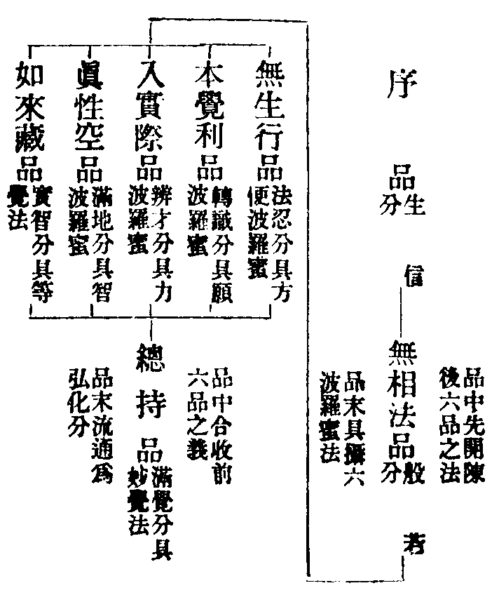
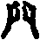
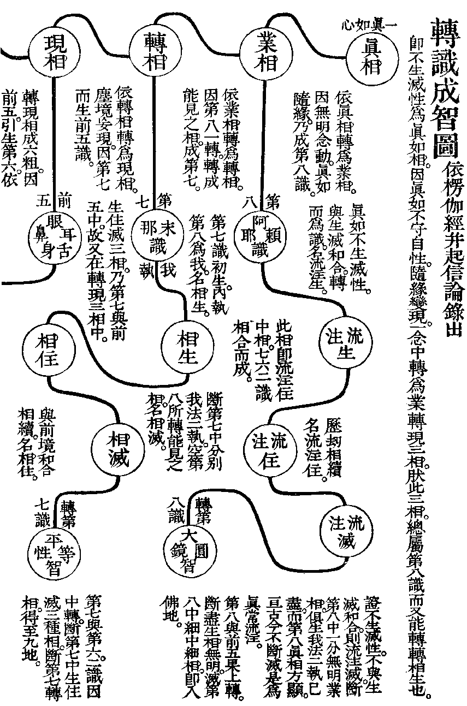
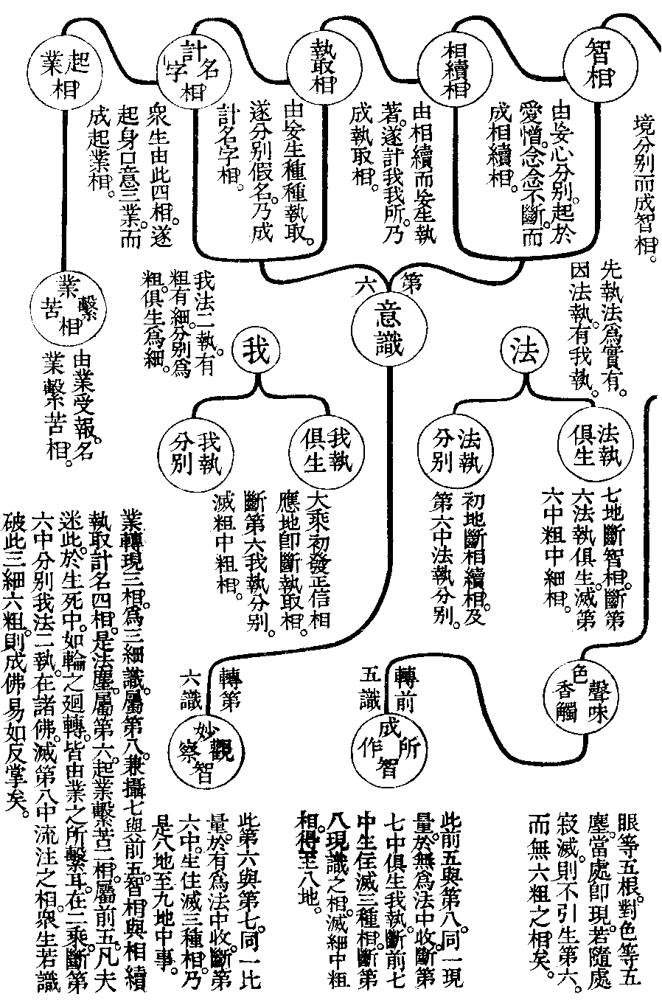

# 金刚三昧经通宗记



> **藏经**：卍新纂大日本续藏经（新纂卍续藏）　**册次** 第 35 册（X35）　**编号** X0652　**部类** 经疏部　**卷次** 12 卷　**篇幅** 119,393 字

> **作者（译者）**：天台山华顶嗣祖沙门　𧧌震　述

> **卷／品**：13 卷 · 26 品



---



## 目录



  - [No. 652-A 金刚三昧经序](#no-652-a-金刚三昧经序)

  - [No. 652-B 金刚三昧经通宗记序](#no-652-b-金刚三昧经通宗记序)

  - [卷首序](#卷首序)

  - [卷一序品第一](#卷一序品第一)

  - [卷二无相法品第二之上](#卷二无相法品第二之上)

  - [卷三无相法品第二之中](#卷三无相法品第二之中)

  - [卷四无相法品第二之下](#卷四无相法品第二之下)

- [卷五无生行品卷三](#卷五无生行品卷三)

  - [卷六本觉利品第四](#卷六本觉利品第四)

  - [卷七入实际品第五之上](#卷七入实际品第五之上)

  - [卷八入实际品第五之下](#卷八入实际品第五之下)

  - [卷九真性空品第六](#卷九真性空品第六)

  - [卷十如来藏品第七](#卷十如来藏品第七)

  - [卷十一总持品第八之上](#卷十一总持品第八之上)

  - [卷十二总持品第八之下](#卷十二总持品第八之下)

- [金刚三昧经通宗记卷第一](#金刚三昧经通宗记卷第一)

  - [序品第一](#序品第一)

- [金刚三昧经通宗记卷第二](#金刚三昧经通宗记卷第二)

  - [无相法品第二之上](#无相法品第二之上)

- [金刚三昧经通宗记卷第三](#金刚三昧经通宗记卷第三)

  - [无相法品第二之中](#无相法品第二之中)

- [金刚三昧经通宗记卷第四](#金刚三昧经通宗记卷第四)

  - [无相法品第二之下](#无相法品第二之下)

- [金刚三昧经通宗记卷第五](#金刚三昧经通宗记卷第五)

  - [无生行品第三](#无生行品第三)

- [金刚三昧经通宗记卷第六](#金刚三昧经通宗记卷第六)

  - [本觉利品第四](#本觉利品第四)

- [金刚三昧经通宗记卷第七](#金刚三昧经通宗记卷第七)

  - [入实际品第五之上](#入实际品第五之上)

- [金刚三昧经通宗记卷第八](#金刚三昧经通宗记卷第八)

  - [入实际品第五之下](#入实际品第五之下)

- [金刚三昧经通宗记卷第九](#金刚三昧经通宗记卷第九)

  - [真性空品第六](#真性空品第六)

- [金刚三昧经通宗记卷第十](#金刚三昧经通宗记卷第十)

  - [如来藏品第七](#如来藏品第七)

- [金刚三昧经通宗记卷第十一](#金刚三昧经通宗记卷第十一)

  - [总持品第八之上](#总持品第八之上)

- [金刚三昧经通宗记卷第十二](#金刚三昧经通宗记卷第十二)

  - [总持品第八之下](#总持品第八之下)



---



### No. 652-A 金刚三昧经序



天台山华顶嗣祖沙门　𧧌震　述



金刚三昧经者，一乘圆顿之教，诸佛真实之宗。妙绝群经，该罗万法。废权显实，大收法华殿后之功。寄灭谈常，先展涅槃锋前之阵。特畅五时玄旨，博施上味醍醐。诸地顿超，祇在事先一觉。群生共得，奚分中下二根。凡圣位齐，智愚道一。诚菩萨利生秘钥，乃众生成佛要枢。以法印心，无以尚矣。真修密行，其在斯乎。始自灵山示默，全机独露无言。苾𫇴代宣唱偈，力为劝问。由兹发起依智，咸兴解脱。启无相法门，悟般若逈超乎三界心王。证无生法忍，泯言说默契於一心无住。获本觉之利，转诸识而性海无波。大力入实际之𭏟，具智辨而心源流净。得真性体空，鹙子以满地而独任。入如来藏海，梵行以等觉而自居。总持为诸品义宗，妙观圆成正觉。品末示弘通法眼，嘱累唯有斯经。信乎得之者，他外永绝希求。悟之者，本末咸归一致。观其原始要终，条分缕析。如华贯为鬘，灿烂可观。珠走於盘，光𦦨难瞩。自得诸佛护念，不入餘众生手。是故久扄秘藏，弗妄宣传。知之者，希闻亦难信。矧夫文奇义密，语简理备。仅万有一千五百言，而统乎一大藏教之义海。又且能摄不立文字别传之宗，斯诚为像法中出世之良导者也。震幸遇圣言，深心研究。虽罔窥幽秘，而矢愿流通。定此生他生之法程，为利己利人之妙行。愿见者闻者，顿悟心空。今世后世，永沾法乳云尔。



辨字音义(凡实体疑似及转音者，先为注明，以便检阅)



祇



(音支，但也。祇如、祇有皆用此。今为秖，非。又音岐，神祇也。凡祇夜、祇陀本此。)



扺



(音止，侧也，击也。扺对之扺当用此，葢以手击节而对。今作秖祇，皆误。)



别



(便入声，为别异、别离之别；又音鼈，为分别、辨别之别。)



称



(凡称誉、称叹则平声，凡名称、相称则去声。)



行



(如行止、运行，音衡。德行、言行，音幸。行列、行布，音杭。行其事以利人，音恨。)



解



(几，结解。解说则上声，又去声，音械，晓也。如晓了自脱曰解脱，晓悟其义曰解义。)



治



(池稚二音，凡未治而治之则平声，已治之治则去声。)



切



(音窃是切当真切之切，又去声。音砌。众也。又大凡也。)



离



(凡别离、支离，皆平声，又去声，音利，渐相违也。离欲、离垢，皆从此。)



旋



(如周旋、折旋、旋转，皆平声，又去声，乃逐旋之旋。)



度



(济度之度则去声，又入声，音铎计度之度。)



那



(懦，平声，禅那、檀那从此。又上声，奴可切，为那里、那事之那。又上声，奴卧切，语餘之声也。)



养



(下奉上曰养，则去声。生养、畜养、自养，皆上声。)



去



(来去则去声，除去则上声。)



语



(上声，言语也。又以言告人曰语，即去声。)



------



### No. 652-B 金刚三昧经通宗记序



堪忍学人　魏学渠　撰



予阅首楞严经，观世音菩萨言：我昔供养观音如来，彼佛授我如幻金刚三昧，得悟耳根圆通。又云：此方真教体，清净在音闻。言乎东土学道者，定从闻入也。自教典西来，三藏十二部，炳然如日星常垂，江河行地，舍此何以为登圣之阶，破暗之烛哉？初祖直指人心，见性成佛，超越渐次，捷成圆顿，宗风弘畅，大乘有人。二家竝立，宗盛教衰，而一知半解，未见实相，宗亦凌迟矣。参禅者求之於机缘，习教者求之於佛语，机缘固能悟入，佛语岂便欺人？要使宗教融通，自然圆顿立至。紫栢老人有云：习教以佛语为本，明宗以机缘为本，弘阐宗教以道德为本，以戒行辅之，以学问大之。不尔，踞法王之座，披如来之衣，而传我佛之言者，所谓狐嘷耳。予佩斯言者久，而未见其人，闻有仁山大师为当今龙象，私心向往之。癸亥仲冬，过天平之白云古寺，猝遇之，萧然数椽，弊衣粝食，澹如也。谈次，出所为金刚三昧通宗记见示，读一二，则文俭义丰，指约理该，正如取大海中水，一滴而味具百川矣。因以经记相授，而乞予言序其首。经意大约总华严、法华、涅槃大旨，而微言隽语有类楞严，从闻思修，其在是乎？梵经远集，葢以化导群生，使知佛道。然虑其著有也，初祖面壁，不立文字；虑其著无也，则天台、贤首为疏为钞，不惮条分缕析以为之说。今师之作是记也，慈悲心切，务令宗雷大振，教雨滂沱，不著有，不著无，不著有不可得，不著无不可得，不著有无亦不可得，则佛语在是，机缘在是，何圆顿之难臻哉？因序以归之。



金刚三昧经通宗记目次



------



### 卷首序



悬谈  

科分(欠之)



------



### 卷一序品第一



### 卷二无相法品第二之上



### 卷三无相法品第二之中



### 卷四无相法品第二之下



## 卷五无生行品卷三



### 卷六本觉利品第四



### 卷七入实际品第五之上



### 卷八入实际品第五之下



### 卷九真性空品第六



### 卷十如来藏品第七



### 卷十一总持品第八之上



### 卷十二总持品第八之下



卷末修习行法  

阁笔记



金刚三昧经通宗记目次(终)



品义开合图







No. 652-C 悬谈



夫台教释经，演五重玄义，谓因名显体，由体明宗，依宗辨用，后乃发明教相。贤首疏华严，则首启十门，分别此二家立教之旨也。今金刚三昧经具摄华严中后五地奥义，当从十门略为分演：初、教起因缘，二、藏教分摄，三、义理幽深，四、法被机宜，五、宗分体用，六、教迹前后，七、翻译时代，八、疏注感通，九、解释经题，十、疏义通宗。



初教起因缘者，我佛出世，说经三百餘会，祇为一大事因缘，开发一切众生，入佛智地故。正如东土圣人，垂六经以示后世之意同也。六经者，易极深研几，著天地阴阳四时五行之理；书纪圣王治天下之事；诗敦人伦，美教化，移风易俗；礼以经纪伦序；乐以发天地之至和；春秋惩恶劝善，推三代之德，而为天下仪表。此治世之事也。今如来为出世大事，观机逗教，自浅至深，於四十九年，说一代时教，皆有缘起。如始初成道，在寂灭道场中，为四十一位法身大士，及宿世根熟天龙八部，一时围绕。世尊现千丈卢舍那身，为说十住、十行、十回向、十地，及等妙二觉法，名曰华严，是为大化之始。贤首判为一乘圆教，台教判为顿教。又谓兼别说圆，如经中初发心时，便成正觉，为圆机而说圆教。又处处说行布次第，为权机而说别教也。当时二乘声闻，犹如聋聩，不闻不见。所以法华经云：我始坐道场，观树经行，思惟三七，寻念过去诸佛，皆以方便，说三乘法。由是为诸众生，脱珍著弊，说四阿含(此云无比)法。初增一阿含，明人天因果；二中阿含，明真寂深义；三杂阿含，明诸禅定；四长阿含，明四谛法。贤首判为小教，台教判为藏教，为第二鹿苑时。其次弹偏斥小，叹大褒圆，故说维摩、思益、楞伽、解深密、金光明、胜鬘等经四十餘部，台教谓之第三方等时。於中广谈四教(即藏、通、别、圆)曰方，均被众机曰等，贤首判为顿教。再次说般若等经，贤首判为大乘始教，台教判为第四时。法华合涅槃为第五时，贤首判为大乘终教。然法华授记声闻作佛，涅槃明佛性常住义，以终大乘之始也。今此经实乃和会一大藏教五时五味之法，亦可解分八(台教分顿、渐、秘密、不定、藏、通、别、圆也)、分五(贤首分小、始、终、顿、圆也)之诤。所以非藏非通非别，於中即渐而顿，即顿而圆，即始而终，即权而实，俾利钝咸得，小大共证者也。又此经缘起之义有五：一为现在地位菩萨，深入一乘，知佛法纲领故。二为将来学般若菩萨，顿超后五地，得等妙二觉法故。三为令末世众生，得修行径捷法程，位位圆摄故。四为欲显示一味真实无上醍醐，真菩萨乘故。五为欲断除文句言说，会教通宗，得一念相应妙慧，悟实义故。如华严合论云：一念相应，一念成佛。一日相应，一日成佛。不须劫数，渐次而修。有此五义，乃说是经。



二藏教分摄者，既明缘起，须知如来所说教义，总摄三藏十二分教中(旧称十二部经)。今此金刚三昧，本是修多罗藏(即经藏)。然经中言三聚戒，则摄律藏。其始末酬问，皆辨核深理，则又兼摄论藏。故三藏俱摄也。十二分教中，此经兼摄九分。如直示一乘实相，是契经法本。偈语问答，义不重复，是孤起颂。如来出定宣示，是自说。菩萨发问，是因缘。为末世众生，广说一味之法，得广大利乐，是方广。授舍利弗成菩提记，是授记。向所未说，今乃说，是未曾有。以喻合法，以法合喻，是譬喻。以真理甚深，研核辨诘，是论议。唯不摄本事(说往事)，本生(说昔受生)，及重颂(重宣其义)等三也。又谓家所立教相，各各不同。而此经融会贯通，祇显圆实。如贤首大师立小乘教者，依六识三毒少分，为说我空法空，而不明显。大乘始教，但说诸法相空，未尽大乘法性义。大乘终教，亦名实教。少说法相，多说法性。纵说法相，亦会归法性，始尽大乘至极之说。然此始终二教，依位进修，是渐非顿。第五为一乘圆教，谓法界性海，圆融互摄。如十信满心，即摄住行向地，及等觉五位，而成正觉也。又智者大师化法四教，谓如来为决定声闻说三藏教，为退大声闻说通教，为渐教菩萨说别教，为顿悟菩萨说圆教。又四教仪云：凡诸大乘经论不共三乘位次，总属圆教。又引华严经初发心时便成正觉，维摩入不二法门，般若明最上乘。至於涅槃经有人入大海中浴已，用一切诸河之水。又娑伽罗龙澍车轴雨，唯大海能受，餘地不堪。又捣万种香为丸，烧一丸则众香咸具。如是等类竝属圆教。今金刚三昧经义正合四教仪所说，又正合为顿教菩萨说圆教，况经中屡说一乘一味，更不用开三显一。又法华玄义云：自鹿苑开权历诸经教，至於法华始得合实。今观金刚三昧经义，而法华一实之理至此乃始得圆，况又能总括大乘诸经之义。如经中具修六度则本乎般若，发明五法则通乎楞伽，证法忍则摄乎维摩，明地位则同於华严，说九识则类於解深密，举一乘则合於法华，扶律谈常则表大涅槃。又论相实该唯识，论性兼於起信，故凡大乘诸法靡不摄入，宜乎称为摄大乘无量义宗也。



三义理幽深者，既知藏教所摄，又应知如来说法。其意云何？葢始教废实开权，分三乘渐次；终教废权立实，会三乘而示一乘。所谓前前浅，后后深也。然台教以法华为后教后味，又云法华为声闻根熟者说，其餘钝根未熟者，则又以涅槃为后教后味。今此经为法华、涅槃二经后教后味之枢钮，其意渊深，难以意解。又据台教称法华为一乘，开前顿渐，会入非顿非渐，正显圆教约味称醍醐，故说开示悟入佛之知见，授记声闻作佛，大畅如来之本怀。然设三车以示权，授声闻远劫成佛之记，正欲诱进行菩萨行䇿，令入佛无餘涅槃。故今此经正阐法华一乘一味一实之圆理，明地位中菩萨所行之行，证等妙二觉之法，舍此无以加焉。至若贤首以华严为一乘圆顿，犹大海之摄百川，举一法而法法具备，然则文丰义广，学者未免茫如望洋。今此经即是华严十地中后五地及等妙二觉法，然文略义周，句语古简，非他经可比。葢经中言无相法即真如自心之法，又明六波罗蜜皆无相无为解脱之法，无生行即无生法忍，得忍之义，即宗门所谓向第八识下一刀截断本觉利，即转第八本觉识入唵摩罗(第九白净识)，乃是得本觉中所出之利，入实际修四无碍辨之智，以利生真性空，直下显示五位进修，俾后世众生各得一生成满智地。如来藏，契证如来自性清净之藏，以尽识藏中微细之相，与毗卢遮那同体。总持品，总持前六品之法，妙契佛心，以明生佛共有根本智体，即是妙觉果满也。



四法被机宜者，此经幽玄之理既明，且被於何等机器？然约法有二种：一、被当机大乘菩萨化度众生；二、被后末世众生修出世因，得出世果。因者，即序品发众生正信，示一乘法故。果者，即后七品经文：初、示第六地中般若法故；二、示七地中证无生法忍故；三、示八地中转诸识入唵摩罗法故；四、示九地中入实际法故；五、示真性空体成满十地法故；六、示入如来藏证等觉法位故；七、示妙觉法圆满佛果故。又华严会上，善财初见文殊，悟得涅槃玅心，而文殊复令南询参五十餘员知识，善财白云：我已先发阿耨多罗三藐三菩提心，但未知云何学菩萨行，修菩萨道？於时知识各各示诲自证自悟之法已，复云：我唯得此解脱法门，若诸菩萨摩诃萨之所修习，而我云何能知能识彼功德行？此入法界品之语也。今此如来亲口所说六地至十地及等玅觉法，真是末世学菩萨行，修菩萨道之法程，而菩萨大功德行，舍是而终不可得也。



五宗分体用者，既知所被之机，应知法之所宗有体有用。夫台教先举名体宗用，后示教相，此则不然。葢昔世尊初覩明星而成正觉，叹曰：众生具有如来智慧德相，但以妄想执著而不证得。此明佛之始觉与众生本觉一体不二。然诸佛证此而后乃有藏教之名，又实从覩星证其体，观树得其用。又如来入定放光是宗通，以言说发明入定放光之义即属说通。又宗通即拈华示众，说通即世尊道吾有正法眼藏、涅槃妙心、实相无相微妙法门，不立文字，教外别传，付嘱摩诃迦叶是也。故此经以本始二觉为宗，实相无相为体，宗通说通为用，体用互陈，宗说兼畅，是一大藏教中极顶之妙法也。



六教迹前后者，既立宗以分体用，又应定此经时分。据台教分五时：初、华严时，二、鹿苑时，三、方等时，四、般若时，五、涅槃时。又立八教，以顿、渐、秘密、不定四教为化仪，藏、通、别、圆四教为化法。又顿分二种：一、称华严为顿，兼别说圆。二、以方等大乘部不定先后时分为随机显体之顿，属不定教。又以鹿苑(说四阿含)、方等、般若三时为渐教。又合前四时中，或说顿，或说渐，彼此互不相知，能令得益，是秘密教。又以前四时中，佛以一音说法，众生随类得解，或说渐得顿，或说顿得渐，互相得益不同，亦名不定教。此为化仪四教也。又以鹿苑说阿含为小乘三藏教。又以方等、般若部为通教，谓通前藏教，通后别、圆。又以华严及璎珞、金光明等经中住、行、向、地等菩萨行位次第，竝属权乘，为别教，谓别前藏、通，别后圆教也。最后以法华为一乘实相，开佛知见，授记作佛，是顿是圆。此以如来说一代时教，至法华会上始得圆满，故为圆教。此为化法四教也。法华合涅槃为第五时，约味称醍醐，以明见佛性为义。又教中言五时，多据阿含十二，方等八年，般若二十二，法华七年，涅槃一日半夜。若攷诸经中，如佛所说释种被流离王杀害因缘，乃在说法华经之第五年间，却载入长阿含经。又优填王造像在涅槃前三月内，却载入增一阿含经。若谓收阿含部中可也，不可必指阿含会上止於十二年也。餘四时亦不必泥其说。至若谓最后七年止说法华一经者，如净饭王泥洹经亦在说法华之第四年，流离王杀释种亦在净饭王既殁之后，此法句喻经所说。又涅槃之前，佛在毗舍离国大林精舍，告诸比丘：却后三月，我当般涅槃。即为说普贤菩萨行法经(即普贤观经)、升忉利天为母说法经(此并戴佛祖统记)。又藏中有大悲经、四童子三昧经，亦收涅槃部内。葢判教者略而不言，止说法华、涅槃为第五时耳。再详涅槃不应言一日半夜，当以三月为卒。至若法华、涅槃之前，随机即说，理所必然。今详阅金刚三昧，於中究尽一乘实相，而开寄灭谈常之旨，是必在法华后、涅槃前者矣。昔长水法师判首楞严为法华后、涅槃前，后代诸师多辟其谬，谓是般若后、法华前也。显圣澄师判此金刚三昧，亦谓般若后、法华前，二时不定为教相。今据此经，虽与华严同一奥义，且与法华同在耆阇崛山所说。况舍利弗初在法华会上，自亦未了，闻佛说法，始断疑悔。今此会中竟以满地自任，则此经应在法华后矣。又解脱菩萨有若佛灭后之问，如来藏品中复有涅槃寄灭谈常之说，此必应在世尊唱灭时矣。且法华既合涅槃为第五时，今金刚三昧亦可与法华同例而合于涅槃也。夫此经最简最要，葢世尊实因四十九年言说已多，兹欲以略该广，特於涅槃前总括三百餘会精义，顿超四十一位圆机，故一时与实教中大菩萨等说此金刚三昧，直与华严、法华始终同一圆顿(统摄诸法曰圆，直入佛地曰顿)。广而推之，顿见顿悟，顿超顿入，至於理圆行圆，智圆位圆，因圆果圆，事事法法皆圆，所谓圆圆矣。若依此修行，真是圆教中菩萨。大藏圣教法宝标目云：金刚三昧经乃诸菩萨问佛无生实际一味真实法，佛说此经后付嘱云：是经能入如来智海，持是经者则於一切经中无所希求，摄诸经要，无量义宗，种种心地法门云云。我辈今幸得遇，正宜自庆，潜心研究，必期顿超直入，请勿以前后时分为疑可也。



七翻译时代者，既明说法时分，须详何代所译。夫译有交易之义，谓翻梵天之语，转成汉地之言也。初佛经从天竺五印度而来，印度正居南洲之中。劫初光音天人降於此，故语言文字皆同梵天。既传流此土，必翻译始明。按礼记中王制：通四方之语，各有其官。东曰寄，南曰象，西曰狄鞮，北曰译。注者云：寄者，谓寄托其意於事物以通之。象者，以意倣像其形似而通之。狄与逖同，远之也。鞮即履也，言远履其事，而知其言意之所在以通之。译者，以彼此两土之语相腾释而通之。周总谓之象胥。胥者，佐也，今俗称通事。当时像法初至汉国，值北译之官，兼善西语，即称为译。(六朝翻译诸师，皆非浅识之士。翻译场中，有译语者，有译义者，有润文者，有证梵语者，有证义者，有唐梵相校者。)此经书失译师名，附北凉录。按梁慧皎撰道安传有云：自汉魏迄晋，经来实多，而传译之师，不言其名。后学追究，莫知年代。安乃总集名目，表其时人，诠品新旧，撰为经录。众经有据，实由其功。又隋朝费长房(昔汉亦有费长房，乃地仙也)，先为沙门，周武沙汰反俗。隋兴，文帝诏为翻经学士。开皇十七年，进历代三宝录十五卷，於中载金刚三昧经，是梁僧祐新集道安凉土异经，而目录中为失译源，今还附入凉世。又如三慧经等，皆标僧祐录。安公凉土异经今附北凉录云：考安师入灭於晋孝武帝太元十年乙酉，明年丙戌，吕光称后凉。又越十五年辛丑，沮渠蒙逊始称北凉。今据附入凉世，应作凉州。张氏称国时，必非北凉也。又三宝记载苻秦道安亦甞译经二十四部，况称僧祐新集道安凉土异经，必为道安法师之所译矣。



八疏注感通者，此经传译既明，复显感通之迹。考宋赞宁高僧传载：元晓法师，新罗国人。初与义湘法师发志航海求法。至唐州，抵暮遭雨，宿於土龛间。达旦视之，乃古塜骸骨旁也。已而致疑，恍然悟三界惟心之旨。即还国中，著华严疏，大弘圆顿教义。一日，新罗国王因夫人脑婴痈肿，医者莫瘳，祷之灵祠。觋者曰：应往大国求药。王即遣使渡海。舟行将半，倐见一人从巨浪中出，邀入龙宫。须臾，见龙王语之曰：汝国夫人是青帝第三女。我宫中先有金刚三昧经，乃二觉圆通，示菩萨行也。今托夫人之病为增上缘，可持此经至彼国流布。即出经以授使者。复云：此经出海，恐有魔事，用蜡纸缠束，割裂腨膓，以纳其中，仍取药傅之如故。龙王又言：汝去上白国王，当请元晓法师造疏讲演，夫人之疾自愈。使还，具陈其事，王大喜，即供奉法师造疏。晓乃悟是经以本、始二觉为宗，白王具角乘，将几案在两角间置其笔砚，始终於牛车造疏，成五卷，夫人之疾果愈。王剋日请晓於黄龙寺演义，又因簿徒盗其疏去，复重录成三卷，名为略疏。后广、略二本俱行本土，略本传入国中，后有翻经三藏改为论云。宋觉范禅师林间录中亦载前事。明万历末，显圣澄禅师有注，迨后又得慧开朗法师因注讲演。余尝阅华严悬谈、宗镜录、智证传等，皆引用金刚三昧经语，圆觉略疏又引海东疏释，略见一斑，第不获全书为憾。又翻译名义集中载僧遁(法眼嗣)有注，亦未获见。



九解释经题者，前八门明一经大旨，后二门初解经题，后疏正文。圭峰、圆觉疏中合为一门，此从华严悬谈，仍分为二。金刚，喻也，取坚利之义。坚是体，利是用。又坚则无物能坏，利则能坏一切。此法亦然，其坚能破诸障，其利能断疑悔。又云：金刚宝乃帝释之杵，与阿修罗战则执之。三昧，法也，此云正见、正定。无见之见为正见，无定之定为正定。或作正受，於三昧中不受诸受，是为正受。圆觉略疏引东海论释云：三昧，此云正思。审正思察，故名正思。又云：无正不正，忘思非思，但为别於分别邪念，又不同於虗空无思，所以强号为正思耳。余意不然。夫金刚三昧是诸佛心体，如首楞严经观世音菩萨言：我昔供养观音如来，彼佛授我如幻金刚三昧，得悟耳根圆通。又云：是诸大众一切普获金刚三昧。又涅槃经云：金刚三昧即佛性正因，即般若波罗蜜、首楞严三昧、师子吼三昧，名异体同，随所作而得名也。又大般若经云：如金刚宝置之日中，色则不定。金刚三昧亦复如是，若在大众，色亦不定。诸经皆言之，涅槃引说特广。又是经有三名：一日摄大乘，一日金刚三昧，一曰无量义宗。今此称金刚三昧者，取法喻竝彰之义。然此三昧，非权教中住行向地菩萨所知，唯实教中一乘菩萨，登后五地及等妙二觉，乃能证入。故佛言：惟佛菩萨乃能知之。经中唱明后五地及等妙二觉法，又无相法品中，具摄后六品法，而最后总持品，即融会前六品法，以成妙觉果满。然总不出此金刚三昧之全体大用，故称为诸佛智地也。经者，众生修证之径路。又训典法，於常无有变易，如织之有经纬，纬变而经常。今佛示真常之法，垂教后世，故曰经。又称契经者，谓契理合机之经也。又经首



相教中云：此陀罗二字，右为执持义，左为流布义。或又作癶相，昔人曾以沤和二字释之。或问披云寂禅师(云门嗣)，寂示以颂云：以字不是八不成，森罗万象此中明。直饶巧说千般妙，不是沤和不是经。又有问地藏琛禅师云：以字不成，八字不是，未审是甚麼字？琛云：看取下注脚。后来诸师，每每以宗乘中意颂之。如罗汉南(云居祐嗣)颂云：以字不是八字非，满琅函载绝毫厘。看经到此须开眼，玉轴分明两畔题。余今亦有一颂：以八俱非，沤和罔测。梵语乖真，唐言失实。若云字义炳然，眼里早生荆棘。饶他信受奉行，也是循行数墨。左看却成魔，右看翻成贼。明暗双双知不知，好向当来问弥勒。



十、疏义通宗者。夫教为义学，宗为玄学。教乃言说可通，宗非文字所及。此经正显教义，兼明玄学。如达磨初祖辨大乘四行，理入行入之法；曹溪六祖禅性无生，离生禅想(经作相字)；禅性无住，离住禅寂(经作动字)；百丈祖师回神住空窟，解脱魔所缚，皆经中之语。然其法义，实乃可通於宗者，余故作是记。经文上下两卷，凡八品，而品品圆融互摄。依法修行，虽有八位，皆於无渐次中作渐次耳。今释此经，厘为九分：初、序品为生信分，发起一乘妙法，乃佛果始因位；二、无相法品为般若分，说现前地法，证般若现前位；三、无生行品为法忍分，说远行地法，证无生法忍位；四、本觉利品为转识分，说不动地法，证转识成智位；五、入实际品为辨才分，说善慧地法，证智辨无碍位；六、真性空品为满地分，说法云地法，证受佛智职位；七、如来藏品为实智分，说等觉法，证具足实智位；八、总持品为满觉分，说妙觉法，证佛果究竟位。品末流通，是为弘化分。兹将略述管见，故先列科分，后明正文。虽然，幸毋以教义责之。葢此经诚为末世修行之要诀，入佛智地之规度。凡在宗门悟心之士，尤宜体究焉。仁山𧧌震述。



音释



𧧌



(同寂。)



殿



(去声，军后曰殿。)



钥



(音药，鎻钥。)



枢



(音樗，户枢，又枢机也。)



苾



(音初。苾𫇴，西域香艸，以僧况之，遂为名。今称比丘，义同。)



鹙



(音秋，水鸟，似鶴。)



析



(音昔，分也，如斤破木之义。)



鬘



(音蛮，以华作冠曰华鬘，今音瞒。)



瞩



(音祝，视也。)



扄



(涓荧切，回平声，秘藏也。)



矧



(申上声，况也。)



仅



(音觐，才也。祇，有也。)



研



(音延，研磨也。)



诘



(音乞，问也。)



复



(音福，重也。)



核



(音核，考之使实也。)



鞞



(音皮)



誊



(音腾，移书传钞也。)



沮



(音疽。沮渠氏，复姓。)



苻



(音扶，草名。晋蒲洪之孙名坚，背有艸付字，遂改姓苻，建国号秦，故称苻秦。)



航



(音杭，渡也。)



痈



(音雍。)



肿



(音冢。)



瘳



(音抽，病愈也。)



觋



(音檄，能斋肃以事神者，在男曰觋，在女曰巫。)



倐



(音叔。倐忽，俗作倐。)



腨



(音善，腨肠即足肚。)



傅



(与敷同。)



剋



(音客，约定日期也。)



簿



(蒲上声，以简策记言曰簿徒。)



第



(但也。)



憾



(含去声，恨也。)



训



(释义曰：训)。



纬



(音位。纵曰经，横曰纬。又定者为经，动者为纬。)



悬谈(终)



No. 652



------



## 金刚三昧经通宗记卷第一



**译者**：天台山华顶嗣祖沙门　𧧌震　述



### 序品第一



此为生信分，葢举佛所说此最上一乘玅法，令人生实信故。又应信此是圆顿中最圆顿之法，务令后世大根器人直入佛智地。故首称序品者，总提一经之纲领也。然经中旧分序、正、流通为三，殊不知序内即是正宗。如金刚般若，只在世尊食时，著衣持钵，入城乞食。饭食讫，收衣钵，洗足，敷座而坐，正是觌体显示般若处。如须菩提赞言希有，早属流通，葢以语言文字流通此般若也。又法华会上入无量义处三昧，放眉间白毫相光，世尊说法竟，即与华严会上入定放光一般。又世尊入师子频申三昧，文殊作象王回顾势，亦祇是欠呿盼视而已。此等皆是正说法。若有言说，尽是方便，尽属流通。以故法华会上从三昧起，无问自说，又云止，不须复说，皆是方便接引之词，所以结集直称为方便品。虽然，又不可废方便而绝权机，是以俯顺众生，为欲显诸佛所证心体，示一乘圆顿秘旨，而说此从前未说之法耳。品者，犹∴字三点，非竝，非纵，非别。葢结集此法，义有先后，明其不可移之意也。



如是！



初、举法生信，从无言诠处立言诠也。夫佛之说法，但为显如，唯如为是，故曰如是。又华严合论云：如者，诸法如故，即是佛。故言如是。虽然，若人向言前荐得，即此二字早已重添注脚，何必更说百千万言而后为得哉？



我闻：



谓我从佛闻，然能闻是我，所闻是法。佛示以无说而说，我以无闻而闻。无闻之闻，是为真闻。无说而说，是为真说。如是而说，如是而闻，我法不立，能所俱泯。所言我者，乃是我无我不二之法身真我也。如是会得，方知四十九年，终未甞说一字。若云三乘十二分教是有，不知总是如来糟粕。



一时。



若悟此一时二字，便能坐断三际，更无第二时，别生第二念，起诸法见，直下许伊见性成佛。岂不闻宗门有云：欲识佛性义，当观时节因缘。且道观甚麼时节？秖如坐时、立时、经行时、饭食时、一切作为时，无有不是者个时节因缘。既然如是，即今如何识得佛性义？古德又云：佛法徧在一切处，行住坐卧处、语言抵对处、迎送宾客处、穿衣吃饭处。虽然，才举心动念，便不是了也。若不举心动念，当体即是。脱或不然，且向第二义门说。此正是法华殿后机，涅槃锋前阵，以始觉契本觉，明始本不二之时也。



佛。



宗门中直指说即心即佛，如将黄叶为金，权止小儿啼。若啼止时，又应说非心非佛。葢以众生识情计度，说佛便著佛，说心便著心，遂致障塞悟门。所以祖师云：佛之一字，吾不喜闻。又诃说心性为恶口，以故说心说佛，总是药病对治句。必须向言语道断处，顿悟佛性，直下与释迦老子见处不别，方得真见佛，而后可转是经。



在王舍大城，耆阇崛山中。



王舍城，乃摩竭陀国之属境。昔有千国王，遭飞行罗刹之难，后既得脱，同愿修道，共立舍於此，故曰王舍。一云：彼土人民，七次作舍，七度被焚，佥曰：我等福薄，王有大福，其舍不烧，今当请王舍居之。於是各书王舍字於其门得免，故遂称王舍大城。耆阇崛，此云灵鹫，以山形似鹫故名。又山有五峰，而鹫峰居中，即佛说法华经处也。若据宗乘中，尘尘是佛，刹刹是佛，心心是佛，念念是佛，奚止灵鹫山中黄面老瞿昙也。



与大比丘众一万人俱，皆得阿罗汉道，其名曰：舍利弗、大目揵连、须菩提，如是众等阿罗汉。



比丘含怖魔、破恶、乞士三义：一、能令一切众生出三界外，天魔怖其境空；二、破众生三恶业，转烦恼为菩提；三、乞食以资身，乞法以济世。阿罗汉亦含此三义：一、杀贪嗔痴贼，断见思二惑，从破恶以得名；二、不见有一法生，不见有一法灭，故不受后有，从怖魔以得称；三、堪为福田，受人天供，因乞士以成德。此为四果圣人，证五分法身，登无学位，无法可学故。舍利弗，此云鹙子，智慧第一。目揵连，此云采菽氏，神通第一。须菩提，此云空生，解空第一。此经正显实际之体，故绝无表德之词，但以智慧明般若，以神通明解脱，以解空明法身，故惟举三名而已。又阿罗汉有三种：一、得决定寂灭声闻罗汉，如佛在世时，闻法漏尽，即趣涅槃，此同於声闻，只求自度而已。二、修行菩萨行罗汉，如楞严圆通会上，虽证四果，为化他故，入菩萨乘，名为回心大阿罗汉，亦即涅槃所称。第四、依人名阿罗汉，此住於十地，为后学所依止故。三、应化佛所化罗汉，如过去佛退位利生，以本愿善根方便力故，现诸佛土，生大众中，内秘外现，庄严诸佛大会众故。又如佛之大弟子，及继祖嗣化，传佛慧命之圣师，皆是也。



复有菩萨摩诃萨二千人俱，其名曰：解脱菩萨、心王菩萨、无住菩萨，如是等菩萨。



菩萨为半梵语，具云菩提萨埵，此云觉有情，乃上求佛果，下化有情之义。摩诃萨，此云大有情，仅举其三，亦用表三德。解脱表悲，心王表智，无住表行也。夫菩萨乘，略说有五：一、修空无我菩萨；二、渐见佛性菩萨；三、顿见佛性菩萨；四、以如来自性清净智，由住、行、向、地及等觉五位加行，起差别智，满普贤行，成大慈悲，留惑润生住世菩萨；五、一乘菩萨。前四俱属三乘，为权教；后一乘菩萨，为实教。权教以诸行为本；实教以明自性根本智为先，证差别智为资。权教中，十地位终，方始见性；虽见佛性，未彰智业，犹假名菩萨。又十地中，次第证十真如，复有十真如障。故论云：真如既成障。明知权教施设假真如，非本真也。十地中，菩萨得三种意生身：初、二、三地，得三摩䟦提乐(一云三昧乐正受)意生身，明住三昧乐，从定发正慧故；四、五、六地，得觉法自性意生身，明通达自性法故。七、八、九、十地，得种类俱生无作无行意生身，明示现种类无功任运，犹如意生自得乐相故。此皆属权教，祇得意生身，未得智生身。又经云：十地差别，如空中鸟迹。如是地位，权施增减，皆为顺世引接之说。若一乘实教，始发信心时，於十住初心，便悟根本无明住地烦恼，即是诸佛不动智。葢以自本觉，自觉本心，身心性相，与佛无二故。如论云：权教小见，乐欲希奇。菩萨称根，粗施接引，令生乐学，方授实门。然不可执化为真，恒迷智眼，识权就实，迁入法界之门。有作之法难成，随缘无作易办。作者劳而无功，不作随缘自就。无功之功，功不虗弃。有功之功，功皆无常。多劫积修，终归败坏。不如一念缘起无生，超彼三乘权学。此如来实教法门之明训也。台教分藏、通、别、圆四教，以圆教为最。今此会中菩萨，不滞三权，惟登一实者也。



复有长者八万人俱，其名曰：梵行长者、大梵长者、树提长者，如是等长者。



梵，此云离欲，以离欲而修清净行故。大梵例此可知。树提，此云火。其母食毒果已死，火焚其尸，腹裂而生。其父请佛命名，佛云：是儿有大福德故，生於猛火中。可即名之。事载涅槃经中。然梵行表解脱，大梵表法身，火表般若，长者表真俗不二。如维摩诘虽为白衣，奉持沙门清净律行；虽处居家，不著三界；虽明世典，常乐佛法。是地位菩萨示现长者身，助扬法化耳。



复有天、龙、夜叉、乾闼婆、阿修罗、迦楼罗、紧那罗、摩睺罗伽、人非人等六十万亿。



此上总为通序常仪也。天，梵语提婆。龙，梵语那伽。夜叉，含勇、徤暴恶、轻捷三义，是天之唱报神。乾闼婆，此云香阴，其身出香，以香资阴，是天帝乐神。阿修罗，此云具缚，甞与天战，败受缚故。迦楼罗，即金翅鸟神。紧那罗，此云疑神，似人头有角，是天帝法乐神。摩睺罗伽，即大蟒神，人首蛇身。人非人等，总结前八部之众。八部之中，唯天最胜，餘者乘急戒缓，即堕其类。已上旧称通序。又名六种成就：一信成就，二闻成就，三时成就，四主成就，五处成就，六众成就。有此六种，佛乃说法。又以一时在会之众，证阿难所闻之法，令后世生信，故称证信序。临入灭时，阿难请问：一切经首，当安何语？佛言：当云如是我闻。一时佛在某处，与若干众等，说某经教。及入灭后，摩诃迦叶告众云：如来弟子得神通者，宜赴结集。於是俱至耆阇崛山毕钵罗窟中(毕钵罗乃树名，佛於此树下成菩提道，故得是名。然因山窟中有树，遂名其窟)，结集如来大法眼藏。时阿难独习漏未尽，初不能入，因是激发。於后夜欲过，疲极偃息，却卧就枕，头未至枕，廓然得悟，如电光出，暗者见道(出大智度论)，当下即证阿罗汉果。迦叶复告众云：此阿难比丘，有大智慧，所闻佛法，如水传器，无有遗餘，可请彼结集。大众默然。迦叶告阿难言：汝今宜宣法眼。阿难承命，礼众僧足，升於法座，忽现相好如佛。时大众悉皆生三种疑：一疑佛重生，二疑他方佛来，三疑阿难成佛。而阿难唱：如是我闻。众疑顿释，乃至众等欢喜，作礼奉行。迦叶又问诸大众云：阿难所言，不错谬乎？佥曰：诚不异如来所说。昔佛又言：诸佛经首，并同立此，所谓佛佛道同也。然序中有师资、主伴、内外护之义，又明世出世间无有不信受者。又须知三界内外若干种性，总只在一心变现。此心同於佛心，即成佛；此心同菩萨心，即成菩萨。至於八部天龙优劣，莫不皆由一心变现而成。故此经以本始二觉为宗。本觉，谓众生觉性本自具足；始觉，谓诸佛始成正觉，能自觉觉他，觉行圆满也。又自觉者，觉知自心本无生灭；觉他者，觉一切法无不是如，觉一切众生皆同是佛；觉满者，觉自他无异，理事圆融，心境交彻，一一徧满法界。又云：诸佛成正觉，穷尽万法性源，故能透过法界。法界即法性，即一真如心。若权教十地菩萨，犹坐在法界量里，以未能穷尽故。然今以始觉契本觉，而知本始之不二，故说此一乘实教圆顿之法，直令博地大心凡夫顿见佛性，实乃羽翼教外别传，直指人心见性成佛之宗者也。



尔时，世尊四众围绕，为诸大众说大乘经，名一味真实无相无生决定实际本觉利行。



此别序经中大旨，先述金刚三昧智用之利也。称佛为世尊者，道为三界之独尊，德具十种之嘉号。非此二字，不足以尽至极之称。然佛常观机逗教，今当先说大乘，而发起一乘之法。如法华前，先为说无量义也。藏中大乘经，凡四十餘部，皆为教菩萨法。此经独为佛之心印。以佛心印一切众生之心，使一切众生，皆得契证於佛心。且义备而无缺，语简而不繁，可谓至极矣。梵语摩诃衍，此云大乘。大者，当体立名。乘者，运载之义。如起信论，依於一心，显示摩诃衍义故。云是心真如相，即示摩诃衍体故。是心生灭因缘相，能示摩诃衍自体相用故。葢其体即如来藏性，相即八识之相，用即八识生灭因缘。其立摩诃衍义，谓如一微尘，破为百分。九十九分是无，一分是有。摩诃衍不能胜出，以尚有此一分在故。直须百分俱无，摩诃衍始能胜出。以能灭尽一切众生心意识中微细之相，方为大乘耳。今云一味，即指一心之法。佛说一切法，祇为欲令众生明此一心，故自小乘入大乘，分始分终，论权论实，说顿说圆。如涅槃经中，尝取醍醐为一味，谓𤛗乳於牛，从乳出酪，酪出生酥，生酥出熟酥，而后成醍醐。以醍醐喻涅槃佛性义，谓其从三乘十二分教而出，是教乘之极谈。但涅槃祇为二乘钝根及末后根熟者说，犹未能畅佛本怀。今此是大菩萨特为后世上根利智者请，其所说又不同。经中屡称一味，又云无有诸杂味，是真一味醍醐之心法也。然心法无形，言说莫及，故曰我宗无语句，实无一法与人。若谓有法可说，并属虗谬，非为一味真实。所以佛嘱大迦叶偈云：法本法无法，无法法亦法。今付无法时，法法何曾法。由此宗门尊宿，不立文字，直提向上，有入门便棒，进门便喝，惟以机用接人。此从释迦老子最初睹明星，末后拈华示众，迦叶破颜微笑处得来，是一大藏教中真骨髓，四十九年三百餘会说不著，唯有此经略较些子。经云：真实者，真如实相也。诸佛皆以权实二智立教，此经一例显实。葢真如之心，本自无相，无相之相，是为实相。所以金刚般若经云：信心清净，即生实相，当知是为第一希有功德。夫信心清净者，谓信得此心清净，即生实相之功德矣。又须知实相之相，为众相所依，而众相以无相为本也。须知无相本即法身，无相之心即是无生。又一切法空即无相，一切心空即无生，无生即解脱义。决定者，不移易也。於一切法俱不可得，此心不可移易，是为实际，即般若义。法身、般若、解脱，为涅槃三德秘藏。又此三德，由翻三杂染故。翻结业为解脱，而缚脱不二；翻烦恼为菩提，而烦恼菩提不二；翻幻化为法身，而心体离念，本即法身。若得此法身、解脱、般若，即同诸佛始觉。夫本觉是众生之正因，有因必有果，犹从本必获利。如人种禾成熟，以刀刈取，是必得之物，故利字取以刀刈禾之义。然众生既有本觉之因，是必获始觉之果，而法身、解脱、般若，皆由本觉所出之利而行。故此为金刚三昧之用，而明一切智智之境界也。



若闻是经，乃至受持一四句偈，是人则为入佛智地，能以方便教化众生，为一切众生作大知识。



此明悉檀之益。悉，徧也。檀，梵语，具云檀那，此云施。华梵兼举，故曰悉檀。有四种：一、世界悉檀，令众生得欢喜益。如阴、界、入等，一切名相隔别，名为世界。佛随众生乐闻，分别而说，令得正见。二、为人悉檀，令众生得生善益。如佛说法，必先观众生心行，然后为说，令其信乐生善。三、对治悉檀，令众生得灭恶益。如佛所说法，皆应病与药，令其破恶。四、第一义悉檀，令众生得道。如佛知众生根熟，为其说法，即得开悟。佛以此四法，徧施一切众生，故名四悉檀也。大论云：四悉檀具摄八万四千法藏、十二部经。故台教以之释法华也。今此经如无相、无生、觉利、实际、性空、如来藏等，各各名相隔别，即世界义。闻、持、悟、入，以之转化，即为人义。以一乘破三乘之法，一味除诸味之异，即对治义。若闻一心之法，廓然顿悟，即第一义。然第一义中，闻者无法可闻，受者无法可受，持者无法可持。所云一四句偈，亦是为人方便，究竟无一字可得。此是四悉之正意。若失此意，即著於法，不名大乘。若得此意，但为众生故，随时说法，自他俱无所著，方是入佛智地。然亦实无佛智地之可入，是为真入。如是始能以方便教化众生也。夫义之所在曰方，俯顺机宜曰便，以正道诲人曰教，躬行於上、风动於下曰化。众生者，以三缘、五阴、四大众法相生得名。又曰：众共生世，故名众生。又佛之方便，大约不出三种：正方便说三乘法，巧方便说大乘法，异方便显第一义。若无方便，绝无开口处，即拈华微笑，与从上宗祖拈椎竖拂、行棒用喝，亦属异方便。又此方便，佛从观树经行，悟过去诸佛说法仪式，将自己睹星所悟之道，始而从实开权，终则废权显实，中间演出三乘十二分教。如树本是一，因分枝发干以成其大，而终归乎一。故三乘十二分教皆为枝末，皆是方便。又须知时识宜，知真识妄，知病识药，方可用此方便为人。如经云：善知教化之法，善知修道之人，善知教化之过，善知修道之过。知此四法，名善知识。又经云：善解空、无相、无作，了达诸法究竟平等，性相如如，住於实际，於毕竟空中炽然建立，是名真善知识。故称善知识为天人师，大不容易。所以黄檗和尚云：诸方尽是噇酒糟汉。还知大唐国里无禅师麼？时有僧问：诸方匡徒领众又如何？檗曰：不道无禅，祇是无师。



佛说此经已，结跏趺坐，即入金刚三昧，身心不动。



此示三昧之体，乃是世尊正说法处。一经之大宗大旨，从此而立。然此金刚三昧，实为一切三昧之母。前以用发明，此依体建立。其体即法性身，所谓实相无相是也。其用即一切智智，所谓宗通说通是也。又从体立喻，如大圆镜。从体发用，则随事应现。又立此金刚二字为名，非取喻也。以其法性之身，体本坚密，故曰金刚。又以情亡智现，凡圣俱尽，心无动乱，无得无证，无生无灭，即是金刚正见。若心称此理，是则名为金刚正定。此三昧中境界，非可以言语形容。直须心与理合，智与境泯，方始相应。故清凉疏云：理显故，见法性身。智明故，见佛智身。理智冥一，见无碍身。此三种身，真所谓如人饮水，冷煖自知。若在言说，尽是方便开权。只此无言说处，真是显实。正与摩竭提国掩室一般，所谓全提正令时也。当时只有文殊大士，与迦叶头陀，识得黄面老子做处。所以一日见世尊才升座，大众集定。文殊便白椎云：谛观法王法，法王法如是。世尊便下座。又一日世尊升座，迦叶白椎云：世尊说法竟。世尊便下座。如是方得勦绝文字言说，实义始显。然则事无一向，前此已显语秘密。今此结跏趺坐，是身秘密。入金刚三昧，是心秘密。身心秘密，故曰不动。今人若向此处，识得黄面老子全身独露底面目，方见灵山一会，俨然未散。



尔时，众中有一比丘，名曰阿伽陀，从座而起，合掌胡跪，欲宣此义，而说偈言：



此请佛宣化，先叙发起之端。夫如来虽已默示法旨，一众罔知。今乃请佛再转法轮，即属方便，即是流通矣。比丘以诸法空为座，此从法空而起也。合掌，表一心敬顺。胡跪，表折节钦承。教中以左右表邪正，右顺为正，左逆为邪。如云：菩萨礼敬诸佛，当发愿言：我今五轮礼佛足，为断五道离五葢。愿令一切诸众生，安住五通具五眼。愿我右膝著地时，令诸众生得正觉。愿我左膝著地时，令诸众生离邪见。愿我右手著地时，如佛坐於金刚座，右手指地为震动，一时疾证大菩提。愿我左手著地时，摄诸外道入正道。愿我头顶著地时，令诸众生离憍慢，成就如来无见顶。义出普贤行愿中。诸经之偈有二，如十二分教中祗夜、伽陀是也。祇夜，此云重颂，颂前长行，为增明其义。或者为钝根重说，或因后至未闻，重为宣说。此会无此三种，故无重颂。伽陀，此云讽颂，节略其义，言简理备，以便讽诵故。又云孤起颂，义不重复，故名孤起，即此偈是也。今比丘即以命名，葢亦表此。又翻译名义云：阿伽陀，药名，此云普去，能去众病。又云：阿者，入无生义。又翻无来无去，又云无底，此以多义故不翻。其所说偈，深得如来三昧之义，所以起悲济之用，申劝问之偈，以发起一乘悉檀法益也。



大慈满足尊，智慧通无碍，广度众生故，说於一谛义。



此赞美佛德，言如来大慈，实为万德满足之至尊，其智慧能通达一切而无所碍，今为广度三有众生故，说於一心谛实之义耳。



皆以一味道，终不以小乘，所说义味处，皆悉离不实。入诸佛智地，决定真实际，闻者皆出世，无有不解脱。



此称颂大乘，言如来今者不同餘时，皆示以一味醍醐无上之道，终不以小乘法而为化度也。且今所说一实之义、一味之道，皆离於虗谬不实，直令众生入诸佛自觉圣智之地，至於决定不移真如实际而后已。今世后世有闻此法者，皆得出於世间，更无有一众生而不得解脱者也。



无量诸菩萨，皆悉度众生，为众广深问，知法寂灭相，入於决定处。



此劝众广问。言菩萨皆以度生为怀，自虽无疑，何不为后世众生问於出世之道？又须极其广远甚深，非止浅少而已。必当令诸众生知一切法性本来寂灭之相，入於决定实际而后可也。



如来智方便，当为入实说，随顺皆一乘，无有诸杂味。犹如一雨润，众草皆悉荣，随其性各异。



此请佛垂训，言如来具足大智，一切皆随宜俯顺，善为方便。若有所问，必当为后世众生分别其入於实际之说，令一切法无不随顺，皆归於一乘醍醐之味，则无有诸杂味间错於其间矣。然从前法立三乘，性分五种，总为权教。今言一味一乘，正显其实。又今此一雨所润，葢言无大无小，皆获一乘之法雨也。



一味之法润，普充於一切，如彼一雨润，皆长菩提芽。入金刚三昧，证法真实定，决定断疑悔，一法之印成。



此明得法转利。言菩萨若得此一味法雨之润，则普充於一切众生。亦如一雨之润众草，则必同得敷荣擢曜。今法雨之润众生，则皆能长菩提智慧之芽，又且能令其同入於金刚三昧，而证法身真如实际之定矣。夫如是，则后世众生决定永断二乘之疑之悔，自得一法之印成。此义即同森罗及万象。一法之所印，教中谓之海印三昧。万象喻诸法相，海喻一真如心也。然比丘劝众广问，欲以正法转化众生，正是第一义悉檀。昔佛之说法，皆具四悉檀，如大智度论、龙树菩萨所说。而宗门虽教外别传，亦用此应机说法。且夫分四悉檀者，缘众生根器不等，闻佛一音演说，各各随类得解，故分为四。然前三谓之三益，是世谛，是心所行处。后第一义谓之一道，是真谛，直是言语道断，心行处灭。若上根利智，浅闻深悟，直明第一义，则不必用前三悉檀矣。中下之机，不能领会师家婆心真切，只得与其入泥入水，故不免前三悉檀也。今宗门中欲令人悟道，先以人世虗假勉之，后以生死二字激之，此即是世界悉檀。根性有利钝，察其机宜，或示以棒喝，或示以言句，是为人悉檀。既而痛下钳锤，敲骨取髓，辨魔拣异，夺食驱耕，是对治悉檀。觌面一机，箭锋相拄，豁然㘞地而悟，是第一义悉檀。然前三悉檀，乃为钝根之所设耳。又须知世界中有为人，为人中有对治，对治中有第一义，而第一义中无前三悉檀也。若推而广之，凡有言句棒喝，皆具四悉檀。如若有若无，若即有即无，若非有非无，是世界。辨论此四句，是为人。以有破断见，以无破常见，是对治。离四句百非，直下悟去，是第一义。又如举竹篦字话，唤著则触，不唤则背，是世界。令人向无触背处道一句，是为人。一切总不得，扫尽种种意解，是对治。若悟，才开口便打，是第一义。又如一切言句棒喝，是世界。以此应机说法，是为人。断人一切文字解会，是对治。令人向机下契悟，是第一义。至於五家纲宗旨趣，各各不相混乱，是世界。互相阐扬，是为人。破人颟顸佛性，儱侗真如，是对治。一句中具玄要，分宾主，辨权实，明照用，双放双收，同生同死，一切即一，一即一切，直下法法透过，事事无碍，是第一义。此又岂非宗门中以四悉檀应机说法者乎？倘师家锻鍊，或有不能开发初机者，则不能用世界悉檀也。或有不能提㢡中下根器者，则不能用为人悉檀也。或有不能解黏去缚，出楔抽钉者，则不能用对治悉檀也。或有不能显大机，发大用，开凿人天正眼者，则不能用第一义悉檀也。如入门便棒，进门便𪡓，直用第一义悉檀。故中论云：为向道人说四句，如快马见鞭影，即入正路。亦此意也。又前三悉檀，乃善诱曲导之教。如说有说空，说渐说顿，说始说终，说权说实。后第一义，直显一心之法。故除拈华直指外，唯此经契同耳。



音释



般



(北末切，半入声。)



若



(尔者切，音惹。般若、兰若皆从此。)



欠



(谦，去声。呵欠，开口呵气也。又欠伸，意阑则欠，体疲则伸。)



呿



(音恰，张口貌。)



盼



(攀去声，目顾也，俗作盻。)



∴



(即伊字。)



注



(音著，记物曰注，与注同。)



粕



(音朴，糟滓也。)



崛



(音倔。)



鹫



(音袖，鸟名。)



刹



(音察，旛柱也。有能得一法，即建旛告远，故称刹。)



瞿



(音渠瞿昙，佛姓。)



揵



(音乾。)



埵



(音朵。)



例



(音丽，比也，类也。)



闼



(音獭。)



蟒



(音莽。)



叶



(音摄。)



佥



(音迁，咸也。)



博



(邦，入声。博，地大也。博，学广也。)



逗



(音豆，以言投机也。)



衍



(音演。)



𤛓



(音遘，取牛乳也)。



酥



(音苏，牛乳为之。)



酪



(音洛，乳浆。)



醍



(音提。)



醐



(音乎，醍醐酪之精液。)



刈



(音艺，割也。)



俯



(音府，下也，曲也。)



噇



(音床，不择而食也。)



匡



(自正正人曰匡。)



勦



(焦上声，勦除也，今误作勦。)



谛



(音帝。精义入神曰谛。如真谛、圣谛、谛观、谛听、谛当之类。)



擢



(音浊，拔也。)



㘞



(和，去声，猛然自省之声，又与哇同，即人初生落地之声。)



阐



(彻上声，发明也。)



颟



(音瞒。)



顸



(音憨，颟顸蒙昧不明之状。)



儱



(音垄。)



侗



(音通，儱侗不能辨析也。)



黏



(音严，俗作粘。)



楔



(音屑，楔子，破木之锥)。



------



## 金刚三昧经通宗记卷第二



**译者**：天台山华顶嗣祖沙门　𧧌震　述



### 无相法品第二之上



此为般若分。夫般若为诸佛之母，诸法中王，一切诸佛，从兹出生，一切万法，从兹建立，虽则能生能立，而般若之法，本自无相，故谓之无相法也。然无相之法，即真如自心之法，能含摄一切，以故此无相法品中，先为发起无生觉利实际性空如来藏总持六品之法，品末别明六波罗蜜，又总摄前六地法，而独显般若现前，以发明第六地行相。又初地至五地，未能久住无相法中，六地专修无相法，七地始证无相，获无生法忍，便入第八地，得无功用道，方得满地，方得觉满，以故无相法品，总摄前六地，又发起后四地，及等妙二觉，故直至妙觉位，亦不出此无相法也。又无相即法身义，今以般若收归解脱，则圆成涅槃三德秘藏也。



尔时，世尊从三昧起而说是言：诸佛智地入实法相决定性故，方便神通皆无相利，一觉了义难解难入，非诸二乘之所知见，惟佛菩萨乃能知之，可度众生皆说一味。



此出定自述，乃如来方便开化之端。夫三昧是宗，言说是教。宗无教不显，教无宗不立。故今别开第二义门，以言显无言，即从序品中入佛智地说起。所谓佛智地者，唯明性相而已。葢相为万法唯识之宗，性为万法唯心之旨。唯识摧外道小乘迷谬之执，唯心显如来藏真如自性之体。然必须性相互融，心识俱泯，方得为究竟觉也。又他经不明性相，於义亦通。此经不明性相，其义不显。然性相二宗，皆依大乘经义造论。葢自佛灭度后，天亲菩萨依解深密经造唯识论，亲胜、火辨同时造释论。至佛灭度千有餘年，有护法陈那等，约前颂论造成唯识论，此名法相宗。马鸣菩萨应如来悬记於佛灭度六百年后而生，依楞伽经制大乘起信论，广说阿赖(一作梨)耶中三细识、六粗相、一心真如生灭二门，此即名法性宗。后龙树菩萨制摩诃衍论，引一百本大乘经，证八识心王性相微细等义，此性相二宗之始也。然二宗立论，既各本一经为主，自不能契同。若约成唯识论，以现识与分别事识和合为宗。若约起信论，以真识、现识、分别事识和合为宗。真识即如来藏寂灭一心。现识即第八阿梨耶识，能随五尘对至即现故。分别事识即是第六意识，能随事攀缘分别六尘故。然不言第七末那识者，谓有八六两识，必有末那。以末那缘於第八，又依第八而转六，又以七为根。故末那之细分，通於现识，而粗分通意识也。古德以日中设水器为喻，水器犹第八识，日犹六识。然日以器中之水为缘，乃有壁间浮动之影，影犹末那也。又约相宗立义，言心及心所法，四分合成，有相分，见分，自证分，证自证分。如证自证分，为不迷之真如自证分。真如一分，迷中佛性，即本觉心体。以众生虽迷，有真如自体可证，故云自证。真如体上，有二种用，一能缘用，谓之见分。二所缘用，谓之相分。摄用归体，唯一自证分。所以山河大地，是心相分。心外无法，故曰唯识。此实为名相之宗也。但后学惟宗名相，祇益多闻，不名学道。必须悟自本性，方得解脱。以故必当先明性宗之义。如云：真如心体，本不属迷悟，迥超生灭，不变不坏。而真如相用，全在生灭识中显现。所谓真如不守自性，故随缘变现。真如不坏自性，故不变随缘。由此立心真如门，心生灭门。若众生修证，必从生灭门悟，而证真如门。故以生灭与不生灭和合，非一非异，为阿梨耶识，以起根身器界。如地水火风，而依於空，为器界五法。见闻知觉，而依於识，为根身五法。於此十法，显示一心迷悟之源。若了悟一心，即得根本实智。故曰：万法唯心为正宗。然唯心一宗，实乃统摄始终圆顿四教，而为众生成佛之要门也。今此佛说金刚三昧，发明诸佛智地。故先唱言：入实法相决定性故。夫入实者，入於实际也。若悟心法无际，则入於实际。今入实法相，则入於实际之法。得实际之相，皆决定知一切法缘生无性。此直示真如寂灭之体。真如之体，即无相法，即是根本智。所有方便神通，皆从无相法中所出之利。然此乃是一念相应，顿然觉悟了义之法。故难解难入，非诸二乘之所知见。知见有四种。如地前异生，不见不知。初地至九地，知而不见。十地，见而不知。惟佛与大菩萨，亦知亦见。故云：惟佛菩萨乃能知之。虽然，若见可度众生，皆当为说此一味法也。晓法师论释云：皆说一味者，令入一觉味故。即是大乘欲明一切众生本来一觉，但由无明随梦流转，皆从如来一味之说，无不终归一心之源。如此说，终自不了。何故？总输他归宗禅师接大愚，用得直截。昔大愚欲往诸方学五味禅。归宗云：我者里只有一味禅。大愚便问：如何是一味禅？问声未绝，即被归宗打出。大愚即於棒下顿悟其旨。须是恁麼始得。



尔时，解脱菩萨即从座起，合掌胡跪而白佛言：尊者！若佛灭后，正法去世、像法住世，於末劫中五浊众生多诸恶业，轮回三界无有出时。愿佛慈悲，为后世(有本无世字)众生宣说一味决定真实，令彼众生等同解脱。



此因劝而问发起无生行品之法。葢自既解脱，欲令一切众生同得解脱也。称佛为尊者，以明出世之法，故不称世尊。佛之正法、像法，初皆住世千年，后又增住正法四百年，像法千五百年，共计三千九百年。此载法苑珠林中。按佛入灭，自周穆王壬申，至今康熈辛酉，阅经之岁，凡二千六百三十年耳。劫者，此云时分，亦以初、中、后分之末劫，乃对劫初而言也。正法是诸佛所觉所说，一切法空。佛入灭后，则正法流布住世，及去佛遥远，必取象示法，为像法住世。圆觉经云：末世众生，不了人、我、众生、寿命四相，虽经多劫勤苦修道，但为有为，终不得成圣果，是故名为正法末世。又释曰：末世修证无相，还同正法。若正法中取证於相，亦同末世也。夫众生由五阴妄想而成五浊，如色阴坚固，四大所缠，有劫浊；受阴虗明，旋生异见，有见浊；想阴融通，动摇妄情，有烦恼浊；行阴幽隐，情随业迁，有众生浊；识阴颠倒，众尘隔越，有命浊。若五阴尽，则超五浊。又命浊连相，以色心为体，以摧年减寿为相。众生浊见慢果报，立此假名，恶名秽称为相。烦恼浊五钝使为体，三灾为相。见浊五利使为体，诸见转盛为相。劫浊约四浊立此假名，四浊增剧，聚在此时也。由五浊中，造诸恶业，生於三界。欲界希须乐欲，色界未出色笼，无色界祇有受、想、行、识四阴，而无色阴。此皆因果不忘，有生有死，如轮之回转，无有出时。又此三界，不出身心及诸尘境，为迷真性故，即有浊辱。生其妄气者，澄清微为无色界，所谓心也；澄浊辱为色界，所谓身也；散滓秽为欲界，所谓尘境也。古德云：但内一不生，则无诸有欲。如是则三界五浊，本自空寂，廓然无际，唯一真心耳。又诸佛四无量心，各有三种缘：一者生缘，缘一切众生相；二者法缘，缘五蕴差别相；三者无缘，不缘前二相故。是以佛行无缘慈，为众生说法，自不见有佛道可成，他不见有众生可度。故其所说法，无说无示，使听法者，无闻无得，此佛之大慈悲也。若於菩萨，则修慈断贪欲，修悲断嗔恚，修喜断不乐。修此三者，即住一子地。若修於舍，则断贪恚及众生相。然今为后世众生，请说一味之法，得决定真如实际。与圆觉会中，菩萨为未来末世众生求大乘者请，其意同也。圭峰作疏，引此一节，以证顿为此经，与末世凡夫便说究竟深法不同。渐教中，先小，次权，后方说实。至若执渐迷顿者，谓凡夫不合便悟佛地之法，此不可以语顿也。



佛言：善男子！汝能问我出世之因，欲化众生，令彼众生获得出世之果，是一大事不可思议，以大慈故、以大悲故。我若不说，即堕悭贪。汝等一心谛听，为汝宣说。



此赞可能问也。夫顺理者为善，有刚断者可称。男子出世之因即众生本觉，出世之果即诸佛始觉，又称始觉为本觉之果。然始觉即是了因，会缘方了，故以六度行与菩提分法为缘因，缘此以为因，方能了。故了者，悟本觉正因佛性也。据我宗门下学般若菩萨，只将一句本参话头为缘因，又只在闻声见色处便是了因。所以香严闻击竹，灵云见桃花，与如来睹明星悟道一般，故称为从缘荐得，永无退失也。以故宗乘中只在日用边繁兴大用，此真是转八万四千尘劳为八万四千波罗蜜门。是以从上诸祖，或於棒下成等正觉，或於喝下成等正觉，或於言下成等正觉，或於拈椎举拂处成等正觉，此真是圆顿法门。今此经实乃通贯诸经中圆顿之理，故曰是一大事，不可思议。前菩萨求佛慈悲而说法，今佛即以慈悲转赞菩萨之能问，正显主伴同德同心，以大慈拔后世众生世间之苦，以大悲与后世众生出世间之法乐，又且明唯佛菩萨乃能知之。然此中理极玄微，实难言说。虽然，我若爱法不说，即堕悭贪。今翻悭贪而为喜舍，故有此七品玅法，真是无中生有，愈出愈奇，游心其间，如观海上蜃楼，究竟无有一法可得。持是经者，当作是观。



善男子！若化众生，无生於化，不生无化，其化大焉。



此明无化之大。昔晓法师论释云：初句牒能化，后一句叹化大，中二句明正观相。言无生於化者，初修观时破诸有相，於幻化相灭其生心故。其不生无化者，复遣空於空，於无化空亦不生心故。如金刚般若四生九类皆令涅槃，实无众生得灭度者。亦如净名观众生如第六阴等，为一切众生说如斯法，名为真实慈也。观此数语，终成义学见解。殊不知佛因解脱，菩萨既欲令后世众生平等同得解脱，又恐其目前众生之相未空，心中度生之念不忘，则令所化之众生亦皆著於相念，故先明化而无化之体。乃曰：汝若化於众生，无自生於能化之心。若不生能化之心，亦无所化之众。犹如天地长育万物而不以为功，则其化大焉。如华严经云：设一切众生於一念中悉成正觉，与不成正觉亦无有异。何以故？菩提无相无非相故。即般若亦云：若谓有一众生得灭度，即非菩萨。此说方是明显。所以百丈祖师示众云：若道我能解能说，谓我是和尚，汝是弟子者，个即同於魔说。此真得於金刚三昧之义者矣。



令彼众生，皆离心我。一切心我，本来空寂。若得空心，心不幻化。无幻无化，即得无生。无生之心，在於无化。



此言转化之法。夫菩萨开化门以利生，必当先破其无明不觉之妄根，此只在心我二字。然众生之心是妄心，而我亦是妄我。约起信论中，以依真如法，故有无明，为诸染因，即是业相。此从无明不觉，一念心动而成。以有无明染法因故，即熏习真如，故有妄心，即是转相。此从一念之动，转成能见之相。以有妄心，即熏习无明，不了真如法故，不觉起念，妄现境界，即是现相。乃依於能见故，有此尘境妄现。此以无明为因，不觉而生三细。又於此三细，不知因心所现，妄取染净，依境分别，执以为常，此即法执俱生，名为智相。又依前境而起爱憎，念念不断，此即法执分别，名相续相。依於相续而妄执著，计我我所，此即我执俱生，名执取相。依於妄执分别假名，此即我执分别，名计名字相。众生依此四相而起於惑，至於发动身口，造一切业，名起业相。依业受报，名业系苦相。此是境界为缘，长六粗。略而言之，依於染心一念之动，能见能现，是为三细。妄心取境，念念不断，执我我所，分别假名，造业受报，是为六粗。此乃一切众生妄心妄我之所由生也。若唯识中，止取熏习转变而言，谓以前七为能熏，第八为所熏，第八为能变，第七为所变。前七相见现行熏第八，第八转变相见二分种子。前五能熏第八相分种，第六能熏第八相见二分种，第七能熏第八见分种。故第八复变起前七现行，此则前七为现识之因。故颂云：以展转力故，彼彼分别生也。然其能取种种尘者，悉由第八含藏前七种子，念念受熏。所以眼能见色，乃至意能取法。如外无六尘现行熏，内无无明种子熏，则眼等六识不生，心分别於六尘矣。由是观之，葢性之所以为性，相之所以为相，岂不历然而分於斯耶？但今佛之所说，性相俱泯，直显真心。然真心无相，亦无实性。无性无相，是诸佛谈心要诀。无相则无妄我之可执，无性则无妄心之可取。既无执无取，何有三细六粗，及熏习转变之过患乎？如是则可令彼众生，皆离六尘缘影之心，与四大幻质之我矣。虽众生以心为我义，须知此一切虗妄心我，其体本来空寂。若得此空寂心体，则知此心不同於幻化矣。且余观过去七佛偈，皆发明幻化无相无生之义。即迦文本师亦云：幻化无因亦无生，皆即自然见如是。诸法无非自化生，幻化无生无所畏。其义亦同。今此而言心不幻化，则直指心体，其意更深。若人果能知此无幻无化之心体，则一切法无生灭相之可得，如是即得无生。然无生之心者，只在於无能化所化之心耳。此章先开陈无生行品，为心王菩萨问无生法忍之张本也。



解脱菩萨而白佛言：尊者！众生之心性本空寂，空寂之心体无色相，云何修习得本空心？愿佛慈悲为我宣说。



此问修习之要。发起本觉利品，言心性体空者，即众生之本觉也。得本空心者，诸佛始觉，乃本觉之利也。



佛言：菩萨！一切心相本来无本，本无本处空寂无生，若心无生即入空寂，空寂心地即得心空。善男子！无相之心无心无我，一切法相亦复如是。



此示心空之义。然解脱问其体，佛答之以相。葢欲得心空，先当明其相也。如楞伽经云：诸识有三种相，谓转相、业相、真相也。夫不生灭者名真识，而相名真相。第八名业识，而相名业相，依无明力不觉心动故。前七名转识，而相名转相，依於动心能见相故。又此转相有二：若就无明所动转成能见者，在本识中；若为境界所动转成能见者，在事识中。此三种相是一切法相之根本，而又通乎八识。凡一起心即是转，八识皆起，皆有生灭。又心动即是业，八识皆动。又八之真性俱名真相，故曰通乎八识。又业相统於六粗，转相通於三细。此业转二相有二种生住灭，而真相无生住灭也。又诸识皆依相而转，展转为因者也。葢依真相而转业相，即第八识；依业相而转转相，即第七识；依转相而转现相，即前五识；复转现相而成六粗之相，即分别事识。此起信论中义。若明此法相之根本，一切过患不生，当体空寂。所以云：一切心相本来无有本之可得，此本亦无本之处所，如是则其心空寂而无有生矣。若心既无有生，即入於空寂。既入於空寂，心地中即自得其心空之妙。然此心空即是无相之心体，而实无心之可取，亦无我之可执也。故禅宗有言：心不空则不悟。又曰：但得心空境自空，智者除心不除境。又云：若入我门来，祇要将平生是非得失、善恶取舍及见觉闻知与有无生灭等见尽底放下，直放到无可放处，自然直下顿证诸佛心体。正所谓选佛场中，心空及第。此先开陈本觉利品无住菩萨我从无本来，今至无本所而为张本也。



解脱菩萨而白佛言：尊者！一切众生若有我者、若有心者，以何法觉令彼众生出离斯缚？



此问离缚之法发起入实际义。然前问修习从诸佛真如门立，此问离缚从众生生灭门起。所言我者，如起信中由第七内执第八为我，又因真如随缘而成第八，因第八一转而成能见为第七，因第七而生前五识，因前五复引生第六也。若成唯识论以第七执第八见分为实我实法，第六执第八见相二分为实我实法，故曰六七二识深生计著。又以我执必依法执起，故曰六七二识二执俱生。以先执法而为实有，故有我执而施设我法。如四大非我以为我，缘虑生灭以为心，此二是我执。四大如幻本无而见为有，缘虑生灭之相如影而执为实，此二是法执。乃众生之四倒见，因而有三界生死之缚。只为以真我之本有迷而谓无，妄我之本空执而为有也。教中欲为众生除此二执，费若干言论，其奈药多病甚。今时若有人问：未审以何法出离？只对他道：快向父母未生前道取一句来。若眼目定动，劈脊便打，他后自有透脱分。



佛言：善男子！若有我者，令观十二因缘。十二因缘本从因果，因果所起兴於心行，心尚不有，何况有身？



此示因缘本空之义。言我法本无，皆由一念无明，迷背自心，妄执为有，而以内识为因，外境为缘，相合共起。祇於一念中，具摄十二因缘法。初因眼见色而生爱，此即是无明心。因爱造业是行，此心专念是识，识共色行曰名色。六处生贪为入，因入求爱是触，贪著心是受，缠绵不舍为爱，求所受法是取。法从心生名有，次第不断为生，次第断为死。又次第而成三世相续，如无明、行是过去因，识、名色、六入、触、受是现在果，爱、取、有是现在因，生、老死是未来果。又识、名色、六入、触、受、生、老死是苦谛，无明、行、爱、取、有是集谛，即是见思二惑，又名四住地烦恼。四住者(开思合见)，见惑为一，思惑分三。见惑为一者，谓见一切处住地，即是见三界八十八使。然八十八使，只从十使中出(开见合思，见八十八使，思十使，共九十八使)。妄计为身，有身见；执断执常，有边见；以见为是，有见取；执取邪戒，有戒取；以邪自执，有邪见。此为五利使。众生妄认四大为身，即是身见；知身是幻，则身见断；身见断，则边邪二取自除。此四皆从身见起故。又同於己法者，则爱是贪；非己法，则嗔；不知见惑，即是集谛；能招集生死，是痴；自谓我解他不解，是慢；犹豫不决，是疑。此为五钝使。然利使若去，钝使亦亡，以其推利使方生故。众生因此十使，驱役心神，以致轮回六道。又此十使，历三界四谛下，有增有减，合为八十八使。兹不及备举。须知此见惑，从法尘起，能障真性。若见性明心，则能截断意根，自不被其所驱使。故见道断见惑。又思惑分三：一欲爱住地，即欲界有贪嗔痴慢九品思。二色爱住地，即色界四地。三无色爱住地，即无色界四地。各有贪痴慢九品思。祇除嗔习，已断九品。上中下品，每品具三，故有九品。共成八十一品。此见思俱开(见八十八使，思八十一品)，总是三界九地中。然此思惑，从五尘起。众生因思惑，为三界生死缠缚。若见道复修道，便於色声香味触，永无系思。故修道断思惑。此二惑，俱以无明为根本，润有漏业。若以修道是务，虽不求断，而见思自陨也。若观无明灭等，是灭谛。对治因缘方便，是道谛。苦集是世间因果，道灭是出世间因果。然别说名十二因缘，总说即四谛，开合异耳。如声闻闻佛声教，依四谛观，苦谛为初门。缘觉缘十二因缘而觉观，集谛为初门。菩萨以道灭二谛为初门。又大涅槃经云：此十二因缘法，下智观之，得声闻菩提。中智观之，得缘觉菩提。上智观之，得菩萨菩提。上上智观之，得佛菩提。是皆随根器大小而得也。然观此因缘之法，皆从无明不觉之妄心，而以兴起。若妄心灭，我见亦灭。故曰：心尚不有，何况有身。宗门则又不然。汝今此身，四大本空，五阴非有。心性假名，将甚麼唤作我。只消如此一问，自然氷消瓦解。



若有我者令灭有见，若无我者令灭无见，若心生者令灭生性，若心灭者令灭灭性，灭是见性即入实际。



此言对治方便，以明实际。有我灭有，无我灭无，则有无二见俱不立矣。然我见虽除，而心法未泯。若心生则法亦生，心灭则法亦灭。以故心若生即灭生性，心若灭即灭灭性。如是则断灭二性，亦俱不存矣。若灭此有无二见，生灭二性，则心同虗空，身等法界，而入於实际矣。此与入实际品为张本也。



何以故？本生不灭、本灭不生、不灭不生、不生不灭，一切法相亦复如是。



此徵明实际之义。葢本生自不灭者，谓其性真常，无灭可灭也。本灭亦不生者，谓其性空寂，无生可生也。如此则一切法相莫不皆然。既不灭亦不有生，既不生亦不有灭，而性相如如之体固如是也。



音释



摧



(摧上声，折抑也。)



剧



(音极，尤甚也。)



滓



(音子，浊也。)



恚



(音惠，怒也。)



蜃



(辰上声，大蛤也，雉入海所化，能吐气化为楼台。)



牒



(判也。)



豫



(音裕，犹豫，兽名，性多疑者。)



陨



(音允，亡也，坠也。)



------



## 金刚三昧经通宗记卷第三



**译者**：天台山华顶嗣祖沙门　𧧌震　述



### 无相法品第二之中



解脱菩萨而白佛言：尊者！若有众生见法生时令灭何见？见法灭时令灭何见？



此问灭见发起性空义意。谓如佛言：若心之生灭，则令灭其妄心。若见法生时，一切法相念念出生；见法灭时，刹那不住念念迁灭，又当令其灭。何等见耶？



佛言：菩萨！若有众生见法生时令灭无见，见法灭时令灭有见，若灭是见得法真源，无入决定性决定无生。



此示其性源。谓正当见法生起之时，便好识取本有之性。若二乘执法本无者，知毕竟非无，即可令其灭此无见矣。又如正当见法迁灭之时，便好识取本无之性。若凡夫执法本有者，知毕竟非有，即可令其灭此有见矣。若灭此有无二种妄见，则知前尘自相有无，於我何预。如此便得法性真源，达法本空。知心妄计，灭心妄见。於有於无，何有定执。若谓有不应无，云何刹那不住。若谓无不应有，云何念念出生。由是而观，亦无有所入於决定之性。此乃为决定而住於无生者矣。此与真性空品为张本也。



解脱菩萨而白佛言：尊者！令彼众生住於无生，是无生耶(北藏作也)？



此拣问误解。



佛言：住於无生即是有生。



此顺遣其非。



何以故？无住无生乃是无生。菩萨若生无生，以生灭生，生灭俱灭，本生不生，心常空寂，空寂无住，心无有住乃是无生。



此徵明其义，言自应无所住於无生，乃是无生。若生心住於无生，即以能生而灭所生，殊为不可。直须生灭二种妄心，俱乃寂灭，使本生之妄，更不复生。如是则心体常自空寂，既得空寂，则无所住。若心既无有所住，乃真是无生矣。



解脱菩萨而白佛言：尊者！心无有住，有何修学？为有学耶？为无学耶？



此问修学之功，发起如来藏义。修者，修於德业。学者，学其道法。上古之世，无文字记识，若欲成一大业，先於木上以刀斫痕，计其数，名之曰业。凡一功成，即修去一痕，故圣人皆言修业。以木痕修尽为卒业，其义如此。又学字，谓童穉初授书时，两手捧持，如玩卦畫爻象而已。此学之义也。又学未满，谓之有学。至无所学地，为无学。又研真断惑，名为学。真穷惑尽，名无学。解脱谓心无有住，即同空寂。既是空寂，有何所修，有何所学。又问得此无生之心，为是学未满之有学耶，为是至无所学地之无学耶。



佛言：菩萨无生之心，心无出入，本如来藏性寂不动。



此示如来藏性。言无生之心，无有所住，亦无出入，即是众生本来自性清净如来之藏。其性体本自空寂不动，有出缠在缠二义。在诸佛证得，为出缠如来藏。众生不了，为在缠如来藏。又在缠名如来藏，出缠号净法身。此为如来藏品之张本，其义在后品中发明。



亦非有学亦非无学，无有学不学是即无学，非无有学是为所学。



此明非学不学，言其不同二乘四果有学无学之比。汝言有何修学，殊不知此中无有学与不学，是即无学；非无有学，是即为所学也。



解脱菩萨而白佛言：尊者！云何如来藏性寂不动？



此问其名义。



佛言：如来藏者，生灭虑知相隐理不显，是如来藏性寂不动。



此示相拣过。夫如来藏本无生灭，本自空寂，皆由前七识无始名言有支及业三种虗伪恶习所熏而为生相。无明转为识藏，含藏一切种子，为善不善因。又依此藏识复生住地无明，起前七现行。此住地无明即与前七和合，由此现种相生，因生而有灭，因生灭而有虑。知因有此四相故，隐覆真理不得显现。然此生灭根源，实从如来藏转为识藏而起於七识也。今众生但为四相隐覆，而不知如来藏性本无生灭，本自空寂，故不为其所动也。



解脱菩萨而白佛言：尊者！云何生灭虑知相？



此问拣过之相。



佛言：菩萨！理无可不，若有可不即生诸念。千思万虑是生灭相，菩萨观本性相理自满足，千思万虑不益道理，徒为乱动失本心王。



此示四种过。言如来藏中真性之理，本无可之与否。若有可否，即有是非。有是非，即诸念纷飞而起，遂有千种思，万种虑。由此有菩提烦恼，更互相侵，不知此皆是生灭之相。若返观於本性之相，其理本自满足。若随意识思虑，则不能益於至道之理，徒为其所动乱，而使心王失於所守矣。



若无思虑则无生灭，如实不起诸识安寂，流注不生得五法净，是为大乘。



此明五法净，释前修学之功効也。言若心无思虑，则无有生灭，便得入於真如实际之地，妄念决定不起，诸识安住空寂，流注之识不生，则五法皆净，是谓之大乘也。



○楞伽经云：诸识有二种生住灭，谓流注生及相生，流注住及相住，流注灭及相灭。起信论中，谓第八中现识，三相微隐，是细中之细，名为流注。此流注全是真如不生灭性。因无明不觉，忽与生灭和合，转而为识，名流注生。长劫相续，名流注住。至等觉金刚道后，得一念相应慧，顿断生相无明，此是业识动念，念中最细者。断已，即转第八识为大圆镜智，转前五识为成所作智，方灭第八中现识之相，名流注灭。此流注边际，极为细微。唯佛及住地菩萨，真断我法二执，证法性身者，方能知耳。其餘大乘资粮加行位中，以善巧方便观察，远离分别我法二执，转第六识为妙观察智，转第七识为平等性智，观生死涅槃平等，得证如来平等法身。初获无分别智者，亦知之。既知此已，即以无分别智，观察微细流注。若上品修，顿超十地。中品修，顿超八地。下品修，从地至地，渐断渐证。直至十地，始能见自心微细妄想流注耳。此第八现识中，生住灭三种流注也。若生住灭三种相，乃前七识中相。但就前流注住中，分而为三。有细中之粗，是前五与七了境。粗中之细，粗中之粗，是第六了境。此三相为粗显。如七识初生，执第八为我，名相生。即与前境和合，相续不断，名相住。若大乘从初发正信相应地，即断执取相，是灭粗中粗相，即是断第六我执分别，以第六分别事识，因第八现识计度而生执取故。又从初地证徧行真如，断相续相，得随分觉而见道，谓觉於念住，念无住相，以离分别粗念相故，即是断第六法执分别，此亦是第六依第八现相计度而生相续故。至七地断智相，此亦是第六因现识而成智相故，此断第六法执俱生，此法执以与身俱生，任运而起故，是灭粗中细相，总为第六了境。自八地断现相，以第七唯内执第八为我，而无法执，此空第七俱生我执，又以前五识依第八转相而转现相故。九地即断转相，以第七依第八业相而转转相故。此二乃前五与七了境，是灭细中粗相，是为相灭。然相即流注中相，流注即相中流注。若流注识灭，即得灭尽定。苟或微细习气不灭，流注识亦不能灭。今观众生心中，刹那刹那，念念生灭，以何治之？其必观生也，犹石女之怀胎。观住也，若阳𦦨之翻波。观异也，同浮云之万变。观灭也，类狂华之谢空。观刹那也，於真如心中，未尝动著一纤毫意念。如是则流注与相，一切都尽。所以八地中菩萨，於灭尽定，能念念入，念念起。此灭第八识，转现二相中，生住灭三种相。然尚有一分无始无明业相未断。故十地悟入微细秘密愚，等觉金刚心，断微细所知烦恼障。此所知与烦恼，名为二障。即从我法二执根本上生。烦恼障大涅槃，所知障大菩提。唯识中谓染法障所知境，令智不知，名所知障。故曰：所知不是障，被障障所知。至等觉方断此二障。且於境上，犹有微细执著愚，及微细碍愚。所以云：等觉菩萨，犹坐在无明窟中，至妙觉解脱道。第八依真相而转业相，及前五所依转相而转现相，一时灭尽。此是空第八及前五中法执，而得入於佛地。即前所谓流注识灭，是灭第八中一分无始无明业相。此业相灭，即流注灭。若流注灭，第八真相方显。真相即心真如相，乃亘古亘今，不断不灭。虽则随缘而生，本未尝生。随缘而灭，本未尝灭。此即本觉心体，自古自今，不变不坏。其流注灭者，唯灭心相，而心体常存，以故谓之真常流注。因众生迷此，故流转三界。诸佛证此，即成等正觉。但相宗论我法二执，有粗有细。粗者是分别，细者是俱生。又唯识百法中，前九十四种，是众生分上我法二执。后六种无为，是二乘菩萨我法二执。又八识中，以六七皆有二执，五八俱无。性宗则五八唯法执，七唯我执，六我法二执俱有。若无相无见无分别无二执者，真如也。又五法者，即楞伽中所云相名妄想如如正智是也。又云：五法三自性，及与八种识，二种无有我，悉摄摩诃衍。夫世间万有，皆名相所摄。故凡有相即有名，皆吾人强为安立者也。然一切有形色者是相，即相而称谓是名，因名相而生分别是妄想。知此名相自性本空，实无一法可立，亦无一法可遣。知一切法其体空寂，离於所作，是如如。从如如之体，返观一切名相妄想，犹如过客来去不停，求其实相，了不可得，是正智。又楞伽别示三性八识二无我，亦以此五法收尽。葢三自性，一缘起自性，即名相。二妄想自性，如其名。三成自性，即是如如正智。又八识是名相妄想，若转八识而成四智，即是如如正智。又二无我，谓人无我，法无我。我与法是名相，执我执法是妄想。证二空无我，即是如如正智。以故一切佛法，总不出此五法。且名初本无名，相初本无相，皆由妄计。谓此名非彼，彼相非此。若知其不实，无思虑计度生灭之相，即如智亦是假名，何有相之可得。若谓实有，如智亦属妄想。如此则五法皆净尽无餘矣。



菩萨入五法净心即无妄，若无有妄即入如来(自觉圣智)之地。入智地者，善知一切从本不生，知本不生即无妄想。



此明入佛智地。夫自众生至於佛地，无非皆欲空此五法而已。葢众生流转六道，只为执著名相妄想，而起毁誉爱憎种种意言分别。若得名空，则毁誉不动。相空，则憎爱不生。名灭，则言语道断。相灭，则心行处灭。若妄想灭，则一心独显。若得如如之体，则炽然作用而常在寂灭。若得正智住，烦恼即是菩提处，生死不异涅槃。如是则一切心识所不能缘。名本无名，相本无相。名相既无，妄想非有。亦无正智，亦无如如，亦无佛无众生。此所谓入五法净心即无妄。若无有妄，即入如来自觉圣智之地。此自觉圣智，是妙觉所证境界。如佛言：思惟无所有，佛地无生，到自觉圣趣。又云：此则是我地，自在最胜处。故知此即是佛智地。然入此智地，善知一切世间出世诸法，从本不自生。既知本不自生，又何有於妄想耶。此章总结无相中无生觉利实际性空。如来藏。总持品之义也。











○楞伽中，佛尝示七种第一义，即是此七品法。一谓心境界第一义，即心自性，更无分别，即是无相。二谓慧境界第一义，观一切法，无不通达，而实无所有，即是无生。三谓智境界第一义，采集业说心，不采集是智，即是本觉利。四谓见境界第一义，得佛正知见，知一切色是佛色，一切声是佛声，即是入实际。五谓超二见境界第一义，离有无、一异、俱不俱、一切对待，即是真性空。六谓超一子地境界第一义，初说三乘法，住一子地。今说一乘一性，故超一子地，即是如来藏。七谓如来自到境界第一义，即自觉圣智，不由他悟，通达佛法。此即诸佛善知之妙。但众生迷本，即以此知而变为妄想矣。故曰：知之一字，众妙之门，亦众祸之门也。后地藏菩萨，首问法不缘生，以收此中之义。



解脱菩萨而白佛言：尊者！无妄想者应无止息。



此问无妄无止，即从前品中不生二字，转出此无止息句来。



佛言：菩萨妄本不生，无妄可息，知心无心，无心可止，无分无别，现识不生，无生可止，是则无止，亦非无止。何以故？止无止故。



此明止无止义，正显入如来自觉圣智境界。夫一切众生，皆由前七识执取五阴自相共相，乃有因缘生灭之法，而为妄想计著，相续不断耳。所言自相者，谓自身现量，证知触火则热，入水则寒，非言说所及是也。共相者，乃比量之境，是言说所及。如言一法则贯通多法，共有此相。犹一切火同一热性，一切水同一湿性是也。又如假智以诠自性之名，亦属言说，亦是共相中收。故凡心生灭相，总只因自共二相，而有妄想计著之相续耳。又即於五法中观之，不特名相妄想是计著相续之相，若执如如正智为实有者，亦为妄想相续矣。何故？以如如正智，良由对治名相妄想而设，究竟何有如如正智之可得耶？此所谓一真法界，纤尘不立，非凡愚所知。须是住地菩萨，证平等法性，始能知耳。以平等法性中，既无凡情，亦无圣解。观察自心现量境界，知自共二相，心及心所，一切诸法，本来空寂。虽从自心显现，犹如镜现形，本无留迹，当处出生，随处寂灭。於妄想计著相续，本自不生，亦无妄想计著相续之可以息。固知心之本无，其心无起无动，亦无心相之可止。如是则无分无别，即得第八现识流注不生，当体空寂，更无有生之可止，是则谓之无止。然则亦非无止，以止於无止故。



○篆书以[止-一+┐][(ㄐ*〡)/(乏-之)]为步字，犹夫举左足复进右足斯谓之步，若左足已停而右足不起乃谓之止。昔尝论大学止於至善之义，犹夫人之前念后念妄惑竞生，逐恶流染而不知止。若知自己灵明性德而止於至善，更不容有第二念即谓之止。至者极尽之称，善者精微之谓，是必当止於极尽精微明德之奥耳。吾固曰：此心一止便得其正，又何有於私欲之萌念乎？此是孔门下手用功处也。且吾宗以第一念为现量境界，故黄檗和尚云：顿超等妙二觉之表决定不流，至第二念始似入我宗门。葢宗门全提大用，直下截断意识分别，此是真止。如临济立第一句法云：三要印开朱点窄，未容拟议主宾分。何容心识筹度於其间耶？若向未举已前，撩起便行，略较些子，才生第二念，即落意识分别，便成妄想执著，相续不止，是为比量。此由外缘五尘，而比度其长短好恶等相，故为从上诸圣所诃，谓毫厘系念，三途业因，瞥尔情生，万劫羁锁。至若比度不著，如梦中境，及病中狂乱所见，名为非量。此三量，是能缘之心，与五尘所缘之境，而为对现。於境有好恶长短，而心则依之起於憎爱取舍，至乎躭染，习成善恶二性，以感苦乐二报，故流转三界不已。奈何众生迷此，不知皆从意识而起。若乃勘破妄心妄境，直下能所俱亡，分别不起，是真得无生可止，即能转根本无明，为般若智光，於尘劳生死，显大机大用，处处自在无碍，一一任运纵横，如此真得入自觉圣智之境界者也。



解脱菩萨而白佛言：尊者！若止无止，止即是生。何谓无生？



此徵止生之义。言若生止於无止之心，非可为之止矣。葢生心求止，止即是生。如三祖信心铭云：止动归止，止更弥动。然今若求止之心已生，何以谓之无生耶？



佛言：菩萨当止是生，止已无止，亦不住於无止，亦不住於无住。云何是生？



此示不住无止之义。然此但答止即是生一句。谓正当止息之时，而心虽是生，且念念无住，此止亦已无其所止矣。况亦不住於无止，亦不住於无住，云何而言止即是生耶？



解脱菩萨而白佛言：尊者！无生之心有何取舍？住何法相？



此问无生取舍，徵前何谓无生一句之义。



佛言：无生之心不取不舍，住於不心住於不法。



此示无住之义。夫一切法若有所住，即有取舍。葢取舍者，只为五阴中识阴未破，内取识藏谓之我，外取识所分别五尘而为我之所，此是我执也。若既舍识藏，则又取能舍者而为我，所证者为我之所，是则名法执矣。此二执即是心法二种。今言无生之心，於一切法不取不舍，无生之相而住於不心不法，则我法俱空，能所皆泯，乃为自觉圣智之实义也。



解脱菩萨而白佛言：尊者！云何住於不心、住於不法？



此问不心不法，徵前所示之义。



佛言：不生於心，是住不心；不生於法，是住不法。善男子，不生心法，即无依止，不住诸行，心常空寂，无有异想。譬彼虗空，无有动住，无起无作，无彼无此，得心空(北藏作空心)眼，得法空心，五阴、六入悉皆空寂。



此重释不生心法。因前问无生住何法相，故答住於不心不法，其实即不生心法一句。既不生心法，即无可依止。既无依止，即不住一切有为诸行。心常空寂，无有取舍、可否、是非，及一切异想。譬彼虗空，无有动相、住相，无起相，无作相，亦无彼此之相。果能如是，即得心空，悟四大之无我；得法空，悟一切法无我。故曰：得心空眼，得法空心。夫心空之眼，即如来正法眼藏；法空之心，即如来涅槃妙心。从上佛祖，惟契证此心眼而已。所云五阴者，四大积聚是色，领纳资贪是受，取相驰求是想，微细迁流是行，炽然分别是识。此五能覆真性，故名阴。然生因识有，灭从色除。六入者，眼、耳、鼻、舌、身、意，内六根；取著色、声、香、味、触、法，外六尘。有互相涉入之义，故曰入。然今既契证此心此法，而阴入等相，自然悉皆空寂者矣。后地藏菩萨问：诸法云何不一，以收此中之义？



善男子，修空法者，不依三界，不住戒相，清净无念，无摄无放，性等金刚，不坏三宝，空心不动，具六波罗蜜。



此明空法具摄六度。夫空为大乘之初门也。然修此空法，不依三界，以出於三界有为法故，不住小乘有为戒相。以三轮体空故，自性清净，无有念虑；离於散乱，无有摄心；离於懈怠，无有放意。性体等於金刚，不坏自性三宝清净光明之体。夫自性常觉不昧，是佛宝；自性轨执不失，是法宝；自性清净和合，是僧宝。又自心清净，念念无染，即是佛；自心光明，无不照烛，即是法；自心清净光明，处处无碍，即是僧。总不用外求，只在自性一心之中也。若信此一体三宝，即得空心不动，具六波罗蜜。梵语波罗蜜，此云到彼岸，又云度。葢谓世间有为法，祇在此岸，不得到彼岸。如人修施，以能施、所施及受施者为三轮。此三轮空寂，名无相无为，是到彼岸。若三轮不空，则因果不忘，如轮之回转，是世间有为法矣。六度中皆具三轮，若不空，不得称为六波罗蜜。又二乘人与菩萨同行六度，但自利利人不同。又权教只修六度为因，实教先求悟明自心。既得明了，止息一切，惟修本性，惟欲度生，是名发菩提心。既已发心，应修诸行，成万德庄严法身妙果也。



音释



预



(与豫同，干也，在也，及也。)



卒



(毕也。)



穉



(音治，幼小也。)



玩



(同玩闲观取适也。)



窟



(坤入声窟穴。)



萌



(音盲，艸始生芽也。)



筹



(音酧，计算也。)



瞥



(篇入声，忽然一见也。)



羁



(音鸡羁系)。



锁



(音琐，俗作鏁。)



耽



(都含切，答平声，爱恋也。)



奈



(音耐。)



勘



(堪去声。)



轨



(音癸，法也，循也。)



------



## 金刚三昧经通宗记卷第四



**译者**：天台山华顶嗣祖沙门　𧧌震　述



### 无相法品第二之下



解脱菩萨而白佛言：尊者！六波罗蜜者皆是有相，有相之法能出世耶？



此拣世间有为相。



佛言：善男子！我所说六波罗蜜者，无相无为。



此明无为法，非与二乘所说之义同。



何以故？善入离欲，心常清净，实语方便，本利利人，是檀波罗蜜。



此徵明六度法。夫菩萨修六波罗蜜，深解现前真如一心之法，修於离相，皆以法性为体，而惟顺性为用也。何为法性？谓属法是性故。又在有情中名佛性，在非情中名法性。又此法性，属佛即为法性身，属法即为法性土，性随相异故。今知法性体无悭贪，故修法施，所谓心常善入离欲清净梵行，舍於有为，则无取无著，而以真实语，随宜俯顺方便，为说自性本觉，能出生法身解脱般若之利，而获始觉之果。以此法利人，是大乘法施度也。



至念坚固，心常无住，清净无染，不著三界，是尸罗(北藏无罗字)波罗蜜。



梵语尸罗，此云戒。以知法性无染，离五欲过，故修净戒。是以至念坚固，不为世相动摇，心常无住，绝於善恶两途，持犯不生，清净无染，超诸世间，不著三界，此是大乘戒度也。



修空断结不依诸有，寂静三业不住身心，是羼提波罗蜜。



梵语羼提，此云忍辱。以知法性无苦，离於瞋恼，故行忍辱。然先修空法，以断爱、恚、慢、无明、见、取、疑、嫉、悭等九种妄心之固结。又离於诸有，一曰三有，欲有、色有、无色有。又曰九有，欲界与四禅、四定。又二十五有，四洲与四趣(三途并修罗为四)。六欲并梵天，四禅及四空，无想洎那含是也。总则名为三界六道。又楞严中并仙道为七趣。若乃心不依此，住於无为，令三业寂静，外忘所对之境，不住身心，内绝能忍之念，此是大乘忍度也。



远离名数，断空有见，深入阴空，是毘梨耶波罗蜜。



梵语毘梨耶，此云精进。以知法性无身心相，离於懈怠，故修精进。然远离一切诸法假名虗数，如二乘修不净慈悲，数息因缘念佛等五种观，为五停心，以止贪嗔散乱愚痴多障五种过，及四念处、四正勤、四如意足、五根、五力等种种名数，断空有二见，深入五阴法空，此是大乘进度也。



具离空寂，不住诸空，心处无住，不住大空，是禅波罗蜜。



梵语具云禅那，此云静虑。以知法性常定，体无动乱，故修禅那。然具离二乘之沉空滞寂，而又不住於诸空。如大乘初门中，以六根无体为内空，六尘无相为外空，六识无有为内外空，生灭相无为有为空，空相亦无为无为空，性体本虗为无始空，法本常无为性空，俱无亦无为不可得空。广说有毕竟空，无所有空，自相空，诸法空，无法空，有法空，无法有法空，第一义空。空空不住如是等空义，而心常处於无住，又不住於大空。谓身所栖托，即器世界，十方无量无边，皆悉是空，故曰大空。此是大乘禅度也。



心无心相不取虗空，诸行不生不证寂灭，心无出入性常平等，诸法实际皆决定性，不依诸地不住智慧，是般若波罗蜜。



梵语般若，此云智慧。以世人闻般若则生尊重想，言智慧则轻，故从梵语也。知法性体明，离於无明，故修般若。然凡夫执心有相，诸佛则心无心相；二乘取著空相，大乘则不取虗空；权教行於诸行，实教则诸行不生；二乘取证寂灭，菩萨则不证寂灭；二乘心有出入，性非平等，菩萨则心无出入，性常平等。如是则了知诸法实际皆决定性，此即是般若真义。然得此般若，自不依於诸地渐修，而又不住著於智慧，此为大乘般若度也。昔如来为荡相遣执，与二乘人广谈般若实相之义，而后方说法华，授记作佛。葢非由般若之妙，决不能泯法见之执情；苟无般若之力，又何能受菩提之记莂耶？至拈华直指，尽扫言说之筌罤，独显当机大用，惟有迦叶尊者一笑相传，此佛祖授受般若之法印也。且夫拈华一著，世尊於三百餘会言说不到，五千教典诠注不及，然非拈华则不能显示般若之法，苟非般若亦无以深悉拈华之旨。逮后列祖传此心印，或以机语，或行棒喝，觌面全提，不容拟议，是深得於般若者也。故达磨一宗，惟贵明心见性，视一大藏教皆为剩语，何有二十餘年之广谈哉？嗟末世狂禅，拨置教乘，妄谈般若，其行同於凡夫，便拟与诸佛齐等，实可悲悯。夫如来所演法藏声教，皆名为文。离一切言音文字，理不可说，是名为义。故经云：凡有言说，名世俗谛。若知无相之相，即是实相。通达实相，即名第一义空。如来知世谛，知第一义谛，以刹那相应般若，便能证得一切智智。一切微细烦恼习气，皆永不生，名无餘断，得名为佛。何名为法，实法不坏，是名为法。又於心无所著，名为真法。於一切法无所求，是真求法。於一切法，皆无取著，以诸法实相不可得故。於一切法，皆不取相，亦不思惟无相诸法，以相无相俱不可得故。是以行深般若，都无所见，无所得，亦无所住，亦非不住，无变易，无分别。故云：不断凡夫法，不取如来法，是修行般若波罗蜜。然不为得法故修，不为不得法故修。不为修法故修，不为不修法故修。信於般若，则不信一切法。修行於般若，则不修一切法。然欲成立一切法，应学般若。以般若能成立一切法，一切法皆般若中生故。於一切法，不取不舍，实相法中，无取舍故。又善达实相，了知其中，无染净故。又不应观一切法，若可得，若不可得，而能住一切法，修一切行，成一切智。所以云：若无善巧方便，则不能行於般若也。然诸相应中，与一切诸法空相应为第一。如经云：或遇恶心，以刀割佛左膊者；或遇敬心，以香涂佛右肩者。如来於割者不以为恨，涂者不以为恩。故永嘉大师云：心与空相应，讥毁赞誉，何忧何喜？身与空相应，刀割香涂，何苦何乐？依报与空相应，施与劫夺，何得何失？此实能与空相应者也。然能与一切诸法空相应，即与般若相应。能与般若相应，乃最尊最胜，最为第一。葢般若相应，即是空相应，即是无相相应，即是无愿相应，究竟亦无若相应若不相应。是以学般若菩萨，於诸法门，如幻如梦，如响如像，如水月，如空华，如变化事，如寻香城，虽皆无实，而现似有。故於一切法，不取有，不取非有，不取亦有亦非有，不取非有非非有，至於不取亦不取，故於一切法，都无所取。由一切法自性不可得，以无性为自性，故於一切法如是。故於般若，亦不取行，不取不行，不取亦行亦不行，不取非行非不行，至於不取亦不取，故於般若，都无所取。由般若自性不可得，以无性为自性，故如来知一切法空，一切法无我，一切法不可得，三界所有，惟是一心。众生执於有我，起於妄行，於第一义谛不了自性，迷妄乃有，众苦增长，诸根不实。若能明了第一义谛，则知无我、无我所，无作者、无受者。既无我、我所，无作、无受，亦无无明。无明既无，餘十一支随之而灭。一切众生与十二因缘共行而不见知，是故轮转亦不能见其始终。十住菩萨惟见其终，不见其始。诸佛见始见终，故了了得见佛性。但缘合谓之生，生非实生；缘离谓之灭，灭非实灭。若执空则为断见，若执有则为常见。此二俱邪见，非正见也。又众生因五蕴诸法葢覆真性，不知不见，堕於凡夫异生类中，不能出离。是故菩萨於身五蕴，观色如聚沫，观受如浮泡，观想如阳𦦨，观行如芭蕉，观识如幻事。作是观已，则诸识空无分别相，诸行空无造作相，诸想空无取像相，诸受空无领纳相，诸色空无变碍相。如是则不见色与受合，受与想合，想与行合，行与识合，无有少法与少法合，本性空故。又观身中四大，由执见生，故有地大；由爱见发，故有水大；由缘见起，故有火大；由妄见动，故有风大。此四大者，因众生四见相感而生。若形质归地，精液归水，煖热归火，运转归风。四大各归，无少法可得，本性空故。二乘声闻於五蕴中，见身有苦常怀厌离，欲断诸集恒畏其生，证於寂灭心契无为，勤修道法以求自度志趋涅槃。菩萨心虽向涅槃而不取涅槃，身虽住世间而不为世间法之所染污，葢以处生死为乐，不以涅槃为乐也。又邪见外道为求解脱，但欲断死不知断生，若法不生即无有灭，菩萨但断其生而死自灭。是故菩萨於苦集灭道四谛无有少法可得，不见身有苦亦无集可断，无寂灭可证，无道法可修，以一念相应妙慧知自性诸法本空，行於般若得善方便，而於布施心无所著，三轮体空无施受故。住於尸罗不见戒相及持犯者，行内外忍不见能忍及可忍者，行於精进不见能行及所行法，正念静虑不见散乱及寂静者，行深般若正智观察一切法空不可得故，以不可得而行六度具修万行，於自身命无所顾惜，於世乐具心不好乐，知一切法性皆平等，永不退舍一切智愿，知法如空心无所依无所著，实无少法可得，本性空故。是以菩萨行深般若，观如来所说诸法秘藏，言语道断文字性空。众生十二有支由因缘故集，无有集者亦无灭者，故缘起性空。於身五蕴因虗妄而有，故五蕴性空。所有四大由众生情见外感以成虗假不实，故四大性空。至於六入、十二处、十八界等，因五蕴、四大，故起六根。由内六根，取外六尘，谓之入。根尘相生而成，谓之处。根尘识互相因而立，谓之界。诸法相因，俱非实有，故入处界等诸法性空。如是乃知众生无性，谓之人空。知诸法无性，谓之法空。人法既空，则不见有四谛，以至六度万行，亦无少法可得。无少法可得，故心无所思。心无所思，故无所著。无所著，故名漏尽。於本性空法，真无漏故，不堕三界。故经云：一切堕三界法，是名有漏。出世间法，是名无漏。又修习一切法门，有生住异灭，则名有为。若法无生住异灭可得，则名无为。於一切法，著我我所，此非菩提。觉知一切法平等，离我我所，名为菩提。若不违法相，与法相应，能入平等，显现义理，此是善巧方便说。我今於大般若经六百卷中，略说其义，有如是也。且吾禅宗一门，称学般若菩萨，如从上百丈、黄檗、临济一辈大善知识，说法皆是大乘般若义。而后学反谓支离，弃而不顾，祇取其问答机语，谓之真截提持。而又有执棒喝言语为实法，又认个主人公本来面目为实解者，其去般若远矣。然此不住智慧一语，可为宗门药石。



善男子！是六波罗蜜者，皆获本利，入决定性，超然出世，无碍解脱。



此结明六度法也。夫大乘初教中，以前五度如盲，般若如导，为能导引皆归於实际，故又从般若发起方便愿力智四度。然施忍助戒，精进助禅定，后四度皆助般若，总成戒定慧三学，为菩提之资粮也。即涅槃终教，亦以明见佛性为指归实教，以悟诸法实际为圆顿一乘，是皆尊般若为首导也。又此六度，皆获本觉中所出之利，而入於决定性，故得超然出世无碍解脱。夫此之解脱者，非同二乘修於灭谛，离诸苦缚之谓。葢於大乘中悟诸法空相，无始虗伪妄想习气悉皆灭尽，且知外性皆自心现，不起分别现行，无明烦恼已伏，即生死中而得解脱，离生死外别无解脱也。然二乘修习空法，尚为空法所碍，不知自觉圣智实利，而心能离於一切，又能通达一切，於烦恼生死一切法无碍，故解脱无碍。知般若如虗空，解脱亦如虗空，知般若无边际，解脱亦无边际，此大乘无碍解脱境界也。



善男子！如是，解脱法相皆无相、行，亦无解、不解，是名解脱。何以故？解脱之相，无相、无行，无动、无乱，寂静、涅槃，亦不取涅槃相。



此结明涅槃三德。教中云：即寂而照为般若，即照而寂为解脱，寂照不二之体为法身。然般若以无相为宗，解脱以无相为行，法身以无相为体，总从一无相法中出生。又涅槃具云摩诃般涅拌那此，此云大灭度。大者即法身义，灭者即解脱义，度者即般若义。故以法身、解脱、般若为涅槃三德秘藏。三即一，一即三，故喻如∴字三点也。今此六波罗蜜以解脱为要终，故言解脱之法相皆无相之行。苟或取著解脱，又被解脱所缚。故又云：亦无解不解，是名解脱。后复徵明解脱相义，故曰：无有相亦无有行，无有动亦无有乱，身心内外本自寂静，此即涅槃义。所以华严经云：一切诸法本性清净，是为涅槃也。若住於涅槃，即涅槃缚。故云：亦不取涅槃相。教乘中穷究至此，其说已尽。纵饶三世诸佛，也须口挂壁上，不能更著一字。唯达磨别传一宗，正要向者里讨分晓。所以古德云：宗门中事，如籍没却人家财产了，更索人纳物事。秪如即今但问不取涅槃相底是甚麼人，向者里道得一转语谛当分明，方许伊谈禅论教。



解脱菩萨闻是语已，心大忻怿得未曾有，欲宣义意而说偈言：



此叙述闻法忻怿。忻者，欢忻。怿者，悦怿。后偈总述如上问答法义，以结成之。



大觉满足尊，为众敷演法，皆说於一乘。无有二乘道，一味无相利，犹如太虗空，无有不容受。



此赞法化之德。前序品赞大慈，以求慈化众生也。此赞大觉，以闻佛自觉觉他，觉行圆满之法化也。



随其性各异，皆得於本处。如彼离心我，一法之所成，诸有同异行，悉获於本利。灭绝二相见，寂静之涅槃，亦不住取证，入於决定处。



此明均获之利。言佛随众生性之各异，皆令得入於本际之处。如彼诸众生，能离虗妄之心，我即得一法之所成就。至於诸有众生，虽有同异之行，悉能令获於自心本觉之利，而灭绝有无二相之妄见，得寂静之涅槃。然亦不住於取证。若取证涅槃，谓之二乘果。缚不成增进，不为大乘。因不住取证故，得入於决定处也。



无相无有行，空心寂灭地。寂灭心无生，同彼金刚性。不坏於三宝，具六波罗蜜。



此言无相之妙。如佛言：无相无行中，得空寂之心，住寂灭之地，心心寂灭，顿然流入妙觉果海。而此寂灭，於心无生，同於金刚性体，而不坏自性三宝，具六波罗蜜，是皆未曾得闻之法也。



度诸一切生，超然出三界，皆不以小乘一味之法印一乘之所成。



此述转化之愿。言我今始知度诸众生，超出三界，皆不可以小乘法，唯说此一味真实之法以印之。然众生於此一乘，圆顿而必有所成矣。



尔时，大众闻说是义，心大忻怿，得离心我，入空无相，恢廓旷荡，皆得决定，断结尽漏。



此总结悉檀欢喜之益。所言恢廓旷荡，乃形容入空无相之心境。尽漏者，欲界以内心外境而生爱，为欲漏。色无色二界，以内外恶法因缘，成一切烦恼，为有漏。又以三界无明与我见合，不能了知我及我所，不别内外，为无明漏。此三漏能令心连流注散，故与见思二惑，及五住地烦恼同。然离於虗妄心我，则其漏自尽矣。此偈解脱菩萨，广问修行出世之法。后五品，别明此无相法中之义。而最后一品，又收前六品中之法义也。然华严第六现前地云：三界所有，惟是一心。如来於此，分别演说十二有支，皆依一心而立。於是逆顺观诸缘起相，知自性空无作无受，即得空解脱门现前。知自性灭，无有少法相生，即得无相解脱门现前。入空无相，无有愿求，即得无愿解脱门现前。又欲满菩提分法，念一切有为，和合则转，无和合则不转。缘集则转，缘不集则不转。固当断此和合因缘。然为成就众生，亦不毕竟灭於诸行。故起於大悲，不舍一切，即得般若波罗蜜现前，名无障碍智光明。以其能观一切自性，平等清净，入甚深法门。虽修菩提分法因缘，而不住於有为。虽观有为，而自性寂灭，而又不住於寂灭中。则得百千空无相无愿三昧门，悉皆现前。於诸法如实相，随顺无违，得明利随顺忍。此无相法品，即同一法义也。



音释



羼



(音萨。)



洎



(音忌，及也。)



懈



(音戒，懒也。)



怠



(待，上声，慢倦也。)



莂



(音必。受记成佛，谓之记莂，喻如种禾移莳也。)



筌



(音诠，取鱼器。)



罤



(音题兔网。)



膊



(音博，肩膊。)



拌



(音潘。俗作[拚-ㄙ+云]。)



怿



(音亦。)



恢



(音奎，大之也。)



廓



(与扩同。张小使大谓之廓。)



旷



(音纩，空濶也。)



荡



(唐，去声，广远也。)



------



## 金刚三昧经通宗记卷第五



**译者**：天台山华顶嗣祖沙门　𧧌震　述



### 无生行品第三



此为法忍分。夫法忍者，即无生法忍也。无生法有十：一、诸蕴自性无生，二、诸见自性无生，三、空自性无生，四、性自性无生，五、时劫不迁自性无生，六、涅槃生死自性无生，七、说法音声寂默自性无生，八、智慧分别自性无生，九、神通道力一一周遍自性无生，十、不出刹那际对现三世尽古今劫一切众生身自性无生。菩萨入第七地，先当以方便慧发起殊胜广远之行，方能证无生法忍。故此品之名，乃为无生行。又必从自心上辨明无生之法，所以假心王菩萨发问：若求契证之功，须具决烈性，发大勇猛，用刚断之智，乃能证入。葢忍者，刃於心也。将一切世间有为有漏之妄心，真下一刀而割裂之，永不复起，此乃得忍之义。所以般若经云：一切法无我，得成於忍。又大经云：离心意识分别想，入一切法如虗空性，是得无生法忍。又云：於一切法，念念无生灭相可得，是名无生法忍。又云：菩萨行六波罗蜜，住三解脱门，无方便善巧，於法生染著，是法爱。如宿食生，能为过患，即不能入正性离生，是名菩萨顶结，堕於二乘。若离於法爱，一切法无所得，名离生，则不堕顶结。又云：正性即涅槃之理，离生即见道无漏智。得此智，自不为烦恼所迷，而於三界受生。若能如是，即入正性离生，得无生法忍。以是观之，无刚断，决不能离；不割裂，岂非是爱？只此二语，无生法忍之义，已尽於斯。然今行此无生行，以求证於心体，必须从法上辨心，故先言法而后言心。若心之所行，而契於无生之法，即便证此心体於日用动静之间矣，夫何难之有？此品从无相法品中无生之心句发来。



尔时，心王菩萨闻佛说法出三界外不可思议，从座而起，叉手合掌，以偈问曰：



此序述闻法启问。然菩萨问法之仪，皆各不同。如圆觉中，十二菩萨皆礼足，右绕长跪，叉手而问，又必三请乃止。此会独不然，葢有所表也。今心王唯叉手合掌，表身心合一。戒定慧三学，决定圆成。若三学圆成，始证无生法忍也。



如来所说义，出世无有相，可有一切生，皆得尽有漏。断结空心我，是则无有生，云何无有生，而得无生忍？



此赞颂法利，以发起无生忍之问也。言佛所说义，乃超出於世间，而实无世间有为之相。可谓所有一切众生，莫不皆得令其尽於有漏，断於结，空於心。我由是观之，则无有於生矣。云何无有於生，而言有得於无生法忍耶？葢恐后世众生，作有得想，故兴此问。



尔时，佛告心王菩萨言：善男子！无生法忍法本无生，诸行无生非无生行，得无生忍即为虗妄。



此示忍拣明。葢无生法忍者，谓此心於一切生灭之法，本无所生，非谓诸行无有所生也。若诸行无有所生，非可谓之无生行。若以此谓之得无生忍，乃是有无得失之想，即为虗妄矣。后地藏菩萨问法若无生，收此法本无生之义。



心王菩萨言：尊者，得无生忍即为虗妄，无得无忍应非虗妄。



此拣问误解。谓如佛所言，若谓得无生忍即为虗妄，若乃无有得於无生忍者，应非虗妄矣。



佛言：不也。何以故？无得无忍是则有得，有得有忍是则有生，有生於得有所得法竝为虗妄。



此折非拣妄，谓若言无有得於无生忍，亦不出得失有无之中，是则同於有得。既同於有得，亦乃有忍，是则真有无生法忍矣。若果有无生於心，有得即是有所得法，作此计度，竝为虗妄。此皆以知解分别，以尽夫后世之疑也。



心王菩萨言：尊者！云何无忍无生心而非虗妄？



此正问其义，始出此心字。从前两番穷诘，只为此一字耳。



佛言：无忍无生心者，心无形段。犹如火性，虽处木中，其在无所决定性故。但名但字，性不可得。欲诠其理，假说为名，名不可得。心相亦尔，不见处所。知心如是，则无生心(流通本作心生)。



此明无生心。言此心无形段可见，亦无处所可住。喻如火性之在木中，但虗有名字而不可得。今欲诠释其理，故假说为名，而名实不可得。心相亦尔。知心如是，则是无生之心。瞿昙老汉当时如是论说，总属支离连累。后代种种说心论性，总是相楼打楼，依样画样，皆不能出於范围。如西天不如蜜多尊者偈云：真性心地藏，无头亦无尾。应缘而化物，方便呼为智。又如东土六祖曰：我有一物，无头无尾，无名无字，无背无面，诸人还识否？时沙弥神会曰：是诸佛之本源，神会之佛性。祖曰：向道无名无字，汝又唤作本源佛性。已后有把茅葢头，也只成知解宗徒。所以宗乘中至南岳、马祖、百丈、黄檗、临济，代代显大机大用，翻尽心性窠窟，直显顿悟一宗。然而返观一大藏教，如嚼饭喂婴儿相似。虽然，为下根人固合如是，亦怪伊不得。



善男子！是心性相又如阿摩勒果，本不自生、不从他生、不共生、不因生、不无生。何以故？缘代谢故。缘起非生，缘谢非灭，隐显无相，根理寂灭，在无有处、不见处所住，决定性故。是决定性亦不一、不异，不断、不常，不入、不出，不生、不灭，离诸四谤，言语道断。无生心性亦复如是，云何说生、不生，有忍、无忍？若有说心有得、有住及以见者，即为不得阿耨多罗三藐三菩提。是为长夜了别心性者，知心性如是，性亦如是，是无生行。



此明无生行。阿摩勒，叶似枣，华小而白，果如胡桃，味酸甜，可入药。又庵没罗，叶似柳而长，果似梨，一翻云难分别，谓其似桃而非桃，似柰而非柰，可以疗疾。又庵摩勒，形似槟榔，食之除风。此土皆无，故不翻。今此言阿摩勒果，因移接乃生，故以为喻。言不因生者，不无因而生也。不无生者，亦不无有生也。如龙胜菩萨中观论偈云：诸法不自生，亦不从他生。不共不无因，是故说无生。取义同此。后又徵明其义，谓此乃缘之代谢故。以缘起而生，非实有所生。以缘谢而灭，非实有所灭。缘灭即隐，缘起即显，本无有相。若穷诘其根源，而真理本自寂灭。欲求其在，终无有处。然不见其处所，以其住於决定性故。是决定性，无有名状，亦非一异、断常、入出、生灭等相。若谓生灭等相，即同於四谤。葢有是增益谤，无是损灭谤，亦有亦无是相违谤，非有非无是戏论谤。四谤若离，百非都绝。至此则言语道断，何有生与不生，有忍无忍。若有说於心有所得，有所住，及以有无等见者，即为不得无上正徧知觉，而困於无明长夜矣。若真晓了分别此心性者，知心之性相如是，性体亦如是，是则为无生行。然心之与性，本非二物。迷则结性为心，悟则转心成性。正如水之成氷，而氷还成水也。



心王菩萨言：尊者！心若本如无生於行，诸行无生生行不生，不生无行即无生行也。



此自审於解，言此心若本自如，於心无所生於一切诸行，於诸行亦无所生於其心，如是则无生之心与一切诸行二俱不生，不生则无所行，是即无生行也。



佛言：善男子！汝以无生而证无生行耶(北藏作也)？



此拣问所证。



心王菩萨言：不也。何以故？如无生行性相空寂，无见无闻、无得无失、无言无说、无知无相、无取无舍。云何取证？若取证者即为诤论，无诤无论乃无生行。



此发明正解。初拂去所诘之意，而后乃发明言：如无生行者，性相二俱空寂。即今无见无闻，体自空故；无得无失，性本具故；无言无说，文字性空故。内无知觉，外无幻相，无一法可取，无一法可舍，云何而有取证？若有取证者，即为诤论。以言相争曰诤，执理辨驳曰论。须是无诤无论，乃为无生行。此无生行，即是净名问菩萨入不二法门。时法自在菩萨首唱云：生灭为二。法本不生，今则无灭。得此无生法忍，是为入不二法门。诸菩萨各各说已，最后文殊大士曰：如我意者，於一切法，无言无说，无示无识，离诸问答，是为入不二法门。复以问於净名，净名默然无言。文殊叹曰：善哉！是真入不二法门。是时众中五千菩萨，闻说是已，皆入不二法门，得无生法忍。肇法师曰：有言於无言，未若无言於无言。所以示默然也。今以不二法门，而证心王菩萨之解，若合符节。然初祖西来，以不立文字，直指人心，见性成佛，直接世尊拈华正传心印一宗。至今四十有三传，皆用勦绝著子，要人将金刚王宝剑，向自己意根下一挥，直教一斩一切断，而显无言之旨，用觌面一机，真是得忍法门。但世尊当日，曲为后世众生敷演教义，不肯截断葛藤，致使心王牵枝引蔓。设遇而今济下儿孙，才见伊恁麼说，便喝住云：此犹涉唇吻在。屏却咽喉唇吻，快道一句来，且看心王作何抵对。



佛言：汝得阿耨多罗三藐三菩提也。



此印成其解。虽然者，一句也是恶毒语，直使心王退身三步。



心王菩萨言：尊者！我无得阿耨多罗三藐三菩提。何以故？菩提性中无得无失、无觉无知、无分别相，无分别中即清净性，性无间襍无有言说，非有非无、非知非不知，诸可法行亦复如是。何以故？一切法行不见处所，决定性故。本无有得不得，云何得阿耨多罗三藐三菩提？



此自断真见，梵语阿耨多罗三藐三菩提，此云无上正等正觉。在菩萨始能发此觉心，在诸佛始能得此觉果。般若经云：阿耨多罗三藐三菩提，无有定法，实无有法，无有少法可得，於是中无实无虗。今心王所言，亦即此义。故曰：菩提性中，本自具足，无有得失。本无迷故亦无觉，心不自知故无知。又分别是识，不分别是智，故无分别相。然无分别中即清净性，以故真常独露而无间襍，不立文字而无言说，绝於朕兆而非有，任运自在而非无，体性湛寂而非知，灵明常照又非不知。至於一切可修之法、可行之行亦尔，俱不见有处所。得决定性，本无有得与不得，云何而言得於阿耨菩提耶？虽然，心王被世尊蓦头一印，便觉顶门重，看来也是胆小。华严经云：如来成正觉时，普见一切众生成正觉。又菩萨摩诃萨，知自心念念常有佛成正觉。若恁麼会去，也只是寻常事耳。



佛言：如是，如是！如汝所言。一切心行不过无相，体寂无生，所有诸识亦复如是。何以故？眼、眼触悉皆空寂，识亦空寂，无有动不动相。内无三受，三受寂灭；耳、鼻、舌、身、心、意、意识，及以末那、阿梨耶，亦复如是，皆亦不生寂灭心及无生心。



此重印释成。夫佛与心王，皆曲为后世众生互为唱酧，故云如汝所言。葢此非为印成心王可知矣。下发明无生法忍心量境界。言一切心中之行，亦不过於无相，其体本自空寂无生，所有诸识亦尔。如眼根及眼触之色尘，与眼根之识，皆本空寂，无动与不动之相，於内本无苦受、乐受、不苦不乐受。夫苦受中具坏苦、行苦、苦苦，乐受中唯坏苦，不苦不乐受中唯行苦。如眼识中苦受具三苦者，眼视苦色是坏苦，苦色触眼是行苦，眼与色交互为苦苦。其乐受中见好色不常，缘谢即坏，不苦不乐受中一切色皆有无常所侵。若眼之根、尘、色三悉皆空寂，而此三受皆归寂灭。至於耳、鼻、舌、身、心、意、意识亦然，各有三受，具三种苦。如耳闻苦声，苦声触耳，耳与声交互，是苦受中三种苦。耳听好声不常，是乐受中坏苦，终有无常所侵，是不苦不乐中行苦。餘如鼻闻恶臭，舌甞苦味，身遇恶触，心意缘虑苦境，意识分别苦法。又恶臭触鼻，苦味触舌，恶触触身，恶境逼心，恶法乱意。以至鼻、舌、身、心、意、意识，与臭、味、触及境法交互等，皆是苦受中三苦。一切皆是不常，是乐受中坏苦，一切终有无常所侵，是不苦不乐受中行苦也。以眼根例推，悉皆空寂。然心、意、意识一句，成唯识论云：约缘虑积集，八识皆名心，若集诸种子，第八独名心。又约等无间思虑，八识皆名意；若恒审思虑，第七独名意。约了达分别，八识皆名识；若了别六尘粗境，前六可名识。谓其皆从所依之根而发，为属为助，一如六根之识，故曰识。末那，此云染污。第七识之名，谓其与我见、痴、慢、爱四惑相应，能染污真性，故得此名。阿梨耶，此云藏，谓能含藏诸种子，以变起诸现行故。又谓之现识，以能随五尘对至即现，无有前后，任运而起，如镜之现像故。又具能所执三义，谓我、爱、执所摄藏也。又名阿陀那，此云执持，谓能执持善恶业果故，又谓之业识也。复名毗播迦，此云异熟，以其能变心真如相而为异受，前七识善恶业所熏而成熟为果故。前言心意意识一句，随众生虗妄心识而言。后末那、阿梨耶，以明菩萨修行大乘七八二识之别。据法相宗云：第八识有三位，名异而体不异。凡位至七地，名梨耶识；八地至等觉，名异熟识；佛位名陀那(亦云无垢)识。前二真妄和合，后一纯真。又云：唵摩罗识(此云白净)，乃佛位纯真之识。若无此识，则过未因缘，悉应忘失(见后本觉利品中)。然经言一心，论云唯识，心意识三，名字虽异，皆以寂灭为体，而亦不生寂灭心及无生之心，此真为无生行也。后地藏菩萨问无生识，乃收此中之义。



若生寂灭心，若生无生心，是有生行，非无生行，内生三受、三行、三戒。若寂灭生，心则不生，心常寂灭，无功无用，不证寂灭相，亦不住於无证可处，无住总持。无相即无三受，三受等三悉皆寂灭，清净无住，不入三昧，不住坐禅，无生无行。



此拣明无生行相，乃承上所言。若生寂灭与无生之心，是即有生行，非谓之无生行。於内则生三种受，由三受便随情识而行，起贪、瞋、痴三毒，成三恶业。然贪因缘盗，瞋因缘杀，痴因缘婬，此三因若断，即三缘不生。故以三戒作对治方便：一、摄律仪戒，明止作持犯；二、摄善法戒，修一切菩提分法；三、摄众生戒，即饶益有情。虽然，若寂灭之心生，则妄心决定不生，而心体常自寂灭，如是则功用俱泯，故曰无功无用。既无功无用，则自不取证於寂灭之相，亦不住於无证可处而无所住，此是总持无相大解脱法门。若得如是，即无三受，而三受、三行、三戒亦皆寂灭，一切法性皆得清净，皆依无住而住，入不三昧，亦不住坐禅，是为无生无行。



○华严第七远行地菩萨，成就圆满方便慧，而住於此地，无有一念休息废舍。行住坐卧，乃至睡梦，未甞暂与葢障相应。念念中常能具足十波罗蜜，修无相行，成就不可思议身语意业。无相行故，行於实际，而不作证。虽示现生死，而恒住涅槃。虽万众围绕，而心如独处。虽以愿力三界受生，而不为世谛所染。虽常寂灭，以方便力，而还炽然作用。虽随顺一切世间，而常行一切出世之法。获如实三昧，离一切心意识分别想，无所取著，犹如虗空。是名得无生法忍，能於三千大千世界，为大明师。即此便入第八地，舍前七地一切功用行，住无功用，为深行菩萨。离於諠诤，所作皆息，住於报行，得真寂灭心。至此又发起无功用大觉慧，获无量差别智，得入法流门中，入一切智智境界。今此中即华严七地入八地所修所证行相。



心王菩萨言：禅能摄动，定诸幻乱，云何不禅？



此拣问禅寂之义。葢禅能摄心之所动，而能定诸虗幻乱想，云何而言不住於坐禅耶？



○夫禅为静虑，乃第五地中行相。凡初习禅定，正身端坐，或半跏趺，或全跏趺。先挺动其身，并诸骨节，作七八反，如自按摩法。既而令脊相对，身心适然，乃开口吐胸中浊气，想身分中百脉不通处，皆得舒畅。后方闭口，纳鼻中清气，如是至三。若习久，身息调和，但一亦得。次当唇齿相合，舌拄上腭，后方闭目，祇令断光而已。若欲出定时，先开口放气，想息从百脉随意而散。然后微动其身，及肩胛头项，以至於足。复以手徧摩，悉令柔软。又擦手令煖，摩抄两眼，方使其开，乃可随意。葢入定从粗入细，出定从细出粗。若在定既久，出时陡促，则细法未散，恐於身中作风痛诸患。至若调息之法，有声、喘、气、息四相。守声则散，守喘则结，守气则劳，守息则定也。若夫论禅定之法，余尝得诸藏典中。如经云：初学不思议三昧，当系心一缘。若久习成就，更无心想，恒与定俱。此修定之初门也。又云：若入徧处定，或行或住，或坐或卧，随所入定，境界现前。如是则繁兴大用，无有不定时矣。此修定得力处也。又经中言次第入定之法云：结跏趺坐，正念现前，便入初禅；从初禅起，入第二禅；从二禅起，入第三禅；从三禅起，入第四禅。又云：有觉有观，念得喜安，游心初禅；无觉无观，定生喜乐，游心二禅；护念清净，无有众想，游心三禅；忧喜既尽，无复苦乐，意念清净，游心四禅。又云：清净心中，诸漏不动，名为初禅；粗漏已伏，名为二禅；安隐心中，欢喜毕具，名为三禅；诸苦乐境所不能动，名为四禅。此四是色界，以禅为乐为食。然初禅过患，内有觉观，故外有火灾；二禅过患，内有欢喜，故外有水灾；三禅过患，内有喘息，故外有风灾；至四禅内外过患，一切俱无，诸灾所不能及。得四禅已，於自身相与虗空相等，心缘虗空无边而为行相，即证空无边处定法。从空无边处起，观空无边，识亦无边，观空则外，观识则内，一心缘识无边处而为行相，即证识无边处定法。从识无边处起，空色既亡，识心都灭，澄定寂然，无去无住，故以无所有处而为行相，即证无所有处定法，亦名不用处。从不用处起，如存不存，若尽非尽，故以非想非非想处而为行相，即证非想非非想处定法，亦名有想无想处。此四是无色界，以寂为食为乐，至此身心灭尽，定性现前，无复行相，灭诸想受，名灭尽定。二乘人又名此定为想知灭定，故曰有想无想处。想灭入想知灭定，得此想已，作是念：有念为恶，无念为善。若不为念行，不起思惟，微玅想灭，粗想不生，即入想知灭定，此名背舍法，亦名次第灭想法。通前四禅，名为九次第定。又云：若入初禅，则声刺灭；入第二禅，则觉观刺灭；入第三禅，则喜刺灭；入第四禅，则出入息刺灭；入空处，则色想刺灭；入识处，则空想刺灭；入无所有处，则识想刺灭；入非想非非想处，则无所有想刺灭；入灭尽定，则想受刺灭。此诸想中，以不用处想为无上。诸言有想，诸言无想，於其中间，能次第得想知灭定，是为第一无上想。又云：从初禅起，次第入於灭受想定，从灭受想定，次第还入至於初禅，是名师子奋迅三昧。喻如师子奋迅之时，既能进前奋迅而去，亦能却行奋迅而还，此餘兽之所不及。诸佛菩萨入此三昧亦尔，因名师子奋迅三昧。既因师子奋迅三昧逆顺出入，故菩萨有超越三昧，能超越诸法。次第有顺入超，逆入超，顺逆入超，逆顺入超，超出亦尔，此名超越三昧。然菩萨能具足超，声闻不能具足超，但能从初禅超入三禅，尚不能超二，何况能超三耶？菩萨从初禅便能超入灭受想定，故名顶禅，亦名佛智三昧，所谓随意自在，善入出住也。又云：如来於灭度时，从初禅次第入於灭尽三昧，从灭尽三昧起，入𦦨光三昧，从燄光三昧起，入水气三昧，复从水气三昧起，还入𦦨光三昧，从燄光三昧起，还入灭尽三昧，次第还入，以至初禅，复从初禅至灭尽三昧，而入无餘涅槃。又云：菩萨虽入灭定，而不乐著寂灭，俱时发起四心，由慈办悲，缘悲得喜，缘喜有舍，由空得无愿，由无愿得无相，是为解脱门，亦名三三昧也。然比丘心无异缘，意在禅息，其始以一心专思寂想为旨诀，而能随意自在，善入出住为要终也。故文殊师利云：昔初发意，求入不可思议定，我於今日，无复此意，当入不可思议定，若我入不可思议定者，则成可思议矣。此诚可与学般若菩萨言之，而未可与二乘人说也。



佛言：菩萨！禅即是动，不动不禅是无生禅。禅性无生，离生禅相；禅性无住，离住禅动。若知禅性无有动静，即得无生。



此示无生禅为第一义。言禅即是动者，即前所谓无生之心。譬如虗空，无有动住，无有起相，无有作相。又如具离空寂，心处无住，是禅波罗蜜也。以离於动静，故曰不动不禅，是无生禅。然禅性本无生，当离於生，是禅之行相。禅性本无住，自当离其住於禅动之相也。若知此禅性无有动静之相，即得於无生矣。



○台教依一心三谛修三止观，分藏、通、别、圆四教。谓圆教三谛圆融，此心即空、即假、即中。一心具十法界、三千性相、百界千如。安心止观，以三观破三惑。三观一心，无惑不破。此亦与圆觉中二十五轮最后三观齐修义同。圆觉又云：修於禅那，先取数门为初首方便。疏云：次第有六妙门：一、数，二、随，三、止，四、观，五、还，六、净。一、数息，摄心在数，不令驰散。二、随息，心随於息，舍於数故。三、止，凝心寂虑，舍随修止。四、观，不著於止，起观分别。五、还，舍观修还，转心返照。六、净，舍还修净，净心成就，心无所依，不起妄想分别，能发真性之明。前三是定，后三是慧。台教谓修此六妙门，能至涅槃之道也。昔有大珠慧海禅师，因止观座主来参，问曰：如智者大师说止破止，说观破观。住止没生死，住观心神乱。且为当将心止心，为复起心观观？若有心观，是常见法。若无心观，是断见法。亦有亦无，成二见法。试请说看。座主不能对。珠曰：何曾修得止观来？圭峰禅师以禅教互相非毁，甞著禅源诠。其序略曰：禅是天竺之语，具云禅那。此云思惟修，亦云静虑，定慧之通称也。源者，是一切众生本觉真性。悟之名慧，修之名定，定慧通明为禅。又云：若顿悟自心本来清净，元无烦恼，无漏智性本自具足，此心即佛，毕竟无异。依此而修，是最上乘禅，亦名如来清净禅。达磨门下展转相传者是也。



无生般若亦不依住，心亦不动，以是智故，故得无生般若波罗蜜。



此别明般若义，言既得此无生，即得於般若。何故？以无生亦不依於有住，而心本亦不动，以有是智故，故得无生般若波罗蜜也。



心王菩萨言：尊者！无生般若於一切处无住，於一切处无离，心无住处无处住心，无住无心心无生住，如此住心即无生住。尊者！心无生行不可思议，不思议中可不可说。



此自述领解般若，以明主伴互为唱酧也。故承上而言无生般若者，今我已知於一切处，皆无所住，亦无所离。然此无生之心，本无住处，亦无处可住其心。由此心无住处，无处住心，故心得於无生而住。如此而住，其心即是无生住矣。既而又叹美其法曰：尊者！心无生行，诚不可以心思口议於其间也。然此不可思议中，正智现前，虽可说而又不可说，固当於言外体而明之。



佛言：如是，如是！



此印成其解。如是者，唯如为是。重言者，深美之也。此又为不可说下一注脚矣。



心王菩萨闻如是言，叹未曾有而说偈言：



此述闻法喜叹后，说偈发明。



满足大智尊，广说无生法，闻所未曾闻，未说而今说。



此赞法所未有。然佛以智方便，为后世众生演说斯义，故即称大智也。前无相法中亦说无生，而未能若此，所以谓广说也。然我等今闻所未曾闻，而如来四十餘年未说之法，今亦说之矣。



犹如净甘露，时时乃一出，难遇难思议，闻者亦复难。



此叹闻遇之难。时时，犹言久久也。如是妙法今已说。虽云后世难遇此法，然欲求闻而深解者，亦复难矣。



无上良福田，最上胜妙药，为度众生故，而今为宣说。



此明悉檀法利，葢田能长养根苗，而药能疗身心之病，以明度生说法意也。



尔时，众中闻说此已，皆得无生无生般若。



此结众闻获益。无生般若，本是七地中法，在会同闻，而得共证，理固然也。又须知初地至七地，同修无相法，次第断俱生我法二执，同入灭定。但前六地，有出有入，定相未忘，以其同於二乘，厌生死，欣涅槃，堕有为行，有能取所取故。七地则远离定相，能念念入，念念起，念念无相，以舍於二乘之善，住於亡善之地，无生死涅槃之相。第功用未忘，心量犹在，故必至八地，舍离藏识，俱生我执已尽，一切种种相灭，方得住於灭定不起。然以自觉圣智之力所持，终不为定相所醉，是故不取证涅槃，而上求下化也。



音释



疗



(音料，治病也。)



诤



(争去声。)



驳



(音博，色不纯也。)



吻



(音刎，唇边曰吻。)



屏



(音丙，除也，与迸同。)



朕



(呈锦切，上声。线缝处。又帝王自称曰朕。)



兆



(音赵，与𠧞同，事先见也。)



蓦



(音麦，跃身上马之状)。



供



(平声，具也。)



首



(去声，有罪自陈曰首。)



諠



(音暄，哗也，嚣也。)



挺



(汀上声，耸直貌。)



腭



(音噩。)



胛



(音夹，肩脾。)



啮



(音舛，息在心胸之圆则啮。)



奋



(音粪，鸟忽飞起貌，又力举也。)



迅



(音信，疾也。又与奋同。奋亦音信，鸟之张羽自奋也。)



------



## 金刚三昧经通宗记卷第六



**译者**：天台山华顶嗣祖沙门　𧧌震　述



### 本觉利品第四



此为转识分。唯识论云：约了达分别，八识皆名识。若了别六尘粗境，前六独名识。故前六总名分别境识，其第八识又名本觉识。今此品既以本觉标为名，何以不言第八识而反言九识耶？葢以转八识为第九识耳。九识，梵语名为唵摩罗，此云清净，又云白净识，即第八异熟识，谓成佛时转第八而成唵摩罗无别。第九又名无分别智光，即佛性正因，又名阿摩罗。识有二种：一所缘，即是真如；二本觉，即真如智。能缘即不空如来藏，所缘即空如来藏，此二竝以真如为体。又此第九总摄诸识，乃于前八识中加唵摩罗识故。又诸识中有体用二心，识性是体，识相是用。如寂灭心即九识是体，生灭心即前八识是用。以用即体，故生灭即不生灭；以体即用，故不生灭即生灭。然生灭无性，寂灭随缘，其体用本不二故。又此转字即从利字转出，以九识即第八识所转，亦犹本觉所出之利，是故标为本觉利品也。又菩萨为住世利人，故云留惑润生。如解深密经是入惑之初门，说九识名纯净识，接引初根留惑不灭，令悲智渐渐得生。而楞伽为大乘根，顿说第八识为如来藏，皆直示惑之本实。葢不断众生住地无明，即显诸佛根本不动智，此留惑润生义也。九识有十种名：一曰真识，自体非伪故；二曰无相识，体非有无故；三曰法性识，轨用不改故；四曰佛性真识，真觉常存，体非隐显故；五曰实际识，性绝虗假故；六曰法身识，大用无方故；七曰自性清净识，随流不染故；八曰阿摩罗识，此云无垢净识，无有变异，如如可为究竟故；九曰真如识，体非一异故；十曰不可名目识，胜妙绝待故。然欲使众生转诸情识入唵摩罗，只要策发其自心一觉，别无他法。又释摩诃衍论中立十种识心，眼识心至第八阿赖耶识心，其第九名多一识心，第十名一一识心。故契经中云：心量虽无量，而不出十识。此即前九中加一切一心识，总摄前九故。如是十种心量中，初九种心不缘真理，后一种心得缘真理而为境界故。然此品正是第八不动地，行相俱生，我执已尽，所作皆息，住於报行，得寂灭现前，有为、无为二行已终，是为究竟。今此无住菩萨住於不动，法尔如是，故佛为其发起无功用大觉慧，发起无量差别智，故以无住为名，而表能入於一切智智境界。葢达法身之理名一切智，差别智名一切种智，一切智智乃根本智中修差别智也。又八地修愿波罗蜜表愿之无住，此品又从无相法品中本无本处发源。



尔时，无住菩萨闻佛所说一味真实不可思议，从远近来，亲如来坐，专念谛听，入清白处，身心不动。



此先示仪表法。从远近来，表从远行地。近来至此，亲如来坐，表智力自在。依诸法如义而住，专念谛听，表离於喧诤。入清白处，表入无垢净识。身心不动，表第八地。此已包括全品之义矣。



尔时，佛告无住菩萨言：汝从何来？今至何所？



此如来下问，正表菩萨入不动地时住於报行，诸佛必当亲现其前，为其发起觉慧，方得入法流门中。然今问汝从何来？今至何所？正发起其不动意耳。



无住菩萨言：尊者！我从无本来，今至无本所。



此自陈不动法相，即无相法中本来无本，本无本处之义。华严经云：住此地时，菩萨心、佛心、菩提心、涅槃心，俱不起也。



佛言：汝本不从来，今亦不至所，汝得本利不可思议。是大菩萨摩诃萨即放大光，遍照大千界，而说偈言：



此示现光相印成起智。华严经言：八地菩萨以初地至七地中本愿力故，诸佛亲现其前叹云：善哉，善哉！汝所得无生法忍是为第一，能顺诸佛法故。但未得如来十力、无畏、十八不共诸佛之法。所谓十力者：一、是处非处智力，知善恶因缘果报定相；二、业智力，知众生三世业受果报；三、定智力，知诸禅解脱三昧；四、根智力，知众生诸根胜劣；五、解智力，知众生种种解；六、性智力，知世间种种性；七、道智力，知一切道至处相；八、眼智力，能徧见一切；九、命智力，知众生宿命；十、漏尽智力，知永断习气不受后有。又无畏有四：一、正觉等无畏，总持一切智故；二、漏尽无畏，知根漏尽故；三、决疑无畏，能决诸障道法疑虑故；四、受报无畏，知苦尽道故。以此四种能广说自他智断，既决定无所失则无所畏。又十八不共法者，身业无失、口业无失、意业无失，无不定心、无异想心、无不知已舍心，志乐无减、精进无减、忆念无减、智慧无减、解脱无减、解脱知见无减，一切身业随智慧行、口业随智慧行、意业随智慧行，知过去世无碍、知未来世无碍、知现在世无碍，此皆不与二乘共故。然当成就此法勤加精进，勿自弃所得之忍。又当忆念本昔利生之愿，不可放舍。而此诸法法性，若佛出世，若不出世，常住不异。且诸佛不以得此法故，名为如来。须知二乘亦能得此无分别法。汝今适得此一法，明知一切法无生无分别，应更成就诸佛无量法，明通达无量差别智，直与诸佛无异。此菩萨，若诸佛不与其发起，彼即入究竟涅槃，弃舍一切利生之愿矣。又论云：菩萨至第八地，有三加七劝。三加者：一、如来现身，二、摩顶，三、语业言赞。七劝者：一、劝修十力、四无畏、十八不共法，二、劝行精进不舍无生忍门，三、劝愍念一切众生，四、劝忆念本愿饶益一切众生，五、劝修诸佛身相国土果报，六、劝学佛无量法门，七、劝学无量众生差别业智皆悉通达，起大悲业，不令滞於无功智门。今佛放光赞德，发起无住菩萨，正合斯义。初二句，印成其所得不动之无生法忍。本利二字，本即所得，法忍即是本觉，利即无量，差别智即是转识。佛赞其所得，而发起之意在焉。放光者，即显如来成就十力、无畏、十八不共之法也。大千界者，日月所照，一四天下为一小世界，统一千小世界为小千界，统一千小千界为中千界，统一千中千界为大千界。一云娑婆，乃大千界之都名。然前第七地，得无生法忍已，於三千大千世界为大明师，即此便入八地中。以故佛今放光印可，亦遍照於大千界也。



大哉！菩萨智慧满足，常以本利利益众生。



此赞其宿愿。菩萨住六地七地时，得般若方便愿力之深，常欲以本利之法而利生也。



於四威仪，常住本利，导诸群庶，不来不去。



此导其发问。菩萨既入於不动地而现诸威仪，能常住於本利矣，则亦当以导利之心为心，必令一切众生皆住於不动法地。佛如是说，直是逼无住菩萨发问，而决不能缄其口矣。



尔时，无住菩萨而白佛言：尊者！以何利转而转众生一切情识入唵摩罗？



此发转识入净之问言：佛今令我利益众生，然我实不知以何法利堪为转用，而转彼众生一切情想意识入於无垢净识也。上转字是转法，下转字是转识。



佛言：诸佛如来常以一觉，而转诸识入唵摩罗。何以故？一切众生本觉，常以一觉觉诸众生，令彼众生皆得本觉，觉诸情识空寂无生。何以故？决定本性本无有动。



此示自觉觉他之行也。言诸佛出世亦无别法，常以自心中得一念相应，顿然觉悟本来具足之性，即此以转诸识而入於净性中。然以众生皆本具此觉性，故诸佛常以此一心自觉而觉彼众生，令其皆得此本觉而觉悟自己情想意识之空寂无生，且决定自知本觉之性其体本无有动，亦令其至於不来不去之地也。此即宗门明心见性旨诀。一觉即明心，唵摩罗即是净性。能一见自性，即入唵摩罗。此示根本实智后，皆是诸佛种种差别智业。葢从一心流出种种差别之相，菩萨了之，名差别智也。



无住菩萨言：可！一切识皆缘境起，如何不动？



此拣问识缘境起，以发起后得之智。可字当作一句，勿连下三字读。此可者，乃无住菩萨心领意会於自觉觉他之行，故曰可。语已，复曰：然则一切识皆缘外境而起，如何而言不动耶？无住发此一问，不自住於不动之地，名实相称矣。又菩萨住第八地，有十种名：一曰不动地，无能沮坏故；二曰不退转，智慧无退故；三曰难得地，世无能测故；四曰童真地，离诸过故；五曰生地，随乐自在，发生智愿故；六曰成地，智行已成，更无所作故；七曰究竟地，智慧决定故；八曰变化地，随愿成就故；九曰力持地，他不能动故；十曰无功用地，先已成就故。有此十名，地义方显。



佛言：一切境本空，一切识本空，空无缘性，如何缘起？



此示境识本空。言虽因目前之境以显识，若识空则境亦空。虽因自心之识以显境，若境空而识亦空。然外境内识，二俱空寂，即无可缘之性，如何谓之缘境而起耶？此祇答识缘境起一句。如何不动，其义已破。



无住菩萨言：一切境空，如何言见？



此拣问境空无见，乃拟凡见而设问，故执言有见。此见字，即从无相法品观十二因缘中得来。



佛言：见即为妄。何以故？一切万有无生无相，本不自名悉皆空寂，一切法相亦复如是，一切众生身亦如是，身尚不有云何有见？



此折见妄之非。佛即随其凡见，以妄折之，故曰有见即为妄矣。葢一切万有之性，本自无生无相，山不自言山，水不自言水，草木鸟兽本不自立名字，悉皆空寂。一切法相、一切众生身亦尔。此身尚且不有，云何而有见耶？



无住菩萨言：一切境空、一切身空、一切识空，觉亦应空。



此发明觉空义。夫理智相应曰觉。佛既言境与身识俱空，所言觉者，亦因迷而有觉。若无迷，亦无有觉矣。



佛言：可一觉者不毁不坏，决定性故，非空非不空，无空不空。



此印可觉空义。前无住菩萨言可，葢自言其可耳。今佛之言可者，乃仅可之词也。因其义之未足，所以不言如是。后即徵明其义。一觉者，非同境与身，有毁有坏，而可言空。此乃不能毁坏，其性决定。葢顺法性，则万法俱寂。随智用，则万法俱生。故曰：非空亦非不空，亦无空与不空也。



无住菩萨言：诸境亦然，非空相、非无空相。



此又自陈悟解佛言觉性义而悟诸境也。



佛言：如是！彼可境者性本决定，决定性根无有处所。



此重印其解，故言如是。又印定所解而发起其问，故曰：彼之可指为境者，其性本决定，非可以言空。若推其决定性之根源，实无有处所，又非可以言其不空也。



无住菩萨言：觉亦如是，无有处所。



此因境而推明觉义。



佛言：如是。觉无处所(藏本无所字)故清净，清净无觉；物无处所故清净，清净无色。



此印成发起，言觉本无有处所，故性自清净。然清净性中，实无觉之幻名。物亦无有处所，故性亦清净。然清净性中，实无物之幻色。



无住菩萨言：心、眼识亦复如是不可思议。



此以觉推明，言若觉与物同一清净，则心眼识等亦尔，其义亦不可思议也。



佛言：心、眼、识亦复如是，不可思议。何以故？色无处所，清净无名，不入於内；眼无处所，清净无见，不出於外；心无处所，清净无止，无有起处；识无处所，清净无动，无有缘别。性皆空寂，性无有觉，觉则为觉。



此顺成觉义。夫色居法相之首，尘蕴之初，今举一以例诸，乃言色无处所故清净，自无幻色之可名，且色属外，尘亦不入於内也。眼为六根之一，举一以例五，乃言眼无处所故清净，自无幻色之可见，且眼属内，根亦不出於外也。三界惟是一心，故特言心无处所故清净，自无能所之可止，亦无有起处之可觅也。万法皆归於识，故又言识无处所，因根尘而有，根尘若泯，识体空寂，故亦清净，自无妄念之可动，亦无有缘虑而生分别也。然色之与眼及心识等性，悉皆空寂，其性本无有觉，若得此性本无觉，则可为一觉矣。



善男子！觉知无觉，诸识则入。何以故？金刚智地解脱道断，断已入无住地，无有出入心处，无在决定性地。其地清净如净瑠璃，性常平等如彼大地，觉妙观察如慧日光，利成得本如大法雨。入是智者，是入佛智地；入智地者，诸识不生。



此结成觉智利生之能事也。夫觉知此无觉，而诸识则自入。唵摩罗葢菩萨至等觉，证金刚心，入佛智地，及玅觉位中解脱道时，诸识一时俱断。故断已，生死涅槃二皆不住，故名无住地。又金刚智地解脱道断者，是顿超佛地也。入无住地者，是退位利生也。菩萨入此无住地，无有出入之相，心处如空，而无所在，得决定性地。其性地中，清净无垢，如净瑠璃，内外皎洁，而具诸法门，此即法门无量誓愿学也。又性常平等，如彼大地，万有竝育，而利一切生，此即众生无边誓愿度也。又以本觉玅明，观察一切，如慧日光，无不照见，而永断烦恼，此即烦恼无尽誓愿断也。又始觉利成，得本觉性，如大法雨，无不充足，而佛道垂成，此即佛道无上誓愿成也。然入是四弘智愿者，是为入佛智地。然圆顿法中，信住行向地，总融成一法，为诸佛之智地。入佛智地者，则诸识决定不生矣。经中虽不标愿字，而本具四弘誓愿，此乃自性具足，故名为智。此上发明一觉转识之义已周。



无住菩萨言：如来所说一觉圣力、四弘智地，即一切众生本根觉利。何以故？一切众生即此身中本来满足。



此发明本根觉利，乃是回顾在会同闻者说，非向佛而言。故曰：如来所说一觉圣智之力，四弘智愿之地。葢以修自性法门而利自性之众生，断自性烦恼而成自性之佛道，此即是一切众生本觉根源始觉之利。虽然，而又不从外得，乃一切众生即此自身之中本来皆自满足者也。此无住菩萨已明佛为发起之意。



佛言：如是。何以故？一切众生本来无漏诸善利本，今有欲刺为未降伏。



此印成拣过，言一切众生本来具足无漏诸善菩提分法，故能出生始觉之利，而得一觉自心之本。此印成无住菩萨之言也。后则拣众生过患，且云：今为五欲所刺，自不能拔，若不与其翦除，损害实大。然三界欲重，其性习刚强，诚为未易降伏也。前此通明一觉圣力，乃以始觉返照本觉，是以佛境界发明众生境界。后此化众生境界而入诸佛境界，乃以佛眼顺观众生心行不齐，皆利生之差别智也。



无住菩萨言：若有众生未得本利犹有采集，云何降伏难伏？



此代众生以咨降伏之方。言若众生未得本觉之利，则彼心意犹有采集，云何令其降伏此难调伏之心意耶？采集二字，即楞伽所言：心名采集业，意名广采集。心指第八藏识，能集诸种子，招善恶业，故名采集业。意指七识，恒审思量，坚守藏识为我者，藏识如库，藏意如库吏，坚守毫无渗漏，有入无出，有益无损。且又得第六意识为所依根，举缘一切，故名广采集也。后地藏菩萨言：即非集也，乃收此中之义。



佛言：若集若独行，分别及以染，回神住空窟，降伏难调伏(流通本有远离诸欲刺一句)，解脱魔所缚，超然露地坐，识阴般涅槃。



此言采集对治之效。夫第八藏识中，有相见二分。相分生灭不停者，是即名采集。见分离缘独行者，是即名独行。此相见二分，皆八识所变。然相分即聚集见分能缘之用而成，见分乃离相分所缘之用而独立。相是境分，见是心分。又相分所缘用，即明暗塞空六尘等相。故曰：山河大地，乃心相分。然相见总是心体之用，摄用归体，惟是一心。分别，即第六分别事。识染，即第七染污识。此总言众生心意意识之相。若一念回神，栖於空寂，则便降伏其难调伏之心矣。但住於空窟，又不免为解脱魔所缚，未能超然於露地而坐，俾识阴入般涅槃也。按经论云：从此初知，名三昧顶，亦名尔𦦨智。若守初知为解，名顶结，亦名堕顶结。二乘见之，名尔𦦨识。一念瞥起，如阳𦦨不可趁逐，不用灭，不用止，知一切法性是尔，亦名微细烦恼。又此烦恼，一名惑障。尔𦦨是梵语，此云智障，即所知障。葢此二障，由人法二执而起。若於真如界内，绝生佛之假名，则无人执。平等性中，无自他之异相，则无法执。以故如来觉了本性，二执皆空。众生妄以二执为惑，乃谓之惑障。若了人法二空，其惑既除，乃为之智。又执此二空之智为实有，智亦成障。必须二空之智亦泯，是无智障也。故前所云：烦恼障大涅槃，所知障大菩提者，即同斯义。若唯识中，谓所知障者，障智不生。若智已生，障是智者所知之境，障却不能障其知也。所以古者云：所知不是障，被障障所知。此说乃不如空智亦泯之义深矣。



无住菩萨言：心得涅槃独一无伴，常住涅槃应当解脱。



此问解脱缚之疑。言若心既得於涅槃，则独存一净性，诸识都尽，无侣伴可得，如是便可常住涅槃，应当解脱，超然出於三界矣。何以又言为其所缚耶？因独一无伴后，地藏菩萨问法应自成，收此中之义。



佛言：常住涅槃是涅槃缚。



此示其缚义。



何以故？涅槃本觉利，觉利本涅槃，涅槃觉分即本觉分，觉性不异涅槃无异，觉本无生涅槃无生，觉本无灭涅槃无灭，涅槃本故无得涅槃，涅槃无得云何有住？



此明涅槃本智义。葢涅槃具法身、解脱、般若三德为本觉，所生之利即始觉之本智，故又云涅槃智也。如是则本觉之利即是众生根本涅槃智，此以众生本具之佛性为本觉，增进修习至最后证得为之涅槃也。故涅槃始觉分即众生本觉分，本觉与涅槃性体是一，本觉之性不异，涅槃之性亦无异。由此推之，本觉涅槃之性同是无生、同是无灭，既同无生无灭，则涅槃原是其本，故亦无得於涅槃，既无得於涅槃，云何而有所住乎？又涅槃相有四：一、本来自性清净涅槃，即真如理；二、有餘涅槃，二乘烦恼虽断餘习未除；三、无餘涅槃，烦恼既尽餘习亦灭；四、无住涅槃，不住生死、不住涅槃为利生故。今言无得，则此四相亦俱不可得矣。



善男子！觉者不住涅槃。何以故？觉本无生，离众生垢；觉本无寂，离涅槃动。住如是地，心无所住、无有出入，入唵、摩罗识。



此示觉无住相。言若得一觉者，决不住於涅槃。何故？以觉此本智之无生，止离其众生之垢患而已。又觉此本智之无寂，已离涅槃定相之体，而能发智用之动故。觉者住如是地，心非有生灭，故无所住；亦非有动寂，故无出入。如是，则诸识自入於无垢净性中矣。



无住菩萨言：唵，摩罗识！是有入处，处有所得，是得法耶(北藏作也)？



此明本得义。初拣问有得之疑。意者有入，即有处所可得，是岂谓之得法哉？



佛言：不也。何以故？譬如迷子手执金钱而不知有，游行十方经五十年，贫穷困苦专事求索，而以养身而不充足。其父见子有如是事，而谓子言：汝执金钱何不取用？随意所须皆得充足。其子醒已而得金钱，心大欢喜而谓得钱。其父谓言：迷子，汝勿欣怿，所得金钱是汝本物，汝非有得，云何可喜？善男子，唵摩罗者亦复如是，本无出相，今即非入，昔迷故非无，今觉故非入。



此设喻发明，以显得义，正为后世众生，曲垂方便。迷子，喻五阴众生。金钱，喻唵摩罗识。迷子得钱，作有得想，不知乃是自己本有之物，而非外有所得也。五阴众生，本具无垢净性，今一觉转诸识，而入於净性。然昔在迷时，本无出相，而今乃觉，亦非有所入也。入字当作返源看。



无住菩萨言：彼父知其子迷，云何经五十年十方游历贫穷困苦，方始告言：



此拣问喻中之意。葢佛之所说法喻皆齐，无住菩萨知佛必有所表，故乃问之。



佛言：经五十年者，一念心动，十方游历，远行徧计。



此示其所表明，非虗引也。教中立喻有四：借喻、非喻、似喻、假喻，此借也。一念心动，十方游历，表一心具十法界。一念心清净，即入诸佛法界。一念圆修，利生诸行，即入菩萨法界。一念执偏空理，即入缘觉法界。一念修四果法，即入声闻法界。一念修上品十善，即入天法界。一念作诸善缘，不生恶念，即住人法界。一念心嗔，即堕修罗法界。一念心起，悭贪不舍，即堕饿鬼法界。一念心痴，欲贪不息，妄想横生，即堕畜生法界。一念心迷，造於恶业，即堕地狱法界。又一法界中，即具十种法界。夫心真如相，名为一真法界，以一切法空为界故。而十法界，性体同一空寂，故总曰法界。以故地狱法界中，亦具十种法界。台教因此，谓一心中具百界千如之法。一心之理，本如是故。言远行，谓众生备历恶趣。徧计者，言缘念计度，而广执名相也。



无住菩萨言：云何一念心动？



此特推其过患之由。



佛言：一念心动五阴俱生，五阴生中具五十恶。



此明妄念之恶。言众生只因一念妄心，动五种妄想，遂有五阴。如色阴，以坚固妄想为本。若众生修禅定中，一念取著，即受十种群邪。受阴，以虗明妄想为本。若一念取证，即为十种魔所摄持，必当从其沦坠。想阴，以融通妄想为本。若一念动摇妄情，即有十种魔业，婬婬相传，魅其心腑，后堕地狱。行阴，以幽隐妄想为本。若一念迷昧，而为心魔作孽，即堕十种外道。种类识阴，有颠倒微细妄想。以一念所得，即为涅槃，成十种知见邪魔，自作沉孽。其略说如是。若广明，如首楞严中说。



○五阴假名即见惑，五阴实法即思惑。破五阴假名即人空，破五阴实法即法空。又涅槃净法即无明惑，破涅槃净法即无明惑断。是名出三界外，得常乐我净矣。



无住菩萨言：远行遍计游历十方，一念心生具五十恶，云何令彼众生无生一念？



此请示灭恶之法。谓：诚如佛言，众生之心念，真乃生灭纷纭，但不审云何令彼无生一念耶？



佛言：令彼众生安坐心神住金刚地，静念无起心常安泰，即无生一念。



此垂示趋进之方。安者，不妄动。坐者，即是止息，非坐卧之坐。心神，即心王也。住金刚地，住坚固不动之地。佛垂示众生下手用功要诀，只此二语，更不烦修止作观，亦非必取闲居静处。如若行若住，若坐若卧，但令心王不妄动，诸念皆息。又若起一静念，心即动乱，须教静念无起，心常安泰，即是无生一念矣。



○初祖曰：心如墙壁，方可入道。三祖曰：不用求真，惟须息见。六祖曰：若起真正般若观照，一刹那间，妄念俱灭，识自本性，一悟即至佛地。皆与此经同一枢纽也。



无住菩萨言：不可思议。觉念不生其心安泰即本觉利，利无有动常在不无，无有不无不无不觉，觉知无觉本利本觉，觉者清净无染不变不易，决定性故不可思议。



此深解佛语，故先叹美而后言也。言已又复叹之，其得佛之深意可见矣。佛之言曰：无生一念，直示实智之体也。菩萨翻其语曰：觉念不生。葢无生一念，即觉念也。觉念亦不生，菩萨之领解也。其心安泰，已得诸佛安心法门，此即本觉所出之利也。既得本觉之利，必无有一念心动之咎。常在动用中，无处不是无生一念。至於一切时，亦无有不是无生一念。然则不达无生一念，亦不能觉。然今觉知此无生觉念，实从本觉所出之利，以明本觉也。得此觉者，其心清净无染，绝於垢秽，不变不易，离於生灭，是决定性，法尔如是，此所谓不可思议也。然常在不无，无有不无，语意甚密宗门下，出语径捷。如曰：繁兴永处那伽定，心如境如，事事无碍。岂非同此意耶？



佛言：如是！



此总结印成前义。然前品因心王菩萨自问，疑其有惑，故重言之曰如是如是，令其永断疑惑也。今此发起无住菩萨利生之行，故不必重言之，但曰如是而已。



无住菩萨闻是语已，得未曾有而说偈言：



此叙述得闻希有，说偈发明。



尊者大觉尊，说生无念法，无念无生心，心常生不灭。一觉本觉利，利诸本觉者，如彼得金钱，所得即非得。



此深领利生法要。言佛为说众生无念之法，由无念而体会无生之心，令心常住无生而不生灭，得一觉以获本觉之利，而又明利於本觉。故示迷子金钱之喻，明吾人之本有。若言有所得，即非得矣。



尔时，大众闻说是语，皆得本觉利般若波罗蜜。



此统结众闻获益。般若波罗蜜者，即本觉所出之利。佛之发起八地菩萨，正为其令众生得此般若也。论云：二乘见道，唯断分别我执，证初果。从是次第断三界八十一品思惑，得寂灭定，证四果。若菩萨见道，断分别我法二执，得入初地。从是次第断俱生我法二执，至八地得灭尽定。此灭定三乘共修共证，以耽寂灭乐不舍者为小乘，不起寂灭而现诸威仪者为菩萨。又入灭定而不忘相者，为二乘行相。虽入灭定而念念无相者，为菩萨行相。然七地与八地，俱名住地菩萨，皆得不退转故。又七地虽得无相无生之法，而功用未忘，藏识未净，不得任运现身现土故。又名为心量地，此八地由转舍藏识，心量都尽，证无生忍，入不动地。又名无所有地，以住於无功用故。如来虽说诸地次第，而楞伽会中，佛又尝言：我为欲显菩萨修证，与二乘逈别。如菩萨能断心意意识生灭流注相，能断我我所生灭自共相，能断法我生灭自共相，能断二无我，得四无碍智，证决定力三昧。有如是最胜行故，分诸地次第行相，从地入地，次第相续，入菩提法，弗使堕於外道邪径中。此皆是无渐次中强设渐次耳。又楞伽言：十地即为初地，同证真如故；初地即是八地，烦恼皆不动故；九地可为七地，同得无生忍故；七地可为八地，同得无相法故；二地可为三地，同信忍故；四地可为五地，同顺忍故；三地可为六地，同得般若故。如是则诸地行相，互相通摄，可以顿超，可以渐进，原无定执。如经论云：信住行向地，而融成一法。又言：十地法初末，总为一际法门。以是观之，则知如来圆融行布之理，及禅宗参悟一门，顿同佛体，皆可无疑矣。吾闻先辈有云：八地名无所有，直是无位真人所住境界，何有次第渐进可得？此真乃不涉程途，不立阶级之向上一路也。不见青原禅师曰：圣谛亦不为，何阶级之有？此说亦可特为存之。然今去圣时遥，凡沙门释子，多有一念得悟，寻便废失，鲜有断惑证果者，况登地位也耶？



音释



唵



(庵，上声，梵语也。经中称唵摩罗、唵摩罗、阿摩罗，乃译人语音少异耳。又唵字是一切真言之母，含无量法门，即是无相法界也。)



缄



(音兼，封固也。)



沮



(疽上声，抑也。)



测



(音恻测度。)



瑠



(音流，瑠璃，俗作琉。)



渗



(森，去声，渗漏。)



趁



(嗔去声，践也。)



畜



(音触，众兽皆曰畜。)



沦



(音伦，没也。)



坠



(垂，去声，陨落也。)



魅



(音妹，迷昧也。又鬼名。有魑魅魍魉两种。魑魅四足，好迷惑人，山林异气所生，乃精怪之物。魍魉为川泽之神。)



纽



(音纽，鼻纽。)



咎



(求去声，过愆也。)



渠



(音劬。渠渠，力言不已也。)



------



## 金刚三昧经通宗记卷第七



**译者**：天台山华顶嗣祖沙门　𧧌震　述



### 入实际品第五之上



此为辨才分。夫欲得大辨才智者，非入实际，何以能之？所以第九善慧地中，为度众生，修无碍智：一、法无碍，二、义无碍，三、词无碍，四、乐说无碍。在声闻，祇得少分，以其不能知词知义。又且无三种善巧，不能随众生根性，用輭语、粗语、不輭不粗语，而为众生方便说法故也。若在缘觉，乐修寂灭，其所化导，惟现神通而已。故菩萨住此九地中，得无量善巧无碍智，知一切佛法名字、性相、差别、平等，而不取著，是法无碍。又知一切诸佛法义、名义、性相、差别、平等义，了知如来随八万四千众生心行、根解、差别、音声，而不取著，是义无碍。又知一切法，随其言音，定其文字，善识字体，解其真义，广说地道无差别相，而不取著，是词无碍。又能以第一义智，善巧方便，随众生信解，以如来智清净行圆满说，然虽乐说如是最上，而亦不著，是乐说无碍。是皆於一切法无所取著，故得无碍。又了达一切法无碍故，得义无碍；知义无碍故，得词无碍；知词、知法、知义，得不思议说，是为乐说无碍。如是则善慧地中之能事毕矣。又菩萨住此地中，昼夜精勤，专求智明，更无餘想，唯入佛境界，亲近如来，故诸佛皆随其性欲而与法门也。今此如来，无问自说，起发其问，亦犹是耳。又此地行力波罗蜜为胜，以故大力菩萨当机，然总只发明入实际义而已。所谓实际者，於一切法俱不可得，此不可得亦不可得，虽不可得，而又修於智辨以利生也。又入实际三字，先出於无相法中，为此品张本。



於是如来作如是言：诸菩萨等本利深入可度众生，若后非时应如说法，时利不俱顺不顺说，非同非异相应如说，引诸情智流入萨婆若海，无令可众挹彼虗风，悉令彼庶一味神乳。



此垂法弘化，以明利生之行。言菩萨得本觉之利，深入唵摩罗，始可利生。若於吾灭后，至非正法住世之时，皆应如斯说法。即使众生未能信解，或际会不时，又且根性不利者，可以顺说而善化，可以逆说而折伏。此实非可以同，亦非必求其异。但取其相应，而如法说之。引一切邪见钝根众生之情识，与利根众生之心智，皆流入於萨婆若(此云一切种智)海中。夫般若为因，萨婆若是果。为令得此智果也，无令可化之众生，徒为挹彼虗风而已。挹之为言酌也。酌挹其风，犹俗言吸风。然必当令彼众庶，悉䬸一味神妙之法乳，乃为是耳。



世间非世间，住非住处，五空出入，无有取舍。何以故？诸法空相，性非有无，非无不无，不无不有。无决定性，不住有无，非彼有无，凡圣之皆，而能测(北藏作恻)隐。



此示五空之法。言若世间，若非世间，若住於世间相，若不住於世间相。於此住非住处，观於五空，若出若入，无有取舍之相生於其心。以此诸法空相，其性非属有之与无，亦非无非不无。既不无不有，则无决定之性，故不住於有无。然非彼有无之情，凡圣之智，而能测其隐微之旨也。



诸菩萨等，若知是利，即得菩提。



此明其法利。然此法空性相之体，亦乃本觉之利。若知是本觉之利，即得於菩提矣。



尔时，众中有一菩萨名曰大力，即从座起前白佛言：尊者！如佛所说，五空出入无有取舍。云何五空而不取舍？



此咨请如来空义。



佛言：菩萨五空者，三有是空，六道影是空，法相是空，名相是空，心识义是空。菩萨如是等空，空不住空，空无空相，无相之法有何取舍？入无取地则入三空。



此答名示义，明其空相之无取也。然佛说法，或称菩萨，或称善男子，各有所表。凡切实紧要，欲令其直下顺理刚断，则必曰善男子。若为后世众生唱明其义，即称菩萨。而此经中，佛与大力、地藏二大菩萨酬问，并无善男子之称。三有：欲有、色有、无色有，皆属有漏有为。六道：天、人、阿修罗、地狱、鬼、畜生，皆妄心所成，不实如影。法相、名相，该世间、出世间，皆由意识妄生分别。心与识皆是假名，本无实义。如是五空之义，亦皆为利生之故，诠表曰空。须知空亦不住於空，空亦无空相，总成无相之法，又何容取舍於其间耶？若能入於无取之地，则又更进一步而入於三空矣。



大力菩萨言：云何三空？



此又问三空之义。



佛言：三空者，空相亦空，空空亦空，所空亦空。如是等空，不住三相，不无真实，文言道断，不可思议。



此示名显义。此三种空，唯九地、十地与等玅二觉所知，他不能解。葢言如上所举五空之相，亦空又空，空亦空，所空亦空，入於如是之三空，并不住此三种空相，则其间岂不无真实之理？至此文言道断，真乃不可思议。



大力菩萨言：不无真实是相应有。



此拣误解为有相。



佛言：无不住无，有不住有，不有之法不即住无，不无之相不即住有，非以有无而诠得理。菩萨无名义相不可思议。何以故？无名之名不无於名，无义之义不无於义。



此示真实名义。言无且不住於无，有且不住於有，故凡不有之法即是无，不即住於无；不无之相即是有，不即住於有。然此不住之中，不无真实之性，此亦非可以有无而为诠表，得尽其理。既不可以诠表，则本无名义之相可得，是真不可思议。然无名之名，名不自名，因义表名，故不无於有名；无义之义，义不自义，因名显义，故不无於有义。



大力菩萨言：如是名义真实如相，如来如相如不住如，如无如相相无如故，非不如来众生心相，相亦如来众生之心，应无别境。



此菩萨领解，因义明如。言如是名义，既互无自性，即是真实如如不动之相，亦即如来之如相。如是如相，俱是假立，亦不住於如。以如中本无如相，若相中既无如相，则非不同於如来矣。至若众生之心相，是相亦同於如来。以此推之，众生之心，又岂不如？自应无有别境也。



佛言：如是，众生之心实无别境。何以故？心本净故，理无秽故，以染尘故名为三界，三界之心名为别境。是境虗妄从心化生，心若无妄即无别境。



此印如明净，谓众生之心，本自清净。以理观之，实无垢秽。但以贪染情尘，背真离觉，故名为三界。遂成三界生死垢秽有漏之妄心，是即名为众生心中之别境也。虽有是境，本自虗妄，乃从清净心中幻化而生。若心无妄念，本自如如，心境一如，境外无心，心外无境，如此即无别境也。



大力菩萨言：心若在净诸境不生，此心净时应无三界。



此明心净即土净。



佛言：如是，菩萨心不生境、境不生心。何以故？所见诸境唯所见心，心不幻化则无所见。菩萨内无众生三性空寂，则无己众亦无他众，乃至二入亦不生心，得如是利则无三界。



此明心境空寂，印成净义。言心不妄生诸境，如悬镜然。境亦不生於心，本不相到。若能如是，则所见诸境，唯所见心。宗门下说到者里，便截住口，却云：正当与麼时，且道此心毕竟在甚麼处见？切莫拟议。若拟议，便属意根卜度。设或有不识好恶汉，下个注脚道：境从心现，见色便见心。祇是说道理，直须向语默外当体觌露处，转得一机，直下便与释迦老子一同鼻孔出气。教乘中不会，只得注脚下重添注脚道：若心不幻化，则外无诸境之可见，内无众生善恶无记三性，皆本空寂。如是则无我见、人见、众生见、寿者见。故曰：无己众，亦无他众。乃至二入亦不生心，则并无法见、非法见。所以般若经云：发阿耨多罗三藐三菩提心者，应如是知，如是见，如是信解，不生法相。得於如是，即得本觉之利，自无有三界，而超然出乎其外矣。



大力菩萨言：云何二入不生於心？心本不生，云何有入？



此拣问二入之义。



佛言：二入者，一谓理入，二谓行入。



此显二入之名，后别示二入之义。



○昔达磨大师略辨大乘四行，有云：夫入道多途，要而言之，不出二种：一谓理入，二谓行入。理入者，谓藉教悟宗，深信含生同一真性，但为客尘妄想所覆，不能显了。若舍妄归真，凝住壁观，无自无他，凡圣等一，坚住不移，更不随於他教。此即与理冥符，无有分别，寂然无为，名之理入。行入者，谓四行。其餘诸行，悉入此中。何等为四？一、报冤行。谓修道行人，若受苦时，当自念言：我从往昔无数劫中，弃本从末，流浪诸有，多起怨憎，违害无限。今虽无犯，是我宿殃，恶业果熟，非天非人所能见与。甘心忍受，都无冤诉。经云：逢苦不忧。何以故？以识达故。此心生时，与理相应，体冤进道，故说言报冤行。二、随缘行。众生无我，并缘业所转，苦乐齐受，皆从缘生。纵得胜报荣誉等事，是我过去宿因所构，今乃得之。缘尽还无，何喜之有？得失随缘，心无增减，喜风不动，冥顺於道，故说言随缘行。三、无所求行。世人常迷，处处贪著，名之为求。智者悟真，理与俗反，安心无为，形随运转，万有斯空，无所愿乐。知彼功德黑暗，常相随逐，三界久居，犹如火宅，有身皆苦，谁得而安？了达此处，故舍诸有，息想无求。经云：有求皆苦，无求乃乐。了知无求，真为道行，故说言无所求行。四、称法行。即性净之理，目之为法。此理众相斯空，无染无著，无此无彼。经云：法无众生，离众生垢；法无有我，离我垢故。智者若能信解此理，应当称法而行。法体无悭，於身命财，行檀舍施，心无恡惜。达解三空，不倚不著，但为去垢，称化众生，而不取相。此为自行，复能利他，亦能庄严菩提之道。檀施既尔，餘五亦然。为除妄想，修行六度，而无所行，故说言称法行。此四乃为行入也。按初祖此说，即依此经而立者也。



理入者，深信众生不异真性，不一不共，但以客尘之所翳障，不去不来，凝住觉观，谛观佛性，不有不无，无己无他，凡圣不二，金刚心地，坚住不移，寂静无为，无有分别，是名理入。



此示理入，言顺其真性之理以利生也。故曰：深信众生，原不异佛之真性。今生佛体殊而不能一，凡圣位分而不能共者，但以客尘之所翳障耳。然须知心性是主，本来清净，如明镜然。其妄念如客，因相续而起，污染心性，有尘垢之义。此犹镜上所积尘垢，而翳障其光明也。若能磨莹而去其尘垢，则光明之体仍在焉。然今以此修治心性之法而利生，先应今其坐断意根，前念不随之而去，后念不使其复来，直用当前一念，凝住觉观，谛观此本有佛性，於相不有，於理不无，无己无他，体原是一，无次无餘，凡圣不二。如是则於金刚心地中，坚住不移，得寂静无为之智体，悟无分别之智用，是令其从理而入於法空也。



行入者，心不倾倚，影无流易，於所有处，静念无求，风鼓不动，犹如大地，捐离心我，救度众生。



此示行入，言住於真心之行以利生也。此行字，指一切日用中应缘遇物之心行，故曰心住中道而不生倾欹依倚之念，於六尘缘影而无迁流变易之想，於日用中一切所有作为处，想念寂静，永绝驰求，纵遇境风鼓撼而不动，犹如大地之奠安，虽得如此，抑且原无住著，所以捐离无妄心，我唯与慈运悲以利生也。



无生无相，不取不舍，菩萨心无出入，无出入心入不入故，故名为入。



此明入字之义。言理性本自无生，心行本自无相，故不取一法，亦不舍一法。葢以真性之理不可取故，真心之行不可舍故。然心行无相，本无所出。理性无生，本无所入。是以菩萨利生之心，本无出入。然得此无出无入之心，则知入而不入。以入而不入，故强名之曰入。



菩萨如是入法，法相不空，不空之法，法不虗弃。何以故？不无之法，具足功德，非心非影，法尔清净。



此结成前义，以明入法之功。言若能入此理行二法，则知此法之相，实本不空。然则何以谓之不空之法？其法今已显著，是必不致於虗浪弃掷者也。既不虗弃，必自知其不无。若既知此不无之法，是则具足法性之真实功德者矣。此非妄心，亦非缘影，实乃法性固尔清净也。然其从不取舍，无出入，转出不空，不虗弃，不无，方乃出此具足功德四字。



○昔达磨祖师初见梁武帝，帝问：朕造寺度僧，有何功德？祖曰：并无功德。帝曰：何以无功德？祖曰：此但人天小果，有漏之因，如影随形，虽有非实。帝遂问：如何是真功德？祖曰：净智玅圆，体自空寂，是为真实功德。帝又问：如何是圣谛第一义？祖曰：廓然无圣。帝曰：对朕者谁？祖曰：不识。帝不悟，祖遂渡江入魏。然当时天下人咸称武帝为佛心天子，尝御注大品般若，又亲为四众讲放光般若，实能依教修行，只为未知真实功德，所以不悟。初祖之言，后来闻法道大著，深悔之。及祖示灭后，又闻魏使於葱岭上遇祖手携只履而返，益加追慕，乃御制碑文记之，有云：嗟夫！见之不见，逢之不逢，今之古之，悔之恨之。朕虽一介凡夫，敢师之於后？又为作赞，有心有也，旷劫而受沉沦；心无也，刹那而成正觉之语。虽然，设或当日武帝知此经之义，决不当面错过达磨老子。



大力菩萨言：云何非心非影法尔清净？



此咨请未解之义。



佛言：空如之法，非心识法，非心使所有法，非空相法，非色相法，非心有为不相应法，非心无为是相应法，非所现影，非所显示，非自性，非差别，非名，非相，非义。何以故？义无如故。无如之法，亦无无如，无有无如，非无如有。何以故？根理之法，非理非根，离诸诤论，不见其相。菩萨！如是净法，非生之所生生，非灭之所灭灭。



此发明空如清净法义。言如向所说，三界惟心，万法唯识。只为外道邪见，不信自心。故今此空如之法，非心能知，非识能识。此先破心识之能，此能即藏识见分也。故曰非心识法。又众生因心识之能，遂有心所。谓恒依心起，与心相应，系属於心。具此三义，名为心所。其数共有五十一心所法，而心法唯一。是皆为心识使令之所有者。此破心识之所，即藏识之相分。皆因小乘我法二执所有。若大乘顿悟法空，即无此执。故曰非心使所有法。又不属於断见之无，故曰非空相法。又不属於常见之有，故曰非色相法。又非世间有为之心，一切不相应法。又非出世间无为之心，本是相应之法。非同幻化之所现影，非是言说之所显示。非自性真体，非差别智用。非有名字，非有相状，非有义理。葢此清净法中，谁与安名。义本空寂，亦无如故。今强诠之，而为无如之法，亦本无此无如之名。既无有无如之名，即非为之无如，而可有此无如矣。若更究竟此根源之义理，亦非实有义理可求，亦非实有根源可得。故离於一切言说诤论，实不可见其无如之相。如是清净之法，非生之所能生而生，亦非灭之所能灭而灭者也。



○佛说心识名相，皆为破二乘外道邪见。如楞伽中五法、三自性、八识、二无我，种种分别科拣，无非为显一心之法。故经云：佛语心为宗。又云：大乘诸度门，诸佛心第一。后代祖师依唯心立性宗，依唯识立相宗，是皆同显一心之法耳。后学宗之，或执相以难性，或执性以破相。性相角立，而是非生灭之妄心生矣。达磨大师斥相指心，尝以楞伽授二祖，谓可以印心。葢指佛语心为宗之语也。又传载二祖每常举楞伽论说，輙自叹曰：此经四世之后，变为名相，一何可悲。此乃言后代不知此名相之建立，为显一心。心法未明，唯知名相。执名相为实有，皆属妄想，即是众生境界。若知名相本空，妄想非有，独显一心，则为正智如如，是诸佛境界矣。



大力菩萨言：不可思议！如是法相，不合成、不独成，不羁、不绊，不聚、不散，不生、不灭，亦无来相及以去相，不可思议。



此乃深领法义，亦先叹不可思议，而后言之曰：如是法相，吾今已知。其不为众法所合成，亦不可言一法之所独成；不为一切有法所羁，不为一切无法所绊；不可言其有所积聚，不可言其有所散失；不见有一法可生，不见有一法可灭；亦无来去之相可得，体本如故。言已，复叹之曰：不可思议。其深领佛意可知矣。



佛言：如是，不可思议。不思议心，心亦如是。何以故？如不异心，心本如故。众生佛性不一不异，众生之性本无生灭，生灭之性性本涅槃，性相本如，如无动故。一切法相从缘无起，起相性如，如无所动。



此印成，重释明心真如义。佛言如是，此又不同乎前。盖言其所叹不可思议者，固应如是。但更须知诸佛不可思议之心，与一切众生心，亦乃如前之不可思议也。葢如前所言空如之法，顺理推之，本不异於诸佛众生之心，以心体本同於如故。虽则众生佛性流转不一，而归源本不异也。以故众生之性，即空如之性，其体本无生灭可得。然今目前所见有生灭者，乃是相耳。相中之能生灭者，性也。此生灭性，本与涅槃之体同。故言此性与相，本同於如。此如者，即寂灭之性。寂灭即是如故。如之性，本无生灭之动相故。然世间一切法相，虽皆从缘而起，而无起相可得。葢以缘起之相，其性本如。如之性，本无所动也。



因缘性相，相本空无，缘缘空空，无有缘起。一切缘法，惑心妄见，现本不生，缘本无故。



此明因缘空义。言如众生妄见有十二因缘之性之相，不知其相本自空无。然今虽则见有能缘之性及所缘之相，须知能缘亦空，所缘亦空，其性本无有能所缘起之相。一切因缘相续之法，皆由众生发业，润生烦恼，惑乱於心，妄生所见。虽有相现，而性本不生，葢以缘起本自无故。



心如法理，自体空无，如彼空王，本无住处。凡夫之心，妄分别见，如如之相，本不有无，有无之相，见唯心识。



此明心如法理。言心与如相，及因缘之法，真性之理，推其自体，皆是空无，如彼空王。葢以虗空之性，广大自在，喻之为王。然其体性，圆融无碍，本无有所住处。而凡夫之心，於此妄生分别知见。岂知如如之相，本不属於有无。然今众生，但以能所分别有无之相，不知其能见所见，乃是唯心唯识而已。



菩萨如是心法，不无自体，自体不有，不有不无。菩萨无不无相，非言说地。何以故？真如之法虗旷无相，非二乘所及。虗空境界内外不测，六行之士乃能知之。



此结明心法义。言如是空如之心，与缘起之法，究竟亦不无自性之体。何也？若推其自性之体，固乃不有。逆而观之，虽是不有，亦非不无，以缘起而自现故。须知此说，乃是菩萨无与不无之实相，而非言说可到之地也。葢真实如相之法，虗无旷大，无有相状，非二乘之所能及。犹如虗空境界，无有内外限量，不可以测识。唯六行之士，乃能知之。后地藏菩萨问相本空无，收此中之义。



音释



輭



(与软同。)



挹



(音邑，酌也。)



测



(音恻，度量也。)



该



(改平声。括：尽也。)



觌



(音狄，面见也。)



藉



(音谢。借也。又与籍同。如狼藉从艸，典籍从竹。)



凝



(音宁，不散貌。)



恡



(音蔺，悭也。)



构



(音姤，结构。)



莹



(荣定切，去声。洁也。一作摩。莹，皎然也。)



鼓



(音古，吹撼也。)



欹



(音溪，不正也。)



撼



(含，上声，摇动也。)



葱



(音怱)



斥



(音尺，黜也。)



辄



(音出，忽然也。)



绊



(彼卷切近变。)



限



(闲，上声)。



------



## 金刚三昧经通宗记卷第八



**译者**：天台山华顶嗣祖沙门　𧧌震　述



### 入实际品第五之下



大力菩萨言：云何六行？愿为说之。



此请示六行。



佛言：一者、十信行。



此别示六行之名。夫信以自心悫实为义，又信为佛果之始因也。初以一念清净心，谛信佛性之理，名信心。如论云：心外有佛，不名信心；心外见法，不成信心。佛心与自心无二故，方名信心。得此信已，圆明无碍，忆念不忘，名念心。又能玅圆通达，进趣真净，名进心。精进不息，慧性现前，名慧心。从慧得定，湛寂不动，名定心。性定明净，唯进无退，名不退心。安住於法，护念无失，名护法心。护久念净，回光向佛，如镜照镜，名回向心。住佛光中，心净无漏，名戒心。游行佛刹，心随愿住，名曰愿心。然此十心，只在一念正信，直趣大乘，即得圆具。



二者、十住行。



此十住乃菩萨之智海，所谓依真而住，住无所住也。初心依智发明，即入菩萨正位，名发心住。二增长大悲，治心明净，名治地住。三观一切法，修於般若，名修行住。四於法成就，绍继佛种，名生贵住。五以沤和(此云方便善巧)设化，令众离苦得乐，名方便具足住。六安住佛法中，赞毁不动，名正心住。七得不退转无生法忍，心正增进，名不退住。八得广大法，圆融无碍，含真抱一，名童真住。九善知世出世间一切诸法，习法王行业，名法王子住。十成就一切智，以增长诸佛智种，名灌顶住。此十亦以十波罗蜜为本。所言发心者，发明本觉心体，即得根本实智，知自性清净，知佛法差别，解无差别解，知佛境界体性平等功德智慧。从此能修诸佛助道之法，得诸佛说法智慧，即能说法调伏众生。以故发心之功，齐於玅觉果海，真不可限量。故发心已，明见佛性，不居惑地，住佛所住，故名曰住。华严说十住后，即说梵行，谓有作有为，非为梵行。必须於身无所取，於修无所著，於法无所住，於梵行亦不可得。如是则心无障碍，意无取著，於诸法中不生二解，一切佛法疾得现前。初发心时，即得阿耨多罗三藐三菩提，知一切法即心自性，成就慧身，不由他悟。



三者、十行行。



此十行为菩萨之行海也。夫以行利人曰行：一、平等惠施，无相无作，曰欢喜行；二、以戒自净，以法利人，曰饶益行；三、能忍一切，心自调摄，曰无违逆行；四、志求佛法，心无怯弱，曰无屈挠行；五、定慧圆明，正念无惑，曰离痴乱行；六、般若圆照，善能示现，曰善现行；七、究竟善巧，示无作法，曰无著行；八、以最胜法调伏，摄化众生，曰难得行；九、以平等无碍善辨，为人说法，曰善法行；十、以诸佛诚谛之语，誓愿度生，皆入实际，曰真实行。此正以十波罗蜜为本。然欲自利利人，必当繁兴万行，故以此十行而利生也。然於己无所求，於欲无所染，心净如佛，性无三毒，绝生死回流，入智慧大海，为一切众生护持诸佛正法，得一切佛法海实相源底，是为十行中事。而此十行，无行不摄，行行无尽。但出世心重，悲愿未深，当行十回向法。



四者，十回向行。



此十回向，为菩萨誓愿海也。夫以悲愿利生，回己之功德而向於众生，故曰回向。初、以所行六度及四无量心一切善根，回向众生，令得出世之道，而不作我能利生之想，名救护众生，离众生相回向。二、以所得一切不坏信善根，回向一切智，愿成熟众生出世间法，名不坏回向。三、修学诸佛回向之道，所得法利，今复回向诸佛，愿诸佛得无量乐，转更增胜，回向菩萨，证萨婆若，回向众生，证一切智，名等一切诸佛回向。四、以善根功德力，至一切佛所供养，回向众生，成就大乘，名至一切处回向。五、以一切忏除、礼敬、劝请、闻法、开悟，以至随喜，如是功德，回向庄严诸佛国土，普施众生，决定成熟，平等教化，名无尽功德藏回向。六、行内外施，如资生之物及身分所有，悉皆施与，以此善根，回向众生，住清净道，名入一切平等善根回向。七、以随所积集一切善根，回向众生，令成就无尽功德之藏，名平等随顺一切众生回向。八、以深心不坏智力，便顺真如相回向众生，圆满一切清净智慧，名真如相回向。九、以一切尊重心善根回向，以此得无著无缚解脱心，而住於普贤行大回向心，令众生出生平等无碍智，名无著无缚解脱回向。十、以一切法施善根回向，愿得广大无碍境界，圆满一切梵行，入等法界无量菩萨回向，令众生如我所得，亦如是得到於彼岸，名法界无量回向。论云：此十回向行，回真向俗，回智向悲。又通摄住、行、地中诸法，并修而进，以大愿力，融会智、悲、生死、涅槃，成一真法界，总归於菩提实际耳。又大般若经云：心无自性，心性无故，心所亦无。心及心所既无自性，故心亦无回向心义。又云：菩萨回向心则非心，菩提心亦非心，不应非心回向非心。又云：心不应回向非心，非心不应回向於心。如是二种，俱无所有。无所有中，无回向义。是为菩萨般若波罗蜜。



五者、十地行。



此十地为菩萨地海，是菩萨果也。夫地以持载发生为义，然此十地行法，实能发生道果，为众生成佛之基地。又通前住、行、向三，融成一法，总名诸佛智地。更须知此十地，非必从住、行、向依次而进。如经云：若有众生发广大心，受一切佛法，即超凡夫地，入菩萨地。若十地行相次第现前，则能趣入一切智地。又此十地，因佛智而有差别，且同在一切智，唯以差别而得名。然地地皆以一波罗蜜为正修，九波罗蜜为助修。初地修於大舍；二地等行十善；三地忍苦为乐；四地勤修菩提分法；五地善修禅定，始学世间法，而於文笔、赞咏、图书、印玺、一切技艺，顺世所作，靡不该习，为令众生住於佛法故。后五地已具释品中，兹不重述。再举台教中，谓别教十地为圆教十住，别教等觉为圆教初行，别教玅觉为圆教第二行。葢以别教但破十二品无明，故且曰别教，误以圆教之真因而为其极果也。别即权也，圆即实也。故又云：权教虽称玅觉，但是实教中第二行耳。此以圆教从十信满心，次第断四十一品无明，始登玅觉位，为智断圆满故也。所以台教判华严为顿教，兼别说圆。而贤首以华严为圆教，谓明一位即一切位，一切位即一位，如帝珠网，互摄互入。是故十信满心，即摄住、行、向、地及等觉五位，便成正觉，故名圆教。又顿教，依大乘部中思益经云：得诸法正信者，不从一地至於一地。又楞伽经有初地即为八，皆明顿超之义。然此总不说法相，唯辨真性，故为顿教。今合举二家教相，以证此经。葢举此六行者，乃举别以显圆，此依台教所判也。位位顿超，位位圆摄，此贤首教相也。然此经真是实成菩萨，即圆而顿，即顿而圆者也。



六者、等觉行。如是行者乃能知之。



此等觉为第六行，又为十一地，乃菩萨出离海也。又前十信，信自心即佛；十住，得诸佛之智；十行，行出世之行；十回向，成满大誓愿力；十地，成就利他之行。功依地满，智以愿圆，即超佛地，乃等於觉，得金刚喻定现前，又名金刚心菩萨，是名等觉行。此中唯不言玅觉，乃是如来自己境界故。然此六行，若据华严圆顿义，总只一念顿证，便同等觉。故入法界品，借善财童子开后学趣进之门，不须积劫修证，一生便能成办，是谓无功大用，自在圆融，以显一时一际一真法界，而圆证生佛共有之本智也。然佛於此经中，略去信、住、行、向，又略去前五地，只从第六地说起，又且圆摄信、住、行、向及前五地之法，乃圆顿中之最圆顿者。又言如是六行，乃能知此真如之法，则又明实教中信、住、行、向及前五地，皆同住一圆顿中矣。又华严九地中云：菩萨得如是无碍智，唯除诸佛及受职菩萨，餘无能比。乃以所得之智校之，此言六行能知，正显位位皆同摄也。



大力菩萨言：实际觉利无有出入，何等法心得入实际？



此问入实际法。然入实际三字，本从无相法品中发源，以标此品之名，要且从四无碍智中楔出。又须知如上所说，皆是四无碍智中精义入神处。不得此智辨入神，安能入於实际？又即是真如之法，转换出实际二字。实际乃真如之实际，亦即本觉之利，本无有出入之相。但未审是何等法，是何等心，而能得入耶？



佛言：实际之法法无有际，无际之心则入实际。



此言心法无际则入矣。



大力菩萨言：无际心智，其智无涯(北藏作崖)。无涯之心，心得自在；自在之智，得入实际。



此乃领解佛意，发明智入。然从无际心转出无涯智，从无涯智转出无涯心，从心自在转出自在智，正所谓如楔出楔。若不得自在智，如何而得入於实际耶？



如彼凡夫輭心众生其心多喘，以何法御令得坚心得入实际？



此拣问喘患对治之法。言凡夫者，拣去二乘外道沉空滞寂之定，专指世间一切庸常人中，有心力輭弱者，则其心多见，易於喘动，未知应以何法御止，必令其得坚强猛烈之心，方能入於实际耳。实际，即无生法忍之实际，非具刚断之智者，又何能哉。



佛言：菩萨！彼心喘者以内外使，随使流注滴沥成海，大风鼓浪大龙惊骇，惊骇之心故令多喘。



此明喘动之原。谓心之喘动，因五根对五尘，有五十一种心所，法用分内外，有内外烦恼，是皆随物所使耳。然随其所使，遂成流注，相续不断，初虽点滴渗漏之微，积久终乃成海。此喻意识起诸现行，攀缘六尘诸境，而成众生业海。时遇六尘境风大起，自然鼓涌，识浪排空，致使大龙有大威力者，亦为之惊骇矣。龙喻一心，既有惊骇之心，故令多诸喘动也。



菩萨令彼众生存三守一入如来禅，以禅定故心则无喘。



此示治喘之方，言今欲治此喘动，但令其存三守一，由定而得安，心安则无喘矣。



大力菩萨言：何谓存三守一入如来禅？



此询问名义。



佛言：存三者，存三解脱；守一者，守一心如。入如来禅者，理观心如，入如是地，即入实际。



此约示其名。注念曰存，护念曰守。如来禅，返於自性清净之体。摄心返视，曰观理观心。如以自性真理，返观一心真如之体也。



○宗门有如来禅、祖师禅之分。如来禅是明法身边事，即证此一心真如之体，谓之法身死水、解脱深坑，不能任运发大机用。故忽若被人问著，便眼目定动，开口不得。此只是缘觉境界，何能为人说法？若祖师禅者，如世尊才拈起华，迦叶便破颜微笑时，四十九年说不到底，一时吐露在面前了也。后人称之为祖师禅。此直明法身向上事，所谓目前活泼泼、转辘辘，物物头头，无有不是显发如来正法眼藏处。不见庞居士有云：神通及玅用，运水及搬柴。间有私议之曰：岂有如来禅反不及祖师禅耶？彼惟执如来为佛之嘉号，尚未知如来二字之义。



大力菩萨言：三解脱法是何等事理？观三昧从何法入？



此详问其义。



佛言：三解脱者，虗空解脱、金刚解脱、般若解脱。



此示三解脱相，即是空、无相、无作三解脱门。又虗空即是法身义，金刚即法身解脱之体，般若即法身解脱之用。然法身、般若，总成解脱法相。三即是一，一即是三，以成涅槃三德秘藏也。



理观心者，心如理净，无可不心。



此示理观之法，言此心依真如自性之理，清净无染，犹明镜高悬，物来斯鉴，本无可否之心，是即三解脱之本也。



大力菩萨言：云何存用？云何观之？



此别问存、观二义。



佛言：心事不二，是名存用。内行外行，出入不二，不住一相，心无得失，一不一地，净心流入，是名观之。



此总结存观，发明体用之义。言此心於日用事物之中而不二，乃是存三解脱之用也。夫内从心而行，外随事而行，心从内而出，事从外而入。若出入不二，亦不住於一相，心无得失之想，住一与不一之地，以清净心而流入於自性不动之体，是理观之义也。



菩萨如是之人不住二相，虽不出家不住在家故，虽无法服不具持波罗提木叉，不入布萨能以自心无为自恣而获圣果，不住二乘入菩萨道，后当满地成佛菩提。



此明其履践之实证。言若能依法如是而修者，则不住於有无、生灭、内外、得失等相。虽不出三界无明家，亦不住在世俗之家。故虽无田衣法服，不具持波罗提木叉(此云保解脱，又云净命，又云成就威仪)戒，不入众布萨(此云相向说罪)，而能以自心契悟无为之法，为自恣乐，而获於圣果。必不住於二乘，而直入菩萨大乘之道矣。然此的是第九地行相，故曰后当满地成佛果菩提。满地者，圆满十地也。



○梵网经有云：波罗提木叉，是诸佛净戒，菩萨所应学，护持如明珠。方便勤庄严，宜发大勇猛，诸佛萨婆若，悉由是处出。此证大乘金刚心地光明戒，非同小乘，防非止过，执身不行，而取法服外相，护持威仪而已。



大力菩萨言：不可思议！如是之人非出家、非不出家。何以故？入涅槃宅、著如来衣、坐菩提座，如是之人乃至沙门宜应敬养。



此叹德表敬。葢谓依於如是行相者，虽非出家，亦非不出家。夫出家者，所谓入涅槃寂灭之宅，著如来智慧之衣，坐菩提法空之座。今彼皆已得，又何异於出家耶？吾谓如是人者，不但天龙恭敬，乃至识心达本之沙门，亦宜亦应敬而养之。宜者，不定之意。应者，决断之词。有敬而无养，无以表敬。有养而无敬，则无敬事之诚矣。



佛言：如是。何以故？入涅槃宅，心越三界，著如来衣，入法空处，坐菩提座，登正觉一地，如是之人心超二乘，何况沙门而不敬养？



此印成其义，而又发明心越三界，入法空处，即登如来无上正觉最玅第一佛智之地，而心已超过於二乘，直是大乘菩萨，为诸佛之所称叹者，何况沙门而有不敬养者乎？如维摩诘常为诸佛咨嗟弟子，释梵世主所敬是也。



大力菩萨言：如彼一地及与空海，二乘之人为不见也。



此拣问心超二乘一句。



佛言：如是。彼二乘人味著三昧得三昧身，於彼空海一地，如得酒病惛醉不醒，乃至数劫犹不得觉。



此示二乘躭禅寂之病也。味著者，躭受不舍。三昧者，即指四禅四空而言。二乘执禅定为身，於大乘诸法空海，及无上正觉第一智地，如得酒病，其心惛醉不醒，乃至数劫，犹不得觉。葢因以定持身，经劫不出故也。



○什公云：贪著禅味有二障，障涅槃及菩萨道。故佛初入檀特山修道，始於阿蓝迦蓝处三年，学不用处定，知非便舍。复至郁头蓝弗处三年，学非非想定，知非亦舍。又至象头山，同诸外道，日食一麻一麦，经於六年，自惟苦行，非正解脱，遂亦弃舍。而后始得睹星大悟，成等正觉也。



酒消始悟，方修是行，后得佛身。



此明其觉悟，谓其直待定力已尽，如酒力之消，方能觉悟。乃修此自觉圣智之行，而后始得如来正觉之身也。



如彼人者，从舍阐提即入六行，於行地所一念净心决定明白，金刚智力阿鞞䟦致，度脱众生慈悲无尽。



此直示顿超诸地无功用大行。言其悟诸法空，登正觉第一地者，不须从地入地，相续增进，次第而得。即从退没善根，不具净信之凡夫，梵语谓之阐提者，即入菩萨信住行向地，及等觉六行之中。谓其能於六行地之所，发一念清净心光，决定即当明白，而具金刚智力，住不退转地(梵语阿鞞跋致)。便能以己之所利，救度解脱一切众生。深慈重悲，亦何有尽。如佛又言，一切众生，乃至二乘，不信有佛果，皆谓之断善根阐提。菩萨深信有佛法，不见有大乘小乘。佛与众生，同一法性，乃谓之善根阐提。葢阐提者，犹言凡夫也。如摩诃萨，此云大道心众生，又云大心凡天，义同。



大力菩萨言：如是之人应不持戒，於彼沙门应不敬仰。



此拣问后世之疑慢。



佛言：为说戒者不善慢故，海波浪故。如彼心地，八识海澄，九识流净，风不能动，波浪不起，戒性等空，持者迷倒。如彼之人，七六不生诸集灭定，不离三佛而发菩提，三无相中顺心玄入，深敬三宝不失威仪，於彼沙门不无恭敬。



此破其疑慢，而发明智行也。言诸佛说戒者，为令众生舍不善而生善，舍慢而生敬故。又以众生识海中，波浪汹涌，故以戒珠而为止之也。如依教而修，依法而住者，则彼之心地中，已得空如无相之性体。其八识海中，自然浪静风恬，澄渟一色。凡一行一动，一语一默，皆从九识真性体中，流出白净之法。此乃一切境风，如利(得可意事)、衰(失可意事)、毁(不现诽拨)、誉(不现赞美)、称(现前赞美)、讥(现前诽拨)、苦(逼恼身心)、乐(适悦身心)等，所不能动。而意识中，狂波逆浪，决然不起。夫如是，则戒体清净，其性等於虗空。若言有戒之可持，皆众生自迷而生颠倒。葢无有所犯，又何有所持耶？如彼之依教法修行者，其七识与六识之俱生，我法二执，决定不生。葢不生者，以七六皆缘有漏心相见二分，相见皆从八识所变。又相从见生，即前五色根，亦是第八相分。第七恒执第八见分，第六相引而生。故第八以七六生灭不停为相分，而七六所知所见，即第八见分。世间出世所有万法，不出此二，摄尽无遗。若尽此相见二分，即是真识之性体，故曰七六不生。有者以缘尘分别为见分，山河大地无知色相为相分。见分为心，相分为境者，反觉赘疣矣。然既已七六不生，则诸法所集，皆入於灭定。至此而又能以本誓愿力，毕竟不离法报化身之三佛，发菩提心。又虽得於空相亦空，空空亦空，所空亦空，如是三无相中，顺自心之理，玄玅深入。抑且深敬三宝，弗违自心，不失威仪，为世师范。故於沙门，决定不无恭敬之心者也。后地藏菩萨，又收此中七六不生之义。



菩萨！彼仁者不住世间动不动法，入三空聚灭三有心。



此结明入实际自在之智用。然特称为仁者，葢直从性体上立名。性体之用有五：若从法上见，名之曰道；从行上立，称之曰德；今从体上发明，则谓之仁。又从理上说，便是义；从用上显，便是智。又仁者，取之以象也。如果核中之仁，两瓣合尖处，有孼在此一点蘖，最微最细，当善保育，勿令有损，则能发生长养。性体亦然。今此六七已不生，八五亦寂灭，真性圆明，全体具在，正如核中之仁，以故称为仁者。非仁者，则不能入於实际。然今入於实际，则决不住世间动不动法。此即观音耳根圆通，所谓入流亡所。所入既寂，动静二相，了然不生之义同也。三空，即前空相亦空，空空亦空，所空亦空，亦与觉所觉空，空觉极圆，空所空灭之义同也。三有，即欲有、色有、无色有。此言三界依正二报，皆因属有漏，果属有为。故所得正报，即众生五阴身；所感依报，即众生所居土也。又经云：如来为破三有众生而出世。又云：为破外道，计梵王为生物之主，又计无想天以无心为涅槃，又计五那含为真解脱故也。按梵王，即初禅大梵天王，为世界主。劫初先生，劫尽后灭。无想天心想不生，故名无想，乃外道所居。五那含天，是三果阿那含居处，又名五不还天。此无想与五那含，俱在四禅天之上。今云入菩萨之三空聚，灭众生三有之心者，正是九地中得无碍智，入实际之能事也。



大力菩萨言：彼仁者果满於足德佛、如来藏佛、形像佛，如是佛所而发菩提心，入三聚戒不住其相，灭三有心不居寂地，不舍可众入不调地，不可思议。



此叹美顿超果满，释成佛意。谓如佛所言，彼仁者欲得玅觉果满，但於具足万德之报身，与如来藏海之法身，及形像应化之身，如是三佛所发心，便入於三聚戒中，摄於律仪，摄於善法，饶益众生，而又能不住其相，灭三有之心，又不居於寂灭之地，且能随机诲诱，不舍可化之众生，而入於阿罗汉不调之地，真乃不可思议。文殊般若经云：漏尽阿罗汉，是名不调。以诸结已尽，更无所调故。然大力菩萨作是语已，何故舍利弗忍俊不禁，即起说偈？葢以大力菩萨从前所得四无碍善巧智，又得诸佛所与无量法门，直下即已入佛境界，具足十力，而堕於佛数矣。但第九善慧地，即是大智菩萨所行处，非别有所证而得满地。况舍利弗於法华会上，已得受记作佛，直以大智自任，故当机不让耳。



尔时，舍利弗从座而起，前说偈言：



此序发起之仪，只显一前字，以明直趣无上菩提也。



具足般若海，不住涅槃城，如彼玅莲华，高原非所出。



此先明具智之玅，言菩萨具足此般若智海，又不应住於寂灭。葢般若实从众生中生，如玅莲华而产於淤泥之中，若高原净地，本非其所出矣。



诸佛无量劫，不舍诸烦恼，度世然后得，如泥华所出。



此明得法之难。言佛於无量劫不舍烦恼，度脱世间众生，然后乃得此智慧，正如淤泥中莲华之所出也。



如彼六行地，菩萨之所修，如彼三空聚，菩提之真道。



此明修证之要，六行为菩萨所修之行，三空乃菩萨所证之真菩提道也。



我今住不住，如佛之所说，来所还复来，具足然后出。



此发利生之愿，言我今誓住生死道中以利生，不求自住於寂灭。葢菩萨随顺大悲而常居生死，随顺理智而生死恒真，虽厌而不离，虽居而无著，诚如佛之所说利生之法，吾当以之化导。然非止於一生而来此，所将生生还复来此，必令众生具足此般若海，然后吾乃出离於生死中也。



复令诸众生，如我一无二，前来后来者，悉令登正觉。



此明愿力之弘。言众生虽具智慧，复当令彼同於此愿，如我一般而无有二。俾前来与后来者，悉令登於正觉第一地而后已。



尔时，佛告舍利弗言：不可思议！汝当於后成菩提道，无量众生超生死海。



此特印记其誓愿成就告者祝词也。又示也。然舍利弗在法华会上祇云：安住实智中，我定当作佛。故佛乃与其华光佛之记。然授记声闻作佛，为欲䇿进入无餘涅槃故，为欲诱进行菩萨行故。今舍利弗又发如是大愿，佛复示无量众生超生死海之祝词也。



尔时，大众皆悟菩提，诸小众等入五空海。



此结同闻悟入之益。言当时虽有大小二乘之众，而皆得融会於一乘矣。所云菩提有五：一、小乘菩提，二、二乘菩提，三、权教空行菩提，四、一乘菩萨十波罗蜜菩提，五、佛果智慧菩提。然五空乃入实际之原始，菩提为入实际之要终也。



音释



悫



(音却，与悫同，诚也。)



玺



(音徙。)



技



(上去二声，方术也。)



艺



(音诣。凡九流百工，业皆曰艺。)



涯



(水际曰涯。)



崖



(山边。)



沥



(音力，点满曰沥，水将尽而餘滴也。)



骇



(音蟹，惊也。)



泼



(潘入声，散水曰泼)。



辘



(音六，转换不定也。)



惛



(音昏，心不明也。)



鞞



(音皮。)



恬



(音甜，闲静也。)



渟



(音廷，水止曰渟。)



诽



(音非诽拨，谓言行不然也。)



赘



(追去声。)



疣



(音由，瘤也。)



范



(音范，模范。)



蘖



(音孽，萌蘖。)



淤



(音迂，泽中秽泥)。



------



## 金刚三昧经通宗记卷第九



**译者**：天台山华顶嗣祖沙门　𧧌震　述



### 真性空品第六



此为满地分。前品已是智辨无碍。如杂华经云：得此无碍智，於心欲有所说，一切随念无不得者。又云：纵使不可说世界一切众生，於一刹那间，各各以无量言音兴於难问，一一难问各各不同，而能於一念顷悉能领受，仍以一音普为解释。虽已如是，复更精进成就智明，於一念中领受微尘数诸佛所说无量法门，悉不忘失。以此当念，便得成满十地。既得满地，即得菩萨离垢三昧、入法界差别三昧、庄严道场三昧、一切种华光三昧、海藏三昧、海印三昧、虗空界广大三昧、观一切法自性三昧、知一切众生心行三昧、一切佛皆现前三昧，如是无量三昧皆现在前，若入若出咸得善巧。最后得受一切智胜职三昧，於此三昧中出生大宝莲华，坐於其上，一切身分放种种光，作大佛事。此皆从真性空三昧中之所流出者也。然住此地中，以一切智如实知世间、出世间一切法集，又以上上觉慧如实知一切法化、一切所持、一切佛微细智、一切法秘密，又得菩萨无量解脱三昧陀罗尼门，是故名为法云地也。今此舍利弗承前起后，申问如来，为欲开发后世众生，以明真性空义，而得一生成满智地。又前四品皆是菩萨当机，此独让舍利弗者，葢以舍利弗称大智，已证阿罗汉道，且独预华严末会，与文殊大士游行。文殊是菩萨中大智，舍利弗是比丘中大智，况为佛大弟子中第一人，所作方便皆为利生，是内秘外现，实非是声闻乘也。又此会若尽让与菩萨，则后世将谓非比丘所能。如华严论云：若言此经非是凡夫境界，是菩萨所行，是人灭佛知见，破坏正法，令佛法不行，令人不生正见，断灭佛种，罪莫大焉。诸有智者不应如是。吾於此经亦云是品。又从无相法品得法真源句来。



尔时，舍利弗而白佛言：尊者！修菩萨道无有名相，三戒无仪，云何摄受为众生说？愿佛慈悲为我宣说。



此咨请摄受法仪。言修於菩萨三空之道，本无有名相可得，即入於三聚戒中，本不住於相，则亦无有仪范可为师表矣。如此，云何摄受一切众生而为其说法耶？



佛言：善男子！汝今谛听，为汝宣说。善男子！善、不善法从心化生，一切境界意言分别，制之一处众缘断灭。何以故？善男子！一本不起、三用无施，住於如理六道门杜，四缘如顺、三戒具足。



此示真性空体，明凡夫以惑业为缘也。葢言一切众生，所有善与不善之法，皆从自心幻化而生。实由外之一切境界，内之意识计度，遂发於言音，而生种种分别。若乃制其外境内识，而归一心如相之处，则诸妄缘，悉皆断灭矣。又即此一心如相之处，原不见有起相，而於三解脱之用，亦无所施。以故住於心如之理，则六道之门，皆已杜绝。夫如是，则四缘随如而顺，三戒无不具足者也。



○意言分别者，教中有三种知：一比知，二现知，三约教而知。第一比知者，如人睡梦中，所现好恶境界，忧喜宛然，并是意识思想所为。觉来俱是不实，可以此比知。觉时所为，亦如梦中无实。故知凡三世境界，皆因八识相分所变。若目前现境，是明了意识。分别过未二境，是独散意识。思惟梦觉二境虽殊，俱不出意识。如是则惟心之旨，比况照然矣。第二现知者，凡现今眼，见前境境，不自言境，皆是眼识与同时意识计度分别。则意辨其为境，而即言其此为何境也。境本自如，何尝自立名件？悉是意言。故曰：万法本闲，而心自閙耳。然心生境有，心空境空。空不自空，因心故空。有不自有，因心故有。既非空非有，则知惟心惟识矣。苟无心识，万法安寄？又如过去境，心忽缘念，随念现前。心念不生，境亦不现。此皆是众生日用可以现知，不待修行功用而后乃证。故先德云：如大根人知唯识者，恒观自心意言为境。虽未成圣分，若知此意言，则是菩萨位中人矣。第三、约教而知者，如经云：三界唯心，万法唯识是也。又云：初心菩萨皆可比知。亦可约教而知，先以闻解信入，后以无思契同。若入信门，便登祖位。昔永明寿禅师尝以此示人。又云：此事非上根大智莫能担荷。所以先德云：尽十方世界觅一人伴侣无有也。又曰：止是一人承绍祖位，终无第二人，须是亲到始得。若未亲到，纵曰玄之又玄，玅之又玅，但是方便门中旁赞助入之语，於自己分上返照之时，皆为魔境。夫永明禅师日夕修持百八件事，今此说不是无谓而发。因当时说法之师不识唯心之旨、直指之宗，又因贤首、天台、慈恩三宗彼此矛盾，永明乃集三宗之精於法义者，更相设难。永明以心宗而折衷之，总辑其语，名宗镜录一百卷，一时称震旦法施主，故有是说耳。



舍利弗言：云何四缘如顺三戒具足？



此徵问未达之义。



佛言：四缘者，一谓作择灭力取缘摄律仪戒，二谓本利净根力所集起缘摄善法戒，三谓本慧大悲力缘摄众生戒，四谓一觉通智力缘顺於如住，是谓四缘。



此明四缘三戒，知圣人以机感为缘也。一者谓凡有所作，当自拣择，断灭一切障染，以无漏智力，取以为缘，此即是摄律仪戒，以明止作持犯也。百法明门，六种无为法中，有择灭无为，非择灭无为。注云：择谓拣择，灭谓断灭。由无漏智，断诸障染，而显真理，为择灭。一真法界，本性清净，不由拣择断灭而显，名非择灭。今用择灭二字，本此二者，谓得本觉所出之利，以清净根本智力之所集起，取以为缘，即是摄善法戒，以修一切菩提分法也。三者谓从本觉慧解，发起大悲之力，而以为缘，即是摄众生戒，以饶益有情也。此即是三戒具足。四者谓得一心觉悟，以通达佛智之力为缘，而顺於真如之相而住。是为四缘中，而本具三戒也。



○戒本灭恶生善，为初心入道者说。然以真理观之，因缘本无自性，善恶皆由习成。如昔阿阇世王，自知罪重，翻然改图。又阿育王，顿尔自悔，修诸善行，皆获福果。故知善恶业缘，但随心变现，从缘而生。所以楞伽百八句，有自性句，离自性句也。



善男子！如是，四大缘力，不住事相、不无功用，离於一处则不可求。



此释明缘力功用。言此四缘，虽则不住事相，亦乃不无功用。若离於一心如处，亦不可求也。



善男子！如是一事通摄六行，是佛菩提萨婆若海。



此结明通摄六行。言如是一大事，诚非小缘，直下顿悟，即能通摄六行，是即佛果菩提一切种智之海也。



○佛说如来七常住果，所谓菩提、涅槃、真如、佛性、庵摩罗识、空如来藏、大圆镜智。然名虽有七，其体本同也。



舍利弗言：不住事相、不无功用，是法真空常乐我净，超於二我大般涅槃，其心不系是大力观，是观觉中应具三十七道品法。



此领解观觉，言若不住事相，则不著於有为，不无功用，则不著於无为，是法即为真性空矣。然凡夫无常计常，无我计我，无乐计乐，不净计净，二乘则常计无常，我计无我，乐计无乐，净计不净，是皆为颠倒见也。今真性空中，破颠倒见，常是真常，即法身义，我是真我，即是佛义，乐是真乐，即涅槃义，净是真净，即是法义。又众生有世间我法，果地有圣教我法，今得真性空法，则人无我，法无我，如来常说超此二无我，便入等觉，今此必得於诸佛大般涅槃，而心亦不系於涅槃，是即大力菩萨所说不居寂地之观，但此观一觉顿悟之中，亦应具三十七道品法也。



佛言：如是，具三十七道品法。何以故？四念处。



此示七科之名。一观身不净，因染缘而有。二观受是苦，有逆顺内外，而生诸苦缚。三观心无常，而念念迁流。四观法无我，约法计我，无有定相。如佛言：比丘当依四念处行道，能为三乘观行初门。又云：虽行四念处，而不毕竟永离身受心法，是菩萨行。



四正勤



此於四念处精勤修习，正则不邪，勤则不惰，然於已生恶令断，未生不令生，未生善令生，已生令增长，此是慧学。又云：虽行四正勤，而不舍身心精进，是菩萨行。



四如意足。



一乐欲於法，名乐欲如意足，此是定根。二专注於心，令法不断，名念如意足，此是定觉。三於诸善法，精勤无间，名进如意足，此是定力。四思惟彼理，心不驰散，名慧如意足，此四是入定方便。以正勤心少散，当摄之以定，则定慧均等。然二乘修之，得作意神通，大乘修之，则得自在神通矣。



五根



依於四念处，谛信不疑为信根，住持不忘为念根，倍䇿精勤为进根，湛寂虗通修心不乱为定根，明辨实谛以慧照了为慧根。然二乘修之在无分别，分别则念不纯一。菩萨离诸缘尘，而能分别众生诸根之利钝也。



五力



即五根增长，积集成力，以排欺怠嗔恨怨五障。此五能为信进念定慧之障故也。菩萨虽行五力，而求佛十力。



七，觉分。



念觉分，念法性空；择法觉分，分别了义；进觉分，勤修不退；喜觉分，护诸法喜；除觉分，烦恼轻安；定觉分，於定明了；舍觉分，舍诸有为。此七支分，随机施设。若心浮动，以除觉分去身口之粗，以舍觉分舍於观智，以定觉分而入於禅，此修定学。若心沉滞，以进、择、喜三觉分而䇿之，此修慧学。若不得力，即趣后品。二乘修此，惟分别偏空之法，菩萨而能分别佛之智慧。



八正道等。



正见，离於断常。正思惟，不生一念。正语，口业无失。正业，染净俱离。正精进，勤修涅槃。正定，住理不移。正念，心不动失。正命，无所希爱，清净知止。前七觉分，乃观一切法空，无法可得义。此八正道，以无漏智为本，能至涅槃。故经云：虽行八正道，而乐行於无量佛道，乃是菩萨行。



多名、一义，不一、不异。以名数故，但名、但字，法不可得；不得之法，一义无文；无文相义，真实空性；空性之义，如实如如；如如之理，具一切法。善男子！住於如理，过三苦海。



此明七科之义，言虽有如上众多之名，实惟一义耳。又观此法相，实乃不一。若心如之义，於一切诸法，本不有异，是皆以文言诠表其名相法数。故但有假名字，究竟真理，法不可得。须知此不得之法，乃是一义，而无有文。然此无文字相之义，即真实空性。此空性之义，即真如实际，其体如如不动。此如如之理，具一切法，以一切法皆从如如性体中流出故。若能住於如如之理，则超过世间之三苦海矣。三苦，即行苦、坏苦、苦苦。以十二支中，自无明至六入是行苦，触受是苦苦，餘属坏苦。住於如理，即十二支灭而三苦断矣。



舍利弗言：一切万法皆悉言文，言文之相即非为义，如实之义不可言说。今者如来云何说法？



此显实拣疑，谓诚如所言，则一切法悉是语言文字。语言文字之相，即非为实义矣。夫真性从坚密本觉而生，语言由七处(从下丹田而上，触胸、喉、舌、唇、齿、龂，以及于顶)而发。内外经论，从语言而起。而真如实际之义，不可言说。如是则常应示默，方可显此实义。今者如来云何又为众生说此一切法耶？然非舍利弗之大智，亦何能发此一问。惜乎在涅槃会上，不忍见佛灭度，乃先示灭。当时若在见世尊拈华，决不让大迦叶独擅一时也。



佛言：我说法者，以汝众生在生说故，说不可说，是故说之。我所说者，义语非文。众生说者，文语非义。非义语者，皆悉空无。空无之言，无言於义。不言义者，皆是妄语。如义语者，实空不空，空实不实，离於二相，中间不中。不中之法，离於三相，不见处所，如如如说。如无无有，无有於无，如无有无，有无於有。有无不在，说不在故，不在於如，如不有如，不无如说。



此发明无文实义。言我向所说法者，以汝与一切众生，皆在众生之中，而以为说。故不得不以方便权巧，说此不可说之义，是故说之。然我之所说者，皆是实义之语，而非文字。众生说者，文字之语，非有实义。华严悬谈，尝引此四句，以证会相显性之义。佛又言非义语者，即世间戏论，皆悉空无不实。故空无之言，无有言於实义。不言义者，皆是众生虗妄之语也。如佛言实义之语者，实本自空而不空，非空即有。空本自实而不实，非有即空。空有俱非，则离於二相，应是中道。然中亦不著於中，故曰中间不中。如昔六祖问南岳让禅师云：甚麼物恁麼来？让云：说似一物不中。祖云：还有修证也无？让云：修证则不无，染污则不得。此真契证此无文实义者也。然佛又言此不中之法，离於空有及中三相，不见其有处所。此是如如中真如之说。然真如中本无，无与有对，因无而有於无。真如中本无，有与无对，因有而无於有。究竟此有之与无，二义俱不在乎是。然今说此不在有无之故，亦不在於真如。何故？虽云真如，亦不真有其如。但今为度众生，所以不无此真如之说也。



舍利弗言：一切众生从一阐提，阐提之心住何等位，得至如来如来实相？



此问众生修进之位。言一切众生，从一介凡夫，本不知有善，亦不知有信，此所谓一阐提也。若阐提发起一念正信之心，又当住何等位，得至如来之地，而能究竟如来之实相也。此品祇得发明如来，后二品总言如来实相。



佛言：从阐提心乃至如来，如来实相住五等位。



此总示五位。



一者、信位。信此身中真如种子为妄所翳，舍离妄心，净心清白，知诸境界，意言分别。



此别示名义，谓自信此身之中，具有真如佛性种子，一向皆为诸妄想之所障翳，即便舍离妄心之污染，能以净法自治其心，返於清白真性之体，知一切境界，由意言分别，此是信位，即大乘资粮位。



二者思位，思者观诸境界唯是意言，意言分别随意显现，所见境界非我本识，知此本识非法非义，非所取非能取。



此言既得是信，则观察目前一切境界，惟是意言。因意言分别，即随意识显现目前所见诸尘境界，此非是我本性之识。然自知本性之识，非属於法，非属於义，亦非所取能取，是为思位，即加行位。



三者修位。修者常起能起，起修同时，先以智导，排诸障难，出离葢缠。



此言从思以修习，心常起智。既能起智，则修习之心与起智之心同时而发。虽则同时，然当先以智为前导。夫智有开治之功，实能排障难而离葢缠也。



○障即欺怠嗔恨怨五种，葢即贪欲嗔恚睡眠疑五种。缠者，嗔是忿恚缠，隐覆罪垢是覆缠，意识昏迷是睡缠，五情暗冥是眠缠，纵逸嬉戏缠，躁动掉举缠。屏处起罪不自羞为无惭，露处起罪不羞他为无愧，财法不能惠施曰悭，见他荣乐心生热恼曰嫉，是为十缠，皆能覆蔽真性，苟不得智无以治之，此即修习位。



四者、行位行者，离诸行地，心无取舍，极净根利，不动心如，决定实性大般涅槃，唯性空大。



此从智而行出世之行。若依行布增进，则有住、行、向、地四十位心。今以顿超而言，则本无阶级，故离诸行地。然二乘心存取舍，若修大乘者，无取无舍，心极清净，根性猛利，於不动心如之体，决定见其实性，知如来大般涅槃，唯有自性真空为大，是为行位。约体会真如，即一心真见道，是见道位。



五者、舍位。舍者，不住性空，正智流易，大悲如相，相不住如，三藐三菩提虗心不证，心无边际，不见处所，是至如来。



此从行而舍，谓虽得是性空之理，亦不住於性空。何也？以正智流易故。葢以如来正智观察，则一切法本无生灭，本非有无，皆因众生妄想而起。人法二种执，遂有烦恼障於事，尔𦦨障於理。故论云：由人法二执，二障俱生。若正智现前，知人无我，则烦恼清净；知法无我，则尔𦦨无相。是以证於二空，二障随断。今此悟於性空，亦不住於性空，则生死涅槃，悉皆荡尽。而空不住空，空无空相。若有空相可得，则偏於空，非为正智矣。所言流易者，此正智之体，即真常流注。乃随缘而生，本未尝生；随缘而灭，本未尝灭。亘古亘今，周流变易。今以度众生故，即起自性之大悲，而示真如之相。然相本不住於如，故於正徧知觉，虗心而不求证。其心量竖穷横徧，无有边际。竖穷则坐断古今，横徧则刹海普摄。故不见其有处所，是则至於如来之地也。约教中等觉行，尚有一分无明，取生死涅槃二相，润非漏非无漏业，有变易身。至玅觉最后解脱道，断习尽智，明一切弃舍，名究竟位。此云舍位，於义正合。



○佛设此五位，正欲破诸行地之相。又此五位约义，前行位中，体会真如，乃是得至如来。此舍位，是如来实相。但实相之义，非止如是。后二品，总言如来实相。又智论云：三世诸佛，皆以实相为师。夫实相者，以正智会於真如。正智与如如，二俱离相故。又本觉是如，始觉是来。始本不二，是如来实相，即等、玅二觉之法。故今止曰是至如来。



善男子！五位一觉从本利入，若化众生从其本处。



此总结五位，以明其本。言如上五位，唯是一心觉悟，即前一觉，通智力缘，顺於如住。然此从众生之本觉，得始觉之利，而入於净性中也。又言若化众生，从其本处。此本处者，即本觉，即真如种子也。



舍利弗言：云何从其本处？



此徵问本处之义。



佛言：本来无本处，於无处空际入实，发菩提心而满成圣道。何以故？善男子！如手执空，不得、非不得。



此示无本无处。言本者，从来无本。处者，住於无处。无本无处，即是性空实际。得此性空实际，则入於实相。如此发明众生本觉之心，而即圆满成就於圣道矣。然此性空，虽乃无本无处之可得，亦非不可得者。亦非实有所得，实无所得。惟在默识潜通，神会心领。此犹虗空，虽非手之可执，且已得一拳之空。然拳中之空，非可谓之不得。故曰：如手执彼空，不得非不得。



舍利弗言：如尊者(北藏无者字)所说，在事之先，取以本利，是念寂灭。寂灭是如，总持诸德，该罗万法，圆融不二，不可思议。当知是法，即是摩诃般若波罗蜜，是大神呪，是大明呪，是无上呪，是无等等呪。



此体会真如而证实相。言如佛所说，今我已知利生之法，当令其在事用未发之先，取以发明众生之本觉，而得始觉之利也。夫事用之先，是诸妄念未生，性本寂灭。寂灭之体，即是真如。此真如性中，本自具足清净圆满，乃是德之大本，而能总持诸德。是法之全体，而能该罗万法。一切性相智识，真妄染净，及生死涅槃，皆圆融不二。即生灭，即不生灭。虽不生灭，不妨炽然生灭，真乃不可思议者矣。当知是法，即是诸佛大智慧到彼岸究竟之法。然般若之名有三：一实相般若，二观照般若，三文字般若。由文字而观照法空，由观照法空而得实相般若，以无所得而为实相故。舍利弗！有此言下四句，是赞般若法者呪。此云真言，亦云密语。谓般若乃真实秘密之言，具大神变，能通诸佛秘藏。有大明照，能破众生暗钝。世间出世间，无有能胜，故云无上。无可与并，故云无等。等



○在事之先一句，是宗门旨要。教中祇是说到宗门中，直须觌面用出。时有僧侍立，遽问之曰：你未开口前一著作麼生𫆏？僧拟议，即以竹篦击之曰：又落二落三去也。



佛言：如是，如是。真如空性，性空智火烧灭诸结，平等平等，等觉三地、玅觉三身，於九识中皎然明净，无有诸影。善男子！是法非因、非缘，智自用故；非动、非静，用性空故；非有、非无，空相空故。



此印成智证，以明二觉。言知此真如空性，即得性空之智。其智如大火聚，能烧一切诸有结业，无不净尽。葢众生因有我故，乃有生死。有生死故，说涅槃。所以净名有云：我等、涅槃等。我及涅槃，此二皆空，离二法故，故云平等平等。又云：菩萨住无分别一切名义中，平等平等。又依二种平等，谓能缘、所缘。能缘即无分别智，以智无分别，故称平等。所缘即真如境，境亦无分别，故称平等。又此境智，不住能缘、所缘义中，譬如虗空，故说平等平等。由此义故，菩萨得入真实性。又般若云：一切法自性空，是平等性。於平等性中学，名平等学。由平等学，疾得无上正等菩提。今此以智慧火，焚尽诸结，生死涅槃，融成一法，得平等之平等，而等於觉，住金刚心。约佛智地中，望后法云，望前玅觉，惟有此三地。然三地原即一地，不劳弹指之顷，便登玅觉位。解脱道断，具法、报、化三身。然一切众生性中，皆具此三身。法身即法性身。从法性身，乃有众生五阴正报之身。於一心中，现起诸行，即应化身。故曰：众生寂灭，即是法身。法身随缘，即是众生。葢以寂灭非无之众生，恒不异真而成立。随缘非有之法身，恒不异事而显现也。又经云：法身流转五道，名曰众生。众生现时，法身不现。故教中以三因性开发而成三身。如法身即正因性开发，报身即了因性开发，应身即缘因性开发。是皆众生之本有，即从一心中法身、般若、解脱三智而以证得。若三智圆明，则三身互显矣。然佛观众生根器，常以三身说法。法身说法，不可以言语音声、形相文字而求。无所说，无所证，自性虗通而已。报身说一切自性清净法，化身说六度万行法。古者云：报化非真佛，亦非说法者，以法身自性虗通故也。既证得法身，於九识真性体中，自得皎然明净，而无有一切妄想缘影生乎其间矣。然以正眼观之，是法非属因缘，以真智自能运用故。非属於动静，以能运用此性空故。非属於有无，以空相本亦空故。此无非为度众生，权说为空耳。后地藏菩萨言法性空，故收此中之义。



善男子！若化众生令彼众生观入是义，入是义者是见如来。



此特明后世化法，当深观察，必求悟入斯义。经云：不应於一法、一事、一身、一国土、一众生见於如来，应徧一切处见於如来。夫如来者，即一心真如自性中来。又经云：如来即是法也。起信论又云：所言法者，即众生心。又云：如者，即不动法身之本觉来，即报化二身之玅觉也。



舍利弗言：如来义观不住诸流，应离四禅而超有顶。



此问明独超界外之义。言今以如来实义观之，真乃逈然超出界外。若外道修心想不生而生无想天，二乘修寂灭定而耽空滞寂居四禅之顶，凡夫祇修觉观亦是妄想禅，大乘权教慧定不能等修。实教有理定事定，通於凡圣大小二乘，皆不出四禅八定。今此最上乘不住诸流，应离四禅而超有顶矣。



佛言：如是。何以故？一切法名数，四禅亦如是。若见如来者，如来心自在，常在灭尽处，不出亦不入，内外平等故。



此拣过显灭。言一切世间法，惟有名数，而无实义。如初禅觉观未定，二禅喜大发动，三禅乐心多乱，四禅谓纯得清净，无出入息，皆为二乘禅。以有出入故，非为真禅，亦属名数。若乃见自本性，知诸法皆如而来者，则知自性即是如来，心常自在，常在灭尽处，念念寂灭，无有出入，以内心外境，悉平等不二故也。



善男子！如彼诸禅观，皆为想空定，是如非复彼。何以故？以如观如实，不见观如相，诸相已寂灭，寂灭即如义。如彼想禅定，是动非是禅。何以故？禅性离诸动，非染、非所染，非法、非影，离诸分别本义义故。善男子！如是观定乃名为禅。



此拣妄明真。又前拣名数之非，此拣想念之咎。前祇拣四禅，此总拣诸禅观想之过。如二乘外道等所修，皆为想念空定。若是观如实之相，则非复同彼二乘外道以想念禅观而为定者也。葢吾以如而观於如实，不见有可观之相，以如相中诸相悉已寂灭，而此寂灭之体即是如实之义也。若彼二乘外道总是想念禅定，有入有出，即是动相，而非是禅。须知禅之体性离诸动静，如彼虗空无动静故。又云非染，以不受垢染故；亦非所染，不为垢之所染故；非有法相，如虗空体非群象故；非有影质，如虗空不碍万象发挥故。又禅性离诸分别，如虗空本无有分别，以本性如义为义故。如是观定，乃可名为禅耳。后地藏菩萨言如相寂灭，收此中之义。



舍利弗言：不可思议！如来常以如实而化众生，如是实义多文广义，利根众生乃可修之。



此明化於利根。言我知如来出世，常以真如实相之义，化诸众生。然则如是实义中，真乃具足多文广义而为演说，须是上智利根众生，乃可以修之也。



钝根众生难以措意，云何方便令彼钝根得入是谛？



此求钝根方便言，如何令其措置於意而能得入耶？



佛言：令彼钝根受持一四句偈即入实谛，一切佛法摄在一四句偈中。



此示持偈发慧。如瑞光彻禅师初苦行不识字义，三峰藏和尚口授南严尊者偈云：大智发於心，於心何处寻？成就一切义，无古亦无今。俾力持之，如是三年不少懈。一日，忽觉风声鸟语皆转此偈，因而求明偈意，后即顿省，乃於禅宗得大彻悟。以斯较之，不特佛在世时用此方便，今时亦可验也，第苦於不自信耳。



舍利弗言：云何一四句偈？愿为说之。



此请。佛说偈：



於是尊者而说偈言：因缘所生义，是义灭非生，灭诸生灭义，是义生非灭。



此垂偈裕后，谓凡属因缘所生之义，是义终归於灭，非从实义而生。若灭诸因缘生灭之义，乃是实义之所生，而非有所灭矣。



○初，舍利弗因路逢马胜，宣说佛偈云：法从因缘生，法从因缘灭。生灭是因缘，自性非生灭。遂了悟自心，得须陀洹果。后至佛所七日，徧达佛法。经十五日，得阿罗汉。今此偈意亦同。乃知非独为钝根者说，即舍利弗之大智，亦由一偈而得悟耳。但智者或闻说，即便领悟。若钝根者，必须久久受持，方能开解也。



尔时，大众闻说是偈，佥大欢喜，皆得灭生灭生般若(性空智海)。



此结众闻获益。於时同闻之众，皆得灭於因缘所生之义。然得此灭生之义，便入於般若。咸知性空为体，智海为用也。品末更不说偈，因先已赞叹於前品之末，故不复说。舍利弗请佛说偈，祇完最初云何摄受为众生说一语。学者先从此一偈悟入，而后方能通达。此中多文广义。一切佛法，又此偈明众生本觉。一切佛法，即本觉所出之利。最后般若二字，正结明无相法。品末之般若，即是此满地中般若。一切般若，皆摄此一般若中。此一般若，能出生一切般若波罗蜜门。所以大论云，说般若有二，一共声闻说，二但为十地大菩萨说，非九住所闻，何况新发意者。又九地所闻，与初地所闻，各各不同，浅深有异。又般若是菩萨本事，在菩萨心中，名般若。在佛心中，则名萨婆若。故后二品，绝不言般若，惟谈实相正智而已。



音释



件



(乾上声，数也。)



予



(音侔，兵器。)



盾



(豚，上声。矛盾，两兵持犯也。)



衷



(音中，折衷断其中也。)



惰



(驼上声，怠也。)



龂



(音银，齿根肉也。)



擅



(音善，独专也。)



掉



(迢，上声，摇动貌。)



遽



(音据，急卒也。)



𫆏



(音你，语后指实其事之声。)



措



(粗去声，处置也。)



𥙿



(音预，有益于后曰𥙿。)



------



## 金刚三昧经通宗记卷第十



**译者**：天台山华顶嗣祖沙门　𧧌震　述



### 如来藏品第七



此为实智分。菩萨得此实智，则证於如来自性清净藏矣。夫如来二字，具体用二义。自性之体即是如，自性之用即是来。藏者，一隐藏真性故，二含摄众德故，三出生正智故。有是三义，故称为藏。如经云：佛以二乘诸地，惟断舍六识，证於我空，不知识藏甚深微细之相，又不知识藏即如来藏。如来藏从性上立名，识藏从相上立名。由前七藏起生灭虑知等相过恶熏习，故如来藏即转为识藏，是性变而成相。若不受过恶熏习，则此相原是如来藏性，何有转与不转？葢因前七识生而识藏生，若前七识灭而识藏自转，以如来藏性寂不动故。所以云：寂灭者名为一心，一心者即如来藏。又云：如来藏入於一切众生身中，本无有我，亦不见有生灭之相。一切二乘皆以心想见如来藏，此以心见心，不知反为心想动乱之所染污，又何能见哉？又云：即至等觉，犹如隔罗縠见月，尚有微碍。若欲胜进满足如来地，当净如来藏中识藏之名。以故有名相、妄想、正智、如如五法。此五法只在寂灭此一心，则五法自净。五法净则识藏净，识藏净则如来藏显。又隐为如来藏，而显即为法身，故又谓之在缠法身。又胜鬘经说：空如来藏，不空如来藏。今以此经较之，悟法本空，是空如来藏；真空不空，是不空如来藏；一切法本空本不空，是空不空如来藏。然此是如来所证清净境界，证此即证净法身，与毘庐遮那同体。然毘卢本体，不涉修证，一切众生，本自具足。由是之故，当寄位於凡。又前品既是舍利弗以满地自任，今此若不得长者当机，后世又将谓此是十力大弟子所能，而非居尘者所堪任也。以故梵行长者，更不舍俗趣真，即从本际起，而住於诸佛智地，发明如如正智之义如此。按华严十地品后，当说等觉法，名曰佛华品。璎珞经云：吾先於第三禅中，说一生补处菩萨，入佛华三昧，说十一地等觉位中，行普贤行，入俗利生之门，有百万亿偈。合论云：第七会在三禅天，说前十地法超化乐，於他化天说之；等觉法越二禅，於三禅天说之。以初禅离忧，二禅灭苦，三禅惟是法喜禅悦玅乐。依此说十一地，表进修功成，迥超诸苦，常亨法乐也。谓之佛华者，初登佛地，果行未满。又华对果而言，等觉是佛华，玅觉是佛果。决疑论云：此佛华品，令十地菩萨入普贤行，令十地菩萨舍涅槃三昧上烦恼稠林，方始入普贤行门。葢为普贤是修入世间同众生行，前十地菩萨是出世间成佛之行，和会此二行，令处世间自在故。但今华严大经，尚阙佛华一品，诸师疏注中皆言之。今此如来藏品，即是佛华品之义，以长者当位，即是入世间同众生行，信不诬矣。又此品实因无相法品中之义而发起也。



尔时，梵行长者从本际起，而白佛言：尊者！生义不灭、灭义不生，如是如义即佛菩提，菩提之性则无分别，无分别智分别无穷，无穷之相惟分别灭。如是义相不可思议，不思议中乃无分别。



此从本发明如智之义。然此长者，闻无相无生，以及真性空义，已得深契法旨。至此忍俊不禁，独任顿超佛地之职。故从本际而起。本际者，即一切众生无碍涅槃之性也。然即承上偈义而言曰：如佛所说，如实所生之义，本不有灭。若因缘所生，乃是灭义，本不是生。以此观之，得如是如义，即为佛果菩提矣。然佛以一切法空，说为法界。即此法界，说为菩提。今此菩提之性，本同於法界，则亦无有分别。此即是如来藏性，常自清净。一切众生，在诸趣中，不知烦恼身中，有如来藏性，本无污染，德相具足，如佛无异。而反依烦恼种子，独头无明(即是意识中)为因，取六尘境界为缘。於是心意意识，妄生种种分别。由心及心所，遂执我及我所。而我(我即人也)法，二执俱生。二乘但得人空，证人无我，未得法空。故由前七识执取自相共相，而生阴界入等因缘生灭之法，故有名相、妄想、正智、如如五法。约修证而言，非正智不能契如如，当先智而后如。若约法体上说，如如是体，了知名相皆空，离诸妄想，诸识不生，是为如如。若乃正智则为用，葢由证此如如实相，能随顺觉性，一切心识所不能缘，是为正智。然非如如亦不能得正智，必以如如智而契如如理，此即自觉圣智所证境界，即名无分别智。但众生由前七识而起种种分别，故能分别者识也。诸佛达无分别义，故名为智。然得无分别智，则能分别众生心识中无穷微细之相。然分别此无穷之相，惟欲令众生心中分别之识灭尽无餘而已。如是如实之义，无穷之相，真是不可思议。而此不思议中，实乃无分别之可得也。



○分别有三种：一、自性分别，二、随分分别，三、计度分别。然自性分别，乃第八识中现量境界，任运自然分别。所云现者，谓现在即现，不待他时。又现前即见，不在他处。量者，是决定之量也。



尊者！一切法数无量无边，无边法相一实义性，唯住一性其事云何？



此因义发问，言一切法相之数，总摄於一实义性，今我唯住此一性中，其事又当说於何等耶？前乃先言如而后言智，又先言性而后言相，此则摄相归性，故先言法相而后言性。然性不外乎相，相不离乎性，其实性相本不二也。但众生说性便著於性，说相便著於相，故於性相上又转出一事字来，即从佛口中所说是一大事，及如是一事上得来，如宗门中开口便说。若论此事，又云目前事向事上荐，则疾意根下卒摸索不著，所以绝不说心性禅。因众生著於心性道理，则不能发悟，故今云其事云何，而性相亦俱泯矣。



佛言：长者！不可思议。我说诸法为迷者故、方便导故，一切法相一实义智。何以故？譬如一市开四大门，是四门中皆归一市；如彼众庶随意所入，种种法味亦复如是。



此设喻印成以明权实。言我说诸法为众生真如，不守自性随缘迁变迷其本故，乃以方便权巧而导引故，故说一切法相及一实义智。譬如一市而开四门，四门皆归一市，市者即城市也，令众庶随其意之所便而入。佛今亦然，因众生利钝不同，故以方便权立三乘，乃有种种法味及其究竟，终归一实义智也。



梵行长者言：法若如是，我住一味，应摄一切诸味。



此言一摄一切，而自陈己解也。



佛言：如是，如是。何以故？一味实义如一大海，一切众流无有不入。长者！一切法味犹彼众流，名数虽殊其水不异。若住大海则括众流，住於一味则摄诸味。



此以法合喻，印成其解。凡佛之设喻，必法喻互显。先以喻显法，后必以法合喻。前之譬如一市，以喻显法也。此一味实义，是以法合喻也。此总明一摄一切义。



梵行长者言：诸法一味，云何三乘道其智有异？



此拣问三乘智异之疑。



佛言：长者！譬如江、河、淮、海，大小异故、深浅殊故、名文别故，水在江中名为江水、水在淮中名为淮水、水在河中名为河水、俱在海中唯名海水；法亦如是，俱在真如唯名佛道。



此以喻显同。夫众流入海，已失江淮河水之名；众法归如，已亡三乘小始之义。唯一佛道，更无餘乘，得此一味，诸味具摄。故涅槃经云：有人入大海中浴已，用一切诸河之水。又云：如持万种香为丸，但烧一丸，众香皆具足矣。



长者住一佛道，即达三行。



此示名。



梵行长者言：云何三行？



此问义。



佛言：一、随事取行，二、随识取行，三、随如取行。长者！如是三行总摄众门，一切法门无不此入，入是行者不生空相。



此发明三行，言住一佛道，方得通达。何也？菩萨既等於觉，住金刚心中，则目前一切事相，皆随顺觉性，指月拈华，头头是道，此随事取行也。众生由前七识，起诸现行，转如来藏，而为识藏，故有颠倒妄想。菩萨住金刚心中，得无分别智，分别一切微细识相令灭，知三界万法，唯心唯识，则世间一切识心，皆随顺觉性，应缘遇物，处处明宗，此随识取行也。众生为妄想生灭，刹那刹那，前念灭，后念生，新新不住，相续而起。菩萨住金刚心中，念念清净，动静俱离，则於一切诸行，虽或从因从缘而起，皆随顺觉性，当处出生，随处灭尽。虽云生，而无刹那生相可得；即灭，而无刹那灭相可得。所谓我为法王，於法自在，此随如取行也。然此三行，本不离众生。寻常日用中，众生随逐妄念，即成八万四千尘劳烦恼；诸佛随顺觉性，则成八万四千解脱三昧门。所以云：如是三行，总摄众门，一切法门，无不从此三行而入。设或无此三行，则拨置一切事相，断舍一切识心，离於一切诸行，而惟住於一切法空，则佛法成世间无用之法，而佛果乃为寂灭无为之佛，又何有接物利生之法施，以嘉惠於当世乎？所以必当入此三行，方不住於空相，始有利生分。故曰：入是行者，不生空相。



○湛师注云：此句乃举一略二，应云不生空相、不空相、空不空相。然胜鬘经但云：有二种如来藏空智，所谓空如来藏、脱离一切烦恼藏、不空如来藏，具过恒沙不思议佛法。论中亦说如实空、如实不空义。楞伽中祇云如来藏而已。但其义有空、不空、非空非不空三法。今此云不生空相，即是空不空如来藏义，似亦不必更重出二句矣。然三行即三身，随如即法身，随识即报身，随事即应身也。



如是入者，可谓入如来藏。入如来藏者，入不入故。



此结成入如来藏之义。谓如前入於三行，随取而行，则於世出世，事事无碍，处处通达，心心自在，法法圆融，如是可谓入如来藏。然虽云入，而本不有所入也。



○论释云：在有情数中，名如来藏；在非情数中，名法界性。此即智论中佛性、法性之说。然华严初会中，普贤菩萨入如来藏身三昧，出生一切诸三昧法。又第六会十地品，金刚藏菩萨说法云地，菩萨种种无量神通智力，大众皆疑。於是金刚藏入一切佛国体性三昧，时会皆见自身在金刚藏身中，又见其中菩提树师子座上有佛，号智通王，诸相庄严，说不能尽。论云：一切佛国体性，即无作法性身；菩提树，即法性中觉体；智通王，即法性中玅智也。人人本具，惟不自加行，故不得显发耳。葢此二种三昧，即本如来藏、法界性中所示现者也。



梵行长者言：不可思议入如来藏，如苗成实无有入处，本根利力利成得本，得本实际其智几何？



此赞法领解。复咨智益言：我今已知如来藏性，众生本自具足，非从修得，如苗无异，只因妄想执著所迷覆故。今惟去其妄执，而返其本，非外有所得，如禾苗之成实耳。只此一句是喻。此即承上入不入故一句而言。谓入如来藏，本无有入处。今以两句中，插入如苗成实一句，以明其意也。又言：此如来藏，即众生本觉之根源，必得始觉之利为力。若始觉之利已成，而后乃得众生自觉之本性矣。但得此本有觉性之实际，不审其智有几何耶？



佛言：其智无穷，略而言之，其智有四。何者为四？一者、定智，所谓随如；二者、不定智，所谓方便摧破；三者、涅槃智，所谓慧除电觉；四者、究竟智，所谓入实具足道。



此示四智之义，谓其智无穷，略言有四：一、定智，令众生得诸佛平等体性，随顺於如，一切自在；二、不定智，令众生得诸佛善巧智用，随机适宜，摧破诸障；三、涅槃智，令众生得诸佛始觉本智，凡有一切无明之惑，以慧除之，如夜见电光，即得见道。此二句出遗教经中。又别载电光三昧，谓初心闻法，乍解如暗夜电光，乍见山川人物，顷尔还暗，然亦因此得辨前境。此是教乘中说，宗门又且不然。如德山和尚云：有言时，据虎头，收虎尾，第一句下明宗旨；无言时，觌露机锋，如同电拂。又岩头禅师云：此是向上活计，只露目前些子，如同电拂，如击石火。临济大师又云：大道绝同，任向西东，石火莫及，电光罔通。所以有三要印开朱点窄，未容拟议主宾分之语。此等俱是电觉三昧，亦即是刹那际三昧。如华严会上将说十定品，明等觉因圆，而如来入刹那际三昧，示生佛共有根本智体，无古今延促、始终迁动之相。又如来八相成道，乃至入灭，皆不离刹那际三昧。又阿难入电光三昧，断最后思惑，亦名金刚三昧。教中云：金刚三昧，喻小乘无漏之智。此应是错，葢不知阿难最后已入大乘实智地中矣。由是观之，从上佛祖出世，皆以此自觉觉人，所谓得涅槃根本智也。四、究竟智，令众生究尽诸法实相之义，入於实际，具足诸佛之道也。



○定智，即平等性智。不定智，即成所作智。涅槃智，即玅观察智。究竟智，即大圆镜智。前三行即是三身，由三身而发明四智。如曹溪六祖示僧智通云：清净法身，汝之性也。圆满报身，汝之智也。千百亿化身，汝之行也。若离本性，别说三身，即是有身无智。若悟三身无有自性，即名四智菩提。听吾偈曰：自性具三身，发明成四智。不离见闻缘，超然登佛地。又教中说转识及智，然六七因地中转，五八果位上转，但转其名，而体未尝转也。又云：空六识我法，得入初地。空七识我法，得入八地。空八识法执，得入佛地。以分别我法二空智，观察俱生名相妄想，证俱生我法二空智，乃得入等玅二觉。后地藏菩萨言：是人智也。收此中之义。



长者！如是四大事，用过去诸佛所说，是大桥梁、是大津济，若化众生应用是智。



此结示先佛遗范，以智利生也。转智字而作事用者，葢目前一切皆是事用，众生总被事用所转，鹿鹿空过，岂止一生？若弃却一切事用，则又堕於二乘无为坑穽。所以佛祖出世利生，只贵在目前事用上发明其自性之智而已。言大桥梁、大津济者，为三贤十圣所同登，上智下愚而共涉，此乃等觉入玅觉之利生智用也。



长者！用是大用复有三大事。



此补示三事，然应在四智之前，今逆推而上以补明之。上用字指能用之人，下用字即所用之智。今又称为大用者，谓大智之人所能用也。此即宗门所云大机大用。然自马大师始有大机大用之名，如百丈得大机，黄檗得大用，至今称之。夫机用而谓之大者，不住於一事一法，其中有权实，有照用，有收放开合，一一纵横任运，自在无碍者也。今前四智皆显目前机用，泄尽言说所不及处，真足当大用之称。然佛真是婆心为人，恐后世众生闻此智用便生狂解，故复申此一救，谓若欲用此四大智用以利生，复有三大事必当行之於先而后可也。



一者於三三昧，内外不相夺。二者於大义科，随道择灭。三者於如慧如定，以悲俱利。



此约示其义。三昧，此云正见、正定。若住於正见，则内心空寂，能以智观照；住於正定，则外境寂灭，能以定自持。如是则心不住境，境不住心，心境俱亡，而内外不相夺。此即是慧定二学。大义科三字释义，详见后。谓於一切色心诸缘，随众生所行之道，而为其拣择断灭。葢即前品中作择灭力取缘，此是戒学。夫戒是正顺解脱之本，又为三无漏学之首。佛昔因事制戒，防非离过，故有毗尼藏。此云灭，能灭众生过故。又翻为律，乃从法得名。又五分法身，始以无作戒为戒身，其次无漏禅为定身，无漏智慧为慧身，三解脱为解脱身，无生为解脱知见身。又此五分，即转五蕴所成。故戒、定、慧，是从因显德；解脱、解脱知见，乃就果彰能。今此随道择灭，即摄律仪戒。然因戒生定，因定发慧，故随后即云如慧、如定。夫如慧者，不离智照，分别法义，而方便调机也。如定者，摄心静虑，不起寂灭，而现诸威仪也。果能如是，则以悲运用，自他俱利矣。



如是三事成就菩提，不行是事则不流入彼四智海，为诸大魔所得其便。



此拣除魔便，谓戒定慧三，缺一不可，具如是三事，即成就菩提。若不行是事，便不能流入彼四智海，而断於慧命矣。既断佛慧命，则必为诸大魔所得其便。盖深言后世众生，若不务三学，而自恃狂解者，其害有如此，不可不自慎也。



○昔天魔波旬常欲破坏正法，至佛灭度后二百年，值西天第四祖优波毱多尊者法化远被，振动魔宫。於时波旬乃伺尊者林中入灭尽定，即持璎珞縻尊者颈。尊者知魔所为，从定而起，取人、狗、蛇三尸变成华鬘，輭言谕波旬曰：吾以华鬘酬汝璎珞。即以神力而系其颈，须臾寻复为三尸，虫蛆腐坏，臭不可闻，尽其魔力，莫能除去。即升忉利求帝释，又求梵天解除，佥曰：此十力弟子所作神变，我辈凡陋，何能去之？波旬曰：然则奈何？梵王曰：如人因地而倒，还从地起，离地求起，终无其理。波旬闻已，还至尊者所，礼足悔过，以求免脱。尊者即与要誓云：汝从今以往，乃至法尽，能更勿来我佛法中生娆害乎？波旬曰：我当誓向佛道。尊者曰：若然，汝可自唱归依三宝。波旬合掌三唱，三尸悉除，遂踊跃作礼，且叹曰：我昔种种恼佛，佛竟不报我。尊者曰：吾佛大慈大悲，而汝不知，妄生恼害耳。从此波旬敛迹，实由尊者降伏之力所致也。



长者！汝等大众乃至成佛，常当修习，勿令暂失。



此垂诫修习，三学是因，成佛是果，因该果海，果彻因圆，直至妙觉，究竟不离於三学也。



梵行长者言：云何三三昧？



此问其名数。



佛言：三三昧者，所谓空三昧、无相三昧、无作三昧(如是三昧)。



此重为释名。然菩萨在第六地中，即得此三种解脱门。若依次增进修行，不必重说。只因此经中位位顿超，又恐妄自躐等，故不惜重言之也。



梵行长者言：云何於大义科？



此又补问未明。



佛言：大谓四大，义谓阴、界、入等，科谓本识，是为於大义科。



此示大义科。夫身中坚相为地，润湿为水，煖气为火，动转为风，此名四大。阴即五阴，界即六根、六尘、六识，共为十八，分别辨析，各有界畔。入即内六根对外六尘，有交互涉入之义。本识即第八识，一名本觉识。此等总名为色心诸缘。因众生执身为我，故说四大；迷於自心，故说五阴；为色尘等所迷，故说十二入；因色心俱迷，故说十八界；因二乘外道不知识识微细之相，故说本识。皆随其所行，而为其拣择断灭，以成戒学。夫三学成就，方可用四智利生，此如来金口所出之明训也。



梵行长者言：不可思议！如是智事，自利利人，过三界地，不住涅槃，入菩萨道。如是法相，是生灭法，以分别故。



此拣分别之过，先赞而后拣也。虽然，若粗读去，竟不知此为拣过语。葢言佛虽说如是四智三事，若菩萨自谓我能自利利人，我能超过三界之地，我能不住涅槃入菩萨道，为利他故，方便智巧扶习润生，如是则又生於法相，仍是生灭之法，以其起於分别之心故也。



若离分别，法应不灭。



此明离分别智。言一切事用法相，皆是空、无相、无作，不可以识心而生分别。若离於分别之法，则应住於不灭，而归於实相矣。此深明佛意，故有是言耳。后地藏菩萨又补问法应不灭之义於后云：



尔时，如来欲宣此义而说偈言：



此叙述佛意，印成其解，并结前所问一味摄诸味义。



法从分别生，还从分别灭，灭诸分别法，是法非生灭。



此明法非生灭。言一切法相，虽从能所分别而生，还从分别而灭。葢微细分别此识藏之相，皆不可得，即自灭耳。既灭此一切分别之法，则分别都无，法亦无有。如是则知此无分别之法，实非有生灭可得，而归於一真实义矣。



尔时，梵行长者闻说是偈，心大欣怿，欲宣其义，而说偈言：



此叙闻法欣怿，自述偈意。



诸法本寂灭，寂灭亦无生，是诸生灭法，是法非无生。



此明不生寂灭义。言诸法本自住於寂灭，即此寂灭亦无有生。若生於寂灭，依然是一切生灭之法，皆是虗妄。故知是生灭之法，而非无生之义也明矣。



彼则不共此，为有断常故，此则离於二，亦不在一住。



此明不住於一法。言彼者，指生灭法。言此者，指寂灭法。葢谓生灭则不共寂灭为一，为彼生灭之法有断常二见故。而此寂灭法离於二见，亦不执定住在一法也。



若说法有一，是相如毛轮，如𦦨水迷倒，为诸虗妄故。



此明一法亦不有。若言有一，即为常见。且法有何相可见，而言有一耶？此犹目中有翳，妄见毛轮，毛轮即空华也。又如逐阳𦦨为水。此皆是意见颠倒，为一切虗妄所迷故耳。妄见喻见分，毛轮喻相分，即第七妄执八识相分也。



若见於法无，是法同於空，如盲无日(北藏作目字)倒，说法如龟毛。



此明亦非无法。言若见於法，谓毕竟是无，即同顽空，是断见。如盲人不见天日，乃谓之无，唯自生倒见耳。则所说此无法，犹如龟毛，何有於实义哉。考北藏作无目，今依论释中作无日，其义亦通。



我今闻佛说，知法非二见，亦不依中住，故从无住取。



此明法本无住。言二见本非，中亦不住，三相俱离，取其无住而为住也。



如来所说法，悉从於无住，我从无住处，是处礼如来。



此明申无住礼。言佛说无住之法，我申无住之礼。无住则无处不住，故云是处礼如来。此即是处是弥勒，无门无善财也。



敬礼如来相，等空不动智，不著无处所。敬礼无住身。



此明佛无住相。言如来之相，等於真空不动之智，亦不著於无处所，何有身相之可住耶？故我即礼如来无住之法身已耳。



我於一切处，常见诸如来，惟愿诸如来，为我说常法！



此乃请佛说法，言：我尘尘刹刹触目常得见诸如来，愿诸如来为说於真常之法。



尔时，如来而作是言：诸善男子！汝等谛听，为汝众等说於常法。



此特言告诫，先䇿发敬听之诚。如来凡说前所未说之法，必特起告诫之语，况自涅槃已前，从未甞说及。今得长者一问，正拨动欲发未发之机，便将最后涅槃会上寄灭谈常之法，对众吐露，故不得不特言告之。



善男子！常法非常法，非说亦非字，非谛非解脱，非无非境界，离诸妄断际，是法非无常。离诸常断见，了见识为常，是识常寂灭，寂灭亦寂灭。



此拣非以显常。夫所云常法者，乃如来出世非常之法。此非言说可到，非文字可表，非有谛义可得，非有解脱可求，非虗无而乃实有，非外有境界而自心具足，但离一切妄念而坐断三际，是法则不属於无常。葢因离於断常等见，则能了然明见此识性而为常矣。然是识之性常自寂灭，即此寂灭之相亦乃寂灭而了不可得也。



善男子！知法寂灭者，不寂灭心心常寂灭，得寂灭者心常真观。知诸名色唯是痴心，痴心分别分别诸法，更无异事出於名色。知法如是不随文说，心心於义不分别我，知我假名即得寂灭，若得寂灭即得阿耨多罗三藐三菩提。



此显寂灭即觉。言即或知此识性真常寂灭之法者，尚不能寂灭一心，以彼所知之法，及能知之心，犹未能忘。若一心常自寂灭，俾心法一如，能所俱泯，而后乃得。然得此心常寂灭者，则此心自然常住於真观之中。体性本自寂灭，即能知一切名色，唯是痴心。痴心即妄想，名色即名相，总言即色心诸法。但众生为一念之迷，而起妄心，及种种颠倒。然此妄心，从一而起，一又从不思议起。不思议者，即无所起。故曰：道始生一，即无为。一生二，即妄心。既缘无为而有心，复缘有心而有色。是以一切业缘，皆由色心而起。又云：内有一生，即外有无为。内有二生，即外有有为。内有三生，即外有三界。皆由众生痴心妄想，分别名相而有。葢不知分别於诸法，更无特异之事，出於此名色之外。若知此色心之法，如是更不用於分别，亦不随文字言说，而心心契於实义，不分别我法。知此我法，俱是假名，即得住於寂灭之地矣。昔如来始成正觉，坐寂灭菩提场中，谓寂於五住地烦恼，灭其分段变易二种生死，而觉道成。今此若得证於寂灭，便与如来无异。故云：即得阿耨多罗三藐三菩提。后地藏菩萨言：法应是灭，及真常不断。皆收此中之义。



尔时，梵行长者(藏本作长者梵行)闻说是语，而说偈言：



此叙说偈之意。



名相分别事，及法名为三，真如正玅智，及彼成於五。



此显五法名，即名相妄想如如正智五法也。所云分别事，指第七识，即妄想法，即名相妄想之法。真如正玅智，即如如正智。言正智者，谓从正性中所显现之智。又心无所依，名之为正。复言玅者，谓心无所依，有神化不测之玅，故能显现其智也。然佛如上所说，总不出此五法。而五法该尽一切法，皆由众生痴妄分别，计度一切名相。不知本来如幻如化，何有实义，而妄执为我及我所耶？且名相本非二法，因相立名，因名显相。又即是色心二法，因名色迷心而有相，因痴心分别而有名色。色心俱迷，即成妄想。起信论云：所言法者，谓众生心。又云：心能为一切法作名，若无心，则无一切名字。当知世出世间一切名字，皆是从心建立。故名意言境，本是假名也。前此无相法品中，先举得五法净，是为大乘。今佛说於常法，即是五法净。长者体会佛意，故特发明之。



我今知是法，断常之所系，入於生灭道，是断非是常。



此拣非断常。言我今知是五法皆属於对待，因众生有幻名幻相，故诸佛有真如；因众生有事识分别，故诸佛乃有正玅智。但既涉於对待，即为断常二法之所连系，而入於因缘生灭之道，是则为断灭之空，而非是真常之法矣。



如来说空法，远离於断常，因缘无不生，不生故不灭。



此明法不生灭。言佛说空如之法，本离於二见，然因缘本无而不生，然因不生故亦不灭。



因缘执为有，如采空中华，犹如石女子，毕竟不可得。



此拣执有之非。言若以因缘而执为实有，如狂人欲采空中之华，犹如求石女而生子，此毕竟不可得者。



离诸因缘取，亦不从他灭，及於己义大，依如故得实。



此明如实之义，言当离诸因缘而取生相，亦不从因缘取其灭相，亦不取於己义大。己谓本识，义是阴界入，大是四大，即前大义科。於此一切不取，惟依於真如，故得入於实际耳。



是故真如法，常自在如如，一切诸万法，非如识所化。



此明如如之法，又拣其识化，言既依如而得实，是故真如之法，常自在於如如，而无变易矣。若乃一切万法，此皆第七执第八相分见分，而生色心诸法也，故云非是如，乃识所化耳。



离识法即空，故从空处说，灭诸生灭法，而住於涅槃。



此明涅槃法空义。言若离於识，法相即空，以故从空处而说灭诸生灭之法，而且令其住於涅槃也。意谓佛之说空，祇为破有耳。



大悲之所夺，涅槃灭不住，转所取能取，入於如来藏。



此结成如来藏义。言虽则住於涅槃，终属化城，非可云久，故必当得大悲愿力之所侵夺。葢夺其涅槃寂灭，不令住著，而转所取寂灭之法，及能取涅槃之心，皆入于如来藏中，则能事毕矣。此偈亦非对佛对佛自陈，直是为大众说法也。后地藏菩萨问入如来藏，收此中之义。



尔时，大众闻说是义，皆得正命，入於如来如来藏海。



此结闻义。咸益教中谓比丘乞食谓之正命食，以破四种邪命食故。今此以受於一切法即名邪命，若不受一切法为正命，如前偈中所说即是此义，故云皆得正命。於此明自性体用即是入於如来，得诸佛究竟智圆满清净法身，是为如来藏海也。



○昔曹山寂禅师，取正命食，立三种堕。谓食者，即是本分事，知有不取，故曰尊贵堕。若执初心，知有自己及圣位，故曰类堕。若初心知有己事，回光之时，摈除六尘，境界宁谧，即成功勋。后却不执六尘等事，随分而昧，任之则碍，故立随堕。如外道六师，是汝之师。彼师所堕，汝亦随堕，乃可取食。食者，即是正命食也。亦是就六根门头，见闻觉知，祇是不被他染污，将为堕，且不是同。近来诸师，多不明此堕字。或者直以堕为堕落。又曰：作借义说，非实义也。一曰：乃权立也。而曹山自谓将为堕，且不是同。此一语可知。然以披毛戴角为类堕者，言其执初心，知有为，是同於圣位，是即二乘堕於顶结。必须是披毛戴角，直向异类中行始得。以故立类堕之名。又不断声色为随堕者，若知有之后，必欲断於声色，此人祇坐在洁净处。若乃随分而又昧，任之则为碍。必须一一骑声葢色，头头任运纵横，始得自在无碍。如彼之所堕，汝亦不妨随之而堕。然终不被其所染污。以故立随堕之名。又不受食为尊贵堕者，以知有不取，一切不受，则凡圣情尽，尊贵頺然。以故立尊贵堕之名。夫堕者，即菩萨登法云地，亦云堕在佛数。然曹山立义，乃本於大乘经教。今此中正命二字，恰与尊贵堕合。故特为表出耳。



音释



縠



(音斛，细纱也。)



鬘



(瞒发美貌，又夫人名胜鬘。)



括



(官入声，包括。)



些



(写平声，少也。)



穽



(音净，掘地为陷也。)



毱



(音局。)



伺



(音四，潜候其隙也。)



縻



(音縻，系也。)



谕



(音预，以言慰之也。)



寻



(仍也)。



忉



(音刀，忉利天名，在须弥山顶。)



要



(平声，勤也。)



娆



(音扰，乱也。)



躐



(帘入声，逾跨也。)



谧



(音密，静也)。



------



## 金刚三昧经通宗记卷第十一



**译者**：天台山华顶嗣祖沙门　𧧌震　述



### 总持品第八之上



此为满觉分，谓觉行圆满，而能总持众法，为一经之枢纽也。且夫此经，如无相法，发明第六地；无生行，发明第七地；本觉利，发明第八地；入实际，发明第九地；真性空，发明第十地；如来藏，发明等觉地。至此品，地藏菩萨当机分明，显玅觉果满。然玅觉原不离前六品法，所以云：诸佛始觉，即是众生本觉。本觉为因，始觉为果。又前品为等觉因圆，此品是玅觉果满。又因行果行，终始同源，以明生佛共有根本智体，故即参合融会前六品法，以成佛果玅行也。又总者，徧摄之义；持者，操执不舍。又具能所二义，能持如地，所持如藏。又离能绝所，如地之持物；含育万有，如地之能藏。人法兼摄，其义有此。然地藏菩萨，本是华严会上法身大士。又尝问佛十地法门，名地藏十轮经。又占察经中，佛言：地藏菩萨发心已来，过不可思议阿僧祇劫，久已能度萨婆若海，功德满足。但依本愿自在力故，权巧现化，影应十方。且於五浊恶世，化益偏厚。从十一劫来，庄严此世界，成熟众生，唯除知来，无能过者。又於此世界所有化业，唯除遍吉(即普贤)、观世音，其餘诸大菩萨，皆不能及。今以玅觉自任，为众决疑，故广申其问耳。今池州九子山(俗名九华)，有地藏菩萨，姓金，乃新罗国王之裔。唐至德初，来此示现，成大伽蓝。至年九十九而入灭，乃是菩萨之应化身也。



尔时，地藏菩萨从众中起，至於佛前，合掌胡跪，而白佛言：尊者！我观大众，心有疑事，犹未得决。今者如来欲为除疑，我今为众随疑所问，愿佛慈悲，垂哀听许。



此菩萨为众决疑，求佛听许也。其请法之仪，同於解脱菩萨者，葢明初后不移之意。从众中起，以明无有特异也。至於佛前，表玅觉行周果满，直达於佛道也。心疑未决，等觉未至於玅，故犹有疑耳。然佛本欲为后世除疑，菩萨亦是为众生决问，愿佛之听许也。



佛言：菩萨摩诃萨！汝能如是救度众生，是大悲愍不可思议，汝当广问，为汝宣说。



此佛之允可也。已下所问，乃收前六品中之法以合明之。



地藏菩萨言：一切诸法云何不缘生？



此问法不缘生，以收无相法品中善知一切从本不生之义。



尔时，如来欲宣此义，而说偈言：若法缘所生，离缘可无法，云何法性无，而缘可生法？



此明法非缘生。若乃一切法从缘所生，离缘则归散灭，而可无其法矣，此则是生灭法。云何可以法性本无，非生非灭，而谓之缘於可生法耶？



尔时，地藏菩萨言：法若无生，云何说法法从心生？



此问法从心生，以收无生行品中法本无生之义。意谓法若无生，应无说无示。今者如来云何说法，又说法从心生耶？



於是尊者而说偈言：是心所生法，是法能所取，如醉眼空华，是法然非彼。



此明法本无生。言向者为众生迷本无生，欲令其明心所生法，故说法从心生，乃隐实施权，而不知法从心生，则属能所二取，犹如醉眼之见空华而非实有，是皆不得已随众生所见，且欲因邪打正。然今此云法本无生，正是废权显实，然非同於彼之所说也。



尔时，地藏菩萨言：法若如是，法则无待；无待之法，法应自成。



此问法应自成以收本。觉利品中，一、觉者，不毁不坏之义。



於是尊者而说偈言：法本无有无，自他亦复尔，不始亦不终，成败则不住。



此明法离对待。凡有无、自他、始终、成败，皆对待法也。若本来无此有无二法，自他之相亦无，亦不有其始，亦不有其终，又何成败之有？故曰：成败则亦不住矣。



尔时，地藏菩萨言：一切诸法相即本涅槃，涅槃及空相亦如是。无是等法，是法应如。



此言法应是如，以收入实际品性本涅槃，性相本如之义。谓一切诸法生灭之相，即本涅槃寂灭之相。又涅槃相及空相亦然。空即是涅槃，涅槃即是空。若并无寂灭与空等法可得，是法应合於如矣。



佛言：无如是法，是法是如。



此印成如义，言若无寂灭与空如是等法，是法真是如矣。



地藏菩萨言：不可思议！如是如相非共不共，意取业取即皆空寂，空寂心法俱不可取，亦应寂灭。



此言寂灭即如，以收真性空品如相。诸相已寂灭，寂灭即如义。谓如是如相中非共相，不与生灭法共故。非不共相，言非离生灭而别有法。又非意之能取，亦非业之所取，即此不离而皆得空寂。并此空寂心法，俱不可取，亦应寂灭。此乃是真时空品罗纹结角处。



於是尊者而说偈言：一切空寂法，是法寂不空，彼心不空时，是得心不有。



此明心法不空义。言一切空寂之法，是法虽寂，而本不空。若彼诸众生，知自心之不空，是即得於自心之本不有也。



尔时，地藏菩萨言：是法非三谛，色空心亦灭，是法本灭时，是法应是灭。



此拣问法应断灭，以收如来藏品常法中之义。但恐后世众生作断灭见，故反作此问。夫三谛者：一、真谛，二、俗谛，三、中道谛。又配三止观及三种如来藏：一者、体真止，止於真谛，谓体无明颠倒，即实相之真。又即是奢摩他，此云止，乃寂静之义。即真空观，会色归空，观真空理，破一切有空非空，故曰真空即空如来藏也。二者、方便随缘止，止於俗谛，以实相徧一切处，随缘历境，安心不动。又即是三摩提，此云等至，一云即三昧，乃观照之义。即玅有观，明空即色，建一切法，观玅有理有非有，故曰玅有即不空如来藏也。三者、息二边分别止，止於中道，谓生死涅槃，静散休息。又即是禅那，此云思惟修，又曰静虑。即中道观，中道即指一心，真俗俱泯，色空无碍，故即空不空如来藏也。又云：即虑而静，非散乱，是定；即静而虑，非无记，是慧。定慧通明为禅，即寂照不二之义。又三观之体，即是一真法界如来藏心，故具摄三如来藏义。又谛者，理归实际；止者，诸漏永尽；观者，明一切法。又一念无相是空，无法不备是假，不异不一是中。今此云是法非三谛，色空心亦灭，谓前如来藏品中，如来所说常法，非同於三谛之理。然曰色、曰空、曰心，本亦皆灭。若言是色空心等法本来是灭，则如来说是常法，亦应是灭矣。意谓何故乃曰若得寂灭，即得於阿耨菩提耶？



於是尊者而说偈言：法本无自性，由彼之所生，不於如是处，而有彼如是。



此明性非是灭。言如来所说常法，本无自性，由彼色心妄缘之所生起。若不住於如是色心妄缘处，而何有同彼如是色心妄缘之永灭耶？已上於前六品中法，每品举一节问答竟，后再举前六品中义以申明之。



尔时，地藏菩萨言：一切诸法无生无灭，云何不一？



此申诸法不一之问，又收无相法品若无思虑则无生灭中之义也。言诸法皆融会於无生无灭，云何又不能归一，而有种种名相法数耶。



於是尊者而说偈言：法住处无在，相数空故无，名说二与法，是则能所取。



此言名说幻立。夫法性住处，但有名，本无在所。其相数本空，但有说，故亦是无。然因法性之名，相数之说，此二与法性相缘，因是则有能取所取法相，森然而生矣。



尔时，地藏菩萨言：一切诸法相，不住於二岸，亦不住中流，心识亦如是。云何诸境界，从识之所生？若识能有生，是识亦从生。云何无生识，能生有所生？



此问无生识义。又收无生行品末那阿梨耶之义，言一切法相不住二岸，不住中流，实无三际之可得。至若众生心识亦不住於三际，云何而言一切境界从识之所生也？又云：若谓识能有生於诸境，是识亦从境之所生矣。若然者，云何无生识而有能生所生耶？



於是尊者而说偈言：所生能生二，是二能所缘，俱本各自无，取有空华幻。



此先明能所之幻。夫所生是境，能生是识，总为八识相见二分。是二能所，皆因七识妄执为缘，俱推其本，亦各自无。若众生取此而为实有者，其犹空华之幻生矣。



识生於未时，境不是时生，於境生未时，是时识亦灭。



此明识境有异。言识生於未时者，犹言识之未生已前也。然识之未生前，其境决不同在是时而生也。境生於未时者，犹言境之未生已前也。然境之未生前，是时识性亦本自寂灭也。此答若识能有生，是识亦从生二句。



彼即本俱无，亦不有无有，无生识亦无，云何境从有？



此明识境俱无。言以彼识境观之，即此是识境之本。然二俱是无，亦乃不有。於无之与有，须知为度众生，权立无生识之名。究竟本亦是无，云何而言境乃从识而有耶？此答云何诸境界，从识之所生二句宗门。先德有言：佛说三界唯心，万法唯识，祇为外道不信自心者说。正合此意。



○修鍊之士，以识神出入名为得道。首楞严云：是皆别修妄念，存想固形，总成飞升变化。斯亦轮回妄想流转耳。然以虗无寂寥为道，忘情绝智为修，是执八识空昧之体。又云：恍恍惚惚，其中有物。杳杳冥冥，其中有精。此但认於识神而昧乎一心矣。夫既不即一心而为道，则道非我有。苟不即诸法是心，则法随异见。所以古德云：学道之人不识真，只为从前认识神。无量劫来生死本，痴人唤作本来身。今之以识神出入为修鍊之极功者，不亦愚乎。



尔时，地藏菩萨言：法相如是内外俱空，境智二众本来寂灭，如来所说实相真空，如是之法即非集也。



此言非有采集，以收本觉利品中犹有采集之义。言法相如是，即指本觉利品入佛智地一段精义也。此中内根外境，俱为空寂，不必言矣。至於众生之尘境，与诸佛之智地，二种众多法相，本来亦自寂灭，所谓智与境而俱泯，此即是如来所说实相真空。如是之法，即非有所采集也。楞伽经云：采集业为识，不采集为智。疏云：采谓采取，集谓招集。以根对尘而生取著，起善恶业，招集生死，是为识。能了根尘绝待，物我两忘，不生取著，是则为智矣。



佛言：如是！如实之法无色、无住，非所集、非能集，非义、非文，一本科法深功德聚。



此释成非集。言真如实际之法，本来清净故无色，不著处所故无住；非所集，外境空故；非能集，心识空故；非义，不可诠表故；非文，言说不及故。即此一本科法，真乃超出世间，为渊深功德之聚矣。本科二字，即前如来藏品中大义科。葢以本识为科目，而统摄大义等法也。



地藏菩萨言：不可思议，不思议聚，七六(北藏误作七五)不生，八五(北藏误作八六)寂灭，九相空无，有空无有，无空无有。如尊者所说，法义皆空，入空无行，不失诸业，无我我所，能所身见，内外结使，悉皆寂静，故诸愿亦息。如是理观慧定真如，尊者尝说实如空法，即良药也。



此明法义皆空，又收入实际品中七六不生一段义也。不可思议不思议聚，此二句赞入实际品中心如空法之玅。七六不生者，七识与六识同一比量，有为法中收有为本有生灭，今住於无为则不生矣。八五寂灭者，八识与前五识同一现量，无为性中收无为则本自寂灭，故言八五寂灭。而北藏中误作七五不生、八六寂灭，葢不知入实际品中先有七六不生一句在焉，则其传写之误明矣。九相空无者，第九识相其体本自空无，然此空无二字亦是假名诠表，何故？名虽有，空无二字皆因诠表而有，其实此中原无空无二字诠表之有也。如尊者与大力菩萨所说法义皆空，入於空无行相中则空有不空义，故虽空无而不弃失诸善法业，抑且能断诸有漏。如七识执第八见分为自内我，然见非真我，既妄为我，即生我所。唯识取喻如王臣，谓王之所至，臣即随至。既有所，即有能。能者，从内根起，能见闻知觉。所者，从外尘起，著见闻知觉之所也。能见为我，所见为相。又因有我身，即有身见。有身见，即有内根外境，九结十使等，迷覆真性。今但破其我见，则一切法俱破。故曰无我我所，能所身见，内外结使，悉皆寂静。夫如是则上无攀仰，下绝己躬，无道可成，无生可度，即得无愿解脱。故曰诸愿亦息。如是理观之中，慧定真如之法，无不圆具。尊者尝说实际法中，心如理净，诸法空相。今我谛思此中，心与理以相符，即所谓度生之良药也。



佛言：如是。何以故？法性空故。空性无生，心常无生；空性无灭，心常无灭；空性无住，心亦无住；空性无为，心亦无为。空无出入，离诸得失，阴、界、入等皆悉亦无；心如不著，亦复如是。菩萨，我说诸空，破诸有故。



此印成空义，又以空性发明心如之理也。夫法性同於虗空，即以虗空为喻。故曰：虗空之性，无生无灭，无住无为，亦无出入得失之相，亦无阴界入等。然虗空之性，无可取著，而心如之理，亦无可取著。法性本空，亦不可取著，且能随顺一切法而为建立。犹如虗空，体非群象，不碍群象。发挥其空性之义如是。后又申明药病对治之言，正答即良药也一句。葢因众生躭著於有，故为说空。若其有既破，则空亦不立矣。此即真性空品中义也。



地藏菩萨言：尊者，知有非实，如阳𦦨水；知实非无，如火性生。如是观者，是人智也。



此言实智非无，乃真性空品末之性空智海，亦即是如来藏品中四智之义。如梵行长者偈云：若说法有一，如𦦨水迷倒。若见於法无，如盲无日倒。今此谓众生，皆执迷为有。若能知有是幻，本非是实，如陆地之生阳燄，知非是水。此如来说空破有之义也。其有既破，空实不空。以众生自性中，各各具有真如种子，此即是如来藏。然离自性，亦无真如。离真如，亦无如来藏。若舍生死，亦不能见真如。故胜鬘经云：依如来藏，故有生死，故有真如。以如来藏，即生死门之真如也。若能悟自性真如，而入於如来藏中，是则知实非无，如火性生於木中。此喻先已出於无生行品。然知有非实，乃隐实以施权。此知实非无，则废权而显实。若能作如是观者，是人亦可谓之智者也。



佛言：如是。何以故？是人真观，观一寂灭相与不相等以空取，以修空故不失见佛，以见佛故不顺三流，於大乘中三解脱道一体无性，以其无性故空，空故无相，无相故无作，无作故无求，无求故无愿，以是业故净心，以心净故见佛，以见佛故当生净土。菩萨於是深法三化勤修，慧定圆成即超三界。



此印成重释。佛言：是人得入真如观中，观一寂灭性，而於目前一切相上及不在相上者，皆得平等以空而为取用。若空一切相，即一切心；觉一切心，即觉自心；觉自心故，即明见佛性。故曰：以修空故，终不失见佛之利。此是地中之因。然以求见於佛故，决不随顺世间三有之迁流，而於大乘中能顺入三解脱道。此即入实际品中虗空解脱、金刚解脱、般若解脱也，亦即是前六现前地行相。如六地中，知自性空、无作、无受，即得空解脱；知自性灭，无法相可得，即得无相解脱；入空、无相、无有愿求，即得无愿解脱；乃至得百千空、无相、无愿三昧门。又此空、无相、无愿，即是法身解脱、般若，为涅槃三德秘藏也。今此三解脱道，正发明此义。如经云：一体无性，以其无性故空，空故无相，无相故无作，无作故无求，无求故无愿。然前如来藏品中，以空、无相、无作为三三昧。菩萨自六地至十地，皆依无作门建立一切诸行。又菩萨皆依无作四谛，所谓阴入皆是。如无苦可舍，烦恼即菩提；无集可断，边邪皆中正；无道可修，生死即涅槃；无灭可证，观一切法如虗空等，正是诸地中行相。然菩萨发四弘誓愿，修六度行。若不行六度，其愿则虗。故虽行而入於空无相中，本不著於行。此以无作而作者也。如是则无求而求，无愿而愿，皆依於无作。故但言无作，而无求无愿之意，含摄其中矣。然以此无作行业故，得清净心。以心清净故，即见佛。前不失见佛是因，此心净见佛是果。今觉心清净，即真见佛性。既以见佛故，当生净土，乃心净而土亦净也。於是甚深之法，三种化门，精勤修习，即修前空、无相、无作三解脱门也。修此三者，自然慧定圆成。般若是慧，解脱是定。慧定均等，圆成法身。三德具足，即超三界。此又结最初解脱菩萨求出三界之问。



地藏菩萨言：如来所说无生无灭即是无常，灭是生灭，生灭灭已寂灭为常，常故不断是不断法，离诸三界动不动法，於有为法如避火坑，依何等法而自诃责入彼一门？



此言真常不断结，明如来藏品中所说常法之义。葢无生无灭，为对生灭而言，一涉对待，即是无有其常矣。若灭是生灭，直下令生灭二见灭已，更不复生，得住於寂灭，乃真为常矣。得此真常寂灭，乃是不断灭法，是不断灭法，能出离三界动不动法。言动者，即一切世间法相；言不动者，即二乘禅定。此皆住於三界，皆是有为法中收，当观於有为，如避火坑，方不被其焚陷。此乃当时回顾在会大众而言，后又回身向佛而问，意谓世间一切见觉闻知，凡有名相，尽是有为之法，离此则无可修习矣。今者当令后世众生，依何等法而自诃责，入彼一门。此言化门有三，先当从一门而得入也。



佛言：菩萨於三大事诃责其心，於三大谛而入其行。



此先示事谛修治之要。



地藏菩萨言：云何三事而责其心？云何三谛而入一行？



此乃申问其名义也。



佛言：三大事者，一谓因、二谓果、三谓识。



此示三事之名。夫众生以缘业为因，受报是果。如无明缘行是因，生老病死是果。此因此果，是皆依识而有也。



如是三事，从本空无非我真我，云何於是而生爱染？观是三事，为系所缚飘流苦海，以如是事常自诃责。



此示诃责之义。若以如是三事返而观之，则识心非实，从本空无，皆由无明不觉，妄生分别而执为有，此实非我之真我也。云何於是以识心妄取而生爱染？复更深心观察三事，须知皆为心之系念不断，遂被所缚，以至飘流入於苦海。当以如是诃责其识心，是为初学之要诀也。



○菩萨最初缘无量四谛，而发四弘智愿。观苦谛有无量相，知十法界业报不同，故发度众生愿。观集谛有无量相，知五住地烦恼不同，故发断烦恼愿。观道谛有无量相，知？河沙佛法不同，故发修诸法门愿。观灭谛有无量相，知诸波罗蜜不同，故发成满佛道愿。此正明菩萨法。又教中分四种四谛，随众生根器进修。如声闻依生灭四谛而修，佛又进之以无生四谛。言苦无逼迫相，集无和合相，道无二相，灭无生相。菩萨缘无量四谛而发心，佛又进之以无作四谛也。生灭、无生二种，唯行六波罗蜜。无量、无作二种，统摄十波罗蜜。此优劣之所分也。今佛作此最后明诲，仍是最初无相法品中观十二因缘之义。以明初后不二，位位顿超，不由阶级而渐通渐入者也。



三谛者，一谓菩提之道是平等谛非不平等谛，二谓大觉正智得谛非邪智得谛，三谓慧定无异行入谛非离行入谛。



此复示三谛入行之法。一者言应知菩提道法，即生佛共有平等觉性，故曰是平等，非不平等也。二者言此菩提之道，必当得大觉悟，如佛入正三昧，覩明星，廓然大悟，成等正觉是也。此是得诸佛正智之谛，以正拣邪，故曰非邪智所得。三者言此大觉正智，不出慧定二学，如二乘外道，皆有定无慧，因先得定，而慧不行，菩萨先以慧净治其心，而定在其中矣。既慧且定，即得金刚心地戒体，故虽不言戒，而戒体无不圆成，故佛为二乘初学，先说防非止过，守护威仪，於大乘中，唯以应为最，定亦次之，所以不言定慧，而言慧定，除此慧定，别无他行，故曰无异行而入，亦非离於慧定二行，而可以入也。



以是三谛而修佛道，是人於是法无不得正觉，得正觉智流大极慈，己他俱利成佛菩提。



此结成正觉。然此虽云三谛，究竟只是一谛。若能以是三谛而修於一佛道者，我说是人於是法中，无有不得其正觉者也。若得此诸佛正觉之智，则流入於大乘三解脱中，兴无量慈，自他俱利，而成佛菩提之道矣。有本以大极慈三字作句，於义未妥，必当以流大极慈作句为是。极者，即无量也。



音释



操



(草平声操守。)



裔



(以制切。)



惚



(音忽，恍惚不定也。)



妥



(唾上声，安怙也)。



------



## 金刚三昧经通宗记卷第十二



**译者**：天台山华顶嗣祖沙门　𧧌震　述



### 总持品第八之下



地藏菩萨言：尊者！如是之法则无因缘，若无缘法因则不起，云何不动法得入如来？



此问入如来义。结明如来藏品末之偈，有常自在如如，入於如来藏之义。谓如来藏品所说如是之法，则无有因缘生灭之可得也。何故？若无缘法，因则不起，缘起不生，则如如正体之中，而湛然不动矣。但云何以如如不动之法，而得入於如来正智之道也？



尔时，如来欲宣此义，而说偈言：一切诸法相，性空无不动，是法於是时，不於是时起。



此言真性缘起。夫目前一切诸法，虽有其相，而性本空，无其体，如如不动。葢即相而观，法法森立；即性而观，念念空寂。虽则空寂，且能随机而动。以故目前如是之法，虽於正是时而显现，然刹那无住，实非三际可摄，故亦不决定於正是时而起也。所言是法者，即是真性缘起之法，即宗门目前一著子。是时者，正当是时，即当前一念正兴之时也。



○昔有僧问智威禅师云：真性缘起，其义云何？威良久。时安国玄挺侍立次，遽召云：大德！正兴一念问时，是真性中缘起。其僧言下有省。后径山杲禅师徵云：一念未兴时，不可无缘起也。设有人道：一念未兴，唤甚麼作缘起？我只要汝恁麼道。此二则语，安国发明是法於是时，径山发明不於是时起。而临济大师又曰：一念缘起无生，超出三乘权学。是皆深得此中玅旨，非智识之可测也。



法无有异时，不於异时起，法无动不动，性空故寂灭。



此言法性体相。夫法无有异时，不於异时起者，谓此目前一法，觌体显现，无有别异於当前一念时，故亦不於当前一念别异之时而起也。又法无动不动，性空故寂灭者，谓此目前一法，虽则觌体显现，而当念空寂，无动不动相，又且性体本空，故随处寂灭也。此一段义，若不明心见性悟，觌面全提一著，恰似大虫看水磨一般。故阅是说者，不可只恁麼念过便了。



性空寂灭时，是法是时现，离相故寂住，寂住故不缘。



此言性体全彰。夫性空寂灭时者，即前后际断，一念不生时也。此是法是时现一句，正显不立文字，拈华直指之大宗。谓此目前一法，即於是当前一念时，觌面显现。葢我佛如来，初从正觉山前睹明星处得来，后在涅槃会上拈华时露出，不意又向此中道破。吾固曰：初祖以楞伽印心，不若此一句切当。从上诸祖，千说万说，以至擎扠辊毬，拈推竖拂，行棒行喝，种种机用，不出此一句。然此一句，实从玅觉中流出，是大总持门。总持二字，梵语即陀罗尼，谓能总摄诸法，含无尽教理行果也。然总持无文字，但玅契於佛心，能於差别中解无差别义，於无差别中解差别义。众生悟此，便得诸佛秘密心印，而顿同佛体，善达一切众生语言陀罗尼，能转根本法轮，是大不可思议诸佛境界，一切佛法无不具摄，故又谓之真言，又名秘密藏。非器不传曰秘，深隐难知曰密。又秘密即是显义，未悟是密，悟之即非密也。故法华谓：唯佛与佛乃能究尽诸法实相。此经亦云：惟佛与大菩萨乃能知之。故在诸佛菩萨是显，而众生分中则为密矣。若欲得显密融通，且参取者一句好。但当初释迦老子真是婆心太切。又曰：离相故寂住，寂住故不缘。葢谓此目前觌露之机，本离生灭缘起及文字等相，故唯依於空寂而住。既依空寂而住，故於一切法皆不相为缘。於此荐得，方知庞家个汉。问：不与万法为侣者是甚麼人？马大师曰：待汝一口吸尽西江水，即向汝道。当人欲识经中的旨，且看马大师者一句意旨云何。



是诸缘起法，是法缘不生，因缘生灭无，生灭性空寂。



此言体性独存。谓凡是世间诸有为相，皆是从缘而起之法。今我所说，如是全体独露之法，乃缘之所不能生。然一切有为，皆以因缘自相生灭。若不从缘生，则因缘生灭之相亦无。其相既无，则知此生灭之性，本自空寂，而法性独存矣。



缘性能所缘，是缘本缘起，故法起非缘，缘无起亦尔。



此言法性迥出，谓一切缘起之性，即能缘所缘之性。如是能所二缘，皆本从缘而起。故知法性之起，实非有藉於缘。其缘既无，而起亦不可得矣。



○凡夫以惑业为缘，圣人以机感为缘。缘起有四义：一缘生故有，二缘生故空，三无性故有，四无性故空。此四义中，以后二义为实。葢无性缘生故空，则非断见。无见之空，是名真空。缘生无性故有，则非常见。有见之有，是为幻有。又缘起无性故不生，无性缘起故不灭。又推无起性故不生，能显无生性故不灭。此所谓真性缘起无生之义也。



因缘所生法，是法是因缘，因缘生灭相，彼则无生灭。



此言性无生灭。谓世间一切，皆是因缘所生之法。是法既从之而生，自是属於因缘。既属因缘，便有生灭之相。若彼法性之体，非属因缘，则亦无有生灭矣。



彼如真实相，本不於出没，诸法於是时，自生於出没。



此言体无出没，言彼法性无有生灭，其体自如，即是真如实相，而本不有於出没也。第诸法於是一切时一切处，而自生於种种出没之想，亦何有於我也。



是故极净本，本不因众力，即於后得处，得得於本得。



此言本始不二，是故二字，总结如上法义，以摄一经之旨。极净本三字，当一字作一句读。极者至极，净者明净，本者本觉，乃满口形容言说难尽之意。言以是之故，此至极，此明净，此即所谓本觉。然以觉玅观察，性体独露，本不因众法缘起之力而成，即於等觉最后所得金刚心地之处，得其所得於自性本觉之得也。



尔时，地藏菩萨闻佛所说，心地快然。时诸众等无有疑者，知众心已，而说偈言：



此叙述无疑，说偈结成。



我知众心疑，所以殷固问。如来大慈善，分别无有餘。



此明请转法轮。言我知众心之有疑，所以殷勤固请而申问。今佛以大慈度世，善为分别如上法义，而无有遗餘矣。



是诸二众等，皆悉得明了。我今於了处，普化诸众生。



此明法利流化。然前真性空品，分大小二众，谓大乘小乘也。今此皆得明了，而同入於大乘矣。又自言我今於了处以利生，此即所谓自觉己圆能觉他者，同如来应世之意也。



如佛之大悲，不舍於本愿，故於一子地，而住於烦恼。



此明利生弘愿，谓佛本不舍於悲愿，吾亦当如之。然菩萨视诸众生犹如一子，今众生住於烦恼，我亦当住於烦恼而化度之。已上满觉分竟，后属弘化分，即流通分也。



尔时，如来而告众言：是菩萨者不可思议，恒以大慈拔众生苦。若有众生持是经法、持是菩萨名，即不堕於恶趣，一切障难皆悉除灭。



此赞慈德利生，及经功灭障，谓名法同有不思议熏，而能离恶灭障也。



若有众生持此经者，无餘杂念，专念是经，如法修习。



尔时，菩萨常作化身而为说法，拥护是人终不暂舍，令是人等速得阿耨多罗三藐三菩提。



此显菩萨现身卫法之愿如此。然持者必当专念，修习必须如法。果能如是，则诸佛实相，念念现前，於佛菩提，何远之有？



汝等菩萨若化众生，皆令修习如是大乘决定了义。



此特垂遵行转化之诫。



尔时，阿难从座而起，前白佛言：如来所说大乘福聚决定断结，无生觉利不可思议，如是之法名为何经？



此赞法请名也。梵语阿难，此云庆喜，乃佛之从弟也。以佛成道日而生，故名。年始八岁，从佛出家，至年三十，为佛侍者。涅槃经云：如来成道已，过三十年，在王舍城中，告诸比丘言：谁能受持如来十二部经，供养左右，所须之事，亦不失自利。时憍陈如、舍利弗，皆求侍左右。佛言：汝已朽迈，当须使人，云何方欲为我给使？乃至五百阿罗汉，亦皆求侍，佛皆不受。时大目揵连，即入定中，观如来之心，在阿难处，如日之初出，而光照於西壁也。便从定起，以佛意语憍陈如，即与五百罗汉，同请阿难，谓佛意欲令汝作。阿难云：若有是事，当预索三愿，如世尊故衣，愿弗赐与，受檀越别请，听我不从，出入无时，随我裁量。世尊与我三愿，当顺僧命。佛许之。阿难又云：佛当为我说从前所说之法。佛许重为说之，遂为侍者。二十餘年，具足八法，能持十二部经。言八法者，信根坚固，其心质直，身无病苦，常勤精进，具足念心，心无憍慢，成就定意，具足从闻生智，故佛常称为多闻藏，是总持第一。佛又言：过去诸佛侍者，皆具如是八法。又云：阿难闻我所说，如泻瓶水，置之一器，所有秘义，悉能了知。然佛凡在一会中，说法已竟，阿难必请命名，葢护持法藏之职，固合如是。今此白言：如来所说大乘之法，功德福聚，决定断结，了证无生本觉之利，实乃不可思议，当称何等名耶？



受持是经，得几所福？愿佛慈悲，为我宣说。



此问持经获福。



佛言：善男子！是经名者不可思议，过去诸佛之所护念，能入如来一切智海。若有众生持是经者，则於一切经中无所希求。是经典法总持众法、摄诸经要，是诸经法法之系宗。



此称述经功。夫华严一名大不思议经，此经亦称为不可思议也。又佛所说经法，如般若为释梵守护，法华为菩萨守护。然此经不可思议，是佛境界，故为诸佛护念。护念者何？能令众生入如来之智海也。又云：持是经者，已得此一味醍醐之法，则於一切经中而无所希求矣。又言：是经典法虽是一味，总持五味之法虽是一经，能摄三百餘会诸经之纲要也。夫脉络相属谓之系，流派所出而为宗。然凡是诸经之法，须知皆是此法之系属，而於此法中流出者也。如般若广行六度，祇得此中无相法品中事。且经云：一切诸佛及诸佛阿耨多罗三藐三菩提，皆从此经出。而况是经之法，顿超十地，直至等玅二觉者也。



是经名者，名摄大乘经，又名金刚三昧，又名无量义宗。



此约名有三：夫摄大乘者，从法上立名，即般若义，而以真如实际为其体也。金刚三昧者，从用上立名，取法喻并彰，能摧坚破惑，即解脱义，而以明心见性为其用也。无量义宗者，从体上立名，能摄一切法，而为众义所宗，即法身义。然法身能具摄一切义，能出生一切法，若众生证如来法身，即明始本二觉之不二，故此经以始本二觉为宗。今立此三名，以明圆备三德秘藏，而为涅槃之前导也。



若有人受持是经典者，即名受持百千诸佛。如是功德，譬如虗空，无有边际，不可思议。



此明功德无际。言持此经者，即持百千诸佛，而百千诸佛皆不出此法也。然功德以虗空为喻，更无有过於此矣。



我所嘱累，唯是经典。



此特申嘱累。以事托付曰嘱，事相缘坐曰累。夫佛嘱累之意，谓我之所说一切法藏，唯此经为最耳。葢如来说一切经法，皆为欲显此金刚三昧之法也。



阿难言：云何心行、云何人者，受持是经？



此拣问根性，先拣其心行，而后拣人也。



佛言：善男子！受持是经者，是人心无得失，常修梵行；若於戏论，常乐静心；入於聚落，心常在定；若处居家，不著三有。



此明其操行。夫心无得失，则离於取舍。常修梵行，则住於不退。此可验其心行之真实矣。若於戏论，常乐静心，则遇事而不为事之所转。入於聚落，心常在定，则遇境而不为境之所惑。若处居家，不著三有，则居尘而不染尘。此可以定其人之品节矣。此是华严六地七地菩萨践履处。



是人现世有五种福：一者、众所尊敬，二者、身不横夭，三者、辨答邪论，四者、乐度众生，五者、能入圣道。如是人者，受持是经。



此明现获五福，葢以法自持必致尊敬，以道自卫必不横夭。二者为自受用三昧，正智明了而能辨其邪论，悲愿无尽而乐度众生。二者为他受用三昧，前四是菩萨因中之行，后能入圣道是菩萨之果德。如是人者，现在自他俱利，且能入於圣道，必得受持是经而转化於众生也。此是我辈学道人真福，不可不知。



阿难言：如彼人者，度诸众生得受供养不？



此明堪受供否？为断世疑，故有斯问。



佛言：如是人者，能为众生作大福田，常行大智，权实俱演，是四依僧。



此明大乘四依，所谓依法不依人，依义不依语，依智不依识，依了义不依不了义。得如是四依，则能常行於大智矣。夫智有权实之分，实智即诸佛本得智，一切语言道断；权智即后得智，能以方便设化。然实非权而不显，权非实而不立，必须权实俱演，方为大乘四依。



○华严离世间品云：菩萨住於涅槃，而示现生死。究竟寂灭，而现起烦恼。常入深禅定，而示受欲乐。常远离三界，而不舍众生。是为不由他教权实双行不共法。又云：虽知一切法无有造作，而亦不舍诸法自相。虽知不由他悟入於法，而种种方便求一切智。虽恒观察无人无我，而教化众生无有疲厌。虽已成就一切智智，而修菩萨行无有休息。虽知诸法不可言说，而转净法轮令众心喜。虽现入於大般涅槃，而一切处示现受生。能作如是权实双行法是佛业。今此权实俱演，亦即此义。然离世间品，原是发明玅觉果后利生常行之道，即同於大乘四依行相，而非小乘四依。一谓乞食，二谓冢间树下宿，三谓粪扫衣，四谓服腐败药者比也。



於诸供养，乃至头目髓脑亦皆得受，何况衣食而不得受？



此明内外二施俱堪受故。凡舍身分所有为内施，衣食供具为外施。如华严回向品中言：最胜智菩萨等以头目布施，饶益菩萨等以髓肉布施。又法华云：一切众生喜见菩萨舍於两臂，药王菩萨舍身等是也。葢内施尚且得受，况外施乎？



○智者於受食之时，当作厌离想。犹如旷野鬼食子之肉，心生厌恶，都不甘乐。如是深加观察，知世间受抟食之过。抟食，即欲界分段之食，以资色身者也。次观触食，如披剥牛羊，如诸虫唼食。然有身斯有触，若贪於触乐，终获苦触。故知触之为患实大。又观思食，如大火聚。此思是第七意业，从根本无明不觉而起，故喻如火聚。然一有想因，即有此思食矣。再观识食，犹如三百攒柔森列，而不可近。以有生故，则有此识食。然此三种，俱名为食。能资益众生诸根、四大及种子故。是为三界食。智者作如是观，而於一切不生贪想。故受食时，无论好恶，如涂治痈疮之药而已。又须知比丘当以法喜为食。如玅吉祥菩萨(即文殊别名)为舍利弗等设希有食，乃曰：我今所设食者，不可分段，不可吞咽，非香、味、触三尘为体，非三界所摄，亦非不系。如是玅食，是如来食，非饭食也。善现与舍利弗闻已，法喜饱满，俱入灭定，不复食三界之食。此是般若、涅槃二经中所说之义。又经云：一切诸法，由食而住。在眼以眠为食，在耳以声为食，在鼻以香为食，在舌以味为食，在身以细滑为食，在意以法为食，在大般涅槃以无放逸为食也。



善男子，如是人者，是汝知识，是汝桥梁，何况凡夫而不供养？



此明为二乘良导。然阿难在般若会上，祇得初果；首楞严会中，虽证法身，悟成佛法门，犹未尽漏；至法华受记作佛，虽能忆念过去诸佛法藏，通达无碍，而习漏未尽；及佛灭度后，结集法眼，始得阿罗汉果。今此故云：如是人者，是汝知识，以堪导入圣道故；是汝桥梁，以堪超越三有海故。实能与汝二乘为师为导，岂况博地凡夫，而不敬事者哉？



阿难言：於彼人所受持是经、供养是人，得几所福？



此又问传持福利。



佛言：若复有人持以满城金银而以布施，不如於是人所受持是经一四句偈不可思议。



此言功德难量。夫以财宝为施，祇得人天有漏之福耳。此句先释，明不必问其得几所福矣。下独显持者之功。若能持此中一偈，便得顿悟本觉，而获法王出世之智宝，是岂世宝之可为？喻此功此德，真实难量，非心可思，非口可议者也。



善男子，令诸众生持是经者，心常在定，不失本心。



此明悟心不失，言一人成道，则多人获益。若令诸众生持於此经，必得契悟此心，常在定中，决不失其本心者矣。



○华严称发菩提心功德，连举十餘喻，重重较之，不及少分。葢发心者，发明本觉之心体也。然於初发明，得一念相应见道，即已断於见惑。更当修道，求断思惑，始得不失本心，而常安住於道矣。所以初祖达磨大师，从南天竺国来至此土，传上乘一心之法，欲令人明心见性。又得马大师大弘其道，曰：一切法皆是心法，万法皆从心生。心为万法之根本。凡所见色，即是见心。心不自心，因色故有。若是上根众生，遇善知识指示，言下领会，更不历於阶级地位，即顿悟本性。此等提唱，岂不是六地菩萨说法化导耶？又云：行住坐卧，悉是不思议用。不取善，不舍恶。净秽两边，俱不依著。前念后念中念，念念不相待，念念寂灭，唤作海印三昧。此又岂非七地菩萨成就不可思议身语意业无相行耶？又如百丈云：心如虗空，亦莫作虗空想。黄檗云：内外身心，一切俱舍。犹如虗空，无所取著。然后随方应物，能所俱忘。临济云：你才拟心，早是错了也。德山云：瞥起一念心，便是魔家眷属。此等所说，又岂不是七地中得无生法忍境界？历观从上诸祖，莫不皆得此等契证，方可称佛祖儿孙，利生接物。但今法运下衰，不能挽其颓风。以致见道者多，修道者少。说理者多，通理者少。楞严所谓邪师说法，如恒河沙，正在此时。岂不悲哉！



若失本心，即当忏悔。忏悔之法，是为清凉。



此明失心悔过，即得於清凉也。然此失心者无他，祇为学者但求一悟，便为了手罴参，即乃随顺世缘，久久旧习复起，不特求断思惑，并前见惑仍复又生，故破坏法身，夭伤慧命，依旧与前凡夫日用一般，此即失心之谓也。昔有僧问沩山：顿悟之人，更有修否？山曰：若真悟得本，他自知时，修与不修，是两头语。如初心顿悟，犹有无始习气未除，须教净除现业流识，即是修也，不可别有法令其修行趣向。沩山此说，一如佛之言曰：理则顿悟，乘悟并销；事非顿除，因次第尽。其义一也。夫佛祖令人见道复修道，其言切诫如此，后人不肯听从，亦无可奈何。以故佛又开此方便门，乃曰：若失本心，即当忏悔。梵语忏摩，此云悔过，今华梵兼举，故曰忏悔。葢言若此心之既得者，倘触境缘热恼，或乃失之，亟应悔过，永断勿生，则心智仍现，亦何失之有？是中即转热恼而为清凉矣。



阿难言：忏悔先罪，不入於过去也。



此明罪性无住，即净名所言：说悔先罪，而不说入於过去。什法师注云：今因先所作罪，故今悔其先罪。既言有先罪，则似罪有常性，而入於过去矣。故为说不入过去，而去其常想也。肇法师又云：往罪虽系人，而不言罪有常性，从未来至现在，从现在入过去，如是则三世性空矣。故三祖僧璨大师初谒二祖，设礼而问曰：弟子身缠风恙，请和尚忏罪。二祖曰：将罪来，与汝忏。璨良久曰：觅罪了不可得。二祖曰：与汝忏罪竟，宜依佛法僧住。曰：今见和尚，已知是僧，未审何名佛法？二祖曰：是心是佛，是心是法，法佛无二，僧宝亦然。璨於言下大悟曰：今日始知罪性不在内，不在外，不在中间，如其心然，佛法无二也。此悟罪性，当体空寂。如毗婆尸佛偈云：幻人心识本来无，罪福皆空无所住矣。然未悟者，又不可拨无因果，谓无罪之可忏。葢人系於业，缘有性罪、遮罪。遮罪依教作法，忏之性罪，即当起行方灭。起行有二种：一、从事行上忏，即净身口意，对三宝发露，更不覆藏，断相续心，后不复作；二、从理行上忏，如后所言，入真实观是也。今此阿难谓佛虽说忏悔先所作之罪，然罪性本不属於三际，故必不入於过去者也。



佛言：如是，犹如暗室，若遇明灯，暗即灭矣。善男子！无说悔先所有诸罪，而以为说入於过去。



此先印成，又重以喻明。谓汝之言然。夫罪性实无三际之可住，如遇其明，则暗自灭矣。无(如毋字)说悔於先前所有诸罪，而以为其说入於过去也。此句即重举阿难之言，申明其义耳。



阿难言：云何名为忏悔？



此又问前失心悔过之法。



佛言：依此经教入真实观，一入观时诸罪悉灭，离诸恶趣当生净土，速成阿耨多罗三藐三菩提。



此明入观之功，言一依如前所说，修空、无相、无作而观於真如实际，此即实相无生忏。如经云：若欲忏悔者，端坐念实相，慧日破诸暗，众罪如霜露。又云：信心清净，即生实相，当知是人成就第一希有功德。以故不特罪灭，离诸恶趣，必得当念，即生法性清净之土，速成阿耨菩提。此如华严十住位中梵行品所云：初发心时，即得阿耨多罗三藐三菩提。又如玅觉果后说离世间品明利生之道云：众生得闻此法，闻已信解，解已修行，必得疾成阿耨多罗三藐三菩提。以如说修行故，皆与此经合而同为一乘圆顿法也。



佛说是经已，尔时阿难及诸菩萨四部之众，皆大欢喜，心得决定，顶礼佛足，欢喜奉行。



此结法圆成，以明在会咸皆秉教传持也。夫欢喜本是初地之名，谓初明性智具证二空，能益自他生大喜故。今此特申二种喜：一者心得决定无有餘疑，住於不退转故。二者拜命奉行，以法转利而自生愿乐故。如舍利弗来所还复来，具足然后出。而阿难在首楞严会上亦云：我虽未度，愿度末劫一切众生。此皆发欢喜奉行之悲愿也。但今我辈欲修行大乘者，必当发无上胜心。如不退转法轮经云：时有三善男子求菩萨乘者，白言：世尊！我等於此法能信能解，不生疑惑，犹如如来。尔时第一善男子言：世尊！若作是说：我是如来。此言便是正说。第二善男子言：世尊！若作是说：我是世尊。此言便是正说。第三善男子言：世尊！若作是说：我是佛。此言便是正说。所以者何？我等於此法不生疑惑故。在会闻者心皆扰动，作是念言：无有二佛并出世间，何缘彼作是说？阿难问佛，佛说偈曰：能知过去如，亦知未来如，见一切法如，是故名如来。彼已能通达，诸法平等相，亦不生心念，是故名如来。道如菩提如，及与不住如，知如如虗空，是故名如来。又曰：不畏於生死，正住生死中，化度诸众生，是故名世尊。又曰：觉无明无知，自性无所有，已得於明智，是故名为佛。此即见性成佛，直趣无上菩提之义。余述此经记，一日先於定中，见梵僧手持经卷以授余。未几，会南柱禅人持此经至，阅之如获故物，晨夕展玩，不忍释手。后遇南天竺僧四人，余因问之曰：汝知金刚三昧经否？一僧曰：此间亦有是经耶？其义校首楞严更胜，同在灌顶部中收。在昔传闻，五天竺国世主，皆保护秘重，不妄示人，此真是菩萨出世度人之大法宝也。余因研究其义，奉为此生他生修行之法程，惟愿见者闻者，同愿力行，转相设化，如舍利弗所云：前来后来者，悉令登正觉。



音释



恰



(苦洽切，音掐。适当之辞，谓有合於心也。)



迈



(音卖，老也。)



泻



(音写倾潟。)



冢



(音肿，故墓也。)



埽



(扫本字。)



抟



(音团捏聚。)



唼



(色洽切，聚食声。)



丞



(音戟，急速也。)



扰



(饶上声。)



谙



(音庵，悉也，晓也。)



修习金刚三昧行法



一切恭谨。



一心顶礼，十方常住一切三宝。



是诸众等各各胡跪，严持香华如法供养。



> 愿此香华云，徧满十方界，供养一切佛。  

> 尊法诸菩萨，无量诸圣贤，及大阿罗汉，  

> 一念普周徧，同时作佛事，普熏诸众生。  

> 皆发菩提心，具修菩萨道，成就诸佛法。



供养已，一切恭谨。



> 大慈满足尊，智慧通无碍，广度众生故。  

> 说於一谛义。如来所说法，悉从於无住，  

> 我从无住处，是处礼如来，敬礼如来相。  

> 等空不动智，不著无处所，敬礼无住身。



一心顶礼如来藏海清净法身佛。(行者作观，当想普贤菩萨礼佛发愿偈云：我今五轮礼佛足，为断五道离五葢。愿令一切诸众生，安住五通具五眼。愿我右膝著地时，令诸众生得正觉。愿我左膝著地时，令诸众生离邪见。愿我右手著地时，如佛坐于金刚座，右手指地为震动，一时疾证大菩提。愿我左手著地时，摄诸外道入正道。愿我头顶著地时，令诸众生离憍慢，成就如来无见顶。)



一心顶礼，具足万德圆满报身佛。



一心顶礼，相好光明百亿化身佛。



一心顶礼入金刚三昧示不动智身本师释迦牟尼佛。



一心顶礼，不可思议无量义宗。摄大乘金刚三昧尊经(偈云：真空法性如虗空，出世智宝难思议。我身应现法宝前，五体翘勤皈命礼。)



一心顶礼，入空无相解脱菩萨摩诃萨。(文殊菩萨作观偈云：能礼所礼性空寂，感应道交难思议。我此道场如帝珠，某号菩萨应现中。我身应现菩萨前，头面接足皈命礼。)



一心顶礼，证无生行心王菩萨摩诃萨。



一心顶礼得本觉利无住菩萨摩诃萨。



一心顶经智入实际大力菩萨摩诃萨。



一心顶礼总持众法为众决疑地藏菩萨摩诃萨。



一心顶礼入佛智地金刚三昧会中二千等诸大菩萨摩诃萨。



一心顶礼阿伽陀比丘、舍利弗尊者一万众等大阿罗汉贤圣僧。



一心奉为梵行长者八万人等，及护持正法天龙八部六十万亿诸大善神，各及眷属顶礼三宝。



> 往昔所造诸恶业，皆由无始贪嗔痴，  

> 从身语意之所生，一切罪根皆忏悔。  

> 罪从心起将心忏，心若灭时罪亦亡。  

> 罪亡心灭两俱空，此则是名真忏悔。



(我与众生，无量劫来，以识心妄缘，多起爱染。由内外使，随使流转。造诸一切不善之业，轮廻三界，无有出期。而本有如来藏性，皆为生灭。虑知相隐，理不显故。于如来所说一味真实决定了义之法，障蔽不闻。况千思万虑，不益道理。徒为乱动，失本心王。今一念悔过，向佛发露。惟愿加被，令罪障消灭。)



普为四恩三有、法界众生，悉愿断除诸障，归命忏悔。



(我与众生无始至今，一念心动五阴俱生，五阴生中具五十恶，多行不善溺于欲刺，系于业缘常被缠缚，失于自性本觉，失于如来出世智宝，不发四弘誓愿，不发无上道心。今者幸得如来金刚三昧智力，知三界虗幻诸法空寂，无我我所，能所身见内外结使皆悉寂静，惟是识心妄见而有。愿从今已去，心住中道而不倾倚，六尘缘影而无流易，于一切法无著无求不取不舍，性等金刚不坏自性，三宝清净光明之体，四缘如顺三戒具足，以自在智入于实际，得佛智慧法义皆空，自利利人过三界地，不住二乘入菩萨道，亦如诸大菩萨化度众生而无化度之想。我愿如是，唯愿如来慈悲摄受。)



> 众生无边誓愿度，烦恼无尽誓愿断，  

> 法门无量誓愿学，佛道无上誓愿成。



比丘(某甲)，与现前众等，及法界众生，心常清净，性本空寂，妄念忽起，诸见横生，起三毒根，造众罪业，流转恶道，备历苦趣，不自诃责，弗求解脱。今幸得闻摄大乘金刚三昧尊经，实能发我本觉玅心，於诸烦恼，方便摧破，无明实性，慧除电觉。由是归向本师释迦牟尼如来，令我一念无生，众缘断灭，排诸障难，出离葢缠，五阴六入，悉令空寂，现识不生，净心清白，专念受持　金刚三昧出世智宝，如法修习，得金刚喻定，得金刚喻心，住金刚心地。入空无相，如解脱菩萨摩诃萨；证无生行，如心王菩萨摩诃萨；得本觉利，如无住菩萨摩诃萨；智入实际，如大力菩萨摩诃萨；总持众法，如地藏菩萨摩诃萨；发明性空，如舍利弗尊者；入如来藏，如梵行长者。唯愿如来金刚三昧及诸大菩萨摩诃萨，令我等世世同得修出世因、得出世果，常依三佛发菩提心，不同二乘味著静乐，於有为法如避火坑，於六度行无为无相，深入阴空心处无住，转诸情识入白净性，引诸情智入萨婆若，得法真空常乐我净，超於二我大般涅槃。然后住於生死、住於烦恼，不舍可众入不调地，方便教化来而复来，令法界一切众生，舍离妄心修空断结，九识明净得法真源，三化勤修入佛智地。又愿彼诸众生亦同此愿，愿未来世一切众生，得心空眼、得法空心，超然出世无碍解脱，常行精进住不退地，不生无化如佛无二，已度今度俱登正觉。



忏悔发愿已，归命礼三宝。



南无十方佛。　南无十方法。　南无十方僧。　南无清净法身佛。　南无圆满报身佛。　南无百亿分身诸佛。　南无本师释迦牟尼佛。　南无摄大乘金刚三昧尊经。　南无解脱菩萨。　南无心王菩萨。　南无无住菩萨。　南无大力菩萨。　南无地藏菩萨。　南无十方一切诸大菩萨摩诃萨。　南无十方一切大阿罗汉贤圣僧。



自归依佛，当愿众生：绍隆佛种，发无上意。



自归依法，当愿众生：深入经藏，智慧如海。



自归依僧，当愿众生：统理大众，一切无碍。



和南圣众(凡持是经者，当日夕敬礼，其起止称本师佛号，餘准常仪，兹不赘)。



No. 652-D 阁笔记



余初入道，尝闻禅宗顿悟佛心，教乘渐明佛语。学佛者但悟其心，何愁语之弗解耶？遂躭玩禅苑，薄视讲肆。迨有以发明，欲少探教网，奈缘会不谐，终未能就。洎乎滥厕禅列，谬当推举，虽宗说无碍，心犹缺如。故唱道之暇，循翻藏秘，而后知百丈、黄檗说法，直从教海流出。又信昔人谓玄沙提唱与修多罗冥契，诚然不虗。因叹谈禅者不谙义学有实功，演教者不识禅家有真悟。得少为足之徒，往往矜宗教兼通，或座主妄意谈禅，或禅者谬为说教，甚至执法鬬诤，互相非毁，欲求彼此和会，不其难哉？抑自叹智识暗短，百无一长，既弗克博论贯通，秪宜退潜守拙而已。况年将五旬，语云：五十曰艾。艾者，言发之苍白如艾色也。又尝谓人曰：吾年五十，当卷衣掷钵，弃绝笔墨。此言每每自出於口，今不觉忽焉而至，岂可不践其言乎哉？遂於戊午秋，散众入山，静掩一室，游心禅寂。倐逾岁星两周，其犹且暮顷耳。一日，有吴门北禅寺僧来求给侍，袱中有金刚三昧经在焉。自忆始初寻访，曾识此经，是时志在禅宗，弗及披究。顷於禅寂中屡获异徵，得非承佛祖之灵，欲将启发於予者乎？时二三子索为说之，余默允其请，乃曰：此真为一大藏教中枢纽，是末世众生修行法程也。夫如来说法，始於华严圆，教圆者，诸法统摄也；止於涅槃终，教终者，理行已尽也。又华严明平等佛性，涅槃言本有佛性，而於中渠渠论金刚三昧。兹略举其说，如云：佛性即金刚，三昧即般若波罗蜜。又云：若住此三昧，虽修六度，不见有六度之相；虽见众生，不见众生之相；虽见一切烦恼，亦无烦恼相；乃至见菩提，无菩提相；见涅槃，无涅槃相。既尔，一切皆无相可见，岂不明见当人本有佛性哉？由是观金刚三昧，乃兼并包括华严、般若、涅槃之法而无遗矣。且金刚三昧以本、始二觉为宗，以实相、无相为体，以宗通、说通为用，实能统一大藏教之义，兼摄不立文字别传之宗。初祖虽曰楞伽可以印心，是诚不若此经也。奈何意句难悉，幽秘罔知，若非直指疏通，云何俾初机获益？余故舍於禅寂，随阅随说，二三子笔受之，厘为一十二卷，名命通宗记，是皆得佛祖加被之力而乃有此。然深味厥旨，犹渴饮醍醐，睡梦咸得恬乐。昔所云悟佛心、明佛语，可一举而两得矣。虽然，倘执此经，不求悟自心，则为依经解义，三世佛冤，徒逞狂禅；不求解此经，则又为离经一字，同於魔说，得不慎乎？是记也，始於庚申八月望前三日，至辛酉夏五之朔而卒业焉。复书此於华顶般若坛中。



华顶仁叟震禅师书目



述金刚三昧经通宗记一十二卷，性相互融，宗说兼唱，为末世修行之法程。  

辑西天佛祖洎东土达磨祖师串珠而下，讫於天童悟和尚，凡六十七代宗祖之传，各系以表，曰禅宗正传。灯史二十五卷。  

辑四祖下法融及六祖下二支五宗大尊宿，止於第十五世佛鉴、佛眼一辈，凡一百六十四家，曰名宿分化灯史，四十卷。  

辑临济宗第十二世至三十世，自东山演及昭觉勤下，旁出法系，除径山杲，餘皆指月录所未载者，凡一十九世，计四百八十四家，曰济宗补。续灯史一十六卷。  

辑三峰、邓山祖父两世及法门诸父辈共为一编，曰三峰灯史，八卷。  

辑天童下两世尊宿，及洞宗先辈，并嗣法世数未详者，合成一编，曰济洞灯史续略，六卷。  

编集古今尊宿唱明宗旨之语，及天童三峰授受事实，并法中先辈交谊，如序䟦、简牍、诗铭、笔记、法语、机缘之类，曰法苑献徵录，五卷。  

较定周昭王甲寅至明崇祯甲申传灯中考年纪事，曰灯史纪年，三卷。

