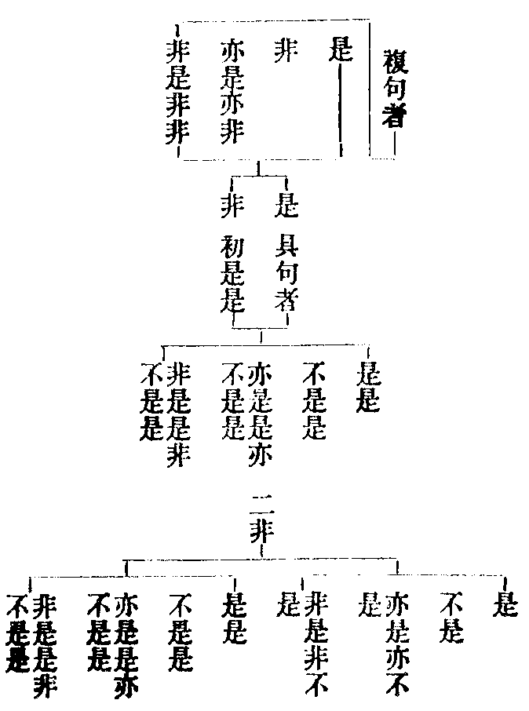
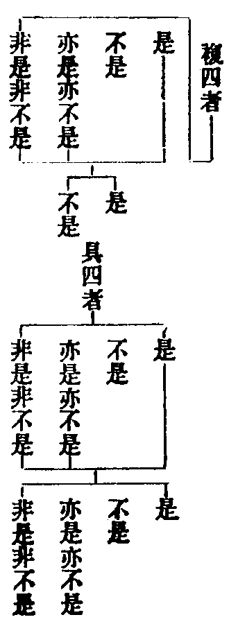
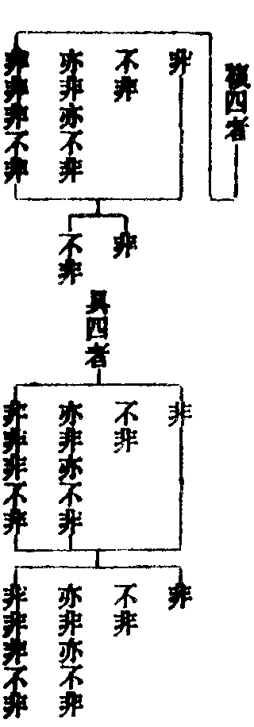

# 涅槃经疏三德指归



> **藏经**：卍新纂大日本续藏经（新纂卍续藏）　**册次** 第 37 册（X37）　**编号** X0662　**部类** 经疏部　**卷次** 19 卷　**篇幅** 488,820 字

> **作者（译者）**：钱唐沙门释　智圆　述、钱塘沙门释　智圆　述

> **卷／品**：19 卷 · 32 品



---



## 目录



  - [No. 662-A 刻涅槃经疏三德指归序](#no-662-a-刻涅槃经疏三德指归序)

  - [No. 662-B 涅槃经疏三德指归序](#no-662-b-涅槃经疏三德指归序)

  - [卷第一序](#卷第一序)

  - [释序品第一](#释序品第一)

  - [卷第三释纯陀品第二](#卷第三释纯陀品第二)

  - [释哀叹品第三](#释哀叹品第三)

  - [释长寿品第四](#释长寿品第四)

  - [释金刚身品第五](#释金刚身品第五)

  - [释名字功德品第六](#释名字功德品第六)

  - [卷第七释四相品第七](#卷第七释四相品第七)

  - [释四依品第八](#释四依品第八)

  - [卷第八释邪正品第九](#卷第八释邪正品第九)

  - [释四谛品第十](#释四谛品第十)

  - [释四倒品第十一](#释四倒品第十一)

  - [释如来性品第十二](#释如来性品第十二)

  - [卷第九释文字品第十三](#卷第九释文字品第十三)

  - [释鸟喻品第十四](#释鸟喻品第十四)

  - [释月喻品第十五](#释月喻品第十五)

  - [释菩萨品第十六](#释菩萨品第十六)

  - [释大众问品第十七](#释大众问品第十七)

  - [卷第十释现病品第十八](#卷第十释现病品第十八)

  - [释圣行品第十九](#释圣行品第十九)

  - [卷第十二释梵行品第二十](#卷第十二释梵行品第二十)

  - [释婴儿行品第二十一](#释婴儿行品第二十一)

  - [释德王品第二十二](#释德王品第二十二)

  - [释师子吼品第二十三](#释师子吼品第二十三)

  - [卷第十八释迦叶品第二十四](#卷第十八释迦叶品第二十四)

  - [释憍陈如品第二十五](#释憍陈如品第二十五)

  - [释遗教品第一](#释遗教品第一)

  - [释还源品第二](#释还源品第二)

  - [释荼毗品第三](#释荼毗品第三)

  - [释廓润品第四](#释廓润品第四)

- [涅槃经疏三德指归卷第一](#涅槃经疏三德指归卷第一)

- [涅槃经疏三德指归卷第二](#涅槃经疏三德指归卷第二)

- [涅槃经疏三德指归卷第三](#涅槃经疏三德指归卷第三)

- [涅槃经疏三德指归卷第四](#涅槃经疏三德指归卷第四)

- [涅槃经疏三德指归卷第五](#涅槃经疏三德指归卷第五)

- [涅槃经疏三德指归卷第六](#涅槃经疏三德指归卷第六)

- [涅槃经疏三德指归卷第七](#涅槃经疏三德指归卷第七)

- [涅槃经疏三德指归卷第八](#涅槃经疏三德指归卷第八)

- [涅槃经疏三德指归卷第九](#涅槃经疏三德指归卷第九)

- [涅槃经疏三德指归卷第十](#涅槃经疏三德指归卷第十)

- [涅槃经疏三德指归卷第十一](#涅槃经疏三德指归卷第十一)

- [涅槃经疏三德指归卷第十二](#涅槃经疏三德指归卷第十二)

- [涅槃经疏三德指归卷第十三](#涅槃经疏三德指归卷第十三)

- [涅槃经疏三德指归卷第十四](#涅槃经疏三德指归卷第十四)

- [涅槃经疏三德指归卷第十六](#涅槃经疏三德指归卷第十六)

- [涅槃经疏三德指归卷第十七](#涅槃经疏三德指归卷第十七)

- [涅槃经疏三德指归卷第十八](#涅槃经疏三德指归卷第十八)

- [涅槃经疏三德指归卷第十九](#涅槃经疏三德指归卷第十九)

- [涅槃经疏三德指归卷第二十](#涅槃经疏三德指归卷第二十)



---



### No. 662-A 刻涅槃经疏三德指归序



释迦文佛五十年间转大法轮，其究竟极倡无上宝录者，则莫过乎法华、涅槃两经矣。盖以开权之说，诸经未明；显本之谈，两经独擅也。今家判此两经，同譬醍醐，良由兹焉。而其本迹显实，虽文义浩繁，究其要归，则不出吾人介尔之心焉。荆谿尊者曰：妙法秪是一心三德。又曰：若了三德在一心中，则大经一部居于方寸。旨哉言乎！诚义学者之最所当服膺也。又虽复安经同味，然涅槃经扶律谈常，徧被末代，则今时学人所当急研讨也。然智者大师之弘经，但疏法华而不及涅槃，虽固可惜，而章安尊者依智者义意作涅槃疏，则两疏并行，宛观双璧。荆谿尊者之作记，亦但释法华疏而不及涅槃疏，岂非缺乎？虽有暹、满二记，不满人意议者众矣。且迨近世，亡而弗传，是故古今学徒患乎此疏文古义幽，难解难晓。宋孤山圆师以高世之才，师安之学，作三德指归二十卷，於是其难解难晓者，皆涣然氷释，粲然日明，大有益於物，则亦可谓备矣。况复题以三德者，欲俾学者由记以通疏，由疏以会经，乃悟一心三德，其意甚好矣。第恨其为山外宗师，而间陈其所相承也，故其所示三德，亦似不臻乎圆极矣。四明曰：若不即三道而显三德者，乃教道所说也。富哉言乎！足以辨山外之异见，而彰圆顿之正宗。贤达为能信彻乎斯，然后读是书焉，则三德秘藏之旨，庶乎不差矣。是书不入明藏，本邦又未广行，学者憾之久矣。余曩曾请轮王大王借浓州长泷寺古藏宋板书数十部，是书其一也。喜而视之，阙第十五卷，虽恨其未完合抱，不以尺折废，盖与四方同志共焉。遂令二三子旁加国语，付诸书林，重绣梨枣。近者雕刻既成，书林乞序於余，余深随喜其传永久，又愿他日藏完书者，乐补其阙，因操觚直书，以弁简端云。



时正德乙未春老苾𫇴光谦谨撰



------



### No. 662-B 涅槃经疏三德指归序



涅槃疏者，实吾祖章安法师约　龙树宗旨，用　智者法门，依经辨理，大明乎三德之妙义也。既而　章安师没，　荆溪师作，笔削斯文，再治再定。抑又因旧章见新意，如诸文之下，或加私谓文句之题，改之曰疏是也，然后得尽善矣。迩世空文仅存，莫有传者。钱唐沙门释智圆，字无外，其荆溪十世之法孙也。痛微言之将坠，慨后学之不闻，於是乎撰记以申明之，勒成二十卷，号三德指归。凡於文高旨远，言约义微之处，而皆离坚合异，派深析重，指而归之。俾夫来者识经之所诠，疏之立义，尽在於生佛无差，一心三德之理也。无奔走於迷涂，姑务於理观讲授矣。惟怀道者，知我志乎！



时大宋大中祥符四年岁次辛亥八月既望，於钱唐西湖崇福寺讲堂首事笔削。越六年癸丑九月二十六日，於大慈山崇法寺方丈功毕。序云。



涅槃经疏三德指皈目次



------



### 卷第一序



### 释序品第一



卷第二释序品之餘



------



### 卷第三释纯陀品第二



### 释哀叹品第三



卷第四释哀叹品之餘



卷第五释哀叹品之餘



------



### 释长寿品第四



卷第六释长寿品之餘



------



### 释金刚身品第五



### 释名字功德品第六



### 卷第七释四相品第七



### 释四依品第八



### 卷第八释邪正品第九



### 释四谛品第十



### 释四倒品第十一



### 释如来性品第十二



### 卷第九释文字品第十三



### 释鸟喻品第十四



### 释月喻品第十五



### 释菩萨品第十六



### 释大众问品第十七



### 卷第十释现病品第十八



### 释圣行品第十九



卷第十一释圣行品上之餘  

释圣行品之中  

释圣行品之下



------



### 卷第十二释梵行品第二十



释梵行品之二



卷第十三释梵行品之三  

释梵行品之四



------



### 释婴儿行品第二十一



卷第十四



------



### 释德王品第二十二



释德王品之二  

卷第十五逸失



卷第十六释德王品之六



------



### 释师子吼品第二十三



释师子吼品之二



卷第十七释师子吼品之三  

释师子吼品之四  

释师子吼品之五  

释师子吼品之六



------



### 卷第十八释迦叶品第二十四



释迦叶品之二



卷第十九释迦叶品之三  

释迦叶品之四



------



### 释憍陈如品第二十五



卷第二十释陈如品之二  

释陈如品之末(以下释后分经)



------



### 释遗教品第一



### 释还源品第二



### 释荼毗品第三



### 释廓润品第四



涅槃经疏三德指归目次(终)



No. 662



------



## 涅槃经疏三德指归卷第一



**译者**：钱唐沙门释　智圆　述



初疏文通题，能所相对，凡有二重：初疏字是能解，餘为所解；二经是能诠，涅槃是所诠。既揽所诠为经之别名，故今亦揽所解为疏之别目，以别简通，即显此疏非解他经。疏者，疎也，决也，疎通经旨，决择佛意也。章安旧本则称文句，义尚乎谦，谓但能以科句节断经文而已。荆溪治定，改称为疏，谓决通一经，义意无壅，斯亦荆溪善述章安之意也。例如止观本称圆顿，章安治定，改号摩诃，既有理存焉，则改作无爽。问：智者解经，释题既号玄义，消文则曰文句，章安师承有在，岂是尚谦耶？答：只由智者尚谦，故章安依之耳。亦犹先儒解书，或称传，谓以传述为义，或亲承圣旨，或师儒相传，故云传，如尚书孔氏传是也。或称注，则尚於谦，不敢传授己意，但直注於文下耳，如礼记郑氏注是也。例如称疏及文句，谦与不谦意也。故荆溪撰止观科亦题文句，岂非但以科句节文称文句耶？问：若尔，玄义之名应非谦也？答：实然。谓以五义释题，妙契佛旨，故称玄义。故荆溪但改文句之题，而玄义仍从旧贯。故知章安之意，一谦一不，二义互显。故妙乐记云：所以释题，不可率尔，题下别释，理非容易。以由释题大义委悉，故至经文，但粗分章段，题云文句，良由於此。问：自古诸师解经，多题为疏，岂皆不谦，得不乖礼乎？答：谦与不谦，皆出作者之意，理或有归，虽自誉亦无咎也。如夫子云：文王既殁，文不在兹乎？颜回曰：舜何人也？予何人也？此谓道德均齐，而自比於文王虞舜，孰敢非者？其或不类，虽三尺童子，亦能哂之。亦如大师自称天竺大论，尚非其类，真丹人师，何劳及语？此虽不谦，谅无惭德，故题为疏，意类此矣。或曰：一家言教，解题与释文各部者，则名有玄义文句之异。其合为一部者，则总题曰疏，如净名疏、观经疏之例也。今既以玄义各部，应题文句，安称疏耶？答：此皆旧章，非今新意。如其不尔，且净名广疏，旧以前六卷题曰玄疏，后二十八卷题曰文疏。洎荆溪修定，而削其文字，但云略疏第一等，复与六卷玄义各行。若乃固守文句之题，不从新意者，何异讲再治止观，而弃摩诃之号，反用圆顿之题乎？又况章安自称为疏，如玄义云疏缘起，又云寄疏他舍，其意在谦。且题文句，荆溪改之，不遗先旨，



卷者，卷舒为义。第，居也。一，始也。此卷居始，故云第一。二、撰治嘉号。



先明撰人号，即章安也。次明治者号，即荆溪也。旧文云天台智者大师说弟子灌顶集者，即是章安推功归师，谓此疏文虽是己述，而皆鸠集大师所说法门耳。故玄义云：以大业十年十月十日庐于天台之南，管窥智者义意，輙为解释。又下释长寿品初疏云：精进菩萨亦不能知，岂是凡夫暗心图度，不能已已輙述所闻？此皆谦己不才，归美智者，故旧文题下但言智者说也。洎荆溪再治，直显其功，故削智者之号而云顶法师撰也。礼以二名不偏讳，故得称顶而不言灌也。其名字之义、德行之美、制疏因由、著述年代，具如玄记及教相章疏缘起中。



法师者，梵行品云：以知法故，名大法师；以知义故，名大法师等。约七善解之，而皆在佛。故法师之号，通乎因、果。今疏主即因中法师也。杨子法言曰：师者，人之模范也。像法决疑经及观心论皆明三师，谓律师、法师、禅师也。明练持犯曰律师，精通经、论曰法师，修心静虑曰禅师。观心论疏明三师各有十过。律师十者：一、但执外律，不识内戒，故被净名所诃。二、执律名相，诤计是非，不识见心苦、集。三、然戒、定、慧相资，方能进道；但律不慧、不禅，何能进道？四、弘在名誉，志不存道，果在三涂。五、不遵遗嘱，不依念处修道，不依木叉而住。六、执律方便小教以为正理，而障大道。七、师师执律不同，弘则多加乳水。八、不依圣教传授，误累后生。九、四众不沾真法，转就浇漓。十、非止不能光显三宝，亦乃破佛法也。法师十者：一、但外求文解，而不内观修心。释论云：有闻而无慧，所说不应受。二、不融经意，息诤趣道；但执己非他，我慢自高，不识见心苦、集。三、不遵遗嘱，不依念处修道，不依木叉而住，非佛弟子。四、经云：非禅不慧，偏慧不禅，一翅一轮，岂能远运？五、法本无说，说破贪求，名利弘宣，宁会圣旨？六、但贵耳入口出，何利於己？经云：如人数他宝，自无半钱分。七、无行而宣，何利於他？八、又多如乳水，无道之教，误累后生。九、四众失真法利，转就浇漓。十、非但不能光显三宝，亦乃破佛法也。禅师十者，一、经云：假名阿练若，纳衣在空闲，自谓人间宝，好出我等过。二、恃行凌他，不识戒取苦、集烦恼。三、无慧修定，盲禅无目，宁出生死？四、不遵遗嘱，不依念处修道，不依木叉而住，非佛弟子。五、无慧之禅，多发鬼定，生破佛法，死堕鬼道。六、名利坐禅，如扇提罗，死堕地狱。七、设证得禅，即堕长寿天难。八、加水乳禅，教授学徒，绍三涂种。九、四众不沾真法之润，转就浇漓。十、非止不能光显三宝，亦乃破佛法也。然晚生莫不轨崇三师，以为良导。师既邪而无道，弟子何能自正？故经云：三师破佛法也。今疏主称法师者，反上十过而成十德，自正正他，师范有在。



撰者，录也。故法华云：撰，集解其义也。



次治者号。



天台者，所居之山也。十道志云：天台山顶对三台星，故以名焉。文选孙绰天台山赋序云：天台山者，盖山岳之神秀也。涉海则有方丈、蓬莱，登陆则有四明、天台，皆玄圣之所游化，灵仙之所窟宅。



沙门，此云勤息，谓勤行众善，止息诸恶故也。又翻乏道，如下经说。此出家之通号也。



湛然即荆溪名讳，乃出家别号。下经云：定水湛然满涅槃，即首楞严大定也。则由内观涅槃行道，而外立斯名。姓戚氏，世居晋陵之荆溪，则常州人也。人尊其教，因以荆溪为号。佛灭度后十有三世，至龙树菩萨，始用文字，广第一义谛。嗣其学者，号法性宗。元魏高齐间，有慧文禅师，默而识之，授南岳思大师，由是有三观之学。洎智者大师蔚然兴於天台，而其道益大。以教言之，则荆溪乃龙树之裔孙，智者之五世孙，左溪朗公之法子也。二十餘，受经於左溪。与之言，大骇。异日谓然曰：汝何梦乎？然曰：畴昔之夜，梦披僧服，掖二轮，游大河之中。左溪曰：嘻！汝当以止观二法，度群生於生死之渊乎！乃授以本师所传止观。然德宇凝粹，神锋爽拔。始以处士传道，学者悦随，如群流之趣大川也。天宝初年(时年三十七)，解缝掖而登僧籍。遂往越州昙一律师法集，广寻持犯开制之律范焉。始居吴郡晋陵，中诣五台，后居天台，皆敷行止观。天宝末、大历初，诏书连徵，并辞疾不就。当大兵大饥之际，揭(去乂反)厉法流，学徒愈繁，瞻望堂室，以为依怙。然慈以摄之，谨以守之，大布而衣，一床而居，不食乳蜜，不衣缯帛。故神邕赞曰：乳蜜不嗜，缯帛弥克。以唐建中三年二月五日示疾佛陇道场，顾语学徒曰：道无方，性无体，生欤死欤，其旨一贯。吾归骨此山，报尽今夕，要与汝辈谈道而诀。夫一念无相谓之空，无法不备谓之假，不一不异谓之中。在凡为三因，在圣为三德，𦶟炷则初后同相，涉海则浅深异流。善利利人，在此而已，尔其志之。言讫，隐几泊如而化，春秋七十二，法臈三十四。门人奉全身起塔，祔于智者大师茔兆之西南隅焉。平日辑纂教法，明决前疑，开发后滞，一家所传，咸祖述之，凡百餘卷，盛行于世。故皇朝高僧传云：详其始天宝，终建中，以自证之心，说未闻之法。经不云乎：於少时间，大作佛事。然师有焉。



再治者，对章安初撰，故曰再治。治谓修治，即於章安文句中，辞有烦者，则册削之；义有阙者，则添补之。如下文中私谓、私云等，即是补也。故治之一字，义含删补，以删以补，皆修治故。若尔，荆溪何不题为删补疏及治定疏耶？答：既以再治二字居名讳之下，故总题不安删补等语也。例如何晏解论语，既以集解二字居名讳之下，故总题但云论语第一也。若如杜征南解春秋，既题为春秋经传集解，故题下但书杜氏二字，更无集撰之言。今荆溪意例同何晏，以文隔章安撰集之号，故不可同杜预也。其本文节段，予甞撰科文十卷详之矣。贵省纸墨，不复编入此下，但直尔消文。



上代者，代世也，即指腾兰。入汉已来，高僧间出，凡解诸经，未事分节，但直尔举唱，消释文意而已。至法瑶、道凭等，始分章段。章者，明也，为分析科段，使义理彰明。说文云：乐歌竟为一章。故章字从音从十，谓自一至十，数之一终也。



小山瑶者，即吴兴武康小山寺法瑶法师也。本河东人，宋元嘉中过江，吴兴沉演之请还小山焉。著涅槃、法华、大品、胜鬘等义疏。



关内凭者，即北齐邺域宝山寺道凭法师也。讲地论、涅槃、华严经、四分律，皆览卷便讲，目无寻文，章疏本无，手不举笔。



等者，即等取光宅、灵味等诸师也。而云关内者，郑玄注礼记云：关，境上门也。月令章句云：关在境，所以察出御入。盖秦地西有陇关，东有函谷关、临晋关，南有峣关、武关，故秦为关中，禹贡雍州之域。尚书曰：黑水、西河惟雍州。东自同、华，略河而北，西自歧、陇，原会极于北垂，尽其地也。河图曰：秦地方千里。故云关内也。诸家章疏皆云分节始於弥天，而今疏指瑶、凭者，恐各有所据，或可弥天但分三分。若如解释，此经分为五门七段等，始於瑶、凭等诸师，故后代依之以成轨则。



盈缩者，梁武二段为缩，兴皇八门为盈，中间四家望前为盈，对后为缩，故云非一。



梁武者，讳衍，字叔达，姓萧氏。始封於梁，因为国号。武者，谥也。谥法曰：克定祸乱曰武。甞因都下疾甚，帝於内为百姓设救苦斋，以身为祷。后又设无遮大会，上乃释御服，披僧衣，为大众开讲涅槃。但分此经以为二分，中谓日中、食时、纯陀献供之时也。是则从序至现病品中，俱是中前所说。下去讫经，悉是中后说也。开善者，即梁钟山开善寺智藏法师也。



光宅者，即梁光宅寺法云法师也。彼分陈如一品为流通分，故云足流通。



灵味，寺名，即宝亮法师也。撰涅槃疏，梁武御制序。



问有缘起者，彼师谓从纯陀品至长寿品，迦叶设问前长行，是迦叶问家缘起，偈中三十四问即正问也。答有餘势者，从偈后长行尽大众问品，是如来正答，现病已去皆是答家餘势耳。



河西者，谓黄河之西，即北凉道朗也。



婆薮者，具云婆薮盘豆，此云天亲，新云伐苏畔度，唐言世亲。佛灭后八百年生于天竺，造涅槃论一卷，分经为七分。未治本云地人七分，荆溪欲显地人撰疏，分经节段承用天亲，非出己解，故此云婆薮，直显所宗。下出异解，仍云地人，明彼述作前后互显，亦治者之新意也。



兴皇，寺名，即梁慧朗法师。



五门七分，下文自显。



虽兰下，纵夺开遮。



说文：兰，香草也。尔雅：菊，治墙也。礼记：季秋之月，菊有黄华。今言兰菊虽异，各有馨香，以喻诸师分节，皆为引物悟理。若各起诤，三益尚无，焉能契理？若顺四悉，各美有餘。



经即此经，论谓释论。虽云各美，圣有开遮。若准此经，则遮取相而说，加水乳中，失真道味。若依释论，则开无著而说，派深析重，令物悟解。故知经遮失理，论开得理。失理之说，在论亦遮；得理而宣，在经亦开。圣虽偏举，意乃俱通。故今引之，结前诸家盈缩之说，起后今师无著之谈，故文即云今分为五也。



牧女加水者，菩萨品云：如牧牛女，为欲卖乳，贪多利故，加二分水，转复卖与餘牧牛女人。彼女得已，复加二分，转复卖与近城女人。彼女复加二分，卖与城中女人。彼女复加二分，诣市卖之。古师释云：牧女譬弘经者，女性谄曲，譬於经不能忘怀为法，而多谄求利，故以牧女譬之。初、加二分者：一、抄略此经，二分为多分。第二、加二分者：一、除深玅语；二、安世言辞。第三、加二分者：一、抄前著后；二、抄后著前。第四、加二分者：一、前后著中；二、中著前后。



派深析重者，大论六十五云：若不取相，以无著心说有九种，令他读持能正忆念：一者照了，不知令知故。二者开出，如开宝藏随意取用。三者指示，如视不明指示好丑，小乘眼智不明指示道及非道。四者分别，谓世出世。五者显现，或时毁善以助不善，贵令众得开解故。六者说法，说佛意趣。七者解释，如囊有宝系口人则不知，应为解佛经囊释其道理。八者析重令轻，种种譬喻令易解故。九者浅易，如水难度派令易度，般若水深能令浅易。今文虽引八九二文，意含前七，是知论既开於为他解说，故古今分判雅合其宜。初列下，五章虽异咸称涅槃，众义虽殊同归佛性。涅槃不出三德，佛性岂离三因？三德即证圣之名，三因乃在凡之称，凡圣理等因果何殊？故知心地三千彼彼互遍，三无差别有理存焉。故须於此分章悬知大旨，揽入自性方曰弘经。三德三因即心三谛，照之以三观、检之以六即。夫如是者，随文释义何用不藏？体言见心其则不远。此经既尔众典皆然，复以一化五时用统十方三世，道齐在此复性无殊，寄语后贤弥须用意，有兹深旨故注云云。



释名下，文中次第释五章名。初释众名中，先述召请意，次释其名。



道不孤运等者。是总标。谓扶律谈常之道，不孤然自运，必待垂灭机熟之时，拘尸坚林之处，五十二众之伴，三者参会，斯教乃兴。故五果无差之谈，佛身常住之说，阐提有性之义，圆伊至极之旨，此会已前诸经未示，故云不孤运也。



今涅槃时等者，释上义也。涅槃时到是待得其时，而面门下至感动即待得其伴，拘尸即待得其处。



面门即口也。



启照谓放光。经云：尔时如来於晨朝时，从其面门放种种光。



随类发声者，经云：以佛神力出大音声，其声遍满乃至有顶，随其类音普告众生，乃至若有所疑今悉可问。



骇悟感动者，经云：众生遇斯光者，罪垢烦恼一切消除。此即骇悟也。经云：众生见闻是已，心大忧恼，乃至身体战栗等。此谓感动也。



经明诸众皆云诣拘尸城至如来所，故云会此拘尸。缘牵下。释召请名。当机结缘二众是实行，种熟缘牵故须召来。发起影响二众是权行，砧搥成器故须请至。故云众有权实等也。致，至也。



咸为显发等者，实行机熟故来闻法证真，即为自显发三德涅槃也。权行辅佛故至对𫾻益物，即为他显发三德涅槃也。若权行者，本居极果则一向为他，若在真因不无自为，损生增道即其事也。然极果人谈己所证亦名自显，为兴斯教令众悟道，故须召请。



佛於下释施。先明佛意无偏，次但不下显随机设化。初文者，圆融涅槃七方便人所不能证，故云难得。又圆证涅槃历四十一位方至玅觉，今论极果复是难得。三谛寂灭体含三千，名之为藏。出世之意本欲说此，故无秘恡。故法华云：大乘平等法，若以小乘化，乃至於一人，我则堕悭贪。



但不下，明随机设化。



但不尽能受者，谓利根菩萨即於华严已得入实，故法华云：始见我身，闻我所说，即皆信受，入如来慧也。其有钝根小机，如聋若哑，不受大益，故云不尽能受也。所以游化鹿苑，说小乘无我法，以破邪我，如以毒涂。然后方等弹呵，般若洮汰，大机既熟，乃於涅槃显示圆融真我，如以水洗。如来性品云：譬如女人为其子故，以苦味涂乳。如来亦尔，为修空故，说言诸法悉无有我。如彼女人净洗乳已，而唤其子，欲令还服。我今亦尔，说如来藏。是故比丘不应生怖，如彼小儿闻母唤己，渐还饮乳。



前同末异等者。释涂洗意。鹿野说小是前同，同彼机缘说小故也。涅槃破小谈常是末异，斯皆经历中间二味伺候机缘，待涅槃时假纯陀等为发起之缘，乃说常辨性，以此圆法施彼偏乘，咸令入实也。



因纯陀下。历示经文以明施义。一、明献供为施发起。因献供故施常，因请住故谈真，由谈真故劝问，由如来劝故迦叶乃问，发三十四问故佛以一十六品随问而答，此乃开演常宗遍施物机也。



献供者，即第二经初纯陀白佛：唯愿哀受我等最后供养。



施常等者。即佛答也。经云：汝今於我欲求寿命、色、力、安乐、无碍辨才，我当施汝常、命、色、力等。



请住等者，即哀叹品中请云唯愿久住不入涅槃等。於是如来斥小乘之伪，谈大乘之真。如经云汝今不应取此虗伪之物，及云汝等虽得出家，於此大乘不生贪慕，虽服袈裟染衣，心犹未染大乘净法等，即斥伪也。经云当令一切安住秘密藏中，乃举伊字天目为喻等，即谈真也。劝问，即指长寿品初先劝比丘问，次劝大众问也。劝词稠叠，故曰殷勤。由是迦叶菩萨仰承如来敦劝之旨，乃说二十二行偈文，作三十四问，即云何得长寿等是也。



随问施与者，即佛随所问凡一十六品，始长寿终大众问，具答迦叶三十四问，故云随问施与。



悉断餘疑故云使无遗滞，举众受益故云充溢等也。然秘下。释行。



渊，深。凝，静也。竖彻三谛故深，体非三惑故静。虽心具诸法，三一互融，佛若不说，无能知者，故称秘藏。虽知本具，若不修行，无由证得，如临川羡鱼，要须结网，方乃得之，故云非行不到。行，谓五行也。应知五行不出三观：空即圣行，假即梵行，中即天行，双照二善即婴儿行，双照二恶即病行。尘沙乃空边之恶，无明乃假边之恶，三一相即，五行俱融，名如来行，斯之谓矣。故须始从名字，造修五行，至于初住，分证现前，非行不到，厥意弥显。



令前者，令众生修行，前到於三德秘藏也。



所以下，正明如来善功发起五行法门。



右脇等者，即大众问品末云：为欲调伏诸众生故，现身有疾右脇而卧也。



迦叶推请者，即现病品初迦叶菩萨推佛自行、化他、证果之三悉无有病，於三番中皆请说法，故云推请也。



加趺等者。迦叶既已推请，故如来即现无病之相也。下经云即从卧起结加趺坐，颜貌凞怡如融金聚等，故云融怿。怿，悦也。三谓圣、梵、婴儿也。各说一品故曰说三。一谓天行，但於梵行之末指在华严，故云指一。菩萨下明依教修证，五行属修、十德乃证，即德王品所明也。



然涅下。释义。三德玅义类通诸法无所不摄，故云浩然无尽。浩然大水貌。



欲举下，正述文意。虽涅槃摄义周广，而的指其要，莫越佛性。



举一蔽诸者。蔽，富也。仲尼云：诗三百，一言以敝诸，曰思无邪。是知风雅之文虽广，旨在无邪。涅槃之义乃多，意惟佛性。譬如海之深广，指咸即摄。深广譬涅槃义丰，指醎譬佛性理要。所以如来虽举三宝四谛等总一十八条劝问，而师子吼但约佛性一法作六重问，故云故专问等也。



然佛下。释用。善恶之名不出十界，通别分别其义可知。体即空中故非善恶，空中即假理具宛然，良由理具方有事用，一切诸法不出十界，用遍十界故曰无涯。尔雅曰：涘为厓。郭璞注云：谓水边。



囊括者，囊帒也。字统云：有底曰囊，无底曰槖(音托，使风具也)。



诗云：于槖于囊。括，结也。易曰：六四括囊，无咎无誉。梗槩，粗略也。谓今经明摄二界之用，该十界之广，此乃括结一经之囊，得其略明二用也。然此明用，二品不同：一则迦叶品摄恶，谓摄善星也；一则陈如品摄邪，谓摄十外也。然恶必对善，邪必对正。罗云、陈如既已得道，今会小归圆，即摄声闻界善也。佛记善星堕狱，不救邪徒，外道无非狱种，今皆被会，即摄地狱界恶也。二界以例餘八，涅槃以例四时，故云以略该广。



用善下，明迦叶品横该十界。



二子者，谓罗云、善星，俱是佛子。



餘皆等者，谓己子善恶既皆被摄，众生虽多岂离二种？收摄趣实可以例知。



又体下，明陈如品竖该五时。



邪正者，然邪即同恶，正即同善。理体空中，故非邪正。空中即假，故能双用始摄。谓鹿苑谈小陈如等五人证果也。



终收，谓此经明常须䟦等十仙悟道也。



初后下。结例也。中间谓方等般若皆悉摄邪摄正，斯乃跨节而谈。鹿苑已来虽施小化，据佛本怀令归秘藏，故於今会等悟圆常，故知一代化仪悉是涅槃用也。问：何故会归不言法华耶？答：二经部味咸同，但法华残机此经捃拾，今从正意且置法华。然此四章即是教行理三也。教即常教，行即常行，义即常理，禀教修行行成证理，三义相生次第不乱。众即禀教修行证理之人，用即此三折摄之功，谓圆常教行理三悉能遍摄邪正善恶也。然后摄兹三五归我自心，观心即假涅槃施也，观心即空涅槃行也，观心即中涅槃义也。如此观者名涅槃众，依观破惑名涅槃用。三一相即六位甄分，统收一经不离方寸。



生起中，先逆顺生起，次结意归宗。



由众有施等者，顺生起也。众乃所被之机，施即能被之教。教因机设，故云由众有施；禀教修行，故云由施行立。此即名字观行相似位也。因相似行，入初住等位，证第一义，故云由行见义。初住内证三德妙义，外能起教化他，故云证义有用。此乃顺生起五章也。又准此生起，即是自行因果、化他能所意。何者？前三章即自行因也。义则近在初住分证，远在妙觉究竟，即自行果也。用即化他能也。若无所化，折摄被谁？即化他所也。亦可召众是化他所，故知一经始终不出因果能所也。即与玅玄五义、止观十章，旨趣咸同，展转符契，一家释义，美在其中。



亦是下，明逆生起。



用由於义等，谓能折摄由证於义，乃至施常住法由有机缘，故云施由众集也。



无始下。结意归宗也。涅槃玅理即心而具实无始终，而众生本迷乃以机动感佛为始，故有召请众也。以证理起教为终，故有折摄用也。始终既立中间自成。恶尽下。广明用义。以今释迦已证妙理说法利他，正当用义所以广明也。恶尽即阐提有性，邪亡即十仙受道，善穷即罗云获记，正息即陈如解常。恶尽邪亡故折休息，善穷正息故摄休息。鸟丧弓藏机尽应灭，故云毕竟等。即经云：安置诸子秘密藏中，我亦不久自住其中也。



通别中，通则五章义趣，该乎初后；别则从强分文，各受一名。



言问缘者，谓迦叶也。因问而答，故云因求而与。



规矩者，以规矩释行义也。规圆矩方。孟子云：大匠诲人，必以规矩。



别论下。别以五行十德为规矩也。可以规圆喻一心五行，矩方喻次第五行，十德亦尔。



佛性非一者，夫一必对二，妙理虗融，绝於待对，故云非一。即如经明太虗空，不因小空而得名也。



一尚无一，岂有五名？故曰云何有五。而此经文立五名者，盖随机异号，令彼因教识理，故云令解非五也。五名即教，非五即理。又理即教，故非一；教即理，故非五。文字解脱，斯之谓矣。



首楞严者，大论翻为健相，即中道王三昧也。



文中从权行说，故云皆住等。



私谓下私，即阴私。又玉篇云：不公曰私。盖荆溪再治时，暗有补助，既与疏主相去代远，故非公灼对面咨决也。下去凡云私者，可以比知。



增数众应云二十一，或有本云有十者，讹无上下。大论云：种种行类皆知，名一切种智。此即佛果三智也。十界等观名为周照，权实种异曰机，三无差别曰理。纤介谓微弱也。周易？系词云：忧悔恡者存乎介。韩康伯注云：介，纤介也。故介字不应从草。



觉藏，即佛藏也。藏义如前。开演常教，显发佛性，喻以发掘。



若从下。正示以般若名证施章义，良由内有智故外能设教。经云：欲知智在说，故得以内智名证外教义。五一行者。即不次第五行，五即一故，故云五一。下文云：复有一行名如来行也。非二乘之伪故真，非外道之邪故正，非菩萨次第纡曲故调直，中道常住故不可以二边倾动。总上是明行体。



复能下。明行有破惑之用，如金刚能碎散一切也。



若从结示，引证意也。义者下。所以，犹旨趣也。



故涅槃等者，涅槃是一经之名，佛性是所诠之义，既是名教所诠，亦是行门所至，故此义章属所，前二属能。



此义下。明义，即三德也。



自在解脱决定般若无畏法身，喻师子。吼者，兽王自在决定哮吼而无怖畏，以喻三德。



若从下，结示引证意。



体用下。体用相即，其犹波水。先明即用而体，诸法即十界依正之用，乐性即自心三谛之体。依正唯心，即用而体，故云悉有及无非等。次云即体而用者，虽常冥至极，而称物施为，摄九界之恶邪，归佛界之正善。当知下。结示引证意。文中存略，例前应云：若从体者，即是佛性；若从用者，即名折摄。



当知等者。既体用相即，故得以佛性名证用章也。



有据者，如向所引多文，一文悉有五章之义。此既依经，非是空用𮌎臆穿凿也。



言中后可然者，后字恐悮，应云中前未治。本云平旦日出，荆溪但改日出为中前可然，此乃疏主一往许梁武分中前文也。即经首云於晨朝日初出时，声光召众等齐至，现病品食供，以为中前分者，斯则可然。若以大众问去讫，经为中后分者，其义不𠃔。夫中前、中后据日而分，且如来说法至于半夜方乃入灭，故中后分文收经不尽，故责云黄昏等。



居士下。引经重责。设以中后收于半夜，若据彼经义亦通漫。彼经第一云第一年二月十五日唱灭，第二年二月十五日入灭，故知说此经历一周年也。此亦大圣赴缘不同，故与此经賖促有异。今引彼文以破约时分经也。此经既别对机缘是一周说者，则中前中后全无所属，故知分经只合约法不可约时。



今随等者，今随所说法义分为五章，既不约时故无前难。



用章少分者，今师以迦叶、陈如二品通为用章，彼但以陈如一品为流通，故云少分。



既处下况。



问答：遍于一经，故缘起、餘势分文甚为通漫。河西文中皆先出彼义，次明今破。



初两卷者，河西造。疏释北本四十卷，而寿命品涉两卷半。今云两卷者，即尽寿命品之二文也。



今昔有缘者，今即此会新入者，昔即鹿苑已来禀权者，五十二众即其人也。



皆声光所召，故云引接。



此下今破也。若谓引接有缘，只得今师召实行意。



具包权实者，实行则召，权行则请。



第三卷者，亦据北本也。至大众问，即尽第十卷，凡四品半，谓寿命品之三：金刚身、名字、功德、如来性、大众问也。



为略广门者，迦叶！设三十四问已前为略门，广答三十四问去为广门。



俱是因中者，十德分果，即是真因。



不烦文者，五行十德，既俱因行，今合为一，则无烦重之失。烦与繁同，周易皆作烦字耳。



混和难解者，后三品中但师子吼正明佛性，迦叶、陈如二品乃是折摄之用，彼既总为一门，故云混和也。地师者，地论亦天亲所造，此师既讲地论而撰此疏，还宗天亲，故前文云婆薮七分也。



第一卷者，彼论云：从初如是至血流洒地，名不思议神通，反示分也。



言反示者，从凡入圣名顺，隐圣示凡名反。谓诸法身大士，隐其神德，示为鬼畜等形。彼约五十二众，悉名反示也。故今破云得权失实。



第二卷者，论云：纯陀、哀叹二品，名成就种性遣执分。种性者，即纯陀施食为常住五果之种性也。发生名种，不改为性，施食为五果之种，常住即施食之性，故名种性也。



破疑除执者，即哀叹品施胜三修，破昔教劣修之疑执也。



第三卷者，论云：从三告已下讫大众问也。言三告者，长寿品初：一、劝比丘除疑；二、劝受寄；三、劝受益也。正法实义，即迦叶三十四问，咸问真正之法，而佛皆以显实了义为答也。



今为下，今以纯陀品施常住五果，对此土杂众；以哀叹品胜三修，对此土声闻众；以长寿去十四品随问而施，对此土菩萨众。故今施章兼彼二分也，故亦成烦。方便谓五行，修成谓十德。



不放逸者，论云：离诸放逸。



前之下，今破也，但破其判师子吼文不当耳。方便修成已是行义，今为行章义相附近，故无所破。



迦叶等者，论云慈光善巧住持分也。今云慈悲住持者，即迦叶品显佛慈悲方便，持善星阐提之恶，住佛性之善也。



显相者，即陈如品显十仙之邪相，还佛性之正相也。



持恶下，疏主释彼二章义也。持恶向善，释住持义；显邪还正，释显相义。揽斯二意，不出涅槃大用摄恶摄邪，故今但合为用章也。然此七分比对本论，唯一、二、五、六，辞有小异，如向点示。此乃地师承用，随便改易耳。兴皇八门中，七门影傍河西，唯第二门依地师耳。经文节段，比前可知。



五位门者，即河西功德门也。以十德是入证位故，故称位门。



开合之殊者，河西合三品同为中道佛性门，今开迦叶为第七方便用门，陈如为第八邪正不二门也。



名味不异者，味，文也。古经论云名句味，新云名句文中道门，则与朗名不异也。虽开七八二门，还是朗师中道门中经文耳，即味不异也。



第二下，别释五段：初、召请众。据义次第，应先释题目，次解本文。今以四字别题玄义，已委通名及序，彼指法华玄疏，故疏主於此，不更别科释题也。讲者厥或略消品目，应云：序者，叙也，叙述如来说教所起，故言序也。若约字义，则与绪字义同。尔雅云：舒业顺序，绪也。绪则蠒之绪也。凡蠒之抽丝，先抽其绪，绪尽方见其丝，犹如正说之有序，序终则见其正说也。中间三章即正说文。品者，以品类为义，义类同者聚为一段，故称品也。北本但题寿命品，谢公修定开为序文，应知此经三十六卷之首而皆直列品题，如云大般涅槃经序品第一等，其卷次则但小注题下，以由下诸品目皆带经题故，而诸经多尔，唯大般若六百卷文皆於经首直记卷次，故文内诸品但单题品号而无经题。今世所行之本，或云大般涅槃经卷第一序品第一者，乃后人妄改，盖不思文内诸品耳。若然者，应单云哀叹品第三也，其如诸品俱连经题何？此虽细事而人多迷，故迩代传写藏经例皆擅易，古本多存尚可为证，滥源一决势不可复，细事尚尔，况大於是者乎？悲夫！



经家者，即阿难是，结集经家也。



通别序者，序义有三：一、以次序为义；二、以由籍为义；三、以序述为义。初一即通序，谓六事次第在经首也。餘二即别序，今经列众顺召中请住等语，皆述序也。词既间散在由籍中，故合三为二，但云通别。



三世下，约两双示义：初双以诸佛经首同有为通，对根异说为别；次双以五时经首同有为通，发起事异为别。



三世道同者，释论明佛垂涅槃，阿难问佛：经首作何等语？佛答云：我三僧祇所集法藏，初应作如是说：如是我闻，一时佛在某方某国土与某大众。非独我法如是，三世诸佛经初亦然，故云三世道同也。此经后分亦同此说。



教门机别者，如此经对扶律谈常之机，法华对开权显实之机，故使会初发起事别。



一期谓五时也，即竖约化仪。小等谓四教也，即横约化法。是则华严兼别，乃至此经重施，此等诸经悉安如是，即通义也。



由籍者，因由假籍也。大圣说教必须由籍，是以现瑞表发生物善心，以此为由故得说教。如今经声光召众，法华雨华动地，净名合盖现土，光明四佛出现，此皆施设教门对机各别，故使由籍经经不同。



主、处离、合者，主谓化主，即佛也；处谓住处，如拘尸、王舍等。合主处，则但五；离主处，则成六。今疏且从合释者，以五章对义便故。



所传之理者，阿难指如是之法是我亲闻，故指所闻名所传也。问：所闻是教，何云理耶？答：依理说教，教本诠理，以理印教，方晓偏圆，故指所诠为所传也。



能传传所传者，谓阿难，是能传之人，传於所传之法也。



会，合也。谓今重施之教，下合根缘，故曰会机。上合佛性，故曰会理。机理会合，一义在兹。



禀承者，所禀所承，即释迦化主也。



所闻之地者，应云能闻所闻之地，所必对能故今存略，主伴嘉会必有其地，即娑罗林也。



亲闻之伴者，谓非我独闻盖有其侣，即与大比丘也。展转相证等者，谓如来如法相解如法相说，所说诚谛必可信从，故初安如是如是之法，若传从他闻多致伪谬，今既亲闻是则可信，群情承受无所致疑，故次云我闻。又举四众感教得道之时，助成如是可信，故云一时。又举大觉世尊所言诚谛，於彼拘尸说兹妙法，禀承既胜群情所伏，故云佛住拘尸等。又指声闻菩萨四众天龙与我同闻，岂谬传也。



欲使等者。谓此五义正为奖成佛云世后见闻之徒息疑增信也。



小大诸经者，小唯三藏，大收三教。后无小大共别圆殊者，则以通教独受大名，是大乘初门故。



如其下。徵起也。文中四教如是约义不同，藏约教理，通约二种涅槃，别约自他，圆约性遍。藏云二事相似者，阿难所传如佛说无异也。言当於理故曰无非。



解与真合者，解即能观智，真即所观理，如理而解理解冥合，此以有餘涅槃为如义也。



身灰下。即以无餘涅槃为是也。十行出假遍用四教，名为称机，此以化他释如也。事逆则三观次第，理顺即证道同圆，此约自行释是也。



若言下。圆教如是，唯就理释。但前三教魔佛有异故非如，色香乖道故非是。今明万境差别一理同归，法身遍通魔佛何异？心性该摄色香，不非圆顿融通，故云如是。又复应知，色香则六尘之少分，中道即佛性之异名，况色通内外，外即佛土、内即阴质。若了色香中道，即知无情有性，三千一念深可思量，有性成佛怡然理顺。



类之可解者，谓我闻乃至同闻，皆可类例如是作四教释也。至下随文别释中，具约四教释我闻等，而𰿣释如是者，由此文已委故，此乃前后互见，以省笔墨制述之巧也。



故龙下。引释论证成劝信义也。论云：佛法大海信为能入。又如是者善信之词，其信者言是事如是等。



若信下。总结权实俱以信入也。此经既重施四教，故知五义劝信权实也。然与前之四味其义永异，前则权实不融，今则皆知常住，若望法华有异有同，重施则异会实乃同。



具如等者，法华疏各约四义广释，谓因缘、约教、本迹、观心也。指在彼文故此存略。然一家解义，若释法华已前诸经，则但有三释，以未显本故阙本迹，或借体用一往明之。若释今经则四科义足，在显本后故、为捃拾故。



今明下五章，既与序义相符，足显一家分节，玅契佛旨。



不异等者，约理示义，不异则魔佛一如，无非则色香皆是。



若不下。举迷显悟。无名字等解，故云不得。如是执迹迷本故定异，著事忘理故定非。



达斯意者者，五即解生，见理唯一，故云达意。



从列下。正举召众，明如是义。



蛣𧏙者，尔雅云：𧏙，蜋也。崔豹古今注云：能以土苞粪，转而成丸。庄子云：𧏙蜋之智，在於转丸也。下经云：乃至毒蛇，视能杀人。蛣𧏙蝮虿及十六种行恶者，一切来集。蛣𧏙是畜趣极微者，故今举之。



已还者，至於龙、鬼、魔、梵，乃至菩萨，凡五十二众也。



诡，异也。诸趣差别，若正若依，纷乱藂杂。



幢摩下。经列上界，众云幢最卑者至自在天，又云幡极短者悬於梵宫，故云摩梵世也。



覆大千者，经又云：宝盖小者，能覆三千大千世界。持如是等供养之具，来诣佛所。



巨细约正报，精麤约依报。细如蛣𧏙蚊蚋，巨如无边身菩萨等。



相倾者，谓巨倾於细也。如无边身来时，诸天举身毛竖，自见其身无有光明等，此细为巨倾也。诸众办供，优劣有异，递为精麤。精者夺麤，故云映夺。故下经云倍胜於前等。



若以下。举迷见异。牛羊不识方隅，喻迷徒不达本迹，故向云若不得如是等也。所以但见诸众差舛乖互而已，岂知迹异本同一理无二，故云岂得如是也。



得如是者下。显悟见同也。谓悟理之人知五十二众皆是分真大士，随机利见，其迹虽异其本元同，其事似非其理元是，故知如是义合众章。问：若谓五十二众皆是法身大士者，则得权失实，设有实行如是义乖，两意相违若为通释？答：且约权明权必引实理，即大士亦住楞严，迹异本同涣然氷释，三无差别凡圣一如，故未发心名为菩萨。向云本迹，约体用



我昔不闻者，阿难自谓昔於四味不闻，二施无差，新伊秘密等也。



见八斛等者。见献供是闻法之由，以见释闻也。大众问品云：尔时纯陀所持粳粮成熟之食，摩伽陀国满足八斛，以佛神力皆悉充足一切大会。



二施等者，纯陀品云：佛语纯陀云：施食有二，果报等无差别。何等为二？一者受已得三菩提，二者受已入於涅槃。我受汝最后供养，令汝具足檀波罗蜜。佛意以华严初成舍那之身，佛光灌顶名为受食，故与今经受已入大涅槃其报无差。若约小初受牧女乳为受食者，则与今差别。於是纯陀即以小初对今大后，致於差别之难也(云云)。



新伊等，即哀叹中佛举伊字三点，不纵不横，以喻三德圆融，俱常乐我净，名秘密藏，故云秘藏佛性也。



种种法味者，即长寿品中因迦叶发三十四问，佛以一十四品一一答释，故云种种法味也。此皆阿难昔所不闻之法而今得闻，故知我闻义当序施。序行中别教次第修五行，前后证十德，此名异时非一时也。序义中归身等者，此合化主及住处为一也。身即佛身也。佛性是所证之理，如地即以能证之智为身，理穷则智息，得处即身归。



驱邪等者，即駈诸外道离六大城，皆向拘尸也。



非枯等者，八树中间以表中理。



若他者，则结上駈邪引恶；若自者，结上中间寂灭，秘藏同归，故云到极而止。即经云：安置诸子秘密藏中，我亦不久自住其中也。故知住处序所证理。



序用中螫者，舒亦呼各，知列三反。说文云虫行毒也。三子等者，迦叶品初迦叶难佛：何不先为善星说法，后为菩萨？若不能救善星，何名有大慈悲？故佛举三子三田等以答迦叶。经云譬如父母三子：一者信顺恭敬父母利根智慧，二者不敬无信利根智慧，三者俱无父母。若欲教告，应先教谁？迦叶答佛：应先教第一者，其次第二乃及第三。而彼二子虽无信顺恭敬之心，为慈念故次复教之。其三子者，初喻菩萨，中喻声闻，后喻一阐提。次举三田喻云如三种田：一渠流便易无沙卤，种一得百；二者虽无沙卤渠流险难，収实减半；三者渠流险难多诸沙卤，种一得一。又举三器三病三马三人等譬，喻意同初。今文意者，以鬼畜恶趣喻第三子，阐提据因、鬼畜据果，由阐提故受鬼畜身。今列在同闻，故知等教并作，乃与摄恶摄邪之用义例相符。



属当者，音烛。



夫众下，初、明如是，具五：初、序众也。



言八佛者，六即佛为六、过去为七、他方为八，五十二众不出此八。前四是实行故召来，后四是权行故请至，是知天人鬼畜众中俱有此八也。问：何故不取未来佛耶？答：未来佛即前五即人也。问：过去及他方已是究竟即，应但六佛？答：实尔。今取现在众中增道损生，从等觉位新入玅觉为究竟即，别指此会已前成佛者为过去他方也。现佛即释迦，主伴理同、自他性等，故云不异。凡圣虽殊，六皆是佛，故云无非。



二施下序施。如来下序行。同一下序义皆可见。邪恶下序用。邪恶即佛性故云不二，超出偏理故曰无过。次我闻序。五章中五文之初皆云我昔者，并指鹿苑为昔，此会为今，但约大小相对耳。如般若为第二法轮，及法华云昔於波罗奈转四谛法轮，今复转无上最大法轮等，亦可通指已前四味为昔。



四众者，在家、出家各二也。此四众中复各有四，谓结缘、当机、发起、影响也。结缘众理即佛也，当机众名字观行相似即佛也，发起影响众分证究竟及过去他方佛也，故云八佛即四众也。



序施中云初后优劣者，初谓小初，受牧女乳，是杂食身，故劣；后谓大后，受纯陀供，是常住身，故胜。此如纯陀执小，初难佛也。



迁移者，小初施食，但感无常五果，故曰迁移。



今闻下。即佛答纯陀文也。佛据华严为初，对今涅槃为后，大机所见初后并常，故无差别。



序行中云江河回曲，喻偏小行。



如直绳者，即金沙大河直入於海，喻圆顿行也。此并圣行品文。



序义中云尚不见空者，昔教次第之说，肉眼见麤色，天眼见细色，慧眼见空，法眼见假，佛眼见中应云肉眼尚不见细色。今云空者，且约三谛次第浅深便耳。尚不见真空之浅，况能见中道之深？



肉眼名佛眼者，位在名字观行二位。约即义说，故了了分明。若约六义分真，犹未了了。



序用中云：泾、渭者，二水名，在长安。泾水浊，如善星之恶；渭水清，如罗云之善。



辙，车迹也。十仙之邪，陈如之正，如二车异辙而行。



坻弥等者，即迦叶品佛说恒河中七种众生喻也。一者常没，所谓大鱼受大恶业身者处深。二者暂出还没，谓身重处浅因光故还没。三者出已则住，谓坻弥鱼身处浅水乐见光明。四者出已遍观四方，所谓错鱼为求食故遍观四方。五者遍观已行，谓错鱼遥见餘物，谓是可食疾行趣之。六者行已住者，是鱼既得可食即便停住。七水陆俱行者，即是龟也。佛以第一譬阐提，乃至第七喻三乘及佛，七人不同而佛性是一，如七类同在河水，是则善恶邪正更无异辙。坻弥者，三苍音低，下音迷，谓大身鱼也。



神龟者，能知吉凶，故谓之神。白虎通云：此天地之间寿考之物，故问之也。龟之为言久也。



一时文中，初二一时是序众，次二一时序施。顶戴奉行，序行也；安秘密藏，序义也；闻常住等，序用也。其文各引本章经文，可见。住处中，皆以拘尸表佛性理。



声光等者，以佛道声，智慧光，召请圆机，向楞严中道住处也。



佛以下。说证示他，故云施与。



从佛下。依理起行也。分破无明，见第一义，名见佛住处也。以理摄法，邪恶不遗，方显大用。此皆约所表释，能表拘尸，五义可了。同闻中。序五章义，皆以同闻为句。初



云闻见等者，闻声见光俱表常住，常住不变即如义。非餘等者，三教四味悉名为餘，咸是方便。餘即未了之义，方便乃曲巧之名，既非方便故是真实。



同闻下。序施也。问答，即纯陀迦叶等问佛答也。



西海者，下经云：譬如金沙大河直入西海，以海喻佛性也。



邪恶等者，一切众生皆有佛性，介尔有心三千具足，故外道邪人阐提极恶悉有佛性，由具性故有成佛用。



复次下。对此经要义。



三点者，哀叹品佛举新伊三点，以喻法身、般若、解脱三一互融也。而此三法不为空假迁变故常，不为二边逼迫故乐，自在遍摄故我，性无惑染故净，各具此四故名为德。故光明玄义云：法身、般若、解脱故言三，常、乐、我、净故言德。斯乃正说之枢要，今教之司南，故更以五义属配三四，显斯劝信序正非虗。



不纵等者，西国新伊，犹此方草书，下字一点在上，二点居下，中有细畫相连，大点表即一而三，细畫表即三而一，故不同。点水之纵，走火之横，并即纵义，别即横义。今以如是总序者，对偏小纵横三德，不如不是也。



我闻下。智慧由闻教而生，故对般若。又德王品明不闻闻，闻即般若，故以对之。



一时下，三惑一时而断，二死一时而破，即是解脱，非次第异时断破也。



住处下。法身是所证之理，即智断之住处也。今文三德皆据修得义说也。



不虗者，三点玅教真实无过，同闻证信意在於此。



总序四德者，若依别义，则法身具常我二德，般若唯净，解脱但乐，则不如不是。今圆融三法，一一皆常乐我净，故名如是。



序乐者，闻教悟理寂灭为乐。又下经云多闻分别乐，故以闻序乐也。一即中道无二边之染，故以一时序净也。住不迁移故序常德，彼我共闻自在禀益，故以同闻序我德也。



例以下，结例指广。



餘例思之者，今试思一条，以示来学。且五行十德，亦此经之要也。若欲序者，应知如是总序五行，以五行即一故，如无次第之非故是。我闻序圣行，谓我闻律藏而修戒圣行，我闻经藏而修定圣行，我闻论藏而修慧圣行也。一时序梵行，谓慈悲喜舍，不择冤亲，一时等救。住处序天行，谓天然之理，是智住处，依理起行，故名天行。同闻序病儿两行，谓五十二众，善恶俱收。同鬼畜众闻，即序病行。同人天众闻，即序婴儿行。五行既尔，十德可知。况光宅解云：五十但是开合耳。其不生生等四句，及五佛性、三因等，皆是要义。例三点义，明同指掌，故不更论。



二、随文别释中，经五序中疏阙释如是者，前科已约四教解释，故此不明。



释我闻中，初列四句，以对四教也。



我我者，上一我字即指外道凡夫妄执之我，通为四教所观，今明为藏教境也。下一我字即观智推寻，依萨婆多，我但有名；依昙无德，说有假我；犊子明我，在第五藏。是等虽殊，悉破外人计神我性，说假名我也。故下一我字属观慧也。然此四句释我，净名、光明疏悉有此文，而讲者释义不同。有云：上我是所执，下我是能执。或云：上我未分真、假，下我是凡夫妄我。若尔，但有於境，未有观慧；观慧未有，即是六凡。岂得以初句为藏耶？今释或当择善从之。



我无我者，通体妄执之我，其性本空，故云我无我也。无我即观慧也。别人於初住位，破妄执我，入真无我。十行破真无我，出假名我。文从略示，但云无我我耳。又据教意，以出假化他为正，故圆人达妄执之我即空，故非我。即空而假，性具宛然，故非无我。空假自然，心性不动，中道心性，双非二边。阿难四解，领兹四教。闻闻者，有以能闻所闻，释兹二字。今谓不尔，所闻是教，已在初序。今云我闻，是能闻义。达此能闻，四解不同，故成四教。是知上闻，是凡夫根境识三和合能闻。下闻即藏教观慧，谓耳托众缘和合，虗假有闻，不同凡夫执为定实也。通别二句，准我可知。



圆句不闻不闻者，有人释云：上不训非，而贯下句，谓非闻非不闻也。若例释我四句，此解稍嘉。谓根缘即空，故非闻；而理具闻性，故非不闻。真俗不定，中义明矣。问：疏主何不云非闻非不闻耶？答：此闻四句，出下经文。经中既云不闻，不闻何必改作？解义适时，训非无咎。儒书云：不以文害意。经曰：依义不依语。斯之谓矣。又如光明疏以闻不闻对通，而净名疏对别，故知释义未必一途。



三种下。今经虽施四教咸皆会圆，故判昔味之三俱是方便，下去例然。



释一时中数方等方法也。一是世间数法也。此是通为三观所观境也。



二乘义者，下经明因缘境，下智观故得声闻果即藏义，中智观故得缘觉果即通义。或可云两教二乘，然依经为正。



真俗合一者，十行位中即空而假，体既相即故是合义，通人扶习非合一义。此句既独在别教，验前二乘分对义善，谓藏教三乘悉名声闻，通教三乘悉名缘觉(云云)。下之四句显三一融通，即圆教也。一即是空，一切即假。初句即空而假，故云一一切；次句即假而空，故云一切一。第三、明中道双非。第四、明中道双照。释住处中，梵云佛陀，此翻觉者，谓自觉觉他觉行圆满。释论云：觉世间出世间、常无常等，朗然大悟故名为佛。



三身四义者，藏阿难是我我，用闻闻亲承丈六佛持㭊空法；通阿难是我无我，用闻不闻亲承丈六尊特合身佛持即空法；别阿难是无我我，用不闻闻亲承尊特身佛持次第法；圆阿难是非我非无我，用不闻不闻亲承法身佛持不次第法。藏通同见应身、别见报身、圆见法身，故云三身四义也。



后义在今者，下经云：吾今此身即是法身。普贤观云：释迦牟尼名毗卢遮那。时部开会，三身并常。问：若尔，三身俱能说法耶？答：或说不说，宗计不同。一、龙军无性宗：三身俱不说法。谓智理凝然，无言说故。但以佛慈悲愿力为能感之人，令三乘五性有情於自识上有文义相(去声)生，就缘名为说法。又云：有情识上自变起佛身，实非本有。佛身既是变起，说法亦从心生。故云：若言如来说法，即为谤佛。二、护法亲光宗：三身皆说法。问：法身既是无为理，如何说法？答：说法是生解义，今但约生解边，亦名说法。又根本智证法身时，悟解得尘沙法门，即法身为自受用身说法。报身中自受用身说法者，谓根本智令后得智生解时，即自受用身说法也。二宗既执其犹水火，若不得今家圆意，理实难通。故荆溪於玅乐记第十和会云：故存三身，法定不说；报通二义，应化定说。若其相即，俱说俱不说；若但从理，非说非不说。事理相对，无说即说，说即无说。情通玅契，取舍咸失。



二、释住处中，经云佛在拘尸者，暹记云：久居曰住，暂游曰在。如佛於灵山八年说法华，故言佛住王舍城。今则佛於双林，始从晨朝，讫於中夜，而说此经，故云佛在。



崇其人者，崇，敬也。



名名者，上平声，下去声。



暴乱。论语云：不戒视成谓之暴。马融曰：不宿戒而责目前成为视成。乱者，谓臣杀君，子弑父也。故论语云：乱邦不居。今明力士虽无君主，而以礼法自持，不为上恶。



竖固者，称树德也。



五丈，据姬周尺也。



连理者，外国杂传曰：连理者，枝柯相连也。交让者，博物志云：安都县有树，两株并生为一树，明年枯者更荣，荣者更枯，号曰交让之木。连理、交让，并此方所有，故举为比类。



其叶等者，西域记云：其树形类檞，而皮青白，叶甚光润，四树特高。又此方巴陵显安寺曾有此树。案荆南记云：晋永康元年，僧房床下忽生一树，随代随生，如是非一。树生愈疾，咸共异之，置而不剪。旬日之间，植柯极栋，遂移房避之。自尔已后，树长便迟，但极晚秀。夏中方有华叶，秋落与众木不殊。多历年稔，人莫识也。后外国僧见，攀而流涕曰：此娑罗树也，佛处其下涅槃。吾思本事，所以泣耳。而华开细白，不足观采。元嘉十一年，忽生一华，形色如芙蓉。此亦一方之奇迹也。



兴废者，释成上义也。谓若见土石树木，兴必有废，是迁谢法故无常，迁谢逼迫故苦，终归磨灭故空。仁王云：劫火洞然，大千俱坏也。此藏通所见，故云二乘住处。问：何不云无我耶？答：无我是破能观，今树林是所观耳。



次明菩萨，即别教也。



等处者，略举禅定，等取戒慧也。法华云：观此大千世界，乃至无有如芥子许，非是菩萨舍身命处。



次约圆机所见也。



慈愍示人者，本住四德，以慈愍故示迹茅城，欲众生因事悟理。



茅城下。初、共表四德。茅城坚牢故表佛性不动之常，力士勇猛故表佛性自在之我，外计吉河入洗灭罪故表佛性离染之净，树间阴凉除热乏苦故表佛性澄静之乐。茅城或作寄城者，应以寄字贯下三事，谓寄力士表我等。



次各表四德。



不坏则常在丰有，故无贫苦。轻傲隣敌，即自在义。无冤贼之难，即清净义。无所臣属，则不被迁黜，故常。不畏他，故心安。安，故乐也。金沙不为泥水所污，故表净。



吉福者，浴者灭罪生福，故号吉河。生灭自在，即我义也。



东方表常者，应一一皆表常无常等，但是文略。又且从胜但云常等，东主发生故常，南主成长故乐，西金决断故我，北水洗除故净。又两双长荣茂故常，阴凉自在故我，华鲜洁故净，菓充饥故乐。然须晓了城等有常等义，以表佛性四德无宜，着事消文翻忘正理，表对徒设诚负宗师。



若能等者，若知依正，无非佛心，具足四德。佛心三谛，名为住处。佛心既尔，我心亦然。若迷自心，徒观他境。若识自心，自即他故，他即自故。今文虽约佛果而示，意在行人自识住处也。故止观义例明三种观心，谓托事、附法、约行也。一家明观，不出此三。如止观观十境界，心性常一，即约行也。玅玄摄四谛五行法相之文，入心成观，名附法观也。法华疏王舍耆山，名从事立，揽事成理，名附事观也。今文以城树等表对四德，正当附事观心也。然观心释义，起自山家，玅得自心，深符佛旨。故法华衣座室三诫，此经东方表常等言。华严耘除爱草，净名法喜为妻，如是等文，遍乎一代。又何但佛经，儒书亦尔。如礼记孔子对鲁哀公云：儒有忠信为甲胄(兜䥐也)，礼义为干橹(小盾大盾也)，戴仁而行，抱义而处，虽有暴政，不更其处。其自立有如此者。又荀卿子云：孔子观於东流之水，子贡问曰：君子见大水必观焉，何也？子曰：夫水，徧与诸生而无为也。夫水，似德；其流下也，卑下倨揖，必循其理，似义；浩浩乎无屈尽之期，似道；其赴万仞之谷不惧，似勇；至量必平，似法；盈不求概，似正；绰约微达，似察；发源必东，似志；以出以入，万物就以化以善。是以君子见大水必观焉。是知儒以五常为治国立身之要，造次颠沛，不可暂忘，故历事常念也。而况大雄垂教，意在达本识心，故一家所明，宗承有地，他人不受，归过谁欤？



同闻二：初、例前略示。



九佛等者，并释迦为九，释迦是化主，餘八是听众。



二、就同下，分经广释也。



比丘当初者，又同闻属通序，以五十一众俱是别序，故且以比丘为同闻耳。



与佛同者，以三藏佛果断惑与罗汉齐，故七事皆同，所以小乘名五比丘，及佛为六罗汉也。此则佛与比丘皆是阿难所指也。



律仪戒，即五篇七聚也。涅槃道，即三十七品，是趣涅槃之道也。有餘脱，谓结惑虽除，苦依身在，名有餘解脱也。



次通教中，以通对藏而名同别也。



摩诃衍，此云大乘，包含曰大，运载名乘，三人共修即空三十七道也。隘路者，譬如隘路不容二人并行，此斥藏教三乘异学也。



次别教七义，永异两教。



尊特身者，即登地菩萨所见故，即他受用身也。



时处等七者。文悮，应云时处之二。



前两(至)者乎者。别人但见是发菩提心等处真俗合一之时，而前两教二乘永绝其分，且约世间时处是可见法，故以盲人譬之烛。如别教无目，喻无法眼之机，故虽现大事於小无益。



戒等者，谓梵网戒，九种大禅定心，次第见，历别道，次第解脱。



於前下。以此五不可以眼见故，故约聋斥之。乐如别教，聋喻小机，对小谈大，终成无益，即华严座席如聋若哑之流也。



尚下，举胜况劣也。二教果头但除正习，初地比丘已破无明，故不与共。



次圆中佛之七，一者谓三观融即时，四德唯心处，事理不二戒，首楞严定心，圆不次第见，无作道品不思议解脱也。



示比丘像者，即应以比丘身得度者而现比丘身也。



不与前三佛共者，若约别教证道同圆，即七一皆共，今约始终教道也。



皆是大权者，本住楞严迹，为前三教比丘也。此约权人结示。



及开显竟者，设有实行已经此会，开权咸显佛性，故经家结集安序之时七义皆圆，此约实行结示。



翻大多胜者，梵语多含，故摩诃一名含此三义。



天王下。约教别释。初、藏教义犹是论文。但有小异下。三、即疏主准论义推也。所言小异者，论云数至五千故名多，今云通四围陀等，即外解围陀内通三藏也。彼约人数为多，今以遍解为多。约人则数局一经，约解则义通诸教。论云九十六，今云九十五。然九十六中一道是正，即佛道也，餘皆邪耳，故论二十五。又云九十六中实者是佛，论解大品正明通义，故三藏佛道亦斥为邪，故言胜九十六道。今文约教正明藏义，故言胜九十五也。



四围陀者，一赞颂，二祭祀，三歌咏，四禳灾。一围陀有三十二万偈，合一百二十八万偈，一千七百卷，即外道典籍也。



贤圣等者，谓三藏七贤七圣，恭敬体法比丘也。



通达㭊体者，内修体法，外达㭊法，胜兼劣也。



学无学者，前两教佛亦属无学也。



大小者，小即藏教，大即通别出过两教二乘也。



七种方便者，人天及两教二乘为四，并三教菩萨为七，此七皆为圆教作方便，故通名方便。



权实法门者，前三为权，圆教为实，见佛性人名毕定众。



大权下。例前结示也。应例前云今言大者，皆是大权及开显竟也。



比丘下。三义，即乞士、破恶、怖魔也。



不仰等者，论第四云：有梵志女名净目，来见舍利弗，问言：沙门！汝食耶？答言：食。净目言：汝下口食耶？答言：不。乃至问：四维口食耶？答言：不。净目言：食法有四种，我问汝，汝言不。我不解，汝当说。云何下口食？答曰：有出家人合药种谷殖树等不净活命者，名下口食。有出家人观视星宿日月风雨电电霹𮦷不净活命，是仰口食。有出家人曲媚豪势通使四方巧言多求不净活命者，名方口食。有出家人学种种呪术卜算吉凶小术不正如是等不净活命者，名四维口食。我不堕是四不净食中，我用清净乞食活命。言不维者，四方曰方，四隅曰维。维即不正义，谓小术求利也。



次第行乞者，依律次第许至七家乃止。



戒禁下。约三学明破恶义，即戒破身口恶，定破散意恶，慧破烦恼恶。身三口四，故曰七支。禅定如鏁，散心如猿，故普贤观云心如猿猴也。



怖无常等者。此明慧也。此即三藏菩萨不断惑，故言伏耳。今指三乘通名比丘，故得引用。大论云：此菩萨虽有上玅五欲，不生贪著，以有无常等观故。譬如有王，有一大臣自覆藏罪，王欲罸之，语言：若得无脂羊，当赦汝罪。大臣有智，系一羊，养以水草，日日三时以狼怖之，羊虽得养，肥而无脂。菩萨亦尔，见无常空狼，令结使脂消，而功德身肥。此以无常观慧破恶也。故论云：复次，比名破，丘名烦恼。能破烦恼，故名比丘也。烦毒者，苦也。魔好生死，彼求出离，违其好故，所以烦毒。论云：复次，比名怖，丘名能。能怖魔王及魔人民故。体达下。明通义。然下。三教直就观慧以明三义。所以然者，戒定事境与藏无殊，但内解不同，境随解转，故有四教之别。世有学大者，篾小事相，一何谬哉！



非仰等者，通人体达所离四邪能离乞食，俱如幻化依正皆空，对境观察名为乞食，观慧不息名为活命，故云以资慧命也。



知恶等者，所破惑空，名恶非恶；能观智空，名无知者。不得怖喜者，在家令魔喜、出家令魔怖故，道俗是能怖喜人。



无怖喜者者，谓魔是所怖喜人也。若存能所，犹在魔境，今了俱空，真怖魔也。



历次第等者，别人初即知中道，为显中故十住证真、十行证俗、十向修中，初地方显求中道法喜之食，故名乞食。



五住者，合三界见为一，开三界思为三，即四住无明是第五住，尘沙障事置而不论。十住破见思，行向破尘沙，登地破无明，故云次第。



以烦下。约破四魔以明怖义。惑能润业，惑破业倾，故云以烦恼怖故业怖也。业能招果，业谢果亡，故云业怖故阴怖也。因灭果亡，不生三界，故云阴怖故天魔怖也。此亦为成次第义故，相由而说。圆义可知。



准诸下，例明众义。



和合名众者，柔忍故和，义让故合。故论第四云：僧伽，秦言众多。比丘和合，是名僧伽也。释论下。正引论文也。论云：是僧四种：有羞僧、无羞僧、哑羊僧、真实僧。云何有羞僧？持戒不破，身口清净，能别好丑，未得道，是名有羞僧。破戒，身口不净，无恶不作，名无羞僧。虽不破戒，钝根无慧，不别好丑，不知轻重，不知有罪，若有僧事，二人共诤，不能断决，默然无言，譬如白羊，乃至人杀，不能作声，名哑羊僧。若学人，若无学人，住四果中，行四向道，名真实僧。是中二种僧，可共百一羯磨，说戒、受岁，种种得作。今文移其次第者，欲指有羞、真实为后二便故。羯磨，此云业，如俗之四民，各有其业，僧以说戒等事为业故。



百一者，此乃总标，非定如数。故四分律明羯磨则百八十四法，若依十诵则定有百一。故彼律云：波离问佛：羯磨有几？佛言：百一。又问：几白？几羯磨？答：单白二十四，白二四十七，白四三十，故成百一也。



燸等下。三教俱以内凡为有羞，通云乾慧相带而来，正取性地。



教教有之者，应展转相望明之，乃至别教贤圣不达，止作法界，还名破戒。仁王云：唯佛一人具净戒，餘皆污戒，不能断决圆法，还名哑羊。故下经云：如是诤论是佛境，非诸声闻缘觉所知。既云佛境界，故亦非偏教菩萨所知也。圆教即以失意起著者为二僧。



发起等者，如诸比丘哀泣请住，发起谈常之教也。



影响者，此土他方法身大士，内秘大行，外现小乘，利生益物，辅弼法身，如影随形，如响答声也。



当机者，谓闻法得益。如诸比丘闻说三点，舍小入大等是也。



四、结缘者，谓过现缘浅虽闻不解，但作未来悟道由渐，此但约藏通二僧得作此说，别教真实证道同圆，非所议也。



合而明之者，前以四人为众，今兹四意复是众义也。



注云云者，一往从胜而谈，且约后之二僧明四众也。二往而说，破戒、哑羊俱得论四。如六群比丘本六方佛，而为初犯，发起毗尼。发起既然，影响可例。又如下经逸多长者造逆出家，值佛悟道，即当机也。结缘可知。又此四众岂唯比丘？五十二众，众众皆有，请权召实，思之易见。



数中或但人者，但数人为数世间义也。



数人法空者，数人为数则十六知见空，数法为数则五阴十二入十八界空，此藏通也。



或数法门者，谓出假化物四教四门，门门四悉被乎十界，此数法门为数即别义。



或数实相者，如云一色一香，无非中道等。又空、假、中三一互融成九，九只是三，三只是一，一尚无一，岂有九三？此数实相为数，即圆义也。皆言或者，不定之辞，显数法是一，而所解不同。此则数是因缘生法，而观有即空、即假、即中异耳。



威仪中，慈恩法华疏云：周旋曰围，坐遍曰绕。今家释义，乃云行仪曰绕。但古来罥绕、行遶，字皆从糸，故致释义不同。今表机动，行遶义强。



威仪者，左传云：有威而可畏，有仪而可则。



或以下，次第对人天及四教，可解。



满表圆常者，即玅觉究竟圆常也。等觉已降，分常而已，变易未尽，仍是无常。仁王明十四忍，忍，因也，即合三十心为三，开十地为十，并等觉成十四。此如十四日月，玅觉即十五日月。又一期化他圆满，亦如满月，故十五日自他俱表。



临机者，说文云：临，尊适卑也。应尊机卑，临义明矣。



不待不过者，待则机生未熟，过则机熟不化。今显机熟即化，故云不待不过。水清月现，岂有前后？问：若尔，何故大通智胜佛十劫坐道场待机熟耶？答：机缘宜尔，佛实不待。



神力为本者，神名不测，力名干用，不测则天然之理深，干用则转变之力大，斯则法身遍应，名曰神力。



令悟等者。对事明理还属於事，以待对故。今於事迹悟了本理，所以双非。悟约分真亦通三即。



空慧为本者，义兼两教，下之二句分对别圆。



感应中以无二等者，即净名佛以一音演说法，众生随类各得解也。



叹令崇仰等，即叙意也。



允同等者。允，信也。成论云：乘如实道来成正觉，三世诸佛皆从道中来，故释迦允同令物尊仰也。



孝经云：孝子之事亲也，居则致其敬。故以敬仰释成父义。如来生我法身，如世间父传体相续，故云是为世父也。田以能生为义，应供生我善业，使我解脱生死，如世君主能生我官禄，使我出离贫贱，故云是为世主也。正遍知破我结惑，生我般若，如世师傅发我童蒙，生我世智，故云是为世师也。总而言之，只是令入三德秘藏耳。父生法身，君令解脱，师发般若，虽寄事显义，实三一互融。



无宗仰者，无师也。



云云者，由此世尊叹三号而告灭，具主亲师义，故下哀叹中，大众作丧主亲师譬，以请佛住，文义符合，其若此也，故注云云。



向三是自己之号，故属内；四等是化他之行，故属外也。



本父君师等者，谓此会机缘皆是本时结缘为作君父师，中间调熟今日度脱，皆由此三也。此经在法华之后，故得明久远义。下迦叶问云何得长寿，即问法华久远之寿也。佛赞迦叶我初成正觉，河沙菩萨来问是义与汝无异者，亦指久远初成也。故今经望法华迹门则一同二异，一今知远本异，二今施权教异，而显实一义是同，若望本门二同一异。



四等者，亦名四无量。无量从境，四等从心。前境非一，故为无量；在境虽多，我心常一，故名为等。



今当等者，今用四等填本誓故，誓即二愿拔苦、二愿与乐也。四等之心不出拔与，悲以拔苦、慈能与乐、喜则庆他得乐、舍则离其爱憎，后之二心成前拔与耳。



结三号者，谓父作子归依，君作臣归依，师作资归依也。



结四等者，如来四心为众生所依，如世舍宅。智能断疑，慈故许问。



前疑者，即哀叹品中因大众请住，然后如来酬答也。



经云：复次比丘！若有疑惑，今皆当问若空不空。乃至云：有所疑者，今应咨问，我当随顺为汝断之。此皆涅槃已前之疑，故曰前疑。



必听后问者，听，平声，许也。后问，即长寿品中迦叶三十四问也。



教道下。演，广也。畅，通也。因迦叶问，乃以一十四品具答广演通畅其义，此乃随问而施也。



弃伪获真等者，即哀叹劝断疑文。后佛即劝离昔小乘之伪，修大乘之真。故经云：汝今遇此佛法宝城，不应取此虗伪之物，然后为说三德秘藏。举新伊天目为喻，令彼悟解，即是获真。设教即施章也。断疑兴问，既与施章义合，则知声召为施章序也。



次光召则序於行章，动召则序於义章。用章只是前三功用，故无属对。



大觉是正遍知者，觉、知义一故。



即主即父者，智解既发，必生善业，必显法身，以三德体同故。



大觉是后号者，即佛陀翻觉也。此经下文释十号为十一句，与本业璎珞经稍同，故彼经云：一者如来乃至十者佛陀，具足十号名世中尊。大论第三合无上士调御丈夫为一句，乃至世尊为第十号。今依经为正，故云大觉是后号也。叹中则叹初三号，告中乃告最后号，初必兼后、后必兼前，故云其意则遍。



节节明四义者，节节即声召六段文也。且约叹告明四教者，如前君、父、师三，允同诸佛，能生善业，生其智解等，皆可论四教义。谓佛有权实，业分界内外，智约空假中。然则书不尽言，言不尽意，若得意旨，岂假累书？



------



## 涅槃经疏三德指归卷第二



**译者**：钱唐沙门释　智圆　述



昏明交际者，谓夜分尽明相出，即书云昧爽也。



旭，明也。



表智等者，智生如明相出，惑灭如夜分尽。



涅槃之力者，由观涅槃故，能断惑发智也。



为此等者，为此会机缘，宜此表报，皆令即事解理，故於晨朝昏明之际放光也。



六色者，经云：其明杂色，是总标耳。青等即六色也。



六法，谓五阴及神我也。六法是妄事，佛性是真理。事之与理，不即不离，如冰与水。



又青下。表三语释也。圆教理教俱实名随自意，藏通理教俱权名随他意，别教教权理实名自他意。经表二语意则收三，以随自他只是合二故也。四教虽殊同归佛性。



颇梨，亦云颇𦙁迦，此云冰玉，即时谓水精也。其体莹彻，故随物变色，马脑亦然。案此宝或色如马脑，因以为名。



又大下。表涅槃释。此即引下经文，与此放光义合也。涅槃如海，大身喻佛九界差别，故云种种同依涅槃，如俱居海。今文既云其明杂色，何殊种种？咸出面门，岂异居海？故云正应表此。



又济下。表六道六根释。以六对六其数且同，不应约色说义。济：六道有界内外异，净六根有真似异(云云)。



光所照中经三千大千者，俱舍云：四大洲日月，苏迷卢欲天，梵世各一千，名一小千界。此小千千倍，说名一中千，此中千千倍，说名大千界。



高广互现者，前声但云有顶，今光但云十方，此乃经家互现其文。应知声亦十方，光亦有顶，声光即不思议事用也。由心性徧，故事用徧。事用心性，一而已矣。问：众生亦具此性，声光何不徧耶？答：众生在迷，非局而局。如木具火性，岂能徧烧？诸佛已证，非徧而复。如钻木出火，徧烧一切。迷悟虽异，心性无殊。若能反照自心，方知事用有本。指归在此，后学尚迷。



他人等者。他解以前普告众生为旧众，故以此文六趣为新。既云其中所有，是知即前声光所召之众耳，不可妄分新旧。



蠲三障者，此三障蔽三德，故通名障。六趣是果报障，法身德罪垢是十恶业障，解脱烦恼是三毒障。般若问：业障后三即是三毒，与烦恼何别？答：光明疏云：任运常有是烦恼本，起决定心发动身口必牵来报者是业。



经一切消除者，请观音云：消除三障无诸恶，即其义。此乃消除分段、变易二种三障也。又离障显德是别义，即障显德是圆义。



在文易见者，即心忧是意，举声等是口，举手等是身业也。



经：呜呼者，叹声也。



障除等者，由蒙光照灭三障恶生三德善，感佛恩深闻垂灭度，所以三业恋慕疾往拘尸得见世尊也。



指於等者，五行十德，只是破障生善，故指光召序之。



尔时者，尔，此也。陆谓地山，水谓大海。无明即障中惑，爱见即障真惑。二、互相依者，若论无明是根本，见思是枝末者，但可枝依於本。今以无明体徧见思，乃是本依枝义，其犹水地相依，故云互耳。



痴爱者，痴即无明，爱即爱见。当令机熟者，翻破此惑，故动地表报也。言翻不言破者，翻，反也。反妄即真，反惑即智，真妄体同，其犹反掌，意显圆破，故云翻耳。



复言下，点示。



动是形，震是声也。故约六种以辩之。起涌等者，新云：动、踊、震、击、吼、𪹼(音剥)，今用旧名。谓摇飏不安名动，自下升高曰起，疄垄凹凸曰踊，隐隐有声名震，砰礚(苦盖反)发响曰吼，令物觉悟曰觉。新云：击如打搏，𪹼若火声。



广则等者，六即上文列也，显今经略举形声二耳。



十八动者，於六中一一又三，谓动、徧动、等徧动。直动为动，四天下动为徧动，大千动为等徧动。餘五例此。六动表住、行、向、地等妙六位破惑也，亦可表净六根。六根获净，必由破惑。十八动者，法华疏表净十八界，今表六位各破三障，又表六根各破三惑，则以此经显三德义合。例前应云指於地动，序涅槃义文略耳。证第一义，由破无明。地动既表破惑，故与义章符合，不序用章，意如前说。



然声下。明前后随机也。



忧海者，忧苦深广如海也。



大劫者，谓成住坏空八十增减也。今於住劫二十增减中至第十减，弥勒出世至第十五减，有九百九十四佛相次出兴，若请大劫则妨此也。



渐短者，谓从八万四千岁时，百年减一年至十岁也。今释迦既在第九减百岁时出，故请尽此减劫至人寿十岁时，故亦不妨后佛也。



俱婴者，婴，萦也。



孤露者，孟子云：幼而无父曰孤露。则失其覆荫也。



杂众者，谓具有凡圣大小也。



行中道者，即同此经云：凡夫者有，二乘者空，菩萨之人不有不空也。



季孟者，月令注云：孟，长也。仲，中也。季，少也。季孟间即中仲也。



有事者，逐形迹亲疎也。声闻形出俗网，证经为亲，故前列也。天人形乖服异，迹非侍奉，证经为疎，故后列也。菩萨形不捡节，迹无定处，既不同俗，复异於僧，处季孟之间，故居中仲。



有表者，声闻忻涅槃，天人著生死，各有所偏；菩萨不忻不著，居宗求中，故在两间。又声闻表真，菩萨表中，杂众表假。



减数列者，他见同数众中，初列十万亿河沙，次列二十河沙，因分为减数列也。



於初分道俗者，於增中以声闻、菩萨为道，以优婆塞等二十一众为俗也。



今意如前者，不取他人分节也。



骇令后问者，骇，惊也，即光、动二召也。令后问，即声召也。经云：若有所疑，今悉可问，为最后问。意云：虽在左右，但光动惊骇，发声令问，即是召其机发也。



从多者，谓佛边人少召来者多，从多为言故通名召，此义正云佛边不假召也。前以机发名召来，故佛边亦召；次以身到名召来，故约从多也。



时有等者。即问：上通序已定数，言比丘八十亿百千人，今何故云时有无量耶？



言无下，答也。谓前列上首，故定其数耳。



如弟(至)两楹者。楹，柱也。谓资之尊敬，事师如父，故称子。师之谦让，视资如弟，在尊让之间，如居两柱之内。故弟子之号，虽关二义，而但名於资，故云而目一事。诸梵下。毗尼母云：下座称上座为尊者，上座称下座为慧命。



美其德业者，谓不以年高为长老也。



云云者，谓纵是耆宿，若无德业，亦号年少。故四分律云阿难头白，而迦叶号为年少，呵云汝众欲失汝年少比丘，俱不善闭诸根，贪不知足等。毗尼母云：从无夏至九夏是下座，十夏至十九夏名中座，二十夏至四十九夏名上座，五十夏已去，一切沙门、国王之所尊敬，是耆年长老。此约腊高为长老，与阿含异也。



扇绳者，母恋此子，不肯改嫁，如绳系扇也。



善容者，以色皃端正故也。年一百六十岁，无病无殀。知将来事者，知彼舍命，必为魔王夺我大位，故化作罗汉形，现变诱之出家也。



存善者，三业恋慕也。经其身下，是身。心浊下，是意。发声下，是口。问意者，忧悲是思惑，无学已断故。答中约四教明之。



残习等者，思惑虽尽，以残习在所以忧悲，例如身子多嗔、毕陵多慢，此藏义。



又示下。既达即空，忧悲自息，但示为楷式模范，令众生倣效，知攀慕於佛耳。此通义也。别惑，无明也，别在菩萨所破；通惑，见思也，通三乘人破。故以罗汉无明未破，则有界外忧悲，例如迦叶哀动大千，闻琴起舞等。此别义也。



是佛法界者，忧悲由心所变，心即三谛，忧悲亦然。三谛徧收，名佛法界。故罗汉忧苦，无非法界，何所怪哉？此圆义也。



类也者，漏尽比丘气类既同，自为群党。周易云：方以类聚也。



心自在者，心即定也。大品云：心得好解脱，即俱解脱人；慧得好解脱，即慧解脱人。慧人有退，即惑有再生义，故无不生德。今是俱解脱果不退，故惑不生，故心自在，是叹不生也。



所作已办者，已破见思，已得无生智，故云是叹无学智也。由具智故，为良福田，即应供义也。故大论云：自利益竟，故名所作；利益他人，故名已办也。



离恼者，烦恼害慧命名贼，离即杀义。



根亦是贼者，六根染尘，起诸烦恼也。故调伏六根，必离烦恼，离恼由调六根，展转相成耳，故同是杀贼义。以罗汉名含三义，故经家次第叹之。



无容自威者，威，畏也。令他畏故，方名威耳。言威德者，由自有德，故令他畏。



夫象等者，经本多云如大龙王，据今疏释当改王为象。陆行显现譬慧照了，水类沈潜譬定寂静，此则龙象二物也。既表定慧则但自行，若约象能运载、龙能致雨，则化他亦成，经云定慧力庄严，以此度众生也。或只下，但是象之一物，褒美曰龙，故云龙象，故引帝释宝象为证。



婆罗应翻清净，以婆罗门翻净行故，即清净宝象也。步虗变化，力用如龙，故名龙象。如文选东都赋云：登玉辂，乘时龙。注云：时龙，随方色之马。凡称龙者，美马之言也。此亦名马为龙耳。



弥顺化他者，苦作二类，譬於定慧，则一往但在自行。今目宝象为龙，超忽化身，适悦诸天，以喻三轮被物，故大顺化他义也。步虗化身，喻身轮现通；奏乐适悦，喻口轮说法；变化由心，喻意轮鉴机也。经文龙象在先，威德居次。今先释威德者，或是从便，或经本不同。经成就空慧者，无学究竟，乃名成就。



经：逮得己利者。逮，徒载反。说文：逮，及也。大论云：八正道及沙门果，是名罗汉己利。是无量诸大弟子得道及果，二事俱得，故名己利。



旃檀下。檀林馥郁，如戒香普薰。兽王威物，如智慧断惑。不言定者，慧由定发，举慧必知有定也。又前以龙象譬定慧竟，亦经家互现也。净众，谓禀戒慧之人。



小乘真子者，小者以菩萨为似子、二乘为真子，大乘以二乘为似子、菩萨为真子。



以大(至)功德者。示经文显本而说，即是法身大士，故得结上自行化他之德。若是小乘，则阙化他也。



注云云者，意在於此。



经离常住处者，谓嚼杨枝须往屏处，则离平常禅诵之所也。



显胜行初者，大乘机动，初显圆行也。



经澡漱者，谓漱口、澡手。漱，所溜反。说文云：荡口也。澡，洗手也。



简非浅近者，中道第一义空，非小乘偏空也。



问：极者，佛性是至极之理也。



今奉此召者，还作众生翻见之缘也。故下经即云调伏因缘。



顺动召者，因动而往名为顺召，能召是佛，所召即诸大弟子。



玄相领悟者，谓能玅解佛旨，叙述其言，领於三召也。自非法身权行，其孰至於此乎？分真智人，方知妙觉。智人之意，其犹虵见虵足也。



谓所奉者所召。奉，召也。



阿姨等者，皆出家大尼相呼召也。验此经中初人云女者，亦是大尼之通称也。



别论等者，且约此方一往而分，若论尼即西方之音，女即此土之语，则不分二别也。



位可知者，即指一切，亦是大阿罗汉经文也。



如上者，讲者当取上文消经，令听者无滞。



奉三召者，节经如科。



菩萨语通者，若偏若圆，初心上位皆称菩萨故。



世人中如龙者，家语云：鳞虫三百有六十，如龙为之长。故人有德行超众者，以龙比之。汉书云：宋纤，字令艾，隐于酒泉南山。太守马岌造之而不见，叹曰：先生人中龙也。史记老子列传云：孔子适周，将问礼於老子。老子曰：良贾深藏内若虗，君子盛德容貌若愚。去子之骄气与多欲及其淫志，是无益於子之身。孔子谓弟子曰：老子犹龙，吾不知其乘风云而上天也。此皆世人中如龙耳。今经所叹，乃是圆顿菩萨超出三教贤圣之人，名人中之龙耳。



经：安住不动者，本际常寂也。



经为化等者。即应以女身得度，现女人身也。



迹何下。点示经文，以后释前也。由四等应物故现女身，故云四无量心故也。



本何等者，由解二死缚得自在故，住不动故，云得自在定。



尚能作佛等者，举胜况劣示其迹广也。他人与今家指通位为本迹，其义稍然。今但云通位自收本迹，以别指高位为因果，其义未允。若谓十地是因、作佛是果者，经既云能化作佛，知是迹施非自行果也，故斥云难见。



为二下云云者，例前分所召、奉召也。



释数中人多等者，以多识故，闻必欢喜，得福即生善，以大破小即破恶。佛生迦毗罗城，此河近城，与佛同乡，是佛住处，义当入理。有兹四义，故大小诸经咸举喻数也。



类中具存西音，应云菩提萨埵。译人略提埵二字，菩提云道，萨埵云心，摩诃云大也。安师翻为开士、始士，又翻为大道心众生。古维摩经翻高士，新云菩提质帝萨埵，此云觉有情。此由东西音异，故致人情取义不同。既翻不定，故存梵音。



释论下。释菩萨义也。初引大论，次引大品。能具十义，方为菩萨。据义以释，稍通四教，但以化他广狭、自行远近区以别之，皎然可见。藏、通但化六界名狭，通至化城名近；别、圆化该十界名广，通至宝所名远。疏文正意且在於圆，故下疏云文中多叹圆菩萨德也。又经论十义俱以利生为首者，以菩萨兼济为怀，故初释论。十义中一切众生者，十法界也。问：菩萨云何教化佛界耶？答：分真菩萨教化名字等佛界也。又名字解有浅深，观行五品高下相似，十信阶差俱以上位教下，即是化佛界众生也。一切诸佛，即十方三世也。四土摄生，名净一切；偏、圆徧学，名曰尽持。佛种不断者，转教传灯；分别佛土者，了知净、秽。知弟子众，则难调、易调；别众生心，则皆有佛性。断惑，则枝、本俱倾；知根，则权、实习异。此之十义不出自、他，二、四唯自，一、三、五、七、九、十唯他，六、八通自。通他既正，意在圆故，俱云一切。



复有下。指广也。门虽无数，岂越自他？自他不同，岂越十界？一念具十，自他何殊？四土四教，三惑三谛，十界收之，罄无不尽。既释菩萨心境，须明道远乎哉？反观即是大品十门，例之可见。



龙树释中，不计等者，以无缘慈，徧覆法界，至于成佛，利益不休，度脱众生，出二死苦，化功归己，名大庄严。



二下。贵即国城妻子，贱则奴婢仆使。内谓正报，外谓依报。身命是正，贵贱属依。一切之言，不出此四。



三下，亲者爱而厚之，冤者憎而薄之，常人之情也。今菩萨九品行慈，齐令得乐，故云悉均。



四下，虽知佛性无差而薰习有异，故随其本习演说三乘，然后会权归实，故云同到涅槃。



五下，不谓我能度众生，彼菩萨不能，名不得彼我，亦不见我是能度，众生是所度。小般若云：灭度无量众生，实无众生得灭度者。



清净无杂心者，中道净慧，不杂二边也。



萨婆若，此云果智。



世间所作者，十界因果也。



一二等者，一谓唯心，二即名色，三谓戒定慧，四谓四谛等。然此十门，前五化他，后五自行，餘意例前。



如别记者，如法华、净名等疏也。若以今文经论十义明四教义者，且如藏教，第一则教化度脱六界众生，乃至第十则知柝教四门之根，了教柝增数之法，通别例作(云云)。



文中下。显今意也。今既在圆，故略前教。



方便位者，三教贤圣也。



下地法界化益者，现九界身，说四教法也。



海德者，大集第五云：世尊在欲、色二界中间大宝坊中说法，是时三千大千世界大水盈满，犹如大海。然诸世界国邑、舍宅、山林、树木，上至色界，无所娆害，悉见如故。尔时水中出生无量分陀利华，青琉璃茎，真金为叶等。尔时大众各各自见坐此华下，其华出大光明，徧照十方无量世界。大众问佛：何因缘故，世界满中大水，犹如大海？佛告弥勒：下方过於大千世界微尘等国，有一世界，名宝庄严，其土有佛，号海智神通如来。彼有菩萨，名曰海慧，欲来至此，故现此瑞。今云海德者，即彼海慧，但名异耳。若约观解，不无同异。海德约所观立名，海慧约能观立名。三德如海，故云海德；三智如海，故云海慧。海有三义：深、广、含众流。真谛如深，俗谛如广，中谛双照，如含众流。



八不思议者，一渐渐深入，乃至第八不增不减，下文即第三十卷经也。



举八十法门者，彼经第三十一云：佛告舍利弗：东方去此度十恒河沙微尘等世界，有世界名曰不瞬，是土有佛号曰普贤如来，彼有菩萨名无尽意。时舍利弗语无尽意言：唯愿仁者当说菩萨般若波罗蜜，如诸菩萨所得无尽。善男子！般若波罗蜜云何行？云何入？无尽意言：如闻修行，善入思惟。舍利弗言：云何如闻修行？无尽意言：闻者具八十行，所谓欲修行、顺心行、毕竟心行、常发起行、亲近善友行、无憍慢行、不放逸行、恭敬行、随顺教行、从善语行、数往师所行、至心听法行、善恶思惟行、不乱心行、勤进心行、生实想行、起药想行、除诸病行，乃至得一切佛法行等。善入思惟者，具三十二相，谓善入受持定、善入分别慧、善入心柔和、善入身独行等。约观解者，真俗中俱无尽，以三一互融故也。



无尽者，境也。意者，智也。智契於境，境智合称，故言无尽意。



四、弘兼下化者，以二是上求，二是下化，对前单叹，故云兼也。



此约理者，文中以理证智事教，以释经文，后二可见。前三义者，应知约理则单就所观，约智则单就能观，约证则能所合论，以智证理故也。以此分别，其义惟明。



所师者，法为佛师，故须敬重。



无过般若者，此约实相般若也。然此妙理通为因果之体，故普贤观云：大乘因者诸法实相是，大乘果者亦实相是。今所叹者，真因所显之体也。而文引佛师佛初成道者，以分果称佛故且引之。



约证论者，以智证理，故名安住大乘，安置秘藏，与此义同，故引之也。



能生等者，大乘是能生，智慧是所生境，能发智境深广，故智亦深广也。深则竖彻如理，广则横徧法界，即法华云诸佛智慧甚深无量也。以函葢喻广，以井绠喻深，函井如境，盖绠如智。绠，井绳也。



约事行论者，求法忘躯，是事行也。



雪山八字者，即圣行品雪山大士从罗刹求半偈而舍全身也。八字即生灭，灭已寂灭为乐。



不以为难者，求法心切，不以舍身为难。



日割三两者，德王品中如来自说，往因为涅槃故，日日割肉三两，足满一月，卖与病家充药，得金钱五枚，奉献古释迦佛等。



仙豫行诛者，即如来过去为王，名曰仙豫，因五百婆罗门毁大乘教，遂尽诛之。



觉德破阵者，即是如来过去为王，名曰有德，为拥护觉德比丘故，与恶比丘鬬战而死，事见下经，故不烦引。



至此如海者，至十地也。



总叹四弘等者，应云总叹菩萨四弘，别叹菩萨四弘，文之绮互耳。



本誓愿者，初心所发四弘也。



世间者，十界、五阴、众生、国土三种世间，故经云一切世间也。



大悲等者，谓一度众生，二断烦恼，是大悲拔苦集之苦也。



大慈等者，谓三学法门、四成佛道，是大慈与道灭之乐也。今但言随顺故，是总叹也。



罪垢对治者，防非止恶，即对治义。



解未解者者，解(加买反)谓解除烦恼业缚也。问：定慧能断惑，何独戒耶？答：烦恼之贼，戒能捉之。定能缚之，慧能杀之。戒最在初，故举之耳。



相从三宝，相因而有，故曰相从。因太子成佛，故今有刻檀之像；因四辨所宣，故今有黄卷之法；因五人证果，故今有剃染之僧。此因佛世之三，而有灭后之三，故通云相从三宝也。诸文明三种三宝，以理性为同体，以佛世为别相，以灭后为相从，亦云住持。今束而言之，只是理事，佛世、灭后，俱曰相从。又刻檀等言，且约灭后。



若发下。菩提是能觉之智名佛，大道是所觉理名法，境智不二即事而理，和合融通名之为僧。又境智和融能起大用，事以法界众生和，理以真如法性和，故云事理和融名僧也。前解通凡，后解局圣，文中既云发心及体解等，验此三宝且约修论，然由性发修义自可见。次引小般若及今经证成其义，经卷法宝也，有佛佛宝也，弟子僧宝也。



下文等者，常住法宝有佛佛宝，此以觉知常住名佛，境智和合为僧，文虽无僧约义则有。



即是无量法门者，结成第三愿也。法门无量，岂出三宝耶？



亦是(至)庄严者。二愿上求是智慧庄严，二愿下化是福德庄严也。



以无庄严等者，即经云如来说非庄严，是名庄严也。此以忘相遣著，名真庄严也。



总结上求下化者，若非上求下化，安称无量功德？



经显发如来方便密教者，方便是体内之权，此权即实，故云密教。



释如上下。注云云者，令讲者徵引前疏，於此释经。



杂众者，大小凡圣，具有名杂。



优婆塞者，新云邬波索迦，此云近事男，以堪近事出家之人故。



俗法不亏者，以礼而交也。以五戒不禁自妻，但制邪行，故云而持五戒也。



加复八斋者，谓常持五戒，更加受一日一夜八戒一斋也。八谓不杀等五，第六不坐高大床等，七不著华鬘璎珞及香涂身熏衣，第八不自歌舞及故往观听。斋者，不过中食也。既以关防为义，故通谓八关斋戒也。此八中婬戒，自妻亦断，不同五戒，但制邪行。既男女不同宿，故得善宿之名。



直三归者，谓不受五戒人也。下经云：一切众生怖畏生死四魔，故受三归。



名无分等者，即名戒为分也。直三归者，一戒尚无故名无分。



若一(至)多分者。善生经云：此五戒能为沙弥大僧及菩萨戒而作根本。戒有五种，随受一分即得一戒。汝今欲受何分之戒？智者随语为受。成论云：随受一二三，皆律仪亦开重受。南山正用此文。优婆塞戒经以受一二名少，三四名多，至五名满也。



又具下，约教释也。



无分者，以未出生死无三谛之分故。



志求涅槃者，即两教二乘，此以真谛为少分也。



为众生等者，此以俗谛为多分，即三教菩萨也。



戒是法界等者，圆人达止作唯心也。三一互融故名满分。



礼俱者，不失俗中礼节，名威仪也。左传云：有威可畏谓之威，有仪可则谓之仪。



与戒俱者，此持佛戒不犯也。此二竝是人天，因以儒之五常与佛之五戒，其义一也。



无常俱即两教，二乘无常即藏，达无常如幻化即通，故知文云无常，意收两教。



慈悲俱即三教菩萨。



实相俱即圆教。



恒在等者，委示圆义，持犯俱名威仪具足。



婬舍、酒肆即犯也，如净名等。



有本有迹者，本谓三谛一心，迹谓四教持犯。然依法华玄明本迹义，凡有六重：一理事本迹者，本谓理本，即大实相。迹者，除诸法实相，其餘种种皆名为迹。二理教本迹者，向之事理皆名为本，说理说事皆名教迹。三教行本迹者，理事之教皆名为本，禀教修行名为迹。四体用本迹者，行能诠体体为本，依体起用用为迹。五权实本迹者，实得体用为本，权施体用名迹。六今已本迹者，今日法华所显久远之寿为本，於四味中已说者为迹。前之五重，通已通今通本通迹。后之一重，唯今法华所具，唯在本门方谈。今释列众凡明本迹，多在四五二重。问意者，优婆塞既有无分等别，声闻等复有不



义理等者，谓有义无文。



或者不信者，或，疑也。易云：九四，或跃在渊。文言解云：或之者，疑之者也。字唯单作今体加心耳。



今试言之者，试，用也，谓依义立，无分等四也。



四善下。约小大明声闻。以约开小入大，故作两番明之。𤏙顶等既未证真，故名无分。初果见真，思惟全在，故名少。二果断六品思，三果断九品思，故名多。罗汉三界思尽，究竟证真，故名满。



又此下。约开小入大，亦名声闻，故引法华为证。



尽无明即玅觉，既为满分，验知至于等觉，悉是多分也。



今日等者，迦叶等於法华解圆入真因位，即是断无明一两品人也。



若乾下。约三教明菩萨也。三教皆以内外凡为无分，而不约藏菩萨者，以不断惑故是无分耳。



一切下。约圆义明佛六位明之。前之四即悉名无分，以未能明显真理故。



初住初地者，别教证道同圆地，即是住，所以双举。



例一恶法者，暹记云：若约恶为四分者，若恶冥伏名无分，一业作恶名少分，二业名多分，三业俱作名满分。今谓律文既约持五戒以明四分，今约恶论，应以破戒为四分，所谓五戒俱持名无分，恶破一名少分。餘例可知。



小菩萨所作，即指藏通及地住前，俱名小菩萨也。藏依根本禅，通依无漏，别依俗谛三昧而起神通，化为蝮虿等也。



或是维摩等者。恐名同人别，未敢定判也。梵云维摩罗诘栗致，此云无垢称，亦云净名。无垢即净，称即是名；无垢即真身，称即应身也。八千菩萨也，五百声闻也，如彼经菩萨弟子二品所明。



善德者，三德圆融，无历别之恶，故名善德。



大舍等者，维摩菩萨品云：佛告长者子善德：汝行诣维摩诘问疾。善德白佛：我不堪任诣彼问疾。所以者何？忆念我昔於大舍设大施会等。因叙为净名所诃之事。



从十三对治者，始从苦乐中增上非增上，凡十三双也。



初教，谓鹿苑所谈也。



六行观者，以胜三修破劣三修为六。文中云净者，相从而来也。



前来未说者，指第一卷未说也。



第二下，即指哀叹品也。



双游者，以迦隣提鸟双游竝息，喻常无常也。



不应等者，六行既在下文，不应用此义释叹德，若然则违文也。



此是下。答释也。谓经初四众虽未闻六行，今叹德是结集人所述，故取后所闻向序中叹德，故无违文之咎。



比丘不然等者，反责也。若言比丘昔日已得罗汉，非是将后叹前者，何故优婆塞众独是取后向前而叹耶？然尔，皆犹如此也。



当知下，兴皇既破他解，乃出己义。



佛同行等，即以此众为权人也。



又料下。此亦旧师料简也。



病去药存者，邪常病去，无常药存，此乃小乘修行，故云是偏。



互为药病者，谓以常破无常，以无常破常。



病去药亡即二边，病去空假药亡中，道理显故云是圆。



若尔下，今师破兴皇偏约权行也。若无实行，权何所引？既有实行，例应叹德，此即今师兼取旧师，取后叹前义也。故权实双明，方为尽善，章名召请，良在於此。如下文等者，凡约三义明实行可叹也。初是昔已证小，此会解圆；二、三是此会新入，不历昔教，故知二、三即圆人三种止观也。



前教谓鹿苑但小也。断见思名常，病去取证小果，名执无常。至乎今经，方闻大乘常住，破小乘无常也。此即次第入实人也。谓鹿苑之后，二味调熟，至此会中，方入初住。



二者下，明圆机渐行。



不禀前教者，此会新入也。



以大涅槃者，解圆也。故止观云：渐次者，初心亦知实相也。



次第而修者，行渐也。



先修等者，示次第行相，具论应如止观序中，谓先修归戒止火血刀达三善道，次修禅定止欲散网达色无色定道，次修无漏出三界狱达涅槃道，即今云修无常也。约位是相似，即次修慈悲出於自证达菩萨道，此即八信已上也。次修实相达常住道，即今云修常治无常乃至住大涅槃也。约位即初住也。



住大涅槃者，分证名住也。



是为等者，即师子吼品明大海八不思议喻也。既云渐渐转深，验是渐次行也。



是则下。结示今经备用两种，以责旧师分置前后也。三者下。明圆机圆行也。



复有一行等者，即五行一心，三谛相即。始乎名字，但观介尔妄心，即是三谛真理。边即中故常，中即边故无常。三谛俱照，则亦常亦无常；三谛俱寂，则非常非无常。遮照同时，三一相即。问：何不以中道为双非耶？答：以顺六行明常，正是中理，故此常即双非，各随义便耳。故向云闻常药，乃至今教所用等。又常即三谛之理，无常即介尔之心。事即理故，无常即常；理即事故，常即无常。相对则两亦，就理则双非。具如金錍约波水作三重喻也。如此观察，名为圆修六观也。具如止观十乘十境是圆修相。



双理等者，不著二边，不滞理事，故曰双治。



更互药病者，滞中则边破，中病边药也。滞边则中破，边病中药也。又执事则达事即理，著理则指理即事，理事更互为药病也。



病去药亡者，惑破观息也。故十不二门云：亡净秽故，以空以中，仍由空中转染为净，由了染净，空中自亡。即其义也。



若论下。正指经中明圆顿行也。问：圆人修行凡有三种，何故不明不定行耶？答：只约顿渐互修，即不定人也。故止观云：不定无别阶位，但约前渐后顿，互浅互深，更前更后等。故知文明二种，意已收三。



前二犹浅者，望三教方便虽得名深，若比解行俱圆犹名浅也。以初人虽已证圆由从方便教来，故次人虽初心禀圆而行犹渐次，故后一解行俱圆方为深也。然三人俱是实行、俱修六观，不同旧师分置前后，及兴皇以权行释也。



尚无一种者，三行不同，契理无别，一理尚泯，三行岂存？



无所轨者，轨，法则也，以实行初心法则於权行故。



历句分别中文有二意：初以二边相破互为药病，次从又沈空去以中边相对以明药病，则二边一向为病，中道一向为药，自浅阶深三谛义足，是今经对治门意，故用二意释之。



味俗为苦者，凡夫生死，俗也。三界无安，其实是苦，而凡夫躭味，妄谓是乐。今二乘以真智观之，猒恶生死，故云味俗为苦；忻羡涅槃，故以沈真为乐。沈真为苦者，沈空滞寂，不具佛法，不益众生，其实是苦，而二乘妄谓为乐。今菩萨以假智观之，知空是苦，故释论斥沈空为若死，若死等苦也。



分别为乐者，即分别药病随机授法也。一往观文但有以乐破苦，应知义推亦是以苦破乐也。何者？谓初以真智达苦破凡夫妄计之乐，次以俗智达乐破二乘沈真之苦，此即互为药病，二边互破通至中道，非苦非乐名对治门，其义在此。餘三例苦乐可见，故云亦复如是。



又沈下，次约中边相对以明药病也。所以然者，中道起著复须捡破，故对二边互为苦乐。而但云沈空不言味俗者，沈空尚苦、味俗可知。又下经正以胜三修斥二乘劣三修故，是故且举空边。一往就义则边苦中乐，二往推理边即中故沈空为乐，中即边故大涅槃为苦，中边相即执滞何从？对治门义弥更显灼。



乃至等者，从实不实下九双应例苦乐，俱约二意释之，谓二边互破及中边互破也。然约理虽则同归三谛，名义不无少别，今试明之，谓苦乐等是约四德，实不实是约三观，归依是约三宝，众生等四是约四谛，断等二双是约智断，增上是约所证，此皆法门之大统，故经家约此互为对治以叹德也。



言实、不实者，今例疏文释苦、乐义，以二意释之：初意者，味俗不实，沈空为实；沈空不实，分别为实。二观互破，以显中观非实、非不实。次意者，中观为实，二边、不实。中即边故，实即不实；边即中故，不实即实。



归依、非归依，明初意者，邪魔外道是生死主，故非归依；别相三宝是无漏主，故是归依。又小乘别相非归依，大乘别相是归依，以显中道一体三宝非归依、非非归依。次意者，同体是归依，别相非归依。中即边故，归即非归；边即中故，非归即归。约三宝为对治，其义如此。



众生等者，约四谛明对治也。众生非众生是苦谛，众生是俗、非众生是真。恒非恒是约集谛，真空不异名恒，惑业无常名非恒。安非安即道谛，故法华云未安者令安也。安即无漏之道，非安即生死之因。为无为即灭谛，故法华云未涅槃者令得涅槃也。无为乃涅槃异名，故知是灭谛也。为即生死之果，无为即灭谛之理。此之四谛一一皆约二边互破，以显中道非众生非非众生，乃至非为非无为也。若明次意者，应言众生即二边也。有边即分段众生，无边即空乱意众生。非众生即中道非彼二边众生，中即边故非生即生，边即中故生即非生，乃至无为亦尔。



断不断者，约断德也。断即入真，断见思也。不断即入假，断尘沙也。以破空入假，得非断名，其实断尘沙也。此亦二边断德互破，以显中道非断非不断，而断根本无明也。



涅槃者非涅槃者，涅槃是所契之理，能契由智，今从能说即智德也。涅槃即空一切智也，非涅槃即假道种智也，二边互破以显中道，非涅槃非非涅槃成一切种智。又涅槃即中智，非涅槃即二智，中边相即例前可见。



增上非增上者，约智断所契之理也。增上即俗，非增上即真，二边互破，以显中谛非增上非非增上。又增上即中谛，非增上即二谛，中边相即，互破例前。故此十三对治，约文虽异，研核旨趣，而皆对治破执，同归一心。三德之理易夺，能通二义无爽。予览北远疏义及暹、满二记，消释此文，未为贴贴。故附疏主义意，以广其旨焉。恒常名义，一往似同，故问以辩之。答中则理体是同，名义俱异。以妙理无生，故亦无灭。无生无灭，则常住不移。若内因外缘而生者，则无常法耳。



始终不异者，谓亘古亘今，从凡至圣，事境虽差，理性无异。是则常约横说，恒就竖论，横竖约事，理非横竖。



此等下。结示对治门义也。文中先结前初义，次结第二义。结初义者，对治以易夺为义，以药夺病故名对治门；以能通为义，易夺二边通入中道，故曰对治门也。



亡边亡中者，亡，无也。边即中，故无边；中即边，故无中。唯一实性，中、边宛尔。



即前敬重意者。由敬重故，所以乐闻所闻，尽能受持。故以海纳空容，喻显其义。葢取所闻之理也。此乃约自行说。



知智在说者，智契理故能称机说，虽兼下化亦取理边，故云齐此等也。



渴仰等者，经文应从善持净戒已去，从便标耳，即持中道理戒也。



即上安住者，此约证叹也。前明以智证理故名安住，此约顺道法爱故云渴仰，由心渴仰故持净戒。



餘渴者，即下地菩萨，上能化下，故云复能。此虽自他，俱约证叹。



即上深解者，前云深解，此言智慧，义自显然，即约智叹也。



经结叹中云深味清净戒行者，在家以持戒为难，故重举结之。



五、结中，经：初、总叹上求下化；二、於诸下，别叹下化。



但明奉召之时者，经文但云日初出时，不云遇佛光明举身毛竖等，故无三召之文也。



即是下。既举其时，即应见光闻声觉动也。



上文下，徵问。上出下，答释。



因事等者。因由假藉也。谓因藉财施香木等事，以表彰通达法施三德之理，岂非显发密教义耶。



因然下。正示表理通法也。因办木欲然应身，以显法身常住不灭不然，故下经云吾今此身即是法身，此即显不然不灭也。是则相待则应身有灭、法身不灭，绝待则非灭非不灭，待绝共明玅符三德。灭即解脱，不灭即般若，非灭非不灭即法身，三一互融表理斯在。献食例说。



则方便(至)声召者。是结酬前问也。



有种种妙法者，谓种种法门诠辩三德，广如下结，故今以庄严香木预以表之。



食有下食以充饥，盖以覆首，座能安身，皆表拔苦与乐也。又以严好表其所具法门也。



无缘称机，法药非一，故云种种。虽云种种，岂出四教？收摄四教，还归三德(云云)。



经：牛头栴檀者。牛头，山名。以此香从彼山出故，如云阎浮金也。栴檀，梵语无，故不翻。



经优钵罗华等者，具云优昙钵罗，此云灵瑞，琰师译为青色，拘物头色赤，波头摩色不定不正似菖蒲华，分陀利色鲜白生水中。



经：憍奢邪，此云野蚕衣。𫇴摩，此译云麻衣，旧云草衣。其麻形似荆，芬华青紫色。



经缯彩者，说文：缯，帛也。谓帛之总名曰缯。辕𨍮居责反。谓辕端头曲木也。释名曰：𨍮，轭也；所以轭牛头也。厕填者，三苍：厕，杂也。广雅：填，满也、塞也。



骏疾者，尔雅：骏，速也。



经八功德水者，称赞净土经云：一澄净，二清冷，三甘美，四轻软，五润泽，六安和，七饮时除饥渴，八饮已长养诸根。四大成实论云：一轻，二冷，三燸是触，四美是味，五清净是色，六不𭊴是香，七饮时调适，八饮已无患，是水之用。



经六种味等者，此表六行双游为对治门也。苦味表无我，酢(七故反)味表苦，甘味表乐，辛味表我，醎味表无常，淡味表常。



经三德者，此表三德涅槃也。轻软自在表解脱，净洁无垢表般若，如法称理表法身。所谓六行互治药病俱亡，即契中道涅槃秘密之藏，即下经云烦恼为薪智慧为火，以是因缘成涅槃食也。



经：迦陵迦衣等者。迦陵迦，此云细滑衣，又云鸟毛衣。钦婆罗，此云麤衣。善见云：此衣有二种：一、发钦婆罗，织人发作；二、毛钦婆罗，织犀牛尾作。西域记云：[牟*頁](墟严反)钵罗衣，织细羊毛也。



经由旬者，或言由延，或言俞旬，或云逾阇那，皆讹也。正言逾善那，此云合也，应也。计应合尔许度量，同此方驿也。自古圣王一日军行也。彼缮那亦有大小，或八俱卢舍，或四俱卢舍。一俱卢舍，谓大牛鸣音，其声五里。昔来皆取俱卢舍，即四十里。



经：师子座者，西方帝王所坐，名师子床，犹此方云龙床也。故西域记云：君王朝座，弥复高广，珠玑间错，谓师子床。



檀摄众生者，四摄中布施摄也。经具三檀义，给饮食衣服是施财，头即舍命，目等即舍身分也。



支体者，支谓四支，两手足也；体谓身也。



生三业善者，经文作念是意，身毛皆竖等是身，涕泣必发声故是口。



亦成顺召之文者，由顺三召，所以献供也。暹记云：各各下，顺光召。复相谓下，顺声召。诸优婆下，顺动召。



优婆夷者，新云邬波斯迦，此云近事女，谓俗女受五戒者，方堪承事出家人也。



以寿为德者，寿，视柳视溜二反。内证常住三德之理，故名寿德。



即常等也者，说文云：寿久也。久即常义，等取餘三故云等也。以三法皆常乐我净，故常既居首以寿显之。有人下。破他解也。



不应在此者，王夫人是七河沙众故。



舍佉者，金藏经云毗舍佉母生三十二卵，一卵生一子，一人力敌千人等。



护正法等者，上菩萨叹德中守护大乘，是约教论，如仙豫等。



持者下。上文敬重大乘是约理，安住是约证，深解是约智，爱乐是约事，如日割三两等。今以持理证智三通名持理，故云持於正法事理也。



为度下，即应以女人身得度者，为现女人身也。



经文於上求二愿中，略叹学法门愿，故云护持等。於下化二愿中，略叹度众生愿，故云为度等。然学法必证果，度生必断惑，文虽略叹四弘，义足呵责家法。既是观境，故先简去奢局二解，亦是斥古也。一切诸法虽皆妙理，而常现前者无如五阴。又只指五阴即备诸法，今观此阴不出色心，色从心造全体是心，达能造心具足三千，依正不二能所俱亡，故此五阴通为一切众生观境也。即如止观十法，成乘观阴心等。



箕箒等者，文选注云：箕所以簸扬物者，箒扫除地者，此妇人所执以事夫也。礼记云：纳女於天子曰备百姓，於国君曰备酒浆，於大夫曰备扫洒。箕箒扫洒是妇人之事，故云妇礼为家法也。以此释经太成浅局。太奢者，以三界为家，观境无准又成奢漫，不观阴境如何出界？



今以下。正示五阴是所观境。五阴系闭如人在家，故云家法。果报即五阴也。



卷，巨员反。凡愚不觉，爱著色心，如系鸟在笼，闭兽於槛。



槛，栏也。论语云：虎兕出於柙。注云：柙，槛也。



贤圣下。释诃责义。应约四教贤圣明鄙弃，今意在圆。五种不净者：一、种子不净，现在则父母精血为种，过去则烦恼结业为种。二、住处不净，在母腹中，生藏之下，熟藏之上，安置己体。三、自相不净，衣服澡浴，种种华香，饲以上馔美味，须臾之间，皆为不净。四、自性不净，大小便道，目泪洟唾，常流不息。五、究竟不净，终归死处，青瘀烂坏，臭极死狗。今经略举三种，是身臰秽，即种子不净也。



经楼橹者，释名云：橹，露也。谓城上守御，露上无覆屋也。



经寮孔者，寮，力凋反。苍颉篇云：城上小窻也。经本作窍，苦吊反。窍亦孔也。说文：窍，窻也。



瓦木下。法喻双释也。四大成身如城，假瓦等四缘而立，故云如城。外诳则四大虗立，内谄则三毒数起。



麤细两观者，经从念念不住去，是细观；从是身易坏去，约一期报质，是为麤观。



经鸱枭者，郭璞注尔雅云：鸠也。又云：怪鸱也。



经雕鹫者，穆天子传云：爰有白枭青雕，执犬羊，食豕鹿。郭璞云：今之雕，亦能食麞鹿。山海经云：景山多鹫。说文：鹫，黑色多子。师旷云：南方有鸟，名曰羗鹫，黄头赤咽，五色皆备。西域多此鸟，苍黄目赤，食死尸。



经葶苈，草名也。



经洟唾者，洟，𠡠计反。三苍：洟，鼻液也。



道理深微者，正助合行，阴即法界，故云深微。



因缘下。正示三三昧义。谓约内心为因，外尘为缘，自他共离，推捡以成不思议空，名空三昧。



空无阴相等者。了阴既空，即空而假，色心宛然，故云亦无空相。此约玅假，名无相三昧。



以无下。以无二边相故。中道正观，不作生死及以涅槃。故知疏主约圆三观示三三昧义。然此名义通於四教，广如止观阴、境、道品中说。但彼文约三观明，义在别教耳。



二乘缘真者，三藏二乘约十六行以成三三昧门，空谓空、无我、无相，是灭四无作即餘十，俱舍、婆沙诸文皆尔。故三藏中由观此行上忍发真，故以此行而为三门，通教直约空理也。



缘实相者，即是初住实相也。别教证道同圆，义归一揆，若约教道，不无参差。



不动本地者，不动本地，无作四弘也。



经毁呰，说文：呰，诃也。



是愿力所为者，由本誓力迹，为呵毁之事观也。



结其事观等者。夫事观名助，理观名正。经叹五门，乃是事助。而经结云修习如是正观者，此乃达事即理，正助合行，故能分显涅槃，破坏二死。



此意下。对前章辩示也。



但论对治者，十三双皆约二边互破以通中道，但是理观也。是知男性刚直但修理观，女性爱染故兼事观助破贪惑。



於菩萨等者，前约理证智事教以叹菩萨，此章对义亦具此五。疏文中是字下，逸深解大乘意五字，谓此五门观法即是玅慧，前深解大乘是约慧叹，是故文异意同。



深乐等者，前云爱乐，今云深乐，此即约事。



守护、约教，此二名义与上全同，故云与上同也。



虽现下，既云实是菩萨，斯乃智证於境，能起大用，故与上文安住约证，叹义同也。经云渴仰，即是约理，疏文不点，是阙耳。



叹下化中，经有总别，例前可见。又经从皆悉成就去，准前章是大分第五结文也。此章从省，乃以此文入广叹第三双结科中也。故前总分但为四段，谓数、类、名、叹耳。问：何故以此文入双结文中耶？答：以义不出上求下化故。成就如是功德，是双结上求下化福德智慧也。於诸众生去，是别结下化四弘耳。义既可通，详略无在。



献供敬仪者，於献供文中先明献供，次稽首佛足去是敬仪也。



好道者，国有好路，平正砥直也。肇、什所翻，其义乃同，而文辞互略具足，应云广博严净。其国宽平，名为广博；城邑华丽，故名严净。



皆是下。示三家翻译义也。



楚、夏者，楚谓边鄙，夏谓中原五天竺国。西北二国，望於中天，言音大异，犹此方楚、夏之殊语也。东南望中，其语稍同，但奢漫亲切少异耳。



传集国政者，准下释迦叶品疏中，翻为传参国事。集字与参字，葢鱼鲁之讹。故下疏云：国法每选智能为主，餘者参议。政者，贾逵注国语云：政犹軄也。释名：政者，正也。下所以取正也。论语云：子帅以正，孰敢不正。是也。



罢政等者，谓禅让之后，出居别宫也。



外戚者，广雅云：戚，近也。诗云：戚戚兄弟。传曰：相亲也。一、戒施等者，经文从善修去是持戒，常相去是布施，若诽谤去是折伏，有能深乐去是摄受。常欲乐闻下，听说可见。



经断其舌者，断，都缓反，断截也。



经净无垢藏者。净即般若清净，无垢即解脱离染，藏即法身包富。三德分显，立此嘉名。



经净不放逸者，中智清净，无二边放逸也。



经恒水等者。恒水总喻三德：水性清净，以喻般若；水能灭罪，以喻解脱；水体遍河，以喻法身。无垢净德，例前可知。德同藏义。



经驷马，说文：驷，一乘也。穆天子传云：献良马十驷。郭璞云：四马为驱，谓四十匹也。



经明月宝珠者，崔豹古今注云：鲸鲵，鱼眼睛也。



多罗树者，西域记云：树形如椶榈，极高者七八十尺。大臣长者者，名大臣为长者耳。



叹中有上求下化者，敬重大乘一句是上求，餘文皆下化，於下化中偏明折伏。



经：日光依实智立名，护世护法依境观立名。护即能观，世法即所观。不令同体见思异学侵其玅法，即护义。



释舍离王众中，初明不列数所以。既言下，准文定数也。但王下，示阙数因由。由王是人君，举众咸识，可以数之，故不列数。北远云：当以诸王过於五恒、不满六恒，分齐难彰，故隐不列。或有经本於复有字下加六恒河沙四字者，后人妄加也。



此王在后者，世王杀父，愧惧情深，故此未来。



而不次第者，前文初叹敬重大乘，今则初叹安住也。甘饍者，字应从肉，上扇反。说文：膳，具食也。周礼：膳之言善也。应法师云：今时美物亦曰珍膳。



上列当世夫人者，即指舍离王众中云及其后宫夫人也。论语云：国君之妻，称之曰夫人。白虎通曰：国君之妻，称之曰夫人何？明当扶进人，人谓八妾也。言八妾者，以君娶九女，一妻八妾也。



此列寡妇等者，即先王夫人也。问：此众既是寡妇，何故云除阇王夫人耶？答：亦指阇王宫中先王夫人耳，如韦提希即是其人。寡者，孟子云：老而无妻曰鳏，老而无夫曰寡。白虎通曰：妇者，服也，服於家事事人者也。



嫔、淑者，皆中宫之官也。魏志云：文帝增贵嫔、淑媛、修容、顺成、良人。嫔者，孔颕达云：妇人有法度之称，可以宾敬也。天子一后、三夫人、九嫔、二十七世妇、八十一御女。周礼：九嫔掌妇学之法。淑，善也，亦妇人之美称。诗云：窈窕淑女也。



经：三界玅者。见三界唯心，即空、假、中，不纵不横，故名玅也。



爱德者，爱即能观，德即所观。



经稽首者，尚书云：稽首拜手。孔安国传云：稽首谓头至地，拜手谓头至手。又周礼九拜，出自大祝之官：一稽首，二顿首，三空首，四振动，五凶拜，六吉拜，七奇拜(居宜反，双拜也)，八褒拜(音报，再拜也)，九肃拜。若论西域致敬之式，其仪亦九。如西域记云：一发言慰问，二俯首承敬，三举手高揖，四合掌平拱，五屈膝，六长跪，七手膝据地，八五轮俱屈，九五体投地。今以五体投地，同此方稽首，故译者用之。



三光者，日、月、星也。



四埵即须弥四峰，谓东黄金埵等。四埵上即忉利天，今云下者，即是四天王天天女类也。以经中次人众而列故。



经：广目者，应是南方广目天王之女也。五眼圆观，故名广目。



报得天眼者，简非修得、发得也。若非天眼，安能谛观远见耶？



威仪具足是安住者，内证三德不起寂定，现诸威仪方名具足。



经妓乐者，女乐曰妓，字应从女，从人者非。



经绀琉璃者，绀，青赤色，谓青而含赤色也。



经倚床者，於蚁反。说文：倚，犹依也。广雅：音因也；谓因倚而卧也。字应从人。



经：和修吉，此云多头，亦云宝称，居於水中。难陀名欢喜，婆难陀名善欢喜，兄弟常护摩竭提国，雨泽以时，国无饥年。瓶沙王为一会，百姓闻皆欢喜，从此得名。此应是同名者，谓此鬼王与北方天王名同也。至后列天子众中，方是天王耳。



经：金翅鸟，梵云迦楼罗也。多慢则堕此趣，以行施故。颈有如意珠，以龙为食。华严云：菩萨金翅鸟，生死大海中，搏撮人天龙，安置涅槃岸。



经：降怨者，一切种智降两边怨。



经：乾闼婆，此云香阴。不噉酒肉，唯香资阴。居十宝山，身有异相现，即上天奏乐，是天主幢倒乐神也。



经：紧那罗，此云疑神，头上有角，是诸天丝竹之神。



经：摩睺罗伽，此是蟒神，亦云地龙，无足腹行，即世间庙神也。受人酒肉，悉入蟒腹。



经：阿修罗，此云无酒。采四天下华於海，酿酒不成，故言无酒。又云非天，果报似天而非天也。又不端正，以形皃丑故。睒婆，此云木绵睒(式染反)。陀那婆者，此云施有。是修罗种类，不损有情，名施有也。



经罗刹，具云罗刹娑，此云可畏。



经乐香乐，五孝反，言此王爱乐於香也。



经鬼魅者，通俗文云：山泽怪也。说文：老物精也。



经：天诸媱女。此有二家释义。暹师云：媱，音摇。切韵云：美好也。媱女，即美女也。满师云：字悮，应作𫰛，五茎反，身长好皃，如汉武宫官名𫰛娥。今谓作，以金反为正。何者？鬼趣既有贪色鬼魅，天有媱女，亦应无嫌。又通去声，方言云：媱，游也。则是天中游女耳。



经白湿王者，暹引他解云：地神名，约地体相为名也。经从金翅至地鬼王，疏中总释而已。



言或有叹德者，即罗刹众中舍离恶心等也。初叹改恶心，次叹转恶色。又是除三障：舍离恶心，是转烦恼障；更不食人，是转业障；皆悉端正，是转报障。总而言之，是叹灭恶生善德也。



经大香象等，凡列六名，不出戒、定、慧也。戒香普熏，故曰大香。罗睺，此云障月，即是定能除散也。金色照明即慧，破惑暗甘味即慧。绀眼即定，眼依定发，故欲香即戒。此三即三德也。言偏意圆，三一互摄。问：此既畜众，何故亦以三德消名？答：此标上首，悉是权为。内证三德，外现畜身，五十二众咸名涅槃，美在中矣。凡诸众中列名，俱应约观消释，得意自在，不烦委记。若然者，则於自心遍见诸众。



凫鴈者，崔豹古今注云：凫鴈常在海边沙上飡砂石，悉皆消烂，唯食海蛤不消，随其粪出，人得以为药，殊胜常者。此则凫鴈自是一类，非随阳之鴈也。



鸳鸯者，崔豹云：凫类也。雄雌不相离，人得其一，其一则死，故谓之匹鸟。



楗闼婆，此云寻香。迦兰陀，或言迦兰䭾，或羯兰驿迦，鸟名也，其形似鹊。



鸲鹆者，崔豹云：一名尸鸠。淮南子云：寒臯短舌而能言。注云：一名孝鸟，一名玄鸟。



鹦鹉者，说文云：能言鸟也。



迦陵频迦，此云玅声。



耆婆。耆婆者，诸经译为命命，亦云共命。胜天王经翻为生生，生即命也，名异义同。



迦叶下。由於崛山入定，不知佛灭故。阿难林外被羂，至陈如品末方来。迦叶后问者，十诵律第一云：长老阿难偏袒右肩，长跪叉手，白大德摩诃迦叶：我面从佛闻受是语。佛言：我般泥洹后，若僧一心和合筹量，放舍微细戒。迦叶言：何名微细戒，一心和合放舍？阿难答言：大德不问。迦叶言：如应当了问：何名微细戒，僧一心和合放舍？汝若不问佛，汝得突吉罗罪。汝当如法忏悔，莫覆藏。阿难答言：我不轻戒，故不问。是时佛欲灭度，我愁闷，故不问。乃至外道所讥等。如疏诸比丘不知何者是微细戒，作如是言：非独突吉罗，更有波罗提舍尼亦是微细戒。有言：非突吉罗提舍尼、单提舍堕、二不定、众残亦是。或有比丘但受持四戒，作如是言：餘残戒放舍。以是故我等一心集会筹量，不听舍微细戒。我等随佛戒故。四分谓之杂碎戒也。迦叶若来者，若来亲自见佛，佛许其舍，宁得违佛？



佛称叹者，有八不思议事也。问：憍梵波提在天不来，何故不简？答：迦叶、阿难今虽未至，后必当来，故此简之。憍梵在天毕竟不来，故经不简。



四天上下者，上即四王天，下即四洲人也。东弗者，梵云弗婆提，此云前一，东洲在诸方之前也。又云初，谓日初出处也。瞿耶尼，此云取与，亦翻牛货，以彼用牛市易如此方钱帛也。文中不言北洲，略耳。或可北是难处故不来，此不应尔。今涅槃会无色尚至，岂隔北洲？况疏自云四天上下也。



何意不来者？百亿是释迦所化故。



树神下。引光明例，难他解也。



经蓊郁上乌孔反。蓊，盛皃。郁，树木藂生也。



经作倡，齿杨反。说文：倡，乐也。倡，排也；谓戏笑也。



经占婆亦云占卜，释论翻为黄华。



忽然变白者，以白是众色之本，表理为诸法之源。



此有下荣云忽变，枯云如鶴者，忽变即如鶴，绮互其文耳。



表不生不灭者，荣枯虽殊，变白无异，生灭虽异，一理常同。是则王宫之生非生，双林之灭非灭，生灭不二，悲喜从何？故上根圆机，达其本理，未始迁改；下根凡小，惑於迹事，闻灭怀悲；中根偏智滞事，故悲解空。故达人天四教，其义皎然。老子云：上士闻道勤行之，中士闻道或存或亡，下士闻道大笑之。虽教理云泥，而文言可例。



现病下。引证三根也。文殊即上达之人。



次虗空堂阁中，亦明三根异解。初文即凡小所见。身缘已谢，即灰身无身。智慧不居，即灭智无智。身智永灭，化事不留。下士由斯悲感不乐。



居御者，御乘也。又堂下，即偏教菩萨所见。空表真理，堂表俗谛，即真而俗，如空中有堂。



雕文等，表尘沙法门，不为凡夫生死所动，不堕二乘沈空之地。雕文者，说文：雕，琢文也。三苍：雕，饰也。字从彡。



表空下。正合法也。即空而假则空内有藏，随顺世俗故悲，知法藏无减故达，悲达兼之故名中士。



又华下，圆机所见。华，以花反。



有无事讫者，谓华严已来四时益物，说有被於三教菩萨，谈无接於两教二乘，圆机适发名为事讫，同证中道故云归非空有。即经云：安置诸子秘密藏中，吾亦不久自住其中。斯乃常之又常、灭而非灭，去来相绝、动静理均，上士了知何悲之有？



经栏楯者，说文云：楯，栏槛也。



身口赴下者，身轮现通、口轮说法，称可物机故云赴下。无量言教不出偏圆，故以浴池二义表对治。秽在体外如见思客尘热闷，约心中喻无明同体，依偏客尘尽、禀圆无明除，破惑入真因，故以玅华表此因出二死，故云逾世果。逾，越也。



两处即单越、忉利、郁。单越，此云胜，以果报胜三洲故。忉利，此云三十三。缘讫归秘藏，如堂举虗空，言教被未来，喻泉池在下。



一、往是下士者，以文云悲感愁忧，故二往而说名具足。论：悲即法界名上士，事悲理达号中人。



此之下结同三召也。去下陵空表除三障，绮饰庄挍表生三善。



翻倒见性者，翻无明之倒，见佛性之理。



物之难悟下。明佛现三相意也。



抵掌者，抵，诸氏反，说文云：侧手击也。即叮咛之皃也。



经尔时，四天王释提桓因者，此即臣主共相谋议，合明奉召之文，故云各相谓言也。故至帝释文中不明奉召者，以於此段合明故。



经：曼陀罗华，此云白华。摩诃曼陀罗华，即大白华。曼殊沙等，即赤华、大赤华也。



经释提桓因者，具云释迦提婆因陀罗，此云能天帝。经及三十三者，臣主合举须弥四埵，一方有八天，四八三十二皆臣属也，帝释居中为主。



经：得胜堂者，帝释与修罗战胜，因造此堂。



其间三天者，三夜摩、四兜率、五化乐也。第六即他化自在。



三顶者，注云云，即前疏文释声召中明也。初以非想为有顶，次约无学，三约玅觉。两顶被召，一顶被请，故云前论佛力等也。



经毗摩质多，此云净心，亦云种种，疑即舍脂父也，舍脂即帝释妻也。



言光胜下。释疑也。既正报劣於天，何故经云身诸光明胜於梵天也？故疏释云：此修罗本是大士，故能胜天也。前增数众已列修罗，今此王是帝释妻父，故在上界众中别列也。若尔，前同数众已别列欲天四王，今何再明耶？答：北远释云：此等向前空来，既至双林，见众施设，方生献意，故此列之(云云)。



魔名下，梵云魔罗，此翻杀者，害人善故。



波旬下。梵云波旬，此翻极恶。依於佛法而得善利，不念报恩反欲加毁，故名极恶。今云恶中之恶，即其义也。



住六天顶者，他化天上别有魔界，亦是他化天摄。



开恩赦下者，开，施也。赦，尔雅云：赦，舍也。周礼：三赦：一赦幼弱，二赦老耄，三赦憃愚。易曰：雷雨作，解；君子以赦过宥罪。



经开狱施水，等与乐也。乘前施水，兼以劝善，故云因告。



经：汝无所为者，彰其不能供养。



唯当下，量其所堪，教修善意。初教念佛三号，次教随喜他供。



经：当令下，明修利益。生死昏寝名夜，轮转无际名长，得善自宁名安。



经：时魔下。明拔苦也。



除刀灭火者，由前受教念佛随喜罪垢消薄，乘此为因、波旬神力为缘，因缘和合故使刀除火灭也。



经以佛下。复化徒党断恶修善也。魔专坏乱坏人善时，多以鬪具恐怖行者，今劝舍之即断恶也。



经：矛矟，上莫侯反，下山卓反。说文：矛长二丈，建於兵车也。埤苍：矟长丈八尺。



经：金椎。说文：䥫为黑金，故名金椎。



经：钺斧，禹发反。说文：钺，大斧也。



经：罥索，古犬反。声类：罥，系也。



奉呪中经云：爱乐者，约事行论，如雪山求法舍命。



守护者，约教论如仙，豫护法行诛。如斯之事，魔尽能为，对佛自陈，俾生他信。



经：世尊下，明弘法之人真伪混杂。我为爱乐守护大乘法故，悉皆以呪护之。经中略举五种伪弘法人，反此则真，无劳委说。至下，明呪功能，则真伪竝举。为供养，则因求衣食，受持此经；为怖畏，则畏现在苦及恶道报；为诳他，则诳惑他人，令其敬己；为财利，则为得金银、仓库等物；为随他，则为他抑遣，自无诚意。为斯五事，受是大乘，所以名伪。伪弘尚护，岂况真弘？后贤览之，得无留意？呪中，侘，勅加反，又他各反。用，上音咤，竹嫁反。枳，吉以反。古来南、北二本，呪辞并同。如远本标科云：侘枳下，正宣呪辞。至唐应师，经音所出，辞句全异，即今世行北本中呪也。首云怛垤他踔者，是未知何代三藏别翻改易。此既密语，五印音殊，请依现文，不须犹豫。



呪者，愿也。佛作密语，愿众生如佛，犹蜾蠃之呪螟蛉也。诗云：螟蛉有子，蜾蠃负之。教诲尔子，式糓似之。郑氏笺云：式，用也。糓，善也。今有教诲万民用善道者，亦似蜾蠃。杨子法言云：螟蛉之子殪，而逢蜾蠃，祝(音呪)之曰：类我类我，久则肖之矣。注云：肖，类也。蜾蠃遇螟蛉而受化，久乃变成蜂耳。



经是呪下，经文凡有三意：初明呪功能，次明说呪意，三明持者获益。初功能中语义不足，若具应云：是呪能令诸失心者、怖畏者、说法者、不断正法者，离诸怖畏。离畏如后持益中说，故此不举。



诸失心者，即前伪中为供养等四人失於出离善心，故名失心。



怖畏者，即前伪中为怖畏。



说法者，宣说大乘经法。不断正法者，不断小乘法，权化不绝名不断正法，以此呪通护一切故，大小通举呪皆能除怖畏等。



经为伏下魔说呪意。经有四句，初二句为人。为伏外道故者，对前说者不断法者彰说所为，为使此人宣通正法降外道故说呪护之。护己身故者，对前失心及怖畏者，为使彼人得此神呪防护己身受持佛经。次二句为法。护正法者，护小乘法即护前不断法者，护大乘者即护前说大法者，说如是呪总结意也。



三、经若有下，明持者获益。



如龟藏六者，龟藏四足头尾为六，我护其人令无哀恼，如龟藏六也。



谕谄者，周书：面从曰谀。三苍：佞言曰谄。经文作谕，古文也。谕，平声。



疏释分二：初、问答释疑。憋并列反，急性也。答中且约迹说。若论其本，即大菩萨自能说呪也。净名云：十方作魔王者，皆是住不思议解脱菩萨。次、正解呪义二：初、他人异解，并弹家总六师义。弹家引般若弹诸师。智鉴无昧，名明；独绝无伦，名无等等。此指密谈实相般若为呪也。是故以呪冥加，令人悟道。今师以四悉会通，诸说无爽。



诸烦恼等者，会第二师义也。诸烦恼即见思尘沙，既是枝末犹如鬼众无明根本，喻以鬼王臣主隔别。又不为害即欢喜义，世界悉檀也。问：何故不会诸师耶？答：盗则不行全同鬼，不为害亦是世界，义可见故，故不论也。



善能下，第三、师成对治义。霹𮦷如善，鬼神喻恶，畏威即破恶义。



即事下，会第四师，成为人义。即事而真，即理善生也。第一下，会第五师，成入理义。法身无碍，如王勅令，无敢违者。



依此等者，其语虽密其旨弥显，依此观心得道息诤。又是下，又将五师义对弹家总会。



前四别者，以初师与第二师义同故但云前四，各得一悉檀义故云别也。



后一即弹家。此师既约密诠实相以释，故义通四悉。何者？实相一法，遍有诸力，欢喜破恶，善生道合，具兹四义，故云后一通也。如此会归，六家无妨。



居色界顶等者，如龙树说，五净居上别有菩萨，净居天处名摩醯首罗，十地菩萨多生其中。华严以十地对天主，四天王当初地，四禅当第十地也。



若法下。举法华列众文为问也。



若言下。答。以彼经云娑婆世界主梵天王、尸弃大梵、光明大梵等，今谓世主即是四禅之王大自在天也。以四禅统大千故，故得云主，故云正是首罗。



尸弃，此翻顶髻，即初禅主。光明，即二禅主。



更举二禅者，指法华尸弃光明，是举初二两禅主也。等收者，释经文等字，即是等三四禅主。



梵者，此翻离欲，除下地系上升色界，故名离欲，亦称高净。



又云下。疏主明他人。释世主非首罗天也。



只领小千者，显法华所列只是二禅王耳。以二禅统小千，三禅统中千，四禅统大千，故云只领小千而已。既唯领小，何得名世主耶？故释云经家美之也。若准法华疏释，世主只是初禅梵王。经标梵王，复举尸弃者，乃举位显名耳。以初禅中间，内有觉观，外有言说，得主领为王。约彼一解，对今两释，乃成三家，明义不同。



私谓下。荆溪明此方居大千土中央，所以初禅梵王亦得称为世主，不须取二禅统小千也。既居中为尊，亦非褒美虗称也。约此前兼又成四释。



降此不得者，此外诸小千界，初禅之王所居既偏，不得为世界主。问：何以得知此在中耶？答：瑞应明佛生处在万二千国土之中央也。



不见而见等者，玅理寂然，见来相绝，即理而事，而见而来，理事一如，名不思议。



如此下。显此三文符顺三瑞也。寻义可见。



又十地等者，无边身十地上品菩萨所作神通故，首罗十地下品不知而惊怖也。



佛力所作下，恐逸上品不知四字。此言无边身所现神瑞，非独己力，又是承佛神力也。借使首罗是上品者，亦不能知。



佛借下。明佛不借首罗神力，所以不知无边身所作也。



昆虫者，或作䖵蜫，同古魂反。礼记云：蜫虫未蛰。郑玄曰：蜫，明也。明虫者，阳而生，阴而藏者也。夏小正曰：蜫，小虫也。蜫，魂也。魂魂然小虫动也。



此菩萨示不思议等者。前文虽云承佛神力，应知并由理显方有事用，事理无碍应变无方，若非凡心本具，安能圣位显发？



经芬馥，方言云：芬，和也。郭璞云：芬，香和调也。字林：馥，香气也。



经玫瑰，郭璞云：石珠也。



第三双经文，从稽首佛足已去。



问身下，释疑显正也。初疑问。旧云下，答释也。初叙旧谬解。



少分无边者，古师谓身量非凡下所知，故云无边。其实有边，例如无量寿佛实有期限，以凡夫不能数知，故言无量耳。此师但约应身解无边义，故云少分等，则谓法身是全分无边，实无来去也。



二、此不下，显今正义。初引同虗空，斥旧解总非古义，故云此不应尔。



既言下。引经竝斥。既云同空，空无边际，身亦如是。



二、今明下，约不思议明今义二：初、立义消经二：初、立义明真应相即。真应量同，名不思议色。



边即无边等者，生即法故，边即无边；法即生故，无边即边。约事，则生身有边，法身无边；约理，则非边，非无边。文符义显，旧坏今成。问：生身是事，法身是理，何故云约事，则生有边，法无边耶？答：待生有边，说法无边；待对属事，须知待对元无。生、法一体，一尚无一，谁云有、无？故双非二边，方名约理。故妙乐记云：约事，则法定不说，应化定说；从理，则非说，非不说。与今疏文宛同符契。人不见意，往往以三谛消。疏：若约事、理，三谛自成；若直约三谛，则无以消难。如此解已，方知一切众生理具无边；闻名识体，名字无边；观念相续，观行无边；麤垢自落，相似无边；损生增道，分真无边；极果显理，究竟无边。若然者，无边法门该亘始、末，下不屈於自己，上不掩於圣人。如此释经，岂同数宝？



二、边即下，消经，显理事无乖二：初、消经，应体即真故。



经云：量同虗空，真身即应。故经明从彼来此，真应相即，文义无违。二、虽边下，结斥。初、结理事。虽理性双非，而真应宛尔，即理而事，故云而能边无边也。互融无定，名不思议。



若有下，斥也。



例如下。二、举例引譬。



丈六等者，例如释迦之身唯长丈六，梵王居于色界从彼天来，亦未曾见世尊顶相。又如西域记云：昔婆罗门以一杖长一丈六尺欲量佛身，才约佛身杖上犹有如杖量许，量既不已插地而去其杖成林，后於此中而立精舍名为杖林。是知边即无边，故丈六之身梵不见顶也。



非见下。正明释迦内证绝理无相待相，故云非见非不见。而即理而事应用无方，故能令众生见丈六身，故云能见，此即有边也。而又能令梵王不见其顶，故云能不见，此即无边也。边即无边、无边即边，其义自显。



譬如下。举二譬。初譬不见而见，次譬不来而来。应不离真，故云带镜身边。真不出应，故云身在镜里。是则半寻之镜，而见八尺之躯，故以镜喻有边，身喻无边。身虽在於镜里，而镜实在於身边，故云里而非里。此喻即同而异色。镜虽在於身边，而身全现镜里，故云非里而里。此喻即异而同。同异不定，名不思议。故经云：量同虗空。又云：从彼来此。此约时众所见也。



又如下：日喻真身，影喻应身，池喻机缘。夫池水清，则日影现中；机缘熟，则应身来此。其实日不下降，身亦无来。无来而来，有边则在；不降而降，影现宁亏？



顽阂下，结况以责人情也。



具无𤷧伤者，𤷧正应作踒，乌卧反。通俗文：足跌伤曰踒。疏文或作椀及作损者，误也。



迦叶等三众者，即迦叶、阿难、阇王也。恶人即十六种行恶业者，谓一者为利食羊肥已转买，乃至第十六呪龙，如第二十七卷中说。



又简除等者，於不集众中简除不慈也。



言简除慈不慈者，多上一慈字也。经从折伏，且除阐提。其或回心，则不名一阐提也(云云)。一一文中，皆结云不思议者，以理事融通，佛性无碍，随机利益，有集不集等。集不集等，无非法界。



总有九瑞者，初能召中三：谓声、光、动。次悲近中三：谓林、白堂、空池、华。后召他土众中三：初、彼佛说此，此众见彼；二、此众见彼，彼众来此；三、彼供献此，此佛不受。共成三意者，后六虽殊，还是声、光、动三耳。问：前放六光，何故言五？答：如上释，颇梨、码碯同是不定色，故但五也。又远法师云：外国相传，释所放六中留一传法，故但收五。



收风者，地动即风，风以动为性故也。



------



## 涅槃经疏三德指归卷第三



**译者**：钱唐沙门释　智圆　述



释纯陀品



开破今昔等者，始因纯陀献供开今五果俱常，次因比丘请住破昔三修无常，开破虽殊而同显常寿，故北本总题寿命於义则密，既不分从人从事之别，故於文则疎。



谢氏下。明南本开品也。谢氏即灵运也。谢，姓也。姓者，所以系统百世使不别也。氏者，所以别子孙之所出也。故世本云：言姓即在上，言氏即在下。



从人等者，分寿命献供之文为纯陀品，纯陀是人故云从人。分比丘涕泣请住之文为哀叹品，哀叹是事故云从事。文中合云题纯陀哀叹品，文略哀叹二字耳。文分人事故云则密，隐寿命名故云则疎。然寿命一品谢公分之为四，谓序品、纯陀、哀叹、长寿，今明施章故不言序品耳。事具玄义经来缘起中。



今明下。明今师分章文义俱密也。



梵汉两文者，北本但题寿命据元梵文，南本是汉人修治遂开四品。问：谢氏在宋何得云汉耶？答：佛法东流始乎后汉，不忘其本故云汉也。俱明施常则寿义弥显，而依南分品於文又顺，文义俱密则美在施章，前人谓纯陀，后事谓哀叹。



施常修者，即破昔劣三修，显今胜三修也。



二恒，即优婆塞众也。



二、时下。唯优婆塞波旬无边身有三请之言，例知餘众皆三请也。



三因下。因佛自受纯陀供，化身乃受大会供也。



五、自下经云住世一劫等。



六腾下。经云：一切诸众生，悉生大苦恼，以知佛世尊，今欲入涅槃。



七金下经云：善哉纯陀，希有纯陀等。



八大下经云：南无纯陀，而为我等之所瞻仰。



九、当下，涅槃会中最初难佛五果无差之义，故曰当途。



十住下。谓曾於迦叶佛时发愿，愿於释迦涅槃之日，我当最后而设供养。



何不前供等者，既有十异之德，应合最前辨供而后献佛，何故於众人之末先诣佛受而后始辨供耶？



三、以下且约纯陀迹说，是浅行菩萨让诸深行也。



四以下是工巧之子，故云贱也。



六、以下八斛四斗为少，但是粳粮故麤，幢摩梵世，盖覆大千，故云多妙。



七以下。纯陀粳粮是财，波旬奉呪是法。城傍即聚落所居，隐遁则山林养性。遁徒损反。周易云：遁世无闷。问何下。明受不受也。问意者。昔阿含已来佛多默受，今众奉供佛亦默然，何故不受？答中先通次别，通则今昔对明以成四悉，别则独约今经不受以明四悉。世人所默等者。如以物献尊，若可意默然则受，若不可意默然则不受。如来不坏世谛，故有二默不同，此隔别世界义也。向下三悉在文可见。



唐损，空弃也。



无奇者，无十让十玅之德也。



缘弱者，机缘微弱，不能感佛受供，既见不受，必自追责。



初若下。谓佛若见初众献供，便自发言云唯受纯陀供者，则后众不献也。由不发言故，各谓如来不受他供，应受我供使其都集，乃以化佛受之令生常善。



无胜治力者，反显纯陀因施食以明法身之不食，开昔无常显五果之皆常。不食破食，常破无常，名胜对治。昔以小乘无常破外邪常，名劣对治也。



食身，即无常身也。



为最后作瑞者，为此会开常见性之先兆也。须菩提生时，箧器皆空，相者占之云吉，因名空生，复号善吉。此名亦是预为解空作瑞，即类纯陀预名玅义也。



俦，类也。



妙义渊博者，渊即竖深，博即横广。所证三德，不纵不横，故称玅义；竖穷如理，横周法界，故曰渊博。此理包富，安可言尽？故今撮其宏纲，略示十义，其名虽略，义已渊博。何者？一切诸法，岂离因果及以自他？举兹四法，摄之已尽，况更至十，妙义弥彰，文略义广，斯之谓矣。故此十义，前之四法，自行因也；德妙，自行果也；感应神通，说法化他能也；福田利益，化他所也。若以六即甄分，则义妙在迷在理，依境发智，故曰解妙，即名字位；智解导行，故曰檀妙，即观行相似位也。位妙只是行之所阶，故此四妙，悉在住前，故名因也。若至初住，分显三德，即分证真果，故德妙是自行果也。感等五妙，义如向说，故此十妙，与法华玄迹门义同，名或少别。彼云境玅，此云义妙；彼称三法，此曰德妙；彼则感应双举，此则单云感妙；彼称眷属，此云田妙。名义所以，随文更释。又此十妙，分对因等，次第虽尔，若论当分，一一竖深，所谓理具妙义，乃至究竟所显妙义，若解若檀，至于德妙，悉通六即，思之可知。故下正释义等诸妙，俱就分真。



义妙下。正释十妙。文中一一皆先示义，次引经文。



三点等者，正示纯陀自心妙义，三一互融。



佛及下。明自心妙义遍彼生佛，生佛互遍其义亦然。夫如是则凡圣理同、内外体一，三无差别，斯之谓欤。此即纯陀所观之境，故法华玄名为境妙。



解妙下，解即是智，即纯陀能契之智，即智慧庄严也。照穷下二句，初明智境冥合，故云照穷理性。照谓能照之智，理性即所照之境。次明能起大用，故云动合机宜。然正论自行动合之言相带来耳。发心初住毕竟妙觉，一摄一切故无差别。



檀妙下，即福德庄严肋智严本。



葢诸无学者，岂但盖覆小乘而已。是知相似见思，自落与无学位齐。葢诸之言，良有以也。分真之位，於义可知。



德玅下。由共内证，故为佛所称。



感妙下。若约后五，是化他能所应。以纯陀为能应，时众为能感。今且以纯陀独能感佛，故以感义属之。既能感佛受供，即能开常益物，故知纯陀复是能应化他之能，其义无爽。东方佛使，即无边身也。



物妙下，香饭至玅而不受，则显饭非玅；粳粮至麤而即纳，则显粮非麤。



说十三偈如经者，即第十经云复见大众悉发誓愿说十三偈也。



田妙下。纯陀献供，利及众生，故称田妙。禀益之徒，悉为眷属，故妙玄名眷属妙也。今田取所益边，故是化他所义。



及餘下，妙虽无量，不出此十。何者？因果理同，自他不二，唯一心性，摄无不周。



左右之异者，如人在物左谓物为右，人在物右谓物为左，称谓虽殊元是一物。三德亦尔，包含曰大，融麤曰妙，三德一体其实不殊。然大妙相对应有三双，谓大破玅、玅破大、大修妙、妙修大、大即妙、妙即大，初即圆融之大破前三教之妙，圆融之妙破前三教之大，次谓舍前三教大妙修圆教大妙，后谓圆融之大即圆融之妙，今当后义也。



则无餘章者，此由前答中以五行等对施他方。若如此者，则一经始终唯是施义，何故分五章之别耶？



前明下，即第一、疏初通示七科中，第五、通别释，明五章之义，一一皆通终始也。如明施云通论一言一事，皆施众生等也。



生起中，初蹑前召众生起初段，常则下生起第二段，住则滞有故非圆极，住与下生起第三段，住则是有、无住是空。滞空者以有破，则以住为得、无住为失；滞有者以空破，则无住为得、以住为失。既互成得失，於是双非二边显於中道，故云且共置之也。



若置下。生起第四段也。初之二句斥前段之非，生起后段也。既有为无为且共置之，则弃二边之非，求中道之是，但成别义，此是还非，故云是亦无是。



故即下。正示第四文意。故佛即二边之非，明中道之是，故云即非是是。



故文下。引经证义。即纯陀云：虽知如来方便示现入於涅槃，而不能不怀忧恼。既知方便示灭，则了灭而非灭，即非是是，义在此也。



即是而非者，即常住之是，是无常之非，故非灭示灭，所以唱言不久涅槃，催其奉供。故下经佛告纯陀：汝所奉施佛及大众，今正是时，如来正尔当般涅槃。第二、第三亦复如是。



是非俱非下。明边中两忘入秘密藏，故寂灭为乐。边亡则事穷，中亡则理尽。又事穷则一期化讫，理尽则秘藏同归。



故低等者，下经云：尔时纯陀为众生得度脱故，低头饮泪而白佛言，乃至寻与文殊从座而去供办食具。良田事穷所以饮泪，即此事穷密表理极。此文为成生起，故以第一献供但约明常，第二请住但云常则应住，第三傍论但约双破二边，第四催供方明中道融摄。若论文意一一悉显三谛圆融，故前分章四段一一双非，如云开非常非无常等。



通别中云不可一向者，以此四文各具通别非通非别三意故，故不可如分章生起一向明义也。



一、别下。此约四段经文各明一德，是则：初、献供，是别明於常；二、请住，是别明於我；三、傍论，是别明於净；四、催供，是别明於乐。在文可见。



若一向等者下。欲明通，故先斥别则成对治，谓初文以常治无常，乃至第四以乐治苦耳。



二、明下。此约通论，则四段之文各具四德，如前分章皆成三谛。已知段段皆具四德，以一一谛皆常乐我净故也。故知三四义不暂分。文中初明献供具四德义。



常即是我者，常则不变，我则自在，性无迁变，即名自在。



亦即乐净者，常无迁变之苦故乐，常无二边之染故净。



我即下，明请住，文具四德义。



净乐亦尔者，净即傍论，乐即催供，二文各四，义例可知，故云亦尔。



文云下。且证初文具足四德。初既具四，餘三准然。



毕竟清净者，冥真会极故曰毕竟，通别相亡故曰清净。



引中论者，若待无常事说常住理，则常理非理，以有待对故也。待别说通亦复如是。



如是下。结归融即也。前虽斥前通别明非通别，复恐行人执其三意优劣，故须会归心性，则晓三意常融。夫如是则识佛证涅槃，由凡理本具因果性等事理俱常，故下结云须识圆妙等也。照了一心三无三相故不可定三，非次第竖入故不纵，非一时俱具故不横，竝别亦尔。



成前起后者，成前序中三召起后哀叹三德，於四段经合后二文共成一意，故得对当三召三德。



成前中，初明献供，成前声召。



今果者，果谓果敢，亦剋定也。



为开双非之教者，开示中道，即显发密教也。



上面下。明请住成前光召。观佛境界则三障恶灭、三德善生，由请住故劝观，故知请住成前光召。



上地下，明傍论催供二文，成前动召。初示傍论，成前动召。



咸归佛所者。上经云：当共往诣拘尸那城力士生处至如来所。有为无为即是八倒，翻倒显理故云置之。欲求下。明催供文也。



同如来所至到处者，即成前动召，咸归佛所。



起后中以此四文对哀叹品秘藏三德也。文中但以后三直对三德。



教观下，即请住中文。观即能观之智，故即般若。



欲求下，即傍论中文，有为、无为二边俱置故是。



解脱寂灭下，即催供中偈文。此之寂灭是如来究竟所到，故即法身。



如此下。结示也。上即序中三召，中谓此品四段，下谓哀叹三德。今此四段既成上三召起下三德，则知三召叙下二品又了哀叹，正显前二三品义通名上中下善也。



将作大匠则贵者，汉书曰：将作少府，秦官，掌理宫室，故云则贵也。



十五、据端首等者，和会三文也。



义自满足者，只此一行半经，九让在文，让法约义，十让满足，岂假他文？



自调自净者，大论：问曰：何名二乘为自调、自度、自净而不回向？答：戒为自调，禅为自净，慧为自度。



舍威仪者，谓谦下卑谨，不敢自尊。即经明起座偏袒，合掌礼足，是其事也。故疏约四义解释，如云舍冠釰等，悉是谦下之义耳。有以四义对四教，不合文旨。



如波下，将近佛所，必先下车，次脱履，次解珮，次除釰，后卸冠。若不卸冠，犹有王威，礼非卑谨。珮者，礼云：古之君子必珮玉以比德，於天竺则璎珞也。西域记云：国王大臣服玩良异，华鬘宝冠以为首饰，环钏璎络而作身珮，富商大贾唯钏而已。车音居，兴起行经上卷云：阿阇世王与弟耆婆共至佛所，下车脱冠退盖步进诣佛。王礼佛已，手捉佛足摩抆口呜，自称国号姓名曰摩竭王阿阇世，问讯世尊。此皆西方之礼也。餘虽下，餘人即士庶之类也。



徒行者，步行也。论语云：以吾从大夫之后，不敢徒行也。其御车乘马，将近佛所，必先下车马，徒步而行，次解绅带，后除巾帽，此则舍三种威仪也。



偏袒单缝者，谓三衣直缝不却刾也(刾音戚)。问：十诵云：却刾者，是佛所许，如法畜用。直缝不得是世人衣，何故疏云单缝耶？答：如方等经中，俗众禀方等戒，得畜单缝三衣，此亦入道威仪也。句末既云规矩等，则等取比丘却刾三衣也。如法华第二，明四众等见舍利弗受记，心大欢喜，各各脱身所著上衣以供养佛。



天冠下。亦如彼经云：释提桓因、梵天王等，亦以天玅衣、天冠等供养於佛。斯等皆由闻法欲报大恩，故比丘忘犯舍衣，天等不顾严饰。天既悟道，故名舍道威仪也。



生法忍者，忍有三种：闲林、邃谷、恶人、恶兽。忍耐无瞋即生忍，自节守志即苦行忍，为求佛道即第一义忍，后二合名法忍。



或可下，约四教明舍威仪义。



舍俗等者，藏通也。



舍事下。别教也。舍道俗事服，入尘沙法门。



即俗下。明圆。即俗威仪是佛威仪，俗尚即是道服，可知。此乃即边而中不见二相，名舍身威仪也。



俗袒下。左传：楚子围郑，剋之，郑伯肉袒牵羊。此则且据此方谢过乃尔。西土俗众，亦以袒为敬仪，故西域记明其服饰云：男则烧腰络腋，横巾右袒。女乃襜衣下垂，遍肩总覆。



道袒下。舍利弗问经云：初听偏袒者，谓执事恭敬故；后听通肩披衣，示福田相故。律中至佛前、上座前方偏袒也。有经云：通肩披衣，五百世入䥫甲地狱。此约於胜已前须偏袒也。准此服覆肩衣者，道行宜覆，顺本缘故；尊前宜袒，表执事故。制衣既袒，听衣亦然。近世行事尊前皆覆，意乖恭敬、事背本缘，惟明律者改之为贵。



袒右覆左者，以右手执作便易故也。此乃藏通偏袒义也。



权袒下，别教。覆中道实如覆左，显俗谛权如袒右，右手便易如化道易行。



此释下。谓此谢过及三教义，但可解释法华已前偏圆不融之经耳。若至今经虽施三教咸归圆极，故云非今教意也。



今言下。正约圆义以释今经。



右膝下。四、悉明义，皆约前三教耳。



日既右转者，白虎通云：天左旋，日月五星右行何？日月五星比天为阴，故右行。右行者，犹臣对君也。



以行契理者，以教偏行，契真俗之理也。



此意下。简向四悉，但在三教遍于四味，故曰通用。



若依下，正明今义非无三悉，从要从胜且语入理。



诸教诸味等者，藏通二教真为实、俗为权，别圆二边为权、中道为实。以教约味，则华严明两种权实，乃至般若三种权实，故云各有此二。今经十界唯心权实理等。



悲感下，悲他献供不蒙佛受。



感佛者以机扣佛，愿受我供。



他行下。约他无四益，是故悲也。



福德不生者，福生则欢喜，福既不生，则无世界益也。供既下，常善不开，是无为人益也。



双非不显者，中道不明，由边恶不破，是无对治益也。佛若下，最后檀成，则同归秘藏，入理益也。



祈佛者，祈，告也。



不释下。顶是己尊，足是佛卑，以尊接卑，显敬之极，附事释也。



故诸下。约所表开。藏通极果即圆相似，开别妙觉即圆二行，会果归因义符礼足。



又是法宝者，法门即法宝也。



即无供之众者，果地三宝不自办供名无供众，纯陀等办供献佛名有供众，三宝是种福之田，故云而作福田。若无无供之三宝，供复供谁？故云供无所供也。供若下，虽有所供之人，若不受我供者，我之办供亦无因而获供养也，是故先请受我供也。



受我等者下。即释自他求度也。分文约义故以哀字属上，若常读经应以哀受我等为句，下去分文或有此例，读经亦然。



欲凭下，经文既云为度，即是以三宝为舟航，度生死海，至涅槃岸。疏主分前段为三宝舟航，良在此也。



无亲是失法者，解从法生，如子从亲生，故亲喻法。



无救失僧者，师能训诱以救愚蒙，故无救，是无师也。僧有教导拔济之德，故以师喻僧。



若无等者，夫臣有忠诚，葢护於主，主既崩，则忠无所护。子有孝心，本归於亲，亲既丧，则孝无所归。资有所学，唯趣於师，师既死，则学无所趣。



既不下，释贫穷饥困也。文中三义各约机应对明，故皆以二句互释。初义中上句是应，下句是机。主护臣则荣禄加焉，臣护主则忠诚竭矣。今圣主既崩，故无增道之荣、证理之禄也。下二义皆上句明机，下句明应。



求佛一体者，前约三宝以对君等，故向经云唯愿世尊及比丘僧等也。今此但云欲从如来，如来即佛而具君等三义，故云即满三益。



释所求者，若受我供，三求乃遂也。



旧云等者，古师谓天竺刹利等，例如此方崔卢李郑四族姓也。忝，辱也。今明是四种姓，谓贵贱种别，不同此方四族也。



平民者，即平常庶民，简非底下之属。底下者，即庶民中极贱也，谓客作、除粪、担死尸人也。后之二姓，古无正翻，故俱云未见翻也。西域记云：若夫族姓殊者，有四流焉：一曰婆罗门，净行也，守道居贞，洁白其操；二曰刹帝利，王种也，(旧曰刹利，略也。)奕世君临，仁恕为志；三曰吠奢，(旧曰毗舍，讹也。)商贾也，𧵍迁有无，逐利远近；四曰戊陀罗，(旧曰首陀，讹也。)农人也，肆力畴垅，勤身稼穑。凡兹四姓，清浊殊流，婚娶不通，飞伏异路。准西域记，则客粪等虽属首陀，然不得城中居住，故不言也。故彼文云：屠钓倡优，魁脍除粪，旌厥宅居，斥之邑外也。



四生即胎、卵、湿、化。太近者，六道四生止是藏通所化，今经圆常被乎十界，故云收义不尽。应知纯陀贫穷四姓，譬九界机希入佛界，故以九界束为四种，菩萨则收乎三教，二乘则该乎藏通。



地狱等四者，等取饿鬼、畜生、修罗也。



所以下，总叙经意。



同一佛性者，以彼彼互徧，三无差别故也。



其味真正者，即用如来性品中喻意。下经云：闻其香气则知其地当有是药，其药真味停留在山犹如满月，随其流处有种种名，乃至或醎或酢等也。真味，佛性也。众名，九界也。



烦恼覆蔽者，本无烦恼，元是佛性，迷而不觉，故云覆蔽。不同别理，实有惑覆，语别意圆，宜在甄别。轮回止在六道，受身通该九界，以约三圣，后心不退，故语轮回且在六道。受身既云种种，则法性之身亦在中矣。界隔等者，界谓九界，凡圣事殊，故云界隔差别也。界是隔义，故云界隔。复以差别释成隔义，妙姓随缘，故云混杂。或酢等四，以喻九界善恶大小，以四对四，故云酢等，更无别义。



亡家亡国者，无主故亡国，无亲故亡家，亦应无师故亡，训文略耳。



一体等者，即九界众生自心所具一体三宝也。心即空是佛，即中是法，即假是僧，由丧如来君父师故，而自心妙理从谁开发？故云隐而不显。



外则下。对释经文。外既远离相从三宝，故使内心同体不显，即是丧失善法也。内外丧宝，贫穷可知。不能达无常恶，即常住善，名为隔绝。



非己本源者，随缘九界，理具情迷，不了自性，即指九界以喻他国。



下性下。引如来性品证义也。



若观下，研详去执。



譬四种人者：一、四趣恶，二、人天善，三、二乘小，四、菩萨大也。



一人有四根性者，纯陀既以四姓合於己身，则知但约一人之心，随缘变造九界也。何者？心随恶缘则造四趣，心随善缘则造人天，随小则造二乘，随大则造菩萨，斯乃九界全迷，同体不显，贫穷四姓，其义在兹。然心造只由理具，若了理具，同体方显，即佛界也。



一人既然多人亦尔者，物机无量九界收尽，九界众生各各造九，与我心地其实无殊，故云亦尔。



故於下。即指合譬。文中初云即我身是，次云拯及无量等也。故於纯陀一人作自他两用，合譬无妨也。



然此(至)辩性者。即明来意也。经宗在此，故须以三性释文，以义寻文，文与义会，故云寻初至失三性也。



义说为无者，约迷云无其实本有，如人迷水谓冰无水，然冰即水合法可知。



正性下。正约三性消前文也。正性是境，境能生智，故正性如亲能生子。缘是福德，福能资慧，如君能禄臣。了是智慧，慧能破惑，如师能救导。



偏除烦恼者，二乘偏除见思，菩萨偏除尘沙，入空出假名为少分，中道妙解名无上善根。天雨譬今教，若闻圆常则生妙解，故以伇力譬请佛显了因性也。



通别两请者，前法说但云无亲等，通譬所失即是通请，譬说中各各作喻故名别请。然虽通别有异，竝是约迷为请，故不可以修性分文也(云云)。



通许三因性也者，此葢许一即三，三一相即，故名通也。



惑者下。难意者，谓佛性义至师子吼品方谈，云何於此用三性解经耶？答中初依经总立一经所明，意在显示众生本有佛性，故知佛性是经正主宗主也。於此初文若不开宗明义，后段诸品无处承蹑所处也。故此纯陀正请之文，是一经承蹑之处，故知疏主释义深符圣旨。



良以下。历示经旨。初约上根开悟，则知此文义具佛性。文中明请受二文，意俱在性。初释纯陀所请。



言一体佛者，然三宝一体，今约事仪正为佛灭，附事明理故云一体之佛耳。请作主则欲显缘性，请作亲则欲显正性，请作师则欲显了性，此乃纯陀之请意在佛性也。



一体下。次明佛正受。文既云我当施汝常、命、色、力、安无碍辩，即此许施五果，是许显三性也。身从亲生，故显正因之亲能生法身。常住色、命、力三色，即非色为色，吾今此身即是法身。命则无始无终而无断绝，力则遍一切处作用无尽，故此三果即是法身，由显正性故也。事主于禄，得禄乃安，此显缘性而得解脱，解脱不动故曰常安。师能训导，受训获辩，此显了性而得般若，内具智慧外有辩才。



令其下。总结。由佛为作主亲师，而施五常之教，令众生自心三宝三性圆融显发。自谓自行，他谓化他。良由自心具足自他，方至果位，自即益他。



内外者，内谓自心，外谓生佛。自他约果上化用，内外约因中所观。是则五常既阐，三性则明。乃知如来与纯陀，自他性等；纯陀与生佛，内外理均。等无差别，斯言不诬。



上根等者，上根於此即悟佛性，岂待委谈？云何难言未明佛性耶？



为未下，约中下根性，须至下文广说乃悟。



乃至迦叶者，即迦叶品摄恶，明阐提有性也。师子吼在迦叶品前，今文随便耳。



若初下，结斥显意。



悬示者，离文先说，故曰悬示。又文外通明，亦曰玄示。文选东京赋云：睿哲玄览。注云：玄，通也。故玄、悬二字，互用无在。



经：沙卤，郎古反，谓硧(苦角反)薄之地也。说文：卤，西方醎地也。



疏：释为二：初、举缘因为求，次、正求了因。缘是福德，了是智慧。以福资慧，显於正因。



悉是缘因少分者，圆修万行正是缘因，三教偏善摄在其中，故名少分。又三教行人非无智慧，体非圆照，俱属缘因。



譬身口七者，此谓禁防身口，为出世之因也。



正求了因者，缘是资助故是旁求，慧为显理显理为正，故云正求。



如来是求主求亲者，乘如实道来成正觉，故名如来。如实即法身之亲，来成即应身之主，故如来一名兼乎主亲也。法雨润物，是望师益於资。



如贫下，如贫乏得主荣禄，如孤穷得亲养育，如童蒙得师训诲。此以君、父、师俱譬，能显三智，故属了因。



佛随下。对下文佛施五常，即是显发三性。文中约所显之理以明三性也。智理既三，缘因福德助智显理亦应具三，三三互融只是一法，一既无一岂有三九？虽无三九三九宛然，故若请若受智理互举。



意或在者，疏主谦也。



不合人天者，但约身口合，不约善果合故也。



定能资慧等者。若约现文，但云良田平正以譬智慧，而不言禅定。疏主谓是良田方乃平正，如禅定方有智慧，故以禅定合上良田，善得经旨也。



虽少善缘等者，此出纯陀请意，即指偏教三学名少善缘，不见佛性故云不能显正，即此纯陀迹示偏行以求圆因。虽者与夺之词，与而言之且指偏行得为圆教缘因，夺之则不能显发正因，故须求请了因之慧也。



了因言教者，解从教生，故指言教名为了因。



合上历别等者，既云无量众生则是九界，以九对四意如前释。



双结所失中，经无归者，即失师也，与前无救义同。



矜，凡陵反，愍也。



佛是金轮等者，佛若在家绍金轮位，罗睺即是臣也，故云即罗睺主。



又是亲师者，是佛之子故，从佛出家故。此显只举罗睺，义包求三也。



我及下。结例餘众。纯陀既然，时众咸尔。



事三下，礼云：人生在三，事之如一。罗睺事师，即如君父。



佛然等者，尔雅云：俞，答然也。方言曰：应声也。即是佛许其所请。



诸大奉释者，谓三十二天宗奉於帝释也。



又世下文皆举法约喻而释。



学无学等者，等取支佛也。



二乘小智犹如星光，佛智圆明譬如满月，此即於二乘众生世间为尊，故言世尊。灌顶经云：魏魏堂堂，如星中月也。



四种者，四教因人发心广大犹如於海，又四种是四十真因位也。佛果超出如山盘峙，须弥以四宝合成，故云须弥宝山。净名云：如须弥山映临大海。此显於菩萨众生世间为尊也。



等喻者，等取龙象喻也，即序品叹声闻德文。



喻戒、定、慧者，以龙喻定，檀林喻戒，师子喻慧，义如前文。以此三法匠成於他，为世所尊，故经云：如栴檀林，栴檀围烧；如师子王，师子围绕也。



种智中，初约应用释八十神，谓日、月、星等，广如下经。如来一身等者，此乃令彼作种种所事解，名一切种智。



又不下。约报智释也。大品云：一相寂灭相，种种行类皆知，名一切种智。



见相等者，由内具种智、外现相严，是则智为相本，故知种智唯在报身。又前约应用是化他，此约报智是自行。



释调御中应受不受者，如受纯陀，若不受大众供，皆是顺机调熟乘御众生耳。



今经等者，如下经文解十号也。



序五时者，古人五时不取华严，又以般若居方等前，谓一阿含、二般若、三方等、四法华、五涅槃。



七百僧祇者，首楞严三昧经下卷云：坚首菩萨问：佛寿几何？何时入灭？佛告坚首：东方去此三万二千土，国名庄严，佛号照明庄严自在王，今现在说法。如彼佛所有寿量，我寿亦尔。又问：彼寿几何？佛言：汝自往问，彼自当答。坚首承佛神力往问，答言：我寿七百阿僧祇，释迦寿亦尔。



法华无量寿者，即寿量品，明过东方尘点之寿也。



如此下，总斥。



偏摘者，摘，应法师云：他狄反。案摘亦剔也，谓挑剔也。且一代教门俱谈四句，或常或无常，两亦双非，随机所好，岂得偏旁挑摘，采取诸经以为无常，涅槃为常？而於诸经尚有常等三句，摄义不周，名为偏取。



二途俱失者，非但失诸经常义，亦失涅槃无常义也。何者下，历举诸经常义与涅槃对立，如文。



一乘下，引今经，体同历难。文中，先难法华，次楞严，后般若。



一乘即佛性等者，即下经文。



云何下。正难。且法华正谈一乘，而今经显云一乘即佛性，故知一乘与佛性同体异名耳。是则二经俱谈一乘俱是常住，云何以涅槃一乘破法华一乘，云法华无常涅槃是常耶？



法身下。举楞严三身，以三点对难也。古师偏据七百僧祇应身之义判为无常，且彼经上卷委明三身，与今经伊字三点义合，以今三点喻三德，故解脱德即应身，般若德即报身，法身德即法身，其义既同，云何以今经法身德为常，破楞严法身佛为无常耶？



佛师下。今经云诸佛所师，所谓法也。般若云般若为诸佛母，佛者觉也，觉即是智，智因境正如师导资，智从境生如母生子，故性净涅槃喻师，实相般若喻母，其理本同，安得以此破彼云无常耶？



故知下，结过。



惑於方便者，如来方便随机於一实理作种种名，故於般若说为佛母，楞严说为法佛，乃至涅槃名为佛性。名虽种种理实无殊，古师不晓，故云惑其方便也。



迷於部教者，且方等部中以圆对三，般若带二，法华唯圆，故知部内圆融与涅槃常住无别。古人迷此，遂以此常为是，斥彼无常为非，不达部内圆理体同，名失正旨。



地人下。谓此经明当现常以破无常，义当今经以破诸经，故云义势相似。



现常者，如经云：二十五有悉皆有我，我即佛性。此现常也。



当常者，如经云夫有心者皆当作佛，未来当得常乐等当常也。兴皇所解乃约双非为今经正体，常与无常悉是方便，不同旧师谓此教为常也。文中先明无常破常，次明常破无常。初中云病去药尽者，常执之见既破，无常之观亦亡，此约得悟之人，於此即见双非中道也。若不下，其不悟者翻执无常，如药翻为病，此即舍常取断见，故云病即断。故云下，引经中新医用乳喻也。舍常著断故云病重。次明常破无常，常是破无常之方便，故云亦是方便，不同旧人以常为今经体也。无常执破故云病去，常住观亡故云药尽，即悟非常非无常也。



若不下，明执药成病。识两下，重更结悟指迷。初是结悟；若不下，指迷。今明下，今师破也。初纵夺。纵之则得意见理，夺之则逐语起见。



无所间然者，谓达常无常，即是中道无所间隔也。论语云：禹，吾无间然矣。注云：孔子推禹功德之盛美，言已不能复间厕其间。



何者下，正破。



弹常等者，即兴皇弹斥旧解，以今教为常，亦只得方便意耳。



避空求空者，二边即中，如空徧一切；舍边指中，如避空求空。良由离边无别中故，离此虗空无别空故。



去空逾远者，既避既求，焉识空徧？以迷空故，故云逾远。



般若下。是知般若三智，楞严三佛，三一无差，同名秘密。且顺古义，故皆先举般若。



然此下。示今明常。初约喻称叹也。初举四义正叹，次结非思说。即此四义而成两双：先约此教他经，次约因人果德。初双是约教，次双是约人。斯教之



喉衿者，今经之兴，正明常住。故纯陀因灭奉供，以明不灭。开宗示义，即谈五常。如人之喉，如衣之衿，要可知矣。此是约此教叹常也。



众经之心首者，四味大乘咸明常住，如五藏之有心，犹六分之有首，此约他经叹常也。



群圣之窟宅者，四十真因，故云群圣。咸住常理，故云窟宅。释名云：宅，择也。择吉而居，故云宅也。位位显常，全同择吉。此约因人叹常也。



诸佛之法界者，妙觉所证，岂离三谛？一空、一切空以为界，假、中例然，故名法界。三谛融即，其体俱常，此约果德叹也。



不可下，结非思说。如来果人说尚不尽，云何凡下能议能思？



若嶷下，结前也。



嶷然常者，兴皇也。嶷，语棘反。诗传云：岐嶷者，岐，知意；嶷，识别也。言能匍匐则歧歧然，意有所知也。其貌嶷然，有所别识。亦言六七岁，此名小儿，超出群类，以为嶷然。兴皇所明，双非中道之常，既非二边，即同超出，故云嶷然常也。



若当现常者，地人也。



若破病常者，旧师也。



既各据一边，不约今经正意，故总斥云岂会圆理。



今试言之者，生后也。



夫佛下，正明今解也。初世界中示法华所明大事因缘，即是今经常住。初约感应义释，大事即能应，以佛证得此大事故，还以此法而化众生，三无差别故云常法包容，自因至果三千理显故云常立诸法，此乃果佛由三千理满故能应也。



常机下。约能感释因缘义。众生由理具三千故能感，斯则生佛虽异三千竝常也。



常无下。约境智释常。感应即生佛，对论境智则且就应辩。二而不二一理泯同，故云常无差别；不二而二境智俱常，故云差别说常。故引下文证成境智。诸佛即能观智，所师即三谛境。



师弟者，师即境，弟即智，境能轨则於智，如师训导於弟。



名世界常者，感应不同，境智差别，即隔别义。又能随机现应，差别说常，令物叹喜，故是世界也。



我今下。约为人。文中引经，皆是为生常住善也。



若欲下。约对治中我是佛义等者，谓觉了自在法身常住涅槃，安乐正法离邪染也。然此即是三德总别之名，佛即般若，正法即解脱，法身可知。三德圆具故名涅槃，下文般若亦非等，即此意也。



为此因缘者，为此会常住之机也。



无二二用者，常理不二，而随缘二用差别，即是以无常破常，常破无常等也。第一义中，直指用即是体，故无差别，亦非相破。所引二鸟，亦取即游而息，故成人理之益。



当知下。结示斥执也。间隔结世界，寂绝结第一义，出生结为人。对治如文。自在下。正斥古师偏执对治，失餘三义。



害诸经论者，以皆随顺四悉而说，岂可是一非诸而为疣害耶？



又大下。明常非当现。初明随顺物机说有当现，常是理体实非当现，故引偈文及净名为证以斥地师。



又此下，明常非嶷然。初且引教总立。



次昔覆下，即是释出显发密教义也。初叙意略辩，昔以九界无常覆佛界常，今开九界不出三千同归佛界，故云无别今常等。



次我下，徵经历，示开九界，即佛界常住义也。四、重谤法，五、逆阐提，即四趣无常恶因，必感无常恶果。今了心罪本空，名为忏重。唯达法界，故除谤法；顺於实相，故尽逆罪；佛性不变，即灭阐提。斯皆四恶结业，即是解脱。解脱即常，常即佛性，因灭果亡，唯一佛界。二乘界则两教总明，菩萨界则二教各辩，俱约开显，在文可见。



总而下，有餘即三教不了义之说，故九界是权；无餘即圆教了义之说，故佛界是实。今既开权显实，三教即圆，九即佛界，故云显发密教。咸破无明，皆显三德，故云安置秘藏。



又此下约五性释成正缘了三，如常解释。



境界者，即指因果善恶之事，名为境界。此事即理，故名佛性。正因则独指因中之理，缘因唯论善事，与此为异也。果性即分证究竟智断二德也。



若例下，称叹结斥。称叹中，即指前开常辩性，名为此义。谓若例开九皆常，同显佛性，则九界假名之人、五阴实法、偏小之教、三乘之行、断伏诸位、对治诸用，咸即佛性常住，故云而不是常。故知此常即是中道，故云何法不是非常非无常也。此言何法，即总上人法、教、行、位、用也。



岂复下。结示。同是佛界，更无九界差别善恶，即六道并三乘是九界也。言语道断故不可议，心行处灭故不可思。竖深则彻如理，横广则该法界。广故无边，深故无底。随顺四悉名建大义，体元周徧故满法界。此释成横广也。三谛相即故不可穷尽，再言之者，叹美之极也。又是结上之词，谓建大义不可穷尽，满法界不可穷尽也。



何得下，结斥三家。



略对四家者，三家是所对，今家是能对，能所合论故言四耳。



梗槩者，大略也。



次正下治者，添释故。初云常者，即以常字贯下五法。无始无终者，果证之理，理非因果故非始终。



以非色为色者，常色是理，此色即心，非同质碍，即真善玅色。



用无穷者，随缘徧应，如镜现像，此名常力。



安固不动者，即用而体，虽终日应变，而未尝离於法身，故云不动，此名常安。



被机等者，圆音一演异类等解，言说性空文字解脱，乃名常辩。



命即意密者，平等大慧即是意密，以慧为命故意即常命，身口易解。



亦名下。既将五果以对三密，复以三密结成四德，以显果德所证之理也。大慧常照，故意是常德。法身寂灭为乐，自在徧应名我，是故身密对此二德。口轮说法，咸令离染，故是净德。此并约事对当。若论理体，身口即意，三业不二，四德本融。



若得下，结示体徧。既知五果即是三密四德，而此三四何所不收？方知五果徧摄因果自他一切诸法。



释初后等者，初即寂场成道，后即此会入灭。经既释此初后，则中间三味开常可知。鹿苑、唯密二味皆显，此则一代五时俱明常住。



既举等者，教是能诠，能诠既常，则所诠行等悉皆是常，故云亦复如是。常理如印，印定诸法，诸法即常故。



经云：森罗及万像，一法之所印。



初后下，结示常义。



法常者，法即常理也。若然，与证何别？应知证即对智而谈，法即单约理说。



释无差中，初引佛答，次泛举经论，三的示合文。须知楞严如空，释论实相，此经常住，名虽不同理体无别。耆少者，耆老也。礼云：六十曰耆。指使性同喻，即耆少喻六。



即观行者，谓观行成就，五品开明也。若初心修观，即名字位中也。是故相似已前名现常，分证已去名当常。众生无始本有此常，故属过去。然六即圆位，徧在诸经，岂同地人指当、现常唯在今教？



翻名释义者，阿之言无，耨多罗言上，三之言正，藐之言真，三复名正，菩提名道，谓无上正真正道也。义通四教，经意在圆。



法理具足者，五时化讫是法具足，俱安秘藏是理具足，临灭受供名为最后。



汝闻等者，闻法见身咸是常住，依常住理行最后施，施即法界，故云檀必具足。



总非者，现见初劣后胜，云何而言施无差别？故云不然。



冶城者，案地理志，本吴冶铸之处，因名焉。王导作司徒，徙冶出石头城西，以地为西园。故晋书成帝幸司徒府，游观西园，即此处也。梁太元十五年，武帝为江陵沙门法新於中立寺，以冶城为名。今言冶城，即指智秀法师也。开善，如第一卷初释。



名目不同，指在彼疏，故注(云云)。



五难下，今师正分。



一、有等者，经从烦恼未尽已去。



圣号即天中天是也。



四身，谓杂食等。



五身，谓无烦恼等。



四、具下。眼谓五眼。经明不具中，略法、天二眼，故云乃至。若约从胜至劣列名者，应云佛眼乃至天眼。今云慧眼者，以佛眼见中，法、天二眼同在俗谛，慧眼见真，以此为便。具度眼中，经云肉眼乃至慧眼者，传写讹也。应云佛眼乃至慧眼。故远疏释云具佛眼等，彰其解具。就圣眼中，从上向下，故云具佛乃至慧眼。天、肉不论。(已上彼文)



得五果等者，后不受食，无世间五果，此约小乘所见。经中但云得命，不云得常命者，此以小初有漏五果为难，故非常果。得命者，只是世间报命。安即五阴安，快辩即世智，宣扬色力可知。



初既备举等者，以初例后，福他可解，故不烦文。若例作者，应云亦未能令众生具天中天，餘并准此。



经：消化呼瓜、呼覇二反。说文：化，变也。



芰角难解者，芰，奇寄反。魏都赋云：缘芰泛涛而浸潭。(上七心反，下以心反。)注云：芰，菱也。今谓斜难，似彼菱角也。若以小初难大初，小后难大后，此名并难，非芰角。若以小初难大后，小后难大初，是斜难，名芰角难也。今纯陀五难，悉是以小初而难大后，故云芰角难解也。然一往虽难，若解始终，对大小二机各别者，义甚易见，故疏主历示大小之相，引经约教，区以别之。



缘有利钝等者，若约四教机缘分界内外，则藏通是界内利钝，别圆是界外利钝，则藏教名小、三教是大。今顺经文，纯陀正以三藏初成，难圆教入灭，故以利属圆机、钝唯藏机也。大小亦尔。



若始下，明大小之初。受牧女乳糜，是三藏初成相也。牧，守也。准婆沙论，明从守牛之女，受三斗六升乳糜。十力充满者，食已断结成道，故得十力。



始坐华台等，即别圆成相。今意在圆，具如梵网所明。



华叶(至)应佛者。千华叶上即胜应身，亦名大化身也。百亿国中即劣应身，亦名小化身，即向明小机所见受乳糜者是也。



乳糜(至)永异者。华台佛但以光明入顶为食，故不同劣应食乳也。



若见下，明大小之后。



檀耳羮者，长阿含第三云：佛至波波城阇头园，有长者名周𨚗，请佛及比丘僧，别为佛煑栴檀耳羮。以世奇故，独奉於佛。阿难白长者：设供无福佛，最后於其舍入般涅槃。佛言：莫作是说。长者今者获大福利、寿命、色力、善名，生多财宝，死生天上(云云)。



轝向双林者，轝，以诸反。舆服志云：上古圣人观转蓬以为轮舆。又轝载即是於长者舍以车载往双林，此皆藏机所见也。



若见下。明今经灭相，正是圆机所见。



例推下。结例五双。成道入灭既大小永异，则智断等五始终亦然，故纯陀执小难大以为发起，向下如来以始终俱大答释。



搆差别之难者，以大小不同而难於佛也。



泾渭皎然者。知纯陀执小难大，故是差别，如泾之浊。佛约大缘，初后五果，等无差别，如渭之清。作此申释，经旨可见，故曰皎然。



今更下别约经教以明难意，以前但总言大小，故更约四教委明。初引二经胜天王以证初成，像法决疑以证后灭，各具四教在文可见。



对教主者，既引二经明初后四见，故更对四教果佛以消今经。



凡法未离者，树王已前结惑全在，故无天中天之圣号。



苦行下。谓雪山六年一麻一麦，形体羸瘦，恐同自饿外道，故受乳糜，故云外须杂食。



果缚等者，三祇已来未免生死，今王宫身是醻昔烦恼，名为果缚。此身若灭即入无餘，此身是生死后边，故云后边身也。



未有通明等者，以未断惑，是故未得三明六通。既无通明，即无四眼。无天眼可知。无无漏通，故无慧等三眼。若论菩萨先得五通，则已有天眼。今约未得无漏，所发天眼，其用亦劣。如梵王天眼，劣於陈如，故全夺之，云无四眼。故经□唯有肉眼也。此三藏五义，一一对消。经中五双所执初成之义，讲者精详，宜令允合。



观纯下。疏主结示经意也。



已具亡三者，则能施、所施、受者，三事皆空也。约当教说，七地入空，具三明、六通，已得慧眼、天眼；八地出假，已得法眼；未断残习，故未得佛眼也。



示消揣食者，揣音团。贾谊𫛳鸟赋云：何足控揣。即此字也。言示消者，其实已断烦恼，生死久尽，为化众生，扶习受报，示食揣食，入腹消化也。



纯陀下。结非难意。以纯陀但执藏初为难故也。以藏不断惑，违圆义显，故执为难。通教即空五双之义，稍同於圆，故不以为难。然又只是随机，以机宜执藏难圆，有四悉益故。如法华中智积尚执别义难於龙女，而况通耶？



若别下。以别教证道同圆，故合明之，以结成佛答五双显无差之意也。



如佛所答等者。此引法华寿量品佛答弥勒文义，与今佛答纯陀云已於无量阿僧祇劫等为连类也。



乃至者，即略中间三双，但举初后。若具作者，谓久具圣号、久具五身、久具度眼。皆云久者，即久本初成也，以此经在法华显本文后故。



示现初成等者，应云后灭。言后成者，文悮。从久远之本垂今日之迹，示现寂场初成初受佛光，双林后灭后受粳粮，示现鹿苑初成初受乳糜，俗舍后灭后受檀耳。大小初后悉是迹中示现。



岂可下。结成答意。劣见即藏机，胜见即圆机。



等无差别者，初后俱圆故无差别。



身有(至)四五者。前难中小则有四、大有五者，以大中离出能喻金刚，故知金刚总喻大四，小中不举能喻故但四身。若离出者，应云非金刚身，此则大小俱五。若俱从合说，则大小俱四。今小合大开故有四五，是知无烦恼非小烦恼之身。法身非杂食，以法身不假段食，故常非无常、无边非边，此则大小翻对唯四。若各离为五者，应云金刚之身非小乘，非金刚速朽之身也。故超答之者，以五身中明常身故也。



从业缘等者，身由业感、业由烦恼，从根本说名烦恼身。佛以大乘五身破小四身，而经於小乘但引三身者，只由边与无常义一故，但言无后边身，则是无无常身也。



汝举下，正示佛答文中次第，以大五对破小四。



光明等者，即向明别圆成道诸佛，放光入华台佛顶也。



言此即是智慧者，即用下文琉璃光菩萨欲来，此众皆见光明，以问文殊，文殊乃约第一义谛而说，故云光明即智慧等也。今用此文释成华台光明亦即第一义谛，良由光明是色，色由心变，色即是心，故云即是智慧。智慧所照，即是法身，对破小乘杂食之身也。此言常住，正指法身耳。常身在下，方明



又光下。是明无烦恼身对破烦恼之身。



若始下，是明无边。



四大下，明常身对破无常身。



言犹如金刚者，以金刚是总喻，故於常身文下结之。大抵五身只是法身常住异名耳，此则以大初五身对破小初四身也。经云法身，即是上文无有食身，相对重举耳。



大缘下。举因况果。大机因人尚唯见佛五身，何况如来？果人本地久成，岂有四耶？经云：无有食身、烦恼之身，总为一句。以食身是烦恼果，故相带而来。是知食身自是法身所破。此则同前纯陀所难，但是五身耳。有云六身，非也。况疏明云唯五无四，何得妄说六身，而与前文数义乖错？



大小下。结示。无差即是秘藏寂然实非大小，随机示现为大为小，故此大小即非大小，事理相即遮照同时。文中先明双非，次明双照。若具约四五双非，合有九句，以小四中烦恼后边无常三名，与大五中无烦恼等三名，既相主对，所以双非但有六句。



能赴下。随机示现，即理而事双照大小，而此事即理，虽终日施为法身常寂，故云而於如来等也。



玄而复玄者，前明随机始终大小，已是玄玅，况复大小即理，理事无差，故是妙中之妙。老子云：玄之又玄，众妙之门。今虽用彼语势，而理义天隔。答：智断中，初重叙前难。



纳妃者，纳犹致也，送往曰致，谓聟不亲迎(去声)於女之家也。曲礼云：纳女於天子曰备百姓，於国君曰备酒浆，於大夫曰备扫洒。不言士者，士卑当自亲迎，不得致女也。悉达是储君，故言纳妃，即纳耶输为妃，生子名罗云也。



弃国捐王者，即当此土周昭王四十二年二月八日夜，逾迦毗罗城出家，入伽耶山，六年苦行而修佛道，故云弃国。以在家当作金轮王，所以出家即是捐弃王位。



树下坐草等者，苦行既讫乃受牧女乳糜，遂诣尼连禅河澡洗，乃感宝树低枝，菩萨攀枝上岸地悉倾摇，於是去苦行处不远有毕钵罗树，树下有金刚座，又有吉祥童子施软草，菩萨受已然后於彼座上用三十四心断尽烦恼。应知起洗受食在树下坐草之前，文中从便先举树下，是故树下坐草之时见思尚在，况复受食时也。故云未断一毫等。



通佛亦尔者，以藏通佛果唯证偏真，并未见於中道佛性，当知但云未见佛性，则双破藏通因果也。问：未见佛性可尔，通已断惑，云何名烦恼身等耶？答：据无明全在，亦是烦恼等身也。



若华下。明别圆见佛性也。



受佛职者，华严第三十九云：此菩萨得先所未得百千三昧，名为已得受职之位，入佛境界具足十力随在佛数，如轮王太子受王职位也。



入金刚定者，最后极品无明难破，此定喻若金刚能摧须弥也。经云三昧者，此云正定，故金刚喻定，即解脱德是金刚身，得三菩提即般若德是常身，明见佛性法身德是法身，故云常身、法身、金刚之身。而不对无烦恼身、无后边身者，以此二身只是从三德所离得名故。



即名为智者，以三德俱照，故并属智。



无四种等者，以杂食等身全是无明，无明破时即是断德，故知四身名义不局藏教因人也。



经云此食消已者，即是蒙光受职，破极品无明也。



又入下复疎各具前三，直约三身通属智德，今明三身各对所破，即各具智断二义，以金刚身是总喻常住，故破无常身也。若论敌对，应云金刚破非金刚也。常破无常悉如前释，但以五身体一所破无殊，故随便对破其义无在，所以法身破烦恼，常身破食身，但为各成智断，於所破中不言后边者，义同无常也。



是故下，结示无差。



得名时异者，华严始成即名金刚定三昧菩提见佛性，今经终灭而云法身常身金刚身也。此则初成入灭二时既异，所以随机立号不同，而智断义一也。大机所见其义既一，岂得以小初为难也。



三、从下，初、重叙前难。



人中天者，如下经中有五种天：一是世天，大论名为假号天，谓世人王名为天子；二者生天，从四天王乃至非想；三者净天，从初果至支佛；四者义天，从初地初住已上分证玅义；五第一义天，谓诸佛见性穷极。佛於是五天中最为上天，名天中天。今三藏菩萨树王已前但是世天，故云是人中天也。



佛今下。正释。今答四魔，谓烦恼阴死天子也。



次引释论证，初成破四魔也。



得菩提道等者，翻烦恼即菩提故。



得法下，翻苦。道即法身，故破阴、死二魔。



得不下，翻结。业即解脱，故破天魔。天魔是业主，令人行魔业故。



今经下。明今经所说与释论同。



破烦恼阴者，阴是烦恼果，因坏果灭也。



破死魔者，死即无常故，是常身所破。



岂非等者，经论咸明大机所见，初成破魔也。



今入下，明今入灭，亦破四魔。



无常等者，只是开烦恼魔，更为四倒，共成七魔，如止观魔事境说。



即无天魔者，因果既灭故能外破天魔。问：华台始成既已破魔，今文涅槃更何所破？答：为化物机故言破，亦是名已破为今破。亦分得佛眼者，即是华台等觉，虽未究竟而已分证。



今佛下。明略答所以。经文但云说十二部即檀度，以檀度有三，谓施法、施财、施无畏，餘度即五度。既晓具足六度，例知具足五眼，是故从略。



先广下，初成。虽未广说而久已广达，今经复又广说，故云广显通达。显即说也。说虽广略通达无殊，故无差别。问：华严岂非广说耶？答：但对圆别尚隔二乘，不同今经重施八教咸归常住，故是略也。



释有果无果中经二牧牛女者，普曜经云：如来苦行，周竟六年，心自念言：羸瘦如此，往诣佛树。后世有讥，谓饿而得道。吾宁噉柔软食，平复身体，然后成道。时有长者女，出嫁生男，心大欢喜。𤚼千头牛，展转相饮。取其纯乳作糜，欲祀树神，遣婢洒扫。见佛不识，还启大家：树下有神，端正姝好。女闻欢喜，欲取糜去。糜跳出釜丈餘，不可取。女甚怪之。空中天曰：有大菩萨，已从座起。汝本愿力，当先饭之，乃成正觉等。瑞应经略同，皆不云二女。



无乞、无受者，法性湛然，不当乞、受。问：经文但举小初示现受乳，何故疏主约对大、小二缘释耶？答：由纯陀执小为难，故佛偏举小初而答。故我实不食之语，义有两重：若约大机，但见顶受光明，不见受乳，故云不食；若约如来自行，即事而理，受光亦非，故云我实不食。故知疏主双举二缘所见，以明即事而理是不食义，则深得佛旨。向云玄而复玄，信不诬矣。



生起中，初是因请，纯陀顺旨下是腾请，佛受下是遮请，常法下是重请。



叙兴皇解中，初约机见去住，文有四句：初二句引佛说，次闻灭下二句明机缘随语生解。於闻灭字上有又初二字者，非不然，应以又字为下句首，谓初闻灭乃至又闻常也。



夫如下，约应无去住。谓如来能应之身，实无去住机缘，见有去住耳。



若尔下。今师斥兴皇所解，虽云佛无去住，机见去住，而不明机缘得益。既不明四悉，则但是能应去住，於时众无所益也。



今明下，约见去，明四益。



三业恋慕者，表生三德之善，故属为人。



如来尚去等者，佛尚无常，我等凡夫云何著常？



入秘藏者，达去无去相，即见三德犹如文殊。



且举等者，且举纯陀证一人而具四益，其但三但二例之可见。文中悲感即世界，欢喜是为人，如来不般则对治，与文殊等即入理。问：欢喜是世界，何故是为人？答：各随义便。如净名云：或有怖畏或欢喜，或生猒离或断疑。疏文对四悉亦以欢喜作生善义释也。



纯陀不尔者，纯陀高位实无悲感等，但是以权引实令众得四益耳。



率土者，率，循也。诗云：率土之宾，莫非王臣。



十让等者，谓献供居五十二众之后，获益在五十二众之先，以即蒙纳受得五果故，具兹先后唯是纯陀，故云一人而已。



愿等三字者，此指经文愿满足三字，是叹愿也。



满足贯上等者，谓满足二字虽在愿科，义贯上三，谓名、利、德皆满足故，云四俱足故。



前佛下。释愿满义。谓过去迦叶佛时，曾发供佛摄功德愿，彼愿今遂，故言满足。科义虽以德字为一科，读经应以德愿满足为一句。



六难者，一人中难生、二善利难得、三佛世难值、四信心难生、五经法难闻、六后供难成。文中次第消释，初双释人中善利二难。



五衰相者，显宗论有二种五衰：一、大；二、小。大者：一、衣染尘埃；二、华鬘萎萃；三、两腋汗出；四、臭气入身；五、不乐本座。此五相现，决定命终；设遇强缘，亦不能转。小者：一、衣服严具，绝可意声；二、自身光明，欻然不现；三、於沐浴位，水滴著身；四、本性嚣驰，今滞一境；五、眼本凝寂，今数𥆧动。此五相现，非定命终；遇胜善缘，犹可转故。今纯陀生在人中，为佛近事，具持五戒，名满分优婆塞。



经无上之利，即是圆持理戒，超过偏小，故云无上。广如释优婆塞章中。



海底下，释第三佛世难值。



仰针下，释第四、第五、第六三难，如文。



华表轮王者，具云优昙钵罗，此云灵瑞，轮王将出三千年前此华乃现。



能最下，合法也。则以辨供如华，未来当得常果，如轮王将出，乃大众授纯陀作佛之记，故以昙华叹之。是知疏主正示经文昙华是叹纯陀，不同餘经以昙华喻佛难值也。故向经云：希有纯陀。此中云：如优昙华，世间希有。既希有语同，故知是叹纯陀也。问：大众岂能授纯陀记耶？答：大众验因知果，既见纯陀献供之因，知必克菩提玅果也。如常不轻，但见众生有正因性种，尚记云汝等作佛，况今纯陀献供是修德缘因，故大众覩之赞叹，即是授记也。



口称是口业者，救我是口称之辞也。



月是阴精者，准南子云：月者，太阴之精。



丽天皎地者，易云：日月丽于天。王弼注云：丽，著也。孔颕达云：丽，附也。皎，明也。



纯陀下，合法。



胜妙时，即涅槃谈常之时也。纯陀玅利，与此时契会，如月得秋也。



释叹名中，兼取略叹中云解妙义，即是叹其所证一体三宝也。妙义是所觉之理，故是法宝；佛心是能觉之智，故属佛宝；父生於子，如境发智，境智和合，故佛子是僧宝。



亦是下。类通诸法也。名数虽异，三德无殊，具如上释受施中。



叹其下，仍以三名是叹纯陀。得主、亲、师分证之智，如究竟智，故云心如佛心，即是一地具一切地，犹如智臣解王之意，故是得主。因师生解，故解妙义，是得师。罗睺是佛生身之子，纯陀是佛法身之子，生法虽殊，为子义等，即是从佛口生，从法化生，故如罗睺，是得亲。



偈颂是请，兼颂上叹，故叹是重颂，请是孤起。



而等梵王者，佛初成道，初禅梵王请佛说法，纯陀今者请佛开常，德同梵主。第六天是他化自在，梵世在六欲之上，故云已超。



颂誉应言颂利，誉字讹也。谓既知纯陀，解知妙义，心如佛心，故稽首推为请主，为众所归，名得大利。如下偈云释梵来供，亦是颂利耳。



要之以命者，要谓要难，谓纯陀若不为我请，佛则断我命，此即要难义也。论语曰：虽曰不要君，吾不信也。卒丧者，上麤没反，下息浪反，亡也，失也。



略耳者，经举父母，略言丧亲耳。若欲例作，应云譬如有人师傅卒丧，君主卒丧等，故注云云。



大喜於前者，即向经云众大欢喜踊跃同声赞言等也。今纯陀喜复在大众后，故云庆悦於后也。



复是一让者，此欢喜一让，还具前十。前既献供居诸众之后，今欢喜亦在众后，损己让他，有始有卒，其唯纯陀乎？



初文下，释略腾。众叹中，先总别科分。略腾三叹四字是总分，初九下是别分。腾，叹愿文也。应云初六行半，疏云九行者，讹二行半。



作譬结者亦讹，应云半行，即经云犹如大海中，盲龟遇浮孔两句也。



蠲除至所离者。谓贪恚是集因，三恶道是苦果，因灭果亡，俱是所离。经云贪恚等，等取痴也。依六卷经，此离泥黎地狱之苦，今隐别彰通。下云不堕畜生等，亦应通离三恶，乃隐通彰别文之左右。



不惧等者，值佛除痴，故离畜生。



腾生信难下，亦应指永灭等为所离，文略耳。生信种善，供养破悭，故离饿鬼；生信除疑，故离修罗。



后供难者，经初二句举佛难值，次明於佛所成檀最难。檀即法界，二绝无差，故云具足檀。供为常因，当克常果，故度生死。



腾闻法难者，经有二行：初一行叹佛，显从佛闻法至难，故举佛以简餘人。经：世法是生死缘，谓四违、四顺、八风是世法也。利、誉、称、乐是顺，衰、毁、讥、苦是违。有顶种是因，生死流是果。若以非想惑为有顶种，分段为生死流，即藏、通佛；若以等觉、无明为有顶种，变易为生死流，别、圆佛也。次半行正明闻法难，谓为人值佛，又得闻法，是为难也。经不言闻法者，值佛必闻法故。次半行是作譬结也。若据经文，但是譬结值佛闻法难耳。据前分科，即是总譬六难。



水同山色者，毗昙、俱舍竝云：妙高四面各有一色，东黄金、南琉璃、西白银、北颇梨，随其方面水同山色，众生入中尽同水色。



佛智等者，具分应云前半行是实智、后半行是权智，今但云半行是智度者，举前知后耳。



拨乱等者，谓拨除烦恼𰍙乱，反复佛性正道也。春秋传曰：拨乱世，反诸正，则莫近诸春秋。文选撽蜀文云：皇帝神武圣哲，拨乱反正。注云：拨，除也。言有圣智，除乱反正也。



无佛时亦有者，谓人中难生、善利难得、经法难闻。



佛出乃有者，谓佛世难值，信心难发，后供难成也。



名亦虗设者，若无后供之德，则纯陀之称，有名无实。释佛境中，住即是存，不住即亡。此三谛即三德，互隔互入，名佛境界。



故遮云不应者，由佛境界去住不可思议，故向遮云不应请佛久住於世。



知有六种者，谓纯陀是分证知佛境界，而不能究竟知，故为佛遮。是则唯佛名圣，餘位皆凡。故五凡夫论，谓等觉为圣慧凡夫，普贤亦是此义。



为下抑高者，为住前之下，抑分证之高。



三、悉皆下者，此四字是荆溪添释。向云为下，未知下位如何，故指住前三悉。益者，悉名为下，分证入理，方名第一义悉。问：住前三悉，对位如何？答：名字是欢喜益，闻名识体故；五品生善，观行善成故；相似对治，麤垢恶破故。



举二用者，经但略举无常，义含常用。若谓不尔，前文何故云五果竝常耶？故知前文亦是略举常用。所以然者，前是纯陀谓佛灭故奉供，故佛用常治之；今是纯陀请住，故用无常治之。只由机缘不达去住法界，故佛用治各别。在文虽尔，义必两全。又下偈文明有二用，故疏主於此科为二用遮请，随文点义，涣然冰释，故知疏主玅悟斯经。文为三：初、随机契理。机缘见佛，隐显有殊；佛冥秘藏，常契三德。



昔用下。约今昔释成五门观，即无常、苦、无我、不净、寂灭为实也。权名他境界。



用常论五门者，即常、乐、我、常、涅槃为五门也。开权显实，名自境界。



若用下，结示遮请意。



经：诸王得自在等者。王虽自在，岂免无常？又无常死相，迁灭寿命，其势自在，如彼人王。故观心论云：死王金翅鸟，不久吞命根。即同此意。故向亦云：命为死所吞也。



经众苦，即五苦、八苦也。



三界无常者，由无常迁谢故苦耳。



经有道本性相等者，谓三有六道，因缘虗搆，求其性相，一切皆空。



经可坏等者，由可破坏故空。



无我观者，暹师云：我以自在为义，既为老病所侵、烦恼所缠，验知无我。



经是诸无有边者，指上恐怖诸过恶为是诸也。过恶不极，故曰无边。



经枙缚等者，果体不净，癕疮诸病，桅缚其身。



根本无义利者，种子不净，揽彼遗体，无义无利。



瑞应如下疏。



此彼之彼岸者，生死为此，涅槃为彼，破有证空，是度此彼之彼岸也。又以此彼为此，中道为彼，破边证中，故云非彼非此之彼岸也。语虽次第，意实圆融。



释佛境界中，以三一相即，还成三谛。覆疎结束，三一无殊。三谛一谛是空，一谛三谛是假。非一非三，是中道双遮。而一而三，是中道双照。一空下，只是释成上义耳。



如此乃名等者，三谛互融生佛不二，乃名诸佛境界也。



所以下。结遮请意。中假即空故，空非去住，云何请住？空中即假故，但有名字，云何请住？边即中故，中道平等，去住不二，云何请住？文略假义，故云乃至菩萨境界是别教法。九行半偈既明五观大旨归空，离欲一偈既云善思惟，故是假义。我度一偈即是度至中道彼岸，故是中义。



------



## 涅槃经疏三德指归卷第四



**译者**：钱塘沙门释　智圆　述



六难由佛者，向佛遮请明六难，四叹由佛涅槃而得，此说非虗，实如佛语。



谦谢从佛等者，应改谢为者，即云谦者从佛境界生，向下明谢乃从於用生，经文即从世尊已去也。



均者，齐也，谓与文殊位齐也。



喻智断者，龙是水中大，喻定能断惑；象是陆行大，故喻智能照理。



渊泉者，渊，深也。管子云：水出於地而不流曰渊。



霄者，文选吴都赋云：披重霄而高狩。注云：霄，近天之薄云。谓拔住前渊泉之下处，分证云霄之上也。



谢无常用者，由佛现无常，令我获益也。



如来未然者，方言云：𧬏、𠮱，然也。郭璞注云：皆应声也。



𧬏，呼爪反。



𠮱，音于。



次譬下，初解依法文偏譬於机，次解引合文偏譬於应。



夫圣下。斥前两解也。



圣言巧密者，谓法中偏举於机，合中偏举於应，语虽偏举意则互明，故兹一喻兼乎二意，谓众生恋佛、佛恋众生，机应不舍如饥无吐，喻意通兼故云巧密。



无为是傍者，献供正是财施，故以论议法施为傍也。旁正不同，即世界义。



为傍故论者，为傍人生善，故论即为人。



问答权巧者，文殊以无常呵请住，纯陀以常住难无常，即对治义。如来境界，即第一义。



胜负者，输者为嬴者担负而去，故以义堕为负。庄子云：有力者负而趍之，而昧者不觉。



彰其非理者，常与无常，互相拒抗，不当正理，故云非理。



后当广说者，哀叹品中广说非常非无常，举佛广说双非之是，显二人偏执为非也。



文殊古佛者，悲华经云：文殊现在北方欢喜世界作佛，号欢喜藏摩尼宝积。又如楞严经云：过去无量阿僧祇劫有佛，号龙种上尊王。亦文殊是。



约斯事理者，托胜负事，表三德理。深而堕负，表即空而假。浅而获胜，表即假而空。非胜非负，以表二边即中，三谛即三德也。



料简中三番，初番简有无者，由经云有为无为且共置之，是则文殊是有、纯陀是无，故今简之。



文殊(至)正法者。即经云如是观行具空三昧，欲求正法应如是学也。此难文殊有为令成无为。



对有论无者，任将文殊为有，纯陀为无，只以纯陀之无对破文殊之有，既是待对，此无是有。论云：若法为待成，此法还成待。今亦例尔，若空对有成，此空还成有，故云还应是有也。



那忽下，结责也。



解云下。答释。



望大是有者，藏通空理，是界外变易生死，故别圆即以幻有，幻有即空，共为俗谛，名复俗，故云望大是有。对有论无者，对复俗之有，论中道之无也。



有者无无者，若约待成，虽名为有，而此界外待成之有，还破界内当教之无，故曰有者无无。此约对破说也。或可者字误，应云有去无无，谓所破之有既泯，能破之无亦绝，故知待对既绝，还得是无。



又复下，次简胜负。纯陀於六度中方圆檀度，故云行浅；文殊古佛万行已满，故云则深。云何浅者却胜、深者翻负？答中适物等者，谓适悦物机故。文殊为砧、纯陀为搥，成熟众生四悉之器，示现胜负耳，故云非定胜负。文殊古佛本无所负，示受屈辱而於本证亦无损减；纯陀浅行本无所胜，现能弹呵而於本证亦无增添。



又文下。约是非互得。初约今昔是当分明义。昔教偏乘以无常破常，故以无常为是；今经圆顿以常住破无常，故以无常为非。次约四句是跨节明义。是故昔教有为无常，今教无为常住，悉是大涅槃双照之用也。



俱是者，谓文殊依有门通理，故似执昔。然其所通，即非有非无中道之体。纯陀依无门亦然。



俱非者，若执门迷理，故二俱非。以体非有无，故各执则伤体。



各辨下。是两亦句。以有为之用显双非体，约用为非、约体为是，无为亦然，故云各有等。此则将前是非二句相对而说，故成第三。



即用下，明第四、即二边用是中道体，故文殊有为、纯陀无为咸契秘藏，是非都息往复一如。若然者，傍论问答岂离三德？三德只是一心，若能反观斯义非远，故知四句显示理尽幽玄。



今古不异者，谓三世道齐，从古来今其道不异，故知今古二字是释来义，不异二字是释如义，是故诸佛皆具二身。成论云：乘如实道来成正觉，故名如来。即是分字以配真应，对今所释但总别之殊耳。



夫诸下。明纯陀责文殊意也。但如来之称唯是极圣，诸行之号局於凡夫，故云生死贱名也。



群有，即二十五有。



劳累即八万尘劳，累缚生死，是诸行义。



三见一闻者，水泡事，轮聚落是现见，非想天寿是闻说。车轮譬苦者，生死往来如轮运转，故是苦义。



即是非想者。彼天寿命，八万大劫，



释失辱中，劣即诸行，胜即尊号。以内有四德之实，外彰天中之名，故明失辱名实兼举。



经爵禄封赏者，含文嘉曰：殷爵三等，周爵五等，各有宜也。王制曰：王之制禄，爵凡五等，谓公、侯、伯、子、男，此周制也。白虎通曰：爵，尽也，各量其职，尽其才也。封赏者，封亦爵也，国也。王制曰：公俟田方百里，伯七十里，子、男五十里。



技艺者，周礼曰：以六艺教国子：一曰五礼，二曰六乐，三曰五射，四曰五驭，五曰六书，六曰九数。



众生得佛下，合譬。



双劝说观中三：初标，二旧云下悬谈大意。



叙古中云丈夫譬者，即第二远行譬，今家科为劝观也。文中四家释义大同小异，旧以贫女生子譬从境发解，丈夫以衣缠身譬护正法，谓不说如来是有为也。开善舍迷意同护法，义少异耳。



冶城护解者，由生故护，惭愧还是舍迷义耳。招提释中说佛无为还是护解，覆佛有为义同护法。历观经文，研此四家但得片意。又前三从行，招提约教，虽此解释文义无从，且向来已诃说观，至此理须双劝，是知既已呵偏，次则劝圆也。所以疏主分贫女譬为劝说，丈夫譬为劝观。



今以等者，由内证无缘故外为他说，说因慈生如子因女生，故云生子譬说。



丈夫譬刚者，说是化他，观是自行。化他由慈，故以女性柔弱表之；自行由智，智照无碍，故以丈夫刚烈譬之。



远行譬观者，理即去究竟，遥即远行义，如下六即明观也。



譬文下。对斥。诸师所立但取片意全无承蹑，今约双劝譬文显现。又承蹑双呵之文钩鎻相连，既得圣旨岂任𮌎臆？



然对圣等者，谓对寄文殊之上圣，训诫当机之下凡，令达中道常住，非实呵劝文殊也。



寓，寄也。



又劝下。简示下。凡为当机众者，乃是名字已上人也。博地谓理，即都未闻名，呵劝何益？极圣谓究竟，即玅理圆极，岂劳呵劝？文殊本地即是斯位。



不上不下者，非妙觉之上圣，非理即之下凡，乃是名字发心已上，等觉未足已还，此为当机，正须呵劝。问：圆中分圣，岂须呵劝耶？答：上地无明既在，犹有无常之执，呵劝何妨？故论云：处处说破无明三昧也。



三、初劝下，随文正解。



六慈者，慈即三千妙理，遍覆遍摄，不著二边，名无缘慈。广如经释，理同故即，事异故六。



以譬下，理。慈即正因，性无修得缘了，故云无智无断。此合性为一，以悟斥迷，故使理具，且约正因。



无有居家等者，五果只是三德，三德不显，由无智断。又法性即无明，法性无住处，亦是无有居家也。法性即三德总名耳。



无主无亲者，理虽本具，无机可发，不感佛应也。主亲喻佛。



而有解说之义者，此即性具缘了也。解即了因，说即缘因。由理本具，故於修中能解能说。



乞匄古赖反。苍颉篇曰：乞，行求请也。字体从人从亡，言人亡财物，则行求匄也。



痴散所逼者，无智故痴，无定故散。闻名识体，知痴昏之性本明，散动之心本静，故欲求静慧而修止观也。静即是止，慧即是观。



素𮈔等者，淮南子曰：墨翟见练丝而悲，为其可以黄，可以黑。今以机发如素丝，闻教生解如易染。名数，即谛观之名，一三之数。四方曰方，如中道。四维曰隅，如二边。观行未成，故云薄知微达也。



止他下。释观行中且约助道以明，故云逆旅等，而不言阴即法界也。然正助合行事理不二，故止舍等言是五品位，始修十乘在名字中，五品即据行成者说。逆旅者，逆迎也，旅客也，即迎宾之所名为逆旅也。阴身无主故以喻之，生如暮合死如朝散。



六入下。更约十二入明义。以阴入但是开合之异，入即内根，尘即外境，内外相涉俱得名入。本无宰主如空聚落，凡夫妄计如贪夫不知聚空，於中求物六尘外侵，六根被害故尘如贼，愚故贪著如不避贼必为所害。如是观察了知阴入由心所造，当体即心，心即三谛，广如止观阴境所说。悲己昔迷愍他未悟，愍痛之甚如被焚灼。灼，烧也。



齐此下，结。前三即内解外说俱未彰显，如子在胎中理全未知，未彰可见名字观行，虽解虽观事用未显，故十不二门云三千未显验体仍迷，故相似位成六根遍照也。故前三即通属未彰。



生清净解者，即三德佛性相似解发也。



慈说已彰者，慈即是境，依境生解，故解亦名慈。法华云唯独自明了，餘人所不见，即慈彰也。由内解明，故外能说。法华云欲以一音遍满三千界，随意即能至者，即说彰也。本性如女，解说如子，解说从於理性而生，如女生子，母义方显。须知慈是正因，解即是了，说即是缘，文义连环，不逾三性。



通前下。正示经文譬三障意也。前之三即悉有三障，而经偏於相似位中说者，良由至相似时已破分段同体之慈，悉皆倚伏变易三鄣，三鄣为难故强、被伏故弱，三观被难故弱、破障故强，故云更互。



故於下只为相似位中，三障将破，强弱相陵，故经文备作譬说，其实三障通前三位也。



经寄生一子者，法瑶曰：解托阴生曰寄，真而无二曰一。



舍主等者，报障只是五阴，故以舍主譬之。慈解同体即境智一如，初住实理名涅槃城。



名字慈后等者，即指假名五品及十信位通为中路，以此三即在理，即全迷初住分果之中间也。



遇恶下名字五品，至第六信犹有界内业，此业麤强能牵分段，故如风雨为害滋甚。七信已去有界外业，此业微弱但招变易，故喻蚊䖟侵损葢寡。又内业即意地，外业即身口，界内界外悉备三业。



经：螫者，舒亦反。说文云：虫行毒也。又呼各、知列二反。暹师云：案琰法师经音云：螫别是一虫名，故先举蚊䖟、蜂螫，后以毒虫二字结之也。



经由恒河者，由，因也，因河而度也。论语云：谁人出不由户？烦恼润业，故以河水喻之。



抱儿等者，度河但喻烦恼，而云於三障者，以被驱中路度河悉皆抱儿，故约抱儿以明即障达理，内既达了外复化他说障即德，三德融即一体无殊，常与无常缚脱明暗，俱约二边以显三德咸皆中道，初则报即法身，次则业即解脱，后则惑即般若，应知此之三障兼界内外。



以相下。明更互强弱也。慈解既强，麤垢自落，分段障破，故云障不能障。此即解强障弱。



漂疾等者，漂，芳妙反，流急也。分段虽破，变易障强，於相似中易起法爱，名为顶堕。法爱烦恼障，惑润结业，牵生方便土中果报，此名激夺。



体玅者，反观心源法爱即灭，名为不屈，故能舍相似位进入初住，故以俱没表舍似位。



生梵天者，以慈无量心是梵天因，故以天表分真究竟所显天然之理也。由相似三慈入于初住，即慈念功德生於梵天也。



通途下。明经文通合四慈意也。



已来者，即名字五品六根三位也。以未证理未能观机，故自行化他唯尚圆融，故须三慈等运、三观圆修、三谛圆说，遮其偏一，故云不应。



偏说非正护等者，偏说如来同於有为诸行，非住前行人正护圆法也。若正护者，应当为他圆说三谛，谓有为、无为、非有非无，三一相即名不偏说。



无慧眼者，此慧眼即佛眼耳。法华云：愿得如世尊，慧眼第一净，住前未证故。经云：未有慧眼故，须三观圆修，后方证得。外既偏说，则内无圆解，此即不应偏解也。正理即三谛圆融，偏说有为，即乖三谛，此则不应偏运也，以三慈即三谛故。



广有所破者，一一文皆对破三教，属偏、非正护、非慧眼、非正理，得意广说，故注云云。



皆有偏圆者，住前登住解证虽别，三谛融即故圆，双照二边故偏。



前未见机理者，化他则未见四机，自行则未是真证，唯宜但许圆说，不许偏说，故云止偏。即法华明安乐行者有所难问，不以小乘法答，但以大乘而为解说也。问：何故尔耶？答：若本有小机，强为说大，则乖机成恼；大机已发，而为说小，令失大益一等。未能见机，故令但说於圆，小虽未受，亦为远种。抑又自行未能证理，故但圆说，内资理观，故云未见机理等也。既自责愚痴，则是无明全在也。



后见下。即分真究竟。破惑见理，称机设化，说偏说圆，咸令获益。经文举偏况圆，故但举偏正见，即分证三智也。



又正下。重解此文，亦成圆说。是则三谛圆证，名为正见。此之正见，即中道无为。故无为之名，语似於偏，其义则圆。从语从名，且云偏说。



开偏如文者，开谓开许，且依初解以无为为偏说也。



示是见第一义者，善分事理，故对二悉。



经当言如来同於无为者，此即纯陀鉴机偏作无为而说，对破文殊有为之见而言，偏意圆无为即法性中道也。有为即无常，无为即常住，由说常住为因，故得分证究竟菩提常果，故以梵天喻之。



经不求解脱者，以二边即中故，无二边系缚可离，亦无中道解脱可求，如是观者自至解脱。



是劝观者，前劝说是约教，今劝观是约行也。六卷即竺法护所翻，名般泥洹经，与今经广略异耳。今文虽无丈夫之言，既不云女人，则知经云如人远行，是约丈夫也。



理寂而照者，空中即假，三千宛然，故云而照。又理非三一，三一宛然，故云而照。



始末两间者，始谓理即，末谓究竟，间谓四即，故以中路通譬四即。



疲极下。名字行人闻圆起解，知由烦恼劳累之因，招生死拘逼之果，於是近善知识，谦下自卑，諮疑请益，发明自性也。礼云：请业则起，请益则起。孔颕达云：业谓篇卷，益谓己受业不明，更请审之。是尊师重道之义也。



五欲妄染，非三谛之己性，故以五欲为他理、为惑蔽，故云所压。



沈昏者，观行虽成，三惑全在，故云不醒。即不二门云：三千未显，验体仍迷也。



寤，警也。



解惑相排者，谓相似解无明惑，互相排荡也。



入海见平者，大论云：如欲见海，不见树木、山林前相，知海不远。何以故？大海处平，无树木前相故。今以海喻真因，平相喻似解。



即犹未死者，无明尚在故，白法即似解。



照境不周者，如别人十住，但能照真，不照假、中；十行照俗亦然。圆观三谛，无所不周，如衣遍覆。



释命终中，先破他解。他人，谓行人争法，被他问难，义屈为死，以合命终。



然被下。今师破也。然义堕之家，岂可俱生梵天耶？以他师但以难屈合命终义，而不顾生天之言，故疏主以此为破。



今言下。今师正约从贤入圣释义，则命终生天之义俱成。



三十二下，明以天譬真位义，即与下经所明三十三天甘露臣主共服义同。三十二臣即住、行、向，开为三十，十地合一，等觉为一，故三十二。一主即妙觉究竟而言。下既云王，故知但譬玅觉。三观分真，妙觉所离，即界外三恶，乃小乘见、修、无学三趣也。



经安乐处者，显发三德妙理也。



经重劝中，即斥文殊同彼外道及以破戒也。



经说同有为者，是小乘义。以大斥小，同於邪外，以妄语故，即是破戒。妄语是恶因，地狱是恶果。



但合(至)命终者。即经云应舍无知求於正智也。谓舍相似位无知求分真正智，此无知即无明也。



他以等者，他师以此文三十二相合上生忉利天也。谓三十二天同尊帝释，如三十二相共严佛身。



合主不合臣者，以三十二相正在於佛，故知约妙觉合天主，不约分真合三十二臣也。



若尔下，经文既以三十二相合生忉利，例应以八十种好合前八十，反作梵王等也。



无敌者，以果人十八不与下地共故，犹如金轮四洲无敌。此以不共义合，不约十八数也。此段虽无八十种好及十八不共之名，下文殊称美中有，故此探取以成合譬义也。



两劝者，劝说、劝观也。两呵亦然。正见即佛眼，正知即种智，此皆住前相似眼智也。以具眼智故，能内护外说，则见知为因，护说为缘。以外为他说，内资观慧，能为分证常住因缘也。



前合譬者，即指贫女譬也。



善覆等者，相似位中圆观三德名为善覆，如衣覆身也。



后譬者，即指远行譬也。



常受安乐者，经文应从以是善心去，今文从要牒文耳。



一言呵劝者，即前文殊一呵一劝也。尔许，犹若干也。即前双呵说观，双劝说观，各有法譬等也。



抵攘者，诬诃也。攘，以手御也。揎袂出臂曰攘。老子云：攘臂而仍之。



复以下，谓纯陀向执小教初成受乳无常五果，以难今经受供常住五果者，但是为机设疑以为发起耳。妨於等者，谓纯陀恐彼执小初成之人，违妨涅槃常住之说，乃假设疑难，故使如来广答二施无差以破小初也。是则旁为新众正为未来。言新众者，即是凡夫不经诸味，方於此会初证小果名为新众，若历诸味至今经者名为旧众。



何以下，明非旧所以。



一代者，即始从鹿苑至于今经，谓鹿苑证小、方等弹斥、般若洮汰、法华开会咸归一实，弹指小善尚成佛因，二乘所行宁非妙道？故云已会毫善。如斯旧众来至今经，但增道损生进入上位，岂执无常顿同鹿苑？故知纯陀设疑但为新众。



正为下。纯陀正为灭后钝根执小谤大之者，故引法华为证。即经云：若有实得罗汉，不信此法，无有是处。除佛灭度后，现前无佛。此言灭后方得罗汉，执权谤实，听非上慢。今纯陀正为此人。



若不下，反显位高。



若不尔者者，谓若言纯陀不是权行也。



岂有下。徵文广显。凡以三义验之，知是权行：一、为佛受供力及时会；二、能难如来无差之义；三、能以文殊深位傍论。三义在文。



故知下，结示也。



受劝者，即经云俱亦当覆如来有为，此即正受纯陀之劝，同於纯陀覆用显体，故云俱示等。



又汝下。即释经文有为无为且共置之也。有为即无为之用，故云不能尽其用。无为即有为之体，故云不能罄其极。体用相即其犹波水，故非言论所及，绝而置之忘言得意真识体也。亦如净名杜口方为真入，此即下文第一义意也。



指广置略者，既指哀叹，佛自广说，故我与汝略谈体用，且可置之。置略待广，广略不同，世界明矣。



非体非用者，正体泯然，绝乎待对，体用相待，岂契真源？故须置之，方为入理。更互是非，送为药病，莫知孰是，宜共置之。正为献供，以生物善，置傍取正，故云置之。四悉消文置义，允合一家，穷理其在兹乎？



经：清净给与者。大论云：为道故施，清净心生，无诸结使，不求今世、后世果报，恭敬怜愍故，是名净施。净是趣涅槃道之资粮。



古佛道法者，毗罗三昧经：瓶沙王问佛：何故日中佛食？答云：早起诸天食，日中三世佛食，日西畜生食，日暮鬼神食。佛制断六趣因，令同三世佛故。又如请观音疏明中食，表证中道也。



文殊同他见者，示同凡小所见也。



谓纯陀行浅者，时众但覩其迹莫识其本，佛破时情令生深敬，故且印其无为之说，若论法体实非有无。亦悦一切者，一念三千彼彼互遍，故悦一人即遍一切，则与弥勒如得受记、众生如亦得受记义同也。



两番关并者，若定下，出第一番义；若不下，出第二番义。



成佛爱憎者，悦可无为，则爱纯陀；不印有为，则憎文殊。此则文殊执事难理，亦是执别难圆。以别教理事相隔，故有悦不悦；圆教理事俱融，故自他互遍。



经则是倒想。若执有悦可，则是烦恼，故云倒想。烦恼为因，牵生死果，故云则是生死。须知悦可由心，心本自无，悦可安寄？如来颠倒永尽，故无爱憎。故经云：无有爱念之想。



普净悦可者，如来等观三无差别，凡圣一如自他泯净，故云普净。其犹父子天性本同，故经云等视如罗睺也。



非我尔所知者，尔，汝也。究竟所证，非分真所知。



喻有无明者，龟龙如分，真水如无明也。



经鼋鼍，上鱼袁反，三苍云：似鼈而大。下徒多反，三苍云：似蛟而大。山海经云：江水足鼍。郭璞云：似蚸蜴，大者长一丈，有鳞采，皮可以为鼓。叙古解中，开善以驴不及驷喻下地不知上果，金翅观海喻上果能知下地，此但据喻准经合文，俱是下不知上。冶城所释稍同今解，但后譬约境与今约惑为异耳。灵味前据合法，后据譬喻，分为二身：初云如来微密深奥，故云是法身；后云金翅见影，故云应身。若据合法，既云如来智慧，应约报义为便。三家解义，偏局取文，义既可见，不能委破，故注云云。问：今家既以智断释文，何故初喻合云微密深奥，后段合云如来智慧耶？答：微密是智之所照，以所显能还是智义；智慧是惑之能断，以能显所还是断义。法譬符合，智断义明。



高推佛境者，即前纯陀云：我与仁者不能筹量如来智慧也。



发者下。即我於此事下经文也。斯则文殊自发迹显本，故云我非不达但欲试汝。



拂我等者，谓纯陀拂除我执有为之义。佛身有为只是涅槃无常之用，尚非常用岂识双非之体？故知有为非通方说，故云一途也。



试我文悮，应云因我试汝，即文殊云因我执有为，试汝纯陀也。执乃假设，故试非实。故我前云有为无为，且共置之。前置有为，是拂自迹，故云故言有为非有为。



汝推未详者，推，吐回反。详，审详也。即向纯陀云：我与仁者不能筹量如来智慧也。纯陀虽说无为，既自推未详，故知无为非无为。此皆疏主追取前文，以成文殊拂迹之义。是则有无双舍，本体方彰。前文下，约言思双遣，以显本体。



言语道断者，以不作有无而说，故云共置也。即前经云有为无为且共置之也。



是佛境界者，即纯陀向云：即是诸佛智慧境界。



非我所知者，如向经云：不能筹量如来智慧。



说观皆寂者，前纯陀呵偏说观、劝圆说观，今文殊发迹则言思道断，言尽故说寂、思穷故观寂，圆法尚泯岂况偏耶？



前来诸瑞者，即第一卷中九瑞也。



文殊下。叙意。文殊同居因地故可弹呵，佛果尊极声光自催，师严道尊岂敢违拒？故云不敢前却，谓前拒却退其命也。会教故扶上，合机故化下，二人既皆由佛力，故知砧槌互扣成熟机缘，是则发言放光语默且殊，印赞义等。



未诺故默者，虽是光催，犹是文殊发言，故还未诺。诺，奴各反，应也。



止乱者，应思法利，悲啼无益，乱心迷道，非行人所宜，故先止乱，次说观门。



六譬空者，芭蕉无坚，热𦦨不实，水沫假聚，幻物非真，变化虗设，鬼城诳立。以兹六譬，显法本空。



三、譬无常者，坏器易坏，电光速灭，畫水随合，体非常住。



三、譬不净者，死因可恶，熟果湿烂，段肉来蝇，故喻不净。



两譬无我者，织不由经，碓上须下，皆不自在，以喻无我。



总结者，以诸行之内，有为之果，悉皆空寂，无常不净，多诸过患，而妄计常净，如杂毒食，损害身命也。



何故下。示文意。此即佛以无住破其请住也。



本为开道者请佛住世，意为众生开示妙道，况今机缘，宜当示灭。佛尚无常，而况凡品？故能因灭而修五门。因门入道，与佛在何异？故云与住不殊等。故引遗教持戒，例成修观门。今经显性谈常，何故此中佛令纯陀修无常等五门耶？答：大般涅槃具足二用，而对治适时。向来文殊执有为无常，故纯陀以无为常住治之；今纯陀执常请住，故佛以无常等治之。又无常约事，常住约理。事即理故，无常即常；理即事故，常即无常。此仍理事待对而说。若约绝待，非常非无常，而此绝待即是心性，在因在果，理事俱融，性具三千，二用具足，九界无常，佛界即常，十界一心，始终无改，二鸟双游，於兹可识。故此一经，或谈於常，或说无常，或理或事，去就有别，玅性常融。若了此旨，岂迷异说？讲者听者，弥须照怀。问：纯陀谓佛入灭，所以请住，是见无常，何故云纯陀执常耶？答：只据请佛常在世间，则属常见，故佛以无常五门而破其执。若谓入灭是无常者，则如金光明中信相所疑，及前文文殊呵劝，故使四佛纯陀以常义而破也。



入灭为哀愍者，欲令众生因灭以悟道，如法华医师譬，故注云云。二偈即雪山偈及四出偈也。指后疏文会释，故云当说。



长行中，经一切行杂者，即向经云：当观诸行，犹杂毒食也。远师云：汝观一切行杂，劝其观苦；诸法无我，劝观无我；无常不住，劝观无常；此身多有无量过患，劝观不净；犹如水泡，劝观空。



释须解中，不灭而灭等者，即解方便示现涅槃也。谓虽知真身不灭，应身有灭，随顺世间，不能无悲请之仪也。灭而不灭，即解覆自思惟等也。覆音福，谓虽知即应而真，灭即不灭，亦随顺世间，不能无庆悦之意。皆言虽知者，虽是与夺之词，虽知二身一体，而不免悲悦之殊，良由悲请庆悦，俱佛境界耳。



知如来真实者，知真故喜。



故举二鸟等者，以娑罗义翻为双，如娑罗树非但唯翻坚固，亦云双树也。二鸟双游并息，用譬真应相融，故云权实不得相离也。



春阳是养子之时，故譬众生得道机熟，适悦契会，四益无乖，咸归秘藏，如集彼池。阿之言无，耨达云烦热，此龙无火、沙、恶风、金翅等三种烦热，常居此池，因以得名。故譬三德涅槃，自在周遍，无生死业惑烦热之畏也。



二法即权实，权实逗缘，同归秘藏，如二鸟合集，生子不离此池。



经：诸佛法尔者。法尔，犹自然也。谓随顺机缘，示生示灭，自然而然，皆如幻相，无可悲也。



亦是共行等者，涅槃即应佛入灭是权，非涅槃即法身常住是实，权实相冥名为共行，譬如二鸟。故下迦叶问云：云何共圣行娑罗迦隣提？即此义也。广如鸟喻品。



下地绝思者，下地即指经中我等今者及声闻缘觉等也。以究竟共行非分真及二乘下地思量，故经云实不能量如来涅槃及非涅槃也。



携反者，同门曰朋，同志曰友。文殊催供傍论，乃知与我同志相携共办也。



释哀叹品



荼毒者，尚书云：弗忍荼毒。孔氏传曰：荼毒，苦也。



广而下，约失四悉益以释哀叹，一一皆引下经为证。内丧道法，由外失荫，无内外益，是失世界义也。



讹，谬也，即已生善不增长也。翳，隐也，即未生善不生也。现恶，谓见思。将恶，谓尘沙无明。



应获秘者，秘谓三德之理也。应入住证理而不得证，不失即获，失即不获，互其文耳。故知四悉约位竖分，第一义唯在初住，对治为人即相似位，麤垢自落即破恶，六根清净即生善，五品观行成就故欢喜，即世界也。又麤垢落是对治，观行善生是为人，闻名识体是故欢喜。今佛若灭，四益全失，但有理性而已。



然四下，结意也。十异中，从人故题纯陀，从事故题哀叹，对俗谓工巧之子，对道谓三修比丘。



无供者比丘，非献供众也。



双请者，请受供及住世。



单请者，但请住世也。



因人者，上经云：汝哀愍我等，唯愿速请佛，久住於世间，利益无量众。即是因大众。所以纯陀请此品诸比丘率己请住，非因他人。



率，从也。



略明佛性者，以因献食开常，未明三点四德之义，名之为略。



论今教者，且约佛及纯陀，皆论今教圆常之法。



具今昔者，此品具明胜劣三修。



二人论等者，前品文殊纯陀俱是因位，今品比丘因位对佛果人。



动执生疑者，因闻二施无差，即执昔疑今，兴於五难。破执除疑者，破劣修之执，除胜修之疑。



闻法抑割，即纯陀闻说五门观等，抑止割舍悲恋之情，故前经云低头饮泪而白佛言也。



备有通别者，约通则十义俱通二品。何者？前品纯陀号哭即是哀叹之事，此品比丘能哀亦是於人；前品文殊是道，此品天龙是俗；前品道众无供，此品俗众有供；前品正为受供，请亦成单，此品既有俗众，俗众则有供，故请亦成双；前品献供乃是率自，今品哀叹既云闻是语已，身毛皆竖，亦是因他；前品法谈五果，喻该六即，乃成广明，此品但明三点，却成略说；前品呵劝文殊，旁斥昔教，今品三点正在於今；前品如来印赞亦成对佛，今品对佛亦成二人，以佛亦人故；前品纯陀上根已自破除疑执，此品下根闻说三点，方更动执生疑；前品纯陀亦因晨朝闻地动哀叹，此品比丘亦因闻法抑割，如下经云时诸天人等闻佛所说，止不啼哭，即其事也。此即十义彼此俱通。今去通就别，且如前品正从人旁有事，此品正从事旁约人，餘九例说，是知舍旁取正，十义自别，故云今举一边别彰其异也。



此品有七者，谓请训各三为六，并结会是七。



祈请者，尔雅：祈，叫也。郭璞云：祈，祭也；叫呼而请事。



以命要请者，谓以己命要难於佛，佛若入灭我亦舍命，意令如来慜我不灭。



如来下，明讥讽。



若不下，明要请。



情无所措者，措，置也。论语云：民无所措手足矣。



故教有兴废者，前有邪常病，故无常教兴，真常教废，证小果；后有无常病，故真常教兴，无常教废。



施教早晚者，早谓昔说无常，晚谓今方说常。



纡回下。显佛无差机之失。只由汝机不一，故纡回如来无量神德，屈曲随逐，先小后大，咸使入圆，岂是佛之差机耶？



早晚下，结责。



如此下，兴皇结示也。



斯乃下。今师斥破，通谈七意一往似美，随文释义相生未允。



问谁下。问意者，谁以神速动地为比丘哀请之缘也。答中二意：初明因缘故动无有作者。文中先离四执，法谓哀请，因谓比丘，缘即地动，不在因故非自，不在缘故非他，不在因缘即非共，不离因缘非无因。四执既遣法体斯彰，若论其事即是因缘和合而生，故蹑前破无因句便成共生，故云不离因缘等也。所谓比丘机发为因、地动为缘，悲恋哀请即所生法，故此悲恋既从因缘，因缘虗假无有宰主。故无作者者，谓主宰也。



虽无下。谓虽云因缘性虗非他造作，若以机对应明乎道交，则是佛及纯陀内证三德妙用斯彰，故能随机利益，所以动地为缘生彼悲恋还入三德，亦是安置诸子秘密藏中，所以将悲对喜及以双非共显三德。又地动由通、通因定发，以定对智故约说法，智定所契理体存焉，展转互明而成三德。文中先明能应，次约能感。应中复二，谓主及伴。主即牟尼化主，伴谓纯陀、文殊，究竟分证益物可见。知灭故悲，灭即解脱；闻常故喜，常即般若。双非二边法身显矣。纯陀、文殊为发起众，转佛扬化共熟机缘，故云亦是。傍论复宗，蒙佛印赞知智在说，故云智力。机缘禀教还获此智，故云开解入般若中。地动表灭，所以悲恋不滞於常，故入解脱。



第一义者，即是定慧所契法身之体也。



大众下。明能感机。即是理具三德，开显机熟，故感地动。



感对治者，即是闻谈常住以斥无常，既破小执所以欢喜悲哀，则三业善生故感地动，是为人力双非即理，其旨易明。此但对三悉者，三法不同即是世界，文虽但三约义必四。



其义无量者，五十二众能引所引、若应若机，人人具四无非三德，故义无量。是则感应因缘作斯地动，不作而作主宰斯成。引净名文以证四悉四事，则前品末佛举境界方便等四以止纯陀悲也。纯陀姓华氏。腷臆，上符逼反，意不泄也。



焉止梵宫者，焉，於乾反，安也，岂也。



无色四心者，即受想行识，



六种及十八动等，如释序中记文。



一四天下等者，谓阎浮动名小动，四天下动名大动，小千动名大大动。又一四天下为小动，小千为大中，千为大大等。



经：兜率者，新云覩史陀，此云知足。



八相者：一、升天；二、下阎浮；三、生时；四、出家；五、降魔；六、成佛；七、转法轮；八、般涅槃。



应是地震等者，例前光中有声也。



初长行中经人非人者，人即比丘等四众，俱人趣也。非人即天龙等，非是人趣。或谓非人是疑神，即紧那罗也。此下偈虽同声共说，乃是比丘为其端首，故下佛答即云告诸比丘也。



调御师者，调他心名调御师。



略举三事者，调御师喻丧师，人仙喻丧主，犊母喻丧亲，困病谓病之甚也。



经众生下。合譬也。初二句合困病。上句明爱惑，下句明见惑。界内外皆有爱见，如病之困。次二句合无医等。远离佛医，更随邪教，如食不便，更增其病，故云服食邪毒药。医王即医师，故譬丧师也。



丧主譬者，国无君主既兵且荒。老子云：大军之后必有凶年。故经云饥馑也。尔雅：五糓不熟曰饥，菜蔬不熟曰馑。三譬皆注云云者，主亲师义广在前释。此第三譬有一偈半，即是譬如长者子，新丧於父母，我等於今日，云何不愁恼？如来见放舍，犹如弃洟唾。即初半偈是譬，次一偈是合。故前分科云：次七行一句广请，三二行结请。今世行经本我等於今日偈在结请二偈，后书则广请但有六行一句，结请却有三行，恐是传写讹舛。若据远师释，北本又与世行本符合。若然者，应是疏主据本不同，又恐谢氏已曾修定，故移置前后。后人不晓，往往以北本对校，擅自改易，致使经文与疏乖，各



上文(至)还明众生者。上略请中既云如犊失其母贫穷无救护，今广请竟还有救护之言，但前譬此法有殊耳，故知此文是结成上义。



高圆明譬主者，周易云：日月丽于天。是高也。白虎通云：日之为言实也，常满有节。此言其圆也。又易云：悬象著明，莫大乎日月。此言其明也。譬主者，感精符云：三纲之义，日为君，月为臣也。高则巍巍在上，喻法身。圆则无党无偏，喻般若。明则光宅天下，喻解脱。万物得日光而生，犹子从二亲而生。照了除暗，如师发蒙决疑。



而譬下。商较经文。论照了者，即经云既能还自照等，合文。明除暗者，即经云能除我苦恼，以除苦恼合灭暗也。是知如正言师益，故云师义是本。而高圆明及生长万物，经既不说，故属傍兼。



山三义者，以须弥出水八万由旬，入水亦尔，四宝所成，映临四海，咸作宝色。



譬亲益者，水浸於山，如子依亲，



师德下。释出譬师益义。即师有道德高远如山，四众弟子如海，师宣玅慧之教，照破弟子昏迷，发生智慧，如水色同山，是则山喻正亦在师，意兼主亲耳。



旧解下。明诸家释经文既能还自照句也。



光宅下。意谓因时修行有反照智，果满智息故云无有。



佛道同故者，以佛、佛道同，故可借用。



今更下。今师斥光宅初举道同难。汝既云佛果智息，又许道同，此则佛佛皆无反照，何得借诸佛智耶？



又并下。举二觉并况。二觉备满方得称佛，既无自觉便同凡夫。



四失者，谓无反照智，是四失中一也。梁世义学，光宅为最，而立兹四义，全乖正理。故时人以樏隔等四，喻彼非相，亦呼为四，可笑也。云之高胜，尚有所失，况餘人乎？



樏隔下列四失义。所谈二谛，真在俗外，如樏檠之相隔。



牛粪下。意谓娑婆土本不净，如净名经中释迦足指案地，此则神力变化方乃清净，犹如秽地以牛粪磨拭方净也。西域风俗皆以雪山牛粪用洁其地，以彼牛纯食香草故也。



指端下。谓证妙觉已，既无反照之智，如人之眼但见指端，不能反见己面也。



无记下。明如来知见出於善恶之外，名曰白净无记。次斥开善庄严。此二师虽立反照智、反观种觉，未审复用何智照了反照智耶？若言无者，反照但观种智而不自照，虽强立一重亦未殊光宅。若言重重有反照者，则有无穷之咎。



佛无反照等者，谓无别反照智，只此佛果种智便能自照，故云只自有智等。



即害两家者，言无反照，则害开善庄严。言只自有智能照，则害光宅。



今明下，示。今释一家明义，三智圆融，反照照他，自在无碍。文中初明三一互融，次一道下，寄次第显示。一即三是假，三即一是空，非三一是中双遮，而三一是中双照，寄次第显示也。



外破诸暗者，空中即假，三千宛然故。以此假智遍照诸法即能觉他，以物机无量不出三千，能应虽多不出十界故。



能反自照者，假中即空，亡外照内，即自觉也。空假不二，心性无殊，名为一切种智。非内非自，是遮一切智；非外非他，是遮道种智。



若即下，结破。



可难光宅者，既即一而三，则假智即具空中，光宅何得云但有种智而无反照智耶？况种智是假智，反照是空智，假尚即中，岂不即空？



难开善者，此三即一开善庄严，何得於种智外云别有反照耶？



难观师者，况即一而三，三用差别；即三而一，一体无殊。三一互融，不可思议。观师云：佛无反照，只自有智，智能反照。此乃释义暗昧，全无指归。既云无反照，又云只自有智，智能反照，既自能照己，是有反照智，岂得云无耶？此亦自语相违也。若知三一互融，其义方显。即三而一，则无反照；即一而三，自有反照。此一心三智，是诸佛之本源，大教之心膂，文殊之所承，龙树之所阐。山家祖述，心要在兹，故晓此旨，诸师自破。经云：既能还自照。又云：亦灭一切暗。其义易通。



巨有所妨者，以诸声闻来至法华悉已入圆，岂於此会云付旃陀罗耶？



今则下。今师但以二乘法合伎艺等，则法喻允合，故云可见。是则此诸二乘皆是不经法华会者。问：法华五千退席合在涅槃得悟，何得不经法华耶？答：退席是未证谓证，其实凡夫若住小果，只於彼会而得入住。初教至餘惑者，修戒定慧已破四住是有始，不教圆顿令破无明是无终，为无明障法身害慧命，如付魁脍令杀也。



经善学诸论者，西域记云：婆罗门学四吠陀论(旧云毗陀，讹也)：一曰寿，谓养生缮性；二曰祠，谓享祭祈祷；三曰平，谓礼仪、占卜、兵法、军阵；四曰术，谓异能、技数、禁呪、医方。疏主以四论譬四魔，数义俱当合中。经云诸法，即是已破四魔，故云通达诸法也。誓尽度生，即本因之时发四弘誓，最初即云众生无边誓愿度也。



机谢告终者，机缘既尽，故佛入灭。



夏曰下释。囹圄是三代狱名也。囹，力丁反。圄，鱼吕反。广雅云：夏曰台，拘汤是也。殷曰姜里(姜音酉)，纣拘文王是也。周曰囹圄，皆狱之别名。风俗通亦同此说。周礼，三王始有狱。案急就章，咎繇(上音高，下音遥，舜时臣)造狱，后代因之。白虎通者，后汉章帝讳炟，於白虎殿会群儒论五经同异所作也。班固字孟坚，奉诏纂其事奏御，凡十卷。又刘熈释名云：囹者，领也。圄者，御也。谓领囚徒禁御之也。



愆，去乾反，过也。



即密教者，谓三德妙理，佛若不说凡小莫知，故法华论云法华亦名秘密，即此义也，非是八教中秘密。



经夷涂，平路也。



从佛口生等者，此谓比丘禀三藏教名从口生，证学无学名得佛法分。此但借用法华经语，义与彼殊不以文害意也。故三藏教三乘虽异所证无殊，故使四果证真名得法分，即是形貌端正及伎艺通利义也。有本伎艺字下多者字，非也。



学人下。解付旃陀罗义。学人即初、二、三果，无学即四果。此约小乘当分，以思惟习气为旃陀罗。



若大下。约大乘。乃根本无明未破，悉名付旃陀罗。乃至别圆地住已前，皆为无明毒害法身慧命也。前譬谓怖畏譬也。



威武者，谥法曰：强毅执政曰威，克定祸乱曰武。传曰：止戈为武。后譬即违本誓譬也。



通达下，释出。初譬怖畏。



此论如为歒欺者，以论喻歒，既於论怖，是被论欺。



初学下，释出后譬。



民无聊生者，聊，略也，谓不暇略为生活也。



思习无明，义如向说。烦惑系閇，如彼牢狱。



百姓等者，尚书汤诰云：其尔万方有罪，在予一人。孔传云：自责化不至今。以此诘词，例同法王誓愿也。既云众生誓度，今众生未免生死苦恼，云何如来自入涅槃？是则众生受苦，过在於佛。如百姓有罪，在我天子一人也。



内惜良方者，文心雕龙云：方者，隅也。医药攻病，各有所主，专精一隅，故药石称方。



攀类文殊者，即前譬明佛偏教文殊而遗弃我等，高攀妙德以类於己，讥师有偏也。



而耻行险路者，即后譬耻行诸有崄路，欲登圆顿正道，亦是以崄道讥师也。是知学人思惟未尽，犹在分段二十五有崄道中行，无学虽出分段，尚在变易三有中也。



初止外悲等者，对下又以譬显，故此名初也。



凡夫下，释止外悲也。



八风等者，得则四顺故喜，失则四违故忧。道谓比丘，俗即天人。道则升进涅槃，俗则沈坠生死。硕，大也。既其大异，故止云莫如凡夫诸天人等愁忧啼哭也。



何者下。徵释止悲所以。且如世间已失乐事，尚不可以愁忧追还，未得乐事亦不可以愁恼而获，岂如来去住由汝愁忧耶？故引下经以证无益。



若能下，释劝修□观，即是当勤精进，系心正念经文也。



勤遮二恶者，见思本起名已生恶，尘沙无明名未生恶，当勤修三观遮此二恶。



勤生二善者，二乘已生真善，勤加增长，未生假中之善，令速发生。



恶是下。明由有三惑之恶，故有界内外忧喜之情，故云恶是忧喜之本也。若破三惑之恶，显三德之善，则无界内界外忧喜之事，故云善故无忧喜。若遮恶生善，唯当反观心源，清净常一，观道无间，名勤精进。苦恼由心，心即空中，苦恼安在？故云止其苦恼。由有苦恼，则攀佛灭。今观心性，生佛无差，性体不迁，谁云去住？故无攀缘，何所为作？如此观察，谓之正念。



即无念下，更释出正念义。只是一切诸法不离一念，此念亦无，名为正念。



若无下。历前三请，以示感应性虗。一念尚无，机应宁有？从亲主师至者何？凡三双六句。初二两双并先应后机，后双初机后应，机应俱亡，故云无朕。朕，直引反，谓兆朕也。



由是下，释。经：时诸天人至不啼哭也。天人闻佛劝比丘众，令修内观，豁然意解，通入玅道，名得正路。



次又以下，即如有人丧其爱子去文也。



得善等者，佛在得大乘善如爱子，佛灭失大乘善名丧子。



今闻近慧者，即闻系心正念也。是知大乘正慧即心而具，近岂过此？即舍分别攀缘之情，故如殡迭已讫。



互有二义者，初偈云当开意，则是劝观；次偈云自慰，则是止悲，故云互有二用。



皆方便者，示生示灭皆是权施化仪合尔，而生灭即无生灭，何得见生则喜、闻灭则悲？



镇照等益，山镇於海，日照於暗，各喻主亲师之三益，故云等益。



无目不流者，喻无受道之机也。



若言有益者，汝若言佛住世有益也。



开其问端者，即若空、不空等十五双，悉是问端，必无二是，宜应问之。



若能下，释。亦当为汝去，经文也。



贬其不及者，声闻既不能问，则何殊无目不流，则是贬其智力不及也。



止其祈请者，若能问，则说法后灭；不能问，则住亦无益。虽能与不能，俱定入灭，不须祈告请住也。



兼显菩萨者，如有目流□之人也。故下迦叶能问於佛。



酬其叹请。祈请者，前祈请□举日山为叹也。药病是约二谛，药真病俗。



乃至二不二者，二是病，不二是药也。



空是生死者，以生死虗妄体本空故。



兼开众问者，即开下三十四问也。



诸释无咎者，全取三师释义则无咎，若各执则有过。广分别之下注云云者，应约四教各有三门，四门以消经文，则四教各具一十五双也。又以四教竖历五时，则华严有二教十五双，乃至法华唯圆十五双，今经重施三教十五，即圆十五以此为今，对鹿苑唯小为昔。



三门、四门者，三门即没两亦，以两亦只是合前二门故也。问：经文十五双，但是二义，何故作三门、四门释耶？答：兼用即成两亦，俱舍便是双非。故知既具空、有，即具三、四，况开偏、小，咸皆入圆。良由诸法唯心，心即三谛：真谛即空门，俗谛即有门，中谛双遮双照，即是两亦双非。若约当分明义，则前二教虽明三、四，但归於空；别教四门正归於有，以圆三谛摄无不周。若合三为二，只是真、俗，空、中二谛合为一真。故附经文，且作二说。暹师用泽州疏释此十五双者，全背今家三门、四门义也。须知今师明义，诸双始终只是二谛。今从难解者，略消其名。常即空门下，疏云：不为缘生故常也。无常即有门，有为迁变故无常。苦即有门，经云：有身即苦生，无身苦不生。不苦即空门。依即有门，有法可依故。非依即空门，经云：稽首如空无所依。去即有门，有生灭故。不去即空门，无去无来故。有门，则有三宝可归。空门，达宝如幻，无宝可归。经云：设有一法过涅槃者，我亦说如幻如化。恒即空门下，疏云：不为缘灭故恒。非恒即有门，有法为缘所灭故。众生是有门，非众生是空门，达众生假名即空故。实是有门，有五阴实法故。不实是空门，五阴即空故。密是空门，不密是有门。二是有门，不二是空门。是故诸义虽殊，不出空、有二义。三门、四门已如前说，收摄文旨岂离自心？



新伊字下有先叹者又二五字者，后人妄加也。



先叹次示者，先叹即初二两阶，次示即第三阶，先□即四五两阶，后与即六七八三阶。俱云阶者，即取阶级□第义。



醻五讥者，前讥请有五番也。



复言下。释经汝等遇我不应空过也。



他取宝城等者，即疏主因便叙他，据此文明涅槃之名不可翻义。



兴皇者，既以他义间断，故须重云兴皇也。



非其因下，约五、六二阶詶不等讥。初是第五、夺其因非。次示劝下，第六、显真法性。舍昔下，约七、八二阶詶无慈讥。初是第七、舍昔依今。次说新下，是第八、正示新伊。已上八阶詶前五讥，讲者当以经文对疏释出，义自可见。



今解中，初斥破兴皇八阶，凡有二失，故总斥云不然。由具五难，即离八难，故云同是一意。故今但以释譬结分文，何以兴皇分五难、八难为两阶耶？此一失也。又只斥中詶讥自足，何烦八阶共答五讥？此二失也。故总结云是故不用。



复须示真者，示真即奖劝也。



能得能离者，能得五难，能离八难。释中初对上辩异，即对上天众叹纯陀中有六难也。



离八下。预示所离。八难之名虽在结中，即是此文五难所离，故预示之。



三途者，四解脱经谓地狱为火途道，此据八热鬼为刀途道，畜为血途道。应法师云：三涂者，意将此方三涂山是九州之险，以名地狱。后人妄谓三涂为畜生、饿鬼、地狱也。应师所释，殊不知三途之义出在经文也。



郁、丹、越，此云胜，谓胜餘三州，故亦云高上，其意亦然。



及边地难者，以佛唯生中国故。



得出家者，即经云成就禁戒，具足无缺，是一难也。以律制根不具者，不听出家。既云成就禁戒，即离此难。罗汉已得无漏正智，即离世智邪推。所言五难者，佛世难值，人身难得，合为一；成就禁戒，得罗汉果，开为二难，故成五也。以禁戒是因，罗汉是果，故譬中如求金於沙，甚难可得。生死法中，求是五事，至极难得。昙华亦尔，结中八难，举所离以结能离之五也。八者，三途为三，根不具为四，世智辩聪为五，佛前佛后为六，单越为七，长寿天为八。前三在下三趣，次四在人，后一在天。又成论云：四轮摧八难：一、宿世善根轮，摧前四难；二、勤发正愿轮，摧世智；三、供养诸佛轮，摧佛前后；四、生中国轮，摧单越、长寿天。



不得不离者，不得五难，不离八难。



取意释者，即探取第三段，酬怖畏经释无始终义也。何者下，徵释不应以亲认佛义也。既其不识法身常住，非是法王之子，何得认佛为亲？



不识下。既汝前自喻端正，今喻既遇宝城而取伪物，四德涅槃即心而具，而不识知翻取小法，故非端正。无明自覆等者。既迷法性自起无明，则是汝自投魁脍伤害法身，岂是佛遣？故云何须遣付？



非止一途者，财法二施种种差别悉是难行，故非一途。



甘之如荠者，诗云：谁谓荼苦？甘之如荠。荼味苦，荠味甘也。捐舍身命勤施财法，凡夫以之为苦，如来达苦法界，故云如荠。此则总喻二施也。



无上下。别示二施。法施故有慧，财施故有恩。初明法施。云其门不小者，斯则体内方便大乘之门也。



非我无慧者，汝自不受大乘，非我不惠施於汝也。



夫身下。示财施。财有内外，内则身命，外则妻子、国城，在文可见。



但为下汝自放逸，致使系閇生死狱中，非我无财施之恩及汝也。



功德具足者，圆戒定慧无所不收，故云具足。名此三学以之为城。释名云：城，盛也，盛受国都也。



墙壁者，释名：墙，障也，所以自障蔽也。壁，辟也，言辟御风寒也。今明国城墙壁，则御敌防盗，故喻戒学止恶防非。圆常之戒，防止二边，故云严峻绝崄也。



众魔，四魔也，以群盗喻众魔也。



壍者，坑也，绕城水也。水性澄静，故以喻定。首楞严定，横该法界故无涯，竖彻如理故无底。



睥睨或作俾倪，上疋计反，下五计反。又字林作普米，吾礼反。释名云：城上垣谓之睥睨，言於孔中睥睨，非常事也。或曰裨助，城之高也。或言女墙，言其卑小比於城，若女子之於丈夫也。或言堞，取其重叠义也。今以慧鉴圆普，不著二边，如睥睨於非常也。



鉴微识远，是实智。博达今古，即洞照三世，是权智。



有怖有畏者，比丘但证小果，而为界外变易死魔等怖畏也。



表里皆实者，向既以三学释城，应以戒防身口为表，定慧为里。又修德为表，性德为里，皆常乐我净，故云皆宝。



琳琅者，尚书禹贡云：厥贡惟球琳琅玕。孔氏传曰：球、琳皆玉名。琅玕，石似珠。现文既以琳琅环琦四事释表里皆宝，即应以此四喻四德也。



商人者，白虎通云：商其远近，度其有亡，通四方之物，故谓之商也。



取者即商人，以喻小机自不受大，非如来咎。



是不猒粪扫者，内染小法，外著袈裟，即同贫子不猒麤弊垢腻之衣，故云粪扫也。



不欣璎珞者，即不欣舍那珍御之服也。



贫里小乘



上味大法。



剃除须发，表小智除惑。



盘桓不进儿。



隘路者，大品斥小乘，犹隘路不容二人竝行。



此以无欣无猒等者，汝自不欣，非我无慈；汝自无猒，非我无悲。



此佛亦我等者，明四德具足，应云亦乐。言亦我者，文悮。此释经中我字是四德之一，以该餘三耳。



但识应化者，但见丈六劣应身也。



非说法人者，以小机所见劣身，不能说大法也。若圆机见，真应不二。释迦牟尼名毗卢遮那，即能说大法。净名下，即斥须菩提文也。



众数即僧，此斥小乘。既不见法报之佛，又不闻圆顿之法，故不入三贤十圣之众数也。既不预大乘三宝，故斥彼小同於外道。六师比斥虽然，非全同邪外。



不识下。总结。汝等遇我一句，是斥其不得五难也。



不得真果者，但得小乘虗伪之果，不得圆乘分证真实之果也。



难亦不离者，虽无界内八难，而有界外八难也。亦名理八难，谓见修无学为三恶道，无为正位不能发心名堕恶道，乃至无学亦尔。若入无餘永灭佛道，岂非三恶道难？四北洲定寿难者，四谛中灭谛对北方，声闻证灭如彼定寿。五长寿天者，二乘名为净天，若入无餘即归第一义天，岂可化也？六佛前佛后者，二乘入观见真、出观缘俗，不见中理即佛前佛后。七世智辩聪者，二乘未见中道发无漏慧，是为世智辩聪。八聋盲瘖痖者，二乘之人无菩萨根，虽得六通不见十界之色如盲，不闻十界之声如聋，不能以一音说法随类得解如哑。此理八难名义，出净名疏记等。



即是下。总结。不应空过一句，是夺其不离八难也。文云夺其不得者，得字悮也。道前谓等觉已还，即分真相似观行名字，悉名道前也。道后即玅觉究竟。



将后例前者，经明道后既云无上，则类例道前苦行等亦是无上，以因果虽殊俱超偏小故。



复有一行等者，五行圆修不同次第，故云一行。此即圣行品文。然五行即三谛，始从名字终乎等觉，圣凡虽异所观何殊？



二鸟双游，即鸟喻品文，谓果证之后，双照常无常也，故是圆用。若约果用，初住分得，今论极果，的指玅觉。不见真法等者，前佛约能证人，故向云无上方便等；今法即约所证理，故经云正法宝城，以城是所居，如理是所证故。



云即真善玅色出生妙善者，以圆戒定慧由理本具，故随外熏发生三学，此圆三学遍摄偏小，故云一切三学等。若非一念百界，安能遍括大小戒定慧耶？彻三谛故纵高，遍法界故横广，纵横相即故云充溢弥满。下心即小志，上法即大乘。



经虽得出家等者，虽是与夺之词，与之则於彼小乘得名出家，夺之则不慕大乘，未破无明，犹名在家。此则已出分段家，未出变易家也。



别约因果者，以比丘之名因果，各具三义：因名破恶、怖魔、乞士，果名杀贼、不生、应供。此因果三义，次第主对，如因名破恶，果名杀贼等。今佛以大乘六义非之，故疏释云：汝之因果，皆非真僧也。



袈裟者，应法师云：此云不正色。诸草木中，若皮、若叶、若华等，不成五味，难以为食者，则名袈裟。此物染衣，其色浊赤，故梵本五浊之浊，亦名袈裟。



非破五住等者，以小乘但破四住恶，唯怖界内魔，是则袈裟虽染，而未染大乘净法。



非应供乞士者，以经乞食之言，则兼斥因果二义。二乘虽历人天多处而为福田，而非遍十法界普於其中应受供养。虽离四邪名为乞士，而未免邪求涅槃。非杀贼不生者，以经剃发之言，则兼斥果上二义。以小乘未杀无明，贼未尽变易生，故经云未为正法等。谓形虽除须发而未破无明，由未破惑则为变易生死所迁，故经结使之言兼於杀贼不生二义。



具於下。法宝即法身德，即一而三故具三点，三德遍摄故云藏一切法。



佛僧例然者。经文虽略，义必各具，故曰例然。是知佛即般若，法即法身，僧即解脱。既各具三，则开之成九，九只是三，三只是一，一三融即，开合适时。



初譬说秘藏，中譬为三，下大地譬法身，山药譬般若，为众生用譬解脱。



初大下，释此三譬，一皆具三，三九相即。初明法身具三。



普载者，喻法身理遍也。



亦不生而生者，理非智慧，故曰不生。而能发智，故曰而生。生於药草，此明法身具般若也。



亦无用而用者，理非应用而依理起用，如地非作用而人依地作用，此明法身具解脱也。



药草下，明般若，具三。



所生不离能生者，所生药草，不离能生之地。药草坚性，全是地坚。如所生智，不离於境，即智是境。此明般若具法身也。



亦即(至)用者。即所生药为人治病之用，譬由智契境即智起用，始智内照外宣圆法，为机缘破惑之用。此明般若具解脱也。



虽复下。明解脱具三。然此三法机应共论，法身般若约能应说，解脱一法就能感明，以顺经文喻意也。



虽复取用等者，谓众生虽用地药治病，然地药实非他物，葢大地是我同业所招，药草仍由我福德所感，此喻机缘禀教得脱。葢由己性本与果佛法身体同，故喻业招大地，此明解脱具法身也。又由机发感佛，以般若力说法被我，故喻福感药草，此明解脱具般若也。



三种宛转等者。如向所明，三各具三，宛转相即，开之成九，合还是三，三一一三，融即不二，故云不得相离。此顺经文喻意，且与机应对明，应知机应各具三九，展转无碍，一一相融。若晓生佛理同，三谛性等，随意转作，岂竢详论？



种别下。结秘密藏名。文中分字释义，大地、山药、众生三事不同，故云种别不一。



具一切物者，只是揽上一三，三一互融无碍，名一切物。包藏此物，故得藏名。



三法身者，即法、报、应。报即般若，应即解脱，三身互融，俱立法称。



大地三义者，即上非但普载已下文是般若解脱，合上亦然。



三般若，谓实相般若，观照般若，文字般若。实相文字，即法身解脱异名。



三解脱，谓真性、实慧、方便。真性是法身，实慧是般若。讲者细对上文合释，令义无壅。



为众生用者，即经云而为众生等也。



我今下皆言超合者，以前喻则先大地次药后用，今先合用故云超也。据此应云追合大地，亦言超者，恐文悮。



合用者，以一切众生即指初住人，最初离无明缚，故合解脱用义。



诸子四部者，以诸菩萨德堪绍继，故说为子四部，即二住已上至等觉凡四十位，十位为一部名四部，则是以在家出家四众以表其位。此既分分发生中智，故合药草般若义也。



我亦下，我即如来自指也。



合大地者，以妙觉显理究竟，故合大地法身义也。



病若下，约喻法双结。初结喻。次安住下，结法。机应同归秘藏，故曰安住湛然，众生得益也。此合病愈。众生既以得益，故应用息，用息则报法亦息，故云般若功亡，法身用息。此据应用。由境智相冥而有，故用应息及于报法。



一切下，显位释疑。



咸见佛性者，以四十二位咸破无明证佛性理，此以证名见。



问众下。释疑。问中举众生佛者，此约初住对妙觉，问其分证究竟所显之理为是同否。



答：六位分别者，理同故，即秘藏无别；事异故，六凡圣差分。若约理同，则理即本迷，尚云理入，名等三即，入义亦然，而况分证秘藏，岂不同耶？



地人下，地论明阿梨耶识是真常净识，不立第九，故指净识为惑所覆，名为秘藏。若摄大乘论，梨耶是无记、无明、随眠之识，九识乃名净识，是知八、九皆是随机。若就非异义说，唯至第八；若就非一义说，故强立第九。



在众生外者，以论师所见，谓迷悟硕异、因果大殊，故指果佛在众生外。



涅槃下，初简四计，次明正义。身内即正报，身外即依报。



非身内下，是双非。



非非内下，是两亦。



非非内者，谓非不是内，即亦内也。非非外，谓非不是外，即亦外也。於四起计，谓有佛者，并非秘密。



众生即是等者，谓绝四之理众生即具，具此理故名为秘密。



为此论破者，地人计妄惑内，成论计众生外，故彼二解但是此论所破。内外两句，论师虽复转云亦内亦外，而亦未逃四计。



昔教下。初总解名。谓无下。别示义。无常覆常约理，相覆无相约行，不了覆了约教，即是圆顿理行教三为偏小三覆，实被权覆名为秘密。



如形下。即下经文迦叶明昔教密义也。



今经下，初、约喻明。今经显露如月处空，岂比形残？故云不如昔教。



但以下。正明。今经虽云秘密，其实显露异名。



众生不解者，理虽即是日用不知，名难解理名为秘密，不同昔教隐故名秘。



法界包含等者，三谛法界具足三千，三一相即名摄一切，互融互入故用不尽，指此为藏，不同昔教以偏覆圆名为藏也。



举涅下，结示破人师，如向所明。



破方便教者，以今破昔亦如向文，大风譬前举论举经，卷雾喻破人师昔教，清汉喻秘藏正义，扬大风则昏雾收卷，举经论则非义破坏，邪破正显如清汉昞然。



清汉者，纂要云：天河谓之天汉，亦云云汉、星汉、河汉、清汉等。



一往而言等者，且约表对以配事理，事谓教行二法也。二往而论三点，天目是喻，三德是法，以喻显法耳。以约依教立行，行契於理，次位义便，故就一往分文。约言教者，文字是言教故。



约修行者，三目在天面，修行约人身故。



约理者，下经云：诸佛所师，所谓法也。即所证理名为佛师，故名三德，即是约理。



又是佛印等者，刘熈释名：印，信也，所以封物为验也。许慎说文曰：执政所持信也。今以三德玅理喻之如印，教无理印则教虗伪，行无理印则行邪倒，若契三德方可信用。



言说相应者，教诠此理，信教解理，即名字人。



修习相应者，修观照境，境智冥合，名秘密行。修此行者，即观行相似人。



证得相应者，即分真、究竟、证得三法。



故约下。结示。由教行理义旨该通，故约此义以分经也。



外国者，且指己所居地名为中华，故名天竺以为外国。若论地分，迦毗罗国方是中也。如宋朝严、观二师与太史何承天共论此土是边是中，观乃引周公测影之法，以一尺二寸土圭用测日影。京洛之地，夏至之日犹有餘阴，天竺此日则无餘阴。准此算法，地上寸影天上万里，据此以验，中边可知。



旧伊可譬等者，示旧伊纵横义。初示纵义。



云法身本有者，谓百劫已满，得王宫相好之身，此名法身本有。



般若修成者，谓次於树下三十四心，名为种智般若。



入无餘等者，谓八十入灭无餘在当，故云方是解脱。既有前后上下之义，譬之纵三点水，此即小乘所用。生公释此伊字义云：般若居宗在上等，全滥小乘。



又约下，示横义。



约身约智等者，即相好身中树下断结证智，虽未全得二种解脱，而已破子缚，故云分得有餘解脱。此则树下初成一时具三，故云横一时有。而身智脱三体用各异，故云三法各异等也。此亦小乘所用。此文纵横与止观体相所明小义有同有异，纵义全同，横义则异。故彼文云：般若种智已圆，果缚尚在，解脱未具，身犹杂食，又带无常，一优二劣，譬之横川走火。此之小义悉是纵横。又诸大乘师说凡有三家：初云法身是正体，有佛无佛本自有之，非适今也。了因般若无累解脱，此二当有。隔生跨世弥亘净秽，亦是纵义。生公所解设异小乘，还同此释。次云三德无前后一体具足，以体从义而有三异，葢乃体横而义纵耳。三云体义俱不殊而有隐显之异，俱不异未免横，隐显异未免纵。欲释新伊，应须先了他人异解，方免旧伊纵横等过，乃至邪宗横计等失。故涂灰外道亦计大自在天具足三德，而云法身充满法界，报身居自在天三目八臂，即摩醯首罗是也。化身随形六道，况大小乘。诸师释义为是义故，先出昔教以验诸师。



新伊下。譬今教中释此三点，且顺教义。天目顺行，三德顺理，已如前说。即照是般若，亦即自在是解脱，此乃法身之处，即具餘二，故云名一为三。亦应更云般若即遍亦即自在，解脱即遍亦即是照，遍谓法身周遍也。文明法身具二，餘可例知，故且从略。



三无(至)非纵者。约三一互融以明离过，即三是一故无别体，一则非横；即一而三，非前有法身乃至非后有解脱，三德俱具故非纵。



一即(至)细畫者。更约互融以释字义。



而三下，结成不思议。



不可等者，只由互融故。不可定作一说一思，定作三说三思。三即成烈火之横，一即成点水之纵。纵横名义，乃可思可议偏小之法耳。



不可思议者下。约双非结归秘藏。秘藏即伊字所喻也。又总览前义还成三谛三德，而三而一是真即般若德，而一而三是俗解脱德，非三非一是中法身德，展转复疎不出三法，如斯三法即我自心，心外无境一切咸尔。



此句下。结示斥失。此句者，即指伊字喻文名为此句。一经众义犹如枝条，三德妙理喻以根本，义咸符理枝必依根，故云是兹经之根本也。



广立问答者，迦叶三十六问岂有餘途，只是广显三德，因问有答发生诸品，所以序中序於三德，从纯陀品至大众问凡十六品明涅槃施，纯陀一品略明三德，长寿以去一十四品解释三德，从现病去凡有五品明涅槃行修此三德，师子吼品明涅槃义研核三德，迦叶陈如二品明涅槃用即三德功能，故云致二十五品洋洋无尽也。



洋洋，水流貌。论语云：洋洋乎盈耳哉。



若失下。斥失也。若失始终三德意者，虽能随文释义，其犹逐叶忘根，则解行二途指归无处。若了三德在一心中，则此经一部居于方寸，况法华开显十方三世同说三轨，三轨玅故，故云妙法。华严法界、净名解脱、不共般若，与此三德一体无殊。若识此意，今文可了十方佛法在一刹那，如斯指归功不徒弃，寄语后学弥须介怀。若念念不忘，则佛果非远。



三、目释者下，若约经即是以喻显喻共譬三德，今从一往则是约行明秘藏也。



摩醯首罗即大自在也。色界顶即色究竟天，首罗为彼天主。大千世界共一四禅，中千共一三禅，小千共一二禅。故俱舍云：四大洲日月，苏迷卢欲天，梵世各一千，名一小千界。梵世即初禅也，故二禅统小千矣。首罗是四禅之主，故统大千。



若并下，并即是横，别只是纵，三千即大千也。



三德亦尔下。合法。内心具德以合严主，以内摄外三无差别以合照世。注云云者，意在此矣。



约三德中，若约经文，即是前二喻喻合法；今约从事入理义，便即是约理释秘藏也。



果地下。此约果上所显之理。若对初心行人以说，则教在名字，行通五品六根，理显通分真究竟。若约教主以说，则理唯极果，故果地之言，义意兼摄。众德即万德也。诸法虽多，此三摄尽，故曰兼诸。然则一家宗承，其唯三观，观之所契，即此三德。故诸经论名相多者，当以义裁断，以略摄广，令顺三德。名相少者，亦应约义开对，既知多少不出此三，然后了三只我一念。夫如是，则免同数宝，岂类算沙？



法身下。示法体。还约三身、三智、三脱以明，则九三互摄，展转相融。文中皆先示双非，次明双照。双非即法身德、实相般若、真性解脱，双照即二身、二智、二脱，遮照同时，三一不二。若先了此旨，则至文易见。



法身德中，初明双非。色即应身，无色即报身，此自受用报也。理非质碍故，不可形相见；理非观照故，不可心想知。



虽非下。即遮而照，见知宛然法身之处应身常在，则有相好形令众生见，故云虽非色而色也。



充满下。示应身相。下经文明八自在中初一多义也。故经云：示一身以为多身，身数大小如微尘充满十方。如来身实非尘，以自在故现尘尘身。



巨细相容等者，即八自在中第二大小也。故经云：示一尘身满大千界也。三者轻重，以满大千之身轻举飞空，实无轻重。四者色心，如来一心安住不动，所可示化无量形类。五者相，六根互用。六者得，得一切法如来之身，亦无得想。七者说，演一偈经无量劫，义亦不尽。八见，如来遍满一切处如虗空，不可得见。此八中，第六似报，第八似法，餘皆应义。文中略举一多小大，意该餘四。此乃法身，即解脱也。



虽非下。不离法身而是报智，故云亦可寻求，谓亦可以智慧观察也。



能发下，示寻求相。



言众生者，从因以说。由因中以三观寻求故，使玅理发生智慧，则无明顿尽，究竟成佛也。



故曰下。引胜发证。既云如来色无尽，智慧亦复然，则知即境发智，此乃法身即般若也。即法身德四字是总结。既即一而三，故於法身德中具足餘二。



次般若中，非知即遮观照，非字即遮文字，此显实相般若，即是般若德中具法身也。



非知下。释成其义。动虑分别即能观，观境非观智，故云不可。



言说者，由有应身方能言说，法非应用故亦不可。



绅者，大带也。此方古者以善言书于几杖盘盂绅带之上，使常见之而自诫也。论语子张书诸绅，即是其事。今以贝多黄卷类彼书绅。



亦非下双照，则可以观智思文字说也。



不同灰灭者，小乘灰身灭智入无餘者，则一向无知，知即是智，以灭智故。今即境而智，常寂常照，故非不知，不同灰灭也。



不同偏空者，小乘偏空，离文字而有解脱，今无说即说，故不同之。



极佛境界者，三谛至极是佛境界，由於三观而得开发。



凡圣并明者，凡谓我心及众生，圣谓诸佛，三千三谛二互遍，故曰并明。此观照般若也。



而半满具足者，无说而说，称彼群机。世间即人天教，出世间即藏通，上出世间即别上，上出世间即圆文。略别教引净名可知，此文字般若也。



即般若德者，虽具足三，而观照当其正体也。



解脱中，初双非即真性，解脱即法身德也。喧缚谓生死，寂脱谓涅槃。惑性本无，故五住不能系。四住是分段因，无明是变易因，举因收果也。法身元寂，故十智不能虗。十智者，世智、他心智、苦集灭道智、法智、比智、尽智、无生智。世及他心照俗，餘皆照真，并如实智，名十一智。今非空边，故但言十。以如实智照中道故，故不论也。此明解脱中具法身德也。



非脱下。明双照。虽非偏空解脱，而中道法身不思议空解脱。二边生死：空边，变易生死；有边，分段生死也。如百下。百句虽广，不出斯义，此正是解脱德自体也。非缚而缚者。虽常冥至极，而称物施为，故虽非二边之缚，而现二边之缚。为讷、钝、邪、痴，是示为空边缚。小乘不能说大，故讷；内无大智，故钝；偏沈於空，故邪；无明全在，故痴。约分真言之，则内秘菩萨行，外现是声闻也。分真尚尔，玅觉可知。



阐提外道者，是示为有边缚，即经云又现邪见相也。故有下，引证。病行则示有二边烦恼，儿行则示为真俗之善。



住首下。只由住中道妙定，故能示现二边善恶。善即儿行，恶即病行。



虽鄙必施者，施，平声。虽二边鄙恶，为调伏机缘，必施为被缚。



如医下。明虽示现系缚而同尘不染，如良医不染於病，如莲华不著於水，故云无染无著。此明解脱中具般若德也。问：般若是智，何故明示二边缚耶？答：平等大慧常鉴法界，由慧鉴故施设二边，故是般若德也。



名解脱德者，总结也。虽具三法，而以方便解脱当其正体。然此三德，约其旁正分别。虽尔，应知三一互融互摄，故得一皆具三。



佛身下。摄三业。以身对身，其义便故，故法身摄於身业。欲知智在说，故般若摄於口业。断惑离缚，由於意故，故解脱摄於意业。此亦约义，对当如此。若论理体，心色一如，身口等意，不三不一，思之易明。



又大下。收诸经般若。五阴皆净，只是三德显相。以五即三，故迷而为五，悟只是三。色即法身，受、想、行即解脱，识即般若。此亦别对。若论理体，色即是心，心空、假、中，从心所起一切诸法皆空、假、中，诸法空、假、中即心空、假、中也。三谛即三德，其旨可知。五阴皆净，义在兹也。如来庄严，只是三德，所严法身，能严二德。六根清净，即如法师功德品所明，还是唯心三德相似发相。内凡尚尔，究竟可知。



总诸下。指广也。般若法华既不出三德，故知一代其旨咸然，所以诸经不出三德。



包含总别者，总唯三德别出群经，摄别入总咸归三德，故曰包含。



事理者，名相事别，三德理同，指事即理，如囊括结。



一中无量者，无量即三，举一而三，故云一中无量也。餘例可知。



------



## 涅槃经疏三德指归卷第五



**译者**：钱塘沙门释　智圆　述



不结天目者，天目例伊，故经从略。



然佛下。释疑也。应疑云：如来久证三德，何於临灭方云我今安住？既云我今则是始得，故今释云：佛常安住三法，而今言我今者，盖随四悉机缘，宜应示灭方能悟道，故托示灭以明安住，故经自云为众生故等也。其实常冥三德，执云去来，亦同那伽常在定，无有不定时也。



夺是所证者，佛向斥我不得五难、不离八难，然今如来所夺是我昔日所证，既是所证未能即舍。



佛说下。佛向劝我舍伪修真，以新伊为喻也。



一伪一真者，一等佛说，何故昔伪今真？



了不思惟者，以虽闻真伊，不解其义，故不能思惟。应知生灭即非生灭，三谛互融，去住绝待，是安住义。以不达故，便谓去此应身，住彼三德。内执不遣，闻去故悲，谓佛定灭，未解新伊。缘斯二事，皆悉忧愁。



上未下。破古也。上文佛既不说无常苦空，故非述上，但是执昔所禀小教，故言世尊快说等耳。



约教等者，教行是能诠能趣，理是所诠所趣。



壮之言快者，壮，大。佛昔说小，诠辨有归也。



进趣中胜者，无漏进趣胜有漏行故。是知有漏之行犹如诸迹，无漏既胜故譬象迹。



想是初门者，十想观察俱属智慧，而於十中无常第一，故云是智初门。所言十想者，谓一无常想乃至第十尽想，文载法界次第。举初为言者，显经文举初以摄餘九。



从精下。谓精修十想能断见思，故前三想为断见谛惑，中四为断思惟，后三为修无学道者说。是以坏法罗汉修此十想，能断三界结使证无漏圣果，故今小众执此断德。



言亦断邪见者，以经文但明断思，故此释耳。语后断思，知前必断见惑。



经欲界言贪爱，色无色但言爱者，夫引取无厌，即是贪毒。上二界烦恼既薄，但受爱名，即有部所谓轻贪名爱也。



惑去智亡者，智是能断，惑是所断，惑尽智息，如病差药息。故经云：除一切乃至及无常想也。



应不入涅槃者，若离无常，应常在世。既云入灭，迁谢何疑？



犹具诸惑者，以烦恼是无常迁谢之法，若不离无常则犹具烦恼，昔教何故说言能断三界惑耶？



以非下。结示也。非不离则已离无常，断除诸惑证於有餘；非离则冥理会真灰身入灭，中适之理岂复过此？何故如来而斥是伪？



他解下，斥古。



昔教为非者，谓若离无常别有常者应常住世，则昔教容非；若今不离无常还须入灭，则昔教为是。今昔比对立难似然，若观经文乃约具惑为不离无常耳，且不以入灭为不离也，故云难见。



叹中经文：初世尊下，立喻显义；次世尊，结叹所执。初段中经文，但以除艸以喻除惑，除惑是断德，则但在於行。然行由教诠，所趣必理，故疏中明喻、意、法、合、泯、齐。



言法有二能者，谓秋耕方法，非但艸死不生，亦得秋水浸渍，使地肥沃。是知经云除艸，义兼地肥，故以肥能滋生，如教能诠行，故云肥即叹教。



艸死叹断即是叹行，而言肥叹行者，行字恐悮，应云叹智，以智断俱属行，故前以肥喻教，今更以肥喻智，故云又也。农法可知，是知秋耕一喻具叹小三，从秋耕已去是释，次世尊去结叹文也。



注云云者，秋耕助苗，如教诠理；象迹进趣，如行诣真。无常叹理，盖约所契；若从能观，无常属行。又据经文，则秋耕象迹是喻，无常是法。今约从事，入理义便，故分对教、行、理，例如前三点等。



多作亲譬者。问：准前疏文，分五讥为三，即初一譬讥法亲，次两讥主，后两讥师，何故今云多作亲譬耶？答：讥师中，初譬还是约亲为喻，如云偏以秘方教授其子，是则三意二涉其亲，故云多耳。或恐文悮，应云初作亲譬，即五讥中第一譬也。如云譬如国王生育诸子，形貌端正，乃至然后弃之，付旃陀罗。问：今捡未治本亦作多字，若是字悮，荆谿合改。答：例如春秋，古史讹文，杜、郑诸儒存而不改，斯是礼也。餘皆倣此。



佛斥非真者，三皆被斥，但亲是子父，天性乃同，其义且狭。既被呵斥，非是王子，故不敢更作亲譬。餘二虽亦被斥，然主统万姓，师训多人，其义既宽，故更举喻。初一请主者，以经举帝王为喻，故当请主。



后四请师者，二以良呪师为喻，三以调象良师为喻，四五皆以医师为喻，故四是请师。



未除一边者，但得空边，未能出假入中也。



经帝王者，礼谥记法曰：德象天地称帝，仁义所生称王。白虎通云：帝者，谛也，象可承也。王者，往也，天下所归往也。



经：狱囚者，释名云：狱，硧也，硧人情伪也。又谓之牢，言所在坚牢也。



赦如前释。



经：度诸众生者，二乘是空乱意众生也。既已破见思，故但有界外无知、无明两惑耳。无知约能迷立称，尘沙约所迷彰名，其体一也。



经皆令解脱，即初住位。第二文但云除无明鬼者，从根本而举，非谓声闻已破尘沙也。



今得安住者，即是破无明，入初住，证三法也。



等法者，等取法身也。



经譬如香象者，象喻佛、菩萨、支佛、罗汉，本为思惑所缚；人喻惑境；䩭鎻喻惑；缠心名缚。



良师不制者，谓为五欲众魔不能惑乱。



䩭或作羇，同居猗反。革络马头曰羇。锁应从金从贝从小，或从玉，或从巢者非。



经自恣而去者，谓向四人断思出去，此为学人致请，故以思惑未除为喻。



合中下，解五十七烦恼，凡有四释：初、是今师；二、是数论师；三、成论师；四、兴皇。初云有三者，五十七是三种烦恼也，谓五盖烦恼乃至十缠烦恼。五谓贪、嗔、痴、掉、悔、睡、眠。十谓忿恚曰嗔，隐藏自罪曰覆，意识昏熟曰睡，五情暗冥曰眠，嬉游曰戏，三业躁动曰掉，屏处起罪不自羞曰无惭，露处为非不羞他曰无愧，财法不施曰悭，他荣心恼曰嫉。七谓见漏、思漏、根漏、恶漏、亲近漏、受漏、念漏。



见谛四思惟：一者、见道，历观四谛而证真故；四、思惟，重虑缘真故；一、见修合论，名为五行。



各有四者，谓贪、嗔、痴、慢。



各除一嗔者，谓上界不行恚也。



七使者，成论云：一、欲爱，二、恚，三、有爱，四、慢，五、无明，六、见，七、疑。亦是三毒及见也。欲、有是贪，恚即是嗔，无明是痴，慢亦痴摄。此五属钝，见、疑属利，三界分别成九十八。此即有部所谈数人明义也。



四谛为四十者，虽不现行，有种子在，是故通取。若但取现行，则集、灭除三，道除於二。



思惟下。此是成宗明义，则修道亦观四谛，不同有部但缘一真，故使修道惑有十六。



五门者，谓无常、苦、空、无我、不净三倒。约五阴，识心心倒，想受想倒，行心见倒。



注云云。虽兼引三家，应以今师为正。



第四请中，经病疟等者，无明细惑覆蔽法身，如疟发遍体。良医喻佛得除者，即诸菩萨闻圆入住，顿破无明，如疟病差。



我亦下。显己未差。以请佛住同体之见，故曰邪命。同体之思，喻以热病。虽遇如来，无明未破，故云病未除愈。未见佛性，故云未得乃至常乐。既未得常乐，即未除涅槃边四枯倒也。疏主科为未除一边，良有以也。问：学人破思未尽，何故以破无明为请耶？答：破无明显三德，是其正意。是故舍旁取正，真约无明。又前段已请破思，无容再说。自浅阶深，经意焕著。



第五、醉人科。为通为一切凡圣作请者，凡圣之言不出九界，六凡三圣悉具无明，故以醉喻。若入地住，即是分果，名为佛界，故喻吐酒。经中初譬，先明九界迷惑。



醉人者，无明如酒，起著如醉。



不自下。显醉过。过有三种：一、喻起烦恼。不了己心三德佛性，名不自觉知。不达即妄是真，名不识亲。不晓即真而妄，名不识疎。母女姉妹以喻四德，以三佛性一一皆具常乐我净之德故。二、迷荒下。喻由惑起业。迷荒意业，不能识心达本，故曰迷荒。婬乱身业，不能观身实相，故曰婬乱。言语放逸口业，不了文字即解脱，故曰放逸。九界咸尔。三、卧不净中。喻由其妄业感九界苦，六凡分段、三圣有餘，生死污秽悉名不净。次时有去。喻佛能治。良师。喻佛说圆。授人。名与药令服。禀圆法、立圆行。名服已入初住位。顿破无明。名为即吐。顿悟本具三德。故云自忆。翻前不自觉知也。识知真、安亲疎。名之为识。翻前不识亲疎等也。心怀惭愧。翻前迷荒意业。深自剋责。翻前言语放逸口业。酒为不善。翻前婬乱身业。则远众罪。飜前卧不净中。对前文小不次耳。



次世尊下，合法也。我亦如是，合前人也。



往昔下至所醉，合醉也。情谓五根，色谓五尘，此根与尘生惑之缘，故说为酒。依此生结惑乱己心，名情色醉。不自觉知、不识亲等，略而不合。贪嗜五欲，合前不识亲疎。



非母母想，乃至众生想。此即迷真四德，执妄四倒，合母女姉妹迷荒等，略而不合。



是故轮转下，合卧不净。



如彼醉人者，举喻己帖如来，合前良师能治之喻，请佛说法。



今当施我法药，请同良师与药服也。



令我下，合服已，吐。



而我下。彰己不同。醒悟之人，谓未破无明也。



云何下，微佛请住，疏注云云，意令细释。



是疑教者，问：既初以教行理三为执，何故次请但约主师，此中独疑於教耶？答：主师必设教，教必诠行理，文虽出没意则俱三，既疑於教自及行理。初明无我约五阴，以凡夫揽五成身妄立主宰故。



芭蕉约行者行，即起贪起嗔，迁流不实，妄计为我，如叹芭蕉。



经我人等者。於名色法中妄计有我、我所之实，名我见；妄计我是行人，异於非行之人，我生人道，异於餘道，名人见；於名色和合中妄计有我生，名众生见；妄计有我受一期果报，寿有长短，名寿者见；妄计命根连持不断，名命者见；妄计我能养育於他，亦计我为父母养育，名养育见；妄计有五根，能知五尘，名知者见；妄计我眼能见诸色，亦计我能起邪见，我能起正见，名见者见；妄计我有身力，能有所作，名作者见；妄计我当后身受罪福果报，名受者见。广明则十六知见也。今略举十。然此诸见皆从五阴上起，经於行阴广明，四阴从略，但云无我无主而已。以行心招累，其过既重，故委说也。



经浆滓。滓，侧士反。色身无知，尚如瓦石，浆滓无用，其喻可知。



约三阴者，受心领纳，想取相貌，识妄分别，作用既劣，如华无香。问：经合后喻，亦云是身，何故疏云约三阴耶？答：揽五成身，从总立称。



引佛说者，即昔教所谈。



为疑教端者，举昔偏空无我，疑今中道真我。



上有三意，下设问也。上有执请疑之三意，何故独赞执中无我耶？



次无我下答也。三意虽殊执者，只是执其所证无我之法，因执无我请说真我，今昔二教并佛所说，何故斥云无我是伪？所以致疑，故云是执疑等本，故佛赞之。



何故下。约能赞以成四悉。世间仪式法尔须赞，令其欢喜。初以小乘破外道，其诸比丘服用生善，先与后夺破小乘恶，因执小劣以感圆胜，悟解入理故云四悉。



次佛下，分科引证。



实义者，义即是理，故证破理修习属行；语即言教，故引修习颠倒证行，此非实语证教。



接赞腾执者，暹师解云：接佛赞后便腾昔执，谓佛实赞，佛意欲破且先赞耳。



乖善者，谓佛作真常而说乖我无常之善，此约比丘所计己法为胜，但由佛说真常之名与邪常名相滥，故使比丘未达其义谬破於佛。暹师解云：此诸比丘闻佛令修常乐，却谓如来犹如醉人见日月转。下结醉过云：若有不修苦无常相乃至不名为圣，即指修常等不名为圣，故下文佛以醉譬还之，是汝自醉非我醉也。



闻他下，合闻语不晓。自言下，合自语不实。



语意实录，即是其义。经云未达，良在於此。



他不流转者，彼谓不修无常等想，则同醉人视物流转。佛谓他人所证妙理本常，而汝妄计无常，亦何异凡夫於无常中妄计邪常？既是二边，竝名倒乱。故金刚錍云：众生自於佛依正中而生殊见，苦乐升沉。既举苦乐，常等例然。故经云：於非转处而生转想。岂非比丘但得醉乱之语而不知义，其犹醉闻他语不晓其意？



自言善修等者，汝自谓善，既背中道，其实是恶。恶而称善，何异醉人？语无实录。



亦是破其执无常等者，向疏云：醉有二过：一、倒乱；二、乖善。此即第二意也。故云亦是谓执偏空无常之恶，而乖中道真常之善。



转想下云云者，汝以凡夫执邪常等为醉转，我亦谓汝执无常等为醉转，以俱乖中道竝属倒乱。



非其所是者，常乐是佛所证，故佛以为是，而比丘反非。问：比丘昔破邪常，以修无常，得名是否？答：於昔名是，於今则非。且边邪即中正，生死即涅槃，若弃邪常，别求寂灭，其犹舍波覔水，离器求金，非其所是，义在斯也。



良由於醉者，由无明故，谓是为非。



是倒者、过者，汝妄情所计谓为无我，真我本有遍一切处，云何而言有我想者，憍慢贡高流转生死耶？比丘上言若有不修苦无常想、无我等想，乃至多诸放逸等，今云慢高即是放逸，故佛结过归之。



无有实义者，但有三修之名，而无胜三之义。汝向自言：我等善修如是诸想。但如醉言，实非善也。



十门者，如释序品优婆塞章十对治门。



六行者，胜劣双修也。



今但略对者，经中胜劣各但标云三修而已。



汝行八倒者，比丘但有无常等四，通言八耳。又偏真是变易生死之苦，而妄计为涅槃之乐，故云苦者计乐。分段生死即是三德涅槃，而妄计为苦而求出离，故云乐者计苦。常等例然。是则二乘具足八倒。



经四颠倒法者，即界内界外各有四也。总结云四，前自列八，正修即中道真常乐等，此常即是非常非无常之常耳。



初如文者。问：比丘正是四枯倒，何故佛以四荣倒回之，而言於苦法中而生乐想等耶？答：此据二乘所证则是四荣，就其所破则是四枯。何者？彼谓生死是苦无常等故灭生死，谓涅槃是安乐法等故证涅槃，而不知所证全是变易苦等，此则妄执界外生死之苦以为所证涅槃之乐，何异凡夫谓分段苦以为乐等，故云汝诸比丘於苦法中而生乐想。餘三可例。若尔，菩萨出假应是四枯？答：不例。菩萨出假，於生死苦其甘如荠，正是四荣也。是知不了三谛圆融，安得免斯八倒？



至理如空等者，己心妙性，一切融通，尚无於同，何况有异。只由迷解有别，故使倒德两殊。其犹水非清浊，而挠之则浊，澄之乃清。



无明覆汝者，小乘涅槃全是无明，无明即苦妄计为乐，故唯四倒非是四德，是故世间常等通摄二边。凡夫则以生死为常，二乘虽知生死无常，而取著涅槃复是常倒。出世常等即是中道，名既混滥，故佛以世出世简之。



若救下，示生起次文之意。



故知次文约字义简者，是佛释二乘伏难也。恐彼救云同名常乐，岂得斥我所证为倒？我若是倒如来亦倒，故约字义以判倒德。字谓名字，二边颠倒但有常名，既其迁变永无常义，餘三准说。其犹鼠玉名璞，鼠有璞名实无玉义，名义俱有方是出世。问：二乘出世何名世间？答：虽出分段还在变易，故名世间。



义如下者，即指第四举胜修文也。



但有四倒三倒者，向举苦空四倒与常乐四倒作本，今举三倒释前两种四倒所由，由心想见遂执苦等及以常等。



旧云下，诸师异解，凡有六释：初云三心无倒等者，心王分别，故识心是倒，则心、想、见三竝属於识。三是心所，随心王转，故自体无倒。又北远云：七识心体是心倒，妄取法相名想倒，於所取相建立定实名见倒也。次云识心无倒者，以识剏起，但缘青等总相，故不成倒。次想心，想取境像，故成想倒。次受心，领纳前境，则成心倒。次行心，起贪等烦恼，造作迁流，故有见倒。即百论疏云：心王了其总相，心所了其别相也。但了总故，故识无倒。三云通、别者，通则四心各有三倒，别则分此四心。主、对不同，在文可见。四、五二释，亦是通约四心而成三倒。又见下，第六释，乃竖约凡、圣以分三倒，则见倒是见惑，心想是思惑也。问：经文正斥无学，云何无倒耶？答：无界内三倒，而有界外三倒也。疏文且从界内配义耳。



今谓下。结示佛意也。



妄谓心尽者，虽是思心尽，而无明心全在，故云心实不尽。



无漏下。正示界外三倒义也。一无漏心，二空想，三偏见，故云故成三倒。由兹三倒妄执苦等，故一倒具四也。此顺现文以四枯结数故成十二，所以经云世间之人乐中见苦等。若准前文，如来亦以四荣回之，通前则二十四倒，以四荣亦由三倒而起。故问下。以荣例枯为问也。四荣之名既中边通有，四枯之名亦可例同否？故云出世亦然耶？答意可了。



问有下，四句分别，初且约四双徵问。



初约名义问者，此问由前而生，既许枯荣之名通界内外，且如经云世间法者有字无义等，复云何约内外分别耶？



云云者，应以四句分别：世间常乐有名无义，以凡夫皆妄计故；出世无常有义无名，以佛果必云常住故。约其方便必示无常，出世常乐有名有义，世间佛性无名无义，以小乘外教俱无佛性名义故。



世间下，约三双徵其四句：一、世出世；二、倒德；三、胜劣。以向有名无义四句，只是约世出世而论，世间即倒，出世即德，德为胜修，倒为劣修，故展转徵核，使各成四句，令义无壅，故云并应四句分别。



言倒德、非倒德者，非倒即德，非德即倒，应云倒非倒、德非德，文从便耳。此之三双，下文自释出，故不注云云。



又世下。答释也。初释世、出世、倒德、非倒德四句。文从合说者，以世等是处，倒德是行，行必依处，既无别体，故约义、理合明四句。若就名、字各开四句者：一、世，二、出世，三、世即出世，四、出世即世。此约世、出世明四句也。一、倒，二、德，三、倒即德，四、德即倒。此约倒、德明四句也。名虽有异，义必无殊，故使疏主从合而示。



言唯倒无德者，世间常乐，凡小执计，是颠倒法，非真实德。此初句也。



唯德无倒者，出世常乐诸佛证悟，唯真实德非颠倒法，此第二句也。



即倒不倒者，此约理体而说，亦是约开显而谈，谓边邪皆中正故。世间四倒，即出世四德，指波即水，其理灼然。是则波是水之倒，水是波之德，故云世倒之德。此第三句也。



起方下。此约地住已上证四德已，随机起应示凡示小，故云起用也。



是出世之德倒者，已证本理，故云出世。全真起应，即德是倒，故云德倒。有本德下倒字，或作例字，即属下句之首字，悮耳。若尔，则使上文不成句义，况下句不安例字，其文自成。或可於例字上，文阙倒字。



餘一下诸义者，即生死涅槃、烦恼菩提、真妄缚脱、凡圣迷悟等，竝可例此以为四句，故云悉然。



旧云下。约古释以明胜劣四句也。谓：一、劣，二、胜，三、亦劣亦胜，四、非劣非胜。句虽有四展转相望，但是胜劣，在文可见。



第四句云非偏圆者，非偏则非无常之劣修，非圆则非常乐之胜修。故知向云常乐，盖指中道，非指出假也。



今问下。今师判属三种止观行人也。初文斥古徒成四句以分胜劣，约法配人全无所以，故云与谁分别。单胜下。判属也。次第人即修渐止观人也。初出三界则用劣修，次止二边入乎中道则用胜修，自浅阶深收前两句，初则单劣、后则单胜，故属次第行也。文中但云单胜者，从胜举耳。



双胜修者，即胜劣兼用，故云双胜，即向云双修者胜也。



是不定者，以宜劣则修劣，宜胜则修胜，用无前后，故属不定止观也。即止观云：或止世界为第一义，或止第一义为世界等。



非偏非圆者，谓初心即观实相，三谛互融，即边而中故非偏，即中而边故非圆。如此修者，即圆顿止观人也。



注云云者，如向消释也。其三行所以，如释序品优婆塞记中具明。



经从以三倒故下，是大科第二回无常倒归之也。



备有诸过者，谓生死非但无我，亦无常、苦、不净，乃至有为非但不净，亦备餘三。



但偏下虽各备四过，而生死无我过甚，乃至有为不净过甚，故使经文各约一过破之。



生死下，我以自在为义，缚著三界非自在故无我。



声闻下，常以不迁为义。二乘但证偏空，更须进入中道，进趣迁改，故是无常。外道修诸苦行，欲舍生死之苦，而反更沉沦，故无乐果。有为惑业染污法身，故是不净。



偏举下。释四胜也。



如经者，即是我破无我等。别别对义，已如经文。



今通下。约德体圆通互融诸法也。如来则举佛宝以收法僧，法身则指一德以包餘二。乐乃四德中一，涅槃乃是安乐之法，既具其一必具其三。无为是法界异名，界即三谛。



然此下总揽诸义，以成妙境。诸义即是三宝、三点、三涅槃、三法界。如此四义，只一心三法之异名。即一而三，故不纵不一。即三而一，故不横不异。三一互融，名不思议。生佛理等，自他体同。如是体达有字有义，名为胜修。



经：毒身共住者。四倒全在，故名毒身。佛若去世，倒从谁破？梵行岂成？故欲随去。



非汝境界者，机兴则住，机息则去，是则去而常住，住而常去，故非二乘所知。



不能知往来者，汝既不知佛是不来而来，宁得随佛不去而去？



巡行餘方者，此方机尽，他土机熟，不谋而应，故曰巡行。经游巡，即天子巡狩，省方观民也。白虎通曰：王者所以巡狩者何？巡者，循也；狩收，为天下循行守收民也。五岁再闰，天道大备，故五岁一巡狩。



分科云：初酬请，次破偏行者，破行即在醻请中，此乃荆溪虗科显意耳，或是文悮。



琉璃，梵语也。具云吠琉璃，此云远山宝。然此二字本不从玉，即用水流别离字耳。从玉者，后人所加。故文选吴都赋云：致远流离与珂𭸿(音邃)。注云：流离、珂、邃，皆宝名，自远至也。字并无玉。



非永失者，反妄即是，故非永失。



偏修之末者，谓总别念是偏修之初，无学罗汉为偏修之末，但证偏真名为未极。



一往下，列四章，初是改恶，后三生善，通是真修。



今教(至)昔非者。此谓二乘既闻此经常乐，方知昔学无常为非。



旧两释者，此段前后指旧释者，皆是疏主因叙河西之义，对明常途所解，故云旧释。若云河西自引旧释者，且此经既飜，河西最先造疏，更无旧人可指。又如引庄严者，且僧旻生乎梁初，道朗出在晋末，岂於百年已前预指庄严所解耶？此皆疏主因便引之。



今皆下。正指河西义为今也。谓欢喜持出，乃知非真，总为一句也。今师即以乃知非真自为下句之始。



明真修者，通指下三，俱是真修也。



此闻下。正示第二章也。



由佛性力者，闻於今经诠示佛性，遂悟己身本有，故云令悟。亦是由佛性理内熏之力，复是由佛性教外熏之力，内外和合遂令开悟。



在水下，正合喻义。



水澄下，以澄清喻悟，此恐约闻慧。次信解即思慧，慧见即修慧。



而未得取者，取即喻证。若然者，前二是修，后一是证，以慧见是取得故，即初地也。问：疏指后三通名真修，何故以三慧配释及分修、证耶？答：对劣是伪，故胜是真，何妨通名真修，别分三慧？又大乘对小，通曰真修。若约行浅、深，仍有真、缘二修之异。缘在地前，真惟登地。真修则是分证，缘修别得修名。故分修、证，於义无爽。此皆符顺他义，作此消通。



处在生死者，如晋译华严云：菩萨於生死，最初发心时，一向求菩提，坚固不可动。此即初地也。



先合偏修等者，讲者应探取经文，对当古义，令无壅滞。



是留心处者。此段譬文，正是如来破彼疑执，显示理体，以明胜修，即是读者、行者留心发解之处。故疏广引古释，对显今义，令尔曹旷怀，故诫后辈无以烦重为嫌也。



今释下，今师正解也。文中先结示前章以生此段，从诸比丘去乃至外委大臣秉正法教，是结示前章以人酬义。



未除旧执者，谓佛口虽说常，既须入灭，身还无常，所以请住。以此观之，旧执未舍。



从乃指下，正生起此段也。所以先人次法者，人能弘道故先以人醻，人若无法不堪依止故次以法醻，即指圆伊是人所弘法，乃知迦叶是有法之人，故云秉正法等。



各各为缘者，此赞后斥各为机缘。迦叶大行始终无异，所以斥为无常者，此乃寄高训下，令舍偏入圆。



亦名有方便譬等者，有胜修方便则求得，无则不得。躭湎者，说文云：躭，乐也。湎，沉於酒也。



爱憎等者，恚慢爱憎，悉是钝使等取利使也。可爱果，即人天果报也。放荡，即烦恼。



非先解后失者，无始本迷，非先悟而后迷也。但以著人天妄乐，令圆解不生，故以失宝为况。



通是迷途者，以诸人通譬九界俱迷也。



别拟下。约今佛意，正破二乘，别拟小乘三修也。初教即三藏。



证三为真者，由修故证，即无学也。



都从上来者，既约六即明义，故前失宝及求不得，皆为理即所收。



夫宝下。约六即正释。即故凡亦必具，六故圣唯在佛，是故始凡理具而不疑无趣取无怯，终圣在佛而无上慢以生自大。此六即义起自一家，深符圆旨永无众过。暗禅者多增上慢，文字者推功上人，竝由不晓六而复即。



非适今者，适，始也。一念三千，本自具足，非始今有。



而众下，凡小迷倒，日用不知。初句即六道凡夫，明前失宝经文也。



拙观下，次明小乘圣人但见偏真不证中道，如执瓦石竟不得珠。此约前求不得经文也。



即理宝珠者，据九界悉是理即，今就经意从正从难且至二乘，文虽若是义必九界，乃至别人离边求中亦是拙观。



以闻下，明名字，即是释乃知非真一句经文也。若约二乘果人，案位即入相似，进入乃即到分真。今约六凡及小教初心，次第入位闻名识体，故云知字知义。是时下，观行，即初修观在名字中，五品开发即此位也。



依教观理者，以水喻教，以珠喻理。



能诠下，初句明教契於理，次句明理应於教。其若水涵於珠，珠清於水，文字解脱，观照相应。



非上非下者，珠在水底故非上，犹如仰观故非下。



以上比下者，以天上之月，比水下之珠也。



以一名人者，即经云有一智人也。一即心性妙理，从一生智，故云一智。境智和合，故名为人。是则一即法身，智即般若，人即解脱，此乃相似三德也。



人得其门者，圆理虗通，人悟其理，故云得门。遍一切处，无非门也。亦与法华复有一门，而复狭小义同。但彼以取之难契，得狭小名。今疏云一人，即是证理之人，故云一人。而不云智字者，境智相冥，其体一故。



道前圆修者，真道之前，故曰道前。即相似位中三观，圆观不起法爱，名方便力。



不昏教水者，不滞能诠也。



不动心波者，不起无明也。此即安徐义。



与理相应者，三德分显，故经云即便得珠。



此约下，结示也。问：何故不明究竟即耶？答：分证究竟，高下虽殊，得珠义一，同是果故，同证理故，秘密藏初开发故，阿字门摄后位故，所以经云得珠总收二即。



有方便胜修者，谓由名字观行而入相似胜修也。



求得宝珠者，分证究竟人也。理即在迷，全无方便相带，总举言约六位耳。



合三修得失者，即经云：不应如是修习无常、苦想、不净想等。此斥劣三为失，故即提喻帖合。



如彼诸人等，即以瓦石等三喻三修也。又因劣修证三无为，即瓦石等。今世行经本於苦字下有无我二字者，盖后人谬添。



经汝等下。此劝胜三修为得也。故云常修常乐净想。世行经本於常修下有我想二字，亦是谬添。自非一家科为三修得失者，胡以辨经文之讹伪哉？问：经讹可尔，何故疏文引经亦云常修我想、常乐净想耶？答：后人传写不知所以，依彼经讹輙加疏字，若加二字即是四修。疏主科为三修，便成乖谬。亲捡北远疏牒经，亦只云处处常修常乐净想耳。



后番(至)得失者。经云四法相貌悉是颠倒，此言其失也。前三且除无我，以无我是遣能观，故且除之。今言四者，能所俱遣，必须至四以破能观，至不可得乃证无为故也。四法不同故云相貌，全是无明故云颠倒。经从欲得真实已去，明四修之得也。劣修如失珠，胜修如得珠，故云得失三四俱尔。



应用此意等者，应以三四得失历事而修，俾出处语默善恶凡圣不离己心，故云遍历诸法。三谛互融即有两种，即边故劣、即中故胜，故云皆有等也。



故文下。按文为证。三修既令处处，四修岂不然耶？故按此一文通证二段，以此二段通揽诸经，故云岂独今经。以诸经所谈岂离常等，是知四德是一法，佛说种种名，故於诸经更立异字。



非止一境者，总历六尘，遍巡六作，或随文托事，或约义附法，以明二修，故云触处。摄归心境，故云成观。方见山家触途成观，义有所凭，诫令思之，意在此也。



以今疏明义阙观心者，只由经文多论观法，或谈所破之惑，或明所显之理。览者闻者，封滞讵生？傥明事相，仍存观解。即如释序解舍离家法，释纯陀品偏袒有肩，乃至释第二十六经世务法，俱约观心。只由初学者易生封滞故，法行人轻事重理故。其破偏行一段，乃是虗科，意如前释。



离我慢者，经离我想是破见，离憍慢是破思。



经是义云何者，佛既昔劝修学，何故今斥为非？



经善能諮问者，有疑能问，发解非遥，是故叹也。下经云：若人生疑心者，能破烦恼。论语明君子九思，疑、思、问居其一焉。



王是也者，王譬众生，内暗则惑覆妙性，我威则妄起我见，如王无圣䇿徒纵暴威。



如受化下，如昔身子、目连俱受外化，而亦各有弟子。譬外道者，即富兰邪第六师也。



亦欲下为字平声，欲得众生强请作医师也。



春秋下左传也。彼云：心不则德义之经为顽，口不道忠信之言为嚚。疏引从省言不测者，讹也。内迷四德，故无真解；外阙四辨，故无巧说。



俸禄者，俸，与也，所以奉百官也。



药少则纯用邪常，病多则三惑全在。



佛假说我者，以我净等名本出佛教，以先佛法灭，外道窃用其名而生横计，谓即色是我、离色是我等。下明劫掠群牛，即其事也。



云云者，下疏云：婆罗门神白，刹神黄，毗舍神赤，首陀神黑。今云青者，恐字悮。



风系动故喻嗔，冷凝滞故喻痴，热焦渴故喻爱。然此三毒，通界内、外。界内可知。界外者，净名疏云：取涅槃即贪，舍生死即嗔，迷实谛是痴。界内宜用无常药治，故须断乳；界外宜用真常药治，故须服乳。外人不达，纯用邪常，故云：一切诸患，悉令服乳。



何但下，谓众生岂邪？常知四倒之药邪，亦自不知三毒之病重。



明毉者，西土内众外道，各有五明。内五者，一声明，二医方明，三呪术明，四工巧明，五因明。外五，前四同，最后是符印，明晓八术，故曰明毉。西土有毉，未知其始，此方则始於黄帝也。帝王世记曰：黄帝使岐伯甞味艸木，典毉疗疾。周官云：疾毉掌万民之疾病。物理论曰：夫毉者，非仁爱不可托也，非聪明理达不可任也，非廉洁淳良不可信也。是以古之用毉，必选姓名之后，其德能仁恕博爱，其知能宣畅曲解，能知天地神祇之次，能明性命吉凶之数，处虗实之分，定逆顺之节，原疾病之轻重，而量药齐之多少，贯微达幽，不失细小，如此乃谓良医。



治毒者，谓治毒药及毒虫所伤等。



治邪，谓邪气鬼病。



知星者，西土医师，欲毉占星。若是火星、金星、昴星、阎罗星、湿星、满星，病亦难治。亦占日、占时、占使人等。广如第十八卷梵行品所明。



云云者，中道八正双治二边，谓非生死故治界内四倒，非涅槃故治界外四倒，即下文第十医能一时治也。



但增无损者，故惑不除，新惑更生。



恣行下。释上义也。由起空见拨无因果，谓得无碍无恶不造，故曰恣行。此乃但增无损也。古有北地禅师谓婬欲为道，盖此类也。



善法下。释或时致死义也。谓初薄得空解，谓证无生，深欲既多空解亦失，故云慧命亦死。广如止观随自意及破法遍见境等所明。新惑不生故不增，故惑不除故不损。



投岩下。释上义。以苦为道望得涅槃，不行恶法即不增也。



不生下。结惑全在，即不损也。



断结外道者，即用忻猒心得上界定，用世智断结，如郁头蓝之类。此即能除故惑，复不造新，故唯损无增。差已不发者，得尽智、无生智，惑永不生，故云不发。不同外人后失禅定复更起惑，如虽暂差不免重发。



所治不遍者，但破见思二惑全在，故云不遍。又但能自度，不善化佗，故云不遍。



五者下，兼学四门。化佗益物，名为兼遍。非摩诃衍，名无巧术。



六者下，即色是空，不须折破，名无痛恼。观法虽巧而不能治，必死二乘地人，令生佛性。



七者、下难愈病，即无明惑二观不能破，故曰难愈。期心次第入地方破，故非一时。



八者下。圆伏无明。麤垢自落故云一时，未证中道名不复本。



九者下。初住已去，一破一切破，无明分断故能一时，已证中道故亦复本，其犹诸病顿差复本安康。言中心，即以相似为初心，故初住乃至等觉悉名中心。



复令过本者，初住分显始见本性，既名复本故究竟显，得过本名以在真因上故，其犹非但复本安康，抑又色力过旧，医之良者岂胜言哉。



二鸟双游者，以高下共俱，喻圣凡一致。



諮受者，左传云：访问善道为諮。



反生贡高者，如彼二仙便居师位，以佛为资即贡高也。又如陈如品明六师白王等(云云)。



羊车下。瑞应经云：太子及年七岁而索学书，乘羊车诣师门。时去圣久，书缺二字以问於师，师不能达，反启其志。



讲武者，讲习也。瑞应云：至年十岁，妙才益显。太子有从伯仲之子二昆弟，长名调达，次曰难陀。然而自娇，常怀嫉意，请戏后园，的附铁鼓，俱挽强而射之。太子每发，中的彻鼓，二人不如，以为鄙耻。乃至调达挽象扑之，太子接象，举掷墙外，使无惌伤。



脱冠遣马者，至年十四，游观东南西门，见病老死，悲念天下有此三苦，忧不能食，父王为增妓女，以娱乐之。至年十七，纳瞿夷为妃，后游北门，见沙门像，即廻车还，斋思不食，念道清净，不宜在家。至年十九，四月八日夜，即呼车匿，徐令被马天神捧举，逾出宫城，到王田树下，次前行，见主五道大神，次逢猎人，乃脱身宝衣，贸鹿皮衣，到前下马，遣车匿还，即脱宝冠，及著身衣，悉付车匿，太子已披鹿皮，变服而去，车匿牵马还宫。事备瑞应上卷。



诣阿罗罗者，中含第五十六罗摩经云：佛在鹿母堂，告诸比丘：我为童子时，年始十九。往阿罗罗迦摩罗所，问言：依汝法行梵行，可不？答言：无不可。云何此法自知证？仙言：我度识处，得无所有处。即住远离处。修证得已，更住仙所，述己所得。仙问：汝已证无所有处耶？我之所得，汝亦得耶？即共领众。又自念：此法不趣智慧，不趣涅槃。是故更往郁陀罗罗摩子所，云：我欲於汝法中学。彼答：无不可。问曰：自知证耶？答曰：我度无所有处，得非想定，我久证得。便修得之，乃至领众等。此即依附旧医以为师范也。



经：师范者，谥法：温故知新曰师，尊严能惮曰师。范音犯。说文曰：规摸曰范。



经卿今者，卿之言庆也，亦美善之称耳。故古之相谓为卿，如后周小道安诫门人九章，皆云卿等出家，后世制断，君王命臣下之称也。



释四十八者，先异解。宗师者，即僧宗法师也。



五十许年者，三十成道，八十入灭，故云五十也。



前三时，谓：一、有相教，即阿含；二、无相教，即般若；三、方等抑扬教；四、法华同归教；五、涅槃常住教。华严是顿，五时是渐。



犹是外道弟子者，以此身为太子时，曾为阿罗罗等弟子故，以法华之前未显远本故。



所餘二年者，意谓如来在世第四十九年方说法华。今家据菩提流支云佛成道后第四十二年说法华，即彼经云四十餘年也。餘有二年，故云餘年；若剩八年，不应言餘。宗师所释既无凭准，故疏主破云太漫。开善、冶城皆约所表，而开善依凭旧译，故但以四、八合法；冶城据此现文，故有四十八数。



依天下，明今释疏主之意。若约事释，须准阿含；若约表法，定依智者。对古示义，故指天台，即破法徧中。破见假中，有单四见、复四见、具足四见。今约具足论之，故成四十八。谓四见各四，则成十六；一一三假，故四十八。所言三假者，谓因成假、相待假、相续假。止观云：法尘对意根生，一念心起，即因成；前念、后念次第不断，即相续；待餘无心，知有此心，即相待。上因成约外尘内根，相续但约内根相待。竖待灭无之无，又横待三无为之无。



少异顿异者，初为提谓说人天教，明三归五戒飜邪向正，故云少异。次为五人说三藏教，明无常苦无我不净以破常等，故云顿异。



提谓五戒者，此准提谓经说。若依瑞应亦只三归，如瑞应下卷云：佛定意七日不动不摇，树神念佛新得道果，坐定七日未有献食者，我当求人劝令饭佛。时适有五百贾人从山一面过，车牛皆踬不行，中有两大人，一名提谓、二名波利，心生恐怖祷神请福，神劝贾人和𪎊蜜上佛，佛念古佛哀受人施法皆持钵，四王遥知各上佛一钵，佛置左手中右手按之，合成一钵令四际现，佛受𪎊蜜告诸贾人：汝当归命於佛、归命於法，方有比丘僧众，汝当预自归。即受教各三归。故知今云五戒者，依提谓经耳。



文鳞三归者，瑞应云：佛起到文隣瞽龙无提水边坐，定意七日，光照水中，龙目得开，自识如前。见三佛光明，目輙得见，乃至化作年少道人，稽首问佛等。佛告龙王：汝当复自归於佛，自归於法，自归於比丘僧。即受三归於畜生中。是龙为先见佛。经本文隣字皆作隣竝之隣，恐是梵语。疏作鳞介之鳞者，字耳悮。文隣若是梵语，故不可以文彩解义也。



即是神通者，降魔时现神通也，亦如瑞应辅行第一备引。此皆鹿苑前事，故今经以少异喻之。



初教之机者，即藏教机也。即如瑞应明，佛为文隣授三归竟，即念众生难度，意欲默然。梵天致请，佛可天意，念谁可度者，便度五人等。



根缘冥对者，宿种小大之善，与应相关也。后机教，即通别圆也。应历五时，以辨机发之相。



言已有者，谓鹿苑显闻初教，而已冥有三教大机，故使方等转藏成通，般若冥得别益，法华、涅槃同归一实。但在鹿苑，大机且生、小机已熟。



又解下，但约惑解，故唯在初教。



我见生惑等者，我见即身见，以立主宰故，所以边邪利钝等惑悉随身见而生，以此润业招感生死，伤法身损慧命，故云妨害事多。



若闻下。此明附佛法。及佛法中起见者，小教破我而翻起我执，谓我能观无常等，此则不禀勅令故服其乳。若消喻中故服斩首者，罪由故犯虽小必刑，即尚书刑故无小也。



以惑下，以见思惑，障真空解，尽其天年，谓之寿终。不尽天年，谓之横死。



上中下悟者，即初教三乘悟道也。



五门下。荤辛污秽，故譬不净。苦味逼迫，故无我。醎味改常，故无常。甜味可口，如空无碍。酢酸酷烈，故苦。



众生不解者，即指二乘为众生也，故以痴人譬之。五阴如鹿，真常如马，五阴迁变妄计为常，如彼痴人谓鹿是马。智人喻佛，佛初成道说阴无常，如言鹿不是马。



虽知下。正喻二乘执无常也。虽破邪常复执无常，如虽知鹿处无马，便执其无为马，殊不知自有真马也，故责云何处等。是知无马之言且为破执，无常之教且为除倒，岂有无便是马、空即极理耶？



故无马下。谓无为马。既是於病执空为证，故成颠倒。起无下。明起倒之境。佛果已证，常义易明。又佛果是常，别教亦说，如云因虽无常而果是常，故小乘执计佛果以为无常，其过显著，故云易见。



二、谓下。凡夫生死迁变宛然，是以小乘执为无常。今云无常是病，则义隐难见。是知佛果理事俱常，故病易见；生死唯理是常，故病难见。



何者下。徵释。生死即常，以显小执。生死是事，真常是理，事即理故，无常即常。波水空华，喻意可晓。理性本常，妄谓无常，岂非病也？



王复得病者，即是小机。执无常等四，以成枯病。问：向举鹿马以喻执情，今云生死无常即佛性常，岂应鹿便是马耶？荅：有二意：一者，智不难喻。如雪山喻象，岂求尾牙？满月譬面，宁责眉目？故不可以鹿马事别，以难真妄体同。二者，强为消通。加韩子曰：卫嗣君云：夫马似鹿者，而题千金。有百金马，而无一金之鹿者，何也？马为人用，而鹿不为人用。今谓马形似鹿，而此鹿即马，可喻真理成妄，而此妄即真。鹿马名殊，体性本一，以此通难，义或可然。



命者，召也。既云命医，理当遣使。



根缘扣佛者，即前四段中初大众请也。



困苦下。正因虽在而执空为证，故云欲死。



科云三譬三修病者，即前科正起病文也，前疏文虗科而已。



四、医下，叙意分科。一、往下，即四段第二如来答中略谈三点等。



二下，即第三、比丘疑执。三下，即第四、破除疑执文也。



四下即诸比丘於今得解也。古本即北经。明昔权宜者，由汝昔计邪常，故权说无常而破汝执，犹云鹿不是马，岂无真马耶？



还成上意者，昔语若实，今则欺诳；今语若实，昔则欺诳。



误我下。常乐既是，则外道何辜？而昔如来误我弃彼。经定为胜汝者。佛既先解无常，今乃解常，故知不如外道元自说常也。



为譬作譬者，为旧医譬，作虫道譬也。



与正我名同者，其犹周、郑二璞，璞名虽同，而玉、鼠两异。



初即毒药等者，如世间乳善恶性别，恶乳令人横死故名毒药，善乳资益身命故曰甘露。



果时多德者，谓万德悉备也。



诸法师者，通指诸家，同作此解。



无复真味者，如食酒糟，实无酒味。



断常高下者，断见着空如高，常见计有如下。



麦𪎈者，𪎈，夷軄反，麦糠也。



特牛者，𮨇野王云：雄牛也。又无偶也。



饮食调适者，饮，猗鸩反。食音寺。经本食或作𫗪，於伪反。



今明下，今破也。初句总非。



何者下。示正义。应辨中道真常以破二边无常，生死邪常实无常也，故所破无常收乎二边。



何用下，责古非。



矜己者，孔安国云：自贤曰矜。



篾者，说文云：相轻易也。即责前解云慢心为高也。



下湿者，湿，似入反。尔雅释地云：下者曰湿。字体从水。公羊传曰：下平曰隰。字体从阝。故二字竝通。若古云二乘为高，凡夫在下，义稍可然，故无所破。



此以下但得以小破邪义耳。既乖经意，故今不用。



今释下。明今解也。文中皆约中道对破二边，以释经文真常甘露之义。住秘密藏则三谛俱寂，二鸟双游是三谛俱照。



经始知乳药善恶好丑者，即上根闻佛重说，方知常名虽同，邪正天别也。



经悉是医教者，即上根告於中下，谓我所传悉是佛说。



二云下，谓如是无我四字犹属前科。从有因缘故去，方是合前譬中第四譬四德药义，故云合前真常之教也。



合后又三者，且依初家，以如是无我四字合在后文，以分三段也。



经说诸法中真实有我者，即同下经一切法中有安乐性义也。只由十界依正，悉我自心，三谛常融，四德无减，故虽举我，理必该三。



释长寿品



严观所安者。问：前品疏云谢氏，今何言严观耶？答：三人共治，疏文互现耳。



不移亦善者，谓呼为寿长品。例如彼岸到寿长，即长寿，但西方语倒也。



译人左右者，改命为长合称寿长，今逐语便而呼长寿，言语不同意义无别，譬如人自左右物体无殊。言译人者，传语笔受缀文证义润色同称译人，如唐法藏法师但是证义而称译经沙门，即其例也。今严观二师既重修定，则与证义润色軄同，故指为译人也。当知下，前品云当知如来即常住，今谓常住即长寿，义是译人所凭，故改常住而云长寿也。



正言下。良由四德究显获此长寿，故知长寿是总、四德是别，举总摄别故称长寿。若言常寿但是一德，摄义不周。



今释下。正释题目。文具四悉，俱约极理以明喜等，在文可见。



诸问答下，以迦叶最初问云何得长寿，而佛复最初答之，文聚此段，故题长寿。



餘各随便者，虽长寿之义贯乎始末，而各随义更立异名，如答金刚不坏身，即以金刚题品等。



初劝下，悬叙劝意。



所以三劝者，凡有三意：一者、佛教法式，事必至三，如三遶、三止、三说等；二者、佛意殷勤劝勉，故至三告；三者、劝意不同，故须三番。



上疑既尽者，谓已闻佛说新医旧医，深领玄旨达了真常，疑执已断故默然无辞。所言默者，初劝文，后既无答辞则知是默。



一经二律者，经诠理慧，律诠德行。虽有论藏，还解此二。解律属律，宗经属经。



不煞为因者，以持不煞戒，得长寿果，律诠於戒，故律是经宗。



今按下引经诸字，以证兼二。今时经但云汝於戒律，或是经悮，或取下文我今无智於诸戒律之语，成此文意。是则戒名通三，即収三藏：律藏诠律仪戒，经藏诠定共戒，论藏诠道共戒。道即无漏慧也。此即三学义足。



又将下，即指下文我已修学一切诸法本性空寂也。文晦者，晦，暗也。



不专真俗者，诸法是俗，本性空寂是真。



具说如上者，即指上释於诸戒律具三学义也。



次释下文中，先标云三号皆不思议者，以究竟三号从理行教以彰具名，故理等三互融遍入，非下地心思口说所及，故皆不思议。



次如来下，历示三义也。如来境界即极果所显之理，理谓三德，体非纵横，故曰深微。十方三世皆从此理来成正觉，故曰允同。



辞上等者，性即法身，空即般若，寂即解脱，此即极果所显三理也。



所有下。即楞严、大定，是究竟所成之行。理既有三，行契於理，故行亦三。



言说变底者，谓圆教诠辨横穷十界之边、竖彻三谛之底，故能示导佛界是道、九界非道，开权显实非道即道，此即三德教也。故三三成九、九只是三，故於次文直约三谛以释，故使向之三号只是三谛异名俱在究竟，故使比丘虽入分真不能发问。



三、结下，谓无有究竟三智，故不能问；亦是小乘无圆三智，故不能问。故下自举老人为喻，既不能问，亦不堪寄。若尔，何故向云上疑已尽耶？答：疑执已尽，实入分真，但让迦叶菩萨兴问，故且仍示小乘。例如法华中身子初周获记，至于龙女海出，还示执藏为难等。其实内证已是分真，纵约分真，亦不得问，意如前释。声闻十二缘者。问：声闻但观四谛，此何故云十二缘耶？答：谛、缘、度三，三乘通用，而有兼、正。舍兼取正，故别三乘；以正从兼，故皆通具。



从过至现者，不取未来二支也。以未来未至，故但约十支，支支互入而成十二，故百二十。



过现灭故老死灭者。此示但观十支意也。谓但灭过现未来随灭，如根枯条死，现因既灭来果必亡。



无明下。此示过现十支各有十二灭相。



起居者，居，坐也。



不绍三宝者，灰身入灭，绍继事乖。无几者，犹无多也。



适化下，适，往也。务，事也。往化十方，故曰多事。



乘如下即乘，如实道起应，即来成正觉。



汉书下马迁史曰：米至石万钱，马一匹百金。注云：秦以一溢为一金，而重一斤。汉以一斤为一金。今云一万，未详所以。恐斤、万二字易悮，置引不同。据疏主即是以万钱为一金，故以解脱配之。



一句解脱(至)眷属者。谓一一句中互具百句都成一万，又展转相望举一句为首，则有万句以为眷属也。百句义如下经疏。



若尔下，明向三解，约事配数。虽成还时归我，其义不允，岂可像法之后释迦重出耶？人天及劫更无凭据。今明下，约所表释。数义会归，其旨弥显。见思之惑三乘同断，故名通惑；尘沙无明别在菩萨，故号别惑。通别惑尽，近在初住，远在妙觉，法身顿显，名感我归。



即是归我者，教行趣理名为归我。如此释义既顺经文复符心观，故云稍便。



次推功者，谓诸菩萨有乘持之功，堪任付嘱。



经如自己有者。十方佛法不离自心，故如己有。问：上哀叹品云：我今所有正法，悉以付嘱摩诃迦叶。今何故云及大迦叶悉皆无常，不堪受寄耶？答：前对舍小入大，已学新伊者，故付迦叶。今对小执未除者，故言无常，意在敦逼，令皆入圆。迦叶上首尚不堪付，况餘小乘？既怀鄙耻，理当舍执，权行发起，故斯白佛。且夫迦叶法华已入，岂今无常？



无漏心等者，泽州云：不自高举名无漏心，不着吾我名罗汉心。



忘我下。以忘吾我，故能推功菩萨也。



二缘下。凡约三解：一、能不能；二、能问能答；三、久住利生。菩萨具此二缘，不出三对。



悉出上文者，即指前科合应寄经文次第，有此三对，寻经可见。



通劝下。明通劝来意，文具四悉。佛既普等及大众主伴不同，即是世界益。



若得问人者，若得发起之人，则当机结缘，普益生善，故属为人。



又对下，以普破偏，即对治益。



先偏下，双非显理，即第一义。



象及兔者，象喻菩萨，兔喻比丘，同用三劝，如皆尽力。若尔下，再徵答义。若言佛无厚薄，亦合机缘事同，何故菩萨有疑，无辞不堪，及无推让，与比丘异耶？答中两意：初、约异则违问；二、又例下，约同则顺问。初云皆无者，虽蒙三劝，而三事俱无：一、无疑；二、无受寄；三、无利他。菩萨具三，故云皆有。文中次第示有三义，故知三劝则同，疑等则异。



顺问中无而意异者，三义似同，其意永异。此则久解故无疑，彼则不能问故无疑；此则自谦是退，彼则不堪受寄故退；此则实能利物礼合推功，彼则不能利物须推菩萨。此答虽同，意还成异。问：向云菩萨有疑，今云无疑，何耶？答：其实无疑为物假设，云有疑耳。



问何下。意问：何故佛举命、辩、归、戒三事为问端耶？



多有所关者，命辩归戒，关涉一部，撮其大略，四意总收。以一部之文，不出施等，故佛劝问，意在於斯。又识迦叶三十四问，只是领佛三劝，约义开张，故三十四、五行、十德，若义若用，悉由此三。



一、如下。初、开施。以施章凡有一十四品，次第属对命等三义，还是开演三德之教。



问命下。长寿金刚是法身德。问辩凡二品，谓名字、功德及四相品也，是开般若德也。问归戒。开一十品，谓四依乃至大众问，即解脱德也。文云善业、楞严，即解脱异名。



建大义者，即四依菩萨内住楞严外建大义，於佛灭后为众依止，此指四依品也。



乃至下餘之九品，悉在归戒善业义中。



月鸟等义者，等取菩萨大众问二品也。



二、开行中，问：命开天行者，暹师云：依常命理而行於行，名天行也。即梵行品末指杂华经也。



问：辩开梵行者，内则四等修心，外则辩才益物。



开圣行者，圣行即戒、定、慧。又归戒是人天小善，故开婴儿；所防即恶，故开病行。



五行下，行因德果，因立果成，故行章五品亦由三劝三开义。文中以问命等以对四德者，如下师子吼品所谈，佛性岂逾四德？故此对之。



问：命即常者，长寿即常，其义可解？



问：辩即乐者，多闻分别乐也。



间戒即净者，戒净有智慧也。



问：归即我者，归乎三宝，不为邪缚，自在可知。



能问下。能问即师子吼，能答即如来。福故能问，慧故能答，亦各具二：能问答命辩，即慧庄严；能问答归戒，即福庄严。



四、开用问归摄邪者。即陈如品中，六师飜邪，十仙归正，皆由常辩开化也。



问：戒摄恶者，即迦叶品明杀螘子有罪，杀阐提无罪，此防阐提之恶。又明阐提恶有佛性，即常命不断，故云即用常命等。



通前不者，意问此三问端既皆问后诸品，还可义通前三品不？答中初明通哀叹品义，即三修三德是也。归戒即我修者，归同体则反二边之邪，持理戒则止二边之恶，不为边缚皆自在义，此即通哀叹中胜三修也，故不言净。



又问下。通哀叹中三德义。此即新伊之所喻三修三德，是前品之大旨，故约此通。以四德配三德者，此亦一往从便，二往明义，则此三德一一皆具常乐我净也。又三德互融，今虽别对，义已通具。



又问下。次明通纯陀品五常义也。常语即常辩也。既通前二序品可知，以通别二序还序命等。



又文下。引下经佛赞迦叶之词也。良由佛开问端迦叶领旨，於命等三演成诸问，义关始末能益群机，故为佛赞。



即通下。总结示也。



问端即命辩归戒，笼罩诸品，结括一经，名义虽殊，问端收尽。故诸名义，只是三德，字异理同，宁乖一念？如来由果证故，能开其端；迦叶由分显故，能问其义；时众由理具故，能感其教。高下虽殊，理性常一，讲者听者，无怀异求。



殊途同归，百虑一致，笼括如斯，故云若此。



注云云者，意如向明。



菩萨通位等者，四十真因通名菩萨，童子之号别在九住。老幼发心通名菩萨，童子之号别在幼稚。



论云下。引涅槃论，明其幼年也。彼论云：迦叶是十二童子，如来威神力加，故能问。即有下。疏主约其幼年以示四悉。



不可以人幼等者，依法不依人也。既重其法，必重其人，重故欢喜。



三下，幼能问佛老者，不能折伏高心，事在於此，即破恶义也。



四下，感佛威加为对扬主，显性入理何莫由斯，即第一义也。



若依下，判其别位高下也。



若类下。如请观音经列众文殊，亦称重子。文殊是等觉人，故云即十地顶。



经多罗聚落者，暹记云：此云芦苇，谓芦苇村人也。



高宗者，宗谓宗族，净行是四姓之首，故曰高宗。迦叶，此云饮光，或龟氏。



甲族者，如此方崔卢李郑之家也。周礼五家为比，五比为闾，四闾为族，是百室为一族也。一族之间，必有豪强名家号族姓也。甲谓甲乙丙丁十干之数，甲居其上。



决定众者，即分真位得念不退，能决定说一切众生皆有佛性也。



偏袒等，如释纯陀中。



经：令汝欢喜者。即增道损生，更入上位，令得法喜也。又称机益物，故喜也。



高广中，先双叹主伴魏。魏者，高耸之称。经：旃檀譬戒，师子譬慧，二法具足，位在分真，名不坏众。此明主伴道德竖高也。疏云：明其众广者，人数至广，道德俱高也。是知此段正叹竖高。如来下，法身坚固，喻金刚。



经：流离者，妙色清净，喻流离也。



佛色大等者，佛色境也，智称於境故云亦大。佛即究竟大，众即分真大，此明主伴智慧横广也。



经：从是众会下，次别叹伴也。



经：无量无边叹横广，深妙叹竖深，横竖具足，名为功德，无二边缚，如象脱羇。



佛及下。总结示，即释经文。於如是等去。文也。



巨细者，巨谓主伴高广，细谓我如蚊蚋。



不言自绝者，若论巨细悬殊，则不敢发言，而自弃绝所问也。



今假下。明请巨加细，方敢发问。所谓假藉高广之主，以神通借我智；高广之伴，以威德添我辩。通名慧性，故能助智；威则无畏，故能添辩。内智外辩，乃能问耳。机辩者。谓辩说出口，如弩发机。故易云：言行，君子之枢机也。



两存者，谓后四行是餘势，故非问，此则存於河西及第二师解也。又亦得是问后行义二章，此则存第三解也。故前三师不出两意，谓是问非问也。



中寺安者，即法安法师也。餘师名如第一记。初开问数所以，如下自明。因起中，太昌寺僧宗也。



灵根下，即梁杨都灵根寺令正法师也。灵根非灵味。从迦下，即哀叹中佛付迦叶文也。



何者？下船师度人於彼岸，知是初成；舍生死则入涅槃，知是终灭。中间法门，即是餘诸问也。



应去应来，应字通平去二声，来即始成，去即入灭。



观此下。明今解也。对破古师亦以三科明义，此即初分偈也。偈前正问旁请，因便请故旁；后四正请旁问，牒前问故旁。舍旁取正问请两分，约正明旁问请互具，故不同前三师齐分分文，亦不同后一师两存明义。以后师虽请中有问，而自问行义两章，越次消文不为雅当。泽州慧远乃分三十六问或四十二问，而云问有六别：一、总问，如言云何得长寿等；二、求问，如言愿佛开微密等；三、难问，如言三乘若无性等；四、责问，如言如其断疑网，云何不定说等；五、赞问，如言众生大依止等，迦叶欲难将夺先与而为赞叹，是故虽赞而得为问；六、谦问，如言今欲问阴我无智等，谦己不堪而起后说，故名谦问。此但通分为问，而不知后之四偈但是请答前问而已，於中求问即是今家问中有请耳。



又开下。明问数也。文中先明二处开合。



合成两问者，上半一问，下半一问。



开四者，以佛答中既为四答，故以此问约答而开。云何得三字是问能得之因，长寿二字是问所得之果，第二句是问法身之果，下二句是问法身之因。因有得果之能，能名为力，故云得大坚固力。以问身寿各开因果，故成四问。



天魔下开成两问者，以此一偈有二，云何故但初偈及天魔偈二处开合不同，故使诸师问数增减？



若直下。正示数也。直数云何？为问不论义趣开合，则但三十二，此如梁武。



若数合偈等者，第四、天魔偈但合为一。初偈虽只一，云何作合偈数之？而有两问：



复以何因缘下，自是一问也，故云亦只等。



三十四者、以开初偈两问各有因果为四问故，此如河西。



请偈中三问者：一、问诸行；二、问安乐性；三、问诸阴。



足合偈者，足，子喻反，添也。



请中三偈者，不约所问义，直数三行也。此符梁武直数云：何故但数偈以足之耳？此如中寺安所说。问：请有四偈，何故云三？答：以第四偈但是总结而已，故不数之。



若数(至)三十七者。应云若请中三问三偈，今但云三偈者，或阙或略，以三问足问成三十七，以偈足亦然。此同光宅所判开善作三十问，此既无理故此不明。



各有下。和会诸师。今依下。明今师依凭用义也。



因起中，初破开善灵根也。开善，谓一一问皆从前二品生。灵根，谓或有从前生，或不从前生。今但破从前，则二师同坏。所以不破不从前生者，以不从之说，则是临时，义同太昌，在下当破。



声闻未曾等者，此约不经法华者说。



又是法华下种者，如五千退席之比。所以闻前二品谈常，则生疑动执，疑故则问。且迦叶菩萨圆顿利根，於此曾前味味闻说，故曰久闻。闻必已解，何得疑问？又声下，只约声闻闻前二品，破除疑执，已悟圆常。岂有大乘利根，此犹未解，而方致问耶？此乃举劣况胜，以难二师。



救云下。二、师救也。谓菩萨已悟为机缘故，假设疑问。若尔下。破也。既是假设，岂是因闻二品有疑耶？此乃从前生义，土崩瓦解。



又云下。亦开善灵根明义也。



佛力下今破也。二师生起有从尚皆被破，灵根不从前生任运成非，太昌临时其义更劣，故竝无破。故下文结斥亦不斥其临时，故下斥云岂只近因两品、远由一化也。



又言下，破兴皇通论一化也。



始终者，始王宫，终双树也。



杭行，犹各行也。



经问下。示各行相。今试明，今释也。今论问意，乃问法华久远本行菩萨道因。



常果者，即本地初得常寿之果，本果之因，故曰常果元本之因也。



佛答下。即此品长行佛答初偈文也。



本若无常下。正出迦叶疑问之意。已知果是常住，而反疑其因本即因也。因若无常，果亦合尔，以果是因家之果故。



本若是常等者，若谓因果相称，今果既常本因亦常者，且常即妙理无迁，因乃修行迁动，是故若云因常者，即不可修也。既回惑其因，故先致问。



非常非无常等者，显今因果是中道真常，故竝举双非也。誓愿即四弘。功德智慧者，功德即断德，亦是福德。



问：一化始终者，此据今日始自寂场，终乎鶴树，五时设化也。



何者下。徵释。应问云：经但言云何於此经，此经即是涅槃。若尔，只是问终，何关初耶？故今释后必对於初，后由初至，故文中先举无况有，必具始终。又以始终例成三味，中间即三味也。既五时意足，则一化义周。随他等三语出在今经，随他意即藏通，随自意即圆，自他即别，故三语即四教。以此四教配入五时，兼等施等，故云无量法门。



来世所施等者，即灭后四依化物也。



国师下，明其方便所现之身也。国师，道士之称，通於道俗内外也。国师在道可知，所以通俗者，礼学记曰：君之所不臣於臣者，当其为师，则弗臣也。太学之礼，虽诏於天子，无北面，所以尊师也。又礼曰：父事三老，兄事五更。王隐晋书云：魏高贵卿公之入学也，将崇先典，乃命王祥为三老，侍中郑小童为五更。祥南面几杖，以师道自居，帝北面乞言。古者沙门亦称道士，如习凿齿呼道安为远胜非常之道士也。自后魏黄衣寇谦之专以道士为号，故释子不称焉。



儒林之宗。宗，尊也，如王祥之类。



种种示现者，十界垂形，岂止人道？



若寻下，约该收结斥也。



元元者，元，始也。久远初成之果，已是於始。今迦叶复问本果之始，因即是始中之始，故云元元。



果成已来，已过尘点，本因又倍上数，论其劫数，孰知其极，故曰不穷。



广广者，现在五时已得名广，论其一一时中对机施教其实无量，此乃广中复广。又现在一方益物已是於广，况遍十方故，故云广广。



未来益物，番番不息，故曰永永。



如是下。夺兴皇语以成今义。如今所释，上极本因，下收来际，乃是囊括古今大明觉道之义。兴皇但云：始自王宫，终乎双树。论始则尚未及於中间近成，况该远本？论终则尚未言於未来一番益物，况复番番？是则囊括之语徒施，大明之叹虗设。有名无实，事在兴皇；名实两全，义归今释。故夺彼语以成今叹。



岂近下，结斥。古师两品斥开善，灵根一化斥兴皇。远由尚谬，近因可知。



今叙下，结意斥古。



况诸下诸师，即开善灵根，太昌兴皇也。



兴皇下，引兴皇嘲诸师语，以显今义。能嘲已成所破，所嘲之者，安得是乎？



不知兔角等者，兴皇自谓释义得旨，故斥诸师空诤问数，何益今经之义用也。所言嘲者，谓戏弄之言。



------



## 涅槃经疏三德指归卷第六



**译者**：钱塘沙门释　智圆　述



河西下。示今正解。兴皇既斥诤於问数，疏主前文亦云增减在人。然至当归一，精义无二。河西分问，符顺答文，择善从之，故今承用。疏主前后释义，多许河西於破古中，凡至兴皇，破必悉委，良由兴皇立义最胜故也。但破胜者，劣者望风。河西身预译场，亲咨无谶，分经对义，实可依凭。以义勘经，过失葢寡。承彼分偈，良在兹焉。



初一下，随文示义。於前对古立章，及后示答文处，其义显著，故此释文略点而已。今随文略消，令后学无壅。



问佛因果者，即问佛久远本因本果也。以此经在法华显本之后，人天彰灼知佛远寿，洎闻斯教又解常身，故得问之。若准下答意分此偈文者，初句中得字是问能得之因，长寿二字是问所得之果，次句是问法身之果，下二句是问法身之因。下疏云因有得果之能，能名为力，故云得大坚固力，故云问佛因果也。寻下佛答，义自可知，无在烦论。下问例尔。



当机而说者，为常机谈常教，究竟到於三德彼岸也。义通三世者，初问四依虽在灭后不专灭后，餘问悉通三世，但上既明过现，故知此下正问未来。



经天魔波旬，飜名如释，列众中记。



经满字半字，喻常无常。



经娑罗隣提者，旧解不同。或云娑罗飜双，隣提飜鸟。或云娑罗是一只，隣提是一只。或云各是一双。或云娑罗翻鸳鸯，隣提翻天鶴。然此方不善梵音，只增诤竞，意在况喻。取其雌雄共俱，以喻双流共行耳。



经：太白、岁星者，太白则凶，西方金精也；岁星则吉，东方木精也。於五星中但举东西凶吉，以喻常与无常。下月喻品佛答中，明月有亏盈，日有长短，唯答星中但举慧星为答，此则举凶以兼其吉也。以慧星不现则吉，现则是凶，以喻支佛出无佛世，众生见已，皆谓如来真实灭度，而如来身实不灭没。又此举太白、岁星为问者，乃是於五星中趣举东西，意兼诸星，不分凶吉。故下佛答云：譬如众星，昼则不现，而人皆谓昼星灭没，其实不没。如来亦尔，二乘不见，犹如世人不见昼星。准此答意，但以夜见喻常，昼没喻无常，不以吉凶为喻。答既显有二意，问岂不然？是知但举二星，则凶吉出没，美在中矣。迦叶玄会佛旨，其若是乎？



经：不为病污者，如世医师，若治病不差，则污医道；既所治皆差，则医不污。喻佛医王治众生烦恼之病，无不除差也。



经：天意树者。诸天之树，随诸天意所转也。下佛答中，举人间庵罗等树，一年三变，亦是随转义也。还喻常与无常。



经三乘若无性等者，此问三乘之人若无别性，云何而得别说三乘？明知三乘各别有性，喻如乐事未生不可名乐，乐受生已方得名乐。三乘亦尔，要有三性故得说三，何故佛说同一佛性？此亦法华已开，今乃重问。



经：而得不坏众者，主伴一如，不可乖异，名为不坏。



经多头者，随类异说也。



经说法(至)月初者。北远云：此文颠倒而复不足。若正，应言：云何说者增如月初？若具，应言：云何说者增长众生？如世父母教於初生十六月儿，准答应尔。



何故言下。约理会通也。



后四下。释请答。今师虽云请中有问，此问还是再徵前义不同。他谓问五行等，借使圣意多含以行性之名，配后五行十德及师子吼等，亦是菩萨自谦，云此行性非我所知，请於如来为诸菩萨自演说之，非是正问故也。况今消释再徵前问，其旨涣然。



由来未开者，四味兼带，至今始开。



经：今欲问诸阴者，谓十界五阴，即佛性义也。



凡两问者，知天魔是一问，如来波旬说是一问。



梦见罗刹者，经云：佛告迦叶：若有闻是大涅槃经言：我不用发菩提心，诽谤正法。是即於梦中见罗刹像，语言：咄！男子！汝今若不发心，当断汝命。是人惶怖，寤已发心。乃至云：是大涅槃能令未发心者作菩提因也。



三偈答者，前二偈即迦叶举偈问佛，竝释偈为答。第三偈即佛自举，即是不见善不作，唯见恶可作，是处可怖畏，犹如险恶道等偈也。



四、华喻答者，即经云：善男子！如优钵罗华、钵头摩华、拘物头华、分陀利华，生淤泥中，不为泥污。众生修大涅槃亦尔，虽有烦恼，不为烦恼所污。何以故？以知如来性相力故(云云)。



十四、譬答者，前十二譬譬所说教，后二譬譬能说人(云云)。



风王四譬答者：初、船譬；二、船师及人譬；三、风譬；四、风王譬。即经云譬如大船，从海此岸至於彼岸，乃至云以是义故，如来名曰无上船师。



金师两譬答者，初虵譬，次金师譬也。即经云如来方便舍身，如彼毒虵舍於故皮，是故如来名为常住。次云譬如金师得好真金，随意造作种种诸器。如来亦尔，於二十五有现种种身，为化众生等。



注龙能脱骨等者。经既以皮喻生死，例应骨喻涅槃，虵能脱皮、龙能脱骨，二边俱舍中道斯存。是知迦叶更合问云：云何舍涅槃？如龙脱故骨。所以不言者，只由生死已兼二种，故舍生死即舍二边，故无龙问。若约不滞中道名舍涅槃者，则脱骨之问准义应有。



庵罗等者，经明二树、一年、三变，以喻如来示三种身而实非无常。



文殊腾疑等者，谓初文殊腾纯陀疑，次如来许说，三文殊出疑，四如来说本无今有偈为释，五文殊领解云我今始解诸佛菩萨声闻缘觉亦有差别亦无差别，乃至下文云三乘同一佛性等。



举护法等者，经云：若诸菩萨勤加精进欲护正法，以是因缘所得眷属不可沮坏。



如人口爽等者，爽，贩也。楚人名羮贩曰爽。经云若有不识三宝常存，以是因缘，唇口乾燋，如人口爽，不知六味，乃至不知如来是常住者，当知是人则为生盲。常为众生等者，经云如来常为一切而作父母，佛以一音而为说法，彼彼异类，各各得解。



如人有子等者，经云：如人生子始十六月，虽复语言未可解了，而彼父母欲教其语，先同其音渐渐教之，是父母语可不正耶？诸佛如来亦复如是。文云六月，悮也。



放光奉供答者，即大众品初云尔时世尊从其面门放种种色，青黄赤白红紫光明，照纯陀身。纯陀遇已，与诸眷属持诸肴馔疾往佛所等。



若有比丘下，即二十一行偈后长行初文也，今但略引大纲而已。



三、病人者，谓重、逆、谤三也。经云：佛告纯陀：若犯四重及五逆罪、诽谤正法，如是等人名为破戒也。



有餘偈以无餘者，以语助也。即经云：我所说者，亦有餘义，亦无餘义(云云)。而以此答演秘密问者，但有餘之偈，是佛隐覆随缘之说。今演隐覆，令秘显露，故酬此问。



云何名为无餘等者，即品末文殊问辞也。唯除助道下，即佛答文殊也。



助道等者，常乐是果、善法是因，此果此因并是助道，为缘斥倒非因非果乃是正道，只此助道名无餘义。其餘下即除佛界因果之外，餘九界因果悉是有餘，以无餘是毕竟义，故答此问。



大众发心等者，即品末也。故经云：大众供养佛已发菩提心，诸菩萨等得住初地，尔时世尊与文殊迦叶及纯陀而受记莂。



今引下。引证。答经分齐，只由古师分此偈文，谓后四行是问五行十德等，即前叙古分偈中第四师义也。今虽配当偈文，出其答处，义同指掌，复恐未晓指归，故更立十证，以示迷者。前九依经，后一依人，人师立义，推寄有本，况与经合，故总为十证。又显今师上符经旨，下契译人，的见偈文所问，唯齐大众问品尔。



次第而答者，如前属配经文。



非我所知者，即经云而我无智慧也。



为诸菩萨等者，即经云我今请如来为诸菩萨故等。若从此意者，既行性等，诸佛自说，故知答问只齐大众品也。问：向分四偈，是再徵前偈三世之问，今何故云是请佛自说行性等耶？答：经意多含兼乎二意，此对前释，互现其义耳，故云若从此意，谓且从一义也。不应谢恩者，即以起礼、烧香等名谢恩也。由答问毕，所以礼谢，即大众问品末云尔时，大众以种种物供养如来也。供养之言，义通三业，故今云起礼。种种物中，香华为首，故云烧香等。



召众云集者，即序中五十二众也。劝问即长寿品初三劝比丘、三劝大众也。问：召众既是序品初，劝问应是声召。答：此明答问分齐，故知三十四问自由长寿品初三劝而起，非关序中。若尔，召众何约序耶？答：长寿三劝只劝前所集众，故众无别。



倚卧等者，即大众品末云：尔时如来说是语已，为欲调伏诸众生故，现身有疾，右脇而卧，如彼病人。



知答下。答：若未尽，不应卧病。



五者下，即品末云：文殊！汝等当为四部广说大法，今以此法付嘱汝等。



寝而无说者，即右脇而卧。



大众下。即现病品中迦叶等推请也。



加趺下。即彼品云：尔时世尊大悲熏心，知诸众生各各所念，即从卧起结加趺坐，颜貌熈怡如融金聚等。



故知下五行既因重请，故知答问唯齐众品。



对告德王者，即行章五行十德也。



师子更问者，即义章师子吼品也。



八者下，即第二十四卷初德王品文也。



三种病人者，经云：一者、若有病人得良医药及瞻病者，病则易差；如其不得，则不可愈。二者、若得、不得，悉不可差。三者、若得、不得，悉皆自差等。



乃是下。谓三病人在现病品中说之。现病在众问之后，故云答问之末。



今云下，正示德王言，初开涅槃意也。



后说之初者，即现病是行章之初也。



非初说之初者，非指施章之初也。



既有下行章，既自有初后，故知答问但尽施章。



九者下。前十九行偈有三十一问，故曰问多。古人皆许齐大众问品答尽此问，而但涉七卷经文，故云答卷少。



后问下。古人将后四偈为问行性等，从现病讫经答此三问，故云不应答卷多。若义理相关，虽问少答多亦应无妨。但前八义破彼皆非，后据河西口决雅当，故以问答多少并而难之，故知此义不可孤立。应知凡立义势，若常山之虵，斩首尾应、斩尾首应、斩中两应。今兹十义其势实然。若难前八，谓取经为证，葢出自情，应以后义咨决有在，非任𮌎臆。傥难后义，人师所判未可全用，应以前义推度经文，义与谶合。若难中间不应以问答多少等为妨者，应云推前经义凭后圣师，道理不亏斯义有在，首尾两应其喻泯齐。故知明琛之说非无远致，但以内心崄恶自贻虵报，傥诚为法用势，何妨不以人废言，斯之谓也。



面对梵文者，道朗时在译场，身充证义亲披梵本，口咨法丰决择其义也。未治本云胡文，荆溪再治，凡有胡字悉改为梵。所以古来皆云胡文等者，只由梵人涉胡而来，故使梵文通有胡称。自唐初诤论则胡梵甄分，䓗岭已西并属梵种，铁关之左皆曰胡乡。



昙无谶，或昙摩忏，此云法丰。



斯人下。劝信也。且法丰中印度人也，六岁出家日诵万言，初学小乘，后遇白头禅师教以大乘，十旬交诤方悟大旨，而明呪术所向皆验，西域号为大神呪师。自入北凉徵感神异委如本传，非夫圣者孰能臻此？指授殷勤故非率尔，故诫世人诚堪取信，故云斯人不信等也。



后则总请者，即后四偈总请如来，答上过现未三问也。



释总赞中，文具四悉：不违世法，即欢喜益；知深非浅，即生善益；此土众发奇特心，他土众皆生敬伏，则是二众俱破憍慢之恶也。问与理合，其旨可知。



小小菩萨者，俗众已小，年幼复小。



问大大事者，三教是大，今乃问圆，即是大中之大。



所拟下，注云云者，令释出四意。



言等无有异者，虽在分果，既受佛加，则解齐玅觉故。



经云：如一切智等，无有异也。一切智即一切种智，三智圆通，互举无在。



巧问下，谚应作该，字之悮也。



及因下，向经云大众善根威德之力，今随便举耳。



可解下云云者，自餘诸问悉为流及来世利益众生也。



旧解下。初师既指华严，仍通伏难。恐难云：若指华严，彼经何不见有长寿等三十四问耶？故释云：梵本应有，但未来此土耳。



次师指偏方等者，古师判佛一代为三种教：一顿，谓华严；二渐，谓始自阿含终至涅槃，先小后大故名渐也。



三、偏方不定者，谓别有一经非顿渐摄，而明佛性常住，胜鬘光明等是也。此乃偏为一机设斯方法。



亦不来者，通伏难也。后师意云：经既的指初成，则定在华严，既是秘密，故无显文。



义皆不然者，疏：主，总斥也。



今明下。今师正义也。既指远本寂场初成，故非今日迹中言教所述，则前三师立义不攻自败。



不应下，结斥三师。



其谦亦两等者，初谦不及，则不敢僭等如来；次誓顶戴，则庶欲少齐菩萨。



初文下。经以蚊蚋喻分真，空海喻究竟，海喻智广，空喻理深。故经云：智慧大海，法性虗空也。然智岂不深，理亦应广。文虽互举，义必兼具。理智冥一，函葢相称。故经次云：深广智慧也。



顶戴守护者，应云顶戴恭敬。



经方等深义者，方广平等也。佛性周广，平等一如，故云方等。初答长寿问中，疏主先且悬谈名义，以云何得是因，长寿是果故也。文中先示义胜劣，亦是叙古也。



堕断常者，以定执故，此即他人斥非也。



若言下，即他人正义。



开秘者，他谓开小乘无常因果，显今经常住因果，得今对治之义，已胜有无之执，故云小胜。



若为下。若言今经正为显发涅槃玅理，兼言因果之事，则深得经旨，故云最胜。



涅槃下。释上义也。理非始终故无因果，即理而事故说因果，故云方便。



从容下，结意。



抑案者，扬理仰事，故无因果；案理即事，故说因果。理事不二，名显正法。



今明下。今师义也。一家所传祖乎龙树，故须依中论四句破执，次依释论四悉被机，四执不破岂免断常？故前人师所立不出四计，既执一为是餘皆妄语，则诸惑由是而生，惑润於业招感生死，苦集浩然去道弥远。文中因果相望各有四句，文相可解。初句者，谓果不由因尅、因不望果修，既不相由故属自性。次句者，向果不由因，既称果为自，以果望因因即是他，今果从因生岂非他果？因亦如是，故云则堕他性。第三句者，谓此因不由果故因、亦不由因故因，因果因缘和合故，因果亦如是，此即共生。共生有二过，谓堕自他性中，故云堕共性。第四句者，非因非果故因故果，此即离因离果，无因缘而辨因果，故他人云涅槃无因果，方便说因果者，未逃此句。从因缘尚不可得，何况无因缘耶？



言皆堕断、常者，即折叠四句以成二句也。初、三是有，故堕常；二、四是无，故堕断。此四并是妄想，故须破之。问：佛法皆云因缘和合，何故破共生？答：为定执故，亦须破之。四执破已，四说无过。故中论云：诸法不自生，亦不从他生，不共不无因，是故说无生。



但以下即是今经，有因缘故亦可得说也。



显非因果者，如普贤观云：大乘因者，谓诸法实相是；大乘果者，亦诸法实相是。



从多从正者，前文正明於因，故多谈因，少谈果也。后文例尔。



若覆器等者，以无闻慧似覆器不受水也。闻慧既无则思修并丧，故今诫令谛听也。然若有闻无思如器仰而漏，有思无修如不漏而污，虽能贮水岂堪用乎？经虽诫听意兼思修，若三慧克全则秘藏可入，故餘经皆云善思念之，即二慧也。



释论下，引证闻慧。



正答中，科分五段，皆云业者，业谓三谛，该亘迷悟，融通事理，故使人法因果，若自若他，若譬若报，皆云业也。初云标业者，但举能证之人以标业名耳。



此业成因者，初住分显，名曰成因。然此成因，本由理具，究竟开发，名为成果。



业若下，初标染净随缘因果不定。



当知下。正示不变、随缘。双非因、果，即能因、果；随缘不变，因、果叵得。亦是结成三谛也。双非即中，双能即假，叵得即空。理、事相融，三谛互摄，思议不及，名佛境界。精进下。疏主谦己推师。精进即不退，此谓别教地前位行不退人也。故前偈云精进诸菩萨亦复不能知，即与法华云不退诸菩萨其数如恒沙一心共思求亦复不能知同也。



岂是下自谦也。未入圣位，故曰凡情。无明全在，故曰暗心。



图度者，谓图谋度量也。



輙述所闻者，推师也。谓智者亲证依证示人，三谛一心摄无不尽，故咨决有地师资道合，而此三谛是我所闻，故专輙述之以通经义。



果法下。法即人之所证。



为说修慧者，外说内资，故属修慧。



若菩下，反显立徵。



至高者，竖穷妙觉，故云无顶。至广者，横周十界，故曰无涯。包摄偏圆，故多成就。



若业下，答示。



若业能破业者，空业破假业。



从无下，无住即空，即空而假，立十界业，故名立业。心性一贯，双遮二边，故非破立。即遮而照，而破而立，三谛圆普，名为正业。此即今经因果之业也。



即体下。三一相即，故体用无伤。



故言下，正消经文。



言道前道后者，究竟名道后，分真名道前。道前以修因进趣为用，即自行用也。道后以转为人说为用，即化他用。皆即体而用，故言体用。非因果是道前之体，非自他是道后之体。故上下引证，珠力是体，澄清是用。分真究竟，修因为他，悉名澄清。大慈大悲亦收二位，所谓分证慈悲、究竟慈悲，佛性是体。



非复今时者，非今日近成也。



却明下。却，退也。退追本地以答长寿之因，故云初问，即得之一字也。譬、合、况、业，明菩萨利他用也。向明利他之用但在玅觉者，以对菩萨修因趣果为用故尔。若论分证岂不化他？则今文是也。亦是佛言互现其义。



似譬道前者，佛意叵量未敢定判，故云似也。然道前语通通於住前，理等四即俱名道前，此则玅觉道前分证，菩萨化於初住道前，四即凡夫真道之前，故曰道前。



亦有等者，有迷中之性，无悟中之性也。



合譬中同体大悲者，即前天性相关，即此经云同於子想也。



次四下，以经中先标四心；从授不杀戒去，即释出四义，故疏明之。不杀是拔苦因，教修善法是与乐因。经亦当安止去，广上修善法耳。经从复入地狱去，拔苦果与乐果也。既云拔济，拔即大悲拔苦果，济即大慈与乐果也。



大喜等者，经中虽但明慈悲与拔，而义兼喜舍二心，既见离苦得乐，必生大喜庆悦。



大舍平等者，虽生庆悦而无憎无爱，故云平等。



三、四弘下。即释经未脱已去文也。谓脱集度苦，涅槃是灭，安慰是道。



遍约四谛者，谓遍十界，不同四等中但在六道也。以前悲但拔四趣苦，慈但与人天乐耳。须知今明四谛，二死名苦，三惑名集，界内外三学为道，究竟涅槃是灭，故云不但四趣等也。



即譬果执者，三智分成，居实报土，故属果报。



华报者，既云生於天上，即是应在分段土中，故属华报。



文中二报皆云譬者，譬当作结，字之悮也。



治罸者，广雅云：罸，折伏也。



释佛答中，先明中道双非，次明双照。



非染爱慈者，中道之慈，非法缘染涅槃，非生缘爱生死，故此无缘得名清净等。此即双非也。即体而用，明受照也。即双非体，有双照用，照十界假，何妨等视如己子乎？



慈既下，例明治义。慈既即体而用，治罸破戒亦是即体而用，故云治亦复然。复知治罸正是於慈的无乖背，小乘尚云佛於大慈门演毗尼藏，而况於大乘乎？一言答三者，只以如罗睺一言具答，迦叶不解，不应作难之三也。



经布萨者，此讹略也。应言钵罗帝提舍耶寤，此云我对说，谓相向说罪也。旧云净住者，义翻也，盖取三业清净如法而住耳。经中但言十五日不言黑白，准律黑白二半各通三日，谓十三、十四、十五也。十五是其正日，餘之二日在缘则开。



设权惩恶者，惩言澄戒也。



见机犹害等者。即下梵行中明仙豫大王杀五百婆罗门也。



国宪者，宪，法也。



严刑者，释名云：刑，侀也；侀，成也。一成而不可改也。国语云：后世严刑而人不禁。故大刑用甲兵，其次用斧钺；中刑用刀锯，其次用钻凿；薄刑用鞭朴。



以酷为本者，若夫先王立刑，其实以仁为本，但欲齐於民，故不得已而用之耳。故尚书云：刑期于无刑，民恊于大中。今云以酷为本者，既伤害身分，断其命根，比於佛教，非酷如何？且佛制畜生，不以杖拟，而况於人？所以摩竭提国，古无刑戮，其民淳淳，岂非大觉将兴，预彰斯范？国名不害，良在兹焉。



以慈为宗者，佛於大慈门演出律藏，虽有治罸必也慈乎！所以今经与七羯磨者，为欲示诸恶行有恶报故，以现在治罸息将来大怖，故以慈为宗。斯言有在举非显是者，举国刑之非显佛法之是，故经云如来世尊不如是也。



佛法有三者，三应作二，谓出众与不出众也。



若摈等者，束其七法以成二相。



若下阙三字，应云：若三摈永出众外。言三者，即后不灭末三也。故十诵八法文云：诸国比丘闻车匿被摈，不共作羯磨。若白羯磨、白二羯磨、白四羯磨、布萨、自恣，不入十四人数。厌恶如旃陀罗，皆不共住，不共事。南山钞僧纲篇云：后三羯磨，名为三举。信行俱坏，弃在众外，不足僧数。过状深重，不可摄济，故制极法。律简此众，同於犯重。乃至死时，所有资产，入同举僧，赏功能故。



若四等者，即前駈呵置举四也。故南山云：前四法人但坏其行心犹有信，律足僧数应羯磨法，而是被治不可诃举，故云不出众外也。



不得为羯磨主者，但不出众，则胜三举，虽得共住，而不得与他受大戒乃依止，乃至不得呵羯磨等，故云不得为主。又是不得为闼赖咤及乌回鸠罗也。



十四、知事人者，虽得同住，是所治故，不得知事。言十四者，十诵八法第六卷(即第三十四卷也)具说缘起。故彼律云：佛在阿罗毗国。尔时僧坊崩坏，佛知故问阿难：是僧坊重阁，何故崩坏？答言：修治是僧坊人，有死者、病者、反戒者、餘国去者(云云)。佛言：若能办大事，应羯磨立作知事人。诸比丘有能多致财物，能成办事者，若房舍故坏，应六年立作知事人，若新房舍，应十二年立作知事人。次佛在王舍城。因客比丘立敷卧具人。三、佛在迦尸国。因六郡数从居士取食，佛言：应立知食人。四、佛在王舍。居士施种种粥，六群先索，佛言：应立分粥人。五、佛常王舍。因居士施种种带钵那饼，六群先索，佛言：应立分带钵那人。六、佛在王舍。居士办种种药，六郡先索，佛言：应立分药人。七、佛在阿罗毗僧坊中，听畜作器。因客作木师，昼作暮去，失作器，佛言：应立知作器人。八、又一时从憍萨罗国向舍卫，过空僧坊宿，佛言：从今听若空僧坊中诸比丘欲去，应立一比丘，令知常住。九、因王臣诣竹圆房舍观看索食等，若与畏犯，不与惧作患，佛言：应立分处人，不白僧众，得用十九钱供给，若更须，应白僧竟与。十、佛在王舍。众僧得衣，无人守护，佛言：应立受护衣人。十一、未有分衣人，佛言：应立。十二、佛在舍卫。无分浴衣人，



佛言：应立十三，佛在舍卫祇陀林中，无人知时限等。



佛言：应立维那。十四、因诸沙弥共语，诸比丘无沙弥者有诸恼乱。佛言：应立分处。沙弥人应教先修治塔事、四方僧事、作饮食事等。此十四人皆以白二羯磨差之，律文仅半，今但撮其梗槩耳。



今通下，羯磨名通，而有四轻、三重之别。羯磨亦劫暮明了，论疏翻为业也。所作是业，亦翻所作。百论翻事。南山云：若约义求，翻为办事，谓施造遂法，必有成济之功焉。然疏释经文，七法并依十诵。若准四分，七法则三名少异：四分名摈出，十诵名駈出，四名诃责，十名苦切，四名遮不至白衣家，十名下意。餘四名则同。又四分加恶马治，五分有默摈，加此二法，则成九也。初言下，先释前四羯磨。



马师等者，十诵云：佛在舍卫。尔时黑山国土有马师、满宿二比丘，污他家，行恶行。污他家皆见皆闻皆知，行恶行亦见亦闻亦知。是比丘共女人一床坐，共一盘食，共器饮酒，乃至与多人众吹贝导道，入园林中，作如是种种恶不净事。诸比丘以事白佛，佛语比丘：汝等与马师、满宿比丘作駈出羯磨。若更有是人者，亦应与作駈出。律文有五段，谓：初、出过，二、立治，三、夺行，四、顺从，五、僧为解，下六例尔。今疏但明出过一意。



苦切等者，佛在舍卫，有二比丘名般茶庐伽，喜鬪诤相言(云云)。准律无至城中诉等，恐是疏主引他文添补。



依止等者，十诵云：佛在舍卫。尔时施越比丘数数犯罪，数数悔过，无有齐限。餘如疏。



下意等者，十诵云：佛在舍卫。尔时迦尸国有聚落，名摩叉止陀。是中有豪贵居士，名曰质多罗，於聚落庵罗林中起僧房，请比丘僧住。时有比丘多郁多罗，作摩摩帝帝帝陀罗(谓僧房主，故疏云庵罗寺主也)。尔时有优婆斯那比丘和檀提子，与大比丘众五百人俱，皆阿练儿，纳衣乞食，威仪清净，起人敬心。游行到聚落，居士见是客比丘来去坐立，饮食衣钵，威仪清净，即起敬心。因客比丘故，请僧明日到自舍食。时僧房主闻居士不先语：我因客比丘故，请僧舍食。我是居士僧房主，居士不问：我因客比丘故，请僧舍食。过是夜已，我当共是居士语。作是思惟，至地明了，著衣持钵，到居士舍。见办多美饮食，敷杂色坐具，问言：何以无胡麻欢喜丸？居士答言：我今乐说一喻，若听者当说之。大德！北方有估客众，担鸡东方市易。有乌下来，与鸡共合生子。鸣时亦不能作鸡声，复不能作乌声。设欲鸣时，作鸡乌声。汝亦如是，虽说佛法善语，又说恶语。郁多罗言：汝呵骂我，此是汝庵罗僧房，还以相付。我当东方诣佛所，供养亲侍。居士三请不住。多罗即持衣钵，向舍卫，诣佛所，以事向佛广说。佛闻已，语诸比丘：汝等与郁多罗比丘作下意羯磨，令向居士下意忏悔(云云)。尔时应遣一堪能比丘，将郁多罗到居士所，语居士言：是比丘现前恶口呵骂汝僧，已如法治。汝今听是比丘忏悔。若受忏悔者，即时令是居士离闻处，住可见处。郁多罗应向是比丘作突吉罗忏悔(云云)。疏中云父母异国等，即是据十诵疏释出其意，律文本无。前云贫时曾为此业等，其意亦尔。



不可下，释后三羯磨。初明经律异同。



八法之中者，即是十律八法中第三卷明七羯磨，后三即是三摈。



一、不下，依律列名。



此中下。对今经会异也。



教门不同者，即此经名灭，律名不忏，名异事同。四分亦名不忏，故南山亦对此经和会其名。故钞云：犯不肯忏，罪垢尤深，进道无日，故须举弃。



经名灭羯磨者，治罸前人使作灭罪，故知此经灭羯磨非是五分灭摈也。



彼灭摈者，谓犯重比丘心无惭愧不肯学悔，妄入清众滥居僧限，当三根五德举来诣僧忆念示罪，令自言已与白四法，是故灭摈在七法外。



不见摈者，佛在俱舍弥。尔时车匿比丘犯可悔过罪。餘如疏。



不忏者，佛在俱舍弥，长老车匿犯可悔过罪，餘如疏。灭即灭摈者会，名义如向。



未舍恶见者，佛在舍卫。尔时阿利咤比丘生恶邪见言：我如是知佛法义，佛所说障法，行是障法不能障道。餘如疏。事备律文，今为消经不暇委引，应知七法悉用白四。



经：谤法者者。前云毁法，谤即是毁，七法所治之过咸名谤法，七种能治之法悉称降伏。故南山云：此七治法实为玅药，持於正法谪罚恶人，佛法再兴福流长世。



无复下，现在治罚，令心悔折伏，不为恶道之因。因既灭已，故恶果不生。故此治罚，即是大慈施众生，无恶道之恐怖。长寿之因，岂出此也？今时行者，或尚理慧，则弃戒律；或尊戒律，而篾理慧。既处末代，不思圣旨，其谁不堕斯之二失？得今经意，必无矛盾。扶律谈常，即事显理；律即事戒，常即理慧。故知三学，其犹一身。戒律外防，以喻支体；定慧内照，以喻腑藏。腑藏败灭，支体何为？支体不立，腑藏安寄？内外相藉，自己方成；戒慧互资，法身乃显。幸请抚臆，自晓浮沈。



常光者，即常有一寻。



非常者，遇缘所放。



面门下三，皆属非常。



注云云者，或有人云：即序中明五色光中，或放一二乃至五种，即北远解也。



又云云者，经云：遇者离恶。应如思益云：又如来光名能舍佛，以此光能破众生悭贪之心等。



释譬中，初、别释初譬；譬中下，通释三譬，又二：初、约律学释，二、约三惑释。律学是戒，破惑是慧，防止身、口、意在破惑。故论云：戒如捉贼，定如缚贼，慧如杀贼。小乘尚云：云何为戒为调三毒？而况菩萨律仪显常妙戒，而不内破三惑耶？三惑破处，三德显发，暗灭明生，喻意可见。疏主二释，其有旨哉！



各住各学者，各界而住，各师而学，其有七过，必须互治，故以隣王攻伐为喻。即律云：从一住处至一住处，诸国比丘闻车匿被摈，诸比丘不共作羯磨，不共住等。



同住各学者，同界而住，各师而学行，非者在界内，如树在宅中。



同住同学者，同界而住，同一师学，其犹黑白二发，同生一头。



经举处者，谓𫄙举处断也。



又解下，约三惑释。



体上垢者，远能障理故。



云云者，寄次第断惑以显不次，三惑一心即是三谛。坏乱下，释佛法中怨，有二义：一、纵恶不治坏乱佛法，名佛法中怨；二、内有慈心愍他堕苦，故举处治罚。今既不治令他堕恶，故云无慈诈亲，是彼人怨也。此名伪弟子也。



能𫄙下，反上二义，名真弟子，次第在文。



爱憎下。爱是而取之，憎非而去之。



黜，退也。



持犯应均者，均，齐也，谓齐无黜赏。



此言则失者，既治毁禁，则此於割无憎之言成失。



彼言则虗者，既不治刀割，则彼黜犯之言成虗。前云黜犯，故曰彼言。



生信不同者，即四教境异也。



准下合文者，此证四教通有子义。下合云：若不学是三品法，懈怠、破戒、毁正法者，乃至苦治。今明破戒、毁法，非但约事，而三教信偏理，俱名破毁也。故云三种信徧，则破坏法性。



以法为师者，四法不同秉人亦别，藏通舍生死、别教离二边，故三并不严。经云将付严师意在圆顿，亦可四教迭作。



教诏者，居效诸曜反。三苍云：教，诲也。诏，告也。



未阶究竟者，以分证破惑，即苦治也。



经四部者，只是上文比丘等四，不须餘解，以经重牒国王等故。



经励者，尔雅云：励，劝也。



注云云者，以经意兼含，义备四教故。若约藏教，只是付嘱世间王臣，以刑法苦治毁法之者。若论深旨，意唯在圆，义如前说。问：准十轮经，不许俗治，故云宁出百亿佛身血，不以杖打著袈裟人身。今经乃令王臣苦治，二俱佛语，云何会通？答：此二经意，古来盛德微有申释，而义有所遗。今试明之，应开四意：一、在世灭后异；二、比丘愚智异；三、王臣仁暴异；四、清时乱世异。初意者，如来在世，威神肃物，岂假王臣？故十轮不许。大圣既灭，非王臣力，无以惩恶，故今经令治。二者、比丘虽破禁戒，而智解广博，生信处多，於世有益，故十轮不许。其或内缠愚暗，不晓是非，外加复破戒，开於道俗三恶之门，故今经令治。三者、暴恶之主，淫刑滥及於无辜，故十轮制之。仁慈之王，纵恶不治於有罪，故今经嘱之。四者、世乱则人多造恶，宜依今教。时清则僧鲜滥为，当准十轮。诸经异说，或遮或嘱，当晓佛旨不出此四：前一对佛世，后三唯灭后。



偏念偏治者，偏念於子，偏治於子，不及他人。



况佛下一切众生皆是吾子，故无亲疎。



三世功德，即是福也。



经：良福田者，种福之田，故名福田。阿含云：供养父母，与一生补处福等。



言行相违下云云者，三业俱违譬中且约口业，身意在合譬中互显其义也。



怨心下，应云：此结意行。或作言行者，悮。



经所害几如者，犹云几何也。



他释下。此据远本近迹以释问答也。



此则下，兴皇破也。



不相关者，既问於迹而反答，本是不相关。



不问本迹者，迦叶既不执远本近迹为问，如来何以约本为答？



只约下。兴皇明义。此谓迦叶只执丈六无常为问，佛以即常为答，非疑本迹久近也。



此释下，今斥常义。



其多者，四教俱有常义故。



无常亦多者，四教俱有无常故。



注云云者，四教常义，备在下文。



以果讨因者，但见如来为缘入灭，便谓如来杀害为因。



以因讨果者，应知因既不害，果必常住。



自有下。约四教释诸常义。藏通皆对圆常以显，第一相续不断，即凡夫妄计之常也。



数缘者，新云择灭。俱舍三无为颂云：此中空无碍(谓大虗空无碍为性)，择灭谓离系，随系事各别(随三界系，见见品品，皆名为系。所系不同，名为随事。离一系故，得一择灭。择力所得灭，名为择灭。谓断智推度令灭，故名择灭)，毕竟碍当生，别得非择灭(此非择灭，二类不同。谓根尘𨵗缘，及所证位诸无知惑，不得续起，名碍当生。如缘一色时，於餘色及餘四尘，得非择灭，为正缘色碍，餘〔多〕等当不生故)。今皆云常者，无为故常也。



四种者，谓世间常并三无为也。



即玅有者，即圆不思议假三藏明实有，故约妙有对显第一。



亦无照应者，通虽体即灰断同藏，故无照应。



本自有之者，圆空玅常，本性自具，不同通教对妄谈真，故云无所待对。即空而假，故云寂照，不同通教亦无照应。



又言下。别圆二教。以别教但中直常，以显圆常最为第一，不融二边故曰直常。



次佛下，答中，初科分述意。经虽四段，只明三谛圆融，以显中道常寿耳。初谓生死即涅槃，亦是即俗而真；次谓涅槃即生死，亦是即真而俗；三谓中道双遮；四谓中道双照。虽有三名而无三体，真常之寿义在此矣。



亦是生死等者，重显上义也。



及虗空者，谓空行也。地摄水陆，



皆当作佛等者，诸寿是事即事而理，因体本具理显在当，故指佛果。



次言下，从理造事，遍应法界诸寿宛然。



四河者，长阿含云：东银牛口出殑伽河，南金象口出信度河，西琉璃马口出缚刍河，北颇胝迦师子口出徒多河。前言八河者，佛出山东，东方分派而有五河，人皆备见，故具取为喻。餘方大河有大名声，人皆同知，亦取为喻，通前为八。餘方小河无大声名，人皆不知，故不举之。



大品下。此指实相般若能造诸姓也。



若定等者，定入则无出，定出则无入故。云何能出入？由非出入，则能出能入。如空体遍，非出非入，而使万象入空，空出万象。



举醍醐叹者，经云：诸药，醍醐第一。是醍醐力兼诸药，举诸药不如醍醐即能入，举醍醐则力兼诸药即能出。



蹑宗作请者，佛既自说常寿第一，故今承蹑义宗请佛住世。



逗机异者，逗圆顿机也。如今五章诸品种种名相，逗四悉机，故此异说。



经抄掠初效。力尚反。通俗文：遮取谓之抄掠，言强夺取物也。



譬以道者，六根净位也。



次广者，经从何以故去也。



像末等者，谓佛灭后，法有三时，正法、像法各一千岁。正者，圣也，具有理、教、行、果四法。理则真如之体，凡圣所依，从此流出十一分教，皆有所诠之行，依教修行，必有果证。像者，似也，似於正故，但有上三，少有果证。后有万年，名为末法，去圣逾远，人根渐钝，虽有教典，不肯修行，但有上二，全无行果，法已微末，故名末法。正法之时，四依弘经，人多果证，故外道窃盗不得起也。唐有道士成英者，撰道德经疏五卷，而用三观、三宝、四谛、六度以释老氏之言，斯乃此方劫牛之类也。为解脱者，外道亦为求出生死，而反起诸惑，即是加水。经说我至即是涅槃。谓妄计此等为常，此即边见。既云说我，我即身见，梵天、自在皆是所事，故计为常。又计微尘能生麤果，故尘是常。此顺世外道计也。世性即是冥初生觉，戒即鸡狗等戒，定即味禅，慧即世智，此乃非因计因，即戒取也。世智伏惑，名为解脱。非想涅槃，是非果计果，即当见取。此等实劣，妄执为胜，即是邪见。既是五利，必具五钝，以执所解，赞喜毁嗔，痴故不了，自举慢他，犹预故疑。十使具足，四谛增减，例之可见。见惑浩然，此即加水。此皆据外外道说，若附佛法等，非此所论。



经：少梵行者，持十善、八戒及供父母等，皆由佛法而有。此法是如来无缘慈力少分，依行得果，名少梵行。而彼外道自谓己法，故疏云不知因於佛法也。



经又不能知等者，不知圆常三学，同体三宝也。



认归者，正是今教尔前无常斥而未认，故经云出世之后即垂涅槃时也。或可华严圆顿及诸部中圆已是认归，是知尔前但有常义，常名未显，是故认归须指今教。



徧六城者，师子吼品具明。



经：修此二字者，名等三即，悉名为修。禀圆顿教，修三观行，名随我所行；分真开发，名至我至处。又所行即能观观，至处即所观境，境观俱常，名修常住。名等五即，位位通具。



昔教灰断者，即解经文，则於其人为般涅槃也。



有漏智灭者，谓有漏世智，即见思惑断智。推度此惑灭时，名有漏智灭。此即择灭无为，故云是涅槃也。



无漏智灭者，即罗汉智也。至灰身时此智任运随灭，既非烦恼不因择力所灭，故云非数缘。新云非择灭，非数缘是旧名也。



不取为涅槃者，既灭此智非灭烦恼，故不取也。是则有餘涅槃是灭世智，无餘涅槃但灭果身。



言灰身灭智者，葢异时相望耳。此乃数师之义，故於二智有去有取。而有二义者，论师明无漏智有二义。若言下正示二义。



道能致灭者，即断惑名灭。今无漏智体非是惑，据此义边则非涅槃，数人但得此义也。



果尽者，入无餘时，无漏智随果身灭，据此义边则是涅槃。



观师下。先斥二师不晓经旨，故云不应尔。



特是下。示其正义。谓略举舍身以包舍智，验前二师全成穿凿。



以法性难身者，以昔灰断法性，难今常住法身。



更互相难者，身若存，不应言有法性；若有法性，身不应存。据此，应取下句身有法性，云何得存，以属此段。而科下句在结不解文中者，欲互现其义故。是知若宽取前段，应收下句；若宽取后段，应收上句。以总牒有、无相害，不令我解。乃结云：我今云何等？故知疏主支分二句，以属两科，意令前、后互取，方显其义。



今则不尔者，身智俱常即法性，常无变易、性不迁改，名异义同，岂如昔说？



无想天者，北远云：就喻以明二乘不知仰类佛德，如无想天成就色阴而无色想。举其喻事，此天在第四禅，依广果天别有高胜处，是无想天受报之处。有诸外道修无想定生於彼中，初生有想，中间想灭，经五百劫无想众生定成十入，谓六根、四尘为十，除香、味、一尘也。问：彼天不能发语，无出入息，如何有声？答：身上诸处必有外风击发内身，以生声故定成就也。命欲尽时心想还生，便谤涅槃，终入地狱。佛今举之，彼想灭时但有色阴而无色想所依之想，亦无依色举缘之想。



从生爱结者，谓起烦恼计著无想，故云无想乐成等。



则有(至)补处者。尚灭於心，岂不灭色？灭心灭色，故有非色非心不相应行。次补初念有心之处。



论师下。成论师意。以无想天但无麤心麤色，故云无也。而实有细心细色，如虫藏蛰，如鱼在冰，岂无心色耶？



但是四阴者，以行字作平声呼，故云若为行於想心等。



弹呵下云云者，经不应思量及非汝所知者，此乃以圆斥小，以由迦叶执初教法性为难。若约圆位，五即并能知之，并能思量。



先劝作常想者，即经云佛法及僧而作常想也。既云修习，即是修一心三观，观三谛境。观即能归，境即所归。所谓心造诸法，诸法即心；心空假中，即诸法空假中；诸法空假中，即心空假中也。水造於波，波即是水。以喻合法，大旨可见。是知中即法宝，空即佛宝，假即僧宝。又境即法，观即佛，观与境合即僧。自心既尔，生佛咸然。我心生心，名隐三宝；佛心所显，即显三宝。应了隐显不二，三无差别，方名修习佛法及僧而作常想。想即观也。苟顺凡情，生自他见，还名异相，还是无常变易之相。此既行人用心之处，故消释者不可不委。



昔四时等者，谓始自华严终乎般若，既兼既带故归别体而得具戒。然部内圆人已归同体与今无异，但部未开偏圆尚隔。



开善下。此言昔时二乘已得圣果道共之戒，故今教起更无再受之文，但开其执情即是圆戒，汝等所行是菩萨道，良在於兹。



经云终不能证声闻戒等者，若实证二乘圣果，今教若起必舍异修同，既其不修必非实证，斯盖如来敦逼令契圆常。故法华云：自谓罗汉不求菩提，当知此辈是增上慢。又云：若有比丘实得罗汉，不信此法无有是处。与此意同。



又修异相者，非谓不证小果，葢言终不能证圆顿声闻等果，即法华云以佛道声令一切闻也。佛意多含二义无爽。



经则非(至)依处者。自既无常迁灭，岂能永永益物？故非天人所归依处。



兴皇下。谓佛向以树譬三身并常，影譬归依。今迦叶以暗树无影为难者，还执应身无常故有入灭，故以暗树以喻法身。法身虽常而无色像，既无色形岂可归依？故云灭后则不为他作归依处。



肉眼不见者，树有暗影，但以微故，非肉眼见。以喻三身并常无机，不见薄福，即无机也。圆机开发，三宝常存，岂唯理然，事亦宛尔。常在灵山及餘住处，众见烧尽，我土不毁，斯之谓欤？



经：父母各各异者。以男女体别，则是无常。三宝一体，不同父母作子归依。



经：七世者。无始皆开，何止七世？但随世俗，且言七耳。又七世来，爱习未舍，可以摄化，故说开之。七世父母，随生何道，迦叶皆往，而为开化，如佛升天，为母说法。经：作霜雹者。以常住教，呵折无常，如霜雹摧苗稼也。经：不斯於人者。偏教别体，不称本性，以此教他，悉名欺诳。



金刚身品



世界基本者，以金刚轮居水轮之下，持於世界也。



所拟无前者，谓所拟皆碎。无前敌者，焴爚光明也。此金刚四义，次第以喻四悉。



金精下。合法。此明四悉同在於理，不同餘文前三在事，以由所譬是法身故。



摄一切法者，法身是一切法基本也。从所摄边义当隔别，从能摄边则是欢喜，闻摄故喜也。



坚牢譬常住等者，常住理善离百非绝四句也。



劲利下。譬无明恶破大觉。就无明之不觉大明，破无明之惑暗。



不定下。明体性无碍。不定系於一方，岂非入理？



然法下。去取也。虽通四悉，正取生善。



通用一意者，诸问虽殊同归长寿，故云一意。



只长寿等者，由法身长寿故喻金刚，金刚故坚固，坚固故不破坏，此即名异义异而体是一。



法身下。法身即是长寿，常身即喻金刚，非杂食故坚固不坏。法身诸义宛转相成，故云圆通无隔。由义圆通无隔，故使解一千从，所以但闻长寿一品，即悟后诸异义。



若解长寿等者，今略伸二品，餘可例知，故云乃至即尽。大众问：品中义悉在长寿品中。



若不下。佛为迷者未了，故须历品而答，此亦结前生后也。向明解者即结前长寿，此明不解即生后诸品。若以下。谓若用长寿通名通收下品者，而长寿名下非无餘十三品别义。若用金刚身乃至大众问别名各当其品者，而一一名下其义互通各收诸品，故云非无通义。



通非通者，以含别义故。



别非别者，以义通诸品故。非通即假，非别即空。下之二句，只是中道遮照而已，乃知诸品不出己心。



今从下。正示今品意也。



金刚是人者，以金刚喻身故。



人法体用者，合人法为体，力即是用。



以判通别者，且寿必附人人必有力，金刚从人必有寿力，力本依人人岂无寿？三义互摄故判通，体用宛异故判别。



何不附文者，责古师也。



初已下，指纯陀品五果为略，指长寿十四品为广。



名字下，以获闻持功德故安。



四相下。谓：一、自正。二、正他。三、随问而答。四、善解因缘。后三俱属辨也。



后广下。谓四依去凡十四品，名相虽殊义归一揆。



束散者，束即是通，散即是别，配对三观，其义可见。



非长下。古人意谓法身之寿，非报身之长寿，非应身之短寿，强指不迁不变，名为长寿。又法身非应身之可坏，非报身之不坏，强指体性不坏，名金刚身。



此则下。今斥古人自谓渊深。既离二边，乃是别教一途之说。纵横，如释三点中记文。



枯林入灭者，非灭而灭，故云入灭。



荣林入灭者，灭而非灭，故云入灭。入灭语同，其义则异。



为破无常者，为破执应身之无常，说法报之常住，故此常即非常非无常也。以智境冥一，故法报体同，双树中间，正表於此。



荣即是真者，以荣表常，常即法报，故是真也。



枯即是俗者，以空有二边，俱名为俗，即复俗义也。问：空有俱俗，真中云何？答：真中之体，二无二也。中体亡泯，强立真名；真空不动，强立中称。故使文中中真二名，其体一贯。俗是建立，且云不同，三谛互融，理元无异。



诸佛境界者，三一融摄是佛所证，故此三德非唯究竟诸佛境界，亦是分真乃至名字诸佛境界也。中边相即故不可坏，三谛互摄真应不二，故喻金刚。



上问含两者，即初偈下三句是问法身因果也。金刚身是问果，坚固力是问因。今品正答此问，故初果次因分为两章。



又言四身者，於五身中以金刚是譬，总譬於四，经文约法但有四身。



更互相成者，文中约四身以成两双，常身与不坏身更互，法身与不杂食更互。



今明下四句，即当体等四也。



皆当体者，当体不迁故名常住，当体无动故名不坏，当体坚固故名金刚，体非分段故非杂食，体即轨持故号法身。



皆离过者，常离无常过，不可坏离败坏过，金刚离非金刚过，非杂食离杂食过，法身离非法身过。



皆法者，譬本、譬法、所譬是法，故五俱法。



皆譬者，金刚能譬，四皆所譬，故使能所俱立譬名。



何者下。释相成义。



有四能者，即金精等四。



有四德者，即常住、不坏、非杂食并法身，共成四德。



金精下，以喻对法，如文。



两舍者，不常住是舍真，非念念灭是舍俗。



一存一亡，非身即亡，是身即存。



非金刚前身者，古谓等觉后心已还犹属无常，故名非身。



是好身者，是相好身也。



漫漫，大水貌。其言通漫，如水无极。



何者为非者，但云非真，而不明真之大小。



何者为是者，以梵、魔、轮王皆有相好故。兴皇释中，约理则无是无非，约事则法身是身，应用非身。



因缘相成者，因缘虗假，色质本空，故曰是身非身。



不妨是身者，法身体遍，不妨色质故，非身是身。



是空离空者，是空即是法身，离空即非法身。



今未下，疏主谦也。据前所判，精识有餘。



天台下，明今正释，即约三种四句以判是非。然章安具足句中，初是句具四，而言是是是是者，上两是字即根本句，下两是字即支分句。皆言是是者，应以上一是字为指定之辞。又今疏明非复句之后，便例成是句，故云是是，乃至前单后复等。然章安虽云依凭止观，而比对彼文，未至分晓。故荆溪更比望止观，委示其相。但止观约有无为句，今以是替有，以非替无，故云比望。今以章安、荆溪二释各列成图，俾后学寻疏易晓尔。



初、章安示句，单句可解。







章安於具足非句中，两番示句，初单言是，次重言是，是未知所以，但依荆溪，义自可知。



二、荆溪示句。初、约是明三种四句，单四如文。







复四句并根本四，则成十二句。然是中开两，初是同本句，不是等开两，其例亦尔。若然者，据义但成八句，具足者支本共数，则二十句。若约支分句中，皆有一句与根本同，则约义但十六句。又如於一是，虽起非等三见，而理终归是，餘三例然。复句亦尔。例如藏虽四门，义归实有；通虽四门，义归於空；别唯两亦，圆但双非；虽皆具四，槢叠各一。然今四句，全属外计，以深例浅，亦应无妨。又晓句虽有四，义只是二，两亦属是，双非属非。故三种四句，枝本合论，虽有三十六句之别，研其归趣，只是是非二句。



而已。向下约非以成四句，其义咸尔。



二、约非明三种四句，单四如文。







不是是非者下，一、是乃指定之辞，犹云不是即非也。为成三四者，应云为欲是非各成三种四句，文中存略，故云为成三四。



将此下。是疏主斥古义浅也。故前叙七家云：用俗为非，以真为是等。且约一往判属二谛，须知所见未出单四，纵出单四，未出复具。故今责云：为非何四句等？非此下。意云：纵非此三种四句，则彼师所解，但出诸四，未出绝言。若然者，全是妄惑，是生死因，岂异外道？故结责云：那即结为果德法身耶也？



今言下。即今师正解非身是身义也。还取约俗为非，约真为是。



非如下，谓单四乃至绝言皆是妄惑。妄惑是因，杂食等身是果，故云诸见所得等如来之身非此等身，故言非身。准此三种四句，不唯在於凡夫外计，而前三教修因悉属四句，此如下文迦叶自叙，自此已前名邪见人也。别尚同邪，二教岂正？以前三所感悉是杂食等身故也。别教证道置而不论，此如下文约四教百非也。



即非而是者，如下经云吾今此身即是法身，岂非指其杂食即是毗卢，故云是於法身等。



然佛下。约理则非真非应，故云非是非非。约事则有真有应，故云能为物现等。是知理约内证，事约随机。又解下。释后除一法相。



不二也者，释一法义，即经上句云非身非不身不可宣说，是一法相也。故云如来身者，实是双非。



而言下。正释除义。除一现二，故对生身而言法身，待对两异葢为机缘。



大品下。引例。萨婆若即一法相也。然古师虽引论证，与此除一法相义不相应。彼以不著六通但存果智，故云除为等。故智论四十五释云：菩萨於神通知自性不生故不著，但念一切智为度众生故。古来至嘱当破古也。



今试言之者，标今也。



权实不同者，前三教主是权，圆佛是实。



百非下，藏教。



五心者，一下，二中，三上，四上上，五上中上。



乃至者，略却不盗等八也。



一、善具十者，如不杀一事，以餘九庄严故具十。而不因盗行杀，不为婬行杀，乃至不因邪见故行杀，乃至不邪见例尔，故互具成百。



得三无为等者，明三藏有常及金刚义也。八十亿魔即树下所降，如瑞应经。



又百下，通教。



悉是有有者，生死不亡，故云有有。暹师解云：有为之法，而为二十五有三界因果所拘，故云有有。以藏菩萨不断烦恼，故王宫之身犹是惑因所感，故为通教贤圣所呵。



释论下。龙树斥旃延，明三祇菩萨义也。故彼论云：具足三毒，云何能集无量功德？譬如毒瓶，虽贮甘露，皆不中食。菩萨身如器具，惑如毒习，法如贮甘露。以此教他，令他失常住之命，故疏合法云有心行行等。



正难於此者，正执三藏以难圆极，今存四教次第且对通说，故云福性空为是也。



又空下，别教。初斥通教偏空。



佛身如空等者，明中道约证道以说，由从次第而入，故为后圆所斥。



非时取证者，谓不对待华严圆顿，不停待法华开显，而於鹿苑取证小果，名曰非时。即法华身子自叙云：而我不待说所因也。今是以别斥小，且据不知中道，以偏空为极，名非时取证。而云名杂食者，不待所因，其犹非时而食也。此取非时而食，名为杂食。



又非下，圆教。初斥别。非恶入福即十信，非福入空即十住，非空入中即十地，而不言入假者，略耳。应云：非空入福与非恶入福，福语虽同，界内外异。



离前下。简显斥结。他经带偏此经唯圆，虽云重施解常一揆，故指第四为经正意。又离前三教之非而明圆教之是，此则偏圆相隔义在四时，故云他经中意，此简昔也。即偏是圆义在开显，故云今经正意，此显今也。后释虽优前解为正。



古来下，斥旧。



全不料简者，谓不料理简别内外、偏圆、开未开别也。



此释下，总结。



此既下，分经通解。



初人天句者，即经云非人天身，此当第一句。



涅槃句者，即经云般涅槃时等也。此即第百句。



何者下。出互具之意。



似如者，以理义圆融，三谛相即，一往从文分判，故云似如。谓文似於真，义必融三。言文似者，以经云非人天乃至非杂食，以人天杂食是俗，今既非之，故属真谛。



义融者，真本具法故俗，不二不异故中，修不思议空如放金刚，此空即是玅有中道，犹如到际。



次八(至)出俗者。然知经文八十句，最初云如来之身非身是身，即标也。即真而应故曰非身是身，亦是即空中而假也。空中故非身，即假故是身，出三观因得二身果，因果虽殊而皆显非真出俗义也。故最后句结云如来之身成就如是无量功德。标结既尔，中问诸句即是广释非真出俗之义，以此俗即真故，使经中有双非亡泯等句，真即空中也。未暇委消可以玄览，旧记虽配句解释而不与疏会，故不录之。



经无寂不寂者，以无字贯下，谓无寂无不寂也。无热不热亦尔。后十七句入中，如文。



即入即出者，入真出俗也。此约三谛互融，次第在文。獦师食肉者，大众问品云：昔於此王舍城中，有猎师多杀群鹿，请我食肉。虽受彼请，於诸众生生慈悲心。五句法身者，以常身等四，皆法身异名故。



取相似因者，即同类因也。



经𫓴槊，如释序品记。



取其元心所为者，本期护法，故不受事戒，匡护大乘，即是存理也。



无名行者，名不普闻，行不伏物。



昔是下，先列四句。



今昔者，昔则涅槃已前，诸经律中皆劝在家受持五戒，以受戒为是、不受为非。今经制不受戒，则不受为是、受戒为非，故云昔是为今非等也。



昔时下，次释四句义。昔教劝令持戒者，此约平康之世佛法弘通，既无恶人故在家人应持五戒。



今时下，今经制不受戒者，此约时世险乱恶人为障，而佛法隐翳不行故，在家人为守护故制不持戒。



今昔下。若时俱险在昔教亦不，若时俱平在今经亦持。若然者，昔教今经语似相违，其旨一揆。



取舍得宜者，谓昔教且约时平故取持，今经且约世险故舍戒，文外之意疏主得焉，故结云不得一向。



经取足者，取音趣，谓略足也。此明小乘人也。故经斥云不能作师子吼，即是不能依此经谈常扶律也。不谈常故，不为圆机围绕；不扶律故，不伏恶人。



经：若有比丘下，明大乘师。初云九部是能谈常。



九部经典者，此约大小二乘各唯九部，此大乘九也。言大小各九者，小乘法中略无授记，无问自说及与方广，故但有九。小乘之中未说行因作佛之义，故无授记；法浅易咨，故无自说；未辨广理，故无方广。大乘法中略无因缘、譬喻、论议，故但有九。大乘众生利根易悟，不假因缘、譬喻、论议方解也。或随义具论，大小各有十二，或大小合有十二，谓小乘但十一略无方广，小乘未谈大理故；大乘经法合为方广，大乘为显大理故。故下经云：十一部经二乘所持，方广一部菩萨所持也。



经曰：多伽曰，音越。法华云：目多伽，目音木，梵言楚夏也。



经唱如是言：去是扶律。



经班宣者，班，遍也。



相成者，无怒则乐，乐故无怒。



王前生下六卷云王为第二弟子，此言第一，盖取先生，此乃对六卷释妨也。



四依者，圆十信是初依，初住至六住是第二依，七住至九住是三依，十住是四依。餘行向地例尔。广如下疏释四依品。二依既在初依之上，故六卷云觉德为第一。今约四依次第，故云第二。若尔，则二文无乖。



大乘声闻者，即是以佛道声令一切闻也。



经迦叶佛者，此云金色仙，贤劫第三佛也。



耿耿者，分明貌也。



犹有师德等者，以随逐守护迹似破戒，恐无人师之德，故此问之。



寄活者，为饥饿故出家，寄在僧中求活命也。有本於正答字下脱寄活秃人四字。



与护下。明真正出家护法之人，如觉德之比。



既自持戒等者，以持戒人纵遭杀害不许加报，既世多恶人云何行化？



经：不应断命者，虽持刀仗，必无杀意。



三意下，前二是内解，即经云具正见等是持经络，不捉持去是持律。后一是外用，即经云不为利养去是摧伏恶人也。言不为者，不为自己利养，但为弘法摧恶故亲近也。而法华安乐行不许亲近者，彼约自行此为化他，彼约清时此约险世，故开遮有异。



正见下。释前三意也。



遇弘缘者，即是遇弘道化他之缘，宜彰外用。有本作强缘者，非。



经杂僧者，身虽不犯，与破戒者和杂一处，名犯戒杂僧。自身无犯，见己弟子有犯，不教悔舍置，名愚痴僧。自净净他，名清净僧。



经𧄼瞢者，徒登、丁邓二反。韵集云：失卧极也。经文或作瞪，借为徒登反。瞢，亡登、武邓二反。瞢，乱闷也，谓暗乱也。



经说戒日如前释。



自恣时者，前三月夏安居竟，故可自恣。准四分通三日，谓七月十四、十五、十六日也。以自己之过恣他所举，故曰自恣。



经：护法无上大师者，即四依人，於世间更无过也。为众依止，匠成他人，故曰大师。



六种五法者，十诵七法中文也。彼七法第一云：从今听五法成就，满十岁若过，应授共住弟子具足。文具六种五法。且神解五者，律云：复有五法：一、知犯，二、知非犯，三、知罪轻，四、知罪重，五、知诵波罗提木叉。学利广说。



此中下。辨示今经五法也。神解犹云明解也。



四事与律同者，谓知轻知重，是律应证，非律不证，此四与律义同也。



若小异者，若，如也。又将此四比对律文，似如小异。以律名知犯知非犯，此名是律非律也。其名虽异，其义则同，故云若小异。有本云问答小异者，葢讹书同若字作问答字耳。抱朴子曰：三写鱼为鲁帝成𧆞，信有之矣。



一事则异者，名义俱殊，是大异也。



律谓下，出其异相。



随时教化者，即是调伏众生也。不得选择等者，以律制午后不得入聚落是择时，不得入婬舍等是择处，今四依菩萨有机则化，故不选择。



又不(至)漫调者。应善观机，知彼生熟，而往化之，故非浅行庸人所能为也。设欲效之，当思行位，自为陷没，一何苦哉！故疏诫云：不得漫调。注云云者，意亦在此。又云云者，经简小乘，须择时处，故云声闻所不应为。如上慧菩萨经云：阿难白佛：忆念我昔舍卫城见重胜王菩萨与女人同床，我谓犯秽，心用惟虑：得无异人学梵行者，於如来教，将无造见闻想念？发斯言时，大千六动。时重胜王即自踊身，住於空中，去地四丈九尺，报阿难曰：犯禁秽者，宁能踊身止虗空乎？在如来前。阿难投地，即自悔过：如何偏见，求大龙短？此亦菩萨调伏众生，非声闻所应，故阿难疑也。



经因事制戒者，如十诵律明因须提那子与本二行婬之事，乃制初戒等。



前九无谏者，谓：初、漏失。二、摩触。三、与女麤语。四、向女叹身索供养。五、媒人。六、无主房。七、有主房。八、无根重罪谤他。九、假根谤。



后四有谏者，即第十、破僧违谏，十一、助破违谏，十二、污家，十三、恶性拒僧违谏。



犯律不应证之者，则是畜八不净财也。故经云赞说不清净物等。



如有人下，疏主因便说非经不证义也。以下持经，但略例故，所以於此明之。文中二段，皆先出非相；如此下，明不证。应知圣人示同众生，有自发迹，有待他发。如傅大士藉嵩头陀发迹，即是其例。为物宜然，非自不知。汝云便自忘是圣人等，言此既反经非圣，故我不证。又汝云实受割㓟之痛者，若实受痛，何得故入？应知圣人内证真常，达苦法界，无谋徧应，何痛之有？汝言既非，我亦不证，故云餘皆至岂然也。



又云下，重叙非相。



五百者，亭水经云：观音为五百身，在此教化。今云弥勒，应是例同。或有恶比丘云：我是弥勒五百中一身者，此大妄语，岂得证之？故云皆不可证。



律一字者，古以毗尼义飜为律，以佛制毗尼，禁防非恶，犹此方法律也。风俗通云：臯陶谋虞造律。律训诠训法，故此方律名起於舜世。汉箫何以为九章？渐分轻重，委悉故也。



五名者，如止观持戒清净中，约五名以成观心。今不取观心义，但约五名以释经中律义耳。五名者：一名戒，防止是戒义也；二名毗尼，此飜灭，灭身口恶故；三名波罗提木叉，此飜保得解脱；四名诵，背文暗持；五名律，诠量轻重、犯不犯等。若准四分，上下唯有四名。依古诸释，但存三名，谓尸罗、毗尼、木叉。故南山引十八法中，毗尼与律二名不竝，以是华梵殊言故。今家意者，具依诸名以存於四，名虽不并，既得名律，复名毗尼。是故今文从名俱用，并取根本八十诵名，即波离一夏八十度升座诵之，故得名也。所以律字义具五名。



例律下。一、教化者，或说小法，或说大法，名为随时。



有餘无餘者，有餘即小乘不了之说，无餘即大乘了义之说。四五二事，如向疏文寄律文中释也。



学人下。前既依律已列六种五法，而对经已明神解之五，今释经既毕，故更示学人等各五之相也。



后可悔者，即僧残已去。



会须一藏者，经律论随解一也。



弟子既无下。释恶邪义。



越济者，谓初破外入内，今破内入外，内外俱破，名越济人。



餘两五法者，谓五训诲、六事用也。



训诲五者，律云：一、知出家法，二、能作教师，三、能作戒师，四、能知依止师法，五、能知遮道法、不遮道法。



事用五者，律云：一、能教弟子清净戒；二、能教阿毗昙；三、能教毗尼；四、弟子他方愁苦不乐能使来，若自不能，因他力致来；五、弟子若病能供给，若自不能，能使他供给。如是五法成就，满十岁若过，应授共住弟子具足。文载十诵七法第一卷。



名字功德品



释题中，初举世间。



俱是体上之称者，白虎通云：闻名即知其字，闻字即知其名。若名赐，字子贡；名鲤，字伯鱼。故知名字俱是体上之称也。



名召体者，白虎通云：人必有名何？所以吐情自纪，尊事人也。礼服传曰：子生三月，则父名之於祖庙也。召体者，如后稷弃之，因名之为弃。孔子首类尼丘山，故名为丘。



字叹德者，白虎通云：所以有字何？冠德明功，敬成人也。礼士冠经曰：冠而字，敬其名也。又檀弓曰：幼名，冠字也。



佛法下，例佛法。通有功德者，灭恶故言功，生善故言德。是则此经名之与字，皆从灭理恶、生理善而立也。语善者，即经云上语亦善等，解者多途。今依疏主，准经以行施为初善，持戒为中善，得报为后善。



义善者，即经云义味深邃也。即是今经所诠之理偏小，不测其边底，故云深邃。



言义味者，义能津心，令人爱乐，如世美味也。



文善者，即经云其文亦善也。即是今经会理直说能诠之教，名为文善。



纯备具足者，不杂偏小故纯，妙理摄法故备也。具足与备义同。由纯故独，由备故一，名独一善。



清净是行善者，五行圆修二边不染，故清净是行善也。



梵行是慈善者，慈悲喜舍是梵天之行，今经所明无缘普运是第一义天之行也，故名慈善。



金刚下。二边不坏故曰金刚，具足三千故喻宝藏，岂同偏理纵横残缺，故名备具善也。



足为十善者，开语善为三，开纯备、具足为两，即以纯备为独一善，具足名圆满善也。



合为八善者，於冶城十中，合上中下为一语善，故有八善。



今依下。然虽解者，开合不同，经文既唯七譬，故知但云七善，则法喻泯齐。



初譬下，引下七譬，次第配合七善也。讲者当取下经文，对此消释。



八河入海，喻语善也。一切诸经，同归此教，如河入海，事圆理极，善岂过此。



一方深奥秘密者，即经云又如医师有一秘方，乃至云如来亦尔，所说玅法秘密深奥等，故知秘方喻义善也。前云义味深邃，今合譬云秘密深奥，岂非义善耶？



悕望永断者，即经云譬如农夫春月下种常有悕望，既收果实众望都息等，此譬文善也。故经合譬云：若得闻是大般涅槃，悕望餘经所有滋味悉皆永断。且文善是教，合云闻大涅槃，岂非闻教耶？



所谓象迹者，即经如诸迹中，象迹为最。此譬独一善，即前云纯备具足也。故经合云於诸经三昧最为第一，岂非独一义耶？



秋耕为胜者，此譬行善，故经合云：此经如是诸经中胜，五行圆修故得为胜。



大是寂义者，寂即定也。



善治乱心者，即经云：醍醐善治众生热恼乱心也。此譬慈善，由无缘慈定，治彼众生无明乱心。



八味具足者，即第七、甜酥喻也。此譬备具，善前经云金刚宝藏满足无缺，今云八味具足，文义焕然。



皆一一下。即经於譬合之后结云是故名为大般涅槃也。此皆是佛於譬中自叙其名以合七善，故知冶城足十，开善合八，悉违经文。此即七善破七恶，生善是功，破恶是德，故知七善是涅槃名下之功德耳。



释字功德中凡引三文：初后是品初劝持文，第二是品末领持文。即经云：若有修学是经典者，得正法门。既云修学，必是因人，故今加菩萨。经云是经典，即今涅槃教，故今云修是大涅槃也。俾文显义顺，故此改作。问：既引佛经，何容擅改？答：笔削之家唯变所适，有理存焉。随义用文，岂但腾写？何必今师，诸宗咸尔。不唯吾教，先儒亦然。且如易云：言行，君子之枢机。而郑玄引用注释曲礼安定辞，乃云：易曰：言语，君子之枢机也。



杜，塞也。



略举三条等者，一、二是生善，第三、明破恶。又初条明果，后二在因。



互举一边者，彼举能持之人必有所持之法，此举所持之法必有能持之人。若双举二边，应云受持名字功德品也。



到彼岸者，玅觉究竟也。菩萨中流，则分真诸位；众生发足，即名字已上。



非彼此中者，始终理一；而彼此中者，凡圣事殊。是知性无高卑，解有明昧。荆溪云：理同故即，事异故六。斯言有徵。



答过所问者，迦叶但问究竟到岸，而佛更加此岸中流为答，故云过问。



登於性地者，即大品所明第二性地，即今通位也。以性地与四善根齐，而忍不堕恶道，故取闻名。修行至此地者，方得不堕，非泛尔闻经也。



但籍下。此即戒缓乘急人也。此谓堕恶由破戒，得脱由闻经，但於恶道中，藉昔闻法之缘，感佛得脱，还悟宿种，故云反本。经云不生，义在於此。



又云下，既有理解，任有恶因，亦不堕也。



无生正解者，谓达名无名、闻无闻相，内照一如名为正解。



尚碍人天者，谓生正解者，直趣菩提，尚不受人天生死乐果，而况四恶苦报乎？准此，泛尔闻名，无正解者，应未免堕恶。故知诸师释义，各据一途，未为尽善。若如北远，则约闻经，三品不同：一者、上品称经而闻，不取法相，是人毕竟不生四趣，除悲愿力；二者、中品虽未离相，善心听受，暂时不生，非永不入；三者、下品微末，善心听受此经，远为未来出离因缘，非即不生。今此所论，是其上品，故生四趣，无有是处。若比诸师，远义尤胜。



今皆下，斥非也。初斥兴皇及第三师，约生解义也。



何关下。以经文直云闻经名不生四趣，不约生解与不生解也。



但持下，正斥第一师，兼斥第二师。以初师约修行登於性地则不堕恶，次师云起恶则堕，是知修善行则不堕也，故亦与初师稍同，但初深次浅耳。今正斥初师何必闻经修行，只持五戒便自不堕。



夫大下，正示今义。



深广(至)具足者。即七善之名，如前疏说。



信此下，还用六卷品名，释成闻义。



不竢深解者，但约信受不忘，则不堕恶，何待作登性地等深义解释？然今师既云约信受，亦即名字位人起圆信也。若然者，亦是生解，何斥古人？但古人曲陈生解，不顺经文，今但释闻名，自含生解，符经顺义，岂同古人？



及以闻名者，以，语助也，如云及於闻名也。



果与善殊者，经中三语皆善，善则在因，如何以果而释后善，故使不用？



后善下云云者，此三合为语善，餘六名如前疏文。他师以后一譬释般涅槃者，以合譬云安住是中，故云释涅槃也。今师据初譬标云所言大者，又譬八河悉归大海，故知释大，所以前大是广义也。餘六即是深极胜第一寂静具足之义，故知释涅槃也。



然通下，一往以分释大释涅槃之异，二往寻文七譬一一通解三字，故经诸譬之后皆自结云是故名为大般涅槃也。



以常释大者，即经云所言大者，名之为常也。



阴死两魔者，身命是阴，舍义当死。



即为八味者：一、生味，二、熟味，三、酪味，四、浆味，五、乳味，六、甜味，七、淡味，八、腻味。



既广下。答释也。以名例持，义可见故，故佛不多说。



经：盲无慧眼者，九界偏权，不达本性，悉是盲人。



------



## 涅槃经疏三德指归卷第七



**译者**：钱塘沙门释　智圆　述



四相品



以四种相等者，涅槃是总、四相是别，离一涅槃以为四相，开示分别令昭然可见。



四相解般若等者，一品之文正谈三密，四相在口密内，百句在意密末，文虽参互三德义明。



开演云何者。问开秘演秘之意状也。昔说即指小教所谈王宫之身，树下断惑故有身智，未入无餘故无解脱。



未明於说者，向双徵开说二问，而旧释但通一义。



此示两文者，但示两品答问之文，而未判开说之异义。



兴皇下。兴皇委论二义，而以横竖判异。



昔以下，初总释横竖，次复次下别释横竖。於总释中约迦叶竖问为开，如来横答为说。昔说无常不谈常住，故云覆常。今明五果俱常破昔无常，故云覆无常也。



佛明下。今昔两说是竖，即涅槃二用是横，以横收竖同归中道，名为说秘。



复次下，别释横竖，文中先约竖释。



智上意地能缘者，择力是智，智能破惑，惑破之处名为解脱。惑是所破，智是能缘。言意地者，小乘无漏全是界外无明意地。



此即竖明等者，开昔无常之三，成今常住之三，今昔相对即是竖义，竖故明开。



为於邪常者，为昔外计邪常，混滥真常，故且说无常，不得说常也。



二用具足者，昔已说无常，今又说常，乃见涅槃一体二用双具，此即是横。



今昔相成者，以今常住成昔无常，以昔无常成今常住，共显涅槃二用具足，故云共显一道。约说为横，义在於此。



是义下，今师正解，先破兴皇，次示今义。破兴皇中，初约四句立义。



皆覆正理者，四句起执，不契实相，名之为覆，非独常与无常相覆也。



邪见火烧者，实相般若，譬如火聚，若不取著，则四边俱有温身熟食之用；厥或取著，则四边俱有焦肌烧手之患。四边，喻四句也。



皆方便门者，不生取著，皆能入理，譬王称仙，陀婆一名，而有盐、水、器、马之四实，故云密语。主如妙理，语如四句，智臣能解，以喻无著。是则四俱是用，何独二耶？对治四执者，常破无常，无常破常，两亦破单执，双非破两亦，故云对治。



皆是正理者，无常即空，常即是假，餘之二句只是中道，双非双照。既三谛互融，展转无碍，故知四句无非正理，何独双非是理耶？一切法即四句，安乐性即正理，总此四意以成四悉。覆理是世界，方便门是为人，对治如文，正理是第一义。



若尔下。竝破兴皇也。故知兴皇立义徧僻，无四悉意。自行为开等者。乃知迦叶所问开微密，是约自行为问；演说秘密，是约化他为问。



该括凡圣者，四句只是三谛，始自理即终乎究竟，六位虽异三谛无殊，故云该括。凡谓理等四即，圣谓分真究竟。



不独在佛者，显迦叶所问，义该六即，他人安得独约果佛释义耶？



常无所宣名说者，即杜口默然，常说是经也。



如是下。结示各论也。



亦无差别者，既自他等各有开说二义，则知迦叶所问虽有开说两殊，而义归一揆。问：向共论中已将开秘配自、说秘配他，何故此云无差别耶？答：共论则舍旁取正，故以开说分对自他；各论则义可互通，故无差别。



今家用此三章者，即承用第三师明三密，即开三德义也。



从多判者，但多谈口密，少说身意，则判为口密。二文例然。



无相、离相者，灭色观空，故无四相。



即相无相者，即色是空，故有四相。



不求无相者，若离相求无相者，如避空求空。此文破偏，乃是以圆破藏也。



一相即四下，示中道第一义谛也。



法身无我者，昔观真空，无有邪我。



如般若下云云者，应云非我非无我以成三谛，准前可了。离非绝句，是离文字求解脱。



今解下，即文字是解脱故。



例如前说者，例如般若以明三谛也。然此三德既各三谛，乃是即一而三。三谛共成一德，乃是即三而一。互融之旨，其在此矣。寻文可见。



初云下，先标示举；二号下，次第释义。



其义不异者，无所从来亦无所去，故名如来。觉此无去无来之理，故名为佛。悉约自行，故云自正义便。



又复下。释正智及正境义。向标云正智即是一切种智，而此种智即是佛眼，故此云又复等也。



照因缘境实相者，即是佛见因缘生法即空、假、中，名为实相。故法华云：如来知见，无有错谬。



非因下。正示实相体绝四执，不在内因外缘等，是则但云因缘实相犹属性德，四句推之方成修境。既佛眼所照，乃修德之极，故云了达至为见也。是知但言实相，不知推捡还同鸟空。



以见下。释正教义。以己所证说示於他，故所见正、所说亦正。



举浅况深者，以见火之浅事，比况佛境之深理。



为从薪生者，薪是火缘，即是从他生也。



观身下。合法也。身即五阴，是因缘法，合火聚也。



不有下。离四执。故下经云：自观己身，犹如火聚。斯乃外观火聚，内识心源。僧宗於此引枯树经，现文自显，不须别引。



终不邪见若有若无等者，此有二意，终不於能譬火及所譬理起兹四见。何者？抱火但坏肉身，起见则坏法身，是故宁抱火聚终不起见。问：誓云宁抱火终不谤经，何故疏主约不起邪见释义耶？答：内无邪见外方不谤，谤即邪说也，故云亦不邪说等。



比丘正见者，即指名字已上，六根已还。



况复诸佛者，分果、极果二俱名佛。



开一宝为三者，一即佛宝，以自觉觉他与自正正他语义相近，故以为难。



为缘异说者，涅槃开二相，佛宝唯一种，善对机宜有此异说。



不得为一者，若能正，还是佛智。今约所正，即他禀教以正於身，是故他身与自身别，灼然二相，岂同觉智只在佛心？



释正他中，初分科悬示，次随文正释。分科中云欢喜正他等者，欢喜即世界，谓得人天戒善故喜也。无我即令生真谛之善也。常乐即破二乘之恶也。第一义则宝藏唯付善子，善子以喻菩萨，菩萨即入理之人也。故此四悉小大共论，前二在昔教，后二唯今经。



初文下，略对四悉。



调伏贤圣者，此指鹿苑七贤七圣，及二苏中禀藏通教者，既生二乘善根，故俱属为人。



破世无常者，以二乘无常，但出分段世，未出变易世，故云世无常也。



理甚分明者。问：若据经文，佛示女人唅酥之法，类显自己能量众生，堪任小大，亦是先譬次法，何得便将唅酥之譬以为世界之益，而云寻文会义耶？答：次文合法，既举小乘无常，例知小果之前必由人天戒善，但是如来从要而合，直举无常，以今经正为引小入大故也。是知唅酥等譬备譬四益，经文影略，且合后三。疏主寻其文意，且以能譬以当世界，则是说人天善，称机欢喜也。况复譬文明有女人欢喜之语，则疏云理甚分明，斯言有旨。



夫乳下，广释四悉。



止可唅酥等者，酥譬人天乘，软食譬小，强食譬大。



食俱不可者，谓佛始出世观彼机缘，但可且说五戒十善，如为提谓文隣等。若小乘生善大教弹斥，俱不可也。



正他下，合法。微谓世界，著则入理。



渐而下，始谈戒善令彼欢喜，次说小乘令生真谛之善，次说常乐以破偏空之恶，故曰渐而正之。



女人下。女人柔弱，以譬佛慈，慈出诸法，如女生子。



婴儿譬初信者，众生初禀佛言，信於戒善也。



闻法自资者，谓闻五戒三归之法也。



含者，字林从玉作琀，诸书从口作唅，同胡绀反。糓梁传曰：贝玉曰含。谓资人含与也。今取其义。



夭寿者，广雅云：夭，折也。不尽天年谓之夭。



喜逸妨道者，若一向赞叹归戒，尚恐物机躭著人天，妨出世道，况复小乘生善，大乘对治耶？应以况字贯下对治，谓机缘劣弱，尚未可广谈归戒，况说苦空？厥或说之，必无受者。尚未可说小，况谈大乘？厥或说之，必定生谤。是知如来观机逗法，如彼女人筹量养子。问：何故但至对治，不言入理耶？答：自行之益，但至对治，则破小入大。既约付藏以为入理，则属化他，故此不论。



含酥下。结成。且据现文有世界义，故引经文证成其义，故云令我欢喜。



又女下。引经证正他义。



又婴下，明为人。



稍大等者，小机已熟，故节归戒之酥乳与无常之软食。



生诸功德者，即无常等四也。修此四者则得小果，故云功德。



又儿下，破恶。



便食等者，尚可弹呵，况复小乘及归戒乎？



功德稍著者，已证无学也。如能自行来，



堪可下来至今，经以大斥小，悉皆受化，如消硬食。尔雅云：如切如磋，道学也。郭注云：骨象须切磋而成器，人须学问以成德。今意亦尔，既受弹斥，学问大乘，以成四德。



生善破恶已周者，生善则为实施权，破恶则开权显实，一期化讫，故曰已周。安置秘藏，故云宗极。



葢引昔事者，此经已前曾见此女，故佛引之以成今义。



例如化童者，如前听戒童子也。



寓，寄也。



经消化化音花。



女人称佛者，宝亮、智秀俱作此解。佛自称者，僧宗解也。既经语难明，故疏无定判。



今将下不同旧人，定将此文为合譬也。



若消不消者。即初禀归戒。如消酥乳。未宜小大。如不消软硬。



正是生善者，即初为五人说无常等，令生小乘之善也。



料简下。此明鹿苑且宜谈小不宜说大，以大乘常乐之名滥外道，故机缘未熟决定不受。



注云云者，为人生善但指小初，对治弹斥直指今教，此乃大小相对，如前纯陀难佛义也。问：今经弹斥与方等何别？答：方等被弹但能耻小，论其所证犹止艸庵；今经蒙斥即入圆常，舍彼偏真咸归秘藏。故知今经以大斥小，乃是废权显实之异名耳。



先牒不堪者，谓昔不堪对治也。



次明对治者，经从若我声闻已去，文是。



经本所与酥等者，谓小果已证大机正发，则昔日归戒小乘俱不称机，故云本所与酥则不供足也。此乃牒譬显今堪受，大法明昔不堪。



经我之所有下。正明昔日不堪，故科为牒不堪也。



以出下，释对治经文。



经堪任修等者，亦是合上凡所食噉等也。



出世三味，即常、乐、我。世三味，即无常、苦、无我。以二乘所证，未出变易，故名为世。故经自云：彼世间中，有三种味也。佛以凡夫六种报得之味，以喻二途，即是以大斥小也。



酢醎苦等者，苦以变乐为用，如酢能变甜，故以酢喻苦。诸法所以迁流，以无常逼切故，犹如醎味能使非醎作醎也，故以醎喻无常。无我之言不自在故，如苦味不悦人也，故以苦喻无我。



贤圣道味者，谓小乘贤圣以真道为味，故云道味。



凡圣合称者，凡夫报味是喻，贤圣道味是法，以譬从法，同名世间。



甜、辛、淡等者，乐以悦己为义，犹如甜味，人之所嗜，故以甜喻乐。我者，制御自由，物无能碍，如辛味之通发，故以辛喻我。常理堪然，一相无异，如淡味之无分别也，故以淡喻常。



合称者，以譬从法，法既出世，能喻亦然。举要言之，所谓前三是世间法喻，后三是出世法喻耳。具应有八，约世六味但说六种，净与不净二义麤显，故略不论。此别有意者，此通伏难也。应难云：前释纯陀品广破旧师，明今经是破病常义，乃示四悉以斥偏执。今科此文以为对治，则与旧义何别？故今通云此别有意也。言别意者，虽通四悉，而以大斥小，别在对治，别义含通，岂同旧说？经从彼世间去，分定胜劣也。向虽以六味譬之，而其所譬未分胜劣，故此判之，则前三是小是劣，后三是胜是大。既指小为世间，则大名出世。初明世间；烦恼下，明出世。先举法，次举人。法者，无明为智火所焚，名之为薪。智焚惑薪，故复名火，相因得名。小乘劣修即无明惑，今焚惑薪，达障即德，故成涅槃。法从喻称，说之为食。



经谓常下。就彼涅槃列出三味。



经：令诸下，举人。法是所修，人是能修。



诸弟子者，正在分真，通收五即。



甘嗜者，广雅：甘，乐也；嗜，贪也。甘嗜无猒，以喻顺道法爱。然据经文，既云我於是经为说六味，则知所斥劣修即今涅槃一边之用，在昔机缘迷而不达。



第一义中文为二者，谓分其四悉以为二，意喻善恶子，非谓科经为两段也。以经中善恶相参而说，故不可分。若约先譬次法为二段者，此则可然。



三、悉是恶子者。问：对治正是今经以大斥小，令小入大，何故亦是恶耶？答：佛抑挫未悟大者，敦令发心，故例以八实声闻亦为恶子耳。前哀叹中云付摩诃迦叶，即是且据入实人论，以此对前，亦是折摄二意。今从折伏义边虽已入实，而昔是声闻从本，故使获对治益者，亦属恶子。后第一义别指菩萨所证也。



不付下，因明付藏，重示今经明四悉意也。若就昔教小乘其实偏真是第一义，今为简出菩萨故须约圆。又取下，应问云：第一义既约菩萨，理应三悉皆约圆论，何以向取小乘偏真为生善益耶？故此答云又取等，以今经正为引小归大四教竝谈，故得以欢喜生善约小、破恶入理约大也，故云共为四悉。



此人解常者，解通五即，正在住前，以正为汲引初心故也。若观己心，三千三谛生佛无差，常住不变，则佛在家中，何须远覔？又五阴为家，阴即三谛，名家有佛。故华严云：一切法无生，一切法无灭，若能如是解，诸佛常现前。应知一切万法摄属於心，心外无餘，岂复甄隔？庶几来学勤而思之。智秀云：夫善依信立，以信为家，以此善心念念所缘唯在常住，是则常住法身常在信家。



无方问者，暹云：无人能问，故佛自举。方者，法也，即是越於规矩法度而设问也。



餘事例尔者，餘事即餘五度。



不持戒名尸等者，如祇陀末利唯酒唯戒也。烦恼既即菩提，此乃不智名般若也。



乃至之言，略餘三度，可以比智。



经：檀越，此云施主。答：有五句者：一、施奴婢，二、施女色，三、施酒肉，四、施过中，五、施华香。疏：主趣举酒肉示义，餘可例知。



不食鱼肉者，昔虽未制，而有恕己不食之人。又小虽不制，而梵网、楞伽、大乘已制，故有禀大不食人也。



二云下。夫施财为易，施人名闻为难，故今次义就名闻释。



欲显彼德者，施主本意为显此人德行不在舍财，是以於稠人广众之中施肉不受，彼既不受则不损我财，而彼慈心不食之誉於斯显著，施彼名闻名为大施。



又见下。更约二义释成大施：初以随喜名施，次以解苦为施。



随喜者，大论云：菩萨摩诃萨，随喜於他福，如卖买香人，及与傍看者，三人俱得益，故随喜福大。



方便解之者，愁苦之人往往致死，能以善巧言辞解之令彼欢悦，利益既深得名大施，但用善语而不费财。然并前二义总成四解，前二为正、后二泛论，故前二义虽约施肉，五句皆然比说可了。



经：声闻天下者，闻音问。诗云：鶴鸣九臯，声闻于天。若取己名达彼，应作问音；若取彼闻我名，应作文音，则两音竝通也。



立断肉制者，断音短。此葢如来欲立斯制，故先答无方之问。而云断酒肉者，施以酒肉，故使迦叶承言而问，发起其事也。



经不听声闻弟子食肉者，菩萨先制，已在梵网、楞伽二经，是中但制小乘也。以涅槃已前，小乘戒律许食三净，今则悉断。



变化无方者，易曰：神无方，易无体。孔颕达曰：不定系一方也。今谓菩萨垂形五道，岂定一方？或现畜身，故食肉者岂免害圣？



精血下。大论云：一切众生身分皆是父母精血所成，以可恶故宁得食也。



六云下。恕，尸预反。声类云：以心度物曰恕。自思己身不能受痛，而欲伤割噉食他身。



本自无怨者，彼非我怨也。



乖化道者，大士化人，慈济为本。



望十方有分者，释上罪多义，谓食肉之人望十方有情境上皆结杀罪。故此他师立义，疏主引用。若准四卷楞伽复有多义，故被经第四云：佛告大慧：有无量因缘不应食肉，今当略说。谓一切众生从本已来展转因缘常为六亲，以亲想故不应食肉。驴骡骆驼狐狗牛马人兽等肉，屠者杂卖故不应食肉。不净气分所生长故不应食肉。众生闻气悉生怖，如旃陀罗及谭婆等，狗见增恶惊怖群吠故不应食肉。又令修行者慈心不生故不应食肉。凡愚所嗜臭秽不净无善名称故不应食肉。令诸呪术不成故不应食肉。以杀生者见形起识深味著故不应食肉。多恶梦故不应食肉。空闲林中虎狼闻香故不应食肉。令饮食无节故不应食肉。令修行者不生猒离故不应食肉。我常说言：凡所饮食，作食子肉想，作服药想，故不应食肉。听食肉者，无有是处。复次，大慧！过去有王，名师子苏陀婆，食种种肉，遂至食人。臣民不堪，即便谋反，断其俸禄。以其食肉者，有如是过，不应食肉。问：此经断肉，与楞伽何异？答：彼为菩萨，此为声闻。故楞伽大慧菩萨说偈问佛：彼诸菩萨等，志求佛道者，酒肉及与葱，饮食为云何？乃至云：唯愿为我说，食不食罪福。此经乃云：从今日始，不听声闻弟子食肉。故知楞伽未制声闻，当晓此经正是小乘断肉之凭据也。古人执律诤计云云。问：菩萨律仪，梵网顿制，何待楞伽？答：梵网顿部，专被别、圆。若藏、通菩萨，所持戒法，与声闻同。故大论云：释迦法中，无别菩萨僧，俱入声闻众，依次而坐者。盖言藏、通菩萨耳。以般若带二，兼其所破，故有藏教。楞伽部属方等，故制藏、通菩萨也。今经但制声闻者，只由菩萨，楞伽已制故也。不作此释，云何会通？智者详之，或有深致。



如食下。牒经释义也。故楞伽云：以大悲前行故，视一切众生犹如一子，是故不听令食子肉。



昔事者，大报恩经云：须阇太子父母被罗睺贼所篡，逃逝外国，失路绝粮，乃割己肉供须父母，令达前路。皆他命分者，所受之物皆是他人支持身命之分。



肉想下云云者，此第四意，即楞伽云凡所饮食，作食子肉想，作服药想也。



经云何(至)食肉者。听，平声，许也。意问食肉有何过患，不许食耶故。



言断种者，由食肉故，不得成佛及入初地等故。



若不见等者，虽不见不闻，但令疑是杀者，任是自死亦不许食，此则不论他人为我杀不为我杀也。



须云为我者，谓不疑即得食。若云为我将肉来，即不得食，亦不论杀与不杀。此据心虽不疑，以口索故，亦不名净。应须不见、不闻、不疑，他自持与，非己口索，方名三净。是知次解制急於前，以前口索亦名净故。



梵行下，列十名。



猕猴下。释其不食所以也。人是同类，既不得食，猴状如人，以念人故，亦不食也。龙能兴云致雨，成熟五谷，於人有恩。龙作虵形，恐食龙故，象马代劳。狗能守御，鸡能伺晨，於人有恩。猪噉秽狐妖魅，二俱鄙恶。此释与疏小异。又疏阙象鸡二义，览者详之。



根本下云云者，应於见、闻、疑中各说三相。且见中三者，谓见牵畜去时，乃至持刀临煞，名前方便；正煞即根本，煞已欢喜，名后方便。无此三者，名为清净。闻三亦然。疑三者，初瞥尔举心，名前方便；分别思忖，疑为已煞，名根本；疑已欢喜，名后方便。无此三者，名为清净。故知迦叶前问食三净肉，乃约总论。此问九种，只是开三成九，从总派别耳。又宝亮解云：不见有三，谓未食时、喜食时、食已二喜。不闻、不疑各三亦尔。僧宗云：见中三者，见断命时、见牵去时、见煞后屠割时。闻中三者，闻煞时、闻牵去时、闻屠割时。疑三者，此为为我煞耶？乃至前后方便亦疑。北远云：九种清净，自未见文。人传释云：前十种外，餘众生中不见他煞，亦无闻、疑及不为己，即以为四。先乾自死及与鸟残，通前为七。不期遇得及他自煞，请已而食，通前为九。虽有诸解，疏主为正。以经前问三净，后问九净，只是开合。故亮宗所释，其义稍通。北远之说，恐未尽善。



经因事渐制者，以声闻戒是渐制故。如十二年中但说略戒，后因须提那子之犯始制初戒，后皆因事渐渐而制。至二百五十佛答：先许九净，今皆断者，亦是渐制，不同菩萨梵网顿制也。



随他语者，随顺世人，权云鱼肉是美。



经石蜜者，以甘蔗、米等煎合而成，其坚如石，即此方乾饧之类。



经种种衣者，谓三衣、百一等。



要是坏色者，所许畜衣，恐生贪故，尚须坏色，岂可贪著鱼肉而不断耶？



言坏色者，非五方正色及五方间色，故云坏色。正色可知。间色者，即五行相剋而成。谓东方木青，西方金白。以金剋木，故白间青而为碧色。木剋土，土色黄，以黄间青为绿。土剋水，水色黑，以黑间黄为缁色。水剋火，火色赤，以黑间赤为紫色。火剋金，以白间赤为红色。此皆悦意之色，起人贪心，故制不听。青黑木兰即坏色。



尼楗下。尼楗，裸形故不须衣服，自饿故不受牛味。尼楗应云泥楗连，译言不系，谓不为衣食所系缚也。



饕餮者，上音叨，下音铁。贪财曰饕，贪食曰餮。此谓俗士也。



若过若不及者，尼楗饿裸则太过，俗士饕餮故不及，俱不得其中庸也。比丘畜衣服，受牛味，故异尼楗；不畜八不净财，不食鱼肉，故异俗士。中庸之德，其至矣乎！



此中下。疏主判定经意也。以向迦叶问中，具举衣服牛味及金银等，佛答但云不同尼楗，故须依律斟酌可不，非谓俱许畜也。



如宝下。即前经云珂贝至金银盆器也。



尚不应畜者，金等皆重物故，以金银等妨道中最，则不许畜。如下经云：虽听受畜，要须净施笃信檀越。



五味者者，如问所列，谓：一、乳，二、酪，三、酪浆，四、生酥，五、熟酥。准律，乳、酪、浆名时药，酥、油、生酥、蜜、石蜜是七日药。



非正身分者，以乳酪等虽从牛出，非是屠割身分故。先断三种相者，谓有见、闻、疑相，则不许食；其不见、不闻、不疑者，名为三净，方许食也。



三种外故者，见许食三而更想十，故须断十。虽断十种而贪想三净及自死等，故使今经一切悉断，故云贪想等，即是疏主释经想字是贪义也。



三、顿制者，即是从渐至顿，谓初断三，次断十，至今悉断也。不同梵网经发轸顿制也。



对昔唱今者，昔许食肉，今唱悉断。



而菩萨下。此明梵网对大乘机。顿制食肉始成便制，至今涅槃已五十年，故云久制。又远本初成华台便制，望今名久。



轻垢之罪者，即四十八轻中第三条也。故彼云：若佛子，故食肉，一切肉不得食，断大慈悲性等。



为度下。明渐制意。为度小机从梵网顿开出，小乘之渐许食三净，大机今熟故收渐入顿一切悉断，故知今经与梵网同，但今会小、彼经隔小为异。



虽现下，菩萨随机顺缘食彼三净也。



经：悉皆恐怖者，智秀云：人无害兽之心，兽亦不害於人。是以探鲠虎於山中，狎翔鸥於海上。若既食其肉，岂害心永灭哉？所以闻其肉气，生怨嫌想。



经：清净食者，暹云：法身菩萨分卫之食，犹尚不食。



经四道，即四果也。



经被服皮寄反。被，带也。



六、明下起恶事者，皆食肉之人。



经星宿者，思胄反。释名云：宿，宿也。言星各止住其所也。



经蛊道功户反。声类云：弋者反。蛊，虫物病害人也。说文曰：蛊，腹中虫，谓虫行毒也。



经樗蒲，勅於、他奴二反，谓枚掷也。愽物志云：老子作之用卜，今人掷之为戏。



经食者得罪者，依梵网得轻垢罪也。问：依小乘得何罪？答：小开三净，无罪可结。是知今经扶律谈常，收渐归顿，故制食肉得罪之言，还指梵网。其诸戒律，或小乘已制，至於今经，嘱付而已。凡诸结罪，更无别途，只是指前大小所制，俾夫灭后，渐顿无诤，大小兼行。故知南山撰钞，小乘有闻，而用大乘添补者，将非深见今经收渐归顿之意乎？故彼钞云：今有凡愚，多嗜诸肉，罪中之大，勿过於此。故屠者贩卖，但为食肉之人，必无食者，亦无屠煞。故知食者同屠造业，沾杀生分，可不诫乎？



三藏事相等者，小教析法，理外有事，故偏得因缘之名。



如欲下。述经，偏指律藏意也。先须缘起者，如明初戒，先说提那与本二行婬之事，次明戒体是重(体谓轻重等体，非谓无作)，后广出持犯方便根本之相。律文诸戒皆尔，故得因缘之称。



一是总者，即深妙之义，该於下三，故云总。下三只是派开深妙之义，故云别也。



如来下，先总释大意。



波斯下。别释经文。



五篇者，一波罗夷、二僧残、三波逸提、四提舍尼、五突吉罗。



七聚者，前二同前，三偷兰遮，四波逸提，五提舍尼，六突吉罗，七恶说。



待其下，责其渐制也。



多问於王者，既问国法以制戒律，则是以王参议篇聚渐制之事，故经云何故不为王说是法门等也。



戒是下，今经顿制，扶律显常，故名深妙。



经云或时等者，今经顿制故深，已前渐制故浅；今经食肉则犯，已前食肉不犯。此责佛所说不定也。



第二问堕下，合云第三问律，第四问木叉，如文。然则前文已列，不假更言。若尔，则文剩第二问堕四字也。而不下，此约律藏五种异名，与经和会也。



五名者：一、戒，二、律，三、诵，四、毗尼，五、木叉经。但问二而义兼五，堕非异名，葢约所犯之报耳。五名，如释长寿品记文(云云)。



旧用为五问者，以据有五段故。今师以答虽五段，义只有四，以木叉重出故。



是其义者，木叉本翻解脱，而含知足等义。



次答堕者，经中三义明堕：前二就受报，后一就造因。於前二中，初一通对四趣，后一别对地狱，而疏文次第释出。



堕通轻重者，准律唯第三篇名堕，此则不尔。犯五篇戒，堕四恶趣，通得随名，重则地狱，轻则三趣也。



偏在犯重者，以经云乃至阿鼻故，此据初篇明受报也。



八大狱中，阿鼻最下，故曰乃至。



长养下，应云：此偏轻重。疏云：此偏在轻者，文悮。



言长养者，由破戒为因，长养三恶。



轻堕二途者，谓僧残已去，总名为轻，则堕鬼畜；初篇名重，则堕地狱。故经云：长养地狱、畜生、饿鬼也。据经三义，以初后对中，则二通一别；以初后明四趣三途，通轻重故；以初中对后，则二果一因。据律及餘经，五篇俱堕狱，随机教门异，故此说不同。然此且对戒有轻重，而明果报差殊。若论作罪由心，应以心勘。若重心破轻戒，得罪则重，如以无惭心拨因果等，名重心也。若轻心破重戒，其得报亦轻，即不起上心，偶尔破戒，名轻心也。故明了云：破戒得罪，轻重不定也。



重答木叉者，以离三业不善是解脱义故。



入戒威仪者，入犹染也。文选云：玩其所以先入。注云：入，染也。此谓染习三藏，应以入字贯下二藏。制断重罪名入戒，即初篇也。遮离轻过名入威仪，即下四篇。论藏辨柝经义发生妙慧，故云善义。



从轻至重者，以少为轻，以多为重，谓因事渐制，始从初戒，至今断肉，则从少至多也。



经：滋蔓者，滋，益也；蔓，延也。谓添益延长也。左传曰：无使滋蔓。



经纳衣，谓补衣人也。



譬顿教者，即梵网顿制轻重，不待因犯也。



会渐归顿即今经。



即舍位出家者，轮王之法，至其年老，即出家学道，以绍仙种。



顿渐开合者，谓已前从顿开渐，今经合渐入顿，皆佛随机口密，故非凡小所能图度等。



经能说法下，即是感应道交，非感而感，非应而应，同契秘藏，俱不思议。一相四相，即理而事也；四相一相，即事而理也。



非一非四等者，只是双非事理，双照事理尔。故知三谛一心，理事不二。今文正意，且明即事而理也。



三德下云云者，指哀叹品三点文也。



证名自正者，即经云：自正者，所谓得涅槃也。得谓证得，故云证名自正也。



常破下，次第贴经可见。



名异体同者，谓所证涅槃能破真常，所演妙义伊字三点，四名虽异其体本同，以涅槃必三点，三点不纵不横名为妙义，而此妙义本无迁变，故曰常存。四相一相旨在斯也，故云更非别法等。



上文下。释经解脱至成秘密文也。上文即衰叹品。



法身为别等者，彼云：摩诃般若解脱之法，如来之身，皆非涅槃。则以三法具足，方曰涅槃。故知涅槃总释三德。



今以下。即经云解脱、涅槃、般若成秘密藏也。则知涅槃是法身异名，故云为引秘藏。既收三法，故得是总。然显下。明秘藏之名亦受别称，以经中或以果上所显名法身，因中本具名如来藏，故知藏是法身异名，非别如何？



或时下。葢随文用义称可物宜，故使法身总别不定。解脱下。以二德例法身也。故知般若解脱亦应为总为别，三德互融其体不二故。



经慧眼，即佛眼也。



经：假使下，反质释疑。今开为四：初、疑，二、质，三、答，四、通。疑云：四事本殊，云何为一？



言是一者，是虗妄说，即以虗空四名一体而反质之。质亦问也，一名虗空，二名无所有，三名不动，四名无碍。



不也下。答。诚如佛说以空为例，四相即一非是虗妄，故云不也。



如是下，通诸句，即四相。



所谓空义者，如空，四名一体也。



世界下云云者，且约三点不同，是隔别义。又此四悉俱约理明，虽有四名义无高下。



名异於昔者，小乘中无四名故。昔灭因缚者，因缚即见思烦恼，其因既灭其果必亡，故云无依正。空不具法故，使涅槃无有依正。



无别涅槃者，只指烦恼空处即是涅槃，更无常住实理可证也。



有常住法者，烦恼既不灭而灭，涅槃乃无常即常。



灭诸有者，灭二十五有而证但空。



有妙有者，三界虽空，即空而假，理具诸法，故云妙有。有所师法者，即依报。以约事而谈，唯己身是正报，师徒眷属皆依报，故今以所师之名当依报也。所师即是常住理境。



有如来者，如来是人，故属正报。此皆悬取经文以示异义，至下释经自显，故不委记。



若不下。结意也。出名与昔同，其体永异，故须料简。



一、明下。灭惑是灭因，灭有是灭果。



灭依者，以经举如衣坏尽，衣是依报故。



灭正者，以经举斩首故。



似作三难者，文虽二段，难意则含三道而不显灼，故云似也。



有即三有果报，即苦道也。故得有有者，以惑润业，故有三有果报也。



那得妙有者，因灭果亡，其理决定，云何大乘灭惑而存妙有耶？



复生别惑者，断麤惑已，细惑显现，名之为生。



名常下云云者，小乘圣人既受变易，故名凡夫。五、凡夫论。等觉望佛尚名凡夫，岂小圣望大不名凡耶？故凡夫之名该乎二边。



蹑前两意者，即凡夫与佛常无常意也。



转譬者，谓转换前譬也，如文。



物谢下。瓶体已破，是物谢於前；有破瓶名，是名生於后。以喻无常惑灭，而有常住理存；此则不灭而灭，名为惑灭。言偏意圆，诸如此例。



经诸烦恼结者，即以中道无漏之慧破二边众生通别烦恼，故云诸也。是则无漏智火能销凡夫难融之铁。



我净下云云者，经云安乐之处，已举乐德义必融三。经游诸觉华者，涅槃如园，园必有华即七觉，是故下经云布以七净华也。



六道殊形者，如下经明示为犯重，乃至大鹫等皆佛圣人所作，餘七方便人不能为也。



殊形下似剩为遮二字，或别有意。今开六道九界是法身名，开身密也。涅槃即是法身般若者，以涅槃是总三德名故开之，既是般若合则总含二德。



今更开法身等者，此即开出之开，非开显之开也。



只是下。例前应云只是涅槃，涅槃即是般若解脱，文省涅槃即是四字耳。问：开法身出种种身，合则应云合种种身即是法身，何故云涅槃耶？答：涅槃即法身异名，法身体融岂隔二德？约今经名相为便，故且以涅槃总名以包餘二。然法身等名，或时为总、或时为别，事如前释。



一物覆等者。他谓已前三密俱覆，说四相已方开口密，故云一物开。口密虽开身密犹覆，故云一物覆。显身密时意密犹隐，故云一物显等。故须徧说三乃俱开，以身口意三义不同故，故云各开各显等。然显只是开、隐只是覆，绮文互异各立二名。



理岂下。今谓三密一如，色心不二。覆一所开，则三密俱覆，故云只覆於开。开一所覆，则三密俱开，故云只开於覆。是故三番各具三密，从多而判，各立一名，如品初疏文已说。



成论下。三家解变化义。



论人谓下。经明须弥入芥等，皆圣人权巧，故凡夫不解其事。既推属圣人，故置而不释。



今明下。今破。餘何可解？如经所谈无非圣人境界，既皆释义验悉解知，那於权巧独云不解？地不同论师推为圣境，而自释云：纳芥等事是法界用也。意谓由圣证得涅槃法界之体，故能起此大用。若据此义稍近今宗，但不云体用互融，故招今责。



今明下，今师责其不融也。



他明下。巨即须弥，细谓芥子。



圣人术事者，谓圣人大用，如世人有术法，而幻变自由，故云术事。



今明下。今斥。且以用喻术其义或然，而圣人术用之兴岂可徒设？必藉机发然乃施为，感应道交见如是事，故云何有一术而非因缘？因缘即机应也。或因於凡而缘於圣，或因於圣而缘於凡，岂非圣由三千理满故能应，凡由三千理具故能感应？徧机徧咸即事而理，故云因缘。即空假中忻赴不差即理而事，故云度者乃见。



宁非因缘者，总结大用必藉因缘，但云术事未为雅当，故知今家释兹大用存乎二义：一者、用不徒施须明感应；二者、体用一如非单就用。故地人、他师两家立义其旨大同，但用以术事名少异耳。前斥地人且以体用相即为破，后破他师具约二义。



因缘妙慧等者，只圣人内达凡圣一如理事不二，故得外用巨细相容，故云能以一尘等，内外且殊心性唯一。



一尘等者，即下经云住大涅槃，以十方世界内一尘中也，故云一尘容无量。



又云无量容一尘者，只是反覆释成上句，则是一尘之中容入无量国土，下句还云无量国土容入一尘之中，亦如云须弥纳芥子，芥子纳须弥也。有本於上句容下添於字，下句容上添不字，於是语助，於理无乖。若加不字，全无义旨。暹记曲解，事同穿凿，未治本中亦无於不二字。



延促过现者，即延一日为无量劫，是延现短令长；促无量劫为一日，即促过未令短。为成句故，但云过现，义必该三。此延促事，今文虽阙，餘文有之，既论大用，说之何妨？



引掷彼此者。谓引彼归此，掷此往彼。即经云：断取十方世界，置於右掌，掷置他方。即掷此往彼也。又云：断取一切世界，悉内己身。即引彼归此也。



自在无碍者，结上三双，悉由内证妙体，外彰大用，理事体一，岂有抅执隔碍之忧耶。



庄周下，举劣况胜。庄子云：栩栩然胡蝶也，自喻适志与？不知周也。俄然觉然，蘧蘧周也。不知周之梦为胡蝶与？胡蝶之梦为周与？周与胡蝶，必有分矣。此谓物化也。



达体者，谓周达了身体，化为胡蝶也。



昏怳下。谓周昏怳之梦，尚达八尺之躯，为彼小虫二无妨碍，况彼圣人内证至德，巨细一如，岂有尘刹延促而不相容哉。



此言名闻者，以德齐太子，天人知识，故曰名闻。



宫生者，佛出家后，耶输有娠，有胎六年，生於宫中，故曰宫生。又云：翻覆障，亦障月。



经能建大义者，谓佛住涅槃随顺机宜，普现色身弥亘法界，岂只纳妃生子而已，故云大义。义宜也，所现之身所立之事有所宜也。下诸复次皆是建大义也。通举菩萨者，葢以分真况出极果，故先通次别。初中下释。初复次文中但引古今以明建义之位，若巨细相容之旨，前文已显，此无复论。



但是信住者，通至等觉悉名信住，唯以果佛为真住也。



非关菩萨者，若非菩萨则显背经文，以经皆云菩萨住大涅槃故。



若是信住等者，意谓大义唯佛能为。



逈出因果者，涅槃是理、因果属事，理非事故，故云逈出。



虽非下，明理体虗通不碍於事，故云而能因果。



若将下。谓理体本一，悟解浅深故分因果，分真所显名因涅槃，妙觉所显名果涅槃，此同普贤观云大乘因果俱是实相也。



从初发心等者，若论圆位，始从名字便观涅槃，今明有用的指分证。



经初复次文有二段：初明应，二唯应度下明机。初应又二，谓体及用。住大涅槃内体也，须弥山去外用也。从体起用用必被机，机应互融二无二相，巨细相入何所怪哉？下五段皆尔。此生应现中缘起，见瑞应经二卷，须者往捡。



经林微尼，新云蓝𫐊(扶晚反)尼，此云盐，即上古守园婢名也。



河西下，引三家解七步义。



南方下，引诸家解十方义，冶城示过六道，但可表三藏佛也，非今经意。



以南为右者，西土之礼，君父师皆东向而坐，故以东为前，西为后，北为左，南为右。



谓言死地者，秋凋万物如死也。



梵本言胜者，以郁丹曰：此云胜故。



经毁禁示作霜雹者，治罸破戒，如霜雹之摧苗稼也。经天祠者，即大自在天庙也。祠，似兹反，尔雅同，祭也。经师子珰者，释名云：穿耳施珠曰珰。中天悉穿，边国则不。事备西域记。



经：角力。礼记：习射御角力。广雅：角，量也。吕氏春秋注云：角，试也。字皆单作，或从手作捔者非，乃古文粗字耳。



辨餘生者，谓过去於此阎浮出家等也。



重辨此生中经以艸为座等，亦如瑞应经说：



经头目(至)木枪偿对者。事载兴起行经过去，佛为小儿，见捕鱼人探鱼著岸上在陆而跳，即以小杖打鱼头，以是因缘堕地狱中无数千岁。我今虽得成佛，由是残缘我得头痛。又由过去为刹帝利力士，与婆罗力士相扑挫折其脊，尔时残缘故有脊痛。又佛过去为医子，与病长者非药，病遂增剧便致无常，故有骨节烦疼病生。又佛入罗阅祇乞食，见此里中有破刚木长尺二，於佛前立，佛便止念：此是宿缘。乃至佛上梵天，木亦随上。世尊后还竹园僧伽蓝，自处己房，佛展右足，木枪便从足趺上下彻过入地。佛说本因，由过去为贾客争船，以𫓴刺他脚彻过命终，今受此报。此等因缘竝在兴起行经上卷，须者往捡。



木枪千羊反。说文：枪，拒也。三苍：木两耑而锐曰枪。经文或作锵，非。说文：锵，铃声也。



经博奕，文选博奕论注云：博者局戏，奕者围棋。



经初无众生师想者，初犹都也，谓从初至末不作师想也。



经：如来正觉下，是总结诸方便。



经：迦叶！以是下，是总结。



经：彼器无常，非如来也。辨法异喻，不应以喻难法。



经释那含云不还来二十五有者，然那含但不来欲界，今通云二十五有者，以上流人於上二界但一经历，更不重来也。



一云下。他解也。然但据一生历经，不於色等诸天重受身故，其义自通，何须局作欲界而解？故向经云：阿那含者，非数数来。岂非於色等诸天但一经历，无重生义，云非数耶？



大乘下。今师义也。此则名通义圆不受二边，即初住人也。此约今经开小入大取意而说，非正消答难义也。



四相品下



通开三密者，正开意密，兼具餘二。



不须偏说者，斥前两家方便三业，前三教也。



真三业者，圆教也。



咸令下。众生是他意业属心，身口属色，心知佛心、眼见佛色，故云知见。



示诸下，示宝藏口密、显额珠身密、置秘藏意密。我从下，常说口密。我今下，身密。若子下，意密。我解下，解一句口密。见佛性，身密。佛性即法，佛见应是法，故属身密。入大涅槃，意密。此皆一往对密义足，故注云云。



开密下云云者，应以四句之文各配三业，已如向释。



无开无覆者，开覆由情，理无二异。



龙树别意者，且据般若明菩萨是佛因，於义易解故非密；法华二乘作佛与昔教反，於义难解故是密。若论开权则法华是显、般若是密，龙树别意具取浅易为显示耳，人师不解则害诸经。



此文下出害轻之失。且如此经亦以圆常斥小无常，岂以斥小便是不了义教耶？



缘有开覆者，昔小今大，昔覆今开。



经咸令下。据佛本意既证玅理，欲令一切皆共得之，为昔机生故且说小，岂同幻者不欲人知？据佛意则理无开覆，随机缘则教有显密。



经：愚人不解等者。声闻小教元为佛乘，迷故不知，妄取空证。



唯开无密者，大机已发故，即经云智者了达也。



经责主者，字应从人作债。侧革、侧卖反，二音俱通。切韵：负财也。



经隐不欲现者，以藏(平声)避释藏(去声)义也。向下经中牒名作去声，解义作平声，思之经而亦不藏平声，佛如富人欠责而不藏避，但彼自不来索耳，故向云如来不尔也。



经何以下。释不藏意。父之於子，岂有藏避而不欲与子之财物耶？



岂有行因等者，兴皇意谓不但因中本誓度生，得果亦为度生。但众生界不可尽，则本誓未满，故如负债未还。



俱不异河西者，以二师俱约度生不尽，以释唯负之义故也。



两释者，谓初约负贷，次约荷负。初心谓初发心住，得果谓妙觉极果，住前弘愿誓度众生，犹如贫时取他财宝，名字已来法财未备义之如贫，初住分证犹如小富，妙觉究竟譬以大富，俱能不忘本誓，垂十界身施三轮化，喻如既富力可还财，故云能度众生。



其无机者，不肯受化，犹如其人不从欠责之主求索元物，主虽欲还，无人可付，故云主当与谁？彼自不索，我无负意，但以未付，义言负耳，故云实无所负。下龙王譬，义与此合。龙降大雨，普欲沾益，不下种者，自无收获，其犹自不来索，非主不还。



又佛下。约荷负释也。



猒弃诸有者，有谓三有，分段变易俱有此三，则是誓令舍弃二边，则世法之言该乎三教。前云世间三昧义正同此，出世之法即中道圆常也。



始终不舍者，始因终果不舍此誓，荷负众生其坚如地。若作荷负释者，则义与喻反，以喻云贫人多负是欠恶故，是知负贷义正荷负傍通。



负贷者他代反。切韵云：借也，施也，假也。以物与人，应更还主。经典释文：他特反。左传曰：尽於家，贷於公。今久欠负未还，故云负贷。



经：永断此根者。若以小乘化我，则堕悭贪。悭贪之过，喻以秽根，唯施小化，其犹衣覆。今无缘普被，实无悭贪，故云永断。



经唯有一子者，一切众生皆同佛性，名一子。无缘慈力，天性相关，故云怜念。师喻法身，诸佛所师，所谓法也。将以此机造诣法身，受学圆顿。



经惧不下。以其大机未熟，恐其闻大起谤，坠堕三恶，故云惧不速成。故隐大施小，以丈六应身，为说渐教，故曰将还。



其文问答者，经善男下，佛问也。不也，世尊！是迦叶答也。



经如是下。即是结文。



经秘藏平声。



旧引下古师据常存之语，是佛用大乘合毗伽罗满字论喻也。故知小半无常，大满是常。



无常通大小者，他人通难也。古以十二年后悉是大乘，而般若、方等、法华犹是无常，唯今经明常住，故大品是大乘而明无常也。



并云下，兴皇并也。汝既据半满之论以喻大小，既大有无常，则满亦应尔。经既以满字独喻今经，则使今经反成无常也。



今明下。约四教以明，则常与无常不可剋判大小也。以三藏唯小，后三是大，而此四教横徧五时，则前三味何妨明常？但秘而未开，偏小相隔。



常无常是通者，钝根菩萨证与小同故无常，利根被接见中道理故是常，别教初心便知中理故是常，圆人三谛始终融即故云即常等。经云常存不变，即圆教三一互融之常也。



分别众经者，则华严二教，鹿苑但小，方等对三，般若带二，常与无常区以别矣，何妨大品有常无常？



波斯匿者，新云钵逻犀那侍多，此云胜军。



致招此过者，抑实为权谤佛所证，致感现报，过应作祸。谤佛是过𠍴，舌落是祸报。



彭城下，引事显经。



犹尚不易者，舌虽已烂，犹说无常。案梁僧传，即宋京师中兴寺僧嵩也。应是先居彭城，故今云耳。故传第七云：嵩亦兼明政论，末年僻执，谓佛不应常住，临终之日，舌本先烂焉。



佛答下，先分经。



声闻下。释义。



举积明无积者，先举财宝是积聚物，声闻菩萨以不畜此名无积也。



无积之积者，不积世财而积智断。



积之无积者，虽积智断，不积八不净财。



声闻是有为等者，正释无积之积经文也。非时取证，即不待说所因也。积聚智断，取证涅槃。



菩萨下。释经如来行也。如来是果，行则是因，行行之人名为菩萨。



名无积聚下云云者，菩萨不滞空边，名无积聚，而实积聚中道智断也。故经云：无为积聚，即如来行。准疏主意，即约世财等展转以论，谓声闻不积世财而积无漏，菩萨不积无漏而积中道。是故大、小俱有二义。经所谓下，即八不净财。以此经扶律谈常，会渐归顿，是其正意。故约声闻，更广明之。若菩萨僧，则不积涅槃，经文存略。



经卷缩奇员反。诗云：有卷者阿。传曰：卷，曲也。问：经文前明积聚有二，与后僧二何别？答：前约二僧所证法，后约能证人。



经：是名知足者，声闻不贪不净财，名知足；而舍生死，贪求涅槃之食，名不知足。菩萨达生死即涅槃，更无他求，名为知足。



经迹难寻者，二乘之道非凡夫所知，菩萨之道非偏小所知，故知鸟迹人不能寻，开小即大故近佛道。



经虽去无至者，虽去生死而证涅槃，达生死即涅槃，故无所至。



知足是乐者，无贪求之苦故。难寻是我者，自在无拘故。无至是常者，理无取舍故。



有道故无集者，烦恼即菩提故；有灭故无苦者，生死即涅槃故。



经星辰诸宿者，五星北辰为众星所拱，故别举之。诸宿即二十八宿也。



三点不相离者，广大即法身，无疮疣即解脱，处即般若。以是智所照处，故且从能以属般若。伊字三点既不纵横，故所譬三德一一相摄。今此三段皆明解脱而具三义者，是即一而三也。



体用成就者，法身为体，二德为用。



自他具足者，佛证此三名自，众生理具名他。既自他性同，故至果位自乃益他。



义理粗周者，谓据经文三意，而有三德互融，体用成就，自他具足之义也。



贵在正法者，谓一人具八也。谓一少欲，二知足，三远离，四精进，五正念，六正定，七正慧，八不戏论。如四依品初释也。又大乘藏中，别有八大人觉经一卷，须者往捡。



此总翻彼总者，大灭度是此方总名。



经：疮疣羽求反，肉之凸病。释名：疣，丘也。出皮上，聚高如丘。并喻三惑。亦可疮喻三惑，疣喻二死。



经有信之人者，即名字位人，起圆信心，加功不已，定至分真涅槃也。



旧解下，出四师释是色。



佛果有色者，谓应色无穷，异彼灰断。



又一下，次师自有二解。



佛果无色者，无应色也。



而言下。正释经文是色之义。盖取妙慧有见理义，故云是色，实非质碍。



二、能应下。即此师第二解也。



又有下，第三、师。



三聚，谓色聚、心聚、非色非心聚。



二、聚非色者，心与不相应行也。



取色下。正释经义。谓经云是色，盖从譬得名，而所譬佛果实非色也。



兴皇下，第四师也。



不应安或者。或是不定之辞。经文既云或有是色等，诸师何得定作色与非色解耶？声闻下。约法身二用以消经文。



桎梏，械也。在手曰梏，在足曰桎。音质。谷。



两缘者，大小机也。为大机说色故常存，为小机说非色故灰断，故云故言色非色也。



非色下二句，显体性融即。无常即常，故云非色亦色；常即无常，故云色亦非色。次一句结成，故云色非色不可思议也。有本云非非色者，文悮。故知兴皇但云为小说无色，为大言妙色者，岂晓二体本融哉？



经云何得住者，假执昔教为难。佛答：举非想天为喻，以彰二乘得解脱，非色亦色，是以得住。岂非二乘涅槃全是无明，无明即法性，故得住也。



经非想亦色非色者，佛说四空有色，诸经大同。华严宣说：菩萨鼻根闻於无色宫殿之香。阿含经中说：舍利弗般涅槃时，色、无色天空中泪下，如春细雨。波阇波提般涅槃时，色、无色天佛前侧立。故云亦色。



衡音者，读经应行字为句首，云行解脱之义也。



八十四五者，但数。又解脱为头，但八十四。



九十七八者，加十三。夫解脱者，只九十七。



略不可解者，不称经旨，故不引用。



灵石，寺名，在台州黄岩悬。



重言惜哉者，嗟叹之甚也。备於下，明句句中备上略说三义也。横竖即初举广大义，以前文法横譬竖义互现故。



到解下。前解脱处有二，谓自解脱及调伏他。



何者下。徵释各具前三所以也。以即一而三，故使解脱具斯三义。



止可下谓百句一一摄三而三，收尽百句即三而一，即一而三，其理幽远，只可内心悬照而已，安可措置言辞而解说乎。葢云言不尽意也。



为力不足者，疏：主谦也。虽欲効智者作方句广明，而且患智力不足。论语，冉求曰：非不说子之道，力不足也。



钻仰下。明略释之意。虽力不足而钻其坚，仰其高，躭玩不能休已，因是专輙分文也。论语云：仰之弥高，钻之弥坚，瞻之在前，忽焉在后。



广上无疮疣义者，初句云远离系缚，末句云於诸众生无有逼切，系缚逼切即二死三惑俱名疮疣，其间诸句义皆可例，故此三帋来文正明解脱义也。



广上解脱处义者，初句云无动，末句云阐提，不生一念之善，解脱无是事等，岂非智能照境？不为二边所动，故云无动；无二边恶，故云解脱无是事等。故此二十七行是明解脱具般若义。



广上性。广愽义者，初云：譬如谷聚，其量可知。真解脱者，则不如是。末云：如幻物，不可执持。解脱亦尔，不可执持。广故，量不可知；空故，手不可执。空体无量，亦即广也。故此一帋十六行文，是明解脱具法身义。下之三段，重广上义，比说可知。读者至文，句句消释，令顺三义。远法师云：一句中应具五意：一、列名，二、解释，三、结，四、即如来，五、难解者。重更分别，而文中多少不定。或有初无后，或有后无初，或有中间而无初后。於解释中，或但法说，或兼喻说。喻有反顺，其顺喻者，则云解脱亦尔；其反喻者，则云解脱不尔。法喻相对，前却不定。或有初法，次喻，后合；或有先喻，次法，后合；或但法喻无合。文相不定，应预知之，至文易晓。前三段经，疏文无释。



经：清夷，羊脂反。说文：夷，平。



经卒得苍没反。



经声㽄苏奚反。埤苍云：瓦声散也。作嘶者非。



蜱麻，字宜作𦳈，三苍布迷反，艸名。吕静韵集云：𦳈麻，其形似树，经文作蜱，音脾，螳螂子也。非此所用。



经：𪹼裂方孝、补角、普剥三反。说文：𪹼，灼也。谓皮散起。经：婆师华，正云婆利史迦，此云雨，以此华雨时开故。经：是名曰恒，非不恒者，以人天趣必归磨灭故。身坏命终是恒定法，而喻解脱灭惑离苦是恒定故。



彼此相对者，对生死此岸说涅槃彼岸，此相待义也。若双非下若绝待者，生死涅槃一如无二，故云如非彼此。



此彼既去者。谓相待既去，故以双非结显绝待之名。例如下。举例。既许绝待涅槃理非小大，而结名大般涅槃，故可例今绝待解脱非彼非此，而结为彼岸也。经畏虎堕井，畏生死虎堕涅槃井，即小乘解脱，故大解脱不尔也。



经而子坚实者，反迷成悟，如从竹生子。



经：增益於我者，理智自在名我。



经：食已而吐食，涅槃吐诸有。



经七叶中无者，七叶华臭决定无香，解脱法中无烦恼香。



经修无我，自小入大，故曰入中，汲引小乘也。



随顺於师，譬智顺於理。



取四钝者，义通界外，方合经旨。



因断多分者，破十一品无明故。



果断一分者，妙觉唯破一品故。



皆称佛智者，四十二位悉圆证故。



皆非断非不断者，如法界理不当二途，不断性恶而断修恶，即修是性全事而理，故云断即不断。



理外下。生死反理故云外，涅槃顺理故云内。



有所得诸道者，以有所得释塞字义，封执四句，名有所得。



若我下，经文但列三句者，以两亦只是我、无我相对故。



四句皆除名无所得。



理内之我者，即法身自在，即理内我。四句执计，名理外我。



即是双非者，断之一字是能非中道，塞诸道三字是所非二边。



经所谓下，列塞诸道耳。



我即有边，无我即空。两亦是有，双非是空。



明哲自见者，哲，智也。



经：不空空者，有四德故不空，脱二死故是空，尼犍无四德故空。又非解脱，故曰空空。



三跳，他吊、达浇二反，谓悬掷也。问：经以三跳喻三谛，何故疏主指此别结上文耶？答：据跳远怖，故对无疣；三归向正，故对脱处。此亦一往就义分文对之。若论譬本、譬法，三跳离怖，必有所归，则亦结脱处；三归向正，理合翻邪，则亦结无疣。



他解下，以獦师喻魔外。



怖鸽下。引证。归僧去魔尚近，身子习气故鸽战怖，习气即烦恼魔也。



前是下。此文对后论义，故云前也。



文云怖畏生死等者，即怖二死归三德，此明即一而三，是三字义。



以三下即三归一，故曰三归，是归字义。



经佛名为觉等者。佛即能观智，故受觉名；法是所观境，故名不觉。境智和合，觉即不觉、不觉即觉，十界依正悉我自心，三宝一体其义皎尔。



经虗空名非善者，远法师云：非戒定慧中行善也，谓法性空体是胜义善。摄宝师云：是无记性故，对佛说名非善。



经：摩诃波阇，此云大爱。道瞿昙弥，亦憍昙弥，此云众主。出家为众生故，是佛姨母。佛生七日，母便命终，波阇乳养。佛后出家，波阇忆恋，手自织成金缕之氎，待佛还宫，拟用奉佛。佛后还宫，遂用奉献。佛时告曰：恩爱心施，无大功德，当供养僧。若供养僧，即供三归。故今举波阇次问，佛后为解。



初领旨者，即经是义二字也。



云何下者，复应引上是义二字，连云何字说之，亦两向取文耳。



经：是事不然者，无生无灭，其辞虽同，其义全别，以顽空无知，解脱有知故也。



经迦兰陀，亦云迦兰䭾迦，下云迦兰迦是也。鸟名，其形如鹊。



经身亦不同者，以佛但云声不同故，故以身同为难。或言一三者，即一而三是昔别相。



或言三一者，即三而一，是今同体。



害佛下，以空譬身，如逆罪成；空不可喻，如身不坏。



经糓𧂐子四反。埤苍：𧂐，积也。



经领解中具领三义：如来至处是领上解脱处境智相应也。处若无尽是横周，寿命无尽是竖穷，即领上性广博包摄无外也。处寿既俱无尽则患累都除，即领上无疮疣也。已蒙广说三义，故今具领其旨。



四依品



释题中，初略释一切世间者，谓九界三种世间，依凭佛界四人得益也。



凭有下。广释。文具四悉，皆以今昔相对。以昔教制不依人，今经依人，故须相对以成四义。凭自即昔教，凭他即今经。



若唯下显昔非，若凭下明今是。问：昔令依法依义等本名四依，何云不名为依？答：但得名四依，不得名四依人，以今云四者悉约人故。



兼得法者，昔简无法之人故令不依，今人有法故得依凭。



利益义强者，即赴他乐欲，是世界益。



直论下明昔，若得下明今。人若得法此人可依，依人即依法故人必有法，得法即是理善发生，故属为人。人杂真伪者，鹿苑初兴外道犹盛，傥令依人恐亲贼住，故须依四谛真法以简外道伪人，所说既邪不以形亲，所说苟正不以形疎。



法混大小者，昔已施小今方说大，大虽会少而小教犹存，故真空涅槃之名大小淆混，新学初机无以甄别，故令依大人简小法，人既大乘则所说非小。



今依下。对昔显今。昔不依人是简邪人，今令依人是依正人，故此正人必有正法，依凭取解以破邪小，即对治义。



法亦不徧者，既舍人依法，非但人处无法，亦是法不该人，故云不徧。且法是真空，空本一致，故无二别。若舍人求法，何异舍此虗空以求彼空？



人即秉法者，人处有法，妙理统收，既无取舍，有入理益。



是用下，总结。



四果非正人者，以大斥小，故云非正。



不得(至)之像者。既在灭后，若作佛形，便滥佛出。



餘像难者者，若言作四果像化道易行，则应作餘九界像化道难行也。若言难行，何故首楞严三昧经中明菩萨住楞严三昧，现种种身化众生耶？



通论(至)四果者。通论则现十界身无方利物，别存则示四果像灭后弘通。



自有下虽许通论悉作，而顺前问且以四依对如来四果，各成四句共成八句，约数虽八其实有七，以四果不能为四依，则是无四果为四依句也。前四句中初句则是妙觉现八相也，此亦本迹俱高。次句即本是极果示为因人，此亦本高迹下也。如文殊本是古佛，而於释迦灭后结集宣通一性宗义，即其人也。三句即分真菩萨示为八相，此如观音应以佛身得度即现佛身，此亦本下迹高也。四句即是依其实证而言次位也，此如马鸣龙树皆号菩萨也。望前本迹俱高，应是本迹俱下。此第四句又为下对四果句中，初句则须两向取之。次对四果明四句者，前第四句於此成初，即同前四中如来为如来句也。次句如迦叶



阿难法华开显已是分真，灭后弘通还称小圣，则此句正是今品意也。四句即如灭后小乘师也。既小乘不能现大，故无第三、四果为四依句。若据现文的唯六句，若以四依为四依句，两向取之则有七句，总举则八。问：若言四果不能为四依像者，且天魔尚为毱多变为佛形，岂罗汉神通不能变身为菩萨耶？答：虽能变胜身，不能说大法，今品正依有法之人，故云不能耳。



今取一途者，则取化道易行故。然若晓此文各开四句，方识付法藏传二十四祖俱是四依大士，而说其人或小或大，即是四依为四依，四依为四果，二句所收或是如来为四依，则具三句，乃至此方古德果是小乘而弘大法者，其例亦尔。



今从(至)四依者。涅槃即所证之理，四依即能证之人，虽所证理同而能证位别，即理而事，故云从涅槃开出四依。



合则(至)是佛者。四依位殊一理无异，皆称即佛，佛即涅槃，故云合则还是佛，此乃即事而理也。



是佛下，多为四依三字，盖昧者妄添未治。本云合则还是如来，亦无为四依三宇，荆溪但改如来为佛耳。问：何下，初令阿含昔教，后令即是今品。答中，初出世，即道树初成；



今人钝者，正於灭后人根不如佛世，故制依人。言今人者，灭后四依化世，是今品所谈，故曰今人。



文云下。显今亦令依法，非独依人。法性是法，如来是人。



三十心前者，即十信位也。以未破见思，故是弟子。



是师位者，以三十心中断二惑故，即初依也。



皆师位者，谓四依皆是师位。



成论下，约十住十行，而以四番分师弟位。



六心已前者，六住已前断思未尽，故是弟子。



七位下，即七住。断思尽故，得是师位。



十二心即第二行。



道种终心者，出假位极故也。此成论师四番定，初依位极至十行，即以十回向去配后三依。



初有烦恼等者，即中论师消会经文，以经说初依具烦恼性故。彼谓初住方破一品，存者尚多，故云有也。由具惑多故，则无究竟涅槃。



后有下。涅槃究竟在不久，故云有；微细无明唯一品，故云无。



初后下。以四十位皆有上地无明，皆已分显中理。



他人下。以於初地立二依故。



中论下。彼以初住破无明，即是圆义。若以初住配初依位，则未全当。



成论下。若三十心中立初依者，其义可然，以初依具烦恼故。但论师第四义，初依极齐十行，二依即十向，十向仍具无明，岂是二依？须知经明二依已破别惑，故云於中立依，即是斥其於三十心中立二依有过耳。别教二依定在初地，圆在初住，彼云十向，故乖二教。



今约下，今师判位。



地上(至)三依者者，即初地至六地为二依，七至九为三依，十为四依。



就圆下，示圆位通别。



四十心共作者，十信为初，十住为二，行向为三，地等为四。



别者下。以圆破惑位长，故此配位。



餘皆例尔者，即行、向、地，各各分对三依，皆例十住。但初依一位，定在十信，以经云：有人出世，具烦恼性，是名第一，其位则定。



初依唯弟子者，以别惑全在故。



后依唯师者，居分真之顶故。



亦师亦弟子者，望下称师，望上称弟子。



不令他缘者，不令魔外凡小扰乱己行也。此如毱多降魔，龙树破外，则是於有法处能护也。



於无下。此如摩腾入汉，僧会来吴，则是於无法处建立也。又有小无大处建立，大乘益他中，由前自无扰故令他增上，由自兴显故使他见闻，由自住持故他依止。



不得(至)恼事者。通惑已断，则无界内现行之事，别惑被伏，事亦不起，但有别惑性在，名具烦恼性。问：别惑事者，何等是耶？答：理即凡夫，不了自心，徧处起著，名别惑事。今别圆内凡，达了诸法无非佛性，名伏别惑。不起妄执，名事不起。



初地(至)六地者。以教道所谈，则初地名见道，二至六名修道，七至十名无学道，故二依位齐修道也。



准通下二依既约通判，则知初依位在性地。所以但约三教判者，以经明二依已去皆破惑故，三藏菩萨烦恼全在故不约之。又三藏教理俱权，别教教权理实，通教通别通圆，故释四依唯后三教。



见地下，见地与初果齐。薄地已断欲思六品，故得薄名。



若准下，如金光明帝王经说，圆人有一生超登十地之义，故欲界身在，尚有虎根之难。例知通教亦有一生至第六离欲，第七已办地者，故有未离欲界肉身之人。



注云云者，意在於此。然文中𰿣略，应云见地至离欲地是二依，若第七地属第三依也。



是八九地者，应云七八九地，文略七字，圆云八住，亦是略举。



准小下。以三、依人外现阿那含像故。且准小乘判位，则阿那含此云不还，即不还生欲界也。



准大下，且约通教，七地正是三依，则思惑究尽，与罗汉齐，故不还三界。



云云者，若约别圆则不还变易，然此三依既约大小以解名义，则前二后一例亦应尔，如初果逆流在小可解，别圆则逆变易之流也。



第四下，约通，是八地别、圆，即十地、十住。



注云云者，如前约分，真四十位各作三依，以对住前为初依等。



戒慧二学者，经从若有人至正法，戒学也；从佛至文义，慧学也。



化他者，即经云：转为他人已去，说八大觉是生善，教令悔忏是破恶。



总而下，即指经文。善知去二句，是约权实总结，谓自行化他悉有权实也。



遗教经者。问：马鸣遗教经论判为大乘，而天台智者於法华玄中判属小乘，云何会通？答：是㭊法六度故云大，非谈常辨性故云小，以初教三乘同名小故。



以凡简圣者，即初二句。以圣简凡，即次二句。以因简果，即后二句。



而定下。释三番简意。谓前二番显初依是内凡非分圣，后一番显初依是菩萨因人非佛果人。有本於是凡字上多初字，文悮也。



用共地释之者，佛以通教位释，此乃名通义圆也。疏：解八人有二义：初谓八人，即是八忍，故云是断道，即前十五心也。



又从下，从第十佛地逆数向前，即八人地。正当第八别惑等者，即初住破无明显中道也。若约名通义圆，则是八人见地也。



修道下。即分证涅槃，由住前修道而得。



心纯是法者，以无功用，道自然流入，故无非法。



旧云下。古人二释：初约三界，即欲界定为第一，色定为第二，无色为第三。次约四忍，即以伏顺合为第一，无生第二，寂灭第三。



以前简后者，以前初依简后二依，则阿那正是第二。



以后简前等者，第二即四依，第三即三依。



准小下。引小乘例释，如阿育王经以身子为第二世尊等。



此人者，正指第二依人。然依疏主所释，义已尽善。今以管见，聊助一释。应知经文正明二依，则以本位为第一故。三依去，本依当第二，四依当第三也。



古来下。重引二家河西之意，即是果上从因受称，故第四依从三依升进而得，故使第四且名第三。下二例尔。观师乃合四成三，曲消经语。



凡圣两人者，凡即初依，圣即二依。



依增下，即观师引所凭之文。



同是功用者，此二同破欲思未尽但名功用，三依已离欲界且名无功。



亦不应等者，正破观师既於初依已破通惑，尚齐罗汉，岂得依增一将二依作实行初果等释耶？



经客尘等者。僧宗云：三界外惑为旧，三界内惑为客。不藏下。藏，平声。



经云：真实舍利，即是法身。则知应身肉骨，名虗伪舍利也。



骨肉下，明昔施权覆实。今法下，明今开权显实。



经云我者，即是邪我。云无我者，即是中道不思议空无二边之我。



经不久成菩提者，即指究竟菩提耳。



初文下释证相中，点出罗汉名含三义。



果丧，即无生义。餘如文。



不教菩萨降者，自能体达魔界、佛界一如无二故。



经我今不依等者。意谓如佛昔说：魔尚能为佛像，岂况四依？是故我今依法即得，何用依此四人？



经面部圆满者，部应作辅，后人妄改为部也。左传曰：辅车相依，唇亡齿寒。先儒解云：辅谓颊辅，车谓牙车。周易云：咸其辅颊舌。孔颕达曰：辅颊俱为口旁之肉。大论三十二云：方颊车相是也。



经汝当检挍者，令依小乘法义捡校也。如来昔为美音说四谛，彼悟初果，如来去后魔来惑乱，化作佛身告言：长者！我向为汝说法不尽，於四谛外更有一种神我谛在。长者推寻都无是理，遂往白佛，佛即教之：若魔作佛，汝当捡验知已降伏。



崔师罗，新云具史罗。



一然问者，然犹许可也。



智照下，令依今教用实智圆信。



於佛下。以佛况魔。权实二教俱佛所说，尚须简权信实，况复餘人？魔，魔外等。



偷狗者，偷谓盗贼，狗谓狗犬，世此二物，皆好乘暗私入人舍。



五尸者，未见文，相传死狗、死虵、死人、死猪、死狐也。



五处，谓头及两手两足也。若付法藏传及阿育王经皆云三尸系项，不云五系也。故彼经第五云：毱多说法，魔王化作天女，作天妓乐，惑乱人心。未得道者，心皆惑著，乃至无有一人得道。毱多入定观察，魔便以华鬘着毱多项上。尊者即观知魔所作。尊者作是念：魔数坏我说法，佛何不降？观佛本意，欲使毱多而调伏之。毱多即以三种死尸：一者死虵，二者死狗，三者死人。以此三种化作华鬘，即往魔所。魔即申头受鬘。多以三尸结於魔项。魔见三尸着项，而作是言：岂应捉是死尸著我项颈耶？尊者言：如比丘不应著华鬘而汝著之，亦知汝不应以死尸系项而我系之。乃至魔自力不解，乃诣梵王求解。梵王答言：十力世尊弟子所作，我力微弱，终不能解。魔乃归依毱多。毱多语言：先当与汝作要，然当为解。从今日后至于法尽，更不听女恼乱比丘。魔曰：当受尊教。乃至令魔现作佛身。魔言：我本曾现佛形，诳首罗长者。彼时所作，今为汝作(云云)。与付法藏大同。



五不净，谓种子不净等，如释列众记文。



五门，即苦等四及寂灭也。



经：若能如是等者，谓佛令依四真谛法检校於魔，自近涅槃，何必依人？



言大般涅槃者，且执昔日真空名为大耳。



经未必可信者，恐魔现作四人故。



虽天而肉者，虽有天眼彻山壁障，而不彻心性之理，何殊凡夫肉眼？以俱不彻理故。



虽肉而佛者，学大乘者虽是肉眼，既达妙理，故即肉眼而是佛眼。达魔即佛，凡所有相皆是虗妄，如是观者魔无能为。



注云云者，声闻已得慧眼，但见偏空不见中道，故与天肉二眼同不彻理。经文从初且举天肉，佛教声闻中释譬皆依昔教，不应滥用圆义。



勇徤譬佛性者，文剩性字只应云譬佛，所谓佛具无畏称曰勇徤，十力摧邪说为威猛。



念处如弓者，下乘修行道品念处最初，其犹将射必先执弓，应以弯时喻正勤，五善根生喻如箭发，又根深难拔亦如箭也。运通化物如矟刾人，疏阙长钩应喻四辨。



教戒者，持戒严防，岂怖毁犯？



视他者，即经云视人天也。无漏三昧，轻弱邪外。



教慧者，真慧观察，是名勇徤。



经种种器杖者，杖，经典释文：直亮反。左传曰：杖戈而先。



大呼者，呼，虗故反，恐他也。招彼曰呼(平声)。



五谛下，於谛阴界入之外，皆计神我故也。



经：不生忧怖者，如美音之检察，毱多之五系也。



经下从他习者，下同。怯弱者，依附他人习持弓等也。



内乘下，解第二段，释不降经文也。



外凭佛力者，即指已曾供养去经文也。



经：如彼药力者，依经修观，一切唯心，不畏众魔，如药消毒。



经憋恶者，脾灭反。方言：憋，恶也。郭璞云：急性也。



经或以眼视等者，僧护经说：有四种毒龙，谓视、嘘、声、触。今略举二：



声闻受化者，如今经及楞严中阿难为魔所罥也。经以师子虎豹等以喻声闻。



丧命下。失小乘善根，即受化也。此据初心以说。问：向以龙喻魔，师子等喻声闻。今降魔中以呪力调伏亦及师子等，应是降声闻耶？答：小受魔化已是魔属，故大乘呪力皆令柔善。



还本乃至发心者，非但还复小善，亦发大心。



经怖畏魔事者，断见、爱、取、菩提，是怖烦恼魔。故下经云：於诸烦恼而生怖畏也。舍生死，求涅槃，是怖阴、死两魔。由怖此三，故怖天魔。



经乃生怖畏者，大机发也。怖无为深坑，乐实相平地。经而作障碍者，不执小谤大也。



出时下，是时即灭后，非时即佛世。



饱德下。禀法开悟。德著道成如丰如饱，当此之世岂假四依？无医譬上佛灭，无药譬上法衰。



正像末者，正像各千年，末法一万年，义如前记。



经纯善众生，即四依也。



经说不同下。诸经异说，不出此五。



一云下。次第列出。盖由下。和会也。



机缘浓厚者，则见正像奢远。机缘淡薄者，则见正像短促。若据大爱道尼经说，度女人出家，灭五百年。正法制行八敬，复得千年。



优波下育王经亦云：毱多念曰：我今虽见法身，不覩如来色身相好。有一比丘尼，年百二十，合得知之，今当往问。於是令人先报云：尊者欲来。尼乃入定观之，知问佛在时事。从定出已，满钵盛油，置於户后。尊者入房推门，不觉倾油数滴。既问讯请坐已，问：佛在日教化有情，何如今日？尼曰：岂不闻有六群耶？答曰：斯为麤暴之人，何足言说？尼曰：彼虽麤暴，佛在数入此房，不曾倾油一滴。明知今日罗汉不及六群。毱多闻言，深生慙耻。尼安慰曰：何用伤感？世尊初日入灭，二日不如，三日已后，转复卑劣。况於今日百有餘年，去圣时遥，何足可怪？



毱多不能融会者，僧祇律后序云：佛泥洹后，大迦叶集律藏，为大师宗。次阿难，次未田地，次舍那婆私，皆具持八万法藏。次优波毱多，世尊记无相佛，而不具持八万法藏。於是遂有五部名生：初昙摩掘多，别为一部；次弥沙塞，次迦叶维，次萨婆多。於是五部竝立，纷然竞起，各以自义为是。时阿育王言：我今何以测其是非？於是问僧：佛法断事云何？皆言：法应从多。王言：若尔者，当行筹，知何众多？於是行筹取本。众筹者甚多，以众多故，名摩诃僧祇。摩诃僧祇者，大众也。此以根本僧祇，对前四部而为五也。若准大集经说，更有婆麤富罗部，是则起计不同，自分五部，并根本僧祇，乃成六部。此乃佛灭百年也。今云百一十六年，乃据大天乖诤，分为二部也。谓向虽分五部，并是圣人，理和犹同。一说戒后，对大天乖诤事兴，分为二部，即人法皆分。向之六部，悉名上座部(即窟内结集门人，故取迦叶上座之号)。大天所计，名大众部(大天是窟外结集之后裔，故立大众之名)。



王作大会，即阿育王也。



浇醨者，醨，薄酒也。



当知下，迦叶、阿难各二十年，此二亲覩佛化，行法似佛，故令法兴。



其年六十者，以佛住世五十年故。



四十年秉教者，则年百二十也。



过此下。此据经云然后隐没之言，是不见始终人也。迦叶长子者。所有经法悉付迦叶，利根智慧不同餘人。



佛觉三昧者，祇是佛加觉力如佛，故名佛觉三昧。由得此三昧，故自能闻。大论云：阿难集法日，自云：佛初转法轮，我尔时不见。如是展转闻。



经纯食粟米者，譬小乘人唯赞罗汉第一。



经若是福人(至)不闻者。明大乘人始从华严终至今经，皆不闻无常苦等名也。



粳粮譬常者，以世人常食故。



石蜜譬我者，石蜜之性，遇煖即软，遇冷即坚，坚软自在，故以譬我。



以求有心者，即下经云为利养等五种过也。又小机舍生死求涅槃，离文字求解脱，悉名求有。



车载下。即下经合云持是经典送至彼方也。车即世间之车，不约所表故属事解。



方便智晓者，谓曲巧晓喻令悟大乘。



大行训之者，以一心三观而训诲之，汝等所行是菩萨道。



为利，是地狱有者，以法易财，是地狱因；谄求虗誉，故属鬼因；恃解凌他，我慢自得，是修罗因；欲他依止，是好群聚，属畜生因；将此妙典，贸换餘经，若小若外，非解脱业，徒成辩聪，故是外道业也。前四云有，外道云业者，望果名有，就因称业，为有造业，故得互明。寄语后贤，深宜自省，弘通斯典，作何有业，能离四趣，及以外道，方逮佛因？或起向心，唯当自讼。又此五过，即九界因，四趣如文。应知外业，含彼五界，以餘经之语，通诸教故。若易戒善之经，即人天因；若易小乘三藏，即二乘因；若易方便大乘，即菩萨因。佛乘斥之，咸名外道。问：既有五过，何故经云无量菩萨耶？答：理即菩萨耳，其犹通谓一切众生为佛子也。



王至深山者。借前文喻，来成今意。



地即等者，地是所依故譬理，人能行地故譬行。



餘八十下，凡两解。初解不约正法延促，但取正法将尽，餘有八十年也。次解先定延促。



言一千五百者，此据经说不同，或云千年正法，或云五百年正法也。



未灭八十者，若一千、若五百，但取未灭，餘人十年在。



分擘玄毫者，玄谓黑色，毫谓秋毫，盖喻深经妙义，如黑色之隐奥，秋毫之微细，难以分别也。



指南者，博物志云：黄帝战蚩尤於𣵠鹿之野，尤作百里雾，使兵士迷方失所。有智人造指南车，於上作木人，手常指南。古今注云：周公所作，使越常氏载之以归扶南也。今以四依宣扬经义，破迷指悟，如彼车也。宇宙者，纂要云：四方上下谓之宇，往古来今谓之宙。或谓天地为宇宙，今谓分擘宣扬，舒之则充满法界，卷之则莫知所有，有无唯心，开演在此。



[怡-台+藂]应作[恉-匕+苗]，说文才冬反，虑也，从心𮏥声，又音囟，或作悰者亦悮。当斯大任，唯是四依尊妙之人耳。



戒毁是命浊者，由破杀戒，受短命报。又末法寿促之时，人不持戒。



五种法师者，合受持为一，但成五种。



四河中，大者恒沙，长八万四千由旬，阔处四十里，狭处十里，方一肘，直下至泥，得一万斛沙，其沙细如面。若就行者，谓闻而不谤等，是所行之行也。



四恒(至)则难者。依今师判位，三恒犹是初依，四恒方是二依。二依即初住位，始破无明从凡入圣，故云从惑取解。故下经云：发心毕竟二不别，如是二心前心难。只由从惑生解故难，所以四恒但加一分，五恒亦是二依。而二住已上已证中道复入上位，故是从解取解，非无上惑，以有真解故名从解。此乃无功用道自然流入，故加八分胜前七倍，比前为易。



六恒等者，应先问云：五恒既加四恒七倍，何故六恒但加五恒四倍，乃至八恒但加七恒二倍？既并从取解，岂前胜而后劣耶？故答云：更深细为难。此谓显理既深其惑转细，解义则难故倍前数少。



如仕下，喻上难易。



太尉者，齐軄仪云：太尉、司徒、司空，皆古官也。应劭云：自上安下曰尉。鱼豢曰：太尉掌武事。古者兵狱官皆以尉为名。尉，罻也，言兵狱罗罻姧，非。又应劭云：徒，众也，司徒主人众也。空，穴也，同空主土。古者穴居，主穿土为穴以居人也。隋唐之世，皆以太尉、司徒、司空为三公。



丞相者，管子曰，黄帝得六相而天下治，神明至。尧得舜，殷汤得仲虺、伊尹，高宗得傅说，周有周公、邵公。秦悼王置丞相，分甘茂、樗里疾为之。秦庄公以吕不韦为之。二世以李斯、赵高为之。汉高祖以箫何为之，后拜曹参代为丞相。后汉以三公主丞相务，建安中复置丞相。宋又置相国。齐以丞相赠官。梁又置大冢宰。隋曰内史，又曰纳言，亦以他官参掌机密，或知政事，或平章军国重事，竝是宰相也。汉书百官公卿表曰，相国或相。应劭曰，丞者，承也。相者，助也。掌亟天子，助理万机。今谓太尉之官，历軄可至，故易。丞相之任，简自帝心，故难。以喻合法，大旨可知。



此犹难解者，旧师虽以难易消文，而未定判其位，故云难。若以今明四依位判，此亦易明。



四依云云者，仙慧於初依前立弟子位，如前释题判位中明。



开善下，二家皆用四种性判位，则习种十住，性种十行，道种十向，圣种十地。



九恒但是前三，是地前贤位，故属初依。



若全下。今师徵难二家也。文中有进退两难，皆先牒彼义，次今难他。既以九恒俱在初依，且经举十六分是数之极故成一斤，此之一斤为喻极果、为喻因法。汝若进取极果喻一斤者，则应地前已是究竟，以彼九恒俱初依故。既已究竟，后之三依复显何法？应云至二三四依。文逸二字。若称至一斤，牒彼义也。谓退取初依，似解以喻一斤也，以二家皆用地前配初依故。



此乃下，今难。



何关佛法者，且经云不谤是法等，正指果德涅槃以为是法。既一斤唯是初依所解，则何关果佛法耶？



今明下。今师释义，乃取一斤正喻果法，故四依所得分证阶差，则以九恒具收四位。



一分、八分为二依者，定位既尔，若解其义，还依旧释，谓从惑取解等也。但旧师不明其位，故向疏主斥云犹难耳。故知旧释义不全非，若仙慧等三，义位全失。文云下，经既显云具足，岂非十六分全？此以十地、等觉已至极果之边，一生即入，故名具足。故今判位，方了经旨。



凞连已前者，则是理即及名字入也。问：名字位人，岂有谤耶？答：观行未成，或遇事起谤。



其独拒逆下，合云三恶也，恐是文略。



不信下。即总结。谓初一恶是不信佛，故言灭快；二恶是不信僧，故舍戒；三恶是不信法，故拒大乘。



谤相者，此三显然可以览别，故云相也。



经：木头幡者，喻无用也。



互举一边者，经明自行云具足无量功德乃能信是大乘，此举已生善增长也。经明化他乃云其人闻已过去恶业除灭，此举已生恶灭也。既已生善增长必未生令生，既已生恶除灭必未生恶不生，各举一条故云互举。又自行亦灭恶而且明生善，化他亦生善且明灭恶，亦是互举。



经讐郄正应作隟，丘逆反，舋也。



作无戒譬者，即经云未得受沙弥十戒也。沙弥云息慈，谓息恶行慈故也。十戒名相，如观经疏。



始自凡夫发心者，即以无戒譬名字，观行发圆心人也。



阶十住者，此乃名别义。圆十地即圆十住，三十心即当六根，故十住之言，正指六根似位。



虽未下。假名五品。虽麤垢未落，而落在不久，故云位阶。十住即是二，即因中说相似果也。



上恶下三报，以生望生，一往是横；三障约次第前后，一往是竖。则近菩提者，初住菩提也。



鉴诫下，引。信者善果既深，则知谤者恶报亦重，劝福诫罪鉴照在兹。



云何识田者，云何识知四人是良福田相也。



以重夺轻者，身命尚舍，而况财物？



皆应供养者，以礼拜是身业供养故，故与昔日律制相违。



经稊稗，上音啼，下蒲界反，艸之似谷者。



二、结者，经持戒至是说是结。尊不礼少，虽持禁戒，礼少则犯，不应吉。



经：世尊下。结持不礼破。



或言下。若作三结，则以初句兼结僧不礼俗，故成三也。



经如是所证下。即请答也。



文少意广者，但云为菩萨是文少，则是许菩萨以持礼破、以尊礼少、以僧礼俗是意广也。



三三之疑者，即定难结各三成九也。



拨乱反正者，拨除五浊之乱，反复五清之正，故云浊不浊也。



未得机便者，机缘未熟也。



如此破戒等者，谓四依和光，不举破戒，则同其事业，亦名破人也。既是大权，安得不礼？



若年下，例成二义。



又大小乘者，小乘不许持礼破等，执小以难大也。



故须下以持毁事消，前二段以大小义消，纠譬文也。经储君者，直於反，备也。蔡邕劝学云：副君也。



经：篡，居又患反。说文：逆而夺取曰篡。



如童子者，即指婆罗门受募譬也。



守逻郎佐反。切韵：游兵也。



作威作福者，塞持戒路是作威，开放逸门是作福。



素贵等者，谓婆罗门清素高贵也。四分律云：取白牛角盛四大海水及种子，以王置金辇上，使诸小王轝婆罗门以水灌顶。白表众色之本，右角吉祥相，海水表润泽，种子表生长。如是作时，若是四轮王各有轮宝现，故名灌顶王。纵非轮王，亦如白盖在空，如无忧王等。今云瓶盛四海水者，即如华严第三十九云：取四大海水置金瓶内灌太子顶也。



如此下此方帝王传禅宝位，皆升坛受禅书，授玺𥿈玺，斯是反玉印也。秦始皇得楚之良玉，琢之为玺，李斯篆其文曰：受命于天，既寿永昌。汉魏已降，历代相传，谓之国宝。



分半国者，谓共知僧事也。



鸟回下十律八法诤事法云：鬪诤事云何以二毗尼灭？随以何住处有鬪诤相，言比丘是事付闼赖咤，比丘应受此事，如法、如毗尼、如佛教灭。若闼赖咤能如法、如毗尼、如佛教灭者，是事名灭。若是闼赖咤不能如法、如毗尼、如佛教断是事者，应舍付僧。僧又不能断者，尔时应僧中立二鸟回鸠罗，应羯磨此人，令断是事等。准望此方，则是僧正、僧都之軄也。此方僧正始於伪秦，僧䂮为之。僧都始於元魏，文帝𠡠昙曜为之。正者，政也，自正正人，克敷政令也。都者，统摄僧伦，使遵法度也。



破戒者为主者，即经云与旃陀罗共住等。



弱冠者，古玩反。礼云：男子二十冠而字之，成人之道也。释名云：弱冠者，言虽成人而冠体尚弱也。今以二十表权实二智。长发覆首，如大慈被物。



是不见机者，佛九恒已前始行之者，未能鉴机，专守己道，不解施权，故嫌。



任汝开化者，既破戒之众本具佛性，任彼四依为其开晓。



摄来大化也者，此解即持归家也，谓摄彼戒众归大乘家以开化之。



经躃，脾伇反，倒也。



依律下。将修妙观必先忏净，故依律制随犯何罪用七种治，如前长寿品疏。今云苦切等言，通该前七。



佛海死尸者，此据犯重为言。



前大下，通前束成三根也。



破戒乱常者，破戒之僧为众主，如乱常之贼为国君，善机失益，犹万民扰乱。旃陀篡位，乱帝王之常道，故曰乱常。



经法不应者，法式不应也。



经：经理者，经营整理也。实相忏悔之方者，即令观心实相，我心本空，罪福无主，犯无犯相，即是以解药令醒。前依律治罚是事忏，生重忧悔，故如服毒。今示实相是理忏，心悟本空，故如服解。故知今经无别事仪，只以大乘理观，对前小乘治罚，以为事理二忏，不同诸经别施方法。扶律谈常，开小即大，意在兹矣。



废小乘等者，内观了达，持犯一如，名之为废。外之治罚，一不可亏。



经不失婆罗法者，先同后异，反常合道，岂乖净行？



但合二者，合同同纠也。



以方(至)家法者。方便是权，家法是实，舍实用权，名舍家法。



释论下，准论，即有羞无差，哑羊真实。今云破戒即是无羞，杂僧应是哑羊，如释通序中记。



经：尔时菩萨者，始行人也。



若见(至)比丘者。即四依行权之人也。以始行之实持礼，四依之权破，故云即往至礼拜等。



经什物者，三苍：什，十也，聚也，杂也。物即器也。疏列八不净，名字未显。今依善生优婆塞戒经具列之：一、畜田宅；二、种殖根栽；三、贮聚稻粟，居盐求利；四、畜奴婢、人民；五、畜养群畜；六、畜金、银、钱宝；七、畜象牙、诸宝、大床、绵褥、氍氀；八、畜一切铜、铁、釜、镬。畜此八种，乖出家道，能污净戒，故云污道等。



经尔时菩萨(至)是人亦即始行礼四依。



经受畜下。又显四依同彼事业，受畜无罪。故疏云：是亦无罪。故知佛明无罪，双关二人：一、明始行实持礼四依，权毁无罪；二、明四依受八不净亦无罪。



释无罪意者，经文但释四依受畜无罪耳。



持受毁供等者，文悮，应云毁受持供，即是四依权毁受，始行持成人供养无罪也。



经云：赞护法之人，如赞童子。以喻显法，岂非权毁是所供耶？



经以无憍慢者，菩萨权施，本无犯罪，示同忏悔耳。



经第二天者，如三十二天奉帝释也。



只应是一问者，据现文，只是问缓。答既有二，则知问中云为具在不，则当问失不失。



数师(至)污戒者。萨婆多云：宁可一时发一切戒，不可一时犯一切戒。且如婬戒，女人身上发得二十一戒(大小便道及口各历七毒)，男子身上得十四戒，餘法界中男女亦尔。今或贪心犯一女一道，但名污一淫戒比丘，自餘诸婬戒体光洁无行可违，称本受体如忏初篇，还得清净不言更受，由有本戒故云戒体常在等。



下文下，引迦叶品二十一番诤论文也。



经隄塘，尔雅云：隄谓之梁。汉书云：无隄之舆。韦昭云：积土为封限也。



穿决音穴。说文：下流也。周易：藩决不羸。王弼、徐邈等皆音穴。



淋漏，漉水下也。



得中道本者，中道即理乘也。其犹纲维，戒即事戒，如彼网目，提纲目正，故云自圆。



今明下。今师正释也。总斥二解，故云不尔。



经徧下。若知徧举，自见二师解义之失。



若具下。正示今义。若通论乘戒，一切善法、一切观行皆通论乘戒，人天亦得名乘，中道亦得名戒故。若别判者，三归、五戒、十善、八齐、出家律仪，乃至定共能防身口，遮恶道果，得人天报，名之为戒。若闻经生解，若观智推寻四谛、十二缘、无生理，智能破惑，运出三界，名之为乘。经明急乘缓戒，葢从别判。



声闻菩萨者，声闻且约三藏，菩萨的指圆人，今经对论，率多此例。



且声闻四句者，一戒乘俱急，戒急受人天报，乘急见佛闻生灭法悟道，陈如五人即其事也。二戒缓乘急，戒缓堕三涂，乘急得圣果，诸小乘经列龙鬼众即其人也。三戒急乘缓，戒急得人天身，乘缓不得值佛，设值佛亦不闻经悟道，如佛出著乐诸天及舍卫六亿即其类也。四乘戒俱缓，戒缓堕恶道，乘缓不见佛，流转生死未有边际。菩萨四句例亦可见，俱以圆顿为乘，值佛悟大为异耳。应知乘戒是因，值佛是果。今经即菩萨四句中，偏举第二句以斥第三句人也。且约四依权现破戒，故云戒缓耳。故知此句比初句为劣，对三四名胜。且乘缓戒急之人虽得生天，果报若尽终沦恶道，如郁头蓝弗虽生非想卒作飞狸，故云於乘缓者乃名为缓，此斥第三句也。乘急戒缓者，虽堕三涂终悟圣道，如调达本得𤏙法造逆堕狱，出得人身则成支佛，故云於戒缓者不名为缓，此赞第一句也。此明四依权示毁戒，故此比量寄语初心俱急为上。故大师云：幸在人天受乐，何须苦入三涂。



经云於此大乘至奉戒者，此约通义，理亦名戒。又有因缘故，犯亦名持。例如末利、祇陀，唯酒唯戒，故云是名奉戒。



经结云不名为缓者，则是乘戒俱急，且约示同前云戒缓耳。



如别记者，则指法华、净名二疏及止观中具约四教、五时，各为四句，广在彼文，此不细释。



经有四种人者，四依示毁则内熟外生，四依持戒则内外俱熟，假名比丘外熟内生，恶比丘内外俱生。



经耘除者，耘除艸也。或作芸者，非艸名耳。



使平等施者，经云不问是田非田也。



与此相违者，此云是名圣众福田，应为人天供养，岂非简却破戒非田？既有去有取则不平等，故云相违。故简真伪者，欲依於真故须简伪。



又此下，诫福田，则令出家众忖己德行，无滥受於信施，俾离犯而成持。诫施主，则令在家众运心普广，内不起於爱恶，使无罪而有福。请观二诫，主对有殊。且俗易生嫌，苟用今文，则弥增其累；僧多起过，若依梵行，则更益无慙。以例诸经，意不出此。比有以简田之文，二菓之喻，诫僧言教，以示俗徒，意欲重我轻他，岂知彼此陷没。毗尼秘密，不许俗闻，深可思量，无宜自负。故南山云：事起非法，言成讹滥，反生不善，何名引接？



譬於持犯者，镇头是甘菓，譬持戒；迦罗是毒菓，譬犯戒。



凡愚执事者，即不闲教法，不别是非众主也。



经诣市，喻众生分僧於檀越之家也。



衒者，说文：行且卖也。



立清净行者，则是观涅槃以行道也。故使一止一作，常冥三德，名真持戒。



诈狡执事者，前女人不别甘毒，悉皆拾取，故喻凡愚众主。今卖者明识妙杂，欺诈买人，故喻姧狡众主。内虽精别持犯，为利养故，以破戒僧外诳檀那。



毁者不别者，外形与持戒无异也。



不别者，买者牒经也。



非但别伪因等者，由破戒因招恶道报天眼之通，岂但别知现在破戒，亦悬见未来受报，本给施礼拜持戒之人，今既破戒故不应礼施，此别伪因也。本为礼施敬田，未来堕恶则属悲田，因中见果故应不礼施，故云复能见果也。



次第有异者，阿含以依了义当第二，今居第四。



梁武(至)为定者。意谓此经是终穷之说，故依今经次第为定。



诸法下。迦叶！既是举昔为难，故知次第须依阿含。



或言下。既指今文为译人之误，则亦准阿含为定也。或言下。意指昔教对邪名了，望今大教还是未了，是故迦叶以昔第二居乎第四，则是以了不了总判前三。已上四说，第三符顺诸师，第四似依梁武，皆是人情非不一途，故无所破。



今且下。今迦叶既是叙昔，是故且依阿含。然圣教难知，或别有意，故不应云出经者悮等也。文中云常与大皆在昔教，非对今经，以今迦叶正举昔故。



昔人无常者，佛教初兴真化未洽，魔外杂乱作四果像，邪人滥正故无常准，故云昔人无常。苟令依人恐染邪法，故不可依。



法常者，法谓苦、空、无常、无我、寂灭，三印生死、一印涅槃，依此法门必出三界。其或形服似邪而能说斯正法，必须依法。如萨遮尼乾经尼乾为王说佛相好等，岂非大权外现邪人而扬正法？斯则人无常定、法有常定，故可依法。故法常之言不可滥作今经常住之解。迦叶举昔疏主释成，岂可章安乖文背义？下云小大，其例亦然。



法有下。此正依阿含生起也。虽正法可依，而藏教三乘俱名正法，自调自度名不了义，故不可依。六度大乘志求作佛名为了义，是故须依。



语若下，三乘之法悉是言教，若著名相是一非诸，烦恼从生安能会道？故须得义妄言不生惑著。



识著下，识是有漏暗情，智是无漏明解，故妄情解义未免惑著，依义修观观察无漏方契真源，是故依智。正请会通者，昔令不依於人，今令依止四人，今昔相违而皆佛说，未知其意故请会通。



先别下，别会，则但会昔教。初依总会，则通该昔教四义。



人法不异者，即经云依法者即是如来也。法即所说之教，如来是能说之人，能所事殊心性理等，若人若法唯心所变，故使人法当体即心，咸空假中融通无碍，故经云即是法性等也。



以法下。谓以正法简邪人也。



结还下。此指阿含第四。依是依智不依识，智还解法故是结法，故知后三悉简初法。依了是大乘之法，依义是法下之义，故四依虽殊大意在法。



以人下。今经以依大乘四人，故能简去小乘之法。



结还下。即经结云：是故如来常住不变也。意云：虽明人法不异，事须依人，是灭后正意也。



昔人下。昔二乘之人已被今破，所说小法任运亦除，以昔望今则昔之人法悉不可依。



今人下。令依四人，故云今人既存。人本传法，故云今法须取。以今望昔，则今之人法悉可依也。



但今下，显今一如，简昔异体。



昔人下。解上昔人既破等也。



若不下，不悟，须斥。



若了下。既悟妙理大小无殊，汝等所行是菩萨道，故云不除此法。



明昔不依等者。问：昔但依小法简邪人，经云：不知不见是法性者，不应依止。则是简小乘之人，岂是昔义耶？答：跨节明义，约佛意说，故於昔日便欲依大乘顿法简去偏人，机宜未堪，且简邪人依小法耳。



经即名如来者，初依名相似如来，后三依名分真如来。



外凡者，即名字观行位人。



就今教会者，名虽用昔，义顺今经。



妙有之法者，一念十界摄尽四教，故观言教唯见理具，名妙有也。



昔教下。出昔所依之义，是今所废也。



解脱具等者，入无餘时灰身灭智故。



解脱不满者，身智在时始得有餘，未入无餘故云不满。



有二解者，应以次解为正，则经云诸论已指邪教，如佛所说乃是权经。



生凡夫过者，佛说权经，凡夫不了生於取著，顺文邪命也。如昔许食三种净肉，故使凡夫贪求无猒。



不得下。今经已废前教，故不得依此修行也。又可诸论是权论。



如佛下是权经，律亦名经，则是昔说三藏悉不可依。乱正者，谬云佛许畜不净乃至不受而噉等，以乱正教也。



经：真知，即名字已去，了达法身，悉名真知。



经：方便之身，即应化身也。当知应化即法，二身竝常。若言三科摄者，则是无常。



两缘来望者，一乘本同，声闻疑怪故成不了，菩萨知解故名了义，法体无殊机缘见异。



经：随其自心者。谓达本还源，心外无境，即入秘藏，故云无碍大智。



辩宗者，辩上五双宗本也。



经小大二文俱云方便者，应以体内体外分之。



人谓但三者，自古人即分此文也。



此初下文中，先点示文节，次正释。



次此后等者，据此只明第二依耳。但以因便明不依人，致成共释。



语势相仍者，仍，因也。只因上文云而亦可见，故随语势便云若有说言不可见者，如是之人所不应依，故云仍明不依人。



即是依法者，以圆融无碍法义无别故。於依义文下即明依法。



经云如来常者，名为依法等是也。



是故下。由法与义同，故使第二段经用第一依，但有不依人一边义耳。



已上示文节竟。此即下。正释现文也。



后具等者，此显分经须作初两共释也。以下结文具结二依，故第二段经结云是故依法不依人，第三段结云是故依义不依语，是故今师依古分文，总为三段而四依义足。



经：质直者，三德之总名，故下云质直名为常住也。以三德圆融，无邪伪故，名为质直。光明等三，即三德之别称，光明即般若，不羸即法身，如来即解脱。



经说言不可见者，说小灰断也。



经以微妙语者，绮饰文词，演说灰断，意令他信。



经随宜方便(至)执著者。既体权识实，不执权谤实，故云不生执著。



经以不了如是义者，不了即权而实，无常即常，取著小乘，毁谤大教，故使果在地狱。借使证小乘果，乃是随无为坑，亦名堕狱。故净名云：供养汝者，堕三恶道。



四缘者，即经若诸弟子无有檀越去是也。



解者下凡有三释，而第三释雅符经旨，以经文列上三缘然后听畜，故云我听弟子受畜等，而结云要常当净施笃信檀越。



皆须二缘者，如无檀越供给，虽许受畜要须净施，时饥建立其事亦然，故云皆须二缘也。



言净施者，萨婆多论云：先求知法白衣语之，若不知者，告令解之。至彼所云：比丘之法，不得畜钱宝、金银、谷米等。今以檀越为净施主，后得财宝，尽施檀越。



经说轻为重等者，无二缘则不许，是说轻为重；有四缘则听畜，是说重为轻。以不许为重、听畜为轻，故使经文翻倒其语。



障内外者，肉见内，天见外。



凡圣之殊者，分证圣人，得中道慧眼也。二乘空慧，亦名为肉。



------



## 涅槃经疏三德指归卷第八



**译者**：钱塘沙门释　智圆　述



邪正品



夫邪党嫉正，魔乱真道，能惑始学人，故宜辨其相，从所诠以立名也。初且双标，故云邪者魔也。正者圣也下，释。邪正既各开四义，则四种之邪，亦名四正。义虽通正，正还是邪，唯指圆顿人法，非邪非正，方名为正。故知总标邪至别教，既以圣解正，则正唯在圆。



邪恶者下，次第释四种邪义。文中四段，皆先示义，次引经证。文列五法是邪恶：一、谤法；二、四重；三、五逆；四、十恶；五、四趣。



言四趣等果者。显上谤重逆恶为因，招感四趣之果也。文云至即谤法。证上阐提谤法义。若欲下。证上四重义。即下经云若言佛说我诸比丘若欲行婬，应舍法服，著俗衣裳也。



此等者，等取五逆十恶也。



邪俗下。三界通是有为，故名邪俗。文中凡列四法：一、烦恼，二、业，三、阴，四、天魔。烦恼、业是因，阴是果。



文云下。证烦恼阴。爱即下。释经对义也。



以有下，证天。魔往昔下，证业。即下经云如来往昔实苦行者，是魔所说。若云示同苦行为化众生者，是佛所说。



邪偏者，二乘所证，偏在空边，故曰邪偏。



邪渐者，别教渐次入中，故名邪渐。



弃舍二边者，十住弃俗，行向弃真，於初地位别求本有中道。



三昧魔等者，华严？离世间品云：菩萨有十种魔：一者阴魔，生诸取故；二者烦恼魔，生杂染故；三者业魔，能障碍故；四者心魔，起憍慢故；五者死魔，舍生处故；六者天魔，自憍纵故；七者善根魔，恒执取故；八者三昧魔，久躭味故；九者善知识魔，起著心故；十者菩提法智魔，常不舍故。既菩萨有此十魔，即是邪义也。



邪论无所知者，即下经云：若言菩萨不能入於外道邪论，知其威仪也。



汤药无所知，即经云又亦不知和合诸药，以不知故乃名如来也。葢以别教破事显理，理性凝然不能具法，故於邪论诸药及涂割等悉无所知，以邪论等皆是生死事故。下经既判此等以为魔说，故知历别亦在邪摄。



四邪既出於文者，四邪已引经证成，今论四正翻邪，即是文与前同，不须更引，只由邪体亦通正义，故今疏主两向释之。何者？据阐提等体是邪恶而执正，此恶不出欲界，故得名正，以主执为正也。餘三可例。



邪恶下。约四邪四正结成四悉。



众邪之根者，以谤法等因，四趣之果，最居底下，隔别义强，故属世界。邪俗既是二十五有，则亦收四趣，而别在人天之善，故曰清升。



所到下。初地名为到处，证道同圆故是常住，入理之益正在此位。



从历下。释伏难也。应问：既是第一义益，何名邪渐？故此答云：只由地前历别而入，故受邪名。是则证道名正，教道名邪。故前三邪及别，地前悉是品题邪义，登地证道乃是正义。三悉属邪，一悉属正，以判品题。



对破世间者，以出世道灭，对破世间苦集，故属对治。



方正是次第大乘者，别人先空、次假、后中，如方楞之物不能圆转，故以方解正。有本方下多乃名二字者，文悮。



能到实相者，地前二观是能到，登地实相是所到。以由二观得入中道实相，故云能到。前既俱受邪名，不可以邪而为入理，故指证所到为第一义。今得正号，故使能所相望，通收地前，俱名第一义也。故云实相即第一义也。实相是地前所望，望实而修，亦名入理。若结品题，则三正属邪，方正属正。且约别教，教权理实及证道同圆，故得是正。若的论者，三教九界悉名为邪，唯圆教佛界名正，以判品题，方为尽善。故向列四正，毕究是邪，但为邪法俱有正名。如世外教邪法，孰不自谓真正？是故疏主於邪示正，此正犹邪，意令不惑偏权是邪之正，明识圆顿非邪之正耳。问：云何四邪四正是九界耶？答：邪恶执正是四趣，邪俗善正属八天，偏邪真正乃二乘，邪渐方正独菩萨。四义既在九界中，一向属邪如指掌，唯圆佛界非邪正，方应经题正字义。若观十界唯一心，此则名修邪正观，



通途下。结示前文通途，而明未的显经题也。



今经下，的显经题。



四魔者，所说二藏，能持二人，人法合四。



该前诸邪者，以前四邪不出魔人法故。



佛经佛律下，唯圆名佛，餘教在九。



冠前下，则今人法四正，超出执等四正之上，如冠(平声)冠(去声)在一身之顶。



从此下，结显品题，则正唯在圆，邪収九界。



备有形声两伪者，形约现身，声约说法。



经四魔者，一魔经，二魔律，三持魔经人，四持魔律人。内狭邪谋者，化彼行人，永沉生死，如猎师怀杀害之心也。



若言实生者，经有三段：初云由从天来故为世恭敬；又复去，次云由昔苦行故今生成佛为天等敬；后结为魔说。



不生生者，久已成佛则是不生，示有父母是生，亦应云本无苦行，为化众生示现苦行。佛言存略，良以迹果不实、迹因可知，故不云也。



亦应例尔者，例上生不生，应以各行七步是魔说，不行七步是佛说。



今不下，明与上反。



何者下。释意。十方各行是佛圣德，言不可信即是欲隐。



经妻息者，息谓子息。



经娉妻四劲反。说文：聘，访也。尔雅：聘，问也。



经：舍卫者，义净译为名称大城。祇洹者，具云祇陀洹，此云战胜，匿王太子也。生时王与外国战胜，因以为名。须达舍园、祇陀施树，共立精舍，请佛居之。



经：釜鍑，方目、甫救二反。说文：鍑，如釜而口大。三苍：鍑，小釜也。



经推步，步亦推也。



外道夸毗者，夸，苦华反。尔雅云：夸毗，体柔也。郭璞注云：屈己卑身，以柔顺人。此谓外道闻佛有相，不能执正，便云所事之天，亦具於相，此即以柔顺人之义。既谓倍胜，则非屈己。故知疏主用夸毗之言，上取顺人义耳。又先儒或谓夸毗是诈伪之辞，乃与今意符同。故杨子法言云：足言足容，德之藻矣。李轨注云：足言，夸毗之辞。足容，戚施之面。言皆藻饰之伪，非笃实之真。或可字误，应云：夸奢，谓夸张其事，谓天胜佛也。尔雅曰：犯奢，果毅胜也。郭注云：陵犯夸奢，皆得胜也。杜元恺注左传云：庄公欲奢夸夫人，故使宗妇同䞇俱



又见佛下，第二解。业即是因，谓相因相果合六十四，但欲均齐不云胜佛。若据大论第九云：韦陀经中治病星宿法、祠天法、歌舞论议难问法，如是等六十四种世间伎艺，净饭王子广学多闻，若知此事不足为难。然今经中从治身呪术下，似略列其相，故总结云六十四能。



经十八惑人呪术者，应是惑人呪术有十八种，但未知名相。暹记云：十八惑人者，从呪术至种种𦘕像，是十八相。此谓一呪术，二工巧，乃至十七𦘕像也。未可依用。



经散香苏诞反。说文：散，杂也；谓散杂碎香者也。



经愦丙公对反。说文：乱也。丙女孝反，猥也。或作閙，俗字耳。



如即人云者，即今也。



就经律作乱者，执小谤大故名作乱，乱即是邪，知大解小名治名正。执小谤中经有二段：初执小非大，二是人复言下学小舍大。初中复二：一执小律非大律，二执小经非大经。律中五句：一举弗昔制恶法中者，所犯罪科名为恶法。轻重者，初篇初聚重，二篇已去名轻。而别举偷兰者，以偷兰是方便罪，亦通轻重故，由能成於四重僧残之罪故也。故南山云：偷兰一聚罪通正从，体兼轻重也。然兰有二种，谓方便、独头。如初二篇远近方便及独头正罪，破僧盗四之类，此名重。如第二篇远方便及轻独头，谓裸身用发等，此名轻也。既兼轻重故别举之。偷兰遮，善见翻大遮，言障善道后堕恶故也。



经：其性皆重者，以俱招恶道报故。



二、我等律下，牵小属己。三、我久忍下，彰己信受，嫌他不信。四、我当下，执小舍大。小乘戒法名为己律，大乘戒法名为汝律。五、汝所有下，推大为邪，故言汝律是魔所说。



执小经非大，有三：一、明魔人执小非大，有五句：一、举九部证无方等；二、举如来无量小经证无方等；三、如其有下，推为魔说，先推后释；四、如是言下，推他经有说，我经不说；五、我经律下，委引佛说，证是为非。初段竟。未来之世下，是第二、佛诃显过。我又下，第三、明已说大，成彼邪谬。别有三句：一、佛自彰己说过九部有方等；二、若有人下，明正取之得；三、若有说下，明谤者之失。先明其谤，后结得罪。



上来第一执小非大，自下第二学小舍大。如是经律我当受持，正明学小。何以下释。知足少欲因中之道，断除烦恼因中之灭，智慧是果中之道，涅槃是果中之灭。此前四种通名善法，小乘经律以此为本名善法因，以善因故我今受持。



如是说下，呵以显过。若有说言下，次辨其正，可解。



经多罗树一断，更不重生。如犯重人，虽许忏净，於现在身，道果无分。



经除一阐提者，谓现在无信故且除之，而正因不灭，若能发心决定成佛。



经波罗夷僧祇，义翻极恶。



僧残者，具云僧伽婆尸沙，婆沙云僧，伽云众。



婆尸沙者，是残。若犯此罪，垢缠行人，非全净用。有残之罪，由僧除灭故也。



二、不定者。托境以言，通该六聚。若论罪体，生疑不信，是突吉罗。三十、九十一俱言堕者，波逸提义翻堕。十诵云：堕在烧煑，覆障地狱故也。四分：僧有百二十种，分取三十。因财事生，犯贪慢心，强制舍入僧，故名尼萨耆也。餘之九十，单悔别人。若据罪体，同一品忏。经云九十一，如前疏释。



四忏悔者，即四波罗提提舍尼，明了翻为各对应说，谓对人说所作罪也。今经忏悔其义是同。



众多学法者，四分戒本云：式叉迦罗尼，义翻应当学。胡僧云：守戒也。此罪微细持之极难，故随学随守以立名，亦云突吉罗，此云恶作。



经犯突吉罗(至)八百万岁者，若目连问经犯吉罗罪，如四天王寿五百岁堕泥犁中，於人间数九百千岁，今云忉利天等。南山云：此谓数有大小，即万万为亿之量也。今经但略明犯吉堕狱劫数，若诸篇聚或可且准目连问经，故彼经云：若二众以无惭愧心轻慢佛语犯吉罪，如向说。第二波罗提提舍尼，如三十三天寿命千岁，於人间数三亿六十千岁堕狱。第三波逸提者，如夜摩天寿二千岁，於人间数二十一亿四千岁。第四偷兰遮，如兜率天寿四千岁，於人间数五十亿六十千岁。第五僧伽婆尸沙罪，如不憍乐天寿八千岁，於人间数二百三十亿四十千岁。第六犯波罗夷罪，如他化自在天寿十六千岁，於人间数九百二十亿六十千岁。



妄语下云云者，於此时中有罪覆藏，谓此妄语不招当苦，名不见后。以不见故诸罪皆覆，名无恶不造。



持戒是缘因下云云者，应须以缘资了，以了发正，一心三观，即是了因。内观不亏，外戒无阙，内外冥一，正助合行，初住佛性，见应无日，岂单持事戒而得见乎？故下经云：若人不闻如来甚深秘密藏者，云何当知有佛性耶？此即了因也。经文互显，三因必备。



经如其说有等者，问有两向：一、问：大乘既说有性，而小乘九部不说，此乃有而言无，则是妄语邪见。若然者，小乘之人云何不犯大乘十重耶？以梵网戒妄语在十重故。二、问：大乘之人现是凡夫，说有佛性，云何不犯小乘大妄耶？下答中先答初意，次答后意，寻文可见。



经烦恼覆故等者，言别意，圆全法性为无明，且言覆耳。或可是别，以今经兼带故，而四竝知常，圆解无异。



经有王问者，假说之言，以上王叹比丘，比丘不受，故此还言王问。



经：大致供养。说文：送诣曰致。三苍：致，到也。



经何况犯偷兰遮者，举轻况重。北远云：此中重罪通名偷兰，不唯方便。南山云：盗佛物者，正望佛边无盗罪，由佛於物无我所心无恼害故，但得偷兰，以同非人物摄故。十诵：盗天神像衣结偷兰。涅槃亦云：造立佛寺用珠华鬘供养，不问輙取，若知不知皆犯偷兰。南山正指此文是兰罪也，不同远释。又云：若有守护主者，三宝物边皆结重。此则微同远义。



经此大乘下，翻上邪中五篇诸罪非是佛制，明一切罪皆是佛制。先制盗，次杀，次酒，次妄，次婬，如文。



科云：梦觉者，居効反。



经常翘一足，下悉觉中收。



经比丘乞食等者，教厌食，食是婬因故。前已说五戒，而此更明婬者，以人多喜犯故。



赞叹得罪者，得不应罪。



下文被服赤色者，即是明阇王放醉象缘中。



说制戒后者，萨婆多云：五大色者不成受。善见云：若见著五大色衣比丘有智慧者，当言：此是遭贼失衣比丘。准此，赤色不合受也。



大赤则遮者，大赤即南方正色，故今遮之。下云被服赤色，即乾陀木兰所染坏色似赤耳，即善见云善来比丘袈裟赤色鲜明也。前云未制戒者，此义恐非。实法师云：具足应言摩诃楞伽罗，此云大庄严具也。



四谛品



旧云下。古师用胜鬘经无量四谛义以释今品。所以然者，古师皆谓胜鬘是偏方不定教，不在五时次第，而明常住与涅槃同，故用彼经以释今品。



言但说有量四谛等者，胜鬘法身章云：何等为说二圣谛义？谓说作圣谛义、说无作圣谛义。



说作圣谛义者，是说有量四圣谛。何以故？非因他能知一切苦、断一切集、证一切灭、修一切道，是故有有为生死、无为生死。涅槃亦如是，有餘及无餘。



说无作圣谛义者，说无量四圣谛义。何以故？能以自力知一切受苦、断一切受集、证一切受灭、修一切受灭道。如是八圣谛，如来说四圣谛。如是四无作圣谛义，唯如来、应、正等觉事究竟，非阿罗汉、辟支佛事究竟。彼经既云无作唯如来究竟，故疏云今缘常住至佛心喜也。



亦名下，出异名，如向引经。



今问下。今破。古人既依胜鬘立义，今师还用彼经明二死义，以破彼立无量非常住义，不可用释今品。



言出分段者，彼经一乘章云：有二种死。何等为二？谓分段死、不思议变易死。分段死者，谓虗伪众生。不思议变易死者，谓阿罗汉、辟支佛、大力菩萨意生身，乃至究竟无上菩提。彼经凡二十五章，章亦品也。



无量亦不出变易者，以彼经二乘及大力菩萨等俱在变易死中故，故云亦不出等。



俱是有量者，既彼无量不出变易，若望今经生死即涅槃永出二死，则彼经乃是历别有量之义，故不出变易，今经方是圆融无量也。



是对大小两缘者，正判彼经是方等部大小相隔之说，既非开会圆常调御之心，何足为喜？



又有下。更约彼经名义反破人师，令彼立有为无为二俱不成。



那言下。破有为义。即彼经云：世尊！此四圣谛，三是无常，一是常。何以故？三谛入有为相，入有为相者是无常，无常者是虗妄法，虗妄法者非谛、非常、非依，是故苦谛、集谛、道谛非第一义谛，非常、非依。一苦灭谛离有为相，离有为相者是常，常者非虗妄法，非虗妄法者是谛、是常、是依，是故灭谛是第一义不思议。此四中经文显云灭是无为，何得云是有为四谛耶？故云若尔等也。



若无下。破无为义。



那得犹有等者，即经云变易生死，谓大力菩萨等也。菩萨即是观无量四谛之人，既有生死正属有为，那言无量是无为耶？此盖彼师不了胜鬘部中兼带之意，故致今难。



解言下。彼师重救也，而但救无为义。



不无三相者，谓但无分段舍身受身之有为，而有方便土中因移果易生住灭之三相也。异与灭同，故合言三。



若尔下，再斥。既有变易三相，则正是界外有为，故云实非无为。为只是作，故无作亦坏。



别为一缘者，正为别教次第机缘，故说菩萨至无上菩提皆在变易，故知彼经无量四谛非同今经圆融之四，故云义不相会。问：彼经於有量中，三是有为、一是无为，对何机耶？答：亦是别机。三谛在地前故是有为，登地证灭故是无为，亦是圆接通别义。



五时者，即以五时为渐。华严是顿，在五时外，如前记说。



初时约事者，即十二年有相教，谓四阿含中所说实有之法，名为约事。



云云者，应云：集是和合相，道是对治易夺相，灭是灭有还无相。第二时即无相教，谓般若；第三时即褒贬教，谓方等；第四时即同归教，谓法华。文省第三，故云至第四时也。



五受下。引净名证苦谛如幻也。意谓三时同明此义。无此四事者。谓观法本空无四名相。



藉四下。由观苦无逼迫、集无和合、道不二相、灭无生相而得会空，从方便说故且云四。



如见下，引小乘约事为例。初果弃事入理，尚唯一真，岂况大乘四时约理之谛？



从方便为名者，由於上下八谛各起忍智，断尽见惑而证一真，故从方便言初果具八忍八智耳。



故四下。总结。四时虽约事约理有别，而不谈佛性同是无常，唯今经是第五时，名常住教，正谈佛性。佛是觉义，故佛即是智、性即是谛，具佛之性故云佛性，以智为谛义在此矣。



文云下。引证。而有真实者，真实即智也。



佛心则喜者，谈常显性称怀故喜。此师解义一往似美而事理无归，若还至前难者，恐他云约事约理是有量，约智是无量，约智犹是变易生死，故云已如前难。



若非下。若谓约事是有量、约理是无量、约智是双非者，依胜鬘经复是何谛？以彼经但明二种，故云则无别名等。只由他人不晓今经四种四谛，而却取胜鬘解义，故招斯难。



有同有异者，同彼四中之一，异则此无前三。



四种四谛者：一、生灭；二、无生；三、无量；四、无作。次第对四教也。一实即无作四谛也。



其相下。叙意中，初句徵起，次句总立。谓心造十界全体是心，故凡圣因果无非实相，心佛众生三无差别，故云徧一切处。



能於下，明悟之，则成佛界。



四事明了等者，谓一法身、二真智、三如来藏、四三宝。即身智各三即是三谛，藏宝亦然。三谛相融名为实相，亦是阴入皆如无苦可舍，烦恼即菩提无集可断，边邪皆中正无道可修，生死即涅槃无灭可证，此谓明了实相也。



若不下。明迷之成九界也。



倒而非谛者，但是阴入烦恼边邪，生死颠倒之事耳。即下经文，於四谛中，各有惑因惑果也。



实通一切者，通餘九界也。



畜生地狱等者，举重况轻，此二尚是，况餘七界？此即达九界阴入皆如也。



於不净等者，下经云：受不净物，由内具烦恼故外受不净，遶九界惑即三观智，名不坏法。



於断下。明灭谛。且约二乘界说，贩种断灭尚具藏理，而况餘界岂不具耶？



明识下，只於藏理，三谛宛然。空即佛宝，假即僧宝，中即法宝。



谛非四数者，心性妙理，一尚无一，岂有四数？



约四下。从理造事。事既有四，达事即理，故亦无四，故云约四了谛，谛即理也。



覆相下。昔被三覆，今唯无作，指三即一，故云今开。



涂乳下，昔三覆一如涂药，今开三即一如获洗，称佛本怀，所以心喜。



但有(至)之殊者。唯灭道二谛少不次第，至文自见。



一即下。於六段中，惑是集惑，果是苦解，是道解果，是灭结解，结惑只是结前四耳。既四谛章各有六段，则知一谛具四谛义，故云一即是四也。



四即是一者，如苦中虽具四义，只是显成一苦谛也。集即苦因，道即苦治，灭即苦尽，餘三例尔，故云四即是一。



名不思议者，只缘四义互通，名不思议。又即理而事，名一即四；即事而理，名四即一。理、事相融，名不思议。下明下，圣行品文也，即第十二初集谛文。约四谛简云：凡夫有苦无谛，二乘有苦有苦谛，菩萨解苦无苦而有真谛。下疏云：真是真实。故知即是次第、不次第二种真实。此别、圆对三藏简。



注云云者，今直明苦即凡夫者，苦无谛也。



不解故苦，即二乘也。



必堕等者，由不解常故，堕无为恶趣。



第三明解，即别圆菩萨也。



经法见非法者，迷佛法身，谓是食身也。



非法见法者，偏空涅槃非真实法，而计为所证之法。明解者，解即是因，谓道谛解；果即灭谛。因谓三即，果谓分真。



已诃声闻者，即指前多修空，是诃二乘也。



经於无量(至)受苦者。沉空取证，故久受变易生死之苦。



经：疾能除灭者。圆修三观，於一生中有超登十地者，故云疾也。



经言无佛法僧者，谓三宝无常，即是言无同体也。



四倒品



况显者，举喻比况也。即引上哀叹品中，回过还诸比丘，显其倒惑。



罗笼自绕者，如禽兽在罗网笼槛之内也。



见想取著者，见谓见倒想倒二俱取著。



狂狷者，论语云：狂者进取，狷者有所不为。想心计度，进退不常，故云狂。狷，古铉反。



分明见倒者，邪推定执，故曰分明。



伪艺无实邪？常乳药，是旧医伪艺也。



众多者，凡诸所谈违理名相悉名为倒，故云众多。



而说倒谛者，从解说谛，从惑说倒。



执字亡旨者，外人偷窃佛教，执著四德名字，亡失佛性义旨，不达非常非无常名，不知方便，此释上执字也。以不了故，德翻为倒名，药变成毒，此释上亡旨也。即起下，正示四倒。



佛初下。今佛出世，说小无常，破除邪执，犹吐泻令毒气尽，倒即吐也。



病去下。明二乘之人不解佛意，不达中道，而起四枯之倒。



佛观下。今於此会，正以真常以破无常，故云治病，意令达非常非无常。



若后下，明释迦末法还为外人窃用，执德成倒故云为病。后佛即弥勒也，故使慈氏初兴还说小法。



道亘前后者，常等即前倒，佛初出世破故；无常等即后倒，佛临涅槃破故。



即能解药者，既识四种是倒，则知无倒是药，故云离倒无谛。犹如既知迷东谓西，则解东非是西，离所迷西，外无别东也。



缘宜下。正示来意。义虽兼通，随四悉机宜作病说，故有今品。



总论邪正者，魔说是邪属惑，佛说是正属解，故邪正品总论惑解。下之二品，只是派开前品，总别相成，文义钩鏁。



若但下。谓各解二品之别，不知邪正之总也。



如偏下，举喻。偏识人字，不识入字，如解谛不解倒；偏识入字，不识人字，如解倒不解谛。单知杌人，其例亦尔。



非具足知者，应云非具足识知，文脱识字。谓偏识者，非具足识人、入二字；偏知者，非具足知人、杌二形。只由明见人、入二字相滥，暗见人、杌二形难分，故今用之以喻邪正。



即是正善(至)善业者。即前迦叶问辞也。



次第相成者，由邪正之总成谛倒之别，总别双具成如来性品，故合八倒以为四倒，对前四谛数义则便。



於佛(至)生於乐想。是释出苦境文也。然苦境似唯一倒，故经云生於苦想。今疏取苦体文，释成具二，故云遂言是解等，即下文云应说如来无常，我则受乐也。故知出境虽单云苦，执苦为解，即成乐倒。



彼言者，即经云我若说言等也。是彼众生自称我也。谓说常有罪故为倒，说无常者则证小果，故经云我则受乐，故指无常为谛。



乐生苦想下云云者，於佛常住乐果而生无常。苦想体中偏释一想者，偏释无常也。如经：



所不应修下。即解经中不修空寂文也。问：前文云不煞等为长寿因，今何故说修空为因？答：长寿之因必具福慧，前文据福、此文据慧，影略互明理须兼备。



言空慧者，即一空一切空，三观俱空。以无生门是观法之首，故且言之。假中二慧，亦长寿因也。



一切倒心为邪者，别教先枯次荣亦是倒心，迦叶示同别人故有次第邪见，故地论明等觉入离见禅即始终教道，至于等觉尚有邪见。



如来性品



初约如来单释，文具四悉。



允同三世，令物欢喜。



举初标后，意存生善。初谓如来，后即九号。



破异计者，不二即中道故，破二边异计故属对治。



如来与佛一体异名，悟彼体同即第一义。



次对性字双释。初文者，佛与生异，以异显同故属世界。



意在於因者，显因人具果人之性，故曰如来性意。令行人反识己性，发生理善，故云意在於因，即为人也。举显自隐者，举果上之显名，以目果证之本性，即是以显破隐，故属对治。



性理含藏者，佛界性也。



备种种性者，即是佛界具九界性也。



善恶三乘者，释上种种，谓三善三恶并三乘是。九界，举佛界胜性，弃九界之劣性，弃九界性入佛界性，即第一义也。然四悉俱解品名，而用义稍异。初约生佛，则自他对论，后三唯在自行。生善则因果双明，对治则以果事显果理。第一义唯约果理，故知后三但在自行，亦可云前一约生佛，后三唯约佛。



又如下，简名通文中，先明竖通六，即俱名如来。



夫有心下谓理，即名字观行也。



四、休下。谓相似分真。初依相似，后三分真。古翻菩萨为开士。



十方下，谓妙觉究竟。



就一下，明通横三身。



今文下，显今品所辨。



如来藏者，於竖明则别在理，即於横明则具摄三身。以理性本具三身性，故名如来藏。又复应知，藏有二义：一、理藏，二、行藏。一切法趣色等，理藏也；一、作法趣檀等，行藏也。理唯在性，行则属修。今品所辨，理如来藏也。又准胜鬘经云：有二种如来藏：一、空如来藏，若离、若脱一切烦恼；二、不空如来藏，过恒沙不离、不脱、不异、不思议佛法。今品所明，不空藏也。



悉皆有我者，心性自他徧摄一切，故立我名。



以我同故者，万法虽异，一性无殊。



以如示人者，今品正示众生本有理性，令生文字等解，故曰示人。



又言下。别是一师解义也。



众生心神者，谓佛性只是心神异名。



六法，谓五阴及神我也。



义皆下，具破二解：初明事理异，如来自性是真理，心神六法是妄事；次明是理故隐，是事故显；后明是理故常住，是事故无常。



与如下，结破。只由佛性是真理，而二师以妄事释之，故不相关。夫佛性六法，不即不离。古师既以即义解释，故今师以离义破之。



非无一边者，得不即一边义。既无不离义，故为今破，以此品题须全不即、不离二义故也。



彼以下，疏主引经正显。



那得下一切之言，岂不收惑？一切有性，惑岂离理？



私谓下治者，徵经助释也。此由世人不信无情草木有佛性，故荆溪因便示义，以儆迷徒。



何所不收者，一切之言，则收十界依正也。



涅槃下，即经云安乐性也，以涅槃是安乐法故。既云一切诸法有安乐性，则何法不在涅槃中耶？



一切下。一切之言既收依正，故示依正即是涅槃，涅槃即佛性异名，是知国土无情有佛性理矣。良由十界由心所造，而依正之处当体即心，心外无餘岂复甄隔，云何草木无佛性乎？



此即在外者，未来当得，故在身外。



此即在内者，现今六法既即佛性，故在身内。



惑覆梨耶者，地论以第八梨耶识是真常净识，不立第九，所以梨耶即佛性理，故向云地人云惑覆於理也。



兴皇下。彼谓佛性超然，故非内外。



偏据缘了者，缘了修成，故云佛性在当。



复据下，应是论人二义以释佛性：一云在当则据缘了，二云在当果也。果性即菩提，由了因而成也。果果性即涅槃，由缘因而成也。菩提果上复得涅槃果，故云果果。



如盲下各得尾牙，不识全体。



四句下。谓内外、亦内外、非内外四句也。诸师解性，但在三句，尚阙两亦，是一非诸，不名平等，则显违如义，安称释题？今明三因五性，互融互摄，既性具缘了，又全性成修，岂同与皇偏据正性？既性由修显，岂同地人偏据本有？既全修是性，举果摄因，岂同地人偏据缘了及以当果？今既融摄，因果无差，修性一搔，故云平等。永无四执，故云清净。由内无执，故外无诤，不异名如，旨在斯也。



巧示者，随有四益，作修性内外等说，令彼欢喜，生善执，除悟道，故名巧示。此乃称理而说，即如是来。



常不变易者，上解二字，如即约理，来即约事，理事相即，性体俱常，波水相收，湿性宁改？故名性也。应知如单是理，来唯属事，性兼二义，只事理体常，故得云性。岂独下，结责诸师。



不得不有者，古人意云：藏以含藏为义，空无所含，故须云有。



以有接下。示有门四益。文阙世界，应云以有令喜。



接断者，为接引执空断见之人，令生理善，故说藏性是有。破常者，有即真常，破於横计邪常之恶。



以有令悟者悟，故入理。



悟佛下。说藏为有，即是方便，而证性时实非有也。



如人下引喻斥执。方等陀罗尼第三云：我於往昔作一比丘，时有居士设大施会。我时贫穷故诣会所，於其中路见有大桥，於其桥上有一智人。我问彼言：是桥何人所作？此木何林所生？何人所斫？何象所载？为是赤松白松？如是设七千八百问已，尔时智人便语我言：咄痴沙门！居士请汝但涉路去，至於会所可得悦意，徒问此事於身无利。咄痴沙门！今且速去还当语汝。我时闻此便到会所，食已荡尽财物无餘，见已懊恼却到桥上见向智人。智人问言：汝为顦顇多不吉耶？答言：我向徒问无益之言，使我果不值饮食财物。智人语我：夫沙门者於身无益理不应问，於身益者宜应须问。云何为利？谓不赞己不毁他，观平等法，自既利己复能利他。是时九十亿诸天闻说发菩提心，今以四门如桥，会所如佛性，於门起诤不能证入，如问桥失利。



其意若此者，如前性非四门，随机说四。



若得下。和通诸解。得今四悉意已，则古解有归；不得今意，徒为诤论。一、言佛性须具六即，诸释虽殊，不离六位。但宜闻理即，故作本有说之；宜闻中间四即，故作缘了说之；宜闻究竟，故作极果说之。前四即无明全在，是亦隐；分真究竟，是亦显。二、即在圣，是亦外；四、即在凡，是亦内。



如经下。引证。不知是理，即掘出是分真究竟，义如下释。



只是一义者，名字虽异，义体是同，皆是一念三谛之异字耳。



若欲下，明名义俱异而体是同。



理惑合论者，惑即是妄，理即是真。故胜鬘云：若於无量烦恼藏所缠如来藏不疑惑者，於出生无量烦恼藏法身亦无疑惑。此即理惑俱得名藏，故曰合论。



不可改变者，此亦全不论惑，而以理体常住不迁，是性义也。即胜鬘云自性清净心，今云如来性佛性等是也。



有师生起下，古义无失，故今用之。文中后之四段皆云若尔者，是假设难词。



前后两病下，前是常病，后是无常病。病在机缘，故云就众生论。涂毒喻说无常，则隐覆佛性；洗乳喻今常教，则开显佛性，故云就佛教论也。



六道区分者，此是古义，故云六道，在今应言九界也。



升谓三善，沉谓三恶。



流乎醎酢者，喻六道升沉也。



谁能毁伤者，言佛性不可杀也。



叵，不可也。



镢，居缚反。



如佛下，举例也。



兴心逆罪者，兴，起也。如来金刚之身虽不可害，设起害佛之心，则获五逆之罪。



性不下。众生佛性虽不可毁，设以妄心害妄阴者，则得杀罪，例如兴心害佛也。



劈，音僻，破也。



只由善业等者，缘了二修名为善业，了因名字位，缘因观行相似位，见性即分真究竟。又若深取则住前悉名缘因，分真名了因，究竟为见性。



言性由善业者，见性是果，此性本具，至果方见，果由因剋，故云性由善业。因则是始，果则是终。



论人下。引古释善业义。初明论人约妄事释，次明地人约真理释。约妄事则非是圆因，约真理则犹为惑覆，用解善业义俱不成。



假名行人者，揽五阴实法，而立众生假名也。意云：有假名人，方能修业，故云能御善恶。御谓乘御，乘恶则唯在生死，乘善则得至涅槃，故云御善至正觉也。正解善业，故略御恶义。上标云能御善恶者，相带而来，洮练心神，则御善修观，得成正觉，即至果见性。练字从糸从金，二体通用。珠藂云：煑丝令熟作练，镕金使精作鍊。



中论下。中论，师难也。



亦不得是我者，此约真我，我即佛性；既非佛性，故亦非我。



既其下，正观善业不成。



谁御善业者，正由内具我性，故依性起。业既无性，即善恶不成。



又汝下，又恐论人转计，谓有假名妄我能御善业，既是假名则非自在真我，妄我御业唯至生死，不了真我岂成正觉？故云假者至相害也。



地人下。以地人谓惑覆理以解藏义，故使释业还指所覆善用为善业也。



如土下，土喻妄惑，金喻体用。金在土中土无能坏，如用在惑内惑不能坏也。



沮，慈吕反。意云：迦叶所问善业，正指此。用沮坏下文剩妄惑两字，或可分为下句之首。



若尔下。今破此用。既是理具之用，全在惑内，不能破惑，故云无用。



何能下。且迦叶问言：云何作善业？作即造作，正是事用。若犹在惑内，岂能作善业乎？



今明下。今师正解善业义也。既凭经文，故异诸说。



不可见者者，即经云家人大小无有知者也。但凡夫理具全未起修，故云是时不能等也。地人用此解作业，故向为今破。



掘出下。极果理显。如掘出已，果德既圆，因行都废，故云何须善业？



𦶮除下。但破见思，如除草秽。此亦理即位收，既非圆因，岂是善业？



异人下。正示修圆善业位也。



示子金藏，是名字位。闻名识体，



於舍掘之，是相似分真观，阴破惑故。斯三即是作善业。迦叶前问，如来今答，正在此位。若止观中以掘出为分真，得用是究竟。今以掘出二字分解，则掘收相似分，真出唯究竟。止观约分果边，故约真因以对出义，各随义便，如彼兰菊。



苦约下，约六即判出其义。六位高下不出隐显，故次以隐显四句释成六即。隐谓理即，显谓究竟。两亦乃是中间四即：住前是亦隐，未破无明故；分真是亦显，分证佛性故。又名字观行是亦隐，相似分真是亦显。故法华玄记十不二门云：三千未显，验体仍迷。故相似位成六根徧照，仍迷是隐，徧照即显。问：前释何云分真、究竟俱是亦显耶？答：前但对古明义，既无四句，故亦显之言收乎二义。今既正释作业而成四句，单显已收极果，故使亦显止齐分真。问：文中何故无双非句耶？答：三句收位已足。若立此句，应指理体，所谓事异故六，有隐有显；理同故，即非隐非显也。



有则非有者，依正既即佛性，故二十五有当体亡泯，何得复名二十五有耶？



谁作善业者，谓若定无佛性，谁修缘了二因也？以由从性发修故。



不得说者，由邪我病重，故且施小化。



经：烦恼所覆者，别人却覆显我，圆人即覆是我。



譬文为四者：前二、但在理，即第三、是圆机动，第四、正解圆。



窘乏渠殒反。穷也。未曾发心故乏了，未曾加行故乏缘。



有能下理，有能生解，行之力也。



有正下。正因佛性，即五阴是，譬如即此舍中有真金藏。



此性下。正因之性。体具三千，故曰包含。自他互融，三无差别，即广愽义。



中论下。但声闻者，谓但空也。菩萨亦然，对出假菩萨以说，故二人俱受但空之名。



今明下。约七方便以释大小。既体㭊观殊，故使二乘且分两教。



但空菩萨(至)出假者。此是通、别菩萨。通见地已上、别十住位，悉名但空。通八地、别十行已上，悉名出假。三藏菩萨摄在人天，以不断惑故。



皆不知者，前三教人，理具情迷，如不知藏，悉具五阴，咸号家人。



小道(至)草秽者。止破见思，如除草秽。



缘不肯受者，缘有大机，不肯单受小化，所以如来异人出世，先小后大，终令出藏。



缘为化力等者，大机发心利他为正、自利为旁，故四弘之初即云众生愿度即是先人，后云佛道誓成即是后己，力能利他故云化力。不肯及以化力皆云缘者，但是机中冥有此义，事非彰灼故竝云缘。



经我家(至)能知者。七方便人迷妄五阴名为我家，性在我阴我尚不知，况佛是他人岂知我性？



显说中经掘出者，堀谓分真，出即究竟。



经：心生欢喜者。两位证理，得法喜乐，达性本具，不从外来，故云生奇特想。荷佛开导，故云尊仰是人。问：悟通五即，经文何故只喻二即耶？答：既云掘出，理合先示处所，故前文云并可示我，应知示处即收名等三即。



经：一切众生等者。即合前家人大小。前喻狭，唯在七人；今合，乃广该于九界。一切之言，何所不摄？



彼譬显等者，彼譬已成劣修故显，此譬冥有佛性故隐。



上文贫女下，取第四师义。



禀教生解者，如诸外道偷窃昔佛常住之教，妄计邪常，此亦义当禀教生解。



以解下。但执常名，不达常理，故云解微。由微故执，执则成邪。



覔无我下。此取第四师义。以医譬机，覔机即是道树初成，三七思惟寻施方便也。具如法华方便品偈。



设三种药，即鹿园说小也。



经因告女人者，医既譬机告女，即是机缘扣佛，故知儿之与医，同喻於机。但以禀教如儿，扣佛如医，故立二喻。



真我非时者，说时未至故。



前合三药者，即经云酥、乳、石蜜，既亦云乳，与此何异耶？此问也。



此亦下，答。前云乳者，只是牛乳，以喻无我；今云乳者，乃是母乳，即譬常我。乳名虽同，喻意永别。



邪常病息者，即已证小果。



我无我相违者，常我之机将熟，耻小自鄙，如嫌毒气，即小法与大机相违也。



经：便远舍去，即喻鄙耻。



无我下。治邪始在仙苑，消息须至鶴林，以经历五时破邪方尽。今经六师翻邪，十仙受道，即其事也。所治邪常既已消尽，能治小药故亦止息，由消由息故真我教兴。



经洗乳者，开小即大，喻之如洗。



经：是故不来者，初闻略说，执小不受。



重说者，即广说化意。



经：渐渐还饮者。此即信受奉行，入住证理，故云还饮。四十二位一一进入，故云渐渐。亦是从偏渐入於圆渐，故云渐渐。



二药者，初文是合无我药。



次净洗乳下，合真我药。



哀叹亦尔者，彼品亦不合病。



问隐下，释次文中说如来藏也。初以因难果。问意者，既许显名法身、隐名如来藏，前文又云我者即是如来藏义，一切众生悉有佛性即是我义，则应悉有我性与佛无别，故云一切众生有我性耶？此即以理难事也。答中乃以理同事异为答，理同故有佛性，事异故非果佛；理同故有我义，事异故非果德。此则众生但有迷中之理，诸佛乃得悟中之事也。



何者下徵释。人别法通者，人是事、法是理，法通则始终理同即义无别，故言凡夫有佛性有我义也。人别故凡圣事异六位差分，故言众生非果佛非我德也。次问下以昔难今，初句定，次昔既下二句难。初句者，向言人别法通，则法是人之所有，所以六位位位咸即，故云法是人法，此以今经圆义定之也。次二句，正用今义以竝昔教，且昔说三乘之人一例无常，不明六位常住人别，则佛性之法复属谁耶？



解云：下答也。



属法性者，即理具法性。昔既未说，而无常人悉皆理具此法，即今理即所收也。



经：不应生怖者，不应执小，畏惮圆乘。



经：不得不有者，汝昔自迷此性本有。



作十二难者，皆是执事难理也。



始生终没者，佛性若常，不应始生无知、生已老死，据此始终验知无常。



经：应无坏者。约实徵相，相别名坏。若性是常，常法不异，一切众生应无种种差别坏相。



经若无坏下，难破无坏成相差别。



或可十难下，则大分为二也，谓初难现用，次难处所。云云者，若欲应后答文，则应束为两段。



所言(至)胜负叙前难意。



应无生灭者，是初约果中第一双，差别胜负是第二双。下有约因约果，只是重显前义，故今但叙二意。有本生灭下多次字，文悮。



前譬下。前以额珠没肤，譬失理起惑，故云得而失。后以雪山药味有人闻香，譬反迷成悟，故云失而得。



但此下。释出初譬意。初且问起。且理即无始，本迷未得名等妙解，那忽言得而失耶？



此是下，答也。



应得不得者，既具妙性，应合得解，而彼自迷，即是得而复失。理具故得，情迷故失。



得无下，则是得非悟解证得，但得迷中之理，故言还得於失。



失无下。失非忘其本解，故云失无别失。只是本迷，故云还失於得也。约理具名得，实非证得，故云得无所得。约本迷名失，实非失解，故云失无所失。后譬失而得，只是前迷后悟，其义易明，不劳徵释，故注云云。



譬众生(至)之用者。理具降魔等用也。



知识下云云者，天魔等有坏正之力，故喻力士。心游理外称之曰餘，此约妄事为力士，前明众生则以真理为力士。



机缘感苦者，文悮，应云感召，此是牒科，即分科中云根缘扣召也。若准下，合科云招苦，则义或可通。



明失非失者，即惑是理，故失非失。



说法破惑者。问：前科分云圣应破惑，此何云说法？答：前约身轮故云圣应，此约口轮故云说法，互现其文也。



如就覔者说无，我教捡破邪常。如医问力士：珠在何所？



今明性理下，疏主正解也。



经：嗔盛，喻起惑。珠陷入体，譬性没阴内。迷本有性，故曰不知。



何不下？若现在阴即佛性者，佛性雄猛，一切众生何不自然现在破惑？



何不下。若云修道然后显性，则佛性在当现在，不应有性。



即是信受者，今约二乘至此闻圆即入初住，若约凡夫信受即名字位。



譬中有二者：一、起惑；二、失理。



今唯合一者，不合失理也。以起惑必失，理义可兼，故经善知识即圆人也。



并得下，前十难俱难现用，今明由起妄惑招感妄果，故使现在无常住用。



经非圣等者，即外道说邪，我引此例斥二乘。



若解真我等者，以我及无我是大涅槃二种之用体本相，即既不识真我，岂了真无我耶？



除惑信受者，此约初住，意如前说。



乐味者，音落。苍颉篇：乐，喜也。



木筩徒东反。三苍云：竹管，或作筒。说文：徒栋反，谓无底箫也。非今所用。



又譬十地了因者，即第二解，但以木筩譬了因，不将譬教。有本譬上脱又字。



了因剋正者，以十地了因剋妙觉正因，本有正因究竟显发在妙觉故。



譬众生下，山如阴身，味如正性，顿具三千，故如满月。譬有著下，著心合薄福苦行，禅慧合加功，计断计常，谓为真理，而实非也。故云求覔至不可得。此约外道解也。



亦譬下。即是世人妄解佛性名为掘凿，而去道逾远，故云欲覔等。此约学佛法起见也。未治本云：亦譬种种掘凿十餘家解佛性义。



经以福因缘者，譬佛以无著心而证此理也。



前云人无见者者，即经云人无能见。有本前字下多次譬二字者，文误。此合初失譬，非次譬也。



合重明失中，经文但列五道，而前譬云有六味者，即是开鬼出修罗，故六合之。但五则立譬从开，合法就合。



前有总别之责者，初难别在何处，次难徧在身中，徧在即总难也。



性家之身者，事从理变，即性是身，故云性家之身。既即性而身，亦即身是性，故云无非佛性。水既为波，即波是水，可以比之。正报既然，依报准此，依、正不二，宁乖一心？疏文从要，且云阴身。然又色阴该乎内、外，内即己身，外谓国土。一言五阴，则义该依报，岂有无情而无佛性？思之！思之！



应无杀生之罪者，既性不坏，则应杀人无罪。



一云(至)恶业者。五阴是妄事，事可杀坏故成恶业，业之与杀俱妄事故，不应谓理性无损便无杀罪。



所言下。徵此经文显诸师失。准前四师解义，六法心神是据即义，当果梨耶是据离义。须知正理不即不离，不即故至果乃显，不离故即阴是性。诸师掘凿故竝违经。



只是五阴者，以神我加五，故成六法。



何容下。正难经文。既云性住阴中，则性与阴异。汝云阴是佛性，若消此文，则成五阴在五阴内也。



众生下。揽阴成生，故受次难。且众生有果佛之性，故云佛性。若阴住阴内，则是生有生性，其义大乖。心神之说，例应可见。向言六法心神是据即义者，一往许之，且云执即，再研其旨，即义全非。何则？夫言即者，即妄是真，即事是理，彼执妄事，安称即耶？故知徒立佛性之名，全无佛性之实。问：一家立义，性具三千，既具五阴，世间岂非阴住阴内？答：具五阴性，性即是理，岂同他人执妄事耶？



若有下。今师难也。若现阴中有当来果者，既在现阴即是现性，故云复非当果。



何所继属者，若云现阴中无当果者，则当来之果是谁所得？现阴既无，何云有性？



释此乃便者，惑覆於性即同性住，阴中既指本有正因为性，复无当现之难，故云乃便。



当前难者，即迦叶作始生终没难也。



若有下。引前难文。前云若有我者，此顺现文改为佛性，以我即佛性故。



不如诸师所解者，不同六法心神之解也。然岂但不即不如诸师，不离岂如当果等说，以牒经文正明不离，故且不斥诸师。



实理下。佛性一如，无所不徧，其犹太虗，孰云不住？故云岂应等。



特是下。正示经文为彼宜闻，云住阴中故云异说，忘言得意中外都融。



妨前后文者，前后经文皆说佛性非内非外等，若定执此文住中之语，则妨害诸文，故知此中为缘异说耳。



私谓此说终穷者，荆溪判上实理言之，已下疏主所谈，其义圆极，故曰终穷。



又五下。疏主。且就现文，更消其义。五阴是众生之身，云在阴中，则是明有情有，简无情无。据此释经，是别教义，经部重施，故佛此说。故知不可执此中别义，妨前后圆文，故治者判云仍狭方便。



经一切论者，远法师云：一切沙门、婆罗门等名为论者，此皆求性之人，所以举之。



唯合不坏者，今谓经文亦合可坏，如文。



起於正道者，由悟佛性名为正道，以悟解心备修诸行，是则解心是能作、诸行是所作，故云所作善业。若准经文甘毒二喻，则兼明迷性而起恶业，故以毒喻之，故他人释义未为至当。



今观下，疏主正示。前额珠等喻佛性理，悟理则起行，故理是行缘。缘以资助为义，由理发行，以理融行，助义在此，故云但为善业缘也。今文明教，解教则识理，识理则成善业；执教则迷理，迷理故成恶业。故以甘喻善，以毒喻恶，教虽是一，解执自殊。故经云：方等经者，犹如甘露，亦如毒药也。问：执教既作恶业，迷理岂非恶缘？何故云佛性但为善业之缘耶？答：迷理即无明，是则无明自是恶业之缘，非干理也，故与言教不类。又复应知，文虽明恶，意在显善，故向科分云：正明佛性能起善业也。



次第相生下，先於初科中取智人生起，后二成乎善业，即犹如甘露也。



识一体三实者，即教下所诠之理，由解教故达理。



妙观得成者，由达理故起行。只此解行，名为善业。六即辨位，思之可知。



愚者下，次於初科取愚人生起，后二以成恶业。



反此者，谓由愚惑故，逆一体三实，妙观不成，能作恶业也。应知九界悉名恶业。



一云：下文逸前譬二字。禀大乘，如服甘露；或夭或寿，如有得有失。得即依教起解，故慧命长；失即执教起惑，故慧命夭。



后譬下，服毒如禀小乘，生死如有得失，此之得失但是小乘解惑耳。



二云下，前单约禀教，此又约教从师授。大乘义趣同前，而小乘中生死意与前异。



作大解者，知小是权，此权即实，名为大解。如世学大乘人，从小乘师习学小义，内心既达，则境随心转。小法即大，如服毒生；小本害大，如毒害命；於小解大，如服而生。



守小下，执小为极，不发大解，如服毒死。



三者下。纯约大乘以消二譬，不同前师大小相对。若准长行云方等经者，犹如甘露亦如毒药，则纯以大释其义稍亲。



又只下，恐人难云：若於得作甘露名者，经云早夭，岂非是失？若於失作毒药名者，经云毒生，岂非是得？故今明二喻反覆相成，则无此难。



有得有失者，得则寿长，失则命夭，命夭即成毒药，故向云於得者作甘露名也。



有生有死者，生即喻得，死以喻失，服毒既生，即成甘露，故向云於失者作毒药名也。



反覆相成者，即甘露喻中伤命成毒药，服毒喻中或生成甘露也。虽以反覆互通用消经文，而失还是毒、得还是甘，於义或通、於名未允。何者？且如初喻自云：或有服甘露，伤命而早夭。不云服毒。次喻云：或有服毒生。不云服甘露。故知古释於名不允。若依疏主以消甘毒，各有得失，则名义俱便。



今明下。今师释於失得。二文皆先标、次释，俱名至毒药，标失也。



名甘露，即初譬中上半行。名毒药，即后譬中下一句。保爱下。释义也。伤毁慧命，破坏法身。



於其下，明得，有二义：初、标。云俱名等者，名甘露，即前譬中下半；名毒药，即后譬中上句。



入理下。释义也。从名字至分真，通有生善破恶义。若入分真，即名智断。



名善业教者，诠善业之教名善业教，即长行云方等经也。



各有合譬者，则指下合三行中各有合及譬也。



譬如下。即是预释下文声闻及缘觉大乘为甘露义也。



服鸩者，左传作酖。杜征南曰：酖，鸟名，其羽有毒，以畫酒饮之则死。而能治癞病者，以有解药，故本草云：生犀能解鸩毒。



譬学下，合法。学小乘观合服鸩，断惑合病差，即以见思喻癞病也。



知是下。合解。药既知小是权，故能权即实，而能即入大乘。经云大乘为甘露者，斯之谓矣。



初约二乘下列三人名。以三行经次第对之，二乘则收乎两教，菩萨则别圆分真，众生则正在六道，凡夫兼收通别出假。



似约(至)善业者，标示。



菩萨下，次第释出。



增进善业者，即分证位，增道损生也。



以作善业者，以，用也。用小所证为大方便，今开小入大体空即中，故云以作也。



便作善业者，即生死假是佛性中，即此生死便作善业，不同二乘已破生死，用真空即中而作善业也。



故举下。以今经三教俱知常住，九界咸有佛性，故举三人以明善业。疏主谦己，未敢定判，故云意或在此。从迦下。对前辨异。初对前教，次对前品。



初教(至)易知者。初教即鹿苑，举邪为非，显正为是。



言归正者，归以反还为义，反邪师还事正师，反邪法还归正法，反邪侣还归正侣，三体各别故义易解。三种三宝如前记。



前长下。对前品。今品与长寿虽同明一体，而隐显自他有别。长寿明诸佛所证则是显是他，今文劝归己身则是隐是自。



当成等者，当果得成，由今理具，具故是隐。



显於下。前品明护法故举他，护他之法故。此文为成业故举自，自作善业故。



又免魔缚者，达己一体三宝周徧一切，魔界即佛界，魔岂能缚？



各有所据者，前归他显，则据护法具戒；今归自隐，则据成业免缚。所据虽尔，应了隐显不二，三无差别，方曰真归。



经：善分别者，劝令观察也。



则是我之性者，我心即具，不须外求。



即是破恶等者，世谓分段变易生死之恶，故知出世即是破恶，即前服毒生义也。



二俱下。即是於得中有甘毒二义。以此证前明然可了。



又知下，经云：知我即是能观智，故是佛宝；我所是所观境，此境可轨，故是法宝；遍一切处名为理和，故是僧宝。故云是法、僧二宝。



虽无下。境智不二其体本一，约义说示三宝宛然。



又佛觉下。解经佛法三宝性一句也。佛法二宝以对能所，义如前说。僧名和合则约境智，不二则与前异。



经如我所说偈等者，通指或有服甘露已下文，皆是说佛性教义也。



初并不受者，谓别体一体俱不受也，以我皆不知故。后并归依者，别体一体若隐若显俱欲归依，以皆佛说故。



佛皆不许者，佛意唯令归依自己一体令成善业，不许归他。



总云不知者，三宝既有真伪，今欲归之而作善业，但不知真归之处，故云不知也。



次无上等，疏文从省具足，应云：次别不知无上者，不知归佛。不然，则於下二句皆加别字，如云别不知归僧等。



如四相说者，如彼品说三跳义，此归佛即初跳也。



问：法中经自在等者，法能断疑，故得自在。



如前。波阇者，四相品云：佛告波阇：莫供养我，当供养僧。若供养僧，则得具足三归。汝随我语则供佛，为解脱故即供法，众僧受者即供僧。



无预约自照者，谓无自照智，预知未来定当成也。既其不知，不如归他一体及别相，故云次第约从他。问：迦叶分真，岂不知未来当成也？答：同凡作难，故云无预知耳。



怀子譬解者，理境如胎、智解如子，以智照境如子托胎，以境发智如胎怀子，妙觉果满名为已生。



徒自万月者，如不怀妊，空经万月，终不生子。若无真解，无成佛期。从深从近，故指十地。真解既深，去果复近。然近由远至，深因浅成，故名字解生。以解导行，分真流入，任运至极。若取分果，则住前三，即正是托胎。初住果成，名已生也。此则正是初心近期之地。而今疏文，且从极果。



合譬云众生业亦然者，六即通名众生，合未怀妊等可知。



经假名优婆塞者，即迦叶自指也。三归不成，名下无实，故曰假名。



经不知真实义者，三教权人不知圆教实义，亦是分真不知究竟。既谈化意，故须推功极果也。



偈文迮者，以五字为句，若言及於，便有六字，故不安及字也。第四、第七俱指释迦，若约贤劫，千佛则俱，留孙居第一，释迦当第四也。



能觉佛性者，分真照理名为能觉，与妙觉理等故曰义同，所以同名为佛。



云云者，六即理同，俱得名佛。今据迦叶设难，故对分真以明义同，意该六即也。若尔，经云汝於诸菩萨，岂理即凡夫得称菩萨耶？答：尚名理即佛，何况菩萨耶？经云云何未发心而名为菩萨，岂非理即菩萨乎？



婆薮，此云天。智论第四释王舍城云：往古世时，此国有王名婆薮，心厌世法，出家作仙人，乃至为天祀故，应杀生噉肉。此生在天祀中，死故得生天上等。从是已来，乃至今日，常用婆薮仙人王法，於天祀中杀羊。当下刀时，言：婆薮仙人杀汝。



问昔下。约初教立两重竝难，由明别相而生。



答中，约二门以申前难，悉如文。



归凭有在者，凭即依也，谓凭心灵觉，凭心真教，慿心正侣也。



云云者，外境引物发心宜应说有，内患必须遣荡故须用空。



三种三宝者：一、昔别；二、自隐；三、他显。



自隐时一体者，经云：常有大智性，我性及佛性。既云我，则知是自；既云性，则知是隐；既云平等相，则知是一体也。



经佛所赞者，即赞众生理具之三。



经我亦趣善逝者，趣亦归义，此言我欲归佛，显一体也。善逝即十号之一。



经诸有所无有者，文具二释：初以生死释诸有，正觉出离释无有；次以现成佛果释诸有，即万德悉备名诸有也，以无二十五有释无有。



昔时为缘者，经云声闻凡夫之人，即昔时机缘也。



昔时翻邪者，有本昔下多依字，文悮。



非但(至)法僧者已成。即释迦等果佛所显佛性也。



只当(至)具二者。佛指迦叶，未来佛果所显名，当成佛性也。故知经云於佛性中而兼自他二意。



性即下。正释具法僧义。应云佛性即佛法，单云性者，或阙或略，此即分字解义也。谓佛字即佛宝，此谓妙理有觉照义也。性字即法宝，此谓妙理有轨持义也。故云佛性即佛法也。



法佛不二者，谓轨持故能觉照，觉照故能轨持，而此二义和合不二，即是僧宝。



身既具三者，此指当成之显，故云身具也。



兴皇四假，即释经随顺世间法也。



理缘下。列四假名。理缘者，谛理也，即当今家第一义。就缘者，顺机修行即当为人，对缘即当对治，因缘即当世界。



昔即下。彼释昔教。别体即对缘也。对外三邪以明三正，是故须依别体也。四竝名缘悉是假立，故名四假亦曰四缘。



云云者，以四悉对四缘，如向记释。又兴皇既以昔别对邪，明正是对缘，则知今之同体合是理缘也。



欲令众生敬我者，我既敬礼诸佛，众生亦应敬我当果。



意者下。示令生敬我之意。敬我当果必观自身，观自三宝名为生善。



今之(至)须依者。凡位所具名为隐时，观隐不已自成於显，正是初心入道之门，故一向须依。若约位者正在住前，若至初住则三宝分显。又於住前但在修位，所以经明能说真法等。然修由性具，其义可知。



自身佛宝者，即名字等三所解所观之理也。此之三位悉能化他，故得众生起塔庙想。



经於我以我等，皆是佛出菩萨自称之辞，非佛自指也。



问身下，意。问：佛是果人，云何住前因人得称佛宝？答中云身中佛性者，正指名观，似三身中之理。



言佛性者，因人有果人之性，故云佛性。既具果性，故是佛宝。虽非八相应佛，而是三德法佛，故云即是法身。



能说此法者，说此佛性之法以示人也。



能受持者，我能受持，即禀法之众。



他尚下，以他况自。



尚归我身者，即向经云亦令众生於我身中起塔庙想等也。



不敢为例者，意谓三乘是权，一乘是实，而权实两教俱有三宝，抑又无一宝之义，故不敢以三宝例三乘等也。观师例之，其义雅合，即以别相名体永异为三，同体名异体同为一，故亦会三归一以例乘义。下经云：若有分别三归者，我当为作一归依处。岂非会三归一耶？



义说佛法僧异者，谓於一法性理上，义说三宝之殊，要其所归，终是一理。



引法华证者，声闻罗汉名同昔小、义归今大，故云以佛道声普受供养。以证三宝名同、大小义别，故注云云。



为他作一体者，即是以己所证说示於他，令他悟入也。



皆云举体者只一心性，有此三义而不相违，即和合义也。



生盲凡夫者，生下即盲，故曰生盲。以喻无始本迷，习小为机，宜闻别相，若闻同体，谤大堕苦。



二乘得圣之人者，已证小理，遭诃被加，至于涅槃，咸会一实。



譬说中但譬同体。大将譬了因者，慧能治惑，如将破歒。譬正者，众生与佛正因理同，如太子与大王天性元等。譬缘者，福能资慧，如臣辅佐。



次约三宝配喻者，太子是民主，如法是佛师，佛能破魔故喻大将，僧能辅佛故喻大臣。大将建意下，明一各具三，以显互融建立也。



太子者，汉制，天子称皇帝，其嫡嗣称皇太子，诸候王之嫡称世子。



继霸业者，国语晋犹覇。贾逵曰：覇犹把也，言把持诸候之权也。诸候把王事，臣道也。经本皆云覇王之业，或作帝王。吕氏春秋曰：帝者，天下之所适也。王者，天下之所归往也。



餘王子依譬缘者，万善同成缘因，如餘王子依也。上云诸兵依我，其意亦尔。



经不应生下劣心者，太子心不下劣，则可绍王业。如不起小志，方见同体。



如王(至)前譬者。即指经中如王二字，结显太子是绍位之王，明继先业且云太子，故疏释云如先王也。



王子下，即其餘王子，亦是大臣也。然大臣既譬缘因，而缘亦具三。若例太子说三喻者，应以正位居体，勤劳王家，百官总已，以此三事用配三因。经云：大臣亦尔，斯之谓乎？此则各开成九，九只是三，广如前记。合中三事，即三宝也。



示此梯隥者，高下等级如梯如隥。



建决定意者，如金刚刀之决断也。定取自己隐时一体，思惟修习，证果非遥。若取别体，则堕於徧小。取他佛一体，则於己何为？若能反观，百虑一致，故云不取别体等。称叹中，只由隐显性等，因果理同，是故迦叶双叹二义。



经：深利智慧者，圆极故深，排惑故利，唯观自己，如彼刚刀。



第三(至)圆观者。已识己身一体三宝，若欲显发要须观行，故次前文而明圆观。



入藏由观者，分真究竟悉名入藏，若对初心亦有观行相似入义。



则无修因趣果(至)善法者。解经修行等二句也。



即非有无者，非有故非我非苦，非无故因果不忘。



行苦所逼者，迁流不住，名为行苦。凡夫妄计为乐也。故论云：如以一睫毛，置掌而不觉，若置眼精上，为损极不安。凡夫如手掌，不觉行苦睫。



亦常亦断者，文中三双但是断常二句，兼起计者即成第三，非此二句则成第四，此四句见俱乖中道，文虽列二意必具四。



见修断过等者，或见自修过患，或见他修过患。问：如何见过耶？答：知拨无因果，为非是见断过而反更执常。知我住身中，为非是见常过而反更执断。



以求信也者，信音申，或单作申，或作伸者，俱非。纂文云：吴人以步屈名桑阖。(古合反。)方言云：尺蠖又名步屈。



未必全尔者，谓未必皆是桑枝变作，亦有种类生者。



桑根下，引例，谓蝉、萤亦有种类，岂皆根草变耶？桑根变蝉，未详所出。王充论衡云：蛴螬化为腹育，腹育转为蝉。礼记曰：季夏之月，腐草化为萤。



一云：误者，应云修餘法我，是则名曰如来秘密等。



经云常者，是字误耳。疏主既云三双六句，应取此释，谓：一、苦药，二、无我我，三、无常常也。



常是通名者，四德不迁不变，通得名常。



我等是别者，此常自在，别得我称；此常无苦，别得乐称；此常离染，别得净称；



佛果万德者，万不出四，既通得名常，是故经文以常替我，此常即我也。是则名常而义我，故得对无我以为一双。二、释各有其义，故无去取。



即指下，如来是人，秘藏是法；秘藏是总，三宝是别；三宝即三德，具足三德，故名秘藏；入此秘藏，名正解脱。当知人、法不二，咸即常等。



只是真法者，取下结文证义也。即指四德三宝等以为真法。



二边为餘者，下结。既云远离二边，则知中道之外悉名餘也。若尔，何故经云修餘法乐等耶？答：此明即边而中，故於餘法修乐，我等是知。结云远离二边者，达边即中，边无边相得远离名。



疑为解津者，津谓津济，解因疑济故为解津。下经云：若人於此生疑心者，尚能摧破烦恼如须弥山。



中道(至)易解者。以正直舍方便故，愚者亦解。



依文下，经云远离二边，即分明易解义也。若尔，中道易解，何故先施小乘？答：机生则难，机熟故易。昔生今熟，故今易昔难。又是敦劝之意。凡夫具惑名愚，二乘证真名智。举凡夫尚解以勉二乘，又通指小乘亦名凡愚。开小入大而俱悟圆，故曰不疑，何况圆教名字五品等智人耶？又可指住前为凡，登住去为智。



若依惑意者，即向云疑为解津，无疑故无解，岂非倒惑全全耶？



愚人分别者，分别即妄计也。



六卷，下义同初家。



有是无有等者，谓有是无家之有，无是有家之无，指无即有故云无上说有，指有即无故云有上说无，良由有无二无二也。如空中华，华处空处岂二别耶？



次不二下，二即有无，不二即中。向虽有无相即以示中道，犹是对待者，无得中道名故。今明若中若边俱不可得，绝於对待以明中义。



他明下。三无为，如前记。三聚，谓色聚、心聚、非色非心聚。



四大亦尔者，以水、地喻有，以风、火喻无。诸病即四百四病，以一大不调，则百一病起，故四大共有四百四病也。水病即冷病，火药即热药，火病即热病，水药即冷药。



地风亦尔者，谓地病以风药治，风病以地药治也。癕肿症癖，是地大病，应以风药散之。惊悸不安，是风大病，应以地药镇之。以通关窍、消积滞者，名风药，风以动为性故。以镇心腑、利筋骨者，名地药，地以静为性故。



不善毉师者，即凡师不鉴机缘，专执己义以化他也。法不称机，名为妄授。



初可见者，经如来合良毉烦恼体相差别，合四大偏发而为除断，去合而消息之。



不应染著者，执有起惑故名染著，智人无执故云不应。



责其(至)遍身中者。现用即觉知，处所即根身。愚者不了，责求佛性，谓在根身。



身中下文阙二云二字。



有即表无者，妙用之体，即是真空。假即空中，其旨可见。



定无乖理者，以一切众生本有佛性故。言无者，乖违正理。



汝有智人等者，谓不应执有云无，是妄语也。以虽有理性而无事用，灼然是无，言无非妄。现端，谓放光动地，依正融通等事用也。



何以下以无事用为默然也。



二云下。以无应对为默然。意云：汝根处既有佛性，就汝推寻捡责佛性，何无应对耶？



经但求了如诸法真性者，知四门体一，因门见理，名了真性。若识一家所宗，依正唯心，三谛融即者，则诸法真性，何须远求？空有不二，岂有诤论？三谛即四门，义如前说。



三约下，只应云三约无我，恐多我字，寻经可见。



皆解惑对辨者，初约苦中但有於惑，然云不知身有乐性，以不知对了知即是解也。餘四文中皆有凡夫智人，即解惑相也。准此，九界名惑悉曰凡夫，佛界是解方曰智人。六即辨位，意亦可见。然此五义皆是非苦说苦，乃至非幻言幻，故须达苦而乐、达幻常住，方名圆顿智人。自餘三教咸称惑者。



即动而寂者，动即去来，寂即常住。



总结是境智者，既是双结前二，故具能观所观。



经约因缘明不二中，皆云其性无二者，只由实性随缘，故成二法。随缘不变，实性常同，故明与无明乃至白黑，约事虽异，其理一如。



圆人达了，故名智者；三教背实，悉曰凡夫。



先举无明者，应云明无明，文略明字，并下二段，共成三双。



旧解下。二家释经，俱违佛旨。北远疏解初双义云：明与无明，列其二名。明犹是行，行中明胜。对彼无明，彰二相显，故偏举之。



第二、约观行者，前明因缘是所观境，今明三修是能观观，境观俱圆咸契实性，而经文虽单举苦等，而苦必对乐乃至无我对我，既待对成二情想坚执，故云凡夫谓二，圆悟体同故云无二。



经：如来秘藏亦是无常者。北远云：声闻之人於昔教中闻说无常，便谓生死乃至秘藏皆悉无常。彼二乘於昔教中虽不闻秘藏，而言一切悉是无常。言无甄简，秘藏亦是一切之限，故得说言秘藏无常。予谓嵩公学大而执佛性流动，岂非谓秘藏无常耶？



结佛所叹中，经云我与无我性无有二者，验知前明三修义并兼二，此中亦应结苦乐常无常，佛语影略。



经我今於是(至)皆悉说已者。上来辨理能令众生依之成德，故名一切功德成就经也。此是叹美之辞，如来藏中所有诸义，於此经中具已说竟，名皆说已。



不二法、不二经者，法是所诠理行，经是能诠言教。反妄归真，要须行理，故先劝持法。然此行理，非教不诠，次劝持经。佛恐后昆得言忘理，故先法后经。



灯炷喻者，彼灯炷品中明前焰后焰俱不能焦，炷亦不离前后。古人谓前后为二，不离前后是明不二，故佛指之。



虽不的当者，谓虽不的云我无我不二，而明色心种智一切俱空，即是不二之义。与此明不二之性，更无差别。



名无所得者，还指般若荡相，是今所指不二义耳。



又二下。指彼经所说根识皆空是不二义。



诸法皆尔者，谓且举根识义，当三科中十八界空也。以例阴入乃至种智悉会空中，即同今经明不二性，佛意难量诸解无失，故无所破。



次例四味者，即经云乃至醍醐也。乃至二字则略酪及二酥，以乳例知，故科为例四味也。应知从酪出生酥等，亦具是非二义。



是章门者，谓因缘假说则立酪从乳生，即经云如是酪性为从乳生也。



竝是非门者，谓酪不自不他四性竝破，故曰非门。即经云：为从自生、从他生耶？立本为破，故置二门。



经若从他生者，举其异说，此名水等，以之为他，对破可知。



经若自生者。此举异说，谓计乳中先有酪性，还生后酪。



自生是一往等者，自生是独一之法，则乳中本自有酪，非是从乳而生，故云将谁似续。今既见酪似於乳，复续后乳而生，既似既续的非自生，故知言自生者是一往耳。



即应五味一时者，若云乳中本有酪性为自生者，亦应已有二酥及醍醐性，则应五味一时俱有，何故五味次第相生耶？



不能自变下，明假缘而生。既乳甜酪酢为乳所夺，故不自变，须假烹练因缘然后成酪。



论议难此者下，迦叶正难如来乳中有酪性也。然佛已破执，今但假说，复恐愚者起执，故下更难之。



结是因缘者，牛是因水，艸是缘乳，有甘苦是所生法。变恶为善者，即禀人天教也，如提谓经。



禀大教者即通别，禀小即藏教，此经即圆教。然前诸部非无圆顿，但以兼等不名纯出，今经开显偏小知常，故部内之圆升出前教。



无声闻人天之果者，经明五色应对五乘，而疏文存略，应以菩萨如白、缘觉如黄、声闻如赤、天如青、人如黑，此约色之明暗以喻五果优劣。然菩萨含三开之成七，今唯佛乘故无五果，故云纯得等也。



文义宛然者，牛噉水艸及以甘苦悉属理即，牛食肥腻即名等，三即出醍醐即分果极果也，意令点出，六即次位以申文义，故注云云。



经谷艸(至)色味之异者。总结前文也。谷艸不同，喻偏圆教异也。



经明无明业因缘者，无明染缘则起九界相，智明净缘则起佛界相，即是染净二相，亦是迷悟二相。



经不二中下，示无明，即明更无异体也。



嫌浅近者，谓变恶为善，滥人天浅事不断，不得同小乘近证，故不取之。乃以大乘缘了，转迷成悟，以释无明变明。



但举一耳者，但以草乳倒竝具足，应云酪中亦应有乳。



以理解释者，以世间道理解释也。



非以物搅字者，捞搅应须从手作劳，经文从酉作翏，亦是劳音。说文曰：醪，汁滓酒也。疏云非酒名者，未详其旨。翏，力救反，从酉作孝，音教，谓酒酵也，酿酒用之。开转断义者，开应作关字，悮。谓关涉二义，断即别义，转即圆义。



如前释。无明，变明也。



经无明与明，即实性随缘变造十界，略如前记。是知法性之无明，故云与诸结俱。无明之法性，故云与善法俱。善法即教行之缘也。十界一心，故无二相。



四象等者，一、钵头摩象；二、优钵罗象；三、拘物头象；四、分陀利象。即是闻雷生此等华，因以为名。



经：增长法身者，即是历位证入，名为增长。



通譬一切众生者，一切之言不出九界六，凡有肉天二眼、二乘慧眼、菩萨法眼，九界四眼全是无明，不见佛性，喻之以盲。



而言百姓者，白虎通曰：姓，生也，人所禀天气所以生也。姓所以有百何？以为古者圣人吹律定姓，以纪其族。人合五常而生，声有五音，宫、商、角、徵、羽，转而相杂，五五二十五，转生四时，故百而异也。



造诣者，七到反，就也。



初教一指者，旧以十二年前名为初教，但说有相故如一指，次谈无相故喻二指，后明常住义当第三故喻三指。对忍不明寂灭忍者，以寂灭在果故。



今明下，总斥诸师反经违理。



一、指下，正示今义。入真不见，即是二乘界；空假不见，属菩萨界。圣尚不见，而况六凡？三、指少见，正在佛界。既约圆义，则有名字等见。今就分真，故举地住，以此会声闻皆证入故。然经分文，应以复以二指自为一句，即是对上而来，故云复以。经文从省，仍略答释。三、指示之义，属下句。



金錍，音卑，斧也，谓决膜之刀。应法师云：案荀揩诰幼文，字宜作篦，音方奚反。经文多作椑，假借耳。



经无量菩萨(至)犹未能见等者。即前三教菩萨具行六度，即藏菩萨中略通人，故云乃至也。十住即别教地前，故三乘人俱未见性，流转分段变易生死，同为无我之所或乱。



经如是菩萨位阶十地者，住约能住，地约所住，更无别体。



次九譬可寻者，一往观文似十乘义，初决膜见指，既喻三谛即观不思议境，一念三千即空假中也。



次远观虗空鹅鴈者，譬发弘誓也。观无明虗空，识法性鹅鴈，此乃即惑成智，即生是灭，即二愿上求，上求必下化，此即发弘誓也。



髣髴敷往方物反。谓见不审谛也。



三、譬醉人涉远路者，无明全在如醉人，人有二足如寂照，以寂照行契佛性理，如以二足涉於远道，此即巧安止观也。



四、譬旷野渴逼行求水者，起惑著如渴人，招生死如行旷野，知惑著为非如渴逼，反观一心遍破三惑令达佛性如遍行求水。三惑如藂树，三智如白鶴，惑具智故如树有鶴。夫鶴本居水如果智冥理，今鶴在树则是因智在惑，惑著心重如迷闷，认妄为真如认树为水，故云不能分别是树是水。策心正观精进无懈如谛观不已，达了惑智如乃见鶴水，此即破法遍也。五、譬海中远望大舶者，生死如海，法性如舶，於法性通而起塞著如作念为是楼橹、为是虗空。



久视乃生必定心者，即是破塞令通，此即识通塞也。大舶者，音白，埤苍：大船也。大者长二十丈，载六、七百人者是。



六、譬王子懦弱者，佛种中生如王子，初心观微如懦弱，於凡心中备修道品如通夜游戏，此譬道品调适也。懦，三苍奴课反，懦亦弱也。



七譬臣吏还家者，无明所覆如王事所拘，观烦恼心即佛性理如逼夜还家，正观力微如夜暗无观，假修事观助显妙理如假电明，暂用事观故云暂发，牛能引重如智能导行，因助发智故云因见牛聚，烦惑覆理喻以云舍，即惑成智如生牛想，此即对治助开也。八譬尘虫者，持戒譬修观行，无明如尘、法性如虫，理惑体同如尘虫难别，以行历位则有浅深，此明知次位也。



九、譬阴暗远见者，即观行位人於无明中观法性理，如远见小儿观行去初住遥，故云远见。牛鸟譬违情境，人譬顺情境，此约外违顺也。又牛形最大如无明，人形次牛如尘沙，鸟形最小如见思，此约内违顺也。以安忍是观行位，安忍内外违顺也。



虽见小儿者，即违顺破，法性显也。



十、暗见𦘕像，譬相似位中无法爱也。无明犹在，故云夜暗。去分真近，不云远见。菩萨像如真解，天像如似解。



意谓是菩萨像者，即於似解不生爱著进入分真也。然此十乘对三根性，上根唯观不思议境便达无相，众相宛然即入初住或内外凡，中根方至七，下根乃具十，而经文皆云十住菩萨者，即是修一一观直入分真故也。佛以极果望之，故皆云未明了等。诸文或引用证别义者，经意兼含随义而变。问：向经云乃至十住犹未能见，今诸譬中云少见等何耶？答：前云十住乃指未闻圆经已前，即别教十住也。今皆云见者，即闻圆法入圆初住，故前经云如来说已即便少见。然一家十观是入道之要枢，而与今文宛如符契，故须依此开解依彼而修，是故止观行门常宜措意，后人暗旨如何如何。问：止观是法华行，岂得依涅槃开解而修法华行耶？答：法华涅槃味同部异，解行无别故义例明，止观文义唯归二经：一依法华显实，二依涅槃显常。况复既开既会，则一切诸经同成妙行，四种三昧该括众经，事仪少殊理观无别，庶几来学宜加用心。问：以此十譬对十乘者，为禀承有自？为臆度而成？答：此乃荆溪意也。故满师记云：此之十譬类例其文，与止观十法成乘义同。妙乐尊者约略言之犹常进退，满暹二记各释其义而未尽善，今解或当择善从之。



四、褒贬者，即褒扬如来，贬挫二乘也。



而有识者，非空识二处之识，而有细识。



而有想者，非空识之有想，非不用处之无想，而有细想，此即小乘所说，故经云随顺契经也。



理内凡夫者，即圆教内外凡，是分证圣家之凡，故名圣凡夫。



王子，譬菩萨也。如释迦昔於大通佛时，为十六王子，为彼众生说圆乘法，即是昔时感应相关，如亲友往反也。



言取我在身者，取著妄我也。



非是证见者，谓当时禀法，但入名字五品，唯是闻见，非相似证及分真证也。若入相似，则不流转。



菩萨舍应者，以机息故所以舍应，於是众生退名字解，贪著五尘流转生死。



自号有我者，妄计邪我也。



寱言牛世反。通俗文云：梦语谓之寱。



古本曰：讇者，应法师云：案诸字书，讇字与谄同，佞言也。



呓字者，此即妄语曰呓也。



经摚触纣庚反。说文：摚，柱也。纂文云：摚，触也。



经我库中无是刀者，小乘真空库中无邪我刀也。



五方便者，四念处为一，并四善根成五。



破彼我见者，谓於真似位中，破彼众生邪我之见。



众生对初果等者邪？我众生是所化如臣，初果是能化如君，五众即五阴也。



曾禀此法者，即过去曾禀大乘真我之法也。



闻慧即名字，思慧是五品，修慧是六根，



竝不得思修者，以过去闻大但在名字位故，大种冥伏但有邪解，故言如𦍞羊角。



譬悲惨者，能化小果不鉴大机，愍彼邪见故云悲惨。未欲破此邪计者，以机宜未堪故且息化。



前逃(至)成佛者。如释迦於大通时息菩萨化，今日机熟还来成佛而度脱之。是则前明声闻施化，竝指大通之后、今日之前两楹中间也。



时数者，数去声，犹云数日，故云时数耳。三四五竝曰数也。



唯明无我等者，佛出于世先於鹿园，以小乘无我破彼邪我，然后弹斥洮汰，今至涅槃还悟真我。今文从略且明无我，向下合文乃具二意。



优钵(至)神黑者。即外人计彼四性神我各珠，致有贵贱。



经云不见(至)之相者。不见小乘无我真空之理也。向云唯明无我，即此文也。



有一好刀者，真我无二故一，无二边恶故好，能破烦恼名刀。



合无我教中经我库藏中无如是刀者，即前譬云不见我刀真实之相也。



但有其义者，如来化仪，先小后大，文明先小，义具后大。



可见下云云者，前问非圣凡夫则起邪我，今结云若有凡夫则是圣凡夫能知真我也。前疏释问约两凡夫，意在此也。



------



## 涅槃经疏三德指归卷第九



**译者**：钱塘沙门释　智圆　述



文字品



上性(至)之字者。如来性是所诠常住之理，文字是能诠常住之教。理教相显，二品互明。文中凡有四十七字，十四字是音，三十三字是字。夫言字者，葢文字之总名。梵语恶刹罗，译言无异流转。或言无尽，无尽是字。字在纸墨，可得不灭。借此不灭，以譬常住。故字之为义，可以譬道。此案西域悉昙章，本是婆罗贺磨天所作。自古迄今，更无异书。但点畫之间，微有不同耳。



悉昙，此云成就。婆罗贺磨天者，此云净天，旧言梵天，讹略也。



此是足满者，添足成满，非本来圆满也。



常、无常具足者，体虽双遮，即遮而照，故具二用。



四片合为一菓，双非双照，两双成四，以此为满，如四片合。



开一切字者，谓即字无字、无字即字、非字非无字，三谛互融名开一切，如斯融摄方名满字，岂同兴皇遮照不融名满字耶？



文云下正释三谛，自为三文，各先引经、次结义。初真谛中先引经。



离半字逐满字者，世法名半字，佛性名满字。又九部为半字，大乘名满字。



次本对半下，结义也。



亦复无满者，所对既绝能对亦亡，如对五寸之短谈一尺之长，五寸既灭长名何施？故经云：於一切法无碍无著，即绝待意。半满俱无，是真谛义也。



当知字非字者，字即半满相待，非字即半满俱绝。



以无下以绝待为满字，故知此满非对半得名。



次俗谛中，先引经。



悉是佛说者下，释二义，如下疏文。



次当知下。结义。即空而有半满相待，其义宛然。



以正法为满字者，半满俱名正法，半不知满，满必收半，故使满字统於半字也。



佛性自净者，众生佛性本自无染，不假修成。



次当知下。结义。诸字即前空假二种字也。



故称满字者，此以佛性中道，即遮即照，得满字名。



虽有下明互融，举一即三、举三即一，故云具足无缺。同前伊字故不纵横，会归此理方称开密。次譬可见。开一下合。法性法界亦复如是者，以此二是佛性异名故。若解佛性，餘二亦然。



岂隔下，结斥古解。



开秘说满者，开前偏权之秘，说今三德之满也。



偷安已典者，即外道书中亦有三宝等名，此方道教其例亦然。尝览其经，往往有梵行魔王众生等语，岂非偷佛名教安已典耶？



引清净法行经者，准辅行所引，与今小异，未知孰是。彼引经云：月光菩萨，彼称颜回。故知孔老二教虽曰外法，悉是大权垂迹，意在渐引物机，所以二教皆师於佛。故老子西升经云：乾竺有古皇先生者，是吾师也。绵绵常存，吾今逝矣。又云：吾师化游天竺，善入泥洹。又符子曰：老氏之师号释迦文。尹喜内传曰：老子曰：王欲出家，吾师号佛，觉一切人也。今受天帝请食，还当为王及群臣等一时受戒。列子云：昔商太宰噽问孔子曰：夫子为圣人欤？孔子曰：丘博识强记，非圣人也。又问：三王圣人欤？对曰：三王善用智勇，圣则非丘所知。又问：五帝圣人欤？对曰：五帝善用仁信，圣亦非丘所知。又问：三皇圣人欤？对曰：三皇善用因时，圣亦非丘所知。太宰大骇曰：然则孰为圣人乎？夫子动容有言曰：闻西方有大圣人焉，不治而不乱，不言而自信，不化而自行，荡荡乎民无能名焉。据此诸文，则孔老之於释迦，师资验矣。张湛注释列子，而曲解西方圣人之语，不云是佛，虽欲崇道，其如侮人之言何？问：疏引清净法行经者，为正翻耶？为疑伪乎？答：天台智者，证居五品，位在初依，而於止观及净名玄，悉皆引用。厥或讹谬，不应引之。故四依品云：如是四人，若以佛说，言非佛说，无有是处。是故我说如是四人为世间依。故荆溪云：准诸目录，皆推此经以为疑伪。文义既正，或是失译。乃至今家所引像法决疑、妙胜定等，意亦如是。如涅槃后分，本在伪目，至大唐刊定，始入正经。岂以时人未决，便推入伪？大师亲证，位在初依，不应错用。



若如下，会通也。



佛则认归者，外道名言既是偷窃先佛遗教，故今释迦认归，乃云皆是佛说，非外道说。



方便施与者，即法身大士隐实施权现外道身，说彼教法渐渐诱进，故云施与。佛今显本，故云皆是佛说等。



若开下，则约会事归理，云是佛说。是知大小言教、内外经书悉由心变，当体即心，心即三谛，所变皆然。杨子尚知言者心之声，书者心之畫，彼语虽近，可以例远。当知观心僻越，则有邪外教起，禀教则成六趣因果；观心真正，则有大小教起；观心即空，则藏通教起，禀教则成二乘因果；观心即假，则有历别教起，禀教则成菩萨因果；观心即中，则有圆顿教起，禀教则成佛界因果。又是折空观心、即空观心、次第观心、不次第观心而大小教起，只由理具诸教，故随观心之缘而得发起，故观所起唯见理具。经云皆是佛说，义在兹焉。既指心性一如，言说皆理，故知经云皆是佛说者，非约如来认归，亦非方便施与，直指理体，云是佛说，故注云云。



文理之本者，谓小乘半字文理，为大乘满字文理之本也。以因小入大故，即同上文先教半字，后教毗伽罗论也。



别明字本者，彼悉昙章是生字根本说之为半，所生餘章文字具足说名为满。又十二章悉名为半，自餘经书记论为满，类如此方。由三十六字母而生诸字，遂有经书。经中既云持诸记论等，即是明半字为记论等本，故云别明字本。即下经云：是故半字於诸经书记论文章而为根本。



得悟满法者，即经云：然后能知是法非法，是法即满，非法即半。故下经云：半字皆是烦恼言说之本，满字乃是一切善法言语之根本也。此葢如来以世间半满，以显出世之法由小入大也。



以音随字者，谓十二音入於迦佉已下三十四字。



以字随音者，以迦佉已下三十四字，随阿等十二音。泽州云：梵章中有十二音，其悉昙章以为第一，於中合五十二字。悉昙两字是题章总名，餘是章体，所谓恶阿乃至鲁留卢楼。外国正音名亿力、伊离、标离，此是初章。就此章中，迦佉已去三十四字是其字体。初十二字是生字章，末后四字是呼字音。将初十二呼后迦等生字之时，有单有复。其单呼者，依后四中标离二音；其复呼者，用后亿力、伊离二音。单复呼中，竝有长短声别，故有四音。前后合说，有十六音。而经说十四音者，前十二中，后二助音，非是正音，故除此二。疏文单或禅，俱音丹。礼记禅，衣字从衣。初文下，叙诸师异解。此既梵章，此方人师不谙彼语，遂使随情，纷纭诸说。又义净寄归传中广明音字，今不烦引，恐惑后学。止可略知大况，用识所诠。应知佛引梵章字本，意在况显佛性周徧。若了此旨，经义冷然；若昏其宗，徒分音字。寄语讲者，止可约略消文，无宜穿鉴。



是十四音等者，经标十四，至于历名解释但有十二，故使诸师取义不同。



四、解单者，但足前十二，成十四故。



二、解复者，兼取后三十四字，重合其字，共成十四，故云复也。



书缺二字等者，此据瑞应明太子乘羊车入学堂学书，而古书本缺二字，其师不解，反问太子也。



是餘声者，非正音也。应法师云：此二字是前恶、阿两字之餘音，若不餘音，则不尽一切字，故复取二字以穷文字。



故经下，开善。据文为证，炮音正当第十，既便结十四，则知不取后二餘声。



更取下。明足前十为十四也。



插著中心者，谓以后四音插在十音中间著之也。谓阿下，正示插著之处，即前六后四之间也。



阿阿者，谓短阿长阿，伊忧皆然，此前六音也。㖶野等，即后四音也。等即等取乌炮二音。



前十二为六音者，谓短阿、长阿为一音，乃至庵疴为一音。



后五五者，即以后三十四字中取二十五字，以五字为一音，则有五音，足前六上成十一音。



三三相对者，餘乘九字，故云三三。但取四字为一音，以足前数，其餘五字，乃属迟音。



书缺下，还引瑞应弹之。



悉昙(至)总名者。如前解。



冶城亦坏者，亦以字足音故。



取后四字者，即鲁留卢楼，以鲁卢为一音，留楼为一音，故云合为二音。复引六卷四字，但是二音，故知梨梨只是鲁卢，楼楼只是留楼，亦梵音奢切耳。



足前为十四者，暹记云：以鲁、留、卢、楼四字是呼字之音，亦名润声，即是发音之始，故得足前十二为十四音。



又梵下，谓梵本不言音字之异，通云四十七字耳。故但以十二字为能生，或取下四字足十六字为能生，皆随便也。



又一解：下音是能，生字是所生。



二、语者，暹记云：夫云语者，多字方成。二字为语，故未可用。问：疏引诸释，的从於谁？答：且据河西以消音字。初半下，释前经云初说半字以为根本义也。前因叙古，未暇释之。半为满字根本，故今疏中半、满对明。三番释义：前二约所表，后一解能表。



事未成为半者，暹记云：谓将上韵来配，但是半字，故云未成。以得阿等十二字徧入诸字，一字皆具十二字，方得满名。



无牵申等满者，彼所立义但如四片为菓，无引小入大之义，故非率申。



经重音者，上声呼，下去重字，皆随音势上声呼之。



经则能摄大涅槃者，以四王对四德护双树，不令外道取其枝叶也。



明诸字所因中，经长短超声者，初十二字是长短声，前之六字初短后长，后之六字前长后短。其迦佉等二十五是其毗声，随其流类毗比(夫必反)一处，故曰毗声。后耶啰等九字是其超声，不同毗声，故云超也。



疏迦佉等下，正示二十五字是毗声也。谓：迦佉伽重音伽俄(鱼贺反)，是舌根声；多他陀重音陀那，是舌上声，北远及应法师云：是舌头声；咤佗荼重音茶挐，是舌头声，远、应云：是上咢声；波颇婆重音婆摩，是唇间声；遮车阇重音阇若(耳者反)，是齿间声，应法师云：舌、齿声。凡五字中，第四与第三同，而轻、重微异，故皆重音也。重上声餘九字是超声，谓：耶罗轻音罗和賖沙婆呵罗(来家反)也。应法师云：八是超声，恐不取后罗字，以与第二字同故。



所言超声者，暹记云：谓满口五音具足羯调之声，名曰超声。



所以诸师所说不同者，只由西方五印音殊，所传各别，故使尔耳。且此土方言，尚难区别，况东西辽敻，未易知也。今为消文，故此略解，意在佛性，餘何所云？



经：虽处阴界不同，阴界者，不即不离，如冰如水。



经悉应归依者，归依在悟，位通五即。



经是故半字(至)而为根本者。既以半字喻小、满字喻大，若从本体流出以释，则平等法性为满字本、满为半字本、半字复为世间本；若从末为本，则世间文记等为半字本、半字为满字本、满字为法性本。虽展转相依，其体无二。



经又半(至)烦恼者。半字虽证真空，全是无明别惑善法，即指佛性。



更明无字义者，即一向就失以立科名，以文中明失语多故。经中二意：一、约外道，无半字义，故经云亲近修习不善法也；二、约小乘，无满字义，故经云不知如来常等经。



今应离等，结劝迦叶舍小悟圆。



鸟喻品



河西先明三品义同。真应者，满常显约真身，半无常隐约应身。若欲分别，则半满是真应教，常无常是真应行，隐显是真应用。教行在因，用必在果。



因字下。正生起三品也。因字识理是依教开解，故有前品。达常无常是依解立行，故有此品。能隐能显是行成证果，有斯二用故有后品。



今更下。今师生起。河西所释既不显云教行，故使今师助成彼义，而且对前生起此品。月喻在果，其义易知，故文从略。



二谛三谛者，不思议谛，二即三故。



一教一切教者，即一说三，即三说一故。



依教立行者，依三谛教立三观行，中边俱照故曰双流。



二行并观者，中边不二，故曰并观。中即是常，边即无常，二法互融，如鸟游息。三观圆修，名如来行。由境发智，即因教开解，义备前品。由智立行，即以解导行，旨在今文。



教转成境者，只由生智故转成境，即向云即文字达三谛也。



知转成行者，前品之智，转成今行。崔豹古今注云：鸳鸯，凫类也。雌雄不相离，人得其一，其一则死，故谓之匹鸟。



娑罗翻鸳鸯者，此释非也。梵语斫迦罗，此云鸳鸯，非娑罗也。



鴈鶴舍利者，舍利此云春莺，亦云鹙鹭。



汉不善梵语者，以东汉佛法始通，故使后代以汉为称，不忘本也。



以况下。示双流行相。况比也。一即是中道之真，无量是二边之俗，二谛互融故云一中等。



非一下。遮则非真非俗，照则而真而俗。即照而遮名双息，即遮而照名双游。双流共行，义在斯也。



问为下。意云：一言共行，约何名共？故历三句问以辨之。苟立第四，还同第三，故但三句研穷已足。



他解下叙古。初师约生死无常涅槃常以明共义，先斥非，次若精识下显是。



二物者，识𨱎如观无常，识金如观常，故云乃是双观。圣如是下。正酬前问。圣指登地，凡指地前。



皆云亦如是者，意显圣与凡共。



一鸟下。生死如地，故云穷下，此但在凡。涅槃如天，故云穷高，此但在圣。他以生死但是无常，涅槃唯常，故遭此责。



假令二鸟者，纵破，纵彼计云：我说凡圣各能精识二物。故向云：圣如是行，凡亦如是。岂非双游？



但双下。破也。纵於凡心能双观者，只是二鸟双游地上，则双游空中，其义不成，故云不双游高也。



游高不游下者，若於圣心具二行者，又不涉凡，则是二鸟但能飞空，不能游地也。只由他人不了凡圣无差，彼彼互遍，故受此难。



又一下，次师约生死涅槃各具二法以释双游，初立宗比斥，次正出己义。初文先立半满以为宗本。



约一法者，谓半但无常，满唯常住，各据一法故也。



双游约二法者，名既云双法必具二，意取半满各具双游，半中则两无常为双，满中则两常为双。将出己义，先斥前师以常无常为双游义，既释今品义必在满，何殊梨奈两片共成一菓？



夫双下。正出己义。则以生死、涅槃各具二法，对取同类以为双游，二常为满。其体既同，岂如梨奈？此乃古师自谓得意，及为今破，义甚无归。



今明下。今师斥经喻。双游正取雌雄匹偶，故以二雄二雌责彼违经。



今言下。明今释。先横约理事解义。



生死(至)亦尔者。生死是无常，涅槃是常住。生死即涅槃，无常即常，故云生死具常、无常也。故下经云：未闻是经，皆言无常；闻是经已，皆言是常。岂非生死具常、无常，涅槃即生死，常即无常？则涅槃亦具常、无常也。故云亦尔。是知生死、涅槃二法相即。如云波具动、静，水具亦尔。只由波动、水静，波即水故，波则具二；水即波故，水具亦然。而此事理，始自凡心理具，终至妙觉究竟，一切皆然。故使下文结成六即。问：极果岂有生死耶？答：性恶不除，应同九界，故得极果。涅槃亦即生死具常、无常，竝同上说。故下疏云：若应物云如来有忧，实理则无也。



在下(至)双息提喻。合法也。



下即生死，高即涅槃。生死涅槃，一心所具。各具中，与无常故双飞。常即是雄，无常即雌。常即无常则雄息，无常即常是雌息。二法体同，既无前后，得名竝息。其犹波即水，故名波息。水即波，故名水息。波水同时，得云竝息。经云：游止共俱。游即飞，止即息也。



即事下。生死即事故无常，涅槃即理故是常，事理相即则共行义成，此则正以事理释成上义也。



二谛下。前之事理即是二谛，故今更对中道以明三谛，重释双游，以圆教二三开合成异，故於二后更约三论。前云事理只是真俗，真已是中，俗即二边。今明三谛，则以二边自为真俗，以前真理别受中名，二谛无常，中即是常，义同前释。



非二下。覆疎上义。恐计中边，故兹更述。谓约理实无中边之异，故云非二中。约事即中边宛然，故云而二中。即是非常非无常，而常而无常。讲者无以二谛为双游，中道为并息，大有所妨(云云)。



是则下但云双游，不云息者，游息体同，故得存略。后诸学者，若昧一家，理造事造，性恶修恶，理事不二，心色一如，欲消此文，诚为不易。



事理下。竖约。六即结成。前释双游未分凡圣，故属横辨。今摄前横以归六位，一一位内各具前横，故今名竖。



言事理(至)既成者。向释约二谛三谛及以覆疎，括其大义只是事理，如向已明，故使今文但云事理也。



名字下，正示高下。



不言理即者，向约事理，正谈理具。若晓解此义，即名字人，五品观成，六根似证，分真开发，妙觉究竟，岂有餘途？唯此事理，故双游皆成。



横竖下。事理是横，六位是竖，横入於竖，竖各具横，故云具足等。



此中下。结詶前问。以前约三句徵其共义，他人答释其旨全非，若依今师备有三共。



凡凡共行者，谓彼彼众生各具事理，一一互遍，双游并同。此即答前第一为凡与凡共问也。应云圣圣共行，答前第二为圣与圣共问，但是文略。若释义者，则是分果、极果，所证事理一一互遍。此二且约凡圣各自论共。问：理可容遍，约事如何？答：事即理故，理遍即事徧也。



凡圣共行者，此答前第三、圣与凡共问也。谓凡圣虽异，事理体一，清水浊水，波湿无殊。以二波理通，举体是用，是则凡心徧圣，圣心徧凡，一室千灯，喻意可见。若了心、佛、众生三无差别，此文三共，岂在再思？



非凡下一句，若对前问则是长有，谓约事则凡圣且分，约理则谁云迷悟？故云非凡非圣。如斯之理一切俱有，故名共行。



约人约法者，事理是约法，六即是约人。



但是略者，具足应云是苦乐、常无常、我无我，故此三双并喻二鸟，经但举三故知是略。



又显义同者，谓苦、无我与无常义同故。



是故互出者，喻中喻二，今但合雌，喻中之雄已是常等，故云互出。今谓经云无我等法，则是等取常乐我也。



论议中迦叶问者，以由佛举二鸟而但合无常，未达其旨，所以请答。故下佛答，具出二用以合喻也。



旧云下，一向约异，不明横具，故未尽善。得观师意，方合经旨。



前多下。即指哀叹等文。皆以如来所证真常，以斥二乘无常之倒，故云约竖论常。前非无横，但多明竖，故云多斥。



今品(至)无常者。此约横论，以谓生死涅槃各具二法，故云一时。



只生死下。且示生死具二之相。涅槃具二义可例知。以生死涅槃体无二故，即理而事事异於理，故云异法说苦。即事而理理异於事，故云异法说乐。此亦不异而异，故云异法。



五谷者，即经云稻、米、麻、麦、豆、粟也。



下别下，亦是观师预引下譬，释成此文。



借此以显等者，即是借此世间华果，以喻出世二法也。



一就生死应云无常常，涅槃下应云无我我，或阙或略，应知生死具二，是约住前四即。故迦叶徵喻为问，佛答五譬，皆云虽有烦恼如无烦恼，住前未证且云生死。就涅槃具二，则约分果极果，经文焕然，下文更释。前两是横者，以二法各论一行故。



后一是竖者，以生死苦对涅槃乐故。此亦非横非竖而论横竖，横必入竖，竖不离横。



理应备论者，约其义理横竖三文，各应备论六义，而今三文各明二义者，俱是互现，义必具也。



答中明生死常等者，此指能喻事常，故经举须弥即世间久住之事名常，事必磨灭故异佛常，若生死中常理与如来同。



经唯除涅槃者，此乃即生死之涅槃，正是明生死中常理也。



经直以世谛等者，以世间谓菓实已定，故且云常，故借此事以喻常理。



经领解中二善哉者，双赞如来善说生死具常、无常。述成中两如是者，双述迦叶能领二义，故疏注云云。



未闻(至)无常者。以偏小教事外谈理，不云生死即涅槃故，是故皆云生死是无常法。



闻是(至)是常者。今经圆说生死即是涅槃，圆信成就故皆是常。



经虽有烦恼者，烦恼是生死因也。



如无烦恼者，以烦恼即菩提故，具足应云三障即三德。



经即能利益者，谓能为他说也。此指假名等人，故云虽有烦恼。



修多罗翻契经者，意显契经是小乘故，如下经云从十二部出修多罗，在小明矣。又是定藏，以三藏诠三学，则经藏诠定学也。



金卝下，以经文卝字二家用音不同，招提作普角反，观师作孤猛反，故文中先出二义，初是招提义，次金未理亦名矿等是观师义。



典金名者，典守金玉之人曰卝人。周礼云：卝人掌金玉之地。注云：卝人言矿，金玉未成器曰卝。而字通三体，古文作卝，字书作矿，说文作磺，铜铁璞也，同孤猛反，故观师依之以卝音矿。



注云云者，如向说。



然卝下今师双取二音，以音召体，俱是金玉未理之名，不须各执，用者随便，故注云云。



就涅槃(至)二行者。此约分真究竟，已证此理具足二行也。是故，迦叶！约如来果人离忧悲为问。



无忧悲下，忧悲是妄事，我即是真理，无妄则有真，故无忧悲则有我，有妄则无真，故云有忧即无我。



谓是无端之问者，一往观文，谓迦叶忽问如来忧悲有无，语无承蹑故曰无端。二往寻文，义不孤起故云然。佛说涅槃等无常之善，昔教备说，故使迦叶蹑前问之，非无端倪也。



佛法亦尔(至)合譬者。文悮，应云无想天下，即经云无想天寿亦复如是一句，是以前譬合树神譬也。



佛法亦尔下，是大分二段，后合文耳。



经：如来实无忧悲，是明涅槃具常。



而於众生下，是明涅槃具无常，岂非分证究竟皆以应用为无常耶？二鸟在高双飞双息，义斯见矣。下经例然。



但於无中说有者，法体湛然，实无忧喜；从体起用，则有忧喜。



众生有苦，明有忧之由，只由机感，故佛垂应。既有八苦，未脱八难，以苦为机，感佛大悲，勤劳救拔，故云见佛有苦也。



今问下，释疑。文有三意：初、问难；二、反质；三、示义。初意者，约应用双问悲喜。初问应有悲苦。既示内心有忧，则应外形有苦，以世人心忧必形苦故。如来下，此问应有喜乐。不念众生是无忧，无忧必有喜，内设有喜外应受乐，故云应是无苦。此皆执凡以难圣也。次问者，先牒理体法身无忧喜。何以下，正难。以向疏云：应物云：如来有忧，实理则无。既云实理无忧，则是法身有喜，与无忧无喜义成乖各。故问云：汝何以云如来实喜也？



今亦下，反质，则是答次难。彼既立法身无忧无喜，故今牒彼名反问之，令堕负处。汝既云无喜，又云无忧，无忧则应有喜，还成我义，故云何以定云等。以法无定性，定则是执，故以定字责之。



我说下。示义。则是酬初问也。法身实无忧喜苦乐，但随顺机缘应用拔，与示忧示喜不同凡夫，故云义说。上句云非忧喜，而下句但云义说忧悲者，且顺经文一边结示。



此是不定之言者，或云忧，或云喜，而当体即非忧喜，不可定执。以此经下文偏破定性，故经云：如来有忧及以无忧，是佛境界也。



经：舍宅微尘不得住立者。舍宅至麤，微尘至细，皆於空中不得住立。



经若言下，且约麤说，亦应云若言微尘等。



经心亦如是者。此举虑知妄心为譬，重显前空中舍宅之譬。故疏云：为譬，作譬也。心无质碍喻前虗空，阴、入、界喻舍宅。



经若谓如来入於涅槃等者，此指事中灰灭为涅槃也。



经如来不入者。对小灰断，故云不入。其实入大涅槃，即事而理，故名入也。



人度者，证果在人故。地度者，禅是所依故。



猕猴见佛心者，贤愚经云：安罗树林有猕猴行，见一树无蜂而有熟蜜，来就阿难求钵。阿难不与，佛言：但与。猕猴得钵，盛满蜜以奉世尊。世尊不受，令其水净。猕猴不解，谓呼有虫。将至水边洗钵，水漾蜜中，捧还上佛。佛分布众僧，皆悉周徧，猕猴欢喜。今且以猕猴测量佛意，谓佛嫌有虫，故云尚见佛心耳。



今亦下。今师明义微许成论，故云有少分知。如猕猴知佛有嫌心，而不知欲水净，是不能具知。今经约下中不知上法者，正是不能具足知也。



即是竖论者，化住前生死凡夫，令入分证究竟涅槃之理，凡圣对辨，即是竖论。初文但约住前凡夫具二，次文但约证得圣人具二，故前二是横。盛夏极热，以喻迷深，迷深则倒重，如盛夏水长，倒谓八倒也。



譬令解常等者，即是安置诸子秘密藏中，我亦自住其中也。顺鸳鸯喻，故云游诸觉华，以此鸟好在华池故。七觉如华，故曰觉华。



此中又兼等者，此预示答文，以此段正明苦乐，故问但云名第一乐。而答中有常等四行者，旁兼而明非文正义，然旁正合明则具六行，向云具简六行也。



经谨慎者，约果则三德圆证，约因则三观圆修，名为谨慎。三教九界悉名放逸，因果例知。



言死句、死路者，六道有分段死，三圣有变易死。



下不知上者，以理即为下，证圣为上，且略名等。



经无天眼者，此真天眼，即佛眼也。



经：无我密教者，偏小之教，隐覆佛性，名为密教。又显虽施小，而密意在大。



初偈明人者，经云勇健者，诸凡夫俱是。约人明法者，经云智慧忧患悉是法故。



通释二偈者，经如来二字释初偈初句，断烦恼释后偈第三句，住智慧山释初偈次句及后偈上半，见诸众生释初偈末句及后偈末句中亦见众生，四字常在烦恼中释初偈第三句及后偈末句中忧字，无量烦恼如地如野。



经云何得升智慧台者，即问：后偈前三句既云升殿，乃至除忧患，则是有喜。



经：住山顶见众者，即问初偈及后偈末句也。既见众生在生死中，则是有忧，岂是涅槃无忧乎？



月喻品



前鸟(至)一时者。亦旁有竖义，多分在横。如别说中，初就生死、二就涅槃，此二是横；三就生死、涅槃是竖。从多从正，故云横论一时。



竖论前后者，既喻初生后灭故知是竖，若据果用亦可云横，且约一途故云竖也。自他旁正例同前横。



隐显是适宜者，示生示灭，称适他机。



河西(至)真应者。谓文字半满只是鸟，喻常无常。常无常只是月，喻隐显。故云皆是真应。



此乃下。今师斥也。但得义同不知文异，故曰一途。



问答既三者，上文初问云何解满字，次问云何共圣行，后问云何如日月，岂非问别为三？故今如来以文字等三品次第答之，岂得是一真应意也。



两问一答者，如上问云何得广大，为众作依止，语似两问，而佛但以四依一义答之。



一问两答者，如上问云何得长寿，语似一问，而佛作因果两番答之，则以因答得字，以果答长寿也。



一问一答者，如今品举月举日举星，次第答前三光三问，餘皆倣此。



只是一句者，河西意谓三品只是答如日月等一句义耳。故前文云：文字半满只是鸟，喻常无常；常无常只是月，喻隐显；隐显即正，喻真应。故知问虽有三，正在日月一句而已。



推文可解者，谓若解隐显，则前常无常及半满皆可解也，以只是共成隐显一意故。



今云下。正明问答文义俱异不同。河西云：义是一也。应知半满是约教为问，共行是约行为问，三光是约用为问，故今三品次第答之，非谓但明真应而已。



前问共行等者，应先云前问半满等，疏文从省。



备问三光者，纂要云：日、月、星谓三辰，亦曰三光。说文云：日者，实也，太阳之精。字从一○，象形字也。释名云：月，阙也，言满而复缺也。星，散也，言列位布散也。



日用长短者，夏日长，冬日短。夏日宿在东井，出寅入戌，故长。冬至宿在牵牛，出辰入申，故短。



星以吉凶者，上问岁星则吉，今答彗星则凶，互现其义也。



同况隐显者，隐即无常，如亏短凶；显即常住，如盈长吉。



在先下，应问云：品中备举三光，何以题称月喻？故今答云在先答等。



月摄日星者，摄有二义：一、中摄前后，日月星三，月居其中，故以题品。二、以广摄略，品内所谈，月喻文广，日星事略，故以题品。



名异下。能喻则三光名异，所喻则隐显义同。而月有亏盈，喻法义便，故以题品。是知荆溪所释戒疏主义，共成三义，以释品题。一在先答月，二月摄日星，三月喻法义便也。



宣夜等者，蔡邑天文志言天体者三：一曰周髀，二曰宣夜，三曰浑天。髀音毗。



天如圆伞者，葢也。



为葢天仪者，刘氏正历问曰：颛顼造浑天仪，黄帝为葢天。盖天者，以天象葢。



日月横行者，谓天左旋，日月星右行也。以佛法中唯说日月横绕须弥，有同此说，故云同於佛法。



浑天仪者，或以玉为之，或铸铜为之。尚书考灵耀曰：观玉仪之旋，昏明主时。郑注曰：以玉为浑仪。汉名臣奏曰：今史官所用候台铜仪，则浑天法也。唐玄宗甞诏沙门一行与率府兵曹参军梁令瓒及诸术士，更造浑天仪。铸铜为日圆天之象，上具列宿赤道及周天度数，注水激轮，令其自转，一日一夜转一周。又别立二轮，络在天外，缀以日月，令得运行。每天四转一匝，日东行一度，月行十三度十九分度之七，凡二十九转有餘而日月会，三面六十五转而日行匝。仍置木柜，以为地平，令仪半在地上，半在地下，晦明朔望，迟速有准。又立二木人於地平之上，前置钟皷，以候辰刻，每一刻则自然击皷，每一辰则自然撞钟，皆於柜中各旋，轴钩交错，关鎻相持，既与天道合同，当时甚称其玅。铸成，命之曰水运浑天俯视图，置於武成殿前，以示百寮。



张衡下，彼说日月竖转，与佛法不同。



日出扶桑者，东方之野。淮南子云：日出於汤谷，浴於咸池，拂於扶桑，是谓晨明。登於扶桑之上，爰始将行，是谓朏明。(朏音斐，将明也。)至于曲阿，(山名。)是谓朝明。临于曾泉，(曾，重也。早食时在东方名水之地，故曰曾泉。)是谓早食。次于桑野，是谓晏食。臻于衡阳，是谓禺中。对于昆吾，(昆吾丘在南方。)是谓正中。靡于鸟次，(鸟次，南方山名。)是谓小迁。至于悲谷，(悲谷，西南方之大壑。)是谓晡时。回于女纪，(女纪，西方阴地。)是谓大迁。经于泉隅，是谓高舂。(言尚未冥，上蒙先舂，曰高舂。)顿于连(烂音。)石，是谓下舂。(连石，西北山名。言将欲冥，下蒙悉舂，故曰下舂。)爰止义和，爰息六螭，是谓悬车。(曰乘车，驾以六龙，义和御之。日至此而薄於虞泉，义至此而回。六螭，即六龙也。)薄於虞泉，是谓黄昏。沦于蒙谷，是谓定昏。日入嶛(音潦。)嵫，(兹音，亦曰落堂山。)经细柳，(细柳，西方之野。)入虞泉之池，曝於蒙谷之浦。(蒙谷，蒙记之水。)日西垂，景在树端，谓之桑榆。(言其光在桑榆树上。)



长阿下，引佛经，凡有六段：一、寿命；二、形量；三、所成；四、行照；五、本起；六、亏盈。而於本起中复明所成及形量、行照等，次第如文。初寿命中云五百岁者，俱舍云：人间五十年，下天一昼夜，乘斯寿五百。前明形量，云日形纵广五十由旬，而本起中云二千里者，然由旬三等，谓十六里、四十里、八十里。向据四十里由旬，则五十由旬当二千里。月形前减一由旬，故今减四十里。角行者，斜行也。



六十光照之故减者，此同俱舍，近日自影覆，故说月轮缺也。



月悉不受者，与日相远故不受。问：三事释增减，的从何说？答：三义相须故致增减。何者？角行时侍从居前而度与日近，正行时则处正殿而度与日远，既渐角渐正故渐亏渐盈。世传日中有桂及老人与兔者，佛教亦有此说，或云阎浮树影，或云大地影，其犹悬镜现像也。老人即帝释化身，於恒河边以试三兽，而兔能舍身充老人食，感其德故竝寄影月中，令万世仰止。兔即释迦往因也，事载西域记。



既具下，再显立题。



如向分别者，即前云同况隐显，在先答月等也。



又月在中下，重出三义。前荆溪私释，但合此三以为二耳。前云月摄日星者，即今在中，文多二义。前云名异义同，故月亲便者，即今隐显易见义。若取疏主现文，对前一释，则成四义，故题月喻。



或属后品者，谓合在菩萨品也中，以后品之初重牒日月光喻故。



今分为二者，盖依观师也。



经以须弥山障故不见者，日月皆然。长阿含二十二云：阎浮日中，弗婆提日没，瞿耶尼日出，郁丹越夜半。经文次第，四方徧说，例前可见。彼经又云：阎浮为东，于逮为西；阎浮为西，瞿耶为东；瞿耶为西，单越为东；单越为西，于逮为东。以由日月转故，皆谓日出之处为东。



出白银面等者，以劫初风吹二宝所成故，应知正行处正殿时，而白银面向下，故世见月盈也。月亏可知，是则亏盈具多，因缘各说则似相违，会通共成一意耳。今经乃云因须弥山而有增减，应是正行则远山，角行则近山，故云因山也。



世云六月下，因便释后经文。



运行相遇者，应云相过。谓夏至、冬至长短极，故相过。以夏至去冬至，则六月也。故左传昭二十年秋七月朔，日有食之。公问於梓慎曰：是何物也？祸福何为？对曰：二至、二分(二至，夏至、冬至。二分，春分、秋分)，日有食之，不为灾。日月之行也，分同道也，至相过也，其他则为灾。今云阴阳相御，则是二分同道也。疏顺经文，则以夏至望冬至，春分望秋分，皆相去六月也。又杜预准历家之说，谓日光以望时遥夺月光，故月食。日月同会，月奄日，故日食。食有上下者，行有高下。日光轮存而中食者，相奄密，故日光溢出。皆既者，正相当而相奄间疏也。



鍑，音福，又音富。



经：修罗遮月者，阴阳推步。又云：罗睺、计都二星，犯於日月，故有蚀之。是知罗睺、计都，二俱梵语，悉名修罗名也。自西土聿斯经来，方有二星之号。问：既是修罗，合居海底，为何在天为星耶？答：虽居海底，而气应於天，何妨是星也。故汉书云：凡万物之精，上为列星也。是知修罗亦万物之一类耳。若准楞严，胎生修罗，其所卜居隣。於是日月化生修罗，与天争权，则为星明矣。



制止者，即如来示有调达出佛身血而致堕狱，正为制止未来众生令不造逆故。



经人间短者，日短故见月久，反喻圆机见佛常住。



蚀者，春秋曰：日有食之。字皆单作。释名曰：日月亏曰蚀，稍侵如虫食草木叶也。汉书云：日月愽蚀。韦昭曰：气往迫之曰愽，亏毁曰蚀也。



如作盗人者，阿含经云：有偷𦬔云：咄咄月莫出，待我伦𦬔了，任汝出不出。名不乐见也。



释三时文有二段：初、叙异解；二、云下，次师。凡引四文证佛法明秋，是知佛法二意随俗有四，制内唯三。



光明下本摄者，正月是春分，本月摄后两月，悉属春分，乃至十月为冬，本月摄后两月，悉属冬分，三三本摄也。



律明下，正出制内众立三时之意。



简贼住者，谓外道俗人削发染衣妄称比丘，名为贼住。若欲简别，应问佛法几时安居、何时受戒等。若说四时便知贼住，以西国俗有四时，佛制三时不令外道俗人闻故，故彼不知。



今言下，今师正释。今言三时意不同律，为秋日处中与春日同，故不言秋。



经：日光映故者。应以日光喻无明惑。二乘无明全在，不见真常，如由日光不见昼星。



支斗者，六卷云：只如斗星。今云支斗，恐字误，或是经本不同。



或作岁音等者，谓彗本苏醉、囚芮二反，而又通岁、戍二音，故云或作。



形如下。释名云：言其孛孛然似扫彗也。彗即箒也。尔雅：彗星谓之搀抢。孙炎曰：妖星也。搀，叉衡反。抢，叉衡反。



呼为刁者，刁，都聊反。



麻者，以其光似散麻，故曰麻彗。



除故布新者，此星现则国易旧主，如支佛出则佛已灭度。左传申须曰：彗所以除旧布新也。



用此三文者，即叹、劝、结三文也。



结日叹教者，经云譬如日出，又云微妙经典及善说如来等，故知结日叹教也。



结月叹理者，经云正法不断，僧宝不易，即同月性无出没等。



结星叹行者，即劝学尽结文也。修方便是行，此行既常如星，实不没。



菩萨品



上有十三者，此就合论，则是合长寿因果为一问，金刚坚固为一问。



或十五问者，即各开成四，故有十五。故长寿品疏云：如初一偈，合成两问，开成四问也。



是问佛事者，始问如来久远因果，终问三光真应隐显，中问四依。虽是因人，正为宣扬佛法，故知诸品并是佛事。



问菩萨事者，始问而名菩萨，终问近无上道，其间诸问悉约因中，故云问菩萨事。是则开成三十四问，合为三十二问，而不出因果机应之义，佛随彼问悉为答之。问：前分诸问以为过现未三，今何故分为因果二意耶？答：圣语多含，重分何咎？



释菩萨下。约四教释菩萨者，欲明品题正从圆教理即立称，故须简去前三及圆后位，所以四重释义。



从见释迦佛者，即如来往，因为陶师见古释迦而发心也，愿成佛时同彼佛号，故今亦名释迦。



三事供养者，谓佛於舍宿，藉草为座，燃灯照佛，献石蜜浆。



虗信者，即初心仰信空理，未获实证，故云虗信，犹在生死渴乏中故。



理水沾神者，性地似沾，八人已上真沾。



伏断见思者，性地伏见、八人见地断见、九无碍伏思、九解脱断思，即薄地已上至支佛地，悉曰中心。游戏神通至后心，即第九菩萨地。然据初学游戏，则在薄地，故法华玄义云：从薄地学游戏神通，多修从空入假观也。今据已成，故在后心。大论九十三：问云：神通所作，何名游戏？答：犹如幻师种种变现，菩萨亦尔，故名为戏。复次，三三昧中，空名为上，诸餘行法皆名为下。下如儿戏，故名为戏。论第七：又问云：菩萨但当出生三昧，何须游戏？答：菩萨心已出生三昧，忻乐出入，亦名游戏。



餘有残习者，大品云：留餘残习，以誓愿力及扶餘习而生三界，利乐有情。



摄法不尽者，以三教唯约发心方名菩萨，退不摄二乘六道，进不摄圆教五即。



四、圆下，正明圆教菩萨若名若义。退该九界，悉名理即菩萨；进摄佛根，故称名字菩萨。乃至妙觉菩萨，岂同前三摄法不尽？问：菩萨因号妙觉，极果何称菩萨？答：智论云众生无上者，佛是菩萨，梵语众生，华言疏主，释义全同龙树。故知圆义始末该通五即。因人既称即佛，佛称菩萨，复何疑哉？



理性为因等者，性虽本具，藉教外熏，依教生解，转迷成悟。



安作餘解者，问答二文俱在理即，安可作前三菩萨及圆教发心以解品题耶？



答：四问者，一、未发心问；二、得无畏问；三、处浊世问；四、处烦恼问。



乃至者，略却第三，应云由见佛性如华不染靡无也。



而少於眉目者，但得通意，如存身体，不知文别，如少眉目。今师答文对问，各自甄分，而佛性之旨，统括无二。斯则身体既具，眉目又存，法身理教，弥见姝好。



牒譬叹经傍答者，如日月光，是牒前品喻，如日出譬也。重牒此譬以叹今经。既云虽无菩提之心，而能作菩提因者，岂非由理具故，能为因耶？此则傍答未发心名菩萨义。



涅槃光下，今师正解。



佛即涅槃者，应即法故。



契经者下。两释。初以契经为小故劣，今经是大故胜。又今下。则以已前大教悉名契经，既不契末后常机，故劣今教。



等异下云云者，若无异者，何故佛云持戒修善生天，毁戒作恶堕狱耶？



何用赏罸者，既因光皆自发心，何用灭后四依赏持罚毁令发心耶？



持犯升沈者，即初难，持则上升人天，犯则下沈四趣。



赏罚自异者，即次难，持之则四依赏善，犯之则七种罚恶。



积善方解者，地前修行，动经尘劫，至于登地，方有真解，故生解难。



即理为解者，三德涅槃即理而具，虽有烦恼如无烦恼，生解则易。



经除一阐提者，佛性大海，以信得入，阐提无信，所以除之。



经法声光明者，声谓声教，即前次释。以涅槃教诠理分明，喻之若光。



经入毛孔者，除阐提外，其餘重逆微有信心，喻以毛孔。



二、释答者，经从何等为大去也。



欲明名字下，对前段示意故。



简阐提者，即是以修简性，是前正答。



意通取其餘者，即经云其餘众生也。



欲明理性下，欲显理等不隔阐提，是今释答意。



若无下。是知迦叶执别为难，如来以圆为答。又正答据别故简阐提，释答约圆故皆秘藏，有此二意故注云云。



初偈十二问者，即长寿品问云何未发心而名为菩萨等十二问也。



品初之说者，即前云众生虽无菩提之心，而能为作菩提因缘也。



四位菩萨者，名观似真也。除前理，即置后究竟。



何者下。释所以。由问发心，故以修位为答。住前名缘修，登住名真修，四即俱有发心义。



不堕三恶等者，据经正明在恶趣及在人、天，何云不堕？答者，应云：相似菩萨愿生恶道，利乐有情。故经云：若在三趣，论其自行，则麤垢已落，长别苦轮。故疏云不堕。经中略举化他，疏主兼申自行，以堕释在，意甚分明。



陂池者，书传云：泽障曰陂。



堆阜者，堆，高土也。阜，山庳而大者。庳脾弭友。



别简中谓阐提燋种等敦逼令发，故此斥之。现是阐提必无发理，若能改往复非阐提，故下经云若发心时复不名一阐提也。此经前后多明阐提有性有成之义，不可执此以害前后，故知五性宗家云阐提无是据现在，一性云有则约未来，由现性具未来必发。然此诤论是佛境界，且此和会庶免专执。



乳酪六物者，即经云若密、若酥、若水、若浆，并乳酪为六物也。



文言下云云者，因法立譬，如因根生叶。又取根取叶，各令病差。如依法依喻，悉得开悟法行，观理信行。寻文以喻，取身取皮，各随所用。



经，密。致，驰致反。致，亦密也。



开善不取最后金刚，谓与第六譬同故。今师取者，以前约金刚能破一切以喻此经，后明金刚不容外物以喻阐提，金刚语同、喻意各别，故为十譬。



云云者，释论云：著金刚於龟甲上，以山羊角打之即碎。



但前答(至)生善者。佛性是理善，又罗刹逼令发心俱生善义，次答三问则灭三障恶也。由发心达三障事，即三德理入名字等位，去果非远名佛近因，是则理具为远因也。故知生灭犹如要路。



逆顺各十者，顺谓顺生死流，逆谓逆生死流。顺生死十，则从细至麤，如著衣之法：一、无始无明，二、外值恶友，三、内外灭善，四、无恶不为，五、恶心徧布，六、恶心相续，七、覆讳过失，八、不畏恶道，九、无惭无愧，十、作一阐提。逆生死十，则从麤至细，如脱衣之法：一、正信因果，二、自愧剋责，三、怖畏恶道，四、发露瑕疵，五、断相续心，六、发菩提心，七、修功补过，八、守护正法，九、念十方佛，十、观罪性空。故云逆顺各十也。广如止观方便忏净及百录方等忏法中明，故云如别记。



忏护是其二也者，忏悔当其第四，护法当其第八，二也。或作二世，文误。



生死际即过去者，谓穷无始罪，原由无明有，即是无际之际。



至无至处者，穷未来罪境讫，至无生忍位，方名至处。罪性本空，故云无至。证此空理，名至无至。



经猕猴捉月者，僧祇律云：佛告比丘：过去世时，有城名波罗奈。於空闲处，有五百猕猴游行林中，到一尼俱律树下。树下有井，井中有月影现。时猕猴主见是月影，语诸伴言：月今日死，落在井中，当共出之，莫令世间长夜暗冥。共作议言：云何能出？猕猴主言：我知出法。我捉树枝，汝捉我尾，展转相连，乃可出之。时诸猕猴即如主言，展转相捉。未至水，猴重枝折，堕井而死。尔时猴主，调达是。伴者，六群是。今经但喻阐提，不至涅槃，如猴无得月之理。



经不见阿罗汉道者，罗汉断惑不行生死，阐提谤法正是起惑，必堕险恶之道，故云不见等。



经投之浊水者，以圆常教观珠投五阴浊水，即阴显性，如水为清。



相缘由等者。缘於淤泥，生彼华故。问：经以四华不为泥污，以喻涅槃不为惑污，何故疏云灭报障耶？答：即阴显性，名破报障。故知四华喻阴喻性，不即不离，思之可知。



经：郁烝者，尔雅：郁，气也。说文：烝，大气上行也。



又云无常(至)为八种者，第二解也。无常、苦、不净、无我、寂灭为五门，加因缘、慈悲、不净三种为八种术，四倒、三毒及等分是八种病。问：五中不净与三中不净何别？答：五中不净是实观，如观三十六物等。三中不净是假想，如九想实未青淤作青淤想等。又五中不净即是空也。



经过八种术者，小乘八正唯在真空，大教三谛超过其上。



经吐下者，下即潟药。



常德譬熏者，药气常在故，



乐德譬丸者，丸既吞服，无苦味故。



我德譬散者，散末相和得自在故。



是罪栖处者，谓三途是作罪者栖身受报之地也。法华常处地狱，如己舍宅。



双合二譬者，合还其舍宅及与药令服譬也。



经梦堕地狱(至)知正法者。自非宿种，安有此梦？



即重举譬者，谓前亦令婴儿安乐无患譬也。



还叹於教者，解由闻教而生，故还叹教。十使，即五利、五钝。慢为乾下，慢高爱下，故喻乾湿。



经：乳哺者，谓口中嚼食也。



经：色养者，养，去声，随顺颜色而供养也。



譬著教者，中恕反。谓以今教常义著立文言，如以毒涂皷依理说教，文言诠辨即击皷发声。



经云新毒者，新毒力强，如此经用胜。



经八种热病者，二乘八正弃事观理，不知即事是理，犹如热病。故止观喻二乘如热病，见自财宝为鬼虎龙虵也。



一云下，即持品云复有学无学八千人得受记者也。二云下，谓法华梵本中有八十人受记之文，但不来此土。



三云下，此据信解品初声闻自叙云我等年竝朽迈，遂以八十作年寿解也。



后之下，今师破，故知初解为正。



不该诸得记人者，佛意所指，凡在法华得记，咸称菓实，岂可唯八十人耶？况云梵文不来，全成臆度。



非正譬教者，乃以行理圆极，名曰收藏，故非譬教。而行由教显，故使此譬亦属教也。据疏释义，乃蹑上声闻成大菓实之文。而经又约阐提不能营作圆因，以释收藏。



使譬下。两义释使。初以使喻人。



又言下。欲以使喻教。准此，则应以医喻佛。佛说言：教灭罪生福，如医遣使，令众苦除，得安隐乐。



往是佛子者，往昔曾禀常义，故是佛界自子；后起四重五逆，故成三恶他子。



譬被外诱者，为魔外所引也。



若迟晚下，两番释迟晚自义。初是约应。



又迟下，约机可解。



经而不得闻者，闻而不信，同於不闻。



经㿃下者，字林竹世反，㿃亦利也，关中多音滞。



地狱下云云者，梦堕生悔，义现前文。



以是得知(至)教主者。以佛菩萨是能说人，故属教主。次段合文云如来亦复如是，如来即佛故。



前答除障(至)应来力者。对前自行三番生起，谓自他因果、法应因果，只是释成自他法应，乃是明其果因。此既答菩萨事，何以明果？以菩萨未来必得果故。又分证果属菩萨故，故得约其果用生起二文。经中合譬皆云如来，即是此意。



解缚者，缚即三障。



法身善逝力等者。自行则法身破障而去，故云善逝。化他则应身应物而来，故云应来。



经：周旋往反者，法身善逝则往於彼岸，应身应来则反於此岸，处处示现，番番不息，故曰周旋。



处处应去者，即经云：虽复示现种种诸身，亦名常住，无有变易。



一体多约果人者，夫一体三宝，虽该理具，而约圣果开显，释义便故，故使诸文多约果明。



佛是下。正示别体也。



四、非常从大乘出者，从大施小故。



各有其意者，於一无常开苦等四意，为破凡夫四倒也。



大乘(至)其意者。於一常住而开常乐等四意，为破二乘四倒也。



注云云者，经文且示无常，开四以倒，常住亦尔。



今寄一事者，今师且约有句具四以申密义，故云今寄一事。是知有句既然，餘三亦各具四。文中三番：初约句总立，此与四教下两番释成。初显前四句是四教义，次显前四句是四门义。教宽门狭，以四教各有四门故。



佛说生灭等者，若藏教机但作生灭而解，通机谓此生灭即不生灭，别机谓即生灭是无生灭故入空，即无生灭是生灭故出假，故属两亦。圆机达生灭即中，故属双非。乃至闻非生非灭一句，亦四解不同，具如止观十种发心闻法中明。



但作三藏等者，略举初教，应知作通别解亦非智臣。若了生灭即三谛，即一具三圆融无碍，方是智臣解王密语。



又与下。约四门。此有二意：若约摄属，则此四门即是四教，谓三藏属有，乃至圆属双非，则还取圆机为智臣也。若约四教各有四门者，则於当教各以於门起诤为愚，於门达理为智。起诤则四门永异，达理则四门互通。故功德铠云：诸论各异端，修行理无二，执者有是非，达者无违诤。小教既然，餘三亦尔。故约四门通斯二义。又约四门，则四教各有愚智；直约四教，则前三皆愚，唯圆为智。向下。合譬。先约无常，次约常住，义在斯也。



注云云者，有此诸意。



四、澡槃者，音早。



注云云者，六卷云：先陀婆一名四实：一名盐，二名澡槃，三者马，四者劒。经自释云：若王食已索先陀婆，诸臣应知必索澡槃，临阵鬪时应知必索利剑。



不与前相对者，但名字不同，云不相对，义则无乖。以不动故乐，无相故净，明常如文，佛性即我，名异义同也。



双明二宝者，能弘是僧、所弘是法，故深诫弘经具於二宝。



经僧衰中，心游理外，咸名行恶。不达三谛，悉是懒堕。舍圆顿法，如舍真宝。执偏小教，如负草木。



唯诸菩萨者，即名字已上，达三谛理，名取实义，文字解脱，故云不著。寄语来者，敬读此文，深宜自励。故荆溪云：嗟乎！像末情浇，信心寡薄，圆顿教法，溢藏盈函，不暂思惟，便至冥目。如斯之辈，一何苦哉！



譬於添译者，谓於佛灭后，流布餘方，翻译之人，添糅文句。如唐三藏译大毗婆沙论，其间说非想定处，为宝法师所难，既不能通，遂於论中加一十六字，以为遮难之词，此亦添译之过也。



后正譬於弘法之人者，即经诣市卖之已去也。谓四度加水方至市买，譬译者四番添糅，然后讲者弘传。牧女下，明番番加水至于诣市，悉称女人之义也。而经有牧守近城、城中诣市之别者，以展转增加渐至传授故，城市是机缘之处故。



譬弘经者者，应云添译。弘经者文省添译二字，应以译者弘者皆谄求利，故竝云女。



初加下徵下合文。於此对喻文中凡二师释义，初师但取中著前后为四加，次师复取开遮经文为四加。二分为多分者，上分字平声。



抄前著后者，抄通平、去二音。著，应法师云：中恕反。著之言处也。广雅：著，补也，亦立也。



有人解下，次师分文也。



所遮则开者，即经云：受畜不净，而言如来悉听我畜八不净物，是佛所遮而妄云开许。



所开则遮者，即经云为利养故不能广宣流布也。佛开广宣而彼为利故遮，此师既以开遮为第四加，应以初师三四二义合为第三加也。初二两番则同旧解故。



是时下。指经文分定。初、二两番既同初师，则知初师三、四合为第三也。而疏云合第三加二分者，应云合第一，即一抄略此经二分为多分。



合第四加二分者，应云合第二，即：一、除深玅语；二、安世俗言。而云第三、第四者，文悮，应是后人见下疏文云第五譬受学，因兹妄改一二而为三四，谓成次第，而不知此是第二师分文也。



第五下。对前第四加，故此文当第五也。问：前云后正譬弘法，今何故云譬受学耶？答：后之三句文具师资，前且从师故云弘法，故知后三中五七譬资。



第六、譬师餘知见者，即二边无常知见。以边望中，则中道如主、二边如客，显彼中常必假助道，如主纳妇必须会宾。



备合上七意者，经从善男子至展转卖乳，合前四句及第五弘经，如向疏文。



经乃至作糜下，合后二意中，中略听法善别，故云乃至讲者，细寻经文对释譬意。



优婆提舍，此云论议。亦名摩怛理迦，此云本母，谓以教以义为本为母。亦名摩夷，此云行母，依藏成行故，行之母故。亦名阿毗达磨，此云对法，谓对向涅槃胜义之法，对观四谛法相之法，故云对法。



经文下。章安释妨。初文至为缘说法立妨。缘乐下。释通。佛以下。结会。所被即恶世比丘，能被缘即佛说二谛也。



亦不违经者，所必对能故。



隐深密语等者，以造论解释经中深密之语，令浅易故。智论云派深令浅，葢此意也。故知大师以造论喻。第二如水者，符此合文。



经判出两句者，即男不见性，名丈夫女人；女人见性，名女人丈夫。



应有四句者，谓女不见性名女人女人，男若见性名丈夫丈夫。



注云云者，经云若能自知有佛性等，即是丈夫丈夫句，前毁呰文即是女人女人句，餘二句如文。



经为彼南方者，即兴盛之处，以此经偏盛在南天竺国故。



当至罽宾者，即灭没之处。罽宾有王名弥罗拙，杀付法中师子比丘，传法人丧故令法灭，此小灭处大灭在俱腅弥国也。罽宾旧云迦湿弥罗，此番阿谁入？昔此国未建之时，其地有龙池，人莫敢近。后罗汉以神力乾竭其水，令百姓於中建立屋宅，众人咸言：我等不因圣师，阿谁得入此处？故从此语即立其名。其国即北印度境，乾陀罗国次北隣也。



经是经没已(至)皆悉灭没者。以此经中具辨邪正，彰其佛说魔说之别。有此经时邪不滥正，故令诸经得住；此经灭后邪说滥真，故令餘经悉灭。



兼遣上问者，即正释纯陀之疑，兼遣迦叶难问。



前设五难者，一者有智断无智断难，二有尊号无尊号难，三四身五身难，四六度五眼难，五有五果无五果难。五难及佛答，具如纯陀品。



如此下。正指生疑之处，即是因佛答难纯陀生疑也。悬与理同者。悬与本无今有等理同也。



经以是义故(至)无有差别者。此结以显过同皆无常故，与声闻、缘觉无别。



亦为下品三根者，第一出已令上品下根开悟，餘之三出即对下品三根。成论师将释偈义先定其位，金刚心即等觉也，尚有细惑故未是常；后心即入玅觉，无明已破涅槃究显，故得是常。无常在因、常唯在果，此定位也。



无常下。正约极果以消偈文。无常则等觉本有、妙觉今无，常住则等觉本无、妙觉今有。此师以妙觉为今，对等觉为本。



此释下，今师破以纯陀正疑。佛答：消已见性是本无今有，只此常住还属无常，故知论师解义翻成纯陀之疑，岂关如来答释之意？



又解下。又叙三家。初师释上半皆约金刚前心，后半约金刚后心，故今本之言悉据昔日。昔即妙觉极果，指等觉因为昔日也。然文中但释本有今无一句者，以本无今有可例知故，应云本无般若、今有烦恼，以等觉人无究竟种智，有微细无明故。



复云下，第二、师释偈。上半同第一师，故云不异前。



而言下。释下半意云，同入无餘非三世摄，则兼除迦叶之难。



复一下，第三、师义。还以金刚前后以分，今本则与成论师同。烦恼即无常、涅槃即常，但以下半结成上半少异论师，以论师不释下半，故今云非三世摄，即释下半义也。



诸师下，今师斥也。诸师即上四家地人。下地论师释偈意云：一切众生本具常法，但为惑覆，即是本有今无。果地显常，望昔因迷，即是本无今有。后时即果上也。



若尔下今破，文有两重竝难。初重者，既先隐作凡夫、后显为果佛者，则如世间物先无后有，有已必无是无常法，是则既许先凡后圣，亦应圣重作凡。



既显已下。次重也。若云圣不作凡、显已不隐，亦应凡不作圣、永在生死，故云隐而不显。此由不达生死即涅槃、烦恼即菩提，而言理为惑覆，故招此难。



三藏师者，即真谛三藏也。以生死无始有终，解本无今有。以涅槃有始无终，解本有今无。



今时下。但解次句义。若释初句者，应云：众生本迷故无始，佛果出离故有终。



作此下，今破。文有二重：一、义同地师，二、滥小乘。



还同地师者，三藏释义，生死涅槃二法体异，还同地师理为惑覆。又应难云：涅槃既有始亦应有终，生死既有终亦应有始。



小乘下，次重也。见思惑灭亦是无始有终，真空道存即是无终有始。



前来未悟(至)今无者。本一佛性，故云本有。迷故说三，故曰今无。此亦昔日之今也。



今时(至)今有者。昔迷佛性，故云本无。今经开悟，故曰今有。此只约因中迷悟以说。



例如下。恐人不解，故类例喻之。以灯王多宝，过去则有，於今已灭，故云今无未来。弥勒成时，反望今日未成，则云本无今有。此则未来为今，今日为昔也。



亦是下。更以现在释迦例之。现在释迦出世，望过去则本无今有，故云现在过去。未来释迦法灭，望现在则是本有今无，故云现在未来。即以未来指今，现在为本昔也。



何关有无者，谓人自迷悟，佛性一如。



今明下。兴皇己义也。意显三一体同，如波与水，指水不失波，指波不失水，波以喻三，水以喻一。



例言(至)斯有是处。以有法无法其体一故，言无则即有而无，故无三世；言有则即无而有，故有三世。



无常常下。更举三义结例。无常则有三世，常住则无境智，因果则有，非之则无，体竝不二，故云例皆如是。又云下。初以初句属有无，故云本有只是有等。次以次句属双非，故云又本不有等。不有即无，不无即有。意云：本无今有句，是非上有无也。本无则非上本有，故云不有。今有则非上今无，故云不无。



上半等者，应云上半句、下半句，即本有二字是有，今无二字是无。第四句只是非初句之有无，故云是非有非无。



例本无今有等者，则例知次句上半是无，下半是有，第四句还只双非第二句耳，故云亦复如是。



今则下，明今义。初约教义释。



只约一句者，只释本有今无一句，则义贯下之三句，岂同兴皇分文两派，谓上半差别，下半无差耶？



差即无差者，差故成三，无差唯一。



一谛下。正消初句。又三即一故本无，一即三故今有，即此初句具次句义。



即三一下，明初句具下半偈义。



如是展转者，初句既具下三句义，则下一一句中悉具餘之三句，以此一偈只是统明三谛互融，故使义趣不得相离。



差即无差者，三乘差别即一佛性，故云本有今无。



无差即差者，而一佛性即是三乘，故云本无今有。三乘是俗谛，佛性是真谛，非差非无差，乃是非真非俗，故属中道。然佛性是三谛理，今对三乘事及以双非，展转互明，还成三谛，此则已破迦叶乘三性一之难也。



亦是下。无常是十界事，常住是三谛理。事即理故，本有今无；理即事故，本无今有。事理体一，不当有无，故云即非常非无常，无有是处，义在此也。故除纯陀执昔无常，以难今常之疑也。疑执顿除，实义圆显，如云消散而见青天，冰融冶以成大水。



智悟下。约观解释也。



如是下。结前教观以成四悉。



一有一切有者，三谛俱有名一切有，此则无差即差，何妨三乘有异？以三乘但俗谛所收故常知，说彼差别令生欢喜，故属世界。三谛俱空，以空破有、无差破差，故属对治。



合此有无者，即合取本有今无也。亦有则生事善，故有三乘无常之法；亦无则生理善，三谛尚无三乘安有？同一佛性何须致疑？既生二善故属为人，非有非无三世不摄，入中道理即第一义。



今此一悉等者，即指初本有今无句。本有二字只是世界一悉，既云今无，又属对治合取，则为人双非，即第一义，故云即具四悉。此句既尔，下之三句一一皆然。如此解义，方乃遣迦叶之难，释纯陀之疑也。



私谓下，迦叶纯陀发起上首，既遣难释疑，是则所引物机得四悉益，常与无常咸虗融，三乘一性悉契会。



本有下。结前教观以成四门。



声闻下。此取长行释偈之文以为两亦，以文有两亦之言故。



三句出所非者，则第四句是能非也。又前三句中自有能所，初句云本有今无，则本有是所非，今无是能非，除性有之执也。次句云本无今有，则本无是所非，今有是能非，除性无之执也。第三句显上互非，只是本今三世之法，故三句悉成所破。第四句显非世摄，则属能非，故云结无有是处也。



此有可令无者，以本有烦恼今断令无，则知此有不有，故云本有今无。



此无可令有者，以本迷故，昔云无性，今至果上，能令显发，则知此无不无，故云本无今有。下之二句，只是显上二句，非三世摄。此有不有，结初句；此无不无，结次句。



上半无差别而差别者，即本有半句，谓昔三乘差别，是即法身无差而论差别，故云本有。下半即今无半句，谓今一性无差，是即三乘差别而论无差，故云今无。次本无今有，例前可见。但今有之语，是昔日之今，与初为异。



释此下。释出差无差义也。



又释下，初、以有本无今释本有今无义。即是无今之本者，谓法身之本无今三乘之迹。



此本非今等者，意亦同上。次以无本有今释本无今有义。



即是无本之今者，谓今三乘之迹，无昔法身之本，此今非本等，意亦同上，但以本同迹异二法相违，云非云无。若论体性本迹元一，故俱非世摄。闻经信见此语住前，分明证见此语初住。



经同尽漏故者，虽三乘相异，而实相无漏之理本无差别。



经除烦恼故者，即今经三乘同破无明入初住也。



何曾证入者，非灰断故。



为懈怠者，即经云：非诸声闻、缘觉所知见也。



假设之言者，世虽无佛，或有涅槃教在，无容二乘取小，故云而实不尔。



经阿罗汉无有善有者，小乘涅槃不名善有，故四相品中明罗汉涅槃犹如灯灭，大般涅槃具足三千方名善有。



经何以故下以小非实，故废小归大。



经声闻如乳等者，但破正使故如乳，兼侵习气故如酪，破尘沙故如生酥，伏无明故如熟酥，破无明故如醍醐。



而言诸佛世尊者，即分果极果名诸佛也。此即四圣法界矣。



次问答中，凡夫即是六凡，法界此明十法界，虽一性无差而高下位别，故疏云无差别中作差别答也。



既言(至)胜者。前佛答声闻如乳，即是净乳，故胜於凡夫杂血乳也。



经：欲护正法者，内护常住不坏之法，众生禀受复为不坏眷属。



口爽者，爽，败也。楚人名羮败曰爽。老子曰：五味令人口爽。



爽即是生盲者，口爽则不别味，如生盲不见色也。



若计(至)则无者。即释经不识三宝是长存法也。疏主恐於长存之言，起定有之计，故须四句捡覔，使有不定有，无不定无。若作有无定计，俱名不识三宝长存也。以四句妄执，是可破坏，非长存法。故未治本云：若作定有之计，就其捡覔，即不能得，即不识。(已上彼文)



不识身内佛性者，以阴色即佛性故，所以不识佛性，名不识手足等。



大众问品



即为大众所问之境者，以毛孔化佛受供，事既希有，可兴疑问，虽无问者，而有可问之境。



二、云下，先引经文，乃是结显，以经明大众慰问。从此题品，观师意谓元为大众腾疑，发三十六问，以问於佛故。大众是能问，佛是所问，能、所合标。从此题品，今谓观师所释，疏虽无破，义实未当。若以迦叶发问，元为大众等者，且三十四问悉为大众，则长寿金刚已下诸品，悉应题为大众所问，何独今品？



今明下，今家示义。



不载问辞者，或梵本未足，或经家省之，或大众伏疑，故无显问。据佛说偈，既是答意，知必有问，故云据答显问。既答语分明，是知古人二解云无大众所问之事等，其义全非。



上明下，示有问所以。



涅槃相者，放光受供，是灭度相故。



相与说反者，今现将灭之相乃是无常，故与前诸品文说常其义违反。既言行相违，大众理合疑问。



兼答远离病问者，即是追答，以迦叶问离病在演秘前故。无上道问，即是超答，以迦叶问无上道在问毕竟后故。



经放种种光明照纯陀身者，以古佛道法过中不食，其时既至不容发言，又示将灭故放光以显意。



经：肴馔者，凡非谷而食曰肴。说文云：馔，具饮食也。



经：比丘！执持衣钵者，此是无供之众。



经怅快於亮反。说文：快，心不服也。



经唐捐，徒弃也。



经受供中，化佛受大众供，自受纯陀供者，僧宗云：法身无像，应化何殊？自受纯陀者，示请主有人，显彼无宿愿之异耳。



经：摩伽陀，此云不害，以国无刑杀，因立嘉名。



大众悲叹中，经云：我等永离无上调御，盲无眼目。於此文下，合有大众疑问之词，而今无者，意如向说。或可大众彰言悲叹，而伏疑在怀。疑云：佛向言常住，今放光告灭，云何调御言行相违？即此伏疑是大众问，故使如来鉴机，以偈释疑，明常住不灭即是答问。如此释义，亦不违背。



疏文兼答天、人、魔道问者，谓天道、人道、魔道也。此三即时会之众，以此勇猛大事显示时会，令皆见故。



经：诸佛法应尔者。机兴见生，机尽见灭，而於佛身实无生灭。譬如水清见月，水浊不见，岂天月圆明有生灭哉？故云法应尔也。



经已经无量劫者，如法华久远已成佛也。所谓证得不生不灭常住之果，其实久远，非始今日。



经：汝闻应修行者，当观涅槃行道也。



初行中下，以经本或云乌与鸱，或作乌鵅鸱，故疏主研详，取其后义，以经文正喻不可共处故。今世行经本皆作乌角鸱者，此乃展转之讹，或与角二字形相乱，或角、鵅二字声相乱。又准合部光明寿量品中亦有此偈，彼云乌与鸱耳。鸲鹆，音钩格。尔雅？释鸟曰：鵅，鵋𫛰。郭璞云：今江东呼鸺鹠为鵋𫛰，亦谓之鸲鹆。



经尔乃永涅槃者。佛意云：如上诸鸟，得如兄弟恭顺同居，我方入灭。如其不尔，我岂灭耶？下偈例尔。



经当观如是法等者，即反观自心三无差别，隐显三宝体性无二常住不迁，同体三宝覆护法界，故云大护。三观如呪、五阴如枯、佛性如菓，观阴即性、无常即常，如呪枯树而生菓实。



佛果冥真者，佛果即佛宝，



真既下，释同真义。佛宝既同，法僧例尔。



与真同故者，庄严以同训似，谓佛果与真谛妙绝义同，故经云同真谛。其实佛果出真谛外，则其体永异。



二师下，今破。今经明常住三宝与中道真谛体同，而二师所解虽有出不出之异，而但是偏真。真理既偏，宝岂常住？



言果下。且难庄严。向言犹作偏真释，则已双破二师，其如庄严谓佛果出真谛外，其义相乖，故今更破。



既同宁出者，既云常果妙绝，与真同者，此则果与真齐，不应云果出真外，既出则不同也。亦应难言：既出真外，未审断何惑？照何理？若以今家四教望之，则开善得通教，当教义庄严，云出得别接通义，而以此义欲释圆经，其犹蹙灵凤於鸠巢，回神龙於兔窟也。委明二师立义，如法华玄及止观。



佛僧是人者，佛是果人，僧是因人，因果所证，不逾中道，中道实相，即法宝也。人法不二，故曰同真。如斯释义，方契圆经，比前二师，涂汉相万。



经最上之誓愿者，即法华云：我本立誓愿，欲令一切众，亦同得此道也。



褒贬得失，不取庄严释义。前文已依河西用受供文，兼答人天魔道也。



经：无有愚痴者，即名字等人，虽有烦恼，如无烦恼也。经：是旃陀罗者，不了常住，卑鄙下劣，譬以贱姓。



经：心无高下者，了生灭不二，达凡圣一如。



又见大众属上句者，即经云复见大众悉发誓愿，谓大众但发誓愿也。故北远云：其文颠倒，正应言复见大众闻佛说十三偈法悉发誓愿。



十三偈者，即前答知法性二十一行偈中间十三行也。以前四是止悲诫听，后四是结劝修习，非正辨法性，故不取之。僧宗所释，大意同此。



三、推功在佛者，经从假使纯陀去也。



经：譬如药树者，众生见者，灭烦恼恶，如药除病。



如来隐覆者，以有餘覆无餘也。



虽非即是者，口虽诽谤心或有信，今据恶说渐近阐提，故云趣向。



后别明诽谤因缘者，无此经文，或是虗科，或是经本阙落。



此亦六缘者，次第分经对此六意。



大同小异者，一、五、二名不同故。



亦可会此者，河西初云发心者，盖取经文犹未舍远其心为句，即是未舍道心故云发心。今云被法服者，即以其心为下句之首，则属第二惭愧改悔也。然外既未舍法服，必知内有道心。又下句既云惭愧，例知上必发心。河西第五达罪相，今云自受持读诵，由持诵大乘方达罪相空寂，故知河西约内、今师据外，故云亦可会此。若顺现文须依今义，以经显云披法服及受持读诵故。



应具如前者，如前灭恶法中六意也。



举是举非者，经从能改悔至应受供养，即举是也。若犯至甚少，即举非也。五逆中二段，经文可见。而经中但明谤法及五逆是非，不明四重者，佛语存略。



既得灭罪等者，其罪既灭，还归正法，则是圆修，即得近於分真无上之道。



譬浅行菩萨者，即偏教初心通名浅行，圆机将发故云有生解义。



持犯路绝者，持毁相反，如路绝不通，故以他土为喻。忉谄，上音刀，心忧也。



得果生天者，得分真果，生第一义天。



经：本性憋恶等者，昔犯重禁如本恶，今不舍圆解如爱子，得入初住如生天。



经：生护法心者，以常住解自正正他为护法心。



经灌溉歌赉反。说文：溉，灌也。



经王舍等者，王舍城中有优婆塞，先事尼乾问施福，尼乾答：施我得福，施佛无报。优婆塞嫌不平等，遂来问佛。佛知其意，即答言：一切布施唯可赞叹。彼闻欢喜生信敬心，是故如来而说此偈：



经密藏义者，即无餘义也。



经少分一切者，但是一切持人，既简破人故云少分。经虽得自在悉是无常者，以无常故非受安乐。



经匿王、王子、后妃者，王憍慢，后妃谄曲。两偈中，初譬，后合。皆上半诫后妃，下半诫王子。



江河者，诫后妃不应谄曲向王。



必名树木者，喻王自在必受安乐，王子未同不应憍慢。



华严指实行者，以大斥小故皆是邪。今云声闻为正，即是大乘权行故得是正，故知声闻语同而大小权实有异，故使华严与此经去就两说。又复应知小乘经中云九十五邪者，乃是以实行小乘斥彼邪外，复与今经义别。百论疏明顺化者，顺小乘化即实行也。



经：恕己。声类：以心度物曰恕。



经则应拥护者，以有我命想故，不令他人打骂也。



经凡夫亦应下，使凡夫谓罗汉同己也。



经：行人者，凡夫造作生死诸行，故名行人。故上经云：崄恶道者，谓诸行也。若谓圣同凡，即是邪见。



佛答中二偈：初是呪愿猎师令同佛寿，亦是呪愿彼鹿；后偈诃诫猎师令舍杀业。



无明是受身之本者，即十二支初无明也。



第六番偈，昔为女人说之。彼女猒离属夫之苦，故佛为说：一切属他则名为苦，令猒女身；一切由己自在安乐，令求男子。



憍慢暴恶，诫诸男子，令舍高慢，



贤善爱念，令诸男子，修贤善行。



经若属师等者，徵前半偈，明安乐者由己不成。此人所有知见之乐从师学得，则非不属。不属之义既不成就，如来昔言由己安乐，明是有餘。



经：若得自在亦不成。既明安乐者自在不成，此人所有知见之乐，从师学得则非自在。自在之义既不成就，如来昔言自在安乐，明是有餘。



经综习子宋反。三苍：综，理也，经也，谓机缕持丝交者也。屈绳制经，今得开合，今以学习喻之。



将无如来有恐怖者？若言因食得存者，佛今受食，应是怖畏命终。若言因食得病者，佛今受食，应合怖畏病苦。



经：汝若得病等者。既汝得病时，而我不得，世人因食得病，云何令我同之？



经诸阿罗汉(至)无所食者。应化二乘则不须食，若实行者苦依身在尚假抟食。



经：羸瘠，才亦反。说文：瘠，瘦也。



经羖羝德等者，彼习自饿佛教修八斋，故说此偈：



经第四、八戒斋法者，北远云：有言於彼月六斋中受第四斋，亦可於彼小乘法中有二种戒：一者、尽形戒，二者、日夜戒。尽形戒中有五戒、十戒、具戒，约对彼故，宣说八戒以为第四。



唯除助道是无餘义者，若依河西，则因名助道，果属正道；若依兴皇，因果俱助，唯理名正。



此则无餘者，河西意云：常果正道，方是无餘。故知经云惟除助道，是简去其因。以因尚有餘，故常乐善法，正取其果。



为利根下消经，亦名一切义也。



常果徧摄，故云无法不尽。



故云下。牒经双结，应云亦名无餘。



言亦皆者，字悮。其餘下。谓大乘之因，二乘因果悉名诸法，此皆河西义也。



非因非果者，兴皇谓因果属事但是助道，理非因果方名正道，故知兴皇以助道二字为标名，常乐善法四字是示义，谓常乐是果、善法是因，此之因果皆是所除，故云唯除助道等。



经云亦名一切下，乃明非因非果之理，属无餘义。



经云其餘诸法，即上所除助道也。此兴皇义也。二家释义，有同兰菊，故疏双列，而无去取。



经：小停住者。大众既知如来随机，非灭示灭，故不劝久住，但愿小停，待三人至。



一、供养者，由迦叶为众腾疑，发三十四问，如来大悲，随问而答，其义已周，故使大众报恩供养。



二、发心者，即在住前。



三、进位者，即初住分证，别地、圆住证道同故，故经云初地。



二、付嘱者，圆常大法首付文殊，一性宗义祖承由此。出大智论者，释论第二十六释精进无灭中云：乃往过去无量阿僧祗劫，有大树林，多有禽兽，野火来烧，三边俱起，唯有一边而隔一水，众兽穷逼，逃命无地。我尔时为大身多力鹿，以前脚跨一岸，以后脚距一岸，令众兽蹈背而度，皮肉尽坏，以慈悲力忍之至死。最后一兔来，气力已竭，自强努力，忍令得过，过已皆折，堕水而死。前得度者，今诸弟子是。最后一兔，须䟦陀是。西域记亦同此说，彼云蹇兔。



------



## 涅槃经疏三德指归卷第十



**译者**：钱塘沙门释　智圆　述



现病品



开善下。佛实无病，示现有病令他离病，即是答上云何诸菩萨远离一切病问也。



望后为正者，以现病品在五行之初故。



今皆不然者，今师总斥梁武中后，如第一疏破开善答问，理亦不成。且佛答迦叶问，但齐大众品，具如长寿品初疏文十义也。故知此品非是答问。观师虽云望后为正，而云望前是结，成前答破同开善，所立俱非，故今总斥。



众苦并除者，二死尽故，尚无变易，宁当有分段病耶？



能断下，尚能断他烦恼之病，宁当自有四大病耶？



佛地下若在因中，或容有病，以惑未尽故，智未极故。今既圆极，宁当有病？



偏言四分者，即经云贪欲、瞋恚、愚痴、憍慢也。诸部小乘即以三毒及等分为四，今经不取等分而取憍慢也。若合字释义，则贪欲无别，乃至憍慢亦尔。若分字释义，则自爱为贪，爱他为欲；自忿为恚，忿他为嗔；自惑为愚，惑他为痴；自责曰憍，陵他曰慢。



通见思故者，以十使见惑后五中有此四故，九地思惑亦有此四，故云通也。身边等五及后五中疑思惑中无，故云别在见谛。今迦叶但举此四以摄见思。



通别病因者，见思通惑是分段病因，无明别惑即变易病因，以四分之名通界外故。



经㿇音习。



哕噎於越反。通俗文：气逆曰哕。



痲沥，力金反，声类痲，小便数也。



经顾命、文殊者，尚书曰：成王将崩，命召公、毕公率诸候相康王，作顾命。孔安国云：临终之命曰顾命。实命群臣，叙以要言。



经声闻人等下。列三学也。



尸罗是戒，诸禅是定，三摩提此云正受，正勤是慧。



经教大迦叶者，谓迦叶尊者是佛长子也。



此亦是四悉者，初文教弟子即世界，次文请大乘即第一义，餘二如文。



经何故不治恶比丘者，佛今在世而不自治，灭后何人能治耶？



初释烦恼下，先简示障体。文有四句：前二是障，后二非障。皆先列，次释。



若数数下。释前二句义也。数数起是明利相而阙深义，故止观云：发时深重不可禁止，触境弥增无能遮制，是为深相。数数发起起輙深重，故名为利。



不数数下。释后二句，文亦阙略。应云起虽深重，不数数起，即深而不利也。不深不利，义准可解。



通论下。结示今意。今约别论障义，故二是二非。又据止观烦恼境列四句竟，乃云第四，即属通途果报惑相。寻常相系，故言非深非利。三句起动异常，即属烦恼发相。虽此约现行，彼明发相，而其句义旨趣合同，以验今文，应云三句是障。今但判前二者，或恐疏误，或别有意。



七、慢下。随文释义。



经：葢缠者，谓五葢、十缠。五葢如前记。十缠者，一嗔、二覆、三睡、四眠、五戏、六掉、七无惭、八无愧、九悭、十嫉。忿恚曰嗔，隐藏自罪曰覆，意识昏熟曰睡，五情暗冥曰眠，嬉游曰戏，三业躁动曰掉，屏处起罪不自羞曰无惭，露处为非不羞他曰无愧，财法不能慧施曰悭，他荣心生热恼曰嫉。



七慢者，一慢、二慢慢、三不如、四增上、五我、六邪、七憍。等中上、上中等者，其实与他齐等，而自谓我胜，故云等中上。他实高胜，谓己等彼，故云上中等。俱舍亦明八慢，名义次第与此小异。一我慢，自谓盛壮，我慢则强。二大慢，於他胜谓己胜。三过慢，於他胜谓己等。四邪慢，於有德中谓己有德。五增上慢，未得谓得。六慢慢，於他等谓己等，於等而轻。七不如慢，於多分胜谓己少劣。八憍慢，色不如他亦谓己等。



经怼佷丈泪反。尔雅：怼，怨也。



经欠㰦又作呿，同丘庶反。通俗文：张口运气谓之欠㰦也。



释业障中皆云决定者，简异不定故。



五无间者，应法师云：无间有二：一、身无间，二、受苦无间。而言五者，以五逆业感无间报，因果合标，故云五无间也。或云：无间之果有五种故，谓：一、报无间，舍身即受；二、受苦无间，中无乐故；三、时无间，定一劫故；四、命无间，中无绝故；五、形无间，其身充满八百由旬故。雀欲虵嗔者，雀多婬欲，虵多嗔恚。



皆先业果者，虵雀身是报果，嗔欲心是习果，竝由先世嗔欲习报业因，感斯二果。复由宿习，又起来业，以例恶人，其旨可见。



经不御，御，进也。



经状。蓐音辱，荐也。



大拏云者，谓须大拏经也。



经蟠龙蒲寒反。方言：未升天能谓之蟠龙。广雅：蟠，曲也；蟠，委也。



瞿昙！此云甘蔗种，是佛本姓，故以张王为例。



释说法中经大悲为本等者，若有大悲必应说法，今既无说悲在何所？



莲华是瑞者，病相则凶，今华是瑞，故非病相。



非病所能者，非实病者能放光明也。



表解脱明矣者，解脱三涂生人天故。经文次第明三涂：初明济地狱，次明济饥鬼，后明济畜生。於地狱中初济八大狱，次眷属狱。前八地狱各有十六眷属，谓八寒冰及八炎火。彼一一狱面各有四门，谓二寒冰及二炎火，故有十六。今经中偏举寒冰略无炎火，故云乃至八种寒冰也。八大狱既各有十六眷属，若支本合数则有一百三十六所也。广说狱相於此非要，事备瑜伽、俱舍等论，吉祥问、正法念等经。



前四从声者，谓阿波波等，竝是寒声。



后四从色者，疏文两解：初、约罪人见优钵华池等，由爱华池入中受苦。



次或言下，约冻诸罪人，身体红赤如四华色。



劈裂者，说文：劈，破也。广雅：劈，裂也。



通言地狱者，梵言泥黎，此义译为地狱，谓地下有狱故言地狱，言狱缚罪人不得解脱。婆沙云：梵言捺落迦，此言受苦器，即是苦之器具也。亦云那落迦，此言受苦者，谓是罪人也。旧译不分，总言地狱。言捺落迦者，具四义：一、不可乐；二、不可救；三、暗冥；四、地狱。逾伽云：此下三万二千逾膳那有等活，等活下千逾膳那有黑绳等七，如是已下六捺落迦相去皆隔二千由旬，其八寒皆小於八热。地狱俱舍乃云：下过二万至无间底，极为浅近。



化佛利益经中，有相好现通、说法现通中，有依、有正，如文。



经凤皇者，雄曰凤，雌曰皇，通名曰𬸘。尔雅曰：𬸘，凤。其䳄皇是也。



色顶有形等者，净居有五，谓无烦、无热、善见、善现、色究竟。今云色顶，即第五净居也。



有顶下云云者，即前文三番释声至有顶义，谓竖彻三界顶、竖彻三乘顶、竖彻等觉顶，不唯尼咤为有顶也。故知今文先约色顶以解净居者，且顺他释。



例世下，如下德王品明。



天有四种：一者世间天，二者生天，三者净天，四者义天。世间天度如诸国王，生天者三界诸天，净天者四果及支佛，义天者十住菩萨，以能善解诸法空义故。故知今云净居，即是天之别称，故得例同后三。以生净居在色界，故不得云世间净居也。



注云云者，同前有顶以配三义，故知一家立义，葢准经文非任𦙄臆，以佛释天义备四种，故外恶缘谓诸魔外道，内恶因谓诸邪恶风，内善因谓微妙智慧，外善缘谓辨才供佛，寻经可见。



举昔证今者，昔已久除病因病果，验知今日无病也。如此之人者，即三种人、五种人可得有病也。



异前三人者，前即大众问品，彼文三种病人，但是此中初罪人耳，以此初人含前三种故。若比前文，今乃剩有二乘小道及闻经菩萨也。



今三人者，一不差，二不差差，三差差。文逸不差二字也。



初是下，释出三人。



次是二乘小道者，谓有瞻病、随意、医药则差，无此三即不差，故云不差差也。



三、是下，有瞻病亦差，无瞻病亦差，故云差差。



与前硕异者，此与四依品辨异，彼为护法则駈遣恶人，若有破戒者不听受持读诵大涅槃经，今则许其发心为菩提种，故听其供养等。



此乃与夺之意者，今文约与四依约夺。



初列下，通前点示开合也。



不差者，即初病人，经文已开谤法等三也。



不差差者，即第二病人，而经但云声闻、缘觉，直举二乘，故云未开。至下明五种病人，即是开此第二人也。至下方开，故云未开差者。



即开等者，第三、病人经开为六也。



约五法师者，即书写等也。谓：一、书写；二、受持；三、读诵；四、供养；五、为他说如经。



合三十种者，以五人各为六事，故成三十也。



中者下。中谓中间，即第二病人也。今虽未开，而下文更开四果支佛以为五种，故探取下开文，於此结数共成三十八种，谓初人开三、中人开五、后人开三十也。



成上第二病人者，只是开上第二以为五故。



遇缘下。遇缘则改小入大，不遇则且滞偏空。



带病修行者，病即残思及别惑也。



菩萨在因，此收三教菩萨，以惑在故，亦是带病，故云例此。但菩萨执轻易转，故属差差。



断三结者。问：见惑既有八十八使，如何但说断三结已即令得果？答：论云：此三种结，三三昧近对治法。身见是空近对治法，戒取是无愿近对治法，疑是无相近对治法。复次三结生惑，增上身见生六十二，戒取生一切苦行，疑於过未一切处生犹豫，故但说三。



广则十四。二十八者，谓人天各七为十四，人天各经中阴为二十八。



下文等者，即第二十经云得阿耨菩提心也。



须会释之者，今云成菩提则在果，下云得菩提心则在因，以初住真因即是分果，故知二文义异位同。又第十九经云八万劫至大涅槃，亦是初住位也。涅槃是断果，菩提是智果，故知与第二十经智断互现耳。然此三文其言小别其意大同，若发菩提心必至菩提涅槃果，故妙乐记第七云：故从圆义从初发心三义具足。又云：果中既是智断二德，故初发心菩萨可指初住分得智断。然经三文皆云八六四二，岂可因果同经尔许时耶？此且一往，故菩提涅槃并通因果。若教仍权且至初住，纵至极果其教亦权，岂必八六等方至极果耶？则与一生入地生身得忍为妨。



五下分云云者。问：何缘此五名顺下分？答：下谓欲界，此五顺益下分界故，名顺下分。谓贪、恚不出欲界，身见不出我心，戒取不出下法，疑不出凡夫。又贪、欲、嗔、恚故，不过欲界。故说贪、嗔如守狱卒，身见等三如防逻人。故俱舍云：由二不超欲，谓贪、嗔；由三复还下，谓身见、戒取、疑。



五上分者，一色界贪、二无色界贪、三色无色掉举、四色无色慢、五色无色无明。由此五种能令有情不超上界，名顺上分结。以贪过重，两界别论。



独一之行者，以支佛不从他悟，故名独一，如麟头之一角，故云麒麟独一之行。此经但以麟角喻於自悟，不同小宗分部行麟喻之异也。公羊传：麒麟，仁兽也。说文：麕身，牛尾，一角，角头有肉。所以初果八万，支佛十千者，以由界内经生多少不同，致令界外其根利钝不等。



圣行品



河西明前略广门等者，即河西以五门分经，从第三卷至大众问品为第二略广门，以五行为第三涅槃行门，故云修涅槃因也。以十功德为第四菩萨功德门，故云奖劝行因也。



十德聚功等者，谓十德葢是如来明乎十地，聚集功德奖劝行人，令募此功德而修因也。河西五门义如第一疏记。



前明圆极之果者，谓纯陀哀叹等，因食以明不食，乃至众问悉谈果德圆常，故云圆极之果也。



梯隥之因者，次第五行自下升高如梯隥故，以古人不了复有一行是不次第五行，故今以次第之行望圆极之果，因果相违以此为破，次第如方、常果如圆，以次第无常之因而得不次常住之果者何？殊方凿而圆柄也，故云方圆非类。



苦旧下。破旧解因果义。皆先牒彼义，次引文破。经明五行乃云佛之所行，佛则是果何故云因？经明十德乃云菩萨修行，菩萨是因何故云果？



又且下，纵破。纵作因果者，且次第五行非是圆因，分证十德非是极果，亦应十德非圆果，以古人以此十德历别对十地故。今破因既非圆，故破果且从非极。不成次第者，应以真因剋极果，乃成次第。今十德分果即是真因，云何对行而成生起？又向引经明五行在果，十德在因，先果后因，复非次第。破开善中，彼云五行属有，今历取五行经文，一一皆明空义，何得是有？



圣行下，悉是引下经文，唯明天行是约义耳。



开空法道者，圣行是开初地不思议空之因也。



婴行下无来去，故空。



病行下。示为背痛。非声闻缘觉所知，而内证真空实无病恼，故知密语义在於空。



言十下，彼云十德明空，今破之成有。初约数法是有，次昔所下，引文明有。既有闻有知，有性可见，岂是空耶？



今明下。明今义。文中对上施章及下二章通明生起。因食论不食者，即上纯陀品中因催供受食以明常身不食，乃至迦叶起三十六问，如来一一答之，名涅槃施。核其大旨，岂逾常身不食之义耶？



今因下。正明此章因佛现病，广谈如来自行化他，若因若果悉皆无病，故由大众品末而生前品，复由前品明佛无病，三人有病故须圣行以为医治。



病有下。正依前品列出三人：初是三种罪人，次是二乘小道，三是闻经菩萨。



不可不用等者。简前后二人不须方术，取二乘小道正应用治，以前文喻云遇医则差，不遇则不故也。



治又下，正明医方也。



功德是不病者，故知五行是医者用治，十德即病人获差，故云不病也。



不病故体显者，此起下义章，由修行故分破无明，故法身体显，体显则是见佛性也。佛性正是涅槃之义，师子吼问意在於此。



见性故下。起下。用章。由分见佛性，故能徧十法界，起於大用，摄善星之恶，摄十仙之邪。恶邪既归秘藏，故使付嘱、焚身等。玄义引昙无谶云：经义已足，其文未尽，餘有三品，谓付嘱、烧身、分舍利二万，言未来秦地耳。然此三品悉属用章，经虽未来，悬指何妨？以后分经，唐高宗时方至此土，故



善成次第者，五章生起，义趣无乖，岂同古人谓因果有无等耶？



含两意下，次第属别，不次唯圆。



其义未显者，以次第不次第通名圣故。



今当别释者，简去次第别显圆融。



何者下，简通以圣训。正简去，次第前浅后深，地前二谛则浅，登地证中则深。



真不知俗者，十住入空，非不知所破六界缘生之俗，但不知十行出假之俗耳。俗不知中，正在十行。



若复下，显别。一行一切行者，即空是圣，即假是梵，即中是天，双照即病儿两行。既三谛圆观，则五行互摄，故云一行一切行也。



一、知等者，知只是照，以智照境，三境相融。



今从别释名者，以圣训正别在圆融，即是经云如来行也。



梵行者下。兼解餘四行名。品初既列五行，故得具释。涉有同尘者。以四等心入於生死，同彼凡夫在六尘中而达尘法界，故云尘不能染。即下疏不净，即净义也。



就功能立名者，功能离染，故得梵名。



就谛理立名者，天谓实相天然之理也。



婴儿下，示为小善，譬以婴儿。



病行下，示为自病以破他病。病是所破，故云就所治立名。



就圆人立者，如来是圆满人也。



不住名行下，住谓住著，自他俱不住著故立行名。文中互举，圣梵天是上求自行，儿病是下化化他。又梵行通自他，自行证俗谛理，化他起四等心。自行则任运流入，故云自证不著；化他则令彼进趣，故云令他不住。



文列五行一行者，即品初次第列五行毕，乃云复有一行也。



则涅槃为本者，涅槃是天然之理，为理起行，方名天行。故知涅槃是五行本，是则涅槃为本，五行为枝。



涅槃者即是天，行者应云是天，谓涅槃是天然之理，为五行本。下云乘理自进名天行，故涅槃但是天也。今云行者，相带而言。



缘涅槃自修者，缘三德理修戒定慧，圆正论偏故名圣行。



缘涅槃化他者，实通自行，且约他论，谓缘三德理，起慈悲喜舍也。



涅槃理显者，即初地初住无明分破本有理显也。若尔，则前之二行，则在地住已前。



乘理自进者，依初住理起二住行也。释签云：今以初地所显之理，复结成於第二地行，故名天行。



乘理化物等者，以儿、病二行是果上用，谓分果理显、依理起用，示同小善、示有烦恼，故得二名。



岂不下。结责他人以病行为本。



言天行为本者，此行依理义亲，且得为本，则四行俱末。至论其旨，则唯理是本，五行俱末。他人尚不知以天行为本，况了唯理为本乎？弃本从末，斯责岂虗？



五种人者，即前品五种病人，谓四果支佛也。



五人有病者，无明全在故。



何能病行者，此责他解。夫言病行者，乃是果上示同惑恶，得彼行名？今此五人实有惑病，安能病行耶？



病行居后者，谓一圣、二梵、三天、四儿、五病，故云居后。佛因无病者，此指前品推自行中明无病因也。由修三学所以无病，故属圣行。



餘之四行亦复如是者，且如儿行既是小善，推佛本因非是小善即圣行，无小善果是天行，大悲熏心即梵行，示同小善即儿行，善具烦恼即病行。餘之三行例说可知。病行品中既有具五之文，例知下四咸有其义。



不可一向者，以天行附理故且名通，餘四属事故且名别。若论互具俱通俱别，四具天行故通，天行具四故别。即理而事天必具四，即事而理四皆具天。注云云者，意在於此。



俱称为行者，经云：复有一行，名如来行。行则在因，云何偏判在果？又前五行中，天行在果，云何偏判五行在因？



束散之异者，束五为一，散一成五，故知经文五一之言，法无两异。



非是二乘菩萨所知者，谓圆顿佛境，非两教二乘三教菩萨所能知也。



下不能卷舒於上者，卷舒即束散也。且如别教，地前但有圣梵二行，岂能卷五归一，舒一成五耶？



不说二者，谓下文不说病天二行也。



遥指杂华者，即梵行品末佛自指之杂华，即华严经也。具足应云杂华严饰，故华严、杂华之名悉是从略。偏圆菩萨者，以彼所谈而有普贤、行布二门，今家判义普贤在圆、行布属别，故云偏圆。而事理等诸法虽差，同依无差法界之性，法界即天然理也，故下文云不逾一理。



不可卒备者，以彼经中七处九会五周六位始末之义，新经则八十卷文，故云不可卒备。问：华严中岂无圣梵等行耶？答：名体通别意如向释。



初住下荆溪，释名也。



天之行者，依初住理，发无生智，此智即行天家之行，故曰天行苦。约他宗结释，此当依主。



行即天故者，理智不二，此行即理，故云行即天故。若约他宗，义当持业。



为天修行者，为显二住天然之理，而於初住起行，故云为天修行。



因天行进者，由初住分显自然入流，故名天行。



远指於天者，圣梵等行所依是理，故云远指，故使四行亦得天名。



有通有别者，於五义则前四属别，别在天行第五则通，四竝远指俱名天故，是则一即具五名如来行也。病行前已下，还是疏主语也。



前已现说者，即指前品如来现病说三病人及五病人，正是如来对三五机示现病行，故使下文无别病行。故知菩萨至于极果，还同今佛示现病行，故云道后自彰。若约分果，则病儿二行实通道中，今望极果故云道后。



私云：下荆溪研。详前品。



既不说二者，徵前疏主结文，释出义旨。



还成现品未有者，疏主既自云故不说二，则天行已指杂华，而病行亦无现文，但是义具，故向云道后自彰也。是则前现病品非是五行中病行也。故今荆溪研详前品。若依疏主，则现病一品但是结前施章谈常，而生后五行耳。故使五行现文但有其三。



结前说常者，即结前施章也。



说行因果起后者，即前品指往证今文也。指往无病因证今无病果，以酬迦叶请起后行章也。此但起后行章，非是正明病行。



不然下，荆溪不取疏主释也。则以现病一品已属五行中，病行则是现文，但阙天行，故说四不说一也。



双标五一等者，五即次第，一即不次，佛以次第显不次第，故使标释皆双。



治之即差等者，此之五行，正为第二病人也。



谓复有一行者，五行虽殊，不出三谛，三谛不出一心，故举一行则摄一切。一则是理，行则是事，即事而理，五行咸一，一之行故，一即行故。



即因人者，如来是果上之称，一行是因中之名，由修此因而证斯果，指因所行故曰因人。又解如来因行者，因修观行故曰观行如来，故此如来即是因人也。大乘即圆因者，包含曰大、运载名乘，因既进趣故偏名大乘，果既寂灭故偏称涅槃，故云涅槃圆果也。



即因而果等者，众生心因既具三轨，此因成果名三涅槃，因果无殊始终理一，故即因心而具果德。经云始自初心常观涅槃行道，岂非因中亦称涅槃耶？如是观察一理统收，故云是为一行一切行也。若论互通，亦应云即果而因，故至果上亦名大乘。法华云佛自住大乘，即是其义。今论圆行正在於因，但云即因而果，其义已足。



是人必差者，即前第三病人，遇医不遇医皆得差故。既圆顿根利，故无结劝。若前病人遇则得差，不遇不差，故须劝之。



问五下。问意者，以经标五行则云於是大涅槃专心思惟五种之行，标一行乃云所谓大涅槃，既俱缘涅槃则圆别何在？答意者，中道灭理二教同观，而於观法有即离之异，故云立行有异。文中先出别行，次明圆行。



一缘涅槃次第立行等者，此谓别人系缘本有净性为惑所覆，如云覆月、如矿藏金，故须破事显理。所以十信信本有性，十住修空破见思惑，十行修假破尘沙惑，十向修中初地证中始破无明显出本性，如云已除、如矿已破，即是璎珞二观方便得入中道第一义谛观也。二观则浅、中道则深，故云从浅至深。



即以涅槃为行者，此谓圆人始从名字达事即理，如指波即水、全器是金，岂应坏器求金、灭波求水？故达此理即名圆行，故云以涅槃为行。此则即理成行。



於一一行无非涅槃者，五行虽殊不离一性，此则即行而理，行理互融能所不二，理同事异凡圣宛然，水湿元同清浊终别，如此观察方名圆行。故知经文标五一行皆云涅槃，而有偏圆二意之别。他师不见此意，而云五行是因一行是果，或云散五束一，已如前破。又复应知诸师不达偏圆，而作因果等释，亦成增减二谤。请试论之。若谓因果是圆，则於五行有增，谤五行本别滥增为圆。若谓因果是别，则於一行有减，谤一行本圆谬减为别。若云因别果圆义同水火，况复还同别教，以证道同圆是分果故。因果既尔束散例然，不见今宗岂晓经意，故云谬滥多矣。



建心者，立志要期也。



若从声闻者，即灭后四依现声闻像也。若约佛世，则如般若中诸声闻人，受佛威加转教菩萨也。



是遇瞻病者，即是以此经文合前品遇瞻病等得差意也。大论亦云：佛如医王，法如良药，僧如瞻病人，戒如药禁忌。今声闻即僧，如来即佛，涅槃即法，故与大论意同。



忻猒者，忻乐大乘，猒舍所爱也。



即是从经卷中等者，谓於此经中达了圆融三德同体三宝方广平等之理，故云复有方等大乘等也。



经：妻子至猪豕之属出所爱境。妻子等是缚著缘，舍宅等是鬪诤缘，珍宝等是放逸缘，奴婢等是憍慢缘，象马等是杀害缘，此等皆是所爱。今欲出家，故俱舍离。然大小诸经多赞出家、毁呰在家，而亦有餘经赞在家者，其意何耶？答：应以四句分别，佛旨易明：一、出家持戒为上上；二、在家持戒为上；三、出家破戒为中；四、在家破戒为下。今经即以第一句破第二句，故云：若在居家，不得尽寿净修梵行。若餘经赞在家、毁出家者，即是以第二句破第三句。又有经说：破戒诸比丘，犹胜诸外道。者，即是以第三句破第四句。



得法为缘者，法即遇方等大乘经典。



第二立行者，若但建心而不立行，则无得果之期。



经服三法衣者，谓五条、七条大衣也。大论云：佛圣弟子住於中道，故著三衣。外道裸身无耻，白衣多贪重著。十诵云：为异外道，便以刀截，知是惭愧人衣。梵语即安陀会、郁多罗僧、僧伽梨也。南山云：诸部无正翻，今以义译。大衣云杂碎衣，以条数多故。若从用，名入王聚落衣；七条云中价衣；从用，名入众衣；五条云下衣；从用，名院内道行杂作衣。若就条数，便云十九、十七，乃至九条、七条、五条等。律中无五、七、九名，但云安陀会乃至僧伽梨，人名七、九条也。



经：威仪无缺者，小则三千，大则八万。



经：小罪，谓吉罗也。



初譬为五下，此中譬及合文虽有五六，而与律部五篇六聚名义乖互。且律明五篇者：一、波罗夷，二、僧残，三、波逸提，四、提舍尼，五、突吉罗。六聚者：偷兰第三乃至吉罗第六。若开七聚，则恶说居末。今初譬文：一、以全乞喻重，二、以乞半喻残，三、以手许喻兰，四、以指许喻提，五、以微尘喻吉。至于合文，又开提为二。若约篇聚，二提但一。是知今经为篇阙於提舍，复剩偷兰；为聚不开第五，亦阙提舍。大乘经文，佛意罕测。文殊问经，篇聚亦尔。彼列五夷、三兰、二提、一吉，罪种虽少，该摄极宽。此等皆是菩萨律仪，不可全同三藏。篇聚名义，具如前记。



开作两合云云者，前据篇居第三，同喻指许；今据戒条各别，故开二合。



或可下。重明开两所以也。



经宿忏等者。谓舍衣经一宿已，明日方忏。此恐十诵行事。准南山钞，似如当日舍衣，当日即忏。但行事或令经宿还衣，而南山许当日还。故钞云：必不断心，多日亦犯；若舍心断，当日得还。对人有三：一者僧法，谓五人已上；二、众多人法，谓四人已还；三、对首法。律非本宗，不暇委述。具如南山钞忏六聚篇。



提对首忏者，谓犯单提者，当请一清净知律比丘堪解罪者，共在空静处，或对佛像前，具仪请之，然后悔根本法。事备律钞。此第三篇二提之罪，既忏、仪各别，故使经中合文开两。



罗刹二解下，知识是外缘，倒心是内因，即经合云烦恼诸恶罗刹也。既云烦恼则与次解相应，既云诸恶则与初解相应，外缘内因俱能破戒囊害慧命令没生死海中，故知因缘竝如罗刹。



经令汝安隐得入涅槃者，此以欲乐畅情为涅槃，以涅槃是安乐法故，诱诳行人。若随爱见而转，毁破四重，是全弃浮囊。



具如止观等者，彼明犯戒不出爱见二种：若为财色而毁戒者，名爱罗刹；若起恶见谓得空解，发少智慧拨无因果，谓婬欲是道，又值恶师为说恶法，见毒转炽毁诸禁戒，名见罗刹。具在彼文。委引今经消释其义，应知彼分爱见，望今二义但属内因。



二、明不次第者，戒谓毗尼事，戒即是大乘第一义理，如是戒行，名如来行。



一具枝本者，枝本有二意：一者以大涅槃心为根本，五种事戒如枝条，枝本相由事理不二，故经云具足五枝诸戒也。此即与第二事理意同。二者於五枝中自分枝本，则以初枝为本，以性重之戒为众戒根本，故即经云菩萨根本业清净戒也。餘四皆从初枝而生，则一本四枝。此之枝本，若望初义悉名为枝，唯三德理方名为本。又下誓愿中护他十戒，还从此文自行五枝开出。若尔，此五俱本、下十俱枝，若约开出，则开一心成三谛，从三谛出五枝，开五枝成十戒。若约收摄，则摄十为五、摄五为三，三只是一，一中无量、无量还一，不次第义其若是乎？统论虽然，现文且以一理为本、五戒为枝。



初根下，疏主释经，其义极略。今於五枝，皆先解文；次引法华玄行妙中义，助释令显。



即是性重者，谓四重性戒众戒根本，为大涅槃心持故言清净，即法华玄云为无漏心持故言清净也。



是方便前后起者，谓四重各有前后方便，前兰后吉。故四分律中但明成者波罗夷，不成者偷兰，亦不分轻重。南山云：今会通轻重，约初篇中婬戒，以如内心婬意，身口未现，名远方便，此犯吉罪；二动身口，未到前境，名次方便，犯偷兰；三者临至境所，身分相交，未至犯处已来，名近方便，是重偷兰。此三皆名前方便也。后方便者，则犯后起庆快心，得吉罪。此之眷属是四重之餘，故云眷属餘清净戒也。法华玄释与此有异，故彼文云：偷兰遮等是前眷属，十三等是后眷属。餘者非律藏所出，絓诸经所制者，如方等二十四戒之流，名为餘戒。是知彼释前眷属与今疏同。



言偷兰者，有二种：一者、从生兰，二者、自性兰。此即从生，谓四重近方便也。但释后眷属义，与今疏异。



此二下。谓此二是作法受得之戒，故属律仪。下三枝非作法是得法，得法时乃发斯戒也。璎珞经云：摄律仪谓十波罗夷。彼直明大乘故举十夷，今扶小律故唯四重。戒疏云：摄律仪能令心住。



是防意地者，虽持律仪，念破戒事，名之为杂。定共持心，欲念不起，故名不杂。法华玄云：以戒净故，事障除，发得未来；性障除，发得根本。灭恶觉观，名定共也。



即道共戒者，夫戒论防止，既发真道，永无过罪，故俱是戒。法华玄云：即四念处，观理正念，虽未发真，由相似念，能发真道，成道共戒，故名正念念清净戒。



属摄善法戒者，璎珞云：摄善谓八万四千法门。戒疏云：摄善自成佛法。



回向下。法华玄云：即菩萨於诸戒中具四弘六度，发愿要心回向菩提，故名大乘戒。



摄众生者，璎珞云：摄生，谓慈、悲、喜、舍，化及众生，令得安乐。戒疏云：摄生，成就众生。故知今经五枝合，则成璎珞；三聚开，则成下文十戒。应了三聚不出三谛，三谛只是一心。



性重下。且於事中以初枝为本，餘四为枝，故云派出。说文：水别流曰派。



前之枝本皆属事摄者，且约第二义，以初为本，餘四为枝，故枝本俱事。



凡夫能持者，以有著心取止作相，亦且名持；不能达止作法界，望理名犯。



圣人能持者，谓分证圣人达一止一作无非三谛，即事而理，故云与理相应。又相应之言通该五即，圣人之号不独分真，以名字已上通名圣人，故是圣人之法，故犹云如来行也。前三教虽有凡圣俱名凡夫，又唯经意前明五枝皆云清净，则已是正法戒也。但以根本等五通前三教持故，所以如来更约事理区以别之。



经云：终不为要者，尚不为离边求中次第之恶，况为凡夫婬盗之恶乎？



前之事理皆名为重者，以前五枝属事皆约四重为论，乃至回向无上道戒，只是於四重中具四弘六度等，故使次约事理，只是达四重事即三谛理，故云事理皆重也。又除息世讥嫌戒外，餘悉名重。



息世(至)为轻者。经中所列多在二提。



菩萨具持者，五篇无犯也。前次第戒中护浮囊，即是具持意也。



经然明而卧，以西土房居独卧，故制然灯。此方同堂众宿，理应反此。随方毗尼，义在斯也。



经轻称与名称字同，古字不分。或从禾作平，近世所用。



经坐肆者，肆，陈也，列也，谓陈列货贿於市也。



经氍毹渠，俱山于反。通俗文云：织毛蓐曰氍毹，细者谓之毾㲪。经或作氀，力于反，氀毼也。



经毾㲪他盇反。释名云：施之大床前小榻上，所以登上床者，因以名焉。



经：䩸衣三苍。而用反。说文：䩸，毳饰也。或作㲨，而容反，谓古贝垂毛也。或作眊，人志反。广雅：㲥，眊罽也。织毛曰罽。三形通取，於义无失。



经裁足覆身。裁，仅也，劣也，不久也。郑玄注礼记、周礼作裁，东观汉记及诸史、贾达注国语竝作裁，汉书作才。随作无定。



经明根子等五般种子，律皆云种，而今云子，皆取能生义也。



其中𢉆子疏主引他二释愽梨柿之类者，愽字悮，亦应作接，即解音接义。谓接子者，乃梨柿之类，以皆可以枝条接他树而生，故观师音根蒂之蒂，而引汉书礼记为证，谓彼二文皆以𢉆字音帝。



为士破瓜者，曲礼曰：为天子削瓜者副之，巾以𫄨。(副，析也。既削又四析之，乃横断之，而巾覆焉。)为国君者华之，巾以绤。(华中裂之，不四析也。)为大夫累之，(累，倮也。谓不巾覆也。)士㚄之，(不中裂，横断，去疐而已。)庶人龁之。(不横断。)意明下。观师释经意，谓如瓜之类，有蒂者悉不得畜，故五中有𢉆子也。疏主但引二解，而无去取。应法师定作接音。经音云：古文𢉆，今作接，谓接木之子也。大威德中作接子。又捡经律，竝无蒂种，故宜作接音。四分律谓根种、枝种、节种、覆罗种(此言离种)、子子种。十诵律二诵第四明五种，谓根、茎、节、自落、实种。彼文云：根种者，谓藕、罗卜、芜菁、舍楼楼、偷楼楼，如是比种根生物。茎种子者，谓石留、蒲桃、杨柳、沙勒，如是比种茎生物。节种子者，谓甘蔗、麤竹、细竹，如是比种节生物。自落种子者，谓蓼、阿修芦、波修卢、修伽罗、菩提那，如是比自零落生物。实种子者，谓稻、麻、夌、大豆、小豆、褊豆，如是比种子生物。准僧祇，



坏种子者堕，四分、十诵竝提，今经直不许畜。



经象廌、马廌者，或云西土以象毛马尾编织为廌蓐也。



经丹枕者，案天竺无木枕，皆以赤皮氎布为之，贮绵毛枕，而且倚丹赤色。



如鼓黄者，动则有声也。



樗蒲如前记。



围棋等者，韦曜博弈论云：至或赌及衣物，徙棋易行，廉耻之意弛，而忿戾之色发。然其所志不出一枰之上，所务不过方罫(古买)之间，胜敌无封爵之赏，获地无兼土之实。伎非六艺，用非经国，立身者不阶其术，徵选者不由其道。求之於战阵，则非孙、吴之伦也；考之於道艺，则非孔氏之门也；以变诈为务，则非忠信之事也；以劫杀为名，则非仁者之意也。而空妨日废业，终无补益，是何异设木而击之，置石而投之哉？且君子居室也，勤身以致养；其在朝也，竭命以纳忠。临事且犹旴食，而何博弈之足躭？呜呼！棋弈之无益也，俗儒尚鄙而诫之，而况於释氏乎？其有不务三学，终日劳心，佛制既违，信施何报？悲夫！



经：六薄。说文：局戏，六箸十二棋也。古者乌曹作博。方言：博，或谓之棋，或谓之曲道。吴楚之间或谓之箭，或谓之博，亦箸名也。



经拍毱，郭璞注三苍云：毛丸可蹋戏者曰毱。蹋毱，兵势也，所以陈武士，简才力也。刘向别录曰：蹴，鞠也。新书二十五篇，传云黄帝作，或云起战国时，托云黄帝也。



经掷石，案汉书：甘延寿投石超距。张晏注云：飞石重十二斤，为机发，行三百步。延寿有力，能以手投之也。经投壶，礼记曰：算长尺二寸，壶颈修七寸，腹修五寸，口径二寸半，容斗五升，中实小豆焉，为其矢之跃而出也。壶去席二矢半，矢以柘若棘，毋去其皮。



经卜筮。礼记：龟为卜，著为筮。卜筮者，所以决嫌疑，定犹豫也。



波罗塞戏如疏。



此起近代者，双陆起於曹、桓，不应以此翻彼。



牵道下。疏主正解八道。



行城者，藏师梵网疏云：波罗塞戏，西国兵戏，谓二人各布二十餘象或马，於𡱈道所争得要路为胜。塞，苏代反。



经爪镜，以药涂爪，呪之，能见吉凶。



经宁以此身投於猛火等，谓投火但损一身，毁戒堕狱则损无量世身。又投火但损色身，毁戒则损法身，是故宁投火坑不毁净戒。下去不受外施等，经文例尔。



内根外尘者，根谓眼等，尘谓色等。



经：染心，即爱罗刹也。



二、愿他中所列十戒，即是开前五枝。法华玄义云：护他十戒，从自行五枝中出，从根本、眷属两枝出。禁戒、清净戒、善戒。何者？篇聚作法，即是禁戒。禁戒若发无作，乃名清净。清净即止善而言，善戒即行善也。从非恶觉觉清净戒，开出不缺戒。何者？虽防七支妄念数起，致有缺漏。若发未来禅，事行不缺；得根本禅，性行不缺。从护持正念念清净戒，开出不析戒，即道共戒也。灭色入空，是析法道共。今体法入空，故名不析。又内有道共，则戒品牢固，不可破析也。从回向具足无上道戒，开出大乘不退随顺毕竟具足波罗蜜戒。



护持一种则通者，谓此初戒通贯下九，以清净乃至波罗蜜悉名禁戒，俱约护持。故知十戒，初一则通，下九乃别。若准止观妙玄意，乃以初戒对於四重，清净对僧残，善戒对二提已去。约三聚，则此三戒并在摄律仪中；约五枝，则属前二枝。前疏亦云二枝是摄律仪，而今以初戒为通，於下九中乃云净、善二戒是摄善法等，则与玄文止观意义相反，亦与前文分判五枝有异。而其旨未详，以竢来者。



清净下。判下九戒以为三聚。净善如向释。



不缺下。准餘文，不缺是定共，不析是道共，属摄善法，今云两属。



不退下。略释后五而文阙大乘。妙玄云：大乘者，菩萨持性重、讥嫌等无差别，自求佛道性重则急，为化众生讥嫌则急；小乘自调性重则急，不度他故讥嫌则宽。菩萨具持两种，故名大乘戒。



酒肆等者，即行於非道通达佛道，故非法之处輙以度人，而於禁戒无有退失，即迦叶云如医疗病不为病污也。



随顺下。妙玄云：随物机宜，随顺道理，故名随顺。今文单约随理，义合兼机。



毕竟下。妙玄云：毕竟者，竖究竟无上之法。今云一切周足，则是横具诸法。



波罗下。妙玄云：具足者横，一切圆满无法不备。今云彼此穷底，则竖义也。谓此戒既彻实相，彼戒亦然，此即竖义。所以与妙玄不同者，只由圆融法门横竖不二，故得互对。



一、持下，约具足义，总揽前九以明圆行，即在家、出家、定共、道共一切诸戒，皆摩诃衍。戒从心起，即戒是心，心具三千，何所不摄？戒为法界，义在兹焉。故止观中束此十戒以为四意：前四戒是因缘所生法，通为观境；次二戒即是观因缘生法，即空空观持戒也；次两戒观因缘，即假假观持戒；次两戒观因缘，即中中观持戒。广明心起十戒，委在彼文。既对三观，亦收四教，其义可知。是知五枝十戒不出三观，三一互摄，只我自心，反本还源，不竢终日。又此十戒与大论十戒义同，名或小异，委如别说。



若论下，报因等者，今先依诸论明因果义，次释现文。云何习因习果？阿毗昙人云：习因是自分因，习果是依果。又习名习续，自分种子相生，后念心起，习续於前，前念为因，后念为果。此义通三性，论家但在善、恶、无记，无习续也。



报因报果者，此就异世，前习因习果，皆名报因。此因牵来果，故以报目之，名为报因。后受五道身，即是报果。就今报果身上，复起善恶习续，习因习果。总望前世，此习续是果。若望后世，此习续是因。数家明报，得鸽雀是报果，多婬是习果。论家，鸽身及多婬，俱是报果。婬由贪起，贪是习果。又今生烦恼起，名习因，成业即报因。后生起烦恼，名习果，苦痛名报果。大约而论，则习因果约心，报因果约色。通十法界，悉具此二，即是十如中因缘果报也。次释现文。今云报因应招报果者，谓持妙戒，是福德庄严，为佛界报因。应远招佛界大涅槃之报果，而亦近感人天胜报，此乃华报也。不妨戒善自趣涅槃，其犹水流趣海，法尔无停，火𦦨向空，任运咸灭。此与生公十四科中，善不受报，其义相反。以今开悟之人，所修戒善，尚有人天华报，岂况迷徒所修戒善，得无报乎？而云戒善皆以菩提为果，人天之果，自由贪心。作此释者，乃令善体无力。委如妙乐记破生公有十四义科一卷，大为义学所宗，今亦现行於世。善不受报，当第六义。唯此一条，众所未许，不独今宗。



若论习因招於习果者，智慧庄严是习因，妙觉菩提是习果，故云远感常住法身也。



今下。正示今经。佛以初住分证最初显理以为戒果，则不同人天之近报、妙觉之远果，故云不近不远也。又人天亦有习，佛果亦有报，文从影略各举一边。



以不动地等者，地是所依即初住分，显常理名为不动。



尸罗配二地者，彼以十度配十地，初地檀满，二地尸满，乃至十地智满。



言同处下。别教证道同圆初地即是初住，故使因则开说、果乃合论。



入理名住者，即仁王云：入理般若名为住。此以证空名入理也。此与小乘道共戒齐任运无犯，故是戒果名不动地。



住生功德者，从十住空入十行假，名生功德。



是定果者，由内证禅定成就外用故化他自在，既上持佛法下化众生，故名堪忍地也。



地能生载者，分真之理能生於智，如地生牙为诸法本，如地载物於生死涅槃俱得自在，离五怖畏名无畏地。中智开发在此位故，即是慧果。此既三学证果浅深位别，故属别教次第意耳。即由前次第五行而得此果也。



若就下，若约不次，五行既一时而修，故至初住一时圆证。今明戒圣行，故且云戒果。



於双义便者，因既双明，果岂单说？故指证道包收二途。



常故不动等者。此约山为喻以明四德。风不能移动故山常住，山安乐故不为风所堕，山自在故不为风所退，山清净故不为风所散，散则成尘秽也。下三番合释，皆是四德义也。



八风不动者，彼明须弥安固，不为八方风所动。若劫尽风灾起时，则碎如烂草。易纬曰：八节之风，谓之八风。随蓝，亦云毗岚。



今取下，答，可解。



异见邪风者，正斥二乘为异为邪。



生死下。双结上俗真二谛也。



戒果之地常乐我净者，还以不动等四以配四德。



第三番约四德者，此就所显。若约所离，应云四魔。前之二释，皆约所离，故有三谛、三障之名。若论所显，无非四德。



偏圆两人者，佛是圆人，菩萨是偏人。



以成於戒者，单有於戒，无慧无定，安能运远？故须定慧，令戒有所至。



七财者，一闻，谓初地听法如云持雨。信者，圆信坚固。戒者，得中道戒防止二边。定者，得首楞严定。进者，自然流入萨婆若海。舍者，舍离二边不著中道。惭愧者，显理未极故，惭第一义天、愧上位人。



七觉者，谓择、进、喜，此三属慧。除定、舍，属定。念通两处，此即分真戒、定、慧也，故云宜取初地等。戒、定、慧是所行之法，故向云圣人行圣法等。



开善释定下，此师但见文中有无我观。下文又云：作是观已得四念处，便谓定行是念处观。不知经文正明特胜背舍是定圣行，所明无我乃是修特胜禅证后起观。下云得四念处，乃约俱解脱人定慧双修断结证果，非是正明定行也。且念处是慧，岂应释定圣行耶？



此义下，今师斥非。违经者下，引文。若定下，正难。汝若谓定行即念处者，经文只合云作此观已，入堪忍地，故云亦应次之等。



若未下。且经既云：作此观已得四念处，念处已入堪忍。既观已未云住地，则知定行非念处也。是知用念处断惑，方得定果入堪忍耳。



妨义下难意者，今明定行既明於慧，下明慧行则应用定。



亦应下。既定行是慧，则应前明戒行却是於定。若不是定，后念处慧从何而发？是则三行杂乱无以区别，故云此失不小。如其不尔，何得云定行是念慧耶？



此中下，明今释。



既非(至)观慧者。四根本禅世间本有，凡夫外道专修此者只发有漏，故无出世观慧。今十六特胜，是亦有漏亦无漏禅。佛不出世，利根凡夫亦修此禅而不发无漏。如来若说故发无漏，此於餘禅其力虽弱亦胜根本。若九想皆舍，是出世客法，名无漏禅。故得并有无常无我观慧。开善不见此意，便以四念处释之，已如前破。



我是众恶等者。此释伏难。应问云：特胜等禅备有四观，何故经中止明无我？故答云我是等也。我即身见，由计我身致起诸惑，故云恶本。举本摄末，故经偏明特胜。明修与证皆且约第五除诸身行以明，故修中则云从头至足，证中明见三十六物也。



言十六者，谓一、知息入；二、知息出；三、知息长短，而知来无所从，去无所至，入不聚积，出不分散，若约根本定，即是麤细住；四、知息来去徧身，而定心明静安隐，若约根本，是未到地；五、除诸身行，谓见身中三十六物，如开仓见谷粟麻豆，若对根本，即初禅位前；八、触触身仓，心眼不开，不见内物特胜，既有观慧，触开身仓，心眼即见三十六物，肝如绿豆，心如赤豆，肾如乌豆，脾如粟，大小膓道更相应通，血脉灌注，如江河流，内有十二物，脾、肾、心、肺、肝、胆、膓、胃、生藏、熟藏、赤痰、白痰，中有十二物，肪、膏、脑、膜、骨、髓、皮、肉、筋、脉、脓、血，外有十二物，发、毛、爪、齿、眵(昌支反)、泪、洟、唾、垢、汗、大便、小便，出入统致，其间不净、无常、苦、空、无我，一切身行皆休，终不为身而造恶业，是名除诸身行。经明修证，正在於此。若对道品，通五特胜，是身念处；若对根本，即是觉观两支，心眼初开是觉支，别三十六物无谬是观支；六、心受喜支，令喜不隐没无垢味，无垢味即法喜也；七、心受乐，非受乐乐，知乐中三受皆无乐名，名乐支；八、受诸心行，是一心支，知众心是一心，不同根本计实一心也，通前三特胜，皆受念处；九、心作喜，前喜从三十六物生，此直就心作喜，对二禅十心作摄，得入一心。根本但内净受喜，特胜有观慧，常摄喜心。十一心作解脱。此对三禅根本之乐，猗喜徧身，受凡夫舍为难。特胜有观慧，则无爱味，故言解脱。通前三特胜，对心念处。十二观无常。对第四禅餘处亦观无常，未是别治，得不动定味之为常。今有观慧，知离苦乐而终是色法，犹是无常，不应生染，故称无常。十三观出散。对空处灭三种色，如鸟出笼，故言出；缘空，故言散。虽缘空，亦有观慧。十四观离欲。对识处缘空多则散，散名为欲。特胜观慧，离是散心，故名离欲。十五观灭。对无所有处特胜观慧，观识若多若少皆无，故云观灭。十六观弃舍。对非想非非想处弃识处及无所有处，更有妙定，名为非想非非想。凡夫妄谓涅槃佛弟子，知其虽无麤烦恼，而有细烦恼，而无爱味，故称净禅。通前五特胜，皆名法念处。此十六法，横竖对治法，节节皆异。根本暗证功德则薄，如食无盐；特胜功德则重，如食有盐。委论发相，如禅波罗蜜及止观禅境中。今经据其大体而谈，故无十六头数。若明三十六物，则似且论第五除诸身行。



竝云是桃核者，彼师谓经云脑胲，乃字之讹也，应作桃核字也。



扁鹊下，今师引文为证，二字非讹。胲既在足，脑则在头，故说文云：胲，足大指也。古才反。而应法师云：案字义宜作解，音户买，谓脑解也。无上依经解三十二相中，二如来顶骨无解是也。今作胲，或是古字。今谓应师穿凿，何异招提？故此诸师，未可承用，但依疏主，文义善成。



与解俱发者，以特胜禅不同根本暗证，既有观慧故，与四念解俱时而发。由有无我等解故，於禅中不生味著。



文略下。既推无我，则是略明后五特胜发相，以后五对法念处观法无我故。只由我是惑本，故略明之，意如前说。既修十六，必发四观，亦如向记。



经：谁有是我者。徵责我体也。於前所观三十六物中，阿谁是我？餘句可解。



是八背舍观者，经明修证俱是初背舍相，谓内有色相外观色也。问：何故知是初背舍？答：经明内有骨人故，是则於初背舍中但明内有色耳，尚未明外观色，故知但在初也。言背舍者，大论云：背是净洁五欲，舍是著心，故名背舍。如下经自释，略如法界次第。



除却(至)修相者。谓观自身，初见足指皮𥀹如泡，渐渐到顶，皮急肉裂，绽溃湿释。又从顶至足，皮肉自脱，唯白骨在支节，相𣫝不动，皮肉墯落，聚在一处，犹如䖝聚等。广明修相如禅门。



更增其证者，谓於初背舍中其证更深也。



而言断色欲者，法界次第云：为修流光故，不应初背舍中坏灭内身骨人，欲界结使难断故，须以不净心观外色。今云断色欲者，只是欲界结使灭也。此初背舍位在初禅。



更四重者，次第如文所点。



更缘证起观者，此还在初背舍中，以尚明骨人故。若二背舍，则内灭骨人也。



似九想之证者，以云断三欲故。如止观云：如是想者是婬欲病之大黄汤，今观力强婬火速灭。又云：九想猒患外境。故知断形貌等正是外境，故云似九想证。佛意难量未敢判定，故云似也。



亦有其义者，以诸禅互发，修背舍而发九想。



复似胜处者，於八胜处中似后四相，谓五青胜处，若观青色转变自在，少能多、多能少，光色照曜胜於背舍所见青相，亦不起法爱，是名青胜处。六黄胜处、七赤胜处、八白胜处，皆类如青胜处中分别。此四胜处位在四禅，此依大论明此四色为胜处。但今经云鸽色，与彼赤色为异。又璎珞经以四大为四胜处，皆随机异说耳。九想八胜处，如法界次第中略释。



经四维。维，隅也。



见已即问者，若小乘背舍观成，虽有光而无佛。今既云问佛，验是大涅槃心所修，方有此相也。又止观明背舍见骨起四色：青、黄、白、鸽。今经剩有赤色。



作於内观外观者，总标也。经从见已即问至而生贪欲是内观。以推自身虗假，故名内观。



即是外观者，以推他恶境虗假，故名外观。



经一一音声不能见骂者，以众声和合方成言句，诠表骂意故。今既折破，唯见一一声而不见骂意也。



是结观慧者，以经云：我若不忍，我即能忍是内，所忍是外。既双结内外，故云结观慧也。



善识下。识散乱，是正念遮障也。



无地狱等果者，等取经中畜生、饿鬼也。



俱解脱人等者，凡夫外道修暗定而无慧解，慧解脱人单修理慧而阙事定，俱脱人修事定而有念慧，向约特胜对念处是其相也。古人不了谓是念慧，而不知正明定行也。



念处断结者，念处是慧，因定发慧，慧能破惑。故论云：戒如捉贼，定如缚贼，慧如杀贼也。



第五地等者，即依地经以十度对地也。



已如前释者，即前疏中明别，则定果在行，圆在初住，还是初地者，以证道同圆故。



出经者误者，谓此文合在戒圣行后，而误安此中。



只是一地者，但似今明圆果义，虽不云误，还以此文属戒圣行，意谓列在定行后者，欲明戒定二果体一耳。



直尔持戒者，谓前戒圣行，是散心持戒，既无定力，故不能鉴机。



定能下。今定圣行既能入定鉴机，故可毁戒行杀等。此释似同今师，但不分别圆定殊，故与今异。



问此下。问意者。经文约破戒为问，何得判为定耶？答意者。谓以戒例定，故知明戒引例故来。须知此文正明於定，况复戒定体性无殊，故云即散而静也。散则戒，静即定。



不复烦文者，戒已是定，不须别明定相也。



弥显圆定者，既是圆融，岂存次第？须知此文正论相似首楞严定，戒定相即，持毁一如。



经问中云未得住不动等者，此问住前菩萨也。不动地即初住戒果，若得此果，不动真际持毁自由，今所不疑。未审相似等人未得此果，设有利他因缘，为得破戒以不？经佛答意者，岂但分果利他得破，相似内凡亦有此义。



经：何者是耶？请佛陈其相状也。佛答中，即明住前相似已还，若为弘法利他，则得破戒而不名犯，宁当自已破戒堕狱，不令他人退菩提心。



事乖理顺者，毁犯净戒，其事虽乖，既实心为法，则道理甚顺，定获妙报，岂堕地狱？故经云：无有是处。



佛答如文者，文殊所问既称佛旨，故佛即赞，复引仙豫本事而述成之。



远师云：下经中说仙豫住极爱地，住极爱地与上未住不动地大别，云何为证？释言：是中不欲取其位分高下相当为证，正取为法破戒无过而为证也。行远护法，义通上下，乃至佛证亦得无妨。今谓或可且约仙豫位在住前，若如经云以是因缘不堕地狱者，尚非相似，以六根人已能长别苦轮海故，岂假以不堕为叹耶？应是观行外凡破戒合堕，以实心护法，故不堕也。如僧护经说欲救十人，宁杀一人，乃至欲救一州，宁杀一县等，存乎大益而不避小损也。又下经说仙豫位深，此明位浅，示迹随机，引证各别，或依远义，亦应无失。



经令人同虗空，谓大乘理教悉虗诳不实，如彼虗空不可依凭也。



开四为十六者，一一谛下各有四行，谓苦、空等，诸文亦谓十六谛也。



乃至无量者，谓种种法门，悉四谛开出。



而名义不同者，须知今经四谛是生灭，二谛是无生，一谛是次第，对彼三教机缘，名义悉异。



大有所关者，谓四教各有四二、一空、开合之义，故知他人但云开合，则岂别偏圆？是则四二等谛徧於四教，四教四门，门门四悉，明谛不同。又徧五味，被机增减，显密不同。四证三接，故使二谛有七，三谛有五等，具如法华玄义所明，故云大有所关。



今一往者，且据经明四谛，云若有逼迮相等，与藏义同，故且判属。若二往而论，则经中备明三种四谛，岂独生灭而已？又初生灭者，以大涅槃心修行生灭，岂全同藏？故经云道者大乘相也。此则别人於十信位为中道，故修生灭四谛也。对通说二谛等，其意例然。但此二谛寄在四谛集谛文中明之，今约义次第居四谛后耳。



对别说一实者，以中道一实，是别人发心所期故。若正修此慧，在回向位。



次第义亦成者，以别人十信用生灭伏见思，十住用无生断见思，十行用无量出假，十回向用无作。修中既学四教法门，是故以此经文横对三教，而亦不失次第行义。所以生灭明四谛，乃至无量说一谛者，亦是一往对缘。其四二等谛，四教各有，已如向说。



旧或下，凡三家明谛义，前二可见。



或若集下，第三家，约境智相成名谛。



令智无所有者，智无自体，由境而发故。



了境本空者，由无漏智达四谛法因果皆空，是则智无境不发、境无智不空，境智相成是审谛义。



兴皇下。朗师专解圣谛之名。谓佛性涅槃之理，出四谛因果事外，故名圣谛。



非境非智者，以圣谛理非境智事，此则破前三师义也。



非漏下，更以三双明大乘圣谛之理，非小乘四谛之事。以小乘苦集是有为有漏，道谛是有为无漏，灭谛是无为无漏；苦集是世间因果，道灭是出世间因果。今明佛性妙理，故并非之。



四谛义多者，以四教各有故。如兴皇所释，只是无作四谛，用破生灭四谛，而亦不知佛性涅槃四一相即，而专存一义以破於四，未曰通方。兴皇尚非前三焉，是故云那一向解也。须知今文备有三种：



即是无作四谛慧者，此即前文总分第三一寔慧也。以理事互融四一不二，既是一实亦是四谛，故下经中别无一谛慧文也。若论次第，则在十回位中修无作慧初地证得也。



能所合论者，前三种四谛是能趣，后无作四谛是所趣，以二观方便得入中道故。又无作是所依理，前三是能依事，故曰合论。



生死尽也者，且尽分段耳。



若一往下，且顺三藏义消文也。



果报显现者，受六道身苦乐差别，皆可目击，故云显现。僧亮云：麤著易知为现相。



因相微隐者，以烦恼心润善恶业，既未招报，不可现见，故云微隐。此微隐业能转至果，得转相名。见著知微者，见身、口、意所造已成善恶显著之业，知由一念惑心转变而起也。从微至著者，从一念惑心转至成业，故云转相。僧亮云：因谢果起，转因得果，为转相。



又苦下。重解现转义也。



据现事者，五、八著苦皆现受故。



两心转变者，前心后心也。谓从初心微细，至后心成业显著也。



道是能除者，修戒定慧三断，除苦集故。



经苦者有三相者，此三种苦从三受生：一、苦受，缘违情境起，以逼迫为义；二、乐受，缘顺情境起，以适悦为义；三、舍受，缘中庸境起，以平等为义。



言苦苦者，即有漏五蕴常逼迫名苦。又与苦受相应，即是有漏行苦，身上更加违情逼迫之苦，故云苦苦也。



行苦者，谓有漏之法四相迁流，名为行苦。而从舍受生者，虽无违悦二义，然是有漏四相迁流不安。



坏苦者，即乐相坏时，苦相则至。而从乐受生者，谓先有乐，后必坏故。



数人下。凡二家释义，语虽有异，意则大同，故下疏主双取二释。



招集为集者，应云招果为集，上集字悮也。故下释云能招二十五有果也。



此集下，疏主会通二家明义，以消经文。谓习续故能招，能招由习续。是知经云集者，二十五有乃是以所显能耳，以二十五有是所招果报故。



制立者，谓佛依因果制立四名。



经有漏者，谓漏落生死也。故律云：痴人造业，开诸漏门。



经：生苦等者，报起名生，衰变名老，违损名病，阴坏名死，所好分张名爱别离，所恶强集名冤憎会，所悕不称名求不得，五阴炽盛名五盛阴。又五阴中盛前七苦，名五盛阴苦，正则应名五阴盛苦。此之八种通皆致恼，咸得苦名。



但有身恨者，谓妄识托父母赤、白二渧至六处支前，中间诸位总名名色。且如生识支后，一七日名杂秽，状如凝酥；二七日名疱，状如疮疱；三七日名凝结，状如就血；四七名凝厚，渐坚硬故；五七名形位，具诸根形，四支差别故；六七名毛、发、爪位；七七名具根位，五根圆满故。是则前四位虽有身、意二根，由未有眼等餘四根故。六处未圆，皆名色摄，即俱舍云六处前名色，故云但有身根也。应云但有身、意二根，疏文从省。六胞增长者，即胎中第五形位也。六胞即四支及身也。



牙齿等者，此取出胎已来牙等生长各有种类，不取胎中发毛位也。



年疾增长者，其年既长，病亦随增，老人多病，事皆显见。



经四大毒虵等者。四大不调，令人至死，喻以毒虵贮乎一箧，故一大不调，则百一病起。四大合有四百四病，明其病相，如光明除病品疏文及止观病患境。



杂病(至)摄地大者。三大不调，冷热诸病相杂而起，同依地大也。客病既是强作堕落等，皆损身分，即地大病。



经业报等者。宿因招病，名业报。现逢恶缘，而致病恼，名不离恶。对四时八节，递代变谢，因而起病，名时节代谢。



经：上气欬逆者。欬，枯戴反。说文：欬，逆气也。字林：欬，瘶也。经本或作𠻳。



但失财物等者，此约依正论也。财物是依报，身命是正报。



初句不是死义者，以财物虽丧身命犹存故。若约贫穷与死无异，则三句俱得名死。然此欲取河西明义，则三句俱皆命谢，不同他解，故斥云初句不是死义。私谓下，荆溪助释经义。初标二义。



一、由下。约顺生顺后释也。



二因互别者，谓过去杀生故，今正报先亡，所以命尽；过去布施故，依报犹存，所以福不尽。次句即依报灭坏，正报犹存，例上可见。



二、由下，约顺现释。



费财不杀，则福损而命存；俭约杀生，则财有而命损。初句约先富后贫以说。



放逸下，文有二释：初约命断为死，次约谤犯为死。初云反此名不放逸等者，谓信法持戒之人命根断者，但名坏命死；若谤法犯重人命断者，乃名放逸死、破戒死也。此约命断释义。



又解下，次释也。



但约谤犯，便名为死，未必命根断也。故约律明犯重，即名众海死尸，以证其义，故云便名死尸也。



后一总七等者，如前记。



今依下，疏主。据经现文，五盛阴苦虽总前七，亦有别体，即此果报五阴。上既不常有前之七苦，所以但取五阴炽盛边，则有别体；又取能盛边，亦有别体。



善恶五阴者，谓六道之中，三善三恶，此之盛阴，纯在生死，故是苦体。方便五阴，即是五善根人，修无漏观，即非是苦也。五善根，谓四念为一，并燸顶等四也。方便尚非苦体，何况无漏，故注云云。具足论之，应如止观辨九种五阴，谓一期色心，名果报五阴；平平想受，名无记五阴；起见起爱，名两污秽五阴；善恶三业，名善恶两五阴；变化示现，名工巧五阴；五善根人，名方便五阴；证四果，名无漏五阴。此九种中，前七是苦体，后二非苦体，工巧兼二义，以凡夫圣人俱有变化故。



------



## 涅槃经疏三德指归卷第十一



**译者**：钱塘沙门释　智圆　述



为七苦之本者，以有生故，乃有诸苦。老子尚云：吾有大患，为吾有身。吾若无身，复有何患？但彼徒知厌生，而无出苦之要。



简出一苦者，谓老苦也。



六、苦生亦是本者，即经云三界受身已去也。此约生徧三界以明根本义也。



经观於初生者，以入胎即是无常、苦、空等，故云已见过患。



往复有六者：一、入舍；二、见问；三、女答；四、再问；五、重答；六、心喜供养。



女譬生果者，谓受生之果，是菩萨所观境也。



令生爱染者，凡夫之类，孰不贪生而畏死也。



观生初起者，即托胎之始。



有多荣华者，且据富贵之人，贪生最重，故偏举之。



菩萨检责者，谓推寻受生有何乐事。



生果对智者，谓人天富贵乐果，惑动观智，如宾对主，境如宾，智如主也。



经：主人闻已等者。一往贪著，故云心喜；知生由善，故云我福。故令汝来造善求生，故云烧香等。



往复有六者：一、见问；二、女答；三、再问；四、重答；五、主駈；六、女责。次第如经。



艾白者，言其色似艾也。



精殷重厌者，只是贪生恶死之心耳。



金心已还者，谓金刚心已前有生死故，是知妙觉极果离二生死还其所止，即是离果入因，此乃旧义。若约今义，六根净位已离分段，初住分断变易诸教可知。又若且约一往次第，则此明生灭慧乃藏菩萨也。金心即三十四心也。



菩萨庆者，已破生死而证涅槃，故有法喜。



凡夫乏善者之无漏善，故使贪爱人天乐果，而招感生死。故经云：愿汝二人，常住我家也。



生境检让凡心者，谓生死已为圣智所駈，汝凡夫心何缘贪著？秖由生死之境本来虗妄，是贤圣所诃，凡夫妄著。以境望心，义同检让，如客检问主人事由而自退让也。又让秖是责，左传曰：使䓕让黄。杜注曰：责其不会。



凡心应境者，生死之果，虽为贤圣诃弃，而凡夫贪著，合菩萨厌者。生天合功德，老病死合黑暗，老病是死之前相，故合凡夫中但云贪受生死二法。



初欲修般若等者，若约一往次第者，此既明生灭四谛，则是三藏菩萨修无常观。若据经意不独藏教，以四教中俱有浅行故。三藏即初僧祇通教乾慧性地，别十信圆名字观行，此等诸位既行浅惑在，则皆有退失。观慧求人天果者。



深行呵责者，约圆即六根已上呵观行名字，在别则十住已上呵十信，通则八人见地已上呵前二地，藏则二祇已去自知作佛，终不贪求妄果，故能呵於初祇。然且就一往，则是通断惑位呵藏菩萨。



修道舍之者，洗净喻修道也。谓欲依生除断老死名为净洗，断老死已并生俱舍名还弃舍。



经赧然奴盏反。说文：𧹞，面惭赤也。



以此化生者，以戒善化众生也。



深智令舍者，四教三乘悉称深智，以对斥人天为愚浅故，据经合文且约菩萨以为深智。



经设受八万，下至十岁，据劫增减之极也。



假名我者，即见慢我也，非自在真我，故曰假名。



相续常者，横计连持之寿，相续不断，以之为常。



脚跌徒结反。差跌也。



经是名菩萨住大乘(至)生苦者。既云住大涅槃，故知前判生灭慧为藏教，是一往耳。下诸苦例然，此乃别圆菩萨修此慧也。别存次第故观，圆为助道故观，虽通二教，正意在圆。



经即便禽获者，禽，提也。左传曰：狼瞫取戈以斩囚，禽之以从公乘。故古经禽字皆单作，后人加手者非。



经背偻者，力矩反。通俗文云：曲脊谓伛偻。



经滓无复味。滓，淄士反。



经瓌玮，上公回反，下音伟。瓌，美盛也。玮，大也。文选鹪赋曰：形瓌足玮。字皆从王。



身心安下，标云解有二，而疏但释一义，以次释安隐非病，但为病作因。此义易见，故疏不别。



大庾、小庾者，暹记云：梁武时人，父坚，子信。信为侯景所虏为奴，十年后还梁，故云后得相见等。今捡北史周书列传云：庾信字子山，南阳新野人。幼而俊迈，聪敏绝伦，愽览群书，尤善春秋左传。身长八尺，腰带十围，容止頺壮，有兼人者。父肩吾，为梁太子中庶子，掌官记。东海徐摛为左卫率，摛子陵及信竝为修撰学士。父子东宫，出入禁闱，恩礼莫与比隆。既文竝绮艶，故世号为徐庾体焉。当时后进竞相摸范，每有一文，朝下莫不传写。累迁通直散骑常侍，聘于东魏，文章辞令，盛为邺下所称。还为东宫领直，领建康令。侯景作乱，梁简文帝命信率宫中文武千餘人营於朱雀航。及景至，信以众先退。台城陷后，信奔于江陵。据此传文，则无为奴之事，未知暹师所据。或恐肩吾传中有说，未暇寻捡。今疏主引用者，谓日中相庆，即身心安隐也。过夜既死，验相庆时已是病也。以四相迁流，死必由病故，故知安隐即病。若约次义，谓安隐非病，由安隐故以为病缘。如世人安隐时，饮食等不节，因而致病。



经：破坏浮囊等者。止观病患境释云：病故毁戒，如破浮囊；破禅定，如撤桥梁。起邪倒心，惜𦡊血臭身，破清净法身，名忘失正念。



撤，除列反，除也，去也。



例如责灭者，捡责生灭也。



为当下，正示捡责。



如云火未灭时是灭者，未灭是生，云何是灭？例如气未绝，犹是生，非死也。若云火灭已时是灭者，既灭无火，那云火灭？例如气绝已，不觉苦故，进退难定。复引四柱偈例难定义。



将绝未绝者，生死交际须臾之间尚有觉知，指此名为死苦，如火将灭未灭之际须臾即灭，故云火灭也。今明下，破古。



是应菩萨者，既云佛为菩萨，则是权应所为，非实行菩萨也。



此不会经者，以经云菩萨修行大般涅槃，正明实行因人也。



此正是死者，别教等觉后心入金刚定，破一品微细无明，正是最后变易生死，故摄论师谓之无后有生死也。汝所定位既未免生死，何故经云唯除菩萨？故云何故被除破。后解可知。是故三解悉不契会经文，以他人但得历别不见圆意，故使二三其说悉皆反经。



被除者下，今师正解。



生死非生死亦非涅槃者，生死即涅槃故云非生死，涅槃即生死故亦非涅槃，以生死涅槃无异无二故。此即中边相即、理事一如，如是观察孰是生死？唯除菩萨意指斯人，即名字已上、等觉已还，圆解无殊，竝在所除之例。



生死尚不能下，结。况生死是迁谢之事，名字等人既达生死即是涅槃，是知生死尚不能迁名字等位，生死之法何能迁谢分证涅槃非死法耶？以圆人虽凡圣事殊，而始终理一故也。



如此下，结显文旨。



故被除者乃四即人，理即在迷非修行人，究竟极果亦非修行。经云修行，大涅槃经正指四即。



坚义不成下云云。祇由金刚体性坚利，故以二义互难经文。即经云：金刚暴雨悉坏艸木，乃至唯不能坏金刚真宝也。



死伤下，答释。



当知金刚(至)所死者。是知金刚喻同，而全碎有别。既云金刚宝雨，岂非碎散耶？又云唯不能坏金刚，岂非碎不坏全耶？故以碎者喻死，全喻四，即涅槃。艸木等物喻理，即众生，谓九法界也。磐，大石也。峙，住也。谓金刚磐固峙住，不同碎散也。



十句伤痛者，以世人保常者多，故佛更以十句伤痛而譬悟之。



痛其苦最重者，伤痛死苦於诸苦中最为深重，故云险难处也。



乏善法者，无五戒十善之法，则当往三涂，如远行阙粮，饿死非久。



其路无穷者，茫茫苦趣，知向何方？



常无休息者，孤魂随业而走，不得暂停，岂同世人昼行夜息，茫茫黑暗，不别方隅，故云无前无后。



内昏者，内唯痴暗，无智慧明。又诸根灭坏，故曰内昏。六识无用，故云而外不照。



众路地塞者，慈亲孝子不能往见，故云路塞。



必有来处者，死报乘业而来也。



当时恍惚者，当，平声，谓当乎一念命尽之时，无所省觉也。



贤圣不能制者，贤圣虽神，而不能遮止他人令不死也。又贤圣之人皆归磨灭，自亦不能遮止其死，故死期忽到，无得脱者。



非是形害者，虽全首领而气命已绝，亲友见者，谁不愁毒？



更非下，若为兽噉，支体狼藉，即丑恶之色。今虽发肤无毁，形体完全，而覩之者，谁不怖畏？



即此阴身之后者，谓现阴已谢，中阴已成，反见现阴残躯也。



而不测好恶者，神识昏迷，知往何趣？



若依下，疏主据佛伤叹之文，皆约中阴以为死苦，如云去处悬远等。此则不取将绝、未绝及受地狱苦，是知将绝、未绝犹属现阴，地狱自属后身。设不依经，请凭前说，二义双取，死苦弥明。然此十句伤叹，多据生平堕情造业之人，内无观慧，故至舍寿，为业所引，不得自由，故云於险难处无有资粮等。圭峰偈云：作有义事，是醒悟心；作无义事，是狂乱心。狂乱随情念，临终被业牵；醒悟不由情，临终能转业。又云：当知欲验临终受生自在、不自在，但验寻常行心於尘境上自由、不自由也。况复一家明十界起心，宜须简择何界因熟，受报无疑。寄语后贤，深宜自励。



因中说果者，乐受是因、坏苦是果，以所受之乐终归坏灭，是故坏苦以乐受为体，委如前记。



今亦下。恩爱即乐受，别离是坏苦。今指恩爱即是坏苦，故云若离贪爱何忧何畏也。



舍所爱身者，即经云所谓命终也。



顶生是应者，谓法身大士应化为王也。



应重则轻者，故能手擎也。



䰒尾者，䰒音蒙。髦，莫高反。刘孝标，梁时人，名峻，字孝标。见任昉诸子流离，生平旧交莫有収恤，乃广朱公绝交论。彼论云：近世有乐安任昉，海内髦杰，早绾银黄，夙昭民誉。



经受斋者，韩康伯云：洗心曰斋。礼有散斋、致斋。



魏王下春秋后语云：齐威王二十四年，与魏王会田于郊。魏王问曰：王有宝乎？威王曰：无有。魏王曰：寡人国虽小，尚有径寸之珠十枚，照车前后各二十乘，何以万乘之国而无宝乎？威王曰：寡人所以为宝者与王异。吾臣有檀子眄、子黔夫者，各守一隅，则使楚、赵、燕不敢輙前；吾臣有种首者，备贼盗，则道不舍遗。以此为宝，将以照千里，岂直十二乘哉？魏王大惭，不悦而去。



衣带中者，言其小也。



释论下。劬嫔，即悉达三妃中一。以佛若在家，当作金轮王，故有宝女。十二游经云：瞿夷，晋言明女。以其生时，室内皆明，因以立字。



二文下。举法显传及释论为问。



此各下，答释。时重生子，故宝女生子；时或不重，则宝女不生。例如元魏时，凡是后妃，忧惧有子，故道武曰：昔汉武将立其子，先杀其母，不令妇人后干国政，吾故远同汉武。此亦时代妇人不重有子之例也。



经：劫贝，正言迦波罗，译云树，华名也，如柳絮。



经：筞谋者，筞，智谋也，筹也。



经营从者，苍颉篇：营，卫也，部也。



生即是苦者，此境生时，即是苦也。



三受中有乐受者，三受即五阴中受阴，故对今五阴皆苦为难。



四番问答者，但约经文，显有四番。



分为二者，祇初问、二答，於答章中因答作难复有三番，是故不应大分四章也。



言子章者，谓总科如母，别分如子。



仰非者，五盛阴中有於乐受，何故一向唯苦？故云不然。以下破上，故曰仰非。前后例尔。



初第一下，束五难文而成三意。以迦叶难辞虽五，意不出三，而随便发言，无复次第。故今疏主交互取文，配属三意。讲者当提此三意，次第消经，不可越次以乱听者。



乐缘者，妙好六尘助发乐受，故以六尘为缘，缘以外助为义故。乐体者，自己正受乐时也，体以主质为义故。乐因者，以修善因得安乐果，因以牵果为义故。以因缘体三不离五阴，既俱有乐何言纯苦？



初据下，释第一难。



今具下，释第四难、五难。



玄解者，玄，通也。解音解释之解。谓佛但作於下苦中横生乐想一答，则前迦叶所难乐缘、乐体、乐因悉是横生，故知如来一答而通释迦叶五难。玄亦作悬，如前记。



不复相违者，昔随众生且指轻苦为乐，故云谬情所计也。所言轻苦者，即乐受中坏苦也。祗由苦轻故，人不觉其实是苦，故今昔两说未甞乖违。



千罚者，罚折伏也。然案五刑为刑，出金赎罪为罚。今但以鞭杖折辱为罚。



我实下，明不答谬领义。



下是轻苦者，我正言乐受是坏苦，其苦既轻凡夫不觉，故言下苦横生乐想而汝谬领，而下谓苦是三涂重苦，所难既非故我不答也。



竝亦下。明不答倒难意。且受乐由心妄计，岂有受於下乐而生苦想耶？必无是理，故不须答。然若据圣智修观，其实於妄乐中皆作苦想。然今迦叶据凡夫妄计为难，故不得以此例之。



正答下。明答据事难意也。



如人应刑下。举现事明之。刑谓五刑，古则墨、劓、剕、宫、大辟，今则笞、杖、徒、流、死。今云应刑，且据死刑为言也。或谓下。叙古。此是下。今破。据经文是领解，非立难也。何者？若是立难，佛应答难；既但述成，验是领解。



点三受者，谓点示苦受中有苦苦等。文中先出小乘，今此下次释今教。



今此极教者，谓今经究竟之谈，不同小教。



乐缘既谢者，以乐正谢时还是苦境逼心，故苦受中有坏苦义，行苦可知。



餘二下。释乐、舍二受。先明他解。他谓经云：餘二受者，所谓行苦、坏苦。意谓经既上句但云餘二受，而下列二苦，秖应乐受有坏苦、舍受有行苦，故云各一苦。



今解下，今师释也。



前既复点者，举前为例，前即苦受，且小乘单点，则一苦点一受。今此既以三苦点苦受，则知各以二苦复点二受，故责云：云何单用至点舍受？然苦受既具三苦，应云具点，后二是复。复，重也。文云前既复点者，一往言复，应云具也。



故知下，正明复点二受义：一、受具二苦，是总标。



乐受下，列名。乐举体下，辨义。



舍必离坏者，谓分离败坏也。舍受既是不苦不乐，岂非离坏苦乐耶？无乐唯苦皆是。



随情妄计者，经文既云苦乐之性不相舍离，则知理性一如，谓苦谓乐自由情执，是故随顺物情言乐言苦，故云皆是妄计。



梁三藏名真谛，西印度人，以梁武大清二年至建康，至陈泰建，飜传不绝，故或云陈真谛也。



云云者，前迦叶五难是诤论相。更饰其辞者，谓装饰文辞以广前难。



佛果生因者，生因即是缘因，属福德。



长养是了因者，了因即智慧，以智导福令至菩提，故云长养。



不得有生因。古师谓金刚论云：福不趣菩提，故不取生因也。



今谓下。若以智导福，福即法界，共为佛因，岂同古义？缘既不定者，一等世间之物能为苦乐二缘，苦乐由情岂关外物？是故妄乐何甞非苦？



后出下，即释经乃至仓谷也。乃至即略却前缘中金银等物。



为之失命者，老子云：货与命孰多？故知世人因财丧命，其类众矣。



经能知是苦因、乐因者，菩萨解苦无苦，为乐因也。



圣行品中



是阴因缘者，习因为因，报因为缘。又烦恼为因，结业为缘。习报惑业和合名集，以招阴果，故云集因能得阴果。十使，谓五利、五钝。



系地之惑者，贪於诸惑之中，牵生最重故。如经云：佛告比丘：应当断除一法，则得阿那含果。一法者，贪是。如下经文九章，广明贪爱过患。



华严下。由业惑本无故苦谛无，以果由因感故因本无则果无住，故知正明於集。言苦谛者相带而来，结业即解脱故云无业，烦恼即菩提故云无烦恼，苦道即法身故云无所住。



无明下。无明即烦恼也。以由烦恼润业招苦，则知烦恼为业苦根本。无明既绝，业苦咸倾。以无明体性本自不有，妄想因缘和合而有，故无明体即是法性，故无所行。法性徧在一切处，故云平等行世间。此乃无明不行而法性行也。



又十下。更开三道以为十二，故云又也。今明集谛即当过去二支及现在三支也。其识等七亦相带而来，比前易见。以不生不灭斥生灭者，以圆斥藏也。故知前文判四谛为生灭慧者，一往而论。



是集非谛者，以小乘界内因缘灭已，但证真空，而此真空全是无明界外之集，非中道谛理也。



集因於果已起者，谓於现在五阴果上复起爱惑集因，故下句释云：即是五阴成办於爱也。此谓於现在阴果成办未来集因，此如十二缘中於五果后起三支因而爱当其首，岂非五阴成办於爱耶？



还爱此有，牒经也。是爱阴身者，释经义，谓有即阴果，此乃现在爱集，还招未来阴果，如现在三支因，感未来二支果也。此则果上起惑，复爱於果，故云还也。



皆先业果者，谓先世业因所感之果也。



以习因故生爱者，以生爱为习果也。此中明报习果义，则依论家也。谓鸽身及多婬，俱是报果。婬由贪起，贪是习果。向云感此苦果，即报果也。是则今生烦恼起名习因，成业名报因。后生起烦恼名习果，行婬是报果。皆如前记。



次苦下，释第三受，如文。北远释此三爱云：爱能起业，名业因缘爱；爱生诸结，名烦恼因缘爱；爱能招苦，名苦因缘爱。此亦一途，於义无失。



圣对凡简者，圣即断惑，菩萨亦似以衍简藏。凡愚之求，唯爱生死；菩萨之求，唯爱涅槃。



对二乘简者，然则二乘圣人亦爱涅槃，比六凡名善，望菩萨则非，以二乘自度、菩萨利他，故须约大小以简优劣。



名集不名谛者，但合集业惑以招苦果，故名集；内无智慧，不能谛了烦恼过患，故非谛。菩萨反是。



取其下，释义可见。



若例下。例以今判四谛文释二谛义也。



俗亦非谛者，此据凡夫生死俗也。



若望(至)名谛。此约菩萨出假俗，及地住双照二边之俗也。故经云：为度众生，所以受生也。此约随智，则俗受谛名。



若复下。此明随情但称俗不名谛也，以未得圣智故。随情俗既非谛，则随情之真例应非谛。此约以智望情全夺说之，故二竝非谛。若约全与，则随情之二俱有谛名。问：经约谛非谛简，何故但云凡夫名集、菩萨非集，而不言二乘耶？答：应云二乘亦集非集，已断见思得名非集，无明全在故得是集。



引四经者，即业为因缘等四，各随一经所明。



而有触对者，俱舍云：触为何义？颂云：触六三和生。谓眼识相应触，乃至意识相应触。触体虽一，据识分六。三和者，释触义也。谓根、境、识三和合所生，能有触对，致令外触炽然流转。



此识心下。释上六识取尘为集因义也。由此识心取尘牵生来果。



如四下。引证。如俱舍疏云：如经言：识随色住，识随受住，识随想住，识随行住。四是所住，识是能住，故名四识住。故知五盛阴果，由於过去识心住此四阴中，故成五也。是故六触是集因也。



经为五阴作因缘者，应以此句贯上憍慢等三，俱为五阴，果为集因也。



断正未断习者，习即无明，所谓无为缘习也。



非缘觉所侵者，由无明未破故，犹系在变易狱中。



经患下而死者，痢疾也。



经瘜肉，方言作𦞜，同，思力反。说文：奇肉也。三苍：恶肉也。



经拔舍利弗无上根本者，如大论十二明身子昔六十劫行菩萨道，有婆罗门乞眼，得已践之，身子因是退大取小，退大已后轮回生死，故云拔根本也。准缨络经上卷明净目天子、法财王子、舍利弗等欲入七住，值恶知识退入凡夫，梵网疏云法才王子六心中退，即十住第六心也。准义是借别名通位，即性地内凡位退故，梵网疏云十住云性地也。既犹是凡，故此亦是为凡作譬。远疏判此一文为败圣者，未为雅当。第三、科简者，标也。苦集下，叙来意。



苦是世间果，集是世间因。四谛中间者，於生灭苦集之后，灭道之前而料简者，是结前起后也。



有作即生灭，忘生死者，用无生慧忘前生灭苦集，即成无生苦集。



忘涅槃者，以无生慧忘后生灭，道灭即成无生道灭。言涅槃者，道是涅槃因，灭是涅槃果。



第二三四者，无生无量无作三番，皆以生灭四谛为境。但由观解不同，故致四种差别。故於此料简，则三番皆显。



若见有下，出生灭相。既解苦下，达生灭即无生。明集灭道中，皆先举生灭，次达生灭即无生，如文。



灭本不然者，然犹生也。



明二边无生者，世间即有边，出世即空边。



其意无量，谓於生灭四谛而达无生、无量、无作。此之四种，徧於五时，增减随机，盈缩不等，来至今经，皆会圆常，咸归秘藏。今且约横略言四种而已，其竖约五时增减等，未暇释之。



若欲下。解苦无苦等，指经也。解苦无苦已是无生，后之二番义在有实。



次第实者，由次第修前三番，至于十向方修无作，无作即实也。



不次者，始从凡心，即观一实。



自有两本者，谓南、北二本也。旧本即北，新定即南。以谢公严观据集谛文，既开凡夫、二乘有异，苦谛安得混同？故依集谛以定苦文，例分二异。而疏文语隐难见，应於集谛中下改则为既，於有异下加以例苦谛中五字，读之自显。但知而已，不须改疏。



而与夺之者，与之则二乘有谛，夺之而无真实。



唯二乘(至)真伪之异者。以凡夫不能修道证灭，故不论之。唯三乘圣人俱能修证，但二乘则伪，菩萨则真。然藏通菩萨摄属二乘，菩萨之名兼乎圆别。



不能观灭谛非谛者，藏通两教皆谓偏空以为谛理，而全是无明别惑，尚受变易生死，故非实谛。两教不达，故云不能等。



菩萨能知者，别教则观灭非灭，从空出假，次第入实。圆人则体边即中，真实无异。故真实之言，在乎二教。但有断离两事者，灰身是断，灭智是离。



智德等事下云云者，如经所明四德等事，即是智断具足也。烦恼则不断而断，故云烦恼断财名为常。智慧则不发而发，故云诸佛菩萨求因缘故名净。由惑断故得寂灭乐，智断既具不受诸有生死，故自在称我，如下经文，故注云云。



断惑之者无二乘。灰：断也。



初用者，由见灭谛能断惑发智，以能断能发是灭谛用也。



或谓五德者，取名寂灭，自为一句也。



今且作四德者，以寂灭秖是明乐德义故。四德明智断，如向记。



毕竟寂灭者，色声乃至不苦不乐，凡十三相，悉是事境。而此事即理，咸空、假、中一法所印，故云不取相貌，圆融三谛，超出偏理，名毕竟灭。故指此灭，是约体论。



物即常无常等者，常即细物，无常即麤物，乃至解即细，非解即麤，皆应理事大小对辨。



经暗中喻无明也，以住前菩萨无明全在故。



终是一道者，无常即常，常即无常，一体无异，随缘异说，而分大小理事之异也。



合譬中，经凡十七门，相从为七：初、常、无常，约涅槃、生死。二、生、非生，物、非物，约依、正，生是正，物是依。三、苦、乐等，约因、果，初苦、乐是生死、涅槃之果，下恼、非恼，业、非业是生死、涅槃之因。四、实、非实等，约理、行，实、非实是真、俗谛理，乘、非乘是一乘、三乘之行。五、知、无知等，约境、智，知、无知是凡、圣智，陀骠等是真、俗境。六、见、非见，约色、心。七、道、非道等，约解、行，道即行也。



装严璎珞者，谓真实谛是所严法身，功德是能严定慧，如璎珞严身也。



旧云：下与河西名异义同。主即真实，依谓庄严。



即非真下。既非真俗，则显中道。此门既然，前后例尔。故知一十七门皆约相即以显中道，故向疏云终是一道也。



经：何故错谬者，以昔不说八正道为错谬也。



叹问者，汝若不作如是问者，不知道品名异体同，因此能破未来众生疑网，所以叹之。



会齐故理同者，一十四经悉是道者，但是随机别说，莫非能治同契灭理，故云会齐。



六譬下：一、良毉中明水药，喻道体一，随治分多；二、饮水中明水名，喻道体一，随欲分多；三、金师明道体一，随根分多；四、然火成上第一随治；五、一识成上第三随根；六、一色成上第二随欲。於此先知，至文易见。



良毉，可见者。良医，譬佛。识病，譬观机。合药，喻说法。六尘是药所禁，以六尘毒食能发烦恼病故。



水喻道品。或言郁持者，音迟，相承为郁持者，徒得反。此与应法师同。彼云：梵语郁特迦，此水之一名也。



𦀟利蓝者，𦀟，埤苍所加反。



经：然不离金者，如昔十四经所说，皆不离此无作八正之金。



信法两行者，从他闻法名信，自思得解名法。



数人云下。彼谓前十五心，从无始时来未得法，眼未曾见，故名见道。



而十六心是思惟道者，谓第十五心道类智忍时已见道谛故，故十六心是重见谛。故知重见则是修道，譬如下平水。喻五停心是有漏心，故有利钝，如舡迟疾。



得风下，喻入见道无漏观力，如舡俱疾。



经复说三种见慧智者，北远云：如小乘中见道八忍是见非智，推求名见，与疑俱未得决断故不名智。尽无生智是智非见，於境决断故得名智，是息求心非推求性故不名见。餘无漏慧亦见亦智，慧义则通。



经：身证者，於彼那含罗汉人中得灭定者，说为身证。经：三正念处者，不为信毁所动名正，慧心能缘名念，平等之理不增不减谓之为处。言三者：一、不一心听法不以为忧；二、听者一心不以为喜；三、常行舍心。



经：譬如一色者，六根所对，悉名为色。眼所对是可见有对色，耳、鼻等四所对是不可见有对色，意根、法尘是不可见无对色。虽有三种，而同是色，故云一法。今随六根，更立异名，谓声、香等。



经略意根所对者，以法尘但少分属色，少分属心，故且不言。



经以义故(至)道分者。昔随物忻乐，故使道品之名其类非一，合会入同归莫非一，无作八正道也。施开废会其旨可知。



无量无量者，一一谛皆具尘沙佛法，故云无量无量喻。有作无生者，有作即生灭也。



四谛下，四句：初二句定；次若尽下，二句难。



就四人判中，上者四人，即二乘、菩萨也。



应指四种四谛等者，有作无生，是中即二乘所观；无量无作，是上即菩萨佛所观。



应以何身应说何法者，身现十界像说四教法，各随宜乐应赴无差。



一一解脱等者，四教解脱於当教中各有四门，门门四悉所离惑业，见见品品一一差殊，故云复有无量等。



名同称异者，四谛名同，而有无量无生四种异称。



六道阴下，文中明十界阴束为四类，谓：一、六道，二、二乘，三、菩萨，四、佛。前二约以恶覆善，后二约以善覆恶。葢人天即三途，葢无漏即三善。



葢等德者，四德约内证，四等约外化，故知等德秖是自他，而此自他二乘无分。已上二类皆约以恶覆善以释葢义，六道则生死恶覆无漏善，二乘则沉空恶覆大乘善，菩萨下以慈悲善覆二边恶，佛阴下以真应善覆机理不徧之恶，故此二类悉约以善覆恶以释葢义。又应展转以前前善为后后恶，寻文可见。



菩萨阴双是者，自行则真俗俱照，化他则拔苦与乐。



佛、阴双非者，事、理互融，咸皆中道。然诸文所明十界，后之四圣分别不同：或以两教二乘为声闻、缘觉界，三教菩萨为菩萨界；或以菩萨收於圆教因人，其佛法界或指地、住分果，或剋取妙觉，或通收三教果头。今此文明十界者，定以藏为声闻，通为缘觉，别属菩萨，圆唯佛界，则名字已上皆佛界也。此乃依经下智观故，得声闻菩提，乃至上上智观故，得佛菩提，以配四教也。疏文前后所明十界，多用此意。



眼根入施等者，眼根不著於色名舍，防贪色之非名戒，於违顺尘不起爱恚名忍，所覩诸尘念念常与诸波罗蜜相应名进，不为尘所动名禅，了尘性空名慧。餘十一入亦如是也。别教菩萨义也。



诸佛下。是圆义。



佛眼者，虽五眼具足，而从胜受名。如众流入海，失本名字；四眼入佛眼，无复本名，但称佛眼。



入普门门者，唯圆通入实相得普门名。何者？六凡尚不通出三界，何况普耶？二乘虽通，化城亦复非普，菩萨次第通亦非普。义唯圆教观根尘即无相理，能徧十法界三千性相，三谛一时圆通，圆通中道双照二谛，独称普门，故云入一切法等。



法界感应者，众生理具故感，诸佛理显故应，生佛性等彼彼互融，故观凡心无非果智，故云会入萨婆若海也。



诸经下。引证圆义。如央掘经云眼为寂静门等。是知三谛圆融名为寂静，六根互具故名平等。



入亦乐亦苦门者，自证入空故乐，化他入假故苦。



即能见色闻声等者，此约六根互用。问：初心云何？答：名字观行虽无互用之事，而得互用之理。



坏善坏定者，四趣坏人天善，欲界人天坏色定，色天坏无色定，无色天坏灭受想定。



二乘下。断见思惑是坏因，不受后有是坏果。



菩萨下，初坏生死有入涅槃无，次坏涅槃无入生死有，故双坏有无也。



坏上诸坏者，上诸坏即九界也。今达九界即佛界，故云坏上诸坏，即是以佛界坏九界也。皆空、假、中，故云坏为法界等。



二乘色坏苦者，破二十五有苦因苦果，故云坏苦。



坏双是者，初坏六凡是俗，次坏二乘是真。



坏双非者，以不思议即边而中，破离边中名坏双非。



初觉无漏下云云者，二果除欲爱，六品觉无漏；三果除欲爱，九品觉无漏；罗汉、支佛除三界思，尽觉无漏也。受佛法是上求，受众生是下化。



即觉不觉下，或以此对一体三宝，谓佛名觉，法名不觉，僧名和合，即是双非。今谓不尔，例上下文，应对三谛，即觉是真，不觉是俗，双非是中。



不取二边者，别人离边求中也。取即不取等，及下行中即作不作等，对三谛可知。



非边非中者，二边即中故非边，中即二边故非中。



是无等等色者，谓无等之位互相齐等，故云无等等。十地论云：无等者，谓佛比餘众生，彼非等故。重言等者，此彼法身等故。别教菩萨，谓真如妙理至果方显，由是灭事取理慕果行因，故云菩萨之爱。爱即忻慕之心也。



是色解脱等者，即阴见性名五解脱，名字已上位位咸然。



凡夫六道亦得有灭者，虽暂灭四趣生人天中，而复起恶升而更沉，名差已还生。或恐六字悮，应云凡夫外道即得禅，用世智断下八地惑，故云亦得有灭。禅失惑起，如郁头蓝子、大树仙人等，名差已还生。若尔，前后诸文皆云六道，此何秖在人天耶？答：起惑堕恶自摄餘趣，此为约灭惑义便，故须就外道释之。后人不晓，因例诸文改外为六。



灰：断不起者，不能出假也。



灭一切灭者，二乘虽灭见思而未灭尘沙，菩萨灭尘沙而未灭无明，故前诸灭悉犹是惑。今达无明即法性，徧灭诸惑也。若定约其位，即在初住，三惑俱破，名一破一切破。若约住前，不无此解，达惑法界，何所不收？麤垢自落，岂是次第？人之多僻诤计云云。请委看止观破法遍文，自晓进否。



无离无至者，无二边可离，无中道可至，以中边事理体不二故。



何以下。徵释上义。诸法即二边事，佛道即中道理。



故动下。约四教列出四句次第，对教显今佛界是非动非不动修道品也。藏教破见明空名动见，通教即见是空名不动，别教次第故两亦，圆教即中故双非。故四念处云：秖一刹那心即是因缘生法，因缘心生灭即是三藏三十七品。因缘心空是通三十七品，因缘心假是别三十七品，因缘心中非空非假即圆三十七品。故知若了一心统收四教，一心无外权实体同。



是为下。总结。以四谛一一皆约十界故，故称无量。能如是知，始称上智。



第三结四无量等者，此即前文大分三科中第二明二谛慧也。



为二无量者，合苦、集、道为世谛，以灭为真谛。



三法印者，大论云：大乘经用一实相印，生死即涅槃，涅槃即生死，不二不异，故小乘三法印。生死二印：初无常印，次无我印。谓初观无常便生猒离，故用初印；既猒离已存著能观，故有第二印。涅槃一印谓寂灭也，推求能观至不可得，一切法无所依止，故用寂灭印。俱舍云：声闻经法相弱故须三法印，治破爱观无常，治破见观无我，若入苦忍真明俱得寂灭。又无常等三是能趣行，涅槃寂灭是所趣果。又地持？菩提分品说：一切行无常、一切行苦、一切法无我、涅槃寂灭，二印印生死，一印印涅槃。生死以无常为初印，无我为后印，此即合四为三也。而言印者，从喻立称，如世符印可以取信也。文诠此等知是佛经，反斯义者定属魔外。刘凞释名云：印者信也，所以封物为验也。亦言因也，封物因相付也。许慎说文曰：执政所持信也。知第一义者，即实相印也。而此实相体具诸法遍摄一切，又复随机立种种名，故云无量无边。



十六谛者，即四谛各有四行也。苦下四行，谓无常、苦、空、无我。观阴缘生，念念生灭故无常，为无常所逼故苦，一相异相不可得故空，我我所不可得故无我。集下有四，谓集因缘生，有漏和合能招苦果故名为集，观於六因能生苦果故名为因，观於四缘能生苦果故名为缘，还受后有苦故名为生。灭下四行者，谓尽、灭、妙。离一切苦尽故名为尽，诸烦恼灭故名为灭，一切第一故名为妙，超过生死故名为离。道下四行者，谓道、正、迹、乘。能至涅槃故名为道，非颠倒法故名为正，圣人行处故名为迹，运至三脱故名为乘。新经论名与此稍别，旧云空、新云不净，旧云尽、新云净，旧名正、新云如，旧云迹、新云行，旧云乘、新云出，餘名竝同，大意可见。



唯无我一种等者。在凡入圣俱观无我，故云通於真俗。以圣属真谛，凡属俗谛也。



餘皆世谛者，餘十五行但在凡位观之，故皆俗谛，不通於真，世谛即俗谛也。



而皆下。论师会通今经也。



相从言是真者者，即牒经文也。以经云知一切行无常等是第一义，故第一义即真谛也。



以无下。正释其义。只由无常等观，於凡位中能除四倒，断苦离集令得见真，虽是世谛相从名真，故经云是第一义。



依净下。今师引证也。净名所说无常，尚是上智所观不生不灭之实相，况小乘真耶？而又无常既是小乘三法印，非真是何？



第二、明二谛慧者，依今判经，则是七种二谛，并初总约随情等，共有八文。而古师凡释二谛，皆分六种，又复二家立名不同。



空有指大品者，谓大品所谈，不出空有。如色即是空，空即是色等。空是真谛，有是俗谛。



指阿毗昙者，彼论所明，有此二种虗俗实真。



世流布者，谓随凡夫情亦有二谛，应与今师明随情二谛义同，既约凡夫故亦名随事。



指成论者，以彼论所谈，盛明三假，此之三名，即三假也。三假是俗，三假破处，即名为真。



言因生者，即因成假，三假名义如前记。



意同名异者，今云凡圣即前空有，谓凡夫唯有圣人证空。



三、空有者，即前世流布也。於凡夫边自具空有，而是解心则非证得，故前云世流布也。



四、假实下。相续是假是俗，相续破是实是真。相待属俗事，相待破名真。理因生是俗故踈，因生破是真故亲。意同名异，义在於此。



旧释下。释真俗义。以经云世谛即俗谛异名，第一义谛乃真谛殊称，故他人次第释出四名。



第一义是无过者，谓真谛至极，更无过上，故称第一。圣人无权智者，以无俗谛可照故。既二智不具，安称圣人？权智全无，如何化物？



今言下。今师明真俗二种在凡在圣俱有谛名，但分随情智之别，故云还是审实。引净名者，合四为二则三俗一真，既四不虗诳，验二俱审实。



有随下。随情则凡心所解，随智则圣人所证。



随情智者，世情多想束为世谛，圣智多知束为真谛，此即随情智判二谛。



故随下，总结。俱有谛义不同他人，局判真俗分属凡圣。



喻如下，谓有谓无色元一体，谓转不转日本无殊，以喻真俗名殊审实义一，故云一谛二谛其义亦尔。



旧解下。出二谛体。夫二谛之体也，不一不异。不一故，二谛宛然；不异故，体唯一实。故他师定执一异，其义俱非。抑又二谛之名，通乎大小，小无中道，事须分判，故使开善立中为体，亦为所破。



龙光，寺名，即生法师也。本青园寺，后改龙光。



体亦俱通者，谓有二体也。



缘假下，初二句立缘假者，谓缘生虗假也。



虽有下，融会。初二句总标相即。而实相即者，相平声。俗虽下，正示相即。初二句明即俗而真，次二句明即真而俗。问：龙光虽分二体，既自相即，岂非得不一不异义乎？答：秖由云体有二故，致被今破，如下文。



又言下，约互为体用。



从俗取真者，因观俗虗妄，而契会真理。前约由真起俗，故真体俗用。此约因俗会真，故俗体真用。



义皆下，历破三家：初破龙光；



不得有相即者，汝既云二谛各体，则真俗互无，岂得云虽有二体而实相即耶？自云异体，又云相即，此乃二三其言，矛盾自义。



若其下，破旧师，可见。若其下，破开善。



取相下，约惑障谛以破。取相即见思，无知即尘沙。



谁复障中者，二惑障二谛名教并明，今既谈中以何为障？若约三谛，则无明障中本释二谛，体而翻用三谛明义，义不相关事同水火，故云二谛之智不见中等。若了今家七种二谛，则无诸师偏据之失。



若二下，显理无一异。初破定计。



仁王下。引二经明互融。初仁王明即一而异以显不一，次引大品今经明即异而一以显不异。



二谛开合非一者，即真俗自有单复等异，共有七种，如下释经，故云在后当说。



便成断常者，定有定异堕常见，定无定一堕断见。二谛相即者，真即俗故不断，俗即真故不常。又一即异故不断，异即一故不常。既无定执，故非虗妄。



真在俗中者，亦应云俗在真中等。



唯有一体者，事即理故，故云世谛即第一义。



凡有八种下，初一通，下七别。世即凡心所解，出世即圣智所证，下七皆然故云通也。二下，藏教。俗则有名，真则无名。



三下，通教。幻有不实，即空则实。四下，别接通。但中则定，俗则不定，以随两真转故。五下，圆接通。实相名法，俗名不法。六下，别教。地前无常故烧，登地见常故不烧。七下，圆接别。教道有苦，圆中无苦。八下，圆教。真俗不二，故称和合。於此预知，使义无壅。至下消文，则同指掌。



他亦六种者，六名如前疏列。



随顺下。理体唯一，情计有一，如日唯一，醉醒见殊。若见此旨，则下八重岂分二体？故二、当用此意以释经文。



七种一统者，除初世、出世，故唯七种。



随缘说异者，意云：但是一种二谛，随缘异说而有七名。



今明下，章安引义。今明智者等者，指法华玄义也。



若依下，荆溪会同。



名相稍别等者，彼文明七种者，一藏教二谛，谓实有为俗，实有灭为真。二通教二谛，谓幻有为俗，幻有即空为真。此二种名单俗单真二谛。三别接通二谛，谓幻有为俗，幻有即空不空共为真。四圆接通二谛，谓幻有为俗，幻有即空不空，一切法趣空不空为真。此二种名含中入真二谛，亦名单俗复真二谛。五别教二谛，谓幻有幻有即空共为俗，不空不有为真。六圆接别二谛，谓幻有幻有即空共为俗，不有不空一切法趣不有不空为真。此二种名含真入俗二谛，亦名复俗单真二谛。七圆教二谛，谓幻有幻有即空共为俗，一切法趣有趣空趣不有不空为真。此一种名不思议真俗二谛。已上皆是法华玄文名相也。当逐一比对，自晓义同。是故四正三接，合有七种。



夫论接者，有始无终、有终无始故也。不通三藏者，何也？三祇百劫来入别教，但在十信、圆在五品，是故但成后教初心。从初至后有始有终，虽从藏来仍同当教，故不论接。又虽接通，若从乾慧性地来者，亦不名接，义同三藏初后心故。故四念处云：通有三种：一者、因果俱通，即通教是；二者、因通而果非通，即被接者是；三者、通别通圆，即别圆用於通教而为方便，便成别圆因果人也。是故菩萨据位虽同乾慧性地，观慧犹劣，是故亦复不受接名。然通别二教三根受接，约位可知。



就一下。示各具三种随情。约全与，则凡夫岂但有俗，亦能知真随智。约全夺，则二谛唯圣智所证，凡心全无。经云：凡夫行世间，不知世间相。是知尚无於俗，何况有真随情智？约半与半夺。凡夫随情虽亦有真，以未证故，但得俗谛。圣人随智虽亦照俗，以证理故，俱名真谛。此於凡夫夺其真而与其俗也。



且出一师之见者，即指智者。



世情多想者，谓凡夫随情，解俗解真，俱念想故，故云多想。



圣智多知者，谓圣人随智观真观俗，俱智照故，故云多知。知秖是照。此之一番既冠下七，则情智之言该乎四教，悉以凡位为情、圣位为智。



次善下，释生灭，即藏教也。



即阴离阴等者，经云：解阴无有某甲名字，此谓即阴也。即於阴处不见我人名字，如即五指处不见拳名。离阴亦无名字者，如离五指亦无拳名。



如性知之者，唯经应云：如性相即，达阴即离，性相俱空，名第一义也。此既推五阴无有名字，而但是生空一家所明，小教奚甞无法空义？今文盖是如来略举生空而已，不同他宗谓二乘但得人空也。若大小影夺，此或可然。



三复下。释无生二谛，即通教也。



他云下。引古。此师立义非释今文，疏主因便引之耳。今文反此者，经明真有名有实、世有名无实，与他义相反，验他所立显违佛意。



世但下。正示今经义。初句可知。



不生不灭等者。此明真谛有名有实也。谓不生不灭之名，与不生不灭法体相称也。法即实体也。故经云：有名有实。



不能下。此明藏教折法之真也。故知他云真谛有名无实者，但得此意。



能即下。此明通教体法之真，正是今文所辨也。



四善下。明别接通二谛也。



假名幻化者，假名即十六知见，经云我众生等是也。经无幻化之语，直是炎城毛角旋轮无实，通名幻化耳。此名单俗，以但观分段虗幻故。



真与中合者，即利根者於空见不空故。不空又二，此见但中之不空也。既名复真，故云共为真谛。



若单下，正释经文，是复真义。



不得言苦集等者，以藏通当教道灭是真，苦集非真故也。



今但指四谛者，以通教道灭正是无明别惑变易生死，故於别人全是苦集，今既被接故四俱真，以别苦集是当教偏真，别教道灭即是中道，故云即真中合。此明无量下，正示此义，是别接也。



单俗单中者，此即圆接通也。别教中道在偏空外，故受复真之名。圆教达边即中，故云单也。若法华玄通教二接，并称复真，乃是一往细分，如今文也。



此明有作无生等者，通无别俗，秖於生灭之俗达如幻化，所以双指。



指下一实者，以下圆真，即今通教利根所见，故但指之。



经鸣稚者，具云楗稚，上巨寒反，下音地，此云信鼓。律通多种，今意指鍾。楞严云：众集撞钟也。



复俗单中者，此别教二谛也。



体法始终者，始死终烧事皆灭尽，对体法为便。



析法始终者，始割终坏，有由破析，对析法为便。



两始为有者，二教初心俱观生死故。



两终皆无者，二教后心俱证涅槃故，而此始终俱为别俗。



单指中道者，离边之中，故曰单中。单名虽与前同，而单义则别，比前记可了。



指下一实者，证道同圆，故得指下。



此约复中者，即圆接别也。问：向圆接通则单中，今圆接别，何云复中？又与别接通，复真何别？答：前云单中，简复真故；今云复中，简单中故。虽单、复名同，而取义各别。寻疏可晓。



文虽不显者，以经但云八苦故。前既约别义显，后又明圆义显。准七种次第，则当圆接别，故云义推自成。应知八苦通界内外，则俗复也。



犹是下。言此番既明圆接别，则犹带教道，未是纯圆之相也。至第八番方乃明之。有本云犹是单俗者，文悮。



先譬次今者，虽分二文，至解释时还以二文。



混为一释者，以法譬所明二谛，撮其大旨，义不出三，谓真俗相即共明，及真俗各明。所以疏文参互牒经，葢从义便。



父母和合生子者，俗谛如父、真谛如母，真俗不二故云和合，此境发智故云生子。若据经文，父母生子是合譬文，约父母缘生名为世谛，事释易见，故疏主更作附法门解释，故云真俗相即等，亦是托事观心意也。此是共明二谛。



一人下，明俗。十二下，明真。一人多能者，一人譬真，多能譬俗，一人即多能譬，即真而俗，三千具足，故云圆俗。



是名下，总结。



一切二谛等者，融前七重悉归一实，如河入海失本名字。



第三明一实谛慧等者，此即前四谛慧中第四无作四谛也。前作两向科之，意如前记。然此虽明一实，还是次第慧中所收，始从生灭至今无作，始从四谛至今一谛，自浅阶深存次第故。前二谛中明圆者，其意亦尔，须至下文直就圆融方名圆慧。然别既俱是大涅槃心所修，则次第圆融更相成显，文虽异辙意乃同归，故次第中不妨明圆，圆融中自收历别。又若一往以次第对别者，亦有其义，以别教自行化他俱学四故。



何不下，问。非无下，答。



束四为二者，或云：苦、集是俗，道、灭是真。或云：三皆是俗，唯灭是真。具如前疏。虽有异释，以四对二，名、义俱便。



义少不便者，以真中二谛同是灭故。若以道灭总对者，则道是真中之因，灭是真中之果，定不可云道是真、灭是中也。以三对四，灭既含二，则名之与义少有不便，故佛从显易，且束四为二、束二为一耳。



此间等者，谓此中明一实谛慧，正指佛果为能依慧，实谛即所依理，故云依一实谛。



引胜鬘者，以彼灭谛即今一实。



言苦灭者，灭苦证真，故云苦灭。



地人下，地论明第八阿棃耶是真常净识，不立第九，故显棃耶即是实谛。若依摄大乘论，棃耶是无没无明随眠之识，九识乃名净识。



中假师者，暹师云：多是三论师。今谓恐假字误，应作论字。



兴皇下，初备破三家，次自立正义。其理有归，故今引用。



初破三家者，佛果下破第一师，妄惑下破地人，对边下破中假师。由此三家义非融即，岂是今经一实谛耶？初师能所不融，次师真妄不融，后师中边不融，故此三家悉为所破。



然一下，立自义也。



故华严下法性远离者，远离能所彼此相故。



非彼是此者，如前三师，舍能取所、舍妄取真、舍边取中，咸名非彼是此。



若随缘例同，今家以四悉意作种种异名别说，如下经约境约心等，凡以七义释一实谛，此即随缘，故云文显一实，甚自分明也。



一、约境者，境即所观三谛也。



经名曰真法者，计情自妄，妙理常真，凡圣一如，自他互摄，六而复即，理在兹焉。是故初心修观，应须达妄即真。他宗偏指真如，既非圆义；近秖人云妄念，全属计情。舍此二途，依俙识理。



二、约心者，即能观观也。



经云：无颠倒者，是则二教舍生死求涅槃，别教离二边观中道，以至於圆起著，悉名颠倒。无此颠倒，始曰圆修。



亦可约言行者，意谓文中已有境观人教因果，唯阙於行。又此约言说，下又约教，教即言说，於义似重。荆溪准下佛答，既约断惑，故判为言行，谓三教言行悉是虗妄。问：虽加行义，此既有言，与下约教何别？答：教约佛言，言唯自语，内行外言，故云言行。



据人者，谓大人所乘，故曰大乘。



经非佛说者，前三教法，魔悉能说。



因体果体者，道是因义，果显四德。然此七科，能所宛然，同名实谛。向云随缘异说，得意无咎，良在於兹。



取教为实灭者，谓昔二乘四谛之教，解苦无苦，故名实灭。即经云：昔者为无常想，是可断相。



取理为灭实者，以大乘理灭二乘之实教，故云灭实，即经云如来之性非苦非无常等。然则小岂无理？大岂无教？亦互举耳。



亦以下，更约实谛、谛实以分大小教理。小教实苦，其义审谛，故云实谛。大理审谛常住，而是真实，故云实谛。此以谛实而分小大者，以二乘未穷理实，故夺其实。既解苦、无苦与其谛名，如下问答。



皆是理实者，此理非权，故云理实。



即为谛实者，谛只是理，此理审谛真实，故云谛实。谛名虽同，而有大小教理之异，故以实字上下显之。



是苦境者，苦境即逼迫之事。



苦教苦智者，教诠智照，悉审谛故，谛含二义也。



实是苦谛之理者，实既是理，则是境之所依，教之所诠，智之所照，故云苦谛之理。



不二下。释实义也。以境教虽殊所依是一，故云不二。又云下。明判句不同。



除苦等者，苦是事境，事境虗假故非实。



餘二谓教、理。教既称理而说，故俱得名为实谛，故云亦得判实。



祗用实为谛者，祇以理为实谛，故除境教两句。前义约教能诠理，故教亦得名实。后约教是言说教，置教存理理方是实，故除两取实。此并约二乘四谛也。



三种皆是实者，谓如来、虗空、佛性之三也。此三皆理，故云是实。



后三谛亦尔等者，应云如来非集非谛是实等。



显时下。释三种义。虽同是理，不无差别。显谓出缠，隐谓在缠。又此三种义含六，即上二明隐显位殊。



是六义下。一、明隐显不二是即义。是知隐谓四即，显谓分真及以究竟。又亦应云：如来佛性是法，虗空是喻。法别喻通，法别故隐显两分，喻通二义同合。



释两章者，四谛之文一一皆先举昔谛，次举今教一实，即云如来非苦等，故云皆先释实谛至次释谛实也。



经是可断相者，昔教皆由断烦恼生死而得真实，所以今皆非之，方成今实。



经诸佛所得(至)实谛者。先举诸佛以显二乘非实，与下如来无别。



更无异体者，以如来等三是一实异名故也。



更结是非者，谓结今教如来等三异昔四谛，故是谛昔非谛实也。



苦对即道谛者，对治於苦也。



问非下。释疑。以由经明实理皆云是实非谛，故此问之非虗非凡夫生死，非实非二乘涅槃也。



为实者，指中道妙理也。中道既得称实，亦应称谛，以谛是审实义故。是故实之与谛，同出异名。



答如所问者，此顺问答也。以实与谛其义既一，互称无咎。



二、问下。此问由答而生。既二义俱齐，经文何故简小为谛、显大称实，而云非谛是实耶？



文云二谛若齐者，谛字误，应云二义。答意可解。是知圆理名实名谛，少教夺其实名，与彼谛称既简偏小，所以圆理从胜名实。若约义同，实通谛称。



二事可见者：一、众生欺诳；二、圣人断除也。



既约断惑者，以经云诸佛二乘所断除故，故知虗妄是惑。既明断德，则约行为便。



经一切皆入苦谛摄者，天魔外道等皆虗妄故。若准虗妄，欺诳是集，何云苦谛耶？以集能招苦，故从果以说。



二十五六等者，以一切外人所计，不过二天三仙。



言二天者，摩醯首罗天、毗纽天。



三仙者：一、迦毗罗，此云黄头，说经有十万偈，名僧佉论，此云数术，用二十五谛计一为宗。言二十五谛者：一者、从冥初生觉，过八万劫前冥然不知，但见最初中阴初起，以宿命力常忆想之，名为冥谛。亦云世性，谓世间众生冥初而有，即世间本性也。亦曰自然，无所从故。从此生觉，亦名为大，即是中阴识也。次从觉生我心者，此我慢之我，非神我也，即第三谛。从我心生色、声、香、味、触，从五尘生五大，谓四大及空，尘细大麤，合尘成大，故云从尘生大。然此大生多少不同，从声生空大，从声、触生风大，从色、声、触生火大，从色、声、味、触生水大，五尘生地大。地大藉尘多故，其力最薄，乃至空大藉尘少故，其力最强。故四轮成世界，空轮最下，次风，次火，次水，次地。从五大生十一根，谓眼等能觉知故，故名为五知根；手、足、口大小遗根能有用故，名五业根；心平等根合十一根，心能遍缘，名平等根。若五知根各用一大，谓色尘成火大，火大成眼根，眼根还见色；空尘成耳根，耳根还闻声；地成鼻、水成舌、风成身亦如是。此二十四谛即是我所，皆依神我，名为主谛。能所合论即二十五，至下陈如品中明之。



二者、优楼僧佉，此云鸺鹠，以昼藏山谷以造经书，夜则游行说法教化，如彼鸟故计遍造，但眼根火多乃至身根风多。如金七十论说：造论有十万偈，名卫世师，此云无胜，以六谛为宗：一、陀罗骠谛，此云主谛，谓五大及时、方、神、意，此九为万物所依，故名为主。二者、求那，此云依谛，谓色等五尘，一、异、离、合、数、量、好、丑、愚、智、爱、憎、苦、乐、勤、堕，此二十一依前九法，故名依谛。三者、羯磨谛，此云作，谓俯、仰、屈、伸、出、入、去、来等，故名为作。四者、三磨若谛，此云总相，谓总收万法为一大有，故名总谛。五者、毗尸沙谛，此云别相谛，谓森罗万像各各不同，故名别相。六者、摩婆夜谛，谓尘成瓶不妨碍



三者勤沙婆，此云苦行，用六障四浊为法，计因中亦有果亦无果，亦一亦异为宗。六障者，方便心论云：一不见谛，二愚痴，三受苦，四命尽，五性障，六名言。四浊谓嗔、慢、贪、谄，此三外道皆出在佛前。



疏云二十五、六等者，等取第三、六障、四浊也。



为属何谛者，问：於佛四谛摄属於何？



又外下。问：外道所说教法，於佛四谛之中坏佛几谛也？



坏佛集谛者，以彼不知烦恼无始，而计冥初生觉故。坏佛苦谛者，不知此身惑业所感苦空无常，而但云五大四微之所成就故。



经诵一阿含等，翻名如前。疏：阿含有四：一、增一明人天因东，二、长破邪见，三、中明真寂深义，四、杂明禅定。涉师云：阿含，此云传，传所说义至彼也。正云阿笈多。据形相者，如瓶以众尘所成，故常；众缕成衣，众木成车，既有所成，故知是常。如负债者，若不常者，初得财已，后不应索；后既有索，验知是常。餘皆可例。



经：毗纽天，亦韦纽，亦韦糅，此云遍胜，亦遍问遍净。阿含云：是色天。俱舍云：第三禅顶天。净影云：处在欲界之极。



经：极者求息，谓疲极之人求止息也。



据伴类者，同类是伴，异类非伴。



圣行品下



常我是执之端者，由起我执而计於常，谓乐谓净。此二既重，所以广破。



初文下，释初段凡两重问答。何故名非者，问也。意问何故判初段经名明非耶？



横计下。答也。以诸行体实无常，而外道横计是常也。常非下。此明真常妙理不从缘生，今外人所计既属缘生，是无常法而妄计为常，故云明非也。



然诸下。重问。应不从缘者，自然非缘生故。既不从缘，应是常住。



若自下，答也。



法尘对意起者，明实非自然，妄作自然之计，秖以意之所思作自然解，岂非根因尘缘生此解乎？



旧云下。此谓果常而因无常也。



若是缘生者，谓因中犹是缘生之法。



此不下，今破。



举正对邪者，举圆正明因果俱常，对斥邪计之常是无常故。若如旧谓因是无常者，何以对斥邪计？故知旧师但是别教意耳。



结非中，经有八句：一、明佛性非三世摄，不流变故。二、明佛性非因所作、非无因作。非生因生，故非因作；为了因了，故非无作。三、明佛性非作、非作者。佛性之性不生涅槃，故名非作；亦不使他生涅槃果，名非作者。四、明佛性非相、非无相。众相永绝，所以非相；具足诸法，故非无相。五、明佛性非有名、非无名。理实无名，随缘有名。六、明佛性非名、非色。非四阴之名，非一阴之色也。七、明佛性非长、非短，离色相故。八、非阴、界、入之所摄持。实不同相，所以不摄，是故名常。总以结之。



正是清净等者，即是非因非果正性也。



不见佛性(至)非真者。三教不达，咸名说谬，岂唯邪外而已。



旧云下三聚者，依成论明一切法凡有四位：一色聚，二心聚，三非色非心聚，四无为聚。前三是有为法，旧见此文明心及色，便引梵行双非之文足成三聚，故云总有。然成论明非色非心是不相应行，有十七法，谓得非得乃至第十七无作也。又引圣行文证成梵行双非，是明无作义也。



言得无作者，白四是作戒，由作戒发得无作，故经云然后得也。所言作者，作谓为作，亦造作也。即运动身口，陈辞乞戒等，故名为作。言无作者，谓以无简作，对作得名。而无作是作起之相，一发续现，始末恒有，不藉缘辨，即任运为义。而无作以非色非心不相应行为体者，则显作戒定与色心相应也。外则耳聆羯磨，目视衣钵，此与色相应也。内则建志领纳，要期尽形，此与心相应也。作法既谢，耳无羯磨之声，不与色相应也。心或在於餘性，不与心相应也。而由前作法，戒善常存，故云以非色非心不相应行为体也。广明其义，如戒体章。今粗陈梗槩，俾识大纲。



是义下。今破彼师有违义谬引之失也。梵行双非之文，正谈佛性中道，而彼谓是小乘无作，且无作是生死有为，尚非小乘无漏，既以有漏之义，抑此谈中之文，故云此过非小。



若依今意者，谓梵行双非之文，借使名为无作者，乃是中道不作二边云无作耳，故云无作无漏也。故知无漏之名，亦约中道涅槃不漏落二边生死以说。



为证何等无作者？为证小乘受得之无作？为证中道之无作耶？



下文那云等者，引下迦叶品二十一番诤论文以救前义。下文既云或言有无作色、或言无无作色，经文既谈无作，何妨於此总明三聚乎？



答：数下重片彼救也。下云无作色之有无，葢是如来悬记灭后数论，二家立义成诤，岂是今经明耶？



数人云：无作是色者，即不可见无对色也。毗昙论云：戒是四大所造，无色界无四大，故无戒。又根品云：四大所造善不善等色，如生欲界受律仪戒，教无教成就善不善色，教无教即作无作也。此宗萨婆多立义，故以色为无作戒体。



论人下。成论明无作戒是第三聚不相应行，故云无色。此宗昙无德立义也。



我今下。我今既得此经圆融之旨，则一切无非佛性。设有云无作者，乃是中道、不作二边。既知色香无非中道，尚不计色与无色之异，岂同数论各计成诤耶？小有大无者，终不定执小乘有无作戒，大乘无无作戒也。以小大一如，咸同佛性故。



又准下秖据现文三段，初则双辨色心，后二偏明色心，故曰秖云色之与心。何以探取诸文强谈三聚乎？若数下正释经文也。然明王数亦数论二家所说不同，疏文但引数义，初句明王数同起。



又识下。上虽云王数，未辨体状，故此明之。谓王数者，秖是四阴，一阴是王，三阴是数。或可云四阴是数，以色阴亦是心数所摄。故止观云：数人说五阴同时，识是心王，四阴是数。此约有门明义，故王数相扶，同时而起。故疏云：数随王起。若约论人明义，则识先了别，次受领纳，想取相皃，行起违从，色由行感。约空门明义，故次第相生。经云：心是识阴，心数法是三阴。



色有下，引二家明色不同。



并无教色者，即法入中无作之色也。



然此下正示今文，以经但云色法者地水火风，故云但明四大色。有本大字下多五字，应以四大中义含无教故云五色，捡未治本则无五字。



十一色者下。偏明心无常中既根境识三，则五根五尘及法，今少分共成十一色也。



互现一边者，此明四而不云十一，下明十一而不云四，具足而论应十四色也。若取法界少分则成十五。净影云：此文偏说四大者，准依成实，四大是尘果复是根因，举因知果故不说根，举果收因故不说尘。若依毗昙，四大是其造色之本故偏举之，举本收末故不说餘。若依佛陀，提婆所立色唯四大，四大之外更无造色。今经所说似彼佛陀，然一往消文其义甚美。下经偏明心中既涉根尘，则依今师互现之说斯尽善也。



一、明识不应独缘者，此有二字误，明合作眼，应合作能，即经云：心若常者，眼识应独缘一切法也。此谓心若常者，眼识应独能遍缘六尘。既但见色知心无常，且徵眼识，餘可例知。此就凡夫妄事以责，若六根互用，则是得常用也。或可但除不字，其义自成，应云一、明识应独缘也。



第二、六识下，三、复次，皆云不应，其义允合。



经因眼因色等者，眼是根，色是境，思惟是作意，谓眼识从根、境、明、作意四缘而生。



经耳识(至)各异者。耳但三缘，除明缘也。若依新经论，则眼识从空明根境等九缘而生，故颂云眼识九缘生，耳识唯从八，鼻舌身三七等(云云)。今但四缘，比望九缘，乃是佛言广略之异。



经坏诸行因缘者，观行之心能坏生死有为诸行，故名彼观。以破坏诸行因缘、坏行缘异，说心无常。



第八、生后者，生起后段，结前心无常文也。



先结前生后者，结前心生后色，如经：



经歌罗罗，亦云羯罗蓝，此翻杂秽，状若疑酥，此托胎后初七日也。安浮陀，亦云案部昙，此翻疱，状若疮疱，即二七日也。伽那，亦云健男，此翻凝厚渐坚硬，即四七日也。閇手，亦云閇尸，此翻凝结，状若就血，即三七日也。诸疱，即第五七也。梵云钵罗奢佉，此翻形位，具诸根形、诸根差别故。今云诸疱者，即初生五匏，一头、二手、二足；次生二十疱，谓手足指也。又今经四七位在三七之前者，或恐古译以伽那为三七之名，閇手为四七之号，向之释义且约新翻。



经：坏已还合者，内色则如发、爪等，除已还生；树木则伐已还生。



皆举外对辨者，约内色身分外色艸木也。



中间或略者，即第四力异，至第七名字异，四文但约内色。



第七卷中已答者，此卷有三品，谓邪、正、四谛、四倒，故观师定指四倒。



若诸(至)正破所执者。讲者应引前卷文殊难文，对此破执消释令显。有本云第二破第六者，文误，二应作五。第七破第二、第八破第三者，七应作八，八应作九。经破有遮中，先牒彼所计遮故知无，反其所立下广显之。於中初明有我不遮，如言调达终不言非，此举事类显也。我亦如是我终不遮，此当法正辨也。下明有遮定知无我。下就不遮明无我中，若以遮故知有我者，牒其所立。汝今不遮定应无我，即取其义反以破之。



经破有伴中有法无伴下，举如来等三遍一切处独一无侣，既称真我，故汝有伴定无我也。此以真我破妄我。



经破名字中，前文殊明诸外道取彼世人所说诸事和合益我之言，执定有我，故今破之，明但假名，都无实事。於中，先牒其所立，下对破之。无我法中亦有我名，彰名无实。如贫贱等，举事类显。如我死下，破名有实。如言我死，举世人语。若我死者，我则杀我，依名徵实。若诸外道闻言益我，即谓有我，如言我死，我亦应死，若我死者，此我便是可杀之我，是故说言我则杀我。而我颇杀，简异实名。假名杀我，结名无实。餘文可知。



经矬人才戈反。广雅：矬，短也。



经生涎详延反。字林慕欲口液。三苍涎，小儿唾也。



经非欠，嚬欠也。



他言下云云者，无始本迷如彼生盲，乳喻四德之理，贝末雪鶴喻四德之教，同显白色如教诠理。外道暗信苇陀，妄执邪四以为已行，如谓声软冷动，经文譬合分明。



经犹如白鶴下，而无旨人领解之语。若准前义立，应云：彼雪如鶴动耶？



圆慧行者，前七种二谛中圆及一实谛，竝由次第相带而明，故非圆慧。若约别位则利受圆接，又化他学圆、十向修圆、初地证圆，故於次第慧中得有圆义。又今经俱知佛性，以大寂灭心修前次第，岂离圆融？次显不次义合相在，约文显示须分二别，旧人不了乃云破著，既昏大旨故招今斥，在文可寻。



一、明不般者，明佛常身不般涅槃，以破文殊临般涅槃之说。



二、明不更者，明今昔事别故非更说。又法轮名同亦非更说，以破文殊方复更转无上法轮之说。然前段中亦破转法轮者，因明不灭相带而来。



横历事者，七无优劣，约事以破，故得横名。



谓非果下，列七事经。初文是明圆理非果经。我即是信去，二、明非因经。若言常住，无有变易去，三、明非转经。譬如因眼去，四、明非生经。譬如因酪去，五、明非出经。譬如因子去，六、明非作经。譬如因鼓下，七、明非造。而第七文譬云不出声，合云不作，皆不造也。又复应知造、作义同。今依下，竖示。文既云非作、非造，故於作后，科为非造。又后四皆有譬、合，皆即事而理者，而此七文皆破文殊请转法轮之见。见即我执，故於诸法若果、若因，乃至作、造，皆成我所。诸法是事，达事即理，无常即常，不起事执，故云如来终不作如是计。



经：初非果中，先约大小明真果，次约六根四大明妄果，於此果事而见妙理，餘并可寻。



经因燧辞醉反，火母也。论语云：钻燧改火。



经因桴。按诏定古文官书，枹、桴二字体同扶鸠反，谓鼓椎也。若云屋栋作。按鼓椎作枹，近人分耳。



竖结圆慧者，直就虗空等三显佛境界，非前横七故云竖结。於非七中但阙非转非有为法，即是非因果二事也。



通因、果下云云者，如前疏约隐、显释此三名也。隐则是因，显则是果，具如前记。



第二、明下，正破文殊更转无上法轮之说。先明异是破更转，次明同是破无上。



既其两异者，若是一法重复宣说可名为更，今昔全异何得言更？



德异者，精进是德行也。



初转法轮下，据经但云八万天人得果，而疏明五人者，五人是正，八万是傍，经总据也。文列五人，与法华疏异。彼云：一、拘隣；三、頞鞞，亦云湿鞞，亦云阿说，亦云马星；三、䟦提，亦云摩诃男；四、十力迦叶；五、拘利太子。䟦提与摩诃男秖是一人耳，恐今文错也。马星、摩诃男、拘利，此三是佛父亲；十力迦叶、拘隣，此二人是佛母亲。



明同故不更者，此破文殊无上之说，明佛所说皆是法轮，何得偏叹？今为无上同名法轮，何须更转？



此等义同是故无更者，问：今昔二说小大永异，生善灭恶深浅应殊，何云同耶？答：且据生灭名同，又约开小即大以破文殊分别之计。若明今昔灼然义异，又应文殊据先小后大以为发起，故云更转。今佛据圆机所见先后俱大以破文殊，例如纯陀难五果(云云)，故云义同是故无更。



前佛复宗者，即前第四结章还告迦叶，故云复宗。



开结下，初、释经声闻、缘觉。



本为五人有病行处等者，即现病末明五病人，谓四果及支佛也。



得有修义者，引小归大，即现病品云从佛闻法发心也。



又有下。释经及诸菩萨。此正指别菩萨，戒定慧三次第而修，不能圆修故云拙度。而不明藏通菩萨者，同二乘故。



若是下。出前别结之意。



此结圆行者，即品初云复有一行名如来行也。



如来行之者，是佛自己所行之法故。



治与不治等者，即现病品云：譬如病人若有瞻病随意医药，若无瞻病随意医药，皆悉可差。有一种人亦复如是，或值三乘圣人、或不值、或值佛、或不值闻法不闻，悉自成道。此谓圆机也。故知别结。



正结此人及此法门者，即结品初如来行也。



不作别圆两释者，但云前正明慧行，后是遣著。



修之则差等者，即现病品云：譬如病人若有瞻病，随意医药则可令差，若无此三则不可差。



旧明慧果得二地者，旧见经文二段，前有无畏地名，后有自在地名，而不晓名异体同，遂将十地分对二果。



从初下，谓前六地是无畏果。从七下，谓后三地是自在果。所以下，旧师对前戒定释妨也。



以戒定但各一果者，以由不能断惑通道故。



今谓下，今以戒定并难，分三：初、牒古师立义；今谓不然者，总非也。



且戒下。正牒破义。彼云慧行疾利故有二果，则戒定迟钝但得一果。



云何下。二、引前释反质。且汝前解，戒果不动地、定果堪忍地同在初地，初地是断惑证真位也，故能断惑则是疾利，何云钝耶？



若同下。三、以自在地并。此有二意：一者、戒定二果既同在初地，则与慧果无别，以断烦恼通道疾利义等故自在。慧果既至法云，此二何但在初？二者、慧行一等疾利，何故优劣不等？自在既至法云，无畏何但六地？其第二意文虽不显，义合并之。



今明下。明今义。戒定慧同在初地，故云秖是一地。



自在下。虽於慧果立二地名，但是内外体用之异，由内无五畏而外用自在随意受生，既是内外殊称，不应分位浅深，故云不应更开。



与地经合等者，十地经、地持论竝明初地离五怖畏，故地持云：修无我智我想不生，云何当有我爱众具爱？是离不活畏。不於他人有所求欲，常饶益一切众生，是离恶名畏。於我见我想心不生，是离死畏。此身命终於未来世必与佛菩萨共会，是离恶道畏。观於世间无与等者，况复过者，是离大众畏。



今文亦然者，彼此皆在初地，故用彼义以消此经。



在名小异者，不畏恶道其名全同，餘四小异，如彼名不活畏，此云不畏贪恚等。



无不活畏、无死畏者，经云：不畏贪恚痴，是无不活畏。以世人贪求利养，以资生活，得喜失嗔，故不畏三毒，即无不活畏也。故法华玄云：活者，依身所用众具，能资於生，名资生，生为活也。经云：不畏生老病死，是无死畏。初地菩萨已出二死故。



无恶道畏者，尚不堕二乘恶道，况有分段恶道畏耶？无恶名畏者，真智显发，终无修罗好诤、阐提谤大犯重之恶名也。无大众畏可解。



名诸三昧王者，三昧梵语，此云调直定也。真谛以空无漏为调直，出假以称机为调直，中道以遮二边为调直，故二十五皆具三谛，通称三昧。又称王者，空假调直，未得为王，所以二乘入空，菩萨出假，不名法王。中道调直，二边摄属，故得称王。一一三昧，皆有中道，悉称为王。



一切三昧悉入其中者，一切即二边也，即边而中故云悉入。



既不是王者，以经结文云菩萨得二十五三昧，名诸三昧王，不云二乘也。



又六地等者，六地即已办地，以合八人见地为一，故当第六。



释二下。治者，引文助显。问：荆溪凡有补助，皆言私谓私云，今何阙言？答：若立己义，与疏主微异者，乃有私谓之言。今既直指玄文，且非己义，故阙之尔。前后倣此。文中先示随机立名，次明通具四意。初文中云如日光等者，日光三昧破东洲有，但取日出於东以譬智光，是生善意也。月夕初现於西，其义亦尔。如不退者，此三昧破畜生有，以畜生无惭愧，退失善道，故以不退而对破之，即破恶意也。如常乐者，常三昧破识处有，此天谓识相续不断为常，而直约真常理体以破之，故属入理。次明一一三昧皆具四意，如文。



片意下注云云者，广释二十五法，在法华玄文行妙中，今依彼文略示名义。



经无垢三昧者，地狱是重垢报处，报因则是垢，谓恶业垢、见思垢、尘沙垢、无明垢，此名过患也。菩萨先见此过，为破诸垢，修前来所明根本戒破恶业垢，修前来所明背舍等定伏见思垢，修前来所明生灭无生慧破见思垢，修前来所明无量慧破尘沙垢，修前来所明无作慧破无明垢，此名本法功德也。三惑破故三谛显，名无垢三昧成，此名结行成也。菩萨自破地狱诸垢时，句句皆有慈悲誓愿。彼地狱有，若有机缘关於慈悲，以王三昧力法性不动而往应之，还令众生破此三垢，即名慈悲破有也。下二十四番例此可见。又此且约次第明之，故一一有中三惑各破。若论圆顿，一心三惑摄无不周，一心破时诸有咸破，二十五种无差而差。经无退如前记。



经：心乐者，饿鬼多苦，故以心乐破之。



经：欢喜者，修罗多猜疑怖畏，故以欢喜破之。



经日光月光如前记。



经：热𦦨者，北方阴地氷结难消，以喻北洲氷执无我。若非智火慧𦦨，无以销融，故以热𦦨破之。



经：如幻者，南天下果报杂，寿命不定，犹如幻化，故以如幻破之。



经：不动者，四王天守护国土，游行世界，故用不动破之。



经难伏者，三十三天是地居之顶，果报三惑难伏，故用难伏破之。



经：悦意者，此天处空，无修罗战鬪，以之为悦，故用悦意破之。



经青色者，真谛三藏云：此天果报乐青，宫殿服玩皆青，故以第一义非青之青破之。



经黄色、赤色、白色者，皆是果报白等例。青色三昧可解。



经种种者，梵王主领大千，种类既多，故用种种破之。经双者，二禅独有内净支、喜支为双，餘支与诸禅共，故用双破之。



经雷音者，此禅乐最深，如氷鱼蛰虫，故用雷音惊骇以破之。



经注雨者，四禅如大地，具一切善根种子，得雨乃生，故用注雨破之。



经：如虗空者，外道非空，妄计涅槃，故用如空破之。



经：照镜者，此胜无漏天，虽得净色，未尽色空，如镜未极明；未知色假，如镜未有影；未知色中，如未达镜圆，故以照镜破之。



经无碍者，此天得出色笼，即果报无碍，未是三谛无碍，故用无碍破之。



经常者，如前记。



经乐者，此天如痴，痴故是苦，故用乐破之。



经：我者，顶天。谓是涅槃犹有细烦恼等，不自在故，用自在破之。



初总生诸处者，即经云随欲生处等，此即随可化机应生十界。虽生处之言不出十界，而言总意含不谈名相，故云总生。



次别生下，於十界中且明地狱，以例餘九显出名相，故云别生。



坏须弥下。通前结显功、结力用中三文。坏须弥即初依正，包世界是第二自他，散合十方是第三少多。以经云分一为多、合多为一，故云散合。



而不染者，即经云虽作如是，心无所著也。



游处下。结生用。



即地之用者，以不染不苦，显无畏用。



结下况高者，下谓菩萨，高即诸佛。



问：是诸菩萨下。问意者，菩萨既入此地，用应齐等，何故经中明诸菩萨高下不同？如无边身来时，此诸菩萨悉皆战栗，岂非力用高下耶？



旧云下，答释。等中等者，谓圣位既等，住地又等，如彼此俱在初地，则作用悉齐，故悉同无别。



等中不等者，同是圣位名等，而初地二地阶级浅深，故云不等。所以深位作用，浅位不测。



兴皇下。横论则功德悉等，此与前等中等义殊。今约一地具诸地，故为等也。前约位齐为等，竖则与前等中不等，其义稍同。



亦如一物下，举喻推倒如一地具，诸地捧起如高下位别，二释俱要故今用之。



威是外用者，即下神通也。德是内证者，内证三德也。外有大用，必由内德，故言威德。此是总叹内外成就，神通即别叹外用。



母能生子者，禀教生智，故佛如子。



藏王所叹下。以圣行是自行故，病儿两行方属化他，故使藏王就自行为叹。



经欲比是经不得为喻等者，以法华、涅槃已前偏圆相隔，故使功德不及斯经。



譬五时教者，始阿含，终涅槃，以为五时。古以华严为顿，五时属渐，由是华严在五时外。



又以般若在方等前者，以错消此文，从佛出十二部以为阿含，而见方等居于第三，遂以多罗用对般若，致在方等之前。又不了法华与今经味同，故合文不出，而强将般若用对法华，故使一代教门此经大旨参差乖各。



多罗法本者，以古翻修多罗为法本故，智能导行故云行本，由智起行亦名行本，为本义同知是般若。



大慧是般若者，以般若翻智慧故。



又云下。开善次释也。



直指经云般若者，是无相教。言始在等者，此明般若正在初时，即经云从佛出十二部也。故云十二年中后分隣於涅槃，故经云从般若出涅槃也。事如后破。



毕竟品为证者，释论第九十五：复次，须菩提闻法华经中说於佛所作少功德，乃至戏笑，一称南无佛，渐渐必当作佛；又闻阿鞞䟦致品中有退；又复闻声闻人皆当作佛。若尔，不应有退。如法华经中说，必定餘经有退、不退。是故今问：为必定？为不必定？彼引此文，证般若在法华后也。



若尔下。再徵释经义。谓若约般若作前后分者，则经云从佛出十二部，是般若前分；从十二部出多罗，是净名等诸经；从多罗出方等，是法华；从方等出般若，即般若后分也。故从般若便至涅槃。此是开善第二义，比前更迂。非但不摄华严，兼亦不摄有相，以将十二部作般若前分故。



前三明教者，三藏是能诠教故。后二明理者，因果能显於理故。以能从所，故云依理。



十二部者，此约小乘十二部，故云即小乘藏。修多罗是契经，经通大小，大小合论，故称杂藏。方等是大乘广平之法，故属菩萨藏。



佛教不出此三者，意谓诸经多说此三，以此为三则收摄一代大小义故，故云不出。



后二理者下，因即初显於理，果即后显於理，应知招提以教理消文，岂但迷经大旨，而乃义不主对。何者？教本诠理，如何教含大小而理唯在大耶？餘如下破。兴皇唯约生解次第以释，即以十二部为教，修多罗翻法本，即是教下之义。虽十二部中已有法本，但名通体总，既得名经，故由学十二则知经义方等是理，既学教知义寻义得理则生智慧，故云达方等故生於般若也。智慧证理故了涅槃。从多之少从广至略者，之，往也。多少祇是广略，约经五句而后后略於前前。又十二部最广、涅槃最略中三，望前为略、望后为广。又广略只是通别，故使文中以通别释义。



通大小者，此约大小各有十二，故云通也。十二部义如前记。



别叹多罗者，除餘十一部，别指契经。



多罗又通者，大小俱名经故，故以方等显之，则知唯在於大。



未为希有者，方等是教。必须依教发慧，方称希有。



别叹涅槃者，般若通因，涅槃唯果，三德涅槃，同名佛性。



如从下，牒喻贴合。义皆下，历破四师。初破开善五时义。何者下，破以十二部对阿含初教。文出二过：一者、十二部名既通大小，况今经正指华严，则义唯在大，今且纵之，云通大小。二者、纵以十二部作小释之，其如小教，且非初说。若据小经及诸律部，云鹿苑为初者，既在小乘，得作此说，今经大教通结一代。



最初说者，定指华严，义既无归，故不可用。



餘经岂无长行耶者，以十二部中长行直说者名修多罗故。



名不相应者，经云：从方等出般若，而却云是法华，此即名不相应也。



假使下，破开善，第二、释也。



般若隣涅槃者，彼约后分为释，故般若居法华后。则是第四时教者，汝立五时，乃云一有相、二无相即般若，三褒贬抑扬即方等，四万善同归即法华，五常住即涅槃。今既自以般若隣於涅槃，则般若翻居第四，故云复违尔五时次第也。尔，汝也。



乃叹他经者，以前三既是三藏，故叹其教即是他经。



兴皇下，初斥非。藏王下，引文显非。从教下，结非。



若观下，先牒彼立义。



文云下。引文显非。彼以略为胜，经以广为胜。



此既下，结非。此经既广，今乃叹略，则属他经。



诸师下，结斥。文有三段：初、出诸师意，各立己义，意存包括无遗。



不觉下。斥诸师失。释此七行之文，不觉失经大旨。



咫尺者，八寸曰呎，十寸曰尺，言其消此少文，因而失旨。



邯郸下。引事类结。邯郸音寒丹。庄子外篇第十七曰：寿陵餘子闻赵国邯郸，徙步徐行，遂往学之。不得，又失其故行矣，直匍匐而归。故云两无所获。今类诸师解释此经，如学步於邯郸之地。释经失旨，如学不得。翻违己义，如失故行。如开善自立五时，以般若为第二时。及释此经，反令般若却居第四。既违己义，如失旧行。餘例可知。广破诸师，如法华玄教相章。



今但下明今解中，初约一经释义，次约一期释义，二释虽别同显今经。初譬五行则五一相即叹述俱成，次譬五时则一代宗归涅槃为极。又初释则横在一经，次释则竖该一化，而复横中有竖，五行次第自浅至深，故竖中有横，今经醍醐是诠五行故，故兹二释妙尽文心。初约一经中，初徵文叙意二：初明前文藏王叹两教，二佛助下明此段双述成。



次第相生者，即下约次第义。穷玄极妙，即下约不次义。佛赞善哉意存於此，故云更加称义。



牛者下。约次第义释。



乳者下。戒学居首，如乳味在初；由戒成定，如从乳出酪。向下三味，以譬对法，生起例尔。



而生酥譬四谛慧等者，以四谛在入室位，二谛在二假位，一实在入中位，此皆一往义乃互通，为成次第不取互义。



五行转深者，戒定为二，慧行分三。



极於一实者，极於证中也。



若单下，约不次第义释。



不由次第者，初后不二，俱修一实。



佛即下。引文诸药悉入，喻为法界等也。



中间诸法者，且约前次第文，则如来是涅槃教主，如牛在初；一实是涅槃之慧，如醍醐在后；中间即戒定及四谛二谛也。



无不醍醐者，实慧融之，无非法界，即同牛若食者，纯出醍醐。



一而无二者，以次第显一实，一实融次第，故知一行五行其体无殊。



作此下。总结。约五味以譬五行，则次第义成。今经秖是诠行之教，则叹教义成，故云二义皆成。



若望下，约一期释义。



三人同闻者，所闻之法有共不共，即空名共、中名不共，而有但中不但中之殊，是知虽谈通别意在圆中，故曰专归一实。二乘转教义当成别，故云引小归大。通别菩萨利受圆接，故云接偏成圆。方等部中非无此意，且约弹呵义强，故且偏说。



及住(至)小果者。即藏教内外凡位也。



许其通学等者，许彼通学，即色明空，断惑证圣。



又许其通学者，未入无为正位，犹在七贤，故许回心修菩萨道。故大品云：二乘若能发菩提心，我皆随喜。此约凡位，二乘未是败种，故般若容发。若在圣位，须至法华及以今经，在般若中但能领业。



大般下。明今经也。超一代上故曰尊，谈常显实故称极。又谈常显实超出众经故称尊，一代化终故称极。由尊故极，由极故尊。



已住下。二乘至此，败种还生，斥废三修，如哀叹品。



若尔下。问意者，此文法喻既该五时，何故般若之后便云涅槃而不云法华耶？



法华破小下。答。有三意：一、约灭小义同。今既正说涅槃，故佛言从省不言法华，秖由义同故可从省。又迦下。二、约极唱义同。极唱虽同而彼出净土谈常则足，乃法华已是涅槃之异称，世间相常常在灵鹫略如今佛，此出秽土将护物机，既广谈常仍须扶律，随彼机宜异名斯立，涅槃之号由是而生，名义虽殊化意必等，故使佛语且略法华。又前下。三、约般若通后。则两番机缘前后别故，前则般若洮汰法华成熟，后番则还用般若洮汰涅槃成熟，故使今经於般若后便至涅槃。是知次第五时极乎法华者，据一番机缘以说，若论化人不息，故使鹿苑亦至涅槃，五时互通义在於此，具如法华玄第十所明。



释论下。如法华。玄问：云何意知钝者於法华不入，更用般若洮汰？答：释论云：须菩提何故更问菩萨毕定不毕定？答云：须菩提於法华中闻诸菩萨受记作佛，今於般若中更问，当知法华之后更明般若也。



又叹下，对今教合义。



如文所说者，如前戒圣行中明五枝十戒摄一切法，则与华严初照大机说法界周徧义齐。义同有二：一者居首义同，二者广摄义同。



自誓下。敬请后学，观兹自誓，幸冀思齐。乌呼！人根渐钝，大法将漓。𥪰名利为己怀，视流通犹儿戏。命同过隟，百年几何？浪死虗生，从暝入暝。每一思及，诚可哀伤。



经，亦不闻有如来出世大乘经名者，虽不闻名，由发宿习见四德理。



我修下经应总分二段：初集会叹德，次三天谋议。初一天子，二一仙天子，三如汝言下帝释。



福慧也者，经坚持禁戒是福，深智是慧，如车二轮方能致远，如鸟两翼始可翔空。



经讨贼，汉书音义曰：讨，除也。礼记云：讨，诛也。



经道捡。苍颉篇：捡，法度也。捡亦摄也。



不舍下注云云者，於逼试时既见菩萨有智无畏能舍，则知分证深智，五怖已除达苦法界能舍身命，则显次位乃分。真人应以此三法次第合烧打磨义。



迁谢显者，谓无常义显也。以无常是迁谢义，故无住之常。下云云者，许有此义也。谓无常故无住，既妄执为住，亦无住故无常，而妄执为常。



经𮨇眄亡见反。说文：眄，邪视也。



经舡舫，通俗文：连舡曰舫，并两舟也。



经后卒得者，卒谓苍卒，犹云忽得等也。



经：覆复生疑。覆音福，或非二字是下句首，今亦无常是。



不生不灭义者，正与净名义合，以此半偈是大涅槃一边之用故。初师所解云是方便者，全是小义，与经意反。



经：炎旱。尔雅：炎炎，谓熏也。谓旱气熏灼人也。



经薄祐胡古反。尔雅：祐，福也，天之福也。



经：开空法道者，谓此偈是开显空法之道也。此指中道不思议空。



文云下。释寂灭义二：初、据体反难。



寂生为乐不者，意问：且诸法不生而般若生，是则体非智断而智断宛然。既约断德，乃云寂灭为乐，此即诸法不生也。还可约智德，云寂生为乐否？此即般若生也。



答任下，举义顺答二：初、纵夺。



任道是例者，谓若纵任无方之说者，则诚如所竝，故云是例。



不任下。若不纵任无，方为消释偈文，区别真妄，则不如所竝，故不例。



言任道者，任谓纵任，道即言说也。



生起下，正答。



正取除生除灭等者，谓涅槃是断德故，此明引昔证求涅槃故。若求涅槃，若可云寂生为乐，今约涅槃故云不例。



------



## 涅槃经疏三德指归卷第十二



**译者**：钱塘沙门释　智圆　述



梵行品



四心，谓慈、悲、喜、舍。三品，谓戒、定、慧。



引经下。此师意谓梵行浅圣行深，故修四心但能通至梵天，观四谛则能通至真理，道即能通义。所以引经云四谛者，能观四谛即慧学也。此证圣行以三品为体。



十二门禅者，谓四禅、四心、四空，名十二门；今四无量心，是十二中四故。



若然下。与圣行辩异。初且徵起意。问：圣行已明三品，今梵行复明此三，所说既同，何故有圣梵二品之别？异者下。答释。戒定相成者。谓戒定是傍扶成於慧也。下句例尔。



道通凡圣者，圣行岂不通凡？而云圣人所行者，非也。圣先戒下，圣行梵行，虽戒慧先后有异，而定行皆在中间。



梵先慧者，指七善为慧也。



因果下。圣行同前。以三品为体，故此不言。



义皆下，今破。初句总斥。若四下，别破三师。



皆云非大涅槃者，以前经云菩萨修行大般涅槃有五种行故，初师但是梵天生死之道，次师但是二乘偏空之道，三师但得因果之事，俱非三德涅槃圆融之道。



若非下，结斥。



是谁梵行者，以此梵行是菩萨修大涅槃故。诸师所解既非涅槃，故责云是谁梵行也。



今言下。今释。谓梵行只是初心，修无缘慈，达三谛理，名梵行因；初地分证，名梵行果。因果不二，三谛俱融。净义有三下。即三谛也。净净者，谓以无缘净心，净於出世净法，令契不思议空。不净净者，即以无缘净心，出假利他，净六凡染法，令成不思议假。非净净非不净净者，即以无缘净心，双非二边，成不思议中。又净净是因中自行，不净净是果上化他，非净净非不净净，即双非因果自他。又净净是四圣净法，不净净是六凡染法，双非染净之事，以显中道之理。



徧净诸净者，以大涅槃融四圣净法也。



当言慈是者，无缘慈是能净，四圣法是所净。是则诸善是枝，无缘是本。即枝而本，无缘统收。慈心既然，悲等咸尔。故向云今以梵行徧净等也。故知梵行只是佛界四心。



慈有无量门者，从体起用，垂形六道，随机摄化，故有无量。



所谓下。正示无量门也。略列六种竝在品文。调象谓现师子调醉象。调狂谓婆罗女子死发狂，佛化为子女得本心。治眼谓贼被挑眼归佛得之。治疮谓女人施肉疮痛，佛为涂药。斯皆慈力见如是事。



慈游下。即迦叶赞云：我今当以一法赞，所谓慈心行世间。



悲入下，即经云：菩萨见一阐提堕於地狱，亦愿与俱生地狱中。



非因非果(至)非净者。即中道无缘，非前二种义，如向释。



若此下，结融即。



言三慈者，净净即法缘慈，不净净即生缘慈，双非即无缘慈。文中先斥徧，次即一下显圆，显前三净体咸不二。从三下示得名，既即一而三故立三号，既即三而一其礼常融。



经：住七善法，得具梵行者。具足应云：住七善、四心、持戒等法，得具梵行。今随便略标，且云七善。



若傍下。通以七善明傍正义。以梵行修四心故正在化他，圣行修三品故正在自行，故今七善既是梵行之首，故以化他为正、自行为傍。



而通自行者，以七善即慧，四心即定，持戒是戒，既含三品，故通自行。



以知法故下。示通自他义。只由知法故，能内进己道、外化众生。



五义训释，谓修多罗之名含多义故，故不可翻，但可以五义训释而已。言五义者，如杂心论以五义解经：一、涌泉义，义味无尽故；二、显示义，能示真理故；三、出生义，能生妙善故；四、绳墨义，楷定邪正故；五、结鬘义，令不散失故。此乃非直翻名，但是以五义训释修多罗耳。



或云下。凡出两家。初谓契经是义翻，故云以此代彼。以此间先圣之书名经，贤者所述为子史，以代彼土佛说名经，菩萨称论。言义翻者，此方既无佛，出则无佛教，但可以此代彼，故谓义翻。若如娑伽翻海，则是正翻，以彼此二方俱有海故。或云是正翻者，第二家释义也。此谓西土有佛，此有先王。先王之言既名为经，正可以此而翻修多罗也。契谓契理、契机、契时、契当之义。佛所说教，契当此二，必无虗授。



但通无别者，意谓餘十一部则有别体，修多罗无别体，但总十一部为修多耳，以始从如是终至奉行皆名经故。



即是偈颂长行者，此明各有别体也。谓祇夜是偈颂，修多罗是长行，指所颂名修多罗也。



成论下。引证。只是以偈颂长行耳。是则论文明指长行为修多罗，岂得云无别体耶？然广释十二部，义在妙玄，说法妙中，须者宜寻。今开善庄严，各得片意，若顺经文，且就通义，故经云从如是等。



经利根后至者，以根利故不假长行，广说应知。先在会者，不简利钝俱闻长行。



经儴佉者，亦饷佉，或霜佉，此译云贝也，亦珂之异名耳。



号曰弥勒者，经中从别，疏文从通，故云授六道等。当知授记有二：若与菩萨授佛记，是大乘中授记；若记近因近果，是小乘中授记。圣言说与名授，果为心期名记。或云受记者，上与下曰授，下领上曰受，故使经疏二名互出。



不等句者，谓与长行言义俱不齐等，孤然而说也。准此祇夜亦应云等句也，以言义与长行齐等故。



下云颂者，义与句同，以句通长短故。



除别相被颂长行者，即是简去祇夜也。



戒律亦然。无长行者，此谓孤起，不是重颂，故云无长行尔。



无颂之长行者，此言下有重颂，则前之长行名修多罗，若无重颂单有长行，则名优陀那也。



经云下。此经自结云：无问自说，是名优陀那。故须依经言。



无问自说者，不因咨启而自宣唱也。一者、理深意远，人无能问；二者、非不可问，但听者宜闻，佛为不请之师，不待问自说也。



因缘下。释尼陀那义也。谓莫轻小恶等偈，出在法句经上卷。今佛引昔明因缘义，谓藉现事缘有所宣唱，名因缘经。



论云下。成论第一十二部品云：尼陀那者，是名因缘经。所以者何？诸佛贤圣所说法要，皆有因缘。此诸因缘，或在修多罗中，或在餘处，是尼陀那。此解十二部中，凡言论云，悉指成实。



即譬喻经者，立喻显法也。



伊帝曰多伽者。曰音越。开善下。此约本事本生合为一部，故此第八翻如是语。



庄严下。约本事本生开为二部，则本事第八、本生第九，则无如是语也。本事者，宣说他人往古之事故。本生者，自说己身往昔之事故。



各有界别者，界以隔别为义，谓所说事义不同也。



欲明下。释经中贤劫四佛於此本事各立一名者，其犹封疆不同，印信亦别也。



合第九为本生者，自他往事同名本生，不开二别，若开二异则无如是语也。



毗佛略大论注文作口夜反。



今经方广者，即经云方等经典，其义广大故云方广也。理正名方，包富名广，理融无二亦名为等。理正则生佛一如，包富则三千具足，教从理显名方广经。



直广下。此约大小，通有十二部也。徧空之理，显非中正，故不名方。空於六界，且得名广，此乃半夺。若全与者，对邪名正，亦得称方。若全夺者，不徧十界，亦非广义。



即未曾有者，谓佛现种种神力，众生怪未曾有，如经无人扶持行七步等。



亦云解义者，解音解释之解。谓答诸问者，释其所以，广说诸义。如是等问答解义，皆名优波提舍也。



大乘中下。此约大乘唯有九部以说，谓除因缘、譬喻、论议，大乘根利不假此三。小乘亦但有九部，则无方广、自说、授记，或云十一但无方广。此并别论，大小通论各具十二。



光宅下。此明光宅但翻提舍为论议，而谓解义之名自属受记。解音解了之解，以解了劫国等义故。



应言下。明三谛义。平等即空，无量即假，毕竟即中。经文既云广知其义，须达三谛方名广知。



谛视善不善者，即经云如是信等也。谓如是信邪名不善，如是信正名善，信徧名不善，信圆名善戒等。准说当须内讼，使舍邪得正，舍徧归圆。



曾子下。论语云：曾子曰：吾日三省吾身：为人谋而不忠乎？与朋友交而不信乎？传不习乎？此乃曾子自省有类，菩萨自知，故得引证。经明自知，凡有十句：前五知己五品善根，后五知己三业所作去来。身业正念善行，意业问答，口业自知问答胜负是非也。



略举人及二乘者，刹利等三是人界，沙门是二乘界。但略举身口者，行来坐起是身，说法问答是口。具论应备十界，界界三业，佛语从要，故并略举。



少用意者，然意业知机方施身口，但意潜密故略不言。



乃至别圆等者，谓求大乘义通四教，事度大乘义卑，通教理度为尊，理度为卑别教次第为尊，此三悉是菩萨界，次第为卑圆融为尊，圆融即佛界，故云是佛菩萨界也。



圆七善者，了前七善唯心，无非三谛，故名圆七善也。一善一切善者，三谛善生。



一切一切灭者，三惑恶灭，正在分真，义通三即。



於贤圣人天中等者。谓圆名字已上，虽具烦恼如无烦恼，能知如来秘密之藏，故於前三教贤圣人天中最为尊胜。故妙玄云：彼家之极极，不如我家之初初也。



即梵行中之一品者，谓七义，於戒定慧三品中是慧品也。



无量从境者，以所缘众生数无量故。



四等从心者，不择怨亲等，皆与乐拔苦故，故下释云我心一相也。



境亦名等者，以境从心俱得乐故。



心亦无量者，以心从境分别不同故。法界次第云：以所缘众生无量故，能缘之心亦随境无量故，悉受无量心名。



皆同有三等者，悲喜舍心既同慈心而有三缘，故知三心同成慈义。若唯慈心则但一无四，故云难令唯一。



然约境下。释上但为一义也。谓约境虽有生法无缘之异，而能缘慈心唯是一种，故云无别。若尔则成难三应一，何名难四应一？答：四同有三俱成慈义，故应一也。然此段明三慈义，若约三谛唯有於俗。



五阴从何而生者，谓观四趣阴从恶因缘生，人天阴从善因缘生等，但观缘生则名生缘慈也。五阴是正所须是依，故观依正名法缘也。无缘约佛其义可见，是故三缘同归俗谛。



况复餘境者，况九界也。



经是名无缘句绝。慈者二字，下句之首。



第三下。此明三缘即是三谛，故此生缘含前三义，犹同亲属故施所须，乃知如来不假供给，既但在俗故云众生境浅也。



法空则深者，即经云不见父母等，以但见缘生之法当体即空，故云不见。既是真谛，故云则深。



无缘两无者，不住法相则无涅槃之空，不住众生相则无生死之俗，中道双遮故云极深。



只应有三者，三慈之体既是三谛，悲等各三俱成三谛，三谛无别据体唯三，何须论四？



名字离合作难者，以通别合标名四无量。四即别称，谓慈、悲、喜、舍也。无量即通称，以此四心通名无量故，所以离其通别互难合名。



既言下，以通难别。



既其下。以别难通，有四可数，故非无量。



若无下，结成执一。无量之名，只合是一，不可云四。



经：一因缘者，总彼十二，唯一有为。



因缘及果者，谓十二支中五支是因、七支是果，故唯二法。



三种者，以十二支配三道可知。四种者，无明、行收二世因，无明摄现在爱、取，行摄现在有支，生摄识，老死摄名色、六入、触、受。或说五种者，举受摄彼识、名色等，举爱、举取摄彼无明，举有摄行，举生摄彼老病死等。或说六种，则三世各论因果也。或说七种者，举彼识等摄生老死，举爱、取摄彼无明，略无行、有。或说八种者，举彼识等摄生老死，举爱、取、有摄无明、行，所以除之。或说九种，餘前三支摄入，餘中亦应说十支。



经略不明如城经者，茅城经广明因缘，故此指之。或十一除生一法摄入餘中，疏引河西明其所以。



以从非法父母生者，谓私通而有此子，故惮难也。难，去声。



辟支根利者，谓佛若不出，迦叶即能自悟道成独觉人。则十二支中无明及与爱取俱是烦恼，何故过去偏说无明、现说爱取？答：理实齐等，为分世别、隐显互论。既为分世，非无所以。解有两义：一、本末分别，无明是本故偏过去，爱取是末故在现说。二、强弱分别，迷其本际、迷集生死，无明力强是以先说；牵生当果，爱取力强是以后辨。问：行有同是业道，何故过去名行、现在说有？答：理齐世别故隐显互论。过去之业集起已竟，是故当相说之为行；未来之果由业故有，是故就能说之为有。问：识等同是苦果，何故现在说识名色等、未来说生死？答：理齐世别，现在世果起已竟，是故当相宣说识等；未来未起令人生猒，故说生死。而俱舍云：略果及略因，由中可比。二者据理齐以说也。反常不定者，反於平常所说以彰不定也。佛果本常反云无常，生死无常反谈常住，乐等例尔，故曰反常。经中凡有十二对：初四对约生死涅槃分别，生死之法实无常苦无我不净，如来随化为众生说；三十三天常乐我净，如来实是常乐我净，随化宣说无常苦等。次下两对依正分别。於非众生等是正报。五阴非生，如来随俗说为众生。即彼世俗假名众生，如来就实说非众生。亦可如来体真常住，名非众生，随化生故说为众生。生死凡夫实是众生，佛破我人说非众生。非物说物等是依报。於理非物，随俗说物，世俗诸物就理说非。次下两对理事分别。就理分别，世俗虗假名为非实，如来随俗说为世谛。四真谛等名为说实，即此实者，如来就理说为非实。又复妄法情有理无，如来於中说为二谛，名为说实。佛性是实，随妄流转说为生死，名说非实。非境下就事分别。三界虗妄但一心作，心外无法，故曰非境。随心妄取，如来说境，即彼妄境就实言无，名说非境。次下两对就十二缘分别。先观生支起老病死，次第逆推，乃至最后观彼无明能超於行。今约此义以举因缘。非生说生等是初观也。於理非生，随俗说生，随俗之生就理说非。乃至无明等者是后观也。越其餘支，故曰乃至。痴暗之心体是无明，妄取分别如来说明，即彼妄明体是痴暗。故无明下有两对境智分别。就境分别，於理非色，随俗说色，世谛之色就理言非也。非道下就智分别。类色可解。



如来以是下。总结。上十二对悉是随机反常之说，类四无量义亦不定。



治惑者，经文四段皆云安住菩提，即是破贪欲、憍慢。前二是贪欲，后二是憍慢。



经性戾，字林：力计反，乖也。说文：戾，曲也。



敦喻都肫反。尔雅：敦，勉也；谓相劝勉。



趍走是慈者，给侍於彼令得乐故。



诃谏是悲者，拔彼根戾之苦故。是知随彼众生有何等惑，而用慈等治之，故有四也。



经体性有四者，明其四心主质体异，不可改慈为悲，改舍为喜，是故有四。是知怜爱之心是慈之性，恻怆之怀是悲之性，庆悦之意是喜之性，亡怀之虑是舍之性。心无存著，故曰亡怀。由兹四性，得报不同。



徧净等者，大论第二十云：问曰：佛说四无量功德：慈心好修、善修，福极徧净天；悲心好修、善修，福极虗空处；喜心好修、善修，福极识处；舍心好修、善修，福极无所有处。云何言慈果报生梵天上？答曰：诸佛法不可思议，随众生应度者，如此说。又三界中徧净最乐，故言福极徧净。复次从悲定起，回向空处易；从喜定起，入识处易；从舍定起，入无所有处易。复次初禅有觉观分别，修悲易；喜支，修喜易；乐支，修慈易；一心支，修舍易。复次初禅修悲易，二禅修喜易，三禅修慈易，四禅修舍易。此即修四无量定之处所也。而疏中但引一文，总结前非者，非前迦叶五重难也。



嗔有轻重者，六番中皆有轻重，而初番云恚，后四云嗔，互现其名，更无别说。而六番中经文，例皆三段：先举二嗔，次列两名，后明治法。初番中，夺命重，嗔麤易舍，故慈能断；鞭挞轻，忿难离，修悲方治。二番中，嗔众生者，应生嗔处，或容浮薄，故慈能治；嗔非众生，不应处起，性必深重，修悲方治。非众生者，即无情物，如虗舟之触，飘瓦之击也。三番中，有缘生嗔，性容轻薄，故慈能治；无缘生嗔，性必深利，故悲能治。四番中，若藉过去久远因缘而生嗔者，去因玄远，嗔容轻微，故慈能治；若藉现在内缘而生嗔者，覩相起发，嗔必增强，修悲方治。五番中，嗔圣人者，不应处生，易可除舍，故慈能治；嗔凡夫者，可嗔处生，难可除遣，修悲方治。六番中，上嗔易断，故慈能治；中嗔难遣，修悲方治；极细者，修慧方断。是以不论。



岂逐行为三者，不应以皆修生缘等浅深不同以为三法也。



或言下。引他释也。



虽有两人者，即见行利根人，爱行钝根人也。



而有四行者，利人见钝不解，欲与彼解了之乐，拔於暗钝之苦，故有慈悲二行。钝者见利人速解，必起随喜心，舍离嫉妬意，故有喜舍二行。故使二人各有两行，还成四法。故经云以行分别也。



广解释中经文四段，例皆先间后释。初门中缘多众生故名为缘，而不能自在三昧与乐艰难故非自在。释第二中云如缘父母兄弟眷属与乐心易故名自在，所缘狭少故非无量。既非无量，云何上言是无量心有四种乎？葢是无量中分故名无量，如一比丘众僧中分亦名众僧，此亦如是。后二门可知。



此两俱住大涅槃故者，以别圆二教俱有中道，故云住大涅槃。



次第似真俱小者，似即三十心，真即十地，以存始终教道，故望圆俱小。



不次第似真者，似谓十信，真谓登住。



或谓唯一但七者，他人见经文，但冤亲各分三品，中人不分，故但有七。毗婆沙论亦但七品。



中人於我下，他人释中人，不闻所以也。



一往下。今师判有九品，谓经文一往不开中人，故知但七，约义细论中非无三。



然此下正示中人三义，谓虽非我亲及冤，而其人既有愚智等异，岂免於上智者起爱，下愚者起恶，中庸者不爱不恶，贵贱亦尔。以此而推世人之心，於非冤亲孰免三过，分为九境义实可凭，无文有义智人所用，斯之谓乎。



但欲下三亲三冤者，亲中三品：一、上亲，谓师僧父母生我法身肉身故；二、中亲，谓兄弟姉妹同学等；三、下亲，谓惠我财物或朋友等。



冤中三者，一上冤夺我父母性命等，二中冤夺我兄弟同学性命财物等，三下冤夺我朋友性命财物等。中人三品，如向明。



三乐者，诸佛乐为上，菩萨乐为中，诸天乐为下，三苦例应可见。



若全未修等者，此明人之常情，皆欲与亲之乐，与冤之苦也。



若初下明修相。然此慈观，佛为众生多於违情境上起嗔，行相增盛故令修慈，不择冤亲平等与乐。问：自身有乐可施於他，忽若自身无乐，将何施与？答：自身若无乐可施，即但运心将他人诸天菩萨等乐而惠施之，愿彼冤亲同皆受乐。文中先并对，次直对。初并对中於三亲与三乐者，此初起观时，且顺行人之心於亲生爱，故以三乐与彼三亲，即上亲与上乐等也。中人三品於我无冤，与乐亦易，故次与之。



上冤与下乐等者，若与上中之乐，则顿违本心，以昔於重冤但欲与苦，故今初起观且与下乐，於下冤境起嗔既轻，故可顿与上乐。然此上乐只下品上乐耳，未是亲中三种之乐者，以人既九品不同，故使三乐不无亲疎之异，是以第三修时并与三冤下品上乐也。须知第二修时，中上之乐亦是下品中上耳。第四修去例应可了，至于第九修时，三冤尚得三亲上乐，而况三品中人，是则九境咸沾上乐，故知修观从易至难，故至第九修时冤亲平等名慈心成，是则一州一国一世界乃至十方所有冤亲悉皆平等。然此疏符经作此释义，对经研核方知有旨，故不可以诸论七品行慈义来此会同。



又直下，对也。以人有九种，乐有二十七品。何者？如初入观时，上亲并得三乐，中亲已得下中二乐，下亲唯得下乐。所以第二入观，中亲与其上乐，下亲与其中乐；第三入观，下亲方得上乐。文中中人三品，但出下中三品，中上、中中例然。冤人亦但出上怨耳，中下可例。疏云初入观时，三亲与三乐者，应云上亲，三字恐误。今文中下，示经存略，可解。



经得慈，非大慈也者，得历别慈，非圆顿慈也。



初文唱者，以次第心离事求理，不能达惑法界，所以难成。



惑弱慈弱者，别人次第断惑，外凡菩萨三惑全在，尚未成就众生缘慈，而况无缘？故云慈弱。



达惑慈成者，圆教初心虽有烦恼，如无烦恼达惑即理，不缘二边名曰无缘，住前尚尔何况分真？



经豌豆一丸，反。



第二显大者，经中从胜而说，偏就分真以明四心，显其大义，住地从略。



经菩萨住於初地者，以别初地证道同圆，故次文云初住菩萨，岂非别圆证同？是故并列。又地约所依，住约能依。若然者，虽云初地，只是初住约所依说耳。



但见实相等者，阐提虽不是菩萨大冤，而违佛法名为大恶。圆修菩萨见彼阐提不断性善，以一心三慈始，从名字位已上但见佛心众生三无差别同一涅槃，故云不见其过。



今明慈亦拔苦者，经云除无利益，是显慈亦拔苦也。



显悲亦与乐者，经文焕然。



舍中亦二者，经约三义明舍，前二是拔苦：初显生已离苦，故不须拥护；次显己、他离烦恼苦，悟空平等。故此二义属拔苦也。第三、舍有与乐义，如文。但经明大喜，唯有一文，故疏不释。据义亦应含二：以见众生离苦得乐，所以心生欢喜。是则四心皆具拔苦与乐二义也。



六度本者，以一心三慈为无作六度之本，达施等五无非三谛法界，方名具足。



发心本中，经先得世间等者，世间即梵天之因，达禅法界，故曰然后发心。此即名字观行相似三即，同名发心。



得出世者，即转似入真，於初住位，出离分段、变易二种世间分真，无缘大慈也。



自相本者，经云因世得出世者，良由世禅即是佛性，故至初住方能显发，乃知世间事禅本相是理。



开善为实观者，他见遮离中，明往昔行慈得为梵主，故谓为实。



经：世坏生光音者，以初禅梵天为火灾所坏故。



叹其遮者，汝是下位，能於我前无所畏惧，而遮行慈，无有利益，真是勇猛，故以叹之。



经愿与彼乐者，大论云：菩萨因时，但是普欲与之，至果方能徧与其乐。



经：圣种性同佛种性故。



经不及修一慈者，不及一生缘，何况法缘无缘耶？



声闻假想之非者，二乘未得真实所行之慈，但名假想。



经：修行如是大涅槃者，只是了达色由心造，全色是心，心具三千，依正摄尽，故能转境自在无碍。



释中下，疏释经文，凡有二段：初、疏主正解；二、治者，助释。初文二：初、乏引常徒所解。



可实转者，意谓金土可永转故。



但能令见者，意谓但可令机熟者见，变众生为艸木，变艸木为众生，而其体实不可转，以不可令有情作无情等。



二、一师下，正举智者释义二：初、斥违经。一师即指智者，对前他解，故云一师。经文於金土文下，结云随意成就；依正文下，结云悉随意成。是则皆是实转，古人那得违经而谓一实一不实耶？二、菩萨下，正释义二：初、明依正互转。如文。二、若言下，释出互转义二：初、约事理正释。当知众生有非众生。若辅行云：若论无情，何独外色？内色亦然。以有情正报之身，本是四大和合虗妄而立，则与艸木其体无殊。故净名云：是身无知，如艸木瓦砾。转正为依，义在此也。



若言下，诸法之言岂隔艸木？



安乐性者，即是佛性。既云诸法有性，则知一切无非众生。故辅行云：若论有情，何独众生一切唯心？是则一尘具足一切众生佛性，亦具十方诸佛佛性，转依为正，义在此也。故云即非众生，亦是众生。



二、情与下，约性徧结示。若言有情有性，性徧一切，艸木咸有。辅行云：一切万法摄属於心，心外无餘，岂复甄隔？但云有情心体咸徧。若云无性，何但依报？正报之身亦同艸木。故云准此可见。然依智者释义，通论性体，美则美矣，而於事用互转之说，其义尚隐，故使荆溪更加助释。



二、私问下，治者助释二：初、牒文双微。



是义难信者，菩萨变人以为艸木，变艸木以为人，若其永变不近人情，故云难信。



圣力徒施者，既不实转，则同妖幻，圣果之力，乃成空设。



二、总而下，约义答释二：初、约理事二转以正明二：初、约内证即事而理明永转。诸佛即妙觉究竟，菩萨即真因分显。



自既下。正明二人内证混融。即理而事，依正两殊，故不二而二；即事而理，依正一体，故二而不二。即十不二门云：依正既居一心，一心岂分能所？虽无能所，依正宛然也。然其事理体一，凡圣何殊？但理具情迷，於凡自异；理显智悟，於圣常同。



能令下。即是圣人说己所证以示凡夫，令彼下凡亦达此理，故云亦复如是。转迷成悟金不为矿，故云此则永转，即楞严云若能转物即同如来也。约义则有名字、观行、相似、分真、究竟等转。今云永转，乃是禀教悟理得相似已上方是永转，以相似去不退转故，五品已还容有退失不成永转。



二、若暂下，约外用即理，而事明暂转。此由圣入本，具自他依正不二之理，故至果位。自即益他，随顺物机，宜见转形而得益者。故有变化众生为彼艸木，变彼艸木为他众生，而令彼众生亦不觉知为圣所变，但有缘者见之耳。然须深推其本，不由理性不二，何能暂转者乎？



二、况复举事理互融以结示文中，先引经文明互融相，次劝后学当思经旨。初文者，於一理上而立三名，谓无缘、大慈、法身、如来、正因、佛性，虽有三名，实无三体，故皆云即。而此理即事，故云佛性即诸法。故诸法之言，统收十界依正之事，事理相即，永转何疑？神用化他，暂转可信。是则芥纳须弥，毛藏巨海，亦是暂作，令彼不知。以此类同，义旨无异，故劝后人再思此义。但是功德者，他谓四心，但是梵福，即是禅中功德。暂伏嗔等，失禅还生，故非究竟。



猗乐者，於宜反。文选音义云：猗，美也。顾野王曰：叹美之词，字又作祎。郭璞注尔雅云：祎谓住丽轻美之皃。今谓慈定成就，伏彼嗔躁，安和轻美，故云猗乐相伏。



此中下。今经四等，即是大涅槃心之所修习，达禅定实相，三智圆融，能断诸惑，故云即般若等也。



举八事者，即经云饮食等八，为下发誓中八事作本也。



经：是田非田者，谓持戒者是福田，破戒者非福田。



经：是器者，施财食等必用箧器，故吉时吉日乃施，是处清净僧蓝应可施。



不计饥馑丰乐者，不於年丰则施，手饥则止。又是不见彼人贫穷饥馑，受施丰乐之相也。如是简择，则心有依止，全是妄想，皆非菩萨。故疏云：皆不作如此施。即向经云：其心尔时无所依止也。



经不见施者等者，即是以圆不思议空中二观，泯荡三事相著，而空中即假，故常行布施，则因果不亡，善恶斯在。



经其镞，字林：子木反，箭镝也。



显圆慈相者，经明四等皆云众生如子者，则是菩萨观生佛性与我相关，故如子也。同体之慈义斯现矣。凡有八重者，华严净行品虽有一百四十皆是单愿，今虽八重，於一食等而有多愿，是知行檀必须誓愿导之方有所至。



经：饮八味水者，谓涅槃河具足八味：一、常，二、恒，三、安，四、清凉，五、不老，六、不死，七、无垢，八、快乐。



经得一甜味者，如四相品初云：说苦酢味、无常醎味、无我苦味、乐为甜味、我为辛味、常为淡味，烦恼为薪、智慧为火，以是因缘成涅槃食。今愿众生皆得大般涅槃安乐之法，无有大小六味之殊，故云甜也。以世浆味甜故，因事表理。



面各四寸者，如来著衣离身四寸，四面各离总成尺六。



第五下，经明戒义甚广，而疏但释无戒及无作戒者，以此二名有滥，故须简示。餘皆可见，故不须释。



无戒下。简非。一、非不受名无，以大乘戒必须作法受故。二、非是不发无作名无，故云及受不得之无。此谓无殷重心，虽作法受而不发戒体也。



华严下。显是。凡引二经皆是精持禁戒，而持无持相，故云如虗空等。故大集云见住戒非故也。是则前三教人不达持犯法界，俱名住戒之非也。



言无作下。亦先简非。谓此大乘中道之戒名为无作，非同小教成宗所谈第三聚之无作也。



乃是下。显是可知。



经：天中天！所卧之床者，即妙觉如来以究竟三德为床。又同法华如来座者，诸法空是。菩萨所卧，即是分证。



经初中后心，常入涅槃宅者，只是圆因圆果，俱观实相耳。



经离二乘锭者，锭音定，锭亦灯也。吕静韵集云：有足曰灯，无足曰锭。



为三乘本者，则总摄四教也。前为大乘本，即别语别圆也。良由无缘大慈，即三谛理。一心三谛，十界统收。四圣法界，则摄四教。若大若小，若权若实。



次一切法者，只三乘教中所具种种法门而已，故云用慈摄一切法，无法不徧也。



初文即是三乘者，经云菩萨、诸佛，只是於大乘中具举因果耳。



不净与出入息者，即五停心观中二种停心也。谓一者多贪众生教修不净观，二多嗔修慈，三愚痴修十二缘，四思觉修数息，五著我修界分别。虽有五门，然其要者其唯二种。故俱舍云：入修要二门，不净观数息，贪寻增上者，如次第应修。故使今经但举此二。



言甘露门者，涅槃如甘露，此二能通故名门。甘露之门名甘露门，应以甘露喻四教理。



经无常生灭等者，北远云：无常生灭是总相法念处，观四念处是别相，谓观身不净等。



论师下。且就色说七，餘阴可类。若依成实判位，此七同在闻、思、修地中，而毗昙亦说此七判位，则与前异，谓前四在四善根乃至见道，后三修道。



三观下，先准小乘，今文乃依成论也。约位在四善根，若依毗昙，则以观阴、入、界名三观处。约位在总相念，若大乘下，即是达三道，即三德，名三观也。璎珞所明，则别教次第三观。二谛观是空观，因观生死而证真空，俗是入空之筌，故云二谛，位在十住。平等观是假观，前十住位已破假用空，今十行中复破空用假，二边各有破用，故名平等。以此二观为方便，得入中道观也。修中十向，证中初地。



注云云者，一心三观，如大论。此则已当徧四教，释三观也。前约苦等，即是藏、通经。八解脱，如下第二十八经中说。



无诤下。三解中，初义属藏，次义属通，后义收别、圆。



经诸神通六种不同，故云诸也。亦是修发不同，或漏无漏，故云诸。



实徧下二句，上句云即是诸善，下云徧於诸善者，由即故徧，由徧故即，而即显体同，徧显广摄。



先明即大乘善者是实相，随净缘故，有十五句异。



即小乘善者，是实相随染缘故，有十六句异，而皆随缘不变，即事而理。以佛界名净，九界名染，故知小乘是染缘也。



二云下，以十地判三慈。古人虽用欢喜等十地之名，而此释义乃属通位，良由不分四教，所以致此淆混。若是别位，则始终显中，岂得云空心等耶？今师於玅玄明通位，义与此同。



疏云空心多者，玅玄云：通菩萨从乾慧至见地，多用从假入空。四地下，玄云：从薄地用游戏神通，多修从空入假。八地下，玄云：从支佛地学二观双照，入菩萨地，自然流入萨婆若海。今云并观，只是双照，而云是双非者，以照俗则非真，照真则非俗，故於双照得双非名。是知古释不出通意。



冥真故非有非无者，以佛果妙有，冥合真空，故非有无。



今言下，今破缘。五阴等者，破初师疏主意，以生缘、法缘与假、实名同，谓生缘即众生假名，法缘即五阴实法，假、实俱是生死有法，初师岂得云法缘、缘无耶？故云五阴法如何是无也。



又若下。纵破。若谓法缘是无，又与无缘如何区别？故云无缘何异？此由古人但明二谛以配三慈，虽有双非之言，但约空、假互夺，故使疏主顺彼立义，以法缘是有，无缘属无，竝而破之。若约今家，以此三慈敌对三谛，则无此难。



又初下，破第二师。岂一向空者，若是别位，则见中道，故非空；若是通位，乾慧性地，实未证空，亦非一向。



又非下。正破第二。师云：八地至十地是双非也。以第十是通教佛地，故以今经明行无缘慈者，正是因人，岂是佛地？此亦兼破第三家同据佛义也。



此乃下。明今释也。若缘等者。即前三慈各具此三，故无有无之难，然亦不妨以此三慈敌对三谛。



今於一一慈中各有三者，乃即一而三。



又缘於三谛等者，此以三谛释三净义，以前三净即三谛故。



引中论者，通证三慈，各具三谛。



假名四句者，谓此四句无定四执其体互融，故以有无双非，以判三慈而非戏论。



经觉寤居効反。寤亦觉也。苍颉篇：觉而有言曰寤。



若佛实修下，经云菩萨，疏云：佛者，因果互举。



中间非横者，谓合得八十寿而或夭折，故假慈力除横死夭折而得定寿也。念佛作福能延寿者，应知但是免横而已。今文据长，且云八十，其或定寿二十、三十等，中间亦有非横，则慈能益之。然亦假机缘乐善，慈方为益，感应道交，因缘和合，非孤然也。颜子行仁而寿三十者，此乃得其定寿，安可谓行仁反招短折耶？故知三十之寿，自由往因，中无非横，功由现善，行仁之益，明同指掌。杨子法言曰：或问：寿可益乎？曰：德。曰：回、牛之行德矣，曷寿之不益也？曰：德故尔。如回之残，牛之贼也，焉得尔？李轨注云：言复甚也。



如初下，以不煞是长寿因，煞害是短命因，故举煞业三时无悔，以明定业一时有悔，则成不定。煞业既尔，盗等例然。恶业既尔，善业亦然。且如不煞放生，三时无悔，则后受果报，乃获长寿而无横夭，此乃定业感定报也。



一时有悔者，虽感长寿，不免横死，故假佛慈，益之免横。



问义。自下据恶业为问耳。



转重为轻者，例如小般若云：是人先世罪业应堕恶道，以今世人轻贱故，先世罪业则为消灭。亦同十住婆沙论云：愿今身偿，不恶道受也。



青泥者，青谓铜青等染，泥谓杂泥等染，即黑色也。然此青黑实非正色，木兰赤色亦然。木兰谓菓汁染等。南山云：予於益部亲见木兰树皮赤黑色鲜明，可以为染。



但其点小等者，谓著木兰，虽以青黑点之，遥望还是赤色。有本其点下或剩虽字者，非。



经南天竺者，天竺或言身毒，或言贤豆，皆讹也。正言印度，印度月名，良以彼土圣贤相继，开悟群生，照临如月，因以名也。



经驰骋丑领反。广雅：驰，奔也；骋，走也。



经私咤竹嫁反。



经割其股肉者，运历曰：唐开元二十七年，明州俚人陈藏器撰。本艸拾遗云：人肉治羸疾，自是闾阎相効割股。藏器葢依此经也。



是附庸者，此谓五等诸候列国，外不满百里小国也。庸，用也。谓国色微小，不能自通於天子，以国内税贼，附用於大国诸候也。



经：复念宿嫌者，稚年被释种骂为妾子故。



经：劓，鱼器反，割鼻也。



梵行品之二



一心已成者，即舍心离著也。古人意谓见他离苦得乐而生欢喜，若不离著梵行不成，故云一心已成也。



今亦一往者，且以三一各立一果，义当历别。四心互通，义当圆融。



若二往者，不应两判，但是文略及互现耳。



即理而事者，内证三德之理，而外运四心之事。



与爱相扶者，以慈等被物，如母爱子，故制其果，名为极爱。



舍心下。可解。是则虽有四心，但成二类，前三属有，后一符空，故但二果。



果岂隔别者，既四心互具，理合一心皆有二果。



经明三一各有一果者，葢是佛言隐略，故云文略。又是佛言巧妙互现其名，三心得极爱果非无平等果，舍心得平等果非无极爱果，故云互现。



若过若不及者，今明梵行之果正在别初地，即圆初住。若云八地，是太过；若云性地，乃通教内凡，是不及，俱不得中也。



子非我内者，子是所爱境，非能爱心也。



结判分明者，初文末结云名曰极爱，后四文末皆结云名一子，分明若此也。



见诸凡夫者，即是见人天道起四趣恶因也。



别譬发心等者，谓依四教发心学人，即是四圣法界初心也。故兼前文，则慈被十界怡然理顺。



起於取著者，四教四门各执成著。



譬五阴者，皆由缘阴执有我身，於是便计我解为是、他学为非，诸惑浩然润彼三业，招感生死何莫由斯。



左譬实等者，西方君父师皆面东，故左在北属阴，阴静譬实；右在南属阳，阳散譬权。定观智拔义亦如是，定止散动譬父母见已及与左手，故云定观观见也。智能破惑譬右手，总上权实定慧是拔彼意业之恶，既双以左右配拔意业，故单以捉头譬救身，挑出譬杀口。



别譬苦果者，以前二文俱譬恶因，故此别明所感之果。第五、通譬，则兼前三文。经：若堕地狱是果，造作善恶是因。



直申不解者，如佛向举五譬，皆住极爱及一子地，复云杀婆罗门，其义秘密，故我浅智不解。



或云五难者，即开初煞婆罗门难为三，并下二文，故有五也。



经则应护念者，既住一子地，则应护念，何故行煞？



经若不住等者，若不言住此地，应同凡夫行煞堕狱，又何不堕？



不及弟子者，弟子即须菩提。



经：佉陀罗炭者，僧亮云：一烧六日乃灭，坚利伤人。



总寄迦叶者，由迦叶问，故寄而斥之，以诫后代无智，谓佛实骂实煞之者。



上迦叶问等者，引圣行文与此辩异。



一解下。出二家释义。初家全非上佛答意。且上答意者，谓虽未得不动地，为护法故、为駈遣恶人故，破戒无罪。而云得地及破戒者，非上答意人师妄说。若然者，则是未得地不许破戒也。



二、解下，次师解义，与上文合。只由得地入真则可，见机破戒其理必然，故前但问：未得真时有缘得破否？故佛答云：得。是知前云破戒是未得入真凡位，遇弘法缘则许破戒；此破杀戒是入分真圣位，见机因杀得益故破，故云即得於真也。



理在其间者，前煞听戒童子是化，今云煞婆罗门是实，不可一例局文，谓二俱是实，及二俱是化也。



经宪制尔雅：宪制，法则也。广雅：制，禁也。



经，熊罴胡弓。彼宜反。说文，熊如豕，山居，冬蛰。尔雅，罴如熊，黄白。



经：和尚，外道名师也。故和尚之名，内外通有。僧传云：郁波弟耶，此云常近受持者。苑法师云：西域流俗谓之殟社，于阗、疏勒云鹘社，此方讹略云和尚也。罗什翻为力生。



经譬如掘地(至)无有罪报者。嗔心掘地，宁有罪报？慈心杀阐提的，无罪也。



经：痴人食唾者，调达化为小儿，坐阇王床上，王以唾饲之。



七事中明降旷野鬼，即比丘出生本起也。今佛寺图於门壁二神像者，即旷野鬼及佛化身。其为居士形立於后者，即手长者。其女像即鬼子母，亦是出生本缘，见十诵律，故古人并而图之。寄归传云：或图门屋下，或𦘕食厨边。



经惟仰语向反。韵集云：仰，恃也；谓取资於人曰仰。仰亦望也。



所以然下。示生起意也。所以初明平等，次辩知见者，只由平等是法性寂义，知见是法性照义。既是即寂而照，故有二文：空是寂义，有是照义。权实亦然。



上三下。更对上果以辩互显。三心是事，佛境是理。既即事而理，故於文末结云：汝於诸佛所有境界不应生疑。



即事(至)互显者。前明即事而理，今明即理而事，故先示平等，次说知见，故云互显。向三双中，寂空实是理，照有权是事。



七地入寂灭者，华严？十地品云：解脱月言：佛子！菩萨何地未能入寂灭？金刚藏言：六地未能入。今住七地，於念念中能入寂灭而不证寂灭，是菩萨成就不思议身、口、意业行。然此乃是别教教道，故今不用。



理同能异者，佛性理同，功能则异，前是照用，此是寂用也。



何得浅深者，责古人也。



例圣下，须知五行之果，同在初地。



大品明十八空者，大论三十四广释其相。今依彼略消名义：一、内空，所谓内六入空，无我、无我所。二、外空，所谓外六入空，无我、无我所。三、内外空，所谓内外十二入中，无我、无我所，无内外法。四、空空，谓以空破内空、外空、内外空，破是三空故。如净名云：唯有空病，空病亦空。故名空空。五、大空，所谓十方相空，故名大空，以十方无边故空。六、第一义空，所谓诸法中第一义者名涅槃，涅槃中亦无涅槃相，涅槃空即第一义空也。七、有为空，有为法者，名因缘和合生，所谓五众、十二入、十八界等。今有为法二因缘故空：一者、无我无所及常相，不变异不可得故空；二者、有为法相空，不生不灭无所有故空。八、无为空，无为法者，名无因缘，常不生不灭如虗空故。今待有为，故说无为。若有为法不可得，则无无为之可著，即是无为空。九、毕竟空，谓以前八空破诸法毕竟尽净，名为毕竟。若无诸法，亦无毕竟之可著，名毕竟空。十、无始空，一切世间若众生若法皆无有始，无明覆爱往来生死始不可得，破是无始，於无始中无执著故，名无始空。十一、散空，所谓五众和合故有，人若智慧一一分别破散，人与五众及所破散皆无所有，是名散空。十二、性空，性名自有，不待因缘；若待因缘，名为作法。今诸法中皆无自性，性不可得，名为性空。十三、自相空，一切诸法有二种相：一者、总相，如无常等；二者、别相，诸法虽无常而各有别相，如地有坚相、火为热相，如是二相皆空，故名相空。十四、诸法空，谓五众、十二入、十八界等法皆入种种门，一切法有相、知相、识相、缘相、增上相、因相、果相、总相、别相、依相等，一切皆空，空无实故，名诸法空。十五、不可得空，一切法及因缘毕竟不可得，名不可得空。十六、无法空，无法名法已灭，是灭无故，名无法空。十七、有法空，所谓诸法因缘和合故有，今皆空，名有法空。十八、无法有法空，亦以观无法有法空故，名之为空。又九十二云：是十八空，性亦自空，即是能空，亦复皆空。以二经互显，故得引同。



或论七空者，楞伽俱列七空：一者相空分，㭊自他共不能生故；二者自性空，空於诸法自性不生故；三者无行空，阴本涅槃故；四者行空，阴入和合离我我所故；五者不可得空，诸法妄计无可说故；六者第一义空，自证圣智离过习故；七者彼彼空，空中最下无复彼此故。亦是合十八为七空耳。今处中说，非十八之广、非七空之略，故今十一名为处中。



然大品下，彼经正荡相著，故明空则广；今经正谈性徧，故明空则略。且对大品，故受略名。



总其下。明二经文异义等。以彼不共般若即今佛性，今经十一即是彼空，况复空即佛性、佛性即空，故云互显。但彼兼带与此为异，今虽有小同知圆常。



互无空者，说内空时无外空，说外空时无内空，餘五皆尔，名互无空。



住理空者，谓自性是空也。



皆是理空者，谓此十一并是真谛。



修行有渐故者，初观生空，次观法空，次第渐深，至于佛果。观师破病，得今家对治义。融冶，音野。



有人评下。消名贵在区分，宜依冶城，故云於文为得。诠理孰分内外，宜依开善，故云於理为得。双取两家，乃成正义。



理外横计者，乃至於圆融四德，同体三宝，而起定执，亦名邪计。理无定执，定执乖理，故云理外。



理内正法者，即名字已上顺理生解，无定四执故名理内。



经：从内空者，无父母至财物，是所空境。次从是内法中下，举能空体。



经外空但云亦复如是者，谓前内空时无外空所空之境，即名内空；今外空时无内空所空之境，即名外空。所以疏文共为一释。



经：内外空者，先出所空境；次唯有如来下，出能空体。经：有为空者，先出所空境；次是中下，出能空体。



经无为空者，先出所空境，次从佛等四下出能定体。始破明无者，以上非今贯之，谓非今修此空观，始破执著明空，应知本来自空非始今日，昔由妄计执之成有，故知空理无有始也，故云无无有始。上无训空、下无训非，义则易见。



经：从生死无始，是所空境。次从皆悉空寂下，出能空体。



破性说性空者，谓内因外缘破四性计故得证空。



二云下。由本性空故，性执可破。



如贫下。此乃无有空中喻，而引著此中者，由性本空，故无所有。所以疏文不释后义，以可见故。



经：无所有空，先出所空境；次从菩萨观时下，出能空体。愚痴人譬外道，贫穷人譬二乘，次云贫穷，乃正譬菩萨，语同意异，思之可知。



两不之义者，论八不明中，今则与彼不生不灭义同。无眼是实法空，无主是假名空，假实之名虽通於小，义即大乘不生不灭。



凡小所迷没处者，经既云支佛等，即等取凡夫空见，故云凡小是是，即权智分别故云是是，实智冥空故云非是。



三句责下，空境亦空，故云空空，即了所观不可得也。空来下，观空之智亦空，故名空空，即了能观不可得也。此乃偏小乘中皆达能所俱空，故下云空境空智，此犹是偏也。



空能空之法者，谓以圆中不思议空，来亡偏小能空境智之空，故名空空。



若直下，判前三句。



若将空空。空者，凡三空字，谓若将圆空来，空於偏小之空也。



河西下皆道朗疏文中语也。



而智体不空者，即存著能观，谓我能观空，此由执空翻成於有，故须推捡能观至不可得，故云遣破惑情能所俱空，得空空号。



是有下，结成上义。是有，结上万法；是无，结上智体；亦空，结上遣破。下句即云四字，即章安语，指明彼义，故云下句等。



前计既空者，万法既空也。智不独有者，智体亦空也。



真悟下。若论真悟，岂存能所？故云理无竝照。



虽无下。谓真悟。虽尔而初心修观取理难当，必须遣破方得真悟，故云可知。



有漏下。二法虽殊能空体一，其犹木火艸火，木艸自异烧灭本同，以破常情执事分理，故重无漏而轻有漏，岂知空义一揆何重何轻？



万法既寂下。正示二空体一义。万法是有漏，智体是无漏。



葢谓妙空者，能所俱亡，中空不二，故非二乘智力所及。



涅槃、般若更互相显者，彼经指此、此经指彼，以显实相般若、性净涅槃名异体同，是故互指。



今约下。结归三谛也。其文虽广义不出三，三一互融即心而具，结归之意妙在斯乎？此则已成观心解也。故不可以前文义局今诸名，今消诸名俱顺谛义。



而以内外为真俗者，真谛亡泯，望俗为内；俗谛建立，望真如外。



即二俱空者，中谛双遮，二边俱泯。



不见元祖者，即真是俗，故真无始；即俗是真，故俗无始；中即二边，故中亦无始。



本来自空者，一一互融本无定执，阙无所有空，应云三谛俱寂名无所有。



真即是中等者，以真中二体，二无二也，俱亡泯故。



后叹下，追释空空义。以前经文文相难解，今以谛消宛然易见，故此广明。前经有三段，谓：初叹，次释，后结。今云后叹，恐是字悮。



凡小圣所迷没处者，谓圆融三谛，凡小不知，名为迷没。



一一谛悉备真中者，既即一而三，故三谛各三。於一一谛但取真中者，以明空空义故，谓真空及中空，故云空空。单照一谛即具空假，而未云中者，以明是及非是义故。下结空空还约中道，义同向说。



若双下，总结。若双即前云双照，若只即前云单照，若三即前云三谛相即，若一义与只同。



皆不思议者，只由三一互摄，一心所具，故使双只三一，自在无碍，皆非凡小心思言议所及。



前离后得者，经有二段：前段有法、譬、合以明离著，后段但有譬、合以明得法，即广二无对已下文是。



经於一切法亦知亦见者，谓於十界法以三智知、五眼见也。



经若行下，列十三法。行即是心者，心谓四教能观，境即四教所观，性则自分不改，相谓览而可别，俱约十界。



经：若众生心者，十界色心。若根者，四教根机。若禅，谓界内外禅。若乘，谓三、五、一乘。施开不同。若善知识，亦四教异。若持禁戒，大小篇聚。若所施，四教行檀也。一一分别不同，故云一切知见。谓肉、天二眼见十界麤细色，慧见十界性相俱空，法见根缘差别，佛见无非心性。五眼既尔，三智可知。五眼、五智开合之异。



经编椽者，声类：以绳次物曰编。大毼力于反。声类，毛布也。茹菜攘举反。广雅云：茹，食也。啜啗茹食之也。



知因果中，经有二段：初知出世因果，如疏文释；次从以净天眼去，知世间因果。善、恶业是因，三涂、人、天是果。暗谓三涂，明谓人、天。



身戒心慧者，修是四法，能转业障，重业轻受。下师子吼品云：若不观身无常不净，名不修身；不观戒是一切善法梯隥，名不修戒；若不观心躁动制伏，名不修心；不观智慧有力能断惑，名不修慧。是故不修此四，轻业重受。



佛性为三者，凡夫谓理等，四即十住分，证诸佛究竟。理同故等有，事异故差别。



经五眼所知者，应云五眼所见、三智所知，佛语互现。出世释中，经云菩萨，俱指分真，今依难意。



为无著释者，只由佛说菩萨於四无著，故迦叶以不著则不知为难也。且今文正说地住菩萨自然无着，何关遣执。优楼迦，外道名也。



料简论议中各三段，皆是以圆斥小，故二乘人无四无碍。若约当教，名自有文，寿文可知。



经无有三种善巧者，谓二乘不能观机说法也。宜摄受故软语，宜折伏故麤语，宜中庸者则不赞不诃。又圆为软语，藏、通麤语，别是不软麤语，则是二乘不能观四教机也。



二、开昔权者，此是施开之开。



三、显今实者，经举昔小不具，今菩萨具，名显实也。



前文已远者，应问云：既是当品，何须指名？答云：近者不指，前文已远，故须指之。此即指前大章第三明四碍智也。故前经云：迦叶白佛：菩萨能如是知，得何等利？佛言：菩萨能如是知，得四无碍。故指梵行。



正难者，前明即寂而照，故约妙空而论知见；今明即照而寂，须指知见即是真空，故使迦叶以有得同凡为难。



凡十下先释初对，次十对者下通示十文。先释初对。非谓得中之得者，谓以有所得心起四颠倒。



无得之得者，由证妙空而得四辩，故此四辨当体即空，据义合更云得之无得，文略耳。



次通示十文者，得无是总，下九是别，只是以九释得无无得，故知总具下别，别还释总。



倒无倒者，应约界内外明倒，是则开之成八，合但名四。下云生死，例亦内外。



方等三藏者，方等即十二中方广部，三藏谓小教十一部也。此约大唯方广、小有十一以说，委如前记。



五见谓身边等五，此亦通界内外。



名无所得下，注云云者，既云无二名无所得，则知向明十对，则迷成二法、悟唯一贯，以配十双俱有迷悟。又即理而事二法甄分，故迷悟相对，即事而理其体无二，谓得即无得，乃至二乘即是菩提。



八番等者，八番经文例皆三意：先释本有今无，次释本无今有，后释三世有法无有是处。初番经云本有烦恼者，以三藏佛因中不断惑故本有烦恼，所以今在鹿苑无大涅槃。本无者，在三藏本无大乘般若，以不即惑成智故，所以现今唯有烦恼。若有沙门下释下半偈，谓本有烦恼今有烦恼，皆非三世所摄，以於如来无非法界，不见本今三世之异。次番父母和合之身，即王宫太子身也。无有金刚等者，但有小乘五分法身，故无大乘金刚等身。本无三十二相等者，此约大乘应身相好。现在具有下即鹿苑寒风索衣热病求乳等身。若有下例前。



三番我昔在树下时唯有无常等观，今断结成道无大乘菩提。本无者，由本不见佛性故，今在小时致无常乐我净。四番本有凡夫修苦行等者，以在小时但修苦行禅定谓是菩提，致使在昔现在不能究竟破界外四魔。本无六度者，昔无无作六度，但有苦行之心，所以现在不得大乘解上菩提。五番杂食身即受乳靡身现在无有等者，於昔现在无大乘无边法身。本无者，无无作三十七品等。今有者，以无无作道品故，於昔现在但有杂食之身，而无大乘无边法身。六番本有者，但有舍离生死取著涅槃之心。今无者，故昔现在无首楞严定。



本无者，昔但有偏真伪法，而无中道实义。七番本有者，初坐道场实得一乘菩提，众生根钝不果即说一乘，是今无也。本无下以无大乘利根为本无，昔日施三为今有。八番以小机见佛实灭为本有，不得说大为今无。又昔无大机为本无，演说无常为今有。已上八番明前两句悉在昔教，释后两句悉在今经，以圆融涅槃圣凡一贯，解惑体同实无今本之异，故知三世有法无有是处也。



又前两句下应云：三世有法，斯有是处。以小乘教体不相即，故有今、本之异。下二句上应云：非今非本。方乃结云：三世有法，无有是处。以体性本一，故非三世。文略义含，佛言之巧。此皆一往消文，讲者请以疏主正释，预示文意，令听者无壅。



旧释下。凡引二家。前记释经且依旧师，向言一往良在此也。初叙旧义如此。释文下。疏主破。



一往得去者，消文可然，义犹未允，尚未遣迦叶三世之难，故云未遣他难。



只为下，正示难意。



还是本无今有者，昔无常住，今有常住也。今昔宛然，安能遣三世之疑也。



兴皇下。先叙，次破。叙中云非有说有者，意谓实无烦恼，方便随缘说有烦恼。



非无说无者，意谓实有涅槃，方便随缘说无涅槃。



遣难下。兴皇总结。谓作上释则遣迦叶之难，释前经文俱无滞碍，故云俱了。



今谓下，今破。



总答中意者，兴皇云非无说无等，即下如来总答虽知诸法，说言不知等意也。若以总答意来消八番别答之文，义实相反，故云犹自未去。问：向疏主示前八番，乃云又须望下总释之意，今何不许兴皇？答：应须分释别答，令文不乱。然以总意贯而通之，兴皇一向用总，云何消释别文今昔俱在鹿苑之义？



为化众生者，众生之言通该十界。众生唯作下，示十界异解。此云众生别指六凡，若论机缘多在三善。



谓昔有恶等者，凡夫谓佛昔则因中有恶，今则果上唯善。



二乘下。谓四圣法界也。二乘谓佛昔有生死之俗，今有涅槃之真，故云不一。别教菩萨谓昔因中本有二谛，今於果上则有中道，故云三谛各别。故知九界所见，但上半差别之义。又疏中且约有边，故云昔有恶，今有善等，应知昔有必对今无，今有必对昔无。细思，可知，不烦委记。文殊圆解，即佛、界、人。三谛既融，故非今、昔；三世不摄，正属下半。亦能具前两句。何者？即真而俗，则本无今有；即俗而真，则本有今无。二边即中，今、本俱泯，则三世有法，无有是处。



亦是四门等者，既解三谛四门，可知空有只是真俗，后二只是中道遮照，以消偈文，亦应可见。又复应知四悉被机，诸说无爽，义既包富，岂同诸师各执一解？略如章安。四悉者，即向云亦是四门四悉等也。以有世界等益，称彼所好，故诸家悉是。



离悉下。若执一非诸，以己为是，名为离悉，故俱非佛意。



故知下，既明诸解是非，例识四出进否。



故更下，徵下总文，以显别意，收别归总。佛意惟明总释中经文，先明经，次明律。



经略相说广者，如开色心为三科等一切法。



广相说略者，如指三科，只是色心，餘诸名相，例之可解。



皆为利益者，欲令众生得四悉益故，所说无定。是以昔日法实无相，而作有相之说；今经事实有相，而作无相之谈。



随国土下。即释经中次明律也。



而云随国土者，意谓五天之境，国人喜犯则制重，国人稀犯则制轻，以佛制皆随王法故。事如前记。故僧祇：盗人四钱三角，即犯波罗夷。四分：为偷兰。



经犯说非犯等者，如四分说犯重，僧祇非犯重；僧祇说犯兰，四分非犯兰。又如八不净，俭畜非犯，丰则成犯。



轻罪说重等者，四分：著白色衣犯提，不点而畜犯吉。僧祇：著白色衣犯吉，不点而畜犯提。然此且约小乘部执不同，以消经文，亦应大小对辩。以菩萨十夷四十八轻，与小乘四重已下诸篇，以论轻重、犯不犯等异。且如小乘煞畜得提则轻，大乘得夷则重。又小乘烧指犯吉，烧身犯兰；大乘无犯，不烧不名出家菩萨。餘准可知。



生死为世谛者，即二种生死，属偈上半。涅槃为第一义者，即三德涅槃，属偈下半。



有时下，先牒经。或说下，释义也。



诸法空寂等者，如前两教偏真，即是变易生死，而小乘谓是涅槃，故云谓说第一义。



或说妙有下。释经有时演第一义。众生谓世也。圆教所谈世间常住诸法本寂，正是第一义谛，而偏小之机但谓世间诸法是生死法，故云人谓是生死。



如来说空下，重用上意。上约机见不同，此明佛意融会。空即第一义，有即世谛。说空欲明不空者，真空即妙有故；说有欲明不有者，妙有即真空故。佛意虽融，机见各别，故云皆作有无之见。得佛意者，其唯圆人乎？



作有无见者，即偈上半。得佛意者，即偈下半。



经亦名为道，亦名菩提，亦名涅槃者，若以菩提飜道，名则重出，故知菩提翻觉，末伽翻道，则三义不滥。是知道谓中道，即法身德；菩提翻觉，即般若德；涅槃灭度，即解脱德。第一义谛是一心之总名，而此一心具足三德，故曰亦名等。问：古云佛陁翻觉，何故新云菩提翻觉耶？答：菩提单云觉，佛陁云觉者，即人也，谓觉悟之人称为佛陁。古来翻译混滥不分，具如佛道论衡中说。



法譬合者，即是举虗空及世间物也。



常道虽得而非无常者，即是得而无得，以因果虽殊，始终理一故。



经一切菩萨了了见知者，问：前后经文皆云十住菩萨见不了了，今何得云了了耶？答：以究竟望分真，尚未了了，此乃夺论。若与而明之，则分证了了也。



皆有似真者，相貌见，喻六根似解；了了见，喻分证究竟。似位尚非虗妄，何况真位？



一、菩萨下，分证；二、如来下，究竟也。即经云如来悉知见觉，菩萨亦复如是等文也。故知经约三位明见义相似，分真究竟，而不论名字观行者，三千未显故，三惑全在故，尚有退转故，未得事用故。



经：知、见、觉者，谓三智知、五眼见，而觉通二义，是故三名不出智眼。故究竟得名如来分，得名为菩萨。



经世间众生下。指九界为众生，不得种智佛眼，故云不知等。



亦不自知等者，以在迷故各自谓实，故不自知不知等。



经众生所知见下。明其九界有四眼、二智，不免取著也。



疏示会通两章者，即前初明知、见，二、无所得二章也。今明有知、觉，即初章；从若使如来作下，明次章。谓虽有知、见、觉，而不得其相，即是会通。



------



## 涅槃经疏三德指归卷第十三



**译者**：钱塘沙门释　智圆　述



梵行品三



初、明异。世间下，世间不知十二部等，菩萨能知，故异。二、明下，世人横计，而菩萨知彼所解，故云同。



三、非下。谓涅槃等，体不当世与出世故，谤此人法，获罪至重。於此预知，至文易见。



经世间之人，即指九界。



经十二因缘等者，不思议因缘三道，即三德四倒，通界内外，无作四谛，无作道品，圆顿菩提、涅槃二果。



经当名菩萨者，即正指分真菩萨，以此明空平等果故，意同前说。



经梵天等者，涉公云：梵天，初禅主；自在天，四禅主；八臂天，护世主。性者，即数论计冥初性也。时者，谓计时生万物。微尘者，即顺世外道说细微尘生麤果色。法及非法，是胜论师。计善恶行，生苦乐受，各计所执为万物因，名造化主。世终始，即边见。初禅等为涅槃，是见取。此是世间所知见觉，谬执为正。



旧云下，因明古人解无明义，全同此文。邪执。



无有一始(至)知有始者。谓无明本有，既无一物在此无明之先，故无明最在其初，即当有始。至果既破，即是有终。



此之(至)断常者。作无始终释者堕於常，计有始有终者堕於断。



喜之所离者，谓见彼离苦，故喜也。



喜之所得者，谓见彼得乐，故喜也。



叹大舍者，众生虽已究竟离苦得乐，而我不求恩报，故是舍心。经云不死不生，即明众生得常住乐，以显如来大舍之心。



开善下。意谓前七善四心是深，今持戒在初心故浅。是义下。今斥，谓戒亦非浅也。



以戒为本者，由持净戒发生定慧，故能化他。又下经云：以修慧故，所受持戒牢固不动。是知持戒通於深位，非浅梵行。



释同章者，即是名字位人也。



有同有异者，圆信成就故与世异，即经云初闻是涅槃经已下文是。烦恼全在观行未立故与世同，即经云一切世间不知已下文是。



释异章者，即观行相似，分真位人也。



闻经得三法者，即是依经修戒、定、慧，即观行相似位也。故经云：因修定故，得十一空。正是从五品入六根，麤垢自落，与空相应，故与世异，亦是分真证中道空。二边文略，但言二者，不言定也。



慧资戒等者。此之二文正明分真人也。既出二死，故二文皆云非世间，及云明见佛性也。异义可知。



经所持戒牢固不动者，即初住中道，道共戒也。



如难陀下云云者，难陀为求生天五欲乐故持戒，是为有造业也。缘起如法华疏弟子章及止观呵五欲中。



三、非下，且约事释。亦应达止作法界，方名毕竟。故下疏释戒、非戒义，正对此文，亦是互现。



四净对前四不净者，翻前不净成净，故云对也。今第一翻前第三非毕竟，今第二翻前第一为有，今第三翻前第二不定，第四为众生，如文。



非是下。释经非戒二字。谓今明圆融之戒，非是人天小乘执著之心所持五十及篇聚等戒，故云戒非戒。乃以下。释经戒字也。



无戒无持者，戒即所持戒，持谓能持心。达能所唯心，心本自空，孰云能所？如是体达，名圆持戒，故云为戒。故知经云戒非戒者，上戒字是显圆，下非戒是斥小。次第传传释前句者，谓初释无悔恨，次释欢喜，后释悦乐，如答迦叶问也。



以因贸果下云云者，以因贸果，如酪易钱。



五受根者，谓苦、乐、忧、喜、舍也。此既先乐后喜，故云乐浅喜深。



禅定之中等者，如初禅五支：觉、观、喜、乐、一心。此既喜前乐后，故知喜浅乐深。



今同禅枝者，以经明先喜后乐故。



经心得安隐下，由戒发定；得实知见，即因定发慧。由兹三法故，解脱二种生死，分见三德佛性。



五法佐助者，信、惭等五是能佐，前三法是所佐。五盖、见、疑是佐之所离，五根是佐之所得。



涅槃非五者，释妨也。应问云：涅槃是一法，云何言五？故答云：脱五阴缚等，即初住分真涅槃。经中五葢五见等，皆须深释以符初住。



极猥者，猥，恶也。



一无所用者，尚失人天善果，何能革凡成圣？问：上文下即第十三卷圣行品，若憍慢者为作仆使，随顺其意令其欢喜，然后以此经而教导之。此乃不简前人持毁，但令受持故与今反。答意者，前明所化故不简，今约人师故须持，故知前之能化亦应持，此之所化亦不简，文虽互现义必兼通。



不出三业者，次第对三科可见。



号令不严者，论语曰：身不正，虽令不从。杨子曰：鼓舞万物者，雷风乎！鼓舞万民者，号令乎！



不求果报者，不求三有生死果报也。然既唯求大涅槃果，则求九界果报悉名为有造业，况三有之名义通界外，求有由心故属意业。



经莫非时说者，机缘信乐之时，方堪说也。



事须适时者，若利根重法之人，则不须待请；若钝根轻法之人，事须待请。钝根重法、利根轻法，斟酌随时。先列十智者，谓若欲受持至见佛性者，凡有十事，悉是智人所为。次劝净心，即先当清净已去文是。



今初下。今师以前段为自他，后段为三业清净。文具自他而但言十智，文具三业而但云净心，故知古义非也。故初段十句中，初句自行，后九化他，以皆云说故。



涅槃下。示九句义也。涅槃总名，餘八即宗等。谓说佛性是宗，此约尊极名宗，非宗用之宗也。秘藏是体，佛性秘藏总别之异，别名三性，总具名藏，故知宗体名异理一。说大乘是行，说方等是教，说声闻至解脱是用，说二乘是即实而权用，说佛及解脱是即权而实用。见佛性即初住分果也，故知说佛性是涅槃之宗，秘藏是涅槃之体，大乘是涅槃之行，方等是涅槃之教，声闻乘等是涅槃之用，见性是涅槃之果。故知宗等不出涅槃，故知涅槃一名贯下宗等。



两途等者，即上自他二途并使三业清净，岂同古人但云净心而已。经云先当净身业，无呵责即口业，生清净信即意业，文含自他寻之可了。



八念者，於六更加七念阿那、八念死，如法界次第。



十念者，如阿含：佛告比丘：当修十法，便成神通，去众乱想，到于涅槃。一念佛，乃至第七念休息，八念安般，九念身非常，十念死。



小乘亦有六念者，准律，钞：第二、念知食处，第三、念知受持时夏、腊。而文中念戒腊居第二，施食法居第三者，乃是钞宗四分。此依十诵，致有参差。虽云元魏法聪者讲四分，自唐已前，其道未纯，故行事者或准他部。今据说行，略依律钞明其相状，则疏自可见。钞云：第一、念知日、月，应言：今朝白月一日至十五日，以纯大故，不云大、小。若黑月有大、小，故须分之。此谓识布萨远、近。出家日、月法式如此。若据律文，为俗士问，令使识知。若入聚落，先知日、月数法。准此，方不论黑、白。若答俗人，唯得通相，云：正月小，今是某日。此则道、俗通知为允。二、念知食处，於中有三：若全不受请者，云：我今自食已食。有言：食僧常食。有言：我常乞食。若受请者，云：我今自食，无请处。又云：我今食僧食，无请处。又云：我今乞食，无请处。若有请者，有背不背，应云：今有请处，念自去。若背者(谓迦提月病及施衣等缘)，今有某缘得背请(若无缘，一日有众多请者，应对人云)。今日有多请，自受一请，餘者施与长老在某处(应覔五众舍之。若无人时，心念舍)。我某甲，今朝檀越施我正食，回施比丘。某甲檀越於我不计，我得自恣食(三说。此念法，谓独住、兰若、远行、长病、饥时、依亲里住。五种十诵开之)。第三、知受戒夏腊，云：我於某年中月日某时，一尺木若干影时受具戒，我今无夏。后若有者，随夏言之。第四、知衣钵有无受净等，应云：我三衣钵具有，长已说净(后随有无衣钵药等，随有者念说净)。第五、念同别食，云：我今依众食(必有别众，九缘随开)。云：我今有某缘，应别众食。六、念康羸，云：我无病，堪行道(有病念疗治之)。



疏云皆各有意者，已如向引钞文释也。故知古者行事著述，各依律部不同，故有小异。如止观持戒清净明十受云：边方依第五律师受戒。而今时明律者，皆谓文悮，合云五人。若见十诵、十受之文，方委止观腾写。彼义乃是五人中，一人须是第五律师，可从此人受戒，餘但足数而已。言第五律师者，一、诵戒至三十，二、至九十，三、诵比丘戒本，四、诵二部戒本，第五、广诵二部律。



今此下。述今文义意。



六通言念者，念即内心存忆之异名，专心存忆六念功德，故名六念。



天有近远果者，生天华报名近，第一义天果报名远。先列十号者，然一切法皆有通别两号，佛亦如是，释迦、弥勒等是别名，如来等十是通名，化相须分故立别名，实德齐同故立通称，道德无量依德施名名亦无边。今据一门且论十种。



经十力等者，十力降天魔，四无畏伏外道，决定说名师子吼，息无明恶名沙门，众行净名婆罗门，灭三障名大净，三德究显名毕竟到岸，破八魔名无胜，超贤圣名无见顶，离五怖名无怖畏，生死不能惊、毁誉不能动，无与等故名独一无侣，达自心故名无师，自悟一念知一切法名疾智，横达法界名大智，无境不照名利智，竖穷如理名深智，自在离缚名解脱智，高出餘人名不共智，平等利物名普广智，究竟圆极名毕竟智，总具诸智名智宝成就，荷负众生故喻象牛，兴慈云注法雨故喻龙，四魔不能屈故名丈夫，出离二乘清水、凡夫淤泥故喻莲华，圣中最上喻分陀利，能调众生名调御，以法惠人名施主法师。次文自释。



前文皆略者，谓十力等名，佛皆不释。



七善为释者，五名全同，但以第五自知为知我，以第七知尊卑为知种种性，即十界性也。次云知根只是尊卑，说中道只是知法，二义重出耳。



经：利钝中故者。利即上根，钝即下根，不利不钝是中根也。



释论四义者，谓如来义中复有餘三义也。来约智，去约断，解约自行，说约化他。



依三下。释义也。当以智断自他配释，则坦然明白。



如如而解等者，犹云依理而解，依理而说也。上如犹云依也，下如犹云理也。此约自他对释，解是自行，说是化他。



亦是下，纯约化他能所以释。



说我所解者，即是如解而说，此约化他能。



解我所说者，即是如说而解，此约机缘。解佛所说，此约化他所。



中一是如来义者，即经云诸佛世尊从六波罗下去至大涅槃也。



经无复次之语，恐是疏文随便，以此经节段多言复次故。餘皆倣此。



以破阴魔等者，应云破阴死二魔，即经云破坏四魔也。破烦恼是因灭，即杀贼义；破阴死是果亡，即不生义。



经观一色阴不能尽知者，以不达百界之色若因若果故。梵云：毗侈，尺氏反。



而能生明及以无明者，谓空理唯一，而悟成智明，迷成无明，葢真如随缘也。



佛与菩萨下，谓佛则究竟达无明即明，菩萨分达无明即明，故知无明明句总前两句也。



就佛心为言者，以无缘慈常入生死化众生故。伽惫蒲界反。



世间有三下，三种世间名出大论，六种名义出在今经。然六种虽广，义不出三，五阴、众生、国土三名全同五欲，即别立因法名世间也。此即三种世间之因，即八界中如是性相至因缘也。五阴等三别约果报，若依大论总收因果。



五、诸佛者，即经云莲华也。别喻佛界三种世间，而辅行注云莲华是二乘者，恐误。



六照世者，即经云诸佛菩萨见世间故。此约佛菩萨能照之智以说此佛界，兼收菩萨，故知六种於彼三中别明二圣及开因法，故成六也。五阴等三统乎八界。



开断惑不断惑者，等觉尚有一品可断名上士，唯佛无断名无上士。



具足四法，乃名丈夫者，虽有前三，若不修行，亦非丈夫也。孟子云：居天下之广居，立天下之正位，行天下之大道，得志与民由之，不得志独行其道，富贵不能淫，贫贱不能移，威武不能屈，此之谓大丈夫。今亦尔，居法界之广居，立法界之正位，行法界之大道，得机缘与众生由之，不得机缘独行其道，涅槃不能淫，生死不能移，四魔不能屈，此之谓大丈夫也。



鹿头人下云云者，大论云：昔波罗奈王入山游猎，见二鹿群，数各五百，各有一主，一是释迦菩萨，一是调达。鹿主见王煞其群党，起大悲心，直至王前，跪白王言：王以小事，一时令鹿受於死苦。若以供膳，当差次送。王善其言，於是二主各差次送。次当调达群中有一母鹿，白其主言：我死分当，而我怀子，子非死次，屈垂料理，使生者不滥，死者得次。王怒之曰：谁不惜命，次来但去。母思惟言：我王无慈，横见嗔怒。即至菩萨鹿王所，具以事白。菩萨王言：唯我当代。即自送身到其王门。众人见之，怪其自来，以事白王，王亦怪之。王问：群鹿尽耶？而忽自来。鹿王白言：大王仁慈，人无犯者。但有滋茂，无有尽时。但彼鹿母归告於我，我愍之故。若非分差，是亦不可。若纵而不救，无异木石，是身不久必不免死。慈救苦厄，其德无量。若人无慈，与虎狼何别？王闻是语，即从座起，而说偈言：我实是畜兽，名曰人头鹿。汝虽是畜生，名曰鹿头人。以理而为人，不以形为人。



野干者，大论十三云：譬如野干在林树间，依诸师子及虎狼等，求其餘肉，以自存活。时间空阙，夜半逾城，深入人舍，求肉不得，避走睡息，不觉竟夜，惶怖无计。始欲起行，虑不自免，住惧无济，便诈死在地。众人来见，有一人言：须野干耳。即便截去。野干自念：截耳虽痛，但令在。次一人来言：须其尾。复自念言：截尾小事。次一人言：须野干牙。野干自念：取者转多，傥取我头，则无活路。即从地起，奋力绝勇，间关历涉，径得自济。行者之心，求脱苦难，亦复如是。生不修如失耳，老不修如失尾，病不修如失牙，岂更至死则如失头？



经唯天与人能发等者，餘超非无，其事少故。黑人白厌，不名白人。



此翻觉者者，觉音角，者即是人，谓觉了之人名为觉者。诗云：有觉德行。觉，大也，又明也，晓也，直也。今亦如是，十号具足，种智圆明，三惑顿尽，大夜斯晓，二死永除，无复回曲。



亦言觉寤者，觉音教，即佛地论云开觉有情如睡梦觉也。既梵言佛陀含斯二义，此方觉字复通二音，故使人师取音释义。



如支佛下，以此为例，欲取角音。



餘三复次属释功德者，谓能惠施及吐女根，并前第四有大功德等三文也。



经上座长老，如释序中记。



五十四心者，一一皆约佛心，无九界心，方是佛因。



无所为作者，不作九界因也。



双舍此二者，常住中道也。



知解无记者，玄义引光宅云：常住佛果有两种无记：一、知解无记，如棋书、射驭，阐提亦有，故非是善；佛果亦有，故非是恶，即是无记性也。二、果报无记者，如生死苦、无常报，既非是恶，止是无记；涅槃地常、乐、我、净，亦非是善，直是无记。前疏已破，此中再举，显彼违经。不求果报者，三因开发，任运契极，不求九界之果报。经无语心者，若知如来常不说法，是名多闻。



无所定执者，三谛互融故无定执，无常即无定也。



经诸佛所可说法者，能诠教法也。圆顿无过，故云最上最玅。依教修行得初住果，故云因是乃至得现在果。



得现果而非上妙者，以藏、通於一生中现得四果，不达中道，故非上妙。



别是下。以初地分果，於地前经历尘劫修行，断灭九界，方乃得之。故於父母生身，终无现得之者。圆人一生，可超十地，现得初住，断不疑也。故知古谓别体，屈抑经文。又经中诸句，皆先举法体，次出功能。如云：非色断色。非色，法体也。能令众生断色，功能也。然而即事而理，实无可断，故云而亦是色。餘句例尔。经中具约三科，以示法相。



经诸佛圣僧如法而住者，虽具举三宝，但成念僧。何者？诸佛说法，僧能禀法，依法而住，名分真僧。



唯有圆僧是正直者，藏、通著空，别教次第，悉邪曲故。经广普无边者，以遍应法界，令入佛道，名良福田。



经有戒不破等者，明菩萨只於小乘篇聚，以大涅槃心修，一一无非法界法性，即成菩萨律仪，故云不破不漏等。



或谓下。他谓无形色等言，是明小乘无作，故使各引一宗以明其义。



自无无作者，犹云本无无作也。



亦无无色者，次无字下欠作字，应云亦无无作色。谓僧祇但以心为戒体，指心誓不为恶即名受戒，不同多德二宗各立无作，故云自无无作。既唯在心，亦不同多宗而云无作是色，故云亦无无作色。意谓经云虽无形色而可护持，正是僧祇约誓心为无形色也。色非质碍者，简异可见有对色，然亦非不可见有对色，但是不可见无对色也。



无教假色者，无教即无表也。菩萨戒疏云：若毗昙义，戒是色聚，无作假色，亦言无教，非对眼色。既是色法，故须护持，故破戒则无作谢也。



成论所用者，成论宗於昙无德义，故成论无作品云：是非色非心聚。然无作戒义略如前记，广如今家梵网疏出体中止观方便初及南山戒疏、律钞缘集篇等所明。近世二家别出戒体章，文甚委悉，学者宜览，择善从之。



如此下，斥小。



都不明此者，不说别有无作也。问：小乘何故明无作耶？答：梵网疏云：小乘引接小根，恐其轻慢因果，权言重心，能别生一法，无作牵报。善法欲行，恶法欲止，行一则有两力，岂可不慎？方便假说，适会一时耳。故云大乘都不明此。若准大乘，但以心为体。法皷经云：心无边故，戒亦无边。又璎珞经云：一切圣凡戒尽，以心为体。心无尽故，戒亦无尽。或言教为戒体，或云真谛为戒体，或言愿为戒体，无别无作。是知大乘亦有说色聚是戒体者。



故上下。引证。谓五阴名教通大小乘，但有一色四心也。总成二法，四大是色，四大之外更别无色法故。云何时云有无作色耶？是知经云：虽无形色正指於心，而可护持不妄要制。然大乘师亦有说大乘有无作者，备载梵网疏中。总而言之，若大若小说有说无，咸顺机缘令得四益。失斯意者执之成诤。



经大地等者。能生众善喻之大地，度生死流故如舡舫，庄严法身如璎珞，离九界卑贱如大姓，含纳万德如大海，除烦恼垢如灰汁，初心依托如舍宅，断截恶法如刀劒，超越生死如桥梁，善治惑病如良医，所服必差如妙药，遍治诸恶喻阿伽陀药，出生佛果喻如意宝珠，从凡入圣如脚足，能见圣道如眼目，生养定慧如父母，除生死热恼如阴凉。戒宝在身，谁能劫盗？餘句可知。



经：住须陀洹我亦有分者，寄小苏息以助大乘。



经诸佛菩萨亲近修习者，诸佛昔修习，菩萨今修习。经而能除破现在烦恼者，破现在悭贪之心也。若究竟断结，唯在智度。



或谓当果等者，他人谓此念天，正是念自己当来佛果，名第一义天。



今谓下。今释。乃是行人通念三界诸天，虽是信心等果，而皆无常非我所欲，故云直是念天。



当果天等者，此破他释。若谓念天是第一义当果者，何殊念佛？故云与前佛果无异。若尔，不应重出。



正是下。此是释伏难也。应难云：若谓念天非当果者，何故经云我曾闻有第一义天等耶？故答云：正是通念世天之境无常，故随天义别立第一义天是常住法。故知当果非文正意，以念当果已属在念佛中故。二云(至)不及涅槃者。他人意谓涅槃已前，诸部大乘皆未扶律谈常，不称灭后机缘，故云亦不及也。



大乘下。明胜之所以。由此经中开权显实，扶律谈常，称最后机，故胜诸教。



又涅槃下，谓涅槃经中具十二部竝是圆常，诸大乘教有十二部而非圆常，故知涅槃为胜。此并他义也。



今谓下。今师且横约四教以圆胜别，用消经文则义通诸味，以乳及二酥俱谈圆故，复应更约五味简之，则今经开显之圆胜前兼带圆也，方显今经超出众典。



如人间事咸不测等者，人间吉凶晴雨等皆不可测，岂可以此便同三贤十圣菩萨所证不思议理耶？



今明下。正明圆教贤圣所证不思议也。只是三谛互融耳。



理须人教者，以依佛四谛声教而见真，故得声闻名，故云人教。



须境教者，由依俗境发道种智，境发於智，义当教也。此二发心，已简三教。



若缘中下，明圆。圆融三谛本自有之，所有慧心不由他悟，既不因外境、不由他人，故云无教。明了佛性义通四即，今在住前，故下文云：此经明初心菩萨未入位时不可思议。故知不可约分真释。



发心意同者，生死、诸结，此二是下化境；涅槃、菩提，此二是上求境，故与发心意同。



即俗真中等者，即百界俗是真是中，故不厌於自行；即中真理是百界之俗，故不离於化他。



安心意者，以三智安三谛，智即是观，观必有止，故云同也。



通塞意同，三界生死是塞，三德涅槃是通，如涅槃乐於塞得通也。



亦似大慈者，即如三禅乐，同发心中与乐义也。



故言旋还者，自外还家，如中双照。赴救者，灭二边惑也。



此约三谛行者，依谛起行，自他俱拔二边之苦，故与悲心意同。



生死常涅槃近者，达生死即涅槃故常，即涅槃是生死，是故云近也。



约三谛证者，既不退没即相似证三谛，故得位行不退。如经云未阶初不动地，故知未得分证念不退也。与道品同者，由修道品故得入证。



圣人神通譬体法者，通教圣位体色证空，如以通力度则不难。



修罗下。历劫修行次第破九。如修罗本长，度之应易。人无两种者。经举凡夫之人也。无圣人神通，无修罗长大，故无两种。以喻圆人始从名字圆观三谛，理事不二如人度海，既在凡心故非圣证，既在当念不同历劫。



次位意者，应约名字度生死海，乃至分证度生死海，即是判次位也。



一中无量，真即俗故，百界宛然；无量中一，俗即真故，一念颇得；非一非无量，显中道故，心性不动。又即中而边，故云一中无量；即边而中，故云无量中一；非中非边，故云非一非无量。亦是即三而一，即一而三，即非三非一，如是三重，并成三谛。一念具足，如丝悬山，一切生死，岂逾百界？



三谛教者，无常等四，二边教也。常乐等四，中道教也。以无常对破邪常，助开常住涅槃三脱之门，故与对治意同。



此约三谛报者，以入五品位故获斯华报，所以在胎不恼不乱。



安忍意同者，内有观法故外无恼乱，此即内外安忍也。



通塞意同者，菩提约悟是通，心则约迷是塞。经云：得是法已，心无悭恡。即於塞得通也。



三谛业者，即是三业，与三谛相应故离十恶，十恶遍破故与破法遍同。



经及与离主，谓能离主宰之心也。



经是故此慧不能远离者，於能观慧若起计著，是故不能远离生死。



经终不生念我以此慧等者，达了三惑全是法性，所观既泯，能观亦无，故於似证之法不生爱著，故云与离爱同。



初心菩萨者，名字位正，观不思议，乃云次位。安忍在观行，无爱在相似，故云初心。止观十乘，唯在住前，故云未入位时等。然准经文，约略对当，义趣相应，故以十观释也。



文云下，他人以假实二观以消其文。



如是实法等者，他见经明四大即属色阴，阴即实法。相续下，释异生异灭去文也。经云终不生念我以此慧破诸烦恼等，不起我心，即假名空也。



即是两心等者，此释前段异生异灭句，是故此慧不能远离也。



前灭后起者，前虽起观，灭惑而起，后能观之著也，故经云不能远离。



复伐於慧者，代攻治也。既破於惑，复治於慧，则能所俱空。



若断惑已等者，若谓我能破惑则於观起著，观翻成惑如将翻成贼，故破能观亦名断惑，能所俱破故云无所攻伐。



故於下。此明向云实慧是一心也。他人意云：如经文所列修行次第，假既破已，则达五阴唯一法性，更无两心。故经结云终不生念等，此皆他师解义也。



又生来下。释经异生异灭义也。故知经云异生异灭，还是结上慧不能破，乃至生不能生等。只由灭已还生，故灭非灭，故云生来生灭等。只由生而复灭，故生非生，故云灭来灭生等。此则法无定性，以显本空，以例能观之慧亦不可得，故云智慧亦然。



灭是不灭者，本无今有也。不灭而灭者，本有今无也。是则约事则应身有灭，法身不灭。约理则法应体一，非灭非不灭。即三世有法，无有是处也。故举文殊解前偈义，即於生灭无所疑矣。



泛答者，泛约多番通途而答，未的答迦叶佛时是经有无也。



经：外法者，能诠教也；内法者，所诠理也。



经：天无坏灭者。十圣之天以分证常，故无坏灭。人即三贤。



今佛对辨者，对前迦叶出净土故不说，我今出秽土故说也。



经四大各舍己性者，宁说火舍热性而冷等。



经未有弟子解甚深等者，谓但禀小乘未闻开会，如多宝佛但说四时不说法华涅槃而便灭度，又如须扇多佛朝成正觉暮入涅槃，此皆弟子未解深义而佛入灭也。然六重经文展转深细，当知后后难於前前，谓虽有解义无檀越不得，虽有檀越为利不得，虽不为利起诤不得，虽不起诤说过不得，虽不说过作种种说不得。种种说者，谓空引异说不能融会，既迷佛旨於道无益，是非锋起是法灭相。



经或说有神等者，如犊子部说有神我，自餘诸部说无神我。



或说有中阴等者，萨婆多部有中阴，大众部说无中阴。



或说有三世等者，萨婆多部说有三世，一说部说无三世。



或说一切有等者，萨婆多部说一切有，一说部说一切无。



或言众生有始等者，化地部说有始有终，经部师说无始无终。



或言十二因缘是有为等者，大众部、化地部说是无为，自餘部说是有为。



或言如来有病苦行等者，萨婆多部说有病六年苦行，大众部说无。



或言如来下比丘(至)十种者。如四相品初说。



或言一切不听者，化地部说一切不听。



而灭而非灭者，示生示灭，皆为拔与引偏入圆，作大利益。齐此明净净文已尽，非净非不净文寄在净净文中，双非释者是。



梵行品四



提那犯重者，如律明须提那与本二行婬，因制初篇。今以阇王调达为例，则知彼亦权人。



名为客品者，梁武意谓既是梵行只应明清净生善之法，既谈重逆与梵相乖乃是他品，文寄安梵行中耳，故云客品。



具十恶因者，身但行杀，则唯七、八恶，具举云十。



经不见未来者，不信来报也。



恶缘者，外助为缘，即调达等助王为恶也。



经妓乐不御者，御，进也。



或言是应等者，此之二解立名不同，而应之与用其义无别，遍法界应无所不为，故现造逆。今师许此二解，故云皆是圣人权谋等。但他不明应用之意，而今明之，故云开逆方便等。开谓施开，盖言世王权施造逆引彼实行，今知此经灭罪之功大也。



经明六臣皆是灭恶远缘，故科为恶人为缘也。然六臣所说与佛法有同者，亦有计业所为，其言虽同，要云煞父无罪无报等。



经无辜，尔雅：辜，罪也。古胡反。



经：富兰那等者，什曰：迦叶，母姓。富兰那，母字也。计一切法犹如虗空，不生不灭。肇云：其人计一切法断灭如空，无有君臣、父子、忠孝之道。



经：下业者，下劣心作业为下业，增上心造即为上业。经：末伽梨等者，什曰：末伽梨，字也，俱賖梨母也。计众生罪福，无有因缘，肇云：其计众生苦乐，不由因缘，自然而尔。



经：仁恻。广雅：恻，悲也。



经：删阇夜等者，什曰：删阇夜，字也，毗罗胝母也。计要经生死，弥历劫数，然后任运，自尽苦际。肇曰：其计道不须求，如缕丸转於高山之上，缕尽则止，何假须求？今经云：众生苦乐，由前世因，现在无因，未来无果。与彼不同。



经𣐎树北本作[髟/瓦]，口昆反。广雅：[髟/瓦]，截也。



经：阿耆多等者，什曰：阿耆多，翅舍字也。钦婆罗，麤衣也。非因计因，著麤皮，拔发，烟薰鼻等。以诸苦行而为其道，肇曰：今身苦行，后身常乐。



经：迦罗鸠䭾等者，什曰：外道字也。其人应物起见，若人问有，其即答有。无等皆然。肇曰：迦旃延姓，餘是字。计诸法亦有亦无。



经深穽慈性反。三苍：穽，穿地为壍，所以张禽兽也。



经：若内若外者，计恒河水能灭身观二病也。



经不观口过者，以王口𠡠令杀父故。



经：尼乾若提子等者。尼乾是字，若提母名。计罪福苦乐，尽由前世，要必当偿，与今不同。此计无修无道，经八万劫，自然得脱也。此之六师，皆悉躶形，自称一切智人，所计不出因中有果，因中无果等。而经明六师所执，与什、肇或有不同者，恐是六臣改转师义。



此翻固活者，以药治病，坚固彼身，活彼命也。



庵罗女之子者，奈女即世王姨母，固活即世王庶兄，缘起见奈女经等。



先帝已崩者，糓梁传曰：高曰崩，厚曰崩，尊曰崩。天子之崩，以尊也。其崩之何也？以其在民上。



非谓东宫等者，经明先帝既崩，宝位未定，故太子忧戚，不得安眠。非谓父王未崩，太子在东宫时，不得安眠也。言东宫者，东方朔神异经曰：东方东明山有宫，青石为墙，题曰天地长男之宫。因名太子所居为东宫，亦曰青宫、春宫，皆准神异经也。



经在弶。渠向反。字书曰：施罥於道谓之弶，其形似弓。或作摾者，俗字也。



以下望上者，下三文皆具五例，此合尔。



然耆下，明此文，但四文意。



不无小异者，忏悔约心，发露约口，故云小异。



忏是下。示小异相。然梵语忏磨，此云悔过。今分字解义，故作异释。若合字释者，悔諐即是谢过，应言：梵语忏磨，此云悔𠍴，亦曰谢过。是知光明疏六番释忏悔者，其意亦尔。他人不晓，便谓天台不知华、梵。且十六观疏中彰灼翻名，岂五品菩萨迷斯小事？



经：覆藏者。漏者，谓漏落三涂也。经：迦摩罗，此云癞病。鲁扈抵突者。不惭，则内无羞耻；不愧，则不发露向人。止观音云：鲁扈，即迟钝无知之貌也。



初示良毉。经文二意：初叹自德，大慈下叹利他。初又二：初叹身德，次具十力下叹智德。利他又二：初叹利他心，次随善下叹利他行。行中具身口二行，如犊逐母叹佛身行。次叹口业。初知时者，善达机缘应病授药等。实语者，离虗妄语也。净语者，离不净语。玅语者，离麤恶语。义语者，离无义语。法语者，离非法语。一语者，言无二也。又实语净语明无妄语，妙语明无恶口，义语法语明无绮语。语能益人名为义语，语能称法故曰法语。一语明无两舌。



经诸菩萨僧者，偏小知常，通名菩萨。



有无即二谛者，此不思议真俗也。



是烦恼涅槃者，有为是烦恼，无为是涅槃。



即四谛者，无作四也。苦集是有漏因果，道灭是无漏因果，故云四谛。



亦是苦集者，烦恼即集谛，果谓苦谛，善法即道谛，果即灭谛。



十一种色者，谓五根、五尘及无表色。



非色非非色者，他人谓是十四不相应行中得，得一行也。



十四种色者，谓五相、五尘及四大。



即无作者、无作处，是不相行也。而成论明不相应行凡十七种，此当无作一行也。



即是两舍者，谓舍色、舍心，即是中理。此之下，今师斥。



只是俗谛者，观师只云两舍是中道无体，以所舍色心但是俗谛，是知能舍唯是偏空，岂成法性中道耶？以此消释，抑挫圆经。



今明下。出今义二谛三谛开合之殊。若二谛者，有无二法同名为俗，中理名真；三谛则开俗出真，中道名中，故成三也。非色是破生死之有，非非色是破涅槃之空。



是从假入空者，入空是自行，破生死故。



是从空出假者，出假是化他益众生故。



即是中道者，妙理湛然，无二边之作受也。



诸文例然者，皆应以三谛释之也。



不厚昔薄今者，今谓阇王也。



经：御臣者，御车之臣也。



经：憍尸迦等者。佛且从末而答。



经因疑生者，以天主本疑於命，故云实如佛教。



经：大目连者，举资以显师。



经：大王！畜生见佛者。此举下类以况於人。



经云大王世尊未得阿耨菩提者，此举因行以显果德。阿之言无，耨多罗云上，三藐者此云正，次三者此云等，菩提此云觉，即无上正等觉也。觉有二义：一正觉，即正观中道；二等觉，即等照二边。三谛俱照，皆至极无过，故云无上也。



经有旷野鬼者，此显佛慈普度。



经如来弟子尚有如是等者，此举资以况於师。



经而杀其父。杀或作弑，同，尸至反。左传曰：自虐其君曰弑。周易云：臣弑君，子弑父，非一朝一夕，其所由来渐也。释名云：下弑上曰弑。弑，伺也，伺间而后得施便也。



经邠坻鄙旻。直饥反。正云阿那他摈茶陀。阿那他，此云无依，亦名孤独。摈茶陀，此云团施，言此长者好施贫独，因以名焉。本名须达多。



经判合普旦反。周礼，媒氏掌万民之判。郑玄曰：判，半也，得偶而合曰判。丧服云夫妻判合是也。



经大秦国者，十二游经云：阎浮提中有十六大国，八万四千城，有八国王，四天子。东有晋天子，人民炽盛。南有天竺国天子，土地多名象。西有大秦国天子，土地饶金璧玉。西北月支天子，土地多好马。



经：鄙悼者，鄙耻伤悼也。



经甲胄除救反。说文：胄，兜䥐也。



经名：间间无乐故者。上居苋反，间隔也。古下闲反，间中也。



梵行品之五。



唯王谓灭者，王在法华虽预列众，然障未除机未动，故於彼会未悟圆常，而於今日尚谓实灭。虽是权行，且依实释方显今经。



六番者，中四番皆云。又复第六番，即善男子已去，寻经可见。



此文自说无为者，谓不作众生，故曰无为众生，故以佛果释之。



理内众生者，此约地前内外凡也。



然非下，今师释也。



经亦不定者，正以经释不定，破彼众师作定浅深之解也。然据经文义似不定，准今圆位高下有归，是知有为即住前，无为即登住。又名字已上悉名无为，以知秘密藏虽有烦恼如无烦恼故。



为一切者，通收善恶。



为五逆者，别指恶人。此虽不同，同归理即，未发心则是理即，已发心则或在假名，不见性则通住前，不生则别指分证。一等解阇王名，而或圣或凡，或迷或悟者，正明权实难知，高下莫测，密语之义，美在其中。



他云下。明他人总许前三家义也。意谓既是密语，何妨有为无为三解不同。



今谓下。反破前义。夫密之为义高下难量，岂可定作八地初地等深浅远近释耶？故知他人以密义救前三家，今疏主还以密义破前三家，浅深既非则救者亦破，四家同坏今义唯明。



经：八法者，谓八风也。王未发心前，常为八法所污，杀父当四违，贪国当四顺。



经是光无根者，根以能生为义，中道法界无能生所生，故云无根。



经非热非冷者，王身蒸热，蒙光所照，则得清凉事益。虽然，论其理体，不当冷热。



经非常非灭下诸句，皆约中道释之。



经实不可说者，光即法界，无可说覩也。



并外凡者，十信是外凡位，上云六住，则是内凡。然下六住自有两释，若约今宗，别位十信未断见思，故称病者。



三云下，若望今宗，只是通位，此云外凡，即指乾慧。



或进或退者，进取於别，退取於通，望今四教，收义不尽。



今取下。正释也。七方便即人天二乘三教菩萨，若在当教各自谓实，今论佛意意令悟圆，虽说偏乘悉作入圆之方便，故云圆家七方便也。



注云云者，七人未悟圆，伊佛皆慈念。其或於人天中，及三教凡位，造五逆罪，翻堕三涂，故於此人，悲心最切。以喻病子，其义皎如。



六住下，虽有二解，望今并是别位。真解即别地，似解六心即别六住。六住是内凡，已破思惑，终不为逆，或是通位。



六番如文者，初开敷鲜明譬发心，次能令一切行路之人譬修行，此即发心修行为一双。次智断一双，渐增譬智德，损减譬断德。三灭恶生善为一双，除贪恼是灭恶，为甘露味是生善。



灭其心罪者，从此向下一一问答皆是耆婆，显如来冥应益物之相。又一一问答皆将阐提以竝阇王，令王节节胜於阐提，以由王具五德及能发心故。且阐提无善佛尚矜怜，王具五德佛宁弃舍？故宜速往以治心病。



有重恶者，拨无因果故。



断现未善者，由现是恶故无未善，若改恶等则非阐提，故知阐提无现未善。



过去少善等者，由昔五戒感此人身。



舍一取一者，谓舍有执无等，约单复具绝言等，展转说之。



高观者，去声。观，亦楼也。释名曰：观者，於上观望也。



山譬者，山能生草木，如戒能生众义。



树木譬者，树依山有，如定由戒生。



案此(至)三乘耳者。故知象喻圆乘，即同法华大白牛也。马牛羊喻三教三乘，即法华羊鹿牛也。若约力势，则牛喻菩萨，马喻支佛，羊喻声闻，而马在上者，随语便耳。若约贵贱，则马喻菩萨，牛喻支佛，故马居前。偏圆对论四乘义足，经文显喻冥合法华，相承云三人情之昧。



计我四种不同者，此外道推计姓既贵贱四别，故其神我有四色不同，亦犹此方俗书所明魂清魄浊之类也。我见即身见也，执有我身方起诸使，故知身见为诸见本。



於无乐下。见取即非果计果，无想有顶实非涅槃安乐之处，而彼谬计以为涅槃，故云无乐无胜等。邪见谓执劣为胜，自执己法谓我道真，遂使出世善根悉皆吞噉。边见谓计我是断是常，今喻执断故言堕落，以断见过重故偏喻之。戒取谓非因计因，实非涅槃之因而谬计为因也。



狗戒下。依狗为戒，谓得生天，信此居初，如头枕狗。



私谓下。此之五利，全计阴身，以起见故。故九种阴中，名污秽五阴，故以卧粪为喻。



树叶为衣者，虽著此衣不免裸露，故譬无惭。



恶法自运者，其车既坏，仍是驴驾，体既破弊，复非平正，既恶且邪，喻意在此。



正南下三解中，初后顺此方释义，中一顺西土释义。南是离地者，周易离卦明两作离字皆此作，单作离者后代曲分。



失善起恶者，南离属火，北坎属水，火猛喻恶，水柔喻善。



北方是上者，西土君父东向，故北是上方，委如前记。



冥机冥扣者，宿有善根，今不觉知，故曰冥机。藉兹宿善，以感圣应，故曰冥扣。



初观察者，皆冥观冥许。



十四谛出华严经者，彼经第三十六云：佛子！此第五地菩萨摩诃萨如实知此是苦圣谛，此是苦集圣谛，此是苦灭圣谛，此是苦道圣谛，善知俗谛，善知第一义谛，善知相谛，善知差别谛，善知成立谛，善知事谛，善知生谛，善知尽无生谛，善知入道知谛，善知一切菩萨地次第成就谛，乃至善知如来智成就谛。此菩萨随众生心乐令欢喜故知俗谛，通达一实相故知第一义谛，觉法自相故知相谛，了诸法分位差别故知差别谛，善分别蕴界处故知成立谛，觉身心苦恼故知事谛，觉诸趣生相续故知生谛，一切热恼毕竟灭故知尽无生智谛，出生无二故知入道智谛，正觉一切行相故善知一切菩萨地次第相续成就乃至如来智成就谛。以信解智力知，非以究竟智力故。以阐提人无信解力，拨无此善，名断善根。



过去善根者，以福德本有故，喻过去善根。



感应道交者，亦冥有此义。



独一无侣者，谓佛虽欲应，阐提无机，出世之善，无人可受，故称独一。



经：往至病所者。阐提虽无三世善根，以无缘慈而冥应之，细察机缘，故云往至。



后观过去者，现既无善，过去无始复有善不？



譬五根者，五根无善，如骨等皆病。



欲将慢等者，贪欲性卑憍慢高举，方起於慢复起欲心，故使慢心不得高举。将，去声，御也。



譬断常二见，以大小便利以譬断常二见，相破如不通。



譬三业者，亦譬无善。



经：问：瞻病者，阐提以恶为机，名瞻病人。



意志云何者？为过去有善根可发、为都无耶？



根缘对者，谓根缘所对皆无其善。



七漏者，谓见、思、根恶、亲近、受、念也。



经然不定言当死者，未来时宽，应有发义，故云不定。非佛教所制者，善机未发，任起断、常及三业恶，故云非制。



经：如是二语者，一、闻伽离入狱，二、闻刹多见佛罪除。虽闻二语，意犹未审。



经为无定定者，了知无定，名决定心，故云无定定也。除其不定为定者，罪性若定，不能除之。由罪性不定，佛有能除之智，定能除之，故云为定。



经八种声者，梵摩喻经云：一、最好声；二、易了声；三、调和声；四、柔软声；五、不误声；六、不女声；七、尊慧声，无战怯故；八、深远声，如雷震故。然今虽不别列，与彼所出声同，是故引之。



经常当系心等者，此二十事，令凡夫托事观察，折伏其心，达事见理，正助合行，方成妙观。



无道前智慧等者，无观行相似定慧也。此以分真为道中，妙觉为道后。



经难得远离者，分段八难，似位方远；变易八难，分真乃离。



经：无有一法者，於出世法中未沾少分，是故未能遮止二十五有生死因果。



经度五逆津者，未能造立六度之法桥，度五逆之长津，此语正归王身。



经生死无际者，若入初住，分得其边。



空有为一双者，经不作业不得果者，由法性本空故，即净名无我无造无受者也。



无有我作等者，此明有因有果，即净名善恶之业不败亡也。



因果一双经，上句是善因果，下句是恶因果。



经：因无明生死者，犹如一手，覆之与仰，俱不离手；生死亦小，俱不离痴。



两句佛性者，即第五、六二句。



业道下云云。束前二十事不出三道，而此三道本是三德。



第二广说者，前之事观文义并略，故使世王执情尚在，故更广说无生理观，以遣以荡令悟佛性。



普贤观下。初二句，推业起处。一切业，即九界业也。皆由无明心起，故云从妄想生。次一句，破业观法。端坐者，示其身仪。念实相，即明其观境。坐於四仪中胜，故且举之。应知端坐既念，餘三亦然。使造次颠沛，出处语默，心悬妙理，无所间然。如是修行，何罪不灭？念即能观之三观，实相即所观之三谛。实相者何？即妄想。是故观妄念，即真三德。三千宛尔，空中泯然。十乘圆运，名念实相。故此一句，乃止观之宏纲，秘藏之要术(音隧)。故玅胜定经云：但能直心坐禅，即是第一忏悔。直心只是念实相也。众罪下。二句，喻观成罪灭。若达下。结示经意也。故禅门云：一切万法，悉属於心。心性尚空，何况万法？若无万法，谁是罪业？若不得罪，不得不罪。观罪无生，破一切罪。根本性空，性清净故。是知佛示阇王，无有决定者，旨在兹焉。问：既是圆观，何故经云性相无常？答：无常即常，岂同小法？故楞伽云：一切法不生，我说刹那义。初生即有灭，不为愚者说。是知体彼生灭无常，即是圆顿不生之理。达斯旨者，唯在佛界智人，非七方便愚者所解，故不为说。



经色与非色，性无和合者，非色即四阴也。色性质碍，心性虗通，性既相反，故无和合。



混高下之心等者，曲推无罪，以荡执情，不应分别杀父定重。然此皆为执情不去，悔箭入心，既妨正观，圣果难阶。故佛广谈无罪，以示本空。若论善恶不亡，会遇须受。呜呼！滥学大乘语人，设见此文，岂量奥旨？往往执为心要，无恶不造，谓达无生。且达无生者，善尚不为，岂纵作恶？当知此辈八热之狱，不待召而至；三恶之涂，不由步而到。自谓达道，一何谬哉！往者不可谏，来者犹可追。寄语来学，审而思之。



经：正坐此人。坐，慈卧反。案：坐，罪也，谓相缘罪也。盐铁论曰亲戚相坐是也。



经：况王不尔者，世王口不云煞，但令削足故。



经亦得善果、恶果者，由昔杀仙，故今被杀；由昔供尸，今得初果。



纵横非法者，恣任为恶也。



经我弟子(至)犯戒者。以由狂故犯，本无心故，故不结罪。



实命重死者，宝亦重也。尚书序云：历代宝之，以为大训。有改作保傅之保者，非。



若就施食者，如有经云：如人持食欲上如来，路逢饿狗而便施之，与供养佛其福无别。此由畜心、佛心、法身平等，故云同缘实相等。



破其滞边失理者，以业体非有非无，而王偏滞於有，故佛破之。



举涅槃为譬者，问曰：杀父义浅、涅槃义深，云何以深而况浅乎？答：是中以易况难，就涅槃法明非有无理在易知，就杀辨之相在难识，故今举彼易知涅槃以况杀也。



经：涅槃非有非无。涅槃之体，离相非有，具德非无。又复於迷非有，於解非无，而亦是有，以可证故。此明用也。



三番合中，於初文中，又应分二：初句是总；从有惭下，三番是别。虽非有无，而亦是有，是其总也。非有非无，论其业体；而亦是有，彰其业能，能有果故。惭愧下，是别。此初番就事义中，惭愧之人，则是非有，能除灭故；无惭愧者，则为非无，不能灭故。此论业体。受果报者，名之为有，彰其业能，能得果故。次番就破有入空，空见非有，能灭除故；有见非无，不能灭故。此明业体。有有见者，亦名有等，彰其业能，能得果故。於中，初举；何以下，释。有有见者，得果报故，正解有义。於有见有，名有有见也。无有见者，则无果报，举无显有。后番就破空显实，常见之人，则为非有，能断灭故。证见常理，名曰常见。证常之时，见法本寂，无罪可起，所以能灭。无常见者，则为非无，不能灭故。取著空义，名无常见。不能见实，永除妄想，令罪息灭，所以非无。此论业体。



常常见者，不得无下，彰其业能，能得报故。於中，初举；何以下，释。於常法性计为定常，名常常见。执取之心悉是烦恼，能助杀业，得恶报故，名有恶果。



是故下，结。



空空见者亦有恶报，故前宣说无常见者则为非无，今据细论，麤类可知，是故偏言常常见者有恶果矣。



以是义下。总结前三番也。



大王夫众下。明有杀罪生王愧心，令王作其惭愧非有也。已上三番经文，疏虽无释，当须细辨。



劝作常乐等观者，以圆破偏，名之为杀，此即杀无明痴爱父母也。



王发心者，此是发自行心入初住位，故下经中王语耆婆：我今舍无常身而得常身也。



重发心者，即发化他心也，故云使我常在地狱等。



实语下。释经口密是离四过，文虽有三义则兼四，应知实软义三唯在圆教，虗麤绮三通指三教。软语中，初两句经明隐实施权，故云为众故说麤；次两句明开权显实，故云皆归第一义。是则四时三教悉曰麤言，醍醐圆融方名教语。实义二语例说可见。



即五悔意者，经文少不次第。若准餘经，应先忏、二劝、三喜、四向、五愿。既皆名悔，莫非治罪，应无次第，则如今文。若依餘经，存次第者，不无生起。谓若旧罪不除，徒施劝请。既劝请已，覩相闻教，依教修行。若嫉妬不除，自善微劣，尚不喜他，何能回向？四法具足，以愿导之。若论破罪者，应知忏悔破三业遮性等罪。劝请破谤法罪，昔闻诸法而生诽谤，今请佛说令一切闻，是故能翻谤法之罪。随喜破嫉妬罪，昔对境生嫉，今随喜一切，故得翻破昔嫉妬心。回向破诸有罪，昔所作福，但顺生死，为诸有因，不能自免，岂能令他离於有因？今具二回向，自免、免他，是故回向顺涅槃门。发愿破邪愿，即导前四，令至所在。故知阇王对佛陈辞，明乎五悔，其有旨哉！故文殊问经云：昼夜六时，勤行五悔，不假苦行，能得菩提。



经三宝常存世者，此请住世也。



经愿以破一切等者，众生破魔，我则随喜。



愿悉发始心者，应指初住以为始心，以始见佛性故，亦应通指住前。



经系心思念等者，即达诸佛法身与己泯合，三无差别，玅性湛然。如是观察，名常思念。



终见佛性者，文殊等觉惑尽非遥，极果显发故云了了。问：何故独指文殊不言餘圣？答：文殊是菩萨上首故，此会受佛付嘱故，与世王有因缘故，直从佛性彰名故，诸菩萨不尔故不指焉。文殊翻妙德，谓三德佛性不纵不横故名为妙。



经：庄严诸佛大众者。以发心菩萨誓化众生故，能增添佛众，故曰庄严。



经：毗婆尸，此云胜观，当贤劫前九十一劫时出世。阇王发心既久，未曾堕狱，岂於今日顿为逆罪？故知前云未发心者，迹也；今云已发，即显本也。



世王经者，别有阿阇世王经一卷，备明事迹。



犹入宾咤者，以显因果不亡但在圣位，偿之即是净佛国土，富人还债理应不难，故无痛苦。杂华经即华严经也。释论云：不思议经。



婴儿行品



婴儿者，苍颉篇云：男曰儿，女言婴。今言婴者，通男女也。刘凞释名曰：婴儿者，𦚾前曰婴，接之婴前而乳养之也。此喻果上之用，现胜劣身，说权实法，悉名婴儿行也。故下经明五种婴儿，义在此矣。



大即如来，行者谓圆婴儿也。是故须约涅槃为体，方能起於大小两用。



权智下，破他师。黄叶即人天婴儿，若以权智为体，则但能起於人天之用也。



两行皆尔者，谓皆明因果及以偏圆，例知此品应具此义，故云此不应无。问：婴儿既是果用，何故作因释耶？答：果由因剋，因修偏圆之行，果获大小之用。今约义兼通，故收於因而正在果，亦如圣梵正在於因而亦通果。若尔，天行虽专在果理亦通因，既指杂华义准可见。



从初发心(至)行道者。此指名字为发心。



能化所化等者，佛是能化证果四德，上根是所化修因四德，故云皆行。对彼偏小，圆称上根。



一究竟故不能语者，还取第三不能来经文以成今意。



随他言音，即是随顺机缘，说偏说小，谈常无常，然后引权归实。故经云：亦令因而得解。



经名：物不一者，小儿召物，多好重呼故。



不语还具四德者，前合不起等四敌对四德，则不语譬乐，今不於语复有四德，故云还具。以此例前各应具四，佛语虽略准义合有，乃是四一互融，体无二故得作此说，故云餘三亦应如是。



婆和是小儿学语之声也。



正取和字者，和浅婆深，以三藏菩萨对当教二乘得名大乘，既非无漏，是故今文以婆对衍。



合文自释者，以经合云和者，名无常故。然据合文，约开偏入圆以说，故云闻已为常法等。疏主且指所开，判属六度。



举六字者，苦、乐、昼、夜、父、母也。



是无憎爱者，不憎夜爱昼也。应以父母喻境智，文略不释。玄义云：不知苦乐是泯忧喜，不知昼夜是齐明暗，不知亲疎是等憎爱，不作大小是亡巨细。



合菩萨化他者，以经云於诸众生其心平等故。



初譬云不作大逆等者，即解譬文不能造作大小诸事也。



行於中道者，离二边中也。



譬妄常者，杨树常在故。



譬妄净者，谓是金故。



譬妄乐者，牛马可乘，无徒行之苦故。



譬妄我者，男女是人，人必有我故。



利使钝使者，缘灭谛下起惑也。



见道修道者，皆分证灭故。



九品增修者，即冤亲中人，各开三品也。



二、是半惑者，通菩萨但破界内烦恼，界外烦恼全在，故云半惑。惑既染污，故乖净义。



但是婴儿者，起想著故。但是凡夫，非是化用。



以行成故等者，此则自浅阶深、从权入实，故始与人天小善，终归大般涅槃。应知自尔已前皆名啼哭，故啼哭之义不独三涂。



得果下。结责古人。经文显云：得大涅槃而不知是果。如何如何者。谓责古人。明文若是，如何不见也。诗云：如何如何，忘我实多。



亦呼为大涅槃者，初地分得也。若尔，今云得大涅槃亦是初地，与前圣梵二果其位正等。



第三单结者，即圣行品初大分三文也。



------



## 涅槃经疏三德指归卷第十四



**译者**：钱塘沙门释　智圆　述



德王品



瑶亮，谓小山瑶灵味亮也。



乃至九十等者，餘三从省，故云乃至具明。应云三四广梵行，五六广天行，七八广婴儿行也。



太昌下，僧宗判前二家。



后四广后两等者，第七功德始发心，至第十功德修三十七品见佛性，此皆自行，而病儿两行俱是化他，故云全不相应。



光宅释中文有二段：初双标，次同是下双释。初释体一，谓五行十德同是因善非是极果，外凡十信穷学等觉。感后下释义异，若望妙觉报果，则十地已还同名为因，而此因中自有习果。



感后习果者，地前习因感地上习果也，故名能感之因为五行。



醻前习因者，地上习果，醻五行习因也，故名能醻之果为功德。是则五行是地前之习因，十德是地上之习果，此即义异也。若望妙觉，二俱是因，向云体一，良在於此。斯乃别教始终教道之说，如何消释圆经？若谓不然，岂初地已上而无八得报果耶？故下破云乃菩萨之位也。



以金刚心为体者，彼见第六功德有入金刚三时之言，便谓用等觉金心为体也。两家即瑶亮。



如其所说者，如太昌破也。



开善下。初叙彼义。文云下。引文竝破。



何处不劝者，五行文后皆有劝修，何待德王方明奖劝？



研其遗文者，谓研核诸师所遗疏义，如向所破，皆不与经旨契会，故引而駮之。



今依下。明今释。先依文定义。五行云修，在因明矣，此语地前。十事云得，得即是证，在果明也，此语登地。



前三下，释疑显意。



其文则少者，所明行果，其文不多。



非不明修者，如向引第九功德，初发五事，即是修也。乃是舍少从多，去傍取正，故以修证判其行德。



释德王名中，初以自行化他释，次约三德释，显上自他不出三德故有次释。初云外化广者遍照十界故，内行深者位居等觉故，是则位隣妙觉故称高贵，证过十地故号德王，德即所证三德也。又光下，次约三德释名，如文。



法性尊极者，应云法身。



从人题品者，若从所证，应云十功德品。今约能证之人者，意明人已证法，显法不虗。



经：修行如是至功德者。修行，即是依经修前五行，而证此十德也。问：天行是果，病儿是用，何云修前五行耶？答：五行俱通因果，而有傍正之殊。今约通因以说，况复三谛圆观，五行具足，义如前记。



分别智所不知等者，通别菩萨出假分别智难生，两教二乘入空泥洹智易得，中道佛性非此二智能知，故云非难非易。



无边无中者，即边而中故无边，即中而边故无中，中边互无，孰为相貌？



三慧似道者，即小乘四善根，位在通，即性地也。



尚不下。别教初地证道同圆，由地前次第今尚不用，古人何得用通教共乘三慧似道而释此耶？故去圆文其义逾远。



文明下，结前三家，共成十失。



文明不闻等者，初事显云不闻，而翻作闻慧释义，故成失也。



作思议解者，小乘三慧可思议故。



作显露解者，今文十德正是圆乘秘藏，而他作小乘显露释之。



作偏缺解者，小乘偏真三慧，非圆备三德也。



寻常解者，小教三慧，昔日已明是寻常法，如何今闻翻更惊恠？



作差别解者，五法圆证无差，岂得相由差别？



边穷者，小乘偏真是空边，非三德无穷之法也。



佛经下云云者，拒抗之𠍴，即前十失。



犹参因相者，以而闻之言，虽是约证，一往似从他闻，故云犹参因相也。参，杂也。



亦是证中之行者，如初地复起二地之行，此则真因已是分果，故知十德唯约证得。



若寻文取义者，如今师寻此品闻已等文，知是证相。



依义判文者，如前五行既正约修因，则知此十德必明证得，故依此义以判其文。



不然下。斥古人也。𠕀像亦可云仿像，未实貌也。



非他边领者，即华严云所有慧身不由他悟，刹说尘说无有穷尽，即其相也。此亦是斥古人约闻慧解也。



即是闻闻者，既从他闻，则有能闻所闻，故曰闻闻。



何得下。不闻是理，闻则是智，从理发智，故云不闻闻也。



略举三种者，具说无量不出三谛，故此略举。已收具说三谛皆云不闻，闻者即是依三谛理发三种智也。



此之下。显前说虽前，后证必同时，故云三法在一心也。不同别教前空次假后中，及二观浅中道深也。尚不同别，岂与两教二乘共耶？



其虽下。但证偏真，不达真空本具诸法，而当体即中，故云不知秘密。



经：三宝性相者，相别故三，性同故一，是故名为一体三宝。



经一切诸佛(至)无变者。举深显浅，良由菩萨同诸佛证，故举诸佛以显菩萨。



经如来涅槃者，乘如实道，来成正觉，即是不来而来，义当於始。涅槃谓所证所入，即是不去而去，义当於终。此以始终合一句也。



一一事无非中道者，谓五事既皆中道异名，故能各具二十句义。经中二十句欲略消其名者，初非有非无中道非二谛也。非有为非无为者，非於四谛，有为苦集也，无为道灭也。非有漏无漏者，非於证真不证真也。非色非不色者，非於色心也。非名者非四阴，非不名者非色阴。非相者，非於生住异灭四相，非不相者非真也。非有非不有者，非二十五有之有，非二十五也。空非物者，非六根所覩隐显情尘，非不物者非真谛也。非因非果者，非分段变易二处因果。非待者，非二边相待以显绝待。非不待者，此绝亦绝方名绝待。非明非暗者，非佛果智明，非凡夫暗惑。非出者，非二乘运出三界。非不出者，非人天不出生死。非常者，非出假菩萨及外计邪常。非不常者，非二乘滞空之无常。非断者，非於断惑位。非不断者，非於不断惑位。非始非终者，非於外计冥初之始，八万劫已灭没之终，此即非断常二计也。又非发心之始究竟之终，非过去等可解。



餘亦如是者，下九功德亦尔。



经所谓一切外道经书者，而此经书元是涅槃不思议俗谛之法，故前文字品云是佛所说非外道说，法华云治世语言皆顺正法，即此意也。但外道不知执为己法，二乘不达谓是邪书，菩萨悟之无非俗谛，故下经云秘密之义今得知之。



经四毗陀论泽州疏云：外国有四大论师：一、婆耶婆，造四毗陀论，亦名韦陀，此云智论。一、亿力毗陀，明事火忏悔法；二、耶爰毗陀，明布施祠祀法；三、阿他毗陀，明一切鬪战法；四、三摩毗陀，明知异国鬪战法。知此生智，故名智论。第二论师名婆尼尼，造毗伽罗论，此名记论，明一切音声、名字、音句等法。第三论师名伽毗罗，是黄头仙，造僧佉经，此云数，是所造论名。论中辨二十五法，用通大地中慧数为体。二十五谛如前记，及下陈如品。第四论师名优楼佉，是青目仙，彼造卫世师经，此名最胜，明六谛义。



疏云根本有三外道者，然一切外人所计不过二天、三仙。二天者，谓摩醯首罗天、毗纽天，此云遍净。俱舍云：是第三禅顶天。大论云：遍净天者，四臂，捉贝，持轮，骑金翅鸟。有大神力，而多恚害。时人畏威，遂加尊事。摩醯首罗天者，此云大自在，色界顶天。三目，八臂，骑白牛，执白拂。有大威力，能倾覆世界。举世尊之，以为化本。广如止观第十记。三仙者：一、迦毗罗，此翻黄头，头如金色。说经有十万偈，曰僧佉论，此云数术。用二十五谛明因中有果，计一为宗。二、优楼僧佉，此云鸺鹠仙。其人昼藏山谷，以造经书；夜则游行，说法教化。犹如彼鸟，故得此名。说论亦有十万偈，名卫世师，此云无胜。计因中无果，以六谛为宗。三、勒沙婆，此云苦行，以算数为圣法。造经亦有十万偈，名尼乾子。此人断结，用六障、四浊为法，计因中亦有果、亦无果，亦一、亦异为宗。六障、四浊及六谛名义，竝如前第十一记。疏云但列迦毗罗、优楼佉者，卫世师即娄佉所造论也。今疏据三宗外道消经，则经中但见二仙，而无勒沙婆者，但是从略。



又迦下。此据勒沙所计，不出向二，故经不明。若约四大论师，则经文已足，如向引泽州所释。



经初未曾闻者即不闻，今於此经得而得，知之即闻，此谓不闻闻也。



不闻闻真谛法者，小乘十一部但诠偏真，故经云十一部知是真谛。



即是圆证者，了二乘真空即具三德，汝等所行是菩萨道，悟小即大故云圆证。是知若晓十界一心，则三谛俱融，何所致惑？不闻闻义豁若披云，经深密之义不闻也，今因此经闻也。



非是思慧之益者，重破他解也。



文云下。引下。广释经文以证古非。



言近菩提者，乃是分真十地，近於究竟菩提也。



先提缘由者，谓听受是经，即是获分真利益之缘由，缘起因由，故曰缘由。



假智照事者。问：假智了达性具三千，正是照理，何名照事？答：由达性具，遂知诸法咸自我心，故观外事唯见性具，故云假智照事耳。夫寻言教必识根源，不可逐名而迷其旨，故知三观体虽融即，较甚功用不无差殊。是则遍摄诸法以归心境，则莫盛乎假，遣荡计著入於无生，不越空中三观圆观，佛道可复。



经远见佛道者，即小见大，何名为远耶？此言见深远之佛道，非二乘之浅近耳。



历四法者，谓：一、书写，二、读诵通利，三、为他说，四、思惟其义。初是身业，二、三口业，四是意业。又三是自行，为说化他。经凡举四双八只，校量四法，超於听受。须知听受之言，竝约贤位；书写等四，俱在圣位。他师不晓，谓是思慧者，谬矣。经中四双者：初、义理一双；次、善男子下，名义一双；三、复次下，解行一双；四、善男子下，法义一双。



经：得见檀者。无明分破，见檀法界也。



断疑是外论者，由内证利益故，於外境断离疑心，故云是外论也。



亦称智断者，前章内证利益是智德，此断疑是断德。明生下，喻智断同时。



前后互明者，前明智德必具此断，此明断德必具前智。明暗之喻，思之易知。



未见佛性者，以别圆闻思修位在地住之前故，而今文云了知一切悉有佛性，向利益中云则得见之，况利益断疑其义互现，故知今云了知即前见性，须约地住方顺经文闻思之释，一何谬也。



今作下，正示今义。



疑佛涅槃是无常倒者，谓佛定灭故属无常。



三单对一双者，三单即乐、我、净，一双即涅槃与常。



注云云者，应云疑佛是真乐，疑佛是苦等，则义当有八。然此疏主所释，自是一途。若依荆溪，文义甚便，即私谓下是也。但总、别分其五句。既知涅槃是总名，四德是别号，於总起疑，则成倒也。问：若依荆溪消文，则八倒不足。答：今助释之。初疑定涅槃否，即是总疑四枯；下之四疑，即是别疑四荣。总、别消文，八倒宛足。



须具例佛性者，於三乘文下尽合云为有佛性、为无佛性，前疑从略但云为有为无，至解实理方言佛性，故云互现。



经：了知一切众生者，即前三乘人。



即离实法上疑者，以无常即是四念，观谓观色不净等，既约五阴故属实法。而经言众生非众生者，以众生是揽阴而成，是知虽有众生之语，而正在除五阴实法上疑也。命非命亦尔。



离假名上疑者，以计五阴起我见故。



经圆谶者，说文：谶，验也。谓占后有效验也。



经见老人等者，即是东门见老，南门见病，西门见死，北见沙门，事载瑞应经上卷，略如前记。



寄有无而言非有非无等者，示经深意也。文寄有无意在双非，文意两全则三谛义显，文意无滞故竝云寄。



不可下，结叹三谛。上两不可思议是叹真俗，复不可思议即叹中道，三一互融故俱不思议。



玄而下，有无相即，已是於玄，又即中道，故云复玄。



经闻不闻义者，只是不闻闻，此乃德王谬领之非。德王意谓，若云不闻，不应言闻；若闻，不应言不闻，故成谬领。



分使成两者，夺闻成有法，夺不闻成无法，有无性别故须成两。如来向者何故以不闻闻为一义也？故次文以生灭遮之。



生灭不得作一者，不闻是无、闻即是有，有无硕乖定是二法，是故不闻不得有闻，故经云无不应生，此乃举不闻遮闻也。言闻不得有不闻，故经云有不应灭，此乃举闻遮不闻也。



正就不闻闻夺者，前通约有无者，意在以闻属有、不闻属无，有无相夺其义既立，故今正举佛说夺之。



经定成两者，闻与不闻异，故成两。



定不应一者，现见不闻与闻异，如何而言不闻而闻是一义耶？



凡累三譬者，谓：一、去，二、生，三、得。以此三事共显闻、不闻义。亦可去、至喻闻涅槃，生、不生喻显佛性，得、不得喻显菩提。观下纵门，义势应尔。然此三喻，疏文略释。若欲委消者，初喻中以去喻闻，至喻不闻。经譬如去者，喻能闻人。经至则不去者，类显初句。如彼世人已得至者，不可言去；合法者，诸佛、菩萨已得涅槃，不闻法竟，不得言闻。经去则不至，类显后向。如彼世人在路去时，不得名至；合法者，已得闻者，则更不得闻於不闻。次喻中以生喻闻、不闻。经生已不生，类显后句。如彼生相，生诸法时，不得说言生於不生；合法者，已得闻时，不得宣说闻於不闻。经不生不生，类向前句。如世虗空，不可生故，正名不生，不得言生；合法者，不可闻法，正名不闻，不得言闻。



第三喻中，以得喻闻，不得喻不闻。经：得已不得，类向后句。如彼十四不相应行中，有非色非心之得，能得诸法。今取为喻。如彼诸得，得诸法时，不得名为得於不得；合法者，已得闻时，不得说为闻於不闻。不得不得，类显前句。是兔角等不可得法，正名不得，不可说之为不得得；合法者，不可闻法，正名不闻，不得说之为不闻闻。举此三喻，以显不闻与闻，二义宛别。如何世尊言：闻所不闻，是一义耶？故疏云：皆定夺为两也。



疏云：即不生不生者，谓终不生於不生之法也。



合譬不得为一者，前法中有二：初结定成两，次结定不应一。譬中但譬定成两，故云至则不去等。今合但以定不应一合之，故云闻所不闻等。



譬中下，点示譬文所阙。



但是下，和会两文。



开合互现者，开譬则明定两，合譬但合不一，此名互现。若依法文，必须双具。若於譬中立不应一譬者，如初譬下，应云云何而言至而去，乃至第三譬下，应云云何而言得不得。合中，若据世行经本，正是合前定两譬。疏主云是合不一者，恐今时经本讹错。若依疏作不一合者，经但应云闻所不闻亦复如是，智者详之。



纵难者许其不闻，闻是一也。



经十住菩萨者，反徵也。若言凡夫未有菩提、未得涅槃、未见佛性是有是得是见者，则凡夫与佛事无差别，何故如来向言十住见性未了了耶？十住尚尔，何况凡夫？验知不闻闻二，云何言一？



经：如来往昔等者。若从他闻，即是於闻，此纵也。



复言无师者，反徵也。既言无师，则不从他闻，是则从他则闻，不从他则不闻，故知二法本异，何故说言不闻闻是一义耶？



结两纵者，既生佛不同，是则定成两法，故知闻则得道见性，不闻则不得不见，经皆竝难，如文。色声况者，色声是可见可闻之法，尚有不可见闻，况涅槃妙理，岂有见闻而云不闻闻耶？



初文下释色声义，但取色在障内复是麤显则可见，声在近处则可闻，反此不可。或引色法有三，谓可见、有对等，全非文意。障谓山壁等，故文中举柱以明之。质应作秖。



第二、叹答下，先片古。



今明下，兼取下文，共成三答，谓：一、叹答，二、瑞答，三、兼答也。初一是当，文复二，在流光论中。



定相难者，谓闻与不闻其义两别，以难如来不闻闻义，故云定相也。



佛明幻等者，佛以幻空幻假幻中答之，故云一切诸法皆如幻化，是则三谛互摄互无故皆如幻。汝何定执闻不闻义异耶？应云假即空中闻即不闻，空中即假不闻即闻，所以但明如幻，定执自除众疑皆息，以叹为答良在於兹。



琉璃下，明瑞答。



非青等不闻也，见青等闻也，故云岂非不闻而闻也。



后琉下，明兼答。应云后答琉璃光之问，文逸答字。



即兼答者，谓正答放光，兼答不闻闻之问也。下答放光，其有二段：初明本即不闻义，次明迹即是闻义。即本而迹不闻即闻，即迹而本闻即不闻，兼答之旨坦然明白。



德王下。明问意。德王等觉实无所疑，为彼三根发起斯问，俾佛三答各令悟解，文义钩鎻其若是乎？



三根释然者，上根闻叹答即悟，中根见瑞答乃解，下根闻兼答则了。群疑须消，喻以氷释，故曰释然。



下别答者，即指向瑞答兼答为别也。



皆破定相者，即兼破德王定执之疑。此光不属因缘，故无定相。



经念佛者，念法身也。六段经皆说光体，所以一一悉云常住。



私谓下。释后一番，明因缘义也。疏有二段：初、治者述文旨，次、疏主立问答。



自行破立者，四菩萨自破无明，自立菩提灯。此既内证，所以皆嘿。



岂是常住者，若论分常菩萨已得，今约究竟则金心菩萨尚是无常。



一云下，答。有二义：一、约受加，则智光同果；二、约本高，则常住何疑。



应以世谛者，甚深是本，体即不闻；世谛是迹，用即闻。应约迹用以逗物宜，不须冥本，故云莫入。古经及疏琉璃光字，皆单作流离，古字通用，义如前记。



经：兴师相伐者。白虎通曰：五人为伍，五伍为两，四两为卒，五卒为旅，五旅为师，师二千五百人。左传：有钟鼓曰伐。



经年糓不登。周礼：以岁时登。郑玄曰：登，成也。



经是名因缘等者。从本垂迹事光宛然，故云是名；即迹而本於事达理，故云亦非。故此二句总前本迹，是名结迹亦非结本。



不能答下文，具四悉可见。



此佛举彼菩萨者，即经云佛告文殊：何故有此光明？即是释迦举彼菩萨也。



任理而说者，直谈大理，不斥小乘。



彼土虽无下，是则秽土具四、净土但三，据三益同则净秽俱说。



随缘不定者，夫问答之法，是下问於上。而佛问於流光，则上问於下。葢随顺物机，故无定式。



即是人傍者，上纯陀对佛论常，而文殊横来难之，故云人傍。而所论之法还是常法，故云法不傍。



即是法傍者，正论不闻闻法，而且问去来，所以成傍。此据语异，故云法傍。若约义同，此傍即正，以去来之法即不闻闻故。



人不傍者，初佛问流光答，次流光问佛答，更无他人横难，故云人不傍也。



汝见诸法有去来故来者，此解经汝为至来也。至谓去彼至此有去来相，即是约俗谛为问。



无去来故来者，此解经为不至来也。不至谓不从彼至此，即是约真谛为问。下流光初二番答中，乃约二谛俱冥中道俱无去来。



就前境者，以从彼来此正是前境，直约此说名就前境。



而迹有去来者，迹谓事用，是故流光至此是事迹，故有去来。今流光答佛直谈理本，故此两番之义俱无去来。



经至亦不来者。此明来即不来。



不至亦不来者，此明不来亦不可得，以俱冥中道故。经诸行若常等者，常即是俗，无常即真，真俗即中，故竝不来。



迷悟亦尔者，据后八番，通约迷悟，而义亦小异。初云有众生性等，是约果；次憍慢下，约因；三、有取行下，约有取著、无取著，未见大涅槃理，皆名取行；四、若见如来下，约二乘见去来；五、不闻佛性下，约能破明去来；六、若见声闻下，重约二乘明去来；七、若见声闻、支佛下，约名明去来，以二乘真谛亦有四德之名，而体不同，故须简遣；八、若见如来下，约双非明去来。而此八番，文义虽殊，不出迷悟，迷有去来，悟无去来。



兼答：高贵不闻闻者，理本不闻，事迹有闻，悟故不闻，迷则有闻。应知本迹俱在於圣，迷悟则凡圣对论。又凡夫执迹迷本，则本迹俱迷。



经：且置斯事者。且置去来之事，我今正欲问不闻闻义也。此乃置傍明正。



琉光在本下，谓在本国问满月佛，亦同德王作夺纵，况三双之问也。



证是内悟者，证理名不闻，发智名闻，故云不由外闻也。



证中之修者，谓真修也。故此真修，即是分证。当位名证，望上起行名修。



念念增明者，进入名闻，常契理性名不闻。



似如六度者，佛意多含，未敢定判，故曰似如。



而不次第者，若依次第，应初施、二戒、三忍、四进、五禅、六智，而今文初进乃至六施，故云不次第。应是如来明圆六度展转相摄，故以不次而现其旨。



此约精进许者，若非精进，安能善说无怠？



约戒度许者，若无毕竟戒，安能拔除二边毒箭？戒以止恶为义，拔毒即止恶也。



上文云下。即卷初经云何等不闻而能得闻，乃至云三实性相常乐我净等也。既明四德即是佛性异名，此证不闻，闻是广明佛性义，故云复是其义。



高贵亦然者，谓佛今既许流光得了因智慧，乃云我有慧炬能为照明，故知高贵亦得了因，以所问既同佛许亦等。



下文云下。引证得了因也。



若不闻下，以总名佛性，而总中含别，故有三性之别，故今举总以徵其别。



不闻下，正约四句以对三性，乃五性也。言五性者，於三性上更加二种，而诸说不同。或云如境界性及果性，故云加果性及果果性，或云加因性及因因性。若释义者，般若空慧名了因性，无量功德低头举手之善名缘因性，一切诸法中悉有安乐性名正因性，善恶事异名境界性，单论智德菩提名果性，兼论断德涅槃名果果性，单约十二因缘事境为因性，兼取观因缘智名因因性。诸说不同，数必至五。若作境界性，即没果果为果性所摄；若开果果性，即没境界性为缘因所摄；若没因性及因因性者，因性为正因所摄，因因性为了因所摄，其义可知。今文对五性，且泛据一说。



不闻闻是了因者，以闻属智故，即诸法不闻而般若闻也。



闻不闻是缘因者，以缘是福德，体非智照，故曰不闻，正因可见。



是境界者，善恶事境不相滥故，故曰闻闻。若将境界望正因以辨同异者，正因在理，境界属事，一切诸法即境界也，安乐性即正因也。然理既即事而理，事乃即理而事，故知三性、五性，若开、若合，或性、或修，大有所开，安可卒具？下注云云，意亦在此。若解修性不二门意，义则易知。



又是下。以闻闻及闻不闻二句，义兼通故，故更对之。是因因性者，十二因缘属事，故是闻。复起观智，体达三道本无，故是不闻。以闻不闻对者，义在此矣。



亦复如是者，谓以来不来等三种四句，例对五性也。



此约忍度者，若不安忍二死，岂能为他种智舡师？



约禅度许者，若非住如来禅，以四无量心普覆法界，安能等视众生同於赤子？



约檀度许者，三檀中即法施也。此之六度皆约一心实相随义立名，故有六别。文不次者，由互融故。



莫求其过者，执偏毁圆也。



释：覆已者，起三毒则不进已道，其犹覆器。



不观种姓者，以西土有四姓，刹利、净志是好姓，毗舍、首陀是恶姓，无以贵姓见重，贱姓见轻，但取其法，唯德是与，故野干说法，帝释修敬也。亦犹文王生於西羗，大禹生於东夷，太公本於屠钓，傅说始乎坂筑，宁戚饭牛，初平牧羊，岂以种类卑贱，而弃其圣贤之德哉？在儒尚然，何况於释？故佛诫之，莫观种姓。



勿漏生死者，以憍慢等是凡夫心故，不起此心则真空发明，故不漏落生死也。



勿漏涅槃者，以自度等是二乘心故，不起此心则弘誓满足，故不漏落涅槃也。经云自度乃至自涅槃，对四弘誓可知。



勿污大乘者，先人后己乃是大乘，自调自度名之为污。



若作别体者，见三宝差别无常，即污一体。



不能尊法者，大涅槃是所禀之法也。



若起小乘下，明后三污同在自己，故云即不能尊自。



凡行十法者，初诫覆有三，次诫漏有二，闻敬师一事义开应三，今且从文故但二法，并诫污中五故合成十法。又一一法皆先遮次行，专取行为十法也。



结是至心者，即经云汝能如是至心听法，是总结文也。



南方，谓江南也。



后两四句是譬说者，古人见有如字即名为譬，而不知不生生等是转释不闻闻故。



初四是教相者，彼谓既云不闻闻等，必闻声教也。



次二是证相者，彼谓生生等是能证之行，至至等是所证之理。



法身起应者，法身是不闻，起应是闻。



法身嶷然者，谓不起应时也。



生死纷𫄙下生死是闻，修道断生死是不闻。



非是正意者，谓闻闻四句，但为生生四句作哢引故，所以但释生生，自晓前义。



不闻不闻是涅槃等者，合云不生不生，古师欲显前句故且牒之，下之三句直约生等。



无始无终者，以涅槃理体不当始终，是则一不闻为无始，一不闻为无终。



无始而始者，理虽无始，而有初地证得之始，故不生即无始，生即而始。



无终而终者，理虽无终，而有妙觉证得之终，故生不生。即种智已圆，无智可生，故云不生也。



生死亦然者，谓生死亦约始终等说，须知彼约生死涅槃各有三句，不生不生定属涅槃，生生定属生死，餘二句其义互通。



是生死无始无终者，轮回无际，故无始终。



不生生下，迷真理之不生，起妄惑之生，故生死有始。生不生下，谓生死之生，初地分破，妙觉究尽，故曰不生，故生死有终。



今谓下，今破初句，总斥诸家。



何者下，历破多解。



方不会圆者，诸师偏解，欲释圆经，何殊方抦而入圆凿？故云不会。



屠割伤体者，三番四句，法理圆通。诸师以分限释之，何殊屠割四支，伤割身体。



依於一谛以释四句等者，彼谓皆由证一实谛，而能不闻而闻乃至闻闻。前释古中不出此解，今破诸师因便而引，故云又一师也。



虽言亲密者，比望诸师此无屠割之咎，故云亲密。以专执一谛不知诸法互融，故云弥益疎遗。此解最胜尚有疎遗，况二谛等释屠割伤体耶？



况作互无者，即第四师约终始释也。谓涅槃无生死中三句，生死无涅槃中三句，故云互无。此乃理事体殊，但得小乘㭊法之意，尚无体法小乘之意，故云少分意耳。



又此十事者，即十德也。



千途万辙者，如今师约四法、五行、五性、三涅槃、大小律论等释，犹虑不契当内证圆通、普该诸法之旨，而况诸师偏执一义耶？



蓬飞等者，此喻诸师偏执事相，於圆融理全无依托，只似蓬飞大野之外，萍流沧海之表耳。文选班叔皮北征赋云：飘萍浮而蓬转。注云：如浮萍转蓬，无所依托。



触处皆通者，如下约五行等释是也。



应扶佛语者，经中佛自解释故，今更伸明佛语使义显然，故无别途，故云应扶佛语。



意在通修者，以由住前缘修，得入初地真证故。不闻闻等，须对修论。



修道忽谢者，住前智行名为修道，智三即名字位，行三即观行相似位，今转似解登住真证，故云忽谢。



故名不闻。不闻者，涅槃无能闻、所闻相故。



名闻不闻者，闻即是惑，证起断惑，名闻不闻。



随扣则应者，随机现应，说法无尽，故曰闻闻。此之四句，前三约自行，后一约化他。又前三中，初句是智，次句是理，后句是断。智即般若，理即法身，断即解脱。



明证智等者，谓证家之智，乃至证家之应也。



若事下，事即是应理等，对句可解。



自他者，理智断是自，行应是化他。



释二人疑者，二人即德王及流光也。



复次下，约五行释。



是证圣行者，圣行是智慧庄严，即不闻闻也。



是证梵行者，梵行是福德庄严，即闻不闻也，此皆一往以分福慧。



证天行者，天行是理，理非福慧，故是不闻。不闻婴儿同善，病行同恶，随机现应，故是闻闻。



复次下，约五佛性释。



不闻闻对了因等者，只由了因是慧，缘因是福，正因是理，故此对之。然此五性，至初住时，一时分显，即一即五，非一非五，思之可晓。



复次下。约三涅槃释。以性净等三皆不生不灭，故名涅槃。诸法实相不生不灭，不染不净，名性净涅槃。修因契理，惑毕竟不生，智毕竟不灭，名圆净涅槃。寂而常照，机感即生，此生非生；缘谢即灭，此灭非灭，名方便净涅槃。对句其义易见。



云何名如者，是问起。



是不异义者，即答释。



雪山割肉等偈者，诸行无常等是雪山偈，如来证涅槃是割肉偈。



生不生是诸行无常者，生即诸行，不生即无常。



不生生是是生灭法者，不生即灭也。



即是生灭，灭已者，生生是所灭故。



是如来证涅槃者，此约能证之智，故对不生生，即诸法不生而般若生也。



生不生。下生是生死，永断即不生。



即是生生者，生死即上所断也。生而复死，死已还生，故曰生生。



若能下无量乐，是所得之理，故是不生不生。



自净其意下云云者，此偈於小乘则是防止三业，上二句是身口七支，净意是意地三支，若演小归大则成十界，诸恶是三恶法界，诸善是三善法界，净意是四圣法界，谓㭊空净意、即空净意、即假净意、即中净意也。



大小经律者，如上所引大经小律也。



道义下注云云，亦应与地论四句同，谓空、有、不二、不异、不尽。又云云者，诸文或以生生四句及中论四句对教，自是别途，非此中意。此中正明分真内证，则四竝在圆。又若约内证圆通，则对教无爽，以四圣法界性本具故。小律但在人天，向文尚对四句，而况四教耶？



有二义者，谓外法、内法也。外法约凡夫生死，内法约圣人理观。或云外法约圣人现应初念托胎，即托摩耶胎也。此释不可，如下约外法释。世谛死时乃云福命俱尽，此岂是圣应灭耶？当知但是约凡夫生死为外法耳。



修习方便等者，以修习解安住义也。



世谛者，无明共法性出生一切，隔历分别故名世谛。今云修习方便，乃是以止观安於世谛，令成不思议境，观行位成故名安住，以安住故名托圣胎。



从修发证者，即是初住。开佛知见，得无生忍，名出圣胎。不见无明世谛，故言不生。获佛知见，故名为生。故云无明豁破等。此不生生句，位在初住，即自行因也。



经无有生相者，断德已圆，无明不生；智德已圆，般若不生，故言不生。不生位在妙觉，此说自行果也。



经世谛死时等者，无明是其根本，既破无明故言世死，世死故名生不生，此释初句也。上缘於理智德成故言不生生，此句下破於惑断德成故言生不生，不生名虽同事理大异，初句詺智慧开发为生，此句詺结业起动名生，生名虽同而缚脱大异，此同初句是自行因耳。



经释生生云一切有漏念念生故者，此明化他之所。菩萨何意不生而生？良由一切有漏众生相续不断，是故菩萨而起大悲，示自在生而度脱之。



经重释第三句云四住菩萨(至)生自在者。前解说自行之惑灭，今重释明化道之兴。何者？菩萨断四住时，破结业生，即能自在生，况断五住耶？以劣显胜，弥彰化道。二乘断惑沉空，不能如此，故标菩萨也。此即化他能也。故此四句总摄自行因、果，化他能、所，皆悉具足。疏解四住菩萨，先引古释，次明今解，如文。



地经六住者，还是别义。向佛尚以通劣而显圆胜，岂无以别显於圆耶？故地经云：从初发心住至十地，束为六住：一、种性住；二、解行住；三、净心住；四、行道迹住；五、决定住；六、究竟住。种性住者，若人无有种性，虽生善道数退数进，不得在菩萨六人数中。若种性处成就无有退失，数数增进得是一人也。解行人是初地方便，净心住是入初地得出世间心，离凡夫我相障，故名净心住。行道迹住者，从二地至七地住修道也。决定住者，八地九地也。已得报行不还不退，故名决定。究竟住者，第十地学行穷满，故言究竟。



第四(至)相应者。经称四住正是行道迹住，从二地已上正是入假化他之位，处处现生而非实生，将别显圆初出胎时即能利他化生自在，於圆义雅合，故云与此义相应。



具如下，即破法遍初文也。



欲因生生广解诸句者，诸句即生不生等三句，及不闻闻不至至等各四句也。



有漏之法应无此生者，有漏是所生法，故且以有漏之法定是无常，今能生既是於常，则所生有漏定无此生也，故经云则无有生。此约四相迁物以难，四相中生相居初，易起常计，故先云常也。



若无(至)常者。牒下句经也。



生自下。释出经义。



不能自固者，能生之相，既是无常败灭，尚不能自固其体，岂能生於有漏耶？



不为生之所生者，此显有漏自然独立，既非因缘生法非常，如何？



言生既自是所生者，释经生若自生句也。此是牒计，谓此生相自是所生法，更别有能生也。



非复下。释经无生自性句。此是正难。



非复能生等者，谓既自是所生，岂能更为能生？既非能生，是不见有能生自性也。



二云下。释经。若能生他下。文也。



望自俱他者，望能生是自，故所生俱他。



非六问者，即非前常无常等三双也。



六非一是者，前六句皆云不可说故曰六非，第七乃云有因缘故亦可得说名为一是。



第四、生他之难等者，下不生二字即是无漏，不生无漏，故云不生不生。



云何不生生下，疏释六非，有二段：初、随文正释，二、约义广示。然此六句，总而言之，不出界内、外，通、别解惑也。观乎佛答，其义幽远，方显流光，所难玄深。



两事相乖者，不生是常，此指法性真理。生即无常，此指无明妄惑。真妄义别，故曰相乖。此乃二乘已证界内不生，无明既在，犹受变易之生，故云不生名为生。此语界外附体之惑不生，而名为生。生即颠倒，颠倒即不颠倒，心行处灭，言语道断，故不可说以酬琉光定常之难也。



为生所生者，即是大生生小生，八相所迁有漏之法，故是无常，此即界内见思惑也。惑即是事，全理成事，故云举体是生，故经云生生故生也。



复为灭所灭等者，此灭即寂灭常住之理也。以因缘生法，即空即中，无常即常，全事是理，故云举体皆灭，即经云生生故不生也。既即惑是理，无常即常，故不可说以醻流光，定无常难也。



本取生死者，此指经中生字，是生死之生，非般若生也。疏主意谓诸法不生，故云生不自生。是则生死本无，不从四句生。略举不自生一句，既生死不生，则真空理显，即界内解也。界内之解，止遣分段，故言生不生。既不见从四句生，故不可说以酬流光，定作自生之难。若止观释生不自生，乃约般若生，与疏主意小异。以二义并通，故彼此互现，岂章安尊者反破大师耶？



而是修道得故者，此由缘修真修之因，而得极果所证。此即界外之解酬流光意，疏文明矣。



释第五下。此是总结破内外之惑。界内生生亦是生，界外不生生亦是生，只是无明生生必假缘生，缘生即空即中，故经云以生无故也。缘生是有，此有即无，此酬流光定有之难。



释第六。此是总结破内外之解。界内之解亦是修道得故，界外之解亦是修道得故，故云有於可得之事也。得即诣理，理绝心口，故不可说，以酬流光定无之难也。



第七、可说下，明一是也。前六非即破，此一是即立。破故，非不生生乃至非不生；立故，随彼机缘说四教解惑，则是不生生乃至不生。



除后两支者，除生老死也，以未来未至故。



为生作因缘者，过去於无明心中造作㭊法等行，於行业心中已具四教机缘，复由无明润业成今识名色乃至取有，於爱取心中善根将发，由昔善缘成机感佛为说四教之法，则是十因缘法为生作因，故云亦可得说。



无生之观等者。彼破法遍是依今经无生教门修无生观行，则彼观此教展转契会，故义例明。止观指的唯依二经：一、依法华显实；二、依涅槃显常。旨在斯也。然经文下。约义广示也。



一句具四者，如生生是藏教，当教复有四门：有门即生生，空门即生不生，两亦门即不生生，双非门即不生不生。乃至以不生不生是圆，圆教四门即是不生不生句中具四句也。况复圆中四门，门门互融，复各四句。况复即权而实，三教即圆，一一融通，安可偏说？明其内证，妙尽於斯。若得此意下，明事理皎在目前。即事而理者，四句即是智断因果，化他能所，故名为事。



若知(至)即是说者。无说是理，若解理者，方名真说。故妙玄云：口无言声，遍诵众典也。



约教行证者，谓不闻闻等约教，不生生等约行，不至至等约理。



非无此义者，一往许之，而复不用。



初两下，先标。



通别惑者，通惑谓界内见思枝末，别惑谓界外无明根本。



通别解者，通解谓偏真智，别解谓中道智。



不生生下，次释。



别惑单者，理体不生，而惑是生，故云不生。生此惑，则单约无明也。



通惑复生者，界外之惑已是於生，从生惑上复生於惑，故云生生。即是根本、枝末二惑重论，故云复也。



通解单者，界内止遣分段，故言生不生，此则单有空解也。



别解复者，界外双遣，分段变易，故言不生。不生是则空解之上，复有中解，故言复也。



次生句下，后之二句只是结前。若准止观文，大师以前四句是思议解惑，后二句是不思议解惑，与今疏不同。以二说俱通，彼此互现，意如前示。



当其分部(至)是常者。只是四相当体部类各自一性，未为餘相所变之时，以常有故而得常名。



经云生亦是常者，正指未为住相所变时也。



言无下。释无常义，可见。



亦有常无常义者，还是当其部分是常，变易生住，故为无常。故经云：以法无常，异亦无常也。



已生来生坏者，谓生相已生、坏相则改，故云坏不得是常也。坏即本无，今已生故即是今有。



本有今无等者，若约本有坏相今已生故，今无坏相亦是无常。经文虽举本无今有，准义合具本有今无，故疏明之。



涅槃所断者，四相是妄，涅槃是真。达生死即涅槃，不见四相唯一涅槃，名为所断，斯则不断而断也。后四难，即自生他生，本有本无也。



正答第五者，即本有难，第六即本无难，三四可知。



此中言有下，解妨也。初立妨。应问云：既四相俱无，何故向经自云有生性第耶？若然者，岂非定性之执乎？即是下，释妨也。以定执已遣，随机说有能生之性，则无所失。



如前下，举前经为例。



非性执竟，即四句俱不可说，例今四相俱无。



后方下。例今后说有能生性也。



经家叙相者，已闻法竟，增道损生，寂光分显，故以踊空表其内解。



陈其得解之门者，琉光上根於闻不闻悟，大众中根於不生生得，下根尚未解不至至义，况前二四。故假无畏发起，然方悟入。是知三种四句，虽一一互摄，而其领悟，三根自殊。



此两相成者，初、问此生彼，即是问修因；二、问彼利根，即是问得果。修因必得果，得果由修因，二义同归，其犹一身无殊，因转侧故，乃分彼此。



若入实净土胜者，如净名经说：香积土菩萨坐香树下，即获德藏三昧。今无动国例尔。是故自行入实，则净土为胜。经云：利智捷疾。则此义也。



秽土则胜者，若化他入权备谙药病，则秽土为胜。如备历文武方入将相，如净名中香积国中菩萨，而来此土学双流行。



经不动世界者，即琉光本国也。清净庄严之相，如上经文。由琉光自彼至此，论不至至等义，故今无畏举以问佛，即是为下根广明不至至义之弄引也。



兼遣后问者，兼遣第二彼利根问也。



是止善下，止谓止恶，如不杀等。行谓行善，如放生等。而经中前段亦有行，后段亦有止，但约多少旁正分之，各从一善。



总别不异者，四弘是总，十善是别，总别相济，净业斯成。止善中，十行经文即是十善，每一行明一善，次第在文。



经：招提者，讹略梵语也。正云招阑提奢，此翻四方，谓处所为四方僧所住也。或云招引提携，此乃谬说。



经：不恼众生者。思益云：此土众生，从旦至中，无嗔碍心，胜於净土百千万年修行六度等。此由秽土境恶，嗔心难防故也。



经：僧鬘者，梵语也，此云对面施。



三种六种者，即前德王凡作三双难，谓一夺、二纵、三况也。



佛说六喻，即如幻、如炎等。



若尔下，问意者，既不至与不生同名涅槃，何故前则重言不生不生，今则单言夫不至耶？答意者，前复此单，机缘宜尔。



不至者即凡夫下，正释经中未至义。未还是不，故云不至。或恐字误，应牒云未至者。当知经云未至不至者，不至直约涅槃之理，未至乃云凡夫未至涅槃。故知未至二字，即约凡夫不修圆因以说。前复云不生，不生而俱名涅槃，智断两不生也。向云单复，义在此矣。



於生死互举一边者，前云不生，生是诸法不生而般若生，此以智德释生字。今云不至，至则是不至生死至於涅槃，涅槃是断德，此以断德释至字。故知前约般若生，此明世谛死。然智生必惑死，惑死必智生，故云互举一边也。



亦是互举者，前解生不生有二意：初云世谛死时名生不生，次云四住菩萨名生不生。初明自行惑灭，次显化他道成。今释至义，但约化他道成，故经云为欲化度故示现在中等也。既能化他道成，必由自行惑灭，故云亦是互举。此约释至字义，与前释生字义辨同异也。若释不至，与前释不生义同，以俱约世谛死故，即经云三乘已得永离，故名不至也。



经阿那含者。以三果上界惑在，犹居分段，故名至至。初文中下凡两番分文，初分三段，次分七段，欲应答文依三为正。



於第三问复有四章别者，谓於第三问下子分五章，初章正明是有与大科名同，餘四别有异名，谓二是可见故常等，即分七段中后四文也。合论应云五章，今据名别者，故曰四章别耳。



初问。又三者，经从尔时不可得闻，是领旨。



云何下，是略问。何以故下，是广问。法、譬、合可寻。



第五、有两重譬合者：初、虗空譬；二、害冤譬。各有合，如文。



第六、有譬有合。引昔者，譬合可知。



如佛昔於下，是引昔也。



经：凡因庄严等者。既假外严，则非本具，故属无常。



经：阿那波那，此云遣来遣去，谓出入息也。此即数息观。



经破㭊六大者，维摩经云：是身无主为如地，是身无我为如火，是身无寿为如风，是身无人为如水。是身如空，离我我所，观空大也。是身无知，如艸木瓦砾，观识也。六大观破我执，此皆据小教修因以难也。



经：譬如虗空者，虗空则平等皆得，不择贤愚；涅槃有得不得，分於迷悟，故不同空。



经一人得时，应多人得等者，此由德王不达性体不同而同，彼彼互遍，故一佛成道法界，无非此佛之依正同而不同，彼迷此悟，宛尔差殊，一室千灯，喻意可识。



地人下。释经本自有之也。



真修，谓登地显理。缘修，谓地前修行。三论，谓中论、百论、十二门论。古人盛弘三论，名三论师。



经非生非出者，非凡夫生死故非生，非二乘涅槃故非出。



非堕非死者，非堕谓不堕三无为坑，非死谓非二种生死。



非圆非方者，非别故非方，非通故非圆，非空故非尖，非有故非邪。



经久乃得出(至)父母者。虽经久方出，父母等终不谓其子是今始有也。



即兼餘四者，谓可见故无常等四问也。



似四缘、三因者，意云：今经五因，似成论中四缘、三因。彼论四缘者：一、因缘，具足三因故；二、次第缘，谓心、心数法次第而生；三、缘缘，如识生眼识；四、增上缘，谓诸餘缘也。三因者，成论以所作因即是增上缘，故不别立，但立报因，即今生因也；自分因，即今习因也；共因，即今依因也。所以今五似彼四缘、三因也。



疏云：但无次第缘者，以因缘具足三因故。前三因已是因缘，故於四缘但阙次第。若俱舍论云：能作及俱有同类与相应遍行并异熟许因唯六种。又大论三十二云：言六因者：所作因、相应因、共因、自种因、遍因、报因。释曰：所作因者，不碍於他。相应因者，心、心数法同时相缘，以心、心法共相应故，名相应因，如亲友、知识和合成事。共因者，一切有为法各共生故，更相佐助，如兄弟同生，互相成济。自种因者，过去善法与现在善法为因，现在善法与未来善法为因，恶、无记法亦复如是。遍因者，苦、集谛下十一遍使名为遍因，谓苦下五见及无明、疑为七，集下四耶见、见取及无明、疑，此十一使是生死根本，能遍为五部作因，名为遍使。报因者，行善、恶因，得无记报，名为报因。新名异熟因，谓异类而熟，名异熟因。四缘者，如上五因名为因缘，心、心数法托缘生故，名为缘缘。新名所缘缘，诸法生时，不生障碍，名增上缘。今五复与大论等六因、四缘似同也。



即是习因者，谓自种因也，新名同类因。



初双答因果者，经明六度是因，明涅槃是果，因果杂明故云双答。



经中三段：初、明修习；二、从大涅槃下，明观成；三、尔时，得如是相下，明入证，即初住也。



前五者：初、约有乞、无乞，二、约时施、常施，三、约生悔、不悔，四、约生怖、不怖，五、约望报、不报。第四文中但言生四怖是波罗蜜者，例知不生怖者则非度义。



少分涅槃者，未能於一一施体达无相无得，是故但为涅槃少分之因。



后一正是判度者，经从若为恐怖名闻去也，应有三段，谓：先、举非；二、从修行如是下，显是；三、譬如有人下，举譬。举非中云为恐怖者，问：前说生怖行施是波罗蜜，此亦生怖，何故非耶？答：前约少分，故得度名。既存相著，故今云非也。故疏云有相有得，则非度义。亦是即有不有等，显前生生等四是三谛义。生生是因缘生法，达此生法即不思议空，故云即有不有，即生不生句也。点空即有，百界宛然，故云即空不空，即生不生句也。心性不动，双非二边，故云非空非不空，即不生不生句也。三谛圆融，四句具足，深而复䆳，义在斯焉。



德王品之二



四罪者，谓：一、犯，二、谤，三、逆，四、阐提。



佛性不持者，既有佛性，应任持此人令不堕狱。



前难令涅槃无常者，指前卷末德王重论文也。



悉令皆转者，既转凡作圣应转圣作凡，既转小成大应转大成小，故云难。一切人等，寻经可晓。



本取断已名一阐提者，谓断已得之善方名阐提，事善断已复应还得，佛性常理不当已还，故云性非己得。



又断已得，下消经中，若断已得，



恶人不定等者，以若恶若善悉由心变，心性随缘善恶何定？



如来不定者，亦由如来证得心性，故能随机权变无定。



经：色与色相者，青黄等是色，方圆等是相。



无定之中亦有定相者，生死不定，涅槃则定，如矿可成金，金不为矿。



方便道中如来不定者，方便谓应迹权巧示生示灭，所以不定。



是故不烧者，又涉公解，内则护身，外障尘坌，亦表如来内心坚净，外相臧美，中间坏者，万累俱消。旧师及兴皇解，鬼非鬼义，非不一途，但不互融，及闻遮照，故今不用。



今明鬼即非鬼，下於鬼上具足三谛。



非鬼下，於非鬼上亦具三谛。



非鬼非非鬼下，於双非上亦具三谛。鬼是俗，非鬼是真，双非是中。既一一互融，故各论三谛。所以俗不定俗，真不定真，中不定中。不定之义，如指诸掌，岂与旧解兴皇为同年耶？



是一下。结显互融也。问：既三谛互融，何故经中止作双照以释耶？答：良由三谛互融，故能双照。



而最在后者章，安明在后之意？



私谓下，荆溪明广释所以。



转三漏为四流者，谓欲流、有流、见流、无明流。



明七漏者，文中所列，全依成论。



开边为断常者，於五见中开边见为断常二见，故有六也。庄严意云：经文但标六种，但是广明身边见相。我即身见，有无即边见，以执此劣解自谓胜智，复是邪见开善所解，则谓经文标释具足。先标六数，我见下次释六种，故其所立全异庄严。然六种虽足，要其所归只身边耳。



假我者，览五阴以立主宰，名为假我。



真我者，只是神我耳。



行苦者者，即经云：或在地狱、畜生、饿鬼所受行苦也。此苦最通者，三界皆有。故俱舍云：譬如以睫毛，置掌而不觉，若置眼睛上，为损极不安。凡夫如手掌，不觉行苦睫。



不得为一者，以无常迁谢身为苦聚，二事合论故云行苦，此非三苦中行苦也。



烦恼等四者，等取阴死天子也。



所该甚广也。该，谓该通。



只是助语者，以证涅槃必断生死故，与上句义一，故云助语。下云助句，例此可知。



至期何处者，凡云至心，即至到心源，源即三德妙理，期於极果究竟开发，极果是所期之处，故云至期何处。



今生死亦是烦恼等者，以业、惑是生死因故。



今不复释。下云云者，指前疏文。



直合等者，以下两句只是一义，故向云不可分张也。只证此法下，以证常故，故无三世。然此但以今偈上半对前四句，其义已周，故知言至心听等，只是明听受今偈云句，前偈四句所诠之法耳。



亦应四悉者，大论第一云：有四悉檀：一者、世界悉檀；二者、各各为人悉檀；三者、对治悉檀；四者、第一义悉檀。四悉檀总摄一切十二部经、八万四千法藏，皆是实无违背。



三观治三漏者，慈心、不净、因缘，三观也；瞋恚、贪欲、愚痴，三漏也。广如大论明对治悉檀中说。



或言有我等者，大论明世界，悉檀云：人等世界故有，第一义故无；法性、实际世界故无，第一义故有。



即各各为人者，得乐是生善义故。



涅槃只是因缘法者，如经云：四法是涅槃，近因缘也，谓近善知识等。



即成性义者，即同外道计自然性也。



四种佛性下，言除正因等者，准下配释，即是：一、果果；二、因因；三、了因；四、果性。今云除正因至四缘佛性者，恐文误，以偈明证得故，无正因义，正因在迷故。



亦断十二等者，亦才也。才犹仅得，惑仅尽，故属因，究竟尽属果也。



只是浅深者，前品犹是浅位菩萨，今不痛即深位菩萨。



警柝他各反。周易，重门击柝，以待暴客。左传，鲁击柝闻於邾。郑玄曰，手持两木以相敌，是为击柝，守备警戒。汉书，中宫卫城门击刁斗。传，五更卫士周庐击柳。皆谈。论语，巧言令色，鲜矣仁。



经若须依(至)受取者。佛言：施时不取，后顿难得。仲尼曰：义然后取，人不猒其取。



经为四毒发者，四大不调，能害身命，故名毒也。



因三受起三烦恼者，即依苦受起嗔，乐受起贪，不苦不乐起痴。北远疏云：一是欲觉，思求一切可意之事。二是嗔觉，亦名恚觉，念他违己，思欲嗔彼。三者恼觉，亦名害觉，念欲加害。



经连缀张卫反。说文：缀，合著也。



经云：何恃怙？恃，负也。怙，赖也。



------



## 涅槃经疏三德指归卷第十六



**译者**：钱塘沙门释　智圆　述



德王品之六



今皆不然者，总斥二家。



前五下，别斥二家至是证斥。次家证中下，斥开善。



浅深非一者，虽有浅深，同明证义。



次列名下，皆引经文明五事，多分约理以成深证，用斥他师。



见圣性者，即经云：因是信故，得圣人性。



直起下。经云：於诸众生作质直心。作犹起也。中怀即心。



不为缘曲者，谓直心不由外缘所动也。经云：虽见众生诸恶过咎，终不说之，恐生烦恼故。



戒是性成者，佛性显故。净戒具足经云：受持菩萨戒，得具足戒。



友全下经云：具足梵行，名善知识。



闻於不说者，经云：若知如来常不说法，亦名菩萨具足多闻。



如此下，结意斥古也。



二、信因果者，经施有果报，施即是因，如纯陀施食，得五常果。



五、信三谛者，经信第一义，是信中道；信善方便，是双照二边。古人不晓，故有穿凿，乃作二身二智消之。



隐显为异者，他谓因人理隐，受二智名；果人理显，受二身名。



分别二体者，即别体也。



无施无受者，理显无复果名，岂可仍存因号？



亦复如是者，理非二三，为众生故作二三说。



释有四意者：一、坚固；二、根本；三、增长；四、不见。如疏次第配释。



得圣人性者，即初住圣人所显佛性也。



弥，著去声，显也。照之则深广显然，亡之则横竖寂尔，遮照体一，故竝云弥。



解因缘故。不谄者，达因缘虗假故。



初开经时者，指现病品中说三种病人也。以在第三显示涅槃行章之初，故云初开。若约前章则非初。



也。



初中第二者，初双中第二难也。



经日从中出者，从山中东方而出也。



书云下，即论语文也。何晏解云：温，寻也。寻绎故者，又知新者，可以为师矣。



通敏者，敏，达也。



能主能客者，客谓能问，主谓能答，故杨雄解嘲等皆立主客以为问答。



昔庄严下。举二人明专一，事备本传，故注云云。



五句者，即一句生善，四句灭恶，共有五也。



取有是新者，是现在因，故云新。无明是故者，是过去因，故云是故。不生生是智德，后发故新。世谛死是烦恼，前除故故。暗谢明生，虽无前后，而义当暗前去，明后来。



以新破新者，般若破取有也。以故破故者，断德断无明。此乃一往就义分释。



为他舟航恩及物故，自运舟航报他恩故。



因缘大树者，过去二支如根，现在五支如质，现在三支如华，未来二支如果，故喻之以树。



外国亦战等者，外国即天竺也。彼才战胜，即竖幢麾。麾，许为反。尚书牧誓云：王左杖黄钺，右执白旄以麾。孔传曰：钺，以黄金饰斧。左手杖钺，示无事於诛；右手把旄，示有事於教。



经若能发心(至)不复名一阐提者。以既改先恶，则是善人，佛据正起恶心的不能发，故云不差耳。



佛性不同善根者，佛性是性善，善根是修善德王，以修性混难故，善与佛性俱应不断。今佛以修性分答，则阐提断修善故不差，不断性善故有佛性。当知修性善恶出自今宗，妙尽教源，深穷佛旨，古今诸师岂穷其妙？故普门玄义云：如来不断性恶，阐提不断性善，以不断性善故，缘因本有。彼文又云：了是显了智慧庄严，缘是资助福德庄严。由二为因，佛具二果，元此因果本是性德，性德缘了本自有之。三千即空性，了因也；三千即假性，缘因也；三千即中性，正因也。是故他解唯知阐提不断正因，不知不断性德缘了，故知善恶不出三千。彼又问云：既有性德善，亦有性德恶否？答：具有。问：阐提与佛断何等善恶？答：阐提断修善，但有性善在；如来断修恶，但有性恶在。问：性德善恶何以不断？答：性德但是善恶法门，故不可断，一切世间无能毁者。如魔烧经卷，岂令性善法门尽？纵烧恶谱，亦不能令性恶法门尽。问：阐提不断性善故，后时还起善；如来不断性恶故，应当后时还起恶。答：阐提不达性恶故，后时还起於修恶；不了性善故，后时还为修善染。是故修善还得起，即以修善治修恶，则令修恶不得起。佛虽不断於性恶，而能了达於性恶，而於恶法得自在，不为修恶之所染。是故修恶不得起，故佛永无於修恶，自在用於恶法门。阐提若能达修恶，则与如来无差别，故知於善於恶善，达修性方晓今经。德王约善义同难，如来据修性别答。



极恶欲之边者，以恶极，故名之曰边。



善巧方便则非无者，由住前修得缘了以为方便，故於发住显出理性正因。



箜篌者，风俗通曰：箜篌，一名坎侯。汉武帝祠太一后土，令乐人侯调依琴作坎作，言其坎坎应节也。侯以姓冠章也。或曰空侯，取其空中。释名云：箜篌，师延所作靡靡之乐，葢空国之侯所好。而今经引喻，则西域有之久矣。



但举一呵者，即经云愚痴之人也。



是计性义者，同外道执因中有果自性之计也。



经不讼彼缺。讼，责也。



叹善自足者，叹佛性善也。



经於师同学等者，於师前同学前发露自罪也。



经：不为生天者，不为躭天乐也。不为恐怖者，不为畏三涂苦也。不作破戒者，不犯四重。不作缺戒者，不犯十三。



不作瑕戒者，不犯。三十已下不作杂戒者，不犯定共。



不作声闻者，不自调自度也。此皆恶戒也。



经：得具足戒者，达止作法界也。



不生憍慢者，不见持犯相故，不以大慢小，以持慢犯也。



必须上定者，必得四禅，方生色界。



白骨即背舍禅者，以初二背舍内观骨人故。



猒秽作背舍易者，谓背欲舍著是猒秽义故。



经：尸利毱多者，涉公云：尸利毱多火坑陷佛毒食药，佛如来于时履火不烧、食毒不损，彼舍邪见为佛弟子。



十二文多者，合云十一，於十二中简出方广，故二字误也。



文少义要者，以方广部直谈妙理，不涉餘事故。



十二文言浩愽者，以十二部通该一切大乘经故。故今除前三味，兼带十二部之广，就此经开显谈常之略，即是除他经十二部，令受持此经十二部也。



复除全体者，始终一经，其文尚广，要言妙词，止取四句，义该法界，如雪山四柱偈等。



但取常住者，四句犹繁，但云常住，理无不统，义无不摄。



复除常住等者，向虽从广之狭，始从十二终至常住，皆逐名言未能悟理，尚同数宝岂识自心？若能达事即理、说即无说，则凉池坐到宝所匪远，心摄一切，故曰具足多闻也。



损之又损等者，周易云：以至无损。肇云：改用。今且依之。损之又损，即前四段，从广之狭也。遂至无为，即今但取寂嘿也。一家宗教，於诸文下，皆约观心，岂非承蹑有由，深符佛旨？若不观心，安契寂嘿？



法经无性故者，以无四性故，说即无说。法华云：知法常无性。与此同也。



不存著者，以达法界无性，故於难作等不作难想，谓不矜其功也。儒宗尚云善世不伐，老子亦曰功成不居，而况大士以法界心为心，岂著於功用哉？



但不能见者，本性虽空，执之成有，故须称其本理而修於空。



经色者，非地、水、火、风者，色即是空，故非四大。



经不离地等者。空即是色，故亦不离；色空相夺，故无自性。



经具足五事者，初信，二直心等五也。



经：不得现见诸佛菩萨者，不得现与诸佛菩萨而为眷属也。



举内法为譬者，内法谓正报，即色心等一切法也。外法谓依报也，即盐蜜等皆依报故。



於缘是有者，随因缘假立故。



贪是有法，非空使空者，能贪之心，所贪之色，於妄是有，於真是无，今即妄达真，故非空使空。



此法者，即贪心及色境也。



经阇提者，暹师云：数论外道也。



经则不复见一切法性者，既见佛性混融唯一，故不见有诸法差别之性。地持明二法性：一、事法性，性差别故；二、实法性，性真实故。经云：一切法性是事法性也。



般若无知，无所不知者，无妄想虑知，故曰无知。而有照理之知，故曰无所不知。以例空本无见，无所不见，即是无妄想执有之见，而具照空之见也。



引昔证者，即释种为琉璃所诛，阿难愁恼也。



餘皆可见者，檀摄二觉，谓除、舍也。尸摄三，谓正语、业、命。忍摄四，谓念根、念力、念觉、正念。进摄八，谓四正勤：进根、进力、进觉分、正精进。禅摄八，谓四如意：定根、定力、定觉分、正定。慧摄十，谓四念处：慧根、慧力、择觉、喜觉、正见、正思。此则六度摄三十五也。餘有二信，通三十五。一切诸法，信为本故，谓信根、信力。



婆沙文中，下婆沙以实体十一摄三十七，先以七觉收餘六科，谓四念处及慧根、慧力、正见，入择法觉分；四正勤、进根、进力及正方便，正方便是正精进，入进觉分；四如意足及定根、定力、正定，入定觉分；念根、念力、正念，入念觉分。是即二十四法摄入七觉。餘不入者，谓二信为一及正思惟一，语、业、命实但二，并根本七觉成三十七。正命入语业中，然於七摄中摄喜入择、摄舍入舍。又俱舍中实体但十，以合语、业、命三为一戒支故。



初功德云下，对初德示始终理齐，文中徵初德中经以示三德。



不闻闻下有本多者字，误也。



意谓此解等者，以十德始终同归三谛，横论则地地具十，竖论则对地无乖，横竖任殊三谛无爽，以十地位只是分证三谛故也。既晓分证地前可知，既许横论则知理具名字，观行相似分真究竟咸具十德，以十德即三谛故。若然者，虽高下两殊修证有别，而圣凡一贯理体无差，故知疏主释经钩深索隐，岂同古说谬判浅深？故云方近於理。



第九已上皆不如此者，谓前皆浅也。



二车竝载者，譬喻经云：有长者子不别货，父令往外国兴易。初载栴檀往他国卖，久久不售，便问他言：市头何者贵耶？他人答言：炭贵。便烧栴檀为炭。



昔人下引此方，事类未治，本云见乘驴者著縚带，问杨州何物贵，答驴縚甚贵等，但云著縚带，不云驴縚也。答驴縚贵者，谓所乘驴、所系縚也，即以马易驴，以金带易縚也。



经五种盐者，案四分律药犍度中有两五种盐：初五谓黑盐、丸盐、楼盐、摩盐、支头鞞盐(鞞，府移反)；后五者谓卤盐、灰盐、新陀婆盐、施遽鞞盐、海盐。此等名或约色辨，或约处明。若此土五盐，谓颗、缘、赤、白、印也。盐有多类，大略五耳。



师子吼品



双题品目者，菩萨能问既如师子吼，如来能答亦譬师子吼也。



皆二庄严者，福故能问，慧故能答。又慧故能问，福故能答。



徵文据义者，上云皆二严，



是据义，下文中去是徵文。



因何下。责他人。但约能问释题也。



广能兼略者，文广题略也。



吼通两处者，王及子俱能吼也。



又师下。约字义释。



𠂤，多回反。帀，子合反。



事理皆帀者，帀谓周帀。事帀则万德俱圆，理帀则三谛究显。



训帅者，帅音率，师能师众为善也。



训资者，资，取也。弟子取法於师，故谓弟子为资。



六位下云云者，九界众生即是佛故理具口密，闻名识体能为他说名字口密，如说而行如行而说观行口密，能以一音满三千界相似口密，分真究竟口密可知。前五在因后一是果，今明能问是真因、能答是极果，即两处也。



身口下三密，俱约六即，今顺品题，且约口密。



此是世界者，因果异故，问答令他欢喜故。



此从为人者，弟子从师禀法，为生善故。



此从对治者决定说破偏小恶故。



从第一义者，师居极位，悟理周帀故。



若是入证下，次第破前三师。



证则无说者，今云师子吼品，正说法化他，何谓入证？若说下，纵计转破也。汝若云是说所证法名入证分者，佛应自说，何以菩萨题品？



为是谁问者，前问既是迦叶，何故今品佛答师子吼耶？况经文次第答迦叶，但齐大众问品，广如前释。



佛性谁说者，佛性既是佛自说之，何故却以菩萨题品？三师所释背义乖文，故云乖各。



今明下。既云问答涅槃义，则是师子吼菩萨问，如来说佛性义以答之。若得此意，无他三失。



初举下，先标经六门。



有乘下。释出五六二门义。初释第五门义。



皆属了因者，万善本属缘因，由一乘了达万善，致使万善亦属了因也。



经云有乘无乘者，谓有一乘是智，无一乘即万善也。餘句皆云有无，倣此可见。



是举果性等者，即有性句，是有菩提涅槃之性也。



举正因性者，亦取有众生为正因，谓但有心者即具正因也。



释五性名义，如前记。



有因无因下，释第六门义。



习因因果，有因句是习因，有果句是习果。



又三句者，取有作有业为报因，取有报为报果。习报义委如前记。



有作无作下，释出三句义。



是烦恼因者，烦恼能造作业报故。



业非烦恼等者，三业十支非烦恼，故经云有业以简之。



报是烦恼业果者，由惑润业，此二为因，招生死报。出世因果即道灭，谓有因是道，有果是灭。世间因果是苦集有作，有业句是集，有报句是苦。而云有因无因者，谓有出世因，则无世间因也。有无相对而来，餘句例尔。



依报无报即问正性者，报是五阴，五阴即佛性，乃正因性也。



十八条者，但依前列六门细数即足。



同异若此者，同谓不出佛性，异即如上诸意，是则同而不同，不同而同也。



私谓下，荆溪研详文旨，以申如来别劝一十八条师子吼，总问佛性一义之意也。



但未为得意者，佛举六门，意存佛性。若备问六门，虽称佛言，未得佛意也。



总劝下。此释伏难也。应难云：既许别劝总问，何不总劝佛性、别问六门耶？今释云：收法不遍。一者、佛若总劝佛性，则於诸名相有所遗失，故云不遍。二者、菩萨若别问六门，且法实无边，何止於六？故云不遍。不如从要且问佛性，以总摄别，义无不该，是故斥云未为得意。



亦称佛意者，如来意在佛性故总劝，菩萨承旨故总问。此虽称佛意，但恐时机闻总迷别故佛别劝，下开总出别故佛别劝，揽别归总故师子吼总问，是则总别体一，故得互明令众易解。



敛字亦为检字者，敛谓收敛，检谓检束，语异义同，互存无在。



譬法身者，谓十力、无畏等法所成之身也。



经：如师子王者，梵云僧伽罗，此翻师子。尔雅曰：狻猊，如虥猫，食虎豹。郭璞注云：即师子也。虥，音士姧反。汉书西域传曰：有师子，似虎，正黄，尾端毛大如斗。司马彪续汉书云：章和元年，安息国遣使献师子符，枝形似麟而无角。



地即尸罗者，戒为万善之基故。



经欲坏实非师子者，前三教皆不能为师子吼，故下合云为诸众生而师子吼，谓说佛性也。



经令住处净者下。合云开佛行处，即三德秘藏是佛所行所住之处，今开示众生令三惑不染，故云住处净也。



譬恶灭善生之机者，谓三障恶灭，三德善生，乃今经圆机也。



先举非者，即以野干喻二乘，虽当随侍如来，终不能说佛性，故经云虽逐师子等。言野干者，子虗赋中作射干，射音夜，似狐而小，能缘木。



譬三行者，圣梵天也。



十力下云云者，餘事法合，寻经可见。



前有四句者，一水性，二陆行，三飞者，四香象。



开譬下。结责他人，单以菩萨释品题也。



前三问问法等者，前问所见之性，后问能见之人。



一、问：果性者，他见经云：云何为佛性？谓是果性。



次问因性者，见经云：以何义故名佛性？谓约义立名，即是因性。



双问者，意谓四德通因果，此释乖文，故观师不许。



今将下。今用观师体义，名三以成六即。



将后人问前法者，即将后段能见之人来此，问所见佛性高下差别。初将一切众生问理佛性体，此言理者，收前四，即以住前未显通受理名。次将十住菩萨问分佛性义，后将如来问究竟佛性名。又名义体三位位皆有，今舍旁取正各就一种，谓理具未显则名义未彰，初住开发则分有其义，唯佛究竟公灼扬名。



眼约性用者。问：眼是能见，何名性用？答：全能见眼，是所见性。若离所有能，则性体摄法不遍。若混然唯一，则能所奚分？寄语后贤，弥须介意。



叹解六义者，即前六问也。



此土福胜慧者，以秽土人多薄福，至有食不给、衣不供者，故以福为胜；净土反是。



企尚者，企，去智反，望也。



十住菩萨(至)通教者。住为能依，地为所依，以通教第十地菩萨同於通佛俱能八相，故云十地菩萨为如佛。所以菩萨同佛俱属智慧庄严，九地已下俱属福德。



若消此文者，谓既是三藏菩萨，何故云无碍常住耶？故须作於彼初教密解，圆常消之，故引天子为证。



最下既然者，天人既容密入二乘，菩萨岂不然乎？故云例餘亦尔。故诫讲者消文不可定执，以今经重施故如来作前三教以释二严，次就平等则是会偏入圆，主伴一如生佛互遍，故云汝之与我各具二严也。以问答非二严者，我若具二严亦应能答不应但问，佛若具二严亦应能问不应但答，二义既齐问答不成，故云非也。



一种、二种者，涅槃理同，故名一种；生死事异，故云二种。如下疏释。



只由解一二无一二者，由解生死非妄，涅槃非真，体性一如，故云无一二也。



菩萨分解，佛究竟解，故能问答，令他众生亦解此法，故云众生不解等。



非是下。结显也。佛谓我言一种二种，非是定计生死涅槃差别之相，故云非是一二。於一二乃是约一体无差而谈事理差别，故云无一二之一二。



亦是言於无言者，以言诠辨无差之理也。非是言於言，非是以言分别名相一二差别也。



翻其前难下有本注云云，文误。



爱、无明、过、现者，爱是现惑，无明是过惑。



能知此二此不二者，了生死涅槃染净事异，故云能知此二。复了体同，故云此不二。以能知贯下句，了事异故无一过，了体同故无二过。



今师子下，复宗显义也。初显师子以双亡问，次佛还下，显如来以双照答。良由即照而亡，即亡而照，亡照体一，故使主伴各据一边。次文三段，寻科语可解。



言若无一二，何能无一二者，意云：先有一二，方可双亡一二；若无一二，无法可亡。



正答五问，兼答一问者，前约法约人，总有六问：一、问理性体；二、问分性义；三、问究竟名；四、问不见性人；五、问何法有了不了；六、问何眼有了不了。今佛正答前二后三，於答第二问举解惑中，明解者能见，即兼答第三。



当知空有非空非有者，空则三谛俱亡，有则三谛俱照。即照而亡，智慧是第一义空，故曰非有。即亡而照，第一义空，名为智慧，故曰非空。良由空有体同，不离妙性，故名中道。故使三一展转互融，三谛俱亡，故云尽一切相。三谛俱照，故云照一切境。



故云一切中者，以亡照同体故也。文剩云字。



是故下，牒经示三谛义。



名为佛性者，佛性即中道也。经文佛性居先，今存三谛次第，故以佛性在后，故知经文三谛义足。



不见空边者，字误，应云二边。下疏云：空者，即是二边。须知经言空、不空者，约中、边相对，故未治本乃是二边，知此云空边，误也。



见边见中者，中边俱见，即三智圆照，名第一义智慧也。



若此下。明三智互融，一时具足，故非前后。边即中故不浅，中即边故不深。



即空下。以寂照体一，结成三观。空是三谛俱寂，智是三谛俱照。今以寂为空，以照为假，在文可见。



无四德者，即经云乃至见一切无我也。此於四中略举其一，对无四德见空之非，以显有四德见中之是。两种不见者，彼谓凡夫二乘。一种见者，彼谓菩萨。以随情者，彼谓菩萨随情见不了了，故经总结云虽有佛性而不得见耳。



而於名起见者，唱云见中道者，乃是於中名上妄起中道之见，非证见也。三人竝然，他谓一种见者非也。凡夫下，凡夫於所著生死起中常之见。又俗亦明中，如书云中庸之德民恊于中等，二乘以离断常谓得中道，菩萨以出假於机中适以为中道。如此三人皆非佛性中道，是知中道名同其体永异。



定苦乐行者，二乘猒生死之苦，求涅槃之乐，故云定苦乐行。



甘苦如乐者，甘受其苦，如三禅乐。



佛是下，次第释经三句：初释一切诸佛至三菩提句，次释中道句，后释种子句。释初句中言兼得涅槃之果果也者，既有菩提智德，必具涅槃断德，故云兼也。此果从因因生者，佛性境为因性，具能观智为因因性，由观智之因因成菩提之智果。



此果果从因生者，由福定之因性，成涅槃之断果。



中道下，释经次句也。中道是理性正因，故双非四性。皆显下，释经后句也。



皆显现者者，谓四性分显，实由凡心正因本具，故悉由佛性为种子。此指理具为种，非修得种也。



种子能生等者，由性发修故。



此两(至)中道者。此以修得为种，由修照性故，指修得因果为显性之种。



更互为种子者，修为显性种，性为发修种，故云更互。



无奈此文何者，以经云菩提则是修，又云中道则属性，下云种子则兼修性，若不作更互释之，无以消通经旨。



通途下。虽修性互通种子，若别说之，定以性具为种，以修从性生故。



问：佛性下，问意者，下经既明因、因、因、果、果四种之别，种子即是正因之理，则为四性之种，经文何独指正因为菩提果性之种耶？答中具二意：一、据从略，且云正因为果性种，广明则为四性种也。二、约傍正，应问云：一等从略，何故独存果性，略餘生耶？即答云：正因生为果性种，傍为餘性种，略旁存正，故指菩提。



如十二下。释出傍正义也。十二因缘三道即三因，合性为一但名正因，正因之理亦为餘性种，故云非无傍义而达三道，即是三因正发观智，故至果上名菩提果，所以正因为果性种，其义彰显。



正能发热者，亦傍发餘病故。



是不一不异者，因是不一，果是不异。



今明下。属当四科，不出九界，即是佛界，故皆云诸佛体之也。



汝问何义者，汝即师子吼也。



而是两边之上者，此释经中何以故，即是上故文也。此指第一义空，出过前凡夫外道二人之上。



经生死本际者，即无明爱二种烦恼，是现未生死之本也。



两因夹一果者，识等五支是现在果也。



方是妙中者，达苦果生死即涅槃佛性，故曰妙中，故使二死不破而破。



中间明是者，经云无常无断去，是列菩萨章菩萨观中，故云明是。此圆菩萨及圆接通别人也。



两因两果者，共为四性：一、因性，二、因因性，三、果性，四、果果性。



寻此下简示，凡四句：先二句简非，次二句显是。初句云不得以因家之因为因因者，能观智已是於因，境能发智则境是智因，故曰因家之因。故所观境只是单因而已，故云不得为因因也。次句云不得至果果者，文多一果字，只合云果家之果为果，谓菩提智德已是果，更加涅槃断德乃是果上之果，故云果家之果。故不得以此重果为单果，上句是不得以单因为重因，此句是不得以重果为单果，以义思之方知文误。或改不得为而得者，亦非。得以下二句显是因家之果者，境能发智则境是智因，智从境发则智是境果。又以此智望於菩提复名为因，故云因因。果家之果类前可解。



何故尔下。释义。



观智从因至於因者，从理境之因，发观智之因，故云从因至因。



菩提但是果者，请观此文，方验前列句中多一果字。譬与法乖者，法中则与二法为二因，譬文则以一事为二因，二果亦尔。今但取法譬俱有二因二果，名同为譬，故云少分。故下文中下，引经证十二因缘支支相望，各通因果义也。



例二果亦尔者，菩提当体是果，复为观智作果，故亦名果果。涅槃当体是果，复为菩提作果，故名果果。此以法就譬，二因二果各各相望，俱有因因果果之名也。此亦荆溪一往约义释之耳。



彼家用众生为正因等者，众生是妄事，此定在因。今云非因非果，乃是真理，故不相应。良由他人不晓，即妄而真，故使但指妄事以为正因。



然此五性下，今师正释也。



缘性则二者，以因果二法能显於正，通名缘性。是则正性是理，缘性是事。



合二为一者，合因果为缘也。



合缘为正者，即因果事，是心性理故。



正无复数者，正是一性，一尚无一，岂有数量哉？



经：无知无见者，不可以二智知，不可以四眼见。又以一切种智知而知无知相，佛眼见而见无见相。



广释甚深者，六门一一皆明十二因缘，即是中道佛性凡小及偏，菩萨自体虽具而不能见，唯佛明了故曰甚深。



经：无有始终者，三世轮转故。



今互显没者，於佛则显始没终，於菩萨则显终没始。正言十地者，即经十住也。



一转等者，即第十地。是等觉人破最后无明，即入妙觉，故云终处。近据此释，即经云十住是第十地也。



始则杳然者，谓无明无始，非等觉智所知故，以一品细惑犹存故，故向但云去终处近。若佛已到於终，则见终复胜，则此最后所断是最初起者，且寄次第说之。起惑如著衣之法从内至外，断惑如脱衣之法从外至内，故最终脱者是最始著者。当知见终是约断惑说，不见始是约起惑说。



十住破元品者，谓第十地后心，能破始起之惑，则变易果报，究竟不起。



自性(至)为易者，达事即理则易。因缘(至)则难者，约事推寻元始则难。



今言下，章安顺释。



今言十住者，乃指一一住位皆分破无明，望於元品悉是后起，故云分见其终。



私谓下。荆溪反释。经云菩萨不见始，而荆溪作见始义释之，故云亦可云等，显义多含，非违经也。



断其始故者，此据断说故得见始，经约惑起故但见终。



故知贤位等者，此指地前住前也。



知无始终者，达惑法界故。鉴其始终者，达事缘起故。



最麤著者，著，去声。



元品者，尔雅：肇、祖、元、胎，始也。



重明不见者，九法界人悉皆不见。若尔，圆名字已上亦可云见。今为简出圣位，故使圆教贤人悉在不见之数。前文类此。



类前定乐行等三者，然此下中上下三，但与前二同耳。以前三中定苦是凡夫，故应於苦乐行中开二乘人。对今下中二智定乐，同今上智而复有异。前约出假，此据分真。然一家教门多引此文以对四教，则以上上为圆。准今经文乃以上上为究竟，上智为分真，虽有小异得意无在。



别得一个菩提者，经文但有四知菩提，汝既谓九住不见，与十住异，则经应明五种菩提也。反经非圣，过莫大焉。



非当非现者，正因之性，众生现有故非当，未显发故非现。



无当现之诤者，以五性收之。说当说现，各有所主，诤计自消。



此意者下。通示上三段文意也。谓体性不殊故生佛平等，迷悟缘别故生佛不同。



事用未足者，全未有用，亦名未足。分有其用，亦名未足。



四出者，初出菩萨品，二出梵行品。



准经应作等者，偈文上半是差故属俗，下半是无差故属真，俱存则两亦是中道双照，俱遣则双非是中道双遮，故知偈旨不出三谛互融不一不异也。



若生死下。开成四句，以明生死涅槃各有本有今无也。



本无涅槃者，执事迷理故无。



不离有而论无者，如本有生死，即是今无涅槃；本有涅槃，即是今无生死。句虽各立，义乃一揆。



此前三下结四句，唯双非句是无差。



上文下两本两末句中，初约反迷成悟，事必先迷后悟，故生死为本，涅槃为末。次约背理起惑，义似先理后惑，故涅槃为本，生死为末。



涅槃始为生死终者，中道始显名涅槃始，无明破处名生死终。



二河相望者，生死河、涅槃河也。



互作始终者，生死终是涅槃始，涅槃始是生死终，故云互作。然生死定无始，涅槃定无终，故此二句文中不出。



末本非本者，生死之本非涅槃之本也。本末非末者，涅槃之末非生死之末也。非本非末者，生死涅槃之本非本，本即末故。生死涅槃之末非末，末即本故。故不属三世。然此本末四番释之，大体不出差与无差。何者？前三释上半差，第四双非释下半无差。



即是三谛者，於前二句，各取涅槃本末为真，生死本末为俗。第三、第四二句，只是中道遮照，三谛互摄，即是差即无差，无差即差等。



不即心为佛性者，此据离义以说，则未来当见，故云有耳。要须修行方乃见之，故经云以巧方便定当得故。



不取众生为佛心者，当来成佛是真心，非今日妄心也。



佛心亦尔者，果佛真心，亦非本作凡夫时妄心也。



他云一乘是万善者，即光定谓法华一乘为万善同归也，犹是无常，涅槃佛性乃是常住。今因经明一乘是佛性，因便破之。



六度为庄严等者，六度是能严之福慧，一乘是所严之理体，故云究竟。



更无别体者，全能是所，全所是能，理体本同。



随义异释者，事异故分能所。



经：众生悉有首楞严者，此约理具。



修心者，三止圆修，十乘妙运，名为修治。此则正指名字观行，亦摄真修。



通通诸地者，六即俱名楞严故也。



经有五种名者，首楞是定，般若是慧，金刚喻定，师子吼喻慧，佛性是定慧之体，故此五名还是三德。



三、举类者，举事定以类例，楞严理定也。



八大人觉，如前疏记。



呼为大地者，俱舍颂云：受想思欲触，慧念与作意，胜解三摩地，遍於一切心。释曰：前三句标列，第四句释得名。受者，谓领纳苦、乐、不苦不乐相也。想者，取像，谓於前境取差别想也。思者，造作，谓能令心有所造作也。触者，谓触对根、境、识三和合而生，能有触对。欲者，谓希求所作事业。慧者，於法有能简择。念者，谓於缘明记不妄作。意者，作动於意，谓能令心警觉为性。胜解者，谓能於境印可，此事如是，此事不如是，起殊胜解。三摩地者，此云等持心，於一境转，亦持心所，从强说心。遍於一切心者，释得名也。此十心所，遍通三性、四心、三界、九地、有漏、无漏一切心品，故名大地。地即心王，此十法依心地起，名大地。



法起十数者，十前后而起，不得俱时，故云义说为十。或云下，三涂并人为四，合修罗在鬼趣也。并六天为十，竝是有情所依，故名居止。



释论名健相者，论第四十七云：首楞严三昧者，秦言健相。分别知诸三昧行相多少深浅，如大将知诸兵力多少，故名健相。



会通者，有即说无，无即说有，名为会通。



有二十种者，俱舍云：色有二种：一、显，二、形，或开二十。如疏：日𦦨名光，月、星、火、药诸𦦨名明，可见名影，翻此为暗。形平等为正，不平等曰邪。



佛性非一二三者，前三师各执堕於三门，既执己非他，故不能通理，但成诤论。



如王见象者，今家解释达四无四，如大王见象六分同是一身，诸师各执如彼群盲竞触尾牙谓为全象。两国中间者，界内界外两楹之中也。



品数与习气同者，意谓习气即是无明。



言元品者，元，头也，谓头数品袟也。左传：归先轸之元。曲礼：一元大武。注云：元，头也。



竟不出破烦恼意者，经文止明破己见性，而向二师但出其名，须知见性是破意也。故引本业缨络经得入中道，以明破惑之意。



释论等者，彼以慈心不净因缘等三，治贪等三也。此义亦恐未与经会，故更引缨络以明三观。



二谛观者，因观妄俗，得证真空故也。



平等观者，前观破俗用真，此观破真用俗，破用既均故称平等。



观师破违经者，即第三解，是观师义。



若不见性，与经相违者，经云：破烦恼故，然后得见。若云不见，故与经违反。



此以别接通者，此约下根受接，即破无明见佛性也。三种破惑者，一别接通，二别初地，三圆初住。此三皆是见性之位，如文所列。而不云圆接通别者，葢同止观两理交际，止论一接也，以接归初地即初住故。



又一下。唯约圆教三人以释。虽知三谛圆融，而随宜乐。或宜用空见性，如止观用无生门破遍；或宜用假见性，如用生门破遍；或宜用中见性，如用亦生亦不生、非生不生门破遍也。以一破一切破，故俱破五住。此文一空一切空等，语似通相，而是一心。若通相观，即前接义也。故净名疏明三种三观：一、别相，即次第三观也；二、通相，亦谓一空一切空，无中假而不空，其但在空，不能即假即中，一假一切假等亦然，故谓通相三观也；三、一心三观。问：此三何教所修耶？答：净名记云：别相三观，的在别教，历别观三谛；通相一心，的属圆教。问曰：此两观既竝是圆教，何意为两？答曰：通相三观，约通论此，恐是方等教带方便之圆，非如法华所明也。释曰：言带方便之圆者，乃部中圆接通别人所修也。如於入空位受接者，乃能达空即假即中，虽三谛圆融，而从本受称，但通名空观也。例如声闻至法华后已是菩萨，而从旧立号且曰罗汉，出假修中二位被接，类空可知。故净名记又云：通相虽圆，然带方等乃成圆中之别相耳。有谓通相三观是修渐次止观者，且净名记自云：通相三观是方等教，非如法华所明。今渐次止观是法华行，故不相类。问：荆溪既云通相是方等圆，大师何故但於净名疏中出此观相，而光明等疏全不明耶？答：净名经中有三品之文，正明此观，故得明之。诸经无文，但有其义，故餘疏不说。又既云通相是带方便圆，例知华严、般若部中悉应有之，以皆有被接人故。



是就别意者，非指别教。葢前别对三教以释，故云别耳。



前譬就外者，即前盲不见色等三，皆就外法为譬，以色像及月悉是依报外法，举此以喻佛性。



今譬就内者，以十二因缘是举正报内法，以喻佛性故也。



此唯在人，非谓外物者，此疏主消经亦外之言，非是山河外色，葢约十二因缘中正报之色为能喻耳。此乃疏主辨能喻之物，非谓所喻佛性不遍外物也。荆溪恐他强执章安之语，谓性不遍无情，故探取喻意，以显内外之言该乎依正，与所喻之性法合㳷齐。然但依章安，义亦无爽。荆溪为时人故，重更申释。



又云下。疏主再出异义。既以在胎出胎为内外，则亦但正报而已。



内外贪求及为内外事者，既云外贪外事，是则兼於依报尘境也。



但取十二以为佛性者，为字恐误，应云以喻佛性。



支支别辨者，如云无明是惑，行是业等。



为令下。明别辨之意。令识三世因果相生，故分惑业等别。



岂可下。明互具也。如无明时亦具行识乃至老死，老死亦具餘十一支，中间类尔，是故十二各具色心。如无明虽在於心，既具名色等支，当知亦有於色而色兼依。正文云亦内亦外，葢谓此也。以例佛性界界互具。



况一切下。正明所喻佛性，一念凡心十界具足也。



一切众生者，一切之言不出十界，此事造十也。



念念具足十界百界等者。此明理造也。依正即三种世间，一一世间各具十如因果，故成三千。既具十如，即具十二因缘，以十二因缘即十如故，故云依正因缘。指理具三千，依正收尽，在凡在圣，数无增减。此性显时，依正融通，能为大用。众生隐故，而无事用，但有理性。因人具果人之性，故名佛性。故内下经云亦内亦外之言，虽约正报因缘，不妨兼於外色，以喻佛性体徧，其义善成，故云意兼多义。



入胎五分者，毗婆沙释从识至於现身死来，合有十时，胎内五时，胎外五时，名为五分，与今经不同。



此色与众生之名者，谓揽色之实法，立众生假名也。未有想受者，未能想像前境，领纳苦乐也。



五果之后者，受是五果最后支也。



胎内行心之初者，於胎内能起贪嗔之时也。



初名爱下，此约胎中以说。



中名取者，以爱故而起贪求之心。



后名有者，贪求心增长，名为有也。



但转名名之者，以在未来故，故转识名色等名而名生等。



不具苦受等者，但有餘二，不具三故，名无三受。



经歌罗逻时死者，谓六入未具：一、歌罗逻，二、阿浮陀，三、闭尸，四、伽那，五、波罗奢呵。翻名辨相如前记。如是等时名名色，於此位时死者，但具前四支而已。



无中庸之舍者，不苦不乐名舍受故。



始终长望者，有二意：一、三界长望，更互受生故；二、支支长望，各具十二故。此乃三界众生等有十二。



众生等有佛性者，一一众生心地各具三千依正三谛之法，与佛心地更无差别，彼彼互遍何所不收？



待缘方见者，待教行缘，方至初住，见佛性也。故下经云：若能听受咨启大般涅槃，则见佛性。此即闻圆法，起圆信，立圆行，入圆位也。



经十二部中虽不闻有者，此叙昔小乘十二部也。



长出三事者，即下云何为乐句，但有双非一句，准诸句合有苦非苦二句，则成三十六句。又章门及解释大体，专明众生本具此理，诸法具足皆是三谛，与诸佛菩萨更无差别，修习即得。



今明以大涅槃心修者，虽是小行，以圆顿观了之，即小而大，即偏而圆。前云有化他故是大，未能简偏。



保非为极者，化城、涅槃非是究竟，执为究竟也。



灵味，寺名，令正人师。前云灵味，皆指宝亮，故今云令正以别之。



解脱翻无累者，此说无凭，解脱是此方之语，如何更用翻译？



大乐即出家人乐者，此释经一者出家乐也。以出家最乐，故以大乐释之，故经云在家不乐，犹如窂狱。



应是戒乐者，出家以戒学居先故。



毕竟即菩萨乐者，以分见毕竟之理故。又菩萨虽是因人，望彼权小得毕竟名。



但有九者无第十，以涅槃化众生故。



私云：皆不尔者，今经以大涅槃为体，岂用小论以释因？内外缘者，应以闻法为外缘，思修为内缘，藉三慧因缘，得未来涅槃之乐。又戒为外缘，定慧为内缘。



出菩萨地经者，即菩萨善戒论，一名菩萨地经。故彼经第二云：云何名快乐义？快乐义有五种：一者因乐，因行善法得他世乐，是名因乐。二者受乐，从因因缘身得增长心得安隐，是名受乐。三者断受乐，修习圣道断诸受故，道得增长无有诸受，名断受乐。四者远离乐，永离烦恼身心无患，名远离乐。五者菩提乐，受常乐故名菩提乐。始从修因终至佛果，故云从浅至深也。有本云菩萨乐者，文误。



地前十住全不见性者，此简别位，显经云十住是圆位，住即地故，同见佛性。



经而不能知一切众生悉有佛性者，名字位人尚知他有，岂十住菩萨而不知耶？此亦抑之云不能知耳。闻见者，谓闻佛所说，因而得解也。



师子吼品之二



若欲闻见者，劝於凡夫，令依教而闻，称教而见。



受持十二部经者，此约今经十二部故，依教修习而得见性。前云十二不见，乃约偏小耳。



明见义者，若能依教观察得有见义，复须中四明能见之行方得正见。



经：众生不知如来心相者。众生妄心，则三惑喧动；如来真心，则三谛寂灭。云何以妄而得知真？



上就下，对上辨异。先对上卷辨异。上明眼见胜、闻见劣，今明闻见胜、眼见劣，故须释意。上则究竟佛眼见理性故胜，分真从他闻说故劣；今则凡夫闻法能悟道故胜，肉眼但见应色故劣。



上德下，次对德王辨异。德王明执迹迷本故成曲见，今知迹从本现故名见佛。



妙本者，法身也。法身为本，应身为迹。



两舍是两教者，前两教但离断常，假立中名而无中体，所以初不破诸结属两舍。



相成是别教者，即不度众生句及非一切成句，此二属别，谓地前二观成，登地中道名曰相成。



双照者，即凡有所说及说不为利二句，属双照也。



经：六年苦行十二游。经云：佛以二十九出家，三十五得道，故云六年苦行也。



经：波罗奈。十二游经：翻鹿野。



经：正语等者。软言合法，名正语；离妄不虗，名实语；称机，即说名时语；言无绮饰，称当法体，名真语。



经：二种因缘者，闻见、眼见，名二因缘。以此二种依教修行，必见如来心相。



即四依人。问者意云：四依因人或示麤细，我等尚自难知，何能依教知如来果人心相耶？



初二滥后二者，初人行细滥第三人，次人滥第四人。以众生但见外迹不测内本，故见初人谓是第三人，见第二人谓是第四人，细与正实义归一揆，佛言之巧绮互其文。又复应二三是四依，初四非四依。



直置僧宝等者，谓四依与凡尚自难别也。



依此二事者，谓见佛色身、闻佛说法。云何知佛心相乎？



经庵罗果喻等。此喻生熟难知，或外熟内生，或外生内熟，或俱熟俱生。



经舍利弗影，犹故战栗者，此明戒之功用，以验究竟不究竟也。



经为利养者，乃至舍边求中、去凡取圣，咸名利养，故云当知是戒不见佛性。



经：若为正法者，即以大涅槃心达边，即中无取无舍也。



经：是名眼见者，见如来色也。



亦名闻见者，闻佛性能解也。前疏云闻见强，眼见弱者，此文是也。



经为众生者，能见佛性者，达自他不二，心性无差，方能利他。如此利他，即见佛性。



经：若遇师僧者，师谓三师，僧谓七证。



和尚诸师者，诸师即羯磨教授师及七证也。



为作要求者，要，平声。



是市易法者，以凡求圣，如以贱易贵也。



任运法尔者，十四法相成任运，始从持戒至为见佛性也。



法尔者，尔，此也。谓不假搆造，其法自如是也。犹云自然也。



持戒不浅者，由见佛性心则不悔，所以持戒任运契理，故十四句展转相释而无浅深，向云隣接良在此也。然虽无深浅而深浅宛尔，故持戒为因不悔为果等。住大涅槃下云云者，谓十四句法性自具不假修成，由昔不知故成迷倒，今既知已何在要求？故经云自然而得也。



有因无果者。问：前明十四句，涅槃但当第十一句。而经明第十二句云：何故为得大般涅槃？为得常、乐、我、净法故？岂非四德是涅槃果耶？答：后之四句只是涅槃异名，故疏云居在众行之末。言异名者，涅槃必具德，具德故无生灭，无生灭由见佛性。故知后四同在涅槃，涅槃之上更无餘法不同。中间诸句展转互明，故以有因无果为责，但举涅槃为难，意在此也。



偏结一边者，偏就涅槃是无常结难，向虽双举意但在一。言戒是常者，意竝涅槃成无常，以难如来四德之义。



经云何得名乐我净耶者，既是无常，亦无三德。



释迦日短者，从晨朝至中夜也。



食顷下云云，即法华云：时会听者亦坐一处，六十小劫身心不动，听佛所说谓如食顷。此由机缘慕法情深虽长谓短，亦是如如来延促之智宜促长令短。以例此经机缘宜长，故善得演短令长三亿岁说；机缘宜短，故释迦促长令短止齐半夜。当知善得亦短、释迦亦长，佛佛道齐斯之谓也。故举法华一往为例。



经亦因亦因因者，信心是因，听法复为信心之因，故云亦因因。又听法是因，信心复为听法之因，故云亦因因。此由有信故听法，听法必生信，故得互为因也。



经：亦果亦果。果者，听法为信心之果，信心复为听法之果，乃至互说，例因可解。



三木为拒者，此外道瓶圆如瓠，无足，以三杖交之，举於瓶也。诸经中或言执三奇立拒，或言三叉立拒，皆是也。



以支一瓶者，支合作搘拄也。



渴乌者，谓井上𣚃槹衡上下低昂，若渴乌饮水也。



亦名栒𧇀者，音笋巨。释名曰：所以悬钟，横曰栒，纵曰𧇀。此非井上之物。又立拒字，非栒𧇀字。合云亦名𣚃槹，恐写误。或云亦名辘楼者，亦误。



更互上下者，谓一头低则一头昂，上为下因、下为上果，例前互说。



经云：立拒举瓶。若依后释，即𣚃槹之端悬瓶取水也。若剋定三世等者，若取过去二因、现在五果，现在三因、未来二果，则显因因果果之义不便，今但取更互相缘显成其义。



释八相譬中，先出正义，次破论人。正义者，谓佛自举昔小乘中八相互相因起，以显今经互为因果之义。



大生直名(至)生生者。疏释犹略。若悉释经者，於八相中且就大小二生明相因起，餘类可知。



经：生能生法，不能自生者。彼大生相，但能生於色、心等法，不能自生。其犹世间，眼不自见，指不自触。



经：不自生故，由生生生者，明其大生由小生生，小生偏能生於大生，故名生生。大生为此生生所生，名生生生。



经生生不自生，赖生故生者，明其小生由大生生。小生虽复能生大生，不能自生，不自生故，赖大生生。如是二生，亦因亦因因，亦果亦果果。



成论下。破论人也。成师意云：此经是大，不应用小，八相义故，自立一期，念念以释今经。



此不应然者，破成师也。



破立适时者，谓今经虽破小明大，而立小喻大，令物开解，正适时机，云何论人不许用毗昙义耶？



大相是因者，能引起小相故，所以小相为果。



言小相是因因者，大相已是於因，小相复为大相作因，故云因因。以小生能生大生，故亦可云小相是因，大相是因。因例说可解，果义亦然。又大相於八有能，但举一相，即具八相；小相於一有能，只能生一大相故。



是习果者，谓种智已圆，三德究显，故属习果。



沙门、婆罗门，即佛也。众恶永尽名沙门，诸善普会名婆罗门。下疏云：指佛果为沙门、婆罗门果。



断生死者，断二种生死而有分证，究竟俱称佛果。



体是死因者，烦恼是生死之因也。



无报因者，行善恶因得善恶报名报因，今涅槃无之。无生因者，涅槃是了因所感故，生因是福德庄严牵生死报故。



无相待因者，涅槃是绝待因所感故。问：若尔，涅槃应是了因及绝待因耶？答：涅槃是果，定非是因，但正为了因及绝待因所感，故不简耳。



但是语势者，以无义通有六种，故且列之。以毕竟无正同涅槃，岂得为难？



正取下。即提下。结文以申今意。下结云：有时无因故名涅槃。是知虽举六无，但以一无为难。若然，岂但毕竟无是语势，后之四无亦语势也。



池沼雨旱者，雨时有水，旱时无水。



日月笼散者，云笼似无，云散则有。



互无之意者，如旃陀罗无婆罗门法，娑罗门无旃陀罗法，互望云无，非毕竟无也。



毕竟无为正难者，汝所举六无，借使以毕竟无为正难者，尚不全是涅槃，但有少分是义，故佛且就此义责之，乃云何故不引等。



况以下。毕竟最胜尚不全是，况汝以互无为其正难，岂得契会涅槃耶？问：云何少分是耶？答：毕竟无无我我所，以涅槃无因俱是寂灭，而涅槃体具常乐我净，与毕竟有殊，故使次文并非六喻。



以佛性为因者，由了佛性故证涅槃。云何能了？谓一心三观也。



沙门小果者，四沙门果也。



二、举三譬者，经从能生法者已下文是。三譬者：一、灯，二、父母，三、谷子、地、水。然经中三双六句明二因义，初句犹是约法。



能生法者者，谓福德能招报，故名生因。福德是能生，胜报是所生也。



经灯能了物者，喻智慧能照了本理，故名了因。



经烦恼名生因者，结惑能生苦果，故喻生因。



父母名了因者，由二亲和合，方能了毕成办果身，故喻了因。



经：谷子等者。谷虽能生，必假水润；福能牵报，必须智导。故以谷子喻生，地水喻了。



悉用亲为生因者，以福德招报义强为亲，智慧不尔故疎。



横竖相对者，了因是八正反三菩提，八正是因，菩提是果，因果相对故竖生；因是六度因中横修，故属横。欲明因取果等者，以六度因取菩提果，则因是果家之因；举菩提果成六度因，则果是因家之果。



答：了下。了果即智德，生果即断德。此乃生、了二因，成智、断二果。从因立称，名生、了果。



生果即是无常等者。此以二果体别为难，意谓生是福德不能契理故属无常，了是智慧与理冥合故是常也。



谓屈。此竝者，讲者皆谓生果是无常，而与涅槃常住义反，所以屈也。屈谓屈伏，葢不知福智理同，无常即常，常即无常之旨也。



此乃下。疏主引首楞严三昧经及今经，咸明二果事异理同，以通前竝。



楞严下术人喻佛。人前幻死，即生而死，喻常即无常。而复还生，即死而生，喻无常即常。



二鸟下。雌喻无常，雄以喻常。斯皆明涅槃果有斯二用，体性一如，何妨生果无常、了果是常也。



经色者如来解脱等者，此段言色皆指真善妙色也。此作中道说者，中道即佛性异名，佛性双非说为中道。



如步屈虫者，既云不定在身内，则舍内取外。又云即识神成佛，则舍外取内。舍一取一，如彼虫行。观师内外俱舍，如鸟除翅。



何者下。正约三谛圆融示双非义。



不在俗谛者，三千依正咸名俗谛，故非外之言何所不收？问：文云五阴是缘生法，何关依报耶？答：色阴之言该内外色，即依正也。三千空故说名真谛，虽云真俗心性一如说为中道，故约三谛以解，则见有情无情佛性咸遍，岂可三谛局在阴质？三千遍摄何竢复言？



任运破诸师者，旧解不在身内及成佛，但是俗谛一边。观师内外俱舍，所舍内外亦只是俗，尚未知二谛体一，岂晓三德互融？故但举即空，二师自坏。



初句未成者，初句即上双非句。



世人求酪取乳者，世人求酪则取於乳，若求佛性必观五阴，如何而言佛性非内？



性应在内者，何故而言佛性非内耶？



经我亦不说乳中有酪者，我亦不说乳中已有酪果，但云有酪性耳。



乳即是空者，以乳藉缘而有，缘生非实故空。



如谷有牙者，谷喻因，牙喻果，春来喻反妄。谷内有牙，如因中有果，遇净缘时，其果则现，如春来方出。此师子吼所执之意也。



即空夺破者，以即空故乳本无酪，若约即假本具酪性，今破定执以空荡之。



经：醪𤏙音劳。三苍、说文皆云：有滓酒也。字应作酵。韵集：古孝反，酒酵也。谓起面酒也。



经金铁师者，乳若已有酪者，众生有性及已是佛，则如一人有其二能。既无二种名字，云何难言乳已有酪？



一往纵答者，但约角具四大，𤏙即火大，𤏙既能为出酪之缘，故知角中亦有酪性，是则乳为酪因，𤏙为酪缘也。



举非果为难者，酪是乳果，庵摩！非乳果以为乳果之难。



经乳灌者，乳为树缘因，树子是正因。须两因者，正因、缘因也。经举四大，明一因也。



复有几因者，此释经为是何因义也。意问：为只用一因，为总用二因，故云几因？



正谓众生者，众生五阴，即正因性，此约不离义也。



庄严(至)假名者。他见经云：正因者，谓诸众生即云假名，是正因佛性。



生其阴躯者，谓六度能为阴身正因作缘显於佛性，非谓六度生於阴身也。



不应餘解者，还须如前非内非外而解。



可更思之者，虽非内外，而内而外，令依三谛思之。



仙人下。葛稚川神仙传曰：孙愽，河东人。学道，治墨子之术，能吞刀剑，引镜为刀，屈刀为镜。后入林虑山，合丹仙去。



若有己面者，自生求不可得；见他面者，他生求亦不可得；二求皆不可得，定知乳中无於酪果。



初夺如文者，此夺破中经自有二意：初以远近一时能见明光不到。眼光若到，远应迟见、近应疾见，如天月为远、地瓶为近，举眼双观一时俱见，既无迟疾知非光到方见。二以不见中间诸物证光不到。如月瓶相去两楹之间，物象何量？光既到者则应尽见，既不能见知非光到。



四、若不到能见者，谓若光不到水下，能见鱼石者，则应光不到壁外，应见壁外物也。



騿马者，音草，壮马也。



亭亭者，高貌。文选云：亭亭高山柏。



布护者，文选琴赋作布濩，注云：布濩，长多貌。从言从水竝通。



今已患臰者，如有人明日欲服酥，今日应已闻酥香，世无此理。验知此中定无酪果，臰亦香也。易曰：其臭如兰。



明当酵𤏙者，明日方当酵𤏙於乳以取於酪，而今日预已饱足於酪，世亦无此理也。



饫，依倨切，亦饱也。左传序曰：餍而饫之。



既其不定者，师子吼於不定中作定问，佛於定中作不定答，由定与不定俱无性故。亦是师子约即假理具诸法为问，佛约即空泯荡情著为答，问答似异，其体一同。厥或契理忘情，则若定不定，即照即亡，自在无碍。



下二句相仍而来者，虽曰相仍，若欲消释，应云佛性非生非灭，即是三世有法，无有是处。然须约三谛以消偈旨，方为尽理。



经：因缘故生者，即本无今有；因缘故灭，即本有今无。



经一切众生(至)身如我者。此破定执有性，故以果事竝之。既若有性，应同我身万德庄严，云何众生不尔耶？



经：不牵，谓不可牵引；不捉，谓不可捉持。此约不可得以破定有之执。



经：虗空界者，众生之身，六界所成，四大及空识也。若无空界，一切风血悉不得行，转动俯仰皆悉不得。故以众生等有虗空，喻性体徧而不定有。



经：金刚珠者，不可毁坏故。



观上下，总揽前文以示三谛。



次引偈下明中道双照，故云即空即假。次明下即中道双遮。



言遍一切处者，即一切处寂，寂是遮义。



私谓下。荆溪述成疏主之意。此由疏主前后诸文，但释众生佛性，而不明言遍於无情，故使荆溪申明其旨。



以为时人(至)其遍者。此明章安不谈无情有性之意。时人谓传五性宗者，而云佛性三无二有：初一阐提，二定性声闻，三定性缘觉，谓此三人无佛性，定不作佛；四不定性，五菩萨性，此之二人有性作佛。此五皆是有情，而禀权宗者尚执三无，故云尚未信有，焉可点示佛性徧无情耶？故金錍云：古人尚云一阐提无，云无情无，未足可恠。且今经多处明佛性徧一切处。又章安传天台心要，而达三千依正在乎一心，岂一切之言不收草木，三千之说宁隔墙壁？故知章安具了体徧。



佛性既具下，荆溪正述徧意。



即三谛者，三谛是佛性异名故。



餘处岂无者，餘处谓无情草木等。



思之！思之者，世人多昧其旨，闻无情有性，惑耳惊心，故劝依经义，深自思之。



据缘能发因中之果者，缘了二因俱能照性，通名为缘也。因谓正因，正因本具之性由缘显发，故云能发因中之果。



若都下。示师子难意。因中若都无果，则缘因无用，故云何用缘耶？良由本具待缘方发。



经有佛性性者，暹云：有自佛及有果佛之性，故云性性。此释非也，乃是众生有佛性之性耳。



经何须缘因者，既由缘有酪，故知乳中本无酪性。



转缘因作了因名者，只由缘名含二因故，故於此段作了因说。



性自是了者，既本具正因，则已是了义，何须智慧而照了之？以性望修，以境望智，则性境名自，智修名他，故云他了。



应能自了者，应於酵𤏙之中自出别酪。何故於乳中出酪？



已足为八者，以我足他，我则为了，他则是正，故云此是自数。他数於我，我则是正，他则为了，他数我时，他还为自，我则为他，故云自数他数也。



别有一法等者，了因既不能自了了他，理当别更有法也。



经已同酪坏者，同前酪喻中若有性了，何须外缘破此同彼也。



泛举三答者，正在转答，餘二非正，故云泛举。



经以当见故者，以可修可显在未来故，故云有性，而因中实无有果。



经捣押乃得者，佛性亦尔，缘了资发必当得故。



曾有等者，曾有即过去有，正有即现在。



有法王所为者，如来随机说有说无，岂以凡情定执众生？佛性下。合譬者，应云乳中有酪下。



经：应当观察者，众生若修缘了，必当得见。



据正因执有者，前执由缘了显发，则知本有果性既被破讫，故今直执本有正因。



经云：表星。三苍曰：表，外也。言此星在云外，故不见。



经不同如是八种等者，树性若有，既无八缘则应可见。



了因了无等者，了因外助可云本无，於树正因子中云何无耶？



经二俱无故者，尼拘陀子中无尼拘陀树，及无佉陀罗树也。



非果为难者，佉陀树非是尼拘陀子之果也。



何不出油者，既不出油，验知子有於树。



经因缘故有者，以水土因缘故生树，以捣押因缘故出油。



艸木中无佛性者，夫言佛性遍一切处者，但是一一有情心遍性遍，心具性具，则艸木瓦石全是己心，乃云艸木有性，非谓一一艸木各一佛性，故云艸木中无佛性。若不尔者，岂章安疏主不达性遍耶？荆溪治定而无私释耶？故金刚錍野客领解云：仁所立义，灼然异仆於昔所闻。仆初闻之，乃谓一艸一木，一砾一尘，各一佛性，各一因果，具足缘了。若其然者，仆实不忍。何者？艸木有生有灭，尘砾随劫有无，岂唯不能修因得果，亦乃佛性有灭有生。世皆谓此以为无情，故曰无情不应有性。仆乃误以世所传习难仁至理，失之甚矣！过莫大矣！余曰：子何因犹存无情之名？客曰：乃仆重述初迷之见。今亦粗知仁所立理，只是一一有情心遍性遍，心具性具，犹如虗空，彼彼无碍，彼彼各遍，身土因果无所增减。故法华云：世间相常住。世间之言，凡圣、因果、依正摄尽。请观今疏及金錍文所谈性遍，足晓指归。不可才闻色、香俱具，便谓一一艸木各具三千，遂不许即色是心、色具即心具之义，乃云：非但心具，色亦自具。今问：有情心具，则能随缘变造十界之事。艸木既具，胡不起善作恶，造十界耶？救曰：各具是理，随缘是事，安得以事难理乎？破曰：若尔，众生之心则具二造，艸木之性但有理造。阙具既异，岂称理融？是则艸木之处，有性无修；具理阙事，但因无果。当知无情成佛之谈，刹尘俱说之旨，不轻唯礼众生之义。今经但明有心作佛之文，一切皆失。若晓心外无境，诸义皆成，各具灼然己性常遍。凡寻遗教，须认大途诸文。凡云：善、恶俱理，真、妄竝融，凡、圣无差，色、心各具。意令迁善远恶，反妄归真，革凡成圣，体色即心耳。岂闻融具，便欲纵恶沉妄，守下凡，滞外境耶？若了其旨，则诸圣设教，皎然可识。幸请诸德试为精详。言或有中，无以人废。了一心已，色、香各具，复何疑焉？由心本融，云色、香具



而有艸木等性者，此约事明性，如药艸冷热不同也。既非外义者，前因中有果是外道义，故多番问答破之。今此但是佛弟子修行起计，故止一番。



三、据下，进退作难。初、约佛性发心俱是善法。既本有性，则已发心，何须今发？



次又佛下，明佛性是理是常，发心是事是无常，故云发则非性。



经：世尊！若使下，第三、结难也。



经无菩提心者，明本无因心，亦无阿耨多罗，翻本无果心，故将例性以结难辞。



止有八字者，即经云：一切众生实有佛性。



人天不须佛性者，若只求人天，但唯世善，不用知性。求佛果者，必在知性。以知性故，则无往反。既无往反，则得常住。



经心是无常者，然心虽依性发，发未称性，故属无常。止观大意曰：不变随缘名心，随缘不变名性。随缘故无常，不变故常住。



经五缘成者，牒前难中生酥要得因缘，所谓人功、水瓶、钻绳方成酥也。



经𬬻冶餘者切。说文：冶，销也。三苍：冶，销铄也。遭热即流，遇冷即合，与氷同意，故字从冰。



前无此言者，谓无众生佛性，何故不见之言也。



直是取意者，佛知师子难辞之下有此难意，故今牒之。



经缘因者，发菩提心者，若作三因分之，发心属了，加行名缘。今合三为二，则发心、加行同能资发正因，所以合受缘称以例诸文，其意自晓。



经：诸佛和合者，理与真如法界和，事与十界众生和，彼彼互融，名诸佛和合。



经不作心者，无菩提志愿及行也。



经：疑心者，疑自为有佛性？为无佛性？疑涅槃为有？为无等？



经恡惜身财者，如前若闻入地狱经无量劫方得菩提，亦不为菩等，今闻此说起懈退心。



经於涅槃(至)永灭者。示有退之人谓言涅槃，令一切众生永入灭度名为涅槃，所以生於怖畏，不意涅槃是永不灭之法。



经心不堪忍者，不能堪忍修习故。



心不调柔者，或乐人天，或乐二乘，或乐出假，皆是不调柔心，餘例可知。



缘自轻己身者，不自信己身有佛性。



巨有所妨者，大妨於道也。



真修之外等者，三学之外，至於文辞赞咏，咸名俗务。若准下观解，则圆修之外，偏小之学，悉俗务也。



三不仁者春秋左氏传曰：仲尼曰：臧文仲，其不仁者三，不知者三。下子禽，(展禽，柳下惠。文仲知柳下惠之贤，而使在下位。)废六关，(塞关、扬关之属，凡六关，所以禁绝未游而废之。)妾织蒱，三不仁也。(家人贩席，言其与民争利。)作虗器，(居蔡山，栉藻棁也。有其器，无其位，故曰虗。)纵迟祀，(听夏父跻僖公。)祀爰居，三不知也。(海鸟曰爰居，止於鲁东门外，文仲以为神，国人祀也。)



疏云被异邦弹之等者，左氏及公羊、谷、三梁传俱无此说，但明文仲为仲尼所贬，不云异邦弹之。而此言者，葢疏主出仲尼所贬之意耳。然此虽指三不仁，意取贩卖一事以诫僧也。



俗人下。举况也。文仲俗士食禄於君而事贩卖，贪求财利尚为君子所讥，况物外真僧本期出离，而乃駈伇驰骋耕种贩卖，违佛之制妨道之𠍴，其可知也。



尚应下。与俗对辨过失重轻。据前经说僧有违戒，佛勅国王种种苦治，乃至第一卷中明令罢道还俗等，岂但如春秋中弹贬而已，故云何足及言？是知贩卖之失於僧弥重、於俗尚轻，以此事人多喜犯，故疏主於六事中委细释出。



得意自在者，若了三观一心，无所不统，则於前经文，凡明事相法相之处，悉当悬览，反照自心，使无封文滞事之𠍴，知依解起行之旨矣。



执耒运斤者，耒耜，田器也。斤，斧也。



坐驰者，庄周贵坐忘遗照，故曰坐驰无益。



言坐亡遗照者，若能知天之所为者，能会其物理，体其变化，静坐而忘其事，弃遗所照之物，任其自然之真理，不以他事系心，端然悬寂，如此者乃能知天地之所为。言天之道亦如此也。此坐忘等语，出庄子大宗师篇。今以凡夫心缘五尘，未甞暂息，故曰坐驰。若能体尘即空，名坐忘也。



自坐驰已下，是简出五乘九界，悉名世务。五尘六欲，是人天乘，亦是六道六界。



又专念下，是声闻、缘觉乘。



又念苍生下是菩萨乘，总前是五乘九法界也。



若能下，明修一心三观，名为佛乘。是佛法界，方名出俗不坏道心。



若能无念者，明三谛俱亡。



念於无念等者，明三谛俱照，念是假，无念是空，非念非无念是中。



私谓下治者，述疏中少明观心之意。



句句观解者，如法华疏等。



於文非要者，於消释文义非要也。



但为下，使随闻一句摄事成理，即闻而修。故妙玄明一家释义，凡伏二人：一、约事释，为伏文字法师；二、约观释，为伏坐禅人。然疏主既云得意自在，是则今疏观心一科无文有义，况复至解世务，委而明之。及前释通序中，文亦略示。若尔，复成有文有义。以一例诸，一部可晓。



此非心师者，以后心随前恶心，则是后心为前心所教，乃成弟子师於前心也。



后心能止者，知前心之过，改恶为善，则前心是所教弟子，后心是能教之师，名曰心师。



以假人制心者，妄心内动，由人制伏也。



不随心作者，以制伏故，不随恶心造身口业。制心在人，则人为心师，此不约他人，但约自己。



心缘於法者，心谓能观之智，法谓所观之理，制心依理、理为心师，始从名字、终乎究竟，悉有心师义，故云深浅自在。又浅依他解、深依今释，义竝无妨，故云自在。



经涉路而去者，即前迟得名退人也。



不退之行者，位、行、念三不退也。



经佣满勅龙反。尔雅：佣，均也，齐等也。经文作𦟛，俗字也。



经奁底力占反。苍颉篇：盛镜器也。



经：身毛上靡。靡，偃也。



经七处满者，大品经云：两手、两足、两肩及项也。



经缺骨充满者，即项下横骨，绕项至咽喉处二寸，强曲凹下，如盆缘缺，名缺盆骨。



求佛心便者，三十二相正是佛果所得故。然相好无别，但由四教观慧浅深故成四别。三藏可知。达相本空，通教达相即假，别教达相即中双遮双照，圆教八十种好经文不释，广如大论及法界次第。然相之与好同是色法，但相总好别，相若无好则不圆满。轮王释梵亦有相，以无好故相不微妙，好严於相令人爱乐欲亲近也。既相好相须，故知经文存略。



业果即了因性者，了因观智是非有漏非无漏之业，此业能招菩提之果，故云业果。正指能招之业，故属了因。



下总结四法者，即经云如是四法，是总结上文也。



两番破义者：一、破因中有果；二、破因中无果。



无性即有性下。以有无互融即三谛理，故不可作有无定执。一切众生皆有此性，故云悉有佛性。



文理抗行者，既失圆融之理意，欲消秘藏之宗教，是则次第之理，不应秘藏之文，秘藏之文，岂诠次第之理？抗行之诮，胡以逃之？



以烦恼起故是常者，烦恼是妄，常是真理，即妄而真，故惑起处当体真常，此谓烦恼即菩提也。



此解浅近者，以直指佛性为常，此则偏指於真，不能达妄即真，何殊别义？故云浅近。以所覆佛性虽是常住，而能覆烦恼还是无常，故云常义不成。



众生下。正示常义。此则广上初解耳。



如何是常者，正因属理，容可为常。且果及果，果是果上所得，缘了是因中修成，悉是本无今有无常之法，何得五性俱常住耶？



万善即缘因能了佛性者，意谓因中了正因佛性故有缘了二性，果上了正因佛性故有果及果果性，所以因果竝常。然此解虽优而但云了佛性，则能了所了理事宛然，既不明理事互融因果不二，尚是可思可议之法，故云今谓不然也。



不思议故常者，则能所因果事理俱不二也。



此是别义者，地前以无常为能覆，常理为所覆，破九界二边之无常，登地分显佛界中道之常住，即别教也。前第二解云：众生中佛性是常，但得此义。



------



## 涅槃经疏三德指归卷第十七



**译者**：钱塘沙门释　智圆　述



师子吼品之三



众生虽有佛性者，前卷广破因中有果无果，为建立众生悉有佛性竟，众生以何因缘而得见之？故次明於缚解。迷故缚，悟故解。



此惑体性者，惑即依五阴所起也，而其体性念念不住，故云即起即灭。



经众生亦尔，云何缚解者，众生即前五阴，念念生灭，以揽阴成生故。前法云阴，此合云生，亦是互现。既前灭后生，生已复灭，云何此阴能缚众生？又缚故有解，本既无缚，对谁说解？故云云何缚解。



经虽有五情，无觉知者，以五情将谢，势分羸弱，故无觉知。



经理无西逝者，日既没西，则反照於东，故山陵等影但得东移，终不西去。日没喻此阴灭，东移喻彼阴生。疏云终不归东，且约日说，以山影东移，经语显故，故疏不释。



此乃即死明生者，此取合文成於譬意。



此身非是中阴所出者，此身指即中阴身也。谓中阴之身，非是中阴自有，由於死阴因缘故有。



经文非泥出者，文由蜡印故。



经不餘处来者，亦由泥蜡和合而有文现故。



如大理狱者，即九寺中大理寺也。齐軄仪曰：大理，古官也。唐虞以皐陶作士，即大理官也。初，秦置廷尉。应劭曰：古官兵狱官，多以尉称。尉者，罻也。言以兵狱罗罻姧，非也。古之听讼，必质於朝廷，与众共之，故曰廷罻。汉因之，景帝改曰大理。此以世之狱官，类於中阴，定断善恶，方可受生。又善恶过去已定，至中阴时，但是责定其事。或云住中阴，或经七日，或经多日。多日义强为受胎，因缘难会故。



迳坠迳升者，直舍此身便受生阴，不经中阴也，以现起善恶猛利故。准此，生净土人不经中阴。



攒𫓴者，麤官反。



揣食。揣，音团。



古人有四食章者，古人章疏解经至此，出四食章门也。



於此非要者，今经因说中阴，略简四食，若也广明，非经纲要。然食以资益为义，中阴身得住，由兹三食。若欲略知四食体状者，如成实所明，饼果饭食等，名揣食；思求揣食，令命不绝，名思食；冷𤏙等触，名触食；心识持身，令不灭坏，名为识食。若依毗昙，一切色法持身不坏，悉名揣食；心数法中，思为思食，触为触食，六识心王，名为识食。此经所说，多同毗昙。今从多说中阴，但有三食，理实於中亦有揣食。如杂心论云：如人中阴，还食人中所食香气也。但现阴麤故，多藉揣食；中阴细故，多藉三食耳。



经判合者，得偏而合曰判，如前记。



经：於母生爱者，男子受生，於母生爱，於父生嗔，见父是其竟色。女人受生，於父生爱，於母生嗔。



此是我见者，父精出时，谓是我有，故属我见。



近听思行者，次第寻经可见。



空中无刾者，生死五阴本空，无烦恼刾，云何令修圣道断之？



系缚等三，即此意也者，此释经云：等三只是缚、开、不缚不开之三也。举此三种以喻三谛。



经：合散生灭者。合生即缚，散灭即开。



大乘望之，子果俱缚者，既未见佛性，则无明全在界外，子缚也。



小乘不尔者，已断烦恼子缚故。



此中应作下，释经愚人得养也。



修能断惑者，断惑即用也。



经以法性故，牙则自生者，此事法性也，谓草木性自生故。



初虽未圆者，未圆满也。



生杀羊家者，由前世恶缘未尽，而生此家，非无漏使尔。大论十五云：初果生屠羊家，年向成人，不肯杀生。父母与刀，并羊一口，閇著屋中，语言：若不杀羊，不令汝出。其儿便以刀自杀，即生天上。



阴则不尔下。释经阴不相似也。



兼出六譬者，疏中但释初、后二譬。



香山譬初身者，应云初果身。



雪山譬恶阴者，其山凛冽，人居不安，可喻恶阴。



又香山下重约二阴，以对两山。



雪山鸟兽并不敢住者，应云两山鸟兽，雪字误也。



习因种类等者，初果无漏习因也。



报因牵异类果者，由往昔有漏报因也。



有人譬下，释第六譬。



出观则无者，以十六心俱不出观故。



同一无漏者，以修道只是重缘，见道所证无漏也，故小乘中谓之重虑缘真也。



三品是因者，即戒、定、慧也。



初伪为三品者，若真伪对明，应为上下二品，上品是真、下品是伪，而於上下各分为三：下下即破戒者，属三涂；下中持事戒，属人天；下上为度众生，属六度菩萨。若二乘人，应亦在下中品摄，以自畏三界；若不能利他，义同人天，文无者略。



今取此人等者，谓今世於伪三品中尚无中下二人，况真中三品也。此乃疏主伤感时人也。然经於伪三品中但出中品，疏主约义委出上下品人。



次真者下，真是上品，亦应开三，疏文从略。上下，谓通菩萨；上中，谓别菩萨；上上，谓圆菩萨。



知诸法空等者，即解经不见戒、不见戒相等文也。此语义通三教，多分在通，以大乘初门故，通别通圆。故此经部兼偏渐，而皆见佛性，同会圆常。但就圆释，亦应无爽。又经中备历三学明之，戒既真伪，各开三品，定慧例然，得意自在。又若准经文，应先分三段，谓戒、定、慧。於此三文，各分二段，先伪后真。疏文从省，且约戒分。



是败鱼肉者，此约脍字释义，脍谓切割之也。



典军之人者，此约魁字。释义：魁，师也；典，主也。尚书云：歼厥渠魁。



经：养食羔羊者。养，上声。食，去声。



即识处定者，缘三世之识无边，名无边心。



即不用处者，缘无边识，缘多则散，能破於定故。舍识转心，依无所有法，以无心识散乱，故名净聚。



知八万劫者，过去、未来悉知八万。



便谓为断者，谓八万后自然还无，如放缕丸等。



冥初者，既不知八万劫外，便谓已前冥然忽生觉知，乃有二十五谛等，即指冥谛为世之本。



水中丈夫者，谓成劫之初，此天在水中坐，因有众生外道观见，名为水中丈夫。



即是存亡者，凡夫外道得此定，谓证涅槃尔一切想，故言非有想，此则是亡。佛弟子如实知有细想，依四聚而住，故云非无想，此则是存。存亡合论，故云非有想非无想。



初云下，凡两番解经中生亦如是句。初明生，谓众生，故云只凡夫也。次明生，谓生相也。傍通次义，故云若以三相等。三相，谓生、住、灭也。异与灭同，合为一相。



为始终故者，为有始终故，非涅槃也。



通上两解者，即上一期及念念也。



过去二因等者，亦应更云现在三因、未来二果，方见轮转之相，疏文从省。



佛答涅槃有因非果者，释经我所宣说至所谓佛性。又复下，释经佛性之性至大果。



又佛性下。释经。不从道生故名无果也。



经是故涅槃等，是总结也。次第对经可见，故注云云。



有因而非果者，只众生本具正因佛性，即是涅槃，不假修成，故云非果，葢非修成之果也。



是果非所得者，究竟显出本具之理不从他来，故云而非所得。



经佛性之性，不生涅槃等者，佛性即是涅槃，非谓佛性是因，能生涅槃之果也。佛性既即涅槃，故涅槃无因。



经能破烦恼等者。性虽本尔，迷故不知，转迷成悟，名破烦恼，故得果名。



经不从道生者，夫言果者，必从因生。今此涅槃是本具法，故非所生，故名无果。



经是可算数者，人人各得是可数法故。



不一故非共者，约事则彼彼自异，迷悟两分。



不二故非各者，约理则一一常同，生佛共贯。其犹千灯一室，约灯则灯灯不杂，约光则光光互遍。以喻观(平声)法，大旨可知。



虽尔下。释经。一切众生同共有之也。虽事理两别，然即事而理，必也体同。



一人得时，应多人得者，一切既同法界体性，一人悟时，应餘人同悟，何故此悟彼迷耶？此由地人但得不二之言，全昧不一之旨也。



成论下。彼师谓因中性异，果上事同。



但成佛时等者，彼但知十方果佛同一法身力无畏等，岂晓生佛亦同法身力无畏等，是则一心一尘无非三身三德之性种也。



若尔下，且破因中性异。



然佛性下。今师正明佛性义也。略如向记。人人各修，喻彼彼事异；我彼俱解，喻一一理同。



言我解彼解者，谓解持戒成益，毁戒成损，人人无异也。



岂可一者，谓五性有因果能所之异故。



问：众生下，因便料简五性之义。



尽有尽无者，理具必得，故五性尽有；在迷未现，故五性尽无。



众生无观智下，先示尽无，次明尽有。



亦无观境者，无所观境界因性也。



非因非果，谓正因性也。



从缘现者，此之五性，随教行净缘，悉能显现，此明修之必证也。



次譬如文者，雪山譬众生阴身，忍草譬同有佛性，牛食譬修八圣成，醍醐譬则得明见成佛果也。



经众生佛性下，合法。



经不得名萨婆若智者，果智唯一。各各得者，智不名一。各各得之等者，各各得故不一，不相妨碍故不异。



经憩驾却厉反。尔雅：憩，息也。



经：无漏正道者，中道无漏之理，心佛众生同共有之，无有障碍，修者皆得不同世道障碍之喻。



桥等亦然者，皆是分喻，非偏喻也。



经诸界有道者，谓三界二十五有六道也。烦恼是因，四生诸界有道是果。



十六大国名，出长阿含经。一央伽，二摩竭提，三迦尸，四憍萨罗，五䟦祇，六末罗，七支提，八䟦沙，九居楼，十槃阇罗，十一阿湿波，十二婆蹉，十三苏罗婆，十四轧陀罗，十五剑浮沙，十六阿槃提。



君子所居等者，论语云：子欲居九夷，或曰：陋，如之何？子曰：君子居之，何陋之有？马融注曰：君子所居则化，而况法王大圣所居住乎？



经：奉修十善者，达善法界，故发大心。



经诸法无常，佛身是常者，此约离义以简显。若约即义以会归者，则诸法即佛身，毗卢之体徧一切处，无常即常，常即无常，双非两照，无非三谛。



经鸡飞相及，言其近也，以鸡飞不远故。



经：常乐游止四法者，从本四心，垂迹四心，以化众生也。



邪穷正尽者，鸟丧弓藏，机度应灭，故於此城般涅槃也。



溃乱者，溃散，言外道众多，散乱行化也。



三迦叶者，优楼此云木瓜林，伽耶此云城，那提此云江。经中但出二弟名，但云迦叶氏，即优楼也。



通慧二人者，谓神通目连、智慧身子，昔并事外佛於王舍而化度之。



经苟能不畏公厚反。广雅：苟，诚也，且也。韩诗：苟，得也。



经如经中说者，如阿含经也。



经婚姻：说文：昏，妇家也；婟，壻家也。尔雅：妇之父为昏，壻之父为姻。礼记：娶妇以昏时入，故曰昏。



经五智者，成论第六五智品云：一、法住智，知诸法生起名法住智，如生缘老死乃至无明缘行，以有佛无佛此性常住，故曰法住。二、泥洹智者，知此法灭名泥洹智，如生灭故老死灭，乃至无明灭故行灭。三、无诤智者，随以何智不与他诤，此名无诤智。四、愿智者，於诸法中无障碍智，名为愿智。五、边际智者，随行者得最上智，以一切法禅定熏修增长，若於增损寿命等中得自在力，名边际智。又如第二十八卷明五智三昧。



经十力、四无畏、三念处等，如法界次第中说。



翻胜氏者，父王战胜，因立子名。



六大居士者，言是六大城中居士也。



孟浪飘瞥者，孟浪而闻，飘瞥而见，皆未真也。



经清厕广雅作圊。释名曰：或曰清，言至秽之处，宜修治使洁清也。



师子吼品之四



巧言令色者，巧，好也。令善，谓好其言语，善其颜色，皆欲人悦之。



剧谤者，剧，奇逆反，增也。



经：清夷。夷，平也。



经：若有父母者，外人意云：佛若从父母生者，则应令人供侍其亲，不应夺他父母儿息为己弟子，及断人妻娶令无子胤，亦是令他不得为人父母，名劫夺他人父母。疏中具有二释：子胤，胤、嗣也、续也。



妻娶者，妻，去声。谓女妻於夫，男娶於妇。



经如称谓、斗称之称。



如贤愚经者，彼经第二卷中缘起甚广，即是臈一日至十五日，故西国于今谓臈月为大神变月也。贤愚经说：至第八日受帝释请，如来升师子座，徐伸譬以手按坐，歘然有大声如象鸣吼，应时即有五大神鬼摧灭抛抴，六师惊怖奔突而走，惭此重辱投河而死。四分律云：斯尼外道自经而死，六师徒类九亿人众皆来归佛，出家得罗汉果，於十五日中佛在试场。日日现变不同，委在彼经，故注云云。然今经所明六师悉於俱尸降伏，不言投河等，只是机见有异。



经殡殓力艶反。释名：敛也，藏不复见也。礼：小殓户内，大殓於阼阶。



一、邪教下。此乃大权垂迹，成熟众生，令入秘藏，所以示为邪人也。故知六师由分证涅槃义故，非邪现邪；如来由究竟涅槃义故，非正示正；众生由性具涅槃义故，感乎师弟邪正论议，砧搥互扣，成圆顿器。是知邪正始终，不出同答涅槃义也。义即三德，三德一心，生佛互融，岂离当念？指归之功，葢在此矣。



经向中见物者，向，牕也。



即十六知见中一者，谓第十五是知者，第十六是见者。法界次第云：於名色阴入界等法中，妄计我有眼根故，能见一切色；亦计我能起邪见，我起正见，名见者。



何不见内者，何不见自内根也？此以见者名我。百论云：是一识外道所计。今经但云六师。



为前难甚者，前立邪义，被佛诘难既甚，未能解救，故且问之。



藉诸因缘者，经中阙一空缘，但有四缘，餘五根但用四缘。



经所见真实者，见色缘生无我也。



婆罗门种，下文略具足。应云何故复有四姓不同？只应唯作天身，何故复受六道不同？四姓中婆罗门最为清贵，时所尊崇，故西域记中天竺通称婆罗门国，彼国沙门亦称婆罗门僧。



我从因缘者，以眼根为因，见色为缘，我见则是所生之法。



如来我者者，玅理虗通徧一切处，名如来我。



外道改宗者，前以见者为我，既已被破，故今转计徧处为我，故曰改宗。



或云别部者，别是一部外道所计，非是前六改宗，但见前既被破谓己义胜，故此陈之。而经但云六师者，总举耳，不妨六人宗计各别。



经则应悉到者，恶应到善中，善应到恶中。



应善恶自行者，善恶应自然而有，不假作为。



百千灯下云云，与佛法喻同。而彼是邪计，其犹自然之名，内外俱有。



灯譬於法者，法即是业。



与暗共住者，暗喻无常我，明喻常我。



外更请问者，被破既极自疑，己解又疑佛说，故更请问：若实无我，谁作善恶？



经：无相故空者，无二边相故。



经则非空也者，具四德故，非空非有，即是中道。



菩提树者，佛於此下得菩提故，因此立名。如来好居树下故，降生无忧树下、得道菩提树下、转法轮吉祥树下、入涅槃娑罗树下。



西方行佛教者，西天竺国也。



出家之处者，即雪山也。以雪山在北，故西域记明天竺之境，三垂大海，北背雪山。



昔召伯等者，召伯，姬姓，名奭，食采於召，作上公，为二伯。召伯之教，美於南国，听男女之讼，不重烦劳百姓，止舍小棠之下而听断焉。国被其德，说其化，思其人，敬其树，故有甘棠之诗焉。诗曰：蔽芾甘棠，勿翦勿伐，召伯所茇。毛传云：蔽芾，小貌。甘棠，杜也。翦、伐，击也。郑笺云：苃，草舍也。



言得仙者，未知所据，应是谓登假(音霞)为得仙也。曲礼曰：告丧曰：天王登假。郑玄注云：告，赴也。登，上也。假，已也。上已者，若仙去云尔。然此是天子所称，今召伯言得仙者，或可借用，即是名薨为得仙也。



次合释者，经从我亦如是去也。



见闻等者，谓见色、闻香、嗅气、触形、甞味，皆得乐也。



法身亦尔者，诸佛已证众生理具，生佛虽异法身体同，生若觉知六根咸契法身常住之乐，如上见闻嗅触等。



三时各有前后者，西土俗有四时，佛法没秋但立三时，则一时四月各有前后者，以前两月为春前分，以后两月为春后分，夏冬并然，故前有六时。招提所释一往符经。



经：孚乳，上匹付、匹于二切，下而注切。通俗文：卵化曰孚。苍颉篇：乳，字也。字，养也，谓养子也。



经和液夷石反。说文：液，津润也。



即是真应者，真身则理可轨则，应身则事可轨则，故使真应并号法身。或解云：真法身即平等法身，应法身即五分法身。此与前释语异义同。



俱为照世者，现常无常，皆为破众生惑暗也。



经二月乐者，乐，去声。



初就本，次就迹者，以月体无亏盈，喻法身之本；月光十一事，喻应身之迹。



经月无𧇾盈者，以十五日光已极圆，故无前十四日之渐盈，后十五日之渐𧇾也。以喻如来智断具足，入於涅槃，亦喻如来非常非无常也。亏喻无常，盈喻於常，此无亏盈，正喻法身玅，本不可涉，应以解。



言庄严下，非但以法严树，由人得法故以人严，若无人严树不端美。



具德者，分证四德也。具行者，圆修五行，自利利他也。



三智一心中得，名多知。五眼具足成菩提，名多见。不思议通，随机设化，名巧示。



玅辨纵横，通达深义，名巧说下。佛举因、果七人，悉皆具此德行、知见、说示之美，故能庄严双树。因六人是分具，果一人是究竟具。又复应知因中六人虽各具其德行等美，而不无旁、正；若舍旁取正，则各唯一事。故知疏云德行等六对下六人：具德，即迦叶具少欲知足之德；具行，即善吉具无诤、空行、圣行；多知，即身子具大智慧；多见，即楼䭾天眼普观；巧示，即目连神通示现；巧说，即阿难为人开说。各具一德，皆可庄严，故云故能庄严双树也。然疏具德等六对下六人，寻经贴释，方见深旨，始识章安著述之巧。



亦是下，更约人人各具六事以说。



或是略说下，次第对三悉，唯阙第一义。



常随侍佛者，以常随故，备历五时，在枯在荣，来至今经，方能究竟。



不可作小乘意释者，准此，前之五人神通、空行等，皆须约中道释之。



经：大智等，凡十句。叹智。大智是总，利等是别。於理速入，名为利智；於事速解，说为疾智；断障自在，名解脱智；於理穷照，名甚深智；世义博通，称曰广智；穷佛教海，名无边智；高出餘人，名无胜智；所知不谬，名为实智。具足慧根，总以结之。



经唯愿大慈等者。师子乘前请住，唯有如来乃能严林，无则不端。唯愿大慈为严常住，既具大慈则应常住。如其不尔，何名大慈？



经：性无住住者，只我此身本性空寂，无住而住，何须请住？梵行云：无定定。德王云：不生生。语势与此同也。



经住名憍慢者，汝今请住不达无住，则同二乘凡夫俱是憍慢。



道品亦然者，以四念处类上六度并在於果，不应以六度念处就因以释，以经云满足之身故。



反以差别简空者，经中明若有恶得善报者，无有是处，请住拘尸。其例亦尔，以身如虗空，不住东南西北故。



或言六心者，第六信也。



恐是六地者，通教六地与罗汉齐，烦恼已尽故。



经：真女者。以成佛悉是男身故。又三祇菩萨已离女身，此简示现为女，故云以真女身等。若有此事，可言请住。



或为灭恶等者，轻贱善法令生尊贵等，即对治灭恶意；未种善根令得种等，即为人生善意。文相虽广不出此二，故云即四悉意。又若约生善灭恶不同，令物欢喜即世界灭理恶，生理善即第一义，是知文显唯二义必含四。



经夫著相下。痴爱是惑，系缚是业，生死是报。上二是因，下一是果，亦是三障。



第三明修道之用者，文误，应云第二明修道之因。前明处时人悉外助之缘，今此禀教修定慧舍三，即内修其因也。



力用者，即修三法，能感乐离苦耳。



舍是调停者，了定慧不二，不得异相，名曰调停。故下经云：不见三昧智慧异相，是名舍相。又或时舍定修慧，或时舍慧修定，各随所宜，名曰调停。



时时调均者，如是时中宜修即照而寂，如是时中宜修即寂而照，如是时中宜修寂照，如止观善巧安心中说，方名调均。又定即解脱，慧即般若，舍即法身。



造事心专者，只以专注之心，便名为定。众生皆有此心，故云本有。



非谓犹是问境之一者，谓不同前问，唯约所缘一境为定也。



葢是下。谓约能缘定心是一。所缘之境虽多，而境随心转，诸境咸一，故云以定一於一切也。一切即境也。



经云：餘缘亦一境者，义在此矣。然此定心，即首楞大定，亦名一心三止慧心；即实慧般若，亦名一心三观舍心。只是双亡二相，是故定慧徧融，诸法咸一。



善修之定者，谓达心本具三止圆修，名曰善修。众生不觉，故云未有。



先答其慧相者，此明即定而慧，故经云以注善三昧中等。



答：其舍相者，定慧均调，即中道体也。



非定执色相之心，非同散心取著色相也。乃是息慧修定，名取色相。禅定方法，名为门户。



入、住、出相者，谓入禅、住禅、出禅也。亦如法华疏释：善入、出、住，而以诸禅对之。如彼说。



正作静摄者，正修於定即上取色相也，不作照知即息慧也，故云不观色常无常相。



经名为正见等者，正见中道，了见二边，能见佛性。即三而一，名徧见；即一而三，名次第见；三一俱照，名别相见。斯皆一心三智之异称也。



经不诤等者，定慧等修名不诤，不偏修慧名不观，不偏修定名不行。



经复有四种者，远师解云：下品净定，喜为下地烦恼所败，名为退分，非是已退。又为自地烦恼所杂，亦名退分。中品净定，坚守自地，不为下地烦恼所败，名住分。又为自地烦恼之所陵杂，亦名为住。上品净定，能猒自地，欣求上静，名胜进分。能作大益，是决定分。有漏心中，学观谛理，趣向圣道，名决定分。能生圣道，名作大益。百论云：达分三昧者，彼判禅有五分，谓退、护、住、进、达。於今四中，阙彼护分。大利益，即彼达分，谓达所得禅定之浅深也。



失火字者，此解非也。况经十数整足，岂是误失？泽州解云：与餘处少异。无火一切，加无所有，是其异也。何故如是？此乃为破事火外道，是故除火一切，为成十数，加无所有。疏引河西及招提解，义皆可见。



经：无食三昧者，是初禅离揣食。宝法师云：是未至定猒段食，名无食三昧。



经无过三昧者，亦是初禅，离欲界恶。



经：身意清净者。是二禅离六识中觉观麤，名身清净。



内净一处，名为一心。



经：因果俱乐者。是三禅修因招果，与乐受相应，名为俱乐。



经常念三昧者，是四禅已上唯一舍受相应，无喜乐受故名常。



经观骨三昧者，即不净观，治贪。



慈三昧者，慈悲观治嗔。



十二因缘者，即缘生观治痴。



阿那波那者，即数息观治散乱也。



念觉者，即是记持寻伺十八界性差别。求我颇得，即无我观。已上是五停心观，即菩萨方便观也。



经观生灭者，即无常观也。



异体非故者，定慧相即则名为舍，定慧异体非是舍义，故闻不论。



师子吼品之五



定慧相资者，以法互助故曰相资，法体无二名为相即。



果知不破外人等者，师子既非自立其疑，但是引佛偏教设难，故知向下佛约总别二破，悉是自破昔时偏说，非破外道及师子吼也。



何所不该者，不然之语，该收邪执，及以三教。



若小下，小共渐，如次对三教。



皆堕不然之中者，以前三教定慧体异不相即故。



但是下。明佛总别两破，但破内法偏渐之留滞，非破外道之闲邪也。此语出僧肇中论序，彼云：百论冶外以闲邪，斯文祛内以留滞。然闲训习训防，周易闲邪存其诚，闲训防也。今云闲者，葢取习义，谓外道习邪。何者下。先叙师子，以别为难。



次佛以下，明如来以圆为答。



其犹水火等者，智明惑暗，若水火冷热，大异烦恼，如冤贼能害智慧之命也。



自别已还等者，前三教皆谓惑智大异。



挟此为难者，挟偏难圆也。明文虽约定慧体异为难，其实兼难惑智两殊，以定慧是能破，烦恼是所破，故前经云：若毗婆舍那，能破烦恼也。



祈於异闻者，祈，告也，谓求告也。



法界之解惑者，法界即唯心之理，解惑既唯一心，一心岂分能所？



若然下，在迷全智是惑，既离惑外无智慧，故无能破。若有智下，在悟时全惑成智，故无所破。



言何所论破？复何所破者，非能所之所。言所者，处也。既无能所，何处论破？



彪炳，文彩分明也。



自三藏下，先出师子难意。



不能虗己亡物者，虗亦亡也。若达自他互徧，即空即中，则物我俱亡，谁论惑智？偏小不尔，故曰不能。



二乘下，明两教二乘不能虗己。



菩萨下。明三教菩萨不能亡物。



己、我双存下，总结三乘有自他智断之主宰。



此则有谁者，谁即主宰之称。



佛以下，次示如来答意，即正释现文也。



谁以烦恼断於烦恼者，智慧既即烦恼，若云以智断惑，岂非以烦恼断烦恼耶？



智慧是法界者，法界无外摄、无不周，岂有烦恼出法界外？



纵令下。明佛发到不到之言。是纵彼历别所计，作此破之。彼所，犹彼处也。



凡夫不到者，谓凡夫在迷无法界内智故，不到外惑。



初念破等者，初念谓智之前心，后念谓智之后心。



若初念下，若云初念是伏，后念方破者，且念体是一，初既不破，后何能破？后既能破，初亦应破。



经初到便破，是则不到者，初念是初修观智伏惑，犹是凡心。若便能破，即同上云凡夫应破也。是则若到、不到，初念、后念，皆不能破。此由别人理外有事，则是法界外别有烦恼，故须非之。今明圆融不破而破，破而不破，惑智相即，体本无二，六即甄之，有伏有断。



智慧是法界(至)无有异。释经若独能破也。谓独修於慧，不须别修戒定，以智慧体即戒定故。



那忽下。释经菩萨何故修八正道等。八正中有戒定，即是慧之伴侣。既慧即戒定，那忽慧外别修？故云法界外而犹有伴等。



既无伴破者，谓伴不能破也。



独亦不能者，以三学体一故。戒定既不破惑，则慧亦不能。



经云若伴故破等者，谓破惑既由戒、定，当知独修於慧，则不能破惑。疏既无伴、破，乃是反释。



若独若伴是缺减义者，如盲与伴俱不能见，以喻慧与戒定俱不能破。



不可动转者，不可令火性冷，水性热等。



与智同性者，智以能断为性，惑既即智，亦是自断，知火性本热等也。



决定不能破烦恼者，以惑智性无能所故。不同师子吼所执别义，有能断所断之殊也。



此夺智慧无断惑之功者，正夺师子吼所引偏智无断惑用。下之纵夺，悉约偏智。



自念念灭者，谓藏通智及别缘修智悉是无常，故云念念灭。



正以性灭夺之者，经列二种灭：一、性灭，谓体性念念自灭；二、毕竟灭，断惑证灭也。佛虽举二，正斥偏智，性自是灭，灭故无常，岂能断惑？



前一纵夺者，应云前一纵一夺，即前二科也，文略耳。无常、苦、空是藏、通，缘、修是别。



后一纵夺者，谓后一更夺，一复纵也。



不见能断所断方所者，方所，犹处所也。



智慧破谁者，明无惑可破也。



经遗烬，说文：火之餘木也。



无方定慧者，圆融自在，虽相具相即，而二法名相宛然，四悉适时，有断有证，不定系於一方，故曰无方。周易曰：神无方，易无体。



即定具慧者，即寂而照，三智宛然，故经云得正智正见也。



定具世间等者，楞严妙定即理而事、即实而权，故具九界生灭等法，故观九界但见性具，方知诸法有所依本。



引证是者，即经云我经中说已下文，此是佛引他经所谈，五阴生灭是今圆定所具。



经：善男子下，明举损显益，不修则致损也。



经：世间之事尚不能了者，以有漏五通是世间事，若不修禅尚不能得。



经：平处颠坠者，不修圆融定行，则於本具佛界平处起偏小解，犹如颠坠。



经心缘异法下，至身涉异径，不出三业，皆为不修圆定，致使迷实执权，名异法等。随文配释，亦应可见。



具三菩提者，菩提之果亦是圆定本具之法也。文似阙略，应云三具菩提，三菩提是也。初句标科，次句指经，文方委悉。



定为下，疏主结例。



此义则疎者，以定慧相资，犹成异体，似滥偏权。若云相即，方显性融，圆义斯著。



玅能断惑者，惑智体同，不断而断，故名妙断。



在危能安等者。此明即慧而定故能安能益，由心冥寂理故。下经云调摄五根堪忍众苦等，即在危能安。



经云：不为利养下，即在损能益也。



经执急则断都管，反定如手急，执慧如用刀断。



菅草，经本作葌。说文：葌，香草也。葌非此用。



甘锅者，字体作鬲，古和反。方言：秦云：土釜也。今皆作锅。



慧达清净者，圆慧普照，不滞二边，不著中道，故清净。三一相即，生佛一如，故云无愿求也。



此巧用为人者，修定则生恭敬之善。



巧修对治者，修慧能破悔心等恶，然修定亦破慢恶，修慧亦生理善。但定有寂静之乐，生善义强；慧有破暗之功，故对治义强。



定即有门者，依定有支林功德，故属有门。



慧即空门者，以慧荡诸相著故属空门，舍谓不著二法故属双非，十二部经双诠定慧故属两亦。



化他四悉者，谓他人若因受乐生慢等，应教修定等，皆如前说，但是以此教彼名化他耳。



修者须具者，圆修行人，必具自行化他之德，方名菩萨。



第三修道力用者，此科两处分之，於前修道中，大科当第三，复於子科修道因中，亦当第三，文既相涉，故两分之，今依大科次第也。



但因答竟等者，前卷佛已答师子吼云：涅槃无十相，故名为无相。虽已领无相之旨，未晓无生无出等一十二法之义，故此问之。疏云十法者，文逸二字。



皆答涅槃之圆德者，圆融无碍，因果通收。云何二师各执因果？



但是涅槃果果之异者，涅槃即果果，向十二法皆是果果异名，欲剋此果复须十法为因也。



经：而不为戒乃至唯为第一义等，明舍诸相唯求实义，谓不著此出世戒及化他利养智，断二乘等相，唯为三德一心、无取、无著、一止、一作、无非法界，名为唯为最上护持禁戒也。



经：身心寂静。五阴即涅槃，名身心寂静。又四禅名身寂静，四空名心寂静。



经：时语者，离非时语。儒书尚云：寝不语，食不言。又云：时然后言，人不猒其言。北远曰：实语者，即离口四过也。实语即不妄语、玅语，问讯即不恶口，时语谓合时，善言即不两舌，真语不绮语。



先问善业，次问恶业者，以善恶二业受报俱无尽故，云何当得成佛？



语端者，托佛告纯陀之言以为问端。



经是报无尽者，纯陀施佛既受无边人天福报，应碍成道，故经云何时当得菩提。



经如法句偈者，十诵律说：有一金锵，从地而出，欲锵佛足。佛作神通，上升虗空，至色究竟，锵亦不舍。佛便入海，锵亦随逐。潜入须弥，锵还逐入。周徧十方，处处逃避，锵恒不舍。还复本坐，锵乃伤足。因说此偈：



业力者，即十力中第二力也。谓佛知众生三世诸业果报等，名业力。



故称为大者，即经云业力最深也。



初开权者，作决定说，且顺权机，此是施开之开也。



智转重为轻者，俱舍云：愚智所犯轻重不同，愚作罪小亦堕恶，智为罪大亦脱苦。如丸䥫小亦沈水，为钵䥫大亦能浮。



一、以恶业不定者，恶自改为善。



善业不定者，善或当为恶，既俱不定，何须修梵行求涅槃？



一、行不成者，若不晓此由业不定，必须修道之旨，则如来之行不得成就。



经远离修习圣道者，谓不修为远离也。



经不得解脱等者，若不解脱二死，云何得证三德？



结无修道者，既永永定受善恶果报，如何转迷为悟，修习圣道耶？由不定故，故迷可转。



现生后三时应受者，现世即受，名顺现报。舍此阴身，次生即受，名顺生报。第二生去至无数劫，其间受者，名顺后报。



缘合即受者，受报之时，亦不出现生后也。



既其有益者，如经云：诸人闻已，坏恶果报，令地狱空。是有益也。



初略，经从往昔众生已下是。



次广经从是贤劫中下是。然此段经通明乘形三趣及恶人身，而疏以地狱为略证，诸趣为广证也。



经摾猎渠向反。字书：施罥於道曰摾。正作弶。



经：贾客。白虎通：贾，固也。固其物，待民来，以求其利也。经：说现世报者，以现世无恶心是因，现世得眼目是报。



不能具说者，忍为法界，具餘五度，经文从要，且举忍度具戒度之一端耳。



劓、刖者於此方，即古五刑之二也。



虽不可现报者，以地狱之报必须改阴，非即世受故。复不得受后报者，以恶业厚重，才舍此身当生即受，故云应生报。



此时菩萨者，约等觉说也。



同於分段等者，必舍身兜率，下降阎浮，此名顺生，不名现报。



虽一生乃名现报者，但是因移果易，既非舍身受身，故是现报。



经：缘合则受，迷染因缘和合故受。



不合不受者，即反迷成悟，转染为净，则染缘不合，故不受生死恶报。故经云以是义故，应有梵行等也。



不定为得者，以不定故，则能修道得涅槃，即经决定重业可使轻受也。



储轴为副者，储亦副也。蔡邕独断曰：乘舆之车皆副辖者，施辖於外，乃复设辖者也。若如经云则不移处者，即是中途折伤，既无副轴，则不移处，故知初解为优。



合束为言等者，持戒捡身，学慧照心，故唯二也。今以禁防身口七支为修身，禁防意地三支为修戒，修禅那为修心，学般若为修慧，故开成四。若论十支俱名戒，修禅为发慧，故合之唯二。



入住出三相者，谓修善入出住百千三昧也。



梵行具三法者，四心各具三法也。何者？若无戒防三障，慧荡三惑，定安其心，不名净行。然疏释经，有二义相反：经以不修七支为不修戒，疏以为不修身；经以不修圣行为不修慧，疏云不修梵行。虽似违现文，而得意无在。下六复次中，悉具此义。



无烧鱼肉者，恐秽气至天，天食此气故。



经种子精血究竟不净者，此五不净中，略举初后。



经如𫘞食蜜者，涉公云：外国有草，状如狗𣏌，其刾如蜜。𫘞贪蜜味而受其刾，至死不顾。



兜罗眊杨华者，疏翻为杨华也。未治本云此言杨华，然杨华但翻兜罗之名，以彼绵细软，如此方扬华故也。眊则此方语。眊，仁志反。通俗文：毛饰曰眊，矟上垂毛亦曰眊。



经𫟃婆者，女林、如深二切，树名，叶苦，如此间苦楝树，言此虫甘之耳。楝音力见反。



五胞者，头四体，是身之相。



四大和合者，由四大成六根，致有假名实法之异，故名身二。



此身自身，他者彼身者具足，应云：此身者自身，彼身者他身。



所修之法者，所修即三品，



经：若见戒者，见有戒体，防止戒相。修时名因，成时名果。圣上凡下，多戒名聚。总一别二，自此他彼。息过名灭，餘善名等。修上七门，名为戒修。修人名者，戒能到果，名波罗蜜。见如是相，名不修戒。



经：若见心等者。远云：见有心体，攀缘心相，往业名因，报心名果，多心名聚，心王名心，想等名数，总一别二，自此他彼，断离名灭，心法名等。



经：若见慧者，见慧体。体谓慧数，觉知慧相。餘并准前。



师子吼品之六



那有六道差别者，既皆有佛性，应以理具之力，自然俱能修道，皆得涅槃，同一佛界，何故犹有六道耶？经云一切众生即六道也，亦可云九界。



即能吸得者，既有佛性，合自得菩提。如磁石自然吸䥫，吸䥫既非作意，得道何假修成？



世尊下，经有两世尊，此指后也，牒现病品，正取不遇不闻为难。



二、作譬者，作日、月、四河、阐提三譬也。



咸备手足等者，以喻同有佛性，而有得涅槃不得涅槃之殊。



初七人下，释。七种人是通义，以此经兼偏，故佛以通教义。答：既谈佛性，同了圆常。



五方便者，谓四念为一，并四善根为五，然四念犹是外凡。



两两相对者，虽六不同，唯是一河。若不修道品，则不出生死，不入涅槃，是生死河；若修道品，则出生死，入涅槃，即涅槃河。故知只是一河。佛性亦尔，修者能断烦恼，则能见性，即佛性河；不修者不断烦恼，不见佛性，即烦恼河。恶能离善至极，名善法河；不能离不至极，名恶法河。又此六河，还是三德：生死即涅槃，法身德也；烦恼即佛性，般若德也；恶法即善法，解脱德也。即六而三，即三而一，一心三德，六河同归。



合四果为一第四者，合四果为一，人当第四也。



七净华者，一戒净、二心净、三见净、四断疑净、五知道非道净、六道迹知见净、七道迹智断净。委释七义如前记。



即是求因者七净，后四是果。而言求因者，且据前二通因以说。



诸觉华者，还是七净，谓之七觉净华。



即是求果者，且约后四在果以说。又净义约因，觉义约果，故此配释。



出家应是出河者，下经合云欲度生死大河出家剃发，而此譬文合云出河，而言入者，何以相反？故释云：欲明生死涅槃体性不二，故云非迢然别也。



将立而退者，将入内。凡名立而今起恶，名退。



今生不修者，显过去世时已修五停四念，今既无信不重修习故能断善。经：虽没还出是过世，出已复没是今生。



昔日经没者，未入内凡已前曾起恶故。



不知大乘出处者，不了佛性也。



而去者，度生死河而去也。



从其心边者，安心利物，虽有生死，如无生死，故云浅耳。



经即名五大者，谓色大乃至识大。或云外人计四大及虗空为五大者，非今经意。经明五大是五阴异名，故云即名五大。



一云五众者，谓出家五众也。



摩诃僧祇大众不同者，僧祇即上座部，谓於毕钵罗窟内，迦叶等上座与五百无疑解脱罗汉结集，名上座部。众大谓于时大众有不得预五百数者，乃於窟外结集，名大众部。然摩诃僧祇此翻大众，则名与窟外何别？应云窟内大众。窟外大众即泾渭自分，而言上座者，别从迦叶以彰其称。他鞞罗是窟内结集之门人，故取迦叶等上座之号。大天是窟外之后裔，故立大众之名。



育王设会等者，宗轮论云：如是传闻，佛薄伽梵般涅槃后百有餘年，去圣时淹，如日久没。摩竭提国王号无忧，统摄赡部，化洽人神。是时佛法，大众遂破。言大天者，其未出家，犯三逆罪，谓煞父、煞母、煞阿罗汉。造三罪已，深生忧悔，欲求灭罪。适逢窟外结集大众部僧，既不知其犯逆，便与出家。登具之后，以聪明利智，大为无忧王所宗。后与上座乖争大天，谓戒经中，若灭诤者，依多人语。时上座部中，耆德虽多，而人甚少；大天党内，耆德虽少，而人甚多。故王以大天为是，故二部抗行。



大集经亦预指五部者，大集第二十七云：我涅槃后，我诸弟子受持如来十二部经，书写读诵，颠倒解义，颠倒宣说。以倒说故，覆隐法藏。人名昙摩毱多，此云法密部。经言覆隐，即是密义。或云法藏，藏即密义。法名四分经言：而复读诵书写外典，受有三世及以内外。破坏外道，善能论议，说一切性，悉得受戒。凡所问难，悉能答对。是故名为萨婆多，此云一切有。此部计三世有实三性，悉得受戒。法名十诵经言：说无有我及以受者，转诸烦恼，犹如死尸。是故名为迦叶遗，此云重空观。数论外道执有实受用尘境，名为受者。转犹舍也，故喻死尸。法名解脱，此有戒本。相同五分经言：不作地相、水火风相、虗空识相。名弥沙塞，此言不著有无观。法名五分经言：皆说有我，不说空相，犹如小儿。是故名为婆蹉富罗。婆蹉此翻犊，富罗此翻子，名犊子部也。此部计我，非是即蕴，亦不离蕴，而有实我。律本不来，经言广博，遍揽五部经书。是故名为摩诃僧祇，此云大众。此有律首。疏云：总别有其六部，僧祇是总，前五是别。此僧祇部众，行解虗通，不生偏执，遍顺五见。以通行故，故知是总。



如宗轮论者，彼论云：至第二百年，大众部中流出三部：一假说部，二说出世部，三鸡胤部。言一假说者，真谛云：此部执世出世法无有实体，但一假名，名一假说部。二说出世者，此部明世间法从颠倒生，皆是虗妄，故非实有，悉是假名。出世之法不从倒起，有道果二空境是真实，二空智亦真实。真实境能生真实智，真实智能通真实境，故是实有也。三鸡胤者，上古有仙，染鸡生子，是此之族。文殊问经云：是律主姓。次第二百年，从大众部又出一部，名得多闻部。以部主学通三藏，深悟佛旨，故曰多闻。次第二百年，大众部中复出一部，名说假部。大乘基云：此部所说世法，有假有实。次第二百年满，有一出家外道，舍邪归正，亦名大天，非造逆大天也。於大众部中出家受戒，多闻精进，居制多山。与彼部僧重详五事，因兹乖诤，分为三部：一制多山者，此云灵庙。谓初生、成道、转法轮、涅槃四处，皆有灵庙供养故也。二西山住部，制多山西，名西山住。三北山住部，制多山北，名北山住。本末别说，合成九部。二、上座部，至三百年。初，迦多衍尼子於上座出家，盛弘一味法，少弘经律。既乖部旨，遂分为两部：一、说一切有部者，有二：一、有为三世，二、无为离世。即虗空、择灭、非择灭，其体皆有，名一切有。亦名说因部，谓此部立义，广出所因也。此执前五部中十诵为宗。二、上座部，转名雪山部。上座弟子本弘经教，说因部起，多弘对法。既闲义理，然伏上座。上座部弱，遂移入雪山，避从所住处为名也。次第三百年，从说一切部流出，名犊子部。上古有仙，染犊生子。自后仙种，皆云犊子，即婆罗门姓。执前婆麤富罗部为宗。次第三百年，从犊子部流出四部：一、法上部，有法可上，故名法上。二、贤胄部，贤者，部主之名；胄者，苗裔之义。是阿罗汉之苗裔，故言贤胄。三、正量部，谓权衡刊定，名之为量。量无部谬，故言正也。即明了论所宗也。四、密林山部，即近林蓊郁繁密，部主居此，从所居为名也。次第三百年，从说一切有部复出一部，名化地部。部主昔作国王，化沾地上人庶，后舍国出家，从本为名，名化地部，执前弥沙塞部为宗。次第三百年，从化地部流出一部，名法藏部，或名法密，亦云法护部。此罗汉是目连弟子，目连灭后，法护习师所说以为五藏：一、经藏，二、律藏，三、论藏，四、呪藏，五、菩萨藏。化地部中有同其所立五藏者，别为一部，名法护部，执前四分为宗。次第至三百年末，从说一切有部流出一部，名饮光部。梵云迦叶波，此云饮光。迦叶是姓，上古有仙人身光极盛，饮蔽餘光令不现，故此部主是彼苗裔也，执前解脱律为宗。至四百年初，从说一切有部复出一部，名经量部。此师唯依经为比量，不依律及对法，凡所解义以经为证，此从部主为名也。本末别成十一部，并前大众九部，合二十部也。上座部中虽分十一部异，每一一部中皆含五部宗，计其中一切有部偏执萨婆多部为宗，化地部偏执弥沙塞五分为宗，犊子部偏执婆麤富罗部为宗，饮光部偏执迦叶遗部为宗，法藏部偏执四分昙无德为宗。然此分部虽非经要，后之学者不可不知。



经信施等者，亦信一体三宝，经略不说。



小大两位俱在中者，此第三人是四善根内凡位正当小教，而云信於如来常恒不变则灭大义，故云两位俱在中也。二乘是小、菩萨是大，故云三人共位。



大乘教异者，以别教是独菩萨法，不应与二乘同位，况下明第四第五人是二乘故，是以不可作别义消释。



一云下。引胜鬘以申今意。通教内凡正当初业，既信常住则是不愚於法。



如胜鬘说者，彼经一乘章云：罗汉支佛度生死畏，次第得解脱乐，是作念：我离生死恐怖，不受生死苦。世尊！罗汉支佛观察时，得不受后有，观第一苏息处涅槃地。世尊！彼先所得地，不愚於法、不由於他，亦自知得有餘地，必当得阿耨菩提。何以故？二乘皆入大乘，大乘者即是佛乘，是故三乘即是一乘。彼是方等密谈，二乘往昔元发大心，故云初业不愚。或是尔前密解於常，岂同今经显露之说？三并知圆，故使三乘咸信不变。



多有所关者，只由今经重施偏小，所以释义通於四教，前约三乘初业已是藏通，故今更约别义以释，多有所关义在於此。



则似别义者，别人初心知常住理，为惑所覆。



以大下。谓圆顿之心修入历别行位，则岂唯别义即圆，藏、通亦尔。须䟦得小乘果即是藏、通，而云因无常而果是常，复当别义。



既具两文者，经明第三人具大小二义，而疏文约通别释之，以此一文贯通初后，七段皆然，俱关两教。



未可专是者，不可偏就一教释义也。



今作下。且作通教释之。问：既云未可专是，何故但作通义释耶？答：以经文明三人共位义显现故，故下文云答。问：宜作此说。



以大涅槃心等者，以圆顿观心，寄通教行位而修也。若出分段河，则正齐六根净位。



答问宜作此说者，前问同有佛性，应同得涅槃，那有六道差别？故今约通位答之。以通教人杂，足显差别之义；同证即真，足显佛性是同。但修之必得，不修不得。



举三譬者，文误，应云五譬：一、良毉，二、施主，三、日出，四、河水，五、大地也。



自恃有性等者。世有滥学大乘语者，自谓本来具足，毁呰造修，正当斯贬。故十不二门云：可由事不移心，则令迷修成了。故须一其迷了，照性成修，见性修心，二修俱泯。



欲令吸取者者，石不动而䥫自来，名之为吸。以喻执己有性，不假修道而菩提自证，义当吸取。



经鑵绠。鑵，汲器也。绠，说文：汲井绳也。



此地般若现前者，暹说云：古人以十度竖对十地，故般若当第六现前地。



即是理内等者，中道不思议空名理内空，以所证中空譬在迷佛性也。



造譬初心等者，初心即名字位，智三也；修习即观行相似位，行三也；见性即分真位，证三也。



有六句者，泽州释云：造已谢往，身内即无，名非内；系属造人，名非外。业谢在往，现无法体，名非有；成在过去，所以非无。先造已竟，非是本无，今始有也。由造故有，故非无因。



不由此阴等者，但有现因，而於后果故属断见。



人作天受者，非谓人中作业，天上受果，葢言此人作业，彼天受之。



有因无果者，此人作业不获果故。



有果无因者，彼天受之，昔无因故。



是常见者，不假修因而果常现。



是断见者，人非其因，不招来果故。



是断见亦应有下彼天作业此人受之。



同第一句者，与此作此受句义同也。谓彼阴作业，彼阴受果，则是一阴，一即是常等。餘皆例前。



时节和合者，即因缘会遇时，果报还自受也。



琥珀吸芥者，吸芥子也。玄中记云：松脂沦入地，千年为琥魄。



水土为牙缘者，子是牙因、水土为缘，子与水土於牙乃是异法。



为譬作譬者，为磁石譬作猛火等六譬。文云凡举五譬者，字误。



无明岂能吸诸行耶者，离缘不生，餘亦如是。



经亦得名为无明缘行者得缘能生，餘亦例尔。



正显不吸者，理性无迁，故有佛不增，无佛不减。法华曰：是法住法位，世间相常住。斯之谓乎。



经：若言佛性住众生中者，乃至云即是无常。世谓佛性不徧无情，岂逃斯责？



经十二因无定住处等者。相生之理无所定属，故无住处；相生理定未曾暂无，故名为常。故约因缘以喻佛性。



经都无住处者，此无住之性，而众生皆有。



但听业缘者，听，许也。但许过去业缘总感现在四大果身，故经云：而是四大亦无有业。



时至则现者，修道时至也。如四大受身，时至则现。



大乘明风有色者，如仁王经有六色风：黑、赤、青、天、地、火也。法华云：假使黑风。斯皆大乘言风有色。



秋气白者，梁元帝纂要云：秋曰白藏，气白而收藏万物。



经异法界故等者，四大不同名异法界，故令坚等各不相似。



经佛性亦尔等者。以佛性异彼兔角之无，是故众生修道时至即便显现。又复妄法修至则灭，佛性异彼修至则现，名异法界。



尔雅作芦菔者，尔雅释草云：葖，芦[萉-巴+巳]。郭景纯注曰：[萉-巴+巳]宜为菔。芦菔，芜菁属，紫华大根，俗呼雹葖。疏引小异。芦菔，字林上力何反，下蒲北反。经本或莱茯，音与上同。讲者或以来、伏二音呼之，谬之何甚。



不得出於即离两句者，一存是即义，一亡是离义，而佛性之理不即不离，故知汝解尚未出即离二句，况能出两亦双非句乎？故云况得绝於四句。若绝四计则离百非，四句不亡百非岂离？



头足下，今师正释。



非即六法等者，五阴及神我名六法。



非内非外者，非内六根、非外六尘，根是正报、尘是依报。



如诸婆罗门所谤者，如前经说，仙豫劝婆罗门发大乘心，彼云：大乘是无所有，云何大王令人同虗空等？若谓佛性离六法者，全同彼谤。



取不即不离等者，修道方证故不即，六法即是故不离，如水非水亦即是水，思之可知。



一一皆三者，前五皆三、后一但二，阙结文。若例前五，应云以是故说我为佛性。



或言常遍者，谓我遍虗空，此即计我大色小。



或言如芥子者，此计色大我小。



经：和合为军者，周礼夏官大司马曰：凡制军，万有二千五百人。此乃众人和合而得成军，以喻五阴和合而得有我。



假名有用，有名无体者，开善谓假名之我，虽有其名及宰主之用，而无实体，以揽阴而成故。亦犹拳有名有用而无体，由揽指而成故。庄严意谓既有名用，岂得无体？



此两下，今破。



亦复非假者，既有名用，则同实法。何谓假名？



观师下。今引观师以为正义。



亦破即离者，无我破即无无我破离。



皆是假名者，我与无我，皆假名也。无我尚是假名，岂应计我有用体耶？



别有名教者，诸经中别有此四名数也。



十二因缘是观智者，但是因因性也。



别有所出者，如法华玄等明十二因缘，三道即是三德，可申此义。



餘二如文者，第七、第八二文也。然此八文，始自慈悲，终顶三昧，皆指众生理性本具，所以修之必得。



经：顶三昧者。实相极理，如人头顶，最尊贵故。观此理故，名顶三昧。



寻捡无此字者，若依应法师音义云：亡皮反，禾稔也。关西谓之𢇲，冀州谓之穄。



经：不生恶心，如食子肉者，不生贪残杀害之心，但为治病，事不获己，强而食之，犹如饥穷食子，心无有欢。



亦是称欢三宝者，弘经人是僧，故成三宝。



前总略叹，次广释者，经文但有通别二段，略广分文恐误。



经有因亦胜者，谓欲有之因，即生兜率天因也。



此天处中者，上有三天，下有三天故。又佛生中天，表证中道。



中寺者，寺名，在建业。



王俭，南齐宰相也。



古人作教字者，应作觉字，音教，谓睡觉也。



那作单解者，经既云深，乃是一三相即，不纵不横名为深也。若作单横单竖释之，则是纵横之义浅而非深。



经潮不过限者。海潮之事，诸经多说。且据正法念经云：有海名大波，广五千由旬，水下风起。众生因缘，一切大海及与洲渚，海波出过二由旬，阎浮人说名海潮。王充论衡曰：以水者，地之血脉，随气进退而为潮。经顺风而行者，波涛鼓激，令大海渐深也。



独一种耶者，何故独是胎生也？



经云何得有碎身舍利者，以化生必化灭，故无骨分。俱舍云：如灭灯光，则无所见。



经无明㲉，口角反。



------



## 涅槃经疏三德指归卷第十八



**译者**：钱塘沙门释　智圆　述



迦叶品初。



此下迦叶、陈如及后分二卷，俱属涅槃用章，而分二段：初二品明折恶摄邪用，次后分明化周掩迹用。若尔，后分疏何故云是第六化周掩迹章耶？答：此於用章别数子科，则当第六，谓：一、召请常众，二、开演常施，三、显示常行，四、问答常义，五、折邪摄恶，六、化周掩迹。故有六章。今合五、六，只是常用。常家之用，故曰常用。常即涅槃之理也。故知章安之世，虽无后分，经义已圆。故前释通序，但以五事主对五章，是知更无别立六章之理。如其不然，则章安立义，便成残缺。况昙无谶云：此经义足，而文未尽。岂非经义不出五章？任有餘文，当在用摄。



善始等者，前发三十四问，称可佛怀开演常施，故云善始。今更请问卒显常用，故云令终。令亦善也。



前随义题品者，前虽是迦叶发问，其义包广，但随义类题，为长寿等一十四品之别，悉无迦叶之号。



今从等者，今之所问唯在折摄，其义既约，故使品名但从人立。



地师等者。即地论师用天亲七分判经也。此品明佛慈悲方便，持善星阐提之恶，住佛性之善，故曰慈光善巧住持分也。



义用异者，义约自证，用乃化他。



菩提种子者，性为修种，亦是修性，互为种子，如前。疏此亦果性者，即下经云：从无明、行及诸烦恼得善五阴，是名佛性。此则舍无常色，获得常色等。当知前品因、果各明此品转因成果，故与前异。



由来解下，古人皆作此释也。



是应身佛性等者，应同万类之身故有三世，法身凝然故非三世，圣人果性既有二别，凡夫本有此二亦然，故向云佛性有三世、有非三世，此凡夫本有也。



此不然下，今师正释。



因中佛性即三世摄者，虽三身之性并常，自金心已前未究竟故，犹是无常故为世摄，至果究显故非世摄。



合三乘者，前取习气有侵有尽故离，今约同到彼岸故合。又非但开合异，亦应云真妄异。前生死河是妄，今涅槃河是真。



六道皆有佛性者，一一皆具五佛性也。



别据万善了因者，前品明生因、了因义甚广，又广破定业示不定，令修道品使见佛性，即别约修得以说，故属了因。



通据善恶者，今品修性俱明，故善恶皆是佛性。



故云下，引品文四句为证。



善根人有等者，善人有，修得缘了之善阐提则无。



阐提人有等者，阐提有，修恶善人则无。然此但引二句，应云或有佛性二人俱有，或有佛性二人俱无，则成四句，谓二人俱有性德，三因俱无不退性，以未入相似位故。



从初意者，五异中从义用异，故题大章为涅槃用也。以虗妄力者，佛性即无明，心随境转故能起恶。



以佛性力者，无明即佛性，理具内熏，故能生善。断善由背理起惑，生善由反迷成悟。



两人更递者，谓作善作恶各是一人，谓此人作恶彼人作善，彼人作恶此人作善，更迭对论故成一双，非约一人以论先后善恶，故云然不相关。



又一下，约一人说，如文。



今明下二师各执成非，今家双取为是，故引河中七人释成其义。



未起四住者，谓方有无明，未有见思，其迷尚浅，故於中间接去成佛。



亦是一时改恶为缘者，机缘宜闻，故且随机方便权说。夫本迷无始，故无次第起惑之事。



若尔下，总斥同彼外道。既云始起一品无明有佛接去成佛者，是则不假修道，自然成佛。例此，亦应今时造恶之人至恶极时，亦须有佛接去，是亦不假修道。若然者，则与外道邪计八万劫后自入涅槃，如放缕丸，缕尽则止。既同邪计，岂是佛法？



若言下，以始起例未起破也。



应在别处者，应在无烦恼处也。若尔，应元是果佛，后渐起惑，却作众生也。颠乱之说，莫甚於此。



若从下，以始起品例，后起品破也。



自后起品等者，且诸经教凡说无明或十二品或四十二品，既许最初起一品时有佛接去，则后起诸品例应有接。起无明既被接，起四住时亦应被接，何故只云起(一)品时被接耶？故云何不被接？



若无下，以无明窟例四住窟破，此亦纵计转破也。纵彼计云：由初起一品，其迷犹轻，故有接去成佛者；后起渐重，故无接义。故今转破云：且小乘教所谈，破四住尽，则得成佛及罗汉果。是知四住亦有初起，何故不云从四住窟始起非想惑时，有佛接去成佛及罗汉等耶？此非想惑於界内最轻故。其义既非，故结云故是难信。



若尔下，牒执正为今经所破。



若尔者，借使无明后品及四住窟悉有接去成佛者，是则大小果证悉皆不假修道而自得之。上师子吼品频破此义。



若佛下。正引破文。汝谓接去不修，则同任得菩提也。佛两弟子者，阿难、调达是两弟，罗云、善星是两子。两弟是权，法华已显，以例两子非是实人。



闻不定教执成定解者，不了如来随宜之说，而定执一义以破诸餘。



七句者，前四化他能，不调能调拔恶始也，不净能净拔恶终也，无归作归救苦始也，未脱能脱救苦终也。后三化他德，具八自在救苦之德，毉师药王拔恶之德，知病如毉差病以药。



即罗云庶兄者，异母之子故曰庶兄，则显罗云是耶输所生，是佛嫡子也。远法师云：此应是佛堂弟庶儿，故说为子。



具足三德者，即戒、定、慧也。



经厮下音斯。贱役也。



缘有浅深，说有次第者，缘深者先为说，缘浅者后为说。



何以下。约经，先菩萨，次声闻，后阐以徵。问：



解云下。答释。凡有三段：初、明小机次第；二、约大机次第；三、显今经包括统前大小。初文中提谓文鳞如前说。此小机次第以人天教为最初，小乘为中，菩萨为后，略举方得具足，应云般若、法华引小归大，悉是教菩萨也。此则小机所见先小后大，与今经三子喻不同，故云自是一途等。



若初下。约大机论次第也。



初照山王者，即喻如日出先照高山，是说华严先教菩萨也。



次照平地者，即方等已去三味大乘俱教菩萨。不言照幽谷者，以鹿苑说小大机一向不用故，此则大机所见始终俱大，亦与今经三子等喻不同，故云此复一途，以由今经三子等喻皆后教阐提故。



今此下，显今三喻包括。



以山王为初者，华严先教菩萨也。



文鳞为中者，始以归戒接诱，次说生灭令证小果，弹斥洮汰至于法华，会小归大悉为二乘，此即次教声闻也。



双林为后者，此经明阐提有性，若能改恶定得成佛，即后教阐提也。故知三喻始自华严终至涅槃，五时之教包收并足。问：此之三喻既摄五时，如为声闻始从人天小教，终至法华开显，何故经云浅近之义为声闻说耶？又为阐提正在今经，谈常显性超出二死，经何以云世间之义为阐提说乎？答：悉据初说，故云浅近等也。以小教机必先小故，阐提之人必先令信善恶因果故。若约会归，同是徵细之义也。以二乘阐提俱成菩萨故。



以家业故者，诸佛以化人为事，所以最后不弃阐提。



经：藁草，古老反，禾秆也。



义兼无差者，虽有前后必等教故。



象不足等者，象身巨大，师子杀之，力似不足；兔身微细，师子杀之，力必有餘。



量力下。象力强，兔力弱，故杀之，合有徐疾之异。今兽王一等，皆尽其力，不以巨细量力，而有轻重之殊也。



就缘下，经文但合菩萨阐提，略无声闻，疏文具出。



佛不二三等者，合师子王也。



经：反被拘执者，反著毛衣，诈为鬼状也。拘执即古贝垂毛衣，第十一经云拘执䩸衣是也。



经何故罗汉於阿罗汉者，善星谓如来苦得，彼此皆是罗汉。何故如来罗汉妒嫉苦得罗汉耶？上言罗汉，下言阿罗汉者，𰿣具互显，不须异说。



经䠰脊者，巨员反，曲脊也。



验知是权下云云。岂但善星是权，而彼尼犍亦是权也。若是实人，岂能以食吐鬼身，赞如来之德耶？



不见后接者，但见定当有雨，不见后为修罗以手接之入海也。夫五缘故，虽布阴云而雨不降：一、火大焦，二、风大吹，三、为修罗所接，四、恶王治化，五、众生业感。如经律异相中说。



即是欲力者，十力中当第五也，谓知他众生种种欲解也。



如无漏无碍等者，若约今宗但是分例，无漏一发永无失没，阐提遇缘即发善心，故非全例。若依五性宗，此成全例，彼明阐提无佛性不得成佛故，是知数人义符五性。



若尔下，今师牒斥。阐提下，今师明义。



善不竝兴者，善恶相反，如水火故，此修善也。若论性善，常自有之。



善不得生者，修善不生也。亦是性善不显，故令修善不生。故知邪恶由蔽理性，故障事善。若解佛性，事善还生故。



后恶稍灭等者，由解本性故事恶灭，稍灭犹渐灭也，约位则名观似真等灭。



答：具有两义者，一、有善可断；二、无善可断。



其曾下，次第释出。



无善可断者，还成断善之义，以未生善不得起故。理内众生，即圆名字已上悟解佛性之人。理外，即前三教人违於本性，故曰理外。



颠倒虗妄者，离二边求中道，舍生死取涅槃，忻乐人天不畏恶道，此之九界悉名颠倒，不称实相咸名虗妄，是故无圆融信等五根也。此释太漫，故斥云此义不然也。



只此下，正释。理外者，自别已还至于人天，节节皆有五根，故云亦有信等。



阐提下。明彼起三涂恶，尚断人天等理外五根，况佛界五根耶？以彼拨无世间、出世间因果故。



既有佛性等者，由性本具故能起修，以偏圆五根悉理具故，只由理具所以遇缘善发。



而即未有者，由修恶为障故。然此修恶，非指拨无，故异阐提，言不断善。修性善恶，广在前记。



定宗者，终无善法，是阐提之宗。



但自微弱者，善在未来，现在未有，於今无益，故云微弱。



经如朽败子等者。且据现在以说，若约未来，朽子还生。佛性是善(至)不可断。是释迦叶问也。



言佛性是善是常者，悉约正因。



都无邪我者，即空见外道所执之我也。诸法皆空，故曰都无。然其所计，自谓非三世摄，故举此我以喻常我。



语势牵令佛性是常者，谓相带而来，只由真我是佛性异名故。



经现在世中(至)阐提世者。此据缘了佛性以说。若具修得缘了，岂是阐提人耶？是知言断善者，正约缘了，不据正因。



经：快发斯问者，能多利益，令后世众生而得正解故。



约未来得等者，正因之性究竟显发在未来故。



食可见者，因食得命，食即是因，命即是果，说命为食，即果中说因也。经文下句云：见色名触，色是因，触是果。此即因中说果。



触名不同下，备释见色名触义。



论云者，成论也。



问：因前生者，因前答云：佛性者，犹如虗空，非过去、非未来、非现在。故经牒云：义如是者，既非三世，何故如来前文处处说众生有佛性？既云众生有佛性，则属三世。佛语相反，故此问之。



众生定有此性者，众生是妄，佛性是真。妄即是真，故众生有性。既如虗空，何所不摄？岂遗草木独无性耶？应知彼生既然，我心亦尔。彼我俱迷，同立生号。心生既尔，诸佛咸然。心佛众生，三无差别。一一互遍，彼彼自殊。



皆是无记者，虽有见闻怜爱之善，不能牵善果，故属无记业。



既无下。据无正信善边，正属恶业。此於三性但有其二，定无善性。



取业对善欲者，取著於善，由乐欲故。



求业对善思者，夫身口作善，皆由意思故。



经：身业、口业、意业者，业所依也。



取业求业者，业相应也。



施业、解业者，业自性也。给养亲友自相染爱，奉事师长但为人情，设施外人唯祈恩报，由斯施等皆邪业也。又泽州疏释云：阐提若有身口意业，就具以举。见心造业名取业，爱心造业名求业。施业、解业当相以举。阐提亦有舍财名施，亦有读诵分别名解。



如是下，结明无善。何以下，释。此解亦通。



经不求因果者，世间因果、出世间因果皆拨无故。



色香非苦者，阐提但有怜爱之善，喻如色香非苦。



庄严下。凡三家解义，於三性中各据一性以释庄严，谓阐提亦有善性，光宅谓是无记性，开善谓恶性。三家释义开善为优，故道场、惠观亦同此释，而与今师立义符合，前二师义一往亦通。



并无记性者，以怜爱之善，不能牵人天善果故。



如棋下，以怜爱心亦属工巧、无记所摄也。然无记有四：一、异熟；二、威仪路；三、工巧处；四、通果。异熟者，谓三界五道果报五阴，即异时熟故、变异熟故、异类熟故，具此三义故名异熟。二、威仪有二：一、威仪事，谓行住坐卧四尘为性；二、威仪心，即意识强盛能引发威仪。眼等五识自性羸劣，虽缘威仪不能引起威仪。第七末郍惟执赖耶为内，我既不缘色等四尘，所以不发威仪。第八赖耶虽缘色等诸尘，亦性是羸劣不能引发威仪。言路者，谓威仪行路也。工巧者，一、工巧事，谓彩𦘕雕镂五尘为体；二、工巧心，即是意识。眼等非威仪，准前。四、通果者，谓证果有於通用，亦名变化、无记。一、变化事，谓改易形质无而欻有。小乘以五尘为性，大乘以五阴为性。二、变化心，即是意识。



上为中下，注云云者，谓更有中为上下也。或注云云，在如文下者，非。



若定则不尔者，若是定者，不应断已还生，及得四禅而堕地狱也。



经具足十力者，即是十力中第四知根力也。



约餘人为答者，显如来具足根力，非但知善星，一切众生上中下根悉能知也。



经无异路者，若发菩提心，必至佛性泉也。



经：僧鬘，此云对面施。



说教不定者，由机不定致令如来说教不定，佛如明镜普现众像，故云照根不同。



众生不达者，未得教法深益之人，致有斯诤。



特是略耳者，过去已谢，是故不说。又由过去善根生今善根，说现知往，是故略之。



诤论下云云者，开善合第二十犯重人，有性无性在第十九一乘三乘中，故但二十。冶城谓与前义不同，故别开为一，故有二十一。今师依之。



非六凡识所知者，非凡夫六识所知也。



初智人闻有等者，此约二谛相即。



闻有、无等者，闻说双照，即达双亡；若闻双亡，亦知双照。此则闻佛四门之说，解四无四，而皆互通。疏文且据四门，亦可权、实、大、小相对以说，谓闻权知实，闻实知权，闻权、实知非权、实等。须知权、实四教，各有四门，而疏不约权、实者，应是直就圆实以说。是则言有是权，摄前三教；言无是实，独在圆融。有、无不二，即权、实不二也。



一二等者，於一法中作二种说，应知二说即一法，一法即二说。



面闻下，面从佛闻，尚有是执。末世灭后，执之更甚，故曰转尤。



不解对治意者，说有治无执，说无治有执，愚人不解，因起定著，岂能破有无之恶？



邪国土，下随方也。时节，下随时也。



唯得肉食者，虽开食之，如食子肉，不应贪味。又得和肉糜饭，当以水洗，令与肉别。



九住等者，九住亦应少见十住，比於后果亦成不见，以后望前得云少见，以前望后得云不见，他所宜故与夺说之，故名为他语也。



世界意下云云者，知彼根性差别，故作不定而说，令闻者欢喜，故属世界。



应是遗漏者，今世行本皆无结文，应於作种种说下结云：是故如来名为具足知诸根力。



广出不定法者，即前所说教法也。



略举一边者，经中但例三句也。



涅槃八味者，如前名字功德品说。



经帝释者，此云能作天主。



憍尸迦者，过去世时，波罗奈国，有婆罗门，姓憍尸迦，好修福业，与其同友三十二人，共为邑义。憍尸命终，为忉利王，餘为辅臣，佛依本姓呼之。



经：宝顶者，从髻中明珠为名。



宝幢者，与修罗战胜，遂立胜幢，因以为名。



论家(至)为比者。只是过未四谛智比於现在，故得比名。今意在大，须依初解。泽州亦云：佛知生死无常、苦、无我、不净，知涅槃常、乐、我、净为八。



七如梵行者，此释可依，以七善在大故。



止就善义者，皆约天主具众德故，以立多名，故云善义。



重约五阴者，以五阴通善恶故。



经亦名为谛者，远师云：有漏五阴是苦谛，无漏五阴是道谛。



但除色阴者，以四阴名心，心即识故。虽有王数之殊，通得名识。泽州释云：有漏阴中阴识一种，自餘四阴为识所依，名四识住，所谓识住色中乃至住行中。以无二识，故不云识住识中。与今释异者，恐各有所据。经中四识住列在四食之后，疏文随便，故先释之。



阴通内外者，段食在外，思、触、识三食在内，所谓色阴中有段食，识阴有识食，行阴中有思、触二食，受、想不论。



能通名道者，由观五阴即佛性故，反迷成悟通至佛果。亦可云道谓六道，以五阴通六道故，此亦兼释亦名为有也。二十五有即六道故，此亦兼释亦名众生，五阴和合成六道众生故。



体即无相者，此即兼释，亦名为世。五阴之相名世，体即无相名第一义。



三修者，色名身戒，餘四名心。



经名因果者，善恶五阴名习因，报阴名果。



正在行阴者，以起三毒等正属行阴，故亦可云有漏五阴从烦恼生，能生烦恼故名烦恼。



有为解脱者，五阴身在故，



为因缘体者，十二因缘不出色心故。



亦名三乘等者，即释经中亦名声闻等三也。有本作三修者，文误，以和合色心成三乘身故。



餘皆可解者，即经亦名地狱等，以五道三世俱有五阴，其义易明，故不释也。



此即约世说第一义者，以阿若但是人名，故属世谛。众生不解致成诤论者，如小乘凡二十部执计各殊，大乘一性五性宗承两别，若不晓解赴缘之意，岂免诤论之失？如来略举二十一事以明不解之端，以此例知像末之时，东西二土、大小两乘凡有各执，悉由不解赴缘之意。



初明涅槃、不涅槃中，疏文先悬示部执，次随文正解，下文例尔。



婆多据事者，此是有宗，多据现事，以现见如来灰身入灭，故云毕竟涅槃。



诸仙者，释名曰：老而不死曰仙。仙，迁也，迁入山也，故制字人傍山也。魏伯阳周易参同契云：精液[勝-力+天]理，筋骨致坚，众邪辟除，正气常存，累积长久，变形而仙。



有权有实者，权人为引实行故。



故说无常者，此大涅槃之用也。而无常即常，亦即双非。



以餘势故者，神通虽失餘势犹尔，故堕不死。摩竭提此云不害，以国无刑杀故。



经食唾者乎者，以达多化为小儿，在阇世膝上，阇世以唾饲之口中，故佛以此为责。



经二者杀须陀洹者，以父王幽闭七日之中，目连飞往为说法要，得初果故。如十六观经说假名菩萨，即前三教人，皆谓定灭。如来说常令达圆顿真实，即圆人。



须善部意者，此亦二部不同：婆沙明有门义，故宗婆多；成论明空门义，故宗无德。



不同外道者，以了无常，不同外道计常。



破诸(至)离阴者。以外道计我是实，故以假我破之。



有相续下。正示假我义。释三假如前记。不言相待者，依经且二，具足必三。



复言实法下，实法，五阴也。以揽五阴成我，故五阴既灭，假我亦无，如指既灭，拳名亦灭也。



复言下。实法灭故无，但约假则有，如血肉之指虽念念灭，不妨相续以立拳名，是故有我。



此一向明有我者，虽或说无，次还明有。



若我无我，破我无我者，即招提明以我破无我，以无我破我也。



有此理不者，真谛意云：中理非我非无我故。



理中下。正破。然彼但执双遮，岂知双照二鸟俱游，何曾理中不得有我无我耶？然二宗执我有无是小义，真谛依今经意，用大理以破之。



不得有无常等者，正是一鸟穷高之涅槃，一鸟在下之生死，双游并息，义俱不成。是知真谛但见黄雀在前，岂知挟弹居后也。



若中下，疏主正依龙树中论以申其义，说我、无我双照之用，诸法实相双亡之体，亡、照互融，体、用相即，是则相破义既成，两非义亦成，故知招提、真谛各得片意。



例诸诤论者，若例次文者，应云：诸佛或说有中阴，或说无中阴，诸法实相中，无阴无非阴。前后诸番悉应例作。



前明相续假我者，以说善恶果报有受故。此由相续故，从因至果。



唯因成是体等者，相续但是因成，经时前后得相续名；相待但是因成，横待竖待得相待名，故此二假并名为用。



色心总名者，以十二支不出色心故。



若为其作佛性义者，前次第释经皆蹑次师假名性义，今更依初师佛性之义，次第用释下句经。



具为五阴所成等者，五阴即佛性故，故经云所谓内外乃至五阴也。



因成所成者，所成即续待也。



即是合义者，合会也。



复是缘义者，烦恼润业令得受生，即资助义。



二手能出譬期者，二手合能出於声，譬五阴合能出於我。



声譬体者，声从二手而出，如业从色心而起。



相拍譬爱者，虽有二手不拍，无声拍故。有声拍是出声之缘，故譬烦恼。



经：众生业爱者，生合二手，业合声，爱合拍。



无计离阴，於草木计我者，若离阴身别有我者，义当草木外物是我也。



亦不得计离阴有我者，此正明经意。佛恐即阴被破，转计离阴，故云终不离阴等耳。



即有六有者，以中有足五道为六，此正当计无中阴家遮计有中阴义也。若许有中阴应有六道，既但有五道验无中阴。



经云无色众生无有中阴者，毗昙法中说，除四空，餘一切处定有中阴，以无色界无处所故。向疏云色地受生定有中阴是也。



二果用等智断惑者，二三两果也。等智即世智，谓忻猒之心也。凡圣等有故名等智。



牵罗汉退者，而现生必得，迟者至死还得，罗汉终不隔生。



沙井喻等者，上塼喻罗汉，下塼喻初果。沙喻中二：



上去到下者，喻罗汉退为初果也。



有时退失者，若据次第，修人得电光定，从欲界入初禅，不云有退。今云退者，应约超果。



经：一、内，二、外者，应以五义分别：一、约惑，复有二种：一、受生烦恼，於受生时起贪等结；二、障道烦恼，现起染污，妨碍圣道。彼阿罗汉受生烦恼一向不起，名为不退；障道烦恼得有起义，名为有退。二、约惑因缘，惑起有三：一、性使不断为因故起，二、以不正思惟故起，三、缘力故起。如见女色生贪欲等，罗汉无前二因而起烦恼，名为不退；缘力生结，名为有退。谓见增上可贪境界暂尔生贪，还即摄心断之令灭。三、约道，道有二种：一者、有漏等智断结，二者、无漏圣道断结。等智则有退，无漏则无退。四、约住，散乱有退，专修无退。五、就根，钝根有退，利根无退。义既如是，不得偏执。



经：有时解脱者，以要待时方得解脱。时有六种：一、得好衣，二、得好食，三、得好卧俱，四、得好处，五、得好说法人，六、得好同学。待此六时名为钝根，不假此六得解脱者为利根。



六人者，疏释可知。远师云：举六罗汉证成有退，谓退、思、护、住、胜、进、不动，是六罗汉。



举譬者，观经譬、合二文，似明不退，而疏主科在初退中，未详所以。



寄言故有为者，以可说故。



而其理无为者，直约因缘相生之理，古今常定，无一念间，故是无为，不得云三道即三德是无为也。此约因缘妄事说无为，故请观经文。



餘三句便来者，谓正在初句，餘三因便而说。



坏三因者，坏爱、取、有也。



复无生死者，现因灭，来果亡。



云云者，有餘罗汉已断子缚而果身在，犹是过公二因所感，故云从十二缘得。



可见云云者，凡夫五阴是过因所感，故云从缘生。现在复起三因牵二果，故云亦十二缘。



经：上行生天也，下行三涂也。



有障不障者，五欲不障下二果，能障那含及罗汉果，故知昙无德义与成论同。以论宗彼部，故多祇二部各据一边。



经获得正道者，正道，圣果也。



在凡夫时者，即得禅外道，后学佛法也。



经远离烦恼者，以伏惑名远离。



经断四禅烦恼者，用世智断也。故佛三说三界不同，竝是随机，贵在得入。



相应思为正体者，夫施者皆以意思割舍，方能有施，故以意思为体。由意思故，即以身口助之，令所作成就，畅其意也。



三无为者，一、虗空无为。颂云：此中空无碍，明虗空无为。以无碍为性，由无障故，色於中行，名为虗空。二、择灭无为。颂云：择灭谓离系。择者，慧也，由慧简择四圣谛故。灭者，涅槃不生名灭，择力所得灭，名为择灭。三、非择灭无为。颂云：毕竟碍当生，别得非择灭。言当生者，当来生法，缘会则生，缘𨵗不生，於不生时，得非择灭。此非择灭，碍当生法，令永不起，名毕竟碍。言别得者，谓非择灭有实体性，缘𨵗位中，起别得得。故非择灭，得不因择，但由𨵗缘，名非择灭。论云：如眼与意，专一色时，餘不见闻等色、声、香、味、触，落谢过去，毕竟不起，得非择灭，名



经不从智缘者，智缘即择灭也。以於内凡忍位便灭三恶，故知不从初果无漏择力所灭也。即此计无择灭无为。



毗昙定有等者，四大是本名为能造，餘青黄等是所造。



成论则无者，彼谓四大是假色、香、味、触四尘集成，不造诸色。



经所谓麤细下，列所造色。澁、滑是所造触，青、黄至斜角复是色，轻、重、寒、热、饥、渴复是触，烟、云、尘、雾复是色。依毗昙，更有高、下、光、影、明、暗、正不等，并是造色，此中略无。



经：如响像者，能造四大，如镜如谷，所造之色，如响如像。



定云无作非色者，具足应云非色非心，以德宗用不相应行为戒体故。僧祇异前两师立，应云以心为体，如前念戒中已释。



不作心果者，明无表色不为心果。何者？以无表自以身口作色为因，发於无表色为果，但是以色因发色果，故非心因果也。



不生餘色者，以无作色，非显等色也。



经戒有七种，七支戒也。



经其心虽在恶者，此明无作色不属於心。何者？以心在善、恶、无记中，既不失戒，验知不属於心。



别有异体者，以彼部中宣说同时别有诸数与心别体相应造缘。



僧祇下，但有心王故。



无异体者，唯说一心随用分为多数，不说同时别有诸数，斯皆不达如来随缘之说，执之成诤。应晓心数亦有亦无，唯一知性随用分多，非全心外别有诸数，故言非有。譬如一金作种种器，非是金外别有器体，随用分别想受行等，各守自相得言有数。如金与器非无差别，金器虽别时无先后，心行如是安可各执？先举圣人十二因缘者，谓变易土中界外十二因缘也，皆是根本无明所出。



次明凡夫中，经明十二因缘少异餘处。餘处所辩过公因中彰无明、行，今此具论无明、爱、取及与行、有。又复餘处现在果中说识、名色、六入、触、受，今此唯说受及名色。又复餘处现在因中说爱、取、有，今此通说无明、爱、取及以行、有。又复餘处未来果中说生、老死，此说受、触、识与六入。十二因缘齐通三世，隐显互论，於义皆得。故俱舍云：略果及略因，由中可比二，



细寻之者，令寻文释义也。



经圣人色隐等者，以行等十一支不出色心，如是色心皆从根本无明所起，此乃但明过去之因也。



次正明凡夫中，初明，后即。前经有二段，先明过去因。经从无明生爱，当知爱即无明者，无明之心对境染著即名为爱，是故此爱即是无明。



经从爱生取等者。即前爱心取著境界，即名为取。体性不殊，是故此取即无明爱。



经从取生有下，即前取心起业名有，是故此有即无明等。



次论现果。经从有生受下，此名识支，以之为受。识支即是现报之体，从因纳得，故名为受。即前有支转为此受，是故此受即前行有，亦应即前无明、爱等，就近言之也。科为后即前者，以后后支不离无明故，故知心外无别心数。



故明前生后者，以经云生於名色等故。然亦明其心法展转相生，更无别数。



经从受因缘生名色者，受增为名，所托精血说之为色。从受生於无明、爱、取、有及行者，从现报受起后因也。从受因缘生受、触、识、六入等者，从现报识转起未来生死果也。此中文虽相生，义本相即，亦应云名色即受，乃至六入即受。



经是故受者下，总结无别。受心向前即於过去无明、爱等，向后即名色等，故即十二支。



或谓未来生支为受者，疏主出他释也。正解如前记。执有心数者，疏文可解。然经文应明其过因现果、现因当果，而此文中略无当果。辨过因中，初言眼、色，明欲四法生眼识者，虽举四法为取，要欲为无明支。欲即无明，正显其相，此是过去无明支也。欲性求时，即名爱者，过去爱也。爱缘取者，过去取也。取名业者，过去行也。此言略。若具，应言：取缘有者，名之为业。次明现果：业缘识者，生现识支；识缘名色，起名色支；名色缘六入者，起六入支；六入缘触，起现触支。此心法中，触数名触，下依此触生诸心法。触缘想、受，起现受支；通想说之。触缘爱者，起现爱支；触缘信、进、定、慧等法，起现有支。



如是等法，因触而生。然非触者，结明其异。由言非触，故诸弟子执有别数。



婆沙二释者，又正法念经中摄入鬼畜，罗睺是师子儿摄入畜中。



通是一有为者，总其三界是一有为果故。



二十五有中一有者，以二十五有但是细开六道，故有尔许。然於六十有开不开，如地狱趣但通总而为一有，更不细开八热、八寒等殊。鬼、畜、修罗品类俱多，而通总各为一有而已。故云如下三趣等，应云四趣，以二十五有开四趣故。



人天各离等者，人之一趣开成四有，天之一趣开成十七。言十七者，一、无想，二、五那含，六、欲并梵成，九、四禅，四、空处通前为十七。此葢治者释经中一有义，意取四恶趣不细开为一也。然依疏主其义颇长，既通餘义故更助释。



因果者，二十五有不因因果也。善恶者，三善三恶也。七识处下，河西於欲界分五道云：上二界为七，谓此处是心王住处故。若出三界真空涅槃，则非识心住处也。又泽州解云：三空为三，初二三禅为三，欲界人天为一，故合为七。论云：识不乐住三途，及无想五净居。非想处三恶，有苦煎迫，识不乐安。第四禅有无想，残害识心，故不乐居。又有五净居，趣入涅槃，不欲久安，故非识住。非想及灭定，亦残害心识，识不乐居，故非识住。



此不应然下，破河西，而今师不出正义。今准远师云：人中富贵为一，六欲天为六，初禅已上合为一，是为八。



名无分优婆塞等，如第一疏释列众中。



又人师下。此即泽州解也。彼云如毗昙五戒，要须具受乃得，但就持中，持一戒者名为一分，持二名少分等。



次明八戒者，如前记。



但是互出者，点示经文，五戒约不具说，而有执具受者为诤；八戒约具受说，亦有执不具受为诤。



经不名得斋者，一日一夜是齐分故，所以灭此，但名得戒善，不名得齐。



故毗昙下四卷毗昙业品偈云：调御威仪戒，是舍於五时，禅生及无漏，二时觉所说。长行释云：威仪戒五时舍：罢道、犯戒、死时、邪见、增法、没尽。禅戒二时舍退及上生。无漏戒亦二时舍退及得果。



更增损之者，谓杂心中四舍，望四卷毗昙则无。法没尽舍及犯戒舍是损也，而有二根生舍是增也。故杂心业品偈云：别解脱调伏，是舍於四时，若舍及命终，断善二根生。长行释云：谓舍戒身种类灭，善根断，二形生。律者云：法没尽时，彼说戒结界羯磨一切息。阿毗昙者，说法没尽时，先所受律仪相续生不舍，未曾得律仪不得，是故说一切息。有说犯初众罪名舍律仪，此则不然。若舍律仪者，犯根本罪已，还俗应得，更出家已，舍律仪故。佛言非比丘者，以非第一义比丘故。此说无过也。犯初众罪，於别解脱律仪是比丘，於无漏律仪非比丘，尽寿律仪四时舍，齐律仪至明相起时舍，谓住律仪。而犯律仪者，是犯戒，非舍戒。故疏云：但是秽戒也。



除法下。正示杂心所损二舍也。谓杂心无此二舍，故云除也。



并言不舍者，谓法灭犯重，并不舍戒，如向引论。



二根下。即杂心所增一舍也。



餘部下。谓二根生亦不舍戒也。若准四分二根生失戒，以四分四舍与杂心同故，谓一命终，二作法，三断善根，四二形生。故四分中罢道还家须作法舍，其不作法者戒体还在，犯重亦不失戒，以餘支餘境犹转故。若根转人，僧转为女则悬发尼戒，尼转为男则悬发僧戒，故根转者不失，不同二根生。



即真无漏者，见修二道也。



相似无漏，四善根也。



受道下。二、即餘凡夫於戒持犯也。犯者，但名污道，乃至知不失。



一、三皆大乘说者，此即大乘初心不达佛旨，或言二乘得作佛，或言不作佛。世有定执五性、一性宗义者，或似之，以五性家谓定性二乘不作佛故。



非其境界者，非小乘诸部境界也。



若尔岂可(至)定是耶者，故知於一於常起定执者，则执实谤权，岂知权是实权？实执水非波，岂非？



颠倒。是故金铁二鏁，贵贱虽殊，系缚一也。於一起执，其金鏁之谓乎。龙树所谓非论议者所知，葢凡夫易起执著，故论主𨵗之也。



现在正断者，子缚断也。



未来不生者，果缚断也。



并是近代者，指此方齐梁已来人师，於此经文随语各执也。



当果与真神者，佛果在当，真神非妄。



即是离众生有者，以众生是现是妄故，未有佛果及真神也。



心及众生等者，凡有心者皆当作佛，一切众生皆有佛性，闻此说者於即起执。



并不得佛意者，以於即离各起定执故。若解今宗六而复即，则起於即离有定执耶？是故闻即不惊，闻离不怪，善得佛意，吾宗之谓乎？



及三文者，犹如虗空等三段也。



经：一阐提等悉有佛性，或说无者，一性宗言：阐提有五性，云无应知。言有约性，言无约修。言有，约未来定作佛故；言无，据现在断尽善根故。得今经意，冰执自消。



婆多明无者，如十诵戒本序文，但云稽首释师子也。成实宗昙无德，故四分戒本序云稽首礼诸佛也。



多世界则有者，萨婆多无十方佛。



迦叶品之二



疑是解津者，津谓津济，由疑故得解，则疑是解家之津济也。



此疑非解者，以因边邪之见而有，非因佛教异说而生，故疑者犹豫不决也。



释出疑由者，即经心不了故等也。



如此事理者，涅槃理也，浊水事也。



比度能治者，即经云众生见已，即便生疑等。



经见有二种者，见生死苦，故云见苦；以猒苦故，疑有治苦之乐，故见非苦。



苦非苦下，释二种相：先释苦；众生见已下，释非苦。



经离是四事者，即上离善友等四也。



如种良田等者，雨水喻所施之物，田即能受之人。下种喻能施之心，生芽喻所感之福。下种是因，雨水是缘，因缘具足，故生芽收谷。



贫是劣果者，如田本无谷，



施得胜报者，如种之获谷。



田瘠下，若约田有肥瘠，则收有多少，乃喻施悲敬两田，报有优劣。今且通喻，既并获福，通号良田，故云置而不论。



私谓下，先牒邪执。应下种(至)水土。举喻破也。如下种於田，冬必收谷；施物於贫，后必胜报。如水土无谷，我种之而获谷；若贫穷非富，我施之而果富。



若有施主施利刀等者，以恶资施主，反破邪执。



经有五事施者，谓色、力、辩、安、寿命，此偏约施食以说。



第六、复次下，疏文消经，自是一意。经意：以供养佛像乃至亡父母，虽有能施之人及所施之物，而无受者，以佛像等非生人故。既无受者，云何有报？



临终一念者，如阿耆达王行十善业，垂终之际，宫女堕扇面上，一念重嗔，便受虵身(云云)。恶念既尔，善念例然。



而堕而升者，恶念堕三涂，善念升天人。



餘未偿等者，如石勒前身於罽宾施罗汉，以有鸡业且堕鸡中，后以施罗汉因故报为国王，不达此等即成邪执，故经出邪执，疏以正见释之，显彼邪也。



经如葢是一者，脑葢也。



应有习果者，今世亦应有智慧也。有智不应断善，以断善邪执是无智故。答意者，亦有习果而是世智，不妨断善也。



清升善根者，人天善也。以彼拨无世间因果，故唯有三涂之恶因耳。



徐仆射理人者，善能决断他人是非，己身有犯而不闲答问也。南史云：徐陵，摛之子也，字孝穆。母臧氏，甞梦五色云化为凤集肩上，已而诞陵。数岁，家人擕以候沙门宝志，志摩其顶曰：天上石麒麟也。光宅云法师嗟陵早就，谓之颜回。八岁属文，十三通庄、老义。及长，博涉史籍，有口辩。父摛为普安王詻议，及引陵参宁蛮府军事。王为皇太子，东宫置学士，陵充其选。稍迁上虞令。御史中丞刘孝绰与陵先有隟，风问𠜨陵在县赃污，因坐免之。为通直散骑侍郎。



天柱瑜者，天柱山在会稽，瑜名也，时号顿悟禅师。



不晓世语者，未治本云：瑜常身病，尼问疾云：阇梨无所苦已，就灵姑卜云无苦。即问：灵姑是谁？答言：是剡。更问：汝向剡耶？答云：是夜行。汝夜行耶？而竟不知。越俗名鼠为灵姑等，故云不晓世语也。



而是下。合例也。有世智如理人甚善，极解深义，不知出世法，如不闲答问，不晓世语。



经非是下劣等者。简阐提但在人中唯是利根，诸天著乐三恶苦重皆无刚决，故少此心。



利人初入者，以自然有三念故，如前说。



释中二者，标过未二善也。过去下释出二相。



果字即结未来不断者，以过去善因，若今未受果，必在未来，即顺后报也。



既无现未过去亦息者，以未来望今现在为过去，又直约今生已前为过去，以今不作善因故不资发过善，以过善不得起故故云亦息。



通别三世者，前三问是别，后一问是通。



经如来亦说佛性有六者，此据佛於上第七功德中说此六种也。



是了因者，据可见之言，即判属了。



二谓正因者，据一常、二真等，谓是正因。



望下下。今意谓与九地佛性相当，即九地中了因正因也。



悬取答意者，恐佛作此答也。



若谓往时者，未断善前名为往时。



正用遣问者，虽通举四种，而正以分别答遣迦叶之问，故重释也。



虽有而无者，虽有佛及等觉之性，由烦恼故，常果未显，属於三世，故云而无。



虽无而有者，必定当得常果，故云而有。



通答前三者，初明即有而无何妨断善，即答第一问。次明即无而有何妨一切悉有，即答第二问。总此二意即答第三。以斯一文答前三问，故云通答。



当相即非三世所摄者，约理则凡圣体一，故非三世而未来得。复云未来者，约事则因果位殊未来方证，即前不即不离义也。



如来则非三世者，究竟证常住故。自金心已还，虽分证常，犹有无常，故属三世。下经明后身九住同有六事，而有常者，与而言之。



未来全见者，至具见时，即是妙觉。



若善五阴者，四果。十地菩提果者，究竟果。如下疏释。重明后身者，真因分果，皆属三世。



但言可见与前为异者，对前后身六事辨异，前云六少见，今云可见，可见则未得少见也。



不与常名者，八住至五住，比於九住已上，所证浅故，夺其常名。



言善不善异前者，五住至初住所证复浅无明尚多，故云善不善不同。六住已上得纯善名，下文详之矣。后身下，通前简显也。



修得是善者，於当位见中道故。



不修不善者，未破上地无明故。



并云亦应真不真者，具足合云亦应修得是真，不修不真。



失念不善者，若约今宗，圆位初住已得念不退，别乃初地，并不应失念，故此释非也。



难亦未去者，若欲去难，如向记中随文释也。



经：定有佛性等者。若言定有，现在未见；若言定无，未来必得。不许定执，即名置答。置而不答，释：一者、遮止。



反质答之释：二者、莫著质问也。反问其义不令执著，名为置答。佛以莫著名置答，迦叶以遮止难之。



私云下。置谓弃置。遮止莫著，悉是弃置所问，是故但云以置为答，通收二意。前疏主释义，别就两途，通、别相关，其义方显。



因中因果者，无明、烦恼是因中因，四果、十地是因中果。



经亦过去、现在、未来，则是因中果也。



亦非等者，究竟果也。



因中二乘即是三世者，因中果也。



若大菩提等者，究竟果也。



前文下。重牒前文，示今释义。



果性不尔者，以有因中果及究竟果故。



善五阴者即通因果者，小乘四果、十地分果，所有善阴望佛竝因，唯佛名果。向云生善五阴即是果性者，且约通说分证究竟，及以小乘俱名果故。



前文下。引前文证今义，亦三世是四果，十地非三世是究竟。



有人下。出他人释义。既疏主已约因果释之，故知他义未当。



若约烦恼即为因者，以烦恼即佛性故。



善阴果性通因者，以四果十地究竟悉名善阴。经云得善五阴，即是四果十地也。而疏云十地之果者，望凡名果，望佛名因。向经云果亦过去未来者，望凡以说。



唯在於果者，经云获得菩提，是究竟菩提也。从善五阴得菩提果，故名阴果。



备有因中之果及菩提果者，初法中善五阴，是因中果也。菩提果如文。



经如众生身等者，以众生身喻菩提，精血喻诸烦恼及善阴。



经：佛性亦尔。前四味，因中果也，此亦三世；醍醐，菩提果也，此非三世。



即合现在。以烦恼故能令断善者，以现断善合乐果也。



必由过去者，合过去业也。由昔无信，今断善根，无信即烦恼也。



今言下。释妨。既由过惑而今断善，何故经云现在烦恼耶？故此释之。



合第二譬(至)不生果者。未来若修缘了方能得果，故云佛性因缘能生也。



若铿然固执者，若定执正因，佛性在迷，未具缘了，如执灯明未出，不能破暗。



若因缘假名者，若晓未来因缘会时，则能得见。如了灯日，虽复未至未出，不可定执，不能破暗。



经未来之生能生众生者，然此段经凡立二譬：一、灯日譬，二、生支譬。疏但释灯日，后譬略无，谓十二缘中未来生支能生众生。



能生佛性者，能生初住及后身等佛性。



经：若言五阴是佛性者，若阴是性，则性在身内，云何说言非内非外？



经我先不说众生佛性为中道耶者，此指师子吼品中广释佛性为中道义，故今指之。



非内六根等者，内六根即正报，外六尘是依报。



为破两执者，内外之执也。



即一而三，即三德性者，即中是法身性，即空是般若性，即假是解脱性。



备此二义者，即三而一，即一而三也。



岂有无真俗之中等者，圆融中道，即遮而照，故具二谛。



佛性咸遍者，中既具俗，俗摄三千，事理依正无所不统，故云是故佛性至咸遍也。



多处论遍者，所出非一，故云多处。



所以至此等者，多处论遍是双照，此言双非是双遮，应知言说虽殊理体无异。多处论遍者是即遮而照，此非内外是即照而遮，遮照一如诸文义等。



复应双是者，即双照也。



尚未能计犹如虗空等者，尚未如外道之胜者，安晓圆中之大义乎？



根尘合等者，经但云内外合，荆溪以根尘释之也。



岂非体一等者，凡有三句结责他师，体一则依正体一相即，谓依即是正、正即是依，既一既即则晓依正俱遍，故云岂非性遍。岂同计性唯在有情身中，如器中有果耶？



今问下，只由经云内外合故，所以历根尘责问，显彼违经。先以四句定；次若双非者下，正难。於四句中且牒双非以破，恐他见此明中道为佛性，而执此义。言无情无佛性者，以经云非外六入故，故今以非内难之。五阴即内六根，既云非内非外，则有情五阴亦无佛性，何但墙壁无情无佛性耶？若约双照，则依正皆有。



哀哉下。伤劝也。伤彼迷愚，故云哀苦。



请细下。劝晓经旨。六门即今明中道六段也。



以括一部者，以一部之文，岂离中道？文虽异说，理必常融。此为世人好执下文墙壁无性之义，故令以此遮照之旨，统括诸文。



统收一期者，此经谈理既然，诸部圆经固无异辙，但由兼等故分五时。



释迦以望等者，出世之意指归此性，佛佛道齐五佛无别，一以贯之故云理无二是，五时无别故云事无毫差。



所失下。只由世人不了性遍，则使大教徒施，圆修虗设，故云不轻。



释迦等，即五佛也。一释迦，二十方，而以三世为三，成五也。



先出二执者，执外道内道也。



次四复次等者，经中约果约修以谈佛性，然修由性成、果由因得，良由本具方论修果，故使理具转成修具，一一修具无非理具，当用此意以寻经文。



经佛性虽有，非如虗空者，虗空说无为有，故有颇见而佛性可见。



经：犹如灯焰者，从初焰至后焰，相续不断故。



色即佛性等者。此明墙壁外色即佛性也。金錍云：色何以遍？色即心故。又云：若不唯色，色非心耶？



若色等无者，若谓墙壁等色无佛性者，相好色身亦应无性，以俱是色法故。若俱无者，则有情亦无，何但无情？



二、结假说者，经云定说，非定执也，故以假说明之。



经心不等故者。既知酪因乳生，则乳中有酪，何故不许乳由水草，而水草中有乳耶？两物既俱本有，而偏执一有一无，名心不等。



经四事和合者，此明眼识从四缘生。新经论明九缘生，如前记。



初一异因异果者，一因生一果，故云异因异果，故以一字明之。



经离於方便等者，以乳久停或自变为酪故，如师子吼品。



经要须方便者，要须人工也。



经盐亦应有微不醎性者，难意者，不醎之物既有醎性，盐醎应有不醎性耶？此即互难，难有令无，难无令有也。



经不可独用者，以盐性醎苦，独用则人不堪食。若本有淡性，何故尔耶？



经不从方便者，不从外四大而增长内也。



一、依理起教用者，即如来依佛性理起权实教。



二、明下。即机缘。禀教立行故曰修因，行成证理故曰趣果。



三、习下，修因必习於圆解，趣果定除於结惑。故此三科，初一在应，后二属机。



别明自意者，自意是今经正意，故更别释。



经知杀解脱者，知杀贪爱母、无明父等得解脱也。又是知因杀得解脱，如杀五百婆罗门等。



经乃至邪见者，於十恶中略其八种，故曰乃至。



知邪见解脱者，知因邪见识达正道，名为解脱。



得无量罪者，泽州云：波斯匿王先有诚教，有犯佛者罸财入官。彼闻得罪，谓招此坐(才过反)，故求与财。



随自他意可知者，智人说有，我亦说有；随智人是随他，我亦自说是随自；前随愚人说幻，一向是随他。



经不见一切众生定得菩提者，此赴宜之说。圆人初心定知，岂十住不见耶？然应比下实见，比上则名不见，与夺论之，义自可了。



经我说如是，汝说亦尔者，彼此同知，名随自他意语。经然不离於阴、入、界也者，无量诸法不离三科，三科不离色、心。色从心造，全体是心，一家立行，唯能阴、界，美在斯也。



经：七种语者，因中说果，名为因语；果中说因，名为果语；说现在法，望前为果，望后为因，名因果语；立喻显法，名为喻语；假举世间不应有事而显诸法，名不应语；随世流布说男女等，名世流布语；有所宣说，令他众生从己化意，名如意语。虽有七语，正约后一明己为生说性之意。



经众生现在六入触因者，谓现六入及触是过世业行家果，现所造业复为来因，名因果语。



经说诸众生悉有佛性(至)不放逸者。宝性论云：为众生於自身中生怯弱心，谓己无性绝分不求，故说众生有佛性。义与此同。



初明无所有者，由证法身真空之理，而外有力、无畏、相好等，即真而应，故云无所有。无家之有，名无所有。次明有所无者，谓不善、无记，昔有今无，故云有所无。又前一显智德所成，后一明断德所离。



阐提即有下云云者，此修善修恶，互论有无，如下四句料简，故注云云。



经众生不解(至)自意语者。七方便众生执偏疑圆，故云不解。



经后身(至)不能解者。藏通后身若别教，约行教道则初地已解，约教教道等觉犹迷。若以究竟望之，则圆教补处亦名不解，自等觉已还悉名其餘菩萨。



况复浅人者，二乘及餘菩萨也。



世谛种别者，即别圆俗谛中十法界业行因果差别故，非二乘所解。



应身为世谛者，化迹难量不可思议，故非二乘能了。上文云现病是佛境界，非二乘所知，即其例也。



别有所关者，此如法华玄义明七种二谛中引此经文，明别教二谛也。故彼文云：幻有无为俗，不有不无为真者，有无二故为俗，中道不有不无不二为真。二乘闻此，真俗俱皆不解，故如聋痖。大经云：我与弥勒共论世谛，五百声闻谓说真谛。即此意也。若约时部，或在华严，或通二酥。



境界性者，恶邪堪为佛所观境，未有一毫之智，名境界性。



万善了因者，了因了於万善，名了因性。



亦名缘因者，指上万善也。



或众生性者，五阴和合名众生性也。



俱有无记五阴性者，阴果之身既酬昔因故是无记，现起善恶能作未来世因名善恶阴，所谓因通善恶果唯无记也。



语异意同者，三句意同，其义可见。而俱有句，旧云并有正性或众生性，今云俱有无记五阴性，云何同耶？答：五阴即佛性，岂非正因？色心和合，岂非众生？故知义同旧说。



一句至七句者，此通就今中道大章共释，总有五段，谓初一句、二二句、三三句、四四句、五七句，故云一句至七句也。



自他语亦有亦无者，阐提现在未有佛性名亦无，当必得故名亦有，此古人义，不可用修性善恶消此两亦，以修性善恶出今宗故。七、众生在下文。



各有一边者，善人有善边，阐提有恶边，两人对待，故称俱有也。俱无例尔，约缘故有。



得无得者，取著迷心名得，故阐提有之；信理悟心名无得，故善人有之。



如上说者，还将二人相对明俱有等。



单就理内者，以善星、罗云皆权人，而内已证理故。



顺逆二化者，善星逆化，罗云顺化。



谓此为能解难解者，兴皇自谓此释得意也。



今明下，明今释。



欲依此文者，显前古人违经背义也。故今约下文七众生出没以释顺经也。次约三谛是顺义也。



俱在恒河者，同有正因性也。



俱不到岸者，俱未到分证彼岸也。



中道因果者，真因极果也。以善人於圆位，但在名字观行中故。



而佛性是一者，如七类有异，同在一河。



经：坻弥，三苍音低，下音迷，具云帝弥祇罗，此云大身鱼也。其类有四，此第四最小者。



经䱜鱼且各反。异物志云：𫔍䱜，有𫔍骨在鼻前，状如斧斤。江东呼斧斤为𫔍，故谓𫔍䱜也。



合譬具合者，具合上总别二譬也。



前品下。对前品辨异。



经虽得解脱杂烦恼者，非想等为解脱也。



经虽信佛性是众生有，不必皆悉一切有之者，或谓阐提无性，或云草木无性，正坐此失，学者知之。



但求实利者，谓求菩提也。



经：二者、随道者，顺涅槃持戒也。



餘六深隐者，伽陀，此云重颂；尼陀那，此云因缘；阿波陀那，此云譬喻；阇陀伽，此云本生；毗佛略，此云方广；阿浮陀达磨，此云未曾有。此八深隐难解，故不信今意。应如法华玄文第六引达磨郁多罗云：不信六部互不相通，谓小无广问记，大无缘喻议。但信六部其互相通，谓修多罗、祇夜、伽陀、伊帝目多伽、阇陀伽、阿浮陀达磨，以消今文。其理雅合。



经惋手比丘乌唤反。惊异也。未详何义立名。



通五方便三十心者，小乘四念为一，及燸等四为五方便，大乘住行向为三十心。



俱内凡也。七方便者，即小乘七也。於五上更加五停，开四念为两，谓总念、别念，故有七。



通三十心者，且依别位以释，则住行对四方便，十向对世第一。



因前第二等者，用前第二人为缘也。



仍本似位者，此释为正。



经刁长者，鸟跳反。



而犹有此生者，苦依身在故，所以未度生死。



此殊不见理者，不知理有真中之别，偏真涅槃非佛性，中道涅槃是佛，三人未见中道，云何见性耶？



亦不同得涅槃者，既佛性有见不见，例应涅槃有得不得，那忽前文以四人同为第七到岸耶？



涅槃有异者，真中别也。



生死不同者，分段、变易二种别也。



即小乘七人者，开四为七也。开声闻为四果，并支佛、菩萨、佛，故知有七。是知前明涅槃是通教义，故引释论证成通义也。



通别互举者，今说涅槃河是通教义，前说生死河是别教义，只由今经重施四教，故称四悉机。前说於通，今明於别，而复会归佛性，故与前部不同。



------



## 涅槃经疏三德指归卷第十九



**译者**：钱塘沙门释　智圆　述



迦叶品之三



不净因缘是念燸前方便者，不净是念处方便，因缘是燸法方便，故知开成四法合还是二，此不净因缘非五停中二也。



三度门者，以不净慈悲数息，对治贪嗔思觉，令得入理，故名度门。



则足因缘者，地持乃尔。若约禅经则无界分别观，而加念佛为五停心，以因缘观中二世因缘已破我见，故今云十八界者，即界分别观也。然此经意非五停外凡位。



总深别浅者，凡有四种：一、境观俱别，二、境别观总，三、境总观别，四、境观俱总。前一则浅，未自在故；后三则深，渐纯熟故。解释如餘文。



空解成者，只燸法观成，已有无漏气分，名为空解。燸法之名，经自释云：譬如钻火，先有燸气也。



经一、寿，二、儒，三、识者，大集经云：歌罗逻时即有三事，出入息者名为寿命，不臭不烂名之为燸，即是业持火大，故地水等色不臭烂也。此中心意名之为识，即是刹那觉知心也。三法和合，从生至长，无增无减。



经一切众生应先有燸者，此据名同为难。



汝之所据等者，汝据众生火大为燸，我以无漏似解为燸，故云非我所说。



欲界为难者，欲是散心故，



六行观者，於初禅觉观支中猒离觉观，以初禅为苦麤障。二法动乱定心故苦，从二法生喜乐故麤，二法翳上定故障。二禅异此，名胜玅出。若进三禅，例初可见。十六谛如前见。



既未断惑者，此燸法观正在似位，不应用苦法忍等见道十六心释之。



大科二通别者，即前段料简文也。义既兼涉，两向分之。



经自性燸，非他故燸者，燸体是慧，慧性是燸，非是同时更有煖体，因之说燸。问：下经说燸者即是圣道火相，此则因他，云何说言非因他燸？释言：燸法用慧为体，智慧之体因他圣火，名之为燸，非因他燸，方名为燸，名非因他。



但不为受身者，以修无漏因故，自然得此色报，非求生此天，故云不为受身。以修无漏业故，必出生死，故云灭报。然那含犹生色界，岂燸位能灭报耶？但望未来至罗汉时，必俱灭故，故云即是灭报。又只此燸法，观於色报，达无常等，无取著心，便名灭报。故下经云：爱故受生，猒故观行。



但是色定得报者，意谓依色定得燸法，故受报由定不由燸法，以观十六谛不为有因故。



若论方法者，谓修行次第也。



只是实法者，此初品定未能伏惑，但名实法。既在於初，前更无定可相续故，故云未赖於假。言未赖者，不同后定，须与初品作相续假故。



牵於初禅者，以欲界第九品定，引起初禅一品，而与欲定共伏欲界第九品惑也。



取非想定足之者，非想定但能断不用处惑，当地是有漏不能发无漏，故不取非想当地九品也，但合为一以足前数。



引蓝弗者，证凡夫有得此定者，故以非想足前成七十三人也。



事障未来者，身及床铺等，得未来定则破之。言未来者，此定已离欲界未来初禅，故名未来，亦名未到。性障者，修惑是也。



第二解下，此师明未来定非止欲界，只已离初禅，未至二禅，亦名未来，三禅已上皆尔，故未来定节节有之。然此皆据诸部宗计不同，或云未来止在欲界，而四禅皆有中间禅，或云未来通诸禅有，故使人师引用不同。



文意不然者，文中既列五人，岂得唯取苦忍已去？



一、顶法等者，然今经虽明小乘行位，而同归佛性，践言而修，则解圆行渐，其伏断之位，顶忍等义，一如小乘，不能委释，如他宗五位析玄记详矣。学者请寻。



唯是行阴者，以燸位中，初学观方，后观增长，即名为顶。以观行胜前，故是行阴。



未免阴之所葢者，定共无作，即为色阴、心王识阴、受数受阴、想数想阴，其餘心法名为行阴。



观四谛者，即观四方也。



得世第一下。以经本不同，或云五根，或云五阴，俱有其理，故存二释。



最深胜者，世间七方便人皆是有漏，故名世间。此第七人於世间中最殊胜故，名为第一。



亦云阴者，义如向释顶法记说。



缘於一谛者，即见道所证真空也，故云得於平等真室。亦名观四方者，由观四谛证真空故，虽缘一谛亦名四方。



见谛有八十八者，以见谛能断，故名见惑。凡有十使，约三界四谛论之，故有八十八。俱舍颂云：苦下具一切，集灭除三见，道除於二见，上界不行恚。今还以七字颂释之，俾名义易见。



> 苦谛十使皆具足，身见唯从苦境生，  

> 集谛痴业有漏因，灭体无为无漏果，  

> 皆非身见所缘境，边见并及戒禁取，  

> 此二随身亦不生，是故集灭除三见。  

> 道谛本为无漏因，是故身边亦不起。  

> 邪见既拨无圣道，戒禁还随邪见生。  

> 执取非道为真道，是故道谛但除二。  

> 集灭虽复有邪见，邪见但拨无二谛，  

> 不能非道计道故，是故则无戒禁取。  

> 四谛具惑有亲疎，苦下疎三亲有七，  

> 执我我所为身见，边见从身计断常，  

> 邪见拨无因果法，见取执劣以为胜，  

> 禁取於非因计因，疑则犹豫而不决。  

> 无明迷暗不了故，此等皆依苦境起。  

> 是故七惑号亲迷，贪嗔与慢三种惑，  

> 不从苦谛境上起，但缘前七背上生。  

> 是故亦名重缘惑，贪唯爱著慢高举，  

> 嗔以憎恚而为性，皆缘前七惑上生。  

> 是故三得疎迷号，集七四亲三种疎。  

> 邪见拨集疑犹豫，见取执劣痴暗迷，  

> 三疎名目亦如前，贪等则依四法起。  

> 灭则三亲四是疎，疎则前三添见取。  

> 苦谛是劣执为胜，是故见取得为亲。  

> 今灭谛是胜玅法，不可更言劣为胜。  

> 但从邪见背上起，执劣为胜名见取。  

> 是故灭谛疎有四，亲疎行相悉如前。  

> 道八三亲五种疎，亲则疑痴与邪见，  

> 疎法望前加戒取，苦谛戒禁则为亲。  

> 有漏果非无漏道，妄执为因为果故。  

> 则有禁戒亲缘起，道谛真因真道故。  

> 不可亲缘非因道，但缘邪见起非道，  

> 故以戒取属疎法，道灭俱是无漏法。  

> 非是执劣以为胜，见取同前亦属疎。  

> 但从邪见起其执，上界但除嗔恚一。  

> 餘诸行相悉皆同。



思惟有十者，入思惟道能断此惑，故名思惑，亦名修惑，修道断故。约三界共有十使：欲界有四，谓贪、嗔、痴、慢；上二界各三，以无嗔故，各三成六，并四为十。问：修所断中何故无疑？答：见道已断，於理无疑。



四十里水者，见惑烂漫，遍於三界，随处起著，故喻四十里。以四谛对四十里，以见依四谛起故。思惑正使不障谛理，既不横起，则轻微易断，如一渧水。



池喻经者，未检。



能摄一切者，以此三结生惑增上故，能遍摄诸惑。身见生六十二，戒取生一切苦行，疑於过未一切处生犹豫故，所以此三能摄一切。



常所起者下。通约一切众生以明三结，不独在外道也。



恒存有我者，一切众生揽阴成身常立宰，故云恒存有我。



皆信邪神者，舍佛已外悉曰邪神。



次难识下，岂但难识於他，亦乃自心所起，不易可识。经能为一切烦恼因者，即身见能生六十二等，如向记。



三、对治怨者，怨以侵害为义，此三结能侵害三品也。



我见乖正慧者，正慧则了人法本空，我见则妄立宰主，故乖正慧。止观辅行又云：是三三昧近对治法，疑是无相三昧近对治法，身见是空三昧近对治法，戒取是无愿三昧近对治法。



引物故略者，广则八十八使，中则二十身见，略则三结。今对略机故言三结，设乐广中岂得不说？



信首五根者，即信、进等。此约道品，位位横论，故有五根；若竖对位，此即七觉。



以三毒为内者，利中之钝为内，非修道中三毒也。



次二种下，释逆流名者，分经应从。复有须者去，疏科从便耳。问：须陀洹是梵语，何得用无漏修习等释之？答：须陀总名，含诸别义。译者以总名存梵，别义从华。诸有此例，其意咸尔。



以初得故者，最初证无漏故，最初逆生死故，后虽亦证亦逆，更从新义以立别名，故云后得者名斯陀含。



经：一者、旧，二者、客者，位位例说。如须陀洹是旧名，斯陀是客名，是以二果虽亦逆流，更从新得一来以立别称。



经：一者、解脱，二者、涅槃。解脱是智德，涅槃是断德。



上名通下者，名虽通下解惑宛殊，以初果求索二智菩提，与菩萨上求义同故名菩萨，以觉知义同故名为佛。此约义同非谭理等，然亦密表以接小乘。



经：正觉见道等者。正观谛理，断烦恼故。



正觉因果者，能觉知苦果、集因、灭果、道因。



正觉共道及以共道者，所观圣行望阴是共、望谛不共，於四谛下行义各别，故名不共。



前三谛下，一一诸行皆通五阴，故名为共。



生死乍减无出钝中者，谓或减至六五等，悉在钝根中收。



不应名向者，若言初得道即名须陀洹者，何故前十五心犹名为向，十六心方名初果耶？



既是初果等者，此约初得为难。若以初得名陀洹者，如伏惑外道、舍邪归正便得三果，既亦初得应名陀洹。



经尔时具足八智者，佛意但云得法在初，名须陀洹，不论於人，犹未答三果之向，所以迦叶次更问起。



亦具八智十六行者，此还据超越那含以难也。



佛答又二等者，经中偏约次第那含辨释陀洹为初果义，超越那含一向不论，彼非常行之次第故。



有漏即似解者，即四善根位。无漏即初果已上真解也。



一、毗昙师者，释甚无理。一时并观正当於共，却云不共。然此师意以并观一谛不通於餘为共，观十六谛则别涉四谛，故云不共，终是不便。



前三方便，即停心及总别念处，犹是外凡，未得似解，故共也。



后四方便者，即燸等四，似解已明。不与外凡共，故曰不共。



若初果下。正消经文。舍共十六行得不共等，是约次第。行人舍外凡入内凡位，名舍共得不共，此是有漏心中次第舍也。



若超下消经阿那含人，则不如是，葢约超越人也。



但作后四者，以於外道法中无燸法等故，故须修习。既已伏八地惑，故入见道即证三果。



无漏下。释舍向果八智，得得果八智也。



故言舍向得果者，舍十五心，得十六心。



那含下，释经阿那含人则不如是也。以此句是双结前有漏无漏之二，故今随两文下，牒句释之。



皆从中过者，无漏心速疾，虽从中过而不取果。又如神通人，飞行虽速，里数非无解。



此不便者，以经云：那含则不如是。若如向解，还是舍向得果，则与须陀洹同，岂是超越人耶？



彼亦下。此即数义。既不符经，故使人师进退重释。初约次第，以初果对三果释。



初果定尔者，以初果之前更无果故，所以定当舍向得果。



那含不尔者，以那含岂但舍向得果，亦乃舍果得果，以三果前有二果故。



若超下，次以超越人对次第人释。



超越亦尔者，以入十六心便得三果故，还是舍向得果。



既其下。牒经结示。以那含有超次二人不同，故经云则不如是。然此释甚迂，不如论家向云解此不便，其言不诬。



各有比现者，欲界四谛下各有法智，故云现也。上二界四谛下各有类智，故云比也。



非十智中之八者，八谓世智、他心、苦、集、灭、道、法、比也，并尽无生故为十。



果唯一智者，但取道类智，是第十六心为初果也。



方便之时，具游十六者，即内凡时也。



若依此例者，四向既属三果，二向应属初果也。



但明正位者，初果是无漏首故。



见思道异者，初果是最初见谛，二向是重虑缘真，故初果不摄二向。四惑即三毒及慢，二向则断五品四惑，二果断六，三向断八，俱是欲界四惑也。



乃应下。应问云：见惑有十，思惟何以但四？



以思惟下。释出。以见谛时五见及疑皆先断故，虽有餘气摄入慢中，故思但四。如毕陵有慢习，以过去为外道故，岂非五见及疑在慢中耶？



即上行人者，即上流般也。不经生，即现般。



九人者，七名如经，并转世身证，故成九。



信解者，即是信人。人入修道，转名信解人也。钝根凭信，进发真解，故名信解。



见得者，是法行人转入修道名为见得，是利根人自以智熏见法得理故名见得。故开善弹云：此简利钝非是二人，谓此非二种那含也。



身证者，还是信解、见得二人入思惟道，用无漏智断上下分结，发四禅、四无色定，即是用共念处修八背舍、八胜处、十一切处，入九次第定，三空、事性两障先已断尽。又断非想事障，灭缘理诸心心数法，入灭尽定。得此定故，名身证那含。何者？入灭定似涅槃法安置身内，息三界一切劳务，身证想受灭，故名身证。又云：但有身在心，如水鱼蛰虫，是故夺之，但名身证。又俱舍云：不还果修得灭定，转名身证。灭定无心，由身证得，故名身证转那含。修罗汉向更不出观，断八、九、十、十二品修惑，亦未即证罗汉。



经无色界般涅槃者，即上流般中有於二人：一、杂修者，即乐慧，即生五净居；二、无杂修者，即乐定，即生无色。言杂修者，谓修多念有漏、无漏等。



於现身上者，於欲界身即得那含、罗汉二果也。



遍四禅受生者，此即遍没人。餘文遍十八天处，委如第十五记。今经据其大分，但指四禅。



利根亦不正关生数者，未必生数多者便为钝根。只一生中亦有利钝，例如身子利盘特钝，亘由生数耶？今以生数论之，则生少者利钝俱利，生多者利钝俱钝，故结云：今约四禅，故作此说。



即是四句者，以两种二句合为四句也：一、有进无定；二、有定无进；三、但真；四、俱无。



经：无自在定者，谓勤修观解名精进，从心难现名不自在。懈怠有定，翻前可知。



经唯作有业，无受生业者，即多修慧解，故云唯有作业。能於中阴般涅槃，上界定微，故云无受生业。所以不至色界，此亦慧多定少人也。



疏云：即散业者，谓慧解为散业。



私谓下。谓已舍欲界，虽未至色，而此中阴已属色收。即下经云：离欲界已，至色界边，乃得涅槃。



既不受正生者，未至色界受生也。



一云下，初标；一、非学下，释出。



缘世谛心者，世谛非前三果故非学，非四果故非无学。



缘真谛心者，三果正在学地故。



即被导心者，谓所导心也。非学非初果，非无学非罗汉，正是那含能导前世谛心至三果也。



缘真心者，即更缘理而修成四果向，故名为学。



修旧心，即当位证真，自名无学。



失念心者，一退果名失念，二出观同散心亦名失念。



此解不可见文云等者，此解指后解也。不可见经云阿那含人有四种心，便将四心纯约那含释也。此破后解。前解下，取初师解义也。



又言二是二非者，即约四句，二句是涅槃，二句非涅槃也。



还应下，释出其义。



罗汉两心者，即空、有两心，俱极果故是涅槃。那含反此。



若后解下。此明四心俱在那含。世谛即被导心失念心，真谛即缘真心修旧心。世谛两心可灭故是涅槃，真谛两心不可灭故非涅槃。



即生灭之人者，灭谓般涅槃，犹云生般之人也。



常修行者，生色界已，长时修行，方般涅槃。但有勤修，无速进道，俱舍名有行般也。



不待自勤者，谓不候精勤修道也。大论云：生色界已，不经又修，无功用行，而般涅槃。勤修、速进，二道俱无，故云无行。然疏以行灭为钝，不行为利者，且约一义，亦可互为利、钝。



生尼咤等者，尼咤即色究竟天，不用处即无所有处也。虽生无色不名无色般，但名上流，以涉色界来故。



答云(至)不名上流者。若准俱舍，正是上流中全超半超人也。即生尼咤是乐慧全超，生不用处是乐定全超，未至即半超也。



第三、成前第一者，外能论议，由内具智慧，乐寂静故，能修三昧。



第四、还成前有五差等者，修熏禅有五品差别，故生五净居不同。



於第四下。此第四番既成前五差，故须对前辨释其义方显。文中二解：初引数师，次引论师，应以数义为正。



言两无漏挟熏等者，应有五种差别。俱舍云：由杂修五品，生有五净居。言五品者，一下、二中、三上、四上胜、五上极。然此五品所资业体是一，由能资因行相不同故。此五品心资时，皆有加行根本。且初下品心资者，谓此行者先入第四禅定已，於此定中先起多念无漏心相续现前，后又起多念有漏心相续现前，后又起多念无漏心相续现前。如是渐渐减少，至二念无漏、二念有漏、二念无漏时，名为杂修加行圆满。又起一念无漏、一念有漏、一念无漏，至此名为根本成满。谓前后是无漏、中间是有漏，间杂修故名为杂修。由此资於广果天故，业从广果没便生无烦。此乃下品夹熏也。其中品等，委如析玄记。



经云：无小天即色究竟，善可见即善现天，小广即无烦天，餘名并同。



上已兼释第五人竟者，即於上流中明乐定人入无色已，当兼释无色般也。委论体状如第十五记。



天须菩提等者，此名待时解脱人也。由资缘备足，乃得道果。然则或奢或俭，去就在人。故浑俱罗衣直五钱，天须菩提房严七宝，虽丰约有异，而俱证圣果。既是机宜，则从所好。虽然，与其奢也宁俭。



论师亦有下。引论家自有二师释义不同，亦有同数人义，说上二界无初人或人，故云亦有。同前云无，即同前数解也。



或云下。此亦论师明上界有初入人也，故引普曜为证。



而有此文。下此数家对普曜和会，谓信法行人在欲界时已在四善根位，故云初在方便。出观之后生於色界，值佛闻法小得道果，故知元始发心还在欲界，八万诸天得法眼净，葢此人也。



罗汉中乘者，中乘支佛也。



经悉是佛性者，始自阐提三障即三德，终乎如来究竟三德，虽善恶等七人之殊，而不离於佛性水也。



涅槃无因那得名果者，此据如来於静师子吼品广明涅槃是果无因，故今举为难。若无因者云何名果？为此难者，欲使如来辨因显果令人修证。



经亦名沙门是因，下句是果。先明七果等者，为显涅槃异前六也。而经中皆对果辨远近之因，皆以亲的为近因，疎助为远因，不约时为远近也。经餘残果中第三身延年益寿是其果体，下名远因。复言即是延年益寿，谓所施衣食能延他之年、益他之寿，故指衣食以为远因，不论寿体。经平等果即净土果，故以十善为近因，复以三灾为疎因。三灾起时，众生能改恶修善，故为增劫之种。



答其后问具於三义者，此之三义在下问答文，但以此中已含三意，迦叶不晓故更问之，於是如来显示三义也。



经即八正道等者，沙门等名该乎偏小，要其所归无越一实，故八正即无作道品，是住前圆因。



经永断一切贪嗔痴等，此分破无明及究竟破，是因果也。



经是名下。双结。是名沙门结。前八正沙门果，结前永断。



经断一切乏者，一切众生在生死中，馑乏无漏财食。今修八正，得无漏财，能断此乏，故云断乏。则道是能断，乏是所断。



经断一切道者，偏教能断之道，今亦断之。是知断乏是断生死，断道是断涅槃，则正显中道无作，八正是沙门义。故疏云断餘乏乃至，即双非意也。



经永断三世生因缘者，明其因亡；亦断三界五阴身者，彰其果丧。



其向属何所摄者，支佛虽一坐断惑，而有果向之异。婆沙云：缘觉先离八地惑，一坐证觉，更於九地次第而修，更起无间解脱。二、随下，八地中虽不断惑，观行次第法尔故也。地地各有一十八心，九地便成一百六十二心，先道十六，合一百七十八心，故知先离八地惑时，名支佛向也。故今问之，於七人中为属何摄？答中二：初、反举前文；二、亦是下，例成今义。



本取住为第六者，正取那含果为第六人也。



亦是本果等者，前那含既取本果为第六例，今支佛亦取本果为第七人，故支佛之向在第六摄。问：第六是三果，支佛一坐断惑，岂有三果耶？答：且据一坐断中欲惑尽时以说，若通而言之，支佛向亦属三四等。此答未遣难者，虽云波罗蜜飜到彼岸，然六度之名还是因称，故未遣难。



别有意也者，此既三乘共位，即是别圆接通，及别圆地住，俱是分证三德，名到彼岸。故经云：菩萨及佛具足成就。又云：得六波罗蜜果故。是知菩萨分果，佛究竟果。若地住已前，及通菩萨，虽行六度，不名具足成就，非是果也。



佛性亦有亦无者，未来必得亦有，未有现用故亦无。



即是两破者，若云阐提得菩提名染著，不得名虗妄，能破此二故也。



以别破通者，以通别二教隣接，故且以别破通，具论亦是以圆破通也。别约证道义与圆同，故且约别。



故七人等者。通教非但因位不修，无量三学佛亦未修，悉须改观，所以破之令其改观。虽云果上无人，为接初机且作实说，故通教佛亦在不修之数。



以通涅槃为河者，明此七人但过分段河，未度变易河也。



经作五逆犯四重者，由未见佛性，则成逆中道理，犯中道戒也。其第七人，未出变易，通名沈没。



第二出人者，即是改观人也。



经：近善知识等，即是近圆知识。发圆三慧，修圆三品，度变易河，分到三德。如经：



经是名染著者，若云阐提不修自得菩提，作此说者名染著人；若言阐提永不成佛，名虗妄人。染著谓执理迷事，故谓阐提自得；虗妄谓执权谤实，故谓不得。若言阐提不断善性，若改修恶则得菩提，乃能离斯二过。



经异想异说者，由想不当正理故，令口异说。



经谤佛法僧者，谤身中一体三宝也。



后之三句等者，即是就众生有佛性、无佛性三句，疏文解释连接上科，故至此中指云后之三句耳。



总结大宗者，佛性是一经之宗主，故今总以结之。



佛性之理者，若是数法，则属三世，由非数故，是常住也。



经一切善不善等者，因通善恶、果唯无记，谓九界因果即佛界性，故云尽名佛性。



或因中说果等者，只由因果理同，生佛不二，故作此说。



四、结随自意语者，以三号结示也。



初明佛性同处空等者，初明同则显心性体遍，以一切万法摄属於心，心外无餘岂复甄隔？故虗空周遍以喻斯理。



次明异虗空者，以此佛性只是有情本具，真性周遍，故须简异木石及妄惑小乘。此则似异虗空，有所不遍。然妄惑小乘及以瓦石，悉由心变，当体是心，故次虽说异，未常不同。初虽说同，未常不异。



三、破外道等者。既以虗空喻性，须知能喻之空，不同外人所执。金錍论判此经，初同虗空文为实，次异虗空为权。今疏主意，同异咸实，各有深致，如显性录和会。



此乃法王正典者，同异悉佛说故。



眼所见虗空者，外道不达虗空之性，乃於所见空一显色，妄有推度，如下十番，亦犹此方丘光庭等推度海潮，悉随情见。



是无故不得有三世者，虗空是无则无对待，对待既绝故无三世。



无即是常者，以体性虗，无绝迁改故。



佛性是有者，虗空虽常，以百千方便终不能见，故是无；佛性亦常，以修道方便则得见之，故是有。



佛性不全有者，但约可证，故云是有；非是有法，故不全有。



经：如虗空华者，全空是华，华处即空，故非三世。



不复细开者，此段经有标、释、结，以可见故，不更细开。经得菩提已，於一切法无罣碍者，楞严云：发真还源，十方虗空一时消殒。金錍曰：一佛成道，法界无非此佛之依正。此皆佛性究竟开发也。又此三文，显常虽同，义或小别。初非三世，约竖明常也；次非内外，约横明常也；三无罣阂，约非横非竖明常也。又迦叶以众生佛性为问，而佛於三文悉约果地为答者，意明因果不二，生佛无差，故问因而答果也。此之深旨，不可不了。此文既然，餘皆倣此。



虗空非三世而名为有者，应云而不名为有。文逸不字，或恐文误，但改有为空，其义自便，非逸字也。以向经云：虗空无，故非三世。今云名为有者，讹也。



而名为常者，向经云：佛性常故，非三世摄；佛性是有，非世故常。



同无下。结难。虗空涅槃同无三世，何不虗空同涅槃？是有故。云何不同有？



只为将护等者，此荆溪助显章安之意也。故知佛性异虗空义，非但对於圆机，亦为灭后别机，故作此说。言将护者，谓好权者闻实必谤，谤则起恶，故佛为将调摄护此机缘故，所以且作异义释之。若谓不然，如云瓦石永非，岂二乘烦恼亦永非耶？以世人共许烦恼即菩提，小乘即大乘故。



忽有机缘者，圆顿机也。



不可不说者，既对圆机，应云烦恼即涅槃，乃至瓦石即佛性。



但依下答者，即下经云无非虗空对於虗空也。既虗空无对，正明佛性一如。



不唯正报者，大小两乘所谈色阴，则收内外之色，内谓六根，即正报也；外谓六尘，即依报也。世人既许五阴即佛性，若云瓦石无性者，即是不信阴有佛性也。世人不晓旨，妄执瓦石非性之谈，以拒一切唯心之义，广如金錍论中说。



以虗空无待者，即解经无非虗空对於虗空，谓一切世间无有一处不是虗空，而与虗空作对待者，故云无非等。可喻佛性遍一切处，若依若正，无非佛性。此乃以虗空之绝待，喻佛性之绝待也。故不二门云：十方诸佛，法界有情，性体无殊，一切咸徧，谁云内外色心己他？然空及佛性，各有待绝二义。下问答当明。今以佛性待义，对虗空绝义，故有不同。故云虗空无待，涅槃有待等。若依金錍论，即判前文瓦石非佛性者，是权教缘了之性。此明虗空周遍者，是用实教正因结难，与疏主释义不同，不须用彼释此。然则章安、荆溪两释并通，故无优劣。如显性录明之。



虗空亦对非空者，对森罗万像说有太虗，即是相待义。何谓虗空是绝待耶？故云何故非待。



解云下。据斯释义，足见章安深晓经旨，乃知涅槃虗空法合本齐，但对机宜且作异说。应知涅槃虗空各具待绝，即绝而待故成玅有，即待而绝故是妙无。既待体即绝，则佛性岂除於瓦？瓦绝体具待，则性遍还指於有情。故知疏文微而显、宛而成，章非疏主圣师谁能述之？



涅槃本绝而名为待者，涅槃等三全烦恼等是，故云本绝。而欲令断惑证理故折挫凡夫，云烦恼非涅槃。欲令不起小志及以拨无故折挫二乘等，云阐提支佛非如来。欲敦逼众生令反观自心，故云瓦石非佛性。此皆对治之意，故云而名为待也。



虗空本待者，太虗对於万象，故曰本待。今据万象之虗，亦不离空，故云而名为绝。是知法喻各具待绝二义。佛对机宜，法且约待，喻但约绝。故使涅槃虗空，常住则同，有无乃异。



玅有等者，由待绝相即，故得玅名。



此即不倒者，经文且约绝待之喻，对相待之法，以明义异，故不可以相即为例。又复应知，经云：涅槃等三，只是同体异名而已。故前经云：涅槃即如来，如来即佛性。若欲分别，不无差别。是明涅槃是果证寂灭之法，故非烦恼喧动之法；如来即能证圆极之人，故非二乘偏小之人；佛性即因中所具之理，故非瓦石顽碍之事。此乃相待义也。若绝待明之，涅槃即解脱，如来即般若，佛性即法身。又涅槃摄三涅槃，如来摄三身，佛性摄三因，是则展转总别，悉皆具三。此三即一，一三三一，因果咸然，生佛无殊，依正何别？虗空绝待，可得喻之。寻此经文，宜知此意。



涅槃有对者，即对有为烦恼说涅槃寂灭也。



即是无者下，只由虗空是无、四大是有，有无虽异而并无待对，故以无待之义互难令同。初难令四大同空，次难令空同四大。初云四大无对等者，若佛宣说世间无有一处无空，不得对无说空为有者，且世间色处悉有四大，亦无一处而无四大，无无可对，亦应不得说大为有，故云亦应是无。



四大无对等者，若谓世间无有无四大处可以形对，而犹得名四大为有；世间虽复无处无空可以形对，何为不得说空为有？故云亦应是有。



此文不易者，以四大并空，义旨幽隐，诫学者宜在研详，故云不易。



无形四大对於四大者，谓絓是色法，俱是四大，无有一物不是四大而为待对也。



虽无外许等者，许，处也。谓无外处，非四大物来与，是四大物作对，以四大徧故也。



名自相对者，对火热有水冷，对风轻有地重，待对宛然，岂同虗空，但一而已。



涅槃有十五句(至)所以无者。此正以涅槃待义对虗空绝义，以示不同。问：胡不约涅槃绝义令与喻齐？又胡不约虗空待义令与法合？答：举待对绝以示不齐者，葢时机所宜，因兹得益，故佛作此明。问：虗空待绝，其义易明。涅槃二义，若为分判？答：待义约修约事，故离烦恼。绝义约性约理，无所不遍。以修冥性，以性达修，文虽两分，理终一贯。



经：涅槃是有，总明异空，次别显之。为智所照，名为可见。为心契会，说为可证。具足平等法门之身及不思议变化之身，故云是色。可为行者寻求趣入，名为足迹。可以言论，称曰章句。体备万德，称之为有。德状殊分，说之为相。为心攀历，故名为缘。众生同趣，名归依处。离世纷动，说为寂静。体无暗障，名曰光明。永绝危怖，称曰安隐。究竟所到，故云彼岸。



是故得名非三世摄者，总以结之，总别及结共十五句。



第三、破外道计空者，世性眼所见空，不堪为佛性喻，故广破之。



空是明色者，此显数义，全同外计虗空。



虽无不可说常者，解有二义：一者空实是常，以外道不达空性，妄计为光明故，则成无常。二者太虗空性於世间为常，以实理说亦是无常。何者？由妄心变造故，由妄心分别故。故楞严云：迷妄有虗空，依空立世界。又一人发真还源，十方虗空一时消陨，故云终是无常也。虽通两说，前义为正。



言亦可下。恐人作常住义释，更重示之。尚书云：虽悔可追。葢言不可追也。与今意同。



真谛有重数者，光宅者，谓小乘所证。大乘所证既殊，即是重数则同。虗空满处即无，空处乃有。



箫管下。举事显空是次第法，亦如去除墙壁空相渐现，岂非虗空次第而得？箫者，风俗通云：舜作箫，其形参差以象凤翼。五经通经云：编竹为之，长尺有五十。尔雅云：箫大者二十三管无底，小者十六管有底。



门向者，向牕也。诗云：塞向墐尸。



有中无空者，有物质阂，则不得空，故知空在空处。



空在有处者，如凿石为窟於中得空，和土为缾围空在内，岂非空在有处？於无物处无由取空，故云无处无空。



如湿烂等者，此约虗空是灭怀义，当烂故无、未烂故有，故於此物以显空义。若本无物，灭坏何施？物若尚坚，未有坏相，故单有单无俱无空也。故经云：二处无故。



经𦘕虗空至海水者，𦘕作虗空，如漫漫海水之相。此显虗空既其可𦘕，则知可作。



一、异业合等者，空静、物动两聚一处，名异业合。鸟喻物业，树喻空业。



二业共合等者，空物俱动两聚一处，名共业合。



空亦合物等，物前空缩，物退空进，故知亦业亦动，故以两羊喻之。



物只是体等者，如人身是体，而有去来之用，有体则有用，故云此二事体用已合也。



空即是体等者，如室中空，空即是体，而有容受床榻人物等用。



用。此体用已合者，即空体用及物体用，有空必能容受，有物必能移动，故云已合。



后更两两共合者，两两即四指，以喻空物各有体用，如身入室中，则是两两共合也，思之甚易见。



或心神等觉者，百论第一云：外曰：实有神。如僧佉经中说：觉相是神。内曰：神、觉为一耶？为异耶？外曰：神、觉一也。内曰：觉若神相，神无常。若觉是神相者，觉无常故，神应无常。譬如热是火相，热无常故，火亦无常。然今所计与彼意同，是故引之。



唯破后合者，既云先无后有，则是破两两相合，不破前空体用及物体用自合也。



有则俱时者，既有於空必能容受，既有於物必能动移，岂可言先有空时无容受用等耶？故前合不可作无常破之。问：若然，应前合是常住耶？答：体实无常，且以彼体用同时，作先无后有，破义不显，故且置之。



而浅下。据世间浅识之人，说空物体用，既有前后，还属无常，故先无今有之言，亦破前合。



经如世间法，即是举譬也。



不得言一可解者，如前难应有多空也。



举五大住倒破可寻者，五大即四大并空，而经中不明火大，正言严世土轮依水轮，水轮依风轮，风轮依空也。经中皆举本显末，明其所依是无常故。能依无常，於中四对：一、草木依地，二、地依於水，三、水依於风，四、风依於空。为显第四，举餘类之。一一对中，皆初明其末依於本，后就本中辨明无常。类显於末，是中宣说虗空无常，令风无常从他意说，非佛自义。论佛自义，虗空无法不为物依。



经若无常下，以空、无常破常、破遍。此乃反难，非显正义。若论正义，空是常遍，则非无常；非无常故，非物所依。



习解除惑用者，即广明中道中第三段也。



若无此观者，二乘及偏菩萨无中道观，不能破大烦恼，所以於世有诤。



先明如来，二明菩萨者，此举极果真因俱无有诤。



世间智人者，即圆解成就之人。



故与物和者，称机适会，故名为和。



违於佛旨者，如前二十一双诤论。



况世间人者尚与佛诤，况复世人宁不与诤？



次列十法者，经明十法并须约圆释之，信三障即三德方名无诤，下九例尔。又此十法与前师子吼中修十相义同，文或小异，即今内善思惟前名寂静，是中智慧前为第十此为第七，今云怜愍众生前名惠施。法身破坏者，以迷惑故法身不显名之为坏，法身不显由无观智即坏报身，境智不显岂有应用即坏应身，故云三身尽坏。



即是观不观者，观即初句，不观即第二句。



经说是二义者，有无二义也。



离诸结漏者，既是中观，所治漏义通於界外。



因於外缘者，五尘境也。



说者，或小不同者，偈云：欲欲知汝过，皆由思觉生，若能断思觉，知汝即无有。涉云：如来昔住王舍城中，阿难乞食，有女携儿就井汲水，女见阿难容仪端正，心生爱著，注目不舍，不觉以索系儿死，因生悔心，故说斯偈。乞食还以白佛，佛令阿难受持。是偈云：是过去佛宣说，彼女甞闻，非女智力而能演说。故云：或小不同。疏云：欲欲二字，是问起之辞，不在偈文之内。



无明与我见合者，无明与三界见惑合为一。



简异欲漏者，明上二界一一禅地各自缘於尘境能生漏心，故经云於欲界中因缘。又一心支为内，四支为外。



经：不能了知我及我所，不别内外者，正辨无明之相也。泽州云：我及我所，泛解有四：一、神主为我，诸阴为所；二、假人为我，假法为所；三、内法名我，外法为所；四、佛性名我，真中所有德义差别，说为我所。故上经云：知我我所，是人出世，不知前三本无，不识第四本有，名曰无明。内外解亦多种：一、众生名内，外法名外；二、阴界等事相为外，苦无常等法相为内；三、有法为外，空理为内；四、真法为内，情想为外；五、真性为内，真用为外。不识此等，名曰无明。



先释互为因果者，不善思惟生於无明，则不善是因、无明是果；无明生不善思惟，则无明为因、不善为果。释增长者，以此二法同能生长一切烦恼故。



譬结者，如子生牙，子是近因，四大远因。烦恼亦尔，不善思惟以为近因，无明生烦恼为远因。又由无明故，不善思惟即以无明为近因，先起思惟亦尔。



先唱有两者：经是内无明，即独头。经因於无明至内外因即相应，名外无明。经若说至无我，是释内无明，直尔障理，名独头无明。既云不识无常等，岂非障理？经从若说至我所，是释外无明，谓与诸使相应而起，名相应无明。既为一切烦恼因缘，岂非相应？



疏云从生是外漏等者，但解外无明义也。谓从内无明生诸烦恼，复受外名，而无明但是一也。又下疏云：内心不了，名内无明；不别外事，即外无明。



结两果者，即二无明感生死果，故云两果。



能焦因缘者，以中道观火燋因缘之炷，虽涅槃无始而令有始，故初住证乎三德；虽生死无终而令有终，故初住破彼无明，故云成有始终。



飜彼生死归涅槃终者，终字误，应云归涅槃。理未治，本亦作理字。且涅槃无终而有始，不应云终。



亦招阴果者，诸漏是惑因，能招生死阴果。



欲自相生者，欲字误，应云各自相生。



还复取相下，两义释经。初约取好恶相生贪嗔者，名爱因缘。



次或复下。明爱在心未是取相，但取相之惑由内爱而生，故经云爱因缘故而能生长等。



无漏无果报者，修无漏者，无生死果报也。下文自释。是因中说果者，心是因，身是果，由修初经定心为因，故感梵天身果。今因中说果，乃名初禅为心身也。故经我从心身至梵天边，只是从修初禅得生梵天耳。但引心身之名以证因中说果，当以此意细寻疏文，坦然明白。或有经本注云因心运身，故言心身者，人师谬注，非是正翻。



下句复云等者，即经云一切圣人修道果报等也。既云修道正约因中，但此之因必克佛果，所以因中说果，故经结云名为无漏果报。



迦叶品之四



经从恶烦恼者，即恶性非善故。



经𫟃婆，经典释文作尼林反。



识初起时等者，以识剏起但悬青等总相故。



想得假名者，次取境像，即是想心。



未能分别者，即是识阴率尔而见；未能分别，即属无记。



色阴麤浅者，以色阴显现易解故。然此但观三阴，亦是随机之说。



三阴猛盛者，想心如向释。次领纳前境，即是受心。次起贪等烦恼，即是行心。



行阴过重者，然三虽并猛盛而行阴过重，以由受想流入行阴成业招报也。所以开为欲业者，谓由贪欲五尘而起於业，故此二种并属行阴。



只是果报者，以五阴是现报故。



五果之末者，此十二因缘，现在五果受最居后，故云末也。



从於此处者，从受支处复起爱、取、有三因也。



言因缘者下。此是疏主超取下修道中三触文来，释成此中复起三因之义也。



次第因缘者，即从受复生三因也。



即是烦恼前心等者，俱舍颂曰：明无明非二。彼疏释云：无漏相应触名为明触，染污相应触名无明触，与有漏善无记相应触名非明非无明触，故云非二也。今正明无明是爱取前心，八圣道是无漏前心，有漏善无记谓人天善心也。



经所谓内外漏者，无明三倒名为内漏，餘名为外。



经非有受等者，四句求受不可得，但有假名故也。



经断是和合者，三假四句推之，令契佛性中理，名断和合。



触有三种者，触是触数生一切法，今随所生开分为三。



若行心作恶等者，於四心中行心后起，若作恶者则显前三心是无明触，作善等例尔。



又一解如前者，即指前疏约烦恼前心等。



文云下。意指经文，义通两解。



行心中别有想倒者，由受想流入行心，致令行心起於想倒。



乃有不用处非一切者，以第三天无想心故。又十一切处但至空、识二处有一切想，不用处则无，故云但前二是一切。非字下多谓字。



经十一切入，即十一切处也，如法界次第。



与数大同者，数人虽不明慧心，亦指缘世谛，名想受耳。



佛或时总说等者，即总举想受二心以摄餘心。



或时别说者，一一别说诸心也。



想受二灭等者，正指今文，是总说以包於别也。



此两意正詶前问者，谓因人说法则举人知法，因法说人则举法知人，以类说想受灭，即知一切烦恼皆灭，故云正詶前问。



即是烦恼门者，以外尘内根通入烦恼故。



正是内心者，欲即贪嗔痴，心正是行阴，故云正是内心。



能生心欲者，以三毒心依前境而起故。



因中说果者，三毒依尘而得成就，故尘即是因。



经：十种想者，谓五尘及生、住、灭、男、女想。依前倒想，生十种想。



数论二解者，初是数解，次是论解。然此二家明王数同异，如前二十一番诤论中疏记。



受即痛数者，受十数之初，而云痛数者，古翻名受为痛。



作生不作受者，泽州云：初发善恶，能生后果，名作生业；未润受果，名不作受业。疏中第二解，语义未详，餘皆可见。



经黑黑果报者，上黑字自为一句，是业因；下黑果报自为一句，是业果。白白等例尔。黑谓十恶，白谓十善，杂谓善恶间作，不黑不白是无漏。总此四种，乃成二法：前三世间，后一出世。



无漏是习果者，小乘谓入无餘无报果故，是故但有现在习果。



经郁单越等四洲名，如前记翻释。



重苦轻苦者，苦应作黑，字误也。重黑即上品十恶，故入地狱。



皆具四门者，即体因果修之四也。



但云烦恼等者，等取业有苦也。虽亦有四，而与前四义殊。



私谓下，荆溪示此文，亦具前四门义。下分经为此四段者，荆溪所分也。



且依现文等者，且依现文是明果报，则例前四门但有其三，以经云爱果名取，智者当观爱因缘头等，据此现文即是果报。若约智者当观之语，故属修道。故知约文约所故属果报，约义约能故属修道。



烦恼得苦者，即经云烦恼因缘生苦，又云业因缘生苦也。



不应云(至)招报者。小乘但云业招报故，今云烦恼得苦，苦即报也。



然此四句下，并是悬释经文。



后两句亦尔者，有为头亦具四句，苦为头亦具四句，例前二句说之。



今文但九句等者，今世行本皆十二句，未详九句者𨵗何三句。



准理下，今师定义。若直依十二因缘次第相生者，始从无明生行，终至生、生、老、死，但十一句。今经家不取此义，而以惑、业、有、苦四法展转相生，成十二句，以表因缘轮转有十二句。若以四法尽理而论，定须十六。如下疏。



有前生后者，如云烦恼生业，即是无明生行也。



后逆生前者，如行生无明等。



跨节相生者，如因无明生爱取，即跨越中间行等六支。下四四句明相生，义不出此。於此预示，寻文易晓。文云内外爱等者，此探示下明果报经文也。



皆通者，虽二义竝通，必以受苦为正，故上云爱义稍弱也。



体中为四者，因缘之体不出因果，故此四文初明相生则因果并举，次之三文并就果说。



经观业(至)是二果报者。当知此因缘文正明果报，然报必由因，故十二中二道属因，以正明果故，故明体后三皆在於果。以此例前，五阴文中虽明於果而正说因，故至此中经乃结云智者观业观烦恼已也。凡寻经文须识傍正，方见义趣钩鏁相连，厥或昧之文旨才绝。



体即是有者，地狱众生体是色，心即识、名色等，故云是有。



经一百三十六所者，大狱有八：一活，二黑绳，三众合，四叫唤，五大叫唤，六热，七大热，八阿鼻。是八大狱，一一各有十六眷属，通本合有一百三十六，如前现病品委记。



三界皆苦者，法华云：三界无安，犹如火宅。



大乘即爱无明为苦因者，正取烦恼能招报也。



即爱字下多有字。



小乘下。小乘虽云业惑为苦因，而正取业能招报，故云无明是傍。



是故下。引经证成大义，即圣行品文也。



亦因亦果者，无明缘行，则无明是因，行是果；行缘无明，则行是因，无明是果。



能生中道佛性等者，阐提性善虽本具足，此经方说，故曰还生。



依教下偏小不行，故曰希有。



即叹三宝者，教即是法，行行即僧。



云何梵行之缘者，教能诠行，依教修行，故教是行缘。此示迦叶正问於教，非是问行。言行体者，即四无量心是梵行体。此明行之当体，非所契之理体也。



经善男子！一切法是者，由迦叶泛尔通问，佛亦通途而答，语通意别，别指今经。但由语通故，引起迦叶历别广问。



皆能生行者，权法生权行，实法生实行，今佛正约开权显实法生一行，一切行即如来行，故云满教含一切法。



经能生行等者，只应此经能生梵行，何故佛答云一切法耶？



只此涅槃是一切法者，今经开昔九界三教之权，显今佛界圆融之实，权即实故，善恶等法悉是梵行。



今断最轻等者，即指界外根本微细无明，名为最轻，简异界内枝末麤重也。



一时同断者，虽观三惑本无，不妨麤垢先落。



开善下明三十七品外凡通修，故云通外凡。文中云通内外者，文剩内字未治，本云三十七品通外凡所行，故下观师破云：云何外凡而能观之？知此内字非也。开善意云：外则通修诸品，内凡已去则更别修，故云三四二五并是内凡等。



八正下，明见修二道皆是真圣。



观师下。弹彼二家立义，意明道品唯是出世圣人所行，如是释者还是一途非通方说，岂可凡夫不修道品？若不修者如何革凡？故引天台明义，道品多种方无局执。



具在止观等者，即彼文阴境第六道品中明也。故彼文云：道品有四：一、当分，二、相摄，三、约位，四、相生。一、明当分者，未必具品方能得道，三、四、二、五、单七、只八，当分是道，故云当依念处得道。又云是道场，又云是摩诃衍。念处既尔，餘品亦然。是为当分道品而非调停也。二、明相摄者，如念处一法皆摄诸品，引释论文云：念处既摄餘品，餘品亦摄念处。是为相摄道品亦非调停。三、约位者，如念处当其位，正勤是𤏙位，如意足是顶位，五根是忍位，五力是世第一位，八正是见谛位，七觉是修道位。此是约位亦非调停也。四、相生者，如修念处能生正勤，正勤发如意足，如意足生五根，五根生五力，五力生七觉，七觉生八正道，是为善方调适。戒、定、慧等皆名为正，清净心常一则能见般若。是为相生亦是调适。



开善据通修道品者，即止观第四相生意也。且据彼外凡通修三十七，故此判之。若彼明内凡已上，还似约位。



离道品则不得果者，止观云：真法名无漏，道品是有漏。有漏能作无漏方便，方便失所真理难会。下经明梵行唯在无漏，且从别说准理并通。当知分会真理故得分果，究竟会理故得极果。经明小果大果皆由道品，於大果中义含分极。经见佛性即菩提果，及佛性果即涅槃果，果



经能坏颠倒者，能坏八倒也。



能坏恶见者，前二教坏三界见，后二教坏同体见。



能坏怖畏者，入地住已，离五怖畏。



而能生解者，生相似无漏解也。



发心相续者，梵行之法，令於众生，从初发心，上求下化，念念相续，至于极果，方名梵行。世唯一心，故不取之。



但轻后三心者，以识心最先起故，虽有取相而轻於受等三心。



但一往得境者，明五识但是率尔总相缘境，未成三假。至第二刹那和合流入想心，方名因成。前念续於后念，名相续假。待餘无心知此有心，名相待假。此明三假唯住三心，此亦从重而说。



故知识心已有取相者，前问对三心之重云识非倒，今答据轻识亦有倒，是知识心亦有三假。



举果明因者，以识心为因，以想心为果。想既有执，而想从识生，故知识亦有执。



若论其体，各有所据者，以体别故，成三十七；研其种性，则唯有九。



根力为六者，身根、进、力、足、正勤为六。



所餘各一者，於七觉中餘有三觉，即后三性：七即喜觉，八即猗觉，九即舍觉。



此第下，今经九义，与婆沙论九数虽同，名义永异。今经之九，一一皆含三十九品。



实是解脱即少分者，谓四沙门果。毕竟即圆别分果、极果。



经：如来先於此经中说者，指德王品。



经：众生初知者，由佛说故知，则佛为根本。



以触无定等者，正示释触有多句义也。



皆得说也者，谓近善知识闻正法等，悉是触对义故，悉是菩提之因，俱名明触也。



因中有为诸慧悉舍者，入分真时则舍住前相似等慧，以未破无明悉曰有为，亦舍权四沙门果等二边之慧也。



九法为三意等者，寻经配释可见。然经云：因是四法，能生长道：欲、念、定、智。举法太多，长一欲字，当以念心共欲相随，并伴通举，故有此欲，与禅支中忆念相似。彼正明念通忆而举，此亦同然。



经：心得解脱，心即定也。



因中通内凡者，应以净戒及修习四禅通内凡位，出家白四正是外凡。



通学无学者，亦应云通大小果，以第九毕竟是菩提故。



二、识支重出者，即经云增无明识。上已云欲名为识，故成重出。古今经本无别字，下皆无识字者，葢昧者削之。故北远疏解此句云：无明迷惑，增长业行，故名为增。名无明心为无明识。以此验之，则远解北本经中亦有识字。



二谓触为识者，指无明触为识也。若欲委消经文者，如泽州疏云：识心缘境，义说为欲。六入触对六尘境界，义说为触。受能领纳，故名为识。无明迷惑，增长业行，故名为增。名无明心，为无明识。名之与色，是报体性，故说为主。爱能生导诸烦恼结，故名为导。爱中增疆，方名为取，故说为胜。有业不虗，名之为实。生老病死因缘中极，名曰毕竟。



第五、料简者，根本因增，此三法麤而复相似，故须料简。



唯除罗汉者，谓但除第四果，二、三两果并属修道。



后观成(至)亦名为想者。观成称慧而犹名想者，从因立名，方便即因也。



初习名九想者，释论云：九想如缚贼，十想如杀贼。通言想者，能转心想也。能转计常、乐等诸颠倒等想，故名为想。大品十想，修通三位：前三想为断见惑说，中四想为断思惑说，后三想为修无学道者说。今则不尔，如向疏云：若论其位，则通浅、深。以其初习亦名十想，故知此十初心通修。又大品十想通小所修，今唯在大。



名救大略者，大略犹云大纲也。



大品十想，在法界次第中，学者欲知同异，捡对之。



经：复观闻法者，诸天及劫初皆闻他说，非眼见故。



经明十时差别者，前五在胎中，若依俱舍，在胎有七位：初七日名杂秽，状如凝酥，此云膜时是也；二七名疱，状如疮疱，此云疱时是；三七名凝结，状如就血，此云疱时是也；四七名凝厚，渐坚硬故，此云肉团时是也；五七名形位，具诸根、四枝差别故；六七名发、毛、爪、齿位；七七名具根位，五根圆满故。今总此三位名枝时，取四枝圆备也。若依俱舍，则前五七虽有身根及意根，由未有眼等餘四，故六处未圆，於十支中在名色摄。



经：炜烨于匪为猎反。方言：盛貌也。三苍：光华也。



三聚为色与无记者，谓色聚、心聚、非色非心聚，无记即第三聚。



可分段故者，可应作有，字误也。故揣食亦名段食。然四食名相，如第十七记。初已引成实毗昙，略辨其相。今依他宗四食章，更为明之。四者，数也。食者，资益也。段食，即形段质碍之色也。凡入口时，有变坏相，资身益神，亦能进善长恶，名为段食。触食者，触谓触对，祇将心所起，对前境可乐之法，能生喜乐二受，资身及识，适悦安泰，滋恶发善，故云触食。疏明触食，且据资身，此依成论也。故彼论云：冷暖等触，名触食也。思食者，即思量可乐之境，思恶思善，情及无情，境不现前，但由思惟而生喜乐，资身及神，故名思食。四、识食者，识谓识心，缘虑了别为义。即取前三食，相资命根，一报住世，连持功能，色心相续，便是资益长养之义，故名识食。然此四食，段食唯在欲界，餘三通三界。此四并能资益，故名食也。



经：𥎝，𫓴，麤乱反。



经：虎兕。徐里反。尔雅：兕似牛。郭璞云：一角，青色，重千斤。



但作此修者，谓长观无常等不曾间断，故曰常修想也。



经：是名沙门等者。先叹真人，以能息恶，故名沙门；梵行无染，名婆罗门；离生死喧动，是寂静；除烦恼染污，名净洁；永离众苦，说为解脱。



是名智者下。叹自行德。知过求出故名智者，识是达非称曰正见，到岸可知。



名大医下。叹利他德，可解。



是名善解下。谓解上如来随自等三种语也。



诸佛七种语者，知上因语至如意语，如前三语中说。就今知七种中又二：先、自知；二、断德。所生疑网者，断他疑网也。



经发心毕竟等者。初住发心是因，玅觉毕竟是果，因果理同故二不别。妙觉从圣入圣则易，初住从凡入圣则难，故今迦叶礼佛真因。又发心之语或通住前。



憍陈如品



火器者，其先事火，从此命族，故姓火器。以其克己苦躬，能受事火之道，如器受物，因立美号，是婆罗门种。夫火有二义：一、照，二、烧。照则暗不生，以喻惑灭；烧则物不生，以喻果亡。既於佛法始悟无生，故吉兆预彰，而姓以无生为义。



飜无知者，乃是知无，葢西方语倒也。谓以无生智知无生理，故云知无。既以姓表无生，复以名示斯义。



其义甚多者，依法华疏备因缘、约教、本迹、观心四释，而彼文极广故曰甚多。今止出因缘一释而已，故云且出四意。然须晓陈如本是菩萨示为小乘，故始自鹿苑引接有缘，令得三藏四益经历二味，弹诃洮汰来至法华，已开秘藏为未入者，今更重开，故知四悉益物该乎五味。若然者，此文虽复单明因缘，而本迹约教美在其中，故下四悉既皆约鹿苑与今经对明，是以则知义包一代。



在先下四文，即四悉。



在先得道者，佛於鹿苑三转生灭四谛法轮，於初转时，陈如得初果也。



左面下，大论四十五云：舍利弗是佛右面弟子，目连是左面弟子，以彼土至尊，东向则左北右南，南是阳方，故以智慧居右，北是阴方，故以神通居左，通因定发故也。此二人并前佛七日而入灭持法，迦叶领法。



阿难、迦叶在灵鹫山入于三昧，阿难於双林外为魔所罥，所以皆不在会，故云于今未来。上四弟子声德普闻，若在会者理宜对告，既不在会则今顾命允属耆年。



善始令终者，初成既为说法，后灭亦宜对告，有始有卒其惟如来，故令物机心生欢喜。



布衍下。甘露。喻三藏真理也。净名云：得甘露灭觉道成。



三、本下，先为外道故昔闻，则自己翻邪。



今因下，今为上座受告，则引他翻邪，自行化他，始终破恶。



四、初下。昔对证小为大方便，今对显常体权即实，自行化他始终入理。然此四意并摄自他，思之可了。



言令五人者，应云四人，陈如初悟是能引之人，四人后解是所引之辈，能所通举且云五人。



若作下。若论付法，应付阿难、迦叶及以文殊，但二人未来、餘者已灭，故付陈如。问：文殊在会，何故不付？答：为引小故、为开权故，宜付陈如。



开宗略说者，纯陀、哀叹二品，初开常宗略说其义，从长寿已下即广说也。



得前少意等者，但得前正观而失后破邪，若依今师则为全失，以此非答问故。



又失其餘者，失前正观及后破邪以命阿难，但在破邪文末故。



两途皆得者，既自迦叶品下皆为折摄涅槃用，故无正说流通之诤，任彼各据终成用章。



二义无妨者，此之二品，已入用章，纵有餘文，亦属用摄。以此推之，则知后分但在用章，不可更开第六章也。



前品是摄恶等者，然此二品摄恶摄邪义虽两异，而皆从对告人以立品目，悉彰如来善始令终。前品则唯在今经以明始终，迦叶既於今会始发众问，故於经终还复对告。此品对昔以明始终，义如向释。



二随所宜可见者，谓机缘宜闻五阴即常，故作此说。四言下，今家止观唯观阴境，正与此同。只由众生无不五阴现前，故使诸经举为观境。若烦恼病患等法未必常起，故且不论。



五阴是其始者，即经云无常色等。



涅槃即其终者，即经云得常色等。涅槃即种智异名，种智从智、涅槃从断。又种智能证、涅槃所证，智断能所其体不二，故知此文与大品同。



复呼缘心为色耶者，他云：辨智明净譬之於色，智即缘心也。



岂可以小乘等者，小乘灰断故无色心，他云佛无色心全同小义，岂可以灰断之牛迹盛常住之海水乎？据实论之下应云佛无色心，言不无者字误。



引经下。证无色心。



过意界者，意即是心，心尚过之，何况有色？



虽引下斥云还成自害者，经云过意界在智业，即是舍无常识获得常识，故知智业即是佛心。既许有心岂得无色，何谓佛无色心耶？此师引过意界言以证佛无色心，不意下句云住智业反成其有，故云自害。说於前义者，鹿苑所谈无常五阴名为前义。



虽别圆二种者，前云破无常色获得常色，即是别教地前破九界无常之色，登地获得佛界常住之色。次云即无常色仍是常色，谓圆教始终体达无常即常。虽二种不同，俱明有常色等，云何他人云佛无耶？



结成褒贬者，初文褒也。



一切外道下，贬也。



谋议有五者，前四番皆顺外计毁谤如来，后一番违外道计赞叹如来，皆是大权示为毁赞共熟机缘，或可前是实行故毁，后一是权行故赞。第二番中云或说生净饭王家，或说不生等，葢昧如来随机异说，故检其相违以为谤本。



经麤犷古猛反。说文：犬不可附也。不综总宋反。习也。经是大法。砺者，其平如砺，故是大法。称者，能定轻重故。砺力制反。磨石也。



经调伏迦叶等者，以迦叶等昔并外道故。



经：则生嗤笑。充之反。苍颉篇：蚩，轻侮也。不能愍汝狂乱，而反轻笑，即名愚人。



经铇须弥蒲交反。



齚啮士白反。通俗文：啖曰齚。



经卤，土音鲁。左传曰：表淳卤。杜预注曰：淳卤，埇薄之地也。



经往至佛所头面作礼者，往至则通彼外道，作礼则唯在於王，以外道未归伏故。智论云：外道是他法故轻佛，来至佛所自坐，白衣如客故命坐。



涅槃何曾(至)常耶者。以三一相即，故皆不定。欲破外计无常之执，故云是常。而此常体，无常即常，常即无常，亦即非常非无常也。



旧当此难者，古师立义，正受外道此难也。



佛先问之者，即经云：汝性常耶？是无常乎？



其向拒抗者，应问云：如来何不直答彼难，而反问彼义者，何耶？故疏答云：其向但以五难拒抗於佛，而不出己义。未知彼计是常、无常，故先问之。



佛因餘难者，未即直破我性是常，且难所生二十五法是常无常，故云餘难。



遂出其义者，因佛餘难，即便答云大等诸法悉是无常，乃知彼计因常而果无常也，故云遂出其义。因彼出义，故佛立并以通其难。



若尔，即是下，正释此意。



是常下云云者，为破外道因性是常而果无常，故佛且约别教因无常而果是常以飜破之，若就圆义因果并常。



何故不同者，百论所明二十五谛，正是迦毗罗义，何故与今文有不同耶？



解云：下意明百论即是元祖所立名相，今经阇提所说，乃是胄裔改张，故有不同。三师即三仙名，义如前记。



如庄严下，引例。此皆弟子於师所立名义，辄有改作，以例阇提改迦毗义。



论就一体者，就一人身有大小便故。



经就二人者，男女即是两人之别，义亦互显，故注云云。



问平等根者，问字误，应作心字。



答：彼第三难者，谓难从因所生悉无常也。



若答汝义者，今此破意且用别教破之，由彼计能所法别故，今亦以能所破之。



实法苦乐者，谓生死苦、涅槃乐也。



终以苦识研成此乐者，谓内凡人观於相续，即是苦识念念无常，作此研之，得入涅槃，即名为乐。而此得乐，即是证灭。据此师意，谓苦灭相对成二，研苦至灭故一。



道谛例尔者，则集道相对成二，治集修道故一。此师释义，今所不用。



又有师下。此为正说。



四谛平等，名为得道者，即是因果不二，境智两亡，名为平等。



若依爱师，宁解此文者，此斥爱师违经之失。今云圣人是一，岂得约内凡相续道中研苦为乐以解，亦一义耶？



若依开善此皆现迹者，谓本是大权示现速证。



庄严下。谓是实行。若作权释，岂显佛力及说法功？然虽二释，但昔教义未称今经，须知寄小证果本了圆常，方是今意。



已断烦恼为涅槃者，破覆理无明，显本有常住涅槃，此别教义也。



但以不生等者，烦恼即涅槃，故曰不生。



宜作此说者，宜作断烦恼说也。



若法灭无者，即释经若除烦恼已名涅槃者也。



同於互无者，凡夫烦恼处无涅槃，如牛中无马；圣人涅槃处无烦恼，如马中无牛。



今明生死下示正理，以生死即涅槃故，故云本有涅槃。既生死涅槃两皆相即，正当互有，故牛马互无不得为喻。今对外道且从别说。



虽牛中下。释出互无是无常义。



牛中无马而言有马者，牛处虽无马，不妨牛外别自有马，不同兔角之无。



终是本无今有者，牛处无马是本无，牛外有马是今有。



涅槃亦尔者，亦应举生死合喻，文且从略。若具合者，应云生死中无涅槃，是本无而有生死，是今有涅槃例说。



经异相无者，即互无也。



土宜异者，西土蜜性应热，故能治冷，不同此方蜜性也。



无漏中实有有无之惑者，有无惑即无明，谓执著有无障中道故，故名有无惑。以小乘无漏智体是无明，故云实有等。



但无取相者，谓见思为取相惑。



招提下。真无漏者。此指佛地。或恐但指四果，以云实不得报，岂非小义？



无劳(至)解体者。解体即无漏智体也。既无漏无报，故解中无惑。



而胜鬘下。此是招提引经释难也。恐他引胜鬘以难己义，故此释之。



相似无漏者，即四善根位，



被导无漏者，谓小乘前三果及大乘佛地已前，虽俱分证无漏，而犹为极果智之所导，故经说无明缘无漏为因也。他人既无四教甄别，故所立义大小混和，所引三家俱未符经应知。经言病中无药等，亦是约别教以说，例前可知。故疏但引古释之非，而不明正义。又引古而无破斥者，以是非可见故。



则无复色者，即疏解此卷经初所引佛无色心家义也。但取无色为常，不许别有常色，故云无复色故，所以为常。此释违经。



经能观色(至)常法者。即同缨络经修二观方便，得中道第一义谛也。地前二观是无常，登地证中即常。



苨，奴底反。荠苨，草名。此以汝我之汝作荠苨，音呼。



瞿昙飜纯熟，十二游经云：名瞿昙氏，纯淑之姓。又飜牛粪种、甘蔗种、日暴种等。



世胄殊远者，胄，胤也。古者地肤既没，秔粮乃生。夫妇肇兴，因立民主，以理诤讼。民主有子名珍宝，珍宝有子名好味。始自民主草创之后，金轮相继，迄至善思。从懿摩至净饭，四世是䥫轮，合有八万四千二百一十王。十二游经云：久远劫有王，早失父母，以国付弟，事一婆罗门。婆罗门言：汝当解衣，体瞿昙姓。因而从之。时号小瞿昙，住甘蔗园。贼盗官物，路由园过。捕贼寻迹，执小瞿昙。王令木贯射之，血流污地。大瞿昙悲哀，收血土还园，器盛置左右，呪之：此瞿昙若诚心，天神变血为人。迳十月，左为男，右为女，从是姓瞿昙。仁贤劫初，当宝如来出世时，瞿昙识神始托生。若寻此意，民主已来，即姓瞿昙。从懿摩王四子：一面光，二象食，三路指，四庄严。被猜，徙雪山北直树林中。园人乐从者如市，郁为疆国。父王叹曰：我子有能。四子因此为姓。又其地释迦树甚茂，此飜直林。既於林立国，即以林为姓。外国语多含释迦，亦直亦能。今净饭王所承，承庄严王后。庄严即是乌头，乌头生乌头罗，乌头罗生尼求罗，尼求罗生尸休罗，尸休罗即师子颊，师子颊生三饭如来，即净饭之子。故云世胄殊远也。



善来罗汉者，由佛呼善来故，须发自落，袈裟著身，钵盂在手，今婆私咤是。闻佛说法，思惟自证，故不同善来。



更须施其应器者，梵语钵多罗，此云应器，非外道所有，故须施之。



经顽嚚者，左传曰：心不则德义之经曰顽，口不道忠信之言曰嚣。



是默然答者，以宜用默然令得四悉益故，故默然已是於答。



十四难者，大论云：一、世界及我常，二、世界及我无常，三、世界及我亦有常亦无常，四、世界及我亦非有常亦非无常，五、世界及我有边，六、世界及我无边，七、世界及我亦有边亦无边，八、世界及我亦非有边亦非无边，九、死后有神去后世，十、死后无神去后世，十一、死后亦有神去亦无神去，十二、亦非有神去亦非无神去后世，十三、神异身，十四、身异神。若佛一切智人，此十四难何以不答？答曰：此事无实，故不答。



我即众生等者，不出十六知见，文在大品。大论广释：一、生者见，计我能生，如父母生子。二、养育见，计能养他。三、众数见，计我有五阴入界。四、人者见，计我是行人。五、受者见，计我后身当受果报。六、起者见，计我能造后世界报。七、知者见，计我五根能知五尘。八、见者见，计我根尘能见色及起邪见。九、我见，谓横计五阴名之为我。十、众生见，总揽五阴名为众生。十一、命者见，谓命计连续恐连续断。十二、作者见，计我能有所作，即士夫见也，谓外人执我有士夫之用。十三、寿者见，寿计一期，寻常虽计病时最初，恐连持断恐一期短。十四、使作者见，谓驱䇿由我。十五、使受者见，苦乐由我故。十六、使起者见，令其还生欲界，名使起使者。然今经中前破我见有其三，破我遍及我是一并我是作者三义，后别破见者、知者、受者，餘有十一知见，例皆自亡，故不俟一一破之。



我即众生士夫等者，寻向十六知见，消之易解。



恶与生天，我应常在等者，我性既徧，在恶无失，何须修善离恶道耶？



转成二我者，谓常我则遍於五道，作我则离恶修善。



常即无常者，我既遍在，所以相即。



舍与主异者，解经异烧异出也。乃是舍烧异主出，主出异舍烧，故舍与主异。



出无去处者，若有去处，体则不遍。



经：违世出世法者，世间则父子怨亲两异，出世则此悟彼迷不同。若同一我，何故俱异？



经：何以下，释。初明违世；此即是彼下，明违出世。



经子女者，子即是男。



我遍一切法者，即释经我遍一切也。



而诸法不相遍者，释经法与非法不遍一切也。



义则可然者，若承上文意来，须作我字。义虽若是，准於下文，复不可改。



随下文业字者，即下经云是业所作。



下举业平等者，即经云何以故？业平等故。



譬有边表之处者，即炷边及堂是边表也。



我亦下。汝以灯明譬我，明既有边表处我亦应尔，明既可见我亦应可见，故云眼识处所。



法与非法者，即罪福等。福是法，罪即非法。



经：如其不吉者，由被破竟，故名不吉。若定不吉，佛更用者，成佛不吉，非我咎也。



经：是喻亦说下，约喻徵责。凡有四句：一、正其喻相。是喻亦说，即炷有明，离炷有明。炷盛明盛，炷枯明灭，名之为即。明遍室中，亦在炷边，说之为离。举此即、离，为取即义，破彼先尼我与法异。二、汝心不等下，准喻诃责。喻中有即，亦有异义。汝心不等，一向立异，说炷别喻法与非法，明别喻我。三、是故下，如来重复显己责意。是汝不等，偏执离故。我今责汝即炷有明，离炷有等。即、离有明，是初句即、离之喻。法即有等，准喻类法。喻中既有即炷有明，法亦应尔。法即有我，我即有法；非法即我，我即非法。四、汝今下，据法重责。准喻推法，法中亦有即、离之义。汝今何故但受离边，不受即边？我所引喻者者，牒前段；则是非喻，牒后段。此二段经通是第六科。



经汝先责我等者，即向经云汝心不等也。



第七、明我之不平等者，但释后句，不释初句。若具释者，初将我不平破汝不平，令汝得平，即是我吉。佛正乖邪，名我不平。破邪同正，名令汝平。是佛化善，名为我吉。次将我不平令汝得平，即是我平。邪正相飜，故我与汝俱名不平。以正破邪，名我不平。破汝不平，使彼同正，令汝得平。佛正同彼，名为我平。



经：何以下，释。



破餘三义者，此经文於十六知见中但举四种，前已破作者，今破见者、受者、知者，故云餘三。



卫世师下。约三仙宗计简辨也。



而神异知者，此是计离神有知也。优楼僧佉！所计即神有知。



故言下。显经。是牒僧佉所计也。乃是仙尼宗於僧佉耳。



因华褁火者，华喻我，火喻眼。



执镰者，猎沽反，刀也。乃是假我者，就佛法正义，谓假根境空明识，众缘和合，方有其见，名为假我。以此假我，御智而知。



必无实我者，必无外人所计，我性自能见也。



自举二譬者：一、幻；二、欢喜凡。



经绥子而佳反。木名。丛生有刺，其子可食。



十二因缘和合成身，由惑润业成苦果身。



经：爱、无明是二世烦恼，略无取支，业即行有。



经：从业生有者，以七支果通名为有。



阿优陀者，此云中也，即脐下一脉。请观音经云：取一中脉是。疏引论偈，从省具足，应云：风名优陀那，触脐而上去，是风触七处，顶及龂齿唇，舌喉及以胷，是中语言生。



须灭身后，尔乃得之者，灭九界阴身，得四德分果，谓舍无常色，获得常色等。此对外人，且就别义。若约圆者，即阴是德，何须灭身？然阴体本虗名灭，灭名虽等，灭义两殊。



经：受慢果报者，即生死身也。



非自他者，由他起慢名他生，由自起慢名自生，共离可知，四句破执远离於慢。



法与众生同一平等者，五阴之法假名众生，既无异体，是故皆从四执所生，破执证空故云平等。



与佛言论(至)初果者。即向经云我已知解得证法眼也。



异先身命者，谓中阴身异今现阴。此外道正计中阴无因自然而有，非从因缘，故云非因所得。



榛、栗、枣、羞者，羞当作修，字误也。左传第三曰：女贽不过榛、栗、枣、修，以告䖍也。杜预注云：榛，小栗。修，脯。䖍，敬也。曲礼云：得人之挚，椇、榛、脯、修、枣、栗。传、礼竝作修字，唯楚词作羞。楚词曰：折琼枝以为羞。王逸注曰：羞，脯也。言榛者，字音虽同，经所云榛，非是栗也。广雅云：木丛生曰榛，草丛生曰薄。



一业所得者，同一业因，得此身命，以果望因，身命无异。



经因即五阴等者。因即善恶五阴，果即无记五阴。故俱舍云：因通善恶，果唯无记。谓现在起善恶，感当来无记阴。



去来例然者，过去、未来各有二十也。



今文中下经中所列，正与中论义同。故中论观涅槃品明佛灭度后，依佛起於断常二见，约过去未来不明现在，计如来如去，约五阴为二十，常无常为二十，未来边无边为二十，断常足之为六十二。



非谓阔狭者，此斥异解也。如大论云：有人云：八方有边，上下无边。有云：上至有顶，下至地狱，而八方无边。此即约现在方所阔狭解义，今所不取，故云非谓也。今正以外人求土不得其始，即谓无终名无边，计有始终即名有边，如得禅者计八万劫，此乃正约计未来，故云竖论分际也。其常无常、如去不如去，委如前记引大论文解义也。问：诸文六十二见皆约三世，即取现在为常无常，今经何故不论现在耶？答：今既云约如来涅槃上作四句，故阙现在。又起见多是不了心中所作，过未两世既不亲见，於中不决，所以起见现在即事可知，所以起见则薄，故经不论。此其中论涅槃品义同也。



即色涅槃者，计身神俱灭，即断见也。



若身不灭等者，计身神俱不灭。



即常见下两句，即双计也。



而此文云下，破古不了经旨。



他人不见此者，谓外道不合计佛涅槃以为四句。既不许作此解释，及谓经文如去等四，是外道自谓其身。



我如色来至不作此说。皆古师义也。问：今师释义既符经旨，外道云何能计佛果涅槃耶？答：章安本有二解：一云、其道如来涅槃者，不约世尊、如来涅槃，但道彼家所计有如来、有涅槃。如百论云或自在天是世尊等，即是彼家之如来，复计非想为涅槃。二云、欲明六十二见无内外，非但外道计有六十二，内佛弟子亦计如来涅槃有如去、不如去等六十二。



经：是名为见者，若作是说：坚执不移，是名为见；见执所缘，名为见处；见能集起未来苦果，名为见行；造作邪行，名为见业；坚执所缘，名为见著；为见系缚常在三有，名为见缚；因见生苦，名为见苦；取非为是，名为见取；由见便有三涂可怖，名为见怖；为见烧然，名为见热；缠心不离，名为见缠。



就见能说者，经从如来名为下，是能见能说。不起四执，名为能见；随机说四，名为能说。就见者，就应作能。一数之圆名者，十十成百，即大数之圆也。



圆满端正者，具足三千故云圆满，不纵不横故名端正。亦可以百年喻百界，百界必三千，唯心本具故云足一百年。



若共若离者，共谓亦前亦后，离谓非前非后。破四性已，四悉随机假说前后，令彼机缘达无前后。



------



## 涅槃经疏三德指归卷第二十



**译者**：钱塘沙门释　智圆　述



陈如品之二



爱是现在，那忽言故者，彼自立难也。



乃强下。恐被他难，故有此释。



由行得爱者，此爱即行，已属过去，非现在爱，义不符文，名为强解。



无明爱为新者，此取始托胎时闰生无明及现在爱，既俱今世所起，故竝属新，此直据烦恼道说也。而经云故者，乃约业道望之，则惑能闰业，既在业前乃名为故。



取有为故者，直约业道能招苦果，则因故果新。而经云新者，乃以烦恼望之，业是后起，所以名新。此师解义极成迂曲，然又不顾取是烦恼而谬判为业，故招今破。



那忽为新者，忽应作不，盖字误也。此责古人，汝若据烦恼无明爱为新，且取亦烦恼，何得为故？故云那不为所。



无明爱新下。此竝破也。无明爱取竝三烦恼，二既为新，取支那忽属业为故耶？此乃以惑为业，抑新为故，反违己说，何谬如之？故云最为不可。



取从无明爱起者，应云取有，文逸有字。



即是枝末者，无明爱是根本即故，取有乃枝末是新。无前诸失者，无上二师失也。初师有以现为过失，次师有以惑为业失。



与观师同者，今家用观师义也。



经云取有名新者，此二皆现在因，故云新也。问：爱亦现因，既以未来望现得名故者，取有何故不尔？答：爱是现惑之始，取是现惑之终，乃以始惑别受故名，有是现因之末，新义自显。此新故义，并前古师共有四解，今师之美无得而称，今更私加一释，以显经意多含。言无明属故，其义可知。爱虽现惑，若望取有，既在前起，故亦属故。取有望爱，悉名为新。所以但举惑业以明新故者，此二为因，能招苦果，因灭果亡，故约此二。



经儒雅者，儒，仁也；雅，正也。



经而来諮启者，左传曰：访问於善为咨。



乃开问端者，即经云：随所疑问，吾当答之。



经：三种即三毒，十种即十恶。三毒是惑，十恶是业。问：十恶中意三岂非惑耶？答：与身口指应者属业，但在意地属惑。一切有即二十五有也。



少分得度者，那含欲惑方尽，分证涅槃，故云少分。



优婆塞经明必四月者，四分亦同。律云：有裸形外道名布萨，与身子论义，结舌叹云：𭔰小者尚尔，况堂堂者乎？至䟦难陀所而求出家，后问其义而不能答，即生念言：沙门释子愚暗无知。即便休道。比丘白佛，佛言：若有异学来投出家，四月共住。



只是一时者，佛法立三时，谓春、夏、冬，则一时有四月也。



根性不同等者，谓根利之人，不必四月。



或言止、观等者，奢摩他，此云止，或云定；毗婆舍那，此云观，或云慧。



麻襦、杯度者，并东晋时人而无名字，但见常著麻襦及能乘杯度水，世人因以立号，事迹如梁传。襦者，说文：襦，短衣也。



但分文在人者，经文节段非佛亲分，既属人情理宣择善，故依观师分为四段。



弘广问终者，弘广是下经第九外道古师，皆谓与此纳衣立义相关，故徵下对辨。



问始是问流来等者，此用摄大乘师七种生死义以配此文。言七种者，一流来、二反出、三分段、四方便、五因缘、六有后、七无后。流来是迷真之始，反出是背妄之初。而云问终是问反出者，谓涅槃之始是生死之终也。



佛常默然者，如前所引十四难，皆不答也。



复何处来者，如前疏文破识窟义。



知答不去者，以佛答文不去前难，故知前问不难流来，所以如来随问解释。若问流来，佛定不答。



纳衣下。正示所问义也。初立义徵文。



解此下，二、师异解。



於生阴前起爱者，谓见地狱反更生爱，正在中阴，故云生阴前也。



有身有惑，皆约中有。亦起爱心者，亦起，才起也。



即便得身者，谓於中有身上起爱，而得生阴之身。



身前烦恼在后者，於中有身起生阴爱故。



於死阴后起爱润生者，此不论中有之身，但约於死后起惑而受生阴，故经云反更生爱，即生其中也。



此下牒佛等者，经从何以故去。



若烦恼在先，全未有身等者，此外道据众生有始以难。既元未有身，此时烦恼从谁而起？故下荆溪云：诸大乘经云：无始者，不独身，不独烦恼。若一在前，一则有始。故知古人云：问流来者，非不一途，但失始领无量世中作善不善等义，故为今师所破。应知此经正难佛说因缘润生，傍执外宗有始为难。



若烦恼复因烦恼者，若云未有身时，有烦恼不从身生，还从烦恼而起，后起烦恼因先烦恼而有。若然者，烦恼不得为先，以身前烦恼复更因前烦恼而有，如是展转相因至于无穷，则身前烦恼不得为最先也。总结三义者，即经云先后一时也：一、惑先身后；二、身先惑后；三、身惑一时。



如此土严具者，鬘等类，如此方冠弁鞶带严身之具也。



工匠揆木者，揆，度也。左传曰：山有木，工则度之。



经车舆与诸反。说文：车舆也。



谁之刻畫者？蚶形谁刻？蛤文谁𦘕？引此助证自性之说。经中但言龟等，不云蚶蛤。然此外道与此方蒙庄所计，其义颇齐。故庄子云：鹄不日浴而白，乌不日黔而黑。又曰：雨为云乎？云为雨乎？孰降施？是皆其自然也。



经钓饵，服虔云：钓鱼曰饵。



性是其宗者，自性义是其宗计故。



佛逐破等者，以此外道但计五大为常，诸法悉是无常，而云俱无因缘，故招并破。



不应祠祀者，尔雅：春祭曰祠。注云：祠之言食。礼曰：祷祠祭祀，供给鬼神。



纵则应定者，经云：当知诸法各有定性，即是纵也。



经若有下，纵而复难也。



甘蔗只合常守自性，何故作浆、作蜜等？验知皆从因缘生也。



经酒时不饮者，谓浆蜜经停变成酒也，饮则犯提。



后为苦酒者，苦酒，醋也。谓酒变为醋，饮之无罪。



别难中即无者，双难中但难先后，别难但难一时，不具三意故云即无。



结难中有之者，即经云先后一时，义皆不可，即具三意也。



次正答三难者，文误，应云次答正难。



相对而来等者，此明外道正难烦恼在先。难身在先者，相对傍难，故云非其本意。



还成我义者。明佛不曾说身在先。若云在先，是汝自立，还为我破，则成我所立烦恼为身因之义也。



除彼所计之一时者，非外人定计因中有果，果中有因之一时也。



若是下。彼明一时乃是邪计，故云此则不可。



此是前后之一时者，虽烦恼为因，以身为果，则因前果后，而烦恼与身一时而有，故云前后而一时。



亦是下。虽一时有，要因烦恼而得有身，则似因前果后，故知约理则一时，就事则前后，次文自显，故注云云。



缘成由果者，中论第一观因缘品云：缘成由於果，以果复缘先，故名未有果，何名为缘？故论偈云：果先於缘中，有无俱不可，先无谁能缘？先有何用缘？此即总破一切因缘也。今经明一时前后以山因果，彼破此立，其义不同，故云此别有意。



不独云身，不独烦恼者，以众生无始故，则烦恼及身俱无始也。此则实教所谈。



今经下。以机缘宜闻权说，意令对治破惑，故说烦恼为先。



仍带理说者，理无前后，事有前后，故云虽也。



故知实理等者，实不称机却成餘法。



实而下。约实理明之。则因果唯心，孰分前后？岂但过去，现在亦然。并由理具三千，故使同归不二。



何以故下。徵释无前后义也。



因果无二者，因果之事岂离十如？界界十如同在一念，一念无别岂有两殊？故云无二。



色心体一者，若因若果不出色心，色由心造当体即心，色即是心色外无法，心即是色心外无法，故云体一。



三道(至)无乖者。苦道即法身，烦恼道即般若，业道即解脱，若道即果，二道是因，百界三道咸即三德，不纵不横刹那理等，故云一念无乖。



五阴(至)理等者。色解脱乃至识解脱，百界五阴咸即解脱，此五解脱五一互融一念无乖，故云刹那理等。举要言之，一念三千摄无不徧，因果同时何须致惑？



贵在下。结示经意。实理本无前后，只由外道执无因果，故明前因后果以破其执。邪执既破，了一实性同太虗空，岂有前因后果之殊？亦无内惑外身之别，故云空无前后，内外谁施？



三十下。总显一经咸同此性。当知卷卷品品名相虽异，要其所归不出三德，故使揽别成总以立首题，故云三十六轴唯从涅槃。从，顺也。唯顺所诠三德以立涅槃之称。



五十二下，三十六轴即能诠之教，五十二众即禀教之人，教诠人证岂出斯理？上云涅槃此云佛性，名字两异理体一同，三灭三因即是三德，纳衣了解成当机人，守株尚迷乃结缘众。



两段者，即初一时，二前后，共有二行文也。一时则正明实理，前后则兼带权说，执破权亡一理弥频，释疑之要岂虗言哉？



旧说下。意谓须约众生之始，乃得因果同时，自餘但是因前果后。



用业得身必由烦恼者，既由烦恼润业，复由烦恼润生，润业故牵果，润生故受身，故云必由也。故於文中列出二种：言润业者，由烦恼故造作三业，如因水润牙乃能滋长，故曰润业。烦恼润生者，即初托胎时於母起爱、於父起嗔，乘此烦恼遂受识名色等报，故曰润生烦恼。此惑正在生阴之初也。



身果为奢者，润过去业，感现在报，润现在业，感来世报，隔生賖远，则非同时。



今之下。即经云要因烦恼而得有身者，正明润生烦恼。如前疏云恶因缘元见地狱时反生爱等，即此类也。



若依下，引诸师明起润生烦恼之处。数人及灵味，皆约生阴之初，起润生惑，则得因果一时之义。其餘诸师，并约死阴起惑，以润来生，非一时义，今所不用。



但今依后解者，依灵味解也。故下结云微采灵味之说。



得言下示今义也。凡引三文，初引迦叶品，次引十地经，后引渐俻经，皆证润生烦恼与识同时，即是因果一时义也。文中先引文，次润生下释义。初引文中爱无明等者，由於父母有憎爱心故，所以托胎，故云得住寿命。



有漏有取心，即是识也。热恼种子，即润生惑也。由中阴识心起惑，故使现识托胎，故云生热恼种子及有漏种子也。



润生下。释十地及渐俻义也。



之异者，异应作惑，字误也。谓润生之惑，虽在现识前起，而正由中阴妄识，是有漏故，所以起惑，令现识托胎，故云是润生至结之也。



是为下。结显二经，明由识起惑令识托胎，故云有漏有取心生热恼种子也。



已有下。即显三经所明，皆是生阴之初有染污识，即结果报，岂非身惑一时有耶？故云即是至之义也。有本作三义者，字误也。



微采灵味之说者，结示前文稍依灵味。彼前至亦不可牒前纳衣难问。



今答：一时而有此义者，虽因果同时，而有因前果后之义，岂同外道自性之计？故云殊堪反於邪难。



实有相因之义者，相因即前后也。



还明一切法实有因缘者，此即佛法明正因缘。



直云下。即是外人邪因缘，此乃佛反破之。汝既不许我说正因缘，汝亦不应说邪因缘也。



三师外道者，即迦毗罗、僧佉勒、沙婆，如前说。



彼家者，诸外道也。



现在一世相生者，外人但计二十五谛从性生大等，有主有依以为因缘，不云从过去业力因缘。为此义故，与佛因缘异也。



主谛依谛者，梵云陀罗骠，此云主谛。求那，此云依谛。色是火家求那者，即展转相望以为主依也。如五大为主，五根为依，由根取尘，则五根为主，五尘为依，故云色是火家求那也。



云云者，谓风大造鼻、水大造舌、地大造身，主依亦然。主则是因、依则是缘，故一世相生有因缘义。



破五大性者，彼执地性坚，乃至空性无碍，体性自尔，非因缘成。五大既尔，一切亦然，以成自性之义。今佛以五大随缘，不守自性，以破邪执。



是彼家地者，外道计酥腊等是地大也，故佛约此破自性之执。



或时为水等者，遇火则融为水，冷时则凝为地。



举为五大者，佛广破地、火二大，二大既无自性，餘三可例。



不言三大等者，即释经是五大性，即是因缘义也。若无因缘，汝何不说三大？四大既须定说，五大岂非因缘？



经如世人等者，举事类责。汝将五大类一切法者，何异世人说出家之人持戒精进，便谓旃陀罗亦精进持戒也。



此中两双者，此用成论中外道义，以消此文。



香相品者，成论第五香相品初：问曰：多摩罗䟦等众香合故，其香异本，为即此等众香更生异香否？答曰：因香和合，更生异香，如青黄色杂，更生绿色。有以种种业因缘故，生种种香。又卫世师人谓白𨭛、𫓪钖、金、银、铜等皆是火物，而是中有香，故知非唯地有，故云说香为地。



从后双者下，全是彼论第三四大相品文。



不随寒缘是地者，汝谓本是水故，所以不云是地，岂非有因缘耶？



此是芰角难者，谓菱角斜难也。以风之初动，难水之后冻，以此初难彼后，名芰角也。



若例难者，即横并齐难，谓以此初难彼初，以此后难彼后，名例难。只为经文义通两句，故此从容释之。



应有物不动尚不为风者，不字误，应作名字。如物不动则不名风，何故不流者犹得名水？此横例以难。



而今下作芰角释义，甚符经文。



水本下，只是以风之初动难，水之后冻耳。



又解下，约例，并寻文可见。



冻时名冻者，但云冻水，不云是地也。



善恶觉观即生贪嗔者，应云即生贪嗔解脱，疏阙文。



经外因缘故，则能增长者，外能助内故。内有善觉，纵对恶境，亦皆增长解脱也。如内修忍辱，外逢逼恼，内忍转增。猪揩金山，喻意可识。内有恶觉，纵值三宝善境，亦只增恶，以毁谤不信故。



果报参差者，应知或时根具是后报，贫穷是生报；贫穷是后报，根具是生报；今虽残缺，后或根具；今虽贫穷，后或富贵。此乃顺经三报以释，谓因或并具，但受报参差，故有根具、贫穷等异。若约修因，有偏以说者，富贵由行布施，根具由不嗔害；因中多施而嗔害，故果上根缺而饶富。餘皆例尔。



二种无法者，前计虗空、兔角二法也。



弃通从别者，随机授法，大小适宜，徧乎一代，故曰通。五时次第，前小后大，故曰别。



初起下。示一期用法次第。文中且指小初，故云初起道树也。



多用因缘破性者，如为提谓说五戒等，即人天因，名正因缘，以破外道自性之执。



次用无常者，自执虽破仍滞人天生死，故说无常令他出离，此皆鹿苑时也。



用体破析者，方等虽四教并谈，意在转藏成通故。



用分别破析体者，般若意在转通成别故。



中道破二者，法华一实废三教故，废析体是破空边，废分别是破有边。



圆常破偏渐者，涅槃谈圆常，破三教之偏渐也。圆常即中道，偏渐即二边，名异义同。法华、涅槃所以同味徧乎经论者，以五时经各有其论，菩萨造论通经，各依本部申义。



今大下。示今经随机不定。若依次第则今经但合谈圆常破偏渐，既有外计还用初教因缘以破之，故云葢随其病等。此乃今经重施之意也。



初后既然者，后教既用初药，例知初教亦用圆常，但此显彼密耳。



中间亦尔者，谓方等般若唯除法华，以法华唯是一圆仍无秘密故也。



於一切下。明五时化物随四悉机，或显或密常用四教。



而次第宛然者，约一分先小后大之机，则不失五时次第。但诸味中有新入者，故须互用。



更须悬作等者，此段虽无前后已有，故须於此准义悬作。如哀叹品中比丘说劣三修，即是以无常析空破正因缘。如诸品中说如幻如化等，即是以体破析说。次第五行菩萨法门，即是以分别破体析。复有一行名如来行，即是以圆常破偏渐。诸如此例，览经思义皆可意得，不暇烦文。



内道正教正义者，即人天教正因缘义。



小乘贤圣等者，即柝法也。教谓三藏教，行谓柝色行，位即七贤七圣，理即偏真涅槃。



大乘下。即体法及分别也。以通别二教俱名大，故教行等约二教说之。



包括下。举况。谓展转相破，或依五时次第而施，或於诸味随病互用，尚至破别，何况破外？故云况复执性外道邪。



一一须作者，以十仙俱是外道，新入如来，悉用初教正因缘义破之。诸段疏文，悉合具叙不定次第二意，但避烦文，而於此中备述以例，前七后二，皆悉同然。



复次，应知虽用偏小而皆会圆，则与前四味其旨永异。



其本有四念者，谓常、无常、曲、直也。



佛亦作四句者，彼但默念浅事，谓乞食等。佛乃显答深法，谓涅槃等。以浅形深，欲令舍邪入正故也。



与其名同者，谓常等四名，



而意则异者，我谓乞食为常，佛以涅槃为常，即意异也。



佛方为说者，说彼邪执之意也。



乃跨节者，彼念世间民事，佛答大乘深理，故名跨节。所表之理者，谓外道所立常无常曲直之名，密表佛法四义。故佛因彼邪名，示以正义。此亦开邪示正之方轨也。后世化物，可以为规。



函关下柱者，方言云：关东谓之键，关西谓之𨸎。函、柱二字并误。说文：𨸎，关下牡也。牡，亡后反。牡所以封固关，令不可开也。



至理中，众生无尽者，以本具十界之性，始终无减。是以在凡不灭性善，故四圣不减；在圣不灭性恶，故六凡不减。凡圣常十，生岂尽乎？



私谓准文恐且约事者，荆溪依准经文，言众生无尽者，正是约事。谓众生无边，度不可尽，非约理具也。不敢顿违疏义，故云恐且。然亦不违以事无量者，必由理无尽故。所以疏主舍事从理，置文示意。若尔，则章安、荆溪两义相济。



旧用下复是章安之语，非私谓也。



须䟦自佷者，俍戾不顺佛化也。



经：世尊知已者。如来已知阿难为魔所乱，将欲发起付嘱，是以故问。陈如问：天魔何以但乱阿难？答：阿难是其传法藏人，恐佛付法令传末代，所以乱之。



应是对𫾻者，尚书说命云：说拜稽首，对扬天子之休命。孔传曰：对，答也。答受美命而称扬之。



欲折阿难高心者，恐阿难自忖：是佛亲侍过一切人，故须此折。



经入定见如来，心在阿难者，佛力所加，故目连下位能知佛心。



经如师子等者。无畏如师子，自在如龙，威猛如火，亦是表佛三品究竟也。师子杀兽，如戒防非；龙能潜水，如佛在定；火能破暗，如慧断惑。如来内证三品，外有三德，我之内外秽弱，岂任为侍？



经具足烦恼(至)不生欲心者。阿难是初果人，欲惑全在故。问：或云阿难已证三果，虽具上界烦恼而欲惑已尽，何故叹其不生欲心？答：慧解脱人遇好境多退为初果，以至舍戒还家。今阿难不退，正可称叹。



脱有本有舍浮者，谓毗字误为有字也。七佛名义如前记。



各有重任者，以慈悲化物为重任也。



夺故不堪者，以彼元是小乘故。



与故言堪者，今已开小入大故。



此是从弟者，即堂弟也。



但欲论近者，以亲近故，则凡有所说，人必信受，故隐从名，但云吾弟，犹己母弟也。



既非外道者，破第一解。



又非通说者，破第二解，於三解中第二义长。



文少不来者，梵本未至也。至唐麟德中，后分适来，而有遗教一品，即其文也。



以解阿难者，阿难为魔罥系，以呪解之。



梵音兼义者，谓内有持慧、外具辨才，故名兼义。



断辛等者，通俗众故，故断辛等。



名婆岚弥者惑，恐古本经婆字上有名字，或恐字误。



此本携字者，然作携音者，字应作𡸔。纂文云姓也，与岚字不同。而下云山字有邪正等，未详所据。此中字义，恐是后人擅添，非疏主亲出。荆溪从旧，故且存之。读音为岚者，力含咸应法师云：案诸字部无如此字，惟应璩诗云岚山寒折骨作此字。



说文云夏德也者，或作忧德，并字误，应作厚缯。切韵注释分明知此字误，然此字音并是梵语，何须训释？然因示其音，略指其义，亦应无妨广明呪义，如前疏记。



新金明者，即指真谛所翻七卷为新经也。



思之可见者，久本始证亦有肉身，故本中亦假呪护，故云本迹何殊？又虽已久证而无明未尽，可指无明为狼虎畏等。然今疏文不取此释，但约应迹以解，故下疏云就应身为论，此当示畏。



故人多释下，先示难，次而有下，示义。



皆依前释者，作应迹释也。



但古来下，追示呪义。



但三宝名种种不同者，诸陀罗尼虽种种密语，不同三宝摄尽，葢密诠一体三宝也。



魔竭大鱼者，大论第七云：五百贾客入海采宝，值须摩竭鱼王开口，舡去甚疾。船师问楼上人：何所见邪？答言：见三日及大白山，水流奔趣，如入大坑。船师云：三日者，一是实日，二是鱼目，白山是鱼齿，水奔是入鱼口，我曹了矣。时船中各称所事，都无徵验。中有优婆塞语众人言：吾等当共称佛名字，佛为无上救苦厄者。众人一心共称南无佛。是鱼先世曾受五戒，得宿命智，闻佛名字，即自悔责，鱼便合口，众人命存。



鹦鹉生天者，贤愚经云：须达长者敬信佛法，一切所须，悉皆供给。时诸比丘日日往来，说法教诲。须达家内有二鹦鹉：一名律提，二名賖律提。禀性黠慧，能知人语。诸比丘往来，每先告家内闻知，整理敷具。后时



阿难往到其家，见鸟聪黠，爱之在心，而语之言：欲教汝法。二鸟欢喜，授四谛法。偈言：豆佉(苦)三牟提耶(集)尼楼陀(灭)末伽(道)。其家门前有树，二鸟闻法，欢悦树上，次第上下，七反诵习。其暮宿树，为狸所食，缘此善心，即生四王天。阿难明日，遂到其舍，闻二鹦鹉，为狸所杀，还白佛言：须达家内，有二鹦鹉，昨教诵四谛法，其夜命终，不审识神，生於阿折？佛告阿难：缘汝授法，生四王天，乃至第六天，七反生天，无有中夭。阿难又问：六天寿尽，当生何处？佛言：下阎浮提，出家成辟支佛，一名昙摩，二修昙摩。



真境无名等者，理本无名，因名会理，故依一理立种种名。



大品下彼经第九大明品云：复次，憍尸迦！是善男子、善女人闻是深般若波罗蜜，受持、亲近、读诵、正忆念、不离萨婆若心，若以毒药熏，若以蛊道，若以火坑，若以深水，若欲刀杀等，皆不能伤。何以故？般若波罗蜜是大明呪，是无上呪。此即一心三智之般若，尚能徧荡三惑二死之毒，何况世间之毒而能伤耶？照理不虗，名曰大明。更无加过，故称无上。



一数、二随等者，以彼经说三呪，其第三者名六字章句，而於呪后广说六道、六根、六玅，乃知前呪只是密说三种六法，故名六字。然六道是所破生死，六根是所破烦恼，以经明六根与六尘相应各起三毒，故六玅是能破之行。今文略举行义以摄餘二，安痒数息从一至十名数门，摄心在缘随息出入名随门，不念数随凝寂其心名止门，於定心中以慧分别名观门，反观观心境观俱寂名还门，不起诸垢心如本净名净门。玅是涅槃之理，六是能入之门，能所合标名六玅门，广如别说。



鬼神王名者，称其王名，部落敬主，不能为害。今此神呪，乃是密谈三德，则应徧有五能，如阿伽陀药，徧疗众病。若不尔者，岂魔众暂闻，而能发菩提心耶？



彼既得非想定等者，即释背上起义也。得非想定而计为涅槃，即是非果。计果名为见取，自恃所证轻他得下定者，故知此慢从见取背上起也。以外人但伏思惑，见惑全在故。



昔非想地等者，指须䟦旧习，故云昔也。非想地自有慢心，非前散心之慢，故云犹有慢在。



而彼得下定者，即是他人得下八地定也。



我心殊多者，谓我已得非想故，轻慢於他。



但无现在因缘者，以不知众生虽有过去寿业，要赖现在饮食因缘，及现作苦乐因，现受苦乐报等，但云过业以感现果，所以成邪。



现在无因等者，经云：本业既尽，即现在无因也；众苦尽灭，即未来无果也。



其人邪见拨无者，谓兰那拨三世因果，亦不许过业感今现果，故云不说业行。



正谓无定之报者，谓不定果也。



经若以断业因缘(至)不得解脱者。斥彼显过也。以造业由心，必断惑心乃得解脱。



多作六行等者，谓猒下苦麤障，忻上止玅离，亦曰胜玅出。



作八行观者，亦名八圣种观。然此八观，有总有别。总者，总以八观观彼四阴和合不实。别者，以无常等治四阴理。无常观识，若观於受，空观於想，无我观行。以癕疮等治四阴事，谓观受如癕，观想如疮，观行如毒，观识如箭。若止观中引用，即云受如病，想如癕，行如疮，识如刾。又观空处如病，识处如癕，无所有处如疮，非想处如刾。其名虽异，其治大同。以有此八，心易生猒，疾能舍离，修习无漏。问：四禅但以苦麤障三而为方便，空等四处何须用八？答：空处定细，不说八过，过患难识。凡夫亦有依六行者，不及圣种之速疾。



今此须䟦等者，此之经文即外道修八观之显据也。但例等者，若例佛教应须具八，而今但七阙无我故。以外道下释阙无我之意。然又佛教八观但破无色，今外用之通於色界。



涅槃无想者，真实涅槃，实无想心。汝今妄计非想以为涅槃，是故存於细想，后堕无间。



受是恶身者，从地狱出，受飞狸身。此乃如来悬记其事。



经况其餘者，况劣蓝弗外道也。



归伏文为三者，后分未来，故只三段。今有后分，乃有第四须䟦出家也。



想是智名等者，智即能观三观，境即所观三谛，三谛分显则断分段、变易两种三有，故经云能断一切诸有也。



经一切法无自相等，用衍门四句推捡，令入毕竟实相空理也。



此空遣於俗有者，以毕竟空荡二死有。



三乘异观者，乃是今家析法三乘耳。



三乘同观者，即衍门体法三乘也。故引大品三兽度河为例。



同观中道者，以今经同了圆常故，同观中道则是行渐解圆。若以圆位收之，则声闻菩提当七信位，支佛菩提当八信位，菩萨菩提是初住已上。虽同观中道，而随根利钝证入浅深，此与前四智观因缘不得相类。前四偏圆解脱以成四教，今三则行渐解圆同归一实，是知前四今三不无所以。



如法华经损生者，即分别品中一生至八世界微尘，一一配位以说。而今经有发二乘心者，以重施故。然虽发小心，与前三味不同，今此乃是解圆行渐，但寄二乘法中修行，云发声闻等心耳。亦可作大乘声闻释之，即法华云以佛道声令一切闻也。



须䟦悟道者，北凉梵本未足，故此得道之文方有九字。今后分既来此之九字，合在后卷出家文后安之开善下。开善，哀幸也。谓如来最后度须䟦一人而便入灭，故云自斯至哀伤也。



然皆下。其餘虽未得度，而幸闻法结缘，故佛灭后，四依传法得圣道者，其人甚众，斯皆此会下种结缘之人也。



今经下。今师劝勉。涅槃五分其文已周，所阙其餘但是用章少分而已，故云经教满足。故诫后人逢斯至典，唯宜勉力自行他化，虽曰未证必谓之近。



脱复下，其有不遇斯典，不达圆常，则三惑浩然，二死重积，方将没溺苦海，如何可出？故云没苦如何。



居士下。引经证阙。据彼经所谈，知此犹阙三品。然今后分乃有四品，遗教、还源二品则当嘱累，茶毗、廓润二品则当烧身，起塔之文尚未至此。抑又今后分四品与此所指三品，数既不等，前却亦殊，将非译人随情安置，故有不同？或恐天竺梵文由来自异，例如仲尼之教出自此方，尚有齐论、鲁论开章各别，况彼佛灭时賖结集两异，传来梵天岂得皆同？凡诸经翻译前后不同者，皆如此例也。呜呼！章安祖师未逢后分，顾我眇劣而覩全文，随力赞扬幸莫大矣。



陈如品末



此后分经者，案译经图纪云：沙门若那䟦陀罗，唐言智贤，南海波凌国人。麟德年中，益府城都沙门会宁故游天竺，观礼圣迹，泛舶西游，路经波凌国，遂共智贤译大般涅槃茶毗分一部二卷，寄经达交州，会宁方之天竺。后仪凤年初，交州都督梁难敌遣使附经入京。三年戊寅，大慈恩寺僧灵会於东宫启请施行。此经批文云婆罗门师者，即智贤三藏以四姓中婆罗门取为清贵，故天竺通称婆罗门国，其僧亦曰婆罗门僧，出西域记。古来讲者遂以此分二卷，续前大部为三十七、三十八也。此文犹是第五用章初陈如半品，即归伏中第四须䟦出家也。



甚深玅法者，闻上佛说无想之法，乃是实智实境，境智名别其体元同，境智相冥三一互摄，故云甚深玅法也。



而得法眼，即初果。初圣果现证中，初经家叙事；法性智水下，经家叹德。初三句正叹智断。初二句叹智德中，先叹境能发智如源出水，则是法性之源出智慧水，故云法性智水。次句叹智能照境，如水从源出还溢於源，如智从境发还照於境，故云灌注心源。后一句叹断德，即是境智冥合能断三惑二死之缚，故云无复缚著。



漏尽下结，叹智断。漏尽结断德，意解结智德，二德具故，名阿罗汉行。渐解圆意，如前示。



蒙如来恩者，佛令阿难召我，殷勤教诲令我舍邪，故云恩也。



世尊下。叹佛悲智之德。由大智故自出生死，故云智慧大海。由大悲故令我舍邪，故云慈愍无量。



行苦迁逼者，以苦依身在，未免迁逼。



坏器毒身者，四大无坚，如坏易坏，身如虵箧，故曰毒身。



无归、无依、无趣者，以佛喻君、父、师。佛今既灭，则臣无主可归，子无父可依，资无师可趣。上略标无主，下具释三义。若具标者，应云无主、无父、无师也。



八种声者：一、极好；二、柔耎；三、和适；四、尊慧；五、不女；六、不误；七、深远；八、不竭。



徧缘境界等者，缘六尘境，起三种惑，谓於好色起贪，恶色起恚，中庸起痴，声等皆然。以惑润业，能感生死，名造生死业。



法应如是者，欲令众生修善断恶故，方便示灭也。



如来涅槃甚深等者，以灭即不灭、不灭即灭，亦即非灭非不灭，故重言甚深。所以如来示灭，上达其本、下悲其迹，中根处悲达之间，二乘皆在下悲之限。现病品云：下愚凡见言必涅槃，唯诸菩萨、文殊师利等能知如来常住不变。



即嘘长叹者，嘘，吹也。叹，平声。无缘者，耻躬不逮，所以长叹。



唱言下有机者，能见贤思齐，所以称善。



疏云亦应生起四品者，须䟦既得道入灭，则如来化事已周，故以教法遗嘱时众，故有遗教品；既嘱累已毕，则圣心无虑，宣入秘藏，故次有还源品；既已还源，须焚应质，故次有茶毗品；火葬既讫，灵骨犹存，故散及人、天，令供养获益，故有廓润品。



遗教品



此下四品即第五用章中次明化周掩迹用也。疏云亦可称为第六，意如前记。然此四品总成一对，初品即声益，以遗教利物故；后三即形益，皆遗身利物故。释品题者，急就章云：遗者，有餘也。法华玄义云：教者，圣人被下之言也。遗餘言教付嘱群机，故云遗教品。问：此与遗教经同异耶？答：不同。彼小此大，故法华玄义明遗教经结阿含部是小乘也。问：马鸣遗教论何故判为大乘耶？答：马鸣据小中之大判为大乘，即三藏教中声闻为小乘、支佛为中乘、菩萨为大乘也。而此大乘犹是小教，故知马鸣、天台其义无爽，得四教意必无乖诤。应知遗教经中不谈常辨性，验是初教耳。



尔时，佛告至我大涅槃。是标大涅槃难思法体，劝令护持。我於下，释其难得，以劝修习利益自他。



今已显说者，自法华前以权覆实不名显说，来至法华及以今经，彰灼开权同入秘藏，故云今已显说。



十方三世一切诸佛者，亦如法华开权显实，引五佛化同，所以十方三世诸佛，一一皆为令众生至一切种智。今亦如是，皆同诸佛住大涅槃。



言周圆者，生灭一如，圣凡互具，故曰周圆。



放舍身命者，放舍应迹遗躯也。此灭即不灭，亦即非灭非不灭，故名涅槃。



诸佛摩顶者，若依经修习，则法身如来以权实不二之手，摩我一心三谛之顶，不起二边之著，名不失正念。若能如是，诸佛法体常现其前，示入外道法中，是外学也。诸佛化邪，皆先同后异，故先在外。



如乾草叶者，须䟦於外道众中为最上首，一化便归，犹如乾草投大火𦦨，况餘劣者耶？



入诸境界者，不出六师，故云受行邪法。



喑咽者，上於金反，切韵：啼，无声也；下呜结反。



六群者，难陀、䟦难陀二人，善闲算数阴阳说法，而性多嗔。迦留陀夷、阐陀二人，深曲财道，善解毗昙，而性多痴。马师、满宿二人，善闲音乐戏笑，而性多嗔。迦留陀夷是婆罗门种，餘并王种。此六常为群党，故号六群。



唯然者，礼曰：父召无诺，先生召无诺，唯而起。郑玄曰：应辞唯恭於诺。



今经明车匿，与大论文异意同。彼云：恶口车匿依梵坛法治，若其心耎伏，教那陀迦旃延经即得入道。此文异也。今云：渐当调伏，即用梵坛法令观十二因缘方得入道。彼举能诠教，此示所诠行；此但言调伏，彼出调伏之法，即意同也。梵坛谓默摈。



观十二因缘者，达三道即三德也。



尸波罗蜜者，达止作法界也。



依四念处者，圆四念处即是用十乘观观於阴境，名依念处严心而住，若无十乘何以至道？



犯盗佛物罪者，南山云：盗佛物者，正望佛边无盗罪。由佛於物无我所，心无恼害故，但得偷兰，以同非人物摄。十诵：盗天神像衣，结偷兰。涅槃亦云：造立佛寺，用珠华鬘供养，不问輙取。若知不知，皆犯偷兰。若有守护主者，三宝物边皆结重罪。无守护主，望断施主福边结罪。



疏云：后一结难者，谓灭后供芥子许舍利，尚与现在供佛无异，况供其多？故不应以优劣差别为难也。



其转轮王以少福德下，是叹轮王也。



於世间法已作霜雹者，世间苦集因果如禾苗，圣道对治喻以霜雹。



其转轮王虽未解脱者，文中不云次罗汉者，以未断烦恼故。



皆绍王位者，以於城中茶毗，故受是福，悉当为王。既各为王，必相讨伐，则民受其苦，一不可也。



亦令一切下，若於城中茶毗，则福但厚於此城而薄於诸国，遂令如来利益不等，二不可也。



阿难下，但可城外，福及四方。



言讨伐者，礼记：叛者君讨。郑注曰：讨，诛伐也。左传：有钟皷曰伐。



阿罗塔成以四层者，下三果次第降杀。



疏云四佛止请半身者，四应作下，即预指下文四字误也。



疏云：许少者，天帝是佛檀越，得佛一牙，有殊餘众，但对半身，故称许少。



修多罗，亦云修妬路，义翻为线，取贯穿摄持义故。毗那耶，亦云毗奈耶，亦云毗尼，此翻为律。摩达磨，亦阿毗达磨，亦阿毗昙，此翻无比法，谓无漏之法，慧为最胜故，即是论藏诠慧学也。



愁毒者，毒，苦也。



疏云前灭身益者，前二段皆明灭后利益故；此一文放光现相，益时众故，入第三禅。



难生是中者，三禅最难得生故。



大涅槃光者，由内证涅槃故外有大用，又令众生蒙光所照咸悟涅槃，故曰涅槃光也。例如思益云：又如来光名曰能舍，佛以此光能破众生悭贪之心，能令行施等。又临涅槃时所放之光名涅槃光。总成三释，各有意趣，思之。



还源品



二期化毕，故曰应尽。入秘密藏，故曰还源。即是摄应身之指，归法身之本也。然法身常徧，岂始还源。神化无方，宁论应尽。特是机缘，宜闻示灭。故此施为，



从初禅出入第二禅等者，但是已离初禅未入第二，故名为出，非是出散心中也。从三禅出等例尔。准摩耶经，此即无间三昧，亦名练禅，即九次第定。此乃如来以大涅槃心达禅法界，尚非别教次第，况同两教二乘。



次间入出者，此即薰禅，亦名师子奋迅三昧。犹如师子奋诸尘上，谓奋迅入出，为熟静散心故。



顺入者，其入九定，从初禅以至灭定。逆者，从灭定起复入非想，如是次第复至初禅。如是逆顺皆经入一散心。



三、超入出者，此入修禅，即超越三昧。从初禅起已，入非想；悲想起，入灭定；灭定起，入二禅；二禅起，入灭定。上界皆须灭定为主，下则渐渐灭，入三、四、空、识、不用处、非想，至悲想已，还入灭定，此即顺入也。逆者，从灭定起，入初禅；初禅起，入非想；非想起，入初禅。此即初禅为主，则上渐渐灭，至二种已，还入初禅。复有逆顺相对交过者，从灭定起，入初禅；初禅起，入非想；非想起，入二禅；二禅起，入不用处；不用处起，入三禅；三禅起，入识处；识处起，入四禅；四禅起，入空处；空处起，更入四禅；四禅起，入识处；识处起，入三禅；三禅起，入无所有；无所有起，入二禅；三禅起，入非想；非想起，入初禅；初禅起，还入灭定。入既有三，出亦具三，皆经散心为异也。此依摩耶经略出其相，然今经语略，大体则同，应如彼广。



三段说法：初云甚深般若，次云摩诃般若，后云佛眼者，前二约智，后一约断。坚穷三谛，故曰甚深；横周法界，故曰摩诃。既即智而断，故佛眼亦应具甚深、摩诃二义。是知三智圆明，五眼具足。从胜而说，即种智佛眼，徧照十界，若依若正，当体空中。



於七宝床右脇而卧者，左阴表实智，右阳表权智，床表寂光，即权智化用已周，究竟安住寂光之土，故右脇而卧也。



头枕北方等者，东集、南苦、西道、北灭。头北足南表证灭离苦，向西背东表修道断集。然此乃表如来所证究竟无作四谛四而不四，所谓阴入皆如无苦可舍，烦恼即菩提无集可断，边邪皆中正无道可修，生死即涅槃无灭可证。欲令众生同悟此理，故枕北方等以表示之。而此谛理双非八倒，故在八树之间。



即时惨然变白等者，於集众时林已变白，如序品中云：其林变白犹如白鶴。而今又言变者，前谓悲近召远一期变白，远众既至其树还青，故今既灭其树永变。而四方双树两两对合垂覆宝床，表涅槃八用同冥一体，用即两亦、体即双非，然四枯四荣咸皆变白，即表荣非荣、枯非枯。



中间涅槃者，表不生不灭而现生灭。问：前列众中梵王帝释悉皆在会，何故今始飞下耶？答：前为请住献供故来，已闻谈常辨性卒度须䟦故归本宫，今闻佛灭是故重至。



普饮者，饮，去声，下文同。众劫，即多劫也。



茶毗品



机感在生，茶毗约佛。覩佛神异，诚由机感。机应合辨，以立品名。又示生示灭，说法现通，无非机感。今舍通从别，别指茶毗。茶毗，或云阇维，亦耶旬，此云火葬。



疏云初更为三者，后二段乃是悬科，无别经文；次出棺现相，即下正茶毗中恩深现足；三、入棺潜形，即下化讫掩足也。



不能胜者，胜，平声。



疏云：餘城亦尔者，十六城等皆尔也。



餘时者亦尔者，七日之中，日日皆如是也。



餘迹亦尔者，百亿阎浮悉同此相也。



其地乃是(至)处者。明三世诸佛化道悉同益物事等，皆於此处而阇维之。



疏云：非今人天火也者，以徧照世界，故非常火。



儵尔心惊者，儵尔，即忽尔也。



拟示六亲者，父子、夫妇、兄弟为六亲。



唯有迦叶独自闻之者，迦叶於佛灭后，住持佛法，为此等人，因是不令舍杂碎戒。迦叶独闻，良在於此；餘不令闻，恐染恶故。是知餘皆不闻为生善，迦叶独闻为破恶。复持旧氎著新氎上，而不除旧者，使凡圣普受其福，故不除之。



心𮌎中火者，以同体慈火焚权迹躯利乐众生，故下偈云自於心中出慈火也。



廓润品



所遗灵骨，名曰圣躯，福沾群品，故云廓润。廓，犹广也。一牙舍利，此云灵骨，即所遗骨分，通名舍利。世人既𦶟，唯寻碎粟，而弃餘骨，一何谬乎？应知粟体大骨，圣凡俱有，但熏修优劣，故坚坏不同，神用有别，非但以碎粟为奇也。



千张火全不烧(至)除外一双者。中间皆烧，表如来常行中道故。



金坛者，徒含反，甒属。



雉毛纛者，徒倒反。尔雅：纛，翳也。郭璞注云：今之羽葆幢，舞者所以自蔽翳。



抄、掠，俱去声。夺，取也。



慨悼者，谓糠慨悲悼也。



疏云或是简无缘，如文所说者，即八王不知佛灭，俱不获舍利而还也。



其文未尽者，谓今经无分舍利之文，则梵本来尚未尽。



释为始者，即迦毗罗王是释种也。波肩王当第八，故云终讫。



应是先已请者。言私谓者，准日本目录云后分疏，或云后分科是荆溪所撰，何故又称私谓耶？答：和会付法藏云是先请者，此实无文说是先请，但荆溪约义通之，是故亦称私谓。



应是下，谓传中八王与此八王不同也。谓此明八王不知佛灭，非先请人。付法藏传明分舍利为三分：天、海、人，人中一分。复分八国：一、拘尸国诸末罗众，二、波波国诸末梨众，三、遮罗国诸䟦离众，四、摩伽陀国拘利民众，五、毗提国诸婆罗门众，六、迦维罗国诸释种众，七、毗舍离国诸离车众，八、摩竭国阿阇世王众。各云：我当於彼求舍利分，各严四兵。即𠡠香姓婆罗门：汝持我名问讯俱尸诸末罗众：起居轻利，游步强耶？吾於诸贤每相宗敬，隣国敦义，曾无诤言。我闻如来於君国中而入涅槃，唯无上尊实我所天，故从远来请求骨分，冀还本国起塔供养。香姓受教，白诸末罗：诚如君言，佛此灭度，国内人民自当供养。远劳诸君求舍利分，终不可得。时诸国王即集诸臣：若不见与，四兵现在，当以力取。时拘尸国即集诸臣，共以偈答：如来遗形，不敢相许，彼言举兵，吾斯亦有。是时香姓喻众人曰：诸贤长者受佛教𠡠，口诵法言，心服仁化，岂诤舍利共相杀害？舍利现在，但当分取。众咸称善。寻复语言：谁能分者？众举香姓：仁智均平，可分舍利。即分舍利以为八分。瓶塔第九。灰塔第十五。存时，发天持上天起塔供养。明星出时，分舍利讫，有餘灰者，毕钵村人白众人言：乞地餘灰起塔供养。皆云：与之。诸国各於本处起塔供养。



若从下，约所表释。当知行人若能达三谛唯心，修无作八正，观行已上，位位进入，则是常分如来法身舍利。是则遗教遗形，何须远覔？故一家释义，唯开五章：众即证性之人，施即诠性之教，行即能观之观，义即所观之理。理显有用，折恶摄邪，化周掩迹。结括五章，不离三德：施即解脱，行即般若，义即法身。即一而三，咸具三德；即三而一，各守本章。众则自证三德，用乃三德化他。五章既即三德，三德即我一心。心性徧融，生佛齐贯，三无差别，其斯谓欤？如此了知，方名开解。若欲修行，必依十乘。委明十乘，在乎止观。故知摩诃止观，通为一切圆顿大乘经教之行门也。四种三昧，何经不摄？十乘十境，何教不用？教行相济，方有所归。自非一家，未闻斯说。幸哉鄙末，偶此极唱，輙以宵烛，增晖耀灵。辞既不文，义亦无取。唯愿一切诸佛涅槃真法、三乘圣贤，摄我以慈悲，加我以福慧，往还五道，周旋十方，常阐斯经，以导含识，同归秘藏，共了圆伊。虗空有穷，我愿无尽。

