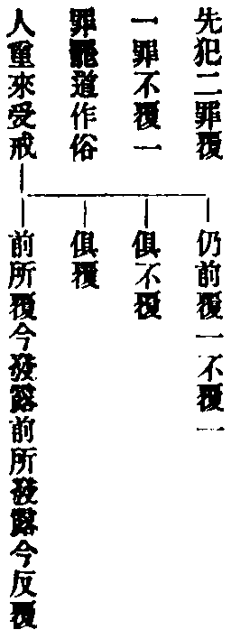
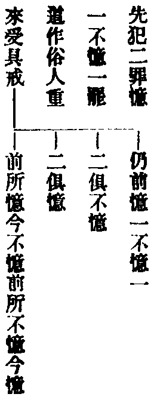
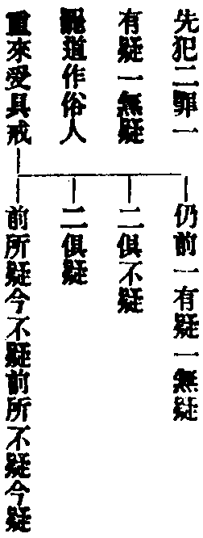
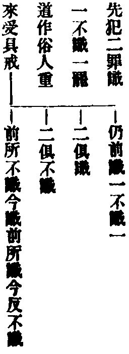
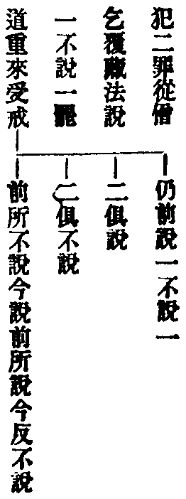
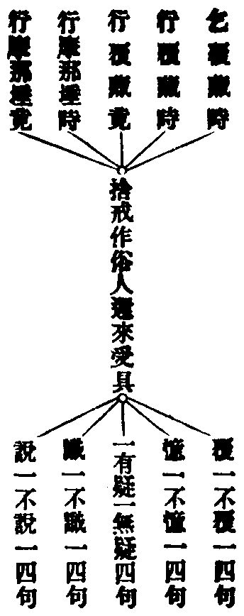
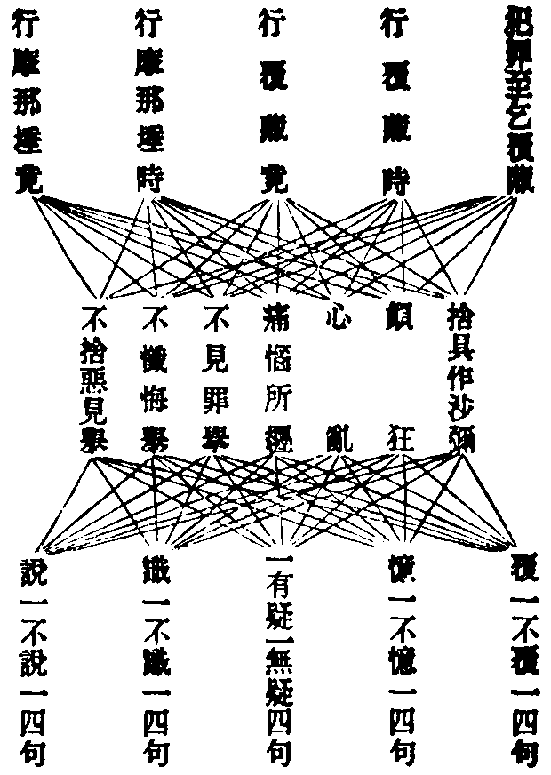
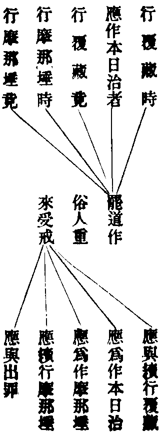
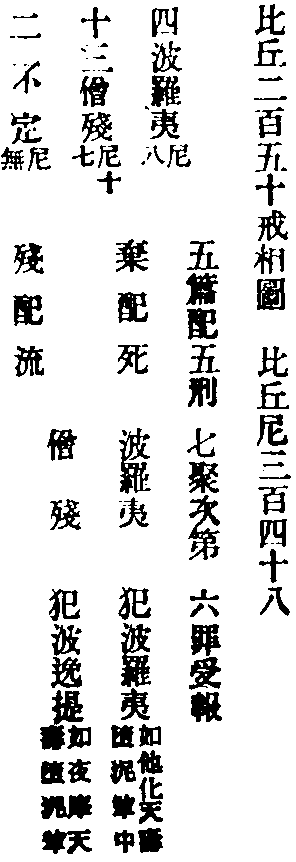
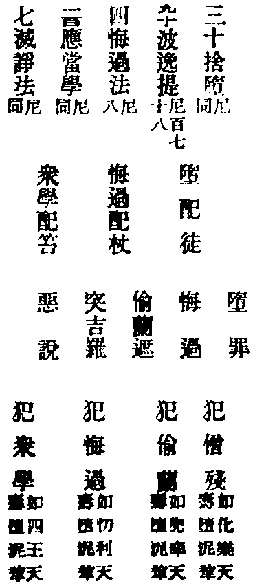

# 重治毗尼事义集要



> **藏经**：卍新纂大日本续藏经（新纂卍续藏）　**册次** 第 40 册（X40）　**编号** X0719　**部类** 经疏部　**卷次** 17 卷　**篇幅** 229,593 字

> **卷／品**：17 卷 · 4 品



---



## 目录



  - [No. 719-B 重治毗尼事义集要序](#no-719-b-重治毗尼事义集要序)

  - [庚寅六月二十一日古吴蕅益沙门智旭下笔故序](#庚寅六月二十一日古吴蕅益沙门智旭下笔故序)

  - [No. 719-C 原序](#no-719-c-原序)

  - [原序](#原序)

- [重治毗尼事义集要卷第一](#重治毗尼事义集要卷第一)

- [重治毗尼事义集要卷第二](#重治毗尼事义集要卷第二)

- [重治毗尼事义集要卷第三](#重治毗尼事义集要卷第三)

- [重治毗尼事义集要卷第四](#重治毗尼事义集要卷第四)

- [重治毗尼事义集要卷第五](#重治毗尼事义集要卷第五)

- [重治毗尼事义集要卷第六](#重治毗尼事义集要卷第六)

- [重治毗尼事义集要卷第七](#重治毗尼事义集要卷第七)

- [重治毗尼事义集要卷第八](#重治毗尼事义集要卷第八)

- [重治毗尼事义集要卷第九](#重治毗尼事义集要卷第九)

- [重治毗尼事义集要卷第十](#重治毗尼事义集要卷第十)

- [重治毗尼事义集要卷第十一](#重治毗尼事义集要卷第十一)

- [重治毗尼事义集要卷第十二](#重治毗尼事义集要卷第十二)

- [重治毗尼事义集要卷第十三](#重治毗尼事义集要卷第十三)

- [重治毗尼事义集要卷第十四](#重治毗尼事义集要卷第十四)

- [重治毗尼事义集要卷第十五](#重治毗尼事义集要卷第十五)

- [重治毗尼事义集要卷第十六](#重治毗尼事义集要卷第十六)

- [重治毗尼事义集要卷第十七](#重治毗尼事义集要卷第十七)



---



No. 719-A 重治毗尼事义集要叙



如来法震东区，始终须赖律检。慈诰颁施有情，亘今备盛木叉。兴替须人，颓极时至。伤兹遍土传戒，多未依制依法。慨今海内授受，鲜非误己误人。皆由师乖率训，不攻制典。而我千寿震公和尚，精习三宗，备谙幽微。携钖北游於晋邦，缘聚请居於千寿。嗟斯律法无传，誓欲挽回蔽患。十有餘载，律学为先。座下存心数人，咸欲事斯学处。唯晋辽比丘无瑕者，天资特异，偏尚律宗。广阅毗柰耶教，穷究五篇纲旨。惜其律注无多，全藏浩繁。纵有学者，不便攻操。唯重治毗尼一书，深堪唤醍时弊，足以述尽指归。於是誓欲刊板存世，唯希泛应群机。意积时怀，未甞遂心。时值谷邑朝阳传戒嗣律比丘数人，共议末运。若重治毗尼，登梓流行，庶兹律学，后昆有冀。当时九圣慧、石佛璧、千寿[台/十]及餘持律上座数人，推举募资兴工。遂以浩然厥志，劳苦不惮䟦涉。未辞剞劂，二岁斯工告成。愿诸见者闻者，喜跃受持。悬戒日於中天，竖正法於末季。庶不负为法之婆心，俾报佛恩，如海一滴耳。



律学比丘智[台/十]撰



------



### No. 719-B 重治毗尼事义集要序



子，生于万历二十七年己亥五月初三日亥时，至壬戌五月初七日，鬀发出家，是为二十四岁。次年腊月八日，受具戒於云栖和尚像前，又次年受菩萨戒於云栖和尚塔前，皆古德法师，为阿阇棃。二十七岁春，阅律一遍，录出事义要略，仅百餘纸。三十岁夏，第二阅律，录成四册。三十一岁冬，第三阅律，乃成六册，计十八卷。三十二岁夏，为惺谷、如是、雪航三友，细讲一遍，仍添初后二集，共成八册。三十三岁，金台法主梓之於皋亭山佛日寺，是冬在灵峰仅讲七卷，次夏方续讲完，听者共十餘人，惟彻因比丘能力行之。三十五岁，结夏金庭西小湖寺，彻讲一遍，听者九人，能留心者，惟彻因、自观及缘幻大德耳。三十六岁冬，在吴门幻住庵，又讲一过，听者仅五六人，惟自观、僧聚二比丘能力行之。三十八岁入九华，四十岁入闽中，四十四岁至苕城，从此十三四年，自既不能力行，人亦无有问者，彻因、自观、僧聚三人，又皆物故，毗尼之学，真不啻滞货矣。五十一岁冬，从金陵归卧灵峰，次年夏日，乃有发心学律者十餘人，迫予重讲此书，因念向时所辑，虽诸长并采，犹未一一折衷，又问辩、音义二书，至今未梓，不若会入集要而重治之，兼复删削一二繁芜之处，以归简切，庶钝根者，亦不致望洋之叹也。



------



### 庚寅六月二十一日古吴蕅益沙门智旭下笔故序



### No. 719-C 原序



毗尼藏者，佛法之纪纲，僧伽之命脉，苦海之津梁，涅槃之要道也。粤自鸡园初唱，召善来而戒体斯成。迨夫鶴树潜晖，申顾命而木叉是重。必因犯以乃遮，体则叶於无作。若缘开与随制，用复契乎妙圆。实大小之通途，讵声闻之独辙。堪嗟像季，罕达真宗。愚者昧於罔闻，狂者置诸弗屑。或以禅机而巧遁，或以方广为驾言。并属依文，谁思实义。且如能师佩心印於黄梅，胡以阐化曹溪，犹用登坛受具。观师宏华严於五顶，胡以范模朝野，必须十誓律身。葢大雄御极，则法僧二宝，咸由正觉扬辉。而善逝藏机，则佛法二尊，同藉僧伽建立。倘惟十重众轻，即与在家奚别。自非五篇七聚，安知离俗高标。是知梵网戒经，五道齐收，但除地狱，则以通而成其大。毗尼法藏，止许人伦，犹遮诸难，正以局而成其尊。必使仰慕大乘，不甘小节，自可畜发舍衣，作火中之优钵。如或情悲末法，有志住持，岂得恣情荡检，为师子之身虫。智旭自念障深，弗克仰修玄理。复悲生晚，末由随侍哲人。痛隙驹之莫挽，舍慈母以披缁。思乐土之可归，羡莲师而私淑。纲宗急辨，每怀紫柏之风；护法忘身，愿续匡山之派。睹时流以长叹，读遗教以增哀。爰於甲子季冬，礼无量光塔，倍复发增上心，乞古德阇棃证明学菩萨戒。次即备阅大小二律，辄宗四分，并采餘家，录为事义要略。漫率愚蒙之鄙见，岂堪呈似大方；拟作岩谷之资粮，亦无心於兼利。戊辰春，遇雪航楫公，欣然有严净毗尼之志。因念向以入山心迫，所录犹多疎漏，廼就龙居禅窟，再检藏文，不问本部他宗，凡切要者，悉皆录出。深详轻重之宜，备显开遮之准，兼参大律，委示别同。俾畏拘执者，不招谤小之殃；喜儱侗者，难开藉大之口。考定成帙，更名为毗尼事义集要。质诸真寂闻谷老人、博山无异禅师，咸以付梓流通为嘱。於是复同壁如、归一二友，商碓参详，备殚其致。而佛日金台法主，遂欣然命付剞劂。佛法缘起，固自有时。呜呼！斯集也，虽於妙高之体，不啻微尘；其在驽劣之资，已称竭力。所恨解慧疏庸，躬行缺略，仰惭往哲，俯怍后贤。惟愿同学善友，鉴我苦心，愍我不逮，一意秉持，共扶法运，庶报佛恩於万一尔。



辛未孟春智旭识於皋亭古永庆寺



No. 719-D 原䟦



摩诃僧祇律云：若善男子欲建立佛法者，当尽受持此律。欲令正法久住者，当尽受持此律。犯罪恐怖作依怙者，当尽受持此律。不欲有疑悔请问他人者，当尽受持此律。欲游化诸方而无碍者，当尽受持此律。萨婆多论云：毗尼有四义，餘经所无。一是佛法平地，万善由之生长。二一切佛弟子皆依戒住，一切众生由戒而有。三趣涅槃之初门。四是佛法璎珞，能庄严佛法。具斯四义，功强於彼。呜呼！戒之利益，何其溥哉！柰何去圣时遥，鲁鱼滋长。末代众生，罕遘真风。自戒筏流入，真丹肇兴於曹魏铠公嗣徽及怀素律师。迄於今日，閴尔无闻。间有一二宏通大士，既不类出窟狮子，又有殊择乳鹅王。近舍五部之纲宗，傍取问答之网目。急其所当缓，缓其所当急。矛盾自攻，亡羊日甚。是以豪杰之士，未尝过而问焉。何由朗戒月於重昏，维颓纲於绝纽哉！受筹窃覩遗文，每兴寤忾。系我素兄旭师，念法情殷，悲心愿重。徧探律宗，抽绎数四。尊四分为纲骨，借餘部以互显。汰其水源，酌以甘露，辑为集要若干卷。咸遵古训，非同臆说。庶使饮一滴者沈疴可疗，恣饱满者新疾不生。戒海重清，在此一举。顾筹夙生何幸，得与毗尼法席。深庆染指先尝，爰赘片言卷末。知法之士，当必有不谋而集者矣，不肖非阿其所好也。



庚午春日毗尼社弟幽谿后学受筹敬䟦



重治毗尼事义集要目次



卷首序䟦  

总问辩  

凡例  

提纲  

律藏总目  

四分律藏品目  

旁引诸经论目



卷第一四分戒本(自题目至偈赞)



卷第二四分戒本(自问答启白至初婬戒)



卷第三四分戒本(自二盗戒至五媒嫁戒)



卷第四四分戒本(自六私屋过量戒至二离衣宿戒)



卷第五四分戒本(自过一月衣戒至二十二畜钵求好戒)



卷第六四分戒本(自二十三非亲织衣戒至十二异语恼他戒)



卷第七四分戒本(自十三嫌骂戒至三十七非时食戒)



卷第八四分戒本(自三十八残宿食戒至六十七同贼伴行戒)



卷第九四分戒本(自六十八恶见不舍戒至众学法第四十八)



卷第十四分戒本(自众学法第四十九至偈赞回向)



卷第十一总辨羯磨法  

结界法  

授戒法



卷第十二依止法  

师法  

弟子事师法  

上座法  

同学法  

礼敬法  

孝父母法  

安居法  

自恣法  

迦𫄨那衣法



卷第十三治罪法(有六法)



卷第十四衣法  

钵法  

食法药法  

受食法  

看病法  

房舍  

卧具法  

器物法  

杖法  

丛林法



卷第十五阿兰若法  

大众会法  

分物法  

说法法  

读诵法  

坐禅法  

杂法  

佛说犯戒罪轻重经  

戒相摄颂(智旭敬述)



卷第十六比丘尼戒(自八波罗夷法至波逸提法第一百十五)



卷第十七比丘尼戒(自波逸提法第一百十六至杂法)  

䟦语



重治毗尼事义集要目次(终)



No. 719-E 总问辩



问：毗尼之学，重在笃信、力行、谨守五篇，人天固可保矣。其福若尽，将如之何？孰若从宗教先开眼目，道共戒生，是为急务。古云：只贵见地，不贵行履。岂不然乎？



答：毗尼之学，出世正因，戒波罗蜜，佛地方满，岂仅人天福耶？宗教开眼，言虽相似，但欲离戒，别谈宗教，便是拨事求理，堕恶知见。沩山云：毗尼法席，尚未叨部，了义上乘，岂能甄别？荆谿云：用前四戒，通为观境，以六观之，事理相即，当知篇聚，一不可亏。世人蔑事，而欲尚深理者，验知此观，孤虗无本，既亏观境，观亦无从。然则若宗若教，诚训昭然，胡弗思也？古所谓只贵见地，不贵行履，正以有见地者，必有行履，有行履者，未必有见地耳。今以如来无上戒法，判属人天，舍律仪而空谈道共，正见已破，行履复荒，恶趣三涂，敢保有分？虽欲生人天，而不可得矣。



问：末世钝根，只宜要略。四分律藏，世尚畏其繁琐支离，置之高阁。今此集要，援引诸家，益觉纷杂。何不直宗四分戒本，略加旁注释疑，有何不可？



答，喜略不喜广，自是末世通病。固守痴钝，愈趣愈下，终无释疑之日。今欲救其苦，必须博学反约，乃克有济。倘直宗戒本，略加旁释，则开遮持犯，安能洞然。乐佛法者，既难以通达。习懈怠者，仍未必留心。进退失措，有何利益。



问，念佛一门，广大简易，信应奉行。但能一心念佛，自然止恶防非。何须矻矻穷年，学此律法。名相浩繁，已非简易。果极声闻，又非广大。恐不若专宏净土法门之妙也。



答，持戒念佛，本是一门，原非异辙。净戒为因，净土为果。若以持名为径，学律为纡，既违顾命诚言，宁成念佛三昧。夫如海无涯，如宝无厌，岂不广大。作犯止持，保任解脱，岂不简易。故一心念佛者，虽能止恶防非。专精律学者，尤为守佛明诲。现在则绍隆僧种，临终则上品上生。法门之妙，孰过於此。



问，如来降生西域，毗尼遮罪，皆因居士讥嫌故制，然亦有随方戒等。今此土虽不遵行，居士未必讥毁，设舍微细戒，何乖圣训。又时丁末运，外缘不丰，内因微薄，欲纤毫无犯，演教宏宗，则佛法不能广布，完小节而失大益，岂菩萨之本心，学一乘之真子耶。



答，如来一切知见，普为大千众生而制戒律。六群等亦大权示现，曲体末世众生情态而示犯缘。正由人情懈怠，不肯轻重等护，致成末运。今欲宏宗演教，必以持戒为本。戒律精严，则内因湻厚，外缘自丰。白毫相中，一分光明，决非诳语。若以戒为小节，便成谤法。谈宗说教，皆是儱侗瞒盰。设获外缘，总名魔业，有何益於正法哉。



问：西乾列祖，三学精通。此间地僻时遥，人罕闻见。唯唐宋来数辈宗匠，踪迹彰著，人皆景仰。然而当其水边林下，则以三条篾、一把锄为清净自活。逮其匡徒领众，则以一日不作、一日不食为真实芳规。至於扬化接人，则以一棒一喝为拈提向上。俱与律学不复相应。是以好心出家之流，由行脚入山，乃至登座披衣，所倣傚者，无非此等。今还许从上诸祖，仍是真比丘否？若非比丘，云何可绍祖位？若是比丘，云何不遵律制？又今时绍祖位者，例皆轻视律学。不识从上诸祖，亦轻视否？又今时绍祖位者，虽不遵戒，而仍为人授戒。不识从上诸祖，亦为人授戒否？



答：从上诸祖，各有三类：一者、严净毗尼，宏范三界，如远公、智者、左谿、永嘉、荆谿、大梅、永明、觉范、高峰、中峰、楚石等是也。觉范非时不食，中峰冬夏一衲，具载传记，芳轨昭然。古今如此知识，亦甚众多，所应景仰倣傚。二者、丁兹末世，势不获已，遵佛遗命，舍微细戒。故住静则刀耕火种，领众则垦土开田。然於非时食等诸戒，仍自遵行。故清规晚用药石，不云粥饭，秪许非时浆、七日药、终身药耳。又德山托钵，亦因视日早晚，当知不非时食明矣。然而此等知识，则便不敢为人授戒。所以唐宋以来，禅有禅寺，讲有讲寺，律有律寺。初出家时，多先学律。律学有得，则以律名家。律学无得，则舍之而习讲参禅。但舍微细戒，不舍重戒及性戒也。复有不能学律，径投禅教而参学者，此即名为乘急戒缓。然亦必护根本五戒，断无毁犯重戒之理。而决不敢自称比丘，亦决不敢轻视律学。但自愧未能兼修，以为惭德。故至出世接人之时，或重登戒品，性遮皆净，如六祖等。或单提向上，独接一机，如寿昌等。



有人问寿昌云：佛制比丘不得掘地损伤草木，今何自耕、自种、自芸、自获？



答云：我辈秖是悟得佛心，堪传祖意，指示当机，令识心性耳。若以正法格之，仅可称鬀发居士，何敢当比丘之名也？



又问：设令今时有能如法行持比丘事者，师将何以视之？



答云：设使果有此人，当敬如佛，待以师礼。我辈非不为也，实未能也。又紫柏大师生平一粥一饭别无杂食，脇不著席四十餘年，犹以未能持微细戒，故终不敢为人授沙弥戒及比丘戒。必不得已，则授五戒法耳。嗟乎！从上诸祖敬视律学如此，岂敢轻之？若轻律者，定属邪见，非真实宗匠也。三者、大用现前，观机利益，破他疑执，不拘恒规。如文殊菩萨执劒逼佛三处度夏，重胜比丘与女同坐令证无生，乃至寒山拾得之呵律主，归宗南泉之斩蛇猫，并是一时不得不用之权谋。譬如良医用砒霜以治病，大将设奇谋以除贼，偶一为之，不可以为典要。又凡诃佛骂祖，痛棒毒喝，皆是不得已而用之。所谓兵者，不祥之器，非布帛菽粟比也。若用得其当，则迹似违律，实真持律，以得律之意旨故。例如末利夫人饮酒救杀，佛赞其为真持斋戒。菩萨戒本亦云：菩萨见机得杀盗等，於菩萨戒无所违犯，生多功德也。若用失其宜，将作门庭施设，譬如优孟之学叔敖，宗既非宗，律又非律，谤大般若，疑悮后学，三涂剧报，何由得免。设亦诱引愚流，向三宝中作种种福，由斯福力所持，不即堕落，终为外道。魔王眷属，非佛弟子，末世之中，多此妖邪，谤惑世间，魔所摄助，多得供养，往往聚众百人千人，眷属儿孙，遍布天下，毁戒毁教，破坏如来真正法轮。愚小无知，羡彼名声，而争倣傚，令好心出家者，皆堕其党，求升反坠，哀哉痛心。然由仍以三宝为所缘境，故至罪报毕时，还藉佛法僧戒之力，而得度脱，如从地倒，还从地起，较诸不闻三宝名者，犹胜一筹。故魔王语佛云，吾於汝末法中，令诸眷属，食汝饭，著汝衣，破坏汝法。佛言，汝但自坏，吾法不坏也。今若欲不堕三涂，径登圣果，请必从持戒始，纵不能持，亦须赞叹，自生惭歉。若既挂名受戒，而又轻视戒法，既不精持戒法，而又为人作师授戒，既广为人授戒，又不教人如法学戒，且言戒是小乘，不须习学，则决堕三涂，为魔眷属，自受其苦，无人能代，终亦必皆成佛，我不敢轻之矣。



凡例



律藏译文，领皆烦复。今欲便初学，故多约义节文。文虽节略，义实不敢稍更。如不相信，请以律藏对观。  

如来灭后，结集律藏，原无众部之殊。后因异执，致成多部。部类既分，各宗一辙。所以义净独宏根本，怀素但遵四分，皆谓不应会通。葢恐彼此逃托，舍遮取开，就轻避重也。今倣南山意旨，为之会通。意在理优则用，实非趋避取舍。拟集众部之大成，庶契如来之本意耳。问：宣公采用诸部，尚为怀素所讥。今何所据，輙生去取？倘任凡夫臆见，岂符大圣芳规？答：因诤渐成多部，葢是法道之衰。采用众部所长，乃集大成之意。虽怀素讥诃，自大有所据。而宣公律学，亦未可全非。况佛有明训云：多智慧人，能取能舍。诸愚痴人，不能分别。则分明以集大成，而望后人。故今集要，乃博采众长，以备参考。庶几得溯流而穷源，非敢任臆见为去取也。  

性罪、遮罪，惟善见律判之，然於每戒之下，或有或无，今仍其旧，不敢强增，亦可例推故。又彼称制罪，今作遮字，字别义同，取易晓故。  

每戒之下，各有缘起释义，及与罪相轻重。次则问辩折衷，次或引证，并餘随律威仪，与本戒相似者，亦附於后。凡此六科，或具或减，不复细列，但用缘、释、相、辩、证，附六字以标其上。  

诸译有义同音异，及文相难明者，可注则随注之。如或不便注明，各附卷末，以备稽考。  

声闻遮罪，大士悉皆同学。至於为众生故，善巧权开，经中历历有据，岂容一概儱侗。今依梵网经及慈氏戒本，每戒指明大略，葢倣天台义疏之意。



No. 719-F 提纲



五分法身，以戒为依。三无漏学，以戒为首。无一如来不具戒体，无一菩萨不修戒度，无一经典不赞戒法，无一圣贤不严戒行。持戒如地，万善由此而生成。持戒如城，魔障藉此而远离。论其超胜，则才沾戒品，便名人世福田。极其指归，则惟佛一人，方名圆满净戒。四级重楼，级级皆圆顿境。八万细行，行行与法界周。若不持戒，纵能习讲坐禅，兴诸福业，皆为魔业，必入魔党。故好心出家者，决须从持戒始。自利利他，法皆成就。舍此通途，更无捷径。问：比丘律藏，本属声闻。梵网戒经，方为大教。今云四级皆圆顿境，则大小奚分？又既称圆顿，则一种已足，何须四级？答：圆人受法，无法不圆。既禀法华开显之旨，一色一香，无非中道，岂有戒法而不圆顿？故法华玄义云：开麤者毗尼学，即大乘学式叉。式叉即是大乘第一义光，非青黄赤白黑，三归五戒，十善二百五十，皆是摩诃衍。岂有麤戒隔於妙戒？戒既即妙，人亦复然，汝实我子，即此义也，是名绝待妙戒。噫！由此观之，级级圆顿，其义彰矣。圆顿之法，一多无碍，方成不可思议。若谓一种已足，则华严七处九会，亦可云一处一会已足耶？又问：五戒、十戒、比丘、菩萨，喻如重楼四级，故曰不受五戒而受十戒，乃至不受比丘戒而受菩萨戒，俱无有是处，是则次第之义昭然。今胡许沙弥受菩萨戒，岂不违越金口诚言？答：重楼之喻，葢是一往明其次第，必欲执之，则优婆塞亦不得受菩萨戒矣。既可许优婆塞，胡独不许沙弥，沙弥乃反不及优婆塞耶？然菩萨戒法，不惟义疏通列七众，而西域诸寺大小各别，岂大乘寺中遂独无沙弥也？又问：禅、教、律三，譬如春兰秋菊，各擅其美，今独以戒为通途，云何从古立为三宗？答：西天四七，无不总持三藏，法流东土，方乃各立门庭，然终不闻真实禅师讲主，或可荡检逾闲者也。  

凡未学戒者，多畏持戒之难，正坐不知戒法，妄生退委。若学此戒，始知如来大智，曲尽人情，开遮得所，守护非难。忆予初出家时，自恃根本清净，深畏琑屑行持，尚不肯受沙弥十戒，况复具圆。秪因丛林随众，强受十戒。既而披览戒本，乃至备阅律藏，方信欲得自在无畏，必须精熟毗尼。毗尼未学，触途成滞。儒者云，不学礼，无以立。旨哉言也。  

西域地多蒸湿，草菜不生，故听比丘食五净肉。此土多诸蔬品，决定不应食肉。又西域诸国，单习小者乃食五净，大乘国土悉皆遮止。今在神州，大乘流布，若有食肉，谤议沸腾，护世讥嫌，莫此为要。纵未受菩萨戒，亦决不应食肉。设食肉者，非沙门也。  

经论二藏，贵在流通，独有毗尼，极为珍秘，以是惟大僧法，非外人所得与故。所以根本律云：在家俗侣，得闻二藏。谓论及经、毗尼、耶教，是出家轨式，俗不合闻。戒因缘经序云：天竺持律，不都通视，唯诸十二法人，坚明之士，乃开缄縢，而共相授。耶舍见嘱见诲，湻湻人可使由之，不可使知，其言切至。惟愿同我之人，尤慎所授，未满五岁，非持律人，幸勿与之也。观此二律所云，则其慎重可知。是以沙弥若解五篇，便成受具遮难。今此集要，特为乐简者，便於行持，勿令未受者，輙先披阅。倘或沙弥展览，即应诃止，如或不然，彼此招罪。问：世尊说教，如一雨所润，凡有沾者，无不获益。昔有闻经半偈，免堕狗胎牛负。大经后世为沙门者，何故律藏独为珍秘？岂不能利益人，抑不欲利益人耶？又设未受具人，发心阅藏，安知佛禁而不检阅？更有书写剞劂之辈，必已经眸，倘后发心受戒，为许进具，为竟作重难耶。若作重难，则佛法中亦有限穽，甘露反成毒药也。答，经贵流通，所以成闻熏之种。律宜珍秘，所以防贼住之愆。一秘一通，总是如来四悉巧被。至於无知悮阅，书刻经眸，既无盗法之心，应非重难之例。然书刻者未必能解，犹可融通。阅藏者必至了知，应须严禁。是在知法者善为开导矣。又问，毗尼篇聚，既不许白衣沙弥等预知，何故涅槃会上，世尊於人天大众中，广说五篇七聚，嘱付后昆，使莫违犯。岂涅槃经亦止为比丘说，亦不可流通世间耶。答，涅槃会上，纯是大菩萨众，决无盗法恶人。故於篇聚之名，总不复讳。然仅出其名，不出事义。今设讲演涅槃，亦不须细释可也。又问，若云沙弥解五篇者，便成受具遮难。今设有欲受戒人，先阅五篇，成遮难否。答，比丘戒法，止应受后行持，不应未受先阅。设不知悮阅，情犹可原。倘知而故违，理难宽宥。  

比丘之体极尊，流俗之风甚污。诵经礼忏，犹可名为法施。吹笙打钹，则何异於倡优？若法华听许供佛，本谓使人。既形仪已厕僧伦，岂应自亵？然则应院改禅，必须永断音乐等事。如不断者，深乖佛制。问：若谓吹笙打钹，喻如唱优。然寄归传云：大会自恣，皷乐幡华，诸庙行香。理则皆然，何故不许？设但使人作，则自作教他，有何分别？得无犯罪否？答：五逆十恶，世间性罪。故教他与自作同科。今歌舞倡伎，是出家遮罪。使人作乐，仍名福业。不可以性罪例也。  

非时食戒，经论备显非宜，诸律并无开听。即晚食称为药石，本非佛言。或古人之权巧，纵使体弱多病，自有非时浆、七日药、终身药等，可以支延，柰何甘破此大节乎？除是丧命因缘，不能恪守，则或舍比丘沙弥之名，但作菩萨近住，或半月半月殷重忏悔，誓不敢为戒师可耳。问：非时食戒，名之为斋，固不可犯。然古来知识，多有未能持者。设令根本清净，其餘戒相稍不清净，还从堕落也无？答：破戒破斋，均名恶法。若但护根本，宁免负债受用之科？至於古来真正知识，乘急戒缓者，决知惭德，不为戒师，例如紫柏、寿昌。又近时知识，不遵细戒，谬为人师，亦或未必堕落者，别有殊胜福业所持故也。然远公力拒蜜浆，高峰并日一食，乃至观师，誓不味过午之肴。从前禅教名宿，净持斋法者，尤多所应取法，不可学后代知识，而徼𢔛於万一也。  

律中十夏未满，决不许为和尚，及依止阿阇棃。若复急於为师，是谓知法犯法。问，时丁末法，人命无常，形同朝露，焉可待时。亦许旁通一线，使僧轮不绝否。答，正由末世，不依律法，僧轮衰替，致成减劫。今欲挽回，必须全遵佛制。下至满十夏，知二部律者，乃可度人耳。  

律中虽许日三时中，二分学内典，一分学外书。葢谓利根之士，藉此降伏外人。亦以西域诸国，多有外道与法门作对。今在神州，其事逈异。若但专心本业，则白衣咸加敬畏。如或耽染诗文，则佳者但取其怜，而拙者反招其诮。吾见其降于外人，未见其能降外人也。且夫根机有限，年岁无多。急办正因，犹虞未及。若复爱乐诗文，决非真实戒子。  

此律乃定慧之基，解脱之本。基既筑，必堂构是图；本既培，须花果时茂。若不造鍊心源，但取庄饰外相，深乖受戒之正因，永绝涅槃之妙果。问：定慧之基，解脱之本，无基本固为不可，但有基本亦非完局，是必以看教参禅为究竟义也，岂可以律为究竟义耶？答：受得律仪是为基本，定共道共是为完局，故曰必须造鍊心源。如大小持戒犍度，始自修集圣戒，以至五通三明，总属戒中实义，岂可向律外别求究竟耶？  

戒法既非局於声闻，发心必须等於大士。且具诸戒行，乃是上品正因。念佛得度，今时正符记莂。若不神栖安乐，未是全遵佛语。愿同修者，知所归趣。问：具诸戒行，固是上品上生章中三种众生之一。然持戒如地，万善由此生成。定共道共，皆悉具摄，何必更须念佛？又念佛横出三界捷径法门，临终十念，即得往生，何必烦琐？戒相既二俱捷径，随行一途即得。何故脚踏两边，方名全遵佛语？答：定共道共，固能竖出生死。苟无净愿，止生方便秽土。若持戒兼念佛，设能断通别惑，任运能生方便实报寂光等三净土。纵未断惑，亦可生同居净土。又念佛以净其心，正是无上妙戒。不遵念佛得度之训，亦是亏违如来教敕律制所诃。至若恃十念往生之捷径，而轻戒相为烦琐，便非真念佛人。临终十念，敢保决难成就。故必净戒为因，净土为果，方成出要。是为一道清净，岂曰脚踏两边？  

此集要专为自利者辑。若欲宏律，必须更阅全藏，乃能备悉源委，开发后人。既是为师作范，岂容乐简厌详。今若藉戒为基，别修教观禅宗等者，可先熟背戒本正文，次於此本微细讨究，亦可免哑羊之诮。若决欲宏演毗尼，接引后人者，先於此本精熟明了，后须仍阅全藏，庶於律师之名，可无愧耳。



No. 719-G 律藏总目



四分律藏(六十卷)



姚秦罽宾三藏佛陀耶舍竺佛念等共译



四分戒本(一卷)



佛陀耶舍译



四分戒本(一卷)  

比丘尼戒本(一卷)



唐西太原寺沙门怀素依律集出



昙无德律杂羯磨(一卷)



前魏天竺三藏康僧铠译



羯磨



曹魏沙门昙谛集



四分比丘尼羯磨法(一卷)



刘宋罽宾三藏求那䟦摩译



四分律删补随机羯磨(二卷)



京兆崇义寺沙门道宣撰



四分僧羯磨(三卷)  

尼羯磨(三卷)



唐西太原寺沙门怀素依律集出



摩诃僧祇律(四十卷)



东晋三藏法师佛陀䟦陀罗共沙门法显译



波罗提木叉僧祇戒本(一卷)



佛陀䟦陀罗译



比丘尼僧祇律波罗提木叉戒经(一卷)



东晋平阳沙门法显共觉贤译



弥沙塞五分律(三十卷)



宋罽宾三藏佛陀什竺道生共译



五分戒本(一卷)  

比丘尼戒本(一卷)



梁建初寺沙门明徽集



五分律羯磨本(一卷)



大唐开业寺沙门爱同录



十诵律(五十八卷)



姚秦三藏弗若多罗鸠摩罗什共译



十诵毗尼序(三卷)



东晋三藏卑摩罗叉续译



十诵律比丘戒本(一卷)



鸠摩罗什译



十诵律比丘尼戒本(一卷)



宋长干寺沙门法颕集出



萨婆多毗尼毗婆沙(八卷)  

续(一卷)



失译人名今附三秦录



萨婆多毗尼摩得勒伽(十卷)



宋三藏法师僧伽䟦摩



大沙门百一羯磨法(一卷)



失译人名今附宋录



十诵羯磨比丘要用(一卷)



刘宋释僧璩依律撰出



根本说一切有部毗柰耶(五十卷)  

根本说一切有部苾刍尼毗柰耶(二十卷)  

根本说一切有部毗柰耶杂事(四十卷)  

根本说一切有部毗柰耶破僧事(二十卷)  

根本说一切有部尼陀那(五卷)  

目得迦(五卷)  

根本说一切有部百一羯磨(十卷)  

根本说一切有部戒经(一卷)  

苾刍尼戒经(一卷)  

尼陀那目得迦摄颂杂事摄颂(一卷)



唐三藏法师义净奉　制译



根本萨婆多部律摄(十四卷)



尊者胜友造　义净法师译



根本说一切有部毗柰耶颂



尊者毗舍佉造　义净法师译



根本说一切有部出家授近圆羯磨仪范(一卷)  

苾刍习略法(一卷)



元帝师苾刍拔合思巴集



戒因缘经(十卷)



姚秦三藏竺佛念译



解脱戒本经(一卷)　出迦叶毗部



元魏婆罗门瞿昙般若流支译



善见毗婆沙律(十八卷)



萧齐外国沙门僧祇䟦陀罗译



毗尼母经(八卷)



失译人名今附秦录



佛阿毗昙经(二卷)



陈世三藏法师真谛译



舍利弗问经



东晋失译人名



优波离问经(一卷)



刘宋元嘉年求那䟦摩译



迦叶禁戒经



宋居士沮渠京声译



佛说犯戒罪轻重经



后汉安息三藏安世高译



佛说目连所问经　与上经同



西天译经三藏朝散大夫试鸿胪少卿传教大师法天奉诏译



按此二译，皆即世传五百问经中之首一品耳。意五百问一书，乃后人因此而增益附会者与？曾细玩之，不惟与四分律相违，实与五部及诸律论俱多矛盾。虽云圣意未可妄测，经典不宜轻议，然设欲从此，则大违众律，岂应舍通途之轨式，取疑似之法门？不知近代律主偏流，通此经者，亦曾参考全律否耶？今既徧探五律之源，不得不列在疑似之科矣。



律二十二明了论(一卷)



正量部佛陀多罗多法师造陈三藏法师真谛译



大比丘三千威仪(二卷)



后汉安世高译僧佑云失译人名



沙弥十戒法并威仪(一卷)



失译人名今附东晋录



沙弥威仪



宋天竺三藏求那䟦摩译



沙弥尼戒经



失译人名今在汉录



沙弥尼离戒文



失译人名



优婆塞五戒相经(一卷)



宋天竺三藏求那䟦摩译



戒消灾经



吴月支优婆塞支谦译



南海寄归内法传(四卷)  

受用三水要行法  

护命放生仪轨法  

说罪要行法(三法合卷)



唐三藏沙门义净撰



四分律藏品目



第一分(二十一卷)比丘戒



第二分(十五卷)比丘尼戒  

受戒犍度  

说戒犍度



第三分(十三卷)安居犍度  

自恣犍度  

皮革犍度  

衣犍度  

药犍度  

迦𫄨那衣犍度  

拘睒弥犍度  

瞻波犍度  

诃责犍度  

人犍度  

覆藏犍度  

遮犍度  

破僧犍度  

灭诤犍度  

比丘尼犍度  

法犍度



第四分(十一卷)房舍犍度  

杂犍度  

五百结集法  

七百结集毗尼  

调部毗尼  

毗尼增一



旁引诸经论目



大般涅槃经　谢灵运重治  

大般若经　玄奘法师译  

菩萨善戒经　求那䟦摩等译  

优婆塞戒经　昙无谶译  

法界次第初门　智者大师撰  

观心论疏　章安尊者撰  

缁门警训　未详集人



重治毗尼事义集要卷首



音义



------



### 原序



鸡园



西土有鸡头摩寺，去鹿苑不远。故大佛顶经云：我在鹿苑及於鸡园，观见如来最初成道。



召善来而戒体斯成



佛见根熟之人发心出家，以无畏口召云：善来比丘！於我法中快修梵行。彼人即时须发自落，袈裟著身，手中有钵，威仪进止如百腊比丘，即名得比丘戒。



鶴树潜晖



佛入涅槃，双树皆悉变白，犹如鶴色，故名鶴树。潜，藏也。晖，日光也。佛光如日，从此永藏。



顾命



周书有顾命一篇，乃成王将崩而遗诫康王者。顾，回视也。法王示灭，谆谆付嘱，亦犹人王之顾命。故宏传序云：金河顾命也。木叉是重者，大涅槃经云：我灭度后，诸比丘依戒而住，以戒为师。遗教经云：应当珍敬波罗提木叉。即是众等大师。若佛住世，无异此也。



因犯乃遮缘开随制



二百五十戒，皆因犯缘乃结。其三篇以下，或因病等诸缘开听。又因更起犯缘，则亦随犯更制。如谷还贱，不听入事之类也。



能师受具



六祖名慧能，本是岭南卖柴人。偶闻客诵金刚经，心即开悟。乃诣黄梅，见五祖密传衣钵，隐於猎人队中。十五年后，至广州法性寺，值印宗法师讲涅槃经。时有风吹幡动，一曰风动，一曰幡动，议论不已。祖曰：不是风动，不是幡动，仁者心动。法师异之，讯知是传衣钵者。乃为鬀发，集三师七证，登坛受具。然后於菩提树下，开唱大法。



观师十誓



五台山，亦名五顶，亦名清凉山。澄观国师阐华严法门，於此十誓者，体不损沙门之表，心不违如来之制，坐不背法界之经，性不染情碍之境，足不履尼寺之尘，脇不触居士之榻，目不视非仪之彩，舌不味过午之肴，手不释圆明之珠，宿不离衣钵之侧。



大雄御极



世尊於三界中最为勇猛丈夫，故称大雄。御，治也，统也，用也。易曰：乘龙御天。极，宝位也，又中也，至也，要会也。书曰：惟皇作极。御极者，处於法王尊位，用中道设化，统治大千世界也。



善逝藏机



善逝者，如来十号之一。藏机者，众生缘尽，则应化机息。



但除地狱



地狱苦重，不能发心受戒，故梵网经不列其名。或问：阎罗王亦地狱道，胡得在护法位中？既为护法，宁不受戒？答：若准他处经说，则阎罗亦可属鬼神道，又是大权示现。若准梵网，并不列之。



隙驹莫挽



古人云：人生如白驹过隙耳。言其迅速。



无量光塔



即云栖莲池大师肉身塔也。护法居士以其专宏净土，题为无量光塔。



原䟦



鲁鱼滋长



鲁字与鱼字相类，易於差譌，亦如亥豕之类，及乌焉成马之类也。滋长者，以喻佛法差悮，日甚一日，犹如鲁鱼不辨也。



真丹



或云震旦，或云旃丹。以日初出，曜於东隅，故得名也。



曹魏铠公



按此方如法受戒，始於昙摩迦罗及沙门昙谛，而康僧铠同在嘉平年间，出昙无德律杂羯磨一卷，故云肇兴於铠公耳。肇，始也。



怀素律师



俗姓范氏，京兆人。唐贞观九年出家，依道成师学律。先居宏济，后住太原。集四分僧尼戒本各一卷，僧尼羯磨各三卷，每每翻宣律师之案，致不足之意焉，非今相传善书能饮之怀素也。彼与颜鲁公同时，与今律师相去近百年。



矛盾



矛以刺人，盾以自卫。昔有一人，兼鬻二器，售矛则曰可以破坚盾，售盾则曰可以御利矛，故名自相矛盾，以喻五百问一书，与律藏自相反也。



亡羊



语云：多岐亡羊。以喻不明律学纲宗，则异说纷纷，不能致一也。



忾



音慨，太息也。



繄



音衣。又音意。发语辞。又惟也。



总问辩



用前四戒通为观境以六观之事理相即



大经一禁戒，即智论不缺戒，指初篇戒也。大经二清净戒，即智论不破戒，指二篇戒也。大经三善戒，即智论不穿戒，指三篇以下也。大经四不缺戒，即智论不杂戒，指定共戒也。此四并是事戒，故通为所观境也。大经五不析戒，即智论随道戒及无著戒，此是空观相应戒也。大经六大乘戒，即智论智所赞戒。大经七不退戒、八随顺戒，即智论自在戒，此是假观相应戒也。大经九毕竟戒，即智论随定戒。大经十具足波罗蜜戒，即智论具足戒，此是中观相应戒也。并以五篇七聚为所观境，故云篇聚一不可亏。



凡例



南山意旨



道宣律师住终南山，故世称律学为南山一宗。宣师虽宗四分律藏，每每采集众部之长。



性罪遮罪



虽未制戒之前，约世法中亦自有罪，名为性罪，如杀、盗、邪婬、口四恶业之类也。世尊为出家人护世讥嫌，制立戒法，名为遮罪，如长衣、宿食、掘地、损草之类也。佛制所遮，犯者得罪，故名遮罪，亦名制罪，谓从佛制边得罪也。



声闻遮罪大士悉皆同学



菩萨戒本经云：毗尼建立遮罪，护众生故，令不信者信，信者增广，同声闻学。何以故？声闻自度，尚不离护他，何况菩萨。



为众生故善巧权开



菩萨戒本经云：又复遮罪，住少利、少作、少方便者，菩萨不同学此戒。今按比丘二百五十戒中，但有舍堕六事是菩萨戒所开，餘皆不妄开也。六事者：一、从非亲乞衣；二、过受自恣与衣；三、畜长钵；四、令非亲里织师织衣；五、畜蚕绵卧具；六、受金银。皆是为众生故，非许自受用也。



天台义疏



智者大师於梵网经心地品中独揭十重、四十八轻戒法行之，名为义疏。每戒之下，必对小乘料简同异。



提纲



三无漏学以戒为首



佛顶经云：因戒生定，因定发慧，斯则名为三无漏学。又云：纵有禅定多智现前，若不断婬必落魔道，若不断杀必落神道等。



式叉



此翻为学。



五净肉



不见杀、不闻杀、不疑为己杀、自死、鸟残。



十二法人



即十二头陀行也。



耶舍



恐即佛陀耶舍，与竺佛念同译四分律者。



人可使由之不可使知



此言本出论语，今借用之。谓初受戒人，但可使其依律行持，未可使阅律藏，知其所从结戒之由。葢六群比丘等，皆是大权示现，曲为末世而示犯缘。诚恐愚者不达，认为实事，将谓佛世尚尔，何况今时，则反开放恣之心矣。



No. 719



------



## 重治毗尼事义集要卷第一



古吴蕅益沙门　智旭　彚释



○将释此律，大文为二：初、题目，二、入文。



初题目。



四分戒本。



释此律题，倣同梵网戒义疏，略述三重玄义：第一释名，第二出体，第三料简。



释名为三：初明四分戒本，次出众部源委，后释事义集要。



初明四分戒本者，谓是四分律之比丘戒经也。此出昙无德部，梵语昙无德，翻为法密。其律共有四分：第一分明比丘事，第二分明比丘尼事及受戒说戒法，第三分明安居自恣等法，第四分明房舍等杂法。今此戒本，即第一分中如来因事所结戒经也。



次出众部源委者，众部皆有通别二名，通则同名为律，别则僧祇四分等，各从部党所属及经册数目为名。且通名者，梵语毗尼，或云毗柰耶，此翻善治，亦翻调伏，亦翻为灭，正翻为律。律者，法也。又戒因缘经云：鼻，秦言去。柰耶，秦言真。去若干非而就真，故曰真也。降伏此心，息此心，忍不起，故曰真也。降伏，戒也。息，定也。忍，智也(文)。故知才举一法，三学全收。若无戒善，定慧不起。又此戒法，凡有三种：一者律仪戒，亦名波罗提木叉戒。二者定共戒，亦名禅戒。三者道共戒，亦名无漏戒。律仪戒者，律是遮止，仪是形仪，能止形上诸恶，故称为戒。亦曰威仪，威是清严可畏，仪是轨范可则。亦曰调御，使心行调善也。波罗提木叉者，此翻保解脱，亦翻别别解脱，以能保任行人出生死海。又随一一戒，护持不犯，随一一处，得其解脱，即是二百五十学处，及随律威仪也。定是静摄，入定之时，自然调善，防止诸恶。道是能通，发真以后，自无毁犯。如初果耕地，虫离四寸，是道共力。此二戒法，既是心上胜用力，能发戒道，定与律仪并起，故称为共。今毗尼藏正诠律仪，亦摄定道。由持净戒、禅定、智慧功德发生，则律仪为因，定道为果。由禅无漏力，性业、遮业悉得清净，则木叉为果，定道为缘。萨婆多论云：此波罗提木叉戒，若佛在世则有，佛不在世则无。禅戒、无漏戒，一切时有。波罗提木叉戒从教而得，禅无漏戒不从教得。乃至云：波罗提木叉戒，但佛弟子有，禅戒外道俱有。夫能维持佛法，有七众在世间，三乘道果相续不断，尽以波罗提木叉为根本。禅无漏戒不尔，是故於三戒中最为殊胜。善见亦云：毗尼藏者，是佛法寿。毗尼藏住，佛法亦住。是为略释通名义也。



次别名者，谓僧祇律、五分律、萨婆多律、十诵律及善见律、戒因缘经、毗尼母论等。何以有是众律？按舍利弗问经，佛自记云：输柯王孙弗沙密多罗灭法已后，有王性甚良善，重兴佛法。时诸比丘好於名闻，亟生诤论，抄治我律，开张增广。迦叶所结，别为群党，互言是非，求王判决。王集二部行筹，取旧者多，名为摩诃僧祇(此云大众)；取新者少，而是上座，名为他俾罗也(此云上座)。是后因於诤故，复起多部，於三四百年中，展转枝分。如是众多，久后流传，若是若非。唯餘五部，各举所长，名其服色。摩诃僧祇部，勤学众经，宣讲真义，以处本居中，应著黄衣。昙无毱多迦部(即昙无德)，通达理味，开导利益，表发殊胜，应著赤色衣。萨婆多部，博通敏达，以导法化，应著皂衣。迦叶维部，精勤勇猛，摄护众生，应著木兰衣。弥沙塞部，禅思入微，究畅幽密，应著青衣。摩诃僧祇，其味纯正。其餘部中，如被添甘露，诸天饮之，但饮甘露，而弃於水；人间饮之，水露俱进，或时消疾，或时结病。其读诵者，亦复如是。多智慧人，能取能舍；诸愚痴人，不能分别。又按翻译名义集，世尊成道三十八年，赴王舍城。国王食讫，令罗云(即罗睺罗，此翻覆障，六年处胎，故佛之子也)洗钵，失手㩧钵，以为五片。佛言：表我灭后初五百年中，诸比丘分毗尼藏为五部也。后果分为五部：一、昙无德部；二、萨婆多部，此云说一切有法，名十诵；三、迦叶遗部，此云重空观，止有解脱戒本经一卷到此；四、弥沙塞部，此云不著有无观法，名五分；五、婆蹉富罗部，此云犊子，律本不来。五部是别，摩诃僧祇是总，通则六部也。又按南海寄归传云：诸部流派，生起不同，西国相承，大纲唯四：一、圣大众部，分出七部；二、圣上座部，分出三部；三、圣根本说一切有部，分出四部；四、圣正量部，分出四部。其间离分出没，部别名字，事非一致，此不繁述。有部所分三部之别：一、法护，二、化地，三、迦摄卑。所云十诵、四分者，多是取其经夹以为题目，然十诵亦不是根本有部也。频婆娑罗王梦见一氎裂为十八片，一金杖斩为十八段，怖而问佛。佛言：我灭度后一百餘年，有阿输迦王威加赡部，时诸苾刍(即比丘)教分十八趣解脱门，其致一也。即此先兆，王勿见忧(文)。已上所说，各各不同，良以去圣时远，故传事或讹。今若泥迹则触处多乖，取义则有长便用，虽圣心难测，而比量可凭，但令义途得所，则事迹不劳辩矣。已出众部源委竟。



后释事义集要者，事谓制戒缘起，义谓随犯轻重结罪悔过之宜，要谓律藏文繁今但取要，集谓虽宗四分参用诸家。何以独宗四分？二百五十戒相无增减故，举世久流行故。何以参用诸家？事有详略故，义有短长故，不妨互相发明故。初释名竟。



第二出体者，初明无作，次明止行二善。



初、明无作者。天台师云：戒体者，不起而已，起则性无作假色。磬公释云：谓此戒体，不起则已，起则全性。而性修交成，必有无作假色。无作一发，任运止恶，任运行善。一作之后，不俟再作，故云无作。(文)言无作假色者，十一色法，各有假实。就法处所摄色中，唯定果色，名为实色。表无表色，并名假色。善恶二戒，各有表及无表。表即名作，无表即名无作。今且释善戒，互跪翘勤，名为身表。三说乞戒，名为语表。众僧和合，同集戒场，亦名身表。白四羯磨，亦名语表。由此作法，受得清净戒体，成比丘性，为意家之所缘，任运恒得，止行二善。故云一作之后，不俟再作，名为无作假色也。此无作戒体，从第三羯磨毕时，便得於一切男女边，得不婬色。於一切情非情边，得不盗色。於一切有情边，得不杀色。於一切有情边，得不欺诳色。乃至於一切地，得不掘色。於一切草木，得不坏色。於一切酒，得不饮色。如是二百五十戒法，一一各周法界。故出家功德经，明一日一夜持戒功德，不可穷尽。正由此妙善戒法，徧以法界为所缘故。是则无作戒体，是法处色，是无漏色。成论谓是非色非心聚者，为遮心无得失，果无顽善二种难耳。(义疏云：无作假色，经论互说，诤论有无。一云：指心誓不为恶，即名受戒，都无无作。若因中别有顽善，共为佛因。佛地亦应别有此善，共为佛果。此以果无顽善，难戒是色法也。以小乘妄计无作，为心外实色故。一云：大小乘经论，尽有无作。若直以心为戒，发心便应得戒，何故七遮不能得戒？又都无无作，何故犯重便名失戒？此以心无得失，难戒是心法也。成论立非色非心聚，可以双遮两难。故古来律师，用义依之。若大乘所明，戒是假色，凭师一受，远至菩提，随定随道，誓修诸善，誓度含识。亦以此心力大，别发戒善，为行者所缘，止息诸恶。)实则由心感得，借色表成。故大乘家则云：初番羯磨，成十方世界妙善戒法，由心业力，悉皆震动；二番羯磨，成十方世界妙善戒法，於虗空中，如云如葢，覆行人顶；三番羯磨，成十方世界妙善戒法，从行人顶门，流入身心，充满正报，尽未来际，永为佛种。此毗尼藏中，虽不说如此事，亦云：羯磨成就，名得处所。当知有漏五蕴，色身为依；无漏五蕴，戒身为依。有漏色身，从父精母血和合而生，是色处假色；无漏戒身，从三师七证羯磨而得，是法处假色。所以和尚名为力生，正从能生戒身，以得名耳。得此戒身，便同僧宝，能使天龙尊奉，神鬼钦承。若心不乐道，则名戒羸；若向人说舍，则名还戒。苟无此无作戒体，则天神何所致敬？亦何故名羸名舍也？问：既是有羸有舍，复有破者，何得名为任运止行？答：譬如桥梁任运，可以度人；池井任运，可以汲用。倘发撤桥梁，壅塞池井，功能便失。否则常时有用，不俟再作，故名无作耳。



次明止、行二善。如百论：息恶不作，名之为止；信受修习，名之为行。佛教虽多，止、行收尽。今此戒善，不起则已，起则伐恶，皆是止义；皆有进趣，皆是行义。伐恶者，从根随烦恼起，身口七支是恶因，三涂剧苦是恶果。此律集十句义(具如后释)，为诸比丘结戒，能令受持之者，恶因既除，恶果亦谢，是名伐恶。进趣者，摄持诸根，念无错乱，常一其心，习诸善法，任运感得人天华报，乃至出世解脱实果，即是进趣义也。二、出体竟。



第三、料简，更为二：初、对大乘辨得舍；次、就教相辨浅深。



初辨得舍者。大乘重在内因，小乘重在外缘。重内因故，必须发菩提心，方堪受戒。若不善无记心中，不发无作，而千里无师，许其像前自受。重外缘故，必须师僧界法，事事合制。若诸缘有一不备，不名得戒。而诸缘既具，得戒徧於三心(谓善不善无记心中，并发戒也)。又大乘一得之后，极至佛身。小乘但尽形寿。大乘上品缠犯十重，及退大菩提心，则名失戒。小乘犯四重禁，则名失戒。若心不乐道，向一人舍，则名还戒。大乘失戒之后，得见好相，许其重受。小乘失戒，无重受理。但使绝不覆藏，仅可羯磨与学(法罪法中明之)。若舍戒者，乃许重受。三度返俗，始为绝分耳。问：释戒体既依大乘，辨得舍仍分大小，岂不宗趣相违？答：依大乘释无作者，不违法体也。对大小辨得舍者，不坏法相也。违法体，则相无所依。坏法相，则体无由显。故法华开显之后，涅槃仍扶戒律。毗尼轨式，分毫不改。正谓即此知常，方称绝待之妙。宗趣相成，思之可得。又问：大乘既重内因，今时律师与人受菩萨戒，可知其内因真否？如或不真，名得戒否？如不得戒，则设犯十重，还以十重定其罪否？答：弥勒菩萨羯磨文中，具有观察当机之法。若不能知其内因，而妄相传授，不免无解作师之过。然彼受戒之人，不善无记心中，虽不发戒，而既滥膺菩萨之名，自当依律判罪。非同不得比丘戒人，竟以贼住论也。



次辨浅深者。此是酪味教摄，初调凡夫，令入圣故。若约五味互融，亦可作四教释。谓於一切禁戒，坚固执持，永离系缚，即藏教法。若达罪如幻病，戒如幻药，持犯本空，身心清净，即通教法。若仰信中道，即以此戒，先断见思惑，次涉俗利生，后悟入中道，即别教法。若戒为法界，一切法趣戒，是趣不过住戒秘藏，一一戒中，明见佛性，即圆教法。又如来以四悉檀，立此戒法，随顺世间，护众生故，令生欢喜，即世界悉檀。生善，即为人悉。灭恶，即对治悉。能令正法久住，即第一义悉。又既禀开显之教，则此戒惟是一乘，更非前之三教。故法华云：诸佛灭度后，若人善輭心，如是诸人等，皆已成佛道。又云：汝等所行，是菩萨道也。又即未开显前，大乘比丘，亦须同学。故菩萨戒本经云：若菩萨於如来波罗提木叉中，毗尼建立遮罪，护众生故，令不信者信，信者增广，同声闻学。何以故？声闻者，乃至自度，乃至不离护他，何况菩萨第一义度。又云：若菩萨如是见，如是说，言菩萨不应听声闻经法，不应受，不应学，菩萨何用声闻法为？是名为犯众多犯，是犯染污起。噫！可以思矣。初题目竟。



○二、入文三：初、说戒序，二、正列戒相，三、结劝回向。



○初中四：初、偈赞，二、问答启白，三、正说戒序，四、结问。



○初又六：初归凭三宝，二诫众集听，三师资传受，四喻诫勿毁，五显戒当说，六叹胜结示。



○今初



> 稽首礼诸佛，及法比丘僧。



作法之始，必先礼敬三宝，所以求加被也。稽首者，身业致敬。身致敬时，口称德号，心存观想，即是三业。供养佛法僧，名为三宝，以可尊可重故。佛者觉义，自觉觉他，觉行圆满，故名佛陀。法者轨持义，轨生物解，任持自性，故名为法。比丘此含三义：一者乞士义，离邪命法，一钵资身，舍愚痴垢，三慧自淑。二者怖魔义，甫受具时，羯磨成就，地神即出，大声唱云：此间有善男子，已受具戒，当使诸天增盛，修罗损减。如是空行善神闻之，展转大声唱告，须臾便达梵天。波旬闻之，即生恐怖，故曰怖魔。三者破恶义，修菩提分，断见思惑。因中具此三义，故於果上，随得应供，无生杀贼之号，名为阿罗汉也。又比丘此翻除馑，为大福田，开大法施，故名除馑。僧者具云僧伽，此翻和合众，乃四比丘以上之称。和合有二义：一理和，谓同证择灭。二事和，谓戒和同修，见和同解，身和同住，利和同均，口和无诤，意和同悦。复次十诵律云：有五种僧：一无惭愧僧，破戒诸比丘是。二羺羊僧，凡夫钝根无智慧，如诸羺羊，聚在一处，不知布萨，不知布萨羯磨，不知说戒，不知法会。三别众僧，一界内处处别作诸羯磨。四清净僧，凡夫持戒人，及凡夫胜者。五真实僧，学无学人。此中所礼，正礼后之二种。由真实僧，能令胜义正法久住；由清净僧，能令世俗正法久住故也。彼前三种，能作非法羯磨，能令正法破坏，故非所礼。复次，有住持三宝，有一体三宝。言住持者，佛在世时，树王得道为佛宝，说四谛法为法宝，度五比丘等为僧宝。佛灭度后，范金合土，纸素丹青为佛宝；黄卷赤牍，三藏圣教为法宝；鬀发染衣，绍隆佛化为僧宝。此三住世不绝，故名住持三宝。然一切像，即同真身；经典所在，即法身舍利。今时凡僧，亦能荷负正法，为世福田，是亦皆应礼敬。又诸佛者，通指十方现坐道场一切大师，以觉体遍故，虽在他方，能於此土而作良祐。亦即通指三世次第出兴一切世尊，以觉性常故，虽示过未，能於现在而垂感应。法、僧亦尔。言一体者，以实相慧，觉了诸法非空非有，亦空亦有，双忘双照，三智圆觉，名为佛宝。所觉法性之理，三谛具足，名为法宝。如此觉慧，与理事和合，名为僧宝。复次，现前一念，本具三谛，在迷不觉，是为法宝。能觉三谛之智，是为佛宝。谛智相合，是为僧宝。及之一字，正显一体三宝义也。复次，言礼敬者，不於一体之外而有住持，亦不离住持之相而言一体。若昧一体之理而行礼敬，但得事善，不名真礼。以礼是体义，未达三轮体寂，非体义故。若离住持之相而谈一体，堕恶取空，不名达理。以理居事外，未知全事即理，非一义故。及之一字，正显非一非三，而三而一，事理行布，圆融之旨也。



○二、诫众集听。



> 今演毗尼法，令正法久住，戒如海无涯。  

> 如宝求无厌，欲护圣法财，众集听我说。  

> 欲除四弃法，及灭僧残法，障三十舍堕，  

> 众集听我说。



演者，宣布流通之谓。毗尼法，如释名中。正法者，出世圣道也。正法住世，教、行、果三皆悉具足。今演此律，则戒身成就，定慧发生，大沙门果由是可期，故令正法久住。此半偈明摄众生义也。如海无涯者，说戒犍度云：海水有八奇特法，所以阿修罗娱乐住：一者、一切众流皆往投之；二者、潮不失限；三者、五大河投海而失本名；四者、河及大雨尽归而无增减；五者、同一盐味；六者、不受死尸；七者、多出珍宝；八者、大形所居。我法中亦有八奇特，使诸弟子见已，於中而自娱乐：一者、我诸弟子渐次学戒，皆归我法，於中学诸善法；二者、我诸弟子住於戒中，至死不犯；三者、四姓舍家，皆称沙门；四者、於我法中，以信坚固，舍家学道，入无餘涅槃界，而涅槃界无增无减；五者、同一解脱味；六者、犯戒恶法，虽在众中坐，常离众僧远，众僧亦离彼远；七者、多出珍宝，所谓四念处乃至八贤圣道；八者、受大形，所谓四向、四果。复次，初受戒时，即於法界徧得不婬、不盗、不杀等色。如是二百五十戒、三千威仪、八万细行，一一清净戒色，各徧法界。又复从此於念念中，任运成就戒法善色，悉徧法界，不可穷尽。故云如海无涯也。如宝求无厌者，宝谓如意珠王。此宝於念念中，能雨满阎浮提一切乐具，而宝体终无损减。戒亦如是，於念念中，出生一切念处、正勤、如意、根、力、觉、道等法，乃至三乘一切圣果，而戒体终无变易。又此戒者，愈学则愈见其精，愈修则愈得其利。故云如宝求无厌也。圣法财者，略则信、戒、闻、舍、慧、惭、愧七种，广则六度、万行、十力、四无所畏、百八三昧、十八不共法等。此等法财，莫不以戒为之守护。戒如良兵猛将，亦如坚城深池，亦如宪章典刑，亦如主藏臣宝。捍御外侮，不被侵凌；防讦奸贼，不被偷劫；整理安顿，不令毁坏；出纳取与，令得增长。是名护义。此一偈，明摄善法义也。除弃、灭残、障止、舍堕，明摄律仪义也。弃等，解在后文。问：三聚之名，不共小教，胡得约此判释？答：未经开显，有实无名；已经开显，名实俱有。三义显然，岂关强判？



○三师资传受。



> 毗婆尸式弃，毗舍拘留孙，拘那含牟尼，  

> 迦叶释迦文，诸世尊大德，为我说是事。  

> 我今欲善说，诸贤咸共听。



毗婆尸，或云维卫，此翻胜观。式弃，或云尸弃，此翻火。毗舍浮，或云随叶，或云毗叶罗，此翻徧一切自在。此三世尊在庄严劫之末。拘留孙，或云拘楼秦，此翻所应断，又翻作用。拘那含牟尼，此翻金寂，又翻金仙。迦叶，或云迦摄波，此翻饮光。释迦文，或云释迦牟尼，此翻能儒，又翻能仁寂默。此四如来在贤劫次第出世。所以处处说此七佛者，一谓在百小劫内，净居天人所曾见故；二谓本师修相好业，从毗婆尸佛时为始故。世尊者，十号具足，九界同仰。大德者，因圆果满，世无与等。又比丘亦可通称大德，以有广大德行故也。是事者，四事、十三事，乃至随律等事。善说者，如法和合而说。咸共听者，从无夏乃至百腊，皆应集听；从戒序乃至偈经，皆应谛听也。



○四、喻诫勿毁。



> 譬如人毁足，不堪有所涉，毁戒亦如是。  

> 不得生天人。欲得生天上，若生人间者，  

> 常当护戒足，勿令有毁损。如御入险道，  

> 失辖折轴忧，毁戒亦如是。死时怀恐惧。



前二偈约障生善处诫，后一偈约死堕恶道诫。生死喻如险道，戒法等於辖轴。毁戒则死时恶趣相现，犹险道中失辖折轴，前后无厝，恐怖慞惶也。行愿品云：关闭一切诸恶趣门，开阐人天涅槃正路，戒实职其功矣。然根本律云：或愿人间，或求天上，勤修梵行者，得生人天，暂受快乐。彼命终后，入地狱中。是故当求涅槃，以修梵行，勿乐人天而致劳苦。又律摄云：险途有二：一是生天，二是恶道。虽复生天，受诸胜乐，报尽之后，还堕恶趣。是则人天非所当欲。而第二偈顾云尔者，略有二义：一谓戒足不可毁故，毁则人天尚自无分，何况涅槃。二谓摄受下种性故，语以涅槃则怖，语以人天则乐。先以欲钩牵，后令入佛智也。又复约事实说，果能持戒不毁，纵无定慧，亦决不失人天之身。又复应知，喻戒以足，无远弗届。若欲超登上品莲台，若欲承事十方诸佛，若欲严净无边佛土，若欲普入法界玄门，莫不以此为初方便。



○五、显戒当说。



> 如人自照镜，好丑生欣戚，说戒亦如是。  

> 全毁生忧喜。如两阵共战。勇怯有进退。  

> 说戒亦如是，净秽生安畏。



忧喜属於意地，安畏现於身行。戒若全净，则内不惭己，外不愧人，故心喜而身安。戒或毁秽，则内玷於己，外污於僧，故忧怀而畏众。



○六，叹胜结示。



> 世间王为最，众流海为最，众星月为最，  

> 众圣佛为最，一切众律中，戒经为上最。  

> 如来立禁戒，半月半月说。



受此戒者，名大沙门。大者，梵称摩诃。此含三义：一者、大，天人中尊故；二者、多，富有福慧故；三者、胜，超诸外道故。今初一句即约大喻叹，第二句即约多喻叹，第三句即约胜喻叹，第四句即总喻叹。次半偈正以法合，唯此戒经是最，故受之者亦成最耳。一切众律，谓世间正法及外道等亦有律故。又五戒、八戒、十戒亦不如比丘戒为最故。又禅戒、无漏戒亦不如波罗提木叉戒为佛法纲维故。又三藏十二部亦惟戒经为最，若不坚持禁戒，纵有禅定多智现前，皆成魔业。所以根本律云：佛说三藏教，毗柰耶为首也。又第一句喻叹教经，独如来所自说故。第二句喻叹行经，一切法趣戒故。第三句喻叹理经，无作戒体清凉如月，因於持犯示有盈亏，而实无增减故。第四句喻叹果经，不惟成声闻果，亦复成如来道故。问：无作戒体从师受得，设犯初篇虽绝无覆藏心，仅许与学，永无僧用。若以月体喻无作体，则与本性有何分别？若以从师受得名为无作，是仍有增减矣。答：无作为当体之体，本性清净为所依之体。无作属修，本性属性；无作为事，本性为理；无作之体为宗，本性之体为体。然宗之与体非一非二，达者即宗而悟体，愚者昧体并迷宗。今既以月喻叹理经，正是指无作戒所依之体，当知若得若失总是盈亏边事，不可谓性有增减也。复次，从譬如人毁足至戒经为上最，具四悉檀：开人天路，闭恶趣门，是世界悉檀；照、镜二喻，是为人、对治二种悉檀，随得生善、灭恶二种益故；四最喻戒，即第一义悉檀，此戒体是净法身故。如来立禁戒者，大千界内，佛为法主，律是佛敕，惟圣制立，自餘下位，但可依承。良以如来行果圆极，穷尽众生轻重业性，等觉以下，犹非所堪故也。问：契经说通五人，毗尼惟佛自说。如礼乐征伐，自天子出，则诸侯拱手听命。今大明律是天子制，文武百官，无不观览，纵使田夫，亦可观之。云何此毗尼法，惟许比丘阅习，不许沙弥、白衣观览？答：律惟佛制，所以显法道之尊。然不惟僧法名律，凡五戒、十戒、菩萨戒等，皆名律也。其普被七众，亦犹大明律之颁行天下也。至於比丘戒法，则如内府秘书，及官箴铨选等事，非凡庶所敢与闻矣。半月半月说者，黑白二月，表善恶二业，白欲其圆，黑欲其尽。又白表智德，黑表断德，於此说戒，用自考也。故十诵律云：布萨法者，半月半月，诸比丘和合一处，自筹量身，昼作何罪，夜作何罪，从前说戒以来，将不作罪耶？若有罪，当向同心净戒比丘，如法忏悔。若不得净戒比丘，当生心：我后得之，应如法忏悔。以此安住善法，舍离不善。根本杂事云：我令汝等，每於半月，说波罗提木叉。当知此则是汝大师，是汝依处，若我住世，无有异也。



附：　第四分云：有五法名为持律：一、知犯，二、知不犯，三、知轻，四、知重，五、广诵二部戒。又五法四如前，五、广诵毗尼。又五法四如前，五、住毗尼而不动。又五法四如前，五、诤事起，善能除灭。持律人有五功德，戒品坚牢，善胜诸怨，於众中决断无畏。若有疑悔，能开解，令正法久住。



又云：有五法令正法疾灭：一者，不谛受诵，喜忘误文，不具足以教餘人，文既不具，其义有缺；二者，为僧中胜人上座，若一国所宗，而多不持戒，但修诸不善法，放舍戒行，不勤精进，后生年少比丘倣习其行；三者，多闻持法、持律、持摩夷，而不以所诵教餘四众，便自命过(持法谓知修多罗藏，如阿难等；持律谓知毗尼藏，如优波离等；持摩夷谓善於训导，宰任玄纲，如摩诃迦摄等也)；四者，有比丘难可教授，不受善言，不能忍辱，餘善比丘即便舍置；五者，喜鬬诤，共相骂詈，彼此诤言，口如刀劒，互求长短。若反上五事者，令正法久住。又如来灭后，若比丘不敬佛、法、僧及戒、定，则正法疾灭。若在法律中出家，不至心为人说法，亦不至心听法忆持，设复坚持，不能思惟义趣，彼不知义，不能如法修行，不能自利，亦不利人，以是因缘，令法疾灭。反上事者，正法久住。



摩诃僧祇律云：若笃信善男子，欲得五事利益者，当尽受持此律。何等五？欲得建立佛法，欲令正法久住，不欲有疑悔请问他人，诸有比丘、比丘尼犯罪恐怖为作依怙，欲游化诸方而无碍，皆当尽受持此律。又云：大迦叶语诸比丘言：长老！世尊舍利非我等事。国王、长者、婆罗门、居士众、求福之人，自当供养我等事者，宜先结集法藏，勿令佛法速灭。



十诵律云：若比丘知布萨，知布萨羯磨，知说波罗提木叉，知会坐，是应供给供养。何以故？无佛时，是人补佛处。又云：随清净比丘不坏法说戒时，名法住世。又云：持律有五利：知出家法，知羯磨，知威仪，知依止，知障道不障道法。



根本尼陀那云：有秉羯磨、有如说行者，是则名为正法住世，不则名为正法灭坏。佛告苾刍：汝等若以信心投我出家，情求涅槃修净行者，此诸苾刍所著衣服直一亿金钱、所住房舍直金钱五百、所噉饮食具足百味，如是等事我皆听受，汝并堪销。若有苾刍破重戒者，於僧住处乃至不销一口之食、僧伽蓝地不容一足。汝等应知，破戒之人有十种过失：自知我是破戒恶人、他亦知是所有天神不来亲附、同梵行者知法善人咸生轻贱、罪恶音响四远共知、未证悟者不复能证、已证法者悉皆退失、曾所听闻咸皆忘念、命欲终时心生懊悔、舍命之后生地狱中。又诸苾刍应知，受用有其五种：一者为主受用，谓阿罗汉永除三毒。二者父母财受用，谓诸学人尚有餘惑。三者听许受用，谓湻善异生於戒清净，勤修禅诵无懈怠心。四者负债受用，谓虽防禁戒而不勤修觉品善法。五者盗贼受用，谓於四重禁中随犯其一。是故汝等应当修学。



善见毗婆沙云：善男子，好心出家，律藏即是父母。何以故？与其出家，令得具足教学威仪。依止律藏，自身持戒，能断他疑。若入僧中，无所畏惧。若有犯罪，依律结判，令法久住。持律人即是功德根，因根故，摄领诸法。



南海寄归云：大乘小乘，律检不殊。齐制五篇，通修四谛。若礼菩萨，读大乘经，名之为大；不行斯事，号之为小。所云大乘，无过二种：一则中观，二乃瑜伽。中观则俗有真空，体虗如幻；瑜伽则外无内有，事皆唯识。斯并咸遵圣教，孰是孰非？同契涅槃，何真何伪？意在断烦惑，济众生，岂欲广致纷纭，重增冗结？依行则俱升彼岸，弃背则并溺生津。西国双行，理无乖竞。又云：浮囊不泄，乃是菩萨本心。勿轻小愆，还成最后之唱。理合大小双修，方顺慈尊之训。防小罪，观大空，摄物澄心，何过之有？或恐自迷误众，准教聊陈一隅。空法信是非虗，律典何因见慢？



缁门警训云：律制，比丘五夏以前，专精律部，若达持犯，办比丘事，然后乃可习学经论。今越次而学，行既失序，入道无由，大圣诃责，终非徒尔。且才沾戒品，便乃听教参禅，为僧行仪，一无所晓。况复轻陵戒检，毁呰毗尼，贬学律为小乘，忽持戒为执相。於是荒迷尘俗，肆恣凶顽，嗜杯脔自谓通方，行婬怒言称达道，未穷圣旨，错解真乘。且戒必可轻，汝何登坛而受？律必可毁，汝何削发染衣？是则轻戒全是自轻，毁律还成自毁。妄情易习，至道难闻，拔俗超群，万中无一。请详圣训，能无从乎？又云：佛法二宝，并假僧宏，僧宝所存，非戒不立。故华严云：具足受持威仪教法，能令三宝不断。沩山警䇿云：毗尼法席，尚未叨陪，了义上乘，岂能甄别？



辩　问：嗜杯脔，行婬怒，诚不足论。倘不犯重禁，根本无亏。从此听教参禅，专求上乘，亦复何过。岂必琐琐於事相，方合圣训。彼背大向小，不习学佛等戒，又云何通。答，若上根利智者，能达法义，则即此律仪，是教是禅。岂可视作琐琐事相，而别觅上乘。若中下之流，事相尚未能知，又何能远求禅教。所谓舆薪不见，而欲察秋毫也。至若背大向小，乃心希自利之谓。不习学佛，乃退失菩提之谓。沙弥五德，尚云志求大乘，为度人故。岂比丘戒法，止属小乘，名为不习学佛耶。



音义



输柯王



或云阿输迦，或云阿育，此云无忧。



弗沙密多罗



未见翻译。



根随烦恼



根本烦恼有六，谓贪、瞋、痴、慢、疑、五见。随烦恼有二十，又分三类：一、大随有八，谓不信、懈怠、放逸、昏沈、掉举、失念、不正知、散乱。中随有二，谓无惭、无愧。小随有十，谓忿、恨、恼、覆、诳、谄、慢、害、嫉、悭。



身口七支



身三支，谓杀、盗、婬。口四支，谓妄言、绮语、两舌、恶骂。



发菩提心方堪受戒



菩萨戒羯磨文云：先於无上正等菩提发宏愿已，当审访求同法菩萨，请授净戒。乃至对佛像前问言：汝是菩萨否？彼应答言：是发菩提愿。未应答言：已发。



上品缠犯十重



十重，即梵网经十重戒也。缠者，十缠：一、瞋，二、覆，三、睡，四、眠，五、掉，六、悔，七、嫉，八、悭，九、无惭，十、无愧也。上品者，极重烦恼也。羯磨文云：毁犯重戒，数数现行，都无惭愧，深生爱乐，见是功德，当知说名上品缠犯。



离邪命法



有四邪命食：一、方口食，谓干谒通使；二、维口食，谓呪术卜算；三、仰口食，谓仰观星宿；四、下口食，谓种植田园。又有五种邪命：一、为利养故，诈现奇特异相；二、自说功德；三、占相吉凶，为人说法；四、高声现威，令人畏敬；五、说所得供养，以动人心。



三慧



一、闻慧，谓至心听法解其言趣；二、思慧，谓闻已谛思令法入心；三、修慧，谓如说修行令得相应也。



波旬



此云恶，或云杀者，魔王之名。



同证择灭



即择灭无为也。唯识论云：由简择力，灭诸杂染，究竟证会，故名择灭。



凡夫胜者



谓外凡、内凡，七贤人也。一、五停心，二、别相念，三、总相念，为外凡。一、煖位，二、顶位，三、忍位，四、世第一位，为内凡。



胜义正法



谓三乘道果。



世俗正法



谓法律教诫。



树王得道



悉达太子六年苦行之后，受牧女乳糜上供，敷吉祥草，坐毕钵罗树下，覩明星而成正觉，因名此树为菩提树，亦名树王。



说四谛法



佛诣鹿苑，初为五比丘三转四谛法轮。一、示转，云：此是苦逼迫性，此是集招感性，此是灭可证性，此是道可修性。二、劝转，云：此是苦，汝应知；此是集，汝应断；此是灭，汝应证；此是道，汝应修。三、证转，云：此是苦，我已知；此是集，我已断；此是灭，我已证；此是道，我已修。



度五比丘



一、阿若憍陈如，阿若，此翻已知，又翻解，最初解佛法故。憍陈如，或云憍陈那，或云俱邻，此翻火器，其先事火从此命族。二、頞鞞，亦云阿说示，此翻马胜，又翻马师。三、䟦提，亦云婆提，此翻小贤。四、十力迦叶，亦名婆敷。五、拘利太子，陈如、迦叶二人是佛母党，餘三人是佛父党。



舍利



或云室利罗，或云设利罗，此翻灵骨。大论云：碎骨是生身舍利，经卷是法身舍利。



五大河投海



按他经俱言四河入海，东殑伽，南信度，西缚刍，北徙多，皆从阿耨达池出，五字恐悮也。



四姓



一、刹帝利，是王种；二、婆罗门，是净行，如此间儒流；三、吠奢，亦云毗舍，即商估；四、首陀，即农田为业者。



阎浮提



阎浮，树名。提，洲也。洲上有此树，故以为名。此翻胜金。西域记云：正言南赡部洲。



宪章典刑



宪，法也。章，条也。典，常也。刑，亦法也。谓国家历世相传之法令制度。



主藏臣宝



转轮王七宝之一。



辖



胡八切，声同瞎。车轴头铁也。



轴



音逐，车毂也。



届



音戒，至也。



世间正法



谓人道五常、轮王十善等。



十二部



一、长行，二、重颂，三、授记，四、讽颂，五、无问自说，六、因缘，七、譬喻，八、本事，九、本生，十、方广，十一、未曾有，十二、论义，亦名十二分教。



大千界



即指娑婆世界也。四大部洲。共一日月。共一须弥山。名为一四天下。一千个四天下名小千。一千个小千名中千。即是百万。一千个中千名大千。共有十万万四天下。十万万日月。十万万须弥山。总称三千大千世界。皆释迦佛之所治化。若以华藏世界观之。则此大千世界。仅如极微尘耳。



等觉



一生补处菩萨之名，如今弥勒菩萨等是也。下地朢之，则与佛等。尚有极微细一品无明未尽，犹名菩萨。



摩夷



具云摩得勒伽，亦云摩咀里迦，亦云摩德迦，亦名目德迦，此翻智母，以其能生智故。



湻善异生



已登圣位，名同生众。未预圣流，名异生众。湻善者，专修善法也。



一则中观二乃瑜伽



中观即龙树宗，世称法性宗。瑜伽即护法宗，世称法相宗。以瑜伽师地论为宗，故名瑜伽，此翻相应也。



浮囊不泄



梵网经云：如带持浮囊，欲渡大海。谓持戒者，仗此戒力，得渡生死苦海。犹如浮囊，设使罗刹欲乞全分，或乞半分，乞手掌许，乞一指许，乞微尘许，皆悉不可与之。持戒亦尔，爱见罗刹，欲令毁犯初篇，乃至五篇，皆悉不可毁破。以设毁破一微尘许，气便渐泄，不复能浮故。



------



## 重治毗尼事义集要卷第二



古吴蕅益沙门　智旭　彚释



○二问答启白



僧集不？(答云：僧已集。)和合不？(答云：和合。)未受具戒者出。(若有，即遣出。答云：未受具戒者已出。若无，即云：此中无未受具戒者。)不来诸比丘说欲及清净。(若有人说欲，即云：某甲等说欲及清净。若无人传欲，即云：此众无说欲及清净者。)谁遣比丘尼来请教诫？(答云：此众无尼来请教诫。)僧今和合，何所作为？(答云：说戒羯磨。)



大德僧听！今白月十五日(或黑月十五日、或黑月十四日)众僧说戒。若僧时到僧忍听，和合说戒。白如是。



说戒犍度云：大迦宾㝹在仙人住处黑石山侧静处思惟，而作是念：我今若往说戒，若不往，我常第一清净。尔时世尊知其所念，譬如壮士屈伸臂顷，从耆阇崛山忽然不现，乃至迦宾㝹前敷座而坐。时迦宾㝹礼世尊足，在一面坐。世尊知而故问：汝在此作是念不？答言：尔。佛言：说戒法当应恭敬尊重承事，若汝不恭敬布萨尊重承事者，谁当恭敬尊重承事？是故汝应往说戒，不应不往，应当步往，不应承神足往，我亦当往。



随所住处人多少，共集一处说戒，不和合说戒者，突吉罗。



年少比丘於布萨日，应先至说戒堂中，扫洒、敷坐具、具净水瓶、洗足瓶、然灯火、具舍罗(此云筹。五分律云：麤不过小指，细不过著)。若不知者，上座当教、不教、不随教，皆突吉罗。说戒竟，应收摄。



若一比丘独住者，至布萨日，应诣说戒堂，扫洒如上。若有客比丘来，若四、若过四，应先白已，然后说戒。若有三人、若二人，各各相向说：今僧十五日说戒(或十四日)，我某甲清净。如是三说。若有一人，应心念口言，亦如是三说。



不得非法别众、非法和合及法别众羯磨说戒(解在羯磨法中)，应法和合羯磨说戒。



有病及三宝事，听与欲清净。应口言：若身现相，与欲清净。若不现身相、不口说者，不成与欲清净。若受欲清净已便命过，乃至应灭摈等，不成与欲清净。若睡入定、或忘不故作，名成与欲清净。若故不说者，突吉罗。若不能如是者，应扶病比丘至僧中。若虑或能死，一切僧应往病比丘所，围遶与作羯磨。若病者众多，能集一处者善。若不能者，诸比丘当出界外作羯磨，更无方便得别众作羯磨。



不应称事与欲清净，听如法僧事与欲清净(称事者，我与某事欲，不与某事欲也)。



听受多人与欲清净，受者有事听转与欲清净，若事毕应自往。



说戒时八难事起及有餘缘，听略说戒。八难者，王、贼、水、火、病、恶虫、人非人。餘缘者，若大众集、床坐少、若众多病、若覆葢不周、值天雨、若鬬诤事、或说法夜已久，应齐明相未出时作羯磨说戒。有五种说戒：一者说序，餘以常闻告知；二者说序及四弃法；三者说至僧残法；四者说至不定法，皆以餘者僧常闻告知；五者说序乃至终。若八难中一一难起，随难远近以为广略。若无难缘，不得略说。



若比丘心乱狂痴，或忆说戒或不忆、或来或不来，应与作痴狂羯磨，病止应解。



有犯者，不得说戒、不得闻戒、不得向犯戒比丘忏悔。犯者，不得受他忏悔，如法忏悔已然后说戒。



若比丘正说戒时，或知有罪、或心疑，若向众说则致閙乱，当语比座、或心念言：须座罢已如法忏悔。如是者得听说戒。



若一切僧尽有犯或生疑，当向清净客比丘忏悔决疑，然后说戒。若无客比丘来，当差二三人向比近清净僧中决疑忏悔已，还所住处。住处比丘当向此二三人忏悔，然后说戒。若比近无清净僧，应作白普同忏悔，然后说戒。若不识罪名罪相，俟有客比丘持律者来，应请问之，如法忏悔。问：普同忏悔法式云何？答：一人作白之后，各自改往修来。他时若遇清净比丘，仍须发露悔除也。



若客比丘闻见有旧住比丘，应求、应唤作羯磨。若不求、若求不得便作、若不唤作，皆不成羯磨，得罪。若不得便唤作，亦不成羯磨，无罪。旧住於客亦尔(处处寻觅为求，高声唱告为唤)。不应於比丘尼乃至未受大戒人前作羯磨及遮说戒，除天龙鬼神。



第三分云：若僧破重得和合，听作白羯磨和合布萨。大德僧听！彼所因事，令僧鬬诤、诽谤、骂詈、互求长短，令僧破，令僧别住，令僧尘垢。彼令僧为作举罪，今已还解，已灭僧尘垢。若僧时到僧忍听，僧作和合布萨。白如是。



若有比丘犯僧残，或应与波利婆沙(此云别住法，随覆藏若干日，应行若干日)、或本日治(解在治罪法中)、或摩那埵(解在第二篇中)、或出罪，皆随应与之，然后说戒。



若有比丘犯波逸提，是中比丘或言：波逸提。或言：提舍尼。彼见犯波逸提者，将此比丘至眼见耳不闻处，教如法忏悔已，至彼言提舍尼比丘所语言：此比丘已如法忏悔。应作如是已说戒。



若有比丘犯偷兰遮，是中比丘或言偷兰遮，或言波罗夷，而皆是多闻知识。彼作是念：若今日说戒，或能令僧破坏，听遮说戒。若未说时遮，若说竟遮，皆不成遮。若正说时遮，成遮。



若彼遮说戒人，三业有不清净、无智、不分明、不知问、不能答，餘比丘应语言：止！长老！不须起此鬬诤事，莫用此比丘语，便应说戒。若其人三业清净等，应问言：以何事遮？为以破戒？为以破见？为以破威仪？为见何事？为闻何事？为疑何事？若不能具答，随所举无根与罪，然后僧应说戒。(以无根初篇举者，与僧残罪；以无根僧残举者，与波逸提罪；以无根餘罪举者，与突吉罗令忏。)



若有病比丘遮病比丘说戒，或与无病者互相遮，应语言：佛如是语：须待病瘥，应如法说。彼亦当如法说。如是作已，然后说戒。



或有异住处比丘，鬪诤不和合，欲来此说戒。此众应十四日、若十三日说戒。若闻今来，便疾集僧说戒。若闻已至界内，便出界外说戒。若闻已入寺内，应为具浴器等，密出界外说戒。若客比丘唤说戒，应答言：我曹已说戒竟。若旧比丘说戒竟，客不得遮。客说戒时，旧比丘得遮。能如是方便，得作者善。若不得，应作白却说戒：大德僧听！今不说戒，至黑月当说戒。白如是。若客待不去，应作白第二却说戒。若仍不去，应如法强与客问答。



僧祇律云：说戒有三种：若十四日(月小故)，若十五日(白月及月大故)，若中间布萨(和合义故)。中间布萨者，布萨时，若僧不和合，一比丘於中唱言：若僧和合时，当作布萨。若无一比丘唱者，一切僧得越毗尼罪(或云越法罪，即应忏突吉罗也)；一比丘唱者，一切僧无罪。若十五日不和合，应初日布萨；初日不和合者，应二日乃至十二日布萨。若十四日应正布萨者，十三日不应作中间布萨，便就十四日布萨，亦是中间布萨，亦名正布萨。若月大者，乃至十三日和合，得作中间布萨；若不和合，不得十四日，应就十五日布萨。何以故？不得频日布萨，应隔日布萨，是名中间布萨。应十四日布萨者，不得停至十五日。应十五日布萨者，不得逆就十四日。若有因缘者，得作



应示布萨处。



得昼日布萨。



贼是林中王，能作不饶益事。若布萨时贼入者，即应诵餘经偈。若贼知比丘法，作是言：沙门！我已知，但说先所诵。者，尔时比丘应急诵，使章句不辨，令彼不知初、中、后。若有王来，亦应如是。



比丘受具足已，应诵二部毗尼。若不能，应诵一部，乃至应诵一𫄧经(谓初篇四事)。布萨应广说五𫄧经(谓五篇二百五十戒)。若有因缘不得者，乃至应诵四波罗夷及偈，餘者僧常闻。若不诵作布萨者，越毗尼罪。若举众不利者，应遣上座出界外，心念口言作布萨，餘三人界内作三语布萨，即是罚上座。



不听合诵布萨，若诵时忘者，餘人得授。



不听逆诵，若诵时有忘失者，得还补诵顺。



若布萨诵将毕，有客比丘来及座者，即名得布萨，不应为更诵。若客比丘言：我未曾闻广说波罗提木叉，愿为我广说，待僧罢已然后与诵。



不听向未受具足人说五篇罪，得教语：汝不得作非梵行、不得盗、不得杀生、不得妄语。如是比得为说。



不应早作布萨。若一比丘住者，应待客比丘来共作布萨。若无客来有罪者，应作是念：若得清净比丘，此事当如法除。作是念已，应心念口言：今十五日僧作布萨，我某甲比丘清净受布萨。如是三说。



若布萨竟，有客比丘来者，应随喜言：长老！已作布萨，我某甲随喜。若不随喜，应出界外作布萨，一住处不得再作布萨。若比丘远行布萨日，至比丘住处作布萨已，不应默然去，应嘱沙弥、若园民、若放牧者，有比丘来语令知：此中已作布萨。若无人者，应书柱、户扇、或散华作相。彼后来者，应问、应求相，不得輙作布萨。



与欲时应与能持欲入僧中说者，取欲时应自思惟：能传欲不？



不得取众欲，得至三人。



不听与欲者多集者少，不听与欲者与集者等，应与欲者少集者多。



比丘尼与欲，比丘应受。若上座，应言：我是僧上座。不应受。若教授尼人，若诵戒人，应各自说，不应受。若守房人，若病人，应言：我不至僧中，更与餘人。若言：我是乞食，我是阿练若，我是粪扫衣，我是大德人。不取欲者，越毗尼罪。



布萨不肯来者，偷兰罪。若为衣钵等事不来，不与欲者，越毗尼罪。



时集应与清净欲，非时集应与羯磨欲，时集亦得与两种欲。



若比丘共商客行，至布萨日，有恐怖难商人行，不待得行作布萨。先应筹量齐几许，得诵戒竟，若山若石作标帜，伸手相及羯磨作布萨界，然后作布萨。复次若比丘多无床坐，一切伸手相及，得立作布萨。若有坐，坐作布萨。若比丘老病不能入坐，床角相接，得卧作布萨。



十一事不名与欲：一者，我与长老欲，我向取某甲欲，并与。(问：四分听转与欲，亦听受多人欲，僧祗不许，此将安从？答：不许之意，大约恐其疎漏，设能善为忆持，则从四分亦得。)二者，明日当布萨，今日与欲。三者，出界外与欲。四者，与比丘尼欲。五者，与未受具足人欲。六者，取欲已出界外。七者，与欲已出界外。八者，取欲已还戒。九者，与欲已还戒。十者，比丘病，与欲已，闻僧中说法、毗尼，自力就听，坐久疲苦，以先与欲，默离坐去，不名与欲，应更与。十一者，布萨日，僧集不来者，与清净欲。若暴风雨，若火，若贼，诸比丘尽惊散，不名持欲到僧中。若一人在，是名到僧中布萨。有七事应遮：一者，不共住人。二者，别住人。三者，未受具足人。四，未说欲。五，未行筹。六，为和合义故。七，和合未竟。



五分律云：遣沙弥，应著不见不闻处，应看床下，以灯笼徧照。



听向有罪比丘悔过，不得向同犯者悔过。若病比丘，听向同犯悔过。



若守护杖士不肯去者，但说戒序竟，言：餘僧所常闻，应作如是布萨。若有王来亦尔。



若有因缘不得五种说戒，应言：今十五日布萨时，各共正身、口、意，莫放逸。此亦得名布萨，不得不布萨。



说戒时，中忘应傍人授，犹忘更授；三忘应更差人续次诵，不应重诵。



若鬪诤，若说法、说律、论议，若多得布施，不容说戒，皆听至明日。



应先请说戒人。



应先作诸羯磨，然后说戒。



不应并诵戒。



不应歌咏声说戒，应直说之。



十诵律云：听二种布萨：一、十四日(月小)，二、十五日(白月及月大)，一、食前，二、食后，一昼二夜。



毗尼序云：比丘及尼得互听说戒，不得互为说戒。(问：四分云：不应於比丘尼及未受大戒人前作羯磨及遮说戒。今云比丘及尼得互听说戒，岂说戒前定无羯磨等事耶？答：作羯磨及遮说戒，皆是举过治罚之事，故不应令尼等知。若既作谁，请教诫之。问：尼方入众礼请，此时但有布萨一事，虽复坐听，自应无过。)



先相嫌人不应与清净欲、不应与忏悔。



不得为小因缘故住道中说戒。若欲说戒，当上高处立，观知近处有精舍无？若有，应入中作布萨说戒。



若共贾客行时，贾客住，广说戒；若小住，略说戒；若不住，三语说；若都不听住，各各口语：今日布萨说戒。若有白衣在比丘中，不得口语，应一心念：今日布萨说戒。若有贼难、龙难、鬼难亦尔。



辩　问：僧祇开行布萨，与此不同，毕竟安从？答：僧祇开行说之条，重在必说。十诵分广略之致，意在随机。今亦随力随机可也。



问，毗尼法藏，是比丘规式。一切未受具人，不得为说。而梵网独听国王发隐，复援十诵毗尼序为证。乃僧祇五分，并皆不许。不知安从？答，若论通途轨式，则僧祇五分应从。倘有格外机缘，则十诵毗尼可用。至於梵网，自指菩萨戒，非指比丘戒也。



根本尼陀那云：不得与授学者欲，得取其欲。



律摄云：褒萨是长养义，陀是持义。谓由集众说戒，便能长养善法，持自心故。又陀是净除义，谓增长善法，净除不善故。若於住处，但有四人，皆可同集，不应别住，亦不取欲。若当处无说戒者，应就餘处长净。若於无说戒人处，坐前安居，不得过第二长净，应向有说戒处。



若众破重得和合，可作吉祥长净，得解舍置法，应乞大众作别时长净。



附　五岁比丘，当诵戒、诵羯磨、使利，听依能诵戒者夏安居。诵戒者，安居中命终乃至五逆等。若后安居未至，当诣比近处结后安居，若请比近能诵戒者来过安居。若已结后安居，诸比丘应诣比丘处，有学诵序者、若诵四事者、诵十三事者、二不定者、三十事者、九十事者、若诵餘残法者，彼各诵所得已，还本住处教一人使诵。若一人不能尽诵者，随先所诵各次第诵，不得重诵。若尔者善，不者但说法诵经。



十诵云：说戒比丘，先当暗诵令利，莫众僧中说时错谬。



毗尼母云：不应用歌音诵戒，当以高声了了诵戒。歌音有五事过：一、心染著此音，二、为世人所嫌，三、与世人无异，四、妨废行道，五、妨废入定。



出家至五腊，要诵戒使利。不诵戒者，有四种过：一、不得畜弟子；二、不得离依止；三、不得作和尚；四、不得作阿阇棃。



比丘法要诵波罗提木叉，若不诵者，有诵毗尼处，三时就彼处住。何以故？若所犯所疑，忏悔解疑，得除罪也。何故名布萨？断名布萨，能断所犯，能断烦恼，断一切不善法名布萨，义清净名布萨。



○三、正说戒序。



诸大德！我今欲说波罗提木叉戒，汝等谛听，善思念之。若自知有犯者，即应自忏悔；不犯者，默然。默然者，知诸大德清净。若有他问者，亦如是答。如是比丘在众中，乃至三问，忆念有罪不忏悔者，得故妄语罪。故妄语者，佛说障道法。若彼比丘忆念有罪，欲求清净者，应忏悔，忏悔得安乐。



缘。　舍利弗於闲静处作是念：何者等正觉修梵行，佛法久住？何者等正觉修梵行，佛法不久住？往问世尊。佛言：随叶佛、拘那含佛，不为诸弟子广说十二部经，不结戒，不说戒。尔时，彼佛及诸声闻在世，佛法广流布。佛及声闻灭后，世间人种种名、种种姓、种种家出家，以是故疾灭，佛法不久住。何以故？不以经法摄故。如种种华散置案上，风吹则散。毗婆尸佛、式佛、拘留孙佛、迦叶佛，为诸弟子广说经法，亦结戒，亦说戒。彼诸佛及声闻众在世，佛法流布。佛及声闻灭后，诸世间人种种名、种种姓、种种家出家，不令佛法疾灭。何以故？以经法善摄故。如以线贯种种华置案上，虽为风吹而不分散。尔时，舍利弗即请世尊结戒、说戒。佛言：且止！佛自知时。若有比丘犯有漏法，然后结戒，为断彼有漏法故。比丘若得利养，若得名称，为人所识，多闻多财业，便生有漏法。有漏法生，当为结戒。(断彼有漏法故一句，乃戒学之纲宗。向此著眼，则于开遮持犯，思过半矣。)



证　根本律云：芭蕉若结子，竹苇生其实，如骡怀姙时，斯皆还自害。利养及名誉，愚人所爱乐，能坏众善法，如剑斩人头。



律摄云：五因犯罪，无羞耻心，无敬教心，情怀放逸，禀性痴钝，忘失正念。



释　障道法者，障初禅、二禅、三禅、四禅、空、无相、无愿，障须陀洹果乃至阿罗汉果。忏悔得安乐者，得初禅乃至阿罗汉果。



律摄云：先有犯，今默不言，更招其罪。如餘时中，他问实答。此亦如是，设令有犯而不忆知，无妄语罪；忆知而默，亦为妄语，由现身相表语业故。障碍法者，一、於现世障诸善法，二、於未来碍生善趣。欲求清净者，清净谓是涅槃，为求涅槃故，不为畏他诘责治罚而说於罪。发露即安乐者，有五种相：一、切勤策，治诸懈怠故；二、由无罪，治诸过失故；三、由敬重，治慢式叉故；四、由无悔，治诸恶作故；五、由寂定，治散乱心故。



五分律云：波罗提木叉者，以此戒防护诸根，增长善法，於诸善法最为初门。



○四、结。问：



诸大德！我已说戒经序。今问诸大德！是中清净不？(三说)。



诸大德！是中清净，默然故，是事如是持。



释　律摄云：但为三问者，略则暗昧之人卒难知，广则恐多延时令众倦。



初说戒序竟。



○二、正列戒相八：初、四弃法，二、十三僧残法，三、二不定法，四、三十舍堕法，五、十九波逸提法，六、四悔过法，七、众学法，八、七灭诤法。此之八科，总为五篇。初即初篇，二即二篇，三乃徧通初、二、三篇，故名不定。四、五皆第三篇，六是四篇，七、八皆第五篇。言七聚者，依初二篇方便等流，别立偷兰遮聚。因三篇下诸轻方便等流，别立恶说聚也。



○初四弃法三：初、总标，二、别列，三、结。问：



○今初



诸大德！是四波罗夷法，半月半月说，戒经中来。



释　僧祇律云：波罗夷者，谓於法智退没堕落，无道果分。如是未知智、等智、他心智、苦集尽道智、尽智、无生智，於彼诸智退没堕落，无道果分。又於涅槃退没堕落，无证果分。於梵行退没堕落，无道果分。所可犯罪，不可发露悔过，故名波罗夷。(一法智，知五蕴等各别自性。二未知智，亦名类智，知五蕴等差别之相，谓苦无常空无我等。三等智，亦名世俗智，知诸有情修行差别，及知诸法名相等异。四他心智，知他补特伽罗心心所法，无所疑滞。五苦智，五阴无常苦空无我观时，得无漏智。六习智，亦名集智，知诸法因因集生缘观无漏智。七尽智，亦名灭智，灭止妙出观时无漏智。八道智，道正行远观时无漏智。九尽智，我见苦已、断集已、证灭已、修道已，如是念时，无漏智慧见明觉。十无生智，我见苦已不复更见，乃至修道已不复更修，如是念时，无漏智慧见明觉。已上即声闻十智德也。涅槃即声闻断德，梵行即清净戒品，乃智断二种果德之因。今皆退没堕落，无复出世因果分也。)五分律云：波罗夷者，名为堕法，名为恶法，名断头法，名非沙门法。如针鼻缺，不可复用。如人命尽，不可复活。如石破，不可复合。如断多罗树心，不可复生。(多罗旧名贝多，此翻岸形，直而且高，叶可书经。此树若断，其心即便枯死。)



律摄云：波罗市迦者，是极恶义。又他胜义才犯之时，被他净行者所欺胜故，又被烦恼所摧胜故。出家近圆为除烦恼，今破禁戒反被降伏，又能害善品令使销灭故，又复能生恶趣之罪，名波罗市迦。(近圆者，圆谓涅槃，受比丘戒则能亲近涅槃，故名近圆，亦名具圆，以此具戒是涅槃正因缘故。)



○二、别列四：初、婬戒，二、盗戒，三、杀戒，四、大妄语戒。律摄云：先婬后杀。此依犯缘前后而说。又依由前引生后故，而为次第。由不净行，便行偷盗。既行盗已，遂杀怨家。杀已问时，便作妄语。又复烦恼最强盛者，在前而制。此四他胜，其相云何？谓无厌离、不忍、不证。然无厌离最强盛者，立为初二：一、於婬欲，二、於资财。不忍故行杀，不证故妄语。



○初婬戒，大乘同制。大乘虽许忏悔，须见好相。或复得遇佛菩萨等，为说深法，顿发大心。如净业障经，维摩诘经等所明。然必具大惭愧，生大厌离，绝不覆藏，笃切悔过者，乃能承当此事。则与此中授学法，原相倣也。如或无恐怖心，无决断心，虽大乘亦岂辄通忏悔哉？若夫见机得作，止谓在家菩萨，非谓比丘。菩萨戒本，具有明文，请详观之。问：菩萨比丘，根本若破，一失永失，不得名为菩萨比丘沙弥。若大乘许通忏悔，要见好相，可得重受。小乘决无重受之理。既小乘不许，岂有单菩萨耶？答：大乘重受，虽以见相为期，比丘法中，毕竟永无僧用。今设菩萨比丘，破根本后，依大忏除，得见好相者，若先已作与学羯磨，即是菩萨与学比丘。若先已作灭摈，即是菩萨优婆塞，不名单菩萨也。又问：忏法有三：一作法，二取相，三无生。倘有犯重戒者，或顾体面，或无清净僧，不依作法，但依取相无生二种，可得灭罪否？答：犯罪是恶法，尚自不顾体面。忏悔是善法，云何反顾体面。若有顾体面心，则全堕分别妄识。虽欲取相，决无感通。虽观无生，决难契会。至於缺清净僧，无处作法。以殷净心，专修取相无生二忏。既非故欲覆藏，亦定可灭重罪。古云：宁缺前前，莫缺后后。正谓此也。非谓顾体面而缺前前也。又问：授学一法，似与大乘相倣，然终无任僧用。未审依大行忏，见好相已，仍得入僧数否？答：荆谿大师辅行记云：小乘教门，尚不开忏。虽曰还生，无任僧用。沙弥犯已，忏成进具。大乘所许，事可通行。傥听大僧，招奸来诈。况宝梁诚训，足数无文。信大小区分，听制条别。小无忏重之说，仍成重罪未亡。安用大教忏夷，以足小乘僧数。依大忏已，内进己道。何须混滥，以惑时情。(文)夫深谭玄妙，无过台宗。而阐扬教门，终不坏於事相。良以开权显实，则即事纯真。故藏教之法，一不可废。倘欲以大破小，便非绝待妙矣。



若比丘，共比丘同戒，若不还戒，戒羸不自悔，犯不净行，乃至共畜生，是比丘波罗夷，不共住。



缘。　佛在毗舍离。时迦兰陀村须提那子，饶财多宝，持信坚固，出家为道。时世谷贵，比丘乞食难得，须提那子将诸比丘诣迦兰陀村乞食。母闻子归，往劝舍道还家，再三不允，乃令与妇安。子使种不断，便捉妇臂，将至园中，三行不净。时园中有鬼命终，即处其胎，九月生男，字为种子，后亦出家成道。时须提那行不净已，常怀愁忧。同学问知其故，具白世尊。世尊集诸比丘，以无数方便诃责言：汝所为非，非威仪，非沙门，非净行，非随顺行，所不应为。汝须提那！云何於此清净法中行，乃至爱尽涅槃与故，二行不净耶？告诸比丘：宁以男根著毒蛇口中，不持著女根中。何以故？不以此缘堕於恶道。若犯女人，身坏命终，堕三恶道。何以故？我无数方便说断欲法，断於欲想，灭欲念，除散欲热，越度爱结。我说欲如火，如把草炬，亦如树果，又如假借，犹如枯骨，亦如段肉，如梦所见，如履锋刀，如新瓦器盛水著於日中，如毒蛇头，如轮转刀，如在尖标，如利戟刺，甚可秽恶，佛所诃责。诃责已，与诸比丘结戒，集十句义：一、摄取於僧(事理二和)；二、令僧欢喜(各护三业，无相恼触)；三、令僧安乐(各护身口，不相恼乱)；四、令未信者信(入五停心及四念处)；五、已信者令增长(由四正勤，得煖法观)；六、难调者令调顺(以戒净故，能得四如意定，登顶法观，折伏烦恼)；七、惭愧者得安乐(惭第一义天，愧内凡位人，成就五根，住忍法位，不复退转)；八、断现在有漏(五力能排五障，世第一法伏道满足)；九、断未来有漏(七觉八正道，发苦忍真明，讫金刚心，断一切见思种子)；十、正法得久住(阿罗汉所作已办，令胜义正法不灭)。欲说戒者，当如是说：若比丘，犯不净行，行婬欲法，是比丘波罗夷，不共住。如是结戒已，时有䟦阇子比丘，愁忧不乐净行，即还家，共故二婬欲。诸比丘白佛，佛言：汝痴人！犯波罗夷，不共住。若比丘不乐净行，听舍戒还家。若复欲出家修净行，应度令出家受大戒。乃更加不舍戒，戒羸不自悔之言。复有一乞食比丘，依林中住，与雌猕猴共行不净。按行比丘见之，具白世尊，故更结戒，文如上。



释：　若比丘者，名字比丘、相似比丘、白称比丘、善来比丘、乞求比丘、著割截衣比丘、破结使比丘、受大戒白四羯磨如法成就得处所比丘，是中比丘取最后义。共比丘同戒者，佛为诸弟子结戒已，宁死不犯。是中共餘比丘一戒(戒体无二)、同戒(戒相无别)等戒(具足受持)，是名同戒。云何名为不舍戒？颠狂舍戒、心乱舍戒、痛恼舍戒、痖舍戒、聋舍戒、痖聋舍戒、颠狂心乱痛恼痖聋人前舍戒、中国人边地人前舍戒、边地人中国人前舍戒、不静静想舍戒、静作不静想舍戒、戏笑舍戒、若天龙夜叉饿鬼睡眠人死人无知人前舍戒、若自不语若语前人不解，如是等不名舍戒。云何舍戒？若比丘厌比丘法，便云：我舍佛舍法舍比丘僧等。作如是语了了说，是名舍戒。戒羸者，或有戒羸不舍戒，或有戒羸而舍戒。若比丘厌比丘法，常怀惭愧意乐在家等，但作是言：我念父母兄弟姊妹妇儿、村落城邑园田浴池，我欲舍佛法僧乃至学事，我欲受持家业，乃至欲作非沙门非释子法。是谓戒羸不舍戒。若作是思惟：我欲舍戒。便了了舍戒，是谓戒羸而舍戒。云何名波罗夷？如断人头不可复起，比丘犯此法者不复成比丘，故名波罗夷。共住者，同一羯磨、同一说戒，不得於是二事中住，名不共住。



僧祇律云：若向五众及白衣等言：我舍佛，舍法，舍僧，舍学，舍说，舍共住，舍共利，舍经论，舍比丘，舍沙门，舍释种。我非法门，非释种，非比丘。我是沙弥，是外道，是俗人。如本五欲，我尽受之。是名还戒。云何舍佛？舍正觉，舍最胜，舍一切智，舍一切见，舍无餘智见，舍罗睺罗父，舍真金身，舍圆光，舍三十二相，舍八十种好。若舍一一佛名号，皆名舍佛，即名舍戒。若言舍过去、未来佛，不名舍戒，得偷兰罪。又外道等亦各言有佛，若实欲舍佛，假言提外道佛，不名舍戒，得偷兰罪。若戏笑说舍佛，越毗尼罪。若误说心狂，无罪。云何舍法？法者，非三世所摄，其相当住，所谓无为涅槃，离众烦恼，一切苦患永尽无餘。若言舍此法，若言舍过去、未来法，尽名舍戒。若假言舍外道法，得偷兰罪。若戏笑说，越毗尼罪。云何舍僧？僧者，世尊弟子。僧谓四双八辈，信成就、戒成就、闻成就、三昧成就、慧成就、解脱成就、解脱智见成就，应所恭敬无上福田。若言我舍是僧，是名舍戒。若言舍过、未僧，若言舍多比丘，皆不名舍戒，得偷兰罪。若言舍过、未多比丘，若言舍一比丘，越毗尼罪。若言舍过、未一比丘，越毗尼心悔(即责心突吉罗)。比丘尼亦如是。若言舍和尚，是名舍戒。若言舍阿阇棃，不名舍戒，得偷兰罪。过、未差别及假言、戏笑等，同上。云何舍学？学有三种：一、增上戒学，谓波罗提木叉广略说；二增上意学，谓九次第正受；三增上慧学，谓四真谛。若言：舍此学。皆名舍戒。假说戏笑等同前。云何舍说？谓三种说戒(十五日、十四日及中间布萨)。若言：我舍是说。是名舍戒。云何舍共住？共住有二种：一者清净共住，众悉清净共作布萨；二者相似共住，不清净作清净相，与清净者共作布萨。若言：我舍共住。是名舍戒。云何舍共利？利者有二种：一者法利，受诵问答；二者衣食利，同受一施。若言：我舍此利。是名舍戒。若但言：我舍衣食利。不名舍戒，得偷兰罪。云何舍经论？经论有九部(即前十二部中，除方广授记及无问自说)。若言：我舍此经论。是名舍戒。若言：舍过未经论。不名舍戒，得偷兰罪。复次若比丘言：我舍佛、佛舍我，我离佛、佛离我，我远佛、佛远我，我厌佛、佛厌我，我休佛、佛休我。如是皆名舍戒，乃至经论亦如是，是名还戒。若瞋说、卒说、独说、不了说、因诤说、独想说、向眠者说、向狂者说、向婴儿说、向非人说、向畜生说、向不解者说，皆不名舍戒。戒羸者，彼作是念：我不如舍佛法僧，乃至舍诸经论。复作是念：我当作沙弥、作俗人、作外道。彼心念口言：未决定向他人说。是名戒羸。若说戒羸事者，语语偷兰罪。复作是心念口言：我舍佛者胜，乃至我习本俗人者胜。是名说戒羸事，语语偷兰罪。



五分律云：若言我当行外道仪法，语语偷兰遮。若言我当行白衣仪法，突吉罗。是不名舍戒。若口言我舍戒，名为舍戒。



律摄云：行谓圣道，净谓涅槃。由八正道方能证会，作不净行，正违彼故。



相。　是中犯者，若与一切人非人、畜生、男女二形、黄门、大便道、小便道及口中，若自若他入如毛头，於初住出三时中随有乐想，尽波罗夷。方便而不入，偷兰遮。於根坏者及非道行婬，尽偷兰遮。教他者，偷兰遮。教他而不作，突吉罗。比丘尼，波罗夷。式叉摩那、沙弥、沙弥尼，突吉罗。灭摈不犯者，睡眠无所觉知、不受乐、一切无有婬意及最初未制戒，痴狂、心乱、痛恼所缠。



十诵律云：有五相名狂：人亲里死尽故狂、财物失尽故狂、田业人民失尽故狂、或四大错乱故狂、或先世业报故狂。若虽有如是狂病，自知我是比丘作婬欲，得波罗夷。有五种因缘令心散乱：为非人所打故心散乱、或非人令心散乱、或非人食心精气故心散乱、或四大错故心散乱、或先世业报故心散乱。若虽有是散乱，自觉是比丘作婬欲，犯波罗夷。有五种病坏心(即痛恼所缠也)：或风发故病坏心、或熟发故病坏心、或冷发故病坏心、或三种俱发故病坏心、或时节气发故病坏心。虽有如是病坏心，若自觉是比丘作婬欲，得波罗夷。若不自知，不犯。



善见律云：见火而捉，如金无异；见屎而捉，如旃檀无异。如是颠狂，犯戒无罪。



僧祇律云：若比丘以染污心欲看女人，得越毗尼心悔。若眼见，若闻声，犯越毗尼罪。相触，得偷兰罪。乃至入如胡麻，波罗夷。若身大，虽入不触其边者，得偷兰罪。若女人身裂为二分，就二分行婬者，偷兰罪。系缚令合行婬者，波罗夷。云何名受乐？如饥得食，如渴得饮。云何不受乐？如好净人，以种种死尸系其颈上。又如破痈，热铁烧身。又云：若欲心随女人后行，步步越毗尼罪。欲心与女人隔壁语，语语越毗尼罪。



附　善见。律云：若长老闻此不净行，慎勿惊怪。何以故？如来怜愍我辈，为结戒故，说此恶言。若不说者，云何得知波罗夷、偷兰遮、突吉罗？若法师为人讲听者，慎勿露齿笑。若有笑者，驱出。何以故？佛怜愍众生，金口所说，汝等应生惭愧心而听，何以笑？



音义



谁遣比丘尼来请教诫



比丘尼八敬法中，半月半月应从大僧求教授人，故须致问。若有尼来请，即於此时出众致礼，然后白云：比丘尼僧某甲等，和合礼比丘僧足，今从僧乞教授人。尔时，众僧如常差耆宿往教授之。若无耆宿可差，但语言：谨慎莫放逸！今此事久已不行，故但答云：无尼来请也。



迦宾㝹



或云劫宾那，此翻房宿，祷房星生。旧云金毗罗，此翻威如王。



舍利弗



舍利，此翻鹙鹭，其母眼明似之，故以为名。弗，此翻子，即是因母立字，故名舍利子也。又翻身子，其母好形身也。尊者名优波提舍，智慧第一，为罗睺罗和尚。



芭蕉若结子四句



芭焦生华，状如莲瓣，中有甘露，其甜如蜜，若生此华，则此枝便坏。竹苇开华结子，则竹林随败。骡不自生，皆驴共马交遘而生，骡若怀姙，必伤其母。



毗舍罗



或云毗耶离、维耶离、鞞舍隶、吠舍离，此翻广严，亦翻好稻，亦翻好道也。



迦兰陀



此云好声鸟，或云是山鼠之名。



须提那䟦阇子



俱未见翻译。



四双八辈



即四向、四果。



九次第正受



一、初禅，二、二禅，三、三禅，四、四禅，五、空处，六、识处，七、无所有处，八、非想非非想处，九、灭受想。通言次第定者，若入禅时，深心智慧深利，能从一禅入一禅，心心相续，无异念间杂也。



------



## 重治毗尼事义集要卷第三



古吴蕅益沙门　智旭　彚释



○二、盗戒。此是性罪，大乘同制。见机得作，具如菩萨戒本。问：大乘见机得作杀、盗、婬、妄，於菩萨戒，无所违犯。生多功德，於比丘戒，有违犯否？答：出家婬戒，大小同遮。杀、盗、妄三，大开小制。若果属慈心济物，於菩萨戒，虽无违犯，於比丘法，仍须依律结罪。夫菩萨本怀，尚欲普代众生受地狱苦，岂不能受僧中治罚苦耶？倘自称大士，不服僧规，既非比丘，亦非菩萨矣。



若比丘，若在村落，若闲静处，不与盗心取，随不与取法，若为王、王大臣所捉，若杀，若缚，若驱出国：汝是贼，汝痴，汝无所知！是比丘波罗夷，不共住。



缘。　佛游罗阅城耆阇崛山中。时城中有陶师子比丘，字檀尼迦，在闲静处，止一草屋，入村乞食。取薪人破屋持归，乃和泥作全成瓦屋，取柴薪、牛屎烧之。屋成，色赤如火。佛制：不得作赤色全成瓦屋，作者突吉罗。敕诸比丘往诣打破。檀尼迦乃诳摩竭国守材人，取瓶沙王所留要材。大臣白王，王念：不应以少材而断出家人命。诃责放去。诸臣不平，居士讥嫌。少欲比丘白佛，诃责结戒。



释：　随不与取法者，王法若取五钱、若直五钱物，应死。



十诵云：一铜钱直十六小铜钱。



律摄云：五磨洒者，一磨洒有八十贝齿。



相　取离本处，波罗夷。方便欲举而不得，偷兰遮。取减五钱，偷兰遮。不得，突吉罗。教人取、教人求同上。方便教人求五钱以上，受教者取异物异处取，取者波罗夷，教者偷兰遮。受教者无盗心而取得五钱以上，取者无犯，教者波罗夷。受教者谓盗取而得五钱以上，犯波罗夷，教者无犯。有主有主想不与取，五钱以上波罗夷，减五钱偷兰遮。有主疑，五钱以上偷兰遮(若根本部亦波罗夷)，减五钱突吉罗(准根本部亦偷兰遮)。无主有主想及疑，五钱以上偷兰遮，减五钱突吉罗。比丘尼波罗夷。餘三众突吉罗。灭摈不犯者，与想、己有想、粪扫想、暂取想、亲厚意想及最初未制戒等。(亲厚意想者，第三分云：有七法是亲友利益慈愍故。何等七？难与能与、难作能作、虽忍能忍、密事相语不相发露、遭苦不舍、贫贱不轻。根本杂事云：凡是亲友可委寄人，有其五种：一、心相爱愍，二、近为得意，三、是所尊重，四、久故通怀，五、闻用己财心生欢喜。)



第四分云：以盗心为人输税物，私度关，价直五钱，波罗夷。众多比丘遣一人取他物，得五钱以上共分，虽各得减五钱，尽波罗夷(以盗心取他物，离本处时满五钱故)。於彼处得直五钱物，到此处直减五钱，波罗夷。於彼处得减五钱物，到此处直过五钱，偷兰遮。知前人以盗心使我取物，先可之，后悔不往，突吉罗。欲盗他衣，错取己衣，偷兰遮。他盗取物而夺，彼取盗者，波罗夷。前后取满五钱者，波罗夷。盗他地水果菜等满五钱，若自受用，若令损减，一切波罗夷。毕陵伽婆蹉檀越有二小儿，黠了不畏人。尊者至时，小儿便抱脚婉转戏。后为贼偷去，父母向尊者涕泣。尊者还寺，以天眼见小儿在贼船中，即以神足持还父母。诸比丘嫌责，佛问：以何心取？答言：慈心取，无有盗意。佛言：无犯。



僧祇律云：若比丘在道行，为贼所劫，或贼少比丘多，或贼藏物已，更往餘处，是比丘若未作失想，还夺还取，无罪。若已作失想，还夺还取，便为贼复劫贼。又或贼顺道去，渐近聚落，持物将分，比丘还从乞，得无罪。若以势力恐怖令还，无罪。若告聚落主，方便慰喻令还，无罪。若知令彼或杀或缚，则不应告。若比丘作摩摩帝(此云寺主)，塔无物，众僧有物，便作是念：天人所以供养众僧者，皆蒙佛恩。供养佛者，便为供养众僧。即持僧物修治塔者，此摩摩帝得波罗夷。若塔有物，众僧无物，便作是念：供养僧者，佛亦在中。便持塔物供养众僧，摩摩帝用者，得波罗夷。若塔无物，僧有物者，得如法贷用，但分明疏记，信某时贷用，某时得当还。若僧无物，塔有物，亦如是。若交代时，应僧中读疏，分明付授。若不读疏，越毗尼罪。若有二比丘共财物应分，一比丘盗心独取，除自分、他分，满，波罗夷。若同意取者，无罪。若作是念我今用，后当偿还，无罪。若共作制限，得物共分，既得物，便言各任相禄，是中半分，满者，波罗夷。置物施家，作是语者，偷兰遮。知有施主，作是语者，越毗尼罪。二粪扫比丘相约亦然。若比丘知僧物有应与，有不应与。云何应与？若损者，若益者，应与。云何损者？有贼诣寺索种种饮食，若不与，或能烧劫寺内，虽不应与，畏作损事故，随多少与。云何益者？若治众僧房舍，泥工、土工、画工及料理僧物事者，应与前食、后食及涂身油、非时浆等。若王及诸天势力者，应与饮食。是名益者应与。有比丘失衣钵，若未作舍想，后知处应从彼索，若已作舍想，后知处从索者，越毗尼罪。若先作念言后若知处，当从索取，如是索得，无罪。有二比丘作制限，当共受经，当共诵经，后不受不诵者，越毗尼罪。



根本律云：起盗心，兴方便，得恶作罪(突吉罗也)。触彼物，窣吐罗底也(即偷兰遮)。举离处满五钱，波罗市迦；不满者，得麤罪(亦即偷兰遮)。若是畜生边物，触彼物，恶作罪。举离处满五者，得麤罪；不满者，恶作罪。



律摄云：猎师逐鹿，走入寺中，随伤不伤，不还无犯。若鹿被箭，入寺便死，应还勿留。若与贼同心，示彼舍处，后时受分，随得招罪。(问：此与教他取，有何差别？倘不受分，宁无罪耶？答：教他为我取，则物离处时，罪已在我。示贼彼舍处，则贼劫彼时，未必与我。故须从受分时结罪。然虽不受分，亦得方便偷兰遮罪。)若后生悔，向彼物家，报遣防护，勿令失脱。设彼贼偷，皆方便罪。后虽受分，亦窣吐罗。与贼同行，欲为盗事，中路而退，但得恶作。同心作贼，为他守道，分物受分者，成犯。由怖为伴，无心共盗，彼虽偷得，苾刍非犯。若持自物，或是他物，作如是语：我欲偷税。得越法罪。教偷税者，从异道去，得恶作罪。若作恶心，指他异道，冀免税直，得窣吐罗。若持他物，过彼税处，无心取分者，麤罪。未至税处，或取半分，或取全分，而未过处，得窣吐罗。若过税处，数满本罪。若持己物，到於税处，使他越过，亦得本罪。实是己财，决心回与父母兄等，告掌税者：此非我物，不与汝税。或乘空去，或口含，或衣里，或避路，并得麤罪。(问：此亦仍同为他越过，云何不犯本罪？答：为他过物，利必归己，故结本罪。今决心回施，既无得利之愆，但有违税之过，故但麤罪也。)若为父母及三宝事，持过税处，应为税官，种种说法，称赞三宝，说父母恩。彼不取税，直者无犯。若犹索者，应与盗事，略有五种：一、对面强取；二、窃盗取；三、调弄取；四、因寄取；五、与更夺取。此之五种咸是盗收。有施物来知非己分，言我合得者，窣吐罗罪；若受其分，准数成犯。他不请食辄去食者，得恶作罪；本师有缘须向餘处为受利者，非犯。若取分时须告他知，勿不嘱言辄取他分。若为他将物拟济病人，闻彼身亡物还本主，若及命在后方死者，此成亡物。若贼盗他物，为恐怖故持施苾刍，此不应受；若作还彼主心，受之无犯。若知是贼首领者，随意应受，受已刀割染坏方可畜持，本主来索应还。若兴方便欲盗他财，触著之后便从主乞，彼与得时得前麤罪；初为贷借后欲不还，决绝之时便得本罪。若他所寄物先作盗心，得窣吐罗；后时移处，便得本罪；若先移处后心决绝，亦得本罪。博奕偷子迷惑取物，准数成犯。凡是赌物皆得恶作，意偷彼物而错得此，既乖本心但得麤罪。若被他盗物已作舍心，即是属他重夺彼财，准数成犯，是故不应辄作舍意。若见贼来恐喝令去，捉得贼者不应付官，先为说法从乞其物，若不肯与当酬半价或复全还。凡受事人闭寺门时有其五别，谓上下转鸣锁并副锁门关及扂，不闭贼偷准事酬直，若阙一者应还一分，乃至若总不著即应全偿。若施主本心造立房寺，於此住者与其供养，苾刍辄将餘食计直全还。若为病人欲觅药者，应问病人：何处求药？如所教处觅之。



根本目得迦云：凡主人见客来至，先应问彼：是汝伴不？若索衣钵与不？若言：莫与。而将与者，应酬彼价。若言：与者。失不须酬。凡客苾刍至他房内，应问主人：若有人来索衣钵者，可与不？若言：莫与。而与者，计直酬价。若言：与者。失不须酬。为人过衣帒者，乃至未受不应辄放。若故放者，应须赔直。



五分律云：非同意人，辄作同意，取其衣食，突吉罗。



十诵律云：若水中浮物来，比丘以偷夺心取，选择时，偷兰遮。若捉留住后水到前，或沈著水底，或举离水直五钱以上，波罗夷。若相言夺他田地，得胜者，波罗夷；不如者，偷兰遮。盗佛舍利，偷兰遮。若尊敬清净心取，无罪。盗经卷，随计直，犯。盗塔寺精舍中供养具，若有守护，随计直，犯。取西拘耶尼人物，随计彼物价，犯。弗于逮亦如是。取郁单越物，无犯。檀越请僧食，次未至，自言我应去，波逸提。得食时，随计直，犯。破鸟巢，取鸟巢，皆突吉罗。怜愍心解放他人、畜生，突吉罗。夺神像物，偷兰遮。一切捕猎物，以快心坏，偷兰遮；怜愍心坏，突吉罗。



善见律云：若受人寄物，物主还取，答言我不受汝寄，突吉罗。令物主狐疑，偷兰遮。物主言我不得此物，波罗夷。若偷人取物，比丘以偷心夺取物，离偷人身分。若此人健，又夺物去，比丘虽不得物，亦波罗夷。以决定得偷心，离本处故。若檀越施众僧果树，或拟衣服，或拟汤药，众僧不得分食。若以果树为四事布施，比丘以盗心过分食，随直多少结罪。若为作房舍，施众僧回食，得偷兰遮，应还直。若为衣施，应作衣。若饥俭时，众僧羯磨和合食用，无罪。以衣施作房舍，以房舍施作饮食，亦如是。又寺中房舍多，无人修治败坏，应留好者，餘麤败得坏卖为食用，为护住处故。



○三、杀戒。此是性罪，大乘同制。声闻杀傍生，犯波逸提。大士亦犯重。声闻於父母阿罗汉成逆，大士於二师亦成逆。逆则不通忏悔，重则虽许忏悔，须要得见好相。问：大士杀傍生，义疏结罪。既有二途，云何仅用其一？又二师法恩是同，云何大士成逆，而比丘不名逆耶？答：受菩萨戒，必是发菩提心。自应了知众生同有佛性，慈悲爱愍，如子如身。岂可轻视傍生，横加杀害。故单用结重一途也。二师法恩，实无差别。然比丘犯杀，已成边罪，永无重受之科。菩萨犯杀，犹堪见相重受。若杀二师，必障戒品。是以称逆耳。



若比丘，故自手断人命，持刀与人，叹誉死、快劝死：咄！男子！用此恶活为？宁死不生。作如是心，思惟种种方便，叹誉死、快劝死，是比丘波罗夷，不共住。



缘。　佛游毗舍离猕猴江边讲堂中，说不净观，叹不净观，叹思惟不净观。比丘闻已，习不净观，厌患身命，求刀欲自杀。时有比丘，字勿力伽难提，手执利刀，入婆裘园。有一比丘语言：大德！断我命来，我以衣钵与汝。即受雇断其命，诣江洗刀，寻生悔恨。天魔立水劝赞，悔心即灭。复入园中，杀诸比丘，至六十人。园中死尸狼籍，居士惊怪讥嫌。时佛观众减少，知而故问，阿难具白上事。佛乃集众，为说阿那般那三昧，而结此戒。



善见律云：如来以天眼观往昔有五百猎人，共入阿兰若处，杀诸群鹿。以此为业，堕三恶道，受诸苦恼，经久得出。昔有微福，得生人间，出家为道。宿殃未尽，於半月中，更相杀害，诸佛所不能救。於此五百人中，有四果圣众，生死有际；有餘凡人，轮转无际。是故为说不净观，令离爱欲，得生天上。本不教死，但不可以神力救护。是故为说不净观已，半月入於静室，唯听一人送食。勿使诸人作如是言：佛是一切智，而不能断诸弟子相杀。以世尊入定，无人得往说如此事耳。



萨婆多毗婆沙云：佛一切智，何故教诸比丘，令得如是衰恼？若不知者，不名一切智。答曰：佛一切等教，尔时不但六十人受不净观，佛教法无有偏，但受得利有多有少。佛深知众生根业始终，必以此法因缘，后得大利。六十比丘，迦叶佛所受不净观法，不能专修，多犯恶行，命终入地狱中。今佛出世罪毕，得生人间，堕下贱家，出家入道。以本缘故，应受此法。既命终已，得生天上。於天来下，从佛听法，得获道迹。以是因缘，佛无偏也。



释　阿那般那，此翻遣来遣去，即十六特胜法门也。法界次第初门云：一、知息入，二、知息出，三、知息长短，四、知息徧身，五、除诸身行，并属身念处观。六、受喜，七、受乐，八、受诸心行，此三属受念处观。九、心作喜，十、心作摄，十一、心作解脱，此三属心念处观。十二、观无常，十三、观出散，十四、观离欲，十五、观灭，十六、观弃舍，此五并属法念处观。又知入知出，正依随息为门，得麤细住及欲界定则知长短，入未到地则知徧身，得初禅则除身行、受喜、受乐、受诸心行，得二禅则心作喜、作摄，得三禅则心作解脱，得四禅则观无常，得空处则观出散，得识处则观离欲，得无所有时则能观灭，得非有想非无想时则观弃舍。此与根本四禅、四定一往虽同，观行有别。行人若於地地修观照了，则地地之中颠倒不起，心不染著，随其因缘会处，即於是地发真无漏，证三乘道。



相。　是中自杀、教他杀、遣使杀、劝杀、方便杀，一切波罗夷。不死，偷兰遮。八部及畜生解语变形求杀，杀者偷兰遮。不死，突吉罗。实人人想杀，波罗夷。人疑，偷兰遮(依根本律亦波罗夷)。人作非人想、非人人想、非人疑、非人想，一切偷兰遮。比丘尼波罗夷。餘三众突吉罗。灭摈不犯者，悮杀、无害心、最初未制戒等。



第四分云：方便堕他胎，波罗夷。母死、儿活、母死，无犯，但得偷兰罪。众多比丘遣一人断他命，一切波罗夷。方便欲自杀，偷兰遮。



僧祇律云：方便欲自杀时，偷兰罪；若自杀已，波罗夷；用刀治爱处，偷兰遮。爱处者，离谷道边各四指。



根本尼陀那云：不应截痔。



五分律云：入母胎后至四十九日，名为似人，过此尽名为人。若人若似人杀者，尽波罗夷。若作书令彼杀，字字偷兰遮。书至彼，彼因是死，波罗夷。若作相似语教人杀，彼因此死，波罗夷。独作独想，突吉罗。不独独想，独不独想，皆偷兰遮。凡发杀心时，突吉罗。作方便时，偷兰遮。死者，波罗夷。有二比丘相瞋，后共道行，於路相打，一人遂死。佛言：无杀心，不犯重。瞋打比丘，波逸提。从今不听相瞋未悔谢者共道行，犯者突吉罗。欲杀彼而悮杀此，偷兰遮。



十诵律云：若为人作阬桁弶羂等，人因是死，波罗夷。若不即死，后因是死，亦波罗夷。后不因死，偷兰遮。若为非人作，非人死者，偷兰遮。人死、畜生死，皆突吉罗。(应云：人畜死无犯，本无杀心故，但於非人边得方便罪。)若为畜生作，畜生死者，波逸提。人非人死，皆突吉罗。(亦但从畜生边结方便罪。)若不定为一事作，诸有来者皆令死。人死，波罗夷。非人死，偷兰遮。畜生死，波逸提。都无死者，一偷兰遮，二突吉罗。自断阴，偷兰遮。自断指，突吉罗。杀化人，偷兰遮。杀心打人不死，偷兰遮。看病久，生厌心，置令死，偷兰遮。令趣得药食，便服食死者，偷兰遮。破未熟痈疮死者，偷兰遮。破熟痈无罪。



萨婆多毗婆沙云：若以比丘语故，征统异国，兼得财宝，皆得杀、盗二波罗夷。



摩得勒伽云：欲杀凡人误杀罗汉，欲杀罗汉误杀凡人，欲杀父误杀母，欲杀母误杀父，皆偷兰遮，不得逆罪。



辩。　问，出世圣人，生身父母，虽是误杀，宁免三涂苦报，岂无世人讥嫌，乃於戒身无恙，犹可安心进道耶。答，杀盗二戒，论心不论事。今於所欲杀者，事犹未遂，故仅结方便罪。所误杀者，实无杀心，故不得罪。既四缘未备，则戒体仍存。至於三涂苦报，世人讥嫌，一切遮罪，亦皆有之，岂以此论失戒也。



○四大妄语戒，此是性罪，大乘同制。



若比丘，实无所知，自称言：我得上人法，我已入圣智胜法，我知是，我见是。彼於异时，若问、若不问，欲自清净故，作是说：我实不知不见，言知言见，虗诳妄语。除增上慢，是比丘波罗夷，不共住。



缘。　佛游毗舍离猕猴江边。时世谷贵，乞食难得。婆裘河边有诸比丘，向居士自说得上人法等。诸居士信乐供养，不为饮食所苦。安居既竟，往见世尊，慰问及此，具白上事。佛言：汝等愚人，有实尚不应向人说，况复无实。世有二贼：一者、实非净行，自称净行；二者、为口腹故，不真实，非己有，在大众中故作妄语，自称得上人法。是中为口腹者最上大贼，以盗受人饮食故。



除增上慢者，僧祇律云：有二比丘在阿练若住，其一比丘暂成就根力觉道，贪恚不起，语第二比丘言：长老！我得阿罗汉。后时游诸聚落，放纵诸根，废习止观，便起烦恼，觉痴爱生，还语其伴。彼言：长老！妄称得过人法，犯波罗夷。是比丘言：我非知而妄语，谓为实耳。以是白佛，佛言：此是增上慢。云何於正法中舍家出家，起增上慢？汝当方便除增上慢，可得罗汉。彼时比丘大自惭愧，即精进方便，修习正观，除增上慢，得罗汉果。



辩。　问：增上慢人，未得谓得，未证谓证。如第四禅无闻比丘，罪亦重矣。云何不结罪耶？答：除增上慢者，谓其不达法相，错认消息，得小轻安，自谓究竟，乃是如心而语，故不结妄语罪耳。是以觉悟之后，悔过精修，尚堪入道。若使硬作主宰，不复虗心，乃有无闻之祸。非如大妄语人，当下失戒，决定沉沦也。



释：　人法者，人阴、人界、人入。上人法者，诸法能出要成就，自言念在身，乃至有得有果。圣智者，法智、比智等。见者，见苦、见集等，乃至随众生业报如实知之。



相。　如是虗而不实，口向人说，若遣使，若书，若作知相，前人知，波罗夷；不知，偷兰遮。静作不静想，不静作静想，口自说者，偷兰遮。向鬼畜等说，知者，偷兰遮；不知，突吉罗。人作人想，六句准知(依根本部二重四轻)。比丘尼波罗夷。餘三众突吉罗。灭摈不犯者：向人说根、力、觉、意、解脱、三昧、正受法，不言自得，乃至独说、梦说、错说、最初未制戒等。



五分律云：宁噉烧石，吞饮烊铜，不以虗妄食人。信施世间有五大贼：一者，作百人、千人主，破城聚落，害人取物；二者，有恶比丘，将诸比丘，游行人间，邪命说法；三者，有恶比丘，於佛所说法，自称是我所造；四者，有恶比丘，不修梵行，自言我修梵行；五者，有恶比丘，为利养故，空无过人法，自称我得。此第五贼，名为一切世间天、人、魔、梵、沙门、婆罗门中之最大贼。又云：为利养故，种种赞叹他戒、定、慧、解脱、解脱知见成就，而密以自美，偷兰遮。为利养故，坐起行立，言语安庠，以此现得道相，欲令人知，偷兰遮。



十诵律云：说我是阿罗汉，乃至得阿那般那念，不实，犯波罗夷。若说我善持戒，婬欲不起，不实，偷兰遮。若说天来，乃至罗刹鬼来，互相问答，不实者，波罗夷。若说旋风土鬼来至我所，不实者，偷兰遮。有人问比丘言：汝是阿罗汉不？若默然者，偷兰遮。应言：我非阿罗汉。



萨婆多毗婆沙云：无所诵习而言我有所诵习，悉偷兰遮。



摩得勒伽云：若言：我不堕三涂。偷兰遮。言：我已离结使烦恼。波罗夷。向聋人、痖人、聋痖人、入定人说，偷兰遮。若问：得果不？答言：得。而示以手中果，偷兰遮。



善见律云：若有阿练若比丘立制：坐此树下，此处经行者，得阿罗汉。我等应以香华供养。有恶比丘欲得此供养，往坐行者，犯波罗夷。若有白衣作寺，入我寺者，是阿罗汉。有恶比丘入此寺者，犯波罗夷。若众僧立制：於夏三月中，莫语莫眠，莫受檀越供养。如是非法制，不从无犯。



辩。　问：经中有一行三昧但坐不卧，常行三昧不坐不卧。又忏法制专，莫杂语及接对问讯。先德亦有终身不出山者，与善见律相违，云何可通？答：依大乘教如法进修，决不名为犯律。佛律仪外重加精进，斯则名为非法。以义通之，实不相违。今更细释者，一行等三昧皆是自誓精修，非系僧中条约。忏法虽制杂语，亦非受行痖法。独宿孤峰迹绝人世，一身之高蹈可然，大众又岂能齐奉耶？



证　大般涅槃经云：一切众生虽有佛性，要因持戒，然后乃见。因见佛性，得成阿耨多罗三藐三菩提。若有说言：佛说一切众生悉有佛性，烦恼覆故，不知不见。是故应当勤修方便，断坏烦恼。作是说者，当知不犯四重。若有说言：我已成就阿耨多罗三藐三菩提。何以故？以有佛性故。有佛性者，必定当成阿耨多罗三藐三菩提。以是因缘，我今已得成就菩提。当知是人犯波罗夷。何以故？虽有佛性，以未修习诸善方便，是故未见。以未见故，不能得成阿耨多罗三藐三菩提。



○三、结。问：



诸大德！我已说四波罗夷法。若比丘犯一一法，不得与诸比丘共住。如前，后亦如是。是比丘得波罗夷罪，不应共住。今问诸大德！是中清净不？(三说)诸大德！是中清净，默然故，是事如是持。



释　律摄云：前是俗人，无比丘分；后犯戒时，与前俗人体无有异。故云如前，后亦如是。



证。　第四分云：死人有五不好：一、不净；二、臭；三、有恐畏；四、令人恐畏，恶鬼得便；五、恶兽非人所住处。犯戒人亦如是：一、身口意业不净；二、恶声流布；三、诸善比丘畏避；四、诸善比丘见之，生恶心言：我云何乃见如是恶人？五、与不善人共住。



破戒有五过失：自害、为智者所诃、有恶名流布、临终时生悔恨、死堕恶道。复有五事：先所未得物不能得、既得不护、随所在众中有愧耻、无数由旬内人称说其恶、死堕恶道。



有五法名为大贼，长寿作大罪不被系缚。何等五？若住无定处有好伴；若多刀杖；若大富多有财宝，有捉者赂之；若有大人亲友或依止王及大臣，有捉者护之；若於远处作贼而还。破戒比丘亦有五法，多作众罪不速为他所举；若住无定处有伴党；若多闻能忆持，初中下言悉善，有文有义具说净行，而不能善心思惟深入正见；若能得四事供养，有举者赂之；若有大人为亲厚或上座及次座，有举者护之；若在空野中住，来至大家求觅利养。是为五法同彼大贼。



善见律云：一切作诸恶法，无人不知。初作者，护身神见；次知他心，天人知。如此之人，天神俱见。是故大叫唤，展转相承，传至梵天。置无色界，餘者悉闻。



萨婆多毗婆沙云：初犯一戒已，毁破受道器，名波罗夷；后更杀人，得突吉罗。实罪虽重，无波罗夷名，以更无道器可破故。



优婆塞五戒相经云：佛告比丘：吾有二身：生身、戒身。若善男子为吾生身起七宝塔，至於梵天。若人亏之，其罪尚有可悔；亏吾戒身，其罪无量。



初四，弃法竟。



○二十三、僧残法三：初、总标，二、别列，三、结。问：



○初、总标。



诸大德！是十三僧伽婆尸沙法，半月半月说，戒经中来。



释　十诵云：僧伽婆尸沙者，是罪属僧，僧中有残，因众僧前悔过得灭，是名僧伽婆尸沙。



根本律云：僧伽者，若犯此罪，应依僧伽而行其法，及依僧伽而得出罪。婆尸沙者，是餘残义。若於四事，随犯其一，无有餘残，不得共住。此十三法，有餘残可治，故名僧残。



律摄云：由奉众教，罪方除灭。



毗尼母经云：如人为他所斫，残有咽喉，名之为残。如二人共入阵间，一为他所害，命绝；二为他所害，命根少在不断。若得好医良药，可得除瘥；若无者，不可瘥也。犯僧残者，亦复如是。有少可忏悔之理，若得清净大众，为如法说忏悔除罪之法，此罪可除；若无清净大众，不可除灭，是名僧残。



○二、别列十三：初、弄阴失精戒(至)十三、不舍恶性戒。



○初弄阴失精戒，大乘同制。梵网经云：宁以利斧斩破其身，终不以此破戒之心贪著好触。菩萨戒本经云：起五葢心不开觉者，是名为犯众多犯，是犯染污起也。



若比丘，故弄阴失精，除梦中，僧伽婆尸沙。



缘　迦留陀夷欲意炽盛，颜色憔悴身体损瘦，异时随念忆想弄失不净，诸根悦豫颜色光泽。亲友比丘问知其故，白佛结戒。时一比丘乱意睡眠，梦中失精，疑犯此戒。佛言：无犯。然乱意眠有五过失：一、恶梦；二、诸天不护；三、心不入法；四、不思惟明相；五、於梦中失精。善意眠五功德，反上可知。



相　弄，失，僧残；不失，偷兰遮。教他比丘者弄，失，偷兰遮；不失，突吉罗。教餘人弄，失、不失，一切突吉罗。比丘尼波逸提。餘三众突吉罗。



第四分云：若女人捉比丘前，彼动身失不净，僧残。不动身失不净，突吉罗。捉后亦如是。捉足礼时亦如是。若以男根逆水，或顺水，或水洒，或逆风，或顺风，或口嘘，或空中忆想，身动失不净，一切僧残。



根本律云：宁以手执可畏黑蛇，不以染心自捉生支，以染心视生支，得恶作罪。



五分律云：散乱心眠，突吉罗。忆行婬事，突吉罗。



大涅槃经云：应於婬欲生臭秽想，乃至不生一念净想。若梦行婬，寤应生悔。



○二、女身相触戒，大乘同制。



若比丘，婬欲意与女人身相触，若捉手、若捉发、若触一一身分者，僧伽婆尸沙。



缘　迦留陀夷因佛制戒，不得弄阴堕精，便伺妇女至房扪摸呜口，乐者笑其所作，不乐者瞋恚骂詈。语诸比丘，比丘白佛结戒。



相　触女人，一触一僧残。触鬼女及畜女，能变形者偷兰遮，不变形者突吉罗。若女人作礼捉足，觉触乐动身僧残，不动身突吉罗。若欲心触衣钵等，乃至自触身，一切突吉罗。比丘尼波罗夷。餘三众突吉罗。不犯者，有所取与、若相解劝等。



第四分云：作女想与男身相触，作男想与女身相触，皆偷兰遮。此女餘女想，餘女此女想，身相触，皆僧残。与死女人身未坏者相触，僧残。半分坏、多分坏者相触，偷兰遮。随女人所倚处，比丘以欲心动之，偷兰遮。女人为水所漂，慈念接出，不受触乐，无犯。



僧祇律云：若比丘坐时，有女人来礼足，若起欲心，当正身住。应语言：小远住礼。若女人笃信，卒来接足者，应自啮舌令痛，不令觉女人细滑。若女人从比丘索水者，不应自捉罐浇女手，应以器盛与。若无器，令净人与。若无净人，应持罐著床几上，令其自取。若女人落水求救者，比丘作地想，捉出不犯。若授竹木绳，牵出不犯。若言知汝虽苦，当任宿命者，无罪。



根本律云：凡触女身，若是堪行婬者，无衣，隔时僧残，有衣麤罪；若不堪者，无衣麤罪，有衣恶作。若触男及黄门，堪行婬者，无衣麤罪，有衣恶作；若不堪者，有衣、无衣俱得恶作。若触傍生，堪与不堪并得恶作。若见女人被水所漂，或自缢、噉毒等，为救济时，触皆无犯。



十诵律云：女人以欲心摩触无衣比丘，比丘有欲心，身动受细滑，僧残。有衣比丘偷兰遮。若救火难、水难、刀难、恶虫难、恶鬼难、高处堕难，一切不犯。若无染心，误触不犯。女人为水所漂，应救。虽婬心起，但捉一处，莫放到岸。不应更触，更触得罪。若绣画女、木女故触，突吉罗。



善见律云：女人打比丘，比丘以欲心喜受，突吉罗。若有力女人捉比丘，若众多女人共捉，不受乐，无罪。



戒因缘经云：阿难为摩邓伽呪所惑，不犯罪。



辩　问：据僧祇律，若不能作地想，并无竹木绳等可授，则当任其宿命。而十诵律，虽婬心起，亦许救出。此复何从？答：僧祇重在防过，十诵急於救人。今宜自审，倘染习偏强，应守僧祇之制；若慈心果胜，方行十诵之权。



○三、麤恶语戒，此是性罪，大乘同制。



若比丘，婬欲意与女人麤恶婬欲语，随所说麤恶婬欲语，僧伽婆尸沙。



缘　亦起自前人，故制。



释　麤恶者，非梵行。婬欲语者，称说二道好恶：若自求、若教他求，若问、若答，若说、若教、若骂。



相，　说而了了，一一僧残；不了了，偷兰遮。若与书，若遣使，若作相，令彼女人知者，僧残；不知者，偷兰遮。说餘处好恶，偷兰遮。向二根非人女及能变形畜生女说，偷兰遮；不知，突吉罗。向不能变形畜生女及向男子说，尽突吉罗。比丘尼偷兰遮。餘三众突吉罗。不犯者：若为女人说不净观，若说毗尼言次及此，并梦说、错说等。



第四分云：女作男想，男作女想，麤恶语，偷兰遮。此女作餘女想，餘女作此女想，僧残。性好，麤恶语，非欲心，突吉罗。



十诵律云：若女人於比丘前说麤恶语，比丘随顺其心，少多语出，随一一语，僧残。



○四、叹身索供戒，大乘同制。



若比丘，婬欲意，於女人前自叹身言：大妹！我修梵行、持戒、精进、修集善法，可持是婬欲法供养我。如是供养第一最。僧伽婆尸沙。



缘　亦起自前人，故制。



释　叹身者，叹身端正、好颜色、种姓等。梵行者，勤修离秽浊。持戒者，不缺、不穿漏、无染污。善法者，乐闲静处及十二杜多行、多闻、能说法、持律、坐禅等。



相　随称叹多少，了了者，一一僧残；不了了，偷兰遮。鬼、畜、女、知、不知、想、疑等，同上。比丘尼等，同上。



○五、媒嫁戒，此是遮罪，大乘同制。



若比丘，往来彼此媒嫁，持男意语女，持女意语男，若为成妇事，若为私通，乃至须臾顷，僧伽婆尸沙。



缘　迦罗比丘善知俗法，作是媒嫁时，诸男女婚娶，适意者供养赞叹，不适意者怨詈讥毁，故制。



相　随媒嫁多少，一一僧残。受语往彼说不还报，偷兰遮。不受语往彼说还报，偷兰遮。受语不往彼说不还报，突吉罗。不受语往彼说不还报，突吉罗。鬼畜女知不知想疑等同上。若持他书往不检看，若为白衣作餘使，尽突吉罗。比丘尼僧残，餘三众突吉罗。不犯者，为和合别离，为父母病及系闭在狱，为信心优婆塞病及系闭在狱，为三宝，为病比丘等看书持往。



僧祇律云：若男子有众多妇，有念者，有不念者。比丘语言：当等看视，务令均平。答言：当如师教。比丘尔时得偷兰罪。若夫妇鬬诤，比丘便劝喻和合，得偷兰罪。若彼夫妇不和，或於佛事、僧事有缺，为福事故，劝令和合，无罪。若有妇女还家，劝其早还夫舍，得偷兰罪。有人多畜马，而无好种生者，倩比丘语：某家有生马，为我求之。比丘为求，得偷兰罪。有二比丘，一有子，一有女，即自为婚配，二俱僧残。



十诵律云：媒事已成，比丘后来佐助，偷兰遮。



根本部云：若苾刍至施主家，作是语：此女长成，何不出适？此男既大，何不娶妻？若言：此女何不往夫家？此男何不向妇舍？皆恶作罪。



戒因缘经云：解放畜生，合其牝牡，僧伽婆尸沙。



辩　问：诸部媒嫁畜生不结本罪戒因缘，解放畜生合其牝牡独结僧残，何耶？答：但作媒嫁则婬机尚远，故非人畜生以次渐降；解放令合则目覩非法，故虽畜生亦结本罪也(今时丛林放生难豕不知难雄，各别安顿罪那可言)。



音义



罗阅城



具云罗阅祇伽罗，此翻王舍城。



耆阇崛



此翻灵鹫，亦云鹫峰，亦云鹫台。既栖鹫鸟，又类高台。



陶师子比丘



窑匠之子出家为比丘也。



檀尼迦



未见翻译。



毕陵伽婆蹉



此云餘习，五百世为婆罗门，慢习犹在。



黠



胡八切，音辖。黠慧也。



西拘耶尼



亦云瞿耶尼。瞿陀尼，此翻牛贷。



弗于逮



亦云毗提诃，此翻胜，又翻初。



郁单越



亦云拘卢，此翻胜处，亦翻胜生，亦翻高出。



天魔



梵语魔罗，此翻夺命，亦翻杀者，又翻为障，又翻恶者。魔有四种：一、烦恼魔，百八烦恼，八万四千诸烦恼也；二、五阴魔，烦恼因缘和合，得是色受想行识有漏色心也；三、死魔，无常因缘，令一期五阴身心寿命断也；四、天魔，居第六天，为欲界主，深著世乐，障人修出世道也。



八部



或云：一、天，二、龙，三、夜叉，四、乾闼婆，五、阿修罗，六、迦楼罗，七、紧那罗，八、摩睺罗伽。或云：四天王各领二部：东方持国天王领乾闼婆及毗舍阇，南方增长天王领鸠槃茶及薜茘多，西方广目天王领龙及富楼那多，北方多闻天王领夜叉及罗刹。



桁



音杭。械也。



弶



其亮切。强去切。设罟於道，以掩鸟兽也。



羂



吉券切，涓去声。罟也。又上声。



邪命说法



即五种邪命。



由旬



或云由延，正云逾缮那，乃轮王巡狩一停之舍。旧传四十里，西国乃三十里，圣教所载唯十六里。又大论云：由旬三别，大者八十里，中者六十里，下者四十里。谓中边山川不同，致行里不等。



赂



音路。以财与人。



迦留陀夷



此翻黑光。



摩邓伽



亦云摩登伽，此云本性。阿难为呪所惑因缘，具在摩登伽经中。



十二杜多行



旧云头陀，此翻抖擞，亦翻修治，亦翻淘汰。十二行者：一、住阿兰若处；二、常乞食；三、次第乞食；四、受一食法；五、节量食；六、中后不饮果浆、蜜浆；七、著粪扫衣；八、但三衣；九、冢间住；十、树下止；十一、露地坐；十二、但坐不卧。



牝牡



牝，婢忍切，畜母也。牡，音某，畜父也。禽曰雌雄，兽曰牝牡。



------



## 重治毗尼事义集要卷第四



古吴藕益沙门　智旭　彚释



○六、私屋过量戒。大乘同制。梵网经所谓恶求多求。菩萨戒本经所谓多欲不知足也。为众不犯。



若比丘，自求作屋，无主、自为己，当应量作。是中量者，长佛十二磔手，内广七磔手，当将比丘指授处所。彼比丘当指授处所，无难处、无妨处。若比丘有难处、妨处，自求作屋，无主、自为己，不将比丘指授处所，若过量作者，僧伽婆尸沙。



缘。　佛听比丘作私房舍，旷野国比丘即私作大房舍，功力繁多常行求索，居士畏避。有一比丘欲起房舍自斫树，时树神念：打比丘恐违道理。乃往白佛，佛赞慰之。时大迦叶乞食旷野城中，居士遥避。尊者问知其故，白佛结戒。



释：　无主者，彼无有若一、若两、若众多。难处者，有虎狼师子诸恶兽，下至蚁子。比丘若不为此诸虫兽所恼，应修治平地。若有石树株荆棘，当使人掘出。若有陷沟坑陂池处，当使人填满。若畏水淹渍，当豫设隄防。若地为人所认，当共断，当无使他有语。妨处者，不通草车回转往来。彼比丘看彼难处、无妨处已，到僧中脱革屣、偏露右肩、右膝著地，合掌作如是白：大德僧听！我某甲比丘自乞作屋，无主自为己，今从众僧乞知无难处、无妨处。如是再三。尔时众僧当观察此比丘，若可信即听使作。若不可信，众僧应到彼处看，或遣僧中可信者看。若有难有妨、无难有妨、有难无妨，皆不应与处分。若无难无妨，应与处分。



相。　若不被僧处分、若过量作，各一僧残；作而不成，偷兰遮。使他作亦然。若为他作，成，偷兰遮；不成，突吉罗。若难处、妨处，各一突吉罗。使他、为他，成、不成，皆突吉罗(比丘尼等不得住阿兰若处)。沙弥，突吉罗。



僧祇律云：作竟时，得僧残；受用时，得越毗尼罪。



十诵律云：若得先成舍，无犯。



○七、作大房不处分戒。大乘同制。梵网经云：头陀行道，乃至夏坐安居，是诸难处，皆不得入也。



若比丘，欲作大房，有主为己作，当将餘比丘指授处所。彼比丘应指授处所：无难处、无妨处。若比丘，有难处、妨处作大房，有主为己作，不将餘比丘往看指授处所，僧伽婆尸沙。(根本律云：为众作。)



缘　优填王与尊者阐陀亲善，任作大房。时拘睒弥城有尼拘律神树，往返者多止息其下，阐陀伐之，居士讥嫌，故制。



相，　除过量作，餘犯轻重同前。



十诵律云：若得先成舍，无犯。



○八、无根谤戒，此是性罪，大乘同制。若向外人说，犯重。若向同法者说，犯轻。



若比丘，瞋恚所覆故，非波罗夷。比丘以无根波罗夷法谤，欲坏彼清净行。彼於异时，若问、若不问，知此事无根说：我瞋恚故作是语。若比丘作是语者，僧伽婆尸沙。



缘。　佛在耆阇崛山。尊者沓婆摩罗子，分僧卧具，差次受请。有慈地比丘来，随次得恶房卧具，便生瞋恚。明日差僧受请，檀越闻是慈地比丘，便於门外敷弊坐具，施设恶食。慈地倍瞋，乃倩其妹慈比丘尼，诬尊者相犯。世尊审问知实，告诸比丘：有二种人，一向入地狱。何谓二？若非梵行，自称梵行。若真梵行，以无根非梵行谤之。是为二。乃诃责结戒。



释：　根者，见根、闻根、疑根。疑有二：从见生、从闻生。



相　无。此三根以四弃法谤，若更以餘非比丘法谤，言犯边罪乃至五逆二根等，不论前人清净与否，说而了了僧残，不了了偷兰遮。谤尼同上。谤餘人突吉罗。比丘尼僧残。餘三众突吉罗。不犯者，有见、闻、疑、梦说、错说等。



附：　律摄云：若邬波索迦(即优婆塞)谤苾刍者，应与作覆钵羯磨(治罪法中明之)。



○九取片谤戒。大乘轻重同上。



若比丘，以瞋恚故，於异分事中取片，非波罗夷比丘以无根波罗夷法谤，欲坏彼清净行。彼於异时，若问、若不问，知是异分事中取片，是比丘自言：我瞋恚故作是语。作是语者，僧伽婆尸沙。



缘　慈地比丘从耆阇崛山下，见大羝羊共母羊行婬，便以羝羊比尊者、母羊比慈比丘尼，语诸比丘云：亲自见。比丘审实，白佛制戒。



释　十诵律云：异分者，四弃是。是中若犯一事，非沙门，非释子，失比丘法，故名异分。片者，诸威仪中事。



相。　若同名同姓同相，或在家时所犯一切取片谤者，了了不了了等，同上。



○十不舍坏僧法戒，大乘同制。僧轮未破，即是恶心瞋心僻教戒摄。僧轮破则成逆，不通忏悔。



若比丘，欲坏和合僧，方便受坏和合僧法，坚持不舍。彼比丘应谏是比丘：大德！莫坏和合僧，莫方便坏和合僧，莫受坏僧法，坚持不舍。大德！应与僧和合，与僧和合欢喜不诤，同一师学如水乳合，於佛法中有增益安乐住。是比丘如是谏时，坚持不舍。彼比丘应三谏，舍此事故。乃至三谏，舍者善；不舍者，僧伽婆尸沙。



缘　提婆达既欲害佛，复教阿阇世害父，恶名流布，利养断绝，即通己五人，家家乞食。佛制不得别众食，提婆达即生此念：瞿昙乃断人口食，我宁可破彼僧轮。即以五法，教诸比丘尽寿乞食，著粪扫衣，露坐，不食苏盐，不食鱼肉，令其信乐，方便破彼僧轮。诸比丘白佛，佛令僧作诃谏羯磨，而结此戒。



第三分云：提婆达行筹曰：谁诸长老忍此五事是法，是毗尼，是佛所教者，捉筹。於是五百新学无智比丘捉筹，随提婆达去。舍利弗、目犍连说法现通将还，佛令作偷兰遮忏悔。



释　和合者，同一羯磨、同一说戒。僧者，四比丘乃至无数。破有十八事：法、非法，律、非律，犯、非犯，若轻、若重，有残、无残，粗恶、非粗恶，常所行、非常所行(五分律云：用羯磨出罪，不用羯磨出罪。十诵律云：常所行事者，若单白羯磨、白二羯磨、白四羯磨、布萨、自恣、立十四人羯磨)，制、非制，说、非说。住破僧法者，即住此十八事。



第三分云：有二事破僧：妄语、相似语。复有二事破僧：作羯磨、取筹。若一比丘乃至二人、三人，虽求方便，亦不能破僧，亦非比丘尼等能破僧。若此众四人若过，彼众四人若过，行破僧筹作羯磨，是为破和合僧，泥犁中受罪，一劫不疗。能和合者，得梵天福，一劫受乐。



五分律云：我不见餘法坏人道意。如名闻利养者，调达所以破僧，为利养故。调达成就八非法故破僧：利、不利，称、无称，敬、不敬，乐恶，随恶知识。有四事名破僧：说五法，自行筹，捉筹，於界内别行僧事。复次，若王，若大臣，若餘六众，令僧不和合而非破。若一比丘乃至七比丘不和合，亦非破。若不问上座而行僧事，是即不和，亦非僧破。若不共同食，於食时异坐，鬬诤骂詈，亦不名破。要於界内八比丘以上，分作二部，别行僧事，乃名为破。是中作主者，一劫堕大地狱，不可救。



十诵律云：破僧有二种：破羯磨、破法轮。破羯磨者，一界内别作布萨羯磨；破法轮者，轮名八圣道分，令人舍八圣道，入邪道中。



萨婆多毗婆沙云：破僧轮，犯逆罪，偷兰遮，不可悔；破羯磨僧，犯非逆罪，可忏，偷兰遮。破僧轮，下至九人，一人自称佛；破羯磨僧，下至八人，不自称作佛。破僧轮，界内界外尽破；破羯磨僧，要在界内别作羯磨。破僧轮，必比丘破羯磨僧，比丘尼亦能破僧轮。破俗谛僧，破羯磨僧，亦破第一义僧。破僧轮，但南洲破羯磨僧，通三天下。



相　说。第三羯磨竟，僧残。二羯磨竟舍者，三偷兰遮。一羯磨竟舍者，二偷兰遮。作白竟舍者，一偷兰遮。初白未竟舍，乃至受破僧法，一切突吉罗。若僧作诃谏时，教言莫舍者，偷兰遮。若不诃谏，突吉罗。比丘尼僧残。不犯者，初谏便舍，及破非法、非律、非和合、一切恶友等。



五分律云：若餘僧知彼比丘欲破僧，当差一亲厚比丘往谏。若舍者，应一突吉罗悔过。若不舍，当遣二、三比丘往谏。若舍者，二突吉罗。若复不舍，应僧往谏。若舍者，三突吉罗。若不舍，复应白四羯磨谏之。白已舍者，一偷兰遮，三突吉罗。乃至第三羯磨竟，舍不舍，皆僧残。



十诵律云：三约勅竟不舍者，僧残。是比丘即入僧中自唱：诸长老！我某甲比丘得僧残罪。若即说者善，若不说者，从是时来，名覆藏日数。又云：不先软语约勅，便白四羯磨约勅，作羯磨人得突吉罗。未白四羯磨便摈出去，作羯磨人得突吉罗。未作三语约勅，於界内别请人作羯磨，得偷兰遮，破僧因缘故。若众僧知，众僧得罪。



附：　僧祇律云：若知是欲破僧人者，诸比丘应语：长老！莫破僧。破僧罪重，堕恶道，入泥犁。我当与汝衣钵，授经读经，问事教诫。若故不止者，应语有力势优婆塞言：长寿！此人欲破僧，当往谏，晓语令止。优婆塞应语：尊者！莫破僧。破僧罪重，堕恶道，入泥犁。我当与尊者衣钵、病瘦汤药。若不乐修梵行者，可还俗。我当与汝妇，供给所须。若故不止者，应拔筹驱出。出已应唱言：诸大德！有破僧人来，宜当自知。若如是备，犹故破僧者，是名破僧。若於中布施故，名良福田。於中受具足故，名善受具足。若觉已应去。若不去者，是名破僧伴。是破僧伴党，尽寿不应共语、共住、共食，不共佛法僧，不共布萨、安居、自恣，不共羯磨。得语餘外道出家人：有床座，欲坐便坐。不得语彼令坐。



辩。　问：僧轮既破，何故犹名良福田？何故犹名善受具？既善受具，何故觉已应去？答：破僧是偷兰罪，未曾失戒，故云犹是福田。如金杖虽断，两处皆金，既不失戒，仍是僧伽初出家时未尝觉知，从之受戒，岂不得戒？但后若觉知，便不应甘心作破僧伴，故应去也。



○十一、不舍党破僧戒，大乘轻重与上同。



若比丘，伴党若一、若二、若三，乃至无数。是比丘语彼比丘言：大德！莫谏此比丘，此比丘是法语比丘、律语比丘。此比丘所说，我等喜乐；此比丘所说，我等忍可。彼比丘言：大德！莫作是说言：此比丘是法语比丘、律语比丘。此比丘所说，我等喜乐；此比丘所说，我等忍可。然此比丘非法语比丘、非律语比丘。大德！莫欲破坏和合僧，汝等当乐欲和合僧。大德！与僧和合，欢喜不诤，同一师学，如水乳合，於佛法中有增益安乐住。是比丘如是谏时，坚持不舍。彼比丘应三谏，舍是事故。乃至三谏，舍者善；不舍者，僧伽婆尸沙。



缘　提婆达伴党语诸比丘：莫诃谏提婆达。诸比丘白佛，佛令僧作诃谏羯磨而结此戒。



释　律摄云：法语者，语辞圆足；律语者，合理无差。又能引实义，名曰法语；出柔软言，名曰律语。



相　犯轻重同上。



十诵律云：若一比丘被摈，而四比丘随之，名为破僧。若多知、多识、多闻、大德、明解三藏义人，不应与作不见摈。若摈，得偷兰罪，近破僧故。



又云：若一人摈一人，一突吉罗。一人摈二、三、四人，随得二、三、四突吉罗。二人、三人摈二、三、四、一人亦尔。若四比丘摈四比丘，得偷兰罪，以破僧因缘故。



辩　问：一比丘被摈，四比丘随之，名为破僧。此破僧罪，属能𢷤耶？属所摈耶？属随者耶？答：若能摈者如法，则罪属所摈及随摈人。若能摈者非法，则罪属能摈者及僧。然如法比丘，虽枉受摈，决不在界内别行僧事也。又问：若多知多识等，不应与作不见摈，则此等人有过，岂便可容恕耶？答：多知识人有过，虽非可以容恕，但须善权劝诱，令其见罪。若辄作羯磨，必致破僧之咎，故得罪也。



○十二、被摈不服戒，大乘同制。污他家，即因利求利，经理白衣等戒。行恶行，即邪业觉观，邪命自活等戒。言僧有爱等，即谤僧戒所摄。



若比丘，依聚落若城邑住，污他家，行恶行，污他家亦见亦闻，行恶行亦见亦闻。诸比丘当语是比丘言：大德！污他家，行恶行，污他家亦见亦闻，行恶行亦见亦闻。大德！汝污他家，行恶行，今可远此聚落去，不须住此。是比丘语彼比丘作是语：大德！诸比丘有爱，有恚，有怖，有痴，有如是同罪比丘，有驱者，有不驱者。诸比丘报言：大德！莫作是语：有爱，有恚，有怖，有痴，有如是同罪比丘，有驱者，有不驱者。而诸比丘不爱，不恚，不怖，不痴：大德！污他家，行恶行，污他家亦见亦闻，行恶行亦见亦闻。是比丘如是谏时，坚持不舍者，彼比丘应三谏，舍此事故。乃至三谏，舍者善；不舍者，僧伽婆尸沙。



缘。　䩭连有二比丘，一名阿湿婆、二名富那婆娑，作非法行，自种华树、教人种华树、溉灌摘华，乃至歌舞倡伎、弹鼓吹贝、受雇戏笑等。时有众多比丘乞食，䩭连齐整庠序低目直前，居士反以为过。比丘知之具以白佛，佛遣舍利弗、目犍连往作摈羯磨。时二比丘作如是言：舍利弗、目犍连还白佛，佛令僧作诃谏羯磨而结此戒。



释：　污他家有四种事：一、依家污家，谓从一家得物与一家，所得物处闻之不喜，所与物处思当报恩，即作是言：若有与我者，我当报之。若不与我者，我何故与？二、依利养污家，若比丘如法得利，乃至钵中之餘，或与一居士，不与一居士，彼得者，念当报恩如上。三、依亲友污家，若比丘依王若大臣，或为一居士，不为一居士，所为者，思当报恩：其为我者，我当供养。不为我者，我不供养。四、依僧伽蓝污家，若比丘取僧华果，与一居士，不与一居士，乃至不与我者，我不供养。行恶行者，即自种华树等。



根本律云：有二因缘而污他家：一、谓共住，与女人同床坐、同盘食等；二、谓受用、同受用，树、叶、华、果及齿、木等。



毗婆沙云：凡出家人，无为无欲，清净自守，以修道为心。若与俗人信使往来，废乱正业。又复以物赠遗，则破前人平等好心。於得物者，欢喜爱敬；不得物者，纵使贤圣无为敬心，失他前人深厚福利。又复倒乱佛法，凡在家人应供养出家人，而出家人反供养白衣。又在家人常於三宝求清净福田，割损血肉以种善根。以出家人赠遗因缘故，反於出家人生悕望心，破他清净信敬，又失一切出家人种种利养。若以少物赠遗白衣，纵使起七宝塔种种庄严，不如静坐清净持戒，即是供养如来真实法身。若以少物赠遗白衣，正使得立精舍犹如祇洹，不如静坐清净持戒，即是清净供养三宝。若以少物赠遗白衣，纵令四事供满阎浮提一切圣众，不如静坐清净持戒，即是清净供养一切圣众。若有强力欲破塔坏像，必以赠遗得全济者，当卖塔地华果。若塔有钱，若餘缘得物，随宜消息。若有强力欲於僧祇作破乱折减，僧祇地中随有何物卖以作钱，随缘消息。若僧常腊，若面门腊，或有强力欲作折减，随此地中所可出物以消息之。父母是福田，则听供养僧祇人作役，此则应与。若施主欲与众僧作食，欲知法则，此亦应与。一切孤穷乞匃，怜愍心故应与。乃至父母丧亡，一切不听啼哭，四众突吉罗，比丘尼波逸提，以爱恋心深故。



相　犯轻重同上。比丘尼僧残。餘三众突吉罗。不犯者：初语时舍(不犯本罪)；若与父母、病人、小儿、姙身、妇女、牢狱系人、寺中客作(不犯，污他家)；若为三宝种华树等，教人取华供养三宝；若走避恐难；若跳踯坑渠；若啸唤伴行(不犯，行一恶行)。十踊。律云：若未作驱出羯磨时，言诸比丘随爱、恚、怖、痴行，突吉罗。是不应约勅。



附：　第三分云：不应为白衣剃发，除欲出家者。



第四分云：不应礼白衣，不应礼白衣塔庙，亦不应故左遶行。



不应与人卜占，不应从人卜占。



不应自作伎，若吹贝供养塔，听令白衣作。



不应畜鹦鹉等鸟，不应畜狗。



不应乘象马车、乘辇舆、捉持刀劒，老病者听乘步挽车，若男乘避难听乘象马，白衣持刀劒寄听藏举。



於圣法律中，歌戏犹如，哭儛如狂者，戏笑似小儿。



不应向暮至白衣家，除为三宝事、病比丘事、或檀越相唤。



常喜往反白衣家，有五过：一、数见女人；二、渐相附近；三、转亲厚；四、生欲意；五、或犯死罪，若次死罪。



白衣家有九法，未作檀越不应作，若至其家不应坐。何等九？见比丘不喜起立，不喜作礼，不喜请比丘坐，不喜比丘坐，设有所说而不信受，若有衣服、饮食所须之具轻慢比丘而不与，若多有而少与，若有精细而与粗恶，或不恭敬与，是为九。



五分律云：不应以僧果饷白衣，若乞应与。



学迷人呪、起死人呪者，偷兰遮。



十诵律云：比丘有五不应行处：童女、寡妇、妇婬女、比丘尼。又五贼家：旃陀罗家、酤酒家、婬女家、屠儿家。



根本杂事云：五非处不应住立：唱令家、婬女家、酤酒家、王家、旃陀罗家。



善见律云：檀越请比丘送丧，不得去。



南海寄归云：死丧之际不得与俗同哀，理应为其亡者净饰一房，或可随时权施盖幔，读经念佛具设香华，冀使亡魂托生善处，方成孝子始是报恩。若苾刍亡者以火焚之，送者在一边坐，令一能者诵无常经，半纸一纸勿令疲久，然后各念无常还归住处。寺外连衣并浴，皆用故衣不损新服，别著乾者然后归房。衣服之仪曾无片别，岂容号咷数月麻服三年者哉？



根本尼陀那云：不应卖药。若善医方起慈愍心，应病与药，不得受他价直。



缁门警训云：但以邪心，有涉贪染，为利卖法，礼佛读经，断食诸业，所获赃贿，皆曰邪命物，正乖佛化。



○十三、不舍恶性戒，大乘同制。



若比丘，恶性不受人语，於戒法中诸比丘如法谏已，自身不受谏语，言：诸大德！莫向我说若好、若恶，我亦不向诸大德说若好、若恶。诸大德！且止，莫谏我。彼比丘谏是比丘言：大德！莫自身不受谏语。大德！自身当受谏语。大德！如法谏诸比丘，诸比丘亦如法谏大德。如是佛弟子众得增益，展转相谏、展转相教、展转忏悔。是比丘如是谏时，坚持不舍。彼比丘应三谏，舍是事故。乃至三谏，舍者善；不舍者，僧伽婆尸沙。



缘　尊者阐陀恶性不受人语，佛令僧作诃谏羯磨而结此戒。



相　犯轻重同上。未白前恶性不受人语，突吉罗。比丘尼僧残。餘三众突吉罗。不犯者，若为无智人诃谏时语言：汝和尚、阿阇梨所行亦如是，汝可更学问诵经。



十诵律云：若诸比丘不举不忆念，自身作不可共语，突吉罗。是不应约勅。



善诵云：举者，比丘应语：长老！汝作某罪，当发露，莫覆藏，当如法除减。忆念者，比丘应语：长老！汝忆念某时某处作如是罪不？



附：　第四分云：佛告比丘：我为汝等说八种恶马，及八种恶人。或有恶马，授勒与鞭，欲令其去，而更触踬不去。一或反倚傍两辕，而不前进。(二)或颠蹷倒地，既伤其膝，又折辕𨍮。(三)或更却行不进。(四)或更趣非道，破轮折轴。(五)或不畏御者，亦不畏鞭，方便咋衔奔突，不可禁制。(六)或双脚人立吐沫。(七)或反蹲卧。(八)是为八种恶马。或有比丘，举彼见闻疑罪，便言：我不忆，我不忆。一或不言犯，不言不犯，默然而住。(二)或言：长老亦自犯罪，云何能除他罪？(三)或言：长老自痴，犹须人教，而欲教我？(四)或说餘事答，反生瞋恚。(五)或不畏众僧，亦不畏犯，不受举罪者语，便捉坐具置肩而出，不可诃制。(六)或左抄衣，在众中举手大语：乃令汝等教授我耶？(七)或言：长老亦不与我衣钵卧具医药，何故教我？彼即舍戒，取於下道，至比丘所，作如是言：我已休道，於意快耶？(八)是为八种恶人。如彼恶马无异，佛所慈愍。



○三、结。问：



诸大德！我已说十三僧伽婆尸沙法：九戒、初犯、四乃至三谏。若比丘犯一一法，知而覆藏，应强与波利婆沙。行波利婆沙竟，增上与六夜摩那埵。行摩那埵已，餘有出罪，应二十僧中出是比丘罪。若少一人、不满二十众，出是比丘罪，是比丘罪不得除，诸比丘亦可诃。此是时。今问诸大德！是中清净不？(三说)诸大德！是中清净，默然故，是事如是持。



释　僧祇律云：佛诃覆藏比丘：痴人！此是恶事，犯戒尚不渐羞，悔过何以惭羞？即说偈言：覆盖者则漏，开者则不漏，是故诸覆者，常开令不漏。



善见律云：摩那埵者，汉言折伏贡高，亦言下意。下意者，承事众僧。阿浮诃那者，汉言唤入，亦言拔罪。云何唤入拔罪？与同布萨、说戒、自恣法事共同，故名唤入拔罪。



萨婆多摩得勒伽云：於一切比丘下意，名摩那埵。於不善处举著善处，名阿浮呵那。



毗尼母经云：摩那埵者，秦言意喜。自意欢喜，亦使众僧欢喜。阿浮呵那者，清净戒生，得净解脱。於此戒中，清净无犯。



辩　问：犯二篇者，出罪须二十僧。而今去圣遥远，律法久芜。设犯此罪，无二十僧，云何得出罪耶？答：虽无二十僧可以出罪，倘有四清净僧，亦可如法作覆藏、本日治、摩那埵等羯磨。依法行已，后值二十众满，再求出罪。设竟不值，亦名清净。如治罪法中所广明也。



二十三，僧残法竟。



○三、二不定法三：初、总标，二、别列，三、结问。



○初、总标。



诸大德！是二不定法，半月半月说，戒经中来。



○二、别列二：初、三法不定，二、二法不定。



○初三法不定，此是性罪，大乘同学。



若比丘，共女人独在屏覆处、障处、可作婬处坐，说非法语。有住信优婆夷，於三法中一一法说：若波罗夷、若僧伽婆尸沙、若波逸提。是坐比丘自言：我犯是罪。於三法中应一一法：若波罗夷、若僧伽婆尸沙、若波逸提。如住信优婆夷所说，应如法治是比丘。是名不定法。



缘　迦留陀夷与亲友妇斋，优婆夷互相系意，於乞食时，往至其家，共一床坐，说非法语。毗舍佉母闻声闚见，白佛结戒。



释　独者，一比丘、一女人。屏覆二种：一者见屏覆，若尘、若雾、若黑暗中；二者闻屏覆，乃至常语不闻声处。障处者，若树、若墙壁、若篱、若衣及餘物障住。信优婆夷者，三归、五戒、善忆持事、不错不妄。



萨婆多毗婆沙云：可信优婆夷者，若人语言：汝若妄语，不害汝命。若不妄语，当害汝命。即思：我不妄语，害此肉身，灭此一身。若妄语者，灭无量身，兼害法身。誓不妄语。人复语言：汝若妄语，活汝父母兄弟姊妹一切亲族。若不妄语，一切杀之。寻思：我不妄语，害此一世生死亲族。我若妄语，流转三恶，永失人天累世亲族眷属，又失贤圣出世眷属。誓不妄语。又复语言：汝若妄语，与汝珍宝种种财利。若不妄语，则不与汝。即思：我不妄语，失此俗财。我若妄语，失圣法财。誓不妄语。是名可信优婆夷也。



相。　若比丘自言所趣向处、自言所到处、自言坐、自言卧、自言作，即应如比丘语治。若不自言作、不自言卧、不自言坐、不自言所到处，但言所趣向处、所到处、若坐、若卧等，应如优婆夷所说治。是中无定法，故名不定。



十诵律云：若不自说有是罪，应随可信优婆夷语，作实觅羯磨。作已，应随顺行，不与他受具等。若不如法行者，尽寿不得出是羯磨。



萨婆多毗婆沙云：作羯磨已，若说先罪，应解羯磨，随罪轻重治之。若不说者，尽寿不解羯磨。



○二、二法不定。缘起同前。



若比丘，共女人在露现处，不可作婬处坐，作粗恶语。有住信优婆夷，於二法中一一法说：若僧伽婆尸沙，若波逸提。是坐比丘自言：我犯是罪。於二法中应一一治：若僧伽婆尸沙，若波逸提。如住信优婆夷所说，应如法治是比丘。是名不定法。



○三、结。问：



诸大德！我已说二不定法。今问诸大德！是中清净不？(三说)诸大德！是中清净，默然故，是事如是持。



三二，不定法竟。



○四、三十舍堕法三：初、总标，二、别列，三、结。问：



○初、总标。



诸大德！是三十尼萨耆波逸提法，半月半月说，戒经中来。



释　尼萨耆，此翻舍。波逸提，此翻堕。谓三十事皆从财物犯罪，此物应舍，波逸提罪应悔除也。



○二、别列三十：初、畜长衣戒(至)三十、回僧物入己戒。



○初畜长衣戒。此是遮罪大乘，为众生故。虽不同学，然亦同须说净。缁门警训云：地持论言：菩萨先於一切所畜资具，为非净故，以清净心，舍与十方诸佛菩萨。如比丘将现前衣物，舍与和尚阿阇棃等。涅槃经云：虽听受畜，要须净施。笃信檀越是也。今时讲学，专务利名。不耻五邪，多畜八秽。但随浮俗，岂念圣言。自下坛场，经多腊夏。至於净法，一未沾身。宁知日用所资，无非秽物。箱囊所积，并是犯财。慢法欺心，自贻伊戚。学律者知而故犯，餘宗者固不足言。谁知报逐心成，岂信果由因结。现见袈裟离体，当来铁叶缠身。为人则生处贫穷，衣裳垢秽。为畜则堕於不净，毛羽腥臊。况大小两乘，通名净法。倘怀深信，岂惮奉行。故荆溪辅行记云：有人言：凡诸所有，非己物想。有益便用，说净何为。今问：等非己财，何不任於四海。有益便用，何不直付两田(悲田、敬田)。而闭之深房，封於囊箧。实怀他想，用必招愆(犯盗)。忽谓己财，仍违说净。说净而施，於理何妨。任己执心，后生倣傚。故知不说净人，深乖佛制。两乘不摄，三根不收。若此出家，岂非虗丧。



若比丘，衣已竟，迦𫄨那衣已出，畜长衣经十日，不净施得畜。若过十日，尼萨耆波逸提。(长，去声。)



缘　佛听比丘畜三衣，不得长六群。比丘畜长衣，或早起衣、或中时衣、或晡时衣，故制。阿难得一粪扫衣，欲奉大迦叶，迦叶不在。阿难白佛，佛问迦叶：何时当还？报言：却后十日。乃听畜十日。



衣犍度云：佛见诸比丘在路行多担衣物，作是念：可为制衣，多少不得过畜。时佛初夜在露地坐著一衣，中夜觉寒即著第二衣，后夜觉寒复著第三衣，便安隐住，乃听比丘畜三衣不得过。



僧祇律云：我诸弟子，齐是三衣，足遮大寒大热，防蝇蚊蝱，覆障惭愧，不坏圣种。若性不堪寒者，听故弊衣随意重纳。



释　衣竟者，三衣(迦𫄨那衣，此云功德衣，解在后文)。长衣者，若长如来八指、若广四指是(长一尺六寸、阔八寸，便可作三衣，条隔故)。律摄云：应知三衣受用各别，若作务时、或道行时及在寺内，常用五条。若行礼敬及食噉时，应披七条。为遮寒入聚落乞食噉食礼制底，应著大衣，后二衣应割截作。若是贫人，后必须截。



萨婆多论云：九十六种无净施法，佛大慈悲方便力故，教令净施，令诸弟子得畜长财，而不犯戒。问曰：佛何不直听畜长财，而强与结戒，设此方便？答曰：佛法以少欲为本，是故结戒，不畜长财。而众生根性不同，或有多预畜积，而后行道，得证圣法。是故如来先为结戒，而后设方便，於法无碍，众生得益。



相，　十日中所得衣，若得、若不得，至第十一日明相出，尽舍堕。若净施、不净施、遣与人、失衣、故坏、作非衣、作亲厚意取、忘去等，亦尔(净施，谓真实与他、或向他说净异，此名不净施。遣与人，即展转净施。失衣，谓盗去及离宿等。故坏，谓弊烂等。作非衣，谓作他用。作亲厚意取，谓被亲厚者取去。此中从第一日得衣已，乃至第十日，於其中间，或有日得、或有日不得。就所得者，或有净施、或不净施等。但以第一日衣势力故，随十日中尔许长衣，至第十一日明相出，尽犯舍堕。若使先所得物，随作净施等，更无餘长者，隔一日后，或复得衣，即此日为第一日，得随意畜，乃至十日，皆不犯也)。若舍堕衣不舍，持更贸餘衣，一舍堕，一突吉罗。此衣应舍与僧、若众多人、若一人，不得别众舍(随所住处人多少，应集在一处，然后舍也)。若不成舍，突吉罗。应往僧中，偏露右肩、脱革屣、向上座礼、胡跪合掌，当作是语：大德僧听！我某甲比丘，故畜尔所长衣过十日，犯舍堕。我今舍与僧。披舍衣竟，当忏悔。受忏悔人当作白：大德僧听！此某甲比丘，故畜尔所长衣，犯舍堕，今舍与僧。若僧时到僧忍听，我受某甲比丘忏悔。白如是。彼应向此人作如是言：大德一心念！我某甲比丘，故畜尔所长衣，犯舍堕。衣已舍与僧竟，所有波逸提罪，今从大德忏悔，不敢覆藏。忏悔则安乐，不忏悔不安乐，忆念犯发露，知而不覆藏。大德忆我清净，戒身具足，清净布萨。如是三说。彼应语言：自责汝心。答言：尔。若僧多难集，此比丘欲远行，应问言：汝此衣与谁？随彼说便与。僧即应还此比丘衣，白二羯磨应如是与：大德僧听！某甲比丘，故畜尔所长衣，犯舍堕，今舍与僧。若僧时到僧忍听，持此衣与彼某甲比丘，彼某甲比丘当还此比丘。白如是。次作羯磨。若舍已不还者，突吉罗。有人言：莫还。者，突吉罗。若作净施、若遣与人、若持作三衣、若作波利迦罗衣(善见云：朱罗波利迦罗衣，汉言杂碎衣也)、若故坏、若烧、若作非衣、若数数著坏，尽突吉罗。比丘尼舍堕，不犯者：齐十日内净施，若遣与人；或夺、失、烧、漂等想不净施，不遣与人；彼受付嘱衣者，或命终、远出、休道、贼难、兽害、水漂不净施，不遣与人，不犯。



衣犍度云：众僧衣过十日，不犯舍堕。



僧祇律云：若为佛为僧供养故，求物集在一处，虽久未用，不犯。



律摄云：若为三宝畜衣，非犯。或施主作如是言：此是我物，仁当受用。虽不分别(即说净也)，用之无犯。



根本律云：若犯舍堕不舍，或虽舍不说悔，或虽说悔不经宿，随有所得，并成舍堕，由前染故。若舍衣说悔，经宿已得，皆无犯。



五分律云：不得舍与餘人及非人。舍已，然后悔过。若不舍而悔者，罪益深。除长三衣，若长餘衣，乃至手巾，过十日，皆突吉罗。若净施，不犯。



萨婆多论云：若初日得衣，即不见摈、不作摈(即不忏悔举也)、恶邪不除摈，若狂心、乱心、病坏心，设不解摈，不得本心，乃至命终，不犯此戒；后解摈，得本心，还计日成罪。若初日得衣，上入天宫，北至郁单越住，彼至命尽，不犯此戒；后归本处，计日成罪。若初日得衣，至五日不见摈等，后解摈，得本心，还本处，取前五日数后五日，然后成罪。



○二、离衣宿戒，此是遮罪，大乘同制，十八物摄故。



若比丘，衣已竟，迦𫄨那衣已出，三衣中离一一衣异处宿，除僧羯磨，尼萨耆波逸提。



缘　六群比丘往游人间，持衣付嘱亲友比丘，数数晒之。诸比丘问知其故，白佛结戒。时一比丘有乾痟病，以事欲游人间粪扫，僧伽梨重不堪持行。同伴为白佛，佛听僧与病比丘结不失衣白二羯磨。



相。　若置衣僧伽蓝内，在树下及餘处宿，至明相出，随所离衣舍堕。置衣他处宿，僧伽蓝亦尔。除三衣，离餘衣，突吉罗。舍已忏悔同上。僧即应还此比丘衣，白二羯磨。若不还，乃至数数著坏，尽突吉罗。比丘尼舍堕。不犯者，明相未出，手捉衣、或舍衣、或至掷石所及处等(衣界狭者，须手促衣；衣界宽者，但至掷石所及处立，即名为不离衣。或不能捉衣，亦不能至掷石所及处立，须趁明相未出时，作念舍衣。盖舍衣，则但得缺衣突吉罗罪；不舍，则犯离衣尼萨耆罪。故宜避重而就轻也)。



善见律云：羯磨者，随病未瘥得离宿。若僧为羯磨已，离衣往餘方，病瘥欲还，道路险难不得还，恒作还意，虽病瘥不失衣。若决作不还意，失衣过十日，犯长衣罪。若往餘方病瘥，还至衣所，病复发，更欲往餘方，承先羯磨，不须更羯磨。



萨婆多论云：若重缝三衣，设有因缘，擿分持行，名不离衣宿。



根本杂事云：若暂向餘处，即拟还者，任不将去。复有暂出拟还，至彼日暮，即侵夜归，被虫贼害，当於彼宿，不应夜行。所守持衣，应心念舍，可於同梵行边，借餘三衣，守持充事。



僧祇律云：随所住处，常三衣俱，持钵乞食。譬如鸟之两翼，恒与身俱。



辩。　问：既云衣钵常俱，如鸟二翼，何故离衣结罪，离钵不结罪耶？答：衣以蔽形，钵以乞食，皆应恒与身俱。但僧中常食及应请时，犹可不用己钵，衣则更无可离之理，故有结不结也。



音义



优填王



或云优陀延，或云邬陀衍那，此翻出受。



阐陀



旧云车匿佛逾城出家时，令其牵马，即是守马奴名。或云阐释迦。



沓婆摩罗子



亦云驼骠，或翻实力。



提婆达



亦云调达，此翻天热，以其生时，人天等众，心皆惊热故。又翻天授，亦翻天与，谓从天乞得故。佛之堂弟阿难亲兄。



阿阇世



此翻未生怨。



目犍连



或云没特伽罗，此翻采菽氏，尊者之姓也。名拘律陀，即是树名，祷此树而得生，因以为名。神通第一，为罗睺罗之阿阇梨。



立十四人羯磨



即是立人作寺主，作知库，乃至分粥等也。



泥犁中受罪一劫不疗



泥犁即地狱，此翻无有、无喜乐、无气味、无欢、无利，故或翻卑下，或翻堕落。一劫者，世界一番成坏也。梵语劫波，或云劫簸，此翻分别时节，有小、中、大三种劫量。人寿八万四千岁，减至十岁，复渐增至八万四千岁，如是一减一增，名为辘轳小劫。二十小劫为一中劫，成、住、坏、空各一中劫，共四中劫为一大劫，此就娑婆世界言耳。他方劫量种种不同，如华严经广明。不疗者，不可救。



餘六众



出家七众弟子，惟比丘众能破比丘僧，餘俱不能也。



三语约勅



一者、一比丘软语；二者、二三比丘软语；三者、众僧羯磨约勅也。



䩭连



邑名也。䩭音饥。



阿湿婆



此翻马宿。



富那婆娑



此翻满宿。



赠遗



遗音位。餽，送也。



常腊面门腊



常即常住僧物，面门即现前僧物也。毗婆沙中，并自恣物、佛塔物，通称为腊，未详何义，或取以时受用意。



辇舆



辇，力展切，步挽车也。舆，音俞，车也。



死罪次死罪



初篇四事，犯者不可复救，故名死罪。二篇十三事，稍有可救之理，名次死罪。



唱令家



即优俳戏乐之家，婬声美色，惑人道意也。



赃贿



音臧。悔。乃贪吏所受物名，亦盗贼所偷劫之物名。今出家人邪心获利，亦受此名也。



勒



历德切。马头络衔。



鞭



音边。革为之，以驱马。



踬



音至，顿足不前进也。



辕



音袁。车前曲木上钩衡者。



𨍮



音隔，车轴也。



咋



音责，啮也。



毗舍佉



此翻别枝，即是氏宿，以生曰所值宿为名。



六群比丘



一、难陀，二、䟦难陀，此二人多贪财利，皆生天中。三、迦留陀夷，性多婬染，因末利夫人诃之，乃得证果，劝化夫妇同证圣果者，足一千家。四、阐陀恶，性难共语，佛灭度后，阿难遵佛命，作默摈法，亦得证果。五、马宿，六、满宿，污他家，行恶行，皆堕热沙龙中。此六人本皆豪贵种族，既出家后，共为朋党，故号六群也。



制底



或云支提，或云制多，此翻可供养处，或翻灭恶生善处。有舍利者名塔，无舍利者名支提。



九十六种



西域外道共有九十六种，或云九十五种是邪，惟有一种是正也。



擿



音惕，挑发也。



------



## 重治毗尼事义集要卷第五



古吴蕅益沙门　智旭　彚释



○三、过一月衣戒，大乘为众不犯，自为亦犯。



若比丘，衣已竟，迦𫄨那衣已出，若比丘得非时衣，欲须便受，受已疾疾成衣。若足者善；若不足者，得畜一月，为满足故。若过畜，尼萨耆波逸提。



缘　有比丘，僧伽梨弊坏，十日中更不能办，恐犯前戒。同伴为白佛，因听畜长衣，乃至满足六群。有粪扫衣及餘种衣，同者不足，取中粪扫衣，浣染四角，头点作净，持寄亲友比丘已，人间游行。受寄者以其行久不还，便出晒之。诸比丘问知，白佛结戒。



释　时者，无迦𫄨那衣自恣后一月、若有迦𫄨那衣自恣后五月。非时者，若过此限。



相。　若十日中同衣足者，应即裁割，或线拼、或缝作衣、或净施、或遣与人。不尔者，十一日明相出，随衣多少舍堕。若同衣不足，至十一日同衣足，即应裁割等如上。不尔者，十二日明相出，随衣多少舍堕。乃至二十九日亦如是。若至三十日，不论足不足、同不同，应即日裁割等。不尔者，三十一日明相出，尽舍堕。比丘尼舍堕。



善见律云：若二十九日，得所望衣细，先衣粗，先衣说净，新得衣复得一月，为望同故。若望得衣粗，复得停一月，如是展转，随意所乐，为欲同故，莫过一月。



○四、取非亲里尼衣戒。此是遮罪。大乘不论亲里非亲里，但观可取不可取。然在末法，尤宜避嫌。



若比丘，从非亲里比丘尼取衣，除贸易，尼萨耆波逸提。



缘。　有一比丘著弊纳僧伽梨莲华色，比丘尼见已发慈愍心，即以所著贵价衣易之。后著此弊衣见佛，佛言：不应如是，听汝畜持五衣完坚者，餘衣随意与人。何以故？妇人著上衣服犹尚不好，何况弊衣？乃集众结戒。是后诸比丘皆畏慎，不敢从亲里尼取衣。佛言：若是亲里筹量，知有无可取不可取故听。又祇桓中，二部僧得施衣共分。时比丘误得尼衣，尼误得比丘衣，尼持衣至僧伽蓝中相易。比丘更白世尊，乃听贸易。



释：　亲里者，父母亲里，乃至七世有亲。贸易者，以衣贸衣，以衣易非衣，或以非衣易衣，针筒刀线，乃至一丸药等。



相，　餘四众突吉罗(沙弥取非亲里比丘尼、式叉摩那、沙弥尼衣，皆突吉罗。比丘尼、式叉摩那、沙弥尼取非亲里比丘、沙弥衣，亦皆突吉罗也)。不犯者，为僧、为佛图取。



五分律云：从非亲里式叉摩那、沙弥尼取衣，突吉罗。若亲里犯戒邪见，从取衣，突吉罗。



根本律云：非亲里非亲里想、或生疑，皆舍堕。亲里非亲里想、或疑，得恶作罪。不犯者，若尼将衣施僧、或为说法故施、或为受具时施、或见被贼故施、或尼多获利养持衣物到苾刍所置地求受弃之而去取，亦无犯。



萨婆多论云：取应量衣，舍堕；取不应量衣物等，突吉罗。



○五使非亲里尼浣衣戒，大乘同学末法，尤所当戒。



若比丘，使非亲里比丘尼浣故衣，若染、若打，尼萨耆波逸提。



缘　迦留陀夷与偷兰难陀比丘尼露形而坐，欲心相视，失不净污。安陀会尼请浣之，取不净著口中及小便道中，后遂有身。诸尼诘知其故，白诸比丘，转白世尊，诃责结戒。於是诸比丘各畏慎，不敢令亲里尼浣、染、打故衣。佛更增非亲里之言。



释　故衣者，乃至一经身著。



善见律云：得使出家女乃至孙女浣，不得使出家妇、儿妇浣，非亲故。



相：　若浣、若染、若打，各一舍堕(衣但一舍即净，堕罪有三须悔)。使浣、染、打，彼不浣、染、打，各一突吉罗。使非亲里式叉摩那、沙弥尼，突吉罗。使非亲里尼浣、染、打新衣，突吉罗。餘四众，突吉罗。



僧祇律云：若为二师持衣使尼浣，越毗尼罪；为塔、僧使尼浣、染、打，无罪。



十诵律云：先自小浣，更令浣等，皆突吉罗。



萨婆多论云：此戒应量、不应量衣，一切犯。



摩得勒伽云：使非亲里尼浣尼师坛，舍堕；浣褥枕等，突吉罗。



附：　律摄云：凡洗浣衣有五种利：除臭秽气，虮虱不生，身无瘙痒，能受染色，堪久受用。不浣衣者，翻成五失。著染色衣亦有五利：顺圣形仪故，令离傲慢故，不受尘垢故，不生虮虱故，触时柔软易将护故。过分浣衣有五种失：能令疾破故，不堪苦用故，受用劳心故，无益烦劳故，障诸善品故。著好染衣亦有五失：自长骄恣生他妬心故，令他知是治容好色故，能令求时多劳苦故，能障善品事故，过染损衣用不牢故。过打亦有五失，如上。



○六、从非亲乞衣戒，大乘为众生故不同学，然须筹量施主堪与不堪。



若比丘，从非亲里居士、若居士妇乞衣，除餘时，尼萨耆波逸提。餘时者，若比丘夺衣、失衣、烧衣、漂衣，是谓餘时。



缘。　舍卫城有长者，诣园游观，回车诣祇桓精舍，见䟦难陀释子，礼敬听法。䟦难陀说法开化，劝令欢喜。长者问：何所须？报言：无所须。长者固问，报言：止！止！即使我有所须，不能见与。长者复请，乃言：汝所著者，可与我。时长者身著贵价广长白氎衣，报言：明日来至我家中，我当相与。䟦难陀固求不止，长者不悦，脱衣与之，乘车著一衣入城。守门者疑被贼劫，长者具说因缘，居士讥嫌故制。於是诸比丘畏慎，不敢从亲里索衣。佛更增非亲里之言。后有众比丘，在拘萨罗国安居竟，执持衣钵，往世尊所。昼日热不可行，夜行失正道，为贼所劫，露形立祇桓门外。诸比丘疑为尼犍子报，优波离问知其故，即借衣著见佛。佛慰问，具白因缘。佛乃制：裸形行，突吉罗。尔时当以软草若树叶覆形，应往寺边。若先有长衣，应取著。若无者，知友比丘有长衣，应取著。若知友无，应问：僧中有何等衣？应分。若有者，当与。若无者，应问：有卧具不？若有者，当与。若不与者，应自开库看。若有褥，若地敷，若氎，若被，应擿解取裁作衣，以自覆形，出外乞衣。时诸比丘不敢持此处物往彼处，佛言：听。时诸比丘夺失烧漂衣，畏慎不敢著僧衣，佛言：听著。彼得衣已，僧衣不还本处，佛言：不应尔。若得衣已，应浣染缝治，安本处。若不尔，如法治。时有比丘夺失烧漂衣，畏慎不敢从非亲乞衣，佛言：听。乃更结此戒文。



相，　比丘尼舍堕，餘三众突吉罗。不犯者，或为他乞，他为己乞，不求而得等。



僧祇律云：若自乞、使人乞、作寒热相乞、说法乞，得者皆舍堕。若乞漉水囊、小补衣物、系头物、裹疮物衣、褋衣中一条，皆不犯。若为二师乞，越毗尼罪。为塔、僧乞，不犯。



根本律云：乞时得恶作罪，所得衣物，若价、若色、若量，与所乞相应者，舍堕；不相应者，无犯。



毗婆沙云：二人共乞一衣，突吉罗。为他索，突吉罗。得应量衣，舍堕。得不应量衣，突吉罗。从亲里贫乏者索，突吉罗。与少更索多，突吉罗。若非亲里先请与衣，后贫乏从索，突吉罗。与少更索多，突吉罗。为他索，亦突吉罗。摩得勒伽云：从非人、畜生、天边乞衣，不犯。



辩　问：四分为他乞不犯，僧祇及萨婆多皆结吉罗，此复何从？答：见他贫苦而生慈愍，四分许其无愆；欲他为我而作方便，婆沙所以结过。此必论心，乃可定夺。



○七、过受衣戒。此是遮罪。大乘为众生故，不同学随施应受。



若比丘，失衣、夺衣、烧衣、漂衣，若非亲里居士、居士妇自恣请多与衣，是比丘当知足受衣。若过者，尼萨耆波逸提。



缘　众比丘遇贼失衣，来到祇桓。有优婆塞多持好衣，随诸比丘意取。比丘自有三衣，报云：不取。六群语言：何不取与我等，若与餘人耶？诸比丘遂取与之。少欲者嫌责，白佛故制。



释：　若失一衣不应取。若失二衣，餘一衣或二重三重四重，应擿作一一衣。若三衣都失，应知足受。知足有二种：一者随居士所与衣受之(不应多索)、二者三衣也(三衣之外不应多受)。若居士自恣请多与衣，或细或薄或不牢，应取作二重三重四重，当安缘、当肩上贴障垢腻处、应安钩钮。若有餘残，语居士言：此餘残衣裁作何等？若檀越言：我不以失衣故与，我自欲与大德耳。彼若欲受者便受。



相，　比丘尼舍堕，餘三众突吉罗。



○八、求益衣价戒，大乘同制，即是恶求、多求。



若比丘，居土、居士妇为比丘办衣价，买如是衣与某甲比丘。是比丘先不受自恣请，到居士家如是说：善哉居士！为我买如是如是衣与我，为好故。若得衣者，尼萨耆波逸提。



缘。　有一比丘入舍卫城乞食，至居士家，闻居士夫妇共议办䟦难陀衣价，还以报䟦难陀。䟦难陀问知其家，明日往语之言：若欲与我衣者，当如是广大作新好坚致中我受持。居士讥嫌故制。是后居士自恣请言：大德！须何等衣？比丘意疑不敢答。又有居士欲作贵价衣，比丘知足欲须不如者，亦意疑不敢随意索。佛言：先受自恣请者不犯。



释：　求有二种：一、求价，乃至增一小钱；二、求衣，乃至增一线。



相　求而得舍堕，不得突吉罗。比丘尼舍堕，餘三众突吉罗。不犯者，或为他求等。



五分律云：若从亲里索好，突吉罗。



律摄云：从天等乞，或乞缕𦆠及小帛片等，不犯。



○九、求合买衣戒缘起。犯不犯等，悉同前。



若比丘，二居士、居士妇与比丘办衣价，持如是衣价买如是衣与某甲比丘。是比丘先不受居士自恣请，到二居士家作如是言：善哉！办如是如是衣价与我，共作一衣，为好故。若得衣者，尼萨耆波逸提。



○十索衣，过六反戒，此是遮罪，大乘同学。



若比丘，若王、若大臣、若婆罗门、若居士、居士妇，遣使为比丘送衣价：持如是衣价与某甲比丘。彼使人至比丘所，语比丘言：大德！今为汝故，送是衣价受取。是比丘应语彼使如是言：我不应受此衣价，我若须衣，合时清净当受。彼使语比丘言：大德！有执事人不？须衣比丘应语言：有僧伽蓝民、若优婆塞，此是比丘执事人，常为诸比丘执事。时彼使往至执事人所，与衣价已，还比丘所如是言：大德！所示某甲执事人，我已与衣价。大德！知时往彼当得衣。须衣比丘当往执事人所，若二反、三反为作忆念，应语言：我须衣。若二反、三反为作忆念，若得衣者善；若不得衣，四反、五反、六反在前默然立，若四反、五反、六反在前默然住，得衣者善；若不得衣，过是求得衣者，尼萨耆波逸提。若不得衣，从所得衣价处，若自往、若遣使往，语言：汝先遣使持衣价与某甲比丘，是比丘竟不得衣，汝还取，莫使失。此是时。



缘　罗阅城一大臣，遣使持衣价与䟦难陀。䟦难陀将此使入城，持衣价与亲旧长者掌之。异时大臣问使人言：䟦难陀！著不？报言：不著。即更遣使索还衣价，䟦难陀乃疾至长者家索衣。时城中诸长者集会，先有制：不至者罚钱五百。长者报言：大德！小待，我赴会还。䟦难陀不允。长者为作衣竟，会坐已罢，输钱五百，即与居士共相讥嫌，故制。



释　僧祇律云：三返往索，六默然住时，或缓期，或急期。云何缓急？若索衣时，答言：尊者！更一月来。比丘满一月往索。若复言：更一月来。仍满一月往索。若复言：更一月来。又满一月往索。过三月已，不得复索。若言：半月、十日，乃至须臾，过三须臾。不得复索。六反默住亦尔。过六月乃至六须臾已，不得复往。若语物主时，物主言：我先施。比丘随方便更索。



尔时，得如前三反语索、六反默住。



善见律云：若不口语索，得十二默然求；若一语索，破二默然；二语索，破四默然；乃至六语索，破十二默然。



相，　比丘尼舍堕，餘三众突吉罗。



十诵律云：是比丘语衣主已，有餘因缘到执事处。若问：何故来？答言：我有餘事故来。若言：持是衣去？答言：我已语衣主，汝自往共分了。若言：但持去，我自解语衣主。



尔时受衣持去，不犯。



根本律云：若苾刍遣使报已，彼执事人来作是语：圣者！可受此衣。应报言：此衣我已舍讫，汝当还彼送衣来处。如是报者善，若取衣者舍堕。若执事人言：圣者！可受此衣。彼之施主，我共平章，令其心喜。若如是者，取衣无犯。



○十一、蚕绵卧具戒。大乘为众生故得畜，然不应自受用。缁门警训云：央掘经言：缯绵皮物，若展转来，离杀者手，施持戒人。不应受者，是比丘法。受者非悲。南岳、道休二师，不衣绵帛，并服艾絮。故南山律师云：佛法东渐，几六百载。惟斯衡岳，慈行可归。问：既不许野蚕绵，复听用羊毛等，并是众生身分，何故一许一遮？答：蚕绵及毛，虽同是众生身分，但煑茧专为取绵，杀羊不专为毛。又卧具所须，约绵则生命甚多，约毛则生命尚少。此等戒法，重在消息人情，不必充类致尽也。



若比丘，杂野蚕绵作新卧具，尼萨耆波逸提。



缘　六群作新杂野蚕绵卧具，至养蚕家索绵，报言：待蚕熟。时六群在边住，待看彼曝茧蚕蛹作声，居士讥嫌故制。



根本律云：外道嫌贱，作如是言：若用此者，杀多有情，如何以好衣食施彼秃人断物命者？乃至佛闻故制。



释　杂者，若毳、若劫贝、拘遮罗、乳叶草、若刍摩、若麻。



僧祇律云：憍奢耶有二种：一者、生，二者、作。生者，细丝；作者，纺丝。



相，　自作教他作，成尽舍堕，不成突吉罗。为他作，成不成尽突吉罗。是中舍者，若以斤斧细斩和泥涂壁涂埵，餘四众突吉罗。不犯者，若得已成者，斧斩和泥涂壁埵。



僧祇律云：若作三衣，若经，若纬，若中，若边，若间𬘓，若缘，若细褋，若补。作成，舍堕；受用，越毗尼罪。应僧中舍，僧不应还，亦不得餘用。正得敷地及作帘帐。(下二戒并同。)



五分律云：应舍与僧，不得舍与餘人。僧以敷地，或敷床上。除舍褥比丘，餘一切僧随次坐卧。虽不自作，不使人作，他施而受，亦舍堕。



辩：　此中舍法，当准五分大意，众僧得畜，不得私畜，正与大乘教意相符。



○十二、作黑卧具戒，大乘同学，义亦如前。



若比丘，以新纯黑羺羊毛作新卧具者，尼萨耆波逸提。



缘　毗舍离诸梨车子多行邪婬，以纯黑羊毛作㲲被体，夜行使人不见，六群效而作之。梨车语言：我等为婬欲故，汝等作此，何所为耶？比丘白佛，故制。



释：　纯黑者，或生黑，或染黑。



相　犯轻重同上。餘四众突吉罗。不犯者，作枕、作一切小用等。



五分律云：应舍与僧，僧以敷床，不得敷地。餘如上说。



十诵律云：不犯者，为塔，为僧作。



○十三、不杂色作卧具戒，大乘同学。



若比丘，作新卧具，应用二分纯黑羊毛、三分白、四分牻。若比丘，不用二分黑、三分白、四分牻作新卧具者，尼萨耆波逸提。



缘　六群作纯白卧具，居士讥嫌似王若大臣，故制。



释　牻色者，头上毛、耳毛、脚毛，或餘牻色毛。若作四十钵罗，卧具二十钵罗，黑十钵罗，白十钵罗。牻若作三十、二十钵罗者，类此减之(十诵律云：一钵罗，此四两也)。



相　犯轻重同上。餘四众突吉罗。不犯者，若得已成者割截坏之，若作枕、作小用等。



十诵律云：用黑乃至多一两，舍堕；用白乃至多一两，突吉罗；用牻乃至减一两，舍堕。



律摄云：或黑者易得，餘色难求，斤数减增，并成非犯。



○十四、卧具不满六年持戒，大乘同学。



若比丘，作新卧具，持至六年、若减六年，不舍故更作新者，除僧羯磨，尼萨耆波逸提。



缘，　六群嫌卧具或重、或轻、或薄、或厚，不舍故更作新者，藏积众多故制。后一比丘得乾痟病，有因缘欲游人间粪扫，卧具重不堪持行。诸比丘白佛，佛听僧与彼作白二羯磨。



相　犯轻重同前。餘四众突吉罗。



僧祇律云：僧中舍已，僧不应还，僧得受用，但不得衬身。(次戒同。)



○十五、坐具不帖故者，戒大乘同学。



若比丘，作新坐具，当取故者纵广一磔手帖著新者上，坏色故。若作新坐具，不取故者纵广一磔手帖著新者上，用坏色故，尼萨耆波逸提(餘四部中俱云佛一磔手)。



缘。　佛在给孤独园，遣人请食。诸佛常法，诸比丘受请后，徧行诸房，见故坐具处处狼藉，乃令比丘作新坐具，取故者纵广一磔手，帖著新者上，坏色故。六群不依佛诲，故结此戒。



僧祇律云：世尊以五事利益故，五日一按行僧房：一者、声闻弟子不著有为事不？二者、不著世俗言论不？三者、不著睡眠，妨行道不？四者、观病比丘不？五者、为年少新出家比丘，见如来威仪庠序，起欢喜心。



释：　五分律云：佛一磔手，方二尺，坏好色者，随意覆新者上。



根本律云：为坏色者，欲令其得坚牢故。



相，　餘四众突吉罗。不犯者，自无故者、得已成者、他为我作、纯故者作。



十诵律云：若减取作，乃至半寸，突吉罗。



附　律摄云：尼师但那应两重作叠为三分，应截断作叶，与三衣叶同。



十诵律云：不应取单尼师坛，不应离尼师坛宿。



○十六、持羊毛远行戒，大乘同学。



若比丘，道路行得羊毛，若无人持，得自持乃至三由旬；若无人持，自持过三由旬，尼萨耆波逸提。



缘　䟦难陀道路行，多得羊毛贯杖头，担在道行，居士嫌责，为贩卖羊毛故制。



相　自持过三由旬，舍堕。令餘人持，无犯。若於中间助持，突吉罗。令餘四众持过三由旬，突吉罗。除羊毛，持餘拘遮罗等过三由旬，突吉罗。若担餘物著杖头行，亦突吉罗。餘四众，突吉罗。



五分律云：应使净人担。若无净人，乃听自持。不得担担、头戴、背负。犯者，突吉罗。



萨婆多摩得勒伽云：空中持羊毛去，与化人持去，皆突吉罗。



附　律摄云：凡诸苾刍，不应负担。



○十七、使尼染羊毛戒，大乘同学。



若比丘，使非亲里比丘尼浣、染、擘羊毛者，尼萨耆波逸提。



缘　六群使大爱道比丘尼浣、染、擘羊毛，染色污手，往见世尊。世尊问知其故，诃责六群结戒。是后比丘畏慎，不敢使亲里尼浣、染、擘。佛更开之。



相　浣、染、擘，各一舍堕(一舍三堕如前说)。使浣、不浣等，各一突吉罗。使非亲里餘二女众，突吉罗。餘四众，突吉罗。



萨婆多论云：使浣染僧物，突吉罗。



○十八、受金银戒。此是遮罪。大乘为众生故听受，然须净人掌举。设无净人者，心不染著，亦得自捉。若贪心自畜，即是多欲不知足，名染污犯。故警训云：一、田宅园林，二、种植生种，三、贮积谷帛，四、畜养人仆，五、养系禽兽，六、钱宝贵物，七、毡褥釜镬，八、象金饰床及诸重物。此之八名，经论及律盛列通数，显过不应。又律经言：若有畜者，非我弟子。由此八种，皆长贪坏道，污染梵行，有得秽果，故名不净也。涅槃云：若诸弟子无人供须，时世饥馑，饮食难得，为欲护持建立正法，我听弟子受畜金银、车乘、田宅、谷米、贸易所须。虽听受畜如是等物，要须净施笃信檀越。



若比丘，自手捉钱、若金银、若教人捉、若置地受者，尼萨耆波逸提。



缘。　罗阅城有大臣，与䟦难陀亲善。彼於异时大得猪肉，勅其妇留分与之。时城中节会日，作众伎乐竟夜不眠。大臣儿饥乏，问母：有残肉不？母言：唯有䟦难陀分在。儿即取五钱与母言：持此钱更市肉与之。晨朝䟦难陀诣大臣家，妇语其故，即索钱寄市肆上而去。居士及王大臣皆共讥嫌，惟珠髻大臣善为说法解释。既解释已往白世尊，世尊赞其所说多有所益。大臣当知！日月有四患，不明、不净、不能有所照、亦无威神。云何为四？阿修罗、烟、云、尘、雾，是日月大患。沙门、婆罗门亦有四患，不明、不净、不能有所照、亦无威神。云何为四？不舍饮酒、不舍婬欲、不舍手持金银、不舍邪命自活，是四大患。时少欲比丘亦嫌责䟦难陀，白佛结戒。



相。　是中舍者，若彼有信乐守园人或优婆塞，当语言：此是我所不应，汝当知之。若彼人取还与比丘者，当为彼人物故受，勅净人使掌之。若得净衣钵、针筒、尼师坛，应贸易受持之。若彼优婆塞取已与比丘，净衣钵、尼师坛、针筒应取持之。若彼取已不还者，令餘比丘语言：佛有教，为净故与汝。汝应还彼比丘物。若餘比丘不语者，当自往语言：佛有教，为净故与汝。汝今可与僧、与塔、与二师、与同学知识、或还本主。何以故？不欲使失彼信施故。若不语彼人知是看是者，突吉罗。比丘尼舍堕，餘三众突吉罗。



第三分云：有比丘在塜间得钱，自持来。佛言：不应取。彼比丘须铜，佛言：打破坏相，然后得自持去。



僧祇律云：病人得使净人畜，莫贪著。若犯舍堕物，僧中舍已，不得还彼比丘，僧亦不应分。若多者，应著无尽物中。所生息利，得作房舍中衣，不得食用。比丘凡得钱及安居讫得衣直，不应自取，当使净人知。若无净人，指脚边地语言：是中知。著地已，自用草、叶、塼、瓦等遥掷覆上，待净人来令知。随国土中所用，若铜钱、铁钱、胡胶钱、皮钱、竹筹，悉不应捉。或有国土所用，相不成就，或相成就，国所不用，捉者，皆越毗尼罪。国所不用，相不成就，作铜、铁捉，无罪。



五分律云：僧应白二羯磨，差一比丘作弃金银及钱人。彼比丘应弃此物，著坑中、火中、流水中、旷野中不应志处。若捉著餘处，不得更捉。彼比丘不应问僧：此物当云何？僧亦不应教作是作是。若不弃不问，而使净人贸僧衣食来与僧，僧得受。若分者，惟犯罪人不得受分。不犯者，虽施比丘，比丘不知净人受之，为买净物。



有诸比丘欲远行，从长者索道粮，彼即使人賷金银钱物送之。既至所在，所长甚多。使还白主，主言：我已为施，不应还取，汝可持至僧坊施僧。佛言：听净人为僧受之，以易僧所须物。诸比丘不应知事。



十诵律云：自手取宝，若少应弃。若多，设得同心净人，应语言：我以不净故不应取，汝应取。净人取已，语比丘言：此物与比丘。比丘言：此是不净物，若净当受。若不得同心净人，应作四方僧卧具，应入僧中言：诸大德！我自手取宝，得波逸提罪。我今发露，不敢覆藏，悔过。僧应问：汝舍是宝不？答言：已舍。僧应问：汝见罪不？答言：见罪。僧应语言：后莫复作。若言：未舍。僧应约勅令舍。若不约勅，一切僧得突吉罗。若约勅而不舍，是比丘突吉罗。



根本律云：若为修营房舍等事，应求草木车乘人工，不应求金银钱等。若捉方国共所用钱，犯舍堕。若捉非方国所用钱，得恶作罪。若捉赤铜𨱎石铜铁铅钖者，不犯。若有他施衣价，欲须便受，受已即作彼人物心而持畜之，应委寄净人使持，不应自捉。若无净人持物，对一苾刍作如是语：具寿存念！我某甲得此不净物，我当持此不净之物换取净财。如是三说，随情受用勿致疑心。若复僧寺有去惊怖，所有塔僧金银钱宝，应牢藏举方可移去。若无深信净人居士，应使求寂。求寂亦无，苾刍自手穿坑藏举。如我为难所开事者，难去之后则不应行。



律摄云：若安居时，施主持衣价与苾刍众，即作委寄此施主心而受取之。应求信敬净人居士，为净施主作施主物想，执捉无犯。若无施主可得，应持金银等物，对一苾刍说言：具寿存念！我某甲得此不净财，当持此不净财换取净财。如是三说。应自持举，或令餘人举之。(按：怀素所集羯磨，亦复采取此法。此在末世，诫为易行方便，断宜遵奉矣。)若苾刍於行路中得金银等，为道粮故，应自持去，或令净人及求寂持去。应知求寂於金银等，但制自畜，不遮执捉。



证　大般涅槃经云：若言佛听比丘畜诸奴婢不净之物，金银珍宝，谷米仓库，牛羊象马，贩卖求利。於饥馑世，怜愍子故，复听诸比丘储贮陈宿，手自作食，不受而啖。如是等语，所不应依。



附：　善见律云：有四种受用：一者有惭愧用，谓无惭愧人亲近有惭愧人，是名有惭愧受用。二者无惭愧用，谓有惭愧人亲近无惭愧人，是名无惭愧受用得罪。有惭愧人亲近无惭愧人，后必随其作恶，故名无惭愧人。无惭愧人亲近有惭愧人，必当改恶修善，是名有惭愧人。三者有法用，谓有惭愧人依法而得。四者无法用，谓无惭愧人不依法得，若得此物，如得毒药无异。



僧祇律云：有一比丘将一沙弥归看亲里，路经旷野中，有非人化作龙形，右遶沙弥，散华赞言：善哉！大得善利，舍家出家。比丘到亲里家，问讯已欲还。时亲里妇言：汝今还去，道迥多乏，可持是钱市易所须。沙弥受取，系著衣头。中道非人复化作龙，左遶沙弥，以土坌上，说如是言：汝失善利，出家修道，而捉钱行。沙弥便啼。比丘顾问其故，答言：我不忆有过，无故得恼。师言：汝有所捉耶？答言：持是钱来。师令弃已，非人复来，如前供养。比丘以是因缘白佛，佛言：从今不听沙弥持金银钱。若比丘使沙弥最初捉金银钱者，越毗尼罪。若见沙弥先已捉，后使捉者，无罪。



○十九、卖买宝物戒，大乘同制。



若比丘，种种卖买宝物者，尼萨耆波逸提。



缘　䟦难陀往市肆上，以钱易钱持去，居士讥嫌，故制钱有八种：金钱、银钱、铜钱、铁钱、白镴钱、铅锡钱、木钱、胡胶钱。



相　舍法同上。比丘尼舍堕，餘三众突吉罗。不犯者，若以钱贸璎珞具为佛法僧、若以璎珞具易钱为佛法僧。



律摄云：若为三宝出纳，或施主作无尽藏，设有驰求，并成非犯。然此等物出利之时，应一倍纳质，求好保证，明作契书。年终之日，应告上座及授事人，皆同使知。或复告彼信心，邬波索迦。



○二十、贩卖戒，大乘同制。



若比丘，种种贩卖，尼萨耆波逸提。



缘。　䟦难陀在无住处村中，持生姜易食而去。舍利弗乞食至卖饭家，彼即索价。又舍卫城有外道，得一贵价衣，持至僧伽蓝贸易。䟦难陀语言：明日来。即其夜浣故衣捣治，光泽如新，晨朝易之。外道得衣，还所止园中，示诸外道。中有智慧者语言：汝为他所欺。此外道即持衣欲相还，䟦难陀不允，外道讥嫌故制。



释　种种贩卖者，以时易时、以时易非时、易七日、易尽形寿、易波利迦罗，以非时易非时、易七日、尽形寿及时等，乃至以波利迦罗易时非时等，卖者价直一钱，数数上下增言直三钱五钱，买亦如是。



相　种种贩卖，得者舍堕，不得突吉罗。比丘尼舍堕，餘三众突吉罗。不犯者，与五众出家人贸易、自审定不相高下、不与餘人贸易、若使净人贸易、若悔者应还、若以苏易油、以油易苏。



僧祇律云：若肆上物先有定价，比丘持直来买，置地时，应语物主言：此直知是物。若不语，默持去，越毗尼罪。若彼物应直五十而索百钱，比丘言：我以五十知是如是。不名为下。若比丘知前人欲买物，不得抄买，买者，越毗尼罪。若作是念：此后谷当贵。籴时，越毗尼罪；粜时，舍堕。若恐某时糓贵，我今籴此谷，依是得诵经、坐禅、行道，到时谷大贵，食长与二师，或作功德。餘者粜，得利无罪。买钵、买药等亦尔。



五分律云：若欲贸易，应使净人语言：为我以此物易彼物。又应心念：宁使彼得我利，我不得彼利。若自贸易，应於五众中，若与白衣贸易，突吉罗。



根本律云：若为利买，不为利卖，买时恶作，卖时无犯。若不为利买，为利故卖，买时无犯，卖时舍堕。若向餘方买物而去，元不求利，到处卖时，虽得利无犯。



律摄云：若卖买时，不依实说，或以伪滥斗称，欺诳於他，得妄语罪。获物之时，犯盗。凡持财物，欲卖买时，先须定意，无求利心，随处获利，悉皆无犯。



尼陀那云：苾刍不应为他俗人断价，不应酬价高下。若无俗人代酬，应可二三得自酬价，过此得恶作罪。



十诵律云：以此不净物买食，口口突吉罗。买衣随著，波逸提。若共贸物，前人心悔，应还。若过七日，不应还。若以减价索他贵衣，突吉罗。若必须是物，三索不肯者，应觅净人使买。



萨婆多论云：宁作屠儿，不为贩卖，一切欺害故。此贩卖物，设与众僧作食，僧不应食；作四方僧房，不得住中；作塔作像，不应向礼。又云：但佛作意礼。(作意礼者，不必身口致礼也。所以如此严拒绝者，正恐无惭之辈，妄以供养三宝为有功德，侥幸补过耳。)凡作持戒比丘，不应受用此物。若此比丘死，此物应羯磨分。(既死则无复贪心可长，故仍同亡比丘物羯磨分之。)



○二十一、畜长钵戒，大乘为众生故不同学。



若比丘，畜长钵不净施，得齐十日。过者，尼萨耆波逸提。



缘　六群畜钵，好者持，不好者置。有居士诣房观看讥嫌，如陶师卖瓦肆，故制。阿难得苏摩国贵价钵，欲奉大迦叶，而适不在，恐犯此戒。佛问迦叶：几时当还？报言：十日。乃听畜齐十日。



释　钵有二种：铁钵、瓦钵。



根本律云：上钵受二升米饭，中者升半，小者一升。



相，　十日中所得钵，若得若不得，至第十一日明相出，尽舍堕。餘如长衣戒说。比丘尼舍堕。



律摄云：若减量，若过量，若拟与餘人出家近圆济，其所用虽不分别，无犯。若为贮羮菜，或用饮水，畜二小钵，及安盐盘子并匙，悉无犯。又於大钵之中，随容小钵，若顺所须，多畜非犯。应更畜一大钵，防阙事故。



萨婆多论云：若畜长白铁钵，瓦钵未烧，一切不应量钵，突吉罗。



第三分云：键𨩲、小钵、次钵，听不作净施畜。



五分律云：若得二钵，应问师：何者胜？师若不善分别，应各五日用，自知胜者受持，不如者与人。



辩　问：律摄许减量过量等，若顺所须，多畜非犯。萨婆多论：若畜长白铁钵等，皆突吉罗。此复何从？答：言顺所须，则虽多亦有分限。若畜白铁钵等，既非堪用之物，必是积聚悭贪，安得无犯？



○二十二、畜钵求好戒，大乘同学。



若比丘，畜钵减五缀不漏，更求新钵，为好故，尼萨耆波逸提。彼比丘应往僧中舍，展转取最下钵与之令持，乃至破应持，此是时。



缘　䟦难陀钵破，入舍卫城向诸居士求钵，破一钵得多钵。异时居士於一处集，各自言：得福无量。以市钵与䟦难陀故，即共讥嫌，故制。



释　五缀者，相去两指间一缀。



十诵律云：听用若铁若铜缀钵。



根本律云：若钵难得，随意修理；若易得处，应可弃之，更觅好者。



相，　满五缀不漏，更求新者，突吉罗。比丘尼舍堕。餘三众突吉罗。不犯者，减五缀漏故求、若为他求、他为己求、不求而得、施僧次得、自价买畜。



根本律云：此钵不应守持，不应分别，亦不与人。应畜二钵袋，好者安长钵，不好者安旧钵。乞食时应将二钵，得乾饭著长钵中，得湿饭著旧钵中。应於旧钵中食，先洗长钵，晒曝安置，皆以长钵为先。安龛及火熏时，皆於好处先安长钵。若道行时，旧钵遣人持，长钵自持。无人为擎者，长钵安左畔，旧钵安右畔，自持而去。此之治罚，乃至尽形，或至破来，应好护持，违者得越法罪。



僧祇律云：是持缀钵比丘，若故打破，波逸提。或二师知识等，悯其洗钵妨道藏，去不见已，更乞无罪。乞得一钵，应受持。若得两钵，一入僧净厨。乃至得十钵，九入僧净厨。求得钵直亦如是。



萨婆多摩得勒伽云：若乞得众多钵，应舍一意所贪乐者，餘者应与同意。



音义



五衣



尼於三衣外，更加掩腋衣、覆肩衣也。



尼犍子



具云萨遮尼乾，此翻离系，自饿外道也。亦翻不系，拔发露形，无所贮蓄。



褋



音叠。



𦆠



音卫。织餘𦆠也。



蛹



音勇，茧虫也。



毳



吹，去声，兽毛细者。



劫贝



或云劫波育，或云迦波罗，即木棉也。



拘遮罗



不见有翻恐即俱，苏摩此翻华。



刍摩



此云细软，亦麻之类。



憍奢耶



即蚕绵也。



间𬘓



间，去声。𬘓，音巡，纺缕也。



羺



奴侯切。胡羊也。



犁车子



或云离车，或云离奢。此翻边地主，又翻仙族王，又翻传集国政。



磔



音摘，张开手指度物也。正作搩。



賷



同赍，音虀，持遗人也。装也，送也，行道所用也。



坌



盆，去声。



邬波索迦



即优婆塞。



键𨩲



或云犍甆、犍茨、建镃，此翻浅钵，今呼为𫔁子。𫔁讹音训，然徧查律中，并无𫔁子。又按海篇：𫔁音坟，铁也，饰也。又音奔，平木器也，字彚。虽音火运切，而是铁属。又与锛同，亦平木器。不知此名起自何人，今律堂中皆讹称之。按律云：键𨩲入小钵，小钵入次钵，次钵入大钵。



缀



音拙。又音赘。联也。



------



## 重治毗尼事义集要卷第六



古吴蕅益沙门　智旭　彚释



○二十三、非亲织衣戒，大乘为众不同学。



若比丘，自乞缕线，使非亲里织师织作三衣者，尼萨耆波逸提。



缘　䟦难陀欲缝僧伽梨入舍卫城，至居士家处处求线，乞得线多，遂使织师织作三衣，自作繀、自看织。居士见而讥嫌，故制。



相，　若看织、若自缠、若自作繀，尽突吉罗。比丘尼舍堕。餘三众突吉罗。不犯者，织师是亲里，与线者是亲里，自织作钵囊等小用物。



僧祇律云：自行乞缕，越毗尼；心悔得者，越毗尼罪；织成者，舍堕。



十诵律云：使非亲里织师织者，舍堕。从非亲里乞缕，突吉罗。若自织，令五众织，突吉罗。



根本律云：若酬价织者，无犯。



萨婆多论云：若少衣，正应乞衣，不应乞缕作衣，须缕缝衣作带，无罪。



○二十四、求织好衣戒，大乘同制，是恶求、多求故。



若比丘，居士、居士妇，使织师为比丘织作衣。彼比丘先不受自恣请，便往织师所语言：此衣为我作，与我极好织，令广大坚致，我当少多与汝价。是比丘与价，乃至一食直，若得衣，尼萨耆波逸提。



缘。　舍卫城有一居士出好线，令织师为䟦难陀织衣。织师语䟦难陀：彼即遣织广大坚致者。织师言：线少。䟦难陀至居士家更乞线，居士妇出线箱，即恣意择取好者持与织师。织师言：价少。即更许与价。居士从他处还，见非先所勅织，问知其故，便生讥嫌：故制。是后比丘疑不敢答，自恣请亦不敢索。不如者，佛言：先受自恣请者不犯。



相　求得衣舍堕，不得突吉罗。比丘尼舍堕，餘三众突吉罗。不犯者，或为他，他为己，不乞而得。



僧祇律云：若但往劝，不许价得衣者，越毗尼罪。



十诵律云：不犯者，自有物令织师织。



○二十五、与衣瞋夺戒，大乘同学。



若比丘，先与比丘衣，后瞋恚，若自夺、若教人夺取：还我衣来，不与汝。若比丘还衣，彼取衣，尼萨耆波逸提。



缘　难陀弟子善劝化䟦难陀，语言：与我共行人间，当与汝衣。餘比丘语言：汝以何事共䟦难陀行？彼痴人不知诵戒、说戒、布萨羯磨，后彼比丘即不随行。䟦难陀乃索前衣，比丘不还，即瞋恚强夺。比丘高声言：莫尔！比房闻之，集聚问故，白佛结戒。



相　夺而藏举取离本处，舍堕；不藏举不离处，突吉罗。比丘尼舍堕，餘三众突吉罗。不犯者，不瞋恚彼人即还衣、或餘人劝令还衣、若借衣者无道理故夺、若恐失衣、若恐坏、若彼破戒破见破威仪、若被举、若灭摈、若应灭摈、若为此事命难梵行难，如是一切夺取不藏举。



僧祇律云：或合与别夺，或别与合夺，或合与合夺，或别与别夺。合夺者，得一波逸提。别夺者，得多波逸提。若与衣时作是言：住我边者与，不住者夺。或言：汝适我意者与，不适意还夺。或为受经故与，不受经还夺。一切无罪。或卖衣未取直，直未毕仍取衣，无罪。或弟子不可教诫，为折伏故夺，后折伏已还与，无罪。



十诵律云：夺得，舍堕；不得，突吉罗。



萨婆多论云：夺五众及与学行、别住、摩那埵、盲瞎、聋痖、被举人衣，尽舍堕。夺狂乱、病坏心、犯四重、五逆人、五法人衣，尽突吉罗。比丘尼夺比丘衣，突吉罗。夺尼等衣，尽舍堕。若先根本与他衣，后为恼故，暂还夺取，舍堕。衣舍还他，波逸提忏。若先根本与他衣，后根本夺，应计钱成罪(直五钱犯重也)。若先暂与他衣，后便夺取，以忿恚欲令彼恼，突吉罗。若为折伏，令离恶法，暂夺无罪。



辩　问：四分：夺破戒、破见等者，不犯。萨婆多论：夺与学，乃至被举人衣，尽舍堕。此复何从？答：若先与衣，后因破戒等故夺，则是折伏之心，所以不犯。若本是与学等人，先以爱与，后以瞋夺，则是恣任凡情，所以结过也。



○二十六、过七日药戒，此是遮罪，大乘比丘同学。



若比丘，有病残药，酥、油、生酥、蜜、石蜜，齐七日得服。若过七日服者，尼萨耆波逸提。



缘　诸比丘秋月风病，形体枯燥又生恶疮，佛听服时非时五种药。毕陵伽婆蹉在罗阅城，多有所识亦多徒众，大得酥、油、生酥、蜜、石蜜。诸弟子积聚藏举，处处流漫房舍臭秽，诸长者见而讥嫌，故制。



相，　若犯舍堕，药不舍更贸餘药，一舍堕一突吉罗。比丘尼舍堕，不犯者，过七日酥油涂户响，若蜜石蜜与守园人，若至七日即与比丘食之。



根本律云：应在午前当净洗手受取其药，一同梵行边作如是说：具寿存念！我苾刍某甲有此病缘，清净医药我今守持，於七日内自服及同梵行者。如是三说。若已服一日，即告同梵行者云：此病药已服一日，餘有六日在，我当服之。乃至七日皆应告知。过七日已尚有餘药，应舍与净人或与求寂。



律摄云：为好容仪，或著滋味，或求肥盛，或诈伪心，服食诸药，皆恶作罪。



十诵律云：若重病不犯食，是四含消时，应作是念：我以治病故含，不为美味。



五分律云：应舍与僧，僧舍与白衣沙弥。若用然灯涂足，舍药比丘不得用，一切比丘皆不得噉。



○二十七、雨衣求用非时戒，大乘同学。



若比丘，春残一月在，当求雨浴衣，半月应用浴。若比丘，过一月前求雨浴衣，过半月前用浴，尼萨耆波逸提。



缘。　佛在祇园。毗舍佉母请佛及僧，时天大雨，佛勅比丘雨中浴。婢来白时到，遥见比丘裸形浴，疑是外道，还白主母。佛既受供，母请八愿：愿与客比丘食、远行比丘食、病比丘食、病比丘药、瞻病人食、食粥、比丘雨浴衣、比丘尼浴衣。佛皆听之。时六群即一切时求雨浴衣，不舍雨衣，便持餘用，故制。



相，　三月十六日应求，四月一日应用，过前求，过前用，皆舍堕。



僧祇律云：此衣不得受，当三衣不得净施，不得著入河中、池中浴，不得小小雨时著浴，当大雨时被浴。若雨卒止，垢液著入餘水中浴，无罪。餘时亦不得裸身浴，当著舍勒或餘故衣。不得著雨衣种种作事。若食时欲以油涂身，若病时，若多人行处，得系两头作障。至八月十五日当舍，一比丘僧中唱：大德僧听！今日僧舍雨浴衣。如是三说。若至十六日舍者，越毗尼罪。舍已，得用作三衣，亦得说净，亦得入餘水浴，种种著作，无罪。



萨婆多论云：尼得畜浴衣，不得畜雨浴衣。比丘畜雨浴衣，凡有二事：一、雨时障四边，於中浴；天热时亦以自障，於中浴。二、以夏月多雨，常裹三衣，担持行来。若闰三月，不应前三月求。比丘不畜雨浴衣，无罪。



○二十八、过时畜急施衣戒。大乘为众生故得畜，然须如法净施，如前说。



若比丘，十日未竟夏三月，诸比丘得急施衣，比丘知是急施衣当受，受已乃至衣时应畜。若过畜者，尼萨耆波逸提。



缘。　佛在毗兰若。夏安居竟，婆罗门设供施衣，佛听比丘受夏衣。六群即一切时常乞衣，安居未竟，亦乞衣，亦受衣。又䟦难陀在一处安居竟，闻异处大得衣，乃处处分得衣分，持入祇桓。少欲比丘白佛诃责。时舍卫国梨师达多、富那罗二大臣，受王命征反叛，自念未知得生还否，欲为僧设食施衣。诸比丘以安居未竟，不敢受衣，白佛。佛听受，乃结戒。



释　急施衣者，受便得、不受便失。衣时者，自恣竟，不受迦𫄨那衣一月、受迦𫄨那衣五月。自恣十日在，得急施衣，应受、应畜，至衣时。若九日在，得急施衣，应受、应畜，至衣时更增一日。乃至一日在，得急施衣，应受、应畜，至衣时更增九日。



相，　过前过后俱舍堕。比丘尼舍堕，不犯者，夺衣失衣等故过前，夺失等想故过后。



根本律云：若在夏中，或施主欲自手行施，取亦无犯。若差得藏衣苾刍，或施主作是语：我行还，自手当施。虽过时分，畜亦无犯。



萨婆多论云：除十日急施衣，一切安居衣必待自恣时分，若安居中分，突吉罗。



○二十九、后月离衣过六夜戒。大乘比丘同学。僧祇云：夏三月未满。五分云：安居三月，未满八月。十诵云：三月过未至八月未满。岁根本云：在阿兰若处作后安居。按迦提翻功德，又翻昴星，昴星直此月故。谓七月十六至八月十五，名迦提月也。满字准餘四部，应须读联下句。谓受后安居者，虽随前安居众七月十五自恣，仍须满此一月住阿兰若，以终后安居局故，不许离衣也。



若比丘，夏三月竟，后迦提一月满，在阿兰若有疑恐惧处住。比丘在如是处住，三衣中欲留一一衣置舍内。诸比丘有因缘，离衣宿乃至六夜。若过者，尼萨耆波逸提。



缘。　佛在舍卫国。诸比丘安居竟，后迦提一月满，在阿兰若处住，多有贼难，皆趣祇桓聚住。佛知其故，听留一一衣置舍内。六群即留衣舍内，嘱亲友比丘已出行，受嘱者出衣晒之。诸比丘白佛制戒。



释　阿兰若处者，去村五百弓。遮摩罗国弓长四肘，用中肘量。有疑处者，疑有盗贼。恐怖者，中有恐怖贼盗。舍内者，村聚也。



五分律云：一一衣者，若僧伽梨，若优多罗僧，随所重寄。一衣不得寄安陀会，以著身故；不得寄二，以礼拜入僧乞食，不得单著故。有因缘者，若有塔事、二师事及以他事。



相　第七。夜明相未出前，不舍衣、不手捉衣、不至掷石所及处住，明相出，舍堕。不犯者，劫夺等想、船济不通及餘阻难。



僧祇律云：除僧羯磨，得一月不失衣。



五分律云：若一宿、二宿，乃至五宿，事讫不还，突吉罗。



律摄云：本心暂去，即拟还来，因事稽留，不至衣所，无离衣过。



善见律云：若阿兰若处，众僧多，房舍坚密，不须寄衣聚落。寄衣已，六夜一往看，见衣已，还阿兰若处。



○三十回僧物入己戒，大乘同制。



若比丘，知是僧物，自求入己者，尼萨耆波逸提。



缘。　舍卫国有一居士，恒好惠施，欲饭佛僧兼施好衣。䟦难陀语言：施僧者多，汝今食可施僧、衣可施我。居士听之。次日众僧赴请，居士见威仪具足，发大声悔不施衣。比丘问知其故，白佛结戒。时诸比丘不知是僧物非僧物？为许僧不许僧？后乃知是僧物已许僧，或作舍堕忏、或惭愧，佛言：不知无犯。



释　僧物者，为僧作、已与僧、已许。僧物者，衣、钵、坐具、针筒，下至饮水器。



相，　知是僧物自求入己，舍堕。若僧物转与塔、塔物转与僧，及四方僧物、现前僧物、比丘僧物、比丘尼僧物，转转相与，尽突吉罗。比丘尼舍堕，餘三众突吉罗。不犯者，已许不许想、若许少劝令多与、若许少人劝与多人、许恶劝与好者。



根本律云：已许许想及疑，舍堕。未许许想及疑，突吉罗。已许未许想、未许未许想，无犯。



僧祇律云：若有人欲布施，问比丘言：应施何处？答言：随汝心所敬处。复问：何处果报多？答言：施僧果报多。复问：何等清净持戒有功德僧？答言：僧无犯。戒不清净者，若人持物来施，比丘应语言：施僧得大果报。若言：我已曾施僧，今正欲施尊者。受之无罪。若知物向僧，回令向己，舍堕。是物僧不应还，僧应受用。若回与餘人，波逸提。知物向此僧，回与餘僧等，皆越毗尼罪。知物向此畜生，回与餘畜生，越毗尼心悔。



五分律云：若施主自回，欲与僧物，与已不犯。



萨婆多论云：若物向他，回令向己，应舍还之。若回此塔物向彼塔，回此僧祇物向彼僧祇，不须还取，但作突吉罗忏。若自恣腊，回此众僧向餘僧者，应取还，作突吉罗忏。不还者，计钱成罪。面门腊亦如是。



○三、结。问：



诸大德！我已说三十尼萨耆波逸提法。今问诸大德！是中清净不？(三说)诸大德！是中清净，默然故，是事如是持。



四、三十舍堕法竟。



○五、九、十波逸提法三：初、总标，二、别列，三、结。问：



○初、总标。



僧祇律九十二。五分律九十一。



诸大德！是九十波逸提法，半月半月说，戒经中来。



释　根本律云：波逸底迦者，是烧煑堕落义。谓犯罪者，堕在地狱、傍生、饿鬼恶道之中，受烧煑苦。又此罪若不殷勤说除，便能障碍所有善法。



○二、别列九十。初妄语戒(至)九十等佛衣量戒。



○初妄语戒。此是性罪，大乘同制，救众生故得开。



若比丘，知而妄语者，波逸提。



释　象力释子与外道梵志论议，若不如时便违反前语，若僧中问时即复违反前语，梵志讥嫌故制。



相、　见、闻、触、知等八种妄语，说而了了，波逸提；不了了，突吉罗。说戒时乃至三问，忆念有罪而不说，突吉罗。比丘尼波逸提。餘三众突吉罗。



根本律云：违心而说，皆得堕罪；若不违心而说者，皆无犯。



附：　律摄云：佛弟子言：常说实不应为盟自雪，表他不信故。设被诬谤，亦不应作誓。



十诵律云：不得自呪呪他，不得以物自誓誓他，不得自投窜令他投窜，呪与投窜一种故(即今投状诉神等事)。



○二、毁呰戒。此是性罪，大乘同制。若但毁呰结轻，若合自赞结重，若增上烦恼犯者，失菩萨戒。



若比丘，种类毁呰语者，波逸提。



缘　六群断诤事种类骂比丘，比丘惭愧忘失前后不得语，故制。



释　相。



种类毁呰人者，卑姓、卑行业、卑伎术工巧，或言是犯过人、多结使人、秃瞎人、秃盲人如是等，若面骂言汝是旃陀罗家生，乃至众患所如人等，若喻骂言汝似旃陀罗家生等，若自比骂言我非旃陀罗等，尽波逸提。不了了者，突吉罗。若以说善法而面骂、喻骂、自比骂者，了了、不了了，尽突吉罗。说善法者，阿兰若、乞食、补纳衣乃至坐禅人，面骂云汝是阿兰若等，喻骂云汝似阿兰若等，自比骂云我非阿兰若等，比丘尼波逸提。餘三众突吉罗。不犯者，相利故说、为法、为律、为教授故说、为亲厚故说、或戏笑说、失口说、独说、梦说、误说。



五分律云：毁呰餘四众，突吉罗。比丘尼毁呰比丘、比丘尼，波逸提。毁呰餘三众，突吉罗。



○三、两舌戒，此是性罪，大乘同制。



若比丘，两舌语者，波逸提。



缘　六群传，彼此屏语，遂至众中未有鬬事而生鬬，已有鬬事而不灭，故制。



相　了了不了了同上。比丘尼等同上。不犯者，破恶知识、恶伴党、非法非律羯磨、无义无利、数数语等。



附　官处言人者，突吉罗。



十诵律云：若白衣於寺中欲作恶事，侵恼比丘，应苦切语，令其折伏。若不折伏，不应直向王言，先语是恶人知识，次语王夫人及王子大臣等。若是人舍恶便止，莫令得事。



○四、与妇女同室宿戒，大乘同学。



若比丘，与妇女同室宿者，波逸提。



缘。　阿那律从舍卫国向萨拘罗国，路至无比丘住处村，闻一婬女家常安止，宾客即往寄宿门下。时有诸长者亦来投宿，坐相逼近。婬女愍念尊者，令入舍内。尊者结加趺坐，系念在前。婬女於初夜来求作夫，默然不答，亦不观视。到后夜，婬女复脱衣来前捉之，尊者涌身空中。婬女惭愧，著衣合掌，忏悔至三。尊者下在本处，说微妙法。婬女得法眼净，受三归五戒，为优婆夷。次日尊者受其供养，说法而去，还僧伽蓝，向众僧说。少欲者讥嫌，白佛结戒。



释：　室者，有四周墙壁，障上有覆，或前厰而无壁，或虽有覆而不徧，或虽覆徧而有开处。



相，　比丘及妇女或先后到、或俱至，若欹卧随脇著地，波逸提。随转侧，波逸提。与鬼畜女及黄门二根人同室宿，突吉罗。昼日妇女立、比丘卧，突吉罗。比丘尼波逸提。餘三众突吉罗。不犯者，不知有妇女、屋缺覆障、若行、若坐、病卧、捉缚。



五分律云：若同覆异隔，若大会说法，若母姊妹近亲疾患，有有知男子自伴不卧，皆不犯。



律摄云：若天龙女可见形者，及傍生女同处宿，咸得恶作。小傍生女不堪行婬者，不犯。若有父母夫主等守护者，同宿无犯。



○五、同未受大戒人三宿戒，大乘比丘同学。



若比丘，举未受大戒人共宿，过二宿至三宿，波逸提。



缘。　六群与诸长者共在讲堂止宿。一比丘散心睡眠，转侧露形，有比丘以衣覆之，复更转侧露形，如是至三。长者讥嫌调弄，故制。后佛在拘睒毗国。诸比丘以罗云未受大戒，遣出罗云往厕止宿。世尊知之，诣厕引入自房，共止一宿。明日集比丘告言：汝等无慈心，乃驱出小儿。自今听比丘与未受大戒人共二宿。若至三宿，明相未出时，应起避去。若至第四宿，应自去，或使彼去。



相　犯不犯同上。比丘尼波逸提。



僧祇律云：若与未受具人同屋宿，当以缦障，若齐项，若齐掖，缦下至地，不得容猫子过。



十诵律云：有病比丘，使沙弥供给，虽卧无犯。是中有不病比丘，不应卧。



根本律云：若安居后，有恶比丘来入寺中，师主应与求寂同房，宿至夏终，勿致疑惑。夏罢已，能驱者，可摈斥之；不可摈者，应将求寂别诣餘寺。如在行路，虽过二宿，通夜应眠，勿生疑惑。



附　根本目得迦云：不合与俗人求寂、授学人、别在人等同坐，必有难缘，无犯。



○六、与未受戒人共诵戒，大乘比丘同学。



若比丘，与未受戒人共诵者，波逸提。



戒因缘经云：若比丘，向未受戒者，说一句戒法，波逸提。(按善见律，亦同此意。盖以五篇之名，惟大僧、法、沙弥等知，便成遮难故也。)



缘　六群与诸长者共在讲堂诵佛经，语声高大如婆罗门诵书声，乱诸坐禅者，故制。



释　未受戒人者，除比丘、比丘尼，餘者是。



僧祇律云：虽比丘尼受具戒，亦不得教。若授弟子经，应教言：待我诵断，汝当诵。若不受语者，不复得教。



五分律云：并诵者，俱时诵；或授声未绝，彼已诵；或彼诵未竟，此复授。



相　师不教言：我说竟，汝可说。者，突吉罗。比丘尼波逸提。不犯者，我说竟，汝说，若二人同业、同诵等。



善见律云：佛涅槃后，迦叶为上座，五百阿罗汉所集三藏，若共未受具人同诵，波逸提。若法师所撰文字，共同诵者，不犯。



○七、向外人说他粗罪戒，大乘同制。义疏云：说过者有两：一、陷没心，欲令前人失名利等。二、治罚心，欲令前人被系缚等。此二心皆是业主，必犯重戒。若奖劝心说，及被差说，罪皆不犯。又犯七逆十重，前人失戒，失戒后说，但犯轻垢。



若比丘，知他有粗恶罪，向未受大戒人说，除僧羯磨，波逸提。



缘。　佛在耆阇崛山。时有行波利婆沙摩那埵比丘在下行坐，六群语诸白衣：此等犯如是事故，罚在下行坐。有过比丘闻之惭愧，餘比丘亦惭愧，白佛结戒。后舍利弗为僧所差，在王众人民众中说调达过，生畏慎心。佛言：僧差无犯。



释　粗恶者，波罗夷、僧残。僧者，一羯磨、一说戒。



相，　若说了了，波逸提；不了了，突吉罗。除粗罪，以餘罪向未受戒人说，突吉罗。自犯粗罪，向未受戒人说，突吉罗。除比丘、比丘尼，以餘人粗罪向未受戒人说，突吉罗。比丘尼波逸提。餘三众突吉罗。不犯者，白衣先已闻此粗罪等。



僧祇律云：比丘尼虽受具戒，亦不得向说。



根本律云：若於不知俗家，作不知想、疑，向彼说，得堕罪。若於知俗家，作不知想、疑，向彼说，得恶作。不犯者，於不知俗家，作先知想等。



五分律云：教向甲说而向乙说，教说此罪而说彼罪，皆波逸提。



十诵律云：若羯磨此比丘作说罪人，餘比丘说者，突吉罗。若令向此人说、此处说，向餘人、餘处说者，突吉罗。若僧作随意、随时、随处说罪羯磨者，说无犯。



萨婆多论云：宁破塔坏像，不向未受具人说比丘过。若说过罪，则破法身故。若说二篇罪名，波逸提；说罪事，突吉罗。



辩　问：五分教向甲说，而向乙说等，皆波逸提。十诵向餘人餘处说，仅突吉罗。此复何从？答：既被僧差，则所向虽或失当，似宜从十诵结轻。然设以恶心欲令陷没，故向乙说，复宜从五分结重也。



○八、向外人说证法戒，大乘同学。



若比丘，向未受戒人说过人法，言：我见是，我知是。实者，波逸提。(戒因缘经乃因向沙弥说故制。)



缘　起自婆裘园比丘故制，如初篇中广说。



相　了了，波逸提。不了了，突吉罗。向鬼畜说，突吉罗。向受大戒非同意者说，突吉罗。比丘尼，波逸提。餘三众，突吉罗。不犯，如初篇中说。



五分律云：受大戒人不问而向说，语语突吉罗。不犯者，泥洹时说。



十诵律云：实是阿罗汉，乃至得阿那般那念，向他说，波逸提。实好持戒，向他说，突吉罗。天来等，波逸提。土鬼来，突吉罗。



律摄云：对俗人现神通得恶作罪不犯者，为显圣教现希有事，或欲令彼所化有情心调伏故，虽说无罪。



萨婆多论云：为名利故，言我清净持戒，实诵三藏，随所诵经，随所解义，随能问答，向人说者，尽突吉罗。



摩得勒伽云：向狂人、散乱心人、重病人说，突吉罗。



○九、与女人过说法戒，此是遮罪，大乘同学护讥嫌故。必若不起讥嫌，随机广略无犯。



若比丘，与女人说法，过五、六语，除有知男子，波逸提。



缘　迦留陀夷乞食到长者家，在姑前与儿妇耳语说法，姑见生疑故制。是后比丘不敢为女人说法，乃更结此戒文。



释　五语者，色无我乃至识无我。六语者，眼无常乃至意无常。有知男子者，解粗恶、不粗恶事。



律摄云：五六相应所有言语，名五六语。



相，　比丘尼波逸提。餘三众突吉罗。不犯者，有知男子前过五六语说，若无有知男子前授五戒、说五戒法，授八关斋、说八关斋法，说八圣道、十不善法、十善法，及女人问义应答，若不解应广说。



五分律云：为女人说五六语竟，语言：法正齐此。从坐起去，更有因缘，还复来坐，为说不犯。若说五六语竟，更有女人来，为后女人说，如是相续，为无量女人说，皆不犯。若自诵经，女人来听，若女人问义，要使得解，过五六语，皆不犯。



萨婆多论云：女谓能受婬欲者，若未堪任作婬欲者，突吉罗。



○十掘地戒，此是遮罪，大乘比丘同学。



若比丘，自手掘地、若教人掘者，波逸提。



缘　六群为佛修治讲堂，周匝自掘地，长者讥嫌，断他命根故制。乃更教人掘，长者复讥嫌，佛更结戒。



释　地者，已掘地、未掘地。若已掘地，经四月被雨渍，还如本。



十诵律云：地有二种：生地、不生地。多雨国土，八月地生(惊蛰后、立冬前)；少雨国土，四月地生(夏四月也)。除是名不生地。



律摄云：生地者，谓未曾掘。若曾经掘，被天雨湿，或餘水沾，时经三月，是名生地。若无雨湿，及水沾润，时经六月，亦名生地。异此非生。



相，　若用锄、或以镢斵、或以椎打、或以镰刀刺刀，乃至指爪掐伤地、打橛入地、地上然火，一切波逸提。若不教言：知是！看是！突吉罗。比丘尼波逸提。不犯者，若语言：知是！看是！(此是净语也，令彼净人自知自看所应掘、所应置处，比丘不应直言：掘是！置是也。)若曳材木、曳竹、若篱倒地扶正、若反塼石、取牛屎、取崩岸土、若取鼠壤土、若除经行处土、若除屋内土、若往来经行、若扫地、若杖筑地、若不故掘



僧祇律云：若河边、坎上，以脚蹋，堕蹋蹋，波逸提。坎岸边行，土崩，无罪。若营事比丘多有塔物、僧物，欲藏地中，若在露处、生地，不得自掘，当使净人知。若在覆处、死地，得自掘。藏钉栓(古橛字)、拔𣐍亦尔。若死土被雨已，不得自取，使净人取。尽雨所洽际，然后自取，无罪。掘地，波逸提；半沙，越毗尼罪；纯沙，无罪。石、姜、石、粪、灰亦如是。



十诵律云：掘不生地，一一掘，突吉罗。掘生地，一一掘，波逸提。手畫地，乃至没芥子，一一畫，突吉罗。若比丘作师匠，欲新起佛图僧坊，畫地作模，不犯。餘比丘畫者，犯罪。若生金银等鑛处，若雌黄、赭土、白墡处，生石处、黑石处、沙处、盐处，掘者不犯。



根本律云：掘生地，波逸底迦；非生地，恶作罪。钉橛，波逸底迦；拔橛，恶作罪。若营作苾刍欲定基时，得好星候吉辰，无有净人，应自以橛钉地，记疆界深四指者，无犯。



五分律云：餘三众无事掘地，突吉罗；若取燥土，不犯。



○十一、坏鬼神村戒。此是遮罪，大乘比丘同学。



若比丘，坏鬼神村，波逸提。



缘　有一旷野比丘，修治屋舍，自斫树木，故制。



释　鬼者，非人是。村者，一切草木是。



相，　若自断、自炒、自煑、教他断炒煑，尽波逸提。打橛著树上，以火著生草木上，断多分生草木，尽波逸提。断半乾半生草木，突吉罗。比丘尼波逸提。不犯者，言：知是，看是。断枯乾草木及一切误断。



五分律云：若比丘一一所须，语净人言：汝知是。若不解，复语言：汝看是。若不解，复语言：与我是。若自伐鬼村，若使人言：伐是。波逸提。生草、生草想、疑，皆波逸提。乾草、生草想、疑，皆突吉罗。乾草、乾草想，生草、乾草想，不犯。餘三众无故杀生草木，突吉罗。若为火烧，若折，若斫，知必不生，不犯。



诸比丘！住处庭中生草，听使净人知。



萨婆多论云：有三戒大利益，佛法不得担：不杀草木，不掘地。若不制三戒，国王当使比丘作役三众，是净人故不犯。



不得上树取果，摇树取果。



摩得勒伽云：以灰土沙覆生草，突吉罗。语餘人言：取是果，我欲食。突吉罗。生果未净全咽，突吉罗。取木耳，突吉罗。打熟果落，突吉罗。打生果落，波逸提。



善见律云：木倒笮比丘而不死，虽手中有刀斧等，宁守死，不斫木掘土以脱命。何以故？掘土斫木得堕罪。智慧人宁守戒而死，不犯戒而生。若人放火来烧寺，为护住处，得刬草掘土以断火，不犯。树有二种：一、水生，二、陆生。莲华、浮萍，水生。若水中翻覆，突吉罗。若离水，波逸提。若须华果，得攀树枝下，使净人取，不犯。不得令枝折。若树高，净人不及，比丘得抱净人取，不犯。若树押人，比丘得斫树掘地以救其命，不犯。(上云不得，是自救故。此云不犯，为教他故。全同大乘教意。)



僧祇律云：有国土作谷聚，畏非人偷，以灰火烧上作识，即此为净。如摩摩帝有仓谷未净，畏年少比丘不知法，使净人火净。至仓谷尽，比丘恒得语言：舂去不犯。



根本律云：凡授事人，为营作故，将伐树时，於七八日前，在彼树下，设诸祭食，诵经呪愿，说十善道，赞叹善业。复应告言：若於此树，旧住天神应别求居止。此树今为三宝有所营作，过七八日已，当斩伐之。若伐树时，有异相现者，应为赞叹施舍功德，说悭贪过。若仍现异相，即不应伐。若无别相，应可伐之。(谓使净人知，非谓比丘可自伐也。)



证　根本杂事云：得叉尸罗国有医罗钵龙王，化身为摩纳婆形，持满箧金，徧游诸处，说偈问言：何处王为上？於染而染著，无染而有染，何者是愚夫？何处愚者忧？何处智者喜？谁和合别离，说名为安乐？若有解者，即以金箧供养，然无有人能解释者。渐行至婆罗尼斯国，复如是唱。有人报言：有上智人，住阿兰若，名那剌陀，当解斯义。未几，那剌陀至，龙以偈问。彼闻记忆，告言：十二年后，当为汝释。龙言：时太长久，渐求减至七日。时那剌陀即往告五苾刍。苾刍答言：汝可问佛。即诣鹿林，礼足而坐。佛为说法，证预流果，愿求出家。佛言：先为摩纳婆解释颂义，然后出家。应如是答：第六王为上，染处即生著，无染而起染，说此是愚夫。愚者於此忧，智人於此喜，爱处能别离，此则名安乐。彼若不解，更为说颂：若人闻妙语，解已修胜定，若闻不了义，彼人由放逸。彼若更疑，汝可对彼以爪截叶。若问：世尊出世？报言：已出。若问：何处？报言：在施鹿林。时那剌陀受佛教已，至彼龙所，具答如上。彼龙化作转轮圣王，往世尊所。佛言：汝愚痴人！於迦摄波佛时，受佛禁戒不能护持，感此下劣长寿龙身，今者何故还起诈心？汝今可复本形。龙言：世尊！我是龙身多诸怨恶，恐有众生共相损害。佛勅金刚手为之守护。龙王别至一处遂复本形，身有七头，头尾相去有二百驿，一一头上各生一医罗大树，被风摇动脓血皆流，沾污形骸臭秽可恶，当有绳蛆诸虫徧其身上昼夜唼食。是时龙王即以本身诣世尊所，礼足却住白言：唯愿世尊为我授记，当於何日舍此龙身？佛言：当来人寿八万岁时，有佛出世号曰慈氏，为汝授记当免龙身。龙王悲哭，诸头眼中一时泪出，成十四河驶流惊注。佛令裁止勿致损国，顶礼佛足忽然不现。大众问其往因，佛言：迦摄佛时，此龙於佛法中出家修行，善闲三藏具习定门，经行医罗树下以自策励，树叶打额即便忍受。后时系心疲倦，从定而起策念经行，叶还打头极痛发瞋怒心，即以两手折其树叶投地，作如是语：迦摄波佛！无情物上见何过咎，而制学处令受斯苦？由彼猛毒瞋心毁戒，命终堕此龙中。



附：　五分律云：不得为鬼神及外道师作塔，已作者不听坏。



根本尼陀那云：於天神处不应供养，亦勿欺凌。



○十二、异语恼他戒。此是性罪，大乘同学。



若比丘，故作异语恼他者，波逸提。



缘　阐陀犯罪，诸比丘问之，即以餘事报言：汝向谁语？为说何事？为论何理？为语我？为语谁耶？是谁犯罪？罪由何生？我不见罪，云何言我有罪？诸比丘讥嫌，白佛。佛令僧为作餘语白，乃结戒云：若比丘，餘语者，波逸提。阐陀因不作餘语，便触恼众僧：唤来不来，不唤来便来；应起不起，不应起便起；应语不语，不应语便语。佛更令僧作触恼白，而结此戒。



相。　僧未作餘语白而餘语，突吉罗。若作白已而餘语，波逸提。僧未作触恼白而唤来不来等，尽突吉罗。若作白已而触恼，尽波逸提。若上座唤来不来，突吉罗。比丘尼波逸提。餘三众突吉罗。不犯者，重听不解、或前语有参差故似餘语、前人作非法事、或一坐食有病难等故似触恼。



根本律云：若苾刍见猎人逐麞鹿等入寺内，彼问：颇见有鹿从此过不？不应答言：见。若是寒时，报言：可入温室向火。若是热时，报言：可入凉室饮水。若彼云：我不疲倦，我问走鹿。应先自观指甲，报言：我见指甲。若更问者，应观太虗，报言：我见太虗。若彼云：我不问指甲及太虗，然问可杀有情於此过不？即应徧观四方，作如是念：於胜义谛一切诸行本无有情。报言：我不见有情。此皆无犯。若餘问时，不如实答，皆得堕罪。



附：　不恭敬戒。餘部皆有此戒，大意与前戒同也。十诵律云：若比丘不恭敬者，波逸提。阐那於上座说法律时，作异语答难，故制。僧当为记不恭敬事，白四羯磨。若未记前，语令莫作，答言不作而实作，或答言当作而实作，皆突吉罗。若僧记不恭敬后，语令莫作，答言不作而实作，或答言当作而实作，皆波逸提。



五分律云：轻三师及戒，一一波逸提。轻餘比丘，突吉罗。乃至师令扫地而不扫，教顺扫而逆扫，皆突吉罗。比丘尼亦如是。餘三众突吉罗。



律摄云：不敬僧伽得堕罪，不敬别人得恶作罪。五种教勅不得亏违：一、国王，二、如来大师，三、众中上座，四、阿遮利耶(即阿阇梨)，五、邬波駄耶(即和尚)。



辩　国王教勅，谓国家常法也，比丘不得干国宪故。若非理勅令朝拜作役等，所不应从。藏中有集沙门不应拜俗等事六卷，比丘不可不看也。又除如来大师，若二师上座有非法教，亦不应从。



四分律云：不应在和尚、和尚等(多己十夏)、阿阇梨、阿阇梨等(多己五夏)前，通肩披衣，著革屣，有所取与。除在白衣舍，不犯。又道行及日入时，得著革屣。又见二师上座，应起迎，除一坐食，或作餘食法不食。或病，应作是语：大德忍！我有如是因缘不起。



音义



繀



苏对切。箸丝於筟车。



五法人



受调达破僧五法著。



舍勒



内衣，短裙也。



阿那律



或云阿㝹楼䭾、阿那律陀、阿泥卢豆。阿泥律陀，此翻无灭，亦翻如意，亦翻无贫。过去饥世，曾以稗饭施辟支佛，九十一劫於天人中受如意乐，无所贫乏，至今果报犹不灭也。佛之堂弟天眼第一。



镢



丘缚切。大鉏也。



斵



音捉。



镰



音廉。钩刀亦名锲子。



爪



侧绞切。



掐



苦洽切。



赭



音者，赤土。



墡



上演切。白土。



笮



音责，压也。



押



音鸭，按也，亦压也。



得叉尸罗



未见翻译。



医罗钵



亦云伊罗䟦罗。伊罗，树名，此翻臭气；䟦罗，此翻极。由此龙王往昔损此树叶，故致头上生此臭树。



摩纳婆



此翻儒童。



婆罗尼斯



旧云波罗柰，河名也。去河不远，造立王城，或翻为江遶城。



那剌陀



未见翻译。



驶



音使，又去声。马行疾也。



------



## 重治毗尼事义集要卷第七



古吴蕅益沙门　智旭　彚释



○十三嫌骂戒，此是性罪，大乘同制。



若比丘，嫌骂，波逸提。



缘　沓婆摩罗子知僧卧具及差僧食，慈地比丘於眼见耳不闻处，言其有爱恚怖痴，故制。后更於耳闻眼不见处，言其有爱恚怖痴，乃更结戒。



相，　若面见讥嫌，若背面骂，了了波逸提，不了了突吉罗。比丘尼波逸提。餘三众突吉罗。不犯者，其人实有是事，恐后有悔语，令如法发露，及戏笑说、独说、梦说、错说。



善见律云：讥嫌被僧差人，波逸提；嫌餘人，突吉罗。



○十四、敷僧卧具不举戒，此是遮罪，大乘同制。



若比丘，取僧绳床、木床，若卧具、坐褥，露地敷、若教人敷，去时不自举、不教人举，波逸提。



缘。　舍卫城有长者饭僧，十七群比丘取僧坐具，在露地敷而经行，望食时到。时到已不收摄，便赴食僧坐具，为风尘土坌、虫鸟啄坏，污秽不净，故制。



释：　绳床、木床各有五种：旋脚、直脚、曲脚、入陛无脚。



相。　初出门，波逸提。一足在门外，一足在门内，欲去而不去，还悔，一切突吉罗。若二人共一床，下座应收而去，下座谓上座，当收而上座不收，下座犯波逸提。复以非威仪，犯突吉罗。上座谓下座，当收而下座不收，上座犯波逸提。若二人不前后，俱不收，二俱波逸提。若餘空绳床、木床、踞床、几、浴床，或卧具表里，或地敷绳索、毳纻，放在露地，不收便去，突吉罗。敷僧卧具在露地，不收而入房坐思惟，突吉罗。比丘尼波逸提。餘三众突吉罗。



善见律云：他人私物不举，突吉罗。



萨婆多论云：好持戒大沙弥，亦得付嘱之。



摩得勒伽云：自卧具不举、不使人举，突吉罗。



十诵律云：诸比丘食竟，有诸白衣，即坐僧卧具床上，应待白衣食竟。若有病者，不能久待，应去。随见者应举。若失户钩、户钥，无举处。若八难中一一难起，不举无犯。



律摄云：有五种人不堪嘱授，谓无惭愧、有讐隙、年衰老、身带病、未圆人。忆而不举得本罪，若忘念者但得恶作。凡是僧伽所有衣服，不将餘物𠋆替不合受用，其所替物亦非疎破。若僧敷具有破穿处应须缝补，若断坏者应为连接。若不堪修补者，用充灯炷或为拂帚，或斩和泥用涂墙壁填孔隙，令施福增。凡听法时，不应与苾刍尼及俗人求寂授学人相近而坐，有难缘者非犯。无夏者不应共三夏者同座，一夏者不得与四夏者同座，二夏以去得共大三夏者同座。若白衣舍处所迮时，虽邬波䭾耶同座非犯。不应一床二人同卧，有惭愧者无犯。若在行途得大帔中间衣隔，同卧非犯。若有施主以衣布地，延请法众愿为蹈者，或宝庄饰师子座上，以俗人衣敷设，应生愍念作无常想，蹈坐非犯。若施主借僧褥席应与，事了应令送归，有污应洗。若火烧寺，先出自己衣钵，次出常住赀财，令无力人一处看守。其火若盛不应辄入，大水来漂亦应准此。



○十五、僧房不举卧具戒，此是遮罪，大乘同制。



若比丘，於僧房中敷僧卧具，若自敷、若教人敷，若坐、若卧，去时不自举、不教人举，波逸提。



缘。　佛在祇桓。有客比丘语旧住：我在边僧房中敷卧具宿。后不语，旧住便去。僧卧具烂坏，虫啮旧住久不见。客比丘到房看之，见已讥嫌，白佛结戒。



相　出界外波逸提。一脚在界外等突吉罗。比丘尼波逸提。餘三众突吉罗。不犯者，时还不久及诸难缘等。



○十六、强夺止宿戒，此是性罪，大乘同学。



若比丘，知先比丘住处，后来强於中间敷卧具止宿，念言：彼若嫌迮者，自当避我去。作如是因缘，非餘、非威仪，波逸提。



缘　六群与十七群道路行，至无比丘住处。十七群语六群言：汝是我等上座，应先求住处。六群报言：汝等自去，我不求住处。十七群即往求住处，自敷卧具止宿。六群乃往语言：汝等起，当以大小次第止。十七群不允，即强敷卧具。十七群高声言：诸尊莫尔！少欲比丘闻而讥嫌，白佛结戒。於是比丘不知先住处非先住处，后乃知是先住处，或有波逸提忏者，或有畏慎者。佛言：不知无犯。



释　中间者，若头边、若脚边、若两脇边。



相，　比丘尼波逸提。餘三众突吉罗。不犯者，宽广不相妨碍，若有亲旧教，若病倒系缚等。



僧祇律云：若住处少一比丘，当一柱间敷床褥，尼师坛覆上已，向二师或礼拜问讯，或受诵去。后比丘来，却先尼师坛，自敷尼师坛而坐，作细声呗。先住比丘来见已，作是念：谁能断他法？即持尼师坛去。是后比丘波逸提罪。坐禅、病亦如是。若复来眠他床，是上座者应语言：长老！不知世尊制戒那？若眠比丘是下座者，应诃责：汝不善，不知戒相，云何后来眠他床上？若比丘在他处经行者，见先比丘来，应避去。若夜眠时，虽振动寱语，不作扰乱意，无罪。



十诵律云：能敷者波逸提，不能敷者突吉罗。若为恼他故，闭户开户，闭向开向，然火灭火，然灯灭灯，梵呗读经，说法问难，随他不喜事作，一一波逸提。



○十七、牵他出房戒，大乘同制。



若比丘，瞋他比丘不喜，僧房舍中若自牵出、教他牵出，波逸提。



缘　亦起自六群，牵十七群出，故制。



相，　随所牵多少，随出户多少，一一波逸提。若持他物著户外，及闭他著户外，尽突吉罗。比丘尼波逸提。餘三众突吉罗。不犯者，无恚心随次第出，若遣共宿至三夜，未受戒人出，若破戒、破见乃至应摈等。



五分律云：若将其所不喜人来共房住，欲令自出，若出若不出，皆突吉罗。牵餘四众出，突吉罗。尼牵比丘、比丘尼出，波逸提。牵餘三众出，突吉罗。若牵无惭愧人，若欲降伏弟子而牵出者，不犯。



律摄云：舍欲崩倒牵出病人不犯。若有苾刍是鬬诤者，戒见轨式多有亏违，如此之人瞋而曳出，若无善心亦得恶作。若於非僧房处曳出清净苾刍，得恶作罪。若破戒人，大众应共驱出，若倚门、若抱柱，咸应斫去并推出之。事殄息后，所斫截处僧应修补。或门徒等冀其惩恶，牵出房时无犯，然不应令出其住处。若无破戒罪但难共语者，应为曳缰法而折伏之，仍遣智人就彼开谏，令其息恶而来忏谢(曳缰法解现第六十四戒)。若於住处龙蛇忽至，应弹指语曰：贤首！汝应远去，勿恼苾刍。若告已不去者，应持软物而羂去之，勿以毛绳等系、勿令伤损，於草丛处安详解放，待入穴已然后舍去。若弃蚤虱等，应於故布帛上观时冷热而安置之。此若无者，应安壁隙柱孔，任其自活。



僧祇律云：若骆驼、牛、马在塔寺中，畏污坏塔寺，驱出者，无罪。



○十八重阁坐脱脚床戒。大乘同学。



若比丘，若房、若重阁上，脱脚绳床、木床，若坐、若卧，波逸提。



缘　有比丘住重阁上坐，脱脚床坐不安详，床脚下脱打在下，比丘身伤血出，故制。



释　重阁者，立头不至上者是。



相，　除脱脚床已，若在独坐床、或一板床、或浴床，一切突吉罗。比丘尼逸波提。餘三众突吉罗。不犯者，坐旋脚、直脚、曲脚、无脚床，及阁有板覆等。



僧祇律云：阁下无人坐，无犯。



萨婆多论云：凡坐卧法，一切安详。不审详者，必有所伤，兼坏威仪。



○十九、虫水浇泥草戒。此是性罪，大乘同制。



若比丘，知水有虫，若自浇泥、若草、若教人浇者，波逸提。



缘　阐陀起大屋，以虫水和泥教人和，诸长者见而嫌责，故制。



相，　比丘尼波逸提。餘三众突吉罗。不犯者，不知有虫，若虫大以手触水令去，若漉水洒地。



五分律云：有虫水者，囊漉所得，肉眼所见。若有虫，有虫想、疑，皆波逸提；无虫，有虫想、疑，皆突吉罗。用有内外：内用者，饮食之属；外用者，浇灌、浣濯、洗浴之属。



十诵律云：随虫死，一一波逸提。



僧祗律云：若比丘营作房舍，须水，若池，若河，若井，漉取满器，看无虫，然后用。若故有虫，当重囊漉，谛观之。若故有虫，至三重。若故有虫，当更作井，如前谛观。若故有虫，当舍所营事，至餘处去。虫生无常，或先无今有，或今有后无。是故比丘日日谛观，无虫便用。



萨婆多论云：若三重作漉囊故有虫者，此处不应住。



○二十、覆房过三节戒，此是遮罪，大乘同学。



若比丘，作大房舍户扉窻牖及餘庄饰具，指授覆苫齐二三节，若过，波逸提。



缘　阐陀起大房，覆有餘草，复更重覆，三犹不止，屋便摧破。诸居士见而嫌责，故制。



相，　比丘尼波逸提。餘三众突吉罗。



五分律云：若至第四重，若草，若瓦，若板覆，一一波逸提。方便及烧斫时，皆突吉罗。



根本律云：若是熟砖及以石木，或可施主欲得疾成，虽过重数，并皆无犯。



○二十一、自往教尼戒。此是遮罪，大乘比丘同学。必若观机，知有大益，不犯。然在末法，尤宜慎重。



若比丘，僧不差教戒比丘尼者，波逸提。



缘。　佛在祇洹，大爱道请佛听诸比丘与尼教戒说法。佛勅阿难：随次差上座往。时般陀尊者当往，而所诵惟一偈，三说已三入第四禅，诸罗汉尼皆大欢喜。六群尼调戏讥嫌，於是尊者现通而去。时六群比丘自往教戒，不说正法，惟说一切世论，乃至笑儛跛行等，六群尼大欢喜。大爱道白佛，佛制僧中差教授尼人白二羯磨。於是六群即出界外，更互相差。大爱道重白佛，佛制成就十法，然后得教授尼戒律具足：(一)、多闻诵二部戒利；(二)、决断无疑；(三)、善能说法；(四)、族姓出家；(五)、颜貌端正；(六)、尼众见便欢喜；(七)、堪任与尼众说法劝令欢喜；(八)、不为佛出家而被法服犯重法；(九)、满二十岁若过；(十)。如此等可与尼教戒。遂结此戒。



根本律云：具七法者，众应差教授尼：一、持戒，二、多闻，三、住耆宿位，四、善都城语，五、不曾以身污尼，六、於八他胜法善能分别，七、於八尊重法能善解释。



释　教授者，八不可违法：百腊比丘尼见初受戒比丘，当迎逆问讯礼拜请坐。(一)不得骂詈诃谤比丘。(二)不得举比丘罪，及遮他觅罪、遮说戒、遮自恣。(三)从众僧求授大戒。(四)若犯僧残，应在二部僧中半月行摩那埵。(五)於半月当从僧中求教授人。(六)不应在无比丘处夏安居。(七)安居竟，应比丘僧中求三事自恣：见、闻、疑。(八)如此八事，应尊重恭敬赞叹，尽形寿不应违。



相。　非教授日往，说八不可，违法，突吉罗。若僧差往，应尅时到，尼亦尅时迎，尅时不到，突吉罗。



僧祇律云：教诫尼，不得从日没至明相未出，不得深猥处，不得露现处，当在不深不露处，若讲堂，若树下。不得十四日、十五日、月一日、二日、三日，应从四日至十三日往教诫。不得教诫不和合。尼众到已，应问尼僧：和合不？若言和合，应遣使呼来。若不得来者，应与教诫欲。不得偏教诫，不得长语教诫。



五分律云：若不差教诫尼，语语波逸提；教诫餘二女众，突吉罗。



善见律云：若不说八敬，先说餘法，突吉罗。



十诵律云：比丘应诵尼戒，莫令忘失。何以故？诸女人喜忘，智慧散乱。我泥洹后，诸尼当从大僧问戒法。



附：　五分律云：若比丘，僧不差，为教授故，入比丘尼住处，除因缘，波逸提。因缘者，比丘尼病，是名因缘。若僧不差，为教授故，入尼住处，随入多少，步步波逸提。若一脚入门，突吉罗。(僧祇律亦有此戒，故并附此。)



○二十二、教尼至暮戒，大乘同学。



若比丘，为僧差教授比丘尼，乃至日暮者，波逸提。



缘　难陀好音声(萨婆多论云：非佛弟难陀也)，为尼说法，听者乐闻。遂至日暮，尼出祇洹入城，城门已闭，即依城壍中宿。晨旦在前入城，诸长者谤为与比丘宿，故制。



相，　除教授，若受经诵经等事，至日暮突吉罗。为餘妇女受经等，至日暮突吉罗。不犯者，船济处说法尼听、共贾客行夜说法尼听、若至尼寺中说法、若说戒日来请教诫人、值说法便听。



律摄云：虽在时中，若诸尼立而不坐，或营务纷扰未息，或时有拘碍而为说者，亦名非时。日暮日暮想等六句，二重、二轻、二无犯。若通夜说法，或寺门相近，或城门不闭，或同在城中，或尼众在白衣舍，此皆无犯。其教授尼人，一被差已，尽寿教授，不须差。



○二十三、讥论教尼戒，大乘同学。



若比丘，语诸比丘作如是语：比丘为饮食故，教授比丘尼。者，波逸提。



缘　尼闻教授师来，半由旬迎，安处房舍、办饮食、洗浴处，六群不为僧差，心生嫉妬，作如是言：故制。



相　说而了了，波逸提；不了了，突吉罗。餘四众突吉罗。不犯者，其事实尔，乃至梦说、错说等。



五分律云：若言为供养故，教诫比丘及餘三众，突吉罗。若言比丘行十二头陀行，坐禅诵经，作诸功德，皆为供养利故，语语突吉罗。



○二十四、与非亲里尼衣戒，大乘不同学。然在未法，应须审慎。



若比丘，与非亲里比丘尼衣，除贸易，波逸提。



缘　舍卫城有一乞食比丘，威仪具足。时有尼见便生善心，数请彼比丘，比丘不受。异时众僧分衣物，此比丘持衣分出祇桓门，见此尼来即以与之。意彼不受，尼辄便受。比丘数数同人嫌责，故制。



相，　餘四众突吉罗。



五分律云：若与破戒、邪见、亲里尼衣，突吉罗。



根本律云：若亲亲想、非亲亲想，与衣无犯。若见遭难无衣服者，与之；或因受戒而施，无犯。



萨婆多论云：与餘二女众衣同犯。



○二十五、与非亲里尼作衣戒，大乘同学。



若比丘，与非亲里比丘尼作衣者，波逸提。



缘　迦留陀夷为一尼作衣，乃作男女行，欲像襞衣与之，语令不得披看，亦莫示人。若白时到，当著此衣在尼僧后行。尼如其教，诸居士见而讥笑。大爱道问知其故，诸尼白诸比丘，转白世尊结戒。



相，　餘四众突吉罗。



五分律云：取衣时，突吉罗；割截时、染时，皆波逸提；缝时，针针波逸提。



○二十六、与尼屏坐戒，大乘同学。



若比丘，与比丘尼在屏处坐者，波逸提。



缘　迦留陀夷至偷兰难陀所，在门外共一处坐，居士讥嫌故制。



释　屏处，如不定法中说。



相，　盲不聋、聋不盲，突吉罗。餘四众突吉罗。不犯者，有伴、若行过、卒倒地等。



五分律云：与餘二女众屏处坐，亦波逸提。



律摄云：设餘威仪，亦皆同犯。



○二十七、与尼同行戒，此是遮罪，大乘同学。



若比丘，与比丘尼期同一道行，从一村乃至一村，除异时，波逸提。异时者，与估客行，若疑畏怖时，是谓异时。



缘　六群与六群尼人间游行，居士嫌之，故制。於是道路卒相遇者，畏慎不敢共行。佛言：不期无犯。又众比丘及比丘尼，从舍卫国至毗舍离，以不得同行，诸尼在后，为贼所劫，故更开异时。



释　十诵律云：疑有二种：一疑失衣钵，二疑失粮食。若有疑者，尼之衣食，比丘应取持去。至安隐处，应还语言：姊妹！汝等随意，不得共行。



相，　若与尼期行，乃至村间分齐处，随众多少、界多少，一一波逸提。空处行十里，波逸提。若减一村、减十里，若力便欲行，尽突吉罗。餘四众突吉罗。不犯者，力势所持等。



僧祇律云：若共随车伴行，止息发去时，唤尼来，勿使不及伴，波逸提。若言去去，勿使失伴，无罪。乃至问路、问檀越家亦尔。



律摄云：地行为契，后遂乘空现身，共期隐形而去，皆得恶作。乘船亦尔。



萨婆多论云：不期而偶共同道，当使相去不闻声处。若相闻已，内突吉罗。与餘二女众期行同犯。



十诵律云：若有王夫人共行，不犯。



附：　律摄云：苾刍有讐隙者，不应共行。若有因缘须共行时，应忏摩已同去。凡涉路时，应为法语，勿出恶言。或为圣默然，勿令心散乱。若至天神祠庙，诵佛伽陀，弹指而进，苾刍不应供养天神。若路次暂止息处，或泉池取水之处，皆诵伽陀。其止宿处，应诵三启。汲水绳索，亦应持行。若有机缘，与尼同行。尼食苾刍，应持食时，更相授与。有病苾刍，应共卑去。若人少者，尼亦助卑。若至村落，为觅医药。若乞食时，令人看物，持食来与。若尼有病，准此应知。



○二十八、与尼同船戒，大乘同学。



若丘丘，与比丘尼共期同乘一船，上水、下水，除直渡者，波逸提。



缘。　缘起同前。直渡者，有众比丘及尼欲度恒水，诸尼在后，暴雨水涨船未还，日已暮为贼所劫，故开。



相　期同船上水下水入船里，波逸提。一脚上船方便欲入等，突吉罗。餘四众突吉罗。不犯者，不共期及被系等。



十诵律云：若欲直渡，为水漂去，不犯。



○二十九、尼赞得食戒，大乘同制，是邪命故。



若比丘，知比丘尼赞叹教化因缘得食食，除檀越，先有意者，波逸提。



缘。　舍卫城有一居士，请舍利弗、目犍连饭食，偷兰难陀谤为下贱人，赞提婆达等为龙中之龙。顷二人至，即言：龙中之龙已至。居士嫌责偷兰难陀。二人食已还白佛，佛乃诃责提婆达等结戒。是后比丘不知有劝化无劝化？佛言：不知无犯。又罗阅城有大长者，欲待梨师达至供养众僧。后梨师达至城，有尼往语长者，因即设斋。梨师达恐犯戒不受食故，更除檀越先有意者。



释　教化者，十二头陀行，乃至多闻法师持律坐禅也。食者，从旦至中得食。



相　知尼赞叹，得食食，咽咽波逸提。得餘衬体衣、灯油等，突吉罗。餘四众突吉罗。



五分律云：以餘四众赞叹因缘得食食，突吉罗。



萨婆多论云：若不曲赞功德，但说布施沙门，福德甚大，食者无罪。



○三十、妇女同行戒，大乘同学。



若比丘，与妇女共期同一道行，乃至村间，波逸提。



缘。　有毗舍离女，嫁舍卫国人，与姑共诤，还诣本国。时阿那律从舍卫至毗舍离，彼妇女欲随行，尊者许之。夫主追至，打尊者几死。尊者下道，静处加趺，入火光三昧。夫主待其定起，礼拜忏悔，尊者为说法而去。还告众僧，白佛结戒，不期无犯。因缘如前。



相　犯轻重如前。餘四众突吉罗。



根本律云：若他遣女人引道，或迷於道路，女人为指授，无犯。



○三十一、过受一食施戒，大乘同学。



若比丘，施一食处，无病比丘应一食。若过受者，波逸提。



缘　有无住处村居士，为比丘作住处，常供给饮食，止听一食，六群得美好饮食，复住第二宿，乃至於此数数食，居士讥嫌故制。后舍利弗於彼处得病，恐犯此戒，扶病而去，病遂增剧，故更增无病之言。



释　十诵律云：病者下至竹叶所伤。



相　丘，丘尼波逸提。餘三众突吉罗。不犯者，有心请留及诸阻难等。



十诵律云：过一宿不食，突吉罗。餘处宿，是中食，波逸提。



○三十二、展转食戒。此是遮罪，大乘比丘同学。



若比丘，展转食，除餘时，波逸提。餘时者，病时、施衣时，是谓餘时。(根本律云：餘时者，病时、作时、道行时、施衣时，此是时。)



缘　有沙㝹婆罗门，以五百乘车载满饮食，经冬涉夏随逐世尊，伺候空缺设供而不得便。阿难为其白佛，佛听作饼粥供僧。时诸居士闻佛听僧食粥及饼，皆大欢喜。有一少信大臣，见佛及僧大得供养，生福田想，办肥美饮食请僧。僧先食浓粥，不复能多食，大臣嫌之。罗阅城少信乐师，其事亦尔，佛乃结戒。於是诸病比丘所请食处，无随病食及药，若有随病食及药，畏慎不敢食，佛听病比丘展转食。又一居士既请佛僧，复有居士亦请佛僧施食及衣，比丘畏慎白佛，佛听施衣时展转食。



释：　浓粥者，以草畫之，不合不得食。展转食者，请也。请有二种：若僧次请、别请也。施衣时，如舍堕中说。



相。　若今日得多请食，应自受一请，餘者当施於人，如是施与言：长老！我应往彼，今布施汝。若不舍前请受后请食，咽咽波逸提。若不舍后请受前请食，咽咽突吉罗。不犯者，若请与非食、或食不足、或无请食者、或食已更得食、或一处有前食后食。



十诵律云：病比丘若一请处不能饱，应受二请；若第二处不能饱，应受三请；若第三处不能饱，应受已，渐渐食，乃至日中，不应受第四请。



听节日数数食。



毗尼序云：阿难先受他请时，忘不忆。复同佛受波斯匿王请，以食著口乃忆。知有二请不与他：一请不敢吐食，为恭敬佛故；又不敢咽食，为持戒故。佛知阿难心悔，告令心念，与他便食。优波离问佛：餘人亦得尔不？佛言：除五人：一、坐禅人(专心在道故)，二、独处(无人可对说故)，三、远行(造次就路容有忘念故，又或同根本部许数数食故)，四、长病，五、饥饿时依亲里住。餘悉不听。



摩得勒伽云：语比丘言：就此食，当为汝觅衣食食。不犯。语比丘：此间食，餘处随意食食。不犯。



律摄云：若於一舍，或在寺中，或阿兰若，为求肥悦，或乐美食，而数食者，得恶作罪。若轻贱心，矫诈不食，亦得恶作。



○三十三、别众食戒。此是遮罪，大乘比丘同学。



若比丘，别众食，除餘时，波逸提。餘时者，病时、作衣时、施衣时、道行时、乘船时、大众集时、沙门施食时，此是时。



缘　提婆达利养断绝，与五比丘俱家家乞食，故制。



释　别众食者，若四人、若过四人。食者，饭、𪎊、乾饼、鱼、肉。病者，下至脚跛躄作衣，施衣时如上。道行者，下至半由旬，乘船亦尔。沙门施食者，在此沙门释子外诸出家者，及从外道出家者是。



十诵律云：大众集者，极少八人：四旧比丘，四客比丘。



五分律云：若於界内别请四人以上，名别众食；若次请，不犯。



根本律云：别众食者，谓别别而食。



律摄云：别众者，谓不同处食。若四苾刍同一界内，下至一人不共同食，并名别众。此言食者，谓是正食，餘食无犯。



辩：　按此别众凡有二义：一者别为众，如四分等所明；二者别於众，如律摄中所释。然则乞食不得四人同行，受请必须僧次差往，僧中净食要打楗椎，请食私房无缘不听，圣制昭然不可越矣。



相，　无因缘别众食，咽咽波逸提；有因缘不说者，突吉罗。比丘尼，波逸提。



十诵律云：以二利故，遮别众食：一者随护檀越，以怜愍故；二者破诸恶欲，比丘力势故。若三比丘别共一处食，第四人取食分，不犯。若道行乘船，昨日来今日食，明日行今日食，皆波逸提。



僧祇律云：若三人食，一人不食；若三圆具，一未圆具，皆无犯。若以食送彼，乃至盐一匕与彼众处食，皆无犯。或施主言：但来入者，我皆与食。或施主别造房，施住我房者，我皆与食。斯亦无过。



戒因缘经云：若比丘，众中不唱，私去会者，犯堕。起自毗舍佉母别请五百僧，故制。凡欲别请大德人等，必须兼请僧伽，乃至众中若有一人随次受请，便不名别众也。



附：　根本律云：有五因缘，早请食来，在房中食：一、是客新来，二、将欲行去，三、身婴病苦，四、是看病人，五、身充知事。



目得迦云：若检校人，应於斋食先取自分，食之无过。



○三十四、过三钵受请戒，此是遮罪，大乘同学。



若比丘，至白衣家，请比丘与饼、𪎊、饭。若比丘欲须者，当二、三钵受，还至僧伽蓝中，应分与餘比丘食。若比丘无病，过两、三钵受持，还至僧伽蓝中，不分与餘比丘食者，波逸提。



缘　舍卫国大村女嫁郁禅国逸父母家，施比丘食，其夫呼还，因诸比丘尽取其食，方更办具，其夫已更取妇。又波罗柰城外众商贾车伴共宿，有比丘於一信乐商贾处得食，展转告餘比丘，乞令食尽，彼方更市粮食，诸伴先去，道路为贼所劫，故制。



相，　比丘尼波逸提。餘三众突吉罗。不犯者，有病故受，乃至彼自送来。



十诵律云：过取，波逸提。出外见比丘不与者，突吉罗。



根本律云：若取他食时，过四升半米饭，分量已上，皆得堕罪。若施主任取多少者，无犯。



律摄云：有五处不应乞食，谓唱令家、婬女家、酟酒家、王宫内旃陀罗家。若知女人性多婬染，亦不从乞，恐生患故。若於非人及外道家，过三钵取，咸得恶作。若即此座过三而食，或除饼𪎊，但将餘物，或施主欢喜，随意将去，并皆无犯。有三种虗损信施：一、施主信心施持戒者，受已与犯戒人；二、信心施正见者，受已与邪见人；三、过量而受，不自噉食，乃至长受一掬之食，除其施主先有随意。如斯三事，并名虗损信施，当招恶报。



○三十五、不作餘食法戒，是遮罪，大乘比丘同学。



若比丘，足食竟，或时受请，不作餘食法而食者，波逸提。



缘，　世尊赞叹一食法比丘奉行体色枯悴，佛听一坐食乃至饱足，又听食饭𪎊等五种食令饱足，又听病比丘数数食，因弃餘食众鸟争鸣，又听瞻病人食残食，及听取所受食作餘食法，又听诸比丘从彼处持食还，作餘食法而食之。当作如是餘食法言：大德！我足食已知是看是。此作餘食法，彼应取少许食已，语言：我止！汝取食之。是名餘食法。时舍卫国有一贪餮比丘，不知足食不足食、不知餘食不餘食，得便食之，故制。



释：　有五种足食：知是饭(谓五正食也，餘不名足食)、知持来(从人受也)、知遮(言不须也)、知威仪(行住坐卧四威仪，皆得受食也)、知舍威仪(行者止，住者移步，坐者离座，卧者转侧身起，是名舍威仪)。十诵律云：以二利故，听受残食法(即作餘食法也)：一者看病比丘因缘故，二者比丘有因缘食不足故。



相　足食已，舍威仪不作餘食法而食，咽咽波逸提。若已足食为他作餘食法、若知他足食已向之作餘食法、若自手捉食作餘食法、若置地作、若使净人作、若向净人作、若以不好食覆好食上作、若受他餘食法尽持去，皆不成餘食法，尽突吉罗。



僧祇律云：若作残食时，即於钵上碗中作残者，正得碗中名作残食，钵中食不名作。若碗中食汁流入钵中，得俱名残食。若并两钵求作残，前人止食一钵中食者，正一钵名作残食。若或饼或菜通覆横二钵上者，二俱得名作残食。餘种种器亦尔。若比丘足食已，有大檀越持种种饮食至，应问：有直月维那知事人未足食者，从彼作残食。若彼已足食，当从上座未足者作。若上座羞不能人中作者，当合坐举至屏处作。若上座已足食，有客比丘来，应问：彼若未足，即向彼作。若客已足食，僧应作方便，勿破檀越善心。或众中有大沙弥将至戒场与受具，教作残食法已，然后当食。(五分律与此同。)



律摄云：有五蒲膳，尼即可噉食：一、饭；二、麦豆饭；三、𪎊；四、肉；五、饼。又五珂但，尼即可嚼食，谓根、茎、叶、华、果。若先食五嚼食及乳酪菜等，后食五噉食无犯。若先食五噉食，更食五嚼食及乳酪菜等，名犯应知。有五未足之言，谓授食时未即须者，应报言：且待！且去！且有！且待我食！且待我尽！若兼且言，名曰未足。若无且声，便是遮足。若未为足意，设作足言，亦不成足，得恶作罪，由言不称法故。若得餘食作法食者，自身乐住，施主得福。欲作法时，洗手受食，持就一未足苾刍，或虽已足未离座者，对彼作法。彼若自未遮足，应取两三口食。若自足已，便不合食，应以手按而告之言：斯是汝物，随意食之。有五不成作餘食法：一、身在界内对界外人；二、不相及处；三、在傍边；四、在背后；五、前人离座。翻此便成。若一人作法，设餘人食，并皆无犯。若遮足已，作遮足想疑，不作餘食法而吞咽者，便得堕罪。虽未遮足，为遮足想疑，俱得恶作，后二无犯。若北方果及天神蕅，斯等难得之物，或复饥年饮食难得，不作餘食法，食之无犯。



证。　毗尼母经云：比丘受人施不如法，为施所堕。堕有二种：一者食他人施，不如法修道，放心纵逸，无善可记。二者与施转施，施不如法。因此二处，当堕三涂。应施者，若父母贫苦，应先受三归、五戒、十善，然后施与。若不贫，虽受归戒，不中施与。复有施处，治塔人、奉僧人、治僧房人，计其功劳，当酬作价。若过分与，为施所堕。施病者食，当作慈心，随所宜与之。若错误与食，为施所堕。婴儿牢狱，系人怀姙者，当以慈心施之，勿望出入得报。诣僧坊乞者，若自有粮，不须施之。若无粮食，施之无咎。若比丘不坐禅，不诵经，不营佛法僧事，受人施，为施所堕。若前人无此三业，知而转施与者，受者皆为施所堕。宁吞铁丸而死，不以无戒食人信施。若足食已，更强食者，不加色力，但增其患。是故不应无度食也。



大般涅槃经云：若一切法无常苦无我，云何为食起身口意三种恶业？若为贪食起三恶业，所得财物众皆共言，后受苦果无共分者。复观一切众生为饮食故身心受苦，我当云何於是食中而生贪著？复次因於饮食，身为增长。我今出家受戒修道，为欲舍身。今贪此食，云何当得舍此身耶？如是观已，虽复受食，犹如旷野食其子肉，其心厌恶都不甘乐。深观揣食有如是过。次观触食如被剥牛，为无量虫之所啑食。次观思食如大火聚，识食犹如三百𥎝矛。若有比丘乞食，预作是念：愿得好者，愿必多得，亦愿速得，不名於食得厌离想。所修善法日夜衰耗，不善之法惭当增长。若欲乞食，先当愿言：令诸乞者悉得饱满，其施食者得无量福。我若得食，为疗毒身，修习善法利益众生。作是愿时，所修善法日夜增长，不善之法惭当消灭。



○三十六、使他犯餘食法戒，大乘比丘同学。



若比丘，知他比丘足食已，若受请，不作餘食法，殷勤请与食：长老！取是食。以是因缘，非餘欲使他，犯波逸提。



缘　贪餮比丘为他所诃，心怀恚恨，故令他犯，故制。



相，　若彼受食，咽咽二俱波逸提。若彼不食与者，突吉罗。想、疑等同上。不犯者，不知已足食，不令他犯。



○三十七、非时食戒，大乘同学。



若比丘，非时受食食者，波逸提。



缘　迦留陀夷日暮乞食，一姙妇持食出门，值天雷电暂见其面，怖称是鬼，即便堕身，恚言：沙门释子宁自破腹，不应夜乞食。故制。



根本律云：十七众入城乞食，闻女人作可愧耻语，即忍饥不复巡家。有诸俗侣在园游䜩，日时已过，持与饱食。邬波难陀问之，答曰：午前不得，中后不䬸，岂我忍饥而取命过？佛闻诃责而制学处。



释：　时者，明相出至日中。非时者，日中至明相未出。



相，　比丘尼波逸提。餘三众突吉罗。不犯者：噉黑石蜜；病服吐下药；煑麦不令皮破，漉汁饮之；若喉中𠯟出，还咽



根本律云：非时非时想疑，皆堕罪。时非时想疑，皆恶作罪。时时想非时时想，不犯。



证。　舍利弗问经云：舍利弗复白佛言：世尊，有诸檀越造僧伽蓝，厚置资给，供来世僧。有似出家人，非时就典食者索食。与者食者得何等罪？其本檀越得何等福？佛言：非时食者，是破戒人，是犯盗人。非时与者，亦破戒人，亦犯盗人。盗檀越物，非施主意。施主无福，以失物故，但有发心置立之善。舍利弗言：时受时食，食不尽者，非时复食。或有时受至非时食，复得福不？佛言：时食净者，是即福田，是即出家，是即僧伽，是即天人良友，是即天人导师。其不净者，犹为破戒，劫盗饿鬼，为罪窟宅。非时索者，以时非时，非时輙与。是典食者，是名退道恶魔，名三恶道。破器癞病，人坏善果。故诸婆罗门不非时食，外道梵志亦不邪食，况我弟子知法行法而当尔耶？凡如此者，非我弟子，非法之人。盗与盗受，一团一撮，片盐片酢，死堕燋肠地狱，吞热铁丸。从地狱出，生猪狗中，食诸不净。又生恶鸟，人怪其声。后生饿鬼，还伽蓝中，处都圊内，噉食粪秽，并百千万岁。更生人中，贫穷下贱，所可言说，人不信用。不如盗一人物，其罪尚轻，割夺多人福田故，断出世道故。



附　根本尼陀那云：有病苾刍，医令以水和𪎊，非时可食。佛言：有无齿牛，食麦后时便出其粒，仍全用此为𪎊，非时应服。服犹不瘥，用生麦𪎊，多将水搅以物滤之，然后应服。服犹不瘥，佛言：医人处方令服𪎊饮，若稠若团随意应服。凡所有事，我为病人非时开者，於病瘥后咸不应作。



百一羯磨云：有五种果，若时非时，若病无病，并随意食：一、诃梨勒，此云天主持来；二、毗醯勒；三、庵摩勒，即岭南餘甘子，形似梹榔，食之除风；四、末粟者，即胡椒；五、毕茇利，即蒟酱。



删补羯磨云：有渴病因缘，许受非时浆，谓果浆、蜜浆等，澄如水色，以水渧净受之。有风热病因缘，许受五种七日药。有诸病因缘，听受尽形寿药，谓一切咸苦酸辛不任食者，如姜椒之类，乃至白术散丸汤膏之类。若非时浆，不得留至明日。若七日药，不得畜至八日。



南海寄归云：牙中食在，舌上腻存，未将净水重漱已来，涎唾必须外弃。若日时过，更犯非时。



观水观时，是曰律师。



音义



迮



音摘。迫也。



苫



诗廉切。草覆屋也。



般陀



亦云娑伽陀，此翻继道，亦翻小路边生。



八他胜法



尼有八弃罪，於婬、盗、杀、妄外，更加触、八覆、随四戒，具如尼戒中广明。



泥洹



即涅槃，此翻灭度。



卑



音忌，亦音其，举也。俗作舁，读如异，并讹。



优波离



或云邬波离，此翻上首，以其持律为众纲纪。或翻近执，佛为太子时，彼为亲近执事之臣。



餮



音帖。贪食也。



维那



梵云羯磨陀那，此翻事知，亦翻悦众。维那二字，华梵双举。维是纲维，华言也。那是梵语，略去羯磨陀三字也。



北方果



北俱卢州自然粳等。



天神蕅



阿耨达池中之蕅也。



揣食



即：抟食，亦名段食，有形段故。



触食



前六识相应之触，心所对前境生喜乐，如观剧戏，终日不食而自饱等。又凉援诸触，能滋养身。



思食



第六识相应之思心所，於可意境而生希望，意思资润，诸根增长。又思想饮食，令人不死，如小儿视梁上悬袋，及望梅止渴等。



识食



第八识执持之相，由前三食势分所资，令此识增胜，能持诸根大种故。又第七识执第八识为自内我，此是三界生因，名之为食。若入灭受、想定，令第七识染分心、心所灭，不复执第八识为我，便於三界不得久住，故知识是食也。若约六道分别者，人、畜具四食，段食显胜；鬼、神、欲天，除段食，则具三食，触食显胜；禅天，除段、触二食，则具二食，思食显胜；无想、四空并无间狱，除段、触、思三食，唯依识食而住。



啑



作答切。啮也。



𥎝



作管切，音缵。鋋也。鋋，音禅。小矛也。



矛



音谋。兵器如鋋，而有三廉。



十七众



即十七群童子，最大者年十七，最小者年十二，共求出家，因呼为十七群比丘。



邬波难陀



即䟦难陀也。



𠯟



以浅切，音衍。



圊



音清，溷也，厕也。至秽之处，宜常修治，使清洁也。



蒟



音举，果也。似王瓜，蔓生，子长大，苗为留藤，实似桑椹，皮黑肉白，食之辛香。今岭南人取其叶合槟榔食之。



------



## 重治毗尼事义集要卷第八



古吴蕅益沙门　智旭　彚释



○三十八、残宿食戒。此是遮罪，大乘比丘同学。



若比丘，残宿食而食者，波逸提。



缘　尊者迦罗常坐禅思惟，时城中乞食易得，迦罗作是念：何为日日乞食疲苦？宁可食先得者，后得食当持还。即如所念为之。诸比丘於食时不见迦罗，疑是命终远行等，后见乃问知其故，白佛结戒。



释　宿食者，今日受已，至明日於诸比丘皆不清净。



相，　比丘尼波逸提。不犯者，宿受食，有餘与父母及作人等，后从彼边乞得。



十诵律云：大比丘未手受而共宿者，名曰内宿。噉者，突吉罗。已手受举共宿者，名残宿食。噉者，波逸提。



先自取果，后从净人受而食，突吉罗。



有二种触，食食无罪：一、清净比丘误触，二、破戒比丘无惭愧触。



天食过中可食，可七日受。



根本尼陀那云：所餘饼果持与求寂，明旦还得食之。若有希望心，与时恶作，食时犯堕。若总无希望心，不犯。



目得迦云：若病者贫，设是残触，酥油服之无犯。



苾刍行路令求寂持路粮，亦得为其擎举擎下。又诸苾刍道行应持粮者，既无俗人又无求寂，应劝施主，施主亦无，应自持去。后见俗人共换而食，换处亦无，分为两分，告俗人曰：汝取一分。彼既入手，应告彼曰：汝取我食，我取汝分。换易而食，此复难求。於第一日应须绝食，明日如有授人受取而食。若无授者，自取一彪拳许食之。至第三日还无授者，食二彪拳。至第四日复无授人，随情自取饱食无犯。於后路粮罄尽，见有熟果堕地，应取作净受已而食。若净人难得者，受已应食，授者亦无，应可自取作北洲想而食。树上果熟未落地者，应自上树摇振令堕，自取而食。如上开者并为难缘，若无难时悉皆制断。



善见律云：若多比丘共行，唯一小沙弥。比丘各自担粮，至食时各自分分。沙弥得分已，语比丘言：今持沙弥分与大德易。得已，复与第二座易。展转乃至众多食，皆无罪。若沙弥不解法，比丘自持食分与沙弥，展转易得食，不犯。



萨婆多论云：若食是佛腊、面门腊、自恣腊，虽先捉后买，得食无已想故，无罪。



证　根本杂事云：佛告阿难：无容得有住其家内食残宿食证阿罗汉，无容得有阿罗汉诸漏已尽处白衣家食残宿食。



辩　问：沙弥不食残宿食者，得证阿罗汉果。若已证阿罗汉果，须受具不？答：八种比丘中，虽有破结使比丘，然佛灭后，必以白四羯磨为宗要。故沙弥设证无学，但可即时受具，不俟年满二十，未有不登坛受具者也。



○三十九、自取食戒。此是遮罪，大乘比丘同学。



若比丘，不受食，若药著口中，除水及杨枝，波逸提。



缘　舍卫城有一比丘，常乞食著粪扫衣。时城中诸居士，为命过父母等，於四衢道乃至庙中，作饮食祭祀供养。彼比丘自取食之，居士讥嫌故制。时诸比丘生疑，不敢自取杨枝净水，佛言：不犯。



释：　受有五种，手与手受、或手与持物受、或持物与持物受、或持物与手受、或遥过物与，与者受者俱知，中无触碍，得堕手中。又五种受，身与身受、衣与衣受、曲肘与曲肘受、器与器受、或有因缘置地与。



相、　想、疑等六句，如常可知，比丘尼波逸提。



五分律云：除尝食，但不得咽。听从龙受食，天受食，鬼受食，猕猴受食，以施主语受食，不得受掷食食。



辩。　问：四分遥过物与成受，五分不得受掷食食，此复何从？答：四分所谓遥过，盖指或有因缘；五分所谓掷食，则由出於轻慢。听制条别，意在於斯。



○四十、无病索好食戒。大乘有病，亦不得食鱼肉。



若得好美饮食，乳、酪、鱼及肉，若比丘如此美饮食，无病自为己索者，波逸提。



缘　䟦难陀诣商主家索杂食，商主问：有何患？报言：无所患，但意欲得杂食耳。商主讥嫌故制。时病比丘畏慎不敢乞，不敢为病人乞，得已不敢食故听。



相、　比丘尼悔过法，餘三众突吉罗。



十诵律云：索得，波逸提；不得，突吉罗。



律摄云：无病从乞，有病而食，乞时恶作，食时无犯。有病从乞，无病而食，乞时无犯，食得堕罪。若施主言：有所须者，随意可索。或从天、龙、药叉舍乞求，无犯。



○四十一、自与外道食戒大乘同学，或观机得与。



若比丘，外道男、外道女，自手与食者，波逸提。



缘。　佛敕阿难，分饼与众僧，分已有餘，乃与乞人。有一裸形外道女，颜貌端正，阿难付饼，饼黏相著，谓是一饼，与此女人，女与傍人，转问所得，即生疑谤。又一梵志，在此食已，转向餘国，道逢笃信相士，告以从秃头居士得食，相士以白比丘。佛闻结戒，於是外道，皆有怨言，佛乃听置地与，使人与。



相　自手与而受，波逸提。不受，突吉罗。方便欲与还变悔，突吉罗。比丘尼波逸提。餘三众突吉罗。不犯者，与父母及作人等、若力势强夺。



根本律云：或欲以食因缘，除彼恶见，无犯。



十诵律云：不犯者，若彼有病，若亲里，若求出家时与(谓四月试时也)。



未受食不应与他，先受已后当与他。若父、若母、若闭系人，急须食人。姙身女人，少多与之。畜生应与一口。



○四十二、诣餘家不嘱授戒大乘同学。



若比丘，先受请已，前食、后食诣餘家，不嘱授餘比丘，除餘时，波逸提。餘时者，病时、作衣时、施衣时，是谓时。



缘　有长者设食请僧，待䟦难陀至，䟦难陀小食时更诣餘家，时垂欲过方来，诸比丘饮食不得满足。又一大臣送甘果至僧伽蓝，亦待䟦难陀来分，彼后食已诣餘家，时过乃还，使众僧不得食新果，故制。是后众僧不敢入城受请，佛听相嘱授入城。又以因缘，听病时、作衣时、施衣时不嘱授入城。



释：　前食者，明相出至食时。后食者，从食时至日中。餘比丘者，同一界共住也。



相　嘱已出，若中道还等，欲出须更嘱，不嘱入餘家，波逸提。一足入门内等，突吉罗。比丘尼波逸提。餘三众突吉罗。不犯者，若无比丘不嘱授，至库藏聚落边房，至所嘱家，若势力所持，命难、梵行难。



律摄云：若语施主：我设不来，应与僧食，勿令废缺。若施主不以此人而为先首，并无罪。



○四十三、食家强坐戒，大乘同学。



若比丘，在食家中有宝，强安坐者，波逸提。



缘　迦留陀夷至斋优婆夷家坐，其夫问：须何等？报言：须食。即使妇出食与之，食已不去。其夫瞋恚而出，语言：随汝所为。佛闻故制。



释：　食者，男以女为食、女以男为食，故名为食。家宝者，𤥭璖、玛瑙、真珠、琥珀、金、银(按此戒正从食家得罪，不从有宝得罪。言有宝者，或有宝则是夫妇可行欲处故耳)。



相，　盲不聋、聋不盲、立不坐，突吉罗。比丘尼波逸提。餘三众突吉罗。不犯者，舒手及户处坐，有二比丘为伴及被系等。



十诵律云：不犯者：若断婬欲家；若受斋家；若更有所尊重人在坐；若是舍多人出入。



若女人受一日戒，男子不受；若男子受一日戒，女人不受，是家中坐，突吉罗。若二俱受者，不犯。



○四十四、食家屏坐戒，大乘同学，犯不犯同上。



若比丘，食家中有宝，在屏处坐者，波逸提。



缘　迦留陀夷更在户扇后坐，与斋优婆夷语，故制。



○四十五、独与女人坐戒，大乘同学。



若比丘，独与女人露地坐，波逸提。



缘　亦起自前人，故制。



相　犯不犯悉同前。



十诵律云：相去一丈坐，波逸提。相去丈五坐，突吉罗。过二丈，无犯。



律摄云：若与非人女、半择迦女，及未堪行婬境，若聋𫘤等，共屏坐时，咸得恶作。



○四十六、故使他不得食戒，大乘同学。



若比丘，语餘比丘如是语：大德！共至聚落，当与汝食。彼比丘竟不教与是比丘食，语言：汝去！我与汝一处。若坐、若语不乐，独坐、独语乐，以此因缘，非餘方便遣去，波逸提。(根本律云：语谓读诵，坐谓禅思。)



缘　䟦难陀与餘比丘鬬，结恨在心，异时将至无食处，徧行餘有，少时乃语言：汝是大恶人，由汝故，并使我不得食，汝速去(云云)。彼比丘出城到祇桓，日时已过，不得食，乏极。诸比丘闻，嫌责，白佛故制。



相　方便遣去，舍见闻处、或自舍见闻处，尽波逸提。舍闻处至见处、舍见处至闻处，突吉罗。比丘尼波逸提。餘三众突吉罗。不犯者，与食遣去、若病、若无威仪人见，不喜语言：汝去！我当送食至僧伽蓝。若彼破戒、破见、破威仪、被举、被摈、应摈、若命难、梵行难，方便遣去，不以嫌恨故遣去。



五分律云：作此恼餘四众，突吉罗尼；作此恼二众，波逸提；恼餘三众，突吉罗。



十诵律云：未入城门令还，乃至未入白衣家内门令还，皆突吉罗。若入内门令还，波逸提。



律摄云：若随医教为病，令断食者，无犯。



○四十七、过受药戒，大乘同学为众故索，不犯。



若比丘，受四月请与药，无病比丘应受；若过受，除常请、更请、分请、尽形寿请，波逸提。



缘　摩诃男释种供僧药，恭敬上座，施与好者，求亦与，不求亦与。六群诣其家故，求难得药，报言：有者当与，无者当诣市买与。六群即以有爱及妄语诃之。摩诃男因不复供僧药故制，复以缘开常请等。



释　四月者，夏四月。病者，医所教服药也。常请者，其人作如是言：我常与药。更请者，断已后复更请。与分请者，持药至僧伽蓝分与。尽形寿请者，其人言：我当尽寿与药。请有四种：或夜有限齐、药无限齐，或夜有限齐、药有限齐，夏四月应受；或夜无限齐、药有限齐，或夜无限齐、药无限齐，随施时应受。



僧祇律云：或夏四月，或冬四月，或春四月，檀越请不必定。或四月，或一月、半月，期满已，不得更索。若请前食，不得索后食；请后食，不得索前食。药及餘物亦尔。若言尽寿受我四事供养，尔时得随意索。



相　过受，咽咽波逸提。比丘尼波逸提。餘三众突吉罗。



十诵律云：索得，波逸提；不得，突吉罗。索诃梨勒等苦药，得不得，尽突吉罗。



律摄云：四月未竟，请粗食，更求好者，得恶作罪，食便得堕；请好食，更索粗者，索时恶作，食时无犯。



善见律云：檀越施药，应作药用，不得作食用。与油乞苏，犯突吉罗。



附：　五分律云：若人施僧药，执事比丘应问：为留聚落中？为著僧坊内？若言留聚落中，须时应语：我须如是药，为我办，勿使乏。若言留僧坊内，应白二羯磨，差五法比丘：不随爱、恚、痴、畏、知药非药者，作守僧药人。彼应以新器盛呵梨勒、阿摩勒、鞞醯勒、毕䟦罗、乾姜、甘蔗、糖、石蜜。若器不漏，应盛酥、油、蜜。应持物结口，题上药名。若病比丘须者，应欢喜与。若病者自知须此药，应自取服。若不知，应问医。若无医，应问二师：我如是如是病，应服何药？若二师不知，应取药再三服。不差，复取餘药服。



○四十八、观军阵戒，大乘同制。



若比丘，往观军阵，除时因缘，波逸提。



缘。　波斯匿王自领六军，征伐反叛，六群往观，王见不悦，因寄石蜜一裹，问讯世尊，世尊诃责结戒。后梨师达、富罗那二大臣，在军中渴仰，欲见比丘，遣使来请，比丘畏慎，不敢往故。除时因缘。



相　往而见，波逸提。不见，突吉罗。欲观而不去，路遇而不避，突吉罗。比丘尼波逸提。餘三众突吉罗。不犯者：强力所将，一切阻难不得避。



僧祇律云：军来诣精舍，不作意看，无罪；作意看，越毗尼罪；下至看人口诤，越毗尼罪。



根本律云：若见军时，不应说其好恶。



十诵律云：往观夜叉军，突吉罗。



尼陀那云：有打鬬者不应往看，若见诤者急舍而去。



○四十九、军中过三宿戒，大乘同学，或观机，不犯。



若比丘，有因缘，听至军中二宿、三宿。过者，波逸提。



缘　六群有因缘至军中宿，居士讥嫌，故制。



相。　第三宿明相未出，应离闻处、见处。若不离至明相出，波逸提。离闻不离见处、离见不离闻处，突吉罗。比丘尼波逸提。餘三众突吉罗。不犯者，种种阻难等。



五分律云：虽有因缘，若书信得了，应遣书信。若须自往，然后往，事讫便还，勿经宿。若不了，应一宿；一宿不了，应再宿；复不了，应三宿。若了不了，过三宿，波逸提。若事即了，不应宿而宿，突吉罗。



○五十观军事戒大乘同学。



若比丘，二宿、三宿军中住，或时观军阵鬬战，若观游军象马力势者，波逸提。



缘　六群看军阵，为箭所射，同伴以衣裹之，舆还。居士问知其故，共相讥嫌，故制。



相　犯不犯等同上。



五分律云：观鸟兽鬬，突吉罗。



○五十一、饮酒戒，大乘同制。



若比丘，饮酒者，波逸提。



缘。　娑伽陀尊者借宿辫发梵志家，降毒火龙。拘睒弥主心生笃信，觐礼世尊，欲供尊者。六群为索黑酒，尊者醉饱，中路倒吐，众乌乱鸣。佛问阿难知之，诃云：如今不能降伏小蛇，况能降伏大龙？凡饮酒者，有十过失：一者颜色恶，二者少力，三者眼视不明，四者现瞋恚相，五者坏田业资生法，六者增致疾病，七者益鬬讼，八者恶名流布，九者智慧减少，十者身坏命终堕三恶道。自今以去，以我为师者，乃至不得以草木头内著酒中而入口



相，　比丘尼波逸提。餘三众突吉罗。不犯者，以酒为药，以酒涂疮。



十诵律云：饮酢酒、甜酒，若曲，若糟，一切能醉者，咽咽波逸提。若但作酒色，无酒香、酒味，不能醉人，饮者无犯。



摩得勒伽云：若以酒煑时药、非时药、七日药，无酒性得服。



善见律云：若酒煑食、煑药故，有酒香味，突吉罗；无酒香味，得食。



○五十二、水中戏戒，大乘同学。



若比丘，水中嬉戏者，波逸提。



缘　十七群比丘水中戏，波斯匿王与末利夫人在楼上见之，夫人遣使往白世尊，故制。



释：　水中戏者，从此岸至彼岸，或顺流或逆流，或此没彼出，或以手畫水，或水相浇𪷽。



相　水中戏，波逸提。若酪浆、苦酒、麦汁等器中弄戏，突吉罗。比丘尼波逸提。餘三众突吉罗。不犯者，道行、渡水、牵竹木、取石沙、寻失物、学浮法等。



五分律云：抟雪是草头露，突吉罗。



十诵律云：槃上有水，若坐床上有水，以指畫之，突吉罗。



善见律云：水深没脚背，於中戏，波逸提。若摇船弄水，突吉罗。



○五十三、相击攊戒，大乘同学。



若比丘，以指相击攊者，波逸提。(谓挃令肉痒，以此取笑也。)



缘　六群中一人击攊十七群一人，乃令命终，故制。



相，　除手脚指，以杖𨸎拂柄等击攊，突吉罗。比丘尼波逸提。餘三众突吉罗。不犯者，眠触令觉及一切误触。



五分律云：击攊沙弥乃至畜生，突吉罗。



萨婆多摩得勒伽云：若身根坏，指挃，突吉罗。



○五十四、不受谏戒，大乘同学。



若比丘，不受谏者，波逸提。



缘　阐陀欲犯戒，诸比丘谏而不从，故制。



相，　比丘尼波逸提。餘三众突吉罗。不犯者，来谏人无智及戏笑错说等。



附：　毗尼母经云：不应受五种人诃谏：一、无惭愧，二、不广学，三、常觅人过，四、喜鬬诤，五、欲舍服还俗。



○五十五、恐怖他戒，大乘同学，或观机折伏，不犯。



若比丘，恐怖他比丘者，波逸提。



缘　佛在经行处，经行那迦波罗比丘侍佛，初夜请佛归房，世尊默然，中夜后夜亦尔，乃反被拘执，作非人恐怖声。世尊清旦集众，诃责结戒。



释　恐怖者，若以色、声、香、味、触、法恐怖人。



相，　前人见闻知、恐不恐，尽波逸提。不见闻知，突吉罗。比丘尼波逸提。餘三众突吉罗。不犯者，一切不作恐怖他意。



律摄云：若以可恶色声等令生畏恼，得堕罪。若以可爱色声等令生畏恼，恶作罪。若於餘人为惊恼者，皆恶作罪。若说三涂情存化导，彼虽生怖无犯。苾刍苾刍想六句：初二堕罪，后四轻罪。实无怖事无怖事想六句：二重、二轻、二无犯。



○五十六、过洗浴戒，大乘同学。



若比丘，半月洗浴，无病比丘应受，不得过，除餘时，波逸提。餘时者，热时、病时、作时、风雨时、道行时，此是时。



缘　摩竭国有池水瓶沙，王听诸比丘常在中浴。六群比丘后夜入浴，王与彩女亦至，闻比丘浴声，静以待之。六群以种种细末药更相洗，乃至明相出，王竟不得浴。诸大臣皆共嫌恚，故制。



释　病者，下至身体臭秽。作者，下至扫屋前地。风雨者，下至一旋一滴著身。道行者，下至半由旬。



五分。律云：热时者，热闷汗出。



萨婆多论云：随处热时早晚数，取二月半於中浴。



相，　除餘时过一徧浇身，或水浇半身，波逸提。方便不去，突吉罗。比丘尼波逸提。餘三众突吉罗。不犯者：力势所持，强使洗浴。



十诵律云：昨日来，今日浴；明日欲去，今日浴，波逸提。



五分律云：若洗师及病人，身体已湿，因浴，不犯。



僧祇律云：若无上诸时，当作陶家浴法：先洗两䏶、两脚，后洗头、面、腰、背、臂、肘、胸、腋。



辩　礼忏。结坛日，须洗浴，乃至三洗，并遵佛教，非犯。丛林普众有汤，亦应非犯。



附：　不应共白衣浴，若称叹三宝者听浴。



○五十七、露地然火戒，大乘同学。



若比丘，无病，自为炙身故，在露地然火、若教人然，除时因缘，波逸提。



缘　六群以在上座前不得随意，即出房外露地然火向炙。时空树中有毒蛇，火气热逼从树孔出，诸比丘皆惊，取所烧薪散掷迸火烧佛讲堂，故制。



释　病者。若须火炙身时因缘者。为病比丘煑粥羮饭。若在温室厨屋浴室。若熏钵染衣然灯烧香。



相。　无病露地然火自炙，若烧草木枝叶等，波逸提。烧半燋者然炭，突吉罗。比丘尼波逸提。餘三众突吉罗。



五分律云：为炙然火𦦨，高至四指，波逸提。



萨婆多论云：行路盛寒不犯。



僧祇律云：持炬行欲抖擞，不得在未烧地，当在灰上，若瓦上。若炬火自落地，即在上抖擞，无罪。



附：　第四分云：向火有五过：一、令人无颜色，二、无力，三、眼暗，四、令多人闹集，五、多说俗事。



僧祇律云：然火有七事无利益：一、坏眼，二、坏色，三、身羸，四、衣垢坏，五、坏床褥，六、生犯戒因缘，七、增世俗言论。



附：　根本杂事云：故焚烧林野，得吐罗罪。



○五十八、戏藏他物戒，大乘同学。



若比丘，藏比丘衣钵、坐具、针筒，若自藏、教人藏，下至戏笑者，波逸提。



缘　十七群持衣钵坐具针筒著，一面经行望食时到，六群俟彼背向时取而藏之，时到寻觅在前调弄，餘比丘察知嫌责。佛闻制戒。



相，　比丘尼波逸提。餘三众突吉罗。不犯者，实知彼人物体悉故取，风雨飘渍故取，戒勅慢藏性故取，借彼衣著彼不收摄恐失故取，或命难、梵行难等。



五分律云：藏餘四众，乃至畜生物，突吉罗。尼藏二众物，波逸提。餘皆突吉罗。



十诵律云：彼若觅得，突吉罗；彼觅不得，波逸提。若藏空针筒，觅得不得，尽突吉罗。



僧祇律云：藏餘衣餘物，越毗尼罪。



○五十九、輙著净施衣戒，大乘同学。



若比丘，与比丘、比丘尼、式叉摩那、沙弥、沙弥尼衣，后不语主还取著，波逸提。



缘　起自六群，故制。



释：　与衣者，净施衣也。净施有二种：一、真实净施，言：此是我长衣未作净，今为净故与长老作真实净。二、展转净施，言：此是我长衣未作净，今为净故与长老。彼应语言：长老听！长老有是长衣未作净，今与我，为净故我便受。受已问言：欲与谁耶？报言：与某甲。彼应语言：长老有是长衣未作净，今与我，为净故我便受。受已与某甲，此衣是某甲所有，汝为某甲故守护持随意用。



相，　是中真实净施，应问主然后取著。展转净施，语、不语随意，比丘尼波逸提。餘三众突吉罗。



根本律云：受他寄衣，后不问主，辄自著用，波逸底迦。若亲友物，彼闻用时，心欢喜者，无犯。



辩：　按根本律与今四分，旨趣兼殊，此则为能施者制戒，彼则为受寄者防愆，虽各不相侔，然理应双护也。



附：　五分律云：不应净施与五种人：一、不相识，二、未相谙悉，三、未相狎习，四、非亲友同师，五、非时类(年太老迈为非时，未曾出家为非类)。复有二法不应净施：一、不能赞叹人，二、不能与人作好名称。复有二法：一、不能受人重物净施，护如己有；二、己有重物不能净施，彼用不恨。复有二法：一、不知彼在世不，二、不知彼在道不。若比丘独住有长衣，应作遥指净施。若三衣中须有所易，应偏袒右肩，脱革屣，𧿟跪捉衣，心生口言：我此某衣若干条今舍。如是三说。然后受所长衣，亦如前法，心生口言：我此某衣若干条受。如是三说。如是受已，所舍之衣应净施。复如前法，心生口言：我此长衣净施某甲，从彼取用。若不须易受者，所得长衣应即如是净施。独净施法至十一日，复应如前法，心生口言：我此长衣从某甲取还。然后更如前法受持净施。若对人净施，应作展转净施，如前法捉衣言：我此长衣於长老边作净施。彼应问：长老！此衣於我边作净施，我持与谁？答言：於五众中随意与之。彼即语言：我今与某甲，长老若须，从彼取用，好爱护之。彼以此事语所称名比丘，比丘恐犯长衣，不取受。佛言：不应语所称名比丘。



○六十、衣不坏色戒，大乘同制。



若比丘，得新衣，应三种坏色，一一色中随意坏：若青、若黑、若木兰。若不坏色，著餘新衣，波逸提。



缘　六群著白色衣行，居士讥嫌故制。



释：　若是新衣、若初从人得，尽名新衣。



相，　比丘尼波逸提。餘三众突吉罗。



十诵律云：若得青衣，应泥茜净(泥即黑色也。茜，此见切，草名，亦作蒨，即木兰色)；得泥衣，应青茜净；得茜衣，应青泥净；得黄衣、赤衣、白衣，应青、泥、茜三种净。



五分律云：应三种色作志：若不作志，著著波逸提；若不著，宿宿波逸提。



僧祇律云：作净时，极大齐四指，极小如豌豆，或一、或三、或五、或七、或九，不得如华形。若得多杂碎新物，合补一处者，一处作净；各各别补者，一一作净。若作新衣，趣一角作净；若一条、半条补者，亦作净。



○六十一、杀生命戒，此是性罪，大乘犯重。



若比丘，故杀畜生命者，波逸提。



缘　迦留陀夷不喜见乌，作竹弓射之，故制。



释：　五分律云：畜生者，除龙，餘畜生是。(龙虽是畜，而能变化，具神力，守护国土，保绥正法，其功用与诸天相类。故杀者，犯偷兰遮。)



相　自杀、教人杀、方便杀等，一切波逸提。方便欲杀而不杀，突吉罗。比丘尼波逸提。餘三众突吉罗。误伤无犯。



萨婆多摩得勒伽云：欲斫藤，误斫蛇，不犯。欲斫蛇，误斫藤，突吉罗。欲杀此虫，悮杀彼虫，欲斫虫而斫地，欲搦虫而搦土，皆突吉罗。



附：　律摄云：若寺房廊，鸟雀栖宿，为喧闹者，应使人检察。巢无儿卵，应即除弃；有者，待去方除。若有蜂窠，无儿应除；有者，以线缕缠之，便不增长。



○六十二、饮用虫水戒，大乘同制。



若比丘，知水有虫饮用，波逸提。



缘　起。自六群比丘故制。



相　想疑等六句可知。比丘尼波逸提。餘三众突吉罗。不犯者：不知有虫。若有粗虫触水使去。若漉水饮。



根本律云：知𪎊、蜜、糖、油、醋、浆、乳、酪、饼、果等物，有虫而受用者，皆得堕罪。



律摄云：有五种眼不应观水：一、患疮眼，二、睛翳眼，三、狂乱眼，四、老病眼，五、天眼。齐几许时应观水？谓六牛车回转之顷，若顺河流，一度观水无虫，齐一拘罗舍，随意饮用，然须中间无别河入。若不流水及逆流河，一度观时，齐一寻内得用。有五种净水：一、僧伽净，二、别人净，三、滤罗净，四、涌泉净，五、井水净。若知彼人是持戒者，存护生命，纵不观察，得彼水时，饭用无犯。凡一观水，始从日出，迄至明相未出，咸随受用。



僧祇律云：虫者，非鱼鼈等，谓小小倒孑诸虫，乃至极微细形。眼所见者，不应以天眼看，亦不得使暗眼人看。下至能见掌中细文者，得使看水。不得太速太久，当如大象一回顷。若水中虫极细，不得就用洗手面及大小行。若檀越家请食，应问：漉水未？若言：未漉。应看前人是可信者，教令漉水。若不可信，莫语令漉伤虫。比丘应自漉，用虫水著自器中。应问：从何处取水？随来处还送虫水泻中。若先取水处远，见有池水，七日不消尽者，以虫水著中。若无池，当器中盛虫水，持来养之。俟天大雨，有暴流，以虫泻中。作是言：汝入大海去。若道中行，知井水有虫，不得持汲水灌器绳借人。若池水、汪水有虫，不得唱言：长老！此水有虫，有虫。令前人生疑不乐。若前人问：此水无虫？不应答言：长老自看。若知识同师者，应语言：此水有虫，当漉用。



附：　第四分云：不应无漉水囊行，乃至半由旬。若无，应以僧伽棃角漉水。



五分律云：亦听畜漉水筒，用铜、铁、竹、木、瓦、石作之，以细衣缦口，不听用粪扫衣。



根本杂事云：以绢系君持口，细绳系项，沉放水中，擡口出半。(若全沉口，水则不入。)待满引出，仍须察虫。但是绰口瓶瓨，无问大小，以绢缦口，随时取水，极是省事。(君持亦云军迟，此翻瓶也。南海寄归云：净瓶用瓦瓷，须受二三升者，放净处，净手捉。触瓶任用铜铁，放触处，随手捉。)缁门警训云：漉囊乃行慈之具，济物之缘。大行由是而生，至道因兹而尅。



证。　僧祇律云：波罗脂国有二比丘，共伴来诣舍卫，问讯世尊。中路渴乏无水，前到一井。一比丘汲水便饮，一比丘看水，见虫不饮。饮水比丘问言：汝何不饮？答言：世尊制戒，不得饮虫水故。彼复劝言：长老但饮，勿令渴死，不得见佛。答言：我宁丧身，不毁佛戒。遂便渴死。饮水比丘渐到佛所。佛问：汝从何来？又问：汝有伴不？彼即具以事答。佛言：痴人！汝不见我，谓得见我。彼死比丘已先见我。(十诵律云：彼持戒者，不饮便死，即生三十三天，得天身具足。先到佛所，礼足闻法，得法眼净，受三归依。故曰已先见我也。根本律中，其事亦同。)若比丘放逸懈怠，不摄诸根，虽共我一处，彼离我远；彼虽见我，我不见彼。若有比丘在海彼岸，能不放逸，精进不懈，敛摄诸根，虽去我远，我常见彼，彼常近我。(此约界论远近也。若约世论，则放逸人虽生圣世，不异末法；不放逸者虽生末世，不异正法。佛身真常，本无出世及与灭度。愿豪杰之士，莫起像法法灭尽想，而自委弃。誓当精进不懈，敛摄诸根，严净毗尼，勿轻小罪。常如面奉慈颜，亲承明诲。修持不已，当见灵山一会，俨然未散也。)



○六十三、故恼他戒，大乘同学。



若比丘，故恼他比丘，令须臾间不乐，波逸提。



缘　十七群比丘问六群比丘：云何入初禅、第二、第三、第四禅？云何入空、无相、无愿？云何得四果？报言：如汝等所说者，则已犯波罗夷法，非比丘。时十七群往问，上座知其为作疑恼，白佛制戒。



释　疑恼者，若为生、若为年岁、若受戒、若为羯磨、若为犯、若为法也。为生时，疑者问言：汝生来几时耶？报言：尔所时。语言：汝不尔所时生。汝如餘人生，非尔所时生，乃至法等亦尔。



相。　若故以此为作疑恼，说而了了波逸提，不了了突吉罗。比丘尼波逸提。餘三众突吉罗。不犯者，其事实尔，不故作恼乃至错说等。



五分律云：令餘四众疑悔，突吉罗尼；令二众疑悔，波逸提；令餘三众疑悔，突吉罗。



○六十四、覆他粗罪戒。此是性罪，大乘同制，即是不教悔罪戒也。问：不覆他罪，得非说四众过耶？答：但制不得向外人说，不制僧中如法举过也。倘姑息纵容，养成巨慝，既令彼罪日深，兼使法门受玷，谁有慈心，乃甘坐视也哉？



若比丘，知他比丘犯粗罪，覆藏者，波逸提。



缘　䟦难陀数犯罪，向一亲厚比丘说之，令勿语人。后二人共鬬，彼比丘即向餘比丘说其所犯。餘比丘问知其由，白佛制戒。



释　粗罪者四，弃十三僧残，



相，　小食知，食后说，乃至初夜知，中夜说，突吉罗。中夜知，后夜欲说而未说，明相出，波逸提。覆餘罪，自覆粗罪，覆餘人粗罪，尽突吉罗。比丘尼覆尼弃罪，波罗夷。覆尼僧残，波逸提。餘三众突吉罗。不犯者：先不知，或无人可向说，或命难、梵行难。



十诵律云：见他罪，向一人说便止；若闻若疑，不须说。



僧祇律云：不得辄向人说，当向善比丘说。若彼罪比丘凶暴，或依王力、大臣力、凶恶人力，起夺命因缘，伤梵行者，应作是念：彼罪行业，必自有报，彼自应知。喻如失火，但自救身，焉知餘事无罪？



附：　第三分云：内有五法应举他：以时不以非时，真实不以不实，有益不以减损，柔软不以粗犷，慈心不以瞋恚。



第四分云：佛告优波离：身威仪不清净，言不清净，命不清净，寡闻不知修多罗，寡闻不诵毗尼，言辩不了，喻若白羊，是不应举他罪。若诸法具足，应以时以法举他罪。又复此比丘有爱恭敬於我，则应举罪。或无爱有恭敬，或无恭敬有爱，应举。或虽无爱敬，能令舍恶就善，应举。或彼有所重比丘尊敬信乐者，能令舍恶行善，应举。若都无者，僧应都舍置驱弃，语言：长老！随汝所去处，彼当为汝作举、作忆念、作自言、遮出罪、遮说戒、遮自恣。譬如调马师，恶马难调，即合缰杙驱弃。如此比丘不应先从其求听，即此是听。



萨婆多摩得勒伽云：天眼举他罪，突吉罗。天耳亦如是。



○六十五、授戒不如法戒，大乘比丘同学。



年满二十应受大戒。若比丘，知年不满二十与受大戒，此人不得戒，彼比丘可诃，痴故，波逸提。



缘　十七群童子先为亲友，最大者年十七，最小者年十二，共求出家。诸比丘与受大戒，不堪一食，夜半患讥，大唤啼哭。佛闻故问，阿难具答，而结此戒。



相。　和尚若知若疑，与受戒三羯磨竟，波逸提。二羯磨竟，三突吉罗。一羯磨竟，二突吉罗。白竟，一突吉罗。为作方便，乃至集僧，尽突吉罗。众僧若知若疑，一切突吉罗。比丘尼波逸提。不犯者，先不知信受戒人语，若傍人证，若信父母受戒已疑，听数胎中年月，或数一切十四说戒以为年数。(半月半月说戒，每年共有二十四次。白月及大黑月，皆十五日说戒。黑月若小，则十四日说戒。一年仅有六次，是十四日说戒。当有十八次，是十五日说戒。今以权巧方便，皆约十四日说戒。以算月数，则每年省出一十八日，十年便有百八十日。倘其人是十九岁，共省三百四十二日。又可算作一年，即可名为满二十岁矣。)受戒犍度云：若得阿罗汉，即名受具足。



律摄云：若近圆时，年实未灭而作满想，后有亲友报云不满，应数胎月、闰月。若满者，善；若不满者，退为求寂，更受近圆。不尔，则成贼住。若年满十九，作二十心而受近圆，后经一年，亲友来见，报云不满，或自忆知不满；或年十八而受近圆，后经二岁，同前忆知。斯等皆名善受，正教难逢，是开听故。



○六十六、发起诤事戒，大乘同制。



若比丘，知诤事，如法忏悔已，后更发起者，波逸提。



缘　六群知诤事如法灭已，更作是言：汝不善观不成观，不善解不成解，不善灭不成灭。令僧未有诤事而生起，已有诤事而不灭，故制。



释　如法者，如法、如毗尼、如佛所教。诤者，有四种：言诤、觅诤、犯诤、事诤。



相　作，发起言了了，波逸提；不了了，突吉罗。发起餘鬬诤、骂詈及已鬬事、餘人鬬诤，尽突吉罗。比丘尼波逸提。餘三众突吉罗。不犯者，实不善观等。



律摄云：若众为众作羯磨，得窣吐罗罪，以是破僧方便故。若以法除殄，作除殄想疑而毁破者，得堕罪。不如法除殄，作如法想疑而遮止者，得恶作罪。法与非法，作非法想而毁破者，二俱非犯。



○六十七、同贼伴行戒。此是遮罪，大乘同制。



若比丘，知贼伴结要，共同道行，乃至一村间，波逸提。



缘　众多比丘与贾客私度关者伴行，俱为守关人所捉，波斯匿王诃责放去，王众不服。佛闻制戒。



释　贼伴者，若作贼还、若方欲去。



相　犯轻重，如共妇女行戒，比丘尼波逸提。餘三众突吉罗。不犯者，不知、不结要及持缚等。



五分律云：共恶比丘期行，突吉罗。若诸难缘，不犯。



十诵律云：若险难处，贼送度者，不犯。



音义



迦罗



不见翻译。



彪



补尤切。小虎也。



药叉



或云夜叉，此翻捷疾鬼。



半择迦



此云变今生，变作不男。



𫘤



涯，上声，痴也。



波斯匿



此翻和悦，亦翻胜军。



末利



或云摩利，此翻鬘，亦翻柰，因施柰得报也。



𪷽



则谏切。污洒也。亦作溅。



那迦波罗



不见翻译。



拘执



毯也。



拘罗舍



此云五百弓，亦云一牛吼地，亦云一鼓声。俱舍云：二里。襍宝藏云：五里。



一寻



舒两臂为一寻。



绰口瓶瓨



绰，尺约切，宽也。瓶口太窄，水则不入。



三十三天



梵称忉利，在须弥山顶，四方各八天，为三十二，并中间帝释为三十三，即六欲天之第二天也。在四王天上，在夜摩天下。



得法眼净



证须陀洹果，断三界分别惑，见真谛理，名法眼清净。



杙



音弋，橛也。



------



## 重治毗尼事义集要卷第九



古吴蕅益沙门　智旭　彚释



○六十八、恶见不舍戒，大乘犯重，是谤法故。



若比丘，作如是说：我知佛所说法，行婬欲非障道法。彼比丘谏此比丘言：大德！莫作是语，莫谤世尊。谤世尊者不善，世尊不作是语。世尊无数方便说犯婬欲是障道法。彼比丘谏此比丘时，坚持不舍。彼比丘乃至三谏，舍此事故。若再三谏，舍者善；不舍者，波逸提。



缘　阿梨咤比丘生是恶见，诸比丘谏而不舍，白佛。佛令僧为作诃谏白四羯磨而结此戒。



相　三羯磨竟，波逸提。遮彼莫舍者，突吉罗。比丘尼波逸提。餘三众突吉罗。



五分律云：一比丘屏处谏舍者，一突吉罗。多比丘往谏舍者，二突吉罗。僧往谏舍者，三突吉罗。白竟舍者，四突吉罗。一羯磨竟舍者，五突吉罗。二羯磨竟舍或三羯磨未竟舍者，六突吉罗。三羯磨竟，若舍若不舍，波逸提。



证　大般若经云：若染色欲，於生梵天尚能为障，况得无上正等菩提？是故菩萨断欲出家，能得无上菩提，非不断者。



菩萨摩诃萨於五欲中深生厌患，不为五欲过失所染，以无量门诃毁诸欲，欲为炽火烧身心故、欲为秽恶染自他故、欲为魁脍於去来今常为害故、欲为怨敌长夜伺求作衰损故、欲如草炬、欲如苦果、欲如利劒、欲如火聚、欲如毒器、欲如幻惑、欲如暗井、欲如诈亲旃陀罗等。舍利子！诸菩萨摩诃萨以如是等无量过门诃毁诸欲。



○六十九、党恶见人戒，大乘同制。



若比丘，知如是语人未作法，如是邪见而不舍，供给所须，共同羯磨，止宿言语者，波逸提。



缘　阿梨咤不舍恶见，诸比丘白佛，佛令僧作恶见不舍，举白四羯磨。时六群供给所须等，故制。



释　未作法者，被举未解。不舍者，僧诃谏而不舍。所须有二：一者法教修增上戒、增上意、增上智，学问诵经；二者财供给四事。同羯磨者，同说戒。



相　比丘尼，波逸提(若随顺被举比丘，三谏不舍，波罗夷)。不犯者，不知有是语人，及病、倒持、缚、命难等。



五分律云：共语，语语波逸提；共坐，坐坐波逸提；共宿，宿宿波逸提；共事，事事波逸提。虽舍恶见，僧未解羯磨，亦波逸提。若作恶见，僧未羯磨，突吉罗。若不知及不如法羯磨，不犯。



十诵律云：若教他法，若从受法，若与他财，若取他财，若共宿，一切波逸提。



根本律云：若彼身病，看侍无犯；或共同居，令舍恶见，亦无犯。



○七十、畜被摈沙弥戒，大乘同制。



若比丘，知沙弥作如是言：我从佛闻法，若行婬欲非障道法。彼比丘谏此沙弥如是言：汝莫诽谤世尊，谤世尊者不善，世尊不作是语。沙弥！世尊无数方便说婬欲是障道法。彼比丘谏此沙弥时，坚持不舍。彼比丘应乃再三诃谏，令舍此事故。乃至三谏而舍者善；不舍者，彼比丘应语彼沙弥言：汝自今以去，不得言佛是我世尊，不得随逐餘比丘。如诸沙弥得与餘比丘二、三宿，汝今无是事。汝出去！灭去！不应住此。若比丘，知如是众中被摈沙弥，而诱将畜养共止宿者，波逸提。



缘　䟦难陀！有二沙弥作是恶见，佛勅比丘为作诃谏白四羯磨。三谏不舍，乃令僧作灭𢷤白四羯磨。六群知僧灭摈，而诱将畜养共止宿，故制。



相，　若自畜、若与人、若自诱、若教人、若共宿，尽波逸提。比丘尼，波逸提。不犯者，不知是被摈乃至命难等。



根本律云：若令彼舍恶见，虽权摄受，无犯。



附：　律摄云：凡不见罪等，被舍置人，共为受用，皆得恶作。



僧祇律云：若有人为二师所嫌，餘比丘不得诱引，言：我与汝四事，汝当在我边住，受经诵经。若观彼人必当舍戒就俗者，得诱取已，当教言：汝当知二师恩甚重难报，汝应还彼自下住。



○七十一、拒谏难问戒，大乘同制。



若比丘，餘比丘如法谏时，如是语：我今不学此戒，当难问餘智慧持律比丘。者，波逸提。若为知、为学故，应难问。



缘　起。自阐陀比丘故制。



相，　比丘尼波逸提。餘三众突吉罗。不犯者，谏者痴。



○七十二、轻诃说戒戒，此是性罪，大乘同制。



若比丘，说戒时，作是语：大德！何用说是杂碎戒为？说是戒时，令人恼愧怀疑。轻诃戒故，波逸提。



缘　众比丘诵正法毗尼，六群恐其通利，数举我罪，往语之言：若欲诵者，当诵四事及十三事，餘不应诵(云云)。餘比丘察知其意欲灭法，白佛结戒相。



毁呰阿毗昙及餘契经，突吉罗。比丘尼，波逸提(沙弥等毁所受戒等，亦突吉罗)。不犯者：语令病瘥乃诵。语令先求果证。不为灭法。



五分律云：若欲令人远离毗尼，不读不诵而毁呰者，波逸提。若欲令波罗提木叉不得久住而毁呰者，偷兰遮。毁呰经亦如是。毁呰餘四众及在家二众戒，突吉罗。比丘尼毁呰二部戒，波逸提；毁餘五众戒，突吉罗。若恐新受戒人生疑废退心，教未可诵戒，不犯。



证　萨婆多论云：何以诃戒经罪重，餘经罪轻？以戒是佛法之平地，万善由之生。又一切佛弟子皆依而住，若无戒则无所依。又入佛法之初门，若无戒者无由入泥洹城。又是佛法之璎珞庄严佛法，是故诃毁罪重。



善见律云：若学毗尼者，有五德：一、身自护戒，二、能断他疑，三、入众无畏，四、能伏怨家，五、令正法久住，下至五、比丘解律在世，能令正法久住。若中天竺佛法灭，边地有五人受戒，满十人往中天竺，得与人具足戒，是名令正法久住。如是乃至二十人得出罪，是名令正法久住。又持律有六德：一者、守领波罗提木叉，二者、知布萨，三者、知自恣，四者、知授人具足戒，五者、受人依止，六者、得畜沙弥。若不解律，但知修多罗、阿毗昙，不得度沙弥、受人依止。以律师持律故，佛法住世五千岁。



○七十三无知戒，大乘同学。



若比丘，说戒时作如是语：我今始知此法戒经所载，半月半月说戒经来。餘比丘知是比丘若二、若三说戒中坐，何况多！彼比丘无知、无解，若犯罪应如法治，更重增无知罪，语言：长老！汝无利、不善得，汝说戒时不用心念、不一心摄耳听法。彼无知故，波逸提。



缘　六群中，一人自知罪障，恐清净比丘举发，先往语言：我今始知(云云)。诸比丘察知其故，白佛结戒。



相，　若不与彼罪者，突吉罗。比丘尼，波逸提(沙弥等不知自所受戒，突吉罗)。不犯者，未曾闻说戒今始闻、若未曾闻广说今始闻，乃至错说等。



僧祇律云：受具足已，应诵二部毗尼。若不能者，当诵一部。乃至若复不能，当诵初篇戒及偈。布萨时，应广说五篇。乃至若复不能，当说初篇及偈。餘者僧常闻。不诵者，越毗尼罪。僧中应使诵利者说，餘人专心听。不得坐禅及作餘业。若於四事乃至七灭诤法中间，随不听，随得越毗尼罪。一切不听，波逸提。此罪不得趣向人悔。当众中持戒有威德，人所敬难者，於前悔。前人应诃言：长老！汝失善利。半月说波罗提木叉时，汝不尊重，不一心念，不摄耳听法。诃已，波逸提悔过。



○七十四、违反羯磨戒，大乘同学。



若比丘，共同羯磨已，后如是言：诸比丘随亲厚，以众僧物与。者，波逸提。



缘　沓婆摩罗子知僧事，设会布施，不得住衣服，破坏众僧，白二羯磨以衣与之，六群亦在众中，后乃更作是语，故制。



相，　比丘尼波逸提(沙弥等不得同羯磨，若私讥议亦突吉罗)。不犯者，其事实尔。



萨婆多论云：凡僧中执劳苦人，若大德，其贫匮者，僧和合与，尽得与之；但言不应与，尽犯。



○七十五、不与欲戒，大乘同学。



若比丘，众僧断事未竟，不与欲而起去，波逸提。



缘　众比丘集一处论法毗尼，六群疑为我等作羯磨，从座起去，众僧止而不住，故制。



释　事者，十八破僧事，法非法乃至说不说。



相　出户外，波逸提；一足在户外等，突吉罗。比丘尼波逸提。不犯者：有僧事、塔事、瞻病事、与欲而去、若口噤不能与欲及非法羯磨等。



僧祇律云：若大小便须臾还，不废僧事，无罪。若说法，说毗尼，听多比丘诵经，听他受经，听他诵经，尽应白去；不白去者，越毗尼罪。若诵经者止诵，作餘语去者，无罪。



五分律云：若屋下羯磨，随几过出，一一出，波逸提。若露地羯磨，出去僧面一寻，波逸提。若神通人离地四指，波逸提。若僧不羯磨断事，出去，突吉罗。若私房断事，来而去，突吉罗。若僧不羯磨断事，及私房断事，沙弥得在其中起去，突吉罗。式叉摩那、沙弥尼亦如是。



○七十六、与欲后悔戒，大乘比丘同学。



若比丘，与欲已，后悔者，波逸提。



缘。　六群中有犯事者，恐僧弹举，於一切时六人相随不离，僧不得与作羯磨。后於作衣时唤之，报言：作衣不得往。僧言：若不得来，可令一二比丘持欲来。即令一比丘来，僧即与此比丘作羯磨。此比丘还，六群悔言：彼作羯磨者，非为羯磨，羯磨不成。我以彼事故与欲，不以此事。诸比丘嫌责，白佛结戒。



相，　比丘尼波逸提。不犯者，实非羯磨。



五分律云：僧不作羯磨，断事后诃，突吉罗。



○七十七、屏听诤后语戒，此是性罪，大乘同制。



若比丘，比丘共鬬诤已，听此语向彼说，波逸提。



缘　起。自六群比丘故制。



释　听者屏听。



相　往而闻，波逸提。不闻，突吉罗。欲往不往，及一切处二人共语，不以弹指謦咳惊之，尽突吉罗。比丘尼波逸提。餘三众突吉罗。不犯者，为破非法羯磨及无利益事。



五分律云：默听餘四众语，突吉罗。



十诵律云：为和合故往听，不犯。



善见律云：往去，步步突吉罗；至闻处，波逸提。为欲自改，往听，不犯。



僧祇律云：二比丘在堂里私语，若比丘欲入，应弹指动脚作声。若前人默然者，应还出。若故语不止者，入无罪。一比丘先在堂内坐，二比丘私语从外来，先坐者应作声。若彼默然者，堂内比丘应出。前后行亦尔。若比丘共餘比丘鬬诤结恨，作是骂詈：我要当杀此恶人。比丘闻已，得语彼：好自警备，我闻有恶声。若有客比丘作是言：我等当盗某库藏、某塔物、某僧净厨、某人衣钵。知事人闻已默然，应还僧中唱言：诸大德！某库藏、某塔物、某僧净厨、某人衣钵，当警备，我闻恶声，使前人知。若比丘多有弟子，日暮窃按行诸房，知如法不？若闻说世俗语，不得便入诃责，待自来然后诲责。若闻论经、说义、问答，不得便入赞叹，待自来然后赞美。



○七十八、瞋打比丘戒，大乘同制。若为相报，犯轻。若无端起恚，及忿恨增上，不受彼忏者，犯重。



若比丘，嗔恚故不喜，打比丘者，波逸提。



缘　六群中，有一人瞋打十七群比丘，被打人高声唤言：莫尔！比房闻之，白佛结戒。



相　手、石、杖等打，皆波逸提。比丘尼波逸提。餘三众突吉罗。不犯者，病须椎打、噎须椎脊、触令闻语及误触等。



萨婆多论云：打得戒沙弥(即与学沙弥也)、盲瞎聋痖、波利婆沙、摩那埵比丘，悉波逸提(失双目名盲，失一目为瞎。先有盲瞎聋痖病者，不得受比丘戒。已受具戒而得此病，仍是比丘故也)。



摩得勒伽云：打三种人突吉罗，谓贼住(不得戒)、本不和合(受五法者)、本犯戒(犯四重禁失比丘性)。若以把沙、把豆等物掷众比丘，随所著，随得尔所波逸提；不著，突吉罗。



五分律云：打餘四众，乃至畜生，突吉罗。



僧祇律云：若恶象、马、牛、羊、猪、狗等来，不得打；得捉杖、木、瓦、石等打地，作恐怖相。若畜生来入塔寺，触突形像，坏华果树，亦得以杖、木、瓦、石打地，恐怖令去。



○七十九、瞋搏比丘戒，大乘轻重同上说。



若比丘，瞋恚不喜，以手搏比丘者，波逸提。



缘　亦起自前人，故制。



相。　比丘尼等，同上。不犯者，他欲打举手遮遮，一切难举手招唤误触等。



十诵律云：以手脚掌向他，波逸提。举餘身分向他，突吉罗。



五分律云：手拟及，波逸提；不及，突吉罗。



○八十、无根僧残瞋谤戒，大乘同制。向同法者说，犯轻。若向外人说，犯重。



若比丘，瞋恚故，以无根僧伽婆尸沙谤者，波逸提。



缘　亦起自前人，故制。



释　三根，如僧残法中说。



相　了了不了了同前。比丘尼等同前。不犯者，说实令改等。



○八十一、輙入宫阈戒，大乘同制，末世尤所当慎。设令唤请，亦不应辄入。若具大神力威德，不犯。



若比丘，刹利水浇头王种，王未出、未藏宝而入，若过宫门阈者，波逸提。(西国绍王位时，取四海水以灌其顶，故名水浇头王种，即灌顶王也。)



缘　末利夫人劝波斯匿王，既得信乐，听诸比丘入出宫合，无有障碍。迦留陀夷入宫，王与夫人昼日共眠，遥见尊者，即起披衣，以所披衣，拂座令坐。夫人失衣露形，惭愧而蹲。尊者还僧伽蓝，语诸比丘。比丘嫌责，白佛结戒。



释　王未出者，王未出，采女未还本处。



萨婆多论云：王者，聚落主已上也。



相，　比丘尼波逸提。餘三众突吉罗。不犯者，王已出、已藏宝、有所奏白、若被请唤及被执等。



律摄云：入王宫有十过失：一、宫人有娠，便疑苾刍行不净行；二、宫中失物；三、密言出外；四、王子有损；五、王身有损；六、举大臣；七、黜国相；八、国人苦害；九、往征餘国；十、辄聚军师。如是等事，咸疑苾刍。



○八十二、捉宝物戒。此是遮罪。大乘为众生故，不问处所，但酌机缘。



若比丘，若宝及宝庄饰，自捉、若教人捉，除僧伽蓝中及寄宿处，波逸提。若比丘，在僧伽蓝中、若寄宿处，捉宝、若以宝庄饰，自捉、教人捉，当作是意：若有主识者当取。作如是因缘非餘。



缘　有外道居士路行，忘千两金囊，众比丘见而持去，以待识者。居士趋还，即出与之，反以为少，讼於波斯匿王。王鞠知其诈，罚其家财，尽没入官，故制除。僧伽蓝者，毗舍佉母脱身璎珞置树下，往见世尊，心存於法，忘取还家。比丘白佛，故听取举。寄宿处者，比丘行无住处村，寄宿巧师舍，巧师以金银置舍内而去，比丘为守护故，竟夜不眠。还以白佛，故听收举。



释　根本律云：宝谓七宝。宝类者，谓诸兵器弓刀之属，及音乐具鼓笛之流。



相　如上。宝物自捉、教人捉，当识囊器相、识裹相、识系相，应解囊器看，知几连缀、几未连缀、几方几圆、几故几新。若有求索者，应问：汝物何似？若相应应还，若不相应语言：我不见如是物。若有二人俱来索，亦如是问答。若二人语俱相应，应持物著前语言：是汝等物各取。若不尔，尽突吉罗。比丘尼波逸提。不犯者，若供养塔寺庄严具，为坚牢故收举



十诵律云：捉伪珠，突吉罗。



人间金银宝地床器，比丘不应行坐用；天上金银宝地床器，比丘应行坐用；



根本杂事云：不应於宝器中食，或往天上，或至龙宫。无餘杂器者，设金宝器，亦应取食。



证　律摄云：佛在鹫峰，诣城乞食，遇大雨，水荡崖崩。有伏藏现，告阿难陀：汝应观此是大害毒。阿难言：世尊！实是可畏毒。有一采根果人，闻而往观，见是伏藏，念言：愿此害蛇，恒螫於我父母妻子眷属。亦不辞痛，遂尽持归，随意受用。未生怨王，见其富盛，遣使往问：汝於何处得王伏藏？报言：不得。捉以送王，王自问之，亦云：不得。王即准法，系其眷属，将付屠人。彼人悲泣，随屠者去，高声大唤：阿难陀！此是害毒！此是害毒！将刑有言：法须返奏。王便唤返问之，彼人具答昔缘。王时初信佛法，不觉流泪，告曰：汝缘世尊获斯珍宝，罪虽合死，我今释汝，并及眷属，应将此物供养佛僧。既蒙释免，遂办上供，奉请佛僧。佛为说法，便获初果。缘斯不听比丘捉宝。



附　僧祇律云：比丘见宝物，若无人识者，应停至三月已，塔园中得者，即作塔用；僧园中得者，当作四方僧用。



若故坏僧房塔院，欲更修治堀地得宝藏者，净人不可信，应白王。王若须应与，若施应用。设己用王知索者，应乞塔物僧物，还有净人可信得取，停至三年已用。作塔事僧事如上。若宝藏上有铁券姓名，亦应如实答。作新僧房等得物亦尔。



○八十三、非时入聚落戒，大乘同学。



若比丘，非时入聚落，不嘱比丘者，波逸提。



缘。　䟦难陀非时入村与居士樗蒱，居士不胜，以悭嫉故便言：比丘晨朝入村为乞食故。非时入村为何事耶？故制。或有僧事、塔事、瞻病事等，听嘱餘比丘而去。若独处一房，当嘱授比房。



释　非时者，从中后至明相未出。



相　入村门，波逸提。一脚入村及共期不去等，突吉罗。比丘尼波逸提。餘三众突吉罗。不犯者，道由村过、有所启白、若为唤、若受请乃至命难等。



十诵律云：餘比丘者，谓眼所见。若白已入聚落，还所住处，即以先白复至聚落，波逸提。若不白入聚落，随所经过大小巷，随得尔所突吉罗。随入白衣家，一一波逸提。若八难中一一难起，不犯。



僧祇律云：二比丘在阿练若住，欲俱行，展转相白。若一人说己行，后人复欲行，应白餘比丘。若无餘比丘，应作是念：若道中，若门，若聚落边，见比丘当白，白已然后入。



摩得勒伽云：若无比丘，应白餘四众。



○八十四、作高床戒，大乘同学。



若比丘，作绳床、木床，足应高如来八指，除入陛孔上截竟。若过者，波逸提。



缘　迦留陀夷敷高好床座，世尊诃责结戒。



释　律摄云：佛八指者，中人一肘。



萨婆多论云：八指者，一指二寸也。



相，　自作、教他作，成，尽波逸提；不成，尽突吉罗。为他作，成、不成，尽突吉罗。比丘尼波逸提。餘三众突吉罗。不犯者，他施己成者，截而用之。



第三分云：除宝床，餘在白衣舍应坐。



十诵律云：应截己悔过。若未截，僧应勅令截，不勅不听，尽突吉罗。



五分律云：得高床施，应作是念：此床不如法，我当更截。不作是念受，波逸提。



僧祇律云：若自作终日坐上，一波逸提。起已还坐，一一坐，波逸提。他床而坐上，越毗尼罪。若客比丘来，次第付得过量床，应语知事言：借我锯来。问：作何等？答言：此床过量，欲截令如法。若言莫截，檀越见或不喜。若不久住，凿地埋脚，齐量止。若久住，应齐埋处，木筒盛脚，勿使坏。若檀越家坐床脚高，不得悬脚坐，应索承机，或索塼木承足。若福德舍中床高坐者，无犯。(福德舍即施一食处。)



○八十五、兜罗绵贮褥戒，大乘同学。



若比丘，作兜罗绵，贮绳床、木床、大小褥，成者，波逸提。



缘　六群作此，居士嫌其无愧无慈，故制。



释　兜罗绵者，白杨树华、杨柳华、蒱台华(并易生虫)，大褥为坐卧故、小褥为坐故。



相　犯轻重同上。比丘尼等同上。不犯者，若鸠罗耶草、文若草、娑婆草、若以毳、劫贝、碎弊物。



五分律云：若坐坐坐，波逸提；若卧卧卧，波逸提；若他与受，波逸提。要先弃，然后悔过；若不尔，罪益深。



十诵律云：擿破却之，然后悔过；若未破僧，应勅令破。



僧祇律云：若贮枕、枕头、支足，越毗尼罪；若病，无罪。



○八十六作骨牙角针筒戒，大乘同学。



若比丘，作骨牙角针筒，刳刮成者，波逸提。



缘　罗阅城有信乐工师，为比丘作骨牙角针筒，废家事业无复衣食，世人言其求福得殃，故制。



相　犯轻重如上。餘四众突吉罗。不犯者，铁、铜、铅、锡、白镴、竹、木、𫁳、舍罗草用作针筒。



十诵律云：应破已悔过，若未破僧，应勅令破。



○八十七、过量作坐具戒，大乘同学。



若比丘，作尼师坛，当应量作。是中量者，长佛二磔手、广一磔手半，更增广长各半磔手。若过截竟，波逸提。



缘　佛见僧卧具不净所污，听诸比丘为障身、障衣、障卧具故作尼师坛。六群便作广大尼师坛故制。迦留陀夷体大不能坐，向佛所从来道边，手挽尼师坛欲令广大，佛乃听更增广长各半磔手。



释　僧祇律云：如来磔手二尺四寸(此约小尺，若约大尺，可二尺许)。



相　犯轻重如上。餘四众突吉罗。不犯者，若得已成者，裁割如量，或叠作两重。



十诵律云：应截断已，悔过；若未截，僧应勅令截。



○八十八、过量作覆疮衣戒，大乘同学。



若比丘，作覆疮衣，当应量作。是中量者，长佛四磔手，广二磔手。裁竟过者，波逸提。



缘　比丘患痈、疮、疥、脓血污身衣、卧具，佛听作细耎衣覆疮上，著涅槃僧。若至白衣家请坐，应语言：我有患。若言：但坐。当褰上涅槃僧，以此衣覆疮而坐。时六群便多作广长覆疮衣，故制。



相　犯不犯同上。餘四众突吉罗。



十诵律云：乃至疮差后十日，若过是畜，波逸提。(应同长衣犯舍堕也。)应截己悔过。若未截，僧应勅令截。



○八十九、过量作雨浴衣戒，大乘同学。



若比丘，作雨浴衣，应量作。是中量者，长佛六磔手，广二磔手半。过者裁竟，波逸提。



缘　亦起自六群，故制。



相　比丘尼，浴衣过量，波逸提。



十诵律云：应截断已悔过。若未割截，僧应勅令割截。



○九十等佛衣量戒，大乘同学。



若比丘，与如来等量作衣，或过量作者，波逸提。是中如来衣量者，长佛十磔手、广六磔手，是谓如来衣量。



缘　尊者难陀短佛四指，诸比丘遥见，皆谓是佛，即起奉迎，至乃知是难陀。诸比丘皆怀惭愧，难陀亦怀惭愧。佛制难陀著黑衣。时六群比丘与如来等量作衣，或过量作，故制。



相　犯、不犯同前。餘四众突吉罗。



僧祇律云：当随自身量，僧伽梨有三种：上者，长五肘，广三肘；中者，长五肘，一不舒手，广三肘，一不舒手；下者，长四肘半，广三肘，一不舒手。郁多罗僧亦尔。安陀会上、中二种亦尔。下者，长四肘半，广二肘，二不舒手。



律摄云：若减此量，不得本罪；若过五肘已上，皆得恶作。



十诵律云：应截己悔过；若未截，僧应勅令截。



○三、结。问：



诸大德！我已说九十波逸提法。今问诸大德！是中清净不？(三说)诸大德！是中清净，默然故，是事如是持。



附　回僧物与餘人戒，大乘同学。



五分律云：若比丘，知檀越欲与僧物，回与餘人，波逸提。难陀、䟦难陀以佛制戒，不得回僧物入己，即更互回，以相与故制。(僧祇律中亦有此戒断，宜依此判罪也。)



五九，十波逸提法竟。



○六、四悔过法三：初、总标，二、别列，三、结。问：



○初、总标。



诸大德！是四波罗提提舍尼法，半月半月说，戒经中来。



释　律摄云：谓於住处，现在苾刍皆须一一别对陈说，不同餘罪，故受别名。又犯罪已，即须陈说，不得停息，亦异餘罪。



○二、别列四：初、受非亲尼食戒(至)四、恐处受食戒。



○初受非亲尼食戒。大乘但观可受不可受，不问亲里非亲里。然在末世，特宜与尼疎绝为是。



若比丘入村中，从非亲里比丘尼，若无病自手取食食者，是比丘应向餘比丘悔过言：大德！我犯可诃法，所不应为，我今向大德悔过。是法名悔过法。



缘　舍卫城。时世谷贵乞求难得，莲华色比丘尼乞食所得，輙持与比丘。后一长者乘车觐王，尼因避道堕深泥中掩地而卧。长者慈愍勅人扶出，问知其故，嫌责比丘不知义让，故制。



释　僧祇律云：病者，不谓小小病，谓疥癞、黄烂、疮痍、痈痤，人所恶贱。



相，　不病而自手受食食，咽咽波罗提提舍尼。沙弥，突吉罗。不犯者，若亲里、若有病、若置地与、若使人与、若在僧伽蓝中与、若在村外与、若在尼寺与。



五分律云：若比丘在村外，尼在村内；若比丘在村内，尼在村外；若比丘在空，尼在地；若比丘在地，尼在空；如是受食，皆突吉罗。



○二、不止尼代索食戒，大乘同学。



若比丘至白衣家内食，是中有比丘尼指示：与某甲羮、与某甲饭。比丘应语彼比丘尼如是言：大姊且止！须比丘食竟。若无一比丘语彼比丘尼如是言：大姊且止！须比丘食竟。者，是比丘应悔过言：大德！我犯可诃法，所不应为，我今向诸大德悔过。是法名悔过法。



缘　六群比丘与众比丘在白衣家食，六群尼为六群索羮饭，乃越次与，令中间比丘不得食，故制。



相　沙弥，突吉罗。不犯者，尼自为檀越，檀越令尼处分，不故作偏与。



五分律云：餘二女众教益食，不语言小却者，突吉罗。比丘教益食，不平等，突吉罗。



○三学家受食戒，大乘比丘同学。



若先作学家羯磨，若比丘於如是学家，先不请无病自手受食食，是比丘应向餘比丘悔过言：我犯可诃法，所不应为，我今向大德悔过。是法名悔过法。



缘　罗阅城有居士家，夫妇俱得信乐，於诸比丘无所爱惜，常与饭食及诸供养，遂至贫穷衣食乏尽。比居讥之，佛令僧作学家羯磨而结此戒。



释　律摄云：学家者，谓预流果、一来果、不还果。



相，　比丘尼突吉罗。后彼学家财物还多，从僧乞解学家羯磨，佛听僧与彼解。不犯者，先受请、有病置地与、使人与已作解羯磨。



五分律云：若妇是圣，夫是凡；或夫是圣，妇是凡，皆不应与作学家羯磨。若夫妇俱是圣，无悭贪心，财物竭尽，乃与作学家羯磨。若僧有园田，应与令知，使毕常限，餘以自供。若无园田，僧坊异供养时，令其家作，使得遗餘。若复无此，乞食得已，就其家食，与以所餘。若不能尔，应将至僧坊，给其房舍卧具，次第与食。非时浆饮，皆悉与之。有可分衣，亦应与分。彼学家妇女诸尼，亦应如是料理。



十诵律云：若居士财损减不增长，若乞不乞不应舍。学家羯磨，若财物增长，乞不乞皆应与舍。若不增不减，乞应舍，不乞不应舍。



○四、恐处受食戒，大乘同学。



若比丘在阿兰若逈远有疑恐怖处，若比丘在如是阿兰若处住，先不语檀越，若僧伽蓝外不受食，在僧伽蓝内无病自手受食食者，应向餘比丘悔过言：大德！我犯可诃法，所不应为，我今向大德悔过。是法名悔过法。



缘　诸妇女持饮食诣僧伽蓝中供养，盗贼闻之，於道路娆触。诸比丘白佛，佛言：自今应语诸妇女：莫出！道路有贼恐怖。若已出城，应语言：莫至僧伽蓝中，道路有贼恐怖。乃结此戒。



相　沙弥，突吉罗。不犯者，若先语檀越。若有病。若置地与。若教人与。



五分律云：若军行经过与食，若贼自持食与，不犯。



○三、结。问：



诸大德！我已说四波罗提提舍尼法。今问诸大德！是中清净不？(三说)诸大德！是中清净，默然故，是事如是持。



六四，悔过法竟。



○七、众学法三：初、总标，二、别列，三、结。问：



○初总标。藏中一一皆云式叉迦罗尼也。



诸大德！是众学戒法，半月半月说戒经中来。



律摄云：此众学法，总为八例：一、著衣服事，二、入村事，三、坐起事，四、食噉事，五、护钵事，六、说法事，七、便利事，八、观望事。(佛塔诸条，诸部每缺，故不在例也。)



○二、别列。此众学法，诸部开合，广略不同。或百十以外，或五十以内。盖是行护威仪，不与上四篇同，故无定数。唯四分律，准有百事。今但於每戒之下，注其数目，不复列科。但於初事之中，出其因缘，餘悉从略。乃至释义罪相等，更不复标，皆可思得。然此百事，大乘悉皆同学。护众生故，倍应严净。除是住首楞严三昧，示现逆行，在所不论。其或未然，不矜细行，终累大德。幸深思之。



当齐整著涅槃僧，应当学。(一)



缘　起。自六群比丘、居士，讥嫌似国王、大臣、长者、居士，似节会戏笑俳说人，故制(已下缘起大约多同)。



释：　不齐整者，系带䐡下高褰齐膝，垂前一角如象鼻，垂前二角如多罗树叶，绕腰𫌇皱。



相，　若故作，犯应忏突吉罗(随机羯磨云：应请一忏主)。若不故作，突吉罗(随机羯磨云：但自责心)。餘四众突吉罗(以下多同。若不同者，随事更明)。不犯者，䐡中生疮故下著、脚𨄔有疮故高著、若僧伽蓝内村外作时、道行时、



五分律云：若不解不问而作此著，突吉罗。若解不慎而作此著，突吉罗。若解轻戒轻人而作此著，波逸提。比丘尼亦尔。



辩　问：著衣不齐整等戒，皆云僧伽蓝内及村外不犯。然人之严慎，全在平时。既僧坊中肆态已成，至入村时，宁无陋相？今悉开许，其义云何？答：寺内村外，非谓可作肆态。但或有因缘，不得齐整，情犹可恕。入村必宜护惜讥嫌，令生信乐，故结罪也。



附：　根本杂事云：苾刍热时於自房内，但著下裙及僧脚崎，随情读诵说法作衣等四威仪，悉皆无犯。



当齐整著三衣，应当学(二)。



不齐整者，下垂过肘，露脇高著过脚𨄔上，下垂一角垂前、两角后褰，高细𫌇已安缘。不犯者，肩臂有疮故下著，餘同前。



舍利弗问：经云：修供养时，应偏袒，以便作事。作福田时，应覆两肩，现田文相。云何修供养？如见佛时，问讯师僧时，应拂床、扫地、卷衣裳，乃至移种种供养。云何作福田时，应请乞食、坐禅、诵经、经行树下，人见端严，有可观也？



不得反抄衣入白衣舍，应当学。(三)



或左右反抄衣著肩上也。不犯者，脇肋边有疮。



不得反抄衣入白衣舍坐，应当学。(四)



不得衣缠颈入白衣舍，应当学。(五)



总捉衣两角，著左右肩上也。不犯者，肩臂有疮。



不得衣缠颈入白衣舍坐，应当学。(六)



不得覆头入白衣舍，应当学。(七)



若以树叶、若以碎段物、若衣覆头，不犯者，或患寒、或头上生疮、或命难、梵行难。



不得覆头入白衣舍坐，应当学。(八)



不得跳行入白衣舍，应当学。(九)



双脚跳也。不犯者：若为人所打。若有恶兽。若有棘刺。或渡渠。或渡坑堑。或渡泥。



不得跳行入白衣舍坐，应当学。(十)



不得白衣舍内蹲坐，应当学。(十一)



蹲坐者，若在地，若在床上，尻不至地。不犯者，或尻边生疮。若有所与。若礼。若忏悔。若受教诫。



僧祇律云：不得抱膝坐，交脚坐。



不得叉腰行入白衣舍，应当学。(十二)



不犯者：脇下生疮。若僧伽蓝内等。



不得手叉腰入白衣舍坐，应当学。(十三)



手叉腰匡，肘妨比座。



十诵律云：不得掌扶颊坐。



不得摇身行入白衣舍，应当学。(十四)



摇身者，左右戾身趋行，比丘尼波逸提。不犯者，或有如是病、或为人所打回戾身避杖、或恶象师子等所触、或逢担棘刺人如是事戾身避、或渡坑渠泥水处於中摇身过、或时著衣回身看衣齐整。



不得摇身行入白衣舍坐，应当学。(十五)



不得掉臂行入白衣舍，应当学。(十六)



垂臂前却也。不犯者，伴行不及，以手招唤。餘同上。僧祇律云：若欲呼人，不得双举手，当以一手招。



不得掉臂行入白衣舍坐，应当学。(十七)



僧祗律云：不得动手足坐家内。



好覆身入白衣舍，应当学。(十八)



不好覆者，处处露现。不犯者，被缚或风吹衣离体。僧祇律云：安陀会当用致物作。若疎者，当二重三重作。若安陀会疎者，郁多罗僧当用致物作。若郁多罗僧疎者，僧伽梨当用致物。若僧伽梨疎者，郁多罗僧当用致物。



问：今相传云：佛制三衣，俱用粗麻布。何耶？答：比丘三衣，所以御寒障暑。据律备开，共有十种，所谓劫贝衣、刍摩衣等。安有但用粗疎麻布之说？止因世尊初出家时，既脱珍御，树神献一麻衣。而此麻衣，乃百年前辟支佛之所留，极为精细，亦非粗疎。后代展转讹传，失於考订，故有此语耳。今虽此方别有随常衣服，不必两重，三重亦可。然谓止许麻布，不许用棉布者，实非律文。



好覆身白衣舍坐，应当学。(十九)



不得左右顾视行入白衣舍，应当学。(二十)



不犯者：仰瞻日时。或命难。梵行难。左右处处求方便道。欲逃走。



僧祇律云：谛视行时，不得如马低头行。当平视行，防恶象、牛、马。当如担辇人行，不得东西视瞻。若欲看时，回身向所看处。



律摄云：不高视者，举目视前一逾伽地。逾伽量者，长四肘也。



不得左右顾视白衣舍坐，应当学。(二十一)



根本律云：未请坐，不应輙坐，不应不善观察而坐。



静默入白衣舍，应当学。(二十二)



不静默者，高声大唤。不犯者，彼聋不闻声。



静默白衣舍坐，应当学。(二十三)



不得戏笑行入白衣舍，应当学。(二十四)



露齿笑也。不犯者，或唇痛不覆齿。或念法欢喜而笑。



僧祇律云：若有可笑事，不得出龂现齿大笑，应忍之，起无常、苦、空、无我想、死想。复不止者，当以衣角掩口。



摩得勒伽云：欠时不遮口，突吉罗。



不得戏笑白衣舍坐，应当学。(二十五)



用意受食，应当学。(二十六)



不用意者，捐弃羮饭。不犯者，钵小，故饭堕案上。



五分律云：一心受食者，左手一心持钵，右手扶缘。



当平钵受食，应当学。(二十七)



不平钵者，溢满也。不犯者，或时钵小故还堕案上。



平钵受羮，应当学(二十八)。



六群受饭过多，不容受羮，故制。



羮饭等食应当学(二十九)。



不等者，羮未至饭已尽，饭未至羮已尽。不犯者，或时正须羮不须饭，或时正须饭不须羮，或日时欲过，或命难梵行难，疾疾食。



以次食，应当学。(三十)



不次者，钵中处处取食食。不犯者，或饭热挑取冷处、或日时欲过等。



十诵律云：不得钵中择好食。



不得挑钵中而食，广当学。(三十一)



置四边挑中央至钵底。不犯者，患食热开令冷，或日时欲过。



五分律云：不曲指收钵食，不嗅食食。



若比丘，不病，不得自为己索羮饭，应当学。(三十二)



如饥饿时故，不犯者，若病自索，若为他他为己索。



不得以饭覆羮，更望得应当学(三十三)。



不得视比座钵中，应当学。(三十四)



视者，视谁多谁少。不犯者，比座眼暗，为看得食不得食、净不净等。



当系钵想食，应当学。(三十五)



不系钵想者，左右顾视也。不犯者，或为眼暗、比座瞻看、或看日时等。



不得大抟饭食，应当学。(三十六)



口不容受也。不犯者，日时欲过，命难等，疾疾食。



僧祇律云：不得大，不得小，如婬女两粒、三粒而食，当可口食。



不得大张口待饭食，应当学。(三十七)



不犯。同上。



不得舍饭语，应当学。(三十八)



不犯者，噎而索水。命难等作声食。



僧祇律云：二师上座唤，若咽未尽，能使声不异者，得应；若不能者，咽已乃应。若前人嫌者，答言：我口中有食。故不即应。



五分律云：益食时听言须，不须不嫌诃食。



不得抟饭遥掷口中，应当学。(三十九)



不犯者，被系缚。



不得遗落饭食，应当学。(四十)



半入口半在手也。不犯者，噉薄饼、燋饭、瓜、甘蔗等。



不得颊食食，应当学。(四十一)



故作大满口，令两颊鼓起也。不犯者，日时欲过等。



不得嚼饭作声食，应当学。(四十二)



不犯者，嚼乾饼及燋饭瓜果等。



十诵律云：啜粥不得作声，噉根茎等勿令大作声。



僧祇律云：不得全吞食，使嗗嗗作声；若咽喉病，无罪。



不得大噏饭食，应当学。(四十三)



张口遥呼噏也。不犯者，若口痛，若食羮酪浆等。



不得舌䑛食，应当学。(四十四)



不犯者，或被缚、或手有垢。



僧祇律云：不得䑛手食，若酥油等著手，当就钵缘上摡聚一处，然后取食。不得𪢒指食，若蜜及盐等著指头，得𪢒无罪。



不得振手食，应当学。(四十五)



不犯者：或食中有草有虫。或手有不净欲振去之。



不得手把散饭食，应当学。(四十六)



散饭者，散弃饭也。不犯，如上说。



十诵律云：食堕所受草叶上者，应食；若有土者，吹土却而食；或有多土著者，水洗得食。



不得污手捉饮器，应当学。(四十七)



有腻饭著手也。不犯者，草上受、叶上受、洗手受。



不得洗钵水弃白衣舍内，应当学。(四十八)



不犯者，澡槃、承取水、持弃外。



十诵律云：问：主人弃，不犯。



根本律云：不得以残食置钵水中。



僧祇律云：食时当称腹而取，不得多受。若净人卒多与者，未噉时应减与比座。若比座不取，应与沙弥及园民。洗钵时，不得一粒泻弃地。若有者，应聚著板上、叶上。若细粒、若𪎊不可聚者，无罪。



音义



阿梨咤



不见翻译。



阿毗昙



或云阿毗达磨，此翻无比法，或翻对法，即论藏也。



契经



即修多罗藏也。契经。契机，故言契。圣口所宣，故言经。



搏



音博。手击也。



军师



万二千五百人为军师者，众也。



尼师坛



此翻坐具，或云随坐衣。



涅槃僧



或云泥缚些那，或云泥伐散那，此翻裙。



痍



音夷，伤也。



痤



才何切。疖也。



俳



步皆切。杂戏也。



褰



音牵。



𫌇皱



上音折，衣𫌇也；下音绉，蹙也。



𨄔



与腨同。音软。腓膓也。



僧脚崎



旧云僧祇支，此翻掩腋衣，用掩右腋，覆左肩上。



尻



考，平声。脊梁尽处。



龂



音银，齿根肉也。



欠时



欠伸即颦伸也。



抟



音团，以手揑聚之也。



噎



音谒。食窒，气不通也。



啜



昌悦切。同歠。



嗗



音穵，饮声也。



噏



与吸同。



䑛



神纸切。以舌取物也。



摡



音戏。又音盖。拭取也。



𪢒



音数。



------



## 重治毗尼事义集要卷第十



古吴蕅益沙门　智旭　彚释



不得生草菜上大小便、涕、唾，除病，应当学。(四十九)



比丘尼，波逸提。不犯者：在无生草菜处，大小便流堕生草菜上；或风吹鸟䘖而堕生草菜中。



律摄云：棘刺丛处无犯。若大林中行，枝叶交茂，应离人处。若涉生草田间无空处，应持乾叶布上便利。若不可得者，无犯。



不得水中大小便、涕、唾，除病，应当学。(五十)



不犯。同上。



善见律云：若水，人所不用，或海水，不犯。水虽中用，旷远无人用，不犯。



不得立大小便，除病，应当学。(五十一)



不犯者，被缚、脚𨄔垢污。



不得与反抄衣、不恭敬人说法，除病，应当学。(五十二)



不得为衣缠颈者说法，除病，应当学。(五十三)



不得为覆头者说法，除病，应当学。(五十四)



不得为裹头者说法，除病，应当学。(五十五)



不得为叉腰者说法，除病，应当学。(五十六)



不得为著革屣者说法，除病，应当学。(五十七)



五分律云：若多人著革屣，不能令脱，但因不著者为说，不犯。



不得为著木屐者说法，除病，应当学。(五十八)



不得为骑乘者说法，除病，应当学。(五十九)



十诵律云：波斯匿王乘乘向祇洹，见佛六群为王说法，故制人前己后、人在道己非道、人坐己立、人高座己卑座、人卧己坐、覆头裹头肘、隐人扠腰、偏抄衣、覆右肩、著革屣、著屐、捉杖、捉盖、捉刀、捉楯、弓箭，缘起并同，戒因缘经亦同。



不得在佛塔中止宿，除为守护故，应当学。(六十)



不犯者，被执命难等。



根本杂事云：诸香台殿旛竿制底等，皆诵伽陀，然后足蹈。不尔者，得越法罪。



不得藏财物置佛塔中，除为坚牢，应当学。(六十一)



不得著革屣入佛塔中，应当学。(六十二)



不得手捉革屣入佛塔中，应当学。(六十三)



不得著革屣遶佛塔行，应当学。(六十四)



不得著富罗入佛塔中，应当学。(六十五)



不得手捉富罗入佛塔中，应当学。(六十六)



不犯者，或为强者所执唤入塔中。



不得塔下坐食留草及食污地，应当学。(六十七)



不犯者，聚著脚边，出时持弃。



不得担死尸从塔中下过，应当学。(六十八)



不犯者：或须此道行。或强力所将。



不得塔下埋死尸，应当学。(六十九)



不得在塔下烧死尸，应当学。(七十)



不得向塔下烧死尸，应当学。(七十一)



不得佛塔四边烧死尸，使臭气来入，应当学。(七十二)



不得持死人衣及床从塔下过，除浣、染、香熏，应当学。(七十三)



不得佛塔下大小便，应当学。(七十四)



不得向佛塔大小便，应当学。(七十五)



不得遶佛塔四边大小便，使臭气来入，应当学。(七十六)



不得持佛像至大小便处，应当学。(七十七)



不犯者，道由中过，强力所持。



不得在佛塔下嚼杨枝，应当学。(七十八)



不得向佛塔嚼杨枝，应当学。(七十九)



不得佛塔四边嚼杨枝，应当学。(八十)



不得在佛塔下涕唾，应当学。(八十一)



不得向佛塔涕唾，应当学。(八十二)



不得塔四边涕唾，应当学。(八十三)



不得向塔舒脚坐，应当学。(八十四)



不犯者，中间有隔，强力所持。



第四分云：若僧伽蓝内塔满，听在中间舒脚坐。



不得安佛塔在下房，己在上房住，应当学。(八十五)



不犯者，命难、梵行难。



人坐己立，不得为说法，除病，应当学。(八十六)



僧祇律云：若比丘为塔事、僧事，诣王及地主处。彼言：比丘为我说法。不得语令起，恐生疑故。若边有立人者，即作意为立人说。王虽听，比丘无罪。



人卧己坐，不得为说法，除病，应当学。(八十七)



人在座、己在非座，不得为说法，除病，应当学。(八十八)



人在高坐，己在下坐，不得为说法，除病，应当学。(八十九)



善见律云：佛告比丘：往昔波罗柰国有一居士，其妇怀姙，思庵罗果。夫夜入王园偷取果，未得明相，出树上藏住。时王与婆罗门入园，欲食庵罗果。婆罗门在下，王在高座。婆罗门为王说法，偷果人念言：我应死，今得脱。我无法，王亦无法，婆罗门亦无法。我为女人故，而偷王果。王犹憍慢故，师在下，自在高座听法。婆罗门贪利养故，自在下座，为王说法。我与王、婆罗门相与无法，我今得脱。即下树向王说偈。时偷果人者，即如来是。



人在前行、己在后行，不得为说法，除病，应当学。(九十)



僧祇律云：若比丘眼患，前人捉杖牵前，为说无罪。



人在高经行处，己在下经行处，不应为说法，除病，应当学。(九十一)



人在道、己在非道，不应为说法，除病，应当学。(九十二)



不得擕手在道行，应当学(九十三)。



不犯者，患眼暗须扶接。



不得上树过人，除时因缘，应当学。(九十四)



一比丘在大树上受夏安居，於树上大小便下，树神瞋之。佛制：不得树上安居、不得遶树大小便。若先有大小便处，大小便无犯。后一比丘道值恶兽，恐怖上树不敢过上，即为恶兽所害，故除时因缘(沙弥等取杨枝、取华果等上树无罪)。



安居犍度云：欲取树上乾薪，听作钩钩取，作梯取，若绳羂取。若树通身乾，听上。



不得络囊盛钵贯杖头著肩上而行，应当学。(九十五)



䟦难陀如是行，居士见之谓是官人，皆下道避，故制。不犯者，强力所捉等。



第四分云：不应背负物行，除寺内老比丘，须杖、络囊，听与作白二羯磨。



人持杖不恭敬，不应为说法，除病，应当学。(九十六)



人持劒，不应为说法，除病，应当学。(九十七)



人持𫓴，不应为说法，除病，应当学。(九十八)



人持刀，不应为说法，除病，应当学。(九十九)



人持盖，不应为说法，除病，应当学。(一百)



僧祇律云：若比丘在怖畏险道时，防卫人言：尊者！为我说法，为说无罪。



○三、结。问：



诸大德！我已说众学戒法。今问诸大德！是中清净不？(三说)诸大德！是中清净，默然故，是事如是持。



附：　第四分云：鼻中毛长，听以镊拔。



爪极长如一麦，应剪。



不应以彩色染爪。



不应以剪刀剪须发。



应鬓发尽剃。



发极长。长两指。若二月一剃。



不应梳须发。



不应油涂发。



不应畫眼脸，患眼痛听著药。



不应以镜若水照面。若面患疮著药，听独在一房，以水若镜照。



不应著耳珰、耳环、颈璎、臂、脚钏、指环、指印。



不应作铅锡腰带。



不应，用五色线络腋系腰臂。



十诵律云：听载犍牛车，当使餘人御，不得自御。



梳头、刷头，突吉罗。顶留少发，突吉罗。留发令长，突吉罗。阿兰若比丘长至二寸，无罪。若头上有疮，当以剪刀剪手摩须发，突吉罗。



洗脚时不得共他语。



根本杂事云：佛告苾刍：或时有事，我於先来非遮非许。然於此事，若违不清净顺清净者，此即是净，应可行之。若违清净顺不清净者，此是不净，即不应行。



七众学法竟。



○八、七灭诤法三：初、总标，二、别列，三、结问。



○初总标。此七种法，大乘比丘悉同学，应善和鬬诤。故一一缘起，皆在第三分灭诤犍度中。



诸大德！是七灭诤法，半月半月说，戒经中来。若比丘有诤事起，即应除灭。



释：　有四种诤：一、言诤者，比丘共比丘诤言，引十八诤事，法、非法乃至说、不说，若以如是相共诤言语，遂彼此共鬪。二、觅诤者，比丘与比丘觅罪，以三举事，破戒、破见、破威仪见闻疑，作如是相觅罪。三、犯诤者，犯七种罪：一、波罗夷，二、僧残，三、堕，四、悔过，五、偷兰遮，六、突吉罗，七、恶说。四、事诤者，前三诤中事。作是中言诤，以二毗尼灭，谓现前多人语；或但一毗尼灭，谓现前觅诤；共四毗尼灭，谓现前忆念，或现前不痴，或现前罪处所犯诤；共三毗尼灭，谓现前自言治，或现前草覆地事诤；以一切毗尼灭，随所犯



十诵律云：有六诤本：一、瞋恨不语，二、恶性欲害，三、贪嫉，四、谄曲，五、无惭愧，六、恶欲邪见。



相。　十诵律云：自言灭诤有十种非法：若犯五篇罪，自言不犯；又不犯五篇，自言犯。有十种如法：若犯五篇罪，自言犯；若不犯五篇，自言不犯。现前灭诤有二种非法：若非法者，约勅非法者令折伏；若非法者，约勅如法者令折伏。有二种如法：若如法者，约勅如法者令折伏；若如法者，约勅非法者令折伏。忆念毗尼有三非法：有比丘犯无残罪，自言犯有残罪，从僧乞忆念毗尼，若与者非法，应灭摈故；有比丘狂、痴还得心，从僧乞忆念毗尼，若与者非法，应与，不痴毗尼故；有比丘有见、闻、疑罪，自言我有是罪，后言我无是罪，从僧乞忆念毗尼，若与者非法，应与，实觅毗尼故(即觅罪相)。有三如法：有比丘被无根谤，若人常说是事，应与忆念毗尼；有比丘犯罪已悔除，若人犹说是事，应与忆念毗尼；有比丘未犯是罪，将必当犯，若人说犯是事，应与忆念毗尼。不痴毗尼有四种非法：有比丘不痴狂，现痴狂相，问时答言：我忆念痴故作，他人教我使作忆，梦中作忆，裸形东西走、立大小便。是人乞不痴毗尼，若与者非法。有四如法：有比丘实狂，痴心颠倒，问时答言：不忆念，他不教我不忆，梦中作不忆，裸形东西走、立大小便。是人乞不痴毗尼，若与者如法。实觅灭诤有五非法：有比丘犯五篇罪，先言不犯，后言犯，若与实觅毗尼者非法，应随所犯治故。有五如法：有比丘犯五篇罪，先言犯，后言不犯，是人应与实觅毗尼。



根本目得迦云：有二苾刍共生瑕隙，种种异言互相谤讟，於此二人应信持戒者、若二俱持戒，应信多闻者、若二俱多闻，应信少欲者、若二俱少欲，应信极少欲者、若二俱极少欲，而生瑕隙无有是处。



僧祇律云：若有大德胜人，欲听众僧断事者，得闻断事，令众中有辩才能语，使事相分明者说。若凡庶人前断事者，越毗尼罪。



辩　问：凡断事者，惟四种诤。此四种诤，皆比丘过失。向外人说，并有重禁。今既不许向凡庶人前断事，何故大德胜人独许得闻？设令彼有智慧，未免仍是未受具人。向之断事，岂不违律？答：断事虽则通指四诤，大约言诤中事居多。其间法非法等，辩析折伏，能使大德胜人闻之，增长信心，故许向说。非指治罪羯磨等事也。言大德胜人者，如波斯匿王、给孤长者之类。以其慧深，正信不谤，故名大德。以其福重，能护正法，故名胜人。岂寻常富贵而已哉？



附：　比丘有十法者，应差别平断事：一、持戒具足；二、多闻；三、诵二部毗尼极利；四、广解其义；五、善巧言语，辞辩了了，堪任问答，令彼欢喜；六、诤事起能灭；七、不爱；八、不恚；九、不怖；十、不痴。



第四分云：佛告比丘：以二十二种行，知是平断事人，具持二百五十戒：(一)多闻善解阿毗昙毗尼，(二三)不与人诤，(四)亦不坚住此事，(五)应诃者诃然后住，(六)应教者教然后住，(七)应灭摈者灭摈然后住，(八)不爱，(九)不恚，(十)不怖，(十一)不痴，(十二)不受此部饮食，(十三)亦不受彼部饮食，(十四)不受此部衣钵坐具针筒，(十五)亦不受彼部衣钵坐具针筒，(十六)不供给此部，(十七)亦不供给彼部，(十八)不共此部入村，(十九)亦不共彼部入村，(二十)不与作期要，(二十一)亦不至彼后来后坐，(二十二)



僧祇律云：比丘成就五法，能灭诤事：知是实，非是不实；是利益，非不利益；得伴，非不得伴；得平等伴，非不得平等伴；得时，非不得时。



成就十四法，是名持律最第一，除如来、应供、正徧知。何等十四？知罪、知无罪，知重、知轻，知覆、知不覆，知可治、知不可治，知得清净、知不得清净，得四福功德住现法乐，谓天眼、天耳、宿命通，尽有漏、得无漏，是名十四法。



有七事，非他逻咃、似他逻咃(亦作关赖咤。萨婆多论云：闼赖名地，咤利名住。智胜自在，於正法不动。如人住地，无倾覆也)。何等七？或有狂故，不著此众、不著彼众，谓是他逻咃，是最初非他逻咃、似他逻咃。如是心乱、钝、痴、病、病故，不著此众、不著彼众。复次或有人为利故，作是念：若我著此众失彼利、著彼众失此利，是二俱不著。复次或有人得二众利故，作是念：我为得二边利故，不著此众、不著彼众。是名非他逻咃、似他逻咃。有二他逻咃：一者自护心，见他是非，作是念：业行作者自知。譬如失火，但自救身，焉知他事？二者待时，见他诤讼相言，作是念：此诤讼相言，时到自当判断。是名二他逻咃。共此众法食、味食，亦共彼众法食、味食，或请断当事、或不请而断当事。



十诵律云：用瞋恨者，不灭瞋恨，惟忍辱力乃能灭之。有五事诤难灭：不求僧断，不顺佛语，不如法白二众，诤心不息所犯，不求清净。反上五事者，易灭。



闼利咤！比丘取诤时，应以五事观：此中谁先来持戒清净？谁多闻智慧善诵阿含？谁於师如法？谁信佛法僧？谁不轻佛戒？



乌迥鸠罗比丘，有十事僧应差(萨婆多论云：乌逈名二，鸠罗名平，等心无二，其平如称)：知诤来往处、根本善知诤、能分别诤、知诤起因缘、知诤义、善灭诤、灭诤已更不令起、持戒清净、多闻多智。



闼利咤！比丘行有二十二法，当知是利根多闻：一、善知事起根本，二、善分别事相，三、善知事差别，四、善知事本末，五、善知事轻重，六、善知除灭事，七、善知灭事更不起，八、善知作事人、有事人，九、有教勅力，十、能使人受力，十一、有方便软语力，十二、亦能使人受，十三、有自折伏力，十四、亦能使人受，十五、知惭愧，十六、心不憍慢，十七、无憍慢语，十八、身口意业无偏著，十九、不随爱行，二十、不随瞋行，二十一、不随怖行，二十二、不随痴行。



○二、别列七：初、现前灭诤法(至)七、草覆地灭诤法。



○初现前灭诤法。



应与现前毗尼，当与现前毗尼。



释：　不应人不现前而作羯磨。云何现前？法、毗尼、人、僧、界。云何法现前？所持法灭诤者是。云何毗尼现前？所持毗尼灭诤者是。云何人现前？言义往返者是。云何僧现前？同羯磨和合集一处，不来者嘱授，在现前得诃而不诃者是。云何界现前？在界内羯磨作制限者是。



相，　若诤事，若灭，更发起者，波逸提。与欲已，后悔者，波逸提。后六毗尼灭亦如是。



附：　萨婆多摩得勒伽云：十种不现前作羯磨：覆钵、舍覆钵、学家、舍学家、作房、沙弥、狂、不礼拜、不共、不语、供养。(一、覆钵者，治罚俗人，但可遥作羯磨故。二、舍覆钵者，彼既三乞，令彼在眼见耳不闻处，乃为舍故。三、学家者，护惜檀信，亦遥作故。四、舍学家者，彼若三乞，亦令彼在眼见耳不闻处，乃为舍故。五、作房者，谓以故废僧地羯磨，与彼白衣，任其为僧更作房屋，亦三乞已，令彼在眼见耳不闻处，而与之故。六、沙弥者，灭摈恶见沙弥，亦令彼在眼见耳不闻处，作灭摈故。七、狂者，痴狂羯磨，其人既有狂病，不可以法拘摄故。八、不礼拜。九、不共语。十、不供养者，谓比丘作诸非法，触恼比丘尼僧，尼僧作此三种羯磨，但可遥作，不可令大比丘现前而治罚故。惟此十种，不须现前，餘皆须现前明矣。)



○二、忆念灭诤法。



应与忆念毗尼，当与忆念毗尼。



缘　沓婆摩罗子不犯粗罪，彼人故问不已，应与忆念毗尼。彼应僧中三乞：大德僧听！我某甲不犯重罪，诸比丘言：我犯重罪波罗夷、僧残、偷兰遮。问我言：汝忆犯重罪不？我不忆犯重罪。答言：我不忆犯如是重罪。诸长老不须数数难诘问我，而诸比丘故难诘不止。我今不忆念，从僧乞忆念毗尼。愿僧与我忆念毗尼，慈愍故！僧应为作白四羯磨。



释：　云何忆念毗尼？彼比丘此罪更不应举，不应作忆念(因众比丘数数令其忆念，今作此忆念毗尼，使莫更问也)。



○三、不痴灭诤法。



应与不痴毗尼，当与不痴毗尼。



缘　难提癫狂心乱，多犯众罪，后还得心，诸比丘诘问不止，应与不痴毗尼。彼应三乞，僧与白四羯磨。



释：　云何不痴毗尼？彼比丘此罪更不应举，不应作忆念者是。



○四、自言灭诤法。



应与自言治，当与自言治。



缘　世尊说戒时，有犯戒者近佛而坐，佛默然不说。目连知之捉臂牵出，佛言：不应尔，令彼伏罪然后与罪。



五分律云：慈比丘尼以无根波罗夷法谤陀婆比丘，自言陀婆污我，即与自言灭摈。



释：　云何自言说罪名罪种忏悔者是？云何治语言自责汝心生厌离也？



○五、觅罪相灭诤法。



应与觅罪相，当与觅罪相(十诵作实觅，五分作本言治，根本作求罪自性)。



缘　僧祇律云：尸利耶娑比丘於僧中言：见罪。复言：不见。不见。复言：见。作是语言：不忆。与作觅相羯磨。



释　结罪处所也。云何罪处所？彼比丘此罪与作举、作忆念者是。



相。　僧祇律云：此人尽寿应行八事：不得度人，不得与人受具足，不得与人依止，不得受比丘按摩供给，不得作比丘使，不得受次第差会，不得为僧作说法人及说毗尼人。尽寿不应与舍。



五分律云：本言有二种：一、可悔，二、不可悔。若本言犯重，仍覆藏者，应作尽寿不可悔白四羯磨。



○六、多人语灭诤法。



应与多人觅罪，当与多人觅罪。



释　用多人知法者，语听行筹，差行筹人白二羯磨。有五法不应差：爱、恚、怖、痴、不知己、行不行。反上五法者应差。有三种行筹：一显露、二覆藏、三耳语。若众中虽非法比丘多，然彼二师或上座多知等皆如法，应显露行筹。作二种筹：一破、二完。白言：作如是语者，捉不破筹。作如是语者，捉破筹。行筹已，应别处数。若如法者多，应作白：作如是语者，诤事灭。若如法者少，应作礼便去。遣信往比丘住处，僧中白言：彼住处非法比丘多。善哉！长老能往至彼。若如法比丘多，诤事灭，功德多。此比丘闻应往，若不往如法治。若众中虽如法者多，而彼二师及上座等不如法，恐显露行筹。诸比丘随二师等捉筹，应覆藏行筹。若众中虽如法者多，而彼二师等非法说，应耳语行筹。行筹时应稀坐，间容一人身小障翳，彼比丘作耳语，语言：汝和尚等已捉筹。善哉！汝亦当捉筹，慈愍故。若如法比丘多，诤事得灭，功德多。行捉已，在一面数之。



十诵律云：说如法者为作长筹，说非法者为作短筹。说如法者为作白筹，说非法者为作黑筹。说如法筹以右手捉，说非法筹以左手捉。说如法筹缓捉，说非法筹急捉。先行说如法筹，后行说非法筹。一切僧应和合集一处，不得取欲。



僧祇律云：行筹讫，若非法筹乃至多一者，不应唱。非法人多，如法人少，当作方便解坐。或前食欲至者，应唱令前食。或后食时、浴时、说法时、说毗尼时，随应唱之。若非法者觉言：我等得胜，为我故解坐。我等今不起，要即此坐决断是事。



尔时，精舍边若有小屋无虫者，应使净人放火已，唱言：火起！火起！即便散起救火，乃往觅如法伴。



○七草覆地灭诤法。



应与如草覆地，当与如草覆地。



缘。　舍卫国诸比丘共诤，多犯众戒，非沙门法，亦作亦说，出入无限。后彼自作是念：我曹若还共问此事，或令此诤转深重，经历年月不得灭，令僧不得安乐。以是白佛，佛言：应灭此事诤，如草覆地。彼一众中有智慧堪能比丘从座起，胡跪合掌，作是言：诸长老！我等此诤事多犯众罪，非沙门法，言无限齐，出入行来不顺威仪。若我等寻究此事，恐令罪深重，不得如法、如毗尼、如佛所教诤事灭，令诸比丘不安乐。若长老忍者，我今为诸长老作如草覆地忏悔此罪。第二众中亦如是说。彼应作白：大德僧听！若僧时到，僧忍听，僧令此诤事作草覆地忏悔。白如是。白已，作草覆地忏悔。有智慧堪能者胡跪合掌，白言：诸长老！我今此诤事己所犯罪，除重罪，遮不至白衣家羯磨。若诸长老听者，为诸长老及己作草覆地忏悔。第二众亦应作如是说。(除重罪等者，谓此如草覆地法，一切因诤所起波逸提、突吉罗等轻罪，皆悉悔除。但除波罗夷重罪，仍须灭摈。僧残及偷兰遮重罪，仍须别行忏悔，非此所灭。又除遮不至白衣家羯磨，亦不因此而解也。)



释：　云何草覆地？不称说罪名罪种忏悔者是。



十诵律云：草布地有二种义：一、鬬诤数起，诤人亦多，其事转众。推其原本，难可知处。佛听布草除灭，如乱草难可整理，乱来弃之。二者、有德上座劝喻诤者，使向两众羊皮四布悔过(即五分所谓皆舒手脚伏地，故如羊皮也)。二众者，各有所助，故令各在一处。



五分律云：若有比丘鬬诤相骂，作身口意恶业，后欲於僧中除罪，作草布地悔过。应三乞已，皆舒手脚伏地，向羯磨师一心听受羯磨。彼为白四羯磨。是名现前毗尼草布地，灭犯罪诤。何谓草布地？彼诸比丘不复说鬬原，僧亦不更问事根本。



○三、结。问：



诸大德！我已说七灭诤法。今问诸大德！是中清净不？(三说)诸大德！是中清净，默然故，是事如是持。



二、正示戒相竟。



○三、结劝回向三：初、结前示餘，二、述七佛戒经，三、偈赞回向。



初中二：初、结前，二、示餘。



今初。



诸大德！我已说戒经序，已说四波罗夷法，已说十三僧伽婆尸沙法，已说二不定法，已说三十尼萨耆波逸提法，已说九十波逸提法，已说四波罗提提舍尼法，已说众学戒法，已说七灭诤法。此是佛所说，半月半月说戒经中来。



○二示餘。



若更有餘佛法，是中皆共和合，应当学。



餘佛法，指餘随律威仪，及一切修多罗，阿毗昙也。诸佛慧命，寄於三藏。不学则世间眼灭，不和合学则说食不饱。故必如法同住，朝夕研求。俾正义昭然，道明德备。方无忝於僧宝，方能绍隆佛种。否则不惟招羺羊之诮，亦且堕无闻之祸矣。可不勉哉。



○二、述七佛戒经七：初、毗婆尸佛所说(至)七、本师释迦佛所说。



今初。



> 忍辱第一道，佛说无为最。出家恼他人，  

> 不名为沙门。



此是毗婆尸如来、无所著、等正觉说是戒经。



略说戒经，乃偏赞忍辱者，以持戒者未必能忍辱，而忍辱者决无不持戒。故遗教经云：忍之为德，持戒苦行所不能及也。若见有辱可忍，纵使身口不行报复，心中决难脱然。只此未得脱然一念，便与沙门勤息名义不得相应。惟深观无为法性，若生若法俱不可得，尚无有辱，将谁名忍？是为第一义忍，故称第一道也。梵云多陀阿伽度，此翻如来。梵云阿罗诃，此翻应供，亦翻无所著。梵云三藐三佛陀，此翻正徧知，亦翻等正觉。即略举十号之三也。



○二、尸弃佛所说。



> 譬如明眼人，能避崄恶道，世有聪明人，  

> 能远离诸恶。



此是尸弃如来、无所著、等正觉说是戒经。



三界之中，无非是崄是恶，愚人无智，不思出要，故使长受轮回。聪则能闻道，明则能见道，信佛妙法，深识苦因，但离诸恶，便无恶果。诸恶谓见、思、尘沙、无明、三惑、一切现行及种子也。



○三，毗叶罗佛所说。



> 不谤亦不嫉，当奉行於戒。饮食知止足，  

> 常乐在空闲，心定乐精进，是名诸佛教。



此是毗叶罗如来无所著等正觉说是戒经。



谤是口出恶言，嫉是心存恶念，无此二者，奉行於戒，乃三业皆净也。知足远离，皆头陀胜法，息世间驰求故心定，勤出世道业故精进，三世诸佛所有法要，俱不出於此矣。



○四、拘留孙佛所说。



> 譬如蜂采华，不坏色与香，但取其味去。  

> 比丘入聚，然不违戾他事，不观作不作。  

> 但自观身行，若正若不正。



此是拘留孙如来、无所著、等正觉说是戒经。



聚谓聚落，然谓乞食之法亦应尔也。又复聚谓大众，然谓求法之道亦应尔也。不违戾他，正所谓不坏色香也。不观句，谓不观他人之作善不作善也。问曰：不违戾他，是所宜矣。不观作不作，得无偏於自利而阙慈悲耶？答曰：其身正，不令而行。其身不正，虽令不从。故欲利他，先须自利。为利他而自利，虽自利实包利他，何名偏也？若舍身行於不观，而欲观他作与不作，他未必利，自先受害。自既受害，亦能害他。如癞病人卖好疮药，著鬼人施好符呪，其不被诃笑者鲜矣。故大乘理趣经云：若诸凡夫，自不清净，为毁戒者，虽说正法，劝他持戒，终不信从，反被轻诃。以是当知，先自检身，离诸放逸，坚持净戒波罗蜜多，然后为人说正法要。有情闻已，便能信受。又云：知己过戒，省察自心故。不见他过戒，护彼意故。正与此偈义同也。呜呼！时丁末运，道法陵夷。持律者轻重罔知，开遮莫辨；习教者徒事口耳，纵恣身心；参禅者接响承虗，如狂似醉。举世滔滔，狂澜谁砥？稍为举目，血泪便流。故佛藏经云：当尔之时，不应入众乃至一宿，当应自处山林空静，乃至毕命如野兽死。应生如是厌心：我当云何见法破乱？见此沙门恶世难时，我当勤心精进，早获道果。夫佛藏乃大乘经律，而所言若此，正谓宏法利生，原不在虗张声势。但使南阎浮提深山穷谷之中，有五清净持戒比丘，即是僧宝，种性不断；有一清净正见比丘，即是正法，眼藏不灭。愿我同志，念正教之将湮，悲含生之永溺。钦慈尊明诲，𤀹护法远怀。觑开名利两关，痛绝偷心一点。深求出要，厚蓄资粮。朗戒珠而澄定水，揭慧日而拓愿轮。但期上契佛心，何患下遗生界。倘或欲速见小，未免之楚北辕。高明者自不以人废言，异见者必且因言罪我。然则海运而图南，亦惟自择；决起而控地，亦惟自取矣。



○五，拘那含牟尼佛所说。



> 心莫作放逸，圣法当勤学，如是无忧愁。  

> 心定入涅槃。



此是拘那含牟尼如来、无所著、等正觉说是戒经。



不放逸故无忧患，学圣法故无愁虑，无忧愁故心定也。忧愁属苦，放逸是集，圣法是道，入涅槃是灭。若约四种四谛解释，则浩然无涯。思之！



○六，迦叶佛所说。



> 一切恶莫作，当奉行诸善，自净其志意。  

> 是则诸佛教。



此是迦叶如来、无所著、等正觉说是戒经。



五住烦恼，皆名为恶，一切莫作，即圆伏圆断义也。性具功德，皆名为善，尽当奉行，即圆修圆证义也。终日止恶，而无能止之相，终日行善，而无能行之相，是名自净其志意也。



○七、本师释迦佛所说。



> 善护於口言，自净其志意，身莫作诸恶，  

> 此三业道净，能得如是行，是大仙人道。



此是释迦牟尼如来、无所著、等正觉，於十二年中为无事僧说是戒经，从是以后广分别说。诸比丘！自为乐法、乐沙门者，有惭、有愧、乐学戒者，当於中学。



三业道净，即是十善道法。若人天、若声闻、若缘觉、若菩萨、若诸佛，无不依之。具如华严十地品中广明也。无事僧谓不犯戒者，此七戒经各逗时机而说，故旨趣各有所重，所谓应病与药，至於会归涅槃则一而已。诸部中惟根本部叙厥缘起为详，而字句文义与此略殊，故不录之。广分别说者，有漏法生，乃结二百五十戒法。为断彼有漏法故，一一戒中复有根本、从生、方便、等流之不同，为比丘者皆应学之。除非不自为者、不乐法者、乐作非沙门非释子者、无惭无愧者、不乐学戒者，可不学耳。问曰：十二年前学个甚麼？答曰：其无事者即是无学，其未登无学者即学净三业道。问曰：我今亦但净三业道，何用学此烦琐戒相？答曰：汝今为在十二年后？为在十二年前？又且不论时前时后，且问汝今三业为同无事僧？为不同无事僧？既不同无事僧，若不学此戒，何由知持知犯？若谓戒不必学，即犯轻戒波逸提。只此轻戒一念，为是净？为是不净？若谓持取犯戒俱不可得，汝今何独不得持戒却得犯戒？若谓犯即无犯，则亦可持即无持，何乃舍持取犯？若谓情无取舍，即不应取略舍广。若谓净秽平等，则地狱天堂亦平等，恶骂美称亦平等，檀麝粪秽亦平等，甘露脓血亦平等，天衣刀杖亦平等，汝何不常处地狱？汝何不名猪狗畜生、秃奴秃贼？汝何不常嗅粪秽？汝何不飡噉脓血？汝何不刀杖打割其身？若汝实证平等法性，自然不坏俗谛，必将受现法乐，善化有情。若汝勉强受上等事，即是魔入汝心，亦非正道。若汝既未证平等法性，亦未能受如上等事，而独随情逐意，懒惰懈怠，不肯学此戒法，即是贼住，即非沙门，即无惭愧，即师子身虫，即最上大贼，即恶魔眷属，即地狱种子。汝何不观如来证得色平等故，能使地狱天宫皆为净土？如来证得声平等故，能使天魔恶声化为赞颂？如来证得香平等故，能使幻士厕室化为香殿？如来证得味平等故，能使食中毒药化成甘露？如来证得触平等故，能使魔军刀箭化成天华？如来证得法平等故，不为物转，恒能转物，具足无量不可思议神通妙用？如来证得持犯平等故，三业无不随智慧行，能使破戒众生还得清净？汝既妄称持犯平等，何乃三业仍多芜秽，且於戒法作留难耶？如此欺心，但为自害，呜呼痛哉！二、述七佛戒经竟。



○三偈赞回向七：初赞护戒胜益(至)七回向佛道。



○今初



> 明人能护戒，能得三种乐，名誉及利养，  

> 死得生天上。  

> 当观如是处，有智勤护戒，戒净有智慧，  

> 便得第一道。



明人者，以护戒非愚痴人所堪故。三种乐者，先举现在未来华报以为劝诱，非谓护戒本意实图此也。如是处指学处言，因智故使戒清净，因戒故智慧性显，更相由藉以成福慧二严，直至成佛乃护戒之实果也。前智是闻思正见，后智是无漏始觉，始觉合乎本觉名究竟觉，故便得第一道。



○二、明诸佛道同。



> 如过去诸佛，及以未来者，现在诸世尊，  

> 能胜一切忧，皆共尊敬戒，此是诸佛法。



一切忧者，烦恼、所知二障为因，分段、变易二种生死为果，惟尊敬此戒乃能胜之，以一一戒能治烦恼，通达戒性，能离所知愚故。



○三、劝遵佛教。



> 若有自为身，欲求於佛道，当尊重正法，  

> 此是诸佛教。



自为身，拣非为名为利。求佛道，拣非声闻缘觉。正法者，指此波罗提木叉，惟佛出世，方有不同，定共道共，及治世五常十善，故名正法。又有此戒，乃有僧宝，有僧宝，乃使佛法不灭，故名正法也。欲求佛道，必当尊重此法，讵可忽为小检，谤诸佛之明训。



○四、证戒经利益。



> 七佛为世尊，灭除诸结使，说是七戒经。  

> 诸缚得解脱，已入於涅槃，诸戏永灭尽。  

> 尊行大仙说，圣贤称誉戒，弟子之所行，  

> 入寂灭涅槃。



言：七佛世尊为欲灭除众生诸结使故，所以说是戒经，普令众生解脱诸缚，同入涅槃，灭诸三界种种戏论。故知此大仙所说之戒，圣贤所赞之戒，凡为佛弟子者，无不行此而入涅槃者也。



○五重述顾命。



> 世尊涅槃时，兴起於大悲，集诸比丘众，  

> 与如是教诫，莫谓我涅槃，净行者无护。  

> 我今说戒经，亦善说毗尼，我虽般涅槃，  

> 当视如世尊。此经久住世，佛法得炽盛，  

> 以是炽盛故，得入於涅槃。若不持此戒，  

> 如所应布萨。喻如日没时，世界皆暗冥。



临涅槃而与教诫，正如父母顾命其子，较诸平日拔苦之心更切矣。戒经，指五篇学处。毗尼，谓灭罪之方。此即如来法身常住世间，故当视如世尊。有秉羯磨，有如说行者，名为此经住世，名为正法住世。教行果三，皆悉具足。否则法轮坠地，恶道充满。故喻如日没之时，暗冥不见道路矣。



○六、申诫护持。



> 当护持是戒，如牦牛爱尾，和合一处坐。  

> 如佛之所说。



𤛆音茅，牛名也。𤛆牛惜尾而忘身，喻持戒者应护戒而不顾身命也。如佛所说者，半月半月如法说，不犯非法别众等过也。



○七回向佛道。



> 我已说戒竟，众僧布萨竟，我今说戒经。  

> 所说诸功德，施一切众生，皆共成佛道。



问：此戒本为声闻建立，何以回向佛道？若声闻法果同佛道，何故经中有云：声闻持戒名菩萨破戒，声闻破戒名菩萨持戒耶？答：处处经中，但诃声闻心，不诃声闻。律以但欲自度，不思度人，堕无为坑，缺大悲用，所以被诃。又声闻以趣寂为志，故瞋心犯轻，贪心犯重。菩萨以度生为本，故瞋心犯重，贪心犯轻。至於比丘之名，本通大小。有声闻比丘，有菩萨比丘。所趋虽异，比丘体同。体同则戒亦同。若无此戒，则同在家菩萨，何必舍家趣於非家？故知比丘戒法，大小通持。喻如不龟手药，顾所用何如耳。回向佛道，岂有违於经说哉？



音义



肘隐人



隐蔽也。又安也。亦凭著也。



楯



乳允切。与盾同。



富罗



此翻短靿靴，靿音要，靴统也。



庵罗果



亦云庵婆罗，亦云庵摩罗。旧翻为奈，新翻为难分别。其果似桃非桃，似柰非柰，又生熟难分。



𫓴



音矛同。矛长二丈，建於兵车，其端如劒。



镊



音聂[竺-二+拍]也。



珰



音当。穿耳垂珠。



犍



音坚。犗牛也。犗，音界。凡畜之强健者曰犗。



讟



音读怨，谤也。



阿含



亦云阿笈多，此翻教。又翻无比法，即如来所说之言教也。又翻法归，所谓万法之渊府，总持之林苑也。又翻传所说义，通则大小二教皆号阿含，别则小开四部，谓增一阿含明人天因果，长阿含破邪见，中阿含明诸深义，杂阿含明诸禅法。



罪名罪种



五篇七聚为罪名，二百五十事为罪种。



之楚北辕



楚在中州之南，欲往楚而北其辕，则愈驰愈远。



海运图南决起控地



庄子逍遥游篇：明北溟鲲鱼化为鹏鸟，海风发动，乃徙於南溟，水击三千里，抟风而上者九万里，去以六月乃息。此譬大人境界，所养者厚，所行者远，所持者久也。又云：斥鷃笑之曰：我决起而飞，抢榆枋时，则不至而控於地而已矣，奚以之九万里而南为？此譬庸流境界，急於自用，犹如决起，眼前活计，如抢榆枋，无有忍力，如不至则控於地也。决起者，轻急妄举。抢者，飞集。榆枋者，小树。控者，仆地以自安息也。



五住烦恼



一者、见一切住地烦恼，三界中分别见惑，见道之所断也；二者、欲爱住地烦恼，欲界中任运俱生思惑；三者、色爱住地烦恼，四禅天任运俱生思惑；四者、无色爱住地烦恼，四空天任运俱生思惑，皆修道之所断也；五者、无始无明住地烦恼，即界外二种别惑，障俗谛者名为尘沙，障中道者名为无明，非二乘见修之所能断，故但合为一住，菩萨诸佛修假中二观乃能断之。前四住名烦恼障，后一住即所知障。



根本从生方便等流



二百五十戒，各就本条结罪，名根本罪，非仅以四重为根本也。犯罪而不发露忏悔，则覆藏之罪，日日倍增，名从生罪。将犯罪而其事未成，名方便罪。罪已成而轻於根本，名等流罪。后文治罪法中，有从生偷兰遮，当知即是此中初篇二篇之方便罪所摄，与今从生二字不同，彼约从罪前生，今约从罪后生也。有独头偷兰遮，当知即是此中初篇二篇之等流罪所摄，以其自成罪性，故名独头，以是两篇根本罪之同等流类，故名等流也。



五常



仁义礼智信。



不龟手药



龟音均，手冻拆也。庄子中明宋人有善为不龟手之药者，世世以漂布为业。客闻之，请以百金买其方，往说吴王。冬与越人水战，由此药力，手不冻拆，大败越人。吴王遂分地而封之。此药是一，或以封爵，或不免於作漂工，则所用者异耳。今此比丘戒法亦尔。声闻持之，仅得阿罗汉果，如彼漂工。菩萨持之，回向众生，同成无上菩提，犹如吴客之受封也。



------



## 重治毗尼事义集要卷第十一



古吴蕅益沙门　智旭　彚辑



○总辨羯磨法



夫羯磨乃作法办事之名，一切僧事，皆依羯磨得成。故曰：有秉羯磨，有如说行者，斯则名为正法住世。又曰：不诵白羯磨者，终身不得离依止。是知比丘要务，莫先於此。而流俗相传，仅以对首说罪一事当之，讹谬甚矣。故特首明斯义，总示大纲。至於百一僧事，散在诸科，不烦重述也。



第四分云：有三羯磨摄一切羯磨。何等三？白羯磨、白二羯磨、白四羯磨，是三摄一切羯磨。



白羯磨，亦名单白。白二羯磨，僧祇名为白一羯磨，谓一白一羯磨也。白四羯磨，僧祇名为白三羯磨，谓一白三羯磨也。萨婆多摩得勒伽云：有百一羯磨，二十四白羯磨，四十七白二羯磨，三十白四羯磨，根本百一羯磨。云言百一者，盖是举其大数，於大律中检有多少不同，乃是以类相收，无违妨也。单白二十二，白二四十七，白四三十二，随机羯磨则明一百三十四法。单白三十九，白二五十七，白四三十八，又对首三十三，心念十四，共有一百八十一法。虽详尽作法科条，未免犯非制而制，所以怀素律师每多致议，不如但遵原律之善也。



第三分云：有四种僧：四人僧、五人僧、十人僧、二十人僧。是中四人僧者，除自恣、受具、出罪，餘一切如法羯磨应作。五人僧者，在中国，除受具、出罪，餘一切如法羯磨应作。十人僧者，除出罪，餘一切如法羯磨应作。二十人僧者，一切羯磨应作，况复过二十。



不得以比丘尼等足数；不得以被举、被摈及所为作羯磨人足数；



不应作非法非毗尼羯磨、非法别众羯磨、非法和合羯磨、法别众羯磨、法相似别众羯磨、法相似和合羯磨、诃不止羯磨(得诃者，诃而不止，便同别众也)。云何非法非毗尼羯磨？应一白一羯磨、一白三羯磨者，或作白不作羯磨，或作羯磨不作白，或作多白，或作多羯磨(非法也)，不应与作举者乱与作举(非毗尼也)。云何如法如毗尼羯磨？如白法作白，如羯磨法作羯磨(如法也)，如举罪法举罪(如毗尼也)。云何非法别众羯磨？不来者不与欲，现前应诃者诃(别众也)，彼作种种羯磨白此事，乃为彼事作羯磨(非法也)。云何非法和合羯磨？不来者与欲，得诃者不诃(和合也)，作种种羯磨白此事，乃为彼事作羯磨(非法也)。云何法别众羯磨？不来者不与欲，得诃者诃(别众也)，彼羯磨如法作(法也)。云何法相似别众羯磨？不来者不与欲，诃者得诃(别众也)，作种种羯磨，前作羯磨后作白(法相似也)。云何法相似和合羯磨？不来者与欲，得诃者不诃(和合也)，前作羯磨后作白(法相似也)。



何等人诃不成诃？为比丘作羯磨比丘尼，乃至若应灭摈、若在戒场上(结界之法，先结戒场，方结大界。结大界时，要除戒场内地。盖以比丘法事，或有止须四人、五人、十人、二十人作者，即於此戒场中作之，不必辄烦大众也。今若身在戒场，即为出大界外，故不成诃)、若作别住(自有粗罪，行覆藏法，不应诃僧羯磨)、若以神足在空(离地四指，便名离界)、若隐没(即同人不现前)、若离见闻处(小界固须舒手相及，大界亦须眼见耳闻)、若所为作羯磨人(但除受具及受僧差)，如是人诃不成诃。云何诃成诃？若善比丘(不同比丘尼，乃至应灭摈)、同在一界内住(不同在戒场及作别住)、不在空、不隐没、不离见闻处，如是诃成诃。



根本目得迦云：有十二种人不应诃，言不采录：一者愚，谓思其恶思，说其恶说，作其恶作。二者痴，谓不持苏呾罗，不持毗柰耶，不持摩室里迦。三者不分明，谓不明三藏教文。四者不善巧，谓不善三藏教理。五者无惭，谓於四他胜中随犯一戒。六者有瑕隙，谓新作鬬诤，或旧有怨嫌。七者界外住人。八者被舍弃人。九者言无次绪，谓作妄语，离间粗犷，杂乱语言。十者舍威仪，谓舍本座。十一者失本性，谓作不应作事，於诸学处不知修习。十二者授学人有三种应诃：一者住本性，二言有次绪，三不舍威仪。若失本性人还住本性，亦得成诃，应须采录。若大众差遣十二种人，彼如是语：大德！不应差我。此所出言，应须采录。



僧祇律云：应二十众作羯磨，十众作不成就。应十众作而五众，应五众作而四众，应作白三羯磨而白一，应作白一羯磨而单白，皆不成就。应作白而作白一羯磨，应作白一羯磨而作白三羯磨，应作四众羯磨而五众作，应五众而十众，应十众而二十众，皆名成就。



昙无德律羯磨云：凡诸羯磨作法，应先白未受具戒者，出不来比丘说欲及清净。僧今和合，何所作为？一人随事答云：某甲羯磨，除结界，无受欲法。



十诵律云：比丘不应与尼作羯磨，除受具、摩那埵、出罪。诸尼不应与比丘作羯磨，除不礼拜、不共语、不供养羯磨。



○结界法



一切如法僧事，咸资界法而成，故先明之。问：今时律堂，或不结界，或但用大悲忏中结界法，未审一切僧事得成就不？答：若不结界，则赡部中但是如来声闻弟子，有一不到，便名别众，种种作法，皆不成就。此是僧伽要务，岂容缺略？至於礼忏、持呪、结坛，自属密宗法用，断断不可混借也。就结界法，略明五意：一、结戒场；二、结大界；三、结不离衣界；四、结净厨界；五、权结小界。



△一、结戒场。



第二分云：时诸比丘有须四众羯磨事起，五众、十众、二十众羯磨事起，大众会疲集极。佛言：听结戒场，称四方界相，若安杙、若石、若疆畔，作齐限白二羯磨。(先须问：僧集不？和合不？未受具戒者出。僧今和合，何所作为？一人答云：结界羯磨。方乃秉白。)



大德僧听！此住处比丘称四方小界相。若僧时到僧忍听，於此四方小界相内结作戒场。白如是。



大德僧听！此住处比丘称四方小界相，僧今於此四方小界相内结作戒场。谁诸长老忍僧於此四方小界相内结作戒场者默然，谁不忍者说。



僧已忍於此四方小界相内结作戒场竟。僧忍，默然故，是事如是持。



时诸比丘有欲广作界者、有欲狭作界者，佛言：先解前界，然后欲广狭作从意，当白二羯磨解。



△二、结大界。按五分律云：先结戒场，更结僧坊界。结僧坊时，唱四方界相，及除内地。律摄云：结时小界在前，解时小界在后。宣公亦用其说。怀素虽列大界在前，而玩彼注文，亦用此意。今准之。



第二分云：当敷座，打犍椎，尽集一处，不听受欲。是中或旧住比丘，或识界相者，应唱大界四方相。若东方有山称山，有壍称壍，若村，若城，若疆畔，若园，若林，若池，若树，若石，若垣墙，若神祀舍。如东方相，餘方亦尔。唱已，应令能羯磨者作如是白：



大德僧听！此住处比丘唱四方大界相。若僧时到僧忍听，僧今於此四方相内，除戒场地结大界，同一住处同一说戒。白如是。



大德僧听！此住处比丘唱四方大界相。僧今於此四方相内，除戒场地、结大界，同一住处、同一说戒。谁诸长老忍僧於此四方相内，除戒场地、结大界，同一住处、同一说戒者默然，谁不忍者说。



僧已忍於此四方相内，除戒场地、结大界、同一住处、同一说戒竟。僧忍，默然故，是事如是持。



不应二界相接，当作标识；不应二界相错涉，应留中间。



有二住处：别利养、别说戒。欲共一说戒、共一利养，听解界已然后结。欲同说戒、别利养亦如是。



欲别说戒同利养，为守护住处故亦如是。



有二住处：同说戒、同利养。欲别说戒、别利养亦如是。



不得相去远处，同一说戒，同一利养。



五分律云：不应共住、共得施、异布萨、结界，犯者偷兰遮。(按四分律，为守护住处故听。盖本是别说戒、别利养者，特以有无应互济，则利养合别为同。而往还或有难，则说戒自仍其旧。今云不应者，盖指本是同住，而布萨独分，有类破僧故也。)律摄云：河㵎有桥梁者，得通结界。桥梁坏者，若欲修治，得经七夜，至第八夜，界法便失。若本无心重修理者，随坏即失。



根本尼陀那云：大界者，齐两逾膳那半，应可结之。若过非界(逾膳那当三十里，两逾膳那半共七十五里也)，凡客苾刍至他住处住，经七八日已无人来者，应共结界。



十诵律云：若不舍先界，不得更结。



△三、结不离衣界。



第二分云：时有厌离比丘，见阿兰若有一好窟，自念：若得离衣宿者，可即於此窟住。佛言：当结不失衣界白二羯磨。时诸比丘脱衣置白衣舍，著脱衣时形露。佛言：除村村外界(谓僧伽盖大界。既得至七十里，则其中必有俗人村舍。村舍不定，或先无后有，或今有后无。故但云除彼村舍，以村外为不离衣界也)，当如是白。



大德僧听！此住处同一住处，同一说戒。若僧时到僧忍听，除村、村外界，结不失衣界。白如是。



大德僧听！此住处同一住处、同一说戒，除村、村外界，结不失衣界。谁诸长老忍僧於此住处，除村、村外界，结不失衣界者默然，谁不忍者说。



僧已忍於此住处，除村、村外界结不失衣界竟。僧忍，默然故，是事如是持。



先解不失衣界，却解大界，不得隔驶流水。外结不失衣界，除常有桥者。



十诵律云：若舍大界，不离衣界亦舍；若舍不离衣界，大界不舍。



△四、结净厨界，亦名净地。盖比丘之法，不留宿食。若於僧坊界内，与食共宿，便名为不净食。今既结为净地，则免共宿之过也。



第三分云：听在僧伽蓝内结净地白二羯磨，应唱：若房处，若温室等。如是白。



大德僧听！若僧时到僧忍听，僧今某处结作净地。白如是。



大德僧听！僧今某处结作净地。谁诸长老忍僧於某处结作净地者默然，谁不忍者说。



僧已忍於某处结作净地竟。僧忍，默然故，是事如是持。



有四种净地：一者檀贼、若经营人作僧坊时，分处如是言：某处为僧作净地。二者若为僧作寺未施僧。三者若半有篱障、若多无篱障、若都无篱障，若垣墙、若壍亦尔。四者僧作白二羯磨结。



比丘房乃至鬼神庙屋，皆得结作净地，不应结上好房作净处，应结下者。



△五、权结小界。



第二分云：若布萨日，於旷野中行，僧应和合，集一处说戒。若不得和合，随同二师、善友、知识，当下道集一处，结小界说戒，白二羯磨。



大德僧听！今有尔许比丘集。若僧时到僧忍听，结小界。白如是。



大德僧听！今有尔许比丘集结小界。谁诸长老忍僧结小界者默然，谁不忍者说。



僧已忍齐尔许比丘集处结小界竟。僧忍，默然故，是事如是持(尔许须出其数，一切须在舒手相及处立)。说戒竟，应解而去。自恣亦尔。



若有欲受戒人不同意者，未出界，应至界外疾集一处，结小界与授戒，授已应解(解法与结并同，但改结字为解字耳)。



○授戒法



夫比丘戒者，乃是出世宏规，僧宝由斯建立。贵在受后修学行持，非可仅以登坛塞责而已。是故诱诲奖劝，宜在事先。研究讨明，功须五夏。坛中要务，惟秉羯磨。餘所未知，二师是问。而后代师匠，多事美观。遂以平时开导之法，混入登坛秉授之次。依文宣读，则解义为难。时久迟延，则厌倦必起。且因科节繁劳，致使众多同受。文繁则违佛本规，众受则并不得戒。又受时虽似殷重，受后便谓毕功。颠倒差讹，莫此为甚。故今详勘藏文，恪依四分。既崇佛制，复便遵行。和尚必须预求，戒师但与秉白。随时皆可入道，何须腊八及四月八。难缘方许三人，岂容多众至百千众。非曰生今反古，实不敢背法耳。略明四意。初明出家受十戒法。二明请和尚及问重难法。三明登坛受具法。四明受具得不得法。



△初、明出家受十戒法，依受戒犍度等酌录。



不得度坏法外道。根本百一羯磨云：外道求出家者，授与三归及五学处，僧中三乞：大德僧听！我某甲外道，从僧乞四月共住。愿僧慈愍故，与我四月共住。僧应安彼著眼见耳不闻处，为作白四羯磨，於四月内著邬波䭾耶衣，食僧常食，准求寂例而作驱使。善见律云：此外道修得四禅，乃至能飞腾虗空，亦不得与具戒，要满四月。若佛法中修得须陀洹道，即日为受具，不须四月。若在外道，或闻说法得须陀洹，来求出家，即与受具。若彼垂满四月，闻毁佛法生欢喜心，闻毁外道瞋恚好往，五不应行，处处更与四月。若结发外道、事火外道，不须四月共住。何以故？此二外道有业信因果，过去诸佛为菩萨时，出家波罗密皆於此道学。若比丘欲往外道处，步步突吉罗；中路悔还忏悔，突吉罗罪得住。若往外道处，闻外道说法不入其意，悔还忏悔，突吉罗罪得住。若闻外道说法，心便好乐受外道法，下至拔一发患痛，悔还应灭摈，不得更出家。



不得度奴。



不得度贼。五分律云：有贼厌作恶业，求出家，听将至不识处，与出家受具。又云：授戒不相识者，应七日试看。



不得度负债人。善见律云：有人为偿债，得出家。



不得度五种病人：癞、痈疽、白癞、乾痟、颠狂。



父母不听，不得度令出家。善见律云：若有餘方餘国度出家，不须问父母。



不得度官人。善见律云：贪禄尽，得出家。若白王，王听，亦得出家。犯比丘尼、贼心入道、黄门、畜生、五逆罪人等，未出家者，不应度；已出家者，应灭摈。



犯比丘尼者，善见律云：初坏者不得出家，第二坏者不障。(谓犯清净持戒尼，则成重难。若尼先已破者，后乃相通，不名重难也。)



贼心入道者，僧祇律云：若自出家人，未曾入布萨自恣中，后有好心，得与出家受具。若曾入布萨自恣中，是名盗住，不听出家。若王子、大臣子避难，自著袈裟者，亦尔。



若欲僧伽蓝中剃发，当白一切僧。若不得和合，房房语令知已与剃发。若和合当作白，然后剃发。作如是白：



大德僧听！此某甲，欲求某甲剃发。若僧时到僧忍听，与某甲剃发。白如是。



先某甲说沙弥名字，次某甲说和尚名字，后某甲亦沙弥名字。既剃发已，名为形同沙弥也。



若欲寺中度令出家，当白一切僧。僧祇律云：不听不白僧度人出家，下至白上座八人，白剃发，不白出家，越毗尼罪。二俱不白，二越毗尼罪。若出界度者，无罪。(到戒场上，亦名出界。)阿阇梨作如是白：



大德僧听！此某甲，求某甲出家。若僧时到，僧忍听，与某甲出家。白如是。(若在戒场上，有四比丘，或过四人，应作白。若唯三人、二人，不须作白。)



三、某甲，如前释。出家者，正指受十戒法。若不受戒，虽复剃发，不名出家。受十戒已，乃名法同沙弥也。



白已，教使著缦条坏色衣，偏袒胡跪，合掌作是语：



我某甲，归依佛、归依法、归依僧，随如来出家，某甲为和尚，如来、至真、等正觉是我世尊。(三说。)



我某甲，归依佛、法、僧，随如来出家竟，某甲为和尚，如来、至真、等正觉是我世尊。(三说。)



如诸佛尽寿不杀生，我某甲亦尽寿不杀生。



如诸佛尽寿不偷盗，我某甲亦尽寿不偷盗。



如诸佛尽寿不婬欲，我某甲亦尽寿不婬欲。



如诸佛尽寿不妄语，我某甲亦尽寿不妄语。



如诸佛尽寿不饮酒，我某甲亦尽寿不饮酒。



如诸佛尽寿不著香华鬘、不香涂身，我某甲亦尽寿不著香华鬘、不香涂身；如诸佛尽寿不歌舞倡伎、不往观听，我某甲亦尽寿不歌舞倡伎、不往观听；



如诸佛尽寿不坐高广大床，我某甲亦尽寿不坐高广大床。



如诸佛尽寿不非时食，我某甲亦尽寿不非时食。



如诸佛尽寿不捉持生像金银宝物，我某甲亦尽寿不捉持生像金银宝物。(已上三归十戒，并是授戒阿阇梨教令说。次应语言：)



汝今已受沙弥十戒竟，当尽形寿顶戴奉持，终身不得犯。应供养三宝，和尚、阿阇梨一切如法教，不得违逆。上、中、下座，心常恭敬，勤求方便，坐禅、诵经、学问，劝助作福，开三恶道，开涅槃门，於比丘法中增长正业，得四道果。(凡受沙弥戒，必须二师，如罗睺罗尚以舍利弗为和尚，目连为授戒阇梨，餘可知也。)



问：按沙弥十戒法中，先受三归五戒，次说出家十戒，是佛正规。设有白衣，欲求出家，不受五戒，径受十戒，可如法否？答：若已受五戒者，即应剃发受十戒。若未受五戒者，必先授五戒已，乃剃发说十戒。倘不受五戒，径说十戒，例同不受十戒，而受具戒。此人虽得戒，二师则有过矣。



第二分云：房舍卧具，从大比丘下，次第与。不得令沙弥坐卧织绳床上。若能爱护不污，听坐卧。



第四分云：沙弥应以生年为次第。若生年等者，应以出家年为次第。



僧祇律云：太小者，若减七岁，若满七岁，不知好恶，皆不应与出家。太老者，若过七十，能有所作；若减七十，不堪造事，卧起须人，皆不听出家。若年满七十，康健能修习诸业，听与出家。应先剃须，后剃发。若欲新出家者，不得便说出家乐，应说出家苦：一食一眠，少食少饮，多觉少眠，长寿能不？若言能，应与剃。从七岁至十三，名驱乌沙弥；从十四至十九，名应法沙弥；从二十至七十，名名字沙弥。食及非时衣等与。安居衣与半，若三分之一。



根本尼陀那云：年始六岁，虽能驱乌，不与出家。年满七岁，不能驱乌，亦不与出家。



问：出家功德经云：若复有人於阎浮提出家持戒，一日一夜乃至须臾，清净出家，利益无量。若复有人破他出家，为作留难，即为劫夺无量善财，当受恶果。今僧祇云：若欲新出家者，不得便为说出家乐，应说出家苦等。岂非为作留难耶？答：信心出家，不应阻难；邪因入道，必须料拣。若阻难，则退人善根；不料拣，则败坏佛法。又经中诫亲友眷属，令其不作障缘；律中诫和尚阇梨，令其不滥摄受也。



善见：律云：沙弥有十恶，应灭摈：杀、盗、婬、欺、饮酒、毁佛、毁法、毁僧、邪见、污尼。前九改过不更作，犹可受具；后一决不可。



按萨婆多论：若破五戒、八戒中重戒者，更无胜进，何况沙弥？此云尔者，重在悔过不更作，亦犹比丘绝不覆藏，得与学戒之意。为和尚者，特宜秘此，勿令沙弥窃知也。



问：正受戒时，何故和尚反不说戒？又后文云：和尚不现前，亦名得戒。设阿阇梨不现前，和尚可代授否？答：受戒虽依和尚，秉白必赖阇梨者，正以出家戒法，关系僧轮，不容私相授受故也。若许和尚自说，则羯磨者无权，必有泛滥度人之失，故断不可。



△二、明请和尚及问重难法。



受戒犍度云：时诸出家学道未被教诫者，不案威仪，著衣不齐整，乞食不如法，处处受不净食，或受不净钵食，在小食大食上高声大唤，如婆罗门聚会法。有一病比丘无瞻视者命终。诸比丘白佛，佛言：自今听有和尚。和尚看弟子当如儿意，弟子看和尚当如父意。展转相敬重，相瞻视，如是正法便得久住，增益广大。当如是请和尚，偏袒右肩，胡跪合掌，作如是语：



我某甲今请大德为和尚，愿大德为我作和尚，我依大德故得受具足戒。如是三说。和尚当报言：可尔。或言：如是。或言：当教授汝。或言：清净莫放逸。



议曰：初剃发出家时，即应如是请。师但改云：我依大德故，得出家受戒耳。若十戒和尚仍在，不须更请。若受具时，十戒和尚或远行，或命终，或舍戒，或灭摈，不复可依，则须更择大比丘而请之也。



听先问十三难事，然后为彼授具白四羯磨。



谓沙弥既新请和尚，则和尚未必曾与久住，故须细问。非谓平日久相谙者，亦须问也。凡问难事，须令彼解。若不解者，为之剖释，不得依文宣读而已。



汝不犯边罪不？(若破十戒、八戒、五戒中重戒者，诚心悔过，犹行进具。若破具戒，永不许受。)



谓曾受佛戒，犯四重禁，即是佛法海外人也。



汝不坏他梵行不？(若坏比丘、比丘尼梵行，不可忏悔。若坏餘五众梵行，亦许至诚忏悔。)



谓自身虽未受戒，若犯佛弟子净戒人，名破梵行。



汝非贼心入道不？



谓白衣或沙弥时，盗听说戒羯磨，同僧法事。僧祇律云：若沙弥作是念：说戒时，论说何等？即先入上座床下盗听。若聪明觉知初、中、后语者，后不得受具。若暗钝，若眠，若意缘餘念，不记知者，后得受具。



汝非破内外道不？



谓曾作外道来受具戒，复入外道，今又来求受。



汝非黄门不？



谓生不男、犍不男、妬不男、变不男、半月不男。



汝非杀父不？(若弑义父继父等，仍可忏悔受具。若弑生身之父，不可受具。)



汝非杀母不？(若弑义母、嫡母、继母、庶母等，仍可忏悔受具。若弑生身之母，不可受具。)



汝非杀阿罗汉不？(若弑三果以下，犹可忏悔受具。若弑无学，死不变容者，不可受具。)



汝非破僧不？(若破法轮，若主、若伴及破羯磨主还俗复来，不可受具；若破羯磨伴还来，得受。)



汝非恶心出佛身不？(此难佛灭后无，依旧文问。或云恶心毁佛形像，亦成重难，酌之。)



汝非是非人不？



谓诸天、修罗、鬼神变为人形，求受具戒，不得戒也。



汝非畜生不？



谓龙等变为人形，求受具戒，亦必不得戒也。



汝非有二形不？



谓一身具有男女二根已上，正乖道器，故须先问。



△三、明登坛受具法。第二分云：不自称字，不肯称和尚名，教乞戒而不乞，是三种人不得受具。不得著白衣衣、外道衣、庄严具受具。不得与眠、醉、狂、裸形、瞋恚人受具。不得强授人具足戒。一切四体六根不具，形相丑恶，多病多过，污辱众僧者，皆不得受具。师及弟子并足数人，若在空中，若隐不现，若离见闻处，若在界外，皆不名受具足。不先受沙弥戒，此人得戒，众僧有犯。



和尚审知沙弥无十三难事，已为料理衣钵，选请羯磨、教授二师及尊证等，然后登坛，令欲受戒者立眼见耳不闻处，羯磨师当作白差教授师。



大德僧听！彼某甲，从某甲求受具足戒。若僧时到僧忍听，某甲为教授师。白如是。



教授师当往至欲受戒人所，语言：



此安陀会、郁多罗僧、僧伽梨、钵多罗是汝有不？



彼答言：是教授师。复应语言：



善男子谛听！今是至诚时、实语时，我今当问汝，汝随我问应答。若不实者，当言不实；若实，当言实。汝字何等？(答言：字某甲。)和尚字谁？(答言：字某甲。)年满二十不？(满者，答言：满。)衣钵具足不？(答言：具足。)父母听汝不？(答言：听。若父母已亡者，应答言：父母已亡。)汝非负债人不？(答言：非。)汝非奴不？(答言：非。若言是者，应问：主人听不？答言：听。)汝非官人不？(答言：非。若言是者，应问：犹食禄不？答言：不食禄。若言犹食禄者，应问：国王听汝不？答言：听。)汝是丈夫不？(答言：是。)丈夫有如是病：癞、痈疽、白癞、乾痟、颠狂。汝今有此诸病不？(答言：无。)如我今问，汝僧中亦当如是问；如汝向者答，我僧中亦当如是答。



教授师如是问已，还来僧中，如常威仪，舒手相及处立，作如是白：



大德僧听！彼某甲，从某甲求受具足戒。若僧时到僧忍听，我已问竟，听将来。白如是。



白已回身，将彼欲受戒人来至僧中，为捉衣钵，教礼僧足已，教在羯磨师前胡跪合掌，教作如是语：



大德僧听！我某甲，从某甲求受具足戒。我某甲，今从众僧乞受具足戒，某甲为和尚。愿僧慈愍拔济我。



如是三乞戒已，羯磨师当作白：



大德僧听！此某甲，从某甲求受具足戒。此某甲，今从众僧乞受具足戒，某甲为和尚。若僧时到僧忍听，我问诸难事。白如是。



善男子听！今是至诚时、实语时，我今当问汝，汝随我问应答。若不实者，当言不实；若实，当言实。汝字何等？和尚字谁？年满二十不？衣钵具足不？父母听汝不？汝非负债人不？汝非奴不？汝非官人不？汝是丈夫不？丈夫有如是病：癞、痈疽、白癞、乾痟、颠狂。汝今有此诸病不？(应一一问答如前竟，然后为作白四羯磨。)



大德僧听！此某甲，从某甲求受具足戒。此某甲，今从众僧乞受具足戒，某甲为和尚。某甲自说清净，无诸难事，年满二十，三衣钵具。若僧时到僧忍听，僧今授某甲具足戒，某甲为和尚。白如是。



大德僧听！此某甲，从某甲求受具足戒。此某甲，今从众僧乞受具足戒，某甲为和尚。某甲自说清净，无诸难事，年满二十，三衣钵具。僧今授某甲具足戒，某甲为和尚。谁诸长老忍僧与某甲受具足戒，某甲为和尚者默然，谁不忍者说。此是初羯磨。(第二、第三亦如是说。)僧已忍与某甲受具足戒，某甲为和尚竟。僧忍，默然故，是事如是持。



五分律云：受戒已，应语言：汝今受戒，某年某月某日某时，汝应尽寿忆是事。



第二分云：时有比丘受戒已，众尽舍去，即共本二行不净，还诣众中。众问：汝何故在后彼说此事？众语言：汝速灭去。其人言：何不先语我？我当避之不作。比丘白佛，佛言：自今作羯磨已，当先说四弃法。



萨婆多论云：四羯磨竟，已得具戒。所以说四依等者，但为知故说也。



善男子听！如来、至真、等正觉说四波罗夷法，若比丘犯一一法，非沙门、非释种子。



汝一切不得犯婬作不净行。若比丘犯不净行，受婬欲法，乃至共畜生，非沙门、非释子。尔时世尊与说譬喻：犹如有人截其头，终不能还活。比丘亦如是，犯波罗夷法已，不能还成比丘行。汝是中尽形寿不得作，能持不？(答言：能。)



一切不得盗下至草叶。若比丘盗人五钱、若过五钱，若自取、教人取，若自破、教人破，若自斫、教人斫，若烧、若埋、若坏色者，彼非沙门、非释子。譬如断多罗树心，终不复更生长；比丘犯波罗夷亦如是，终不还成比丘行。汝是中尽形寿不得作，能持不？(答言：能。)



一切不得故断众生命下至蚁子。若比丘故自手断人命、求刀授，若人教死、叹死、劝死，与人非药、若堕胎、若厌秽杀，自作方便、若教人作，非沙门、非释子。譬喻者说言：犹如针鼻缺，不堪复用。比丘亦如是，犯波罗夷法，不复成比丘行。汝是中尽形寿不得作，能持不？(答言：能。)



一切不得妄语乃至戏笑。若比丘非真实、非己有，自说言：我得上人法，得禅、得解脱、得定、得四空定，得须陀洹果、斯陀含果、阿那含果、阿罗汉果，天来、龙来、鬼神来。彼非沙门、非释子。譬喻者说：譬如大石破为二分，终不可还合。比丘亦如是，犯波罗夷法，不可还成比丘行。汝是中尽形寿不得作，能持不？(答言：能。)



善男子听！如来、至真、等正觉说四依法，比丘依此得出家，受具足戒，成比丘法。



比丘依粪扫衣，依此得出家受具足戒，成比丘法。是中尽形寿能持不？(答言：能。)若得长利檀越施衣、割坏衣，得受。



比丘依乞食，比丘依是得出家受具足戒，成比丘法。是中尽形寿能持不？(答言：能。)若得长利、若僧差食、檀越送食、月八日食、十五日食、月初日食、若僧常食、檀越请食，得受。



依树下坐，比丘依此得出家受具足戒，成比丘法。是中尽形寿能持不？(答言：能。)若得长利，若别房、尖头屋、小房、石室、两房一户，得受。



依腐烂药，比丘依此得出家受具足戒，成比丘法。是中尽形寿能持不？(答言：能。)若得长利，酥、油、生酥、蜜、石蜜得受。



汝受戒已，白四羯磨，如法成就，得处所。和尚如法，阿阇梨如法，众僧具足满。汝当善受教法，应当劝化，作福治塔，供养佛法众僧。和尚阿阇梨，若一切如法教，不得违逆。应学问诵经，勤求方便。於佛法中，得须陀洹果、斯陀含果、阿那含果、阿罗汉果。汝始发心出家，功不唐捐，果报不绝。餘所未知，当问和尚阿阇梨。(尔时应结撮𢌞向已，令受戒者在前而去。)



△四、明受具得不得法



第二分云：有八难事起及餘因缘，二人、三人听一时作羯磨，不得过(八难者，王、贼、水、火、病人、非人、恶虫。餘因缘者，有大众集，或坐具少，或房舍少，天雨漏)。



十诵律云：不得一时唱说，令四人得受大戒。根本杂事云：不得四人同受近圆。何以故？以众为众而作羯磨，理相违故。



五分律云：听於布萨时、自恣时、僧自集时受具足戒。不应以小似片事与受戒人作难。先到受戒处者，应先与受戒。若二人俱到，年大者先受。若同年，和尚大者先受(坛中秉羯磨师正中而坐，止惟一人。或有二比丘各将一沙弥来求戒，则约和尚戒腊大者先受也。当知为此沙弥受具，则彼和尚便为尊证；为彼沙弥受具，则此和尚亦便为彼尊证)。若和尚复同(此有二意：一者二位和尚戒腊相同；二者或有大德多知，犹如优波离、舍利弗等，许一年中受二三弟子)，应一时羯磨，先称名者先受(例如双生子先出胎者为兄也)。三人亦如是。餘事亦得羯磨三人，一切不得羯磨四人。



第二分云：无和尚，不得受戒。



善见律云：若与受戒，得突吉罗罪，是人得戒。



萨婆多论云：若先请和尚受十戒法，和尚不现前，亦得十戒。和尚若死，闻不得戒，不闻得戒。若白四羯磨受具足戒，和尚不现前，不得受戒，以僧数不满故。若僧数满，设无和尚，亦得受戒。



第二分云：二和尚乃至多和尚，亦不得受戒(一人止有一亲教师，譬如生身之父，不可多故。若於彼为和尚，於此为尊证者，俱所不论)。和尚九岁得名受戒，而众僧有罪。



南海寄归云：凡为亲教师者，要须住位满足十夏，秉羯磨师，屏教师，屏餘证人，并无定耳。



律摄云：边地若有十人，可得取五人者，名善近圆众，得越法罪。若但有五人，斯名善受。若众数不满，不得以佛作数，佛陀僧伽宝体别故。若狂聋人及天授部等，将足众数，不成近圆(天授部谓调达破僧伴也)。



萨婆多论云：佛不与人作和尚，阿耆利大爱道，八法受戒，亦得称阿难作阿耆利(即阿阇梨)。



根本尼陀那云：若人身无难事，自言：我有。是受近圆，诸苾刍得越法罪。若人实有难事，自言：我无。不名受近圆，诸苾刍无犯。若作如是语：莫授我近圆。而为受者，非受近圆，诸苾刍得越法罪。未受十戒而受近圆，此人得戒，诸苾刍得越法罪(与四分同)。



第二分云：从不持戒和尚受具，不知者得戒，知者不得。



五分律云：有和尚、阿阇梨罢道后，来就弟子求出家受具。先弟子应与衣钵，助使得成，亦听即与作师。彼更受戒者，应如法敬师。



第二分云：若於众中被举而休道者，欲还出家。若自见罪，应与出家；自见罪，应与受具；能忏悔，应与解羯磨。



萨婆多论云：年六十，不得受大戒，惟听为沙弥。凡七种受戒：一、见谛受戒(如憍陈那初解圣谛，即名得戒)，二、善来得戒(如前释)，三、三语得戒(佛成道未久，有人遇佛，自唱：我今归依佛，归依法，归依僧。即名得戒)，四、三归受戒(佛初勅千二百五十人，各各别行，化度诸方。若有发心出家者，三说三归，即名得戒)，五、自誓受戒(如摩诃迦叶初出家时，未曾遇佛，但自誓云：谁有世间最正觉者，是我之师，我是弟子。即名得戒。得戒已后，方值世尊)，六、八法受戒(大爱道等五百女人，受八不可过法，即名得戒)，七、白四羯磨得戒(或更开尼为白八羯磨受戒法，与比丘尼为遣信受戒，边方为五人中受戒，即共有十种得戒不同)。佛法始终以白四羯磨戒为宗本，能继续三宝，作无边利益。是故於七种戒中，最胜最妙，最为尊重(善来惟局金口三语，三归惟局未制四羯磨前，八法惟局五百比丘尼，自誓惟大迦叶一人，见谛惟五比丘。独此白四羯磨得戒，纲维佛化，使正法久住，三乘道果不绝也)。十诵律云：先受大戒，乃至大须臾时，是人应先坐，先受水，先受饮食。



善见律云：若比丘实一腊，妄言二腊，依二腊次受利养，计钱犯重。



南海寄归云：从九月十六至正月十五为冬时(旧云八月十六至十二月十五)，从正月十六至五月十五为春时(旧云十二月十六至四月十五)，从五月十六至六月十五为雨时(旧云四月十六至五月十五)，六月十六一日一夜为终时(旧云五月十六，此一日一夜中受具，犹得受后安居，到三月满，便算一夏。譬如世人腊月三十所生，亦算一岁，故以此为终时也。若五月十七受戒，则不得受后安居，但名无夏比丘。直待明年方受，或前安居，或后安居，至三月满，方名一夏比丘。譬如世人岁朝所生，直至年终，止名一岁也)，从六月十七至九月十五为长时(旧云五月十七至八月十五)。此谓佛家密教，与俗有殊。凡西方南海出家之人，创相见者，问云：大德几夏？答云：尔许。若同夏者，问在何时？若时同者，问得几日？若日同者，问食前后？同在食前，方问其影。影若有殊，大小成异。影若同者，便无大小。坐次则据其先至，知事乃任彼前差。若六月十七，明相才出，受其近圆，同夏之中，则为最大，由不得后夏故(旧云五月十七)。若六月十六夜将尽，而得受戒，则同夏之中为最小，由其得后夏故(旧云五月十六)。



问：十诵云：先受大戒乃至须臾时应先坐等。梵网经亦有如法坐戒。今比丘与菩萨戒，或复受有先后，当依何戒次耶？答：释签云：大小两乘通用律仪摄其分位，各依律仪以定位次。是故菩萨在大则大、在小则小。故知在小乘众还依小乘位次而坐，在大乘众则依大乘位次而坐。又辅行云：若先小后大，一切转为无尽戒体。若先受大后方出家，欲在大比丘数而不失菩萨法者，则更受律仪。但於一切发得身口清净防非律仪，无作戒体不复发也。故涅槃中五篇七聚并是出家菩萨律仪。又若先小后大，则开小夏以成大夏。若先受大后受律仪，在小则依小、在大则依大(文)。此不易之论也。



第二分云：比丘变女形，即以先受戒年岁，令入尼众。尼变男形，令入比丘众。变二根者，灭摈。



五分律云：比丘变女形，若先犯共比丘尼戒者，应於尼众中悔；先犯不共戒，不须复悔。比丘尼根变亦如是。若式叉摩那根变，年满二十，应与受比丘戒；未满二十，即是沙弥。沙弥尼根变亦如是。若沙弥根变，或应与二岁学戒，即於尼众受二岁戒；或年未应与二岁戒，即是沙弥尼。



根本杂事云：若至三转，即非僧尼，当须灭摈。



第二分云：被贼等截男根及自落者，不应灭摈；自截，应灭摈。



五分律云：截阴及半，突吉罗；都截，偷兰遮；去一卵，偷兰遮；去两卵，应灭摈。



律摄云：苾刍修行之时，有二种烦恼或容生起。由忘正念，便忆曾经远境起染爱心造众过失，复由现前近境起染爱心而犯众罪。了知起犯缘已，即於此事生对治心令其除灭。若染缘强盛不能除遣，应就尊宿及闲三藏有德行者，请受教诫作意蠲除。若仍不息，当勤昼夜读诵闻思简择深义，於三宝所至诚供养，即长等处忘自劬劳尽心供给，或游他方、或复减食、或往尸林独居阿兰若修不净观等、或为四念住、或作无常死想，冀令烦恼除灭。若仍不除，应生惭愧作如是念：我所为非戒不清净，而复受他信心施主四事供养。又复诸佛及有天眼同梵行者并诸天神，悉观见我为此不应造众罪业，当自尅责如救头然，於清净境说除其罪勿致后悔。若作如前对治行时，性多烦恼未能殄息，应审自观察，或应舍戒而为白衣，勿令有罪受他信施。由受用时更造众多罪恶之业，定感当来苦异熟果。如经广说，应善修持。



音义



闲三藏



闲，习熟也。



蠲



音涓。亦除也。又洗也。



异熟果



三界果报，并名异熟，共三义：一、异时而熟，此生造业，后生受果；二、异性而熟，因通善恶，果惟无记；三、异处而熟，人中造因，六趣受果。



------



## 重治毗尼事义集要卷第十二



古吴蕅益沙门　智旭　彚辑



○依止法



第二分云：时诸新受戒比丘，和尚命终，无人教授，故不案威仪，乃至如婆罗门聚会法。比丘白佛，佛言：听有阿阇棃，犹如和尚中说。应作是请：大德一心念！我某甲今求大德为依止，愿大德与我依止，我依止大德住。如是三说。彼当言：可尔，与汝依止，汝莫放逸。



新受戒比丘乐闲静者，听餘处依止，即日得往还，不应遣使受依止、与依止。



不得不选择受依止与依止。



病及瞻病者，无依止得住。



僧祇律云：请依止有五法：一、爱念，二、恭敬，三、惭，四、愧，五、乐住。复次，有四种阿阇棃：一者，无食无法，应不问而去；二者，有食无法，应问而去；三者，无食有法，虽苦，尽寿不应去；四者，有食有法，虽驱遣，尽寿不应去。若弟子不受教，应语知床褥人夺床褥，知食人断食。若彼凶恶有势力，能作不饶益者，和尚应避去。依止师应担衣钵出界外一宿，还即离依止。若和尚、阿阇棃有过，弟子应谏，不得麤语，如教诫法。应輭语言：师不应作是事。若从者善，若反加诃斥者，彼是和尚应舍远去。是阿阇棃应持衣钵出界一宿，还依止餘人。若彼有势力，应远去，或依止有德重人。若和尚命终罢道，被举出界宿，或弟子自出界宿，是名离依止。若阿阇棃命终罢道，被举出界宿，或弟子自出界宿，若满五岁，善知法，善知毗尼，得离依止，是名舍依止。若比丘不善知法，不善知毗尼，不能自立，不能立他，尽寿应依止住。若满十岁，善知法，善知毗尼，能自立，复能立他，如是比丘得受人依止。



五分律云：听不受依止，乃至六宿。弟子欲移餘处，要先二三日白师。师应筹量所往处，有可依止人，乃听去。到彼处，应先礼塔，次礼上座，索房，然后求依止。彼应问：汝二师是谁？先住何处？诵何经？答：若如法，应与依止；若不如法，应语言：汝不识我，我不识汝，汝可往识汝处求依止。若疑，应语：小住。是人应小住，乃至六宿观之。合意者，应与依止；若不合意，应语如上。



不应依止僧及塔住，应依止上座如法比丘能教诫者。



十诵律云：五法成就，满五岁不受依止：一、知犯，二、知不犯，三、知轻，四、知重，五、诵波罗提木叉学利广说。虽复受戒多岁，不知五法，应尽寿依止他住。大比丘亦应从小比丘受依止，亦应承事供养小比丘，但除礼足。



听五六夜无依止，不犯。若有好依止师者，乃至一夜不依止，突吉罗。乃至不得取僧洗脚水用。若饥饿时，可得日日见和尚处听住，应日日来。若不能者，可至五日。若五日不得来，布萨时应来。若布萨不得来，乃至二由旬半。至自恣日，应来见和尚。



根本尼陀那云：未满五岁，虽五法成就，乃至善通三藏，具证三明，除尽三垢，亦须依止。若满五夏，许离依止游行，然所到处，仍须依止。若有心求依止师，得至五夜。若无心求，一夜不得。於僧受用饮食之类，皆不合受。乃至十夏之内皆尔。



百一羯磨云：若受近圆满六十夏，生年八十，於别解脱经未曾读诵，不了其义，亦须依止老者。如无老者，小者亦得。惟除礼拜，餘悉应作。此人名为老小苾刍。



杂事云：有缘暂去即拟还来，宜依旧师无劳更受，依止教读俱应供侍。设二俱染患，有能则并看二人，无力则但供依止。若无教读随处得住，若无依止不合停居。



有一住处，苾刍多有门人依止。此师命过无依止人，佛令更觅有德之人供给好房，放免知事侍人卧具咸令无缺。若无其人，不应於此经第二褒洒陀。复有作前安居依止师死，佛令同前更求依止。若其无者，餘处求依止师而为后夏。复有作后安居师遂身亡，佛令於两月间共相检察谨慎而住。过两月已，有依止人同前供给。若其无者，不得更过第二长净，可向餘处求依止师。若本师身死，皆悉同前。



毗尼母经云：受依止竟，乞七日法出界外，七日满，还来到寺，不失依止。



○师法



第二分云：尊者和先始二岁，将一岁弟子往世尊所。世尊知而故问：此是何等比丘？报言：是我弟子。问言：汝今几岁？报言：二岁。复问：弟子几岁？报言：一岁。尔时世尊种种诃责：汝所为非，非威仪，非沙门法，非净行，非随顺行，所不应为。云何和先？汝自未断乳，应受人教授。云何教授人？从今听十岁智慧比丘授人具足戒，与人依止。当行和尚阿阇棃法。若众僧欲为弟子作羯磨，作诃责，作摈，作依止，作遮不至白衣家，作不见罪举，不忏悔举，不舍恶见举，和尚当於中如法料理，令僧不与弟子作羯磨。若作，令如法。复次若僧与弟子作羯磨等，和尚於中如法料理，令弟子顺从於僧，不违逆，求除罪，令僧疾与解羯磨。复次若弟子犯僧残，和尚当如法料理。若应与波利婆沙，应与本日治，应与摩那埵，应与出罪，皆随应与之。复次弟子得病，和尚当瞻视或令餘人看，乃至差若命终。弟子若不乐住处，当自移或教人移。弟子若有疑事，当以法以律，如佛所教如法除之(昙谛所集羯磨云：法者，谓五种远离行：一出离非世法、二越度非受法、三无欲非有欲、四无结非有结、五不亲近生死非亲近。律者，谓五种出要行：一少欲非多欲、二知足非无厌、三易护非难护、四易养非难养、五智慧非愚痴。佛所教者，谓五种教诫行：一有罪者制、二无罪者听、三若制若听法有减缺者如法举之、四数数违犯折伏与念、五真实功德爱念称叹)。若恶见生，当教令舍恶见、住善见。当以二事将护：以法、以衣食。应教增戒、增心、增慧，教学问诵经。当与衣食、卧具、医药，随力所堪为办。



以五事诃责弟子：汝去！莫入我房、莫为我作使、莫至我所(阿阇棃则云：莫依止我住)、不与汝语。有五事应诃责无惭无愧：不受教、作非威仪、不恭敬。复有五事无惭无愧：难与语、与不好人为友、好往婬女家、又好往妇女家、大童女家、黄门家、比丘尼精舍、式叉摩那沙弥尼精舍、好往看捕龟鼈。如是等应诃责。



不应尽形诃责。



不应竟安居诃责。



不得诃责病者。



不应不现前诃责。



不应不出其过而诃责。



诃责已，不应便受供给作使，不应与依止，听餘人作如是意受，为其二师欲令如法忏悔和合故。不应引诱将他弟子，若彼二师破戒等，应作如是意：所以诱进将去，欲令其长益沙门法故。



弟子如法忏悔，师当受。



弟子辞二师远行，应问：为何事？伴是谁？诣何处？有一不好者，遮令莫去。



第四分云：不得畜二沙弥。若能教持戒，增心增慧，学问讽诵，听畜。僧祇律云：不得立心为供给自己故，度人出家。应作是念：当使彼人因我度故，修诸善法，得成道果。



不能自降，欲降伏他，无有是处。不能自调，而欲调御他人；不能自度，而欲度人；自未解脱，欲解脱餘人，俱无有是处。十法成就，听度人出家受具：一、持戒，二、多闻阿毗昙，三、多闻毗尼，四、学戒，五、学定，六、学慧，七、能出罪、能使人出罪，八、能看病、能使人看病，九、弟子有难能送脱、难能使人送脱，十、满十岁下至满十岁。知二部律亦得度人，受依止者亦尔。



不听畜众沙弥，若畜一极至三。若大德比丘多人宗重，应语与餘人。复白言：我知有餘人，但欲在阿阇棃下受诵经法增长修学故。如是应语与餘人，得自教授。



律摄云：满足十夏方住师位，复须成就五法：一、知有犯；二、知无犯；三、知轻；四、知重；五、於别解脱经广能开解，於诸学处创结随开。若遇难缘善知通塞，常诵戒本能决他疑，戒见多闻自他俱利，威仪行法无有亏犯，具如是德名亲教师，由亲能教出离法故。若虽近圆，於诸学处不识重轻，设六十夏仍须依止明德而住。若师小者，唯除礼足自餘咸作，此即名为老小苾刍，不得与他出家及受近圆也。



宁作屠儿为杀害业不与出家，受近圆已舍而不问，令我正法速时灭坏。



应诃不诃，不应诃而诃，应恕不恕，不应恕而恕，皆得恶作罪。若已近圆人，不行恭敬，不堪教诲者，应与六物，驱令出去。若是求寂，与上下二衣，亦驱令去。



若父母信心持小童子施苾刍者应受，若索应还。若酬价者，任彼多少取亦无犯。此小童子在苾刍边，以袈裟片而系於颈随时济养，后时长大念报恩者，持物来施随意应受。



五分律云：若度人时，应先问：汝为何等出家？若言：为饮食故，不应度。若言：为求善法，厌生老病死、忧悲苦恼，应度。



根本杂事云：凡欲与他出家，先当为办所须六物：三衣、敷具、钵及水罗。



尼陀那云：欲度求寂，应与钵及小钵、铜椀，无令废缺。



毗尼母经云：授大道人(即比丘也)具足戒已，於一岁中教授一切大道人所作法竟，然后更有求受具者，当为授，未满岁不得授也。沙弥受大戒后，更得受一沙弥依止法，亦一岁竟得更受，不得一时受二人依止。



善见律云：和尚者，汉言知罪、知无罪。



萨婆多论云：凡受戒法，先与说法，引导开解，令於一切众生起慈愍心。既得增上心，便得增上戒。(此应在未登坛前，善巧开示，要使领解。岂容僧众已集，将秉羯磨，方乃宣读。文辞虗应故典，徒令大众坐久迟延，叩诸受者，茫无所解。斯诚无谓也。)



南海寄归云：凡诸白衣，诣苾刍所，若专诵佛典，情希落发，毕愿缁衣，号为童子。或求外典，无心出离，名曰学生。斯之二流，并须自食。若䬸常住，圣教全遮，必其於众有劳，准功亦合䬸食。或是普通之食，或可施主先心，虽噉无罪。西国僧寺，多有学生，来就苾刍，习学外典。一得驱驰给使，二乃教发好心。既有自利利他，畜之非损；必是杜多一钵，理则不劳。若也片有供承，亦成是要。遣给齿木，令其受食，足应时须，不伤悲道也。菩萨善戒经云：旃陀罗等，及以屠儿，虽行恶业，不能破坏如来正法，不必定堕三恶道中。为师不能教诃弟子，则破佛法，必堕地狱。



优婆塞戒经云：宁受恶戒，一日中断无量命根，终不畜养弊恶弟子，不能调伏。何以故？是恶律仪殃齐自身，畜恶弟子不能教诲，乃令无量众生作恶，能谤无量善妙之法，坏和合僧，令多众生作五无间，是故剧於恶律仪罪。



○弟子事师法



第三分云：和尚者，从受得戒。和尚等者，多己十岁。阿阇棃者，有五种：一、出家阿阇棃，所依得出家者是。二、受戒阿阇棃，受戒时作羯磨者是。三、教授阿阇棃，教授威仪者是。四、受经阿阇棃，所从受经若说义乃至一四句偈。五、依止阿阇棃，乃至依止一宿阿阇棃等者，多己五岁。



第二分云：若僧欲为师作羯磨等，弟子当如法料理，令僧不作，若作令轻。若僧与师作诃责等，弟子当如法料理，令师顺从於僧，求除罪疾解羯磨。师犯僧残，若病，若不乐住处，若有疑事，并如师法中说。若恶见生，当劝令舍。当以二事将护，亦如师法中说。



弟子不白师、不得入村、不得入他家、不得从餘比丘或将餘比丘为伴、不得与、不得受、不得佐助众事、不得受他佐助众事、不得与他鬀发、不得使他鬀发、不得入浴室、不得为人揩身、不得受他揩身、不得至昼日住处房、不得至塜间、不得至界外、不得行他方。



彼当清旦入师房受经问义，当除去小便器，应白：时到。若澡豆灰净洗手，若有可食物当为取，若僧中有利养当为取。当授澡豆杨枝，令师洗手漱口，授可食物。僧中有利养，当白言：得如是如是物，是和尚分。当问师：欲入村不？若言：不入。当问：何处取食？若言：某处取。当如敕往取。若言：入村。当洗手已，架上徐取衣，勿使倒错。取安陀会舒张抖擞看，次取腰带、僧祇支、郁多罗僧舒张抖擞看，授与师。应叠僧伽棃著头上或肩上，次取钵盛囊中持去。应取师衬身衣叠举，复取洗足物卧㲲被举之。师出行时，当捉行道革屣。出房时，当还顾闭户，复以手推扉看牢不。若不牢，当重闭。若牢，当取户扉孔中绳内之，持户𨸎著屏处，令师在前。行道逢相识人，当共善语、善心忆念。行时当避人道。若欲入村时，应小下道，安钵置一面舒张看，僧伽棃授与师。若村外有客舍、坐肆、作坊，当持行道革屣置中，应问师：我得寻从不？若言：可尔。即当寻从。若言：不须，在某处住。应如言在某处住。若师入村不时出，当作是意：入村乞食，此分与师，此分属我。出村已，还取革屣下道，持钵置地，叠僧伽棃著头上或肩上。到师所住食处，当扫净敷坐具，具净水瓶、洗浴器、盛食器，复安置洗浴座、洗足石具、拭脚巾。若遥见师来，即起奉迎，取手中钵置可放处，取僧伽棃舒张看，勿令有脂腻沾污等。若有应去之，宜浣者浣之。师洗足竟，当弃水，持洗足石、拭足巾还置本处。复自净洗手，授净水与师洗手。自所有食，当取与师，白言：此是我食分，可食。彼须者当取。若师食时，当侍立，看供给所须。日时若欲过，当即同时食。师食已，当手中取钵，行澡漱水。若自食竟，有餘食，当与人或非人，或著净地无草处，或著净无虫水中，取盛食器净洗，还置本处。取坐具、洗足床、净水瓶、澡洗瓶还置本处，食处净扫。复次，入师房时当看，若有尘土，当出绳床及地敷等，当记本处，出在外晒之净扫。房中粪土，弃时当看，若有针、线、刀等，下至一丸、二丸药，取置现处，若有主识者当取。复当拂拭向上、杙上、衣架上。若房有破坏处、虫鼠孔穴，可泥者便泥之，可捣便捣，可平治便平治，极令洁净。若本敷座不齐整，当更齐整。若本齐整，当如本齐整。所著衣不著衣，应各各别一处。钵囊针筒置一处，革屣囊与油器著一处。中庭有尘土，即扫除去，取水瓶净洗已，还盛净水置本处。复当与师具水瓶、洗浴瓶、饮水器。若浴室中有洗浴时，当问：欲洗浴不？若言洗浴，当先至浴室中看，应洒便洒，应扫便扫，应弃水便弃，应内水便内，应破薪便破，应内灶中便内。应与师备诸洗浴具，先白上座，然后然火。然火已，白时到。若师病羸老极，当扶抱，当与师揩摩身，当立师后。若欲为异人揩身，或受他揩身，当白师使知，与师洗。自洗已，若师病羸老极，当扶出浴室，乃至舆还房中。还至浴室，遍看诸洗浴物，还置本处。彼当日三问讯师，朝中暮当为师执二事劳苦，不得辞诞：一、修理房舍，二、补浣衣服。师如法所教事，尽当奉行。若遣往方面周旋，不得辞诞。



被诃责已，应向师如是忏悔：偏露右肩，脱革屣，胡跪合掌，作是语：大德！我今忏悔，更不复作。若听忏悔者善；若不听者，当下意随顺求方便，解其所犯。



师有五非法，弟子应忏悔而去，应语言：我如法师不知，我不如法亦不知，若我犯戒舍不教诃，若犯亦不知，犯而忏悔亦不知。



根本杂事云：若复有人，依托师主，於佛法中，鬀除须发，而被法服，以净信心，出家修行。彼人於师，乃至尽寿，四事供养，未能报恩。



律摄云：若是父、母、二师，此之四人，纵是破戒，亦应供养，不应轻慢。



善见律云：智慧之人，往到宿德所，避六法，然后可坐：一、极远，二、极近，三、上风，四、高处，五、当眼前，六、在后。若弟子随师行，路值说法，贪闻法故，至明相出，不犯离师罪。何以故？心无决定住故。



问：五种阿阇棃、四种定是上座，惟教读者或是下座，侍奉之法应当云何？答：惟除礼拜，一切皆如奉事师法。



问：比丘餘食应与人及非人，或著净地施诸鸟兽，或著水中施诸鱼虫。今何故云当著无虫水中？答：如僧祇云：虫者，非谓鱼鼈之类，乃小小倒孑之属。正恐饮食咸腻，或致伤生故也。



○上座法



毗婆沙云：有三种上座：一、生年上座，戒腊最高；二、世俗上座，大福大慧，虽年二十，皆应和合，推为上座；三、法性上座，即阿罗汉。



梵语悉替那，此云上座，亦云上士。无自利利他行者名下士，单自利为中士，具二利为上士。



问：初学比丘，设通经论，未谙律法，必须五夏依止。纵使大福大慧，云何推为上座耶？答：推为上座，亦秪令其宏经演论，营修福业，非谓便离依止也。



毗尼母经云：无腊至九腊名下座，十腊至十九腊名中座，二十腊至四十九腊名上座，过五十腊以上名耆旧长宿。



第四分云：佛告比丘：若上座既不学戒，亦不赞叹戒。若有餘比丘乐学戒、赞叹戒者，亦复不能以时劝勉赞叹此上座，不应亲近，不应习学其法。若习学其法者，长夜受苦。



十诵律云：有五法，正法灭亡没：一、无欲；二、钝根；三、虽诵义句，不能正受，亦不能令他解了；四、不能令受者有恭敬威仪，有说法者不能如法教；五、鬬诤相言，不在阿练若处，亦不爱敬阿练若处。反上五法者，正法不灭、不亡、不没。更有五法，正法灭亡没：不随法教，随非法教；不随忍法，随不忍法；不敬上座，无有威仪；上座不以法教授；上座说法时愁恼，令后生不得受学三藏；自命终已，比丘放逸，习非法，失诸善法。反上五法者，正法不灭、不亡、不没。又有七法，令正法灭亡没：无信、懈怠、无惭、无愧、喜忘、无定、少智。



正法灭像法时，有五非法在世：一者、有比丘心得小止，便谓已得圣法；二者、白衣生天，或有出家者堕恶道中；三者、有人舍世间业出家破戒；四者、有破戒者多助，有持戒者无助；五者、无不被骂，乃至阿罗汉亦被骂。佛告优波离：当来有五怖畏，今未有，应知是事方便求灭。何等五？有比丘不修身、不修戒、不修心、不修智，度他出家受戒，不能令修身、戒、心、智，是名第一怖畏。不修身、戒、心、智，与他依止畜沙弥，不能令修身、戒、心、智，是第二、第三怖畏。不修身、戒、心、智，与净人沙弥相近住，不知三相，掘地断草用水溉灌，是第四怖畏。不修身、戒、心、智，共诵修多罗、毗尼、阿毗昙，以前后著中，以中著前后，现见不知白法犯非犯，是第五怖畏。更有五怖畏，今未有、当来有，应知是事求方便灭。何等五？当来比丘不修身、戒、心、智，无欲根钝，虽诵句义不能正受，是初怖畏。不修身、戒、心、智，与尼相近，或犯大事舍戒还俗，是第二怖畏。不修身、戒、心、智，如来所说甚深修多罗，空、无相、无愿、十二因缘诸深要法，不能信乐受持，虽受不能通利，如是说时无怜愍心、无爱乐心，好作文颂庄严章句，乐世俗法，随世所欲有信乐心，说俗事时有爱乐心，是故如来所说甚深修多罗，空、无相、无愿、十二因缘诸深法灭，是第三怖畏。不修身、戒、心、智，为衣食故舍阿兰若处，舍林树下入聚落中，为衣食故多所求觅，求觅时优乱，是第四、第五怖畏(法门怖畏责在耆年，故并录之以作警䇿)。



○同学法



第四分云：比丘有五法，不应与作亲厚：若喜鬬诤；若多作业；若与众中胜比丘共诤；若喜游行不止；若不为人说法，言示人善恶。复有五法，不应将作伴行：喜太在前行；喜太在后行；喜抄断人语；次不别善恶语；善语不赞称美；恶语如法得利；不以时为彼受。



根本杂事云：阿难白佛：善知识者是半梵行。佛言：阿难！善知识者是全梵行。



僧祇律云：比丘有十事，为人所不爱。何等十？不相习近，轻数习近，为利习近，爱者不爱，不爱者爱，谛言不爱，好豫他事，实无威德而欲凌物，好屏私语，多所求欲。



阿练若比丘不应轻聚落中比丘言：汝必味舌头，少味而在此住。应赞言：汝聚落中住，说法教化，为法作护，覆阴我等。聚落中比丘不应轻诃阿练若言：汝在阿练若住，希望名利，麞鹿禽兽亦在阿练若住。汝从朝竟日，正数岁耳，数月耳。应赞言：汝远聚落，闲静思惟，上业所崇，此是难行之处，能於此住而息心意。



不应议论，互诤胜负。



○礼敬法



律摄云：有四种应礼：一、是如来，一切人天并应致敬故；二、出家者不礼俗人，是彼所敬故；三、应礼敬先受近圆者，惟除尼众，彼敬亦尔；四、未近圆者应礼近圆。有十种不应礼：行别住等四人、授学人、三种被舍置人、诸在家人及未近圆。礼敬之仪有其二别：一、谓五轮著地；二、谓执捉腨足，口云畔睇(乃西域致敬之辞，未见翻译，恐即是槃那寐，或云槃谈，譌云和南，皆翻我礼)。若知他身有秽触而为礼敬，或自身有秽触而礼他者，俱得恶作。有二种秽触：一、食竟未澡漱；二、便利未洗净。暗中礼拜不应至地，口云畔睇即是致敬。



第四分云：比丘有十种威仪时不应礼：大行时、小行时、若躶身、若鬀发、若说法、若嚼杨枝、若洗口、若饮、若食、若噉果。



根本杂事云：不应著一衣礼他，亦不得一衣受礼。



○孝父母法



五分律云：毕陵伽婆蹉父母贫穷，欲以衣供养而不敢。以是白佛，佛告诸比丘：若人百年之中，右肩担父，左肩担母，於上大小便利，极世珍奇衣食供养，犹不能报须臾之恩。从今听诸比丘尽心尽寿供养父母。若不供养，得重罪。



根本尼陀那云：父母於子，能为难事，荷负众苦。假令出家，於父母处，应须供给，但除衣钵，餘物可供。若无餘物，可从施主，随时乞求。若乞求难得，应以僧常所得利物，共相供给。若无利物，应以僧常所食之分，减取其半，而为供济。若常乞食者，以己所须，满腹食内，应取其半，济於父母。



○安居法



不应一切时人间游行，听三月夏安居。白所依人言：我於此处夏安居。长老一心念！我比丘某甲，依某甲聚落、某甲僧伽蓝、某甲房，前三月夏安居。房舍破，修治故。如是三说。后安居法亦如是。若无所依人心念安居，但为安居故来，便成安居。



安居竟，客比丘来，不应移亦不应去。



若欲安居，先自往看房舍卧具，然后方受。



应白二羯磨，差分房卧具人。彼应数比丘数房数卧具，乃至有福饶无福饶等已，至上座前如是言：大德上座！如是房舍卧具，随意所乐便取。先与上座，以次展转乃至下座。



应受房随力当治，不应分僧都集处。



欲在如是处安居，应先作相，已去应灭名。



不得移此房床褥卧具置餘房中，或问旧住人等然后移之，去时应还本处。若房舍缺坏应移至餘房，已治应还，若於餘寺亦尔。若有不定卧具乃至杖扇等，房中无者付之，若有餘从上座付。



有前安居、有后安居，皆住三月。后安居者，亦听受自恣、听受所得物、听受卧具，不应三月未足便数岁，应住待日足。



不应露地安居，听在树下安居、小屋内安居、山窟中安居、树空中安居。



安居中若有种种因缘，听受七日法去，及七日须还。更有七日不得还者，听白二羯磨受过七日法，若半月、若一月还。



若有命难、梵行难，应去。若有破僧事，应去。若为止破僧事，应去。若为和合彼僧，应去。



受七日出界，有留难不还者，不失岁。



在前安居处，闻彼处大得利养，即便往彼，不得前岁，违本要得罪。或无事便去，或受七日法，过七日违本要得罪，及七日还无罪。末后受七日出界外，若来若不来无罪，后安居亦如是。



受他安居请，有命难、梵行难，应往白檀越求移去。听者善，若不听便应去。



第四分云：若此处安居，闻异处僧大得安居衣物，而往彼住，即失此处。於彼少住已，复还此处，复失彼处。



僧祇律云：若行道未到住处，安居日至，即於路侧，若依树，若车，应受安居。至明相出，趣所住处。到后安居日，偏袒胡跪，合掌作是言：长老忆念！我某甲比丘，於此僧伽蓝雨安居后三月。如是三说。(夏月亦名雨时，故称雨安居也。)若比丘行道，前安居日不受安居，一越毗尼罪。到所住处，后安居日不受后安居，二越毗尼罪。是人破安居，不得衣施。



若春冬时付房舍，有上座来随次第住；安居时付房舍，上座来不应次第住。若安居时驱他起者，越毗尼罪。



不听不共语，欲方便少事不语得半月，至布萨日应共语、共相问讯事、答事、呪愿，过布萨日续复如前。



五分律云：听在结加趺坐，及衣钵、雨漏所不及处安居。无事应前安居，有事听后安居。欲安居时，应先筹量此处有难无难。有一比丘安居，麤食不足，佛听以此因缘破安居，无罪。梵行难、命难等亦尔。



十诵律云：后安居上座，不应从前安居上座取房舍卧具。若前上座有二分卧具，应与后一分。



七日法从五众受，不得心念受，除阿兰若独住人。



若船簿上水、下水者，不得安居；系住不移去者，得安居。



若欲安居，先应筹量住处安隐、有好同伴、坐禅说法、随病药食等，然后安居。若无佛所听因缘，不听出界宿乃至一夜。



受哑法，偷兰遮，不共语是外道法故。



根本羯磨云：有缘事，守持一日乃至七日法，可白一人；过七日乃至四十日，当僧中乞；过四十日失夏。若有难缘，不名失夏。



问：后安居三月未足，尚不许数岁受。七日留难不还，乃名不失岁。今有不受安居，或輙破安居者，可数岁不？若不数岁，则戒次先后，得无乱不？又僧祇云：前安居日，不受安居，一越毗尼罪。他部不结，此复何从？答：结夏安居，比丘要务。若违律制，失利良多。必有他缘，听结后夏。苟无事故，须受前三。僧祇结罪，为惩藐法之愆，实与他部不甚相远。然所谓失岁者，但是不得衣施，不得作迦𫄨那衣人，及未满十岁，不得作和尚等。非谓先受戒次，今更退令小也。寄归传中，已首明斯义矣。



○自恣法



有众比丘於异住处夏安居，共作制：不得共语、礼拜、问讯。先后乞食者，各随所应作。若共持器，以手招伴，如是得安乐住。安居竟，怨佛所，佛慰劳之，以此具白。佛言：汝曹痴人！自以无患，其实是患。汝曹痴人！共住如似怨家，犹如白羊。我无数方便教诸比丘，彼此相教，共相受语，展转觉悟。汝曹痴人！同於外道，受行痖法。时六群便举他清净比丘罪。佛言：若欲举有事比丘，应先求听。时六群嫌清净比丘曾从求听故，复从清净比丘求听。佛言：具五法得求听：知时不以非时，如实不以虗妄，利益不以无利益，柔輭不以麤犷，慈心不以瞋恚。彼六群内无五法，餘具五法者从求听，六群不听。佛言：自今安居竟，应自恣听。遮自恣，不应求听。何以故？自恣即是听。



不应一时自恣、听一一自恣、不应随意自恣、应次第从上座自恣。听差授自恣人，具五法：不爱、恚、怖、痴，知自恣、未自恣者应差。白二羯磨。大德僧听！若僧时到僧忍听，僧差某甲比丘作授自恣人。白如是。羯磨准作。



不应在座上自恣，上座离座互跪，一切僧亦应离座互跪，自恣竟者复坐。



应了了自恣，徐徐自恣，三说自恣。偏袒、胡跪、合掌，作是语：大德！众僧今日自恣，我某甲比丘亦自恣。若见、闻、疑罪，大德长老哀愍故语我。我若见罪，当如法忏悔。如是三说。



受差者应先白已，然后授自恣。大德僧听！今日众僧自恣。若僧时到僧忍听，和合自恣。白如是。



不应非法别众、非法和合法别众自恣，应法和合自恣。



听在说戒处自恣。若在道路行，得和合自恣者善；若不得和合，随亲厚同意移异处，结小界自恣，应解而去。



若一比丘住者，於自恣日往说戒处扫洒，乃至具舍罗待客比丘来。若有五人或过五人差授自恣人，若四人以下互为自恣言：今日众僧自恣，我某甲比丘亦自恣清净。如是三说。若无人来者，应心念口言，亦如是三说。



有事应嘱授受嘱者，有事应转嘱授，事竟应自往。



若有八难及餘事缘，应略自恣：若二说、若一说、若共三说、若共二说、若共一说、若即去，随难事远近。



若今日自恣，必有诤事，或能破僧者，不应即日自恣，应小停。



若遮自恣人三业有不清净等，如布萨中说。病，亦如布萨中说。



若有众比丘得增上果证，恐今自恣便不得如是乐，应作白增益自恣，至四月满自恣。



或有异住处比丘不和合，欲来此自恣，并如布萨中说。按十诵律云：至八月，客仍不去，应不自恣而去，不应鬬诤相言故。



不应在比丘尼及未受大戒人前作羯磨自恣，不应自恣竟复说戒，自恣即是说戒。



十诵律云：自恣竟，应至上座前唱言：僧一心自恣竟。



僧祇律云：若安居众中，有一人前安居者，至七月十五日，举众应同此一人受自恣。自恣竟，坐至八月十五日。若一切后安居，一切应八月十五日自恣。若比丘聚落中安居，闻城中自恣日种种供养，竟夜说法，众欲往者，应十四日自恣已得去。



应拜(差也)自恣人，若一若二不得过。若二人作自恣人者，一人受上座自恣，一人应次座前立。上座说已，次座复说。如是展转次第，下到自座处，应受自恣。不得受僧自恣竟，然后自恣。五分律云：听上座八人，一一自恣。自下同岁，同岁一时自恣。



毗尼母经云：众中若有不清净止，不应自恣，当作止自恣羯磨。应检校不清净者，若重驱出，轻者令其忏悔，然后自恣。若此不清净者，自恃聪明多智，亦恃徒众、国王、大臣力，不可驱出者，当至后自恣。后自恣时到，犹不出者，众僧可出界外自恣，得清净耳。



南海寄归云：梵语钵剌婆剌拏，译为随意，即是随他。於三事中，任意举发，说罪除愆之义。旧云自恣，是义翻也。必须於十四夜，请一经师，升座诵经。於时缁素云集，然灯续明，香华供养。明朝总出，旋遶村城，各并虔心，礼诸制底。棚车舆像，鼓乐张天，旛葢萦罗，飘扬蔽日。禺中始还入寺，日午方为大斋。过午咸集，作随意事。先乃苾刍，后方尼众，次下三众。若其众大，恐延时者，应差多人，分受随意。被他举罪，则准法说除。当此时也，或俗人行施，或众僧自为。所有施物，将至众前，其五德(不爱、恚、怖、痴，知可分不可分者)，应问上座云：此物得与众僧为随意物不？上座等答言：得。所有衣服、刀子、针锥之流，受已均分。随意既讫，任各东西。言说罪者，意欲陈罪，说已先愆。改往修来，至诚恳责。半月半月，为褒洒陀。朝朝暮暮，忆所犯罪。初篇若犯，事不可治。第二有违，人须二十。若作轻过，对不同者，而除悔之。说己之非，冀令清净。自须各依局分，则罪灭可期。若总相谈愆，非律所许。



问：僧祇差自恣人不过一二，寄归许差多人。四分僧祇皆次第一一自恣。五分除上座八人，餘同岁者得并自恣。此复何从？答：受自恣人若多，则未免喧杂，应准僧祇。必令一一自恣，则众大难周，应从五分也。



○迦𫄨那衣法



众比丘安居自恣竟，往见世尊，路值天雨，衣服皆湿，僧伽棃重疲极。佛告比丘：安居竟，有四事应作自恣：解界、结界(若欲重结，或大或小，故须先解后结。若不重结，则亦不须解也)。受功德衣。受功德衣已得五事：一、畜长衣；二、离衣宿；三、别众食；四、展转食；五、食前后不嘱比丘入聚落。云何成受功德衣？若得新衣、檀越施衣、粪扫衣，若是新衣、若是故衣，新物贴作净。若已浣，浣已纳作净。非邪命得、非谄曲得、不以相得、不以激发得、不经宿不舍堕作净。即日来应法，四周安缘，五条作十隔，若过是数亦应受。应自浣染，舒张辗治，裁作十隔缝治，在众僧前受。如是白：大德僧听！今日众僧受功德衣。若僧时到僧忍听，众僧和合受功德衣。白如是。次应问：谁能持功德衣？若言能者，白二羯磨差之。大德僧听！若僧时到僧忍听，僧差某甲比丘为僧持功德衣。白如是。羯磨准作。次作白二羯磨付持。大德僧听！此住处得可分衣物，现前僧应分。若僧时到僧忍听，僧持此衣与某甲比丘，此比丘当持此衣为僧受作功德衣，於此住处持。白如是。羯磨准作。持衣比丘应起捉衣，随诸比丘手得及衣言相了处，作是言：此衣众僧当受作功德衣，此衣众僧今受作功德衣，此衣众僧已受作功德衣竟。如是三说。彼诸比丘应如是言：其受者已善受，此中所有功德名称属我。持衣人应答言：尔。如是次第乃至下座。



若得未成衣，应僧中羯磨差比丘作。若作得已成者，应如法受。



冬四月竟，僧应出功德衣，应如是出：僧集和合，未受大戒者出，不来者说欲。僧今和合何所作为？答言：出功德衣。大德僧听！今日众僧出功德衣。若僧时到僧忍听，僧今和合出功德衣。白如是。若不出，过功德衣分齐，突吉罗。



僧祇律云：若一人独作者，取时应言：此迦𫄨那衣截，今受。如是三说。截时应作是言：此迦𫄨那衣我当受。缝时、浣时、染时、点时、刀净时，亦如上说。作成已，应心念口言：我某甲比丘受此迦𫄨那衣。如是三说。



有十事舍迦𫄨那衣：一、衣竟舍，受时作是念：我作衣竟当舍。二、受时舍，本作是念：受衣当舍。三、时竟舍，本作是念：尔许时我当舍。四、闻舍，本作是念：闻二师舍时我当舍。五、送舍，本作是念：我是衣与他已当舍。六、坏舍，受迦𫄨那衣已，中间自言：我今舍。七、失舍，本作是念：中间坏败失不现，我当舍。八、出去舍，本作是念：我此中住，出去时当舍。九、时过舍，腊月十五日不舍，至十六日即名为舍，得越毗尼罪。十、究竟舍，至腊月十五日一人僧中唱舍。



五分律云：若浣、染、打、缝不如法，若小者大，若是锦绮衣，若未自恣竟受，若贪利养，若欲故舍，五事皆不成受。受有三十日，舍亦有三十日。若前安居，七月十六日受，至十一月十五日舍；若七月十七日受，至十一月十六日舍；乃至若八月十五日受，至十二月十四日舍；若后安居，八月十六日受，至十二月十五日舍。



十诵律云：五比丘不得作迦𫄨那衣人：一、无岁，二、破安居，三、后安居，四、摈，五、别住。



问：佛听自恣后受功德衣，至十二月十五日当舍。今乃造功德衣，平时著用无有节限。且有云一纳当三衣者，是耶？非耶？答：本因僧自恣后持衣，见佛雨湿疲极，乃听作功德衣，兼得五事利益。极其势分，止许冬尽为期，稍逾分限即便招过。况复僧中唱受高供，箱中原非披著之物，五条十隔似安陀会，那当一纳之名？流俗譌传，深为罪滥。



问：五分：许后安居者，八月十六日受。十诵：不许后安居比丘作迦𫄨那衣。此复何从？答：准僧祇律：乃至一人受前安居，举众皆同。此人受前自恣，然后坐满三月。当知后安居人虽同受前自恣，犹未满岁，所以不得作持衣人也。若举众皆后安居，则八月十五夏满自恣，十六乃作迦𫄨那衣，何过之有？



音义



辞诞



诞，坛上声，又去声，放也，欺也，又大也，又阔也，义不相应，恐是惮字，音悮。



五条十隔



每条二隔，故五条共成十隔。今作每条十隔者，非。若尔，则五条五十隔矣。



------



## 重治毗尼事义集要卷第十三



古吴蕅益沙门　智旭　彚辑



○治罪法



夫罪从缘起，缘起无性。故对治道生，罪种则灭。名为罪性本空，非拨相以求性也。而无惭之辈，往往藉口观心实相，不思作法除愆。嗟嗟！罪相尚自不知，何况通达实相。夫罪虽从心生，必因事而成业。则罪虽从心灭，岂离事而取空。况事有挟理之功，理无只立之能。故说悔而不观心，犹能决罪之流。倘谈理而不发露，决难清罪之源。所愿各怀深信，勿致犹豫。各秉直心，莫随放逸。本从理而立事，还因事以合理。庶得戒珠与慧日咸辉，三轮与七支同净。绍隆佛种，光显僧轮。永遮恶趣之门，速导菩提之路。



问：古人谓三种忏法，宁可缺於前前，不可缺於后后。良以罪如霜露，慧日能消，故必以理观为主也。今独扶作法，得无拘泥小教，未达大乘实相之奥旨耶？答：宁缺前前，不缺后后者，为缘缺者言也。如欲出罪，而无二十清净僧可得者是也。又为显示前前不兼后后，后后必具前前故也。若必耻作法而不肯奉行，则是顾惜体面，隐忍覆藏，全未了知罪性本空，岂名慧日？故今独扶作法，正所以为理观之本。智者固达全事即理，愚者亦可因事入理。荆溪云：既云犯重，不独观心。言观心者，行於事忏，必藉观心。若无观心，重罪不灭。必事理合行，方办前事。又云：事戒为三观本，故云尸罗清净三昧现前。若无事戒，世禅尚无，何况三谛？有言大乘何须执戒者，谬矣。言不执者，乃是持而不执。若令不持名不执者，乃是执破，何名不执？执持尚无，忘持安在？(文)今苟欲废作法，便非时戒。事戒既缺，理观何从？藉口实相大乘，止成恶取空见。自误误他，其失匪细。思之思之。



文分为六：初、明治四弃法。二、明治僧残法。三、明治偷兰遮法。四、明治轻罪法。五、明诸羯磨法。六、明覆钵法。



△初、明治四弃法



第二分云：难提比丘为魔所引，就死马边犯不净行，无覆藏心。语诸比丘，往白世尊。佛听僧与波罗夷戒。(谓此人既犯重罪，则已毁破波罗夷戒。但以无覆藏心，啼泣不欲离袈裟服故，令众僧和合白四羯磨，重复与其波罗夷戒，仍得与诸比丘共住也。)彼应三乞，僧为白四羯磨。既与戒已，当随顺行法：不得授人具戒，不得与人依止，不得畜沙弥，不得受差教授比丘尼，不应为僧说戒(此谓讲演戒法)，不应住僧中问答毗尼，不应受僧差使作知事人及处断事作使命，不应早入聚落逼暮还，当亲近比丘，不得亲近外道白衣，当顺从比丘法，不得说餘俗语，不得众中诵律，若无能诵者听(此谓半月半月诵戒)，不得更犯罪，不得非僧羯磨及作羯磨者，不得受清净比丘敷座、洗足水、拭革屣、揩摩身、礼拜、迎逆、问讯及捉衣钵，不得举清净比丘为作忆念、作自言治，不应证正人事，不得遮清净比丘说戒、自恣，不得与清净比丘共诤。说戒及羯磨时，来与不来，众僧无犯。若重犯波罗夷戒，应灭摈。



根本杂事云：乃至断尽烦恼以来，常应顺行，不行得罪(断尽烦恼谓证阿罗汉果，以来谓未证果以前也)。若获果证以后，不应更行。



僧祇律云：与波罗夷学者，应在一切比丘下坐，一切沙弥上坐。不得与比丘同屋过三宿，复不得与沙弥过三宿。比丘不净食，彼亦不净；彼不净食，比丘亦不净。



十诵律云：与学沙弥法者，佛所结一切戒法尽应受行。得与比丘作布萨、自恣二羯磨，不得足数作布萨、自恣羯磨(谓布萨羯磨须有四清净比丘。若止有三清净比丘一与学者，便不可作布萨羯磨，止可对首布萨也。自恣须五人亦尔)。餘一切羯磨悉不得作。



毗尼母经云：此比丘得羯磨已，名为清净持戒者。但此一身，不得超生离死，亦不得无漏功德，然障不入地狱耳。喻如树叶落已，还生树上，无有是处。



问：与学之人，根本许其证果，可舍行法。母论则谓不得证果。此云何通？答：根本约难提示现，故证果可期。母论指佛法通途，故证果绝分。叶落无还生之理，造罪者宁不寒心。作法通无生之致，忏悔者大须努力。



善见律云：婬欲、妄语，其相易现；杀、盗二戒，其相难知。因细而得，从细而解。是故莫向狐疑人道：汝得波罗夷罪。应令往问师及同学，或弟子等。若见有罪相者，令静坐一房，使其自观。若戒无病，心便入定；若破戒者，心即不定。然后随应决之。



问：犯不净行，绝不覆藏，得与波罗夷戒。未审犯餘三重，亦得尔不？答：难言也。虽然，请试言之。且如盗戒，以五缘成重：一、是他物；二、他物想；三、盗心取；四、直五钱；五、离本处。设有比丘，偶见一物，生贪爱心，盗心举离本处，尔时已成重罪。次念寻悔，仍置不取，无覆藏心，急求与学，宁得不与？倘既取物，后方发露，辄滥与之，宁不招过？又如杀戒，若欲杀此人，悮杀彼人，戒虽未失，世法已不可容，况复遂彼杀心？纵令不覆，何当与学？然准维摩及净业障二经，亦未始不稍通一线也。次则大妄语戒，若为利养故大妄语，则必不能无覆藏心，理无听许。设因命难及梵行难，作大妄语而得脱之，随即发露求哀，亦安可终杜绝？当知须是善能灭诤，不爱、不恚、不怖、不痴之人，方可宰任其事耳。



大般涅槃经云：有持戒比丘，威仪具足，护持正法。见坏法者，即能驱遣、诃责、纠治。当知是人，得福无量，不可称计。若善比丘，见坏法者，置不驱遣、诃责、举处。当知是人，佛法中怨。



若犯四重作五逆罪，自知定犯如是重事，而心初无怖畏惭愧不肯发露，於佛正法永无护惜建立之心，毁呰轻贱言多过咎，如是等人亦名趣向一阐提道。若复说言无佛法众，如是等人亦名趣向一阐提道(梵语阐底迦，此云多贪，深乐生死故。又阿阐底迦，此云无欲，不乐涅槃故。又阿颠底迦，此云极恶，断尽善根故)。



问：依律，则比丘犯弃，如有罗已断，不复还生。犯二篇者，须别住意喜，复须二十僧中出罪，乃至恶作，亦必对首忏悔，方得清净。何故大佛顶经云：若造五逆无间重罪，及犯四弃、八弃，诵此呪者，悉皆除灭，更无毫发。诸佛菩萨不但不将为过，亦将功德与之，乃至悟无生忍。如是观之，罪无大小，只须持呪，曾无发露向彼之科。经律宵壤，义云何通？答：佛顶光聚微妙章句，名为呪心，亦名心呪，即是密诠首棱严王三昧。试观於显说中，最初便勅直心酬问，心言直故，永无诸委曲相。倘罪无大小，不肯发露向人，既违如来一道，岂合无上呪心？经中为显密印神功，故云罪无不灭。不惟此经为然，举凡尊胜、大悲、方等诸呪，乃至三十五佛、五十三佛、五千五百佛名等经，皆有此义。正由众生惑业障深，无知造罪，难调难伏，难拔难除。故毗尼严摈绝之科，经呪开自新之路，一折一摄，相为表里，令未造罪者不敢故造，已造罪者还得灭除，可谓彻底悲心，胜妙方便。倘无律制，则住持僧宝不尊；倘无经呪，则罪障众生永坠。四悉巧被，同出一音，岂容妄生轩轾哉？



△二、明治僧残法



第三分云：犯僧残罪覆藏，随覆藏日与治覆藏罪。彼应僧中偏露右肩，脱革屣，礼僧足，合掌胡跪，白言：大德僧听！我某甲比丘，犯僧残罪覆藏。我某甲比丘，犯僧残罪随覆藏日，今从僧乞随覆藏日羯磨。愿僧与我随覆藏日羯磨，慈愍故！如是三说。僧应白四羯磨与之。(若覆藏一日，则行一日别住法。若覆藏二日，则行二日别住法。乃至五日、十日、半月、一月、半年、一年等亦尔。)



行覆藏时，更犯重罪，应乞作覆藏本日治白四羯磨(谓正行别住，又犯僧残，则前所行行法皆坏，应更乞僧从本日再治罪起，如前行之)。行覆藏竟，应乞作六夜摩那埵白四羯磨。行已，次作白四羯磨出罪。



犯僧残罪不覆藏，应乞六夜摩那埵，行已出罪。



行摩那埵时，重犯应乞摩那埵本日治(同覆藏本日治义)，行已出罪。



有犯众多僧残罪，或覆藏一夜、或乃至十夜，听与共作众多僧残罪覆藏十夜白四羯磨，次与摩那埵出罪。



若犯二罪，二俱覆藏，或忆一、不忆一，或一有疑、一无疑，或识一、不识一，或说一、不说一，应随所忆、所识(识即无疑)所说，与覆藏羯磨。后还忆、还识、还说者，应随所犯，仍与覆藏羯磨。覆藏两月、忆一月、不忆一月等，亦如是。



若犯二僧残罪罢道，罢道已还受大戒，或先后俱覆藏、或先覆藏后发露、或先发露后覆藏，随所覆藏日与覆藏羯磨，或先后俱发露即与摩那埵，行已出罪。



覆一不覆一等，作四句亦如是。忆一不忆一等，各作四句亦如是。乞覆藏时(说一不说一)，作四句亦如是。



行覆藏时乃至行摩那埵竟，各作二十句亦如是。



作沙弥还受大戒百句，亦如是。颠狂心乱痛恼所缠各百句，亦如是。僧与作不见罪举、不忏悔举、不舍恶见举各百句，亦如是。



种种四句二十句乃至百句之图



覆一罪，不覆一罪，作四句之图。







忆一罪，不忆一罪，作四句之图。







疑一罪，不疑一罪，作四句之图。







识一罪，不识一罪，作四句之图。







乞覆藏时说一不说一四句图。







右五图，每图四句，共有二十句，且约犯罪乃至乞覆藏时罢道而言之也。复有行覆藏时罢道、行覆藏竟罢道、行摩那埵时罢道、行摩那埵竟罢道，亦各具二十句，通前共成罢道百句。以例作沙弥等七事，亦各有百句，以图示之。



罢道共有百句图。







七百句图







且如作沙弥一句，上含五时，一一时中，下含覆一不覆一等，各各四句，一时中凡含五个四句，成二十句，五时各二十句，共成百句，即是舍具戒作沙弥重来受具，有此百句差别不同，皆当随其所应，而与之以种种羯磨法也。其颠狂等三病，约还得本心，例各百句，不见罪等三举，约乞得解摈，亦例各百句，共成七百句也。



若行覆藏时罢道、或应作本日治者罢道、或行覆藏竟罢道、或行摩那埵时罢道、或行竟罢道后还受戒，各随应与之。作沙弥等各五句亦如是。



罢道重受具戒五句之图







作沙弥重受具，亦同此五句。颠狂心乱痛恼所缠还得本心，亦各同此五句。不见罪举、不忏悔举、不舍恶见举、得解羯磨，亦各同此五句。共成四十句。



有犯僧残罪，谓犯弃覆藏，谓犯波逸提乃至恶说覆藏，彼应作突吉罗忏，即与摩那埵。有犯波逸提，谓是弃罪等而覆藏者，皆先作突吉罗忏，后如法忏。若犯僧残，作僧残意覆藏，应作突吉罗忏已，与覆藏羯磨。若犯僧残，不忆犯数、不忆日数，或忆犯数、不忆日数，皆应与清净已来覆藏。若忆日数、不忆犯数，应数日与覆藏。疑、不疑等亦如是。



若行摩那埵时，重犯罪覆藏，应更与摩那埵，次与本日治，然后出罪。



自行覆藏乃至出罪等，不应更互作覆藏羯，应本日治摩那埵足论二十人出罪。



行覆藏比丘，有八事失夜，得突吉罗罪(谓如下文所明，如此八种应白而不白，则此日不名行别住法。应悔突吉罗罪已，更补行一日也)：一、往餘寺不白；二、客比丘来不白；三、有缘事自出外不白；四、寺内除行者不白；五、病不遣信白；六、二、三人共一屋宿；七、在无比丘处住；八、不半月说戒时白。应如是具威仪白：大德僧听！我某甲比丘，犯僧残罪覆藏。我某甲比丘，随覆藏日，从僧乞覆藏日羯磨，僧已与我随覆藏日羯磨。我某甲比丘，已行若干日，未行若干日。白大德！令知我行覆藏。



若行摩那埵者，应尝在僧中宿，日日如是白：



若布萨日，彼人輭柔，多有羞愧，应至清净比丘所，白言：大德上座！我今日舍教敕不作。若欲作时，应至清净比丘所，白言：我今日随所教敕当作。



根本百一羯磨云：如行徧住(即别住)及行摩那𭅤时，闻有苾刍是鬬诤者，是评论者，或复无惭懈怠之类，欲至於此，应对苾刍舍其行法。其人去已，还就善净苾刍受其行法。



五分律云：别住比丘欲远行，应舍竟去，向一如法比丘言：大德听！我今舍别住法，后更行之。如是三说。若不舍而去，於路上见比丘，便应自说：大德！我某甲比丘行别住法已若干日，餘若干日，大德忆持！若舍别住到餘处，应求彼僧更行别住，破僧应听。



有比丘或行别住时，或行摩那埵时，或阿浮阿那时命过。诸比丘白佛：彼为具戒命过？为破戒命过？佛言：皆是具戒。律摄云：有六种人犯众教罪，对一苾刍说除其罪，得名清净：一者、持苏呾罗藏；二者、徧持毗柰耶藏；三者、徧持摩咥里迦藏；四者、性极羞耻，若说其罪，怀惭致死；五者、众中最老上座；六者、大福德人。此六人者，人见治罚，谤议便生。若能於所犯罪，决情断绝，誓不更为，深生惭耻，心无欺诳，便得除灭。若犯不共众教罪者，根转之时，过亦随灭。(比丘於十三事中：一、弄阴；二、触女；三、麤语；四、欺身；五、无主作房；六、有主作房。皆不与尼同。尼於十七事中，亦有十事不同比丘，故名不共。)



十诵毗尼序云：上座犯僧残，行摩那埵，令人生不信心，得一心生念：从今日更不作，即得清净。大德多知亦尔，宁当反戒，不能行摩那埵者亦尔。病比丘无力，不能行摩那埵者亦尔。有一比丘犯僧残，众不满二十，欲至他处忏悔，道路遇贼夺命。又一比丘犯僧残，众不清净，欲至他处忏悔，道路遇贼夺命。是人一心生念，如法忏悔，即得清净，不堕恶道。注曰：凡有六种忏悔法(一、上座，二、大德，三、羞耻，四、病弱，五、众不满，六、众不清净)，不可妄用及有侥幸也。唐有自欺，罪亦不除，要须广问，明律者能断之耳。



问：律摄所谓六种人，乃人天眼目。僧中首领，当观突吉罗罪与四弃等。今犯麤罪，宽恕若此，则其餘学处，应无碍耶？答：既作僧中首领，自然轻重无亏。止因烦恼习强，或致偶违净法，发露则反动群疑，自誓必永无欺诳。此等忏法，原非可徼幸自欺，岂得輙漫云无碍？



△三、明治偷兰遮法。



十诵律云：从波罗夷生重偷兰遮，应一切僧前悔过除灭(婬则二身相触而未入，盗则择取五钱而未离本处，杀则伤彼前人而不死，妄则诳称证得而不了了也)。从波罗夷生轻偷兰遮(婬则两身相向而未触，盗则触他重物未择取，或择取轻物未离处，杀则兴害方便未伤人，妄则未出口中止)。从僧残生重偷兰遮(弄阴则精未出而中止，触女身则一有衣一无衣，麤语及索供则说不了了，媒嫁则不受语而往说还报，大小房则作而不成，瞋谤则说不了了，破僧主，破僧伴，诃僧不受谏，并至羯磨时方舍，皆是重方便罪)。皆应出界外四比丘前悔过除灭。从僧残生轻偷兰遮，一比丘前悔过除灭(以手捉阴而未弄，二俱有衣互相触，麤语索供未出口而止，媒嫁往说不还报，大房小房规度而未作，瞋谤未出口中止，破僧至恶性初白时便舍，皆名轻方便罪)。



此从生罪，亦名方便兰，亦名因兰。



四分羯磨云：独头偷兰遮有三差别：如破法轮主，盗四钱，杀天等，名上品；若破羯磨主，破法轮伴，盗三、二钱等，名中品；若破羯磨伴，鬀毛、裸形、畜人皮、石钵、食生血肉、著外道衣、盗一钱等，名下品。准如从生偷兰遮罪三种忏法应知。



此独头罪，亦名自性兰，亦名果兰，所谓等流罪也。问：破僧是逆罪重难，云何可作偷兰遮罪忏耶？答：破法轮主是逆，伴即非逆。破羯磨僧，若主若伴，并不名逆。又破法轮主，虽是逆罪，仍不失比丘戒，故亦仅名偷兰遮罪，不名为波罗夷。若僧轮未破，仍可忏悔，破则成逆，不可单作法忏，须是无生忏也。至於破法轮伴，破羯磨主，并通忏悔。但设舍戒，还来受具，则便成重难矣。



△四、明治轻罪法。治尼萨耆，已如三十事说。今但总明治波逸提、突吉罗等诸罪也。



第三分云：比丘犯罪，若欲在一比丘前忏(谓寻誓波逸提、突吉罗等小罪)，应至一清净比丘所，偏露右肩。若上座礼足(下座则除此法)，胡跪合掌，说罪名，说罪种，作是言：长老一心念！我某甲比丘犯某甲罪，今从长老忏悔，不敢覆藏。忏悔则安乐，不忏悔不安乐。忆念犯发露，知而不覆藏。长老忆念！我清净戒身，具足清净布萨。如是三说。彼应语言：自责汝心，应生厌离。答言：尔。



若欲在二比丘边忏悔(谓就波逸提中，其情稍重，须向二人说悔，其心始安。或住处通己，但三人)，应至彼二清净比丘所，偏袒说罪等。如土受忏者，应先问彼第二比丘：若长老听我受某甲比丘忏者，我当受。彼应言：可尔。



若欲在三比丘边忏，亦如是(亦是波逸提中罪性重者，意须向三人悔，其心始安。或彼住处通己共四人也，彼应转语二人方受)。



若欲在僧中忏者(从四比丘乃至无数，皆名为僧，即是忏上、中二品偷兰遮罪，及僧中舍衣、僧中忏也)，应往僧中，偏袒脱屣，礼僧足，胡跪合掌，作是白：大德僧听！我某甲比丘，犯某甲罪，今从僧乞忏悔。如是三说。受忏者应作白，然后受彼忏：大德僧听！彼某甲比丘，犯某甲罪，今从僧忏悔。若僧时到僧忍听，我受某甲比丘忏。白如是。作是白已受忏。彼应如前三说忏悔，应语言：自责！汝心生厌离。答言：尔。



毗尼母经云：上座於下座有所犯罪，现前应立四法发露：一、偏袒右肩，二、脱革屣，三、合掌，四、说所犯罪。下座向上座悔所犯者，现前应立五法，加第三胡跪。(此上下座，不约九夏内、二十夏外论也。但先受戒，乃至须臾顷者，即名上座。又依四分，则上座向下座悔，但除礼足，亦须胡跪。)根本杂事云：具五种法，应作忏摩：一者、有信心，二者、发精进，三者、生恭敬，四者、口出美言，五者、近善知识。



十诵毗尼序云：若贼捕得，若病人，虽相应罪，听心念口言忏。后从清净比丘忏悔，后听受彼忏悔。(相应罪者，同犯此一罪也。平居之时，不得向同犯者忏悔，同犯者亦不得受他忏悔。今在难中，故令不病之人，不被贼捕之人，先作意曰：我今此罪后，更当从清净比丘忏悔。作此意已，即得受彼病人、贼捕得人忏悔，使彼死后不堕落也。)



△五、明诸羯磨法。



第三分云：有二比丘喜鬬诤，共相骂詈，口出刀劒，互求长短，亦复劝助餘人鬬诤。佛令僧作诃责白四羯磨。集僧已，为作举。作举已，为作忆念。忆念念已，与罪。大德僧听！此某甲比丘喜共鬬诤，共相骂詈，口出刀劒，互求长短。彼共自鬬诤已，若有餘比丘鬬诤者，复往彼劝言：汝等勉力，莫不如他。汝等多闻智慧，财富亦胜，多有知识。我等当为汝作伴党，令僧未有诤事而有诤事，已有诤事而不除灭。若僧时到，僧忍听，为某等比丘作诃责羯磨。若后复更鬪诤，共相骂詈者，僧当更增罪治。白如是。羯磨准作。若随顺众僧，无所违逆，求解羯磨者，应解。僧中三乞，为作白四



被摈比丘，不应不唤来至界内，听遣好信来至僧中白忏悔(谓污他家行恶行者)。与依止比丘学法毗尼，得智慧，随顺众僧，不敢违逆，求解羯磨，应解。



比丘有十法，应与作遮不至白衣家羯磨：恶说骂白衣家(一)；方便令白衣家损减、作无利、作无住处(二、三、四)；鬪乱白衣(五)；於白衣前谤佛法僧(六、七、八)；在白衣前作下贱骂(九)；如法许白衣而不实(十)。有五法，比丘不应为作此羯磨：不恭敬父母、沙门、婆罗门，所应持者而不坚持(别应作诃责折伏等法也)；若恭敬父母、沙门、婆罗门，所应持者坚持不舍。如是比丘犯前十法，应住遮不至白衣家羯磨。作已，应差一比丘至白衣家，为此比丘忏悔。有八法应差：一、闻；二、能善说；三、己自解；四、能解人意；五、受人语；六、能忆持；七、无缺失；八、解善恶言义。有如是八法，应白二羯磨差至白衣家，如是语：居士忏悔！僧已为此比丘作罚谪。彼若受忏者善；若不受，应安此比丘，著居士眼见耳不闻处，教令如法忏悔。复来语言：居士忏悔！彼比丘先犯罪，今已为忏悔，罪已除。彼若受忏者善；若不受，犯罪比丘应自往忏悔。忏悔已，顺从於僧，不敢违逆。乞解羯磨，听解。



犯罪而言不见，有罪而不忏悔，不舍恶见，皆为作举。



若作诃责羯磨、摈羯磨、依止羯磨、遮不至白衣家羯磨、不见罪举羯磨、不忏悔举羯磨、不舍恶见举羯磨、随覆藏日羯磨、本日治羯磨、六夜摩那埵羯磨。作如是等羯磨已，有五事不应作：一、授人大戒，二、受人依止，三、畜沙弥，四、授僧差教授比丘尼，五、若僧差不应教授。又五事不应作：一、说戒，二、答僧问毗尼义，三、僧差作羯磨，四、在僧中简集智慧者共平论众事例，五、僧差作信命。又不应早出暮还，不应亲近外道，不应作异语，不应更犯罪，不应嫌羯磨及羯磨人，不应受善比丘供养、礼拜等，不应举善比丘，不应遮布萨、自恣，不应与善比丘共诤，应在大比丘下行、坐在后行，应为清净比丘扫洒、敷座乃至持衣钵、揩摩身等如事师法，应日三时见清净比丘，若至布萨日应扫洒乃至具舍罗，布萨竟应收摄。



僧祇律云：有五事与折伏羯磨(即所谓诃责羯磨也)：一、习近八事，谓身习近住、口习近住、身口习近住。身习近住者，共床坐，共床眠，共器食，迭共著衣，共出共入。口习近住者，迭互染污心语。身口习近住者，共床坐，乃至语时，展转相为，迭互染污心语(身有六，口有二，共八事也)。二、数数犯罪。三、谏不止。三、太早入聚落，太冥出，恶友恶伴非宜处行。四、诤讼相言。三、谏不止(五法成就，诤讼更起：一、自高，二、麤弊凶性，三、无义语，四、非时语，五、不亲附善人)。五、恭敬年少。三、谏不止。若作折伏羯磨，不随顺行。若数犯小罪，口虽受谏而仍犯者，皆应与不共语羯磨(即所谓依止羯磨也)。污他家，行恶行，与摈羯磨。扰乱俗人，生不欢喜，与发喜羯磨(即所谓遮不至白衣家羯磨也)。不见罪，不如法作(即不忏悔)。不舍恶见，与举羯磨。行波利婆沙比丘，应随顺行七事。何等七？比丘事、比丘尼事、眷属事、入聚落事、执众苦事、受拜事(谓受僧差)、王事。云何比丘事？不得受比丘礼，不得说比丘罪，不得与比丘语论，不得说沙弥罪，不得福罚沙弥(谓赏罚也)，不得与沙弥语论，不得作比丘使众集时，不得为众作说法人，除别处。是名比丘事。云何比丘尼事？不得受尼礼，不得说尼罪，不得与尼语论，不得说式叉摩那、沙弥尼罪，不得福罚彼，不得与彼语论，不得遮尼布萨、自恣，不得遮尼齐门止(因诸比丘尼打迦毗卢尊者，佛勅比丘：见尼入寺，当遮令齐门而止。必有正务白已，方许其入。今行别住等比丘，则不得遮尼也)，不得往教诫尼，若已受者不得往(谓未犯前，虽曾受差，今罪未除，不可往教)。是名比丘尼事。云何眷属事？不得与人受具，不得受人依止及畜沙弥，不得受比丘供给，不得授人经，不得从他受经，本所诵经当细声读。若先有依止弟子，教令依他，当断眷属。是名眷属事。云何入聚落事？不得太早入、太晚出，不得作前后行沙门入(别住等比丘，应在一切清净比丘下行，坐在后行。若别在前行，或别作后行，即是不肯随顺行法也)，不得到知识、檀越家，不得无比丘僧伽蓝中住，坐时、食时在比丘下，不得使人迎食，不得与人迎食，除次到(轮番直日，与人迎食，不犯)。是名入聚落事。云何执众苦事？晨起扫塔院、僧院，洗僧大小行处，如是一切可作事，应随力作。不得与欲，不得受他欲，除次到(轮番为人传欲，不犯)。是名执众苦事。云何受拜事？不得受一切拜，白一羯磨、白三羯磨，尽不得受。是名拜事。云何王事？不得恃王、大臣、居士、凶人力势，不得嫌佛、嫌法、嫌僧、嫌羯磨人，但自责，不得嫌他。是名王事。波利婆沙及磨那埵比丘，行此七事，是名随顺行。不行者，是名不随顺行。



作折伏羯磨者，应随顺行五事：比丘事、尼事、眷属事、羯磨事(即受拜事)、王事(但除入聚落事、执众苦事)。作羯磨已，应语言：长老！汝莫更犯，犯者僧更重治汝。是五事应一一随顺行，行已折伏下意，僧应与作舍羯磨。



作不语羯磨者，亦应随顺行上五事。作羯磨已，复应随顺行五事。虽复百岁，应驱依止持戒，下至知二部律。十岁比丘，一晨起应问讯，与出大小行器唾壶举置常处，与齿木，与扫地迎食浣衣熏钵，一切尽供给，唯除礼拜按摩，若病时得令按摩。(二)应教二部律，若不能者乃至应教五篇戒。(三)应教善知阴界入十二因缘。(四)应教善知罪相非罪相，威仪应教、非威仪应遮。(五)若学已即名为舍。



作摈出羯磨者，亦应随顺行上五事。羯磨已，应安著僧伽蓝边住，随顺行五事，一一如法已应与舍。



作法喜羯磨者，亦应随顺行上五事羯磨已，应遣到所犯俗人家悔过，令其欢喜。若彼喜者，即名为舍。



作举羯磨者，亦应随顺行上五事羯磨已，应安著僧伽蓝外边门向阿兰若处。若来入塔院、僧院扫地者，比丘应逆扫其迹。若来益洗脚处水、大小行处水者，应还泻弃。若共行弟子、依止弟子，不得唤作和尚、阿阇棃，不应语言：餘人。应语令随顺行，应舍恶邪。恶邪比丘不应共语、不应共住、不应共法食、不共佛、不共法、不共僧、不共布萨、不共自恣、不共羯磨，得语外道欲坐便坐，不得语被举者令坐。若病者不应看病，得语彼檀越、若亲里言：被举人病，汝往看。若无常者，不应与华香供养尸，不应为作饮食、非时浆供养僧，不应分衣钵，不应与烧身，取其所眠床以尸著上，衣钵系咽曳床而出，作是言：众僧事净！众僧事净！於恶邪比丘不应起恶心。何以故？乃至燋炷不应起恶，应作是念：莫令后人习此邪见。若放牧人、取薪人持衣钵来施者得取，即彼为施主。若被举人随顺行五事，得正见心意调柔者，得与舍



有三事得举：戒不净、见不净(或谓淫不障道，或谓杀无果报，或执断执常，及计世界有边无边等)、命不净。有三因缘得举：见、闻、疑。复次，比丘成就五法，得举他罪：是实、非虗，是时、非非时，是饶益、非不饶益，是輭语、非麤犷，是慈心、非瞋恶。又成就五法，得举他：净身业、净口业，正命、多闻阿毗昙、多闻毗尼。复次，有五种举他：有骂而后举，有举而后骂，有即举而骂，有骂而不举，有举而不骂。是中先骂后举，举已后骂。即举而骂者，僧不应受；举而不骂者，应检校。



有五法成就，不应举他：随爱、随恚、随怖、随痴，为利故。若成就此五事，举他身坏命终，堕恶道，入泥犁。有五法成就，应举他：不爱、不恚、不怖、不痴，不为利。若成就此五法，得举他身坏命终，生善道，梵行人所赞叹。



若比丘被举，至餘处僧者，应作是言：长老！我被举，行随顺法，心柔輭，为我舍僧。应问：以何事被举？若答言：我无事被举。应语言：我共汝法食、味食。若言：有事被举。应语言：汝还本处僧中舍去。若彼处僧伽蓝空，若无常，若罢道，若餘处去，都无僧者，应问：汝何事被举？答言：我以是事被举。心柔輭，见过，行随顺法已，应与舍。



根本尼陀那云：苾刍共鬪，若现有二师者，应为诲谏。若满十夏离依止者，诸苾刍应谏(即是诃责羯磨)。若不止者，应与作舍置羯磨(即是依止羯磨，驱令依止持律人，餘人悉不与共语也)。



十诵律云：作下意羯磨已(即发喜羯磨也)，令一比丘将至居士所悔过。若三反不受，居士欲作不饶益者，遣是比丘远去。若强住者，众僧无罪。



若比丘，与尼共戏笑言语，恼乱诸比丘，应为作不清净羯磨(亦即诃责羯磨所摄)。



毗尼序云：若比丘一处僧𢷤，不得餘处忏悔，除是精舍，空听餘处忏悔。



△六、明覆钵法。



第四分云：白衣家有十法，应与作覆钵羯磨：骂谤比丘，为比丘作损减，作无利益，方便令无住处，鬬乱比丘，於比丘前说佛法僧恶，以无根不净法谤比丘，犯比丘尼。此中随有一法，应作覆钵羯磨。作已，应差一具八法者(如遮不至白衣家羯磨中说)，至彼家语言：今僧为汝作覆钵，不相往来。以如是事故，若彼如法忏悔，随顺众僧，不敢违逆，乞解覆钵，还相往来者，僧应为解。



僧祇律云：舍卫城法豫优婆塞，常请僧食。比丘到已，诘问其义。能解释者，便大欢喜，手自与种种食。不能答者，便毁呰之，使下人与麤食。诸比丘皆不肯去。佛令僧与作覆钵羯磨。优婆塞有八事，僧应与作覆钵。何等八？现前诽谤比丘，现前诃责比丘，现前瞋骂比丘，断比丘利养，不乐与比丘共事，骂佛，骂法，骂僧。是名八事。时法豫常饭比丘已，然后自食。其日待比丘时过不来，往问佛。佛言：汝轻慢比丘，僧欲饶益汝故，与汝作覆钵羯磨。尔时去佛不远，有一罗汉。佛语法豫：汝可往问，云何名盐？盐有几种？即便往问。罗汉答言：我知汝是法豫优婆塞，轻慢比丘，僧已与汝作覆钵羯磨，故不足耶？我此间乐住，复来恼我，盐正是盐。法豫闻已，心怀罔然，还到佛所。佛言：汝问盐义，得悉意不？答言：是比丘少闻，未从师学，问盐故言盐。时去佛不远，复有一法师比丘，名弗𫄨卢。佛语法豫：汝往彼问。即便往问，法师答言：盐义二种：味、性。味者，如海水同一咸味。性者，黑盐、赤盐、辛头盐、味拔遮盐、毗揽盐、迦遮盐、私多盐、比迦盐。略说二种，若生若煑，是名盐。法豫闻已欢悦，来白佛言：是比丘善解分别广略盐义，顺逆能答。佛言：此是凡夫，於我法中未得法味前比丘者，是阿罗汉。而汝憍慢，不识真伪，长夜作不饶益事。於是法豫怖惧忏悔。佛令沐浴更衣，与眷属相随到僧中，三乞舍覆钵羯磨。僧令在界内眼见耳不闻处住，白四羯磨与舍。若僧与作覆钵羯磨已，比丘乃至优婆夷尽不应往，应持袈裟系其门上巷中，唱言：某甲作覆钵羯磨。若有客比丘来，应语令知覆钵羯磨，不得趣作。若彼言沙门不入我家者善，如是人不应作。若有惭愧者，应与作。若自见过已，行随顺，心柔輭，应舍。



五分律云：比丘不应以小小事，便与白衣作覆钵羯磨。优婆塞亦不应以小小事，便不敬信比丘。若比丘成就八法，然后优婆塞不应敬信。毁呰佛法僧戒，欲不利诸优婆塞，与优婆塞作恶名声，欲夺优婆塞住处，以非法为正，欺优婆塞。若优婆塞瞋比丘，比丘不应往其家。若聚落皆瞋比丘，比丘不应住此聚落。



音义



纠



音久。督也，弹也，急也。又察也。



------



## 重治毗尼事义集要卷第十四



古吴蕅益沙门　智旭　彚辑



○衣法



听取粪扫衣有十种：牛嚼衣、鼠啮衣、火烧衣、月水衣、产妇衣、神庙中衣、鸟䘖风吹杂处者冢间衣、求愿衣、受王职衣、往还衣(谓送葬衣)。



不应取阬壍中死人衣，不应取垣上、篱上、壍中粪扫衣(或是居士所浣晒故)。



不应在断事处取死人衣(官敕旃陀罗弃死尸，彼言：使取衣者弃之。)



不应取未坏死人衣，死人未坏不应打令坏。



不应取大聚衣(是居士所脱故)。



粪扫衣无主属先取者，若共取应分。



不应取庄严供养塔衣。



听以刀截衣。得未浣衣，听自浣、使人浣。听畜浣器、浣板、剪刀。



应五条，不应六条；应七条，不应八条；乃至十九条，不应二十条。若过是条数，不应畜。



听以长四肘、广二肘衣作安陀会，广三肘、长五肘作郁多罗僧、僧伽棃(广指竖言、长指横言)。



问，比丘三衣，诸部皆以竖三横五为量。今造衣无不过量，亦有罪不？又僧伽棃，四分律不过十九条，僧祇律不过十五条，惟根本许至二十五条。今皆称二十五条为上上衣，亦定尔不？答，三肘五肘，决不可过。故律摄云，过此以上，皆得恶作。今时制衣，竖虽未必过三，横则无不过五。譌云折时取方。当知受持披著，步步得突吉罗。又西国造衣，或粪扫衣，或檀越施衣，但令所得广长，则条隔可少。所得杂碎，则条隔便多。不惟僧祇四分不贵多条，即根本部亦但云初三次三次三，未尝名为上中下也。况梵网止言九条七条五条袈裟，佛付迦叶传弥勒者，亦止是十三条金缕袈裟。今乃独尚二十五条，伤工费本，可笑甚矣。



作新衣，一重安陀会、一重郁多罗僧、二重僧伽棃。若故衣，听二重安陀会、二重郁多罗僧、四重僧伽棃。若粪扫衣，随意多少重数。



得缦衣广长足，裁割便少，听作帖叶。



不应不著割截衣入聚落，不应反著衣入聚落，聚落外听反著。



不应著一衣，除大小便处。不应著绣衣、草衣、树皮衣、树叶衣、珠璎珞衣、皮衣、鹫毛衣、人发衣、马尾衣、牦牛尾衣。



衣坏听补治，听著纳重线编边，随孔大小方圆补。



有居士持衣来言：与某甲比丘。比丘言：我不须。即持衣置比丘前而去。听为施主故掌录，若须时听受持。



大价衣布地不应在上行，不应以大价衣作地敷，听用作卧褥、坐褥、作枕、作覆上衣。



不应作帐(房中四周设帏)，不应作轩(簷前设帏)。



听畜袈裟色，带广三指，遶腰三周，若带细輭，数结速断，应安扭玦，不应用宝作。



患寒，听著复纻衣(两重名复，内盛棉絮等名纻，与贮通用)。寒雪国，听作韈，听著帽。



身患疮并汗臭，听作拭身巾。面汗，听作拭面巾。患眼泪，听作扪净巾。



僧祇律云：非时长衣应与僧，时衣太多，减半与僧。



持三衣、瓶、钵，即是少欲、少事。



作𫄬极广齐四指，极狭如𪍿麦，五条应一长一短，七条至十三条两长一短，十五条三长一短。



根本律云：护惜衣服，当如身皮，应浣染缝治者，当随事作。



僧伽胝有九种，九条乃至二十五条。初三种二长一短，次三种三长一短，次三种四长一短，应作应持，过此已上便成破纳。上者竖三肘横五肘，下者竖二肘半横四肘半，二内名中嗢呾罗。僧伽及安呾婆娑，亦如僧伽胝量。复有二种安呾婆娑，竖二横五、竖二横四。



杂事云：肩上安[巾*勾]，胸前缀纽，叶相有三，大宽四指，或如乌张足，小宽二指，或如母指面，此内名中。



不应披三衣鬀发，应别畜鬀发衣，或用僧脚崎遮身而鬀。



应以帒盛衣，常用者在上，非常用者在下。



蚊帱，周十二肘，於上安葢，长四肘，阔二肘，随身高下，䌵带悬垂，相掩作门，热应摇扇，下边蚊入，毡席压之。



僧伽胝者，是衣中主，不应随处著用作诸事业。入聚落时、乞食时、随噉食时、入众食时、礼制底时、听佛法时、礼拜二师及同梵行者时，可披大衣。嗢呾罗僧伽应於净处披著及食等事，其安呾婆娑任於何处随意著用。



目得迦云：贼夺商旅所遗弃物，不应收取；若商主随听者，应取。有主尸林及神庙衣，亦尔。



许诸苾刍畜十三资具衣：一、僧伽胝；二、嗢呾罗僧伽；三、安呾婆娑；四、尼师但那；五、裙；六、副裙；七、僧脚崎；八、副僧脚崎；九、拭面巾；十、拭身巾；十一、覆疮衣；十二、鬀发衣；十三、药直衣。随一一衣各别叠名而为守持，应如是说：对一苾刍：具寿存念！此僧伽胝衣我今守持，已作成衣是所受用。如是三说。餘衣守持准此应作，其药直衣应加为病因缘。此外若更有餘衣，应於二师而作委寄分别持之，对一苾刍作如是说：具寿存念！我苾刍某甲有此长衣，未为分别是合分别，我今於具寿前而为分别，以某师为委寄者我今持之。如是三说。若衣欲破，应以长线而缝络之，若见有孔应可补帖。若在内烂两重幅叠，如总烂坏不堪料理者，应作灯炷或可斩碎，和泥用塞柱孔或涂墙壁。如是用时，能令施主所舍福田任运增长。



萨婆多论云：三衣若破，不问孔大小，但使缘不断绝，故成受持。若衣久失色故，不失受持；后更上色，亦不受持。



问：今相传三衣若破，不许自补。又比丘无常，衣挂树上，何耶？答曰：是律所听，便可依从。非制而制，便名非法。衣破不许自补，出在五百问中。此书多譌，卷首已辩之矣。比丘无常三衣与看病人，律有明文，如何可抗？设欲免金翅之灾，必须龙王来乞。或欲系小儿之项，亦须父母相求。若高挂树梢，空无利益，非律所载，实为可嗤。暴殄施物，岂能无罪？



摩得勒伽云：不得畜不净所汗粪扫衣。若得粪扫衣，当洗浣治令净，好缝好染已受持。



十诵律云：三衣不应少，不应多。少畜，突吉罗；多畜，舍堕。



若粪扫衣，若居士衣，好割截治缝，令周正，别施缘。若少衣不能得割截，应衣上安牒，若五，若七，若九，乃至若十五。五分律云：著外道衣，偷兰遮。若不知是外道衣，而非佛所听，皆应坏之。若知是外道衣，应摘缒布地，令人蹈上，速使坏尽。



左条叶左靡，右条叶右靡，中条叶两向靡。



蚊幮应随床大小作。



禅带不应广过八指，不应减五指。



三衣应受持：衬身衣、被衣、雨浴衣、覆疮衣、蚊幮、敷经行处衣、障壁虱衣、单敷衣、坐具、护䏶衣、护膊衣、护头衣、拭体巾、拭手面巾、针线囊、钵囊、革屣囊、漉水囊，如此诸衣若似衣皆应受持。



患头冷病，听以衣覆，亦听作帽，煖则止。



富罗不应深作𩍓，听至踝上。



得新衣，应先浣，舒张度量，然后裁截缝染，如法受持。不得以裹诸物，谨护如身薄皮。



善见律云：三衣受持，不须说净。雨衣四月受持，过四月已说净。尼师坛受持，不须说净。覆疮衣不须说净，疮瘥已说净。敷具受持，不须说净。杂碎衣受持，不须说净。手巾受持，不须说净。若先受持三衣，舍已受持新者，以身口对比丘说。若无比丘，以手捉衣自说。若手不捉，不成说，应道其名字。所舍三衣作杂碎衣，应说净。尼师坛受持一，不得二。敷具多少随意畜。覆疮衣畜一，不得过。手巾畜二。杂碎衣随有多少说，受持不犯。床褥荐席等，悉属房物，不须说净。



律摄云：凡著衣服，应舍三种心：一、喜好玩饰心，二、轻贱受用心，三、矫觅名称心。诈著弊衣，欲令他知有德有行，是三心皆不应作，但求坏色，趣得充身。顺大师教，进修善品，应生五种心：一、知量，度量而用，勿使伤损；二、知间隙，不可频著一衣，臭而疾破；三、知思察，来处极难，作报恩心，受用之时，勿为非法；四、知时，寒热适时，受用合度；五、知数，十三资具，足得资身，多畜贮衣，长贪废业。



○钵法



第四分云：有比丘入僧中食，无钵，听比座与，若僧中借与。



不应不洗钵用食。



不应畜木钵，是外道法；不应畜石钵，是如来法；钵不应畜金银瑠璃宝钵，是白衣法；



听比丘作铁钵、听畜一切作具、听熏钵，一切物不应著钵中。



不应不洗钵便举。



听作钵囊，作带络肩，挟钵腋下，钵口向外。



僧祇律云：不听钵中安隔，若以饼隔及饭隔者，无罪。



根本律云：护钵当如眼睛，应缀者缀，应熏者熏。



十诵律云：钵是恒沙诸佛标帜，不得盛不净物。



五分律云：过中不应用钵饮，听作饮器；用铜、铁、瓦，听别作歠粥器。



○食法药法



药犍度云：若时药和时药及非时药等，应受作时药。若非时药和七日药等，应受作非时药。若七日药和尽形寿药，应受作七日药。若尽形寿药和尽形寿药，应受作尽形寿药。



不应自煑而服，不得界内共食宿、煑食食，应在边房静处结作净厨屋。



琝荼居士裁种种饮食，於道路供佛及僧。行过旷野故有餘食，使人即尽持与比丘。比丘白佛，佛听作檀越食受，令净人掌举，不应自受。若有所须，随意索取。



有八种浆：棃浆、阎浮浆、酸枣浆、甘蔗浆、[卄/(麩-夫+玉)]果浆、舍楼伽浆、婆楼师浆、蒲桃浆。若不醉人应非时饮，若醉人不应饮，亦不应以今日受浆留至明日。



不应不净果便食，应作五种净法：火净、刀净、疮净、鸟啄破净、不中种净。刀净、疮净、鸟净应去子食，火净、不中种净都食。



僧得果园，应受敕僧伽蓝民、若优婆塞料理。彼欲得分，应计食作价与直，沙弥亦得料理。



食不破果，大便已，子生，不犯。



比丘种菜果，自散种、自移植，后皆听食。



苏瓶、油瓶听覆，若无净人捉葢悬置其上，不应手触(此是僧之苏油，非所受七日药也)。



不应噉不净菜，不应自作净，不应自手捉令人作净，应置地使净人作，作净已应受而食。



不应故触彼净食，令得不净。触者，突吉罗。彼不触，无犯。



居士持食寄比丘，后若自食、若持归、或与比丘，听受。



病比丘须粥，使净人著水、著米，煑令沸，洗手受，然后自煑令熟。



不得界内共粥宿、界内煑、自煑。若重煑粥，听自煑(结净厨界，则无共宿、内煑二过)。



欲受苏，错受油；欲受油，错受苏等，皆不成受。



谷贵时，听比丘八事界内共食宿：(一)、界内煑；(二)、自煑；(三)、自取食；(四)、早起受食，足食已不作餘食法得食；(五)、从食处持餘食来亦尔；(六)、胡桃果等食亦尔；(七)、水中可食物亦尔；(八)、若谷还贱不听。



不任为食者，比丘有病因缘，尽形寿应服。



尼犍度云：尼得与比丘授食，尼宿食与比丘为净。比丘亦得与尼授食，比丘宿食与尼为净。



第四分云：供养塔饮食，若沙弥、若优婆塞、若经营作者，应食。(饮食供塔，须具三德六味。若时新果菜，并须作净。今时乃以淡白豆腐、麸筋及带谷果，不切菜供，可耻甚矣。此供塔物，比丘并不许食，不惟密部也。)



僧祇律云：䔉者，若生、若熟、若叶、若皮，悉不得食。若须涂疮，听用。涂已，不得众中住，应在屏处。差已，净洗浴，还入僧中。病时不服䔉，不差者听服。服已，七日不得卧僧床褥、上僧厕、入僧浴室、温室、讲堂、食屋、受僧次请，乃至说法、布萨，一切不得住。不应遶塔，若塔在露地者，得下风遥礼。至八日，澡浴、浣衣、熏已，得入众。



根本律云：无事断食，得越法罪。(问：如傅大士，世称弥勒化身。每作绝食，种种苦行。智积菩萨，复持水斋。后人倣傚，为有罪不？答：傅大士苦行绝食，为欲代众生苦。智积菩萨水斋减食，为欲调烦恼习。乃至依密部中，复有种种作法。皆非无事断食，故无罪也。然或借水斋绝食等事，以邀名利，则是邪命所摄，罪更甚矣。)尼陀那云：令净人行果与僧。若无净人，应使求寂。求寂无者，先作净已，苾刍受取，应可自行。



十诵律云：食生听更煑，若生食听火净已得煑。云何名火净？乃至火一触。



毗尼序云：五时听噉石蜜：一、远行来，二、病，三、食少，四、不得食，五、施水处。若不饮水，不听噉。五分律云：不应就树上触果。



以船车载饮食，若无净人行御，听比丘自行自御。



僧以车运米，有一婆罗门以僧不净米一把投车中，佛言：若可别，应除去；若不可别，趣去一把。



食根有五种净法：剥净、截净、破净、洗净、火净。食茎叶有三种净法：刀净、洗净、火净。於一器一聚中若净一，名为总净。



米中有谷，听畜杵臼，令净人伐之。



萨婆多论云：若以时药等助成七日药，作七日药服，无过；或以七日药等助成终身药，作终身药服，无过；或以七日药等助成时药，作时药服，随势力多故，相助成故。



○受食法



法犍度云：若欲受请，应往僧小食、大食处、可见处住。檀越白时到，上座应在前，如鴈行而去。若有三宝事、瞻病事，应白上座已前去。若有命难、梵行难，听不问去。往彼食处，不应错乱聚住。应随次坐，上中下座互相看。若有不如法坐，不善覆身者，应弹指令觉，或遣人语令知。不应贪恭敬故，在后到，令诸比丘起。若檀越与上座果，应问：果净不？若未净，应语令净。若已净，应问：为谁送来？若言为上座，得随意取。若言为僧，应语令传使徧。与羮亦尔。



有比丘不得食，听比座为索；若无比座，应自减半与。



不应得食便食，应待唱言等得然后食。



不应匡肘，食妨比座。



不应大咳唾，应徐徐弃唾。



所食可弃之物，应聚著脚边，去时持弃。



食已，应为檀越说大嚫乃至一偈，餘比丘不应先去。若为三宝事、瞻病事，应白然后去。



檀越欲闻种种法，应随宜为说。



第四分云：不应二人同钵食。



不得亚卧枕案上食(身倚案上如半卧也)。老病比丘听以钵著床角头，或安瓶上。



僧祇律云：不听共一器食。若无钵者，应用钩钵、犍甆。若复无者，置器著草叶上，更互取食，不得俱下手。除五正食、五杂正食，餘饼、果、菜等共食，无罪。



无病不听机上食。



上座当徐徐食，不得速食。竟住，看令年少狼狈食不饱。



根本杂事云：不得著一裙而食。老病者，应著輭滑僧脚。崎重病者，应在屏处，但著一裙，随意食。



留食之时，普施群生，勿拘一类。饭以水浇，饼须细擘，散之於地，随意当食，不应遮止。



食讫，当为说法，或上座、次座等，或随能者，当预请之。



说施颂时不应噉食，待说颂讫后食无过。



五分律云：居士请僧食，不请者不应往。以因缘事不为食，听往。有客比丘来，应语主人：听入不？若不听，应语言：与我等食分，我自平等共食。若复不得，应各以钵受分，出外共食。若复不得，僧坊内有食，应将与之。



不应与白衣共器食。若往亲里家，彼言：我等非他，亦非不净，何不共食？听系念在前共食，但莫令手相触。



○看病法



第三分云：佛案行诸房，见有比丘病，无人瞻视，卧大小便中。佛问：何故无瞻视人？答言：我无病时不看他病，是故今病无人瞻视。佛言：汝不瞻视供养病人，无利无所得。汝曹不相看视，谁当看视病者？佛即扶病比丘起，拭身不净，拭已洗之。复为洗衣晒乾，弃故坏卧草，扫除住处，洒令清净。更敷新草，并敷一衣，还安卧病比丘已，复以一衣覆上舍去。食后以此因缘告诸比丘：应看病，不应不看。应作瞻病人，不应不作。若有欲供养我者，当供养病人，听彼和尚乃至弟子瞻视。若都无人看，僧应与瞻病人。若不肯，应次第差。若次第差不肯，如法治。若无比丘者，比丘尼乃至优婆塞等应看。若比丘尼、式叉摩那、沙弥尼、优婆夷，不应触比丘。



病人有五事难看：所不应食而欲食；(一)、不肯服药；(二)、看病人有至心而不如实语；(三)、应行不行、应住不住；(四)、身有苦痛不能堪忍、身小有堪、能作而不作、仰他作；(五)、又不能静坐止息。内心反上事者，易看。



有五法能看病：一、知病人可食不可食，可食能与；二、不恶贱病人大小便唾吐；三、有慈愍心，不为衣食；四、能经理汤药，乃至差若死；五、能为病人说法令欢喜。



听看病人受请不受请。食病人残食。



第四分云：听与病者随意食、随病药，好瞻病人。



病比丘不应在阁上大房中住。



僧祇律云：南方有二比丘，共来见佛。一比丘病，一比丘待。经二三日，语言：我欲前去问讯世尊，汝差已后来。彼言：待我差共去。答言：我不见佛久，思慕如渴，不容同待。即诣佛所。佛知而故问：汝何处来？比丘以上因缘具白。佛言：此是恶事。若比丘放逸懈怠，不精进，不能执持诸根，驰骋六欲，虽近我所，为不见我，我不见彼。若比丘能执诸根，心不放逸，专念在道，虽去我远，即为见我，我亦见彼。所以者何？随顺如来法身故，破坏诸恶故，离贪欲故，修寂静故。汝等同出家修梵行，汝不相看，谁当看者？汝还看病比丘去。



若比丘共商人行至旷野得病，同伴应代担衣钵，亲近扶接，不应远离。若不能行，应从商人借乘，或许与谷草直。不得载㹀牛车、草马，当载特牛车、䭾马。若病笃无所分别，趣乘无罪。若乘不可得，应留一、二、三能看人，到聚落求乘来迎，应留粮食，使住者不乏。若旷野无肯住者，不得便舍去，应作庵舍，敷草蓐，作烟火，取薪水，留时药、夜分药、七日药、尽寿药，语病者言：长老安意住，我到前聚落，当求乘来迎。到聚落中，不得遶塔问讯二师，应语聚落中比丘：旷野中有病比丘，共迎来。若言：彼处多有虎狼，恐当食尽。虽闻此语，要当往看。若已死，应供养尸。若活，应将至聚落，语旧比丘：长老，此是某处病比丘，我於旷野供养已，今来至此，次长老看。若不看者，越毗尼罪。若无比丘，应语优婆塞：长寿，旷野中有病比丘，借乘往迎。乃至迎至檀越家，安别障处。若人多，应取二、三能看病者看。若病者言须多人乐住者，应尽住，共劝化前食、后食乃至尽寿药，供给使无乏。若有客比丘来，不得便语使看病，应代担衣钵乃至饮食，止息已，语言：长老，是病比丘我看已久，长老次应看。若无常者，应供养舍利。



若比丘、比丘尼共商人行，尼病，比丘不得舍去，应语：去，去，姊妹！将接之宜，如毗尼中说，唯除抱撮。若须按摩油涂身者，倩女人为之。若无常者，彼有衣钵，应雇人阇维。若无，应舍去。有俗人嫌者，能作地想，应担著远处。



若大德比丘病，应著显现房中，弟子常侍左右，扫洒房中，烧香敷坐。若比丘来问疾，应与前食、后食、非时浆。若有问事，病者应答。病人力劣，应侍者答。若优婆塞来问，应言：善来长寿！语令就坐，而为说法：汝大得功德！如世尊说：看持戒病比丘，如看我无异。若有供养，为呪愿受。若病人患下问病者，不得久停，应速发遣。若病人不能出，应畜三器：一授病人，一持出，一洗已，油涂日晒，如是递用。一人户边住，莫令人卒入，一人在病人边住，时时为随顺说法。若小德比丘病，不应著显露处，臭秽熏外，不得著僻猥处。死时人不知，应安人中。若病人有师及弟子，应看。若无者，僧应差一、二、三人看病。若病人有药直，应取供给。若无者，僧应与。若僧无者，彼有重价衣钵，应转贸轻者供给。病人惜者，应白僧言：某甲病比丘不知无常，悭惜衣钵，不肯贸易。白僧已，輭语说法，使得开解，然后贸易。若复无者，应乞与。若不能得，应僧食中取好者与。若复无者，看病人应持二钵乞食，持好者与。



根本律云：不应令无智人看病，必有他缘，须自出外。於不善解看病之人，当可教示，勿令病者非理损害，堕水火，食诸毒，持刀斧，堕岩壍，升高树，食所忌等，皆应遮止。



不问医人不应，輙与病人药服。



有病及看病人，虽卧灯明无犯。



十诵律云：年小看病比丘，得共病人坐。



律摄云：若病人贫无药直，师主知识等应为办之，或施主边求、或用僧伽物、或塔物、或旛葢等庄严具，依价卖之以供药直。若后病瘥应偿，若无力者不还无罪，大师之子是父财故。若看病苾刍供给病者，除性罪已，餘皆应作。



问：诸律为病权开及看病法，皆有定式。惟律摄云：除性罪已，餘皆应作。岂一切遮罪悉无犯耶？答：当可护时而不严护，则轻戒之罪必成。当难缘时而乏权变，则病苦之人必殆。故云：除性罪已，餘皆应作。葢是一往极势之语，非是一任放舍之言也。



○房舍



第四分云：随作房法所须，一切听与。



听作布萨大堂，听作长床。



听作经行堂。老病羸顿，听绳索系两头，循索行捉。索行破手，听作卷或竹筒，以绳穿筒，手捉经行。经行疲极，听两头安床。



不应户边作龙蛇像，听作蒲萄蔓或莲华像。听户上作叶像，不听作兵马像。



不应尽寿经营一房，若作极上大好房重阁堂，听十二年经营，六年内覆成，餘随大小量宜。



不应一切时受僧营事房，听夏三月竟随上座分。



不应处处取营事房，应九十日取一处住。



营事人不应在众多人住处住。



不应小小经营，便索营事房。营事比丘命过此房随僧，营事比丘遣人白僧：索房已，命过此房随僧。彼使命过此房与营事者。



营事比丘未分房便出行，应嘱人取，应指示房处所，听作浴室洗浴。



一比丘作房，一比丘覆先作者，应先住。二比丘共作房，听更互作，上座在先。



夏安居受所治房，不应复受餘房。



僧房故坏，有居士言：若与我者，我当修理，听与白二羯磨。



罗睺罗在那棃林中住，有居士发意作房施之。时罗睺罗人间游行，居士便以房施僧。罗睺罗还，以此白佛。佛令往居士所，问言：汝将无见我有可诃责事，非沙门法，若口说、若身行耶？居士答言：不也。还以白佛，佛告比丘：若有人自心喜乐作房，施一人、或施多人，或施僧已复施餘人，若施多人、若施僧，若施所同部、若施异部，皆名非法施、非法受、非法住。若有人喜乐作房，施一人、或施多人，施僧、施二部僧，皆名如法施、如法受、如法住。有小沙弥，听房中安隔障。



听作。后内房作。户作。壁作。半壁。



听以石、若甎、若木作道；听作渠、作池，以石、若甎、若木障边；



僧祇律云：起僧伽蓝，先规度好地。作塔处应在东在北，僧地佛地不得相侵。不得使僧地流水入佛地，佛地水得流入僧地。塔应在高显处作，不得在塔院中浣染、晒衣、著革屣、覆头、覆肩、涕唾地。塔园中华应供养塔。若檀越言：是中华供佛，果与僧。应从檀越语。若花多，得与华鬘家语言：尔许华作鬘与我，餘者与我尔许直。若得直，用然灯买香供佛或治塔。若直多者，得置佛无尽物中。塔池中华亦尔。不得塔池中浣衣、浴、洗手面、洗钵。下头流出处，得随意用。



厕屋不得在东在北，中应安隔，使两不相见。



根本杂事云：作厕应在寺后西北隅。



寺中四角柱下，各安唾盆。



十诵律云：若得和香，应涂舍内床壁地上，施僧华鬘，以针钉著壁上。房舍得香，施者得福。



五分律云：诸房舍中，听表里及仰泥僧，应畜斧凿、刀锯、铧锹、梯櫈、泥漫种种作屋之具。



○卧具法



第四分云：听作褥，若毳、若劫贝作贮褥，垢腻应作卧毡覆上。



听作枕，若方、若圆、若三角。



不应私用僧卧具，听作标识(音志)。不应私物上作僧标识，听私物染作标识、作如水洒地标识、作轮标识。



不应移房中定卧具著餘处。



不应二人同床宿，除病人。不应二人同被褥卧，若正有一敷一被，听各别披衬身衣。根本杂事云：妙好床座及大倚床，僧伽应受，别人不许。



五分律云：听以十衣中，随一一衣作卧褥，用羊毛、驼毛、棉花，乃至輭草贮之，极厚听至八指。



○器物法



第三分云：听畜大铫、铜釜、铁釜、土釜、铜瓶、铁瓶、瓦瓶、煎饼、𨫼铜瓯及𨱔。



听作衣架。



听然灯，听铁作灯著。



老病比丘听，安便器唾器，



不应多人住处拾虱弃地，听作虱筒。



听作鬀刀，畜承发器。



拔鼻毛镊剪爪刀，听作筒盛，作葢塞，不应宝作。



不应持大好圆葢，不应捉王大圆扇，若得已成者听受与塔，不应畜织毛㲖扇。



听畜拂。



听受陶师作种种器。有三种不应畜：瓦坐床、瓦斛、瓦斗。



听作刮舌刀、擿齿物、挑耳錍。



僧祇律云：不听私畜铜盂，得施净人，已用无罪。



根本杂事云：应畜三种袋：一钵袋，二药袋，三杂袋。应次第安，长短相称，须阔作襻，於内安㲲，以线络之，勿令卷缩。



净信居士等以诸食器奉施，佛听为大众受，受已置库仍用钵食。施主嫌其但获施福无受用福，佛言：应为受用。



扇有两种：一、以竹作，二、用叶成。粧彩之扇，僧伽得受。



拂有五种：一、撚羊毛作；二、用麻作；三、细裂㲲布；四、用故破物；五、用树枝稍。若用宝物，得恶作罪。



有二因缘，方许乘轝：一者、年老衰羸，二者、带病无力。



须持井索，长者百五十肘，短者十肘，二内名中。



许为僧畜鬀刀并杂所须物。



五分律云：寒时听作火炉，在屋外然，烟尽持入，用铜铁泥石作之。



听畜三针。



听畜斗称，不听畜田宅店肆。有施者听僧受，使净人知。



不听多畜小小铜鏂，不听畜大铜鏂。若畜一升以上，突吉罗。律摄云：刀子小印，苾刍应畜。刀有三种：上者长六指、阔一指，下者四指，二内名中，形如鸡曲翎、或如乌曲羽。印有四种：谓白铜、赤铜、𨱎石及木，皆不应用宝作。



○杖法



根本杂事云：应作钖杖，杖头安镮，圆如盏口，安小镮子，摇动作声，而为警觉。不应以杖打狗，应举怖之。狗怖瞋剧，取一抄饭，掷地令食。二三度摇，无人问时，即须行去。



十诵律云：应作有声杖，驱遣毒虫。



毗尼母经云：夜怖畏处，听动锡杖作声，令诸恶毒虫远去。



问：今准得道隥梯经，造杖威仪尊重，甚难护持，与律意全不相同，何耶？答：律中锡杖，重在济用；经中制度，重在表法。表法或别是一途，济用则更为有益。又如今人有锡净瓶，本於密部，非关律宗也。然彼经亦云：为老病故畜杖。此则虽合於律，不免前后自旨相违。当知既失译人名，姑置阙疑例可矣。



○丛林法



僧祇律云：达贰伽(即檀尼迦)自念：我作一房，上座次受，驱我令出。第二、第三亦驱我出。续作烧成瓦屋，世尊敕坏。后取王木成屋。又为世尊诃责：徒自辛苦，用多事为？自今以往，止此苦事，依随众僧，苦乐任过。时达贰伽便习无事，昼夜精诚，专修道业，得诸禅定，成就道果，起六神通。自知作证，深自庆慰，而说偈言：欲得寂灭乐，当习沙门法，止则支身命，如蛇入鼠穴。欲得寂灭乐，当习沙门法，衣食系身命，精麤随众得。欲得寂灭乐，当习沙门法，一切知止足，专修涅槃道。



十诵律云：知僧坊比丘应作是愿：诸比丘未来者，当来已来者，供给衣食、卧具、汤药，不令有乏。能作是愿者，僧随彼意与。若须食，应自恣与好食。若须房舍、卧具，皆应自恣与。



分处人不白僧，得用十九钱供给客；若更须，应白僧竟与。



作维那应知时限：知唱时、知打犍椎、知洒扫涂治讲堂食处、知次第相续敷床榻、知教净果菜、知看苦酒中虫、知饮食时行水众散乱语时弹指。



第三分云：现前僧大得可分衣物，听结库藏屋白二羯磨，差守物人白二羯磨。若比丘不肯作守物人，应福饶与粥。若故不肯，一切所受衣食应与二分。若复不肯，当如法治。



善见律云：若外利养入，知库比丘得受两分。若头陀比丘虽住寺中，不住僧房，不食众檀越，自为起房，僧不得差作维那及知事使。若比丘於读诵教化说法，能得利养利众僧，僧不得差知僧事。有房舍衣钵，应先以好者与之。饮食果木，得加分与。



若有人来至寺，不问贵贱劫贼，一切悉得劳问。若有唤求，所须自物得与，僧物先白僧，和合者得与。若有强力恶人来乞，守物人为护住处故，得随意与，与后僧不得诃。



第四分云：有四种断事人：或寡闻无惭，或多闻无惭，或寡闻有惭，或多闻有惭。是中寡闻无惭及多闻无惭者，在僧中言说断事，僧应种种苦切诃责，令彼无惭者不复更尔。若有惭寡闻者，在僧中言说断事，僧应佐助开示，令彼有惭者复於僧中言说断事。若有惭多闻者，於僧中言说断事，僧听彼说已，应赞善哉，令有惭者后於僧中言说断事。



第三分云：客比丘欲入寺内，至门中，手持门。若有关钥，应开。若不能开，应徐打。若不闻，应大打。若不开，应至下篱墙处，逾入开门。不应左遶塔行，应问言：我若干岁，有如许房不？复应问：此房有人住不？有卧具不？有被不？有器不？有衣不？有福饶不？若言：有。欲取者，应语言：我当取。应至房所开户。若有蛇虫，应驱出，扫除洒净，重敷床卧具等。应具净水瓶、洗瓶、饮水器。应问：何处大小行？何处是净地？何处不净地？何者佛塔？何者声闻塔？何者第一上座房乃至第四上座房？应随次礼。应问：何处是僧大食处、小食处、夜集处、说戒处？何者是僧差食、檀越送食、月八日食、十五日食、月初日食、檀越请食？次到何处？有何檀越僧为作覆钵？谁家是学家？何处狗恶？何处是好人？何处是恶人？



旧比丘闻有客比丘来，应出外迎，为捉衣钵安置，与坐、与洗足水器具、与饮水，应问：大德！几岁？若言：若干岁。应语言：此是房，此是绳床、木床、褥、枕、毡、被、地敷，此是唾器，此是小便器，此是大小便处，此是净地，乃至某甲处好、某甲处恶。



十诵律云：客比丘来，应礼四上座。若时得见者，应礼；不时得见者，则止。五分律云：打鼓、吹螺及三唱时至，应使沙弥、守园人木作犍椎。若无沙弥，比丘亦得打。



若比丘举衣，经十二年不还取者，集僧平价作四方僧用。彼比丘后还，以四方僧物偿，若不受者善。



若有谷米施四方僧者，为四方僧作时，听随意食。



除佛、辟支佛塔，餘塔长物听作四方僧用。若此塔后须用，取四方僧物还之。



根本律云：苾刍应助营造，不应尽日而作。於寒冬时午后而作，於炎夏时午前而作，准量日时早须休作。若检校人知彼诸人晨朝执作宜办小食，若午后作为觅非时浆及涂手足油，不者得越法罪。



俗人一担之重，苾刍应分两人。



杂事云：僧伽不应立非法制(非佛所制，便名非法。如元朝附会、百丈清规等)。



营作之人，应食寺物。



尼陀那云：僧伽净地弃发爪甲，得恶作罪。作菩萨像，惟除脚钏耳珰，餘一切庄严具悉皆听作。律摄云：如来制底应圆满作。若独觉者上无宝瓶，若阿罗汉安四轮相，餘之三果如次减一。若湻善异生苾刍上无轮干，名平头制底。



目得迦云：造窣堵波，小者得增大，大者不应减小。若有俗人能大作者善，如不能办，苾刍应劝化助造。若久故破坏，应修营。若佛像泥素亏坏，或增令大，或相似随意作。诸彩画像不分明者，应可拂除，更为新画。诸餘叶纸，佛经磨灭，应拭故者，更可书新。徧持经部、徧持律部、总持论部者，不应差作知僧事人。



为僧伽故应可受田，所收果实应受用，应准王法与彼耕人作其分数。



凡营作检校，苾刍先报寺中耆宿，方可贷人。或为券记，保证分明。



僧祇律云：众僧田地，不得借人，不得卖，不得私受用。正使一切集僧，亦不得借人，不得卖，不得私受用。若园田地好，恶人欲侵者，得语檀越知是地。若檀越言：此是好园田，何故知？应答言：此园田虽好，恶人欲侵，任檀越转易。



僧有空地人来，索与僧作房者，应先与，要齐几时得作。若言：尔许时作。应语言：若尔许时不作者，当更与餘人。若二人俱索，一人言：我为僧作一重阁。一人言：我作二重阁。僧应与作二重者，如是乃至七重。若俱言七重阁，应与能成办者。若俱能成办，应与眷属多者。若不先作，要与他者，越毗尼罪。



旧比丘法，不得自住好房、好床褥枕，留弊坏垢腻者待客，当修治好者待客。



南海寄归云：苾刍衣服，多出常住僧，或是田园之餘，或是树果之利，年年分与，以充衣直。葢施主本舍村庄，元为给济众僧，岂容但与其食，而令其露体住乎？供食之餘，充衣非损，斯乃西国僧众大途议论。又神州道场，或自有给衣之所，亦得食通道俗，此据施主元心，设令䬸噉，理亦非过。凡是布施僧众田宅，乃至杂物，并通众僧衣食者，此则诚无疑虑之患。若元心作无尽无障之意者，虽施僧家，情乃普通一切，但食用者，咸无过也，并由施主先心所期耳。



僧家作田，须共净人为其分数，僧但给牛与地，诸事皆悉不知。或有贪婪不为分数，自使奴婢躬检营农，护戒苾刍不噉其食，以其僧自经理邪命养身，驱使佣人非瞋不可。坏种垦地虫蚁多伤，日食不过一升，谁复能当百过？是以耿介之士疾其事繁，携杖挟钵弃之长骛，独坐静林之野，懽与鸟鹿为群，绝名利之諠嚣，修涅槃之寂灭。若为众家经求取利，是律所听；垦土害命，教门不许。损虫妨业，宁复过此？



音义



帱



音道。又音陶。帐也。



䌵



音竹。缀。带。



缒



音坠。以绳有所悬也。



[琝-乂+(必-心)]荼



音[旻-乂+(必-心)]徒，不见翻译。



[卄/(麩-夫+玉)]



应作蕤。儒追切。



大嚫



或云达𠋆，或云檀噺。报施之法，即呪愿也。



钩钵



恐即次钵、小钵之类。



㹀



音字牝牛。



䭾



音驼。牡马。



阇维



或云耶旬，或云茶毗。西域记云：涅叠槃那，此翻焚烧。



铧



音华。



锹



此遥切。



十衣



西域布帛之类，凡有十种，如麻布、棉布等。



铫



他雕切。又徒吊切。



𨱔



音缵。



𣭱



音宵。鸟尾翘毛也。



襻



普患切。衣下丝。



撚



乃殄切。以指搣物也。



犍椎



钟鼓鱼磬之类，打之以集众者。



苦酒



醋也。



窣堵波



或云浮图，或云偷婆，或云私偷簸，或云塔婆。今略云塔，翻为方坟，亦翻圆塜，亦翻高显，义翻灵庙。涅槃后分云：佛塔十三层，上有轮相。辟支塔十一层，阿罗汉四层，轮王无复层级，未脱三界诸有苦故。



婪



音岚。亦贪也。



𫄬



音屑，系也。



------



## 重治毗尼事义集要卷第十五



古吴蕅益沙门　智旭　彚辑



○阿兰若法



第三分云：清旦洗手取衣，抖擞著大衣，著头上或肩上。洗钵放络囊中，取革屣，行露杖，持钥出房，闭户推看牢不。若不牢，应更安扂；若牢，应推绳著内，四顾看。若无人见，应藏户钩；若有人见，应更著隐处，或持去。在道行，应常思惟善法。若见人，应先问讯言：善来！若欲入村，安钵置地，著大衣，以革屣，打露杖，寄村边。入村时，应看巷相，若空处相、市相、门相、粪聚相。入白衣家，应看第一门相，乃至第七门相。若欲正衣，应向壁，右手捉杖，左手捉钵。不应当道住，不应屏处住，不应迎取食，若唤应往。若得饭、乾饭等，不应并著一处。若是一钵，应以物隔，若树叶、皮，若键𨩲，若次钵，若小钵。𪎊应手巾裹。不应选大家乞，不应强乞。要得，若知当得。应待乞已，出村下道安钵置地，褋大衣著头上肩上，行时常思惟善法，见人应先问讯善来。至常所食处，扫洒具、水器、残食器、床座、洗脚石水器、拭脚巾。若有餘阿兰若比丘来，应起远迎，为取钵与座与水器等，乃至澡豆。洗手已净洁别留残食，若有贼来应与，次授水与彼。阿兰若比丘次授食与彼，食时应看供给所须盐醋菜水扇等。若日时欲过应俱食，食已应为取钵与洗手。若有餘食，应与人非人等洗盛残食器床座等物。复本处扫洒食处，若有贼来应语：此是水、此是洗足物、此是食，为汝等故别留净洁欲食便食。阿兰若比丘应善知夜时节、善知方相、善知星，不应敷好卧具安眠，应初夜后夜警心思惟。



比丘食时，若人、若非人应与食，乃至一抟。



根本律云：释子出家，耽著财利资生杂物，不能见谛。佛告苾刍：我欲於此夏安居，三月内宴默而住，勿令苾刍见我。除一为我请食者，除长净日。时诸苾刍谨受佛教，众共立制，不得辄见世尊。若违制者，令作堕罪说悔。时有苾刍名小军，於王舍城作前安居，世尊是后安居。是小军三月满已，随意事了并作衣竟，执持衣钵顺杜多行，与诸门徒端严整肃，往诣佛所徐扣门扇。佛与开门，小军入礼佛而坐。佛慰问曰：小军！何意汝自端严端严围遶？小军言：大德！若有人来欲求出家，我便报言：汝善男子！当住阿兰若、当乞食，但三衣、粪扫衣、树下坐。我为赞叹如是等事。若言能者，我度出家；若言不能，令随意去。若有欲受具圆，或求依止、或求读诵、或学如理作意寂念思惟来求我者，皆如前报。由此缘故，我身端严，门徒亦尔。佛言：善哉小军！汝能誓度无量人天，利益无边诸有情类，来求法者令求安乐。小军当知！若能赞叹杜多功德，则为赞叹我身；若有毁呰杜多功德，即是毁呰我身。何以故？我於长夜称扬如斯出要，然汝不应违僧制令。小军白佛：我实不知此处僧伽作何制令？佛告之故，且曰：无问客主，僧制须遵。然阿兰若苾刍与其饶益，免依僧制。若欲见我，无问时节，随意来见。小军闻已，欢喜奉行，礼佛而退。六众苾刍即诣小军，诘其所犯，小军具以佛语告之。时彼释种诸出家者，各生是念：小军来见，即得承事，亲共言谈。我等在此而不能得，由我多贪，佛摈黜我。我等宜於长衣钵等，观之如病、如痈、如箭，当持弃之。即将所有诸物至阿难所。阿难白佛，佛令阿难受取，置一大房，语诸苾刍：若有缺乏，随意取用。释种苾刍弃衣物已，即诣佛所。佛为说法，令五百释种即於座上自证圆满，破无明壳，断三界惑，成阿罗汉，三明、六通、八解成就，得如实知：我生已尽，梵行已立，所作已办，不受后有。心无障碍，如手㧑空，刀割香涂，爱憎不起，观金与土等无有异，於诸名利无不弃舍，释梵诸天悉皆恭敬。



律摄云：非愚痴人堪住阿兰若处。设非多闻，但明戒相，亦得住於阿兰若处。



十诵律云：阿练若比丘有人来，先应共语，好正忆念，和颜悦色。不应垂头，应言：善来。应畜火及火钻食、食器、水、水器、洗脚水、水器、净水瓶、常用水瓶、盛满水。应知道，知日，知时分，知星宿。应诵修多罗、毗尼、阿毗昙，应解。应知四禅、四果。若未得者，应知诵读。不应畜日珠、月珠。无人深山可畏处，不应住。



毗尼序云：若比丘独处一身，听心念说戒、自恣、受衣、受七日法、受七日药、与一请及净施衣物。



僧祇律世尊舍众独行偈曰：若审得善伴，共行住勇健，游处在诸众，其心常欢喜。若不得善伴，独行住勇健，舍於郡国邑，无事如野象。根本律大迦叶尊者偈曰：所食无过一升饭，眠卧惟须一小床，两张氍布足遮身，自外并是愚痴物。四分律䟦阇子比丘警阿难偈曰：静住空树下，心思涅槃法，坐禅莫放逸，多说何所作？



○大众会法



第三分云：众僧破非法和合，应在身口不生恶处坐；如法和合事已灭，应间阙一人坐处坐。



第四分云：论法、律时，相降三岁，听共坐木床；相降二岁，听共坐小绳床。



比丘至僧中，有五法应以慈心：(一)。应自卑下如拭尘巾。(二)。应善知坐起，见上座不应安坐、见下座不应起立。(三)。不杂论世俗事，若自说法、若请人说法。(四)。若见僧中有不可事，心不安忍应默然。何以故？恐僧别异故。(五)。



五分律云：入僧中应以五法：一、下意，二、慈心，三、恭敬，四、知次第坐处，五、不论说餘事。根本杂事云：年少苾刍应唤老者为大德，老者唤少年为具寿。



○分物法



第三分云：现前僧大得可分衣物，听差一人令分，白二羯磨。



一比丘住得可分衣物，或有客比丘来，四人以上应持衣与一比丘，令白二羯磨分。若二人、三人，应彼此共三语分。若一人心念口言：此是我分。有住处、有比丘、有比丘想，欲别部分，不成分，突吉罗。有比丘疑，不成分，突吉罗。无比丘想，不成分，不犯。无比丘、有比丘想及疑，皆成分，突吉罗。无比丘想，成分，无犯。



受衣成不成，犯不犯亦尔，



有多知识比丘死，有多僧伽蓝园田果树别房及物，铜瓶铜盆斧凿灯台重物床褥枕等，多有守僧伽蓝人，车轝澡罐锡杖扇作器，衣钵坐具针筒。不知云何？佛言：多知识无知识，一切属僧。若衣钵坐具针筒，现前僧应分。餘皆属四方僧，不应分。



二部僧多得可分衣物，乃至唯有沙弥尼，亦应分作二分；唯有沙弥，亦应分作二分；若无沙弥尼，比丘僧应分；若无沙弥，比丘尼僧应分。



若比丘在无比丘处命终，彼处优婆塞或守园人应掌录，俟五众出家人来与之。若无来者，送与近处僧伽蓝。



诸比丘所舍长衣，应施僧或施佛塔，不应与白衣及外道。



行波利婆沙摩那埵比丘，亦应与分。若被诃责等羯磨者，可置地与，或使人与。



若有作使白衣，应计功多少，与食与价。



病比丘死，以衣钵、坐具、针筒、白二羯磨与瞻病者。复有多三衣者，以亡人常所持者与之。应看此瞻病人，若能极上瞻病，与上三衣；若中，与中三衣；若下，与下三衣。



负债比丘命过，听持长衣偿。或无长衣，卖三衣偿之。有餘者，与瞻病人。瞻病人应问病比丘：何者是三衣？何者是长衣？汝负谁？谁负汝？汝应与谁？若不问，如法治。有比丘在异处结夏安居已，复於餘处住，住日多处取安居物(此谓有因缘受过七日法而往住也)。若二处俱等，听各取半(此谓有因缘故，四十日犹不能还本安居处，不名破夏也)。



不应此处安居受衣分已，复於餘处受衣分。



夏安居，未分衣便去，应嘱一人取分，僧应与之。若不嘱，若漫嘱，若受嘱者忘，皆非僧过。



比丘死多，有衣物现前，僧应分，不应留过安居。



檀越为欲施塔乃至作会等现前僧，大得可分衣物，不应留。此是非时衣，应分。



一比丘住处大得夏安居衣物，彼比丘应作心念：此是我物，若受、若不受，餘比丘来不应得分。



若大得衣物后僧破，应分为二分。若未得时僧破，应问檀越，随彼所语与之。若檀越言：不知。或言：俱与。应作二分。



诸比丘！得可分衣物，有比丘从此部往彼部，不应与分。



有比丘往彼部，未至便死，衣钵与所欲往处。



比丘被举已，命过衣钵，与共同羯磨举僧。



问：僧祇治罪法中，被举人无常，衣钵不应分，应弃之。今云被举比丘命过，衣钵与同羯磨举僧，此复何从？答：僧祇意指不舍恶见，此中通指一切举罪，两不相背，俱可从也。



有僧破为二部檀越，请一处饭食，并施衣、施缕，应随檀越所与。



有僧得安居衣，破为二部，应数人多少分。若未得安居衣，僧破，亦应数人多少分。若得夏衣、未得夏衣，往餘部，皆应与分。



凡有八种施衣：若与比丘僧、若与尼僧、若与二部僧、若与四方僧、若与界内僧、若与同羯磨僧、若称名字与、若与一人，皆应随所施分属。



第四分云：四方僧物，不应分，不应自入，不应卖买，亦非僧所卖，非多人乃至一人所卖。若彼自入，若分，若卖买者，不成自入，不成分，不成卖买，犯偷兰遮。何等四方僧物？若僧伽蓝、僧伽蓝物，房舍、房舍物，盆瓨、釜镬、斧凿、灯台、诸杂重物，绳床、木床、卧具、木竹，皆不听分。听分果华，若华上佛。



僧地作私房，有上座客比丘来，应起避，更无有理，以僧地入己。有五法为僧分粥入地狱：如射箭，有爱、有恚、有怖、有痴、不知分未分。有五法分粥生天：如射箭，不爱、恚、怖、痴、知分未分。乃至差沙弥使亦如是。



僧祇律云：餘处安居，不应此处得衣分；要是中安居，是中得衣分，除命难、梵行难。



有五事不应与安居衣：一、被举，三见中若一一见不舍，作举羯磨(但除此不舍恶见举，则餘不见罪举、不忏悔举及诃责羯磨等，并可置地与或使人与也)。二、罢道，若彼依王力、大臣力、贼党力来索，能作不饶益者应与。三、无常，若安居衣已集，虽未分，命垂终时嘱与某甲，死已应与。四、破安居，不前安居、不后安居。五、去时不嘱取衣分，若比丘虽不在此安居，檀越为彼故设供，应与分。若施家欲通与餘比丘，随檀越意应与。



有四种物，随语应属现前僧。何等四？我施衣衣直、物物直。又有十种得，应属现前僧。何等十？时药、夜分药(即非时浆)、七日药、尽寿药、死比丘物、施住处、大会、非时衣、杂物、请食。



沙弥无常物，属和尚。



五分律云：沙弥命过，其物现前僧分。



问：亡沙弥物，僧祇、五分二说相违，此应安从？答：若亡沙弥本是和尚抚育，则应从僧祇。若亡沙弥久已同僧利养，则应从五分。葢各举一隅耳。



十诵律云：与学沙弥，当与大比丘等分分。



毗尼序云：比丘贷塔物、四方僧物用，死后以衣钵物计直输还，餘残僧应分。比丘衣钵物贷塔用、四方僧用，死后以塔僧物计直还，现前僧应分。



根本杂事云：僧若得饼，乃至极小，犹如树叶，众共分张。若得衣，乃至极少，堪作灯炷，众亦共分。若得上价㲲，卖取钱贝，然后共分。



尼陀那云：苾刍於尼寺死，衣钵应还苾刍；苾刍尼死，僧寺衣钵还尼。若处无苾刍者，尼即应受；若处无尼众者，苾刍应取。



有四种物皆不应分：一、四方僧物；二、窣堵波物；三、众家病药；四、寺资产物。



设大会时多获珍财，据合得者随次准法平分。众若多者，应可千人与其一分各自分之，或复百人或三十人乃至十人而为一分，令自分取。十人分中若一身死已分衣竟，亡人之分应入僧伽。如其未分九人合得，多亦准斯。



目得迦云：不应持此处物与餘住处，应随定处而受用之。若私与者，应全偿直；若不还者，得重越法罪。



僧不应受病比丘三衣，设受不应分散，见缺应还。



施僧尼二众财物，应问施主，随语而分。



二众利物应共平分，求寂男女三分与一，学戒女及欲受戒人二分与一。



请食施物，苾刍与尼，计人分施，不应中半。



设法会时所获施物，亦应分与尼众。



若施主本意，惟供此处住寺之人，不通餘人者，若有来食，并须计物酬价。



律摄云：若安居人有缘出行，嘱授而去，应取其分。若不嘱授，则不应取。若受嘱人不为取者，应以己物准数酬还。苾刍命过，若苾刍来及五时者，应与分：一、打犍椎时；二、诵；三、启无常经时；三、礼制底时；四、行筹时；五、作白时。若众不和集，或无秉法人，应为初后法，谓取亡人少财许物，或两钱等，於众首上座及最下座，各行与之，用为定记。然后现前僧如常共分，更不须作法。若作初后法竟，有人来者，不应与分。若前四时有，后二时无，亦应与分。若作自己现於界内应合得者，皆应受利。若不作白，不作初后法者，但是世尊声闻弟子，所有现在瞻部洲中，或住餘处，悉皆有分。所有经论，并不应分，当贮经藏，四方僧共读。其外书卖之，现前应分。所有券契之物，若能早索得者，即可分之。如未得者，卷贮僧库，后时得充四方僧用。若苾刍病，作如是语：我死之后，可持此物与彼人。者，是俗人法，不成嘱授，此物应分。对面授者，便为善与。其死尸应焚烧供养，诵经事了，然后分物。若亡人寄物，即於物所在处，众共分之。毗尼母经云：比丘存时，所有经律，应处分与能读诵者。若不及处分，现前僧应与能读诵者，不应分卖。



问：亡比丘经律论律摄母论，二说不同，此应安从？答：经论贵在流通，读诵但除分卖，餘可随时斟酌。



○说法法



第二分云：听说义不具说文句，不应二比丘共一高座说法，不应相近敷高座说义互求长短，不应共相逼切，不应同声合呗，不应过差歌咏声说法。歌咏声说法有五过失：一、自生贪著爱乐音声；二、闻者生贪；三、闻者习学；四、长者讥嫌生慢；五、静寂之处缘忆音声以乱禅定。



第四分云：若比丘说相似文句，违法毗尼，此比丘令多人不得利益，作诸苦业，以灭正法。若随顺文句，不违法毗尼，此比丘利益多人，不令作众苦业，正法久住。乃至若比丘非制而制，是制便断，如是渐渐令戒毁坏，令多人不得利益，作众苦业，以灭正法。若比丘非制不制，是制不断，如是渐渐令戒成就，利益多人，不作苦业，令正法久住。是故汝等非制不应制，是制不应断，当随佛所制戒而学。



问：今观五百问经，典众部律，多有相违。又观百丈清规，亦甚与律不同。后人遵行，得无坏正法不？答：正法灭坏，全由律学不明。五百问经，的约后人附会增添，昭彰可识。即百丈清规，久失怀悔禅师本意，并是元朝流俗僧官住持，杜撰增饰，文理不通。今人有奉行者，皆因未谙律学故也。



佛告比丘：有四种广说。何等四？若比丘如是语：诸长老，我於某甲某城，从佛闻受持此是法，是毗尼，是佛教。若闻彼说，不应便生嫌疑，亦不应诃，应审定文句已，寻究修多罗、毗尼，检校法律。若不相应，违背於法，应语彼比丘：汝所说者，非佛所说，或是长老不审得佛说。何以故？我寻究法律，不与相应，长老不须诵习，亦莫教餘比丘，今应弃舍。若寻究法律相应，应语言：长老所说，是佛所说，审得佛语。何以故？我寻究法律相应，不违背，长老应善持诵习，教餘比丘，勿令忘失。此是初广说。复次，若言我於某村城和合僧中，上座闻此是法等，亦复寻究检校。若不相应，应语言：此非佛所说，是彼僧及上座不审得佛语，长老亦尔，乃至今当弃之。若相应，应语言：是佛所说，彼僧、上座及长老亦审得佛语，乃至勿令忘失。此是第二广说。三者，若言从知法、毗尼、摩夷多比丘所闻，亦应如是。四者，若言从知法、毗尼、摩夷一比丘所闻，亦应如是。



根本律云：於上座处置师子座，若是定处，甎为蹋道；若处不定，应为木梯。法师弃唾，应安唾器。



悭法招五过失：一、得生盲；二、无智慧；三、远离佛法；四、室有怨家；五、不入圣位，命终堕地狱。



杂事云：师子座下应作承足床，或以石支足。



律摄云：有五种人不应为说毗柰耶藏，谓性无所知，强生异问，或不为除疑而问，或试弄故问，或恼他故问，或求过失故问。



宣说圣言不应求利以为活命，若说非法上座应遮。又说法人不应多领门徒以为侍从，彼自随行者无犯。说法之师若他不请辄为人说，得越法罪。



十诵律云：听法时，上座来，不应遣下座起；若二师来，恭敬故自起，不得起他。



有五种人不应为说毗尼：试问、无疑问、不为悔所犯问、诘问、不受语问。



月六斋日，无病比丘应和合集一处说法。若外道论议师怀嫉妒心，来欲破说法，当如法难诘降伏，莫瞋恶口。



说法人应一心说法，生慈悲利益心，当净洁明了，庄严语言，次第相续，辩才无尽，随顺诸法实相，为法故说，不为利养。



毗尼序云：说法时，听法时，上座来，不应起上座，亦不应驱下座起。



五分律云：月八日、十四日说法，十五日布萨。



不应作歌咏声说法。



白衣散华，若落比丘头及衣上，应拂去；落高座上，无苦。



毗尼母经云：说法比丘当筹量大众应说何法而得受解。若应闻深法，当为说深；应闻浅法，为说浅法。不益前人，名为恶说。复次，应除贪心、不染心、不恶心、不愚痴心、不自轻心、不轻大众心，应慈心、喜心、利益心、堪忍心、不动心、无惑心。立此等心，应当说法。复次，不应因餘缘说法，应故说法。以法重难闻，此法是宝是药，能利益人，是以故说。乃至一四句，能使前人如实解者，於长夜中利益安乐。



听引经中要言妙辞，直显其义。



○读诵法



根本律云：多闻有五种利益：一者、蕴善巧；二者、处善巧；三者、界善巧；四者、缘起善巧；五者、於其所须教诫教授，不求於他。



杂事云：许二事作吟咏声：一谓赞大师德，二谓诵，三启经。不解吟咏者，应在屏处学，不应歌咏引声而诵经法。



夜可然灯诵经，夏月损虫，应作灯笼。



明慧，多闻强记，能摧外道者，方可学习外书。於日初分，及以中后，可读佛经。待至晚时，应披外典。夜三亦尔。



四分律云：不应以外道言语杂糅佛经，听随国俗言音所解，诵习佛经。



问：且如此土老庄及宣尼典籍，引入经论，以释义旨，为有罪不？答：教眼未开，徒欲庄严章句，广引文辞，是名杂糅。若达实相法印，能简能收，简别分剂分明，不屈不滥，收则麤言细语，皆第一义。或复旁引曲譬，令人开解，皆顺四悉，无违妨也。



十诵律云：下座欲教上座法者，应在高处坐，为尊法故。上座欲从下座受法，应在下处坐，为尊法故。亦听下座教上座法者，共等床坐，为上座故。



呗有五利：身体不疲，不忘所忆，心不懈倦，声音不坏，语言易解。又诸天闻呗，心则欢喜。



以外书音声诵佛经者，突吉罗。



萨婆多论云：若比丘无处受诵，乃至得从沙弥尼受法，但求好时戒重德人作伴证明耳。亦得从白衣受法，但不得称阿阇棃。如是展转皆得受法，但消息令不失威仪。



问：相传云：白衣说法比丘听。是佛法衰兆，何得许从白衣受法耶？答：给孤长者每向祇园授新比丘经，但必先礼足而后说法。维摩居士时复弹偏斥小，令诸声闻菩萨皆悉丧辞，但未尝敢以师礼自居。此皆佛世芳规，岂名衰兆？若称白衣为师，比丘反行礼敬，又或从受外学，则皆为非法矣。



五分律云：听学书不听，为好废业，为伏外道，故听读外书，不得随书生见。



听随国音诵经，但不得违失佛意。不听以佛语作外书语，犯者偷兰遮。



律摄云：四威仪中，皆得授法。其受法者，具三威仪。为敬法故，不应眠受。弟子之法，若老若少，到彼师所，合掌鞠躬，方问四大安不。应生敬仰，直心无谄，请决所疑。一心善领，不令忘失。若无疑者，如常受法，礼足而退。师亦应敬学徒，勿生轻懱。虗心授与，於法无恪。善领善答，有忍有悲，令受业者，情无疲恼。常给侍者，应数教授。性愚钝者，亦应偏教。若吟咏声授法，得恶作罪。不应赞诵外书典籍。若为降伏异道，自知有力，日作三时。两分胜时，应学佛法(初日、中日)。一分下时，应习外典(向晚)。不应计年月以为三分。



○坐禅法



第三分云：比丘睡眠，比坐当觉之，当用禅杖。若故复睡眠，当扪眼；若以水洗面；若自摘耳鼻；若摩额上；若披张衣，以手摩身；若起出户外，瞻视四方，仰观星宿；若至经行处，经行守摄诸根，令心不散。



十诵律云：取禅杖时，应生敬心，睡者不可信，筑者可信。有五法以禅杖筑他：一者怜愍，二者不恼他，三者睡，四者头倚壁，五者舒脚。



听著禅镇作孔，以绳贯孔，绳头施纽挂耳上，去额四指著禅镇。禅镇一堕，一舒脚，二堕，二舒脚，三堕，应起行。



听作时节：两时、夜时、昼时、七日时、常坐禅时。



毗尼序云：坐禅时，不应计大小，不应驱去。



根本杂事云：北方有一国王，送二童子与胜光王：一名驼索迦，一名波洛迦，一是断见，一是邪见，远近咸知。后因给孤长者巧便摄受，令扫寺地，夜见阿罗汉神变，及见诸天听法，生正见心，诣佛闻法，出家证果。胜光嫌耻，佛令於长者家食时行水，以彰胜德，王乃叹服。苾刍问其往因，佛言：迦叶佛！时二人出家为伴，往诣边国，无师教授，自修禅定，实无所证，作证解心。临终诽谤正法，生邪见心，作是语：迦叶波佛！诳惑世间，断尽烦恼，得阿罗汉。我於诸惑不能断尽，何有餘人得阿罗汉？由谤圣法，生邪见故，经历多时，堕於恶趣。复於多生常处边地，起邪见心，由彼读诵受持蕴处界缘生道理，及处非处，悉皆善巧。由斯业力，於我法中，出家得道。无师习定，有如是过，是故不应无师辄自习定。



善见律云：若能善持舍摩他，非但二十年、三十年，乃至八十年、百年，烦恼不起，是以生增上慢。(奢摩他，此翻为止。若体真止等，并是有慧之定，不起增上慢失。若惟修事定，止息麤浮乱想，纵使展转伏除下染，得至非想非非想定，认作涅槃，仍是增上慢耳。)



○杂法



僧祇律云：六念者：一、念知日月数，二、念知食处，三、念知受戒时夏数，四、念衣知钵受持及净施者，五、念食同别，六、念身强羸。



第四分云：不嚼杨枝五过：一、口气臭，二、不别味，三、增热阴，四、不引食，五、眼不明。嚼杨就五利，反上可知。杨枝极长一磔手，极短四指，不应嚼奇者。杂叶者，不应纯嚼皮，应在屏处嚼。



僧祇律云：若齿木难得，当截所嚼处弃之。洗已残者，明日更用齿木，极长十六指，极短四指以上。



南海寄归云：朝嚼齿木，盥漱清净，方行礼敬。



不嚼齿木，便利不洗，食无净触，将以为鄙。



四分律云：应顺风扫地。有五种扫地，不得大福德：不知逆风、顺风扫、不灭迹、不除粪、不复扫箒本处。有五法得大福德，反上可知。若上座在下风，应语言：小避！我欲扫地。



根本杂事云：给孤长者每晨扫寺内地，一时他缘不遑入寺。世尊见地不净，即自执箒欲扫。时舍利子等诸大声闻皆共扫已，入食堂坐。佛告苾刍：扫地有五胜利：一、自心清净。二、令他心净。三、诸天欢喜。四、植端正业。五、命终生天。后给孤长者入林，闻佛及大弟子躬扫林中，不敢足蹈，愧悚不前。佛令口诵经法，当可前行。由佛敬重法故，诸阿罗汉皆尊敬法。



第四分云：经行有五事好：堪远行、能思惟、少病、消食饮、得定、久住。



不应昼眠，若老病远来，听入房内闭户眠。



五分律云：至厕前謦咳弹指，令厕中人非人知，厕中人亦应弹指謦咳。



根本杂事云：若不洗净，不应遶塔行道，礼佛读经，礼他受礼，噉食入众，坐僧床座。由身不净，不如法故，诸天不喜。所持呪法，皆无效验。若作斋供，书经造像，得福寡薄。



百一羯磨云：大便时至，应持水瓶向大便室，置衣一边。持土十五块，厕外安之。(一一聚如半桃许，安抟上或板上。近水流处，置灰土物，长一肘，阔一磔手。)更持土三块，并拭体物，持水瓶入厕，横扂其户。旋转既讫，叶筹净拭。次取三土，用左手三徧洗净。即将左腋挟瓶，右手排扂。还以右手携瓶，向洗手处蹲坐。瓶安左腿，以肘压之。取其七土，一一别洗左手。其餘七土，两手俱洗。餘有一聚，用洗君持。然后灈足，取衣而去。既至房中，净水漱口。僧祇律云：若下部痔病，不得洗者，当用輭物拭，若布，若树叶。不得厕上嚼齿木，覆头，覆右肩，应偏袒。善见律云：临终睡时，应先念佛，念法，念僧，念戒，念天，念无常。於六念中，随一一念，



问：备阅毗尼集要，及四分律藏，乃至僧祇根本、五分、十诵、善见、毗尼母等，但见广明戒法，不见别有偈呪。今时律学，推以偈呪为事，此义云何？答：法门无量，虽各有弘功，而初机向道，必一门深入。既预比丘之列，当知律学为先。欲明律学纲宗，又惟二事最急。一者熟诵戒法，了达持犯开遮。二者摄持威仪，专修四念处观。是必二六时中，常尔一心，念无错乱，方能打成一片，断惑证真。若头绪多端，则终难入道。今之愿偈，本出华严。种种真言，皆属蜜部。论法门虽不可思议，约修证则各有本宗。随自宗而专修无间，则三昧易成。采众华而中无线贯，则风吹必散。收之则全是若一偈，若一偈，若一字，皆为道种。拣之则全非律不律，显不显，蜜不蜜，仅成散善。此正法所以渐衰，而末运所以不振也。有志之士，不若专精戒律，办比丘之本职。利根者固能即戒而得究竟，全收显密神功。钝根者亦能由戒而作阶梯，渐登显密堂奥。庶几学有本源，不受多岐亡羊之诮耳。



第三分，佛告比丘：顺汝心念，摄持威仪，此是我教。云何顺汝心念？观内身身意止(即身念处)，精勤摄持，念不散乱，调伏贪嫉世间忧恼。观外身内外身受意(即心)，法亦如是。如是比丘得正心念。云何摄持威仪？若出若入，屈伸俯仰，执持衣钵，若饮若食，若服药大小便利，若眠若觉，若来若去，若坐若住，若语若默，常尔一心，是谓比丘摄持威仪(二六时中，四威仪内，一心修习四念处观，此律学之纲宗也)。根本律云：出家五利：一者我自得利，不共他有；二者自知我是卑贱之人，被他驱使，既出家后，受人恭敬赞扬礼拜；三者当得安隐无上涅槃；四者命终当生天上；五者常为诸佛及声闻众诸胜人类之所赞扬。



○佛说犯戒罪轻重经(后汉安息三藏沙门安世高译)



如是我闻：一时，佛住王舍城迦兰陀竹园。尔时，尊者大目犍连，晡时从禅定觉，往至佛所，头面礼足，却坐一面，合掌恭敬，而白佛言：世尊！意有所疑，今欲请问，惟愿听许。佛告目连：恣汝所问，当为汝说。目连即白佛言：世尊！若比丘、比丘尼，无惭愧心，轻慢佛语，犯众学戒，如是犯波罗提提舍尼、波逸提、偷兰遮、僧伽婆尸沙、犯波罗夷，得几不饶益罪？惟愿解说。佛告目连：谛听！谛听！今为汝说。若比丘、比丘尼，无惭无愧，轻慢佛语，犯众学戒，如四天王，寿五百岁，堕泥犁中，於人间数，九百千岁(应云九百万岁，或千上缺十字也)。复次，目连！若无惭愧，轻慢佛语，犯波罗提提舍尼，如三十三天，寿千岁，堕泥犁中，於人间数，三亿六十千岁(应云三千六百万岁)。复次，目连！若无惭、无愧，轻慢佛语，犯波逸提。如𦦨摩天寿二千岁，堕泥犁中；於人间数，一十四亿四十千岁(应云一万四千四百万岁)。复次，目连！若无惭、愧，轻慢佛语，犯偷兰遮。如兜率天寿四千岁，堕泥犁中；於人间数，五十亿六十千岁(应云五万七千六百万岁)。复次，目连！若无惭、愧，轻慢佛语，犯僧伽婆尸沙。如不憍乐天(即化乐天)寿八千岁，堕泥犂中；於人间数，二百三十亿四十千岁(应云二十三万零四百万岁)。复次，目连！若无惭、愧，轻慢佛语，犯波罗夷。如他化自在天寿十六千岁，堕泥犂中；於人间数，九百二十一亿六十千岁(应云九十二万一千六百万岁)。尊者目连闻佛所说，欢喜奉行。



问：此问既真，餘五百问何得是伪？答：依真乃得附伪。以伪故，向年拈阄取决，拈得真杂之阄也。











○戒相摄颂



按僧祇律结集之时，先出摄颂，后出律文。根本律中亦有摄颂，葢为初机便於记诵也。今四分律既无此颂，设欲傍取他部，则次序不类；欲仍其旧，又虑初机记诵为难。故辄援例颂之，俾初学先诵。此则五篇戒相，已提挈其纲领矣。沙门智旭敬述。



婬欲盗五钱，故断人类命，无知妄言证，除增上慢人，是四波罗夷，犯者不可救。



弄失精触女，麤恶索婬供，媒嫁房过量，大房不处分。无根谤取片，破僧及伴党，被摈反嫌僧，恶性不受语。前九初便犯，后四皆三谏，是十三僧残，二十僧中悔。不定法有二，三二随所治，



舍堕。有三十长衣，离衣宿持足过一月，取非亲里尼及使浣染打，从非亲里乞过，受自恣请求益价，合作索衣过六反，是为初十法。蚕绵作卧具，钝黑不杂色，不满六年，持坐具不帖故，持羊毛远行，使泥浣染擘，受金银卖买贩卖，为二十长钵，更求好非亲织作衣，许直求好织与衣，后瞋夺残药，过七日雨衣前求用，过畜急施衣，后月离六夜回僧物入己，是为三十法。物向僧中舍，波逸提说悔。



单提九十事：妄语毁呰语，两舌女同室，未受戒三宿，共诵向说罪，及说过人法，与女过说法，掘地是初十。损坏鬼神村，异恼及嫌骂，露敷僧卧具，并房中不举，强夺止宿处，牵他出僧房，阁坐脱脚床，虫水浇泥草，覆房过三节，此是第二十。自往教授尼，僧差教至暮，讥论教尼人，衣与非亲里，作衣屏处坐，期行及乘船，尼赞叹得食，女同行三十。过受一食施，展转及别众，过三钵受请，不作餘食法，故使他人犯，非时与残宿，不受索好食，第四十法竟。自与外道食，诣餘家不嘱，食家强安坐，及在屏处坐，露地独与女，使他不得食，过受请与药，观军过三宿，宿时观军事，是名第五十。饮酒水中戏，击攊不受谏，怖他过洗浴，露地輙然火，戏藏他衣物，不问主著衣，新衣不坏色，第六十法竟。故杀畜生命，饮用有虫水，恼他覆他罪，授戒不如法，发起已灭诤，同贼伴共行，恶见谏不舍，供给与同事，畜被摈沙弥，波逸提七十。拒谏轻诃戒，无知违羯磨，不与欲后悔，屏听语瞋打，手搏僧残谤，八十波逸提。入王宫捉宝，非时入聚落，高床兜罗贮，骨牙角针个，坐具覆疮衣，雨浴衣过量，及等佛衣量，九十单提竟。如法悔清净，不悔堕无疑，



受非亲尼食不止、尼代索、学家恐处。受四名悔过法：众学著衣、初入白衣舍法、受食、大小便说法、恭敬塔、携手行、上树络杖等，应学。



现前及忆念，不痴并自言，觅罪多人语，草覆七灭诤。如是诸篇聚，比丘所应知，如说修行人，诸佛共称美。



音义



呗



音败，或云呗匿，或云梵呗，此翻赞叹。



蕴善巧



依五蕴而修四念处观，具足三十七品，乃至入三脱门也。



处善巧



善知六根、六尘、内外十二处摄一切法，及知无常、无我等。



界善巧



善知十八界与五蕴十二处，开合不同，无常无我，其理不二。又知身中六界，所谓地水火风空识，亦并无常无我也。



缘起善巧



善知十二因缘流转还灭之法。



处非处善巧



为善上升，斯有是处；为善下坠，无有是处；为恶下坠，斯有是处；为恶上升，无有是处。了知此等，正因果法也。



𦦨摩



此翻时分，又翻妙善。



兜率



此翻妙足，亦翻知足。



------



## 重治毗尼事义集要卷第十六



古吴蕅益沙门　智旭　彚辑



比丘尼戒



尼布萨法，与比丘同。共戒亦如前说。惟不共戒，随文辑录，意在简要，不复详释。



○八波罗夷法。



一、婬戒，二、盗戒，三、杀戒，四、大妄语戒，并同比丘。



五、男身相触戒。



若比丘尼，染污心，共染污心男子从腋已下、膝已上身相触，若捉，若摩，若牵，若推，若上摩，若下摩，若举，若下，若捉，若捺，是比丘尼波罗夷，不共住，是身相触也。



鹿乐长者与偷罗难陀比丘尼互相系意。长者异时请诸尼食，偷罗难陀知其为己故请僧，即住寺不往。长者徧观尼众，问偷罗难陀：何处而不来耶？答言：在寺不来。长者疾行食已，即往寺中。偷罗难陀遥见长者来，即卧床上。长者问：何所患苦？答言：无患苦。我所欲者，而彼不欲。彼言：我欲，非不欲。即前抱卧，以手摩口呜。守房小沙弥尼见之，向诸尼说。诸尼嫌责，白比丘，转白世尊，集僧诃责结戒。



男子！男子想，手摩身(身)相触，受触乐，波罗夷。男子疑，偷兰遮。乃至捉捺亦如是。以身触男衣璎珞具，男以衣璎珞具触尼身，欲心染著，偷兰遮。以身衣璎珞具触身衣璎珞具，欲心染著，突吉罗。欲心染著，身相触，不受触乐，偷兰遮。乃至捉捺亦如是。若天男、阿修罗男乃至畜生男，能变形者，身相触，偷兰遮；不变形者，突吉罗。女人身相触，突吉罗。二形身相触，偷兰遮。欲心触衣钵等，乃至自触身，一切突吉罗。不犯者，若取与时悮触、若有所救解时触，一切无欲心及最初未制戒，痴狂、心乱、痛恼所缠。



○六犯八事戒



若比丘尼，染污心，知男子染污心，受捉手、捉衣、入屏处、共立、共语、共行、或身相倚、或共期，是比丘尼波罗夷，不共住。犯此八事故。



亦起自前人，故制。



捉手乃至身相倚，一一偷兰遮；犯第八事，波罗夷。天子、龙子乃至畜生能变形者，犯七事，一一突吉罗；犯第八事，偷兰遮。畜生不能变形及染污心女人，犯第八事，突吉罗。不犯者，若有所取与时手相触，或有所救解捉衣，若有所施与，若礼拜，若悔过，若受法入屏处共立共语共行，若为人打，若有贼来象来恶兽来刺来回身避悮相倚，若来求教授，若听法，若受请，若来至寺内，若共期不可作恶事处。



○七、覆他重罪戒。



若比丘尼，知比丘尼犯波罗夷，不自发露、不语众人、不白大众。若於异时，彼比丘尼或命终、或众中举、或休道、或入外道众，后作是言：我先知有如是如是罪。是比丘尼波罗夷不共住，覆藏重罪故。



偷罗难陀妹字坻舍，难陀犯波罗夷，姊惧彼得恶名称，默然不说。异时坻舍休道，诸尼语言：见汝妹舍道不？答言：我先知彼有如是如是事。诸尼责言：汝何覆他重罪？白诸比丘，转白世尊结戒。



食前知食后说，乃至中夜知后夜说，偷兰遮。后夜知不说，至明相出，波罗夷。除八波罗夷，覆餘罪随所犯，自覆重罪偷兰遮，覆餘人罪突吉罗。不犯者，若不知，若无人可向说，若说时有命难、梵行难。



十诵律云：若僧与是尼作不见等摈，若狂心、乱心、病坏心，尔时不说他罪，无犯。若僧与是尼解摈，若苦痛止，还得本心，尔时覆他罪，至地了时(谓明相出)，波罗夷。



○八随举三谏不舍戒。



若比丘尼，知比丘僧为作举，如法、如律、如佛所教，不顺从、不忏悔，僧未与作共住，而顺从诸比丘尼，语言：大姊！此比丘为僧所举，如法、如律、如佛所教，不顺从、不忏悔，僧未与作共住，汝莫顺从。如是比丘尼谏彼比丘尼时，是事坚持不舍，彼比丘尼应乃至第二、第三谏，令舍此事故。若乃至三谏，舍者善；若不舍者，是比丘尼波罗夷，不共住，犯随举。



尊者阐提为僧所举，尉次比丘尼往返承事。诸尼谏之，答言：此是我兄，今不供养，更待何时？犹故随顺不止。诸尼嫌责，语诸比丘白佛。佛令尼僧作诃谏白四羯磨而结此戒。



随顺有二种，一法二衣食，



三羯磨竟，波罗夷。二羯磨竟舍者，三偷兰遮。一羯磨竟舍者，二偷兰遮。白竟舍者，一偷兰遮。教言莫舍者，偷兰遮。若不诃谏，突吉罗。不犯者，非法、别众羯磨等。



十诵律云：诸尼应语是摈比丘：汝应折伏下意向大僧。若不折伏下意，尼僧当作不礼拜、不共语、不供养羯磨。若尼僧未作不礼拜羯磨时，教法受法，与物受物，一一突吉罗。若已作羯磨后，一一偷兰遮。诸尼先应软语约勅。若舍者，教作多突吉罗、多偷兰遮悔过。若不舍，与白四羯磨。



○十七、僧伽婆尸沙法。僧祇律十九、根本律二十一、媒嫁，二、无根谤，三、取片谤，并同比丘。



若比丘尼，诣官言：居士、若居士儿、若奴、若客作人，若昼、若夜、若一念顷、若弹指顷、若须臾顷。是比丘尼，犯初法应舍，僧伽婆尸沙。(四○初法者，初作便犯也。应舍者，应舍而不犯也。)



舍卫国有居士，作一精舍施尼。异时诸尼舍精舍去。居士命终，居士儿即耕此精舍地。诸尼语言：此是僧地，莫耕。居士儿答言：实尔。我父在时，作此精舍与尼僧。尼僧舍去，我父命终，我今自由。何为空此地，彼此无用耶？诸尼即往断事官所言之。官唤居士儿，依法决断罚故，财货尽入官。佛闻制戒时，波斯匿王小妇，作一精舍施尼。尼受住已，后游人间，王小妇輙转与女梵志。尼还精舍，语女梵志令去。答言：此实是汝精舍，施主为汝作。汝出游行持与我，我今不能去。尼瞋，牵曳令出。彼即诣断事官言：官唤尼。尼不敢往。佛言：有唤应往。尼即往官所答言：此一切地皆属王家，事属居士，房舍属施主，床座卧具亦尔。修治房舍，令僧住止，得福多。何以故？由其施我，得安住故。断事官即以精舍与女梵志。佛告比丘：此尼不善说，官亦不善断。何以故？前施是法(称本心故)，后施非法(违本心故)。



相言者，诣官共诤曲直。奴者，或买得，或家生。客作者，财雇使作也。女梵志者，在此法外出家者是。



若断事官下手疏事，僧残。口说不著名字，偷兰遮。比丘等，突吉罗。不犯者：若被唤。若欲有所启。若为强力所持去。若被系将去。若命难、梵行难，虽口说不告官。



五分律云：若尼为人轻陵，应语其父母；若无父母，应语其亲族；若无亲族，应语比丘乃至优婆夷。若比丘及尼有势力不援护，突吉罗。语时应云：彼轻陵我，为我诃谏，不应言之。



若比丘尼，先知是贼女罪应死，人所知，不问王大臣、不问种姓，便度出家受戒。是比丘尼犯初法应舍，僧伽婆尸沙。(五)



有贼女偷离奢妇财物逃走，诸离奢遣人觅杀贼女，即诣王舍城至尼园中出家。离奢告瓶沙王觅之，闻已出家，遣信语离奢，离奢讥嫌故制。时诸尼或不知贼非贼、应死不应死，佛言：不知无犯。



贼者，若盗五钱、若过五钱。



三羯磨竟，和尚尼僧残。不犯者：若不知。或白王大臣种姓听出家。若系中放令出家。若救使得脱。



十诵律云：和尚尼知者，僧残。阿阇棃尼知者，偷兰遮。僧知者，突吉罗。



若比丘尼，知比丘尼为僧所举，如法、如律、如佛所教，不顺从、未忏悔，僧未与作共住羯磨，为爱故不问僧、僧不约勅，出界外作羯磨与解罪。是比丘尼犯初法应舍，僧伽婆尸沙。(六)



尉次为僧所举，偷罗难陀不白尼僧，僧不约勅，輙自出界外与作解罪羯磨，故制。



三羯磨竟，僧残。二羯磨竟，三偷兰遮。一羯磨竟，二偷兰遮。白竟，一偷兰遮。方便集僧，突吉罗。比丘，突吉罗。不犯者，白僧、僧约勅、若能下意悔罪、僧以恚故不与解罪，彼与解无犯。若先与作羯磨、僧移去、或死、或远行休道等，彼与解不犯。



若比丘尼，独渡水、独入村、独宿、独在后行，犯初法应舍，僧伽婆尸沙。(七○他部或有分作四戒者。)



有尼独高褰衣渡水，贼见系意便捉触娆，居士嫌为犹如婬女。又差摩多诸弟子，去僧伽蓝不远有亲里村，有少缘事独入村，村中独宿，居士谓其欲得男子。又六群尼与众尼行，常在后独行下道，诸尼问之，答言：我等欲得男子。诸尼嫌责，白比丘，转白世尊结戒。



当求一尼共渡，应渐褰衣入水待伴，前尼疾入水令伴不及僧残。若入水时随水深浅褰衣待伴，若疾入水不待后伴偷兰遮。若至彼岸渐渐下衣待伴，若不渐渐下衣上岸不待后伴偷兰遮。若独行诣村，随所至村僧残。若独诣空旷处，一鼓声闻僧残，未至村减一鼓声闻偷兰遮。独行村中一界突吉罗。方便欲行而不去突吉罗。若共在村中宿，卧时使舒手相及，若不相及僧残。共在道行离见闻处僧残，离见处不离闻处，离闻处不离见处偷兰遮。不犯者，或神足渡、乘船渡、桥上渡、蹑梁渡、石渡、若伴尼命终休道等、若命难、梵行难、恶兽难、或强力者将去、或为水所漂入村亦尔。二尼舒手相及处宿，若一尼出大小便、或受经诵经、或为病尼煑羮粥作饭及命终等共行亦尔。



若比丘尼，染污心，知染污心男子从彼受可食者，及食并餘物，是比丘尼犯初法应舍，僧伽婆尸沙。(八)



时世谷贵乞食难得，提舍难陀到一贩卖家乞食，贩卖人系心在彼，便与满钵羮饭。提舍后数诣其家乞得食。复於一时彼人遥见尼来，便自计念：如我前后与食，价可五百金钱，足直一女人。即前捉尼欲行婬，尼唤言：莫尔！莫尔！比近问知其故，且问尼：知彼与食意不？答言：知。彼言：汝若知者何故大唤？时诸尼嫌责，白比丘转白世尊结戒。



可食者，根、茎、叶、华、果、油、胡麻、黑石蜜，细末食也。食者，饭、𪎊、乾饭等。餘物者，金、银、珍宝等。



染污心。知染污心男子从受者，僧残。天子、阿修罗子乃至畜生能变形者，偷兰遮；不变形者，突吉罗。比丘突吉罗。餘三众突吉罗。不犯者，不知彼有染污心。



根本律云：尼有染心，男子无染者，得吐罗罪；尼无染心，男子有染心，得恶作罪。



有比丘尼，教比丘尼作如是语：大姊！彼若染污心、无染污心，能那汝何？汝自无染污心，於彼若得食，以时清净受取。此比丘尼犯初法应舍，僧伽婆尸沙。(九)



提舍入城乞食空钵而还，六群尼及提舍母语彼，作如是语故制。



餘四众突吉罗。不犯者：戏说等。十、不舍坏僧法。十一、不舍党破僧。十二、被摈不服。十三、不舍恶性。此四戒亦同比丘。



若比丘尼，相亲近住，共作恶行，恶声流布，展转共相覆罪。是比丘尼当谏彼比丘尼言：大姊！汝等莫相亲近，共作恶行，恶声流布，共相覆罪。汝等若不相亲近，於佛法中得增益安乐住。是比丘尼谏彼比丘尼时，坚持不舍。是比丘尼应三谏，舍此事故。乃至三谏，舍者善；不舍者，是比丘尼犯三法应舍，僧伽婆尸沙。(十四)



(○三法者，三谏不舍，方获僧残罪也。应舍者，亦应舍而不犯也。)



有二比丘尼，常相亲近住，乃至共相覆罪，诸尼谏而不改。佛令尼僧作诃谏羯磨，而结此戒。



亲近者，数共戏笑、数相调、数共语。恶行者，自种华树，教人种、溉灌、采贯，乃至若人、若童子共床坐、同器食、歌舞、鼓吹等。恶声者，恶言流徧四方，无不闻者。罪者，除八弃法，覆餘罪者是。



三羯磨竟，僧残。餘如上。



十诵律云：若作不善因缘，偷兰遮。有恶名声恼尼僧，互相覆罪，皆偷兰遮。先应软语，约勅如前。



若比丘尼，比丘尼僧为作诃责时，餘比丘尼教作如是言：汝等莫别住，当共住。我亦见餘比丘尼不别住，共住作恶行、恶声流布、共相覆罪。僧以恚故，教汝别住。是比丘尼应谏彼比丘尼言：大姊！汝莫教餘比丘尼言：汝等莫别住，我亦见餘比丘尼共住作恶行、恶声流布、共相覆罪。僧以恚故，教汝别住。今正有此二比丘尼，共住作恶行、恶声流布、共相覆罪，更无有餘。若此比丘尼别住，於佛法有增益安乐住。是比丘尼谏彼比丘尼时，坚持不舍。是比丘尼应三谏，令舍此事故。乃至三谏，舍者善；不舍者，是比丘尼犯三法应舍，僧伽婆尸沙。(十五)



六群尼教彼二尼作是言，故制。



犯轻重同前。



十诵律云：若言：汝等莫别离行，当同心行。别离行者，不得增长；同心行者，便得增长。皆偷兰遮。僧瞋故，教汝别离行，波逸提。先应软语约勅，如前说。



若比丘尼，輙以一小事瞋恚不喜，便作是语：我舍佛、舍法、舍僧，不独有此沙门释子，亦更有餘沙门、婆罗门修梵行者，我等亦可於彼修梵行。是比丘尼当谏彼比丘尼言：大姊！汝莫辄以一小事瞋恚不喜，便作是语：我舍佛、舍法、舍僧，不独有此沙门释子，亦更有餘沙门、婆罗门修梵行者，我等亦可於彼修梵行。若是比丘尼谏彼比丘尼时，坚持不舍，彼比丘尼应三谏，舍此事故。乃至三谏，舍者善；不舍者，是比丘尼犯三法应舍，僧伽婆尸沙。(十六)



起自六群尼，故制。



犯轻重同前。



十诵律云：若言我舍佛，舍法，舍僧，舍戒，皆偷兰遮。若言非但沙门释子知道等，诃僧故，波逸提。先应软语约勅。



若比丘尼，喜鬬诤，不善忆持诤事，后瞋恚作是语：僧有爱、有恚、有怖、有痴。是比丘尼应谏彼比丘尼言：妹！汝莫喜鬪诤，不善忆持诤事，后瞋恚作是语：僧有爱、有恚、有怖、有痴。而僧不爱、不恚、不怖、不痴。汝自有爱、有恚、有怖、有痴。是比丘尼谏彼比丘尼时，坚持不舍。彼比丘尼应三谏，舍此事故。乃至三谏，舍者善；不舍者，是比丘尼犯三法应舍，僧伽婆尸沙。(十七)



起自黑比丘尼，故制。



犯轻重同前。



○三十尼萨耆波逸提法根本律三十三。



一、畜长衣(僧祇律云：尼听畜二十衣，五衣受持，十五衣净施已受用。若过是畜，舍堕。比丘无限齐净施受用，无犯)，二、离五衣宿，三、过一月衣，四、从非亲乞衣，五、过受衣，六、求益衣价，七、求合买衣，八、索衣过六反，九、受金银，十、卖买宝物，十一、贩卖，十二、畜钵求好，十三、非亲织衣，十四、求织好衣，十五、与衣瞋夺，十六、过七日药，十七、过时畜急施衣，十八、回僧物入己，并同比丘。



若比丘尼，欲索是，更索彼者，尼萨耆波逸提。(十九)



偷罗难陀诣檀越家须酥，彼买酥与之言：不须酥，须油。檀越讥嫌故制。



求餘物亦如是。



应舍与尼僧、若多人、若一人，不得别众舍。若舍不成舍，突吉罗。舍已应忏悔。受忏人白已然后受忏，语彼言：自责汝心。答言：尔。尼僧即应还彼舍物白二羯磨，不还者突吉罗。教言：莫还。突吉罗。餘四众突吉罗。不犯者，须酥索酥、须油索油、须餘物便索餘物。



若比丘尼，知檀越所为僧施异，回作餘用者，尼萨耆波逸提。(二十)



尼僧露地说戒，居士与作说戒堂物。尼作是念：我曹趣得处便坐说戒，衣服难得，应具五衣。即持物贸衣共分，仍在露地说戒。居士讥嫌，故制。



与作衣用、作房与、此处乃彼处用，同犯。餘四众突吉罗。不犯者，问主用、随所处分用、与物时语言随意用。



若此丘尼，所为施物异，自求为僧，回作餘用者，尼萨耆波逸提。(二十一)



舍卫国旧住尼，闻安隐尼欲来，为家家乞求，大得财物衣食。至期彼尼不到，即取此物贸易共分。异时安隐来入城乞食，居士问知僧中无食，至旧住所问知其故，共相讥嫌，故制。



求作衣用作食，求为餘处更为餘用，同犯。餘四众突吉罗。不犯者，语居士随意用，若居士与物已语言：随意用。下并同。



若比丘尼，檀越所施物异，回作餘用者，尼萨耆波逸提。(二十二)



有居士问安隐尼：住止乐不？答言：愦閙不乐。又问：无别房舍耶？答言：无。彼即以舍直与之。尼念：作舍多事，衣服难得。以舍直贸衣，居士讥嫌故制。



若比丘尼，檀越所为施物异，自求为僧，回作餘用，尼萨耆波逸提。(二十三)



众尼为作房，处处索得财物，贸衣共分，故制。



若比丘尼，畜长钵，尼萨耆波逸提。(二十四)



起自六群尼，故制。



即日得钵，即日应受持一钵，餘当净施。



根本律云：得经一宿。



僧祇律云：尼得畜十六枚钵：一、受持，三、作净施，四、过钵，四、减钵，四、随钵。若过畜者，舍堕。



若比丘尼，多畜好色器者，尼萨耆波逸提。(二十五)



亦起自六群尼，故制。



即日得器，应受可须用者十六枚，餘当净施。十六者，大釜、釜葢、大盆及杓，小釜、釜葢、小盆、杓，水瓶、瓶葢、盆、杓，洗瓶、瓶葢、盆、杓。



若比丘尼，许比丘尼病衣，后不与者，尼萨耆波逸提。(二十六)



旃檀输那常自谓无欲想，语餘一尼言：汝若月水出，从我取此衣。异时输那月期水出，餘尼亦出，遣使来索衣，不得相与，彼尼嫌责故制。



病衣者，月水出时，遮内身著涅槃僧。



除病衣，许餘衣及所须物不与，突吉罗。不犯者，若无病衣，若作病衣，若彼尼破戒乃至命难等。



若比丘尼，以非时衣受作时衣者，尼萨耆波逸提。(二十七)



起自六群尼，故制。



时者，安居竟，无迦𫄨那衣一月、有迦𫄨那衣五月。非时者，除此，於餘时得长衣是。



不犯者，非时衣受作非时衣、时衣受作时衣。



十诵律云：时衣作非时衣分，非时衣作时衣分，皆舍堕。时衣，安居僧应分；非时衣，现前僧应分。



若比丘尼，与比丘尼贸易衣，后瞋恚，还自夺取、若使人夺：妹！还我衣来，我不与汝。汝衣属汝，我衣还我。者，尼萨耆波逸提。(二十八)



起自偷罗难陀，故制。



贸易者，以衣贸衣，或以衣贸非衣，或以非衣贸衣，或以非衣贸非衣，针、刀、缕、碎段物，乃至一丸药。



夺藏舍堕，不藏突吉罗。取离处舍堕，不离处突吉罗。餘四众突吉罗。不犯者，和喻语：妹！我悔还我衣。彼知有悔意还衣。若餘尼语彼令还。或彼借著无道理故还取。若豫知当失。若恐坏。若彼人破戒等乃至命难等夺而不藏。



若比丘尼，乞重衣，齐价直四张氎。过者，尼萨耆波逸提。(二十九)



重衣者，障寒衣也。



求重衣极至十六条，不犯者：索齐四张氎；若减；若不索而自得；



若比丘尼，欲乞轻衣，极至价直两张半氎。过者，尼萨耆波逸提。(三十)



轻衣者，障热衣。



乞轻衣极至十条，不犯。同上。



○一百七十八波逸提法。僧祇律一百四十一。五分律二百十。根本律一百八十。



一、妄语；二、毁呰；三、两舌；四、与男子同室宿；五、同未受戒女过三宿；六、与未受戒人共诵；七、向外人说他粗罪；八、向外人说证法；九、与男子过说法；十、掘地；十一、坏鬼神村；十二、异语恼他；十三、嫌骂；十四、敷僧卧具不举；十五、僧房不举卧具；十六、强夺止宿；十七、牵他出房；十八、重阁坐脱脚床；十九、虫水浇泥草；二十、覆房过三节；二十一、过受一食施；二十二、别众食；二十三、过三钵受请；二十四、非时食；二十五、残宿食；二十六、自取食；二十七、诣餘家不嘱授；二十八、食家强坐；二十九、食家屏坐；三十、独与男子坐；三十一、故使他不得食；三十二、过受药；三十三、观军阵；三十四、军中过三宿。三十五、观军事。三十六、饮酒。三十七、水中戏。三十八、相击攊。三十九、不受谏。四十、恐怖他。四十一、过洗浴。四十二、露地然火。四十三、戏藏他物。四十四、輙著净施衣。四十五、衣不坏色。四十六、杀生命。四十七、饮用虫水。四十八、故恼他。四十九、覆他粗罪(除八重，同犯重)。五十、发起诤事。五十一、同贼伴行。五十二、恶见不舍。五十三、党恶见人。五十四、畜被摈沙弥尼。五十五、拒谏难问。五十六、轻诃说戒。五十七、无知。五十八、违反羯磨。五十九、不与欲。六十、与欲后悔。六十一、屏听诤后语。六十二、瞋打比丘尼。六十三、瞋抟比丘尼。六十四、无根僧残瞋谤。六十五、輙入宫阈。六十六、捉宝物。六十七、非时入聚落。六十八、作高床。六十九、兜罗绵贮褥，并同比丘。



若比丘尼，噉䔉者，波逸提。(七十)



偷罗难陀取园[萩-火+(尤-尢+木)]都尽，园主讥嫌，故制。



餘四众突吉罗。不犯者，病非服、䔉不差听服、若涂疮。



若比丘尼，剃三处毛者，波逸提。(七十一)



如婬女、贼女故。



三处毛者，大小便处及腋下。



一动刀，一波逸提。若拔、若剪、若烧，皆突吉罗。比丘偷兰遮。餘三众突吉罗。不犯者，有疮须剃去著药。



若比丘尼，以水作净，应齐两指各一节。若过者，波逸提。(七十二)



餘二女众突吉罗。不犯者，或内有草有虫挽出。



若比丘尼，以胡胶作男根，波逸提。(七十三)



以诸物作，尽波逸提。不磨治，突吉罗。餘二女众，突吉罗。不犯者，或病须著药，或衣塞月水。



若比丘尼，共相拍，波逸提。(七十四)



若以手掌、若脚拍，拍者，突吉罗；受拍者，波逸提。若二女根相拍，二俱波逸提；餘二女众，突吉罗。



若比丘尼，比丘不病，食时供给水，在前立，以扇扇者，波逸提。(七十五)



有一长者与妇俱出家，食时本妇持水在前立，并以扇扇比丘，语言：小避！我羞人。尼言：我在前立便言可羞，本作如是如是事何不羞？乃以扇柄打水浇头，舍入房故制。时诸尼不敢瞻病比丘，无人与水不敢问，佛言：听诸尼看病比丘，若无水听问。



若比丘尼，乞生谷者，波逸提。(七十六)



乞生谷、胡麻、米、豆、大小麦，一切波逸提。餘四众突吉罗。不犯者，从亲里乞、从出家人乞、不乞自得。



若比丘尼，在生草上大小便，波逸提。(七十七)



去尼精舍不远，有好草生，诸居士数来坐卧调戏，乱诸坐禅尼。诸尼患之，以粪扫置上。诸居士还来戏时，污身及衣，皆共讥嫌，故制。



餘四众突吉罗。不犯者，在无生草处，大小便流堕草上等。



若比丘尼，夜后大小便器中，旦不看墙外弃者，波逸提。(七十八)



六群尼夜便器中，旦不看，墙外弃之。有大臣清旦乘车，欲见瓶沙王，路由精舍边过，大小便堕其头上。大臣欲向断事官说，有笃信知相婆罗门谏止之，即诣尼精舍，语令后莫复尔，乃至比丘白佛结戒。



若夜不謦咳弹指弃者，突吉罗。餘四众突吉罗。不犯者，若彼先有瓦石诸不净等。



若比丘尼，往观听伎乐者，波逸提。(七十九)



往而见波逸提。不见突吉罗。欲去中还等皆突吉罗。餘四众突吉罗。不犯者：或有所启白。若被唤道由边过。或彼止宿处。或为强力将去。或命难等。



若比丘尼，入村内，与男子在屏处共立语，波逸提。(八十)



若同伴，盲不聋、聋不盲，突吉罗。立而不语，突吉罗。不犯者，二尼为伴、有可知人为伴、有多女人共立、或不盲不聋、或行不住、或病倒地乃至命难等。



若比丘尼，与男子共入屏障处者，波逸提。(八十一)



若比丘尼，入村内巷中，遣伴远去，在屏处与男子共立耳语者，波逸提。(八十二)



遣伴离见处不离闻处，离闻处不离见处，突吉罗。



若比丘尼，入白衣家内坐，不语主人，舍去，波逸提。(八十三)



有尼诣居士家，居士妇敷独坐床令坐，舍入屋内，此尼不语主便去。有一摩纳来入其家，四顾不见人，即持床去。故制。



一脚在门外等，尽突吉罗。餘四众突吉罗。不犯者，座上更有人坐，若嘱比坐人，比坐语令去，或坐石上木上壍上草敷上埵上，若屋欲崩或火烧，若有毒蛇恶兽盗贼乃至命难等。



若比丘尼，入白衣家内，不语主人，輙坐床者，波逸提。(八十四)



罗阅城有一不信乐大臣，有独坐床无人敢坐者，偷罗难陀不语便坐，月水污他床蓐，大臣嫌恚故制。



餘四众突吉罗。不犯者，或有常处坐。若是亲厚。若有亲厚人语令坐。若坐石上木上等。



若比丘尼，入白衣家内，不语主人，輙自敷座宿者，波逸提。(八十五)



餘四众突吉罗。不犯者，若空舍、作福舍、或知识等。



若比丘尼，与男子共入暗室中者，波逸提。(八十六)



餘四众突吉罗。不犯者，有灯火向牖乃至命难等。



若比丘尼，不审谛受语，便向人说，波逸提。(八十七)



谶摩比丘尼语弟子：令取衣钵、坐具、针筒。弟子受不审谛，语诸尼言：师教我偷衣钵等。诸尼问知嫌责，乃至白佛制戒。



餘四众突吉罗。不犯者，其事实尔，或戏笑语乃至错说等。



若比丘尼，有小因缘事，便呪咀堕三恶道，不生佛法中。若我有如是事，堕三恶道，不生佛法中。若汝有如是事，亦堕三恶道，不生佛法中。波逸提。(八十八)



佛言：自今已去听称南无佛，若我有如是事南无佛，若汝有如是事亦南无佛。若呪咀语，波逸提。餘四众突吉罗。



若比丘尼，共鬬诤，不善忆持诤事，椎胸啼哭者，波逸提。(八十九)



一椎胸一波逸提。一滴泪堕一波逸提。餘四众突吉罗。不犯者，或食噎自椎打。或因大小便。或因风寒热。或烟薰。或闻法心生厌离。或眼痛著药泪出。



若比丘尼，无病，二人共床卧，波逸提。(九十)



不犯者，有病或被缚等。



若比丘尼，共一褥、共一被卧，除餘时，波逸提。(九十一)



同褥别被，同被别褥，突吉罗。餘四众突吉罗。不犯者，若寒时止有一被，听各内著𠋆身衣。



若比丘尼，知先住后至、知后至先住，为恼故，在前诵经问义教授者，波逸提。(九十二)



不犯者：若不知。若先听。若是亲厚。若亲厚人语令但教授。若先住者从后至者受经。若后至者从先住受诵。若二人共从他受。若彼问此答。若共诵等。



若比丘尼，同活比丘尼病，不瞻视者，波逸提。(九十三)



除同法病，若二师乃至亲厚知识不瞻视，尽突吉罗。餘四众突吉罗。不犯者，若己身病，若命难等。



若比丘尼，安居，初听餘比丘尼在房中安床，后瞋恚驱出者，波逸提。(九十四)



随多人多户，一一波逸提。出餘衣物，若闭户使不得入，突吉罗。餘四众突吉罗。不犯者，不以瞋恚，随上座次令下座出，未受戒人共二宿第三宿令出，若彼破戒乃至应灭摈，若以此事命难、梵行难。



若比丘尼，春夏冬一切时人间游行，除餘因缘者，波逸提。(九十五)



若为三宝事、病尼事，听受七日法出界去。



若比丘尼，夏安居讫，不去者，波逸提。(九十六)



安居竟应出行，乃至一宿不出行，波逸提。不犯者，彼居士更请住、若家家传食、若亲里男女请、若遇病无伴瞻视、或水难乃至被缚命难等。



五分律云：若不齐限请，若非受请处，安居不去，不犯。



若比丘尼，边界有疑恐怖处，人间游行者，波逸提。(九十七)



边界者，远城处。



入村行一一界，波逸提。阿兰若处行十里，一波逸提。减一村减十里，突吉罗。不犯者，被唤、若有所白、若被执等、若先至后有恐怖事起。



五分律云：若飞行，不犯。



若比丘尼，於界内有疑恐怖处，在人间游行，波逸提。(九十八)



界内者，遶城四面。



犯不犯。同上。



若比丘尼，亲近居士、居士儿，共住作不随顺行。餘比丘尼谏此比丘尼言：妹！汝莫亲近居士、居士儿，共住作不随顺行。大姊！汝可别住。若别住，於佛法中有增益安乐住。彼比丘尼谏此比丘尼时，坚持不舍。彼比丘尼应三谏，舍此事故。乃至三谏，舍此事善；若不舍者，波逸提。(九十九)



亲近者数数语笑调戏。



三羯磨竟，波逸提。二羯磨竟舍，三突吉罗。一羯磨竟舍，二突吉罗。白已舍，一突吉罗。未白前作不随顺行，一切突吉罗。餘四众突吉罗。不犯者，初语时舍、非法、别众诃责等。



若比丘尼，往观王宫、文饰、畫堂、园林、浴池者，波逸提。(一百)



去而见波逸提。不见突吉罗。方便欲去等尽突吉罗。餘四众突吉罗。不犯者，有所白、若唤请、若道由中过、若寄宿、若被执等、若为僧事塔事看取模法。



若比丘尼，露身形，在河水、泉水、渠水、池水中浴，波逸提。(一百一)



餘四众突吉罗。不犯者，为强力所执。



若比丘尼，作浴衣，应量作。应量作者，长佛六搩手、广二搩手半。若过者，波逸提。(一百二)



浴衣者，障身浴也。



长中过量、广中足长中足广中过量、若二俱过量，自作、语他作，成，尽波逸提；不成，尽突吉罗。为他作，成、不成，皆突吉罗。比丘波逸提。餘三众突吉罗。不犯者，如量作、减量作、若得已成者裁令如法、若重叠



若比丘尼，缝僧伽梨过五日，除求索僧伽梨、出迦𫄨那衣，六难事起者，波逸提。(一百三○八难中，除非人、恶兽二难，故云六难。尼众不住阿兰若故。)



偷罗难陀为一尼裁衣，欲使彼尼久作供养故，不即为缝。时精舍失火，衣财被烧，故制。



比丘等，突吉罗。不犯者，无刀针线、若少不足、若命难等。



若比丘尼，过五日不看僧伽梨，波逸提。(一百四)



有尼置僧伽梨在房，不看晒，治虫烂色坏，故制。



餘衣及所须物，不五日五日看，突吉罗。比丘等，突吉罗。不犯者，举处坚牢、若受寄人为看、若看恐失。



若比丘尼，与众僧衣，作留难者，波逸提。(一百五)



偷罗难陀有亲旧知识，欲为僧设食施衣，往语之言：僧大威德多，檀越施汝供给处多，今但施食不须施衣。亲旧听之，明日观尼僧威仪庠序，发声悔不施衣。诸尼问知，乃至白佛制戒。



餘物作留难，突吉罗。与餘人作留难，突吉罗。比丘等，突吉罗。



若比丘尼，不问主，便著他衣者，波逸提。(一百六)



比丘等，突吉罗。不犯者，亲厚语言：汝但著去。



若比丘尼，持沙门衣，施与外道白衣者，波逸提。(一百七)



白衣者，在家人。外道者，在佛法外出家人。沙门衣者，染色衣。



彼受，波逸提；彼不受，突吉罗。方便欲与等，突吉罗。比丘等，突吉罗。不犯者，与父母、与塔、作人讲堂屋舍、作人计食直与、或为强力所夺。



五分律云：若贸尼衣，若负债用偿，皆不犯。



僧祇律云：尼有戒德人，索破袈裟片禳灾，应使净人与。



若比丘尼，作如是意：众僧如法分衣，遮令不分，恐弟子不得。者，波逸提。(一百八)



比丘等，突吉罗。不犯者，或非时、非法、别众等故遮。



若比丘尼，作如是意：令众僧今不得出迦𫄨那衣，后当出。欲令五事久得放舍，波逸提。(一百九)



比丘，突吉罗。不犯者，非时出、非法、别众等。



若比丘尼，作如是意：遮比丘尼僧不出迦𫄨那衣，欲令久得。五事放舍，波逸提。(一百十)



说而了了，波逸提；不了了，突吉罗。



若比丘尼，餘比丘尼语言：为我灭此诤事。而不与作方便令灭者，波逸提。(一百十一)



餘小诤不方便灭，突吉罗。若身诤事不方便灭，若餘人诤不方便灭，皆突吉罗。比丘等，突吉罗。不犯者，若病、若言不行、若彼破戒等、若由此有命难等。



若比丘尼，自手持食，与白衣及外道食者，波逸提。(一百十二)



犯不犯同前。与衣戒。又不犯者，或置地与、使人与。



若比丘尼，为白衣作使者，波逸提。(一百十三)



六群尼营理家事，舂磨炊饭，炒麦煑食，或敷床座卧具，或扫地取水，或受人使，令居士嗤笑，不复恭敬，故制。



比丘随所犯，餘三众突吉罗。不犯者，若父母病，或被系闭，为敷床卧具，扫地取水，供给所须受使。若信心优婆塞病等亦尔。若强力者所执。



若比丘尼，自手纺缕者，波逸提。(一百十四)



一引一，波逸提。比丘等，突吉罗。不犯者，若自索线、合接线、或强力所执。



若比丘尼，入白衣舍内，在小床大床上，若坐、若卧，波逸提。(一百十五)



偷罗难陀诣一居士家，居士妇脱璎珞衣服，入后园浴，彼辄著他璎珞衣服，在居士床上卧。居士还家，卒见谓是己妇，即就卧，扪摸呜口，觉其头秃，问知嫌责，故制。



脇著床，波逸提。比丘等，突吉罗。不犯者，若坐独坐床、若为尼僧敷众多座、若病倒地、若强力所执等。



------



## 重治毗尼事义集要卷第十七



古吴蕅益沙门　智旭　彚辑



若比丘尼，至白衣舍，语主人：敷座止宿。明日不辞主人而去，波逸提。(一百十六)



有众尼至无住处村，语舍主：於舍内宿。清旦不辞而去。村舍失火，居士谓舍内有人，便不往救，火烧舍尽。问尼：何处？答言：已去。皆共讥嫌故制。



出门，波逸提。一脚在内等，突吉罗。比丘等，突吉罗。不犯者：若先有人在舍内住；若舍先空；若先为福舍；若亲厚者语令但去，当为汝语主人；若舍崩坏；若为火烧；若中有毒蛇恶兽；若有贼入；或强力所执等。



若比丘尼，诵习世俗呪术者，波逸提。(一百十七)



若口授、若执文诵，波逸提。比丘等，突吉罗。不犯者，诵治腹内虫病呪、治宿食不消呪、治毒呪，护身故。



若比丘尼，教人诵习呪术者，波逸提。(一百十八)



若比丘尼，知女人姙身，度与授具足戒者，波逸提。(一百十九)



三羯磨竟，和尚尼波逸提。餘可例知。不犯者，若不知、若信彼人言、若信可信人语、或信父母语与授具，后生儿疑不敢抱捉，佛言：若未能离母自活，听一切如母法乳哺长养，听未断乳时共宿。



若比丘尼，知归女乳儿，与授具足戒，波逸提。(一百二十)



有尼度他乳儿归女，留儿在家。后家中送儿还之，此尼抱儿入村乞食。居士讥嫌，故制。



若比丘尼，知年不满二十，与授具足戒，波逸提。(百二十一)



犯轻重如前。不犯者：若不知。若自言满等。若受戒后疑，当数胎中月、数闰月、数十四日、说戒日，无犯。



若比丘尼，年十八童女，不与二岁学戒，年满二十，便与授具足戒者，波逸提。(百二十二)



若比丘尼，年十八童女，与二岁学戒，不与六法，满二十便与授具足戒，波逸提。(百二十三)



若式叉摩那犯婬，应灭摈。若染污心男子身相触，缺戒，应更与戒。若偷五钱、过五钱，断人命，自言得上人法，应灭摈。若减五钱，断畜生命，众中故妄语、非时食、饮酒，缺戒，应更与戒。



犯轻重同上。



若比丘尼，年十八童女，与二岁学戒，与六法，满二十。众僧不听，便与受具足戒者，波逸提。(百二十四)



诸尼度盲、瞎、癃、躃、跛、聋、瘖、痖等毁辱众僧，故制。



若比丘尼，度曾嫁归女，年十岁，与二岁学戒。年满十二，听与受具足戒。若减十二，与受具足戒者，波逸提。(百二十五○谓嫁后有十岁，方可作式叉摩那。又二岁，方可受比丘尼戒。非谓生年仅有十二岁也。)



诸尼度年少妇女，受戒已与男子共立，语调故制。



若比丘尼，度小年曾嫁妇女，与二岁学戒，年满十二，不白众僧，便与受具足戒，波逸提。(百二十六)



若比丘尼，知如是人与受具足戒者，波逸提。(百二十七)



如是人者，婬女也。



应将至五六由延，若深藏安处之。不尔者，波逸提。不犯者，先不知。



若比丘尼，多度弟子，不教二岁学戒，不以二法摄取，波逸提。(百二十八)



二法者：一者、法，二者、衣、食。



比丘，突吉罗。不犯者，若受具已离去。若破戒等。



若比丘尼，不二岁随和尚尼者，波逸提。(百二十九)



五分律云：不六年，随和尚，波逸提。



比丘等，突吉罗。不犯者，和尚听去、和尚破戒等。



若比丘尼，僧不听而授人具足戒者，波逸提。(百三十)



诸尼痴者，度人不知教授，故制。



欲度人者，当往僧中求具威仪，白：大姉僧听！我某甲比丘尼，从僧乞度人授具足戒。如是三说。尼僧当观察此人，堪能教授二岁学戒、二事摄取不？若不堪，当语言：妹止！勿度人。若有智慧堪能者，为作白二羯磨。若僧不听授人具足，波逸提。与依止畜餘二众，突吉罗。



若比丘尼，年未满十二岁，授人具足戒者，波逸提。(百三十一○受比丘尼戒满足十二夏也。)



若比丘尼，年满十二岁，众僧不听，便授人具足戒者，波逸提。(百三十二)



若比丘尼，僧不听授人具足戒，便言：众僧有爱、有恚、有怖、有痴。欲听者便听，不欲听者便不听。波逸提。(百三十三)



若比丘尼，父母夫主不听与受具足戒者，波逸提。(百三十四)



犯轻重如前。比丘突吉罗。不犯者，若无父母、夫主。



若比丘尼，知女人与童男、男子相敬爱，愁忧瞋恚。女人度令出家，授具足戒者，波逸提。(百三十五)



犯轻重如前。不犯者：先不知。若受具已病生。



若比丘尼，语式叉摩那言：汝妹！舍是学是，我当与汝授具足戒。若不方便与授具足戒，波逸提。(百三十六)



偷罗难陀语式叉摩那言：汝学是舍是，我当授汝具戒。报言：尔。彼式叉摩那聪慧，能劝化偷罗难陀，欲令久劝化供养故，不与方便料理受具。式叉摩那嫌责故制。



比丘，突吉罗。不犯者，若彼病、若更无共活者、若无五衣、无十众、若缺戒、破戒等。



若比丘尼，语式叉摩那言：持衣来与我，我当与汝授具足戒。而不方便与授具足戒，波逸提。(百三十七)



若比丘尼，不满十二岁，授人具足戒者，波逸提。(百三十八)



安隐尼多度弟子，不能一一教授，故制。(与百三十一戒似重。○祥缘起意，或是度一弟子，待彼满十二岁，方许再度一人。例如比丘每年度一人意，方不重前也。)



若比丘尼，与人授具足戒已，经宿方往比丘僧中，与授具足戒者，波逸提。(百三十九)



诸尼授具已，经宿方往比丘僧中而受具者，或得盲聋跛躃等病，故制。



不犯者：即日授具。即日往。若欲往彼病。若水陆道断。恶兽难乃至梵行难等。



若比丘尼，不病，不往受教授者，波逸提。(百四十)



不犯者，佛法僧事及瞻视病人嘱授无犯。



若比丘尼，半月应往比丘僧中求教授。若不求者，波逸提。(百四十一)



白二羯磨，差一尼往求教授。应差二、三尼共行，往大僧中礼僧足已，曲躬低头合掌作是语：比丘尼僧和合，礼比丘僧足求教授。如是三说。彼待僧说戒竟久立疲极，佛言：听嘱一大比丘便去，不应嘱客比丘、远行者、病者、无智慧者。嘱已明日应往问可不？比丘应期往、尼应期来，不往不迎皆突吉罗。若闻教授师来，当半由旬迎供给所须，不者突吉罗。若比丘僧尽病，应遣信往礼拜问讯。若别众、若众不和合、若众不满，当遣信往礼拜问讯。若尼众尽病乃至众不满，亦当遣信往礼拜问讯，若不往者突吉罗。不犯者，水陆道断及众难等。



若比丘尼，僧夏安居竟，应往比丘僧中，说三事自恣：见、闻、疑。若不者，波逸提。(百四十二)



往法同上。比丘僧十四日自恣，尼僧十五日自恣。



若比丘尼，在无比丘处夏安居者，波逸提。(百四十三)



教授日无受教授处，有所疑无可諮问，故制。



餘三众突吉罗。不犯者，依比丘僧安居其间，命过远行乃至被难等。



若比丘尼，知有比丘僧伽蓝，不白而入者，波逸提。(百四十四)



有一多知识尼命过，餘尼於比丘寺中为起塔。诸尼数来住立言笑，或呗或悲，乱诸坐禅比丘。长老迦毗罗坏其塔，除弃之。彼尼皆执刀杖瓦石，来欲打掷，迦毗罗飞在虚空。诸尼诃责，乃至白佛结戒。



入门，波逸提。一脚在门内等，突吉罗。不犯者，先不知，若无比丘，若礼佛塔、声闻塔，若被请道由中过在中止宿，乃至命难等。



若比丘尼，骂比丘者，波逸提。(百四十五)



了了者，波逸提。不了了，突吉罗。下戒同。



若比丘尼，喜鬬诤，不善忆持诤事，后瞋恚不喜，骂比丘尼众者，波逸提。(百四十六)



若比丘尼，身生痈及种种疮，不白众及餘人，輙使男子破。若裹者，波逸提。(百四十七)



不犯者，强力所捉。



五分律云：若欲使男子治病，应打犍椎，集尼僧，来在病人前，然后衣裹身体，惟留可应治处。



若比丘尼，先受请，若足食已，后食饭、𪎊、乾饭、鱼及肉者，波逸提。(百四十八○谓先受人正足食请者，不得食此五种，而后往应彼足食之请也。)



一居士办饮食请尼僧，时节会日诸居士各持饭等来，就寺中与诸尼。诸尼食已方诣居士家，不复能多食，居士讥嫌故制。



一咽一波逸提。比丘波逸提，不犯者：受非正食请。若不足食请。若先不被请。若即於食上更得食。若於其家受前食后食。



十诵律云：听尼数数食，若受请都不食者，波逸提。



若比丘尼，於家生嫉妬心，波逸提。(百四十九)



提舍尼是安隐尼弟子，同往知旧檀越家。安隐衣服齐整不失威仪，檀越生欢喜心便与供养。安隐还寺语提舍言：此檀越笃信好施。时提舍有嫉妬心，作是语：檀越笃信好施，供养於汝诸尼。嫌责故制。



了了，波逸提；不了了，突吉罗。比丘等，突吉罗。



若比丘尼，以香涂摩身者，波逸提。(百五十)



比丘等，突吉罗。不犯者，或有如是病。或强力所执。



若比丘尼，以胡麻滓涂摩身者，波逸提。(百五十一)



若比丘尼，使比丘尼涂摩身，波逸提。(百五十二)



若比丘尼，使式叉摩那涂摩身者，波逸提。(百五十三)



若比丘尼，使沙弥尼涂摩身，波逸提。(百五十四)



若比丘尼，使白衣妇女涂摩身者，波逸提。(百五十五)



若比丘尼，著贮跨衣者，波逸提。(百五十六)



令身粗大，居士讥嫌，故制。



若用毳、若劫贝、若蚕绵等，尽波逸提。不犯者，有如是病，内著病衣、外著涅槃僧、次著袈裟、或为强力者所执。



若比丘尼，畜归女庄严身具，除时因缘，波逸提。(百五十七)



有命难、梵行难，许著庄严身具走故，除时因缘。



比丘等，突吉罗。



若比丘尼，著革屣，持葢行，除时因缘，波逸提。(百五十八)



天雨时在寺内，听作树皮葢、叶葢、竹葢、著革屣，著革屣持葢行，一一村波逸提。无村处十里，一波逸提。减一村界减十里，突吉罗。比丘等，突吉罗。不犯者，强力所执乃至命难等。



若比丘尼，无病，乘乘行，除时因缘，波逸提。(百五十九)



老者、病者，听乘步挽乘。一切女乘、命难、梵行难等，听乘乘去，谓象乘、马乘、车乘、步乘。



犯轻重同上。



若比丘尼，不著僧祇支入村者，波逸提。(百六十)



露胸掖，乳腰带，居士讥嫌故制。



入村门，波逸提。一脚在外等，突吉罗。比丘等，突吉罗。不犯者，或掖下有疮、或强力所执、命难、梵行难。



若比丘尼，向暮至白衣家，先不被唤，波逸提。(百六十一)



不被唤入门，波逸提。一脚在外等，突吉罗。若至白衣家，不语主人去出门，波逸提。方便欲去等，突吉罗。比丘等，突吉罗。不犯者，强力所执等，不唤而入，彼舍火烧崩坏有毒蛇等，或强力所执不语而出。



若比丘尼，向暮开僧伽蓝门，不嘱授餘比丘尼而出者，波逸提。(百六十二)



三宝事、看病事，听嘱授出，不嘱出门，波逸提。一脚在内等，突吉罗。比丘等，突吉罗。不犯者，破、坏、烧等。



若比丘尼，日没，开僧伽蓝门，不嘱而出者，波逸提。(百六十三。○前戒因贼入劫物而制。此戒因狱因逃入而制。究竟原无二法，分作二戒。结集者，失检点也。)



若比丘尼，不前安居、不后安居者，波逸提。(百六十四)



为三宝或看病事，不及前安居，听后安居。若不前安居，突吉罗；不后安居，波逸提。(僧祇律中：比丘亦尔。餘三众突吉罗。)



若比丘尼，知女人常漏大小便、涕唾常出者，授具足戒，波逸提。(百六十五)



不犯者：先不知。若信可信人语。若受具后如是病。



若比丘尼，知二形人与受具足戒者，波逸提。(百六十六)



二形者，男形、女形。



若比丘尼，知二道合者，与受具足戒，波逸提。(百六十七)



二道合者，大小便道不别。



若比丘尼，知有负债难者、病难者，与受具足戒，波逸提。(百六十八)



债主来牵捉病者，常须人守视，不得远离，故制。



负债者，乃至一钱十六分之一。病者，乃至常头痛。



若比丘尼，学世俗伎术，以自活命，波逸提。(百六十九)



若比丘尼，以世俗呪术教授白衣，波逸提。(百七十)



六群尼以世俗伎术教白衣，语言：汝等莫向日月神祀庙舍大小便，除粪扫、荡器、不净水及舒脚。若欲起房、耕田、种作，当向日月神祀。又言：今日某星宿好，宜种作、宜作舍、宜使作人、宜与小儿剃发、宜长发、宜举取财物、宜远行。少欲者嫌责，乃至白佛结戒。



若欲说者，当语言：莫向佛塔、声闻塔大小便乃至舒脚。欲起房、耕田、种作者，当向佛塔、声闻塔八日、十四日、十五日现变化日，宜入塔寺供养僧、受斋法。



比丘等，突吉罗。



若比丘尼，被摈不去者，波逸提。(百七十一)



比丘等，突吉罗。不犯者，若随顺不逆、下意悔过、求解摈羯磨、或得病、或无伴去、或水陆道断诸难等。



若比丘尼，欲问比丘义，先不求而问者，波逸提。(百七十二)



安隐尼大智慧，问诸比丘义，比丘不能答，皆惭愧故制。



欲问义，先求听不听而问，波逸提。比丘等，突吉罗。不犯者，若先常听问、若先亲厚、若亲厚者语令但问当为汝求、若彼从此受、若二人俱从他受、若彼问此答、二人共诵乃至错说等。



若比丘尼，知先住后至、后至先住，欲恼彼故，在前经行，若立、若坐、若卧，波逸提。(百七十三○意与前第九十二戒同。)



比丘等，突吉罗。不犯者，若不知、若问、若先听经行、若更互经行、若是亲厚、若亲厚者语令但经行我当为汝语、若病倒地、若强力所执乃至命难等。



若比丘尼，知有比丘僧伽蓝中起塔，波逸提。(百七十四)



随所取洗足石，若泥团、若草团，一一波逸提。不犯者：先不知。若故坏僧伽蓝。若先起塔后作僧伽蓝。



若比丘尼，见新受戒比丘，应起迎逆，恭敬礼拜问讯，请与坐。不者，除因缘，波逸提。(百七十五)



或一坐食，作餘食法不食；或病，听语言：大德！我有如是因缘不得起迎。



比丘等，突吉罗。



若比丘尼，为好故，摇身趋行者，波逸提。(百七十六)



比丘等，突吉罗。不犯者，或有如是病，或避杖、避暴象乃至刺棘等，或渡水若泥，或回身看衣齐整。



若比丘尼，作妇女庄严香涂摩身，波逸提。(百七十七)



比丘等，突吉罗。不犯者，或有如是病，或父母及笃信优婆夷病，被系闭，为洗沐、梳发，或强力所执。



若比丘尼，使外道女香涂摩身，波逸提。(百七十八)



又五分律云：发长，波逸提。半月一剃，过此名为发长。



若无人剃，及强力逼不得剃，皆不犯。



○八波罗提提舍尼法，根本律有十一：一、乳；二、酪；三、生酥；四、熟酥；五、油；六、糖；七、蜜；八、鱼；九、肉；十、乾脯；十一、学家。(乳、酪、鱼、肉、脯，比丘波逸提。生、熟酥、油、糖、蜜，比丘突吉罗。学家比丘同。)



若比丘尼，不病，乞苏食者，犯应忏悔可诃法。应向餘比丘尼说言：大姊！我犯可诃法，所不应为，我今向大姊忏悔。是名悔过法。(一)乞油，(二)若蜜，(三)若黑石蜜，(四)若乳，(五)若酪，(六)若鱼，(七)若肉，(八)亦如是。



听为病者乞，自身病亦听乞。



上四戒，比丘等俱突吉罗。下四戒，比丘波逸提。餘三众突吉罗。不犯者，不乞自得。



僧祇律云：若自知我某时病，常发。



尔时药必难得，豫乞无罪。若不病乞病时食，越毗尼罪。病时乞不病时食，无罪。病时乞病时食，无罪。不病时乞不病时食，悔过。



○众学戒法，与比丘同。(惟摇身行，及生草菜上大小便二戒，是波逸提罪。)



○七灭诤法，与比丘同。



○出家受戒法为三



(△初、明授沙弥尼戒法。二、明授式叉摩那戒法。三、明授比丘尼戒法。)



(△今初)



比丘尼犍度云：若欲在尼寺内剃发，应白僧。若一一语令知，然后剃发。应如是白：



大姊僧听！此某甲，欲从某甲比丘尼求剃发。若僧时到僧忍听，为某甲剃发。白如是。



若欲在寺内出家受沙弥尼戒，阿阇梨尼应作白：



大姊僧听！此某甲，从某甲比丘尼求出家。若僧时到僧忍听，与某甲出家。白如是。



白已，教著缦条袈裟，长跪合掌，教作如是言：



我某甲，归依佛、归依法、归依僧，随如来出家。某甲比丘尼为和尚，如来、至真、等正觉是我世尊。(三说。)



我某甲，归依佛、法、僧。随如来出家竟，某甲比丘尼为和尚，如来、至真、等正觉是我世尊。(三说。)



如诸佛尽寿不杀生，我某甲亦尽寿不杀生。



如诸佛尽寿不偷盗，我某甲亦尽寿不偷盗。



如诸佛尽寿不婬欲，我某甲亦尽寿不婬欲。



如诸佛尽寿不妄语，我某甲亦尽寿不妄语。



如诸佛尽寿不饮酒，我某甲亦尽寿不饮酒。



如诸佛尽寿不著香华鬘、不香涂身，我某甲亦尽寿不著香华鬘、不香涂身；如诸佛尽寿不歌儛倡伎、不往观听，我某甲亦尽寿不歌儛倡伎、不往观听；



如诸佛尽寿不坐高广大床，我某甲亦尽寿不坐高广大床。



如诸佛尽寿不非时食，我某甲亦尽寿不非时食。



如诸佛尽寿不捉持生像金银宝物，我某甲亦尽寿不捉持生像金银宝物。(已上三归十戒，并是授戒阿阇梨尼教令自说。次应语言：)



汝今已受沙弥尼十戒竟，当尽寿顶戴奉持，终身不得犯。应供养三宝，和尚、阿阇梨，一切如法教，不得违逆。上、中、下座，心常恭敬，勤求方便，坐禅、诵经、学问，劝助作福，闭三恶道，开涅槃门。於比丘尼戒中，增长正业，得四道果。(凡沙弥尼之和尚及阿阇梨，并须是比丘尼，断不可以比丘为二师也。)



根本杂事云：诸还俗尼更不得出家，若与出家，师主得罪。



△二、明授式叉摩那戒法。



听童女十八者，二年中学戒，年满二十尼僧中受大戒。若年十岁曾出适者(谓曾出适满十岁也)，听二年学戒，满十二与受大戒。应如是与二岁学戒。沙弥尼往尼僧中，礼足长跪合掌白言：



大姊僧听！我某甲沙弥尼，从僧乞二岁学戒，和尚尼某甲。愿僧慈愍故，与我二岁学戒。(如是三说。)



应将沙弥尼离闻处著见处。阿阇梨尼作白：



大姊僧听！此某甲沙弥尼，今从僧乞二岁学戒，某甲比丘尼为和尚。若僧时到僧忍听，与某甲沙弥尼二岁学戒，某甲比丘尼为和尚。白如是。



大姊僧听！此某甲沙弥尼，今从僧乞二岁学戒，某甲比丘尼为和尚。僧今与某甲沙弥尼二岁学戒，某甲比丘尼为和尚。谁诸大姊忍僧与某甲沙弥尼二岁学戒，某甲比丘尼为和尚者默然，谁不忍者说。此是初羯磨。(第二、第三，亦如是说。)僧已忍与某甲沙弥尼二岁学戒，某甲比丘尼为和尚竟。僧忍，默然故，是事如是持。



次令彼来，长跪阿阇梨尼之前，授与六法：



某甲谛听，如来、无所著、等正觉说六法。



不得作不净行行婬欲法。若式叉摩那行婬欲法，非式叉摩那，非释种女。与染污心男子共身相摩触，犯戒，应更与戒。是中尽形寿不得犯，能持不？(答言：能。)



不得偷盗乃至草叶。若式叉摩那取人五钱、若过五钱，若自取、教人取，若自断、教人断，若自破、教人破，若烧、若埋、若坏色，非式叉摩那、非释种女。若取减五钱犯戒，应更与戒。是中尽形寿不得犯，能持不？(答言：能。)



不得故断众生命乃至蚁子。若式叉摩那故自手断人命，求刀授与、教死、劝死、赞死、若与人非药、若堕人胎、𥜒祷呪术、自作、教人作，非式叉摩那、非释种女。若断畜生不能变化者命，犯戒，应更与戒。是中尽形寿不得犯，能持不？(答言：能。)



不得妄语乃至戏笑。若式叉摩那不真实无所有，自称言：得上人法。言：得禅、得解脱、得定、得正受、得须陀洹果乃至阿罗汉果，天来、龙来、鬼神来供养我。此非式叉摩那，非释种女。若於众中故作妄语犯戒，应更与戒。是中尽形寿不得犯，能持不？(答言：能。)不得非时食。若式叉摩那非时食犯戒，应更与戒。是中尽形寿不得犯，能持不？(答言：能。)



不得饮酒。若式叉摩那饮酒犯戒，应更与戒。是中尽形寿不得犯，能持不？(答言：能。)



式叉摩那於一切比丘尼戒中应学，除为比丘尼过食、自取食食。



(说竟，亦可随意略如常法结撮回向)。



僧祇律云：式叉摩那，一切大尼下，一切沙弥尼上。於式叉摩那不净，於大尼净。於大尼不净，於式叉摩那亦不净。大尼得与式叉摩那三宿，式叉摩那得与沙弥尼三宿。式叉摩那得与大尼授食，除火净生种，取金银钱，自从沙弥尼等受食。大尼不得向说波罗夷乃至越毗尼罪，得语不婬不盗等。式叉摩那至布萨自恣日，入僧中长跪合掌，作是言：阿梨耶僧！我某甲清净，僧忆念持。如是三说而去。后四波罗夷犯者，更从始学。十九僧残已下，若一一犯，随所犯作突吉罗悔。若破非时食、停食食、捉钱金银、饮酒、著华香五戒者，随犯日数，更学二岁。学戒满已，欲受具者，和尚尼应白僧，乞畜弟子羯磨，然后二部僧中受具。



比丘尼犍度云：应求和尚作如是言：



阿夷一心念！我某甲，今求阿夷为和尚，愿阿夷为我作和尚。我依阿夷故，得受大戒。(如是三说。和尚答言：可尔。)



△三、明授比丘尼戒法



若式叉摩那学戒已，年满二十、若满十二，应与受大戒。白四羯磨和尚尼为料理五衣钵具，请羯磨阿阇梨尼、教授阿阇梨尼及尊证七比丘尼已(边地二证亦得)，将受戒人至戒场上立，眼见耳不闻处，羯磨师应作白：差教授师。



大姊僧听！彼某甲，从和尚尼某甲求授具足戒。若僧时到僧思听，某甲为教授师。白如是。



教授师当往至欲受戒人所，语言：



妹！此是安陀会，此是郁多罗僧，此是僧伽梨，此是僧祇支，此是覆肩衣，此是钵，此衣钵是汝有不？



彼答言：是教受师。复应语言：



妹听！今是至诚时、实语时。我今问汝，实当言实，不实当言不实。汝字何等？(答云：某甲。)和尚字谁？(答云：某甲。)年满二十未？(答云：满。)衣钵具足不？(答云：具足。)父母听汝不？(答云：听。若已嫁者，问云：夫主听汝否？答云：听。)汝不负债不？(答云：不负。)汝非婢不？(答云：非。)汝是女人不？(答云：是。)女人有如是诸病：癞、痈疽、白癞、乾痟、颠狂、二形、二道合、大小便常漏、涕唾常流出。汝有此诸病不？(答云：无。)如我向问汝事，在众中亦当如是问；如汝向者答我，众僧中亦当如是答。



教授师还来僧中，舒手相及处立，作如是白：



大姊僧听！彼某甲，从和尚尼某甲求授具足戒。若僧时到僧忍听，我已问竟，听将来。白如是。



白已回身，将彼欲受戒人来至僧中，为捉衣钵，教礼尼僧足已，在羯磨师前长跪合掌，教作如是乞：



大姊僧听！我某甲，从和尚尼某甲求授具足戒。我某甲，今从僧乞授具足戒，某甲尼为和尚。愿僧慈愍故，拔济我。



如是三乞已，羯磨师应作白：



大姊僧听！此某甲，从和尚尼某甲求授具足戒。此某甲，今从众僧乞授具足戒，某甲尼为和尚。若僧时到僧忍听，我问诸难事。白如是。



妹谛听！今是至诚时，乃至汝有此诸病不？(一一问答如前竟，次为白四羯磨)。



大姊僧听！此某甲，从和尚尼某甲求授具足戒。此某甲，今从众僧乞授具足戒，某甲尼为和尚。某甲自说清净，无诸难事，年满二十，衣钵具足。若僧时到僧忍听，授某甲具足戒，某甲尼为和尚。白如是。



大姊僧听！此某甲，从和尚尼某甲求授具足戒。此某甲，今从众僧乞授具足戒，某甲尼为和尚。某甲自说清净，无诸难事，年满二十，衣钵具足。今僧授某甲具足戒，某甲尼为和尚。谁诸大姊忍僧授某甲具足戒，某甲尼为和尚者默然，谁不忍者说。此是初羯磨。(第二、第三，亦如是说。)僧已忍授某甲具足戒，某甲尼为和尚竟。僧忍，默然故，是事如是持。(和尚尼应先为请一比丘羯磨师，并九比丘为证边地，或四证亦得。)



时诸尼应将彼受戒者，至比丘僧所礼僧足已，长跪合掌教授阿阇梨尼，应教作如是语：



大德僧听！我某甲，从和尚尼某甲求受具足戒。我某甲，今从众僧乞受具足戒，某甲尼为和尚。愿僧慈愍故拔济我。



如是三乞已，比丘僧中羯磨师当问：



汝字何等？乃至汝有此诸病不？(一一问答，并如前说。又问：)汝已学戒清净不？(若言学戒清净，当更问餘尼：)此人学戒清净不？



餘尼若答言学戒清净者，羯磨师当作白：



大德僧听！此某甲，从和尚尼某甲求受具足戒。此某甲，今从众僧乞受具足戒，和尚尼某甲。某甲已学戒清净。若僧时到僧忍听，僧今授某甲具足戒，某甲尼为和尚。白如是。



大德僧听！此某甲，从和尚尼某甲求受具足戒。此某甲，今从众僧乞受具足戒，某甲尼为和尚。某甲已学戒清净，今僧授某甲具足戒，某甲尼为和尚。谁诸长老忍僧授某甲具足戒，某甲尼为和尚者默然，谁不忍者说。此是初羯磨。(第二、第三，亦如是说。)僧已忍与某甲受具足戒，某甲尼为和尚竟。僧忍，默然故，是事如是持。(羯磨竟，应语言：汝今受戒，某年、某月、某日、某时，应尽寿忆是事，次为说戒。)善女人谛听！此是如来、无所著、等正觉说八波罗夷法。犯者，非比丘尼，非释种女。



不得作不净行、行婬欲法。若比丘尼，意乐作不净行、行婬欲法，乃至共畜生，此非比丘尼、非释种女。汝是中尽形寿不得作，能持不？(答言：能。)



不得盗乃至草叶。若比丘尼，偷人五钱、若过五钱，若自取、教人取，若自折、教人折，若自斫、教人斫，若自破、教人破，若烧、若埋、若坏色，彼非比丘尼、非释种女。汝是中尽形寿不得犯，能持不？(答言：能。)



不得故断众生命乃至蚁子。若比丘尼，故自手断人命、若持刀授与人、教死赞死劝死、若与人非药、若堕人胎厌祷呪呾杀、若自作若教人作，彼非比丘尼、非释种女。汝是中尽形寿不得犯，能持不？(答言：能。)



不得妄语乃至戏笑。若比丘尼，不真实、非己有，自称言：我得上人法，我得禅、得解脱、得三昧正受，得须陀洹果、斯陀含果、阿那含果、阿罗汉果。言：天来、龙来、鬼神来供养我。此非比丘尼、非释种女。汝是中尽形寿不得作，能持不？(答言：能。)



不得身相触，乃至共畜生。若比丘尼有染污心，与染污心男子身相触，从腋已下、膝已上身相触，若捉，若摩，若牵，若逆摩、顺摩，若举，若下，若捉，若捺，彼非比丘尼，非释种女。是中尽形寿不得犯，能持不？(答言：能。)



不得犯八事，乃至共畜生。若比丘尼，染污心、受染污心男子捉手、捉衣、入屏处、屏处共立、共语、共行、身相近、共期，犯此八事。彼非比丘尼，非释种女，犯此八事故。汝是中尽形寿不得犯，能持不？(答言：能。)不得覆他罪，乃至突吉罗、恶说。若比丘尼，知他比丘尼犯波罗夷罪，若不自举、不白僧、若众多人，后於异时，此比丘尼若罢道、若灭摈、若遮不共僧事、若入外道，后便作是说：我先知有如是如是事。彼非比丘尼，非释种女，覆重罪故。汝是中尽形寿不得作，能持不？(答言：能。)



不得随顺被举比丘，乃至守园人及沙弥。若比丘尼知比丘为僧所举，如法如律如佛所教，不随顺不忏悔，僧未与作共住而随顺。是比丘尼谏彼比丘尼言：汝妹知不？今僧举此比丘，如法如律如佛所教，不随顺不忏悔，僧未与作共住，汝莫随顺。是比丘尼谏彼比丘尼时，坚持不舍。是比丘尼当三谏，舍此事故。乃至三谏，舍者善；不舍者，彼非比丘尼、非释种女，由随举故。汝是中尽形寿不得犯，能持不？(答言：能。)善女人谛听！如来、无所著、等正觉说四依法，比丘尼依此得出家受具足戒，成比丘尼。



依粪扫衣，得出家受具足戒，成比丘尼法。汝是中尽形寿能持不？(答言：能。)若得长利檀越施衣、割坏衣，得受。



依乞食得出家受具足戒，成比丘尼法。汝是中尽形寿能持不？(答言：能。)若得长利、若僧差食、檀越送食、月八日食、十四十五日食、若月初日食、若众僧常食、若檀越请食，应受。



依树下坐，得出家受具足戒，成比丘尼法。汝是中尽形寿能持不？(答言：能。)若得长利，别房、尖头屋、小房、石室、两房一户，应受。(按尼犍度又云：尼不应在阿兰若处住，除王园中。根本杂事云：不应城外安置尼寺。故根本律为尼但说三依法也。)



依腐烂药得出家，受具足戒，成比丘尼法。汝是中尽形寿能持不？(答言：能。)若得长利，苏油、生苏蜜、石蜜应受。



汝已受具足戒竟，白四羯磨如法成就得处所，和尚如法、阿阇梨如法、二部僧如法具足满。汝当善受教法，应劝化、作福、治塔、供养众僧。若和尚、阿阇梨一切如法教授，不得违逆。应学问、诵经、勤求方便，於佛法中得须陀洹果、斯陀含果、阿那含果、阿罗汉果。汝始发心出家，功不唐捐，果报不绝。餘所未知，当问和尚、阿阇梨(随意结撮回向)，令受戒人在前，餘尼在后而去。



若欲受大戒时，道路有贼难者，听遣使为受戒尼僧白二羯磨，遣一清净无难比丘尼，复差二、三尼共去受使。尼礼僧足，长跪合掌，代为三乞。僧应问彼字：何等和尚？尼是谁？已学戒清净不？答言：已学戒清净。者，复应问伴尼：已学戒清净未耶？若答言：已学戒清净。应为白四羯磨。彼使应还尼寺内，语言：大妹！我已与汝受大戒竟，不应以小小颜貌便遣使受戒。



十诵律云：比丘尼一返戒，不复听出家受具。若舍戒已，转根作男子，与受比丘戒，不犯。



萨婆多摩得勒伽云：犯不共波罗夷，转根成男子，得与出家受具。



○杂法。



比丘尼犍度云：迦留陀夷骂打比丘尼，乃至诡语劝喻，佛听尼僧为作不礼白二羯磨。彼随顺尼僧，不敢违逆，求解不礼羯磨，应解。



六群比丘至尼住处，与六群尼更相调弄，乱诸坐禅者。佛言：应随乱閙处遮尼，至比丘住处亦尔。



六群比丘所有沙弥至尼住处，共彼沙弥尼、式叉摩那更相调弄，乱诸坐禅者，佛言：应唤来谪罚。若不改，应为彼沙弥二师作不礼羯磨。



六群尼所有沙弥尼、式叉摩那至比丘住处，共彼沙弥更相调弄乱诸坐禅者，佛言：应唤来谪罚。若不改，应为彼沙弥尼、式叉摩那二师作舍教授羯磨。尼不应结加趺坐，听半坐。



僧祇律云：比丘教诫尼时，应如女想；尼於教诫人，如佛想。



根本杂事云：劝他归俗，得吐罗罪。



苾刍小钵是尼大钵。



诸尼不应触他孩子。



尼陀那云：若时饥俭乞求难得，听尼从众乞法，於父母舍而作往还白四羯磨，此尼得独行无犯。往亲族家随意而食，复至丰时即不应往。目得迦云：凡尼食处於上座首留一座处，假令求寂在后来至就座而食，是上众故。



音义



阿夷



具云阿梨夷，亦云阿梨耶，此翻尊者，或翻圣者。有人云：以大爱道是佛母姨故，倣唤阿姨。未必然。



不共波罗夷



即触八覆，随四戒也。



No. 719-H 䟦语



呜呼！律学之不明也久矣。律既不明，教安得明？教既不明，宗安得明？贤者过之，不肖者不及焉。况复流俗知见，沦骨浃髓，语以如来正法，不啻惊若河汉，顾安肯寓目於五百卷之佛世芳规也哉？予愧行门疎缺，辜负佛门，故年来杜口，不敢輙辩时人得失，而一隙之明，仰藉佛祖借牖，庶可称跛足导师。倘有人焉，师予意而笃行之，其安隐达清凉池，断无疑也。



庚寅八月初八日阁笔，故䟦。



梵网经云：凡长上亡故，皆宜请法师讽诵经律，以资冥福。夫讲经不过一时，尚利益无边，能资冥福。况刻板流通，印施无尽，展转无穷，其善根福德因缘，尽虗空，徧法界，不可思议矣。古人云：以善书传一人者，当十善；传十人者，当百善；传大豪杰、大贵人者，当千善；广布无疆、重刊不朽者，万万善。噫！世间善书，功德尚尔，况佛书出世之大法乎？可以悟矣。又云：世间一切好话，被佛一人说竟，岂可不急急流通耶？佛弟子杨净超，一心上叩常住三宝、释迦世尊、文殊、普贤诸大菩萨，慈悲摄受，冥熏加被，证明发愿曰：(净超)谨遵佛语，刻印毗尼集要，仗此胜因，以资冥福。愿宿障顿消，心地光明，早脱轮回，速往乐邦，快见弥陀，顿悟无生，回入娑婆，度尽恩冤，齐成佛道。惟愿弥陀世尊、观音、势至、清净海众、诸大菩萨，同垂慈愍，满此微愿。



卍云原本有十八卷，末卷收犍度略释，今从别行本编次别处。

