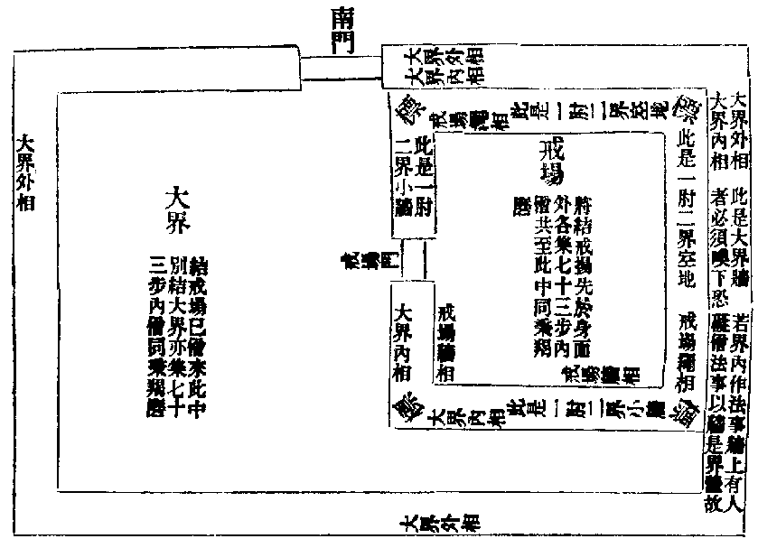

# 毗尼讨要



> **藏经**：卍新纂大日本续藏经（新纂卍续藏）　**册次** 第 44 册（X44）　**编号** X0743　**部类** 经疏部　**卷次** 3 卷　**篇幅** 168,378 字

> **卷／品**：0 卷 · 1 品



---



## 目录



  - [No. 743-A 毗尼讨要序](#no-743-a-毗尼讨要序)



---



### No. 743-A 毗尼讨要序



长安弘法寺沙门释　玄恽　纂



夫毗尼之典盖阙，随叶所以运终；木叉之教蔚兴，牟尼以之延祚。良由戒为正法之纲纪，慈训之枢机。故知猒俗求真，是称白法。戒资定发，唯曰清凉。品类相从，理路然矣。自能仁利见，肇启斯宗。弘五篇以劝善，䇿七聚以惩恶。防生漏於初归，灭心惑於将圣。凡厥有祈，孰不蒙润。洎调御税驾，罗汉护持。遗风稍渐，弗逮前踪。迄于像季，日有浇漓。百家之说波涌，万德之旨沦翳。於是各述众记，繁略不同。或编列参差，行事出没。或僧尼别犯，淆混同区。竞引浮辤，朱紫相夺。舛搆名言，曲分岐路。致使习者劳而少功。学者博而寡要。本欲助扬懿训，而及斁其彛伦。可为叹息者。深可为流涕者众。但道藉人弘，理由教显。而弘道设教，莫尚逗机。应物适时，务存省约。依而玩习，文露可寻。余虽不敏，忝参黉塾。伏膺匪懈，颇识宗涂。故於听览餘隙，厝心撰录。每一介可称，輙有怀三复。渔猎经律，捃摭众记。披忱研精，冀存简要。立章四十。勒成三卷。上三十五章，通戒僧尼。时有异同，并子注甄别。下有五章，偏勗尼众。今所撰者，以四分为宗。若此文不足，则用诸部补阙。其间纡义，兼以人语润色。庶披览易晓，秉法无疑。仰述旧章，非敢穿凿。輙树题目，用防诸己。有识君子，幸无诮焉。



No. 743  

毗尼讨要卷上(正释四分傍通诸部)



标宗劝学章第一  

教兴由致章第二  

篇聚释名章第三  

羯磨释要章第四  

结界兴废章第五  

鸣槌集众章第六  

足数兴废章第七  

受欲成坏章第八  

受具戒章第九  

说六念章第十  

受舍护衣章第十一  

受舍护钵章第十二  

资缘净施章第十三  

四药受净章第十四  

师徒相摄章第十五  

说戒仪式章第十六



标宗劝学章第一



此章大门有二。一、总约化制二教顺之得益。二、别约二教，杂明违之致损。



先约化中有四。一曰小乘经者。如般泥洹经云：佛垂灭度，世间无师。阿难启请。佛言比丘若能奉戒者，是汝大师。若我住世，无异此也。遗教经云：若无净戒，诸善功德皆不得生。又因此戒，得有定慧。又经云：戒者行根住持。即喻大地能生成万物。故曰住持也。二曰大乘经者。如华严经云：具足受持威仪教法，行六和敬，善御大众，心无忧悔，佛说正法不违其教。是故能令三宝不断，法得久住。又偈云：戒是无上菩提本，应当具足持净戒。若能坚持於禁戒，则是如来所赞叹。大集经云：菩萨请佛制於禁戒。如餘佛土。为法久住故。佛许之。大品经云：我若不持戒，当堕三恶道中。尚不得人身。况能成就众生，净佛国土，具一切种智。萨遮尼犍经云：若不持戒，乃至不得疥癞野干身，何况当得功德之身。涅槃经云：欲见佛性，证大涅槃，必须深心修持净戒。若持是经而毁净戒，是魔眷属，非我弟子。我亦不听受持是经。月灯三昧经云：虽有色寿及多闻，若无戒智犹禽兽。虽处卑下少闻见，能持净戒名胜士。三曰小乘论者。如成实论云：道品楼观，以戒为廓。禅定心城，以戒为柱。要佩戒印，得入善众。毗婆沙云：尸罗言冷。谓无破戒热，及三恶道热。亦名为定。若住戒者，心易得定。亦名为池，群圣所浴故。亦名为镜，由戒净故，无我像现。四曰大乘论者。如大智度论云：若求大利，当坚持戒。如惜重宝。如护身命。以戒是一切善法住处。又如无足欲行，无翅欲飞，无船欲度，是不可得。若无净戒，欲得好果，亦复如是。若弃舍此戒，虽复山居服药食草，与禽兽无异。若能持戒，香闻十方，名声远布，天人爱敬，所愿皆得。持戒之人，寿终之时，刀风解身，筋脉断绝，心不怖畏。地持论云：三十二相无差别因。皆持戒所得。若不持戒，尚不得下贱人身。况复大人相报。次约制中有二。初述律本诚文者。僧祇律云：欲得五事利养，当受持此律。何等为五。一、建立佛法。二、令正法久住。三、不欲有疑悔请问他人。四、僧尼犯罪者，为作依怙。五、欲游化诸方，而无有碍。是为笃信善男子五利。四分律云：持律之人，得五功德。一、戒品窂固。二、善胜诸怨。三、众中决当无畏。四、所有疑悔，善能开解。五、善持毗尼，令正法久住。十诵律云：佛法几时住世。佛答随清净比丘说戒法不坏，名法住世。乃至三世佛亦尔。次依论解者。明了论云：本音名毗那耶。此略言毗尼也。谓胜人所行事。佛乃独觉声闻皆行其中。凡人行者，亦是胜人。萨婆多论云：佛告比丘。戒有四义故，毁者重於餘经。一、戒是佛法平地，万善由之生长。二、一切佛子皆依戒住。若无戒者，则无所依。一切众生由戒而有。三、戒是趣涅槃之初门。若无戒者，则无由得入泥洹城。四、戒是佛法璎珞。能庄严佛法也。善见论云：佛语阿难。我灭度后，有五种法，令法久住。一、毗尼者是汝大师。二、下至五人持律在世。三、若有中国十人，边地五人，如法受戒。四、乃至二十人如法出罪。五、以律师持律故，佛法住世五千年。五百问事云：佛有二身。肉身虽去，法身在世。若敬法念法者，便敬佛念佛。若持戒者，即见法身。若护法者，便为护佛。如半月说戒，则见我也。萨婆多论云：何故律初集。以胜故秘故。如诸契经，不择时处人说，而得名经。律则不尔。唯佛自说，要在僧中，故胜也。分别功德论云：由胜密故，非俗人所行，故不令见。



第二、别约二教杂明违之致损者。十诵律云：像法时有五种法灭。一、比丘小得心已，便谓证圣。二、白衣生天，出家人入地狱。三、有人舍世间业，而出家破戒。四、破戒人多人佐助。五、乃至罗汉亦被打骂。又有五种怖畏。一、自不修身戒心慧，复教他人令不修身戒等法。二、畜沙弥。三、与他依止。四、与净人沙弥共住，不知三相。谓掘地断草溉水。五、虽诵律藏，前后杂乱。四分律云：有五种疾灭正法。一、有比丘不谛受诵律。憙忘文句。复教他人。文既不具，其义有阙。二、为僧中胜人上座，一国所宗。而多不持律，但修不善。后生倣习，教舍戒行。三、有比丘持法持律持摩夷，不教道俗，便即命终，令法断灭。四、比丘难可教授，不受善语。餘善比丘舍置。五、共相骂詈，互求长短，疾灭正法。又破戒人有五过失。一、自害。二、为智者所呵。三、恶名流布。四、临终生悔。五、死堕恶道中。律十诵律云：虽受戒多岁，不知五法者，应尽形依止他。一、不知犯。二、不知不犯。三、不知轻。四、不知重。五、不广诵戒通利。又诸比丘废学毗尼，便读诵修多罗阿毗昙。世尊种种呵责。乃至由有毗尼，佛法住世。因此多有上座长老比丘学律。四分律云：上座不学戒，亦不赞叹戒。有餘比丘乐学戒者，不能以时劝叹。我见如是上座过失，故不赞叹。恐餘人习学，长夜受苦。毗尼母论云：百臈不知法者，应从十臈知法者依止。善见论云：若不解律，但解经论，不得度沙弥，及作依止师。摩耶经云：乐好衣服，纵逸嬉戏，奴为比丘，婢为比丘尼，不乐不净观，毁谤毗尼，互用三宝物等。是名法灭尽相。观佛三昧经云：犯四重虗食信施，过煞八万四千父母等罪。梵网经云：若佛子信心出家，受佛正戒，故起心毁犯圣戒者。不得受一切檀越供养，亦不得国王地上行。不得饮用国王水土。五千大鬼常遮其前。鬼言大贼。入坊舍城邑宅中，鬼复扫其脚迹。一切世人，骂言佛法中贼。一切众生眼不欲见。犯戒之人，畜生无异，木头无异。涅槃经云：由诸比丘不持戒故，畜八不净财，言是佛听。如何此人，舌不卷缩。智度论云：何名为破戒人罪。破戒之人，人不爱敬。其家如冢，人所不到。破戒之人，恶心可畏。譬如罗刹。破戒之人，人不归向。譬如渴人，不向枯井。破戒之人，心常疑悔。譬如犯事之人，常畏罪至。破戒之人，如田破雹，不可依仰。破戒之人，譬如苦瓜，虽形似其种不可食。破戒之人，如贼聚落，不可依止。破戒之人，譬如大病，人不欲近。破戒之人，不可免苦。譬如恶道，难可得过。破戒之人，不可共止。譬如恶贼，难可亲近。破戒之人，譬如火坑，行者避之。破戒之人，难可共住，譬如毒蛇。破戒之人，不可近触，譬如大火。破戒之人，譬如破船，不可乘度。破戒之人，譬如吐食，不可更噉。破戒之人，在好众中。譬如恶马，在善马群中。破戒之人，虽形似比丘，譬如死尸，在眠人中。破戒之人，譬如伪珠，在真珠中。破戒之人，譬如伊兰，在栴檀林中。如是种种无量破戒之罪不可称说。行者应当一心持戒。犯罪轻重经云：佛告目连。若比丘比丘尼无惭愧心，轻慢佛语，犯众学戒。如四天王天寿五百岁堕泥犁中，於人间数九百千岁。(〔私按为若约小数当九百万。若用大数则九十千。世窃疑文误。〕)佛告目连。若无惭愧心，轻慢佛语，犯波罗提提舍尼。如三十三天寿千岁堕泥犁中，於人间数三亿六十千岁。佛告目连。若无惭愧心，轻慢佛语犯波夜提。如夜摩天寿二千岁堕泥犁中，於人间数二十亿四十千岁。(〔私按二十下脱四字。又二字错。合作一字。〕)佛告目连。若无惭愧心，轻慢佛语，犯偷兰遮。如兜卛天寿四千岁堕泥犁中，於人间数五十亿六十千岁。(〔私按五十下脱七字。据筭可知。〕)佛告目连。若无惭愧心，轻慢佛语，犯僧伽婆尸沙。如不憍乐天寿八千岁堕泥犁中，於人间数二百三十亿四十千岁。佛告目连。若无惭愧心，轻慢佛语，犯波罗夷。如他化自在天寿十六千岁堕泥犁中，於人间数九百二十一亿六十千岁。都合总计僧尼於五篇七聚之罪，且篇别单犯一罪论之。如人间日月岁数总有一千二百六十一亿五十千岁堕在地狱。圣教不虗，特须敬慎。宜修方便，捡察身口。励志专崇，高慕前圣。不得自怠，轻蔑佛语。故经曰：正法住，正法灭。意在兹乎。



教兴由致章第二



此章大门有二。一、明教兴之意。二、明释之次第。



第一、教兴意者。问曰。佛何故为诸弟子制此五部毗尼轻重不同。使诸众生互起是非耶。答曰：佛为比丘制一部戒律，尚无二名，何况有五。但如来御世，善达群情。随犯立制，开塞当机。迄于双树，在迹为周。复有尊者波离翼宣斯教。实师资之翘楚。历贤劫而一遇。自如来灭影，波离晦迹之后，乃有迦叶，阿难，末田地，商那和修，优婆崛多。此五罗汉，继踵传持。虽不逮前踪，亦其亚圣。犹号为八十诵律。略著篇题，而未分部品。至崛多之季世，有哲王号为阿育。稚尚玄宗，虗心佛果。乃远招名德，更刊三藏。於是次后五人昙无德等各据师宗，竞执同异。遂於毗尼一藏，分为五部。致使篇聚参差，开遮有异。虽览文似乖，而於义无失。故经曰：五部虽各别异，而不妨诸佛及大涅槃。



第二、译之次第者。(已下并依开皇翻经学士成都费长房三宝记录。)十诵律五十八卷。(秦弘始六年十月十七日於中寺出见二秦录。)此之一部，元有五十八卷。至晋安帝世，罽宾国三藏律师弗若多罗，秦言功德华。以戒节见称。游历行化。罗既至止。姚兴即召常(以姚苌国讳故改为常也。)安名德六百餘僧。延请多罗憩於中寺。诵出十诵律梵本。鸠摩罗什度为秦文。三分获二。一未竟而多罗奄然终卒。众咸痛惜。什后又共昙摩流支，秦言法乐，续译都讫毗尼诵三卷。(是十诵后善诵。见二秦录。)又安帝世罽宾国三藏律师卑摩罗叉，晋言无垢眼。姚秦弘始八年至常安。罗什去世，乃适寿春。止石磵寺。律徒云集。盛阐毗尼。罗什十诵，元有五十八卷。至罗叉后开为六十一卷。改善诵为毗尼诵。故今有两名。律教东行，十诵最初。昙无德律四十五卷。(秦言法藏。此是人名。则四分律主也。今开为六十卷。见晋世杂录。)此之一部，元有四十五卷。至晋安帝世，罽宾国三藏法师佛陀耶舍，秦言觉名。弘始八年来到姑臧，而什久已入於常安。本在西域，伏膺耶舍以为师处。闻至姑臧，大生欢喜。则劝姚兴令使迎逆。兴未然许之。顷兴命罗什出经。而什又曰：夫欲宣通无上法教，宜令文义理趣圆通。贫道虽复读诵其文，未善其理。唯有耶舍深达经致。今在姑臧，愿诏徵之。一言三详，然后著笔。使微言不坠，取信千载也。兴遂从之。则遣使厚加赠遗，并皆不受。笑曰：明旨既降，便应载驰。檀越待士既厚。脱如罗什见处，则未敢闻命。兴叹其几慎，重信敦喻，方至常安。兴自出候。别立新省於逍遥园。四事供养，并无所受。时至分卫一食而已。舍为人赤髭善毗婆沙。时人号之为赤髭毗婆沙。什既师之。亦称为大毗婆沙。四事供养衣钵卧具，满三间屋，不以关心。兴为货之。造玄寺舍。而先甞诵四分律。时请出之。疑其遗谬。乃试令诵差藉药方可五万言。经一日覆不悮一字。众咸揖伏。以弘始十二年译四分等经律。至十五年方始解座。兴施耶舍布绢万匹，悉皆不受。沙门道含，竺佛念等二人笔受。各施千匹。已外名德五百沙门，皆重嚫施。舍后还西，不知所终。律教东行，四分第二。僧祇律四十卷。(晋义凞十二年十一月，共法显等译，见竺道祖录，及别录，或有三十卷。)此之一部，元有四十卷。至晋安帝世，北天竺国三藏禅师佛䭾䟦陀罗，晋言觉贤，於扬都及庐山二处译。沙门法业慧义慧严等笔受。律教东行，僧祗第三。弥沙塞律三十四卷。(见道慧〔宗〕齐录。别录云二十四卷。此疑悮也。)此之一部，元有三十四卷。至废帝荧阳王世，罽宾国三藏毗尼师佛陀什，宋言觉寿。少受业於弥沙塞部。专精律品。兼达禅要。寿以景平元年七月到於杨都。先是法显於师子国得弥沙塞梵本来，未飜译而迁化。京邑诸僧闻佛陀什既善此学。於是众议请令出之。则以其年冬十一月集龙光寺译为三十四卷。什执梵文。于填沙门慧严等更互笔受。参正文理。仪同侍中瑯琊王练为檀越。至二年十二月方讫。律教东行，五分第四。解脱戒本一卷。(兴和二年出。僧昉笔受。出迦叶毗律。大本不来。)此之一卷，至梁武帝世，东魏南天竺国波罗柰城婆罗门瞿昙般若流支，魏言智希。於元象初，至兴和末，在邺城译。时有菩提流支。虽复前后亦同出经，而众目录相传抄写，上去菩提及般若字，唯云流支译。不知是何流支。迄今群录交涉相参，谬滥相入，难得详定。后贤愽采，幸愿讨之。律教东行，解脱第五。



篇聚释名章第三



此章大门有二。一、列数释名。二、约性辨业。



第一、列数释名。有五篇七聚。约义差分，说有七名。结罪论实，止标六法。今先解七聚。后释五篇。一、波罗夷。二、僧伽婆尸沙。三、偷兰遮。四、波逸提。五、波罗提提舍尼。六、突吉罗。七、恶说。此之七名，律无正翻。且用义推，略知途路。初名波罗夷者。僧祇义当极恶。释有三意。一、名退没。由犯此戒，令道果无分。二、名不共住。非失道而已，更不入二种僧数。一、羯磨。二、说戒。三、堕落义。舍此身已，堕在阿鼻地狱。十诵云：堕在不如意处。萨婆多云：由与魔鬪以犯此戒，便堕负处。此律波罗夷者，譬如断人头不可复起。若犯此戒，不复成比丘。此从行法为名。又云无餘者，此从众法绝分为名。故偈云：诸作恶行者，犹如彼死尸。众所不容受，以是当持戒。又名不共住，同前僧祇。二、名僧伽婆尸沙者。婆沙云：僧伽者名僧。婆尸沙者名残。若犯此罪，缠垢行人，非全净用。有残之罪，由僧除灭，故名僧残。毗尼母云：如人为他所斫，残有咽喉，故名为残。善见云：僧伽者为僧。婆者为初。谓前与覆藏羯磨也。尸沙者为残。谓后与出罪羯磨也。若犯是罪，僧作法除。此从境立名。三、名偷兰遮者。善见云：偷兰名为大。遮言鄣善道。后堕恶道。体是鄙秽。此从不善以立其名。明了论云：偷兰为麤。遮即为过。麤有二种。一、是重罪方便。二、能断善根。所言过者，不依佛所立戒而行，故云过也。四、名波逸提者。义翻为堕。故十诵云：堕在烧煑覆障地狱。故名堕也。此律初分三十戒。因财生犯。贪慢心强，制舍入僧，故名尼萨耆。餘下提罪，因事生犯，单对人悔。仍罪均一品，同入第三篇摄。出要律仪云：尼萨耆者，旧翻舍堕。声论云：尼翻为尽。萨耆为舍。波逸提者，本名波药(夷割反)致也。五、名波罗提提舍尼者。义翻云向彼悔。从对治境以立其名。僧祇云：此罪应发露也。即此四分，具明悔过之辞。明了论云：波胝提舍尼者，翻为各对应说。谓对人说所作罪也。六、名突吉罗者。善见云：突者恶也。吉罗者作也。此律式叉迦罗尼者，翻为应当学。西域僧云，翻为守戒也。此罪微细，持之极难，故随学随守以立其名。十诵律云：以天眼见犯罪比丘如驶雨下。岂非专玩在心，名为守戒也。七、名恶说者。此律第六聚摄。义分有二。初以身名恶作。后以口名恶说。故突吉罗后，加一恶说，合有七也。据体论实，的标为六。约业不同，故离有七。问：五篇七聚，何意离分。答：义有三均，故入篇摄。一、名均。二、体均。三、究竟均。偷兰恶说，名义不均。众罪合杂，统收为聚也。其二不定。若托境而言，冠通七聚。若论罪体，生疑不信，但是吉罗。文标三二罪者，略举生疑之事。餘义不尽，如疏具述。七灭诤中罪亦通有。但为竞於四诤，彼此未和。故制此七药，殄除罪争。文义既广，非此要所。必有斯事，冀寻本文。



第二、约性辨药者。问：三性心中，并有犯戒义不。答：有一善心犯戒。如萨婆多云：年少比丘不知戒相。塔上秡草。罪福俱得。僧祇云：知事比丘暗於戒相，互用三宝物。或见人舍身，心生悲叹，助觅柴薪。或见父母师僧犯於王法，身处刑戮，为觅刀绳，愿早离苦。如是等事，虽有善心，不以无知得脱，皆犯重罪。以法是可学，更加无知不学之罪。乃至吉罗亦尔。若论来报，受罪则轻。顺本受心，更不增罪。违本受体，不免地狱。是名善心犯也。二不善心犯戒者。谓识知戒相，或复无知轻慢圣教，毁呰佛语，故违禁制，无惭无愧悔。其意转姧，恶心渐炽，名不善心犯也。故明了论云：有四种麤恶意犯罪。一、者浊重贪瞋痴。二、者不信业报。三、者不惜所受戒。四、者轻慢佛语，故心而造，则得重罪。成实论云：尤害心中煞蚁子，重於慈心煞人波罗夷。此人犯决定受苦，以时报俱定故。纵起心立治，唯免制教，一罪不妨业道终自不除。如十诵云：调达破僧犯兰，佛令僧中悔之。而於业道尚堕阿鼻。餘则亡言。又十地经云：作业有二。一、作业定。二、感果定。诸佛威神所不能转。皆谓不善心犯也。三、无记心犯戒者。谓无护戒之心。随流而造。意无善恶，卒尔而兴，名无记心犯也。如愚痴比丘不识戒相，纵放身口，损伤物命，斫伐草木，媒嫁净人，互用众物，身坏威仪，触僧净器。如是等例，并入无记门摄。若据论宗，亦有感报义。问：无记非业，云何感报。答：感报有二。一、先有方便，后入无记。业成在无记心中，故言感报。而实无记非记果也。二、不感总报，非无别受。如经中头陀比丘不觉煞生，后被猪煞。又五百问事云：知事比丘悮触净器，后作噉粪鬼等。如成实论中睡眠成业，亦是无记报。问：云何无记不受报耶。答：谓学知戒相。善达持犯。心常勗励。惔尔忘悮。非意缘犯禁。此开非犯。如长衣过日不说净。善摄根门，睡眠漏失。悮堕椽梁，伤煞人命。如是等例，并非结限。又束此三心对境有二。若犯性戒，如煞盗等，具受二罪。谓业道违制。以对情损恼故重。若犯遮戒，如伤草木等，但得违教，无业道罪。以无情可恼故轻。凡夫报欲居怀，孰能无犯。既犯则须忏净，还入僧数。何意怀疾，自垢心行，不预清众，於理大悮。律言：断头者，望现失道而论。语其戒体，实自清净。今时世人犯一婬戒，初时惶怖，后覆思维，谓戒都无，遂则雷同不禁根器，随境放情，恣心造罪。岂不由自暗於戒，致悮流俗也。如犯婬戒时，餘煞盗等严然常净。况下餘篇，理则亡言。故萨婆多云：宁可一时发一切戒。不可一时破一切戒。斯言有验，信知徵矣。



羯磨释要章第四



此章大门有三。一、辨意释名。二、作法具缘。三、立法通局。



第一、辨意释名者。夫言羯磨，义当办事。事非羯磨。谓办得前事有堪济之功，故称言事。故百论翻为事也。正论羯磨，乃是声教业也。故明了论疏翻为业也。然僧为能秉之人。羯磨是所秉之法。前事复须如实。三法支持，事乃匡济。若一法乖违，则难成办。故律云：若作羯磨，不如白法作白，不如羯磨法作羯磨，如是渐渐毁灭正法也。



第二、统明一切羯磨之前，必有由渐。故有十缘不同。一、述事。二、约处。三、集僧。四、和僧。五、简众。六、陈意。七、与欲。八、问宗。九、答事。十、秉法。一法不孤起。必有所为之事。其事是何，谓结界等是。若无其事，法岂独明。故须先述其事。虽有其事，若也无处，事无所依。故次第二、约处以论。谓作摄僧界是。唯除结界羯磨，在自然界中。已外并须托处。故僧祇云：非羯磨地，不得行僧事。亦须兼知结界元起成坏之相。傥无结不成，唐弃人功，终无成办。虽有其处。以法藉人弘。若也无僧，谁能秉法。故次第三、鸣槌集众，量僧多少，观时制度，通识四僧用处差别。虽复形集，情若有乖，法亦难办。故次第四、众中上座，略和众情，告僧言大德等莫怪此集。今有其事须作羯摩，愿僧慈悲，同秉此法。即须善识四分十五种默然之义。谓事有是非。人有忍拒不同。是故须明。众虽和默，人有非类。若混杂同居，时乖所应。故次第五、简众未受具者出。复须知足数是非之相。具如下说。众既纯净宜申本意。故次第六、正陈本意。谓作举作忆念随僧乞辞等。於中有四。一、顺情为己，多须乞辞。如二房僧残舍堕等是。二、违心立治，及以无心领者，则无乞辞。如七羯磨治𢷤及颠狂人等是。三、僧创立法，必须结界。正此所明，亦无乞辞。四、僧常行事，亦无乞辞。谓说戒自恣行筹等是。然羯磨之体，贵在详遵。形虽缘碍，无妨心到。故次第七、与欲应和。须知欲缘是非，说之成不。众心既和，未知竟作何事。故次第八、问其事宗。僧今和合，何所作为。当羯磨师问，不得餘人輙问。既有问於前，理须答遣。故次第九、随事答云作某羯磨。必题羯磨及所为之事。双告僧知。不得单答其事。如似答云布萨说戒者，此直答其事。然不通羯磨。若答云说戒羯磨者，此则事法双告。上来诸缘既备。从此已下，宜陈本意。故次第十、正作羯磨。此之十缘，泛显次第。未必一切羯磨皆具此十。如结界等法，则无乞辞说欲等缘。又如受日说戒自恣等，虽无乞辞，不妨须欲。如是绮互多少，至时量作。



第三、立法通局者。就中分二。初明摄法分齐。后别举羯磨释其成坏。初中分四。一、法。二、事。三、人。四、界。第一、法就辨者，略有三种。一、心念。二、对手。三、众法。且列三位。须知三名。第一、心念法者，谓事是微小，界中无人，令自行得成，无犯戒事。发心念境，口自传情。故云心念也。於中有四。一、单心念。二、对手心念。三、众法心念。四、体通心念。初单心念者。谓界通内外，随事自说。纵令有人，法亦得成。如忏轻吉。说戒座上发露先罪及六念等三。二对手心念者。谓本是对人之法。由界无人，佛开心念得成。如此律安居。十诵说净受药受七日。五分受衣及舍。善见受持钵等七。三众法心念者。谓本是僧法。以界无人，故开心念，法亦得成。如此律说戒，自恣，外部受僧得施，分亡人衣等四。四体通心念者。谓法不局人，人通多少。纵界有僧，法亦得成。如受功德衣等一。此之四法，虽开心念。若欲兴念，必假言教。故毗尼母云：心念必须口言。若说不明了，作法不成。第二、对手法中有二。一、单对手。二、众法对手。初单对手者。谓是别人不关众事。纵界僧不集，作法得成。如受衣钵等。(总数二十九，如大疏说。)二众法对手者。同前众法心念说戒等四。第三、众法中有三。一、单白。二、白二。三、白四。初单白者。谓事轻小。或是常制。如说戒受忏等。一白告僧。事得成办。更无法续，故云单白。二白二者。谓事涉於义。义须通和。一白牒告僧知。一羯磨量其可不。通白羯磨，故云白二。三白四者。谓受戒忏夷。情容乖舛。自非一白告僧，三法量可不，焉能办事。以三通白，故云白四。若约羯磨总相，都合一百三十四。谓单白三十九。白二五十七。白四三十八。若约别离分，便有四十八。谓心念十五。对手三十三。以别配总，合有一百八十二。问：昔闻百一，今不同者。答：谓总标位。非的实数。若引十诵，百一是定。问：何以得知别人之法，通名羯磨。答：此律三语受戒，及白衣说法中，言是羯磨。十诵对手心念分衣，亦名羯磨。第二、就事辨者。谓羯磨所被事中，通情非情。并令前境是实，方成法事。若一缘有乖，便差圣教。如人法中不覆藏者，与覆藏羯磨。非法不成。此谓无事有法。如瞻波中应与作呵责，乃作摈出。此谓有病有药施不相当。佛判不成。故知事者必须据实，方称圣教。且约一事，餘例之。如实犯罪，自言不犯。实不犯自言犯等。并名非法。若实言实，方符圣说。非情明者。如二房妨难，不唱界相等，羯磨不成。如是𫓴楯，例准可知。第三、对人明者。於中有三。谓众法，对手，心念。初对僧有四。谓四人僧五人僧十人僧二十人僧。此之四种，唯秉羯磨已外，对手心念，定不得行。二对手中，人局二三，法通於众。就众法对手中，自然作法两界无僧，方得为之。若数满四，宜改就僧。若单对手，纵令有僧，各不相妨。三心念有二。若作众法对手心念，并界中无人，方得法成。若有一人，名非法别众。若单心念。弗论同别。彼此有人，两不相妨。第四、就界辨者。如下结界中说。今正释羯磨文中，且就说戒单白，分为五句。一、大(德姉)僧听者。劝警耳识，鉴法得失。二、今僧白月十五日布萨说戒者。正宣情事，启众令知。三、若僧时到僧忍听者。正明僧若和集，详心审听，量其可不。若僧时到者，谓心和身集事顺法应。僧忍听者，劝令情和听可，勿事乖违。四、布萨说戒者。重牒第二根本白意。次判成就，忍可所为。五、白如是者。事既办已，白结告知。次就羯磨法中明白者。且约白四羯磨受戒初白论之。然上已明。恐初学未委，重述令知。就前白中，还有五句。一、大(德姉)僧听者。筞动耳识，劝审听法。二、是某甲从(和上和上尼)某甲求受具足戒乃至(三衣五衣)钵具(和上和上尼)某甲者。此牒其缘，正宣情事，令众量宜听许可不。三、若僧时到僧忍听者。明心事既和，愿僧同忍。四、僧令授某甲具足戒(和上和上尼)某甲者。正明忍可所为，决判成办。五、白如是者。委众令知。



次释羯磨。就中有三。第一、大(德姉)僧听者。告众重听。事既非小，宜共详审。第二、是某甲乃至谁诸(长老大姉)忍者。(诸者训之。此乃别问谁之忍不。非谓总问僧也。)此辨乞缘。又牒根本，谓今与某甲授戒等事，量其可不。三、僧今与某甲授戒乃至谁不忍者说，单牒根本之情。决判早使成就。第二第三亦如是说者。略则事或疎阙。繁则辞义盈秽。故轨尅取中，限至三也。后结劝云。僧已忍与某甲授具乃至如是持者，此是付嘱结归。非是羯磨正体。於中剩辨是非者。若事非大，或无缘起，则无乞辞。又无牒事。如说戒五句。单白除第二四句。成白未定存五。乃至白二类准除之。又单白文中第一第三第五，文义俱通百三十四，更无增减，剋须通诵。第二第四，随事牒缘。文随事显，故限局也。义存启众，故通一切。辨羯磨中，大德僧听谁诸长老忍谁不忍者说僧已忍下，文义俱通白二白四。若作其法亦须通诵。中间牒缘牒事，随遇随称，俱事顺合宜，弗乖大轨。纵片文纰，於理靡坠。上来所述，镜目启心，遇缘便作，未假执文。傥昏大旨，纵诵犹谬。问：白读羯磨作法成不。答：律无正文，可以义求。然羯磨戒本作法相似。戒必令诵已然后得说。今类羯磨岂得白读。故此律及僧祇中十五日无人能诵戒者，应差人向他处诵得已，还本处说。不得重说。乃至一人说一篇竟，更一人说。若不能诵者，但说法诵经便罢。终无白读之法。若执文得者，何须苦抑令读。问：尼与大僧得更互作羯磨不。答：此律十诵中尼与大僧作不礼不共语不敬畏问讯。此三羯磨，不须现前自言得作。此律僧为尼得作五种羯磨。谓受戒摩那埵出罪谪罸舍教授。然舍教授一种律中但制羯磨名，而不出羯磨文。必有某事，义作亦得。如解净地戒场等。并无羯磨，义作得成。问：得对尼三众及沙弥白衣前作羯磨不。答：不得。故律云：应至不见闻处作。唯除所为人得。若依摩得勒伽十诵律等，白衣前说戒成者，唯有缾沙王及波斯匿王。仍除王眷属，独为王说，令王心净，故亦不通诸臣百官等。问：羯磨所加，得被几人。答：此律为难事故，得二三人一时受戒，不得加四。若谏恶和争，通多无妨。问：羯磨既竟位属何处。答：谓第三僧已忍乃至和上某甲竟时，是羯磨体。不用第三说己名为竟也。故律云：忍者默然，不忍者说。今若不忍，便成呵破。既三忍无呵，故知是竟。



结界兴废章第五



此章大门有四。一、释其界名。二、列数定量。三、依位作法。四、辨界成坏。



初释界名者。总有二种。一、曰自然界者。未作法前。但开随境。各有分限。人所至处，任运界起。故曰自然。二、明作法界者。由自然限约，未得遂心。设有宽狭，教文已定，用则不可。故如来善巧，曲顺物情，听随处结。轨式楷定，更无转改。故曰作法。



第二、列数定量者。泛论界有三种。谓衣食二界，非此所明。僧之一界，正此宣释。就中分三。一、大界者。谓人法二同界。次论量者。此律同一说戒中，为路远故，听十四日说戒。十三日先往。不得受欲。义准应有百里。毗尼母云：同布萨界，极远听一日往还。若极大结，如前所明。欲小结者，下至容四人已上亦得。萨婆多云：尼结界者，唯得方一拘卢舍。义准五里。傥有难缘，通前百里。律云：以僧中数有四人众起，乃至二十人众起，令僧疲极。佛言听结戒场。仍不云量有大小。准善见戒场极小，下至容二十一人便得。减则不听。



第三、依位别解者。住有三别。若安戒场者。先结戒场。后结大众。今且论无者。就中分二。先出结界之缘。后正加法。初中分三。一、料简是非。二、竖标唱相。三、集僧辨欲。初中，问曰：大界内有村，得合结不。答：得。故五分云：诸白衣新作堂舍，为得吉利，或为非人所恼，请僧於中布萨，故知得也。萨婆多及四分并结取村也。问：界中有河，得合结不。答：律云，除常有桥船得合结。若隔驶流无桥者不得。义云若小水浅流者应得。故下尼律云：水者独不能度。今既得度，明知得结。问：一标得作两相不。答：一肘已上作相者得。故明了论疏云：如山东西各结别住者是。(大墙类用亦得)。



二竖标唱相者。先明竖标。后明唱相。问：标相界体同异云何。答：标谓山石之物。用为指的。相即标畔界体之中。界谓相内作法之所。或标即体。或标异体。相必体外，临时处分。并预委三。若依四分界相，不定是非。故律云：若东方有山称山，有堑称堑，草𧂐汪水粪聚钉杙空地露地等，并得作相。然空相一种，结竟则须题记。令后来比丘识知界相，行法者无疑。善见云：界相有八种。一、山。二、石。三、林。四、树。五、路。六、蚁封。七、江。八、水。次明界形者。善见云：界形有五种。一方。二圆。三皷形。四半月形。五三角形。义云并随屈曲方圆，任地形结。不要方正。若先无相，随立一物作之亦得。今时结者，多是空地。四方城邑，随有屈曲，先须识过，然后唱之。云何名过。谓前学未达。后学未明。若唱方相，便容舛悮。如从墙外唱云：从东南角至西南角，乃至一周讫。寺南门外便成别众。以唱界时，从墙基直过，门能外便成界内。脱寺中閇门作羯磨门。限外有人不唤尽集，岂非别众。若从墙内直唱，复有别众破夏离衣等过。以界随墙内起。今既傍墙直唱。门限内地，便是界外。若寺中作法，有人说欲。至门限内须有所作，又来入界，岂非别众。若为破夏。有人在界安居，明相未出，至门限边。未还之顷，明相已出，便是界外，岂非破夏。云何失衣。有人结不失衣界。明相未出，不持衣往门限内。明相若出，岂非失衣。故须屈曲示知。然后唱相。不得笼通直过而唱。傥有斯谬，令他一生虗过。故大集经云：我灭度后，无戒比丘满阎浮提。斯言实矣。次明唱人是非者。律云：使旧住人唱。未唱已前，亲自案行，识知处所。屏处暗诵，勿使对众，致成蹇错。先须从东南角为始。故律云：东方有山称山也。此亦不定。随从一角逐稳而唱并得。若在空野中结者，先指四相示僧，或树石山水等，随有称之。然后僧中差一人唱。被差人应起礼僧足立唱云：大(德姉)僧听。我(比丘比丘尼)某甲。今为僧唱四方大界相。从东南角某树直西下博地至西南角某树。从此北下博地至西北角某树。从此东下博地至东北角某树。从此南下博地还至东南角某树。是为大界相一周讫。(一说便得)若在聚落城堑寺中结者，多从墙内唱云：从寺院大墙东南角内傍墙西下，至南门东颊北土楞。从此屈曲南出至门西颊北土楞。从此傍墙西出至西南角内角。从此傍墙北出至西北角内角。从此傍墙东出至东北角内角。从此傍墙南出还至东南角内角。是为大界相一周讫。(一说)若有俗家侵入寺腹。或墙轻尖斜。或寺有多门。并须一一屈曲随处唱之。若有横墙隔碍者，当穿墙直过口唱便得。



三集僧远近者。若标相狭，自然宽者。应尽自然界集。若标相宽，自然狭者。应尽标内集。故僧祇避难界中，三由旬内有比丘并须呼来。若出界已，作法结之。诸师解云：但尽自然集者，亦得。以自然界外非是摄僧之处。又未加法。何为不得耶。僧祇尽标集者。彼容难事，恐成障碍，故须尽集。今解不然。尽标者是。一、则深防。二、则僧祇有文。若标内有村在自然里，不欲取者，当遶村四边唱内相。后唱外相。然后结界。村内比丘，不须外集。若相内外有尼界者，两不相妨，不须唤集。若有作法摄僧界者。但令比丘莫出自界。通结里取亦得。如明了论围轮别住等是。问：结界何为不得受欲者。答：具三义故，不得受欲。一、结界是众同之本，理宜急制。二、自然界弱，不胜羯磨。故僧祇云：非羯磨地，不得作僧事。三、令知界畔，护夏护衣护食别众等过。故十诵云：作羯磨比丘死，餘人不知界处。佛令舍已更结。故须尽集。



次正作羯磨。上座问僧集和合已。又问未受具足戒者出，僧今和合何所作为。答结大界羯磨。大(德姉)僧听。此住处(比丘比丘尼)某甲唱四方大界相。若僧时到僧忍听。僧今於此四方相内结大界，同一住处同一说戒。白如是。(律虽不牒人名，然复著无咎。)大(德姉)僧听。此住处(比丘比丘尼)某甲唱四方大界相。僧今於此四方相内结大界，同一住处同一说戒。谁诸(长老大姉)忍僧今於此四方相内结大界同一住处同一说戒者默然。谁不忍者说。僧已忍於此四方相内同一住处同一说戒结大界竟。僧忍默然故。是事如是持。



第二、若安戒场结者。应竖三标。第一重者，戒场外一肘自然内畔安一标。此是戒场相。第二重者。次一肘自然外畔安一标。此是大界内相。第三重者。大界外相周匝安一标。此是大界外相。先唱内标为首。然后第二第三次第结之。若先有墙者，直指墙为㯹相。若先无者，或以绳[打-丁+迸]围。或以树山等，并得作之。具如上说。其大界墙基无比寺者，不问宽狭，并得作相。若有寺界相连。或内安戒场者。其二界墙基，必须尺八已上，方得为相。故律云：应留中间地。恐二界相错涉也。义准下至应留一肘地，计有尺八，足分两相。多亦无妨。上来所辨，达律者无疑。犹恐新学之徒，未能晓会。故略以𦘕图，冀补规路。案图行事，庶免违失也。







今依此图，便有三相。若唱大界外相，必须在外唱之。周匝屈曲，一如前说。若在墙内唱者，至西南两面自然地边，则与大界内相共合，便不分彼此之异。若无戒场者，得从内唱。若唱大界内相，东北二边有小墙者，应傍小墙东南角外角唱穿小墙西入，还傍大界南墙，至西南角内角，还傍大界内西墙直北穿小墙过。然后屈曲唱之。戒场外自然地者。东北两边，即用小墙为自然地。西南两边，则用一肘绳㯹外为自然地。若大界内先无相者。应竖㯹杙，以绳连之。当於戒塲东南角离大界南墙尺八地，傍小墙基下钉一大杙。直至西墙。离西大墙内尺八地又钉一杙。直北至小墙基下复钉一杙。亦令远大墙一尺八寸。仍以绳连此三㯹外为自然地。其戒场相者。东北两边，则以小墙内畔为戒塲相。西南两边，则用绳㯹内畔为戒塲相。答：此绳㯹久固不坏者。人在自然地内，不妨戒场内得成法事。以识知界相故。若此绳㯹破坏无者，后时客比丘来，不知界畔，容可向自然地内坐立。或来去不定。恐破僧法事。临危事崄，可惧之甚。无知如此。若大界墙基阔二尺已上者，唱此一肘自然地，缩入大界墙内，最为稳审。以界是色法入实无妨。计一肘自然地止可尺八，残有二寸，便是大界墙体，足辨两界之相。上来所明，聊寄一物作此界体。而界相众多，未必如图。至时称事任补兹处。於戒塲门内亦应屈曲唱出。恐有繁重，不能更述。若结二界，应先结戒场后结大界。故五分亦令先结。若先结大界者，当舍已前结戒场后结大界。又毗尼母云：外更不结大界，直结小界者。亦不得受具。问：先结大界，后结戒场成不。答：五分应舍更结。故知得成。以不成后法，故须解之。五百问事云：后结戒场者。於中受戒，恐无所获。又云不知同於未制。赖有此路，则通侥幸。义云：今时结者，滥法众多，不可具述。且辨成文，非义自露。如前圣教所明，则戒场先定也。既知如是。若欲唱结，各当界为之，不得彼此遥作。便自然界僧尽集戒场所。令一旧住比丘起，具修威仪，立唱云：大(德姉)僧听。我(比丘比丘尼)某甲，为僧唱戒场四方小界相。从东南角内㯹傍绳西下，至西南角内㯹。从此傍绳北下，至西北角内㯹。又傍小墙东下，至东地角内角。从此南下至东南角内㯹。此是戒场相一周讫。(一说)上座问僧集和合已。又问未受具者出。僧今和合，何所作为。答：结戒场羯磨。大(德姉)僧听。此住处(比丘比丘尼)某甲唱四方小界相。若僧时到僧忍听。僧今於此四方小界相内结作戒场。白如是。大(德姉)僧听。此住处(比丘比丘尼)某甲唱四方小界相。僧今於此四方小界相内结戒场。谁诸(长老大姉)忍僧今於此四方小界相内结戒场者默然。谁不忍者说。僧已忍於此四方小界相内结戒场竟。僧忍默然故。是事如是持。



次明结大界者。唱相有三。一、先唱内相。二、唱外相。三、唱竟总结。今先唱大界内相云：大(德姉)僧听。我(比丘比丘尼)某甲为僧唱四方大界内相。从小墙东南角外角穿小墙西出，傍大墙内，至西南角内角。从此傍墙北下，穿小墙直过，至小墙西北角外角。从此傍小墙东下，至小墙东北角外角。从此傍小墙南下，还至小墙东南角外角。此是大界内相一周讫。(一说)次唱外相者。应从寺院外墙东南角外角为始。大(德姉)僧听。我(比丘比丘尼)某甲为僧唱四方大界外相。从寺院外墙东南角外角，傍墙直西下，至南门东颊外土楞。随屈曲出至门西颊外土楞。从此西下，至西南角外角。从此北下，至西北角外角。从此东下，至东北角外角。从此南下，还至东南角外角。此是大界外相一周讫。(一说)第三唱已总结云：此为外相。彼为内相。此是大界内外相一周讫。结已应告僧云：已唱大界内外相竟。众僧应作羯磨。唱者复坐已。上座问僧集和合已。又问未受具戒者出，僧今和合，何所作为，答结大界羯磨。大(德姉)僧听。此住处(比丘比丘尼)某甲唱四方大界相。若僧时到僧忍听。僧今於此四方相内结大界，同一住处同一说戒。白如是。大(德姉)僧听。此住处(比丘比丘尼)某甲唱四方大界相。僧今於此四方相内结大界，同一住处同一说戒。谁诸(长老大姉)忍僧今於此四方相内结大界同一住处同一说戒者默然。谁不忍者说。僧已忍於此四方相内结大界竟。僧忍默然故。是事如是持。义云：但依文结，不须改云僧今於此四方内外相内结作大界。但以身望相，便通内外。又以界望相，界皆相内。以相望界，相皆界外。是故依文不须改。



次剩明解界法者。先解无戒场大界法。上座问僧集和合已。又问未受具戒者出，不来诸比丘说欲，一一答已。又问僧今和合，何所作为。答解大界羯磨。(自下诸篇羯磨门缘多少并同。此四但随牒而称。答事有异，出功德衣法中也。)大(德姉)僧听。此住处(比丘比丘尼)同一住处同一说戒。若僧时到僧忍听解界。白如是。大(德姉)僧听。此住处比丘同一住处同一说戒今解界。谁诸(长老大姉)忍僧同一住处同一说戒解界者默然。谁不忍者说。僧已忍同一住处同一说戒解界竟。僧忍默然故。是事如是持。若有戒场者。先解大界。后解戒场。此是常式。上座问答，随事别称。不同受戒一答得作众多羯磨。彼由同界故得。此中为隔自然两界。各别作法，故不通也。



次解戒场者。正解戒场时，还须在戒场内。不得在大界遥解。律无解文。今准难事，解界但飜结为解。理通文顺也。问：僧今和合何所作为。答：解戒场羯磨。大(德姉)僧听。僧集此处解戒场。若僧时到僧忍听。今解戒场。白如是。大(德姉)僧听。僧集此处解戒场。谁诸(长老大姉)忍僧集此处解戒场者默然。谁不忍者说。僧已忍解戒场竟。僧忍默然故。是事如是持。善见云：戒场上不得立房。纵使王立。有惭比丘剔坏餘材草，送住寺比丘。唯置佛殿及树木也。义云：西国戒场多在露地。如世祭坛郊祀之所。大唐三藏波颇师等并云坛也。故律中多称戒坛也。五百问事云：受戒值天雨。若移戒场屋下者，先解大界，更结戒场，及结大界方得。



第四、辨界成坏者。此律治故伽蓝，不失净地。若疑应舍已更结。善见云：依相结已，后失界相，界亦不失。小法灭尽经云：劫火起时，曾作伽蓝所，不为火烧。乃至金刚界为土台也。纵令恶心解界，界亦不失。



鸣槌集众章第六



此章大门有三。一、施座鸣槌。二、集僧远近。三、众僧多少。



今先解初门。将欲鸣槌，先须施座。故律云：当敷座打楗，尽集一处。出要律仪引声论翻楗槌云(巨〔塞〕反)槌(音地)此云磬也。亦名为鍾。十诵云：时僧坊中无人打楗槌。相续铺床教人净菓菜众乱语时，无人弹指等。佛令立维那。声论翻为次第也。故五分云：打三通也。后因他请，方有长打。付法藏传云：昔有国王名罽眤咤。多行暴虐。生大海中，作千头鱼劒轮回注，斩截其首。续复寻生，次第更斩。如是展转，乃至无量须臾之间。头满大海。时有罗汉维那打楗槌，闻便劒止，苦痛小息。王则白言。唯愿大德若鸣楗槌，延令长久。为长打已，过七日竟，便受苦毕。长打迄今。意兼济物。故增一阿含经云：若打钟时，一切恶道诸苦，并皆停止。又说二偈，得除五百亿劫生死重罪。降伏魔力怨，除结尽无餘。露地击楗槌，比丘闻当集。诸欲闻法人，度流生死海。闻此妙响音，善当运集此。既知如是。维那将欲鸣钟，先具威仪礼十方佛已，至诚为物召集凡圣之意。然后渐渐生槌，令从微至著。不得麤心大打，惊动众心。法用甚多，不能具述。略申此意，行者宜知。五分云：布萨不时集，妨行道。佛言唱时至若打揵槌。若打皷吹螺。使旧住沙弥净人打。不得多打。应打三通。吹螺亦尔。除漆毒树。餘木铜铁瓦鸣者听作。住处多不得遍闻，应高处唱。犹不知集，应更相语知。若无沙弥净人，比丘亦得打。十诵云：居士请僧，自於寺内鸣槌，乃至白时至。及送食女人亦自鸣槌。中食施者亦尔，此律集僧有七法。谓量影破竹作声放烟吹贝打鼓打楗槌。若唱时到。亦言沙弥为之。(今时诸寺亦有不许沙弥白衣鸣钟者，此迷教甚矣)。



第二、集僧远近者。略有二种。一、作法。二、自然。若作法界摄僧，必须尽界内集。若自然界摄僧，随处远近，则有四别。一、聚落。二、兰若。三、道行。四、水界。此四种皆不为物造。随人所居，则有分局。故曰自然。第一、聚落量者，於中有二。可分别聚落。二、不可分别聚落。先明可分别者。谓城外村坊及边夷城邑等。人民希尠。可得分别。随义立名。则准十诵云：於无僧坊聚落中，初作僧坊，未结界时，随聚落界是僧坊。下文齐行来处，此内不得别众。此应是可分别聚落也。此律聚落界取某院相。二不可分别聚落者。谓中花之处，人民繁多。不可分别。随义立名。则准僧祇云：若城邑聚落，界分不可知者。用五肘弓七弓种一树。齐七树相去，使异众相见，不犯别众，各得成就。此应是不可分别聚落也。义准通相，计七树六间有六十三步。若取树两头各有半荫，便有树七间，得七十三步半。问：兰若处有僧坊，欲结界，何处集僧。答：十诵云，随聚落界则僧界。令周匝院相，与聚落之相不别。未须五里集人。故下文云。无聚落兰若初起僧坊，乃云一拘卢界。故知先有僧坊，则同村界。律中僧村四相二界不别。必院相不周，始得依兰若集僧。第二、兰若界者。统明兰若乃有多种。谓头陀寄衣盗戒僧界衣界等。未明餘界。且解僧界兰若者。四分无文。诸部言各不定。虽未依准，而并言兰若者一拘卢舍等。如杂宝藏中，拘卢舍者五里也。相传用此为定。耶舍传云。拘卢舍者，大牛鸣音也。其音闻於五里。若有难不得五里集者，则依善见论，阿兰若界者，极小方圆七槃陀。一槃陀二十八肘。若不同意者，七槃陀外得作法事。计有百九十六肘。肘各尺八，总有五十八步四尺八寸集僧。既言不同意者，应是难故开也。第三、道行界者。萨婆多云：比丘游行，随所住处，纵广有拘卢舍界。此中不得别食。别布萨。亦不明大小。此论解十诵文，言六百步为拘卢舍。第四、水界者。五分云：水中自然者。若在水中行。众中有力人水洒所及处名界。善见云：若掷水若散沙已外比丘不妨聚。水常流处深浅皆得作自然。潮水不得。若船上布萨，应下礩。不得系著岸，及水中树根。为与陆地界相连。若水中木石树等，悉是水界自然摄。谓离地者得。问：前言不可分别聚落六十三步者。为身四边各取六十三步。为一面取三十一步半耶。答：若四面有人，各取六十三步。故彼文云：七树中间异众相见，不犯别也。问：若彼此俱秉众法者。自然界体宽狭云何。答：诸说者不同。今义解云：彼此二众亦各有六十三步。不问秉法不秉法，界恒一定。故僧祇云：异众者望二处比丘身也。既言七树中间异众相见而不犯别者。此则文顺理通，於义有餘，无所疑也。问：既二众相望，通用六十三步者。此便二界相重。若为分其界相。答：若是作法界者，必须留其分齐。不得两界交涉。今是自然摄僧之处。通用无妨。



第三、明集僧多少者。总明僧有四种。初明四人僧者。谓说戒舍堕等是。二、明五人僧者。谓边地受戒自恣等是。若据僧祇，舍堕忏罪，亦入五人僧摄。以忏主作单白和僧时，自为他量，不入僧数。至受忏时，还在数中。则类自恣，展转共相足数亦尔。以四分不了，故取僧祇。三、明十人僧者。谓中国受戒等是。四、明二十人僧者。谓忏僧残出罪等是。尼众出罪，僧尼各须二十，不同大僧也。义云：前四种僧，各据自行为言。并须清净。以犯小罪，不应羯磨故。若据众法，则有二种。若为说戒忏罪等。必须清净。以有犯者不得说戒，不得闻戒，不得向犯者忏悔，犯者不得受他忏悔。若为受戒生善门者。未必取体。但使相净，令前人起尊重心，便成法事。故律云：弟子虽知和上犯重，而不知向如是人边受戒不成，亦开成受。当知但取其相，不论其体。



足数兴废章第七



此章大门有二。一、足数是非。二、别众是非。



初足数是非者。十诵十一人不足僧数。谓睡眠比丘。若闻白已睡者，得成摈人。故知未白已前不足数。乱语人愦閙人入定人哑人聋人哑聋俱人狂人乱心人病坏心人树上比丘等，并不足数。摩得勒伽有三人不足数。谓重病人，边地人，痴钝人等。授戒自恣，一切不成足数。僧祇有六人不足数。谓和上足十人，授戒不成。若与欲人若隔障。若半覆半露中间隔鄣，若半覆半露申手不相及，露地不相及，乃至行作羯磨坐则犯别。住坐卧互乖亦尔。义加醉人亦不足数。十诵白衣亦不足数。萨婆多，佛亦不足数。上来诸部，总有二十三人不足僧数。此律有二十八人不足数。谓为比丘作羯磨，比丘尼足之。及式叉摩那沙弥沙弥尼十三难三举灭摈应灭摈等。此二十二人，由非类故不足数。别住，戒场上，神足在空，隐没，离见闻处。此等五人，虽是同类，由不与僧居，相中是乖，故不足数。所为作羯磨人，由为僧量，故不足数。和上一人，唯不受戒羯磨数，由为他量故。呵责摈出依止遮不至白衣家等四人，得应一切羯磨用。覆藏本日治摩那埵出罪等四人，及十诵中行覆藏竟，本日治竟，摩那埵竟，合有七人，不足覆藏等四种羯磨僧用。得应餘法事用。大师云：十诵乌回拘罗挞利咤比丘等。以是治僧官人。故唯不足摈羯磨僧用。此解恐非得应一切羯磨僧用。何意得知。彼秉法摈人既成，何为不足数也。又自身作羯磨，不同和上自不作法，为他羯磨师所量，故不足数。义云：十三难等，若未自言已前，同僧法事，并得成就。若虽自言，当作法时无人知者，亦成僧事。由相中无违，办得前事故。律云：不得以天眼观他净秽，应以肉眼看也。十诵云：若犯重罪人，贼诈比丘，本白衣时破戒人等，若先言有过，后作羯磨不成。若不言者，一切法成。乃至亦不听天眼看他持犯也。义云：自言者，要告前人云，我犯婬盗等，令前人了了知解，方成自言。若虽不自言。然众僧并知是犯重十三难等。举国知闻。众人共悉。此等诸人，不待自言，亦不足数。假令众中作法，不唤无过。若尔。何故律云：并要若自言等。又不应以天眼观他净秽，当以肉眼看耶。答：律要自言者。据不知者。今既知犯，岂待自言。又不许天眼观，应以肉眼看。我还以肉眼看，不以天眼观。何为得足数。故罗婆多云：犯重比丘，众僧知犯，不须自言。及以现前。直尔灭摈駈出。义云：若审知有此犯重过人，其人凶恶不可简别者。秉法之人，若在露地作法，必须肩膝相柱，周回而坐。不得简隔好人，单行而坐。身既不足数，隔他好人，便是露地申手之外，岂非别众过也。既知如此。秉法之时，须密为此事。不得语前人令知，反成凶炽。法亦难办。今时多有此事，故别㯹记。若非露地，同在堂内，虽好恶相参，法成无过。



第二、别众是非者。谓同一界内，相中有乖，与僧不同，故云别众。律云：应来者来，是身口心俱集。二、应与欲者与欲，谓口心集身不集。三、现前得呵人不呵，谓身口集心不集。虽嘿不呵，亦名和合。故律云：应呵者不呵也。又下文见他如法羯磨，而心不同，应作嘿然住之，是名如法。又六群比丘往说戒处立而不坐。佛言，非法。五分云：病人背羯磨。佛言犯别众。义云：夫论众法，但取威仪之相，不用心之虗实。但令相随顺，心违便成法事。故律云：见如法羯磨而心不同，得名如法。当知但取相如，不论心非。若欲秉法同知。待答人坐竟，然后为之。亦有立成者。除所为作羯磨人。以被治故不足数，虽立得成。若乞受戒忏悔等。坐乞最好。未见正文。义立如此。秉羯磨人中立得成者。唯除二人。威仪师秉单白。以为僧所使，不得輙坐。二、立说戒者。为众闻故。自餘一切，并须坐秉也。



受欲成坏章第八



此章大门有四。一、制意释名。二、开缘得不。三、受缘是非。四、说欲法。



初制意释名者。凡言欲者。多以悕须为义。谓心口应法，事得成办。脱有缘差，不遂情愿。圣开送心，表无乖异。故称欲也。摩得勒伽云：何名欲者。谓所作事乐随喜共同如法僧事也。次辨欲体者。欲之所须，大意有二。自有僧私俱须者。如说戒自恣等是。以佛正制，若叛得罪。自有单僧须者。如受戒受日等是。谓僧须我和，我未必须。以佛不正制故。



第二、开缘得不者。律云：唯除结界不得受欲。餘并听之。



第三、受缘是非者。若有犯戒事非法缘等。以事非故，并不合与欲。若称开事，并皆得成。故律云：佛法僧塔及看病病人，此等六缘，是佛正制，得成与欲。而六群比丘作衣事亦得说欲。然非正制。义云：今时多有比丘轻慢佛语，妄行圣教。谓实无病称病，不欲言欲，不净言净，令他传此妄语，对众而说。随僧多少，一一人边，获三波逸提。所传之人知而妄告，一一人边，亦得三罪。若能传所传之人泛尔说者，不犯提罪。容得吉罗罪。问：无病既不合说欲，得成法事不。答：得成。前人自有妄语之罪。



第四、说欲法者。(此律正本不牒其事。今之著者，乃是人加。由羯磨中不牒不安者成。文仍不具，今义正云也)大(德姉)一心念。某甲(比丘比丘尼)如法僧事与欲清净。(一说便得)上明自说法。下明转欲兼他法。谓受他欲已，自有缘事，须转与他。圣教亦开之。问：得几度转。答：毗尼母论得七返转。大(德姉)一心念。我某甲(比丘比丘尼)受某甲(比丘比丘尼)欲清净。彼及我身如法僧事与欲清净。一说问：欲与清净异相云何。答：欲应羯磨。清净应说戒。若说之时，二俱须牒。此律后制。不同僧祇行前废教。律云：若重病人，不能广说欲者，听。若言我说欲。若言与我说欲。若言为我说欲。若现身相等。皆成与欲。反上不成。问之：餘语可解，若为现相？答：五分云，病人不能口说。听现身相与清净欲。若举手举指摇头，乃至举眼，得名与清净欲。义云：律虽如此。若取欲者，必须识其瞋喜之相，方得成就。若瞋心不同而举眼者，虽取不成，终为别众。律云：若不忆字，称姓亦得。若众多比丘，随能记者一时合说并成。问：对僧说欲，言词閙乱，一时总说，得成以不。答：此律无文。得不难知。虽无正断。若有难事，定应得成。若无难事。准其外律，良恐不成。故五分僧祇，令至僧中称名字说。若不如是，一一不成。问：说欲人多，在坐人少，得成以不。答：四分文不了。但言随意多少受，而不云成不。若依诸部，良恐不成。故僧祇云：与欲人若等若多作布萨，得越毗尼罪。五分云：听多人集，持欲人来少。次明对僧法。羯磨师云不来者说欲。应云大(德姉)僧听。某甲(比丘比丘尼)我受彼欲清净。彼如僧事与欲清净。(一说)此律若受他欲来，自有缘事不得往者，应对僧说云。大(德姉)僧听。我某甲(比丘比丘尼)彼某甲(比丘比丘尼)我受彼欲清净。彼及我身如法僧事与欲清净。(一说)若自有缘说付僧者。应云大(德姉)僧听。我某甲(比丘比丘尼)如法僧事与欲清净。(一说)此律无文。僧祇中病比丘与比房比丘欲不受。自入僧中说。佛言善作如法，不受者得罪。四分无三遍说欲文，一说便得。故律中所有羯磨及诸法事，须加三遍者，皆云第二第三亦如是说。其不著者，定知一遍。今时不学律者，举世漫诤。令他三说。纵令僧祇有三说文，亦不合抑他四分。亦同三说。又四分僧祇说文各别。何得将僧祇文，同四分说。剩解失欲法者。此律有二十一种。谓十三难三举灭摈应灭摈。此十八人受他欲已，自言我是十三难等。并皆失欲法者此律，相中同顺，得成持欲。五分自说罪人，不名持欲。反即成也。此律又有七种人，若命过，餘处行，罢道。入外道众，别部众至戒场上，若明相出，并皆失欲。问：餘语可解。云何名餘处行。答：谓将他欲出界已，还来入众者，不成持欲，名餘处行也。自恣文中改餘处行，名出界外。此律又有两种。谓神足在空，隐没离见闻处。问：离见闻处者，为俱离失，为互离失耶。答：俱离故失。谓望比坐见闻俱离也。故五分中谓在同处相离，虽说不成。义云：又有七人不成与欲。尼下四人，狂等三人。僧祇有五失欲法。一，在界外与欲。二，持欲人出界。三，与欲已自身出界。四，与欲已至僧中，嘿还出众。五，持欲至僧，因难惊起，无一人住者，名坏众失欲。十诵与别住人欲失。谓行覆藏竟，本日治竟，摩那埵竟。义云：如是等人，并不成说欲，亦不成持欲。知而故为，反自得罪。故律云：如是等皆成与欲当更与餘者欲。若病重不堪说欲，僧就作法。若病人多不可集者，僧出界外作羯磨。若受欲已至僧，逢难出界，还来欲法得成。必有难界内不往僧所，作法不成。故律云：有比丘无想，羯磨不成。问：受欲遇缘不说成不。答：律云，受欲人若睡眠入定及忘悮不说者皆成。若故不说得罪。问：得成不。答：成。问：与欲已前事讫不来，犯别众不。答：不犯。以我情和，至僧不关欲缘事也。故律云：若事休应往。不往如法治。然不云成不。计理得成。



毗尼讨要上本



毗尼讨要上末



受具戒章第九



此章大门有一十三。一、受戒由藉。二、请师法。三、发戒缘。四、安置处所。五、单白差人。六、出众问难。七、单白唤入。八、乞戒方仪。九、单白和僧。十、对众问难。十一，正受戒法。十二，说戒相。十三，遇缘退舍。



第一、所受戒人，须受十戒，然后受具。故下律文若不受十戒，得戒，而众僧得罪。萨婆多云：所以制受十戒者，为染习佛法故。(式叉尼须加六法。制意稍别，具如下述)。



第二、请三师七证法。先明请和上法。所以须请者。以和上得戒根本。若无此人，阙於教授，进道莫由，理必须请。故善见论云：以不请故，多造非法。师呵责之，反云谁请大德为我作和上。佛因制之。若不请者，不得与授。此律中请师不云僧前。计预一月五月已来请者，何伤大理，益成生善人。今时多在众中请者。此依十诵。故彼文言，令受戒人先入僧中，教次第头面一一礼僧足已，然后请也。僧祇亦尔。当具修威仪，至和上前，阇梨教云。所以须请者。此师获戒根本。若不请者，无由得戒。汝当起慇重心请，教已语云。计此请文，云出自汝口。由汝不解，故我教汝。汝当一心承受我教。答云尔。大(德姉)一心念。我某甲今请(大德阿姨)为和上。愿(大德阿姨)为我作和上。我依(大德阿姨)故，得受具足戒。慈愍故。(三说)僧祇云：次众中三请已。和上应语云。发彼喜心。此律中答云可尔。或云教授汝。或云教授汝莫放逸。弟子答云顶戴持。次请二阇梨。律无正文。佛阿毗昙中，师并有请法。以文不巧，故不写出。今准和上义出请文。若欲请羯磨师者，预请亦得。当具修威仪，至戒师前。和上教云。羯磨阿阇梨者，是受戒正缘。若无此人秉於羯磨，则大地尘沙戒法，无由得生。故须起增上慇重心，於戒师所。如是种种教化。然后请云：大(德姉)一心念。我某甲今请(大德阿姨)为羯磨阿阇梨。愿(大德阿姨)为我作羯磨阿阇梨。我依(大德阿姨)故，得受具足戒。慈愍故。(三说)次请威仪师法。具修威仪至师前。阇梨教云。由此威仪师为汝引导，令至众中，发汝具戒缘起，并因此师。故须起慇重心请也。大(德姉)一心念。我某甲今请(大德阿姨)为威仪阿阇梨。愿(大德阿姨)为我作威仪阿阇梨。我依(大德阿姨)故，得受具足戒。慈愍故。(三说)问：何故律中唤和上为阿姨。答：佛在世时，大爱道尼是佛姨母。诸尼因是得戒。遂学佛语，皆唤为姨。故相传不绝。迄至於今。如世俗中皇姨舅等。此律下文弟子知和上犯重，亦知不应如是人边受，亦知虽受不得戒，如是不成受也。反上便成。餘之九师，律无正文。准同和上。义云：若和上犯重，羯磨师知，亦不成受。以所牒非(比丘比丘尼)用。十师互相知，亦不成受。了了知非，则不应羯磨。下至知有四人清净者，得成僧用。故摩得勒伽云：边地五人持律者得授。当知中国理则亡言。(大僧和上十夏。尼和上十二夏。)必须限定。此律九夏和上，虽开成授，而得小罪。(尼十一夏。和上准此。应开。)二种阇梨，(大僧五夏已上。尼六夏已上也。)方得受戒。故下律文多己五岁也。餘师随夏多少，无所妨也。五百问事：比丘五臈不满，度弟子，知非而度，犯堕。若弟子不知是非，得戒。(尼不满六腊义亦应同)。



第三、教其发戒之缘。初明所缘之境。后示心有优劣。初明缘者。所发之戒，乃有无量。随境总论。要而言之，不过情与非情，依正两报。有无二谛，灭理涅槃，佛说圣教文字经卷，形像塔庿地水火风虗空识等六尘万境法界等法，不可具陈。何以故。由不受故，则於一一众生，莫问凡圣，起尘沙等恶。今翻为善，则成尘沙等戒。故善生经云：众生无边故，戒亦无边。次明非情者。萨婆多论，於非众生上，亦得无量戒善功德。如十方世界所有大地，下至空界已来，若伤如微尘，并得其罪。由受戒故，并成戒善。且如坏一草叶，始从萌芽一一花叶得罪。今翻尔所罪，得若干戒。故善生云：天地无量故，戒亦无量。乃至虗空亦有盗损之义。故善生云：虗空无边故，戒亦无边。萨婆多云：新受戒人，与佛齐功。以此推之，出家之士，真是善法功德之聚。位等人天，良由於此。不论持者。假令毁戒之人，亦得无边戒利。何以知之。故十轮经云：破戒比丘，虽是死人。是戒餘力，能大利益人天道俗。犹如牛黄麝香等。佛即说偈言：瞻葡华虽萎，胜於一切华。破戒诸比丘，犹胜诸外道。是故行者受戒毁禁，尚得功德。况当清净如法奉持，则难思难述。汝当缘念如上诸境。既知所缘境已。次为广开心怀。令彼受者增益道志。应语言。(族姓子族姓女)听。当发上品心，得上品戒。若发中下心，得中下戒。假令道成四果，是戒犹是中下。云何名上品心。若言我为正向泥洹故，为趣向三解脱门故，为成三聚戒故，为令法久住故，为救摄众生诸苦恼故，为求佛道度众生故，如是始是真佛弟子，得佛净戒。问：此教是小，云何得发大志。岂不与宗相违耶。答：古代诸师，多判四分为大乘者，良恐非也。教实是小。不妨得发大志。如佛说大乘，亦有发小乘心者。何妨说小得发大志。既知如此发戒之境，心有上下。必须智者於受戒前，一一题授。使心相读。了法明净，方得为授。



第四、律云：当安欲受戒人置眼见耳不闻处立。若安见闻俱离处及界外者，不名受戒。故五分云：以起过故，听安戒坛外眼见处。



第五、单白差威仪师。屏问遮难。此律由界外脱衣看故，致令受者惭耻，稽留受戒。佛言。不得露形看。当差人屏问遮难。此律彼戒师当问众中谁能为某甲作教授师。答言某甲能。戒师问，僧今和合，何所作为。答差教授师单白羯磨。若作此答，止得作一法。若总答云，受大戒羯磨者。后更不须和。纵后更受，亦不须和。以一答通多人故。大(德姉)僧听。彼某甲从(和上和上尼)某甲求受具足戒。若僧时到僧忍听。某甲为教授师。白如是。



第六、明出众问难。所以须问者。恐其覩众惶怖，有无差互，言辞舛错，答容不实。屏处怖微，令审定也。然此十三难，亦问不得戒。若有问不答，亦不成受。故文言自制后不问不得戒。又问难之体，必须分拆文句，令识相轻重。不得直问言汝不犯边罪不。知此边罪竟是何等。自非明律，何能达此。若不委问，恐是十三难(沙弥　式叉尼)或本是白衣时曾受五戒八戒，随破一重，皆不发戒。或先受大戒，本时不舍。或舍不明。曾经还俗。不达戒相，谓言无戒，今重受戒。若也独受，义容无过。傥共他好人同时受戒，令他先受，自身在后。既是大戒比丘。在於坛外，岂不破他前人法事。既有斯谬，必须达律者委具问之。今正出众问难。威仪师当起礼僧足已。至行者所，坐已。语受者言。汝坐。令大敷座具，为其舒张在申手内。若依五分，应安慰云：汝莫恐怖，须臾持汝著高胜处。应取衣钵舒看。因此衣钵种种诱訹。执五条已。语云：此是安陀会。指身所著衣，此是郁多罗僧。执大衣已，此是僧伽梨。(尼加问僧祇支，覆肩衣。)此(三五)衣，一切九十六种外道无此衣名。今故示汝。并执钵已。语云：此是钵多罗。此衣钵是汝有不。彼应答云：是。即襆衣钵已。语言：善(男子女人)谛听。今是至诚时，实语时。我今问汝。随我问答。若不实者，当言实所以如此者。由无始来，多有妄言欺诳凡圣，致使沉溺生死。今欲舍虗妄证真实故，令汝实答。我今问汝遮难。答若不实，徒自浪受，终不得戒。一不犯边罪不。答言：不。应语云：计汝应不识何谓边罪。以曾受戒，行婬，盗满五钱，煞人，自称得圣。犯此四者，必不得受。汝不犯不。答言：不。二、汝不白衣时污他净戒(比丘比丘尼)不。答言：不。三、汝不白衣时及(沙弥　式叉尼)时。盗听犯他说戒羯磨众僧法事不。答言：不。四、汝不破内外道，谓曾作外道，求来受戒后还作外道，今复重来不。答言：不。五、汝不五五种黄门，谓生揵妬变半不。答言：不。(生者生已自然。揵者人截。妬者见他行婬，方有欲心。变者生后变作半者半月能行，半月不能行。女黄门者谓石女等是。今时多有自截男形者。准依四分。若揵若截者，应当灭摈。若截少分者，志性未改者〔性未改者〕，依五分为授。故彼律云：若截头及半得小罪成受。都截者灭摈。四分若被怨家恶兽，业报自落者不犯。)六、汝不煞父不。答言：不。七、汝不煞母不。答言：不。八、汝不煞阿罗汉不。答言：不。九、汝不破僧不。答言：不。十、汝不恶心出佛身血不。答言：不。十一、汝非非人，谓(天子天女)阿修罗诸鬼神等变形为人而受具不。答言：不。十二、汝非畜生，谓诸龙能变化者，厌本恶趣，来受具不。答言：不。十三、汝非身挟男女二形不。答言：不。问：已应语言。善男子此十三难，汝已导无。今更问汝诸遮妨义。而遮事非一。文中略问十六。自餘受法广明。皆言不应。不论得不。今以义准，有得不得。若不自称字，不称和上字，年不满，衣钵不具等，定不得戒。自外可通。汝字何等。答言某甲。和上字谁。答言某甲。年满二十未。答言满。衣钵具不。答言具。汝父母(尼加夫主)听不。答言听。汝非负债不。答言：不。汝非(奴婢)不。答言：不。(五百问事。知是俗家奴度者犯重。若先不发遣后知不发遣亦重。其奴不名大道人。僧奴义准断。)汝非官人不。(尼无此问)答言：不。汝是(丈夫女人)不。答言是。(丈夫女人)有如是病，癞㿈疽白癞乾消癫狂。(尼加二形，二道，合道，小常漏，大小便涕唾常流出。)汝有如是诸病不。答言无。应赞言善(男子女人)汝戒必得。何以故。由无遮难故。又当语言。如我今问汝事。僧中亦当如是问。如汝向者答我，众僧中亦如是答。更莫改变。应教起立。为正著七条，令威仪齐整。著履，揲座具安臂上，襆衣置手中已，语言。我至僧中，为汝通信。若大众许可。我当举手招汝，汝即来耶。答言尔。若依五分。教著衣时密如法视无重病不。如是种种方便看之。五分云：若不相识人，不应云雾暗中受。五百问事云：要须灯烛照之。



第七、单白唤入众。彼教授师还摄威仪，来至僧中，如常威仪，相去申手相及处立。当作白云：大(德姉)僧听。彼某甲从(和上和上尼)某甲求受具足戒。若僧时到僧忍听。我已问竟。听将来。白如是。白已勿出僧中。於堂门限内立待。举手呼言。某甲来。彼来已。至僧中时。当为捉衣钵，教正衣服，四向礼僧竟。



第八、正明乞戒。此教授师教至戒师前，右膝著地，合掌将衣钵付戒师已。安慰其心。恳恻至诚。仰凭清众，求哀乞戒。语言。此之戒法，非人不传。故六道之中，唯人得受。彼天王梵王常作念言。何时得受具戒。由报鄣故，不得受戒。汝今生人道中，无诸遮难，当发增上善心乞戒。须臾之间，便入三乘圣人僧宝之位。不可校量。但乞戒由汝自心。发言不从他出。既是胜妙之法，若不晓其方轨，则阶渐无由可证。故佛教我为汝引导。汝当一一逐我言教。大(德姉)僧听。我某甲从(和上和上尼)某甲求受具足戒。我某甲今从众僧乞受具足戒。(某甲为和上和上尼某甲)愿僧拔济我。慈愍故。(三说)威仪师依本座已。



第九、戒师单白和僧问难。戒师当白云：大(德姉)僧听。此某甲从(和上和上尼)某甲求受具足戒。此某甲今从众僧乞受俱足戒。(某甲为和上和上尼某甲)若僧时到僧忍听。我问诸难事。白如是。



第十、正明对众问难。应取其衣钵，一一提示言。此安陀会、郁多罗僧伽梨及钵。此衣钵若借来者，不得戒。实是汝物不。答言是。应语言善(男子女人)听。今是至诚时实语时。今随问汝。汝当随实答。所以言真实答者。故僧祇云：汝若不实答，便欺诳诸天魔梵沙门婆罗门诸天世人。亦欺诳如来。乃以众僧。自得大罪。今问汝十三难。还同上威仪师所问。而众僧恐屏处有滥，故对众一一问汝。汝还依威仪师所问，一一答我。(从此已下正问遮难。一同前威仪师说)。



第十一、正授戒者。若答无遮难，堪为正授。将欲授戒，先勗心怀，令生上品戒。戒师语言：善(男子女人)汝遮难并无。众僧同共随喜。当与汝戒。但戒善广大，亘周法界。当起上品心，得上品戒。何等上品。故前缘起云：为趣泥洹果。向三解脱门。成就三聚净戒。令正法久住。此是品心。次当广开汝心。所以尔者。以尘沙妙法，住汝身中。不以报身狭小而得受也。当作虗空器量之身，遍周法界。一切凡圣依正两报，无问自他等境，皆发尘沙等戒。汝当领纳此法。又此戒法，若是有形有色者，入汝身时，当如天崩地陷之声。由是非色法故，今汝不觉。汝当起惊悚之意，勿得懈慢。今为汝作羯磨，发此尘沙戒善。所以法界戒善而得用羯磨发者。汝不闻外道仙人用呪术之力，尚能移山填海，回天转日。岂况如来六道之师，所说圣教，法中之上，而无过此力？今一白三番羯磨，世尊口出。我传佛教，发汝戒体。汝须知之。正作法前，白云：众僧慈悲布施某甲戒。作此语已。应四向顾望，勿令人睡非法别众等坐。若有即须唤令正坐。向羯磨师一心听说。白云：大(德姉)僧听。此某甲从(和上和上尼)某甲求受具足戒。此某甲今从众僧乞受具足戒。(某甲为和上和上尼某甲)自说清净无诸难事，年满二十。(三五)衣钵具。若僧时到，僧忍听。僧今授某甲具足戒。(某甲为和上和上尼某甲)白如是。(作白已。问僧成就不，三番羯磨亦一一问之。此出僧祇文。知法者答云是。)大(德姉)僧听。此某甲从(和上和上尼)某甲求受具足戒。此某甲今从众僧乞受具足戒。(某甲为和上和上尼某甲)自说清净无诸难事，年满二十，(三五)衣钵具。僧今授某甲具足戒。(某甲为和上。和上尼某甲。)谁诸(长老大姊)忍僧与某甲授具足戒(某甲为和上和上尼某甲)者嘿然。谁不忍者说。(如是三说)僧已忍与某甲授具足戒，(某甲为和上和上尼某甲)竟。僧忍嘿然故。是事如是持。(作羯磨已。即须量影记其时节。拟后辨其大小。)律云：若有八难餘缘天阴暗等，当二三人一时作羯磨。然不得加四。以相同别众故。此律尼作本法已，即应往僧中求受大戒。违者犯罪。就中略有五句。一、请僧尼寺成受不成受。二、僧尼足数多少。三、界须重结。四、安置仪式。五、正受法。



第一、问：僧至尼寺受戒成不。答：若依萨婆多师资传，此不如法，不成受戒。如端正女人，此是难故，犹不许请僧来尼寺受，尚令遣信方得成受。此既非难，何得开受。问：就尼寺外俗家结界，成受以不。答：律无正制。此容可通。然非法得罪，无妨戒成。问：本法尼名作何等。答：律名比丘尼也。问：尼得在僧寺作本法不。答：如明了论，僧界内为尼立界作法，理得无过。



第二、僧尼二部足数多少者。问：有人尼中作本法竟，将三两尼送受人僧寺，得成受不。答：依四分不得。故律云：比丘尼僧应将受戒者，至大僧中。既言是僧，云何得许。又受戒已，犹劝言二部僧具足满。僧祇亦云：尼受大戒，名二十众。又五分云：彼和上阇棃复集十尼僧往比丘僧中乞戒。故和僧尼，各须十人。



第三、界须重结者。问：尼至僧寺受戒，须结界不。答：此之羯磨，二众所秉。非界无以摄人。非界无以羯磨。宜集本部重结稳审。又如尼忏僧残二众，各须结界也。亦有诸师不立此者。良恐大悮。若欲作法，尼僧尽集自然界内。令本法尼在自然界外。正结界时，不得对大僧作法。须离闻处，遥见无妨。故律下文不应对尼作羯磨。



第四、安置仪式者。应在二部僧中长铺两席，使中间空容二三尺许，令申手相及。本法尼多者，总立离闻著见处。然后一一唤来入众乞戒。受得戒已，在尼下行坐。



第五、正受戒者。比丘尼僧令阇梨将引受者入僧礼已。教在戒师前胡跪请师云：大德一心念。我某甲今请大德为羯磨阿阇梨。愿大德为我作羯磨阿阇棃。我依大德故，得受具足戒。慈愍故。(三说)律无请文。准前须也。次教乞戒云：大德僧听。我某甲从和上尼某甲求受具足戒。我某甲今从众僧乞受具足戒。和上尼某甲。愿僧救济我。慈愍故。(三说)威仪师坐已。大僧戒师问僧云：僧今和合，何所作为。答：受大戒羯磨。大德僧听。此某甲从和上尼某甲求受具足戒。此某甲今从众僧乞受具足戒。和上尼某甲。若僧时到僧忍听。我问诸难事。白如是。善女人听。今是真诚时。实语时。我今问汝。有当言有。无当言无。正问遮难，如前尼法。若并答无已。又问汝学戒清净不。答：学戒清净。更问餘尼众等。此人学戒清净不。尼和上答云：学戒清净。大德僧听。此某甲从和上尼某甲求受具足戒。此某甲今从众僧乞受具足戒。和上尼某甲。某甲自说清净无诸难事。年岁已满。衣钵具足。已学戒清净。若僧时到僧忍听。僧今为某甲授具足戒。和上尼某甲。白如是。大德僧听。此某甲从和上尼某甲求受具足戒。此某甲今从众僧乞受具足戒。和上尼某甲。某甲自说清净无诸难事，年岁已满，衣钵具足，已学戒清净。僧今为某甲授具足戒。和上尼某甲。谁诸长老忍僧为某甲授具足戒和上尼某甲者嘿然。谁不忍者说。(如是三说)僧已忍为某甲授具足戒竟。和上尼某甲。僧忍嘿然故。是事如是持。



第十二、说戒相者。若据理论，当随师具学，何独此(四八)根本之戒。但为受已未知轻重。遇便兴犯。因制此(四八)根本之戒。若毁不任僧用。餘篇枝末，若忏便得清净。故教兴之意。事在斯耳。答(男子女人)听。如来无所著至真等正觉说(四八)波罗夷法。若(比丘比丘尼)犯一一波罗夷，非(沙门比丘尼)非释种(子女)。汝一切不得犯婬作不净行。若(比丘比丘尼)犯不净行，行婬欲法，乃至共畜生。彼非(沙门比丘尼)非释种(子女)。尔时世尊为说譬喻。犹如有人截某头，终不能还活。(比丘比丘尼)亦如是。犯波罗夷已，不能还成(比丘比丘尼)行。汝是中尽形寿不得作。能持不。答言：能。一切不得盗。下至草叶。若比丘盗人五钱，若过五钱，若自取，教人取，若自断，断教人断，若自斫，教人斫，若烧若埋，若坏色者。彼非(沙门比丘尼)非释种(子女)。譬如断多罗树心，终不复更生长。(比丘比丘尼)犯波罗夷已亦如是。终不还成(比丘比丘尼)行。汝是中尽形寿不得作。能持不。答言：能。一切不得故断人命。下至蚁子。若(比丘比丘尼)故自手断人命，叹死，持刀授与人，教死叹死劝死，与人非药。若堕人胎，厌祷呪咀煞，自作方便，若教人作。彼非(沙门比丘尼)非释种(子女)。譬如针鼻缺，不堪复用。(比丘比丘尼)亦如是。犯波罗夷已，不复成(比丘比丘尼)行。是尽形寿不得作。能持不。答言：能。一切不得妄语乃至戏咲。若(比丘比丘尼)非真实非己有，自说言我得上人法，得禅得解脱得三昧正受，得须陀洹果，斯含果，阿罗汉果，天来龙来鬼神来供养我，彼非(沙门比丘尼)非释种(子女)譬如大石破为二分，终不可还合。(比丘比丘尼)亦如是。犯此波罗夷已，不可还成(比丘比丘尼)行。汝是中尽形寿不得作。能持不。答言：能。尼加后四。一、不得身相触，乃至共畜生。若比丘尼有染污心，与染污心男子身相触。从腋已下膝已上，若捉若摩若牵若推，若逆摩顺摩，若举若下若捉若捺，非比丘尼，非释种女。汝是中尽形寿不得犯。能持不。答言：能。二、不得犯八事，乃至共畜生。若比丘尼受染污心男子捉手捉衣，入屏处共立共语共行共期，共身相近。犯此八事，彼非比丘尼非释种女。犯此八事故。汝是中尽形寿不得犯。能持不。答言：能。三、不得覆藏他重罪，乃至突吉罗恶说。若比丘尼知他比丘尼犯波罗夷罪。若不自举，不向说，若众多人。后於异时，此比丘尼若罢道，若灭摈，若遮不共僧事，若入外道后，便作是说。我先知有如是事。彼非比丘尼，非释种女。覆藏重罪故。汝是中尽形寿不得犯。能持不。答言：能。四、不得随顺被举比丘乃至守园人及沙弥。若比丘尼知比丘为僧所举，如法如律如佛所制，不随顺，不忏悔。僧未作共住。而随顺是比丘。尼谏是比丘尼言：汝妹知不。今僧举此比丘如法如律如佛所教，不随顺，不忏悔，僧未作共住，汝莫随顺是比丘。尼谏是比丘尼时，坚持不舍。是比丘尼当三谏。舍此事故，乃至三谏舍者善。不舍者彼非比丘尼，非释种女。由随顺故。汝是中尽形寿不得犯。能持不。答：能不。答能次当为说四依法。应语云：善(男子女人)谛听。如来无所著至真等正觉说四依法。(比丘比丘尼)依此得出家受具足戒，成(比丘比丘尼)法。一、依粪扫衣。(比丘比丘尼)依此得出家受具足戒，成(比丘比丘尼)法。汝是中尽形寿能持不。答言：能。若得长利檀施衣割截衣得受。二、依乞食。(比丘比丘尼)依是得出家受具足戒，成(比丘比丘尼)法。汝是中尽形寿能持不。答言：能。若得长利，若僧差食，檀越送食，月八日食，十五日食，月初日食，若僧常食，檀越请食，得受。三、依树下坐。(比丘比丘尼)依此得出家受具足戒，成(比丘比丘尼)法。汝是中尽形寿能持不。答言：能。若得长利，若别房尖头屋小房石室两房一户得受。四、依腐烂药。(比丘比丘尼)依此得出家受具足戒，成(比丘比丘尼)法。汝是中尽形寿能持不。答言：能。若得长利苏油生苏蜜石蜜得受。汝已受戒竟。白四羯磨如法成就得处所。和上如法。阿阇梨如法。众僧具足。(尼云二部僧具足满。)汝当善受教法，应当劝化作福治塔，供养佛法僧。和上阿阇梨若一切如法教授，不得违逆。应当学问诵经懃求方便。於佛法中得须陀洹果，斯陀含果，阿那含果，阿罗汉果。汝始发心出家，功不唐捐，果报不绝。餘所未知，当问和上阿阇梨。(受戒已。若还寺者，令受戒人在前而去。)义云：先教诵六念，受衣钵座具等。若作(沙弥　式叉尼)时，说净长衣钵者，应更请施主总将说净。若犯长罪，并舍作突吉罗忏，然后说净。又一一时中请和上教诫说法，如下别章说。



第十三、遇缘退舍者。既受戒已。遇缘欲犯者，开听舍戒。终不得带戒行非。其业至重，自坏道法。污辱师僧。辜负信施。益罪尤深。自溺长津。焉能救物。故律云：若不乐净行者，开听舍戒去。若复欲於佛法中修清净行者，还听出家受大戒。若欲留五戒者，应言我作优婆(塞夷)。若欲留十戒者，当言我作(沙弥沙弥尼)。若欲全舍者，当言我作在家白衣。愿大(德姊)忆知我是白衣。(一说便成)萨婆多云：若无出家人可对舍时，随对白衣及外道等前。但使情相领解，一说便舍，不须至三。(尼直开舍。无重受法。)增一阿含经，比丘开七反舍戒，过者非法。此律必须决定心，久思心，欣猒心，有舍戒心。前人复相领解。如此方成舍戒。



说六念章第十



第一、念知白月大小法。若是白月者。应云：今朝白月大一日。乃至十五日。以白月一向大，故不须云小。若是黑月，便通大小。黑月大者，应云：今朝黑月大，一日乃至十五日。月小者，应云：今朝黑月小，一日乃至十四日。五分云：於餘方国，虽是我教，不为清净者，不行无过。虽非我教，必应行者，不得不行。若据斯文，此方月历，不局黑白，通唱无过。若月大者。应云：今有正月大，一日乃至三十日。月小者，应云今朝二月小，一日乃至二十九日。此谓识知布萨日远近。又防俗问故。故律云：若入聚落，先知日月数等。



第二、念知食处法。若全不受请。应云：我今不受请，自食己食。或云食僧常食不受请。或云乞食不受请。若受请无供者。或云我今自食无请处。或云我今食僧食，无请处。或云我今乞食无请处。若受请不背者。应云：今有请处，念当自往。若受请有背缘者，应云：今有某缘，得背请。(缘者，谓迦提月病施衣等也。)若受多请无缘对舍者。应云：今日有多请处，自受一请，餘者施与(长者大姉)在某处。(对舍者，谓对五众出家人也。)若受多请，无可人对，心念舍云：我某甲，今朝檀越施我正食，回施(比丘比丘尼)某甲。檀越於我不计。我得自恣食。(三说)十诵，五种人方得心念。谓独住兰若，远行长病饥时，依亲里住人。



第三、念知夏之大小法。若初受戒者，应云：我於某年岁次在某日月，在某一尺木若干影时受具。我今无夏。后若有夏，随夏多少称。(西国受戒已以木量影拟辨大小)。



第四、念知衣钵有无净施法。若衣钵具受者，应云：我(三五)衣钵具足受持。不具者随多少称。若长衣钵药等未说净者，应云念当说净。若犯长者，念当舍堕。



第五、念知别众食法。若有别众食缘者，应云：今有某缘得别众食。或病迦提月等。若无缘者，应云念不别众食。



第六、念知病之有无法。若有病念当疗治。若无病者，应云随众行道。(上来六念，出僧祇文。其中解法，通会餘部)。



受舍护衣章第十一



此章大门一十有七。一、出制听二教意。二、制著三衣意。三、释衣名。四、求财是非。五、财体是非。六、色体是非。七、衣量是非。八、条数是非。九、提数是非。十、重数多少。十一、作衣法。十二、受衣法。十三、舍衣法。十四、受持得失法。十五、补浣法。十六、敬护法。十七。剩辨座具法。



第一、出制听二教意者。所以名制教者。谓(三五)衣六物，佛制令畜。违便得罪。所以言听教者。谓一切长衣及百一供身具等，随报开听，逆顺无过。



第二、制著衣者。萨婆多云：欲现未曾法故，一切九十六种外道无此三名。为异外道故。智度论云：佛圣弟子住於中道，故著三衣。不同外道裸身无耻。白衣多贪，故重著也。分别功德论云：为三时故，制有三衣。冬则著重。夏则著轻。春则著中。亦为障诸虫故。此律亦为寒故，制著三衣。又为三世如来并著如是衣故。义云：为调三毒因缘故，制著三衣。故华严云：著袈裟者，舍离三毒也。大悲经云：但使性是沙门，污沙门行，形是沙门。被著袈裟者，於弥勒佛乃至楼至佛所，得入涅槃，无有遗餘。悲华经云：如来於宝藏佛所，发愿成佛时，我袈裟有五功德。一、入我法中，或犯重邪见等四众，於一念中敬心尊重，必於三乘受记。二者，天龙人鬼，若能恭敬此人袈裟少分，即得三乘不退。三者，若有鬼神诸人，得袈裟乃至四寸，饮食充足。四者、若众生共相违返，念袈裟力，寻生悲心。五者、若在兵阵，持此少分恭敬尊重，常得胜他。若我袈裟无此五力，则欺十方诸佛。僧祇云：僧尼有戒德。俗人索破袈裟段欲舍灾者，得与小者。



第三、释衣名者。律云：听刀割成沙门衣，不为怨贼所劫。作安多会。衬身著郁多罗僧。僧伽梨入聚落时著。而此三衣名，诸部并无正翻。今以义释。慧上经云：五条者名中著衣。七条者名上著衣。大衣者名众集衣。义翻云：大衣者名杂碎衣。以条数多故。若从用名，入王宫聚落衣。七条者名中价衣。从用名入众衣。五条者名下著衣。从用名道行作务衣。



第四、求财是非者。谓非四邪命，及自手兴生出举贩博得财等，并不如法受亦不成。故律云：不以邪命得，激发得相得犯舍堕衣等，并不得作。



第五、财体是非者。要须厚重熟者。若细薄生踈，露体外现，乃至绫罗锦绮文绣衣等，并不成受。僧祇云：一切生疎毛发树皮草衣皮衣等不成受。五百问事云：生绢不得作三衣。若不现身者得。



第六、色体是非者。此律上色染衣不得畜。当坏作袈裟色。耶舍传云：所言迦沙者，诸草木中若叶若华等，不成味食者，则名迦沙。此物染衣，其色浊赤。故梵本中五浊内亦名迦沙浊。西国比丘，多用此色染衣。言不成味者，谓诃梨勒等是。今时经中袈裟下乃安衣字。此既梵语，又是色法。本非衣义。何劳加衣。以此推之，岂不谬耶。十诵云：一切青黄赤白黑五种纯本大色不得著。除其纳衣。萨婆多云：五大色衣不成受作三衣。得作餘衣著三点净用绀黑青。除三衣，餘衣三点净得。皂木兰一切得受。纯青浅青碧等点净得作衣里用。若赤白黄不纯大色者亦得。若以不如法色染讫，更以如法色染覆成受持。真紫苏方地黄捺黄花黄等色，并是非法。义云：作净法者，用前绀黑青於四角头随意作一点。僧祇云：极大如四指。极小豌豆。善见如麻子大。僧祇不得并作。或一三五七九等。不得如花形作。若浣装泥污，即名为净。若新僧伽梨，趣一角作。乃至一切衣新亦尔。若众多碎衣，一处合补者，一处作净。别者一一作净。此律云：若青若黑若木兰，一一色中随中意坏。僧祇云：青者谓铜青。黑者谓杂泥等。木兰者谓果汁等。(僧祇在吴地翻，不见真色。比为果汁。依蜀地实有木兰树皮。未必是果汁。其色赤黑。然复鲜明。可以为染。微有香气。亦有为香者。)舍利弗问经云：摩诃僧祇部应著黄色衣。昙无德部应著赤色衣。萨婆多部应著皂色衣。迦叶维部应著木兰色衣。弥沙塞部应著青色衣。



第七、衣量是非者。此律五条长四肘，广二肘。大衣七条各长五肘，广三肘。萨婆多云：三衣各长五肘，广三肘。若极大者，长六肘广三肘半。若极小者，长四肘广二肘半。并名如法。若过此分齐，亦得受持。以可截故。若过量外者，应说净。不者犯舍。(说时应在受持后，以法衣外为长故)。



第八、条数是非者。此律大衣从九条乃至十九条等。若复过是数亦应畜。七条五条名各揩定。萨婆多云：僧伽梨三品。九条十一十三是下品。十五十七十九名中品。二十一二十三二十五条名上品。



第九、堤数长短者。此律不了。今依萨婆多云：大衣下者两长一短。中者三长一短。上者四长一短。并名如法。若互增减者成受持。著用得小罪。



第十、重数多少者。此律十诵僧祇萨婆多等，并云大衣新者两重。餘二衣一重故者。准四分随意多少作。



第十一、作衣法者。此律大衣七条，要须割截。五条得𫌇叶作。五分云：若染缦衣作条，又缝叶著衣。或𫌇作衣叶，或半向上半向下作叶，一切突吉罗。若以杂色线缝著衣上作条幅处，此是外道法，偷兰遮。阿难奉教作衣，左条左靡，右条右靡，中条叶两向靡。若得衣不足，乃至一长一短作。若犹少者，听帖叶作。乃至不足，听作缦安多会。僧祇云：不得累作叶尽作叶对头缝。应割截作叶极广应四指。极狭如穔麦。不得横叶相当。缝衣后宜脱。应作马齿缝衣上下。破应安缘。要须却刾。十诵佛自教比丘施䩙纫法，前去缘四指施䩙。后去缘八指施纫。应如是作。又却刾者，是佛所许，如法畜用。直缝者不得。是世人衣。为异俗故。又为防外道故。四分但云缝僧伽梨不论刾也。以文不了，用十诵者好。三千威仪经云：三衣令帖四角。此律应安钩纫肩上帖障垢腻处。十诵云：若粪扫衣比丘，以佛制不著割截衣入聚落，便补帖作钩兰施缘。佛言：即当割截，上安褋得成受持。(准此贫者应开。富者应禁)。



第十二、受衣法者。四分但云三衣应受持。而无受文。今依十诵明其受法。若大衣者。随其条数多少称之。今且受十七条文。餘者准说可知。大(德姉)一心念。我(比丘比丘尼)某甲。此僧伽梨十七条衣受，三长一短割截衣持。(三说)受七条文。大(德姊)一心念。我(比丘比丘尼)某甲。此郁多罗僧七条衣受，两长一短割截衣持。(三说)受五条文。大(德姉)一心念。我(比丘比丘尼)某甲。此安陀会五条衣受，一长一短割截衣持。三说。若缦三衣者应云：大(德姉)一心念。我(比丘比丘尼)某甲。此缦僧伽梨受持。(三说)餘二衣准说可知。此律五条开屈叶作者。应云：屈叶衣持。若帖叶时，应开一边刾一边，令似割截衣受时。应云：帖叶衣。餘语同上。若两边俱刾者，但同缦衣受法。尼受祇支文。大姉一心念。我比丘尼某甲。是衣厥修罗受，长四肘广二肘半是厥修罗衣持。(三说)僧祇云：尼祇支长佛四搩手，广二搩手半。互灭互过者提。(僧祇支者。此云上狭下广衣。又云厥修罗者。此方言不同故。翻译有二。设悮文互牒。於理未乖。或受词云。如法作。不言肘量者。此亦应成也。)尼受覆肩衣文。大姉一心念。我比丘尼某甲。是覆肩衣长四肘，广二肘半，是覆肩衣持。(三说)。



第十三、舍衣法者。此律云：三衣应受持。若疑应舍已更受。有而不受，得突吉罗。然无舍文。今依僧祇云：大(德姉)一心念。我(比丘比丘尼)某甲。此僧伽梨，是我(三五)衣数先受持今舍。(三说餘二类牒可知。)若一时受，一时舍，越毗尼。尼舍下二衣文。大姉一心念。我比丘尼某甲，是衣厥修罗如法作，先受持，今舍。(三说)大姉一心念。我比丘尼某甲。是覆肩衣如法作，先受持，今舍。(三说)次明心念者。五分云：独住比丘三衣中须有所易。应具修威仪，手执衣，心生口言。我(比丘比丘尼)某甲。此僧伽梨若干条，今舍。(三说)然后受所长之衣云：我(比丘比丘尼)某甲，此衣僧伽梨若干条受。(三说)餘下衣等准说可知。善见云：欲易三衣，无人可对。以手捉衣自说名字者成。若不捉不说者不成。十诵七种衣不作净施。三衣坐具雨衣覆疮衣及百一供身具等。萨婆多云：百一物中各得畜一。自外皆是长财。百一物中三衣钵必须受持。自外若受则可。不受无过。僧祗云：若至他处，忘不持三衣去，到彼忆已，应遥舍之。舍竟应权借俗人衣被作净，安钩纫受。(知比近有僧尼长衣，借受弥善。欲还应舍。到本处已，更受旧衣也。)十诵借衣离宿，但忏提罪，不得舍衣。



第十四、受持得失者。五分云：诸比丘不舍先受持衣，更受餘衣者成受持先三衣说净者亦成。由不舍故，但犯小罪。此律若失想烧想贼夺想水㵱想则失受持。后时得者还须更受。以忘失故，开无舍罪。若道逢难缘，不得会衣者，不失受持。萨婆多云：三衣不受持，有坏威仪缺衣二罪。若本说净。今作三衣，即失本净。又舍此衣，前衣须说净。不者过十日犯长。萨婆多云：若三衣破，不问孔大小，但缘不断，不失受持。(尼祗支覆肩衣义准此断)。



第十五、浣染治补者。十诵云：以小段物补衣，若却刾者，不须说净点净。若直缝者，段段须说。不者段段得二罪。善见云：若衣欲破未穿坏者，或一条二条，应先以物补后，割却故者，不失受。三衣背处欲破，当转着。两边先相连著，后以刀破开，然后却刾缘，不失受持。袈裟若大减却。若小物补。亦不失受。若浣色增色减，亦不失受。此律三衣坏，听随孔大小方圆补治。(尼祇支覆肩衣义亦同然)。



第十六敬护法者。十诵，护三衣如自皮。钵如己眼。著大衣者不得捉木石土草扫地敷具等。又不得脚蹑敷坐卧上，及𠋆身著。若不持三衣入聚落俗人处，犯突吉罗。此律所行之处，与衣钵俱。犹如飞鸟羽翮身俱。有五因缘，得留僧伽梨。一、若有恐怖若疑恐怖。二、若雨若疑当雨。三、经营僧伽梨。四、若浣染。五、若深藏举。五百问事云：不能著大衣入聚落，但持著肩行无犯。三千威仪云：有四事因缘，不著袈裟至他国无罪。一、无塔寺处。二、无比丘僧处。三、有盗贼处。四、国君不乐道处。僧祇云：敬三衣如塔。若入聚落，必须带纫行。若无者用针缀。无针者下至手捉。若衣无纫随入家家，得越心悔。有而不著，越毗尼。披衣时当通肩披著。纫齐两角。右手捉时，不得手中出角头如羊耳。舍利弗问经云：修供养时，应须偏袒。以作便故。作福田时，应覆两肩。为现田文相故。(以三衣本仿福田作。故言田文也。)律中至佛前上座所，并令偏袒。经中通肩披衣。五百世入铁甲地狱。五分得四揲大衣枕之。中阿含多处有文开枕大衣卧七条中。三千威仪云：不著泥洹僧，不得著僧祇支。如是重重，乃至最上著僧伽梨。故知三衣上下得重著也。五分云：比丘反著衣入村，人见不喜，呵言与不割截衣无异。世尊呵责得突吉罗。若出村为草木钩衣破裂，尘入叶中，听为护衣故，聚落外反著衣。若衣下数坏，听倒著衣，上下安钩釰及带。雨时不应倒著。此律尼不著祇支入白衣舍，提。(覆肩衣亦应同)初教经及四分律袈裟不得帘床及脚蹑也。三千威仪云：三衣在下地，身不得在高床处坐。决正二部毗尼论云：著大衣入村，不得礼拜师僧上座等。五百问事云：无中衣时，得著大衣上讲礼拜。小衣不近。身净洁。无七条者，五条亦得入众食及礼拜也。不著三衣食犯罪。十诵亦然。



第十七、新办座具法者。此律长佛二搩手，广一搩手半。广长更增各半搩手。五分佛一搩手长二尺计。四分座具及接头处量者，总长五尺。应四尺。今时多有不截通量增文合为五尺者。此未免提罪也。故下七百结集中，得畜不截座具者，是䟦阇子比丘非法擅而行之。今如法作者，准初量截己施缘，依增量处各一头裨接半搩手，是名如法。诸律增者於缘外增之。僧祇互减互过皆提。鼻柰那云：新尼师坛故者缘四边以乱其色。若作者应安缘。五分须揲四角。不揲则已。此律若减量作，若叠作两重，并得成受。(谓二重为本。恐过量故揲。)婆沙论。令比丘用座具卧具上。善见论令受持不说净，仍不出受文。今义出之。大(德姉)一心念。我(比丘比丘尼)某甲。此尼师坛应量作，今受持。(三说)舍文。大(德姉)一心念。我(比丘比丘尼)某甲。此尼师坛应量作，本受持今舍。(三说)心念受舍，义出可解。十诵。受持座具离宿得小罪。摩得勒伽云：不须舍堕，亦不须离宿。贤愚经云：舍利弗以尼师坛著左肩上入众降邪道。鼻柰耶亦云：著肩上入山坐禅。今时多安左臂上。随方所仪，想亦无过。



受舍护钵章第十二



此章大门有七。一、制意。二、体如。三、色如。四、量如。五、受法。六、失法。七、护法。



一、制意者。僧祇云：钵是出家人器。非俗人所宜。十诵云：钵是恒沙诸佛标志。不得恶用。善见云：三乘圣人，皆执瓦钵乞食资生。无有因四海以为家居，故名比丘。中阿含云：钵名应器。萨婆多云：见一肆上好钵圆正可爱。律师云：佛初出世，众僧无钵。佛勅帝释令天巧工作十万钵在世间。肆上钵者天钵，非是人造。



二、体如者。此律大要有二钵。一、谓泥。二、谓铁。五分用白铜钵及木钵等。此是外道法。若畜得偷兰。十诵云：石亦不得作钵。义云：今时多有瓷钵，义判同石。又畜綊纻钵棍瓦钵漆钵等，并是非法，毁破无罪。



三、色如者。此律应熏作黑色赤色。僧祇熏作孔雀咽色鸽色者。如法。今时多畜素白铁钵，或先熏后剥，或用麻油涂者，并不如法。西国三藏，亦不许此法。



四、量如者。此律大钵受三斗。小者斗半。中品可知。毗尼母云：若不满斗半，及过三斗者，不成受持。义云：此之斗升。诸方用各不定。其四分律，是姚秦时译。彼时用姬周之升。此升量通西域。准今唐升，上钵受一斗。下者五升。中者可知。然则佛初出世，人身殊大，所食亦多，故限三斗以为揩准。今既时经象季，人形渐小。若定行斯量，恐招讥丑。又钵名应器，须应其身。既令应身，奚容定量。宜可随人随处量身大小，准食用之。故五分云：若於餘方餘国，虽是我教。不以为清净者，不行无过。虽非我教，必应行者，不得不行。又此律下文，令诸比丘量腹而食，度身而衣，趣足而已。



五、受法者。此律无文。但云应受持。今依十诵文受云：大(德姉)一心念。我(比丘比丘尼)某甲。此钵多罗应量受，常用故。(三说)舍云大(德姉)一心念。我(比丘比丘尼)某甲。此钵多罗应量作，先受持，今舍。(三说)耶舍传云。书无钵字。经中义立。旧名钵多罗者，此音讹也。正翻应云波多罗。(随云)薄也。治磨物令薄而作此器也。善见云：若无人时，亦得心念受。故僧祇十诵云：若十日内舍故受新，十日一易。(似是独住比丘法也)。



六、失法者。五百问事云：若一日都不用钵食，犯堕。病重者开。若出界经宿，不失受持。善见云：虽先受持钵，若穿如粟米，即失受持。若以铁屑补塞已，更须受之。若买他钵未还直，不成受。其主虽言但受持，亦不成受。若过十日亦不犯长。若买他钵度价竟，钵主熏已，报比丘知。不往取过十日，犯舍。若餘人知熏竟，传向比丘说，闻语不往取，过日无犯。此律钵盂孔𱴭食入中，但洗餘食不出无犯。(准此虽破不漏。犹成受持也。)问：但畜一钵，不加受法，过日犯舍不。答：不犯。由是制畜，事同三衣。但犯不受吉。有长说净畜。



七、护法者。毗尼母云：至乞食时，各各自作钵络盛钵自持之。因与净人钵行乞。外道投毒药钵中，比丘死。故便制也。僧祇云：若洗钵无坐处者，当𦝼身踞坐，离地一搩手。不得用灰土洗，令色脱。当取树叶汁巨摩洗。(相传牛粪是也。)问：何故经律用牛粪为净耶。答：耶舍传云，西国外书云，梵天婆罗门及牛等，此之三种能生育人物，世以为重。佛亦随俗贵之为净。故用牛粪也。毗尼母云：不得用麤澡豆洗钵坏色。当熟㨶细物筛而用之。三千威仪云：洗钵当用澡豆皂荚二种为净。十诵云：新熏钵苏者一心三洗。是名净。又不得日中炙令津出，吉罗。僧祇云：不得临危处洗。应先洗师钵，后洗己钵。不得持己钵中残水写师钵中，乃至浣染衣亦尔。勿以师衣裹己衣渍之。毗尼母云：不应钵内洗手。敬之如目。五分云：护钵如眼睛。洗铁钵听去地一尺。瓦钵离地五六寸许。宜著好处安置。僧祇云：恶心破钵，偷兰遮。五百问事云：不得覆钵壁上，应巾褁悬著壁上。



资缘净施章第十三



此章大门有六。一、制说净意。二、施主差别。三、请之方法。四、说净方轨。五、净主存亡。六、失法进退。



第一、说净意者。萨婆多论。问：此净施者，是真实是假施耶。答：一切九十六种外道，无净施法。佛大慈悲方便力故。教令净施。是方便，非真施也。令诸弟子得畜长财而无犯戒。问：佛何以不直令畜长财，而强与结戒。设此方便。答：佛法以少欲为怀。是故结戒制令不畜。又众生根性不等，悟道各异。如昔一时涅槃中开畜七宝房舍。比丘入中，便证圣道。以随根性故，先制后开。复令众生因此假法，渐教入道。后得道时，方得实施。问：何故正开十日。答：佛知法相缓急合宜，所以齐开十日。使虑思营作施人说净等项。



第二、施主不同。於中有二。一、展转净。二、真实净。今且明展转净。真实净希故不论。先简财对施有五。一、衣。二、药。三、钵。四、宝。五、谷米。前三施主，依僧祇善见云，於五众中随得一人，作展转施主。后二施主，并以俗人为净主。涅槃云：虽听受畜，要须净施笃信檀越。萨婆多云：先求一知净法白衣为净主。五分：有四种人，不得为施主。一、不能赞叹人。二、不与人好名称。三、应净施五众。四、不得与白衣。十诵云：不得称二三人作净，应与一人。若将他净施物不还，应索取。不得者强夺取。语言：佛有教为清净故与汝。汝今将去，已犯突吉罗罪。自今已去，说净者应筹量与一好人。萨婆多云：应想前人持戒多闻有德者而作施主。后得物时，於一比丘边称施主名说净。僧祇十诵五分等，并不得对施主面说。亦不应令前人知。直别处对一比丘说。第三、请法者。义云：若欲请者，应具修威仪，至一大德名闻者前，陈本净意。若许者然后请之。大(德姉)一心念。我(比丘比丘尼)某甲。今请大(德姉)为衣药钵展转净施主。愿大(德姉)为我作衣药钵展转净施主。慈愍故。(三说)若有比丘尼，式叉摩那，沙弥，沙弥尼等。此之四众。必有高德名闻者。亦得请为施主。请之方法，不须云大德等。直至其所语言。我今请比丘比丘尼为展转净施主。幸愿作之。(一说便得)尼请四众，准说可知。次请钱宝施主者。萨婆多云：先求一知法白衣，语令解知。若不知法者，教令解之。至白衣所，语云：比丘之法，不得畜钱宝粟等。今以檀越为净施主。后得钱宝，尽施檀越。(若不请施主，直令净人知亦得)。



第四、说净方轨者。善见云：所说之物，众多散落者。并束相著，然后说之。萨婆多云：钱宝谷米等，并同长衣十日说净。此律云：应至一(比丘比丘尼)所，具修威仪。手捉衣云：大(德姉)一心念。此是某长衣未作净。为净故施与大(德姉)。为展转净故。(彼受请者语云：)大(德姉)一心念。汝有此长衣未作净。为净故施与我。我今受之。(彼受者当语云)汝施与谁。(答云：)施与某甲。(谓题施主名也。)大(德姉)一心念。汝是长衣未作净。为净故施与我。我今受之。汝与某甲是衣。某甲已有。汝为某甲故善护持著用随因缘。(钵药准说可知)善见云：施与大德舍与大德与大德等并成。若言愿大德受此衣等不成。五分云：心念说净者。应具修威仪，捉衣心生口言。我此长衣净施某甲。从彼取用。得至十日。复如前威仪心生口言：我此长衣从某甲取还，得至十日。复如初说。如是舍故受新，十日一易。



次明钱宝谷米净法者。此律云：当持至可信优婆塞，若守园人所，告言：此是我所不应，汝当知之。即名说净。(文中不言令净人持。遣持者好。)故僧祇不信俗人，使在前行。至净主所，如前作法。若彼净人得净物来，应受持之。



第五、施主存亡兴癈者。僧祇云：施主齐三由旬内知其存亡。五分云：施主知在世在道以不。萨婆多云：施主若死，若至异国，更求净施主。(四分无文，随意所取)。



第六、作法竟失不失者。僧祇云：沙弥边作净。若受具者，应称无岁比丘。若死者得停十日，更须说净。若不知施主存亡，便失净法。不得过十日。萨婆多云：若死更求净主。除钱宝糓米等。自外一切长财，尽五众边作净。义准钱宝等。俗人净主存亡同前。十诵云：若净施主是弟子，被师呵责者，不得作净。应更求餘人边说。此律云：若忘不说净。或贼夺失想等。虽经多日不犯长。若失五日后时忆得，更经五日说净亦得。若得衣十日，至第十日冥忘不说。后时忆得，即须当日说净。不尔犯舍。十诵云：忘衣五日后得所忘衣，更得十日说净。萨婆多云：若说净财宝及以衣财，若人贷之，后时宝更还宝，钱更还钱。乃至本财相当还者。不须说净。不相当者，更须说之。(以本相同，贪心微也。)若衣不满尺六八寸。假令后时补大，亦不犯长。故萨婆多云：若先不应量舍堕物，即作应量不应量衣。此衣尽舍，作突吉罗忏。毗尼母云：恶比丘不说净者，入手即犯。不须至十日。



四药受净章第十四



此章大门有三。一、制意释名。二、四药体状。三、受法不同。



第一、制意释名者。然报有增微，患生不等。资报支物持，勿过於药。药乃通含。要分为四。一、时药者。谓从旦至中，圣教听服。事须应法，不生罪累，名时药也。二、非时药者。谓诸杂菓浆。对病因缘，法在时外开服无过，名非时也。三、七日药者。谓约法就能，尽其分齐。从於日限以得其名，名七日也。四、尽形药者。谓势力既微，故听尽形畜服。方能患除。形有三种。谓尽药形病形报形。故明了论云：有身必病。虽少差损，后必重发。加其口法，任终而受。虽缘差谢，其法不失，名尽形也。



第二、四药体者。就中分四。初明时药体者。律有十种。谓饭𪎊乾饭鱼及肉枝叶华菓细末磨食等。此律辨不尽。恐人不识，过时而食。更约诸部逐难出之。僧祇云：时食者，乃至蔓菁根䓗根萝卜根治毒草根。(荠苨根是)时浆者，一切米汁粉汁乳酪浆等是。义云：诸部律并有鱼肉为时食。此前癈教，不行弥善。故涅槃楞伽絓等，有无量因缘，不听食肉。种种呵制，备在彼文。二、非时浆者。僧祇云：一切糓豆麦煑不破者，取汁而饮。苏油蜜石蜜十四种菓浆生菓汁等。要以水净。若器底残水被湔等，亦名为净。十诵云：若蒲陶不以火净，汁中不以水净，及互不净，不应饮。但净得饮。准此义通四药。为坏味除贪故。善见云：舍楼伽菓浆者，谓藕根浆。澄汁使清得饮。毗尼母云：得种种菓，多食不尽，听破取汁饮。若不至夜，变成苦酒者，不得饮。以酒势欲成故。此律有八种浆。是古昔无欲仙人所饮。谓梨酸枣甘蔗𮒂菓蒲桃舍楼伽菓等。若醉人不应饮，若饮如法治。义云：若作浆法，要须汁滓相分济，漉澄使清。其状如水。方始得饮。若有浊汁，与时食杂者，咽咽波逸提。三、七日药者。律云：苏油生苏蜜石蜜。此等五种，世人所识。当食当药。如食饭乾饭，不令麁现。伽论沙糖浆亦得七日受。乃至未舍自性故。僧祇加脂一种。此律舍利弗风病动，医教服五种脂。谓熊罴猪驴鱼等。僧祇云：此药清净无时食气。一时受七日服有四百四病。风百一用油脂治。火大热病用苏治之。水病蜜治之。杂病用上三药治之。十诵云：石蜜不得輙噉。除五种人得食。谓远行人病。五分云：听饥渴二时以水和饮。僧祇云：食上多得酪食不尽者，动作生苏七日受。若长煎作熟苏七日受。若乞食时多得苏者，贫病比丘以细叠漉取苏，得七日受。若有缘事不得。中前作者，当对一比丘记识云：此中净物生，我当作七日受。若忘悮不受不作净过时，是名不净。四、尽形药者。僧祇云：胡椒毕钵姜呵利勒等。此诸药无时食，和者须受。病比丘尽形服之。此律佛言一切苦辛醎甘等不任为食者，听尽形服。善见云：一切树木及菓根茎枝叶不任为食者，并得尽形受服。义云：上来列者，一切经律略辨其体。而今世人，多有非时分中食於时食。何者是耶。谓食乾枣汁，或诸生菓浆非澄清者。或食生藕根米汁等。或身无重病，非时食噉石蜜苏油杏人汤等。此并非法。若食咽咽波逸提。故律云：七日过七日服者得提。问：杏人汤所以不开服者。答：律但云，病比丘听服杏人。本不开作汤服。又此汤力味是味是大，故不同苏油等也。大师云：非时不许食噉乾地黄茯苓末及诸美煎等。今判得食。何意得知。故律云：苏油蜜美食为当食当药。尚听有病非时而食服。况此诸药体非重味，有病须治，宁不听服。今更杂明转变相和出体者。中论云：如蒲桃浆，持戒者应饮。若变作酒不应饮。若变为苦酒，还复得饮。十诵云：苷蔗是时药，清汁是非时浆。作石蜜是七日药。烧作灰炙是尽形药。胡麻亦然。萨婆多云：四药相和，从强而服。若以时药尽形药助成七日药者，作七日服。由七日药势力多故，又助成故。如以饧椒用和苏油等，得作七日药服。若以时药七日药助成尽形寿者，作尽形药服。如以苏乳和葶苈子作丸者是。又如附子乌头诸毒药等，用浸豆麦者是。并得尽形服。若以尽形药七日药助成时药者，时中服之。如以苏油姜椒橘等和面作食者是。若分两俱等，势力相齐者。随以一名标别加法。



第三、手口二受中有五。一、制二受意。二、受法差别。三、说净不同。四、受之通塞。五、得重不得重。初手受有五义故制。萨婆多云：一、为盗窃因缘故。二、为作证明故。三、为止诽谤故。四、为成少欲知足故。五、为生他信敬心故。五分云：由未制戒故，各起过非。白衣呵言我等不喜见此恶人，著割截坏色衣，而不受食而食，名不与取。次明口受者。为防手受故。若无口法，过午便失。由有此法，乃至限满，方始无也。又为防非时不受残宿恶触内煑内宿自煑等七罪。手受但防不受恶触二罪。



第二、受法差别者。律云：欲受油，错受苏等，并不成受。皆须心境相当，情相领解，方得名受。唯除眼暗及不喜见沙门，得置地受。既知如此，未受已前，必须预作并受之意，然后受之。初受时食法者。如下随戒中说。次明受非时浆口法者。自下诸受药法，及说净等，律但有受名而无受法。今并义出，依行益善。应至一(比丘比丘尼)所，具修威仪，心生口言：大(德姉)一心念。我(比丘比丘尼)某甲。今为渴病因缘故，此是姜蜜汤。为欲夜分已来服故。今於大(德姉)边受。(三说)若蒲桃梨菓等诸杂菓等浆，随其病者题药名号，牒入法中。但改名便是。若顿受饮尽，不须加法。受七日药口法云：大(德姉)一心念。我(比丘比丘尼)某甲。今为热病因缘故。此是苏七日药分。为欲七日共宿服故。今於大(德姉)边受。(三说)如风病服油，冷病服蜜，杂病服石蜜等，各依病而服，牒入口法，类说可知。受尽形药口法云：大(德姉)一心念。我(比丘比丘尼)某甲今为气病因缘。此是暑蓣丸，尽形受药。为欲共宿长服故。今於大(德姉)边受。(三说)或姜椒桂及餘九散等，随有何患，对病称之。各依一药为首。类如口法。义云：若买药未足，随得入手，即加口法。而体是尽形药者，依其本名作之。若是时药七日药。入於丸散之数者，应作尽形药服。若遇缘不得共得共尽形药一时作法者。应对一(比丘比丘尼)作法云：大(德姉)一心念。我(比丘比丘尼)某甲今为某病因缘。此是豉苏等尽形药分。为欲共宿长服故。今於大(德姉)边受。(三说)餘之油蜜枣等，准说可知。今不知法者。随得一片姜桂，輙尔藏隐，不加口法。后便噉之。咽咽之间，得多提罪。能胜一时作法，然后服用。事既得净，又无过咎。若欲市药者，令净人断价定已，比丘自选令多於本分竟。然后遣称。称已受取。不得放著地。即须对一(比丘比丘尼)加其口法。如其不尔。若过须臾，便成失受，恶触生。若得俗人持归捣合已，然后受取，加其口法，最为弥善。初受药时，忘不说净者。不成恶触。故律下文受得生菓，忘不作净。佛言：应放著地。使净人作净已。自应洗手更受。故知为受而受，不成恶触。



第三、说净不同者。七日一种，作口法竟，偏心属己，须说净畜。以药体是贵。贪畜过多。又久近多时，无变动义。复气味殊越，资身力强。制令说净。若不说净，越过时限，具犯舍堕。餘之三药，无其舍法，不具前意，故不须净。文言：大(德姉)一心念。我(比丘比丘尼)某甲有此长药，未作。今为净故，与大(德姉)等。大同长衣说净。唯改名为异。



第四、二受通塞者。手受为防其盗。一人受竟，通餘比丘得共食之。论其口受，亦通别人。由其口法加他二通之药。一、者味通。二、者手受通。故舍与前人，受法不失。何以知之。故律云：至第七日药与诸比丘食。若施人失受者，药不清净。佛则不听劝舍劝食，以此义准，故知通失。



第五、得重不得重者。义云：论其手受，触失本受，即须更受。虽重无过。若论口受法者。萨婆多云：五日已还。净人来触，更餘不受药来杂，更加七日法。不依二日法受。正从法论，不从药势。六日已去，不得重加。以药将入净故，便随药势，更不加法。若药众多，不知何者是本药。应更手口二受，然后服之。若病重不能口受，直尔得服，不须作法。设看病比丘为病人手口二受，亦成受法，当称病比丘名而受。



师徒相摄章第十五



此章大门一十有七。一、释师名。二、依止和上意。三、得免依止人。四、合依止人。五、和上通行法。六、弟子白事法。七、请经法。八、报恩法。九、依止阇梨意。十、无师住时节。十一、简师德。十二、请师法。十三、师摄法。十四、呵责法。十五、呵罸法。十六、呵失法。十七、呵忏法。



第一、释师名者。问：云何名师和上阇梨等。答：此无正翻。以义推文，略知途路。善见云：无罪见罪呵责，是名我师。共於善法中教授令知是我阇梨。又云：和上者西国语。汉云：知有罪知无罪，是名和上。故律下文我犯不犯，师不知也。义云：和上者，为力生。阇梨者，为正行。弟子者，学在我后为弟，解从我生为子。杂阿含中外道亦号师为和上。



第二、依止意者。尸迦罗越六方礼经云：弟子事师有五意。一、敬难之。二、当念其恩。三、所有言教随之。四、思念不猒。五、从后称誉。师教弟子亦有五意。一、当令疾知。二、令胜他人弟子。三、令知已不忘。四、有诸疑难悉为解说。五、欲令弟子智慧胜师。僧祇云：师度弟子，不得为供给自己故，度人出家，得罪。当使彼人因我故得度，修诸善法，得成道果。此律云：和上看弟子，当如儿意。弟子看和上，当如父想。义云：如儿意看者，须具四意。一、匠成训诲。二、慈念。三、矜爱。四、摄以衣食。义云：如父想看者，还具四心。一、亲爱。二、敬顺。三、畏难。四、尊重敬养，如臣事君也。故律云：如是展转相敬重，相瞻视，令正法便得久住增益。



第三、得免依止，总有八人。此律有六。餘部有二。律云：一。乐静。二、守护住处。三、病。四、看病。五、满五岁已上。六、自有智行，住处更无胜己。七、饥俭无食处。故十诵云：若恐饥饿死者，当在日日见和上处住。恐不尔者。若十五日，若二由旬半。若至自恣时，来见和上。八、行道称意处。故五分云：诸比丘各懃修道，无人与作依止。当於众中上坐依止，敬如师法住。摩得勒伽云：初至他处，不相谙委，听二三日选择。(此律亦然)。



第四、合依止，总有十人。律云：一、和上命终。二、和上休道。三、和上决意出界。四、和上舍畜众。五、弟子缘离他方。六、弟子不乐住处，更求胜缘。七、未满五夏。八、不谙教纲。故律云：若愚痴无智慧，尽形依止他，此约行教为言。十诵云：虽受戒多岁，不知五法，尽形依止他。一、不知犯。二、不知不犯。三、不知轻。四、不知重。五、不广诵戒通利。毗尼母云：百臈不知法者，应从十臈知法者依止。九、或愚或智。谓数犯众罪。十、毗尼母云：不诵戒人。若故不诵，若先诵后忘，若根钝诵不能得。此三种人，不得离依止。又前七人未满五夏，故须依止。若满不须，后之三人，位过五岁，要须解行自立，便息依止。然五岁失依止，约教而论。据其自行，终须师诲。故律云：五分法身成立，方离依止。更通诸教，佛亦有师，所谓法也。



第五、师及弟子七种通行法者。律云：一、众僧与师作治罸。弟子於中断理，令和上顺从於僧。设作令如法不违逆。求除罪。令僧疾与解罪。二、若和上犯僧残，弟子当如法劝化，令其发露已，为集僧作覆藏六夜出罪等。三、和上得病，弟子当瞻视。若令餘人看，乃至差，若命终。四、和上不乐住处，弟子当自移教人移。五、和上有疑事，弟子当以法以律如法教除。六、和上若恶见生，弟子教令舍恶见，住善见。七、弟子当以二事将护，谓法及衣食。僧祇云：和上阇梨有非法事，弟子不得麤语，如教诫法。应耎语谏师云：应作是，不应作是。若和上不受语者。弟子应舍远去。若是依止师者。当持衣钵出界，一宿当还。五分云：若师犯僧残，求僧乞羯磨。弟子应扫洒敷座，集僧求羯磨师等。



第六、弟子白事者。此律中凡有所作，并须白师令知。白时具修威仪，胡跪合掌云：尊忆念。弟子某甲为某因缘，须到某处。同伴某甲。白尊令知。(一说便得)师应量宜。谓同伴好，去处好，营事好。三事并如。方始听去。若事乖违，则不应遣。而同伴之人，必须明解律教，然后得去。五分云：欲行时，预前二三日白师令知。唯除大小便用杨枝不白。十诵云：一切所作事，皆须白师。唯除礼佛法僧，大小便，嚼杨枝等。三种不白。僧祇云：不白师得取与半条线半食等。若纫一条线而不白，得罪。僧祇云：若不能一一白师者，当通白事亦得。若有剃发师来，和上不在者，当白长老比丘令知。师后来时，还说前缘云：已白某甲比丘讫。餘之益事，准此通行。若欲远行时，不得临时白师。应一月半月前预白，令师筹量。善见云：弟子从师行，不得远师。可限七尺。沙弥威仪经云：弟子随师行，不得以足蹈师影。从师行复有五事。一、不得过历人家处。二、不得止住道与人共语。三、不得左右𮨇视。四、当低头随师后。五、到檀越家，当住一面，师教应坐。



第七、请经问义者。律云：彼当清旦入和上房中受经问义也。沙弥威仪经云：若入师房，应三弹指。义云：凡弟子参师，应避六处。一、不得当前。二、不得当后。三、不得太远。四、不得太逼。五、不得处高。六、不得上风立。



第八、报恩供养者。律云：清旦入和上房内，除大小便器白时到等，日三时朝中暮问讯和上。又报作二事营苦，不得辞托。一、修理房舍。二、为补浣衣服。师如法教事，尽当奉行。若遣餘方，不得假托因缘而住。沙弥威仪经云：师与语不得报语，亦不自理。为师遣行有七事不得违。一、当直往。二、当直还。三、当识师所语。亦当识人报语。四、不得忘有所噵。五、若所索不得止留宿。六、不得调譺。七、出行当有法则。僧祇云：弟子应晨起先右脚入和上户已，头面礼足，问安眠不。餘同四分。虽百岁比丘，应依止十岁持戒比丘，下至知二部律者。晨起问讯，为出大小便器。如弟子事师法无异。十诵云：大比丘从小比丘受依止，得一切供养。如小事大无异。唯除礼足。餘尽应作。律云：若弟子见和上五种非法，应忏谢而去。白和上云：一、我如法，和上不知。二、我不如法，和上亦不知。三、我犯戒，和上舍不教呵。四、若不犯，亦不知。五、若犯而忏者亦不知。



第九、依止阇梨意者。凡新受戒者，创入佛法，触事无知，冥若夜游。凡所施为，动乖圣教。若不假师导引心神。法身慧命，将何所托。故律云：未满五夏，及已满愚者，令依止有德之人，使諮承法训，匠成己益。



第十、无师住时节者。律云：开先洗足饮水已，然后依止。十诵云：无好师者，听五六夜。有好师者，乃至一夜不依止者得罪。五百问事云：若不依止，饮水食饭坐卧床席，日日犯盗。若经十夏不诵戒者，罪同不依止。



第十一、简师德者。律云：阿阇梨有五种。一、出家阇梨，谓依受十戒者是。二、受戒阇梨，谓为受具秉羯磨者是。三、教诫阇梨，谓教诫威仪者是。四、受经阇梨，谓所从受经者是。五、依止阇梨，谓受依止者是。上四通名阇梨。今此所明，唯论依止阇梨。以显和上处故。必须谙究经律，圆解明白，方始得也。不得輙尔随宜依止。僧祇云：不得輙请依止。成就五法。一、爱念。二、恭敬。三、惭。四、愧。五、乐住。此律下文，诸比丘輙依止他，不能长益沙门道行。佛令选择取受依止。摩得勒伽三凡欲依止人者，当好量宜。能长善法者。及问餘人云：此比丘戒德何似。能教诫不。眷属复何似。无有争讼不。若都无者，然后依止。此律明二师德者有三种。一、简少取老。年十岁已上。二、夏数虽满，必须智慧。三、虽具上二德，要能懃教诏弟子。阇梨相摄，亦有七种共行法。如前和上中说。



第十二、请师法者。此律由和上命终，无人教授故，多坏威仪。佛令听有依止阇梨，互相摄训。如和上法，展转相奉。令佛法倍增益广流布。请时应具修威仪至彼师所云：大(德姉)一心念。我(比丘比丘尼)某甲今求大(德姉)为依止阿阇梨。愿大(德姉)与我作依止阿阇梨。我依大(德姉)故得如法住。(三说)彼师当报言可尔。与汝依止，汝莫放逸。随噵一事皆得。五分云：若依止师不报答许可者，不成依止法。



第十三、摄受法者。大同前和上法中说。而僧祇云：日别三时教三藏教法。不能广者，下至略知戒经轻重阴界入义。受经时，共诵时，坐禅时，即名教授。若不尔者，下至莫放逸也。(准依此文，今时讲下每日两时解说，此便当教诫，不劳更别说也。)义云：请师须具四意。一、作请。彼摄我，我当请彼慈念矜愍意。二、请取道法资神。令教授行成智立意。三、自申己意。我能依止。谓爱念恭敬如父想意。四、彰己能依止而行。谓惭愧二心，必具此法，方无过咎。若不尔者，徒自修无成办。善见云：和上多有弟子。留一人供给，餘者随意令读诵。五分云：二师亦不得以小事留弟子位。若於白衣前出鄙拙言。应令觉知。僧祇云：弟子为王难，师必经理。若贼抄掠等，觅钱救赎。不者犯罪。十诵云：和上有四种法，弟子应量议。一、与法不与食应住。二、与食不与法不应住。三、法食俱与应住。四、法食俱不与者不须问师，若昼若夜，应舍去。阇梨亦尔。僧祇亦同。故彼文云：言苦住乐住等四句无异。五百问事云：其师无非法，而诱将他沙弥去，犯重。



第十四、呵责过者。凡弟子有过，必以理呵责。呵责之来，事须出过。故律云：师不出过，輙尔呵责。弟子云：我犯何过而呵责我。僧祇云：若师呵责，弟子不受者，当语知事人断食。若前人凶恶者，师自远去，一宿便还，得住无过。弟子呵责有四种。一、上品恶者，莫住此处。中品恶者，云莫入我房。下品恶者，莫来我有处。下下恶者，莫为我事之不得杖也。善戒经云：师不駈谪罸弟子，重於屠儿旃陀罗。此等屠儿，不坏正法，不定堕三恶道中。若畜恶弟子，必生恶道。又为名闻利养故畜徒众，是邪见人，名魔弟子。五百问事云：有师不教弟子。弟子因破戒故，便堕龙中。后遇相值，反来害师。广如彼说。



第十五、呵罸法者。凡呵责之意，先自量喜怒。次量前过轻重。又依呵辞进退，出其过咎。使知依过令彼伏首。若过浅重呵。罪深轻责。此乃随心处断，特乖法式。何成相利之道。宜息此，思而后行。外现威肃，内怀悲济。苦言切勒，令息后犯。诸经律中，无有杖打人法。比见僧尼每加杖楚，痛彻前人。於是遂引涅槃医师三子立喻。此未达教。然彼并是一子地悲，心无差别，得行此罸。今时杖拷众生，皆是瞋怒猛炽，放畅心怀，加痛前人，岂成悲子之意。故地持云：上过罸黜。中犯折伏。下犯呵责。亦无杖打之法。



第十六、呵失法者。律云：尽形呵责，或夏初犯过，罢安居已，瞋犹不息。或不现前呵责。或不出过呵责。或设呵责而受供给。此并非法得罪。



第十七、忏谢法者。律云：令餘比丘将顺使向和上阇梨所，调伏令早受忏悔。应观其折伏柔和，知时受忏。故律云：应向二师所，具修威仪，合掌云：大(德姉)我今忏悔，更不复作。若不听者，当日三时忏悔。和上犹不许者。当下意随顺，求解其所犯。若下意无有违逆，求解其过。二师当受。不受如法治。



说戒仪式章第十六



此章大门有五。一、时节。二、缘集。三、仪式。四、杂行。五、略说。



第一、时节有五。一、十四十五日得说可知。二、食前后者。僧祇云：食前亦得布萨，而不得晨起布萨，得罪。以后来比丘不闻戒故。三、昼夜亦得说戒。四、增减者。此律下文，为外界鬪争比丘来，佛令增减说戒。若知十四日来，十三日说。若十五日来，十四日说。若己入界，不可同说者。当白僧言：今不得说戒，后十五日说戒。如是又增至十五日。若不去者，强和合说。律中但明二度不说。不言至三。此律下文，拘睒弥国比丘鬪争六年不说戒。又阿难疑高胜比丘犯盗，经六布萨不与同法。僧祇相慊二十年不说戒。准此多年不说，法尚不谢。俗言三度不说法灭者谬也。五、时非时者。此律鬪争经久不得说戒。今创和合须非时而说。在常时外，故名非时。



第二、缘集者。五分云：布萨不时集，妨行道。佛令作时节使知。维那晨起白僧云：大(德姉)僧听。今白月某日，或黑月某日，众僧和合，在某时某处说戒。白僧令知。(一说便得)今时僧尼轻此说戒，多在夜暗。致使后生威仪不善。虽文开夜说，昼说弥好。十诵云：行筹者为檀越问僧不知头数。佛令行筹。不知沙弥数，亦令行筹。若人施布萨物，沙弥亦得取。虽不住布萨羯磨处。由受筹故亦得分。故律云：为受供故行筹。则通沙弥也。若未受十戒，亦得受筹。以同受供故。故涅槃云：虽未受具及沙弥十戒，亦堕僧数。若僧次请人，理无简异。五分云：筹极短并五指。极长搼一肘。极麤不过小指。极细不得减箸。



第三、仪式者。今此一门。四分不足。兼取诸部人语润色。律云：若至说戒日。上坐应𠡠诸比丘沙弥等使扫塔僧院。高下处令泥治。香水洒地。办诸香华。至於冬月无生花时，彩花亦得。说戒堂内，遍布其席。及门限外。亦铺其席。拟脱靴履。若鸣槌集僧，不简沙弥，并入堂受筹。以四分戒序开沙弥听。若依餘部，不得者多。若沙弥大僧各别说戒者，鸣钟之时，各集当处，不须同集。如下沙弥法中说。僧创入堂时，先偏袒右肩，脱去靴履，合掌作礼。若恐人閙，不及一一作礼。但俛身侧入。(比有诸寺，多在蜀床礼佛。未见文开。良恐非法。如臣拜君，岂得在床。人王尚自不尔。况复法王宁为此事。波颇三藏云：西国亦无此礼法也)。



兼说一偈云：持戒清净如满月，身口皎洁无瑕秽。清净和合无违争，尔乃可得同布萨。说已各当处坐。年少比丘应起行汤水净巾。亦须办种种名花五三槃。香汤五三铜盆。今时多有用食钵盛汤行之。此非生善之事。众若大者，应令五三年少助行。各须偏袒脱去靴履，具修威仪。维那当取香水及汤洗手已。持水汤至上坐前胡跪。维那自浴筹。今时多遣上坐浴筹，此非正仪。当浴筹时，僧各说偈云：罗汉圣僧集，凡夫众和合。香汤浴净筹，布萨度众生。说竟。令一年少比丘将香水行。先行净水。正承水时，复说偈云：八功德水净诸尘，灌掌去垢心无染。执持禁戒无缺犯，一切众生亦如是。正行香汤时，又说偈云：香水薰沐渗诸垢，法身具足五分充。般若圆照解脱满，群生同会法界融。承汤水之时，止得灌掌而已，不得漱口。今时数有此事，故别标记。维那浴筹竟。应至打静处立。取槌净洗已。当左手执筹，右手捉槌。徐徐缓打。打一下已，安手放槌，勿令作声。然后唱之。四分但言听行舍罗，更无别法。五分云：有客比丘来，不知行筹収数法。佛言令一人行，一人收。乃至收已数之。知数已，唱言比丘若干，沙弥若干，出家人和合若干人。今依此文，犹自不具。更以人语补𨷂。大(德姉)僧听。今是十方众僧说戒日。内外寂静，无诸难事，堪为说戒。我(比丘比丘尼)某甲为说戒故行筹。上中下座各如法受筹及唱并嘱授。(此是常行法事，一说便得。)亦有唱云：堪为布萨者。此即名滥，未通说戒。今以说戒代之，理顺无违。又有诸师戒本序前唱出沙弥众中小者，或云收护，或云守户，或云守护。外清净大沙门入。此并无文，不唱无过。四分戒序沙弥得听，何须即唱。至作白时，文自简出，不劳预遣。若言为行筹故唱收护者，亦应为行筹故言行护。若不唱行护，亦不得言收护。若令沙弥守户及守护者，何须令此唱。若是大僧僧守护者。未唱说欲，何容得去。但鸣钟一发，凡圣同遵。众既齐集，何须复唱外沙门入。若为闻疑众不尽，故须复唱者。非共求觅，何得遣疑。若先无疑，僧又集者，故知空唱，使即虗谈。妄言之过，孰能受耶。说竟。维那来至上座前，胡跪授筹与上坐。上坐即应胡跪合掌。一切僧亦随上坐仪式。上坐正取筹时，当说偈云：金刚无碍解脱筹，难得难遇如金果。我今顶戴欢喜受，一切众生亦如是。欲还筹时，复说偈云：具足清净受此筹，具足清净还此筹。坚固喜舍无缺犯，一切众生亦如是。说已即付与他，还复本坐。如是展转至大僧讫。维那来至打静处立。收筹者付与上座数。维那自数亦得。若沙弥别处说戒时，维那当往彼取沙弥筹合唱。若沙弥至僧中坐时，维那至打静处立。当打静云：大(德姉)僧听。次行(沙弥沙弥尼)筹。(一说)说已。至(沙弥沙弥尼)所行之。行讫收取，付上坐数之。上坐数竟，维那总取，还至打静处立。打静唱云：大(德姉)僧听。此一住处一说戒，(比丘比丘尼)若干人，(沙弥沙弥尼式叉尼)若干人，都合若干人。各清净出家和合说戒。上顺诸佛，中报四恩，下为含识。各诵经中清净妙偈。(一说)众僧合掌一时说偈云：清净如满月，清净得布萨。身口业清净，尔乃应布萨。(出僧祇律)彼维那举筹已，至上坐前礼三拜已，白上坐云：众僧和合。请大(德姉)为众诵戒。若上坐自欲说者。语云：此戒法正当我说。便即唱之。若不堪者。告云：此说戒正当某甲。但为自身老弱，言辞浊恶，恐恼众僧。次请能诵者说。维那更礼一拜已。当起至第二上坐前，还依前问答无异。若第二上座不堪说者。直请能诵者。不须至下。故僧祇云：若上座若次坐应诵。不能者，差能诵者说。若差得者，当打静唱云：大(德姉)僧听。僧差律师某甲为僧诵律。梵音某甲律师升高座。(一说)某梵音维那屏请得者，不唱亦得。凡对僧唱人，要须双牒其字。故律下文结集中差诸罗汉，并双唱也。僧既差已。律师应起具修威仪，至僧中大铺座具，四向礼僧已。胡跪白云：我(比丘比丘尼)某甲稽首和南敬白众僧。僧差诵律。恐有错悮。愿同诵者加慈。赐垂指授。白已。更设一拜。然后升座。升座之时，不得交脚登阶。必须并足，然后移脚。比见僧尼数行此事。故别标记。外礼亦云升阶涉级聚足也。香水餘残，维那左右洒之。应留中间空处，拟人来往。香华亦散令周遍。正散华时，各说偈云：散华庄严净光明，庄严宝华以为帐。散众宝华遍十方。供养一切诸如来。(出华严经)说已维那打静。令人供养梵音赞呗。至行香说偈时，僧应合掌各说偈云：戒香定香解脱香，光明云台遍世界。供养十方无量佛，见闻普薰证寂灭。(出华严经)供养已。维那仍须立住。待彼戒师诵至未受具者出时，戒师应且止诵。令沙弥出。沙弥应具修威仪，来至众中，依行礼三拜已。胡跪住，取上坐教勅。上坐当语云：勅诸(沙弥沙弥尼式叉尼)等。汝年未充，行未满，不堪进入羯磨僧数，同共说戒听。待年充行满受具戒竟，然后得预说戒。汝等各还本处静念温诵，不得散乱。然后方起。更设一礼，依次而出。若沙弥等别说戒者，则不须此。戒师唱不来者说欲已。次唱谁遣比丘尼来请教诫。(尼无此问)若有受嘱者，应起至僧中礼已，胡跪住合掌云：大德。某寺尼众和合。僧差比丘尼某甲半月顶礼大德僧足，求请教诫尼人。(出五分律)三说已。上座前，长跪曲身合掌云：大德慈悲，能教诫比丘尼不。上坐若云：某甲老年无德不堪，更请能者。如是展转至二十夏已来，并须委问。不得止问五三而已。由二十夏已上，并堪教诫尼故。若无堪者。还至上坐前云：已遍问下坐，并辞不堪。上坐当语云：诸大德等何啻堪往。特由爱惜正业，故不受请。若尼明日参戒师来时，当语云：此众中无教诫尼人，又无善说法者。虽然，上坐有教勅诸尼众：当懃精进，如法修道，谨慎莫放逸。(此文当懃已前出五分。已后出僧祇。)此人复本座已。说戒师云：僧今和合，何所作为。维那答云：说戒羯磨。(今时多有答云：布萨说戒者非也。)戒师待维那坐已，然后作白。以未坐时，则有坐立不同，岂非别众等过。若说戒竟，当至明人能护戒偈中，维那鸣钟三下，令未受具者来听。若沙弥未至，应待来为说。若全不来，直说戒竟。维那鸣槌三下，令外人知了得入。若说戒已，当诵四分偈序作呗。神仙五通人，造设禁呪术。为彼惭愧者，摄诸不惭愧。如来立禁戒，半月半月说。已说戒利益，稽首礼诸佛。摩得勒伽云：不得作半呗。作半呗者突吉罗。(不解前梵音，作处世界呗亦得。)戒师下座已，至僧中礼谢云：小(比丘比丘尼)某甲敬谢众僧。僧差诵律。三业不懃，多有舛悮。愿众慈悲，布施欢喜。众僧即应各说自庆偈云：诸佛出世第一快，闻法奉行欢喜快。大众和合寂灭快，众生离垢安乐快。俱舍论偈云：诸佛出现乐，说正法亦乐。大众和合乐，聚集出家乐。然后唱三礼散。



第四杂行者。问：说戒至半，不说欲得起去不。答：欲本应羯磨。今虽白竟，然此说戒，是羯磨家所为事。要须说欲得去。若界外客(比丘比丘尼)欲得闻戒者。当直至说戒处。不得更至餘处，恐破他说戒。若未诵序，未唱是中清净不已来，客僧随次入，依位而坐。彼戒师若见他来，即须止诵。若不住者，客师当呵令住。待坐讫，依向所住处文，次第为说。若已诵序竟，乃至说戒已，当并入僧中四向礼僧已，胡跪住。一人告清净云：大(德姉)僧听。(比丘比丘尼)某甲等若干人并清净。告已随次坐。戒师随次说。若不清净者，一一别告云：大(德姉)僧听。(比丘比丘尼)某甲犯某罪。为逼说戒，未得忏悔。待后当如法忏。说已依前住文续次诵之。若客来多及人等者。纵说戒讫，皆令主人从头更诵。不诵如法治。故律云等多更为说。若多寺尼来请教诫，随意受之。前各列寺名人名，后总结请意。不得通云某甲某甲尼差某甲某甲尼等。以文不了故。众中若无能诵戒者。布萨仪式一依前法。直差一人说法诵经，诸餘教诫等，便散也。毗尼母云：若根钝无知，有难不得就餘寺说戒者，下至说一偈云：诸恶莫作，诸善奉行。自净其意，是诸佛教。作如是已，方得散去。不得全不说也。若全偈不得者。应言：谨慎莫放逸已，方得散也。若於说戒座上忆得罪者，即须心念发露云：我(比丘比丘尼)某甲犯某罪。待说戒竟，当如法忏。作如是已，便得听戒。若犯罪有疑者，应心念言：我(比丘比丘尼)某甲於某事生疑。待说戒竟当决了。若於未说戒前忆得罪者，应先忏已，便得听戒。



第五略说者。此律难有八种。谓王贼水火病人非人恶虫难等。或大众难集，床座少，多病，天雨鬪争，说法夜久，如是等缘，皆听略说。义云：若有众主纲维，善能御众者。每至盛夏盛冬，恐僧疲弊者，当为略说戒。平旦集僧时，维那作白竟，上坐又白僧云：今日是说戒日。大众并愿早集。当为略说，勿假托缘自生猒怠。若作如此，亦成善御大众，心无忧悔也。说戒师当量难缘远近，观时进不。难若远时，则为说三十九十已，餘者略却。若难近及老病寒热等缘，当为说序已，餘者便略。云何略耶。说戒序竟，问清净已，应言：诸大(德姉)是(四八)波罗夷法僧常闻。乃至诸大(德姉)是七灭争法僧常闻。已下必须广说。迄至戒末。若难卒至，即说僧常闻。若全序不得说者。应云：今某月某日布萨说戒时。众僧各正身口意。谨慎莫放逸。(说已便散)五分云：欲作羯磨，僧不可知者，当於说戒前作以说戒。是正制僧不敢散。次明别人法者。一人独住，应诣说戒堂扫洒处所，具布萨调度，一如前式。客(比丘比丘尼)来，若四人已上，即须广说。若三人已下，各相向说云：二大(德姉)一心念。今僧十五日说戒，我(比丘比丘尼)某甲清净。(三说)若有二人亦相向说同前。若有一人，心念口言：今众僧十五日说戒。我某甲清净。(三说)若犯波罗夷者，便应灭摈，不合说戒。若犯僧残已下罪，无人可对忏者，应至像前心念发露已，便说我(比丘比丘尼)某甲敬白十方诸佛。今日众僧说戒日，我犯某罪不应布萨。(一说)若犯小罪不应说戒。自责心已便说。



毗尼讨要卷上末



毗尼讨要卷中(正释四分傍通诸部)



长安弘法寺沙门释　玄恽　纂



安居受夏章第十七  

受日是非章第十八  

自恣举忏章第十九  

随戒释要章第二十  

纲维匡众章第二十一  

翻净资粮章第二十二  

篇聚忏悔章第二十三  

舍堕还净章第二十四



安居受夏章第十七



此章大门束十。一、制意释名。二、结时不同。三、夏闰延促。四、对手。五、心念。六、忘成。七、及界。八、遇难移夏开不。九、出界逢难安居成不。十、迦提五利得失。



第一、制意释名者。此律制通三时，意存愍物。又偏约夏月，情在三过。一、无事游行，妨修道业。二、损伤物命，违慈寔深。三、所为既非，招讥谤。防兹三过，故制安居。耶舍传云：西域合十二月以为三时。谓春夏冬。故律云：王为太子立三时殿也。从正月尽四月，名热时。从五月尽八月，名雨时。故彼土至四月时，多𧂐柴薪以拟雨月。比丘安居，正为常雨。故僧祇名夏为雨。四分名夏为岁。毗尼母论名夏为臈。餘语可解。此言臈者，义当合也。故俗礼云：臈者合也。圣制比丘三月夏坐，随缘栖集，不令驰散，故义当合。又外典云：祖训始。臈训终。是知称夏则言其始。谓臈则语其终。传云：西国雨虽四月，而六月七月霖雨最甚。五月八月其雨稍微。故有后安居也。



第二、结时不同者。问：夏既有四月。何为但结三月者。答：结有两意。一、有待之形，要假资养。故结三月。开后有一月，为须供身衣服。二、若四月尽结者。唯及四月十六日结者得成。若有事缘，傥不得结，则教法太急，事难常行。是以圣制始从四月十六日，至五月十五日来，开其一月，续结令成。为愍接中下故也。律虽云前中后三种安居。若据结文，正自有二。谓四月十六日结者是前。十七日已去，迄至五月十六日已来，皆称於后。此律大僧不结前后安居，唯得吉罗。尼不结前得吉罗。至五月十六日不结后者，得波逸提。



第三、夏闰延促者。依闰安居，未有正文。义括诸部，依闰为定。萨婆多云：夏中有闰受雨衣，得百二十日。彼衣开法尚依夏闰。受夏是制，理宜通用。又安居本意，期心三月。今夏未满，闰中出界，违本要情，宁不破夏。摩得勒伽云：安居已，王作闰月，数安居日满自恣已。受迦𫄨那衣。即此衣不成受，谓依闰不依闰。既两文双牒，至时取舍随缘通塞。若不依闰，数九十日满自恣得去。若依闰者，通取两论。问：受一日月通闰。两月得外住不。答：不得。安居本意，警䇿三业，不令驰散。兼欲利生济物为怀。受日出界，既非正修。曲开一月，位已过极。若更延时，破夏不疑。若闰四月六月定百二十日。若闰四月从前四月十六日至闰月一日结者，亦四月住。若闰月二日已后结者，渐转少。以越闰月过，取五月一日结实文故。若五月一日迄至十六日结，皆三月住。若闰七月，从四月十六日后五月一日结者，尽三月住。由未至闰故。五月二日已后结者，皆四月住。由九十日未满入闰月故。



第四、对手者。应具修威仪，至一(比丘比丘尼)所。口言：大(德姉)一心念。我(比丘比丘尼)某甲。依某僧伽蓝前三月夏安居，房舍破修治故。(三说)五分十诵前人当报云：汝莫放逸。答言：受持。又问：依谁持律。答言：依某律师。告云：有疑当问。答言：尔。故五分云：有比丘自不持律，不依持律人安居，夏中生疑，又无问处。乃至佛言依持律处安居。若房舍窄狭者，听近律师七日往返处。於中心念遥依安居有疑往问。此律下文比丘夏中不依广诵二部律师，得波逸提。(若依村落山间树下安居者，即须改前伽蓝。又除房舍破修治等。随前所依称之。或有人言依皇帝聚落安居。或言依法界安居。此皆谬也。)问：所以寺中安居令料理房舍者。答：修治房舍，用通三世。以前人料理，得今受用。现今修补，以拟当来。若不修治，三世不续。后安居者，从四月十七日已去，迄至五月十六日已来，皆称於后。大(德姉)一心念。我(比丘比丘尼)某甲依某僧伽蓝后三月夏安居。房舍破修治故(三说)。



第五、心念安居者。当具修威仪，至佛像前。发愿已心念口言：我(比丘比丘尼)某甲今依某僧伽蓝前三月夏安居。房舍破修治故。(三说)若依白衣家及后安居者，随事改之。



第六、忘成者。律云忘不心念者。若为安居故来，便成安居。(既言为来者。旧住之人，良恐不成。若旧住人一夏要期在此，忽忘不说者，亦须量开。若外来为事，不为安居者，同旧不开)。



第七、及界者。律云：一、一脚入界。二、双脚入界。三、一脚入园。四、双脚入园。明相若出亦开。外来者不说得成。



第八、遇难移夏成不者。此律难有二种，谓命梵二难也。一、命难者。谓鬼神贼等及恶兽毒虫，不得如意饮食医药，及随意使人。若安居住此，便即断命。故律云：我在此住，必为我命作留难。佛皆听去。二、梵行难者。谓被女人诱调，畏犯重戒，佛亦听去。若至彼结成者，从初去日，即须懃觅安身处。若住处未得已来，虽可经宿不破安居。以非故心轻慢意也。反前不成。若得住处，夏法随身。於彼无缘，不得出界。恐破夏也。若本处无难，亦不得还来。由已结成故。此律前后安居见有二难，当白檀越求移去。若听不听俱应自去。上来所明，若依餘部，不云得夏。今依毗尼母论得夏。故论云移夏不破安居也。问：遇缘出界经宿，忘不受日，得夏不。答：诸律及论并无文断。唯五百问事云：夏中忘不受七日出界行，忆即悔者得。一座中不得过三悔。三悔过不成岁。(悔谓忆本忘心即应还也。)问：遇缘出界，忽值水陆道断诸难遮鄣，不及界。为失夏不。答：一切经律，亦无文断。古者昭玄齐统诸三藏等挍量是非，并云得夏。虽有此断。若实为三宝及自身有大利益事者，义容可开。若为破戒修无益之事，輙出逢难，破夏不疑。更增得罪。问：自身出界，遇缘经宿，明相欲出，得会夏不。答：若依僧祇衣界准得。必令头手脚足入於界内。若倚墙外会夏不得。



第九、受日出界逢难不来，成安居不者。此律受七日出界外，有父母兄弟姉妹本二私通生善灭恶缘者。至意留住，过日得夏。若难缘息，即须急还，不得停住，破夏不疑。故僧祇云：夏中和僧去，在道不得迃回。当直去至彼，和了即还。故知停住宁不破夏。



第十、迦提五利得失者。此律至七月十六日夏罢已，至八月十五日已来，名伽提月。明了论云：本名迦𫄨那月。为存略故，故但云迦提月。此翻名功德月。以夏坐有劳，开成五利，润益比丘。五利是何。谓食中有三。衣中有二。一者、背请。二者、别众食。三者、食前食后至他家不须嘱授。四者、得畜长衣不说净。五者、得离三衣宿。义云：长衣一戒，事别须论。若在七月十五日得入手者，齐十日内须说净畜。以时非时利不相摄故。乃至八月十五日得者，虽是时中亦须齐十日说之。以留过非时故。若时中所得长衣者满十日不须说净。为开在时中故。至八月十五日一时须说净。若不说者，至十六日明相出，一切犯舍。善见云：四月十六日结者，得五利。十七日已去不得。名赏前罸后也。僧祇云：有五种人不得安居衣。一、被举人。二、破夏人。三、罢道人。四、死人。五、不嘱授人。破夏人有十过失。一、为诸佛所责。二、为诸天世人所呵。三、破夏。四、得罪。五、不得受功德衣。六、不得五事利。七、不得檀施。八、不得安居衣。九、恶名流布。十、后生悔入地狱。



受日是非章第十八



此章大门有五。一、明定缘是非。二、明独住心念法。三、明对手法。四、明众法。五、明得重不得重。



第一、缘有是非者。律云：凡受日之缘，要三宝利益大事檀越请唤等。但能生善灭恶，皆合得去。十诵云：为谁受七夜。佛言为七众受。但能生善灭恶应去。若遣使不遣使，俱得受之。若中路闻死反戒入外道众，八难事起，皆不应去。义云：若非利益大急之事，并不合受日。既不成受日，妄数为夏，无德自大，冐受他施，计满五钱犯重。故善见云：自长己夏受施犯重。义云：本无故心。谓己为。实心受施。此应不犯。如受戒不成。自谓得戒。每听羯磨。及己受施。后时知非，息事不为。前岂有过。此律僧祇，若为私己求觅衣钵药草等，悉成受日。义云：谓贫无衣药者得开。若自病重不堪受日者，听直去不破夏。故律云：不得随意食，及看病人等，并开直去。十诵云：路近须宿，亦得受日。义云：若为治生觅利，假托贵胜乞谷麦等。或受雇摄经𦘕像。营造佛盆。或种种请唤，心不慇重。或为一缘受日，遂营众事。或即事未交，虗搆来缘。如是无益之事，并不成受日。五百问事云：治生破戒，得财造佛，尚不免地狱。何况得福。问：得互用以不。答：得。故十诵云：受七日到聚落。若七夜未尽，所作事未竟，还来至本处。佛言有残夜在，应白已去。义云：谓本事上得白已餘用。非谓异事上得。若总为三宝事受日者，将互用。如为营佛事，得法僧用。以俱有受日缘故。若有大益，私营经像，或僧次当请，或他舍请等，并成受日缘。然舍请一种，须问本主。听者得成。



第二、独住心念法者。十诵云：若界中有人堪待来共对手受。而輙心念者不成。故须实无人，方得心念。文云：我(比丘比丘尼)某甲今受七日法出界外。为某事故。还来此中安居。(三说)此谓无比丘。若有沙弥净人，应告事缘去。我今受七日法出界。若了即还。汝当知之。十诵问何处受七日。佛言界内从谁受，从五众受。



第三、对手法者。至一(比丘比丘尼)所云：大(德姉)一心念。我(比丘比丘尼)某甲今受七日法出界外。为某事故。还来此中安居。(三说)此心念对手，诸律及论，唯有受名，无某受文。相传准羯磨白文说。虽非佛说，义用无妨。此七日法唯开六夜在外。至第七日必须还也。



第四、众法者。义云：必合事是十五日一月日缘。方应羯磨。不得将七日缘延引共成一月。亦不得受一月已更怡受七日。合三十七日在外，并不成受。今时多有此事，故曲疏出。问：僧今和合何所作为。答：受日羯磨。大德僧听。若僧时到僧忍听。比丘某甲受过七日法十五日出界外。(或一月随事称)为某事故。还来此中安居。白如是。大德僧听。比丘某甲受过七日法十五日出界外。为某事故。还来此中安居。谁诸长老忍僧与比丘某甲受过七日法十五日出界外为某事故还来此中安居者嘿然。谁不忍者说。僧已忍。僧与比丘某甲受过七日法十五日出界外为某事故还来此中安居竟。僧忍嘿然故，是事如是持。义云：若依界安居。本界中作法，不得戒场上受日。以非本要心处故。又二界各别，那得互用。若依戒场安居，亦不得向大界受日及以互宿。破夏不疑。



第五、得重不得重受者。问：得重受日不。答：观某文意，得成重受。何意得知。答：意有三。一、引事证重。二、引义证重。三、引文证重。初明引事者。五百问事，乃是西域三藏卑摩罗叉口自翻出。其人德冠今古，名盖当世。毗尼一藏，最为精熟。文显得重。此为良证。后至真谛三藏法师，亦是西国大德。愽通内外，综习毗尼。又亲覩梵本。明了论并疏，即其翻译。文具得重。亦自行兹法。今至唐朝波颇三藏，及毗尼律师等，并是西国宗匠，游历诸国。唯闻得重，不闻单说。波颇师云：但使缘如事实，於一事上亦得重受。佛本制为事种种，恐浪行破夏。今既有益，何得不开。不同外道制而开。西国现行此法。但从中国来者，皆重受。此等诸人，并亚圣齐肩，岂妄行斯法，诬冐末代。希见边人，强生殊谬。



第二、引义证者。如前檀越请七日竟，更有佛事经营，岂可不听耶。若尔。何故十诵云：听受一七夜，不得二七夜。答：不听二七夜者，谓一事上不得并受二七夜，非谓异事上不得重。或以事别，或以用竟，但随前事。各受七夜，虽重不犯。如四分受三归五戒，数数对人别故，皆得最初。又如为父母至意留住，尚不破夏。能胜语知更受日来，岂即破夏。若言留住是难者，而抑令更受，岂即非难。又如夏中为官事数唤行道。或须七日十五日一月日等。其人曾已受竟，岂得语云我已受竟，不得去耶。既不得脱，能胜受者。若云为难开直去者。我亦为难重受，岂即不通耶。直去尚开，受日益善，何为不许。又如前请一月少益，尚开得去。后请七日大益，云何不得。又如夏末唯有一二日在，有大益事，须有所去，不存重受。若更受日，便即破夏。正可端坐，岂得出行。问：何意得知一二三日亦得受七日。答：律云不及即受日还，听受七日去，故知得也。



第三、引文证者。律云：但言佛未听我如是事去，不言佛不听我如是事重去。五分云：若有请，若无请，须出界外，一切皆听受七日。故知一事类得，餘亦同然。若尔。何故十诵众僧鬪争往告，近住僧即应往和合。若已安居，应受七日去。若七日尽，应破安居去。答：萨婆多云，由未开三十九夜法故。若尔。何故十诵灭争中七日尽，应受三十九夜去。若三十九夜尽，应破安居去。答：已开三十九夜。位极到此，更不得多开。又部别不同，何得相例。如四分为破僧去者，不破安居。然不受日得去。十诵唯开三十九夜，更不得受。受即破夏。故知是别。又如五分开受七日问疑。岂问前疑听问。后不开何也。五百问事云：受七日行。不满七日还。后行不须更受。满七日已，乃复更受。亦得日受一缘，乃至再三受七日。明了论云：有事先成七日缘。后还成七日缘。(疏云)若请七日事未了，不还破安居得小罪。若事未了，极得六夜在外。第七日还，至八日已，更请七日出界宿。先为师病受七日出界外，至三宿病差，即须还。若别有施主请，仍得用后三宿住界外。若后仍不了者，还本处更请七日去。是名先成七日缘，后成七日缘。



自恣举忏章第十九



此章大门束十。一、制意释名。二、缘集相应。三、僧集缘起。四、简人是非。五、加法羯磨。六、五德行事。七、五德对僧自恣。八、尼来请自恣。九、遇难开略。十、统收杂行。



第一、制意释名者。然九旬修道，精练身心。人多迷己，不自见过。宜仰𠗦清众，垂慈诲示。纵宣己罪，恣僧治举。彰内无私隐，外现纯净，故曰自恣也。



第二、缘集相应中，先明时节者。律云：七月十四十五日并得自恣。又急施衣戒中，十六日亦得自恣。此则三日为定。次明人法者。若破夏不安居人，虽不得夏，以举罪义同，理必依众，恣僧治举。律云：若后安居人从前安居者自恣，乃须日满得还。



第三，僧集缘起者。要五人已上，方得白差自恣。当鸣槌集僧，各在地上敷廗而坐。以是举过处，若在床上，益成慢怠。律有此制。五分云：好泥地布草座而自恣。并偏袒右肩，右膝著地，合掌自外行汤散华，唱数行筹，一同说戒法。唯除说戒语，加自恣词。乃至沙弥亦须尽集。以治举义同。待唱出已，方始得去。



第四、简人是非者。律云：要具二五德者。初自恣五德者。一、不爱。二、不恚。三、不怖。四、不痴。五、知自恣未自恣。次举罪五德者。一、知时不以非时。二、真实不以虗妄。三、利益不以损减。四、柔耎不以麤犷。五、慈心不以瞋恚。若不具此德，举不知时，恐恼众僧，反成自累。所以差二人者。四分不了。今取诸部文。十诵僧祇并差二人为五德。五分二人已上，乃至差多人也。(为僧多故，更互息作。)三千威仪经云：要差二人为僧自恣竟，自相向出罪。不得待餘人白恣。以餘人僧不差故。僧祇十诵云：差上座有德者作(今时多差年少者作相生不善)。



第五、加法羯磨者。上座律师当差众中两人具二五德者，不须唤立，恐成别众羯磨。前说欲云：大(德姉)僧听。(比丘比丘尼)某甲我受彼欲自恣，彼如法僧事与欲自恣。(一说便得)今行事者不审，多依说戒法说欲。既房内作如是说者，亦不得临时改正。还令取房内比丘自恣欲。若持欲人临时错说者，得对座改正。问：僧今和合何所作为。答：自恣差人羯磨。又问：众中谁能为僧作五德自恣人具德者。答云：某甲能。大(德姉)僧听。若僧时到僧忍听。僧差(比丘比丘尼)某甲某甲为僧作受自恣人。白如是。大(德姉)僧听。僧差(比丘比丘尼)某甲某甲为僧作受自恣人。谁诸(长老大姉)忍僧差(比丘比丘尼)某甲某甲为僧作受自恣人者嘿然。谁不忍者说。僧已忍。僧差(比丘比丘尼)某甲某甲为僧作受自恣人竟。僧忍嘿然故。是事如是持。



第六、五德行事法者。僧既差已。即从座起，至上座头礼僧足已。胡跪住。若在露地，应去申手内。作单白和僧云：大(德姉)僧听。今日众僧自恣。若僧时到僧忍听。和合自恣。白如是。次明行草法者。五分云：令布草座上自恣也。义云：今行事者别更施法。未自恣前，预觅耎草，随僧多少，人别一剪。置上坐前。差五德竟，五德取草行之。从上座迄至下坐，人付一剪讫。五德亦取一剪自手执住，至本坐处，然后敷地。若大众多者，五三人应助行。行讫，至上坐前唱云：一切僧各就草座偏袒右肩胡跪合掌如法自恣。(僧皆警䇿依唱仪式。)增一云：如来同僧坐於草座。告诸比丘。汝等各就草座。我欲受岁等。广如彼说。



第七、五德对僧自恣者。当一人至上座前大敷座具而坐。一人至下座前而坐。律云：若上座见五德来，即整服胡跪，偏袒右肩，合掌。一切僧亦尔。自恣文曰：大(德姉)一心念。众僧今日自恣。我(比丘比丘尼)某甲亦自恣。若有见闻疑罪，大(德长老姉长老)哀愍故语我。我若见罪，当如法忏悔。(三说)上座说已，复本而坐。此初五德番至第三上坐前坐。彼第二五德作法同上。如是展转乃至下座。律云：开病比丘随身所安自恣。僧祇云：五德各至本坐处自相向自恣。不得待僧竟。十诵云：众僧说已，五德至上坐前告云：僧一心自恣竟。然后礼赞而退。(今时像季。法逐人讹。至於自行，动静乖理。行善即举，众恶便隐。若当治罸，罪争尤深。所以治举之法，略而不述。必能兴行，宜详广本)。



第八、尼来请自恣。若无尼来，依常自恣。不同说戒问尼有无。若尼来时，当自恣前，语令在眼见耳不闻处立。众僧自恣至少多已，量时早晚，堪得尼还。上坐勅五德云：且住。待尼自恣竟。当唤尼至僧中礼足已。令说三事见闻疑已。大众良久嘿然。上座应勅尼云：大众上下各并嘿然。不云见罪。良由尼众内无缺犯，外得清净。各懃行道，谨慎莫放逸。如法自恣。比丘尼还寺当传此教告众令知。(其法下尼教中具显)此谓白日自恣法。今时多在十四十五日夜自恣。若尼明日来时，鸣槌集僧。不来者索欲。大众集已。尼来至僧中如常威仪请求三事。餘同前法。问：此非僧法，何须尽集索欲。答：以尼依僧，并使举罪。若一人不和，则不成自恣。如僧祇教诫中，本无羯摩法。亦令随缘说欲，然后教诫。由是僧法，理不偏别。令僧尼自恣。同是僧法，准用无妨。



第九、遇难略说者。此律若有八难及餘缘等，并得略自恣。如上说戒中明。当令五德先作白云：大(德姉)僧听若僧时到僧忍听。今为难故，众僧各各共三语自恣。白如是。作此白已。众僧一时相向各三说已便去。若难转近，欲再说一说，亦须单白。此律若难警急，亦开直去。若僧多处迮，或湿热风雨，或难缘稍远，未即交至，如是等事，亦得略说。当令五德於五三上坐前三说。餘者一说便起。或一人受两人自恣。应在中间左右取之。并须一一说示。令大众知闻。故律云：不得窃语自恣也。今时或两五德一时各受自恣。此为非法。故律云：一时自恣閙乱。令一一次第从上座自恣。上明六人法。今明五人法者。恐人滥行，故简异也。若界内五人，不得索欲。当白二差一五德竟。又差一人。不得双牒二人。以所为两人，不入僧数故。取自恣时，一五德同僧坐。一五德展转取自恣。若事总了。二五德自相向说。餘同前论。若四人已下。及二人对手法者。当尽界集。不得受欲及差五德。四人相对，一人别说云：诸大(德姉)一心念。今日众僧自恣。我(比丘比丘尼)某甲清净。(三说)餘有三人，又如前说。若二人相对者。大(德姉)一心念。今日众僧自恣。我(比丘比丘尼)某甲清净。(三说)若一人心念法者。当往说戒处扫洒敷座具香水筹等。待客比丘来。若无来者，应至像前，具修威仪，心念口言。今日众僧自恣。我(比丘比丘尼)某甲清净(三说)。



第十、统收杂行者。四人已下，若犯波逸提提舍尼罪，无问自言及举，并须忏已自恣。若犯突吉罗，亦责心忏已，然后自恣。若犯僧残偷兰，交无治罸义。但入僧残偷兰说中。准十诵云：当白停已，待众满治，不应碍僧自恣。问：对僧自恣，所以云见罪。若忏悔对手心念中，皆云清净耶。答：僧中治举义足，故见罪容得忏悔。若论别人，虽有治举，摄治不尽。故但言清净。举以应僧。若别人及僧自恣已，更有客来，若少，告清净等。多更为说。若二人作法已，更有三人来，应作僧法自恣。若二人来者，还同对手法。僧祇不得此界安居，餘处自恣。此律前安居人自恣竟，分夏衣后，安居人得同受物。仍待日满得还。分房卧具等亦尔。此律安居竟不去犯罪。毗尼母云：若有缘不去无犯。若无缘出界一宿还来亦无犯。五分安居已不去一宿犯堕。若不作限请，或非请处，得住。



随戒释要章第二十



此之一章。最为精要。禁身口之关籥。识持犯之龟镜。若阙而不著，恐持犯莫知学而寡用。若文义俱辨，复非抄所明。今輙研窍诸篇，撮其机要，逐难训释。餘之不尽，文露可寻。



第一篇简要释二。(此律僧戒实数二百三十一。通二不定及七灭诤。合有二百五十。)婬戒第一。(僧尼同犯)具四缘成。一、是正道。二、有染心。三、兴方便。四、与境合。便犯。律云：人非人畜生。此之三种，并是犯境。若本有婬心之造前境，无问睡觉并犯。若死形未坏，若少分坏。但使婬心正道三处入如毛头，皆犯重罪。三处者。谓女人有三。大小便及口。男子有二。谓大便及口。问：此戒通戏不。答：律中以婬欲意并犯重罪。故下律云：时有比丘戏咲，将小儿男根安口中弄。虽本无婬心。但使入时受乐亦犯。十诵云：口中要过齿成犯。餘二道不论分齐。此律若为怨家贼等强持男根令入三处，自无婬心。但使始入入已出时，於此三时，无有一念受乐心者，皆不犯重。若随有一时受乐便犯。若比丘及尼互相教行婬。前人作者，教者得偷兰。前人不作，教者得吉罗。下三众相教作不作俱吉罗。仍作者灭摈。次明不犯者。若睡眠无所觉知，(谓开怨逼己也。)不受乐。(谓开怨将造他也。)一切无有婬意。(谓泛无染心也。)盗戒第二。(僧尼同犯)具六缘成。一、有主物。二、有主想。三、有盗心。四、重物。五、兴方便。六、离本处。便犯。问：有主可解。何名无主物。答：善见云，子作恶事，父母趂去。后时父母死者，是物名无主。用则无罪。萨婆多云：二国中间两边封相。其间空地有物，是名无主。若国破王走，后王未统。此中有物，亦名无主。有心取用，并皆不犯。就初缘中束为十二。一、盗佛物。二、盗法物。三、盗僧物。四、三宝互用。五、当体互。六、像共宝互。七、即物自互。八、出贷。九、宾待道俗。十、盗人物。十一、盗非人物。十二、盗畜生物。



第一、盗佛物者。正望佛边无罪。由佛於物无我所心。以无恼害故，但得偷兰。以同非人物摄故。故十诵盗天神像衣结偷兰。涅槃又云：造立佛寺，用珠花鬘供养，不得輙取。若知不知皆犯偷兰。若有守护主，望守护人结罪。若无守护主，望断施主福边结罪。故毗奈耶经云：若盗佛塔声闻塔等幡盖，皆望本施主结重。由断彼福故。十诵云：盗佛图物，精舍中供养具。若有守护，计直犯重。善生经云：亦望守护主结重。十诵偷舍利。萨婆多盗佛像。并为净心供养。自念云：彼亦弟子，我亦弟子。如是者无犯。若为转卖者，谓佛塔中鸟死，及得餘物，但供塔用。别用犯盗。摩得勒伽云：盗佛像舍利，不满五，偷兰。满五犯重。



第二、盗法物者。法是非情，无我心。亦望守物人结罪。故律云：时有比丘盗他经卷。佛言佛语无价，计纸墨犯重。故知望守护人不望法也。五百问事云：不得口吹经上尘土。(像尘准同)若烧故经得重罪。如烧父母。不知有罪者犯轻。十诵云：借他经拒逆不还。令主生疑者。犯偷兰遮。(此由心未决绝。若决绝者犯重。)正法念经云：盗他秘方犯重。问：如前论中盗像舍利为供养故不犯者。我亦好心为供养法故，亦应无罪。答：若欲互举，并有犯不犯。如人造经，专心为己，不通餘人。岂不得重。造像亦然。若欲造像，情通彼此，如论不犯。经亦如是。



第三、盗僧物者。若有守护主，还就守护人结罪。若主掌人自盗者，准善见盗僧物犯重也。简此僧物，位分有四。一者、常住常住。谓僧厨库寺舍众具园林花果庄田仆畜等。以体通十方，不可分用。总望众僧，如善见得重。僧祇云：僧物者，纵一切比丘集，亦不得分。此准重论。二者、十方常住。如供僧常食。该洽四方。处唯限局。若有守护，望主结重。同共盗损，应得轻罪。僧祇云：若将僧长食还房偷兰。善见云：若取僧物如己物行用，与人得兰。(准盗僧食)若盗心取，随直多少结罪。(似有主也)母论亦同。萨婆多善见等不打钟食僧食者犯盗。又空寺中见食盗噉，随直多少结罪。(准此如前兰也)三者、现前现前。望本主结重。若多人共物，一人守护，亦望护主结罪。四者、十方现前。如亡五众轻物是也。善生云：盗亡比丘物。若未羯磨，从十方僧得罪轻。(谓人不满五，但犯偷兰。)若已羯磨，望现前僧重。(谓人限满五重)若临终时，随亡人嘱物盗者。随约所与人结罪。此律四方僧物，若僧若众多人，若一人，不应分卖，不应自入己。皆犯偷兰。人见此断。若盗僧物不成盗，便即夺取。未见明文。若夺成重。此律暂碍僧用，故结罪轻。若永入己，同善见重。五分云：盗心贸僧好物，直五钱犯重。一钱已上兰。



第四、三宝互用者。僧祇云：寺主摩摩帝互用佛法僧物，谓之不犯。佛言波罗夷。谓今时当佛像，知事人取僧粮食，乘僧驴马及家人奴婢等，为佛法营造伇使者，并依律断。满五成重。宝梁宝印经云：佛法二物不得互用。由无与佛法物作主。复无可諮白。不同僧物，常住招提，互有所须，营事比丘和僧索欲，行筹和合者得用。若用僧物修治佛塔，依法取僧和合得用。不和合者，劝俗修治。若佛塔有物，乃至一钱，以施主重心故舍。诸天及人，於此物中应生佛想塔想。乃至风吹烂坏，不得贸宝供养。以如来塔物，无人作价。若准此文，佛堂内设僧席。僧房内置经像。并是互用。由三宝位差别故。若暂安者，理得无损。五百问事云：本非佛塔堂，设像在中。比丘如法共宿，作隔鄣者不犯。由佛在时，亦与弟子同房宿故。十诵云：佛听僧坊佛图畜使人及象马牛羊等。各有所属。不得互用。萨婆多云：四方僧地不和合者，不得作佛塔。为佛种花菓。若僧中分得，听随意供养。花多无限者，随用供养。若经荒饿，三宝园田无有分别可问处者。若僧和合，随意处分。若属塔水，由塔功力者，僧用得重。若功力由僧，当筹量多少，莫令过限。过则结重。十诵云：僧园中树花，听取供养佛塔。若有菓者，使人取噉。大木供僧椽梁用。树皮叶等随比丘用。亦得供僧釜器等用。毗尼母云：己处分地，种树得木。后用治房，不须白僧。僧树治塔，和僧得用。僧祇云：院内树薪，应准少多，供温室食厨别房用。不得过取。若无定限者，随意多少。应取乾枯者。(虽有此文，亦须量己用之。)此律瓶沙王以园施佛。佛令与僧。故知三宝不得互用，便劝施僧。若本主施通三宝，随用偏尽无犯。终不得破此物以为三分。乖本施心。然盗僧物者，其业至重。随盗一种，则望十方凡圣结罪。故方等经华聚菩萨云：五逆四重，我亦能救。盗僧物者，我所不救。又大集经云：盗僧物者，罪同五逆。观佛三昧经云：用僧祇物者，过煞八万四千父母等罪。又如关东灵严寺记云：时有客比丘卒死至地狱中，见观世音为举石函，出罪记录。并为取僧树薪染作私用，皆受重罪。此由违戒故受斯殃。是故行者宜善思用。



第五、当体互者。谓本作释迦，改作弥陀。本作大品，改充涅槃。本作僧房，改供僧食。皆是违反施心，并得互用罪也。故律云：许此处乃与彼处，皆犯罪也。(准此佛家物，不得作菩萨圣僧形像。以师徒位别故。乃可作庄严供养具无罪。若本心通者不犯)五百问事云：用佛彩色作鸟兽形得罪。除在佛前为供养故不犯。善见云：若施主本施园菓，拟为衣服汤药等。以盗心回分食者，计直得重。若拟作僧房而回作食，犯偷兰。若住处乏少粮食，各欲散去，无人守护者，得和僧减用。其园菓等重物作食守之。乃至四方僧房亦得。若僧房破坏，得卖麤者以相治补。若贼乱世，听持随身去。贼止还复本处。欲供养此像，乃供养彼像，得小罪。十诵云：波离问佛：僧房破时，得持僧卧具等物卖治房舍不。佛言：得。又问：两房破得卖一房治不。佛言：得。摩得勒伽云：持此四方僧物，盗心度与餘寺，得小罪。以还为僧用故不犯重。僧祇云：若左右近寺破，无卧具供养者，通结一界。彼此共用者得。五百问事云：白衣投比丘未度者，白僧与食。若为僧乞白僧听。将僧食在道。若僧不许，或不白行，还须偿。不者犯重。若供僧齐米，僧去，齐主用供养后僧，打楗槌得食。若不打者，一饱犯重。义准此文，不得輙将僧食出界而食。本无还心犯重。虽复打钟，犹不免盗。以处摄定故。故律下文共利养别说戒者，听羯磨和僧。若直得者，何须结同界也。若为僧使，路无乞食处，听和僧将食在道。未必鸣钟。准前善见守寺之文。若寺庄硙鸣钟得食。不须和僧。若知事比丘为僧捡挍，将僧净人畜生行至寺庄，食僧粮草者，准前伽论得吉。若为己用，无问僧私人畜，计直犯重。律云：若国土荒坏，住处无人，得持此寺物将向餘寺。若国土还靖，本住有人，还持此物归彼本寺。不者如法治。



第六、像共宝互者。谓住持三宝，与理宝相互也。萨婆多云：问，佛在世时，诸供养三宝物中，常受一人分。何以灭后偏取一分。答：佛在世时，色身受用，故取一人分。灭后法身功德胜僧，故取一分。又佛在时，言施佛宝者，置爪发塔中，供养法身。法身常在世故。若施法者，分作二分。一分与经。一分与诵经说法人。若施法宝者，悬置塔中。若施僧宝者，亦著塔中供养第一义谛僧。若言施众僧者，凡圣俱得。以言无当故。既知如此。受施之时，善知通塞。勿令互用，致有乖违。



第七、即物自互者。先约佛物束为四重。一、佛受用物。谓堂宇衣服床帐等物。著塔中供养。不得互转。如前宝梁经说。五百问事云：佛物得买取供养具供养。不得卖佛上缯与佛作衣。又佛堂柱坏换讫，故柱施僧，僧不得用。又律中佛园座具等，皆属塔故，不得互用。二、施属佛像物，从意回转餘用。如十诵云：以佛塔物出息，佛言听之。五百问事云：佛物不得移至他寺犯弃。若众僧尽去，白僧僧听将去无罪。比丘容作佛像经书，得物不得取。若得佛家人畜，不得使。三、供养佛像物。僧祇云：供养佛花多，听转卖买香灯。犹故多者，转卖著无尽财中。五百问事云：佛旛多，欲作餘佛事者得。施主不许不得。四、者献佛物。如此律供养佛塔食，治塔人得食。善见云：佛前献饭，侍佛比丘得食。若无比丘，白衣侍佛亦得食。(法僧二物类前可知)。



第八、出贷者。僧祇云：塔僧二物互贷，分明券记。某时贷，某时还。若知事交代，当於僧中读疏，分明唱记，付嘱后人。违者结罪。十诵别人贷塔僧物，若死计直还。善见亦得贷借僧祇物作私房。善生云：病人贷三宝物，十倍还之。餘不病僧，良恐不开。



第九、赏待道俗者。此律优婆离至一住处，不蒙迎接。佛言：若知法律者，凡所至处，皆应迎逆供给饮食。十诵以此人替补我处，故须供给。义准下文与知事人衣，是十方现前物，故知非是四方常住物供给也。僧祇云：若恶贼檀越工匠，乃至国王大臣，有力能损益者，应与饮食。五分云：若白衣入寺不与食起嫌。佛言：应与。持恶器与又嫌。佛言：以好器与。(此谓见僧过者。若高识君子，善达方外。说食难消，非惜不与。如此之者，空遣无损也。)十诵云：供给国王大臣薪火烛等，听用十九钱，不须白僧。若更索者，白僧给之。若恶贼者，则不限多小。病儿索僧贵药，听与两钱半价。善见云：净人若分番上下者，尚上与衣服。下者不得。长使者供给衣食。十诵云：客作人若雇得一日使，卒遇风雨难缘，不得作者，佛令量功与价。



第十、盗人物者有二。初损正主有三。一、有我所心，有守护者。柜中绵绢是。二、有我所心，无守护者。田中糓豆是。三、无我所心，无守护者。地中伏藏是。若盗此三物，并损正主结罪。次损守护主中有二。一、有我所心，别守护者。如僧可分物，令人守者是。二、无我所心，有守护者。如关头夺得禁物，及比丘失物，官人夺得等是。若盗此二物，并约守护主结罪。简此有七。一、掌护破失主者。如善见云：比丘为他别人，乃至三宝守护财物。若谨慎掌护，坚鏁藏户，而贼比丘或从孔中屋中窃取，或逼迫取。非守护主能禁限者。但望本主结罪。皆不合徵。若主掌懈慢，不懃掌录，为贼所偷者。守物比丘必须偿之。以望守护主结罪故。二寄付损失主者。如十诵云：比丘远处受他寄物，在道损破。若好心投破者，不应偿。恶心投破者须偿。借他物不问好心恶心，若破一切须偿。义云：今时多有为他洗治钵器，好心损破，皆不合偿。索者得重。三、被贼盗物主者有二。初不现前盗。物主护心义弱，取者得想成就。主虽有心不舍，后见本物，不得夺取。以离本处，属贼义成。若夺此物得重。故律云：时有比丘夺劫者物。佛言：波罗夷。次对面现前夺者。由护心义强，夺者犹预得想未定。本主护心义强，意犹未舍本物得取。故僧祇云：贼夺物去，比丘逐贼夺得本物无犯。又暗逐贼，贼藏物去。比丘即取将来。又渐近村，比丘逐贼，若和喻得，若恐吓得，无犯。有死事不应告官。如上诸句，皆是对面被劫。若已作失想，不问贼心定不定。后还取者，便为贼复夺贼。四、贼施物主者。十诵云：贼偷物来，或好心施，或因他逐恐怖故施，得取。以成物主故。但莫从贼乞。他自与者得取。取已染坏色著。有主识认者，应还。若贼比丘边买得衣，本主见者，不得直夺，应还本直。五、收㘝缚贼主者。僧祇云：官未收录，未抄物名，寄付比丘者，得取。若已抄录者，不得取。若云施佛塔僧者，得取。应露现持出，不得覆藏。若问是何物。应答言佛法物。不许者还。萨婆多云：持国禁物出界罪入死者。前判得重。后违王教得突吉罗。王民合死者，盗心持出，得重。自外不听无死者不犯。萨遮尼乾子经云：不输王课非盗。僧祇云：官税比丘物，方便自免者，不犯重。一、我不共要。二、非理税我。律云：比丘无输税法。不同白衣。官税俗人物，比丘为他隐认者得重。(今时数有僧尼为他人妄认车牛人马等。准上计钱满五得重。)六、狂人施物主者。摩得勒伽云：若狂人自持物施，不知父母亲属者，比丘得取。若父母可知，不自手与，不得取。七、守护他物主者。十诵云：有逻人与比丘衣，疑不知成主不。佛言：但随施者受之。不合从乞。律云：他守视人与比丘物。佛言：此即是主，得受。



第十一、盗非人物者。五分盗他覆冢幡盖，神庙中衣，他所护物，直五钱犯重。僧祇盗外道塔物，神祀物，得重。(此望守主结重。)十诵：盗天神像衣及花鬘等物，兰。(此望境结兰也。)故萨婆多云：取非人物五钱已上重偷兰。四钱已下轻偷兰。善见取诸鬼神物及系树物无守护者无罪。(此望非人不护也)。



第十二、盗畜生物者。十诵云：取虎残者犯吉罗罪。由不断望故。师子残不犯。由断望故。萨婆多云：一切鸟兽食残取者得突吉罗。



第二、有主想可解次解。第三、有盗心者。然此之一门，实行之人，亦未免重。何以故。以不识戒相故。僧祇云：寺主摩摩帝好心互用三宝物，亦是盗心。故此律云：我说此人愚痴故犯波罗夷。十诵云：盗心有六种。谓苦切取，轻慢取，以他名字取，觝突取，受寄取，出息取。出息轻，餘五重。摩得勒伽云：劫夺心有三种。谓强夺取，耎语取，施已还取。五分云：盗心有四种。谓谄心，曲心，瞋心，恐怖心。若以此四心取他物者，并名盗也。律云：贼心有十种。谓黑暗心，邪心，曲戾心，恐怖心，常有盗他物心，决定取，恐怯取，寄物取，见便取，倚托取。(谓假道俗威势而乞是)。



第四重物者。谓五钱。若五钱直。於中料简，束为七重。一、满五结兰者。摩得勒伽云：取百千不犯重者，谓数数作断心，数数取四钱者是。二、不得物结重者。如律云烧埋坏色等是。三、多人共业满五结重者。如律云：众多人遣一人盗五钱。多人共分，或多人共盗，通作一分，满五者重。四、满五结兰者。如十诵云：盗众多人未分物者是。(谓亡人轻物未分者是。)五、盗多人各一钱而结重者。如僧祇五人各以一钱遣一人守掌。若盗望守人结重。六、多人共盗六钱而结重者。如善见师徒四人相教共盗一人六钱，各得一重一兰。谓自业不合教他。但得一兰。七、对处结重者。如善见云：贵贱处所等。谓此土直减五，彼土直过五。或此土直过五，彼土直减五。并依本处断。摩得勒伽云：迦梨仙贵贱等。贵则减五，贱则过五，不犯。善见云：若盗心唱云定是我地。地主生疑者犯偷兰。决心失者重。若来问僧答同者皆重。若共诤园田，违理判与，乃至口辨多端，偷夏唱大等，得物满五皆重。



第五、兴方便可解。



第六、举离处者。如善见云：举一树时兰。举二树时重。(谓量取他地也。)乃至得一发一麦许皆重。以地深无价故。僧祇盗他牛马，未作得想。虽举四足不成重。善见空静处盗，定作得想。动则成重。如掷杖空中，必有落义。此律盗隐他筹数犯重。十诵云：或摴蒲转齿，围碁移子等皆重。(谓赌物重。不赌吉罗。)次明不犯者。此律云：与想取，己有想取，粪扫想取，暂取想取，亲友意想取等。皆不犯。律云：亲友意者，要具七法。一、难作能作。二、难与能与。三、难忍能忍。四、密事相告。五、互相覆藏。六、遭苦不舍。七、贫贱不轻。如是七法。人能行者，是亲善友。



煞人戒第三(僧尼同犯)。



自称得圣戒第四(僧尼同犯)。



此二戒事希不述。纵有犯缘，如前受戒相中已略述竟。



第二篇简要释九。



漏失戒第一。(尼根)具三缘成。一、作究竟意。二、方便动转。三、体分盈流便犯。此律除梦不犯。僧祇云：佛告舍利弗。梦者虗妄不实。若梦真实於我法中修梵行者，无有解脱。善见云：梦有四种。一、四大不和梦。睡眠梦见山崩地动，飞腾虗空，见虎狼师子恶贼逐等。二、先见梦。昼见青黄赤白男女等，夜中梦见。(此二不实。故经云：如梦如幻也。)三、天人与梦。有善知识天人，为现善梦。若恶知识天人，为现恶梦。四、相梦。此人前身或福或罪。若福为现善梦。谓诵经礼佛等。若罪为现煞盗等。(此二是实。故经云：凡夫之人，但取梦相。若得一梦，即灭一逆。乃至如佛名方等经说)。



摩捉戒第二。(尼夷)具五缘犯。一、人女。二、人女想。三、有染心。四、身相触。五、触著便犯。律云：比丘及女二俱无衣，身相触得僧残。一有衣，一无衣，身相触得偷兰。二俱有衣，得突吉罗。十诵云：若女人为水没。开比丘手捉。虽婬心起，但捉一处莫放到岸上已不应故触。更捉得僧残。僧祇云：若欲心𪷽涉水著女人者偷兰遮。若共女人捉物呪愿，捉器行食，捉绳头尾捉杖木等，皆非威仪。有欲心者突吉罗。欲心动物偷兰遮。城门道狭，逢女人閙，要待希得过。若女人有所须者，令净人与。若无净人，持物著床机上，语言可自取。若担重物不举。傍无净人者，比丘应举著高处，令其自担。若乞食时，端正女人持食与，起欲心者，应放钵著地，令餘人授与。十诵云：女人与比丘写水，水流不断。比丘於女生邪心，即生疑。佛言：偷兰遮。(今时斋上，多有女人及尼自行香水，并授针线瓶器等物。触著生染残。行香之时令其悬放。自餘瓶器等物，并使置地，己自取用)不犯者。十诵云：若母女姉妹想。为寒热𤏙冷。若为水火刀兵。深坑恶兽难。救无染心者。不犯。



与女人麤恶语戒第三。(尼共男子麤语兰。)具七缘犯。一、人女。二、人女想。三、有染心。四、麤恶语。五、麤恶语想。六、言了。七、前人解便犯。此律要了知婬欲语意方犯。麤恶语者非梵行也。纵涉善事。意表欲心，亦残。不解语兰。伽论性好麤语偷兰。此律为女说不净观等不犯。



叹身麤语供养戒第四。(尼共男子叹身兰。)具七缘犯。一、人女。二、人女想。三、有染心。四、叹身说麤恶语。五、麤恶想。六、言了。七、前人知解便犯。此律叹身有二种。一、叹色身丰美。二、叹种族深厚。复叹己身修行持戒第一。可持婬欲供养我者残。



媒嫁戒第五。(僧尼同犯)具六缘成。一、人男女。二、人男女想。三、为媒嫁事。四、媒嫁想。五、言章了。六、受语往还报便犯。律云：若一念顷乃至须臾暂时和合媒嫁，并犯僧残。十诵云：受语报中，有使使受语，使有使使遣语，彼使使还报，皆得众多僧残。律云：受男家语时，突吉罗。报女家时，偷兰遮。还报男家时，僧伽婆尸沙。十诵五分云：不许还报者偷兰遮。许还报者僧伽婆尸沙。若作券书言非我妇。犹未唱出者兰。若妇礼已断，不复往还合和者残。僧祇云：若主人畜多妇妾，不均鬪争。一妇私求比丘，比丘即为和平。或夫妇不和合，便劝和合者，皆偷兰遮。若妇人及女还家，比丘到舍便劝早还者，偷兰遮。(恐畏他夫瞋不得会故也。)五分云：若为男倩女，为女倩男，长使者偷兰遮。此律诸比丘白二羯磨，差人媒嫁，一切僧残。知事白僧媒嫁净人，供给婚具，问僧同可，一切僧残。若非理用物犯重。十诵摩得勒伽云：若指腹作媒，及自媒嫁身，皆偷兰遮。僧祇云：若比丘乃至为他求好马种和合者偷兰。餘畜生者吉罗。鼻奈耶云若比丘解放畜生，合其牝牡者僧残。此律吉罗。不犯者，律云：若为父母信心檀越，若在狱系，及为佛法僧重病比丘事等，看书持往不犯。



无主僧不处分过量造房戒第六。(尼吉)具六缘成。一、无主。二、为己。三、自乞求。四、过量不处分。五、过量不处分想。六、房成犯。此律若作此房，先知无难妨已，然后来僧中乞法。若不可信者，一切僧共往看之。若可信者，即当听作。善见云：无妨难处平治如皷面。后至僧中乞。此律长佛十二搩手内，广七搩手。准五分佛一搩手长二尺。(计此律房长二丈四尺。广一丈四尺。)善见皆谓明内为言。僧祇边壁高一丈二尺。若男若女在家出家，皆为房主。无此等主，故言无主。难处者此律谓虎狼蚁子也。善见云：下至有蚁子窟不得作。若蚁行觅食，逐令去得作。何以故。如来为慈愍众生及比丘故。五分四衢道中多人聚戏，婬女市肆，放牧恶兽，险处园田，社树坟墓，逼村近道等。并是难处。妨处者，此律乃至不容草车回转处。十诵是舍近塔官地，居士外道居地，大石水流大树深坑等，并是妨处。明了论，或树空山岩石阴等，得行住坐卧者。(疏云)欲於中住，必须隔断。须将比丘羯磨治地。(故知僧私二地并须乞法。)乞时应至僧中具修威仪，口云：大德僧听。我比丘某甲自乞作房，无主自为己。今从众僧乞处分无难无妨处。愿僧与我比丘某甲处分无难无妨处。慈愍故。(如是三乞。律云：僧应观此比丘若可信即应听。若不可信，一切僧应当到彼处看。若远遣可信者看已作羯磨。)和僧索欲已。问僧云：僧今和合，何所作为。答：处分造房羯磨。大德僧听。比丘某甲自乞作房无主自为己。今从众僧乞处分无难无妨处。若僧时到僧忍听。僧今与比丘某甲处分无难无妨处。白如是。大德僧听。此比丘某甲自乞作房无主自为己。从僧乞处分无难无妨处。僧今与比丘某甲处分无难无妨处。谁诸长老忍僧与比丘某甲处分无难无妨处者嘿然。谁不忍者说。僧已忍。与比丘某甲处分无难无妨处竟。僧忍嘿然故。是事如是持。(后房羯磨与此大同，但称有主为异。)僧祇云：若僧中无羯磨者。一切僧就彼作房处一人唱言。一切僧为某比丘指授房，三说亦得。若处远隔水寒暑雨雪多病不得去者，应差二三人。不得差四。以不得羯磨众故。(僧祗疏云二三人到彼口唱亦得。)为四种人不合处分。一、越年。二、异界僧。三、作私房者多。四、妨难二处。悉皆不成。即此律使可信者看。故知简别。萨婆多云：处分处得作。餘处不得。餘人就此房上作重屋。房主听得。无不处分罪。善见云：长中减一搩手，广中长一搩手。互减互过并残。若作房未成而行。客为成者无罪。以人无一口房。若以段段计人分满过量亦犯。婆论末后二抟泥未竟轻兰。一抟在，重兰。善见云：若留一抟泥在后当成兰。决心能者残。僧祇云：瓦木板石灰泥草覆，乃至最后一把草覆竟残。作非法房自身及他受用皆吉。房主若死休道，若施僧，乃可受用。此律餘人不犯。忏竟得用。若教他作，受教者过量犯。若是房主，得僧残。巧师得偷兰。妨难二处各吉。过量不乞二残。律云：不犯者。减量无妨难。为佛图讲堂。为僧为多人。作屋草庵叶庵小容身屋等。并不犯。



有主僧不处分房戒第七。(尼吉)具六缘成。一、有主。二、为己作。三、长佛六搩手广四搩手以上房。四、不处分。五、不处分想。六、作成便犯。此律妨难二吉，不乞一残。(乞法羯磨如前戒明。)此房属内於己身。若死远行不还，随意处分。若与三宝亲友白衣自卖取钱，随心自在。唯不得卖地。地是僧物。僧不许卖，若房主不自处分，属四方僧次第住。律云：不犯者。若处分作草庵叶庵小容身屋。(谓无过量。以小故不须乞处分。)若作多人住屋，并不犯。



无根重罪谤他戒第八。(僧尼同犯)具八缘犯。一、是比丘及尼。除下三众。二、想心谓净不妨，实不净。如打破戒比丘犯提。故律云：若遮无根无餘缘不成遮，治其谤罪。二、谓作比丘想。三、内有瞋心。四、无三根。五、下至对一比丘说。僧祇对谤比丘前骂谤语语残。六、重事加诬。七、言词了。八、前人知便犯。十诵云：四重互说成谤。(大同四分)律云：若有见闻疑三根，说实者不犯。



假根谤戒第九(僧尼同犯)。



破僧违谏戒第十(僧尼同犯)。



助破僧违谏戒第十一。(僧尼同犯。)此三戒事希不述。



污家摈谤违谏戒第十二。(僧尼同犯。)具六缘犯。一、作污家恶行事。二、心无改悔。三、作法駈摈。四、违理谤僧。五、僧如法设谏。六、三谏竟便犯。此律污家但吉。后摈谤违谏得残。於中有四污家。一、依家污家。(以一家物偏给一家。物主生瞋，得者心喜。情标名利，招俗讥毁也。)二、依利养污家。(如法得利，非法授俗。得者思报，不得起瞋。退彼〔俗〕心，违平等施)三、依亲友污家。(依王大臣，恃俗势力，所为不平，令俗瞋喜。)四、依僧伽蓝污家。(以僧花菓赠饷白衣，令彼俗心恒有悕求。以非为是，故云污家。)萨婆多云：作种种恶业，破他信敬善心，是名污他家。作恶行者，作此不清净秽污垢浊。又得恶果，故名恶行。若以小物赠遗白衣。纵使因此起七宝塔种种庄严，建立精舍，犹如祇桓。四事供养满阎浮提一切圣众。不如静坐清净持戒，即是供养真实法身。不犯者。律云：若与父母病人系閇狱囚，及寺中客作者，不犯。



恶性拒僧违谏戒第十三。(僧尼同犯)此戒事希不述。



二不定义，旨趣难明，犯缘复希，故略不释(尼无此二)。



第三篇三十舍堕，要释十九。



长衣戒第一。(僧尼同犯。)具六缘成。一、是己长衣。二、属己定。三、衣体应量。四、不说净。五、无因缘。六、畜过十日便犯。此律受持(三五)衣外，餘我(三五)衣，及以长财长佛八指，广四指，过十日不说净者，尼萨耆波逸提。萨婆多云：佛一指面阔二寸。计长尺六，广八寸，名应量。自外不应者，但犯吉罗。善见云：若束缚一处一提。若段段别，明相出，随处结罪。义云：若能染应量，所染通应不应。如足食竟，正不正，俱犯。若能染是不应量，亦所染应量。大小虽殊，舍忏义一。律结提罪。论得吉罗。故知同染不犯者。僧祇云：若二人共衣未分。若施物未入手，皆不犯。若多人共分。中有善毗尼人为说净，不犯。(谓共活同财人。)此律十日内若转净施，若遣与人，若贼夺想。(衣仍实在，虽经多日，无心储畜不犯。)十诵失想后得，更开十日。此律失衣烧衣漂衣不犯者。(谓衣财实失，后还得者，更得十日说净受持也。)或水陆道断，不净施，不与人，亦不犯。



离三衣宿戒第二。(僧尼同犯，尼有五衣)具六缘成。一、是己三衣。二、加受持法。三、人衣异界。四、不舍会。五、无因缘。六、明相出。具此六缘便犯。上有两缘，下有一缘，易故不解。中间三缘，正此消释。先解人衣异界中有四。一、界中有女人者，名为染碍。亦有人不立者悮也。故律下文，诸比丘脱衣俗人家形露。佛言除村村外界等。故知村不摄衣，名为染碍。二者、隔碍。此律若水陆断道等离衣不犯。三者、情碍。此律若夺失想，或恶兽命梵等缘，失衣无罪。萨婆多云：王来入界，大小行左右近处，并非衣界。以情隔故。四者、界碍。此律自然衣界有十一种。一、僧伽蓝界。二、村界。三、树界。四、场界。五、车界。六、船界。七、舍界。八、堂界。九、库界。十、仓界。十一、阿兰若界。初伽蓝及村各有四相。谓周匝垣墙栅篱。篱墙不周。四周有屋。此相不圆。其树场等诸界并生。故律云若干界也。谓有前三碍故。此十一种界。四分各加势分有十三步。故律云：僧伽蓝界者，在僧伽蓝边，以中人掷石所及处是。善见云：中人掷石者，取不健不羸人尽力掷至落处，不取转处。诸师议评作十三步。若置衣在十一种界内，身在异处宿。若不舍会，不至掷石所及处，明相出一一犯舍堕。若界内有女人，持衣至中，衣须近身，则不论势分。不尔，明相出犯舍。次明餘部衣界有四。一、道行界者。十诵云：比丘与师持衣道中行，前后四十九寻内不失。萨婆多云：亦纵广四十九寻内不失。善见云：若沙弥俗人持衣前入界，比丘后入。谓言界外明相出不失衣。依止亦尔。二、洲上界者。善见云：十四肘内不失衣。若有人来往，衣须近身。不者失衣。三、水界者。善见云：比丘在阿兰若处竟夜坐禅，天欲晓脱衣置岸上，入池洗浴未竟，明相出犯舍。毗尼母云：一脚在岸上，一脚入水。虽经明相，不失三衣。四、井界者。僧祇云：道行露地有井，於井兰傍宿，置衣二十五肘内，身在外宿失衣。或置衣井内，比丘在上宿，不以绳连，或不垂手脚，经明相出，皆犯。(以此例餘坑窖等亦尔。)第四、舍会者。僧祇云：有缘至他处宿。彼有比丘及尼长衣，应借受持。无者俗人有被，应借作净安纫，然后受持。无者后夜当疾还寺。若不得入者，当舍却衣。宁无衣犯小罪。以轻易重故。(舍文如前受衣中说。)第五、无因缘者。若迦提一月，功德衣五月，得离衣宿。及以失夺烧漂想，水陆道断命梵等难，皆不失衣。除上因缘，若不舍会皆犯。问：忘不持衣行，至夜方觉，有难欲会无缘，失受法不。答：失受。如长衣虽开忘过日不犯。后时忆得，即须说净。不以忘故便开不说。今此亦尔。虽开忘不犯舍罪。不以忘故便开不受也。故明了论云：道行比丘夜宿，错持他衣去。他衣不失，己衣失。(若明相出已觉者，得如前开，直须更受。若至夜觉者，欲会无缘，应对人舍，无人可对，心念遥舍)。



月望衣戒第三。(僧尼同犯)此戒事希不述。



取非亲尼衣戒第四。(尼取僧衣吉)具五缘犯。一、是比丘尼。萨婆多云：要取羯磨受戒尼犯。五分云：取下二众尼衣得吉罗。二、非亲里尼。十诵云：若是亲里，当问足不足。少尚自持与，何况不足而取。善见云：亲里者父母乃至七世是也。除此非亲。五分云：若亲里尼犯戒取衣者吉罗。三、是应量衣。尼五衣中随取一衣便犯。萨婆多云：取尼七尺二寸衣犯。不问是色非色。染可应法。取则舍堕。餘不应量衣钵等取得吉罗。应量钵等取得波逸提。四、虗心送与。除乞得不犯。僧祇云：尼借比丘衣，得随意著，乃至破还无犯。(此应亲友不犯。非亲者应还直。)五、领受便犯。伽论云：若尼放衣置地，寄大德随意用，便舍去。比丘作同意用无犯。僧祇使人受同犯。十诵十僧取尼一衣皆堕。十尼持一衣，与一僧，得十堕。若尼先请说法故与，无犯。五分若先无心求，彼自布施，当观有长得取。(准此犯戒止为贪心)。



使非亲尼浣故衣戒第五。(尼使僧浣衣吉。)具五缘成。一、是比丘尼。二、非亲里。善见令出家妇浣染亦犯。三、是己故衣。律云：乃至一经身著，即名故也。善见若浣革屣囊不犯。伽论乃至浣尼师檀亦犯。四、若自往，若使人往浣染打三皆犯。一一重浣重染重打，皆犯多罪。五、浣打竟便犯。僧祇云：若多尼弟子，虽不得令浣染打，得令拾薪取水煑染汁无犯。五分云：令非亲尼浣，而亲非亲合浣亦犯。僧祇云：若比丘使亲里尼浣。彼有弟子为浣不犯。若言遣汝弟子为我浣者犯。萨婆多云：要净犯舍。不净得吉罗。染打亦尔。此律使尼浣打新衣，及使尼下众浣打故衣，皆吉。不犯者。若为佛僧，或借他衣为浣打故不犯。



从非亲居士乞衣戒第六。(僧尼同犯)具六缘犯。一、三衣具足。二、无因缘。(因缘谓失夺三衣。非谓迦提月中开从他乞也。)三、非亲里。四、为己乞应量衣。十诵僧祇乞得四肘已上犯。若自乞使人乞作寒暑相，若方便说法得者皆提。除乞小小物不犯。若本方便心但索小者，容得大者犯。五、彼与。六、领受便犯。不犯者。律云：若夺失三衣，或从亲里乞，或为他乞，他为己乞，或不求而得，或同出家人边乞得，皆不犯。



过分取衣戒第七。(僧尼同犯)具五缘犯。一、比丘失夺三衣。二、非亲居士。三、为失夺故施。若不为失，随受无罪。四、比丘知彼为无故施。五、过知足取。故犯。律云：若失一衣不应取。若失二衣，餘有一衣，若二重三重四重，应摘作若僧伽梨乃至安陀会。善见云：若都失者，取上下二衣。餘一衣别处乞。此律若有餘残，语居士言。此餘残裁作何等。若彼言我不以失衣故施。我曹自与大德耳。若彼欲受便受。前戒为他不犯。此戒为他亦犯。



劝增衣价戒第八。(僧尼同犯)具六缘犯。一、非亲俗人虗心办价。二、施期有限。三、知限施。四、嫌少劝增。五、彼为增价缕。六、领受便犯。此律居士施衣嫌少更求，乃至增一钱十六分之一分，若为增缕，乃至一线也。律云：不犯者。若先自恣而往求知足。於中减少作。若从亲里求，出家人边求，己为他，他为己，或不求而得，一切无犯。



劝二家增衣戒第九。(僧尼同犯)具缘同前。唯合劝二家为异。



过三返六嘿然怱切索衣戒第十。(僧尼同犯)此戒事希不述。



乞蚕绵作三衣戒第十一。(尼吉)具五缘成。一、是憍奢耶。(谓丝中微者是蚕口，初出细者名忽。)二、自乞求。三、作敷具。四、为己。五、作成便犯。此律因比丘至蚕家乞未成已成绵作卧具。便待看暴蠒作声。因呵制之。若纯作若杂以毳劫贝麻缕成者犯。(卧具者三衣别名也。)央掘经云：缯绵皮物，若展转来，离煞者手，施持戒人，不应受者，是比丘法。若受非悲。然不破戒。五分云：蚕家施绵，受已施僧，不得自入。此律自作教他成者并提。不成者吉。若为他作吉罗。不犯者。若得已成者，应以斧细挫斩用，和泥涂壁及埵。



用黑羊毛作三衣戒第十二(尼吉)。



用白羊毛作三衣戒第十三(尼吉)。



减六年作三衣戒第十四。(尼吉)此三戒希故不述。不揲尼师檀戒第十五。(尼吉)具五缘犯。一、先有故座具。二、更作新者。三、为己。四、无心以故者揲。五、作成便犯。此亦不论毡布之异。如律中十种衣财并犯。僧祇云：应取故者襞方佛一搩手，故毡不尖邪凹凸缺角穿坏腻者。若著时方圆令正。(随四角中央一处安之。)此律舍时先截量外，然后舍忏。



担羊毛过三由旬戒第十六(尼吉)。



使尼浣擗羊毛戒第十七(尼使僧浣毛吉。)此二戒事希不述。



畜宝戒第十八。(僧尼同犯)具四缘犯。一、是钱宝。二、知是。三、为己。四、受取便犯。(此戒以畜为犯。文言手捉者表畜时言也。下别有捉宝戒。)宝是八不净中一数。剩料简八不净物名通二四。一、是田宅。二、种殖园林。三、蓄𧂐盐粟求利润身。四、畜奴婢仆使。五、畜养群畜。六、畜金银宝物。七、畜金银镂床绵褥氍氀。八、畜铜铁釜镬。除十六枚器。若畜此八，皆能长贪污染梵行。有得不净果，故名不净也。次解开畜得不者。第一、田宅不净者。田体是妨道。一向无开。宅舍有听不听。若广畜庄舍，一向无开。小房一口，虽是重物。有资身长道，别人开畜无犯。不须净施。五分云：有人施僧田宅店肆，比丘不受。檀越嫌言沙门不合受人信施。佛言听受，使净人知。二、园林菓树流泉浴池者，别人不许受。善见云：若居士言以池施僧，供给浣濯，及一切众生听饮用，随意得受。三、贮粟居盐者。昔解云：俭开三十六石粟者。此无经律。举世伪传。准僧祇云：若比丘籴粟时。作是念。此后时恐贵。今籴此谷，当依是诵经坐禅行道者得。亦不言多少。盐则唯除尽形药。餘无开。若准僧祇畜少为食，应得无妨。萨婆多云：若比丘得谷米等，即日应作净。若无白衣时，四众边作净。若不作净，至地了时，舍作突吉罗忏。沙弥亦尔。(净法如上资缘章说。)四、奴婢仆使者。僧祇云：若人施僧奴，若施使人，若园林民妇，不应受。若言施供给僧，男净人听受。若施别人，一切不得。若施净人为料理僧故，别人得受。若施尼僧，一同前法。唯改女净人为异。五、畜养群畜者。僧祇云：一切众生不应受。自餘野鸟兽等。若言不受者我当煞。应语言汝自求水草。守护勿令伤害。不得剪翅羽笼系。若能飞行自活者，放去莫拘执。毗尼母云：毕陵伽婆蹉为国人所重。或施罗网车轝象马𮪀驴及一切小寺施者，别人亦得受。日藏分经云：佛言大王。於我法中，有诸比丘假令如法，始从一人乃至四人，我不听受田宅园林象马车乘奴婢等常住僧物。若满五人乃可得受。遗教法律云：骑乘车马一日除五百日斋。一岁三百六十日乘除十八万日斋。舍利弗问何故比丘乘骑，除五百日斋者。佛言比丘知禁律人。他见生谤。令他得罪。除老病暂时得乘。六、畜金银钱宝者。若作受宝之意，一向不听。唯除说净得受。律云：钱宝说净有二。若白衣持来施比丘。比丘言此不净物，我不应畜。若净人当受。即当说净。若白衣言与比丘宝。比丘言我不应畜。净人言易净物畜。即是作净。若白衣不言易净物畜。比丘自不说净。直置地去者。若有比丘。应对说净。随久近畜。若无比丘。亦不得取。(净法如上资缘章说。)僧祇云：若居士施金银等为比丘衣直，不得自手取。使净人知。无净人者，指脚边地语言是中知。著地自用草叶塼瓦等遥掷覆上。后将净人令知持去。若知佛有金银钱，欲举者。若是生地，应教净人知已，作坑内钱置中。若堕岸上者，得自捉塼瓦掷钱使入，得自填上。僧祇十诵善见云：若病儿得金银钱，令净人畜。为贸药故。若多人与药直，得置毡褥底。眼暗求时，手触无犯。七、金银镂床绵褥氍氀者。毗尼母云：别人听受剋镂大床。唯除金银不犯。此律氍氀广三肘，长五肘，听受。应净施畜。八、一切铜铁釜镬等。除十六枚器者。以资身要用，非妨道故不犯。此犹不通大僧。唯局尼不说净得畜。自餘一切大盆釜镬等不听畜。除僧不犯。尼说净得畜。毗尼母云：铁瓦瓶铜盆铜魅种种等器。佛听别人受。善见云：若施器仗，僧应打坏不得卖。若施乐器，不得捉得卖。僧祇云：若四月八日及大会日供养时，金银塔及菩萨像幢幡供养具等有金银涂者，使净人捉。若倒地者，助捉无金银处。若遍涂者，以物裹手捉。不得先捉后放地也。僧祇云：一切身分者。若手若脚若膝若系伽梨尔钵等中，一切皆犯。律云：若畜捉金银者。决定非沙门释子法。五分云：当知是人必定不信我之法律。



贸宝戒第十九。(僧尼同犯)具五缘犯。一、是钱宝。二、互相易。三、决价。四、为己。五、领受便犯。律中以财物易钱宝故犯，不论食也。此戒一往便犯。不同贩卖为利故，卖已还买。舍时与白衣净人，不得与沙弥，以同犯故。



贩卖戒第二十。(僧尼同犯)具六缘犯。一、在家二众。二、共相交贸。三、决价。四、为己。五、自贸易。六、领受。十诵若可舍物金银钱籴粟，或用栗买物。若可食噉，口口得突吉罗。可作衣著著便波逸提。若须是物审思量言。我以尔所物买。若彼不肯，更应再语。若复不肯，应三语。三索不得，应觅净人买。净人不知市易，当教以尔所物买是物。应好量议。教买得者无犯。若买得物此贱彼贵，虽可有利不犯。(虽许教买，然不得对物主前取比丘语。上下屏处教者得。)五百问事云：贩卖比丘请他食者，受食人犯堕。穷𠨬无食处。彼应使白衣作治生道人。白僧云：是白衣物。若尔可食。二三人亦白得食。不白犯堕。使人言是我物亦可食。萨婆多云：此贩卖戒，一切提中最是重者。宁作屠儿，不作贩卖。何以故。屠儿正害一生。贩卖者一切俱害。不问道俗贤愚，持戒毁戒，无往不欺。常怀恶心。设若居糓，恒悕天下荒俭，霜雹灾变。若居盐餘物，欲使四远返乱，王路隔塞，故重於屠儿。此物作塔作像。不得向礼。(但作佛意礼无犯也。)萨婆多云：设与僧作食，若作僧房，持戒比丘不应食用，住中得罪。中间若死，得羯磨分。若众僧衣未三唱得益价。若三唱已不应益。己属他故。若众僧中三唱得衣，不应悔。设悔不应还。十诵云：若私卖买，前人悔还取本物。七日内者听还。若过不应还。五分云：使净人易时，应心念言，宁使彼得我利，我不得彼利。五百问事云：有求利贩卖作福。此人尚不免地狱，何况得福。由不随佛语，故非供养。三千威仪云：教人入市买物有五事。一、当教莫与人诤。二、当教买净者。三、莫使侵人。四、不得走从人。五、当护人意。僧祇云：市肆上衣先有价定。比丘持价来置地时语言此直知是衣。若不语，嘿持去者越毗尼罪。有国土买物常法，先有价定。卖直来著物边。物主摇头，当知与相。比丘亦应语言。此直知是物。前人若解，若不解，要须语。不语嘿持去者越毗尼罪。若估客物直五十而索百钱。比丘以五十知者不犯。僧祇云：一切九十六种出家人边，不净语买无犯。此律虽许五众出家人得互贸易，而不得如市道法诤价上下也。



畜长钵戒第二十一。(尼畜过一日提)具六缘成。一、先有受持钵。二、更得钵。三、是如法钵，非法不犯。四、不说净。五、无因缘。六、过十日便犯。婆论若得钵入手五日，被摈颠狂心乱等，虽经多日无长罪。若后得心解摈，还向本处数前五日，取后五日相续满，过者便犯。(自外受舍仪式，如上受钵章说)。



乞钵戒第二十二。(僧尼同犯)具六缘成。一、先有受持钵。二、减五缀不满。三、更随非亲居士乞钵。四、为己。五、乞如法钵。六、领受入手便犯。十诵云：若二人共乞一钵吉罗。量不如故。若乞得白钵未烧瓦钵吉罗。自勋烧已犯舍。舍时要至本住处僧中舍。若乞得多钵。上好者留入僧库。最下恶者单白僧中行，更换取众中最下钵与之令持。为折伏彼人贪求心故。萨婆多云：前受持钵，如法受持。后钵不受。此人常畜二钵。若食时当持二钵上堂。终身如是。以示多欲过。又断恶法因缘故，后钵亦不须受。(准此律令持者，谓将行护持，非令受持也。律之与论各谈一相。)僧祇云：行钵人白二羯磨差五德人行。被差竟，唱诸比丘各持受钵来。不唱者越。若舍先钵更受不者越。(自外行法羯磨等大同下舍堕章中。以事希故，不烦出也)。



自乞缕使非亲织戒第二十三(僧尼同犯)。



劝赞织师织衣戒第二十四。(僧尼同犯)此二戒事希不述。



与衣后夺戒第二十五。(僧尼同犯)具五缘犯。一、是比丘。甄下众非行类故。二、本规共行。三、不定与前人决定取。四、瞋夺。五、得属己便犯。



畜七日药过限戒第二十六。(僧尼同犯)具五缘犯。一、是七日药体。若直手受不加口法，亦无长罪。二、作手口二受竟。三、不说净。四、畜过七日。五、无因缘便犯。不犯者。律云：若过七日药，苏油涂户向，石蜜与守园人。第七日药舍与餘比丘食。若未满七日，还彼比丘，用涂脚燃灯，不犯。(自外舍忏方法，如上受药章中说)。



过前求雨衣过前用戒第二十七(尼吉)。



过前受急施衣过后畜戒第二十八(僧尼同犯)。



兰若离衣六宿戒第二十九。(尼吉)此三戒事希不烦消释。



回僧物入己戒第三十。(僧尼同犯)具四缘成。一、是通许僧物。二、作许想。三、回入己。四、入手便犯。此律僧物有三。一、已许僧物。谓通明僧物未分僧别。此回犯舍。二、未许僧物回入己，无犯他。何意得知。故下律云：未许作许想，止得吉罗。故知未许还作未许想，何容得罪。三、已舍与僧物。此定属僧物。劝回入己犯重。五分回向餘人者提。向餘僧众多人者越。此彼畜生回越心悔。善见欲供养此像，回与彼像吉。此律若许僧物，回与塔。许现前物回与四方僧。许僧物回与尼。并得吉罗。故文言许异处与异处也。若已入塔不须还取，即属塔用。以福同故。乃至入尼亦尔。十诵婆论云：若檀越施此自恣僧物，回与彼自恣僧者，物应还此。其比丘作吉罗忏。若不还此僧，计钱犯重。乃至此彼一人物回亦重。(准此定属僧次。行道读经赴供等疏，私回与人，并犯重罪。)僧祇云：尼为众乞供，乃至偏心回授者，名为众物。回与餘众眷属者提。此律回僧物舍竟还得自用。



第三篇九十波逸提，简要释六十五。



小妄语戒第一。(僧尼同犯)具六缘犯。一、是人，不简道俗。二、作人想。三、违想说。四、知违想。五、言了。六、闻解便犯。萨婆多云：妄语两舌恶口相历作四句。一、是妄语，非两舌恶口。传他此语向彼说，以不实故是妄语。不以分离心故非两舌。软语说故非恶口。餘句类上有无可知。成实云：餘口三业或合或离。绮语一种，必不相离。萨婆多云：不妄语者。若说法义论传语，一切是非莫自称为是。常令推寄有本，则无过也。不尔，斧在口中。此律若僧说戒时，三问忆念有罪而不说告。若异音说，前人不解。若颠倒说。若发大声不了语。若有所说，前人不解，并犯。僧祇云：屠儿等逐畜生走，问言见不。不得妄语，不得示处。应令看指甲等。(谓方便引接，令畜生远去。)十诵云：若高姓人云是下姓提。若两眼人云汝一眼妄语提。又轻恼比丘故提。若语一眼人云汝是瞎眼人，得轻恼他提。此律若破相说，无覆藏说，称想说，并不犯。



恶骂戒第二。(尼毁二众俱提)具六缘犯。一、是比丘。十诵五分云：毁下四众皆吉。二、自出毁呰语。伽论云：传他语为他骂皆吉。三、知是毁呰语。四、作折辱彼意。五、言了。六、前人闻知便犯。此律恶法种类毁呰者。语云卑姓家生，行业亦卑，伎术工巧亦卑。若言汝是犯过人。依实亦犯。僧祇云：若以上恶法毁餘比丘，及父母。言汝父母是者得提。汝和上阇梨是，偷兰。汝同友是，越毗尼。餘有中下恶法，行骂父母和上同友等，并互减一等。



两舌戒第三。(僧尼同犯)具六缘犯。一、是比丘。二、说鄙恶事。三、知是恶事。四、传於彼此。五、言了。六、闻知犯。律云：两舌者。彼此鬪乱，令他破也。僧祗云：以恶法告言某甲说汝是无有上中下法，欲令他离向己。若彼离不离，皆提。萨婆多云：说已更说提。若不传彼此语，但两边说，令离散者，一切皆吉。不犯者。破恶知识，恶伴党，和上同师亲友，毁於塔庙，作无义利，破如是等一切无犯。



共女人同室宿戒第四。(尼共男子宿提)具五缘犯。一、是人女。二、室相成。三、共同宿。四、知同宿。五、随转便犯。此律室相众多，不可具述。令简要者略有四种。一、四周有鄣，上亦有覆。(谓同在一室，於中隔鄣，准论不开。)二、前敞无壁。(谓堂檐下两头有鄣)三、虽覆而不遍。(谓周遍有墙，通覆其上，中央开天井也。)四、虽覆遍而有开处。(谓通覆鄣上有隙孔。)此之四室，比丘共女人同宿，无问先后俱至，随脇转侧，一一皆提。若共畜生女人黄门二根人等宿皆吉。比丘昼日卧，女人立者吉。女人若坐，便犯屏坐提。萨婆多云：若都集堂同鄣，设堂中有诸小房，虽各各别。以堂同故，犹是一房。若多房共一户，亦犯覆者。乃至以衣缦作屋壁，乃至高一肘半，共宿皆犯。僧祇云：若佛生日转法轮日，乃至大会通夜说法，若露地风雨寒雪，当入屋内正身坐。若老病不能坐者，当施鄣隔。不得用疎物隔。应高齐齐膝腋。若道行入聚落宿，当别隔鄣。若无屋者，乃至如前作鄣。若无隔鄣者，女人可信，应语女人言：汝先眠，我坐。比丘欲眠，语令起，我欲眠，汝莫眠。眠者汝无福德。萨婆多云：共十女人宿，得十波逸提。随一一起更卧，一一得十波逸提。随一一转侧得十波逸提。若白衣舍与女人并房不閇户者突吉罗。



共未受具人同宿过三夜戒第五。(僧尼同犯)具五缘犯。一、未受具人男女。二、室相成。三、共同宿。四、知同宿。五、过三夜便犯。伽论已二夜共沙弥宿，第三夜共女人宿，得二提。僧祇云：过三夜犯竟。若未忏悔，复共宿者，转增长罪。更无二开。悔过已当别房宿。后更得二夜也。此律云：更无宿处，至第三夜明相未出前，遣沙弥白衣出。或自出护明相，亦得至第四宿若自去。若使彼去，更无开法。故母论至第三宿无去处，不应卧。结跏坐明相现，至第四宿又无去处，明相欲出时遣去，若自去。(准此至第四宿必须离之。若初夜即坐者，不成开也)。



与未受具人同诵戒第六。(僧尼同犯)具五缘犯。一、是佛所说法。二、字句味。三、未受具人。四、齐声同句诵。五、言说了便犯。萨婆多云：若同句声齐者提。声齐句异者吉。



向未受具人说他麤罪戒第七。(僧尼同犯)具七缘成。一、是比丘及尼。二、犯初二篇罪。三、知犯。四、无僧法开。五、向未受具人说。六、言词了。七、前人知解便犯。五分云：若差向某人说某罪，而向异人说异罪提。十诵云：若差此比丘说，餘人说者吉。若差此人向此处此家此聚落，乃向餘人及向异处说者吉。伽论若向比丘尼乃至沙弥尼前说者吉。五分云：尼向白衣说比丘泛尔小过，皆提。此律有五事得提。若说名字若种姓若相若衣若房舍。自说己罪吉。罗婆多论云：宁破塔坏像，不说他麤罪。若说则破法身。不问前比丘有罪无罪皆提。



实得道向未受具人说戒第八。(僧尼同犯)此戒事希，略而不述。



与女人说法过五六语戒第九。(尼与男子说法提。)具六缘成。一、是人女。二、知。三、不请。四、无有智俗男。五、言章了。六、过五六语便犯。此律不请说者，听齐五六语。若他请说，随义多少，皆得。五语者谓色受想行识无我也。六语者谓眼耳鼻舌身意无常也。更增一句便犯。故僧祇说六句已，语云使汝速尽苦，便提。多论云：除有智男子者，要解人情语意，可作证明，无犯。若为小女石女说者，一切突吉罗。僧祇云：若盲若聋，亦名无人。若一盲一聋，此二当一人。若眠亦名无人。若为母女姉妹说者亦犯。五分云：从今听因为比丘说法方便，令女人得闻。若为女人说五六语竟，语言姉妹，法正齐此，不得更说。从座起去，有缘更来为说者无犯。若为女说五六语竟。更为后女说。如是相因，为无量女人说。无犯。若自诵经，女人来听，即问要义。为解过者无犯。善见云：女人若问长阿含中事。随问随答，乃至尽阿含。若声相连不断，一提。若断，句句提。若一句经文义疏合成六句者不犯。



堀地戒第十。(僧尼同犯)具五缘犯。一、是生地。二、作生地想。三、自堀使人堀。四、使人堀时，不作知净语。五、伤如蚊子脚便犯。律云：但使教人，不作知净语，不问现前不现前堀亦犯提。僧祇云：道上转石跳踉逾地走来走去，欲令地坏。乃至掷物令坏，物伤如蚊子脚，一切犯提。作方便平地作伤意者亦犯提。乃至曳木驱牛马出入，若自经行住坐卧欲使地平，一切皆犯。土块一人不胜举，破者提。减一人重者无犯。以物掷地，不故伤意，无犯。钉房内壁，损伤人功者，得越毗尼罪。先有孔者不犯。律云：若自方便多堀一提。若中间止住一一提。若使人堀，前人多堀一提。若重语疾疾堀，语语提。僧祇云：若地有沙石者不犯。善见若野火来近寺。为护住处故，比丘为刬草堀土以断火。若火烧手掷地，不犯。僧祇覆处地自堀。此律不了，准之开用。



坏生种戒第十一。(僧尼同犯)律云：生有五种。谓根枝节覆罗子子也。义云：根中不假节生者，即是根种。如萝卜根等是。根中假节生者，名覆罗种。如甘蔗竹苇等是。枝中不假节生者，即是枝种。如柳及耐冬树等是。枝中假节生者，名节生种。如萝勒蓼等是。子子种者，种子还生子者是。如谷麦豆等是。始末差分，故立五名。次明净亦有五种。谓火刀疮鸟破不中种等。下具解之。僧祇云：根茎种者，以刀中破净。节种者或以刀破，或以摘去牙目净。心种者萝勒蓼蓝等，应柔𫝽净。子种者如谷麦等。脱皮净。若总用火净，便通上五。裹核种者，如枣杏等是。应抓破净。得去核食。火净者合核食。肤里种者，如毕钵梨柰等是。皆须火净。若一切菓熟时自落下，触木石伤如蚊脚者成净。应去子食。谷裹种者。如揶柳子胡桃石榴等是。皆须火净。糩裹种者。如香[弟/木]苏荏等是。无子应柔𫝽净。有子应火净。角褁种者如大豆等是。子未成，应柔𫝽净。子成应火净。摩摩帝有谷仓未净。畏年少比丘不知法，应使净人净。乃至后时恒言舂去不犯。自餘类知。若以五生种掷著池井水中，大小便中，粪扫中，越毗尼罪。死者提。草中行欲使死者越毗尼。伤如蚊脚提。立坐卧亦如是。石上生衣，饼上生酒，皆须净人知。不尔犯罪。若日乾得自剥却。水中浮萍，不得手拨开。有牛马行处，得取开水用。若无行处，捉土块石仰掷言至梵天上去。若下时打水开处，即得用。水中翻覆浮萍越毗尼罪。掷著岸上犯提。若入水洗时，水草著身者，以水覆洗令入。若断朝菌，越毗尼罪。善见云：若须华菓，得自攀枝下，使净人取。亦得抱净人取。五分云：凡诸草木，若有所须，语净人言汝知是。若不解，复语言汝看是。若不解，复语言我须是。律云：不言看是知是突吉罗。坏地亦然。生草覆道，编系开路，枝打叶落者。无犯以不故为故。



异语恼僧戒第十二。(僧尼同犯)具五缘犯。一、是身口业绮。二、数作不止。三、作单白呵制。四、僧如法唤问。五、更违便犯。未作制前，身口业绮，未有僧命众僧可违。但犯吉罗。制后犯提。口业绮者，作异论之名。身业绮者，作触恼之称。虽先后二结，同违一制，故合不分。成实论云：虽是实语。以非时故，即名绮语。或是时，以随顺衰恼无利益故。或虽利益，以言无本，义理不次，恼心说故，皆名绮语。



嫌骂僧知事人戒第十三。(僧尼同犯)具六缘成。一、是羯磨差僧知事人。二、知是僧差。三、如法经营，无爱恚怖痴。四、说嫌骂语。五、言章了。六、前人闻知。闻而不见，见而不闻，俱犯。五分云：若僧差不羯磨，及餘人作此诬说，语语吉罗。伽论为他骂，传他骂，皆吉。



露处敷僧卧具戒第十四。(僧尼同犯)具六缘犯。一、是四方僧床。二、知是。三、露处。四、自敷使人敷。五、去不自举，不教人举。六、出门便犯。五分云：有比丘见僧卧具敷在露地。以不自敷不使人敷，以不坐卧而不举。佛言亦提。若到尼寺敷尼僧卧具，不举亦提。若白衣家会借卧具。比丘食讫不举亦提。若知事人暴晒僧卧具在边，若禅若眠者突吉罗。僧祇云：若僧床上安像，比丘礼拜手触不举者亦提。若多人礼拜，悉皆手触，属最后者。此律出门便犯。



屏处敷僧卧具不收戒第十五。(僧尼同犯)具六缘成犯。一、是僧物。二、知僧物。三、屏处敷。四、为己用。五、不自举不教人举。六、或出界或过三夜便犯。



强敷僧卧具恼他戒第十六。(僧尼同犯)具五缘成。一、先借得住处安止已定。二、知他先住。三、作恼乱彼意。四、强於中敷。五、随坐卧便犯。十诵若为恼他故，开户閇户，开向扃閇向扃，燃火灭火，燃灯呗呪读经说法，随他不乐皆提。



僧房中牵他出房戒第十七。(牵出春冬房，僧尼同犯。夏房尼提僧吉也。)具四缘成。一、是四方僧春冬房。二、先安止定。三、作恼乱彼意。四、牵出房外便犯。僧祇云：牵他比丘时，彼若抱柱捉户倚壁，离一一处皆提。若口呵叱，随语离处亦提。驱尼兰。(此兰轻〔兰〕)此律驱下四众吉。十诵伽论若喜鼾眠，应起经行。不能经行，应起屏处，不应恼他。



重屋上坐脱脚床戒第十八。(僧尼同犯)具四缘成。一、是重屋。二、是薄覆。三、是脱脚床。四、放身坐卧便犯。



用虫水戒第十九。(僧尼同犯)具四缘犯。一、是虫水。二、知有虫。三、不作漉法。四、随所用便犯。僧祇云：若虫太细，应作三重漉囊。犹有虫者，更别造井。谛视犹有虫者。应舍住处去。若用虫水一方便浇者，一息一提。随息多少皆提。若使人浇，一语一提。若使人疾疾浇，语语提。虫浇生无常。或先有今无。或先无今有。是故日日谛看无虫便用。



看覆屋过三节戒第二十。(僧尼同犯)此戒事希，略而不述。



僧不差教诫尼戒第二十一。(尼无)具五缘犯。一、佛开说法，八敬制已定。二、已制白二差法。三、不蒙僧差往，輙集尼众。四、说法八敬。五、随说言了便犯。此律若尼寺中别房为说。虽过日暮，以损少故得吉。



僧差为尼说法至日暮戒第二十二。(尼无)此戒事希，不述具缘。伽论云：若至尼寺中，聚落中，近聚落寺中白衣家，如是等不犯。聚落外犯。此律若至尼寺，因大会泛泛说法，非是僧差不犯。



讥呵教授师戒第二十三。(尼无)此戒事希，略而不论。



与非亲尼衣戒第二十四。(尼与非亲僧衣吉)具五缘成。一、是比丘尼。二、非亲里。三、作非亲里想。四、虗心与衣，除贸易不犯。五、前人领受便犯。此律不问衣之大小皆提。萨婆多云：与尼三众衣提。(此律无文，随情所安。准浣衣戒二众似轻)。



与非亲尼作衣戒第二十五。(尼与非亲僧作衣吉)具四缘犯。一、是比丘尼。二、是非亲。三、自送衣遣比丘作。四、随所作便犯。此律随刀截多少，及缝针等皆提。



与尼屏露处坐戒第二十六。(尼与僧坐吉)具四缘成。一、是尼三众。婆论五分共尼三众坐俱提。二、是屏露处。犯缘明戒，戒本彰屏，故知俱犯。三、无第三人。四、共坐便犯。此律见闻二屏犯。若盲而不聋，立而不坐，皆吉。十诵屏处相去一丈提。丈五吉。二丈不犯。僧祇云：共一尼空屏处坐。或尼请一比丘食，一尼共一比丘坐，一尼来益食，益食去时，随一一时提。比丘尔时应起语言：我欲起。莫令彼疑作非法。若尼去者不犯。



与尼期同行戒第二十七。(尼与僧期行吉)具五缘犯。一、是尼。二、言许共行。三、无因缘。四、同一道。五、度界便犯。律云：不犯者不共期，若大伴行，有疑恐怖处。若往彼得安稳，命梵等难，不犯。十诵开为尼负衣过险径。



与尼期同乘船戒第二十八。(尼与僧期乘船吉)具六缘犯。一、是尼三众。婆论三众俱犯。二、共期。三、同乘一船。除异船不犯。四、作顺流上下之意。除直度，或船师失济，不犯。五、无因缘。婆论有白衣多伴恐怖因缘，令不相闻处不犯。闻处吉。六双脚入船便犯。



食尼叹食戒第二十九。(尼食比丘叹食吉)具四缘犯。一、是尼三众叹德食。二、知是。三、受得。四、咽咽便犯。律云：赞叹者，谓阿练若乞食，乃至持三衣等。从旦至中所得食，咽咽提。除饮食𠋆身衣灯油等吉。病亦不开。不犯者。若不知檀越先有意。若教化无教化想。若尼自作。若檀越令尼经营。不故教化而食者不犯。



与女人期同道行戒第三十。(尼共俗男同行吉)具缘同尼行戒，唯俗女为异。



施一食处过受戒第三十一。(僧尼同犯)具五缘成。一、非亲限施一食。二、知是。三、无病缘等。四、过受食。五、食则便犯。律中开病者，谓离彼村增剧者不犯。若水陆道断等过受无犯。



展转食戒第三十二。(僧尼同犯)具五缘犯。一、先受五正食请。无问道俗亲非亲，皆犯。二、食境堪足。三、无因缘。因缘谓病等也。四、异处受正食。五、随咽便犯。(背於前请，转至后家，故曰展转食也。)僧祇云：若比丘到一家。檀越言阇梨今日我家食，即名食处。比丘作念，食未熟，且向彼家。应白已去。不白到彼得五正食，五杂正食，犯二提罪。一、不白请家。二、是背请处也。此律食有二种。一、蒲阇尼食，谓五正食。一、饭。二、𪎊。三、乾饭。四、鱼。五、肉。二、佉阇尼食，谓五似食。一、根。二、茎。三、叶。四、磨食。(谓稻大小麦等)五、菓。粥初出釜，畫不成字者无犯。成字食提。此律施粥得五事善。一、除饥。二、除渴。三、消宿食。四、大小便调适。五、除风患。僧祇云：施粥得十利。谓持戒清净人所奉，恭敬随时以粥施。十利饶益於行者，色力寿乐辞清辨。宿食风除饥渴消，是名良药佛所说。欲生人天长受乐，应当以粥施众僧。萨婆多论。若就时中前家食请有三句。一、前家单食请。后家衣食请。听背无犯。二、前家单食请。后家单衣请。至后家取衣已，还向前家食，无犯。若不向前家复，竟日不食，但违信故，犯小罪。三、前家单食请。后家亦单食请。背之得提。十诵云：除节日数数请不犯。此律除病不犯者，谓不堪一坐食足也。



别众食戒第三十三。(僧尼同犯)具七缘犯。一、有施主。二、僧次请及别请别乞。三、五正食在时中。四、食处成众。五、知界内善比丘不集。六、无因缘。七、咽咽犯提。此律无问道俗，皆成施主。善见云：要别请四人俱受成众。即坐一一人覆钵不食，待餘三人食竟，一人后食，不犯。故知俱受成众。故此律云：若二三人，随意食。四净人以上，应分作二部更互入食。(若门外僧与家内僧相去六十三步外者，不名别众。以别自然界也。)婆论若檀越或作长请戒作日限，先随意请人，各使令定，至食初日一切合集。或先无别请，一切无遮者大善。不能无遮，应打揵槌。僧集已，劝化比丘若檀越，应高处立，举声大唱六十臈者入。若多若少。但令一人入，即是清净。先被请者，各住一处。若无六十臈，五十臈入。若无者，乃至唱到沙弥一人入，亦是清净。若都无者，亦是清净。若初日不唱，应日日唱，如初日法。若初日唱竟，后时若遮不遮无过。若不作此二法，食时有遮，界内比丘一人不同食者，此一切僧得别众罪。设界内无比丘，犹有遮食不清净。若九十日或长请时，如初日唱。九十日竟，若施主续有一月半月供，即前唱法为清净，不须更唱。唯僧房卧具，九十日竟应日日唱。若不日日唱，即不清净。若大界内有二处。僧祇。一日中二处俱有檀越食。布萨处无过。不布萨处不请布萨处一人，不送一分食者，此僧犯提。若檀越或有别请，僧次四人已上来入僧布萨界内食。或将食入界。别请比丘应布萨处僧次请一人，若送一分食。不如是者提。若二处三处亦如是。自处不须展转取人馈食。设请一人送一分食已，外有异处比丘来者，若遮乃至不与一人食，犯提。若不尔者，三人已下，各各异处异时食无过。若先作意请僧中一人，而忘不请。在前出一分食置上坐头，送与彼僧。若道远，应取此食次第行之。若聚落界内无僧界，二施主各请四人已上，二处应打揵槌互请一人，互送一分食。更有异比丘来，亦须展转作法。虽先僧次，后客不许入，还成别请。先无僧次，后成僧次，反前便是。别请别乞，语同心齐，亦皆是犯。不要约界成犯。故律云：提婆达多将己五人家家乞食，故知是犯。纵令尽集，不与僧同亦犯。如婆论云：别请四人在僧中，次第并坐受食，不与僧同味，皆犯。(准此而言。僧次一种，唯局不集结罪。乞食别请，集与不集俱提。)婆论狂心灭摈界外等三比丘，不落僧数。虽四不成别众。故知好者犯。此律开七缘不犯。餘六非要不论。今取病不犯者。谓下至脚跟躃故不犯。善见谓沙土入中不能行也。



取归妇贾客路粮过三钵戒第三十四。(僧尼同犯)此戒事希，略而不述。



足食戒第三十五。(尼足食已食五正提)具五缘犯。一、是可足食。二、知境足相。三、舍威仪。四、无因缘。(谓病及餘食不犯)五、更食便犯。



劝足食戒第三十六。(尼吉)具五缘犯。一、他人足食竟。二、知足。三、发言强劝。四、不作餘食法。五、前人食便犯。



非时食戒第三十七。(僧尼同犯)具四缘犯。一、是非时。二、非时想。三、时食。四、咽咽犯。律云时者谓明相出，乃至日中。按此时为法。四天下亦尔。僧祇云：日极长时，昼则十八须臾，夜便十二。夜极长时，夜则十八，昼便十二。中间延促可解。毗罗三昧经云：瓶沙王问佛。比丘何故日中食耶。佛言早起诸天食。日中三世诸佛食。日西畜生食。日暮鬼神食。佛断六趣因，令同三世佛，故制中食也。善见云：吐食未出咽喉还咽无犯。若出咽者提。十诵阿那律弟子病服吐下药，中后心闷。佛言稻稗竹笋汁。囊盛米粥绞汁与饮。犹不差，佛听屏处与米粥。(诸部不同。未可互用，宜就急好)。



食残宿食戒第三十八。(僧尼同犯)具三缘犯。一、是残宿食。二、知是。三、咽便犯。此律今日受食，自贮界内，留至明日自煑食者，咽咽得七罪。谓三提四吉。一、不受。二、非时。三、残宿。(此三提)四、内煑。五、内宿。六、自煑。七、恶触。(此四吉)不受食戒第三十九。(僧尼同犯)就中六门分别。一、制受食意。二、能受人。三、所对受食境。四、所受食。五、受食法。六、失受法。先解受食意者。五分云：佛未制受食时，比丘各於知识家不受而食。白衣呵言，我等不喜见此恶人，著割截坏色衣，不受食食。是名不与取。萨婆多有五义故制。一、为断盗窃因缘故。二、为作证明故。三、为止诽谤故。四、为成少欲知足故。五、为生他信敬心故。又令外道得益故。二、能受者是比丘故。明了论云：能受者，具戒比丘住於自性。(疏云)以受大戒时无毁犯故，云住自性。若破戒人被摈人十三难人等受食，度与餘比丘，不成受。不住自性故。三、所对受食境。五分云：天边成受。旷野鬼神边与比丘食，佛言听受。猕猴奉蜜等亦成受。善见云：天人鬼神畜生飞鸟，皆成受食。萨婆多云：为作证明故，非人畜生及无知小儿，悉不成受。(准此文言。前三五分善见畜生鬼神边成受者，要解人意，方得成受。)四、约所受食辨成受不成受者。明了论云：唯大开量药不须受。谓大小所便是。善见亦尔。此律除水及杨枝不须受。善见云：若尘大落钵中，可除去食不犯。若细尘不可除，更使人授。行食比坐餘食迸落钵中成受。僧祇云：若风吹尘，牛驰振身尘来，乃至众鸟女人行食衣曳地尘来，如是一切尘坌钵下草，不坌食者成受。草叶应受。若坌草及食者，一切更须受。唯除畜生振身。作意受者，得名为受。自餘一切不作意受者，应更从他受。若行𪎊时，𢬓拣𪎊器，迸落随钵中，作意受者，得名为受。不作意受者，不名为受。餘食亦尔。十诵云：听担食行，莫使人见。若食时当出道取一搦，不受而食。五、二受法者。僧祇云：心念受者。有边地人邪见恶比丘故不受食与人。尔时当规地作相，叶蔽钵中。下食时作是言受受得成。十诵净国人亦尔。五分云：火烧马屋急，净人置食在地，言取食食得食。患眼比丘得按草受食。(今时多有僧尼按地受食，与盲何异也。)僧祇云：下时觉，堕钵时不觉。堕时觉，初下时不觉。此二成受。但非威仪，故得吉罗。比丘乞食时，至店肆家，以斗盛𪎊与比丘。绳鏁连诸斗者，应语解却。相离得。若不可解者，当教写叶上授。若受苏油瓶，绳著地者，应语令绳举授。井上悬食下，比丘井底口言受受，勿令[穴/友]中间生草木者成受。屋上比丘语净人持食著器中，下长竿若绳钩。言著是钩上，口言受受，亦成。若净人树上悬菓下亦尔。牛上亦得受食。比丘欲远行，无净人时，借得牛，以食粮著囊中，一食作一节。系至食时无净人，一人挽纽，一人承之，口言受受，亦得成受。若粮尽未至，更净洗袋，亦如前法。比丘乞甘蔗，俗人言自取食，不肯取与比丘。比丘以绳系好甘蔗著牛头上，语言知是众生。若边有火，即驱牛过火，勿令烧牛。一人扶头，一人解之，口言受受，得成。自餘亦然。十诵云：行食时，净人触比丘手，若不轻得成。若轻故触比丘手，不应受。写苏油时注钵中不断，佛言是注下流非上流，成受。僧祇云：净人行菓菜时，应语悬放。菓堕草上即出者，不名为受。小停者为名受。(行艸木拟护净，宜应多行。今时齐上唯行片许，非体净意。)善见云：遥掷从地转来，落比丘手上成受。僧祇云：大会上净人难得。比丘得受取行之。若鎗镬热，不得受者，当以两木横置地。比丘脚蹑上言受受，得成。此律下文欲受油，错受苏等不成受。必令心境相当，得成受。六、失受法者。明了论云：有七种失法。一、决意弃舍失。若人不用此食决意弃舍与他，失受。二、他逼夺失。若异自同类人，为属己故逼夺失。(谓非是出家五众，故言非同类。)三、变异所作失。谓用圣通变也。四、变异性失。为变男成女等。五、舍戒。六、舍命。七、正法灭尽失。此律有三失。一、任运失。谓曾受得食，今时既过，故云任运失也。二、过缘触失。谓净人触失也。三、自变生为熟失也。善见云：受生姜后生芽不失受。火净已生芽之处更净。非生芽处得食。盐变成水得食。律云：若不与食，自取著口中，咽咽提。非时七日过限亦提。尽形无缘不受食吉。



索美食戒第四十。(尼吉)具四缘犯。一、是美食。(谓乳酪鱼肉等)二、无病。(谓堪一坐食足)三、自为己。四、咽便犯。僧祇云：不得从屠儿家乞肉乳。乳酪家养蚕家并不得乞家业。五百问事云：无病索好食犯重。



与出家外道食戒第四十一。(尼与在家外道衣食提。)具五缘犯。一、是出家外道。二、知是。三、是食。四、自手与，非置地使人与。五、彼受得便犯。五分云：若外道来乞，应以己分一团别着一处与。不得持僧食与。若与乞儿鸟猫等，应量己食多少，取分内减与。不得取分外施。僧祇云：父母兄弟姉妹外道中出家来者，使净人与。无净人与，语言自取。若恐噉尽，言授与我来。应随意减取，餘者著床机上，语言汝自取食。彼作嫌言：汝食今便作毡陀罗御我取耶。比丘答言：汝出家不得处。佛制戒如是。汝若食者便食。不食随意。萨婆多云：与无见人不犯。若众僧与无过。不得自手与。



先受请食前食后至他家不嘱授戒第四十二。(僧尼同犯)具五缘犯。一、先受他请。二、食前后。三、不嘱授。四、诣餘家。五、入门便犯。僧祇云：食前者，未食时也。食后者食已日虽早名食后。(犹非午后)若乞食比丘到檀越家，施主言今日此间请诸比丘食，愿师即受我请。随语受已，比丘念言，谁能受此重施。欲去时应白已去。不白得提。有二比丘各各别受一家长请。第一比丘语第二比丘言：长老，今日共到檀越家食去来。第二比丘应白已去。不白得提。第二比丘请第一比丘亦如是。义云：若一人受请，无人可白，应白食家。或白净人。使知不恼。请主来问知处。若常请处，亦须白之。不犯者若病重，若白去，若迦提月时，若施衣时，若无人可白者，并不犯。



食家有宝强安坐戒第四十三。(僧尼同犯)此戒事希不述。与俗女屏坐戒第四十四。(尼共俗男屏坐提)具四缘犯。一、是俗女。二、屏处。三、无第三人。四、申手不及户处坐便犯。婆论閇户向，无净人，提。开户向外有净人，吉。向内有净人不犯。僧祇云：若母姉妹净人等睡眠痴狂心乱婴儿非人畜生，虽有是人，亦名为独。竟日坐一提。比丘女人中间更起一一提。若净人作务来往不断，门向道中有行人，如食顷不断，若阁上阁下净人遥见者，并不犯。此律不犯者。若舒手及户坐，使乞食比丘见。二比丘为伴。若识别人在边及有难缘等，并不犯。与俗女露坐戒第四十五。(尼共俗男露坐提。)具四缘犯。一、是俗女。二、露处。三、无第三人。四、申手内共坐便犯。十诵云：与女人露地坐，随起还坐，随得尔数提。相去半寻坐提。相去一寻半吉。二寻若过无犯。



期与食不与遣出聚落戒第四十六。(僧尼同犯)具五缘犯。一、是比丘。二、先许食。三、不与食。四、恶心駈出去。五、去离见闻处便犯。



过受四月药请戒第四十七。(僧尼同犯)此戒事希不述。观军阵戒第四十八。(僧尼同犯)具四缘犯。一、是军阵。二、故往观看。三、无因缘。四、往见便犯。僧祇云：若入聚落城邑，道中逢军，不作意见无犯。若作意举头下头窥望欲见，见者提。十诵云：若军发行，为鬪破贼，有煞死，因观无常故不犯。婆论由道中过，无犯。若立住看，左右反𮨇坏威仪故吉。



有因缘至军中过三夜戒第四十九(僧尼同犯)。



有因缘至军中二宿往观军阵合战戒第五十。(僧尼同犯)此二戒事希不述。



饮酒戒第五十一。(僧尼同犯)具三缘犯。一、是酒。二、无重病缘。三、饮便犯。此律体虽是酒，而非酒色，非酒香，非酒味，不应饮。体非是酒，然有酒色酒香酒味，得饮。若饮甜味酒，若饮酢味酒，若食曲，若食酒糟等，并突吉罗。自今已去，以我为师者，乃至不得以草木头内着酒中而入口。餘药治不差，以酒为药者不犯。萨婆多云：此戒极重，能作四逆。唯除破僧。又能破一切戒及餘众恶。



水中嬉戏戒第五十二。(僧尼同犯)具三缘犯。一、是水。二、无因缘。三、入戏便犯。律云：戏者放意自恣。或以𦘕水相浇，乃至以钵盛水挊一切皆提。除水挊餘苦酒等吉。僧祇云：水陆互浇𪷽越，俱水中者提。五分云：抟雪乃至草头露挊者吉。此律不犯者。若道行度水，若学知浮法，而掉臂𦘕水𪷽水，不犯。



击攊他戒第五十三。(僧尼同犯)具四缘犯。一、是比丘。二、作恼意。三、手脚十指。四、触著便犯。僧祇以指指比丘，亦提。五指指五提。乃至差会指某甲去，亦提。五分若击攊沙弥畜生吉。此律若以餘物攊者吉。不犯者，若不故作，或睡眠令觉，不犯。



不受谏戒第五十四。(僧尼同犯)具五缘犯。一、自欲作非法事。二、他如法谏。三、知己所作非，前人谏者是。四、拒谏不受。五、随所作犯。根本违谏故提。此谏作犯。虽发言拒谏，未是作犯。要待作事违谏义成，故得提罪。此戒最要，制欲犯戒，恐有业行之过，不可一一集僧而谏，故令一人处处行谏。违便得提。



恐怖比丘戒第五十五。(僧尼同犯)具五缘成。一、是比丘。二、作恐怖彼意。三、以六尘等事一一说示。四、现相言了。五、见闻便犯。不待前人怖与不怖。



减半月洗浴戒第五十六。(僧尼同犯)具五缘犯。一、曾前洗浴。二、未满半月。三、无因缘。四、更洗浴。五、洗过半身便犯。僧祇云：随数满十五日，皆名半月。此律六缘不犯。一、热时者，春后四十五日，夏初一月。二、病时者，下至身体臭秽。三、作时者，下至扫屋前地。四、风时者，下至一旋风。五、雨时者，下至一谛雨着身。六、道行时者，下至半由旬来往，皆开不犯。五分共白衣浴室中浴者偷兰。



露地燃火戒第五十七。(僧尼同犯)具四缘犯。一、是露地。二、无因缘。三、燃草木有炎者。四、烧燃便犯。僧祇云：旋火作轮，或火中有草木，比丘拨聚，一切皆提。若燃生种二提。一、坏生。二、然火。五分十诵要炎高四指提。此律若病须火便身，得自燃教人燃不犯。(应是死土石上不犯)。



藏他衣钵戒第五十八。(僧尼同犯)具三缘犯。一、是比丘衣钵。二、惊动彼意。三、取藏便犯。律云不犯者，若在露地，恐风雨漂渍举之。若物主为性慢堕，衣物狼藉，为诫𠡠故，藏之不犯。



真实净施不问主轻用戒第五十九。(僧尼同犯)此戒事希不述。



著白色三衣戒第六十。(僧尼同犯)具四缘犯。一、是三衣。二、是己物。三、不染坏。四、著便犯。(尼祗支覆肩衣，准此应同)。



故断畜生命戒第六十一。(僧尼同犯)具五缘成。一、是畜生。二、知是。三、有敬心。四、起方便。五、断命便犯。



饮虫水戒第六十二。(僧尼同犯)具五缘成。一、是虫水。二、作虫想。三、不作漉法。四、饮用。五、随咽得提。(若虫命断，还属前戒。〔深〕防物命，故分两戒)僧祇云：比丘受具已，要畜漉囊应法澡灌。无者用袈裟角。同伴中都无者，举众有罪。十诵云：不持漉袋行二十里，犯罪。僧祗云：若漉水得已，使能见掌中细文者看。看时如大象载竹车回顷，知无应用。若施主请比丘食，应问漉水未，若未者自看漉。或使可信人教漉。不可信者自漉。不得语。莫煞伤虫。水着器中，还送水来处。若来处远，近有池七日不消者，以虫著中。若知水有虫，不得持器绳借人。若池汪水有虫，不得唱云：此水有虫。若问者，答言长老自看。若知友同师者，语言此中有虫，当漉水用。



与他作疑恼戒第六十三。(僧尼同犯)此戒希故不论。



覆藏他麤罪戒第六十四。(尼覆残同僧覆夷得重)具六缘成。一、是比丘。二、犯初二篇罪。三、知犯。四、作覆心。五、不发露。六、经明相出便犯。善见云：百千人共覆一人，俱得提罪。(十诵子注云：向一人说便止。)僧祇云：若犯者凶恶，恐有难者，应念云：彼人行业自有果报。犹如失火，但自救身，焉知餘事。此律若小食知，食后说吉。乃至中夜知，后夜欲说而未说，明相出，提。覆餘罪自罪餘人罪并吉。



与年不满二十受具戒第六十五。(僧尼同犯)具四缘犯。一、是年未满二十。二、知未满。三、与授具。四、三羯磨竟，便犯。萨婆多云：六十已去，不得受大戒。设师强授，亦不得戒。以不堪任苦行道故。心智钝弱，听为沙弥。七岁已下，亦不许度。未满二十不得受具者，以其轻躁，不堪忍受寒热苦。若受大戒，人多呵责。若作沙弥，人则不呵。毗尼母云：年不满者，听数胎中年。若不满者，听数闰月。复不满者，听数十四日布萨。复不满者，佛言实得罗汉果。此是上受具。虽不满二十，得戒无犯。(义云：若先不知，受后有疑方开。不得逆知数，受戒不成。以违教故)。



知争灭已后更发起戒第六十六。(僧尼同犯)此戒希故不述。



与贼期同道行戒第六十七。(僧尼同犯)具六缘犯。一、是贼。二、知是。三、共期。四、同一道行。五、不离见闻处。六、越界便犯。僧祇与负债人行，越。



说欲不障道违僧三谏戒第六十八。(僧尼同犯)。



与恶见举人同事言语戒第六十九。(尼残)。



随摈沙弥戒第七十。(尼吉)此之三戒事希不论。



拒劝学戒第七十一。(僧尼同犯)具五缘成。一、作止不学意。二、前又如法劝学。三、知己所作非，前人谏者是。四、作不受劝意。五、言了便犯。



毁毗尼戒第七十二。(僧尼同犯)具五缘成。一、是毗尼。二、前比丘诵戒时。三、作灭法意，不令久住。四、发言毁呰。五、言了便犯。僧祇未说戒时呵越。说时呵提。说已呵越心悔。五分发心作念，令人远离毗尼，不诵不读，毁呰者提。若作念毁呰木叉，令不得久住，兰。此律若毁阿毗昙契经等吉。



不摄耳听戒第七十三。(僧尼同犯)具四缘犯。一、是广诵戒时。二、在众中坐。三、作不听之意。四、说过五篇犯一提。僧祇云：从序至篇吉。随中间戒一一吉。一切不听，止得一提。此提不得趣向人悔。当於众中持戒威德敬难者前悔。前人应呵言：汝失善利。半月说戒时不尊重，不一心念，听不摄耳，呵已提悔。



同羯磨赏知事已，后悔谤僧戒第七十四。(僧尼同犯)具四缘成。一、是僧现前施物。二、同羯磨赏知事人已。三、輙便悔反谤僧有爱有恚怖痴。四、言了便犯。婆论凡僧和合不问羯磨。若执苦人，若大德及贫匮人和合赏已，呵者提。若外来呵者吉。



僧断事不与欲起去戒第七十五。(僧尼同犯)具五缘成。一、是如法僧事。二、知如法。三、不与欲。四、輙便起去。五、双脚出门犯。此律断四事不与欲提。餘事不与欲吉。四争不灭，有容破僧故重。



与欲后悔戒第七十六。(僧尼同犯)具四缘犯。一、如法羯磨。二、如法与欲。三、輙便反，说言不成。四、言了便犯。萨婆多云：除僧羯磨，餘事和已后悔者吉。若僧作非法羯磨，当时力不能转，嘿然不呵。后言不可无犯。



屏听四争戒第七十七。(僧尼同犯)四争谓言争，觅争，犯争，事争。此戒希故。不述具缘。僧祇云：若闻他怨欲相煞害。或闻贼来，非法比丘恶计欲偷僧物。知事人闻，即白僧言。各自警备。我闻恶声。若师日暮窃来按行诸房。闻弟子说法语，或说非法语，不得即对面赞毁。后时若来，然后叹责。此律若二人在暗地语。若在道行，在前共语。应弹指磬咳不者吉。



瞋心打比丘戒第七十八。(僧尼同犯)具四缘犯。一、是比丘。二、生瞋心。三、作打意。四、打著便犯。十诵以一把沙豆散众多比丘，随著一一提。伽论瞋心欲心打女人残。大集经云：若道俗等打破戒无戒比丘，罪重出万亿佛身血。何以故。能示人天出恶道。乃至涅槃故。僧祇若畜生入寺，触突形像菓树者，得杖打木石地等，恐怖令去。不得打拟畜生。



手搏比丘戒第七十九。(僧尼同犯)具缘可解。伽论若举手及刀向众多比丘，一一得提。



无根谤戒第八十。(尼残)具缘同前。四重谤人唯轻有异。突入王宫戒第八十一。(僧尼同犯)此戒事希，不烦消释。捉遗落宝戒第八十二。(僧尼同犯)具五缘犯。一、是重宝，通及自他。二、并诸庄餝具。三、非住处及宿处。四、无心盗取，拟还本主。五、捉著便犯。此律遗落宝者，谓金银真珠虎魄车渠马脑瑠璃贝玉生像金宝。庄餝者，谓铜铁铅钖白𨭛以为庄严。萨婆多论。因拾遗宝，为缘起正犯。但明捉宝便提。(不同旧解)此律若是供养塔寺庄严具，为坚窂收举不犯。(应是无净人处故开)僧祇云：若是像供养具等有金银涂者，使净人捉。若倒地者，佐助捉无金银处。若遍涂者，褁手捉。若已捉不得放。若见遗衣物者，当唱令知之。无主者应悬著高显处令人见。若人言是我物，应问言汝物何处失。答相应者与。若无识者，应停至三月已。若塔园中得者，即作塔用。僧园中得者，四方僧用。若贵价物者，璎珞金银，不得露现唱令。得宝比丘应审谛数看，有何相貌。然后举之。来认时相应者与。对众多人与。不得屏处还。教受三归。语言佛不立制戒者，汝眼看不得。若无人来认者，停至三年，如前处当界用之。若治故塔，堀地得宝藏者，净人不可信时，当白王知。净人可信者，停至三年已，应作塔用。若王觉，问比丘言：汝此中得宝藏耶。答言：得已用作此塔已。王言已作者止。此功德属我。在者还我。若王言汝不知地中宝藏属我耶。何以用尽。还我来。比丘尔时应以塔物还。若塔无物，应为塔乞还。若王问言佛戒律中云何。比丘答言若塔地得物，即作塔用。僧地亦然。王言从佛法僧用者无罪。成实论云：伏藏给孤独等。圣人亦取此物。故知无罪。又自然得物。不名劫盗。僧祇云：入聚落中有遗落物，不得取。有人取与比丘者得。即是施主。聚落中风吹衣，不得作粪扫想取。若旷路无人处得取。若衣上有宝，以脚蹑断露捉使人见。至住处始见有宝者，与净人掌作衣药价直。五分云：若比丘举衣经十二年不还取者，集僧评价作四方僧用。若彼后还，以僧物偿。不受者善。



非时入聚落戒第八十三。(僧尼同犯)具五缘犯。一、非时分。二、无启白唤缘。三、不嘱授。四、向俗人舍。五、入门便犯。十诵云：若从兰若处白比丘来入聚落，还至兰若处。即以先白复入聚落者提。若从聚落僧坊白入聚落。从聚落出至本僧坊，还入聚落。即以先白入提。同一界善比丘不白入提。若入住处，若入兰若，若近聚落僧坊，不白无犯。萨婆多云：若总白入聚落，后到随意。所至处无犯。僧祇云：若二人住兰若处，俱往者展转相白。一人先行，一人后往者。无人可白。应作念言：若道中若聚落尼寺见比丘当白已入。若道从聚落中过。聚落中有塔若天祠。当顺行直过。若下道左右旋去者提。义云：若下道旋去，不白入异村界故犯。又遶塔时本白便失，后入村故犯。僧祇云：若多人道行，欲入聚落，展转相白然后当入。已到宿处，复欲出外取薪草木者。若从本道出者无犯。若更从异道出者，不白波逸提。智度论云：一切白衣舍，皆名聚落。(准此文言寺内净人房院，亦须白之)。



过量造床戒第八十四。(僧尼同犯)具五缘成。一、是床。二、僧床及已。三、过量。四、自作使人作。五、作成便犯。僧祇僧床亦犯。(俗床不犯)四分亦尔。本为截者不犯。僧祇云：得过量床欲截，恐檀越见不喜。应埋脚用。乃至截木支脚亦犯。若终日坐一提。起已还坐，随一一提。他床越。若福德舍高床无犯。乃至不截悔者越。此律足高如来八指者。十诵云：一指二寸。谓长一尺六寸也。(直论高下阔狭任情)。



兜罗绵贮床缛戒第八十五(僧尼同犯)。



骨牙角作针筒戒第八十六。(僧尼同犯)此二戒希故不释。过量尼师檀戒第八十七。(尼吉)具五缘犯。一、作座具。二、过量。三、为己。四、自作使人作。五、作成便犯。此律戒本尼师檀长佛二搩手，广一搩手半。广长更增各半搩手。五分佛一搩手长二尺。(计四分座具，总长五尺，广四尺。过则便犯。互过亦犯。自外作受方法，如上受衣章说也。)僧祇若欲忏悔，截却量外，依法忏之。餘者说净。若已过十日，如长衣舍之。



过量覆疮衣戒第八十八(尼吉)。



过量雨浴衣戒第八十九(僧尼同犯)。



等量作佛衣戒第九十(尼吉)此三戒希故不释。



第四篇简要释二。



俗家从非亲尼自手取食戒第一。(尼取比丘食吉。)具五缘犯。一、俗家。二、非亲尼。三、无病等缘。四、自手取食。五、咽便犯。此律正食不正食俱犯。若有病，若置地与，若使人与，若寺中与，若尼寺与，若村外与，一切无犯。



俗家受尼偏心指授食戒第二。(尼受比丘食吉。)具四缘犯。一、白衣舍。二、偏心越次指授。三、大众默受不呵。四、随咽便犯。五分云：第一上坐应呵。不用语者，乃至新受戒者亦得呵食。僧祇三呵不止，食者无犯。十诵云：若二处僧别坐别食，亦须问已约𠡠未。未者不得食。后坐人亦尔。不犯者，若语言大姉且止，须诸比丘食竟。或檀越令尼处分，不故偏与者无犯。



学家受食戒第三(尼吉)。



兰若处安坐食戒第四(尼吉)此二戒希故不释。



第五篇众学百戒，文义俱易不烦解释。



七灭诤文义浩博，旨趣难明。犯缘稍希，故略而不述。



毗尼讨要卷中本



毗尼讨要卷中末



纲维匡众章第二十一



此章大门有五。一、教有兴癈。二、简知事人德。三、秉教通塞。四、僧食通局。五、入众服仪。



第一、教有兴癈者。夫轨范一界，统摄徒众。必须德行内充，威神外肃。律教一宗，兼先请究。不惮劳苦，不好声誉。令远域异僧，忻心有在。界中行者，策神进业。此之御众，何事不为。故律云：非制不制，是制便行。如是渐渐令法久住。若法出恒情，言无规矩。翻同鄙俗，何成匡众。宜自私退，息用慈怀。故律云：非制而制，是制便断。如是渐渐令法速灭也。



第二、简知事人德者。今就此中总述诸德。必能纲纪，量此而行。若违斯法，举不知时。争事由生，恶法难息。故律云：汝等莫数数举他罪。恐坏正法。故必具此德，恕而不治，正法亦灭。此律能举罪人当具五德。一、知时不以非时。二、真实不以虗妄。三、利益不以损减。四、柔耎不以麤鑛。五、慈心不以瞋恚。能断事人当具五德。一、持戒清净。二、多闻。三、广诵二部戒律。四、能问能答，如法教呵，及作灭摈令得。五、善能灭鬪争事。治断业非。当观五德。一、观前事是实不。二、观今是时宜不。三、观今僧生尘垢不。四、观有利益不。五、观得善伴不。处判他事当具五德。一、善知犯。二、善知不犯。三、善知轻。四、善知重。五、善知决断无疑，住毗尼不动。毗尼母论。能谏之人五法不须受。一、无惭愧。二、不广学。三、常觅人过。四、喜争鬪。五、欲舍道。宝梁大集经云：我听二种人得为知事。一、阿罗汉。二、须陀洹人。所以尔者。诸餘比丘戒不具足，心不平等，是人不合为知事也。复有二人得当僧事。一、能净持戒识知业报。二、畏后世罪，有诸惭愧，及以悔心。如是二人，自无疮疣，亦护他人。若不具此德，率己庸情，輙处判他，反成自累，何能匡众。故律云：我说此人愚痴故波罗夷。谓不谙教网冥犯大罪。既知不易，诚为大诫。宜详圣教，省己为人也。



第三、秉教通塞有二。初泛明化制不同。后明教之得失。第一化制不同者。大集经云：若未来世有诸王四姓，为护法故，能舍身命。宁护一如法比丘，不护无量诸恶比丘。是王舍身生净土中。若随恶者，是王无量世中，不复人身。王等不治，则断三宝，夺众生眼。虽无量世修戒施惠，则为灭失。又犯过比丘，亦应须治者。一月两月苦使，或不与语，不与共坐共住，或摈出一国，乃至四国有佛法处。治如是等恶比丘。诸善比丘安乐受法故，使佛法久住不灭。萨婆多云：违王制故突吉罗。涅槃云：若善比丘置不呵责，当知是人佛法中怨。若能駈遣治罸，是我弟子真声闻也。胜鬘经云：世尊应折伏者而折伏之。应摄受者而摄受之。何以故。以折伏摄受故，令正法得久住，天人充满，恶道减少。於如来所转法轮而得随转。十轮经云：若钝根众生欲发善根，懈怠少智，忘失正念，贪著住处四事供养，离善知识。如此众生，教令劝化料理僧事，及以佛法和上阇梨，是为安置营事福处。



次明教之得失者。夫论僧众现居位凡位，孰能无犯。既遇缘犯，宜依篇聚顺教治罸。比见僧尼不依圣教，立非法制，公行赏罸。或饮酒相打，令输财物。当时同和。冐制已后，便自违藏匿不还。由负财故，因兹犯重。虽知非法立制，由共同和故尔。此岂不由非法之制，能令正法不行致有斯谬。或小小之过，楚毒治摈，求忏不受，绵历岁月，益罪尤深，退道流俗。或令诸比丘收刈谷麦，斩伐草木种殖耕犁，或行医针灸，顺方治病，求贪俗利，苟自润身。或躬在店肆，贩卖驰生，科𣫍酒肉，公然聚会。或顺俗立制，媒嫁净人，行非犯重，和同共住。如是非法之制，并不合随。若众主有力不许违者，别人当作自脱之法。故僧祇云：若作非法制者，应呵令止。不者当说如法欲已起去。若众中有力者呵不听去，当语傍人言。此非法制，我不忍可。止为三人作，不得至四。恐彼此成僧破僧事起。故此律下文不为僧举僧也。仍须向同意人边说。若不得作，应说见不欲，与护心相应。云何护心。应作是言。彼作非法，自有业报。何关我事。譬如失火烧舍，但自脱身，焉知他事。五分。与欲后悔戒中，若作非法羯磨时，不能转者，嘿然不呵，后言不可者无犯。又不与欲戒中，下开不犯者。若作非法羯磨，不与欲而起去者无犯。问：此罸得物，僧犯重不。答：不犯。由当时界内同和共作。后虽罸得而不犯罪。无妨得作非法制罪。若实违教，僧令忏悔。上品之徒，见影依道，不敢拒违。若下品之辈，拒众不从，无惭无愧，作罪不休。自非治罸，何由可息。譬似迟驴必加痛杖。将欲治摈，依律便有九法。何等为九。一、呵责。二、摈出。三、依止。四、遮不至白衣家。五、不见罪。六、不忏罪。七、说欲不鄣道。八、恶骂治。九、默摈出。智度论云：如梵天治之。色界不语为乐。欲界不语为忧。故违情立治，制共不言。自大圣西隐，正教东流。时经像季，日就衰羸。治犯宪章，俄尔殆尽。此等九法，通有羯磨，略而不述，指存大本。若闻说者，反被陵辱。点污净心，并恃势力，加害清人。其怀转恶实难挫伏。致使大教息用，遗风讹替。故律云：非制而制，令戒毁坏，速灭法矣。



第四、僧食通局者。然身为大患。待形须济。黑服是同，教无偏局。十方同遵，理无乖背。无主无客，是所常宜。其中饮食，凡圣共有。鸣槌云集，遐迩同喰。今时诸寺屡断僧食，苟自雍己，不兼於物。人情忌局，用心不等。伤一众情，塞十方僧路。传谬后生，何败甚矣。悭贪独食，恶业逾矣。故宝梁经云：佛告迦叶。营事比丘数得僧物，悭惜藏举。或非时与。或有不与。或有与者。营事比丘以此不善根故，当生秽恶鬼中，常食粪丸。佛告迦叶。营事比丘宁噉身肉，终不得用三宝之物。又经云：一念之恶，能开五不善门。一、恶能烧人善根。二、从恶更生恶。三、为圣人所呵。四、退失道果。五、死入恶道。佛藏经云：当一心行道，随顺法行，勿念衣食。有所须者，如来白毫相中一分，供诸末代一切出家弟子，亦不能尽。五分云：十方众僧自有食分。依时而来，不须召唤。白衣及中能齐，亦得与食。(谓能损益者开。反此应禁之。)十诵萨婆多云：若外道来，众僧与食不犯。止不得自手与。以外道常伺比丘短，故开与之。萨婆多云：僧祇食应作四相。谓打楗槌等，如上已明。令界内闻知。然如四相必有常限，不得杂乱。若无定者，不成僧法。无四相者，名盗僧祇。若作四相，来与不来无犯。虽复作相而有遮閇亦犯。(准此作相令定，不许杂乱。若替钟磬，先鸣槌集僧，告白令知，然后得换。)若大界内有二三伽蓝，同一布萨，食时打鍾，一切莫遮，清净无过。大集经云：若一寺一村五法师住，鸣槌集僧，次第赋给，无有恡惜，不讼彼短，是名如法住大功德。若无量破戒僧，但令五人清净如法护持佛法，愍诸众生，福不可计。此律下文客比丘初至，先语僧制法式等无过。善见云：若至空寺，见树有菓。应打楗槌。无者下至三拍手，然后取食。不者犯盗。饮食亦尔。若客比丘来，旧比丘不肯打磬者，客比丘应自打食者无犯。婆论僧随食处，有人多少，应有常限。计僧料食，一日一斛，得周一年者，应以一斛为限。若减斛者，名盗僧祇。应得者失。此食增出一斛，亦盗僧祇。即令僧祇断绝不续。若人少有餘长者，应留至明日，次第行之。(此应是俭时，故令一定。脱若丰时，故应无局。)僧祇云：若行食时，满杓与上座者。上座应斟量得遍当取。不得偏饶上座。若沙弥净人与师大德者，知事人应语言平等与僧食无高下。婆论若众僧行饼，错为一番，不还僧者犯盗。五百问事云：上座贪心偏食僧食犯堕。不病称病，索好食得者犯重。(今时寺中有僧次请而简客者，即名别请也。疏又此住处，不名僧处。以简通就别，同於鄙俗，又乖檀越普周之福)。



第五、入众服仪者。此律比丘入众，当具五法。一、应以慈心。二、应自卑下，如拭尘巾。三、应知坐起法。若见上坐不应安坐。若见下坐，不应起立。四、彼至僧中，不为杂说谈世俗事。若自说法，若请他说。五若见僧中有不可事，心不安忍。应作嘿然住之。智度论云：佛圣弟子住和合故，有二种法。一、贤圣语。二、贤圣嘿然。论众法轨则威仪，形若严净，则生物善，天龙欢喜。形若滥恶，便辱佛法，何成巨益。故十诵云：比丘衣服不净，非人所呵。又涅槃云：譬如破戒比丘，身无威光也。华严经云：具足受持威仪众法，是故能令三宝不断，法得久住。虽佛教东流，年向六百。至於自行，犹成鄙俗。又华夷方隔，经律未圆。虽剃发似僧，无防俗风仍在。容畜非法之服，为佛法瑕疵。荏苒流行，致成恒式。或著俗人袍袄裈袴邪靴，发爪锋长，衣多聚腻。或食座高声言谈聚话。或未唱随意，预走诤门。或轻恼上下，罔冐尊仪。列众塞心，观徒启齿。以此推之，岂成高僧之谓也。善见云：若多闻弟子知禁律者，见餘比丘所用不当如法，即须打破，无损物罪，物生不得索偿。故此律佛𠡠比丘破檀尼迦非法瓦屋，亦无有罪。恐恶法流行故。以彼推此，理则同矣。



翻净资粮章第二十二



此章大门有十。一、制意释名。二、净处不同。三、加法有异。四、辨过得失。五、翻秽复净。六、对缘彰净。七、决罪通塞。八、果食互堕。九、俭缘开事。十、净生种相。



第一、制意释名者。良由僧众报有优劣。上中下差三种区别。若上达之徒，志力精强，制令分卫以乞自活。情标方外，不居蓄种。若中下之流，抑同上士。资力不逮容生退道。是以大圣慈愍，见饥丧命。方开同界别结，储积食不生罪，名之为净。若违别就同，长己贪结。业因不净，名之为秽。从缘改正，名之为净。



第二、净处不同有四。一、篱墙不周净。此律云：半有篱鄣。多无篱鄣。都无篱障。(此三处非是室，储积义微，故开不犯。若三周有院，独开一面者，摄食义强，此结有罪。厨舍孤立，类准同然之也。)垣墙堑栅亦如是。(类前篱鄣周缺多少。)二、檀越净有三。一、食具是他物。故律云：自今已去当作檀越食，令净人赏举，不得自受。若有所须，随意索取。二、处所是他物。故律云：若为僧作伽蓝，未施与僧。虽食在中，不名有犯。三、食及处俱是他物。不属僧用。此三同名他物净。要真非假。不得冐托，自负非法。十诵云：瓶沙王施僧粥田。比丘上场。佛言未分者应上。分竟不应上，犯吉罗。王崩。比丘见无檀越，谓犯宿煑。佛言阇王替处，不名有犯。(准此例餘同犯)僧祇云：婆罗门送粥米施佛僧。以於僧住处作故，佛言内宿内煑不听食。(故知属僧即同僧法，非檀越净。)三、处分净者。律云：若檀越若经营比丘，为僧作伽蓝时，处分如是言：某处为僧作净地。僧祇云作新住处，营事比丘及僧未住初夜前，以绳量度分齐。尔许僧住。尔许净屋。受之不得过初夜。(四分不得经明相。)若檀越言莫预处分，我未施僧。此则同他物净。五分云：新住处未有净屋，当先指某处作净地，以食置中，然后僧住。若经明相出则不成。善见：云何结净屋。初竖柱时云云。此处为僧作净屋。三说已乃竖之。餘者亦尔。不尔之时，就一柱上加法亦成。若已成者，唤本主语令随指一处为僧作净屋。若无者，聚落有老宿，召来遣作。不解者教之。四、白二羯磨结净者。谓伽蓝院相周匝。比丘在中有宿煑过。不问住之久近，随处结之。除去比丘。毗尼母云：大界内无净厨者，一切宿食不得食。乃至药草亦尔。此律因比丘饿死故，听在伽蓝内边房静处结作净厨。(必在作法界上，不同处分净也。)五分云：诸比丘欲羯磨一房一角，半房半角，中庭，或通结坊内作净地，并听。义云：结竟题牓示知，令主客识了。故律云：客问何者净地不净地耶。



第三、加法中三种不作法，如前所明处分一种，虽别人指示，亦不如法。羯磨一法，今此具论。一切僧并集大界内，遥指结处，不得坐中。所以然者。古师云：以食望僧，是摄是鄣。以僧望僧，非提非鄣也。此律虽令唱处，唱文不具。今义添之。应一(比丘比丘尼)起立唱云：大(德姉)僧听。我(比丘比丘尼)某甲为僧唱净地处。於某房内为僧作净地。(若边房静处温室食堂，随境唱结，不局一处。亦不取唱人牒入羯磨也。)一遍唱已便坐。律师然后索欲问僧云：僧今和合，何所作为。答：白二羯磨为僧结净地。大(德姉)僧听。若僧时到僧忍听。僧今於某处结净地。白如是。大(德姉)僧听。僧今结某处作净地。谁诸(长老大姉)忍僧结某处作净地者嘿默。谁不忍者说。僧已忍。僧结某处作净地竟。僧忍嘿然故。是事如是持。有缘须解者，律无解文，义准反结即成。索欲问和，一如常法。直答僧云解净地羯磨。大(德姉)僧听。若僧时到僧忍听。僧今解某处净地。白如是。大(德姉)僧听。僧今解某处净地。谁诸(长老大姉)忍僧解某处净地者嘿然。谁不忍者说。僧已忍解某处净地竟。僧忍嘿然故。是事如是持。



第四、辨过得失者。其檀越不同净。此二处无问内外昼夜，同宿煑无过，但不得触。若处无分羯磨二净，通比丘在内捡挍，唯护明相。若与同处，唯坏食具，更须翻诸食器令净，有宿煑过也。若治故处作处分者，僧祇云：僧住寺中过初夜而欲作处分净者，要住处破，经国土乱新王未立，尔时便得受作。若此缘，但令住处及聚落俱停废二年，得名处分。若复不受，停可食物，犯内宿内煑。问：结净竟得中看煑，何为不犯内煑。答：煑是随处，大界无人亦犯。宿是逐人，二界无人不犯。



第五、翻秽复净者。五分云：有诸木器肥腻不净以瓦石揩洗，恐破坏者，用沸汤洗之。僧祇云：净人行食，净器堕比丘钵中，寻即却者名净。停须臾者名不净。若是铜器净洗用。木器若腻入中者，削剥却不可用者当弃之。十诵云：比丘有腻器，二三度用澡豆洗故不净者，当以木刮却，然后澡豆二三遍洗是净。餘有不尽者，如米面油酱等，於尼寺俗家沙弥净人处，一石一石更互搏取，难得本物，以入手两相舍故。善见云：多比丘共一沙弥行。各自担食。至时自分与己。沙弥语比丘言：今持我食与大德易。易得已复展转乃至下坐。若不解者教之亦得。准此展转翻秽者成证。若瓫瓮等器有食腻者，釜上蒸之。内外热彻腻出即净。一切铜器磨之。铁器以火烧内趣令腻尽。木仓匮等削泥拭土。仓窖等随有更拭。石器者或以水洗，或以镌治，得无残腻便止。此律云：得捉众僧户钩籥，若杖若环若杞若角勺铜勺若浴床等，则无触净。(谓非常服用者)问：触净何过，佛禁不为。答：制意有五。欲令弟子志行高胜，不同下人。如世贵人安坐受食，不自执劳，以形胜故。二、为现大人风轨。三世诸佛并不自为。今若宿触，便失圣法。三、诸佛立教通大小乘，俱无宿煑。四、长贪坏信，癈修过业。五、死堕粪坑故。护净经云：由比丘触净食不净故。后五百万岁堕饿鬼中，后五百岁堕猪中，后五百岁堕狗中，后五百岁堕𧏙蜋中，后得人身，衣不盖形，食不充口。因说知事比丘触僧净器故，堕饿鬼中五百餘年不见浆水。正欲趣厕，护厕鬼神打不得近。智度论云：沙门福田食，以不净手触，或先噉，或以不净物著中，入沸屎地狱中。五百问事云：精进知事人，以手指桎僧净器，死入噉粪鬼中。恒在厕上，不能得食。如是因缘众多，不能具述，行者宜知。



第六、对缘彰净者。初明恶触者。十诵云：比丘食竟，以不净钵及食与沙弥白衣。沙弥白衣洗钵竟，还著僧器中，是名净。一心过与，则无恶触。(准此器下残食，令净人〔益〕授，必有恶触。)五分云：若无净人行食。比丘受已行之。无净人御乘行船，比丘亦得。僧祇云：若净人持不净手。(谓先捉比丘恶触食，名为不净也。)行𪎊饭与僧者。上坐一人得不净。餘人名净。若净人持净𪎊写不净𪎊上，得抄取上。若不净𪎊写净𪎊上，一切不净。若著净𪎊在不净器中，得抄取中央。若抖栋筐器，一切不净。十诵云：若净食中著不净食，应除之。餘者食之饼果等亦尔。僧祇云：若晒谷时比丘在上行者，当脚处使净人杵去。难事急，虽蹈无罪。必天雨无净人，得自遥掷净席物覆捉净甎石镇之。忘覆食器亦尔。若厨屋中有诸苏油瓶甘蔗竹苇束，比丘取七日油蜜瓶，悮捉净油瓶来。餘人见不得即语。待至已问是何等油。答言七日油。当语置地，不得名字，还得七日受。(以悮触不成也。)若令取净油，俗人不解，悮持七日油来，亦如上法。(唯口法有失)自餘错捉亦尔。若言审悉看灰瓶已持来。此比丘内手瓶中，错把净𪎊看故净。若还故瓶中，即为不净。(餘并例此)器中明触者。一切叶卷是器。舒者非器。槃缘没䵃麦为器。长床坐床绳床致织为器。船在水中非器。在岸为器。车驾牛时非器。无者为器。若食时敷床长版坐床褥等，或在甘蔗萝卜米谷豆囊等上，令比丘坐，不应动身，亦不得问。若动问者，一切不净。(有缘开坐，动问成触。)若杙阁上衣架上有净食及衣钵，若取物动净器食，一切不净。若阁坐不动者得。若在船上，载十七种榖，上覆以蘧蒢席。比丘得在上坐，不得名字。若为风吹回，波㵱在岸者，一切不净。必绳篙不离水名净。大车上载诸谷上覆者，比丘得坐上，不得名字。如船中进不。若小车有净物。若取衣钵时动车者，一切不净。当令净人取。(不得以牛在故为净)应令净人先上，比丘后上。若下时比丘先下。若在载物车中，忽即车翻离牛者，一切不净。若牛绳尾未离车者名净。十诵云：比丘与沙弥担食在道中，食时与沙弥。沙弥还与比丘者，若先不共要得食。反此不得。使沙弥担食度恐没溺者，乃至得负担之。虽捉不犯。至岸莫捉。若不净器受𪎊，不应一切弃之。著盂者弃。餘者同僧祇得食。若以绳缀钵受热粥时，内有脂出，应直弃脂处。餘者得食。饭粥羮器倾侧，听佐净人正已，不得复触。若佐支净釜亦尔。净人写苏油瓶倾侧亦尔。人驴车牛等负食倾侧亦尔。天风雨时，净器物空在露地者，当净洗手举著覆处。(此是体净)此律云：若苏油瓶不覆，无净人者自手捉盖悬置其上。(以难缘开净，不犯触也。)若居士持食寄比丘，赏举后索还与比丘者，得洗手受之。若钵盂孔臼食入中，随可洗者洗之。餘不出无犯。若入僧中食无钵者，听比座共。若僧中有钵者借与，(亦是体净)善见云：比丘以气嘘净器者名触。五分云：苏油瓶卒翻应自正，勿得离地。若恶人以僧不净米一把投净米中，可分者除之。不可分者趣去一把。此律自散种子，若生为菜听食。初菜植之以重生故亦得。(餘菓菜等例同)若沙弥小，捉净食过水，听比丘扶。若上坂亦得扶。若举悬净食，须安床几橙，令得上下。十诵云：负净人上取，大比丘自手触食，吉罗。鼻奈耶云：得籴米以待宾。(谓令净人受取)二、明自煑者。僧祇云：若阿练若处净人病无净人者，得净谷已，比丘自舂作粥与净人。净人若食不尽，不得自食。(准十诵先无共心，一心与者得。)僧祇云：若净人难得，比丘欲自作食，当自洗，不受腻器著水自燃火令沸。(此是体净。僧器有腻，不合自燃。)使净人著米内汤中已，更不得触。使净人煑沸已，得以木横置地。比丘在上。令净人置食器木上，口言受受。然后自煑令熟与病人。莫令不受物落中，乃至煑菜令萎，同上作法。姜汤亦不得自煑。以变生故。若乞得冷食自温煑不犯。作食时净人小者得捉其手，教徘淘写抒饭等。三、明内宿者。五分云：使净人於不净地洗菜未竟，明相出者则，无犯。此律中有比丘持食来觅净地未得，明相出不犯。四、明内煑者。若在界内，元为他煑，不专私己。与他有餘，洗手受食。



第七、决罪通塞有二。初四药者。谓时药。非时药。七日药。尽形药。若是时药，定有宿煑。以资用强，常须服故。餘之三药不加法者，一同时药。若为病缘而加圣法，则有通局。非时药者，过中明相未出来服用皆得。若明相出，失其口法。残宿恶触非时生焉。七日药者，作法加已，内净厨中，开无残宿恶捉。八日旦起，具罪如后。尽形寿药者，必是熟死无生种相，律开内宿内煑自煑。僧祇云：自煑姜汤结犯者，谓有生分。(准此唯开三罪。七日不合同宿。)十诵云：石蜜浆举宿，病人开饮。(应是难缘故开。)此律残宿苏油开灌鼻等。餘不净药不合加法。次明四过有无者。谓内宿内煑自煑恶触。十诵云：有三种人共食宿。比丘及僧学沙弥等名内宿也。尼中四人。三人如上，加式叉尼。此律中式叉得与大尼过食，不得同宿。(或是无沙弥尼故开。)内宿者。结净地已，僧坊内共食是也。(都不言净地有比丘。)内熟者。结净地已。僧坊内煑者是。自熟者，大比丘自作。如上三种人，不应食。恶捉者，自取菓与净人已，更受噉者是。(审不决舍，与他还受，同是恶捉。)萨婆多云：共食宿有三种。受食已，作己有想。共宿不共宿经夜吉罗。食则犯提。(是残宿故。四分中亦同。)若自捉食名恶捉。作己有想经宿吉罗。若食不受不捉，直作己有想，经宿食得吉罗。若他人食，共宿无过。次将此四过对人约时就处望食以论。初将内宿就处明者。不通他物。不周二净处分白二及界内俱通。就时要经明相。就人唯据比丘三人知有其犯。律中问净地未得明相。现狗持食来。风吹菓堕。佛言不知无犯。尼通四人，并如上。就食明者。若离地物，一切通犯。未离地者，未长足者不犯。已长足逢霜等。并是宿限。对四药通论如上。二、内煑者。对处净地并塞。对时通昼夜。就人通七众。约食通生熟。四药中加法尽形一种，听界内煑。餘三不合。故僧祇阿难为佛温饭，在祇桓门边，故知不得界内煑。三、自煑者对处通净不净地，就时通日夕。就人局大僧三人，尼中四人。就食论生，佛开重煑故不犯。四药中加法尽形亦开。十诵云：若生食火净已得煑。云何净以火一触。(乃至米菜等例准也。)冷食重温。五百问事云：若彼净药，比丘得自合。四、恶触就处通净不净地。就时通日夕。就人者大僧有多种。一者、原来不受直捉名恶触。二者、腻势相连名恶触。(如钵器巾襆食腻不净者是。)三者、任运失受名恶触。(四药总不加法，过午俱失受。若四俱加法，三药各随限失。尽形不失受之。)四者、遇缘失受名恶触。(如净人触动〔状〕器也。)五者、决意弃舍失受名恶触。(如受已决心不食。后不受而食得提。)若就沙弥净人，但有腻触。(谓捉比丘钵已，食腻在手不洗而执僧器者是。)大僧又有四种不成恶触。一、为受而捉，不成恶触。(如俗器中盛食与比丘。仰手受取前食。虽僧俗两执，不成恶触。钵中旧食亦尔之也。)二、遇缘失受，不成恶触。(如净人触失，比丘洗手更从受之。净人不劳洗手。)三、持戒比丘悮捉，不成恶触。四、破戒比丘故触，不成恶触。更以三句总简前文。一、触而非恶。十诵云：持戒比丘悮触僧食。此律忘不受菓持行。若见净人，应置地洗手更受。二、恶而非触。十诵云：破戒比丘故触名净。此律诸比丘相嫌，故触他净食令得不净。佛言不触者净。触者不净，吉罗。三、亦触亦恶。十诵云：持戒比丘懈怠故触名不净。五分云：树上捉菓试看生熟，亦名恶触。若就食言，通生及熟。



第八菓食互堕者。此律云：安食具在树上，并从根断。若树根在不净地，枝叶覆净地，菓堕净地。或为风吹雨打鸟兽堕者。但无人触，知遇缘而堕。虽经明相，不成内宿。谓长足菓也。若不净地菓菜未长足来，运运重生，则无内宿。随时而取，得入净厨。若菓菜已离本处者。随经明相。比丘若知，即不得食。(上来准义通论，律文不了。)五分云：树根在净不净地。比丘亦在净不净地。菓堕其中，非比丘所为，经宿者得食。若见菓堕非净地，使净人拾聚，经宿，不知净不净处，听食。若知在不净地，不得食。僧祇云：树在净不净地，菓随净地，随何时取之。若净地、不净地菓落不净地，应及时内净厨中。若不净地生瓜瓠者，摘取及时内净屋中。有运致谷米豆等准前。并谓比丘不觉在不净地者成。若知不净，四分知不知中，大同此律。



第九、俭开八事者。此律为糓米勇贵，人民饥饿，乞食难得。虽得小食，为贼持去。佛怜愍故，开界内共食宿内煑自煑自取食。僧俗二食，水陆两菓，并不作餘食法。若定罪者，应开八罪。谓内宿内煑自煑恶触不受足食残宿等三提四吉。义加坏生。如水陆果子不受而食，岂令净耶。律云：若时世还贱，故依开食者。佛言不得。如法治之。十诵云：若饥俭时食竟，得持残去，语施主知。



第十、净生种中有三。初明制意者。此律明了论疏云：诸俗人外道谓一切草木有命根。以佛不制此戒故，比丘伤於草木，为他轻呵，令彼获罪。又与白衣不别，不生恭敬心故。十诵名为疾灭正法也。二、明处人者。准义通律净法有四。一、人菓俱在净地，成净得食。二、人菓俱在不净地，成净不合食。(以内熟故，餘四众得食。)下二句出十诵。一、菓在不净地。净者在净地。以火刀作净成净而不得食。二、菓在净地，净者在不净地作净，名净得食。三、明净法者。僧祇云：每食时，上坐应问菓菜净未。无虫不。问答如法。维那亦尔。此律净法有十。初五者谓火净刀净疮净鸟啄破净不中种净。此五中刀疮鸟净，应去子食。不中种火净皮子都食。次五者谓皮剥净㓟皮净腐净破净瘀烂净。此五应是净根种法。故律云：水洗莲根菜即名净。准依五分通净生种。此律火净通五种。毗尼母云：水漂净尘坌净。此应坏相。僧祇云：多果同器。一菓作净。餘者通得。若别器者，一一别净。甘蔗著叶茎茎净。无者合束净。(准此蒿草之类，子果散落，无总净法。)若粳米(此谓杖打皮落。犹有白皮褁者，种之还生。或如十诵比丘作食，先净米，后自煮。)萝卜根等火净刀净。已停未用还生者更净。此律云：比丘不应自作净。应置地净人作。洗手更受。明了论云：自加行所作。(疏云)非言得自作净。然自作有益。如一聚果子，若未净者，但食皮肉，一一吉罗。若食核，一一逸提。今以火一触，止得一吉罗。合一聚菓子俱成净於多罪，岂非利益。十诵。云何火净，乃至以火触。若以火炎热灰吸者，不成净。比丘自净。餘比丘不应食。(谓火所触者)若刀爪净得食。五分云：根茎二种以火为净。僧祗云：树果野火所烧，灰围谷聚，恐非人偷亦名为净。若食果核者，火净已听食。若皮净不火净食核，提。(此是坏相不坏种也。)若火净不皮净。俱得食。核皮俱不净，一提一越。俱作无犯。然火净一法，种相俱通。明了论疏云：此净法不但约一物以成。如一聚桃李，但火触一，餘皆成净。随以刀破爪伤，随一被净，餘皆名净。此作净体本，以此为法。非使物不生，故名沙门净。准米中有榖，如上脱皮净。餘条准此。问：种相云何别耶。答：相者谓一切菓菜上有白毛，而依本青翠，不改其色相同连地者。律云：草木七种色者是也。所言种者，谓可种殖，或虽离地，从缘得生之类是也。律云：根有五种。如上随相中说。



篇聚忏悔章第二十三



此章大门有六。一、忏波罗夷法。二、忏僧残法。三、忏偷兰遮法。四、忏波逸提法。五、忏提舍尼法。六、忏突吉罗法。



第一、忏波罗夷法者。此律云：若比丘比丘尼犯波罗夷已，都无覆藏心，合如法忏。义准此文，尼亦得忏。就此文中，大分有二。初明分别是非。后正加羯磨。僧祇云：若犯罪已，啼泣不欲脱去袈裟，深乐佛法，令与学悔羯磨。比丘不净食，彼亦不净。彼不净食，比丘亦不净。得与比丘授食。除火净五生种及金银等。应从沙弥受食。十诵云：若有犯此重戒，如法乞羯磨。佛所结戒，一切受行。在大比丘下坐。不得与大僧过三夜宿。自不得与白衣沙弥过三夜宿。得为僧作布萨自恣二种羯磨。仍不得足僧数。餘一切羯磨不得作。得受夏也。摩得勒伽云：谓无能者，得作前二羯磨。毗尼母云：与白四悔法已，名清净持戒。但此一身不得超升离生。然鄣不入地狱。治禅病经云：犯重比丘将欲忏者。脱去僧伽梨，著安陀会，五体投地，如太山崩。心生惭愧，供僧苦伇扫厕担粪。如是经八百日已。然后香汤洗浴，著僧伽梨入塔观像。见好瑞应，有所证复验为僧诵戒满八百遍，方得清净。初教经云：诵戒千遍。虗空藏佛名经等。若比丘比丘尼犯四重五逆，悉许得忏。然此诸经，并是大乘。必欲兴忏，特须慇重审看。彼文律云：与波罗夷戒已，当行随顺法。尽形夺三十五事。何等三十五。一、不应授人大戒。二、不应受人依止。三、不应畜沙弥。四、不应受僧差教授比丘比丘尼。五、设僧差不应往。六、不应为僧说戒。七、若僧中问毗尼义不应答。八、若为僧差作僧羯磨不应作。九、若僧中简集智慧者共评论众事，不得在其例。十、若僧差作信命不应作。十一、不得早入聚落。十二、不得逼暮还。十三、应亲近比丘。十四、不应亲近白衣外道。十五、应顺从诸比丘教不应作异语。十六、不应更犯此罪。餘亦不应犯。(谓为僧残作呵责。指下三篇亦不应犯。故名餘亦不应犯。)十七、若相似若从此生。(若相似者，谓同犯第二篇罪也。若从此生者，谓从根本上方便生。如为摩触作呵责，而共女人屏处坐等是。)十八、若复重於此。(谓治僧残罪而更犯初篇罪也。)十九、不得嫌羯磨。二十、不得嫌羯磨人。二十一、不得受善比丘敷座具供养。二十二、不得受他洗足。二十三、不得受他安洗足物。二十四、不得受他拭草屣。二十五、不得受他揩磨身。二十六、不得受善比丘礼拜。二十七、不得受他合掌。二十八、不得受他问讯。二十九、不得受他迎送。三十、不得受他持衣钵。三十一、不应举善比丘为作忆念作自言。三十二、不应证他事。三十三、不应遮他布萨。三十四、不应遮他自恣。三十五、不应共善比丘争。律云：此人不得众中诵律。无能者听。与波罗夷戒已，僧说戒时，来与不来无犯。若重犯婬戒，即应灭摈。犯餘诸篇，依聚得忏。十诵云：与学沙弥(犹是四分学悔比丘。)犯僧残已下，乞别住六夜出罪。僧次第与之。波颇三藏云：犯重比丘复犯僧残等罪，并得忏悔舍堕说净受持衣钵也。其人虽犯一重，餘戒不失。因何不忏受衣说净等。此事佛在世时，已问此事。即引彼国萨婆多云：譬如㹀牛被截一脚，其主为无一脚便弃此牛，不饲水草。此为悮也。其牛虽不任耕地驾车之用。犹堪产犊出其乳酪，益其施主。波颇云：自言犯重及有三根，他对说净受衣等并成。次正明乞波罗夷。应具修威仪，脱去大衣七条，著五条。涂跣偏袒右肩。五体投地。恳责自心，起慇重意。从僧乞白云：大(德姉)僧听。我(比丘比丘尼)某甲犯婬波罗夷，都无覆藏心。今从众僧乞波罗夷戒。愿僧与我波罗夷戒。慈愍故。(三说)羯磨师应先种种方便劝诫彼人。然后和僧云：僧今和合，何所作为。答：与波罗夷戒羯磨。大(德姉)僧听：此(比丘比丘尼)某甲犯婬波罗夷，都无覆藏心。今从众僧乞波罗夷戒。若僧时到僧忍听。僧令与(比丘比丘尼)某甲波罗夷戒。白如是。大(德姉)僧听。此(比丘比丘尼)某甲犯婬波罗夷都无覆藏心。今从众僧乞波罗夷戒。僧今与(比丘比丘尼)某甲波罗夷戒。谁诸(长老大姉)忍僧与(比丘比丘尼)某甲波罗夷戒者默然。谁不忍者说。(如是三说)僧已忍。与(比丘比丘尼)某甲波罗夷戒竟。僧忍嘿然故。是事如是持。佛言与波罗夷戒已。僧说戒及羯磨时，来与不来无犯。且约婬戒为法。自餘杀盗妄等随犯随补，不同旧解唯开婬忏。



第二、忏僧残中有四。一、须治覆藏情过者。谓行波利婆沙者是。义翻有二。或云覆藏。或云别住。毗尼母云：何名别住。谓别在一房，不得与僧同处。虽入僧中，不得谈论，亦不得答。二、治覆藏罪。谓突吉罗也。三、治僧残情过。谓摩那埵者。毗尼母云：秦言意喜也。前虽自喜，亦使僧喜。与其少日，始得喜名。四、治僧残罪。谓阿浮呵那者。善见云：或言唤入众。或言拔除罪根。毗尼云：清净戒生，得净解脱。善持起去，名阿浮呵那。初中分五。一、成覆不成覆。二、覆日长短。三、总别忏法。四、正加羯磨。五、夺诸行能及诸白法。



初明成覆不成覆者。律云：谓忆不疑识等成覆。反此不成。又犯僧残而罢道作沙弥，心乱狂痴。三举等，虽覆不成。十诵云：设共贼住被摈别住哑聋人边地人。比丘尼，乃至沙弥尼优婆夷等，共如是人住，不成覆藏。向发露亦不成。五分云：若於此土多人识重，不欲令知，不名覆藏。於彼覆成覆。若於和上阿阇梨所，及诸敬畏人间覆不成覆。於餘覆成覆。僧祇云：若忘亦不成覆。(先教忏覆藏突吉罗罪已。然后与覆藏羯磨)。



二覆日长短者。此律犯众多罪，虽忆数不忆数，但知覆日长短，总依数日治。若不忆日数，从清净已来治。(谓从受戒未犯前是清净时也。)十诵云：不忆日月数，应从受大戒来治。要须云乞清净已来五年十年覆藏。不得真言乞清净已来。以知满分齐故。僧祇云：不忆夜者，应问无岁时犯耶。若言不尔。更问一岁二三岁时犯耶。随嘿然处，即与法治(岁者犹是夏名)。



三、总别忏者。律云：知数不知数等，覆不覆等，一名多种等，并同羯磨总忏也。又有比丘犯众多僧残，或有覆一日乃至十日者，佛总令作十日忏。



四、正加羯磨者。於中分二。初明忏人威仪。后正加法。初明威仪者。先脱却大衣七条，著五条，偏露右肩，胡跪合掌，曲身低头，悲泪至僧中，自慨此罪垂入死处。赖蒙世尊慈悲诲示忏法，种种自责心怀，四向礼僧已。至羯磨师前胡跪合掌。傍人教乞。然僧残虽有多种。今且逐人喜犯者作法。餘有不尽，类牒可知。正乞辞云：大德僧听。我比丘某甲犯故漏失摩触女人麤恶语三僧残罪各不忆数。(忆数云忆)覆藏百夜。(其间延促任时所称)今从众僧乞覆藏百夜羯磨。愿僧与我覆藏百夜羯磨。慈愍故。(三说)上坐问僧云：僧今和合，何所作为。答：覆藏羯磨。大德僧听。比丘某甲犯故漏失摩触女人麤恶语三僧残罪各不忆数，覆藏百夜。今从众僧乞覆藏百夜羯磨。若僧时到僧忍听。僧今与比丘某甲覆藏百夜羯磨。白如是。大德僧听。比丘某甲犯故漏失摩触女人麤恶语三僧残罪各不忆数，覆藏百夜。今从众僧乞覆藏百夜羯磨。僧今与比丘某甲覆藏百夜羯磨。谁诸长老忍僧与比丘某甲覆藏百夜羯磨者嘿然。谁不忍者说。(如是三说)僧已忍。与比丘某甲覆藏百夜羯磨竟。僧忍嘿然故。是事如是持。



五、夺其杂行白事法者。义云：与羯磨已，告云此白四羯磨圣教，是其良药，遵之在心。夺三十五事，是折伏法，勿得有违。执众劳苦，敬奉清净比丘，是调伏法，一一顺行。白等八事是发露法。宣加愧省，深自慨责。依法而白，勿令𨷂失。违者失宿。既示语已。因僧集日，即日白僧云：大德僧听。我比丘某甲犯故漏失摩触女人麤恶语三僧残罪各不忆数，覆藏百夜。已从众僧乞覆藏百夜羯磨。僧已与我比丘某甲覆藏百夜羯磨。我比丘某甲从今日行覆藏，白大德僧令知，我行覆藏。(如是三说)律云：应日三时见清净比丘。应作者一切法作，不应违逆。至布萨日，应扫洒布萨处，供给调度，乃至在小房住。有客比丘来遣出者，答云：大德不得二人共宿故不得出也。若众僧衣物随施令得者，应随次取。坐时应在大比丘下，沙弥上。不得与清净比丘共经行。同一床一板，应作隔断，然后得坐。乃至供给清净比丘，如前和上法无异。十诵云：极少四清净比丘，得作别住。行别住人不得同一床坐，亦不得在屏处。以客比丘来不见故。善见云：行别住人，有人请或与人授戒，得停行法。事了，还续行之。若寺中多有比丘来去难，白昼日得舍行法。明相未出，还白行之。十诵云：乃至六夜法白停，得二十五夜。律云：若大众难集不欲行。若彼人软弱多有羞愧，应至一清净比丘所，白云大德上坐，我今日舍教勅不作。(一说便得)若欲行时，还至清净比丘所。白云：我今随所教勅当作。(一说便得)五分若不舍行法出界见比丘。应总白云：我某甲比丘行别住已若干日，餘若干日在。大德忆持不尔者舍行法见比丘不须白。到餘处应求彼僧更行之。此律忏悔人得更互作使礼拜迎送。亦得受沙弥净人礼拜。白等八事失夜法者。一、往餘寺不白。二、有客比丘来不白。三、有缘事自出界外不白。四、寺内徐行者不白。五、病不遣信白。六、二三人共一屋宿。七、在无比丘处住。八、不半月说戒时白。上来八事。随阙一法，皆失一夜。已得不失。未得不成。依律白文不具，义补用之。当具威仪，至一清净比丘所，白云：大德一心念。我比丘某甲犯故漏失摩触女人麤恶语三僧残罪各不忆数，覆藏百夜。已从众僧乞覆藏百夜羯磨。僧已与我覆藏百夜羯磨。我比丘某甲已行若干日。餘有若干日在。白大德令知，我行覆藏。(三说)僧不须集。此是白人发露法，无别众罪。上来白文，对一比丘法。若外客来多者，应总集一处白云：诸大德一心等。下句云白众多大德令知。餘法同上。若有大德胜人来时，待入房已，然后作白。若至说戒日，白云：大德僧听。下句白大德僧令知。餘法同上。律云：寺内徐行不白者。若作意欲白，前人行疾出界，虽不白不失无罪。十诵云：客比丘走出界，当如法行，不应走逐。齐自界住。若别住六夜人得病，应遣使白僧云：大德僧听。比丘某甲别住人犯某罪，病不得来，白僧令知。(三说)餘别人法可知。诸方宿德议评此法云：自佛教东流，行覆藏者，皆日不满。诸师各立其理，互加同异。今取盛行大师云：此之忏法，诸大小乘中校量劳苦，折伏心骸，极成愍重。考此功劳，折日何爽。故十诵云：不行别住乃至出罪，佛断犹自得成。以彼撽此，理亦可通。然行法之时，恐事不称法。若作羯磨，应云：我比丘某甲已行覆藏日。今从众僧乞摩那埵等。不须云竟。餘法同下。乞六夜前上坐白僧云：此比丘某甲行覆藏已经若干日，极成劳苦。既向僧陈谢，僧今可放餘日不。僧答言好时，即与六夜法。若覆日少，实行满者，便不须此，应言满也。正乞摩那埵云：大德僧听。我比丘某甲犯故漏失摩触女人麤恶语三僧残罪，各不忆数，覆藏百夜。已从众僧乞覆藏百夜羯磨。僧已与我覆藏百夜羯磨。我比丘某甲已行覆藏日。今从众僧乞六夜摩那埵。愿僧与我六夜摩那埵。慈愍故。(三说)上坐问僧云：僧今和合，何所作为。答：六夜摩那埵羯磨。大德僧听。此比丘某甲犯故漏失摩触女人麤恶语三僧残罪各不忆数，覆藏百夜。已从众僧乞覆藏百夜羯磨。僧已与比丘某甲覆藏百夜羯磨。此比丘某甲已行覆藏日。今从众僧乞六夜摩那埵。若僧时到僧忍听。僧今与比丘某甲六夜摩那埵。白如是。大德僧听。此比丘某甲犯故漏失摩触女人麤恶语三僧残罪各不忆数，覆藏百夜。已从众僧乞覆藏百夜羯磨。僧已与比丘某甲覆藏百夜羯磨。此比丘某甲已行覆藏日。今从众僧乞六夜摩那埵。僧今与比丘某甲六夜摩那埵。谁诸长老忍僧与比丘某甲六夜摩那埵者嘿然。谁不忍者说。(如是三说)僧已忍与比丘某甲六夜摩那埵竟。僧忍嘿然故，是事如是持。彼得羯磨已，即於僧中白云：大德僧听。我比丘某甲犯故漏失摩触女人麤恶语三僧残罪各不忆数，覆藏百夜。已从众僧乞覆藏百夜羯磨。僧已与我覆藏百夜羯磨。我比丘某甲已行覆藏日。今从众僧乞六夜摩那埵。僧已与我六夜摩那埵。我比丘某甲从今日行摩那埵。白大德僧令知我行摩那埵。(三说)若已行一夜乃至六夜者。应云：我比丘某甲已行一夜，餘有五夜在。白大德僧令知。餘法同上。若客比丘来，改大德僧云白大德等。若人多时，应白云：诸大德为异。摩那埵行法，一同行覆藏法。唯除常在僧中宿。日日白僧令知为异。止令不离僧，非谓与僧同处也。上二法中，若覆与前法。不覆与后法。同俱出罪。若二法中重犯者，各坏二法，皆重与本日治。本法行希，故略而不述。



次明出罪法。律云：应二十清净比丘众中出之。若少一人不成非法。大德僧听。我比丘某甲犯故漏失摩触女人麤恶语三僧残罪各不忆数，覆藏百夜。已从众僧乞覆藏百夜羯磨。僧已与我覆藏百夜羯磨。我比丘某甲已行覆藏日已。从众僧乞六夜摩那埵。僧已与我六夜摩那埵。我比丘某甲行六夜摩那埵竟。今从众僧乞出罪羯磨。愿僧与我出罪羯磨。慈愍故。(三说)上坐问僧云：僧今和合，何所作为。答：出罪羯磨。大德僧听。此比丘某甲犯故漏失摩触女人麤恶语三僧残罪，各不忆数，覆藏百夜。已从众僧乞覆藏百夜羯磨。僧已与比丘某甲覆藏百夜羯磨。此比丘某甲已行覆藏日已，从众僧乞六夜摩那埵。僧已与比丘某甲六夜摩那埵。此比丘某甲行六夜摩那埵竟。今从众僧乞出罪羯磨。若僧时到僧忍听。僧今与比丘某甲出罪羯磨。白如是。大德僧听。此比丘某甲犯故漏失摩触女人麤恶语三僧残罪各不忆数。覆藏百已。然从众僧乞覆藏百夜羯磨。僧已与比丘某甲覆藏百夜羯磨。此比丘某甲已行覆藏日已。从众僧乞六夜摩那埵。众僧已与比丘某甲六夜摩那埵。此比丘某甲已行六夜摩那埵竟。今从众僧乞出罪羯磨。谁诸长老忍僧与比丘某甲出罪羯磨者嘿然。谁不忍者说。(如是三说)僧已忍与比丘某甲出罪羯磨竟。僧忍嘿然故。是事如是持。作羯磨已。上坐诫勅云：善男子听。今像法中忏悔极难。既犯此罪，垂至死处。今恶比丘多。尚不喜闻名。况当听汝忏悔。自今已去，更莫重犯。假令欲忏，因缘难办。如是种种随时训勗，令后不犯。僧祇亦有斯诫。



第三、忏偷兰遮法者，就中分二。初明忏法不同。后正加圣教。初中复二。一、初二篇下方便者。若依十诵云：从初篇下生重。此是近方便。谓身口相加，未得畅遂者。应一切僧中悔。若初篇生轻二篇生重者。应界外四(比丘比丘尼)众忏。若从僧残生轻者，应一(比丘比丘尼)前忏。大同波逸提法。二、自性偷兰遮非是方便者。律云：畜用人发，剔三处毛谓大小便及腋为三。著外道衣，灌下部，露身行，畜石钵，食生宍血等，并向一人忏。破羯磨僧，偷三钱，共女人摩触，一有衣一无衣，为他作僧残境界等，并小众界外四人忏。偷四钱等，界内大众忏。僧祇云：瞋心裂破衣钵破塔等罪，并犯偷兰。对一人忏。此律中初二篇下教人犯偷兰者，并是究竟之罪。轻重同上分别忏。若自造前境诸方便者，还依轻重两悔主。题名乞忏时，必须述其轻重从篇生等，令僧识知。勿得笼通云犯偷兰也。摩得勒伽云：为他作漏失境界，犯偷兰遮。律云：教人成者偷兰遮。不成者突吉罗。此是究竟摄。应作小众忏。



第二、正加法中分三。谓大众，小众，及对手也。初明大众法者。萨婆多云：莫问轻重，悉随僧三乞已。然后请忏悔主受忏者作单白已。对手三说悔，如波逸提法。今此三种依十诵云：初篇生重方便及偷四钱，界内一切僧中忏。要须五人已上，得受他悔。以忏主单白和僧，不落僧数故。就中七句不同。一、鸣槌集僧已。具修威仪。至僧中四向礼僧已。次乞忏云：大(德姉)僧听。我(比丘比丘尼)某甲犯婬方便重偷兰遮罪不忆数。(随罪多少称，忆数云忆。)今从众僧乞忏悔。愿僧听我(比丘比丘尼)某甲忏悔。慈愍故。(三说)第二、至忏悔主前胡跪请云：大(德姉)一心念。我(比丘比丘尼)某甲今请大(德姉)为偷兰遮忏悔主。愿大(德姉)与我作偷兰遮忏悔主。慈愍故。(三说)第三、忏主单白和僧云：僧今和合，何所作为。答单白受忏重罪偷兰遮羯磨。大(德姉)僧听。(比丘比丘尼)某甲犯婬方便重偷兰遮。今从众僧乞忏悔。若僧时到僧忍听。我(比丘比丘尼)某甲受(比丘比丘尼)某甲忏悔。白如是。第四、为说罪根本。忏主语云：长老既是(比丘比丘尼)持佛净戒。今毁破之，何名人也。佛制禁戒，宁死不犯。犹如草系护鹅比丘。长老既破净戒，便是地狱之人。虗受信施，如热铁缠身。虗受饮食，如咽热铁丸。出入行来，犹如猎师。内坏腐烂。外现完净。冐沾清众。望人师敬。心无惭耻。无过此等。如是方便随时诲责。第五、明舍罪法者。大(德姉)一心念。我(比丘比丘尼)某甲犯婬方便重偷兰遮。今向大(德姉)发露忏悔，不敢覆藏。忏悔则安乐。不忏悔不安乐。忆念犯发露，知而不敢覆藏。愿大(德姉)忆我清净戒身具足，清净布萨。(三说)第六、呵责立治云。应问前(比丘比丘尼)云：汝识是罪不。答言：识。应语云毁犯虽易，忏悔极难。自责汝心，当生厌离。乃至形枯命终，更莫毁犯。第七、立誓要期。答言顺载持不敢更犯。



第二、小众忏者。十诵云：四人若受佗忏，则无单白和僧之义。止得口问边人。今依四分灭争中小众者，谓二三人也。纵有四人，亦无单白之法。还同小众之仪。就中有六。一、请忏主如前。二、受忏者问边人云：诸大(德姉)等听我受某甲(比丘比丘尼)忏悔不。答言：听。三、为说众根本同前。四、正明舍辞云：大(德姉)一心念。我(比丘比丘尼)某甲犯(摩触女人身上衣。尼云盗用三钱等。)偷兰遮罪不忆数。(随罪多少称。忆数云忆。)今向大(德姉)发露忏悔等如前。五、呵责。六、说罪根本。并同前说。



第三、对一人忏法者。就中有五。一、请忏主。二、说罪根本。此二同前。三、明舍文。大(德姉)一心念。我(比丘比丘尼)某甲犯瞋心裂破三衣偷兰遮罪。今向大(德姉)发露等如前。四、呵责。五、立要，并同前说。



第四、忏波逸提法者。三十舍堕，事既繁广。若就此明，恐成劳学。故简在下章。使寻求者易悟耳。就中有二未忏根本前，先忏覆藏吉罗。(具如下说)今且出根本忏法。先请一清净(比丘比丘尼)为忏悔主云：大(德姉)一心念。我(比丘比丘尼)某甲今请大(德姉)为波逸提忏悔主。愿大(德姉)为我作波逸提忏悔主。慈愍故。(三说)受忏者应语云：某甲身器岂得清净。非行者良缘。长老既犯佛戒，还须向佛忏悔。譬如因地而倒，还须托地而起。是故生殷重心，请十方诸佛，同时加备，我为证明。兼说利养难消等。若行者言罪相如是，何得隐藏。若欲忏悔，具须陈说。除疑不识者，后当决了。善见云：若生时恶骂彼人已入涅槃。能骂者求悔。当於涅槃处作忏悔。忏悔已天道门不閇。正忏辞云：大(德姉)一心念。我(比丘比丘尼)某甲犯故妄悟毁呰语两舌语各不忆数。(忆数云忆。随罪多少称。)今向大(德姉)发露忏悔，不敢覆藏。忏悔则安乐。不忏悔不安乐。忆念犯发露，知而不敢覆藏。愿大(德姉)忆我清净戒身具足清净布萨。(三说)忏悔已。语言：汝识是罪不。答言：识。又语云：从今已去，更莫重犯。护鹅草系等。答言：顶戴持。



第五、忏提舍尼法者、就中有六。一、先忏覆藏突吉罗。二、请忏悔主云：大(德姉)一心念。今请大(德姉)为波罗提提舍尼忏悔主。愿大(德姉)为我作波罗提提舍尼忏悔主。慈愍故。(三说)三、说恶业如前。四、正说文。大(德姉)一心念。我(比丘比丘尼)某甲(无病白衣家从非亲里尼自手受食食不忆数。忆云忆。尼云无病从居士乞苏油等不忆数。忆数云忆。)大(德姉)我犯可呵法，所不应为。今向大(德姉)悔过，不敢覆藏。忏悔则安乐。不忏悔不安乐。忆念犯发露知而不敢覆藏。愿大(德姉)忆我清净戒身具足清净布萨。(一说便得)第五、自责。第六、要期。并同前说。



第六、忏突吉罗者。此律有二种。一故作犯根本突吉罗。又重犯非威仪突吉罗。二、不故作直犯非威仪突吉罗。虽有二文，仍不分两忏之法。今依摩夷论云：若故作者，对一人忏。悮作者自责心忏。明了论云：轻者责心。重者对人。萨婆多论亦尔。此则明白灼然，衢路自显。比来诸师多引律文。又有小罪不从人忏。依此一文，遂雷同总判，恐未通大理。於法失坠。律据小罪不从人忏者，谓悮犯也。论对一人忏者，谓故作也。如诸篇罪隐而不说，非疑不识，此覆尤重。岂得悮轻耶。次明诸篇下方便小罪者。如婬戒发心欲动身口而未起方便色等，乃至突吉罗中发心欲令身不齐慗著三衣等。无问轻重，并须对一人忏。以发心不善，欲动身口，并入故作摄。若独头吉罗者，如众学百戒等类，不从诸篇后生者。亦有故悮两罪。故作者对人。悮作者责心。今先对故作者，就中有二。一、先忏覆藏突吉罗。后忏根本突吉罗。不得以名同，共根本合忏。故人揵度云：若犯僧残意覆应教作突吉罗忏。已与覆藏羯磨，犯波逸提。乃至恶说亦如是。今依此文，且约婬戒作法。餘篇覆藏类牒可知。具修威仪。心生口言。我(比丘比丘尼)某甲敬白十方诸佛。故犯婬戒，未动身前方便突吉罗罪不忆数。(亿数云忆。随罪多少称之也。)识知是罪。今故覆藏，犯突吉罗罪不忆数。随展转覆藏犯突吉罗罪亦不忆数。今向十方诸佛前发露忏悔，不敢覆藏。忏悔则安乐。不忏悔不安乐。忆念犯发露，知而不敢覆藏。愿十方诸佛忆我清净戒身具足清净布萨。(一说便得)次忏根本罪前，先请一(比丘比丘尼)为忏悔主。大(德姉)一心念。我(比丘比丘尼)某甲今请大(德姉)为突吉罗忏悔主。愿大(德姉)为我作突吉罗忏悔主。慈愍故。(一说便得)大(德姉)一心念。我(比丘比丘尼)某甲故犯婬戒未动身前方便突吉罗罪不忆数。(忆数云忆)今向大(德姉)发露忏悔，不敢覆藏。忏悔则安乐。不忏悔不安乐。忆念犯发露知而不敢覆藏。愿大(德姉)忆我清净戒身具足清净布萨。(一说便得)第二、明悮作者。谓心不系念。遇缘起非。外生不善。如著衣不齐整。坐起不如法。及戏咲妄语等。并由无摄念故，起此诸过。亦先忏覆藏。后悔根本。先后虽有异，同皆责心。餘之不尽，类用可知。若犯罪未经明相者。或识或疑，逼说戒日，未即忏时。应至一清净(比丘比丘尼)所，发露先忆得者云：大(德姉)一心念。我(比丘比丘尼)某甲犯罪未得忏悔。今向大(德姉)发露。后当如法忏。(一说便得)虽发露竟，后还覆者，复成覆藏。亦如前发露。疑罪者，至一比丘所云：大(德姉)一心念。我(比丘比丘尼)某甲於某事生疑，未得忏悔。今向大(德姉)发露。须后无疑时，当如法忏(一说便得)。



舍堕还净章第二十四



此章大门有二。一、总明舍法差别。二、明财体是非。



对差别中僧尼分二。僧除绵缛二宝。尼除畜贸二宝。(以唯自舍及专对俗，作法有异。故简别论。)对境自佗分二。绵缛一戒，自斩坏舍。餘二十九戒，对他而舍。对他道俗分二。畜贸二宝对俗舍。餘二十七戒对僧舍。对僧通局分二。乞钵戒要本住大界僧中舍。餘二十六戒，处通彼此，人含僧别。



第二、财体是非中有三。一、衣。二、药。三、宝。将衣对境有三。一、僧法。二、众多人法。三、一人法。对僧有四。一、舍财。二、舍罪。三、还衣。四、杂料简。舍财又四。一、定舍财须舍不须舍。二、忘见本物成不成。三、修舍威仪。四、正说舍辞。今先解第一门内，若犯长舍中，除八不净财，餘一切须说净者。无问轻重，皆须将舍。如尼十六枚器有长不说净，并制有犯，岂非重也。若是长财，未被说净者。唯除负债未入手。或他寄来，或买得他物，断价已定，先未入手者，皆不须索。已曾入手，今寄他边，此须索舍。若已入手中，除共物未分，舍与三宝，决属别人。香巾案机窓户帘幕床帷枕席等，并不令舍。十诵善见云：床缛荐廗隐囊氍氀衣帐等，悉属房物，不须说净。经巾钵囊，非著身用者，皆不犯长。若著身用中，鞋靴履靺非衣所摄者，不须集舍。自外供身之具，无问毡被，皆须集舍。三衣之中，随其多少，离宿犯舍者，至於文中，一一别称。



次明贩卖舍中，谓自手於俗人边买衣食具一切衣钵瓶椀乃至靴鞋等，不问轻重多少，虽非犯长，无非自口断决，诤价上下。乃至增减一钱，即是买卖。皆犯舍堕。故律云：种种买卖者，尼萨耆波逸提。不得见有此判，遂令田宅奴婢车乘机案等亦同入舍。此但作突吉罗忏，不须将舍。以体是重物，不能随身修道故。义云：若生活至多，散在餘处，当随物处别舍。其罪一处总忏。忏竟诸处次第还衣亦得。第二舍衣已后，见本忘物成不者。谓舍衣竟，或还衣已，而未说净。忽见本未舍之物，即生己想，还成相染，一切不成。更须将舍。若舍已说净者，后见忘物，前舍并成，净法不失。后忘之物，依式别舍。若衣已舍未还主者，见本忘物，即须别舍。共本舍衣总还其主，合同说净。义云：既知忘财不易。当舍财时，即生念言。现集之物，今并将舍。已外不集者，决定舍与三宝别人。意如是舍竟，虽见本忘物，无问早晚，前舍并成。若舍衣已还未得说净，见本忘物方生舍念者不成。由染意先生，舍心后起故。此谓长财舍竟，还见长财，故有相染。若见本忘物是贩卖财者，无相染义。若贩卖财舍堕还竟，见本忘长财过十日者，此入相染之例，便作犯长舍之。以贩卖财罪已忏舍竟，同是长财也。



第三、修舍威仪者。义云：总将令舍之物，来在众中已，具修威仪，四向礼僧已。近衣物边胡跪，手执衣物。



第四、正明舍辞云：大(德姉)僧听。我(比丘比丘尼)某甲故畜(若干众多)长财过十日不说净犯舍堕。离三衣宿(随三衣五衣多少称)犯舍堕。贩卖得财(若干众多)犯舍堕。从非亲里居士乞衣(若干众多)犯舍堕。(乃至回僧物等随犯称之)持此衣物今舍与僧。(一说便得)第二、舍罪中七句不同。一、对僧乞忏。二、请忏悔主。三、忏主单白和僧。四、为说罪根本，令知染重。五、正说罪名。六、呵责令愧。七、立誓要期。第一对僧乞忏者。来至僧中，具修威仪，作如是说。大(德姉)僧听。我(比丘比丘尼)某甲故畜(若干众多)长财过十日不说净犯舍堕。离三衣宿(随三衣五衣多少称)犯舍堕。贩卖得财(若干众多)犯舍堕。此诸衣物已舍与僧。是中各犯根本波逸提罪不忆数。(忆数云。忆三衣五衣一向忆数。)又犯舍财己用坏尽，亦犯根本波逸提罪不忆数。(忆数云忆。若财现在，则不须此，随物多少称。十诵云：若借衣受持离宿，但忏罪衣，不须将舍也。)今从众僧乞忏悔。愿僧听我(比丘比丘尼)某甲忏悔。慈愍故。(三说)说已，上坐告僧云：受彼忏悔。



第二、请忏悔主者必须请一清净(比丘比丘尼)不犯四重八重十三难者。下四篇罪曾犯已经忏悔。然后得受佗请。故律云：有犯者不得受佗忏悔。不得向有犯解罪。亦不得言下至不同犯。故五分中贼将二比丘欲煞，恐带罪命终。佛开不同犯者得忏。云何不同犯。如有二人犯罪。一犯坏生种。一犯用虫水。如是命难者，佛开得忏。今时非难，理恐不开。正请之文，律虽不述，事须义立。使作法周悉。请时至一(比丘比丘尼)所云：大(德姉)一心念。我(比丘比丘尼)某甲今请大(德姉)为波逸提忏悔主。愿大(德姉)为我作波逸提忏悔主。慈愍故(三说)。



第三、受忏者。未得答其可不。先须和僧云：僧今和合，何所作为。答受忏单白。若知当坐还衣者。应答云：作受忏单白并还衣羯磨。大(德姉)僧听。(比丘比丘尼)某甲故畜(若干众多)长财过十日不说净犯舍堕。离三衣宿(随三衣五衣多少称)犯舍堕。贩卖得财(若干众多)犯舍堕。是诸衣物已舍与僧。是中各犯根本波逸提罪不忆数。(忆数云忆。随罪多少称。)又犯舍衣财己用坏尽。是中亦犯根本波逸提罪不忆数。(忆数云忆。财在不须。)今从众僧乞忏悔。若僧时到僧忍听。我(比丘比丘尼)某甲忏悔。白如是。



第四、受忏者。为说罪恶果报云：大(德姉)既是佛弟子。依佛出家，行佛净戒。今故毁破，何名人也。佛制禁戒，宁死不犯。令衣钵随身，长衣说净。今违圣教，名破戒人。心无惭耻，受人信施。若受佗食，即是洋铜灌口。著他施衣，便是热铁鍱。若死入地狱，饥吞热铁丸，渴饮沸铜汁。无量岁中受诸苦恼。后生为虫，常在厕中，以食不净故。或生寒鸮无毛鸟中，或生在裸国，常无衣服。以离三衣宿故，受苦如是。大(德姉)今可发大惭愧，自向佛僧求哀忏悔。



第五、正忏罪中。大分有二。先忏覆罪。后悔根本。初覆藏中有九品突吉罗。第一犯根本罪竟，作覆藏意不发露，犯一突吉罗。经於初夜明相出，复犯一突吉罗。第二夜已去乃至多夜，更犯一罪，名随展转覆藏。此之三罪，从根本后生。第二犯舍堕衣未经忏悔，便即著用，著著得罪，即为一品突吉罗罪。经初一夜复犯覆藏。第二夜已去名随展转覆藏。此二覆藏，从著用不净衣后生。第三此根本及覆藏等罪不发露，经说戒时九处三问不告僧知，犯嘿妄语，即为一品突吉罗。经初一夜复犯覆藏。第二夜已去，名随展转。此之二品，从嘿妄语后生。今此九品，并号吉罗。若论犯数，无量无边。总入忏中。应云不忆数，乃至前七聚忏覆，准此行之。或无覆者，即不须此。上来九品，虽同号吉罗。其中阶降犯悔有二。若犯先作根本，后生枝条。若悔先忏枝条，后悔根本。此之一章如是。餘篇未必并然。律有成文，非关人述。今此已下，直明忏之次第。於中有三。第一、先自责心忏。后从生覆藏六品突吉罗，罪当具修威仪至佛像前，偏袒合掌，作如是言。我(比丘比丘尼)某甲故畜众多长衣过十日不说净犯舍堕。(随犯多少。牒入此中。)识知是罪故作心覆犯突吉罗不忆数。经夜覆藏得突吉罗不忆数。(一说便得)随夜展转覆藏突吉罗不忆数。著用犯舍不净衣突吉罗不忆数。经夜覆藏突吉罗不忆数。随夜展谓覆藏突吉罗不忆数。经僧说戒九处三问犯嘿妄语突吉罗不忆数。经夜覆藏突吉罗不忆数。随夜展转覆藏突吉罗不忆数。今对佛前发露忏悔，不敢覆藏。忏悔则安乐。不忏悔不安乐。忆念犯发露知而不敢覆藏。愿诸佛忆我戒身具足清净布萨。(一说便得)第二、对一(比丘比丘尼)前忏从生根本三品重突吉罗。当具威仪。先请一清净(比丘比丘尼)为突吉罗忏悔主。请文如前忏篇聚中说。大(德姉)一心念。我(比丘比丘尼)某甲故畜众多长衣过十日不说净犯舍堕。(随罪多少牒入此中)识知是罪经夜覆藏犯突吉罗罪不忆数。(忆数云忆)又著用犯舍不净衣突吉罗罪不忆数。经僧说戒九处三问犯嘿妄语突吉罗罪不忆数。今向大(德姉)发露忏悔，不敢覆藏。忏悔则安乐。不忏悔不安乐。忆念犯发露知而不敢覆藏。愿大(德姉)忆我清净戒身具足清净布萨。(一说便得)受忏者语云：自责汝心生厌离意。答言：顶戴持。恐停僧劳惓，时当未舍衣前，别处悔讫。后直忏提，最为枢要。第三忏悔根本罪云：大(德姉)一心念。我(比丘比丘尼)某甲故畜(若干众多)长衣过十日不说净犯舍堕。离三衣宿(随三衣五衣多少称)犯舍堕。贩卖得财(若干众多)犯舍堕。是诸衣物已舍与僧。是中各犯根本波逸提罪不忆数。(忆数云忆。随罪多少称。)又犯舍衣财己用坏尽。是中亦犯根本波逸提罪不忆数。(忆数云忆。财体现在，则不须此。)今向大(德姉)发露忏悔，不敢覆藏。忏悔则安乐。不忏悔不安乐。忆念犯发露知而不敢覆藏。愿大(德姉)忆我清净戒身具足清净布萨(三说)。



第六、呵责言：汝识是罪不。答言：识。又语云：自责汝心，生厌离意。乃至形枯命终，不得更犯。



第七、要期答云：顶戴持。从今已去，不敢更犯。



第三、明还衣法者。就中有二。初料简是非。后加羯磨。若长衣。一月衣。长钵。七日药。急施衣。过后畜。尼加十六枚器。此之六戒，并由贪心过畜，不说故犯。必须经宿还。为断相续故。若畜心不断，准依多论。纵经多日，良恐不开。二种离衣及餘贩卖回僧物等。并当坐还之。若经夜还。中有远行因缘，大众难集等。即座作展转羯磨付彼知识(比丘比丘尼)彼得衣已，屏处付与。今且明离衣宿直归羯磨云：大(德姉)僧听。(比丘比丘尼)某甲故离衣宿犯舍堕。(随三衣五衣多少称。)此衣已舍与僧。若僧时到僧忍听。僧今持此衣还(比丘比丘尼)某甲。白如是。大(德姉)僧听。(比丘比丘尼)某甲故离衣宿犯舍堕。此衣已舍与僧。僧今持此衣还(比丘比丘尼)某甲。谁诸(长老大姉)忍僧持此衣还(比丘比丘尼)某甲者嘿然。谁不忍者说。僧持此衣还(比丘比丘尼)某甲竟。僧忍嘿然故。是事如是持。若犯长衣等经宿还者。听待明日集僧，如上作羯磨还。若当座作展转即付羯磨者。应云：大(德姉)僧听。(比丘比丘尼)某甲故畜(若干众多)长衣过十日不说净，犯舍堕。此诸衣物已舍与僧。若僧时到僧忍听。僧今持此衣物与(比丘比丘尼)某甲。(比丘比丘尼)某甲当还(比丘比丘尼)某甲。白如是。大(德姉)僧听。(比丘比丘尼)某甲故畜(若干众多)长衣过十日不说净犯舍堕。此诸衣物已舍与僧。僧今持此衣物与(比丘比丘尼)某甲。(比丘比丘尼)某甲当还(比丘比丘尼)某甲。谁诸(长老大姉)忍僧持此衣物与(比丘比丘尼)某甲。(比丘比丘尼)某甲当还(比丘比丘尼)某甲者嘿然。谁不忍者说。僧已忍。僧持此衣物与(比丘比丘尼)某甲。(比丘比丘尼)某甲当还(比丘比丘尼)某甲竟。僧忍嘿然故。是事如是持。



第四、杂明料简者。若衣舍已，停留不还，但得小罪。因即卖用永不归者，计钱犯重。故善见云：罪是实舍。衣是假舍。问：先忏根本。后悔覆藏得不。答：不得。故下律云：忏僧残覆藏不如法，摩那埵如法，罪不得出。若作单白舍忏，要五人已上方得。故僧祇舍堕入五人僧摄。以忏主为僧裁量作白时，自不入数故。



第二、明舍药法者。七日药舍堕既是希微。律文具述。大同舍衣。可准用之。然舍通三人。谓僧及自身净人也。



第三、明舍宝者。当取现在贮畜钱宝舍与净人云：此是我所不应，汝当知之。罪从僧忏。当乞忏时忏主问言：所畜钱宝，并舍与净人未耶。答言：已舍。若言未舍，教如法舍已，然后一同前忏罪。第二、对二三人舍中有三。第一、舍财中四。一、辨定须舍不须舍。二、忘见本物成不成。三、修舍威仪。此之三门，并同前说。四、舍辞云：二三大(德姉)一心念。下句结云：今舍与二三大(德姉)为异。自外同前。第二、舍罪中有六。以对别人，故无乞辞。第一请忏主同前。第二单白和僧，回作问边人。应问傍人云：二三大(德姉)听我受(比丘比丘尼)某甲忏不。傍人应答言好。故四分灭争中有问边人文也。第三为说罪深重。第四正说舍罪。第五呵责对治。第六立誓要期。此之四门，并同前说。第三还衣中，由是别人故，正须二三人自共和。可当座明日随缘量付。第三对一人中有三。第一舍财，应云：大(德姉)一心念。下句结云：舍与大(德姉)为异。第二舍罪中，以有一人故，无问边人文，餘并同前。第三还衣中，以是一人故，无共听可。自量与之。义云：此别人法。若能忏所忏满四人已下，无问作法界自然界，但使无僧，并得为之。若能所满五人已上，应作众法，不得对手。纵自然内亦须结界作众法舍。以正忏时，一人恒是所故，餘四是僧。



毗尼讨要卷中末



毗尼讨要卷下本(正释四分傍通诸部)



长安弘法寺沙门释　玄恽　纂



受请讣会章第二十五  

道俗届寺章第二十六  

致敬尊仪章第二十七  

受翻邪三归章第二十八  

受五戒章第二十九  

受八戒章第三十  

受十戒章第三十一  

受菩萨戒章第三十二  

瞻病送终章第三十三  

亡衣受法章第三十四  

难行训诫章第三十五  

尼授学戒章第三十六  

尼授具戒章第三十七  

尼忏罪说戒章第三十八  

尼安居自恣章第三十九  

尼随戒释要章第四十



受请讣会章第二十五



此章大门有十。一、简请受会法。二、讣会法。三、至家法。四、就坐法。五、净食法。六、行香呪愿法。七、受食方仪法。八、食竟收敛法。九、达嚫布施法。十、散座归还法。



第一、简请受会者。此律请有二种。一、僧次。二、别请。虽律开别请。然诸经论禁约者多。故梵网仁王等经并呵之不为。十诵律善生经云：虽别请佛五百罗汉，犹故不得名请僧福田。若能於僧中请一似像极恶比丘，犹得无量果报。增一经成实论云：如饮海水，即饮众流。僧次请僧，然后复如是。五分云：但为解脱出家者，得为僧次。唯除犯恶戒人。五百问事云：作佛得物请比丘，不合食。沽酒家门，一切时不得入。更有餘门者得。若请比丘会，当持一日戒。一日不沽酒得。往屠儿家然亦尔。五分云：白衣家会，应借僧卧具。僧祇云：若来请比丘明日食者，不得定答云决去。应语若无缘事当讣之。若有请僧者，应问姓名客人旧住巷陌。不得辄往。应先令知一人，若月直园民沙弥在前访问。恐诫挊比丘，及有留难。恐僧失食故。十诵云：为知请故，须立维那。出要律仪翻为寺护。又云悦众。本音云婆罗。此云次第也。五百问事云：受别请已，遣人代去。主人意无苦者得。若嫌者犯堕。萨婆多云：被请人与僧同去，不白先入者堕。主人明日作食，今日自往者堕。除主人唤不犯。若食后主人不留自住者堕。经营知事人在僧后到者堕。食未𫎪去者堕。餘人私行直报同学者得。善见云：沙弥虽未受具，亦入比丘数。故涅槃经云：乃至未受十戒，亦得受请。僧祇云：若道行作念至其精舍当食。若过餘处食者悔过。若值彼僧受请，随去无罪。十诵萨婆多云：若檀越请僧食。僧次未到，白云我应去，故妄语提。若得食计直犯重。义准有僧次疏，私入己用，或回与亲友，罪亦同前。十诵云：不请自来食，犯吉。鼻奈耶经云：因饥俭请一二人，故多人往恼乱施主人者提。为病僧事作衣故不犯。僧祇云：比丘得为俗家设会施幔，及诸供具。唯不得与女人共举。五百问事云：但打楗槌，即得食供。不问请与非请。何以故。打楗槌本为集僧故。



第二、讣会者。此律云：若欲受请，应往众僧常小食大食处住。若檀越白时到者，上座应在前如鴈鸟往行而去。诸比丘应偏露右肩在后行。若有佛法僧病比丘事者，当白上座在前去。必於中有命梵等难。若问不问听去。若上座在道行，大小便处应待来，然后如前去。



第三、至请家者。十诵云：若到食处，应嘿然一心净持威仪，生他善心。当徐入徐坐。应观是食难求难办。义云若至请家，未安佛及圣僧座者，众僧不得坐。当先处分安诸经像在高显处，极令清净。后布置圣僧座。其法乃有五卷。至梁武帝对中国三藏出之。文广不录。今依请宾头卢经说云：令预宿请，在空静处数设虗软物为座。我若来时，坐处有相。今时僧尼多慢此法。轻辱圣仪。特乖佛教。既自无敬，亦令俗士不敬三宝。灭法之原，由今上座。从此已下，更采经律补阙前文。文虽不次，於理不乖。若敷圣僧座时，堪容一人大坐处。亦令施主依经宿请。其座必须净洁胜於僧座。乃不得刺花散花在上。又不得彩畫铜錺，相同於佛。其座高下不得越过尺六。还如凡座无异。亦不得用常住僧槃椀盛食。此唯得献化身而已。若用钵盂通及化报，於理不乖。所以然者。此宾头卢报身犹在持戒之数，共凡僧无异。岂得触僧净器。便违圣教。其圣僧钱，还入圣僧用。若有餘长，持作圣僧座。或作钵器匙𣚰食巾等。亦得作庙屋燃灯等供养。又不得作圣僧形像置上座头。脱报身自来，岂得推却而坐。亦不得持圣僧物作阿难迦叶等形。以别属故，不得互用。故律云：许此处不得异处用也。



第四、就座者。此律云：菩提王子请佛，从於阶陛布衣令佛蹈上过。世尊不受令却之。为未来比丘故。又往食处，不应错乱杂聚而住。应随次坐。上座坐已。应看中座下座，勿令不如法，不善覆身。若有者弹指令觉。若遣人语知好如法坐。中下坐已，互者上下亦尔。僧祇云：不好覆身坐者，谓着细生踈衣，形体露现，摩诃罗坐。(谓不正也)尼坐不正，不得语知。恐其惭耻。应作方便遣令取物。若婬女故作者，当自起避去。此律至请家已。彼此相问年岁大小讫坐。若恐日时欲过。听上座八尼次第坐。餘者随坐。(僧准行之)五百问事云：若共师并坐，更无别处得。仍不得同槃食。沙弥威仪经云：若共师连坐饭，当离师六尺。此律云不应故在后往食上，令诸比丘起。见来亦不须起。若未来者，比座开处。僧祇云：若有可咲事，上坐应言云何圣毗尼中出龂现齿呵呵而咲。当忍之，起无常苦空无我死想等。由不可止，当以衣角遮口，徐徐制止。身不定者，当动手足乃至折草渐自制。义云：若至死亡之家，禁慎諠咲。不得妄谈世论，致俗讥呵。五分云：若请处外有客比丘，不得入。语主人听入。不许者语云与我食分，自共等食。又不许者，应自语委知僧坊有食可往彼去。然后乃食。萨婆多云：通集门外比丘一处唤一人者入。更餘不集者，亦唤入之。虽打楗槌，终须不遮，方得清净也。长阿含云：世尊讣会，常在众中坐。左面比丘。右面清信士。



第五、净食者。此律上座应问言菓菜净不。若言未，语令净。僧祇云：上座当知谁看房谁病，应语与食。若檀越惜者，应语长寿法应与，不得不与。若日晚者，应先取发遣令去。



第六、行香呪愿者。此律佛受贾客𪎊已，然后呪愿。辨意长者子经食前呪愿。此土盛德道安法师等布置此法，亦令在食前。依而用之，於理无失。若至请家，施主不请读经者，不须诵心輙索读之。恐落邪命摄也。增一云：有设供者，手执香炉而白时至。佛言香为佛使，故须之也。五百问事及三千威仪云：不得立受香。因比丘受女香触其手欲发罢道。佛言若立受者吉罗。行香时呗，未见经文。而诸经律多有呗匿比丘。十诵云：为诸天闻呗心喜，故开呗也。僧祇云：上座应知前人所施。当为应时呪愿。若不能，次座应说。又不能者，乃至下座。都无者并得罪。杂宝藏云：佛言诸比丘若说法呪愿，当解时宜忧悲喜乐，知时非时。不得妄说。(今时导师说贪事宫商〔，辨〕词口逸，虗言者多)。



第七、受食行施者。若欲受食，先量己身德行优劣。然后受食。不得自大，为施所堕。僧祗云：告诸比丘。计此一粒米用百功乃成。夺其妻儿之分。求福故施。云何弃之。毗尼母云：每得食时，应生厌心。不为存身命故。又受人信施不如法用，入三途中受大重苦。若不受苦报者，食他信施，即破腹出。衣即离身。若前人无业而施者，能施所施二俱为施所堕。智度论云：食为行道，不为益身，如养马养猪无异。伽论云：若得食时，口口作念。得衣时著著作念。入房时入入作念。若钝根者，初得衣食房舍，总作一念。义云：初欲食时，先奉三宝及六道众生已。后当口口作念摄受三归之意。初下一匙饭时，愿断一切恶尽。入第二匙时，愿修一切善满。入第三酱菜时，愿所作功德回施一切。并共成佛。若不能口口作念者，依前论中总为一念已，然后食之。爱道尼经出众生食如指甲大。涅槃云：因旷野鬼为授不煞戒已，告鬼言，我今当勅声闻弟子，随有佛法处，悉施汝食。若有住处不能施者，即是天魔徒党非我弟子。五分云：若与乞儿乌狗等，应量己分内减与。不得取分外施。智度论云：鬼神得人一口食而千万倍出也。此律僧伽蓝中立鬼神庙屋。传云中国僧寺设鬼庙伽蓝神庙宾头卢庙。每至二食，皆僧家送三处食。餘比丘不出。中阿含云：若死人布施祭祀者，若生入处饿鬼中者得。餘趣不得。由各有活命食故。若亲族不生入处中，但施自得其福。乃至施主生六趣中，施福常随。以持戒故。但人身必须餘福助报。此律比丘得食便食，为俗讥责，佛令唱等得已，然后食。僧祇待唱等供然后食。若时欲过，随下随食无罪。十诵云：从今上座待唱遍闻等供声，一切僧共食。五分云：尼请处未唱随意食，口口提。下众吉。增一中诸王设供，自手行食。庶民同之。此律若请二部僧，先与比丘。恐日过者，一时与之。僧祇云：食时应护右手，当以左手。受饭器注唇不得深含椀缘，又不得触着额鼻。及饭尽当留少许於口饮处泻弃之。次与下座。沙弥食上𠅈乱恐坏俗信以水浇洒者，不犯挊水。十诵云：食著手不得振却。应舍取之。僧祇不得㗘㗱作声食。鼻奈耶云：不得缩鼻食。



第八、食竟者。僧祗云：上座应徐徐食，不得速竟，住看年少。勿令狼狈食，不饱满应相望看之。乃至待行水随顺呪愿已，然后乃止。亦云：居士饭僧讫，遗餘食料，理与比舍。杂阿含云：佛及比丘俗家食竟，各澡漱洗钵讫，然后为俗人说法。



第九、哒嚫者。五分云：食后施衣物，名为哒嚫也。此律由食竟嘿去，檀越生疑。佛令上座为说大嚫。乃至一偈云：若为利故施，此利必当得。若为乐故施，后必得快乐。若上座不能，语能说者，若不语不受，并结罪。若说大嚫时，上座四人相待，餘者听去。三千威仪经云：未饭不得为人说法。萨婆多云：要食后说法有四种益。一、为消信施故。二、为报恩故。三、令生欢喜心，善根成就故。四、为在家人应行财施，出家人宜行法施故。善见云：听说义时，要撮诸文。五分云：诸比丘请破戒邪见诸根不具者叹呗说法，因此恶人得势。又能辱僧。佛言请法师三藏诸根具足者说。摩得勒伽云：若无能诵呗者，当次第差。若都无者，各诵一偈。能者不受偷兰遮。不得半呗，吉罗。此律令说诸恶莫作偈。增一解云：诸恶莫作，戒身具足。清白之行，诸善奉行。心意清净，自净其意。除邪颠倒，是诸佛教。去愚惑想，戒净故意净。意净故无倒。无倒故惑想灭。第十、散座归还者。五分云：还寺去时，上座八人相待，餘人前去。杂阿含云：佛及比丘食竟，皆入禅室坐禅。晡时从禅起而说法也。



道俗届寺章第二十六



此章大门有四。一、比丘入寺法。二、四威仪法。三、俗人入寺法。四、辞拜法。



第一、比丘入寺法者。此律客比丘入寺，应知佛塔若上座等。至门中应开。若不能者，徐打令内人闻。犹不开者，至墙逾开。旧比丘闻客来出外迎。为捉衣钵安置温室重问经行处。供给水器等。客问旧比丘。我若干岁，有房分不。答言有者。应问有人住不。若无人者，当问有卧具被利养器物房衣等不。有者当取至房受已。又问何处大小行，净地不净地，佛塔声闻塔，第一上座房，乃至第四上座房等。一一别问。若不问者，主人一一示语。五分云：住处迮不相识者，听同床坐不得眠。此律客受房问主人已。应先礼佛塔。次后礼声闻塔。后礼第一上座乃至第四上座。应偏露右肩脱革屣，右膝著地，捉两脚，如是言：大德我礼。第四上座房内思惟，应随座次礼。房主人一一示知。十诵云：若上座时见应礼。难见远者则止。此律客僧礼上座已。应问何处是众僧大食小食夜集说戒处等。旧比丘当如问而答。僧祇云：旧比丘应语客僧一切僧家制限。若客伴已去者不得语令知云不及伴。应语可小停息，更应有伴。必有急事去者，应给粮食，嘱累行伴。三千威仪云：新至比丘以十事与之。一、当避与房。二、当给所须。三、朝暮问讯。四、语以习俗。五、当教避讳。六、语请到处。七、语僧教令。八、当语其事可食。九、县官禁忌。十、语以盗贼处所。



第二、四威仪法者。五分云：若四威仪不如法者，非为於世而作大明。僧祇云：若行平视，回时合身回。中阿含云：若平旦乞，守摄诸根，乞食已，収举衣钵，澡洗手足。以尼师坛著於肩上。至无事处，或经行坐禅。后於初夜经行坐禅净心中鄣已。於中夜时，入室欲卧。四牒忧哆罗敷床上。襞僧伽梨作枕。右脇而卧。当头面向佛像处。足足相累。意想明相。后夜时速起如初夜法。僧祇云：头向衣架，及和上长老比丘。初夜思惟自业。至中夜右脇著下，累两脚合口舌柱上龂，枕右手，舒左手，顺身上，不舍念慧。思惟起想。义云：一切天人龙鬼，是出家修道之缘。於彼幽显，不得轻有所触。虽居暗室，常当自勗。俗谚成言，亦有斯诫。十诵云：灯明中不得眠。毗尼母云：若过十臈，有法事必能利益者。虽师不听，自往无过。僧祇云：行时先下脚跟，后下脚指。在道欲宿。遣二年少比丘前不见宿处，索前食后食。当白非时入聚落得已还报。应展转相白入。智度论云：出入来去，安详一心。举足下足，观地而行。为避乱心。为护众生故，是不退菩萨相。僧祇云：不得作骆𫘞坐。应跏趺坐。若穷极者，当互舒一脚。增一云：今听比丘先以手凭座后坐。此我之教。十诵云：无病不得昼卧。若喜眠应起经行。善见云：临欲眠时，先於六念中一一念也。三千威仪云：不得於上座前踞坐。亦不得与三师并坐。十诵云：听法时上座来不应起。下座起者吉罗。若和上阿阇梨恭敬故，自起不得。起吉罗。乃至听法不得与沙弥同床坐。沙弥得与白衣同床坐。大比丘三夏亦同床得。三千威仪云：欲上床时当具七法。一、当徐却踞。二、不得匍匐上。三、不使以床有声。四、不大拂床有声。五、不大吹大咤叹息思世事。六、不狗群卧。七、起以时节，心走不定当责本起。毗尼母云：比丘贪著睡眠，癈舍三业，不复行道，金刚力士呵责。佛言食人信施，不应懈怠。夜二时中应坐禅诵经经行。一时中以自消息。是名卧法。僧祇云：卧如师子王法，不得眠至日出。应於后夜当起正坐思惟己业。



第三，士女入寺者。今依祇桓旧法。西国士民凡至寺门外，整服一拜。入门复礼一拜。安详直进不左右𮨇眄。先至佛前礼三拜竟。围遶三匝。呗赞三契。礼佛已。方至僧房户外礼一拜。然后入见上座次第至下各礼一拜。若见是非之事，不得讥呵。若发言嫌责者，自失善利。非入寺之行。且初入寺背僧取异云何得作出家因缘。经云：夫入寺者，弃舍刀杖杂物然后乃入。舍刀杖者，去瞋恚众僧心也。舍杂物者，去众僧乞求之心。且除两过，乃可入寺。顺佛而行，不得逆行。设缘碍左遶，恒想佛在我右。入出之时，悉转面向佛。礼拜佛法僧者，常念体唯是一。何者。觉法满足名佛。所觉之道名法。学佛道者名僧。则一体无别矣。低头看地，不得高视。见地有虫，勿悮伤煞。不唾僧地。当歌呗赞叹。若草土，自手除之。若有因缘寺中宿者，不得卧僧床席。当以己物借之。亦勿眠沙门被中。并调戏言咲，说非法事。沙门未眠，不得先寝。为除憍慢故。又勿坐僧床席，轻侮僧故。俗中贵士之座，犹不许贱人升之。况出世高僧，輙便相拟。是以经云：共僧同床半身枯也。若至明晨，先沙门起。凡入寺之行，与俗人作入道之缘。建立寺，开净土之因。供僧养者，为出离之轶也。清信女人入寺仪式同前。唯不得在男子座上形相语咲，脂粉涂面，𦘕眉假餝非法调戏，共相排荡持手撑人。必须摄心整容，随人教令，依次持香一心供养，忏悔自责生女人中。常成隔碍。於此妙法，修奉无因。不得自专。由他而办。一何苦哉。应深生鄙悼。若见沙弥，礼如大僧。勿以位小而不加敬。此於大僧为小，於俗为尊。如此等事，竭力而行。



第四、辞拜法者。所为事讫。辞出寺门。如法作礼。佛前三拜。至门一拜。门外一拜。若僧少时，次第各礼一拜。多者总礼三拜。凡秽俗之身，入寺践金刚净刹法地，自多乖於仪式。若去时须赎其过。随施多少，示有不空也。



致敬尊仪章第二十七



此章义门有六。一、敬尊。二、定尊。三、致敬。四、侍亲。五、医治。六、殡终。



第一、敬尊者。此律云：若比丘敬佛法僧戒者。正法不灭。若不敬，疾灭法也。阿含经云：无恭敬心於佛者，常生龙蛇中。以过去从彼中来，今犹无敬多睡也。僧祇云：世尊自起迦叶佛塔，种种庄严讫。敬过去佛故，便自作礼。增一经云：佛告比丘。承事佛有五功德。一、端正。以见佛像发欢喜心。二、好声。由见形像口自称号南无如来至真等正觉。三、多财报。由以华灯供养故。四、生长者家。由见形己心无染著。五、命终生天。此即诸佛常法，当如是学。智度论云：诸佛不以生身为礼敬也。若见法身，是名供养。此律偈云：其敬长老者，是人能护法。现世有名誉。将来生善道。大悲经云：佛过去时见一切人，故无不倾侧谦下礼敬。以是报故，成佛已来，山林人畜见佛行时，无不倾侧低头礼拜。



第二、定尊者。毗尼母论：下座称上座为尊者。上座称下座为慧命。又无夏至九夏是下座。十夏至十九夏名中座。二十夏至四十九夏名上座。五十夏已去，一切沙门国王之所尊敬，是耆旧长老。僧祇云：无岁比丘得共三岁坐。乃至七岁得共十岁坐。若卧床得三人坐。坐床二人坐。长一肘半床相降。三岁得其坐。若减不得。若大集会，床坐少，得连接系，勿令使动得同坐。若方蓐长三肘，得四岁共座。若减不得。若散敷草地共坐无罪。萨婆多论。长床相接，但令异廗异蓐异槃令中空绝各异者，得共女人坐。摩得勒伽论。地敷得共未受具人坐。此律沙弥当以生年为次第。若生年等者，应以出家年为次第。



第三、致敬者。和南，(义云度我)出要律仪云：恭敬也。声论云：槃那𥧌者。此翻为礼也。智度论云：礼法有三。一、口礼。二、屈膝头不至地礼。三、头至地礼。是为上。地持论云：当五轮至地作礼。阿含经云：二肘两膝及顶名轮也。亦云：五体投地。此律云：客入寺已，应先礼佛塔，次礼声闻塔，后礼第一上座，乃至第四上座。应偏露右肩，脱革屣，右膝著地，投两脚，如是言。大德我礼。五分律云：若人多但别礼师，总礼餘人而去。三千威仪云：遶塔有五。一、低头视佛。二、不得蹈虫。三、不左右视。四、不唾地。五、不与人语。又当念佛法僧等恩。五百问事。弟子得礼师冢，以报恩故。(准此死尸未埋亦得礼)此律小沙弥尼应礼大沙弥尼。沙弥尼式叉摩那比丘尼比丘如来及塔，如是展转从下向上，乃至大比丘得礼如来及塔。五百问事云：比丘遶塔，女众随者不得。有优婆塞者不犯。善见云：礼佛法遶佛三匝。四方作礼而去。合十指爪掌叉手於顶上，却行绝不见如来，更复作礼，回前而去。增一云：塔中不应礼。十诵云：佛塔声闻塔前自他不得礼。五百问事云：佛塔前礼比丘犯堕。僧祇云：礼塔诵经写经授经，暗中并不得礼。(谓别有所敬也)又泥作浣衣洗浴及手足著一衣时，疾行等不应礼。十诵云：睡缝衣大众中有路行病时不得礼。此律有四不应礼。一一切白衣及女人。二、前受戒人不应礼后受戒者。三、不礼犯边罪十三难人，被举灭摈应灭摈等。四、一切非法语者不应礼。又有十种非威仪不应礼。谓大小行裸身，若剃发，若说法嚼杨枝洗口，若饮水，若食若噉菓。三千威仪云：不得座上作礼。毗尼母论。不得著革屣富罗入塔。彼土诸人著者皆起慢心故不听著。寒雪多处听著靴富罗。五百问事云：净洁靴鞋履得著礼拜。僧祇云：受人礼拜，不得如痖羊不语。当相问讯少病少恼，安乐不，道路不疲苦不。共上座语亦得云慧命。宝梁经云：破戒比丘受他持戒者恭敬礼拜，得八轻法罪。一、作愚痴。二、口瘖痖。三、颜貌丑陋。四、其面侧戾，见者嗤咲。五、转受女身，作贫穷奴婢使。六、形体羸瘦，夭损寿命。七、人所不敬，常有恶名。八、不值一佛世。此破戒者，乃至大地无涕唾处。



第四、侍亲者。五分云：毕陵伽父母贫穷，以衣食供养。佛言：若人百年之中，右肩担父，左肩担母，於上大小便利，极世珍奇衣服供养，犹不能报须臾之恩。从今听比丘尽心供养父母。不者得重罪。僧祇云：父母不信三宝者，应少经理。若有信者，得自恣与无乏。若父母贫穷，将至寺中。若洗母者不得触。得自手与食。父者如沙弥法无异，一切皆得。毗尼母论。若父母贫苦，先授三归五戒十善。然后施与。若不贫，虽受戒不合与。杂宝藏经云：慈童女长者家贫，独养老母，现世得报缘。鹦鹉孝养盲父母，得成佛缘。增一阿含经云：孝顺供养父母功德果报，与一生补处菩萨功德一等。又云：教二人作善，不可得报恩。谓父母也。是故比丘常当孝顺供养父母，不失时节。当如是学。



第五、医治者。此律老病比丘不堪步涉，听作步挽车若轝若乘，除牸牛草马等，尼除特牛父马等。善见论。作医师得吉罗。若为出家五众合药者得。若和上父母在寺疾病，弟子亦得为合药。又父母贫贱，在寺内供养，净人兄弟姉妹叔伯，及叔伯姨舅等，并得为合药。无自有者亦得借用。不还者勿责。如是乃至七世也。五百问事云：若道人慈心作医治得取物自入。前人强与，为福应取。若病不得服气唾肿，同外道故。五分云：为知差次会等学书，不得为好废业。不听卜相及问他吉凶。此律不得卖卜诵呪处方治病等。由事容不实，谤毁好人。开学诵书及学世论。为伏外道故。新学比丘开学笇法。又得学呪腹中虫病。若治宿食不消，若学呪毒等，为自护不为活命者得。尼学呪术医治等提。患吐用发烧作抹，以水和漉服。患热用栴檀涂沈水治。患毒腐烂药已落地者，以水和漉受服。未堕地者，以器承之。水和漉服。不须受。田中泥亦须水和受服。五分青木香著衣中，避虫诵呪时，不噉盐不眠床。佛听神呪法尔。僧祇生㿈疖用小麦研涂之。十诵不净脂盐得服。此律不净苏用灌鼻。僧祇十诵五分更无餘治者开病比丘服䔉。听七日在一边小房内，不得卧僧床蓐。大小便处讲堂皆不得到。又不得受请及僧中食。不得就佛礼拜。得在下风处遥礼。七日满已，澡浴薰衣，方得入众。若用香涂疮者，先供养佛已，然后涂身，还在屏处，一同前法。



第六、殡终者。此律云：白衣病来至寺中，应方便喻遣。若称誉佛法僧者，随能为之。若死为净伽蓝故，自担弃之。僧祇云：比丘不得唤耶娘兄姉等名字。乃至亡哭亦尔。止得称优婆塞优婆夷等。此律增一经云：四姓入佛法中，同名为释迦种子，不得依俗姓。善见云：唤婢为大姉。不得云婢。增一经云：爱道无常。佛自共罗云各扶床一角。送净饭王泥洹，佛亦自举。(准此比丘父母病亡。亦得担举殡埋，但不得变服令白。)故摩耶经云：佛去世后一千三百年中，诸比丘衣服变白，不受染色，当知法灭不久。



受翻邪三归章第二十八



此章大门有六。一、辨其来意。二、受发时节。三、忏悔法。四、总别先后。五、对趣分别。六、渐顿得失。



第一、辨三皈意者。毗尼母论云：有五种三归。一、翻邪三归。二、五戒三归。三、八戒三归。四、十戒三归。五、具戒三归。下之四种，餘章别解。今且明第一翻邪三归者。问：归意云何。答：以三宝为所归之境。欲令救护不使侵凌。如人得罪於王，投向他国。彼王语云：汝求无畏莫出我境。莫违我教。必相救护。众生亦尔。系属於魔。有生死过。皈向三宝，不违佛教，魔无如何。问：所以受此翻邪三皈者。答：以其信邪来久，躭著非境。今忽发善皈投。故名翻邪也。故灌顶经云：时有异道鹿头梵志来到佛所，稽首作礼，胡跪合掌白云：久闻瞿昙名闻远振。今欲舍置异学，受三自归。并五戒法。佛言善哉。梵志。汝能舍置餘道，归命我者，当自悔过生死之罪。其德无量不可称说。梵志言诺受教。即净身口，复作是言。唯愿世尊施我法戒，终身奉行，不敢毁缺。尔时佛为授已。告梵志言。汝一心受三自皈已。我当为汝及十方人勅天帝释所遣诸鬼神以护男子。如是人等辈有三十六部神王。此诸善神凡有万亿恒沙鬼神以为眷属。阴相番代以护男子。如是人辈。若持五戒者。便有二十五善神恒卫护人身，在人左右，守於宫宅门户之上，使万事吉祥。上来诸神，并有名字，备在彼经。书之带行，能去诸恶。一切不善，终不近之。若也毁犯，善神舍离，众恶得便，受苦无穷。



第二、受发时节者。智度论云：受人应具威仪，至一出家人前。戒师先为说法开托心神。然后为受。我某甲尽形寿归依佛。归依法。归依僧。(三说)我某甲尽形寿皈依佛竟。皈依法竟。归依僧竟。(三说)初三皈依竟，即发善法。次三结已，唯有身口无教属己。萨婆多云：若淳重心受，具教无教。若轻慢心受，但有其教(言教无教者，犹是作无作也。)大集经云：任身女人恐胎不安，先受三归已，儿无加害。乃至生已身心具足。善神拥护。问：皈依佛者，为独皈一佛，为通三世佛耶。答：以同一法身故，淳须通皈，不独释迦。虽指一佛为境，发言之时，理须通皈。餘二法僧，理亦通然。



第三、忏罪法者。然所造之业，理须忏荡，令行成晈洁。复本净用。故智度论云：先受三归已。后始忏悔。诸师解云：此是翻邪三归，故先受后忏。若明五戒八戒三皈。依中阿含经，必先忏后受也。告受人言。行者无始已来，无明厚重，不能覩见佛性。以不见故，恒於佛前破戒违道，具造诸恶，无过不为。无惭无愧。尤重心造。今欲忏除。岂得轻慢。譬如大树根牙滋茂。若不加功，何能除断。故业报差别经云：若人造重罪，作已深心自责，忏悔更不为，能拔根本业。涅槃经云：发露诸恶。从生死际所作诸恶，悉皆发露，至无至处。如是因缘，不能具述。至时训诫任补兹处。从此已下，正明忏法。将欲忏悔，先当奉请三宝以为良缘。依凭胜境，证成可灭。(下二偈人作也)皈命十方一切佛。顶礼无边净觉海。亦礼妙法不思议。真如自性清净藏。住於极爱一子地。得道得果诸圣人。我以身口清净意，咸各皈命稽首礼。十恶忏法。(出十地论)弟子某甲，并为一切法界众生发露无始已来所作罪业，或杀害君亲，及真人罗汉。兵戈征讨锋刃煞戮游猎禽兽网捕虫鱼，或经作恶王，刑罚差滥，乃至含灵懔性蠢动，凡诸生类，残害煞伤，及猛兽鸷鸟递相噉食。或盗佛物法僧物，及他财宝。居官同事纳货受财。或非己室家，外行婬秽，莫简亲属，不避僧尼。横起爱憎，妄相妬忌。或虗诈妄语，诳惑君亲，不知不见，言知言见。凭托鬼神，诡诳世俗。或谗谄两舌，鬪乱二边。将此恶言，向彼陈说。持彼恶语，复向此论。阻隔君臣，离间骨肉。一切和合，由其破坏。或出言麤鑛毁呰他人，呵叱任情，骂詈在口。或不以正言，乃为绮语。说善为恶。次以臭为香。名长为短，说白为黑。谬言诡语，调弄於人。或志在贪味，求取不节。性多瞋恚，忿怒自缠。或不识正理，迷惑邪见。谤佛法僧，说无因果。不信修善受人天乐。不信为恶受地狱苦。或谓此身无因而得。或谓未来断无因果。毁坏塔寺。焚烧经典。融刮佛像以取金铜。污秽伽蓝，违越禁戒。饮酒噉肉，及食五辛。愚痴邪见，无恶不造。凡此所陈十种恶业，自作教他，见作随喜。从无始已来，定有斯罪。以罪因缘，能令众生堕於地狱畜生饿鬼。若生人间，短命多病，常处卑贱，及以贫穷。共人有财，不得自在。妇不良谨，二妻相争。多被谤毁，为人诳惑。所有眷属，弊恶破坏。不值好语，常闻恶声。凡所陈说，恒有争讼。假说真言，人不信受。吐发音辞，又不辨正。贪财无厌，所求不获。常为他人伺其长短。不善知识，共相恼害。生邪见之家。常怀谄曲之心。无始已来十不善业，从烦恼邪见而生。今依佛性正见力故，发露忏悔，皆得除灭。譬如明珠投之浊水，以珠威德，水即澄清。佛性威德。亦复如是。投诸众生四重五逆烦恼浊水，皆即澄清。弟子某甲及一切法界众生，自从今身乃至成佛，愿更不造此等诸罪。皈命敬礼常住三宝。忏悔已讫。次以礼忏功德发愿，愿於未来世见无量寿佛无边功德身。我及餘信者，既见彼佛已，愿得离垢眼，成无上菩提(此愿出宝性论)。



第四、三归总别先后次第者。善见云：受有两种。一、别受者。言皈依佛，皈依佛竟。法僧亦尔。二、总受者。如前受者是。对於十戒亦有二种。言我受不煞，我受不煞竟。乃至我受不邪见竟等。此名别受。言总受者。如三皈中说。此谓十善名十戒。若师教言归依佛。弟子答言下正云归依佛。若师言佛。弟子言佛得成。若师及弟子言俱不正者，不成三归。若师教言皈依佛。弟子答言尔，或言不出口，或逐师语不具足。又不称名字等。并不成受。或言音不同。如中边两国人不相解语者，应教其相。先教不煞云：以刀拟人，如是者不得。汝能持不。弟子答言能。亦成受戒。萨婆多云：受三皈时，前称法后称佛者，不成三皈。以三宝位差别故。若愚痴无所晓知，说不次者，自不得罪，得成三归。若有知解，故倒说者得罪，不成三皈。



第五、对趣分别者。萨婆多云：趣通五道，皆得三皈。除重地狱。自外山间树下空野海边轻系地狱，皆得成受。戒法。成实论云：问，餘道众生得戒律仪不。答：经说诸龙亦得受一日戒。故知得有。善见云：龙神等得受三皈五戒。义云：龙畜等以业报无所知晓故不成受。虽经中说得受八斋，但增其善，不得斋也。如此律中龙得三归者。如贾人兄弟等，但得翻邪三归，无其戒也。虽律中受三皈，并知解人语，识其意趣，方成受戒。自外愚痴猪羊蠡蛤等，并不发皈。



第六、渐顿得失者。问：三归得顿受。亦得渐受不。答：萨婆多论不得。问：若尔何故有一语二语优婆塞等。答：此犹是制前。制后不得。问：得从一二三人各受一归不。答：不得。问得一年半年受三皈不。答：随日多少成受。



受五戒章第二十九



此章大门有五。一、简人是非。二、受之方法。三、渐顿重受。四、受日长短。五、持戒相。



第一、简人是非者。成实论云：遮逆罪人贼住污比丘尼等，不听作比丘。是等诸人，若为白衣，得善律仪，不遮修行施慈等善。但有世间戒。以是人为恶业所污，亦障圣道，故不听出家。善生经云：欲受戒者，问言，汝父母师病，不弃去不。不煞发菩提心人不。不作盗人不。不盗现前僧物不。不於比丘尼所，作非法耶。不於母女姉妹所，作非法耶。汝非二根人耶。汝不於大众中故妄语耶。汝不两舌成於恶人耶。汝不作五逆罪耶。汝不犯八戒中重戒耶。答言：无已。广为说法。此戒甚难。能为沙弥大比丘及菩萨戒乃至菩提而作根本。说受利益。毁者有损。三途恶报，必趣不疑。乃至问五戒相已，皆言能持。六月供养出家智者。知可教已。和僧为受。善男子，身既清净。堪为道器。智度论云：戒有五种。始从不煞，乃至不饮酒。若受一戒，是名一分。若受二戒三戒，是名少分。若受四戒，是名多分。五戒是名满分。五断婬优婆(塞姨)。断婬者受五戒已。於戒师前更作誓言。我今自(妇夫)不复行婬，是名五戒。汝今於此分中，欲受何分。当随意说。尔时智者随语为授。



第二、受之方法。并发戒时节者。行者至一出家五众前。具修威仪受。智度论云：我某甲皈依佛。皈依法。皈依僧。(三说)我某甲皈依佛竟。皈依法竟。皈依僧竟。(三说)我是释迦牟尼佛优婆(塞姨)证知我。我某甲从今日尽寿皈依。戒师应言汝优婆(塞姨)听。是多陀阿伽度阿罗诃三藐三佛陀知人见人为优婆(塞姨)说五戒如是。汝尽寿持。何等为五。尽形寿不煞生是优婆(塞姨)戒。是中尽形寿不应故煞生。是事若能，当言诺。(虽论言诺。改诺言能无爽。)尽形寿不偷盗是优婆(塞姨)戒。是中尽形寿不应偷盗。是事若能当言能。尽形寿不邪婬是优婆(塞姨)戒。是中尽形寿不应邪婬。是事若能当言能。尽形寿不妄语是优婆(塞姨)戒。是中尽形寿不应妄语。是事若能当言能。尽形寿不应饮酒是优婆(塞姨)戒。是中尽形寿不应饮酒。是事若能当言能。既说相已，又应语言。是优婆(塞姨)五戒，尽形寿持。当供养三宝，懃修福德，远求佛道，近证人天。岁三长月六斋。若能持者，并须为之。若受一戒者，文中应除五之一字。直云：我为不煞戒优婆(塞姨)。餘文如前。次明发戒时节者。谓前三皈依第三遍已，即发五戒。后时三结，直付嘱之。故萨婆多论问：若不受三皈，得五戒不。答：不得。要先受三皈后方得戒。下八戒十戒一同此说。



第三、渐顿重发得不者。成实论问：有人言五戒具受此事云何。答：随受多少，皆得戒律仪。但取要有五。故智度论善生并云：一分乃至满分等。增一阿含经云：一分二分亦得受。问：既得渐受，可从五师各得受一戒不。答：得。如付法藏云：薄拘罗受一不煞戒，得五不死报也。问：既受五戒后，更得重受不。答：依成实得重发戒。故此律末利夫人第二第三重向佛受。



第四、受日长短者。问：得五三十日限分受不。答：依成实亦得多日尽其终受。故十诵皮革揵度中或昼或夜受五戒等，亦获少善。



第五、持戒相者。萨婆多论问：五戒中几是实戒。答：前四是实。后一是遮。所以同结者。以是放逸根本，能犯四戒。如迦叶佛时，优婆塞由饮酒故，婬他妻，盗他鸡，煞他人，来问时答言不作，便犯妄语。亦能破僧。又得狂乱报，失一切善业。此律下文饮酒有十过失。智度论饮酒有三十五过失。俱舍论饮酒者能障诸学处海。成实论若人饮酒，则开不善门。以能障定等诸善法故。有此多过，故同禁不为。若受不煞戒，乃至一切有形蠢动，皆不得加害。如俗家井水多有细小诸虫，尽须漉看，还置本处。欲有行动，亦须賷漉袋自随。若受不盗者，下至一枝草一粒糓等，皆不得取。故智度论云：憍梵钵提试看一粒糓生熟不还本主，犯於业道。尚五百世中为牛，乃至成罗汉已，犹自呞食。若受不邪婬者。智度论云：除己妻外，餘之男女鬼女鬼神畜生可得行婬者，悉是邪行。虽是自妻不犯。然须避於非处。谓自妻非道及得身已，亦须禁之。恐伤胎故。产三年内，亦须避慎。谓防乳竭。若别有乳母，不在制限。成实云：自妻非处谓口及大便处，及一切女人为父兄儿所护，出家女人等为法护故，亦名邪婬。若无主女人，众人前自来为妻如法者不犯。提谓经云：年三长月六斋三明日月灯火下及八王日，谓立春春分立夏夏至立秋秋分立冬冬至，此是八节日。并须禁之。若受不妄语戒者，但使心虗，不问境之虗实并犯。智度论问：何故优婆塞於口律仪，无三律仪及净命耶。答：白衣居家，受世间乐，兼修福德。不能尽行戒法。是故佛令持五戒。复於口业妄语最重。以妄故作餘惑故作不故作。若但妄语，已摄三事。若说实语，四种正语皆已摄尽。於诸善中实为最大。故善生经云：当妄语亦摄绮语两舌恶口义。此律若饮酒者，乃至不得以草滴口中。餘过同前。萨婆多云：五戒优婆塞听贩卖，但不得作五业。一、不得贩卖畜生。自有者听直卖。不得与屠儿家。二、不得贩卖弓刀箭矟。自有者听直卖。不得与煞害家。三、不得沽酒为业。自有者听直沽。四、不得压油为业。外国麻中有虫故犯。唯此无虫不犯。五、不得作五大色染，多煞虫故。如秦地染青，亦多煞虫。入五大色数。善生经云：受戒者五处不应行。谓屠儿婬女酒肆国王栴陀罗舍等。有五种业不应作。卖毒药，酿皮，樗蒲，围碁，六愽歌舞唱伎等。并不得为。亦不得亲近如是等人。



受八戒章第三十



此章大门有七。一、释名辨境。二、受人功德多少。三、受人要期立志。四、受之方法。五、受舍分齐。六、分别戒相。七、辨位大小。



第一、释名者。问：诸经及论。何意名八戒斋。或名八关斋者。答：前八是关閇八恶，不起诸过。不非时食者。是斋。斋者齐也。禁止六情，不染六尘。斋断诸恶，具修众善，故名斋也。又斋戒体一名别。若寻名定义，义容少别。斋者过中不食为名。戒者防非止恶为义。萨婆多云：八个是戒。第九是斋。斋戒合数，故有九也。依俱舍论合齐九为八。故论云：此戒分为八分。前四名戒分。离性恶故。次一名无放逸分。后三名修分。有餘师说离非时食，说名八戒。所餘八为此分。开𮦃听歌舞著华香分为二。若执如此，则与经所违。经云：离非时食是第八分。增一阿含经云：不过时食作第八。作唱妓乐香华涂身合一。斋法经云：第六华油歌舞合为一。第七不坐高床。第八不非时食。俱舍杂心云：八戒支非斋。不非时食是斋亦斋支。义云：虽圣判不同，八九有异。今以义推律当九也。故此律沙弥十戒中，歌舞香油等分为二也。智度论亦分八为九。次明所对境者。萨婆多云：夫受斋者，於五众出家人边受。故知不得俗人处受。义云：若无人时，对佛像前具修威仪，口发是言，我某甲皈依佛等。亦得成受。故成实论有人言，此戒要从他受，是事云何。是亦不定。若无人时，但心念口言，乃至我持八戒亦得。



第二、受人功德多少者。斋法经云：譬如天下十六大国满中众宝，不可称说。不如一日受佛斋法。比其福者，则十六国为一豆耳。中阿含经云：多闻圣弟子，持八支斋时。忆念如来十号名字。若有恶思不善皆灭。善生经云：受八戒者，除五逆罪。餘一切恶皆得消灭。智度论问：五戒一日戒何者为胜。答：有因缘故。二戒俱等。但五戒终身持。八戒一日持。又五戒常持时多而戒少。一日戒时少而戒多。若无大心，虽复终身持，不如有大心人一日戒也。譬如软夫为将，虽复将兵终身，卒无功名。若英雄奋发，祸乱立定。一日之勋，名盖天下。八戒比於餘戒，亦复如是。智度论问：白衣居家唯有此五戒，更有餘法耶。答：有一日戒，六斋日持，功德无量。若十二月至十五日受持此戒，其福最多也。又问：何故六斋日受八戒修福德。答：是日鬼神逐人欲夺人命。疾病凶衰，令人不吉。是以劫初圣人教人持斋修善作福，以避凶衰。是时斋法不受八戒，直以一日不食为斋。后佛出世，始教一日一夜如诸佛受持八戒。过中不食。是功德将人至涅槃乐。又论引四天王经中佛说月六斋日，使者太子及四天王自下观察，众生不布施持戒孝顺父母，使者便上忉利以启帝释。诸天心皆不悦。若布施持戒孝顺父母多者，诸天帝释心皆欢喜。是时释提波那氏即说偈言：六日神足月，受持清净戒。是人寿终后，功德必如我。佛告比丘。释提桓因云何妄语。若持一日戒，功德福报必得如我，是为实说。所在之处，有持此戒者。恶鬼远之，住处安稳。是故於六斋日持斋受戒，得福增多。



第三、立志要期者。萨婆多云：若人欲受八戒，先自恣女色，或作音乐，或贪饮食种种戏咲。如是放逸尽心故作。然后受戒。不问中前中后，皆不得戒。若无本心受戒，种种放逸。后遇知识，即为受戒。不问中前中后，并得成受。善生经云：若诸贵人常勤作恶。欲受斋先当宣令所属之境，斋日莫行恶事，如是清净得斋。若不遮者不成。以恶律仪故。增一阿含经云：若受八关斋，先须忏悔前罪。然后受戒。正明忏悔，简人发戒时节等。并同前三归五戒中说。



第四、受之方法者。受戒人应具修威仪，至一出家人前受。智度论云：我某甲今一日一夜皈依佛。皈依法。皈依僧。为净行优婆塞。(女云姨三说)我某甲皈依佛竟。皈依法竟。皈依僧竟。一日一夜为净行优婆(塞姨)竟。(三说)既受得戒已。次当为说戒相。如诸佛尽寿不煞生。我某甲一日一夜不煞生亦如是。如诸佛尽寿不偷盗。我某甲一日一夜不偷盗亦如是。如诸佛尽寿不婬泆。我某甲一日一夜不婬泆亦如是。如诸佛尽寿不妄语。我某甲一日一夜不妄语亦如是。如诸佛尽寿不饮酒。我某甲一日一夜不饮酒亦如是。如诸佛尽寿不坐高大床上。我某甲一日一夜不坐高大床上亦如是。如诸佛尽寿不著香华璎珞，不香油涂身，不著香薰衣。我某甲一日一夜不著香华璎珞，不香油涂身，不著香薰衣亦如是。如诸佛尽寿不自歌舞妓乐，亦不往观听。我某甲一日一夜不自歌舞伎乐，亦不往观听亦如是。如诸佛尽寿不过中食。我某甲一日一夜不过中食亦如是。我某甲受行八戒，随学诸佛，名为布萨。愿一日一夜持是福不堕三恶八难。亦不求轮王梵王世界之乐。愿除诸烦恼，逮得萨云若，成就佛道。(布萨者秦言共住也。)僧祇云：佛告比丘。今是斋日。唤优婆塞净洗浴，著净衣，受布萨法。萨婆多云：必无人者，但心念口言自皈三宝，我持八戒亦得。



第五、受舍分斋者。俱舍论云：若先作意於斋日受者，虽食竟亦得受。萨婆多云：若受八戒，应言一日一夜不煞等。令言语断绝，莫使与终身戒相乱。成实论云：问，是八分斋，但应具受，为得分受。答：随力能持多少皆得。或受一不煞不盗等。随意为受。有人言此法但一日一夜受，是事云何。答：随受多少并得。或一日一夜，或半日半夜，或半月一月等。义云：若一月受者，应言一月受八戒斋。限日多少为受。女人受戒，不假露䏝。已外同前。次明舍戒法者。萨婆多云：若受斋已，遇恶因缘逼欲舍戒者，不必要从五众边舍。趣得一人即成。义云：若自有染心，将欲犯戒，宁可舍已为之。后还忏受亦得。五戒十戒同此。



第六、分别戒相者。前之五戒。一同前说。后之三戒，今更重辨。离庄严具者。俱舍论云：离非旧庄严。何以故。若常所用庄严，不生极醉乱故。义云：世有诸师妄行恶律。谓女人受戒，不得共男子同宿，及饮乳小儿，亦令别宿。畏破戒故。又不许八尺床上坐卧，令在地铺。如是种种妄行，皆不合圣教，反结无知不学之罪。若共男子同室宿等。但令戒不清净，不名破戒。故萨婆多云：若已受八戒，而鞭打众生。或言待明日当打。皆令戒不清净。非是破戒。阿含经云：高广大床者，梐下足长尺六非高。阔四尺非广。长八尺非大。越此量者，方名高广大床。又床有八种。初四约物辨贵。体不合坐。亦不论大小。谓金床银床牙床角床。下四约人辨大。纵令地铺。拟此尊人，亦不合坐。谓佛床辟支佛床罗汉床师僧床。



第七、辨位大小者。萨婆多云：问，七众外有木叉戒不。答：八戒是。以此义推，受八戒人不入七众摄。若知位处，应在五戒优婆塞上坐。以受戒多故。故智度论将譬健将也。成实论云：八戒优婆塞者，秦言善宿男。是人善心离破戒宿故。



受十戒章第三十一



此章大门有十。一、翻名解释。二、出家由藉。三、受戒䇿修。四、受舍衣钵。五、说净。六、舍堕。七、说戒。八、安居。九、受日。十、自恣。



第一、释名者。耶舍传云：沙弥者。隋云劳乏少者，以修道劳也。又翻为息慈，谓息世染之情，以慈济万物也。又创入佛法，俗情犹存，故须息恶行慈也。



第二、出家由藉者。出家功德经云：若放男女奴婢人民出家，功德无量。譬四天下满中罗汉百岁供养，不如有人为涅槃故，一日一夜出家受，功德无边。又如起七宝塔至三十三天，不如出家功德。本缘经云：以一日一夜出家故，二十劫不堕三恶。僧祇云：一日一夜出家修梵行，离六万六千六十岁三途苦。出家功德经云：若为出家者作留碍抑制，此人断佛种。诸恶集身。犹如大海。现得癞病，死入黑暗地狱。无有出期。大宝积经云：出家有二种缚。一、见缚。二、利养缚。有二㿈疮。一、求见他过。二、自覆己罪。经云：有二毒箭双射其心。一、邪命为利。二、乐衣钵。五百问事云：昔有比丘喜乐衣服，昼夜染著，因病致死。后生虵中，还来缠衣。众僧葬亡比丘讫，取衣作法。蛇便延颈吐毒。僧共看之。得道者观虵令去。遂入草中。毒盛火出烧身命终，死入地狱。僧祇云：七岁解知好恶者，应与出家。八十九十太老，过七十卧起须人，故不听度。若能修习诸业，听出家作沙弥。若太老太小，已出家不应駈出比丘越悔。央掘经云：老母求佛出家。佛说偈止云：汝今年衰老，出家时已过。但当深信心，以法自苏息。律中净饭王求佛出家。佛言但观无常诸行，足以得道，不须出家。智度论云：若无根二根，毗尼中以无得道根故，不听出家。善见云：求度不得，欲烧寺者。听不白父母，得度出家。五百问事云：父母王法不听。盗度犯重。如论中得度。但违王教吉罗。自来者得。僧祇云：不得畜众多沙弥。听一极至三人。若大德比丘，多人与儿令度。苦劝与人，犹故不从，遣与餘人。得自教诏。沙弥有三品。从七岁至十三，名駈乌沙弥。从十四至十九，名应法沙弥。从二十至七十，名字沙弥。五百问事云：若出家已后，盗本家中物犯弃。何以故。初出家时，一切舍非己物。本伏岁本债息亦同。若行者欲出家时，先至僧伽蓝内立，眼见耳不闻处。作形同单白和僧使知。为成问答无过也。故律下文私度他二儿出家。众僧不知。后父母来觅，皆云不见。后便觅得时，诸比丘皆怀惭愧。佛言自今已去，若度他出家者，应作单白和僧。使。问：僧今和合，何所作为。答：形同单白羯磨。大(德姉)僧听。是某甲从(比丘比丘尼)某甲剃发。若僧时到僧忍听。某甲从(比丘比丘尼)某甲剃发。白如是。若不知者，房房语知亦得。次请和上云：大(德姉)一心念。我某甲今请大(德姉)为和上。愿大(德姉)为我作和上。我依大(德姉)故得剃发出家。慈愍故。(三说)次请阿阇梨云：大(德姉)一心念。我某甲今请大(德姉)为阿阇梨。愿大(德姉)为我作阿阇梨。我依大(德姉)故得剃发出家。慈愍故。(三说)二师应并答言好。清信士度人经云：於剃发处香汤洒地，周圆七尺内四角悬幡。安一高座。拟出家者坐。复施二胜座拟二师坐。欲出家者著本俗服，拜辞父母尊亲讫。口说偈云：流转三界中，恩爱不能脱。弃恩入无为，真实报恩者。诵已脱去俗服。善见云：应以香汤洗浴除白衣气。度人经云：虽著出家衣，止得著泥洹僧，僧祇支。未得著袈裟。人道场时，应来至和上前胡跪。和上应生儿想。不得生恶贱心。弟子於师应生父想。善见云：当为说发毛爪齿皮等。何故说此。有人曾观此五。今为落发，即发先业，便得悟道。如罗睺罗落发未竟，便得罗汉。如㿈熟待刺。莲华待日为开。如是种种为说法已。来向阿阇梨前坐。善见云：以香水灌顶赞云，善哉大丈夫，能了世无常。舍俗取泥洹，希有难思议。教礼十方佛竟。复说偈云：皈依大世尊，能度三有苦。亦愿诸众生，普入无为乐。然后阿阇梨乃为剔发。度人经云：为剔发时，傍人为诵出家呗云。毁形守志节，割爱无所亲。弃家弘圣道，愿度一切人。与剔发时，当顶留五三发，来至和上前胡跪。和上问言：今为汝除去顶发，汝许不。答言：好。然后和上即为剃发已。於前胡跪。和上授与袈裟，便顶戴受已。还和上。如是至三。然后和上为著。当正著时。善见说偈云：大哉解脱服，无相福田衣。被奉如戒行，广度诸众生。度人经礼佛讫，行道三匝，诵自庆偈云。遇哉值佛者，何人谁不喜。福愿与时会，我今获法利。又礼大众及二师己。在下行坐，受六亲拜。荷出家离俗意，心怀欢喜。父母诸亲皆为作礼。悦其道意。应中前剃发最好。毗尼母云：剃发著袈裟已，然后授三皈五戒等。



第三、受戒䇿修者。就中分二。初明缘起正体。后辨餘随行。初中先集僧已。安受戒者见处离闻处。安已作法同单白，令僧知其得法。问：僧今和合，何所作为。答：法同单白羯磨。大(德姉)僧听。是某甲从(比丘比丘尼)某甲出家。若僧时到僧忍听。某甲从(比丘比丘尼)某甲出家。白如是。若依五分十诵，先与受五戒。然后与受十戒。此律无文，准行最好。必不得受，直受十戒亦得。僧得小罪。善见云：当令礼僧足，往阿阇梨处。礼已胡跪合掌教言：汝当随我语，授汝三皈。答言：尔。文中不云在僧前受。计理别处应得。若欲生受者善。当对僧众多人前受弥好。正受戒前，先问其遮难。律文不具，理须问之。以有难故，不得受戒。遮难问缘，大同上具戒中明。正受三皈戒体云：我某甲皈依佛。皈依法。皈依僧。我今随佛出家。某甲为和上。如来至真等正觉是我世尊。(三说)我某甲归依佛竟。皈依法竟。皈依僧竟。我今随佛出家已。某甲为和上。如来至真等正觉是我世尊。(三说)既受得戒。次应为说戒相。尽形寿不煞生，是(沙弥沙弥尼)戒，能持不。答言：能。尽形寿不偷盗，是(沙弥沙弥尼)戒，能持不。答言：能。尽形寿不婬泆，是(沙弥沙弥尼)戒，能持不。答言：能。尽形寿不饮酒，是(沙弥沙弥尼)戒，能持不。答言：能。尽形寿不著华鬘香涂身，是(沙弥沙弥尼)戒，能持不。答言：能。尽形寿不歌舞唱伎故往观听，是(沙弥沙弥尼)戒，能持不。答言：能。尽形寿不高广大床上坐，是(沙弥沙弥尼)戒，能持不。答言：能。尽形寿不非时食，是(沙弥沙弥尼)戒，能持不。答言：能。尽形寿不捉生像金银宝物，是(沙弥沙弥尼)戒，能持不。答言：能。生像者。僧祇善见云：生色似色即像也。生金像银胡汉并彰。为说戒相竟。告云：是(沙弥沙弥尼)十戒尽形寿不得犯。既知戒相已。应为说出家功德，高於须弥，深於巨海。傍若无边。广於虗空。又当为说五德十数受持衣钵六念等法，大同僧中。不同俗人佛法僧等六念也。由制通沙弥故。至第三念时云：我今年若干，某年月日时受十戒。以律制生年次第。又出家年次第。二俱须知。



第四、受舍衣钵者。萨婆多云：沙弥受十戒已，应具上下二衣。一、当郁多罗僧。二、当安多会。(自餘财体是非。作之方法。失衣分齐。一同僧中。唯受文少别。)手执上衣，对一知法(沙弥沙弥尼)云：大(德姉)一心念。我某甲(沙弥沙弥尼)此缦郁多罗僧应量作。今受持。(三说。下衣准受。)舍文。大(德姉)一心念。我某甲(沙弥沙弥尼)此缦郁多罗僧本受持，今舍。(三说。下衣准舍。)受钵文。大(德姉)一心念。我某甲(沙弥沙弥尼)此钵多罗应量器今受持。(三说。舍文可知。)受座具文。大(德姉)一心念。我某甲(沙弥沙弥尼)此尼师坛应量作，今受持。(三说。舍文可知。)五百问事云：若无沙弥，大比丘亦同作法。(上来受舍衣文，此律无文，义准十诵)。



第五、说净者。若得长衣钵药，先当请一五众知法者，为展转净施主。(真实施主希故不论。)大(德姉)一心念。我(沙弥沙弥尼)某甲。今请大(德姉)为衣药钵展转净施主。愿大(德姉)为我作衣药钵展转净施主。慈愍故。(三说。后时长衣等。随对一知法沙弥前说净，同上僧法。唯改名别。若得钱宝，说付净人，亦如僧中。若畜钱宝欲舍忏者，先舍与净人，罪随向一知法沙弥边忏。忏文同波逸提。唯称突吉罗名别)。



第六、舍堕者。若犯长衣离衣宿等。亦须界外对一知法(沙弥沙弥尼)边舍忏。若界内作法不受戒者，亦无别众罪。先舍衣物。次请忏主。后悔吉罗。一同僧中。唯改人罪名异。若犯初篇，三众俱突吉罗。仍须灭摈。若犯僧残已下，迄至众学百戒覆及根本，并作突吉罗忏。



第七、说戒者。通别有二。(通法如僧)次别行者。若布萨时，各各当处自集一堂。烧香散华汤水行筹。差人说戒唱梵等。大同僧说。唯改名为异。故十诵差一沙弥捡校。(沙弥沙弥尼)行筹之时，不来者同房为受欲。唱大数之时，应将己所行筹入僧中，付僧维那令总唱数。彼送筹者还至本处。次差一人诵爱道尼经沙弥十戒五德十数等。初差人升座讫。次当唱梵供养。唱梵供养已，戒师应作白云：大(德姉)一心听。今日是(沙弥沙弥尼)布萨说戒日。欲说十戒爱道尼经并其五德十数具。白如是。诸大(德姉)等各静身口意，合掌一心听。诸大(德。沙弥姉。沙弥尼。)有十戒，依之修学，得受具戒。云何为十。(沙弥诵前十戒出爱道经。〔文〕)诸大(德。沙弥姉。沙弥尼。)有五净德，名为福田，为良为美。依之得福。尽可成佛。云何为五。一者、发心离俗，怀佩道故。二者、毁其形好，应法服故。三者、委弃躯命，遵众善故。四者、永割亲爱，无适莫故。五者、志求大乘，为度人故。尔时世尊为说偈言：毁形守志节，割爱无所亲。出家弘圣道，愿度一切人。五德越世务，名曰最福田。供养获永安，其福第一尊。(出福田经)诸大(德。沙弥姉。沙弥尼。)有十数。为破外道十种邪见故。亦欲令行者为防出家真伪故。云何为十。一者、一切众生皆依仰食。(为破自饿外道。彼以洮〔糠〕饮汁飡风服气等。)二者、名色。(为破自然外道。如犊子饮乳棘尖乌黑火上水下风轻地重，并无有因，自然而生。)三者、痛痒想。(为破梵天为因外道。自在梵王，众生父母。众生瞋喜，由於彼天。)四者、四谛。(为破无因果外道。如草木自生自死。人亦同之。)五者、五阴。(为破神我外道。执於身中别有神我以为宰主。)六者、六入。(为破一识外道。如一室六窓，猕猴遍历。根亦如是，一识通游。)七者、七觉意、(为破不修外道。以却顺观见八万劫外，更不见境，号为真谛涅槃。如转缕丸高山，缕尽丸止，何须修道等也。)八者、八正道。(为破邪因外道。或持乌鸡鹿狗牛兔等戒。或修八禅。或修邪慧邪智以为真道，背於八正。)九者、九众生居。(为破色无色天计涅槃外道。以二界有无想定非想定。心沉没处，谓是穷理。此乃众生所居也。)十者、十一切入。(为破色空外道。用色破欲有，以空破色有，谓空至极。今立十处，但是自心运用多少，实唯一识，本无前境，妄立是非。我见不除，还受生死。故智度论云：外道能生禅定船，度欲色界海。无色如大海，深广不能度。由不破我心故。)十数出僧祇律。诸大(德姉)我已说十戒五德十数竟。若更有餘佛法，是中皆共应当学。说戒已，各述自庆偈云：诸佛出世第一快，闻法奉行欢喜快。大众和合寂灭快，众生离垢安乐快。若大(僧尼)说戒未竟，诸(沙弥沙弥尼)等且随时诵经说法。待维那鸣槌三下时，总来赴堂，随次入僧中依旧坐处，胡跪合掌。高座戒师为说明人能护戒等讫已总散。若(沙弥沙弥尼)不满四人。三人已下，各对手说戒云：大(德姉)一心念。今日(沙弥沙弥尼)说戒日。我(沙弥沙弥尼)某甲清净。(三说)一人心念说戒云：今日是说戒日。我(沙弥沙弥尼)某甲清净(三说)。



第八、安居者。十诵制五众安居，五众受日。此律三时游行戒中三众亦结罪。故须知之。(安居文乃护夏法用大同僧中唯改名为异)。



第九、受日者约律求文，虽无正教。准用七日法亦得。不尔直白当界(比丘沙弥比丘尼沙弥尼)白衣等出界亦得。



第十、自恣者。有通别二途。若通行者，僧自恣已，五德来向(沙弥沙弥尼)处互跪说僧自恣文。以犯举两通故。若别行者，鸣槌之时，各集别堂烧香散华行筹汤水等。具如大僧说戒中明。送筹付大僧还已。当差一人行草竟。次上座口唱二人为五德已。然后自恣。(说文同僧。改名为别。)若(沙弥沙弥尼)不满五人，四人已下对手自恣云：大(德姉)一心念。今是众僧自恣日。我(沙弥沙弥尼)某甲清净。(三说)一人心念云：今是众僧自恣日。我(沙弥沙弥尼)某甲清净。(三说)不清净者，心念发露。从此已下。兼明杂行者。毗尼母云：沙弥应知惭愧。善住奉事师法中不应懈怠放恣。当自慎身口，卑己敬人。常乐持戒，莫乐调戏。不应恃自心才力。复莫轻躁，应知羞耻。乃至常逐二师读诵经法。一切僧僧中有所作，皆不得违。如是广知。萨婆多云：沙弥不为三宝缘有利益者而掘地犯罪。五分云：下三众无故造罪，突吉罗。四分突吉罗者，谓无缘而损伤，乃至不受食残宿自煑等。无人则开。有人便禁。五分若罸沙弥，先语某。师亦不应非法助沙弥。若冶罸应作种种苦。便扫地除粪引辇石治阶道等。若不为和上阇梨及餘人作使，应语如法供给和上众僧作使。次第应作。不应遮不与僧中利养。此是施主物应与。此律从大比丘下，次第与沙弥房舍卧具。若不能爱护不应与。若利养随次与之。自餘沙弥法用，具如五部戒律，三千威仪，及沙弥威仪经等。(俗礼云：威者畏也。仪者像也。)恐烦不能具述。行者宜知，故戒戒下文，皆结三众之罪。师僧并须口教授之。但不得为说罪报轻重，指事教持，於义不犯。师僧不教，亦随结罪。(式叉尼法大同前说。改名便是)。



受菩萨戒章第三十二(此之一章非摄所宗，然行事中要若阙而不著恐成〔寘〕用。)



此章大门有一十一。一、受舍损益。二、简能所人德。三、请师法。四、乞听许。五、简戒相。六、洗忏法。七、正受法。八、请证法。九、心念法。十、持犯法。十一、礼退法。



第一、受舍损益者。璎珞经云：佛子。今为诸菩萨结一切戒根本，所谓三聚戒是。佛子受十无尽戒已。其受者过度四魔，越三界苦。从生至生，不失此戒。常随行人，乃至成佛。(十无尽戒者，谓比丘四重为四。第五不得沽酒。第六不得毁说在家出家菩萨逼。下四加后菩萨四波罗夷，为十无尽也。)佛子。若过去未来现在一切众生不受是菩萨戒者，不名有情识者。畜生无异，不名为人。常离三宝海。非菩萨非男非女非鬼非人，名为畜生，名为邪见人，名为外道。不近人情。故知菩萨戒有受法而无舍法。有犯不失，尽未来际。若有人欲受菩萨戒者，法师先为解说，使其乐著，然后为受。又复法师能於一切国土中教化一人出家受菩萨戒者，是法师其福胜造八万四千塔。况复二人三人乃至百人千人等，福报不可称量。其法师者。夫妇六亲得互为师。其受戒者，入诸佛界菩萨数中。起过三劫生死之苦，是故应受。有而犯者，胜无不犯。有犯名菩萨，不犯名外道。以是故有受一分戒，名一分菩萨，乃至二三四十分，名具足受戒。是故心尽戒亦尽。心无尽故戒亦无尽。六道众生受得戒者，但解语得戒不失也。善戒经云：有二因缘失菩萨戒。一者、退菩提心。二者、得上恶心。离是二缘，乃至他世地狱畜生饿鬼之中，终不失戒。若於后世更受菩萨戒时，不名新得，名为开示莹净。梵网经云：尔时智者向十方佛为受戒人唱说羯磨已。十方诸佛及诸菩萨遥见是人，生子想弟想，咸皆垂心怜愍护念。由佛菩萨遥护念故，使受戒之人，功德增长，不失善法。令受戒人举身毛孔从顶至足，如凉风入体，举身悚栗。当知受者即具戒相寘中。尔时应有十方诸佛，以正法眼见此行者有真实心。释迦牟尼佛於圣众中应唱如是言：告诸大众。彼世界中某甲国土某甲处所某甲菩萨，从某甲智者请菩萨戒。此人无师，我为作师。怜愍故。



又佛言。



佛子与人受戒时。唯除有七逆罪，不得受菩萨戒。五逆罪外，加煞和上阿阇梨。一切国王王子大臣百官比丘比丘尼，信男女，婬男女，十八梵天，无根二根黄门奴婢，一切鬼神金刚神，畜生及变化人，但解法师语，尽得受戒。应教身所著袈裟皆使坏色。与外道相异。又云：若佛子。太子欲受国王位时，受转轮王位时，百官受位时，应先受菩萨戒。一切鬼神救护王身百官之身，诸佛欢喜。既得戒已，生孝顺心恭敬心。见上坐和上阿阇梨大同学同见同行者，而菩萨反生憍心痴心慢心，不起迎逆礼拜，一一不如法。若供养时，以自卖身国城男女七宝百物而供给之。若不尔者，犯轻垢罪。昙无谶法师传云：有道进法师欲受菩萨戒。谶令悔过。至第八日诣谶受戒。谶乃大怒。进遂戮力三年。且惮且忏。於其定中，见释迦文佛与诸大士授戒已。其夕十餘人同时感梦，一如进见。进诣忏说。未行十步，乃谶惊起言：善哉已感戒矣。吾更为汝证之。遂於像前为说戒相。道朗既通梦同进焉。乃卑臈求为法弟。



第二、简能所人德者。(自下诸门，并依地持论撰。此戒法之点本无之。)敬寻圣教，窥受万途。𥨱谓地持最为枢要。今且谨依撰成大辙，拟为自用。讵敢兼人。夫论受戒，唯有二种。一者、弟子。二戒师。千里之内，七众俱是。然七众之中，应比丘最上。比丘之内，又定耆宿为胜。然耆宿之德，复有三种。一者、同法菩萨。明种性备足。二者、已发头菩萨。谓发心具足。三者、有智有力，善语善义，能诵能持者。彰毕竟复同。盖具此三德，方堪为师。若全无此行，则不任为师。弟子者亦具种性发心，方得受戒。



第三、请师者。普贤观经云：将欲受菩萨戒，先请佛菩萨为师。请云：弟子某甲等普及法界众生，奉请释迦如来以为和上。奉请文殊师利菩萨为阿阇梨。奉请弥勒菩萨为教授师。奉请十方诸佛为证明师。奉请十方菩萨以为己伴。



第四、乞听许者。於戒师前敷尼师坛，脱革屣，接足礼已。应作是言：我於大德乞受菩萨戒。大德於我不惮劳者，哀愍听许。(三说)戒师答言：好。既许可已。即教学方广摩得勒伽论五明论等。令知犯不犯染污不染污。软中上及四十二戒，亦须谙委。然后对佛为受。若先学大乘者，便许而即受。弗同此例。谓从戒师听可之后。或三年，或百日，或一日，於道场内偏袒右肩，礼三世十方一切诸佛。礼一切大地菩萨。礼佛菩萨已。念彼诸佛及与菩萨三聚功德。又礼戒师。长跪曲身作是言：唯愿大德授我菩萨戒。(三遍便得)作是言已。长养净心，惟存得戒，无餘念也。



第五、简诸戒相者。盖大圣度人，功唯在戒。凡论戒也。枢要有三。一、在家戒。谓五戒八戒是。二、出家戒。谓十戒二百五十戒是。三、道俗通行戒。谓三聚戒是。然此三聚复有三种。一者、戒种。种性是。二者、戒心。菩提心四无量是。三者、戒行。六度四摄是。然此度摄，若随威仪，则名三聚。若依行位，乃称为七。若就德位，遂号七地及十三住。凡如是说，皆是戒法不同也。又为说四波罗夷法。一者、不得为利养故，自赞毁他。无惭波罗夷。二者、悭心不施贫下无惭波罗夷。三者、瞋心打骂众生，前人惭谢。不受其忏，无惭波罗夷。四者、痴心谤大乘无惭波罗夷。盖说此法，令其受者自知己力堪受不堪受，长养净心，起内胜意也。



第六、洗忏者。谓令心清，方堪得受。凡污心之垢，唯迷与鄣。迷者谤无三宝。鄣者广起十恶。今教忏者正忏此二。我弟子某甲仰启十方诸佛。弟子从本际有识已来，乃至今身，或自不信三宝，或教人不信三宝，或见作随喜。或自轻慢三宝，或教人轻慢三宝，或见作随喜。或自侵损三宝，或教人侵损三宝，或见作随喜。或自煞盗婬，或教人煞盗婬，或见作随喜。或自妄语两舌恶口绮语，或教人妄语两舌恶口绮语，或见作随喜。或自贪瞋痴，或教人贪瞋痴，或见作随喜。於此众罪不生惭愧，失菩萨戒。不自觉知。今於佛前至诚忏悔。愿我众罪永断无餘。至心敬礼一切诸佛(一遍亦得三遍弥好)。



第七、正受戒者。略有三问。一问答者、定其种性。二问答者、定其发心。三问答者、正为受戒。初问答者。戒师若坐若立作是言：汝某甲善男子善女人听。法弟法妹。汝是菩萨不。答言：是。所以言坐者，为戒师老而无力故耳。所以须立者，为戒师少而有力不疲故。然某甲者，盖是题其父母师长所制名也。非谓称其荣族皇帝明府之号也。设称亦不发戒。但背法逐情，非重道之仪也。第二问答者。问：发菩萨愿不。答言：已发菩萨愿者，正是道心别名也。第三问答者。谓正教受戒云：汝善(男子女人)欲於我处受一切菩萨戒。律仪戒。摄善法戒。摄众生戒。是诸戒过去未来现在一切菩萨所住戒，过去一切菩萨已学，未来一切菩萨当学，现在一切菩萨今学。汝能受不。答言：能。(三说)今言善(男子女人)者，止为一人。若二人已去，则言某甲等。



第八、请证者。先请菩萨。后请於佛。请菩萨者。谓大地菩萨。大地者，谓种姓地解行地初地乃至十地普贤乃至贤首是也。受人胡跪。戒师为起礼於十方诸菩萨众，作是言：我弟子某甲仰启十方大地微尘数诸菩萨众，文殊师利，金刚藏，金刚幢，功德林菩萨等。此某甲菩萨在某国世界某伽蓝某佛像前，於我某甲所，三说受菩萨戒。我为作证。(三说)请诸佛者。十方一切诸佛。且就一教，东方善德佛，乃至下方明德佛等，一切诸佛第一无上大师，现知见觉。今某甲菩萨，於某世界某伽蓝某佛像前，於我某甲所，三说受菩萨戒，我为作证。(三说)以其白故，无量诸佛大地菩萨前，法有瑞现。或有光明。或有凉风。或有异妙香。以有相现故，十方诸佛，於此某甲菩萨起子想。大地菩萨起弟想。以起子想弟想故，有慈心爱念。令此菩萨从受已后，犯已寻悔。专精念住，坚持不犯。乃至菩提终不退转。具足三十二相八十种好。一切清净。十力四无所畏三念处三不护业大悲不妄法断除诸习。一切种妙智百四十不共法，悉皆备满。乘大慈悲。游腾十方，广度众生，不辞劳倦。一切众生，咸同此益。且就男子受戒如是。若对女人，法亦同然。但称女人法妹为异。威仪露膊，此亦同不须。



第九、心念受者。若无如是人可对受者。是菩萨应佛像前自受。具修威仪云：我某甲白十方世界一切诸佛，及大地诸菩萨众。我今於诸佛菩萨前，受一切菩萨戒律仪戒摄善法戒摄众生戒。此诸戒，过去未来现在一切菩萨所住戒。过去一切菩萨已学，未来一切菩萨当学，现在一切菩萨今学。(三说)梵网经云：若从师受，不假好相。以戒师展转相承有力故。若对佛像前自誓受者，要请得好相，方得受戒。以不从师，受自无力故。



第十、持犯相者。菩萨戒弟子某甲，从某年某月某日某时於某师所，依地持论受得菩萨三聚净戒。其三是何。一者、摄律仪戒。恶无不离，起证道行，是断德因。终成法身。止即是持。作便是犯。顺教奉修。慎而不为。二者、摄善法戒。无不积，起助道行，是智德因，终成报身。作即是持。止便是犯。顺教奉修。以成行德。三者、摄众生戒。无生不度，起不住道行，是恩德。终成应身。作即是持。止便是犯。摄律仪戒者，要唯有四。即前四波罗夷是。此即通明三聚所离过。能离体者，谓身口意业思也。摄善法戒者。善无不积，谓身口意善，及闻思修三慧。十波罗蜜八万四千助道行。顺教奉修。以成行德。摄众生戒者。四无量为心。四摄为行。四无量者，谓慈悲喜舍。悲能拔苦尽。慈能与乐满。喜谓庆众生离苦究竟得乐满足。舍谓令众生行佛行处，至佛至处，方生舍心。四摄为行者。谓布施，爱语，利益，同事。菩萨将欲摄物，先以财济，免其形苦。次以爱语，晓悟其心。令其信解。言行利摄者，依前信解，次令起行。行谓戒定慧等。令物奉修，是行利摄。言同利摄者，修行既满，转依成就三身，同圣者所证。故论云：布施爱语，未发心令发心。行利未成熟令成熟。同利未解脱令解脱。上来所列，令受戒者诵之。知受戒时节。依师禀教。略识持犯也。兼为劝请随喜回向发愿。恐文烦故不述。



第十一、礼佛辞退者。地论令礼佛一拜。大地菩萨一拜。不云礼法僧也。准义通礼者好。



毗尼讨要卷下本



毗尼讨要卷下末



瞻病送终章第三十三



此章大门有六。一、制看病意。二、简人是非。三、供侍给法。四、安置处所。五、说法敛念。六、殡终法。



第一、制看病意者。夫有待之形，多诸婴累。四大互反，六府难调。若不更看，命无所寄。是故律云：汝曹不相看视，谁应为。乃至世尊为病人洗除大小便已，扫洒卧处，极令清净。敷衣卧之。便立制云：自今已去，应看病比丘。应作瞻病人。若欲供养我者，应供养病人。世尊是极地之人，犹亲自看病。况同法义重，如何相弃。乃至瞻病，意亦同然。问：供养病人，何意供佛齐功耶。答：谓悲心看病拔苦与乐，行与佛同。又论云：随顺佛语，名供养佛。



第二、简人是非者。此律云：若有病者，听和上同和上，阿阇梨同阿阇梨。若弟子等从亲至疎看。若都无者，众僧应与瞻病人。而不肯者，应次第差。又不肯者，如法治。若无比丘者，沙弥优婆塞等应看。若无此人者，比丘尼式叉摩那沙弥尼优婆夷等，随所作应作，不应触比丘。僧祇云：当随病人多少差往。若不看者，一切僧得罪。若道逢比丘及尼病者，应觅车乘䭾载令皈，如法供养。乃至死时，亦应阇维殡埋，不得舍弃。下三众亦尔。



第三、供给所须者。僧祇云：病人有九法成就，必当横死。一、知非饶益食贪食。二、不知筹量。三、内食未消而食。四、食未消而摘吐。五、已消应出而强持。六、食不随病。七、随病食而不筹量。八、懈怠。九、无慧。若病人衣钵外有医直者，取之供给。无者众僧应与。若僧无者，彼有贵价衣钵，当贸贱者受持。餘者供给。若病人惜者，应白僧云：此病人不知无常，悭惜衣钵，不肯贸易。白僧已，耎语说法，使得开解，然后为贸。若复无者，应外求觅与之。若僧中取好食与看病人。不得爱惜自业而不瞻视。五分云：无净人处，听比丘自燃器著水，令净人洮米著中。比丘燃火使熟。更从净人受取，持与病人。若全无净人者，则如五百问事云：病比丘山泽□□无人处，日中不得往还者。比丘得为作食七日。先净米受取作之。善见云：若病无汤药，以华菓饮食饷人，求易汤药不犯。五分云：每僧行粥时，应问别有病人粥不。若无，应先与病人，然后行与僧。十诵云：当随病人所须，问病因缘。觅师求药，日到僧厨，问有病人食不。若无取僧所供给库中物。无物当为外求。应从善好名闻福德比丘索。又病人得药差者，但是佛僧中不净残宿恶捉不受内宿，并得服之。善生云：瞻病人不应生厌。若自无物出求之。不得者贷三宝物。差已依法十倍还之。五百问事云：看病人将病人物为病人供给所须。不问病人。或问起慊。并不得用。若已取者应偿。不还犯重。比丘病困，不得阙衣钵而作功德。若不即有故弊衣钵受持者犯堕。此律当问病者。持何等衣。彼病人受不好衣钵及送与他恐瞻病人得。佛言不应尔。



第四、安置处所者。僧祇云：若大德病应在露现处上好房中，拟道俗问讯生善。瞻病人每须烧香燃灯香汁涂地供侍人客。善见云：看病人赞病者言，长老持戒具足，莫恋著住处及衣物知识朋友。存念三宝及念身不净，於三界中慎莫懈怠，随命长短而作。(若知病重，失於正念，思惟财房亲族朋友者。移本住处至静房中。)如祇桓图云：寺西北角日光没处为无常院。若有病者，安置在中。堂号无常。多生厌背。去者极多。还唯一二。其堂内安一立像金色涂者，面向西方。当置病人在像前卧。像手中系一五色彩幡，令病人手执幡脚，作往生净土之意。虽有便利。世尊不以为恶。原其此土本是杂恶之处。犹降灵府，接下类群生，令度苦海。况今信心将命投佛而相弃舍。祇桓图云：随病者所缘何境。或弥陀弥勒阿閦等形，如前安置。烧香散华种种庄严，生病者善心。



第五、说法敛念者。十诵云：看病人应随病者先所习学，或阿练若诵经持律法师阿毗昙佐助众事。随其解行而赞叹之。不得毁呰，退本善心。故律云：为病人说法令其欢喜。毗尼母云：病人不用看病人语，看病人违病者意，并吉。华严贤首品云：又放光明名见佛，彼光觉悟命终者。念佛三昧必见佛，命终之后生佛前。见彼临终劝念善，又示尊像令瞻敬。又复劝令皈依佛，因是得成见佛光。往生论云：若善男子善女人修五念得成就者。毕竟往生安乐国土，见彼阿弥陀佛。何等为五。一者、礼拜。二者、赞叹。三者、作愿。四者、观察。五者、回向。灌顶随愿往生十方净土经云：佛告普广菩萨。若四辈男女临终之日，愿生十方佛刹土者。当洗除身体，著鲜洁之衣。烧众名香。悬缯幡盖。歌咏三宝。读诵尊经。为病者说因缘譬喻言辞，微妙经义。苦空非身，四大假合。形如芭蕉，中无有实。又如电光不得久停。故云色不久鲜。当皈坏败。精诚行道，可得度苦。随心所愿，无不获果。弥勒菩萨发问经云：弥勒白佛言，如佛所说，阿弥陀佛功德利益。若能十念相续不断念佛者，即得往生。当云何念。佛言：非凡愚念。非不善念。不杂结使念。具如是念，即得往生安养国。何等为十。一者、於一切众生常生慈心。於一切众生不毁其行。若毁其行，终不往生。二者、於一切众生深起悲心。除残害心。三者、发护法心，不惜身命。於一切法不生诽谤。四者、於忍辱中生决定心。五者、深心清净，不染利养。六者、发一切种智心。日日常念，无有废忘。七者、於一切众生起尊重心。除我慢心。谦下言说。八者於世谈论，不生味著心。九者、近於觉意，深起种种善根因缘，离於愦閙散乱之心。十者、正念观佛，除去诸想。(如前教已，又将经像至病人处，题其经名像名，具告说之。使开目覩见，令其惺悟。兼请有德智人读诵大乘，助扬赞呗。旛华乱坠，宛转目前。香气氛氲，甞注鼻根。恒与善语，勿传恶事。以临终时多有恶业想现，不能立志排除。是故瞻病人时须方便善巧诱𧧌，使心心相续，刹那不驻。乘此福力，作往生净土之意也。)故智度论云：从生作善。临终恶念，便生恶道。从生造恶，临终善念，而生天上。又经云：忆所修福，念於净命。



第六：殡终者。五百问事云：师亡不得举声大啼，应小小泣泪耳。故此律尼椎胸啼哭泣泪，一一波逸提。比丘吉罗。(以爱染不亡故。必高节清志，不属世情。〔时〕为生物善，哭亦何咎。故双林终后，诸比丘等宛转在地。犹如圆木。椎胸大叫，泪下如雨。虽未离欲，不招外讥。若外来吊人，尔於亡者至其尸所，如常设礼已，先执孝子手默慰吊之。后至大德所具展哀情，即问讯之。)故五百问事四分律等见亡人冢塔大於己者，并令礼敬。(孝仪甚多。不可具述。餘事不尽，宜临时补阙。)五百问事云：应先白僧以亡人泥洹，僧祇支覆尸而送。不得埋过五钱。犯重。师僧弟子同学当出财殡送。若无物可送。众僧别人各敛少财供养舍利。若无者应贷亡人衣物权将殡之。还来倍偿入羯磨竟，从现前僧乞取亦得。五分。尸以衣覆根。增一阿含云：如来自举母床一角。阿难罗云等各举一脚。不令人代。为报恩故。(准此和上阇梨长养我法身。父母兄姉长养我生身。恩德既重，躬自担送，想亦无过。)善见云：不得送白衣丧。除为观无常故不犯。若手执母尸殡𣫍无罪。毗尼母云：比丘亡。合寺众僧并送葬所。依如西国葬法有四。谓水火土林。律中多明火林二葬。若依五分尸应埋之。若火烧在石上，不得草上安。此律如来轮王二人火葬。增一云：诸比丘以香华散目连尸上。僧祇亦尔。此律世尊五众得起塔。从小沙弥尼已上，并得礼上座冢也。五百问事云：得为亡师立形像。僧祇云：持律法师营事比丘德望比丘应起塔相轮。悬施旛盖，在屏处安置。不得在经行处多人行处作之。若违结罪。若众僧不许者。教令和合作之。依诸经律及高僧传，多有寺中葬之。



亡衣受法章第三十四



此章大门有十。一、制物入僧意。二、对人合分可不。三、同活共财不同。四、嘱授是非。五、定物轻重。六、负债还不还。七、具德赏劳。八、分之时节。九、分物法。十、杂明分衣法。



第一制意者。问：所以五众身亡之后，物皆入僧。又生时乃依三宝出家，而物不入佛法者何。答：以康存之日，因僧而获斯物。身行所为，莫不为僧所摄。故有人施佛法物。比丘无分。是以身亡已后，追物入僧。则使僧有受用之资。施主有福田之润。既不入佛法，俗亦无分。故十诵云：䟦难陀死，衣物直四十万两金。国王刹利种族亲里等并欲收取。佛言：王赐诸臣百官物，比丘不得分。乃至亲里集会，不见唤及。僧家财法并共同分。俗人不合。此属僧物。诸亲皆言如世尊断。



第二、对人死物合分不合分。复有十种处分不同。一、粪扫物取。如五分界中水漂死人衣挂树枝上，随前见者得取。义云：若依此律，界内无人者，得依彼取。若有二人已上，便须作法分。二、入当时现前僧。如十诵中学悔沙弥死，(犹是四分学悔比丘)被摈比丘死，守戒比丘无同品者，更互得取。三、入界内同见僧。如邪正二部，各执是非者。故此律中是人中道死至彼死皆同见，同见自分。四、入功能僧。如此律中被举比丘死，衣物入同羯磨举僧。五、入二部僧。如五分中独住比丘死，萨婆多二界中间死，此律无住处白衣家死等，随五众先来见者得。六、入面所向僧。如萨婆多二界中间死，随面所向何处应取。七、入所亲白衣。如萨婆多中灭摈比丘死，将衣钵付生缘。以生时不同僧财法故。八、随所在处僧得。如十诵云：有比丘持衣寄阿难。三处共诤。谓能寄人，所寄者，及衣物处。佛判属阿难处。界内现前僧应分。以寄人不寄处故。若寄处不寄人，物处应得。上来八种，并不作法。下之二门，加法羯磨。九入和上分。如僧祇中沙弥死，衣物入师和上等。义云：此谓和上分别财体。以师物入师，弟子物入僧。故十诵沙弥死，所有内外衣，白二羯磨，与看病人。轻物僧分。重物不应分。五分亦然。此律无文。依彼部断。十同和清众死，谓如法比丘死，衣物入羯磨分。



第三、同活共财分别者。义云：若师本意正与弟子衣食。自外餘财不共同者。已与者得。若未与者，师亡已后，悉皆属僧。实非同生，假冐同生取僧物者犯重。若就本意。所有财物决心共同看如儿想。终无分隔。若当别活还俗及死，悉共分半，是名共活。若分其物，准俗处分。但是自著衣服，现用器物，各属其身，并不须分。已外未用之财，依式取半。若不同活，妄言而取。能与之僧，及所受之人，皆犯二罪。谓重物入常住僧。准僧祗犯重。轻物入现前僧。准善生经犯偷兰遮。以计人不满五故。



第四、嘱授是非中有三。一、嘱授善不善。二、重嘱重授。三、嘱授成不成。初中有四。一、嘱名善者。谓自知昔来非法储积，唯是不善。今好心既生。舍此财物与生善之处。破此悭贪业种。是名善也。二、嘱名不善者。恐此财物死后僧得。悭心既发，妄嘱俗人。是名不善也。三、不嘱名善者。若病困之时，念此伪财，能生不善。佛有成判，不假我分。当自料理心行。正念三宝，心心相续，念念不绝。忽尔命终，是名不嘱善也。四、不嘱名不善者。谓前念欲舍，后念悭惜，恐畏还活，无有资身。如此悭心念念相续不得布施，遂便舍命，是名不嘱不善也。



第二、重嘱重授者。僧祇云：嘱与众多人，最后人得。若授与众多人，在前者得。义云：准此犯重。如决心嘱与他人。出自口言。或对人云：我许某甲若干财已，於后遇缘差脱，遂不付他。或复转嘱更与餘人。财主犯重。以决心舍与他定。后乖本意。盗此本财回嘱后人，宁不犯重。后人受施，如法不犯。从贼得物，佛开取用。故善生云：先许他一衣，后餘大德来转以施之，是得偷罪。明了论决心舍已不犯长。



第三、嘱授成不者。义云：凡论嘱授，正是舍财与善心相应。要须决意与生福之处。定无变悔。此皆成就。若言此物死后与我作墓买棺造像写经等，并不成嘱。若决心死活俱不悔者成。若犯王法，知明日定死，今日嘱授，此等皆成。由未死前我是物主。若以财嘱令速造像写经供养众僧，使我眼见，遂即命终者成。若云死后作者，同前不成。已下取诸部文断。五分云：若生时已与人而未将去。僧应白二羯磨与之。僧祇云：若未付财。或得已不作净，还置病人边，并不成。若作净已置边者成。若言我死后当与，若差即舍前契，并不得成。唯决定与者成。十诵大同。唯三衣六物不应自处分。此律云：若临终时，嘱物与佛法僧。若我死后与等。佛言一切属僧。故知心不决，终不成嘱授。餘如前说。



第五、定其轻重者。然此亡人衣物。诸部缓急分判不同。此域诸师各怀异见。或有意亲常住，方便入重。或情与现前，曲引从轻。倒说乖理，事不合教。争讼由生实难消息。既知不易。若欲断事，先问亡人何律受戒，即以本宗为定。若眇漠不知，又问当寺从来何部行事。使始终楷定，不得互易自垢心行。又且边方荒鄙，风俗渐殊。资具服章，形名不等。必须轻重依教区分。冀令种类相从，疏条有据。用防私谬。又备未争。今立四分为本。四分不足，方依诸部润色。就此章内，略分为三。一、佛所制畜物。如僧三衣六物。尼五衣等。以资身长道要故，佛判入轻。二、佛不听畜物。如田园奴婢畜生等。以妨道招讥，佛判入重。三、佛听畜物。如长衣钵及钱宝重物等。以物虽妨长，而资道中要，故佛开畜。而义含轻重，复分三别。一、性重者。谓一切金银钱宝木石瓮瓶釜镬车轝十六牧器等，以体是重物，不堪修道，故制入重。二、性轻者。谓一切百一之具，可得随身。如布绢缕等，莫问多少，皆制入轻。三、从用轻重者。或事从用轻。如刀剃及石盛钵函三衣箱及受用针筒盌盏𫔂箸，莫问铜铁瓦木作者，皆判入轻。或事轻从用重者。如大小帐步鄣枕扇毡缛床帏等，并判入重。恐摄不尽，更以七门收束。后定轻重，依此而断。第一丝麻毛绵所作者。此律云：坐缛卧缛入重。(谓表里布绵装持者是之。)氍氀长五肘，广三肘。毛长三指。佛判入轻。义准此文被及单被亦判入轻。过量作者入重。八尺已下耎薄应量毡者，例准入轻。以堪称法著用故。八尺已上坚𩊕作者，入重。虽是小毡，旧安带纫系著蹬机者，相从入重氍𩊕锦绣绮色分明者入重。大绫入重。小绫入轻。自外杂罗交猣生丝布等，无问大小，义准入轻。故此律开受王大价衣，及种种好衣，大价疎衣等。僧祇云：听诸比丘着蛾相衣，仍不得作三衣。得作餘用。(蛾相衣者，如俗礼蛾裳衣是。世人多用蚁字为蛾者非也。古人借蛾为蚁，故有斯滥。)僧祇云：覆疮衣雨浴衣漉水囊二种腰带卧具等，佛判入轻。故此律下文，比丘反牒涅槃僧入白衣舍形露。佛言听作带又安纫玦等。准此入轻。五分云：劫贝单敷𠋆身衣针线囊钵囊革屣囊等，佛判入轻。锦绮毛𣯟毡及蚊厨等入重。准此四分减量者入轻。必依量䩕厚者入重。以不堪被著，不同氍氀，厚软可服。𣰅㲪类同锦绣。虽是小𣒰而属床机者，相从入重。针绵袋补方杂绮者入重。五大色衣，谓青黄赤白黑者入轻。故此律云：上色染衣，上色锦衣，听作袈裟色畜。有人判真绯等入重。何意黄黑等同是五大色衣，并判入轻。白色三衣，佛制不许。尚判入轻。即例青赤等亦应入轻。纑缕丝绵等，无问多少，以亲成衣故，并判入轻。自外萦绢麻缁及生茧等。以非亲成衣故，并判入重。亦有诸师判入轻者。良恐非法。盛三衣袋，依五分入轻。自外长袋等入重。若俗人杂彩线靴鞋，及俗人男女衣服彩色成者入重。非彩者入轻。本施受之时，为欲回易入衣财故。故律下文比丘著诸俗服，佛言避我所制，更作餘事。自今已去，一切白衣法不应著。故知本为财受，不欲自著，入轻无过。若本时所著俗服下领袍袄通肩长袖衣等。以佛正制故，并判入重。若俗人衣服已摘坏者，无问是色非色，皆判入轻。锦绣等虽复摘坏，以色绮故入重。若先染坏者入轻。



第二、铜铁瓦木者。此律云：铜瓶瓫绳床木床水瓶澡灌锡杖扇斧凿灯台枕车轝，及铁皮竹木陶作器等，此五种作器，并是能造物具，亦判入重。故此律云：为狼藉无安置处，令作皮囊盛。非谓所造之物。此律云：剔刀入轻。钱宝等入重。下文冢间得钱，听坏作铜用。十诵云：一切铁木器镬等，减二斗者入轻。过者入重。刮汗[楒-心+廾]灌鼻筒熨斗香炉薰钵钩壁上钩禅镇匕钵支大钵小钵半钵键𨩲钳镊剪刀子截衣刀户棑曲户钩等，并判入轻。若水精牙角齿贝作器，谓过半升已上入重。减者入轻。一切染色，若煑未煑不应分。义云：诸染作具，类从入重。上来所列，若依四分用则不可。若应量器钵及餘小物等，可依十诵入轻。自外釜镬木器等，纵令减少，以不可随身故，并依四分入重。若依十诵，受戒者得依彼断。恐人错用，故别疏记。僧祇云：钱金银真珠瑠璃珂贝珊瑚颇梨车𤦲马脑玉等入重。卧床坐床木槃木瓶木瓮竹筥等入重。善见云：针线入轻。入楞伽经云：为割截袈裟故，听畜四寸刀，头如月刃，义判入轻。过量白铁瓷瓦钵等入重。若生时造棺椁诸拟送终调度等，并判入重。若生存之日，为师僧父母所作者，随入亡人所嘱境匮及屏风障子鏁等，并义判入重。以妨长故。此律云：俱夜罗器者。相传云：钵及铜盌等是。无问应量等，准十诵入轻。十诵键𨩲者谓小盏也。故四分下文键𨩲入小钵，小钵入次钵，次钵入大钵，并入轻。出要律仪云：键𨩲者助食器。秦云：浅铁钵也。义云：供养具。经架佛床机案拂等，及杂香香案经匮等，若无心作时唯拟供养佛者，随亡人意入佛法用。不得追夺。以别属。若定是己物造作，或他人布施无别标者，香炉经架等，依十诵入轻。毗尼母论。供养具随能供养者与之。若有少多宝物庄校不可解者入重。可解脱者，宝物入重，非宝入轻。其餘杂香及香案等，随香炉轻重处分。自外佛床曲机挟膝如意案拂经匮等，亡人生存，不定属佛法者，死后应判入重。若定入佛法者，随亡者意。唾壶入重。木槵数珠豆面瓠卢，以随身要用，义准入轻。以定属别人故。义云：鍾钱及鍾残物，若施主定属鍾者，还入鍾用。若本施无定属者，鍾钱及铸鍾残物等，并入常住僧。



第三、田宅房舍园林者入重。此律云：伽蓝及属伽蓝菓树，是别房物，并属别房物。谓舍绢布为己作房。若已易得重物者入重。死时犹是轻物者听分。若定庄严房舍鄣幔承尘等，即入房物摄。若当寺春夏冬分房，无定客主者，即依本处安置。不得分此物。以客主共用，不局别人。十诵[土*亦]土入重。义准雌黄白墡亦重。



第四、革皮物者。十诵皮物者，谓盛油囊，受半斗已下，系革屣韦靴韦簏韦熟韦衷脚指韦等，应分已外入重。僧祇听分革屣。准此入鞋靺轻。义云：平靴斜靴等并入重。以非道服故。如法者依僧祇入轻。此律云：一切皮衣不得著，亦判入重。毗尼母云：经律先付属处，即依彼付。若无付属，随能受持者授与。一切俗书素纸绢等，义准入重。



第五、畜生者。毗尼母云：驼驴马等，与寺中常住僧运致。



第六、人及奴婢者。此律云：僧伽蓝人入重。所有私物，莫问轻重，并入彼人。若僧家奴婢死者，衣物与其亲里。若无亲者，供常住僧用。若私奴婢死者，义准有二。若共同衣食，所有资财，自取入己，随意处分。若不共同财，直令输课，或分番上下，伇其功力者，所有资财入亲。无亲者事同无主物，得入己用。



第七、四药者，无问时与非时七日尽形，并判入重。十诵云：若僧中请食，入己便命过者，同衣物分。义云：应令现前僧处分入重。若已命过后得食者，还皈本处。上来所列，且据一宗。其中不尽，临时准断。然不必皈依四分为定。如澡灌针锥截刀等，现随身要用，依餘律入轻无咎。



第六、负债偿不偿者。初以义门分别。后引文成证。若佛法别人负亡人物。或亡人负佛法别人轻重物者。若有则相当还。无则交络归。所以须索者，以重物入常住僧。轻者入现前僧。若先负亡人轻物者，今索得重物，还须博轻物分。若先负亡人重物，今索得轻物者，此便入常住僧。以本是重物，毕竟不同共僧分也。若常住僧负亡人重物者，不须索取。以还入常住故。若负轻物，追入现前僧分。若得重物，还须易取轻物现前僧分。若别人负亡人轻重二者，俱须索取。以重物入常住僧。轻物入现前故。十诵云：比丘生时负三宝物，应皈著三宝。贷比丘物，索取入现前僧。故知并索贷依本而断。乃至四方现前僧客四比丘等互负之物，亦同上说。十诵云：有比丘賖取他酒，未还价便死。佛言取衣钵还。若无物归，应取僧物还。恐出诸比丘恶名声故。义云：亦不言常住现前。至时量与。若负餘物，不生讥过者，不还无罪。以亡人先无物故。十诵云：若先与他衣价，死时还索取。若取他衣未与价。若死时还本衣。无者取衣钵还。十诵又负债出息异处死，有五句不同。一、衣钵寄在餘处，身在异处死。随物处僧得。二、负债处死处。负债处僧得。三、死处出息处。保任死处。保任处僧得。四、死处质物处取钱处。物处僧得。五、死处取钱处执券书处。执券书处僧得。义详此中犹自不了。若息物在俗人边，索未得者。可准十诵依券书徵取。若物在僧边者，亡后随物在处僧得。终不得以有券书故，便摄他异界之僧。以彼此俱是僧故。若论重物，亦不得取。以不听移此僧物送彼僧故。若负物在聚落白衣家者，同四分无住处死。五众先来者取。若是重物，随前见者处分。若多人同知共诤不决者，依十诵五种法断。毗尼母云：若出息物在寺外。遣寺内僧祇净人推求取之，入此寺常住僧。五百问事云：比丘借人物，前人死，要须白僧，得取本物。不白取得罪。若不与强取，或僧知而不还他，二俱得罪。僧祇云：若索债者，当看前人持戒可信者与。不可信者不应与。若可信人证明者，应与。反此不得。



第七、具德赏劳者。律云：有二五德。初一五德。病人难看而能看，表瞻病者德满。云何为五。一、病人所不应食而欲食，不肯服药。二者、看病人有至心而不如实语。三、应行不行，应住不住。四、身有苦痛而不能忍。五、身有堪能而不作抑他作。又不能静坐止息内心。第二五德者。明看病人自行德满。云何为五。一、知病人可食不可食，便与。二、不得恶贱病人大小便利唾吐。三、有慈悲心，不为衣食故看。四、能经理汤药，乃至差，若命终。五、能与病人说法，令病者欢喜己身於善法增长。有此五法，应与病人衣物。若小小瞻病，无好至心，佛判不得。僧祇云：有四种看病不合赏物。一、暂作看守，不怀久意。二、僧次差看。三、自乐福德，不生怜愍。四、邪命而作，止为利养。并不合得。若有看犯王法死者，亦不合赏劳。以彼非病故。若饶益病者，欲令速差之意，下至燃一灯见命过者应得此物。此律云：莫问德之优劣，应与受持衣。若不知何者是受持衣，应量瞻病人德，有上中下。若极上看病，与上三衣。中下看病者，与中下三衣。十诵云：先问受持何衣钵。一一别问。若不问或不知，或不信者，应与不好不恶六物也。若依萨婆多云：重缝三衣而不以针却刺者，不得入看病人。此律云：六物者三衣为三。钵盂为四。座具为五。针筒为六。而文中加盛衣贮器者。盛衣者犹是盛衣袋及三衣襆。贮器者犹是钵袋及钵函等。此并通入赏劳也。义云：德具六物不具等作四句。一、德物并具。二、德具物不具。此二依法与之。若物全无，不合作法。三、物具德不具。四、德物俱不具。此之二句，并不合作法。而看病辛苦，僧欲优赏者，并束入现前僧作羯磨讫后，随德优劣，三唱口和，随僧情喜多少与之。次简人合得可不者。五分十诵云：比丘病时，七众应看。二众合得衣。谓比丘及沙弥。餘五不得。尼病三众合得。谓比丘尼及式叉摩那沙弥尼。虽父母兄弟看而不应与。以劳不满故。摩得勒伽云：白衣看病，应与少许。尼之三众亦尔。沙弥看病应尽与。五分十诵沙弥看病，并同大僧。义云：若众多比丘沙弥看病，应与究竟者。若齐究竟，应与一人已，屏处等分。十诵云：若看病者出行为病人乞衣药，合得分三衣时，应留待身还与。亦可摄入现前，唱和唱待亦得。若餘处此比丘来看者，亦与赏劳。



第八、分之时节。看病人若死。僧祇云：不应即开其户。彼有弟子持戒可信者与户钩。若不可信，持户钩付僧知事人已。先供养舍利料理竟。若弟子持戒可信者，使出衣物。若不可信，应使知事人出衣物。然后僧分。十诵云：诸比丘死，就尸边分衣，尸起护衣。佛言待尸去后，或有异处应分。



第九分法有三。一、羯磨。二、对手。三、心念。第一羯磨中若五人得作赏劳分衣白二羯磨。若四人者，止得用直分一法。待作羯磨已，将三衣六物口和赏劳。故毗尼母云：由四人中不得牒一人入羯磨，餘三非僧故。今立法者先令瞻病人将亡人轻重二物，并集僧中。重物不可胜举者，不须将来，直付僧库，一如常式。不得閇门限约客僧。以物通十方，理无私入。僧既入已，瞻病人在衣物边礼僧足胡跪，手报衣物舍云：大(德姉)僧听。(比丘　比丘尼)某甲於某处命过。所有若衣若非衣，此住处现前僧应分。我(比丘　比丘尼)某甲今舍与僧。(一遍便得)众中明律者，即决判之。先问僧中谁知亡人负三宝别人物。又谁知三宝别人贷亡人物。一一挍问有无竟。然后次第定轻重之物。重者一处著。轻者一处著。并问看病人不将亡人轻重财物送尸不。若有者索取相似之物入羯磨分。若无者当量德赏劳。若五德不具，则不合取。若瞻病人私盗亡人物，将送终亦不合索。已成盗义故。若当权借，或修无记心取者，应如前索取。今行事者直对僧问具德已不。若答具德，外相极成麤鄙。其不答者，而有劳合得。既知如此，若欲秉法世生物善者，必量议得所，堪与不堪与。又与与夺进不，出自僧中。何须问德。和瞻病有劳，其功必赏者。律师当语云：长老看病实有功劳。佛令优赏。若也不与，恐违圣教。长老宜可顺教取之。然看病者应自陈无德不堪受赏。僧当强抑令受。如是秉法，岂不善御众心，外生物善。令看病人胡跪合掌已。然后和僧索欲，一如常式。唯答云：作赏劳羯磨。大(德姉)僧听。(比丘　比丘尼)某甲命过。所有衣钵座具针筒盛衣贮器，此住处现前僧应分。若僧时到。僧今与看病(比丘　比丘尼)某甲。白如是。大(德姉)僧听。(比丘　比丘尼)某甲命过。所有衣钵座具针筒盛衣贮器，此现前僧应分。僧今与看病(比丘　比丘尼)某甲。谁诸(长老大姉)忍僧与看病(比丘　比丘尼)某甲衣钵座具针筒盛衣之贮器者嘿然。谁不忍者说。僧已忍与看病(比丘比丘尼)某甲衣钵座具针筒盛衣贮器竟。僧忍嘿然故。是事如是持。义云：某甲六物中未必全具。随多小牒入羯磨。不得依文总诵。以无事者不称羯磨，名为非法。问：羯磨成不。答：成。但非法故得小罪。如牒二沙弥一时受戒。一有难。一无难。无难者得成。五分云：外界看病比丘，亦得赏物。萨婆多云：三衣钵餘处者，索来此赏。若此德不具，即随彼分。若三肘五肘外长随多少，应白僧令知。和合与者好。十诵云：若沙弥死，所著内外衣与看病人。餘轻物僧分。羯磨云：某甲沙弥死。所有内外衣及非衣等。餘并同大僧法。次明分轻物羯磨者。诸师解云：当先白二羯磨，差一比丘具五德者，谓不爱恚怖痴知可分不可分。具此德者，僧白二羯磨付已。令彼比丘□□□□白二羯磨分。具足作者应作。此三分律文不出者略也。今癈此解，不繁重出。从令非时僧得施中亦无差人文。但云当差一人令白二羯磨分。本无白二羯磨差人文非直无文，名亦不有。若有，何意不出。今此律中上下差人，并有名体具足出之。何意此中偏则不出。非但无差人文，亦无别分衣文。即此付衣，通摄分文。何意得知。故羯磨云：僧今持此衣物与彼。即是付衣。彼当还与僧，即摄分衣。故知无者非是略无。正羯磨问僧云：僧今和合，何所作为。答：分亡(比丘比丘尼)轻衣羯磨。大(德姉)僧听。(比丘比丘尼)某甲命过。所有若衣若非衣，现前僧应分。若僧时到僧忍听。僧今持此衣物与(比丘比丘尼)某甲。(比丘比丘尼)某甲当还与僧。白如是。大(德姉)僧听。(比丘比丘尼)某甲命过。所有若衣若非衣，现前僧应分。僧今持此衣物与(比丘比丘尼)某甲。(比丘比丘尼)某甲当还与僧。谁诸(长老大姉)忍僧今持此衣物与(比丘比丘尼)某甲(比丘比丘尼)某甲当还与僧者嘿然。谁不忍者说。僧已忍。僧今持此衣物与(比丘比丘尼)某甲当还与僧竟。僧忍嘿然故。是事如是是持。羯磨竟，即分衣。若少不遍者，依五分律，和僧与一无衣比丘。若唯有一衣，此衣复好者，先和僧已。依善见论，从上坐次第行之。须者直付不至下。(准律分破行亦得)义云：若衣物极多，而从众有法。准圣教分。不须强从僧乞修营斋会，转生漏过。以出家之人，修智分业，不以福分居怀。若徒众自有施心者得。当作法时，在外不及者。依僧祇云：或为病人求衣药。或为僧营事。虽当时不在，并应与分。僧差者得。次明与沙弥净人分者。此律云：若僧和合，应与沙弥等分。若不和合，乃至四分中与一分。净人五分中与一分。若不与者不应分。若分得罪。毗尼母云：若五人共住，一人死者，其衣钵等三人口和合赏一看病人。餘之物，四人俱得作直分羯磨。不须展转分。直分羯磨云：大(德姉)僧听(比丘比丘尼)某甲命过。所有若衣非衣，现前僧应分。若僧时到僧忍听。僧今分此衣物。白如是。大(德姉)僧听。(比丘比丘尼)某甲命过。所有若衣若非衣，现前僧应分。谁诸(长老大姉)忍僧今分此衣物者嘿然。谁不忍者说。僧已忍僧今分此衣物竟。僧忍嘿然故。是事如是持。



第二、对手法者。若众多人法者。毗尼母云：四人共住一人死。三人应展转相语云：二大(德姉)忆念。此物应属我等。餘二人亦如是说便得。若有二人，彼此相对互说云：大(德姉)忆念。此物应属我等。此律中若有三人，二人作法，文不明了，直云彼此三语属我等受共分。依论说者好。若有看病人令赏劳者，二人口和付衣钵与。毗尼母云：三人共住一人死者，例准可知。



第三、心念一人法者。毗尼母云：一相应法者。(〔二人共住。一人死者。〕)心念口言：此亡比丘物应属我。作此说已。后来人不得分。此律云：若一人受施，应心念口言，此是我分即得。



第十、杂明分法者。义云：若比丘在私田庄及私伽蓝死者，应如寺法分。云何名私伽蓝。如在村坊聚落。俗人别造一所，唯拟出家人受用，不通白衣。又周迊有栅篱墙堑等。即名伽蓝。不要结界。若远来比丘及先在中看病者。重物入亡人本寺。轻物入现前僧。若有四人已上，轻物羯磨分。先无界，结已作法分。三人已下，无问有界无界，直尔对手分。以不同白衣家死故。十诵云：亡比丘衣钵寄在尼寺者，还比丘索取分。若先见者自入。若多人共知本界共摄取亦得。尼寄比丘衣钵反前可知。若无人守见者，事同白衣家法。故此律若比丘在无住处白衣家死，彼有信心檀越应掌守录此物。若有五众出家人来先与。若无来者，应送与近处僧伽蓝。虽知白衣家有亡物。要须手捉作属己意，方得此物。反此不成。若俗人已摄入已定。盗财义成，不得反夺。自畏业道，后转与者不犯。若僧尼一时至者，当部自分。二众不得共取。以各是知法人故。亦不须加法。直尔时摄取属己即得。不同墟寺。以彼闲豫，要须作法。若知有亡人衣物。未见以前，假令遥摄属己。后来比丘还须共分。轻物入其来者。重物随先至者处分。若知有亡人本寺重物，应入本寺常住僧处。不得入近处。故此律云：令白衣掌录亡人衣物。有出家人来应与。若无来应送与近处僧伽蓝。本所判比丘送。故知随意与远无妨。僧祇云：作羯磨已，量影恐客比丘来入界。应知在羯磨前后入。此谓摄僧界大，故作此法。问：亡比丘物出家界分成不。答：律云，若衣物难分，当唱令来某处某时分。若遣人来，若自来，应与分量。此应得。诸部结罪。亦不云成。问：将亡比丘物入界其内。比丘不知，还将出界。令前见人得不。答：得受。由当界比丘不知分时。又共同法故得。



难行训诫章第三十五



此章义门有十。一、辨僧处。二、简僧物。三、乞食。四、升座。五、说法。六、净发。七、净地。八、遇贼。九、济生。十、杂事。



第一、辨僧处者。地持论云：支提者塔是(应是佛塔)伽蓝者。(义云净住处也)杂心论云：有舍利名塔。无者支提。塔或云塔婆，或云偷婆。此云冢也。亦云方坟。支提者云庙。庙者貌也。耶舍传云。提婆鼻伽罗者天游。天谓国王。游谓僧处。王立，故名天游。旧来以寺代之。寺乃此土立公院。谓是司也匡也。招鬪提奢(随云)四方谓是僧处。旧云招提者讹略也。昔人去鬪除奢。招复悮作。以柘招两字形滥相似，致久来悮矣。增一经云：作房施僧名招提。僧祇云：佛塔恶坏更好作得。智度论。更好作得福。萨遮尼乾子经云：或嫌塔寺及诸形像，妨碍除灭，送置餘处者。如是恶人，摄在恶逆众生分中上品治之。十轮经云：若破寺煞害比丘。其人欲终，支节皆疼，多日不语，死堕阿鼻，具受诸苦。



第二、简僧物者。义集僧物总简有五。一、四方僧物。谓一切重物，皆名四方僧物。上至罗汉。下至沙弥。尽皆有分。无有和合卖买供人及以私用。此约方为名也。二、常住僧物。谓常在此处，不可移动。四方僧来，即此处受用。从物为名也。三、柘鬪提奢物。(四云招提僧物)谓俗人以地别施现前僧各造私房。四方僧来。无安置处。有人就此私地为四方僧起立房舍，供给所须。以处为名也。四、僧祇物。此云大众。为大众共有同物。此以众为名也。五、僧鬘物。谓僧园中华鬘贸得物来。此从鬘得名也。五分云：若白衣入寺，应借卧具受用。僧有五种物不可卖，不可分。一、地。二、房舍。三、须用物。四、菓树。五、花菓。又边地人不解语故，心欲与比丘物，口言与佛法僧物者，得自在用。(准此今时俗人施物，多云与师作香直。然意标衣价者，亦得自在用。)僧祇云：若僧地种菓树有功者。若一树一园，听与一熟。不能并取者，年取一枝。枝遍则止。若种苽菜听与一揃。有比丘，僧地作屋，上座来不与。佛言：持草木餘处去。五百问事云：先上佛旛。得取作餘佛事。若施主不听，不得用。萨婆多论云：若食是佛瞗等。虽先受捉，后买得食。以捉时无己想故。



第三、乞食者。耶舍传云：行宾茶夜者。(随云)为团团者食。团谓行乞食也。(旧云分卫者讹)善见论分卫者乞食也。若三乘圣人并皆乞食。萨婆多论乞食乃有多益，不能具述。乃至众食有尽，乞食无穷。佛教弟子修无尽法。此律兰若比丘入村乞食者。清旦洗手著七条已。揲大衣著肩上。手执打露杖。在道行时，常思惟善法。若见人先问讯言。善来。若近聚落，便著大衣。至於村门，应看巷相。第一门相。第七门相。右手捉杖。左手持钵。道侧而行。次第乞食。若俗人送食，不得迎取。除唤往取，不得强乞。知得者立待。若得食已，乃至出村安钵著地，揲大衣如前进不而去。僧祇云：若乞食时，不得语云与我食，得大福。当在现处嘿然而立。十诵：乞食时得入三重门，至庭中三弹指。不得便去。僧祇云：迦叶发愿乞食。初得施与僧尼。后得者自食。宝云经云：凡乞得食，分为四分。一分、与同梵行者。第二分、与穷下乞匃之者。第三分、与诸鬼神。第四分、自供身命。但念修道。於食中不生贪染心。若乞食时，系念威仪。终不轻躁。谛视目前，不过一寻。次第乞之。



第四、升座者。三千威仪云：上高座读经。先礼佛。次礼经法。及上座后，在正坐。向上坐。楗槌声绝，先赞偈呗，如法而说。此律不得二比丘同一高座说法。以共相诤，互求长短故。五百问事云：若僧中说法，高座上无病不得凭机捉麈尾，犯堕。非毛者得。此律得尾拂开畜。十诵云：猫牛尾拂，用拂佛塔故得受。僧祇云：自今已去，听捉线拂，叠裂树皮等作之。除猫牛尾，马尾金银柄等一切听捉。若白色者应染坏用。不得如婬女作姿相。是名拂法。若为律师法师敷师子座，散花著上，不拂却不得坐。萨婆多论云：不得以花香璎珞庄严具著佛身上。得散地供养。众僧亦尔。不得以华香著浆饮食上供养众僧。



第五、说法者。此律为檀越说法。听说契经及分别义，得不具说文句。毗尼母论云：若众大文多，恐生疲厌者。佛言听诸比丘引经中要言妙辞，直显其义，不犯。又佛法中不贵浮华之言。语虽质朴，不失其义。令人易解者，是吾意也。五分云：若众乐浅不乐深，不益前人，名恶说。反此名善说。又应除贪心。不自轻心。不轻大众心。应慈心喜心，利益心，不动心。立此等心，乃至一四句，令前人如实解者，长夜安乐。又诸比丘请破戒根不具者说法。因此恶人得势，又辱众僧。佛言听请法师三藏者说。涅槃云：若比丘为利养故希望心为说法。所在徒众亦效是师。是人便自坏众。五百问事云：若希望心为人读诵经说法，得物犯舍堕。无心贪不犯。无衣得取。杂阿含云：一法师得受六十新学比丘教诫说法。涅槃云：若有受持读诵昼写宣说，莫非时非国不请而说。轻心轻他，自叹随处而说，乃灭佛法。乃至令无量人死堕地狱。则是众生恶知识也。十诵云：有五种人问，不应为说法毗尼。谓试问无疑问，不为悔所犯故问，无受而问，诘故问，并不得答。



第六、净发者。涅槃云：头发鬓爪，悉皆长利，破戒之相。十诵云：阿兰若比丘发极长得二寸不犯。毗尼母论剃除发者，但除头上毛及须。餘毛一切不合却。所以剃者为除憍慢自恃心故。此律比丘不得为白衣剃发。駈使受者突吉罗。尼提。除欲出家者不犯。(今时僧尼多有谄心求利，受俗駈使，毁善□增恶，无过此等)头发极长，若两月若长两指一剃。爪极长如一麦即剪。不得用剪刀剪。比丘半月应一剔发一剪爪。违者突吉罗。听畜承发器。十诵发当埋地中。



第七、净地者。成实论云：若扫僧房一阎浮，不如扫佛塔一手掌。撰集百缘经云：扫地得五功德。一、除自心垢。二、除他垢。三、去憍慢。四、调伏心。五、增长功德，得生善处。沙弥威仪经云：扫地有五法。一、不得背人。二、不得逆扫。三、当令净。四、不得有迹。五、当即分却。无垢清信女问经云：扫佛地得五福。一、自心清净。他人见亦生净心。二、为他爱。三、天心欢喜。四、集端正业。五、命终生善道天中。



第八、遇贼者。此律比丘被贼剥，不得露身行。得罪。当以软草树叶等覆形。应取长衣著之。无者若知友边僧中觅衣着。应问有卧具不。有者当与。不与者自开库取缛被摘解裁作衣，覆身出外。乞衣得已，应还浣染缝治，安置本处。不者结罪。善见论。因失衣故，得白衣服五大色衣，不割截乃至外道衣著，不犯。毗尼母论。令虗发弓声，使贼去。十诵。贼来当击钟振铃掷石云：石下石下，怖之令去。若遂失衣，得着僧衣。后还本处。若无人空，随於近处有僧者付本处还。立应取还之。僧祇云：若贼言僧物何处。比丘不得示珍处。又不得妄语。应示房舍床座等。佛物指塔边供具等。若道中行，有露令少年在前。有贼兽难，老者在中央。欲令贼起慈心者，老僧前行。



第九、济生者。此律慈心解□他被系狗子，被搦豚子，解兰若处贼系牛等，并不犯。僧祇有神力夺贼物并人及放诸禽畜，皆云慈作者不犯。十诵猎师言：此鹿中箭，当更射煞。汝等避箭。诸比丘不与避，亦不与鹿便呵已去。去后鹿死。佛言：应还猎师。若悲坏罗网及狱，但犯吉罗。猪被箭入寺。比丘言何处又是谁猪。无有猪主。去后白佛。佛言有如是因缘，当作餘语不犯。五百问事云：行路寄鬼神屋宿，不得有触扰意。违者犯堕。



第十、杂事者。五分云：若於餘方国，虽是我教，不以为清净者，不行无过。虽非我教，必应行者，不为不行。僧祇云：燃火有七事无利。一、坏眼。二、坏色。三、身羸。四、衣垢坏。五、卧具坏。六、生犯戒缘。七、增世俗语。五百问事云：续佛光明，尽不得灭。佛无明暗。以本无言念齐限，故灭有罪。波颇三藏云：佛前灯以物傍取不损光者得。僧祇云：不得卒持灯入堂，唱言诸大德灯欲入。乃至灭灯亦尔。先以手遮语之。不听用口吹灭。应以手扇衣扇。当[革*(立-一+可)][革*(立-一+可)]头燋。成实论。出家之人，应舍五悭。一、财物悭。二、法悭。三、家悭。四、住处悭。五、不称叹他悭。经云：四恩者。谓父母师僧国王檀越。五辈者。谓天人龙神也。此律立誓应言：若我作是事，南无佛。若汝必作是事，亦南无佛。不得说餘重事地狱等。五分云：非行来处，若大小便及□洗手脚时，听著履屐。又不得裸身上厕。三千威仪云：不洗大小便处，不得坐僧座具上。上座礼三宝。若礼无福。应脱袈裟僧迦支大小便。僧祇。不洗大小便，不得僧卧具上卧。若坐卧者突吉罗。此律不嚼杨枝有五过。一、口气臭。二、不善别味。三、热荫不消。四、不引食。五、眼不明。五分。嚼已应洗。业以虫食死故。不忍辱人有五过失。一、凶恶不忍。二、后生悔恨。三、多人不爱。四、恶声流布。五、死堕恶道。五分云：客比丘入寺小停息已，问旧比丘上座房礼佛塔已，然后洗足。无缘入尼寺。步步提。五百问事云：有缘在尼界得宿。不得入房。此律经行有五益。一、堪远行。二、能思惟。三、少病。四、消饮食。五、得定久住。毗尼母论云：诸寺乞人无粮食者。婴儿狱囚怀妊等类，施之无过。比丘应学。佛藏经云：五夏以前，依人受学。律藏。五夏以后，具知应学无我人法。善见论。云何学律。谓读诵解义也。僧祇云：作乐供佛，有欲心著，即须舍去。增一经云：阿阇世王得长信已，后𠡠国中，无令事佛之家，赀输迎送。善见论伏藏中物，若为三宝斋讲设会，得取无罪。五百问事云：若施军器不须受。三千威仪云：若入他房。一、於外弹指。二、当脱帽。三、作礼。四、正住教坐乃到。五、不妄持律。毗尼母论云：若为在家人作师教他作福有五事。一、不应檀越舍止住。二、不系心贪利。三、为别别说法布施持戒八斋等。四、不与共娱乐。五、不系心常欲相见。又五事为檀越尊重恭敬。一、得亲旧处不往反。二、不求形势料理檀越家业。三、不共窃语令家中生疑。四、不教良时吉日祠祀鬼神。五、不过度所求。此律喜往白衣家有五过。一、不嘱比丘入村。二、欲意男女中坐。三、独坐。四、在屏覆处。五、与女人说法过限。有五过。一、数见女人。二、既相见便附近。三、转亲友。四、便生欲意。五、为欲意故或至死。若次死苦。地持论云：若见众生，当即慰问。舒颜先语。和年视色，正念在前。此律若白衣嚏者呪愿长寿。毗尼母论。若彼病者，慈心施食。随病所宜。若非随病食施得罪也。僧祇云：听畜砖瓦拟揩脚。毗尼母论云：寒处听著俗人靴。五分云：作靴鞋太深，听齐踝上。比丘作靴如靴法不得。若餘国著富罗若履，更有所着，随意著之。毗尼母论云：所以脱草履达佛行者。以生俗人呵言起慢心故。五分云：得新履令净人着行七步。此律后与他物，虽多犹瞋少。佛令僧私畜斛斗升合及秤。若发长者开畜剃刀及鞘。若刃卷者，手上波石上磨。其内刀囊中。若住房内臭者，以香泥乃至四角悬香。若食饭多不节成患者，开作浴室。增一经云：告诸四众，造浴室者有五功德。谓除风，差病，去尘垢，身轻便，得肥白。比丘当方便造立。毗尼母论。浴室中上座应为浴僧说浴因缘。不为严身净洁故。但令除身中风冷，得安隐行道。当为猒患身洗，调伏心法。应生慈心。为令得少欲知足故。僧祇云：浴时不病，令人揩者越。五众自揩亦越。互揩亦越。毗尼母云：比丘作房，欲白浴泥壁五采𦘕之，并得。除男女和合像。餘山林人马等并得。此律若营事比丘作房成，庄严香薰，所须具足者，与房住九十日一移。不得更受餘房。若有俗人能治破房者，白二羯磨与之。五分云：若月直监食人，欲知生熟醎酢者，得著掌中舌䑛甞之。十诵云：沙弥净人多者，取勤能处分者立为主师。智度论云：孝顺父母，供养沙门，布施持戒四禅四无色定，念佛法僧九想等，是世间法。成实论云：持戒多闻禅定等，少利事中自以为足。以贪著此少利事故，忘失大利智。



尼授学戒章第三十六



此章大门有二。初明授式叉摩那法。后明学行法。



初式叉者。义翻为学。摩那者为法。故名学法尼也。此律听十八童女，二岁学戒。当如是与。沙弥尼应诣僧中偏露右肩，脱革屣礼比丘尼僧足，右膝著地，合掌当作是语。大姉僧听。我沙弥尼某甲。今从众僧乞二岁学戒。和上尼某甲。愿僧与我二岁学戒。和上尼某甲。慈愍故。(三说)沙弥尼应离闻处著见处已。尼中僧作羯磨和僧云：僧今和合，何所作为。答：授二岁学戒羯磨。大姉僧听。彼沙弥尼某甲。今从众僧乞二岁学戒和上尼某甲。若僧时到僧忍听。沙弥尼某甲二岁学戒，和上尼某甲。白如是。大姉僧听。彼沙弥尼某甲。今从众僧乞二岁学戒，和上尼某甲。谁诸大姉忍僧与彼沙弥尼某甲，二岁学戒，和上尼某甲者嘿然。谁不忍者说。(如是三说)僧已忍。与沙弥尼某甲二岁学戒和上尼某甲竟。僧忍嘿然故。是事如是持。次当唤来入众，为说六法名字。某甲谛听。如来无所著等正觉说六法不得犯。一、不得作不净行，行婬欲法。若式叉摩那应行婬欲法，非式叉摩那，非释种女。与染污心男子身相触，缺戒应更与戒。汝是中尽形寿不得犯。能持不。答言：能。二、不得偷盗。乃至草叶。若式叉摩那取人五钱，若过五钱，若自取教人取，若自斫教人斫，若烧若埋，若坏色，非式叉摩那，非释种女。若取减五铁缺戒应更与戒。汝是中尽形寿不得犯。能持不。答言：能。三、不得故断人命。乃至蚁子。若式叉摩那故自手断人命，求刀授与人，教死赞死，若与非药，若堕胎厌祷呪术煞，自作教人作，非式叉摩那，非释种女。若断畜生不能变化者命，缺戒应更与戒。汝是中尽形寿不得犯。能持不。答言：能。四、不得妄语乃至戏咲。若式叉摩那不真实，非己有自称言我得上人法，得禅定，得解脱，得三昧正受，得须陀洹果，乃至阿罗汉果。言天来龙来鬼神来供养我。此非式叉摩那非释种女。若於众中故作妄语，缺戒应更与戒。汝是中尽形寿不得犯。能持不。答言：能。五、不得非时食。若式叉摩那非时食，缺戒应更与戒。汝是中尽形寿不得犯。能持不。答言：能。六、不得饮酒。若式叉摩那饮酒，缺戒应更与戒。汝是中尽形寿不得犯。能持不。答言：能。



第二、学行法者。此式叉摩那具学三法。一学、根本。谓前四重是。二学、学法。谓染心相触，盗人四钱，断畜生命，小妄语，非时食，饮酒。此是六法体。三学、行法。谓一切大尼戒行，并须具学。若於学法中犯者，更与二年羯磨。犯根本者灭摈。犯餘行法，但名缺行。於教不制。直令改悔。若满二年已，犯学法者，更与二年。此律式叉摩那一切大尼戒法应学。除自手取食，无沙弥尼者不犯。得授食与他。问：式叉不满二年，得受戒不。答：不得。何意得知。故律云：临满二年，暂缺一戒，檀地除破，更与二年。故知不满定不得戒。又得持沙弥不受十戒得戒作例。彼有文开。此即全禁沿革，岂得相并。僧祗云：式叉尼应学十八法。一、在大尼下沙弥尼上坐。二、式叉尼不净食，大尼亦不净。大尼不净食，式叉尼亦不净。三、大尼得与式叉尼二宿。式叉尼得与沙弥尼二宿。四、式叉尼得与大尼授食除火净。五、生种取金银钱，自从沙弥尼受食。五、大尼不得为说七聚罪名。六、得语云不婬杀盗妄语，如是等忆持。七、式叉尼至布萨日，又至自恣日，入僧中胡跪合掌云：阿奢棃耶僧。我某甲清净，僧忆持。三说已而退。第九、第十、第十一、第十二、谓后四波罗夷。犯者更从始学。第十三、十九僧残已下，若犯一一作吉罗悔。餘如彼说。(此十九僧残，互作六句。通前十二，合有十八也。)问：何意与二年学法。答：十诵云，六法者练心也。试看大戒受缘。二年者练身也。可知有胎无胎故。文中尽形为法故，二岁堪受。此律不知戒相，造作非法。制与学法。若已曾嫁者年满十岁已上，即与二岁学法，不满十八也。问：何意小年曾嫁，便与六法耶。萨婆多云，年十二者，得受具戒。为夫家所使，经忍众苦，加厌本事。意志成就。僧祇亦尔。义云：式叉尼不得与大尼为伴。以戒未满故。自不得以沙弥尼为伴。以非同类故。二大尼兼一式叉尼。若二式叉兼一沙弥尼。得共为伴。餘人不得也。(受沙弥尼十戒，同前沙弥法，改名为异也。)沙弥尼杂戒文云。不得共优婆夷相看形体大笑。又不得避处裸形，自弄身体。亦不得照镜摩面𦘕眉。若受经时，当与长老尼共行，去座六尺，长跪问义时，当识句逗。师若呵责，即自悔过。不得覆藏。不得自理。不得恶眼视师。



尼乞畜众章第三十七



乞畜众法者。此律云：尼满十二岁，欲度人受具戒者。应白二羯应请僧听许已。然后得度。不者波逸提。若受他依止。式叉尼沙弥尼等，犯突吉罗。比丘通结吉罗。当具修威仪，礼僧足已，胡跪云：大姉僧听。我比丘尼某甲。今求众僧乞度人受具足戒。愿僧听我度人受具足戒。慈愍故。(三说)律云：尼僧当观此人堪能教授二岁学戒，二事摄取法及衣食不。不者语云：且止不得度人。若得羯磨已，便一年中得度一大尼，一六法者，一沙弥尼，一依止人，更不得多。隔一年已，更欲度者，还如前法，与衣食及法，更不须重与羯磨。正作羯磨时，问：僧今和合，何所作为。答：与畜众羯磨。大姉僧听。此比丘尼某甲今从众僧乞授人具足戒。若僧时到僧忍听。僧今与比丘尼某甲授人具足戒。白如是。大姉僧听。比丘尼某甲今从众僧乞授人具足戒。僧今与比丘尼某甲授人具足戒。谁诸大姉忍僧与比丘尼某甲授人具足戒者嘿然。谁不忍者说。僧已忍。与比丘尼某甲授人具足戒竟。僧忍嘿然故。是事如是持。



尼忏罪说戒章第三十八



此章义束为二。初明忏众法。后明说戒法。



初篇有犯无覆，同前僧忏。唯称大姉为异。然僧残一种，与僧不同。无问有覆无覆，制在二部僧中半月行之。数各满四。若作出罪，僧尼二众各须二十，不得减少。此之一门，末代行希。故略不出。必有斯犯，具显明律。然须轨正请付。餘近偷兰已下，乃至吉罗，并同僧法。唯改名有异。



第二、说戒法者。此之一门。与僧大同。今直明半月尼往僧中请教诫法。善见论云：初为女人钝根故，尽听尼往僧寺受教。后为人讥故，开五人来。犹致讥，听僧往尼寺教诫。尼僧当於说戒日僧集时索欲问僧云：僧今和合，何所作为。答：差请教授尼人羯磨。大姉僧听。若僧时到僧忍听。僧今差比丘尼某甲为比丘尼僧故，半月往比丘僧中求教授尼人。白如是。大姉僧听。僧今差比丘某甲为比丘尼僧故，半月往比丘僧中求教授尼人。谁诸大姉忍僧差比丘尼某甲为比丘尼僧故，半月往比丘僧中求教授人者嘿然。谁不忍说。僧已忍。差比丘某甲为比丘尼僧故半月往比丘僧中求教人竟。僧忍嘿然故。是事如是持。律云：白二羯磨差一人。自外口差二三人为伴。往僧寺中，至所嘱人处礼足已。曲身低头合掌云：大德一心念。某甲寺尼众和合。半月顶礼比丘僧足。求请教授尼人。(三说)若当嘱授时，应嘱主人无病有智慧者。嘱己明日应往问其可不。四分十诵云：大僧於布萨日，应预差一人拟受尼嘱。於僧房外敷一独坐床。尼若来时，应佛殿前立。餘人见者示嘱授人房。此尼至房前，比丘应诣床坐已。将一比丘为伴。受尼嘱已。语尼言：今夜说戒时为諮请众僧，未知有不。然尼众等为欲别请，为依僧次请。随尼所答为请。告云：明日早来，当取可不。尼应辞皈。(至说戒时。受嘱人仪式同上说戒中。)僧祇云：尼凡入僧寺，当在门屋下，先白比丘。当筹量若尼贤善，自又无事，著衣服具者听入。反此不听。比丘入尼寺亦尔。尼若明日来时，如前威仪已。告云：昨夜僧集之时，具传所请。无有教诫人。又无说法者。虽然，上座有勅语诸尼众，当懃行道，谨慎莫放逸。使尼合掌云：顶戴持。便退至本寺已。即鸣槌集僧。不来者说欲。诸尼皆来，云集堂内依次立已。所差尼人至上座头立打静讫，白云：白众僧中，僧差我比丘尼某甲往僧中请教授人。而僧无有教授尼人。又无说法者。虽然，上座有勅语诸尼众。懃精进如法行道谨慎莫放逸。传上座教已。诸尼众等一时合掌云：顶戴持。此出五分十诵僧祇。今时多行此略法。广难通故不出耳。问：此教诫非羯磨法。何须取欲。答：此集僧之时。教诫不来者犯罪。准僧祇云：若尼老病等缘，不能听教授。虽无羯磨，教授义通。佛令说欲。乃至自恣亦然。律若：比丘僧尽病。应遣信往礼拜问讯。若别众不和合。若众不满。亦遣信问讯。若尼僧病，若尼众不满，亦礼拜问讯。僧祇云：若尼来与欲应受。不得述己道德犯罪等。(其请法中，僧尼各五人已上。僧中有二十岁者，方行广略二法。僧若不足，又无比丘者，但礼拜问讯便罢)。



尼安居自恣章第三十九



此章义分有三。一、安居受日。二、自恣。三、杂行。



安居受日，大同僧中。然尼无羯磨受日法，已如上说。此律夏中尼必安居。依大僧安居。不者波逸提。僧祇云：若亲里请尼安居者，先教请比丘。不肯者不得受请。善见云：尼去比丘住处半由旬得安居。过者不得。若前夏檀越为尼请比丘来，而尼已结安居竟。乃至后夏初比丘有缘事不来，当更请餘比丘来。若不得来，应去。路有难事者得安居。若初安居竟，比丘有缘事去。尼后方知，已结安居者，不得移去。得住无罪。若夏竟不得无比丘自恣。应觅作法。僧祇云：虽在一比丘处安居。至半月时，亦应请问布萨。卒无者三由旬内有僧处通结取。



第二自恣法者。律云：比丘尼夏安居竟，听差一比丘尼为尼僧故，往大僧中说自恣。当作白和僧云：僧今和合，何所作为。答：差比丘尼某甲往僧中说三事自恣羯磨。大姉僧听。若僧时到僧忍听。僧今差比丘尼某甲为比丘尼僧故，往大僧中说三事自恣见闻疑。白如是。大姉僧听。僧今差比丘尼某甲为比丘尼僧故，往大僧中说三事自恣见闻疑者嘿然。谁不忍者说。僧已忍差比丘尼某甲为比丘尼僧故，往大僧中说三事自恣见闻疑竟。僧忍嘿然故。是事如是持。又应差二三尼为伴。往大僧中礼僧足已。曲身低头合掌云：比丘尼僧夏安居竟。比丘僧夏安居竟。比丘僧说三事自恣见闻疑。大德慈愍故语我。我若见罪，当如法忏悔。(三说已。大僧诫勅，一同僧中。)彼尼受教已。当於明日尼僧自恣时，鸣槌集尼僧已。不来者说欲。诸尼僧等各依次立。被差尼在上座头立，宣大僧教云：大众上下并皆嘿然。不云见罪。良由尼众内无缺犯，外得清净。各应如法精懃行道。谨慎莫放逸。如法自恣。诸尼一时合掌顶上，答云：顶戴持。然后尼僧自恣。律云：大僧十四日自恣。尼僧十五日自恣。若大僧病，别众不和众不满等，尼应遣使问讯。若尼众病，乃至众不满，亦须问讯大僧。义云：尼众不满等，所以须问僧者。答：僧若知尼不和解故。十诵云：应差二勒了知法尼往僧中问。何故制尼依大僧者。答：爱道尼经云，女人但欲惑色益寿畜弟子。亦不欲学问。但知须臾之事。故依僧也。



第三、杂行有二。初师徒相摄法。后杂行法。比丘尼以无伴故，多度非法之人。但怖益已，未尽要期。故律中二十餘戒，徧制和上之罪。意在於慈。此律师度弟子，应以衣食及法摄受。五分云：师僧应六年自摄。若教他摄。违者犯堕。律云：和上无德，尼僧当止其度人，舍畜众羯磨。僧祇云：和上尼欲授弟子具戒，应先来善比丘尼。不得临时逸众。若不可得者，当求半许。若过半而作法不犯。重者秉法，自餘可得足数。次明弟子行法者。此律受戒已，不可得輙离和上。五分云：六年中依承和上。自餘师徒教授报恩供养呵责治罸等法，并上卷说。



第二、杂行法者。此律尼开畜十六枚器，不须说净。过畜不说犯舍。何等十六。谓大釜釜盖大瓫及杓，小釜釜盖小瓫及杓，水瓶瓶盖贮水大釜及杓，洗瓶瓶盖小瓫及杓。总有二釜四瓫二瓶四盖杓。合有十六也。十诵云：有檀越施比丘僧房舍。转施比丘尼僧者。是名非法施，非法受，非法用。僧祇云：若有檀越施比丘尼舍等。应护施比丘僧。若不让而受者。佛言违敬法。然行法众多，不能具述。今且述要，勿过八敬。故善见云：佛初不许女人出家。为灭正法五百年。后为说八敬，听度出家。若依教行者，还得正法千年。今时尼僧多慢此教。街衢路首，轻突大僧。不避尊仪，陵迟圣教。灭法之原，特由於此。今列八名，幸愿依行。使正法长存，千载不坠耳。一者、百岁比丘尼见初受戒比丘，当起迎逆礼拜问讯请令坐。二者、比丘尼不得骂谤比丘。三者、不得举比丘罪，说比丘过失。比丘得说尼过。四者、式叉摩那已学於戒，应从众僧求受大戒。五者、尼犯僧残，应半月在二部僧中行摩那埵。六者、尼於半月，当於僧中求请教授人。七者、不应在无比丘处夏安居。八者、夏安居讫，当诣僧中求自恣人。如是八法，并应尊重恭敬赞叹，尽形寿不应违。五分云：应遣三尼来僧中自恣。中阿含云：八尊师法中，若比丘听尼问经律毗昙，然后得问。不听者犯第五尊师法。僧祇云：尼入大僧寺中，应头面一一礼一切比丘足。若老病不堪，随力多少礼。恐不遍者，得就总礼。应云：我尼某甲头面礼一切僧足。若比丘入尼寺，尼亦须礼。不得骂云是犯戒，是医师，是摩诃罗，无所知。及实不非实罪，皆不可得说。比丘得说尼实罪。尼若憍慢不恭敬迎逆礼足者，犯越敬法。大爱道尼经云：若比丘举比丘尼过，尼应自省其过。不得高声大语。又比丘尼敬比丘僧，视之如佛。此律比丘尼及沙弥尼触犯诸比丘者。佛言应唤来擿罸。若不改悔，应作舍教授羯磨。僧祇云：若比丘犯过，亲里比丘尼得软语语。不得呵责。十诵云：尼见大僧不起，犯波逸提。五分亦尔。此律尼不得輙入大僧寺。犯波逸提。五分云：若立不见比丘，不得不白而入。必须见比丘。应至前白比丘。应筹量可听不可听入。此律若一比丘，唤一比丘尼。乃至众多比丘尼应往。若不往如法治。



尼随戒释要章第四十



初篇简要释三。(尼八重中前四同僧也。)尼戒总有三百四十一。世人妄传五百戒者非也。虽有经云尼戒五百。此但有数而无实名。摩触戒具六缘成犯。一、是人男子。二、作人男子想。三、彼此有染污心。故律：谓意相染着也。四、腋已下，膝已上，腕已后身分。除去轻境，为染心是微，必无陵逼之过。故犯轻罪。若尼以轻境触男重境。男以轻境触尼重境。此二皆重。不要取二重境相触。五、身相触除一有衣一无衣二俱有衣等不犯重。六、受乐便犯。尼随触男子境有多少，一一波罗夷。尼摩触戒与大僧摩触戒四义不同。一、大僧就坏行中制，莫问死活。女人但触着受乐便犯。尼就陵逼中制，死者不犯。故律云：染污心男子证知死者不犯。二、僧则不简女之大小便犯。尼则就能行婬事者犯。故十诵云：人男子者谓能作婬事。三、僧随触境著便犯。尼则简境之上下。四、僧则不简境有染心无染心。尼触必须俱有染心。僧祇云：若尼轻处有疮癕者，得使男子治。先令两女人急投，令觉女人，不觉男子。若重处有疮者，使女人师治。善见云：若比丘触尼，尼身不动受乐，随处得罪。十诵云：不犯者，若父兄弟儿想。若水火刀杖恶缘等触，一切无染污心故不犯。非无吉罗之过。八事成重戒，此戒具五缘成。一、是人男子。二、作人男子想。三、有染心。四、犯前七事未忏悔。五、作八事便犯。律云：捉手者轻。腕已后重。捉衣者身上衣。入屏处者，谓离伴见闻处。共立共语共行者，亦离见闻处也。身相倚者，二身相及处。共期者，共行婬处。若尼及男子二俱染心犯前七事者偷兰遮。若不忏悔，犯第八事竟，波罗夷。准此若尼八过捉手不成重罪。以事是一故。若一男犯八，一时犯八，八年犯八，八男成八，俱成八重。亦无次第。僧祇。如此不犯者。若有所施与，若礼拜，若过。若受法入屏处不作恶事。不犯。由俱无染心故。下入暗室犯堕者，由无所为，事涉讥丑者故。犯覆藏他重罪戒。此戒具六缘成犯。一、是大比丘尼。二、犯重罪。三、知他犯重。四、作覆藏心。五、不发露。六、明相出便犯。(若独住无人等覆不成覆。如忏罪中。)十诵云：若尼被举狂乱心覆者不犯。若狂止犹覆者便犯。僧祇云：若尼见尼犯重，应向人说。若犯罪人凶恶有势力者，恐有命梵等难。应作念言：彼行业罪自当知。喻如失火烧舍，但自救身，焉知他事。得舍心相应便罢。准此无记心覆无罪。虽非舍心无记，不作覆心故。覆藏心者，要不善心，故作藏匿前人罪意，不令外人知闻故犯。若欲发露，要觅先知清净人向发露者成。若对先知不肯发露人，二俱有过。以各须发露故。如向有犯者不成忏悔。若欲发露，称犯罪人名，记罪名种，方成发露。若不得人名及罪名种，亦无覆藏过。若前人受发露竟，不须更说。若说即有无穷之过。若彼犯人自发露竟，餘人作覆藏心，皆不成。以根本发露竟故。十诵云：比丘尼不得比丘前发露麤过。还向尼前忏悔。若不识罪相，应至比丘所泛问取解，还至尼边忏悔。律云：若尼知尼犯八波罗夷。前食时知，后食时说，偷兰遮。如是乃至初中后夜，时时不说，并偷兰遮。明相出犯重。不犯者，若无人可向说。意欲说而未说，明相出。若说时恐有命梵难等。皆不犯。



第二篇、简要释二。尼有十七僧残。媒嫁二谤等同前僧说。言人戒。此戒具四缘成犯。一、往俗人断事官所言。二、言向白衣居士事。三、辞列其事。四、下手疏便犯。此律相言者，谓诣官共诤曲直。若断事官下手疏事者僧残。口说不导名字者偷兰。善见云：尼共居士往官所。语居士言：汝先说理。若说，尼突吉罗。居士说已，尼复向官说，得偷兰。居士复说，尼得理不得理，皆僧残。居士言官唤居士尼来官所，官自判得理不得理。尼无犯。若尼至官言人，令官罸物。随多少犯罪。物应偿之。被人夺物，得就官乞护身。不得导名字。官自访得治罸无罪。若人入寺斫伐树木，不得夺刀斧。应还直。五分云：若尼为人轻陵，得语父母亲里有力者防护。十诵云：尼在断事人前瞋恨呵骂本所打人僧残。若向餘人呵骂本所打人，偷兰遮。四独戒。此戒有四合成。一、戒先明独度河具四缘成犯。一、是河水。律云：水独不能度，亦不论深广。今准道行戒，但使褰衣度水，异於陆路，皆得僧残。大界内河亦犯。以难同故。如似界中有村独入亦犯。若有桥者，如常开之。二者、独自度。若前尼疾疾入水，偷兰遮。双脚上岸，僧残。后尼独入水，偷兰遮。上岸时得前尼为伴，不犯。若乘车船度等皆不犯。律云：彼尼当求一尼共度。入水时随深浅褰衣。至彼岸时渐下衣已，然后一时上岸。若不待后伴，犯偷兰。三者、无因缘。除命梵等难，及伴命终，皆不犯。四者、独越河边，便犯。谓伴河中无相援义。独入村具四缘成犯。一、是人。莫问大界内村，及尼伽蓝内村。独入皆犯。此律尼独行诣村，随所至村僧残。若空野无道处行，一皷声闻，亦僧残。村中独行一界者突吉罗。(准此若一坊内独行，及一家独行。但得突吉罗也。)僧祇云：若共伴行至城邑界，当相去在申手内共过界。若在申手外独过界者，偷兰遮。二者、独行。三者、无因缘。四者、越界便犯。(旧人云：若欲入村，随有横道，但使越过便犯。而诸部无文，计应未犯。)故此律若无界独行，一皷声离伴见闻处方犯。若至门不待后伴，双足入门限，僧残。村中先有尼则不犯。以前尼为伴故。若出村亦越门限方犯。独宿具三缘成犯。一、离申手外宿。莫问寺中村内，同床别席并犯。应在申手内更相检挍，方能离过。若本在申手内，后因睡动，忽相离者不犯。本作离意，随转侧多少便犯。故律云：共宿者若舒手不相及，随转一一僧伽婆尸沙。僧祇云：当在申手内。一夜中三度以手相寻看。不得一时顿三度看。当初中后夜各一时中相寻觅，知其有无。五分云：若不相及处，初中后夜偷兰遮。明相出，僧伽婆尸沙。二者、无因缘。除命梵难，乐静等不犯。三者、随卧一一结罪。独在后行戒者根本中间故作离伴见闻处行犯。又伴无难缘亦犯。律云：见闻俱离得僧残。见闻互相离，得偷兰遮。明不犯者。先明度水不犯。若共伴渐度，不失威仪。乘船度，桥上度，蹑梁度，或同伴死，休道远行及诸难等，皆不犯。五分云：水浅无畏男子处不犯。开入村不犯者，如前开缘说。开宿不犯者。律云：共二尼宿，舒手相及处。若一尼出大小便，或出受经诵经，若乐静独处经行，或为病尼煑羮煑粥作饮，乃至餘难缘等，皆不犯。僧祇云：若尼病贼乱围城独宿不犯。开行不犯者。应在不离见闻处。若一比丘尼大小便，或为诸难等，并不犯。僧祇云：不得出聚落界。除道行便利邂逅失伴，未及中间，不犯。病亦如是。五分云：若恐怖走时，老病不及伴者不犯。第三篇中纺绩或随擗随引及萦织等，一一犯提。成衣不合忏着。自外诸戒，非无异相。或文繁寡要。或事希尠会。或旨趣易明。或理相难显。若欲具陈，恐繁卷轴。冀彼持人，依文取决。



毗尼讨要卷下末(终)



宝永七年涂月二十有六日於自性院挍合此卷了性咸

