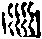
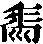
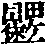

# 释摩诃衍论通玄钞



> **藏经**：卍新纂大日本续藏经（新纂卍续藏）　**册次** 第 46 册（X46）　**编号** X0775　**部类** 经疏部　**卷次** 4 卷　**篇幅** 88,348 字

> **卷／品**：4 卷 · 1 品



---



## 目录



  - [卷第一御制序](#卷第一御制序)

- [释摩诃衍论通玄钞卷第一](#释摩诃衍论通玄钞卷第一)

- [释摩诃衍论通玄钞卷第二](#释摩诃衍论通玄钞卷第二)

- [释摩诃衍论通玄钞卷第三](#释摩诃衍论通玄钞卷第三)

- [释摩诃衍论通玄钞卷第四](#释摩诃衍论通玄钞卷第四)



---



No. 775-A 释摩诃衍论通玄钞引文



天佑皇帝御制



朕闻如来启运，具四智以流徽；圣教谈微，应三乘而导物。自结集以后，逮传布以还，不有圣贤，畴能启迪？故马鸣大士，即其人也。夙证十身之果，示居八地之因，将㡿邪宗，绍隆正法，著一百部论，释百亿契经。或华文以立名，或摄义以为目，维起信论可得而称焉。辞简而䆳，理该而通，派五分之捐归，辟二门之蕴奥，寔一代之灵编也。次有菩萨，号曰龙树，思报师恩，广宣论意，造释论十卷行於世。其义显，灿兮若三辰之丽天，咸覩其光彩；其言博，浩乎如四溟之纪地，莫测其涯涘。暨乎兰陀、筏提之辈译之於前，法藏、元晓之师疏之於后，或兴或坠，历于数朝。朕听政之餘，留心释典，故於兹论，尤切探赜。今东山崇仙寺沙门志福，业传鹫岭，德茂鹏[老/耳]，迺谓斯文独善诸教，囊括妙趣，枢要实乘，期在宣扬，且资赞述。繇是寻原讨本，博采菁义，勒成释摩诃衍论钞四卷。爰削章而陈达，欲镂板以传通，虔沥恳悰，愿为标引。勉俞所请，𦕅笔其由，仍以通玄二字为题云尔。



释摩诃衍论通玄钞目次



------



### 卷第一御制序



释题目已下



卷第二释真如门已下



卷第三释尅体无差别已下



卷第四释自体相用已下至终



释摩诃衍论通玄钞目次(终)



No. 775



------



## 释摩诃衍论通玄钞卷第一



大辽医巫闾山崇禄大夫守司徒通



圆慈行大师赐紫沙门　志福　撰



别明题目总启二门：一属文之领纲，二演义之毛目。今初文中而有三节：初之一字正属龙论能诠教也，即下文云唱本作释，故兼通马论；次下文云今造此论重释摩诃衍故；次之三字正属马论所诠法也，下但呼本文为摩诃衍故，以是本论所肆题故。问：何以不通佛经所诠？答：泛言可尔，属文不然，以望释论间越本文，佛经疎远故不通也。此据释字正当末文，若兼本论亦可通也。后之一字通於二论，下标本文名摩诃衍论，亦标释文为论曰故。问：若题五字全属本论，云何而为释论名耶？答：末全从本有财释也，斯则大同俱舍题故。上属文竟。下演义中且初释者，则是销解散畅之义，谓开解演畅大乘法上差别名义，能起信故，而能消亡分散众生之疑惑心，故云释也。故下偈云为欲令众生，除疑舍邪执(此下三字义当上惑)，起大乘正信，佛种不断故。



次摩诃衍者，即本题中译名大乘，但东西两方言音有异，而名与义本释无差。大者，当体为目，包含为义。乘者，就喻为称，运载为功。法喻合举，故云大乘。斯则正属今论所释二种所入之法，兼餘十五，则唯所入十六，并不二大乘，兼正合之，总一十七。故下释有法能起摩诃衍信根。云有法者，十六种能入门法。能起信根者，门法作业之相。摩诃衍者，十六所入法，并不二大乘体。又下列诸论门法名中，亦唯所入有摩诃衍名，能入非也。如云一体一心摩诃衍(此即法名)、一体一心门(此即门名)。又门法各十异名中，唯法第八名摩诃衍，门无此名。如云八者名摩诃衍，义如前说是也。此论前后门法对辨，并无一字明文显说能入之门名摩诃衍。若尔，门应非大乘耶？答：若就常教及通相义，可名大乘。今据当论，既分门法不名大乘，谓法唯一味，无多差别，是故但立摩诃衍之总名。如正殿中王，轮相未应无四别名，但名王故，门多差别，故建异名。欲假显彼所入一味，随能入门亦差别故，如金、银、铜、铁四轮各异，方表其王差别名故，或名金轮，或名银轮等。谓自古迄今国无二主，看何轮应遂与彼名？此是喻意，法准思之。故下文云：其所入法，或从能入立其名故。即其义也。总此意云：诸佛欲令一切众生皆入摩诃衍，以此即是究竟归处，但为不能离言直入，遂权依彼无名法上，假说能入差别多门，众生方始随门悟入，如殊途同归故。故第二论释彼第十一心文中引心法经云：心法非一，因所作一故，假名为一；心法非一切，因所作一切故，假名为一切。又该摄安立门云：多一一识有种种力，能作一切种种名字，而唯一识终无餘法。又第十论云：能为自法作名义故。准此明文，是以得知能依名义为门，所依实体为法，故唯所入独得总名。其能入门各立别名，如十一类色。若不分根境，总立色名，如门法不分，通名大乘。若分根境，唯眼所见独立色名，餘无兹号，各立别名故。如分门法，唯所入法独立总名，餘无斯称，自有别名故。若尔，下文何说三十二种甚深安车？答曰：彼文但是解本论中乘之一字，非是通释大乘之义，故无违也。若据本题，应云释摩诃衍起信，今文略义足，不须言起信也。谓强解释一味大乘法体之上，有假名义作能入门，於此门上有能发起信之业用，故文虽无而义有也。不尔，曷云释也？故下论云：能起信根者，门法作业之相。此即起信，但属能起业用，非属所起信心。若准下文，次释信决定进心根生长行法，亦属所起，义可通也。由此便以大乘为宗，以是一论最所尚故。故首标云：今造此论，重释摩诃衍。问：岂此非是十论通宗乎？答：名通义局故，以各宗自正所诠故。亦可九论自题为宗，诸教多以题为宗故，故是别宗，不相疑滥。即以起信令入为趣，谓释宗上差别名义，欲令趣向一味大乘，即是此论之意趣也。故下释起大乘正信而有四门，并云令入甚深大乘正道故。又科名云：能依趣入别相门故。又古师云：语之所尚曰宗，宗之所归曰趣。斯之谓也。



后言论者，议也，量也。谓假立宾主，往复徵折，议量正理，故名为论。是故名为释摩诃衍论也。



顶礼等者，此之二偈展转相因而有三节：一、能所敬相。二、敬之情意。三、意之所因。



言隔檀门者，圣法记云：入如意藏门之称。往向位者，入如意藏门之称。如是二门如其次第，喻真如生灭之二门，此在龙明菩萨心地品。论说意云：如今经藏内外二门，经过外门见未亲明，如入生灭证未至极；若开内门亲得明了，似入真如方穷微妙。此同五教，前前浅权、后后深实故也。言分报师恩者，如智度论引经偈云：假使顶戴经尘劫，身为床座遍三千，若不传法度众生，毕竟无能报恩者。唯有传持正法藏，宣扬教理施群生，修习一念契真如，即是真报如来者是。问：后颂、长行二义何别？答：偈颂明归敬意，长行明造论意，故二不同。有处亦为造论意者，望开子段故是造意，若连大文并属敬意，故彼此文无相违过。



论曰等者，此造因由，义通二师：一、准唯识安慧师等，明本颂主造论因由。今此同彼，是释叙本。若尔，彼颂文阙，故须代述；此本既具，何烦更叙？答：如起信疏重述十因，制作多端，不可一准。二、佛经章钞多叙因由，今此释师自叙同尔。若望佛经，本论名重；若望本文，释论名重。故云重释。为显等者，此段八句：初一、辨定所明，次二、果德难思，次二、因人行劣，次一、正明愚暗，后二、对明遣拂。文通二意：一、唯生灭门，体即涅槃，穷即菩提，亦通理、智。穷者，究达之义，即属用也。斯则如次，是二转依理、智、体、用之六德也。次句三贤，未起圣智，故不能亲得。次句十信，未起坚信，故不能深信。次句漠等者，不了之相也。如论释智碍云：漠，冥之性故。又肇注云：不分明也。



窥[穴/(烈-歹+(咒-几+止))]者，目视也。



思惟者，心观也。二莫能得，故云尔也。二、通於二门，体唯真如，穷唯生灭。故下同异门云：真如为体性，生灭作相用。



未得正证，唯属真门。故本文云：以离念境界，唯证相应故。



未出邪行，唯属生门。故释文云：非道邪行。斯则尘沙妄染，皆名邪行。等觉菩萨犹未能测，如隔罗縠观月等事。亦可八句皆通二门。体属体真，亦所随顺得入也。穷属相真，亦能随顺得入也。



所诠理者，诠则讫也、显也。今取显义，谓但依门显所入法，故下文云於所诠理善趣入故，斯之谓也。



亭毒者，肇论注云：养，育也。



言小分为报师大恩故者，清凉疏云：诸佛、菩萨始自发心，普缘众生，(彼钞释云：佛具十恩：一、发心普被恩。)难行苦行，(二、难行苦行恩。犹如慈母，咽苦吐甘，谓舍头、目、髓、脑、国城、妻子，割身千灯，投形饿虎，香城粉骨，雪岭忘躯，如是等事，皆为众生。)不顾自身，(三、一向为他恩。曾无一念为於自己，由如慈母，但令子乐，自杀不辞。经云：菩萨所修功德行，不为自己及他人，但以最上智慧心，利益众生故回向。)垂形六道，(四、垂形六道恩。谓已证灭道，应受无为寂灭之乐，而垂形六道，遍入三涂，以身救赎一切众生。)随逐众生，(五、随逐众生恩。上辨横遍六道，今约长劫不舍。如子见父，视父而已，无出离心。如来随之，备将万行，随逐救摄等。)见其造恶，如割支体，(六、大悲深重恩。故善财童子谓无忧德神云：圣者！譬如有人，唯有一子，爱念情至，忽见被人割截支体，其心痛切，不能自安等。)迄成正觉，隐其胜德，(七、隐胜彰劣恩。十莲华藏尘数之相，滴海难称无尽之德，并隐不彰。但云百劫修成三十二相、三十四心，断见修惑，五分法身觉树初圆，如老比丘同五罗汉。故法华中脱珍御服，著弊垢衣，执除粪器，往到子所。)以贫所乐法，诱摄拯救。(八、隐实施权恩。圆顿一乘隐而不说，乃以三乘人天小法教化众生。此上二恩，即净名香积品彼来菩萨赞云：如世尊释迦牟尼佛，隐其无量自在之力，乃以贫所乐法度脱众生等。)见其憍恣，示迹涅槃。(九、隐真现应恩。故法华云：若见如来常在不灭，便起憍恣而怀厌怠等。)留餘福教，以济危苦。(十、悲念无尽恩。谓世尊同人中寿，应寿百年，留二十年福以庇末法弟子等。言留教者，即三藏八藏广益众生，依之修行皆得成佛，形像塔庙乃至舍利，一兴供养千遍生天等。此上并是初列十恩，次结成恩。重云：)自顶至足，从生至死，皆佛之荫。斯之恩德，何可报耶？(后引经证云：)得人小恩，常怀大报。(即涅槃经。)不知恩者，多遭横死。(即华严经。)具斯十种，故云大恩。



坏论宗故者，以是此论所崇所尚百亿百本之深经故。



阿世耶者，此云意乐，谓明当来有缘众生，但覩论文如亲对面，深领宗旨信解悟入。如清凉述造钞意云：冀遐方终古皆若面会，同斯意也。亦可奉命而造论也。



摩诃罗论等者，圣法师记，如次翻云：如意珠论、广摄论、本广释、狡论、本狡释、广论、一向义论、宗广摄论、杂论、字轮论、神呪论、偈成论(上下译文多依圣法)。



九十九种文者，谓九十部，即是九种华文论。摄圣法记中具列名云：一、音韵华文论；二、义林华文论；三、图像华文论；四、一字华文论；五、杂说华文论；六、阿说华文论；七、释梵华文论；八、释释华文论；九、内外具成华文论。



斯论宝册摄者，即上文义二中义论摄也。斯则宝𠕋摄义之异名也。不尔，问义答𠕋，二自违故。



建立同一相者，谓诸论中立义分同也。以皆共立三十三故，不必能诠文言同也。



别因果等者，三句前后展转释也。又各别明，亦可通也。



法界法轮者，一切言音同法性故，无非法轮也。如杂华云：言音实相即法轮故。



佛告邪论者：是所为人也。



不可言说清净报空者，即直非他说也。空犹无也。应知邪见拨无五乘清净果报，故佛直遮。次下举有折无报也。净报既有，宁得言无？



八种杂藏者，故义林云：犊子部中亦说四藏：一、经，二、律，三、对法，四、明呪。此藏之中集诸呪故。又大众部等亦说四藏，谓但诠定名经、但诠戒名律、但诠慧名论。若合二诠或合三诠，名为杂藏。又集藏传说：一、经，二、律，三、大法(论也。破痴益人，此众经明，故云大法)，四、杂藏。彼意唯佛自说宿缘名经，罗汉亦说名为杂藏。又胎藏经及大众部又说八藏，菩萨、声闻各有四藏(则上四也)。又清凉云：西方三藏之外加一杂藏，谓陀罗尼、五明论等为四藏，大小俱有则有八藏。然音声经通诠上八，故名杂藏，而异八中但局大小之杂故。



或诸藏摄等者，清凉云：然此三藏，约其所诠，略有二门：一者、尅性，则经诠三学，律唯戒、心二学，论唯慧学。如摄论云：能说三学故，立素呾缆藏；能成办增上戒、增上心学故，立毗奈耶藏，谓具尸罗，即无悔等，渐次能得三摩地故；能成办增上慧故，立阿毗达磨藏，谓能决择无倒义故。二、约兼正，则三藏之中，经正诠定，毗尼诠戒，论诠於慧，兼各通三。然今此论问答折徵，是正剋性；修五行中，第二明戒，第五明止，故是兼也。持其等者，持则摄也，即是藏义。问：诸藏通诠理、行、果三，今此云何唯言行乎？答：诸教多云经诠定等，少言理、果，故今但属所诠三学，唯言行也。随应即是不定之义，谓上诸藏随其所应，各能摄自所诠行故。



修多罗，此云契经：一、总相。涅槃云：始从如是我闻，终至欢喜奉行，皆修多罗。二、别相。杂集云：谓长行略说所应说义故。义林云：除二颂外，祇夜，此云应颂：一、与长行相应之颂，由长行说未尽故；二、为应后来更颂故也。毗伽罗那，此云授记：一、记弟子死生因果，二、记菩萨当成佛事。伽陀，此云讽诵，谓孤起偈：一、为易诵持故，二、为乐偈者故。优陀那，此云自说：一、为令知而请法故，二、为令所化生殷重故；念佛慈悲，为不请友。尼陀那，此云缘起：一、因请方说，为重法故；二、因事方说，知本、末故。阿波陀那，此云譬喻：一、为深智，令解真故；二、为浅识，就彼趣类诱令信故。伊帝曰：多伽，此云本事：一、说佛往事，二、说弟子往事。阇陀伽，此云本生，谓说昔受身：一、说如来，二、说餘者也。毗佛略，此云方广：一、广大利乐，二、广陈正法。阿浮陀达摩，此云希法：一、德业殊异故，二、法体希奇故。优婆提舍，此云论议：一、以理深广故论，二、以义不了故论。上出圆觉疏，而各具二义。



婆萨伊伽诺者，此云精[(羽/王)*隹]，甚极微少，如兔毛尘，而能容受满十方中明暗之色，此论亦尔。



标多罗唱提者，此云气丝，即是龙丝。所谓龙王舌中有一气丝，甚极微细，犹如头发，而能出纳满十方中种种密云，此论亦然。



举经之目等者，谓采诸经菁华之要，而为此论宏大之纲，本无名而直用，释标题而属当。如释摩诃衍者，总云大觉经中作如是说，乃至马鸣菩萨正摄彼文，是故说言摩诃衍者，总其文非一。



无有相违失者，虽六时异现，而本身是一，何有相违？非通六时造此一论，说无相违。前来问意，谓为六人各各体异，故生疑云：为今马鸣六中何耶？今答意云：六人体一，都无相违。此但问人，非是问时。故前标云：次当造论人。又但问云：今马鸣师。又后结云：已说人别相。故唯约人。若论时者，应如圣法云：谓此菩萨六时中造论。教当何时耶(此问异论)？所谓出现一百餘岁时，造四宝𠕋论：一、起信论，二、玄理论，三、本源论，四、清净论等。又贤首引经六百年造。又下愿云：师灭度后，我造论等。斯则剋定，非通六时。况下明说正造此论地位、生处、父母等故。



大慈满足等者，此偈十句分三：初三句称名赞德，初句标名，后二句显德。备者办也圆也，次三句闻灭感伤，后四句举胜况劣。



勿小等者，昔人云大象不游於兔迳，大志不拘於小节是也。



善哉等者，此偈分三：初四句叹答尽疑，极者尽也；次四句述前赞印；后三句遵教奉行。



入於寂室者，维摩云：毕竟空寂舍。此之谓也。



归命等者，贤首云：此论有三分，谓序、正、流通。释有三门：一、约论主；二、约论法；三、约益生。此各有三。初中三者，论首三颂归敬请加，即是论主起行所依；二、从论曰下为物宣说，正成论主法施之行；三、末后一颂结说回向，即是随行所起大愿。是故三分但成论主光显佛日法施群生之行愿也。二、约法三者，初、因缘分，是法起所因则为序分；二、立义分下正显所说则为正宗；三、劝修利益分，叹法胜能则为流通。由此三分令法无失久住不坠。三、约益生三者，一、因缘分，举法为机；二、立义分下，正授解行；三、劝修分，举益劝修令佛种不断。是故三分方成众生入法之行。上三门中前一别辨、后二合释，是故五分皆是正宗，以俱是论主正所作故。上并贤首科於本文。今科释论，而有二意：一、但直述，谓五门中，一、归敬述意；二、造论因由，是教起由渐，则为序分；三、科拣依摄；四、唱本作释，是正所说，则为正宗；五、末后诸偈，劝持兴愿，则是流通。二、准贤首，亦有三门：一、约论主三者：一、论首二颂，归敬述意，则为序分；二、论曰已下，后偈已前，并为正宗；三、末后诸颂，则是流通。二、约论法三者：一、从论曰至所以须造论，则为序分；二、从已说本趣至释劝修分已前，则为正宗；三、释劝修分，则为流通。三、约益生三者：论文分齐，全同第二。上来三番，其闻义势，一准贤首，更不繁说。唯后番中，一、因缘分，举法为根，释论五因、三人、二法。今取多分，亦成序分。



归契者，意云契合顺向佛故，即是释上归之义也。



奉迎赞叹者，千山书本则是仰字，敬奉归，仰误为迎耳。



顿渐四住地者，五中前四也。义分齐云：终教断惑，不分分别俱生，但贤位伏现，初地断种、十地弃习，斯则见道一时断种，故云顿断四住地故。如下始觉文中广说。



九、结科者，见元书本是草绊字，似𨽻科字，今勘写误。问：最望於胜，有何异乎？答：远离人法之过，成就色心之德，故二不同。



云何四智者，二义：一、同教四智，谓今就修教同彼始教故：一、圆镜；二、平等；三、成事；四、观察。二、别教四觉，谓别异於始教故：一、染净本觉；二、清净本觉；三、染净始觉；四、清净始觉。谓清净是不变义，染净是随缘义，且就显相作此指配详之。



四、无碍等者，此有二门：初、明大意。法谓一味法体，义谓体上义理，如下文云一法二义等是也。



词乐二种而分异者，总说法义，谓之为词；委细别说，谓之为乐。亦词多说法，乐多说义，故二差别(出清凉疏)。后委销文。



言实相者，即是一心第一义谛所入之法也。相谓体相，不唯局性，则是非性能性，非相能相，一切诸法之实体也。故自体经云：广大神王，即摄一切等，而非世间法(此则非相)，非出世间法(此则非性)。



言共差别相者，即是三大真俗二谛能入之门也。相谓义相，不唯局事，故通二谛及三大义。此上总明，别开则二。一云：实相则是本云一法，共等则是本云二义。三大互异，故云差别；万法攸同，故云共也。一云：实相则是所入之法，共等则是能入之门。门通万法，义相各异，故云共差别相。如下论说，三种大义皆通二门。次言实性者，即真如门也。理唯自理，故云性也。此即法体。言生灭相者，即生灭门也。斯则义相，非唯事也。故异相云：为欲显示唯一真如作一切法，名相各别，义用不同故。已上开成二对法义：一、实相望共差别相，二、实性望及生灭相。自下合为一对法义，谓实相、实性皆真谛之异名，并属於法。相即是彼相真如也，性即是彼体真如也。共差别相及生灭相，皆俗谛之异名，并属於义。以苦空等名共差别相，以色心等名及生灭相。故圭峰云：性宗则以一真之性为法，空有等种种差别为义。故经云：无量义者，从一法生。又华严云：法者知自性，义者知生灭；法者知真谛，义者知俗谛。如是十重解释法义、二无碍义，皆以法为真谛，义为俗谛，故云尔也。



体摄等者。意云：本文彼字属前颂中，尽十方故，或待论师，故以彼十方众生身相与我同体，体显同体也。如肇师云：天地与我同根，万物与我一体是也。



总达者，意云通达契达至及法僧故，即释及义也。斯则归意耳，故次颂曰：总归於十方等。



於一切法体性平等至绝执著之实者，斯之三句，如次释本性真如三字之义也。



何故摄取一切等者，意问：何须众生同体方成敬相，设唯单己，岂不成哉？答：意云：若非同体礼，诸佛不喜等。故须同体，物我无二，方契佛心，故佛喜也。斯则实教大乘称性极谈了义之说也。准清凉疏，说有十门：一、我慢礼，如碓上下，无恭敬心。二、唱和礼，高声諠杂，词句浑乱。此二非仪。(故志公云：行道如椎硙，礼拜似容舂。正序此二也。有学禅者不得此意，每用比言，一向毁於礼忏，甚为失也。)三、恭敬礼，五轮著地，捧足殷重。(此则小教及始教中相宗礼也。)四、无相礼，深入法性，离能所相。(则始教中空宗礼也，以顺空义故。)五、起用礼，虽无能所，普运身心，如影普徧，礼不可礼。(则终教礼，通事理故。)六、内观礼，但礼身内法身真佛，不向外求。七、实相礼，若内若外，同一实相。(此二顿教，无心是道，即心是佛，名之礼也。但礼心佛，无礼礼故。)八、大悲礼，随一一礼，普代众生。(次三圆教，此通终教，同教一乘故。同体大悲，曲论有二：一、同一理体，二、同一事体。前则同教，后则别教。谓同体大悲，自礼即是他礼故也。)九、总摄礼，摄前六门，以为一观。(上有八门，今言六者，不取前二，故但六也。)十、无尽礼，入帝网境，若佛若礼，重重无尽。(经云：於一微尘中，见一切诸佛，菩萨众围绕，法界尘亦然。一一如来所，一切刹尘礼。若依此礼，一礼则无有尽，功德岂可量哉？不入斯观，徒自疲劳。又类万行，一一皆尔。细思行心，看入何门，勿自欺慢，一生虗度。)释曰：上依清凉，若据草堂第六，亦属修教礼也。此后八种，前前浅权，后后深实。今当第八，理同之义，意含餘七，皆为敬也。以立义分，具五教故。次前文云：由明了知一切众生平等，唯一真如，无有别异等，即是正当第八门也。



若尔至别举者，此是问词，以字下是答非。无归人者，有能归人，即前论主所取十方众生身命是归人故。既有归人，何不别举？以上何字贯至於此，或但长读，准次文中亦有何故不别举耶？彼既难词，此何不尔？



法云地等者。意云：论主收一切十方众生为能归人，法云地菩萨亦在其中，故作此问。



本起大乘正信者，信之一字是能信之净心，释家属上除疑舍邪执四义，应以下文信之十义随应释今决定、精进、趣入、回向四种义故。或此四义但就信之行相，非局剋性，以令心净为自性故。其上除字亦具断除、远离、对治、遣除四义。其大乘正三字是所信之境界，而言甚深者，若准餘教及通相释，为对小乘故言甚深。今论下释诸佛甚深广大义，云甚深者，以所入法望能入门极甚深故，故唯所入名大乘正。不通能入，以对所入非甚深故，本意依门入於法故。



断绝门中有四等者，初一即当下立义分，并解释中显示正义。第二即当分别发趣道相，兼修行信心分。第三即当劝修利益分。故第八因云为邪定聚故，意令治邪而入正故，故云趣入。第四即当对治邪执，正就二乘兼其餘类，故云回向，则是回小而向大故。或可第三亦当对治邪执，故下文云无量无边过恒沙数一切邪道(同此第三)，无量无边过恒沙数一切定执(同此第四)。其下对治邪执一门，准前后释自伸三解：一此中通一切，二因缘分中唯局邪定，三下释本文。邪不二聚应是本含，或据兼正释，餘准此。



通摄三聚人等者，准此颂文，通被三聚不分兼正。



二者十信等者，初根全无故，书本但有根字，上无善字。次根已定满故，后根未定满故，此三唯据根差别故。其第三义，初心全无故，次心已定证故，后心未定证故，此据乐求心差别故，初三但据信差别故。亦可前三解中，不定一聚，并形正邪二聚得名。谓初一信心，不同邪定退，不同正定进。第二信根，不同邪定定无，不同正定定满。第三乐求，不同邪定定无，不同正定定证。



由爱有心等者，故昔人云贵身贱法是也。



次开总体者，谓剖判分裂所入根本总体法上假名、假义而为十六，能依趣入别相门故。全同大疏剖裂玄微，照廓心、境。彼钞释云：剖判分裂上无障碍法界为心、境二门。亦同小疏云(即行愿疏)：诸佛不知何以铭目分理、事二门。彼钞意云：上来真界本无名字，佛亦不知，欲悟众生，强设名言，假相开说，为理法界、事法界等。今此亦尔，故云次开总体。



本有法能起等者，总此意云：於摩诃衍总体之上，有十六种能入门法，而能起发信根之义，故云尔也。谓唯能入门为发信之因缘，餘一十七为所信之境界。因缘属起，境即大乘，信通等觉。故次文云信决定进心，下释本云令不退信，故并通十地，又局十信。故论题目亦依此立。然疏云(此即贤首起信论疏，下引并同，勿谓餘文)，论为初机故等，唯局十信者，释家后义也。贤、龙、马师并信含根，题但云信，更不言根。故大钞云(即华严钞)：谓一真法界，本无内外，不属一多。佛自证穷，知物等有(彼属真界，同此大乘)，欲令物悟(同此信字)，义分心境(同此起字)。意今依心境之二门，悟入法界之一心。此中亦尔，依门因缘，信入法境。本意欲令信入大乘，由彼不能离言直入，而且假说一十六门，权为能起信之因缘。故唯门为亲起之缘，令信趣入大乘之法也。亦可信属能起上用，不同初解而为所起。故论释云能起信根者，总标门法作业之相，故云有法等。



信根十义中，依前所明信根二义，今此配释亦具二义。且据前初义者，信十中前四如次配地前四十心，后六如次配地上六度行，前五义当前之五地，后一义开成后五地，但文略义包，唯言成就慈悲，故不言智慧耳。根十中前五地前已来，后五地上已去。前五中初一十信分，除憍慢故；二即十住，由慧住理，故云能诠甚深理故；三即十度功德故；四、五并即十向。后五中六、七、八通十地，故云出离地地转胜，谓后后出离前前障故；九、十名义具足。又据前后义者，信之十义但配十信，根之十义配住已去，但合第一、第二同为十住，唯断障、证理二句异故。或但通说各具十德，未必配位，虞涉穿凿耳。



能化教法定由发起者，即下能化教法出兴门也。此唯所起能化之法，非亦通彼能起之缘。



所治机根者，即下所化众生分齐门也。此唯所化能起之缘耳。今文正辨五分次第，何以最先立因缘乎？



答曰：初一是根，后四是教。由先有根，始后有教，不可药先哉！故於五分先立因缘分也。



为欲显示如意等者，一云立解二分但令利钝二人生解，其第四分方始起行趣入。一云唯解释分但令钝根生其了解，於第四分起行趣入。其立义分唯利根人，不至第四即能行故，如一闻千悟极利根故。故第四分云观察广(即解各即立释分、田义分)之深理双证上二，亦可广即生灭、略即真如。一云前前者有不假后后，后后者必从前来，如法华经三周声闻等。此上三义彰大意竟。



言摩诃衍法虽唯是一等者，谓法唯是一，门乃成多。故小疏云：统唯一真法界，谓寂寥虗旷，冲深包博，总该万有，即是一心。体非有无，相非生灭。莫寻其始，难见中边。迷之则生死无穷，解之则廓尔大悟。诸佛证此妙觉圆明，现成菩提，为物开示。不知何以铭目(同此法一也)，强分理事二门，乃至广说(同此门多也)。又下论云：为显法体不分(所入法也)，义门得别故(能入门也)。上二的据，下二例证。又法界观曰：一理徧於事门(玄镜释曰：文中有三：一、标名)，谓能徧之理，性无分限；所徧之事，分位差别(二、释事理相。性空真理，一相无相，故不可分，即无分限。事约缘起，分位差别)。一一事中，理皆全徧，非分徧(三、释其徧相。理非事外，故要徧事)。何以故？彼真理不可分故(次、释全徧所由。谓而要全徧者，若不全徧，理可分故。非如浮云徧满虗空，随方可分也)。



是故一一纤尘，皆摄无边真理，无不圆足。(后别指一事，显其徧相。以尘含理，显理全徧也。)二、事徧於理门。(文亦有三：初、标。)谓能徧之事，是有分限。所徧之理，要无分限。(二、示能所相。)此有分之事，於无分之理，全同非分同。(三、明遍理之相。於中，初、正明，以全同名遍。)何以故？以事无体，还如理故。(次、释全同所以。有分之事，全如理故。若不遍同，事有别体。)是故一尘不坏，而徧法界也。(次、结示遍相。)如一尘，一切法亦然。思之。(后、例一切法。)此全徧门，超情难见，非世喻能况。(第二科，拣上二门也。於中三：初、标难喻；下、显海喻，但分喻。)如全大海，在一波中，而海非小。如一小波，迊於大海，而波非大。(第二、寄喻以明。文有三重无碍：初、海对一波，明大小无碍。以海无二，故全在一波。以波同海，故一全迊海。)同时全徧於诸波，而海非异。俱时各迊於大海，而波非一。(二、以一海对诸波，明一异无碍。)又大海全徧一波时，不妨举体全徧诸波。一波全迊大海时，诸波亦各全迊，互不相碍。思之。(三、以大海双对一波，诸波互望齐徧。)次有问，后答。曰：理事相望，各非一异，故全收而不坏本位。(由非异故互徧，由非一故各存。彼次广说多多义门，并由此二。今此论意，亦由此二。由法望门，非异义故，全随诸门，假说多种。由非一故，故说是一，以彼浅理况此深法故也)。又本因缘起经云：此楞伽王常在大海摩罗山中，卛十万六千鬼神之众以为眷属。如是眷属，乘华宫殿，游诸国土，皆赖彼王，方得游行。皆作是言：我无其能，愿与我力。彼王随时与力不离，而共转故。王不分身而徧神众，各各令得全身之量，一切时处共转不离。染净本觉亦复如是，能受无量无边烦恼鬼神众薰，不相舍离，而俱转故(神智麤劣，尚能一体全此全彼，况此所入深细殊胜，而岂不能即此即彼耶)。由上多教，故云摩诃衍法虽唯是一等。若尔，何如直说不二大乘而唯是一，与三十二种而为体耶？答曰：次文既云而别释散说，钝根所分明故，应唯此论真生二门直释不二。又应依此论顿渐二根直了不二。又云虽口语中诵持教义之尊词，思心中观察广略之深理，乃至云得法界宝藏等，应依此论而证不二。若许，则违立义分，云离根宜故，离教说故。又违次二分，不释圆圆海故，不化圆根众故。不许，则违本释之文，以论明说五分次第皆唯逗根，文意俱无离根教故。以此故知，定非不二。论意正唯所入十六，义兼不二。以此不二，於立义分，无别分明建立文故。又唯果海，离根教故。如鸟迹空(所入)，望太虗空(不二)。谓如鹊迹所印处空，而随鹊迹，名鹊迹空。凤复来於鹊迹处印，而又此空，名凤迹空。但从二鸟得二空名，空实无二。门如二鸟迹，各定别故。法如二迹下空，体无二故。故言摩诃衍法，虽唯是一，如二迹下空，体本一故。非谓是一，直说太虗。此依十地大疏，并义理分齐意。亦可依此珠喻而说，珠体(斤两轻重)如不二，珠相(圆明具德)如餘法，故云如意是一。若出黄金，可名金珠。同出真如，得名一体大乘。若出白银，可名银珠。如出生灭假名三自大乘出，餘可悉如。百六十摩诃衍亦尔。又云而为恒沙法门体性者，作十六能入门之体也。恒沙法门，即是门故。言受用者，但据见闻，即名受用，非是亲得。以法合中，但云领解，故知非是己证得也。意以摩尼杂宝，不须开门，直尔见闻，以威神大故。摩诃恒沙，不须解释，顿尔直了，以根性利故。斯则同下立义分中，令依两重之门，趣求两重之法，文意俱无。唯令利根依门，趣彼不二之珠故也。



大乘本法虽圆无边。千义者，此纵前文立义所立。



而别释散说等者，此夺须用解释所解意。言虽立义分具足门法，若无解释分之所解，𨎪根未了故而立义分。所立大乘如摩尼珠，所具千义如所出宝，其一切宝即成千门，非更离此别物所成。其所具义即为多门，非更离此别有门也。其解释分解立义中，大乘法上所具多门，如以餘物开摩尼上所出多门。此上法喻而各有三：一是摩尼，二即所出杂宝为门，三是开门之物。一是大乘，二即所出千义为门，三是解释分。如开门之物亦可分喻矣。



见闻宝两等者，若据通说二龙，大龙不开门而直见，如利根人不须解而直了；群龙须开门而后见，如钝根者要解而方知，是二不同。若据入时亦并依门而入，但以大龙不开门而直入，利根不须解而能证；群龙开门而后入，钝根要解而方证，亦二不同。上言不开入者，但透户而入也。斯则据前三义之内初之一义，其后二义准而思之。此上即是总彰大意。



言出现舌威等者，意云出舌现威，不竞趣入往向门也。



言开通者，趣入义也。意云：虽开豁通达，趣入往向门，而不近向隔檀门也。往向如今外藏门，隔檀如今内藏门，摩尼如今藏中物。或可不竞入门，开通往向，长声连读。此即初解。据贤首五教，前前权，后后实，从生灭入真如。后解则据五教二门峙立义。说法合中云：而勤加行，添於胜进。合上出现舌威，不竞入门。意云：而於闻、思勤加功行，增於熟习；其於练修，略不著功。故华严云：如人水所漂惧溺而渴死於法不修行多门亦如是等。(彼疏释曰：初喻贪，随文义失。谓义门波涛，漂荡其心，虑溺溺他，无眼修行，自绝慧命，故名渴死。)如龙贪现威神，不趣其门。方於下二句，合前开通下二句。意云：方，犹比也。谓於生灭虽修信心，犹如金刚，能坚利故。而於真如未修坚信，如龙虽趣往向，未入隔檀。此则合上从权入实。或方於金刚，连上长读。即闻、思久习，成性难坏。此上三句，并是不入生灭门修；而第四句，唯是不入真如门修。亦可此句通於二门。此则合上峙立义也。或方，犹法也。法者，则也。此但通合上喻，不必句句相对。前喻是全，此则分耳。总意云：唯於闻、思指端偏加钻仰，则於实事本月不修坚信。



言得法界宝藏等者，若不依门造修胜行，终不成就所入摩诃衍之宝藏，云何得果证入深理也。



弥弥远退等者，此意双通邪不二聚，下第八因唯言邪定。



唱陀南者，圆觉疏翻，此云集施，谓以小文摄集多义，施他诵持故。



百六十等者。此中但说所入十六，应是彼论每一开十，故成一百六十法也。



本八因缘中，大意各二：初所化能起之机缘，后能化所起之教法。故上文云：为欲显示上味妙药，当由所对疾障出现；能化教法，定由所治机根发起。疾前无药，机先无教，故唯机根为因缘体。然依释家，每因分三：第二即是所化能起之根缘，第一与三并是能化所起之教法。斯则对教而辨根故，勿谓有教亦为缘体。然於本文互有不足，如三、四、八阙彼初一，约义含在为字之内；其五、七、八阙彼第二，亦义含之。



因缘总相者，上之二字属根，下之二字目法，是因缘之总相，即能化教法也。



八种根本总体等者，即下文云根本摩诃衍中开八种(此即总体)，一心法界三大义中各开二种等(此即别相)是也。蓝修者，有书本中是此监字，如臣监修国史，今师监修佛经，故圣曹集云志云和尚监修高座寺，斯为良证也。



谓摄十亿等者，望上敬意宽狡之异。



上品十信，三品十解者，即信成就发心也。



三品十行。三品十向者，即解、行、发心也。



三品十地者，即证发心也。谓通十地长分三品，同彼十信长分三故。亦可地地入住出心分成三品，如上一百二十种说。三贤各三，准此二说。



何故开三分而别释者，若准此文，不唯解释分释立义分，兼后二分亦释彼故。不尔，何言一切教法皆尽立义分？应后二分非是立义所立法故，但前别明后总释故。



行法法尔者，前颂法字通此二义，谓一一因各明修行渐增之法，既无优劣，故八次第法性应尔。



谓除阐等者，此下逐难别释转胜。然此不信著我畏苦舍离四种，即餘文说四种障也。初一名同，二凡夫著我障，三声闻畏苦障，四缘觉舍悲障。谓以深信住理起行回向，如次能断四种障故。



本图音一演者，准次释意，谓圆与音无有前后，一时敷演故。若有前后，如疏显失，亦可诸音同一时故。



如来广大深法者，全同末偈云：诸佛(即此如来，属不二大乘)甚深(即此深法，属所入法)广大(二文全同，属能入门)。



谓光等者，准钞(即起信钞，下引并同)解此而有三难：谓光明大觉等难，论有繁言失；次今造等难，反成求利失；后毕竟等难，佛经未尽失。然此三难，前二望於后一相反而难，若免前二定招后一，若逃后一还中前二，又复前二反覆相成。



毕竟尊信者，谓可尊重，可信崇，毕竟穷终尽理之经也。



一味等者，似海水咸谓之一味，如虗空等谓之平等。移转据一期，起灭就刹那，愿名牓示则名经名论，翰墨简牍则经卷论卷。其一味与不分互释，平等与不别互释，分折差别也。谓此即是四种无为，故唯一味平等。



伽陀修梨毗罗，翻云广略经则。



遮陀尸修梨毗罗，翻云广略论则。



梵圆等者，如疏释圆音云：一一语音徧穷生界(此则释圆)，而其音韵恒不杂乱(此则释音)。次文既说双具此二方始得解，明知此二不相离也。次无量下唯明异类，次或有下唯明等解。



僧那，此云誓愿。



阿世耶，此云意乐。



四圣众种等者，种则因也。故俱舍云：能生众圣故名圣种。四圣众体即是无贪：一、衣服喜足圣种；二、饮食喜足圣种；三、卧具喜足圣种；四、乐断乐修圣种，谓乐断烦恼、乐修圣道也。问：第四圣种既非喜足，如何亦用无贪为体？答：以能弃舍欲贪有贪，故此第四亦无贪性。问：何须此四圣种耶？答：前三圣种助道生具，最后圣种助道事业。以诸弟子舍俗生具及俗事业，世尊哀愍立此助道生具事业，令修行者解脱非久也。问：何故安立如此二事？答：颂言：为治四爱生：一、衣服爱；二、饮食爱；三、卧具爱；四、有无有爱。治四爱故立四圣种，故云四圣众种也。



根本摩诃衍中开八种故者，即是本云摩诃衍者总也。此但初重所入之法。次云一心法界及三大义各二种故者，亦即本云说有二种。云何为二？一者法，二者义也。此但初重能入之门。



何故能入等者，谓一心下即是初重能入之门，谓前法上不标四名，故今门上特标四也。以前直於摩诃衍中开成八种，非於四开故无四名。



或各开下，即是后重能入之门，谓前法中已标四名，故今门内不更标也。而云或者，显不定义，谓前已於一心、三大、四上开成八所入法，今复於此四上开成八能入门，故立或言，谓或作门，或作法故。而云门者，拣前法故。此则唯於初重门开，以第二重门之与法，唯於初重门中开故。如立义云：所言法者，谓众生心等。此牒初重门开，为后重门法二故。又下文云：一体一心门，三自一心门等。良以一心望一体等，而具非一、非异二义。由此一心与彼非异故，属初重门；由非一故，属后重法。亦是前合之为一，后开之成二。若望初法，亦具二义：由非异义，一味无差；由非一义，故分两重。故下颂曰：平等平等一，皆无有别异，各摄诸法故，然终不杂乱。释曰：前之三句证上非异，后之一句证上非一。问：此但初重门之与法，二互相望，明不一异，云何证上望后法乎？答：开初重门为后重法，后法初门无二体故，故得证也。问：所入十六既於根本一心、三大、五法上开，云何上云摩诃衍一耶？答：上谈实体，直说是一，今依下文立义分中渐渐说开，故有其五。若是下云摩诃衍者，总说有八种者，亦可便说九法中开。今既但云说有二种：一、法；二、义。此义复三，故但有五，其体是一。就义谈多，如映珠喻，法准易了。



本摩诃衍者总者，斯则唯属初重所入，即是上云根本摩诃衍中开八种故。然此总字自狭之宽，通具三义：一、约文唯局初重所入，即此文是；二、就义亦通后重所入，如次指云所谓望上及下临故，应降下云依於此心显示摩诃衍总义等；三、亦就义唯局三十三种之能诠，故第十论释本偈中我今随分总持说云能说字相门，唯以总字诠三十三，彼文指是此中总字及准望上及下临故。理应全徧立义一分，应云摩诃衍者总，总说有二种等。不尔，云何能通诠哉？非是通取摩诃衍者总五字为能说字相门，下文明言总之一字故。此上三义，前二总体名总，即是所诠，故论文云所入根本总体门，於两处中是总体故；后一总说名总，即是能诠，故论文云我今随分总持说能说字相门。自说有二种至二者义者，斯则唯属初重能入，即是上云一心、法界及三大义各二种故。以初所被根性利故，不须广说，已生解故。龙树菩萨不别释者，由於文前及於所入已显此名，人多易了，故不繁叙。已释初重，次指后重。所言法者，谓众生心下，此广开说初重之门，而为后重门法二故。由钝众生闻初略说不能解了，故牒初门重广分别得名两重，良有以焉。非同常例不分两重，故初略标而后广释。斯则初重总说略说，后重别说广说，故二异也。是心(是一一心所入法也)真如相，即示(门也)摩诃衍(法也)体故(门也)。下论释此，即回体字在摩字上。文云：即显示一体摩诃衍。次一准此，回上易了。是心(是一切一心所入法也)生灭因缘相(门也)，能示摩诃衍(法也)自体相用故(门也)。一者体大(法也)，谓下至故(门也)。言一切法者(即随缘也，亦世间也)，真如平等者(即不变也，亦出世间也)，不增减故者(通上二也)。二者相大(法也)，谓等三句(门也)。言如来藏者(即随缘也，亦世间也)，言具足无量性者(即不变也，亦出世间也)，功德故者(通上二也)。三者用大(法也)，谓下至故(门也)。谓真如门，理性不变唯善唯净，故与善名。而生灭门，真妄和合通染通净，不立善也。故清凉释往复无际，言是用大通於染净。问：宁违贤首用唯善耶？答：彼分顺违，顺性是善。今据体用，性起为用。望义不同，二师无违(上拟今论二门说故)。



一者所入等者，前二科名相望，可成五对，谓能所、本末、总别、体相，於能所中依入别故。若实解尽五对之义，一部论文思过半矣。



一者等者，一体(即下第二重为门也)、一心(即下第二重为法也)、三自(即为下门)、一心(即为下法)、无量至不减(即为下门)、体大(即为下法)、寂静至不灭(即为下门)、体大(即为下法)、如至德(即为下门)、相大(即为下法)、具至德(下门)、相大(下法)、能生至果(下门)、用大(下法)、能生至善因果(下门)、用大(下法)。上来注指初重门之一种，以为后重门法二故。



八种身法等者，准唯识论以体依聚三义解身，今当前二故云身也。本论所牒应是此经，故次论云马鸣菩萨正摄彼文，是故说言摩诃衍者，总约义牒也(斯则举经之目属论之纲)。



望上及下临者，应流至於后重所入法中也。应云依於此心显示摩诃衍总义。次二摩诃衍下皆安总字。又一者体大总，二者相大总，三者用大总，故云及下临故。



皆悉等量等者，此据遮诠非异义说，非谓表诠定一之义。不尔，云何各摄诸法无胜劣广狭？明知此文据非异义，其不杂乱据非一义。如本论云：如是二门皆各总摄一切法，以是二门不相离故。谓门法各徧，是故双言徧满。徧满其平等，平等亦尔。终其本末者，终准钞引，是其然字。



众谓四衍众者，平声标名，去声释义，非谓上标亦同是去。如常教释，由有众多生死故，众多因缘所生故，名曰众生。如下论云：何故意及意识名众生？意及意识，一切众染合集而生，故名众生。不可为其去声释义，而结名时亦去呼耶？法从门以得名，是众生之心耳。又演奥钞云：若依诸教，总有五解：一、藏始二教，五蕴相集曰众，仗缘而起曰生。二、真妄共聚曰众，非有似有曰生，依如来藏有生灭心。三、众谓四衍众，生谓四种生。上二依终教，四诸法暂聚曰众，生无生相曰生，顿教众生即如不坏相故。五圆教，一即是多曰众，理不碍事曰生，一事摄多事而炳然露现故。



一体者，如珠轻重为体，故不可分析。



一相者，如珠圆明为相故不可离散，虽为一相而可分析此边非是彼边相故。



摄出世间者，见千山本，世言则在出字之上。



皆作法界等者，钞云二法作法界，亦可法界作二法，应是回文未尽故也。同下释是心真如相等，云作一法界心真如等，意言此一法界心(释本是心)作真如门等，亦回文未尽，顺於西方言也。前即摄末归本(此顺科目)，后即以本流末(此顺下论)。



自体契经等者，谓一法界心广大神王摄法有二：一摄生灭门法、二摄真如门法。初生灭门中有二：一切种种无明等者，是不觉义，谓初句则是根本枝末二不觉，后句则是相应不相应六染心。一切种种白净品法者，即是觉义。言种种者，差别义故。次文所摄真如门中，但云一切不言种种也。后真如门中亦二：一切清净法等四句是体真如，於中前三即毕竟平等等三德，后一即离言说等三相，故云绝离。言无碍者，无二碍也。一切满足法等二句是相真如，於中初句即不空真如，后句即空真如。言广大神王者，同下所入十异名中，初一名为广大神王，亦引自体契经为证。科名根本者，是所入法也，即是心二字是也。



摄末者，是能入门也，即则摄下是也。问：此众生心以何为体？答：即以所入而为自体。若尔，云何别法作总心体？答曰：全总作别，非是分作。别全作总，故亦无失。故上文云：是一法界藏，彼八处中周徧圆满，不可分折，不可离散，唯是一体，唯是一相。是故得知总别无二，故得为体。问：应依生灭便证一体摩诃衍耶？良以所入体无二故。答：依生灭门修，但证自法，不证彼法。如依五教同证一理，依前教修不证后理。非是理性体别有五，但依教修心有五种，故说体同而证异也。又如摩尼珠体是总(众生心也)，全能出金别名金珠(一体大乘)，全能出银别名银珠(三自大乘)，此即如上全总作别。若迷出金，但了出银，唯名得於银珠，不名得於金珠。以心迷之，名为不得，非是珠体而有二故。如迷者云：我已求得雨银之珠，更欲求彼雨金之珠。不了一珠双出二故。法准思之。斯别全总作别，约境法体说；得与不得，约心迷悟说。餘名总别，准此释之。故下文云：离边真心，若真如门，依如异同珠；若生灭门，依如同异珠。斯之谓也。



或从能入等者，法体唯一、门义二故，谓此一法或从一体为门名一体摩诃衍，或从三自为门名三自摩诃衍，故云或等。



答曰：作一法界等者，亦可一法界心作真如门等，亦是回文未尽故也。其一法界心，各是下法十异名中第七第十二种名故。



以上二颂本等者，本即本论云所言法者至出世间法二段文是，颂即释论云众谓四衍众等及是一法界心等二颂是也。明言流此不言例准，勿更此例异文说之，意言一心是体、三大是义，离体无义故须前二，如波依水离水无故。若准此意，所入本法唯一体也，不尔何须流至此耶？



言体大等者，虽以三大直便是法，而绝名相强说为彼，谓一切法真如平等不增减等多门，本为以门而显法故。虽立三别，亦与上心一味无差。不尔，曷流至此？以三大法各别有体，宁用上心？故显三大自无别体，上心流此。若尔，何分两重？答曰：逗根假言，展转开说故。谓直於根本开初八种所入之法，於此法上开初八种能入之门，复於此门开后八种所入之法，及后八种能入之门。斯就假说，两重各异。若剋实体，一味无差。佛本欲令众生悟入一味实理，但由不能离言直趣，遂就假相而强开说初后两重能化之法。故莲经云：但以假名字，引导於众生。又清凉云：为令物悟等，如摩尼珠本性明净同空纯色，此色唯除天眼者见、肉眼不见(如不二大乘而是果分，唯果人了、因人不了)，但欲令彼肉眼之人见於珠体(如欲令人悟入所入一味本法)，遂以青黄等八色物而以映之，其体随影而似有八(如以一体一心等八种假门开彼一味，以为初重八所入法。)若明目者，见珠青影，便云青珠。见珠黄影，便云黄珠。(如利根者，但依初重能入八门，而便随应悟入八法。)而眼暗者，仍不能见。欲令见故，复以深重青黄等八物，而再映之。(如钝根人，但於初重不能解了，后更麤广说一体三自等八门，而再示之。如立义分，初略后广，例准解释，应知亦尔。)但以深青，依前浅青影上映之。以深黄，依前浅黄影上映之。(如广说一体，依前初重一体一心门上开之。广说三自，依前初重三自一心门上开之。如立义分云：所言法者，谓众生心等是也。)良以目有明昧，故以浅深两重映之。(如由根有利钝，故以初后两重被之。)虽映两重，而摩尼珠体还是一。(如虽开两重，而摩诃衍体元是一。)其天眼者，即於杂色影中，便了同空纯色。其肉眼人，但见影现杂色，不了同空纯色。(如果位人，即於因分，便了果分。其因位人，但了因分，不了果分。)故下所入十异名中，第九引中实经云：离边真心，若真如依，如异同珠。若生灭依，如同异珠。草堂多举此喻大同。



无因缘耶者，谓前因缘分并无能起之因缘，今於文前指立义分，却有所起之不二。既有所起之法，何无能起之因？斯则以后有法难前无因，次则以前无因难后有法，云既无能起之因，何有所起之法？故云何须建立。



非建立者，此答意云，立义分中但是义具，故前指有无文明立，故云非建立也。斯则次云离教说故。



能得於诸佛等者，此据果分说也。而有二师：一、贤首分齐云：别教有二：一、性海果分，当是不可说义。何以故？不与教相应故，即十佛自境界也。故地论云因分可说，果分不可说是也。二、缘起因分，即普贤境界也。此二无二，全体徧收。其由水波，思之可见。释曰：全同此论性德圆满海、修行种因海二名也(此上双论前后两节)。今且先就果分而说，不二如大海，诸佛如百川，但可云海能容受百川，不可百川容受大海；但可假人没同果海实法，不可果海没同假人故也。二、清凉略䇿云：今言果海，约证相应，可寄言诠，皆名因分。因则可修可说，果则亡修离言。释曰：十身等果，既带言说，并属因分，非谓言果便属果分，直须契证可名果分。故贤首品大钞判云：则四法界、十种玄门皆约因分，例此诸佛即属因分。因分可以没同果海，故云能得於佛；果海不可没同因分，故云诸佛得不。故此因果义，若贤首意，普贤因人所了名因分，遮那果人所了名果分，故分齐云十佛境界、普贤境界。若清凉意，依言修因名因分，契证绝言名果分，故略䇿云因则可修可说，果则亡修离言。此之二师，义有少异。贤首言果，唯局究竟；清凉言果，亦通因位，但是果利，可通因也。今此论说，双离根教，全同贤首。义分齐云：不与教相应故(离教)，即十佛自境界也(离根)。亦同清凉，略䇿文云：果则亡修(离言)，离言(离教)。若尔，本源、玄理二论，岂非教哉？教必对根，岂离根耶？答：有二义：一、约理云：非同因分，称根施设，而有实根，可名实教。如药对病，可立药名；若不对病，不得药名。今此亦尔，餘法对根，可立为教。故论云：顺於说故，不二无根。而唯佛境，无根可被，不得教名，故云离也。意言：但由无实所被故也。若尔，何说二论？答曰：清凉疏释十地品中，许说分齐云：一、约果海，可以总标，令人知有，名为可说；不可指㡿示人，名不可说。又云：且依一相，不可指陈等，云不可说及与可说。若有因缘故，果可寄言，即事入玄；因亦叵说，不可局执。释曰：但依可以总标，令人知有及有因缘故，果可寄言，说有二论，终无正实所被根故。二、就教云：此二无二，全体徧收。其由水波，思之可见。释曰：此即义分齐说不一不异之二也。若就非一，说离根教(即此论是)；若就非异，说有二论(即彼论是)。十地品中，清凉同此。以上二意，说默有由，望义不同，故无违也。上来总彰大意已竟，自下逐难，重消文义。其二得者，成就义也。次下不者，文虽在下，义应居上，则不成就也。即是下，引大本经云其圆圆海得，诸佛胜故；其一切佛不能成就，圆圆海劣故是也。此具二义：一云、唯自二句相望而说，据上没同、非没同，故说能得、不能得也。次菩萨等三亦同於佛，没同果海，不可果海没同彼三。二云、对他二句相望而说，复有二义：一、此中初句能得於佛，对彼后句於诸佛得不故。谓此不二既属果分，故能得於佛；彼说根本但是因分，故不得於佛。此则法望於人，明得、非得二之差别，则是没同果分、非没同果分相待而说。其次三人准此释之。问：此上二义并据果分，说没、非没，义势全同，何分一别？答：岂不已云唯自二句对他二句相望而说？据此小异，故分二也。二、此中后句诸佛得不故，对彼初句诸佛所得。谓彼根本既属因分，依言修因可证诸佛，从因向果，修因而证，故云诸佛所得。今此不二但是果分，亡修离言，不可修因渐次而证，故云诸佛得不故。若尔，诸佛应阙徧智，何能说之？答曰：修因至果而自证知，故无违也。斯则仍果从因而说，非直谈果及没同果。若因没果，因尚叵说，况果海乎？又况更能直谈果耶？岂更说佛徧智证哉？此则人望於法，明得、非得二之差别，则是修因所得、非修因所得相待而说。其次三人亦准此悉。



诸佛所得等者，此就因分说也。亦具二义：一云唯自二句相望而说，意言是佛修因之所成就。次菩萨等三，若修因行亦能成就，故云亦复如是。其八本法非可修因，故却不能成就彼人，故云於诸佛得不故望。次三人亦同此释。二云对他二句相望而说，义全同前，覧上易了。



无有其私者，私犹自也。已上是真如门，自下是生灭门。



何故别说至三摩诃衍者，此即总属问词，而有二种：初但直问不同因由，后而等下述义例难。



通达轨则不动门者，通达则是至及之义，不动则是无变之义。故上文云：三世诸佛，一切教理，自然常住，一味平等，无有移转，无有起灭等。故云不动。轨者，仪也。则者，法也。意言诸佛菩萨，以此不动常住之法为轨则故，通达至彼无上果故。如下信法精进修行门云：所谓乐信三世诸佛，为自恩父，为自恩母，为自恩师，不能改坏，不能生灭。虗空金刚不动轨则，有不可思议中不可思议殊胜利益，常恒转转，於一切时，於一切处，修行一切助道品故。斯之谓也。



安车者，曲礼云：坐乘也。若今之小车也。



(论卷第二)。如澄神海者，意言同海澄澈神圣，如具十德百川味耳。



本心真如门者，心即一一心法也，真如则是门也。



心生灭门者，心即一切一心法也，生灭则是门也。



或名摩诃衍者，以下列门，十异名中既无此名，明知此名非通门也。



言造作相者，瑜伽八十六云：如来将欲说法之时，现四种相：一、从极下座安详而起，升极高座俨然而座。二、安住随顺说法威仪。三、发謦欬音示将说法。四、面目顾视如龙象王。故云作相。



以色容受等者，意言以空容受於色而得自在故。次文云：於一切色得自在故，容受大种故。其上以空容受，准此可了。意云：如总太虗容东西别空，何不自在？同所入总法容体相别门，有何难哉？以并就义而假说故。



以无住处者，谓於无住空得自在住处，则是障碍义故。



一心至住处者，此之四句，前二法说，后二喻明。各上属法，各下目门。体则性也，性自空故。同喻本义，本来无故。谓太虗空，本来於彼东西等处无住著故，即当容受东西别空。一心如理，性自空无，即当容受体相别真。



於诸障碍等者，即次喻云於一切色等也。



令住诸法者，即次喻云容受大种故，若自门中通有障碍及无障碍二种义故。若对真如门无障碍，生灭门内并名障碍，故言於诸障碍。意言如空於色无有障碍，使色得住耳。



利圆者故者。即下所说清净解脱者也。如二祖云：本无烦恼，元是菩提。此岂非是本来圆功德满者焉？非为圆根名利圆者，以是顿根，故名圆者。



五者名为方寸者，谓是毫毛形方一寸，故次论云如是二毫譬如明镜，故云方寸。



一者、白毫方寸者，然此毫字，后人写误，应是色字。次引证中，唯是白、乱二言有异，其必萨、伊尼罗两名全同，故知毫字误矣。若尔，宁知色字非误？答曰：准彼前后所翻诸名，及此论云：五者、名为方寸。即译必萨、伊尼罗，但名方寸，不言毫、色二言之名。而凭述理论云：第一方寸中，唯现前天像(此则白色，非是白毫)；第二方寸中，通现前五趣(此则乱色)。二皆现色，不言现毫。故知色字是的，毫字是误。



离流转因等者，二句所离，即生灭中觉不觉二也。故行异云：真如门一心一念生为缚等。今此二名，相形而立，远望与异，义同水火。转即是行，并迁流义也。缚与相同，即是为相之所缚也。其唯有觉者，与离流转因互释；唯有如如，与离虑知缚互释。斯则远转，真之异名；远缚，如之别号。故唯识云：真谓真实，表无虗妄；如谓如常，表无变易。又真如门云无遣无立是也。



言一一白白者，可有二义：一云作上结词。上一即唯有觉者，下一即唯有如如，非同生灭门有不觉不如，故有二也。今此唯觉唯如，故但一也。上白结离流转因，下白结离虑知缚，既绝二黑，故名二白。一云待生灭门。各上标，下释意。言一自是一，白自是白，非同生灭对多名一，待黑名白，故云一一白白。



为善不善因者，且总相说。善即觉义，不善即不觉义。为者，作也，即当与义。受苦乐者，若即生死，乐即涅槃。故下文云：於惑与力、於觉与力，出现生死、涅槃法故。与因俱等者，即一法界有为、无为二种自在，与彼能薰为、无为法不异义故。



犹如伎儿者，即幻术人也。故下文云譬如非幻幻人，於诸幻事随其所应与力用故，如幻自身为诸类身，而自身不现故。法准思之。故下释云藏者，即覆藏义。纯白一法界者，是纯白之一法界，亦从门得名，非自体纯白故。餘说真如门即理法界者，唯当释家门也。彼不分门法故，其餘九法亦从门立名，非是自名耳。



空种无碍者，种则性也。意云：真如空理之心性故。



徧种无碍者，种亦性也。意云：事法周徧之实性故。此四字中，上一是门，下二皆法，是空之种无碍等，依主释也。故上法界，亦是性也。不同常义，释事法界，分义名界，不分门法，故作相即。今分门法，是无尽之法界，但以事为门，趣入法界，法界非即事故。亦可种者，类也。谓体真如空，相真如空。又如实空，如实不空，种类不一故。此四字中，上二是门，下二是法，是空种之无碍得名，依主释也。次后一名，准此知之。其二长字，并上劫义。



离边真心者，即是上文众生心也。离边明中，真心显实，此即第一义谛之异名矣。谓双离彼真俗二谛，故名离边。如自体经云：广大神王，非世间法，非出世间法也。



异同珠等者，意云异属所现影差，同属能现明一，以差别影归平等明，故云异同。故下文云举真如摄生灭皆同真如也。次同异珠反之易见，上独明珠等准而释之。



是一者，即当门也，意属法也。



是一切者，亦当门也，意属法也。谓心法唯一，随门说二也。故次经云：心法非一，因所作一故，假名为一；心法非一切，因所作一切故，假名为一切。此则上标，下结立也。亦可是一、是一连读，上即体真，下即相真；是一切、是一切连读，上即觉义，下即不觉。初解理优，后义文繁。



第一一心等者，以真如门所入之法但名为心，非一多故，而但从门得名一也，不同生灭门所入法故。何者？谓第一一心随所作门可得名一，形待第二一心所作一切门故。此则一一心所作之一有所待多，一心所作之多故不可说随自能作名一，以无所待他能作多故。故第一一心不可从自能作立名，唯从所作而立其号。其第二能作望自所作一切得名一也，故次经云生灭一心因多故一，此则自能作一对自所作之多得名一也。亦可对前第一一心非一，故第二一心名一，此即第二能作之一待前第一能作非一得名一也。第一能作既名非一，第一所作对此名一，故经云心法非一等。斯则第一所作待自能作及对他所作故立一名，第二能作对自所作及待他能作故得一名。二门即是二谛，一心即第一义，故次经云非大非小等。又上文云而广大神王非世间法(俗谛)、非出世间法(真谛)，又离边真心为中实故。



一者、名为如来藏门无杂乱故者，即下十藏中第四真如真如藏也，非同生灭理为他智杂故，亦不同第二以无杂释藏。杂者染也，其所远转是染法故，即是以门而显法也。今言杂者即是乱也，但言真如真如更无他智杂乱故，故论云真如门理唯自理非对智也。



心生灭门有十种名等者，一对前二，二对前一，三、四、五如次对前四、五、六，六对前三、后四，二门次第俱同。言二者名为如来藏者，即下十藏中后六藏也。藏通能所，义如下释，故云覆藏通能所也。问：今此二门名如来藏，望前二法名如来藏。门法名滥，云何辨异？答：此具二义：一云、如六七识通名意识，但意之识，意即是识，二义异故，二名无滥。今此亦尔，但无杂与无乱，令覆及覆藏二二义别，故二名不滥。二云、彼法开为远转、远缚等二藏别名，此门开为真如、真如等七藏别目，故各历然，略不相滥。问：义既如是，云何元初合立通名？答：为表二法同一体故，为圆十数含六藏故，是故门法各立总名。若尔，前门藏名不包多藏得圆十数，云何亦不立别名耶？答：二门餘名并同水火相形而立，今此一名无别形待，故但亦立一种总名。



五者、名有去有来门。有上下故者，即次文云：生灭有二位：一、向上；二、向下。又如第三云：始觉背凡向圣，上上去去，为次第转故；随染本觉背圣向凡，下下来来，为次第转故。



流转等者，准餘教释义通开合。且合释者，谓生死流转故、涅槃还灭故。又开释者，谓流即集谛则生死因，转即苦谛则生死果，还则道谛则涅槃因，灭即灭谛即涅槃果。前门第八翻此释之。



各有所依摩诃衍者，谓此后重一体大乘，依彼初重一体一心大乘等故。若尔，应此皆从根本摩诃衍中开，何言一法三义中开？以前但说开初重门为后重法，非是初重法作后重法故。答曰：以初重门本依初重法中开出，今既全以初门为后重法，则更离此无别初门，故说后重法便依初重法。若是但就门说，故云从一法三义中开。望义不同，故无相违。



言各缘自依者，能依也。下引本有经云：甚深真理非餘境界，唯自所依缘为境界故。又本论云：自体显照一切法故。此并法体了上假义，如镜明体照上影像也。



同名异义故者，此句通出形对后门异少同多之因由也。



一心一念生缚等者。即下文云：一切诸法唯依妄念而有差别，若离心念则无一切境界之相。谓此门中一切善恶都不思量，自然能入而为行故。达磨碑文云：心有也，矌劫而滞凡夫；心无也，刹那而登正觉。又如清凉云：欲了真如性，须忘妄执情。有心生死路，无念涅槃城。烦恼谁为主？菩提尚假名。不存分别见，佛道自然成。



以生灭生等者，即下功德四相，减彼过患四相也。



寂灭者，名为一心等者，释此经文，而有二师：一、海东疏云：言心真如门者，即释彼经寂灭者，名为一心也；心生灭门者，即释彼经一心者，名为如来藏也。所以然者，以一切法无生无灭，本来寂灭，唯是一心，是名心真如门。又此心体先有本觉，而随无明动作生灭，故於此门，如来之性隐而不现，名如来藏，乃至是名生灭门。二、龙树意云：寂灭者，即门十，名第八寂灭寂静门；一心者，即法十，名第十一一心。复言：一心，即法十，名第十一切一心；如来藏，即门十，名第二名也。但彼晓疏不分门、法，判释经文，冥符释论。



各缘自依者，所依也。二解：一云：以能依门缘彼各自所依法故，以生灭门行相易知，其真如门但约门法平等义边假说缘故。不尔，何以下十心中并无真如门名之心也？一云：生灭门中但於门内理为所依体，智是能依用，以用缘体亦得云各缘自依也。如珠发光还照珠体，如次拣二所证差别，即此义也。初义为正，以与前法相翻说故。



异名异义者，此句通出形对前法异多同小之因由也。



回向即信心等者，此之四句始终相即，初则凡位始终相即，次则因果始终相即，次则圣位始终相即，后则因位始终相即。



十地为初地等者，清凉解曰：初之七句约义配同，最后一句据理都泯。十地则为初者，同证如矣。初则为八地者，初地不为烦恼所动，同不动矣。九地则为七者，第九同第七，无生忍矣。七亦复为八者，纯无相观，与八同矣。第二为第三者，同信忍矣。第四为第五者，同顺忍矣。第三为第六者，第三地中获三慧光，第六地中得胜般若，同慧义矣。



生五十一岁者，应是一岁母生五十岁儿，子母相计共五十一，权回一岁句首读之。或生五十儿在一岁母故，表五十一杂乱位故，下文说有五十一位始觉智故。心生灭门正智等者，此段二节而具三意：一则逐难辨前法异，二如即是所明法故；二则逐难辨前境异，二如则是所缘境故。若尔，生灭无违、真如有妨。何者？真如门中无文说有能缘心故。答曰：既说真如与本同等，本具能缘、末亦能缘。不尔，何云等耶？显宗记云：如如不动，动用无穷。又真如若阙能缘之德，何名不空净法满足耶？斯则若据体真不望与等，则无能缘；若约相真及与本等，则有心义。去情思之，勿滞言说。三则逐难辨前位异，二如则是位所证故。



无一一法而非真如者，演奥钞云：一空一切空，无假无中而不空也。次生灭摄，准而知之。此约二门非异。然真如下至诸法者，斯据二门非一。



皆悉平等者，即二门非异。



各各别故者，即二门非一。由各各别故，真如中无生灭，生灭中无真如，犹若水静波动，即是非一。是故上云然真如等。由皆悉平等故，真如摄生灭，生灭全是真如；生灭摄真如，真如全是生灭。是故上云总摄生灭等。但真如中不存彼相，非是真如一向不摄生灭之法，自别有真如中所摄一切法故。生灭摄真，义相亦尔。



谓直表问等者。谓不同上来，非一非异，委曲问答，故云直也。



------



## 释摩诃衍论通玄钞卷第二



大辽医巫闾山崇禄大夫守司待通



圆慈行大师赐紫沙门　志福　撰



真如门。夫真如无念，非想念而能知；实相无生，岂色心而能见？无念念者，即念真如；无生生者，即生实相。无住而住，常住涅槃；无行而行，即超波岸。如如不动，动用无穷；念念无求，求本无念(此荷泽记)。



建立名字门者，以本文中门、法各立二种名也：法中心言，第十名也；一法界，第七名也；门中真如，第十名也；大总相门，第九名也。理应超间两次读云：心者，即是一法界。复云：真如者，即是大总相法门体耳。



各有十名者，即前门法各有十种异名是也。



作业当故者，作则造也，属彼能作之法体故；业则用也，属彼所造之门用故。



一心等者，以心出上一之体也。谓非对彼二三名一，故以真心为一之体。其门亦非对小名大，既门与法二俱绝待，故以法之一体作彼门之大业，又以法之通体持彼门之总用，又以法之界性造彼门之义相，是故上云作业当故。此上但释本一法界大总相竟，自下属本法门体。言法之门得名依主，门则(即也)是体。摄用持业并归门者，以门显法故。



种种别相等者，谓除此外应更取餘能入所入各九异名，作业相当配而释之。且一心之名作真如之号，心则坚实义，真离虗妄义，二既相当故心作真也。一则无二义，如则无异义，义得相当故一作如也。不同前名如次而作，故上拣云必非如是，亦可率取向前名下所诠别相具而释之。但取此二名下之相，非取餘九，前已拣故。



谓真如法非生非灭等者，以真如法释本心性，以本心性释上体字(因属本文)，以非生灭及无生灭皆释本文不生不灭。不者，非也，无也。以是非即体论、有无体外说故。



复次，非是等者，古师云：心(真心)不是有(即此生也)，心不是无(即此灭也)，心不非有，心不非无。是有是无即堕是(前二所遣)，非有非无即堕非(后二所遣)。如是只是是非之非，未是非是非非之是。今以双非破两是，是破非是犹是非。又以双非破两非，非破非非即是是。如是只是非是非非之是，未是不非不不非，不是不不是。是非之惑，绵微难见，神清虑静，细而研之。



执著色等诸相而生者，彼疏注云：谓以自妄爱憎，遂计色有妍丑，发於言说。



念本受用虗妄境界者，谓梦因所经之境，随忆而生。依境界梦等者，谓从睡觉，虽梦境无性，而妄谓吉凶，发生言说。



念本所闻所作业而生者，谓先曾怨对及以善事，今遇缘忆昔起於言说。



从无始来等者，谓无始时来计著言说习种成性，今不假缘击任运发於言说。



佛言等者，分二：初双标生佛二说，后双释二说。且初标者，谓佛言我说法者下，超中二句连后二句读之，即属佛说。以汝众生在生说故者，即属生说。或但直读，属所为机也。



言在生者，在，堕著也。生，人我也。意言汝等说者皆堕人我，著相说故。



后双释中二：初我所下略指，后非义下广释。



言实空不空者，属相真如。故颂云：远离四句相(则实空也)，圆满四法德(实不空也)。



空实不实者，属体真如。此句备包遮、表二义。且表者，谓空是实，即三实德离断边也。故颂云：圆满三实德。空是不实，即转言遣离常边也。遮者，谓空无实，即第二转言遣离常过也。故论曰：言真如者，亦无有相。双证上二空无不实，即离三假离断过也。故颂云：远离三假相。而言义者，楞伽云：大慧！云何为义？(疏云：初微。)谓离一切妄想相、言说相。(疏云：后释。谓离妄及言者，明言语道断，心行处灭，此是不思议第一之义。)斯则如如之境，故云义也。此如义语通，真如门全，其能诠言，皆属第五。不尔，相真如是何语耶？



三相者，二边、中间三也。



前四言说虗妄说故者，斯则通属生灭门也。如下净名及随顺门，遣常无常言说明矣。



复次名身等者，七卷经第三云：名身者，谓诸字名各名差别，如从阿字乃至诃字。



言名字差别者，有书本中无此字言，意说从字名有差别。若依今本回文未尽，字回名上则无妨也。



言镜中等者，真若镜也，名似影也。故大钞云：如师资说听，共对一镜。即其事也。



譬如虗空等者，真似虗空字如鸟鸣也。故上标云二者，依空字记中别释喻相，应捡看之。



各初一种不能诠表甚深真理者，即通生灭门名字也。若尔，如何论云一切外道九种变论等，唯以名字为本，岂是生灭门邪？答曰：此据通相就显而说，非据尅实尽理而论。若如实说，如下无有能说、可说中分明有也。



多一识心者，即前所入法十名中第十一切一心也。故下该摄安立门中，明文指定是所入法也。



一切外道九种变论者，楞伽经云：复次大慧！外道有九种转变论。外道转变见生(彼疏注云：转变即心境二边，因缘都称，或境转心变，或心转境变。此初总标)，所谓：形处转变(形即正报，处则依报)、相转变(谓青黄等异及男女差别)、因转变(计一切法从因而生)、成转变(计於我所决定不坏)、见转变(计四句见外道所知)、性转变(执真妄善恶及以四大各有体性)、缘分明转变(计缘能显果，故曰分明)、所作分明转变(执果从缘生，事相非谬)、事转变(计於一切有为之事)。故云一切外道九种变论。



言十种异执者，楞严经说：修禅定人错用其心，於五蕴上各自引起魔道异执。此於行蕴起十类计：一、二无因。论：一、计本无因，谓计众生八万劫前无因而生；二、计末无因，谓计众生八万劫后亦无因生，乃至第十五现涅槃。此计欲界及四禅身为涅槃也。经云：迷有漏天作无为解，五处安乐为胜净依。故云五现涅槃。后总结云：阿难！如是十种禅那、狂、解，皆是行阴用心交互，故现斯悟。众生顽迷，不自忖量，逢此现前，以迷为解，自言登圣，大妄语成，堕无间狱。彼疏释曰：此十种境乃是邪见，因修正定而忽发生，故云狂、解。由三阴灭，觉至行阴用心差异，故云交互。苟能深入禅定，以慧照察唯心境界，不取不著，自然消歇。若以为证，即堕邪见，成地狱因。故下论云：若离善知识所护，则起外道见故。若开此十，成六十二见。如唯识、华严疏广有行相，应辨异、同。故今论云十种异执。此并不了行蕴即真，但依名字虗妄起计，故云唯以名字为依而转。



言烦恼破障者，破即灭也，通於能所。未至初地，能灭始觉；若至无漏，惑皆灭尽。此准下文，并贤首说也。



言所知坏障者，坏即乱也，谓至无漏而智与障相杂乱故，亦可并通灭义，今且随宜而配一焉。



上广说者，意令行人专心真观不杂餘念，顿弃上说无边虗妄，是故诸教赞为极行。



总结体真如者，上句结归一心之法，前且依心展成体真，今结体真卷归一心。古德云：舒则弥纶法界，卷则摄在一心是也。下句结归真如之名，即本所牒心真如也。由离三假谓之真也，圆满三实谓之如也。贤首云：上离伪妄名真，下离异相名如是也。



堕於常边等者，其上虽无假相，则堕断边。如传灯云：信州智常禅师者，本州贵豁人也。髫年出家，志求见性。一日参六祖，祖问：汝从何来？欲来何事？师曰：学人近往洪州建昌县白峰山礼大通和尚，蒙示见性成佛之义，未决狐疑。至吉州遇人指迷，令投谒和尚，伏愿埀慈摄受。祖曰：彼有何言句，汝试举似於吾，与汝证明。师曰：初到彼三月，未蒙开示。以为法切，故於中夜独入方丈，礼拜哀请。大通乃曰：汝见虗空否？对曰：见。彼曰：汝见虗空有相貌否？对曰：虗空无形，有何相貌？彼曰：汝之本性，犹如虗空。返观自性，了无一物可见，是名正见。无一物可知，是名真知。无有青黄长短，但见本源清净，觉体圆明，即名见性成佛，亦名极乐世界，亦名如来知见。学人虽闻此说，犹未决了。乞和尚诲示，令无疑滞。祖曰：彼师所说，犹存见知，故令汝未了。吾今示汝一偈曰：不见一法存无见，大似浮云遮日向。不知一法守空知，还如太虗生闪电。此之知见瞥然兴，错认何曾解方便。汝当一念自知非，自己灵光常显见。师闻偈已，心意豁然。乃述一偈曰：无端起知解，著相求菩提。情存一念悟，宁越昔时迷。(真知已上)自性觉源体，随照枉迁流。不入祖师室，茫然趣两头。(无有已下)



故得因言遣言而已者，即指会前离假有实故名真如文也。



大本维摩诘经等者，今分流经入不思议法门品前，有三十二菩萨各说不二法门，后问文殊言：何等是入不二法门？文殊师利曰：如我意者，於一切法，无言无说，无示无识，离诸问答，是为入不二法门。於是文殊师利问维摩诘言：我等各自说已，仁者当说何等是入不二法门？时维摩诘默然无言。文殊叹曰：善哉！善哉！乃至无有文字语言，是为真入不二法门。清凉！



释曰：然此经意，前后相成，共显深旨。若辨优劣，或三重、四重。言三重者：一、诸菩萨以无二遣二，则是以言显法，似有不二可说，便是对二明不二，非绝待也；二、文殊以言遣言，明无不二可说，令亡言会旨；三、维摩诘以无言显理，谓本自无言，不须更遣，故为三也。而言四者，文殊师利以言印彼，又明言即无言，非要离耳。若欲合者，然后三段反覆相成，但为一义。初文殊以言显无言，次净名以无言印无言，后文殊以言印无言，三段二人共显言绝之理。故前三十二菩萨以无二遣二，后二大士以无言遣言，则但有二节。若更合者，若无诸菩萨以言遣二，空有绝言，何由显理？是则前诸菩萨假言显理，后二大士以无言显理，言与无言双亡，皆真不二矣。故虽三节，一致无违。释曰：唯前文殊二经小异。具本属前，所遣四种虗妄言说，故云除遣假说之垢。略本属后，能遣一种如义言说，故清凉云：以言遣言，明无不二。可说令亡言会真，餘义全同，故引释耳。问：净名杜默，何成能遣如义言耶？答：传灯云：唐相国杜鸿渐问无住禅师曰：庭树鵶鸣，闻否？曰：闻。鵶去，又问：师闻否？曰：闻。公曰：鵶去无声，云何言闻？师乃普告大众：佛世难值，正法难闻，各各谛听。闻无有闻，非关闻性。本来不生，何曾有灭？有声之时，是声尘自生；无声之时，是声尘自灭。而此闻性，不随声生，不随声灭。悟此闻性，则免声尘之所转。当知闻无生灭，闻无去来。公与僚属大众稽首。释曰：全同经云：如言说如，如耳听如。但是利根之所了解，非同钝根设闻不了。故虽默然，亦当能遣如义之语。



谓金刚地者，元书本中有二金字，谓褒佛果是金刚中之金刚故，拣因无间但是金刚故。四卷楞伽说於佛果而立金金刚之名，今但一金字者，后人误矣。



诽五等位者，准下文云：一、十信位，二、三贤位，三、九地位，四、因满位，五、果满位。



如是二门等者，此具三义：一云、清凉疏云：夫心冥至道，则混一古、今。彼钞释云：此约人显实心，与理冥契，则无古、今之相。故肇公云：古、今通，始、终同，穷本极末，浩然大均。生公法华疏云：古亦今也，今亦古矣。兜率宝幢云：众生如是说某日佛成道如来得菩提，实不系於日。法界品云：菩萨智轮远离一切分别网，超一切障碍山，不可以生死中长短、染净、劫数显示等。其文非一。释曰：此则心忘前、后之相，故今二智决定同时。二云、如下文说始觉中云：一切众生皆有本觉，皆有始觉。此论正宗，为显众生同一相续等。此即自、他横望同体。三云、如下总持与众闻说二觉，而领解云：觉知诸法一体一相等。此即唯自二觉同体。若尔，已成之佛已无邪地，云何本觉八邪邪地？答曰：望佛不断性恶义说，故入邪邪，亦可自、他相融而说。由上三义，故二同时。



谓无能念、可念、寂灭、寂静。念者，念字则是能缘之心，如前说字，则是能诠之言。寂等则是所缘之境，同前如如，则是所诠之义。说念对释，义得照著。次准此悉。



无常说说至无可说说者。今此四句，并释本云无有能说可说之文也。而有二意：一云下之二句，正释本文上之二句文下之意。二云并释本文。此复二义：一云以此二二更互相显，由无常无常故无能所说，由无能所说故无常无常。二云唯下二句释上二句。故上论云：谓有言说非常音声非无常音声(则此上二句也)，谓无能说可说如如如说(则此下二句也)。意言若有能所，则是常无常二也。今无能所，故非彼也。而云说说者，并是说家之说也。次文但云无常慧念等，不言念念者，而慧即念，故云尔也。问：判他生灭说有能所，真如随顺能所有无。若有能所，生灭何异？若无能所，得入宁殊？答：通二义也。一云虽有自门微细虗假，而无他门麤显称实能所念相，故异生灭。一云虽无能所照体独立，而仍动摇说念带相，故异得入。



寂灭寂静念者，上之四字而并是门，故上论云：八者名为寂灭寂静门，无往向故。此即所随顺门也。念之一字即上第十心，此即能随顺法也。上即所缘之境，此即能缘之心。若能所未忘名为随顺，若心境双寂名为得入。故本有经云：甚深真理非餘境界等。法从门以得名，亦可心从境以立号，是寂灭寂静之念。依主释。问：上文但说依门入法，今何反说依法入门？答：法具体用，用依所随所证之门，入自能随能证之体，斯亦同上依门入法。



论曰：真如得入者，则自所依及与本等，故全符达磨以心(用也)传(契也)心(体也)。故裴相传心偈曰：心不可传，以契为传。



耶耶地者，见开泰本是此邪字。又元书本上下并只用此邪字，如除疑舍邪执等。又为与上金刚地敌体相翻，故书本云：向上得入者，则金金刚地。意拣因位无间金刚道也。今印本中唯一金字者，义如前释。上辨文言差当已竟。下释名中所诠义者，谓彼十信虽出邪定，而邪正未定仍得名邪，故今邪定而对彼邪得名邪邪。或但邪定不一，故名邪邪。则自所依等者，则犹即也。意云：说念俱绝、能所双离，即自所依摩诃衍照体独立也。谓门境空即所依法，非离境空别说心有。言离念者，即离能所念相及照体独立带相念也，非是断灭同木石故。真觉师云：若以知知寂，此非无缘知，如手执如意，非无如意手(始教证入)。若以自知知，亦非无缘知，如手握作拳，非是不拳手(终教证入)。不以知知寂，亦不自知知，本性了然故，不同於木石。不以手执物，亦不握作拳，本手宛然在，不同於兔角(正当此门)。



第一转言等者，因前正说不可说念展转生起二疑，故云第一等。若尔，云何此中第一上名第二转耶？答曰：上则正说为第一转，难为第二，对前望后二一不同，故无违也。



如实不空等者。问：此如如体中具恒沙净法等者，若生灭门而有所翻，尘沙妄染故具尘沙自性功德。今真如门无妄可翻，何有此德耶？答：准别记中曲有四义：一、依真如，谓依真如上义说有此德，非谓有别事。论云皆依真如义说故(对治邪执中文)。二、对染义，谓对恒沙烦恼过失，翻对显示此恒沙功德，如论中辨(相大中文)。三、为因义，谓能内薰众生令猒求起行等。论云恒沙性德内薰众生等(因薰习镜中文)。四、依持义，谓与佛果恒沙功德为依故说有此德。论云以对始觉故说本觉也(觉义中文)。今义当初一也，但依言假说故。若尔，应亦得名不空如来藏耶？答曰：准下论释，从所隐覆乃立藏名，今无惑覆不立藏名。



远离四句相，圆满四法德者，上句即空真如，下句不空真如。准疏释本，初释立义中真如二言；后复次下，释立义中相之一字。於中有三：一、举数总标，显此二义。若离於言，即唯一味。今既依言，故说有二，即显不可随言执取也。但为生物信解，故说此文。故十地论云：何故不但说无言？示现依言求解故。如今论云：依言假说，开相真如。义者，相也。二、云何下，开章略辨。故佛性论云：由客尘空故，与法界相离；无上法不空，与法界相随。即此二也。三、依章广释中二：一、空中三：一、所言下，略明；二、当知下，广释。执取虽多，总摄无过此二四句。故广百论云：复次为显世间所执诸法皆非真实，及显外道所执不同，故说颂云：有非有俱非一非一双泯随次而配属智者达非真。彼论次第广破四宗外道：一、数论师执有等性与诸法一，即当有句；二、胜论师执有等性与诸法非一，当非有句；三、无惭外道执有等性与诸法亦一亦异；四、邪命外道执有等性与诸法非一非异。海东疏云：今此文中非有相者，是遣初句；非无相者，遣第二句；非非有相非非无相者，遣第四句；非有无俱相者，遣第三句。二句前后，随论者意，皆有道理，不相伤也。一异四句，准释可知。贤首疏云：今此论中，约外人转计，故有此诸句，不同彼也(由后二句前后故尔)。言非有相者，明真离妄有也。惑者云：既其非有，即应是无。故论释云：非无相也。惑者闻上非有非无，则谓双非是真如法。故论释云：我非汝谓有说非有，非谓法体是非有；非汝谓无说非无，非谓法体是非无。故又非却双非也。惑者云：我上立有立无，汝立双非。双非若存，即有无随丧。今双非既非，我有无还立。故论释云：我非汝双非，故说非非。非许双是，如何复执俱相也？其次四句，准此可知。三、乃至下，总结。妄计尘沙，难可徧历。故今总摄，辨不相应。清凉云：设起观心见性，求菩提涅槃心，皆是妄也。上释空竟。二、释不空。常(常德)、恒(乐德)、不变(我德，以离变易苦，非业所系自在故)、净(净德)本。所谓不生不灭等者，如依水波而为大海，复依大海而有水波。法准思之。



此中有二重者，次释初重云：谓生灭门(即能依也。本曰：有生灭心)，一心为依(即所依也。本曰：依如来藏故)。又释后重云：生灭门摄觉义、不觉义(即能依也。本曰：此识有二种义至不觉义)，梨耶为依故(即所依也。本曰：所谓不生不灭至名为阿梨耶识)。既言此中有二门，非该次唱；若云此下，可通后段。



二者远转等者，法也，即十名中第六名也，而上四字属能入门。第八寂灭，寂静名也，亦即真如名也。今法从门得，名依主也。



一清者，清谓清净，释上远转。



一满者，满谓圆满，释上远缚。唯有觉者与离流转因，二互相释，即当寂灭，亦即真义。唯有如如与离虑知缚，二互相释，义当寂静，亦即如义。



一一者，上一即觉者，下一即如如。既云唯有，故名一也。即是上云一清、一满二个一字也。



白白者，如次属离转缚二也。即释上文清满二言也。无有惑因，无有惑果者，释离流转因。因即根本，果即枝末。



无有觉因无有觉果者，释离虑知缚，因即本觉、果即始觉，就彼名行、据此是缚，故上七异。云四者行法异，真如门中一心一念生缚不生以为行故，亦可唯是始觉因果。



一真一如者，如次离上惑觉二故，即上一一也。真如门云：无有可遣可立是也。



唯有净妙等者，即上白白也。上来三段释远转缚，皆分两岐各别配也。



三者、与行等者，唯此是法，第六名也；后六皆门，第二名也。此上二藏相形立名。次四、五二藏，六、十二藏，八、九二藏，初一是总，后九是别，皆约观待，共成五对。如二门二法，各十异名，多分敌体，互待而立。今此亦尔，二、二对释，皂、白分明。初一犹如总相一人，后九若似别对六亲。如上释云：所依总相，能依别相耳。远即远离，与即与力。行即迁流义，属於惑与力，出现生死，即是前门之转言也。相即标相义，以门显法故；亦可相状义，隐显多端故。属於觉与力，出现涅槃，亦是前门名缚字也。若准此文，前藏惑因即是业惑，惑果即此生死；觉因即是智觉，觉果即此涅槃。亦可同钞。行谓生灭、迁流，相谓染、净、缘起，皆理随缘成辨。故楞伽云：善、恶，苦、乐，生、灭。准此，行、相并通染、净，通对前藏而立名矣。



与流转力者，流转即是生灭之异名也。流即迁改，转即变动，通属生灭，隐显多端，故云流转，非唯染也。



譬如等者，此释前经犹如伎儿。



四者、真如等者，门也，即十名中初一名也。此与第五相拣立名，并是以别，拣通依主。



无彼彼者，上彼属智，下彼目理，故次释云非智自理是也。



五等者，真如即不变，生灭即随缘，谓因不变而有随缘，能成一切生灭之法。迷者错解，妄谓真如自体生灭，故云被染。故下对治邪执中第四云：若如来藏自体有妄法，而使证会永息妄者，则无是处。故义同今云：如来证法若刹那不住者，一切圣人不成圣人，故亦可生灭。但是门名拣别之语，非明藏义。为拣前藏真如门中真如，今此唯明生灭门中真如，故次释云：所谓显示生灭门中性真如理等，然后此门真如随缘众生迷执等。义同上释。



金刚如来藏者，从初书本有二金字，后勘者误。四卷经中有二金字，故知误也。



若离若脱若异等者，此三翻次不离等三，如相大释。以何义下徵释藏名，次一准此。



从能藏染等者，此拣定藏名，唯能藏名藏。



七者、不空等者，若准一切不空，被空染故。释词但可得云不空即藏，不同钞释。以上四字唯属於果，藏唯目因，故作依主。



从所藏净等者，此拣定藏名，唯所藏名藏。



八者能摄等者，能摄唯体大，藏义通三大，能摄之如来藏，总别释也。



具足三智者，此有二义：一、华严经说：一、一切智，二、自然智(古经无师智也)，三、无碍智。初、一切智者，始觉、圆智，永断一切障，满足一切德，穷达一切法，圆照一切境，名一切智也(贤首云：一切智者，是始觉之智故也)。二、自然智者，本觉、性智，无始无终，古今常湛，自然开觉，不由他悟，名自然智也(贤首云：是本觉智也)。三、无碍智者，前之二智，其体无殊。但以本觉之性，德相圆明，名一切智；始觉之德，体性不变，名自然智；体德无碍，始本无二，名无碍智也(贤首云：是始本无二智也)。此之三智，无一众生本不有也。经云：无一众生而不具有如来智慧。若尔，佛生等具，凡圣应杂。答曰：由佛现觉，众生不觉，故二无杂。问：何故众生不觉知耶？答：经云：妄想颠倒执著而不证得。若尔，应无三智。答曰：若本无者，离颠倒时从何所得？由如刚刀，但是主人病缠力弱而不能用，非刀未有斫刺之能。若人病差，用时即显。始觉亦尔，但凡妄倒而不能用，非是未有断障之力。若离迷倒，其用得显。经云：若离颠倒，一切智、自然智、无碍智即得现前，明智不无(此出十地问答中文)。二、下论偈曰：从无始已来，备三身菩提，圆四德涅槃，不能觉不觉。释曰：菩提，此翻为觉，即是三身菩提智也。具上二义，故云具足三智。



由颠倒心等者，此则初义释藏名也。其三大义并望无明之所含藏而得藏名，故杂华云：如有大经卷，量等三千界(佛智)，在於一尘内，一切尘亦然(生妄)。等惑所隐覆名藏，如土埋金。



言从能所净立其名故者，此第二义释，兼拣藏名。体大一法能藏名藏，相用二大所藏名藏，故云从能所等。



九者所摄等者，如来目果即是能断，义当能摄。藏与所摄皆属於惑，义当所断。合释可了。



不相应体者，根本不觉也。



及烦恼缠者，枝末不觉也。下论说为体相二故。



智明为外等者，外能摄内，故云智明等。清凉云：情尘有经(可证前藏)，智海无外(可证此藏)。



十者隐覆等者，此藏双通门法二种，故望第三唯法第七唯门，虽皆隐覆不相滥也。



所谓等者，唯据法明。后复次下，唯就门释。二义皆是染惑所覆，非望净法。故论云：烦恼所覆，於世法中不离不脱，故唯染也。



略去分名建立满名者，唯释名阿梨耶识，通其十种或唯初一，故云满名。故下论云名阿梨耶识者，总结圆满字。若依不生不灭与生灭和合义上立名，应云业识等阿梨耶。或云下转阿梨耶，不通本觉等上转梨耶，以假名言依义立故，即是十中一分名也。



虽义具足言未具足者，唯释不生不灭与生灭和合，此但下转阙於上转，故云言未具足。若准下文举下影上，故云义具足也。若直就本论，不生等二句唯明下转，非一等二句亦通上转，故下彰出中唯言上二句。



随妄转故者，即是染净始觉智也。谓清净始觉，无始本具不守自性，随缘成妄之所转故，为染净觉。如下颂曰：清净始觉智，不守自性故，而能受染薰，故名染净觉。若后悟时被染诳起，亦得说为随妄转故。如下本曰：依不觉故而有始觉。次上随他起智为体，亦具二义，准而释之。



对治自过者，即是清净始觉智也。谓从无始自性无过，由对治故。如下颂曰：从无始已来，无有惑乱时，今日始初觉，故名为始觉。通谓他义者，即是染净真如等四也。



别谓自义者，即清净真如等四也。



具一切等者。问：具与备过恒，过恒而何异耶？答：一属有为、一属无为，故不繁重。



诸染法有力等者，染如黑象，净若白象，二相交鬪，互有强弱。故理趣云：真妄互相薰，犹如二象鬪，弱者去无回，妄尽无来去。



背本等者，故次论云：背自本觉，故云背本。



取初中后故等者。生相为初，灭相为后，餘二名中。故下论云：此中一时当何时耶？根本无明薰真心时，於此时中具起四相等。



有为自在者，谓此一心自在无碍，能作有为，从所作得，名是有为之自在。无为自在准知。薰自所依分际之量者，即是有为自在，非他无为自在，故云非他所依。如依地生檀，其香但薰自所依地而令香故，非能薰他沉生地故。又如其地但作所薰，不可为能。一法界心亦同尔故。与一法界至名为非一者。问：二种自在、二种作用各望不一者，此唯不生不灭法上自明不一，岂符本云不生灭与生灭不一耶？答：准论次云，为欲显示有为自在，通达作用与五有为不异理故。既此自在通用而与有为非异，明知即是生灭之法，故顺本论不相违也。若尔，通用既属生灭，次非异义中云何更有不生不灭耶？答曰：先据能成、所成不一，故有能成是不生灭，所成即是生灭，然后可说二而不二。不尔，说何不异哉？此由不一而成不异，前即不异而明不一。



复次等者，所薰如手巾，能薰如幻兔，能所依别谓之不一。一心如本麻，巾兔俱是麻之所作，佛生俱是心之所作，故二不异。杂华云：心佛与众生，是三无差别。肇师云：道远乎哉？触事而真。圣远乎哉？体之则神矣。即其义也。前义非一，即是真俗二谛之义；后义非异，即是第一义谛之义。故云俱一心作。



我念往昔等者，此中总有三个我言，初即五蕴共合假我，后二则是本觉真我。



可言生灭与不生不灭和合者，此则悟时，魔界即佛界；前则迷时，佛界即魔界。故净名云：不舍魔界而入佛界。仁王经云：菩萨未成佛时，菩提为烦恼(即此下转)；若成佛时，烦恼为菩提(即此上转)。又中论云：生死际、涅槃际，如是二际，无毫[(牙*ㄆ)/里]差别。皆此义也。



多一一识者，以上二字拣他真如一一心故，而下一字正立自名，故云多一一识。



一者、了别识；二者、分别事识者。问：下释本论三细六麤，引凭此经而无第七，云何此引亦含第七？答：此依下文举两显三借数门，卛上达下借数门，此中取意，下论据文耳。又此即就六、七非异，故具第七；下据非一，故阙第七，但通前五也。



言性识者，心性、情性也。



复次，有识等者，准下十梨耶中，是初大摄主识，或局随缘本觉净心，皆具随顺徧转义故。



而实本意等者，谓此意含麤细意识、性相诸识，故具一切识。



或时等者，第八既为第七之用，摄用归体故在第七，例上六识亦具第八，此即第七是其体性，而能作起第八用故。分别之依者，依属能依之则，语助、用依二言皆属八六。



亦可之者，隔法之词。用依二言，并属第七。



唵摩罗者，此云本觉，次下偈云白白唵摩罗等。



一法界摄等者，即上文云依如来藏故。若尔，论何不言如来藏摄？答曰：多一心、一法界、如来藏，皆法异名，随举无妨。问：此岂不是前本论云心真如者，即是一法界文哉？答：此十种识唯局生灭，不通餘门。不尔。何者？是彼真如门中一一心识，故作此会。次总末那，本论无名，但约义指，今此亦尔。



一者名为大摄主等者，初一总、后九别，别带总名，故后皆得阿梨耶号。如一堂为总、九间为别，亦别带总，故随每间皆得堂名。



义如前说者，指该摄中第二梨耶经，即属此论不生灭与生灭等。



常恒等者，谓常恒清净，无受薰相，具足白品，三互释矣。常恒决定，无变异相，智体不动，亦互释耳。



以此等者，已上答前后问，自下答前初问。



无能了作至隔别者。今此三句，初一所以，作则用也；后二正明，初句王所，后一心境。故下论云能见所见无有差别，心王念法不可分折是也。由无作用，故不可分王所、心境二二异耳。精细起动，微隐流注，故云精动隐流。



名为键摩故者，此即结名。若具足名，应云羯罗键摩。今就文略，但云尔也。准上颂云：阿梨耶键摩。长行释曰：藏识即知键摩翻为识也。



别异。别异者，据体说也，谓心与境体各别故。



相异相异者，据用说也。谓心与境，行相异故，行相即用故。亦可上即是心，谓境不一，心亦多种，故云别异。别异而心现境，如地生物，故云现前地转。下即是境，谓境相不一，故云相异。相异而前转相，未有境界，不名具足；今至此位，形彼得名。



行者，迁流境相之义。



直是异熟等者。问：今此现识，真妄和合，性唯有覆，非从种生，亦非业感，云何得名是直异熟净白等耶？答：此节或是相宗之义，因便引之；或自真性变异而熟；或性唯善，此识无记，亦得名为异类而熟。故别记云：今此第八，具於染净，故是无记。若尔，此二云何名净白相？答：如下论说，识顺本觉义。今此亦名阿梨耶识，故顺本觉，名净白相。又如十等喻中，表实白色是也。又准唯识十师之中，安慧义云：八识后得，皆有其执，但以轻者为善，重者为恶。今此亦尔，但重为染污，以轻为白净。杂华疏判是性宗师。问：依此二义，三细皆应名异熟耶？答：但就麤显，偏说后一也。若依义次，至於此位，诸根圆满，故云或名成就故。



复次，树王至亦复如是故者，谓此二觉互不相离，非同异种，如前二觉耳。



十种末那至随次释故者。此十六识，下论依次连续明说，故不预论。而十藏识论文散说，故今总摄一章顿晓。



不离者，体、相、用三不相离也。



不断者，一向妙有，非除遣法。此并如下相文中释。次过患离脱，反此可知也。



(论卷第三)科。总相剖分散说者，意言剖判分裂总相大识离散别说，故亦可觉与不觉名为总相。下释此二各有多端，故云剖等，如下文云所言觉义者总等是也。后有失意者而更总为别，今据元初印书二本并是总字，故为此释。



本十义中，一、五言滥。云何拣异？谓一、如树根，五、如树身，故二不同。



又七八异者，谓生灭代谢故说无常，此局过去不同住义双形去来。又七据三世故云无去来，八约四相故云无流转，况住待不住、不住则去来故，常对无常、无常则流转故，故二各异。二云本字等者，本则旧义，故云不始起也。



六、云不转者，转即变也，谓不变作色心等故。



觉十义中六七异者，六即觉境，七即觉惑，故二不同。三中一者，谓於世间及出世间，唯以心智而为第一，故云觉者一也。



十中觉者，转训照也。六唯觉他，此唯自觉，故亦不滥。其餘本觉，训释多端，勿局常闻，不可一准。如前十藏，义可见矣。



或各有十义等者，或即不定义，谓前十义唯据性净不通随染，此约非一或据非异，即说为今染净本觉，故云或也。是以次言或同或异，亦可於一本觉或就不变名清净，或就随缘名染净，故云各有离性故。



是故皆是皆非者，结前二句或同或异名为皆是，此即存义，体同义异故。结后二句非同非异名为皆非，此即泯义，互夺两亡故。上来据文四句分明，若就其意，后之二句合为第四俱非之句，而前二句开之以成前二单句，合之以为第三双句，而前三句并名皆是，而后一句独名皆非耳。又前第九清净始觉梨耶望清净本觉梨耶非同种非异种，次说染净二觉亦尔，故知四觉交络互望皆有非一非异之义，餘文准知。



从无始已来等者，谓随各人圆满本具，非是悟时而渐新生。故长行云：而无惑时理常，今当初等。如下清净始觉备演性真如理体等者，此偈分三：初一句标名，次二句释相。上句释真，下句释如。且初平等平等一者，唯一真相故得平等，不同妄染自性差别是不平等。如下文云性染幻差别故，即释真名。同唯识云：真谓真实，表无虗妄。无有一多相者，若有一多是变异法，今无一多故名为如，即释如名。故唯识云：如谓如常，表无变异。亦可二句通释二字，后一句结名。



十种真理等者，意分体用及能所，故其真如皆所入能起之体，其本觉并能入所起之用，如珠发光还照珠体，必体用相应矣。故次亦云如是真如乃至不相舍离，与此论同。若能起为方便即十种真如，若能入为方便即十种本觉，故方便言通此二义。问：何不却以如字同本真同觉耶？答：意以本真是体，觉如为用，故各相同，此即各自相对。若二相望，真如并为体，本觉并是用。



如是等义等者，而具二意：一云例同清净真如所有之义，一云例上染净本觉所具多义(本觉真如义具八十，始觉虗空未见文说)。



建立诽谤等者，如四镜中因薰习镜，薰三世间皆悉清净。致外问曰：众生世间云何净耶？此即诽谤，餘并建立(问名诽谤，答为建立)。



谓心体等者，以心释觉、以体释本，故云心体。



清净觉者即是法身等者，斯则摄用归体也，意以法身与彼本觉而为体故。



依此法身等者，斯则依体起用也。故上文云：如是十种本觉之义，唯依一种大性法身，随义异释(依体起用)。据其自体，无别而已(摄用归体)。意言依彼法身体上，具根境等，本觉多用。斯则本觉之用，齐依法身之体。亦可十本为体，十觉为用。斯则觉用依本之体，本用依身之体。据展转义，说依法身。良以法身唯是所依之体，觉则但为能依之用。本则通二，望身则是能依之用，望觉则为所依之体。法身如刀，本义如刃，觉义如斫。或说刃斫齐依一刀，斯同前义。或说斫依刃，刃依刀，斯同后义。上下准此。



本有法身，从本已来具足无量性之功德者，即是本义。



常恒明净、常恒自在者，即是觉义。谓上功德即明净故，故本与觉皆具能证智之功焉。本即是觉，持业释也。



非本觉明等者，其二明字并是净义，惑觉即初非本来明，隐显即后非自性明，二义既尔本有何成？



无功德过者，过则过患，无字流下两次用之，应云无功德无过，故功德即次文始觉也，过即次文不觉也。故次文云若离此二即名本觉，既绝德患立为本觉，若说德患故不成立，故次会上即属始觉。



若离此二等者，准次答意，谓性本尔，言念俱绝，不可说念，故云若离等。



谓以自然等者，若准此文，下说本觉翻染成净亦对始觉，非唯本觉直翻彼故，或唯本字但对始言，不尔二俱名觉如何相对？故上文云：岂本有之义而得成立？若据此解不难觉字。



所言同故者，时德同故。故次颂云清净本始觉，乃至若虗空是也。亦可非异，故云同也。



是故者，是上本来离染如空故。



无能薰染法等者，谓此门中无始本来，染但所薰、净唯能薰，故云尔也。非说无后新薰染净故也。



染法净法等者。此节答文而有标释，前所谓下标起，后所谓下释成，而说本薰意形新薰，新薰染清互相成故。



白白者，能所二薰纯净无染，故云自白，亦名具足满转。



唯有德薰等者，无能薰染法故无患熏，无所薰净法故无德薰，故云无患德薰。唯有自家真实功德，故云唯有德薰。



被彼染诳等者，如梦斩怨贼，同迷伤杌鬼。今此亦尔，并是虗妄。故真如门云：一切诸法，唯依妄念而有差别等。寒山子云：手持㝹角弓，拟射无明鬼(杌鬼)。即其义也。



本此义云何者，若近，唯徵究竟觉、不究竟觉义；若远，通徵本觉、始觉之义也。



起灭等者。下明四相俱时而有，皆无自立。引经说云：由依所断之惑有无，故说能断之智有无。今此亦尔，依彼所治惑之四相，得自始觉四相之名矣。



今始起故名为无常者，如清凉云：今新起故义同有为。



言常住四相等者，准上真如门论云：常之言念即本觉，无常言念即始觉。今二四相亦属二觉。觉与不觉无有二故者，如下果位能所两亡，不碍独在义也。



独力业相等者，业相如风，随相如水，上二但取能成之用，俱合动相如波，此一方取所成之波，故三历然不相滥也。



生相之称立初生故者，意云：生相之名从初生立故。此中住义随应差别等者，各以自体住持义用立住名故。



六种等者，即下六染也。



连续等者，即下不断相应染之异名矣。



异自成异等者，意云：二相无立本名，一就自执、一从所计。今此二法立异相名，当知亦尔，故云异自成异及随相立名。



薰离俱者，谓能薰染法与始觉智或俱或离，故上文云觉或受染、薰或不受故。



觉知灭相之法实是过患者，据异相门有惑可断说故。



彼灭相品实是功德者，据同相门，无惑可断说。故无行经云：贪欲即是道等。如本善人，梦作诸恶，受种种苦。梦中觉知，虽断诸恶，仍未了知本来善人。若至觉位，方悟恶人即是善人。故贤首云：犹未觉知灭相是梦。即同此也。



互相即通者，已断初一，故云虽复名觉；未断后三，故云即是不觉。如杂鑛金，望已鍊矿，虽复名金，仍杂餘砂，即是鑛故。



人空无漏成就自在者，既言成就，即知未起。又云：自在须起能起，但为留种润分段生，故不现起。疏云：此位菩萨於人空得自在，故与二乘同位论也。问：应是贤首撰疏之际，未见释论，故说留种未起无漏。答：设未见释，已覧餘文，无漏之义显如释论。何者？义分齐云：梁摄论中，十信名凡夫菩萨，十解名圣人菩萨。(第九所诠差别十门中，第三行位分齐内终教文也。)又云：其菩萨人於二障中，不分俱生及分别，但有正使及习气。地前伏使现，初地断使种，地上除习气，佛地究竟净。(准此论宗，迷真起妄，从微至著，如风起波，从小之大。后若悟时，从麤至细，渐自息灭，非藏识内别有种子。故清凉云：本有唯一，新薰有五。次文云：如实义者，但一烦恼，有麤有细，见道断麤，修道断细等。今寄始教现种习三，显此终教一分麤细，前后准此。)然彼地前三贤位中，初既即不堕二乘地，(上立理，下正明。)故烦恼障自在能断，留故不断，为除智障等故。是故梁摄论云：十解已去，得出世净心。又十解已去，名圣人，不堕二乘地。仁王经云：地前得人空而不取证等。又起信论得少分见法身作八相等，皆此义也。(此则自在能起能断，由故意力不起不断，故不堕小，得名净心，亦名圣人等。)以此菩萨唯怖智障，故修唯识真如等观，伏断彼障。然於烦恼障非直不怖不修对治，亦乃故留助成胜行。初地已上断於智障一分麤故，於烦恼障不复更留。(智障已尽，智力已胜，不怖堕小，故皆断也。)是故二障不分见修，至初地时正使俱尽。故弥勒所问经论云：问曰：若声闻人先断见道所断烦恼，然后渐断修道烦恼，何故菩萨不同声闻？答曰：菩萨之人无量世来为诸众生作利益事，后见真如甘露法界，观彼一切众生身而实不异我所求处，是故菩萨见修道中一切烦恼能障利益众生行故，即见道中一切俱断。此文为证。(第六断惑中二：初约位灭惑文也，下断阐提不信障等。寄位中更有文证，斯则全符今论顿断四住地故。)问：何故地上烦恼使尽而得不堕二乘地耶？答：智力胜故(二乘地前始教劣故)，智障正使亦已断故。若地前始教，容有彼失，此中无也。又梁摄论云：地前虽得人无我，以法无我未净故，人无我亦不清净。又云：其人我执，前十解中已除，今唯灭法我执。又仁王经云：习种已入生空位，得圣人性故。本业经、起信论亦同此说(后寄惑显位文也。此寄惑、智二障，显彼、此证二位)。应细详义分齐。第九、诸教所诠差别门。又下疏云：此菩萨得人空见，修烦恼，不得现行，故云远离。非约随眠，以留惑故。摄论云：若不断上心，即不异凡夫；若不留种子，即不异二乘。又二意留惑，为自、他也。此约终教说(始教无此义故)。若约始教，初地已上方说留感，如餘论说。释曰：贤首已见多文，及指起信，亦同此说。龙树、贤首两相冥契，何得罔测，忽伸前问，谓未见释，错解本耶？问：既见餘教明途释论，因何不立三贤位初已起无漏，断彼麤惑，种子现行；若至圣位，断彼细耶？答：盖无明据可凭，宁敢穿凿途说？多闻上士孰肯信耶？复违至教，故不立也。何者？特害问论顿断之明文，又违摄论留种之显义，亦正暗违今论顿断四住地故。是故但说自在能起、自在能断，故无过难。彼云：又此教中正断惑时，智起惑灭，非初非中后，前中后取故。云何灭？如虗空本来清净，如是灭。广如十地论说。又此教中烦恼等法皆是真如，随缘所作，是故不异。真如是烦恼义，如起信论说等。释曰：前即缘生之惑，无性本空；后则妄揽真成，了妄还真。若依顿教，一切烦恼本来自离，不可说断及与不断。如法界体性经云：佛告文殊师利：汝云何教诸善男子等发菩提心？文殊言：我教发我见心。何以故？我见际则是菩提故。以此准之，若依圆教，一切烦恼不可说其体性，但约其用，即甚深广大。以所障法一，即一切具足主伴等，彼能障惑亦如是也。是故不分使习现种，但如法界一得一切得故，是故烦恼亦一断一切断也。故普贤品明一障一切障，小相品明一断一切断，是此义也。又此断惑分齐，准上下经，文有四种：一、约证，谓十地中断；二、约位，谓十住已去断；三、约行，谓十信终心断；四、约实，谓无可断，以本来清净故。广如经说。



谓始觉正念等者。问：马鸣云：念属无明念。云何龙树属始觉念耶？答：以上文云虽复名觉，即是不觉，故今正念即是邪念，不相违也。又始觉正念中无彼邪念耳。



并麤显示者，而此麤字应是写误，有书本中即是兼字，以此二字大分相似故。意言并者，及也；兼者，带也。为显此文不唯结前并及兼带显示俱相，设二连续亦不繁重，只如显示，岂无义耶？况下四薰习云并兼中有，亦同此例，故书本的。



二乘人空形三贤空作相似义者，何不三贤却形二乘作相似耶？答：凡言相似者，依俙髣髴之义。贤位既胜，不可似劣，是故但言二乘形三贤位作相似义。问：三贤人空，何以不同方便法空形净心地作相似耶？答：自在、不自在二种别故。谓人空无漏自在能起，故不言相似；法空不能自在现起，故说相似。或欲分同异二类相似，故更不说，非无似矣。



过三有地者，唯识云：出过世间(前三地也，谓相同凡夫故)、二乘(次三地也，谓相同二乘故)、道故，名为远行。今过三有者，即出过世间也。论文略无出过二乘，此字句中自有二人等者，良以尽字含具已正之二义故。若据已尽即果圆漏者，若据正尽即因圆满者。



满足方便等者，前科此文亦具四段，唯初一科论文分明，其后三段论文隐暗。今详应是此二句中含后三义，是故前文义科为四，例前三位既同是因，必应亦有后之三段不同果位，但具前三唯阙后一。上句则是方便金刚当加行道，下句则是正体金刚当无间道，次觉心下当解脱道。昔人云：一念者灵知之自性也。意言始觉与彼本觉灵知之性冥然不二，故云一念相应。



无所有觉者，四义：一云始觉，以是佛果无能所之徧智故；一云本觉，以上云法性之理故；一云始本无二之觉，以是究竟觉故；一云即所入如来藏灵明性觉，以至佛位门尽归法故。以上四义并且假说，故云今且初一为正，以此正说解脱道中无念智故，唯绝能所之始觉名无念故。又云无所有觉都非空无，既但云觉，即始觉故。又如上云佛果无念而有正念，故次无念等，故亦准此。



知。举圆满者望众生界等者。此约迷悟说也。诸佛大悟普了清净，如不迷人唯见是东。故清凉云：若尔，佛何更化？答：良由众生不如是知，所以须化。众生大迷普见杂染，如正迷人见东是西。故草堂云：情迷佛亦迷等。(真同东方，妄如西方，以诸众生双揽真妄之所成故。)准下疏中文意亦然。又约薰习交彻义说，如生灭与不生不灭和合而成上转，即是举圆满者等。不生不灭与生灭和合而成下转，即是举诸众生等。斯则唯据染净始觉上下二转交彻而说，皆悉清净无所觉知，亦甚相应。初据此段生佛同体，正是无念等义，故云自宗决断。拣非同他前后文故，更不会前众生有念也。不尔，云何不会彼文？然无念等言，非据不坏相也。今就迷悟薰习交彻上下别文，兼会无念等义，故云望别决断。亦兼圆教，事事无碍。然清凉云：用起信之文(终教)成华严之义(圆教)，妙之至也。今用华严之文成起信之义，亦妙之至也。



本，而实无有始觉之异等者。问：既云融诸始觉，令同本觉，不唯佛果，云何科在满究竟相耶？答：若就因位，妄未尽故，虗假见异。今据果位，始觉智圆，称实了见，无有异相，故云而实无有始觉之异等。亦可唯约穷终处说，故在此科。然对惑假说，可云不同。今据实理，皆无自立，是故诸觉元同本也。此如拂镜，对尘假谈，而有新明及与增微，以尘渐拂，明渐生故。此同已前对惑假说五十一位始觉之殊，以惑渐断，智渐生故。故论云：俱时而有。若不望尘，直言其明，何更别有新明之异？离本明外，无新入故。此同今文。若废其惑，实无自立始觉之异，以离本觉，无新智故。故论云：皆无自立。



本智净相等者，智净相是能断智，和合相续是所断惑，法身纯智是所成德。



本觉随染并自性净心等者，斯则不守自性随缘门也。染净本觉，梨耶识中引之明矣。此就义判，不局文次，屡有兹例，学者知之。



如是二中等者下，第五论净薰染中说有二种：一、本因果薰；二、始因果薰。本因果薰次第云何？从无始来以有十种本觉真智及十种如实法界故，能薰十种枝末无明；以有一种法界心故，能薰根本无明。当此二力又同上释。僧宝如实修行云：如谓十种真，如实修行谓十种正智。



自性身体分明等者，今据各别相顺障说，谓细惑障细德，麤惑障麤德，非据通障相违而说。



简异始觉等者，谓此本觉从本已来不分先后同时断讫，若约义说或逆或顺二义俱通。今简始觉顺次而治，是故且说逆次而断，以二相形皂白分故。



何故始觉等者。问意言：何不始觉从上向下，本觉从下向上耶？答意云：向凡向圣水湿火热，既称法尔不可致诘。



发究竟智等者。问：云何断染即成染乎？答：断则就惑理无之义，成则就惑情有之义，故不相违。别记问云：若本觉能灭惑者，何用始觉为？答：以惑有二义故：一、理无义，二、情有义。由对初义智名本觉，由对后义智为始觉。故佛性论云：烦恼有二种灭：一、自性灭，二、对治灭。对此二义，故有二觉。此义在彼第二十四始本相依章中说耳。



一相一体等者，谓前颂中所云我者，目彼二觉真我人也。问者谓是五蕴假我故生疑惑，答者说是二觉真我故不相违。今总持等闻之领悟，决二同体故得同时。



即是总。问者意言：无明染法可以破灭，自餘善等岂亦是断？云何一切皆说断耶？答意易知。



惑著等者，上是八识、下是二执，亦可上即法执、斯则人执，准论多说法执名念、人执名著，故为此配。



如是无明亦可断除等者，谓前问人二定同体故互相从，二俱可断俱不可断发起二难。今此答者双开二门，据同相门二俱不断，据异相门染断净存故无所违，斯则终教性相无碍，性不碍相有能所断，相不碍性无能所断，广在清凉十地品说。



知此名世智者，谓形待彼真如门中出世间智，故云世智。



断须等者，准餘教说，智为正道、福为助道，今以德宝庄严慧劒，是助道义也。



何故海水等者，此下分二：初总问答，后此义下重徵释。於中复二：初总徵，后彼水下别答。此中又二：初释同类，后复次下释法尔。初中复二：初释相，后而随下会通。初中又二：初正释行相，后何以下徵释因由。初中有二：一顺明，二若水下返显。



彼水大中亦有风大等者，但说和合缘起中有，非是说彼静水外风。风外静水二互相有，法准思之。故清凉云：真妄交彻，即凡心而见佛心。斯之谓也。其风当不能令水动，及水当不能随风转，此二风言是外风也。



异相为初同相为后者，即上不生灭与生灭非一非异二义也。并真生二门先明异相，后从生入真方是同相。若尔，云何正辨同异门中微尘同相居初，瓦器异相在后耶？故知初后文无定属。今但举其论意，不取论文例同。此中先说风水各异，后说风中有水等如实义者，唯此段中初即异相，后水相风相不相舍离等即是同相。谓马鸣师无其分明同异之言，故龙树云：此论本意随释应观。不尔，云何此中欻判前后及劝观耶？谓今此文唯诠本觉，非是通论上下之意。更以本释二相相照，文甚分明，细详



烦恼大海中有圆满如来至之波者。即真妄交彻之意也。由真彻妄，故得初对圆满如来在烦恼海；由妄彻真，故得后对无明众生在本觉性。全同向来风水互通，应对释之。故清凉云：是知真妄常彻，亦不坏真妄之相。则该妄之真，真非真而湛寂；彻真之妄，妄非妄而云兴。



为一切修行者等者，斯皆本具，非待新有。但无所著，皆成佛事。故古师曰：於一切法无所得者，是名修道人。何者？眼见一切色者，眼不得一切色；耳闻一切声者，耳不得一切声。乃至意所缘境亦如是。故经云：心无所得，佛即授记。若有所得，是魔境界；若无所得，是佛境界。金刚经云：凡所有相，皆是虗妄。若见诸相非相，则见如来。故次文说为六如来。如其次第等者，清凉钞云：然十二入，约其含摄，并称总持；约其性空，并称波罗蜜；约其性本清净，皆解脱门；约其觉性圆明，并得称佛。故佛名经云：眼陀罗尼自在佛，乃至意陀罗尼自在佛；色陀罗尼自在佛，乃至法陀罗尼自在佛等。释曰：由妄彻真，故凡根境本来是佛。故志公云：若欲存情觅佛，将网山上罗鱼。不解即心即佛，真似骑驴觅驴。一切不憎不爱，这个烦恼须除。故今六境并称如来。泛观论文，似新变化境界说之。



不动一念等者，谓所现身不移一念时徧三际时，不分一身处徧十方处，意显时处俱无障碍故。法界观曰：二、事徧於理门，谓能徧之事是有分限，所徧之理要无分限。此有分之事於无分之理全同非分同。何以故？以事无体，还如理故。是故一尘不坏而徧法界也。如一尘，一切法亦然。思之。玄镜释曰：文亦有三：初、标；二、谓能徧下，示能所相；三、此有分下，明徧理之相。於中，初正明以全同名徧。次何以下，释全同所以。有分之事全如理故，若不徧同，事有别体。次是故下，结示徧相。后如一尘下，例一切法。释曰：此论全同。彼云：是故一尘不坏而徧法界也。此但终教理事无碍，非据圆教事事无碍说也。又以不动一念、不分一身释本自然，即前科名不动本性常寂门。本论餘文并是随顺机根契当门，如末尼天皷，无思成自事而智净相，自然而现不思议业相。故下文云：以有大智除灭无明，见本法身(同此智净)，自然而有不思议业种种之用。以二科目唯显真、应无碍之义，故不动一念、不分一身但属真身，徧三世中、满十方中唯是应身。斯则正是此门所诠真、应二身无碍之佛，非同圆教十身无碍故。不尔，勿生灭门胜真如门，圆教却劣彼顿教耶？岂得圆教而成妄乎？故真如门判生灭云：一切诸法唯依妄念而有差别。又岂从圆而入顿哉？



本觉体相等者，相即义也，则是四二之义。相也者，即人也，则是真我之人者焉。如上文释离念相者，亦目本觉真我之人，谓体性唯一，义相乃多，如是体相，皆是真人，故云觉体相者。



言犹如净镜者，然四镜梵语记中翻云：第一名种爱珠，第二名明耀珠，第三名离珠，第四名应珠。



言谓如实不空等者，问：第一、第三远离彼三，云何第二薰为一觉、第四化成净耶？答：有二义：一、情有义，第一、第三离也；二、理无义，第二、第四净也。然不相应得名为离，非是断除而为离。



故照远者，开泰书本即是达字，二体相滥，远言误矣。为一觉薰习者，而薰习言回上贯下，两次读之，准长行故。



智正觉世间者，此具二义：一、从他得名，谓从所统世界、所化众生得世间名。世者，则当破坏义故，是世间之智正觉，依主释也。二、自体立名，此复有二：一云：世者，隐覆义，谓漏、无漏，为、无为，互相覆故，是智正觉即世间，持业释也。一云：生灭名世间门，今说佛在生灭门中，故名世间，亦持业释也。此上三义，前二清凉，后一龙树，是故云尔。



大虗空者，谓若遥观，唯见大虗，不见餘物，故云太空，复名徧一。



远离边过等者，即总结上四是边非中，不尔应离五过。无明染品名烦恼碍者，即见爱烦恼也。



俱合动相名戏论识者，即诸心王等也。故下本云：此识依见爱烦恼增长义故。亦可即是大摄主梨耶，名俱合动相。故上文云：不生灭与生灭合故。



福多伽者，此云[咒-几+(口*可)]木，即是臭林。



缘薰习等者，据此文意，非但诸佛从凡位时，本性能於诸众生前出多化身，恒常说法化诱无穷。然今现在所化众生，亦从昔来本受佛化，修因剋果皆已究竟，但为虗妄而不觉知。犹如𦦨水，非待灭水方是阳焰，从水有时本有乾焰故。此后二镜望前二相而分异者，彼是随缘，此不变故。



------



## 释摩诃衍论通玄钞卷第三



大辽医巫闾山崇禄大夫守司徒通



圆慈行大师赐紫沙门　志福　撰



(论卷第四)。剋体无差别者，谓唯一种根本无明，约义差别假说为六，故下文云：如是六种根本无明，故云尅体无差别。而前四种即是四句：第一单明，唯约佛见故；第二单暗，唯约生见故；第三亦明亦暗，佛生同见故；第四非明非暗，谓互夺双亡、二义齐融，故说名言道断、寻思路绝，离四句、绝百非故。后二易知。



所谓圆满般若等者，唯此圆满及无所不明，唯局果位。例下究竟等五义亦尔，唯同赤眼所见明故。若尔，云何经言尽摄一切般若智明？既言一切，亦通因也。



答曰：因是无明黑暗之法，道理极成，身子不疑。如上论云：虽复名觉，即是不觉，远流应至十地。又云：是故一切众生不名为觉等。故知但疑果位清净之智，不问因也。若尔，云何论说五十一位始觉智哉？答曰：约分说故，约前位故，今疑一向出离无明清净智故。



实知契经者，前百本中八十七光明实智经，诸书本中亦并智字，今勘写误。



迦罗鸠奢那者，翻云利鸟，又火鸟，又眼赤鸟也。



答曰：非。非也者，释颂末句远离远离故。



徧计所执者，如清凉判性相两宗十重异云：三性空有即离别。此一餘五依计相即，故说体一。非如彼宗依他唯有，徧计唯空，空有离耳。



出觉知树等者，如上论云依不觉故，而有始觉是也。於论文中明了说等者，今具引论，属配六种。且第一、明者，论云顿断无明，成一切种智是也。第二、暗者，论云以不达一法界故，心不相应，忽然念起，名为无明，更兼此唱是也。第三、俱者，论云觉心初起，心无初相，乃至(即是净也)是故一切众生不名为觉，乃至故说无始无明(即是染也)是也。第四、非者，论云心(义合始觉)与无明俱无形相(由互夺两亡，真妄交彻故也)是也。第五、空者，论云三界虗伪，唯心所作是也。第六、具者，论云无明薰真如，成诸染相(出染)；真如薰无明，成诸净用(出净)是也。释曰：上所属文，有通本末。今但取本，不取末耳。



总有十种名等者，前二句答后问，下十句答前问。



我由无明以之为质等者，即上为德质也。问：无明在时未有能报之佛，若成佛时又无所报之惑，其义云何？答：唯据无明在时说故，从当得名如华菓树，同上见一处住地故，谓此正说暗无明故，非是据彼已断说也。若尔，前难善遣、后难犹存。答曰：故佛但云我有多恩，尽未来际不能尽报，不言以何报何恩也。此但谈说，非是实有能所报故。如上文云而言知初相者，即谓无念但是假说故，亦可无明已变为德不须他报，据佛自行仍反报也。此唯自行实为能报，非有无明为所报故，或可报於己转成德。而言暗者，从因假呼如草糠火，故上文云六唯根本，此则实有能所报故。上三义中，后二意以称名赞德为报恩也。



无等等生者，此二等字俱训齐也。谓此无明功力殊胜，餘无与等，故云无等。又能齐时而生四相，故云等生。今所引经俱之一言，胜鬘经中则是具字。具谓资具，即并上五共有六事，胜於他化自在天众，而根本六义胜餘枝末，一一配合，如演奥钞。



一、建立义等者，故俱舍云：得谓获成就。彼论释云：初获后成。今此二义同彼释之，生唯局所、得通能所。若所望所即是持业，若能望所便成依主，而所引经似唯持业。



不能觉不觉者，此颂应云：以不能觉了故名为不觉，以唯一颂文窄故尔。



般若等者，此中三法，初一是德，后二即惑。初一全同肇师般若无知论题，以无虑知分别识故，犹如明镜，无心现像。故经云：圣智无知，而无所不知。次一即是九相枝末，虗妄了知，自是无故。故云：诸戏论识，即是知无。肇论难曰：圣智之无，惑智之无，俱无生灭，何以异耶？(第八，无知知无难也。意云：圣智言是无也，惑智亦是无也。又俱无生灭，有何异耶？)答曰：圣智之无者无知，惑智之无者知无。其无虽同，所以无者异也。(双标二智之无也。般若无知，即真智之无也。惑智有知，即真谛之无也。无即虽同，无知知无异也。)何者？(问异无所以也。)夫圣心虚静，无知可无，可曰无知，非谓知无。(圣心虗静，无相可知，故无知可无，是谓般若无知，非是真谛无知。)惑智有知，故有知可无，可谓知无，非曰无知也。(惑智有知，知物性空，故有知可无，是谓真谛知无，非是般若无知。)无知即般若之无也，(无知即般若体空智。)知无即真谛之无也。(知无即真谛法空智。)是以般若之之与真谛，言用则同而异，言寂则异而同。同故无心於彼此，异故不失於照功等。注云：体者，达也。



譬如诸种等者，种能生子故名种子，芽在种位名为隐子，若出生时谓之显子，法准思之。



譬如天网者，谓网摄持诸物类故，无明摄持诸烦恼故，以无不摄故持言天。故老氏云：天网恢恢，疎而不漏。



有爱数等者，谓有爱言具通别名。且别名者，故胜鬘云：四住地者，谓见一处住地、欲爱住地、色爱住地、有爱住地。初一三界分别烦恼，见道位中一处断故；后三三界俱生烦恼，如次欲色无色之惑，爱力偏胜故从得名。斯则有爱唯局无色，故云别也。言通名者，有通三有、爱通一切，分别俱生皆名爱故，爱力偏胜总立爱名。今云有爱是通非别，故大宝积经胜鬘会云：世尊！无明住地於有爱住地其力最大，譬如魔王等。大同上引自体经说，更有多节并无数字。今论有者，同别行经，谓四住惑皆在有爱法数中耳。故次文云：世尊！如是有爱住地数四住地，不与无明业同等。



力无力门者，能成能显即是有力，所成所显即是无力，而归攀言并训依也。今此二门真妄相形，真本有体但依他显，妄元无性故依他成，依他成故本觉随缘。若尔，所随之缘更何者是？答曰：谓即不如。不如是何是无明用？谓本觉性随能迷用成，彼不觉体性得起故。复礼问云：真法性本净，妄念何由起故清凉？答曰：迷真妄念生(迷真即用，妄生即体)，而全同此。迷真是用，得起是体。问：体用俱时，因果何分？答：以义假说用因体果。如境因识果，虽一俱时亦须义说，境用为能起之因，识体是所起之果。又如第八现行种子，亦是体用因果之法。此二相望决定同时，为能所持？为能所起？今此亦尔，细详易见。问：今论明说无明有因，谓彼不如餘教所说，无明无因横从空起，有无相违，云何会同？答：餘处但说无别因起，故圭峰云：不同餘法展转相因。彼云：餘法者，即是报、业、烦恼三障展转为因而生，非遮无明自因而起，故无相违。



一切无明等者，前言而有其念，念字是末；今云念无自相，念通本末，故云一切无明。其二念言有此通局，自下本末不觉，望於本觉二互相依显也。



法身般若等者。法身明本，般若即智，并依法身德义说故。如上论云：依此法身，说名本觉。



能知名义者，即本觉名义也。



虽断麤相等者。意言三中，麤者先断，细者仍存。如现相麤，八地虽尽，而餘二相细故犹在，无明与彼相依得住。后二准知。不同果位，生相全尽，无所依故，无明亦灭。如三子亡，父亦随丧。其难善遣，何分两重？况上下论无文说故。又准论云：不知转识现等，及以依转识说为境界等。似八已上有细三相，详之。



所以者何者，此有二义：一、通徵业相，依彼无明起之因由；二、别徵次上动则有苦。由何所以？意云：以何因由，才动即苦。答云：不觉为因，故是苦患。故远公云一毫涉动境，成此𬯎山势是也。



依此动作彼转者，应云转作彼，即是廻文不尽故也。故上文云转作能缘。



能起诸念者。问：准此问词，本文应云忽然起念，即无违矣，何言念起耶？答：文虽在下，义应在上，故无所违。此上皆问意，言前说能动能起，皆是独力之业相，非关无明之自体，故今再问无明之体。



此处等者，自下方答，体唯佛了餘莫能断，显业用因亦分了，以渐断故，故用可说体不可论。



不可分柝等者，直释名分柝，拣异名隔别，即是分疎辨柝离隔别异，亦可同上王所心境说也。精细起动微隐流注。



言键摩者，此翻为识，於前业识阿梨耶中已对辨讫。已上皆是本性智经，餘义如彼亦已释竟。



本一者智相等者，此下六相各具三节：一标名，二举因，三显相。



依此经文等者。问：既释支流亦说第七，本论六麤应具七识，何凭大本唯意识耶？答：谓彼支流兼就微细劣弱义边亦说第七，然其本部但据增强显胜义边，故唯意识。今此本论全同二经，若依具本唯明意识，若依支流亦兼第七。然约非异通在六麤，非同海东别属智相。



兴盛六种麤重相者，准千山本，於相字下有一故。言木罗石蜜等者，开泰本云：木罗石蜜甘淡等味，随其所应，出种种味，能起舌识；诸大触著，和合种种善美乐具，能起身识。此即案颂六尘次第起彼六识，颂文众字属於触尘。



无别体耳者，意以六七二识体同，但言其一，已具二矣。



心俱和合生者，而有二意：一、准今偈和合之言、不离之义，第八心体如日月水，而前七识如光明波，波与水俱不相舍离而波得起，故非一异。今此亦尔。二、准上文俱合动相，曲有二义：一云：第八心水与境风俱和合起七，故不一异。一云：上二字标，下三字释。由风与水和合起波，故波水俱不一不异。法准思之。



不从内来等者，谓前七识先来无体，在彼第八内外两间，故无从来。不同於人先已有身，或在彼房内外中来，餘教例知。



谓彼等者，今此一颂而有二义：前之二句於一藏识而分七故，此如上云藏识海常住等颂也；后之二句於一意识而分七故，此如下云一意识中分七种故。而如等者，上释初句，八识皆有不可破坏常住之相，故云不坏相。有八下，释后句，相字已上释无相，言皆字已下释亦无相。亦可其不坏相而无有二，故云无有二相，是故颂曰无相。恐执无二即定为一，故云亦是无相，是故颂曰亦无相，则是无二亦无一也。若依此解，其皆以下即是总结。



末那陀识者，即是第七末那之名，应是梵语有广略耳。次言三细则是通名，下业识等则是别号。今此亦尔，上标意识但是通名，下言末那陀即是别号。



同说末那等者，依前二中率上达下备数门也。应此中经亦同初本，上节说云转识、业识、智相识，前二名同故更不会，后一名异故别会释。



此二、坏不坏相者，坏即非异，不坏非一。亦可坏谓灭也，即无常义；不坏理也，即常住义。如上偈云：不坏相有八。



以此义故等者，文具两节：初蹑前经义直明缘外，后徵释经意缘外因由。意言：有何所以须要外缘？是故徵云：何以故而答？意云：如风激水波须依起，境现梨耶七识须生，盖不自由故须缘外。斯之总意，因上后本但说七识不说八种之所，以云末那意说总为一故。故今言七缘外尘起，正是与六同体同种，故得缘外。兼次所引伽陀所说，即前释云意识微细分位无别体耳。谓从会后本乃至此文，血脉相承都一意耳。若约异种同护法义，不缘外矣。今此论主同异双存，护法论师唯据异义，良以教有权实、理有浅深故尔。



现镜识体者，体则性也，同楞伽云：藏识海常住。又体谓事体，偈云：日月与光明等。



若尔，现识等者，即前叙破异师之义，谓上但以散言直立，故前论文散言直非，故今再立此量。成云：现识前陈，应即末那后说，为彼意识亲所依故。因犹如意根喻。



即有二意等者，且宗有二边，同种相符，别种违教。



应审思惟者，今审思云：后五复次，分之为二：前四约事，则有麤细；后一即理，则无麤细。於前四中，曲分成三：初一唯就人、法分之；次二唯约相待分之。谓初一唯细，后一唯麤，中间四相亦麤亦细，望前则麤，对后则细，后之一次望他三细，故六唯麤。



本无漏者，始本二觉也。无明者，本末二不觉也。此二皆有业用显现，而非实有，故名业幻。



言非可修相者，望彼涅槃非是了因修显故。



言非可作相者，望彼菩提非是生因所作故。



毕竟无得者，此之二果即性净本有，故无得也。自下释伏疑。疑云：若众生已入涅槃更无新灭，即已同诸佛，何故不能现报化等色身耶？释云：法性自体本无色相可见，如何使现色等耶？故云亦无色相可见。又疑云：若法性非是色相可见法故不现色者，诸佛何故现报化等种种色耶？释云：彼见诸佛种种色等者，并是随众生染幻心中变异显现，属后异相门，非此同相门中本觉智内有此色等不空之性。又亦可本觉不空恒沙德中亦无此色相(前义色即不空性，后义智即不空性之言语助，勿为隔法)，故云而见色相乃至不空之性也。何以得知彼法体中无色相者？释云：以本觉智相非是可见法故也。



随染幻差别等者，起信别记说有二门：一约喻、二就法。喻者，且如幻兔，依巾有二门：一兔、二巾。兔亦二义：一相差别义、二体空义。巾亦二义：一住自位义、二体成兔义。此中巾与兔非一非异。且非异有四句：一以巾上成兔义及兔上相差别义，合为一际故不异，此是以本随末明不异。二巾上住自位义及兔上体空义，合为一际故为不异，此是以末归本就本明不异。三以摄末所归之本与摄本所从之末，此二双融无碍俱存故为不异，此是本末双存无碍明不异。四以所摄归本之末亦与所摄随末之本，此二俱泯故为不异，此是本末双泯平等明不异。第二非一义者，亦有四句：一以巾上住自位义与兔上相差别义，此二相背故为非一，此是相背非一。二巾上成兔义、兔上体空义，此二相害故为非一。三以彼相背与相害，此二位异，故为非一。谓背则各相背舍，相去悬远；相害则相与敌对，亲相食害。是故近远非一也。四、以极相害，泯而不泯(非害)；由极相遥，存而不存(非背)。此不泯不存，义为非一。此是成坏非一。又四非一，与上四非异，而亦非一，义不杂故。又上四不异，与此四不一，而亦不异，理徧通故。是故若以不异门，取诸门极相和合；若非一门，取诸义极相违诤。极违而极和者，是无障碍法也。第二、就法说者，巾喻真如如来藏(即是随染幻差别也)，兔喻众生生死等(即是性染幻差别也)。非一非异，亦有十门，准喻可知。又兔即生即死而无碍，巾即隐即显而无碍。此生死隐显，逆顺交络，诸门镕融，并准於前，思之可解(以论前后，多说幻喻，故引兔章，欲令顿晓。深思有昧，勿咎文繁)。



能觉一相者，叹前百重会异归同也。良有滞异，故须遣之，即真如门。远离三相，圆满三德，即是一心，故名真如是也。



能觉一相即无相法者，叹后一重拂迹入玄也。恐滞於同，故再遣之。真如门云：言真如者，亦无有相是也。



寻义之述等者。谓前同相全案经文，故云依此经文立同相门。今异相门但取经意不依其文，故云寻义之述立异相门。



直释因缘者，此有二义：若望前文，更不释彼是心生灭；若对后段，未释因缘殊胜不可思议，故云直释前正后兼。



论曰：即此文中自有二门者，上释生灭初唱，论曰此中有二门。问：两处此言皆目近之词，云何彼科唯局当唱，今於此科亦通后文？答：亦与前同，非该后文。何者？谓释此唱竟而便结云已说随文散说决疑门，故知非也。又问：论云次广说门，此中二品等分明该后，云何上文不同此耶？答：彼是大科已同此讫，此是子段不可转例，况次广说门其文散漫不言此中，故通后文。上此中言其文定属唯局当段不通后也，故前后异不可一准，况彼一唱并无关涉后段之文，何得歘尔预先科耶？今此一唱总标双徵而关后段，因此须指道理应尔，二文既异何得例同？



一者、摄义显宗等者，谓收摄诸多因缘之义，显示此论因缘之宗，或通诸教之所宗也。故古人云：儒宗五常，道宗自然，释宗因缘。斯之谓也。良以此章正辨因缘故。



现识体中又有缘义者，体具二义：一理、二事。若据理体，前望彼识故是因义，神了顺故；今望彼相可有缘义，神背异故。若据事体，前识望识故是因义，解了同故；今识望相可有缘义，了背异故。以识例相亦具因缘，谓以现相且属能缘。若望彼相则是因义，背本同故；若望彼识则是缘义，背了异故。若属所缘但作疎缘，以非精法阙彼心识了背故义。故论不指更具因义，或文影略。若望六相亦具因义，非情亦是不觉气故。



望於六尘相者，[千-┬+下]山本云六麤，今误。



果报为始等者。问：果报云何与业为因耶？答：由若报上复造其业同餘教故，次由业重故起惑也。故上文说灭相通用，於自望上皆与力故，亦可但约对果方得名业等，此则自宗相待俱成，互相对待互为因果。又此即是缘起之法，从无始来十法同时非有前后，故上论说俱有四相，如起一舍，若阙一事舍不得成，故互相籍舍方得立；成一众生，若阙一法生不得立，由十互赖生方得成，故十更互为缘而起。今据义次且说上下下上因缘，又如子养父故。



复次一切有为等者，有三复次：初无常门遣，次无我门遣，后相待门遣。斯据中论多立此门，上来随相遣彼空执断见假观也，辨相遣彼有执常见空观也，双则中道齐离二边中观也。一心三观同时思之。



何以故等者，谓何以众生有心识故。此释徵也。初重问答，由有心识故有佛性；此重徵释，由有佛性故有心识。良以性识二相成尔。复次为欲至亦寂灭者，大分为二：初破权局名，后以无下立实通号。於中分三，即是三谛：初至皆是幻化则是俗谛，次之二句则是真谛，后之四句即第一义谛。上言寂灭即非有义，下云亦寂灭即非空义，由如空空故属真体。此同中论云：因缘所生法，我说即是空(真谛)，亦为是假名(俗谛)，亦是中道义(第一义谛)。此论释前生灭因缘，故得同彼因缘所生等也。若就境论，法法三谛融即无拘。若在心说，念念三观亦无障碍。若渐熟习更带三止，空观即带体真止，假观即带方便随缘止，中观即带离二边分别止。此三止观，一心顿具法性尔。故天台智者云：破一切惑莫盛乎空，建一切法莫盛乎假，究竟一切性莫大乎中。故一中一切中，无假无空而不中，空假亦尔。即圆教之行相，如摩醘首罗天之三目，非纵横并别故。(达磨大师以心传心，不带名数，直为上上根智，俾忘筌忘意，故与此教同而不同。智者禅师穷理尽性，备足之门，故与禅宗异而非异也。)三观圆成，法身不索，即免同贫子也。上俗谛云皆藏识者，九相皆具能摄义故，而由作因能持果故。皆是末那者，皆具能生依止义故。皆是意识者，皆具依意所起义故。亦复皆非者，上据非异，此据非一，是故九相各有别名，非皆通名梨耶等故。问：宁知非是就性空说？答：以此俗中未说性空，次於真谛方始说之。



不可思议等者，谓即一而三相不同，不可作一思议；又即三而一体无别，不可作三思议；又能三能一，非三非一。又不可作定空、假、中三法思议，谓理圆言偏，言生理丧，故不可议；法无相想，思则乱生，故不可思。又不可作定梨耶等言念说之，由假名故，三名亦得无碍故也。斯则通证述理文中，名、谛各具无碍之义。七、五不生等者，此五句中，前三真谛，后二中谛，第七、前五、第八、第六，三细六麤，如是八识、九相皆空，斯则真谛也。有空无有，即非有也；无空无有，即非空也，斯则中谛也。



一切万有等者，此下有三：初即名空，次一切下相空。此中复二：初即法空，后一切众生下即人空，后身尚不有下即妄想空，斯则相名妄想如如。正智五中前三则是不觉，今即前三不觉空也，此即真谛。



而能令作等者，贤首云：此则引生令熟，次则引熟令得果故，二不同故。餘教云：发业一发，润业数润。今此同尔。此相续识具二种义：一、自体得名相续即识，如前唱论，识与法执相应不断故；二、从他得名相续之识，如此唱论，能令惑业苦不断故。



唯心回转等者，龙论明本则具二意：一云若尔，已上释论，已下通妨。前中复二：初据论显文唯遣诸法，以上所说十一末那皆依本觉真心而起，故今显言结归唯心。此中又二：初徵释上节正明，后徵释以心生下所由。后诸法唯心下就论密意兼拂其心，谓妄法既尽真心亡故。若尔心不见心，既是显言何云密耶？



答曰：彼遣妄心，此拂真心，故不违理。二云上下，并释本论文义。初徵释正明，谓是前一心随无明动作十一意故，故说三界唯心转也。此心随薰现似曰虚，隐其虚体诈现实状曰伪。虚伪之状虽有种种，然穷其因缘唯心所作，故本文曰是故三界虚伪等。次所以下，释此义下，初问意云：现有尘境，云何唯心？后答意云：由人妄念分别而见，妄念即是分别义故，故云妄念而生。又如梦中一切分别即分别自心，由是唯心无外尘境。中边论偈曰：由依唯识故，境无体义成。斯则以心遣彼境也。次诸法唯心下，释心不见心等。既尘无有，识不自缘，是故无尘，识不生也。论偈下半曰：以尘无有故，本识即不生。斯则以境遣彼心也。



无相可得者，或唯约心，或通心境，皆空无相也。



次若尔下，释当知世间至种种法灭故。此中有四：一、结相属心。无明者，根本也。妄心者，业识也。以一切境界由此而成，即现识等也。若无明未尽，已还此识住持，境界不息。一、是故下，举喻以说。是一切境依心住故，离心无体，即心无体。犹如影像，离镜之外无形，镜内复无其体。三、唯心虚妄，释外伏疑。疑云：既其无体，何以宛然显现？故论释云：唯心虗妄。此并真心之上虗妄显现，何处有体而可得耶？四、以心下，反验唯心显境成妄。问：何以得知心上显现？故论答曰：以心生等。良以心生、法生等故知也。此意由前以无明力不觉心动，乃至能现一切境等，故言心生、种种法生。斯则心境薰动，故云生也。若无明灭，诸识皆灭，故言心灭、种种法灭。斯则心源还净，故云灭也。意云：既心随不觉，妄现诸境，即验诸境唯心无体也。此唱总意。良以因缘和合道理成，辨诸法无性义显，不住义彰，故结和合属於心也。斯则贤首全同龙树者，由诸教云：缘生故无性，无性故缘生。又因缘所生法，我说即是空等，故得同也。又论意然也。后复次，由心下，重指本论配归法门。故下，结劝云：如其次第，应审观察。谓上释中但漫解文义，故今再指令属本文。若依初义，或但指前三复次义，唯属释论，亦可通矣。



本种种妄执等者。问：准释论解，即唯法执应在前意，何属意识人执品耶？答：前意后识二非一异，今据非异故无违也，故上本云即相续识。



三种凡夫者，初人造诸业，次人起我执，后人起法执，是三差别。



毛头难角者，切韵云角，竞也等，意言此位与彼惑业角，其力能甚大难也。若准钞引，是此觉字，即难觉察惑业故也。



定是不著者，准千山本无此著字。



殊胜不可思议者，谓三人中对前二说也。故上铭此为挍量分，即对三人挍量胜劣故。



本依无明薰习等者，意言依彼无明薰习本觉，而作因缘起彼识故，而此因缘深细难明，故前二人莫可言思亦可推寻，所起识之因缘难穷了也。



从初正信者，即十信位可以证下，断本无明亦通十信也。下文略故但说三贤已上，贤龙复略但说登地已去，故知且就增胜说也。次句三贤，比观观察故。次下十圣，理量亲得故。



执相应染者，准下，释意。王所相应，点污净行，名相应染，总通一聚；执唯人、我，但局身见。相应即染，持业释也。执之相应染，即是总从别法得名；亦以别拣通，依主释也。亦可执是相应染，拣后不相应。故执、染二字，皆通体、用；相应二字，唯局於用。随其所应，作持业释。下二准此。三、不相应，亦例此知。疏：更一义，心、境相应。



言常无常门等者，决定常住对次文时，体性不变对次文处。如本论云：从本已来(是时)，自性清净(是处)。



言无常常门等者，常恒无常对次文时，恒常变异对次文处。如本论云：常恒(是时)不变(是处)。又常恒言亦通处也。



文相可见者，以所谓下一句，释上无常常门一句，本中常恒不变。又以不达下一句，释上常无常门一句，本中而有无明。此并义句，非文句也。



如本至一者等者。贤首云：若二乘人至无学位，见修烦恼究竟离也。



信相应者，十解已去，信根成就，无有退失，名信相应。故地论中，地前总名信行地菩萨。无著论中，亦同此说也。此菩萨得人空见，修烦恼，不得现行，故云远离。非约随眠，以留惑故。摄论云：若不断上心，即不异凡夫；若不留种子，即不异二乘。又二意留惑，为自他也。此约终教说。若约始教，初地已上，方说留惑，如餘论说。释曰：始终二教，留惑相去，较一僧祇，权实照然。



谓后得等者。然虽理智断烦恼碍，仍自未了智碍是净，非与断名，不云彼断。而由量智见是清净，乃立断名，故云此断。斯则二智缘二谛境，断二谛惑，各别而谈。餘文亦有相即而论，如破和合识相，灭相续心相，即根本智双断二也。又如随诸众生所应得解，皆能开示种种法义，即根本智亦缘俗也。理智既尔，量智应然。故清凉说性相二宗十重别中，第八能所断证即离别中，即二二智各有二能：一能断惑，二能证理耳。



所谓本觉随染之心者，本觉通用，望所成法，非一非异。今据非异，故即所成之心王也。非取能成之真心故，亦可本觉随染所成之妄心也。如次文云：依染净差别，心依本觉名净，念依不觉名染，各顺亲生之因义也。故能依异，得说相应。下不相应，由无所依染净差别，故无二异两得相应，以本不觉更无所依之染法故。是故论云：即心不觉，常无别异。心则三细妄心者也。或即依彼真心而起，或即依彼妄心而转，故更别无所依染法，难显与彼三细差别，故不可说两得相应。若尔，上云无明为因生三细，此岂不是因果异耶？答：彼据细麤前后，假说因果；今就剋性同时，难分二异。故上论云：三贤不量，十地非境。即此义也。



三种相同等者，谓就所依异知缘同也。



若尔何故等者，意云：若如是同知缘尔，何故彼经说相违转耶？



言逆上顺下者，应即是彼上下二转，今相应染，违其上转、顺其下转，故云尔也。



相应相违者，相违即是不同之义。谓此三句，如次对前三句不同。如即心不觉，翻前心念法异；常无别异，翻前依染净差别。下句准知，故云相违。



应审思择者，其本论中出智碍之所以，而有三节：初则诸法常住，寂静无动。故法华云：世间相常住。胜鬘云：一切法常住。(由如幻兔，本自麻巾。)次由无明不了万法全是真如，妄见别有。所云法者，即上一切法也。故上论云：不如实知真如法一故，不觉心起而有其念。又云：不了一法界义故，心不相应，忽然念起，名为无明。(如人迷幻，谓有实兔。)后由妄见执彼实有故，不能了假法一尘。(由执实兔颠倒心故，终不实了幻兔一毛。)如有偈云：若不证真如，无由了诸行，皆如幻事等，虽有而非真。释曰：论初二节，即偈上句。后故不下，即偈下三。别记亦云：无明不了，即动是静故。是以动中不能差别而知也。



二障、二碍等者，一云：二障一向因中所断，无至果故。今此二碍，烦恼通因，故云据断；智碍唯果，故云不断，以因位中不断体故。此约因中，一是可断、一不断故，兼就无明自体而说。若就其用，亦通因断。故上文云从信相应地观察觉断等，上疏亦云损无明能，即据根本无明用也。一云：其烦恼碍，一向说断；其智慧碍，一向不断。何者？上论颂曰：如是六无明，剋体无差别。又密严云：根本无明，於幻人中能作幻质，於德人中能作德质，不可取一非一故。又清凉云：我由无明为质，成证觉道，是故报无明恩无尽。既说体同及为俱是(不可断半)报恩无尽，即知不断也。故下文云：然此中断，不舍无明以为其断，非以断除而为断故。若尔，云何断义成耶？谓断烦恼心，断除不起故。然引本断而证始者，论云：今始起德，本来有故。又上俱是无明，云如一夜色，喻根本无明也。人见是暗，如餘惑迷，见无明染；赤眼见明，如佛智悟，见无明净。但易人目，不须除暗。此符论宗。问：上说灭相实是清净功德之法，应亦同此，是不断耶？答曰：上云断有二门：一、同体同相义，故说灭相以为清净，即不可断。故无行经云：贪欲即是道等。二、异体异相义，故说觉於灭相实是过患，即是可断。故本智经云：根本无明暗等。今据异门，体亦非断，岂同常往通途之义？亦可灭相揽真妄成，但觉其妄是过患故，一向须断；未觉其真是功德故，一向不断。今此根本，妄亦非断，不同灭相。真故非断，故灭非断。望此非断，二不同也。故上论曰：十地非境，三贤不量，唯佛能了，不可妄说。然依经说，假言强称等，斯言验矣。



(论卷第五)。本生灭相者，据论本意入此门来，但释立义分生灭因缘相，其生灭二字正是门名，其因缘相但是显彼生灭法上差别之义，故但得云生灭之因缘、生灭之相，故但长分三段释彼三种。前二已竟，今当第三。



则风断绝者，疏牒论中於风字下有一相字，此言风相，直属其波，若无相字，但是其风，非论意也。



心得相续者，意由本觉真体不灭，心相相续而成邪聚，可与上喻风相相续齐也。



麤重生灭等者，意言麤细生灭之义相，与彼麤细之心体相应不相应故。本云相者，即义相也。大同百法，四相是彼不相应行假法所收，八识是心实法摄耳。然麤假相与心相应，以相显故，如大波涛与水相应，以动麤故。其细假相不可说与心体相应，以相隐故，如似流不流不可说与水湿相应，以动细故。故引经云流注生灭相，生灭即斯二也。



分契不契者，意属相应不相应二也。



独力业相之全分者，既言最细唯是佛境，应云独力业相之一分，其麤一分已与所成麤和合相十地断故。犹如风用须渐渐息，而彼波相亦渐渐停，不可却说波先止耶？故上文云从信相应地观察学断，至净心地随分得离等是也。今据说四句中第四细中之细，故云全分，不可收在细中之麤，以是根本无明用故。然横对他但是其细，故唯第四。若自竖望，前前者麤，后后者细，故通诸位渐断故也。若尔，云何与麤同时断耶？答曰：违根后智义各异故，亦可今据尽处说耳。



妄想现镜识者，即前无始妄想薰是也。又同上说现镜识体为因义也。



如其次第渐对治故者，约义次第，非据时分。若尔，何不从麤向细断耶？答曰：然。上论云：为拣始觉悟次第故。故今且说自细之麤，据实本来同时断竟。



不舍等者，此中有二：一、不舍名断，二、断除名断。碍亦二义：一、体空理无，二、体有理无。初即烦恼，染本空故，多教说故。后即智碍，体本有故，此论说故。颂曰：随义立异名，剋体无差别。又云：如是六种根本无明等，然就同体说，暗理无耳。由此体有理无之义，故说不舍名断。由彼体空理无之义，故说断除名断。是故立一断义异也。



谓断烦恼心者，正释。断除不起故者，遣疑。谓人疑云：勿同无明，不舍名断。故今遣云：断除不起。故大同相宗自性断义，无明亦似缘缚断义，广见上文。



然若等者。科文已判，今复释云：已上总彰难意，自下方正消文。次云本觉同灭无所有也。此通二意，若据科文但属印前，先已难故；若依此解唯当后难，今正序故，此二含在若心灭者矣。然则然前起后之意，然前说竟然后若等。



至於邪定者，意言从果至贤即是正定，又至信初即是不定，又至长流即是邪定。若言入邪起应化身非自作邪者，非也。何不入彼正不二聚现身化耶？



染净相薰等者，此门意兼总、别二义。总则通明上三章也，谓是心生灭因缘相，其间各有薰生之义，皆以此文总显示故。不尔，宁在三章后哉？别则唯明生一切法也，谓生灭门初唱论云：心生灭者，依如来藏，乃至此识有二种义，能摄一切法、生一切法。云何为二？一者、觉义，二者、不觉义。此即总明。自所言觉义者，至性染幻差别故，别释摄一切法，谓举觉、不觉，无法不摄故。自此已下，别释生一切法，谓四种薰习，无法不生故。问：云何越彼因缘相耶？答：三章相续，正明上立餘残未尽，后复别明后二已尽，更不论矣。故第二论云：如是种种摄生薰习差别之相，至彼别相决择分中，分明显示。斯之谓也。



自有六意等者，初一妙有，次二真空，第二名空，第三相空，第四空有无碍，第五拣外道，第六拣权小。如护法说，能所各具四种义故方立薰习，餘法皆非。今此亦尔，能所各具六种义故方立薰习，餘亦皆非。准次结中具无量义，非但六耳。



后有并兼中有者，谓下四法各开二种，唯除境界仍旧不兼，但就一体义分二薰，餘之三种各兼其一。业识中兼事识，无明中兼枝末，真如中兼妄心。此则正体有四而义有八，谓随一中分二义故。而所兼中体义各四，谓餘二各一，妄心开二，以意识薰及意薰习故成四也。



一切染法者，而真如中所兼妄心亦名染故。



班多等者，此云鬼集林。



𬾽(音惠)末那提者，此云怖香。



梵檀等者，此云仙居林。



陀摩等者，此云仙香。



实无於染者，即不变也。



则有染相者，即随缘也。



实无净业者，即违他顺自也。



则有净用者，即违自顺他也。况具上六义，故又云皆是幻化，故不同权教定相之法，不可更变染净互成。今无定性假名染净，随缘转变更无碍耳。



三者、发起问答决疑门等者。问：此后二门皆属第二净品相薰，何得而为大文科耶？答：前之二门则是正释，后之二门则是通难。染品无妨，唯会净难。若尔，应大分二：初、正释；后、通妨。答曰：为避文繁，但长分耳。



因缘各示者。问：下论但说差平二缘并不言因，故彼科云缘相散示生解门，云何此中而言因耶？答：夫因缘者而有通别，别则因亲缘疎，通则不分亲疎，今则是通、下则是别，故无所违。各者别也，即别开说差平二故。



至部实主者，此通法喻。至者，极也。部者，类也。实者，真也。主者，依也。犹如虗空至极真实，作彼部类万物之主，法准易知。又千山本部是都字，都者，总也。此文更直，真如虗空，总中之总故。



生死之海更深者，此即变易。贤首云：三细梨耶是变易体。



具受一切苦报者，此即分段。贤首云：分别事识为分段体。



四毒等者，涅槃经说：四毒虵同一箧，如四大同一身。释本身言，则以上句释本心字。又云：贪欲、嗔恚、愚痴、憍慢，亦名四毒。释本心也，却以上句释本身也。又但对前变易之中，最后二句总显大患，非是别属本论之文。



如实薰习力等者，如者，似也；实者，真也。意以第八虗境，如似真实；第六不了，妄计为法，焰水虗乾，如似实湿。



如有者，意言八境无有主宰，似有主宰。第六不了，妄计为人，焰水本无济舟之用，似有彼用。准此二薰，唯於现识所现境上，义分细麤，说有二也。六、八识境，麤细亦尔。八如目明，覩空明净；六如目暗，见空昏暗。然明暗异，空体非二；虽细麤殊，境体是一。非同始教质影双存，今此即是唯影无质之句也。前后准悉。



增长取薰习故者。问：云何不起后之二耶？答：别记云：后二是业果，非所论也。若尔，何故上文境界缘故生六相耶？释云：前据通论，此约别剋，以此后二是妄心之作用，非亲从境生也。



中重云何等者，根本不觉名上见爱，枝末名下能薰。虽一业识为体，而具二种力用义故。如前文示通作用云：於其上下皆与力故，科当妄心薰无明故。又初即下上因缘，后即未徧因缘。



变易细苦者，别记引经云：无明住地，缘无漏业因，得变易报。此之谓也。问：论云业识，经说无漏，文如水火，义同云何？答：但是一体，而具二义：一、就所依染分，谓之业识。如净薰染，始觉净智，依彼末那，名为意薰是也(经云：生因惑，又名虗妄行)。二、就能带净分，谓之无漏。如证发心根后之智，带彼业识，名为觉心是也。良以无始至登十地，真妄和合，染净交彻，如金杂鑛，随应立名耳。又贤首云：以此业识，能资薰住地无明，迷於无相，能起转相、现相等相续，令彼三乘人，虽出三界，离事识分段麤苦，犹受梨耶变易行苦。然此细苦，无始来有，但为简细异麤，故约已离麤苦时相显处(上释上节，下释下节)。以事识能资薰起时无明，起见爱麤惑，发动身口，造种种业，受凡夫分段苦故。释曰：但以事识正薰无明，与释小异，餘全同矣。



自体本故者，自体属业识，本属无明，是自体之本，从他得名，依主释也。故上文云：业识妄心，因无明故，自体生已，故云自体。



通达徧故者，名义同彼本徧因缘，通达即徧持业释也。如上文云各有二依，谓通达依及支分依，故云通达。



根本无明等者，准此经文唯言根本，即知前云自体本故、通达徧故亦唯根本，但於通达徧故中兼说枝末。例彼业识分二同此，但於下薰力中兼彼事识。



本所起见爱等者，贤首云：但从本生，故云所起。



自有二薰云何为二等者，准此因果并通本新，三大三身亦通新(始觉)、本(本觉)。如金在鑛谓之本有，后若出鑛谓之新有。虽说本新而金体一，三大三身因果功德皆通二矣。本新同尔。故下论云：同此义故，三身本有。理故显了及问答中说彼三身本有薰习并名本觉，准知出缠皆为始觉。既报化出缠为新有薰习得名始觉，而法身出缠亦新有薰习得名始觉。此据终教理事无碍，因隐果显本新历然，非滥圆教事事无碍，因果交彻新本相收。



谓虽未得十信之位等者，此则信前散乱闻法，泛尔发心起猒求行，以此为因渐行十信，此是根钝懈堕之流。若是利根勤勇之者，闻法发心即登信位。故璎珞云：从具缚凡未识三宝好恶因果，值佛菩萨教法中，起一念信便发菩提心，是人即名信想假名字。菩萨略行十心，所谓信心、进心、念心、慧心、定心、戒心、回向心、护法心、舍心、愿心(云云)。



本觉智分等者，由此本薰令彼妄心猒苦忻乐，如上本云所谓以有真如法故薰习无明等是也。又别记云：此二薰习皆是真如，内薰妄心有此猒求，还薰真如成胜行也。



以菩萨等断无明故者，此出登地意薰所由，谓同前说无始薰中於十地内断十无明故。此则唯从相续已上总名法执，故并属意，是十地断。前说信贤意识薰者，谓执取已下属烦恼障，总名意识，故是彼断。



速趣等者。问：此意言速，前识称渐，其故何耶？答：别记云：意识薰中，望意薰习而有四劣：一、能薰之识自浅薄故；二、望所薰真如犹悬远故；三、不觉知有末那赖耶故；四、不觉知有法报相故。是故不能疾得菩提也。意薰四能，翻前劣故，谓能薰深厚，彻五意故。餘三可见。是故望大菩提速疾得也。释曰：彼判意识，唯局十信，不通三贤，故具明四。今据十信，亦通此四；若约三贤，唯用前二。



自自作自等者。自然作体名自，自然作相名自，故云自自作自。非由他梵王等所作，故云无他力故。第一论云：为欲显示一法界体平等平等，无有其私，无量性德自然本有，非得他力故。



如是本觉发过恒沙等者，此段能化化所化生，并属本觉本因果薰；后若新起，并属始觉始因果薰。准於此义，若已修成十方诸佛三身果德，并属众生本有三身；若望於佛，并属始觉。此则但是体一义异，谓随染幻有差别故。



如本用薰习者等者，疏释论中脱此一句，致无三身本有等义及下差别、平等二缘，亦与龙树所释不同。因辨二本上、下差别虽有多处，而脱津要。彼论三处：一、真如门，今论云：若离说念，名为得入。彼脱说字。二、觉义中，今论云：所言觉义者，谓心体离念相。彼脱相字。三、净薰染中，即此文是。言二全同者，是未晓也。



作境界者，如上文云作彼六根所缘六尘，即六如来：日月光明如来、香积芬流如来等是也。



起信生解等者，谓起信(信)生解(住)，建立修行(行)，造作不转(向)，到正后二地，达真俗境(地)。



由此义故等者，三身本有并是本觉，后出缠时悉为始觉，非同常义，法身本有报化始起故也。



应审观察者，今审观云：自若依初门乃至到无上道属本问词，从本觉佛性强劣别故乃至差别属本答词，亦如科文判其分齐。



一切众生至无本觉故者。良以本觉具妙有、真空二义故也。又别记云：由染本性离，无染可离；德本性现，无德可现。故其真觉，无觉义也。是故远离觉(菩提)所觉(涅槃)，无觉而不彰，故名佛也。



差别性故者，意以烦恼为众生性，如本论云无明厚薄不同是也，非属假身为众生性。不尔，云何次引无明体一作相违难哉？下亦但会惑体同别，非会假身，身异极成故更不言。



若尔此文等者，意因上说不可同种。种者性也，性者体也。若是不能同一体尔，违下偈云唯一体无二，故云若尔。若准下答，自宗决定众生惑相亦并同体而似本觉，但是众生身各异也。



种种心相中者，此上二偈明其身异，次后二颂明其惑一。今难惑一、不难身异，然上二颂相须引耳。



为显后义者，此会本论无明厚薄不同等文，即上差别性故是也。



谓欲显示精进修行等者，前证差别相续，此证引摄决定，故但顺证自论也。



相续别故者，相续身义即此所用。若更转训身者，体义即上所用。故前后文同名相续，而所目法各有异也。彼属无明，同一体故；此属外身，人各异故。上下言身，准此拣择。身即色身，其无色界虽无麤色，而大疏说有细色故。亦可总聚假者名身，彼有四蕰假者身故。



天殊地别者，记云：天，玄也。地，天也。意云：玄殊大别，或如常云天悬地隔也。殊者，悬也。别者，隔也。



法界之外等者，意言果位佛性非意识缘，故云法界之外。空宗尚云如来身土甚深微妙，非三科摄，况性宗乎？



现量境界者，现今分别量度之心所缘境界，非彼三量中现量心也。



无明、烦恼厚薄别故者，准此并本。上言无明体通本末，或是举本而影末也。彼论明一，唯自望他相对而说，如本望本、末望末等而论一也，非据一人不分本末、细麤等殊而名一焉。由此而作四句分别：一、身异惑异，如起信论；二、身异惑一，如玄文论；三、身一惑一，二论不云若就非异可有此句，若就非一则无此句，餘三并是非一而说；四、身一惑异，二论极成，皆分本末、麤细等故。



如是种种无量差别等者，如是则为指法之词，即指先问何故先成佛后成佛等，并由无明非是本觉，不平等故。又亦近指本觉佛性强劣别故等之二义，皆由无明等也。



无明分位、非明分位者，明即本觉，下皆准知。因上差别皆由无明，不由本觉转起下文。



亦离五边者，此有二义：一云：即五有为也。故上文释离念相云：离大无明，名为离念；离四相故，名为离相。一云：即五句也。第一、执有，是增益谤；第二、执无，是损减谤；三、执亦有亦无，是相违谤；四、执非有非无，是愚痴谤(此上即前亦出四句)；五、执非非有非非无，是戏论谤。上来二义所明，皆是著边之法，不与中道实智相应，故云亦离五边。别记三十三四谤章云：凡夫迷因缘，故起夫论。一切诸法从因缘生，无作者故，作时不住；无自性故，非分别智。不了诸法法性如是，不可取著。然凡夫、二乘，诸法生时，即执为有。但因缘之法，其性离有。离有法上执言有者，不称理故，名增益谤。有既成谤，无应合理。义亦不然。因缘之法，性虽离有，然缘起现前，不可言无。於非无法上执言无者，不应理故，名损减谤。有无既是其过，亦有亦无应是道理。答：因缘是一法，性不相违。不相违者，是因缘法。今言亦有亦无，其性相违。相违之法，即非因缘。执因缘故，名相违谤也。既亦有亦无是相违法，不称实见。非有非无，应与理合。今即答言：夫论道理，约因缘以显非有非无。若是因缘之外，不应道理。戏弄诸法，名戏论谤。夫论有所分别，与取者相应者，皆是情计，不应实理。论其实理，离念绝相，名为中道。故经云：因缘之法，离有离无也。又小疏云：四句之火莫焚，万法之门皆入。释曰：既云万法因缘，下至小尘，须离四矣。



背天非天者，书本非字亦是背字，然上中天二字，即是中道第一义天，以此即是摩诃衍法，当三谛中第一义谛，恐人滞之，故须遣也，故云非中非中，背天背天。



言演水之谈等者，说文云：演，水流㒵也。足断、手亡，并是喻也。上句名言道断(由足断故，不可游路)，下即寻思路绝(由手亡故，不可指路)，亦即口欲辨而词丧，心将缘而虑亡。



三自一心等者，此章有二：初问、后答。初中复二：初述疑事，后伸疑词。初中又二：初从他建号显自无名，后实非我名下立彼所以遣他因由。於中又二：初且权立，后如我立名下就实遣拂。初中复二：初依法体立，后亦非下依门义立。斯有三法：一体、二义、三名。谓依所入法体则立能入门义，依此假义立彼假名，是故假名亲依自义、疎依彼体，故说或依体起、或依义立，二义无拘。上来总是且权立竟。后就实遣中有二：初名字遣去，后体义不留，如是名义体三俱尽，故言玄玄，复云远远等。此上科释彰大意竟。自下逐难消文义。



云实非我名者，意言一心实不是我，摩诃衍法本自名故。



言一因者，因则由也，谓一心之名依我法立耳。有书本中是此自字，意欲双说三自一心，今文简略影互说故，但云其一影兼心也，但言其自影兼三也。开泰本云而同於我，此本最的，准上下文句逗得成兼与如契之义同也。故次文云如我立名，如即此同，并训似也。上辨差当，下释文。



云实非我名，而一因於我者，斯则依我法体，立彼门名也。



亦非自唱而契於自者，斯则门自无体但有假义，依此假义立彼假名也。上言自者属实体，下言自者属假义。唱谓唱号，即是名也。契者同也，如也。意云：亦不从门自体得名，门本无体故。而但如同自假义故，建立三自一心之名，名依义立故。又上自者亦属假义，谓门是假本无名故。肇论云：名无得物之功，物无当名之实。此已上立也。如我下遣也。谓如我立名等二句，遣上二句所立。如自得唱等二句，遣下二句所立。如犹似也，二如皆尔。同食油虫体性光莹，故世假呼名食油虫。其食油名似虫光莹，非虫自名。复似名下食油假义，立此食油之假名矣。而实非食油义之自体，体本空故，法准思之。次玄玄下恐人滞执，遣之又遣。然於可说中不举最胜一体一心大乘者，谓由同彼真如门内绝诸观待，非同上说，皆是相待俱成门义也。



无本觉故者，谓由性本空故，非谓自体是有而众生无也。次下问答空之所以。



权实别用者，即下差别、平等二缘也。谓平等缘现佛菩萨，名为实用，体净、用净二相应故。而差别缘现杂类身，名为权用，体净、用染不相应故。又本是佛菩萨故，谓之实用；示现杂类身故，谓之权用。依下马论，他缘说之。若据龙论，亦通自缘。依真如门，证理名实；依生灭门，涉事名权。故上文云：生灭门假，真如门实。清凉大疏多说此故。彼引肇公宗本论云：沤和(沤和，俱舍罗，此云方便善巧)般若者，大慧之称也。见法实相，谓之般若；能不形证，沤和功也。适化众生，谓之沤和；不染尘累，般若力也。然则般若之门观空，沤和之门涉有。涉有未始迷虗，故常处有而不染；不猒有而观虗，故观虗而不证。是谓一念之力，权慧具矣。好恶历然可解，故云权实别用。



阿梨罗多掩尸木者，圣法翻云宠舌木。



根本无明等者，此合初一，附真而生故云甚深，同真无际故云广大。



一切等者，此应如次合后四云，侵恼法身故如利刺，薰染佛性故云极秽，贪嗔依之故云乐著，诸异熟识变易生死二执二障，及有漏善加行功用劣无漏等(此出香山)，故云无尽。



能碍寒气令得生故者，意言由内性火而能遮碍阴寒冷气，令木阳和温煦得生，故下合云受薰流转故。一者婆罗利多等者，此二梵语记中所翻，第一名有巧方便，第二名无巧方便。



攒转者，韵云：在丸反，藂也，木藂生也。或是悮书，应从金是。



修行诸人等者。应具合云：或业微薄故(木也)，进修轨范故(钻也)，顿悟渐修故(时也)，佛在身心故(处也)，五十一位故(次也)。而不待修行之功者。问：本论云：若不遇诸佛菩萨善知识等，以之为缘。此即他缘，非自修行。云何而言自修行功？答：以前喻云：若无人知，不假方便。文含二意，通喻自他之两缘故。由此合中亦具二缘：马鸣就显，唯合他缘；龙树据隐，唯明自缘。故清凉云：离之则两伤，合之则双美。是也。亦为本论但置等言，故今释家偏明所等一自缘也，赖他师友方自修故。又此本释二文影互，各说一缘，故不相违。故杂华云：如钻燧求火，未出而数息，火势随止灭，懈怠者亦然。此即自缘也。又心地云：菩提妙果不难成，真实善友而难遇。此即他缘也。



若无火性者，本未有力。释说无体者，亦二互显也。又意言火性无有力用，亦同本耳。



以修善根等者，贤首判云：前则自分，此胜进也。清凉释云：示谓显示法门，教谓教劝令修，利谓觉悟成益，喜谓称根令悦。



成本觉之境界故者，准清凉说境界二义：一分齐义、二所缘义。今亦二义：一云本觉内因、化身外缘，以缘资因故云成本觉之境界。此分齐义之者，助语词也。一云即应化身是生所缘，意欲成就本觉之理，故云成本觉之境界。此所缘义之者，隔法词也。又本觉境界并属所化，次云二者所缘之境又并属能化，本始无二故。故上文云作境界之性以此为缘，造作成就一切众生之善心故。



用薰习者，者即人故，非是牒词。用则作业，即缘义也。疏释论中脱前用薰习者一句，故此者言，则是牒前所标二者、用薰习。今论文足，故非牒前，但是直释作缘人也，亦是牒前二者、用薰习。若尔，何异彼论？答曰：彼所牒者，即属始觉；此所牒者，即属本觉。故二不同。然在缠、出缠，时名虽二，而本觉、始觉，缘体常一。由是牒前本觉为今始觉，义无违矣。



一者有简择缘等者，若通现彼诸杂类身为差别缘，差别即缘，持业立名论云或为眷属父母等是也。若唯现彼佛菩萨身为平等缘，平等即缘，亦持业释论云一切诸佛菩萨等是也。



复次通於正定聚故者，贤位留惑受分段身，多分生在无佛世界并散心位，故但得见诸类眷属等。若在佛世及在定位，属后平等缘之根矣。故前义说不言三贤。



受道缘者，受者，领证也。道者，果道也。



即是实等者，准千山本，於实字下有一行字，谓前但内心假兴意乐，故云慈愿力缘；此则外身实行其事，故云即是实行。前则心平等，此则身平等，次则性平等。上二直就佛论，下一对根以说。



角中毛者，谓众生如牛毛甚广多故，诸佛如麟角极希少故，况彼角中所生之毛，取极希少难遭逢故。又一切诸佛不出世者犹麟身毛，而出世者如麟角毛，据一一世实如角毛，然积多劫亦有无边，故云谓一切诸佛乃至无量无边。若不修定无由遇佛，设尔得逢不了平等，故般若云若以色见我，以音声求我，是人行邪道，不能见如来是也。



异唯见自者，由上同一真如故，而诸异类身，但了是自性。



我自无别者，由上同一法身故，法身真我自无差别。如本此体用薰习等者，意以上说同体智力为体，而现作业为用。又后一为体，故论文云观见诸佛法性之身等，即是体也。前二是用，故论文云慈悲愿力应化上佛等，即是用也。故下但云与如来等，不说与自内薰等也。或上总中义具体用，故此义指云此体用亦可。此者目近之词，属上总说。次体用下属后别说，良以总中无别分明体用言故。意云此上总缘，若就体用各说有二等，其体用薰习属平等缘，其未已相应属所应根，而望能化应未应故，以显平等为缘之义。又准此段，非就根上有平等义，以三乘根杂乱说故。故但据主现佛菩萨名平等缘，以但一类纯净人故。



言以意、意识薰习者。问：前说三贤唯意识薰，入地已去则是意薰，今何意薰属地前乎？答：具二义故：一云前据地上能断之智，正依当位所断惑说；今据前位能断之智，须依后位所断之意，故说意薰在地前也。一云前就人空断人执说，故唯意识；今兼法空伏法执说，故通意也。



唯本薰力等者，意言既与佛同，即始同本故唯本薰，亦可待上依信力故，今依所证本觉力故，故云唯本薰力。



无有胜劣等者，染法无始、净法无终，体用俱齐，故云等同。此即顺文。或据论意，二互相融、染净交彻，故说等同。恐谓上来真妄互薰、染净成隔，一向殊异舍妄求真，故今会通二亦无碍。此则总说。若别说者，谓真如、无明各具二义：一、违自顺他义，二、违他顺自义。由真如上违自顺他，及无明上违他顺自，成得染法，从无始来薰习不断。又由无明上违自顺他，及真如上违他顺自，成得净法，后即不断。故云无有广狭，作业同故。此即是彼无明体空、真如不变无二之义，故云无有胜劣。其体相等，即上论云不守自性无住意也。



------



## 释摩诃衍论通玄钞卷第四



大辽医巫闾山崇禄大夫守司徒通



圆慈行大师赐紫沙门　志福　撰



(论卷第六)。自此等者，已上释前立义分云是心生灭因缘相竟。自下释彼自体相用，故次前章有此文来。问：何不释彼摩诃衍耶？答：良由众生不能直入，故我世尊依法假说生灭因缘相自体相用门，欲令文文悟入法矣。是故一门通显彼法，深经皆尔不可别明，有释不释厥在兹焉。此如第一文中广说。本真如自体相者，斯则牒上立义分云自体相用，然言真如约义标也。亦可近牒次上文云真如薰习义有二种：一者自体相薰习等，此全同也。虽牒彼文而亦释前立义分中自体相用，然上论中文散义隐，今撮一处照然显说，故科名云分明显示。



从本已来至如来法身者，此中有二：初总标，后所谓下别释。於中有二：初有名功德，后无数功德。望下第三别释广说。阙此总标，餘章同尔。然释论科文但判大意，今此委细曲分差别，故彼此文无所违矣。



乃至满足等者，准下释云从具缚地乃至大觉地，结缚解脱之二位中无所不具等，由此须立藏身二名也。



真如自体无有增减等者，此五对义非五人中，后后增大有中去也，前前减小无边来也，亦可非前前者舍去、后后者新来，故云亦无去来。



言一自成一者，此对五数，故得一名。



同自作同者，此对人异，或双待五人，故立同名。斯则待前五人，故立一同之名，二无滥也。演奥抄云：猒异者，著妄猒真，故成六道殊异而性不异也。舍别者，舍源逐派，故三乘有别而性无别，故云唯一真故。



自然常住至又真实故者。此之六句，应作超间两次读之。一云自然常住，三际不动，寂灭又寂灭。此即据时。次一约处，如上因缘殊胜中说。亦可六句各是一义：一时，二处，三则三世，四则四相，五拣起动，六拣虗妄。若尔，如何科名云时不转，不言处耶？答曰：但就本论显文故尔，或可约处而显时也。所谓六种性义功德，并次引经。并云性义者，意云性上本具差别假义，故立德名。第四德中，经云本有，即前自然本有，非得他力，释本自性。又云明白，即上远离尘累，释本清净。又云离边中中，即上契中实故，释本心字。



言本始二觉等者，此通四觉皆具性德，以论总言本始二觉，不别拣故。然染净始觉而具二义：一、离性成染。复有二义：一、与清净始觉不一，则成情有；二、与不异，亦断理无。二、离性断染，唯据情有，不就理无，以被染诳，今方起故。今准此德及次不变，自餘诸德各具四觉。细详论意，似其四觉各具三大。下论说修染净始觉顺彼本觉三大义云：以何义故，四门结中皆悉通名随顺法性？(上问下答。)为欲显示法性虗空，其体性广大圆满，无有边际；其相用无碍自在，无有始终。修彼四门一切行者亦复如是，随顺如如，其阿世耶广大圆满，无分际故。释曰：露滴天池尚具百川之味，况始合本，宁无三大之功？由此而知，故具三大。餘之三觉各具三大，如彼二相及四镜等，多文说之。



言四障者，准无上依经等说：一、方便生死(无明)，二、因缘生死(无漏业。上二变易因缘，下二变易果报)，三、有有生死，四、无有生死。此四变易因果，能障法身四德。宝性论说：无明住地为缘，能起变易杂染，故除断时显性净德。无漏分别业能与变易为因，有变易即非自在，故除断因中劣无漏时，即显自在真我之德。变易名意生身，有细四相即是行苦，既有行苦即非安乐，故除此身时即显乐德。变易之身终归坏灭，故除此坏相即显真常。如经广说。今此净义对别障说，前清净义望通障说，故二不同。



其炎幻者，即上四障也。



不修行者，即上自然也。



言清凉不变者，上之三字清净本觉，下一变字染净本觉。自在之言通其二觉，清凉即不，故为一焉。故下对翻唯云热恼。



言譬如明镜等者，应配随染、清净二种本觉，名随、违故。随染本觉随所薰染顺成染缘起，如镜之南即是面也，此喻随质而能现像。清净本觉不随所薰染成净缘起，如镜之北即是背也，此喻违质而不现像。



如是三数别相云何者，此问三本不同因由。下答有二，据文唯出初本，就意反显后二，最后一义佛经所为根利不迷。一者上流转变等者，应是随染本觉具二，上即随所薰染渐向上位名上流转变，如上说云本有因果薰令起信等是也。下即随所治染渐往下位名下流转变，如上文说本觉断惑自上向下同於此也。若尔性常断惑，下文何故言令不作乎？答曰：谓不显故也。又上文云发起业时佛性善根渐渐损灭，斯良证也。或上流是菩萨等、下流是声闻等，以次下论释衰变云破灭变德令不作故，是故衰变。今准彼文，此下流变不可同常下转之义。若须同者，此正随缘成下转染，云何得言破灭变德令不作耶？是故非彼下转之义。



言八不者，中观论云不生亦不灭，不常复不断，不一亦不异，不来亦不去是也。



以何等者，上则消本，此下徵释，亦可兼上通为问词。有体相耶者，体则性也，即次初句答之；相则义也，即次后句答之。次所以下徵释后义。



自性自性等者，自即净也，他即染也。第一论云：自谓一切清净品法，他谓一切不善品法是也。谓德不一，故云自性自性。若与惑俱，可是除遣之法；今无惑染，故是不断之德。



终异自者，准钞引论，於终字下有一不字，谓相不异体也。



不能作一者，谓体不异相也。问：此不异义与前不离二义何别？答：亲疎别故。若依现本，一则体大、自则相大，自异相大、作一体大，故云自作一也。此望不离，全无滥故。



名为如来藏者，即在缠之称，隐覆名藏，即上释云从具缚地乃至是也。



亦名如来法身者，即出缠之称，依止名身，即上释云无上大觉智地是也。



自宗正理者，其无念心是佛境界，故为自宗。



非道邪行者，其有念心是魔境界，故名非道。智度论云：除诸法实相，其餘一切皆是魔事。偈云：若分别忆想，即是魔罗网，不动不分别，是即为法印。如上不生不灭与生灭和合处释。



本上之诸无明地故者，即是本末二无明也，以末而在根本上故。



明以之为对者，谓本觉智明，对彼翻之。下皆准此。



离转见者，转则起也，即上所翻云起等也。



二种自在无故者，即是人、法二种实我无也。



如本热恼衰变等者，准上论释，衰灭变德名为衰变，能所异故。



而本性德等者。此释本论如是等文。若准贤首释者，上则妄心外求，求之不足；此则净法性满，何假外求？同上文云：如是诸德，从无始来，自然本有，非假缘力而建立故。亦可体大，犹如一室；尘沙相大，譬若千光。每一一光，圆满一室；随一一相，圆满一体。故云：如是诸德，悉皆各各不分其体，於一法界，其量等故。所对妄法，犹如水火，不能一一圆满一室，不能各各圆满一体。故云：能见之心，所见之境，二差别故，本觉功德，则不圆满。圆者，周也，徧也。满者，盈也，足也。



阿尸多遮那尸帝树者，此云无边，一从树也。



举喻合法等者，一喻有名数量功德，二喻无名过量功德，三喻妄大而德亦大、妄小而德亦小。四同白色故者，准下信成就发心中，摩尼色黄、外鑛亦黄，喻内有本觉、外有了别识。五喻智嗅，同为五分法身香故。六喻慧甞，同成一种解脱味故。七即肇云道远乎哉，触事而真故。八即同依一心出故。九即真妄法尔有故。十即终归摩诃衍，故云尔也。



功德黑暗等者，涅槃经云：功德女是姉，随所至处，能作吉祥。黑暗女是妹，随姉至处，能作灾祸。二不相离，彼文广说。真似功德，妄如黑耳。二不相离，故说此喻。本所谓诸佛如来者，是上果海。



亦不限劫数，尽於未来者，是上尘劫。



实实假假之二理者，实实假假四字，如次而配。四身谓法身、自受用身(实实)、他受用身、变化身(假假)也。本论四身，开显分明。释论四身，说二含二。谓举法身含自受用，说变化身含他受用。故无相现应门，随见麤细门，分明说也。言二理者，是法智二人所显二法，亦是他化二人所得二法，故云二理。或合为假实，总名二理。法从人以得名，是实等之二理，依主释也。论中之言，隔法之词。又上实属人，下实目法。上假目人，下假属法。是实之实，是假之假。言二理者，假实二也，摄用归体。实等即二理，持业释也。论中之言，助语之词。又法相云：真如是实，虗空是假，法性同尔。谓清净染净二种真如，故云实实。虗空亦二，故云假假。真空二理，同前开合。本文唯言真如者，影取虗空，摄假归实也。此亦持业，准上可知。



以此义故等者。即以此上拂迹义故，谓修行者心无所得，一二有无诸迹皆离，自他双绝功行齐忘，即是冥契自然本有，具足功德不假他力，以非观待伪妄法故。故清凉云：真本不可以功成，要妄功而本就；深源不可以行得，必行尽而源成是也。据此用大亦通本觉。



同同同者，即此人法等三种平等也。上三异字，反此可知。



非消融体者，消即尽也，融谓和也，非是消尽融和染净而归一体。此上总是观待假说。次如两下，即明绝待真实之事。如犹若也，观即待也。若两真妄，空空绝迹，是为非待虗伪之法。



权作等者，此说已上证前述理三平等义，而今已下证前以一体下都绝妙祥。三问已酬，初一所指广文应答餘二。



如本以有等者，此九句论，具用帖前三种平等。谓初三句智，第四句理，即智理等。上四句体，次三句用，则体用等。前七句人，后二句法，即人法等。此后二句，亦应贯上二等读之，以显彼二平等义故。



唯阿作唯阿者，准千山本无下唯字，圣记亦然。彼云：阿谓自然也。更无文释。意言：上阿属真身，即无相是也。下阿属应化，即现应是也。如珠出宝，二皆自然，以无心故。亦可上属本论法身，下属智身，以体作用皆自然故。此解顺文，有亦可通。意言：但自然作但自然故。上释上节，次所以下释何以等，后而诸下释但随等。



唯自自身者，上自属本法身，下自属本智身，故云自自。



无他身故者，无他受用变化身也。文云：无有世谛境界，离於施作耳。



无有关故者，意云如影实通水月二处而现，今偏据水，故亦得云本月体中无关而已，如离生无佛，故云但随众生。次下问答决疑门说，偏据本月，故亦得云本影无二，以离本月无别影故，如离真无应，故云色心不二。若据前后文下之意，实通二现，影喻可了。良以佛生全用上说不生不灭四种无为作自实体，细推此二毫𨤲不差。杂华云：心佛与众生，是三无差别。又云：法界众生界，究竟无差别。净名云：观身实相，观佛亦然。但以悟心上转来时假号诸佛，虗妄迷心下转去时假称众生，今亦假谈通二现也。如疏广明。



不能了达至甚深宗故者，此释本论，以不知转识现故。问：佛是现识所现境界，云何而言转识现故？答：现识必依转识起故，一心即是不生不灭，与生灭和合阿梨耶中四种无为心也。若无猒求，惑业厚重，生灭增强，无为羸劣，隐而不现，名不见佛。若起猒求，贪瞋微薄，生灭羸劣，不生不灭渐渐显现，云佛出世。今此凡小不了是自转识心中不生不灭显现名佛，谓是此外别佛来耳。然事识即在转识之上，但是一体，义分麤细，非同相宗，离八有六，二识见佛，定各别故。



本又凡夫所见等者，报应二身不问权教，既贤已上具四十重他报之身，故十信前并诸二乘不分小化，随类之殊但名应身，故此但云凡夫不言二乘。



如其次第转胜等者。问：云何餘教但说十重，今言四十？答：今据实义，餘就偏胜，故不相违。



遮伽梨娑那提衣者，此云玉光耀罗衣，即是帝释庄严衣名也。



键尸多陀摩宫者，此云安乐变转。此衣及宫，但为化生，强假说之，亦表慈悲为室，忍辱为衣。故清凉云：诸佛唯一无障碍身，但随根教异耳。



随识麤细等者，麤细如镜垢，报化如镜明。心垢若麤，佛明须微；心垢渐细，佛明必著。斯则微著之相，并由心与垢也，不由佛与明也。又如油水，影现明昧故也。以智性等者，如波摄水，即可名水；若不摄水，岂得水名？以水在於波中存故。化摄法身，即名法身，当知亦尔。然前智身摄彼色身，色身尽故，如波即水，波相虗故，波不存故。故上文云：色体无形，后无此句。明知前后虽二互收，而前所摄亡，后所摄存。良以波虗而水实，故疏意同耳。又别记云：心者，据体大也；智者，约相大也；法身，通体相也(应云色者，就用大也)。以融摄故，随说皆得。由与用为本，故能现色也。



徧一切众生界等者，即五无量界：初一所化，次二化处，次一化归，后一能化。



言如本徧一切处者(此即五界)，所现之色无有分际者(名同)，随心能示至各各差别者(即纯纯等)，皆无分际者(名目)，而不相妨者(此即无碍)。



唯各立一者，良以真门，理唯自理，照体独立，拟心即差，故但单立。不同生灭，对智称理，差别多端，故三齐立。如体真如是体大，不空真如是相大，随顺得入是用大。若尔，亦是双立，何言独耶？答曰：但是假诠，故说三异，据实唯是照体独立也。亦可即是前生灭门所有三大，至此门中，但据同理，举一全收，故唯说一，不说餘二(此即同相，如微尘故)。生灭门中，唯据差别，故三齐时(此即异相，如瓦器故)。故云如是三种等。即知是上所说三大，非就真如别说三也。故真如名大总相门，生灭名相待门。餘种种相等者，即指下云：以何义故，四门结中，皆悉通名随顺法性(上问下答)？为欲显示法性虗空，其体性广大圆满，无有边际；其相用无碍自在，无有始终。修彼四门一切行者，亦复如是，随顺如如，其阿世耶广大圆满，无分际故。



门亦所入与本量等者，上来所说真生二门，是即不异中而不一，人迷此意故执定异，便见门法广狭胜劣，故云对治此执著故。今既生灭全入真如，而真如门与法无异，故此二门皆所入法，便除广狭胜劣之执。故七异中体相异云：真如与本量等，生灭与本别故。亦可由无所待生灭，故无能待真如，二门不立俱是所入，故云门亦所入与本量等。故上偈云：平等平等一，皆无有别异，各摄诸法故(即此二门非异义故)，然终不杂乱(即前二门非一义故)。前后对明义得照著，此一后三四复次义，并显从生入真之由矣。



本，所谓推求至无念者。清凉所述五蕴观云：问：凡夫之人，欲求解脱，当云何修？答曰：当修二观。二观者何？一、人空观，二、法空观。夫生死之本，莫过人法二执。迷身心总相故，执人我为实有；迷五蕴自相故，计法我为实有。计人我者，用初观照之，知五蕴和合，假名为人。一一谛观，但见五蕴，求人我相，终不可得。云何名为五蕴？色、受、想、行、识是。云何观之？身则色蕴，所谓地、水、火、风是。其相如何？坚则地，润则水，煖则火，动则风。观心则四蕴，所谓受、想、行、识是。其相如何？领纳为受，取相为想，造作为行，了别为识。若能依此身心相，谛观分明，於一切处，但见五蕴，求人我相，终不可得，名人空观。乘此观行，出分段生死，永处涅槃，名二乘解脱。计法我者，用后观照之，知一一蕴，皆从缘生，都无自性，求蕴相不可得，则五蕴皆空，名法空观。若二观双照，了人我法我，毕竟空无所有，离诸怖畏，度一切苦厄，出变易生死，名究竟解脱。问：夫求解脱，祇是了妄证真。但能契真如理，寂然无念，则便离缚。何假兴心观蕴，方求解脱，岂不乖理哉？答：离蕴真妄，约何而立？且五蕴者，身心之异名。行人若不识身心真妄，何能悬契？不达真妄之本，诸行徒施。故经云：若於虗空，终不能成。斯之谓也。且计人我者，凡夫之执也；计法我者，二乘之滞也。故令修二观，方能了妄证真，岂可离也？



以心无形相至不可得故者。此文准释，总有四解。若据前二后一，此言心无形相，属本觉心，即真如门。若依第三，义乃有二：一云上属所空蕴，此空能空智，故云心无形相等；二云亦同前后，唯属真心。若尔，何者是其能空智耶？答曰：正是推求，兼在毕竟无念。文中意云：能空、所空俱无念故。



为欲显示本觉般若等者，以东喻日出，西喻日没，故论云尔。



本对治邪执等者，龙论释此三处不同，前本趣中指通三聚八因，第二唯言邪定，今但二聚。



三、文自说出没互异者，谓彼二执而通麤细，及说断人而有兼正。本趣据通，及就菩萨兼断法执，故说三聚，以文通指，不别属彼，菩萨、二乘各别断故。餘约唯麤，及就菩萨正断人执，故说二聚，或但说一。今言凡夫，亦通三义：一、约本趣，直该三贤，是正定故，而断细也；二、约此中，可通十信，是不定故，而断麤也；三、约因缘，唯局长流，是邪定故，而断又麤也。斯则就义包含，据文兼正，故前后论互说不同。



人我见者，计有总相主宰。法我见者，计一切法各有体性。问：次下五种既并於真如法上计，云何说为人我执耶？答：此有二释：一云此是初学凡夫有人我者，作此妄执，故云人我执也(斯则妄我)。二由如来藏中有二义：一是本觉义，即当是人，於上妄计，故云人执；二是理实义，当所观法，今据初义，故说人执(斯则真人)。



已释第一根本总相门，次释第二人执对治门。於中有五：初二於空谬执，后三於有倒知。前二皆言不知破著，后三但云不解故者，佛说真空为遣滞有，而迷世尊本说之意，则谓豁虗无物之空；后三但迷说其妙有，则谓确实情有之有。五种各三：初执缘，次执相，后对治。於此五中，一一者下，妄执事空以为法体三：一、举起执缘；二、以不下，正明执相。以众生执佛色身之碍相故，说法身如虗空；迷说意故，执同大虗。三、云何下，辨对治相(二)：一、虗空妄非真(三)：一、立，文二：一、至妄法，立情有也；二、体无不实，立理无也。二、释，亦二：一、以对下，释情有也；二、以一下，释理无也。三、结，亦二：一、所谓下，结情有也；二、若心下，结理无也；二、此谓下，法身真非妄也。简法异喻，谓是如来本觉性智，岂同太虗妄法也？



二、二者下。妄执法体唯是空无。(三)一、执缘。如大品云：若当有法胜涅槃者，我说亦复如幻如梦。后之二段可以意得。



三、三者下，执性德同色心(三)。初二可了。三、对治中至说故者，二之不二也。因至别故者，不二之二也。如上文云以依业识生灭相示等。



四四者下执法性本有染(三)。初一可了，二执相中以不解其随缘之义则谓自性有染。三对治中二：初云何下夺破，后若如下纵破。初中三节：一以如下明净德妙有，二以过下明妄染理无，三从无下明妄不入真。



五、五者下，执染净有始终(於缘执治三中各二，谓生死、涅槃)。一、执缘。二、以不下，执相。由闻依真有妄，便谓真先妄后，故起有始见也。既众生有始依真故证得涅槃者，还作众生成有始之义也。三、对治(二)：一、云何下，明法体离始则显生死无初。若说等者，仁王经云：若说三界外别有一众生界者，是外道大有经中说，非七佛说也。释曰：即胜论师两两合生第三子等也。二、又如下，明法体离终则显涅槃无尽。



三法见对治门，三节同前，谓执生死及执涅槃，故云二也。



四俱非绝离门，於中有二：一约法明治中二：一约法总显，相待无相法体本尔，非由悟后方始其然。二是故下举广类求，非智非识显上非心也，非有非无显上非色也。



二而有下会释伏疑中三：一正会伏疑。潜伏疑云：圣者了知诸法离性不可说相，云何乃有种种言说？故牒外难。云有言说者，下正会云当知等也。假言巧引意不在言。二其旨下辨定圣意。三以念下反以释成。前对治离是生灭门，能所染净各各差别犹未究竟，异相门故服药治病身犹未安。今究竟离是真如门，惑智双忘染净齐离，一一无得纤瑕都尽，同相门故药尽病𡀍身泰心安。若非真门必无此理。



(论卷第七)。本分别发趣道相者，准天台意，发心有二种：一者、偏伪，二者、真正。今初，彼云：道有通、别，今亦拣之，略有其十。若心念念专贪、瞋、痴，摄之不还、拔之不出，日增月甚，起上品十恶，此发地狱心，行火涂道一。若心念念欲多眷属，如海吞流、如火焚薪，起中品十恶，此发畜生心，行血涂道(二)。若其心念念欲得名闻，四远八方称扬颂咏，内无实德虗似贤圣，起下品十恶，此发鬼心，行刀涂道(三)。若其心念念欲胜於彼，不耐下人轻他珍己，如鵄高飞下视，而外扬仁、义、理、智、信，起下品十善心，行阿修罗道(四)。若其心念念忻世间乐，安其臭身、悦其痴心，此起中品善心，行於人道(五)。若其心念念知三恶苦多，人间苦乐相间，天上纯乐、为天上乐閇，六根不出、六尘不人，此上品善心，行於天道(六)。若其心念念欲大威势，身、口、意才有所作，一切弭从，此发欲界主心，行魔罗道(七)。若其心念念欲得利智辨聪、高才勇哲，鉴达六合，十方颙颙，此发世智心，行尼乾道(八)。若其心念念五尘六欲，外乐盖微，三禅乐如石泉，其乐内薰，此发梵心，行色无色道(九)。若其心念念知善恶轮环，凡夫躭湎，贤圣所呵，破恶由净慧，净慧由净禅，净禅由净戒，尚此三法，如饥如渴，此发无漏心，行二乘道(十)。若心若道，其非甚多，略举十耳(结也)。清凉释云：前九为伪，后一为偏。后真正发菩提心云：既深识不思议境，一苦一切苦，自悲昔苦，起惑躭湎。乃至云：思惟彼我，鲠痛自他。即起大悲，兴两誓愿：众生无边誓愿度，烦恼无边誓愿断。虽知众生如虗空，誓度如空之众生。虽知烦恼无所有，誓断无所有之烦恼(上二即空观)。虽知众生甚多，而度多多之众生。虽知烦恼无边底，而断无边空之烦恼(假观)。虽知众生如佛如，而度如佛如之众生。虽知烦恼如实相，而断如实相之烦恼(中观)。何者？若但拔苦因，拔苦果，此誓杂毒，故须观空。若偏观空，则不见众生可度，是名著空者，诸佛所不化。若偏见众生见度，即随爱见大悲，非解脱道。今则非毒非伪，故名为真。非空边，非有边，故名为正。如鸟飞空，终不住空。虽不住空，迹不可寻。虽空而度，虽度而空。是故誓与虗空共𨷖，故名真正发菩提心。(从何者下，徵释须三观之因由。如天三光，阙一不可。)又识不思议心、一乐心、一切乐心。我及众生，昔虽求乐，不知乐因。如执瓦砾谓如意珠，妄指萤光呼为日月。今方始解，故起大悲，兴两誓愿。谓法门无量誓愿知，无上佛道誓愿成。虽知法门永寂如空，誓愿修行永寂。虽知菩提无所有，无所有中，吾故求之。(上即空观。)虽知法门如空无所有而有，誓愿𦘕缋庄严虗空。虽知佛道非成所成，如空中种树，便得华菓。(假观。)虽知法门及佛果，非修非不修，非证得非不证得，以无所证得而证而得。(中观。)是名非伪非毒，名之为真。非空非爱见，名之为正。如是慈悲誓愿，与不思议境智，非前非后，同时俱起。慈悲即智慧，智慧即慈悲。无缘无念，普覆一切，任运拔苦，自然与乐。不同毒害，不同但空，不同爱见，是名真正发菩提心。然今此论三种发心，明说真正。举劣显胜，意拣偏伪耳。



解行发心中二：一总标叹胜，前位信满入解，今此行满入向，更深发心故也，故云转胜。二显其胜相中二：一时胜，位隣初地，故云将欲满故。二行胜中二：一总，论云於真如法中深解现前者，解也。次云所修离相者，行也。下六度中皆明此二。二别，论云以知法性体无悭贪故者，显上解也。次云随顺修行檀波罗蜜者，显上行也。下五一一准知，谓离三轮等相。



证发心中三：一通明发心体中三：一标地依，从初至所谓真如是也。二明行体(根本)。以依等者，境界即是现识，必依转相起故。而此等者，然本智正证之时实无能所，岂可得说以为境界？今但约后得智中业识未尽，故转现犹存。假就此识说正证中，定有真如为所证境也。以后得智返缘正证，亦有现似境，故说转识现也。唯真等者，而实真证能所平等。三明胜用中四(后得)：一是菩萨下摄法上首德，二或示下随根延促德，三而实菩萨下实行不殊德。此中有四：初句因等，次句行等，次句证等，次无有下时等，四但随众生下应根殊行德。



二、明发心相。论云又是至起灭故者，谓此菩萨前二能依根后之智，后一所依梨耶之识，则成三心。但二智起时，有微细生灭之累，不同佛地纯净之德，是故合为发心之相。



三、成满德。论云：又是等者，一、因位穷也。故地论云：一者、现报利益，受佛位故。於色等者，二、果位彰也。故地论云：二者、后报利益，摩醯首罗智处生也。何故他受用身在此天者，一云：以寄十王，显别十地。然第十地寄当此天，即於彼身示成菩提，故在彼天。餘如别说。上总下别。谓一念始觉，至心源时，契於本觉，故云相应。又清凉云：始、本无二，名一念相应。又无明尽故，显照诸法，故云种智。上本智成也，下后智显也，故云自然等。一、问中二：初且陈疑；后若无明下，正设难。次问凖此。二、答意云：只由内尽妄想心，故外能广知也。如镜内尽垢秽尘，故外能广现也。镜有垢而莫现，生有妄而焉知？於中有三：一、立正理。以一切镜等六字，贯下两次读之，谓贯一心及离於想念也。由一切境具二义故：一者、唯真，二者、无妄。佛具此二，何不能了？疏云：境虽无边，不出一心。既证心源，何不能了？即心之境离於妄念，故尽想念，方始能知。二、举非显失，亦二：初以字下，翻前唯真；后以字下，翻上无妄。三、举是彰得，亦二：初从诸佛至不徧三句，次第翻上初以字下三句；后从心真至妄法三句，次第翻上后以字下三句。疏云心真实故，即是诸法之性者，佛心离妄，体一心源，无始觉之异，故名真实。然此本觉在生灭门中，为妄法之体，故云诸法之性也。一切妄法并是本觉，佛心之相现於自体之上，以体照相，有何难了而不了知也？故上文中辨佛报化之用，则在於众生心中；今辨众生妄法，则在於佛心之上。良以心源无二，故得然也。华严云：如心佛亦尔如佛众生然心佛与众生是三无差别。此之谓也。次以同体大智起胜方便，摄化众生，故云有大智用等。今人乍闻万法皆空，则谓豁虗无物之空，便生疑云：何成观心？何假修作真觉？师云：豁达空，拨因果，茫茫荡荡招灾祸，弃有著空病亦然，譬如避溺而投火。即㡿此执。然以此论自体，显照一切妄法。答：彼迷人谓虽妄空，而真照故也。以随情有，照了妄法；若理无义，无惑可照。(已上所说，多用贤首。)



一、问曰：若诸佛有自然业等者，有二：初且陈疑，后云何下，设难。因言自然不思议业，生起世人不见之疑。意云：既自然现，云何世人多不得见？故科名云：因论生论。不同前难，直疑种智耳。故彼结难：云何能了名一切种智？非如今结云何世间多不能见。二、答曰下，有法、喻、合。且释法云：以佛法身普徧众生心中，但有猒求根感，即显麤细之用，非由功用也。次众生下，喻相易知。后如是下，合云：明无感佛之缘，非谓烦恼现行，以善星等烦恼心中得见佛故。斯则无缘，如镜有垢也。问：不生不灭四种无为是佛真体，但由生灭五种有为之所覆故，隐而不现。随彼猒求胜劣之心，佛现麤细报化之用，云何今说烦恼心中佛能现耶？答：由或虗幻，佛力自在，有缘心中分明显现。若或实有，云何现哉？次法身能现报化之用，今据根本而言，故云法身不现。



为欲显示等者，此或依上生灭门修。复次，为欲下，此或依上真如门修。



本趣向义故者，此则以义释上标中相之一字。相者，义相也。



云何为六等者，初一答初问，次二答第二，次一答第三，后二答后问，故云随问次第答释门。



常恒薰习者，此句应回佛字下安上，皆释本有薰习力。



其众生善根令增长故者，释本善根由惑浅薄，内薰有力令善增多，故次文说能生忻猒等。此则全同上文所说，真如内薰能令妄心猒苦欣乐等。以此对后根劣之人恶重善少等，文相易了。



十爱乐心者，第一论释信十义中，十者爱乐义，能令成就慈悲心故。



父母天地等者，意言信如父母天地，能生一切诸善法故。故华严云：信为道元功德母，长养一切诸善法。



复言地者，即是位也。



其思极乐者，至极信乐也。



非远非近等者，所遣远近等相并通始终二教，能遣非字之性唯局顿教，以此唯属顿教信故。



应审思择者，第七、八、十四三经为圆根故。



十刹那者，表圆及无尽故。初刹那者，以初摄后故、念劫圆融故。



十、信摄一切者，正当别教事事无碍故，随举一位收一切位故。今正说信，故且举信收一切也。问：此通圆教，前何不许耶？答：本论明信正用璎珞，释论兼会餘经说信，所会多经而具多教，然非本论自具圆教，故无违也。第十三经为顿根故，餘并终教皆非始教，以彼说信在资粮位，今并位前故知非也。



得解行者者，解属十住异名解位，故意言获得十解修行之人，故名行者。



言已入圣胎故者，谓从信位创入初，初如初入胎，三贤如住胎，登地如出胎，以无漏现起故。



言名住如来种中等者，正当第三名也。谓住习种性位行，顺内薰之因，故云正因相应。斯则内薰为正因也。缘薰顺彼，名相应也。则是正因之相应故，依主释也。又此位已去，所作万行，定当得果，故名正因。复顺彼果，亦名相应。举体就用，持业释也。拣邪名正，通二义故。待缘称因，则初义也。对果名因，则后义也。



举劣显胜者，所谓本说信满发心，而今却说未满等者，即是举彼劣发显此胜发故也。若前后对明文则照然，如云善根微少对前有善根力，烦恼深厚对前有薰习力。意言前人烦恼浅薄，本薰有力令善根增，故能忻猒修十信等；此人惑重善根微少，故起小善等。餘文相望准可知矣。



举劣显劣者，即科本云：若有众生乃至深厚，斯则举彼能起缘劣。自虽值下乃至种子，斯则显示所起行劣。故云举劣显劣。



举胜显胜者，亦科本论而有二句，上句即举所求之胜境，下句即显能求之胜心，故云举胜显胜。此二子门若对前文，信满发心并名举劣，故大科云举劣显胜。今於劣中但自相望复有胜劣，故子科云举劣显劣等。



怳怱者，肇论注云：言无所定，如有如无也。



或极极远者，即前第九三祗。



或极极近者，即前第八一念中间可了。



如本或有等者。此或字中含上多义，谓或则是不定义故。次下二门或通十四经之大意，多分俱名不定聚故。



造作别释者，对前总明故云别释，谓上论云於中过缘亦有发心是也。



随他兼心者，或是兼带、兼将之心。详之，此之四缘，望上并劣；前之三缘，对此俱胜矣。



及总结前等者，谓但结上举胜显胜，非是结彼已前门故。



言逆远者，见开泰本则是违字，亦可对上当字，即相当义，今即远离义。



本言或者，不定之义，谓不定唯堕二乘地，亦入凡夫及恶道故。又不定退，故云或也。



言有作者，是修作也。意言初住有修行心，与后登地无修作智而为加行，故云有作。方便证发心云一者，真如无分别故。



言有住者，是住相也。谓今凡位有住相心，与后圣位无住相福，而为加行，故云尔也。如金刚云：无住相布施，福如虗空等。又清凉释，深通二义：一契理义，二厚重义。今取契理，则是深心安住真理，故立住名。今此三门，初后二门，并依主释，正智之方便，安乐之成就；中间一门，则持业释，福德即具足，亦通依主，同餘二也。又依清凉菩提心戒仪八门中，第六示其体相云：



佛子！此菩提心虽复具含众德、包摄难思，然其所发要唯三心，谓大愿、大悲及与大智。起信论中明信成就，亦发此三故：一者、直心，正念真如法故，即是大智；二者、深心，乐修一切诸善行故，即是大愿；三者、大悲心，救拔一切苦众生故。故慈氏菩萨以二百二十一句为於善财叹菩提心中有一喻云：如灯以大悲为油、大愿为炷、大智为光。今当略示此三心相。



言大愿为炷者，即如次下，发五大愿、四弘愿是。此四弘愿，摄一切愿，无行不修，即是深心。二大悲者，凡所修行，要为众生。三大智者，略有二意：一者、智了真性，导上悲愿，令愿无所愿，悲称无缘，方称大悲及与大愿。二者、凡欲发心，先当皆慧，观察此心，何者是於菩提心体？即知自心等诸佛心，心、佛、众生，三无差别，如是心体，即是菩提心。故我此心，定无一相，万德本具，体绝百非。如净月轮，当十五日，圆满无缺，浮云若翳，不见月轮，长风卷云，皎然明白。心亦如是，本来圆净，徧照法界，即是菩提，体无生灭，即是圆寂。惑云所覆，无所觉知，方便慈风，拂除妄惑。真心本净，非是新生，不发诸心，真智心矣。即以此智，了物同体，慨物同迷，而起悲救物，依体起用，无悲之悲，用不离体，无缘湛寂。心虽本净，久翳尘劳，广起大愿，发修万行。行愿相资，如车二轮，如鸟二翼，翔空致远，必假相资。故经云：如龙布密云，必当霔大雨，菩萨发大愿，决定修诸行。以大愿故，悲智常行，则无住万行，自然成就，故以大愿而为其主。又悲智相导，即无住行，以此对愿，即行愿相扶。故此三心，无德不摄，始於十信，终至菩提，若果若因，不离三矣。然此三心，要无分限，是菩提心。故四弘愿云：众生无边，誓愿度等，若有分限，非菩提心。故云三心也。



言宝喻至宝者，总珠喻也。如是至黄石者，所在喻也。如是至黄色者，色㒵也。其身至短故者，形猒也。大小至又故者，分量也。如是至摩尼者，周徧也。其止至石体者，次第也。此摩尼至一切处者，难思喻也。於彼至色黄者，同色喻也。上来宝喻则有九重，而后三喻行相可了。次合说门，释文亦四，马鸣唯有后一，云：如是众生，龙树影出前三，故具四种。



蚊龙等小大身者，香山云：龙身长大，设使捷鸟一扇千里，虽经年载犹不见其首尾所有，何况餘鸟受苦无量，右脇著地回左脇倾，经贤劫中千佛出世，故云大身。



善巧方便者，方法便宣善巧义也，故以善巧释本方便。



恭敬供养者，清凉疏明手出广供三昧门云：由於昔时以手持供，供佛施人，称周法界，故今真流供具等诸佛之难思。彼钞释云：法界已上，此出因也。约其施行，称周法界；约其施心，入深观故。故今已下，显今果也。真流供具，显出供时心，以称法界，手出供具故。等诸佛之难思者，穪田境也。田虽尊胜，心不称境，非真供养。由称真之因，感称真之果，能供真佛之境。



体性广大等者。准此，上言随顺法性，并通三大，非唯理体。餘云称性，并例此文。故清凉云：不有大虗，曷展无涯之照？不有真界，岂净除等空之心？此应是前明三大。后所指文云：餘种种相，结总持决择分中，理当自明。谓此少文，总能摄持前多结故。又前四结，各一少文，总能含摄正说多故。故云结总持也。



无系缚等者，谓此菩萨以大愿力留惑润生受分段身，非同已前仍有业系苦相故也。若尔，云何说彼十信位中断灭相耶？答曰：是渐非顿，谓至信满方能断尽，故说信位断也。勿为十信入住心中已尽无餘，故云初住无系业等。



未得证智等者，谓若缘真如不名为退，若缘事相即名为退，故云颇梨随转。不同地上恒缘真理，故名不退。思之。



为欲显示佛法大海等者，案论法喻兼而释之，如人越海四处有退：一是此岸，乍尔发离顾此难舍多却退还，三界妄乐犹如此岸，初发信心游涉法海，未获法喜返顾却还，离岸已遥必不复退，修信已熟不退亦尔，故云节退。中间不退，次二准知。二越渡已至迮此岸洲，如至信满初登正定生疎多退，如乍离洲返顾退耳。三越度已至近彼岸山，如至贤满初顾圣位，乍习圣行生疎思退，如初离山返顾却还，若去山遥必不却回，久修亦尔。四是彼岸，岸高而难仰其上，海深而难见其底，然已至此难升易退，法海渊深难舍难离，果岸孤绝难升难涉，故思退之。故佛称叹不可思议。



果德已满等者，此通二义：一、是终教，初住成佛。故杂华云：若与如是观行相应，於诸法中不生二解，一切佛法疾得现前，初发心时即得菩提等。二、是圆教，寄同终教，亦说初住即得成佛。故普经云：以是发心即是佛故。大疏判云：前则终教，见性齐故；后则圆教，约法圆融故。释曰：终未究竟，如初盏灯，虽徧一室，而后灯来，其明转增。初心见性，虽徧法界，后后而见，转转分明。但所见同，故云见性齐也。圆已究竟，更无所遗，以是圆融，始、终即耳。



一劫等者。问：前说十千，今何言一至十劫耶？答：准演奥钞云：有四句：一、钝根精进；二、钝根懈怠；三、利根精进；四、利根懈怠。前据初一，此据后二，故不相违。



(论卷第八)。谓摄二聚之众生故者。问：此论不为正定人耶？答：谓信满入住已上之位，却依前文发趣道相故被正定，如上因缘分中已释。



故有五门故。故有五门者，上五门言属本文也，下五门言属释论也。意由本文分明开说五门名字，故今释论亦开五门，更不自立科目之名，而全依本，故劝应察。良以不同前后之例，自别标列科名故也。其三故字并所以义，初则由上建立门故，广答有五，亦可事也，出切韵中，意云事有五门。次则由本文有五门，后则所以释文有五。科云财主者，兼前科田，即俱舍云：由主、财、田异故，施果差别。主即施心，财则无畏，并法通名财故。



随应施者，即贤首云无畏施也。又龙树似宽，以名应故。



防转戒者，防谓遮防，即本不义；转者起也，即本煞等。意以防转释不煞等也。如下举师母戒、佛眼精戒，并随本论而建名号，今此亦是顺本立耳。若准贤首勒成三聚，合中二门为摄善法戒，又从小罪下明护戒心，餘之二门为餘二聚。



伏我等者，然伏我无我之二门，谓或影互各说。



边亦可。前则但忍怨害，故是伏我，不必无我；后则八风不动心念，故须无我，非是伏我，以彼伏我不永无故。若准贤首，初门即为不饶益忍，后门则为安受苦忍。财荣润己，损耗侵𣣋，故云利衰越过。以毁越德而叹，故名毁誉。依实德赞名称，依实过论名讥，逼迫侵形名苦，心神适悦名乐。若准玉溪而具三忍，二种同上。言等法者，即为第三谛察法忍，谓印诸法皆平等故进门。若准贤首，於初通示门中开二：一至懈退为勒勇精进、二至怯弱为难坏精进、三至众苦为无足精进，此一即是无障修行精进门。次下大同。



八风不标者，字统云：标者，击也。



次说修行止观门者，贤首品疏云：定慧虽多，不出二种：一事，二理。制之一处，无事不办，事定门也。(即遗教经。彼经前文广明心过，故后诚云：制之一处，无事不办，是故当勤折伏其心。)能观心性，契理不动，理定门也。(即涅槃经意也。)明达法相，事观也。(成唯识云：於所缘境，观察为性。)善了无生，理观也。(即七地经云：了法无生各般若。此上先总辨为三，已下明用二不同云。)诸经论中，或单说事定，或但明理定，二观亦尔。或歒体理事，止观相对。或以事观对於理定，如起信论：止一切相，乃至心不可得为止，而观因缘生灭为观。或以理观对於事定，下经云：一心不动入诸禅，了境无生名般若是也。或俱通二，如下云：禅定持心常一缘，智慧了境同三味是也。或二俱泯，非定非散。或即观之定，但名为定，如观心性名止定是也。或即定之观，但名为观，如以无分别智观名般若是也。若说双运，谓即寂之照是也。(此上并是显其类别，已下总示得失。)所以局见之者，随瞩一文，互相非拨；偏修之者，随入一门，皆有剋证，然非圆畅。今当事观对於理定，此是菩萨微妙行门，触目对境，常所行用，希心玄趣，幸顾留神，故云次说修行止观门。



定标陀阿罗观义者，圣师记曰：标陀者，翻云主也。阿罗者，翻云伴也。即此处中定主观伴应审观察，意以加行观慧为伴，根本止定为主，预修加行随顺根本，故本文云随顺等也。然非无智，心自灰耳。



观标陀阿罗观义故者，即以加行观慧顺根本观慧，故本文云随顺等也。



谓定随时彼观即顺等者，意云：前据初学或单顺止或单顺观，今据久习即一心中双顺二故，谓修随顺止时即修随顺观等，故云定随时彼观即顺等。故贤首云渐渐修习等者，显能随之方便。双现前者，明所随之止观或异。贤首前唯单修、今此双修，并是方便非根本故。



有觉轮故者，觉名寻也。今古翻异即是三种，或八恶觉，谓亲里寻、国土寻等。此恶寻思能摧善止，故云觉轮。上准前二故作此释，亦可属彼东西两方，有觉智故谓之觉也，摧乱心故谓之轮也，故云觉轮。



伽摩伊陀耶者，翻云合集；婆尼罗者，翻云散离。合集者，即是粘食；散离者，即是粮食。



言唯用自中者，自犹从也，中即日中，意言自从日中已前随应无定，同诸教说不过中食。



俱卢舍者，此云净秽中间，谓五百弓之量也。



罗罗等者，准彼义净三藏传云：呪藏梵本有十万颂，唐译可成三百卷，现今求觅多失小全，而大圣没后唯龙树菩萨特精斯要。时彼弟子厥号难陀，聪明愽识渍意斯典，在西印土经二十年，专心持呪遂便感应，每至食时食从空下，又诵呪求如意瓶，不久便获，乃於瓶中得经欢喜，不以呪结其瓶遂去。於是难陀法师恐呪明散失，遂便撮集可十二千颂成一家之言，每於一颂之内离合呪即之文，虽复言同字同，实乃义别用别，自非口相传授，而实解悟无因。今论前后皆同於彼。



品重事等者，类也、别也，故云品耳。此说总处具十重故，下说门壁各十重故。



坐像者，即今禅床也。



两膝末等者，斯则全跏之相，非半跏坐也。



唯用等者，应此二时求斋粥故。



存心决定等者，古师偈曰：实相言思断，真如绝见闻，此是安心处，异学徒(云云)。又二袒白达磨曰：我心未宁，乞师与安。师曰：将心来，与汝安。曰：觅心了不可得。师曰：我与汝安心竟。故云存心等也。



不著身体门等者，清凉云：夫禅定虗凝，湛犹停海。高攀圣境，尚曰妄情；驰想五尘，岂当为道？色如热金丸，执之则烧；声如毒涂鼓，闻之必死；香如弊龙气，齅之则病；味如沸热蜜，䑛之烂伤；触如卧师子，近之则啮。此五欲者，得之无猒，如火益薪，亡国败家，世世为害，过於怨贼，故不应著。况菩萨体此即如，复何所著？况达身空，为谁所著？故云不著身等。



如本乃至等者，别记云：先除有想，后亦遣除想者，除无想也，以有无念俱是想故。释曰：境界有二：一、有；二、空。缘有境心谓之有想，缘无境心谓之无想，故云尔也。



如本以一等者，此有三节。初之二句体相无，故华严云：诸法无体性，亦无有作用。次之二句生灭无，故净名云：法本不生，今亦无灭。后之二句心境无，故华严云：法性本空寂，无取(境)亦无见(心)。性空即是佛，不可得思量。法既性空，何得更有随心缘外境之义也。其上以一切法本来六字流下三节，三次读之。本一行者，行则相也，相则体也，故云同体一相，法界一相，斯则真如法身异名也。



(论卷第九)。即此门中自有二门等者，准此及下第三业用门。今一唱论有两番科。初二文科大分为二：一略说略示总持门，二广说广示散剖门(此一虗科消文不用故)。初略说门分五子段：一众生胜劣不同门，二能作障碍假人门(已下三门并后广说门皆属虚科，消文不用故)，三显示所作业用门，四显示对治行法门，五因治之力得益门。后广说门应分八段，例下三文科。第三业用中，别业用内分八门云：一者出现人相令信门等是(此八子段即上注云此一虗科，以彼一中开此八故)。上来二文科竟。自下三文科者应大分三：一者众生胜劣不同门，二者能作障碍假人门(上二虗科不用消文故)，三者显示所作业用门。就此门中即有二种：一者是总，於中有二：一总相所作业用门，即前二文科内初文五子段中第三显示所作业用门也。但今为对下别，故有总相之言。二通达对治行法门，即是合前五子段中后二科故。今言通达者，亦为形后别故。二者是别，於中有八：一出现人相令信门等，文相易了，不消文处。初依二文科，至初门内五子文中第三，而便依三文科。据此闲了，二文科中大段，第二子门后三，三文科中前二，故并注云虗科是也。若尔，一番足矣，何繁须二？答曰：谓本文中前后影显。若唯依初番，则於后段广中阙能作障碍假人门，及阙第三业用总别。若唯依后番，阙於初略后广，及阙第五因治之力得益门。故用两番，其理方周。



作无无境者，已灭诸事皆存在故。



作应时境者，十二时中随应现故。上鬼神中，贤首大师广明后一[(耜-耒+工)/木]，惕鬼精媚神矣。



[○@(內-入+人)](隐天反)



(於阿反)𭖜(弗八反)，[旲-一+(王*王)](去言反)



(伊入反)



(阿含反)



(只因反)



(伊允反)，斯皆圣记切之。



彼外道人当有何利等者，意言若谈邪恶令他学恶可自得利，今说六度顺他所修自何益哉？



若离善知识等者，如上真如门中已引首楞严说，因修正定用心倒错起十异执等是也。



诸邪道故者，即本鬼神也。然上标云三者出道者，而含二义：一出外道、二出邪道，故云出道。亦可外道属人、邪道属人，所用术法以彼皆是鬼神法故。如高僧传说：道流用鬼神法吹众僧衣飞飏无住，寻将稠禅师衣钵来而不能动。由前第二怖魔德中已有恶鬼，恶鬼名中亦摄神故。但云怖魔者，双兼二故。



如其次第至之波者。结指十德，并是止息行人心海之散动故。次劝勿令率尔麤心，不见深意，故云应审思择。



(论卷第十)。嚤键诃尸者，此云气盛瓦炉。阿那毗提者，此云风病婆多。阿弥尸者，此云无根。上并圣记。一切有为之清净法等者，以本论中所观有二：一、世间，二、有为。其上一切下之法等，贯上通下，两次读之。今此先释有为，通具二义：一云：唯属不觉，以彼觉义是无为故，就善、不善名为清净、不清净故。一云：始觉为清净法。故大钞云：始觉新起，义同有为，不觉即是不清净法，此之二法更相变坏。后复次下，却释世间。此通不觉，与觉一义，故前十异有世间门：具足世间是觉，具备功德故；妄想世间是不觉，三界虗伪故。以妄薰真，成诸染相；以真薰妄，成诸净业，二互相破。又门名生灭，本云变坏。真如门云：一切诸法唯依妄念而有差别。又龙树云：如觉般若被彼染诳，如今方起，不名为正。又无上依经等说为四障，变易生死如杂鑛金，故是苦也。又俱舍云：故诸愚夫於无间狱生苦怖心，不如众圣於有顶蕴，以有顶蕴是行苦故。释曰：但自迁流，尚生大怖，况相破坏，理当大苦。然凡受苦苦、不觉坏苦，除佛已外，无非是苦，况餘一切何可恋耶？玉溪判云：但约可破坏义以明此苦，非唯乐坏。



一自作一者，意言依生灭门修观为门，趣入三自大乘之法故。上十异中第十名一心，有二：一体大乘名一，心从所作名一；三自大乘名一，心从能作名一。故云一自作一。



一切心行等者，俱舍颂曰：如以一睫毛，置掌人不觉，若置眼睛上，为损极不安。愚夫如手掌，不觉行苦睫，智者如眼睛，缘极生猒怖。



本以是故若者，通结上二，坏行二故。



譬如彼梦等者，古师云：梦里明明有六趣，觉后空空无大千。大千沙界海中沤，一切圣贤如电拂。王蕰浮云空去来，三毒水泡虗出没。如次释今梦电云耳。



缘种种身等者，阿含经云：昔有国王嗜欲无猒，有一比丘以偈谏曰：目为眵泪窟，鼻是秽涕囊，口为涎涶器，腹是屎尿仓。但王无慧目，为色所躭芒，贫道见之污，出家修道场。故云乃至远离贪故。



又之。又之者，之犹往也。



立大誓愿起十方等者，若准本论，愿字具二，今两次读之。



譬如阙翼鸟等者，然此伽陀四喻八句二二成一，唯初譬如及中无有并后功字，贯下通上四次读之。其法合中初之一偈并后功故，二字亦应通下贯上四次读之。然此四中前二阙观，同彼二乘趣寂愚法故。初一唯修止定属如理智，异名根本，同彼二乘坠堕长空无餘涅槃故。若具修观属如量智，亦名后得，故不堕於涅槃性空。今此意云：二翼双点可翔太虗，两智齐运可游性空，由无后智达俗涉有，唯修止轮证真落空耳。后一亦同二乘愚法不了故。此上二种，初即必堕趣寂，后即不成种智。后二阙止，同彼凡夫不能游真路、不能离妄坑故。



言不堕恶趣。功者，玉溪引论功是坑字，亦可通矣，不及功字通上四焉。



言不到堕功故者，钞引论云：不倒堕坑故。而开泰本亦是倒字。



终不可舍离者。问明品云：譬如有力王，率土咸戴仰。定慧亦如是，菩萨所依赖。又法华云：定慧力庄严，以此度众生。又清凉云：禅非智无以穷其寂，智非禅无以深其照。又天台止观经论(云云)，皆斯意也。由是圆正离彼偏邪之顿悟渐修大要门故。止即顿悟，观即渐修。念念顿悟，念念渐修，二不相离。故七祖云：顿悟渐修为圆妙也。斯则所修大节，故须双行。余忝上答天佑皇帝心观第三玄微门中有二：初直述，后通难。今初。清凉云：夫欲运心修行，先须信解真正。信解不正，所修一切皆邪。纵使精勤，徒为劳苦。今则顿信本有真界，本无无明。生死本出，涅槃本成。弥满清净，中不容他。照体独立，拟心即差。一念不生，前后际断，名为真正。真者拣妄，则不同迷倒凡夫，但依妄念八识，行施戒等，以为修行。不了施等本从真起，斯则见有实惑可断，当果可证。以未了达𦦨水本乾，空华无果，故是妄也。正者拣邪，则不同执见小乘及诸外道(下证真信)。故三圣观云：信若不信法界，信则是邪(下证真解)。又略䇿云：惑本无从，迷真忽起。迷而不返，澜漫无涯。若纤云覆空，其来无所。须臾弥满，六合黯然。长风忽来，倏然皆尽。千里无点，万像历然。方便风生，照惑无本。性空显现，众德本圆。八万尘劳，皆波罗蜜。恒沙惑障，尽是真如。眼翳不除，空华乱起。但净法眼，何惑不消。滞执坚牢，居然多劫。又古师云：了即业障本来空，未了还须偿宿债。不依此悟，所作非真。自谓修行，无是结业。故须弥顶偈赞品云：不能了自心，(本来清净自性真心，非是缘虑诸识妄心。若是八识妄心，权宗菩萨亦了，何云不了耶。彼由不了真心，但依生灭心修，故所成万行，尽属生灭。如依木成器，器器皆木。若实教人，依真心修，故所成行，尽属真心。如依金成器，器器皆金。若非顿了妄心本空，真心本净，宁得如斯。故云不能了自心。)云何知正道。(迷所修之直路，由不了心。故清凉云：不知万行，令了自心。一生驱驱，但数他宝。)彼由颠倒慧，增长一切恶。(一切万善，俱从种生。将害顿悟，从真而起。故名颠倒恶也。)又出现品云：设有菩萨，於无量百千万亿那由他劫，具行六波罗蜜，修习种种菩提分法。若契(真界)刹那，证而无遗。(既云一念契家，一朝等佛，一念全契。若非顿了妄本自空，真本自净，宁具斯德。若不直就此经顿悟，但依餘教作观折伏，终不可得一念如斯。不尔，彼人已经多劫修行，云何一念一朝耶？即知但据现今见闻此经之流，若能顿悟，岂非佛耶？何假多劫耶？何须更修四禅八定耶？已上立实，自下拣权。)相宗多云：先且渐修切成，后自顿悟证入。(下引实教。)若华严诸会，皆先顿悟同於佛果，后方渐修菩萨因行。故梵行品云：若与如是观行相应，於诸法中不未闻此经，或闻已不信解悟入，不得名为真实菩萨。(此即权根。)若闻此经信解悟入，当知此人生如来家。(此即实根。)上来两节，略引经文。彼疏判云：良以有作之修，多劫终成败坏；无心体极，一念便契佛家。又小疏云：失其旨也，徒修因於旷劫；得其门也，等诸佛於一朝。彼钞释云：一念失，则全乖(真界。)旷劫修而无益。一念得，则全生二解，一切佛法疾得现前。初发心时，即得阿耨菩提，知一切法即心自性，成就慧身，不由他悟。(此即顿悟。)彼经复说：三贤十圣历位修行。(此即渐修。)上但略引，非谓悟时未修，悟心即已修故；非谓修时无悟，须在悟心中修故。念念悟是果，念念修是因，此二同时，故得因果交彻。但文不累书，故编之作次耳。



上直述竟。下通难者，谓有难云：若是顿悟本成佛已，何须更要历位修行？答：凡修行者，要须顿了八识六境本来是无，非推之始无；真净功德本来具有，非修之新有。如人迷东谓为是西，西相本无，非悟后始无；东元本东，非悟后新东。虽实如是，不那由多劫数习贪瞋任运而起，难以顿尽。故须强假寄托所悟真性，渐修胜行，以渐除遣本无之妄，即体起用无修之假修。但莹摸内之金容，剖尘中之经卷，故教化甚深。疏云：幻人化幻，即无化他也。又圆觉云：修如幻行，遣如幻惑。又古师云：修习空华万行，安坐水月道场，降伏镜像天魔，证成梦中佛果。此皆於不可修理中强假修故，故云如幻梦等。但晓自心本是真体，洞照灵明了了真知，则自然一切皆如幻梦，并非真实。若如斯修，一礼一诵一香一华，乃至下救一蚊一蝄一蚁一𭮅，功德无边。故智论云：修习一念契真如，此是真报佛恩故。又清凉云：一毫之善，空界尽而无穷。皆此意也。又如诉良顿成，礼乐渐备。(如高贵子孙於小乱时没落为奴，从生已来自不知贵，至时清时父母认得当日全是贵人。此如顿悟即身是佛，而行迹去就不可顿改。故须渐修，弃於凡贱之习，学於圣良之仪。)



止观一体等者，清凉云：法界寂然曰止，寂而常照曰观。又云：即体而用自知(观也)，即用而体自寂(止也)。如即灯而照，即照而灯，故无异体。



大过失故者，即是本云：若止观不具，则无能入菩提之道，故成大失。



永离恶名者，谓净土中无实恶道之名，况当身受？此即举况释本文云永离恶道。



从定不动者，意言从此决定不退动故。



发决定心等者，然此四心如次配上，亦不疑畏等四种之过。



受持读等者，中边论说：讲说、听闻、读诵、书写、供养、转施、思惟、受持、修习，十种法行各差别故。今论文略但陈四行，意含十种无所阙焉。十中随一即具斯德，如后颂中分明说故。



此不二法等者。意以此殊胜之果分，形彼微劣之因分，故云诸佛。



大本华严等者，还源观释云：广修万行称实成德，普周法界而证菩提，如华有结实之用，行有感果之能。今则托事表彰，所以举华为喻。严者，行成果剋契理称真，性相两亡能所俱绝，显焕炳著故名严也。良以非真流之行无以契真，何有饰真之行不从真起？此则真该妄末无行不修，妄彻真源相无不寂，故曰华严也。



圆圆海者，同上文云：性德圆满海焉。上圆属因分，下圆属果分，是圆之圆，故云圆圆。是故上云圆满海焉，不言圆圆，但属下圆，是正取故。亦可圆之又圆，如玄之又玄，谓显果分至极独尊故。又上圆通因果二分，下圆唯取於果分，意言则是圆中之圆也。



而摄不摄故者，意言遮那是因，圆海是果，其三世间有同十地因果二分，其果分则圆海中摄，其因分则遮那中摄。今遮那佛而但摄彼圆海家不摄之因分，故大部支流二无违也。义分齐云：若别教一乘，此释迦身非但三身，亦即十身以显无尽。然彼十佛境界所依有二：一国，二海，圆融自在，当不可说(上证果分，下证因分)。二世界海有三：一莲华藏世界海，当是十佛等境界。二於三千界外有十重世界：一世界性，二世界海等，当是万子已上轮王境界。三无量杂类世界皆徧法界，如树形等世界皆徧虗空法界，互不相碍。此上三位并是卢遮那十身摄化之处，仍此三位圆融无碍，随一世界即约麤细有此二故，当知与三乘全别不同也。此是第九明摄化分齐中文也。



譬如等者，如次三喻显彼三法，如地平等故，同海广大故，似空明了故，三相小异无相滥矣。



始入无者，入则证也。故清凉云：入者，了达证悟之名。无则空也。意属理性，空无相故。谓登初地，创证无相。唯识颂曰：若时於所缘，智都无所得，尔时住唯识，离二取相故。斯之谓也。又回文未尽，应回僧上，即是梵语阿僧祇也。



毛头者，即十信位，逢缘进退，如毛端在地，随风东西故。



三角者，即三贤位，永定无退，能与惑风角其力故。



四根者，即加行位，谓生见道七觉华故。



明镜等者，清凉云：圣教为明镜，照见自心；自心为智灯，照经幽旨。



临七识等者，谓本论文不说第七，意虽含具文上不言，故今唯云临七识等。临者照也。



伊字等者，谓梵书伊字，两点在上，一点在下，圆成一伊三身菩提，圆成佛果。



如入达池具出生者，应是流出四种大河，如於此论出四涅槃。



我从四王自在处者，钞引论云：我从四王自住处。二本皆通。住字文显，谓须弥脚下有难陀龙所居宫殿，一代时教，龙收在彼。故今论师至四王天，寻须弥山，下至龙宫，故论云尔。



若自口经诵本分者，钞引论云：若自口诵论本分。



何况等者，此段二句不繁重者，上句则当闻慧观察，下句则当思慧思惟，故二悬殊。



是人往罪等者。谓此谤法之人，已往之愆，更无处所可能除灭。意明罪大莫大於谤法。故般若经说：徧历十方三涂，数返闻之[石*(?/水)]忉，慎勿谤也。



是故等者，今此一颂结上信谤，上半结劝前信，下半结止前谤，故云尔也。



当愿等者，上句则穷无尽之时，下句则徧无尽之处，方显悲愿始无涯矣。故清凉云：尽众生之愿门(时也)，则尘尘行满(处也)。



颂曰：



> 因分略说竟，果分莫能宣。  

> 普愿圣凡流，没同彼果海。

