# 大乘四论玄义



> **藏经**：卍新纂大日本续藏经（新纂卍续藏）　**册次** 第 46 册（X46）　**编号** X0784　**部类** 经疏部　**卷次** 7 卷　**篇幅** 185,538 字

> **卷／品**：8 卷 · 0 品



---



## 目录



- [卷第三　卷第四](#卷第三卷第四)

- [卷第十(或卷第十二](#卷第十或卷第十二)

- [无依无得大乘四论玄义记卷第二](#无依无得大乘四论玄义记卷第二)

- [大乘四论玄义记卷第五](#大乘四论玄义记卷第五)

- [无依无得大乘四论玄义记卷第六](#无依无得大乘四论玄义记卷第六)

- [无依无得大乘四论玄义记卷第七](#无依无得大乘四论玄义记卷第七)

- [无依无得大乘四论玄义记卷第八](#无依无得大乘四论玄义记卷第八)

- [无依无得大乘四论玄义记卷第九](#无依无得大乘四论玄义记卷第九)



---



无依无得大乘四论玄义记目次



卷第一十地义(阙文)



卷第二第二明断伏义一明断伏(一明断伏　二论修行　三辨得失)  

二论杂问答



料简第三明时节劫数  

金刚心义一明大意  

二释名  

三明出体  

四料简



------



## 卷第三　卷第四



卷第五二谛义一明大意  

二明释名  

三论立名  

四明有无  

五辨观行  

六论相即  

七明体相  

八辨绝名(阙文)  

九明摄法(阙文)  

十明同异(阙文)



卷第六感应义一大意  

二释名  

三明体相  

四广料简



卷第七佛性义一明大意  

二论释名  

三辨体相  

四广料简(一辨宗途　二明证中道为佛性体)



卷第八(疑卷头有阙文)(三论寻经佛性名　四明本始有义　五辨内外有无　六论见不见佛性　七料简，　八会释)。



卷第九二智义一大意  

二论释名  

三体相  

四辨料简(一辨料简　二论须弥入芥子　三明断伏)



------



## 卷第十(或卷第十二



二体相  

三广料简  

四明五乘



庄严义一明释名  

二出体相  

三广料简



三位义一释名  

二体相  

三料简



无依无得大乘四论玄义记目次(终)



No. 784



------



## 无依无得大乘四论玄义记卷第二



第二、明断伏义，有两：一、明断伏，二、论杂问答。



第一、明断伏，有三：一、明断伏，二、论修行，三、辨得失。



第一明断伏义，略如梦觉义中释也。今约地明之，十地义成实论师推与庄严家也。周齐二国盛明十地义，此义从来虽盛明之，复后时菩提勒那两三藏来飜十地论，功用由两师也。今成实论释十地断伏义不同，一庄严家云：所伏之或略有四种，一者见谛，或二者思惟，三者习气，四者无知也。於此四惑分为十品，见论或为三，谓上中下品，从多为言，以上品生地狱，中品招畜生，下品堕鬼神，如论说也。以思惟为三品，即系三界，欲爱住地以为上品，色爱住地以为中品，有爱住地以为下品也。此三界思惟系地必异不同也。见谛[(一/巾)*巳]拾三涂，是从多说之也。习气是见思之餘残，故不须分别合为一分也。无明住地其力最强，能鄣深行断之最久，且约事相分为三别，谓色尘无知以为上品，心难无知以为中品，集起无知以为下品，诚论三无知牙有麤细，今以从多遂事，故如向说也。於四分中开为十品，亦十阶伏之，第一地前前十心伏见谛上品，第二中十心伏见谛中品，第三后十心伏见谛下品，第四初地伏欲界思惟，第五二地伏色界思惟，第六三地伏无色界思惟，第七四地能伏餘习气，第八五地伏色尘无知，第九六地伏心难无知，第十七地伏集起无知也。所以必论於地前伏见谛惑尽者，从凡成圣，此事良难。见谛违圣道，若伏此惑已句，可入圣位，如其未边，不容得道也。断道亦十阶：初地断见谛上品，二地断见谛中品，三地断见谛下品，四地断欲界思惟，五地断色界思惟，六地断无色思惟，七地断习气，八地断色尘无知，九地断心难无知，十地断集起无知。引大亮师释生生中云：三住见谛尽，四住欲界思惟尽也。开善等云：六地之末，必与罗汉齐功，故无色结尽，如璎珞经意也。又即知五地色界思惟尽也。庄严家云：十住论云：初地见惑尽者，此意正言能断见谛，不言都尽也。如须陀洹得见谛尽，必至涅槃，以譬初地得生佛家，故生观喜少分为喻，不言初地见谛都尽也。如十住论中，亦以初地已断三界思惟，可令初地思惟都尽耶？故知言断谛缚而未尽也。又云：别相与无知有别，故习气必麤，无知必细，麤则先除，细则后断。八地已上，正断无知，则知习气於七地中尽也。故彼云：从初地至七地，则能伏能断者，初地断欲界见谛，兼伏欲界思惟；二地正断色界见谛，兼伏色界思惟；三地正断无色界见谛，兼伏无色界思惟；四地正断欲爱住地，即玄伏三界外无明恒沙上烦恼；五地正断色爱住地，充伏色尘无知；六地正断有爱住地，即充伏心难无知；七地正断习气，即充伏色心集起也。从初地至七地亦断亦伏，从八地已上只断而不伏，餘句可寻也。二少庄严龙光传开善义，或云三地断见惑尽，或云初地断见惑尽，而多用初地尽故。开善问：从报恩等依璎珞经云：初地菩萨断见谛惑。故十地论亦云：初地见谛惑尽也。二地菩萨断人中烦恼，三地菩萨断天上烦恼，四地菩萨断三禅已下烦恼，五地菩萨断三空已下烦恼，六地菩萨断非相非非相烦恼。故五住惑中，后四住地惑亦蕰在其中，是旧意。彼云：四住惑与见思惑无别异体，大小两乘名为异耳。抧薗寺槁法师义宗，五住地惑并是总痴惑也。又古旧相传取璎珞经意，罗汉与六地齐功也。七地已上义家云：恒沙上烦恼等五种习气九品无知，总痴九品含在中也。若三十心菩萨伏相惑烦恼，亦得言断报因力与鄣解力习因力灭也。故大经迦叶品云：住忍法时断无量三恶道报。当知不从智缘而灭也。又伏义解不同：一云如𧂐伏也。二云如鱼鳞伏也。三报恩云：必须品品各各相飜伏也。初地菩萨断见惑而不伏，而望思惟惑亦伏义也。二地菩萨已上至十地菩萨已下亦伏亦断，金刚心菩萨伏而不断，佛果断而不伏也。若解与惑相对辨者，六地已下如前说也。但四住地惑、见谛惑、三界思惟惑，依五九品无知者，四九品三种，各各一除道𥞋也。於七地已上所断伏惑，亦有三种性不同：一、总痴无明住地九品；二、无知九品；三、习气九品。此三种性，一除道所断伏也。恒沙上色尘等五种，即是无明、无知、习气性收之，所以只立三种性，若名目论之四种也。若断伏者，七地断恒沙上烦恼，则伏色尘无知；八地正断色尘无知，则伏心难无知；九地正断心难无知，则伏集起无知；十地正断集起无知，则伏无始无明也。餘二种蕰在其中也。问：习气是见思之餘气，安得与无明住地无知齐轻重耶？彼答：有漏凡夫所起尚轻，三乘圣人所起习餘气，安(在其中也)得重耶？问：如十住论，初地已断三界思惟，安言二三地已去始断耶？答：如云：因灭故果忘。以因收果，远义明之，非品扶相飜也。大乘明义，断伏数种，势自有人。於凡夫时，无量劫心乐，经学无所得大乘人；或於假位中，无数劫中，学无所得人。一人中观心意洗即是。如经云：一念相应慧，断无量烦恼及习。若尔，何只断三界思惟耶？今大乘意，望彼两种断伏，亦是傍经论中语说之，而彼心意存故，终不离断常宗，故被破也。故大乘明义，或一种𱜼戾根缘，或乐多功德根缘，开之得言发心。十住明伏，初地已上断也。若无量劫学无所得利根之缘，未必须两种开之。故如菩萨头陀云：最上利根者，不出生死，亦不入涅槃。又经云：我成佛时，无三宝名字等也。又依经论中，对除明义，亦有两种：一、功德门明之，如施伏悭，乃至定伏乱也。二者、就智慧门明之，正见伏邪见，乃至观因缘能伏痴等。不二而二，约假上假名说之也。又约功德门伏枝条，不伏根本相惑也。就观门习学空无所有，则能伏根本枝条，自忘之，是无名相假名说也。又一往分门明义，习空慧能伏相惑，此则必次第从重至轻，无有中间不次第，如十地义从浅至深也。而约有中别知及诸功德行，此则造心行，各起更牙深浅，如施行已深，定行则浅等也。或可观理则深，观事犹浅也。别行门户既不同，故更牙同起，亦可於行自有阶级浅深，从下至中至上也。故大论云：有上中、下下、下下、中下、上中、下中、中中、上上、下上、中上、上也。又如大经云：拔木与浣衣譬等也。经云：从散心入初禅，从初禅入二禅，乃至入灭定，从灭定出非想定，非想定出非用处定，如是次第下出散心，如是次第入出也。又经论云：从散心入二禅，从二禅入第四禅，如是间次超入灭定，出定亦如是间次超出灭定。复有顺逆超出入种种行，定行既如斯多种者，餘诸行类亦然也。虽不二而二，开之无量门，如空中书也。无有踪迹，但假名名字耳。无空行异於有行，无有行异於空行，无入别出、无出别入，无超异顺、异超等，不同地摄两论、成毗二家等有定处所也。利根者，遇一华、一草、一色、一香、一光明，即能断伏无量烦恼，闻饭香亦悟无生也。故华严经云：一中解无量，无量中解一，如是展转生，非亦实智者。无所畏也，何必须次第门与超顺门等耶？又必须善智、识境智等。然改境智，万法无有二相，如有不有、无不无，毕竟清净，即是断伏义。於此中毕竟清净，名为断义；於中昧者，名为伏也。故大品经云：一念相应慧，断无量烦恼及习也。无得大乘断伏义者，功而明之，反观自心，心非心毕竟清净，四句五句不可得，有何烦恼系属於心？何有心能系烦恼？故无量义经云：心意识已也。故大品经相行品云：行亦不受，不行亦不受，行不行亦不受，非行非不行亦不受，不受亦不受也。三慧品亦云：若心心数法不行，故行般若波罗蜜。又品云：如是，须菩提！菩萨摩诃萨行般若波罗蜜，如佛所化人行也。菩萨头陀经云：照明菩萨问心王菩萨云：观烦恼性内度脱众生，其相可解，外法云何？心王菩萨答：内外法不异。虽彼不异，要先观内，一烦恼净，众多亦净。何以故尔？内是外之根本，众圣之源。得斯妙法，法度众生。众生无尽，佛身无尽；众生无边，佛身亦无边。众生性即是虗空性，虗空性即是佛性也。又彼经云：心为毒虫。大乘法杖鞭於心，毒虫内外清净也。华严经云：无心於彼此，而能充一切。往往经云：无心意也。维摩经云：譬如幻化人，为幻化人说法。当违是意而为说法也。中论成坏品云：若有所受法，皆是断常也。又一切大乘经常云：举幻化人说法之意，显於圣人无心也。地摄与成毗四家义宗，一向不得如幻化人行行。何以故尔？彼地摄论等含意识与阿梨耶识，成论等含六识，故不同幻化人说法也。一家意，一往麁论现起解断成就惑。若功而论之，现起观断现起心，此心四句尽净，即已现起心，即成就或随己也。不同有所得家等，烦恼虽去，而有净心体[彳*(百-日+ㄎ)]在至佛也。故彼师等引夫人经云：不思议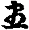



智慧，断一切烦恼藏。此文证唯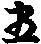



解断惑也。今大乘宗一往论之，亦有此义。而要论之者，空有两境，智双尽净，名为空智断一切烦恼藏也。故一家宗，假伏中断，中伏假断，中假俱断，中假俱伏，亦得言有解伏空解断，有解断空解伏，空有俱断，空有俱伏。至而论之，假空有断伏中，即乖断恒伏。何故尔？解惑相除，正是假故。而前论四句者，一往开中假相也。问：前云若利根者，一华一草等亦得是断伏者，十信三十心等亦得言名断耶？答：二而不二明之。如经云初发心菩萨等三世诸佛者，发心亦得言断伏，三十心亦同断伏，初地已上皆然也。但初发心者，从凡以来，始向入毕竟不二心，名为发心也。伏心者，折有不有，折无不无，屈折动转，无所平於有无等相，名为伏心也。断心者，逈出有无等尽净，离四句百非，名为断也。此意正歆相除，两相相望，故就假明也。若尔，向入不二，名为发心；屈折平相，而未明不都净者，名为伏心；永净者，名为断心也。故一家云：一往大意，断伏虽如此，经论中有四种名目，解惑相番相对论之。如正使见论与思惟二种麤烦恼惑，於任十信断意，从中发心已上，至六地已下，断见思家习气烦恼惑也；从七地已上，至第十地已下，断二种无知惑也。故璎珞经云：六地菩萨，即非想想慧烦恼。又第七地经论，多云远离三界，故言远行地。所以如此者，见思有二种：一、正使见思，二、习气见思惑也。论师云：习气别无知，总痴无知，三种品帙齐轻，故一除道所除。今论不然，宁得无知同习气轻耶？如身子等恶口，与忽忽无知同品耶？问：开善等诸师，约世法与若忍道种终心，与初地初心解惑，相并不相并，解不同一。开善旧相传云：解生惑灭，一时而同。言解生故惑灭，不得言惑灭故解生也。此解最儜，汝见谛上品惑，必在世法心边，若忍明解心边，终不带上品惑，那得言解生时是上品惑灭，明同时释耶？又汝言惑灭之语，目无目有，终是目有是惑有。向诮无时，不得与明解同时。如源品无明是佛，斤断无明。此无品无明，只得言金刚心斤带，不得言是佛心斤带。金刚心是前念，佛心是后念，那得同时？故解生时是惑灭时，此释太无所以也。此义既然，为[絕-糸+禾]最后望初地类，此责之也。二、报恩云：解生与惑灭，决定不得同时，只得言惑灭故解生。若尔，惑灭当世法时，解生当次念苦忍时。故引释论云：福将生时罪灭也。又正类因灭故果生等也。此师於彼[二/糸]宗，大胜前解，而终不离即，常有斤同。汝解未有时，宁得惑灭於前耶？若尔，此惑即不须除，道亦非相对，除什难则无量也。今谓具如前说。如成论师云：同时不同时，忘法了悟，毕竟非时非不时，名为断伏。何处解与惑有南斗，明同时不同时也？问：若然者，都不论同时与前后时耶？答：不二而二，开之有二：一、依释论云：福充将生时罪灭者，名字同惑灭故解生，义理应然也。二、由解起故惑灭，若解不生，惑则不灭故也。虽尔，若解惑於，却蒙於无名相中假名相说，就假用明之。又成论等有门同宗，以解即惑，必是现起前解断成就惑，今则现起解断现起，或亦同言现起解除成就惑义也。若悟中时，非解非惑，而亦得言非解非惑。了悟非解非惑，故名为中。即者，亦有此义也。问：前云中假皆断等，四句相违耶？答：彼四句明者，为弹片常途，一向云真断假不断故尔。若不二而二开者，从浅入深，一往相断伏，就假明之。若通而明之，四句如前也。此义后金刚心中具释之也。又论师开善云：於五方便与三十心中缘境，前后释不同。法师在东山时释云：并缘虗假理也。中出阳洲时云：缘真不秤缘近。临死时定云：是缘虗假理。何以故？故论四无碍智品云：外人问：何者近法位世谛知？论主答云：望燸顶法中是也。又论三三昧品云：共分修者，修定修慧，是世间三昧，世在燸顶法中是也。圣正三昧者，入法位即是，若忍已上是也。故知五方便与三十心，并缘虗任理境也。虗假理即是世谛故也。彼宗若缘真境，出缘虗假理解，进不断，退不伏。何者？被导心行故也。若缘虗假理者，则伏亦得言断，如报因业牙灭故也。今大乘明义，具如前释，於真俗并得断伏，非真非俗亦得言断伏。若毕意净者，有何断伏耶？於假名方便开，则无往不得说也。论师等旧云：世谛𭸀法观，以有解入空。若得空解现前，名为真法观，则名为空解。若以空出有，名为世谛观，即名为有解。向者若无空解导有解，有解即触境生着。若从空出有，空解导不令着境，知世谛三假七灾虗任故，即不生着。排俗入真，即是有解资空解；从空出有，即是空解导有解。空解即是空慧，有解即是方便慧。彼宗有解终异於空解，空解终异於有解。有方便无实慧，此方便亦被缚；有空无方便，此空亦被缚。如是缚若尔，岂是能断伏耶？今谓须依经，先以定动，然后慧拔。因缘假名伏，假名因缘断，故先以假破性，次因缘破任。如此即是根本清净，即须中假度之。空是有空，有是空有，生是灭生，灭是生灭。若如此者，捶荡动转，则名为伏道。空非空空，有非有有，生灭非灭灭，生非生非灭，非空非有，此即是断惑㝡初入道之方法也。又一家作十鄣者，初地断凡夫我相鄣，二地断众生身耶门鄣，三地断无明暗相鄣，四地断解法慢鄣，五地即身净我慢鄣，六地断微烦恼鄣，七地断微细集鄣，八地断除无相有行鄣，九地断不能利益一切众生鄣，十地断一切诸法不自在鄣也。十地对十鄣明之。断二十无明者，初地断凡夫我相鄣，即断二种无明：一者、鄣一切法无明，二者、润三恶道无明也。问：何意初地菩萨断除凡夫我相鄣耶？答：若是道种，终心菩萨犹有习气，即虽二种我见，亦名生、法二我也。问：生、法二空，同论师意耶？答：大异。大乘明义，二谛并是生空。何者？二谛并是假故。若法空者，即是中道正法，为法空也。若登初地，即能除麁习，即离我见，得真生法二空，故言除凡夫习我相鄣，入真圣位也。一往明之，初地断二种无明，除凡夫我相鄣。而初地断伏，实是无量，何正断二种无明，除凡夫我相鄣？此是编举一方为语耳。问：初地何意断凡夫我相鄣耶？答：地前得道种终心，所以猒生死，欣乐涅槃，舍生死之过，更求出离之乐，良计有我气故尔。无我气故，修禅等诸行，安我置好处，犹我相气，故名为凡夫我也。明初地则断，即离我见，得空无我真观，即名为真圣位也。他家云有此空无我理可会之境，今则不尔。向者未悟，犹言有我；今悟不见，外其所见云我，故言无我。何得别无我理可会耶？见即向见有我，名之为惑；今悟我无我，此即为伏，即是断。只名伏为断，何处更别断伏可得耶？约位明之，道种终心，未离五怖畏，只犹计我气未洗尽，故有怖畏。今初地既得真空无我慧，不见有我可得，故离五怖畏，名真菩萨也。问：前明十鄣，出何经论耳？答：出相续解脱经云：断二十二愚心也。初地断二愚，乃至十地断二十愚。一地断二愚，即唯为十障也。㝡后两愚，即等学地所断。故经云：二十二愚，凡十地能过也。二十二愚者：一、众生及法计者愚；二、恶趣烦恼愚；三、微细犯戒愚；四、种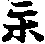



愚；五、欲爱愚；六、满足闻持愚；七、正受爱愚；八、法爱愚；九、向生死背思惟愚；十、向涅槃背思惟愚；十一、诸行生愚；十二、诸行相愚；十三、微细相愚；十四、方便思惟愚；十五、微发愚；十六、相自在愚；十七、无量陀罗尼无量字句上上知慧愚；十八、乐说自在愚；十九、神通愚；二十、微细秘密愚；二十一、尔炎正受微细愚；二十二、鄣閇愚也。问：论师云：五方便与三十心等解所含相惑，故缘真不秤。今大乘亦同此说不？答：并不同也。今只出诸师说不同也。一、南㵎云：非想九品相惑入似解体也。而非想第九品相是界外烦恼，故世第一法相是界外无漏所断也。今谓此意非小义宗。若尔，第一法解体无有被朵义也。二、庄严云：见谛上品相惑既被伏，故以第二品已上相惑并得入似解体义也。三、法云报恩龙光传开善义云：非相九品相惑与五方便三十心似解体相惑齐。若尔，无间第一法解体相惑与非相第九品相惑恰齐。何者？非想第九品相惑是起相之始，第一法相是相尽之终，始则从轻向重，终即从重向轻，故二处齐也。小乘明义既始此，虽彼大乘明义解惑类此皆然也。今大乘明义即不然，无惑入解、无解含惑，但假名名字开为解惑，惑解因缘也。若未净了悟为含惑，毕竟了悟时名为勉相惑，何处别有解体而含相惑体故不秤缘耶？今无得宗明之，彼智慧等并是无明，故须洗除也。



第二、论修行。修行门，成实论师释不同。庄严闻修功德有十重，三十心中初十心修初地功德，於中十心修二地功德，后於十心修三地功德。於初地中修四地功德，於二地中修五地功德，三地中修六地功德，於四地中修七地功德，於五地中修八地功德，於六地中修九地功德，於七地中修十地功德也。此是约阶级略言次第然之，亦不全如之。何者？正以空解为成地之要，所修功德未必次二行相随故。如地前已修十二门禅，三地后修此法则成无定，定门如之，餘行类亦然也。今谓未必然之，如八九十三地中何不修功德耶？若言念念空有并观者，即是修功德智慧，何必言五六七三地中修八九十功德配之耶？开善门徒云空有两行齐进，只有有行长一品，所以金刚心菩萨有中万行等佛，未有空智一品，故名为等觉佛也。问：初地菩萨三十心所伏惑断却者，何德二行只长一品行？答：彼云小乘不了教明义，於十五心中不出观。彼大乘明义，初功品品中出观修万行，故终长一品而已也。但须深功德资发初地空慧，故其所修品品多深也。今大乘明义具有四句：有解多与深，而空解上与浅；空解多与深，而有解小与浅；有解具有多小浅深，空解无多小深浅也。如一中解无量，量量中解一，但一中解无量等，约有行空行开者也。但一往宗途明之，有行多功德资发空行也。若约多根性论之，如单复中假出入无定也。开善云：空行长深一品，故无明住地佛菩提智行断，如夫人经中说也。问：定行同慧行者，小乘声闻慧有三，定亦例不？答：此充例。今且依论师云者，三种声闻：一、充声闻，此即充定慧；二、义声闻，此即义定慧；三、名字声闻，即名字慧。故声闻人有得八定慧，有不得八定有也。



第三明得失义有二(一明得失，二说并观不并观。第一得失有二义：一明内外凡，二说，三退)：且前论阶级，位虗所定。然彼论得失也，阶位诸说不同。若欲见十地本业经与持地经，明十地义㝡分明。又十地经与十住经、本业璎珞经、仁王经等，悉辨十地也。具如大意中一一引意，今更明出也。护国仁王经第三品云：地前习种性、性种性、道种性也。璎珞经云：初十心为习种性，中十心为性种性，后十心道种性也。又此经云：乃至有六种性。何者？习种性、性种性、道种性、圣种性、等觉性、妙觉性。前三性是地前位三也，后三性是初地已去是也。持地经地前有二种住：一种性住，二解行住。又明种性云：略有二种：一者性种性，二者习种性也。诸法师取文意云：从具缚凡夫以去，自能殊胜者，名性种性。性不改故，名为性。习解已成，不改为恶，名为性种性也。若修行所得，名为习种性。亦不言两性高下也。又持地经分解行以为三忍，谓下忍为初十心，中忍为中十心，上忍后十心也。又云：解行住是初发心，未同净心地。净心地即是观喜地也。论师分位如此也。今谓初发心心有中假三种发心：一者、二谛观中明之，即是无所得徧行六度菩萨发心也；二者、具中假观为发心也；三者、通五十心为发心也。故言解、行、住是发心。但释初发心，未得净心地，有两义：一、是初发心具中任为净心地；二、是三十心未得初地观喜，故言未同净心地也。如持地经云：二种之解、行、位，则别名五十心为解、行者，即通三位也。问：内外凡夫位何者？答：地摄两论、成毗二家释不同：一云、初六心已下为外凡夫位，从七心已上为内凡夫位。故璎珞经、本业两经、为证二经同云：身子於第六心中退为小乘，至七心便不退。故退为外，不退为内也。二云、初十心为外凡夫，中十心已上为内凡夫位。故菩萨断结经云：有十二贤圣人云：中十心为性行人，后十心名为解行人。以十地为十人，合二人为十二贤人。经说不数初十心人，故知犹是外凡夫位也。三、诸论师等多云：三十心并是内凡夫位，类小乘五便内凡夫位也。故持经中四十二贤圣人云：初十心为习种性，中十心为性种性，后十心为道种性。又十地足前三十心，金刚心为等觉地，佛地为妙觉，故四十二也。又所以知三十心是初地前者，大论第二卷云：三十心并是地前方便位也。又此位中已能厚习善根、修诸善行、善习助道法、供养诸佛、习诸清白法、为善知识行护，具如斯法位无容退转，故知是内凡夫位也。又四依中一衣故是内凡夫位，十信发心位是外凡夫也。今大乘明义山中旧云：从十信反心已是内凡夫菩萨位，其已能八相成道，为天人作师。故大经及迦叶最后卷七言偈云：发心毕竟二不别，如是二心先心难，自未得度先度他，是故我礼初发心。发心已为天人师，胜出声闻及缘觉，如是发心通三界。故亦是初依人也。大品？三慧品亦云：从初发心行彼若。此经岂非从初发心行彼若也？问：小乘五方便是内凡夫，具如成实论中说，大小相准望，充如彼师说耳。答：不例小乘中引不了教，宁得相准望耶？小乘中一生得道者可准望，大乘亦得一生得道耶？今大乘意，十信位中已能八相成道，已证正法波若，宁得犹秤外凡夫耶？今一家意中，十信前如偏行六度菩萨未得正法波若，唯得二，彼无行得用波若为？内凡夫如无行同二乘人，亦是无所得契内二乘。故大品经大如品云：有六十菩萨於五百佛所行六波罗蜜等，具行万行而无方便故、实际作证故，不得入菩萨位。亦如劝学品明有菩萨摩诃萨无量劫行六波罗蜜，而不入菩萨位，亦不入声闻位。此等并是彼十信位人等也。问：若尔，两品明菩萨无行得菩萨耶？答：亦非无所得菩萨。今列意者，彼菩萨位至二谛空中，准望论之，亦是有所得故。从是外凡夫位故被破，如地摄等四家菩萨也。今谓就十信前，未得二谛假空无所有为外凡夫位，得二谛任空有所无无所得为内凡夫位也。故大师云：未得彼空有所得行行，如地摄四家人。若回心值无所得善相识，专学无所得行行，如入无所得者，即是外凡夫入内凡也。又以此外凡行无所得，得入十信无所得位。虽得入十信，由前无便方便行行故。虽入正位而犹有明昧，故开为十地。若未得二谛任空时，无量劫行无所得人，一人彼十信位无量劫行行利根者，即便顿断众惑洗尽义。故经云：不在涅槃、不在生死，亦不由妙觉等觉入菩萨。又经云：一念相应慧断无量烦恼及习也。经意亦是初发菩萨也。



第二论三种退有两(一明三种退，二论堕顶义)：所言三种退义者，释三退位次第亦不同。招提云：位退，行念退也。今谓行位念三退也。又释位退者，释不同。一云地前第六心已下退位声闻，或退为凡夫也。故彼云：三十心中第六心犹有三涂业，牵生之业未尽，故堕三恶道连羁不绝。若第七心只有报果，无复牵生业，勉三涂之业也。二云第六心已下但退为二乘，不退作凡夫，报恩所说也。三白琰法师云：舍利弗於第六住退者，十住断结经第七品身子自说云：或曩昔在坏器时，或从一住至五位，复还退堕而在初地，复从初住到六住，如是经历六十劫中，竟不能到不退转地。今取此文，身子於六住退非六心退，此谓六地以为六住，开文正明七地为不退忍故也。今谓不然，彼师等定执经中心与住及地三名安处所，故一师或安下位中，一师复安上位中，故作此说，终是着名随相耳。诸佛及弟子不着名不随相也。经中或三十心位中作住地名说，或安初地已上等说，故或上或下须得通途意也。故一家旧判十信发心中前第六心已下退为二乘也。故璎珞本业经云：净目天子、法才王子、舍利弗不能入七信者，正是十信发心位说了。何以知之？十住断结云：身子自秤云：我昔在坏器时也。今谓十信前得二谛空位中退也。本业经云：退入外道，起大耶见，及作五逆等。岂非初发心前具缚凡夫菩萨？泛明之也。若得中假十信位，与三十心菩萨及初地已上更造大耶见等，无有是处。初发心菩萨已能八相成道，为二乘作师，岂更起大耶见等？但一家旧云：初地菩萨生在佛家，不离诸佛，岂更造五逆等耶？且约今政明之，如弥勒菩萨是初发心菩萨，而为阿罗汉等之所礼敬，岂更起五逆耶见等耶？问：若尔，十信位中如彼经说，是下劣凡夫耶？答：从来学有所得凡夫，遇大乘法门，悟无所得正道，而犹暂时起有所得心，名为起大耶见等。故经云：宁起五逆、四重等罪，而不能起有所得心之断也。今谓十信前开作十信明之，不开发心十信。如仁王经云：三十心中，初十心为十信也。毗昙家云：调达得燸法已，退大耶见等。论师释不同：一云、五方便中有此义，终是数气；二云、五方便前蹹行观中，起五逆、四重等罪也。问：此菩萨退为凡夫耶？答：大乘明义，或可暂时起，更还正道。此菩萨异法有故，终不为凡夫也。问：三退配於三位，其相何耶？答：不二而二明之。行退，观假初发心位中第六心已下。一家旧云：中发心中，前第六心发心已下。位退，亦於第六发心已下亦婫之。念退者，即七地初忍已下婫之也。故经云：七地菩萨爱佛地功德，不名无烦恼也。问：三退退相何耶？答：行退者，已伏烦恼种类更暂起，名为行退也。位退者，退起作二乘位心，名为位退也。念退者，七地初忍菩萨所未断烦恼来现前，名为念退。若尔，七地初忍已下有此义，中忍已上则无也。问：行退行因缘故退？答：如经中说有四事故退：一者久习放逸烦恼因缘利故退也。二者久植愚痴之业，亲近有所得恶知识故退也。此二事，师云有所得学问等也。若造十恶等事，不足及言也。三事见王等多生怨家雠[恪-口+各]故，所以退也。四者资财不具足故退也。如大经迦叶问佛：若利根者，何故不现般涅槃？佛答：为不具足故，所以不般涅槃。若尔，为多有𨷂少故，所以退也。位退者，如璎珞经云：大士退也。大士所以退者，行菩萨行时，天帝释见菩萨行行有真实坚，因以不识之，一时化作婆罗门来乞眼。行菩萨者不逆一切众生意故，即排眼童子与之。婆罗门亦得眼，童子即掷之，脚蹹破之。法财王子即念言：汝既无所用者，何意就我乞眼？得眼即蹹破之，改何益？眼是导行之主，众生难化，即起退心：我不复行菩萨道，我退作二乘，自调自度也。若至七心，即充不退也。念退者，如十地经云：七地菩萨爱佛地功德，不名无烦恼也。花严亦云：三界烦恼尽故，不名有烦恼；爱佛地功德故，不名无烦恼。故念退也。今正取未断烦恼来现前，名为念退也。问：此菩萨行已深，何意起此念耶？答：论师说不同。一、开善门徒云：引接名字明之，有二乘故。经云：有三种意生身。何者？空解万行相资乃同。二乘人不修万行，云何得空解断三界惑出界外耶？又此菩萨虽断正使已尽，始出界内未得空有，并观钝根菩萨有时起爱佛地功德，或时乐没空时也。二者、有实行二乘家，即是庄严等门徒云：不唯钝根无方便菩萨爱佛地功德，亦是声闻等二乘断三界正使尽往生反易，生死时闻佛无量功德，即生爱佛地功德。又此菩萨正就有行明之，初地至第六地犹有退转，以正使未尽万行难精故。从来所修之法，或有已得胜品而须申退胜品，名为堕顶也。或复入空无相无作等生法，名为着空也。报恩亦同此说。故华严经云：七地菩萨者，寂不修万行故，诸佛来摩头劝发种种教化，汝未得无量法门三十二相八十种好发起万行。又楞伽经亦云：七地菩萨着空故，十方诸佛七过来摩顶劝发万行。同前经文。释论第十卷云：七住菩萨观诸法空无所有不生不灭，如是观已，一切世界中心不着，欲放舍六波罗蜜入於涅槃。尔时十方诸佛放大光明照菩萨身，以手摩头语菩萨言：汝勿生此心，汝亿本愿欲度一切众生，汝未得三十二相、八十种好也。又夫人经亦云：无漏业为因，无明为缘，能生声闻、辟支佛三种意生身，故定有实行二乘人。若无实行人者，七地菩萨无容无三十二相、八十种好，改着空寂，不修万行，始欲舍六波罗蜜，入於涅槃也。若如开善云实无二乘者，而诸经说者，皆是迹中为物引接，故此释不成语也。真谛三藏自性责开善云：彼国中无有人言无实二乘者，汝自輙言无有实行二乘。故三藏师引夫人经云：三种意生身，即是声闻意、辟支佛意、菩萨意，生於变易生死中。今谓通而为语，亦有二乘，亦无二乘也。言有者，佛随缘方便，彼名字开三乘故有之，故经云除佛方便说也。言无者，无如四家说，七地中会三乘，故一家云具四句也。问：如斯三经一论等，著寂菩萨等，若为通释了？答：大乘无所得义，通云如地、摄两论，成、毗二家，有所得无方便菩萨，难改回心入正道，而由前无方便行行故，至七地时犹见思惑习故，着寂不如法行行故，诸佛来发起汝等未得真三十二相、八十种好。若小小分三十二相、八十种好，如初正八相成道，三十二相、八十种好并有之也。问中，十心中自有顿断烦恼，不由等觉、妙觉究竟涅槃者，七地已下菩萨等，宁得有着寂不修万行，为诸佛来种种发起，顿如此差降耶？答：正是前时有方便无方便行行，故须如斯，则与钝差别。如释迦文久已成佛，无有一切烦恼，而尚受九报。今烦恼未尽，菩萨中自有着空而不着空，何疑了？问：释迦文久已成佛，而为一切众生方便受九种报耶？得相例了？答：久已得种觉，犹尚为物。九报者，烦恼未充，菩萨自有，由有方便无方便行行，故上七地下有泛空不泛空，何须疑之？无方便地摄等诸家，好有此疑也。故手德楞伽[冰-水+居]经云：一一地中迳百千大劫，方本一地之行，软根不在其数。故知初地已上并有利钝。钝者，即是前无方便行行，故至七地自有沈空着寂，故诸佛来发起也。问：如真谛三藏云：与诸论师释，六地与七地中为二国中间也。答：今大乘义不同彼说。今谓假十信与中十信中间为二国中间，难可过度，即是分段与反易两种生死为中间。故一家举譬，言有南北二国中间，如大江五十里中间，复有清江与监察，故难可通度。正意任十信中虽断正使尽，而转入中十信为难，亦是正使虽烦恼而为习气，故万行难精。故从来所修之行，或时胜品而须申退失劣品，名为堕顶义；或改入空无相作等生法心，名为着寂等，如前说也。若从凡夫来，依偏学无所得者，一入假十信时，复进得中十信，即成种觉有限，故得中十信已上至七地，亦无有着寂沈空者也。故大经云：八万劫到，六万劫到，四万劫到，二万劫到，十千劫到。如此等人，并是利根者也。钝根经无量劫，方成一任行也。亦有人言：多经论云七地着寂，是三乘共十地中七地，非菩萨独十地中七地。又言：餘经论言之，或可是如彼说，而华严经语岂是三乘地意？彼经未明二乘事，云何是耶？但华严经中虽未说二乘事，而理中明十地相，唯望断正使尽，出反易生死中受生二乘事义，故记而明之，经两意不相违背也。亦是解脱月菩萨请说二乘法，故充有二乘，但彼经来意亦未尽也。三、今说释迦教，对舍那教明之，释迦具有但不但教也，舍那所说教不但教也。舍那教中直明并诸微尘世界大小缘事，如释迦说西方事，非是舍那缘事也。故金刚藏菩萨为解脱月菩萨说法文言：此中不宜闻二乘法，所以不说小乘教。教解脱菩萨请金刚藏菩萨云：此中亦充有堪闻小法有利益者为说之。而文不见说，故一家相传云：虽请说而不说。故无有但教，亦无二乘，何劳说也？而观世音菩萨授记经云：释迦佛光明至时，三乘人同光来事者。一家判云：回小入大，二乘有二义：一、实是菩萨，仍归本名为二乘。如法花经云：已授记三乘，从本为名声闻也。二无所得，二乘亦不妨，但无有摄地两论成毗二家，二家但者也。彼经与论等云：七地菩萨着寂等故，诸佛来摩顶发起事。四家定执安置高下，故须更料简之。今割空着别明之，故开合散束不相妨意。故七地着寂，且初发心着寂。寂且初发心着寂，即是七地着寂。初发心明了，即是七地明了。七地净了，即是初发心净了也。故华严经云：一微尘世界即是无量微尘世界，无量微尘世界即是一尘世界，一多多一等也。如支楞伽经云：初地即是第十地，第十地即是初地，初地即是第八地，第八地即是初地等也。而经论中偏约第七地明着寂等故，诸佛来发起者，开不二而二。论之第七地，是断四住地习气尽，出七地入八地等事，故经论中多约七地释之。此释意地摄等四家，二见难受信。若得大乘无所得意者，任运义理说也。问：三退位定有高下耶？答：不异而异，明之亦得高下。异而不异，论之初行退即是复念退，复念退即是初行退，位退亦然也。三位开善云：从凡至圣，阶位高下，略分为三也：一具缚凡夫位，二善恶供位，三性地位也。此三位并是初地之与凡圣成分别耶？正也。从凡圣与未登初地，约发菩萨心，略有三阶级：初二是凡夫位，后一是似圣。似圣有为内凡夫，前具缚供位名为外凡夫。於外凡夫中复有二也：一有见众生已立，而未有一念胜善心，名为一立也。二、有善恶供位，此位之人，虽复[沉-几+夫][洽-(一/口)+酉]，要有归期。故从具位之供位性地者，既入正定，即是高[(冰-水+日)/(小-(丁-一)+ㄎ)]善根，已不改退，断善根也。今大乘明位，不同前说也。就无所得善根假中分之，自从未曾得起，向无所得善根已还，名为具缚凡夫位也。自从是大经念，向无所得善根已上，名为善恶共位也。即是大经云：从值凞连？河沙佛，未满一？沙已还，阶位之末，此中人法，悉名为共位。不定聚，亦是暂出还没位，以耶正善恶为体也。若曾值一熈连诃？沙佛所，发菩提心，名为性地也。故经云：得十六分中，一中道分[彳*又]，方是发菩提心位。如五种菩提心中说也。具缚位，流转无际，无有出期，故具缚也。所以共位者，凡有两共：一者、下同具缚，二者、上同性地。所以然者，行位虽有高下，值缘即谛法，还成具缘也。不失念时，乃吇三十心，十地方便，故与性地同也。故大经云：譬如有人，出家剃发，虽未受沙弥戒，已堕？女。若有发心，始吇此经，虽未阶位十地，已堕十假安中。故知与性地共也。故知还同具缚假者，菩萨戒经云：性地菩萨，始能不谤法，断善根。故知共位人，备秤具缚也。此人名为信根菩萨，亦名假名菩萨。所言以假名者，非唯道心，未是似解，亦改迹立。今曰菩萨，是非假立也。大品经亦云：轻毛菩萨譬为名，解行未深，多生退转，有似毛之随风东西也。大经？迦叶品云：菩萨有二也：一者、假名；二者、实义。此目假名，与本业经名目同，故言名字。即是轻毛不定，故名字说之耳。分别耶正善恶者，若具缚，唯耶无正；若性地，但正不耶。共位者，耶正兼有，善恶具行也。高下升沈者，具缚之位，唯是沈没，鄙下流转，无际不出也。性地者，既入正定，则能高升善根，已立不改，退断善根也。共位者，可上可下，亦升亦沈，暂出还没，故不定𥦡也。大品经？庄严品云：毕定众中干慧地，不取安故起期望。故不定位也。问：性是三十心中明之，宁同於发心中明耶？答：多二义：一、是发心当躰是性地；二、是从三十心向下𢪛十信，亦是性地也。问：性是何义，向三十心、十信明耶？答：性是不改义，而有二种：一者、解假性；二者、解中道。故发心以上，明地性也。依大经有恒河七种人中，初三种人即是三位人也：一、常没人；二、𫏐出还没人；三、住人也。常没人者，起耶见、一阐提等，趣向有所得，皆以重恶自沈没，不能出生死，故言常没也。𫏐出还没人者，若遇大乘善知识，发菩提心，故出生死，求生信心，正见修善。若经生，若遇有所得恶知识，还起耶见，断善根故，还复没，或升或沉，故言暂出沉人也。此两人必是出家人也。住人者，安立无所得善提，是第三人。如师子吼品云：小乘四念处燸法人。依迦叶品小异，如佛性义中说也。无所得善根已立，求不复断，善根不退，起耶见等，名为住理人也。又大经云三种病人者，即此三人也。何者？解不同。一云：初具缚凡夫者，不可除必死人，为具缚耶定位也。遇退医得差，不遇即不差者，共位不定人也。断自差人，即是性地人也。二云：若未立信根，名为必死不差人，为初人也。若初发心至第六心，差不差病人也。第七心以上自差人，不如前说也。又诸经论中有三种名：一、耶定聚；二、不定聚；三、正定聚也。解：此三聚位开善云：耶定者，起耶见，失正理，遇或之名，亦言耶定，起心定执划计也。不定者，或正或遇善知识，信三宝四谛因果，信善现前，即是正见。正见未善安，还复失忘，遇缘谤法，断善根故，复生耶见，故不定也。正定者，信根已立，习善安立，不谤正见，不断善根，故名为正定也。其位亦同前具缚等三位也。今大乘明之，亦同具缚等中三位说也。通称聚者，有二义：一、聚集义；二、类义。亦是同义，同类而聚集，如方以类聚也。凡[尸@報]有所得耶心之位，是类者悉入耶聚中也。不定、正定亦然之。又具、缚、共性三位，此别名者，具者备有，有所得鄙劣故，以鄙法所成也。夫者，是行者通秤，若凡等庸劣所成，即是庸夫也。共位者，善恶相兼，未决之名，若化缘善，其位未立，善性成故也。耶正亦犹未决定，杂一切善恶故，共在一位中也。性者，不改故名性，习性已成，不改为恶，信根安立，能生诸善，故言地也。通秤位者，分尊卑高下，各自处也。作如斯明者，大都得无得大判之，若细论之，如前释也。地、摄两论，成、毗二家，一切善恶无非具缚，并是理外故。若学无所得心想，依谛向不二者，亦是共位也。十信位中释不同：一、山家旧云：中十信中，前六心已下亦同言共位，从七心已上性位也。二云：假十信中，前六心已下共位，第六心已上性位也。又山家从多约菩萨位中随名分位之，略有三阶：一者、七心上名为入不退法；二、初地已上名法位，亦言阿鞞䟦致，至此处即生在佛家，如前引经论释初地文中说也；三者、七地名为法位，亦言阿鞞䟦致位也。发趣品明七地名为等定慧地也。故大论云：前三地慧多定小，后三地定多慧小，不能入菩萨位。七地已上，定慧均等，渐得种智，名为等定慧地。此意亦是教门明之，菩萨初发心万行，但进至七地、方等二门耶？又须知之，小乘二十七贤圣位，今大乘明之，撮合为十信位，故二十七蕰在其十信中也。



第二、堕顶[打-丁+(解-角+?)]义。所言堕顶者，大品经劝学品云：菩萨摩诃萨不以方便行六波罗蜜，入空、无相、无作三昧，不堕声闻、辟支佛地，亦不入菩萨位，是名菩萨法生故堕顶也。此经文意说不同。[俎-且+馬]法师云：六住中空心为顶，有心为堕。以六地终心正由空解故，出离二乘也。岌法师云：七住空心为顶，有心为堕也。七地之始永离二乘故，六地以还未勉二乘故言堕。故释论云：从忍、无生忍中间名为顶。故六地以下从忍，七地已上是无生忍也。通法师：六地㝡极为顶，未登为堕也。尚禅师云：三十心极处为顶，登顶即入初地菩萨位。故大品第三卷劝学品云：不以方便行六波罗蜜。既言不以方便行六波罗蜜者，未得真解故，无方便犹存著，所以不得入初地。又不堕二乘地者，二乘独善为境，今大士久行六波罗蜜，欲来作佛，不堕二乘，但滞著心故，不得登初地真位故。法生故堕顶者，此习解未熟，未称无生，於一切法犹起著心，故言法生也。若深广心秤，独成菩萨位来，不退二乘也。招提云：七地无生法即为顶。是六地之上，决定入七地之心，以起取著之，名为法爱。于时不能至顶，故必不为二乘。进退无授，故名堕也。今谓释论第四十九卷直云顶空，从忍、无生忍之间，地前为从忍，初地已上为无生忍也。今观经论意，起有欲心为堕，无欲心为顶。故经云：菩萨不方便行六波罗蜜，入空、无相、无作等，故法生，故堕顶也。若尔，菩萨方便行波罗蜜，回出凡夫、二乘有所得菩萨相情之外，名为顶。非方便行六波罗蜜，故法生堕顶，如地摄等四家菩萨等也。若为位论之，前三退即是堕，非前三退即是顶也。故大品经？差别品云：得无所有已，见一切法空，四谛所摄法皆空。若见观是时，便入菩萨位中。是为菩萨位性地中，不从堕顶。用是堕顶，故声闻、辟支佛地也。而诸法师多用六地心终为顶，或言七心初为顶。约位明顶者，观经文意，应是六地终心为顶也。大陌而论之，八地以上无生寂灭忍，入法流水，无功用心，无改有念，故无念退也。释论云：登第八地。第六地中增退中云：六住退，得无生也。第八、九位，入法流也。



第二明并观不并观，释并照不并照，具如二智说也。今略出之，而说者不同。一云八地已上始能并照，七地已下未能并也。二云六地已下悉未并照，始入七地已上皆并照也。三云中忍已下未能并照，七地上忍已去一向并照也。四招提云：三阶明之，一六地已下一向不并照，二八地已上一向能竝照，三七地或竝不竝。泽於七地以为三阶，一下忍力微弱竭力即竝照，二中忍渐胜竝照转多，三终心一向能并照，仍入八地位大寂也。五开善云：七地中三忍，下忍失念亦不并照，中忍不失念亦未并照，上忍得并照，八地任运行也。六宝亮法师云：初地已上已能并照。地师亦同此说。故彼师云：取仁王经意云，初地并照，八地已上任运自成，美其胜同名耳。今大乘明义，初发心中十心菩萨已能八相成道，即能并照。如仁王经说意，复必须识徧圆横竖之立，既能并照，无故入空出有，异时但为化缘，宜现入定出定、入观出观等也。若尔，非直真俗并照，亦就俗中法法并照，就真中如十八空等并照，一中解无量，无量中解一，如是横竖总别无不满足也。琰公云：七地菩萨定有并照者，终心一向能并，正是断习气极品明心与有知并也。下忍并者，必是温故空心与有知共竝，断或之心不能与有知竝也。中忍之心自能屡竝，应多是温故空心有知得并，断或之心小能尔也。正以什公、肇公等多七地自动而寂，故今推斥七地为三阶之辨也。开善意亦略同此意，但上忍明之也。今谓多种之说并是正入发心，向入发心观行未调利时，学方法得有如此义，已入正位时任行亦有也。但什、肇两师多徧约正使尽明之，大意同今说也。又彼师云：发照七地上忍，悉罗发照初地已去至七地中忍，亦得反照，但不恒反照也。大势并照义类之，从浅至深反照之力转增进也。於初地已去至七地中忍，𠄎罢反照我是某地，已得尔许法门，无若干烦恼也。六地已下不能自於空心知入其地至若干品，七地已上则能知如向空有并照也。今谓亦如照初发心菩萨已能反照等也。成论师解并照鄣不同：一云别有无知鄣也；二云无别鄣，但有缘由之鄣。良由或多知弱故不能照，或小知强故能照，直是多智竝生便无别照，故无别鄣也。今谓未必一向尔，若不二而二论之，一智照多境，多智照一境，多智照多境，一智照一境，境发智亦尔。照义既多种，鄣义亦应有别者也。反照智解亦不同，一开善云照青之智反照照青解也，二龙光云别有智智但自反身反照，如是无穷反照也。若尔，一知知青还以此知，此知如开善者，鄣亦说有别无别不同，境别故有别鄣，还以青智反照故无鄣也。龙光云有别鄣也。今明不二而二明之，并得两说，但名字同意异也。论师云小乘之人有高位利根者，有中则得照一切空心，不能与有知并也。中乘人於有中并照温故，空心亦可能与有智并照，如大论云或侵习气与七地下忍相似也。反照亦可，如论云凡夫总相自缘名为反照，如定行自反缘住得，如菩萨别反照则无也。今谓初发心菩萨并有之，若菩萨二乘亦菩萨一种也。如成论师所明三乘别异，善根人舍波义论之，如彼说而已。今大乘宗望彼有所论都无之也。



第二，杂简。



问：何者功德智慧庄严耶？答：且弃功德与智慧，两门不二而二明之。依大品经第一卷序品，举万行与万德境智等劝学文意，依一种开八段意，摄法无不尽。㝡后结云：欲得功德如是者，当学波若。波若波罗蜜者，正法波若为本，所开三乘观与三果并境智等为功德也。正法波若之实非功德智慧等，而举末用目之，亦得言功德智慧等。所开六度为功德，就功德中开为第六度为智慧，五度为功德，并造境生为智慧，如善静为功德等，并得之也。又大经第二十五云：慧庄严者，从一地乃到十地者，或可举正法明之，或可举第六度说之。福德庄严者，谓檀波罗蜜乃至波若非波若波罗蜜者，举任明之。今谓福慧，慧福因缘语耳。而六行中分之，前五度是福，第六度为慧。又第六中分有分为福，空为慧。故经云：波若非波若波罗蜜，如前也。问：若为是大庄严与大庄严发趣耶？答：释论三空文云：大庄严发趣，大庄严乘於大乘也。又云：菩萨行檀波罗蜜乃至波若波罗蜜，能舍内外财物而行，犹存有吾我，所以未得生空，直名为大庄严也。若菩萨行檀波罗蜜罢，舍内外所有无有吾我之心，即得生空，名为发趣大乘也。复次菩萨行檀波罗蜜乃至波若波罗蜜罢，舍内外忘，三事毕竟净，具足生法二空，故名为乘於大乘也。释论第五十卷云：初地至三地慧多定小，未能深摄心故。四五六地定多慧小，以是故不得入菩萨位。今生空法空定慧等，故能安隐行菩萨道，从跋致地渐渐得一切种智地也。论师释此意言：定慧以正观空理，理静为定，有中分别知为慧。如成论止观品云：分别阴界等心为观，会真我之心为止，立名各取一义也。又就此一说分为四阶：一初三地照空心小照有心多，二四五六三地照空心多照有心少，三七一地两势齐而犹牙起也，四八九十三地两智必并照念念寂灭。所以然者，见谛之或品数本少，非止可略此欲界思惟，而先在三十心，今中已伏意故，今就真观断之不烦多力，故初三地在真观心少也。修行之意本为济物，既已成圣无客独善，故多出空观权智，恐度人致令有心，心起甚段也。此言小多是依前空说，非与夺之意也。四五六地仍前以来多起有智，资此入空空心长久，以四地所断是欲界思惟，等於见谛或品转细，细故难断，爱著人天弥难舍。虽五地所断是色界思惟，有四禅系缚，於诸禅定易起味心，兼以转细弥更难遣。六地所断是无色界思惟，有四空转缚，此或转细起味心弥多，故断或心多，多须数数入观谓为多也。有心小者，四地修道品，五地习五明，六地论观因缘，此则有中观行亦殊不小，不客高位泏有反小。前三正皆此三地，空观心小有行必多，今则空观心多谓有心稍少耳。空录六地隣於七地，七地空有稍均，谓之定慧平等。六地未能相及，故存小多之秤。然空六地以前犹亦多须泏有也。例如大经第二十八云：十住菩萨智慧力多三昧力少，声闻缘觉三昧力多智慧力少，故不见佛性。此义意言，十住菩萨受法王位，两复为众生雨甘露法雨，常有分别故智用则多。任刀者空未餘求进，故言定少。此皆义言之，非是定说。今於六地以前，多小之义亦充尔也。二乘分内但念修空，於菩萨神力心不喜乐，如法华经中说，义言定多智用少也。七地之终修习万行大段已修，故云七地定慧均平也。七地所断之或或品，与见谛思惟正等故，断此细惑空慧转多，备修万行必具足故，有中福慧甚亦倍多，空有二行俱多而大略相类，故云等也。七地之终所备略具，次入八地念念常寂。八地文云：皆乘船入海为譬，船中所须事事已足，故任力待时自去。九地已去功德亦然也。今谓无为法中而有差别，亦有此义，而未必一向如此。理而论之，菩萨一证中道，必修万行俱进。如仁王经云：初地一念具足八万四千般若波罗蜜，载为摩诃衍，𠄎灭为金刚，亦言定，亦言一切行。如是广赞波若波罗蜜中说也。大论云：定慧者，随义一往论之。何者？依璎珞经云：欲界见思惟习，或前三地菩萨断；上二界见思习，或后三地菩萨断。故定慧各有二义。前三地慧多定小者：一者、随所化众生处，菩萨於见思惟习之地，定浅小难用，故言定少；而有中分别，行易而多，故言慧多，如于慧地也。二者、泛论初入道必入空，为[立*(而/而)]亦是道，与俗反故；平於诸法为正道，专者此心，故言慧多定少也。后三地有二义：一者、色无处众生多者，静心亦是定，深而易用故。菩萨随并者，定为意，故言定多；而有中分别等小，故言慧小也。二者、菩萨因诸禅定、诸神通行、十二门禅等，故言定多慧小也。故须假诸广之。又不唯随所化明之，菩萨自行明昧多小，亦得大论说也。又古旧云：人地已上，断或不同。一糸次南法师传述旧云：八地已上念念断，或亦不须诸佛来开化。何以故？念念入法不出观，宁同被开道耶？而经云诸佛来摩顶劝发起者，闻是迹中为物故耳。二云：止同言空有并观，寂无出入观，故言念念寂灭，常居法流水耳。八地已上，去佛劫数甚多，犹须感佛而俱得开化，不容都无所待，念念进行也。故渐备经云：第十住菩萨犹须承佛威光，得百万三昧。故知犹夜化，无容念念自断，或进行也。今谓八地以去，亦须诸佛开化，既是未净之地，无容一向不须开道也。故经云：初地不知二地境界，乃至第十地，不至如来举足下足也。亦是大顿悟家云：至第十地，始见无生。小顿悟家云：至七地，始见无生也。又七地菩萨，诸佛来摩顶劝发者，至第八地，不容一向顿，不须待也。经云念念常寂者，如经云：不起灭定，而现诸威仪，心意识亡幻化，无心於彼此，而能应一切，名为常寂。何时导有心神，常在观，不出观，名为常寂。若七地已下，有心神躰出入观耶？理而论之，初发心时，已平於诸法，心意识等如虗空。幻化人无心於彼此，此是彼非，而约动为散为出，嘿而为静为入，於幻化人动静无二也。菩萨一证正法者，动静即是用也。住大涅槃，建立大事也。故经云：初发心，毕竟二不别也。而经云：八地已上，常寂入法流。七地已下，有出入观等者，欲济物故，习气充净故，割折空差别明也。诸菩萨非静非动，能静能动，非出非入，而能出能入也。故虽开之，无纤豪之别，具如前说也。又论师云：於十地中，利钝分判，三品明也。一、初地至六地，灼然有利钝，如二乘也。二、七地亦有利钝，而转微相比，不堪悬绝，心有二种也。三、八地已上说不同。一云：学功已备，念念自断，或故无改钝，唯利一品而已。二云：七地学功备者，此是大数言耳。然空得此法时，犹有徧观，故有迟速。八地已去，无容念念断或故，则舍一念，犹有多少之或。此人数十刹那温故，未进断或故，品段亦无定也。若七地之终，功行始弁，故八地以去，迟束必不悬绝，而则异於七地。所以开三阶者，彼师云：六地以前，犹断正使，所修福慧，未央成满，故此彼神道异，故有无量迟速心不等也。七地正使已尽，唯断习气，备修万行，大段粗周，故迟束之相就咸也。八地餘习已断，止断无知，常无出观，故利钝相微也。龙光云：七地已去，或断二性，或三性烦恼，而习性不同，故微微有迟疾行也。又就迟疾，双约定慧，有三阶明之：一者六地已下，同定发慧，或以浅定发深慧，或定发浅慧，如二乘所宜不定也。若大士之行，六度俱修，不同与二乘正为空解，故得深慧者，定则心深也。开餘诸度类之，而开力多能，能於浅定发深慧也。二者七地菩萨，於师子奋迅，逆顺超越，故能从灭尽定入散心，散心直能入灭尽定，此是温故之慧，於定门利者，力能如是。若是断或之心，多用胜定入於深慧。灭定解不同：一云空解义枰灭定，能从神通说法，动转事心，能斯静也。二云是灭定，以此定起说法等也。三者八地已上，常以深定与深慧共俱，乱心久尽，故定慧俱进，但遂慧言之，故成迟疾也。四等诸度，其鄣亦已文亡，当其分限阶品品齐进，亦逐慧品言之以成迟疾也。今大乘明之不二而二，开差别明之悟心有明，昧论之兼有论说，故弥勒尊者摩德勒伽藏经中言：如是於一一地中迳百千大劫，有成一地之行软根，不者开段。故知初地已上一一地并有利钝也。经言并有诸说而空寂不同，如前说也。又如偈中言：诸地行相入，修习出法门。五种法释云：相分如初地为阎菩提王，乃至第十地为摩醘首罗天王。又相者以相别为义，能标别於诸地也。入分者以进入义，进入地躰即是下忍初入其地也。行分者是趣地之因，三十心为初地之行分，从二地以去各有因也。修习分者研修为义，自是中忍修习地躰增明满足。出分者出离为义，即是是上忍一地满足高胜显出也。通秤分者亦以别为义，五种既殊别故即为分，亦名五门，门能通义也。论师云：大品所明十地与地经所说十地异也。何者？大品经明义是三界内事不了，未说高位菩萨所断是恒沙之烦恼、是无边集谛，又未说十地为常住之因，如此比类如居士经，并是不了地经。今大乘明义即不然，龙树菩萨於大论自明言：波若法华等经是显现教。法花经云：秘蜜教。大师云：大经亦例云：亦是秘蜜教。宇得暗心言：不了经如涅槃义中所破也。诸师作如此言，依泥梨品明之，恐是无间之因也。又大论第四十九云引十地名竟，云如十住论中说。此十住论，传云是龙树论别有十住论，非天亲十住论也。今一家传云：大品经发趣品所说十地，与地经所明十地一种，但说之方法少少异宗，致意无异也。及大品经第一云十地、十地断结经、十地菩萨本业、璎珞经十地等，大乘经所明十地一种，究竟大乘十地也。但间中或隐改说方法异，无为高下了不了义也。问：受生者凡有三种：若因结业生，名为生身；若以愿他爱结业生者，名为愿身；若知充机而现身生者，名充身。此事云何？答：释不同。一、论师等云：十地中，前二地於三恶道及三界人天具三身；第三，一地於三恶道但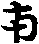



生，无有结业，生因已尽，故於三界人天具三身义；第四，地上忍於欲界但一应身，更无有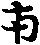



身，於上二界具三身也，寻中下忍意可知之；五，地上忍於二界但一应身也，於上一界得有三身，中下两忍寻之可知；六，地上忍於三界中但一应身，又依身不定，於三界外则具三身，中下两忍寻之可知；七，地以上於三界中但一应身，於三界外具三界，於下[歹*肖]咸之。二云：无有以愿他爱[彳*束]生，则逐结[缶-山+小]，不尔，但应生身，故[乃-(必-心)+十]生也。而约地生多小者，依璎珞经云：初地断见谛烦恼，二地断人中烦恼，三地断天上烦恼，四地断三禅以下烦恼，五地断三宝以下烦恼，六地断非相非非相烦恼者，例前可知。七地以上，金刚心以下，断恒沙等烦恼，亦是可寻也。三、今大乘明，如大经？迦叶品：住忍法时，断无量三恶道报。当知不从知缘而灭者，五善根已断三恶道报故。今任十信中，无有於三恶道结业生义，亦是无有人天中结业生身。此举三学果明之。自此已去，逐所断，或有生身、无生身，寻之可解。又中，七信已上，依经断见、思两习气，或与无知，或判，可知之。但三生身，逐结业生与应生，可知之。但以愿他爱狭，生身应必须业与愿共，方得受生身，无有但愿力生义。何者？何菩萨不愿度一切众生，而不得并被化者，唯有愿而不得并受化者。彼众生若无有自结业者，不蒙被化；若少有结业者，则被化入道也。问：诸地菩萨作王云何？答：依仁王波若经云：初地作四天王，二地作忉利天王，三地作炎摩天王，四地作兜率陀天王，五地作化乐天王，六地作他化自在天王，七地作初禅梵王，八地作二禅天王，九地作三禅天王，十地作四大静王也。诸师云：前三王通关三身生，后七王但一应身也。问：十地有色无，无云何耳？答：解不同。一云：六地已下有色相，或因未尽故；七地以上无色相，或因尽故。二云：七地以下有色，有习气因故；八地以上无色，习气尽故。三云：十地并有色，由或因故；常住佛无色，或因尽故。四云：至佛有妙色，例如至佛妙心，判此已现法身。论师多曰：第三师说，今大乘明义约彼名之，至佛有色并是彼故也。若约中论之，非色非心等也。问：十七地行者。答：真谛三藏师如牵十七经证有九訠义，彼论云：九品心故有第九訠。而此间不出此经，故难信而开名目义。一名善心地，谓布施、持戒等善心地；二者闻慧地；三者思慧地；四者修慧地。此四种是欲界善心地，此三慧於三界分之。段与论释不同，段明欲界有闻、思两慧，色界有思、修二慧，无色界但修慧也。论意欲、色二界具有三慧，无色界唯有修慧，故彼论三慧品云：欲界、色界一切也，无色界中唯有修慧也。五者有心定地，谓四禅、四无色定；六者无相定心地，谓无想定、心说灭尽定，三地是凡夫定善心地故；七者声闻地；八者缘觉地；九者十信地；十者十住地；十一者十行地；十二者舍小乘廻向大乘地；十三者大乘十回向地；十四者十地；十五者佛地如来相慧功德；十六者有餘涅槃地；十七者无餘涅槃也。二涅槃是断德也。今谓非有餘非无餘亦非智断，强名无餘涅槃也。



料简第三。明时节劫数



经中成明三劫一十里石，或言四十里方石，用六欲天衣，人间日月，三年一下，拂石尽石，为一小劫也。六十里石，梵天衣六殊重，三年一下，拂石尽，若为中劫也。然彼天无日月，以宝珠光明，取开明珠以辨岁数也。八十里石，净居天衣无餘两重，亦三年一下，拂方石尽，若为一大劫，亦无日月，取玸镜光明，有易晓脱以内数岁月也。然劫数亦不定，或言八千里、八万里方石，若为一大劫，下一千一万里石故，自是大劫也。又华严经？阿僧祇品云：略摄开要数，明千万为一亿，为一那由他，千万为一亿，为一那由他，千万亿那由他为一加那，千万亿加那为一频婆，千万亿频婆为一阿僧祇。僧祇，此云不可得、不可说、不可量也。诸法师云：前万里石若为大劫，即是一阿僧祇也。今明此大劫，约地位辨行行久近、经数之少多者，从十信发心供养熈连？河沙佛，一劫得到中十信，以中十信二劫到习种性之初，从习种性经三劫行得慧性种性，性种性故经四劫得到道种性，道种性经五劫得到初地，初地经六劫得到二地，二地经七劫得到三地，三地经八劫得到四地，四地经九劫得到五地，五地经十劫得到六地，六地经十一劫得到七地，七地经十二劫得到八地，八地经十三劫得到九地，九地经万劫得到十地，十地经百劫学佛威仪得到佛地也。出本业璎珞经，作如此都合一万一千八百四十劫行行，方得到佛地也。若如二乘人，八万劫乃到十千劫行行，到中十信位也。依仁王经判，地前到佛，中间劫数大，准望相似。后结掫，始终经无量劫。但从十地到金刚心到佛，此与本业经不[ㄊ/(巾-〡+串)]倍校。言若为释者，诸法师云：本业经据大劫为明也，仁王经取中劫为暗故，两经文文不相妨也。又依庄严、楞伽藏经云：於一一地中，经百千大劫，方成一地之门，不数软根者也。着尔时节，即不事定也。



金刚心义有四重(第一、明大意；第二、释名；第三、出体；第四、科简)：



第一、大意经论所明金刚心者，乃是借譬之名以况事理二种也。何者？一是以况於穷学之地等学也，二是以况於不二之道也。所以此两意者，开横竖之宗致，即是具中假方得秤金刚，非中假则非金刚也。金刚有多义，要略有坚有利二能也。一者、金刚妙宝体有坚故，众物所不能伤也；二者、能有利故，所拟皆破，物无不破也。金正法远离一切趣不趣也，故况之为坚；洞遣是非，故譬之无不破为利也。又等觉之地众累斯尽，故言无不破，故言利；众或所不能侵为坚，故言金刚心如金刚妙宝，用利体坚也。



第二、释名金刚心者，坚利为义。正法道百非所不非、百是所不是，故言坚实为义，所拟无不破。言利为义，亦是十地上忍胜身菩萨所拟无不破，故坚利为义也。心者有二意：一者、正道为心，故大经云阿耨多罗三藐三菩提心也；二者、欲修心法更非远物，心是迷悟之主，故众生神明研修悟此心非心，入理之门为心。又得果之心，故秤金刚心也。



第三、明出体。金刚心有二种：一者、正法为体；二者、横而为论之终。学之地照斯圆，万累都尽。空有两解为体，两用之中亦得言常解为主也。若言望坚正道，则二法并是假用非体。问：金刚心体位云何？答：解不同。一云：穷学地。穷学地又说不同。一云：穷学望结望故，名为金刚体位。言约作用，极边受金刚体位名故，如金刚宝瓶即足无缺也。三建初云：通因果为金刚体。彼意取波若经云：引燃灯佛所空所得。此证因前以为金刚。从彼经故，文云：於燃灯佛所无所得菩提。此证果前为金刚位也。彼师等定因果处所，故作此说。今谓不二而二论之。圣大论波若非二乘法又非佛法者者，因名为波若者果。若为菩萨婆若者，因为波若，果为菩萨若。若望大经片昔曰三照为涅槃者，波若通果地。若论正法波若如大火聚者，非因非果也。金刚心正约因为金刚心也。



第四、料简。问：前云金刚心者，拔阇罗萨埵，而金刚有多义，要略有能，何者多义耳？答：世间金刚者，清净为义，无有秽浊故；二者、穷胜为义，诸宝中胜故；三者、难恻为义，一切世间无能本价故；四者、难得为义，如世间金刚，贫人所不能得故；五者、有势为义，如转於圣王金轮宝，飞行自在，有大力势故；六者、不定为义，金刚若置诸色中，随色变无定故；七者、主为义，如转轮王金轮宝为众宝之主，一切诸宝悉皆随从也；八者、能集为义，如世间金刚若得者，一切宝物自在聚集教；九者、庄严庄教为义，如金刚能庄教，佛者法身首也。如此九种义，譬於金刚三昧之用，具如大经？德王第六功德中说也。问：世间金刚唯山羊角与龟甲二种能伤损者，今横、坚二金刚亦有非金刚义不？答：世间金刚有两种能伤损，餘一切物莫能伤损者，亦有二义：一者、偏若餘物，无伤损义；二者、穷学金刚心，一切烦恼不能累为譬，唯生灭没，况於二种物？今正法之道远离一切故。又诸有所得颠倒，於正观中洗尽，故得秤为金刚也。成实论释能断、所断不同：一云、能、所尽皆就相续假中论之，实法中则无也。所以知然？一念之起，或则自谢，后更不续，故是空无一等，云何决有能为累耶？故要须是相续不断，能有[目*闇]鄣之用。以此义推，故所断之或，要是相续道中明也。能断之智，亦是就相续明也。实法则无，决有能灭之力也。二云：解或寘理，相违之法起，则於或之治为，岂得言一违一不违耶？所断之或，本触成就，不名假明之。龙光传开善义成就长，假无智有，念念谢灭，故不约实法论也。三、释恩传建无云：按假谈实，能断之解，假实俱能；所断之或，但假无实也。刀断草木不例。何者？刀断木等是色法故，能断所断假实俱。又云：刀断木等既无成就，故约假明之。实法自在，故不假论能断所断也。解断之或但成就，无有念念生灭，唯有流动无常也。今大乘明义则不然，如十地大意中说：捡责我、我所，了悟不得我与乘所。尔时，理外容烦恼，尚得名为断伏也。不如成实论等假实、解实分汾云相断伏也。问：大品经？差别品云：菩萨断无碍道行，佛於解脱道行。两行何相耶？答：不二而二明之。金心为因，佛地为果，因无碍果为解脱，而得名论师不得。一、南涧仙解云：举义则无碍与解脱，举因果别。金刚心当体是无碍，佛果当体是解脱。何者？金心伏源品或或体无，决有牵习果力与鄣解力。释因力直是是成就，或体在。既失三力，於解牵习果无决有碍，故无碍义显，故目金心为无碍。既有或体，故不足秤解脱，解脱义不鄣也。既不碍於金心，金心习因牵起，佛果断此。彼伏源品或逍然无碍，故解脱义显，名为解脱也。二、龙光绰师传述开善义云：无碍、解脱两道，并是果地当体名。何者？佛果断或故，或不碍於解，名为无碍解；体逍然无累，名为解脱帀。由解脱故无碍，不由无碍故解脱。解脱胜於无碍，无碍劣於解脱。故解脱在果，无碍在因。何者？如被缚故有碍，则不得云有碍故被缚，故解脱，故无碍也。大乘宗明之，就假横论之。如仙师释，於名字中明之亦好，而彼处所被落无所得中。大乘意只了此有无心毕竟尽得名为解脱者，此有无心为被缚。若尔，不起有无心体名，名无碍道；毕竟尽解，名为解脱道。义开为有，故经中不二而二，云：菩萨无碍为行，佛为解脱中行。此是因果义，由因果，由果故因。因是果因，果是因果。故无因实於果，无果实於因。故无名相中开两为，故无处所也。又如假故中，无假实中，无中实假。所论云亦假亦中，二为亦然之。问：无碍、解脱有傍正不？答：不二而二，对境明之，两种悉正。若开论之劫，或解脱为正，无碍为傍。若言於正行无有有所得，脱有所得，名为无碍，名为解脱者，则无有傍正。若从假入中，假为伏，亦是无碍，为是菩萨，为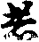



者，正观中名为断，亦是解脱，道是佛道，故大品经。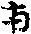



十三卷一念品云：无所得即是道，即是果，即是阿耨多罗三藐三菩提。故菩萨头经云：穷上利物菩萨，初发心时，便成正觉，不由次第。等觉、妙觉，前念为因，后念为果。金刚圣体，种知现前，涅槃中究竟果也。问：佛果所断或灭时，即是佛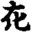



时。若尔，是或灭时，解生时不？答：成论师解不同，如十地义中说。一云：解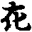



时，当佛果所断或灭。当金心时，佛果与金心不？问：云何言解生时是或灭时耶？金必或充别佛，而金心已积伏，或或无。既三中不鄣金心，牵习果，习果起，或体自逍亡，逍亡时终，当金心时不至佛。此义於十地义中已破竟也。二、龙光述开善云：解生时是或灭时，如苦忍时，解生时是或灭时。何者？若忍边成就，或体向无，苦忍向有，向有向无，非前后故，故言一时也。佛果断源品惑者，此一处断伏，不同餘处。何者？此源品无明成，终系於金心，无明体终，不假佛果。而言菩提智断无始或体者，如果起故因灭。若不应起者，因则不灭，由果应起，故因灭也。问：若应起果，能断金心惑，此则应未有寂，得未有解体，能断金心之已有或耶？答：由果应向有，故金心边或灭。若佛果不向有，金心成就，或终无有灭。由当佛果向有，解向或逍亡，故推正与佛果罗断源品无明。此源品或虽系於金心，金心非其治道，故推佛果也。今大乘明义，不同两说。或体本来不生，今亦无灭，解亦然。善言：或灭解生，解生或灭，作此动念心，即是颠倒，岂能隔凡成圣？圣但假名，开为解或明治，而言方明之。如大论说：福将生恶灭者，得言或灭。解生而常，解是所或，故或灭无所失，解生亦无所起，毕竟无迹，名为断伏也，而触位明之。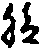



既云菩萨无碍道行、解脱道行，故金心断惑也。问：经云：金心所有相，前如常中月，所有烦恼，如烟微鄣，故智金心或未尽也。答：此经意，金心菩萨所逍尽烦恼，如烟微鄣，或不至佛故也。问：金心菩萨定有两解，并不及佛耶？答：论师常一往论之，有解齐佛出，解则不及佛一品，故金刚心、等觉佛。若能而论之，有解亦有明昧。何者？金心虽得册吾品，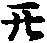



金心犹及或体，故有解昧於佛地，佛地无或，故明也。问：金心及解与佛道解等者，二地无浅深耶？答：释不同。一、南涧仙师云：境上有浅深之义，故妙觉、等觉两智有浅义。等觉但伏不断，便罗穷显段，得与佛一等。而浅深之处既难智，故要除或，方得覩深处。又带无常，故唯佛穷也。答：彼旧云或是一品，而於境上自有难易故也。二、龙常师云：约有解明之，一往论之，无难易浅深一等，故言等觉佛。或体有两力：一、或体能鄣於解；二、或体罢障用。用既被伏，无既鄣解之用力，牵果之用，如死人无所能为。或望於解傍缘故，或体虽有而不能令解。[日*闇]解既偏，照了无二，但无常故，不及为昧，又常无常殊耳。今大乘明义无二，而二假名，名字开为浅深胜劣，明明得有多种势也。因有三义：一、因满；二、元无明向无；三、果释具足三义，故昧也。果亦有三义：一、果满；二、无或体；三、极果，故明也。何以故知之？经云：后身菩萨但见终不见始，亦故身菩萨小见故。又璎珞经云：金刚心菩萨百劫者学佛威仪。故知昧佛也。若无上多义，即应佛等而逐缘昧也。问：此金心菩萨明解那得生耶？答：论云：要以由金刚前心了明解未能除，或由映润故得生金刚心令有也。问：伊既此一品或生，伊得起时那忽反能伏除耶？答：得有如此者，良由伊积此前心明力，虽既为伊所生，要由前既解力后微微增胜，所以还复能有除力也。无异况从木生，还复能有烧木之用，以此义惟解由或有而复能除也。大乘明义，金心之前细有所得润起金心，金心有所得心尽者，金刚心解向有或向无，故假名名字开之无不如斯种种义，但意永异论师等说。今虽言由或有之不有，有除而不除，除并是若方便。又论师释金心断或尽不尽，古今诸法师相传不同，庄严等师传述金刚心断或尽，但传无常义异於佛，彼义宗佛。若二谛之外，源品无明是或因所得故，金心所断故。何者？或因即空是真谛，金刚心体源品或名为断，或佛是至有，有真有出二谛外，故不断也。故菩萨璎珞本业经释义品云：金刚心菩萨登大山顶入百千三昧，集佛威仪用坐处，其知见亦常无常一切境智，当知如佛名为学佛也。而经中云佛菩提智断者，觉佛菩提断也。问：若金刚菩萨断或尽佛无异者，何经云如佛名为觉佛，则应言是佛也？又金刚心彼映润起以不？答：断或尽，则无或映润起。若是[舟*火]映润，则断或未尽之大乘宗。如夫人经云：佛菩提智所断。故是金心已断或尽佛，则无所断也。而十住断结经云：金刚心菩萨智慧如定中曰：所有烦恼如烟微鄣。此则所断或如烟微鄣，非犹有或如烟微鄣也。二、开善等诸师传述金心断或未尽，唯佛菩提方尽。故大品经？差别品云：菩萨无碍道中行，诸佛解脱中行。解脱於或，即是断或。故断结经云：诸佛解脱道中行。是断或也。亦如夫人经等所说也。亦道理明之，解惑相对，理应然也。又难云：若金心断惑尽，即应是佛，何故犹是因？今何故然无？既有惑累故也。庄严家难：金刚心解未足，犹有体存故，则应为集谛佛苦无常等耶？开善义答：或惑应佛苦等，但被伏故，无复能为，故大明至苦果等不来也，即是因果不遂义。故彼家义，从七地中忍已上，有惑因无果，因果不随义也。又大乘明义，念念惑果，有成就因缘差，不惑亦得，因果不随义也。问：若金刚心断或不尽，何得名金刚耶？答：解不同。仙公云：虽金刚或未尽，而众或所不累，故秤金刚也。又彼云：金刚心罢伏断，非一念力，如刀斫续假用也。龙光传开善义，只一念自是假，则能伏断也。仙公义假不当前后，绰公义假当於后，各执不同也。问：金刚不可破坏者，此心不及得言暗。𣋆由穷微，或岂非微？或使令然。身既使其𣋆，则有损亦瘵，义则非金刚也。答：金刚心解体内是明，解非暗，乃是小明而不及佛真明，故相待言暗，不同凡夫相或入体中也。问：解体是解非或者，在忍欢喜等门应名之金刚，体无或故也。答：通乘得有此义，但约位分别者，其体不可破而能破，或尽一种已满，唯在金心独受金刚名也。大乘义就横疎论了并同，有了但得同意，如空中鸟迹，明义故水异。彼有所同义，大乘明义解或相治，假上明之。故一家宗云：金刚心正论相治，佛则逍然无果也。故大品经第五卷发趣品最末云：菩萨摩诃萨行六波罗蜜、四念处乃至十八不共法，一切种智具足满，断烦恼及习，住十地，当知如佛也。而今两佛异者有四：一、因满果满异也；二、小见多见异；三、常无异；四、解或并不并异。有四义故，有明昧异，如前说。而经云等觉者，等见与等满，故等而实不等也。问：就胜者为谈佛是金刚体，怪诸法尽更无餘故也。答：义实尔。故大经第三卷金刚身品明佛是金刚，但寻此品意，唯取其常不可破坏义为金刚，不论罢功，以显彼满足无用也。问：穷学是金刚，其既有无常，宁譬金刚耳？答：无差别。差别明之，实是后心，方是真金刚。但随分明，无非金刚也。亦得当体分有之，亦得言问：金刚更名耶？答：要有四名：一、名金刚心，如前；二、金刚三昧；三、金刚身；四、金刚慧。亦同当体分有身，亦得言前两从因缘，远因於心，近缘於定；后二体用也，身即是体名，慧是属用名也。问：大经出几名？答：有五名：一、名首楞严，此言曾伏，亦言究竟，亦言健定，亦名修治也；二者、金刚，譬於坚利；三、名波若，亦得名当体名，亦约智慧也；四、名师子吼，譬於无畏说；五、名佛性，亦得言当体，亦得言因果也。彼经意随用，得有无量名。问：彼跋阇罗，此言金刚，金刚定是何物？答：成言是胜金，成言是利䥫也。问：此金刚心金与金坚之金、金身品金、金光明之金，若为同异？答：不同不异，一往弹之，而亦得言金光之金与金刚身品之金，并就果地法身明之。故大经答云金刚身因果，明法身常住，不可破坏。犹如金刚明护法为因，能得此法身果，举果辨因也。金光明之金譬法身，明忏悔施食，不然等所得，但总别异也。金坚之金有二义：一、正法明之；一、约因中明之。果则萨婆若，故金刚心之金约等觉论也。金坚之金虽云萨婆若明，明之是因，而因中举於下地也。若言摩诃婆若，亦非涅槃，意亦通果地也。十地金刚心义竟。



------



## 大乘四论玄义记卷第五



二谛义有十重：第一明大意，第二明释名，第三论立名，第四明有无，第五辨观行，第六论相即，第七明体相，第八辨绝名，第九明摄法，第十明同异。



第一、明大意。二谛者，实是非前非后，复非一时，岂有重数？但对破开善寺十重，故无差别，差别十重释之。解二谛大意，置师辞不同，略有五家。有所得成实论小乘师：第一、光宅寺云法师云：二谛者，乃是圣教之幽宗，灵智之渊府也。第二、庄严寺旻法师云：二谛者，盖是却惑之胜境，入道之要津也。第三、开善寺藏法师云：二谛者，盖是法性之旨归，一真不二之极理也。第四、宗国北多宝寺广州大亮法师云：二谛者，盖是言教之通诠，相待之假称，非穷宗之实因也。第五、摄岭西霞寺无所得三论大意。大师诠法师云：二谛者，盖是表理之极说，文言之妙教。体非有无，有无不永於体；理非一二，一二不违於理之。今依大师说，所言真俗二谛者，即是有无，有无共显一道。佛随缘说有无二教，贯於众经。华严经有十重二谛、十种四谛等。菩萨璎珞本业经十卷云：世谛有故不空，真谛空故不有。以有於凡，是有故不空；以无於圣，是空故不有。有即是世谛，无即是真谛。所以随二缘故，说於二谛。大经中文殊问云：世谛之中，有第一义谛不？第一义中，有世谛不？如其有者，即是一谛；如其无者，将非如来虗妄说耶？佛答云：世谛者，即是第一义谛。但有善方便，随顺众生，说有二谛。所以明真俗二谛者，欲有所表故。有表不有，表无不无。所以非有非无，是所表之道；有无二谛，是能表之教。教能表理，理能应教，教理相称，故名如是。故经云：一切有无法，了达非有非无，不著不二法，以无一二故。华严经云：诸佛圣主道，微妙甚难解，非思量境界，唯智者行处。此明无所得二谛，非二乘凡夫境界，乃是佛菩萨行处。虽非凡夫二乘境界，而亦可得圣凡境界。虽言是佛菩萨行处，而非有所得佛菩萨行处。故大经云：有所得者，名为无明；无所得者，名为智慧。乃至有所得者，是二乘；无所得者，是大乘。有所得者，名为二十五有；无所得者，是大涅槃。有所得者，无道无果；无所得者，有道有果也。大品三慧品云：诸有二者，名为有所得；无有二者，名为无所得。何等为二？所谓眼、色为二。若言眼为能见，便成异於色；色为所见，必殊於眼等，即名为有所得也。若成论家义，有亦是有，无亦是无。故以三□有为俗，即物之无为真。此有无既住有无处，故无所表。既无所表，即无理应教教；无此表理教，即无能诠理。不能诠理，即非理教；理不应教，即非教理。非教理故，即无理；非理教故，即非教。故以世间法者，有字无义也。今则有无二教，表非有非无之道。非有非无之道，故有有无二教。故经云：出间法者，有字有义也。山门义与成论等师，常有异义。成论等云：境智是二，各不相关。境自称空有二谛，智自是权实二智。智自生自灭，境无生灭。一往大判如之。若复细而论之，境智并有生灭无生灭。何者？彼明真谛境无生灭，俗谛境生灭。因中智有生灭，果上智则无生灭也。如斯之义，非唯是有所得，亦复不能所缘之义。故净名诃云：莫以生灭心行，说於实相法。今宁得以生灭行心，缘於实相境也。今谓境智不二相因，故有境智如同虗空。虗空是无生无灭，智亦无生无灭。故华严经云：诸佛妙境界，其如虗空。此明境同虗空。大品经三慧品云：虗空生故般若生等。空品云：般若空等。明此智同虗空，非直无生无灭同於虗空，生灭亦同虗空。以虗空无生无灭，而有生灭之用；境智亦无生无灭，而有生灭之用。以其有同虗空，故以虗空之有为俗谛；无同虗空，故以虗空之无为真谛。亦以有同虗空，故虗空之有为权；无同虗空，故虗空之无为实。有无既通境智，生灭亦通境智。但此生灭亦同虗空，故以虗空生灭为境智生灭。故大品经云：如虗空生故般若生。此意欲明虗空以无生为生，般若以无生为生。故十地经云：地行如虗空。彼文先解境同虗空，不生不灭，出过三界。后举地行，始明地行亦如是，不生不灭，出过三界。山门意境智，并不生不灭，与数论等永异也。如数论等云：若有表有，无表无者，此即各有相。有相故有所得，有所得则名为理外。若有表不有，无表不无，非有非无，名为无相。既有表不有，故无有有相。无表不无，故无无相。以无有有无相，故名无所得。无所得者，即名理内也。了义不了义者，若有表不有，无表不无，则名为了义。若有表有，无表无者，则名不了义。亦有是有，无是无者，则名为秘藏。有表不有，无表不无者，则名开秘。开秘则名了义，秘藏即名不了义。不了义者，则名为半字。了义者，名为满字。满字名曰大乘，半字名曰小乘。以小乘不了义故，名为有所得。了义故，名为无所得。故有无二谛，凡圣佛菩萨共行，而有得有失。若有是有，无是无者，则名为失。若有表不有，无表不无，则名为得。以了有表不有故，则名为圣。□有是有故，名为凡夫。所以道未曾二，但约得失两明，故成凡圣，乃至有生死涅槃之异。故大品经云：方等亦名甘露，亦名毒药。服消则为药，不消即为毒。一药未曾甘毒，但为有方便无方便两缘，故成毒药甘露之殊耳。问：数论师等亦云二谛之境是凡圣共行，今时亦言凡圣共行，与彼云何异？答：彼云八法世谛境无异，但凡夫取相故著，圣人从真观出，被道无漏心行，故不著为异。今明凡夫，则言有可有、无可无，圣人知有非有、知无非无，故异彼也。问：若圣人有无表非有非无，凡夫有无只表於有无者，凡圣顿永，理教殊别，宁言二谛是凡圣共行耶？答：二谛名虽同，而意大异。凡夫有则表有，无则表无；圣人有则表不有，无则表不无。故在名虽同，而随凡圣两人有无异。凡夫既有表有有，不得转为不有；今既不得转为不有，凡亦不得转为圣。圣人有既表於不有，无既表於不无，故有得转为不有，凡得转为圣人。凡人有既是有，故烦恼即是烦恼，不得为无烦恼。今圣人说有表不有，即烦恼转为不烦恼，故虽有烦恼如无烦恼，而烦恼性本自不有，无所有故假名无明，所以有得转为非有也。问：说有无为表非有非无，令众生因有无之教，悟非有非无之正道者，何意不直说非有非无中道令其得悟，而说有无令人於有无成病耶？乃似故欲令众生烦恼因缘住理外人地狱也。答：众生颠倒，或心不可顿悟，以渐法门化之。但众生闻有著有，闻无滞无，则为说非有非无，则便不受化。故佛与众生同源，不於僧那，故圣人慈悲，方便甫化。譬如长者脱珍御服，著垢腻衣，同子粪作，即是随缘。假令圣人方便甫同众生，故世间说有，我亦说有；世间说无，我亦说无。后则就求其有无相不可得，令其悟此有无非有非无，则是有无非有无，非有无有无也。问：若以有无表非有非无，令得悟非有非无之中道时，有无两教癈去不？若悟理教癈，教癈故理亦应癈；若悟非有非无时，有无教不癈。故从非有非无之理有起无二教者，与旧折俗入真，从真出俗，及地论息妄还真，从真起用，有何异耶？答：彼师等所执有真俗二境，故折俗入真，复从真出俗，息妄亦然。今明有不有，为破有病；明无不无，为破无病。有无两病若除，复有何二教之可得？既无二教可得，复有何非有非无之理可会耶？故非有非无，亦非非有非非无，故有无非有非无泯然无际。故居士经云：不离文字，说解脱义也。大品经云：是字不住，亦非不住，是字无所有故。问：若然，只见破外人有无教言非有非无，那得云是佛二谛教以表非有非无之道耶？答：只教令其识有是非有，无是非无，即是破，复是教。又一切诸法本若是有，可表非有时或得或失。而今本来不有，而假名说为有，只有本不有，不有假名说有。故大品经云：善吉不坏假名说实相义，不动实相而说假名，故於有无心动摇也。问：本藉有无二教得悟非有非无之道，今若有无非有非无俱尽者，宁非堕於耶见耶？答：本为谓有无可有无，故明有表非有、无表非无，以有无之教表非有非无之道。今若无有无二病，复用二教何为？既不论教，复有何非有非无之理可得？故理教有无非有非无本性清净，但颠倒众生所怖畏处。故百论云：畏处何染也？问：若理教俱尽净者，何须说二谛教耶？答：具如前说。治众生病故须说，但言方为说。言有不住有，言空不住有，说有不住空，说空詺空为有、詺有为空，此有不有有、此空不空空，空有为世谛、有空为真谛也。故大品经云：开宗以不住法住般若波罗蜜中。大经第五卷末云：善男子！如来或时说一为三、说三为一。又梵行品云：如来世尊有大方便，无常说常、常说无常，说乐为苦、说苦为乐，我净等一切法类尔也。又德王云：永断二十五有故得名净，净则是涅槃亦如是。涅槃得名有，而是涅槃实非是有，诸佛如来随俗故说涅槃是有。如世人非父言父、非母言母，涅槃亦尔，随俗故说言诸佛有大涅槃也。华严经云：一无量无量，一多一多一等。



第二、释名。所言二谛者，谓真谛亦名第一义谛，俗谛亦名世谛也。按字释名，真以实为义，则有之无体，无虗伪故，称为真谛。第一义理极莫过，谓之第一，旨趣实尔，故称义。俗者，以虗伪为义，有非性实，赖众缘成，无自故称俗也。世者，以有隔别，名相不同，故曰世。问：此释名以成论何异？答：名虽同，其意大异。若以义释名，有三种势：一、横论显发，二、竖论表理，三、当体释名。所言横论显发者，欲显俗是真为义，真是俗为义。何故俗是真为义者？欲显真是俗家之所以，故言俗是真为义；欲显俗是真家之所以，故言俗是真为义。故大经？梵行品云：欲令众生深识世谛，是故如来宣说第一义谛；欲令众生深识第一义谛，是故如来宣说世谛。为此义故，言横论显发也。竖论表理者，真是不真为义，俗是不俗为义。故居士经云：五受阴洞达空，是苦义；诸法毕竟不生不灭，是无常义。此则是以非苦释苦，不无常明无常也。大经？圣行品云：知苦非苦，苦圣谛；知集非集，集圣谛等。故言竖论表理也。当体释名中，是实为义等释也。亦得言当体从他为义。苦随空故为俗，实故为真，隔别故名世，理极称第一，则是当体释名。若随俗人所知名俗，真智所知名真；世人所知名世，第一智所知名第一，须他为名也。所以明真俗意者，为表非真非俗，即是名表於无名。无名之道，有何不名？所以有无之名，本於无名，无名而名，故名为有无。有名俗谛，无名真谛。真以实为义，俗以浮虗为义。此名是义名，义是名义。即是一名无量名，无量名一名。故有一名无量义，一义无量名。无量名无量义，一名一义。俗亦名世，真亦名第一义。世是伐谢为义，第一莫过为旨。故真俗是虗实相待，世与第一从褒贬为名也。通秤谛者，成论师云：有三家：一、光宅云：言教为谛，理本自实。说有耶有正，正言中理无有永谬为之审谛耶？说永宗呼为不谛。谛与不谛关近者之言，在理不异，俱称实也。二、庄严云：如四谛知是谛。引大经四谛品云：佛告迦叶：所言苦者，不名苦圣谛。何以故？若言苦是苦圣谛者，一切畜生及地狱众生应有苦圣谛。又言：凡夫有苦无谛，声闻、缘觉有苦有谛。复结云：是名知苦非苦，名苦圣谛。是则凡夫但有苦境而无苦智，故云无谛。二乘有照苦之智，故言有谛。若尔，知能寻求秤境，故知为谛。三、龙光传开善云：实名在理，谛有三义。实义释谛，此即在理。审当释谛，从言教为目。推审释谛，推审就解，解能推於理。虽有三种秤，而在理为正宗。审有此理，故秤谛。今谓不然，彼有教、境、行三法异故，各执不同。大乘义望之，并是有所得二见之说。第一师境智既非谛，岂有能说之文得是谛耶？文言何所诠而得谛耶？第二师解智为谛者，所观之境既非谛，岂有能观之智得是谛耶？第三师境为谛者，大经已破，故不用也。今大乘明义无二为二说，一往亦得言以教为谛，而实大异。三师说前虽言以教为谛，而经明谛名目理，教得谛名。若言教当体谛，而文是诠理，文不自表，又异於境行，故大异也。今谓理乃是非谛，教正是谛，但谛名不自待非谛而得。就教中为言，境与智并是教，亦悉得是谛。后两家境智悉自是理非教，今明境智并是教，理即非境非智非教，故异於三说也。问：山门宗理说非有非无，教乃是有无者，理异於教，教理相乖，何得名谛？此即非谛也。答：有二意：一、今释谛名，本以不谛为义，所以虽言有有无为诠，非有非无方自得，故是谛也。二、亦不必须道谛是不谛，直置有无诠非有非无，自是谛义。何者？若有无不诠非有非无，可是非谛。今有无不乖非有非无，非有非无亦不乖有无，所以相表，故得谛也。今明无有此能亦无此所，乃至人法等但假名因缘，故名能所。能所则通亦长，故一切诸法不出於能所，因果即短亦别。若非能无以成所，非所无以成能，故能必待所，所必带能。但世间受名有便不便，或在能为便，所则不便；或在所为便，能则不便。乃至能所合论则便，单能所则不便。何者？如体中能为便、所为便者，如好精美食宜在所；能所合为便者，如水洗物非净故物净。能所俱名为净也。今明通名谛者，谛以审当义。但一家释谛有二义：一、说有无二教当於理故审当；二、当机缘故审当。则片二乘凡夫，无理可当，无机照也。若如百论云：真俗相待故，二谛皆实。所以真待於俗，世待於第一。故百论云：如㮈待枣为大，待苽为小，二俱为实。今诸法於凡谓实有，於定谓无，故名为谛。如凡愚小儿，看所作约事为实有，於彼便为谛。幻师知其实无所有，亦是为谛。诸法亦然，凡随为实，於凡为谛。圣知有非有，知无非无，有无毕竟无所有，於圣为谛。故谛待不谛，实待不实。真待於不真，不真名为俗；俗待於不俗，不俗名为真。故凡真则圣俗，圣真即凡俗。俗名真俗，真名俗真。俗真非真，真俗非俗。故非真非俗，名为中道第一义谛。通释於教二谛意也。问：他既约虗实释二谛，今亦就虗实明二谛，与他何异？答：彼明虗实，而虗实并安二谛。理如鼈鼻，论虗实二谛。今明虗实迭伐，明虗实二谛。如㮈待枣为大，此则为实；望苽为小，则便不实。诸法於凡是为有，即名为实；於圣不有，则名不实也。问：他家虗实，并安可论相待？今山门虗实迭伐者，应无相待。答：彼虗实并论如鼈鼻，故不得明相待。两法性实自有，何须论相成？长短等并类。然今明无名无相中，虗实迭伐，相由成立，方复是相待义彰。如㮈於枣为大，名实；望苽为小，则名虗。㮈实不当大小，相因成大小。一切诸法於凡随有，故名为实；圣知有不有，故名为虗也。问：若然，唯应有一谛，宁言二谛相待？答：理实应然。故大经云：世谛者，则第一义谛。但随顺众生，故说二谛也。问：如彼经者，只成一谛，宁言二谛相待耶？答：实论无两一，但於凡圣二人，故说二谛。二谛有何失耶？如凡夫谓诸法实有，则名为世谛。於圣人不有，不有於凡名不谛，於圣则名谛。有既转为不有，故凡转为成圣，故有二谛。若如彼义，有不作无，无不转为有，性实不改，故失一无量。无量一展转，生无碍解脱法门义也。问：若言於凡是实，名为世谛，次悟不实，名为真谛者，唯见约凡圣二人辨二谛，真俗二谛相待在何耶？答：约二人则是相待，人法悉相待故也。十二门论云：因世谛得第一义，第一义谛得涅槃。则是因俗悟真，因真悟非真非俗中道第一义谛，中道第一义谛则是涅槃，故言因第一义谛得涅槃也。又释纯陀疑：问：论云：二谛是相待也。问：若然，唯是一谛，何一谛？答：於凡是实，即是凡一谛。次於圣是实，即是圣一谛。次转悟非真非俗，则是中道第一义谛也。问：於谛、教谛，何谛正宗？答：各有正宗。百说於谛为正宗，教谛即傍。中论教谛为正宗，於谛即傍也。问：若然，百论应是性，中论应是假；百论应是当，中论可是无当。若使两论皆是无当，两论皆是假，则应两论并是教谛，宁言一教一於一假一性耶？答：若望论主边，恒是教，恒是无，当恒假是。就缘明之，有迷有悟，故有教有，於有无当有，当有假有性也。问：若然，中论可是因缘知，百论应是非因缘智？答：亦约论主，悉是因缘。就缘假、因缘、不因缘，大判如此耳。问：於两谛皆表不？答：得有此义。问：若为是於表耶？答：远望为论，变有不有及无不无，得有於表义。问：变有无非有无，正是教表，何关於表？复次，当执有无时是於。若尔，当执非无时表耶？若当执有无时不表，变故方表，故知有表不表，有谛不谛也。答：得如前说，当相如问，但通别为异耳。问：中论？四谛品云：佛依二谛说法。若俗谛於俗俗谛，真谛於真真谛，为二於谛者，此两於谛并是病迷不？答：悉是病迷。问：若为是病迷？答：并乖道，道未曾有无，作性实有无解，故有无悉乖道，故是病迷也。问：若言皆是病迷者，并应是俗是凡耶？答：望道为论，亦得悉是凡是俗也。问：若望道为语，亦得言是凡是俗者，亦得应有俗二名？答：望道论之皆是俗，而於俗中自有真俗也。问：若於俗中自相望有真俗者，亦望道，道自有真俗耶？答：不例。於中道不二，故不论二；於俗中开浅深，故得二也。问：二谛并破性不？答：亦得明二於谛，不论教谛也。问：若此中不论教谛者，何故前云佛依二谛说法耶？答：二谛语通故尔。问：若二谛通者，外人不迷於谛，何故明迷谛耶？答：今明二谛者，出外人二心教，故两双迷。既迷教谛，故於迷为於谛也。问：若得言并迷二谛，亦应并迷有无，而识有不识无者，识於不识教耶？答：不例。今两双失，有无明之。问：意执一不执一，故不列之。前云有无两双失者，不识有亦不识无，若识有即识无也。



第三、立名。所言立名者，如来随机设教，其名无量故。如真如、实际、无生、施离、钝净、平等、涅槃、无相、无作、无愿、第一义空也。俗谛名者，世事物有差别，阴、界、入等也。但经论所盛说，徧明之，各有二种。虽明二种，唯成一种二。何者？真与俗是一种二，世与第一复一种二也。真是真实为义，俗是浮虗为义，第一莫过为义。世是隔别名相，代谢不同，曰世义。此四种谛，通表於道，而有相兼之义。何者？世谛须从第一义为名，第一义须从世受秤。真待俗为目，俗因真为名。而真俗义通，世第一则别。何者？真俗通明方便、有无二教，故通世与第一。於真俗上褒贬之义，故别名也。真贞实近道，故名为第一；俗浮虗远道，故名为世。第一附真，故当褒名；世附於俗，故受贬名。所以世与第一，还是褒贬於真俗，故唯成真俗一种二也。故真俗为表非真非俗之道，道尚非真非俗，岂是第一与世耶？若欲随缘作名，有无量随世与第一、虗实、真俗、有无等名。但一种教门，指假名说，真俗相资，不如他三假有为俗，无相理为真。真俗二理，鼈鼻竝安殊别，无有相资义也。今山门义，因俗故真，即是俗资於真；因真故俗，即是真资於俗。以俗资真，故得转凡为圣；以真资俗，故得改圣为凡。既资俗故，真则非真，所以名为俗真；既资真故，俗则非俗，所以名为真俗。真俗非俗，俗真非真，非真非俗，共显法实。既改凡圣即非圣，所以名为凡圣；改圣为凡即非凡，所以名为圣凡。圣凡则非凡，凡圣则非圣，非凡非共显法实，则是中道一实谛也。故竺道生法师云：物须因缘，无自性故非有，顺因缘起故非无，非有非无，共明法实。实故名真，不谬故秤谛；乖真故名俗，不实故非谛。是故虗实相待，真俗名生也。前所明四名，依般若经，只是有无二谛。世与俗是有名，真与第一是无名。但此有无，并是因缘假。假有不名有，只是非有；假无不名无，只是非无。非有非无，则有无有无，只一非有非无。而四名只是有无有无二谛，二谛只是一非有非无。中道於非有非无，立无为真；於非无非有，立有为俗。此则有无属能表之教，非有非无属所表之理。是则无名相中，假名说须中出假也。问：若然，与有所得，以成论师体用别，能所之异，复何殊耶？答：大异。彼明体用别，能所殊。今明体用能所不二，只指体为用，指用为体，能所亦尔。若然，岂同从来有此法，然后立名等义耶？成论师等旧云：俗体有此体皃，故秤为相；真理则无，故曰无相。俗不勉名相，故秤为有；真绝名相，故名为无。而寻二谛之理，皆绝名。绝名不同，真理无可名之相，名无能名之功，故绝名也。俗有有绝名，通有五家：一、本无名故绝，二、无定名故绝，三、互绝故绝，四、则真故绝，五、𰩑真故绝也。问：真俗二谛皆假为立名，何故常言真绝名耶？答：解不同。一、仙师云：世谛之名与所名法有不一异义，故俗不绝名。将真觅真，去真弥远，故真绝名也。二云：当相论，俗本无名及定一名，而非无可詺假，故不绝名。真无可詺之体，故绝名。三、报恩师云：真一向绝名，俗不施名。所以然者，承名取得俗，故俗不绝名；承名取不可得真，故绝名。此三说虽言方有异，义不殊也。还就俗中复有绝不绝。何者？如有为法应名，有随名去来，故有为法不绝於名，无为法不逐名动转去来，故绝名也。还约有为法中有是名字者，为不绝名。若尔，众生及心无作等非是名字法，故为绝名也。又成论师等云：有寄名不寄名，但以字约他曰寄。若尔，一往真俗分门，言方不同。一云：真无名故寄，俗有名故不寄也。二云：真名寄俗名不寄名。所以然者，真空非名，俗有有名，故有寄不寄。若尔，非止是寄真名在俗，亦是寄真在俗。所以然者，真不真故，真在俗也。亦有人言：不以真寄俗，但以真名寄在俗中也。问：若然，真非名耶？答：真非名也。问：若尔，真非字耶？若真非字也。问：若尔，苦乐非名不？汝若苦乐是名者，真何不名？若尔，真亦得寄也。还就俗中，复有寄与不寄。若约八法之中，七法寄名，色法不寄名。所以然者，一切法名皆是色故也。若还就色中，凡有十五种色。若此一化门，三色有寄不寄。若是十二色，一问是寄名。十二色不诠辨故，三色有寄有不寄。何者？三色之中各说三色，此则不寄。若随一色之中说三色，则两色是寄，故言三色有寄不寄也。约三色中，还自说三色，复有寄不寄。若黑色还说黑者，此则非寄。若就黑色中说，青黄等色是寄也，四声五音冷燸等触凝然也。又彼师等云：真一向是借名，俗不借名。所以然者，真无名无相故。就俗借真，以目真故，说无生为真也。若尔，如实际等，詺皆是借也。又俗中亦有牙借名，如因中说果，果中说因，如斯之类，悉是借名。如黑者说白，白者说黑，短者说长，长者说短等，并是借名也。今谓如佛藏经云：以无名相中为名相说。如经言：无为法中而有差别。并有此义，而不如彼存法多种相说。今意望彼，彼皆是有所得断常理外心相颠倒也。一家意：说真为俗，说俗为真；说境为智，说智为境；说黑为白，说白为黑等。如空中识罗，虗中识绞等，无有踪迹。故大品经？句义品云：如鸟飞空，迹不可寻。又云：无句义为菩萨句义等也。般若经云：凡所有相，皆是虗妄。若见诸相非相，即见如来也。



第四、有无自有两：第一、明奢论有无；第二、明功论有无。



第一，明奢论有无。成论等师云：一切诸法，虽旷而无边，深而无底，以有无往收，罄无不尽。有则四有为，无则四无为。四有为法者，谓色、心、无作、众生也。色或有十四种，或十五种色，并有形方，故有质碍。质碍故，如为释摩男说：色当体恼坏，如癕、如疮、如病等，故须厌离也。心者，能缘为义，能缘为体。无作者，数论解不同。数云：色入所摄故。彼云：十种随色无作，无教假色也。成论云：无作非色非心法，明其一作已复更作，非身口动心作而常生，故言无作也。众生者，数论解不同。数云：众生无别用，但有名字，如黑中兑白等也。成论师云：三聚法共成一假用也。四无为者，谓虗空、非数缘、数缘、妙有也。虗空无为，数论家解不同。数云：无为虗空，谓大虗也。有为虗空，井穴门向空，色入所摄也。成论师云：虗空一向无为法，井穴门向等，并是有异法，色入所摄也。今谓如中论说，虗空非有亦非无也。非数缘无为，亦数论不同。毗昙云：未来缘差，为非数缘。成论师云：同数者，旧五方便以解所得，以非数缘也。数缘无为，又数论解不同。数云：真慧数治道所得善有法，为数缘无为。论云：真解所得无为，为数缘无为也。妙有无为者，毗昙义正申小乘宗，故末及妙有常住。论云：统解大乘，故妙有常住无为也。数云：三无为并本有，各体各得，得系属行人。数缘无为是善有法，二无为是无记非善也。成论师云：三无为为一体，一虗空无为为体。无为实不当善恶缘，由不无善恶。虗空通本始，二无为但始有也。亦不明得绳不相应行法也。今大乘明义，所明颠倒，欲拔出虗妄众生，随缘说，从多名之，亦可有此义，语同而意大异。但大异为无为，是因缘义。是有为无为，无为有为。离有为无别无为，离无为无别有为。故大品三假品云：离有为无无为。中论常结云：因有为说无为等也。有为无为，不曾一异。有为空有为，无为空无为。空有为故，生而非有；空无为故，灭而非无也。成论师有得家义，生死是有为，涅槃是无为。从多为论，世谛是有为，真谛是无为。此则离有为有无为，离无为有有为。如斯义意，并是二见有所得，不离断常心也。今无所得义，生死涅槃，但是有为，非生死非涅槃，乃名无为。真之与俗，并是有为，非真非俗，乃名无为。故大品经序品云：到有为无为彼岸。又法称品云：有为法者，谓有漏无漏，乃至世间出世间。无为法者，不生不灭，非世间非出世间也。中论涅槃品云：有无是有为也。又往往云：有为空故，无为亦空也。十二门论有果无果门末云：有为空故，无为亦空也。问：无漏出世间，自通有为生死与无为涅槃，宁得此经证耶？答：彼宗涅槃、生死、有为、无为，为异法别体，故勉三相：或为、无为。涅槃有三相：或有为、有漏。作如此心者，并有所得断常心。今明无别生死、涅槃、有为、无为异，只悟生死、涅槃为、无为，毕竟不起无踪迹，名为无为。故若生死、若涅槃，则名世谛；非生死、非涅槃，乃名真谛。真俗有无，有是无有、无是有无，故假有以明非有、假无以明非无。若一而二，其文有似而不同。若苟欲令其同，即不异而无同；若苟欲令其异，则无同而不异。故今果有其所以不有而明有，亦果无其所以不无而明无。不如数论师等义，有不关无、无不关有。今明无无可异有、无有可异无，故借有以明无、借无以显有，故真俗之名寄有无明之。故大品经云：非有为、非无为，有为、无为皆不可得。所以要因有故说无为，要因无故说有为。数论、地论等义，有为、无为异，此则离有为有无为、离无为有有为。既离无为有有为故，则是离无相有有相；既离无为有有为故，即是离有相有无相、离无相有有相。今大乘明义、因缘义，离有为不得说无为、离无为不得说有为，故以有为无为为世谛、非有为非无为名为第一义谛。故世谛则有成有得，第一义谛则无成无得，所以成得是无得、是无得是成得。无得之伪号有成得，成得之真号为无得。故得而无得伪号，故假而非无；无得而得真号，故实而非有。故非伪非真，供显法实也。



第二、功辨有无。数论、地论等义，彼云一刹那明之，因缘合故诸法有，因缘离故诸法无。云刹那者，此云急促，是时节之名，明时与法俱，法与时俱，明一刹那时中法合则有，一刹那时中法离坏则无，此是即法沙门义。彼见因缘合故是有，见因缘离故是无，所以彼见无异有之无，见有离无之有，有作有解，无作无解也。此中广解，折法观义，而二观中广释也。今大乘明义，有无是因缘义辨也。假无故有，假有故无。假有故无，得以有待无；假无故有，得以无待有。以无待有故，得无为有；以有待无故，得有为无也。数论等义，有无既异故，则不得以无为有，亦不得以有为无，亦离合有离异，离异离有合。彼虽云不合，不合即是离；彼虽云不离，不离则是合。合不得名离，离不得为合。今明既以有为无，以无为有，故以合为离，以离为合。既以有为无，岂得离有有无？既以无为有，岂得离无有有？乃至既以合为离，岂异合有离？又以虽为合，岂得离离有合？既不得异离有合，岂得即离有合？乃至既不得离有有无，岂得即有有无？即故有无合离，不得是一，亦不得是异。故合离不得各行，亦合离不得合行，但明假名，故云离。既假云其离，岂真俗有异哉？亦假名言合，岂真俗有合哉？故假一异合离，共显正法实也。问：詺有为有，詺无为无，复有何妨，而言有为无，言无为有耶？答：得意无二，为言迷得。但有所得家言，有为世谛，有此虗假理；无为真谛，有此无名无相理，遂成拔故。今欲拔此病，展转抖拣，乍离乍合。今彼心无踪迹，显於正法，故复此说也。



第五、明中道。解中道义，略据有三家：一者、外道辨中道。如百论云：迦毗罗弟子诵僧伽经云：泥团非瓶非不瓶者，泥团异於瓶，故非瓶；而不离於泥团有瓶，故非不瓶。故言非瓶非非瓶，名为中道。亦得泥团不则瓶，故非有；不离泥团有瓶，故非无。非有非无，名为中道。同开善俗谛中道，则因非果，故非有；非无作果，故非无。此非有非无，俗谛中道也。优楼伽弟子诵卫世师经云：声非大非小。如顺大质所出，故言大声；顺小质所出，故言小声也。勒沙婆弟子诵尼徤经云：光非明非暗也。二者、成实论师解中道，略据有三家：一、𮞅秨定法师云：八法为中道，於八法家有无用为二谛。如鸟身为中道，两翅为二谛，故二谛一中道为体也。何者？彼云：通是中，用通非中；别是中，事别非中。何者？有无是通，於诸法而用故，而非中；色心等是中，而别事故，非中。所以非通非别，平正是中道也。问：平正是中，平正何物耶？答：色心等是平正。问：若色心等八法是平正者，色心等八法是中道耶？答：举法明之。色心等八法是中，故前云别是中；而功论之非中，故前云别事非中也。至论八法家平正通义是中，如正因佛性义也。问：色心等八法家平正是中者，平正是色等家用。若然，中用色心等八法是体，岂非倒耶？答：非倒，似如毗昙义色心等是。若空、无常、无我用，而此用为理，以色心等为体，而用此体名为事也。问：行人心会平正时，却或用有无用时除或？答：会有无之时断或。问：若尔，体翻成，不反用也？答：法相如磬如心是体，而体上解用能断或。若然，岂言用胜体弱耶？故此义宗中道有别彰，白马、报恩法师并传此说也。二、龙光云：二谛二体，故论十号品云：佛不说世谛为第一义谛，不说第一义谛为世谛。论既云二谛，理宁非二体也？故法师云：约两理明二中，合而论之，一中也。三、开善云：假自无体故，生而非有；俗即是真，无体故可假。真则是俗，真则是俗，离无无有；俗则是真，离有无无。故真俗不二，不二而二，二则不二，不二而二，二谛理明，二则不二，是一中道也。诸学士法师传述开善意：二谛一中道为体，而明二谛者，对世谛开立为真谛，故为真俗二谛。故龙树观性门第八十二门：论云：因世谛得说第一义谛，若不因世谛，即不得说第一义谛。文即是待假义，至论第一义空，何曾是有无？何曾是待不待绝？待绝绝故，言语道断，心行处灭，是净亦净，则是一真中道。如虗空因长短，故虗空有长短，至论虗空，何曾是长短？今亦相由说，故二谛至论，何曾是两？故一真中道也。故开善意：慧受会一真中道时遣或，虽言契中时却成，而真则中道，故亦得会真谛断或。故中道无别境、无别彰，还是真空之彰，亦可别彰也。此三师五说义，望大乘意，并是有所得断常心行，自是颠倒，岂能遣或也？第一家平正是中道，既言中道，不能却或。复此中道，何为经云中道第一义谛？宁言平正是耶？第二家大经自明声闻、缘觉但见空不见不空，所以不行於中道；不见不空故，不行中道故，不见佛性。若尔，岂有两理二体？若合而明之为中道者，两理终是二片，云何一中道？一中道安何处？安真上为安俗上？安真上非中道，目俗上亦非中道，合则如上非也。又假自无体故生而非有者，生是有是无？若言是有，有自有故，不得言生者；若言是无，无法本不起故，非生生体故。可假亦然，真即是俗。离无无有者，两理不相离，离无无有即是之是，离无无有耶？若言两理明之，终是相离也。若则是之是者，照真是照俗，照俗是照真。若异，则是二照两境，终是二片物，宁言一中耶？故菩萨璎珞本业经第二卷集散品。敬首菩萨问佛云：二谛法性，为一为二？为有为无？第一义谛复云何？佛答云：随有谛无谛，中道第一义谛，一切诸佛菩萨智母，乃至法亦是诸佛菩萨智母。所以者，诸佛菩萨须法生故。佛子！二谛者，世谛有故不空，真谛空故不有，二谛常尔故不一，圣照空故不二，有佛无佛法界不变故不空，第一无二故不有，有佛无佛法界一相故不一，诸法常清净故不二，佛还为凡夫说故不空，无无故不有，空实故不一，本际不生故不二，不坏假名说诸法相也。是二理者，岂是中道耶？第三家不二而二，二谛理明。既云两理明，宁复言一中道耶？若一中道理，虽无名无相，洞遣百非，而不得云无此理。若无此，则是拨无耶？见有此理故，智契会时隔凡成圣，於是不勉有所得心也。妙胜定经佛自云：我昔作多闻士时，共文殊诤有无二谛，文殊言有，我言无也。同此诤论故，而不能定二谛有无，死堕三恶道，复服热铁丸，迳无量劫从地狱出，值迦叶佛，为我解说有无二谛。佛言：一切法皆无性，汝言有无，是义不然。何以故？若一切万法皆悉空寂，此二谛者亦有亦无。汝今解者，但解文字义，不解深义。若尔，岂言两理二体侈一理一体也？今明中道义有两意：一、论得失大意，二、正明中道也。明得失大意者，涅槃经云：佛性中道，远离二边而说真法。大品经云：诸法实性，不生不灭，不增不减。中论云：因缘所生法，我说即是无，亦为是假名，亦是中道义。其文甚多，今略举之，欲明诸法非有非无。圣人於假名中道说有无，众生不解意，多生执著，闻有言定有，有即是常见，闻无言定无，无即是断见，乃至六十二见因此而生，失於中道，亦复迷於假用。大经言：声闻缘觉但见於空，不见不空，不行中道，不行中道故，不见佛性。此文证失中道。又言：我於一时与弥勒菩萨共论世谛，五百声闻了然不解。世谛近事，尚自不解，真谛深远，岂此识之？则证迷假名也。若迷中或假，即有五失：一失诸法不二成二义，二失诸法假名成性实，三失诸法相待成自性，四失诸法皆空成性有，五失中道成边见。若人久修方便，了非有非无之道，六识所行处，知有是不有，无是不无，非有非无，二不二，始是至道。故大经云：智者见空及与不空，行中道，见佛性。既解中识假，还有五得对前失：一解诸法不二也，二知诸法假名也，三解诸法相待也，四悟诸法皆空，五见於中道也。山门义即是无所得观行，小是大小，如百论所明大小乘观行，此是正法，非大非小，故假名相待，明於大小也。若非大非小，而大而小者，此则是竖论之。若待小故大，待大故小，此即是横论。所以大名小大，小名大小，亦待有故无，因无故有，有名生在於无名，无名生在於有名，是故有无名为无有也。以无有名为世谛，有无名为真谛，此二谛假名有无，而众生颠倒，於不有有作有有解。既随有是有，则见色是色，乃至见心是心。既见色有色心，则为色心诸有所传。若正著有颠倒时，不可化也。但著有劳，伇后时厌苦，欲求出离。时佛乃尔，云有本不有，其始得悟不有，得离心色有等一重转也。次复随诸法无有，即成断见。故二乘著空，凡夫滞有。今更为说空不空，彼乃得悟一色乃至一香。须本已来非有非无，悟中道正观。今约观悟，宜作观名不名中道也。次非有非无而假名无有，名为世谛。明假有不有不名有，假有不名不有，只明世谛假有非有非不有，备截断常二见，名为世谛观也。次因世谛故名真谛，因假有故真谛名假无，假无不名无，假无不名不无，故真谛假无观，亦备截断常两见，假名真谛。真谛既尔，乃至假名佛性涅槃等类，然却截故名中道。中道约法则有无量，然中道尚不可一，岂可有多？师今约法明中道，明一切诸法假名类。此既明真俗观，物随应有二谛中道观。今明俗真尚自非真非不真，真俗尚非俗非不俗，真俗尚无，岂有二谛中道可得？故非真非俗，故实无三观义。故大品经？平等品云：诸法平等相，一切圣人皆不能行、不能到。故仁王经？菩萨教化品云：世佛出世前，无名字、无义名、无体相、无三界名字、善恶六道等。但佛出世，为众生故，说三界六道等。若尔，何处有二谛？理天然耶。



第六，二谛相即。二谛相即，备出众经。如大经第十二卷，佛答文殊云：世谛者，即第一义谛。大品经奉钵品云：色即是空，空即是色。餘经相即义可寻。次若言真即俗，俗即真者，此是奢论。若言色即是空，空即是色，此即是切论。虽复奢、切同辨相即义，但成论师解相即有两种：一云二谛异体而同处，故名相即；二云一体故言相即，即是即是之即也。故开善云：假自无体生，而非有俗即真无体，故可假真即是俗也。今谓不然，二谛既言一体，七地已还，宁有出入观耶？八地已上，宁有二谛可竝观耶？又若为因缘生者，即是相即；若不须因生，即不相即。若顺虗妄因生，则有相即；若为真实因所辨，则不相即。如庄严家云：涅槃妙有出二谛外，此妙有不即於无。虗空不为业因所得，常尔具遍，故不即於有也。开善等云：佛果二谛所摄，犹是读待二假成故，得云相即。今谓不然，两因所成法，宁得非因所成因体相即耶？又俗即真，若犹有俗者，俗便出真外，那得即真？若即真与真不异者，宁复得强分别有俗？若强分别真为俗者，便以空分别色，色分别空。若然，岂不乖经耶？今随假名名有，此是不有之有，故名为俗谛也；假名名无，此是不无之无，故为真谛也。有既是不有之有，故非是离无之有；无既是不无之无，故非是离有之无。无既非是离有之无，故无有外之无；有既非异无之有，故无无外之有。无无外有有，则是离无无；有有外无无，则是离有无。无既离有无，无即有亦无无；离无既无有，即无亦无有。故非无非有，非真非俗，而明真俗，俗是真俗。真是俗真，故无即於有；非是虽无之有，故有即於无。既非离有之无，故名为有无；非是虽无之有，故名为无有。若无非有，即是离有之无；若有非无，即是离无之有。如三假之有，即是离无之有；虗空等无，即是异有之无也。今谓有既是不有之有，故有即是无；无既是不无之无，故无即是有也。若他有异无之有，异有之无，异有之无，故用有分别；无是异无之有，故用无分别。有无既是离有无，故无名但生在於无；有既是异无之有，故有名生在於有。有无二名，既其不通，真俗两体，岂得相即耶？故真俗名一用一，则不论相即；名异用异，亦不论即也。今大乘无所得义，一而异故，所以论即；异一而故，所以论则。若一而有异，二谛一体二用，则不论则；若有异而一，如二用一体，亦不论即。何者？体一，一无即义；二用理异，亦无有即义也。今谓名一而用异故即，用一而名异故即，此是名用、用名一异相即也。若有可有，有不即空；空若可空，空不即有，此则空有名用俱异。今明相即者，须洗前令尽净，然后可说之。若色与空相即义彰，餘法类可寻。何者？言色非色故，色非色之空色；空非空故，空非空之色空，故空色可相即也。有不有故，有有可即空；空是不空，空空可即有。可即有故，名为空有；有可即空故，名为有空者。有空故，异有无空；空有故，异空无有。若有非空有，有不即空；空不有空，空不即有。不即有，则不得辨相即；有不即空，亦无有相即。故空有既异，则无相即义也。成论师等云：因缘即体，不可得名为真。真即俗，俗即真，离真无俗，离俗无真也。今谓不然。汝真即是俗者，则失真；俗即是真，则失俗。真俗牙相失者，复有何俗可即也？又无相为真，有相为俗者，今问汝：有非空有，有则离空；空非有空，空则离有。空既离有，有出空外；有既离空，有出空外。有出空外，云何相即？若不出外者，七地已还，何劳出入观耶？有无既异，故不得相即也。今无所得义，空不自空故，名为有空；有不自有故，为为空有。既是空有故，离空无有；空是有空故，离有无空。离有无空故，有即是空；离空无有故，空即是有。故言色即是空，空即是色，离色无空，离空无色也。旧释净名经、大品经：色则是空，非色灭空，色性自空。云色即体是空，非是坏色得空。明此色本性即於空，如色是好而好，非色属法尘。今谓不然，色即是空，如色尘、法尘者，烧色等时，法尘应不烧。若二并被烧者，据此为例。若色、空二者，一烧，一不当烧、不烧，又二种悉是色故也。今明此经文直是正义。色即是空，非色灭空者，此色是空色，空是色空。色空故，色性自是空；空色故，空性自是色，名为空色。空与色非一非异，非有非无，假名开为空色，故名空为色。目色为空故，色即是空，空即是色，非色灭为空，故色性自空也。问：俗即真者，如车轮转时，真亦被转不？答：旧云俗车时，真不当转、不转也。问：若然者，不明相即。既言相即是，则应被转，一转一不转，即不即是也。又如色等本有今无时，真空亦始有之。若真空本有者，此空何所空？亦不相即是。若言真空不当本始者，亦不当即不即、理不理、谛不谛等，寄诸谛等。本始相即者，寄等言前本空有，色等始后有，故不相即等也。今谓空色、真空不相妨，故无碍也。



第七、辨体相。所言二谛体，师说不同，具如五重中道中说也。今更明之。一云：二谛以有为体，空是其义。所以然者，缘有故空，岂非就有上论空？空以有为其体，有以空为义用，故居士经云：五受阴洞达空是苦义也。今谓不然，若言以有为体，则应以有为理；若不是理，空则非理，亦应有是谛，无非无谛也。二云：二谛以空为体，有是义用，故大品经、净名经等空为诸法本也。今亦不然，亦类破之，亦有无既异，常无常异，宁得为体也？三、二谛各有体，有以有为体，空以空为体。今随不然，各有二谛体，则成两理别异，不应相即。而今经中言色即是空，空即是色，那得有两体也？四、二谛共一体，随两义取。若将有来约，则以有为体；若将无来约，则以无为体也。今谓不同，若言一理随两义约者，为是一理而两义约？为是两理而两义约？若是一理，则成一谛；若有二理，则应两体也。五、二谛中道为体，有无为义。今谓不然，为当合此中道之体而有有无两用？为当离此中道而有有无两用？若合此中道，唯应有一用，不应二用；若离此中道为两用者，中道既被离，即非复中道，故二谛自有二体，何得同以一中道为体？虽有五解，终在四句：第一、即是有句为体；第二、解即以无句为体；第三、解第四、解是半有半无是第三句亦无为体，第五解是以非有非无是第四句为体。今明二谛体，岂是以四句往求得也？今大乘明义二谛体，此是假为作名，如坘罗波夷实不食油，强名食油。今明假名二谛体亦然也。关河相传明二谛方便者，本为显一道故耳。若不为显一道，则无所论也。华严经云：如难陀龙王以怜愍众生故，从大海出，雨於大雨。今佛世尊亦然，从慈悲大海出，雨大法。法雨者，即是二谛教门能谛为谛也。若常途师等所说，有是有故，有有还表有；无是无故，无还表无。无还表无故，无名在於无；有还表有故，有名唯在於有。此有无既自还表有无，故有无则不能表道，不能表道故，则不名理教。今时明无别二谛体，二谛体经中无别说，而今须辨者，为他明二谛体故，今对彼论也。今谓二谛名是假名，名无得物之功，亦假名体，名体无应名实，故非名非体。但由用故明体，假因体故辨用，假名名有，假名名无，假名名无，名为有无，假名名有，故名无有。无有非有，有无非无，非有非无，假名为体，乃明有无假名为用，欲以表非真非俗，非真非俗强假名为体，可得有耶？故因缘有无教乃表非有非无之道，所以说有为表非有，说无为表非无，故有无两教门表非有非无之道也。若因有无得悟非有非无道者，则有无二教眇然无踪迹，假名为理，或名中道，乃至正观等种种名，岂复别非有非无理为二谛体也？为因有无悟非有非无，则名为中道正观。中论辨中观者，即是明有无，显非有非无正观，故名为正观，故名为正观。约此正观明昧等三种势，假名说为十地胜劣等。若始破断常，即名为初地；若断常毕竟不起，名正观；观若净，乃名第十地也。今明有无二教表非有非无之理，故得言二谛一体。旧师等有无既是二，故不得辨一体也。故今明二谛以不二为体，二谛是有无，不二是非有，非每但二，非二故二，此二是不二，二故是二谛不二之用。不二非不二故，二故不二，此不二是二，不二故不二，是二谛之体。此即是体亦言理，亦言中，亦言本也。用亦言教，亦言假，亦言未，各有所对，所以立名。名是，则体非有为有体，体非无为无体。将二来约体，亦言两体，以非有为一体，非无为一体。若将一体来望用，亦言一用，同是假名用也。问：何文证二谛是教耶？答：十二门论？观性门云：因世谛得说第一义谛，若不因世谛则不得说第一义谛，若不得说第一义谛则不得涅槃。又云：欲知世谛则知第一义谛，知第一义谛则知世谛也。又云：诸佛因缘法名为甚深，第一谛是因缘法。故知二谛是教也。又四谛品云：诸法虽无生，而有二谛。又经云：如来常行中道，为众生说有也。问：二谛中道为体，出经论耶？答：菩萨璎珞本业经下卷云：二谛义者，不一亦不二，不常亦不断，不来亦不去，不生亦不灭，而二相即。圣知无二，故是诸佛菩萨知母也。又大经云：涅槃之体，非有非无，亦有亦无。故今明不但二谛以中道为体，涅槃、佛性等悉以中道为体。中论青目序云：末世众生闻不生不灭毕竟空，便失二谛。故知论主悟解不生不灭，即具二谛。又论四谛品云：诸法虽无生，而有二谛也。肇师论云：当其未有，则非有非无，非有非无，而为有无之体立一切法。是则二谛相待得名，非相待得体。名是有无，故可论相待；体非有无，所以不论相待也。今据三文为证：一、净名经云：法无有比，无相待故；法无属因，不在缘故。此即是明中道法也。二、大经云：譬如大空，不因小空名为大空；涅槃亦尔，不因小相名为大相。即是名体为大涅槃也。三、中论燃可燃品云：若法因待成，是法还成待。此还据用。今则无因待，亦无所成法，此据体也。虽复一往大判如斯，若更论其义，复有四句：第一、用有待有不待者，复有四句：一者、二则论具待，不二则不待。如色空为二，论其待；色空不二，不论其待。论其相，即没其待义。二者、还就二中复有待不待义。若作有无两名，则是相待；若作色空两名，则不相待。何者？正言有必因无，无必待有。若作色名，未必因空，亦可因心等；法作空名，未必因色，亦可因心等也。三者、若言空待不空，此即是待；若言空待於有，则翻成不待。所以尔者，正言相待假名，一切法上皆得於待。若必以有待空者，一切法上未必尽有别名相对，如常、我、瓶、衣等名，则无别对。若作空待不空，有待不有，即无法而不得者，常则待於不常，乃至衣不衣也。四者、若言空待成空之不空，此即是待；若直云空待不空，此即非待。故自有未必相待者，如言衣待不衣，何必是成衣之非衣？今道相成者，方得相待，所以加之成字，此字方得足言也。此四种皆是明用中有待不相待。若中道体非二不二、空不空，所以非待非不待也。第二阶云：用中有待有不待，相与并是待中也。体中非待非不待，相与并不待。所以尔者，用中待既待不待，不待还是待，待不待相与成大待。体中既非待非不待，即无待之不待，无不待之待体，相与成大不待也。第三阶云：将用未望体，体用皆是待；将体来望用，用体皆不待。所以尔者，既论其待，待不可自待。必须待於体，体用悉是待。体既言不待，即不待於用。用虽言是待，此待竟待谁？所以用体皆不待也。第四阶云：虽复体用悉是待，待名终在用。虽复体用悉不待，不待终在体。所以尔者，恒将用义来约体，所以言体待。体何曾是待？故待名终在用。恒将体义约用，故言不待。用何曾不待？所以不待终在体也。问：若真俗无二体者，宁得出入观耶？答：我正观非有非无道者，则名入观。若在断常心不作观者，名出观。十地经云：爱佛功德，不名无烦恼者，至七地也。若无差别为差别，约语嘿动静为出入观者，从初发心经佛辨出入观也。问：他有二谛者，可有并观。汝无二谛理，宁得并观耶？答：我约二缘，并观有无二教，故名为并。又今大乘明义，非真无以明俗，非俗无以明真，故名说俗已辨真，说真已明俗。故了俗即悟真，了真即明俗，故可名并观。俗是真俗，真是俗真，故如成论等宗。真俗既异，了真知终不解俗，悟俗知终不解真。真俗既不相关，何有并观义也？此悟非有非无道者，复有何并与不并也？问：说有令悟非有，说无令悟非无。非有非无之道，复无有无者，与梁武天子义梦虗空华至觉则无虗义何异？何者？彼明生死以还，唯是大梦，故见有森罗万像。若得佛时，譬如大觉，则不复见有一切诸法。汝今说俗谛，於凡是有。若得圣时，了此有毕竟不有，即名为第一义谛者，与彼何异耶？又山门义，凡本谓有，圣本谓无。今凡悟有表不有，圣悟无表不无，名为中道第一义谛。则毕竟无复有无者，此与彼悟第一义谛无复有世谛何异耶？答：旧解不同。或云：虽得第一义，犹不失世谛。但世谛是假，无复有实，如鼠娄栗也。或云：有无二谛，举体论类。如安瓜，举体出，举体没。后广明诸师说也。今大乘义，二谛似语而意不同，超然逈出其外。何者？梁武云：金刚心以下，有虗妄病，故有世谛诸法。以得佛时，则唯真而无俗。今谓不然。若得佛果，唯真无俗者，流来之初，但俗无真耶？若至佛唯真，真谛非果，宁得万行感耶？若佛果唯空，空无应照之能，则化道所也。今明凡谓实有，此得圣已，即悟有毕竟不有。此处如同，而亦不失假有，故异彼也。问：若尔，彼亦说有，何异耶？答：彼明假名有是有，今谓假有不有，何得类耶？只此诸语，则简异诸家也。今明本为凡谓有，故说不有；为圣谓无，故说不无。如凡不了无梦，得圣为觉。比悟有不复有，亦悟无非是无。故因有无，得非有非无、非凡非圣、非梦非觉之道，乃识有无方便之教，故不同他释也。问：若欲令众生悟非有非无之道，故说有无者，何故非直说非有非无之道，而方便说有无耶？答：前释名中已有此问，今更说之。前释名不定，今明体不定，故来意各异也。何者？明圣人说教缘由及具不具。何者？明凡本谓有是有，及圣人谓诸法是无。今且同其说有无，次令其悟有非是有、有而是无，悟无不是无而是有。无而是有故非有，有而是无故非无，始可得悟非有非无之道也。问：他有三种中道，应是三谛。今真俗表非真非俗道者，亦应三谛耶？答：三种中道，如八不义中说。但彼有真俗二谛理，复有非真非俗中道理。义论有三谛，今明真俗是教，以表非真非俗之道，无别二谛理，岂有三理？又二教秤谛时，理犹未谛。此所表理，受谛名时，二教谛名癈己，何事三谛？而随缘说，亦得三谛。故菩萨璎珞本业经下卷云：慧有三缘：一、照有谛；二、照无谛；三、照中道第一义也。问：世间乐小法者，钝根之人好问大乘二谛，与开善何异耶？答：此是无识人也。未入大乘甘露法门，苟执其非，只言是也。如私[收-ㄆ+　]格官解，若悟大乘味，还嗤昔戆也。开善二谛理是天然境，今明二谛是教，彼宗二谛是理。一者相，一无相；一名生，一亦无生。今谓两俱生，两俱不生；一生，一无生；一无生，一生四句。彼义二谛是一说，一不说。今意二谛亦得四句，说不说也。彼义真无名，俗有名。今谓俱名等四句也。彼宗二谛一是假一不假，今明俱是假也。彼宗二谛是理，今谓一谛是事。彼义二谛一借名一不借名，二谛一寄名一不寄名，今明当体名也。彼宗圣智契真境时至忘而弥存，故只得心生苦，不得称真理生恼，用能逼所逼，知不智异。故彼论云：圣人入灭尽定，𫏐息劳务也。今谓能所俱寂，非能非所。故经云：知苦非苦，名苦圣谛等，何处弥存性？二也。彼宗真理是真，虗通理是俗，两理定处死。故今谓说真为俗，说俗为真，说境为智，说智为境。彼宗有此无名无相理，若无此理，即是拨无邪见，决不得秤无有无生理。如言树上有神，而不得定茎枝叶处有。今谓因事故明理，何处有如彼理？若尔，言同开善二谛者，岂非无识人乎哉？又开善等众师，异口同说至理是非有非无。今大乘明义，非有无是理。若理是非有无，即有理之可理。今明非有无是理，则无理之可理。若有理之可理，理是理故理也。故云无理之可理，是理非理之理。若理是理故理，则有理异非理，有非理异理也。今明理是不理理，无非理异理，无理异非理。若有理异非理，非理异理，则非有不关有，非无不关无也。今谓无理异非理，非理异理，非有即是有，非无即是无也。



第八，辨绝名。



显庆三年岁次戌午年十二月六日，兴轮寺学问僧法安为　大皇帝及内殿故，敬奉义章也。



------



## 无依无得大乘四论玄义记卷第六



感应义有四重：第一、大意；第二、释名；第三、明体相；第四、广简。



第一大意。夫感应义者，正谈众生与佛有相会通相关之义，正是兴显佛法为宗也。故至人虽绝名相，而机动必赴，随其所宜，麤妙之色，无尽之形，不以寂绝失於应化，亦不以灭迹𮓪於法身也。故涅槃经四相品云：我已久住是大涅槃，种种示现神通变化。如首楞严经中广说。斯则久证涅槃，方垂无尽之化。故真应两明，方显中道正法也。故肇师云：非本无以垂迹，非迹无以显本。本迹虽殊，不思议一也。而经云：感应之名，不同阿惟越致遮经上卷，舍利弗及阿难问佛所见光明等，此何感应也？餘经或单噵感，或单噵应。华严第五十卷云：无心於彼此，而非应一切。金光明经云：佛真身犹如虗空，应物现形，如水中月也。瑞应经云：吉祥感徵，亦不言应。但徵只是应义，徵即是徵兆也。若感应宗致，说二乘贤圣为物良田，而小乘俱意求自广，非为含识。含识求道，必附舟航。舟航之大，唯在菩萨。菩萨多诸善巧，随机济度，故种种垂应，生於胜善。菩萨成佛，垂迹殊胜，故能垂丈六等。故大经四相品云：垂涅槃船，入生死纳耶。须陀罗生罗睺罗，能建大事，即是入生死双林，舍化而归依无失。为明斯意，故开感应义也。不同常途虽遣百非，而存为真应二身。今明两身，非百非所遣，亦非百是所是，因缘假名二身也。但感应有三双：一、通别感应；二、相应感应、不相应感应；三、理事感应也。言通别感应中通感应者，不有众生而已，有众生必有佛；不有佛而已，有佛必有众生。必因佛故有众生，必因众生故有佛。无佛即无众生，无众生即无佛。何以故？有病即有药，有众生必有佛。若无众生则无佛，佛何意出世？为有众生故出世，是故无应则无有感。亦复不知若个众生前感佛，亦未知若个佛前应众生，是故言通感应无的所属也。复有通感应义。何者？前既道由佛故有众生，亦得言由众生故有佛。若无众生，则佛不出世，是故言由众生故有佛。既有两牙相由，则有两牙相感应。前言佛应众生，今亦得道众生应佛，亦复不知若个众生前应佛，若为佛前感众生，故是通漫。故通感应义，取何物通感应？取前通感应义，佛是应，众生是感也。问：若言众生应佛，佛感众生，牙相感应者，若尔，众生是感，佛是应，此义可解。然佛是非感，众生是应者，应有三难：一难者，既有众生来应佛，佛应有苦罗，故须众生来应救之。佛既无罪苦，何须众生应之？若有罪苦，则自有缚，那能解他缚也？答：有二义：一者、道何必赴难感应？若佛应众生，则是赴难救苦感应。若言众生来应佛，非谓赴难救苦。如大经第一云：佛欲入涅槃，放光召有缘众生。佛即是感众生，众生即来应佛。如斯感应，非是赴苦难之感应也。二者、答后难。佛有缚，何能解彼缚耶？此是对治悉檀度众生。佛非缚非不缚，非缚非不缚，而有时作缚度众生，故如大论第九卷云：我受九种非报也。耆婆针佛头，亦如成论：我受五阴身，如受热铁丸，须臾不可堪忍也。如斯等皆是佛有苦，此是为缘，故言有缚。於缘是缚，然佛不曾缚，无缚作缚，如无名相作名相，令众生识无名相也。亦有时於缘道不缚，然佛不曾是不缚。何以故？佛若有缚，可言不缚；不曾有缚，云何有不缚也？二难者，众生应佛，即众生作佛；若众生不作佛，众生不应佛也。答：亦有此义，无方假答难无碍也。若常途义云：悉达太子王宫生。此即众生作佛也。今谓此是佛作众生，故王宫生。若佛作众生，示同众生，那得道众生作佛？众生示同佛，佛则八十种好，众生亦应八十种好、十八不共法也。众生作佛者，即是佛出城四门外，不识老病人等，车匿示言是沙门等，此是众生作佛也。三难者，若众生应佛者，虽众生具足一切智、十八不共法，佛应不具一切智。既不具一切智，何谓是佛？众生应是常住，得常住涅槃，佛应是苦、空、无常生死也。答：亦是有例之。若成论等义，决定不得，今则无碍。佛非常非无常，而常而无常；佛非具智非不具智，而具智而不具智。故释论云：我坐道场时，智慧不可得，空拳诳小儿，已度於一切。此是佛无智者，[米*(企-止+土)]论云：菩萨令得一切种智，佛在王宫生，双树灭。此是佛无常、生死、苦、空，佛遍入六道生死受身也。又如瑞应经云：不识城门外老病人，三年乳哺不语。此等并是佛无智慧，不如车匿智慧。佛是无常、无智慧，即体此是常、无常、智慧、愚痴，此是涅槃、生死。言众生智者，如上云：车匿既是佛所师，故云众生具智慧。既具智慧，故亦得言即是涅槃，此是愚痴、智慧乃至生死、涅槃。然佛若愚、若智并为智，众生若愚、若智皆是愚，当缘之愚、智，非是愚、非是智也。言别感应者，众生本有还源之性，故能排恶以修善业。修善恶藉胜缘，开示正道，令物禀教，必得还源。内因、外缘，唯此为大。故修善然感极圣，极圣垂应，成妙善也。但为缘不同，若应生善者，佛则的应之，餘众生则不见之。如王舍城有十二亿家，四亿家不闻不见，佛四亿家闻而不见，四亿家亦闻亦见，此则别应。若作善有缘者，佛则应则度；若无缘之者，佛则不应不度之。问：有缘修善，其自然得度，何用以为缘？若众生无缘，佛则不应者，何谓佛大慈悲周普，无缘众生皆应？六道、四生、八苦中不教救者，复亦皆四弘誓愿。若尔，何谓佛耶？答：如斯义，如大论广明之。喻如风摇菓树，熟者前堕，生者则不堕也。亦如城东老姥，左右化之不得也。非佛无慈悲也。言相应、不相应、感应者，若善因与善果相应，恶因与恶果相应也。不就此明之，今明相应感应，能感所感，能应所应，并与法相相应。何以故？众生所应，此众生达法相，体解深义，与萨婆若相应，所行所学，皆与法相相应。佛亦通达法相，此是能应所应，皆与法相相应，故相应感应也。言不相应者，颠倒众生，迷於正道，故不与法相相应，唯佛法相相应。众生颠倒故，沉滞在诸二十五有中，而佛大慈悲念众生，不知诸法空，不知自身空，而横计有我我所，见起烦恼，故佛慈念此等众生，故来应之也。问：既与佛同知诸法，与萨婆若相应，此则是佛，何须佛来应化也？答：如太子犹依天子，诸大菩萨具知诸相，而犹依佛，是故须应之也。问：大品经？三慧品云：佛五眼所不见，云何道佛来应之？既应，即是应见也。答：此义具四句：一、感而不应；二、应而不感；三、亦应亦感；四、不感不应。如后别释。但今化颠倒众生，佛随颠倒应，亦得应也。既言众生倒，佛随倒，随其缘，实非倒也。佛五眼所不见者，破众生相，但非彼所见，故言不见。随其见故，亦得见，不见见，不应应。故法华经云：我以佛眼观见六道众生，贫穷无福慧，但非彼所见也。言理事感应者，理感应，则父子天性相关，故不得相离，离父无子，离子无父也。佛与众生，亦同共一源，同在清净大源中，但众生横起倒成，六道别实，故佛大悲愍众生，入生死拔也。故感应义是相关为宗。佛所以得与众生得论感应者，一切众生既与佛道源是同，必有可反本义，故非感佛。以众生同根本，故众生有佛性；众生有性，故众生能感佛；众生皆是佛子，故佛应众生。乃是感应，必是性类相关。佛与众生气类，众生是佛气类，故此是佛众生，此是众生佛。是佛众生，故众生感佛；是众生佛，故佛应此众生；是众生佛，故佛是众生父；是佛众生，故众生是佛子。是为父子渡时，便得付家业。若是路人天性不相关者，岂得可付家业那？今明众生与佛亦尔，道源是同，一切众生不出法性，性类相关，故得论相感。此一节语，对他大乘也。事感应者，众生既在六道中颠倒，随类无知，反归受种种身。佛即其随受种种身，或作牛王、饿鬼，或作鵞王像等。佛如斯等事，来应众生，具如观音经普门示现三十三身。如此权反是随情，如长者脱珍御服，执持粪器，来应穷子也。此三双感应，义摄感应，罄无不尽。问：三双六只明感应，一切众生悉皆有此感应义不？答：一往论之，一切众生通有之。若再往，别而为语，即有两双，属别感应。理兴通感应，还属通感应也。问：此三双感应，为是一？为当异耶？答：若成论与地论等义，事异理，理异事，相应异，不相应，不相应异，相应通，即异别，别异通，如斯等义，并是二见断常之执，是戏论也。今谓理不异事，事不异理，此理是事理，此事是理事。丈六千尺，此则指理为事，指事为理，如指丈六。释迦即是法身，只此法身应身，法应不二，亦复不一也。相应不相应，亦不异，亦复不一。无有相应异不相应，无有不相应异相应。只相应是不相应，只不相应是相应。不一不异，通别不二。此别是通别，此通是别通。通不异别，别不异通，通别不二不一也。此是因福伪名，中道正法。若为缘说，亦得是一是异也。若噵理事是异，理者不生不灭，不可取，不可持。若道事生灭，六道受身，猿猴鹿马等也。相应不相应亦然。若道不相应，即是颠倒忘相，愚迷众生。若相应者，即是不颠倒，与萨婆若相应，分别相应不相应相[〦/非]也。通别亦尔。通则普感，不的简择，有善因则应，无善根则不应，皆悉应之。若论别应者，有缘则应，无缘则即不应。此则通别为二也。此则为缘说异，亦得为缘说一。理事是一，即事是理，即理是事。即相应是不相应，即不相应是相应。通即是别，别即是通。此则为缘故说，此一是不一一，此异是不异异。随缘一非是一，随缘异不是异。亦不是不一，亦不是不异也。言其一异者，此则不异异。言异一者，是不一一也。问：於缘边解不一一不异异，於说者边解不一一不异异耶？答：於缘边则不知是伪名因缘，其只作一一解、异异解，不知是不一一不异异。若是圣人说边，了知是不一一不异异也。



第二释名，开善感应义云：所以名感者，悬相扣召为义也。应者，逗适无差以为义也。为感之功在於众生，为应之能必在圣人也。此释亦非但不离断常二见之徒。何者？佛圣在於金刚心后，众生则在于生死彼此二义，故二见之徒也。大乘明义感应，应感言方。虽尔，须得其意。感本感於应，无应义感则不成；应本应於感，无感应义则不成。必由应方感，故道此是应感，此是感应也。故言感是应义，应是感义。感不自感，由应故感；应不自应，由感故应。若无有应，即不得言感；若此无感，即不得道应。何异无生则不得道灭，无灭则不得言生？既言应藉感起，感藉应起，此是牙相，由故得牙为义。是故言感是应义，应是感义也。山中旧说感应者，非感无以说应，非应无以说感，感应亲切相成，其由天性父子义也。唯得佛菩萨说感应，凡夫众生但慈悲化被，非相应感应。欲疎论亦得，亦是一宗致也。亦得感是不感义，不感是感义；应是不应义，不应是应义。何意如斯者，横竖释义故尔。此释名一切皆尽也。理论之如此等，是正释名义。若随缘就情释名字义，则不然。感是何为义？感是感召为义。应是何为义？应是应容为义。此感召复何为义？感召是感义。此应容复何为义？应容是应义。类如成论等释识，识是了别义，只了别是识；心是能缘为义，只能缘是心也。



第三、辨体。问：成实论等师言：第一、释大意，第二、释名，第三、出体，第四、简科。与彼何异耶？答：语言虽同，其意大异。实录语言亦不同，但一往明之言同也。他家义宗，有字可名，此是名名，非谓无名名；有体可体，此是体体，非谓无体体。此名体皆不可得，如虗空。故经云：是字不住，亦非不住，文字相得解脱也。故今三种四节明义。虗架就情，割折虗空。虗空非丈尺，丈尺约虗。故道虗空有丈尺，实非虗空有丈尺等。诸法三节四重等，亦复如馨。诸法自无有，何处有名体？但伪名名体，如虗空手𦘕虗空。故大品经？句义品云：无句义为句义，犹如鸟飞虗空，虗空之鸟迹。菩萨句义亦复如是也。实录是名、体、义等，并是诸佛菩萨所设之。但二乘凡夫得此名、体、义，名执不同，著名成相。诸佛圣人还取其所执诸法，示之无所有。故大品经？三慧品云：凡夫著名取相，闻苦著苦相，乃至闻空、无相、无作著空、无相、无作。诸佛弟子不著名，不随相。又顶王三昧经云：迷名生法痴，解名灭法痴。又天王问经云：是名字一法，然覆一切法也。释法亦云：但用差病而已，不可分别。药是䓗等草，但用病差也。有昔诸师释体相不同：第一、大亮法师云：恶机也，恶非感佛。何者？恶将欲灭时，尔时能感圣，圣人应之即非灭。圣人知其恶可灭，即便应之，即是恶能感也。如病须药，众生起烦恼诸恶病，是故须佛来应。由有恶故，所以感佛也。第二师云：善能感佛，我修无量善根功德所感佛，如今时众生修诸善根，未来得值弥勒等也。第三灵味师云：法性理是机也，此理通有诸法，故得言法性与善恶俱感佛。恶将灭，善将生，尔时能感佛。为其恶将正灭，善将生，尔时能见佛，故佛便应之。单善不能感，单恶亦不能感，单法性亦不能感，必须具善恶法性三种方能感。何以故？佛有二种济众生：一者慈能与乐，二者悲能拔苦者，即是救其难，即灭恶也。慈能与乐，是故增善根令其快乐，即由法性之，即灭恶生善，故善恶等三俱感。故世王罪将欲灭，善将生，是感佛也。第二家难第一家云：汝言恶感佛阐提，犹如枯木，虽遇甘雨，不能生牙。又法华经第三卷药喻品云：无根之树，虽有雨润，终不能生菓。又犯四重，如断多罗树头，更复不生。亦如黑疮，不复更论须治。如大经言：阿阇世病，医拱手。毕死之人，医不非治。犯恶之人亦复如是，虽有诸佛，不能救济，犹如枯木不能生牙。是恶不能感佛也。第一家复难第二家：汝若言善能感者，众生若有病，可用佛救。彼既无病，何须佛救？众生无缚，何须解？既无缚，不得有解，亦不得无缘有教。教之本教缘，无缘无教。药必治病，无病无药也。第三家难第二家、第一家：汝等若言用单善恶各感则不然，如车一轮则不行，如鸟一翅不能飞行。是故善感亦非，恶感亦非，必须善恶俱能感，如车有两轮则任载也。前三师虽各各执不同，而未的约三世而明之。第四家云：用过去善感。何以故？即由遇去宿习善根故，今得值佛。故法华经云：我等宿福庆，今得值世尊。此犹是久植多积，方得值佛也。第五师云：用现在善感。何以故？感应是因缘义，现在有善能扣圣，圣人便应之。故经云：即命是医。此即是现在即能感义。故夫人经云：即生是念时，佛於空中现也。第六庄严家云：但用过去、现在善感佛也。第七师云：通取三世善备方能感，必须过去善作习因，现在善为缘发，未来善复有可生之义，必须此三种具足，圣人能乃应，故言通取三世善感也。故夫人经云：我久安立，汝先世已开觉，今复摄取。如此解似开善解而不异也。第八开善师云：公自手书出感应义道，若大而言之，三世善皆有感义。何者？以众生过去善能为习因之力，此习因有生后种类之能捉；现在已生善亦有习因力，能发生於未来善。若就习因相生力，三世善皆言能感佛义。何者？三世既有习因力，圣人出世本为生物，未来善即是欲遂众生习因之用。若尔，三世善皆有感义也。但的论感体，唯收未来善为义。何以故？以未来善是应生之理，须圣人为其作缘。若无圣人为缘者，此善则不生。或此善任置，亦生生不炽盛。要须圣人为作缘，生则力用增强。是故圣人出应，为作生善之缘。若尔，即正谈能感之体，是当生善也。若用已生善为感体者，理则不可。何者？圣人出世，应此善欲何所作？本以众生善有可生之理，须圣人为缘，是故出应。此过去善已生，圣应何益耶？若言为欲增长此善故出应者，所增长者犹在未来，是则为犹用未来当生善为感正体也。正以与未来善有可生之理，须圣人为作生缘。此善虽未有，而圣人已能悬见。此善有可生之义了然，故名圣人知机。机者，取际会机微之义。问：第一家若言恶能感佛者，一切起恶众生何故不见佛也？又若言恶能感者，瑠璃珠释种七万二千死决定业故，佛那不来救？宁不感佛？故知恶不感佛也。亦是恶能感，多起恶则感佛。诸菩萨唯修习善，无有恶，则不见佛。难：第二家善能感佛，众生既有善根，自能得道，何用佛为？如无病何用药为？善何必感佛？自有人虽种善，若不种见佛因缘，终不能得见佛。如䤟扶卢梵志在山中学道十二年，求佛应之。或云七年，或云五载不见佛。如参高不得相见。若尔，善何必感佛也？难：第三家善恶俱感者，一切众生皆有善恶，宁不感佛？在六道受苦，而佛不来应，故知善恶未心感。且如前恶善各感，不立共感，自难解也。难：第四家过去善感者，过去是已谢灭法，无复善用，何得感佛？有善用感，则不名过去也。难：第五家现在善感佛者，如开善难：已有现在善，来应何所以？若言为欲增长此善故出应者，所增长者犹在未来，是则犹用未来当生为感正体也。难：第六家用过去与现在善感佛者，如前难两家难也。难：第七家用三世善具方能感者，如论破三时责善根：已生生、未生生、生时生。又为四句生：自生、他生、共生、无因生等破也。复有师云：用恶为感因，用善为感缘，有因有缘方得感佛，非是正用善恶感佛。此亦例前难破也。第八家开善云：虽有多句恶者，约论体唯收未来善为义。何以故？未来若有应生之理，须圣人为其作缘；若无佛为缘者，此善即不生。或此善任宜亦生，生不炽盛，必须圣人为作缘，生则力用增强，是故圣人出应为作生善之缘。若尔，即正谈能感之体，是当生善也。今谓不然，汝言未来善若有应生之理，是有是无？若言是有者，四有中何有收耶？又已有收，有故不应更起。若尔，起复起，生复生，则无穷过。若言是无，此无於三无为中，何无为所收？无法是常，故不应作有法也。既有无所不摄，指何法为当生理而能感佛？汝未来善未起，应同菟角之无有，何物感佛耶？且前八家、九家所执，并是有所得见心作义，终不离断常见。故中论成坏品云：若有所受，皆堕断常也。故仁王经云：若有若无，但生众生忆念也。又云：大王见境见知见说者，例相凡夫非圣人。故论中三时责破，自他等四句生亦破。大经亦破云：非自非他之所作，亦非无因共因作也。今大乘明感应义则不然，不用前八九家明应感体也。应感者，且更序往大意也。感应义者，可谓心生於有心，像出於有像。但众生心水若净，菩提显影便现其中，心水浊便不见佛，心水净便见佛。而此佛不从外来，亦复不内出，但心净因缘故，便见佛事。如镜净像，非是外来，亦非内出，但此像与镜非一，亦复非异。若言镜与像一，有镜便应有像，不俟须净。若言异此，是镜像复岂得异耶？是故此像非内出，非外来，非一亦复非异。镜净因故像现，镜净譬於感，像现譬於应也。感应大意如此。得此大意，即关本迹义。此两科必须相随，亦关理内外义。或复理外感理内等，开此大有所得，关前八九家感应义。此并是理外义，餘皆破之，而亦得取。是故一家有破有取义。兴皇大师即破取，即治护。治护破取，犹是一意耳。言治护者，只治护令耶义，令正义也。一家意，无感无应是感应义。何故然？求众生毕竟空不可得。既无众生，谁有善恶？是故无感。既无感，即无能应。是故无感无应，始是好假名感应义也。今谓约情明感应义，如前父子，天性相关，不得相离。众生佛同源，皆清净故。而众生流入六道，起诸颠倒烦恼事。而佛如大悲牛，不舍犊子。故常理应义应众生，义理应感应众生，此为正因也。若言善恶等，此是缘因。是故理应为感应正体，善恶为用缘感，而非感正体。就缘应感中，通为言三世善，并为感别，则当生善，为缘应宗也。问：理应正法为体者，理感复何为体？答：亦有此义。正法非凡非圣，而将圣表为圣正法，举凡明之为凡正法，故还是正法为理感。何者？凡背正法，流浪六道，故圣应之，令得正法。若尔，圣意正为正法，故正法理感体得也。故大经云：一切众生寿命，归如来寿命中。譬云：八大河归入大海，十八不共法中，果地欲无减。又似如正法非因非果，而两望正因正果，一正法义开因果，但非感应正宗也。若道法身者，则非真非应。若道真应，则属应身。何以故？若真若应，并是名相事故也。若道法身是应空，是非虗空，亦属应身。若言法身非空非不空，不有非不有，非生非不生也。若道法身寂灭，是不寂灭，是属应也。若言法身百是所不是，百非所不非也。若就情语，即非真非应，非为真身。若真若应，非为应身。非真非应，则有理感，即有理应。若真若应，则是事应事感。此真应异他家，他家真身，只是应身义。若真若应，皆属应身。非真非应，皆属真。亦得言非真非应悉是应，非非真非非应皆为真身，如斯无穷转也。问：为即善恶感，为离善恶感耶？答：不即不离，不即善恶，不离善恶感也。问：恶是任运颠倒起故，如山崩，若水东流，众生那得此善根能感佛？又定善感，为定恶感耶？答：既作恶如崩，为善如䠮登。又诸佛菩萨知此众生颠倒源未？故同类愍想善，细细归本源也。通而为语，善恶皆非感佛。故大论云：圣人出世，非无因缘，若善将生而恶将灭，灭恶生善，尔时圣应。故知通感。若别而明之，恶法凡有两义，但得感缘：一、与法身非其同类，善恶隔故；二、将灭向无，无无正用。为无两义，但为感缘。若论善法，则备二能：一、与法身同类，同类相关，故得相感，如铜山崩而钟铃应也；二、将生之善向有，有力用彰故。为此两义，所以正感宗。问：亦得云善恶各自感佛，不相关不？答：有师云：理而论之难知，若就事而明之，必须相带。何者？如流来众生，唯恶不能见圣，知单恶不感。又如登极圣，不须见圣，故知单善不感佛。问：若然，佛应不见应佛？彼答：非机感见，但境界通，故得见也。今大乘不尔，有善必有恶，因缘义故，得有相化，又同源故得见也。问：汝初流来众生，无善终不见圣耶？答云：用当生善，感故得见。今谓不然，汝当有善都无，云何由此见耶？又有所得善非其类，故佛不正应此善也。问：有漏、无漏善并能感圣不？答：开善云：并能感凡圣，得见佛故。故假空前但有漏善感感见圣，尔时生有漏善。七地已还，有漏、无漏善感感圣得，具生两善。八地已上，但无漏善感感见圣，故生无漏善，念念入法流也。今谓发心十信已上生无漏善，而不妨有有漏善。问：十信前一向有漏善不？答：如偏行六度菩萨与二乘人，亦得假无漏善也。问：金刚心见佛，应便以佛感耶？答：现佛为缘，生当故佛也。问：若言善恶缘同俱感佛，恶则颠倒，善亦应是颠倒不？答：必有众生而已。有此善恶，众生自然有此善恶。於儿爱妇之善，如毗昙家生得善义也。若有生得善便得此身，则得此善亦是颠倒。随有众生处则有善恶，如众生出生则业知饮食、贪婬欲、瞋恚，无人教者，自然有众生出而有善恶。不关遇缘起，亦复遇善恶。缘起善恶出生自有善恶，恶既是颠倒，善亦是颠倒也。问：一切众生出生时皆有此善恶，何故不并感佛而有感不感者？众生应有此善恶者，有无善恶者，那惚并有善恶也？答：感语即通，应语即别。诸佛观缘，应即利益。诸佛即应，若应无利益即不应。如众生不宜见佛即不住，如净名经须弥入芥子，有缘之者即见，无缘之者不见。是故佛应众生亦类也，有缘即应，无缘不应也。其虽俱善恶，若过佛，则修善转多，恶则少；若不遇佛，造恶则多，善则少也。



第四、广料简。问：机是何物耶？答：成实论等师皆云：以善为机，所以能感。所以然者，佛是善聚众生，有一念之当善，此性类相关，寘招於大圣，是故佛即应之。故开善感应义云：当生善为感正体。正以未来善有可生之理，此善虽未有，而圣人已能悬见。此善有可生之义，故名圣人知机。机者，取际会机微之义也。故引周易言：机者，动之微，吉之先现也。又言：知机者，其神乎。法师明言：书中此言暗著於理。吉者，则善也。先现者，善事虽未萠，而有必然之理以显现，故言吉之先现也。必然之理妙绝难知，而圣人能豫察，豫察必然，故言知机者，其神乎。动之微者，不可言已动而微也。但以必动之理微妙，故言动之微也。故有解者言：理而未形，岂非应有之理先现耶？今大乘意不然，必然之理有何异相？若纤豪有异相，异於无者，可言必然之理。既无有者，何谓必然之理？圣所照境，如前破也。今谓缘正感应，缘感是善恶用也。但缘感应圣，应善恶感，是傍理应正体也。机是何义者，机是须宜义，须佛身宜，或须菩萨二十身宜，或须辟支佛身宜，或须声闻身宜。如观音经须世三身，但须佛，不须餘身。如须䟦陀罗，须阿难身，不须佛身等。今圣人知所须身，故现三十三身，各为不同也。知此所须之须，所宜之宜微妙，故言机者微也。如知脉须冷热药等，亦如言须而非倒等四句也。问：须是机者，此须是当善将生之须，为当欲灭恶之须，为欲心中生善之须耶？答：通义三须并是别，即宜据当生善须也。故从来一云：机为宜为义。地持经云：机以机关为义也。问：傍感何以得知善恶体耶？答：大论龙树云：圣人不以无因缘出世。若有众生罪将灭，福将生，尔时圣人则出。既言福将生，岂非就当生善与应灭恶为傍感体也？又大经云：若有众生性戾自具，须人教诃，然后调伏者，圣人尔时为此人故，常随住之，为作调伏因缘。若尔，宁非为生未来善故，应以众生耶？问：经中亦言：多种善根故，生生世世不离见佛。若尔，宁非佛应已生善耶？答：此意犹是习因用，非正宗也。又如现在断善成阐提，此人现在必不生善，而圣人为现此人见佛者，岂非为生当生善作因缘耶？又如成实论师云：流来众生灭圣，有何已生而感圣？故知未来善为便，此举非显是也。又如七八地上菩萨不曾起恶，复成就烦恼，於道不妨，而佛来应此菩萨等者，宁非为生善应之情？故知虽以善恶为缘感，而应生善正宗也。问：若未来善有缘感者，同开善义？答：语虽同，意大异。彼谓有当生之理，定在未来。今谓只名字假所设，如书虗空，名字亦如虗空也。此差别差别中，应生善为便也。问：凡圣相背，升沉永隔，宁得相感耶？答：所以得与法身通者，实是法身妙绝，出尘垢之上。诸众生凡品，即处重怋之下。则事而言，清浊有殊。而所以得与法身相通者，如前佛与众生同源，不二为本。有众生已则有佛，有佛已即有众生，故得与圣相召也。又如来往昔初发心求佛道之时，行慈悲心，广发四弘誓愿：若我得佛时，必当救拔一切众生。今得成佛，则体无异，或与万物通同，无有隔碍。而今众生在於众苦，理应救拔。众生既有善应生，而要须圣人为作缘。此将灭之恶与应生之善，仰开大圣。大圣有慈悲本愿，与此应生善无隔碍，故相通感应也。问：当生善为缘感体，一切众生应生善悉为感不？答：开善云：未必皆感。何者？若未来善，若回向三有，於佛果纡回者，此善虽未来发，而圣人不为生此善故出也。又未来善应生，若直任置生则炽盛，若圣人为出生则微弱者，圣人亦不为此出。故不得云未来善悉为感应体也。今大乘明义，彼家三有善，与向菩提善，普是理外善，圣人亦为出，亦不为出。何者？若渐欲拔，如榍出榍，亦为出也。若任置生则炽盛，圣人为作缘微劣，故是不出。复有因微弱而悟道炽盛，何必悟道，则不出也。虽尔，圣人出应，正为无所得回向三有善与向菩提善故出。故理外具一切善，理内亦具一切善。故波若受生三有善，并是无得善，圣人正为此故出也。故思益经第二卷分别品云：一切法正一切法耶也。故华严经云：菩萨远离三界，而庄严三界。大经云：弥勒菩萨在第四天，名胜命色，并胜餘天也。问：回向三有鄣道善，得作一乘感佛果不？若得作者，何意不为感体耶？答：开善等云：回向三有善，得为一乘体，感我当成佛果。此善非则感圣，乃有乖终得作佛果故入一乘义。何者？恶资生出世善根，此之善力，则非通法身，故入一乘体。回向三有善，既顺生死，与法身隔，故圣人不应此善出也。今谓不然，如大品经明：有得理外善，莫问三有与菩提，并非正应，故非正感体。无得理内善，不同三有与菩提，皆是正应，故是正感体也。此意厈旧定言，三有善非感佛善也。通论感应有情无情等四句：一者无情感有情，二者有情感无情，三者无情感无情，四者有情感有情也。何者？无情感有情者，如名山美水，必致胜人也。有情感无情者，如寡妇坐长城頺，寡妇哭深水开中也。如虎啸长风起，人叫谷向应也。无情感无情者，如铜山崩鍾铃应也。此终取其类相关，钟铃已是铜故应，铁石等终不应也。若有情感有情者，正是感应宗，如积善之家，至人必应也。



问：理内外得无得异，若为得相感，如方盖应圆底，岂得相称耶？答：今以方感圆，令方者圆，以无所得应有所得，令有得作无所得，则是有得感无得也。通而明之，有多种四句：



第一明感应四句：一应而不感，二感而不应，二亦应亦感，四不应不感也。此四句异第二四句者，今明初两句，初一往不感应而后必感应，第二四句，初两句始终无感应明之，故成两四句异也。应而不感者，诸佛菩萨出现於世，而一切众生生善，而众生不生善根，故须拔陀罗等也。感而不应者，一切众生欲见佛菩萨而不值见，又如䤟扶卢梵志等，亦如理外感理内，此何必相应应耶？后两句可寻也。



第二、明应现。四句者：一、应而不现；二、现而不应；三、亦应亦现亦；四、不应不现也。应而不现者，如闻佛菩萨出现而不见，亦未生无得善根也。如城中四亿人，城东老姥也。现而不应者，如见佛菩萨不为其故，而不生善根也。后二句可知之。



第三、明应分四句者：一、应而不分；二、分而不应；三、亦应亦分；四、不应不分也。应而不分者，逢佛菩萨不生无得善根分，亦不见神力一中解无量等义也。又如佛菩萨一身以应物，何必分身应也？分而不应者，不见佛菩萨而生无所得微善分，亦解一中解无量等义，与亦解分身义，亦可分身而不应彼也。后两句可寻之也。



第四、明应变。四句者：一、应而不变；二、变而不应；三、亦应亦变；四、不应不变也。应而不变者，如诸佛菩萨直以本身应物，何必变身应也？变而不应者，如初地等身转为二地等身也。此亦是变事，何必是应？如水涕变为蚯蚓，可是应耶？后二句可类寻之也。



第五、明变分四句者：一、变而不分；二、分而不变；三、亦变亦分；四、不分不变也。变而不分者，如佛一身应猿猴鹿马随作一身，则是变而不分作多身也。分而不变者，如分作释迦身以应众生，而於是释迦佛不变为异道身，故是分不变事，如分身作此量，释迦佛受纯陀供等也。亦分亦变、不分不变可知也。



第六、明本迹多少四句者，一、本多迹少；二、本少迹多；三、本迹俱多；四、本迹俱少也。言本多迹少者，如十方世界无量百千本身，只共同起一迹身也。言迹多本少者，如释迦一本身，迹身则无量遍满恒沙世界，故法华经云有分身千释迦，释论三十五云十方世界净秽土遍满中皆是释迦等也。言本迹俱多者，本迹两身周满恒沙世界也。言本迹俱少者，一本身起於一迹身也。



第七、应感多少四句者：一、少感而应多；二、多感而少应；三、少应而小感；四、多应而多感也。少感而多应者，如一人修行能感十方诸佛也。多感而少应者，如众人同感一佛出世利益无尽众生也。后两句可知之也。



第八、明利益少多四句也：一、应多益少；二、应少益多；两、三俱多；四、俱少也。应多而益少者，今略举一事，如栴檀德王佛起无量应，佛应长寿童子，而彼但得初果未能得深悟，亦如无量劫化一众生或得发心等也。应少而益多者，如或一化一菩萨应之，而彼多有所悟，或发心乃至得初心或二心等也。后二句可寻也。



第九、明久近亦名长短。四句者：一、本久迹近；二、迹久本近；三、本迹俱久；四、本迹俱近也。言本久迹近者，本身住世无量千万劫，迹则暂起而灭度如近。依一解，如迦叶佛本身久，迹身留住七日不久也。言本近迹久者，如须扇多佛本身出世不久，见众生无一乘之缘速入涅槃，则留化佛住世半劫则迹久也。言本迹俱久者，如西方净土、如莲华藏世界等诸佛，本身住世无量不可恻、寿无穷尽，迹身寿命亦无穷尽，本身同等也。言本迹俱不久者，如释迦本身八十年，迹身亦然，本去世迹亦随去，即是秽土中佛也。



第十、明麤妙感应。四句者：一、应妙而感麤；二、应麤而感妙；三、俱麤；四、俱妙也。应妙而而感麤者，如丈六善客，但生天人世间善也。应麤而感妙者，如现猿猴鹿马等形，而非为生三乘善根，能为三尺瞿师罗之身，能生无漏之解也。后二句可知之也。



第十一、明麤妙四句，亦名优劣。四句者：一、本妙迹麤；二、迹妙本麤；三、本迹俱妙；四、本迹俱麤也。言本妙迹麤者，诸佛妙本常住，微妙寂灭。若起迹无常，相好麤影则易得见，或可丈六，或见猿、猴、鹿、马事也。言迹妙本麤者，下地菩萨或初心菩萨则能化作佛，以八相成道，遍入六道应众生。若论本，只是初心菩萨，此极麤，随而能作微妙法身，相好端严也。亦如魔王已能为优婆掘多化作佛身，即三十二相、八十种好，目连在左，阿难在右，释梵等众前后导从，优婆掘多不觉为作礼，此亦是本麤迹妙也。又如龙能化作人身，入佛法出家，是善慧龙王子，其乞食前得还房而眠，后伴还，则见是龙子惊怖，龙眠亦觉，还复是人也。亦如野狐等，悉非作人也。言本迹俱妙者，本迹微妙，相好光明，智慧胜本；迹具四德，常住嶷然，真智寂然也。言本迹俱麤者，本身亦入六道受身，此义即彼地本迹义。他本一向是常，是具四德，迹无常，不具四德；本不入得六道，迹能入六道故。今迹无常、无我若空，本身亦无常、无我若空，四句并通。何者？如旧义有二法，故不得通；今明点空假名名义，故无往不通。故中论？涅槃品云：因无常说常，故常亦是有为。如斯义，永异成实论等义宗也。



第十二、明动不动四句，亦名常无常四句也。一、本不动迹则动；二、迹不动本即动；三、本迹俱动；四、本迹俱不动。言本不动迹动者，如法身是垂迹动也。言迹不动本动者，如须扇多佛留化佛常在世间，本身灭度无常也。又如迹身留在不动，而本师随入六道等也。言俱动者，两身堕缘行化。言二身俱不动者，本迹常在故不动，两佛空身故无所动也。问：一感应亦应得四句不？答：欲亦作亦得也。



第十三、说不说四句者，一、本不说迹说；二、本说迹不说，故论云应化非真佛亦非说法者也；三、本迹俱说；四、本迹俱不说，如俗说真不说、俗不说真说、真俗俱说、真俗俱不说也。问：有应少善多不？答：有，如释迦佛现一身生无量善；或应多善少，如栴檀德王佛为长寿童子现无量眷属，但生初果善也。



第十四、明圆偏感应四句：一、圆感徧应者，一切善根，扶理利他，无得善故，不问大小，悉皆能感佛。所作一念善，皆能感一切佛。从初发心乃至金刚心以来，并能通感一切佛，而未必尽见一切佛。或但见释迦一佛，或复但见弥勒一佛等，而始终尽见诸佛义也。二、偏感圆应者，如一人但愿见一弥勒，而一切十方诸佛皆应也。行者虽欲一佛，而诸佛四弘誓愿无隔，故悉应知之也。三、偏感偏应者，如彼只愿一释迦，还只见释迦佛也。四、圆感圆应者，如三业一切善根，能感十方诸佛也。此四句语，虽同旧途，说无差别，差别明之，亦得用也。



问：约竖论之，正法定是圆应，亦是徧应耶？答曰：望缘应明之为圆应，亦得言偏应。一道即是偏，比此多为徧。如对偏为中而言圆为宗者，正法不二故圆应。故华严经云：文殊一道出生死，更无异趣。若尔，正法不二，一道无在，不在遍满圆应。故大经？如来性品云：中道佛性犹如虗空月，取圆满无徧也。然就他家明感应宗，佛出家累之表外，众生则在於颠倒，此则凡圣分隔，众生与佛顿永玄绝，有两神明有际故也。彼云：众生有善扣大圣，佛便从金刚后心入生死应众生。如此府仰，岂非二见之徒也？今明还就彼语治护，令得正感应义也。彼意不得根本，所以落於二见中也。今明感应，此是相关义。佛所以得与众生得论感应者，一切众生与佛道源是同，但众生虗妄颠倒故成六道，虽成六道而其根本是同，故必有可反本之义，故能感佛。以众生与佛根本是同，故众生有佛性；众生有佛性，故众生能感佛；以众生皆是其子，故佛应。众生是感应，必是相类相关。佛与众生气类，众生是佛气类，是故此是佛众生，此是众生佛。是佛众生故，众生感佛；是众生佛故，佛应此众生。是众生佛故，佛是众生父；是佛众生故，众生是佛子。是为父子故，后时便得付家业。若是路人天性不相关者，岂可付与家业耶？今明众生与佛亦尔，道源是同，一切众生不出佛性，性类相关，故得相感也。此一节对他异也。



问：有待有明空，有不待有明空者，亦得言有相待明感应，有不相待明感应不？答：具有之。何者？理感应则不待明感应，缘感应是待感应也。如空有是相须，非空非有非相须。故大经云：不因小空，名为大空也。问：感应具论疎密不？答：约宗途明之，不例感应相待相须义。论必由感故应，因应故感也。踈密乃通能所，而亦论佛作教被缘，本令缘得悟，故悟不悟并在缘，不在乎佛也。若通例踈密，且通感应能所也。问：感应具论踈密者，为当得就感上明踈密，约应上释疎蜜耶？答：具通感应能化所化。如佛作教被缘令悟，悟则亦应，且通能所。故悟不悟但在禀教之缘，亦疎密但在感也。问：就空有释感应，应不？答：感应非空有，亦得是有非空，又亦得约空有也。



问：因缘空论感应，空因缘论感应？答：就因缘空，则感应非感应空，因缘非感应感应也。今时明员偏义，即开横竖义。俱通四句，自有竖通横别，或复横通而竖别，或复横竖俱通，或复横竖俱别。论此员徧感应，即关竖横通别。今合释员偏通别感应者，前须得其根本员正无差别大意，次后方得论差别感意等也。今言根本员正大意者，明十方诸佛共同一法身，亦是十方诸佛同一应用，十方诸佛应用不同，亦十方诸佛法身不同。此义具如净土科中广明两本迹也。非但佛如此，菩萨众生亦然。就一切菩萨亦同一法身，一切众生同一佛性，即是同一法身义也。今先须如此混通之意。



次论其差别。差别者，则开横竖等四句，或复通感别应，乃至别感通应也。今先论通感者，明一切众生悉与佛道原是同，无不应反本者，是故悉皆感佛，如斯义无隔，此即是通感。应通者，诸佛法身皆悉应物，恒尔未甞暂癈，无有一佛法身但应此众生而不应彼，应义无隔，是故应义亦通，此即是感应俱通。然此中言感通有二种：一通者，一切众生无不反本，一切众生并感佛，故言通；二只一众生通感诸佛，故言通。应亦然：一者一切诸佛皆应，此是通义，应通无隔；二者一佛通应一切众生，故言应通也。次明感通而应别。就此通中复有别，别中复有通义，今举事来[顯-頁+(彰-章)]。如千万人营一佛，此即是感通，而其人人心所祈名异。彼见释迦、此见弥勒，虽复同为一业，感义乃通，而得应各不同，即是应别。然此得是应通而感别，约彼人人各所祈不同，即是感别。同为一业故招通应，故应通感别。是故虽言感通而即有感别义，虽言应通即有应别义，然此通是就横为语。然通别复有多种，自有横通而竖别、自有竖通而横别。然构通而竖别，此只是横感通而竖应别。竖通而横别者，只是竖应通而横感别。言横通而竖别者，如人具行一切万行，但愿见佛或愿见一发心菩萨等，愿见一十地菩萨，后佛菩萨随愿一人应之，此即是横感通而竖应别也。问：同造万行感乃当是横感通，而佛菩萨随愿一人应故竖别者，何故一人是别？复何故言是竖别耶？答：初发菩萨乃十地乃至佛，此阶位是自同，若并应即是竖通，而今竖位中佛菩萨一人应，故言竖别也。问：既言唯得见一佛求一菩萨，应是别感，那言通耶？答：言通者，一人通修万行，行皆共感，故言通。一人异伴人故别者，亦得但一人万行中一佛或一菩萨应，故言别也。



次释竖通而横别者，此只是竖应通横感别也。自有一行通，得见诸佛菩萨圣人，如持或气业通，愿见初发心菩萨乃至佛等也。次后则登位诸圣人，初发心菩萨乃至佛皆应有，此即竖应通而横感别，故道竖通横别。此感中虽有通别，此皆是横论之，是故感边论横通，或论横别，应皆论竖，故论竖通竖别。然应边亦应具论横通别，今直作一种势语耳。虽言竖通横别横通竖别等，此实是竖应通横感别，亦是横感通竖应别，此则是竖就感论横通别，应中论竖通别。然就感中复应论竖通别，应中复应论横通别也。今既释感中横通别，准例此则应中横通别亦可知。既释应中竖通别，则准例此感中竖通别亦可知，不复具出也。问：前言通感而别应者，如多人共为一会业者，此意乃是感别。何者？彼等既人人心愿不同祈名异，还复如彼所祈而应者，此岂非别感应耶？答：今谓不然，渡彼所造业同，故言感通，而随其各欲见不同而应之，故是应别也。问：感应义为当作心方能感，为不作心能感耶？应亦尔，圣人作心方能应，为不作心能应耶？答：古来解不同。一生法师云：照缘而应必在智。此言应必在智，此即是作心而应也。今时诸论师并同此说也。二、安肇二师与摇法师云：圣人无心而应，应不必在智乎？此两教硕相反，今一家传同后说。故华严经第五十卷云：无心於彼此，而应一切也。无量义经云：圣人识灭意忘也。往往大乘经论并据云：譬如幻化事故也。理而论之，若心意□不灭，终落二见中。故中论？成坏品云：若有所受，则堕断常见也。但照缘者，不必在智，如数论师定有此心法，直是任照，不无所知，如幻化人照境，故言任照缘也。不在智者，亦是智而无知，不如木石无知也。然怜怜世谛中有此心法，用心知者亦多妨，如当生善感，当生义[耳*布]未有，宁得非作心方能感耶？过去久习，善根已灭，今能感圣，岂能得章作心感耶？现在心能作祈求，复已有知，故能感体也。今时释感应意，具如前说，但约缘感远明之，亦得作心义。何者？若就事释感者，必须远前方便作心，祈请至诚，方能感圣。虽尔，作意祈求者，作意能所无所也。故经云：观於诸法，不生不灭，诸佛现前也。若就理明之，一切众生与佛道源是同，悉当反本，天性相关，任运自感，佛何必须作必耶？应中亦然，就圣人方便应物，即为作心。虽尔，不如二乘凡夫有相，故圣人无心於彼此，而能应一切，是故如谷向镜中像应也。但释应不同，庄严云应法起，开善云不起，如法身义中释也。



问：感应义，为当理外感理内、为当理外感理外耶？答：具有四句：一、理外感理内；二、理内感理外；三、理内感理内；四、理外感理外也。理外感理内者，有二种：一者、如今博地凡夫，但知须衣觅食之人。此感佛者，此只是远感佛，亦但远应物。何故言远应者？此众生去道既远，未能得即令其悟道，是故未与出世之法，且与其世间之乐，或复令其勉难离苦等事。譬如盲人，虽不见日月，而恒𫎇日月之利益；若无日月，则不能得有衣食事。今具缚凡夫亦尔，虽盲无知，目去道远，而恒为诸佛菩萨远利益，所谓与其世间乐也。二者、约有得无得交接明之正宗也。如前是傍义，如此远感等义，并未是感应正宗，如后则释也。理内感理外者，如佛感得众生，众生皆是佛之所感，此众生是应佛，如大经召声闻中声而来等也。理内感理内者，此即是应感义，生於相应善根也。理外感理外者，欲是四句耳，宁非感应义也？今言感应宗，本意有二种：一者、凡入圣者，相应、不相应。感应者，取第一句为正宗。何者？理外人将欲悟而未悟者，此人能感佛，佛正应此人。所以然者，将欲悟故，能感圣佛，即应之故，彼便得悟。设不应之，则必不悟，是故佛正应此。将欲悟人故，亦转成理内，即为例。是故今论感应，正取接际人，此正意感之本也。二者、相应感应者，理内入理内，此是切相成因缘感应也，此意不可失也。若论理外感理外、理内感理外两句，则是傍义也。一家感应意，只为众生与佛道源是同，故得论感应，此处永异於他家也。



问：若言众生与佛道源同故感应者，一切众生既与佛道源同，故一切众生并应感佛，那忽有感、不感佛者？若一切众生有感佛、有不感佛者，当知众生与佛有同源、有不同源也。若是他家义，不论源同事故感应义，众生有善者则能感。何故然？善是清升扶理，故有善者则能感，无善者则不感，自可解。今家同源故能感，则不可解也。答：一切众生虽与佛源同，而复藉缘方能感，若无缘则不非感。故大经迦叶与师子吼并作此难：若一切众生有佛性，自应感佛，何用修道？佛答：如恒河中七人，虽并具足手，而有习浮、有不习浮，故出没不同。今明虽与同源，而必须藉缘，故致感也。问：必须缘者，何者是缘耶？答：恶必可灭，善则必可生，此则是缘。若有此缘，则能感佛。以众生并未具此缘，故有感、不感也。问：若一切众生悉佛同源者，一切众生悉应恶可灭、善应可生，无有众生恶不可灭、善不可生者。若然，则众生悉应具此缘，便应并能感佛，还著前难也。又既道源同者，便应任运恶自灭、善自可生，不笱应也。答：实是一切众生恶悉可灭、善皆应可生，俱不无奢切近远(者近)。今恶则可灭、善则可生，是时能感，此则是将悟之时。圣即应即便能悟，正是灭恶生善，正是接际之时，已如前释也。远者，当来恶有可灭义、善有可生义，此则当来方应也。若不为悟，则未必应之。恶方灭、善方生时，未必一向应之也。如阐提亦有怜儿妇之善，何必是圣人应之方生也？大乘明义，必是无所得善能为菩提因者，此善必须圣应方生、不应则不生，亦是必能鄣道之大恶，必须应方灭、不应则不灭。若显尔，小小之恶彼或能息，此亦未必须应也。



问：圣人应者必是菩提因者耶？答：如五戒十善亦是应生者，而前善道者感应宗致明也。问：理内外相望灭，应得有傍正不？答：有之。何者？理外因感理内亦具傍正，理内感理外亦具傍正，理内感理内亦具傍正，理外感理外亦具傍正也。今言傍正者，取其生解悟为正，感菩萨佛义为傍也。一切众生悉有佛性故，悉应令正悟，故为正也。望感佛菩萨为傍。虽然，今山门宗有所得不得作无所得习因，而道源同故会当反本，是故得有得转作无所得义，故得有傍正之说。



问：前云有缘无缘者，引大经中河中七人有习浮有不习浮明之，未犹解等是同源，众生何意有前习浮有不习者耶？又有缘者，众生曾以衣服饮食奉供菩萨者，如此名为有缘，无如此名为无缘耶？答：理而明之，实未知何意有缘感无缘不感，有缘方应无缘不应耶？世间大地尚不道道我能载不能载，日月亦不偏照此不照彼，况於佛菩萨有彼此耶？而凡所作一念善，即扶理虗通，并能扣一切佛菩萨，是故能感一切佛菩萨，岂当有一佛菩萨而与我无缘者也？应亦佛菩萨慈悲并赴一切众生，岂当有与我无缘不应哉乎？且众生与诸佛菩萨道源是同，并应反本，宁得言有缘无缘也？一家意先须得此通意，然别意明之，不无有缘无缘义。若菩萨初造发心时，供养三世十方诸佛，愿度一切众生，愿学一切诸法，并通一切诸佛悉有缘无缘者，但行之时不能得通遍，或经游尔许世界，供养若干佛，教化尔计众生，其餘诸佛未得供养，其餘众生未得教化，此取所供养佛，詺作菩萨有缘，亦随所曾供养佛，随所教化众生等，名为於佛菩萨有缘，於佛菩萨有缘，诸佛菩萨悉来应也。亦於菩萨有缘众生，菩萨应此众生，是故经云，菩萨成佛时，随所调伏众生，於菩萨有缘众生，悉来生其国等。然此室得定有之缘无缘，但众生有受化者未受化者，已受化者心水净故，得见菩萨便名有缘，未受化者心水未净故，不见菩萨便名为无缘也。



问：佛来应众生令悟道者，外草等亦得道来应众生不？亦得化草木等不？答：此问意者，犹未得开合之意也。今不二而二，开为境智，智中未悟者为众生，已悟者为佛。悟之缘为境，作三种开故，已悟佛来应；未解众生令悟故，佛来化众生。所迷悟之境未曾迷悟，那作佛来应？复宁得是感那？若无方伪，伪名詺之，亦有此义。又诸法不二即是空义，亦得是佛，而感应宗即非也。



问：遗法中经像关感应不？答：论师有三说：一云是传应，能应本虽灭，而传应尚存也；二云犹是感应，於昔感餘势，今云犹存也；三云此宣是以福善力生值於时，此非开感应义也。今大乘明义言方，并有前三释，但须得意，非如彼义理有此义也。问：感应义是因果不？答：亦得不得义也。得者，凡感圣应，为通增上缘因果义。得但有二种因果，或因前果后，复果前因后义也。不得者，约生习明之，果来酬因，此永属彼人，不失感应，则暂来詶其感，令其修善，不永属其也。问：佛菩萨为作缘生彼善者，为生习报善不？答：通为生二种也。问：若通为生者，何意非两耶？答：佛菩萨虽具二种因果，而於他众生为作缘义，并属通增上缘用，故非也。若生习义宗，约自前后明之，故非也。问：报、习两因悉有感力，相与是善，能出升故？答：无差别。差别明之，报因但为感缘别修习，复后招生果故；习因别修习既其出升，有正感用。但此两因复有各傍正。何者？习因正感当果，傍能感应用；报因正感生果，傍感依报也。问：习因、习果悉感耶？答：通论之，亦得此义而不二。而二论之，因是正感於果，非正感应。但习果应生起时，假圣应缘发，所以得起，故习果为正感。乃至金刚心当起善，此是习果作缘由因感。此义最后切论之，但以义感，不辨因果。如但以善为因，不论报、习因果，亦如解故能断，亦不论因果。何以故？然望前即是果，望后即是因故。问：上言感缘，何者？答：如身等三业，善是感缘，以应生善法生为机感也。



问：感应亦通三聚空有耶？答：大乘明义无差别，明差别故并通也。如感通三业皆感应，则六尘悉应，空有色心并应也。色心并应者，色通内外，内外色皆应，则心通於善恶。解：或言内外色皆应者，内色应者，或丈六千尺，或人天六道等身也。外色应者，如作地水火风树木药等也。心应者，心通善恶，解惑并应也。空有应者，如前三聚等也。空应如空应，如空为佛事等也。只以空为有，只以有为空，故只以有处能令空以应物，只以空为有能令有以应物也。又以有为空应物者者，如人在囚狱，墙壁枷鏁甚自窂严，无由得去，而观音力能令豁然无复墙壁等者，此即是有为空、空为有等者。且非有为有，何意不得空为有等？即如逈绝无人处，观音力能令宛然有城邑人物一切皆满也。数论有得，大乘家有筒有、无筒无，有无二法故不得论，如斯义无。今明义无二法，点空为义故无往不得，但间中开合用与有便不便不无强弱也。大乘明义如此处求异，他家第一须得此意也。他家明形声两种应物，声应义则能令得悟解，形应义则能令生善。何者？闻说法能令得悟解，见佛色身等形但能生善法。今谓亦通，闻说法既得悟解，见形亦能得悟解，见形既生善，声应何容不能生善？故今明虽通能亦无不强弱，闻说法得悟义则强，见形得悟义则弱也。问：何故须圣应耶？答：他云无不皆言为欲灭恶而生善，是故圣人应物也。今明此乃当然，而颇有出应令灭善解而生恶，或者不者亦有此义，如善非恶、能善能恶等也。



问：始信终大谤者，应之不？始不信而终信，复应不？始终俱信、始终俱不信，应不？答：并有之。如善星初入佛法，诵得十二部经，乃至得禅定，而后大生诽谤，成阐提，乃至入阿鼻。然佛亦然之。初谤后信者，如十仙外道逐六城应之。初后俱信可解。初后俱不信，佛亦应之。如经言：今虽无益，作后世因缘，故须应之。问：自有隐信而显不信，自有显信而隐不信不？答：有之。有人佛在世时不信，而佛灭后方生信；自有人佛在世时大信，而佛灭后不复生信。隐显俱信可知。上三句并应之，第四句隐显俱不信者，亦应不应。应者，为后世因缘有此义，不作因缘者不应也。



问：众生感佛，得有损佛义、益佛义不？佛应众生，得损众生义、益众生义不？答：亦有此义。何者？诸佛本是逍遥物外，独出三界，绝有无之表，超真俗之外，名相之所不能名，形像之所不能恻，身非量与无量，智非边与无边，形非相好与非相好，身非丈尺所能量也。但为众生故，作丈六之身，受九种罪报：为秽土众生，取色身智慧王宫生，别妇出家，逾城学道，漫逾山谷，不择山林，六年苦行，成佛之后，踱乞食，隐其福德、智慧、神力、净土。作如此事，并是损佛义。又如长者，脱珍御服，著弊坏衣，执持粪器，身同众生。作为如此事，岂非损佛义？九种罪报者：一、孙陀梨谤佛；二、称遮婆罗女，带揥作腹；三、提婆达多，推山䆘佛，伤足大指；四、迸木刾佛脚；五、毗留璃太子，兴兵煞诸释子，于时佛头痛；六、受阿祇达多婆罗门请，而食马麦；七、冷风动故背痛；八、六年苦行；九、入婆罗门聚落，乞食不得，空钵还也。言益佛者，佛与菩萨在因时行四弘誓愿，愿度一切众生。若一切众生不成佛，我终不取正觉。若无众生能感菩萨，则不增菩萨行，亦不得满本愿。若无众生起恶烦，菩萨那得增长菩萨忍辱度而得诸行成就？若无破戒诸恶，那得显释持戒品人也？故菩萨若见众生来恼打拍我，即作是念：此众生欲增长我功德。众生来恼不瞋，可谓灭恶忍辱成就。若不烦菩萨，何事知菩萨精进？何事应起瞋得堪任事？故净名经云：虽在五欲而禅行是，可谓齐有。何以故？此五欲来烦菩萨，菩萨则不生著在六尘境，能不为六尘所染。此事是齐有，是为菩萨所行故。此土是修善，一日当他方百千曰，再修曰复倍是。何故然？他方无有恶故，不增进菩萨行。是故道诸恶众生感佛故，令佛增长满愿。如金数数练治，转更明净。故释论云：如猪楷摩金山，转益明净。若众生谤佛起恶向，菩萨等不瞋不憙生忍，知更转益增菩萨诸行。若为八风所动转，此菩萨还是凡夫众生，不名菩萨也。



问：佛在益中住？损中住？答：佛不在益中，亦不在损中。何以故？若作住损益之中，则为损益所转，亦不损益外也。他家云：佛不在损中，而佛在益中；佛不在恶中，佛在善中；佛不在乱中，佛在静中也。今明佛非静非乱，能静能乱；佛非善非恶，能善能恶；非有非无，能有能无中行；非真非俗，能真能俗中行；非增非损非利衰，能为增损利衰中行也。佛应众生有损益者，就心则为两：一者、世间损益；二者、出世间损益也。言世间损益者，佛在世应众生开道，众生令远离罪，修善福，说三归五戒，众生从佛悟解，依佛教而修行，即得生人天中，得胜妙果报，此是益众生也。言损众生者，若佛不在世，不造寺造等，则无经像，亦无所谤毁。既佛出世，众生即造寺塔、造经像等，众生或因污慢佛殿塔寺，或剥佛像，或偷经反卖，或谤诸佛不生信受，如此等事，皆因有佛出世，起如是罪，并令众生堕三途义，此是损众生义。问：若尔者，众生起恶多者，如大品经第九云：阎浮提人信般若者少，不信者多。若尔，一切众生起谤不敬信，并令悮堕恶道。有敬信三宝者少不足言，此益小不无补损。如得功德天复直黑暗女，此是无益，何用佛道耶？答：有二义：一者、若佛不在世间，如犊子失母必死；不於众生无明黑暗中行，如群盲临坑、如盲入刾林，难可得出。今佛为导，众盲皆悉引其从大路而行，如暗得灯、贫人得宝，如盲得眼、如鸟得翅，此益众生事大。无量恒河沙世界众生，皆因佛出世得悟道，无有悮众生堕地狱者。是故佛出世，三恶道损感，增益天人众也。二者、非佛悮入地狱，但众生痴起谤毁圣人，若从佛教则不复招此等罪也。如父母教儿子：汝无作偷、无作劫。其亦出路即犯宫法传之都市，此罪岂关父母兴耶？众生亦尔，不从佛经而自造罪得入地狱，何关佛与其罪令入地狱？是故佛非咎也。



问：若言不因佛法堕地狱者，即不尔。释论十七卷云：一比丘得四禅，谓是阿罗汉，临死见於中阴相成，即起谤佛言：佛张我，我常闻佛说得阿罗汉果，不复受生，今那见中阴相成？因尔起谤，即堕泥犁地狱。又大品经云：若谤般若人，从一大地狱至一大地狱也。救疾经云：三人犯触三宝金刚密迹，唾面即生疮；若著屐入寺舍，则生马蹄国；若唾佛殿地，即生蚰蜒中。此皆因佛出悮众生，致如此罪入地狱。此即佛损众生，何处有益众生也？答：此须一往反折，如无佛处众生起邪见罪，网捕鱼如海边儿，及作诸罪人。其不因佛起罪，应不堕地狱。其实堕者，何关谤佛般若故入地狱耶？又释论第七卷云：胜意、憙根两菩萨，一人行十二头陀，一人体达大乘三毒，即是道也。行头陀者起谤大乘，不信则堕地狱，复还闻法，故出地狱得成佛。何故然？得与圣人共论法相，虽起诽谤，终为利益也。如今成论等，与三论虽有是非，而后终因此得解脱。故大集经：我灭后，当有诸弟子，虽共鬪诤，不损法相。何以故？其终论是佛法，不论俗事，盐贵米贱事故也。如郁钵罗比丘尼，往昔因破戒故入地狱，复还因此得出地狱，即得三明六通大阿罗汉也。一往虽道佛是损众生，终令利益，是故终须佛出世也。言出世间有损有益者，佛令众生修善学道，能体达诸法清净，无依无得，毕竟空故，能损颠倒也。即增益六波罗蜜一切万行，损之有，损之终，至於无损益故，六度如虗空增故，是为出世间增损众生也。此等并是各论正道，除世间增损，除出世增损，二际皆空，无二不二双舍，乃是正道也。



大乘三论感应义第四



显庆三年岁次戊午年十二月六日，兴轮寺学问僧法安为　大皇帝及内殿故，敬奉义章也。



------



## 无依无得大乘四论玄义记卷第七



佛性义有四重：第一、明大意；第二、论释名；第三、辨体相；第四、广料简。



第一明大意者，兴皇大师云：必须语无依无得□□所住为宗。故大品□□□□□发初云：以不住法住般若波罗蜜中。故关中僧叡法师大品疏中云：启彰玄门，以不住为始，以无得为终。故若有一豪可得，并须破洗。何以故？若留一微豪，则非无得宗致。故大经云：佛性者，非有非无，非因非果，非内非外，非常非断等，离四句，绝百非。虽然尔，复得言凡一切众生皆有佛性，而亦得言无。言有之兴无，约得失之情，分之为□，即是有所得无所得也。故大经？梵行品云：有所得者，生死二十五有；无所得者，名大涅槃也。经既言有所得者名为生死，故无有佛性；无所得者名为涅槃，故有中道佛性，更无别物也。但失之者，佛性为生死二十五有；得之者，生死二十五有为佛性。故失者即是理外，得者即是理内。故一家义宗，颠倒不颠倒，无豪末差别。故大经？如来性品云：犹如甘露，亦如毒药。或有服为甘露长生，或有服毒药伤命而早夭。仁王经云：菩萨未成佛时，菩提为烦恼；成佛已时，烦恼为菩提。中论？涅槃品云：涅槃实际，兴世间际，无豪厘差别。如斯多文，即是理内外意也。故言理外众生无有佛性。而此颠倒众生，复有入理还源之义，故亦得言有佛性。故经云：凡有心者，皆得阿耨多罗三藐三菩提也。故仁王经？受持品云：大王！是波若波罗蜜，是诸佛、菩萨、一切众生心识之神本也。若然者，岂非还源本净义也？问：五时波若者，第二、时教等经，云何引此证佛性义？答：彼自作五时、四时等，非经论意，今依经中半满教意辨之也。问：何因缘说於佛性？答：大论云：诸佛不以无因缘及小因缘而说，说必有因缘说。今如法华经云：为大事因缘故，出现於世。大事者，所谓开佛知见，乃至欲令众生入佛知见道故说。今佛性亦然，知见即是佛性也。问：佛性何法而名佛性耶？答：大师云：三世诸佛以此为性，故名佛性，即是三世十方诸佛之源本。十方三世诸佛由此而成佛，故言源本。欲令一切众生因悟佛性皆成佛，故说佛性也。无差别中差别说佛性，藏公开为八种，故说於佛性。何者？一、为对昔三乘性故说佛性。昔三乘性者，谓菩萨、辟支、声闻皆有此三性，此三藏教中意也。今为破如此等计故，明唯有一佛性，无二乘，以是因缘故说佛性也。二者、为对保自守之源故说佛性也。明二乘四知究竟，自言是极，守自而住，不复进求佛果。今为破此等计故，云汝等皆有佛性，悉当作佛，云何守於小乘？不了义经意，所以说於佛性也。三者、为发菩提心众生故，云汝当皆作佛。有佛性，若能发心行，必得成佛；若无佛性，何能发心修行成佛？犹如乳有酪性，攒摇成酪；若无酪性，攒摇终不得成酪。今亦尔，众生皆有佛性，发心修行，即得成佛。为是义故，说佛性也。四者、为下劣众生说於佛性。汝等皆有佛性，当得作佛。莫生下劣之心，应生尊胜之心、主导之心。为此等事故，说於佛性也。五者、为憍慢自高卑他之人故，说於佛性。自言己胜，言他鄙劣，故说佛性。明一切众生皆有佛性，皆当作佛。佛性无有高下，云何得尊卑耶？六者、为好作罪众生故，说汝是一切众生同源，宁得相煞？即是煞害者，说於佛性。汝若煞者，便煞佛等。一切众生皆佛性，当作佛故，说於佛性也。七者、小乘人一阐提断於善根，毕竟无得佛理。如言大经本未至时，严观等法师皆云一阐提无佛性。为破如此等计故，说於佛性也。八者、为三修比丘封执无常，修三法印定，谓有为法无常，一切法无我，唯涅槃寂灭。为破此执故，说佛性。明诸法何曾有我及无我义耶？为破我故，说一切法无我，其通计皆言无我。为破无我故，说有佛性。我即是有我，破无我乃识佛性真我。故经言：空者生死，不空者大涅槃。为破此等计故，说於中道佛性义也。今谓大意亦不出前八种说，而今依大经云：五名中，波若与佛性眼目异名。并大论说波若意，开佛性有十意也：一者、为究竟至菩萨行故说，二者为十方诸佛诸母故说，三者为大小两乘异故说，四者为破三乘三性别故说，五者为二乘永究竟四智不复进求尊胜道故说，六者为分别生法二身供养故说，七者为破二边令住中道故说，八者为破一阐提不成佛故说，九者为二乘令信正法故说，十者成就万行故说佛性也。问：即此颠倒众生有佛性不？答：既言颠倒众生，故无也。如此义，大异地、摄两论与成、毗二家。彼宗八识，七识即有真如性，故翻摄论等。昆仑三藏法师明言：真如性於八识烦恼中有，而不为烦恼所染，亦非智慧所净，自性清净，故非净非不净。体既无染，不须智慧所净，故名非净。非非净者，断除虗妄，体方显现，故曰非非净，即自性清净心也。彼论三种佛性中自性住佛，如从凡夫乃至金心，所有净识未离烦恼，於烦恼中住。若尔，岂非或识中有真如性也？论师真谛即或下有，可类摄也。但此间摄论师偷诵三论义疏，意安置彼义中，轻毛之人信从之，非吴鲁师意，所谓是章甫安编发文身头戴也。问：即此众生无佛性者，涅槃论云：云何众生是佛耶？答：正是此意。若约道明之，即此众生毕竟不可得，故言众生是佛。故彼论云：非众生内有佛，亦非外有佛，亦非非有非非无也。此意即是假亦中。若言颠倒众生，那得己者耶？故言无佛性。非如虗妄或中有真如性者，此真如虗妄等不能染也。



第二、释名。诸法师释名不同，今且前明得名不同古旧。一、言佛与性并在因中之目。一切众生有灵知觉性，得佛无改，简异木石等无性。故大经云：一切众生皆有佛性也。二、龙光法师云：佛之与性在当果地。所以然者，佛名觉了，因无其义，故性本不改。佛即嶷然，故受性称。因中无常，故性义不定。而今因中并称佛性者，皆从果为名。论师取彼师意云：欲示果之二种，必是心因所得，亦斥小乘与外物虗妄等也。此意后简之。三、开。善知藏法师云：果地是佛非性，因中是性非佛也。所以然者，佛名觉了，常住为宗，因无其义，故果但是佛也。性者不改为宗，因中得佛之理，此无改易，故是性义也。果不感果，无有其非。因则非至果，故因但是性。而今果亦名性，是从因为名。因亦称佛，是从果受称。所以两相从者，欲示因果之理，必然相开有在，即斥昔日教与木石虗空等也。第四家。今大乘无所得，义则不胜，何得分派？缘种种释，终不离断常二心有所得也。经自说佛性非有非无，非内非外，非因非果，非等至。论佛性非在非不在，无所的当，一道清净，无在无不在。虽无在无不在，而假名说在不在。无在则不在因果己性，无不在遍在因果己性。如天女问舍利弗：汝身色相今何所在？舍利弗曰：身色相无在无不在。天女曰：善哉！无在无不在，佛所说也。若具足言之，无在不在，无在无不在，具足中假也。故今佛性非因说为因，非果说为果，故在因名为佛性，在果名为涅槃。故佛性、法性、法界、真如等并是一物，种种名不同，亦名佛性、如来性、三宝性，故言佛法僧三宝性无上第一尊。至论佛性皆非而无所当，虽非因果而能为因果之本，不唯为因果作本，亦为一切清法作本也。此即不当当佛果而名为因者，则非佛性为因性也；不当当涅槃而名为果者，即非涅槃为果性也。故虽非因而为因本，故佛性非因亦为二因。佛性非果能为果本，故非果为二因；佛性非果能为果本，故非果为二果。此即二果二因是因果果因，以非因非果为本，本故为正因也。用故为傍，傍以因正为名，正以因傍得称。然待傍为正，此未是好。正能无傍无正乃名为正，此正不可复言，言正则属傍，言体即属用，故佛性一道清净无二，无二而为二，故有因果果因相待得名。但此相待有横竖不同，有三种释名：一者表里释名，即是竖而论之，因以不因为义，果以不果为义，佛以不佛为义，性以不性为义，即名为义，即义为名，此是竖表释名。故居士经云：五受阴洞达空无所起是苦义，不生不灭无常义。本以生灭为无常，而无生灭为无常义，即是表里释名也。二者、开发释名，即是佛以法义，法以佛义，横而明也。如因以待果得名，果以待因得名，故因则非因因，果则非果果，故假名说因果，假因说果，须果说因。若有因可因，因是自因，何须於果？有果可果，果是自果，何须於因也？今谓假故无自义，因他无自体，故假名所待因果非因果，待假因果非因果，假名方便因缘待说相因，无自性故无法，无法则无所有，无所有所以相因，而说一切法无二无所有义。故因得以果为名，即以果为义；果得以因为名，以因为义。故大经云：欲令众生深识世谛，故说第一义；欲令众生深识第一义，故说世谛也。则名义亦然也。此则自他释名开发义也。三者、当体释名，佛是觉了为义也。今明性亦有三种势例，佛可知也。性以不性为义，不性则苞一切法皆无性，空无所有，清净随缘。假名说不性为性，随缘所明，欲辨何性？论佛性，但假名佛为性，故名为佛性。故佛性、法界、法性，只论一道，更无别法，故性以不性为义。不性以性为义，则达此不性；性性为不性，则达非性非不性。了此性不性，则此人有佛性；不了，则无佛性。故云：凡有心者，皆有佛性。何得以即时不了，语众生等皆有佛性正因耶？次约经开五种佛性释名，师说不同。开善智藏法师云：正是专当不偏义。众生神明与如来种智，虽复大小之殊，而同是虑智性相感召，故谓名正因。正感佛果，对缘因为名，非傍助义。缘因者，缘由为义。虽有正因，不修万行，终不能得果。由藉万善修行，故得佛果。对正因为缘名，亦名境界，如草木虗空等。其不能了出佛果，但为观智所缘，为心作境，故名境界也。了因者，照了为义。万善之类，显出佛果，故名了因。如燃照物，譬其对境明了也。果者，以酬因为义。果果者，谓从果生果，故名果果也。今谓三种意如前。正是远离为义，故华严经性起品云：正法远离一切趣不趣也。大品经无生品云：何等波若波罗蜜？答云：远离故，名般若波罗蜜。何等法远离？远离阴界入等，乃至一切法内空外空等也。正是中实为义，如正观论也，亦得不偏释也。因者，本义，由义也。故经言：无住为本，般若非生一切法等也。缘因者，亦得如旧释名得也。了因者，了因者，了不二为义，亦如常释得也。果与果果，亦类释得。虽尔，意永异诸师也。至论佛性，佛穷四句百非，故佛也。性是正义，正是实义，穷正实性也。



第三、论体相佛性礼相，故旧师执解有三家不同，涅槃宗体要是佛性义也。一、道生法师执云：当有为佛性体。法师意：一切众生即云无有佛性，而当必净悟，悟时离四句百非，非三世摄，而约未悟众生望四句百非为当果也。二、昙此远法师执云：本有中道真如为佛性体也。三、於生远之间执云：得佛之理为佛性。是望法师义也。於三师宗本中未执不同，略有十家：第一、白马爱法师执生公义云：当果为正因，则简异木石无当果义，无明初念不有而已，有心则有当果性，故修万行尅果，故当果为正因体。此师终取成论意释，生师意未必尔，法师既非凡人，五事证知故也。非法师亦有同此说，正言显即是果，隐即为因，只是一切转侧以为同果也。第二、灵根令正执望师义云：一切众生本有得佛之理为正因体，即是因中得佛之理，理常也。故两文为证：一者、师子吼品云：佛性者，十二因缘名为佛性。何以故？一切诸佛以此为性。此明正因性，而言诸佛以此为性，故证知因中有得佛之理也。二者、亦师子吼菩萨问言：若一切众生已有佛性，何用修道？佛答：佛与佛性虽无差别，而诸众生悉未具足。此正自有性而无佛，故言未具足，亦简异木石等无性也，此性也。此两师异者，爱公约玄常住果明之，令正约即因中得佛之理常也。第三、灵味小亮法师云：真俗共成众生真如性理为正因体。何者？不有心而已，有心则有真如性上生，故平正真如正因为体。苦无常为俗谛，即空为真谛，此之真俗於平正真如上用，故真如出二谛外。若外物者，虽即真如而非心识，故生已断灭也。第四梁武萧天子义：心有不失之性，真神为正因体，已在身内，则异於木石等，非心性物。此意因中已有真神性，故能得真佛果。故大经？如来性品初云：我者即是如来藏义，一切众生有佛性即是我义。即於木石等为异，亦出二谛外，亦是小亮气也。第五中寺小安法师云：心上有𰩑转不㧈之义为正因体。此意神识有𰩑传用，如心有异变相至佛，亦简异木石等一其日而已，亦出二谛也。第六光宅云法师云：心有避苦求乐性义为正因体，如解皆或之性向菩提性，亦简异木石等无性也。故夫人经云：众生若不猒苦，则不求涅槃。义释云：以此心有皆生死之性，为众生之善本，故所以为正因。亦是出二谛外。又于时用师亮师义云：心有真如性为正体也。梁武等三师义宗诸师云：只一心神名执一义，为分三宝之也。第七河西道朗法师、末庄严旻法师、招提白琰公等云：众生为正因体。何者？众生之用总御心法，众生之义言其处处受生，令说御心之主能成大觉，大觉因中生生流转心获湛然，故谓众生为正因，是得佛之本。故大经师子吼品云：正因者，谓诸众生也。亦执出二谛外也。第八定林柔法师义，开善知藏师所用，通而为语，假实皆是正因。故大经迦叶品云：不即六法，不离六法，别则心识为正因体。故大经师子吼品云：凡有心者，皆得三菩提。故法师云：穷恶阐提，亦有反本之理。如草木无情，一化便罪，无有终得之理。众生心识相续不断，终成大圣。今形彼无识，故言众生有佛性也。故迦叶品亦云：非佛性者，墙壁瓦石无情，则简草木等。此意有心识灵知，能感得三菩提果，果则俱二谛也。第九地论师云：第八无没识为正因体。第十摄论师云：第九无垢识为正因体。故彼两师云：从凡至佛，同以自性清净心为正因佛性体。故彼云：自性住佛性，引出佛性，得果佛性也。此引出、得果两性，彼师解不同。一云：三性并是正因性。一云：自性住是正因性，餘二性非。何者？果与果果两性，是得果性、引出性，即是十二因缘所生法。观知了因性、自性住，是非因非果佛性、正因性也。地论师云：分别而言之，有三种：一是理性，二是体性，三是缘起性。隐时为理性，显时为体性，用时为缘起性也。地、摄两论义，玄同昔时昙无远师义也。今谓此十师等说，并自心依经度，可谓如大经云：竞投瓦砾，谬传羊角之刀。如师子吼中𠲖𠲖，故须一一破之。



问：十家亦引经，汝亦据经，何独汝是他非耶？答：此事如世娘、婢二子诤父家业，为岂相类也？又今家禀南天竺，学摩诃衍龙树之风，彼依[雨/判]𲂩学小乘诃梨之论。又地、摄两论学有得，大乘师宗已是悬绝。汝学成讫，与地、摄论、我学三论。我论初命章十二门论云：今当略解。摩诃衍中论初亦云：如摩诃般若波罗蜜中说。汝论初命章云：何故造此论？我欲正论三藏中实义。若尔，岂悬绝？故法华经？安乐行品云：莫亲近三藏学者。又大品？边学品云：十地为戏论，乃至一切戏论。故彼义宗无没识为解或之本，至金心无没，尽显无垢，岂非二见之徒？故经言：诸有二者有所得。亦是从𰩑生觉，同外道义。何者？无没无明上修习十地解起，岂非从𰩑生学义也？是故师徒异，教门亦异，岂得相比耶？故大经云：亦名甘露，亦名毒药也。今明西种弹佛性，岂开心非心？乃至八九识亦然。故今非心不心，是故得辨心不心并是佛性。今若明佛性无所而不非，如大经下文云：非有非无，非有为非无为，非常非无常，乃至非断非不断。是故佛性非非所不非，是是所不是，是非亦不非，非是亦不是，百非所不非，百是所不是，横绝百非，竖绝四句。横绝百非者，如前说佛性非有非无，非常非无常，非心非色，如是一切皆非。如此皆非，何但於百非，乃至百千万非，乃至无量非也。竖绝四句者，如言佛性非心非不心，非亦心非心，非非心非非不心，如是四句并绝，一切皆非。百非乃至千万非，无量既非，即召无量是。前既百非乃至万不非，无量非，一切皆非者，今论是，即百是万是，乃至一切皆是。若善若恶，若色若心，一切皆是佛性。如大经下文，明烦恼是佛性，色亦是佛性。如释空空云：是是非是，是名为空空。非则并非，是则双取。是故是是非是，是皆是空空。是是非是，是而是是非。是非非非，非而非非不非也。第一家、第二家当果理与得佛理为正因体者，今三义破之。一者无责之，如破三世也。此两理为是有，为是无？理若是有，异於无者，理则应生。已异於无，即是已有，故属现在。理若是无，无则无理也。又为是已理为理，未理为理，理时为理？已理为理者，即应已生为生，已生不应更生，亦不得已理为理。若未理则无理，理时则此理是事也。又此理是空，为离空耶？即是空空则无理，离空则无理也。第三家真俗平正真如性为正因体者，如二谛中破色性是空，初念始明正因。此正因即始生，真则有初。若未有众生时，复谁作正因？若言初念众生生於真如上者，如空中生万物，万物宁得虗空为体，如器中有物也。此师最儜也。第四家似外道义也。既言真神性为正因体，已在身内，异於木石等，岂非是神我边，在二十四法中耶？第五小安师云：即心有𰩑传不㧈之用为正因，故真如性为正因体。又云：同照提义也。第六光宅云：心有真如性，故有避苦求乐，用真性为正因体。今虽意同第三家，无明初念始有，真如性亦始有。既始有，云何心灭而真如性脱？心有为出在常住性。若尔，不开心法。若然，岂是正因体？又云：避苦求乐性，亦是开善，亦无一类也。第七家召提等云：众生是正因体者，经中已破。如波若经说：若有我相、众生相，即非菩萨。又如金光明经云：善女当观，何处有人？众生本性空寂，无明故有。若尔，岂非以无明所谓见众生而为正因佛性耶？若以众生为正因性者，见众生即见佛性耶？若御心之主，非成大觉。故言众生为正因，是得佛之本者，众生本是处处生，故名众生，三聚等成。故众生是因成假，因假极至三聚等成，所得佛果非处处生。又非因成假，因果不相称，当云何得正因名？终是即因，非正因体也。又众生不当知与不知，宁得以觉知佛作正因耶？又文云：众生佛性住五阴中，若害五阴名为煞生。众生可煞，佛性便应可煞可断。众生既无常，佛性亦无常也。又文云：佛性非阴非众生，故佛性非开众生。宁得以众生为佛性？故知佛性非众生非不众生，是故众生不是佛性。



问：若然，河西那云众生是佛性？答：法师意，恐如涅槃论云众生是佛性也。第九、十两家执正因，差前诸师，而不离断常过，亦是因中有果过。隐隐有个理，如俗即有真谛理气过，亦是二谛中破之。地摄两家，妄与真一，妄与真异，二俱有过。若一妄覆真，令真隐名藏者，真亦应覆妄，真应常显名法身。若妄与真异，则各体二义，故堕二见，亦是於一家虗实二谛伪上明之即涉。故中论十二门论云：有为空故，无为亦空也。故彼地摄两论意，金心以下是有为，无垢识是无为，故虗实两识，故被破也。第八家开善述，用定林寺柔法师义，心为正因体者，今依论七句捡责，心为正因，为生为不生？若生为正因，如论破生，自生、他生、共生、无因生、三时求生、已生、未生、生时生，此七句求生不可得，何有此心识为正因佛性耶？大经师子吼第二云：约五阴明之，色非佛性，识非佛性，如是五阴一一并非佛性。又云：心非佛性。何以故？心是无常，佛性常恒无变故。又华严经云：佛性者，非心识之所识，亦非境界也。又金刚波若经云：佛说诸心皆为非心。如是诸经并云心非佛性，云何定说心法为正因耶？又经云：不即六法。六法既非佛性，不离六法，何得用六法是佛性？六法既是佛性者，何以故？六法非即，六法则非，即亦无用故。今明非即六法，六法既非，不离六法，六法亦非，则即离皆非佛性也。今观此十说皆有体之可体，於今所说毕竟无此义。今时无所得意，求此有所得十说可得，可明佛性体相。求之既不可得，不知以何为体相？故经云：当观诸法何处有人，反众生本性空寂无明故有也。又大品经？三慧品云：佛言：吾以五眼尚不见众生，岂况菩提可得？而无因众生而欲得菩提。今虽言即因所见为世谛，即不可得为真谛，故彼所明皆是二义，故无正，何得为正因耶？



问：前十师说并为护过故被破者，今时此间宝憙渊师祇洹云公作真如为正因性，复云何耶？答：一往观述彼师义宗，似落治域素法师义宗并庄严义及地论，无一而非正宗，亦是彼师不识大乘论中因中有果无果等被破，故私心卜著作义不足及破限，如躭罗刀斤利等人，非礼乐所被也。今大乘明义，正以中道为正因体，故正因佛性是正法，故经云正法正道本不二也。从来所说皆是二义，何者？空有生死涅槃凡圣等一切法，无非是二也。大品经三慧品云：诸有二者有所得，无有二者无所得也。大品经二十二卷边学品云：有二相者，无有檀波罗蜜乃至般若波罗蜜，无有道无有果乃至无有顺忍，何况见色相乃至一切种智相？若无修道，云何得须陀洹乃至阿罗汉果、辟支佛道、阿耨多罗三藐三菩提，断烦恼及习也？又一切法二皆是有法，有法便有生死起，不得离生老病死忧悲苦恼也。



问：无有二者，定是无所得耶？答：大品经第十一卷照明品云：若菩萨作是念：波若波罗蜜无所有，如虗空不坚固。是菩萨远离般若波罗蜜。若尔，若有所念即非。如中论云：若有所受，即堕断常也。大经第十五梵行品云：无所得者，名为大乘。菩萨不住诸法故，得名大乘，是故菩萨名为无所得也。有所得者，名为声闻、辟支佛道。菩萨求断二乘之道，故得佛道，是故名为无所得也。故义家云：有所得者，无道无果；无所得者，有道有果故。若尔，寻此十说义宗，无非二义，岂是得正因佛性耶？故十说毕竟有无所故。有所得者，於今皆无故。毕竟空尽，净一切法，是净亦净，尽亦尽故。今中道为正因体。中道体清净，而明佛性体者，无体为体故。大品经第十二卷叹净品云：是一切法性，亦是无性，是无性即是性，不起不灭故。佛无体为体，即是以净悟为体故。中道正法为正因佛性体也。



问：更何文证？答：文甚多，大经第二卷末亦得明佛性如瑠璃宝珠，正譬中道佛性，亦可譬明缘果也。又如来性品亦举譬行明中道佛性，佛性性实非隐显，约迷悟明隐显，失者成隐得者显，亦是缘正两性傍正论也。一体三宝明中道佛性，非三一故有三一，此两意明佛性意犹未足，是若广明中道佛性如下文。如经云：明与无明，愚者谓二，智者了达知其无二，无二之性即是实性。乃至隐之与显，愚者谓二，智者了达知其无二，无二之性即是实性。三之与一，愚者为二，智者了达知其无二，无二之性即实性。如是广明中道佛性也。又迦叶品文，佛呵迦叶：汝今何故失意作如此问？我先不说中道为佛性耶？又师子吼文凡有六问，初问云何为佛性，佛答佛性者即是第一义空。又云何言空者不见空与不空，声闻缘觉但见於空不见不空，故不行中道，故不见佛性。智者见空与不空，行中道故见於佛性。下文结言第一义空即是佛性，佛性即是中道也。又佛答第一问言汝问以何义故名为佛性者，佛性谓阿耨多罗三藐三菩提中道种子，下文结言如是中道名为佛性。又下文云佛性者非内非外，又云非因非果名为佛性，非因非果故常恒无反。其文甚多，皆以中道为佛性也。若如前十家所执，并须破之。如上所说，今则皆是佛性，即是就理假用明佛性义。故经言：正因者，谓诸众生。此意者，众生实是缘因性，但约能御所御明之。众生是能御，故名为正因。如对偏明中，实非正中。非偏非中，乃名为正中。非耶非正，方是正中。今众生亦尔，能御故名正因，实论非能御非所御，乃名为正因性。亦可如涅槃论众生是佛也。又经云：凡有心者，皆当成佛。者，亦是理假用明之。是故假中亦是佛性，即是正因之体。中假亦是佛性，即是正因之用也。今以悟为体，故佛名为觉。对此明法，名不觉之称。至论佛性非觉非不觉，乃名为正法体。故一家言：只指法性为三宝，待不觉言觉，待觉言不觉。待不觉言觉，以觉为佛宝。待觉言不觉，以不觉为法宝。觉与不觉，不二故同，同是僧宝。若尔，岂得复有一圆真体而说为三？此一不复是一，故无一。此三不复是三，故无三。故强名三一一三，无三无一，以觉为佛，故言佛即是如来性也。前言尽净，是净亦净，无所觉体亦无，无皆名为觉者，亦觉此无所觉，名为佛性。故未有此觉，则无佛性。故言凡有心者有佛性，性为有也。又木石外物等，本来清净，未曾病故，不言有佛性。唯有有心者，亦如对偏明中，唯心是能起颠倒妄情横谓心，此心还能悟不二清净，故就有心者得菩提，至悟时无内外相故。言佛性者，非内非外，非因非果等，一切得净也。又亦得言破外道木石等有情，故约情明之，凡有心者也。又片破一阐提不成佛，故言凡有心者有佛性成菩提，非石壁瓦砾等也。故劝令自觉悟心，若悟心本来清净，名为佛性。尔时不曾有拄木等法殊别，但约知不知明差别。故菩萨头陀经云：照明菩萨问心王菩萨云：观烦恼性内度脱众生，其相可解外法何？心王菩萨答云：内外法不异。虽复不异，要先观内一烦恼净，众多法净。何以故尔？内是外之根，众生圣之源，得斯妙法，法度众生。众生无尽，佛身无尽；众生无边，佛身无边。众生性即是虗空，虗空即是佛性也。故一家明之，佛性体以悟为体，此悟悟一切皆非，而悟是观解心，即是内法。若尔，何得言佛性非内非外者？观解是内，此[彳*又]非[彳*又]，故非内法，亦非外法，故悟时不见内外生死涅槃、凡圣有无、解惑二法。故菩萨行般若时，一切皆非行，故心心数法不行，为行波若，波若即是佛性。所以佛性法性，法界如如，亦是正道，更无二别也。



第四、广料简，有八：一、辨宗途；二、明证中道为佛性体；三、论寻经佛性名；四、明本始有义；五、辨内外有无；六、论见不见佛性。第七、料简；第八、会教。



第一、辨宗途。三论一家得辨涅槃义宗，故德王文亦可是具论佛性，而师子吼文正意乃显，亦得言方具足也。问：第二卷纯陀品正开宗辨常，可非涅槃义耶？哀叹品明圆伊三点，岂非论涅槃耶？第三卷金刚身品遣百非，非涅槃佛性耶？第四卷明显纳妃生子等皆是涅槃义，何意非涅槃义？又如来性品明佛性，佛性亦是中道，如来三转明佛性，最后以中道结成辨如来性，岂非是明佛性？而师子吼文方显明佛性具足。此文明涅槃义，恃是於汝义便，故作此说也。答：不然。未悉经之大宗，故作此语也。前多文虽明涅槃佛性，而来意各异，直是答问意，未是正释涅槃佛性等义。若玄悟之人，於乃足之，而文意宗途犹是未足。彼问：云何作善业果？佛答：由佛性故，能作善业。次问：云何诸菩萨非见难见性？佛答：明菩萨髣髴见宣是答问而已，未是正解佛性义。答言玄悟之者亦得，此是了教。若论言方宗，致未具足也。下师子吼之明义，正明体用，有六问：一、问言：何名佛性？二、问：以何义名佛性？三、问：何故复名常乐我净？四、问：一切众生何故不见？五、问：菩萨住以何法故不了了见佛性？佛何法故了了见？六、问：佛以何眼而得了了见？菩萨以何眼见故不了了见耶？故如此解释，名义乃是具足，故一家相传云：[彳*又]佛性师子吼文方具足也。纯陀品旧虽云开宗，常辨文意，片破三修比丘，故辨常非正宗也。故大论释大品，如化品云：为新发意菩萨说涅槃是真实善妙有也。此大经后迦叶品亦云：为假名菩萨说常乐我净，闻佛涅槃，谓空修行，故为说四法。此言合释意也。前哀叹品明三点四德涅槃义，而斥破昔日无法涅槃意故来。何者？明三点涅槃直是秘藏义，对昔不具足，明今方具足，明昔解脱非究竟，今具足解脱故，又此解脱无般若故也。今时明修三点四德究竟具足，故来意也。故复婴儿行品云：常乐我净亦是婴儿行，菩萨二乘亦是婴儿行，一切众生亦如是也。第三卷金刚身品遣百非来意，酬前问问云何得及复以何因缘得等故意来，非正明中直佛性，亦是假上百非为[絕-糸+弓]也。故下文云：佛告迦叶：如来身者，是常住身、不可坏身、金刚之身等，即是法身也。迦叶问：如佛所说，如是等身我悉不见，唯见无常破坏身等。何以故？如来今当入涅槃故。佛则举百非答之，故为答问意故来也。第四卷虽明住涅槃能建大义，此亦是答云何开微密等。问云：三密中身密开秘藏义，昔所作并是涅槃方便用，未是正解涅槃义。故下文佛叹云：汝今欲尽如是大乘大涅槃海，汝复值我能善解故。未是正解涅槃义也。



问：师子吼品明佛性，为第八卷明佛性，并师子吼明中道，如来性品亦明中道，若为异？答：他家未见有释之，今谓异也，故变释之。第八卷为答作善业问也。明於佛性故，始复非作善业。若不见佛性，作善业不成善业，此是空修梵行。如小般若经明值八百四千万亿诸佛，悉承事无空过者，犹是空修梵行。至见燃灯佛散五华，始得无生忍，复行立可名是菩萨行。今答迦叶问意，亦胜见佛性，故非作善业也。次问意，作善业犹如佛者，云何得见此难见之性？若为作善业，得见此难见性耶？即次答难见性。佛性力故得见，如彼文说。今师子吼文中明佛性，正佛性体用因缘正义也。若迦叶品正明佛性乃方便用，如二十七贤圣等。又能灭恶生善，复非有善恶妙用，如善星调达罗睺阿难等人也。故一家相传云，师子吼品正明平正中道义，经名涅槃而具论佛性，佛性即是涅槃义。既辨佛性，应云佛性品，而从能论之人为名，故言师子吼品也。故涅槃一部有四大士，言论涅槃佛性正道，若为异者，一家相传云，初迦叶正论因果常无常义，若德王正论涅槃体用常无常义，师子吼正论佛性缘正两性常无常义，下陈女即论生死涅槃常无常义。故彼经云：舍无常色，获得常住之色。受想行识亦复如是也。虽复具辨常无常义，而常无常不同。虽复明因果佛性等，而常无常不同。而用显正道更无异也。然纯陀虽因戏供为开秘之端，及兴文殊言论，而正意但明片倒，更相倒写治病，明涅槃佛性。正意未足，但为开涅槃佛性之缘由方便，即是开路义也。今谓五大士开说涅槃一部五种之异也。纯陀兴文殊共为一大士，因献供为开密之端，即是因供约有为无为常无常倒写，更相治病，略开涅槃门。迦叶因问答约常无常广开涅槃，德王约体用明常无常方便修成门，师子吼约不思议中道佛性缘正常无常门，陈如约生死涅槃耶正不二常无常门也。大经疏中具说之。大经明百非有三，一处说。一者金刚身品明法身离四句百非，一切皆非而假法身。上论百非正，意望正法为傍也。二者第十九卷德王品明离四句百非，亦是假上百非为正，正法为傍也。三者师子吼品明佛性离四句百非，正就中道。正法、法身、涅槃、佛性，同明正道不二，不二而二故。非因而因，因有二：一、境界因，即是二谛；二、了因，即是观智。观智即是般若，般若即是二智。非果而果，果有别总。总而名别，为菩提果；别而用总，涅槃为果果。此四明傍，傍而非傍，所以为正故。正因非因非果，则应非体非不体。而为体者，以佛性义为体。以何为佛性义？以佛性体为义，此为一蜜也。而经言佛性者阿耨多罗三藐三菩提中道种子者，即明中道为佛性种子，种子为中道佛性。何者？如方便说空，以有为种子；说有，以空为种子。今不二中道为佛性，则以中道为佛性种子故。中非佛性(中道种子)称为佛性故，以中道为佛性种子故。说中道以为佛性故，佛性为中道种子；说佛性以中道故，佛性为中道种子。境智、智境，缘正、正缘，非如是等，皆得种子处处说，如假名义也。又如非有非无而称佛果为妙有，则此有以非有非无为种子；又非有非无而无，此无以非有非无为种子。有无既尔，则非因非果而因而果，则因果以非因非果为种子。故佛性或为二因本，成为菩提、涅槃本。故今欲识佛性，则须识境智；达境智，则了佛性。唯佛性为二因二果为本也。但立佛性少多不同，古来河西朗法师壹法师云：立四种：一、正目；二、缘因；三、果性；四、果果性。庄严法师等又同此说也。二、治城索法师亦立四种性而兴前异，谓三因、一果。三因者：一、正因；二、缘因；三、境界因也。一果者，即是三因所得一果也。以因有境智差别故开为三也，果唯一相故但为一也。其文证者，引下答师子吼问，因开为三，果唯一故有四性。若引师子吼文中因兴因因者，此自引明十二因缘有资发义，非是制性之少多。此文别立果果者，则依此文亦别立有因因，是其异义，其体即了因者，我亦果果是异义者，其体即果性也。三、制旨义有六种佛性，谓三果、二果及兴本有佛性，正因也。五性可明而别有本性者，正因也。引如来性品云：我者即是如来藏义，一切众生有此佛性即是我义，故立有六种佛性也。四、云立五种性：一、正因；二、了因；三、缘因；四、果；五、果果性。诸师多同此说也。五、开善云：广论因果共有四名，各有四名也。共有四名者：一、因；二、因因；三、果；四、果果也。各有四名者，因四者：一、正因；二、缘因；三、了因；四、境界因也。果四者：一、三菩提；二、涅槃；三、第一义空；四、智慧也。直名因者，谓十二因缘，因缘之体，唯观智作因，无所有更因，故单受因名也。因因者，谓观智心是了因体，以因前境，复为三菩提因，故受重因称也。果者，以三菩提众因所得，前来有果，宜单受果名也。果果者，谓大涅槃，此是断德，不由断得智，而由智故断，即涅槃义，是果果果，故重名果果也。因有四者，三是经有之，境界之有，相传师说。何者？寻因义，唯应缘正二种，而今因性，乃有四者，缘因义则广，观智境者，束为缘因，此之缘因，故是缘缘之义，故境界因名，经文无也。直是先辈诸师释缘因，谓诸法体义，为心作境界缘了，非境界异缘因也。正因者，谓心是觉知，非招大觉，气类无差，至当无徧，故名为正因也。缘因者，善及众义，助发正因，傍相缘由，故曰缘因。若因无二，则招果不成，故缘正二种，明其必用。苦果无二，则智断不圆，便非超果，表无足可慕，故明三菩提，显智周满，次提涅槃，灭累都尽，故因果各二，以明理胜可得，故开佛之性，略有四，谓因兴果，各有其二。因二者，一正因，二缘因。果二者，一智，二断也。此是智藏法师自手书佛性义，作此说也。



问：何故因中而名正缘，不作因兴因因名说，及论於果便言果兴果果，不作正果缘果说耶？答：龙光传、开善释通论尽得，故大经师子吼文云：佛性者，有因有因因，有果有果果。而今不作此立名，为有便不便。心识望於种智，是因无类正相灭召，故宜立受正名。万善但是相缘由而已，故受缘名及证果体，并是正酬前因，故不得言正果缘果。但立智断两德，体虽一时义其前后，要是由智故断、不由断故智，所以智受果断称果果，其义便也。三义取舍者，若便因中以神明为正因、善为了因，所以缘为境界者，对而为语，果上亦得有三果，佛地神明此为正果，果地之善此为了果，果上有生心之义即境界果。而今因立三，果地不然者，开善释云：因中神明是得佛之本，故宜立为正因，而必藉万善方现，故须立善为了因。善心由境发，故复立境界，乃至果中三义非要。所以然者，心通因果未足为德，果地不须了出。又果之境义非学者所求，故并不分立，但就善中不出智慧涅槃，以智慧故无明永灭，涅槃极果故生死报已。既果中要不出斯两，故即立为二性，以智为果、涅槃为果果也。又不例者，在因之时先有於心后方习善，故前善心已是正因，后善方为了因。若论果地起之时即心即善，无善心后善之义，故不可分为两果也。



问：既不立果上之境为境界果，今此义定属何性？若便属境界因，则了因所不照，云何是境界？若言属果性，则果中复无其名也。答：开善云属果无嫌，以因中智不知，不可是境界因摄，而佛果之知，此能反照，即境是智，故宜属果性也。名之兴奢者，前言心是正因，善是了因，然无心不得佛果，无善亦不得佛，而今心名正因者，心为得佛之本，善为得佛之末。所以然者，昔时有心，未起於善，然得佛之理，其义为足，非是待后起善，方此理生，故两法相比，心宜名正因也。又无心果不生，无善果不起，而今善名了因者，有二义：一者、以了因之能本是断，或显果心非别慧，无断惑之功，善知非断，故宜名了因也。二者、了因为用，本是始起，而了昔有法，若论神明兴佛理，本来俱有，何所论了？故复起善法，得言了昔神明也。且神明即是了因，还用后经师子吼文言：若乳中有酪□，是了因。若是了因，复何须了也？境界因名者，从了因而立。所以然者，正因之心不明习学，故无劳说境，了因既明修习，必托境而生，故境界名从了因而立果兴果。果即是智断𣲪，义有前后，故说此二名，自此所乱也。今谓此师亦是一往好，但不离断常心。何者？多因多果，并是体义，俱有处所，故成有所得。虽然，而无所得义，横论欲作此说亦得，但未必就智断明，明约总别方圆论之，不无此说，断德蕴在其中也。今谓开佛性只应二性也：一、正；二、缘。非因果名为正，是因果即是缘，是故缘正两性也。但就缘性更开立因果，就正因即成三也。复缘因中更开因与因因，缘果中更开果与果果，此则缘中有四足，正因则成五性。然缘中虽有四句开於缘正，以因果为缘，成因果之名则定也。因中不得安果名，果中不得安因名，是故虽无差别，而因中开但作因兴因因，果中开但作果与果果之目，此是因缘方假明故也。今明一往正法佛性是正因性，若至论明之，佛性不当因果而能起因果用，故非因非果为正法佛性而非生徧用，徧用故有因布果。非因而因，因布二，谓因兴因。因非果而果，果有二种，谓果兴果。果非因而因，因有二种，谓因是即境界，因因即是观智也。非果而果，果有二种，果兴果。果果即是菩提，果果即是大涅槃。两因为傍，二果为傍，是傍而正，正故非因非果也。故华严经云：十方诸如来，因共一法身。即是正法法身也。又经？宝王如来性起品、实慧如来性起品云：佛性非为因果体。即是佛性非因非果而能为因果等用也。大师于时直云：非因非果为正性。正法佛性若非因非果结为正因，则将因怙正，谓为正因也。



问：非因非果结为心因，亦应非果非因结为正果，便应有六种佛性，何心五佛性耶？答：通论因果有五种，正因对傍明五种性，正果对傍亦应有五，故明因必对果为傍，明果必对因亦为傍，傍正得有五。而今为五种佛性者，明佛性本不二，正道正法无二故，所以为一，故开傍正为二，有因果，果有二果，因有二因，故傍因傍果，因布因，因果有果，果为四，四为傍，傍而为正，则非因非果，不被开故，唯是一故，成五佛性。又非因非果所以为因，此结独无二故，而建立因，故得以正因，而不得更明於果。又佛性明珠，一道清净，无有二故，在因为因，在果为果。今正因不明正果，正因本不对果故。何者？正因正果无别法故。大品？三慧品云：彼若波罗蜜，无色无形，无对一相，所谓无相也。而性帖为正，故非因非果，所以为正因，故明佛性，不明性佛，故唯一不二也。又两望明之，得有因果义，而同是一道，无有二故，唯五非六。若开缘因境界，因得为六性，而合明故五也。故一家言方开性五种佛性者，若论根本，但有缘、正两性，即是中假。缘、正者，只是傍正相对明之。正性者，正法之异因，正道之别名。正法未曾因之兴果，未曾真之与俗，而於无名相中假名说，非因果中开於因果。因则缘因，果则缘果，即成三性：一、缘同性；二、缘果性；三、非因非果正性。若尔，本是一正性，开为缘、正两性，开为三性，兴四性、五性，合则五成四，四成三，三成二，二成一，一成为无也。问：一性无量性与五性何异？答：异也。一性无量性是则差别无差别语，亦可一性无差别语、无量性差别语也，五性则无差别差别语也。问：五性中正性，因怙名正因，果怙名正果，应有七种、六种。若言正因果无别体故成五性者，亦应言正果不应为正因。若不尔者，则成七、六种也。答：亦得正果，而今立正因，不明正果者，正明从涅槃船入生死无性，立一切法义明之，故正因不正果也。故正性非因非果，因帖[彳*古]名正因，则无果亦无因，故非因果。若果名帖[彳*古]名正果，则此因亦无果，故非因果。唯有五性，无七、六性也。



问：可得言正性中有正因此正果、有正果无正因者，缘性中有缘因无缘果、有缘果无缘因。若缘因对缘果，则正因对正果，遂成七六性。若正因此正果、缘因无缘果不对，唯有三种性；若对，则有六七性也。答：非并难。如前说正性，只是强假名，詺正法、正道、正性、正因果等无量名。犹如大经三十一卷云：天主随义作名十一：一名帝释；二名憍尸迦；三名婆嗟婆，此云为好严餝，色心好㽵严，好功德智真严餝也；四富兰陀，此云为调伏诸根也；五佉婆，此云身无胜也；六因陀罗，此云光明具足也；七千眼，实是二眼，但释不同：一云共修罗战时，能作千眼，令怖修罗也；云二天主能於一时中作一千事，如千眼见；八舍脂，夫从妇作，名舍脂，此为悦可言也；九金刚者，有二义：一云形体坚固如金刚，二云手执金刚杵也；十宝顶，智慧之众宝之上，故宝顶十一宝幢，内有智慧之宝，非有所建立义也。又如涅槃一名，随义无量也。今开五性者，取异名之正因，名足缘性中四种为五性。四性差别，差别名故，不得如帝释多名也。问：正性非因果，结为正因，因名起何处？结名果，果名起何处？答：明正性非因非果，非对非不对，百非不能非，百是不能是，是非所不是非也。缘性不得例，缘性有浅深差别义，故有因果相对起。正因假令对，则无对为对，如真俗相因起，真如对虗妄相由也。佛性隐即名如来藏，显则名法身。如此名，隐名为正因，显名为正果，此则迷悟也，望理外明之。如此义，缘正二因并隐悉显，非正因缘因宗也。今论缘正二义，如中假体用并𨹂，理内明也。须知正法建立缘因缘果义，名为正因。若缘因缘果，则名为缘果。又此缘果能表正因义，则正因义说正果。只此一正法，能建义是正因，所表义是正果，一正法两望明之。复缘因缘果望正因而立，即是缘果。此缘果复能表正因义，名为缘因也。就缘因缘果自相望，万行能辨万果义，亦是缘因。万德酬万行义，亦是缘果义。但正因正果、缘因缘果竖论是正宗，万行万德相望是傍义，非正宗。但欲成四句故，正因隐时名为正因，显时名为正果。一正法两义分之，亦有此义。而缘因因果开两法二义论之，正因因果一法一体，两望明之。故唯立五性，不开六性也。缘因果兴正因果，如中假体用能所一列。若四性的约假上开之，故不例隐显义，望理外为宗明也。望理外者，缘正两因果并有隐显也。但藏有二义：一是隐未显为义，二是苞含蕴为藏也。



第二、明证中道为佛性体。问：前出体中据大经四文证中道，为体为一、意为异耶？答：通论不异，细而论之不无体用殊别。何者？前两后一正明佛性用中。问：一文正明佛性体所以然，哀叹品意失瑠璃珠譬正况失佛性，故云乘船游失瑠璃没深水中，是时人入水觅是宝珠，竞提瓦砾等欢喜持出乃知不真，是时大众见珠在水下，时有智人以巧方便安徐入水即便得珠。此明得失义，以三修比丘所修三品，为观有所得动於心水故失中道，正观圆珠佛性而谓为得，以失道谓是道也。时有智人即是菩萨，正观不动心水得佛性珠，以四句无可为动者，故云不动心水得圆珠也。故佛性即是众生心水得失为二，故经云菩萨未得菩提时菩提为烦恼，菩萨得菩提时烦恼为菩提。此得失亦是隐显佛性之体，此亦缘有得失，至论佛性不关得失。虽然，此文终时正欲辨得失义，此亦不异如来性品。如来性品亦尔，诸譬正论隐显义，故经云其餘力士角力相扑，是额上珠寻没肤中，不自觉知是珠所在，此即是失。时明医执镜照面，珠於镜中明了显现，乃至以雪山甘药为譬，是药真味停留在山，随其流处有种种味，以心水清净故得於佛性真味，故此真味在不二正观之心，但失人种种谓为佛性，故使佛性上味不得知。故知前十家所明佛性，岂非是谓情所见说？故有诸味不同也。此品答：云何作善业？大佛今当说。问：以因佛性作善业，则为佛因；而失佛性行善，故非佛因。若尔，流出义则失佛性，故流转六道非作因；得真味则入内，佛性不流出，方能作善业为佛因。此品正论佛性得失义成，以斥三修比丘所行失於正道，谓为道故，以醉人譬譬於比丘也。又诃云：未求大乘法，食来为大乘，除诸结使心，犹未染大乘。正法即是付例，故说至论佛性清净，称圆珠也。师子吼品正论佛性体，如后广释也。迦叶品明佛性用，即是善恶用也。如调达善星恶用，罗[目*(危-(夗-夕)+夫)]阿难善用，故广明善恶。善恶人有佛性，佛性非善恶，故能善恶二用也。然实论明用，四处文同；辨用论体，四处皆明体。一往从多明之，作之分也。胜哀叹品旧云：琉璃珠譬，譬於常住果。故言此珠是常住果珠也。今谓正明佛性之常无常，有方便用、无方便得失义故。今谓此珠非常非无常，非因非果，中道珠也。而今众生深识常无常用，故文言以珠力故，水皆澄净，即是以珠制常无常也。如来性品作善业，乃善反恶用也，亦是举珠为譬。云其人眉间有金刚珠，既在眉之中间，即譬中道。又言此珠在水如虗空，月形端正，譬中道。此徧虗空亦是非有非无，故得云譬中道两舍也。



问：既言非常非无常，经文何故言是常耶？答：只为体非常非无常，所以识常无常，此常是非常，此无常是非无常，乃至无苦无乐，乃名大乐也。正意由佛性力故得作善业，故答上云何作善业问也。师子吼品正明佛性体之非因非果也。迦叶品明能作善恶业用，而明佛性之力故能生善根，故文言阐提断善根，遂得还生善根，即是由佛性力故也。故一家相传云：从多约经时之涅槃，上帙正斥昔明义为宗，未得任道论佛性，中下两帙正明佛性也。师子吼品第二十五卷具明佛性。礼答师子吼问云：汝问云为何佛性者，善男子！佛性名第一义空，空名为智慧。所言空者，不见空与不空，智者见空兴不空，广历诸法明空不空、我无我等行二乘人，二乘人但见空不见不空故不行中道，无中道故不见佛性，此即二乘不见佛性，佛性即於此人是无佛性也。以无所得知人见空是不空，不空是空故行中道，行中道故即见佛性也。但解第一义空名智慧义，开善云：第一义空则佛果之时兴，法性𰩑一。故大经大众问品偈言：若非计三宝，常住同真谛也。下地诸智但非会不寘，如来非会非寘，如从境为名目，言第一义空也。言智慧者，明此则真不同草木，虽复即真而至忘弥存，故言智慧也。此师终是二见之徒，故作此说。智不智，作不作实，故落被见也。今云第一义空名为智慧者，此无所得空，即智为空，即空为智，即是亦假亦假亦中义也。故所言空者，不见空兴不空，则此明空是非空非不空，而有空不空用。故智人达此空不空是非空非不空，得有空不空用，我无我等皆然。二乘不了，故不见空不空。对此为言，亦应云不见智兴不智，则非空不空为第一义空，则非智不智故为第一义智。故以空为智，何得是智？以智为空，何得为空？故非空非智为第一义空，为佛性，为中道，第一义空为佛性耶？中道为佛性种子，即种子为中道也。智者则不动切者，不见空与不空以为智者。又既言见空与不空，即得言以不见空与不空，即非空非不空而有空不空用。故以非空非不空故，非见空不空而空。以空不空不空空故，有非空非不空因。非空非故不空故，非见空不空假名我无我等也。诸佛亦然，以佛性为本，故法界、法性、真如、般若、涅槃、办分、因果等也。故经明正法体非不有用，明非不有体而必须得意，逐义强分，故有所属，故有不二而二也。言又念佛性、涅槃、法身，此不异故，经中说此三种以明百非，百非即是中道不二之体。但此体非礼故体，乃是用故体，所以百是文用。此用非用故用，乃体故用也。开善云：经言阿耨多罗三藐三菩提，此土翻云无上正遍知道，此兴智慧辨义是一，故大经言智者见空兴不空至如遍知亦有亦无悉了，但举智慧对第一义空，为明智体本来无相，说无上正遍知以对涅槃，为赞智功圆极餘累都尽，显智断二德为翻生死之要。然宾云果中诸德悉名为佛性，故经言如来藏者，即我义也。今谓横论相对明义名字中亦有此义，但断德为大涅槃者太涉，如涅槃义中说也。又一家约经相待门明车轮，三世车轮四句也。大经从初至德王已还，通论一切众生悉有佛性，而未明其少多，至师子吼品明佛性有两种四句，初四句云因兴因因、果与果果也，次四句云是因非果、是果非因、亦因亦果、非因非果也。师子吼品云十二因缘是因亦因因、是果亦果果，无论二因五果、三因二果，牙相生故是车轮，无明当体是因而生行因，故言因因，识是果而说行果生，故识是果果，故言彼无明体亦因亦因因、识亦果亦果果，生缘老死、老死缘生亦然故。是知现在五果只如未来生老死，欲知过去二因只如现在爱取有，故因能生果，果已复是远因为车轮故。无明为因而生生行因，故无明得因因名。行是无明果而生识果，故得果果名。於识果中有为因，得生老果，於生死死更为因，此是车轮名。则观智生菩提，菩提生涅槃为果果，则於涅槃果果更应有因，即十二因缘。十二因缘生观智，观智生菩提，则车轮此始终义也。佛性亦有因、有因因、有果、有果果。因者，所谓十二因缘也。因因者，所谓十二因缘所生观智也。果者，所谓三菩提也。果果者，无上大涅槃也。今十二因缘为境界因，此明八不为因缘故。十二因缘义，不生不灭，不常不断，不一不异，不来不出，具中论说。菩萨坐道场时，观十二因缘不生不灭如虗空，此为境界因性，能生观智。观智从境界因生为因因，随从境界因生为果，而望菩提为了因，出菩提果故言因。菩提为观智所生，为果菩提果。上说大涅槃，涅槃为果果，此四句车轮未明正因。又次经云：四句者，是因非果如佛性，是果非因如大涅槃，亦因亦果如十二因缘所生观智。是三句未正明正因也。第一句，境界因性也。第二句，明果果性也。第三句，明观智者解不因。一云：是了因性，了因从前因生，是复能生为菩提果，还是因故，言亦因亦果也。二、今谓亦因是了因，亦果是果性，因果虽殊，而同是智慧故，又摄性尽故也。第四句云：非因非果名为佛性者，正因性也。若尔，因则境界性因，因则是观智，虽有两性并是因门；果则菩提智性果，果即是大涅槃，㧾亿或可是断德，虽有二性并是果门也。因中判境智，果中判智断也。开善云：因果更非异法，若本有是常果，非始造非终成，故非生非灭，此常果为本有，而於必得故在因中说，说因为果果在因中，故众生佛性住五阴中，而无别一法道因果，即是因望果果在因中，但彼执因中定无故说本有，破定执有故说因中无也。如众生佛性非有非无亦无别性，非因非果亦尔。何者？在因说佛非已是佛，在果说有非始是有，则因中已说佛性，故涅槃之体本自有之，非适今也，如初德王说也。今大乘意非因非果佛性者，此始明正性，足前三句成四句，为五种佛性也。非因非果者，非因非向者，境界兴观智两因也；非果非向者，菩提兴涅槃两果也。此论正法不当因果，明因取正名为正同，明果取正名为正果，论佛性正不当因果，论佛性体则第一义空名为智慧。所言空者，不见空兴不空，智者见空兴不空，广历诸法我无我等用。此片二乘有所得，但见空不见不空，不行中道故不见佛性，则智佛性何但不当因果而为因果本，亦不当空不空而能为空不空本，故能起空不空，乃至不当我无我能为我无我等用作本也。



问：何故就正同明中道，不约餘四明中道耶？答：通而论之，皆有之故。一家明义，用中兴体中也。而四是中道用，用则用正为体，故四是非正中也。前云是果非因，如大涅槃，此据始终为论。复言涅槃为因，此据无始终义。果还复为因，始终、无始终并是中道之用，假名中道义也。问：大经云：十二因缘，不断不常，乃至不因不果。是何性？答：亦可是正因性也。问：正因非因果，而帖为正因者，缘性可得言恄为因果耶？答：是因果何须沾之，正立假体故。问：若缘性不须怗，正因可怗者，正因是中，缘因非中。若缘、正俱是中者，缘、正俱怗。答：望理外性实者，亦有此义。俱理内中立中假，假则是因果，中则非因果，强怗为正因、正果也。问：正同非因非果，怗为因果者，缘因是因是果，亦应怗为非因非果。若缘因是因果故，不得怗非因非果者，正因非因果，亦不得怗为因果也。答：从浅向深故不例。若无方通义，亦有此义，但从假入中不例也。



第三，寻推佛性名。



显庆三年岁次戊午十二月六日，兴轮寺学问僧法安为大皇帝及内殿故，敬奉义章也。



------



## 无依无得大乘四论玄义记卷第八



经说佛性不同大经师子吼品云：首楞严三昧有五种名：一首楞严三昧，二般若波罗蜜，三金刚三昧，四师子吼三昧，五佛性。随所在处处得名，如一三昧得种种名，禅名、四禅根、名定力、名定觉、名定正定等也。又圣行品云：如来即是虗空佛性，虗空佛性即是如来。此三法四句不可得，不生不灭，不青不黄等故也。寻□□□□既云佛性如虗空者，涅槃般若皆如虗空，不如成实论等。师云：大虗之空理有，此空世谛法都似外道所计。五是常，即是百论所破也。今谓虗空离四句百非，故中论六种品云：虗空非有亦非无等。难四句为虗空，空只如空，故空有并离四句。所以经云：形遍十方而不动，言满十方而无所说。故净名杜口义，非是不口不言名为杜口也。故大经云：若知如来常不说法，是菩萨具足多闻也。哀叹品、如来性品、德王品、师子吼品、迦叶等品所明佛性，具如前说。华严经宝王如来性起品云：从宝王如来性起诸佛如来，以此为性，非因非果，而非起因果等。又初发心品云：菩萨初发心，不断三世诸佛性也。七局金光明经云：真实说如来性，如来藏也。夫人经云：如来藏为生死作依持建立，即是佛性也。



第四、明本有始有义，诸师说不同。一云：本有佛性，则无生无灭，故本来是常井始造，非终成也。故经云：本自有之，非适今也。力士頟珠菩萨中，七宝、暗室、瓶、瓫已有，经文甚多，故众生身已有佛性也。但解本有两家：一云：本有於当，谓众生本来必有当成佛之理，非今始有成佛之义，成实论师宗也。二云：本有藏识，心性之体也，但客尘烦恼隐覆此心，不显不照。若除烦恼，本有之心显了照用，尔时名佛，不以成佛时方名佛性。正以本有藏心，今显成佛，其本性不改不失，故名常住佛性也。故彼云息忘显真，正是地摄等论所执也。此说大经第三十三迦叶品中佛已破之，云：若有人言：一切众生定佛性常乐我净，不作不生，烦恼因缘故不可见。当知是人谤佛法僧也。又大品经第十一随喜品问弥勒菩萨云：未来有当果修行，得汝所念，得此果不？菩萨答云：不得也。二、[女*弓]有义，开善果体生不生义云：寻佛性本有，必得义故本有，而本时是未得，得时是始得，实是生义，生故续金刚，是众生不断成佛，成佛得涅槃，理实晈然。若佛性不生，是实已本有义。已本有，无续金刚义。金刚若灭，实便断竟，谁成佛？谁得涅槃？故云：佛性虽无，不同菟角。何以故？菟角虽以善巧方便，不可得生，佛性可生也。又小本云：佛性从妙因生，及施戒等三十七品，作不生生因也。斯则文理显然，义实应尔。而经深讳生者，复有二义，不得是生俱。此之不生，不伤向生耳。二义者：一、以当果性是理本应有故，佛体理极。尔时佛是理本有，非始有，故非生也。二、体理时无生死故，生死非理本有。所以虗妄流转，万化所迁，正以由有佛性义故，有生死相因果。亦言由因有果，是缘由佛性耳。亦以生死中生，生便是动。以其体有初中后生，住灭异果。佛果常法，无初中后。既体无中后，待谁为始曰生耶？是故带众生语，可言本未得，今始得，以为生生，故续金刚成佛。如上但据佛体语，是二种无义不生，故是常佛，自皆然矣。此是开善法师明言也。后诸师复云：佛果生者，是带因明义。以因时无果，因谢果生，故为生。言不生者，是废因明果。此之果体，与法性𰩑一。法性不生，此果宁生？故言不生也。今谓不然。理体本有，故非始生者，理体本有，异於无不？若言异，则已生，故非始有；若言不异，则无无法不起，如前破也。又言果体与法性𰩑一者，则失世谛𥦡儜也。今谓佛性何关本[女*弓]？佛性经既言非因非果，非内非外，则非本非[女*弓]。而经复云本自有之者，无所得义，洗净彼之本始义，空架本始义。本始亦不定，或以般若为本，涅槃为始；或以涅槃为本，波若为始；或以佛性为因为本，涅槃为果为始。此义如新故义，初念为新，次念为故。因次念故，说初念、次念为新，初念为故。又初念先起久故，是故第二念始起为新。又初念新，第二念亦新，则初后亦新。故大经德王云：诸法新新生灭。又初念为故，第二念亦故，则初故后亦故。故论云：是故，初故后亦故。故净名经云：是故，比丘！汝今即生即老也。故新故遍通始终、初后，本有、始有亦通初后，故新、新故无定。以其无定故，所以无新无故。故大经云：上者名新，士者云故。诸佛世尊体大涅槃无新无故，涅槃无新无故，无本无始。体大涅槃无本无始，则体佛性何得有本始？故佛性非因非果，非内非外，非本非始。而经说有本始者二文，此是无本无始，假名说本始，故不失本始二用。何者？今以对生死辨涅槃，初流来始起为始则为新，佛果在后为故，此是初新后故。今又佛果在后始起为新，无明始起以为故。是则向者无明在初起为新，今称为故；向者佛果在后起为故，今称为䜣。故无定，所以相因而说新故。或初故后新，或初新后故，亦初故后亦故，终是无新无故，所以说新故也。若无明说新，佛果涅槃即说故；若说涅槃为新，即流来无明说故。今故为本，以新为妃。若说无明为始有，则说涅槃为本有；若说生死为本有，则说涅槃为始有。故大经偈说：本有今无，本无今有，三世有法，无有是处。释偈者，本有者，本有无量烦恼；今无者，今无大涅槃。言本无者，本无烦恼；今有者，今有大涅槃。是则若说烦恼为无，则说涅槃为有；若说烦恼为有，则说涅槃为无。然此有无，本非有非无，故言三世有法，无有是处。则本始是二，方便说无定。故大经德王云：或说涅槃为本有，如井中七宝、贫女宝藏；或说涅槃，涅槃为始有。故小本云：涅槃妙因，生此本始。始本起自不二，非本非始方便，待说本始、始本。不如成实论说：正因为本有，了因为始有。此论正因种种释，不同如十家。此皆是谓所见，非经之意也。今谓本始正是涅槃用，是涅槃本始始本，如常无常、苦乐、我无我、净不净、定不定等，此是智人所见，非二乘凡夫所知，为两用不相离，二鸟相游。而经牙说生死是二，故有始终；涅槃不二，故无始终。本始故体大，涅槃无新无故，无本无始，而说本始不同，以生死对涅槃明也。又诸师明之，般若为因，涅槃为果，因果明本始新故义。般若非本非始而为始，涅槃非本始而为本，此一往为言，二往则本始，始本互通。何者？未应般若则不得涅槃，应般若则得涅槃，则见般若为始，如初念为新；既应般若故得涅槃，则见涅槃在后为故，如第二念为故。然涅槃今始得，尔时前未得，此始有为新；般若前时久有，此为故。故为本有，新为始有，则见初新后亦新，初故后亦故，故新既无定，则本始亦无定也。般若为本有，则涅槃为始有；涅槃为本有，波若为始有，则无本无始，说本说始，何异非常非无常为常有，常有无常为无常？故经明本有故常，始有故无常，此明习应用义。非本非始，说本说始，如非常非无常，说常说无常，此二鸟用义也。



第五论内外有无，先明理内理外义，次论约内外佛性有无。无成论师不说理内理外，但依彼论云内凡外凡夫也。今谓理外行心为外道，理内行心为内道，以扶理者为理内行心，乖理者为理外行心。然理内外义无的所出，而摄岭师恒噵理内外义，经中有所得无所得语多也。故大经梵行文中十双明有所得无所得，分大乘非大乘义，分生死涅槃不同，广历诸法明知彼经说也。今明理内外者，须深识理内外义。若识此义，则识佛性内外有无。若不明理内外义，则於佛性有无不了。故今欲明佛性有无，故先分内外不同。今明大经第二十五卷云：道有二种：一内道，二外道。外道者名为无常，内道者名为常。又云：菩提有二种：一常，二无常。二乘菩提名为无常，诸佛菩提名为常。解脱亦然，二乘解脱名为无常，诸佛如来解脱名为常。此三句据道分理内外也。问：诸论师明道谛是常是无常？若言是无常，则同外道。若言道是所行，菩提非行，故分内外者，则不然。诸佛如来所有道菩提解脱，本是清净不生不灭故常，外道生灭故无常。故二乘菩提解脱皆无常，则同外道。故二乘菩提解脱为理外，诸佛菩萨菩提解脱为理内，理内为内道也。诸论师明道谛义，不问大小，二乘道谛与十地并是无常也。今谓大乘说波若无漏法，本不生不灭故，心心数不行，以其本不生不灭故，所以不行，故不生不灭为真波若，此为真道菩提。何但所行是不生不灭，非行亦不生不灭？解脱亦然，本来清净，不生不灭，不有不无，此为真解脱，即是理内。何但此三不生不灭，一切万法并不生不灭，故知有生灭无常，有依有得悉为理外，无生灭无依无得为理内也。故经云：第一义名为道，亦名菩提，亦名涅槃，更无异同。一实谛为第一义，不异而异故亦得。道即所行，菩提指人，人是能行，故菩提智目人为觉者，觉者行道得涅槃，涅槃是所得，此亦得理内理外异也。次明佛性有无者，此明内外论佛性得布四句也。一理外人法无佛性，理外众生五眼所不见故既无，无众生故无佛性，故经云：有所者，二十五有生死也。有人问云：理外众生有佛性，此佛性者，此不成问。何者？炎水从河海来，东海西南非等海，若言炎本无水，何所责来处者，理外本无众生，何得问有佛性无佛性？亦如问石女何时有子问答那？今谓理外无有一法故无有佛性，此则对理外无故说理内为有，理内既有，即是假名幻化众生，因缘众生故有佛性也。亦得何但是众生数有佛性，依报草木等亦有佛性。如花严经云：善财童子礼弥勒楼观，得尔许法门三昧。无量寿经云：宝树说法，莲花世界海水宝树皆能说法。故亦得云有佛性，是波若用故。此是一往相对明义耳。二往为言理内无佛性，理外有佛性。何者？如波若经云：菩萨有我相、人相、众生相，即非菩萨。则洗净一切尽净，名为理内。理内净净，无众生等诸，故无佛性也。理外情谓有众生，缘此谓情，故言有佛性。向者外无，故云内有也。本论尽净外为内，外既无，内何得有？故内亦无。而说外有者，逐情为有。然谓有竟何所有？则理内既无，理外亦不有。即理内外皆无，佛性是真，故佛性非内非外。向者云：外无内有，内无外有，皆互相舍。明义破洗外，故云外无内有。又洗内，故言内无外有悉是有。所以至论佛性非有非无，非内非外，则内外有无皆舍。故内既无，外何得有？一切皆洗。所以外无，五眼所不见故。所以外有，随情故说。所以内无，正观不见故。所以内有，假名说故。至论佛性非内非外有无。故大经三十二云：若言佛性定在内外，皆名谤佛法僧。若便内外说谤佛法僧，则定依报、定正报，亦谤佛法僧。若尔，经云：正报有佛性，而佛性非正报。亦得言：依报有佛性，而佛性非依报。故今谓佛性不定四句，故佛性非有非无、非内非外，亦非依非正。而谁能如此悟解者，唯心是能悟能迷之主。故经云：众生等有佛性，非众生则非也。如前出体中具说之。亦得言：度空众生，不度空草木等。故度幻梦众生，众生有佛性。不论草木，草木无，无佛性。故今既以众生得悟为佛性，则悟时岂见有内外异？故知佛性非内非外，而约情为内外，故内有外无也。如乳生酪，破乳中有酪无酪。言非内非外，则乳无酪性，此则乳不生酪。而不生生者，得言酪从乳生，故言酪从乳生。不说水生，故水无酪。所以乳为酪因，水则非因。佛性亦然，於内外求之，则不见佛性。佛性非内外，而众生心识，非如此语解，故言非众生数。斯本来净，故不非如此观解。唯言凡有心者得三菩提，众生有佛性也。然佛性非有非无，则虽有无内外四句，而得言所归中道为佛性。但此中非复是中，强名为中，故说中道为佛性。故佛诃迦叶非有无内外。问：云何失意作如是问耶？我不说中道为佛性耶？然而佛性虽非有非无非内外，而说有为内，故言众生佛性住五阴中。有时说外为法性理，论之佛性法性非但在内，亦遍於外，故至论佛性法性本非有非内外。故大经云：声闻缘觉但见於空不见不空，不见不空故不行道，不行道故不见佛性。见一切空不见不空不行中道，见一切有不见不有亦不行中道，故不见佛性。故前说佛性有佛性无皆非佛性，故经云：佛性非内外有无。而说有须识不有，说无须识不无，则此有此无未始非佛性。何者？不有众生而已，有众生则有佛性；不有佛性而已，有佛性即有众生。即众生之有如佛性之有，佛性之有如众生之有，故众生如佛性、佛性如众生，无可有异则无可为同。而众生佛性非有无佛性，众生是有是无，故随其流处有种种味，而是药真味停留在山犹如满月。既云不有众生而已，有众生即有佛性；不有佛性而已，有佛性即有众生。而复云随其流处有种种味者，今明佛性得云有众生，亦得言众生无佛性。何者？佛性有众生，佛性为众生依持建立故。又众生无佛性，以众生失佛性故。众生有佛性，佛性无众生，以众生依佛性故。众生有佛性，佛性无众生。何者？五眼不见众生故言无，是则众生无佛性明失故。佛性无众生，五眼不见众生，众生有佛性，众生依佛生故。佛性有众生，佛性持众生故。至论佛性，非有非无，非见非不见，非依非不依，本来清净故。涅槃论云：众生内有佛性非蜜，外有佛性亦非蜜，亦有亦无非蜜，非非有非非无亦非蜜，众生是佛是蜜也。今谓如前说四句，众生无佛性，佛性无众生，此是同无也。众生有佛性，佛性有众生，此是同有也。虽开有无，而不即不离故。大经明佛性、法身、涅槃，三种不异故。同离四句，绝百非。以百非为中道，则以对治为明。假名百非为体故，非时无所而不非。所以佛性虽四句百非，法身、涅槃皆然。是时有是有不是，此以非为是，相待门说故。有是不是，以二非结为正性，两是结为假名众生，故云是则有是不是。然虽云是非，未始为一，未始为异故。虽云非时，无所不非。此非若可非，则为非非之所非。虽是此是可是，则为是是所是。若为非非之所非，此则害是。若为是是之所是，此则害非。今以无非之可非故，此非不害是。无是之所是，此是不害非。以是不害非故，虽是须识非，非不害是故。虽非须识是，是不害非故。虽以两非以为佛性，而须识两是为众生。虽以两是为众生，须识两非为佛性故。此众生佛性，佛性众生，此是无所可为是，此非无所可为非，故佛性无是无非也。



第六明见佛性不见佛性简见不见义者，寻佛性是诸佛中道之性，非诸声闻缘觉所知，因中诸菩萨尔未证知，唯佛能洞了，故是难见之性，所以甚深是诸佛境界也。今无差别差别，约知见性开三位明之：一佛眼了了见，二十地菩萨少分慧见，三九地已还名为闻见亦名信见，则未了也。此意师子吼品说也。若作差别无差别明之，初发菩萨已少分见亦可了了见，此义非地摄有所得大乘与成论师等行处，亦是其所迷没义也。具如十地义中说。大经如来性品云：十地菩萨非见难见性，九地已下明未见，则是未与慧见之名。故品云：譬说见不具明了，譬如蒙胧不见道路也。又师子吼品云：十二因缘正因性，如来见始见终，十地菩萨见终不见始。又迦叶品云：十地菩萨唯见自身成佛，不见一切众生成佛，故不明了，所以少分见。又云：十地菩萨见法无性得见佛性，九地菩萨见法有性不见佛性也。通释多经文。龙光传开善云：如来性品明十地菩萨难见非见，九地已下明未见，则是未与慧见之名，以其去佛尚当远故。何者？佛地果兴果，果是智断具足，一体圆明众惑皆尽，尔乃如来证得三菩提证大涅槃，故明证见则得果成，故佛了了分明，亦名佛眼非见佛性。而一切众生有正因必得此果，则佛眼悉见明了，乃至未来众生得佛之理，则见一切众生得佛，一切照境周也。十地菩萨智隣佛地，而犹未明了，未及佛果圆明，除惑犹在，所以少分慧见也。今大乘明义不二，而二明横辨，总别明之，亦有此义，而意大异，非但无性实高下，亦无安置处所，故大实也。迦叶品云：十地菩萨唯见自身成佛，不见一切众生成佛，故不明了，所以言少分见。亦如师子吼品说：十因缘为正为境，如来见始见终，十地菩萨见终不见始，故未明了，故少分见。故如来性品云：不明了，譬如蒙胧见道路也。迦叶品云：十地菩萨见法无性，得见佛性；九地菩萨见法有性，不见佛性。何者？彼家有三说：一云佛妙有，若非智一切法皆空者，乃得见修妙有，妙有即无性，非但知空，知空之妙有，乃见佛性。九地菩萨未能知佛果即空，知空未足，故与见法有性之名，则未非见佛性果也。二云佛性即第一义空，此即法性无性，非备达一切法空，佛𰩑同无生性，故得见之。九地未见一切法空，亦未知佛果空，故不见佛性也。三云合用两释，并有其义也。而下论初发心，亦信心见，见未成，未与信见名。若性地信在，而解行未立，解行地后二十心是信解，而此初地亦未真成，真成四句，信是真解，乃信见闻见名也。今谓并不同三说，有依有得故。若无依无得，无差别，差别假名，横之亦有此义，经意正是中道佛性，竖明之也。问：佛眼见则了者，狮子吼品亦云十地菩萨为眼见，亦应是了了见耶？答：佛眼是果故，则非了见。以十地对九地，即十地为眼见九地闻见。若以十地对佛，佛眼见十地闻见，是相形集为明之也。而如来性品尚说九地未见慧，是未隣佛故，不与慧见，而信解是闻见也。如来性品明难见非见，唯有十地，所以不说闻见，故九地以还皆未见也。师子吼品通论之别，则分别说也。问：大经云十地菩萨得首楞三昧则了了见，云何少分见？若总说十地未见，见亦未了，经中或可竖明了了见，或是首楞严三昧明隣佛果，当分明了，故了了见定也。故迦叶品云四千二百首严严三昧，即佛地之智德，则是佛了了见。穷学菩萨得此定故，照少分与佛同，所以其少分了了。大经三十二卷云十地菩萨得首楞严三昧三千法门，是故了了自知当得阿耨三菩提，不见一切众得阿耨三菩提。以此义故，说十地菩萨少分见佛性，未得了了。此得首严定者，犹未了了也。若论明昧，穷学未明佛果乃了了，故本业经云金刚心为等学地，粗得佛地法，是分外解兴等名，其实未等。佛名妙觉地，则𥦡深妙，但穷学亦得金刚三昧，故说等也。若一切惑尽鄣离，离尽乃等，而金刚心三昧本性清净，故经云金刚心所有智慧如空中月，所有烦恼如烟微鄣。故知犹有惑鄣佛果性，便令不显现。餘一轻品故，未得明净了。若观圆惑尽乃成佛，成佛见佛性，得此上菩提，横竖亦得，故亦是假入中也。故师子吼品第二十六卷云：明持戒生不悔心，乃至得解脱，得大涅槃。大涅槃常乐我净，不生不灭，乃见佛性也。今无差别，差别明义。初地见始不见终，后身十地菩萨见终不见始，佛则见始见终。若就正法明之，非初非后，非见始见终，有四句也。义次第论之，初地始悟佛性，故见始不见终；十地定尽净，故见终不见始。此约明昧观行明也。虽念无初异於后，无后异於初，但平心昧明，故有见有不见。若差别无差别义，初地见始即是十地见始，十地见终即是初地见终，有初地不见终即是十地不见终，十地不见始即是初地不见始，佛地见始见终即是初地与十地。见始见终三种见与不见等，即是正法非初非后。故论云：亦假亦中也。又云：慧眼见不明了，佛眼见得明了。又住十住则不明了，无所住则得明了，有因果故见不明了，无因果行即得明了。了此皆无差别，假名差别示不同。至佛性非内非外，非有非无，则不了非不了，毕竟清净也。诸师云：十地菩萨断无明空尽近，故见终无始；无明去我远，故不见始。今不知此是佛性始终为无明，而云近远耶？若见佛性始终，则不应言源品无明或是终近，无明初起为远耶？若言我断或尽应故见佛性者，则是十地终心断无明始或者，则是佛性始近、佛性终远，何得返言终近始远耶？又言十地伏惑以同故见终无明，源品鄣佛性故不见始者，终亦应不见也。又若言十地见佛性终，自身佛性为近不见始，则不见他身佛性为远，自身何故言终？他身何故言始耶？佛圆满故始终非见。今则不然，佛性清净无始无终，故初发心毕竟不二，别初后同见。何者？佛性与法性则一道清净不二，不二而二，故佛性非因为因、非果为果，以非因为因，故开因为十地浅深不同。初地不知二地法门，乃至十地不知佛举足下足，故花严经云：如鸟於空则不遍。今所说法如大地一尘，见十地不同。第十地在终，故言见佛性之终不见始，正意平心深故，尽始之他不切不与见名也。初地在始，故见始不见终，佛果不二，道无浅深不同，故言始终悉见也。十地终心破无明之始，故金刚始治源品之惑。初地始破无明之终，即见谛故，四十二贤圣第十一地名为等觉地。中道第一义山顶破无明父母，故此地为金刚心始得源品无明，破伏二乘不断此无明，故云四住地不究竟也。今明不二正观破此心故，是究竟尽净源本之始故，新见佛性之终故也。诸佛体性无初无后、无新无故，所以然者，初后后初始终同见也。



第七、杂料简。问：经云一切众生悉有佛住，今四性、五性有几性？问：意因与因因、果与果果，四性为共几性？若数论师兴地摄，不见料简。唯河西道朗师云：从有识已上论至九地已还，但有因性；若至十地，有因因性；至佛，有果与果果性。问：佛地正遍知道为菩提智性、众类永尽大涅槃断德性，此事何尔？云何知从有识至九地为因性、十地因与因因性？彼文答云：凡引三文经，故证识知。一者、云九地菩萨闻见，十地菩萨眼见。以闻见故，照观义不显故，与其境界性；以眼见故，与其观照性。二者、云九地菩萨不见始终。十地菩萨不见始见终故，与境界性；十地见终故，与其观智性。三者、云九地菩萨一切法无常乐我净，见非一切亦尔。十地菩萨见一切法无常乐我净，於非一切法分见常乐我净。以九地菩萨不见非一切法常乐我净故，唯餘境界性；以十地菩萨非一切法分见常我净故，与观照智性也。问：朗师说同不？答：何两师观对、谶师飜经，不可不信承，但无差别。差别中约观道明昧，复何妨有此意？故夫人经云：有漏业为因，四取为缘，而生三有；无漏业为因，无明住地为缘，而生声闻、辟支佛三种意生身大力菩萨也。而大经云亦因亦果十二因缘所生法者，通果地也。



问：九地等但因者，唯有境无智，十地有智无境。答：只十二因缘境即是智。何者？所观即境与观即智，不断不常，相续感佛，即是因性也。又约明昧有异。何者？以观明昧故，即是智境，观昧明即是境智，更无差别有两法也。次明五种佛性多少相传。解云：通约有身识众生，不出善恶所摄，无不尽也。今就断善根与善根人明之，善即善根人，恶即阐提。约此两人辨有无四句，善根人有，阐提人无，俱有无乃至俱无也。善根人有，一云有善境界无恶境界，二云有了因性也。阐提无有恶境界无善境界，十二因缘道善恶故也。二人俱有者，俱有正因性，明二人俱有心识相续不断，并得感佛，故俱有正因性也。二人俱无者，俱无果与果果性，此两性唯佛地有也。若是缘因性，唯善根人有，一阐提无也。兴皇大师有时云：假名差别亦得，但如彼所解则非也。河西云：前两句无异，二人俱有无记性，俱无俱无果与果果性也。二人俱有无记性，如经云：善法、恶法、无记法性，并是佛性故也。又经云：善五隐、不善五隐、无记五阴，界入等亦然。善根人有善五阴无不善五阴，阐提人有不善五阴无善五阴，无记五阴通善恶，故二人俱有无记性也。无记得佛性者，明阐提有心识相续不断得作佛，善根人善心得菩提，故言两人俱有也。经中明四句并是如来随自意语，释佛性有无等四句。随自意语即随缘说，一语为二语，二语为七语，七语还卷一，语𨥤还七语等，即是如华严德王等意。一句为无量句，无量句为一句，一句若定一句，则不得为无量句，无量若定无量，无量即不得为一句，以无量句一句故，所以一句为无量句，以一句无量句故，所以无量句为一句。今亦然，一语为无量语，无量语为一语。无量语者，初一语为一，一为四，四语为七。诸一语者，即是如来佛性为一语也。一语为二语者，即是佛性有无，有即无所有，无即有所无，无所有有一切功德，有所无无一切累，故经云是名如来佛性有无，一阐提人亦复如是。一阐提亦复如是者，阐提亦有两种，有所无、无所有，反前无所有有一切累用，有所无无一功德也。二语为四语者，即是善根人有，阐提人无。四句四句为七语者，即是涅槃河中七种众生，从初常没讫至第七度彼𫶂人，而河中七人，师子吼品云：一、常没人，二、暂出还没人，三、五方便人，四、四果人，五、辟支佛，六、菩萨，七、佛也。后迦叶品云：初两人如前，三念处燸法人也，四、从顶法已上初果人也，五、从斯陀含果与向那含人也，六、那含果人，七、阿罗汉、辟支佛、菩萨、佛四人也。此种经自云或一作七，或七作一也。七语为一语者，虽有七种，只是一佛性。善根人及阐提人有无四句：第一、常没即是阐提人，从二至七即是善根人。虽有四句，还成有无二句，二句还成佛性一句也。故言一语无量语，无量语一语。花严经亦云：一中解无量，无量中解一，如是转转生，非实智者无所畏也。上虽出四句未释之，今次第释之。此亦多名种势，今直一种势释之。虽有四句，只是有无两句：第一、释云或有佛性，阐提人有，善根人无者，明阐提人有，有恶佛性；善根人无，无恶佛性；善根人有，有善佛性；阐提人无，无善佛性。二人俱有者，阐提有恶佛性，善根有善佛性。二人俱无者，阐提人无善佛性，善根无恶佛性也。二者、约理内外得无得论四句：有无明有所得者，即是理外阐提人。何者？若决定有所得，破於无所得善，有所得善未是善故，无所得善方是善也。故有所得即是理外阐提人也。言阐提有，善根人无者，阐提有，有所得理外佛性；善根人无，无有所得理外佛性。善根有，阐提人无者，善根人有，有无所得理内佛性；阐提人无，无无所得理内佛性也。二人俱有者，阐提有，有所得佛性；善根人无，无有所得佛性。二人俱无者，阐提人无，无所得性；善根人无，无有所得性也。三者、合就理内明有无四句佛性，凡有三人相对，即是后迦叶品明佛性非善非恶，而善恶为佛性方便用，明如来非善非恶，两儿二弟为善恶方便用。二儿两弟为善恶方便者，善星、调达是恶中之极恶，罗[目*(危-(夗-夕)+夫)]罗、阿难是善中之最善，以此善恶方便显如来非善恶也。开为四句者，经文云或有佛性，阐提人有者，则是善星有恶佛性，佛性之恶故，言恶佛性善根人无者，无善星。恶佛性善根人有者，即是罗云有善佛性，佛性善故，言善佛性阐提人无，有罗云方便。善佛性二人俱有者，善星有善恶佛性，罗云有恶善佛性。善星善恶非善恶而已，有恶即有善；罗云恶善非有善而已，有善即有恶。则二人各有善恶，故言二人俱有也。二人俱无者，善星之恶，此恶善恶；罗云之善，此善恶善。恶善非善、善恶非恶、非善非恶，唯在於佛，故言二人俱无也。次更就理内外释有无四句佛性。初句云或有佛性，阐提人有，佛性人无者，言阐提人有，此是理内无所得阐提，故有佛性；善根人无者，此是理外有所得善根，故无佛性。举证犹如胜意与憙根，憙根则形无定方，行无常准，或人酒肆家，乍游婬舍；胜意则形有定方，行有常准，威仪清肃，持戒修善，来往寺舍，时入邑堂，故憙根则有，胜意则无，故各据一边，故言阐提人有，善根人无也。第二句云或有佛性，善根人有，阐提人无者，善根人有，此理内无所得善根，故有佛性；阐提人无者，此是理外有所得善根，故阐提人无佛性；二人俱有者，俱是理内方便善恶，佛性非善非恶善，并是佛性方便用，故言二人俱有也；二人俱无者，俱是理外无方便善恶，故言二人俱无也。又更一种势论之，第一句言或有佛性，阐提有，善根无者，此就抑引门说，抑善根，引阐提。何者？明善根人持戒行善，好见他过恶，谓是斯下之人，无有佛性，如此见者，则美己恶人，为有此见，故说阐提人有，善根人无也；明阐提今虽作恶，若一发心，则趣佛道，犹如快马，一掷千步也，故言阐提人有，善根人无也。第二句云或有佛性，善根人有，阐提人无者，此就诫劝两门说，劝善戒恶。何者？若能一念低头，举手合掌，则皆成佛道；若谤法作恶，则轮廻三趣，无成佛期，故言善根人有，阐提人无。二人俱有者，此就平等门说，一切众生悉有佛性，故经言凡有心者，皆得三菩萨也。二人俱无者，此就因果门中说，虽有善恶，皆是因中未有果性，故言皆无，故经云以当得故，名之为有，望未来故，言无。前句明当得有故，二人俱有，今句即未有故，二人俱此也。



问：五性中何者正是佛性？答：论师等旧云：五性中的取菩提果性是佛，餘四非也。何者？佛以觉为义故，果性是正是佛性。因性是境思，故非佛性；涅槃是断德，故亦非佛性。故今的取菩提果智为正佛性也。今谓差别、无差别义明之，无非佛性。故大经？四相品云：或说三为一，或说一为三。又如说常为无常，说无常为常等；亦如一为无量，无量为一等义。又正因性中开立四性，将四性还表正觉，四性悉是涅槃体用，故五性并是佛性。若二门明义，亦如彼说，不无去取也。问：五种佛性得为一性不？答：亦得五性为一性。何者？如亦假亦中故。又今明一五、五一义故，若一非五，一一不得成五；若五非一，五五亦不得为一。良由一是五一，一得成五；五是一五，五得为一。此则因缘明之。又竖论之，如大经？师子吼品云：若不一二，云何知非一非二？又仁王经？二谛品云：若菩萨见众生见一见二，即不见一不见二。一二者，第一义谛也。则例云：若不说非一非二，云何识一二等也？又如经云：一多多一。若非一多，一多不得成一，只为一多故，一多成於多一，多一成於一多，如斯无穷也。故经开五种性：因与因因，果与果果，非因非果等，即是四一一四佛性。故舒一为五，卷五为一，无舒卷方便，舒手法界，卷则泯无踪迹。虽开未曾舒，虽合未曾卷，本自不舒，今亦未曾卷，舒之不曾有，卷之未曾无也。问：乳有酪性，众生有佛性，得例不？答：亦得是例义。故乳是正因，醪、燸为缘因，即以经云：正因者，谓众生；缘因者，谓六波罗蜜。此亦得合齐义也。问：众生是正因，六波罗蜜是缘因，缘、正既并名佛性者，醪、燸及乳，缘、正皆得名酪性不？答：亦得是例义。问：乳是因，酪是果，何得言乳名酪性耶？答：此是因戴果名，亦得果戴因名。如为百论云：食金见书，即见好其手也。又得言因缘，故得之也。问：若为十二因缘，为五性？答：取其能发生观智，取是境界性，取其能观义，名观智性。观行明净，为菩提智性。断常二见，毕竟永尽，为涅槃果。果性即此十二因缘，未曾是因果，即是正性也。



问：开五性明因与因因、果与果果，因中开境智、果中开智断亦可尔，总别亦得言因中开智断等、果中开境智不？答：牙得因中既开境智，果中亦得开境智；果中施开智断，总别因中亦得开智断。何者？若是因中十二因缘是所观之境即名为境，能发生欢智即是智。此因中境智、果中境智者，菩提智照涅槃境，涅槃即是所照，菩提智即能照，故涅槃即是境。如五分法身中解脱、解脱知见，知见者即知见，解脱、解脱所照，知见即能照，解脱只是涅槃也，故果中亦得名境智。因中亦名智断者，明了十二因缘不生不灭，得无生正观即名为智断，常烦恼毕竟不生即名为断，故因亦名智断。而经中因中开境智、果地名智断者，此无阶级、无浅深，为众生假名方便作阶级浅深说。何者？明菩萨禀十二因缘不生不灭教发生智慧，十二因缘教即转名为境。如中论云：为久习行大乘者说十二因缘相，所谓不生不灭也。而今从正法建立四性，体用并得说五性，正以境智开佛性，故初明境智也。如此明不生不灭观了能得菩提，故第三有菩提智性。既得菩提则一切断常毕竟净，故第四有涅槃果果性。如此四种性并是因是果、是境是智，至论正往未曾因果境智，非因非果、非智非断，故名正性。虽非因果境智，为缘方便假名说也。



问：佛性三世、非三世义。何者？若佛性三世、非三世义，约佛及十地已下作两种位明之。若是佛，佛性有三世、有非三世义，即是本有今无偈也。若是十地已下唯有三世、无有非三世义，如来性中复有具三世、不具三世。何者？若果地起佛性具三世、非三世，若因佛性唯有三世、无非三世，故经云如来佛性因则三世、果则不尔，或是三世、或非三世。言果具三世、非三世者，就本迹两身明之。弁本迹故是三世，迹本故非三世，常无常故无三世，三世无常常故三世无三世。然如来佛性未曾无常与常而能常能无常，未曾是三世不三世而能三世能非三世，故果佛性或是三世、或非三世。经偈云本有今无、本无今有，此即是无三世三世，故三世有法无有是处，即是三世非三世故。言因佛性但是三世者，约常无常判因果明之。因是无常故是三世，即是本有今无上半偈也。次明十地已下至初地已上并是三世、无非三世者，如经云因亦三世、果亦三世，因果俱无常故并是三世也。次明十地有两文不同，前云后身菩萨现在未来，后文又云后身菩萨因亦三世、果亦三世。何者？释云：以少见故，故言现在；而见未具足，转身方具足见，故言未来也。因果三世者，就位判之，十地是无常位故。何者？前念为过去、现念现在、后念为未来，此是并无常故，皆是三世也。次释大经三十卷云：佛性少多，约四位明之：一、如来佛性有七种佛性；二、十地、九地有六种佛性；三、八地、六地有五种佛性；四、五地至初地亦有五种佛性，而善、不善实也。言如来有七种佛性者，谓四德并真实、善三义。然佛性具足万德，而今略举四德、三种要也。问：此七佛性与德王中如来、八种涅槃何异？答：七名是同，唯有尽相大异耳。何者？涅槃正明无果，故有尽相也。十地、九地有六种佛性，无有我乐，唯常、净、真实、善、少见。然十地、九地虽同有六种，六种不同，十地少见、九地可见，此则有异。言少见者，明十地现在少见；佛性可见者，九地现在不见，而未来有可见之义，故异也。问：十地、九地既有常净，云何不与其我乐？答：一云此之常净非四德中常净。何以知之？若是四德常净者，云何复言因果三世？非三世故，知非四德中常净。此言常净者，常者见菩萨常用二慧化物，无有一念休废故言常，若佛常则常住之常。净者当分无烦恼故言净，若佛果则结业并尽故称净。又眼见净、慧眼见净故异也。问：既与其当分常净，何不与其当分我乐？答：藏云通而明之皆得，此文互举一边也。又责等牙举何意不我乐？答：藏云俱不勉难故也。而今此中无有我乐者，其犹有无常，识谢三苦之中犹为行苦所逼，故无我乐也。二云未必尔，如九地虽不免三相而见闻分，故九地闻常故立常。又十地等中不立我乐两德者，三相是法体之患，犹含三相故不立我德，既含三相故未足立乐德，故无乐如净德。十地下当分无生观尽净用，故立净德也。亦未必是二慧常用故常，亦有此义而未必一向耳。八地至初地虽同五种佛性而两位不同，八地至六地同有五性唯𨷂犹常，餘五同九地真实净善可见，不能常用二慧化物故无有常也。五地至初地亦有五性而与八地异，八六地直善，若五地已下有善不善。何者？六地菩萨名为现前地，以断三界正便思惟尽，般若常现前故唯有善。若五地下三界思惟便未尽，般若下常在前，故有善有不善也。



问：五性缘因缘果中，有阔挟长短不？答：无差别。差别明之，有也。前辨缘因，有因与因因。缘因亦有通别。通而为语，若行若境，悉是缘由义，并是缘因。别而为语，别收众行以为了因性，是因因但收境界以为缘因性。了因性通而为语，万善皆是了因性。故经云：低头举手，皆已成佛道。就别而语，唯观智性，不取善静。观智对境明，故取之。



问：五乘有取不取耶？答：论师云：五乘之善中但取菩萨大乘之善，不取餘四。所以然者，人天两乘是报因善，一报便尽，岂了出於佛？声闻缘觉二乘乃是习因理而为语，亦终至等觉。但今据教明之，此善但斯结尽，应是泥洹不阶种智，故非了因体。今明有所得五乘善并非了因性，无所得善并是了因性，但不无傍正理而论之。无所得五乘善并是般若方便，故经言漏尽阿罗汉信解般若，故如经云低头举手已成佛道意也。若果与果果者，开善云：果性正取菩提智，若果果性正取大涅槃。涅槃即是断德，即智体无累，此体归乎众德，故谓大涅槃也。今谓总别，别总为果，果断德偏故。明阔夹者，若约因性明之，龙光传开善云：三因性中若缘因中境界，因性最长广，始自流来终至佛果，皆是心所缘，是长义。若空若有若真若俗，悉为境界，是广义。若是了因最短最夹，初流时未经起善，此无了因，即是下不通流来，上不至佛果。虽复相续道中作解脱道断义，而今论是果没其因义，但取无碍道智以为了因，是即上不谈佛果。既上下并非，故其最短。言其夹者，二谛中但是俗谛有为、无为，则非但是有为也。有为三聚，但取心与无作，不取於色。四心之中，少乘为语，但取行心；大乘则通四心。三性之中，但是善法，以此而寻最短也。正因之性，比此两因，并名处中。始自无明初念，复是正因，但终至金心，不通佛果。下即长於了因，上则短於境界，故长短处中也。通论则取两聚，别语唯是心法。又通於四心，亦亘於三性。若此於了因，了因但是行是善，此义为广形境界，不聚真谛无为，此义即夹也。今大乘明义，无有如彼说长短阔夹义，而无差别。差别辨之，有横竖异之。横论通义，则无非是缘因与了因。何者？相由悉显果与果，果无非缘义故。若别而论之，缘因则长而复阔，了因则对境心行明之，则夹而短。若竖义论表显正道义者，因若果与境智，无非是了因与缘因也。若对境明之，了因则夹与短，果与果果亦复尔。正性则不当阔狭长短，若义说有者，少多有便不便也。三因与两果体同异者，龙光传开善义，有同有异。就因中明之，有时同体，有时异体。言异体者，又复不同。有境界异於正因、缘因，无有正因、缘因异於境界。其事何者？如虗空、真谛以为境界，此境界非是二因，故有境界异於二因。若论心是正因，万善为缘因，两因体自异，而可为缘因，则是境界，故无别两因异於境界性也。言同体者，正因、缘因既恒，即可缘因，则恒与境界同体。故就正、缘两因，复有时同异。何者？若初流来为正因，亦前三心与恶、无记行为正因，此则但是正因，不与缘因共体。若即取善性行心，此亦正因，即缘因同体也。果与果，果体恒是一，但举其两义以为二性也。今明义则不尔，亦无如其所执义。若不二而二，明之假名说二因，两果即正因，故论云亦假亦中也。若不两而二，论之体与用开，故亦言异。若二因两果相望，有同有有异，二果相即故同也。既假名分为两果，宁得同故亦同亦异？又既开两因，何得同而境智无复异相，何得异耶？亦是亦同亦异也。而假名说为两因异。若尔，境界则通有心、无法心，了因则对境明之，但有心明之，故异也。开二果者，开善等云果性是智，即习因果；果之果即是断，即功能之果。言果性是习因果者，明果正体本是智慧，因中既有於智能修习证果，故果性是习因果也。



问：前云三因中无习因，而宁今言果性便云习因果耶？答：前虽无习因之名，若论其体了因即是习因，故前明了因有两用：一者断惑用、二者得果之功。若论习因取其得果之义，不明断惑之功也。果果是果功能果者，智能断惑故得涅槃，所以断惑之功言是功能果也。问：即智能断，智既习果断，云何非耶？答：若合体为论亦得说习果，但因中有智故所明习果，因中未有涅槃故断非习果也。此意涅槃义中具释也。今谓不二而二明之，亦有如斯义，但一家相传总别，别总为涅槃则异永异也。又二果摄诸德者，开善云：明佛果之中有万德，而二果收摄诸德。不出二释：一云作两义往取，若便万德有显於智义即属果性，若便万德有显涅槃义，则属果果两义牵之。二云：明佛果之上，不出有无两德。凡是有义，悉为果性所摄；一切无义，皆为果果所收。法师多用此说也。今谓不然，既不用断德为涅槃，故诸德并是果性收之。因不唯取一智行，诸行出果义，并是了因所显之果。理是诸德果性收之，但徧举一智德明之，实论总别两德，悉属正法涅槃体用故也。问：佛果无义，不出子果两累。涅槃既通无子果两缚，复有何无义而为果果所摄耶？答：於师释不同。一云：习因功用圆智，将境约智，故诸智不同。如长短约虗空，虗空有长短异。若言诸智有异者，则数量法无常法。南磵师用之。二云：果地实有诸智，虽有两智，并是常法。开善、龙光多用此说，如十地义中说。若尔，一云：诸智无义，属果果性云云，属果性。今谓不然，别家总故，总家别属果性。若实



於无义解或相劫义，智之功能而无累义，法身正无累。何者？一切或等本系属心法，心法是法身所收故。虽尔，并属正法，涅槃亦是本末故也。又果性与果果性义属人者，开善等云：二果同属一人，师是佛人。



问：佛本名觉，果性是智，此可受佛名果；果性是断，此非智性，宁得亦名为佛？若开善等解不同，一云果性是智故宜名佛果，果性虽断德而其是智，今以义从体故亦名为佛。二云佛虽备众德不出智断，今明佛体谓为觉者，此是人名，但略以智目人、不以断目人，故理论智断并属於佛也。今谓不然，佛人者即觉者，人法为别、涅槃为总，属果性也。若目涅槃为佛人等者，即属果果性，此总别两并是正法涅槃用，故亦属体涅槃。若假上相属者，如无累也。说二果意者，直正法果此义自足。又直云金心，后一果亦自足。而今明二果者，正欲夺二乘、欲表正法。所以然者，二乘所执谓有智断，两德谓究竟，今夺彼智断并未是满足，故说佛体有智断二果，令物慕果而修因倒写也。问：又明二果所属者，佛果有真应两身，此二果为属何身？答：龙光传开善云但属正法身，正是因之所趣，丈六应身乃是法身垂迹，不明二果故。



问：如三宝明义，一体三宝自就法身，明别体三宝此就应身。今二果何不例？答：开善云：三宝两义，若便其如归反本，则宜指法身；若欲免即施修行，则宜指应身。今明二果本是为因所趣，若得妙果则应现自能，故唯属法身也。问：若二果唯指法身，得法身时自然应现，不假说应为果者，亦应得一体时自能应现三宝，亦不假说异体三宝也。答：绰师述藏师云：应身三宝为依物归依，说应身二果则无所为。且别体三宝，佛是应身、法是应说，僧本学人不开佛。今明二果无有别义，故非例也。今明义不然，二果亦得言属法身、亦得言属应身。何者？真、应两身并属正法身故。故肇师云：非本无以垂迹、非迹无以显本，本亦虽殊，不思议一也。而今两教起意者，外道计自身有常，故如来出世破云：身知尽灭方是涅槃。此意犹是未究。而二乘计为至极，如来复说三点四德始是涅槃。经论涅槃非有非无，正法涅槃。故昔涅槃只是无累，非明菩提智。今对明之，非唯有智亦是大无涅槃，故存果与果果，故得言二果属法身不属应身。若至论应身亦有二果，即智辨两果。问：若尔，既得论二果，亦得已明常耶？答：一家明义，因无常故明常，因常故明无常，实是非常非无常。故论云：因无常故明常。故常与无常并是有为也。今明一体与三体亦尔，并是因缘假用，非一体与别体，而能三能佛能法能僧。若尔，亦得相开亦得不相开也。



问：正因感果用云何？答：龙光云：正因之用通於假实，及论得果必赖假名。所以然者，凡是心识便有得佛之理，出是刹那而无其义。实法既有相续理然，故正因用通於假实，及论得佛必是以果续因，故赖假名。故夫人经云：生死者依如来藏。故知若假若实悉是正因。般若经亦云：非初心得菩提不离初心，非后心得菩提不离后心。非初非后此就实法为论，不离初后心此是假名为言也。今谓正因无有，如无义犹尚非正因强假名，正因何处有如是其说义？今言假实等并缘因明之。了因用者，龙光传开善等义，若便断或之用则分分中有，若便出果之用此是始终方有。所以然者，初地解起已稍遣或，故断或之功分分中有，从初习解乃至金刚佛果方现，故出果之功始终方有。然论断或虽分分有功，然要就相续方有其用，以实法中无断或义也。出果之功德是始终方有，则理是假名也。



问：始解有受种功用，自有断结之功，有赖相续照境之用，实法中有。今何不了因断惑，乃赖相续出果之能，实法有耶？彼答云：非例。出果之功，令昔隐者今显，故此用是相续照境之能，非是令不可照者而今照，以天下境界常自可照，故此用是实法也。境界因用，乃实法自有。今苦以境约智，亦得两说。若约断或之用，亦得言分分有用；若约出果之能，亦得言始终有用也。今大乘明义则不然，了因有两义：一、竖论了於不二，亦得约地分之分分，亦得此了因故。横论出果者，亦得通假实两道。若尔，两用通假实，大乘明义，假实实假故。又续故断，续断续断。虽尔，大乘经中似用补处相续，而理内因缘明义，并有两意也。又昔隐今显，著不照今照，齐义也。



问：三因两果性，增长、不增长云何？答：龙光述开善云：若果与果果两性体极，理无增长也。了因万善本是修习之法，理可增长，此众师共说。若是境界因，有生长者、不生长者。若六行为缘因，理是生长义。若正因长、不长，师说不同。一云：因正无有增长。所以然者，明流来初一念神命，明为佛正因，其义已是，云何更增长耶？如更增长，则前时应未足，故不可。如阿修罗大，神明亦不大；如尘少虫，神明亦不出也。二云：正因可长。所以然者，正因之体有了因用，本以了因於正因，了因既长，正因宁得不长？若便正因不长，则了因无用也。问：若正因逐了因长者，亦应正因逐了因断。答：不例断。或之用正就了因，正因直是神明，故不谈其断功能。而所以长者，以其体上者，了因用了了故长，是为了因能断故长，正因被了故长也。例如彼若能导故忘，五度被道故忘，不得责其五度，若忘则应能导也。又问：正因、了因既其并长，其名有习因不耶？答：习因为语说体上之用，则但是了因。正因直以知性，不语体上异能，故无别习因，是为立正因。前云不长义者，正为正因，无别习因义故。第二云长义，有二说不同：一云正因亦有习因，而但平品相生，无长品生习因义。二云无习因而言增长者，正谓其体上有习因用，用长故令其体亦逐长也。问：正因无增长者，初念宁得渐渐点耶？答：只为心转点故，心强瘀弱逐，得生执相。汝心心不增者，总癈复非是知性，云何令心法稍强？分别前境，故难解也。今明正因百非所不非，百是所不是，云何言增长与不增长？论之二因两果於无差别，差别之亦有长不长等义，但语同意异，无有长异於不长，不长异於长，假名方便得说长不长，即是无长不长、非无长非长，毕竟净也。



问：五种佛性有几生？有几不生？答：龙光云：开善义，五性之中境界缘因，通生不生义也。若约万行论，缘了两因无常之法，故生也。果性生不生者，大经自有两文：一文言不生，即是金刚身品云：非始造，非终成。及下师子吼品云：佛性如虗空，非三世摄，宁得生？二文言生，即是小本中云：从妙因生。及施戒等三十七品作不生生因。又大本言：佛性虽有，不同虗空；佛性虽无，不同菟角。虽以百方便不能令生，佛性可生也。此两文似如相反，而实名据。所以然者，言其生者，是带因明义。以因时无果，因谢果生，故谓为生。言不生者，是癈因明果。此之果体与法性𰩑一，法性不生，此果宁得生？故言不生也。今谓正因百非，云何生？不生是净，生亦不净。餘二因两果并得生，亦得不生。何者？既言假果，宁不生？无生可生，何曾有生也？故经云：或言生，或不生生。是不生不生生也。



问：三因二果，性有前后次第不？答：论师云：三因各前，二果在后。何者？先因后果，道理应然。三因之中，境界缘因，本是有之，有佛无佛，性相常住，此应在前。众生流来，始有正因，而今不然。先说正因者，此逐义者亲疎。何者？众生神明，方作种觉，此义则亲，所以义宜先说。而众生虽有得佛理，若不修行，终不非得，故次明了因。了因之生，必托境界，故次说缘因。二果之中，体乃一时，义有前后，故果性为前，果果在后也。今谓不然，缘正三因二果，非前非后，亦复非一时，但无差别。差别说从本出末者，从正因出缘因，缘果入正因，就缘因缘果中，从缘因出缘果。若境界相发，亦从境发智。虽然，有缘有正，有正即有缘，缘因缘果，境智果性，果果性亦复然。又欲伏不二，而二明三，如常途师说亦得也。



第八、会教。所以会教者，如今时所说，不应有所会。何者？经论文不同，与义不相称，云何可会？又诸义论，或以论就经，或用经会论，种种不同。今时依文说法，任自是道理，何须会耶？而今会者，正有前来所说十师解佛性不同，各有所报，亦引经文。而今明中道为佛性，故第一义空名为佛性。所言空者，不见空与不空、非空非不空为中道，第一义空为正因佛性也。他亦言：正因者，谓心是也。或言：正因者，谓诸众生缘；因者，六波罗蜜。又云：佛性者，不即六法，不离六法。凡有心者，皆得三菩提。如此等并出经文，各有所执，不同前师等自谓此说是。今时自以中道第一义为正，别是一说，餘则非是。为此义故，次解释之。今时无别一说。何者？虽一往反十师所说，彼以众生等为佛性，今明非众生等为佛性；乃至真谛为佛性，今非真谛等为佛性。故往经云：佛说一切众生即非众生，佛说一切诸法即非诸法。凡夫自见有众生，言是众生；自随所见，谓言是佛。见非众生为众生，则非六法为六法，非心为心。此等无一法而非正因，何异第一义空不见空与不空？不空为正因，则不见众生；不众生而说众生，故不众生即因。心、识等亦然。若直於十说自为正因，故以道望，无一为是；善方便望之，十说无一为非故。故未解中道之前，虽有诸说，则皆非佛性义。若以正道望，则虽种种异不同，皆是佛性。为此故望圣人，反常合道。故思益经云：一切法正，一切法耶也。又净名诃斥须菩提云：耶见六师，是汝大师。汝师若随汝，亦应随经意。若见汝是持戒外道非者，则是二见人，则不得此食。若尔，但正而不邪，则不成正因缘。但邪而不正，亦不成因缘。耶正正耶相因缘，始得平等为正。以此而言，十说虽不同，如大经二十净论，若得方便，无非佛性正道。但诸法师名有所见，自成不同。是为於於实故，成十说不同，去道远之。今十方三世佛道，何曾不同？但为一道种种方便不同故，或示为王，或为眷属，助显於王。王则无有二如一宝，种种说不同。若尔，则明佛性善，有恶无恶，有善无善，要二人同有，二人因无。若不明善恶有无，何以得知此有非有、无非无、恶非恶、善非善以为正性？故前十说以非为是，故无一说而非正性者也。不如诸师为非为是，故非正性也。此是佛随自意说，众生不得一向作解。故诃迦叶：汝何故失意作此，同我不说中道为佛性耶？而诸师不以道望，故失意也。又大经三十二云：恒河中七众生。广释后云：大经中从一阐提上至诸佛，虽有异名，然不离佛性水。故七种众生，有善不善法、方便道、解脱次第，若因若果，悉是佛性。故佛性望一切法，无非正道，悉为佛性。次云：佛性者，非是一法，非是十法，非是有法，非是千法、万法。佛未得菩提时，一切善、不善、无记法悉非佛性，则前明一非，一切皆非，故一法、十法至百法、万法一切皆非。明非为是，则一切皆是，所以列善、不善、无记等诸法皆是，故佛性非而为是，以是而为非。此明如来随自意，随自意语则是无碍之说，不得一向作解。如是会教，何但释迦一教门得如此，则十方三世诸佛所说亦得收同时，则是於法性无可为二也。若是非时，则间如不容物，故天雨无私，终不润於枯木。二乘行於别异善根，终不入於佛性水。非但报因，习因亦然。论师云：二乘等所行皆入一乘。此义即不然。经自自二乘不行第一义空，故不行中道，故不见佛性。凡夫不解世谛，二乘不解真谛，此则二乘、凡夫不行二谛境。二谛以佛性为本，既不行二谛，岂行佛性耶？故非但未曾时不取，会时亦究竟不入。何者？经云：汝等所行是菩萨道。此人行菩萨道，方入一乘。既不行菩萨道，云何得入一乘？且法华论云：汝等所行是菩萨道者，并是性地菩萨行，故无所得汝等行也。又不见第一义空，宁得行菩萨道也？问：中道为佛性者，则昔小教中已明中道，则已明佛性。何者？如梵王请佛说法，佛为梵王法云：善男子！破诸法非不能破，非破不破，是名中道。若昔教中已明中道，若尔，初教中已明佛性也。答两种意释之：一、答此问。须反质答汝，或以众生为佛性，或以心为佛性等。若尔，初教已明众生与识等，则应初教中已明佛性。若便昔教明众生心等，而未明佛性，至今始说众生等为佛性者，我亦昔虽明中道，而未明中道即是佛性，今时始明中道是佛性也。二、答此问。昔日说中道，是真俗二谛教明之。俗非中道，真是是破，假明中则浅。故声闻等所行中，非正法中也。故经三兽度河譬之。又行亦不受，不行亦不受，乃至非行非不行亦不受，不受亦不受，不与二乘共也。又大论释累教品云：须菩提所得空，如毛穴之空；菩萨空，如十方空也。相传云：如成实论师真谛浅空，释大乘正法空，及地摄等两有得；大乘论师虗空实二谛，释无得正法。岂此人得去不？非唯大罪故，亦是非佛弟子故。如此师等，并失经论宗致。彼言百非洞遣，应是一种，故乱真法宝。百非外道亦有，如百论三外道所说毗昙，亦事理论之，亦明百非。成实真谛中百非，摄论三无性中亦论百非，而意大异。唯广习遍智之者，简别之是非也。故吴鲁两国大德常云：有二种破佛之正法：一、藉聪明，不就学广问大小经论，漫融通用，故失经论旨趣，故名为破法人也。二、虽熟听闻一部论旨，而不广习餘论，故一论意致通释诸论意，复是灭佛法人也。后学诸人，故须慎之慎之也。



显庆三年岁次戊午十二月六日，兴福寺学问僧法安为　大皇帝及内殿故，敬奉义章也。



------



## 无依无得大乘四论玄义记卷第九



二、智义有四重：第一、大意；第二、论释名；第三、出体；第四、辨料简。



寻经论意，言般若无智而无所不知，至人无得而无所不得。智即穷微之鉴，而无照功之；神即应会之用，而无所不照。不可言有名照，但绝不可言无，是故垂二智斯在也。所言二智者，盖是应物之假名，相待之称也。问：般若无知无所不知者，无知即应不照，无不智即应是照，云何二言不称耶？答：地摄两论成毗二家释云：真谛真如义即无所知，俗谛虗妄边即有所知也。分两片释之，此意终是二见之气释也。今大乘明义，望彼家境智兴心识，正是毒虫，故必须破洗地摄成毗四家境智心识，方显无迹境智等。大乘之凡行舍世，故至人能智境界，而绝无造行於境，故言无知。而如幻人无所不知知，故言无所不知。只是无知为知，只是知为无知。无知非如彼知，知非如彼所知。今言知无知，无毫末异也。因知故无知，由无知故知。知无知因缘假名，如空中长短无二相也。亦得言真谛真如义不见，故无无所不知。世谛虗妄见，故言无知也。虽对破之，而经论正意如前也。故山中旧云至妄而弥存。妄存妄存，存则无所不知。如幻人知妄，则心识绝虑。知幻人无心识，故无知也。如斯无所得意，非学无得之凡人，不知何言也。故经云：大乘法杖梗心，毒虫令死；著心虫死，内外清净。而要须从内净得外清净也。问曰：前云般若无智，无所不知，是何般若体与用耶？若约体兴用明之亦得，而今意正约用般若无智而知之，非正般若也。故大师云：经论明有无者，有不可言有，非有非不有；无不能言无，非无非不无。以非有非不有，而无所不有；以非无非不无，无所不无也。故佛性非因非果。非因而因，因有二因：一、境界因，二、缘因。非果而果，果有二种：一、果即菩提，二、果果即大般涅槃。今不论二果，但明二因：一、境界因，二、缘因。故缘因则二智，境界因即二谛。二谛二智以佛性为本，但有二也：一、是因本，二、是本因。因本即正因，佛性为二因之本。本因说是境界，因兴缘因；缘因即是二智，境界即二谛。故二谛二智以二因为本，故言寻本谛智之本，本於佛性，得了二谛二智；了达二谛二智，得了於佛性。但昔教未显，故未明五种佛性；今教已显，故明五种佛性。故始得说其本，明二谛二智。本是二因，二因为本。然境智悉有其本，自有就用明本，自有就体明本。二谛以境界因为本，二智以缘因为本。此就用明本，二因以正因佛性为本。就体明本，正因非因非果为本，是即般若也。空有二谛二智，以佛性为本，故言二因为境智本。就二用相因，即互为本。今於佛性为谛智本，了谛智为本，则明了佛性，故明二谛二智为开佛性，明佛性为开二谛二智，故言本也。所以寻本说二谛二智，体地摄等四家所行也。故大经云：所言空，不见空，兴不空；不见不空故，不行中道；既不行中道故，不见佛性；不见佛性故，亦应云不见二谛二智。故大品经二十四卷四摄品云：佛告须菩提：凡夫实不知世谛，不知第一义，不知中道，不知分别道果，云何当有诸道不等也？故地摄成毗等目所见世谛，兴观智所证真如，真谛即是有所得二谛二智，非今所明无所得二谛二智佛菩萨所行，故寻二智本，本於佛性，何佛性为本也？问：二智既言佛性为本，二谛亦应尔，何意二谛不明寻本，而二智中说本耶？答：不二而二，诠之亦应同。以佛性为本，而不即明二谛者，二谛是佛所说教门，教门称於众生根缘为谛，众生悟解为智，而解之智於何悟解？悟解佛性不二正法，故於二智中明於异本也。



第二释名。所言二智者，一者方便实智，二者实方便智也。如八不义中释，实以审谛为义，法实审谛无所有无所说，故方便以善巧为义，亦得言方便以实为义，实以方便为义，亦言方便不方便为义，实不实为义也。又经论出异名非一，或名权智，亦名善权智，亦合名行权方便智，亦名世谛智，或名俗谛智等，或名真智，或合名真实智，亦名如实智，亦名如如智，钝实际法性等也。但释权义解不同有四家：一云权是变谋善巧之善，故反常合道也。二云权假之义，即随境名智，世俗与应现非实也。三云权时权宜暂示之名，是化导接引巧恒名也。四云权是从譬之名，如世权衡称物量其轻重，权是锤也。则权以诠量义，衡者以平为义，今但取权以譬化物之智，能诠量机宜称於化道，善得其时宜也。风俗通书取传易明之，权者铃也。如国语书第九云衡横，诸法摄云称兴，衡是平义。今皆是释权，权义多种随时通变，铃量时宜悉是其义，但举譬为名也。通称智者亦有三势：一智达了为义，亦是决了义，大品经金刚品云决了义，大论二十三卷云决定智，无所疑故名为智，亦得言智慧解智等义。二权以智为义，权以智为义，亦得言智以愚为义，是以智为义。三智以不知为义，权以不权为义，地摄两论引地持论云离增上慢智名如实智，有五义：一对妄明实智。何者知？如来藏真实法名实智，知於妄想情所起法名妄智。二对假明实。何者知？第一义真谛法名为实智，知於世谛名法名假智。三对相明实。何者知？知一实性名实智，知於二谛有无法相名相智。四对教明实。何者证？穷法性名实，寻言教始学名教智。五对权明实。何者知？於一乘真实名实智，了知三乘权化名方便智也。方便智者，泛解经论有四种：一通趣方便，知见道前方便等，进趣向与不与果为由，故曰方便，与果相对明之也。二施造方便，如十波罗蜜中方便波罗蜜，於修行善为之，故言方便也。此义十波罗蜜中说也。三聚成方便者，诸法同体巧相集成，故曰方便。云何巧成？彼云：一真心中旷备法界恒沙佛法，是诸佛法以同体故。今谓无住本能生一切法也。四权巧方便，实无此事权巧施之，故曰方便。於中分别有三种：一是身巧，谓作猨猴鹿马等化事。二是口巧方便，实无三乘，随缘化说之。三是意巧方便，慧起前身口二种巧化度。如法华经云：寻念过去佛，所行方便力，故我今所得道，亦应说三乘。如是等也。今谓无差别说差别并有五种，四种即是般若能生一切法义，但如彼所解必破洗除假名所设，即是开空中织罗等并得也。



第三、明体相二智体。至论正法中道为体，约用明之，照俗方为方便智体，照真如为实知体。如地摄家阿梨耶识为二智体，若成论等心为二智体。今随如大意中说，不二为体，约用明之，实方便知为体，方便实智为体也。



第四、辨广料简，有三：第一、杂料简；第二、论须弥入芥子；第三、明断伏。



第一、杂料简。兴皇大师云：此境智义最难解。凡有心者，无不云心行於境。此心为妄俗，定有此法得佛之因。故此心法虽即空，而心法是妄俗，异於虗空等法也。今约三人显其重病，餘者可知也。一者、坐禅人所计必有能缘之心、所守之境，及与捉光明，或如星，或如初月，此为正定体见。如此执计，恐是刹利神黄色，婆罗门神赤色，毗舍神色白，首陀神色黑，无异故。此见不可即，故不得今无所得境智义。二者、行道持戒人亦云必有能行所行之道。此见不可息而行，故亦不能得今无迹义。三者、地摄成毗论师等解义人，各有求了之心及所了之义等。如是等见人无勉，无勉者故，终不能得解无所得义也。师云：境智能所立见，偏遍而具旷。若人法等多而为一种，此见为狭亦短。上三见难息，故一家渐舍。明二智者，即是初章对他而辨之。他境智能所性成，此境即非智境，此智即非境智，故落有所得。今知是境，只境名知。化知非境，是知故知；境非知，是境故境。今是知境，故是不境而境；亦是境知，故是不知而知。以不境境即非境，不知知即非知。所以非境非知，而境而智。此是渐舍语，非关境知义。何者？以非境非智二去即是断，而境而智两来即是常，以非境非智两尽岂非断，而境而知无所从而有岂非常耶？答：非境非智一义故名中，而境而智二义故名假，名为当有一不二开为二，云何不二而明二耶？又不二故一，一岂是中耶？答：一是中，二亦应中也。既不一故二，二宁称假耶？若二是假，一亦应是假，故令辨非偏故假名中，故名中假也。若作智境境智初章义者，大师云：此犹是掘头无首尾。虽然，比於有所得家屋智之境，犹有万倍之胜也。故令辨境智者，了二与不二义。何者？明境智义即是辨於能所。所以明境智能所者，一正为欲开发佛性义，二为欲显於正道。云何能所开发佛性？明佛性非因非果、非有非无、非境非智、非能所，名曰正性。正性非因果而开为因果，开因能所名为境智，即是因与因因，开果即是果与果果。大般涅槃依开善宗即是知断，若依旧总别义即是果与果果也。若了前大意中之意不须广说，但恐未解故更明之。今开因能所者，以十二因缘境能生观照名为佛性，即是名境界佛性；观十二因缘智名为佛性，即是为观智，故言十二因缘犹如葫瓜，能发热病，复能除也。然此能所不可言其一，不可言其异，以离缘境无别观智，离观智亦无别因缘，亦十二因缘。能缘义即是智，能发义即是境，所以十二因缘亦是因，亦是因，因亦是能发，亦是所发也。言境智能所是相开发义者，明境名因智起发，若无智者，即境名不发，由智故，境名发。智名亦因境乃发，若无境者，智名即不发，以因缘故，境智俱发。智名因境乃生，若无境，即智名不生，亦境名从智乃生，故境境智因缘二名俱生。既境名因智发，故智能名为境所，境能名为智所，能所相开发。若有异智之顽境，何关智发？若有异境之智，何关境发？以是性义各自成故也。今明因境得开智，因智得发境，若不同智，岂得发境？故今就二望为释，以智为能照，境为所照，境为能发，智为所发。此所即能，故能照只是照於所能，所发只是发於能所，故境所名智能，智所名为境能，故境智俱能所。以境能为智所，故说智及知处皆名为般若；以智能是境所，故说境及境处皆得名为境；既说境及境处皆名为境故，故说境及境处皆名为尔炎。既境能为智所，故非境；亦智能为境所，故非智。非境非智，而境而智。既非境而境，故名非境境；非智而智，故名不智智。不智智故，不有而有；不境境故，亦不有而有。有而不有，不有而有，故名无所有；有而不有，故名有所无也。故经云：说智及智处，皆名为般若者，地摄等四家云：说智及智处，皆名为般若，从智得名也。此亦难解。若言境从智得名者，境非情非智法，智亦应非情非灵智法。又境不生灭者，智亦应非生灭。又境无阶级，智亦应无阶级也。今谓不然，有二义：一者、般若境、般若智、般若教故，并得般若，如五种佛性义也。二者、如前，即智能为境所也。又说境及境处皆名为尔炎者，是即境为智所故。所以能是所能，所是能所，是即中先假，名为待绝义。所言待绝者，诸法本来无有绝与待义，而为众生故立诸法假名相待，故言待绝，是即中先假也。非能非所，能所者，是即中后假故，即是绝待义也。非能非所，能所是所，非所是能，非能故非能非所，能所即中后假，即是绝待义。所言绝待者，虽为众生故立诸法假名相待，此能所实非能所，以能非能，以所非所，故绝於向者相待，故言绝待也。



问：诸法假名相待，为众生故，开立此义。可解此绝待义，为谁故明之？答：亦为众生故，开相待义与绝待。何以故？众生但解由能故所，由所故能，而不解非能非所，即不解绝待义，即未具足义。故开绝待义，即是破病意。若但识相待，不识绝待义者，非但不识绝待义，亦复不识相待义。所以待而有不待义，不待而有待义也。大师云：如非常非无常，而常而无常，是二鸟双游，不相舍离，即是其义。故今非能非所是绝待义，亦是非能非所双游相待义也。如地摄等四家，境智既异，不得但名波若，及但名尔炎。如此之见，须毕竟净之。如大品经云：色毕竟净，乃至萨婆若亦毕竟净，一切法究竟毕净。故因缘境智，名方得生也。一家旧云：此境智犹如新故，故借新故事释成也。何者？实论即非本始。此新无故，而因新故故，因故故新。因故故新，故名为新；因新故故，新名为故。新名为故，即新故俱故；故名为新，即一切皆新也。若更复明分新故者，即得以新新名新，故故名故。既得新新名新，亦得新新名故；既得故故名故，亦得故故名新。此即是因缘显发，新故名新，故新名故。名故新名故，亦复名新；新故名新，亦复名故。故以新故故，名故故新新，为新故故故新也。一家相传云：如前云能所义长，而果果等义即短也。



问：若能所义长者，因果义等亦应长；若因果义短者，能所亦应短。答：因果义宗祖，但是相感相酬一义，所且狭且短，而能所义即无所不通。如非因果为能，则有所成因果；亦因果为能，成非因果为所。故因果义故，能而不所也。今明境所，因能智故，名为所能智所能；因境能所故，名为能所能所。既言二种俱能，亦二种俱所。二种俱所故，所而不能，故能所；二种俱能故，能而不所，能而不所，故所能。能所非所，所能非能，故非所非能，强名之为实智也。又树叶等，并说苦、空、无常等，岂非是智慧？又幻化人等，能说种种法得常，非是能智。故一家义宗，境智并通也。



问：树木等说法，幻化说法，非有心法，宁得智慧通耶？答：他宗境智有异，有心、无心异二见，故作此疑耳。今明一无量，无量一即是散束开合，故亦得一，亦得异，故通於智慧也。一家辨能所，复所能故，名不所能。不所能者，即是不能能，此即是绝待能故。实智名能而不所，此方便亦非实方便，故亦能而不所等。亦无能无所，名为实谛；亦无能所，名世谛。所以一家辨三种二谛，正如此意。既能而不所，复非能非所者，此能非所能，此所亦如此，故明此境智能所等但绝也。地、摄两论，成、毗二家亦有谛智，须辨同异。今辨谛智之名，与他四家虽同，意永异。何者？彼有二谛理与会理之二智，今无此二谛理及二智之可有，故不同之而等。有谛智者，名字中亦得同而异也。今无如彼谛智，故无可论同。既无可论同，复有何可论异也？既无可论同异，故餘一切法无可论同。既无可论同，复有何可论异也？今永其异，无之可异，求其同不成，即无同之可同。故智同出同者，同二谛未曾同，令我若为同？异出异者，异二谛未曾异，异义既不成，令我何所异也？若言即道理同异，汝同异义得成者，可论令我与汝同、令我与汝异，汝同异既不成，令我何所同异？辨二智亦类然也。今明无同之可同之、无异之可异，责汝谛智既不成，有何同异也？又汝二谛体一体异，一异既不成故无二谛，二谛无故亦无谛智，故不须论谛智同异也。今明二谛是佛菩萨所行，方便随缘故说，如华严等经所辨也。大经又云：世谛即第一义谛，但随顺众生说有二谛耳。十二门论亦云：因世谛故得第一义谛，因第一义谛故得涅槃。以方便随顺说二谛者，明凡夫随业所感即世谛，今随彼而说故说非第一义，第一义中无说无言，故如二谛中说之也。今明二谛是因缘义，不可得其异，岂可论其一？不如龙光宗执二体、开善等言一体，今是第一义世谛，世谛第一义即是说不说不说、说不说不说、不可二不可一，不如他云真异於俗、不说异说也。故一家云：如王宫生即是第一义世谛，后舍俗出家即是世谛第一义。故从初得道夜终至涅槃夜，凡有所说无非二谛因缘，故云常说中道也。大师云：如涅槃经辨三行，谓苦行、乐行、不苦乐行。不苦不乐行者，即是佛菩萨所行之道，不上不下名为常行中道，中道是第一义谛。佛菩萨能行中道故得第一义谛，了第一义故方得行世谛，以了不二故方能了二，既了二谛故能发生二智。二乘既不行中道故不得第一义谛，不得第一义谛故亦不识世谛。所以不二智，云何识境智？故言二乘不识境智故亦不得境智之名，凡夫故自无。故经云：二乘不见不空故不行中道，故不得第一义空也。今明佛菩萨方便所行二谛如斯，故不同四家有二谛二理、等异不异等也。二乘既不行二谛故无二智，无二智故无有般若。而成论师云：二乘与菩萨俱会第一义，但有中种种行行异者，斯即乖经，亦不识经中义也。



问：权智与方便智，是一是异？若通而为谓一。何者？无非方便，并是假名故。若无差别，差别即异。故一家判实方便，智即长而广，权得短而狭。若从王宫生至双林，一化始终，名为方便智。於方便中抽取一枝，用一时暂示转变种种异事，如芥子贮须弥室苞覆像等，婬女酒肆等，此是即权用。用竟即癈，故短而狭，故名权智也。故大师开三种二智：一、有实方便，有权方便；二、有方便实，有权实；三、有方便权，有实权。六种二故也。问：若为是实方便，复云何权方便耶？答：师云：实方便如向长而广，即是实方便，亦是权方便，是声闻方便也。权方便者，即是向於长广方便中抽一枝权用，此皆是权示一方便用，此方便即短，亦得言如前权实并是菩萨作方便，故言权方便也。故是实方便，此即广长，权方便短狭也。问：若为是方便权实耶？答：即如王宫虽生不起，双林灭而无失，此即无始无终，无生无灭，法相常尔，即是方便实，此亦长广也。权实者，如二乘人断烦恼所得智慧即是权实。何以故？二乘人断烦恼所得智慧实，未是实智，但权时落其所得为实，故名为权实。亦即是实权。何以故？落此为实，即是权。作此说者，岂非实权耶？只此二乘人所有方便亦即是权方便，权时落之为方便也。又只佛今断烦恼所有智慧亦是权实也。何以故尔？佛本来离四句百非，而为众生修证得故，所得智慧落为实智，此亦是权，詺其实知，故是权实也。问：何者实权及方便权耶？答：方便权即是向权方便，还是向方便中抽一权用，即是方便权也。实权者，即是向权实，还是实智中抽一断除用。如佛断烦恼所有智，此是实智中抽一权用，故名为实权也。



问：可得言诠实慧一用，只就方便慧中有权实不？答：亦具如向方便权中权尔。暂用即是权，只此权即非权，岂非实？此权实并就方便中有也。何以故？向辨实慧，只王宫生不生，乃至双林灭即非灭，即是实慧，何妨权非权即是实慧耶？大师或时开二种二智：一者、是实方便二慧；二者、权实二智也。若实慧与方便慧，即就大品经意；若权实二智，是就净名经意。大品经是平道用，故正辨实慧与方便慧。净名经为一时、为时众，故当时善巧之用，种种无所不为。以是义故，净名经正辨权实二智也。故法师结会云：所言权实者，名声闻若智若断，皆是菩萨无生法忍，故声闻无别有实智，并是权化，故言权实也。所言方便实者，是当体得名也。权实者，背上[洺-口+王]得名，非当体得名也。实方便与权方便者，理实是菩萨方便也。若权方便，是声开方便，亦得是背上得名也。故实方便者，是菩萨实方便慧，故言实方便也。权方便者，亦如上权实，并是菩萨权作方便，故言权方便也。方便权与实权者，并是菩萨方便权与实权也。所言方便权者，此即是菩萨方便慧上善巧之用，如维摩经所辨，菩萨种种无所不为，故言方便权也。所言实者，即是於真实上更起用，故言实权亦是上用也。若方便权者，是实方便真上善巧之用，故方便谓实长，权则短也。若实权者，是即对实知明权智，故诸经云权实二智也。又有四种二真，何者？一方便实真，二实方便真，此两句即是体也。三实权，四方便权，此二句是用也。所言实方便与方便实是体者，菩萨一化始终并是菩萨方便，故言方便对用，故名为体也。所言宝权与方便权是用者，於方便真上更起之用，於实真上更起之用，故言是用也。方便真上更起权用，是菩萨知也。於实真上更起权用者，是声闻知也。菩萨於实真上权作二乘之用，故言实权也。此亦如前实权也。论师宗有渐顿徧三种教不同，今就渐教有四时与五时教辨二智义。白琰师云：鹿苑即前说人天之教，此时未正转法轮，置与不取，起自鹿苑，迄于双林，既有四时法轮，故就此明二智也。一实智，二权智也。第一时先小乘二智，若依毗昙宗，会四实理以为实智，俗谛之解及等智等皆为权智也。论意明之，能照真空以为实智，照四谛理一切俗境皆为权智，对境说智理应如之，立二智之说不必一同，对境立教多种，如以能照功为实智，化物之功皆为权智等也。开善五时意祖同耳。第二时说大乘二智，取𰩑心真境以为实智，涉有化人为权智，并净名思益首楞严等经略同，与五时般若为宗也。开善意以照真为实智，照俗为权智，与俗十化物说法应变神通皆为权智摄，故权智有多种也。第三时说同归教二智，谓智归一以为实智，分别说三以为权智。又照寿量长以为实智，照诸应身能权智也。开善云：以照空为实，照有是权智。本是定林寺荣法师义。后诸法师云：褒贬教以备鉴空有一切智为实，真转变化物示现多方皆为权。何者？初数多说有，般若教多明空。二乘舍有沈空，不能修习种智，故守住小道。菩萨具照万境则为实智，与能化度变现不测，故并有权实备明而智也。第四时说圆极二智，照果以为实智，照生死诸法若俗若真皆为权智。又以照本为实智，照迹为权智也。开善第四法华同归教，若依此宗，照一乘之理本来是一，今则无二无三智。一因得一果是实智，照方便接引说三乘差别三因得三果为权智。若於佛果分权实者，照寿命长远无量为实智，应迹神通之力修短之异为权。何者？彼经言开方便门示真实相也。天人经亦说意，声闻辟支佛者是佛方便。於今望昔，则昔说三是今一之方便，今一是昔三之实相，则就一乘三乘开为权实也。与一乘之果归於佛地，佛地过於昔，教寿不可尽，於此复为实。应修短皆是神通力，如是悉是权。此正宗小教中所说，如实智境之实，说法转境之权，能通有之也。第五时教，开善云：常住究竟教亦名一体三宝教，故云大经宗常住一体三宝佛性。宗，致也。故亦两义得权实二智也。一、就佛果以对因之照常住果是一实，谛知因中未真虗伪不停为权智。二、就本迹得权实，佛果妙本智此为实，应迹不现智此为权，与常住果取正智为宗。若教中所说义通有诸餘义而权实分者，观空为实，照有名权，以应现说法变动之皆是权也。第二、就顿教明权实者，开善等云：华严、梵网经等是顿之教是实，与自备有权实二智也。问：顿教具有二智者，为当取五时二智，偏取大经极教二智耶？答：彼云：涅槃明果，大灭度为宗，厝除无常病故，次第渐渐深至果为极。即佛果本地为实，智因中生死应迹为权。若顿之教备明因果，因则十地等万行，果则涅槃是常。於一教中备有诸权实，可同四时大乘，但自有不同初教小乘故。如彼经云：舍利弗等五百声闻如聋如盲，不闻不见大乘大事也。与同五时者，照真为实，智俗为权，同初教也，亦如般若说万行等。又菩萨行明德，空有竝观，即同般若、净名，与未必尽同裒贬耳。得同归一乘与方便接引，则有法华权实常住因果本迹之智，苞涅槃之权实，皆是菩萨道，故是同佛华严也。第三、明偏方教，亦名不定教，亦明二智与权实不定一。开善等云：或但明实，如枯树经说常如偏，为梵志说佛性为灭不断，此则偏明实也。或有偏明权假，如为毒龙说唯现佛影，示是权迹也。或一者备明权实，如夫人经云一谛一依是真实，而复明一乘及二乘五乘是方便等，即是权也。金光明经中云：佛真法身为实，应物现形是权也。虽尔，未必以权实为宗，与有远义也。旧相传云：偏方教正，意处所偏，从众偏等为宗也。今大乘明义并不同，四时五时三种说，非经说言，具如梦觉等义科中破也。开善等云：实智者，不空为义，以前境是真，称实与智，目解心名实知。权智者，浮虗为义，前境是虗，称虗与知，故亦目心，故名权智也。摄论师亦云：或依他性与分别性与智名权智，如真实性与智名实知。或如三性与智名为权智，如三无性而知名为实知。或云：如应化而知名为权智，如法身而知名为实智。或二身智慧为权智，真如法身智慧为实智。地论例此可类也。今观四家所执二智，多从境得名，故落二边。境异於知，知异於境，故无慧方便缚，无方便慧缚中也。今明由慧方便，由方便慧乃谓有方便慧，有慧方便解。故今谓只佛性般若为二智之体，只二知即是般若，佛性何事缚，何事解也。如诸佛身非真非应，而有真应之能，般若非权非实，而有权实二能。今明曲随从便之能为权，若一化始终相通，以其昔为凡初求佛道，至双林则长广故方便。但方便谁通？如见谛道前已善相，亦名方便。又诸观行并前后方便与正观，而今方便知者，释迦初生至金沙集，并是方便智也。



问：大论云方便波罗蜜唯菩萨有之，二乘则无，此何方便耶？答：一家解不同。一云无住建立一切法为方便慧，此方便慧通一切法中而亡义为方便慧，别相知一切法义名道慧、种慧。若尔，亡义则总是方便别相智义，道慧、道种慧一时义分异。如论师色是无常法尘所收，青黄等义是五尘所收也。复须智之，如论师义能智解是至亡，解是体、亡是用义分异。今大乘明义亡是体、解是用，无分别而知一切境。若尔，如幻化人无分别义是亡而非是不知境，解是如色等而知解，故解知也。如六度中般若一度导五度，五度亡前境而亡知之异。今正法般若故亡一切法而无所不知，是六度等知。故论云方便智唯菩萨有，如六度中般若唯圣人得之异也。二云得正法般若之六度等万行即是方便，六度等与方便义分通别异耳。问：从王宫生乃至双林灭，并是方便，慧与得正法之方便，为一为异？答：总别异也。王宫生、双林哉之方便，即长广，故异也。问：修行成佛是方便不？他明修行满故得成佛，则非方便。若佛菩萨应应化众生，修行满成佛，则是方便。今则不尔，成佛亦是方便，不成亦方便，至论道行，未曾是成与不成也。又他云：浅为深用，深为浅用，皆是方便。若浅为浅用，深为深用，此则非方便。今明具有四句，并是方便。并非方便者，浅为深，深为浅，既是方便；亦浅为浅，深为深，亦是方便。比论道门，未曾深浅深浅，并是方便。假令方便非方便，亦是方便，引接物故耳。并非方便者，未体语故。并是方便者，体语法相故。浅深不二故，浅得为深，深得为浅，并是方便也。问：浅云何得为深？答：此浅深浅故。若浅非深，浅则不成；浅既是深，浅则无碍。故浅得为深，深得为浅也。



问：地、摄两论，成、毗二家，既六度等行，得为方便波罗蜜不？答：不得为方便。彼只得徧行六度，与偏三十、七十二行等，宁得是方便？故大品、大如品云：六十菩萨、五百佛所行万行，而不得入菩萨位。故授记不得。又小般若经云：八百四千万亿那由他承事，无空过者，而不得授记。於值燃灯佛，方得授记。大品经、三叹品亦然也。若尔，彼四家云何得方便而得？云：彼有所得，得方便也。问：净名经、方便品云：方便意，其相云何？兴星大师开为四：若疾为疾，亦非方便；若不疾为疾，亦非方便；若疾为不疾，亦非方便；若不疾为不疾，亦非方便。世人意不疾为疾，疾为不疾，亦应是方便义。而言非方便者，根师云：本来正，非是本来，故非方便。大师复云：非疾非不疾，能疾能不疾，此乃是方便。非疾非不疾，疾不疾此疾，此初缘弘道故方便。不来非不来，来不来来亦为缘，不来不来亦为缘，故是方便。故净名不来非不来，亦为缘不来，故是方便。宝积亦非来非不来，而为缘来，故是方便也。大师云：此经文既明现疾，即应云疾碍品。而称方便品者，又云此是就根本、方便二智权巧现疾，从根本为名，故言方便品也。问：三乘初入中道时，必从方便入中道耶？答：地、摄两论，成、毗二家宗，必从方便入正观，通而为证，亦有得正观后修方便也。今无依无得宗者，若通明方便，义亦有之。若正法方便者，得正法后，始得方便解，似如论师等宗，拔道等世谛解，进不即，退不伏，故得空解后始得之。今正法云方便则别，故於正法后得之也。故大论云：方便波罗蜜，唯菩萨有之也。



问：云何偏行六度等耶？答：一家云：未得正法般若之万行，并是徧行六度等行也。问：若未得正法般若，行行并是有所得者，都无无所得菩萨与二乘耶？答：有。何者当教？如教与憕，故得假无所得，即是无所得二乘、菩萨也。问：若尔，地摄等四家亦得徧行六度等行，云何是有所得行耶？答：彼境与智异解，故有所得行。故大品经云：实际作证，故有所得也。无所得二乘与菩萨所憕，由境故知，由智故境，境智不二而二憕，故假无所得也。故一家云：破性得假，即是初门也。故有两种徧行，有得、无得异也。



问：既言无所得，云何徧行耶？答：如前未得正法，故名徧行。而如假而无所有解，故无所得。彼有二谛，理与事等，落有所得。故中论最后两品明小乘无所得行也。故论云：已知摩诃衍，入第一义谛。云何声闻行，入中道第一义谛？此论具明大小两乘无所得行，故一家制云：二十五品明大乘观行，最后两品明小乘观行。约观行明得、无得者，一切万法并得、无得异。故思益经一切法正，一切法邪，即是大经亦名甘露，亦名毒药意也。问：无得六度、三十、七十二行等，未得正法，故名为徧行者，无大小乘异耶？答：有之。自行化他，万行不行果，故不乖大小两乘也。



问：大品经第一卷云：道慧、道种慧、一切智、一切种智。其相云何？答：兴皇大师云：道慧、道种慧是因中空有两智，一切智、一切种智是果地空有二智。如云权实犹是真应二身，然权实宜在因中，真应宜在果中也。问：此权实是智慧名，真应是身名，岂是相主当耶？答：大师云：汝五分法身是戒、定、慧、解脱、解脱智见等，云何是身？若名五阴，岂言并色耶？故今只真应身只是真，何是疑耶？又师释云：道慧即是真空道，故名为空慧。道种慧即是有慧，知有中种别故。果地亦然，一切智即是空智，知一切法皆一相无相，即是一切智。一切种智即是有智也。又大论中释有别意，得道真即是总慧，明总知三乘及人天一切诸道，故名为道慧。道种慧者，即是别真，能历别智，三乘及人天一切诸道种别不同，故名为道种智。果地亦然，一切知即是总知，一切种智即别智。若作向空有一往判道知者，只是实智，道种智只是权智。若总别，明之小异。何以故？总未必是空也。故二乘唯道慧，此则唯有总智。若作空证，亦唯有空知。故大品经？三慧品云：一切智即是声闻、辟支佛智。



问：何因中言道慧、道种慧，若果则不尔也？答：具道是能通，宜当於因也。言道慧，即是智空道。言道种者，即是空有种别也。大师或时开为四句：一者、开因果，即合境智也；二者、开境智，合因果也；三者、境智与因果俱开；四者、境智与因果俱合也。开因果合境智者，即是大品经云：因中开二慧，果中开二智也。因中二慧者，道慧与道种慧也。道慧是空慧，道种慧是有慧也。果中开二智者，一切智与一切种智也。一切智是空智，一切种智是有智也。故道慧即是方便实慧，道种慧即是实方便慧。因中二慧既如此，果中二智亦尔，故一切智即是方便实智，一切种智即是实方便智也。何故因中与慧名，果中与智称者？慧一往宜知而已，故羸劣，如十力当相智，故因中与慧名也。智是决断达照胜用，如十力中是非智，故果中与智名也。此经意不明境智，故言合境智也。开境智合因果者，即指净名经意，彼云：无慧方便缚，有慧方便解；无方便慧缚，有方便慧解。即是明菩萨二慧也。既辨能照之智，即有所照之境，故言开境智也。而此经不辨因果，故合因果也。因果与境智俱开者，即指大经云：有因有因因，有果有果果。即开因果也。有因者，是十二因缘之境；有因因者，即是所生之智，即是开境智，故言俱开也。境智与因果合者，因是不果，因果是因果，故不因非因，因果非果，故非因非果合因果也。境是智境故非境，智是境智故非智，故非境非智即是合境智义，所以言境智与因果俱合。此是一往结撮语，故大品经意非俱开因果而开境智也。问：境智义为开佛性者，智谛义与谛智义为开何物耶？答：所以辨智谛者，为开中实也；所以谛智者，为开般若也。如地摄等有得者，言智慧飜般若，故言般若即是智慧。今谓不尔，般若非愚非智，所言智谛为开中实者，谛是真谛，中非智也。所以智谛为开中实者，谛是真俗，中实非真俗，故名离非真非俗，中实故明真俗二谛，故言智谛为开中实也。所言谛智者，为开般若，故言谛智义为开般若，故中实是般若之异，故中实即是般若，二谛是境智之异名，故二谛即是二智也。以是义故，中实即是般若，般若即是中实也。问：菩萨禀佛二谛，发生二智时，理教义、境智义若为异耶？答：若言异者，空有是教，非空非有是理。何以故？空有表非空非有故，空有是教，非空非有是理也。若言境智义，识空有故，名为实方便智；识有空故，名为方便实智，即是教为境也。若了惟空有非空有者，即是非权非实，名为正观，亦得言名中发於观，观发於中也。问：二谛教理、二谛境发生二智若为异耶？答：异也。若言二谛教为表理，转教为理；若言转教为理者，即是二谛境发生二智也。何者？识有空故，名方便实智；识空有故，有实方便智，非是二谛境转为作二知也。二谛是能发，二智是所发；二智是能照，二谛是所照。故智能为境，所是即能所；境所为智，能是即所能；智所为境，能是即所能；境能为智，所是即能所。故所能非能，能所非所，非能非所，平等无二，故名为假中。虽然，非能非所，本来不二，而能而所，故名为中假也。大小两教相望者，小乘望大乘者，小乘二理转为大乘教；大乘望小乘者，转教为小乘理，如半满满半意也。又教转为理，理转为教，意即是有无为非有无，非有无为有无，即是指教为理，指理为教。如斯之意，非地摄等四家所行处也。



第二、辨须弥入芥子，有两重：一、明应变义；二、论入芥子。



第一、明应变。所言应变者，权智两能，有应有变。应则赴感垂迹，变则神通转境。以垂迹故，随同六道，示现心形，随机利物。以转境故，修短改变，巨海细相，大海成苏，须弥入芥。暂应变之功，皆权智也。若法事相，皆是权智之迹。的𰩑论其功，正法为本。有所得四家云：实智为本也。应物转境，由不二为能，亦得无缘慈悲有其能。今论权真之用，则慈愍恻念，运此种道。种道无方，遂慈悲之心，施济拔种种应赴也。但应物转境，地摄等四家不同。一云：昊等诸法师云：应有法起，如应化七珍及四大等法，或丈六佛身色形体也。二、开善云：应化同物，止令人见无而现有。无别法生，如杘楪，楪则非应。虽应为净土及与佛耳，但慈善根力，於法身上能令见修短体，实无有法也。三云：或有法起，或无法起，随物所宜，神力无碍。若须无起，则能令无起；若物须有起，则能令有起者，智力能现，乃是不测，化物无方，不思议耳。此义似同地摄宗。彼宗唯识义，心外无别境，起之与不起，但是心所作起。此意不可解。若无别境，即化道无用，自心作能化所化，何开显颠倒众生？若言颠倒众生为作增上缘者，增上缘本约法明之，外说无有法，宁作解耶？今大乘无所得意，既是因缘明义，故因缘起何不起？因缘空无故，何所论记？故亦起不起，故起不妨不起，不起不妨起也。转变前境，亦释不同，有三说：一云果报恒尔，但令应得应度者见转变，如大海之水，鱼龙所依，忽成苏酪，以济饥者，但能令见，则使食之得饱得度，见之其质如，本无得异也。如鬼神饱食鱼宍，亦吐鱼宍等，而人见鱼宍等，安在不失也？二云神力改变，皆转成体质，故变土为金等，实成妙宝，以海水为酪，能济长饥者，如三相举体，实生实灭等，此解亦难，如论中破也。三云备有两义，或须改质，或须使令见，此意变取前二说，故有质变，而质如本不异也。如一劫为七日，七日为一劫，其义亦尔，随其利益，则实得用，故海实成苏，土实为宝，若止令须见宝，便有利益，亦能令见，故方便自在，开善同此说也。今大乘明义，如大小般若经中说，无为法中，而有差别，亦如佛藏经云，无名相中，假名说法，故云变不住变，言不变不住，不变不住变，说变不住，不变说不变，说变为不变，说不变为变，变不变不变变，假名因缘，变不变故，虽变不失不变，虽不变不失变故，假名因缘，言起应法，不失应法不起，应法不起，不失应法起，故经言变为苏酪，其相如本不异，轻举远到，亦本不异，一劫为七日，七日为一劫等类然也。若州学龙树之风，谁信谁解？可证是牛马前弹琴不异也。



第二、明须弥入芥子义。所言须弥入芥子义者，此山高广而能令见，或入或不入，皆随应者所宜。芥子不大而纳高山，须弥不小能入芥子，可谓力之妙不思议解脱矣。若改山令小，开芥子便大，自能然。但不令大、不令小而能如此，是谓奇特，故不思议解脱也。问：若使物变其质，能入义可解，而须难之。若须弥入芥子，鸟雀吞此芥子，鸟应食须弥，食须弥而飞行。如其不食，信知非实入芥子中也。今谓有二能：一、神力故，鸟子吞芥子而不能飞行；二、神力能飞行也。又从来旧说不同，有三家：一云、直神力令其得见入，如重病者眼见过去父母，此二亲力亦无来去处，而鬼神力令其得见也。二云、亦神力令见须弥入芥子，其实不入，如人从牛尾至背上，骑度头上，而傍见人入牛尾，从腹里度出口中也。三云、实入芥子内中，须弥如此高大，芥子虽小而能容，芥子亦不令大，须弥亦不令小，而神力入，故名不思议。郭仆取他人好马与富家人父母，令入唾中，亦野猴牵车入冢墓中也。又开善等论师释延促劫数，若实延七日为一劫，此人经一劫不见其宗亲；若促一切为七日，则一劫之事在七日之中。如灯明佛说法华经六十小劫，说法之后不见眷属，眷属久死亡而不尔，则知非实促耶？彼旧答有两义：若神力则山变入芥子，业行则山相如本。若於神力，则七日实延为一劫，一劫实促为七日。又以七日之促，能入在一劫之长；能以一劫之賖，入在七日之短。业行果报，犹是七日，亦犹是一劫也。若说法华座六十小劫，则长在促时中，约两法延促久得而说也。若神力实以山入芥子，以劫为七日。答：於行业果报，则山不入芥子，劫不曾促鸟雀，犹是果报义中无吞山也。眷属一报之生，非得广者，还知七日而已，於彼不曾延促之也。问：七日遂延成一劫，则此七日遂长，非复七日，异人岂得更见之耶？如坐斧柯，烂者还家，已亡眷属。又神力延为百年，百年遂长，非百年则别有神力之时节为一劫。若百年遂不长，何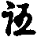



延百年？则果报神力有长短两时，并如净秽二质同处耶？答：时修短亦能相入，不复论此。但就延促之时，实成一劫，此促遂长，终是神力令促为长，於此义非短，经於无量长也。若任果报，唯应百年，若延之遂长，则不见家如坐斧。何者也？或作百年之解，如一坐六十小劫，谓如食顷长作促解也。自复神力实使成一劫，而果报犹百年，恒自延长，恒自报促，两义不妨，乃是神力异也。而彼云：其相如抽绵令长，如牵白糖申缩，则如蚯蚓缩也。问：日月延与不延，便应两义，则有长短二时耶？答：灵根寺令正云：唯一体一时，遂义亦两时也。问：神力延果报则长，果报亦应制神力便短。若各自竝论，则神力与果报俱不可思议，其理应歒敌，则应相制。答：两种皆不可思议，故各自有长有短。又有一释云：果报、神力皆不可思议，但徧就延义边，修短自在，皆由神力使。其实长短修有之一劫，当其长时，犹能令短，尚是百年，则见修短自在，皆神力也。如实移世界，复使不移，如经中说，即皆神力也。故不思议品云：又菩萨以一佛土众生置之右掌，飞到十方，遍亦一切，而不动本处。此即移而不动也。问：本自百年，岂是神力使尔耶？答：神力令短者为长，长则非复百年。若复其短，即令长者短，亦莫非神力也。又神力与果报两义明之者，则就他人非得度者，见其犹百年或七日耳。若得度者，乃得无量年，延其果报故久也。若反受，复欲交促，还以长为短也。出入延促虽种种释，而彼义宗有世谛法体，异无而有，故不合大乘无所得经论意。地论师云：大无大相，小无小相，故小能容大。亦是有个大法体与小法体，云何相容？终妨大乘无得之经论。摄论师、宗法师云：分别性入解也。今谓亦不然，心作入解，实无有入者，亦无有大小相，何所冷入不入与大小相也？依他性有法体故。如假相观入，实无所入，依他性法不入故也。今大乘意言：大小为二，非大非小，大小不二。不二故一，一是假一；不一故异，异是假异。以假一故，一是不一一；异是假异故，异是不异异也。异是不异异，异是一异也；一是不一一，一是异一也。一是异一，而不失异；异是一异，而不失一。故入出为二，不入不出，出入不二。不二故入，入是假入；非入故出，出是假出。以假入故，入是不入入；出是假出故，出是不出出也。出是不出出，出是入出；入是不入入，入是出入也。入是出入故，入不失出；出是入出故，不失入故。入不妨於出，出不妨於入，入出出入。故经云：一无量无量，一即是一；身无量身，无量身一身。类此而言，申缩賖促，同质异质，净秽大小内外，并是一意也。如居士经不思议品云：菩萨以一佛土众生，置之右掌，飞倒十方，遍示一切，而不动本处。又如海水变为苏酪等，而其相如本不异。若如地、摄两论，成、毗二家，有世谛虗妄法体，岂得如斯耶？大乘明义，如空中织罗，虗里织纹，故一不失无量，无量不失一等也。故兴皇大师开六种简异他：一、巨细相容；二、修短、改变、延促；三、以空为有，以有为空，亦如一异可知；四、以心为非心，非心为心，亦例之；五、一为无量，无量为一，亦如前；六、能有所改，火为水，水为火等也。此六种意，若见前大小、出入、开合、散束之意，不须一一释。但有得家难见，所以一一释也。



第一、明须弥入芥子，有两：一、明须弥入芥子；二、明不可思义。一、明须弥入芥子。前第一意，须弥之大，芥子之小，异不可令相容，而菩萨神力能令缘见入，令其作入解。故经云：唯应度者，乃能见之。此令应度缘入解耳。今难汝言，不能令须弥实入芥子，菩萨则𨷂大入小能义。言实不入而能令缘见入者，亦应菩萨能山壁直过，但令缘见过，实不能通入，三恶道化亦应尔也。次师云：从背上度，实不入腹度者，亦𨷂能入与令见入义也。第三、师云：我具三义：一、神力令其见入；二、复背上度与令其见入；三、实入芥子，如牵车入冢等也。今只鸡芥子之小，须弥之大，实有两法，躰若为论其八耶？彼师云：此是诸上地菩萨不思议事，下地菩萨与凡夫所不能度量也。今更难汝，若言不能量事，何但此事不可思议，万事并不可思议，而因果之道甚深，乃至解成相，即金心后成佛，乃至转凡为圣，此亦是甚深事，那得漫分别耶？又地论师云：大无大相，小无小相，所以得入。此不可解。汝论巨细相容，既言大无大相，谁入小？又无小相，谁能容耶？摄论云：我唯识义，能入小也。此亦难解，终是前三种释中第一意也。实不入而令入解，汝实无前别境，而乱识入出解，故心外无别境者，亦如前难，𨷂於有别境义。若尔，有何众生可度？汝自可度故，则别有众生入道义也。今一家意，大是小大，小是大小，既是因缘大小，何意不能相容小大？复何故不入大小？大小大小故无相碍，虽大小相容入而不失大小，犹如云色，色即是空、空即是色，而不相失也。又无名相中假名詺入，得者何不假名詺出？若詺入而不得詺出者，亦不得詺入，既得入者亦得名出者，故种种得詺无所𨷂少，故经云一中解无量、无量中解一，如是辱转生非真家，智者无所畏也。问：如前人难云须弥入芥子，火烧芥子须弥亦应被烧，鸟食芥子须弥亦鸟所食。答：无所得无迹须弥芥子者，鸟亦是无迹之鸟、无迹之食，故具论四句五句并得之，但随俗有便有不便，逐转倒所解有得不得明之也。故须弥虽入芥子，而其中众生不觉不知亦复不迮，故经云时众见烧净土不毁也。问：菩萨何不局须弥开芥子使入耶？答：如前具有四句五句，亦有能有此权用，但非是巨细相容权，此属故变权也。二、明思议不思议，一切诸法无非不思议也。问：大能入小是不可思议，小入大非是不可思议不？答：如经云色不思议、受想行识亦不思议，乃至萨婆若不思议，得有此义。而今明小能入大，物理常然，世俗所知，故非不思议；大能入小，则奇特非常可解，故是不思议耳。问：小入大悲是不思议者，则应大得待小、小应不待大耶？答：待因缘谁通？不思议则别也。问：只今大小小大既是因缘，只是因缘是因缘法，岂非不思议耶？答：若以大小因缘法甚深，并是不思议如前，但反常所解，故开思议不思议异於通义也。问：经云不思议解脱者，解脱与不思议为一为异？答：不思议是解脱，解脱是不思议，而无别中说。别者，菩萨心虑洗尽毕竟净，如幻人所行，名为解脱。此解脱非下地与二乘度量所行得，故不思议即是不思虑也。若尔，虽无别异义分之由，解脱故不思议也。但释不思议不同：一、什法师云：亦名三昧，亦名神足。或令修短改度，或巨细相容，变化随意，於法自在，解脱於闲，故名解脱。能者能然，物不知所以，故曰不思议。亦云法身大士，念则随应，不入定，然后能也。心得自在，不为不所缚，故曰解脱也。二、肇法师云：渐远幽深，二乘不能恻，不思议也。纵任无碍，尘累不能拘，解脱也。此经自始于净土，终于法供养，其中所明。虽然，其不思议解脱一也。三、竺道生师，亦云巍道生，亦云道生法师。此师释不同：一云长安生，肇之生，彼乱之时，避难来扬州也。二云八之生，弟子同名生，此生也。法师云：或止形迹，心不必然，故复言其解脱。更一名不思议者，凡有二种：一曰理空，无非或情所𠷰；二曰神寄，非浅识所量。若躰夫空理，则说思议之或。或既脱矣，则所为难恻也。法师云：或正形，心不必然，故释不同。一云或是不定之辞，或也；二云迷之，或也。四、迳山远公弟子昙说师云：不思识有二种：一於思虑，虑不能虑；二会於人，不思不虑。七住以下，要解思虑，解而得非至极；七地以上，穷理尽性，解方无滞。事无不了，道无不极，自照我虑，应不以情，所谓不思议也。五、岩法师云：菩萨无心，应为物有说。众生但覩其教，莫恻所由，故名所说为不思议。说而无心，故不碍於有；虽无心而能说，故不碍於无。有无所不能累，故名之为解脱，故名不思议解脱也。六、骋师云：菩萨得般若方便，故躰惟诸法因缘假名。假说有，不在有；假说无，不在无。虽说有无，有无是无相也。故般若经云：譬如幻师，於四衢道中化作幻人化也。毗摩罗经云：譬如幻化人，为幻化人说法。当达是意，故不思议也。七曰、琰师云：八地菩萨有内有外，内外不思而应，不议而作。外则二乘下地不能恻度，故名不思议也。问：云何二乘下地不能恻量？答：如数人云三度：一、根度，谓下根度，谓下根不知上根；二、地度，谓下地不能恻上地，如初禅不知二禅等；三、人度不果，不知上果。今二乘不能屈菩萨，故名不思议。然此三度，犹是上绝下地意也。今明一、下地不能思量上地所为事，故名不思议；二、菩萨神通运变，巨细相容。何以言之？假为不思议也。摄山师住持超称之美，为不思议。故净名经下文言：有解脱，名不思议也。今谓菩萨得般若方便，所为之事，非以四句、五句所得。如骋师意而有二：一、下地不能思上地所为事，故名不思议；二、菩萨通运变，巨细相容。何以言之？假为不思议也。问：何位菩萨为是不思议？答：解不同。一、什、肇二师云：七住菩萨所作有不思议，空有并观，下地未能故也。二、招提、光宅两师云：八地已上方能真俗竝照，名不思议，七地学竝不恒也。三、开善师云：七地分三忍，下忍失中不失而竝观，上忍能竝观也。四、虗昧小亮师云：初地已能竝观，不为二乘之所𠷰度，名不思议也。今大乘明义，从初发心已上能空有竝观，所以得竝观者，为证正法观故，竝观故名为不思议。故大经第三十四卷云：发心毕竟二不别，如是二心先心难，自未得度先度他，是故我𥝓初发心。故初发心菩萨，识有则知空有是空有故，识空则知有空是有空故。初心能竝未明，后心并已得，就明晦不同异耳。有经文则用，无文便舍也。问：约何法论不思议？答：解不同。肇师云：统万行中则以权智为主，树德之本则六度为根，济蒙之或则慈悲为首，宗极则不二为言，斯不思议本也。如借座登王，清饭香室，包像接大千，并是不思议之迹。幽开难启，圣应不同，非本无以垂迹，非迹无以虽本，本迹虽殊，不思议一也。诸法师云：观肇师意，通明境知理教，皆名不思议也。生师意，亦举境智明之也。如招提意，权智是不思议，而二智并德不思议也。问：权可是不思议耶？彼答：空解导有解，空解为有解之本，故名并是不思议也。今大乘明义，有通有别，通而为论，一切理教境智空有，并是不思议。故大品经云：色不思议，乃至识、受、想、行、萨婆若不思议。别有三种：一、如肇师等云，下地不解恻；二、任运行；三、如大品云，色乃至萨婆若通明也。又约有得与无得，判思议、不思议。问：云何有得可思议，无得不思议也？答：师云：且傍净名经明之。无所得绝有所得境界故，无所得是不可思议。故居士经下文，具破有得之大，有得之小。故五百声闻与八千菩萨，并皆被呵，故不得之。若因若果，境、智等并不来故，落理外性。故有所所得可思议，无所德名不可思议也。今就无所得中有三义：一、教，二、境，三、智。三种并是不可思议。教不可思议者，如题云维摩诘所说也。智者，圣智、能智。圣所智是圣境，故二智为能说，二谛是所说。此之行、说，事、理相称。故如行而说，说圣所行；如说而行，行圣所说。圣智是能智，圣境是所智。能智之智既是不思议，所智之境亦是不思议也。问：何故圣智、圣境，并是不思议耶？答：地、摄两论，成、毗二家，从多而明之。境是凡夫、圣同行，但智有异。如凡夫亦行青、黄等之境，而有执着；圣人亦行青、黄等境，而不着。境是可思议，智是不思议也。今明人之智，既不与凡夫、二乘共智，故是不思议也。境亦是不与凡夫、二乘共，故境、智并不思说，正由般若方便故耳。问：何以得知境亦不与凡夫、二乘共耶？答：如华严经十地文言：诸佛圣主道，微妙甚难知，非思量境界，唯智者所行处也。仁王经云：凡夫六识麤故，得麤六尘；圣人六识妙故，得妙六尘也。故大品经云：一切诸法悉不思议也。大论亦云：凡夫见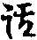



漫证，圣人假名谁行也。问：何意境智俱不思议耶？答：因缘境智故，并是无得无碍，故指智为境，指境为智。指境为智，智说是不思议；指智为境，境岂可思议耶？指境为智，圣说有智；指智为境，圣则有境。前四家既不指智为境，非唯无智，即亦无境，俱是转倒出缘之心，所缘之法皆悉不成也。有得家所明凡圣共行一境义，彼宗五住地烦恼，烦恼润成业牙，感得世谛。今行满得断，五住地或尽，则业随坏。业与烦恼既坏，世谛即断。既无世谛，亦无真谛。所以然者，以世谛即体，不可得为真谛。既无世谛，宁有真谛？是则二谛俱失。二谛既无，亦二智云何有佛照二谛耶？假令穷急云：虽无世谛，而有真谛者，则孤真独在。如地论人云：独真如。若尔，便是无俗之真如，离色有空。而经云：离色无空。无色云何有独存之真如耶？又论师云：有世谛者，扸有尽为不尽。解不同：一云不尽，借空破人空也；二云扸尽，此解如大论所破。若扸也，世谛遂尽，则失世谛。既失世谛，云何有真谛？假令云失真谛，后方修世诸者，则是持空为有也。若言扸世谛不尽，则无人见空。汝假今借空，破世谛入空，汝终有世谛，宁得见空？故便无真谛。故相传云：自古至今，无人能释，了了可解者也。唯见南涧仙师云：成有缘假者际空，际空者缘空，缘空者际空，无穷者有穷，际空者缘假，穷者成无穷也。今明此释，犹未免上责。汝言缘假际空，犹是有穷；际空缘假，犹是无穷，过也。大乘明义，菩萨初发心，即学无所得，即空有所得，有与无得，无得之有无二谛。学之得佛时，方净於地摄等四家有无故。彼有与无，并鄣般若故。学般若时，不行四家有之无故。躰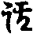



诸法有是不有之有，无是不无之无，得入非有非无，方便假名有无。故得佛时，始得具足因缘二谛也。又对他明四句并是不可思议，他云：有一句，无一句，亦有亦无一句，此三句是不可思议。第四非有非无句，言语道断，心行处灭，方是不可思议。摄论师云：第九识，名言所不及故，言语道断；想所不及故，心行处哉。故第九识不可识。又诸进云：四句并是可思议，离四句百非，方是不思议也。今谓不然。汝言第四句是真谛，与第九识破俗入真，息妄显真如议，终是一边一物，云何是不可思议？故翻摄论三藏法师识义明意。阿摩罗者，正番无垢。无垢有二种：一者、此议虽在众生烦恼身中，不为烦恼垢累所染；二者、名言想识所不及。若尔，岂非一物十地观所证境，可言非一边耶？故大师呵云：有所得人，如断头脚，折学问人，好言我四谛璃，亦离四句有非，真谛与真如，亦离四句百非，故同三论宗也。汝宗安理明百非？且息妄显真，破俗入真等，宁得同宗耶？今明三句、四句，在四句内之出四句外，并皆不成不思议。三句与四句并是因缘，无踪迹，云何言三句是不可思议？在四句、出四句求之不可得，宁言可得与不可得？故中论？理般品云：从因缘品已来，推求诸法有无，无无亦无，乃至非有非无亦无。若尔，可得判云是思议、是可不思议耶？彼等虽言在四句、不在四句，终是有所得，故并是可思议也。故兴皇大师常言：决得初章度之。初章之言他，有有可有、无可无，有有自有、无无自无，故有住有、无无住无中。若尔，分言思议与不思议耶？今依论并得破彼四家所明四句与不四句，破洗方显不思议。故一家云：非四非不四，故有四不四，并是不思议。所以然者，以指非四非不四为四。不四非不四既是不思议，四与不四岂可思议？若言四是四、不四是不四，可言可思议也。今明指四为不四、指不四为四，因缘、四不四等如幻无依，得无无所得，云何是思议？故大品经？句义品云：如鸟飞空，无踪迹、不可寻、无处所。菩萨句义亦复如是。若尔，可得论思议与不可思议耶？问：不思议是因名？果名？答：不思议岂是因果？复岂得非因果？若定是因果，是思议；又定非因果，亦是可思议。故今明因果非因果、思议非思议、不思议非不思议，方是不可思议也。一家云：有怗义。非因而因，怗之名因；非果而果，帖名果，亦得因果。又菩萨不思议名因、佛不思议名果，亦有之。至论道门，何曾是因是是果、是思议是不思议也？



第二、明长短奢促义。若解须弥入芥子，即自解长短等五种义。佛菩萨神力能延一念为百劫，能促百劫为一日。四家释意，如芥子义中说。今明如食须经六十劫，此即是奢促长短。须识因缘假名，长短无定相，无往不得故尔耳。虽尔，若正破颠倒时，则不得道不离颠倒别有不颠倒，则应云颠倒异不颠倒。若使颠倒消尽，何处离颠倒别有不颠倒道理也？长短奢促亦尔。长短是所运，权智是能，故能、能、所异，亦是不异异也。然长短更无定相，只长而短，短而长，於觉者长而短，於梦者短而长者，为定是长？为定是短？於梦是长？於觉常短？举譬如此。今延促长短亦尔。只以长为短，於短者常见短；以短为长，於长者常见长。正短为长，只是以短为长寿；以长为短，短者见短，此只是现见见现耳。何故然？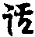



人梦觉故。若就凡夫、二乘，有了、不了也。问：云何言谓如食顷，即是现见也？宛然能令此见长，亦能令短，然实不短，令缘见短，亦是一能也。问：今促长为短，延短令长者，为当促其果报所得之长，延其果报之短令长？为当别有长短延促耶？若促其果报所得之长令短，如八万劫寿，令促成一念，岂不令其短寿，延令长寿也？更问：汝促长短者，此缘宜见短令促，长为短，令其见短乃好。脱复有缘须见长者，汝为当即取向被促成短之者作长，令须长缘见长？为当更别有长，令须长缘见长耶？若还取向被促者，令缘见长者，则应不被促。既已被促成短，云何复令作长，令被缘见长耶？答：菩萨神力，何所不为？只被促令长，长者局令促，长者长，短者短，不定为奇特也。须弥入芥子亦尔，缘令应见须弥入芥子，即令异入。脱复有为缘不须入芥子，即令见不入，只令向入者，应见不入。入不入因缘，只是一须弥恒在外，如一音说法，随类各得解。只一口业，既各各随所乐者皆闻之，身与意二业，亦各各现之三种境，一一境亦现种种法门也。何以故然？一家义宗，说智为境，说为智故，智既种种相，境亦得然故也。若别一须弥不入，亦不是为奇特也。又如只一无量无量，一一中解无量，无量中解一，只是一须弥，或在内，或在外，缘欲见内，常见在内，缘欲见外，常见在外，内外因缘，故名不思议耳。今长短亦然，令长为短，缘恒见短，能令短为长，缘常见长，於长为短，於短者为长，故名身义。未必分身一为多，多为一，此即是动身，通亦是奇特，而前者本相如故，㝡为奇特也。



第三、明空为有，有为空。此亦类前可寻也。如四家明义，有与无各有法，躰不得有为空，空为有。今明言有不住有，言空不住空，故詺有为空，詺空为有，故有变为空，空变为有，离有无空，离空无有，空即是有，有即是空。虽尔，得意言之，离有有，离有有空，离空有有，此离是不离离，故离不失即，即不失离，开合随意得，但用时有，便不便必须有。所以明之，又菩萨神力，以空为有为空，故普现观音，变虗空及与草树等化众生，如木栅变为空，令人得出栅狱，并壁鄣为空，或偷三宝物去，而处处山与不得去者，岂非空为有等也？又如佛神力，魔王头上系莲华，魔王不耐，便上天上，犹还见花，如此处处求避，犹见无有得脱，又搦取虗空，犹如电光耳，不可得即瞋脚蹹地，便如蹹空，即是能令有为空智，空有无定相也。



第四、明以心为非心，非心为心。何者？说心者顽，说顽为心，故以心为非心非心。故经云：潮浪说苦空，树动明生灭。无生灭也。他家即不得彼境与智各法，躰有情与无情二见故也。问：十一切入观、神通变现、权智转变三种，若有异耶？答：不一不异。虽尔，若不二而二明之，若论转边亦不具。而三种异者：一、十一切观，彼自见前境变异，而於他则不见；二、若神通，则通外道及二乘；三、若权变，唯有菩萨可。故经云：二乘虽能变身满虗空，而不令此大身入岳尘身。故知无此权智用也。问：真身、权变、神通三事，云何异耶？答：若通义亦不异也，而别义明之大异。若作真应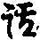



，则是本迹。真是本，应是迹，从本垂迹。若是权实，并既应用中明之，权即是抽应中一用一时。为如前云方便是一，化终明之，於方便中抽一用也。若是神通，亦就应中有此用也。故神通则不齐应义，如外道及凡失尽得神通，何必是应耶？问：今不问凡夫神通，只就菩萨所有神通及权用若为异，并是故实，云何异耶？答：神通则直取其转实不壅，故名为通。权即善巧适时宜，名为权。故神通则对权即长，如面折外道转易戏处，并是权用，此非通也。问：实大海水为苏酪，鹫王皆得苏酪，而鱼等犹见是水迹游行，饭水如故。此亦如须弥入芥子三义释之。问：鱼所饭者，定是水，定是苏酪耶？答：亦饭水，亦不饭水，如前三种解也。今大乘明义，亦如须弥入芥子。菩萨神力，能令鹫王实饮苏酪，鱼实得饮水等，互不相妨也。



第五，一身无量身，无量身一身。



此义若了，前开合束散亦不须明之，但人恐未解，故重辨之。华严经云：一中解无量，无量中解一，展转生非实，知者无所畏也。一从无量生，无量从一生，故言展转生。一为无量，故一非实；无量为一，故无量非实。一无量非无量，无量一则非一，是则非一非无量，知者解了，故无所畏也。若是愚者，闻一无量非无量，闻无量一非一，便怖畏也。今能一为无量，无量为一，即是权智巧能也。若他人，则离一为无量，离无量为一，一不开无量，无量不开一，故若合则失无量，若离则一也。他摄两论等云：一是真如，一也。无量者，二义：一、理起性万用无量；二、於真如上起妄用也。论师云：一是真谛，无量是世谛，非一故也。今明不一不多，而一而多，故一为多，多为一也。问：若尔，则不得开一为三，念三归一耶？答：只为一不定一二，故三可为一，一可为三，故三一一三，故言开一乘为三乘，会三归一道门，则非一非三也。



第六、明能所改实。一家判云：因果义㝡短，次境知处中能所㝡长而广也。论师云：善恶果牙感得苦乐果，即是相生。故因感前，果生於后，即是前后因果。若境智是一时因果也，汝生习两因，必因前果后。如论破，因既已灭，后果何关因生果耶？若无而为果作因，得言果从已灭因起者，一果一切物生，亦是一因能生一切果也。故今论因果，约善恶果牙相生，故㝡𭔰局也。若境皮智一时因果者，若智未起，境亦未有，而今能照智起境，即未起未有，云何一时？若是已境发令起智，亦非一时。若言境智一时起而相生者，此即竝有，云何判云境生智一时因果如二角耶？亦复是境，一法是智，一法有两法，有所得境智，非生死境智也。论师义，四心前后相生，如识心实为想心。若举躰变，即失生灭；若举体生灭，即失改实义；若半生灭半实，则无有是处。具如论中破也。故彼四心并非佛菩萨，无所得四心也。彼义宗，方便知照俗境，实智照真境，故两知便异，不相关故。方便知亦缚，实智亦缚，两真并缚，岂是方便解真解耶？故今境智相生处中也。问：一切法为智作境，境义亦长，云何处中？答：生智义亦长，而智是但造境义，故言处中也。能所义最长而广，无非能所。前论因果与境智并不能所，如无为亦是所缘，虗空等能合，故能所长。如权智为能，苏酪为所也。今一家意，就境智能所者，只境能名为智所，智能名为境所；只境所是智能，只智能是境所，境所是智能。所以说智及智处，皆名为般若也。若言境是顽法，法智是解法者，云何得言并名为般若？知能是境所，是故说境及境所背，名为尔涅槃智母也。例如佛谛知，如行而说，名为知谛；如说而行，名为谛知。今境智之尔，所照如所行，是境智；所行如所照，名为智境。此意语据所行，则据能之，不令其二，故作此说耳。问：权实二智并有鄣，与悉有境生耶？答：师解不同。一云：权智无别鄣。若有别鄣，则有别境。何谓权实智有鄣有境，能断伏也？今难：若言权智无别鄣，亦应权智无别，修习亦应非智耶？且不能作权用，为有鄣故，不能得权用。未得时不能权用，今得罢能权用故，当智有鄣，何故言无别鄣？若言无别境者，权智则无能所，有能所则有境。权智是能所，实苏酪为所也。二云：权智有鄣有境也。即难：有别鄣有别境者，与实智何异耶？答：释不同。一云：权智於我上起，我作如此事，事则起也。二、若於水作苏酪时，於水上起如色好，好则属法尘，色则五尘所收也。三云：於当起苏酪上生权智也。鄣则不解起作，不无明使为鄣也。今大乘明义不二，而二明之智既有两，鄣与境亦有二种也。问：若尔，正取何物或耶？答：如前三种释也。问：若尔，同彼三释耶？答：名同意异也。前三说性境智，或今明因缘三种鄣境智，故无踪迹异彼也。问：於三种上起为境者，於实智何异耶？答：三智必从他上起，即是背上智，实智当境而生智，故异也。问：若尔，是佛境智耶？答：一切尽是也。问者：未说所行是境不？答：得是境也。问：若尔，非正境耶？答：何意非也？非正境者，但境通一切处，非正智所对照也。问：向智未说所行是理不？答：得是理也。问：若尔，理是佛智境，不实相是佛境不？答：是也。问：向潜谋蜜照所宜之根缘是境不？答：是境也。问：佛所说名为谛，此谛得是佛境不？答：亦得也。但此据佛能说，此谛不正名为境，而得是境者，佛教佛何容不解？此教既是所解，故便得是境也。问：发者能发智则有智，若无所照之缘，便应无智耶？答：无也。何容无事有此智，湛湛如境也？问：若尔，一切境等是佛境者，缘亦应尔，诸法皆得是缘境，何故言二谛教为缘智境耶？答：言二谛教是缘智境者，此据缘知始生能发知之功，的是二谛教，故名二谛教为缘境。此言二谛教为境，此据初为证，此罢何种而非智境？理亦是智境，才是所解，才是能发者，并是知境也。问：境既对智，此智可解於境。理既非境，非境非智，云何以此境智智非境，非智是境耶？答：何妨非境非智之知，知非境非智之境耶？问：若言非境非智之智，智非境非智之境者，便成境智，何谓是理也？答：非境非智而詺是境是智者，何妨非境非智詺为非境非智之理，是所智之理境也。但就理明境智，无二明之。若境对明智者，正约假用明之，须识此意也。复须识一家宗致，明二智俱如俱不如，二智俱绝俱不绝，俱说俱不说。二智说行即是二智俱如，行说即是俱不如；二智说行即是二俱绝，行说即是二智俱不绝。二智既尔，二谛说不说、如不如、绝不绝例然也。又虽二智说，只是一智说；二智不说，只是一智不说。所以尔者，实方便故，二智俱说；方便实故，二智俱不说。束此二智说，即是一方便，岂非一智说？束智不说，只是一实，岂非一智不说？此方便是一亦是二，实亦是一复是二也。次更转二智说，即是二不说，即是不二也。论二不二，即是不二也。说不说、如不如、绝不绝也。若言非二非不二，则是不论说不说，不论如不如，不论绝不绝也。问：如此明二智及境智二谛等，并何所以异於地摄等四家耶？答：大有所以。何者？欲辨於地摄等论所不至处，亦是令其转心向无所得，不令住也。何者？二谛即是两教，此为欲开道也。用境智为欲开佛性，二智为欲开般若，即是非至处。问：彼并有三种，宁言非其至处？答：彼只论假中明之，复落纳目，所以令其真非处向无所得无为，即是大有所以也。问：如仁王经与地经等云：七方便、四十四智，并应是智慧。若为摄二智耶？答：仁王经云：七方便者：一、观色；二、观色集；三、观色灭；四、观色灭道；五、观色味；六、观色过；七、观色出也。观色者，观色果报，苦谛观也。观色集者，因缘缘，集谛观也。观色灭者，观色尽处，数灭无为，灭谛观也。观色道者，观色对治漏漏道，道谛观也。观色味者，观察前色生爱味也。观色过者，观察前色能生苦过也。观色出者，观察前色能生灭道也。就色观中，若然，诸法亦此七能与中假作方便，智横则为真假方便，智竖则为中作方便也。四十四智者，如地经中说，亦成论引经明之也。此犹是前七方便中初四门观，就十二因缘为此四观，生四十四智差别。十二因缘次第相生，因果相属，有十一对。约此十一，从末寻本，逆以推之。先就老死对生为四智：一、观老死苦；二、观老死集；三、观老死灭；四、观老死灭道。次第逆推，乃至行支。对前无明，亦例有此四智，所谓观行、行集、行灭及行灭道。无明望前，更无集因，所以不说。何故逆观？据果寻因，顺谛观故，是一种观门，此亦是假观也，七十七知也。如地经明之，又如成论引经释也。此观亦具中假，亦可二谛假明也。七十七智差别者，现在世中生缘老死，不离生缘老死，十一节中生两智，故二十二智。过未二世亦然，故六十六智也。此六十六智是法住智，是世谛智也。灭相观者是泥洹智，横则真智，竖则中观也。从老死乃至无明者，悉同然也。今穷其相，此智其中假。此十二因缘浅明之，但假上明也；深则无明毕竟无生无哉，即是中也。而成论等但假上明之，不及中复性有得也。今大乘明意说，则具中假观也。约假明之六十六智，就中明之十一智，今中假明故七十七智也。问：约三世开六十六者，泥洹智亦应例，何故十一耶？答：此差别无差别明义，六十六是无差别，差别故六十，六十一是差别，故十一也。问：别不别故十一者，只应一智，那十一耶？答：实尔。而约十一故十一，如三种中也。前六十六观回生果，住持不感，名为法住智。小乘明义，故十一观智苦、无常、空、无我等，趣向涅槃，名泥洹智。今大乘论不然，若渐入明义，亦有此意；若直竖明之，正约中明也。故通而论之，四十四、七十七等智，三乘同观，亦得十一智，不同二乘。如成论等意，声闻人等中有利有钝，四十四智是钝人观行，七十七智利人观行。何者？四十四智观果由因，为观易成，钝人能作，故判之为钝。七十七智观因生果，为观难故，约利人方能故说也。今大乘意、彼说意、彼说并是假上观，今则具中假观，故异彼说。故地经意，为利根菩萨说此因缘法。因缘法中观门无边，广如彼经弁因缘义也。问：前云现在世中生缘老死，有二集观：一、生缘老死，二、不离生缘老死。此二有何别？答：傍毗婆娑并地经意云：初是正观，后是逆翻观也。问：何不从无明乃至老死，先从老死至无明行因缘耶？答：因缘法中有二种次第：一、顺，二、逆。从始终顺次第，从终至是逆次第。观法多途，不可定一也。又此法是声闻观法，声闻人钝根，从来寻本至观易成故然矣。似如四谛观门次第也。问：因缘相生无穷，老死望攻，何故不说缘生之义？答：实无穷相生。如地经云：老死攻作因义。菩萨能作此观而不说者，有二义：一、声闻不堪闻故，二、欲摄三世法尽故。亦是教门一种说之也。又见成论文云：诸外道人多迷因缘，或云𰩑性是众生因，或说梵天等为因故。佛为破彼执故，因作果实不虗，故说不离现在世中生缘老死。既有此二边未同，然终是三世法欲尽，故教门意耳。大乘意亦不无此意，但意异，如诸料中说也。



第三、明断伏义，俱如十地金刚心、梦、觉三科中说。今既开二智，故略尔明之。一家旧云：只是动执断，即是除诸见之根。何者？皆以初章动定执令动，亦如前科简中说如不如如、说不说不说、二不二不二不二，作如此动诸见心想等，即是名为伏也。断者说言不二，二所以非二，二不二非不二，非二非不二即是断诸心想之根，裁尽净不在四句五句，故名为即也。离不了则名为即，不了则名为伏，亦得言深即名即，浅则名为伏。如云经论云下下智即上上烦恼，上上知即下下烦恼者，约假上相翻义论之。至论断伏义，正洗平心体，如幻化人不行心想，不断不伏，强名即也。一家云：虽言权实即是开般若，二谛亦然开一实。今明二谛亦只是二智。何以故然？只谛即是智，智推寻是谛，故智说詺智为谛，其实无异。谛是智之异名，智是谛之殊称也。谛智既不异，所显亦不异，故言二谛显一实，权实开般若也。故今谓一实只是般若也。一家明境智亦不异，智权寻说相当便名为谛，缘禀谛生解即名为境，谛还以复是智，如是传传得也。次明二智说二谛，智能而谛所，二谛说二智而智所也。问：若为二谛说二智耶？答：二谛正诠辨於二智，即是谛说智也。师有时云：因缘只是假，假名名只是空耳。有时云：一切不通。因缘何关空？空何关假名？如此皆不通也。师有时云：无明为与般若相似。何者？无明颠倒能作人天六道，无所有中宛然作有，此力为大也。般若力大者，能生刹利大家，能出生四果圣人及辟支佛、菩萨、佛此，此力大大也。问：既言实录无所有，云何得有人天六道等耶？答：只为须开此谛，此即世谛故有。若实录无所有故，此言世谛，非如四家有缘假之理，虗妄为世谛体。今谓假名字有，名为世谛无所有，於世人颠倒者为有，於圣人妄有无所有也。问：瓶衣是因缘，是假不？答：如初章中已说。今言如泥瓶，即是切相成，是假。若瓶衣等无，方假假得，是假。又诸法无自性，诸佛菩萨得诸法自在假名，詺或以人为瓶，或以衣为桎，此即是衣柱人瓶，瓶人即是因缘，是假也。答：别而为谁？则是果之因，与果为因，得是因缘非果，因於果非是因缘也。问：是因与非因，无果义一理，云何因生果，与非因不生果？答：虽复言无，麻是油因缘故生油，砂非油因缘故不生也。问：等是无义一种，何故麻是因缘，而砂非因缘耶？答：麻虽言无，义齐而是有，无非是无，无砂无油是无，故无也。一家虽言能所最长，境智处中因果最局，今更破令具齐。若言一切皆能所者，今亦一切诸法皆因缘，皆因缘只是果因，岂有法而非因缘？若言因缘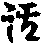



摄法不尽，则应假名摄法亦应不尽。既无非假名者，亦应无非因缘者。若尔，能所摄法即既尽，因缘摄法何往不尽也？四、若言能所摄法尽者，亦应有非能非所，云何方能所摄尽耶？若言唯有能所，无有非能非所者，则应唯有相待，无有绝待耶？今谓一往能所摄不尽，二往三往则尽。何者？一往能所唯摄能所，岂摄非能所？二者则尽者，明非能非所，能非能所。非所此已复是能所，此能所摄已复得也。问：此言非能非所，可犹是能所摄耶？若言非能所非不能所，若为更能所摄耶？答：此则应言摄不摄。是菩萨有尽二种法门：有摄不摄，有尽不尽法门。岂得令一向摄一向尽也？又一家旧云：权实二智通因果，在因开佛性，在果则开涅槃。何者？佛性名为中道，在因权实显非权非实。非权非实即是中道，中道即是佛性，即是权显实佛性也。问：二智得为牙相知不？二智为自智不？答：具如十地义中说，今更明之。论师等释不同：一、龙光云：用反照故照一切智，一切智即是所照，反照即是能照。复更有反照智知此反照知，如是更有反照无穷反照也。二、开善等云：即照青知。反照青知所以窂有，非二乘所得也。三云：一、大反照智照一切智，更立小反照知照大反照智。然此小反照知还为大反照知所照，此小反照智唯能照大反照。大反照故，大反照知则能照小反照知，复能照一切知。此似教人四相义，此破如论中说也。今大乘明义则不然，此能是所能，此所是能所。既是能所，离能无所；既是所能，离所无能。无能故，随意反照无得也。问：方便智实智牙得相知不？若便实智知，方非权非实可从起耶？故今明得非权非实而权也。问：他家计性权实汝也。今前以初章动，次则拔。如云前以定动，后则前拔。汝今既言假名诸法非实亦非假，复用何物拔假耶？若言假有是有，此还是性实义。答：今明假有非有，何须拔耶？问：汝言假权实显非权非实之中道，佛性果地亦显非真非应。此之显中道，亦应云显佛性，何故言显涅槃耶？答：涅槃犹是佛性之异名耳。是故佛非因非果，以因名怙之此正法，则名为正因；以果名帖之，则名为正果。更无别法，只是一正。在因则以境智开正佛性，在果则寄知即与总别。此正果此所显，即是正涅槃也。问白：果果即是涅槃，岂是用涅槃开正涅槃耶？答：佛性说有正涅槃，亦有缘正。言用智即总别开涅槃，即是正涅槃，果果即是缘涅槃也。问白：言非因非果而因而果，此是缘性，与怙若为异耶？答：若是怙，虽是因果，此因果并正涅槃。非因非果，而因而果，并是缘也。问：既并有因果之名，岂得判缘正耶？若不然，若是缘，乃当以非因非果正性本然缘性，当体是因果，非是怙，故名为因果。若是正性，当体实，非是因果。强以因名怙，名为因，故此因正。强以果名怙，此果则正也。问：佛便则是实智，方便既照方便，云何名为实智？若方便智知实，则是方便照实智。方便既照实，实为方便智耶？今谓只以方便为实，实为方便。既实为方便，既知实，岂不知方便？只以方便为实智，方便不妨知实，不如四家二智各别著。前难亦是四家义宗，权实等并可权可实，不能得有所显。今明假名权实，故在因得显非权非实，即是显於佛性。在果假名真应，故得显非真非应，定涅槃也。故一家厈四家云：真应权实等，皆是无首尾屈头而起。说无首尾，所以是有所得漫污。故大师云：所说所开等，皆须初章度之。他明权可权，实可实。权可权故，不须实故权也。实可实，不须权故实。不须实故权，则自权。不须权故实，此实是自实。如斯权实，并自性有所得也。今谓对此，则应云今权不可权，实不可实。权不可权，须实故权。实不可实，须权故实。须实故权，权不自权。须权故实，实不自实。权是实权，所以非权。实是权实，所以非实。此则得从权实转入非权非实，此即亦得言以权实显非权非实，所以得起权实，所谓假权假实故。今谓有所对而起，故有首尾也。他四家权实既可权实，不得从权实转入非权非实也。既不得从权实转入非权非实，岂有性既须显，佛便可失可隐耶？答：佛性实未曾隐，岂可显？虽复隐之而不失，显之亦不得也。具如佛性义说。问：如维摩经佛道品云：非道为道，若为断伏？答：地接两论、成毗二家宗，即三毒空、真谛、真如为道。何以故？彼宗虗妄与虗假是一法，真如、真谛自是无相理。一法虽相即，明义终是理，故不勉二见。今谓不然，道名通一切法，佛道乃至地狱道、九十六种地水火风至香味触等道。道未曾有二，但举佛乘道，故名为佛道。若尔，佛菩萨行诸法无非是道，此是权道。权故，於一切法皆道，无非是道也。若然，体於一切法无二相，即是断伏，明味则为断伏也。一家明义，只道是道，是无而义故，及常合道，通达佛道。道是能通为义，无而无壅乃名道。以故者，无碍，无碍为而乃名道。如经云：身子为女，为身子故。经云：女相无在无不在，於此通达无而道。彼经意皆以常破病，通达佛道。破如地摄等四家，定内外尊卑之病，明无定内之与尊卑，即是无在不在，是佛所说也。经云：若有真，是非俱是；若无真，则是非俱非。故言无真则不成方便，有真则方便。如住贪瞋耶见等烦恼，而殖众德本。此非直贪瞋等，非非者为非。口殖众德本，方便亦转。非唯无慧，只方便亦不成也。若有真者，非唯是者为是碍。是既是道，非亦是道，所以反常非道。然通达佛道，佛有此用，故名佛道。菩萨有此能，故名菩萨道。乃至地狱有此用，名为地狱道等。地摄诸家，是道不得非道，非道不得是道，故是非非俱非也。非种为种，非番属为属，欢然也。又明思议权之与实，皆为显非思议非不思议，非权非实不二义。亦是净名现疾之所由，文殊问疾之本意。现病问病，只为显此不二之正道也。然法门无量，如善财童子，俱一善知识，怙得一法，得生起涅槃解。或凡圣等一切法，皆是法门。如净名经不二法门，因二入不二。二为不二之门，门则有开有閇。此约迷惟两缘，如谛为道门。缘若迷教，不能通达道，此门则閇。缘若了悟教，此门则开也。一家相传，约不二法门品中，开有两意，二文有三意，二文亦是三文也。所言二文者，一前净名命谓菩萨各各说所解释，入不二法门。二者诸菩萨请说不二真门也。所言两者，三十二菩萨说，净名不说，即是说不说二意也。三意者，一明三十二菩萨因二入不二也。二文殊因二入不二。三净名因无言入不二也。言二文者，三十二菩萨言说入不二，此是一文也；文殊亦言说入不二，此是一文，故成两文；净名嘿然无言无现，即无有文也。亦是三文者，二十二菩萨说入不二，一文也；文殊亦说入不二，复是一文；维摩嘿然不说，即有不说文，故成三文也。初三十二菩萨说及净名不说，中间文殊说不说说，则成前说成及不说说边，成前三十二菩萨说不说边，即后净名不说也。亦得言三十二菩萨因二入不二，文殊因二不二入非二非不二，净名因非二非不二入非非二非非不二也。此三意三转，似如有浅深阶级。然此意相成，三十二菩萨因二入不二，成文殊因不二入非二非不二；文殊非二非不二，成净名非非二非非不二。良由非非二非非不二故，有非二非不二；良由非二非不二故，有二非二。如大经？师子吼品云：若不因非二非不二，岂得意一言二也？问：三十一菩萨因二入不二，可摄入不二法门品；文殊入非二非不二，净名入非非二非非不二，那摄入不二法门品相？答：有两种势，三十二菩萨此二不二，文殊是二不二非二非不二，净名是非二非不二。非非二非非不二故，皆摄入不二，故皆摄入不二法门品也。又三种转法，即如二谛八不义中说，有破病意，有无穷转势，有举浅深门入中道正法义也。



二智义记卷一。



显庆三年岁次戊午年十二月六日，兴轮寺学问僧法安为　大皇及内殿故，敬奉义章也。



无依无得大乘四论玄义记



均正　撰



第一、三乘义；第二、庄严义；第三、三位义。三乘义有四重：第一、释名；第二、出体；第三、广料简；第四、明五乘。



所言三乘者：一、声闻乘；二、辟支佛；三、缘觉菩萨也。一乘言明之不二而二，论无差别。差别有二种次第：一、不二而二起用者，菩萨、辟支佛、声闻；二、以通收入不二者，声闻、辟支佛、菩萨也。声闻者，闻声悟道，故曰言声闻。故思益经第二卷云：因声闻得解，故名声闻。若尔，以因得道也。辟支佛亦名辟支迦也，此云独觉。所以言独觉者，出无佛之世，无师自觉，傍无法侣，下无□□□□□□众生也。亦云缘觉者至觉悟因缘也至意者。偏明得道身不须师教，而能独觉。观因缘假有不有有，假无不无无，应假理觉。观覩树木摧折冰沫等，须臾间灭，无常苦空理而觉悟，故名缘觉。独是因名，因时不须师教，亦得觉境名，即因缘境觉道果名。中乘无觉，果道果觉也。大论云：辟支迦亦言辟支客，今谓彼因轻重音也。如摩诃迦叶等，辟支佛根性人。故大经？梵行品上卷云：於王舍城中，百摩诃迦叶闻之，说十二因缘。以无明乃至老死，即是观因缘理而得道悟，故名缘觉。此意迦叶若不值佛，应作独觉，而今值释迦佛，闻具足说十二因缘悟道也。问：此二乘亦得言悟道理耶？答：得言悟假理，故大经陈如如得须机，文云应假理也。此理道望不二理，终是教能表也。如持摄成毗家宗，俗谛为应假理，真如等不得应假理，今大乘宗并是应假理也。菩萨者，具存音者，经论不同，渐备经云：以为开士道。无量寿经上卷云：十六正士，即是十六菩萨数也。十住论云：亦云菩提根上道，萨埵名深心。彼释云：报果菩提，故名菩提萨埵也。弥天道安法师折疑论亦开士，故旧断梁时番云：有二家：一云菩提道萨埵，言心众生，故名道心众生；二云菩提言萨埵，言心人，故言心人也；三云菩提言道，萨埵名道士，取无量经□□□□□□□□提言上道、上智、上觉、开明也。萨名众生，亦名为士，亦云深心、大心。道谓上道、上智、上觉、开悟、众生、大明之士。通乘者，一家相传云有三义：乘是入义，入是出义，开发释名义；二、当体释名，乘是运出之义；三、表理释名，乘是不二义，如诸料中释也。



第二、明出体。地摄两论、成毗二家相兴，通而为言，乘通凡圣、有漏、无漏，故经云举手低头乃至童子戏，皆已成佛道等也。若尔，数则四谛理解等、兴等、知事解等三乘体，成论宗亦空有两慧为体，彼宗乘通，道谛则别，从假空已上故别也。地摄两论大意略同，彼家宗从初地已上真如相应是真乘体，从第三十心已下未摄相应故，非真如观故通。今无依无得家则不然，彼四家虽作各各相，并是於三乘，今论所破悉是理能也。今谓不二而二，明中假者，正法为乘体，故大品经？乘乘品云：乘相，大乘也。乘是何义？乘是运出义，如般若能生一切得，无住为本，建一切行也。问：般若无二相，如大火聚，四面不可触，亦如言无得，如因果所得无有，无有处所，云何言运出耶？答：强名如中也。问：如大品经？有达品云一切行强名苦能者，何必俱中是名耶？答：山家以来相传云有四种名：一、中是正名；二、开假体，望性有为强名，故大品经二十四卷？有达品云一切行但假名也；三、非性有，非性天□□□中名为施名中，实非中强名中也；四、如地摄两论、成毗二家，计有无等一切得施为有，一切法非般若用施作故，施名为有无等，即是理解所破也。又二乘兴偏行，菩萨解十信观为体也。



第三、广料简，有四(第一、无体四门料简，第二、明三乘，第三、明乎乘至不至，第四、广杂料简)：一家相传云：摩诃衍为大乘，有四义：一、人法，二、因果，三、出生收入，四、能所也。言人法者，摩诃衍具含人法，地摄等四家义宗，摩诃衍唯是不得是人法。若然，所合论亦是有人义。今谓不然，摩诃衍则通人法，为摩诃衍故。摩诃衍人人者，即是佛菩萨也。故十二门论云：法佛大人之所乘故，故摄大也。亦云：观世音、大势至、文殊师利、弥勒菩萨等之所乘，故称为大。若尔，道非摩诃衍□□□□□□者，谓六波罗蜜、十八空等，即是摩诃衍法也。地摄等四家问：能御是人，能所合论，人是乘，那是当乘耶？今无依无得义宗则不然，前言四种并是般若用故，四种悉是无想不二故，假名十须不二而二故，种法无人，离人无法，离人无法，法是人法，人是法人，故人法并乘体也。言因果者，地摄等四家正宗，乘唯是因，不通於果，如言乘涅槃船，人生死生，罗睺等於涅槃果中神通用，非正因果乘也。今大意则不然，摩诃衍因果，万行即是因，万德即是果，般若是因法，涅槃是果法也。言出生收入者，菩萨因法，化是果人，具足摩诃衍，出生一切法，凡所有一切无量应善，乃至举手低头等众具，皆以摩诃衍出生，此即是出生义。又还收入一切众善，若大若小，吐归入摩诃衍，故无依无法三乘，并是般若所收。故大品经叹净品云：无有一法不入法性者也，如众流吐归於大海。故今收义，如百川归於海也。言能所者，此能所义，最通广一切法也。如前释四种摩诃衍，至论不关人法因果等四种，但持人法名来取，名为人法摩诃衍，乃至能所等类然也。所以举四种名者，正欲辨乘之体用也。地摄两论，成毗二家，大宗万善为乘，离万善明之，正取空取真为乘之体，其政有中万善等皆是，是庄严挍其非正乘体。所以然者，空真正能断烦恼升出运载义，若不能断烦恼者，终不能出生死，故空真为乘体。故彼列经云：等与诸子一宝车。即是此法者，是人乘也。招提白琰师云：用决定菩提心为车。而故来诸师，多云空真为乘体也。又释牛义不同，如龙光空法师云：正聚神通为义牛。而经云白牛及[戶@(一/用)]色鲜洁者，明此通此契，内解清净，故言白牛[戶@(一/用)]色鲜洁也。若庄严兴光宅云：白牛正辟无漏成也。前云空无漏真为车，今改云以无漏真为牛者，彼秒释云：以两义取至运出义名为牛，取至能载义为车也。光宅又云：以佛真为车。彼列经云：为闻佛知见故，乃至欲令众生令悟佛知见故。故知正佛真乘体也。今一家作四发释乘，具如前。至今更广辨人法一发，人即是能乘，法即是所乘也。今通论般若中出生三乘五教，如正因正果中出生因与因因、果与果果也。今取能乘之正人，正佛与菩萨三乘人也。若通而辨之，三乘与五乘人等，亦法一切众生并是能乘所乘者也。故大品？问乘品云准当乘出者，此即是间能乘之人。次问所乘之法者，皆亦通而论之，即是空有、因果、权实等能一比，人是法人，法是人法，法不异人，人不异人，法离法无人，离人无法，即布施、持戒、般若等即是人，只人即是法，法即是人。一往对地摄等四家，有应假应妄世谛中有异，故明人法等不二也。故摩诃衍实云不关人法因果等，但将因果来取人法，即具有因果，将因取人名为因人，将果名取名为人等。有得四家义宗乘义，不得非人非法因果等得，即真如与即真释之也。又释因不同，一云乘正是果，不存於因，传云龙意也，如井中水、瓶取水也，故彼列夫人经云究竟法身名为一乘，故知乘义存果。又法华经云为说佛真故，诸佛兴出於世，唯此一事实，餘二则非实，又云开佛知见等，故知乘唯在果也。二云乘正在因，彼师还引夫人法云於法身上更不复说一乘法事，既云於法身上不谈说一乘法事，故知乘在因不在果，正能越在星屋乐，正是以因起果，是故大品经云闻以三果生至萨婆若，故知乘要在因也。法行师多用此意，故言乘义运出释也。三云乘通因果，因乘果至佛果，果乘接因，因果不二故摄为一乘，是故乘通因果也。四今无依无得无差别，差别假名所设，意则不然也。摩诃衍道开人法因果，但将因果取乘詺乘为因，将果或取乘名为果，虽非因果，将因果或取名为因果，乘乘则通因果也。故大品经云自从三界出至萨婆若，不二法故、不动法故，假名方便无碍用开，何不得有也？故大经四相品云乘涅槃船入生死海建立大事，纳耶输陀罗睺罗者，不得定云但在因、或云但在果、或云通因果。今无所得大乘意，如空中织罗、空中织纹无所不有，但拔出颠倒或织众生无差别，别引入为者，且初行者修行渐渐出，虽有所得，故今以因起果，此乘在因，虽在因穷，论乘正在於果。所以然者，乘正是运出用无壅，所以秤乘在果始能运用无碍，因中则门不足分，有运用正无碍，运用无壅唯在於果地，是故乘正在果地也，在因则傍用之。前云摩诃衍出生收入者，明摩诃衍出生三乘五教及一切法等也，明收之意同归一摩诃衍不二正道也。或云以不二正法出生三乘五教一切法，世兴出世善法等同归一乘，出生则以正行出生，言归则同归一乘也，明一乘犹是正法、正法犹是一乘。今云以正法出生者，即是从一乘出生，同归即是言归正法一乘，而正法左右之名，眼目之别称，所以须以正法出生收须。言归一乘者，正意摩诃衍正法实无有差别，但随众生根性不一，所以作种种差别说之，或说为三，或说为五，或说为世间法，或说为出世间行，如是随缘说无量种种差别。此意说教随众生根性所宜不同，故渐以言归大乘。但如地、摄两论，成、毗二家存心意，便执云心意为佛因，各执谓有道理、应忘理、应假理、真如理、真谛理差别，故今破除之，言归一大乘。大乘正行故，说三乘、五乘差别种种也。实而论之，一乘作分别、无分别说，皆是摩诃衍正行，故亦名为言三归一，亦名破三归一，亦名开三归一，亦名癈二立一也。言名为言三归一者，言有多种：一、言教；二、言行；三、言缘乃至言理也。言言教者，独一佛乘，则开别为三乘。今言此等三乘五教只是一教。所以然者，所表之道无有二故，能表之教亦是一也。言无行者，如法华经？药草喻品云：汝等所行，皆是菩萨道。明三乘人所行行皆是菩萨道，即是无行也。无缘者，无三乘之人并是菩萨，彼所行之行既是菩萨行者，能行之人皆是菩萨人，故云声闻若智若断，皆是菩萨无生法忍也。所以方会此缘得是菩萨者，凡是无所得行者，皆是菩萨人。何者？道理中无有二乘故。凡行此事，此是菩萨人，非后是声闻、辟支事也。故经云：三乘初果不异於行也。言破三归一者，佛世尊赴缘说三教者，本欲令其无归一教，而其逐名相执三作三解，如地摄等四论宗，是故破此解执。然此破即收，破是破执意，正破如四论等但大但小病，收即收教令二乘归一义，故正破三归一也。故法华经？方便品云：十方佛土中，唯有一乘法，无二亦无三，除佛方便说也。言开三归一者，开三乘方便者，即欲归一方便，开此三即是开归一，但定极密也。言废三立一者，昔说三乘，此即权说，如化城喻品，此是权说。昔为缘不堪大乘，故经云：权作三乘之名。今时子心既已通泰，便作废於三乘，随立一乘，此即是废三立一义。是故废三义，此则据权；无三义，此据收取；破三义，此据治病而为，谓执相三为病故破之，故云一佛乘分别开说三也。开三显一治语，此则据方便，是故此四义各果也。今一家明会三乘五教同归一乘，此则有能有所也。会三五之教同归一乘为能，会三五之教为能摄也，三五之教所摄也。然能亦是所，所亦是能。何者？会三五教归於一乘，一乘则是所归，三五即能归也。若言从正法出生一乘，一心法为能，一乘为所生；生一乘为能摄，一心法为所摄。此是能所所，能所非所，所能非能，能所不二也。复须知之，开三归一乘者，就假上三一也。复一心法为强为一乘者，眼目异之也。大乘家明摩诃衍出生一切法，三乘五教也。出世等善法，简得无得宗也。今就摩诃衍所生诸法善恶静知等忉而论之，不生教餘有所得地摄两论，成毗二家善静知与恶散愚等法。今收入二，还是收入归摩诃地摄等四家善恶等诸法，故远所不论也。所衍所出生诸法，若以然者，非摩诃衍所出生并是有所得，皆是虗妄理外行心。若尔，出容会能归摩诃衍耶？故金刚般若经云：於燃灯佛前，得值八百四千万亿那由他诸佛，承事无空过，所种善根不得授记。然经意都不知取成佛授记因者，是有所得善皆是虗妄，是故不取知也。从值燃灯佛土五华所种一念善根始，复是摩诃衍无所得善得菩提授记之因也。尔前八百四千万亿那由他诸佛承事善根，并不餘致取也。故一家相传，判有所得善不得无所得善，习因有所有虗妄善故。然藉有所得为无所得，作次第缘、增上缘等也。而佛菩萨劝令修有所得善根相者，有所得善生於人天，人天是入道之器，亦名不定聚，并值佛菩萨解无所得说法，因此得悟无所得，是故有所得但为无所得作缘由等也。一家譬是，如水土为糓身作缘，正是糓身正因也。



问：既言是摩诃衍所出生之三五之教，那忽复破三归一？既是摩诃衍三五教，不应复破之。又摩诃衍三五教亦不须会也。答：实具摩诃衍之三五教，但缘哀教不了，落有所得，故被破也。问：如二乘人哀教不了，成有所得者，可得言都不称教者，佛何意说小乘教耶？答：有二义：一者、闻初说二乘教时，当时未为失，但遂守教转成病。如三修比丘前哀苦无常教皆得阿罗汉道，未为失之，如当教悟解也。但后时随缘执教，谓为实有二乘，故被破也。二者、如佛为破外道说二乘教，如教悟解有不有、无不无，谓为究竟破，名为二乘曲见也。此二种意异者，初则如教悟解无所得小乘，但久后随缘落有所得成病；后当则如当教悟解阿难、罗汉等，而谓为究竟道，故名为曲已成病，落有所得为失也。此二人，初人则入中道，为少难解人；为人为说观，则易入中道也。故夫人经云：三乘初业宗，不愚於法。又法华经：实得阿罗汉，不信是法，无有是处等。今明出生及收入义，从正法出生三乘五教等，即是开此正法为三五，只此三五教等犹是正法，今収入此三与五归，犹一乘自出生，则从正法生三五乃至一乘，今收入还归一乘，此则是所生为能收，能出为所收。然既言从正法出，应收归正法，而今言收归一乘者，只是正法，但以倚[至-土+乂]其言辞也。又开正法为三五，此三五只是正法，今既收三五还归一乘，即是正法归一乘，是故正法为所摄也。又昔三乘之法，对外道所法表正法，会三乘归一乘，即是能摄正法也，为所摄也。收三归一，三者是权，既归収一，权三则废之，虽复收三归一，非但三乘是权，一亦是假，此则是权三假一，显非一也。问：三可是权，一何故复是假耶？答：昔开一为三，此是但三，今收三还一，此是但一，既除此但三，亦复废此但一，显非三非一，乃得曰平正不二道也。



问：涅槃、法华、大品、夫人等经，并明无三归一，若为取耶异那？答：若成、毗二家释云：大宗明之，大品经正明空，明空荡相；法华经无三归一，明寿量果；夫人经偏方之说，即是说顿。辨一乘与大经齐一此法，故有如此异。但冯、观二师，为执四、五之异说。前三与四说，犹是无常半字教，如梦觉义中说。彼家明法教，释一乘不同也。无依、无得，明宗则异也。得定云：涅槃、大品及至夫人等经，以明一乘，其事无二。涅槃亦非半非满，随於涅槃。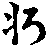



三非一，而明三一。般若亦非半非满，明於三一半满。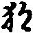



於般若及至胜鬘亦然。涅槃亦非常非无常，般若亦非常非无常，及至法华、夫人亦然。是诸大乘，非明一乘，义一种齐。今明满字教，贯通法摩诃衍经，经题是摩诃衍也。故以明一乘无二，悉是满字不同。成、毗二家云：大品及法华是大乘，而非满字教。故今明法大乘经，非明一乘无二。此是如来十须为论。若然，为缘语，亦得□此异也。大品等法般若云：在因名般若，在果名萨婆若。非波若非萨婆若，名为正法般若不二无。净名等经非权非实，随於不二正法实。法华明非三非一，虽於不二正一也。如涅槃非常非无常，明正法涅槃也。又得云：法华开一为三，则是但三；无三归一，则是但一。言三归故非但三，既无三亦复无一非三，然始归与胜鬘经正法义齐一也。胜鬘经以正法开为三乘五教，法华经则以一乘开为三乘，而法华三一多是但三但一，夫人经方便故也。问：何故法华经以一乘开三乘，便是但三但一，而夫人经不然耶？答：此就缘为论，开一为三□便作三□则成但三，无三归一独作成但一也。问：胜鬘经以正法开为三乘五教，於缘亦应成但耶？答：亦有如此但。今就缘有强弱判之，法华多是但，夫人则多方便也。一家相传云：一乘只是佛性，只是般若，是故亦名为第一义空，亦名为般若，亦名佛性，亦名涅槃，亦名为一乘。是故般若涅槃碍法，摩诃衍经以明其宗致是一也。



问：若为得知是大乘摩诃衍教宗无二耶？答：如地、摄两论，成、毗二家，以明诸法实相，并是虗妄实实相言。今宗表是复上辨，皆比实相，亦是落有所得理外行心，故被破也。问：前云三时、四时、五时中，成论等师云法华已，而是半教无常，故可被弹。如地、摄两论宗，但明半满教，可得问个无行论宗耶？若虽同明半满教，而大异也。彼明无所得理教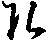







，何以



知黑三藏？此师九□义，并摄论云：此无始时，一切此依止。故云：自性住佛性，一切法依止。若修行时，依止而自消亡，自性佛性朝成。如舍兴，名一时有；若䥫练打搥时，名自消亡。真金囱朝出，一去一在。若尔，岂非二见也？又云：真如不断契，或四义释。真如不即烦恼，如土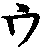



金不囱求出，而人须金种种掘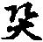



土等，金自随出也。又云：真如非净非不净，真如如空中日月非烟云，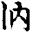



染故非净，而非不净者，忽妄开显出，故非不净也。真谛三藏观释云：如此可非二见，无所得也。又近成有人言：於谛之语在是山，旧语广州三灭与诸觉土朱齐二国，地摄师不曾多法济，而此间人偷南於谛，不知自於谛，可谓是偷牛喻义也。问：地摄宗真如不断归式，今无所得宗正法断或不耶？答：无所得宗亦得断，二得不断烦恼。何者？正法远离而趣不趣，如大火，恐何但涅槃？烦恼而远离故，得意断或也。亦得言不断或者，正法非能非所，无得无处，有何得断不断等？净亦净可也。若言断与不断，就佛口相对劫涅槃明文也。



问：今一乘与涅槃，若为有实那？答：不实也。有二种一乘，涅槃上有两种也。一是诸一乘，如无三归一一乘，故胜鬘经云：一乘大方便也。又一家对三明一乘义，即是大力菩萨一乘，如对无常得常，故开方便门，亦真实相，亦是横而明之也。亦是非三非一，强名一乘，即是不二道也。涅槃二者，一是上涅槃，如言接引众生□方便说涅槃，故大经梵行品云：因世间说涅槃，人无子名为有子等。又如肇师论云：涅槃者，引物之仕名，出处之方便名，无得物之功，无应名之实，非名非物，名物何者耶？亦是强涅槃，正法涅槃也。所一家相传云：一乘只是涅槃，只是一乘。所以然者，非常非无常，因非果常，无常因果，将於一乘也。涅槃非常非无常，非因非果，显於涅槃也。



问：若言涅槃非因非果宜当果名者，一乘非因非果宜争当无常名耶？答：不例也。若例者，一乘非三非一，宜两强名一乘。若涅槃非常非无常，宜当强名常。又谓言一乘非生死三、非生死一，宜当佛果一乘。故大经云：乘涅槃船入生死，纳耶输生罗睺罗也。涅槃非生死，非小乘灰断常，宜当涅槃常也。又得云一乘只是涅槃、涅槃只是一乘。所以然者，涅槃非常非无常、非因非果，一乘亦非常非无常、非因非果得於涅槃，亦得言常无常因果得於一乘也。是故涅槃、一乘更无有异。而今文欲明其异者，一乘非因非果而宜当因名，涅槃非因非果而宜当果名。所以然者，本以任方便涅槃接引众生，令其欣涅槃相离生死。涅槃是得归之处，是故宜当果名。既方便涅槃为众生欣趣之所，是故作修行之名，不便故宜当果也。而言一乘非因非果宜当因者，一乘正此明为万名同归，故低头举手等是皆归一乘也。故经云令七岁已上皆得修行，是故一乘宜当因目也。不例者，涅槃宜当常名，则为此义。一乘不得名无常者，去一乘言而不此归一乘论具足义，是故一乘明常无常具足。所以尔者，昔涅槃破耶常，宜全德写为明之，今日明涅槃归正对𢇛昔无常，是故今日涅槃唯伍疹常也。一乘则无如常无常遍写对斥破，虽言破三而一终是无常，即果地则常亦得常无常具足也。故一家相传云涅槃只快，则是对斥破故唯道，道常断中快则常至无常具足，能则一乘亦得座也。



第二、明三乘自有两(第一、明三乘十地，第二、明二乘有无)：



第一、论十地有一(第一、明名义，第二、辨体相)。



大品第十七卷。梁武天子敬重此经。大弘大品题名。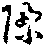



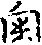



品，旧云经。此或题灯炷啄品，或归功德品，或云住菩提品。品文云：须菩提白佛言：世尊！何等是十地菩萨具足阿耨多罗三藐三菩提？佛言：菩萨摩诃萨具足乾慧地、性地、八忍地、见地、薄地、离欲地、已作地、辟支佛地、菩萨地、佛地，具足是地，得阿耨多罗三藐三菩提。须菩提！菩萨摩诃萨学是十地，非初心得阿耨三菩提，亦不离初心得阿耨三菩提。释曰：依此文，小庄严荣法师云：龙光传开善云：一神具得三乘十地：一、乾慧地，二、性地，三、八忍地，四、见地，五、薄地，六、离欲地，七、已作地，八、辟支佛地，九、菩萨地，十、佛地。今谓亦可有此义而实明之，三神明共十地也。而经云：非初心得菩提，亦不离初心得菩提。十地非初心得菩提，亦不离初心得菩提也。释此文不同。一、论师等非云：初心得者，异法无明也。不离初心即菩提。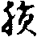



任一明也。改亦然。二、今无依得意释，有两义：一者、初非，是非初菩提中，故言非初心得，如有不？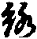



不是中菩提，非是有，是非有，有任故无，亦能不二而二明之也。非归心得亦不离，何以得菩提亦类之。二者、初兴，[彳*又]改并非也。而初与后两心并假故非，而初心后心不二，是中菩提故，故言不离心道，不离心得菩提也。乾慧地。龙光传开，善以假空理为礼。若大乘义，则三十心为体，二乘人四种处理，并是假名空理以为具体。三、三然义，三乘同此，乾慧地未得实浅空理，定水少，不免乾枯，故名乾慧地也。今无得宗，口无所口，假名空慧故，则今乾无枯，无所得生死义，故乾慧地以以乾枯得名也。开生宗。三、三然义，二乘人以实法已上无摄，还生退义，三乘同今不退，有不改之义，故名性地。大乘明义，菩萨初似教。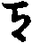



般八万四千波罗蜜资发空去，空去[米*全]得不退，常家然义，故假名空理初无摄，於还无退义，但释退二乘心。释不同：一、玄中但退起二乘心，少有不退义；二、云初十心中，前六心退起二乘心，以七心已上二十四心无，多起二乘心，此意定小乘已六，此故名性。种性义故，言二十四心性地也。八忍地者，三三然义，三乘不同。在见谛中，有八忍之位，是八忍人，故名八人地也。见地者，小乘义，即云十六心须陀洹果，具见谛理。大乘义，以初地终心，具见谛理，故言见地也。薄地者，小业义，义欲界。且於发六品重已断竟，对三品轻薄者，故名斯陀含也。方乘意义，记二地九门，即是九品义。说斯陀含，即欲界。且经四品以上，上即中中。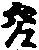



名厚重品。已涅槃，已品轻薄之者，故名薄地也。离欲地者，小乘义，名阿那含也。大乘义，三地照门，即欲界。九品结尽，不改还生，故名离欲地也。阿罗汉断三界烦恼，已涅槃，法四无已成办，故名已办地。亦已作三界，得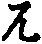



慧究竟，故已作地也。不须教独，然觉悟理微，遮习气故。独觉名辟支解，国语此番为独番，佛为觉，故言独觉也。大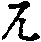



之士位悕，兼物先人。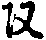



已三为义。以第十六心，即金刚三昧位已还，名为菩萨地。大乘人元觉极果，名为佛地也。



第二、释三乘体位，明三乘十地大小两教不同。龙光传宜宗，已乘明菩萨乘，三乘明菩萨乘不异，同明三三然佛因也。三三然万等两教，三乘人同以假名空，理似今真如，名为乾慧地体；同以实计空，真似无真如，名为性地体也。小乘教同以见谛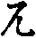



十己心，名为八人地体；声闻人第十六心，是见地体也。辟支佛位，一初明作十地，三神明作十地，不同如前得也。依一云，独觉人以第六即辟支佛极果，悉是辟支佛一地体位也。五乘教菩萨与三乘教菩萨，以第十六卷菩萨觉地穷明是菩萨体，他极果位是佛地体也。斯陀含果向是薄地，阿那含果向是离欲地，阿罗汉果向是已办地，具如释名义中说。就菩萨位，以初地入分，即初地上忍，分未满已，还约所随，或傍角相[去-十+小]小乘十五心体，谓尔相或十六品之十五品[(乞-乙+止)*(口/寸)]，唯小乘十五心。约[乃@人]八忍、七智及第十六心，多分名为八忍人，是八人地位也。初地满分，穷上忍空，解唯小乘须陀洹义，说须陀洹名为第四已地位。以二地入分已上，即[仁-二+(?*月)]习，穷上忍已，还即欲界四品不示相，或释不浊。一云：上上、上下、下上、下中、下下五品当门。二云：一一地开九品菩萨。何者？有上、中、下上三品，中三品，下三品义，说斯陀含果，名为薄地体位也。三地入分已上，即备习分满弓，欲界不示相，或中中、中下、下上、下中、下下五品门。二、如上用无品尽断欲界系缀烦恼尽义，阿那含名为离欲地体位也。二、三、四果向离未穷，登位因中说果，并摄属地位也。以七地入分，乃至修习分满穷，上品能侵断习气无明住地，或重将多时徧观义，说辟支佛，名为辟支佛地也。以八地入分，至金刚心学地穷明，无生法忍中品、上品，寂灭忍下品、中品，是大菩萨位，名为菩萨地体位也。佛果穷明，是佛地体位也。初地出分，入二地佛分，名为菩萨体位也。佛果穷明，是佛地体位也。初地出分，入二地八分等，并是向牵，如十地九品门、五品门义也。唯十地出分一向属十地，初地行分一向属初地，与中相隣，胜劣身说不同。一云：胜身属次地。二云：犹属当地身定。开善门徒相传作此说也。今无日大乘门义则不然，具如梦觉义、十地义中释也。三界正使，或假十信位中已释，意污犹中。十信已已上，约小乘义宗明之，即是习气；大乘义宗明之，无明烦恼。此无明无知等，或是大乘之烦恼也。望小乘义，即是习气。故璎珞经云：六地菩萨断非想非非想烦恼也。故相传谓阿罗汉六地齐功。所以如此者，小乘正使气，唯不悲想他。若言七地习气者，此是无明之习气，非是正使习气也。故经云：七地菩萨爱佛功德，不名无烦恼也。具如十地义中说也。问：事同者，彼十信中十信也。答：夫人经云：三乘初业，不愚於法。大品般若中开三乘引。又云：佛、菩萨、辟支佛、阿罗汉，用是般若波罗蜜以度彼岸。涅槃经迦叶品第四卷云：发心毕竟不二不别，如是二心先心难，自未得度先度他。是故我礼初发心，发心已为天人师，缘觉声闻及缘觉，不是发心返三[尸@(一/小)]，是故今名最上无。十地义中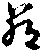



说。又於元陟，释不得一。如灵味山亮师云：前四教未能悟道，至第五时，大经教等白悟无引。大经第七四依品云：证彼文自言：自尔之前，我等邪见之人也。法师释法文云：前四时未明圆修常住，故白摄家邪见，非是非悟。元当教时，时并得悟，云定道也。今无所得大乘，言半满教，并今分悟，无求於大小空人，不得说四时等教明之也。而经云：自尔之前，我等邪见者，依涅槃论释之。此品正明十六见住义，故言耶见。若尔，指小乘计，为摄不正见也。法义意大小。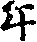



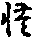



义具说也。



第二、明二乘有无亦有两(第一、明有无；第二、明证有无)。今序断释三乘有无不同：一、从佛厶文汉地开河，相传说无有一人释无有二乘义也。勒那、菩提三三藏亦不说无二乘也。番摄论黑真谛三藏常呵开等否？云无有二乘也。执无有二乘亦少少不同：一、但起自灵味寺小亮法师云：理中唯有一菩萨乘，无别二乘，而说有者，为欲引接二乘，如雀母方便说也。二、开善亦云无二乘，而父小异灵味者，开善前后说小不同。前云：始入内，凡得假名空已，或并是实声闻，但从法空已去，唯义为声闻。凡引十证，如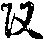



说，亦改云亦无，改假空声闻法师立。又云：声闻之人，根情钝弱，怖畏生死，志惮修途，不受大化，[宋-木+ㄎ]岸而退，退以如本，随机接故，说有三藏之教。故有二定、十门定，有声闻、辟支佛偏修定慧二乘道也。但师执不得，穷枚、光宅二法师执实权义，开善执定权义也。实权者，实有如法根性人也。明法二乘人岁计必应作佛，但逐根性暂时权尔，偏[日*有]定方断三果，或尽作二乘人，故言权尔也。空舍，舍权假为义也。明实理无二乘，假名字说二乘教也。故法华经？方便品及偈言：十方佛土中，唯有一乘道。无二亦无三也。无二无第二辟支佛乘，亦无三无第三声闻乘。但以假名字引道，於众生权假释权明证也。实权乘，谓有实行偏修空人，断三果，或尽作声闻也。侵断少分习气，或作辟支佛，无第二无第三究竟也。明声门义果时节短长，有三师说不得。一云：名衣阿罗汉，亦是实徧修，当於声闻人。二云：取衣阿罗，时节过位，故非实徧修空慧人，唯取一生身，劝修者行，辨四果者。已上是偏修空慧声人。三云：即是旻法师觉士，在海坛弥天宝伦法师，义明徧循空惠声闻人。经无量阿僧祇劫，方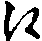



之取衣时促人，并是重现作也。三果悉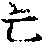



未能广修万行，但偏修定慧，断三界或声闻人也。开善意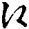



以无有实以二乘人者，贵常慧，必须备修，应得以资发定慧，故无有徧修空慧二乘人也。又寂相传云：有二种声闻，无一种声闻者，二种声闻者。实以声闻即是六心已还，未登六地顶，退起二乘心行，此是法声闻。小㽵严云：此不能断，或亦未能，以似定慧，理始伏相。或但以前事有解，伏十烦恼枝条，故取相随伏也。六心未登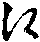



退事，宜如十地义中说，舍利弗昔曾於於六心中退，波罗门从其乞眼，得而脚蹹破弃之，舍利弗因心法而退之类例也。二者舍行声闻，即是登受已上六地已还菩萨，义说罗汉等果。以云地始断，三果正便尽，小乘罗汉亦即正使尽。三藏、方等两教相属，倚备为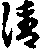



，故言罗汉断。或与六地齐功，故得义功也。七地菩萨义说辟支佛。七地断三界正使已尽，复更侵断习气无明住地。小乘教明辟支佛，亦微遮习气，法义片得，故七地菩萨义说辟支佛也。无一声闻者，无有不修万行而徧明定慧。释三界烦恼尽者。三藏数宗，定慧事生，有复难生，有文有理也。文者，成论世谛品文云：犹如屋宅等物，事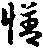



难成。如是泥洹知事，分别诸法，智慧难生也。理者无文，世谛差别，门户阶级，条绪多端，有解缘照，此计差别，故难生也。真谛无相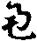



同之理，俗谛虗假不实，理无有阶级，意[彳*又]照此无阶级之理，事生也。以是义故，三乘圣人皆是言[彳*又]而来，必有世谛别[彳*又]也。大乘明之，正反三藏有[彳*又]事生，宇[彳*又]难生，必得空有中切𫹍智慧资发，出[彳*又]出[彳*又]及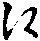



生。众生从无数世界成，曾习缘世谛参差境故，不事有[彳*又]事生。无相之[彳*又]，曾缘无相定理故，定理生众生情於之外，所以定[彳*又]难生也。今无依无得，大乘宗明之。若从凡入空，必从有入定。故经云：依因此戒，得生诸禅定及灭者，知真义次第故。至论得阴不二正观方。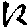



随讣空有五𨹔不二正。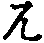



建立空有与智慧，亦得明之，难兴事生也。小㽵严寺荣法师观得开善。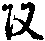



能据龙光成结。常稍云：江南独出。释三乘有三种声闻。无一种声闻者，如寂云：无有偏[日*有]空慧声闻人也。有三种者：一者、於信㧈立内凡位，但现四谛体级，制四果，如毗昙事所，临终屈指，多是此人也。三者、於六心未登顶已还，二乘人也。故涅槃迦叶品第二卷末释恒河七人第三位人文云：是名为住，求佛法中。谁是明次第列？谓舍利弗、大目徤连、阿若憍陈如等五比丘。释曰：舍利弗是大阿罗汉，而言住人，住人位比四种处燸法。



七、六心未登顶义，说五方便及二乘极果相似定慧也。初心为五方便，第二心为须陀洹，第三心为斯陀含，第四心为阿那含，第五心为阿罗汉，第六心为辟支佛。迦叶品第三卷释第四：遍观四方即顶法，即须陀洹。释第五：遍观已得，即斯陀含。释第六：行已[彳*又]住，即阿那含。释第七：水陆俱何？善男子！若彼堓者，𠲖阿罗汉、辟支佛、菩萨，犹如神龟，水陆俱行。三者、於川，二乘人有。如大经云：实阿罗汉，量与罗汉等也。迦叶品云：住人异於𫏐出还没人，亦得有证，信根成立。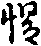



地四果人也。今大乘无依意，辨之不同。彼诸师说，即如前释假十但中制四果。辟支佛与徧行菩萨位，亦即如十地义中说也。问：地、摄两论，成、毗二家云：毗昙家制四果，於四谛观位中立。成论於四谛观[彳*又]见一灭，观去谛住中制，立地、摄两论三性真实观位立。法是尽摄论法师，即三藏师宗意也。今山家意，并不得法师释也。彼宗并是有所得见之心制。何者？拾拾高下前后次第异故，落有所得也。今无依无得宗，无为法中无差别，差别明之，无所不是。何者？四谛观见有得道，真谛观见空得道。今谓彼二家各执不得无依无得大乘宗有定，定有二谛，不前不后，不一时故。今明：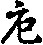



定有无无有无无有有有矢无无异有有五是空空即是有



有为无



无为有见有为见空见云为凡有故数人见有为见空成实见常为见有无为法中假有方便各异闻故经云而法正有法位也前以与方便正观显然诸佛圣人随众生根缘各举一边说之不得彼四论差别释之故中论二十五品破学大乘先人



两品破学小乘先人也。问：若然者，亦不得无假十信位中制四果中十信已上员修是菩萨位也。答：不二而二明之，开为



十，但为前中十信在改。若二而不二论之，即假不中，故中论云亦假亦中也。虽开中假，如云中长短无异相也。



第二义，推证无有二乘意，举十事。小㽵严传龙光云：开善意。



第一、於说三乘之教之厚道理明之，唯一大乘。而所以开为二乘者，正为乐小之人，根情钝弱，怖畏生死。故成论行者品心，常为悦有身有、无身无者，故引接方便云：生死事可免。设或可一身能辨四果，得灰身、灭智、涅槃，引进外凡下愚之人，令生微善实理，无有偏修常慧人也。



第二义，推缘无有实行二乘。何者？或境不出十烦恼，十或皆迷万境。如邪见既拔，无一乘同



常住佛果，佛性、法[丘*勺]便亦然。若不诚常住佛性，一乘同



改，不伏邪见等法，或空空不修万行，而谝意真即法便耶？又地经云：初地中菩萨



乘相故，尚不贪身，何况所用之事？是故无有不活畏也。复明无死畏，亦以无我故不？若声闻已深我相，则应无有畏生死，不须连入涅槃。若意有畏生死者，则我心不除，则不得云即或齐六地也。若云修习无我，有同有异。同者，初地菩萨无五怖畏，须陀洹亦无此畏，其事即如婆沙中说也。异者，二乘人由知无我觉在故，猒在[阿-可+旡]卑，求解脱故。成论？灭法心品云：即佛弟子[彳*永]猒生死，皆以七门去来不生，无所有故。见云：弥增猒离也。大士菩萨修空真道年，万川悉安在生死，普济含识也。同心而广狭有异，其事相反。若尔，不得偏修空慧，即或[?/(冗-几+?)/一]人也。



第三义推说。如超位实行声闻，初六心未登顶，有退者，而有能於道中断三界，正使尽与六地菩萨齐，功能全。有徧修空慧声闻，只可小速於菩萨，那忽相绝？有菩萨广明万行功德智慧，绝性地断结，犹尚难了，应劫方。



六地即三界烦恼常，二乘人即正使常，速於菩萨过。於县绝家云：有二义不可：一者、即或过远，若尔，无退者也；二者、二乘人贵空理，不贵万行。答：尔，出能速即，故无有声闻等也。



第四义，推说无有实行二乘。谷假全有利根二乘者，能於一身中，即或与六地齐功者，此二乘人复过缘发心，回心作菩萨，遍修行，得伏无亡，难於菩萨，绝下



㝵修万行，为当易於菩萨，陀山来，宜修行者？答：彼难者，二乘人已即正，便功侑家，彰久已尽，何故难



？若实易者，暂作二乘则作佛，此即太速也。而论理之，亦有两义：一者，不应暂作声闻，建大心，碍修万行者；二者，大而论之，一切神识修行，时节时时，大体是同，皆应退作声闻，则无有绝性地、初地等大心菩萨者也。又若声闻得



已在同归，则不待为法华



也；若已尤常住，亦不待为说涅槃也；既待说登，方能受悟，则



说不



已悟也。若言初果不过於法，则前已碍说，今则因云化凡，凡失顶



方悟，故须为说法华经等也。谷未说时，声闻人断或齐功，无有是处，故知无有实行二乘人也。



第五义，拨说无有实行二乘人。约数论两宗捡之，无有也。毗昙宗见有断或等智，即



阿罗汉有退初果，见理即迷理，或尽缘事生，或轻重碍，



五逆等恶皆是事，或初果碍为也。成论宗明之，见空𢝞道初果，十恶五逆悉已尽，将成论宗捡毗昙，捡毗昙阿梦汉依



[彳*又]，犹是仅凡



，故绘有实行二乘则然人也。答言：实行声闻於六心退有者，成论法师云：迷是舍行声闻也。又法贤空中，如论世现灭人等，何



顿断灾法，便成罗汉？过为迷法罗汉，亦应例然，故无有修空故二乘人也。



第六义推说元多，二乘人得川明之。寂云：悭为对行檀，嗔为慈悲行，对二乘人不然。行恶法遍修法切，然伏正使枝条异，



然



方修空方亦除，皆或理而论之。有则正使尽，又无慈悲等切然。故相传云：小乘阿罗汉不碍慈悲切信行。故知无有实行二乘人也。



第七义，说无有实行二乘人，约迟速明之。有人在欲界修得三界禅定三十三品一分，或言三十三品定一生身，断三界烦恼尽，成阿罗汉等。如论八[彳*又]脱[前-刖+(〡*日)]



衣时有烦恼，



衣已𠄎无烦恼。又三去品云



衣时有三毒，著衣时已则无三毒等。如法偏修，宜去见三界，或迟速过，为县远故，无实行人。若云取衣聚应迹舍人者，小乘宗明义，从凡入空，望圣朱明舍行，舍行内则傍大乘意也。



第八义，於说无有实行二乘人，约人。人者，佛人也。如佛自始应在第四天生，在现为凡夫。如初教宗所明，菩萨从兜率陁天上，於摩尼宝殿中放大光明，遣法菩萨先下，或为父母观几贫穷疾病等。如涅槃论初意，神通反示意。又如梵志来至如来所，一闻为说法，便得悟。



迹大乘教理而意之，如来等一生得道，既非实录得道，故知声闻修道，亦引接方便，说无实行二乘人也。



第十义，於说无有实行二乘人，约



理明之无二乘。何者？凡有众生，不识一然，三宝常住，一乘同归，而得修去定者，即三界或尽



，二乘极果，无有是处，故云无有实行二乘人也。开善门徒去，法师十意，了有实行二乘意，说亦种种不同。大意同一家无得无依义宗科，科中所以广去者，只为地摄两论，成毗二家。义宗据塞无碍无得道，为作



碍，所以广



破有，如四论广破繁。若无有有得四论，据塞大道



，如鸟飞空，无有踪迹，不得广去，为有所得四论宗故，了莫言繁广也。一家相传云：如第一[彳*又]中说，古昔净三藏师等，无有一人说无二乘



，经论中亦不见无二乘文也。但众根性不同，随其根性说二乘。如是了是地摄两论，成毗二家，与无得论，各各愿乐不得，故开三乘人也。



问：若然者，何意性性破四论相？各亦处处科中说，为著各四相故，落有所得被，亦名甘露，亦名毒药也。亦是有得四论失，於中假於位中，谓为究竟至极无故。



落无所得宗，故被破也。如成论三大法师，并云三乘得观。三法师及



法行师，自引文证三乘亦得观。四文谈。一、大品经？往生品云：声闻、辟支佛，具智若断，皆是无生法忍。又三慧品云：诸佛、菩萨、辟支佛、阿罗汉，通是般若波罗蜜，得变彼堓。此二文，证三乘同观般若空也。又法华经？身子领解文云：我等同入法性，云何如来以小乘经而见济度？即是同观无生一文也。又经？珍如品云：於第一义谛中，下智观故，得声闻菩提；中智观故，得缘觉菩提；上智观故，得无上菩提。此两种经文，证三同观第一义空也。摄论宗，丰、广两处不同。在丰处说毗昙四谛理，为去实性；来广州为诸觉士说经部真谛，为去实性。三法师三乘同观真谛理，为真实性。依他分别性，自是世谛也。三无性有，是已前三性之至极理也。今无依无得宗宣之，普是空实二谛；名字论之，悉是假十信位；辨之实尔。







是无所得理，解法并被破也。问：何以得智？诸法师宗假十信，但为明之。答：大乘无得宗，非唯是无所得为宗，改是



返非。无所得至处，如处处中说。问：何以得智有？答：夫人经云：一依章玄，三乘初果不过於法。若尔，三乘初果即是假十位，於法是中十信也。又法华经云：实得阿罗汉，若不信是法，无有是处。又大品经云：於般若波罗蜜中开三乘之教也。问：三乘初定何位欤？答：诸论师云：假名空为三乘初果，法空非初果。今无得宗，彼假实两空，小乘宗明之亦得之。今大乘宗两空，并是假空，不同彼辨位也。若然者，三师云三乘同观，为非议耶？故大经云迦旃延子学等，引大乘经证义宗，不得也。何者？小乘空，生、法二空为至极，生、法不二，是非彼所称，不得引证也。前大法师等，引大品、法华、涅槃经云三乘同观，即非也。



第三、明一乘义有两(第一、明乘至不至佛，第二、论乘功用)：



释一乘体位上至极佛果不至佛果。释不同：一、庄严、光宅二法师义宗，明一乘正体上位，但是因地，不通极佛果，而两法师自



小小左右不得。光宅所以一乘不通佛果者，正由比庄蒙开善义故。义宗补处相续故无有。



反相续假义也。庄严师义宗，后法无有接前故无假，致前法有不断续作后法，后法无有接前故无有军前法义，故乘不通极佛果也。开善义宗，佛果起续金刚，金刚心被续不断。



作佛果，故乘通佛果也。光宅不许前法不灭。



作后法，故於大乘中难二法师相续。



反义，高声唱言佛有角等义也。光宅义宗，相续假，假实前自灭后自生，大咏始终是等类，故名相续假。无有后续前，前不灭，反作后义，故开善、庄严两法师共斥破云云。师义无相续假义。光宅云：法师释常住佛果定是有，而无有该金心中，金心中被该不灭。



作佛果义，既佛不续接金心，便金心不灭。



作佛故，即佛无有运金刚心，故光宅云乘不通佛果也。庄严师云：一乘所以不通佛果者，执佛果寂照义。彼理金刚心证得佛时，实无佛，无不佛息机照，亦无应化。但无名相中，寄名相说有众生得佛义，随寄名说有常住佛果，而常住不接续金刚心，无有运金刚心因地法义，故一乘上位不通常住佛果也。光宅、庄严两实宗，常住佛果不接运金刚心因地也。彼二师引夫人经云：於一乘上更无说一乘法事，证一乘不通佛果。开善家辨此文，佛果更无动转义，故言於上更无说一乘法事也。故开善家宗明一乘通佛果，有文有理。文者，即夫人经一乘音十文云：今得究竟法身者，则究竟一乘也。释云：究竟法身即是常住佛果。既言究竟法身，即究竟一乘证常住佛果一乘也。小庄严师又引金光明经？三身品文言：若了义说，是身即是大乘，是如来性，是如来藏义理者，正以佛果续金心，金心得续作果，即是佛果运金刚心。佛果既能运金心，故一乘通佛果也。今无依无得，大乘并不同法说。一家意，无名相中假名说开为因果，由因故果，由果故因，因是因能运出果，果能运出因，离因无果，离果无因，因即是果，果即是因，故得言一乘通因果人法，法人双灭，灭反补，胜反胜，前后后前。



可寻也。问：若然者，常无常，无常常，迷例者，佛果常，由无常故，佛果亦是无常耶？答：亦然也。故中论？涅槃品云：有人言：佛果常是涅槃也。论言：破云：由无常故，常无上去，常亦去。云何常是涅槃耶？故知佛果亦是无常义也。至论涅槃，非因非果，非人非法，非有非无，故无得非因果所得，无至非处所也。虽然，强名者，亦得言涅槃果常种种得，而不同地、摄两论，成、毗二家义宗，如处处科中斥破也。荣法师就光传开善义宗，通而为言，通三性、心、体，并有为佛果作习因义，即是正因佛性，皆有相资出义，悉是一乘。据夫人经、法华经，明一乘皆徧作善性，善性捻体，通召佛果力强缘故也。恶、无记性心，虽有一乘义，设而不论也。三藏教中所明五乘法善，至方等教捡有者，皆是一乘体摄也。三藏教中有徧空慧，故二乘善，及三藏佛因果空去善，诸三乘善，至方等教中捡皆无，非一乘体摄也。以方等教捡三藏教，依三藏教，从多论之，但能生解凡夫善也。答：正论乘体，取去无



善[彳*又]等，及相似无缘善[彳*又]等，及外凡夫有漏善[彳*又]等，并是一体。故法华经？方便品云：童子聚？沙、散花心、低头等善，皆已成佛道也。今无依无得，宗则不同，彼说论师等存心意，世谛空假，法有义故，悉是理外落有，所得被破也。若了悟不二，而二无为法中假名无差别，别亦有诸义等，如法花经？方便品云：童子聚？沙等善，并是无所得善。故法花论云：低头举手善，是性地菩萨善。亦如大品经三慧云：敬心念佛，乃至一华散虗空，并一称南无佛，乃至毕在其福不尽。如是佛福田中福种，其福无量。以是义故，当知佛与化佛无有差别法，今於无异故。若尔，两经意无异意，是性地菩萨无所得智，不开存心意有所得善等故。如四论诸义，迷是有所得被破，不入一乘宗，只得次第缘，不得作习因得佛也。就光传开善义宗，一乘意於三假降金刚心已，还因成假毁，於万善运出亦



云：万善共成因，假人有运载。乘法有一因成假人，然运载名为因成假，一也。初令善细诠相胜假善法，运心体能运假人，乃至常住极果该金刚心，即续生死中怖，能运金刚心动出作佛，即能运生死中有心动厶作佛，能即相胜任心善人，能运载名为相胜任，一也。论相待有两种：一者舍实二教相待，二者当众教。一乘体有总别，自有相待。舍实两教相待者，舍教明开三乘也，实教但明一乘法，三一相待，待三故一也。一乘体总别自相待者，别则有万善不同，总则得运归一极不异，以总一乘之一，待善体之万，比相待，待万故一也。此即相待任一也。此三种，一以相待，一为乘端，而有二义：一者相待一乘，摄乘体通常，此即是体通无相待故也。因成相待有两：一则摄乘礼不尽。因成一摄乘体有两义：一者因成任上不通常住极果，即是不摄佛果乘；二者依任实相



义，乘体万善有不成。因成任人义，即是下地善相不常义也。相待一摄乘体不尽，亦有两义：一者极果善解体通入一乘，但胜前金心义，故入一乘；乘果不胜金刚心义，则不入一乘。二者下地善解入一乘，有待不待义。不待义者，如习释两因，论善生而灭义，而有资生运义，故入一乘。此善义，非相续义摄也。二者因成相续两：一则别，相待一乘则通。通者，则因成一形，待彼众因，故一是待一；相续任一形，待於义，以二因故，一即是待一。不论待赖须待之待，待赖须待之待，於三任中，语义各属任也。就光云：开善常云：此三任待不待，即不善出应人之表。今无依无得，宗定之喽喽别别，生於分别心，於入道



无益，如百草也。如八不义中，破三任也。中论燃可燃品，竜树菩萨云：若法因待成，是法还成待，今则无因待，



成法亦无。此四句语，并破洗尽三假待不待、具不具等义也。虽然，破众生於缘性无为法中而有差别，亦得有之，故云有正有法。愿虽然尔，有便不便，得不慢事也。



第二、解功用。诸论师等云：乘正以运载为义，亦言乘运致为义。能运行人远进至佛果，佛果续於因法，法能运人，人能驭行也。亦言进趣，进趣於果也。彼四论义宗，恰恰有人与法从小至至也。今无依无得宗，永异於有得四论宗。若名字、假名、方便、无为法中开差别，亦得有此数名。而既言无差别，差别故虽言运载、运致，焉近趣等？抑名而至有，如彼从下至至。故经云：来无所从，去无所至。如净名细说。又大品经？发趣品：善吉白佛言：云何从一地至一地？佛答云：菩萨摩诃萨者，有法无来无去相，上无有法若来若去、若至若不至，诸法相不灭故也。然地、摄两论，成、毗二家，宗、致、十地，恰恰有高下法举差别。若尔，岂非有所得耶？事事具如十地义斥破也。竜光云：开善义宗，乘切通便所运动，上不无运动义，但能运未必动而运，故不以运动数。乘不动而逆有上下两种，上则佛果不动而能运金刚，已定习、释两因。善解生而即灭者，不动而能运资行，便出作佛也。乘所运心，人必动出也。人动至金刚，例灭心动。心动至佛，而任不



动，二不例也。故詺便动出，即是载义。故言运必载，以运载释乘也。法师云：运有三种：一者运前，二者运后，三者同时运。何者？以后续前，便前动出至后，名一为运前也。以外凡夫善等，便



云十地心出作佛，名为运后也。以同时心善无作善等，便同时心转出向佛，名为同时运也。据此三种运而为言，佛果但有运前之运，即佛果续金刚心，便金刚心动出转作佛。下地具有三种运，即如向所论三种运义。假人亦使心动出，此即任实牙运义也。问：假实牙相运者，心即佛果，假人亦即佛果耶？答：开善宗佛果非实具非成，故假人但至金心，佛果但法因成假。上有人言：佛果异具因成假，非开善宗也。问：何故以运载释乘，言运即具载，不以运动释乘耶？答：运即是然载，运亦即是然动耶？答：开善云耳。然载即当分，是载佛果，便金心动，而佛果不动，故能载而能动。此义非例，例如前[彳*又]



，迷或便迷，或即灭而能即



，是即



是能即灭，非即迷或所



迷，或自是即灭也。乘能运载，是载能动，非动亦然也。陟亦能分，疏而证是，是二见客。今无依无得，宗则不然。大品经？三慧品自标：问：云何名为有所得、无所得？佛答云：诸有二者，名有所得；无有二者，名无所得。佛自分明言：无有二者，名为无所得。云何言佛果不动，金刚心动；金刚心灭，佛果不灭等也？今谓动即静，静即动，即即所，所即非，离动无静，离静无动，果因因果，常无常类。然至论非动非静，非因非果，因果不二也。而经云佛果常等者，横云斥破二乘故尔，碍如涅槃等义科中辨也。问：若常无常，无常常不二，云何舍无常色，获得常住色？受、想、行、识亦复如是耶？答：此意就情悟心，有法界故尔，亦是引接故尔。若理而论之，如前动与静等不二也。



第四、杂料简一往不二而二明之。乘是对人名也，行能运人，为人所乘，故名乘也。所言一者，随义释有四义：一者、简别名为一也；二者、破别名为一也；三者、今别名为一也；四者、无为故名为一也。言简别者，据实理明之，唯一大乘随缘随化分三，简别破三，是故言一也。言破别者，佛随众生根性方便，假设三乘，众生闻已，执假开三，是故言一。故法华云：十方佛土中，唯有一佛乘，无二亦无三也。又经亦言：唯此一事实，餘二则非真也。言无二者，一大乘外无别声闻、缘觉二乘也。言无三者，一大乘外无别声闻、缘觉二乘，并无有随缘化偏行所设大乘也。问：直说无三时，无二已



𲀥，复何得别说无二无二耶？答：声闻、缘觉二乘者，是大乘家对说，偏悟假有不有、假无不无二乘也。大乘亦有二种：一、悟假有不有、假无不无，修万行菩萨大乘；二、悟有不有、无不无，圆悟中假方是实大乘。亦得言：前权大，后是实大。亦得言：如言三阿僧祇劫但修六度，不修习诸地无漏，次於百劫修相好业，随业明之，名为权大。破此权大，并破餘小，是故言一也。今别者，捡而明之，唯一佛大乘随众生分一为三，今还摄三归，大因无异趣，大果无别从，故言一。故夫人经言大戒仪以为木叉毗尼学者，即是大乘学，故云波罗提木叉毗尼。此二法者，义一名异。毗尼者，即是大乘学也。又经云：汝等所行，是菩萨道。正是根本无二法，故一也。问曰：前破三辨一，今复何故合三为一耶？答：对执情其别。若故说破三处，执情明之。就理为言一，理外无三，是言别即是一也。问：乘者，人所行。三乘人别，随人教乘，乘应定有别，何故言一耶？答：以理一故尔。故经云：三乘虽异，同一佛性。犹如诸牛，色虽种种，乳色无别。三乘亦尔，佛性无别。性无别故，证未圆，唯一佛因；证之因极，唯一佛果。是故就实论，唯一大乘。故大经菩萨品云：世若无佛，则无二乘证於二种涅槃。而世界唯一佛，更无餘故，无别二乘得二种涅槃，故言无别。如是意也。言无别者，就实理明之，乘无有别，非是有三别可破可合。犹如虗空平等，无二言一也。问：一乘以行为体，别多种。



得言乘耶？答：不二而二。论之法，行有二种：一、别相门；二、共相门。此别相是共相，共相是别相，非一非二，假名开之。若别相门，乘有多种，令得共相义，故言一。犹如众等共成。



五阴共成人等，此义亦然也。此一乘，如十二门论云：亦名大乘。此则随人[彳*又]释佛菩萨是大，是大行乘，故言大乘也。前释名中有出，亦得数法辨备摄。如六度相，摄则广大，故名大也。出家相传云：若言一者，要有四种：一、无三故一，即是无二故一也。故法华经有一乘法，无二亦无三也。二者、因一故一，即是万行，即是果因，故一同也。汝等所行，是菩萨道。三者、果一故一，即是一万位，故法华经云：为一佛乘故也。四者、体一故一，此通因果，即



通一，故胜鬘经云：说入一乘体。此一乘亦名大乘，四义同向四一，亦名无上之乘，物不能过此也。即是简非二乘之大，故法华经云：是清净於此世间，为无有上。又一乘之名，含行理之一



也。大乘亦然，即归大本，以当体属称难也。故就[(火*火)/乃]菩萨十二门论，举六义释大义。何者？一者、於二乘上故大；二者、法佛最大乘，此大乘能断故大；三者、诸佛大人之所乘故大；四者、除众生大苦，然兴大益，故言大；五者、观世音、弥勒诸大士之所乘，故言大；六者、然苞诸边，故言大也。如来出世，本为一大事因缘故，出现於世，但众生殖因不同，随其所乐，於一为开为三，三即是一也。随缘说有四门义：一、令三归一也；二、破三说一也；三、开三明一也；四、癈三兴一也。如前说之，此四种门，不二而二明之，通於人、法、理、教、𲀥、行六种，前略故四也。论师云：别而为言，令行者破出执，餘二通三，谓教、行、理也。今无依无得宗，彼所明宗，若行、若教、若理，有诸法并破洗，无有留微毫也。问：以法能运运御，而不说人御，御即运不？答：迷通寻法，运通是载之别名，而不二而二明之，宜指於法。寻此御通，即统之别种，宜属於人，此即人法法人随便不便论也。问：寻一名不谛於三，亦通於四，理一、名一、义一、事一、教一即是九，何故但四门耶？答：实如斯也。而者，不二而二。毗言者，正说无二故。一摄众一已，当指事通为体，亦摄通。此前释理、名、义、政，此四属无三，故一所摄具足，摄具足当也。问：若令三行



一行者，何意不令政归一政耶？答：并得也。故大经言：以珠力故水清净。如前三𫔻，是方便说。今一乘既正观明了，前方便亦了也。论师云：行是因，近远向果，所以令之。正是非因法，癈於一时。行有长进义，以开修习故。正非别修习，复无进义，故非例也。今无依无得，宗则不然。如经云：一中有无量，无量九中一。指一为无量，指无量为一；指习为无习，指无习为习。故一例义也。又不二而二义，亦得言政。非修习故，不令政而得言政。何者？政为行，行为政。解：何不言政？故变言会，亦得其不舍政也。论言令不令相，不同四论宗义也。问：乘义、道无义，复何别属？答：不二而二明之。总相释之，能通名九，能运名乘。虽然，人、驭具载人，人、法相成，人能驭法能运出，法能载人能运出，两相成运出进趣义，名为乘宗。道则能法通得果义，名为无宗。不二而二明之，大宗、乘是举人法法人运出进趣名乘义，



是人法行通得果义



义。问：



但行通得果义，



人边即无有通得义耶？答：而明之。人亦得果义，别如前义，名有宗。



乘与



位高耶？答：乘运出正得，因中运出正宗，至得果则倿义。



则正得通得义为宗，因中通义傍也。问：不二而二义，横竖中何不二而二耶？答：此中不二而得任明，故横明之，竖义则傍。问：门与乘



三，云何取别？答：不二而二论之，一往明之，通入名门。然运界乘通别名



。



开三



，无名相中分。若如空假世谛、虗妄世谛等者，即落有所得理外。所无依无得宗，落问论宗，即一一破洗纤豪不留之一家宗。如空中织罗，虗中织纹，假名名字，无有踪迹。问：乘通三性也？答：如毗昙宗，乘通三种为体，彼明善、恶、无记，通三聚法故。成实论宗，善、恶但通两聚，不通於色，故二聚以为乘体。又毗昙宗，无作是色；成实论宗，无作非名非心。若毗昙宗，善色自是乘体，诃梨宗缘具合明之，色亦是乘体。实尔，论之色非乘体也。今无依无得宗，作、无作、作因缘、假名、方便，不二而二明之。经既云舍无常色，获凡常住色，受、想、行、识亦如是者，无所不有。虽然，都不得地、摄两论，成毗二家宗。何者？点空作色，心无作因，成相续、相待等，故无相、无迹等法也。三性亦如是，於般若正法中，开立多种法，无所不有，故言一切正、一切邪。论师等云：无作有与无，师说不同。七地已还，有无作无中解，涉假於别法；八地已上，则无无作法，但有心善恶二云。至金刚心，有无作佛果，则无无作也。今大乘则不然，具如上述，点空明义，永异此论宗也。大乘宗无所不有，故大品经三慧品云：一、花严虗空中念佛，乃至毕竟，故其福不尽。若尔，可得言七地已下有，八地已上无有耳。何且直造井桥梁等生善，但七地已下生无作，八地已上不生耳。今大乘宗通而为言，缘碍明义，教境等亦乘体。如假十信，前学无所得凡夫，大乘体都不取。若地摄等四论，一切法不入体，故大品经。大经云：有所得者，无道无果，不动不出，故都收乘。问：法花经云：驾以白牛。此文云何释？答：此前已释，今更明之，但说不同。生法师云：神通无垢为白牛，内解穷后为肩，色充累道，宣大乘之化，入於五。



驾之而游也。光宅云法师云：空慧为白牛。招提师云：一法两。



指此乘明有本义，速出说白牛也。今大乘意，人法为别牙，可。



法牛，说行人也。问：明位云何？答：论师云：位始成终满。始成有两者，[彳*又]行初即相佛成。若



初地，始是真成，示从方便入於正观。终满二因，金刚果於仙，示从因还果。但释初位，有三说不同：一、斌师云：地前是正乘位。诸师云：作此释者，得之方便，先於正观。二、𣏋师云：穷於初地，始是乘位。又诸师云：此得正体者方便。三、匡山远师云：八地已上，方是无上大乘令之。又诸师云：此得就观及与乘体，失於偏乘及与乘通也。四、招提云：含通三释。若能相资义，地前此善，相从入乘。故法华经云：低头举手，皆以成佛道。若论真成，从地已去，是故法花经云：是乘清净也。若论成，八地已去方是也。辨论终位，亦有三家不同：一云、乘位在因，况在门而入，入里乘亦置果附，任人作去。夫人经於上更不说一乘法事，此指果上无因事，此师意得因出果也。二云、一向置果，此师意得果出因也。三云、亦得论之，若因乘但极金刚心，若果乘则至佛果，既是常故，不复运动，犹故载人果无因事，缘中运他，此通不息，例如於道也。今无依无得，大乘宗则不然，彼意凡夫不相似乘者，乘佛乘空执，高下参差，空处不同，开善落有所得理，[彳*又]於其恭，不关诸佛菩萨假名乘，故并被破。四、论气空无所得乘，远作次第缘，故三位中不定位也。今无得意开，则有六位：一、学无所得凡夫二乘位；二、假十但位乘；三、初发心中信位乘；四、相似乘位，有三十心也；五、从初地已上还金刚心亥位乘；六、佛果是位乘。大乘意无差别，差别开则六种位，合则无所得，无谶毫相，开不失合，合不舍开，还论非开非善，亦得言并中地教，高下十地，具如十地义科中说也。地、摄两论，成、毗二家，好言三论，信破相门。又云：破执何时破法？比人不见龙树菩萨与提婆菩萨，凡俗何足恠之也？净名经云：但除其病，不除其法。若尔，岂非破执耶？答：经云不除法者，因缘假名法，有何法可除？经云但除其病者，如中百论中所破，彼若竟智、若因果、若有无有法，悉是病𲀥智等也。何信除执？如四论所明，而法无非所破除法也。一家开凡有五义：一、政；二、理；三、机；四、根。此中言四种自有。



从乘体也。地、摄两论，成、毗二家，义宗五种，即是一乘。逐近说三，涉政名为小乘，中政名为中乘，弥政得名为大乘。本远空，此三种总归一乘也。今谓不二而二，开说名字假名说，亦有此意，而意故不相关也。问：三乘权说，得有理不？答：论师等有三说不同：一云实有三乘，故有理；二云二乘言政，一向无理空权，故开善言三。招提云：不得徧通理空二乘，不勉例或，那忽成圣？此意想被政二乘也。亦不通无理，却无理者，云何而说二乘耶？今日两空，亦有方便，说即名权，非理穷竟，故得言是无，而终归极，故得言理也。今大乘意明之，时教论之，於小乘中，二谛为理，如陈如品说人究竟。大乘意，二谛为教，故经云：有无方便，入非有非无。如小经中心灭空，大乘即心不灭，作佛性意也。问：三乘心令同不？答：严家云：正令於二，以归於一也。菩萨与佛信，是应现个，一发其迹，示之以本，名字为令，令迹归本，即通小机，灭此挃教也。今大乘则不然。若尔，陀凡夫位去，入菩萨乘却无耶？彼或徧待舍行明之也。无依无得大乘义者，[彳*又]凡夫位依偏修万行，入徧修𠉑十信，亦得言行假十信。三乘入中十信，名为令三归一，大乘义也。



第四，释五乘义。一家关河相传，屋摄岭，高句丽。



朗法师等云：不二而二明之，五乘并是正法，般若家方便通故，悉是无依无所得五乘也。故思益经云：门有有门耶？亦如名甘露，亦名毒药也。又如大品耶屋或品等云：於般若波罗蜜中开三乘。



又叹净品云：无有一法不入法性者也。故一家云：如释迦从摩耶夫人右腋下堕地，乃至双林涅槃并是，何勿方便通也？如地、摄两论，成、毗二家义宗，有虗任与虗妄两世，谛体有故，悉落理外，有所得故，般若方便五乘故，并被破理解法故，非方便通也。今不二而二明之，开人、天、声闻、辟支佛、菩萨、涅槃五乘也。人以仁慈为义，天以自然晈净为义，自然即天然也。人、天二乘，从果得名，当分能灭，人即果也。人、即之异，正是择因，能是人、天，以虽恶。



诸义宗即，摄习常在其内。故法华经云：举手低头，皆能成佛，其犹万里之行，始发为之也。今无所得大乘宗如此。论师宗悉是理[彳*又]行，行起不习因。但远由入理内，渐由不得作习因，只得次第缘、增上缘。而经云：汝等所行，是菩萨道等。如论云：性地菩萨所行，无所得行也。亦是通明得无得法。若远与近，弁菩萨



也。问：若远近得言菩萨



，何故往往破地、摄两论，成毗二家义宗耶？若得得意之地、摄等四论法，善是不定



，亦是远入



之器



也。入理内无所得，决得打、破、洗四论家诸善因。故一家相传云：理[彳*又]外入理内时，有四句，如佛性等义说之。有人好云：三论家宗，众生不得作作。今时众生作佛来者，有四句义也。故经论劝情十善、五戒等善，但不得切习因作佛菩萨等也。故远而论之，便释因择生善处，先以此善法调伏身心，其心能受



法，为说无所得善，全修行也。故人即报因，亦得是佛乘之由。渐无所得，三乘悬



而远，由义故开五乘也。龙树提婆风俗□以决须破地、摄两论者，彼义宗六识，勋阿梨耶识成种子，造六识，六识无，没识更牙相成，名为虗妄世谛体相差别。如论虗假世谛体相本无今有，名为生虗妄世谛信心，解无境异，成论宗故。若有人异於此宗，通於摄论宗者，则非三藏宗，即偷无所得宗，故非广州三藏义宗，故言骡摄论。又诸师与地论师、成毗二家诸人，并入三论家，悉打破彼四论义宗，故得同宗漫语耶？问：徧行六度菩萨得何果佛？答：得三十二相、八十种好佛。故大品经释论佛云：有二种身：一、是父母生身佛，即是相好佛；二、法性生身佛，即是常住佛。故[彳*又]云：光明无量，徒众无量也。问：法性佛定是无常身佛，为是常身佛耶？答：亦无常亦常。故大品经句义品云：一切种智有为也。亦如常住佛是身佛，若至而论之，常住佛亦是无常佛。故中论涅槃品云：有一论师云：涅槃是道。龙树破云：由无常故明常。若无有去，常亦去，云何常耶？涅槃是得无处所、无量



处所。若尔，虽於有无所四句所得，强名涅槃、正般若、正法涅槃，非四论宗也。



二、㽵严义有三意：一、释名，二、出体，三、料简。



不二，而二明之。二㽵严者：一、福德㽵严，亦名功德也；二、慧㽵严也。若言福德㽵严者，无所得善法，能济润利行人，故名为福。福则是其善行家德，如清冷等，是水家德也。言功德者，功体、功能也。善有济润福利之功，故名为功也。是其善行，



待名为功德也。言慧㽵严者，有人言：智慧者，照见名去也。[彳*又]了



慧，皆二种别。了知世谛者名照，第一义说名为慧。今大乘意，如大经师子吼品云：般若者，谓诸众生；毗婆舍那者，谓诸贤圣；阇那者，诸佛菩萨也。成论师释番无痴善根为诸众生也。今大乘明义，凡夫众生既𪢴屋故，不知中假而缘般若耶？直举不二义种为般若。故涅槃论云：众生是佛，内亦非，外亦非。四句并非众生是也。亦如有众生，悉有佛生也。毗婆舍那，谓诸圣人。诸贤圣始悟假故，名为见胜见。见四谛明了故胜，属仕贤圣，异於凡夫也。阇那者，



决断明了中假故，名为诸佛菩萨。具般若义中说，亦是无差别，差别明之。若诸众生不识中假故，举体般若强名之。诸圣人假义故，名为见。诸佛菩萨悟中与任悟，穷极如十力，初力故物智。若尔开之，凡夫众生举体名之，圣人待任边说之，诸佛菩萨令中任名之。



第二、明体法二种，㽵严不二。而明之功德与智慧，并是事般为体。故大品经劝学文云：欲得六波罗蜜与三十七品等因果、智慧、境智诸法者，当学般若波罗蜜。文







胜劝文云：欲得如是功德，当学般若波罗蜜。故知是通般若为体也。



第三、料简。问：无差别。差别，通如劝学文云六度等为功德者，然功德门、功德与智慧义不？答：亦得之。如五度为功德，第六度为智慧。又得善、静二通为功德㽵严，若智慧庄严也。此言不二而二，造境为智，不造境为功也。又二不二明之，六度并是智慧为体，亦是悉是功德也。故通义则齐。此福与智，如经中意，成般若名为庄严。或以说之菩提具，或名助



，或言律仪也。言庄严者，如大经分别有四义：一、能政人，二、能政心，三、政果，四、诸行共相庄餝故。四、庄严能为佛因，菩提具之。修顺菩提，名为助道法也。言律义者，身能理，随顺戒律，不令地地者地有得心，即是菩萨破戒律，故名律义也。此四种，谓开之无纤豪之异相，亦作任，亦中故也。开善大乘义云：分体者，功德、智慧二法门，诸经论分之有异。大经师子吼品云：有三复次说：初以空慧为智慧，有行悉入功德。何知文云慧庄严从初地乃至十地？以是理，空慧为地体，上所生别属功德。福德者，檀波罗蜜乃至般若，非般若波罗蜜。则以五度属有行中，智慧非般若波罗蜜，属功属门。般若波罗蜜以属智慧故，简异非功德也。第二复次，智慧庄严诸佛菩萨，则是佛乃十地也。福德庄严，则是九地菩萨，又能缘劣。



没明之。佛果与十地，皆有功慧二门，九地已还亦然。信福德义劣，智慧义胜，即或成论言故，则为高位说也。第三复次，谓因果位分之云：福德庄严，有为、有漏、有果报、有碍，故非道智也。慧庄严者，无为、无漏、无有果报、无碍，是常住因果分门。



没明之也。今谓第一复次者，有二义：一、六度并是功德，故非六度为六度。如非有有，非无无，约般若波罗蜜为非般若波罗蜜也。二、就中假明之，擅与乃至般若；约假辨之，非般若波罗。徧举正法般若论之，即横意也。第二复次，



第十地与佛果，亦是徧约烦恼尽故福慧。第九地已下，烦恼未尽，因为功德也。第三复次，言亦是惑尽不尽因果明之。经中三复次，言不二而二明之。法开三意：初即后二意，二意即初意，初意不异后两意，后两意不异初意，第二意不异初后，初后不异第二。实论非初非后中也。经论中诸德行不同，如优婆塞经云：戒、精进以为福分，忍、禅、般若为智分。何者？如施与戒，於身口麤事情行，资劝行人利义



相，故说为福分。不能照见，缘细境故，不名智分也。精进除然䇿此行，而精进性是发劝修事情行，而事相是麤，故精进故，施戒摄之为福分。政三种中，般若正照见空之性，说为智。即般若中要忍名忍，忍体是慧，故摄智中，如伏忍、证诸忍、顺忍、无生忍、寂灭忍也。法六度实是，并是慧性，亦是般若名字通故。功德分但就假中、通中，逐事麤微分之福慧也。又一般若中义分之六，如六度相摄也。又定观身心不见，故[彳*又]来割折，身心不动，是慧性。禅定则能当念，停住极难，故慧性摄般若，自是慧也。二依相续解说，经云：施戒为福分，般若慧性也。三依大品，经云：五度是福分，故说为盲。般若是慧体，故慧性也。四大经言，如师子吼品中说如前也。次就位明之，如法皷经云：地前三十心与二种十信行，名为福分。初地已上所行，名为智慧。大意地前[彳*又]行未好净，与福分初地已上见法明净，故名为智慧性也。虽尔，当分碍之福慧，亦是不二而二明之。福智缘义，离福无智，离智无福，福即是智，智即是福，实论之非福非智也。次约见不见分之。如大论云：初地至九地，闻见佛性，未能分见与证见，同名为福分。第十地与佛分见、证见，故同名为慧性也。此义如佛性义中说也。次约人明。凡夫随事行，行俱资润，说名为福分。三界各行假信与中信，故因名慧分，如法名福分。二门不二而二，平



没明之也。问：由智故静，亦是以智为定体。智慧门，大论言以智为定体，体正意为令静摄，故智皆属定行，非智门耶？例如解脱是慧为体，而无缚义，而明此义属功德门，非照境故非智门。问：以智为定体，慧门云何功德？若尔，四无畏亦然，应属功德耶？答：智为定躰，而属慧门，故属功德门也。无畏门以智为体，明此智目[彳*又]照，照通义。



智之能，非功德法不得，



属功德门也。问：定慧分为两门，定属功德者，力与无畏亦分两门，无所畏何言智耶？答：不二而二义，有观定兴慧明疎明之力、无畏，观蜜力则无畏义异。又力、无畏、无碍三法，并是果地得。故释论云：有法智慧名力，智慧[彳*又]通名畏也。



第三、三位义，有三(一、释名，二、明体相，三、料简)。



所言三位者，诸经论中有三种名也：一、邪道，二、不定道，三、正定道也。邪者，起仪无因果等诸法，道因缘世谛法，权划起於慧或心，名为邪，亦名邪定也。不定者，开善或正或邪，遇善友生於信心，於三宝四谛因果，信善现前，即是正见。正见未安立过物，复忌



谤法，断善根故，复生邪见，名不定也。今大乘明义不定，义有两：一、或起有所得善，二、或起有所得恶，亦名为不定也。二、遇善缘起，向入无所得，名为不定，亦名共位。五戒十善，虽复是有所得善，而入道器也，故名不定聚也。故经论中劝修五戒十善，正是入道器故也。正定聚者，正是慧，正为乘义，亦是定不改义也。通称位者，有二义：一、集义，二、赖义。即是因类而集，如言方以类集也。又通称位者，分尊卑高下为义也。



第二、明体相。三、位体。论师释不同。一、开善云：举大经有恒河中七人，於初有三种明之：一、谓常没人；二、谓渐出还没人；三、得住人也。若起邪见一阐提等，及起四重恶自现没，故此位不能出生去，故言常没也。复有暂出还没过，有善知识发菩提心故出之，生信心正见，情若经生，若遇恶智识，还复起邪见断善根，还没还没，或生或没也。住人者，安立善法是第三人，如曲令处。若小乘有立信根不尺善根，善根性已立，不复退起邪见，故住理也。此三人体位者，初人即侍凡夫位，未识三宝四谛因果等，从无明初念无始生已来，未曾值一佛，未曾发一念菩提心，不修世出世善，而然起邪见，即世出世善根，此名为具缚邪聚常没位，即是其无体也。故本业经云：有具位凡夫，不识三宝，不信因果，未发道心故也。若有起小微善根，即是不定共位体。若识发一念求佛出世善根已来，须入共位之始。如大经云：陀一熈连？河沙未满已还，悉是此中人法，并名共位不定聚，亦是暂出还位故，邪正相间故，以邪正善恶为体也。若曾值满熈连？河沙佛所发菩提心，始证性地之初，是性体位。故地持经云：不尺善根傍正法。缘法成体，故云正定聚也。从三种性：习种性、性种性、道种性，是性地之终，正善已见，立善法为体位也。二云邪定不定正立宗，只约一世中约三人开三聚，都不关无明初念等也。故经云：一阐提尺善，唯人中有也。今无得大乘义宗，徒任十信等住人正定聚位体，八恒沙义说不同，或云任十信，或云中十信判之，不关三十心位中，亦具如五种菩提义中至也。亦是三定有所得善，五戒七信为体位，亦应是直举三根性判三定聚也，未必如论从无明初念释之也。



第三、料简开合，师说不同。一、大经□□？品云：三种病人为三位。何者？初传：凡夫不可人，谓必死人少，为耶定位也。若遇医则差，不遇医不差人，为共为人也。若是自差人，是性地位也。二、释云：如前三种病人者，约可救而子住，有成未成判也。若未立信根，名为必死人不差，则未事救位，故非尽具缚人。今若具缚与共位，悉是病人。若初发心人至第六心已，还明可救，遇师差人也。七心已上，是自差也。遇医及自差，开十种性。初十心为两种性人也。具缚位中，含而不开。共位中开为四种菩萨。若性地位有两种，开为三别。依璎珞经开，初一十信为习种性，中十心为性种性，后十心为道种性也。二、依地摄论开为两种也。初十心为性地，后六心为解行地。若就初十心，复应有为两。若初心至六心已还，或退或不退，三乘共性地。第七心以上，则不退为二乘。若大乘明之□，性也。论师次第释之。依璎珞？本业经下卷云：若从不识三宝根凡夫地位，於若佛菩萨政行中，起一念信，发菩提心，尔时名为信根菩萨，亦名假名，亦名名字菩萨。



是人



行十善，若一劫二劫修行十善，受六天果报。此文意前引三菩萨



，释



行十善，得是十善果报菩萨，为四种菩萨也。此法师云：若虽大品经□□品云：轻毛明位行未定，随风东西行不定。又大经迦叶品：牛菩萨有二种：一假名菩萨，二实行菩萨。此意同假名也。本业经同名，复云：名字即是轻不定，故名字说之也。又璎珞业云云：具足有烦恼，集无量业，亦退亦成出。若值善知识，学佛法，若一劫二劫，方入住位。若不尔者，常没不出。法明亦退亦不退，是不定聚人，皆出还没，没已复出。若未登性地第三住位，则犹暂还没也。若遇善友，可得登入住位。从不定位不住位性地者，本业经有六种：习种性，性种性，道种性，圣种性，等觉性。此总始终说之也。今大乘无依无得，宗则不然，具如前说。三位三聚主意，直总约三根性判三位。但正定位有两意：一是假十但明之，二中十信明之，都不开三十心信中辨之也。若不二而二，通而明之，如一中有无量，无量中有一等义，论何妨种种说之也。问：三聚人得有一神命，得三聚人以不？答：𪢴后具缚，凡夫时节能然，无有边际也。故论阿含经与云：舍卫国獦师进逐一鸽，鸽入舍利弗影中，犹故战栗；入佛影中，尔乃安乐。佛令舍利弗以神通力观，於然此边止受鸽身，见鸟畔直只一鸽，鸟前身尝非二乘所见所说六道之神身乎？若尔，一神身何所不经作智，亦得一神命三聚身乎？又诸法师云：凡发道心有期限，犹故賖远，不可知之。故释迦於大通智胜佛所，化第十六？沙改化众生。而大通智胜佛灭度已来，若三千世界破之微尘，过东方五百世界，至下一点复？粖，所点为尘，复过是数。而大通智胜佛灭度已来，复过於此而



众生。故此二乘凡夫之地，



时节犹



长远。而本业经云百劫、千劫者，诸法师云：指福共位始终通列物耳。性位时节者，本业经云：初一阿僧祇劫，中二阿僧祇劫。亦应是列众生故尔也。一家意，但一往举三时节判三位也。问：此三位於变易分段净秽两土云何？答：一家义宗邪定、不定两聚者，秽土；若正定，或秽土，或多是反事净土。此通三乘辨之也。问：邪聚人摄因果等法，亦摄因缘中假法不？答：一家义宗正拔理[彳*又]有所得法，不拔因缘中假法，何不识知？而亦得言总相拔因缘无所得法，如总相缘反照知也。



显庆三年岁次戊午年十二月六日，兴轮寺学问僧法安为大皇及内殿故，敬奉章也。

