# 成唯识论疏抄



> **藏经**：卍新纂大日本续藏经（新纂卍续藏）　**册次** 第 50 册（X50）　**编号** No. 819（X0819）　**部类** 经疏部　**卷次** 16 卷　**篇幅** 648,912 字

> **作者（译者）**：北京　灵泰法师　撰、北京沙门　灵泰法师　撰

> **卷／品**：12 卷 · 0 品



---



## 目录



- [成唯识论疏抄卷第一](#成唯识论疏抄卷第一)

- [成唯识论疏抄卷第三](#成唯识论疏抄卷第三)

- [成唯识论疏抄卷第四](#成唯识论疏抄卷第四)

- [成唯识论疏抄卷第五](#成唯识论疏抄卷第五)

- [成唯识论疏抄卷第六](#成唯识论疏抄卷第六)

- [成唯识论疏抄卷第八](#成唯识论疏抄卷第八)

- [成唯识论疏抄卷第十](#成唯识论疏抄卷第十)

- [成唯识论疏抄卷第十一](#成唯识论疏抄卷第十一)

- [成唯识论疏抄卷第十二](#成唯识论疏抄卷第十二)

- [成唯论疏泰抄卷第十三](#成唯论疏泰抄卷第十三)

- [成唯识论疏抄卷第十四](#成唯识论疏抄卷第十四)

- [成唯识论疏泰抄卷第十六](#成唯识论疏泰抄卷第十六)



---



## 成唯识论疏抄卷第一



**译者**：北京　灵泰法师　撰



言玉井者，或云已南地有玉井，或云天泰星名玉井。然泰即有十个星，即四角大星盛六个参星，即四角大者名玉井。又如法花经中疏中，返可为迢，返正为令者，即得传书中正字以反也。此是传书中正字也。忍字，传书中令字也。今者，即反正字为忍字也。下第一疏中有者，准知广明五乐十利。法花记窃以者，然诸文头首，详夫窃以、盖以、若夫、夫以等，皆是发语之端。端者，头首也。由如下文，今造此论，即是发端标举，简持指斥。发端，即是端序也。然此中即约三教对辨也。六位精微者，然黄帝登山，见一神气龟，背上有五爻文等，乃至遂造八卦，乾三长，川六短等。然此八卦，皆有三画。已后文王翻八卦以为六十四卦，即名八卦。然六十四卦中，即将八卦为头，以次相望，餘七卦即有八个离、八个巛、八个即等名。以纯若单八卦，一一唯有三画。若六十四卦，四中即有六画，故言六位。六位者，如上乾下巛



，即有六画。又如上次下离



，餘者准知，皆有六画，即名六位也。然此六位，诸文书中极是精髓微妙，故言精微也。资象翼而筌理。资者，取也。如孝经云：资父以事君，资母以事父。父则兼之。若事君，即敬之如事君王，唯须恭敬。君王若嗔，即行煞也，故唯敬也。若事母，唯须爱之如母，唯怜爱男女，不行煞也。若事父，即须且敬且爱，如事父也。时兼行敬爱，如父且怜爱男女，嗔时且煞男女也。象者，即是十翼中象下象等。然十翼中以象为首，故今举象。翼者，十翼也，辅翼於六位也。要将十翼，方解释六位也。言十翼者，一上象，二下象，三上系，四下系，五上彖，六下彖，七文言，八说卦，九杂卦，十序卦等。然六位即藉十翼，方始筌得道理也，如易中说。已上明孔子教，次下明老子教。二篇玄妙者，即是老子所造道德二篇。修行名道，道成曰德，此道德且是幽玄微妙。藉蒙列以探机者，藉者，假藉也。蒙者，蒙子。列者，列子。即是百家诸子，即要藉蒙子列子庄子抱朴子淮南子等百家诸子，释老子道德二篇。探者，以手探取也。机者，要也。况乎者，此况次下明佛教。如前二劣教中，若孔子之教，即六位为主，即将十翼以释六位。若老子教中，即将道德二篇为主，即将百家诸子以释二篇。今佛教中，即佛教为主，如前六位及二篇，即菩萨造论以释佛教，如前十翼百家诸子也。非有非空者，即佛教。然大小乘教皆名非有非空，今者唯取中道大乘之教非有非空，遍计名非有，依圆名非空。



息筌辩於言蹄之外。息者，止息也。取鱼名筌，取兔名蹄。辩者，名言能诠之教言也。如藉筌蹄以取鱼兔，如因言教方诠得道理。若得鱼兔即弃筌蹄，若得道理即息言教也。鱼兔喻理，筌蹄喻教。不生不灭绝名相於常寂之津者，即谓真如之理体不生不灭。又离名言及离相状，体无相故其体是常，无灭故又寂静故。津者，如言实际。今者真如即诸法之津，际之本也。至觉者，即是佛也。逈也者，远也。照者，明也。宗者，崇也。主者，尊也。意说佛能远照深远道理，道理可尊重故。将圣者，即是菩萨也。若佛即名至圣，若菩萨即名将圣也。甄者，简也。宰者，辅宰。前明佛中言宗，宗即是主。今明菩萨中言宰，宰即是百官。如下亦言我谓为主宰，相对明之。又有本言滓者，然菩萨未断尽二障故即有滓秽，然佛断二障故即无滓秽也。无言之言乃至月悬者，即是前非有非空之教也。然中道大乘理体离言故芳无言，要藉经教言方显得大乘道理。故说之言风者，即说经教法如风，如世言听察悬令长官。风教警者，即是十二部经教法之风警觉群情，然有本云无言之言风警也。韬者，藏演也。䆳者，远也。采而月悬者，由如云披雾卷即得见於天上月也，今因言教即得见於所有藏隐远道理也。非有之有者，即是前真俗二谛。波腾者，即是诠真俗二谛言语是也。湛幽章而海濬者，濬者深也，海喻真如之理，如见水波腾大即知大海水深也，若水浅波亦小，俗云一尺水不能作一大波。今者由因唯识言教故即显真如之理深，若不得言教则不知真如理也。



匪者，非也。属者，属着也。具体者，佛也，然佛具功德之体。隣智者，即菩萨也，然即隣近佛智。故今此意说，若非属着具体隣智之人，方能演说唯识深妙理也。演者，说也。𭭻者，即是妙中之妙，名之为𭭻也。钓者，取意说佛教，能演得妙中之妙，钓得深远道理，则空性之义，几乎息矣。意说上来所说中道大乘唯识之教，极是几要，即是息心之处也。



十支者，即五蕰论、二十唯识、三十唯识、集论分别。瑜伽论有三卷，唯明禅定等事，更不明餘义及庄严论等。问：十支名字谁人所作？在何问？百法论即名，略陈名数支，乃至已后九支皆唯此问。又问：总包众义支与总摄大义支名字何别？思之。然大乘中即将瑜伽论为身，餘唯识等论以为支叶。若小乘中即将发智论、迦𮞅经为身，将六足论以为脚足也。



白虹者，即如来入涅槃时，有十二道白虹贯日，即中心圆者是日，四畔者是白虹也。问：何故唯有十二道，不言十一道、十三道耶？更问：飞祲者，即恶气，谓天苟上扫星白虹等，皆是祲也。其诸灾恠，踊在空中，名飞也。素者，上句既言白，下句即言素，相对故尔。素者，还是白色。索毫者，毫光。销者，销烁也。宵者，夜也。霄者，云霄，合是绵下化也。景者，明，即如来临欲涅槃时，但是有缘之处，皆放白毫光以照之。其所照处，不经千年，或五百年，必圣教流到也。其如佛欲涅槃时，在夜里放光，夜中即大明，故言销景，或销於日也。线花乃至谬日者，此下四句，即明佛入涅槃已后，所有经教，皆悉殊错失。线花者，即经能持纬，经能持义，如线贯花。奥者，深也。舛凤讹风者，然作凤字，即令风脚里著鸟，名为凤。有人错失，作其风字，即风脚里著虫，错作风字，意说佛涅槃已，所有经教错失也。贝叶者，其西国经论，皆向呗多叶上写也。乖鱼谬日者，如俗作鱼字，应合鲁头下著火即是。若鲁头下著日，错作鲁字，不盛鲁字，意说佛涅槃已，所有教细。皆𮨇者，所以义。惟者，思量义。法宝者，即是经教。斯者，此也。行者，行动瞬息须臾义。坠者，坠没也。此上文疏主意言：我所以系思量佛法，须臾行动，瞬息中间，即坠没。有人云：行字者，非也。今是行字，即是行动之间也。若坐卧，即得久也。若行动，唯得暂时也。



诞者，生也。兹者，此。融者，通识。谓由造得三十颂，即出生得及通融得唯识之教。秀者，独秀也。晦者，暗也。孤明者，即是大乘。大乘之解名为孤明，小乘之解不名孤明。意说天亲菩萨先方便暗於大乘孤明之解，即向小乘中出家，而造俱舍论，以明经部师宗。示同尘而说有者，天亲菩萨也。天亲虽向小乘宗中出家，和光而示同尘也。俱舍论中且明萨婆多师义，故云说有也。解慧缚於摄论者，言慧缚者，即是所知障。所知障是慧缚，故能障菩提。其烦恼障名为性缚，能障涅槃。若小乘执，即是慧缚。意说天亲菩萨先示有所知障、有慧缚，故晦於大乘，即向小乘宗中出家。今者舍小向大乘，造舍摄论，即无著菩萨见天亲病，令弟子取得天亲已。无著弟子中一人颂十地品已。天亲既病，已造摄大乘论，释十地经也。即是解慧缚也。表纵者，即天亲后大乘，弥弘大乘教，令大乘得终逸盛行也。圣者，五百年一贤，千年一圣也。疏谈空者，上句既言说有，下句即言谈空，亦相对也。鉴者，照也，明也。意既天亲菩萨之智，能照明一切义道，皆悉周尽。洽者，润也。意明天亲菩萨所说义，徒普利乐润益一切有情，皆周尽也。故言鉴洽智周也。玄极者，即此三十颂，普释一切经幽玄极妙之理皆尽也。



释文未就者，但是化得三十颂，未作得长行释也。归真者，意说天亲菩萨入涅槃名归真。上迁，迁者死也，意说天亲菩萨身死问，不言中下迁。又人问言伏惟上□，不言中下更问。繁者多也，约者少也，意说天亲菩萨造得颂，其文极少其义极多。泉源者，然此唯识论即是一切诸法之根源也。重秘者，秘藏也，意说佛初灭度得其唯识道理一㢠藏隐，今又天亲灭后唯识之理智第二通㢠藏隐也，故云重秘。



爰者於引，即引於护法等也。液情者，如水澄净故即见人面，若心澄净故，故即得见於唯识道理也。七转者，八转声中除却第八泛呼声，取前七声也。激者请也，由如将击鍾其声乃发，若有人请菩萨，菩萨方说法也。河辩者，然此菩萨所有辞辨状若悬河。赞微者，即此十菩萨造长行释，赞此唯识三十颂微妙之言。神者心也。八识者，然菩萨声闻各有四藏，故有八藏。菩萨中一明定之处即名修多罗藏，二若明戒之处即名毗尼藏，三若明慧立之处即名阿毗达摩藏，四若杂明戒定慧处即名杂藏。然声闻藏中亦有四藏，缘觉乘中不立藏者，以无别经教也。净彼真识者，其唯识道理先未虽有得名真识，由未成立唯识教故不名为净。今者造唯识论教成立唯识道理，乃名净彼真识。真识不唯约依他起性圆成性名为真识，三三性性总名真识，三性总名唯识也。雅者正也。权实者，今明唯识中有二：一者云不定性二乘为权，顿悟菩萨为实；二云若他受用及变化身为权，自受用身法性身名之为实。然唯识论中三身具明也。陵者，蔑也。今唯识论更高高妙，即陵蔑鹫峰。鹫峰者，即耆阇崛山也。理洞希夷者，视所不及名希，听所不及名希夷。此文即用老子之语。掩者，覆障。龙宫者，意取於海。其唯识理深邃，即深於大海，若理高於山也。又解云：龙宫中多有经论，今此唯识论更胜龙宫中经论。或可鸟兽相对，前句言鹫，鹫即鸟；后句言龙，龙即兽也。纲者，纪纲。领者，衣领。门即能管衣，如要即是衣袖，衣袖中出得手，能有要用。意说唯识论能作诸经之纲领要用也。索者，消索也。隐者，藏也。诸经论中所有索、藏、隐之义，皆在此唯识论中极得。掇者，拾掇也。奇者，奇异也。其唯识论中即能拾掇得，诸经论中所有奇异之义，皆在唯识中提录得也。三量者，误现量圣言，将此三量破斥外道。道靡旌，如两陈战时，若军得胜，即旌幡坚也；其军退弱者，旌幡预即位摩。摩者，位。二因者，即是因明论中生因、了因也。意说因明宗、因、喻三之道理。由立论者言：生因即生歒诸者智，了因由如诵泉相似。即将因明生、了二因以破小乘，小乘退弱而不依徒辙。牛踪曰躅，车踪曰轨。问：靡旌乱辙出何书文？更问：仪者，拟仪天地而齐。载者，天能覆地载，意说唯识道理拟仪天地能覆能载也。孕者，含也，即如母腹中有子名为怀孕。与黄河争流者，其黄河水流极是迅速，我今此唯识论诸方流行更速於黄河水流也，而与黄河争流也。有本云黄河流者。潢者，是积水名，在流东。污者，汉水名也。此二水并流，故云潢污争流。污字是绵字上声呼也。又有本云黄绳。绳者，忽雷。霆者，霹𮦷。如忽雷霹𮦷发音响，唯得近处知闻。我今唯识论名响远、名遐耨振，故名当迁竞响而已。昔在周照王，佛即生也。在周穆王时入灭，夜中放光隐却星宿之光，当尔之时佛法仍未至此汉国。閟者，藏也。至道者，即是佛法也。郁者，盛㒵也。汉日通晖，晖者光也。即如佛放光所照之处，经千年已佛法定至彼处也。即在汉明帝时，摩腾、竺法兰、白马駄经至於此土。像者，若正法五百年时佛法未到此间，至像法中方到此土。遐者，远也、被也、及也。



译经律义者，次下文即明上故。自从佛法东流，翻译经僧乃有三百餘人，由如河流之而不沙绝也。继武者，迹也。从西国译经之僧，而脚踪迹相续也。故书云：堂上布武，堂下接武。武者，是迹。如人见君王、官人时，若至堂基下行时，脚移一尺地，不得作步，不是宽行大步之处。若被唤上堂基下行时，即脚跙，唯移一寸、二寸地，不得移一尺地也。多觌，觌者，见也。䓗右者，若䓗岭已西，即巳名䓗右；䓗岭已东，即名䓗左。英者，英彦，即是评经之僧。此文意说，上代已来，或有䓗岭已西鸟长国等僧，或是餘边国僧等，此等皆是胡僧，不是真婆罗门，亦不是梵语，来向此间译经。此间人无不梦见五天竺国中诸英，且等亦不闻真梵语，亦不见大罗汉、菩萨也。今者，大唐三藏法师一一亲至五天竺国，见诸英秀等，亲承教授，解真梵语。壤者，立田地名也。䓗岭已西小边国中，既总是胡，言音不正，不是梵语，则与五天竺国梵语不相似也。混者，混杂也。宫羽者，即是五音之宫，宫、商、角、徵、羽等。花者，大唐国名花夏戎，即西诸边国皆名为西戎，不是真婆罗门，亦不是五天真语故。此国南边诸国即名南蛮，北边诸国即名北狄，东边名东夷，西边即名西戎。此文意说将西边国戎胡语翻译作此间花夏之语，混杂令同，亦讹谬，以不是真梵语故。文字天悬者，若中天竺国中书字皆是天书，所有言语皆同天语而梵王之语故。五天竺国者，此云月支国，如天上月极是清凉，能除热恼，一切贤圣皆於五印度国出世，能除众生烦恼。若此汉国中字即是人作，即是古者苍缬等造诸语是人语，所以古来将天竺之天语天字译同此方人语，或即错失也。昧者，暗也。形声者，即是亦书形声字，所谓象形转注等字。胡者，即是已西边国胡僧之语。晋者，即是此方汉国。意说古者已来所有翻译之僧，皆是已西边国胡僧，唯解胡语不解梵语，即将胡语而译翻经，然晋多错道义也。糟者，酒糟。粕者，糟中元有好味名粕，但得少许糟粕，不得幽玄之处也。爽者，失也。



鸿者，大也。硕者，大也。若大疑即如雾拥，若大滞即如云凝也。如大雾拥，如大云凝，则不见天日。若有大疑大滞，则不见甚深道理也。幽者，幽隐。绚者，五边文彩也。屡者，数也。此文意说其义理中所有幽隐文彩，上来数数陈说。详者，说也。所有道理，略说可知。



含章。章者，文章。萃者，聚也。意形三藏法师与餘人聚集之处，其三藏名即出於餘人外。烛者，眼之所见，名之为烛。搏者，拖取。灵台者，即是中心。意说三藏法师心眼，能取义理之心髓。三年畜者，畜也。德，谓道德。宗者，尊也。意说唐三藏身中，畜积道德，居其尊位也。漪者，水也。沼者，池也。意说三藏身中，有智水涌而无尽。骛者，举也。三轮者，谓神通、教诫、记心。躅者，车踪曰躅。逈，远也。晋者，进也。金沙，即是西方阿利罗跋提河，河中有金沙也。此一句，意说唐三藏远进向西方阿利罗跋提河边去。此中晋字，唯於评中云：晋者，进也。其准著走绕之进字，与晋地之晋字，此二个字，皆同是进去也。八解者，即是八解脱也。意说三藏身中，有八解脱之中真。波者，即是水也。辽者，远也。玉井者，即西方有一国中，有其玉井之事。意说三藏远向玉井去也，即玉井与上句金沙相对也。躯者，身也。殉者，求也。意说三藏忘却身上疲劳，以西方求法也。委者，杖托也。祈者，请祈求也。通者，通达。意显三藏杖托三宝，而发祈愿，得通达也。



冥契天真者，意说三藏冥契而通达，得契天心而愿满也。微者，少也。资者，取也。习者，学也。意说三藏至彼西国，少用功夫，多学得学问经论也。匪者，非也。摛者，布也。异者，别也。此上句即显三藏智慧宽，非但智慧宽布，神灵之人方显与餘人别异，故言显异也。固者，坚固也。蕰者，聚也。迢者，远也。祥者，善也。此一句即叹三藏有福也。意显有坚固，身中多聚，似集福德之人，方身远逝也。



备者，阔也。践者，履也。神者，即是佛、菩萨、诸圣弟子等是也。踪者，迹也。意显三藏至彼西国中，所有圣人踪，皆悉周遍，兼履践也。穷探秘府。秘府者，即是佛、菩萨、圣人等心中之事。意显三藏往彼西国，能穷尽探取，得佛、菩萨心府中秘要之事。觌者，见也。先贤者，即是此国中上代已来诸法师等。枢者，枢机。此已上二句，意显此方上古大德未见之义，三藏皆贯达在情府枢机之等。曩者，往也。遗者，失也。次二句，意显古来大德所遗失之义，三藏并包心极也。



志者，意志也。弘者，大也。抚者，接也。此文意说三藏本意，誓愿意志大抚接众生。此已上文即赞三藏在西国时事。言旋旧邦者，此已下文即显三藏即从西国还本国也。德谓道德。简者，当也。此文意说三藏道德契当天子之心。延者，远也。天藻者，意说三藏先有天生才藻，不犹人孝。宝偈者，即是护法所造得唯识三十颂释。护法既於菩提树下欲死之时造得唯识已来，未出流行。是时菩提树下有一五戒贤者，独自供养护法菩萨，经於三年。时护法即将此唯识释以报贤者息。是时贤者得此唯识释已，若餘人远看此释者，得金钱；若有近看此释者，即金钱更多。已为敬重此释故。故下疏文言制此释者，虽十论师於中护法声德独振，餘人皆不得此颂也。如枢要中说。后时三藏法师至彼西国，遂肘行膝步。时贤者见三藏远来，虽不得金钱，即与三藏唯识释也。南赞者，三藏既得此唯识释已，广向南天竺国天子赞叹，而广流行金牒问此。言帝心者，为是西国天子，为是此国天子？若言此国天子者，三藏既别此国，何故下文言南赞即说宝偈向南印度境？若言西国天子，其三藏未来此土，何故前文即言言旋旧邦？应问如愚意者，未来之日向南印度流行，即谈彼此亦无过也。金牒东流者，即将唯识释来向东本国也。畅者，说也。翳者，障弊也。荡者，洗荡也。疑者，气也。意说上古已来所有疑惑，气气铙铙有多也。缛者，即五色缛也。思者，智慧思，此字应去声呼之。颕者，超拔也。弹者，押也。驾者，动也。此文意说三藏道德能押得餘人头也，意说三藏於众人中最独拔也。陵者，欺陵也。掩者，覆障也。意说三藏身中道德知解，即欺陵掩却舌，千古已来也。



讵与夫者，即是语之端序，犹如窃以盖等意势相似也。家依者，即真谛三藏。梵云真谛，此云家依。骧者，上也。誉者，名誉也。擅者，独也。美者，好也。声明者，即是声明论也。此文意显真谛三藏当时虽得胜上好名誉，此人更不普解餘经论空，独善解声明论，如闻鸟鸣即解鸟语也。童寿者，即是罗什法师也。梵云罗什，此云童寿。芳者，美好也。徒者，空也。中观者，即是中观论、百论、十二门论等。意说罗什法师虽得妨芳名，唯得中观论、百论、十二门论等，更不善餘经论也。意及显我三藏得具解一切经论也。云尔而已矣者，即是结句之辞也。



斯者，此也。彚者，类也。意说此唯识论本类有其十师释，以糅作为一部也。商，量也。攉，略也。华者，即是此方汉国名花夏心处。梵者，即是西方梵语。诠者，诠量也。此文意说三藏翻译唯识论时，即商攉量陈汉语梵语，诠量音声轻重而翻译也。陶甄诸义之差别，甄者，成也。意说三藏译此十师义者，十师义不同者，即於唯识文中释一个义，文处宜多有义，有义等即简三个五个有义也，即如释种子中有三师义等是也。有十一师之翻者，叶者，和也。意说三藏译唯识时，若见释一义处十师皆同一解者，译论之时即和十师义同着一个有义处，不着多有义也。宏者，大也。纲者，纲纪也。



言成唯识者，且举大纲。旌者，如见旌，即知下有天子；如见旌幡，即知下有将有军；如见成唯识言，即知下有唯识论也。镜者，鉴照义。简二藏者，既言论者，即简却餘经律二藏。独标论藏为功德者，即释成字。成者，即成立得功失也。故别行教迹云：成乃能成之称，建大义之鸿猷。大觉者，大乘也，或是佛地旨意志也。隆者，高也。意说有无外境，唯立识者，即是大乘意志高远也。本颂成者，有三十颂。得成立者，即得中道义显也。着者，显也。



泯相者，泯者，摄也。摄即摄相分，但言唯识也。执有者丧其真者，即是增益执真实道理也。滞空者乖其实者，即是损减执真者实道理也。滞空者乖其实者，即是损减执也。下言实者，与上句真字相对也。晦者，暗也。长溺二边者，即便溺在增益边、损减边也。藉此成彼，名成唯识者，其此三十颂名为唯识，其长行论名之为成，即将论而成立三十唯识，故言唯识之成也。三摩娑者，即是六释中依士释也。梵云三摩娑，此云依土释也。然梵云煞三摩婆娑，此云六杂合释。



苏漫多者，是梵语，即是八转声中第七转，依声中属主释也。宾者歒论者，主者，即是立论者云烈者、立者、歒者。立歒者，两伴作行座也。夫言论者，必有宾主击物，有立有破，名之为论也。旗皷载扬者，夫论义之法，由如两阵相战，旗幡打战皷，即有一退一胜。论义亦尔，即须打钟集众，有立有破，有胜有负也。幽关洞开者，因於论议所有幽隐难解之义，皆得解之，而得洞彻也。𭭻者，妙中之妙也。以教成教者，即论长行教而成立三十颂教也。资教成理者，资者，取论长行教及三十颂教而成立唯识道理。即成是论者，成者，能成，能成即是论长行及三十颂理是所成也。论者，教也，即是前长行论文及三十颂文是也。意说即能成是教，故云即成是论，持业释也，理门成故。



以理成理者，以理者即是长行理也，成理者即是长行理也，成理者即是三十颂理，意说将长行理而成立三十颂道理也。因理成教者，即将长行道理及三十颂道理而成立唯识教也。是成之论者，是成者能成也，即理名能成也。云论者是所成也，论即是教，故即理是能成，教是所成，故言是成之论，依主释也。



慙者，慙愧也。融者，即古融法师。恺者，即古恺法师。疏主意云：我羞慙古者融、恺等法师。忝者，预也，入也。陪者，陪随也。译者，即是翻译经论也。采者，执捉也。觚者，即是俗间八楞木之觚章也。小儿欲作学问之时，即於八楞木上写着二十五家章。其小儿即骑八楞木上书字，书着八楞木上字书，书着八楞木上书字若遍，即须拭却，拭却着八楞木上字，字已又更书之。此小儿大已，即成身德，管领众人以作头首也。故急就骑章人，如翻经院里亦有木简子，长三四尺。如欲译经之时，汉僧手中执着木简子。若闻婆罗门僧翻出梵语已，汉僧即书着木简子之上。既书得字已，众共商量此语。此语道理若正，即写出来经论；若语不真正，即拭却简上字，更遣婆罗门僧译出梵语，书着简上。众还商量此文意，说疏主自谦云：我无知解，当日之时，滥倍随位餘人入译经院里，执捉木简子也。又云：觚者，即是笔管。意显疏主在翻译院中，执笔管译经也。颜游者，即孔子上足弟子颜回及子游也。此文意者，疏主自云：我之学业，即慙谢彼孔子弟子子游、颜回也。



厕者，预也，入也，即是入流行义。资者，取也。函者，即是法师在众中说法时，法师座前又须有少多空地，容今法师手中如意杖指东西也，不可听人逼近法师坐也。杖者，即是法师手执如意杖也。疏主自谦云：我谬预入法师行流，登高坐上，把如意杖也，属诸雅吹。雅吹者，即是乐之总名。滥竽者，笙也。此上二句意说。如古者齐楚王极爱音乐，广集散乐，令遣作乐。时有一人，虽不解作音声，亦把笙吹。是时楚王即别唤此人，令遣吹笙。时人答曰：不解。王责曰：既不解吹笙，何笙须把笙？答曰：见王爱乐，是以把笙，悦王意也，王亦不嗔也。此人把笙，滥餘乐人也。又如国家大常进音声人集，拟作乐时，若人手中把管、篌、筝等者，守门者即放入门。守门人若见人手中不把乐具者，即不放入太常门也。若有餘人欲得入太常门，着散乐者，即亦手里把笙等，滥餘散乐人。守门人见此人手中有乐具，谓是音声人，亦放入太常门也。众生言：我亦尔，触事无知，亦滥入翻经院里也。领者，自着己身，名领也。身名良工者，即是工巧。此文意说。疏主自谦云：我实无知，谬预译场。由如有人不解巧作，滥把斤斧，而慙王名作木作等事。



凡斯纂叙者，即是造章疏也。指麾者，蒙三藏亲加指授教示也。庶玄鉴来，英镜详者，疏主云：我造得疏已，已后有玄鉴，若英贤人来鉴，知其是非是也。已上释序了。



自下入文机有三品不同者，然佛三时说法皆被二种人，谓不定性渐悟人及定性顿悟人也。如不定性从前至后则身中具有三品，即如憍陈如等，从始至终即具三根也。如初闻鹿野四谛法轮阿含经等，其憍陈如即名下根而初入圣，故於初时中亦有定姓声闻而得圣果，此定姓声闻从始至终唯名下根不名中上根也。又如初成道已说华严经等，亦有声闻得声闻果，亦有发缘觉心不言得果，亦有顿悟菩萨而得入初地等，故知初时亦有顿渐也。次於第二时中说大般若经等，亦有憍陈如等闻此经已不著於法，其不定性憍陈如等类即名中根，於第二时中亦有定性声闻而得道果，亦有顿悟菩萨而得道也，故知第二时中亦有顿渐。於第三时说法华经等，其不定性憍陈如等，闻说经已，回心向大，即名上根。当尔之时，亦有定性声闻得声闻果，亦有顿悟菩萨而得入初地等。故知第三时中亦有顿、渐也。若有不定性人，如憍陈如等经，历此初、中、后三时者，此一人身中约始终、前后、次第，即具有三品根也。於三时中有顿悟声闻而得果者，唯名下根等；顿悟菩萨，或名中根，或是上根也。则一人身中不具有三品根也。疏：阿笈摩者。若大、小经，得名阿笈摩也。传者，从上代诸佛展转传来故。然小乘人结集之时，即取佛一代所说，即立四阿笈摩，即是四阿含经是也。若四阿含经所不摄者，即名零落经也。问：一切经皆得名阿笈摩，何故小乘结集，即取佛一代所说，名阿笈摩；大乘中结集，一切经中即不名阿笈摩？答：大乘亦说，所以法华经中有阿含甚深最



疏云彼闻世尊密义意趣，乃至由斯二圣互执有空者，二谛者，真、俗二谛。谓者，真、俗二谛，谓小乘执有，清辨执空。问：如来当时说第二时教竟，未说第三时教时，未知当时即有、清辨二圣出世以不？若言有者，如何论中乃说佛灭后方分趣二十部小乘等，及佛灭后清辨菩萨与护法菩萨方始出世？若言无者，佛灭后方始出世者，佛在时已说第三时不空不有教，其小乘、清辨既在后出，亦合闻之，如何更互执有空？又如何疏中又言如来为除此空、有执，於第三时演了义教？又佛应机说法，只可先起执，后说教，除其病。病在先，药居后，不可先说教、药，后起执病。病既未起，乐何所除？又问：拨二谛为空，未知为是小乘？为是清辨？答：言二圣者，即是一类圣者，闻第一时有教，即执诸法有。又有一类者，闻第二时空教，即执诸法皆空，故名二圣也。如佛第一时教时，即有声闻而得於果，而执第一时有教。次於第二时说空教，亦有新闻空教而执於空。亦有闻第一时有教已，而重闻第二时教，便执於空。后说第三时教，亦有闻第一时有教，第二时空教已，而重闻第三时非空非有教。亦有一类，唯闻第三时教，而不闻前二时教也。若准深密经，初时度声闻，第二时度大乘，第三度三乘。然佛灭已，亦初第一时中诸部小乘执诸法有，次第二时即龙猛等说诸法空，次第三时慈氏说瑜伽等，即是不空不有也。悟证有方者，谓方法即道理也，有证真如方法道理也。妙能留舍者，於染分依他恶法即皆令舍却，若净分依他好法皆留著也。



疏云如来出现功德庄严经功德者。问：如何名功德？答：言由施设功夫气力方得者，其德应作得先先得。又有为之法失无功德，可由设功夫新得可名功德；其无为上失有功德，不由利生、不由设功夫方得功德，如何得名无为上功德？问：为证唯识而引文处，何文中而引此出现经？答：即下云如来无垢识颂是六经，未知下论爰引六经乃至集论等。为证明唯识等者。问：如下文证中更引起尽经、多界经、解脱经等及餘论等，何故此间但言六经、十一大论？何故更不列餘经、论耶？答：今此六经、十一论唯成立唯识理，所以此中但说六经、十一论。此六经、十一论中说有唯识道理，若餘多界经等唯成立种子，亦不证成唯识道理。又如起尽经唯证成触、受等事，亦不证成唯识道理；亦缘起经等但明十二支，亦不明唯识道理，所以此中不说餘起尽经、论等耶？了相大乘者。显现说故，不显现故，名不了相也。约机、理、渐教、法门以辨三时者。问：如何约理以辨三时？答：证有浅深，故实无三也。即有三时年月前后者。问：既言年月，於何年何月说第一时教，乃至於何年月说第三教？既言年月，出何圣教？答：但总相立有三时，亦不立年月也。此约多分者。准华严虽名顿教，五百声闻亦在会座，於中亦通渐教。约多分说，名顿教也。此显顿渐无别定教者。然餘经中若明顿悟，亦名渐悟。如华严经中虽名顿教，唯明顿悟，其五百声闻亦在会坐，故知亦有渐悟。又如法华经中虽渐悟，於中亦有顿悟。故诸经中若明渐悟，亦明顿悟，顿悟处亦兼明渐悟。必无经中唯明顿悟，不明渐悟；唯明渐悟，不明顿语者也。证阿赖耶者。问：若是真如，可得言证；既言阿赖耶，如何名证耶？答：但证解，故名证也。及不定性趣菩萨者。然不定性中有其三类：如有一人有声闻性，兼有菩萨性；或有独觉性，亦有菩萨性；或有一人具有三乘性。此三类不定性，即唯识教被之也。或有一人声闻性，亦有独觉性，无菩萨性者，此人唯名不定性，则唯识教不被之也。故疏中言不定性趣菩萨者，意简此人也。



疏如上教制三十颂者，即指上文六经、十一论，天亲菩萨依上六经、十一论造三十颂也。故下文若证成有唯识理处，即引此六经、十一论文也。识有非空者，非但能变之识名为唯识，其所变之识亦名唯识。今有此二种唯识，故言识有非空。境无非有者，非但无心外遍计所执之境，若执能缘唯识真实有者，亦是心外境收。故今显此二种心外境也。问：虽具明诸法，而不离识。既言识为是本识，为是八个识，为说百法皆不离第八识，为不离八个识云云。谓佛慈悲本愿缘力者，即是如来因中行菩萨行时，发愿愿众生，谓识上有文、义相生，故佛虽不说法，由佛本愿缘力。又由众生有善根力，故佛虽不说法，即众生自识心上文、义相生。其可闻者，自意识上文、义相生，似如来说，故如来实不说。此师许十地菩萨有漏心中皆得说法。又此师即不许小化佛、大化佛、他受用佛等说法，即资粮、加行、十地菩萨等皆各其可闻者自意识上文义相生。龙军论师说：如来有十七界而无声界，为不说法故。然诸声名等皆是戏论法故，佛无戏论法，所以无声名等故。然佛不说法故，约佛说法无声者，唯有十七界而无声界。若身中亦成就声界，若约身中即有十八界也。问：大定者，八定中何定？大智有四智，正后何智？大悲有四无量悲，大觉是何悲？思之可解。此师说唯有大定智悲，如何得有餘十七界、蕴、处等？答：约身中成就说无漏心现，即真无漏文义为体者，即是菩萨后得智上有文义相现，即无漏也。我成佛来不说一字汝亦不闻者，此言是众生语，非如来说也。



论说聚集显现为体者，此师意说即是众生自识聚集显现为体。言不说者，是密意说者，此文即护法等菩萨会违。然护法云：经中说佛成道来不说一字意者，意说诸法体性离言，故言不说一字密意语也。据实，如来实说法也。然范法师禅、基法师花唯识疏中说无性龙军师言佛所说，非也。今应分别。然龙军师意说：佛唯有大定智悲，无色声功德多，亦无他受用。化佛及自受用佛唯有法身，无不说法，即众生识上文义相生。然无性菩萨意者，即许佛有十八界，亦许佛说法。今出教体，即取能听法者识心之上影像声名句等为教体。然不取佛说法者本质声名句文以为教体者，略有二义：一者能听者，即初地已上菩萨有漏善心及无漏心上教法聚集故。然无性摄论既明十殊胜，皆约入初地菩萨他法，所以取初地已上菩萨为能听者。然佛识心上即无聚集，所以不取能说法者本质名等为教体。故彼论云：闻者识上直非直说聚集显现以为教体。二者若聚能听者影像名句等为教体者，即转成唯识道理。若取能说者之识之上之名句，即离能听者识心上解。既离识，即唯识不成。为破小乘执离识外别有名等为教体，故唯取能听之者亲影像名等为教体也。言增上生，彼论亦有两解：一云、即取佛能说者识心上名、句等，与能听法者识心上解，为增上生；二云、即取善入菩萨既能为诸菩萨说摄大乘品，即取善入菩萨口中所说名、句等，与餘能听法菩萨识心上解，为增上生。生者，缘也。若基法师唯识疏中即言：护法菩萨唯取佛说法者本质声，以本质教是无漏故；不取能听法者影像声、名等以为教体，以影像声通漏、无漏三性等故。有测法师唯识疏中即云：护法菩萨通取能说者本质声、名、句等，及能听法者声、名、句，即双取本、影二声、名等以为教体。或宜闻者本愿缘力者。问：此护法亦言本愿缘力，与前无性有何差别？又为是众生本愿缘力，为是如来本愿力耶？答：若无性，即约佛本行菩萨道时起慈悲愿：愿我得成佛已，我虽不说，即令众生心识上有文义相生，即佛不说法；众生识上有文义相生，即约佛自发愿也。若护法，即约众生有善根故，即发愿：愿我常闻佛说法门。既众生由发愿善根力故，即令化佛识上有文义相生；既佛识上有文义生，即为众生说法，令众生闻法故。别问：蕴、处、界相对，十二处中即言法处所摄色有五，何故十八界中不言法界所摄色有五种？答：五蕴中行蕴所摄色有，亦有五种耶？我未所说乃有尔。所者，我所说如手中叶，未所说法如林中叶意。问：如来说法者，胜摄彼林，若旧云尸首林也。然胜摄彼者，梵语，此不翻出。



展转增上力二识成决定者，二识者，佛及众生。犹如来悲愿增上力故，遂应众生机为之说教，即是佛增上力故。犹众生善根力增上故，遂感如来为之说教，即是众生增上力故。意展转，谓餘相续识差别故。餘者，听者之餘，即佛菩萨是。相续者，身也。识者，教也、解也。犹如来有教，教解差别故，令餘相续差别识生。令餘者，说者之餘，即众生是。相续者，是身也。识者，是教也。此文意说，谓餘佛菩萨解教差别故，为有情说，令餘有情心中解教差别而生也。是展转法轮不绝已下，准知。



一、摄相归性者，说一切法皆用真如为体，故说一切法皆由於真如也。於弥勒亦如也者，至，及也。意及弥勒亦用真如为体。维摩经意说，维摩语弥勒云：我闻佛与汝受记，当来成佛。然菩提者，不可以身得，亦不可以心得，乃至广说。乃至三世中何生得受记？若过去已灭，未来未生，现在不住。又约真如为问，若弥勒得受记，一切众生应受记。何以故？一切众生亦真如为体，则弥勒与众生无别，故一切皆受记也。三、摄假从实，如不相应色心分位者，然不相应依色心之上假立，即将不相应假法而就於实。四、性用别论者，为是百法中实法为性，假法是用。如何名性用？答：用谓作用，性谓体性。然有作用无体性，谓百法中二十四不相应行忿等十法，及不害等假法，此等法但有作用而无有体。且如命根，但有任持色心不断之作用，亦无实体。若灭定，但有防心不起功能，亦无实体等也。有体而无用，谓虗空、非择灭等。此二就实言之，即用真如为体。虽虗空等有体，亦无别作用也。有亦有体亦有用，谓百法中贪等遍行别境，及善中有实体者，此等亦有实体亦有作用。别论者，即约体用以别说有百法论者说也。如愚意，百法体中，实法名性，假法名用，性用别质，质者体也。意说性用假实别体故，即建立有百法也。四、性用别论，色心假实各别处收者，色心各有实体，假法别有假体，即由立有第四性用别论门，即建立得蕴处界，以色心各各别处摄也，及建立得百法也。以色心假实性用各各别处摄故，故建立得百法也。且如百法中，二十四不相应即是假；六无为中，前五无为亦是假，第六是实；十一善中，三个是假，餘八实；十根本中，后五见假，依慧立故；四不定中，寻、伺是假；二十随中，小十、大三是假有。然百法中，自餘三十九法皆实，餘五十一法是假，如论中自释故。由第四性用别论门，假实别明故，即有百法也。餘蕴处界假实，随应准知，皆得建立。若如第三摄假随实门，其百法中唯得有四十九法，即具五十一假法故，亦不得成餘蕴处界。准知法处、法界、行蕴之中，皆具少分假法也。若准第二摄境从心门，百法中唯得有八识，即具九十二法；五蕴唯得有识蕴，具餘四蕴；十二处中唯有意处，具餘十一处；十八界中唯有七心界者，即具餘十一界。若准第一摄相归性门，百法中唯得有一真如，无为不离如故，即具餘九十九法；处界之中唯得有法界、法处，具餘十七界、十一处及五蕴等。若不成也，故有第四门，即不具诸法门也。



瑜伽论说色蕴摄彼十处全等者，色蕴中摄五根、五尘、十处、法处，少分摄得法处五种色，所谓极略等五也。自识所变，则是第二、摄境从心者，此即是前龙军无性师说：佛不说法，无无漏教法，但前闻者众生自识上有文义相生。此师意者，即无本质无漏教，但有众生识上所变有漏教也。故众生自识所变，即是第二、摄境从心也。并言佛说，乃是第四、性用别论者，此文即护法正许佛说法，佛说法时，即有闻名、句等，声即色蕴摄，名、句等即行蕴等摄，故假实之法各别处收，即当第四、性用别论也。闻者似法者，即取二乘、凡夫及七地已前有漏心听佛说法，其闻者识上声、名等皆是有漏，名等为似法。十地共用无漏后得智中闻法，其声、名、句等既无漏，应是真法，如何言闻者似法？说者真教者，即佛说之教皆是无漏，声、名、句等无漏教法即名真教，此似法皆本从法界中所流出也。如来有大定智证真，遂起后智观诸众生，即起应、化二身说诸教法，此教法从真如所得，故证真能伏灭烦恼，依此教法亦能伏灭烦恼，与真如相似也。



如对法说成所引声者，即此中引此对法论者意，证成前第三摄假随实门故。名、句、文三亦是声上屈曲，离声无别体故，摄假名等而从实声，故名、句等体即是声，故第三摄假实门但说於声，不别说名等，故对法亦云成所引声，不言所成引名、句，其对法中亦是摄假随实也。成所引声谓诸圣说者，谓诸圣者成就道德所引出音声，或云谓佛为他众生说法，即佛成就说法之声也。若从所闻有漏心变者，如佛说教法之时，其佛所说教法本质是无漏，其二乘、凡夫等有漏心中听闻佛说教之时，遂自心上变起有漏影像教法亦是有漏。或从能说者，即凡夫、二乘等有漏心中为他说法亦是有漏文义，十地菩萨在无漏后得智中闻佛说法，其佛所说声、名、句等本质即是无漏，其菩萨无漏心上变起影像相分声、名、句等亦是无漏也。若十地菩萨在无漏后得智心中为他说法时，其十地菩萨所说声、名、句等皆是有漏。以声、名、句等皆是第八识有漏相分，所以十地菩萨无漏后得智中为他说法，声、名、句等是有漏也。此已上有漏心中闻法，及有漏心变及为他说法等所有文义，皆依他相、名等摄也。又问：十地菩萨为他说法，声、名、句、文为是有漏？为无漏？答：其十地菩萨与他说法时，其声、名、句、文本质既是有漏，第八识相分，所以声、名、句、文皆是有漏。若十地菩萨妙观察后得智中为他说法时，即后得智上亦变起影像声名，影像声名即是无漏。有二乘十地菩萨於佛边听法，通漏、无漏，如总聊简章说。或无漏说正智所摄者，唯无漏心中为他说法所有声、名、句，及有无漏眼等色法皆是无漏，即正智相、名所摄。其相、名通漏、无漏，故相中摄法最宽广，如瑜伽论中问答决择也。



此所诠体，谓唯识境。正行及果者，境中即摄得五尘及真如理，五尘及真如理皆名为境，真如是正智所缘之境也。故境界故，若名摄得一切法尽，所以今者但言境而不言理也。行中唯摄有为，亦摄得道理，圣道谛亦名道理也。行中不摄得真如理也，其果中亦摄得真如涅槃理，亦摄得四智菩提，故说果中摄二种理：一者法身理，即是真如理也；二者菩提理，即四智也。故果中亦摄有为无为，行中唯摄有为，境中即摄得有为无为，故说境行果三摄得一切尽也。一者声，二者善字者，然此中引此十地论声善字者，立证成前如来及十地菩萨无漏，后得智中为他说法，所有声名等皆是无漏也。善字者，善字之中亦摄得名句，然即此又善声善字，即是佛菩萨无漏声名句文，以无漏声字等成法实体也。



能断金刚波若论说我法是善，汝唯无记等者，即是天亲论颂云：虽闻无记法，而说是彼因，是故一法宝，胜无量珍宝。意说：小乘说如来名句文是无记、是有漏，大乘说有漏名句文即是无记。虽闻此者，无记名句文即是作菩提之正因。若如来名句是善无漏，所以受持一四句偈，胜舍恒河沙身命。然天亲、无著论皆释能断般若经，金刚即通能所断。若有漏闻思修慧名金刚，即能断三界分别惑故。或所断名金刚，二障坚固故也。若能断，一向是般若。又小乘中说读经教之心，皆是生得善摄，不是闻思加行慧摄。若大乘说如人读经论之心，即是闻思加行善摄。其生得善、福分闻思善及加行善，此三有何差别？若如有人但起善心而厌恶欣善者，即是生得善摄。若厌欲界而欣上界者，即是福分闻思慧摄。若起心厌三界生死恶法而欣三乘圣法者，即顺出世加行善摄。问：如何名法词二无碍？又词无碍何故不名法，独名句等名法？是法无碍何故不名词？又问：此二无碍解，皆从境为名未？答：



此论第二云法词乃至无量名句字是法无碍解者，问：今引此文，为证何事？答意：引此等文者，即证声、名、句、文是无漏也。如何答前？又问：十地菩萨所得法词二无碍解，通漏、无漏？为唯无漏？若通有漏者，即是无记，如何是善？问：若明诸教体一切唯识，如何乃言佛菩萨说者，此中问意：既言一切法皆是唯识，教体亦是唯识，如何更得别云佛菩萨说也？答：无性释云彼增上生故作是说者，既无性说，无佛所说本质教法，但由佛本愿故为增上缘，即众生识心上文义相生，故言彼增上生也。即就本缘名为佛说，实无言答。随堕八时，闻者识上乃至二种言说者，问：此疏文未知出何圣教？又问：为是长行、偈颂二种在识心上现为教体耶？又问：何故但言闻者识上，不言说者识上？答：第一问云此随堕八时等，即出摄大乘论文。第二问：直者长行，非直偈颂。此长行、偈颂俱向闻者识上聚集显现。八时者，三释：一、七处八会时，二、八转声时，三、昼夜四时，以为八时。问：诸行无常，有起灭法，生必灭故，彼寂为乐。文与涅槃经中雪山偈颂文何别？问：今者唯取此文，不取餘文。又问：此颂中明何等义？又问：唯闻此偈，可具十二心；若闻餘偈，如何得具十二心？可解诸行无常之行与行蕴之行及行支并不相应行，三名有何差别？



又一刹那五识生已者，问：瑜伽明五识中起率尔，其意识亦有率尔，何故天论不说？答：意明先起五识而先起率尔心，五识已前先起何心？论文中言又未解从此无间必意识生者，意明次后即起意识中寻求心也。问：此等与四不定中寻何别未？答：又问：决定意与胜解何别？又染、净中，染即根本六二十随净，善十一中生得加行无漏。何者？思之，犹先熏习。连解生善者，即前念刹那刹那熏成率尔种子，又从种子新熏而生。此疏文即依下论文而作此疏文也。下论文云：若无实我，云何得有忆识、诵习等事？今然诸有情各有八识，更互熏习，故得有忆识等事。



疏准此，由先熏习连带解生。瑜伽论说寻求无间，乃至生即不定者，有初起率尔，次后必起寻求；若寻求已，后生即不定。若不散乱，即从寻求次起决定；若散乱者，即从寻求心后还起率尔也。虽知自性，然未知义者，如言诸行虽知目诸行法，然未了知无常义。自性即是法，体义即是无常。有十二心一时聚集者，虽前前心刹那落谢，末后心上十二解相分一时显现也。既於初字有率尔心，乃至染、净等五心方具者，然闻诸字时，亦有率尔寻求心；已后闻行无常等三字，皆有率尔寻求心。尔者，此疏文中且约论初至后，从具五心说也。故云即闻初字有率尔，於后后字有寻求决定，末后乃有等流染、净也。无性意取摄境从心者，以无性菩萨不许佛说法，但众生自识上所变文义相生，此所变文义摄境从心，即是有漏也。护法意取性用别质者，然护法即许佛说佛有声名句等，即教体取佛声名等者，无漏为体，故取性用别论也。不尔，教法便成有漏，乃至亦应如是者，此中即是护法菩萨立理也。若如来说教，教体本质可无漏善，即真如三宝即是无漏，亦是善收。如无性说教，教体本质可无漏善，佛不说教，但众生识上文义相生者，此影像教法属众生识，众生识既是有漏，其教法即是法宝，法宝亦是有漏，成染无记。影像法宝既如，然众生自心上缘佛及僧真如，此心上影像佛僧宝及真如，皆应成有漏。何以故？俱众生自识变故。



素呾揽，此云契经；毗奈耶，此云调伏；阿毗达摩，此云对法。无，唯说二乘；无，经论等唯说声闻、独觉二乘。若说大乘，教别有也。若约根机，即有三乘，谓声闻名下、独觉名中、菩萨名上，即经论中无，唯二乘。若约教，即有二，谓声闻教、菩萨教，而无独觉教也。故摄大乘论中明十殊胜已，即此十殊胜唯大乘有，小乘中无也。即言大乘经中处处说故，声闻乘中无处说故，但说声闻、菩萨，不言独觉。设言上乘、下乘，下乘之中亦有二乘，通而言之，还有三乘也。第四、人乘；第五、天乘者，即取五戒名为人乘，由持五戒得人身；十善为天乘，持十善得生天故。问：五趣之中唯有人、天，何故不立有畜生等乘？答：今言乘者，即运载可以致远，由乘此法，即得安乐，得名乘。三恶趣苦既逼迫，身心苦尤重故，所以不立乘。



恺法师俱舍序者，即梁朝时译出二十一卷俱舍论。当尔之时，有恺法师造此论序，序中说千一百年天亲菩萨出世也。即如今时圣教序，瑜伽、杂集论等皆有序也。依今所传，诸部说异者。问：二十部中何部说天亲？若谓不说，何故疏中言诸部说异？答：此方亦无经论文别记天亲出世时代。然唐三藏於西国中见诸部小乘宗中有文别记世亲出世时代年岁，所以疏中而述也。今依大乘，九百年间天亲出世者。问：大乘中何处文说？答：大乘中亦无记处，亦是唐三藏西方见大乘部有记说世亲出世时，所以疏中舒之。具如别记者。然世亲等诸菩萨所有神德踪迹，并如西域记上说也。达罗毗奈国者，梵语无翻。濬者，深也。曦者，明也。既犹日月丽天乃至而垂彩者，丽者，美也；彩者，光彩也。意说天上有日月土，即令天下得明净光显；若天上无日月者，即天下无光而暗。意说佛法中若有护法菩萨，即令佛法有光彩；若无护法，即佛法无光彩也。溟渤者，即□是也。纪地者，然海即与地作纲纪也。即犹四边有大海，即束著地，不令大地散也。今者护法犹如大海，能与佛法作纲纪，令佛法不散失也。又大海水多，浩浩流而不竭，今此护法学餘既多，亦无尽也。此后地与前天相对也。卒者，终也。问：空中既言护法是贤劫千佛之一，佛如何造释？释：天亲颂答，为利有情，释亦何爽？问：为成化佛，为成报佛？答：成实报佛。问：贤劫千佛皆是实报者，何故法华经言：我已成佛，经无数量劫？更问：瞿字上声。问：何意有此子？注：来意说𪧘字即是上声，此𪧘字与瞿同是上声呼之。冠者，高也，即是人头上冠，冠即高於身，此人道德学业，高於已前大德英贤也。道者，道德。光者，显也。时者，今时也。彦者英，亦同上前英也。意说此人道德，亦胜今时天下英也。四主者，如法华抄中释言：东方人主，西方宝住，南方象主，北方马主。雅者，正也。韵者，音声誉也。骧者，上也。五天者，即是五天竺国也。意说此师声誉高上，遍五天竺也。未易者，难也。详者□说者，说也。举者，高也。其师道德高远，难可说也。救俱舍论破正理师者，然安慧师於西国中朋附天亲菩萨，遂造一部论，救俱舍经部师义，破正理师。此救俱舍破正理师论，西国有本，北方无也。扇者，动也。微者，美也。猷者，道也。小运者，即是小乘也。此中意说，如扇动时，能显於风。此师造俱舍破正理师，证能显得小乘经部师义也。飞者，与前扇义同也。或飞者，胜空义。兰蕙者，即是香草也。意说香草之气而得远闻，此师名亦远闻也。固难提议者，提者，举也。议者，详也。意说此人道高远，难可提举其道德。



本颂初行先为略释，妙得作者之意，后德因而释焉者，问：基法师先造唯识疏，今者后得释者，未知若今后德？答：有餘人解云：行谓流行，意说三十颂初流行时，其亲胜师既与世亲同时人，此亲胜师先作略释释三十颂，其人妙得本师之意，后餘九师方始造长行释而释本颂，故名后德因而释焉也。若和解者，然亲胜师说与世亲同时，即先得三十颂，遂於由假说我法一行半颂下，即是长行略释颂文，谓论曰：世间圣教说有我法下，乃至变谓识已来所有长行，皆是亲胜师作也。次变谓识体已下，论文方是诸师也。意说妙得作者之意者，说此师善能作此略释论文也。后德因而释焉者，后时餘九师大德，见此师所造略释道理高胜，即录著论文上，更不别造略释也。其餘九师方造餘释，释三十颂及集论释，然师子觉即是造集论以释集论，然此净月师又别造集论释而糅集论，此集论释西国中有本，此方无也。



形虽隐俗造高真俗者，然火辨师亦不是长发僧也。其人即是在家俗人，而有妻子善闲佛法，亦造唯识论释，释三十颂也。如并洲域内张动注经也。或释瑜伽或别注述者，其西国中即有数今三师而造瑜伽释，然此国中唯翻出最胜子所造瑜伽释，自餘师所造瑜伽释此本无，此后三师亦造瑜伽释而释瑜伽也。道名俱远者，道谓道德，名谓名闻，意说此人道德名闻俱远。词旨奥者，词文也，旨者理也，奥者深也，意说此人所造得文之与理皆深也。神者精神，道谓道德，意叹此人精神道德也。声德独振者，声谓名闻，德谓道德，振者更远也。故此论题特以标首，特者独也，由如经中云世尊甚奇特也，故十卷论初头首皆题云护法等造也。多为指南者，即是正也，即是指南车，意说此师义道皆正也。邪徒失趣者，趣者意趣所归趣处，意说邪徒傥失其意趣也。趣者徒辙也，意说邪徒失辙也。得方方者，方法也，率终也。



论。其释文具有三分者，谓宗前敬叙分等三分也。宗前敬叙分者，即三十颂名之为宗也。前者，释三十颂之前。敬者，即前稽首唯识性一行颂是归敬颂也。叙者，即此归敬颂后长行名叙述造论之意也。依教广成分者，即已下论文依六经十一论等圣教广成立唯识道理也。释结施愿分者，释即第十末云此论三分成立唯识等文是意。释云：三十颂但名唯识，若十卷长行名成唯识。即此长行中宗前叙等三分而成立三十行颂，故长行论名成唯识。若两行颂，若前二句名结释，若所获功德施，其第四句名愿归敬。福田者，即下之八字是福田，谓唯识性者即是法宝，满清净者即是佛教宝，分清净者即是僧宝。犹如将麦子糓子种在於田中，后时即多收得糓麦等种。若欲得福多者，即种福於三宝田中，后时即多得福也。故说三宝名为福田。投诚述己者，投诚者，即言两句归敬福田是也。投者，归投。诚者，至诚。即归投至诚也。述己者，即下之两句也。我今者，即是述己也。彰者，显也。因者，所以意显。造长行论而释三十颂者，拟利乐有情故。此即分别不同科者，然初一行颂有两师释，次长行论文即有三师释，即颂中有二师释，长行有三师释，故云分别不同科也。其事云何？然初颂中其护法师即造上二句颂，谓稽首唯识性，满分清净者是也。其安慧师等即造次下两句颂，谓我今释彼说，利乐诸有情是也。何以得知护法释上二句，即此疏云此初一颂彼护法等归敬福田也。何以得知安慧造下二句，即下疏文中释我今释彼说处，疏文中云我即安慧，自指己身也。故知安慧释下二句，



次长行论文，初安慧释，明本论师为令含识生解断障得果。次火辨，后护法释，故有三师。又由此即分别不同科也。此中意言，护法等十菩萨共造前归敬颂，自拟叙释三十论之意，为欲令法久住利乐有情，故造长行而释三十颂，即前归敬颂是明释论之意。不令得胜果已下今造此论等，即安慧等谈造论本师。天亲菩萨造三十颂意者，其天亲意即为令有情得胜二果生解断障，乃至为除此等种种异执等，天亲造此三十颂。其天亲亦不违利乐有情令法久住造三十颂也。若作此解，即本师释论师意各别故也。然准释论之意可知。本师亦然者，此文意说，然前准稽首唯识性等一行颂者，即是护法等十菩萨自述己欲造长行文以释三十颂之意者，我护法等释师意者，为令法久住利乐有情，所以造长行以释颂也。故前我今释彼说，即令法久住利乐诸有情，即是利乐含识也。故前归敬等一行颂，即是护法等释论师自述作论释之意也。若今造此论，为於二空以下长行文意，即是火辨、安慧、护法等叙他天亲造三十颂之意。然安慧言今天亲造此三十颂者，为令有情生解断障得果，所以天亲造三十颂也。若火辨言天亲菩萨造三十颂意者，为令有情达二空悟唯识性，所以天亲造三十颂也。若护法云天亲造三十颂意者，即为令破诸邪执显唯识理，所以天亲造三十颂也。故释论师与本论师意各别也。



护法等释师意者，欲为令法久住利乐有情故，所以护法等释师而造长行释三十颂。今例天亲论本师造三十颂意者，亦为利乐含识令法久住，所以造三十颂也。例於论本云情义，准释论师亦尔者，天亲造论之主，今造三十颂者，意者为令有情生解断障得果，及令达二空悟唯识性，及破诸邪执显唯识理，故天亲造三十颂也。明知护法等释论师意亦同本师，为令有情生解断障得果，及令达二空悟唯识性，并破诸邪执显唯识理，所以护法等造长行等而释三十颂也。若不尔者，本师岂无令法久住利乐之意而造三十颂也？起慇重心者，即是意业也。业殊胜业者，即发身语二业也。由诚归仰者，即是由身语意业也。然此疏初依欲解，次依佛法道理释，乃至已后言三轮因者，意显释三业，亦不显此疏文有别释也。敬礼之意名者，稽首即是敬礼之异名也。瞿波论师即是西国论师也。其瞿波论师即与天亲菩萨造也。其唯识长行即有两师，即天亲菩萨自造长行释，释二十唯识颂；及其瞿波论师亦造长行，释天亲菩萨论颂。此国中唯有天亲所造二十论长行，无瞿波论师所造二十论长行。其瞿波二十颂释西国有本也。彼瞿波所造二十唯识论长行中三业归敬之事，即疏主引来也。问：五眼中何不言餘四眼？又问：眼中既有五眼，餘耳等亦应有五耳，乃至身亦然。未解。又显敬礼三轮因故，犹身业礼后得佛神通论，现大、小身是；犹语业礼后得佛教诫轮，为有情说教法是；犹意业礼后得佛记心轮，观诸有情善、恶心等而为说法是也。故我至诚身、语、思。思者，即是意业。身谓身业，语谓语业也。频者，数也。无倒者，正也。



於前唯识性所遣清净者，若有遍计所执当情现者，即名不清净。若违却遍计所执，即名清净也。於前所断清净者，若有染分依他，不名清净。若断却染分依他，即名清净也。言唯识性略有二种：一者虗妄即遍计所执者。问：遍计所执其体既无，如何得言是唯识性？(未解)於后所得清净者。问：何不言证，但言得耶？答：前言所证，后言所得。得之与证，义意相似。若此中言依他起是唯识性者，即约事性名唯识性。若圆成实名唯识性者，即约理性名唯识性也。无漏依他亦俗谛故者，其无漏依他，於四俗谛中即后三俗谛中摄。谓蕴处界四谛，因果中道谛摄。二空门中亦有无漏依他。於一切法中无有我故，即名我空。於一切法中无有法故，即名法空。故二空门中亦有无漏依他。无漏依他於四真中即在前三真中摄，故言也。非但俗中摄，亦在真中摄故。或彼即是满分清净故者，或无漏依他也。何不取前解？答：取后界者，意取佛智能证真如故也。净属智者，净者即是人，所净即是智故。今取后解者，即是满分净也。微者，水净因微。鉴者，镜面明净。面於中现，名鉴照佛。证唯识道理说一心经者，非是唯说三界唯心名一心，但说前六经中明唯识道理总名一心经也。



唯识性声境第七摄是能差别者，亦如第七转有其二种：一依眼识，依眼根某甲奴皆是依也。二境即眼识，缘五尘亦是所缘境，正智缘真如亦有所缘境，唯识性摄。三乘圣人犹证真如境，浅深不同即有大小圣别，所以真如是能差别，第二亦名於也。真如是所於声也，满分净者是所差别，第四摄。此中意说，如世求神，意为鉴得神拥护离诸灾鄣。圣人求证真如者，意为愿令断烦恼也。所以第四转唯是所为声也，为求菩提故也，此梵本音。一切所敬皆第四转者，如西国法，若求诵经为求聪明，若求钱为求富也，若求神力为求拥护，若求证真如为求断惑，所以一切所为声皆唯第四转摄也。



辨中边天亲颂曰：稽首造此论善逝体所生者，无著是天亲兄，无著往天宫，於弥勒所授得此颂。稽首造此论，是天亲叹弥勒偈。善逝体所生者，天亲意叹弥勒是佛所生，从佛口生、从佛化生。及教我等师者，弥勒无著颂，天亲以兄为师，当勤显此义。显此义，显此辨中边论也。故天亲菩萨敬本师，释师也。此论所依及能起故乃至无倒依止而造论者，此文意说，由佛为有情说十二分教已，即教是能作，佛为所依。诸菩萨闻佛说教法已，依之修学。菩萨为欲显佛教中所有道理故，又造论以释经也。分有所得名分清净者，问：天亲是地前菩萨，分有所得何等法？(未答)。



初唯识性即是法宝，以是佛师故，乃至教、理、行、果四种法宝。问：未知此文中有几解？其行相如何别？答：此文中有七解：初唯识性乃至故先归敬者，即是第一解，即约先敬法后敬佛也。理、教、行、果乃至真如为本者，此第二解，即法宝轨则义。要证真如餘方有故者，第三解。教、行、果三真实性故者，第四解也。三乘圣者之根本故者，第五解。或说彼本乃至但说理故者，第六解。或唯识性也者，第七解也。言唯识性即摄一切唯识性尽者。问：其唯识性更有几种，而言一切唯识性耶？答：如枢要说，或唯识性能、所诠、能成、所成，如有其次第。教、理、行、果乃至唯识性也者，能诠者教也，所诠者理也。今前颂中举所诠之理意，亦显取能诠教也，能成者行也，所成者果也。今颂中举所成之果，亦显取能成之行也，以果中亦有涅槃理也。今此教理行等四种法宝皆是无漏，不取有漏名法宝。夫言三宝，今此文中若但言能显所显，所显即唯识显得果上涅槃，理则不得菩提也，能显即是方行。若能生所生，所生即唯生得果上菩提，不得果上涅槃，理则不也，能生即是种子。若言能成所成，所成即变成得果上菩提涅槃也，能成即是万行也。故此颂中言唯识性，即摄得一切教理行果唯识性也。证法正说唯如来故者，即由佛证性法宝等，能正说教法师资。相因显说相因者，问如何名相？为当来更与牙力名相因者，是因由、为是因缘之因？更问佛先所说者，以彼经但约显说相因所引，不许法先佛后也。



疏云三宝最吉祥故我经初说者，问：若今经初而说三宝？答：思之，可解。三宝有二：一、乘三宝等者，一、乘三宝者，若佛即名佛宝，大乘中教、理、行、果即名法宝，即不取小乘教、理、行、果也。其十地菩萨即名僧宝，亦不取地前菩萨名僧宝也。何以故？今言宝者，唯取无漏法，可珍重故，名之为宝，所以不取地前菩萨。问：若渐悟菩萨先二乘位已得无漏，今回心向大，至於地前，未知得名宝不？答：此回心人地前虽有无漏，仍是二乘之无漏，不是大乘无漏故。此人虽地前起无漏，即不是一乘僧宝所收。言三乘三宝者，即取佛名佛宝，即取三乘中教、理、行、果名法宝，即取三乘一切圣众，谓四沙门果、十地菩萨等，皆名僧宝也。善逝善说妙三身者，此彰佛宝无畏无流证教法。无畏者，四无畏无漏之法，无生死怖畏，是果法宝。无流者，是无漏法或无上法，生死不可比频，流谓四依，是行法宝。证者，无漏无为，即是理法宝。教者，即是无漏教法宝。既言宝唯是无漏，若但言教即通有漏无漏也。上乘真实牟尼子者是僧宝，即是一乘僧宝，不取二乘僧宝也。是故至诚先赞礼三宝，总敬也，故唯取一乘三宝。如愚意者，至诚者意业，先赞者语业，礼者身业，三身者佛宝。二谛者，真谛俗谛法宝也，一乘众僧宝也，即是十地并名僧宝，此文亦是一乘僧宝也。敬礼如是大觉尊，大觉尊者即是佛宝。无等妙法者即是三乘，教理行果即是法宝。真圣众者即是僧宝，亦取三乘，除佛以外一切圣人是僧宝也。法如前说者，问：前文何处明法？答：即是前文中教理行果等文是。



疏云僧宝通摄，除佛，餘圣者，问：此唯识既是大乘，岂可通敬三乘僧宝？若言唯取大乘僧宝者，如何疏文中即有通摄之言？明知道取三乘僧宝。问：麟角独觉，诸部不同，此於三宝，何宝所摄者，若大乘中说麟角独觉及部行独觉，及在家初二果人，及六欲天中四果，及上二界中第三、第四果，此等皆是僧众类故，即是僧宝所摄。若第八多宗说麟角独觉及部行，此麟喻及部行所有三根，谓未知当知根、已知根、具知根，及菩萨入见道已去二根，谓未知当知根、已知根。此第二根、独觉三根，皆是法宝收。何以得知？如彼颂云：证净有四种谓佛法僧戒乃至法谓三谛全菩萨独觉道。见三得法戒，见道兼佛、法、僧等。谓苦、集、灭三谛即是法宝，及菩萨、独觉亦是法宝所摄也。若菩萨具知根，即是佛宝摄也，见道之中兼有佛、僧也。有在家初二果人、六欲天上四果，及上二界中不还、罗汉果，皆是僧众类故。若出家声闻四果，即是僧宝摄。何以故？若声闻四果，即情同羯磨。又见佛而众，多同出世。又佛说戒经中唯制戒声闻四果，声闻四果故是僧宝摄。然独觉、菩萨，若菩萨亦独自出世，及二种独觉出无佛世，皆无情同羯磨，故皆是行法宝摄也。然大、小乘中唯取无漏法名三宝体，即不取有漏法以为三宝体。然大、小乘中即假说住持三宝为三宝体，实不是三宝也。但敬别相三宝，显敬有为、无为功德皆周尽故者，然别相三宝中皆通有为、无为。且如佛宝中法身无为，受用应化是有为。若法宝中即取教、理、行、果，果中即有涅槃理，亦是无为；理中亦有真如理，亦是为教、行全果中小分有为也。如僧宝中亦摄得有为、无为。且如十地菩萨是僧宝，亦少得无为。即如论文中云：十地菩萨即用有为、无为功德以为自性。故知十地菩萨名僧。二、体者，三宝者，即如上来疏中所明一乘、三乘、三宝、同相、别相等三宝也。归敬者，即如前归敬福田乃至敬人、非法等。上来虽略释三宝及归敬名字上，於中若出三宝体性及归敬体性，此二体、二性皆如别章解，故云及二体性也。虽有四义释上二句者，即前一、敬人非法，二、敬法非人，三、人法俱敬，四、总敬三宝。以为四义释上颂二句也。



疏生大智，生大悲者，问：为约生菩萨自身当来果上大智、大悲，为约生他众生当来果上大智、大悲？更问：我即安慧自指己身者，问：何故前疏文中总标，即云此初一颂，彼护法等归敬福田，即标护法之名；乃至释下半颂，即言安慧自指己身。二文相违。答：其前归敬一行颂，即是安慧、护法各作一行归敬颂。今者诠取好者，故前半即护法作，后半安慧作。无过释者，解释开演之义。乃至安敬立理者，问：此中三释何别？答：第一解即约幽、显、宽、狭以解也。谓先略，名狭；后广谈，故名宽。若第二解，即约机解。第三解即以安立教法而成得道理，故别也。为欲略摄广散义故者，如唯识颂及长行，虽作十卷略文，即摄得一切经论中广散之义也。如瑜伽论六十四说：令法久住，即自利也。问：何意有此文来？故名有情无别能有者，如第八识有，即情无别能有。外道立有神我为能有，众生为所有，即有利能有。今不同外道，故云无别能有也。



疏中又解云：或假者能有此情识故者，其假者为能有，情识为所有也。问：佛非有情，何故六十二有情摄於如来，亦是所利乐有情？答：令除却佛以利餘者，约多分名利乐。又若言是言有情，六十二中不摄；若言如来是假有情，六十二有情摄，故无违也。若言是有情，当知皆依示现而说。又情者爱也，能有爱生故者，由众生生爱，故名为有情。轮王为一者，问：轮王有其四种，何故合四为一？答：即四轮王不同出世故，故合四轮王为也。



利谓利益，即是后济者，即如今生教他修善，未来世得生善处也。乐谓安乐，即是现益者，即如教化现身之上伏烦恼，令他现身之上得上界定也。或与小果者，即与他二乘圣果。纯利者，即唯自利，或唯利他。今者取唯利他，似是菩萨行故；不取唯自利，以是二乘行故。共利者，即自利利他也。四、安乐种类利者，而有五种不同，故名种类。因摄利者，令今生种善根因。果摄利者，亦当来得生善处。毕竟利者，谓令他得乘圣果。不毕竟者，谓令他得人天善处果。一、因乐，即顺乐受诸根境界。乐相应法者，犹根为因，发起乐受。可爱境界为因，发起乐受因时，与乐受为相应心、心所，皆能受於乐受。诸根境界能与乐受为因，故名因乐。即由可爱境界及根为初发起乐受而生坏苦，即由不可意境及根为初发起苦受而生苦苦也。乐所发业皆名因乐，能有乐故者，乐受所发业名因乐也。今此文者，即约下三禅中修因说，及欲界中少分。如下三禅中，於乐受心中修习禅定，遂业於业。即此业为因故，死以后还得生下三禅中，而感得乐受可爱果也。即是犹乐受为自而发，犹业还感得乐受果，能起乐故，名为因乐也。故此文言乐所发业皆名因乐，能有乐故也。



若言犹苦受心中持戒，而当成得果乐受者，此文即应言苦所感乐，不应言所发业也。若欲界善恶三受心中，皆感得苦乐果也。且善业之中起三受者，或有人善心起乐受，心中持戒，其人即成生而感得乐果，即因亦乐果亦乐，即是皆此间乐所发业。或人善心起苦受，心中持戒，其人当来亦感得乐受，即因苦而果乐也。或有善心起舍受，心中持戒者，人亦当来感德乐果。不善心中起三受者，或有人不善心中起乐受，如乐心中造十恶等，其人当来即感得苦果，即因业而果苦。或有人恶心中起苦受，造恶业等，其人当来感得苦果，即因苦而果苦也。或有人恶心中起舍受，造恶业等，当来感得苦果，即因舍而果苦。一切末后心中皆起舍受故。若作此解，善得此文意也。二者受乐即是乐受者，然此虽言受乐，非唯是遍行中乐受，即双取二，谓遍行中乐受及轻安乐也。有漏乐者，三界所系，调畅身心，皆名为乐。非遍行受数中乐者，此中意说，欲界及第三禅有乐受，适悦身故，即是遍行受数乐。及下三禅中亦取轻安乐，第四禅已上即是轻安乐。调畅身心名之为乐，非是行受数中乐受，唯是善十一中轻安。所以乐名通於三界，乐受即唯三禅已下及欲界也，故言非唯遍行中乐受。即双取二，谓遍行中乐受及轻安乐也。无漏乐者，通学、无学，是乐自性者。今圣者唯取乐受，不取餘者，最殊胜故也。亦又双取二，谓遍行中乐受及轻安乐也。问：无漏乐既言通学人，未知前二果人得有乐受以不？答：有。依大乘，初二近分定中得有喜受，初二果人既得初未至定，故初二果人得有无漏乐。今依大乘说，若小乘宗，一切未至定中唯是舍受，无喜乐受也。问：若尔，大乘中说初未至定中有唯喜受者，初二果人应得无漏喜受，如何初二果人得无漏乐受也？答：若五受明义，其初二未至定唯名喜受，不得名乐，即说初三果人而得无漏喜受，可如所责。若三受明义，即喜受亦得名乐，三受中亦得名乐，其初二果人得初未至定中无漏乐，故无过也。



疏麤动受灭者，谓苦、乐兼喜、舍，名麤动受。问：受断乐中不言无想定？答：今菩萨即将此十利、五乐以利有情故。今者菩萨即将灭定以利有情，名受断乐，不将无想定以利有情也。问：受若在时，何故不名为乐？要受灭，方得乐名。既是无心，何处有乐？应说颂。言世性者，即前明十利乐中即是第一、第二名世也。性者，即是第三、第四摄善离恶等乐也。依所具缘，前解为本者，即前疏文云：今释此论，令法不灭，为与有情此利乐故。即以二缘释彼颂也。此上疏文即是三藏师释，故云前解为本也。三藏师意说释彼颂者，第三句我今释彼说者，即令法不灭，以我释彼说故，所以令法久住也。所以造论下，第四云云利乐诸有情者，此意即为与有情此利乐故，所以造论。三藏师即释此两句，别能释，即上句令法久住，下句即利乐有情也。二、远离乐者，如生第二禅，远离寻、伺等，名远伺乐也。寂静谓涅槃者，谓涅槃上之离於生死染法生灭，故言寂静乐也。三苦对治乐，何不取乐自性？更问。然此三师并为人、法者，且安慧师云：有迷谬者者，即是人也；生正解故等，即是法也。第二、火辨师，迷唯识者者，即是人；令迷二空等，即是法也。第三、护法师，或执外境如识非无，乃至种种异执，即是人也；令於唯识等，即是法也。故此三师皆为人、法也。约大悲说，后解无妨者，即疏文云：或此颂中乃至菩萨所为本利他故。此疏文即是疏主自解也，故云后释无妨。疏主解意者，但通解下之两句一处，明亦不可别能解也。意说由我今释彼说利乐诸有情故两句。释彼说者，为诸有情而得利乐，有情信学者已，依之修行，即法便久住。即由为有情故而法久住，即此下两句通利有情，亦通令法久住也。发端者，即同详夫窃以等也。发者，起也；端者，首也。即发起论之颂首。简持者，简去餘论，持取此论境上第七。非依第七者，於即是所於声故。第七转有二：一、依，二、於也。所度众生皆是菩萨所缘之境，故论中言为於也。



声闻缘觉及恶趣空邪解空理者。问：其问其二乘人邪解空理，与恶空人邪解空理有何差别？答：若二乘人虽无烦恼部中邪见等事，还有所知鄣。问：邪见疑等为有法执，即执诸法实有不可法空，名邪理。若恶趣空者，即拨无因果，一切名邪解空理。正解体通无漏真智及有漏智者。问：今者既说二乘人皆名邪解空理，此中正解为生大乘无漏智及有漏智，为生小乘无漏有漏智耶？又问：此言无漏智，为是见修无学等无漏智，为是根本后得无间解脱胜进智耶？言有漏智者，为是生得善、福分善、有漏闻思修，为是资粮加行善，为是无间解脱加行胜进？答：有漏智者，取方便善中希求出心闻思慧，是则名解，明利故。如今时人虽未种顺解分已前，或起善心希求出世，此希求出世心即名方便善，方便善即是顺解脱分善家之流类，此方便善即能为疎远缘引起解脱分善也。若在解脱分位中起方便善，即是解脱善之伴也。若福分善，唯是凡夫外道作欣厌观，求生上二界生死之身，其福分善、生得善行皆暗昧故不名正解，唯方便善性明利故名为正解也。



何谓二空？谓即生法者，生者古名众生空也。若尔，草木等应名众生，故有滥也。旧云人空，若尔，人趣可名人空，餘五趣等如何名人空？人字不遍五起也。今言生空，即摄五趣并名生也。旧或云人我空，法中虽无主宰名我，有化用故亦得我名。尔人法之上皆有我字，亦是滥也。犹如金刚者，今者即取赞玉金刚，亦不取餘紫色金刚，其金刚以乔麦色而有楞也。大者如枣，极小乘者如乔麦。问：初四解重，何故鄣理但说二空乃至即兼餘法者，此文意说前四解即约二鄣名重者，何故鄣真如理但说二执？欲除二执乃至生解，即言断餘二鄣兼餘法。餘法者，即是二执外之餘鄣也，即鄣宽而执狭。问：第五解重唯二执者，二鄣体性亦通贪等，何故但说二空？此言意说第五解中唯取二执名重者，何故二执皆断即立我空、法空？餘二彰得，餘何故不立贪空、嗔空、痴空、慢空？责不齐也。



此释但说二执所由，乃至若后二句但释断重鄣者，此疏文中虽有两释，答前二问，义意相似也。若答第一问，即言二执是根本，所以但说二执能鄣二空。若二执断时，亦除二鄣，由根断时，枝条亦断。若答第二问，二执是其根本，所以证理之时，但说生空、法空，餘贪、嗔等是末，所以断贪等时，不立贪、嗔、空等也。此依见道及究竟位断烦恼说者，即三乘见道及究竟道中，其我法执与烦恼等同时而断，即同时根断时，所有烦恼所知障枝条亦断也。餘位不然，先离八品烦恼，第九品时方断我见者，以约地离染说。如一来果虽断欲界六品修惑烦恼，然未断我执；不还果断八品，亦不断我执，故云餘位不然。此即前八品先断烦恼枝条已，后第九品方断我见根本也。第四地中我见亦尔者，然烦恼有三种：一、谓贪、痴、慢与身边二见同念俱起；二、即犹前念身见、边见引起后念贪、痴、慢等；三、有独头贪、嗔、痴、慢不犹身边见不引起。一者、其贪、痴、慢若与身边二见俱起者，即第四地中伏身边二见及同时贪、痴、慢等，皆第四地中被伏其与身边见俱时贪、痴等，与不俱生烦恼而作伴也。二者，犹身边二见势力，能引后念独头贪等起。贪等与身边俱起者，名俱生烦恼；引起后念贪等者，名不俱生烦恼。其俱生烦恼与不俱生烦恼，无始已来恒作伴，与身边俱时贪等，四地永断。为作菩提分法观故，后念被引贪等，至第五地中被伏断。三、若贪嗔痴等，不犹身边见势力所引起者，其贪嗔等有其二类：若羸劣，第六地断；若微细者，第七地方被永伏。解深密经云：一、害伴随眠，谓俱生烦恼与不俱生烦恼而作助伴，到前五地方永不行。明知第四地中执在前除，烦恼到后方断，亦是根虽断时，枝条不断也。第四地中断身边已，后五六地方断烦恼，此乃先断根本，后断枝条也。然此唯识论中言：由我法执二鄣具生，若证二空，彼障随断者，此又亦不尽理。何以故？此论既言若证二空，彼障随断，唯摄得三乘见道及究竟道，及第四地中断身边等位，即惑与我执及餘烦恼同时断故，即先断执根，后断餘惑。此论唯不摄得地杂染，先以品餘烦恼，第九品断我执，即先断末，后断本也。



疏云：如下第九卷资粮位中有其二解：问：指何处文也？(应捡)。



疏云：障如论本但说二空者，如者至嗔真定等者，有唐本云：如者，真如本，谓我法执从根本说，故言二空，不说贪空等也。如者，而也。意说障而从根本说二空，不说贪空嗔。六识执外者，意说第六识中起二执外餘烦恼等，或有烦恼即与二执俱时起者，此之烦恼即名六识执中也。或有贪痴烦恼但缘五尘而起，不与二执俱时起也，此意识烦恼即名六识执外也。或即五识中法爱恚等亦名外，不与执俱，名为执外。若第七识中烦恼，即一切时当与二执俱，即无第七识外烦恼，所以此中不说，故说执外所知障，名之为流。五识等中法爱恚等异熟生摄者，此文意说五识中虽无法执，其五识中亦有所知障贪嗔等也。此贪嗔等即是四无记中异熟生摄，最是宽故，如增上缘，名义遍故。定下劣性者，即是第六识中受。且如修得初禅定起，躭此禅定，更不肯修第二禅定，是定下劣性。虽有同时餘心心所，唯取於受，能领受故，是所知鄣。躭定之受，唯是第六意识，意识能得定故，五识法爱恚等，唯是所知障品末鄣也。杂集论说：犹受尽故，得第四禅不动无为。虽断初禅等染法，得不动无为，今约极处为言，故说断下三禅染，得第四禅定，而得不动无为。若餘凡者，外道修六行伏惑道，伏下三禅染，而得第四禅定者，其凡夫外道等，即得第四禅中非择灭不动无为。若阿罗汉断下三禅染，得第四禅定者，即得择灭不动无为也。犹断不发意受故，得想受灭无为。变异受者，即苦乐忧喜，不变意受者，即舍受，此约离烦恼外异熟受说。得其无为者，此文即约一类利根钝根罗汉说也。如有钝根阿罗汉，不得上界根本定，唯依初未至定中，虽断尽三界烦恼，仍不得四禅八地根本定也，以定下劣性异熟生受故。其罗汉已后，即渐伏除定鄣，异熟生受已，方得上界定，即得择灭不动无为，及想受灭无为。若凡夫伏离下地烦恼已，即得上界定也，即得非择灭不动无为也。如伏欲界烦恼已，即得初禅定根本定，如伏初禅烦恼尽已，即得二禅根本定，乃至伏尽无所有处染，即得非想定也。若圣者即不定，如预流果人，虽依未至定，断尽三界分别烦恼，仍不得上地根本定也。



若烦恼俱者，与彼同断者，是有一类利根、钝根无学，若断尽三界烦恼时，同时亦断尽异熟受，而得四禅、八根本定也。如断初禅烦恼尽时，即得二禅定；乃至断无所有处染已，即得，即有顶地定。何以得知？或有利、钝根无学，虽断尽三界烦恼，不得上地根本定；或有一类利、钝根无学人，若断尽三界烦恼已，即得四禅、八定。大、小乘中同说，但由根本定二，有学名为满；由根果定三，无学得满名。此文意说：若得第三果，即名果满；若得灭定，即名定满；若是见至性，即名根满。若无学中，若得九次第定，即名定满；若是不动种姓，即名根满。由此，或有定满，非根满，即前退法五种钝根人而得灭定，名定满也；是钝根，故不名根满。或有根满，非定满，即不动种姓人不得灭定，不名定满；是利根，故名根满。或有根、定俱满，即不动无学而得灭定也。或有根、定俱不满，即是前退种姓钝根人不得八地定。故知或有利、钝人而得九定，或有利、钝根人不得九定。亦不得约利根人得定，钝根人不得定也。疏此受俱亦定，鄣受为本，故但说於受者，此文意说：与受俱时，餘遍行、别境等亦能障定。受胜障定强，但说於受也。十地二法者，即是理、智二法也。



疏云非解脱体即胜解数者，今言解脱自在离缚，非是别境胜解数也。此但是真如为体，不离如故，此假从实体也。



疏云果谓果利，即顺益於因者，二胜果起，能顺三劫所修因也。凡夫所修诸行暂灭，外道苦行计证涅槃者，然世间伏惑道，若凡夫，若佛弟子，皆悉他也。若凡者所修得世间道、伏惑道，即外道执为涅槃；若佛之圣弟子所得世间伏惑道，即不计涅槃也。所显之理执为圆寂者，问：显得何等理？答：即或时即显得一分非择灭无为，即执此非择灭无为之理以为圆寂。今说是彼涅槃者，外道所得涅槃，佛法涅槃之分。彼有佛法涅槃，故言彼分涅槃实不是真涅槃也。若佛法中得，即名真涅槃；若尽烦恼障故，得有餘涅槃；身、智尽处，显无餘涅槃；不住生死涅槃，即名无住处涅槃。此二涅槃即是择灭摄，故言二灭。虽理名真者，问：何故外道所显之理即得名真？次下疏文即言外道、二乘所得解脱非真，解脱是假故。答：前文言虽理名真者，即约外道自宗中执所显非择灭执为真涅槃。后文说就佛法中说彼外道伏惑所得择灭不是涅槃，要三乘人断见、修烦恼尽已，所显圆寂，方得名涅槃。虽得二灭，住此二中，非为不住者，二灭有餘依、无餘依。二乘住是二涅槃中，又是假故，俱是择灭。非为不住者，二乘人不住，菩萨无住涅槃。住涅槃名不住，犹有大悲故，不住涅槃；犹有大智故，即不住生死。若二乘住涅槃，凡夫住生死，故维摩经云非凡夫行，非二乘行，是菩萨行，即是无住涅槃。有无餘依，灭所显故者，即说二乘若有餘涅槃依，即约断烦恼尽已，方显得也；若无餘涅槃，即约身、智灭已，方显也。彼唯是假，非不住故者，此文意说：若二乘、外道所得涅槃，即是假也；其二乘、外道即不得菩萨无住涅槃，无住涅槃即是真也。问：二乘得解脱，其外道如何得解脱？答：然外道所得初禅定已，能伏离欲界烦恼时，即名解脱，欲界烦恼亦假名解脱；乃至外道离无所有处烦恼时，即名解脱，无所有处烦恼亦假名解脱也。然此疏文中有其二解，即从凡夫所修乃至灭所显故，即是别解；若从又总，别於二乘、非外道等，即约总解、真解脱者。问：疏中既简十地菩萨所得涅槃非真解脱，二乘有餘、无餘二涅槃是假，择灭解脱非真。今取佛果有四种涅槃中，取何等涅槃以为真解脱？答：佛果上有餘涅槃、无餘涅槃者，亦是择灭，即同二乘解脱非真。若取自性清净涅槃，凡夫、二乘、菩萨皆悉得自性涅槃，应二乘等亦得真解脱。若取无住涅槃为真解脱者，准下第十论，一师云：断所知障亦得择灭，即四涅槃中初一即真如，后三皆择灭，即无住涅槃亦是假解脱也。若言四涅槃皆非真解脱者，何故次疏云二所障体即四智品及四涅槃？思之。



疏云：末伽言道，游履义故。古云菩提道者，非也。此言意说，上解菩提是梵语，此云觉也。古师解云：即将菩提为道义者，非也。梵云末伽，方云道故。问：正解是正觉者，出何典据？答：即是此论等。由断碍解之者正解，正解即是正觉异名。此从所障以立鄣名者，此言所知障者，即障所知，故名所知障。此言所知者，非约前所知境界法名所知也。今正约鄣法空，无漏圣慧能知之智不得生，故名所知障。即能知之智从他所智诸法为名，故说能知智名为所知也。四、由此障能障能知智不得生故，即令不能知所知理、事二种之法。故论文碍大菩提名所知障，即约障能知之智以立鄣名。由如俗间见人有学问智慧能知一切法，即唤此人名有所知，不名此为有能知。今此亦尔，异生虽作二种无我真如观等。大悲菩提者，即是地前初发心菩萨，拟如空之恶皆愿断除，如空之善皆愿修习，如空有情皆愿度之，即发心大，故名大。不得无漏慧，故非菩提。二乘菩提有无漏慧，菩提非大者，别有流本云：二乘菩萨非大者。然此第二解中，十地因中言菩萨无漏慧名菩提者，即约五种菩提说，谓发心菩提、伏心菩提等，故说十地因中菩萨无漏慧名菩提也。又但简彼二乘之智菩提非大，菩萨之智大非菩提者，问：何故二乘有无漏智即名菩提，十地菩萨亦有无漏智即不名菩提？答：此第三解意说二乘无学位上无漏智名为菩提，即二乘无学菩提与佛果无漏智皆名菩提。故第二论云：三种菩萨，若十地菩萨虽有无漏慧，无漏慧但名因中方行摄也，不名菩提；若佛果上所得，方名菩提。所以疏文云大非菩提。疏中三解，第三解胜异生虽二种无我，乃至凡夫之智俱非二种者，问：何故前解异生之智即得大名，后二解异生智不得大名，即约何义以作三解？答：若疏中第二解，即约外道异生执自宗见、戒取等闻、思慧以为正行，而得上定；若佛法毁之，名恶见也。故外道所起恶见等，名非大菩提。入见道前者，即是地前资粮、加行位。既言前字，故知是前。若言未入见道，即不须前字；若著前字，即不须者，未字也。言四位者，资粮、加行二道合名解行，故后三位同也。



疏云证空断障，至究竟位者，问：先明第三、修习位行意，有此至究之言。前此音即显至究竟道已前，皆名修习位也。前文本解者，从疏文中释，今造此论，乃至生正解故。述曰下，显造论悟断果。又论云：生解为断二重障故。述曰：此显证空。乃至下疏文言此中且说胜障，故说各别障，至下当知。此等已上疏文，以是三藏师释。言前文本解，次下文解为於二空有迷谬者者，即是未入法时，乃至此即第四、究者位也。此已上疏文，即是疏至解也。梵云筏蹉氏，此云犊子部也。此诸内、外道俱起邪智，不能违者，问：小乘亦起根本智，云达生空、理；真谛亦起后得智，合缘理、事。如何二乘人不了真、俗二谛？答：以小不尽故。



疏云：为外道等开显此文，乃至此约小乘及外道解者。问：此一段论文无开示之字，何故文中而解开示？为当此段疏却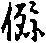



前论文而解乎？答：然，前也。



疏云第一、所说有殊及下，与前殊者，即此辨后释文，与第一、安慧所说各异。若依胜义，心、境俱空者，问：清辨与护法解俗谛，胜义何别？答：思之，可解。清辨说言：然胜义中无为、无想，无为、无想故，所以胜义之中心、境皆无耶？由心众生一切法者，问：其清辨如何说心集生一切法耶？答：清辨於世俗谛中解：心者，积集义。由心集生一切法，以见外境无间断。其前六识有间断，故尽中道大乘，不名唯识。问：清辨既不立唯识，如何言识最胜故，由心集生一切法故？答者，即向者解，是德光论师先小乘学道。十地疏乃至非谓唯心便无境等者，然德光论师即是西国人也。其德光师善解小乘，说依空、无我门得入见道。既是凡夫、餘罗汉，以通力将此师三回见於弥勒。此师高心，不肯礼拜，以见弥勒在俗形故。除众贤、师贤已，后有一人，而以其人唯信小乘，无不能心入大乘，亦不造十地疏。既是大乘，如何德光作十地疏？十地疏或是餘人作也。则别有人问德光言：十地论中既明唯有一心，如何释也？德光和合十地论中一心之言，如言王来非无臣，从举胜者故，非谓唯心便无境等。



疏云许除毕竟无心境二中随一摄故者，若不除毕竟无者，宗中即有违自教过。萨婆多自许毕竟无是心外境，许是无故，因中复有不定过也。依密意教说诸法空者，然经中密意诸法空者，佛即约无心外遍计所执法故，所以说诸法空还有依他法也。其清辨依此密意教故，即依他之法亦说为空也。五根所行境界意各能受者，眼识缘边乃至餘境亦尔，即第六识能缘五尘，故知唯有一识也。三、依六识力皆名意处教者，此师意言：十二处中六识总立为意处。明知唯有一识。此师即依十二处教就显为诸，不依五蕴、十八界、十八界中七心界为七也。



此恐违至教，故说有一识者，若说有多识，即违上五个教。今恐违上五个教，故说有一识。问：如何名一类菩萨者，如何名一类？又为是地前资粮位小菩萨，依此执耶？更问经部觉天等，乃至及想、行、思、信者，然觉天不是经部中师，有觉天是萨婆多宗四个评师，谓妙音、世友、觉天、法救也。然此经部觉天唯立受、想、思三所，唯有行、信、思等者，然行即是思，更无别体，一体异名也。又於思上起染时，即假名贪；若於思上起净时，假名信等，实体即是思也。既言三和成触，触即是假，更无别体，即是下文生触成触也。问：此论文既言有执离心，无别心所，何故此等部中皆言有心所耶？答：今者故诸部立心所法，唯有二、三等少，故名离心外，无别心所，非是诸部中计离心外，全无心所。亦恐违至教者，既经部中说无心所，若别立多心所，即违教故，恐违至教，不别立心所。顺世外道亦立唯有四大种也者，此外道计四大种，立能生得心、心所法也。问：此外道唯有四大，不立有所造色。色是所造，四大是能造，二法既别，如何言四大种色有？唐本云：答：四大种体即是色故，非约能造、所造以辨色也。又如何名顺世？更捡思之。



相见俱有餘部及大乘等者，然二十部中唯除正量部，自餘诸部皆立有相见分。相分即是境相，不论影像相也。然小乘相分唯有四蕴。何以得知？小乘中有相见分，即下论文云有离识所缘境者，即说外境为所缘。相分名行，相见分名事。若大乘中影像相分，即通五蕴也。清辨、顺世有境无心乃至相见俱无即安慧者，问：前后两个四句有何别？又问：前文有境无心即双取清辨、顺世，后文有相间即偏取清辨、不取顺世。前文有心无境即取中道大乘，后文有见无相即取正量部。前文心境俱无即取邪见，一说后文相见俱无而取安慧。更问：如僧佉等计我是思者，如下又所执我体常周遍量同虗空，二文相违如何和会？答：下文执我体常周遍是我体，计我思是我用，故不相违。



犊子部计我为能知者，和引俱舍论中解。犊子部执我为能知者，彼部云：引经云一刹那心能立一切法者，若心起时即能缘前一切法，心体不能自缘，其同时之我即缘自心体，故云我为能知者。若我不能缘心者，即我不名为能知者。萨婆多破云：如言火能烧一切物，岂一刹那火能烧一切物？即约相续多时说火能烧一切物。今此经中说一刹那心能缘一切物亦尔，即约相续多时即初念能缘一切法，仍心不自缘心，若至第二念即心亦能自缘心故。又犊子部说：若世间我许依蕴与作，然与蕴不一异。若断尽烦恼已，其出世我即与涅槃真如不一异。然出世立我不依涅槃立，与世间我不别。今者唯识论中唯破世间我，不破出世我故，所以但言许依蕴立，非即离蕴。法藏部计心缘相应法者，且如心起必有相应触作意受等，此心王亲能缘触作意诸心所法，亦得更互相缘也。



化地部执缘俱有法者，且如五识与五根俱时而起，眼识能返缘眼根及餘耳识等，应知亦尔也。文外义解十六心，如欲界身及山河等者名苦谛，上界亦尔。欲界烦恼名为集谛，上二界亦尔。欲界断烦恼所得择灭名灭谛，上界亦尔。欲界能知治圣道即欲界系，名欲界道谛，上界谛亦尔。所以灭道分后八心分上下界也。五下分结者，谓身见、戒禁、疑是初果断，贪欲、嗔、恚是那含断，故名为五。犹贪欲、嗔故，不得生上界。犹身见、戒取、疑三虽生上界，却还生欲界。下分者，下界有此五恶法，或下人身中有故，即是凡夫身有也，圣皆断故也。又云：化地部执缘俱有法。解云：此缘慧俱五蕰，如在定中，慧俱自有识，即名识蕰。同时有受、想、思，即名受、想、行蕰。同时有定共戒、道共戒。定共戒者，此定俱现行思，能妨恶色身语七处，假名为色。道共戒即八支圣道，谓正身业、正命，此等皆是色摄。定、道二戒能妨，故假为色。当体是思，此二决定与定、道俱时，名之为共。恶律仪依现行色立，如造煞、生盗、邪行，皆是现行色故。善律仪依不现行色立，由持戒故，煞、盗、邪行皆不现行，能妨色故，假名色也。



疏云：法救说心所体即是思。解云：此师即是萨婆多宗四个评师，计诸贪、嗔等餘心所法皆思蕰收，所以言诸心所法是思蕰摄。答：思不摄者，应别立贪蕰、嗔蕰，故知无别体，所以餘心所法皆於思上假立。此师亦唯立有受、想、思三心所，及执离心无别心所，皆如第七、第八卷说者，即如下第七论中言如是六位诸心所法为一为异等文是。然第八论中虽不名心所，第八疏中亦少分明心所。



疏云：此中皆应叙比量破。寻下叙之。解云：如下论文，同聚心所亦非亲所缘，即破法藏部缘相应法。五种姓不来等，即破无心所定。准下别知也。有漏、无漏解唯识智者，问：有漏中即有三乘资粮、加行、生得，及福分智、闻、思、修，又有加行、无间、解脱、胜进等？答：无漏即有三乘、见、修，无学道亦有根本、后得，根本、后得即有加行、无间、解脱、胜进生。空法空智亦有十智、四智，此等智中何智能解唯识，名正解耶？思之！如其境实，正解生也。境有智有，境无智无，名如境实也。前二十四颂宗明识相，即是依他。问：前二十四颂中亦明姓圆成实性，即前颂言：圆成实於彼常远离前性故此身依他非异非不异。又云：后由远离前所执我法性等皆是圆成实。如何今说前二十四颂唯识相依他起法耶？答：非全故，亦非显也。见毛月等事者，今此中应说眼中有翳，即见空中毛。答：眼中有翳团团者，即见空中毛亦团也。若眼中有翳狭长，即空中见毛亦狭长也。若指按目以看月轮，即见第二月也。颂中既言目有翳，即含含言见毛轮也，不令有月字也。又目中有团翳，即眼前见毛团圆似月，名见毛月。即因下见毛轮，毛轮与毛月相似，非是眼前见天上月。又此毛轮明净似月。小圣邪师智尚微，阙解生迷谬者，如小圣者，谓清辨智微，少解生迷也。邪师者，谓外道。外道正智全无，名之为阙解生谬也。虽知此心虗妄显现等者，此已下文，意生下二十五行颂唯识性也。此文即依非不见真如文作也。显如一味者，如何名为一味？答：真如常相续，无改转一类，所以真如名一味也。下第十疏中，即约证如之智亦名一味。



若相若性释诸妨难者，问：下几颂释诸妨难？答：相者，即从初能变后乃至第二十四颂已来明唯识相也。若性者，第二十五颂明唯识性释诸妨难，即是七行颂是也。第三三者虽无文说，准诸经证判此有三，乃至此皆准释瑜伽、摄论，故为此对三者。问：若尔，经论中以明境行果以科文也？答：即法华、瑜伽、摄论等，皆约境行果以科文，应捡唐兴寺法华摄可知。问：法华经说寿量品中明一乘，一乘果中即得双有涅槃有以不？其唯识论第三十行颂明果中亦双有涅槃、菩提二果以不？依境行果科二谛者，同初性判文可知者，二谛者，谓世俗谛、胜义谛。同性相者，即是前二十四行颂是胜义谛也。寄问微起者，寄者记也。



疏云：世间相违，违理之失；圣教相违，违教之失者。问：何故违世间即言违理，违圣道教即言违教？答：若世间中唯有我之道理而无教也，故言世间但有违理失，是下世间道理所成真实。若圣教中即有圣教法，即有违教失，非彼菟角等，可说为青等。此文意说：若有心外实我法，可起於说，说有假我法等，由如牛毛等，可说为青等。答：无心外实我法，亦不得起说，说有假我法，由如不可以菟角而说为青等。菟角等者，等取非彼龟毛可说为黄等也。要无九过者，即是因明论中宗九过也。言世间者，可毁坏者，有二种世间：一、众生世间，即身死磨灭；二、器世间，即被水、火、风三灾坏也。即世间中三界火宅生死恶法，体可断除，名可毁坏，非约；世间法体有生灭，名可毁坏，非约也。若约世间法有生灭，故名可毁坏者，其无漏有为道谛之法亦有生灭，应名可毁坏，应名世间。若如此解者，即违下论文。下论文云：何名出世间？谓体无漏有证真如名出世间，即是根本智也。故知但约世间恶法可断除故名世间，即无过也。若后得智缘世间故名为世间，如下第十论释，后得智亦名世间亦名出世间也。又二乘人厌於道谛而灰身灭智，其道谛应名可毁坏，其菩萨道谛尽未来际即名不可毁坏。今外其二乘道谛更无别有对治道而以断之，其世间法别有能对治圣道而以断之，故世间法名可毁坏，二乘道谛不可毁坏也。问：若尔，无种姓人无有圣道对治，如何得名有对治法耶？答：有漏烦恼现行即被世道伏，故亦有对治。若尔，第七识中烦恼及二障种既无别圣道对治，如何得名有对治？故得名世间。又解云：即是有为无漏虽无成坏之坏，亦有刹那生灭，故名可毁坏也。若有首治故、隐真理故，唯是有漏法也。



与理相应，於事无拥者，若泛解圣者，即与道理相应，於事法无拥，即名为圣；不约证达俗事，名为圣也。今解此疏文，据实而言，即唯约大乘佛菩萨说者，理相应者，即是根本智，能证真理也。相应者，相随顺义。故下文云：智与真如平平等，俱离能取所取相故。於事无拥者，即是后得智，能达一切俗事，如约无拥也。又契理通神者，此文即通约一切三乘者解也。乃至初果人等，有无漏智，能证道理，故名契理。又能通达得圣智慧，故名通神。神者，即是圣也。即有不能於后得智中，约事无拥。心与境冥，智与神会者，即与前契理通神解无别也。心王证真也，智谓心所智，与圣会也。世间圣教，皆依士释者，世之间也。圣谓三乘性也，教谓言教音声也，即圣之教也。以八转声释世间等，是世间者，即是体有漏法。体是世间，有漏法是世间所出，不是出世间也。八转者，即诠法之名言，改变不定，故言转也。造世间故，即是第二业声。业是造义，即由业惑苦，能造得世间。由世间故者，即是第三具智。由者，即是世间餘缘也。即由惑业苦，是世间之作具。又由有风轮，得有水轮等也。为世间故者，即是第四为声也，皆是所为声。为有世间故，而依转生死。又为煞生，故遂世间。因世间故者，即是第五从声也。因者，因从之义，是世间处。属世间故者，即是第六属声也。属有漏法依世间故者，即是第七依声也。一切有情依皆出世间，然此中即无第八转声，泛牛声释世间也。三种科释一颂半皆同无别者，即前境、行、果、相、性、位，初、中、后三科文释此一颂皆无别也。故此约一颂半名总标纲要分也。无体随情假者，即世间外道所执实我法皆无别体也，但随能执妄情所缘名为我法也。然护法师外道即计见相以为我法，如执我是思，即依见分之上执为实我父，执我为能知者，及执受是我、想是我、行是我、识是我，此等皆是依见分上立为我法。若计色是我，即依相分上立为我也。又如外道执离蕴我，我体虽无而有相分，我是独影，唯从见众同分收，随彼执所缘相分亦名我法。然外道依相分等上而执我法，其相分即具五蕴，故下文云：世间沙门、婆罗门等，乃至皆依无常五趣蕰起。问：此无体随情假中既言多分，世间外道起执少分，亦通三乘人、资粮、加行位及二种独觉、二十七贤圣及十地菩萨，皆得起无体随情假、有体施设假，得通无色界不？若言有者，无色界既无言说，如何即云前无体随情假、有体施设假乃属於说？若言无者，彼界既有，外道亦有，后二果人如何得无此等我、法？答云：一、无体随情假，多分世间外道者，和上云：意说无体随情假既是分别我、法，多分世间外道执，少分亦通小乘执。谓小乘中犊子部、根本经部、正量部教中，皆是无体随情假，非得初果已而起此执。故四果、十地菩萨皆不起无体随情假。以无依有假此之二释，即依下论文而作此疏文二解，谓论文云：愚天所计实我、实法都无所有，但随妄情而施设，故说之为假也。若疏文中有体施设假，义依於体假此之二释，即依下论文而作此二释，谓下文云内识所变似我、似法执虽有，而非实我、法性，然似彼现，故说为假是也。此约说为我及法故，不离识故者，此中约依相见分上立为我、法，不依真如等立为我、法者，其相见分不离识自证分，故识所变。所以依相见分为我、法、真如，非识所变故。然疏文云此中总显由无始来横我、法等，然此疏文即依愚夫所计实我、实法及如愚所分别等论文作也。引生真见者，即引生见修无学所有无漏道等，皆名真见也，非独约见道中真见道名为引生身见也。



疏云：是故经云为对遣愚夫等一行颂中，上之二句即是无体随情假，下之二句即是有体施设假。



疏云：依识我体上有我法义者，取相见名。识体义者，如初果有初果识，乃至二十七贤圣皆有圣义。义依於体，别依总者，我、法二种，名别依总。相分第一解云：乃至我、法二执假，乃至於说。说者，即是声、名、句、文也。然此疏文解虽言乃属於说，即依为对遣愚夫，乃至故於识所变假说我法名以为，以为颂中有假说之字，即言乃属於说。此解不尽。何以故？若唯依相分之上立为我法，可言乃属於说。相分中有说，说即是声、名，相分中有声、名等。亦有依於见分之上立为我法，见分之上即无说也。若依相分中声、名等上立有我法，即五蕰中唯应声、行二蕰说为我法，即不依餘三蕰色、行二蕰中有声、名、句等。何故下言皆依无常五取蕰起？故知遍计五蕰立为我法。故知见相分上立为我法，於理为胜也。此第一解：诸法之上元无我法体，以所诠诸法上性离言故，诸法体亦非我非即。世间中圣教，唯於言语中假为我说为法，故我法亦乃属能诠言语立也，以所诠法上都无我法体也。假我及法不在於言，以所说为若我法故者意说，此第二解即有我法体。其世间圣教，我法不在於能诠名言上立我法，即於所说妄情所诠义上有我法体，谓世间即依所说妄情体上立有我法。若圣教中我法，即依所说说法体义上而立我法，皆是别无。依於总无者，别无者我法也，总无者相见二分。何以故？安慧不立相见二分也。自证离言非我法故唯佛所证者，其安慧意证，其我法二种唯依见相分，其自证分是识体故。又离言故唯佛知有，若唯餘二乘菩萨等皆不知也。此师即依二十唯识颂：他心智云何？知境不如实，如知自心智，不知如佛境。餘人知境不如实故，不能知自证分，不知如佛境，唯佛方亲能知有自证分也。然佛自证分还自亲缘自证分，亦能知餘人自证分。



疏云唯以所变相分护法解别者，解云：难陀解云：唯有二分，我法二种，不依见相本质上立我法。此即唯依亲相分，不依本质见分上说为我法。设有执见分本质为我法者，亦心上变现亲相为缘，为其心上所执相分还是亲相分所收，还依亲相分立於我法。然护法既言依见相分上立我法者，即依见相分本质上而立我法，不依亲相分。何以得知护法而依本质见相分上立我法？如人若缘见分本质为我法，即托见分为质，自心上变起亲相分心，即依此亲相分上立为我法者，即是护法唯依相分上立我法。如何说护法依见分上立我法？故知护法不依心上所变亲相分心立为我，即依疎所缘见分质上立我法也。故难陀师宗中亦有立无体随情假，有体施设假，以无依有假，义依於体假，同护法也。护法、我法依相见，故有别也。因前所标，今略举者，即因前颂中第三句略标举云：彼依识所变，所变之能变，唯有三种。即次举第四句。此能变唯三名，今略举也。三法转相依者，即我法依於相见分，相见分依於自证分也。



一、变异而熟乃至果方熟乃至果方熟故者，此文即是经部师计。经部师计要种子变异之时果方熟也，此义通餘。种子、果时皆变异故者，此文即是大乘难。经部师难曰：汝经部若言种欲生时要变异故则名为意熟因者，若尔，餘同类因、相应因俱有，遍行因中果欲生时亦变方熟，故之五因应名异熟因也。二、异时而熟与因异时果方熟故者，此文即是萨婆多师计。萨婆多师计异熟因果要显异时，如异熟因在过去世、果在未来世，作要不即受，亦非此刹那也。今者大乘约造之时非约种体许同世故者，此文即是难萨婆多师，此文亦是大乘立理。难萨婆多曰：若言异时即名异熟因也，然同类遍行因与果之时虽有同世，今所异世名熟因者，其遍行、同类二因亦许异时而熟，此之二因应名异而以难之。若大乘之中说若造异熟业因时即是异时，若异熟种子恒与身同在现在世也。故维摩经云：虽悔先罪与，而不说入於异。故虽悔先罪者，即约造异熟罪业时，是过去世时造也。而不说入於过去者，此所造得异熟罪业种子，刹那刹那恒在现在世。即如人忏悔，以先所作之罪，即约造时异生过，悔现在自身中恶业种也。故虽此疏文，即依维摩经造也。三、异类而熟者，此第三解，即是大乘宗解，无前难也。然初二解，无别论文者，然大乘之中，无别论文，作此初二解，义中即通也。若萨婆多宗中，有别论文，作初二解也。若异属因，即异之熟，乃至异熟之识属种子者，然泛解异熟之名，即通因果。谓五果中有异熟果，其六因中有异熟因。若餘五因之名，不通於果；若餘四果之名，不通於因也。然此疏中，即约异通於因果。若熟唯在於果，初之异属因，熟即世果；善恶业性异於无记果，即异之熟。若异属果，熟亦属果，即无记果异於善恶业因，即异即是持业。释



疏云异熟即识，熟属现行者，同此文，与前若异属因，即异之熟；若异属果，异即是熟等，有何差别？如愚意者，前文言：若异属果，果者，即是第八识名言无记种子果。无记种子果异於善、恶业种子因，故云异即是熟。若异属因者，熟即属无记种子果，故异之熟。后文中云异熟即识者，异熟即是第八现行识，故云熟属现行。有言异熟之识，识者，第八现行识也。异熟者，即是第八识名言无记种子，故云熟属种子故。故异熟之识，依主释也。



疏云思量即识者，第七识之体名思量，不由遍行中思得量名也。对此六尘者，问：如何名尘？又问：若色、声五境可境，可得名尘。若无为既无相，及五十一心所法则无碍，及不相应等，如何皆是法尘中摄，得名为尘？又问：言十二处处者，即是生识之处。能法处中既有不相应，即是二无心定及无相异熟，皆是损识，不能生识，如何得名法处摄乎？餘者不相应，准问。又问：诸心所及六无为，如何能发识，得名处乎？了境即识，亦同前解者，问：前异熟即识，思量即识，皆持业也。此依胜义，胜义心言俱绝，乃依俗谛中。可言八别者，此中意说：若四胜义中，初胜义约事性，然此胜义虽是假，仍许蕴处界等各别也。第二胜义因果性不可言一异，因果别故不可言一，离因无别果故不可言一异。第三胜义二空性亦不可言一异，一切诸法唯有二空。若四俗谛中可言有异意说此语者，即显颂中第八识第七识各别说者即有异也，即依第二世俗而别说异熟识思量识，以俗故相有异。有颂中六识一处说者，即依第二三胜义而合说六识，以真故相无别，以第二第三胜义因果性二空性皆无别也。不依初胜义说者，初胜义中仍说诸法别也。故颂中别说七八识合说六识者，即显颂中双显得世俗依胜义也。然颂文中七八识各别处明者，即依第二世俗解俗故相有别，颂文中六识总合一处明，即依胜义解故真故相无别也。



依第一胜义如愚意者，此之八识若依第四胜义，胜义不可言识与不识以心言俱绝；若依第二、第三胜义，不可言一多；若依初胜义及第二俗，可言八识。别小乘等执心意识义一文异者，然小乘计心意识体即一也。文意者，若在过去名之为意，若在现在即名为识，若在未来即名为心。又若在蕰门名之为识，若在处门即名为意，若在界门则名为心。或以第八染净别开者，第八识在因中即名异熟识等，若任果位即名无垢识也。非是依他识体有九品，非体类别有九识者，问：上文已言非是依他别有九识，下文更何显言亦非体类之言？答：此中有二解，第二解中亦非识之体类可有九也。立有细意识即是第六别位起故者，即彼宗此处生分结终时方起细意识也。一、合集义六识，令名了境识故，如后卷说。会说及言，显六合为一种也。四、滥隣近释。不言及者，恐言异熟俱时异思量了别境故。解云：且隣近者，如四念处以慧为体，为念慧俱时，念能系慧令不散乱，从隣近为名，名四念处隣近释也。又如增上心学，同时亦有戒、定、慧三为心，为助伴故，从邻近得名。此中不著及字，当知亦尔。



疏云：又诸识皆通异熟等名。解云：问：如前六识有异熟生心，可名异熟，第七识如何名异熟？一解云：如罗汉、独觉，第七识中有其法执，皆异熟生摄，得名异熟。异生第七不得异熟。何以故？法执与烦恼望二乘，是染污故；法执望二乘，是无覆无记也。故所以法执得异熟名也。二云：但约前六识中有异熟生，故云诸识皆通异熟。即约多分说，即不说第七识中有异熟也。



疏次长行中依颂正答二段，如颂者，即前科二行半於，分为二段：上之三句答难破执，略标论宗；上之三句略辨识相，障能变体。其长行中二段亦尔。初略解中有二对文：第一、今作二文科解，云：谓论曰：世间圣教至愚夫所计已来，别解三句，是第一段；从愚夫以下，总解三句，是第二段。故合作二文科也。



疏云：第二、总作三文科，别解三句。解云：从论云：世间圣教至彼二俱有以来，解第一句；从彼二俱有下，至如是诸相已来，解第二句；从如是诸相，若由假说，乃至亦胜义有已来，解第三句也。故云今作三文科。及如辅宰，宰者，宰相；辅，谓辅翼也，即宰相而辅翼天子也。又如梵天，亦是宽人天也。我所者，谓我妻子、宅舍等是也。轨，谓轨范。可生物解者，问：何者名物？何者名范？答：物者，是人也，意说此法可与人以作轨范故。范者，是法也，即鞅、摸、壒师，皆名为法，以作轨则。



疏云：二、自性差别。对解云：自性名持，不舍自性差别者名轨。轨生物解，故应合说。论云：我谓主宰，法谓持轨。若论文作此者，则声势不好。上文我谓主宰，宰字是上声。下文又云：法谓持轨，轨亦上声。两句末字，俱是上声，即犯上尾。以义而言，合言持轨也。



疏云意不坏，法现前者，意即是意根也；法现前者，即是法尘也。若有意根及法尘现前，即起第六识也。问：如何名意根不坏？若言意在现在故，即名不坏者，如等无间意根，要落入过去，方得名根。引生后念识者，意根既落谢过者，现无体，应名为坏。过去识不能为缘，引生后念识，识应不名根。又此意根若是色法，可名有变坏；意根既是心法，如何名变坏？思之，相分必有似无，名无者，心上相分有体，菟角是无；今者相分似本质无，故名无也。问：无法如何现在？若言相分还是有法，不成有无对，应名一体有有对。答：即约本质体无，可言无也，不约有体法相分说也。故相分唯有本质，是无，名有无。前是共相，后是自相。解云：共相是轨，轨生物解；自相名持，持其自体。若后疏主前是共相，后是自相外论文者，即合轨持，以顺声故，即顺论文而违於义也。义中先自性，后差别，即合先持后轨也。若前文自性、差别解论文者，合持轨，以顺义故，自性居先，差别在后。然言持轨，虽顺於义，然违於论文，又犯於上尾声也。所以疏中前后有二解也。问：我主宰法谓持轨，此文为解世间我法，为是圣教我法？若世间我法既是遍计所执，其体都无，如何得有主宰、持轨之用？思之，可知。



疏云意生魔纳缚迦养育者，解：意生者，即化生众生，名为意生。随意而生外道，犹我意能生论法。魔纳缚迦，此云儒道。儒道者，云高下能下，亦云美貌端正也。养育，犹我能养育后有身也，如枢要。



疏云：作者、受者、知者、见者。解云：胜论我名作者；数论我名受者；犊子师我名知者，我能知故；餘外道名见者也。若教后生读诵，即有四种寻名起义：觉以法属，名同随应；或离令长，披达广理。



疏云：般若论但有四种，约三世总、别故。解云：犹过去有情，相续到今、现在，名为有情；犹今现在命故，相续到未来，名为命者；犹未来受者，后於五趣受生，名为受者。约三世别，於三世上有主宰故，总立一我，缘三世也。故言三世总、别也。言有情者，谓诸贤圣如实了知唯有此法，更无餘故，显有法性，更无餘物。情是性义者，意说圣者观诸有情，作唯法总。谓圣者观诸有情上无有我，其有情身中有，唯有五蕴、十八界法故。有此法性，名为有情。情者，性义，或复於彼有爱著故。爱是情义，能生爱故。名为有情者，於彼者，於彼聚也。意说於彼有情聚中有此贪爱等事。爱者，情义，於彼聚中起此爱故，名为有情。若世间释，情谓情识，我有情识，名为有情者，即世间外道而作此释。



色心相续名之为命者，此义即是大乘论中释也。我有此命故名命者，亦是世释，故今取世间释也。今谓第八现行者，谓假者有命。利名为命者者，若第八现行识相续故名命，若种子上功能名之根，即由种子上功能住持现行识不断名命之根，故名命根。今此中言命者，命谓第八现行者五蕴假者，五蕴假者少命，故名命者。或有情即是第八现行，第八现行名为有情。寿体即是第八种子者，寿体即是命也。即取第八识种子名命，即由种子方持第八现行识。即寿和合方名命者，有寿和合者。问：如何名和合？如愚意者，有者谓有情，有情即是第八现行。寿者谓命，命即第八种子上功能，即种子与第八现行相随顺能住持故，故名和合。问：六识名命是谁家说？答：即小乘中亦说六识名命，谓欲界具六识名命，初禅具四识名命，二禅已上具一识名命。萨婆多等所说各异，宜应叙之者，或取第八识名命，如下论文入灭定取过去未来名命是也。



二十七贤，十三住圣者，具足应言二十七贤圣。十三住贤圣，即十三住中地。前者名贤圣，上者名圣。今者上句唯言贤，下句唯言圣，即贤圣相对解也。二十七贤圣，从见道至无学果，有二十七人，出中阿含经福田品：一者信行，二者法行，三信解脱，四见到，五身到证，六家家，七种子，八须陀洹向，九须陀洹果，十斯陀含向，十一斯陀含果，十二阿那含向，十三阿那含果，十四中般，十五生般，十六行般，十七无行般，十八上流至色究竟，十九思法罗汉，二十升进法，二十一不动法，二十二退法，二十三不退法，二十四护法，二十五实法住，二十六慧解脱，二十七俱解脱。又依成实论二十七贤圣：一信行(信他语而起行)，二法行(自心见法)，三无相行(见道中空观相续故)，四须陀洹果，五阿那含果。那含果中后有十一人：一现般(於凡身中修得此果，於此身中证无学果，即入涅槃)，二转世般(圣人身上经生已，〔复〕修得那含，即现得罗汉，亦现般行收)，三中般(是人现世有得耶含，不得罗汉，舍欲界身，向上界二中间，受身涅槃)，四、生般(於初体上，随何处生最初身，未尽命修道，得般涅槃)，五、行般(前生般同在一身，精勤行道，尽寿得般，名行般)，六、无行般(亦与生般同在一身，不勤行道，〔玉〕寿得般，若无行般)，七、乐定(於上界中，初身不般，展转上至广果天，不得涅槃，生无色界也)，八、乐慧(於上界中，初身〔不〕展转，上生至广果天，不般，生五净居)，九、信解(於前人中，钝根者，名信解脱)，十、见到(於前人中，利根者，名见到)，十一、身证(於前人中，得灭尽定者)。无学有九人：一、退相(以钝根故，得定必退)，二、守相(根少利，得自防守不退)，三、死相(根转利，深厌诸有，不能得定，得已恐失，求厌自〔言〕，故曰死相)，四、住相(所得三昧，不进不退，转胜增益)，六、不坏相(所得三昧，种种因缘破坏)，七、不退相(此人最胜行，得功德，尽无退失)，八、慧解脱(於前人中，不得灭尽)，九、俱解脱(於前人中，得灭尽定者)，十三、住者(十地为十，资粮加行为二，佛地为一，总十三也)。



如凡夫未得法，水渍故名乾慧。三乘十地者：一、乾慧地者，即是有三乘种性，是火也。烧烦恼薪，即从初发心乃至种三乘顺解脱分已来是乾慧地。二、种姓地者，谓三乘人在加行位中得种姓定故。已上二通三乘人也。三、第八、八人地者，旧经论中若八人地即是四向四果，新经论名第八人，即是须陀洹向。从阿罗汉果为第一，罗汉向为第二，即从后向前数至初果向，即为第八人也。四、具见地者，即是须陀洹果。五、薄地者，即是一来果，以断见惑，又断欲界六品烦恼轻薄。六、离欲地者，即第三果，离欲界故生上八地。七、已办地者，即罗汉果，所作以办故。次上四地唯在声闻。八、独觉地，谓独觉果。问：何故此三乘十地中独觉唯立一地乎？答：以此独觉人一座成觉故，又不出观故，所以独觉中不分出向道。九、菩萨地者，谓十地菩萨、十如来地。



疏云：不别简别向及果故。解云：论文若言预流果人，即简向也。但言预流不言果，明知向亦在预流所取，不别简也。此逆生死说名逆流者，此文意说，旧人云：谓须陀洹不入色声香味触，是故名为逆流也。



疏云：决定已断三界见所断惑，或修至五品，立预流果者，今有二解：一云：若断欲界修一品、二品乃至五品，皆合是一来向；若断欲界八品修惑尽，合是罗汉向。此中意说，别答四果。四向论之，断修一品，即是第二向。若四果以论，断修惑至第六品无间道已来，亦是初果；第六品解脱道时，方是第二果；乃至第八品，亦是第二果；至第九品加行无间，亦是第二果；至第九品解脱道时，方是第三果。乃至阿罗汉亦尔，摄向从果故也。二解云：此文唯约次第超越，不约四果以明之。其次第者，即唯断见惑尽，未断一品修惑，其人即名次第须陀洹果；若先用世道伏欲界五品修惑，其人后入见道，虽断尽五品修惑，其人即名超越须陀洹果。须陀洹果中但有超品，而无超果也。若次第者，渐断欲界六品，名一来果。超越者，若先用世道伏七、八品，后入见道已，其人即名一来果也。若言此文约四果以明者，其文应言：断第六品无间道，皆名预流果；至第六品解脱道，方名一来果。又应言：至第九品无间道，即名一来果；至第九解脱道，方名不还果。其文既言断五品或七、八品，明知约超越、次第二种人也。然此文中唯明初二果，不说第三果、第四果者，且约断欲界六品者说也。



疏云：二、向不定。解云：且如初果人有其二种：一者、次第，二者、超越品也。次第行者入见道，断见惑第十五心，名之须陀洹向；至第十六心，名为初果。若超越品者，先世间道，伏欲界修惑一品乃至五品以来，后廻心入见道，至第十五心，名初果向；至第十六心，名为初果。其初果人即无超果。次第二果有三种：次第行者先断见惑，讫断欲界修惑一品乃至第六品无间道，皆名第二；至第六品解脱道，方名为第二果。若超越者，先世间道，伏欲界修惑至六品、七品、八品，后回心入见谛，至第十五心，名一来向；至第十六心，名一来果，超越前初果也。若超越品者，先用世间道，伏欲界修惑至七、八品，后入见道时，一时断前八品惑也。次第三果亦有三种：前次第行者先断见惑，后断欲界修惑一品乃至第九品无间道，名不还向；第九品解脱道，名不还果。若超越者，先世间道伏欲界第九品，尽初禅乃至无所有处已来，后入见谛，至第十五心名不还向，至十六心名不还果，不取前二果也。若不还果超品者，准前非法阿罗汉。若次第者，论第三果得名超越者，从初果得超中三果得，必无从凡夫直超越得阿罗汉果。若初禅九品染，乃至无所有处九品染，若断此之七地中或六品，名不还果，亦名阿罗汉向。其义云何？且如次第行者，先时得初果，乃至得第三果已，即断初禅一品惑时，乃至断无所有处九品惑时，其人即名阿罗汉向也。或如有人先用世间道伏欲界九品惑，乃至无所有处九品惑，其人后时入见道已，即名不还果。其人虽断尽无所有处惑，为取不还果，不名罗汉果也。若断悲想地九品惑，若次第若超越断有顶九品惑，唯名罗汉向也。



又云：二向不定者，中二果人次第向有超越向，名为二向不定。不还、一来二人，若次第向唯在修道，若超越向在前见道十五心中，中二人向通在见道修道，故名不定。然和尚傍说五净居义。然和尚门餘大德云：其五净居天中所有色心不相应行，从何同类因生？应如小乘初无漏苦法智无同类因生也。诸大德既不能答，又问：初禅中有二天，如将梵众天种子得生梵辅天以不？又将梵辅天种子得生大梵天以不？光法师答曰：不得。若尔，如何盗无云福生广果天中？若言种子而生五净居天，以同地故。由如下三禅，下天不得生上天耶？又生五净居应唯有本有种子，而无新熏种子，以为无始已来不得生五净居天。故和上解云：四禅中地地三天等同一类种子，即将梵众天种子得生梵辅天，梵辅天种子得生大梵天，餘禅少光、无量光天等皆然。由如世间糓米虽是一种，即由食手料理不同，若上好料理者即与天子食，若中容作者与百官食，若下恶作者即与百姓。今此亦尔，其三天中名言种子即是一般种，如糓米，其能感业即有三品不同。由如食手，即由下品业感名言种故即生梵众天，由中品业感名言种故即生梵辅天，由上品业感名言种故即生大梵天。餘禅中亦尔。故知即将无云等三天新熏种子生五净居亦无过也。即五净居天有新熏种子，有同类因也。



我是前门法中但有二十四谛者。问：若尔，胜论我是前门法中但有二十四实，句中应明，以实我是前门摄故，何不除我？答：此中有实，亦应除我，我是前门摄。崇聚生因者。问：如何名崇名聚？答：崇者，即是聚义，故崇、聚皆是蕴义。聚者，谓十一种聚，名之为蕴。十一聚，如俱舍？第一对法第三卷说。十一种聚者：一、过去，谓五蕴法已生、已作用，名过去；二、未来世，谓五法未生、未作用，即名未来；三、现在，谓五蕴正生、正作用，名现在；四、内，谓六根；五、外，谓六尘；六、麤者，谓欲界，又云有对色；七、妙，谓上二界，又云是无对色；八、胜者，谓善心、心所及善色等；九、劣者，谓不善心、色等及无记法。十、近者，有三解：一云、落入过去一念、二念已去名近，其未来法随一念、两念未来、现在亦名为近；二、约处所名近，谓相去十步、五步名近；三云、即约能缘心缘此处所近法及过、未世法故，即此能缘心亦名为近，或云能缘心缘内身故名近。十一、远者，有三解：一云、即约未来法随十念已上未至、现在名远，又蕴入道过去随十念已上名远；二云、即约处所名远，谓相去十里已上名远；三云、即约能缘心缘此过去、未来远法，即此能缘心亦名远，亦云能缘心缘外六尘名远。然法之上不具此十一义，然有内无外，内外异故；有麤无妙，有对无对别故；有缘无劣，善与不善别。然极多者，即於一法之上唯具八法，如五根起时，即有过去、未来、现在。又是内有麤，以是有对色故。又有劣，五根是无记性故。又有远近，然远近无别体，若随一念、两念名近，若随十念、五念已去名远。然五根即无妙，不是无对色故。又无胜也，五根是无记性故，不通善性。又无外，以五根是内处。又如五尘起时，亦具八法，谓具三世及外近远，以五尘处所有远近故。又有劣，是无记性故。又有麤，是有对故。若极少者，即有四法，如入见道已后，所有女人身、第八有等，皆得非择灭。然女身不得起故，即无过去、现在，唯有未来。又有内，有麤有劣也。生者，即是十二处，十二处既是六根、六境，能生识也。因者，即是十八界，十八界若现行，识还从现行生，前引后故。若十八界亦从种子，故名因也。又能持义是界义，如根境能将於识。若七心界，体能持用，其俱舍亦同。聚、生、门、种、族，是蕴、处、界义也。餘三善巧者，意建立六种善巧，谓蕴、处、界、缘起、根、谛，所以名六。论文举三，以等取餘三故也。或四善巧者，此文即是七善巧，谓蕴、处、界、缘起、根、谛、处、非处，名之为七。论文举三，等取餘四也。



疏云：处、非处根、世、谛、乘、有、无为者，造善得乐果，名之为处；造善得苦果，名非处。根谓二十二根，世谓三世，谛谓二谛、四谛，乘谓三乘、五乘。若依他起，若计所执，虽有非有，二性相别者，虽有者，即是依他起性，即是圣教中我法，谓义依於体假，有体施设假是也。非有者，即是遍计所执，即是世间外道所执心外实我法，无体随情假，以无依有假是也。随诸世间种种分别横计等缘者，即随诸外道、外道平师邪教，执有实我法等缘。问：如第六识中，可随外种种外道横计等缘而执我法；若第七识中，如何随外横计等缘而执我法？又问：其北州执有我不？若言执有，彼处应有系属，又如何说北州人无我、我所？又又彼处无外道等横计教故。若言无者，彼处既是凡夫，如何得无我执？又论说：由我、法执二障具生。彼处既有贪等，贪等烦恼皆依我执生故。又问：大乘中说根本烦恼及随惑二十，其北州人而具起几？又问：其无色界及地狱等，既无邪教等缘，如何亦执我、法？更问：随诸圣教证得等缘者，问其无色界等中圣者，如何随诸圣教而立我、法？随诸圣教得种种无为缘者，由证无为缘故，即立为预流果。又断欲界六品烦恼，证得六品无为故，即名一来果。若证得九品无为，即名不还。乃至断三界修道烦恼，尽三界，三界合论，即有八十一品择灭无为，故言种种无为。若萨婆多宗说：品品之中更有无量无为。以有漏法尔所量，择灭无为亦有尔所量。故下论中破萨婆多云：又虗空等为一为多？即彼虗空无为多，即被择灭等无为。此文即大能破也。若大乘中说无为体唯是一，但由显故，即有品数不同也。



疏云：三者、能除无我怖故。解云：如诸有情若立有我，然为我故，别须修道。我既是无，修道何为？又为谁修道？断染得净，故须立有我也。



疏云：四者、有自他、染净、信解、事业等故。解云：若立有我，则有自身、他身。生死名染，涅槃名净。或凡夫名染者，圣名净者。信解者，若立有我，即信有理、祖宗、父母、君臣、大小等事；若无有我，即不信有君臣、父母等事。业者，或在家事业、出家事业。之者，或十善、十恶等业。犹有我故，即有如上，皆得立也。等者，等取三界、五趣等。不说有我，则无自他、染净事也。若计所执、若依他者二种我法者，计所执，即是前世间我法无体，随情假等；若依他者，即是圣教我法有体，施设假等是耶？变谓种子识变为现行者，此文意说第八识中种子而生八识现行。现行识变为种子者，即前七识为能熏，熏成种子，即是转变，即论文中能熏生种种起现行问之句。既论种子识变为现行，现行中以摄得见相分，何故下文又熏言见相分？思之，见相分即是变现意也。若实真如，不说为法与非法问，此文即不说真如为法非？然前文明圣教法中即说十善巧中无为名法，又前论文处、界中亦说无为名法，今后论文中即云彼相皆依识所转变而假施设，即依识变上而立我法，不依识性而立於法，即前后相违。答：下解是。后得变似皆名为法者，如愚意者，后得智上识变真如，亦名为法。故此但说近依他依者，愚意者即识变真如，由识变故名近，若真如名远。又遍计所执与依他起相隣近，与真如法疎远也。



疏云：谓所与心非定俱起，而贪信等不现行。解云：心王起时，心所有起。且如有贪无信，有信时，贪心所起即不定。故但说心，不得说心所也。



疏识为主故，能生彼故者，问：心所与心种子各别，如何说心能生心所？答：增上道引名生也。彼五种类者，五遍行心起，即俱起。贪、信等是五心所类，有时不生，不得俱行。



疏云：不尔，如何名他心智？后得智等不外取故。解云：若不变有相分，如何名他心智？且如后得智缘他心时，托他心为本质，自变起相分；后得智缘自相分，名外取也。问：如何名不尔？答：若言他心智亲缘得起他人心者，即不尔，如何得名他心智？以后得智不外取故。其他心智缘他心时，即他心为本质，其他心智亦变起亲相分而缘也。后得智缘真如时，亦变相分而缘，不能缘真如本质故也。



疏云此二广释至下第七及第十等者，此二者，见、相二也。下第七中，即名他心智。若第十末中，即有三师义，以明相、见二分。此第十末，三师皆是护门人。转似二分相、用而生者，相者，相分；用，谓见分。蜗牛者，蜗者，虫名也。头有两角，似牛故蜗牛。其蜗牛头上虽有四个角，今者即取两个长角，不取两个短角喻也。若种同者，即一识体，乃至相、见别种，於理为胜者，若相、见分同种者，即说自证分、相见分。此三法皆同一种生，其本质境则不与相、见、自证分同种生。今说唯同种生者，即是独影，唯从见也。若说见、相分唯别种生者，即说见分、自证分同一种生。自证是识体，见分是识用，故其相分即别从生也。



今说相见分别种生者，即是性境不随心也。问：其相分与本质境未知同种生、别种生？然今此中说同种、别种者，即依下第十论末说云蕴等识相不必皆同，三法因缘等相见或同或异等文说也。今此二解唯同种、唯别种者，皆有过失，不尽理也，不摄带质通情本故。若言见相唯同种生者，即无五根、五尘等实色蕴等以为相分，同见分种生故。相分即是识蕴、受蕴等心法所收，故唯有心等四蕴。又第六识缘无为及离蕴计我，可说相见同种生。若五识、第八识等缘现在五尘，性境不随心等，如何说相见而同种生？若后师言相见分唯别种生者，若五识及第八识缘现在五尘等，可说相见唯别种生。若第六识缘无为及离蕰计我，如何言相见别种？亦不可说种子而生，无为本质故。故今者解云：即双取相见亦同种亦别种生，即摄法尽，亦摄得带质通情本。若同种者，即摄第六识缘无为及离蕴计我，我独影唯从见。若别种者，即摄得五识及第八识，及第六识中一分缘现在境，即摄得性境不随心。又如第六识自熏成第六识中异熟无记种子，是带质通情本者，是大乘中极难解道理也。其义云何？第八识见相分种不得自熏，即由五识及六识熏成第八识相分种。若第六识、第七识熏成第八识见分种，如前第六识中异熟无记心不能自熏成种故。下文谓若法有势用增盛可名能熏，即善恶心有其势用强盛可名能熏，其异熟无记心以无势用强盛故不能自熏也。由此义故，其五识中异熟无记心种子不能自熏，即由第六识或同时缘他五识中异熟无记心，而相分中熏成前五识中异熟无记种子。由如第六识缘第八识见分时，或同念缘第八识见分，而相分中熏成他第八识见分种也。其相分自不能熏，由他见分带故，其相分亦能熏成种。由如弱兵虽不能打贼，犹前强兵打破贼故，亦说弱兵能打贼。今此亦尔，若第七识必同时缘第八识见分而熏成第八识见分种，其第六识中异熟无记心种子如何熏成第六识中异熟心种？前第六识正起善恶心时，其异熟心或已落谢故、或未生故，亦不得熏成而自第六识中异熟心种。若第六识起异熟心种、若第六识起异熟心时，亦不能熏成种，无记不能熏故。故知第六识中正起善恶心时，即缘前念第六识中异熟心，而相分中熏成自第六识中无记种子。此第六识中异熟无记种子，即是带质通情本摄。若本质族强、相分弱，其新熏异熟种子即生他第六识中相分异熟心心所。异熟心心所是本质，故通本也，不生能熏善染心心所相分也。



若相分强本质弱者，其异熟种子即生第六识中，能熏善染心等相分即通情也，不生异熟无记心心所见分。言通情本者，若种子生善染心上相分即名通情，若生异熟心心所见分即名通本。由如第七识缘第八见分所熏得种子，此种子摄论第八识见分即名无覆无记，若摄从第七识见分即是有覆，如何一法半染半净？由如对法论中明道谛亦名有为，从因缘生故，其道谛亦名无为，不是业烦恼所为故，所以道谛亦名有为无为也，其苦谛唯是有为也。今此亦尔，其所熏得种子不必生第八识见分，以是染污故不必不生第八识见分，第八识见分无利熏种故。识为所依转相分种，以作用别性各不同者，如愚意者，转者起也，即自证分为所依，而起相分种合生相分现行，以见自证分即有缘虑之作用，若相即有所缘之作用，故性各别。



疏云：由识变时，相方生故，如大造色。解云：如四大种子生时，所造色种子方起；四大种等不生，所造色种不能起。又眼识种子随逐眼根种子，眼根生时，眼识方起。如盲人眼根不生，眼识不能生见。自证若生，相分始起；自证分不生，相分不能起也。二、实分也。依起执故，乃至为执依心，染分依故者，问：相、见二分与他世间我、法作所依故，即名染分依；其相、见与他圣教或法作所依心，应名净分依心？答：亦得名净分依故也。除佛以外，菩萨已还，乃至即三性心，皆有法执者，问：安慧既许三性心中有法执，未知十地菩萨无漏心及二乘人无漏心许有法执。问：又十地菩萨既证真如，云何乃言由不证实有法执也？答：皆有也。



疏云说无明支许通三性者，即是安陀偈师义。其人先是外道，后向佛法出家，遂立此义，是外道义也。犹如成实论师，先向外道宗中，其人后时归佛法宗出家。明经部师造成实论，即说四尘为能造，四大是所造，亦是不正义。此亦如是，若佛法正义，即四大为能造，四尘为所造，此是正义。一、二执遍者，其相见分上，即我、法执并遍。如人即执见相分，故不执自证分也。问：何故不言法执遍，言我执不依自证起故？答：相见分即有作用，若我亦有作用，故依相、见二分作用之法上而执我也。若自证分唯是法体，而无作用，故疏中我执不依自证起故。若法执但计有体，故依自证分而起法执。今古、大小皆不许有自证分故者，若今古、大小唯立二分，若陈那已后方立三分。问：古者大乘师可不立自证分，今时护法既立自证分，如何今大乘而不立也？答：除护法，取餘师名今也。显能、所取摄法尽故者，如愚意者，即能取中摄得见分、自证分，见分、自证分皆名能取，名摄法尽也。问：如何自证分见分等者，是何义？若言分段名分者，若相分别体之法可名分段，如见与证自证，自证既是一体，如何名分？又若护法，见相有体之法可得分名，若安慧说见相既是无体，如何名分？又证者是何义？答：安慧虽无，以无似有名分。若立三分种所变故者，自证分即从种子变故亦名唯识，此解不当。既说种子，如何名唯识？若说四分三四分更在变名唯识者，即自证证自证，自证而缘自证缘，故名变识体。由是一说更互变者，是义说也，其体实不更互变也。此应作四句分别，有缘而不变，如本质境他心本质等，但作疎远而不变他本质故。有变而不缘，如种生现行也，种子不能缘现行识，故不名缘也。现行从种子生，故名之为变也。有亦变，谓见相分也。然护法师有第四分者，即无用也，岂是一识而立有见分？自证证自证分而有三重，由如刀能割物如由相分，䥫由如自证分，刀用由如见分岂别？又既别将䥫末而作刀之䥫体也。然下文立有证自证者，为护比量过故，故建立之。诸心所法虽不离识，非识实性，故亦名唯识者，此疏文剩文也。前论文以明心所托，即此中识言亦摄心所，定相应故也。又唯前问头亦不问心所，故此答中亦不合有心所。又解深密经说亦为执依者，即说真如至质，以疎远而言亦作执依也。如缘真如无为变起相分，执此相是一是常，真如是本质，所以亦是执依。不相似者，真如是无为，依他是有为。问：如何依他之法与所计执有少作用相状可同实体也？随能计心新新而起者，即是相分。随能计心新新而起相分，诸未学者依起执故者，若久作学者即不许真如，即知真如是诸法性，性离言故。若初作学者闻说真如，即执真如是真是实，别有实体也。问：依所变相执为我法，内道外道皆悉了知。依所变见执法可尔者，问：外道如何知依所变相执为我法？又问：如何依所变见而执於法？答：外道不立为相分，但计所缘为我法也。执能缘为法可知。



疏云：犊子部等，我名能见，故依二分，皆执我法。解云：彼外道、小乘不立有见相，但有能缘心、所缘境也。依摄论说唯二义。唯二义者，即摄论云：唯量、唯二，种种皆名依多起性。其摄论本即是无著造，其摄论释即是天亲无性造也。世间圣教执说我法者，执者，若世间，即执有实我、实法，是无体随情。假设者，若圣教中，我法是有体施设，故言设也。问：前疏文中说无体随情，以无依有有体施设义依於体等二解，皆是护法解。何故此疏中又说是难陀、亲胜解无体随情等？即二文相违。答：其亲胜、难陀、安慧亦同护法有无体随情，以无依有有体施设义依体见变，似能取亦相分摄者。然难陀师说唯依相分上执为我法，不见分上立为我法。设执见分为我法，即能缘心上变。此所执见分亦是相分收，所以不依见分计为我法。或实说一分，如安慧者。问：何故餘师不言实也，其安慧言实？答：略不举，并合有也。或有一师假叙异执，种种研寻，乃至与同时，故叙之。此中破斥者，即是一师。於论文中是多有义，即是明第七识五受相应门中有义，四受相应等有义。其四师皆是护法，似作异师也。然疏文中即引解种子中三师，三师中其难陀即是别师，护法、护月是一师，三师中两师同是一师，一师即是别也。如何引此证多有义皆是一师也？或初无有义，后方言有义，胜者在初者，即是唯识论中有此等师，即明罗汉位舍中初师即无有义，后方说有义，即初师是正义。然唯识论中即无初有有义，后无有义等文，餘论中即有也。或於初后皆言有义，胜者多，后者世，即是第十论明金刚心中有义，金刚心时舍异熟有义，解脱道中舍异熟识，即后师为正



谓前但解后说理徵者，即是明第八识阿罗汉位。舍文有其四师义等。初泛解云：阿罗汉者，通摄三乘无学果位等，乃至皆不成熟阿赖耶识已。后理徵云：若尔，何故决择分说不退菩萨亦不成熟阿赖耶识？即会云：彼说二乘无学果位，回心趣向大菩提故。乃至有义：八地已上顿悟菩萨亦舍阿赖耶识。有义：初地已上菩萨亦舍阿赖耶识，得名阿罗汉等。若护法、难陀等解，由无始来六、七识乃至后八识生时，变似我法，八识之中皆有执故者。问：此疏中护法、安慧等师，各各皆有三重解。三重解中欲明何意？有何别耶？答：若疏中云若护法、难陀等解，乃至后诸识起，变似我法者，此疏文即解论文我法分别熏习力故二句也。若疏中云护法释云识自证分，乃至云前后为者，此文即解论中诸识生时，变似我法二句也。



如世说火，口不被烧者，若大乘中说，声或离质，若近钟边一步、二步，即闻钟声感；若离十步已去，即渐微；若离十里已去，声更微也，由如夜中灯光。如夜中灯光，若近灯三尺、五尺，即是见分明；若离三步、五步，其光即渐暗；若离百步已去，即不见物也。若小乘中说，如打钟时出声，声去钟一个极微许，虽去钟远，亦闻声者，以声势盛故，所以得闻也。今此亦尔，由口中出声，声上有名、句、文，名、句、文既谁於火？火既烧名、句、文，名、句、文既不离声，声亦被烧；声不离口，口亦应烧也。所说火言，明非目火者，如口中说火，即遮餘水等取，以言口中亦舍火不得也。即依见相应我，唯是以无作，如何得有？以无依有，依他性上执为我法，此所变者，似彼妄情，名似我法。彼妄所执我法实无，不可说牛毛似彼龟毛，不说似彼，但说似情者。问：何故前疏文即云：此依他起，非有似有，实非二分，似计所执，二分见相，故立似名。今此文中即云：此所变者，似彼妄情，不得似彼心外遍计所执，不可说牛毛似於龟毛。即前后文相违。答：似彼妄情，所执二分亦不相违也。以妄情相，见二分似彼妄情，以有似有，即自证是妄情。或见分名妄情，即一见分，分能、所似



安慧解云：变似我法总有二解，乃至八识生时变似我法者。问：若护法立有见、相二分，可许有圣教有体施设假义依於体假。其安慧既云世间圣教皆是计所执，又不立於见相。见相既无体，又下疏文云愚夫所计已下，唯有护法、难陀解，无安慧解。其安慧师如何得有有体施设假义依於体假？若言安慧不立有有体施设假等，既文言世间圣教，其世间圣教中立有何似法？又问：护法立有见分，见分即是情识，可许世间有无体随情假以无依有假。安慧既不立有见，应无无体随情假以无依有假，应但有以无依无假。若安慧虽以无作无，亦同护法立其假等。又问：护世间我法依见分，见分是情识，可名无体随情假。若护法我法依相分，相分非是情识，及难陀我法依相分，相分非情识，如何名无体随情假？若相分不离见，亦得名随情也。问：何故护法、难陀等餘师不言闻熏习，唯安慧偏言闻熏习？又第七识中如何得有闻熏习耶？答：准合皆有，答后显前也。又解：诸识生时变似我法者，即自证分上有似我之相，安慧第二解也。解云：安慧！此自证分体名似我法，即是於依他性。於上坚执为我法，方是相、见二分，是遍计所执也。此疏文中第二释，即是安慧不正义也。故疏文中前解为胜，即是安慧正义也。



疏云以下，约喻。依他性有，故识所变似我、法，似是识自体者，安慧意说：其似我、法即是立依他起性故。以下论文中喻依他性有，明知似我、似法即是依他。然护法等云第六、七识乃至八识之中皆有执故者，如愚意者，此疏文不是第三解，此文但重料简以前护法、安慧等义也。准前诸释，即依他起缘所生法名似我、法者，若护法解：六、七识中见相分上皆能执我、法，由熏习故，八识生时，皆变似我、法。若安慧解：第七识唯执我，不执法，第六识通执我、法。除第七识外，餘之七识皆执於法，故八识生时，皆似我、法。若难陀师解：六、七二识中唯相分上能执我、法，后八识生时，皆似我、法也。二种相也者，即相、见二分也。若安慧初解，以无依、无别依於总者，如愚意者，即前段文安慧有两解中初解也。问安慧师：世间圣教，我、法之上皆有，以无依、无别依於总



疏云此意喻上我法分别以下论文者，次疏文云此喻喻上诸有情类以下论文者，问：何故一个患梦等喻，疏文即言喻两处论文？答：即论文中喻各别。如患梦者，患梦力故者，此上二句即喻上我法分别熏习力故也。然论云心似种种外境相现者，此上二句即喻上诸识生时变似我，乃至而由分别似外境现也。然论云缘此执为实有外境者，此上二句即喻上诸有情类无始时来缘此执为实我实法。法、喻相、能行相，可知。



此抄者，照迷暗夜光而解本疏昆玉也。古专寺有正本，中古其书纷失，义学之徒常所憾慨也。幸哉！今岁得此抄，寔如河海得船筏，依之诱诸同老，命愚弟而令书写之。然风凤之误不少，虽欲正之，如无正本何？冀来学者正之云尔。



元文二、丁巳天六月二十六日，一见了　基范(敬识)



成唯识论疏抄卷第二。



论云：若俱生为因起者，即是法俱得也。然萨婆多立能得之得有四种，所得之法有六种。能得有四者：一、法前得生，或如信法体，法体在未来未起之时，有法前得至无量百千界也。从未来流入过去，任生他地，或断有根受时不起，除此以外，恒常起也。古人名牛王引前得，即牛王行前，除牛随后也。法体若起，此得更不生於未来世中，得非择灭者，法俱得，信根法体俱也。一个法体上，唯有一个法俱得，为法体有无量百，故云法俱得亦有无量。法体若起，得亦随起，皆体不起，俱得不起，古人名如影随类得，犹如於影恒常随身。若法体在未来，此得亦在未来；若法体现在，此得在现在；若法体入过去，此得亦在过去。三者、法后得亦在过去，若法体若入过去，有无量百千法后得，从未来果果流入过去，餘应善根及生他地。若凡夫生，亦后时还生欲界，欲界中法所法后法俱得，还得起也。若不还果生处，不生欲界，欲界皆前后法俱得，皆得择灭也。此已外至法后得，一切时恒起也。若法体在未来世时，其法后得，则不得起也。古人名犊子，随法体后起也。四者、非前后俱得，即於择灭，非择灭无为之上，即有非法前后非法俱得。其能得之得，虽落三世，又是有为，其所得之法，二无为体，不落三世故。今者能得之得，其所得之无为故，此能得之得，名为非前后俱得。若依所得有为法落三世故，其能得之得，有名法前后、法俱得也。其所得之法体，有其六种：一者、有一类法体，唯有法俱得，而无法前后得也。谓异熟无记五蕴，异熟中即有异熟色，即五根是。又异熟无记中，亦摄得无相异熟，及长养色，及有覆无记表色，即大小乘中同说。初禅三天中，有有覆表业。即如梵王，於一马胜比丘边起谄诳，所发身语，皆是有覆表业。又如梵众、梵辅天等，亦得梵王边起谄诳，所发身语，皆是有覆表业。若色界及二禅已上，皆无有覆表业也。及一分威仪工巧任运起者，威仪中亦有五蕴，工巧中亦摄得五蕴，除串习者，及无覆无记心心所。此等法体，唯有法俱得。若法体流至现在，唯有法俱得，随之而无前后得。二者、有一类法体，唯有法俱时后得，而无法前得。谓欲界别解脱律仪无表色，及不律仪无表色，及无想定、灭尽定，及处中无表，及不善身语表色。此等唯有法俱、法后得也。三者、一类法体，唯有法前得，而无法后、法俱后。谓三类智边，世俗智下，如异生用世俗智六行伏惑道，无始时来，千回万回，伏上八地惑，而生非想。后时还退起惑，生欲界等。然伏六烦恼故，即引集谛。离六地身等，即知苦谛。得择灭故，即得灭谛。无始以来，唯不得道谛，唯得前三谛。其人后时入见道中，若起苦法智忍，苦法智断欲界烦恼；断苦类智忍，苦类智断上二界烦恼。至苦类智时，其未来世中，无始时来，世俗智上即起法前得，都祭祭庆贺苦类智也。世俗智遣法前同义，言我无始已来，百回、千回断惑已还智，今者上界得无漏大王，若断谛下烦恼已，我世俗智若更不起也。如苦类智既然，集类智时当智且尔，皆即俗智逆起法前得，而静泰泰也。其世俗智若更不生。四者、有一类法，体唯有法，前法俱得，无法后得。谓见道中第十五心，道类智忍时即起，道类忍时亦有法俱得。其未来世中亦有百千同类智，皆起法前得，至第十六令即起道类智，即得初果。其前令道类智忍上至第十六心，不得起法后得，名为得果。舍前而故，道类智忍唯有法俱、法后前得也。五者、有一类法，体道有法、后法俱得，说有共出、定出等，及善心、不善心烦等，及有覆无记心、心所，及生得善、加行善，及福分善、中间思，及一分威仪、工巧极串习者。工巧如毗子、毗羯摩天，威仪如马胜比丘等。此等天通有法前、法后法俱得。六者、有一类法，体即非法，前法、后法俱得，谓择灭、非择灭无为，有非前、后俱得。此所得二无为，不落三世，故其能得之得，名非前、后俱得也。



又具善、恶、无记得者，即是三性得。如凡夫人虽现在起善，由去来世起类类上得，此人即名凡夫不名圣者。若凡夫现在起善心时，无过未世或得起者，其人应名圣人不名凡夫，此人为现或得故不名圣人。若前三果入无漏观，可除是过未世有前后无漏得起，其前三果人出观已，或现在起餘烦恼时，其未来世无漏之得恒起，故前三果名为圣人不名凡夫，乃得阿罗汉果。或起无起心，其去来世中无漏得恒起，故罗汉得名圣果不名凡夫。若罗汉於现在时或起餘心，过未世中无无漏得起者，其人应是凡夫不得名圣者耶？



疏云：更互为量，准此应知。解云：汝不善心起时，餘所有善、无记心亦应现起，有得者并亦应起，除有能生得故，如现起不善心。汝无记心起时，餘善、恶现，有得者亦应起，除有能生得故，如无记心。过、过、未无法，前已说故，更不须成者，即是前论文云：离现实法非有故，现在必有种故。此文即是破过、未世无体，故云前已说故，更不须成也。不离有情法，若离有情法，俱为无用。前何须故？后即无故者，此文意说难小乘，收前不离有情法上，何须世有得也？后离有情法上，何故即不成得？



疏云：以理推徵，俱无用也。解云：汝不失因、能起因，彼雅既无，故言俱无用。此解为胜。或言：不因是有，离有情法，实不可得。有、无二种，名俱无用也。后择可知。解胜萨婆多：於有情身及择灭、非择灭、无为，除有得外，无情上不世得世。



疏云然外非情身，过、未皆非可成者，问：此疏文意即云非情他身即不可成，以次下疏文即言他身非情可受用者，即前世得耶？答：据实不合，约可受用边且少分许也。



准下二说成他根不已为二者，然下正义不成他根，用餘成他扶根四尘故。成他扶尘可受用者，自身亦得成，於他身上亦有得故。问：加行善中闻思惟得异地起不？应问：法阿云何得获成熟？谓若略说生缘摄受增成之因者，然大乘因中说得即是获、获即是成就，此得获成就若虽有异而体是一。生缘摄受增盛之因者，即如故禾麦等种子安善大中，即被九士摄受已，后时于生渐渐长大名增盛之因。今此善名法亦尔，如人或造善或造恶时，即被善知识恶知识等之所摄受，此人所造善恶业渐渐长大即当增盛也。谓若法体被诸因缘摄受，此人所造善恶业渐渐长大即不增盛也。谓若法体被诸因缘摄受方始得生增盛者，法体得生名之增盛，法体得生说名得成熟也。若小乘中说得与成就两种别也。如未来得之法令得名得，即如积善根及初苦法忍时，此二法体起在未来生时，即名为得亦名获。若流至现唯名成就不名得摄，若属得之法虽在未来生相时亦不得也。



染法未为大者摩他伏，乃至势力自在假立为得者，奢摩他者，此方名上观，唯是定慧。若止举舍，皆通定慧也。常言诸无记者，佛异熟生全，餘二不强盛者，各取少分，除变化道，在自成熟中收也。此中论文，即唯为损现行用说成不成，不约损种子体名成。不说约用者，如领。领若被世道现行用不起，名不成；若不伏，名成。各无记被圣道断缘缚故，而冥於现行用，名不成；若不断，名成。若无记被圣道断缘缚故，而冥於现行，名不成；若不断，名成。若生得善，未被耶见伏现行用者，名成。若彼各不成，此等染法、无记法、生得善种子等，未被奢摩他、圣道、邪见等损伏势用之时，此等三法种若起现行时、若不起现行时，此之三法种子恒在，皆名种子成就。故引瑜伽云：於行发缘势用力自在假说为势力自在者，若有缘时，此二法种子即得生现行也。今引此文意者，若此三法种子未相损伏已前，此之三法种子欲生进顺引发之缘，即得生现行之用；生现行之用，即名成就。同假立为：若此三法种子被损伏已，虽有顺缘，亦不得生起现行之用。然下地烦恼即未伏，唯除非想地烦恼，不被伏也。若缘种子体者，此等法虽伏，不一向成也。若烦恼被其至道冥种体，名不成；不尔，名成。若见无记及生得上善成佛时断种体，名不成；若不尔，名成。种子方得生起，名之为得也。



云於引发缘势力自在假立方得者，种文生时，思清因缘自在世力引发此种子。数习故者，然此染法无记生得善等种子，从无始已来数数生起现行，数数熏习种子。无记未为圣道我冥者，问：若满法及生得善种被损伏已，不能生现行，可名不成熟无记法。法种虽俗，圣道断静缘缚断，名为我品。有圣无记种还能生现行，如何说无记种名不成熟？然和上解云：此文即约成佛时辨无记种，总舍名圣道我冥，即缘静缘缚也。准知道理相法断解，不当更应问。



然五、六对法，第五乃至若离此地欲，亦名不成者，准下文中，既说对法，论中说无漏能治道者，明知此对治文即约体、用双说。如生欲界，未为圣道断，及未为世道伏，此诸烦恼等，若体，若用，皆名不成熟。故今前五十二文别也。又顺下论文，对法尽理。又然瑜伽五十六即与对法同说。此二文意，双约种子，若体，若用，名成、不成。如来离染时，其欲界中烦恼种子体亦名成，用且名成。若圣道起，世间道伏，欲界烦恼现行不起，即种子用名不成，以示得生现行用故。若种子体，即名成熟；既有，亦名不成熟；既有，亦言。故知离欲界染已，即名半成、半不成。故双约体、用说。彼依有体及与损害，乃至无不成就，亦不相违者，此文即是疏合违彼前五十六及对法文。依世间道，离欲界染已，有种体，名成、不成。然前瑜伽五十二文中不约种子上能生现行用，名成、不成。故彼文约染法无记生得善法，种上未被损，能生现行用，故名成也。无不成就者，即是成就也。若已被损，善用现行不得起，即名不成熟也。故二论不相违也。



疏云：生得善中，亦亦略也。解云：对法虽有生得善名，不委细释，不如瑜伽文广说生得。



疏云：然准彼论，自在成就言一分无记。解云：若对法文中，种子熟中不言一分无记，其四无记总无自在成就中摄。下自在成就记言一分无记，明种子摄得餘一分无记也。又威仪遍道欲、色二界者，二增唯欲界，即毗首羯磨天，在三十三天中之一臣是。若神道双比，唯色界有；若餘双比，双比亦通欲界。异熟生心，通三界有。



疏云：然准对法，亦应如彼烦恼理说，通成、不成。解云：约对法，亦合应同瑜伽。烦恼未舍摩他伏无记，为圣道害，生、得未被耶见伏故。约对法，亦应同瑜伽。论释约用，名成、不成也。其生、得善与瑜伽同，乃至唯说成就同於瑜伽者，然瑜伽对法，论中皆同说生、得善。若为邪见伏，即不成就；若未被邪见伏，即名成就。此二论中即不说生、得善。若此地，即名成；若不生此地，即不名成。今者疏主意者，即唯彼对法中说烦恼，即约体、用、成、不成等。其生、得善亦应如彼对法中烦恼。若未被世道伏，即成；已伏，即不成。今者生、得善亦能：若生在欲界，欲界生得善名成，即不得起上二界中生得善；故上界中生在欲界，生得善名成，即不得起上二界中生得善；故上界中生得善，名不成。若生在初禅，初禅生得善名成，其欲界及二禅已上生得善，即名善不成。乃至餘处准知。故对法中生得善，不约地说，但言未被邪见伏，即名成就，同於瑜伽。然身在欲界，总名成就三界烦恼，以为起欲界麤烦恼已，上界细烦恼亦得现前，故不可言身在欲界不成上二界烦恼。其下欲界既无伏上界烦恼之世道，故身在欲界。若起上初禅烦恼时，即名别成欲界烦恼，以起世间道而伏欲界烦恼不得起故，故烦恼亦不同生得善。身在下界，不得起上生得善；身在上地，不得起下生得善；以在他界，不起他界生得善故。故在一界中，即名不成餘界生得善也。是此之大意。问：身在初禅，得起二禅生得善不？身在二禅，得起初禅生得善不？身在空处，得起识处即得善不？乃至餘处亦然。若其生得善，唯除自地，不许起异地生得善。得任运者亦然，同前解。



以瑜伽中但染法不依乃至各据一义者，然瑜伽论中唯约烦恼现行用名成不成，不约种子体不成不成，所以瑜伽中唯说世道伏烦恼，即不说无漏也。若对法中约烦恼种体及现行用未灭名成不成，所以对法即双说世道、无漏圣道、无漏圣道，故对法文大理瑜约少分说，故知二论各据一义。此种成就唯取种子不取现行，若说现行成就即唯取现行生得有用名为成就，亦不说现行名种子成就者，此对法论中说生得善未被耶见等伏，其生得善即有能生现行之用名为种子成就，亦不约生得善正能生起现行名种子成就。若生得善正生现行，即是彼现行成就中摄。



疏云：修道中，我见等不伏名观成，贪、嗔等伏不名成就者，如世道唯能伏迷事烦恼，随惰独头贪、嗔、痴、慢，贪、瞋、痴、慢被伏，故名不成；不能伏我见及俱时贪等烦恼，故名不成、不能成也。若尽欲界独头迷事，贪、嗔、痴、慢不起已，餘我见及分别烦恼不同起，即分别烦恼及我见等既不起，故名不成也。然此论中，上约烦恼鄣望二乘，说名成、不成；然前所知鄣望菩萨，是染亦名成就，即在种子成就中说。离欲界染见道者，一向不成，乃至不尔，即通成、不成者。然此文且约不还果等四果地离染说，不说菩萨者，不约地离染故。或有初地菩萨能断有顶地染所知障，或有第十地菩萨能断欲界所有知障，其文仍少，应说见道烦恼约用、约体。且约用者者，若资粮位，不能伏见道理烦恼现行故，其用名成；若至加行位，见道烦恼现行用不起故，即见道烦恼用不成。若约体者，若未入见道已前，其见道烦恼体名成；若得须陀洹果已，即三界见道烦恼障种名不成；若修道烦恼种与体名成；若未得一来果，即三界修道烦恼种子名成，若得一来果，即成欲界迷事贪、嗔、痴、慢六品已来名不成。依下三品及我见等名成，若得不还果，欲界烦恼一向不成。成我见即在第九品，若断第九品我见尽，即欲界九品修惑皆不成；若断餘前八品烦恼，不断我见者，欲界我见还成。不尔，通成、不成者，如愚意者，若离欲界修道惑尽，若断欲界我见尽，即六识者一向不成；若离欲界染时，唯断餘烦恼尽，不断欲、我、我见者，即六识中通成、不成。更问法漏，一如上释。然有餘人云：此之此疏文，即依枢要中不正义说，第六识中俱生、身边二见离欲不断，其第六识中俱生、身边二见与第七识中烦恼同时断也。若约正义中，离欲时即断第六识中俱生、身边见，即断欲界时九品烦恼时，即六识烦恼一向名不成。若不约离欲界时断第六识身边等者，即说离欲时不断第六识我见等者，即六识中烦恼通成、不成。断却餘烦恼，故名不成；离欲时不断第六识身见等，名成也。不正



若生得善法有依用，乃至若未来佛恒名成者，然生得善即有四重：一者、即约生在此识名成，不生此地名不成。如身在欲界，欲界生得善名成，上二界生得善名不成。若身在色界，色界生得善名成，得成得起色界生得善，不得起欲界、无色界生得，欲界生得，欲界及色界生得善名不成。若身在无色界，色界生得善名成，下三界生得善名不成，以生他地不起，他地生得善故也。然此生得善为异界故，即阙缘不得起，非是由邪见伏故不得起，已上界无邪见故。答：同前说。若约种子者，如身在欲界，即三界生得善皆成，乃至身在无色界，亦成就三界生得种也。二者、生得善，即约被邪见伏故名不成，若不伏故名成熟。欲界人中三济生得善，有被邪见断。若六欲天界中及上二界，即无邪见断善，断生得善也。三者、即约断缘缚断说。疏中虽不解，以义准之，在善、无记法皆断缘缚故。亦如断欲界染尽，即名欲界生得善，即欲界生得善，即欲界生得善名不成。若未断欲界染，其生得善即名成就，乃至有顶亦然。四者、约生得善种体，唯佛能舍，其十地菩萨等皆有生得善。问：二乘入无餘依时，亦无生得善体，何故此文唯说佛耶？答：佛有餘身起在名成，无生得善名不成，即得相对名成不成。若二乘人入涅槃已，一切无，如何名成成也？所以不说二乘入涅槃也。无记体者，应互相唯作成、不成者，此疏中即取界。就无记亦有二巧，威仪极劣者西而取一分。然无记法即有三重成、不成也：一者、即若生地名成，不生此地即名不成。如异熟生无记，若法执、若业果等，若生此地即名成，若不生此地即不名成。以在他界，不得别起他界异熟无记故。其威仪、工巧亦然。二者、此三亦约断缘缚说成、不成。若离欲界染尽，其欲界无记即名不成；若未离欲界，即名不成。若未离欲界染尽，其三无记即名成。乃至离色界染尽，其色界威仪、异熟无记通果等，即名不成；若不尔，即成。若离无色界染尽，即异熟无记名不成；若不尔，即名成。三者、若约无记种体名成、不成者，若十地菩萨皆有无记种子成，若佛即无无记种子名不成。故无中无邪见，伏一一也。然威仪、工巧中若通不善性者，即同加行生得善中说。此中唯取无记者，此处明无。若加行所生善法者，若一切福分善中、闻思慧加行善及资粮加行善中摄，以如功德皆因加功用为因，故佛身中功德皆是加行善収。若佛身中功德不是加行善中收者，即三种成熟摄法不尽也。其自在成中唯摄有为、不摄无为，无为不从种生、有为从种生故。故下文云前二唯种由加行力方得自在者，加行位中通闻思修加行作意始名自在也。释约法，后后解约人，故二乘也。



谓工巧处乃至威仪心游串习者。然此自在中多分取心，不取於色，以心有自在故，即说取缘威仪心故。威仪心缘工巧心及发工巧心，文中虽有处，亦不取工巧更威仪路。工巧是毗首羯磨天子，欲界中极巧故。威仪即是马胜比丘等，皆是极串习也。然威仪路即用此四尘为路，若工巧更即用五尘为处。然别引起一类等流色，名为威仪路工巧处也。亦不用他身上扶尘作工巧处威路也。以下抄中说有身上扶尘名威仪路工巧处，非也。问：工巧何故唯在欲界？若言欲界中由工巧与他，若作得餘财而得活命者，如毗首羯磨天巧界可害，作得餘来活命？答：但界地法有故，如法华解。已下収是。问：何故大乘说色界无工巧空，色界性於欲界有情？答：然色界无不起工巧心故。若大乘说凡欲界起工巧，皆为活命求观餘物，色界无活命故为而起工巧者，如三十三天毗首羯磨，即於欲界中巧为第一空，为活命求餘财耶？答：今约全界作法，但欲界人中有一人为活命而起工巧者，即名欲有工巧为活命，非别约五趣分别者。所以六欲天既欲界，亦文为活命起工巧，由如一个有情初入无间狱，即各住勅之初。问：依色界身，菩萨入初地已上起塔及佛，空无工巧。答：界是系义，即约凡夫等无工巧，非约佛。菩萨虽依色界，佛亦有工巧。变他心者，如诸菩萨嬉戏神通，不为利生起变化等。多罗汉土地以前菩萨，如虽起是有情，七地菩萨若为利生起神通变化心，亦是善性。问：是何善收？应思不利生起神通是无记也。唯除生得无记之法者，此言生得者，非是生得善名生得也。即无记之中亦有二种子：一者、生得无记，谓异熟生无记，若法执、若心乐果，皆名生得无记，生便即得故；二者、方便无记，即是威仪、工巧、通果是。此三无记者，皆由加行、方仪方得起故。其加行善等，若解用乃至有漏者，以舍故者。问：准论中唯言邪见断生得善，不言邪见断加行善，何故此中亦言邪见断加行善？答：若邪见断生得善，即作品数断前邪见，加行心中即断加行善，故言断加行善、无记。



亦有用成、不成，乃至亦有体不成者，此疏文即明工巧、威仪、通果。三、无记串习者，作法准前。问：何故明生得善处？文即言生在此地欲成，不生之地即名不成。若言加行善，不身在上地，除异地起者，未知身在下知，得起上一切加行善；不身在上地，得起下一切加行善。其无漏亦然。答：若生得善及异熟生无记，皆不得起异地、异熟无记生得善也。故疏文言：生在此地名成，不生之地名不成。若加行善，即不定。如身在欲界天，得起上二界有漏修慧加行善；若身在欲界，即不得起上界加行善闻慧，以欲界自地者有闻慧故。然大乘无文，说得起上色界加行善闻慧，以欲界自地有闻慧故。然大乘无文，说欲界中得起色界闻慧。若顺正理，亦除身在欲界，得起色界闻慧。大乘说：若身在初禅，即起二禅已上乃至有顶地中加行善。如身在初禅，不得起欲界加行善；乃至身在第四禅，不得起下三禅加行有漏定。乃至无色界亦能。若无漏，应问法师。



其无漏种亦尔，乃至名不成者，然约无漏种用者，如得初果，初果名成；舍前向，前向名不成。如得无学果，无学果名成；即舍前三果无漏，前三果无漏名不成。又如得二见，即舍初地等。准知皆得胜名成，舍劣名不成。又如起生空智时，即法空不成等。此言现法乐住即是有漏定，由有漏定为因方引得无漏定，故退现法住名退无漏也。所有无有漏定不能引起无漏，然现法乐住亦通无漏。现法乐即是禅定乐，名现法乐现身得此禅定住。问：此前为舍体用耶？答：得胜舍劣时，即劣无漏种体亦舍，即约圣体故名不成。若退现法乐住，即约舍用名不成，不约舍体。如艮有漏现法乐住，但有漏定现行用不得起名不成，其有漏定解即不舍也。若现法乐住，即是有漏定也。若无漏定但得圣道，不得名现法乐住。问：此中亦应得言得初地遍行真如名成，未得第二地真如名不成，乃至已后亦然。此中亦得九地中八十一品择灭无为相对，得初亦无为名成，乃至已后亦然，乃至四谛理相对亦然次不？答：准得已生现行者名成，未起无漏现行位不名成。问：此中亦应得言，从无始来在凡夫从来起无漏现行名成，如得初果无漏行名成，初果无漏现行名成，初果未得第二果无漏现行名不成，乃至已后亦然。又如不定性人，得二乘无漏现行名成，未发心未得菩萨无漏现行名不成，乃至得初地现行名不成，得第二地无漏现行名不成，乃至得第十地无漏现行名成，未得佛地无漏现行名不成。又九地相对，如得初未至无漏现行名成，未得初禅根本无漏现行名不成，得非想无漏名成，未得灭定名不成。又如见道十一见，如起初苦法智忍名成，未得苦法智名不成，乃至得第十五心名成，未得第十六心名不成。亦智对以不？准合得也。



有三乘决定所有性名不成者，若人唯有声闻，声闻名成无住，依菩萨、独觉种名不成。或有一人唯有菩萨种，菩萨种名成无住，二乘种名不成住得，皆菩萨种不名成也。有为可现行成就，其处、界中法处、法界，而无为等及五蕴中命根灭相，如何名现行成耶？答：约多说。问：其无为法及在五尘、五根等，亦在三成熟中摄以不？答：言无为及根、尘等非三成就摄者，何故前对法云世、出世一切功德，一切功德中即有为无？又下文云有择灭之得，及蕴、处、界中即有外云尘山何等，及内根、尘等三种成就中摄无为者，如何下文言种分为二，现唯立一？答：唯己者，餘不摄无为，为不从种生故。对法云一切功德者，约餘有为说，谦自解也。问：三性相对，其无记中任运者，即是种子成摄；串习者，即是自在中摄；暗昧生得？答：即种子中摄；加行善，即是自在摄。何故烦恼中亦有任运起者，亦有强成者？何故不道於二处摄耶？答：即下解通二也。三、种子：生得种子、加行善种子，及四无记种子。若任运者，若串习者，及见修烦恼种子，此等种子皆在种子成就中摄也。二、名不自在现行成熟，谓见修烦恼现行、生得善现行，及一分威仪、工巧现行任运起者，此等皆在不自在现行成就中摄。三者、自在现行，谓加行善及变化，及工巧、威仪等现行，此法现行皆在自在现行中摄。如唯有自在成就、现行成就，八地已上烦恼不行，亦少分得成就也。一、辨依处。今者通说依他非情者，依处者，即说得等，於他身等处而释得也。问：既言成他身，为成他扶尘，为且成他五根，但成可受用尘也？



一属所得，谓有为得。解云：所得法是善，得亦善。行得法善，不得亦不善。所得是无记，得亦是无记。故不所得法者，谓有为法。有为法中，通有漏无漏。若所得法是无漏，能得之得亦是无漏。若所得之法是圣漏善等三性，其能得之得亦是有漏善等三性也。故能得之得是后所得之体，以於一天性，即是超法师解也。二属能得道，谓择灭得道有无漏。解云：若用圣道断烦恼，所得择灭得，所得择灭得即从能得圣道对生，择灭得即是无漏。若异生等用世道伏烦恼，所得择灭得，其择灭得从能得道对性，其择灭得有是有漏善性，亦是超法释



疏云三、属所得，谓非择灭得者，然未来世中一顿缘所显非择灭得，皆不现在众得分。今者大乘乃至择灭之得亦定属道者，即与小乘同时也。二、属所依，所依谓第八识乃至佛身中耶理不生等者，若佛身中耶见等，犹一顿缘，故更解不生。理者，谓耶见之道。理等者，取及人见道已，所有此人身、三恶趣、黄门身等，及无种性人圣，毕竟不生，真择缘故，解更不生，俱是非择灭摄也。此等先有体故，今者毕竟关缘不生，得非择灭，故属第八识。然无性人毕竟不得入圣，即是阙缘不生非择灭法。何以故？先若有体，今时阙缘，可得非择灭；先既无体，亦是阙缘，亦不得非择灭也。故不属第八识也。或属所依，种子即於识故者，此第二解者，各证时亦缘阙法，即属知识以为种子，即本识种，本种本不离识故也。



疏云：然通有漏、无漏三性等别。如对法说者，即无漏法上得即是无漏。若择灭得及佛身中非择灭得，皆是无漏，是善性。若世道非择灭得及种子解阙不生，唯有漏有为法上得属所得法，则通三性，即小乘同也。所为得法亦通一切，乃至亦有义门与小乘别者，此明非得。若大乘中，即说非得通有漏、无漏，亦通有情上有非得，及外非情上亦即非得。如於生不得七宝，其轮王於他身情上皆有非得。若有漏非得，唯是无覆无记性，亦不说非得。从说不成就三性下法，即言非得而通三性也。若爱时阙缘不生等，其非得即属种子。后若种子得生、得行等时，即还得今。今问：舍非得即得，而皆於非得处之。若种子阙缘，毕竟不得生，此非得属本识。如入见已，更不得受。如身三恶趣身而有非得，非得即属本识。若佛身上恶法等毕竟不得生，亦得非得，非得即属本识也。然此非得即似非择灭得。若小乘说非得，唯属命根众同分。其非得唯是有漏，是无覆无记性，即不通善性及无漏。又唯於有情上立非得，唯是有情类，其无情上即无非得。又得法易地舍，如断善根时即得后时，续善根时即成熟得而舍非得，即得而皆非得处。又如身在欲界而得非得，后生时、上界时即舍却欲界一切非得，乃至从上生下亦然。非得唯有属於所为，通有漏无漏。问：此第二解何也？又问：二乘人灰身灭智，所有种子及所依皆灭，其非得属何？答：初问。第一解云：然种子登时缘阙不得生，名非择灭得。即如烦恼被伏，登时缘阙不得生，名非择灭得，非择灭得即属烦恼种子。若无漏种子阙缘不得生，此非择灭得即属无漏种子，故言通有漏无漏。第二解：其漏无漏种登时缘阙不得生，名非择灭，非择灭得即第八识。若十地位即属有漏第八识，若佛果位即云无漏第八识也。此上已即是无上得也。答：后问既无体，不可辨得非得也。如前异生之性并依士释者。问：何故言并而法名并？答：异生及异生性皆依士释名并。



此类虽多者，若起一有心时，餘烦恼皆不得起，即一一法上皆有非得。若起恶心时，即餘百千万善无记皆不得记，皆有一个非得，故言此类多也。而於三界见所断种各异生性者，欲界二障见惑，则名欲界异生，则不名色无色异生。不可见惑通三异界，名一异生。三界既三，异生有三也。唯未害位名异性者，位者分位，即依见所断二障种子之上，名异生性也。或五四蕴者，欲色界五五蕴成有情，无色界四蕴成有情也。



云：不善、无记二法之上假施设之。解云：所依鄣通二性，能依是有覆无记也。今有难曰：何故二依栖栖，善定亦善；异生性依二障，障通二性，异生性唯无记？答：异生性若通不善者，欲界可然，上二界邪唯无记。此能依异生性空，於三界中即有实异，不善、无记二性别也。所以唯无记，即通三界无违。又二障中有所知障是无记，合二障上假立亦无记也。生者是总，性者是别者，生即是五趣众生之通名，五趣皆名生故。性者即是非非自身中见道二障种上之别称。



疏云：此有四种性者，问：如何不言二性、五性？更问：能障上空无种性人，无别所障故。解云：者、约障立异生性者，其有如、乘性二人，身中二障能障法空智。若有二乘种如者，其人身烦性障能障法空智，其有种姓可依能障之，随上立果异生姓。其无性人既无所障，圣道方中二障不名能障，不名能障故不是异生性。今者但而二障种上立异生性，名无妨也，不约能障说也。名一分圣供句摄者，二乘人断烦恼见或名二圣，不断所知障故亦名异生。同言同智应不得生者，如生生在牛羊中，由众同分为因故。其牛羊等皆同智虑亦同言语，餘者准知。又有说：同言者，谓口中生语法，此与似彼马此牛，以彼牛等是



疏云量云汝宗果二木应有别同分等者，已下疏文皆是难古萨婆多，以犹萨婆多不立有法同分，故名为难也。六足对法，俱舍及至顺正理师立者，对法即是六足论也。若小乘中，即将发智论为所依身，发智论上而立造也。六足者，即是脚足。言六足论者：一、识身足论，即明诸识，今明识是彼发智论家之足，故言识身足；二者、界身足论，界者即十八界，且如彼十八界为首，且明蕴、处也，身者即发智论，此明十八界是彼发智论家之脚足也；三、品类足论，即杂明众多品类诸法，若旧翻译名为众事阿毗昙论，今新译为品类足也；四、集异门足论，此论中即集诸异事而作法门，明诸法也；五、法蕴足论，此上五足论皆唐三藏译，此国有本；六、施设足论，施设足论即西方有本，此国中无本也。若大乘中，即将瑜伽论为身，依为支，谓：一、显扬圣教论，二、大庄严论，三、摄大乘论，四、三十唯识论，五、二十唯识论，六、分别瑜伽论，七、辨中边论，八、集异问论，九、观所缘论，十、五蕴论，十、上十本论皆依瑜伽而造。问：何故六足中即不立法同分，俱舍、顺正理等即立法同分？又求知小乘外留木上有法同分不？答：然本论中唯於五蕴趣四生上而立有人同分，谓人人相似、天与天相似等者，然不立法同分。后时即被大乘中等难曰：汝天与天相似、人与人相似，汝即立有人同分等。亦应眼与眼相似、耳与耳相应，乃至智与智相似等，亦应别立法同分。顺正理师既遭此难已，即於诸法上而立法同分。起等唯业果，别法可言无同分者，其起生皆依异熟果上，异熟果上立有同分，分即唯由异熟果果上有，不同通外也。许非唯业果，何妨外法有同分者，同分唯异熟色法立，可许外法无同分，亦许法等流果色上立法同分。等流色既通外有，其同分亦通外有。然此中有总同分别等，如前摄解说也。



疏云：如异熟色，外法可无。解云：即依异熟果上立同分。内五根是异熟，从前善恶业报故；是亦长养色，饭食资养故。异熟是同，非外。等流色，外非不有。解云：即依等流果上立同分。若善色还生善色，乃至从前同类因生，皆是等流，亦通外有也。



疏云：应唯说有情同分，应不与一切相似法得为因。解云：同分唯与乐欲为因者，应唯有法同分，餘相似法上应无法同分也。



疏云：更餘难，唯生为之缘。云：大生生法体，更有小生生，同分既能同，更有同成同也。



疏云此设外救生论文者，即萨婆多即救言犹有同分故，所以起同言智即救言自论文。又此文假设作外人救生自论文道理，论更渐既文外意也。若收异熟等流分同许多相，以法起自言智故，如色心等。或色心等应无别同分许多相，佛法起同言智故，如同分也。又不然，大种有胜功能，乃至同分更合有胜功能者，此文即是外人救也。若四大种者，即体宽遍，故名大也。即如大江、大海等，是名大猛；炎火是火大；风等是风大也。言种者，因义，由有生、依、立、持、养等五因故。即由四大为因，能造得五尘，五尘是如造。故同分处无有胜能，唯能同他同分，更不为他同。然体既非一，后起同言智，与法既不殊，何得无同分者，此文即是论主难外人也。难曰：餘皆体非一而体有众多后起同言智即於餘法上别立有同分。同分体相似非一，亦有众多，且起同言智，其同分即与餘法相似。既不殊别，其同分之上亦应更立，同分之上亦应更立同分。设欲期其胜论尚自难知者，至胜论师别立同异，住能同能异实德业故。其萨婆多欲返他胜论师，今与餘宗异故，离法体外别立众同分，为能同分、为能同，餘法体为所同，即前破胜论中离实德业别外立同异性，同异性能与实德业作性。即难云：汝同异性即与实德业三作性，亦应同异性上更不同异性，未与同异性为性。汝萨婆多亦然。即计离法体外别立众同分者，即难云：法体有相似，即法体外别立众同分与法体为因，亦应众同分上更别有众分来与同分而作同分。知萨婆多师与事业及欲同为同分，不与眼等色外触等相似法为其同分。解云：同分唯与事业智。言乐欲为因者，应无眼等相似法同分。既有法同分，外法既相似，亦应有同分也。同虽通能所，今属能同。众之同分，依主释也者，言众者，种类义，即於所同婆罗门上有众多婆罗门等名众也。同虽通能所者，若能同即是众同分，若所同即是多婆罗门，即能同所同上皆有同义。今者所能同谓众同分，故云众之同分，依主释也。流众同之分者，小乘说众者，种类也；同者，相似义；分者，因也。此同分与此等为因，其遂今事业亦同也。



疏云：胜所依处者，有情身、诸根、扶尘等，皆是胜故。俱舍经部然则许之者，然经部师亦许外法之上有法同分也。所舍身僵仆者，如俱舍论中，仰卧死名僵，合而死名仆。彼论难云：若仰合死，可如所说。如有人或侧卧死，又名何者？又彼论云：寿、煗、识相依，由如依[(但-一)*亍]之。若尔，欲死、死之时，三法之中先舍何法？若言三法不舍者，应常不死。若言欲死时先舍识者，应入二无心定时名为死。若言先舍惧者，大有人被冻，身虽冷，拟仍不死。故知欲死之时先舍寿，餘二舍寿烦恼及识。三法舍身时者，问：此煗即是身上火大，何故四大相望，偏舍火文？正义唯在於此者，即取此论中。然依亲生，此识种命，谓是命之根者，此释通五根、心等，经都大乘。问：既有之，言命与根属，何者是命？何者名根？亦有命即根。答：今者即说第八现行识名命，即取种子上功能名根。名命之根，若取种子上功能名根者；命之根，若取种子上功能名能命。命即取根。然论中即说无相、异熟二无心定，命、根等唯是种子，故世不成。解云：若光不被色离识者，命举煗喻。他许煗、识离，离是其所立，则有所立不成。光以被色，不离识故，无所立过。



疏云：恐失总故。解云：若别举煗为喻，则失总色故。今取一切色为喻，则无过也，以同品定有情也。问：前疏中比量既别言煗，如何此文不别言煗？恐失总也。答：迷今复改，不别言煗也，即无过。



疏云：起不同心及无漏心等，便非彼趣。解云：不同分心者，如经部师不立名根。若生空处，起识处心，名不同分。既无命根，不知人何地所摄？若生识处，无所有处心及非想非非想处心，皆名不同分心。若在下地，皆得起上地一切心；若在上地，不得起下地心。唯除上三禅，起初禅眼、耳、身三识。又除生有顶圣，依品卷任。或任者，上地不得起下地心也。或起无漏心，无漏心不趣生体，不知此人名何释摄？备



疏云：以众同分，前以破故，无不定过。解云：若光不破者，作不定云：为如众同分非心故，命能持身；为如色等非心故，命不能持身。光既破无心定及无相天，即三无心，餘二皆有心，不同大乘五位无心也。故等取一。



疏云：除命根外，餘异熟法。解云：异熟法者，即是五根及扶尘等。是身应除，举能灭身故。故今难令药能持身，命不能持身也。於下二界无心定。虽能持身，识煗不恒故者，若六识，即有间断；若煗，即不间断。此文即利煗字。此文应言：虽能持身，识不恒故，即处煗。



疏云：入无心位，寿、煗有三，是一解亦有识；入无色位，色皆无，三解既一有煗。解云：大乘此三皆是是识，义别说故。今他难：三体无别，无心有识。若三体义说体是一，人无色时应有煗也。界虽亦通餘法，此是真实界体故也。趣生体唯是异熟、无记。上立将生摄於趣，非趣摄於生，谓除中有。若界即通三性法，若内有情及外无性与？河等事，皆是界体，故界体最宽。问：界体既通一切，何故此中唯取本识为界体耶？答：若本识即是真实界体，由有本识故，餘法方得生也。



疏云此者，简亲生餘识种子者，今取亲生之言，简七识亲种。此取第八识种上，由先业取引，乃至功能差别具得决定者，由先业取引，各言种上功能势力。功能势力即能持身，或百千五十年不死，即说此种种功能势力，名为命根。亦别取种子体，亦不取此种子生现行识，义名为命根也。若以后功能势力尽时，虽有种在，身即死也。若此种子无此功能，乃至及无能持餘根法等者，功能者，即是种上势力也。由此势力，故能於身；若无势力，身即煗。虽由有种上势力故，即生现行识。现行识能缘三种境，及能任持眼等五根。又由种功能故，辨煗识即有多量持也：一、由种势力，能持本识现行；二、由现行识，方能符持眼等五根。此中义意，但取本识。自证分种者，问：见分及自证，此同种生，何故此中但取自证种，不取二餘种？



疏云命根无所属者，问：其命根虽不是识种，识种子即是蕰、意处、七心界等摄，其命根上功能即是不相应行摄，其不相应行是行、蕰所摄，法处、法界中摄，云何命根无所属？若蕰等中都不摄命根者，方名无所属蕰。今者凡所属名，不约不相应名有所属。今者即约命根不属现行，不属种子，名无所属。命根若属种子，应是识蕰摄；若属识，种子亦应是识蕰收；若属业，应是色、行二蕰收。业即通诸身故，即是色蕰。若思种子即行蕰，种收即有所属，如何言无所属？今者不属种子，亦不属业，不属现行识，但是先业所引种上功能势力，今色身不绝名命。又即若释命根识种及相应五蕰，种上即胜，犹如生等四相。四相依五蕰多法土，即是不相应收；命根且依多法立，亦是不相应摄。若不命者，如长唯依色处立，即是色处收；命根唯依识种立，应是意处摄，不是法处收。难曰：命根既依多法立，应各多有情。解云：如异生性唯依见道多欲立，唯名一异生性，命根亦尔。质曰：命根依於多法立，则名多有情；异生性亦依多於立，应名多异生性。此解为胜也。此唯於文据胜，上说门王并取心所，则见无妨也。



疏云：如无始法尔六处相续言，唯取第六处。解云：如显扬论取六处名命根者，意取第六意处中本识种子也，名为命根。如言无漏种子无如六处相续言，唯取第六处。解云：如显扬论取六处名命根者，即取第六意处中本识种子也，名为命根也。如云无漏种子无始六处相续言，无漏种在第六意处，在本识中；无漏种子在五根中，会藏无漏种；唯在第六，更本在识中；无漏种不在五根中，含藏无漏种。此命根唯言六字，唯取意，更不取五根种为命根也。问：八识及五十一心所种子，於三科中何处摄？若证言行摄，又现行识是所持，从所持乃至命根是业之所持者，若第八现行识是所持，若第八识自名言种子上功能名能持，即说第八识意更名命根者，即说所持识，说持种子上功能为命根。此文且不所能或种名命根，但取由业种势力引起本识种种子上之功能，功能能持现行名命，故此文言能持种业也。又解：此识种子谓五根者，问：此第二解，为行五根现行，为是取五根种子名为命根？若取五根现行者，云何疏言相分不离离识，总名此识子？又疏云：或六处种子类，若取五根种子为命根者，其五根种子，种子之法常相续无间断，其现行五根即有间断。何故下疏文言取五根种，即应有死？又六处种子中，五处或中断，而本识独在



疏云：然功能虽是一体，是色及心有善别故者，为见相同种，俱是识故，故言功能是一体。五根是色，本识是心，故言五若别也，各取种功能也。



疏云：处或时断，而本识独在，不名为死。解云：且命终之时，五根先舍，本识仍乐舍独在。如何五根为命根？又如初生之时，诸根未具事，本识独在。又如人被损眼耳根等，本识独在。故起不得取五根为命根也。又如生无色界，五根谁断，而本识独在等。而身由故，知五根非是命也。



疏云：或命根三界有，若别故。解云：若五根者，欲界、色界可具，无色无五根空，可根有别也。取五根种者，即应有死，以於中间无功能故者，或如人中道，或眼盲、耳就聋等根，经时应名为死。虽眼盲、耳聋等，而或命根应非一，以种子非一故者，以种子有六故，命根应六也。此文不尽理，且如论文独胜。且言识种子法合，今取五何种好？不见一业独感心王，不感心所，知从业、心王、心所皆感，令取为命相，理胜也。乃至令前解何别者，若言见相同种，即与此论解，唯取此识种子。何子既言同种，命根应是意处収；若见相别种，命根应是六处摄。



论云能广心心所法令不现起者。问：何故从若业论文，外人皆引经文证义，皆言如契经说等，何故明二无心定处文不引教耶？答：此论文且由其二定道，理亦无违，亦有经说。如明下论文中，明二无心定中皆引经文为证。应入无色定时亦有别实法者。问：此文为约身在下二界中入无色界定，为约身生无色界中而入无色定？思之。



疏云：无色既唯有心，无心应有唯色。解云：此即难他无过唯有心，无心定应唯有色。汝大乘猒色入无色，无色即非是色种；猒心入无心，无心应作是心种者，以大乘依二十二种子上而立二无心定，所以外人难无心定应非是心种。



疏云：设今色法能猒无色，不妨是色种。解云：此说是返质也。以为色非能能，无色非色种，故令色通能猒，何妨是色种？故心法通能猒所猒也，色法唯是所猒也。



疏云：其通通能厌，即说心法，名无色者，即无色界唯有心，心名无色界。[土*疾]谓[跳-兆+(夕*ㄗ)]塔者，即是六法尔坑子，於中有犹者是也，故名[土*夕*ㄗ]塔。堤谓堤堰者，即积土作堰，以遮於水也。极微是实，和合是假。如瓶等乃提塔者，问：萨婆多既许瓶等、提塔等定假，即麤色中半假半实，何故前文言麤细俱实？解云：前明萨婆多麤细俱实者，且如前多相，乃至折破至一极微，俱名类色，更不改实，乃至黄等亦然。故青色等，若分别至一极微，亦是等摄，故是麤。今者约和合四尘成瓶、衣等，及至折破，瓶、衣名即失，故是假也。且如瓶、衣等约分别者，若言瓶是实者，六识。若言眼见者是瓶，其眼见者唯是色，不足瓶故。若言其中者是瓶，车间者是解，是非瓶故。若言鼻臰者瓶，鼻所得者是香，乃至身触亦然。故知瓶等是假，故萨婆多麤色中有假有实也。



疏云：俱舍论云：如堰江河者，此引有别法，而非谓假实为喻。解云：彼论堰江河，物有岸能堰，无物不能堰，但论有无喻。此论引提塘喻意，论假实，即假说亦能遮，何须实法？故二论有无、假实喻意各别也。猒患有漏、无漏麤动心、心所故者。问：三乘欲入灭定，前加行中若远若近，为所猒有漏心？为猒无漏心？若有漏心起，必劳虑其无漏；既与定俱起，则世和何须无漏心？又如心起一令时，为当令自猒？当令心？为复心猒心猒，心猒后心？其能猒之心为是有漏、无漏？无漏之心如何有猒？又如小乘说：欲入无餘涅槃时，起有漏心，方生猒故。或一劫、一劫餘者，然入灭定唯经一增减劫、二增减劫等。如大迦叶入灭定时，衣待、弥勤等入灭定，不得经文大成坏劫。若八地已上菩萨，亦不得经文入灭常、佛常，何故不念入定？问：无相定亦有得经增减劫不？问：



疏云：上说因位初入灭定，非久串习。解云：若初习灭定，须加行猒心，方能入定。若久性老，不须加厌，任运能入灭定。若如任运观无相，则能入定。佛灭尽定体，还依散心种上假立。佛虽不厌心，以为无始串习，厌心种子成就也。



疏云此则二定加行一、别者，若入无想定，诸明了心求无相果者，问：在无相定前，即有微细、极微细心等，即须作如病等加行，方能入无相定。若入灭定，即作心息想为加行等。於此三位心中，何位而求无想？若即三位心中，皆求无相果。此言虽总，而意欲说明了心时，乃至有心、无心二果别故者，然疏文中有其二解，此即第一解云：即取定前初微微心时，熏得种子。此种子由初熏故，有其势力，即成十二处支中行支，能招彼曾中总执第八识即此微微心种子。至第二念无心位已去，即势力弱，唯招彼天中别报异熟。此无心已去，猒心种子，遂是明了心时。所以熏得猒心种子，其体更无别。其义云何？由此微微心猒心种子是善性故，即是业，即能灭彼天中前第六识无记心现行。由前灭别报善业厌心种子势力故，即令彼天第六识中无记名言种子即不得现行。一期分限经五百劫，第六识无记名言种子不得生现行也。法令彼天中所灭得第六识无记名言种子应生现行，只犹能灭之业是厌心势力，故令所灭得第六识无记名言种子亦不得生现行。即得此所灭得第六识中无记名言种子，杯得起现行边，以为无想异熟体，是不想应行中収，即是一个种子，能招总报、别报二果。初有心时，初熏得种，能感总报。此种子对后念无心已去，能感彼天前第六识中别报异熟果。此第六识中无记名言种子，依第八识故，得各异熟也。由非别解脱，於体思种子，若初至第三羯磨时，此思种能感得总报果。若受戒、若尽一身犯戒已来，此戒体思种子能唯感别报果。即一个思种子，初感总执，后感别。今此亦尔，故种子体是一，通招总、别报也。然无相定体即是自，即是行支天中无想异熟即果。故下论文言：若惟得无想定已遂退者，后时生无云福生天，乃至生下三禅，皆得熏修无想定，唯除无想天，以色究竟处故。故知无想定为因，无想天为果也。又此无心已去，厌心心种子唯灭时，天中第六识别感心前五识。何以故？异熟不得异地起故。无想定即是第四禅业，而感初禅异地眼、耳体识耶？故知唯灭第六识。问：无想天中所感第六识中无记名言，无记名言心有心所？解：有以来法。答：唯六法，谓第六心王、遍行五，此六法名无想异熟，与彼天第八识相似。彼天中第八心王及遍行五等，此六法即名总报异熟。若彼天中第六识中即有遍行五及第六心王，此六法即各别报异熟。故彼天中虽即第六识同时别境五起，起所势力强，感多分是善满，不多通异熟、无记。所以第六识中唯取遍行，名无想异熟，而不取别境五。或五取别境五，别境五亦通异熟，故即彼天第六识中取十一法，名无想异熟。五识既唯初禅系，即不得总五识名第四禅中无想异熟。若寻、伺，唯在初禅欲界有；若悔、眠，唯欲界；若根本，亦随是满法；若十一善，此等皆非是第四禅中无想天中第六识。若根无想异熟摄，故唯取十一法也。又解：渐渐心已前，乃至前解为胜者，即是第二解也。若渐约渐渐心中所得子种，此种子能感彼天总报第八识；若渐渐心时所熏得种子，能感彼天中别报无想异熟也之中，二解皆胜也。即取渐渐心时所熏得种子，种子为无想定体，厌心极胜，故为定体。据实而言，亦合取已前远加行渐，细渐渐心所熏得种，及取近加行渐也。心种种合为言体，於理无妨。由前远加行为因故，方妨引得近加行。由如前解脱戒体，亦所前远合戒体，近加行心所熏得种子以为戒体，及正受戒时所熏得种子以为戒体。若唯取正受戒时无不熏种子时，何以为戒体？故知亦取远加行为戒体者，即如第三羯磨住无心位，即受戒时无不熏种子，何以为戒体？故知亦取远加行为戒体，於理为胜。凡论业道，若远加行，乃至然不门理者，然疏中总有两释，此疏文即是第一解也。此中意说：生彼天中第六识，或起善心，或起恶心，是有覆染染心，谓起烦恼也。或无记心，有依善染心不现行，建立为无想异熟体。如二无心定种子依本识故，其二无心定应名异熟识。以为或定种子是无漏故，及无想定是善故，不名异熟了者，彼地中善染种子实非是异熟，为依异熟故得异熟名。故论但言不恒行心心所灭，亦不曾是何善性染性心。然合瑜伽，唯约生得心心所灭土。此异熟者，即善染心生便即得，故名为生得。此识即约三性心皆名生得，谓善中既名生得善，若起染烦恼时即名生得有覆染心，若起无起心时即名生得无记。此等染心生彼之中即得，故名生得，非是异熟无记名生得也。或可本识名生得无记性，其能依善心种子依本识故，即与本识同性，故说此能依之种子名生得无记。已上解是相传，解即不正，义即违下第七文。彼文言生有初心定无记故，生得无记即是第六识中生得无记心是也。故知彼天初心不起染善染心也。又解：第六异熟舍受生得无记心，或种子上立乃至定无覆故者，此文即第二解，意说彼天第六识中唯起生得异熟无记种子。生得异熟无记种子，即是厌心之时无心位已去种子之所感也。即取生得无记种子不行边名无想异熟者，此后解为胜。诸论说为无想异熟者，若唯实对法，五义中第八识亦得名异熟，亦名异熟生。餘善染等，但依异熟故，唯名异熟生。此无想异熟，应名无想异熟生。今说为无想异熟者，为依真异熟故，名无想异熟也？初二定持业释者，问：定体是有心，有心方名定。今此二无心位各定，今者为实名定？为假名定？如愚意者，即假名定，如下论解。又问：持业如何？答：若未得上地根本定，则不得今身安和；若得上地本定，方能令身安和。据定实体，唯是有心，即是别境中定也，亦不论凡不相应以为定也。今者定前渐细心，皆是有心定，即得有心定以为加行，引起无心。无心位中，令身安和，即说此无心位时，身安和故，名为定也。故论云：令身安和故，亦名定。无心已去，令心亦得安和故，此身安和，名之为定。故二无心定云无心，即持业也。此二定亦通依主释法，合定是有之心，心即别境中定，得名定。即由无心已前，微细微微有心定故，引起无心，即定之无心。无心之定，依士释也。定即是前有心定也。若言二无心定，即从灭心有，以立无心定之名也。若言灭尽定，即约有所俱灭，以五其名。无想定亦然。无想异熟通持业、依士者，无想者，即是彼天中第六识无记名言种子，不起现行边，即名想。此无想种子，依於第八异熟识故，即无想之异熟，依士释也。若第六识无记名言种子，从他业成故，即是异熟之想，即异熟持业释。



------



## 成唯识论疏抄卷第三



北京　灵泰　撰。



第二、论云有三有为之有为相者，有三有为，即是所相有为体也。三有为者，即是能相，谓生、住、异是也也。云重言有为者，显有为是生灭法，不表有为有无善恶也。



疏云：非如童女表其善恶。解云：小女若面首端正好，生男女亦好，名善。此小女若面首丑恶，生男女亦恶，此如能表男女之善恶也。俱舍二说：初云除住乃至为令生厌，与异合说者。问：此二师所说有何别？答：然初师即说三相者，或时除住相，但说生、异、灭三相，如疏中说除住所以。或时住相即是异相之别名，故住即是异。由如生亦名生起，生是起之异名；灭亦名为灭，亦断名灭尽，尽即是灭之异名。今此住与异亦尔，即亦名为异，亦名住异也。故住是异之别名，故经但说三相。第二师即住与异合说，亦不说住是异之别名，亦不说除住，故二师别也。无为有自相住者，即体凝然常住相。监彼者，若说住作有为相，谓言无为，住称无为，亦是有为家能能相。



疏云：如示黑耳，与吉祥俱。解云：西方说黑耳者，如人间说为赤鼻相似。涅槃经中说功德天、黑暗天喻於生死，黑耳喻死，吉祥喻生。此处喻於住异，吉祥喻住相，黑耳喻异相。谓有为之起，亦可了知者，此即经文。此经当时佛第难陁说，为难陁取得端正妇，心生爱著，不旨出家。佛即难陁说法，言有为之法，刹那刹那，念念生灭，为说四相。有为之起，亦可了知，尽及住异，亦可了知。起者即是生相，尽者即是灭相。嗢陁南者，此云集施，即集散义，以施众生。谓弟子说生灭法者，意令诸弟子作无常观，令厌生死，即修苦谛中无常行也。八十一云：有起尽者，起中即摄得生住异三，生住异三，能起诸法。尽者即是灭相，故起尽中亦摄得四相也。若由此相起厌思惟，乃至离欲解脱者，若诸弟子起厌思惟，能离贪欲，而得解脱。解脱者，即得择灭。故经即说为四相也。此非即是四中灭相，亦兼生故，住异与生同一世有，故合说者。然前说无常为一相者，其无常非是四相为无常也。即取四相总名无常，即前文言无非恒无，所以言生，生中即摄得生住异三也。即住异与生合说，以同一世故，总名为生摄，故言所以。言生即非恒有，所以言生灭者，灭即是四相中灭相，故生灭总摄得四想，故生灭总名无常也。故此无常不唯取四相中灭相，亦摄得四相也。无为有而恒有，所以不成；戎菟角无而恒无，所以不生也。瑜伽论说乃至建立灭品者，若生住异同一处说，此住异相由生相显故，故立一分生品，品者品类，此生住异相即是生相家品性抄相。建立一分抄品，品者品类，此抄相即是抄家品类。又无常相乃至说二所以者，若说无常相，即是此间说生灭二相，所以



疏云：似同俱舍第二师，然世不同。解云：然世不同者，若大乘中，即住、异合说，合说似同俱舍第二师，即前三相。然世不同者，若大乘中，即说生、住、异现在世，灭相在过去世；若小乘萨婆多，即说生相在未来，住、异、灭三在现在世。说四相者，义用四故者，即下论文自解四相，谓生表有法，先非有等。又说初有名为生，后无名灭等，皆是释四相也。祠受之钵等，今为作不定过者，为如色心之体有第六转言，故云有为相无别体耶？为如天受之衣有第六转言，故云有为相有别体耶？亦为将名名字之体、地之坚性皆得审？若俱舍中，即名名字之体；若此论中，即言色心之体返成生等，非离於法者。又量云：之有为相定无别体，有之言故，如名字之体。



疏云：然遮生等定别有法，决定相违者之有为相言，定无别体，有第六转言，如色、心之体。



疏云：大士体即众同分，大士相谓三十二相。解云：若萨婆多大士，众同分体是实有，同众分为能相，三十二相为所相。此例生等为能相？有为为所有？能相俱成，假故即成。若以三十二相为能相，众同分为所相，即例生等不成。岂可能相是实，所相是假？故以众同为能相，三十二相为所相也。如烟表火，火为能相，烟为所相。



疏云：大乘经部皆不许知所解故。解云：大乘释大士众同分是假，三十二相即是实有。即如眉间白毫相，白色是实，餘者皆假。若经部师元不立有众同分。



疏云：故俱舍中返以为难云：然大士相异於大士等，乃至作不定过等。彼论中天亲菩萨明经部难萨婆多云：角、峰、蹄、胡、尾不异於中相，非大士相异於大士相，非有为相异所相犹等。如相中之法有五种：一、若中角细小，其中即扶好；若中角麤大，其中即恶。二、峰者，即中头上有峰，如五舛方译，大即是好中，元者即恶。三、谛若中，蹄中原大，即是好中；中若薄蹄甲，即是恶中。四、中即中头，下彼乘地，即好中。五者、尾若中，与尾翠育平，尾长垂地，即是好中；若飜五相，即是恶中。此五相不异於中也。今於满中与彼难别：汝大士相为及有为能相非别有体，有之言故，如色心之体。设彼立量云：大士相及有为相定别有体，即之言故，如烟之火。今与彼作不定云：为如色心之体有之言，大士相无别体；为如烟火之相有之言，故大士相有别体。二、处难各别。大士者，即是轮王及佛。轮王能通领四天下，名大士。大士相者，即是三十二相也。令非无一切者，其烟与火远，能所相别也。然今论主亦有应然，乃至有无者故者，此文即是萨婆多难大乘也。彼断曰：汝大乘於有为法上直有假四相，亦应无为法上有假四相。若论主有说有为法上立假四相，无为法上无假四相者，我宗亦然，於有为上即立有实四相，故云亦有有者。其无为上不立有实四相，故有无者故也。有为有变异者，乃至何法立假相者，此文即是大乘师与他小乘解也。然有为法有变异，有众多差别故，故有为上立假四相。无为犹不变异，又无多差别故，故无为上不立假四相。无为为生无老无灭等，亦应无为之上立此三法为能相，无为名所相。体无起尽，乃至此义应思者，此文即是大乘解也。然无为体无起尽，又非多法，犹分位差别故，於无为上不立假相。其有为体有生灭，又是多法，故有为上立假相也。外人复云乃至故与能相合者，此文即是萨婆多师立理并解也。然有为堕三世故，所相有为法即与生住等能相令然。无为不堕三世故，云无为法不与生住等能相合。此亦不能，乃至非立相合者，此文即是大乘难萨婆多曰：有为堕世，即与堕世等四相合。若无为不堕世，应即与无生无灭等非世相合。大乘应亦乃至堕世无假相者，此文即是萨婆多却质难大乘曰：无为不堕世，不堕世故无假相。有为既堕，堕世无假相。此难不然，乃至何得立假相者，此文即是大乘解也。若有众多差别法，又堕世有为法可立假相无多差别，又不堕世无为故不立



疏云住等三用，比量亦然者，量云：汝住用时，异灭用应起，体现有故，如住。汝异灭起用时，生住用应起，体现有故，如异灭。他宗用是。此上古萨婆多师四相用违，前后不起，乃至不及前法者，若古萨婆多师四相用违故，即立四相横布，前后别起。未来初起生相，过、现在时初起住相，次及异相，后起灭相，即四相前后横起。即彼世亲菩萨等难古萨婆多曰：色中至小一极微即许无方分时中极住一刹那如何三相前后起若现在极住一刹那即许三相前后起亦可色中极小一极微微应有方分。其正理师见古师被难已，即救言：现在住、异、灭三相坚，一时并故起。若住相，即能引后念等胜等流果；若异衰，其力能引后念劣等流果灭法也。故知现在世一刹那三相俱时起。言等流果，即与或等或胜为等流果。如下品法为因，能引下品；中品法为因，唯引上品果。必无上品为因，而引下品果也。问：其异相、灭相能引等流果不？然萨婆多师说：未来世中亦有生、住、异、灭四相体，然不别起起作用。然四相从现在落入过去世中，过去世中亦有住、异、灭四相，四相体仍有而不灭，即现在中起、住、异、灭之作用。然说未来法，欲后至现在时，即生相而有作用；若边现在世，即同时而有住、异、灭，其因有别。然住相强来，能引未来等流果；其同时异灭，皆能引未来等流果；其同时异灭，皆能引等流果。然住相增胜，且说住相能取等流果实；同时异灭，未来皆引未来等流。且如信根上四相，在现时即能引未来异熟果，亦能引未来信等有等流果也。其同时异时相，即异有力能衰其力；灭相有灭，有力能灭法体。故住、异、灭三，皆同时而有，不分前后也。若尔，灭相应不灭，住不相违故者，问此住要问为属上句下句(云云)。今用同体亦本来有者，然萨婆多即计三世中皆有生、住、异、灭四相体性也，住、异、灭唯现在起用也。缘谓餘三缘。三缘者，即取等无间、所缘缘、增上缘。上言缘者，即是因缘，故言三不言四。种子体本有，乃至理应无起者，此文即是萨婆多难大乘也。若以假故，乃至实缘方起者，此文即是萨婆多假，破论主救，又量成己义。若论主言：种子假故，要待缘合方生。我宗亦尔，诸法实故，要待缘方起也。汝实缘现有，何不恒时生？汝假缘恒有，何不顿生者，此文即小乘难大乘也。也云：汝之实法，何得例然？此义应思。解云：彼外难因，种子既恒有，三界种子一时生，五趣种子应意起。解云：亲因虽是有无，外缘合则不能生，又是虗疎。心既是实，岂得为例？故言此义思也。类亲因缘体。解云：萨婆多计过去法与过去法为同类因，



疏因有亲疎缘法亦尔者，亲因者，即相应、俱有、遍行、异熟、同类，此五因皆是因缘性。疎因者，谓能作因也。亲缘者，谓因缘。疎缘者，餘三缘也。



疏云：既有同类因，为有义，义生多刹那故。过去法与现在法为同类因，过去法与未来法同类因，现在法不与过去为同类因。何以故？果先而因后故。现在法不与现存为同类因，为现在唯有一刹那，所以不得也。现在法与未来法为同类因，若未来世无同类因，以是诸法未起。此同类因，唯当起五静烦恼各自为因，当界当起地为因，餘色心为同类因，如现在心王能引未来五蕴也。



疏云：有为亦然。此中比量返䨱可知。解云：汝有为法应无生等，合体恒有，故如无为。汝无为应生等，合体恒有，故如有为也。



疏云：非常之言，简无为法。解云：若不言非常，若但言去来世，定非实有，因云非现。故即无为不落三世，即后无为而作不定云：为如无为非现，故今去来世是实。解：为有如空华非现，合去来世非实有耶？若但非常，为因不言非现，他作不定过云：为如现世是非常，故是实有，令去来世是实有耶？为如空华等是非常，故令去来世非实有耶？故双言非现非常也。故非常简无为，非现简现在。



疏云生、灭体相违者。问：生、能相违，如何小乘说大乘生能生小灭，乃至大灭能生小生？答：若大乘中即生相体是有，灭相是无法，即有、无相违，其生不能生於灭，其灭不能生前生。若萨婆多说生、灭之法皆是有犹，有犹之法即不相违，故说生相能生有灭，灭相能生於生相等。故灭相即是能法，其生即是能生。世生有功能，乃至唯现在，即是取果用者。



疏云然正理师未来之者，此文即是正理师救古萨婆多义别立也。彼计言：五取果唯现，二与果亦有二因：一、与唯过去。五、取果唯现者，谓六因中取相应、俱有、遍行、异熟、同类，此之五因唯是现在能取果，不通过、未世。然除能作因，能作因不定故。二、与果亦能者，谓相应因、俱有因，此二因於现在世心王、心所更现在相望作过、现。与二因者，即是同类、遍行二因。二因若隣次之者，即现在果，亦现在与果；若漏起者，即现在取果，过去与果也。一、与唯过去者，谓异熟因唯现在取果，即过去与果。其异熟因必无现在与果作忌，不世受故。又如入无心定时，此欲灭心能取果，后出定心能与果也。言取果者，为彼种故，名为取果，由如人从他借物。若与果者，酬彼力故，名为与果，即如人送物还他故。未来生相起时，其异熟因与果唯在过去。然古萨婆多师计过去世中有与果作用，谓异熟因、全同类、遍行因各各一分，取漏令者及等无间缘，此等皆过去世中有与果作用。及计未来世中生相、光明、苦法、智忍，此之三法於未来世中有作用。其经部及天亲菩萨、古萨婆多曰：汝三世法中生相、光明、若法、智忍，此之三法於未来世中有作用。外计未来世中生相、光明、苦法、智忍，此之三法於未来世中有作用。其经部及天亲菩萨难古萨婆多曰：汝计三世法，若作用未起名未来，若作用正起名现在，若作用已息名过去。汝计过去有与果作用，及未来生等三法有作用。既去来世中有作用，其去来世有作用故，应名现在不名过未也。其正理师既见古师被难已，便谛却去来世中有作用，即救言：其过去世中与果者，但名功能不名作用；其未来世生等三法，亦但名功能不名作用。若起作用唯是现在世，现在世中取果即名作用也。若现在世中相应俱有全及同类遍行一分与果者，亦名功能不名作用。此亦不然，何不知来去法皆令有功能者。此文即是论主难正理师曰：若言未来世中有生等三法功能，及过去世中遍行同类因一分，及异熟因全及等无间缘有与果功能者，何不知来世出一切法皆具有功能，偏说未来生等三法有功能，及过去世异熟因等有餘功能，能生非作用、与果亦非作用，乃至过去一切法应恒与果者。此文论主又明彼计而难之：若汝言未来世中生等三法，非是作用但名功能，及过去世中异熟全同类遍行因可分，及等无间缘等能与果者，非是作用但名功能者，即未来一切法皆有功能，功能故其未来法应恒时生，如何未来生中有不生法耶？又过去异熟因等有与果功能世者，其过去一切法皆有功能，应一切法皆能与果，何故偏说异熟同类因等名与果也？若言作用者，说现在过未说功能，即现在有功能名为过未者，此文即是论主明彼此而难之。汝若言现在有取果，取果名作用，过未无取果，过去虽有与果但名功能者，难曰：现在立相应俱有全及同类遍行因一分隣次起者，皆现在能与果，与果既名功能者，此等现在有功能应名为过未，不名现在世也。生位相取果可名作用，异熟灭不能取果即是功能，便非现在者，然此疏文即错也。若疏主说萨婆多宗住相能取果，异灭相不能取果者，非也。若泛明四相者，即说生相能迁未来法流入现在，现在住相能引后念等胜等流果，异相衰其力能引后念劣等流果，灭相能灭法也，可言住相能引等流果耶？今者明取果者，如破萨婆多宗说住异灭三相皆能取果。何以得知？彼宗说一个色法从未来生流至现在，即有九法，谓本法体大生、大住、大异、大灭，小生、小异、小灭、小住。然大四相各具三种名：一、若大四相即亦名本相，即名本生、本异、本灭；若小四相随他大四相，故本随对。二、其大四相即单名四相，谓但如生、住、异、灭。若小四相即对他大四相，其小四相皆得后名，谓名生生、住住、异异、灭灭。即单复对三，其大四相即名大四相，其随四相即名小相，即大小对。若本法对全本法体即四因，四四因者即小四相，以无力故，不能为因生本法，名四非因也。四因者，大四相能生本法体，谓大生能脱本法体，大住能住本法体，大异能异本法体，大灭能灭本法体。若大生望八法，即是俱有，俱有因其大生能生大住、大异、大灭，及能生本法体，亦能生小生四相也。若八法望大生，即五因、三非因。三非因者，谓小异、小灭，此等小三相皆不能生大生也，故非因。五因者，一、本法体生大生，二、大住能住大生，三、大异能异大生，四、大灭能灭大生，五、小生，五、小生能生大生。此五法能与大生为因，故名为因也。若大住望八法，必是俱有，俱有因其大住能住八法也。若大住望八法，即五因、三非因。三非因者，谓小异、小灭，此小三相无力，不能大生、住也。五因者，谓本法及大生、大异、大灭、大小住，此等能生大住等，如上应知。乃至大灭望八法，有是俱有因，俱有因大灭能灭八法故，故得为因。若八法望八法，即五因、三非因。三非因者，谓小生、小住、小异，此之三法不能灭大灭。五因者，谓大生、大住、大异、大灭及住体及小灭，此五法皆灭大灭也。若小生、若小生，唯能生大生，生者更不能生餘七法。若小住，唯能住大住，更不住餘七法。若小异，唯能异大异，更不能异餘七法。若小灭，唯能灭大灭，更不能灭餘七法也。又望心、心所上作法，即如心王起时，心所极尚有十大地，谓触、作意、受、想、思、欲、胜解、念、定、慧并心王。此十一法，一一上各有四相，小四相并本法体，即是有非法。此十一法，都计即是九十九法。恶心王能生餘法，与作俱有因。其义者何？如心王起时，背上即有大四相、小相。其心王向后，即能生第一重大四相。恶向得，能生第二重十四相。恶其心王向前，能生第一重十大地心所。其心王向前大，能生第二重十大地心所，一一心所皆上大四相。其心王向前，能生两重法，谓十大地心所法及心所背上大相。其心王向后，能生两重法，谓自心王背上大四相及小四相，即前后各能生两重也。其心王不能生十大地心所背上第三重小四相，以疎远故。此都计心王能生以成法，能生十大地法为十，及能生十个心所上大四相，即成四十，及心王背上王、背上大四相、小四相。又有八法，都法心王能生五十八法，即心王望五十八法，即是俱有俱有因，即心王心所即是耶应因。若心王望餘四十八个四相，即是俱有俱有因。意五十八法中，餘劫十大地法，取餘四十八法。如心王既然，餘十个心所相望亦尔。又如望上作法，此一个心王十个心所，即有十一法。十一法中餘相，以餘有十法，将总为即。望餘十法，由尽向前向后，皆能生两其相。其相向后，自背上能生第一重大四相，其相又能生背上第二重小四相。其相向前，第一重能生餘十个本体，其相又第二重能生他十此背上大四相，其相不能生他十法背上小四相也。为疎远故，其都此还能生五十八法，即相望餘五十八法，成九俱有俱有因也。及餘九心所相望非法，皆准此知。乃至欲界起善心时，即有二十二心，所谓十大地，独非意等十大善地，餘劫无痴善根，及取寻伺等，一一皆相望作法，准前应知。又起不善心所多小等，如俱舍抄说。相望为因，亦如前说也。故知现在法住异灭三，皆能取果也。若谓作用不能取果，即是显相亦非功能者，若彼救言：如现在法俱有而不能取果，谓色但有质过之作用，心俱有缘帝之作用者。难曰：若谓现在法有作用要不取果者，即应未来生相不能取果，应有作用不名功能也。如何说生相而有功能也？



疏云：婆娑第三说未来三法有作用者，解云：未来三法者：一者、相生，能令未来生起至现在，唯有住、异、灭三法有作用，生相不起用故；二、光明在未来世，能排未来世胃个胃不得起，若光明至现在，问已无光明无用；第三、在法起忍，现在第一法与异生性俱时起，世第一法於现在时能空异生性令劣，约无集力，更不能引未来藏中后念异生性，如残怨极相似，犹现在世第一法有力，能引未来世在法智忍，此在法智忍在未来世中，能排未来世中餘异生性，望更不得起。若在法起忍流至现在，其於世第一法及异生性同时若入过者，所以此法於未来藏有功能也。有作用者，复如何通者，其同正理师说未来生相等三法俱名功能，不名作用，及过去世中与果唯名功能者，即违古婆娑第三说未来生等三法名为作用，不名功能，及过去世与果亦名作用。过为相违，体不得俱有者，若汝边物违者，四相体不得俱时有也。退不相返用，何故不虑生者，若难古师，即令四相用皆令同时起，不同前后起；若难正理师，汝生用应与住、异、灭三帝时起。



又疏云：住、灭异世乃至得犹正理者，若前二边，边值自宗；若在二退，退皆退，谓他宗个。此重即设令汝宗被难已得，即言住、灭异世宗；若言住、灭异生宗；若言住、灭异世，则违自宗也。其说若小乘集，随大乘宗说住、灭异异世，即便违自小乘宗；若退然，同小乘宗说自住、灭同世，即犹违如上来比量之正理。



疏云：即可异不成量，前非。解云：此是俱舍即前量不成，异前法一法，是故於一法立。异既不成，天亲菩萨破其异相，云：即前异不成者，汝执此后念异相与前量住相法为一体然。若一体然者，其法是即，如何言觉？於两个法上可得言量故，故即前量不成。此后念异相若与前念住相体然，法别量者，实前非一法，如何言依一法？然而世四相即是依多法上别世四相发所执觉不成也。



疏云：因明者，说无得无为因，故亦无过。解云：此难以正量部长时四相立量。破云：汝劫初时应会云：灭有为法故如后，后惟劫时故复无。破前无也。又量云：我体定非有，以体无故如菟角。



疏云虽於一法义别说四者，此一法一出体中相望有四，如经云：比丘！当知汝今亦生、亦老、亦灭。即是一刹那中异有四相也。



疏云：然一期生十时分位，亦得假立。解云：谓内五时羯蓝，二却报量等。外五时者：一、婴婉，谓七岁已来；二、量子，谓从七岁至十九；三、少年，谓从十九至三十以上；四、盛年，谓从三十至五十；五者、老相，谓五十至八旬来。内、外值以分十时。问：萨婆多有内、外十时，如何不立一期四相？答：难：萨婆多有十时，亦是刹那四相，而不立一期四相也。一期等立同正量部者。问：正量中即立心、心所、灯、炎等刹那四相，又立大地一期四相，与大乘中一刹那四相有何别耶？答：正量部师立大地经劫、住等，唯有一期四相，於一期上无刹那四相。若灯、炎等，唯有刹那四相，刹那四相上而无一期四相，故正量部唯有刹那四相。今者大乘与正量部别，故大乘立一期，而同正量部一期四相。若大乘中立一期四相者，即如人身一期住经留年，其身刹那生灭。於一期四相上即是有刹那四相者，即依刹那四相立一期四相。若刹那四相，即依刹那四相上而立一期法上有上四相。谓此先无初生，即名生相；即此立相登时住相；即此生相量他前，令后念法故，即名异相；即此生相落缘，即名灭相。若第一念初生法，即望后念法，名异相；若第三念法，即望前、后，名异；若末后念法，唯望前念法为量也。刹那之量唯望於前，亦望於后。云诸论中或随说於刹那四相，即取无学末心及取最末后际及灯光等，此量唯异於前，非觉后无后法可异故。或有论说实唯於后，如灯火时即取最初灯光，此初念光唯异於后，有后法可异故；不异於前，无别法可异故。此论说刹那中异相住别前后，复立异名，知此异通前后，则除末后心。约餘有情值餘灯光等，即取中间灯光，中间灯光即异前实后故，则名取初念灯光异於后，亦不取末灯光唯异於前也。故彼论若据一义，亦不相违。念诸论通说一切有情无学末心者，问：无学末心复异於前，既言一切有情，如何复异於前？答：其无学末心复异於前，其相犹起，所以诸论伪偏，说为后异於前。其实解有情身中法亦得后异於前，如异生起三性心时，若地初念善心，即唯异后念名异，以无前法可异故。取起第二念已去善心时，即实前后名异。若末后一时念起善心唯实，如善心既然，念无记心亦尔，故付有情亦有彼异於前也。既一期生自望为相，故立异相依者，若一期中异相唯望於前，异如来至五十身色既实坏者，即望已前落千少时为实也，不同刹那中异相望前后名异也。



疏云：据望名相者，如见旗幡，表是将军；如见四相，表有为；如见文，於有希望，表是官文书。若见四相，无当望表，知是有为也。经成佛时，得未曾有名身等故者，此文是阿含经文。名句文者，是散意难教法，如自境。我成佛，得未曾得十二部经法，诸众生等闻我教法者，即得长善哉恶。由际犹生二义者，一者、由际犹名句文，如灯引物，不由光灯能生物也；二、由际能生名句等由，如得四尘而作瓶也。



疏云：应离所依，别有实体。有依收者，若不言实体，则有违自宗，过大乘名；自宗，过大乘名。句等。句等亦是法处收，是假令破他实，故无过也。若不言法处所收同唯喻，便有所立不成者，若宗法中言法处所收，然长短等为喻，即是色处收，不是法处摄，即无所立不成过。若不言法处收，以长等唯是色处收，即有所立不成也。我宗亦尔者，萨婆多言：我名等能，犹义是教性故。故法处收实立名等。



疏云：不可难言，戒体但依思种立，应别处摄，现同处故。解云：思种及无表色皆法处收，不可言名等依声则别处摄，无表依思立应别处也。其所依思及能依无表色皆是法处收，体上屈曲非不能诠。但如汝化人身语三业非善恶恶义，亦不说恶性者，意说我大乘中许亦兹上屈曲唯是无记性，亦除能除，如言三尺一经知何之曳等。但由如汝小乘所说，阿罗汉及第三果俱解脱者，所起化人虽是无记性，亦能起身语业相心也。及佛化身，小乘说亦无记性，如罗汉虽在房中，即化起化人身令乞食，若罗汉语，其化人亦语，若罗汉且，化人亦嘿，故所起化人身及语等即是无记性也。



疏云大乘因俱声乃至离质化等者，若以手打皷，可是因俱声。令者，由佛神通力，令树林等说法，亦是因俱声也。若由佛菩萨等神通力，令遣空中说法悟等，即是离质化。或遣摄林等说法，是即质化。此唯是佛得为利生故。林等说法及离质化通善者等，未知四种善中何善所摄乎？



疏：疏因俱声者，有三种：一、因执受大种声，即由第八识执受四大，令不堆能生觉，受其执受四大所发之语故，即因化执受四大种所发之声，故名因也。二、因不执受大种声，即如风轮等解等，即因他不执受之四大种所发之声，名为因。三、因执受、不执受大种声，即心、手打皷，皷等是不执受，若手等是执受，不执受名俱，即因他执受大种、不执受大种所发之声，因俱解也。



彼复救言：若一切声乃至风水等声应有诠用者。问：此文为是小乘救？又为是小乘难文？答：此文即小乘救，而难大乘云。难云：汝大乘既除声体，即能依其外，风铃等声应有诠用。我小乘宗用，声能生名故。用有难者，非一切声皆能生名，故风铃等声无住用。汝大乘既轮声体，即能除风轮等声，应有住用。论主质之。



此风轮等解，乃至内声即能实假名等者，其疏云：论质之，此风轮等解，如彼所执，不能别生实名句文者，此风轮解，如汝小乘所执外声，不能生定名句。此文即论主返质云：我大乘中风轮，应彼小乘中所执风轮声，不别能生外风实名句文。意说：汝等小乘声，内声能生名，我亦除内声，能住用汝许。外风轮解，不能生实名句声，大乘亦除外风轮等声，不能住也。此说大乘不能住风轮声，彼取小乘不能生实名句文风轮声。汝既不生，我亦不住，即显大小乘二家，彼风轮声不能不假实名句等。彼此大乘，即除内除能生假实名句文也。应拨捡枢要，非一切内声皆能诠者，如语声中，泛呼除声能住表也。



如无表发，待前表等最后生故。解云：彼救言：且如受於谁，以前有表衣仍未得步，受待前语表业复能生方得步故。声亦然，以失虽有声不能生名等，未复声始能生名句等也。依当分位以立名等者，依一切自在，即文是名两因，名是文两果，即名句两因，句是名两果，其名即是名两果，句两因即文句两中间以立名也。若未自在位，即多念声能生一字，两字能生一字，两字能生名，能生一句。若已自在位，於一语言中演说无边契经假也。



文者，是离义乃至而体非显者，然离上头，其义相似，说其文自体不能别义，其文与他名句作所依，即文即令名句能显义，故文自体不得显义，故云而体非头也。字者，无说能义是其字义，如悉昙章何等字声，其恶阿等字声更不可改转，故文是功能，功能即体故。言文即是字者，意说其字若不与他名句等为依时，其字但名为字，不得为文，其字即无与他为依之功能，其字若与他名句为所为时，字即亦名为文也，故云文即是字。其文即是有与他名句等所依之功能，故字是体，文是功能，能即体，故云文即是字。言引杂集论意生名句体，若引显扬论意，其明实据何者？答：此有察意，乃至思之。自相亦有差别者，意说因明论中自相、共相体即是，犹即有自相、非共相，谓在等。且如当自相不通，带自相品是不通，有是共相、非自相，谓在空、无我等更互相望上，如无当处易无无我，如其更则无空，亦不是通。故云自相、共相体非是通。又解云：自相体非是共相，亦不是通也。其自性差别体即实通，自相、共相上皆有自性，其自相、共相上皆有自性，其自相上皆是有差别。如有法名自性，皆是差别；如餘是有法，即声是自性，无当是法，无常是差别。此乃声自相上有自性也，当共相上而有差别。若喻佛法，知如论师立两是思，是即思即我为自性，思是差别。此乃我、无我共相上而有自性，其思自相上而有差别。又如者，除是差别，即佛法立量云：其共是有法，应是即当。此乃在共相上亦别自性也。



疏云：此中言不同萨婆多乃至皆有体、自性及差别义者，然今此中自相、共等，不同彼因明论中自相、共相也。然此中即约若五识、第八识及定心中所缘之境，既离言故，皆得自相。若散心、闻、思、慧，第六识上假解心中缘青等及无常等，皆共相。若言中说火及青及无常也，皆得共相，皆不得自相也。今言名诠自性，句诠差别者，即唯诠得共相中之自相性、共相中之差别，即不诠得自相中自性、自相中差别也。言自相中自性者，即是青等自体也。自相中差别者，谓法上无常等差别义。共相中之自性，谓第六识上假解心中无常等是。假解者，是共相。共相中无常名自性者，谓第六识假解者，是共相。共相中无常名差别。共相中自性者，谓第六识上假解青、黄等是也。故名、句、文唯论得第六识上假解中青等无常也。差别者，体上义者，则诸法体上苦、常等义也。假解



疏云：诸法自相，非名等诠，唯现量证。解云：若言所诠者，唯得共相中自性，如言青、黄及一切青，即是共中自相。若言所诠，唯得共相中自性，如言共中差别，如言中说苦、空、无常是也。若根本智证真，即是自相中自性；若后得智缘在空、无常，即是相中差别。又第八识及五识缘境，皆得自相自相也。共相是法自体上义，更无别者，意说第六识上假解心中共相，即假解心中缘，青时即心中，青时即心中，直作遍法界青解。其心上但有青行解之共相义，其实无无一青得通，贯通法界上有也，故云要无别体。此义即是一切大上，故言共相。得其义也者，义即是共相也，此共相大即贯通一切火上也。非在空之共相理者，若法体上在无常等理，故今应此。非法直义可然者，即说第六识上安无可实共有等相分，为得遍一切法体上。其第六识上但作假相行解共相义，容有此事，故云其义可然。



疏云又唯五根乃至此义应思者，解云：第八识缘五根，五根是现量得自相也。餘心缘境，或比或非，故言此义应思。即疏亦云又唯五根等，此义但遮得自相中共相故，即言名、句诠得共中性差别。然谓名、句即实得共相自性差别，共相自性差别无实体故也。谓即定异，且名、共相意说为欲建立三量中即圣言等定量故，即言名诠得自性共等。若无假立、假诠者，即众生等二不知有离言等自相共相。诸法由有假言诠等，即众生得知此是离言自相，此是言诠等共相也。故诸圣者於离言法体上假安立名、言也。何故不立烦为不相者，此中问意，其名、句、文即建立为不相应名。白文三以四字即令是颂，何故不约颂而立为不相应？问意如是，答在疏也。



如杂心云：眼耳及与鼻等，虽有名字无句，显义未圆故。解云：如言诸行无常，或言眼有漏，如此言皆是显义周圆句。皆带法自体及差别者，是显影义周圆，勿摄名句文皆具。若言无惭及无愧，如此偈者，皆是集法满足句也。此名为句者，唯是偈句之句，不是名句文之句。如眼耳及与鼻等，唯是集法满足句，不是显义周圆句也。



------



## 成唯识论疏抄卷第四



**译者**：北京沙门　灵泰法师　撰



无别种子生故。言即声者，然名、句、文不从种子生，其名、句、文与声同种生。其小乘中说名、句、文三自性无记，不通善、恶性。若大乘中说名、句、文三通善、无记性。若佛成熟名、句、文，即是善、无漏性。若除佛已外，餘十地菩萨、二乘、凡夫等所有名、句、文，即是无记性。若生、住、异、灭四相无别种，其能相法还与有为所相法同种生。其四相即通三性，从所相有为法以类性也。法无得解等者，即是智也。法者，即是名、句、文。辞者，即是声也。其辞无碍解，即缘诸方言音声也。问：云何名法无碍解？无碍乃至词多对机，故但说声者。又问：此二无碍解，为缘菩萨自身所出声、名等？为缘他众生所发声、名等？为缘他众生所发声、名等？答：然菩萨即缘佛所说十二分教名、句等法及所诠义，为大利益故，即持十二分教名、句等法以利有情，故能诠名、句。法无碍解，即对所诠义无碍解也。若佛亦缘十二分教名以利有情，故云法无解缘於名，及云法对所诠。其辞无得解，即缘他十分有情实声言语。若别对波方语声，佛菩萨即作彼方之语声说法，皆谓世尊同其语思，对神力不共法，故云词无碍解缘实声。又云三词多对机，机即十方所他众众是也。



疏云或以光明妙香及味等者，等取触思数等。解云：或佛放光触身，便得解义；菩萨坐香捺下，则获得藏三昧；或食香触身，便圣道。此香饭口具香、味、触三尘。或有国土寂莫无言，诸菩萨等各各思量，便得解义。故依思数等建立名身、多名，亦得有句身、多句身法。准此方法，声上名、句等而作句数也。



疏云众生机欲待故者，机谓根机，而欲得待藉教法。



疏云由作多法立名等故，乃至与六处为根长等不同者，然依五尘等多法立名等，故名等法处摄。由如依六根种子立命根，命根亦是法处摄。然今疏中若言依六处种子者，即三界命根有差别也。若言欲、色二界中，可言六处立命根；若无色界，无五根故，即意根种而立命根。故取诸六处种立命根，即非也。又第二解云依第八识心王及五所种上立命根者，即说命根依多法立，故命根是法处収。故长唯色处一法立，故长等遂是色处收。此后解为胜。又疏中云即言发依身、语、思多法立无表色者，引此文成法处者，即不相当也。何以故？若大乘无表色，虽是法处，不是不相应，是不相应摄。可将无表依多法立，而例名、句等随识多法立，是不相应中收。然大乘无表，不是不相应行收。若取成实论中说，无表色是不相应摄，以例名等依多法立，同是不相立収。若取大乘无表色例名等者，义不当也。然大乘宗中，若能发身、语、思，即是行蕴收；所发身、语及无表五蕴中，皆是色蕴收。色蕴中即十一种色。若无表色，十二处中法处收；若十八界中法界收。



又疏云：依发身、语、思多法立无表色，依多法立命根等，与六处为根长等不同。解云：此文通。虽外难曰：长等色上假，即许色处收；名等声上假，亦应声处摄。今解云：名等依多法立，所以法处；依发身、语表及思等众多法发无表，无表依多法立，遂是法处收，亦依法处答。又如命根依六处、第八心王、心所多法，亦是法处；长等唯依一法立，所以同处摄，所以不同名等。



疏云：无表命根但依一法立，然非教性，故同所依法处所摄。解云：亦答外难。无表但依一思立，然非教性，不同名等别处摄也。思及无表俱法处摄。今此后为胜，胜前解也。取命根依多法立，共名句相例胜。



疏云：一者、扇，能显空中风也。二、相好者，若见三十二相，即显是大丈夫，谓轮王及显是佛也。三、根形，根形实面差别故，即男女有别也。四者、盐，能显食味。集此四种意，况於文能显义也。此即是盐能显诸物中味，故即是文。如言文义增妙等，自之为便缮那者，意显此盐能显此出食中气味，犹如经文，其义深远，其语增妙也。此中即言文增义妙也。此巧妙者，即是经中气味，故说增妙为便缮那也。味即是文。然此疏主引文意增妙等为味云云，即是文者，不相当。彼处言文义增妙，即约如如灭后，即诸阿罗汉，即结集三藏教法。时诸罗汉等若见佛经有不好实语处，即改之，而就其好取结集者，善能缀绢。其三藏文无错气，名为文义增妙。亦不约文能显义，名之为味也。问：若言结集，罗汉亦改。以佛所说三藏教文者，何故明如是我闻处，即言结集者离增感差一分过失？答：约多分说，离蕴分过失，且不相违。对法云：此又名显，乃至名句所能显义故者。准此文中，应云名迹文也。显者，即是文，文能显义故。钵陀是𧧩，乃至推陀是足者。然改文中，意欲明𧧩与之别故。所以疏中云：若梵云钵陀，此云𧧩。若梵云推陀，此云足。故二别也。足者，是其肺足。𧧩者，是其地上所游履之迹也。此名为句，理应名迹者。其肺足𧧩者，是其地上所游履之跙也。此名为句，理应名跙者。今经经中说偈颂为，即将四字为一句，由如象有四介肺跙也。即一行有四句，亦如象有四肺跙也。



疏云：餘十种法皆应知也者，除十四不相应论文。又解：餘势速方十种，准别解也。又约界地漏无漏等，乃至如别抄说者，如枢要中说也。此是大众、弥沙塞、一说等同。解云：此四部皆不立种子。弥沙塞者，此云化地部。谓大众、一说，说出世鸡胤及化地部是。此五部同计贪瞋等诸烦之法，名之为缠，是相应法，仍不是现行法。经部似大乘中现行贪嗔痴上引起气分，名为随眠。以大乘种子不即是种子，仍别有体，是不相应行蕴所摄。若经部师烦恼种子名他随眠，自餘不是烦恼种子，但是种子，不名随眠，与大乘同。有人云：大乘部有种子者，此说不然者，种子何故唯於贪嗔痴慢疑等烦恼大意有随眠？若立种子，即应三性心皆应令有随眠生。问：且令有种子，既於三性心不立，故知无有种子也。



疏云：若萨婆多说随眠是缠，现行法故。解云：若根本六烦恼及一百烦恼名为随眠，亦是相应法。其随眠仍不是种子性，既下品故。如彼餘云：随眠诸有本，此差别有六，谓贪嗔亦慢，无明见及疑。此根本颂，颂渐隐难知，随增过失，名曰随眠。若餘八缠、十缠等，名为缠等。名为缠是相应法，仍不是现行。说八缠、十缠者，如波颂曰：缠八无惭愧等。行相麤猛，能缠有情，名为缠也。说现行法作随眠，此最以麤也。若大乘经部同说烦恼、恨烦恼现行法，名之为缠。能缠餘心王、心所等，体通不善性，体不是缠，但被他烦恼缚也。此缠即相应法。若烦恼种子名为随眠，遂有情眠伏藏识，求增遇，故名随眠。若经说随在五根及心、心所中，若大乘经部说随眠非相应、非不相应。非相应者，随现种子则不行心，相应即无，而时依同所缘事等相应也。非不相应者，其种子不是不相应行收，其种即随现行心等摄。若心王种子，即随心王现行处摄；若受种子，即随受现行摄；若贪种子，即随贪现行摄。餘若皆然。



疏云旧不失法，如胜是也者，由如於胜财物，虽在他处，由有此胜，后还索得。此不共法亦尔，由有得故，法不告。



疏云：此中缘瓶等心，是何量摄？答：非量收者，若眼识不见瓶，眼识但见瓶上色尘，唯第六识缘瓶，他瓶等解。若有漏心中缘瓶，即是非量心摄。若佛及餘圣者得无漏心中缘瓶等，即是现量，非不要唯坚执故。若三性心缘瓶等，即三性等皆非量，亦不得约唯坚执染心而有非量。言证知者，比量证成道理，证成道理即是四种。答：道理，证成道理也。言四种道理者，一、观待道理；二、证成道理，谓三量也；三、作用道理，谓五根有发识作用，火有物用，乃至风有动作用；四、法尔道理，谓地能持屋舍等。



疏云：此非现量他心智知。解云：五根除第八识及佛，餘心皆是比量境，非是现量智。又他心智唯知他六识，不能亲知他五根也。



疏云：或非世共知及无作如龟毛等，亦世共知是无。答：将作世等知之因，即於逾上不转(云云)。又问：下文即言：然诸无为所知性故。上文即言：无为非世，失知是有。一文即言无为，一文即言不知无为，即二处文相违耶(云云)？



疏云下。结句。又许道於上者。即此文中言故不可执无为空有，通结已上论文也。



论云：或色、心等所显性故者，心证无为，名心显性；八、声诠无为，名次邑显性。



疏云以声诠色心，以身业表善恶色等者，如见人合业，即表心善；知见人面赤，则表心恶也。即是以色显心。然上此中，即取以身识业能表色心等，即不取以声诠色心。能诠者，即是名、句、文，是不相应行蕴收。



疏云心显色心，其理可解者，如此心智缘，故名心显心也。心法缘色以显色也。



疏云：由第三转依士释，乃至非由择力所得亦尔者，如锹等能除秽，约锹是作具；镰能刈草，智能除烦恼，锐智为具。由智作具简择所得之灭，亦是依士释。其非择灭亦尔者，由如草木等，若用镰斧作具，研之亦得；若不用作具亦得，但将手拔草。今此亦尔，若智慧简择，显之亦得；若不用智为作具，缘阙亦得。故非择灭亦是第三缚声摄也。问：非择灭既无作具，如何亦是第三解缚中依士释？答：又解：若非择灭中即能灭，世间道中即取能伏道为作用，即此世间能伏道是伏惑道之作具。又如非择灭之中即阙缘等方，诸方法不得生，即此阙缘等是非择灭之作具也。故非择之灭即是第三具声中依主释，亦是第六转声中摄。若非择灭中真如上本性清净，即无作具也。不动既无别体义者，然不为苦乐受所动，名为不动，即不动之灭亦依主释。善法真如亦依士释者，善法是诠，真如是理，即善法之真如亦依主释。问：要得灭定方得相受灭无为，亦有不得灭定而得想受灭无为。若言得灭定而得想受灭无为者，何故对法论说由二受灭得二无为？又疏文云想受不能，即此真如名想受灭耶？答：尽处为论。又虗空、不动既无体义，不可别解者，虗空即无为，不动即无为，既是无滥，不须别解。



疏云：一云是一，一云是多者，空一体是正义，体多是没遮也。若择灭、非择灭，亦有二说：若说体多是正义，体说是一是没遮。然唯婆汝中，若说虗空体一者是正义，若说虗空体多者是不正义；若择、非择灭等体多是正义，若说体一是不正义也。



疏云：虗空亦应尔，比量应思者，汝虗空体应非一，与此处色合，与彼处色不合故，如餘色等。



疏云以量可知者，汝无柱之处，空应者，柱合处。若尔，即立遍也。



疏云：且五部一部九品小宗，此此有四，而有自部自品转者，如苦谛下有九品烦恼，亦如上品烦恼，自类有千百种，即上品约自上品，故名自部自品转。自部他品者，如苦谛下烦恼，下品缘上品等是也。他部他品者，则约四谛相望各他部，他部上品缘餘部中下品名品也。他部自品者，如苦上品缘集谛上品等。然见道四谛下相望则有四句，九地修道九，或唯有自部自品、自部他品，则无他部他品、他部自品也。松公解也。一部一品以结法断时者，亦举九结为首，亦取断餘烦恼等。如言恼欲贪，亦举欲贪为首，重简取断餘烦恼等。九结者：一、贪结，二、嗔结，三、癈结，四、慢结，五、疑结，六、见结，七、取结。於五见总分二结，谓见结、取结，结九总取等，如法华抄说。所以八、嫉结，九、悭结。此九悭结中，前七是根本烦恼，后二是随。或后有四，言根本烦恼，此皆结耶？答曰：是也。问：结者是何义？答：由兹身断也，作系结而得续而不断也。今此不尔，若受此一身死已，由诸烦恼更结续后身，合起不断，由此烦恼名之为结。



疏云此处三品类非彼品故者，三无为既许体多品类，此无为则不是三品类处无为，此处品类色则不是彼处品类也。既有品类，应不是实无为也。此中方破者，亦举一方隅，亦兼取餘方隅。若餘化地部等执九无为体是一者，即同一中破；若执体多者，即同前多中破也。



疏云：他部无为有因果者，若六因唯得有为果，六因不得为果。若旧论中，名无为非因果。若大乘无为，许通餘系，断缚而显，故亦通士用，是不生士用。果是义说。又大乘中，从十因中，其无为即摄受。贾意同，事不相违。因此四因，得有无为。无为亦得离系果、增上果。



论云诸无为法略有二种者，此六种无为皆有二种：一即约六无为体不是识实，二者识六种无。若心缘六无为时，即心变作此六种无为相。然此论文中既破他小乘三无为，其论即合说此三无为，谓虗空、择灭、非择灭、非择灭，不合明解三无为，以为乘文便故。因前三无为故，即明以不动想受灭真如耶？此无本质唯心所变，如极徵等者。然识变无为还有本质，其所变相分无为，而本质无为不相变故，故说识变无为而无本质。据实而言，心缘无为本质，本质亦成所缘缘义，故识变无为亦有本质。如心缘五尘，本质变起相分时，相分与本质即相似故。其相分是色，本质亦是色，故说反无为无本质也。若缘无为本质，心上变起无为相分，无为相分若摄相归质，即实无为。所以若相从见，其从分无为即是四蕴独影，唯从见所摄。若性用别论，其无为即法同分摄，故约摄法各别。若心缘蕴法我，心外我体既不可摄相从质；若心缘蕴法我，心外我之本质若摄相从见，即四蕴独影唯从见所收相，令见同种生故。若性用别论，即是人同分摄也。若极微无本质，即独影唯从见也。



疏云：此即七地已前，有漏加行心起，皆说虗空，缘虗空界起分别心，熏成种子。入地上者，入十地；入果者，即得四果也。若七地已前，菩萨无漏后得智中，及四果后得智中，皆能缘前无分别智中法性之空。其无漏后得智，亦能远缘前加行智中，起求所证之真如，及亲闻佛说虗空等。其后得智中，及以虗空等相，薰成虗空种子。若八地已去，后得智亦缘空，熏成空种子。后得智亦能缘根本智法性之空，亦能远加行智心，趣求空等真如。后得智中，还变虗空等相。菩萨后得智，许缘一切法故。



疏云：有漏一识因，无漏二识果，无漏三智或说八识者，此文中即约因果法识能缘无为，而心上变起识变无为也。有漏中唯第六识缘虗空无为，而心上变起无为。因无漏二识者，十地中六七二识智、妙观智，此二智之后得前中能缘虗空无为，变起无为之相。果无漏三智者，此第一解，若不说成作智缘空，餘三智之后得智能缘无为，而变起无为相分也。第二解说成所作后得智能缘空无为，而变起无为之相分，则通此第二解胜，谓成事智不能有根本智能证无为，成所作后得智亦能缘无为，而变无为相



疏云：此无本质，唯心所变，如极微等者，如缘极微，极微无本质，唯有影像，虗空亦无本质之极微，相似俱是。



论云无有变易者，以本质言无变易，论体既是有为，还有变易也。



疏云：若有漏智所缘亲相，多不苦谛所摄者，无记心缘空无为，唯苦谛摄。若有差别，善心缘空无为，即集谛摄。小心亦通苦谛。问：如邪见等不善心，如何能缘虗空等无为？答：如有邪见人嗔解人时，若餘人说有虗空等无为，其邪见人即嗔彼餘人时，辨餘人口中所说虗空亦是也。故邪见者得缘虗空等。若小乘即不许烦恼人而缘虗空，非择灭无为。以虗空非是所烦法故，非异所缘；非是所增境故，非嗔所缘；非是谛故，非是邪见所缘也。显扬论据多分言苦谛摄，无漏心缘现道摄也。即是生灭非生灭者，若此识变无为，前后刹那生灭故，即是生灭。此所变无为，即前后相似，无有变易，假说为常，即是非非生灭门。



论谓空、无我者，即摄得二空智也。



疏云心行处灭，言论道断者，苦真如之处分别麤心，缘之不著，言心行处灭也。若言语说此真如，不得名言语道断也。而此本性不由慧能，而性清净，名非择灭者，即真如体上本来清净，名非择灭。其真如体别由前慧简择真如，真如方得清净。故真如本姓清净，名非择灭。波若小乘萨婆多宗解：非择灭者，但由缘阙所显，名非择灭。即不约真如本性清净，名非择灭。何以故？小乘无不立有真如，如何得言真如本姓清净？故大乘中立有真如，真如体清净，得名非择灭也。若离第三静虑欲时者，若凡夫用世道伏烦恼，下三禅或尽，得第四禅定不动无为，即非择灭摄。若不还果，断下三禅染，得第四禅定不动，是择灭摄。然此疏文中言离第三禅染，得不动无为，言离无所有处染，得想、受灭无为者，即约二乘及凡夫等地离染说也。若离下地染耶，得上地定；若得上地定，求离下染也。此疏文中不约菩萨说也。若菩萨不离下地染，即得上地定；不舍上地，还生欲界故。故知虽起欲界现行恼烦，亦得上地不动无为，受灭无为也。若从初地至七地已来，菩萨若受分段身者，在家菩萨即许有父母、妻子等事，由故意力，而起欲界烦恼。若从初地已去，受变易身者，虽伏灭，不广起烦恼，由故力，亦少分起烦恼也。若离无所有处欲，得想、受灭无为，欲者，贪欲烦恼道摄餘烦恼，故欲贪名三界皆有也。若罗汉断惑，得想、受灭无为，即择灭摄。若不还果人，断无所有处惑尽，得想、受灭无为，即择灭摄。或伏灭得者，非择灭摄。苦、乐受灭者，问：五受中何以故不言忧、喜受灭，而言苦、乐耶？答：其苦、乐即贪，忧、喜即狭。如初禅出忧，二禅出苦，故苦，贪也。故言苦，贪也。故言苦中摄忧，乐中摄喜。唯识云：二禅出苦，虽非现种，而名麤重。若三禅出，其三禅中仍有其乐受，故知乐宽喜狭也。又苦、乐即通六识中有，若忧、喜唯在第六识中有，故有宽、狭。故此论文而但说苦、乐，而不说忧、喜。



疏云：然显扬亦说苦等无为是暂时离系，此说二性无为，下三性中遍计所执有、无合说。解云：彼显扬论说不动无为、相受灭无为是系时离系，此二无为皆是非择灭，俱是𫏐时缘阙。苦、乐受不行，舍受不行，立此二无为，所以皆是非择灭摄。此二性无为是有漏变，则苦谛是依他生摄；若无漏变，则道谛摄，亦是依起性摄；法性无为，则灭谛摄，即是圆成，实通二性。下三性中有、无合说者，若依、圆二性即是有，若计所执即是无，故言有、无合说。若餘论中不动无想受灭，则择灭、非择灭二。若世间道𫏐伏苦、乐受灭，得不动择灭，择灭则第三果。上流阿那含断下三禅有漏变异受，得不动无为，即择灭受、想无为，亦通择灭、非择灭。如身证阿那含入灭尽定，能伏有漏舍受，即灭尽定，即灭受想无为，即是择灭。若阿罗汉，能断有漏舍受，入灭尽定，断是灭受想无为，即是择灭所摄也。故诸论不动无为，想受灭无为，二皆通择灭也。又二性无为，乃至有无合说者，即此论文说二性无为，谓识变无为，即是依他起摄。此说二相，乃至二性遍计所执。若法性无为，即圆灭实摄。若下文言虗空择灭非择灭等，何性摄耶？三皆下，若摄约执，心执无为，无为即是遍计所执。若心变无为，即是依他起摄。若法性无为，即是圆成实摄。初性无，后二性是有，故云有无合说也。善法真如，约诠而论，体唯是一者，问：何故此中唯说六无为，不说善法等真如(云云)？



疏云：四、空无边处乃至非非想处者，大众部等四部说：欲、色二界为有色身，故心、心所法依色身，能通缘一切法。此四无色处心为无色身命依，故无色界心但依无；依无，故其无色界心唯能缘自地上地法，不能缘下地一切法故。故如而空处心但缘自地及上地，不能缘下地；乃至无所有处心唯缘自地上他，不缘下识处也。有顶亦然。空处无为即不是识处无为，无所有处无为则不是非想择非非想处无为。四无色处，皆有无为也。



疏云：八、缘起与性者，如即经说：此缘起法，若有佛无佛，法性常住。若大乘萨婆多解此经云：缘起者，即是十二支也。此无明缘行乃至老死，若有佛说，若无佛说，此缘起支体性常住，於生死中缘缚不绝也。亦不由佛说缘起支故，其十二支方在生死中缘缚，故名法性常住也。若大众等四部解此经云：缘起者，即是十二支也。法性常住者，则是无为。此十二支以无为其体性，无明为依无为故。其无明即有漏有者，故无明上行能缘行，则不能缘识乃至生老死。行支依无为故，上行能缘识支，更能别缘名色乃至老死。已后皆准此知。此十二支为依无为，所以常定，名法性常住。其无为即是常，即十二支作性，其十二体是生灭无常也。故四部等同此。有缘起支性无为，此四部错缘经文也。言缘起法，若有佛无佛，法性常住者，即俱舍论中引此经文，未为证也。



疏云：九圣道支性者，经中说云：此三十七菩提分。此中意取七觉支、八圣道支。道支若佛法，世若不出，法性常住。若大乘师、萨婆多师解此经云：若佛说即能断惑，说圣道支法尔皆能断惑，不由佛说即能断惑，以是圣道支常有故。若大众等四部皆解此经云：圣道支云：即三十七圣道支也。亦取七觉支、八圣道支。八圣道支为其圣道支法性常住者，即是无为也。圣道支依无为故，圣道以无为之体则能常有，能断世惑，故立圣道支无为。此四部错缘经文也。然此中配前见道中虽有八曾，曾至见道中品得名为七觉支，不名八圣道。若性道中虽有七觉支，其性道中品得名八圣道也，不得名七觉支。其无觉道中虽有八圣道，无学道中只得十无学法，不名十无学法，不名八圣道支。



疏曰：四、不动无为，旧云无我，谬也者，旧云为无我执故，名无我无为。今苦乐受不动，名不动无为也。



疏云：五、善法真如，乃至七、无记法真如者，若小乘善法下，真如唯属无记，不通善、不善也，不同大乘。大乘无记法下，真如则一切，乃至善下，真如亦通一切法也。若小乘择灭，唯属有漏，有漏有尔法，择灭无为亦有众多也。若大乘断善边，显同一分真如，但名择灭也。八、道支真如，九、依缘起真如者，此化地部与前大众等四部解同。



疏云：及辟喻论师，立三无为，无有体性者。辟喻师者，即是前鸠摩罗多，鸠摩罗多即是经部祖师。无为者，谓虗空择灭，唯有假名，都无实体也，即同经部计。



疏云毗婆提三灭中，即无常灭亦是无为者，毗婆阇提者，有名分别论者，则通少部中解义不当者，总得名毗婆阇婆提也。若少部中解义道理当者，即名酬多阇婆提，此云相应论师。其毗婆提立有择灭、无常灭、断烦恼处，显得无为之故，立无常灭无为。若萨婆多择灭无为通毕竟断、不毕竟者，断唯得有漏法上立也。若非择灭无为，即属有为，唯是毕竟也。大乘中共萨婆多一信倍相翻，餘部立与大乘同也。此解正也。



疏云：瑜伽五十三说二空、非择灭者，问：何故彼论唯说空、非择二无为，更不说餘无为耶？答：彼论约世人共知，故云说二无为。如世人共知有虗空，又立人共知有缘阙之法故也。若说择灭，即约部断。若说不动想受，即约断二受。若说善法真如、不善法真如、无记法真如，即约论显理。三性法名诠，三性下真如名理。若说真如无为，即约诸实体也。



疏云：应论有四，不说不动等二，即择灭故。言四者，谓真如、虗空、择灭、非择。不说不动想受灭者，此二若心竟断者，即择灭摄此不动想受灭；暂时灭者，即摄在非择灭中也。故不说不动相受灭无为。



疏云约诠约理所望别故者，今言善法真如等者，约诠说故，即是有善法真如、不善法之真等三别也。若理而论，三性下无为总有一真如。为，犹也。此中约诠显理，善等三性法名之为诠，三性下所有真如即是理也，故言所望别也。



疏云即依假体，皆可说假，实亦可然，皆可说定者，若通三性，犹遍有、无者，解云：即



疏云：即理有、漏有，乃至名善等如。又即论文言：此五皆真如假立。真如亦是假施设名，即六无为皆名为假。若言诠无为，且名为假；若识变无为，且可说假也。即六无为依假犹故，即六无为皆可说为假也。若约六无为性者，即是真如，犹离言故；依六无为实有，六无为皆可说实。若通三性者，即通遍计等三性。犹遍有无者，真如犹遍，遍计性无法，依圆性有法。



疏云非餘受灭亦立无为者，被外问曰：何故变异不及异受灭立二无为？何故忧受、喜受灭而不立无为也？



疏云且依胜定障者，即是受想。若色界中受强，为有舍、受乐、受喜，反为以心行故，领受定下劣性。如得禅定，即亲初禅喜乐受，不肯修二禅定；如同二禅定，亲二禅相定中喜乐受，不肯进修三禅定。善、无色界相为强也。说空无边处想、识无边处想、无所有处想，乃至有顶亦能至实，餘贪等染法皆能障定。今断餘染，亦得择灭无为也。今约别行相，故约苦乐受灭、舍受灭得二无为也。不除一切得多无为者，计合初禅出忧，亦合得不动无为。然所断忧受中，忧受中即有百千万类，言百千类忧故，还得百千介不动无为。二禅出若亦合得不动无为，其苦中亦有百千万类，今断百千类苦受，亦得百千无为，乃至舍受亦然。又如贪中，其贪即有百千万类，即断却一介贪；百千万类，即断却一介贪；百千万类贪种种子，即断一一贪种子，而得一介无为。欲断一介贪时，而得百千万介一无为，乃至嗔等亦尔。今约变失受尽处说，故第四禅立不动无为。若断第四禅舍受，亦得想受灭无为，乃至已上皆然。今初尽处为言，故说断无所有处后无为也。



疏云所知障得无为不者下，第十卷。因有二说：或所知障能障无住涅槃，断之无为；或说不得。皆如下辨也。



疏云於中复有内外，乃至如别说者，即如无为重说也。



疏云安立、非安立者，若异小乘见道时，若作非安立谛，即依空、无我为前加行而入见道；若作安立谛观，即依苦、无常为加行而入见道。后时影流从见道十六心初出已，亦不起生，得善已暗昧故；亦不起散心，还起初、未至、定、性、慧三种作意，谓起何者皆得；或作共相作意，谓空、无常等。问：得果舍前，向其加行位以作苦、无常观。如何得初果已，又作苦、无常等观？答：若加行位中作苦、无常等观时，即作部分缘谛，即作上、下八谛观。八谓观下界苦，又观上界苦等。且者，从见道皆已，即散谤简，谓观三界皆苦，三界皆无常等故，与前加行别故。得果亦舍前，向



疏云：说真如名有十二种法界者，界是性义。法性者，诸体性也。不虗妄性者，有为有虗妄，真如不虗妄也。不变异性者，有为有变异，如不变异也。平等性者，为不平等性，真如是平等也。离生性者，即有为体不常住，无为体常住也。虗空界本者，真如能含容万法，有为则不能含容也。实际者，实谓即际，谓真际，谓法竟际。不思议者，有为麤识则可思识，真如微细则不可思议也。外道、餘乘所执三我，如前诸法。问：小乘可除执三我法空，外道如何如执三种法？又问：有为名我，无为摄名我，诠不摄无为？更问：



疏云即有一分相符之过者，若比量云必不相应法无为是有漏，即无过；若总言三我法，定非异心、心所，立有相符之失。如缘此觉所有觉，觉所有觉者即是他心智及能缘心；如缘此觉者，即所缘之心也。前我执下，亦有比结者，谓前第一卷双被小乘、外道竟，即有结文：先破所缘实我境，次破能缘我见小。即是破法之中亦尔，先破心外实法定非是所缘境，次破缘心外法之能缘心定非缘之。



疏云：问：若心外法之能缘心，定非缘之。



疏云：问：若尔，心境者无前境，亦如何心亦心？则心境无有差别，如何言唯识？问：意如是也。



论云：若执唯识真实有者，如执外境亦是法执者。问曰：如下第十卷云：识唯有内，境亦通外，恐滥外故，但言唯识。难云：境滥外故，但言唯识，不言唯境。识亦通遍计外识，应不得言唯识识。解云：下云境亦通外者，境通外者，境通外本质有，不是遍计取执境。若遍计所执境，即有如前妨难；若通外本质，即无妨也。又外本质通性非情，识唯是有情，境即是末，从心变故，摄末归本，故言唯识。



疏云：与前人执不自性起者，性，体者也。此法执与人执别体起，则如何罗汉唯法执不体而起，无人执也？



疏云：有唯法执种子生故，即有犹行法执，唯谓法执种子生，不共人执种子同体。既也无有唯人执种起者，此人即彼法，说有人执，心有法执，故人执心与法执同种而生。各安慧人，即从第七识中人执，唯从人执种起，不与法执同种而生也。又俱所变似我法亦尔，故无妨难者，亦如心上所变似我法相，有变似我，即百以法；有变似法，即无有我。若有似我，心共似法同种生，似法即不无似我别种生也。



疏云如法外境为法非我，即显内有非一、常者，如法外境上唯起法执，不起我执，一、常同故。知法我即是无我，即执法内法上亦有唯起法执，而不起我执也。



疏云然第七识亦唯我无法，法执亦通第八识者，此又即是安慧师义。



疏云：然我本相即唯言蕴，其法本相言界处者，我作用义故说言蕴，无为无用计为我小。解云：然我本相者，然计我本质相唯於蕴起，故经曰：一切皆依五取蕴起也。其法本质相亦唯在界处也。有何所以不计处界为我？以为法处法界中摄得无为，於无为上计我者小，唯有涅槃经计佛性为我也。计蕴为我者多，即诸处皆我多依蕴起也。



疏云：又缘识所变诸蕴、处、界，起自心相，执为实法。同前我中二解：一解云：执依他起影像相分，执而为定法。二云：即执遍计所执，即是当情所执妄相，执为实法。前宗中亦有此二也。生



疏云佛性不失自体故者，即佛性有体，持其自体，如前文中有为名执，无为名持等。然我自本相即唯言蕴，其法本相乃至皆通总、别、说三科。问：此疏文中即有三解，何别？答：谓从然我本相乃至法体不然，故通处、界等文，即是第一解也。然我本相者，意说我执所缘本质之相；法本相者，即约法执所缘本质之相。意说若有一常之作用，即计为我，故唯计蕴为我等；若有体者，即计为法，故执即计三科也。取疏文，即涅槃经文。若委细解，疏文如前取前说。又从又作於本质乃至故咸取字已来，疏文即是第二解。第二解即约本质相似不等以释之。



疏云：又依於本质与相似、不相似合说者，彼涅槃经计佛性为我，相分与见分相似，同是有为故。不相似者，执我相分是有为，佛性本质是无为，不相似也。然此论说计蕴为我，相分与蕴本质相似，同是有为相，故同是蕴也。此论说依相似，说前准后。前加处、界者，前执我中唯依五取蕴我见，今明诸法执，简言处、界。已前执我取蕴，唯及法执。前应加界、处，於三科上皆计有我，此依不相以合说。法处、法界既有无为，涅槃经计佛性为我，佛性是无漏无为，执我相令即是有漏有为也。



疏云：已后准前，应除界、处，但应言蕴。何以故？界、处既有无为执法，相分唯是有漏，有为与本质真如不相似故。以取蕴既是有为，有漏与相分相似，故后文除处、界。又我唯总乃至故说三科者，是文即是第三解。然有为名之为别，唯别法界、法处中有别无为。若我执唯约总缘，故唯执五蕴为我，不执界、处为我，为界、处中有无为别法故，所以法执中通计三科为法也。第七识者，於十地中道数数性者。问：来去十地中断第七识中麤重无堪任性以不？答：不断。以微细故，即善、无覆无记性；以烦恼故，名无堪任性，即阿罗汉身中有此无堪任性，如独觉临粧、声闻起怜等皆是也。故十地中唯断前六识中麤重无堪任性也。此中言细，以品物论说为难断者。问：其我执即在第九品，故二乘人先断前八品已，后起缘道方断我执，即说我执品细难断。今此法既言品细，应九品之中在第九品，亦应菩萨先断前八品后方断法执，可得言后。若二乘人即有地离染等，故有初地菩萨断有顶惑等，可得论法执有品类细。答：不然。文说俱生我法在第九品中断者，即唯初二乘断烦恼地离染说。若菩萨断烦恼中，不得说俱生我执在第九品断，以菩萨入十地中无不断俱生我执，至金刚心时方断第六识中俱生我执。然菩萨断法执，虽不作地地中九品断，有初地菩萨能顶所知障，有第十地菩萨能断欲界所知障，亦可先时起后得智断餘未所知障，后起根本断欲界所知障本知所法执，故实法执品类细也。此中言细以品而言说为难断者，法执在下下品故言细也，上上智能除故言难断也。



疏云：然初地中入、住、出别，故十地中皆有性道者，有人难云：初地既是见道，唯断分别惑，如何今云十地修道能除细法执？解云：亦如初地有八住、出心，若入心则断见惑，住、出心则除断细法执，故无违也。



疏云：五识所知障亦初地断，以无分别行筹度慧性不能起执者，五识分别所知障由意识引起，若分别筹度慧性唯意识有，五识无也，故无法执也。



疏云非诸游观无漏心者，如不断惑道根本、后得智，皆是游观；或游诸等至定，为调心故，亦是游观。如佛十力，前四无果本是游观，无漏是胜进道。然胜进道有二种：有一类，即四道中胜进道，为进道品胜前进后；有一类，别别胜进，即佛十力等，皆是别别胜进道。即小乘等并名耶故者，然小乘中执蕴、处、界教为实有，即违大乘法空智故；小乘所执蕴、处、界望大乘法空智，小乘蕴中等即名句耶？乃至若执菩提、涅槃为实有，极名为耶？此二亦总有别缘者，二十句见、六十二等谛皆有故者，然前我执中既有，即六十五句等。若根我执时，必有法执，法执、我执同体起故。我执既有六十五句、二十句等，今此法执中亦有六十五句、二十句也。若小乘中亦执有不？即离蕴我及法有胜义补特伽罗我也。然计蕴中既有二十句、六十五句等，其界、处中亦唯有之。虽无偏执眼为我，不执餘耳根等，然准例亦得有之。如六十二见中，四有边中虽无第四句非有边非无边句，然约句数亦合有之。亦如十二处中作法者，若分别行缘处，不分别所起，即十二处中即四十八句。如执眼处是我，眼是我璎珞，眼是我倚仆，眼是我屋宅；执耳是我，耳是璎珞，耳是仆僮，耳是我屋宅；乃至执法处是我，法是我璎珞，皆是我僮仆，皆是我屋宅。其十二处中即是有十二介我见，三十六介我所，都计即是三十八句也。其十八界亦然，其十八界中即有七二句，谓执眼界是我，眼是我僮仆，眼是我屋宅；乃至执意识界为我，意识界是我璎珞，意识界是我僮仆，意识界是我屋宅。都计即有十八介我见，餘有五十四介我所，都计七十二句。若分别行缘虗，亦分别所起虗处，其中二中即执眼处为我，餘十二处为我所，谓耳是我璎珞，耳是我僮仆，耳是我屋宅；乃至计法处是我璎珞，法是我僮仆，法是屋宅。初眼处为我见，餘十一分为我所，十一介为我所中即有百三十三句，并我见即有三十四句。眼处为我有三十四句，乃至执法处为我见，将餘十一处为我所亦有三十四句，即有十二介我见，餘三百九十六句是我所起，计有四百八句。其十八界亦然，其十八界中亦有十八界见，餘者九百八十八介是我所，十八界中都有九百三十六句也。然外道所执自性、二十四谛、六句义等，皆是邪见摄，即烦恼障中收，不是法执也。其执自性，应合前我执处明，不合此中皆执处说也。若二乘执蕴、处、界正是法执，应合此法执处说。已前卷破我中，即外道所执我，即是前我执处说。其二十四谛、六句义等既是法故，故自性等此问法执处说也。问：今此法执准其我执而作句数者，即应言且五蕴中少句者，执色是法执，准其璎珞色是法执，准僮仆色是法屋宅，乃至执识是法，识是法璎珞，识是法僮仆，识是法屋宅，乃至六十及界、处皆如此耶？又问：准知下，疏文应是六十五，何意此中言六十二？答：准下文言烦恼障者，谓百二十八根本烦恼，其所知障者，所执实亦有百八等，故知我执中既有二十句、六十五句，其二十句、六十句我执俱时必带法执。法执与前我执自体既起故，故法执亦有二十句、六十五句也。然不可别作句数，言色是法色、璎珞等也。然此中准有六十五句，然疏文中错言六十二句也。



疏云若三心者，二心断，名初第二；三道除，望修道为初故者，三心中若断初二品，名初；第三心，名后。若断第二、第三心，望后修道；修道，名后第二；三心相，名初断也。计蕴等容有，计自性等定有者，问：无法中亦有三种：一者、即蕴计法，二者、离蕴计法，三者、与蕴非即、离蕴。答：等与我同起有也。计自性等定无者，问：若外道计六句、二十三谛皆是烦恼障收，不是法执摄，何故自性等在此法执中明之？答：次前解亦得。



疏云或顿或渐至下，当知者，一心断惑，有顿有渐，至第九卷，见道中解。



疏云：二十唯识说除凡他心智，不知佛所引境者，二十唯识何等若破法解？



颂云他心智云何？知境不如实者，有说：二乘人、菩萨缘他心时，不能分别而知。若在定中缘他心时，虽是现量境，但总相缘，不能子细分明知他心。如知自心智相似，亦如后念意识缘前念等无间意时，虽缘不能分明缘也。菩萨、二乘缘他心时，他心智亦尔。不可如佛境者，不如佛智比心分明令细知也。若安慧解云：知境不如实，菩萨、二乘后得智定心，由有法执故，缘他心不如实知也。有法执他心时，不是现量心，佛无法执故，知他心如实知。此释不正，今不取之。若就鬼、天、地心智，是生得通，生在彼类即得，故他心亦不是现量



疏云：如非所缘者，如声境，非是眼识等所缘境也。



疏云不尔，便有识，非唯欲者，佛缘他心无相分者，便非唯识，故缘他心有相分也。



疏云：然上座部法藏等，计同聚心相应之法，且乐能缘也者，此部师等，上如眼识起时，受能亲缘同时心王所，乃至心王亦能亲缘同时餘心所等。耳识起，亦耳亲相缘也。唯除问聚相缘，此我聚心、心所等，别不能缘彼我聚心、心所也。



疏云：化地部说缘共有法，西方师说乃至身中色等是类，根种类故者，西方者，不是此大唐国唤为西国。西国自有二国：有迦湿弥罗国，唤揵䭾逻国为西方。西方师有化地部说慧俱五蕴者，说五识依五色，依五色根起。上如眼识相应慧，此慧能亲缘同时心所，并却缘同时眼根。身中色等是根种类者，即是身中扶根四尘。色、香、味、触是五根界色种类，故慧亦能缘扶根四尘。能有二说：一云、其眼识俱时慧，唯却缘眼根，不缘扶根者尘；二者、慧亦能却缘眼根，亦却缘扶根尘也。乃至身识亦能五蕴者，五色根名色蕴，同时有识名识蕴，同时有受名受蕴，同时起想名想蕴，同时有生等四相及思名行蕴。此色根及心王所与慧俱时，同时有故，慧能缘之，名俱有法也。上慧为首，眼识亦能缘眼根及心所法，并慧同等四相，皆能缘之。识亦名识俱五蕴，乃至受、想、思应名受俱五蕴，皆唯慧名智也。餘耳、鼻、舌、身识亦除如是也，即是散五识。问：此师心所立有多少？答：宗轮论等中亦不别明化地部等有心所多少数故。然宗轮中别明小乘有心所等故数者，即疏主引或说心所多少也。若宗轮论中不明说有心所多少者，即疏主亦不明之。



疏云：意识唯依无间意所依非色，不能缘俱有身中色等根种类者，化地部说：若中意六意识生时，依前念等无间意根，意根非是色，故意识不能缘身中扶根四尘。身中扶根四尘非是意根处种类，故扶根是色，意根非是色也。故意识不能缘扶根尘也。此即散意识不缘扶根尘，唯缘更互缘心心所四蕴，无慧俱五蕴。若入有漏定，即有定共於色，慧缘俱时，定共於色之同时心心所慧俱五蕴得。若入有漏，定共於色，慧缘俱时，共於色天同时心心所慧俱五蕴得成。若入无漏道，即有道共戒於色，慧能缘之，及同时心心所得等四相，得有慧俱五蕴。若餘散慧意识，即无慧俱五蕴也。今明俱有法，定共於色，道共於色，得等四相，皆是与慧俱，故慧皆缘之，故名慧俱五蕴也。上举慧为首，识亦缘能及俱生有法，亦得名识俱色蕴。乃至想受亦能缘俱有法，亦得名相俱五蕴，受俱五蕴。餘心所皆准慧知也。



疏云大众部等说心、心所法能取自体，与大乘同时者，此师意还能自缘心体、心所，亦能伏若大乘见自缘见分，喻若大乘自证分能缘见分相似，不即如大乘有自证见分也。其大众部与大乘同也。此即二说。一说：设佛境、智乃至非妄，皆见分方同所缘者，然疏中有二解：前师是不正义，后师为正。前师说曰：其佛果位同示心、心所，无不许疎智缘俱见分。同缘前境，即成同一所缘。诸自证分若缘自见分，即成遍智。后师说曰：佛果位心、心所虽不弥亲相缘，亦除疎相缘，故成遍智。如餘心所见分同缘心、心所见分时，其心王自证分缘自见分，即成同一所缘。



疏云：以自证分缘自体尽竟，成云遍智者，虽心、心所不相缘，各各自证分缘见分故，亦成遍智也。



疏云：见分之境，心等必同自证分境。除若各别者，心王、心所，见分同缘；智等一切外境，心、心所皆同缘也。自证分能自缘，见分各别境也。



疏云：於见分上，佛现彼影，名遍智故。然一一自证分与相应法见分同境，名同所缘者，且如心王见分上同时相应心所，皆向心王见分上现，心王心所更相於他见分现。亦如诸心所法同变影像，缘心王见分时，此王见分体不能自缘心王自证分，缘见分还共诸心所法同一所缘也。缘心、心所，皆准此知也。故亦成遍智。下又解言：亦如佛以王自证分上能现餘心所见。此解难竟，前解为胜。



疏云：又遮亲所缘，非不即除彼为疎所缘，因明法尔者，准因明法，但遮餘宗亲所缘，何妨亦除疎所缘？又解：虽是遮彼亲所缘，非不即除彼疎所缘，亲缘、疎缘俱遮，故因明法是遮诠门也。又上座部等不能自缘者，不立自证分、缘见分，故心不能缘。



疏云：问：心缘受时，受自缘不？乃至受等不能自缘也者，此大乘中问上座部。且如餘心、心所共取前境，其心、心所同缘前境。其心、心所同缘受时，其受不与餘心、心所同缘自受相应。受、受若不自缘，则同一所缘义不成。此问也。疏：疏中无答。疏外答云：我同一所缘，所缘唯圣缘。前境同义则成，不望自缘、自缘相应为论也。论宗释集云：此等疏文，即是婆沙论中破上座法部。上座部计同成心、心所，亲得相缘，心不自缘也。



疏云：破缘共有俱生色等法，是共有法体，广如婆沙第九者，如彼说萨婆多，心、心所各各不相缘，且不能缘俱时心上得等四相。破化地部云：如二人足面同观色等，二人唯能见前境故，二人不能自相见面。心、心所亦尔，俱同缘前境，还不能自相缘也。破缘得等四相云：如眼识观前色，则不能见自眼，眼为道故不见也。心、心所、俱时四相亦尔，为近故不能缘也。



疏云：大众部心自缘妨如次。前第二师解云：大乘立有自证缘，自见分心无自缘妨。大众部不自证分，缘见分同，缘自见分无妨。



疏云：厚严经。解云：读诵此经者，功德厚庄严经，故名厚严经。此经西国有本，大唐无也。



疏云：必有善总作用等共法者，若心上所变法，若心外实我法，皆有善恶，名为共也。



疏云：若和合时，名依主宰，此即是。乃至设虽极微，亦名为法者，若我体无别种生，若法有别种生，设虽极微，亦得名法也。外我法真事，真事无故，乃至义德於体假者。



疏云：今无心外人曰：若有心外实法，即有心内假法；有心内假法，即有所说义，即有义依於体依成。若无心外实法，其心内法亦不得成；无心内法故，即无义依於识假也。又所变之假既无，乃至即有体施设假者，外人难曰：若有心外实法，即有心内识实法，於法上起言说，说为假我法；若无心外法，其心内法不得成即火。论意非之。在於心外实法中破者，意说前举火人等喻外色。言有实火者，即论主在前卷破六句义中破实，实火大也。



疏云：类是别义者，人人同类，畜等为异？畜等同类，与人异也？为畜有同有异之所别故？故言别也。今取同异性，为人为畜，自相离故。如下文自不取大有句，大有句由如真如体是一，能遍实业故。



疏云彼宗计地前十四德，乃至餘色依性故者，问：何故前卷明疏论中即言若有色、香、味、触以显於地，乃至唯有触以显於地、风等，今者即言地有十四等，故是相违？答：前文即触不共德说故，即说地上有四德等，乃至风亦然。然此中即约共德，故说地有十四德也。



疏云：亦名为利者，此猛字名为利，即是火上猛利也。



疏云：或许亦有有德无人类故者，如大及互，虽有猛、赤德，即无人类也。



疏云：若说火在德，德是实德，以德相似，名火依实。既说火在人，应人相似名为火，不说火依实。解云：汝言德相似风，火在德人上，猛赤德火上且有猛赤德，德相似故名似火，火则依实者。难云：说猛赤火既在人，应二人相似名假火，应不说火依实，似火依人，故为说人上有猛赤炎德也。今小乘等自辨真事，准前立三事者，此第一解，即唯约立真事自相，假智诠不及，即假不依真也。或是外道佛法共许真事，假亦不依者，此第二解云：外道及佛法即除自真事，假言说不及，假智不缘，故假智诠不依真事。然有别，若外道小乘即许□以外自相法名事真，若大乘即许识所变心内自相等名真事。若前文中将火人为难，即是外道立有心外实我为真事，心内假我为似事。今此文中真谓自相等，若外道佛法皆假诠，不得亲依自相，故言假不依真，若疎远依亦许得也。真事者，谓自相也。



论云假智及住诠俱非境者，然自相体离名言故，即言诠之所不得，故自相状是假智境，且加是假诠之境，故名俱非境，故但说现量心为而得自相境也。



疏云第六意识随五识后现起，乃至缘此智发语言等者，智者，即是后念独头第六意识，名假智。缘此者，即后念独头第六识缘前五识所缘之境。此中意说：如第六识与五识同时缘五尘，此是现量，得自相故。为离名言，前念六识及所缘境落入过失已，后念第六识缘前念六识所缘之境，后念第六识即名假智。遂发语言，诠前境，即是假诠也，而得共相。



疏云：然此宗而为此量，非谓共许者，此量立就他宗，难自宗不许缘者，著能人身中自相也。



疏云然非是执，不坚取故者，缘共相法，如生得善及闻慧、思慧心，缘共相者，皆无有执。若执共相为实，且通有执也。



疏云：於一处中，青、黄等类别类名自相者，一类者自相，一类黄为自相，乃至赤、白、青类若各别，为自相也。



疏云共既非共，自亦非自，为互遮故者，共相既无体，自相并共相，可说为自相。共相既无自相，亦非自相，自相性离言故也。但各别说，说空、无我等，乃至皆别，可知。非作共解者，即如前资粮、如行等位，起闻、思慧心中，或观一切法为空，或观一切为无常，或作无我。此闻、思慧中作空、无我等观，皆是共相，是假智也，不得自相也。无空、无我体遍一切法，但说闻、思心中而作空、无我等行解。由此闻、思慧观空、无我等为加行故，遂引得有漏修慧。入此无漏修道，真观一切法，一一皆观得自体，名得自相。乃至在有漏修慧中观空、无我等，亦名自相，亲得法体故。故有漏修遍及第八识与五识同时意识等，皆得自相，名为现量。若独散问，无常、空等若是有体法，定心约之，所名亲得诸法自相法。无常、空等既无体性，如何定心缘之而得自相耶？答：因此为一门，证得下真如，名得自相。如次下解，若独头散意不起执者，及闻思慧等缘诸法唯得共相，是比量也。且不约缘一切法故即得自相，缘多法故即得共相。何以故？如第六识虽缘一切一介智而作青解，即是共相。若如空中虽缘中四谛下空无我多法，即是自相。今者亦约在定有漏定中，或缘一法或缘多法，以离欲名现得故，皆名自相。若独头意识及闻思慧等，或缘一法或缘多法，带名言故、智假解故，是比量心总名共相。若佛菩萨后得智中，若缘自相共相，皆是现量。即如佛菩萨等无漏后得智中，为众生起名言说：汝众生第六识心上缘青作假解，青通一切有，上即佛菩萨。为众说此青假解时，佛菩萨且缘共相。若不缘共相者，佛菩萨等不成遍智也。但有能缘行解覩无所缘真实共体者，但意识上非无常行解无常苦空共相体。



疏云二十唯识伽陀中言者，伽陀者，是梵语，此云缘起偈。若前长行即者，偈理重明，名为重颂偈者。若前长行中不说者，名为独起偈，如经中言容颜甚奇妙是也。又法华经第三大梵天王以偈颂曰：总是孤起偈也。若言欲重宣此义而说偈言，如此偈言是重颂也。现觉如梦等以起现觉时见及境已无宁许是即现量者，此即大乘破萨婆多正量部六识不并生，萨婆多说五识唯是现量，前念之五识虽落入过去，隣次后念起第六识现，亦得现量境也。若大乘说与五识俱时，意识是现量，五识落除已，后念独头意识是比量也。且如眼识正起缘境，得现量时意识得起，眼识虽得现量时，五识不自言我得现量境也。由如梦中缘梦中缘，又正在梦中缘境时，亦不自知我在梦后，窹已，其梦中所缘之境及能缘之心皆落入过去，其觉时意识方知，知前境是梦中所见，眼识灭已意识乃生，时五识见分所缘境相分也。能无意识后起，宁许有现量也？此破后念所起独头第六识不许有现量，若五识且许有现量也。意识缘前已灭境，此又证观智业在。有所遮故者，若言诠青时，即遮黄赤等色；若言诠还在，即遮桃花梨花等也，即遮餘色及餘花故。且言青莲花，据实而言，其青莲花性离言故。亦言诠不得，今此且不得遮，得自相故。如且言得共相，据实而言，亦不得共相也。



疏云：唯有自相体，都无共相体者，青黄等自相体许有无，有一介青倍通天下一切青上，故知但有假解，实无共相也。



疏云：若说共相，唯有观心现量，通缘自相。共相者，若及十地菩萨、佛无漏后得智中缘青等是自相，亦现量得。若苦、空、无常共相，亦若自相亲证法体，故俱是现量也。因苦、空、无常、无我，我以为内，遂证苦、空、无常下真如自相理，故缘共相亦名自相。即佛、菩萨无漏后得智现量心中缘青等自相，及为众说法时亦起名言诠诸众生。第六识上假解即名共相，佛、菩萨亦缘之而成，遍遍知故，即说苦、空、无常等理。共相唯是定心中亲证得苦、无常等共相理也。餘散心中无不亲得苦、无常共相理。若法自相准现量得者，其自相即通散五识及第八识等，皆亲得自相，是现量故。共相亦通比量所得者，意说第六识假解青等共唯是散闻、思慧，及餘位散心唯得假青解。解共相不解苦、无常等相者，由有自相故，即假青假诠。依自相上起假智诠，故说自相为假青假诠。所依故者，为假所依也。



论云：施设自相为假所依，且如有青，自相即起。假言说者，即假青起而作有解也。此是疎依，不是亲依也，但遮亲也。或由有假言诠诠青等自相，其有情等身名，有离名言之自相。若无言诠诠自相者，众生意不知有性也。



疏云：假知及诠，依所诠变，与彼自相相似之义，说为假故，以为疎缘。亲不得自於者，且意识记青自相实起青相分，此上影像是有成所缘缘，此相分共本质许大，此假解缘一青之时，贯通一切青上，此是通青之共相。假解是无常尘，有一青能贯通诸青，故知是通也无也。此心上假解不摄本质相分，心不摄境，此假解青与本质自相似，故自相青以为疎缘也。故知自相非假所依者，此自相不是假青诠之亲依也。



疏云：然自相色作青等解，故说自相为假所依者，为有青自相，然眼有假青作青解，若无青自相，假青心不得起，故说假解疎依自相，故说自相为假所依也。



论云：谓假智诠心依声起者。然此论中言假诠依声起者，且依此娑婆世界中说依声起假诠也，不约餘方世界说。若餘方中，且依且尘光明妙香味等上而起假诠也。又论中说假智依声起者，且如约欲色界二界中说也。欲色二界中依声而起假智，故此论不依无色界说也。无色界中虽有假智，而不依声起也。假诠者，谓能诠名是也。此名依自许声起，或由闻他声假智缘已，还起自许名等。若无色界则不由声，若生能了一切法定者，座得彼无色界定生者，生彼无色界皆缘能声，是意识缘声也。既无耳根，亦不能发耳识缘声也。



疏云诠谓名等，乃至各据一胜者，谓名、句等为能诠胜，表业劣也；若声体为表业胜，作能诠劣也。又法无为缘名，无间缘声胜，对法、对别也。此理不然。如鼠闻猫声，乃至除无色界者，然此疏文中有其二解云：初解云：其无色界假智亦依声起，以由无始已来在下界中曾闻他声，说有无色界定；既闻他声已，即修得无色界定，死后生无色界中。故知无色界中假智亦依声起。和尚弹此。疏：文中初解曰：此人若曾无始来在下界中起无色界心，闻下界声，谓有无色界定慧得种子，其人得时生无色界，可言无色假智依声起，说有此智。其人先时在下界中心闻说无色界定有，起下界心熏成下界心种子，即不起无色界心而熏成种。如何说言生？由下界闻说无色界定熏成种子，复生无色，而说假智依声起也。若如波罗蜜多菩萨、广慧声闻不还果，先於下界唯得无色界定，以色界心了一切法，其人起无色心，闻说他人声，说无色定熏成种子，其人后时生无色界，可言假智依声起，而有比量。若尔，即生无色界中，唯波罗蜜多菩萨、广慧声闻唯有比智，说假智依声。其位凡夫生无色界，应无色界，应无比智，以无色界心不能了一切法故。故知疏中前解非也。第二疏中又解云：此论又说：假智依声起者，唯约下界说；假智依声起下，约无色界说也。然鼠、虱等，皆有比智。



疏云：不尔。此中唯说下界智依声起，除无色界者，无色界有此比智，不依声起者。若不尔者，此论文唯约欲界假智，多依声起；论文约多分说，除无色界，无色界虽有智，不依声起也。



论云声不及处，此便不转者，声不及自相处，此假智缘之不得。假智者，即是第六意识，假作智解。诠者，即是言诠。此言诠，诠自相体亦不得。由心行处灭故，假言语道断故，假诠不得；由心行处灭故，假智缘之不得也。比假智、假诠，於自相上不起。传者，起也。如香、味、触根合之时，乃至由如於声音。问：此文何意不说色、声，偏说此三尘？此中且香、味、触三尘以是合中知故，其色、声等是离中和故，所以不说。据处五种，皆得此处以明之。



论云：能诠俱非自相，故知假说不依真事者，若能诠名等、所诠无常等义，皆被意识。假解云：缘诠能名、所诠义，意缘故能诠所，总名共相。名等虽有自相，今约被他假解缘，故成共相。假说但依共相而转，假说亲不依自相。何以故？自相离名言，假说共相带名言，岂可有名言？共相亲依离名言之自相，若疎亦除同也。今此能诠是名句等者，然声之有自相，唯唯耳识得之。若能诠名句文，即无别体。由如第六识上假解智，自共相、相假皆是无体，且无所诠共相。假解智等语，通一切智上，故能诠，故非自相也。



疏云自相而转，由如於声者，若假智唯缘得共相，其假智即不缘得自相。由如於声，声唯证得共相，声不能诠得自相，自相离名言故也。应云由如名於，不及自相，名为无体，故说所依说，故言由如於声也。问曰：若不缘著自相，乃至亦不摄本质境故，何故非是执也？应如不善心中而有法执，为不摄本质境故。答曰法执之心，乃至若相摄者，应名得体者，此疏文中即有两解也。疏中初解云：若缘境时，若称本质影像者，即名现量而得自相；若缘境时，不称影像者，即比量心而得共相。其相分是智第六识上假解智，即与相分相似也。若疏中后解云：若称影像，即是现量而得自相境；若不称本质，亦不摄影像，不起执心者，即是比量心而得共相；若不摄本质，亦不摄影，而起执者，即是非量。若执心是非量，若喜等三性心而缘瓶、盆者，即名非量也。疏中虽有二解，任意取舍也。非但不摄本质，乃至戒坚著此亲相分，故名为执者，若执心即不摄本质影像，本质影像体非实有，又非是我、是常、是净；其执心即执相分等为我、为实有、为常净，执此亲所缘、所缘共相中依他起似为实法等，故是执。故言执心不摄本质影也。然起执心时，当心上即实共相，相分是依他起等所缘之，以缘不生心故。虽是执心，还有相分也。若比量云：心即影像，相分相称。



疏云或比量等心缘亲相分亦不相摄者，若准前解此者，假解云：影像相摄。为影像是青，假解亦非青故？故言相摄。若此后解，此假比青与影像不相摄。何以故？影像青相分或小。此比智假解心中才通世下一切青故，故假解比青与相分不相摄。此后解为好，前解相摄者不好。



疏云：若尔，色等五境有别能缘，故有缘自相。眼等五根及种子亦尔，智识境故者。若尔者，且疎修法相。意、色等五境，则有五识同时，意识各别缘之，是自相境。五根及种子，唯意识比心。缘五根及种子，应名共相境者。解云：且依共许为论，亦说五境。五根及种子，第八识亲缘之，亦是本识自相境也。此中问意：若五尘即与五识同时，意识及本识等缘五尘，皆得现量境，而自得自相。若眼等五根及种子，即第八识缘之，而得现量，得自根相。其心、心所，是诠缘而得自相，现量非耶？此问也。



疏云：若言他心智能缘此，应非证量，乃至如餘散心者，此是安慧师义及餘不正义师也。说障佛已外，餘十地菩萨、二乘、凡夫所有他心智，缘他心是比量心。既是比量，明知是散心。即如颂云：知境不如实，如知自心智。即散心中，后心缘前心即是散，修知他心智亦是散心也。



疏云：护法释云：一切凡、圣自证分等为证量故者，自证缘见分是现量故。此解不尽，理应言他心智缘他心时是现量也。如前致无为中说：瓶、衣则世共知，即根、比量智缘他心智是现量。又缘他心时，在定中始能缘之，明知是现量。



疏云是通果故，如通是证量修慧所摄者，佛身中六通皆名为果，三劫修因之所得故，佛果上通故名为果也。此通缘他心时，由如之眼通缘也，天耳通缘声及如，宿住通缘过去，死生通缘未来等境，此等缘境之时皆现量故。既是善，是修慧者定也。



疏云二十、唯识伽陀中说乃至妄执意识故者，此文即是安慧解。安慧云：一乘菩萨起他心智，缘他心时，皆是比量，而得共相，不得他心自相。既颂言知境不如实，明知是比量。既是比量，即是缘他心共相，为意识有执故。此师错解颂文，染法解少。颂云：既缘他心，定中缘故，则是现量。言不如实者，不如佛知他心实，不得委细知故也。若如起他心智，缘他人心时，即一一委细知前人心中有如是乐欲等事。又佛说心智缘前人心中起贪心时，即知前人所起贪宜见如是如是行能，谓彼贪或一贪心由见如是初成道而断得此贪，或前人贪应见佛转法轮方断此断，或前人贪宜见如唯识而断此贪，或有一贪宜见佛入灭而断此贪，或前人见一贪宜见佛灭后分布舍利而断此贪，乃至餘烦恼皆然故。如青缘众生心中贪等，一一分明委细知彼能对，谓行乃至八万四千行。若菩萨、二乘中起他心智，但总相智，前人贪心且不断知贪之能治之行。由彼念心缘前念心，但总相知，不得分明委细知故。言他心智云何知境不如实？如智心智等。若他心智唯缘前人六识中三性心，不缘七、八识。七、八识唯佛能智，餘十地菩萨皆不见七、八识也。



论云由比但依以事而转者，似事者，共相也。假智诠等依共相转，转不依於真事自相也。



论云：声依增益似相而转者，依增益共相而起。



疏云：此通三性者，缘共相通善心、不善心、无记心也。



疏云执心必违影像相故者，执此影像为常为我？为此相分无常无我？此与相分一境相违返也。假解共相心不违相分，此假解相分若坚执心，此共相则摄影像；若望现量心，缘此共相心则不摄影。由如俗中言：举上不足，举下有餘。此假解心望执心，现量心亦尔也。



疏云：心变共相外必有体，然与自相乃至成所缘缘者，如第六识缘外智本质，即变相分。即第六识缘智相分时，即假心缘青共相。共相既说一切青，上青相分外必有青自相本体，而共相合缘自相是疎缘，故其亲所缘相分而成亲所缘缘。



疏云：乃至缘我，或依於广实法，或别缘菟角等而有体法，并合解之者，若法即蕴法，我即相分五蕴，与本质五蕴合缘。若离蕴计我，即用名教等为本质相分，唯有四蕴，即相分与名教本质合缘。乃至菟角、空华等，即用名教为本质相分，与本质合缘，故成所缘缘。相分必有，菟角是无，故合缘无。故合缘无影萨婆多，相分有异经部师。



疏云：又解即共相别缘亦依他然不摄实者，同缘共相影像本质自相，名为合缘。合今此解，不合自缘相，则缘影像亦是依他。起此假解，不摄相分。然不摄实者，即心不摄影像相分境也。



疏云：问曰：若尔，世尊如何知共相法苦、无常等应不能缘二、三谛者，此中间意生下佛地中三解也。此中问意：佛心皆现量，既缘自相境，既无此智，应不缘苦、无常等共相境。二、得者，且如苦谛下四行，苦、无常、空、无我以摄四谛，上苦自摄得苦谛，苦且摄集谛，苦能摄二谛，无常能摄得苦、集，是三三皆无我也。何故唯取苦谛下四行，不取餘三谛下四行？答：苦中四行是共相故，故今取也。餘不是共，共相则不取也。上集下四行，因集生缘，集行自摄；集谛因生缘，三行通摄。苦、集、道皆有此三行，故唯餘灭谛无此行也。若灭、道下四行名自相摄，则不通餘谛也。今唯取苦谛下四行，不取餘谛四行也。



疏云如萨婆多五蕴是自相，苦无常理是共相者，萨婆多唯有苦无常等是共相，一切法上皆有苦无常理是共相，无有假解无常心是共相。通诸法且无假解智共相，不立此义。且如彼宗，境定根不定上，如缘青眼识不得缘黄，缘黄眼识不得缘青，或一眼识通缘二十种色，则不得缘一、二、三境。境则常定根不定者，一介眼根通发缘青眼识，亦发缘黄眼识，乃至缘多一眼根皆许发，意识亦尔。若大乘释根境俱不定，根则通发缘一切眼识，眼识缘多缘少，过境则缘，不约定也。所以根境俱等定，假解无常共相心，及假得青等心，唯大乘有也。此非安慧文者，其经文中既言故於识所变假说我法名，识所变者即是相见分也，则识所变见相上假立我法，识能变者即自证分。为彼法立有四分，依相见分上假立我法。此经文既言依识所变假立我法名，即是彼法义，非是安慧义。以安慧义不立识所变见相分，唯立能变自证分。此经若顺安慧义，经文应言故於识能变假立我法无，为安慧下识所变假於自证立分上假立我法故也。



疏云：所变相者释颂此言者，此言者此者，即前颂中有种种相，转此所变之能变，故释此字也，即是颂中此字也。所变相者释颂此言者，然前颂文中言彼依识所变，即彼者我法依识所变相，无二分上立也。此能变唯三者，此所变见相之能变有三种，今三种。今此论文中言识所变相者，即释前颂中此字也。



疏云或简持义，如前已说者，广有八识，略则有三：遮前一意，识及非识等，如前卷。乃至菩萨金刚心时，或解脱道者，此文中有三师说：金刚心时者，有义：异熟识与二鄣种至金刚心起时，其异熟识与二鄣种一时顿断。或解脱道者，有义：其异熟种金刚心已除，其识与金刚心俱起，其异熟识至解脱道方顿舍之。谓名阿陀那，此名执持。或名心等者，阿陀那识、种子识、所知识、依及心，此四名通因及果位皆有也。其所知依，即因位宽，果位狭。若在因位，即与三界一切种子及因位无漏种、果位无漏而作所依也。若在果位，唯与果位无漏种而作所依。已舍因，却依无漏及三界种故。



疏云宽狭何事，遮不说也者，此上二句疏文，意生下疏文也。



疏云：若言此识实内思量者，此中问意：第七识恒缘第八识，为自内我，何故此中不言实内思量？而若佛果无漏位，第七识且缘外五尘故，故不言实内思量，但言恒审思量，即通摄因、果位内名，唯内是为也。



疏云：问云：问：此前六识亦缘细境，如佛第六识等有细境者，佛第六识亲缘真如细境。若佛五识虽亲缘真如，二变影像缘真如，亦名缘细境。其佛六识等亦能缘五根细境也。



疏云六不共义故者，六识缘尘境，七、八缘细境也。



疏云：又互显故者，举狭名取赖耶影，取后异熟阿陀那名亦得；不于后陀那宽名影，取前二亦得；举中异熟名影，取初、后名亦得也。



疏云：据理而言，乃至及现所引生故者，此种被前念同类种为因，引起后念种，念种则是果也。又现行为能熏，一一成种别果。此种既是果，应名果变。今说种子望与现行为因，故种异因变。



疏云：变者，是转变义。在三能变者，其三能变，上议言变者，是转变义，或转变、转变、现变也。



疏云：士用、增上，於此二中假施设立者，士用者，今生道善，经多生已，方始受人身，亦名士用。增上种，则望善、恶业异性相招，名为增上。此二无别体，但依等流异熟习集上假立也。



疏云谓此二因乃至后自类种现行者，等流习气因缘能变种别，后念种生同类现行，异熟习气能感异熟果，是因能变，不以等流所变之果显其自性，乃至各各自果言种子是也。此中异说既言等流习集，即合集所变现行果及后念种子果以显等流习集自性因也。然今者论文之中但举等流能变之因，谓由七识中善、恶、无记熏令生长，即举能生之因以显等流习集。有何意者？若但举等流所变现行及后念种子之果，唯摄得种子生种子，种子生现行，则摄法不尽，即不摄得现行生种子故。即今论文举七识能熏之因，即摄法尽也，即摄得现种子故，即显能熏之因即摄法亦类种子生现行，现行亦得通三性故。此因能变中，则摄得种子生种子，种子生现行，现行亦得通三性故。此因能熏七识之因既通三性，亦显种子生现行，现行亦通三性故。此因能变中，则摄得种子生种子，种子生现行，现行生种子，皆名因能变。又云：不以等流所变之果显其自性，但举等流能变之因以显自体者，等流者是果名也，则五果中等流果是也。今言等流习集，等流唯习集，等流唯望因说，等流不望果说。何以故？等流体即是果，岂等流果上更有果也？故知不可望果说。何以故？等流体既说因生，故等流果远望同等流种子，故云等流习集，以显习集，以显习集，以显等流自体。意说显等种通生，说有漏三性之法也。



疏云从所缘乃至依士释也者，等流若是因，缘若是果，则果相似，名之为等。果从所缘，即等之缘，依士释。若等流俱是果，是果以於因名故。等流习气非持业释者，等流是果名，习气是因名，因果既别，不是持业释，唯有依士释也。等流习气由即取威仪、工巧、变化三性种子，除异熟生外，餘者等，皆名等流习气。即是有分习气者，有分习气即是法同异熟习气也。名言习气者，即是此中等流习气也。即有不以所生异熟之果显其自性，乃至及五蕴等无记之法者，此中意说，既言异熟之果及前六识之中异熟习气果，以显异熟习气集之因性；今者论文中之果及前六识之中异熟果，以显异熟习气之因性。今者论文之中不举善恶业所感异熟之果，显其异熟习气因性；今论文中但举能熏之因，谓由且识中有漏善恶熏令生长，以显异熟习气。又不以所生异熟显是因性，但举此因能变之因者，异熟唯是果名，故五果中有异熟果。今异熟望因说，故异熟不望果说，体是既果，果上更无果故，故不望果说也。异熟望因说，因谓善恶业种故也。论文异熟习气也。



疏云集因能熏，意显七识，乃至亦名能变者，能熏现行七识，熏成种故，亦因能变。



疏云：二习气有举能熏诸因体，辨体生果者，名因能变，故转变之义通现种也。解云：论文既举由七识中有善、恶、无记合生长，由六识中有漏善、恶熏令生长，论家即举二习气能熏现行识。既现行法辨体生种为其因缘，现行七识亦名因能变，则是现行生种子名因能变，种生种、种生现、现生种皆名因能变也。



疏云种因变唯在第八者，第八识从种生故，故唯种文不是能熏。种无现因及又种子皆在第八识中，第八识中种子能生现行，能生后念种，故第八识中种子名种因变也。若转变变，则转种体变为现行，现行转体实为种子，由如何伏向作瓶等？若变现变，则心上变起能取见、相二分，由如於镜中变现面像也。现因变通餘七识者，意识前七现行能熏为因，熏成种也。



疏云：说我见熏习种子有诸佛，由无我见故，即一切诸佛法身皆悉共同。若一切诸佛自受用身，周遍虗空，不相鄣碍。若他用变化，或有众生宜见一身，或百千诸佛共成一身，无自化故。异生起我见，执我妻子有自他简别。为即我见种子故，即名有自他身，各各百千万种别也，其身更互相碍也。凡夫有我无故，则别异於诸佛也。我见不能别招果名，言中分生也。由生前熏习故，即五趣别；由有非福行故，即欲界人天别；由其不动行故，即令色、无色界别也。问：其分别我见既是不善性，如何不能招三恶趣果等？意说我执习气即离等流习气，外无别体。若我执中道不善性者，即是有之熏习中收，故言不别招后有果。其我执不善性，能感异熟果。第八唯果变而非因者，其第八现行识唯名变现变，谓见分变起相分，自证分现变起见相分。其第八现行识不能熏成种故，不名因变也。种子因变而非果者，种子为因，能生现行果，乃能引后念种现。七识亦因亦果，亦果者，谓前七现行识，见分变起相分，自证分变起见分，名变现变也，如如镜中现面像。亦因者，谓前七现行识为能熏故，熏成种子，即是转变变也。



疏云：若体是果，而能转变，种子亦是者，种子体是果，能熏现行为因，生后念种果。种果生起现行，亦云果变。曰：不取，唯取现行识果有缘为一变，亦能现见相二分。故果种虽生，不是果能变也。既说现行所因能变种子，何故非果能变？各随名同。



疏云：问：解云：对堕名因者，种子既非果能变，现行对堕名因能变。解云：现行对所生种子果，现行即是因变也。



疏曰：等流能变，或是持业，或依士释。异熟能变，唯依士释者，若取种子生现行，即种子为能变，种子即是同类因，现行为等流果，等流果起见相分法，等类即能变，持业释。若现行生种子，其现行为同类因，所生种子为等流，即现名能变，种子是依变，即等流之能变，依士释。若约种子现行，等流是现行为等流果，能变即是种子，即因是同类因，则等疏之能变，依士释也。若异熟是果能变，依士释也。若异熟是果能变，则是善、恶业种即能变，今不取之。异熟果上生见相分者，同无记性故。今取异性，能变是有善、恶业果，是无记故，唯有依士释也。非因所生皆名行，唯有等流果能变摄者，佛位有种生，种种生现行，名生等流因能变。其八识现行，无有现行生种，因变也；无有异熟因果，果能变也。



疏云三界几如理应思者，若等流因、果，能变欲界具善、不善，有覆、无覆二无记也；若上二界，唯除不善、等流智，善、有覆、无覆二无记也。若异熟因、果，能变欲界具善、恶二异熟；上二界，唯善、异熟果。



疏云：体谓体性相至俱名识故者，如尽意者，体谓体性，即是自证分；相谓相状，然即是见相分。和解云：据即约自证分之称及相状也。



疏云据其胜业各引，引餘业生故。报亦名引，引餘果业故者，解云：若总报业，则能引得别报业起。若总报业不生，别报业无由得起，故总业文能引得别报业起。若总报业不生，别报果生，眼、耳等别果亦起总果引别果也，名引果。若总果不生，别果不能起，即无处安量别报果，亦有一业能引总、别果也。



疏云成圆果事，令无果事者，此别报满果成熟圆满故。满果能广严引果，令得具足故。后解是宗轮解。



疏云亦通因、果，皆有满我者，解云：别报业因，亦者有满，义到名满，二种俱名。文下於斯。



疏云：若尔，即真实异熟从自前念者，后后念现第八识，从自念现行第八识而生生也。



疏云：若法异熟，从异熟起无间断遍者，名为异熟。名异熟生者，即是第八识体是无记，故名为异熟。若诸异熟起有间不遍者，名异熟生。不名异熟者，即是六识中业所感者。异熟生心体是无记，名为异熟，仍依真异熟生故。问：六识中异熟生心既通三界，如何此中言不遍？答：即无想天及灭尽中，皆无六识中异熟生心，故言不遍。又解：约多分说，唯欲界及诸禅有，前五识中异熟生心还遍三界也。体是无记，即是异熟生心还从种子，故从异熟生。虽疏中有云今若所法，今正取前三介，后三种是傍义释，不名异熟体。是异体是善、恶，非是无记，故此三种。若前二中，一介是真异熟，一介是六识异熟生，第三是善等三性，通三界也。若法非异熟，有问不遍。虽依异熟起，不名异。不名异熟生者，即是善、恶种别，体非异熟，故其恶皆唯欲界有，遍上二界也。问：其三性中，有及有覆、无覆皆遍三界，如何言别遍？若法有漏依异熟者，乃至有覆皆遍三界，如何言不遍？若心有漏依异熟者，乃至非有覆不同性故。问：此第四解与前第三解何别？答：若前三个即约摄，一切法皆尽；其第四即约摄，相归性故。有漏三性种子依第八识故，即有漏三种子与第八识同是有漏性，故三种性即随第八识名异熟生也。



疏云故具知根名异熟生者，一、遍知四谛理，即在见道，名未知当知。虽见知四谛理，修道更重知四谛理，名已知根也。修道虽而得重知，至学果更知四谛理，则名具知根。今五义中取第一义，唯第八识，不取於餘者。问：此文中即是六介，若法即具六义，如何言五义乎？答：其六义中，今取前五义，不取皆明异熟。若第六义无无异熟，即泛解种、生、转、变、异、成熟故。或可言六义，不合言五识也。能变义者，此非是能变之中因能变也。不能熏故者，意说即取现行第八识自证分等。第者，能变见相分等。此第八现行识不能熏成种故，入是我执藏故也。



疏云或变易而熟者，此解通等流、三性、种子，皆变易也。依主持业，如第一疏，亦解第三、第四。依主释，或持业释者，第三者，异熟类而熟者，名异业因，因即是善、恶业熟；若业果，果即是善、恶业熟；若业果，果即是无记法。若作此释，即异之熟，依士释；若异熟业，果即是熟持业释；若异熟俱在，因亦异，即熟持业释也。若第四解云或异熟因，异熟因即是善业也。恶等所招异熟果者，是无记异熟之熟，依士释。其第四解，无持业释也。



疏云所言异熟生者，一切色法者，色者，弘身、上根、扶根器，皆名异熟生。若言异熟生，皆是有情；四无记、威仪等，亦是有情；若外山、河等，皆增上果；若异熟果，唯是有情；若等流果，通情、非情也。若大乘中，一切等流果皆从前同类因生；若小乘中，唯除初无漏苦谛法忍智，不从因类因生。生义未尽，乃至为三段者，即是问答。疏文中云：於中有三：初有十四行颂半，广前下三句。即分明此疏文，故言三段也。



疏云：依境、行、果别，唯此世俗谛中分别之故。解云：即此疏云如是次第许於能变下，科文。初有十五行颂广解唯识若相、若性。若性者，即不是真如名之为性，即约、约所等而有体性。识已了别为行相即识，即后用彼为自性故。问：第二十五颂方是唯识性，何故今者明别十五行颂中亦有性也？答：此言性者，即是识之体性名性，非是圆成性名性也。若言唯圆成实得名性，如何乃言遍计所执性、依他起性？故知依他、遍计虽有性言，即不是圆成真如性，此名如是也。初一颂半明是所执无、依他有，今明圆成性者。问：何意此文唯云一、初行半颂说二性意，即说第二十五颂明圆成，其中间诸颂乏成不论？答：意说颂一行半，前之二句即明遍计性是无；若下四句乃至名第四颂已成，即明依他性有；若第二十五行颂即明圆成果也。



疏云：第二、总为分前八识一、异等义者，准长行文，初明三能变，则已后论文引。如镜中像喻，水中波喻，俗故相有别，真故相无别，即是第二段八识一一器门也。



疏云三能俱云者，即是彼法安慧义，火辨同解此初能变法文也。



疏云：若则开者，束五受门相应中摄俱心所故。解云：若不可知别开为一门者，即束五受门心所相应门合为一门，为离出不可知故成一门也。十、伏断位。次谓阿罗汉位舍者。问：其有漏第八识唯是所弃舍，不是染法，故不是所断法，亦不是所伏法。如何明第八识乃至伏断？问：答：据实而言，伏、断、舍三各别。有舍不名断及伏，谓舍於等；有断而不名舍伏，谓断烦恼等；有伏而不名断舍，谓伏烦恼现行。今者遍而言之，其断亦得名舍伏，其舍亦得名断伏。故今第八识虽名为舍，亦通名伏断也。



疏云所缘、行相合为一门，义相法故者，即行相为能缘境，而界、色所缘即能缘心、所缘境，二相须故，且门明也。前八段若解本识，唯七门也者，八段中若解八本识，唯有七门，除却心所，别五门。唯明心所已外心生，不解本识，唯有七门解本也。十、伏断位。次谓阿罗汉位舍者，问：其有漏第八识唯是所弃舍，不是染法，故不是所断法，亦不是所伏法。如何明第八识乃至伏断？问：答：据实而言，伏、断、舍三各别：有舍不名断及伏，谓舍於等；有断而不名舍伏，谓断烦恼等；有伏而不名断舍，谓伏烦恼现行。今者遍而言之，其断舍谓伏舍伏，其舍亦得名断伏。故今第八识虽名为舍，亦通名伏断也。次释识意名也。后以十一器无漏辨者，后即明有漏十门以对无漏辨，如下文言。然第八识总有三位：一有漏位无记性摄等，二无漏唯善性摄，与二十一心所相应，乃至镜智遍缘一切法次，故是有漏无漏对辨。论云能藏所藏者，第八现行识能藏亲杂染种子，第八为能藏，杂染种为所藏。由如仓实，仓实为能藏，谷麦种是所藏。或本识为所藏，餘杂染为能藏。由如人而麻地中藏，则人是能藏，麻地是所藏处。此法亦尔，则杂染种现行是能藏，由如人也。本识是所藏处，由如麻也处也。故言第八是所藏，杂染是能藏。然第八识与前七识作二缘性：一为彼所依，二法识中种子，为彼七转识作因缘。七识与前第八识作二缘性：一长养彼种，二为摄值彼有习气。



疏：非也。大等藏最胜等中即能、所藏。解云：数论中等二十三法藏在最胜冥性中亦有能、所藏。能、所藏而体是一，从冥性生大等时，如转金作现环玔等。故今赖耶能、所取体别异，则不同彼宗第八识为能藏，种为所藏。



疏云此不别执为其我所及与他乘，名自内我者，此释自内我。由第七识执内我故，则不别执所也，执我所多依外故；由第七识执为自我故，则不别执他我故。



疏云若尔，七地已前，乃至我爱不执，应舍此名者，此我执名，约究竟舍；准灯伏灭，不名舍也。



疏曰：本与义为依者，即自相也。义者即是因果，其相即与因果为依也。



疏云二乘有学最初舍故者，有学金刚心无间道时，正舍我执。若言无学舍者，是已舍，即解脱道已舍我执。有学是正舍也，故言最初舍也。



论云：此道能引诸界趣生者。解云：能引者是引业，所引者是识，识则是引业，能招所引异熟果也。



疏云命根众同分是真实异熟者，此萨婆多师不为果。不尔，种子应名果变异者，此意言果能变者，即取现行自证分能变起见相，名果能变。非初从因所生者，皆名果能变。若不尔者，现现行为因。言成种子果时，其种子应名果能变故者，此中唯取现行果自证能变起见相分，名果能变也。



疏云识由种子，果之所变，识所缘故者，种子既是第八识相分，被本识见分缘故。果者是现行见分，所变者是所缘也。种子相分，见分缘也。



疏云：举因，举类果。举者，善恶业而显异熟果，举三性种子因而显等流果也。若能熏七识得变名者，由七识能熏生种子，故其七转识名转变；由七识上自证分变起见相分，故其七识亦名变现变。若前六识中异熟生心不能熏者，唯名变现变。



疏云：唯第六、七种及现行，唯有等流因、果能变者，初地已去无漏种子，若六、七现行识熏无漏种种生现行，唯有等流因能变，即是转变变；若六、七无漏识变起见相，唯有等流果能变，即是变现，无有异熟因能变、果能变。业别报果亦是有漏果义，名为漏果也。



疏云二种俱名为异熟果，即由如前所说理故者，即前论文依异熟故，问异熟名。故前六识中，异熟得异熟名，则不得总名也。



疏云：若佛果位，八识现得取色。为取色？为异熟？无色、无色故。不得取心、无心，定有间断故。所以取命根同分为真异熟。如彼颂曰：命唯是异熟遍及后八非色意餘四受一一皆通二。此文意说命根唯是异熟。若忧根及后信等五根、三无漏根，此之九根体不是异熟。若趣同分上，即有天熟。若外山、河等法，虽有因分，即说异熟也。



疏云：彼非等法，虽有因分，即说异熟也。



疏云彼非真异熟，不极成故者，彼萨婆多师计命根同分为真异熟者，即不极成，以大乘中唯说第八识为真异熟也。问：彼计六种转识能持身、命，是何部计？更问。谓前、后望为等流果者，此中不约前念现行望后念现行为等流果；前念现行为同类因，后念现行为等流果。据而言，唯取种生种、种生现、现生种为同类因。等流果，即今者现行望现行为等流果者，即是假等流果，不是实等流果。由如命生，得知命根；偷盗，得贫穷报，名等流果；十恶业皆是假等流。今此亦然。然今此中唯取后念现行第八识为等流果，不取前念现行第八识为果也，前念但是同类因故。今此文若言果，即从他生，名果；若言因，即能生他，名因也。今者既说第八识为果者，即约第八现行识从他生也。餘异熟果、士用亦然也。同时心所望此心即名士用果者，此师即约法士用果说，即取心王为士用果。同时五介心所为相应因、俱有因果，此中即不取心所为士用果。何以故？此间唯明第八识现行从他生故名之为果，不明五心所故。种子生时亦名士用者，本识种子生现行时、种子生现行心，定俱时种为同故名俱有因，此即取能亲生第八识名言无记种子为俱有因，所生得现行第八识为士用也。亦名增上果者，若约杂乱解者，此中士用果、等流果、异熟果皆得通名增上果也。有取第八识现行识为增上果、异熟果可知者，由善恶业所感得第八识现行，第八识现行亦名异熟果也。



有义有三：除士、用、果。五蕴假者所得名士用果者，前师本识上除有法，士用亦体不是士用。后师士用唯在五蕴假者，人本识则无士用。



疏云有餘三果，可通餘法；唯异熟果，不通餘法。此谛真异熟，故偏说之者，此文即是初师说第八识有四果：若等流果，三性种子各自相引，皆通有等流果；若三性心、心所生有所相望，皆有士用；三性种子生、现，皆有士用果。增上果通一切有，异熟果唯是无记，不通餘法。性唯是第八识有，餘法上无也。故名不共也。若第二师说第八识上唯具三果，无士用果，即有餘二界，可餘通法；唯异熟果，不通餘，即是等流果、增上果。通三性法上，皆有等流、增上；唯无记上，有异熟果。然前六识上异熟生心，虽亦有等流果、增上异熟士用果，以间断故；又是异熟生，非是真异熟上故。此中不说第八识，以恒相续故；又是真异熟故；又是真异熟故。此中偏说之。此有漏第八心品，乃至恒相续者，此下明果相体，有其三解，即此等第一解，即取第八识现行见分、自证分、证自证分，并取生、今生中第八现行识名言无记种子。彼业他引，故为果相体，不取相分。相分中即有山、河、器世间及五色根，五色根或有间断，或於今身中眼盲、耳聋等。又相分中，又五色根非是真异熟种子等，及餘七识种子皆非真异熟也。今不取未来生世中第八识名言种子，皆不取之，非是现在果相体故。



或此唯说现为果相，种相隐故者，此文即是第二解也。唯取现行第八识为果相，不取第八识能生第八识名言无记种子为果相也。据实而言，现种俱通果因二相者，此解下三相宽狭有其三释，此即第一解中最宽也。谓三相体皆通一切法，由谓前七转现行识与第八识作二缘生性：一、於现在长养彼种，即由七转识为因，熏成现在第八识中亲新熏种子，即七转识为因、种子为果。其新熏种子能生第八识现行，即种子为因、现行为果。二、於彼法摄植彼种故者，即由前七识为能熏，熏成第八识种别，种别生未来第八现行，亦是七转识为因、新熏种子为果。种子为果既能生未来第八识现行，即种子为因、现行为果，理亦应言由过去前立七识为能熏故，於现在摄植彼种也。已上即取七转三性识为因相，所熏得三种种子名为果也。又能生第八识名言种，犹化善恶业为能引故，方引得生第八识名言种，生第八识名言种亦名为果也。即此名言种子果亦得为因，生现行第八识，现行第八识即为果，种子亦得名因。即此现行第八识果亦能为因，意第八识与前现行识亦非二缘性：一、为彼种子果亦得名因，能熏七种转识因亦名为果，即现行第八从所持种子名为，其现行第八识亦得名种子识；二为彼所依，即现行第八识与前七识及种子等作依持因，餘七识方得生故，即现行第八识亦得名因，其前七识亦得名果。其种子即不是统通两处，若约第八识与前七识作二缘性时，其种子即属第八识；若前七识与第八识作二缘性时，其种子即属前七识也。即如得成所说一切三性等果，皆是此中相所摄。如向所说一切三性因皆中因相相，即取此上来说因果，今此因果以为自相，故三性通一切法。前解自相中以解三相通一切法，即言此此识具能藏、所藏、执藏义故，即与杂染互为缘故，即前七识为能熏。熏成种子时，即前七识为因，种子为能熏，此种子为因能生第八识。又种子生前七识，即种子为因，识现行为果也。即此第八识现行识与他依持因故，即第八识现行识亦得名因，识中种子为果。即此等为果时即名为果，为因时即是因相，合此因果二种即是自相。现种俱通因果二种者，现通因者，识现行子一切法种为依持因；种通因者，识中种子与一切现行为因缘因，诸法现行各从自种生也；种通果者，前七现行识为能熏因，方生种子，或前念种为因，引生后念种果也，故种子通有果也；现通果者，现行本识是果，由自名言种为因生故，或由善、恶业性种因生也。疏中此解只取好。疏中有三释：第一、释宽，第二、解处中第三、释狭。从宽向狭释。然种子狭，唯业果故。因相亦通一切种子者，此即是第二解。第二解中即果相狭其因相，因相即宽。即此论文中言异熟识为果相，即简餘善、恶果及七识现行果及七识种子果，皆非是此中果相所摄，即唯取第八识现行及能生自第八识名言无记种子为果相体，此第八识现及名言种子也。善、恶业所感得故，此第八识现行及种名为业果也。若因相、自相，即通取一切法为因相，合此因、果以为自相也。然今此文三相皆唯取现行识者，即是第三解，唯第八现行识为三相，不取餘也。此现行识从作善、恶业势力方得生故，故此现行第八识名为果相。今者不约现行本识从亲名言种子生。何以故？若第八识自名言种子生者，已同性故，但名等流果，不名言异熟。今者取异熟果为果相，故约第八识从善恶业生，名为果相，即此现行第八能与他作依持因故。此现行第八识名为因相，即合取因相、果相，总名自相也。即一介现行识，若望业招，则名果相；若望能持一切种边，名因相；若望摄得因果边，则名自相。唯一切现行识所望不同，分为三相也。今者即取第三转。何以故？间唯明自第八识果相、因相、自相，首得取餘熏能七识及餘三性种子等，皆名因相、自相耶？故知第一解、第二解、第泛通解一切因相、果相、自相，不唯约第八识为因相、自相。若后第三解，即约第八识行识为因相、果相、自相。若前第一解，三相俱宽；若第二解，果相狭，因相、自相宽；若第三解，三相宽、狭，皆相似也。然此疏中解三相宽、狭，应在后中解三相耳。方疎条三相宽、狭，为此间因解果相，乘文便故，此间明立。若已下，解三相了，方明宽、狭者，文疎远也。相因相者，谓本识唯持无漏种子；果相者，本识唯从他善名言种子。然佛果本识亦真三生，故为等流果，不被业感，无异熟果以为果相。下文云佛无异熟无记法故，即合前因果二相名为自相。自相无有熏义，无漏种为所藏，无垢识是能藏，故佛果上亦有三相。然佛果相唯有三果，谓有等流果、士用、增上果。若准后师唯二果，谓等流果、增上果，即无士用，无离系异异熟果。然有三果，一准因中本识为法，若佛果上因相约六因，即有同类因、俱有因、相应因、能作因，亦如因中本识因相作法。三相皆准现行之识所望义者，此文即同前文第三解云相唯取现行，本识变通现种故。下论一切种相乃至诸法因缘皆因相也者，其第八识若现若种皆是因相者，七转识若种若现皆依本识，本识为依，持因识中种子与一切现行法为因，故因相通种现也。此文说因相通取现行及取种子者，即同前文中第一第二解之。问：何故果通异熟法，因相通耶？乃至通一切法，果唯异熟者，此文即问答前文中第一解也。何故唯取第八识现行识，及取第八识现行识，及取第八识亲生名言种子为果相，其因相自相等即通取一切法耶？答：餘法非是业果，真异熟故，故餘法非是果相。体诸法皆为因，因相宽故，通取一切现行种子皆名因相。



疏云诸皆为因，因无别名故者，种子诸法为因缘因，现识与诸法为依持因故，现行识及种子即得名因，更无别名也。若准前解，三相即有宽、狭。若自相、因相，通取一切法；若果相，唯取第八识现行及取亲生第八识名。言种子为果相，称约互为缘。果相亦通三相一种者，此文即同第一解，即果相等三相皆通取一切法为三相。若因相、因相、自相，即约互为缘。谓七识为能熏，与第八识作二缘性时，其前七识即为因相，所熏种子即是果相；及第八现行识从他种子生，即果相。其第八识与前七识作杂性时，其第八识即能作依持因故。即第八识是因相者，其前七识即是果相。故约互为缘，说果相亦通一切。意说三相一种专通取一切法互为缘者，若现行本识与七识及一切为所依，则现行果亦通因，则识中种与七识为因，即种子识是也，则种为因也。若现行能生长彼种故，令识中种新种生、旧种长，则种子是果也。又能摄植彼习气故，即六、七识能熏种中摄取当成本识现行，种植今时本识中故，即七识现行为因，本识种、现俱是果是果也。即因亦通果，果亦通为因。若作此解，三相亦通一种，即本识与前七识与本识作二缘性：一、长养习集；二、摄植。彼后有习集，谓为同类因，前后自生故，乃至不能故，餘无此因者。然第八识若约为果相时，即约从他生也。今者此中第八识若为因相时，即约第八识能生他也。今者因相中说第八识为同类因者，即约前念现行识望后念现行识为同类因，即前念现行识为同类因，后念现行识为等流果。今者即取前念现行识是此中因相，为能生后念识，不取后念识，后念识即是前果相摄以为从也，前念生故。其第八识亦为俱有因者，即从自亲名言种子生现行第八识故，若双取现行识及自名言种子为第八识故。若双取现行识及自在名言种子为第八识因相者，可言从名言种子生第八识现行识，即种子为因、现行为果，可无违也。若约唯取现行第八识为因相者，其八识即无俱有因。何以故？凡言因者，能生他故名之为因，从他生故名果。今者第八识现行既从他种子生，即种子因现行为果，此乃显第八现行识即为果相，即失因相之名故。今者若唯取现行第八识为因相、为果相，即失因相之名故。今者若唯取现行第八识为因相者，即阙俱即因，不得约从种生故。又第八识为因相者，即阙俱有因，不约从种生故。又第八识现行识不能熏成种子，故阙俱有因。唯取现行第八识为因相者，唯有三因：俱有因、同类因、相应因、能作因。同类因，前念能生后念，现行第八识故。亦有相应因，第八识为相应因，能生同时五所，同时五所即是士用果也。若种子望现，唯有俱有因；若现行心、心所，得有相应因。俱有阙相应因者，如二人连手渡河，若彼人欲倒，则此人损恚，不令倒他。心、心所亦尔，心王、心所更互相扶，不令断灭也。俱有因者，如多人夜行，若遇贼共行。心、心所亦尔，若遇境共缘也。亦有能作因，其现行第八识中能持种子故，第八识现行与诸法作依持因故。若相滥解者，其相应、俱有、同类因等，皆得名为能作因也。今者不约相滥解故，离前三因外，别立能作因。其现行第八识即无异熟因，异熟因即是善、恶业，其第八识体唯无记性故。今疏中即双取本识现行及亲名言种子为因相，故有四因：俱有相应因、俱有因、同类因、能作因。今此中言俱有因，即约亲名言种子为俱有因，能生现行第八识故。即现行望自名言种子为俱有因，由如大生望八法是俱有因故。然大生能生八法为俱有因，如种子生本识现行亦是俱有因，非为种子望现行本识，现行本识不能熏成种子。其种子望现行有俱有而非因，由如小四相望本法虽是俱有而非因故。其小四相不能生本法，以疎远故。今者亦不取识中餘种子能生前七识为俱有因。若此中约识中种不生前七识为俱有因者，即引如小四相望本法俱有而非因，其喻不成。何以故？前七识却能熏成种故、种子故，故今者唯取名言种子生本识现行说也。大生望大法，即成俱有因。八法望大生，五因、三非因，谓本法、大住、大异、大、大灭、小生，此五法皆生，故三非因。若小住、小异、小异、小灭不能生，生大生故。乃至大异、大住、大灭望八法等得，皆准此知。若法望本，餘八即是俱有因。若八法望本法，即四因、四非因。四因谓大四相，能生本法故。四非因者，谓小四不共，生本法故，如前应知。若餘因，通餘七识上言若能作持因种、能持种，若餘七识上若能作持种因，唯本识有，餘法无也。故知不共名为不共，餘法皆不能持种子故。言今约於能作因中辨持种是不共故，其



疏云非种望之，四小相望本法故者，非种望之者，非是种子望现行，现行识不能熏种故，唯俱种子生故。若现行望种，则因也，以是从种生故。餘七识三性种子望本识，如小相望本法，体虽是俱有，而非因也。若小四相望大四相，是俱有因，小生生大生故。小生望本法，俱有而非因，小生不生本法也。七识种子、三藏种子亦尔，望识虽是俱有，因有而非因，此等种子能生本识，非是因也。问：何故第八识无遍行因生？答：遍行因唯是染故，第八识唯无记故，故第八识不可从遍行因生。遍行因者，如萨婆多说十一种：一者、苦谛品无明；二者、集谛品无明；三、苦谛品疑；四、集谛品疑；五者、苦谛品邪见；六者、集谛品邪见；七、苦谛品见取；八、集谛品见取。苦谛取三：一、身见；二、边见；三、戒取。总成十一。此十一法遍与五部烦恼为因故，能缘一切染污法故，名为遍行因也。问：何故不取灭、道二谛品烦恼？答：灭、道谛烦恼唯缘出世无漏身始起故，苦、集品烦恼遍缘世间染行起也。世人等多缘染法起烦恼也，所以不取。灭、道谛品烦恼灭，何故不起餘烦恼，而起无明、疑、见等？答：餘贪、嗔是钝，此见等是利，所以不取，餘痴通利故也。对法论解遍行因，言由贪起时，嗔亦增长，则贪为因生嗔也。如世人贪财不得，则起嗔心也。对法释遍行因，不及萨婆多、俱舍论。



疏云：於十因中随义可解者，十因中亲疎令说，通有八因。取观待因，如欲远行待[月*布]等，如观待藉第八现行识，餘七待转识方得生故。以次又取摄受因，摄受因中有根依处，本识与前七转为通依相故。又似同事因，揽前因法皆同事故。不取二不相违因，通一切法故。此上四是疎因也。若说本识是依持因，说是依持因，说是依持因，说是现行识，则唯取此上四因，若兼说取种现令说。又取引因，於中有名言种故。又取生起因，亦有亲因种。又取引发因，於中有亲种。又取定异因，亦有亲种。又取定异因，亦有种。若不相违因，同事揽前法作，此后二因通亲故。十因中乘本识通摄得八因，唯许随说因、相违因。今本识为依持因，正本识为依因，正取亲待摄受中少分不相违四因故。此四皆是现行识，持种不共也。於十因中随义可解者，其十因中即取摄受因，摄受因中即取根处，即由第八识为通依为根，餘七识等方得生故。又摄受因中亦取住用依处，即由第八识疎为缘，餘得生由。如各直有表上种为作用依虗，若又功力即是士用依处也。亦取定异因，定异因中即约一身同起同界类故，即性宽而界狭。其定异因中即除异性相，招善恶业，招得异熟因。其第八识亦在其中，亦有同事因、不相违因。不相违因揽前因为体，故十因中唯取四因，谓摄、摄受、定、异、同事、不相违也。其十因即是大乘义，若六因即是小乘义，谓依持因、生起者、依待者，即是宗中方便因。下文亦有上因，谓方便因、生起因。此问二因，是彼下文中二因也。然第八识、现行识，现行识亦有依持因，本识现行即与前现行七识作持因法故，餘七识得生。又识中能持种故，若识中种子作生因，由识中种子能生诸法故。但现行识为诸法持因，识中种子与现行法为生起因，且是且相且名不共，餘餘法无此二因相也。又且为清净种，为或等流果者，然本识中亦能持清净无漏种，如前说本识亦为同类因、等流果，等本识现行等得果，望自无记种是同类因、同类同，望果为名，与果同类，故此流果望同为名，与因齐等无相似也。即识体，即众多别义也。以自证分但有三义者，问何其不相见分，证自证分是识体法持种也。若证自证分，即是义也，说有也。故下能缘所缘重果之中，即假说有，说证自证分，故此中持种即不用证自证分也。



上来虽言能持法种与法为种，仍未尽理者，上来即明第八现行识能持他一切种子故，即能持从所持为名，即说此第八现行持之识名一切种是其因相，仍未明所持一切种子，一切种子与名自现行法为因故。故今已下论文，即明识中持一切种子，一切种子与他诸法为因也。



疏云不尔，法灭方有用者，若因果向异者，应因灭已，后果得生。而彼但言种望现行法，乃至此亦体用者，若本识是体，种子是用，即体用门；若体是因，所生现行是果，即是因用门。然瑜伽中但种望现行因果门，彼瑜伽中种子望现行，即是论中因果；彼论中唯有因果义，即无体用义门。非唯种子望本识义者，即本识义者是种，望第八识是体用义，意说瑜伽中即无种子望本识体用门。此论中既言体用，因果理应尔，即有二门，谓因果及体用门也。



疏云如生望法，非一、异者，生者，即是生等四相法；异者，是有为能、所相相，故非一生。离有为法体，无别种生，故非异也。



疏云：然法非果，生非是因，乃至或种上立者，法者，谓大四相、小四相等。此文破萨婆多宗。生相即是因，所生有为法体大即是果，大生生八法即是俱有因，乃至大四相更互望八法，皆俱有因。若本法望八法，其本法其亦是俱俱有因。此疏中亦应言：能法非生，应是果。若小生生大，即小生为俱有因，大生为果。餘三、小四亦然。今破云：我、大乘生非是因，法非是果。生法义，向现行上假立，或向种子上假立。生等只是法体上假生法，不是因也，不同种子是实有为诸法因故。



疏云：此安慧等。难解云：安慧见相分，俱是遍计所执。虽立一识种子，既是相分，故是假也。



疏云蕰、界等通真、俗故者，其蕴、处、界即是二俗谛取收，亦是第一真中所摄也。



疏云：又依瑜伽等，胜义唯一，乃至真唯胜义者，解云：彼论唯立一重胜义，谓非安立，即是一真法界。若立四重，真二空门亦通四重俗中有。既立一重，则真唯胜义有。彼论立四重，猎俗种子唯俗中有，即是第二世俗中摄。



疏云：若非安立唯一种，此即谛唯，不通真故。若立四胜义，此是实唯，胜义谛中假故。解云：若彼论立有四谛真种子，则亦通胜义有。彼论既唯立有一重胜义种子，不通胜义有，即有且二唯。谛唯者，种中唯，世俗谛中有，故名为谛唯种子，不用通胜义有也。彼论立四重俗也。若立四重胜义种子，则是第一、第二胜义中摄。其第二立俗蕴、处、界种子，其第三俗中唯除灭谛，餘之三谛皆有种子。若集谛即有有漏种子，若道谛即无漏种子。若立四重世种子，则是第二世俗取收。其第一胜义蕴、处、界皆有种子，其第三胜义既除灭谛，餘之三谛，餘之三皆有种子。实唯者，种子唯於俱谛实，故名实唯。若在四真中，种子是假，虗幻法故。初胜义如幻性，依他起法如幻化故，故初胜义即是假也。第二胜义因果亦是假有，如何因果性名为假也？即此论中言：观现在法上有初相故，即於现在法上假立曾因，对说现果。又观此现在法有，引彼后用故，即於现在法上假立当果，对说现因。即因果皆是假也。若二定一，是见虗无体，亦是假立者，唯第四胜义，胜义而是实也。故种子唯俗谛中得实，名实唯也。立量真俗，则有此实唯。



疏云：不可见分，初受餘熏种，后便依自体分住者，此文破护月师。彼种依见分，初受餘熏种，后便自证分住，异此文破解种也。



疏云：若尔，即无证自证分者，若见分缘自证分体尔者，即不须立证自证分。何以故？见分缘自证分也。



疏文且说缘种隐器色，不论瑜伽文，非尽理也者，此彼自说生无色界，亦许缘下二界器世间色等。瑜伽但言生无色者，第八、唯缘种者隐器色，不论无色，亦无缘下界色。彼论但言缘种子者，非尽理也。即此下论文，一切有情业增上力共所变，即是此师。故知上界缘下界色也。即彼自文，义不正也。



疏云：生无色者，第八唯缘内种子者，依自证分所缘境说者，护月师释瑜伽文也。彼论但言：生无色者，第八唯缘种者，以种子依见分住，自证分缘种以为境。瑜伽约此道理，说第八唯现种。若约第八识见分，亦能缘下二界器色也。彼论不约见分说，但约自证分所缘种子境说也。彼论不尽理也。



疏云既尔，生无色不还圣者等，第八见分缘何为境？必不当生欲、色界者，此文即护法缘，故护月师也。异生修生欲、色界，变下界色，第八见分缘之；不还圣者更不生欲、色界，不变下界色，第八见分缘何为境？护月答云：圣者虽不生欲、色界，还许第八见分缘下界色，即是功能差别门说，非依体门。性唯无记，如前已说者，然此中其因、果俱有善等性故，亦名等善，即约种子随能熏因及所生现行果故，即说种子通三性。若如何摄相归性门，种子随第八识是无记性，即次前论文云诸有漏种子异熟识体无别故无记性摄，即是摄相归性门。又如下文言诸种子者，谓异熟识所持一切有漏诸种，此识性摄，故是所缘，且是摄性归性门。因、果俱有善等性故者，即约新、旧种子说。若新熏，即因、果俱有善等性；若本有种，即果有善等性，而无能熏因。



疏云等起善等即是种子此三性同者，对法论说：现行是善，所熏种子亦是善。此种子从前善现行生，故种子即是等起善也。不善种子、无记种从恶现行生，故种子即是等起不善；从无记现行生，故种子即是等起无记。若萨婆多无表色得四相及身、语，皆是等起善；从善心引发，故心是善，所发色等皆善也。不善、无记亦尔。若法尔种，前念同类因本性是善，后念等果是善亦然者，此疏文太繁大也。何以故？种子但约因、果是善、是得明三性，何假种子熏令其增长？虽有漏因增上缘中为果增长，然亦名善者，此中意说：在资粮加行中，但由有漏皆闻、思、慧等傍资无漏种子，令渐变异，欲增长生现行，即因有漏闻、思、慧为因故。又是善故，令所资无漏种亦是善法。疏中若作此解，即不尽理，而有违妨。难曰：由有漏闻、思是善故，即令所资无漏种亦是善者，亦应由不善业傍引三恶趣名言、无记种子而生现行，即能引之业不善，即所引之名言、无记种应亦成不善。又由福行、不动行感人、天名言、无记种子令生现行时，其能感之业既是善性，其所感得名言、无记种子亦应从能感之因亦是善性。又难曰：由闻、思、惑等善而为因故，即令所资无漏种子亦是善者之亦应傍资闻、思、慧等是有漏，其所资无漏种子亦应成有漏。故知疏中所说非也。但约因中无漏种子所引，故因果亦是善。又贪入见道已去所生现行是善故，又能熏无漏是善故，其无漏种子亦是善性。



疏云：顺理违生者，无漏法顺善法道理，违生死恶法也。



疏云此除佛无漏，即齐义者，佛位能依种子、所依第八识，同是善法，则不是异性、相依，故除佛。若餘十地菩萨乃至二乘，皆是异性、相依，即齐义也。意说异性、相依，如眼等识通三性，眼唯无记，今从所依为名，即名眼识。若第八识是异熟无记，无漏种子体无漏，即无漏种依他第八异熟识故，即从所依为名，名异熟种子。即此无漏种子异性、相依，与眼识异性、相依义齐也。名、义齐解。而齐义者，但约无漏，由熏习力转变成熟，名为异熟，名不齐也。(前抄)问：前明谛变唯中，其种子於世俗、胜义中，何谛所摄？答：种子即是不胜义中摄。第二、世俗中所收曾经熏习气者，即约发心已去，在资粮加行位，由闻熏习，令无漏种增无漏种子，名曾经熏习。若未发心者，即无漏种不增长，故名未经熏习。



疏云：又前解通已熏、未熏，乃至有不许故。若前解，论文异性、相依。若十地菩萨无漏种子，若已熏，若未熏，皆依异熟识。若论文，后解转变成熟。若护月师，唯本有种家在加行位，本有有漏种生现行时，亦能熏成种，本善无漏种增违。转变加行位入见道时，即本有无漏方能生现行；入初地起无漏现行，唯资有种增，更不新熏成种。若难陀，唯新熏种家即加行位，由数数多闻熏习，令有漏种渐渐殊胜。转变加行位满，见道初生时，即有漏种转成无漏法，而生无漏现行；若第二念已去，即无漏现行而熏成无漏种子。若护法师，令用新熏本有种家在加行位，由有漏闻熏习资无漏种，无漏种由熏习转变。初入见道时，即从本令有无漏现行；入初地已，起无漏现行时，亦能资旧无漏种文，亦能新熏成无漏种子，方始生现。今此论文中，后解三家皆除熏习，无有诤也。若法尔，本有家次难陀不许也。若言熏习三家皆许，前约本有等义，此约新熏等义者，前解虽名异熟，如眼识等，即唯约本有无漏种子说也；后解或无漏种乃至所摄无种等下，即约新熏种解也。



疏云此经名无尽意者，即是无尽意菩萨所说之经也。毗婆沙等前分亦有此文，即亦引此无始时来有种子界，如恶叉聚法，亦而有经文。问：毗婆沙中既不许有种子，如何彼论解此经文？答：彼解此界字，不约种子也。彼处解有种种界者，谓三界、十八界等，名种种界。



疏云：阿毗达磨经者，法也，即是对法经。此合二经。前者引毗达摩经及无尽意经，名二经也。有漏净染熏於有漏，乃至无漏种增长者，此文即是护月，唯世本有种有漏染。如起贪现行时，即熏旧贪本有种子，心心增违，不别熏种也。若起嗔等亦尔。有漏净者，若起有漏生得善现行，生得善现行亦熏识中本有生得善种子增长，更不别熏成生得善种子。餘福分善亦然。有漏净熏无漏种者，发心已成资粮加行位中，由起有漏闻熏习加行善现行故，即熏本有无漏种增长也，更不熏成无漏种子。



疏云：又第三卷次前上文者，此论诸有情类无始时来，即是瑜伽第三卷，此处引二文即上，故论文前有此后文也。云三种菩提种子者，即是声闻菩提、独觉菩提、佛菩提也。



疏云：此中意说有漏、无漏并有名者，此文即释论文具足字。若唯有无漏种者，论则合云半具、半不具足。有漏种皆具有，故论言具足。



疏云有漏无漏合法尔经者，本有无漏种为曾来未起故，则多论诸经论文明有本无漏种也。有漏本有种为无始时来数起故，则诸经论不说本有有漏种。以理言之，经中即明无漏法尔本有种，亦合有有漏本有法尔种。唯明无漏种者，意合二法尔本有种一处明之也。入楞伽者，如来入此楞伽山中，为诸鬼神说法。善勇猛般若即善勇猛般若、光赞般若、放光般若等，各别化一化而流行。若新译经中，其善勇猛般若、光赞般若总译入大般若经中，总一部有六百卷。此地狱成熟三无漏根者，即是未知、当知、已知、具知根。彼有六处言者，即是前无始法尔六处殊胜。如上通证有漏之经论者，即如前无始时来有种种界，即通总说种种界，即总相摄得善，有漏无漏种子亦在中。若更有取熏成熏，一者唯新，若更有新熏，则是本有种。或唯熏者，则是唯有，是唯有熏成立本有种。比量齐故者，量云后念七识定能熏新熏种，因云能熏摄故。由如前念，故知前念后念皆种子也。



疏云：法尔新生者，非是法尔本有种也，但依法尔道理，一切种子法尔新熏生也。



疏云：谓华在熏苣蕂乃至而是本有者，即是摄论立新熏种，破本有师义，不是立习集而不熏苣蕂。意说世上香集至苣蕂之香集而是本有，必由瞻卜华熏苣蕂，方始有香集种子，必犹熏生，非是未来有体也。



疏云：外或无熏习者，如上屎、苣蕂也。非内种应知者，内种定有熏习，若无闻、思、修熏习，而得入见道及得成佛果者，不应道理也。又如彼论：



疏云：作不作得，乃至依彼熏习者，如人作谷麦等，则不得禾稼，名失；恶菓等不作，则得生，名得。即作而不得，不作即得，名过失。过失故，即相违也。何以故？外种内为缘。由内种有福德业，外种作者皆得，不作者不得；由内种无福德，虽种外谷麦等种，作之则不得。何故有此内种业？由依彼熏习。由彼人前世若熏习福业，内种还有福德业；由彼人前世熏习薄福德业，令内种无福也。由种有福无福故，则合外种作得失也。从炭牛粪毛生者，咸牛粪多年在於孔中变成藕根，能生青莲花也；非是田里生者，名青莲花也。今言牛毛能生蒲者，即二释：一云、或是牛脊背上毛吹入孔中，多年能生蒲也；二云、或是牛毛菓，其菓茎叶细，状似甘沙菓，其莲在於孔中能生蒲也。其以名言等三种熏习总摄一切有漏法尽者，此文即是唯立新熏师义。此师意说：若未得入圣，在凡夫位中，无无有本无种子；至世第一法已去，初念取从有漏种而生，无漏现行，故在凡夫位。其三熏习总摄一切有漏种尽。据实而言，约第三师正义者，其三熏习总摄一切有漏、无漏种皆尽。若我执熏习、有支熏习，唯是有漏；若名言熏习中，总摄一切有漏、无漏种皆尽也。



疏云等流正法，正法从法界平等真如缘出，从正智等次第生故者，犹佛有大定故，遂起根本智证真如，从根本智流出后得智，从后得智起大悲。大悲观诸众生，即起化身八相成道，说十二分圣教。此教法是真如家互等所流出，想相隣近。由如智遮真如，能断惑。若有闻此教法，伏烦恼，共真如相似。由闻此教，遂熏得出世心种子性。此法取此文者，意证由地前闻熏习有漏种子，而得生出世无漏心也。如十力中种种界智力，能缘本识中种子。若餘智力，不能缘种。若十地菩萨，皆不能缘种子，唯缘过去、未来、现行善、恶业果。菩萨等无有种种界智力，故不能缘种子，二分等亦不见种子。



疏云：五十二、说从真如所缘缘种子生者，佛证真如所缘缘种子生者，佛证真如所缘缘故，生根本智，后得大悲，乃至等流教众生等此教法，遂起闻、思、慧等熏，成出世种子也。等流教法等有二释：或等者，等取大定、大智、大悲也；二云等者，相似也。真如能断烦恼，闻此教法能伏烦恼，故名等也。



疏云：解有利钝，於烦恼障中性习集差别故者，声闻钝根，独觉利根。声闻作四谛观等众，独觉作十二缘因观乐寂静。若部行独觉，遂有须陀洹等四果。若断或法用，皆共声闻等相似。若麟喻独觉，断惑有一百六十心。何者？是取四禅为四地，四无色约四地。此八地中有八九七十二品烦恼，断一一品惑，须起二心，随无间、一解脱，都合有七十二无间道、七十二解脱道，都计合有一百四十四心。又取见道苦、法、智等十六心，并前一百三十四心，更有见道十六心，合有一百六十心。若麟喻独觉，断或智一生得，则须次第断，不得越地。若佛成道，有三十四心，先入见道十六，断见惑尽。既离欲界惑，直越四禅、三无色、七地，直至有顶地。有顶地有九品惑，须起九无间、九解脱，断九品惑，有顶二九意，总十八心，并见道十六心，合有三十四心，而得成道。亦是一生前七识，即种子生七识为因缘性。若第八识望前与七识为彼种，种子即属第八识。二为彼所依，即第八现行识与前七识现行及七识种子为依持因。若第八识现行望前七识现行，唯是增上缘。



论云生蕴处界功能差别者，问：处界中既有无为，如何云生？答：一、为彼种子者，即第八识中种子也。



疏云：一、於现法长养彼种者，自长养七识，能新熏成种，故名长；又前七识能傍资旧本有种，故名养。



疏云：二、於后法摄植彼种者，即前七识为能成第八识见、相分种，种中摄得第八识现行，此种能生后法第八自体见分、相分。前七识与第八识种子而作因缘，又所熏得种子生前七识种子，亦与前七识而作因缘也。若能前五识及与五识同时异识缘五尘境，即熏成第八识相分种；种子生时，即前五识同时意识缘五尘境，即熏成第八识相分种子；种子生时，即能生前六识相分及能生本识相分。若第六识、第八识见分、自证分时，即能熏成第八识见、自证分种子；此种子生时，即能生第六识见分等，亦能生本识见分等。若约熏名言种子，即三性心中皆熏成种子，皆得名名言种子。若见分心中所熏得种子，此种子能有势力为善恶业，能感异熟果等。其无记名言种子，不能能自熏，要藉他善恶心相分中熏成种子。此所熏得无记名言种子，必须随世生现行。若善恶心所熏得种子，即前前云熏得种子，后念即能生现行，即如下文许五后见缘前相等，即其事也。所生为果，即显互亦乃至影略显也。然此颂中更互为果性，其果即显互亦能为因，亦应颂云更互为果因性。然颂中亦常为因性者，意显此种子、现行二法，即能更互常为果，显离此种子、现行外，更无少许法为因缘也。故常上则有亦字，於果上有互字，即亦应云更互为因性，性为果性影略也。第三、释颂显前徵者，即释前颂以显前徵难也。既为能熏亦所生故者，前七识亦为能熏成种故，前七识亦为所生从种子生故。



论云：亦如束芦，互相依住者，即本识现行相依而住也。



疏云：又此中望体，因缘体尽者，此中上望异熟为其因缘，即种子生、现行生，种子则摄因缘体总尽也，不望同类说也。若望同类果说，则有种子生，种子亦见是因缘也。汝言诸法各但一种，若异熟因缘果，乃至应为因缘也。此文但总相由难意，次下有其二难也。又汝若言乃但令增长为因缘故者，此即第一难也。此第一解即是



疏云：解：汝若言：若业现行后一个业种子，其异熟果现从一个种子，其异熟果现行不能自熏种子。即由现行善恶业起时，即能熏自本有业种子，念其增长，即善恶业现行起本有业种为其因缘。又由善恶业现行起时，亦能傍熏异熟无记名言本有种子，令其增长，令有势增生现行。今难曰：善恶业现行熏本有业种子令增长，即说善恶业现行望本有业种子为其因缘，其善恶现行亦能熏异熟果名言种子令其增长。其善恶业现行望名言种子应是因缘，由如现行业望业种子故。或后业种增名言种应因缘者，此第二难。二难即是三藏法师解也。又汝若言：由善恶现行起时，即能熏自本有业种子令其增长为因缘也。此本有业种子即得增长已，其业种子又能傍熏资异熟果名言种子令其增长已，其业种又能傍熏本有业种子增长。恶善恶业现行望本有业即是因缘意，业种子能熏资异熟名言种增长，其业种子应是因缘也。然前解异说：由善业现行熏本识名言无记果种增长，善业现行亦熏自业种增长。今难云：善业现行熏本识名言种增，善业现行望本识应是因缘性。如熏因业种相似，善业现行熏自业种增即是因缘，恶业现行本识种亦尔也。后解意言：由善恶业现行熏自业种增长，此被熏增长业种。又能傍资增本识名言种增长，应名因缘，此被后是正也。



疏云：若尔，设俱新熏、俱取、新起，俱名因缘，并新熏故者，此文唯本有家。问曰：名言无记种是新熏，善恶业种上是新熏，二个种子俱名新熏，一时熏故，如何名因缘？此难不齐，乃至无记种子故非因缘者，此人即是答外难也。必先熏得无记名言种子已，后时起善恶业现行时熏成种子，即善恶业现行时熏成种子，即善恶业现行望自许业种子为其因缘。此业种子既是行支，即体能感得一具五果名言种子果，故业种子是不尽理也。应云三性心相分中皆能熏得无记名言种子也，即威仪、工巧、法执心相分中皆能熏得无记名言种子也。但除业也，异熟无记心不熏成种也。



然观本熏，后解为本者，然前疏中第二解，或许业种增名言种，应是因缘者，此疏文即是三藏法师解。又解云：后解即是本有师家之本意。此中有种乃至有新起种生故者，此文即是护月师难也。若别有新熏种子，即现行熏成种为其因缘者，应一切时常从新熏种子上生现行，其本有种子应永不生现行，应常本有种子，唯应种子生种子为其因缘也。有新起种生故，此义思者，此文答外问，或有新熏种逢缘，令唯从新熏生现行；或本有逢缘，合唯从本有种生现行；或有新熏本有种逢缘，令即新熏本有种合生现行，亦无过也。以然生种乃至彼非因缘故者，若种生种、种生现为一其因缘，即新熏本有种皆相似故。若现行熏成种子为其因缘，即唯新熏种子有其因。若初唯本有种子家，现行不能熏，故现行望种子不是因缘也。



疏云前违理，后违故者，前引诸法於识藏等文，是违理难。论云又诸圣教说有种子由熏习生等，即是违教难。如何有漏为对治因者，对治烦恼，何以说有漏法作无漏法因？然有漏亦是所对治耶？



疏云此初无漏许无因缘者，亦有何妨者，初入见道，初一念无漏苦法智忍无有因生，至第二念则取前第一念为无漏因，故初念则无因缘，至后念无漏则有因缘，故苦法智忍名为曰一刹那。此一刹那无漏无因生，故此一刹那。答：六因中唯有相应、俱有、能作因，体是净故，无遍行因；新智故，无同类因；无同类因故，亦无等流果。若已后无漏，亦容有同类因也、等流果也。此师义状，以萨婆多刹那，彼宗有五种法：一、长养，二、等流，三、异熟，四、刹那，五、实。小乘初念苦法智忍，无漏不是色故，则不是长养也；从先已来无有无漏为因，故不从同类因生，不是等流；体是无漏善、不是无记，故不是异熟；体不是无为，故不是实。唯名刹那，则初念见道忍，然无漏善法智忍生。若已后念无漏从前苦法智忍生，则有同类因，后念即有等流也。若大乘见道，取本有无漏为等流，则有因缘也。入初地，初念新熏无漏种子，有第二念不生现行。何以故？解欲界苦谛智种子，则不生缘上界苦类智。何以故？道各别故。乃至修道亦不能生现行，以是见道种子不生修道智也。此种唯增长故，即是转齐家人种子有三品故。若转状家义，至后修道，此见道新熏种子亦能生现行，以是种子唯有一品故也。乃至至无学位，即转修道种子生无学道。



疏云：此中亦有有学者等对俱生有漏者，今此论文亦将佛以难彼。若转有学圣难彼，今烦恼却生，亦得上有无漏而生有漏，即如用无漏业为因而受引生死是也。



论云：若被他将变易，身无漏生有漏为难者，名难解也。



疏云：善等应为不善等种子，小乘可尔。为同类因者，疏主错引也。小乘宗无善与不善为同类因，唯有不善法得与有覆无记为同类因。亦如执身边二见，有覆法起嗔等。萨婆多、毗婆阇者、婆提、分别论者、错解义者，总名为心溷师也。不善则为同类因，或有覆身边二见，与嗔等不善为同类因。心溷师者，即是论云客尘於根者，此类可遣可知，名之为客；无漏之法不可遣者，名之为主。问：烦恼可遣可知，其烦恼即名尘；客烦恼可遗可知，其烦恼即名不客尘烦恼。其二乘入见二无餘依时，其道亦见可遣可知，应圣道名客尘耶？耶无垢称经，今有此说者，彼经亦云心性不净土客尘烦恼，又云心垢故众生垢等文是。若言前无漏体灭，后无漏体主者，此疏文错也。应云前有漏体灭，后无漏体生也。



疏云：此应数诸师直善，各有几种？如别抄说者，若大乘师立十一种善，谓信、渐等。若萨婆多立有十种善、不善，不立有无痴善根。若大乘部立有三种善，谓无贪善根、无嗔善根、无痴善根。或立一善，或立二善，乃至或立四善等。如论文：法有四种，谓善、不善、有覆无记等。疏文中解疏文：若如色、声善，无信等者，色、声是等起善，故无漏等也。答：是不相应，亦非心性者，若不相应中得四相等，是许现行有漏心性，心性净故。如佛等圣者，问佛是也。等起善，亦无信等相应。



疏云此言杂染，此言通一切三性者，若言杂染，则通善等二性；若但言染，则唯是不善、有覆无记也。有有漏心性，如何今者明有漏心性净为因，将佛为因喻，其因於喻上不转？答：佛元无有漏心性等。若依疏中比量，即有过失。今应改疏中比量云：诸异生位应无漏现行，许心性净故，如佛等圣也。无过失。



疏云：其对论第十卷三转依中解心转法者，三转依者：一者、心转依，即真如是心性故；二者、麤重转依，即是所对治烦恼；三、道转依，即能治无漏圣道。



疏云：胜鬘经具说此义者，亦云自性清净心。



论我说心体非烦恼，故名性本净者，问：心王等既通不善性，如何名性本净？答：然六识心王及遍行五、别境五、不定四等，虽通三性，以体非是烦恼，故恶心王等三性法，总得名性本性净。



疏云：四、瑜伽五十四说心所等亦尔者，如遍行别境等及四不定，此十四心所体非是烦恼，亦名所清净也。



疏云：后熏成种，谓人见道。亦如无漏有本有及与新熏者，初入见道，初念现行熏得无漏种，此新熏种至第二念不生现行。何以故？初念是行或无间道智种，后念能证理不将断，或智种子而生证理，智现行断或证灭智各别故。此初念新熏种至后多时以去方能生现，总得名性本净。闻正法时，由现行有漏及自因缘所熏有漏种为增上缘者。问：今者为有漏现行能资无漏种，为是有漏种子能资无漏种，为是有漏种子能资无漏种？答：若资粮加行位中本有有漏种子，即不能资无漏种子令增长。以无始来虽有本有资粮加行有漏种子，皆不能资他无漏种子令增长者。今者即资取资粮加行位现行及新熏种子，此现行及新熏种子有势力，方能资他无漏种子令增长。今说新熏种子能傍资他无漏种令增长者，由如前有漏善恶业能傍资他异熟无记名言种子令增长者，此亦如是也。问：其转齐家，佛身中成事智、圆镜智本来是上品，如何名转齐(云云)？问：餘二乘异生身中三性有漏法，如何得有转齐灭？答：已下



疏云决定择分善亦是有漏，乃至各别故者，谓在地前加行位等，由闻教法，有漏闻、思是能熏傍资，令无漏种渐增长。有漏闻、思慧为能增长种，亦名有漏；无漏种是所增长，亦名无漏。二种各别也。



论云：感胜异熟者，即是资粮位所作善，能感人天七遍往来胜异熟果。此文不约反异身十王果起，名胜异熟果也。若对法论，粮加行位多说二乘也。若唯识论，资粮加行位多说菩萨也。或总说感胜异熟，不须分别大乘变易身十王等，小乘七返胜异熟也。



疏云：瑜伽第五十一卷说感总、别报果者，若小乘解，於资粮位通感总、别报果，於加行位通感总、别报果，在加行位感别总果。若大乘释，於资粮位通感总、别报果，在加行位有二说：一云、唯造别报业，能感别报果。若在资粮位，迷因、果，可造总业报；在加行位，不造因、果，不造总报业。二云、通感总、别果。何以故？论文既言论圣、有学不共无明以永断，不造新业，但说圣人不造总报业，不说凡夫不造总报业。在加行位既是凡夫，明知亦能造总报业。又准缘起经中，若内法异生若放逸者，即说三种无明为缘发行；若内法异生不放逸，即说随眠无明为缘发行。行即是十二支中行支。若业能感总报报果，可名行支；若唯感别执果，不名行支。既言发行，明知行位能造行支总报业也。若得四果已亦能造别报业，即如罗汉舍衣钵而退得命行，皆是新造别报业也。至资粮位即资粮本有种子生，至加行位则加行本有种子生，因不相杂也。第一然实正因缘解者，即前论文云：无漏性者非断摄，与出世法正为因缘。第二熟胜增上缘解者，即论文言：此正因缘微隐难了，乃至方便说为出世心种。答曰：约有漏行有上中下者，然解脱分位是有漏下品故，能资有漏是下品故，所资无漏亦是下品。若𤏙顶位是有漏中品，能资有漏既是中品，其所资无漏亦是中品。若忍世第一法是上品故，其能资有漏既是上品，其所资无漏亦是上品也。



疏云：若据唯本有及唯新熏，乃至作中品等故者，此唯本有、唯新熏家种，唯有一品上、中、下品。无漏种被熏渐胜，即须灭却下品体，而转作中品种；中品种被熏渐，则灭却中品体，而转作上品种。若作中品时，下品则灭也；若作上品时，中品则灭。此品名转灭，灭中、下成上也。



疏云：今第三师有三品种，即转齐义者，是新熏本有合用之家，种有三品：由下品无漏起，即资中品种殊胜；至后中品种生时，中品种亦能资下品种力殊胜。下品与中品气力相似，唯中品种能生现行，下品种子气力殊胜，不能现行也。由中品无漏种起现故，彼能资上品无漏种增感；乃至上品无漏种生时，便能资下品、中品种子气力殊胜，与上品种力齐也。准上品无漏种能生现行，中品种种果不能生现行也。上如见道种子，则能资修道无漏种增长；至后修道种生，亦能资见道种气力胜。见道种气力胜故，见道种子性、气力齐。为修道生故，资无学种增；无学道生时，亦能资见道、修道种气力。见道、修道种与无学道种力齐，至无学位，唯无学种能生现行，见性种不能生现行也。又解：若据唯本有及唯新熏，乃至作、作中等故者，若唯立新熏家，唯立一品种子，有其二说：一云：无始已来唯有有漏顺解脱分善种子，及有有漏顺决择分种子，即无漏种。二云：无始已来既未发心，未经熏习，即无顺解脱分种及无决择分种。后时由闻教法故，方熏成新脱分种子；由作谛观故，方始熏成决择分种子。犹渐熏修，即从有漏种而新生无漏现行，无漏现行熏成无漏种。上如初闻教法，即熏得下品解脱分种子；后渐熏修，即修却前下品种而成中品，后更修习灭中品已而成上品，次灭却上品解脱分种子而作下品决择分种子，次灭下成中，又灭中成上，却灭𤏙顶成忍，乃至灭世第一法而作无漏见道，见道中灭却苦法忍而作苦法智，如是乃至灭却道类智忍而作道类智，乃至於初地中灭却入心而作住地心，灭却住地心而作满地心，乃至灭却满地心而作二地中入心，乃至后九地亦然，有灭却金刚心而成佛故。唯有成佛不灭师，即灭却见道而成佛道，灭却修道而成无学道，即灭初地成二地，灭二地灭三地，乃至灭九地成十地，灭第十地而成佛地故。唯新熏家唯立一品种子而转灭也，灭却下品转作中品等故。若唯立本有家，无始已来成唯有一品有本解脱分种、决择分种，唯有一品无漏种，即由起闻思故，即资本有下品解脱分种子增长令生现行。又由现行资故，即灭却下品而成中品。又灭中成上乃至起加行位三品亦然，即资加行位现行傍资本有无漏种增长，后入见无漏而生现行心，资无漏本有种子增长，以为更不熏成新熏种故。若八地已去唯起无漏现行，资无漏本有增长，乃至灭却金刚心种子而成佛也，即唯立一品种子而转灭也。今第三师有三品种子即转齐义者，若护法师新熏本有即合用之家，即无始已来即有资粮加行见道十六心，及十地中入住出三心、佛地四智等，此等诸法各各皆有本有种子也。即如资粮、加行位，各有三品本有种子令其增。如起道资粮位中下品种子起现行时，即能熏成能熏种也。其下品现行，正资自下品种子令其增长。若能资中上品种子，令皆其增长巧生现行，已后准知。以次修习中品种子生时，其下品种更不能生起现行也。其中品现行起时，能资自同类中品种子，亦能资上品种，更不能生起现行也。如是上品种子生现行时，后熏成新熏种。其上品现行起时，即能正资自上品同类种子，后傍资加行位中三品种子。次加行位中品起现行，皆应准知。如是总说，如资粮位起现行时，其现行即能正资资粮位种子，亦能近资加行位种子，亦能远资见道种子。其种粮位现行不能资性，即能正资粮位种子，亦能近资加行位种子，亦能远资见道种子。其资粮位现行不能资修道、无学道种子，以疎远故无力能资。如是加行位种子生现行时，其加行位现行即能正资自加行位种子，亦能近资见道种子，亦能远资修道，修道种子不能资无学道种子也。其见道种子生现行时，即能正资见道种子，亦能近资修道种子，亦能远资无学道种子。其次修道种子生现行时，即能正资修道种子，亦能近资无学种子。从加行位满初见道生时，初无间道中所熏得种子，不能生第三念解脱现行，以断惑远起种子与证灭道智种子故，自利故。又根本智中所熏得种子，其种子不能生后得智现行，证理、缘事智各别故。若从初地至五地已来，其根本智种子唯能生根本智现行，其根本智种子不能生后得智现行，后得智种不能生根本智现行，其后智种子唯能生后得智，皆同种生也。如是苦法智生时，唯从苦法智忍种子生也。其苦法智忍所熏一得种子，不能生后念苦法智等，已后亦然，前不生后也。次第二念苦法智生时，其苦法智忍种子更不得起其苦法智现行，即能次入苦法智忍种子，答其势力。此苦法智忍种子与苦法智力齐，苦类智忍生现行时，即能资苦法智忍、苦法智种子气力，合令前二智种子与苦类智忍力齐，其苦法智忍、苦法智种子更不能生现行也，已为胜舍劣无漏也。如是乃至道类智种子生现行时，即资前十五心种子气力，令前十五心种子气力与第十六心力齐，即名转齐也，且名得胜舍劣舍劣无漏故，其前十五心种子更不生现行。如是入修道已，生修道智现行时，即资前见道种子气力，令见道种子与修道智力齐也，其见道种子更不现行。如初地有三心，所谓入、住、满。若至住心时，即住心现行时，亦资前入心种子气力，入心种子气力与住心力齐，皆名舍劣无漏，其入心种子更不生现行。如是主满心，即满心现行，资前入住心种子气力，令满心种子力齐。其入住种子至满心位，更不生现行。乃至彼九地中入、住、满，皆准此智。如是得入二地时，即资前初地种子，初地种子与第二地齐。乃至入第十地时，即资前九地种子气力，与第十地种子力齐。在前九地种子齐，更不生现行也。如是金刚心为能熏故，胜令所熏同种子，种子气力与金刚齐，亦与前九地功能德力齐。由如人间养蚕法，如天蚕所生得少界女，少界女亦能父母一时老。今此亦然，虽第十地中所熏得无漏种，无漏种子还与前十地地成种子气力齐等。如是得成佛时，所有前见道十地菩萨种子，佛身中皆悉有之。其前十地种子，佛身中皆悉有之。其前十地种子更不生现行，故名转齐佛。若身中无前十地种子者，即佛身中功德不具足也。又得入修道时，身中虽有前见道种子，见道种子既修道位中，不得名见道种，见道种总名修道种子。如是得入二地时，身中虽有前初地种子，初地种子既至二地中，不得更名初地种子，初地种子总名二地种子。乃至得第十地，身中虽有前九地种子，前九地种子第十地中更不得名九地种子，九地种子总名第十地种子。如是得入佛地时，佛身中虽有前十地种子，十地种子既至佛地位，不得名名十地种子，十地种子总名佛地，以种为得舍劣由故。由如人有初作解尉，其人后时得作刚令，其人所有士用第对判，皆是作解破士用。其人身虽是旧酢酎时身，今者既作既作，唯得唤此人名为刚时，更不得唤作酎时。如是此人后时宰相时，其人身虽是旧破令身令作宰相，唯名得唤此人名，得唤此人名为宰相，更不得唤此人作。此亦然，得入佛地於，虽有於前十地种子，总名佛地功德，更不得十地种子。今者即有三十一品，即有三十一思而舍身劣无漏。谓十地十地各有入住出三心，即入心名下，住心名中品，满心名上品。十地即为三十品，佛地为一品，都有三十一品。今亦约极处为言，即说一欲成佛解脱道时而舍劣无漏，据实地地皆舍劣无漏也。故对法云：十地中皆即得胜舍劣故。由此应作四句分别：有断而不舍，谓有漏善及无记法。地地之中皆行有漏善及无记法，即约断缘约断。其罗汉及不还身中，还起三界有漏善心及无记法，名不舍。有舍而不断，谓十地舍劣无漏而得胜劣，即转齐也。体是无漏，故不是断也。有亦断亦舍，谓贪等深法也。第四句可知。若於小乘中，即是得果舍向。问：何故地前资粮加行位各有三品种子，即不资下品而戒中品，不资中品而成上品，即无转齐。其十地中即资下品而成中品，中品成上，而有转齐义乎？答：地前为是有漏法可断舍故，故不资下中成上，而无转齐义。若地上是无漏，无漏不是可断之法，故资下品成上成等，即有转齐之义。若前唯新熏家，可许十地中而有妙观察智、平等性智。若欲成佛，可新熏成大圆镜智，成所作智。若唯本有家，既唯有一品种子，即灭见道成修道，灭初地成二地，灭二九地成第十地等。其十地中可有第六识妙观察智，第七识即有平等性智。既欲成佛时，种子既有心，更不新熏生种，如何得有大圆镜智成所作智？故知佛果上阙二智也。若唯新熏家，言平等性智而熏大圆镜智，其妙观察智而熏成上所作智者，如何论文言转八识而四智？即违论文也。故知遍取新熏本有家为正也。无漏既无，法尔应不言熏者，此文即返显也。其本也，即说种无始已来未曾被熏，故应无法尔无漏种子。诸法师等皆护法、解脱等有新种生者，然未有唯识论已前，即上古已来诸法师说资粮加行位，由有漏闻思量习故，即本有无漏种，上又别新生一个无漏种子。今解不然，生义应由在资粮加行位，由有漏闻熏习傍资无漏，令增长异本。疏云无因果不生故，无始障不断故者，既无无漏法尔种为因，其道果不得生，无法尔本有无漏能治道种、所对治二障永不断也，以无体对治漏种故也。



------



## 成唯识论疏抄卷第五



**译者**：北京　灵泰法师　撰



疏：法有五聚。问：无为既体是一，即非和集法。此文既言五聚法者，何故即言无为是和耶？答：此云无为是和者，即随以萨婆多宗说。然萨婆多即说虗无为，其体有一；若无为、非择灭无为，其体皆多。如有漏法有尔所量，其择灭无为亦有尔所量；若有为法有尔所量，其非择灭无为亦有尔所量。故无法有众多，所以名无为和。若大乘中，无为即非是和法；若大乘中，此文应言法有五种，不合言和。又此有五和者，谓令心、心所、色不相应无为。问：无为者，何名和？答：无为体非和集，故无为非五。蕰抄以合六无为一。更明种子六义，即摄得那披瑜伽七义。



疏简自处，立餘门，第二、遮等自处分别，更别叙之者，然种子六义，一一义中即为断简自种子处，更立第二门，即皆：第一表种子，第二遮餘法。如刹那灭中，第一表种子才生即灭，有胜功力；第二遮无为常法。次果俱有中物，第一表种子与所生现行果法和合；第二遮前、后及定相离。次恒随转中，初、第一表种子一类相续；第二遮转识等。次性决定中，初、第一类种子随因力生善等三性；第二遮部执异性因，生异性果。次待众缘中，约第一表种子待餘，方能生现行；第二遮外道执自然因。次引自果中，初、第一表种子，谓色、心等种子有，有自色、心等现行；第二遮外执唯一因，生一切果等。又前第一刹那摄，即是明种子自处。为更互简，故更立餘。亦如第一刹那摄，即简无为；第二果俱有，即简经部异时因、果；第三简恒随转，即简七转识等。乃至第四、五、六门，皆所简。为简餘过故，所以立餘五门更互简也。



疏世亲即通。然彼一一皆自释云者，即世亲摄论，彼自有释。



疏：於转变位能取与果有胜功力者，为因义。生於现行，名为取果；酬因，名为与果。乃至生自类种子，有取与果义也。



疏十二缘起非是无为乃至无转变故者，此疏文不定，应言：彼经部师十二缘起非是无为，我大乘十二缘起即是有为，不是无为，无为无生摄故。



疏若谓彼时有胜功力，乃至体一，故如前位者，此正量部计言：后劫灭灭相时，有胜功能取果。乃至一期身，经百年已，临死之时，方能取果，乃行等威仪。言至灭相时，亦能取果已下，则是大乘化二比量，破正量部后劫灭坏时有。故云：初亦应有，体如后；后亦应无，为体一。故妙初也。有胜功力，才生即有，非要后时者，意说难彼正量部云：长时四相应，才生即有灭，非要至后时，方始有灭也。神、我等常法为因者，问：经前未若令外道执神、我为因？答：即如所执大梵时方，乃至虗空我等者，即执神、我为因，死、生诸法。又如胜论师执我为作，作者即是因，即执神、我为因。言神者，即是我之异名。谓外道所执，亦名为我，亦名为神，亦名如如，即是我异名也。



疏由此无性人第七识不名种子，果不显现，故显现。言简彼第七净者，有人难云：有性人第七第现行识后时圣道有其转易，不名种。如无性第七现行灭已，彼必无为。圣道既恒随转，应无性人第七现行识应名为种子。今解言：夫言种子，种子因则沉隐，所生现行果类现名，不为种子。今无性人第七现行识所熏生种子，异名沉隐；第七现行识为能熏因，因则显现。故不可说无性第七现行识以为种子，以是现行因显现，种子果沉隐也。即自在生，果在灭故者，即是胜军论师义。谓彼师计生时引果，灭时酬因；因在灭相，果在生相者，即是上坐部计义，即生时酬因，灭时引果也。即如且论文，谓现在法极迅速者，由有初、后生、灭二时酬因，灭时引果。问：上文云即因在生，果在灭故，次言名因在灭相，果在生，二文相违。答：此上、下二文皆是上坐部义，即所望义别，非是相违。若下文云因在灭相，果在生相者，即约一个法体上以辨生灭因果。然彼宗即说灭体是有，非是无体法，即如现在也。有一个法体，此法体在初生相时，即名为果，以酬前念灭因故，故果在生相，故下文云生时酬因也。若此现在法至在灭相，即名为因，此灭相即名为因，此灭相为因，能引后念法，故云因在灭相，故下文云灭时引果。若文言因在生，果在灭故者，即约两个法体相望化法，谓前念法至灭相时，即能为因；引后念法至灭相时，即后念法至生相。前灭相与后生相因在，即前灭相因与后念生相果并也，故云在生也。果在灭者，即者，返前应知，谓后念法上生相果，即已前念法上灭相因而并显也。故前后二文所望义别，亦不相违也。即有二趣并生之妨者，灭相是人趣，生在鬼趣，则有二趣并生之妨也。又经部因果亦是异时，即前念种子生，后念现行



疏难曰：见分缘於见自体计同时者，如第六意识见分缘前五识见分，意识见分正缘彼五识见分时，二个见分体同时。有人如第七识见分缘第八识见分，亦是同时也。



疏见虽同时因、果，即非因、缘义者，问：见望见，如何名因、果？答：疏见分望见，虽如佛果上大圆镜智见分为果，以是能缘心故；若餘三见分是因，以是所缘境，即能缘为果，所缘为因也。



疏若尔，种望现起，类亦应然者，见分缘於见分，同时非因缘种子也；生、现行，同时非因缘。



疏故应更解：种望於种，许同时乃至不许后种更生果故者，此文意说：若种子生种子，许同时者，即一念中横生长后无穷种子，种子太多。既不许前念种子生后念种子果者，即种子既后念不续，其种子即绝也。故起前念种子生后念种子为其因缘，即种子不断绝也。其种生现行，许同时故也。种望於种，许同时乃至不许后种更生果故者，此文意说：若种子生种子，许同时者，即一念中横生长后无穷种子，种子太多。既不许前念种子生后念种子果者，即种子既后念不续，其种子即绝也。故起前念种子生后念种子为其因缘，即种子不断绝也。其种生现行，许同时故也。种望於种，类亦应尔者，此文即是外难也。外难云：若言於一念中即从熏种而生现行，现行后熏成一新熏种，新熏种於同一念中更不得生现行，以一念中无二个眼识等现行并生者，亦应一念中其新熏种子与熏种不得并也。应一念中无二个种子得并，由如一念中无二现行相似。答：外曰：此虽不然，且如一念中无二现行并，即有圣教明文，谓无处、无容同时、同处有二眼识并生等。其经中不意一念中不得两个种子并，故知一念中得有两个种子并也。



疏问：若尔，如何本有同念，得生新熏者，此问意。欲生下，师义。



疏如第一法乃至种生失者，此下疏文并是上古已成法法门解也。谓谓欲入见道，无漏种子被世第一法资；此无漏被资故，则能傍引一新熏。入见道时，旧本有无漏种及傍熏无漏种子，合生一苦法智忍现行也。即现行又熏成一新熏种子，即一念中有四法：一、本有种子，二、本有种傍熏生一新熏种，三、所生现行，四、现行新熏种。故一念中有四法也。此是古师不正义，今释不然。即本有种乃至故但三法者，此第一解亦是不正义。此文即有本有种子及现行，望新熏种，皆是因缘。又解本有种乃至为因缘者，此第二解方是正义也。



疏由此别解脱乃至定、戒相似者，道定一念唯有一现行，无有二现行也，但是用增。故别解脱戒亦唯用增，而体不增，共道定定、戒相似也。



疏前解即与别解脱戒体、用俱增义也者，即是前第二卷。疏明无表色阇梨化白弟子虽住无心处，疏明得於时七支种子体倍倍增，即是此疏文。明本有无漏，於一念中傍熏，起一新熏无漏种。彼前七支种子体增，即是此古师义。



疏何故尔耶？能熏故者，何故取果俱有种？答：若生现果种，果此种子，先是能熏现行生也。今故简自相，种非能熏，生自相故。别此缘文，且约增现行能熏得新熏种，新熏种子为因而生现。据实而言，亦有本有种子而生现行。摄论第二云：不生现行，名为类；生现行时，名为种子者，是疏文中解，亦不尽理。且论正种子，正生现行时，名为种子。若种子今时未生现行，种已后生现行，说种子是，即名种类。摄胜军如何释非即刹耶？乃至无种已生者，此文难胜军，以彼师既执因、果同世，如何释瑜伽论无常法与自性为因，非此即此刹那？若护法解，即是种子生种子义，非即此刹那故。即前、后念相分，即因灭果生。问：此疏文即言：胜军如何释非即此刹那？以彼计执因、果同世。其上文即言：此即胜军假明上坐非实用之。答：用即是也。云何后释无种已生者，种子生种子，名为无种已生；若种生现，名为有种已生也。



论云：一类相续至究竟位者。问：若二部种是可断法，可言至究竟位者。问：若二部种是可断法，可言至究竟位，至有漏善及无记种，及无记种及无漏种，皆是恒随转种，体非断法，如何言究竟位？答：一解：即无漏种得胜舍劣，即无漏种子亦名至究竟道。其无记种子等得至其道时，亦舍无记有漏，故亦至究竟道也。第二解云：此中唯约烦恼等种说至究竟对治道，不约无漏种说，以至究竟对治道不断无漏种故也。故此论中但云可恒随转，其文即尽理，以有漏、无漏法皆名恒随转故。若有漏种常，第八识常起随转，故后至对治道时即舍也。若无漏常，依第八识恒是随转，故后至尽未来际常不舍故也。然摄论种子六义中，第三即名随逐者对治际，彼论意说烦恼种子恒在第八识中随逐有情，后时对治道之际即舍却烦恼种子也。



疏至究竟位，名究竟者，分别别烦恼至见道究竟，即断；若俱生惑至修道究竟，即断也。故下文如欲界中欲贪等，若得不还果，即断却欲界欲贪，乃至忧根亦离欲断之名，名究竟也。即显前种生后之义。摄论无此者，此疏文亦是不正义，即说种子正生现行时，名为种子。若种子今时不生现行者，立种子已，后生现行时，此种子还名种子，不名种子也。问：第七识亦至金刚心方断，何不名种者，若摄论无此者，摄论虽是有第三恒随转名，不一一踈条有自类种子文，唯此论文具足也。此论文说：种至究竟依胜。何以故？亦如见道烦恼，见道究竟对治位，则断；若修道烦恼，至修道究竟对治，则断。若言至金刚心种断者，可见道烦恼至修道金刚心方断；或如二乘生得有漏善种，修道不断。故知至究竟位断时胜，即此论胜也。



疏答：十地等中以转变故，缘境易脱故者，其十地中，若五地已前，其第七识中法空根本智缘真如时，其第七识起平等性根本智，亦唯缘真如，不能缘俗；其第六识中若起后得智缘俗事时，其第七识还起平等性后得智，而缘阿赖耶识；若五地已去，第六识中起无漏智变缘真、俗时，其第七识亦起无漏智变缘真如及缘第八识故。然十种平等，佛地论中有其三解：一云：初地已上，即得十平等；二云：五地已上，方得十平等；三云：八地已上，方得十平等。十平等中既言起喜、爱平等，故第七识不唯缘第八，其第七识亦能缘餘有情等也。故言缘境易脱。有受尽相种子等者，且如者，受尽相种，由如沉府香等，初唯有香气，已后经於多时，香气即尽。善、恶种亦尔，初虽有力，能治善根趣力、名言、无记种子，生起善、恶业，能治身业；势力既尽，即彼无常也。此善、恶业种自体常相续，能治灭；身之势力既尽，即彼无常也。更不能治，名为有受尽相种子。无受尽相种者，由如在气，虽火烧、水渍，在气常有，不改不转。无受尽相种亦尔，此名言种被善，一名治生人、畜趣，一度死已。此旧名言种后时被业招灭，还生现行。如是经百回千回，重重生旧名言种子。此一个名言重重百回千回生故，故名言无受尽相，受果无穷故。无受尽相种即是等流习气，有受尽相种子即是异熟习气。问：如何名受尽及相？答：相者，相状法门义，即名有受尽相、无受尽相法门也。答曰：彼据生果有分意，乃至名言熏习名恒随转者，此文中唯二解：初约对治、未对治解。若经主对治道，此种子即水断；若未得对治道，其种体即应在。解言：若约异性者，名无受尽相；若与异熟果相感者，名有受尽相。亦不可说言异性故名有受尽相者，亦如非福行招三恶趣名言种子，福行招人天名言无记种子，若不动行招上二界名言无记种子，可说异性相招名有受尽相。其加行位中亦有漏闻思慧等能资无漏种子，亦名异性，应无漏种名有受尽相。由此但约与异熟果相感者名有受尽相。第二解中即约下三熏习解，即有分别熏习名有受尽相，名言熏习名无受尽相也。此中所有文字者亦无别解，即是简餘法，非是种子也。



疏正以恒转、生灭二理显种子义者，前六义中，生灭简无为，恒随转显种子，自类相引显子义，立自餘门，但别遮餘计也。故简去现行心第七识不是种子也。又此自类乃至亦不违相者，此疏文中第一解总是不正义也。此文意说：若种子与餘缘合，其种子即能生现行者，即得名为种子；若种子今时未逢缘合，其种子不能生现行；已后餘时能生现行，今时未生现行者，即名种类。故无性论云：显二位著别。若种子生现行果者，即名种子；若种未生现行者，即名为种类。今此约非现行谈其体说，总名种子者，即此论约种体说。若种子生现行，若此种子已后逢缘即生现行者，若入见道已，所有女身种子究竟不得生现行者，此等种子，此唯识中即总名种子，故与无性亦不相违。此解亦不尽理。若种子已后可当生现行者，可得名为种子；如入见道、无想定等毕竟不生者，如何得名为种子？故此解不尽理也。



疏若缘具胜，种子势增，乃至无性，显二位差别者，无性论意：种子缘合，生现行果，用起之时，名为种子；若未有缘合，不生现行，纵已后能生现行，即今无者，名为种类，显二有差别。此解由来正，下文解为正人。解显种子，乃至无想定等者，此第二解即是正义。即约若种子今时逢缘，即生现行果；若今时虽未生现行果，已后时能生现行果义者，皆名种子。意取生果义，即今时未生现行，虽不具六义；若已后逢缘生现行，即具六义；若毕竟不生现行者，即名种类。如入见道、无想定等，毕竟不生，皆种类摄。无性有情，乃至非是种子者，先言种子、现行、果俱有，方名种；无性有情，第七识能熏种，唯有种、果俱门相，无现果俱，故非是种子。问：有性人，第七识后得，圣可许有，无漏转易，名为转识；其无情人，第七识恒常有漏，如何名转识？更问：种见道断者，据实而言，种子体仍在，唯断却种子也。之上生果之势，即如得约果已，所有女身第八有卵、湿二生、三恶趣等所有种子，皆永不生，是种类摄。又如入初地已，所有三恶趣种子及受变易身已，更不受分段身，所有分段种子永不生，皆是种类摄。



疏不尔，便於一界断至义不成者，如瑜伽论：种子成熟，若生色界，虽不趣上二界现行，仍得名为三界种子，皆悉成熟；若生上二界，二、成熟三界种子。故约毕竟不生，名为种类，如见道黄一种是也。若种子今时未生，后有生义，亦名种子，名种类也。



疏遮萨婆多等乃至为同类因者，如嗔不差法与身边二见为同类因，身边二见是有覆无记，此解为正。故前疏中言小乘善与不善法为同类因者，故起前疏中错也。



疏中又异熟因乃至为因亦然者，论言：性决定简萨婆多三种因：一、异熟因，二、同类因，三、遍行因。彼宗执此三因皆是因缘性。同类因者，则嗔不善性法与有覆边见为同类因，或有覆身边见与嗔等不善法为同类因。若遍行因者，即在集下十一法，能生五教。餘烦恼乃至因缘，如前已解。若异熟因者，可智。今言士用四种中，取所漏越士用，有异熟因是因缘性，不取餘三士用也。遍行因等是异熟性果者，然遍行因既是烦恼，即唯不善性与不善性为因，如嗔与嗔为因；不善性与有覆性为因，即如嗔等与身边见为因等；又有覆性与有覆性为因，即如身边见与后念身边见为因；又有覆与不善性为因，即如前念身边见与后念嗔等为因。俱有因取异熟无间士用果为因亦然者，然同念者，即是相应俱用因摄；若异念者，即是异熟因，亦是隔越因士用也。然萨婆多说：若善心或不善心起时，同时即为相应因、为俱有因，俱时即得士用果；若后念已去，即名等流果，亦得异熟果。若无记心、心所，同时即为相应因、俱有因，同念亦得士用果；若漏念已去，名等流果。其无漏心、心所起时亦然。又有四种士用果：一者、俱生士用果；一者、俱生士用果；二、无间士用果；三、隔越士用果；四、不生士用果。若善恶心、心所起时，同念即为相应、俱有因，同时即得俱生士用果，俱生士用果即实得士用之名。若渐次超越已去，即得等流果，等流果亦有假名为无间士用果，实是等流果。若超多念已去，即得异熟果，异熟果亦假名为隔越士用果，实是异熟果摄。若无漏道起，能断烦恼永不生故，得离系果，即於离系果亦假名为不生士用果也，烦恼永不生故。问：第四性决定与第六引自果有何别？第六引自果可不摄得第四性名种子决定邪？更问：



疏故种自类非因缘合，不名种子者，缘合生现行，方名种子；种子自类不有缘合，不名种子，但种类摄得。若有缘合，有生士用果，亦得名种。



疏云：三世有执体，一切时有者，此破萨婆多宗，彼执恒有也。



疏若缘恒有，应恒生果乃至故缘恒无者，此文即是大乘立理。



疏萨婆多以善色望四蕴为因者，彼宗由现在四蕴能招未来色蕴作因缘性，由色蕴为因生餘四蕴为自缘性也。然萨婆多有五解：一云：色与色为因，心与心为因，即是色蕴与色蕴为因，四蕴与四蕴为因因。二云：四蕴与色蕴为因，以心法强感，故四蕴与色蕴为因也。又云：四蕴为因，而色蕴不能与四蕴为因，以色法无缘虑等用故。三云：色蕴与四蕴为因，四蕴不能与色蕴为因。四云：即四蕴故与色蕴为因，色蕴与四蕴为因。五云：即五蕴与五蕴更互为因也。若谓然者，此现行望自类，既非因缘，非能熏者，此中既明种子生现行果，名引自果，如何间言非能熏习故？故知非也。又引颂云乃至分别不在外者，天者，谓二十八天及星宿等；地，谓大地；风，谓空行风等；虗，谓空界色。空界色者，即是识虗空。然前识及无为，不是此间识实虗空也，以虗空无为不是此中空色界故。地下无水之处，名彼；若有水之处，名他方，谓十方。此等皆是识所作，不是心外作也。言分别不在外中，分别者，即二解：一云：分别者，谓心、心所之异名，谓前天、地等，皆是分别心所变故。二云：分别者，解释义，即解释天、地等不在外也。问：此言风者，以动为性，地以坚为性。风轮既是其体，应动不坚，如何说体坚耶？既是体坚，应名为地，如何是风？若以经多分说者，亦应水以湿为性，火以𤏙为性，地以动为性(云云)。



疏以重实故，非种子，如眼等者。如眼根识子，本识先实得生；能眼根现行，本识又重实。眼根现行外种亦尔，先共相种，本识变之；后生麦等，种识又重变。所以非种子也。理第八识先缘种子，彼后现行，亦不是第八识有两重相分者。无性云：如内识种，乃至是远果，是引者。如第八识自名言无记种子，亲生第八识现行时，此名言种子即是生因，其第八现行识即名近果；其第八识名言种子望名色等第八识果，其第八识名言种子望名色等；第八识名言种子是引因，其名色等即是远果也。外种生身亦准知。又如无明生，即明即名生因；其无明种远，能生行识等，即名引因。准知化法已，后失亦然。又无性云：由如弯弓行势，名为引因；放弦行势，名为生因。即初欲射箭，先牵弓弦，即名弯弓远因也。若正放箭时，即名因；所放之箭，即名远果、近果也。



天亲云：如内种子乃至名引因者，即约内种子生十二支，谓从无明乃至老死支等，即是一期身也。其内种名内，其十二支等即是正果。今言死者，即是将死也。若尸骸，即是已死也。然天亲即约现在物身为生内等，死后名引内，即义说彼生内之种。名曰引内者，由名言种成，由一业种能生人身，说此种名生因。身既死已，或生上界，或入涅槃。现在尸骸即色界众生，能变本种，无不变故，则假生内名引因。引显骸生，因种生无先不引者。尸骸者，若约死后有彼内在，名之为尸。若经多时，唯有骨无因者，名骸。



疏然今两说乃至别故说二也者。唯有生内种假说为引因故於生内说引因即是一生内种故於现在种上能有生现在身故名生因又亲此现在种子之上有势力能引已后尸骸故名曰引因据实而言有内时仍未有骸等外种亦然。



若遍四生具二因者，无性理胜。以化生死无尸骸故者，若无性约本识种生现行识时，为生果？为近果？此种望名色等为远果者，其三界五趣四生有情，皆有本识种子生，种子生本识现行，其三界五趣四生亦有名色，故无性立生因、引因、近果、远果，即通四生也。若天亲立正果、残果，唯通卵生、湿生、胎生，此三生死后皆有尸名残，即不通化生，化生死后无尸骸故。问：化生死后无尸骸者，如何大自在将细增比丘至海边，见一女人将一铜䥫，满中感水自煑其身，身既熟已，名化起身而自食肉，即是化生死已而有尸骸？答：据实而言，䥫中所有熟肉仍未死，是有情至此女人身，其女人身实不死也，已未在相令自食肉故。由女餘灌汤地狱中，虽煑死人身极烂，还是有情闷绝故，须臾还活。又如刾断地狱，虽断罪人千段万段，其实麤肉虽段细觔，脉仍不断，仍是有情不名为死，但令闷绝后还醒。今此女人亦尔。故大乘中说餘无间狱外，餘七狱及轻小地狱死人，但被打捧闷绝，实不死也。又无当处地狱身死已，还重受自处地狱身。若自当处地狱身死，或向餘轻地狱生亦得。若大乘中由谤经故，即於无间狱受死，经一身死已，又更受无间身，如是经此方无间狱中受二十身，为住劫有二十故，故受二十身。经此方至坏劫时，即向东方世界住劫，受二十身。至东方坏劫时，此方即是空劫少，其人即向南方受无间狱，经二十身。南方劫坏时，此方即是成劫，其人又向西方世界中受二十身。西方受少身已，西方劫坏时，又经此方受无间狱，此方还当经劫也。若萨婆多说罪人受地狱受，言其人死已，更不重受当处狱身。乃至有人或具造五逆，其人唯受无间狱一身，受罪五倍增故。彼宗又问：根色断已，不可更得续。如受刾断狱，其人被斩千段万段，如何身更得相续？虽以断，其实还有细脉相连而不断也。与大乘同。



但是天亲解略、无性解广亦不违者，然说天亲解略者，不是少故名略，但解义踈略故名略。其义者何？如无明望行可许是生因，如行说无明望名色乃至生老死皆名生因，故知踈略。言无性解广者，不是多同备故名广，但约已润位中解种生现行为生因，望名色乃至老死等为引因，即解义当也。虽解义当，仍摄枯丧等尸骸不尽。今者最取天亲、无性二义解生引因者，方摄法同尽也。又天亲解略、无性性解广亦不相违者，然疏中云若无性解识种生现识为生因近果，望名色等是远果引因者，即通三界五趣四生等，即宽广也。然天亲种唯望现在身等名正果生因，餘尸骸等名引因者，即踈略也。即不通上二界及六欲天及诸地狱等解，以此方处化生死后无尸骸故。又通人界畜趣中一分化生者，以人鬼畜等化生死后亦无尸骸故。其天亲解者，唯通人鬼畜趣中一分胎卵湿生，胎卵湿生死后有死骸故，故天亲解略也。然和上云然约法体者，即天亲解广，以约有情无情上皆生因等。若无性解略，以唯约有情上立生引因，解无情上无生引因也。



疏：颂言枯丧由能引如任运后灭者，彼论须是无著化，长行释是天亲造。天亲既释无著颂云□中有枯丧由能引，悟天亲学合生、引二因也。如任运后灭者，灯炎、脂油为生因，引起灯炎以为果。脂油若有，灯炎常存；脂油为无，灯炎则任运自灭也。油喻生因种子，灯炎喻身也。若有生因种子在，身得常存；生因种子若无，此身尸骸不经百年、五十年，则后任运自灭也。枯者，即是外枯草木等也。丧者，即死人等尸骸是也。天亲解言：若无引因，应无枯丧果。如任运后灭者，常说由有引因故，即有情、无情等，死后亦有枯丧等事；若无引因者，死后应无枯丧等事。应如灯炎任运灭，令灯炎亦也。



疏无性但约已润种中果，去因为远近者。若准道理，则即生因为先，引因在后；若准瑜伽论等，引因为先，生因在后。且如无明、行，乃至触、受，皆是引因，去果远也；爱、取、有是生因，去果近故。则是引因在先，生因居后。今解不然，所望别也。无性立生因、引因，约已润生、老位说。在胎中，业种能生本识，现行令起，业种望识，名生因；本识受生已，名色渐增业种，业种望名色，则名引因。以是远故，无性约已润位立生、引因。瑜伽论约润、未润位，未润前七支，名引因；已润爱、取、有，名生因。立生、引因，所望各别，亦不相违。若天亲既取尸骸等为残果等，此间引论也。有情法故者。内种子是有情法也。



疏或由致也者。即起能熏现行之由，故熏种致於本识之由也。由能熏击本识，能熏发种致於本识之中。於中有三：初、辨所熏具缘多少，乃至三、释熏习义等者。问：今此科文与前略标有三，乃至三、令种生长，名为熏习等，科文何别？(思之)。



疏即遮根、尘、法处色等者，若根，若尘，若法处五种色，皆悉遮也。生无色界，皆断故也。



论云：此遮善染者，若言善广，唯摄得善不善性，不摄得有覆无记。今言善染之中，即摄得欲界不善性，及三界有覆染法，简略尽也。



疏亦如舍行之人者，问：如何名唤此人名舍行？行是何义？答：若中容之人名舍，有为法名行，破名舍行也。疏此同於后唯是无覆无记中释者，若后且解於八识是无覆无记性，乃能受熏也。同亦此二无记性也。又天下两处文同，即如因相、果相、自相，皆是无记也。疏有优、劣故，不可受熏者，优者，胜；或优者，长也。则佛有胜、劣。



疏性非坚密者。问：此坚与前一坚何别？答：彼约一类相续名坚，此约胜故别。



疏若尔，识上生等假法者，即是识上生位异灭也。



疏又此应言若非坚密有体自在乃至牒今说故者，然今论文中具足应言若非坚有体自在，乃可受熏也。今论文中但言依他坚密，论文不言若非坚密有体自在，乃可受熏说者，𫝽造在疏文中说故。或已前论中不坚密有体自在者，𫝽今论文说故。又此不言实有体者乃至何须简者，然论文中但言依他坚密，即简心所及无为。其论文中不言实有体与简假法者，其假法先无，更为法简，故论文中不言实有体也。云善染者，若言善、恶唯摄得善，不摄得有。



疏云：若言真如有非无记，言非择灭同生等假法，不论由此，故应如前。第一解云：论文中既简风差无为，无为即摄得六无为。若言真如是云有性者，真如则不受熏，择灭、非择灭是假法故。由如生等，亦不能受熏也。



疏无明熏真如者，即是起信论中天亲菩萨引不正义师义。由善法熏真故，则能得涅槃；由无明熏真如故，众生则流转生死也。如由有人先修资粮，加行位满，其人由种性所熏，故其人生处常得逢佛。



疏若言现行生种异时，如何释此？故知即以此义为正者，若因、果异时者，即应现行灭已，方始种生，则俱生、灭义不成也。若因、果同时，则俱生、俱灭之义成。若言因、果异时者，如何释此相应俱时之义也？若二俱持，即成一种生二芽过者，问：色、心俱持种，即是二种生一芽，如何言一种生二芽？答：若色、心，心即六识义。二处持种，即应言二种生一芽过，以所依有二处故。亦不是一种生二芽过。



疏总假不能持，别色等能持者，其瓶假，故不能物，唯形体色等四尘实法持物也。



疏不相应即色、心等故者，不相应即色、心上分位，则不能持种；瓶等依四尘假立，亦不能持种也。



疏若假说者，亦得受熏，乃至能受餘熏者者，谓主者是自在义，即是心王；说主者能受熏，第八心王是也。由如例财文，王恙主者，主者即是长久财，今是主者也。或今若假说，其生等假法亦能受熏。据实而言，唯第八识自体分受熏也。如左，左者是何义？左者即是前后义，谓所解之义即摄在前后文中，即离人解者。若以过之事名左，如先可如是事已，末后即言左件等；若未过之事名左，如先云如左已后，方别其事，即前六义。简无为因者，即前熏。何故说法执名异熟生？答：此执若望二乘，名为异熟生，是无覆无记性故，不彰彼起故；若望菩萨，即是有覆无覆无记性，能彰彼起故也。



疏异熟心等二种所生，无胜用故者，若异熟心生时，一、由名言无记种生，二、即由他善、恶业种所由也。



疏因中无漏，为例并然。可上、中、下种子故者，若十地中无漏第七识，亦有增、减无漏种。有言：以上品即名增，下品即是减也。乃能致果者，归也，非餘。中品即是减也。乃能致果者，归也，非餘。中物及平等物者，若异熟无记心、心所，名为中物。中物者，非善非恶处中也。故中物亦不能熏。及平等物者，即是佛果位无漏现行，不增不减，名为平等。故佛果善，亦不能熏种也。如生名起者，生之与起，灭之与尽，皆是一体异名。



疏：现行生种子，若说异时，如何释此等？若言因、果异时，如何释此相应、俱时义也？



疏无性乃至应非能熏者，问：如有情未得圣道已前，其第七识亦是能熏，如何第七识得有增、减？更问：



疏如邪见等，乃至四义具足者，如经中说：邪见一品断善根者，据尽上之间论，如上品邪见断前八品善根，仍未名断善根，有下品善根在故。若起上上品邪见心，断下下品善根，名断尽。如邪见虽言上品断善根，不癈於中九品；第七识虽言下烦下烦，而何妨还有离之八品？明第七识有九品，将邪见上品类第七识品，名俱有九品也。邪见还有能熏四义具足。若取第一解，第七识唯增，即有妨难。难曰：无分别起渐明和渐增有果圆满，无性第七渐渐愚暗，亦应后时圆满。又无分别起渐增后果圆满时受快乐，第七识渐暗时亦后时第七识常入地狱。又难曰：其有性有情，第七识既在凡夫位，即与无性有情同。其无性有情即言缚，复迷暗；其有性有情，第七识亦应暗。即应过去有情唯经二大劫修道，得成佛；其未来一切有情应经一阿僧祇劫修道，方得成佛。故知前第一解不妨取第二解三界九地为麤细九品胜也。其无性有情，第七识常互宽，亦是增减，故是有情乘类。何故论说与有顶地下下品道一时顿断者，问：下论与下下烦恼一时顿断，如何此中言下下品道？□此文亦不说圣道名下下品，意说断有顶地下下品烦恼之圣道能断第七识乘执也。若尔，菩萨第十地一时顿断修道烦恼者，其菩萨十地顿断烦恼时，无不起加行心，但为烦恼障金刚心，所以第十地菩萨断烦恼也。疏已前顿断，有得义不者，此论主却质外全。汝若难言：菩萨不障地故，唯障无学，作意留故者，菩萨应七地已前亦有应得顿断以不？外人答言：菩入已前不断烦恼。论主言：既汝不许断者，此第七识烦恼亦是不障有学，至金刚心顿断亦无过，有九品故，以为不鄣烦恼有学故。



疏如菩萨十地所断知鄣，一一地通三界，所断岂无多品者，虽地地断通三界，岂一地中断便无九品？故知亦有九品。故第七识虽金刚心一时断，於中亦有九品也。如三界九地所知鄣通十地入、住、满心，亦知三界九地所也。如三界九地所知障通十地障，有障初地入见道心，即入初地明时，即通断三界九地分别所知障。如三界九地中一类所知障能障初住心时，并入初地住心时，即亦通断三界九地俱生所知障。又三界九地有一类所知障能障初地中满心时，其菩萨至初地满心时，亦通断三界九地所知障。如是初地中入、住、满三心既然，乃至二地三心乃至第十地三心亦然，故十地中地地入、住、满心，一一皆通三界九地所知障也。故知欲界中所知障分作十次，通障十地，即将一地为一品。故欲界所知障既能断障十地，故作十品；乃至有顶地所知障多，亦分作十品。故不可说言初地断欲界所知障，二地断初禅所知障，乃至第九地断有顶所知障也。



疏又如菩萨生上，不断下，或不障彼故。此例应然者，如第三果六识中烦恼主上，必断下。又如二乘、凡夫，若未离下地满，必不得上定；若得上地定，必离下地满。又若生欲界，必退失上地定；若生色界，必伏尽欲界满。菩萨不然，即从初地至下地已成。菩萨生色界，不断欲界烦恼故；虽生上界，远起欲界现行惑。又菩萨生欲界，不退失上界定，得上定；或生上界，不断欲界烦恼。又菩萨欲起烦恼时，前加行心皆为利乐有情故；菩萨正起烦恼时，即得百千功德。问：菩萨生上界中，能起欲界现行烦恼；又生无色界，能起色烦恼？答：身在下界，不得起上一切烦恼；若菩萨身在上，必无起下烦恼。如身在色界，不起欲、色界烦恼；若身在二禅等，乃至身在无色界，不起下二



疏要至无学，方能却断下者，如身在欲界，得无学果，能断上二界烦恼；至无学果时，方能合断，改却却字。又如第十地菩萨生色究竟，即得无学果时，若上无色界，若下欲、色界，一切烦恼且时合，即且不却断。若偏断下界，或可名却断下。唯有上流阿那含生有顶地，得无学果，方却断地第七识中惑也。由此应作四句分别：有身在下界，断上烦恼，即如得初果时，断三界见道烦恼；或如身在欲界，得无学果，亦断上二界俱生烦恼。有身在，断下烦恼，即如上流不还身生无色界，得无学果时，断下地第七识中烦恼。有身在下地，断下地烦恼，如一来、不还未断下欲界烦恼，而得第二、第三果。有身在上地，断上地惑，即如不还身生上界地之中，而断第六识烦恼等。第六身见无后二义，故非成难者，然外难曰：第七识中身见等以一类故，即至金刚心断；其第六识中俱生身见等既一类，应至金刚心断。答：第六识中俱生身见等，於四义中无三义，故非成难。谓第六识俱生见等一三受改易：若在地狱，即与苦受相应；若色界中第三禅，即与乐受相应；若在下二禅等，即有喜受相应。舍受皆通。故第六俱生身见得有四受相应，下论文自明。又境界易，谓第六俱生身见或执色蕴为我，或执餘四蕴为我等，又不相续也。其第六识俱生身见唯有覆无记性，唯有三性，不易也。疏中言无后义者，非也。



疏由此义故，却成无始，乃至今日。今日为增，前解方成者，此文意者，疏主意则取前第一解；若悊法师等已下，学士教量，欲得取第二解，於理为胜。



疏：若以无性有情乃至不应种类，彼可名熏者，此别有此师作此解。疏主今即叙成疏中难破也。



疏又如初地所断所知障，乃通三界者，九地有一类所知障初地，初地则能断；又有顶地有一类所知障能初地，初地能断也。不可解云：欲界麤所知障障初地断，初禅所知障令二地断，二地断二障所知障令三地断，乃至有顶细所知障令第十地断。何以故？有顶有一类细所知障初地，初地亦断有顶障也。



疏不妨欲界初品所知障通障十地，十地别断者，今言欲界初品者，以九地总分九品，故说欲界所知障为上上品，初禅所知障为上中品，二禅所知障为上下品，三禅为中上品，四禅为中中品，乃至有顶地所知障为下下品。三界总为九品。欲界虽言初品，於中远有九品，总合为一，上同障十地故，故别断也。问：此言欲界初品者，即是欲界九品十上品名初品，为欲界九品类作一品名初品？答：然唯断障章，其所知障不得约九地分八十一品。但三界所知障能障十地，即所知障以分十品也。



疏但初能障此者，证此即断，不法论品者，若所知能障此初地，即证此初地真如，即此所知障；若所知障能障此二地，证此二地时，能断乃至十地，亦不须论品。初地断欲界所知障，二地断初禅等障，但三界、九地中随有何地障能障此地，则法断之也。



疏此中前四准所知熏中，乃至寄问假起者，前四能熏，皆法生起论文灌问。若言能熏无为，亦应能灌，起一、有生灭文也。若生灭是能熏者，则异熟心、心所、劣、无记等，应名能熏，则举二、有胜用文也。若言有胜用，则能熏者，佛果善法，应名能熏，则举三、有增减文也。若言有增减是能熏者，应自身熏他身，得名能熏，则举四、与所熏和合而转者。皆须一一生起论文也。



疏若为相分，何法为障？乃至唯熏故者，若异熟心等既不能自熏，若善、恶心能缘相分中成异熟种，亦不障也。何法为障者，相分中熏，更有何法为障？意说不障也。非能缘善、恶，能缘心相分中熏成异熟种，其能缘三性法相分中亦得熏成三性种。若能缘自证分心中熏成善、恶种，此种即有势力，已后皆为业，而灭异熟果。若相分中所熏得善、恶种，已后但能生自类心，不能作善、恶等业也。故前唯第八识自证分能受熏，故知前七识能熏亦是前七识自证分能熏种故。自证分能熏种故，即带见相分亦能熏种。由如兵与能打贼，将军能打贼，由将军带兵马，故其兵与亦能能贼也。问：见心能缘外，又能缘相分，可许见分能熏。其自证分不能缘外及相分，如何言自证分能熏种？答：见分是用，自证是识体。虽自证分能缘相分，即由自证分带相文故，故自证与相分皆能熏心。相分中具色蕴、十八界等故，故相分亦能熏也。然见分唯是作用，即不能熏种也。故知色法无俱有义者，然法上即无七识能熏第八所熏俱时之义，唯香熏衣等及华熏苣胜，说亦俱时也。后举二法喻，喻二因果者，即约现行能熏为因，亲熏成种子果，即同念故。新熏种子果而依能熏之因，亦是因果相依。若新熏种经第二念已后，即别现行，亦种子相别。又七转识现行果起时，即经种子应生现行果起也，不取生现行之种子也，但取生现行为因果相依也。



二、法喻，喻因果义。种现二义者，谓从种子生现行时，即现行依种子，即二法相依。又从现行熏成种子时，即新熏种而依现行，即亦二法相依。如小乘俱有因与俱有法为其因故者，如小乘一个造立色，则有一具四大，地与水大而为因缘，能生水大，是俱时有故。水大能生地大，与地大作因，则水大而俱有因，地大为大用果。乃至火大能生风大，火大是有因，风大是士用果。四大处互相望，更互作俱有因，更互作士用果也。四大不望造为俱因。何以故？亦如正受，於时四大与同时所发得色为俱有因可然也。此四大望受於已后一期生中无表色，虽由受於时四大，无表色是受已后有故，则不成俱有因，是但约同时四大作俱有因。四大极微，有说在色下横布，色极微在上住；有说色极微在中心，大极微在四边里著也。乃至心所更互俱有因，士用果也。问：小乘中火与水既是相违，如何四大相望得成俱有？如前



疏显扬破故者，然是因缘性，亦如心、心所及得四大起时，但更互相扶，如何说相应？俱有因是因缘性，广如彼论破。摄论第三亦说为因缘即是本识，同此无妨者，彼论亦说本识中种子能生诸识等为其因缘也，如彼俱有因体不成俱时为因缘故。乃至以彼俱有因义者，乘大乘种子、种子现行、现行生种，但彼小乘俱有因即与彼俱有义相似耶？因缘即别乘大乘种生现等，俱有因是因缘也。汝小乘俱有因即现行，望现行成俱；既现行望现行，即不是因缘也。亦有现行不能熏故者，即如异熟心、心所现行，乃佛果位心、心所现行，然不能熏。



疏亦如於彼，现望於现，非现望现，为因缘摄者，彼小乘前念善色生后念善色，前念为同类因，后念为等流因、果，俱是因缘。又如在谛因都下，前嗔为同类因，引后身边见为等流果；今不善望有覆作也。又前念善、恶色引后善四蕴，亦为同类因、等流果。望现者，次破小乘中非传现行，望现行为因缘；若现行，但是增上缘摄。今者，乘、大乘种望俱，如彼小乘同类因，前后相引，即前后相引义，即同其因缘，即前念乘、大乘种生种同类因，即是实因缘。若你小乘同类因，不是因缘也；若大乘说前善色引后善色，但是增上缘摄也。



论云此二於果是因缘性者，此二者，一能熏生种种起现行，二种子前后自类相生，故此二种是因缘也。论此餘法七转识等名为因缘者，若七转识等现行相望是因缘，对法第四十二缘起皆名因缘应知。假说者，彼论随小乘假说是随转。俱有因现者，随小乘理说故名随转，若大乘则名真实理也。又如煞生得短命，偷盗得贫穷报等便也。颂中应言处了了不可可知为先，今为先为论文隐便，故论文不可知，执受处了则不可知为先也。



疏：行相，见分也。类体亦然者，识则用了别为行相，识远用了别为自体性。如言色变即为义，即以变即为色自体性。行相者，行者，游履义，即是见分等游履於境。又行相，见分也至名为行相者，此第一解。云相，体也者，然真如亦得名为相似，无相不相，即是实相，故真如亦有体相。然本但是行相义者，第一解：相者，体也。乃至行於境相，名行相者，即三藏法师本解，后两解即是疏主解也。或相谓相状，行境之相状，名为行相者，此第二解。云其行字即平声，呼之即相，谓相状，即能缘见分行於所缘境之相状上，名为行相也。或行境之行解相㒵者，此第三解。其行字应去声，呼之即解也。相谓相㒵，即见分缘境时，其能缘心上而行解也。



疏然自下，广随彼处会者，即如下论所言。处者，谓异熟识等处，疏中广解也。



疏而领受之能生觉受，名为执受等者，由第八识领五根为境，执持五根令不坏，即依身根上而起。身、识俱时者，乐受而得痛、养等。约此痛、养等不是受，但是触尘中摄，是色处收。由身根上其怡适，怡适即是触尘中自心根上有劳损，损即是触尘中疲，由身、心上有怡适、劳损故。此处言觉受，即同下论文，或入定中，或不在定，有别思虑遍、无思虑遍理，有众多身生起，或复怡适，或复劳损。此怡适、劳损即是此间觉受，其怡适、劳损不是心所中受。其怡适即是身上得轻直触，怡适即是少四种触中取息，息即是怡适。适若劳损，即是身上痛；其劳损，即是二十四触中取疲是也。对法第五说执受者，但唯五根，四尘一分者，言执受，即唯身根生在乐受，而得痛、养等触；后时五识依五根等，起在乐等受。五十六说五根全，五尘一分者，亦如前有痛、养等触尘已后，能生诸受。一、若识依执，乃至领受义者，谓以为境者。若识依执者，即显五根及种子等。而依第八识能执持五根，故方具五根等，而生在乐、觉、受也。谓识所说者，即约欲界第八识而依五根，即同下文中阿赖耶识偏依诸根本识，其色根即得同生长而不坏也。又有色界中第八识依五根故，其第八识亦得生长不断绝也。若无五根，第八识即舍；若无第八识，五根亦断故。故安危事同和合生长也。即显第八能执受五根及种子等，领之而缘为境也。然此中应分别言：若五根及种子依於第八识，即常定也；若无第八识时之其种及五根，即断绝也；若本识依五根及根，即是不定也。谓欲色界可依说本识依五根，若生无色界，即第八识不依五根也。言本识依种子不定者，如欲界令不生中，本识既是现行识，现行识即依令生自名言无记种子，即名定也。若本识中能生后后身中第八识之种子，及餘七识等种子，皆非是本识所依，故名不定。若舍却令生第八识，次从后身中识名言种而生本识现行，即后身中名言种子是本识所依。若已舍令生名言种子，即非本识依。乃至已后准知。



二、以此为依能生说诸受乃至不坏能生觉受者，此文即约依五根，其本识能执受五根，令身根中等能生在乐等觉受而缘痛养。又此解以五根为六识依，故六识得生在乐等觉支也。以为执五根不坏遂能生诸受，若据实理生觉受乃至体实非也者，若据实而言，即身根生在乐受觉，而得触尘中怡适痛养等，痛养等即是二十触中痛息是也。准是，身根得餘四根及扶尘，无不得痛养触尘，由餘四根及扶尘与根同处，故身根得痛养等觉支，其时其餘四根等名得觉受。



疏准据现行不相离大，乃至通十八界处者，瑜伽唯据能造五根之四大为所造。五根有执受，故能造根之四大亦有执受。四大与五根同处相系著，遂生声；或能造五根之四大相，四大相击生声；或能造扶尘之四大，四大相击生声。此声亦有执受。此声若击著，或内里血脉流转时，即身中有三百个缘，经一日夜中，即三百大通，而血脉流行身中，上、下长营彻。营者，血；彻者，脉也。即由脉遍流故，即长得身中胎内肉也。若血脉不流通，即成痛也。故得净天耳者，即闻身中血脉流声。然约受生时，其气最初入，乃初从第四定生，其气既即入也。若得欲死时，乃身在欲界；欲入第四禅定时，其气息生定也。然生无想天中，其身中亦有𤏙气等流声也，生声也。若餘时，则无声；若身内同极微，则无声。何以故？得知微无和声。此中意言：欲界微，则无声。若声通身中生声，有时不生声也。何以故？得知身中有声。如外通无想天，身中具有十处，谓五根、三尘，有色、声、触三，餘香、味二，故彼色界无香、味二故。并本意处、法处，法处中有命根，众同分故。通十界处者，瑜伽若兼取声，则有五根、五尘，故通十界也。如眼睛同处即有眼根，又同处有造眼根之四大，又同处亦有眼根上之扶尘同处，又有能造眼根、扶尘之四大同处。又有身根故，打著眼精时即患痛，故知眼睛同处得有身根同处。又有造身根之四大同处，又有身根、扶根、四尘同处，又有造身根上扶尘之四大同处。亦有长养色，长养色仍不是异熟色同处。又有长养色上能造四大同处，又有异熟色同处，又有异熟色上能造四大。如眼睛同处有此众多法，其鼻、舌、耳根及身根等，亦以肉色有熟养，故云小乘皆同。说不异大极微者，意说能造四大极微，及所造色等极微，皆不相离，名不实也。问：大乘中既不立有极微，如何此间说有极微？答：然大乘中虽无积多极微，亦成麤色，远身中亦有微细极微。故瑜伽五十三说有十五种极微，谓五根极微，及五尘极微，及四大极微，及法处所摄实色极微，故有十五种。若萨婆多说四尘等，一一色、香、味、触，各各别有一具能造四大。若大乘中则不宗，或小分四大能造多色，由如日轮虽小，所发光色通於虗空色。五十一卷及此论等乃至义意者，即触种子现行，名为二执受也。



疏问：无表色、心、心所亦依识者，此问后略也。应言问本识相应心所，无表色及第七亦依於本识，安、危能同，合作此问也。疏中略也。答：非所缘故，如当说者，即如下明因缘教，分别反论中自当解释。



疏犹如毛轮者，本识缘境微细，如毛发微细也。言毛轮者，若眼翳中团圆之眼外，空中有轮也；若眼睛上翳直长，即见空中长。总由如毛也。答名体即声乃至故名为名者，此中名者、相者，或是泛解名，然不约五法中名、相，或是五法中名、相。故此疏中有其四解：若第一解，即约五法中相、名。以解即名者，谓名、句等所依即是声，声是能诠；相者，谓五根投尘、器世间等，是所谓故。然瑜伽即五法相，望问答等，应捡后瑜伽文。不尔，心等相应是彼所缘者，若不言名体即是声，声即第八识得缘之；若取四蕴各各尔者，其相应是彼第八识所餘，以经说本识缘名及相故。故名者，即是声。其第八识能缘声故，故说缘名也。又解云：若著相宗，则简却相应心所见分，见分非相；若不著相宗尔者，谓言相应五所见分是本识也。以下疏中三解，即泛解名、相，不是五法中相。然第三解中名者，四蕴问答文中兼说第八识同时五所经境。前言四蕴，第八心王自证分唯能缘自见分，见分即是识蕴收，则不能缘同时五见分。如何此处言四蕴令者，虽举四蕴，意取四蕴中识蕴心王自证缘之，亦取餘三蕴。若心王见分缘五根、器界时，即是色蕴也。



疏又解名者，四蕴即心、心所，乃至许同缘故者，此解则取本识相应心、心所自证分别，自缘见分，故通四蕴。现行即第八识相应五识，有触、作意、受相因等及识四蕴也。不如前解。



疏非如餘识，境渐次了者，本识能顿知一切境。若五识见南边境时，则不见西边乃至北边，皆法渐次，方能知也。若第六识或时缘一色，或缘二色，或第六识中化青、无我观时，普缘一切法，亦尽一切法皆是空、无我故。



疏自身及资具一切时顿分别者，彼楞伽经颂也。自身者，五根、扶根、尘也。及资具者，谓器世间具及扶资具，皆於识缘知也。



疏辨中边云唯缘根、尘，生觉、受故者，彼中边论无分明执义，唯明所缘义。彼长行云：似根，似尘，似我，似识。若六识，则举能缘，唯言识中；若第七识，唯明行相，故举我也。所以唯明所缘，不说执、受义也。



疏：根尘我及识本识生似彼者。根尘者，是本识；我，是第七识；境及识，是第六识能缘似尘也。若新中边颂曰：识生变似义。识生者，即是八个识生义之言说，即是本识变起五尘也。有情我及了者。有情者，即五根，是名有情，故意说本识变五色。根我者，即是第七识所缘境也；及了，即是前六识缘麤显境。故彼颂云：识生变似义有情我及了此境者实非有境无故识无。此三唯有漏者。此若有漏种子，皆是相、名、分别等摄；若一切无漏种子，即是正智所摄。唯虽无漏位，亦有餘心王、心所种子，以无漏位智用强故，餘之种子总在正智中摄。此识既不缘，但为彼依，故非执。问：无漏种子虽识含藏，如何不是执受耶？答：若本识能执受有漏子，有漏子即摄示第八识是无取性。若无漏种子体唯是善，故不可示第八识是无记性。由此义故，有法但不持令不坏不断以为境，谓本识中无漏种子是也。由如外山河等，虽第八识缘不持令，何即不性？其无漏种子亦尔，虽第八识不持，其无漏种子仍不惟然。皆难：既十地位中有漏第八识而受无漏种，乃至持无漏种子即言不持。又难曰：有漏、无漏相违，无论有漏识而持无漏种，亦应无漏相违，亦应佛果。且无漏第八识而持无漏种？答：同中无漏是真实本识，是中容可言有漏持无漏种子。果位现行是无漏，无漏又是对治故，有漏是可破坏故，无漏不持有漏种子。有法持令不惟，亦领已为境，谓有漏种子。有法但领已为境，亦不持令惟，谓外器世界是也。有法亦持令不惟，亦领已为境，亦不持令惟，谓外器世界是也。有法亦持令不惟，亦领已为境，亦能生觉受，谓五根也。



疏唯染无记心中有法执，乃至而熏种子生者，此一解。言染无记者，若能执心或是不善，或是有覆无记，皆名染。此能执心所执中相分中即通善等三性法，即染心相分中熏成善等三性种。此善等三性种，皆是染心中相分熏成三性种，故说善等三性种名遍计所执习气。能缘见分是善，所缘相分或染，或无记，即善心相分中熏成染种或无记种。如第八识体及异熟、劣无记自体不能熏，皆被餘三性心中相分中熏。若缘相分熏成三种种子，此三性种相分中熏，故不能强感。二、不能为义。能感异熟果能缘见分中熏成善、恶等种，皆是强感；能感异熟果为是见分中熏故。此第一解即约能执心是染无记，所执相分中通三性，相分所熏成善等三性种，皆是所遍计。今但言遍计所执，即是有体；若言遍计所执自性，可言无体。夫言遍计所执成者，若能遍计心、所遍计境，皆不名所执性，故云性成也。



疏又解：应分别乃至许有执故者，第二解云：若染、无记心有遍计所执，即执心中亦熏成种；若善、无记心唯有遍计而无所执，至善心中亦熏成种。今彼论文，三性心中所有习气皆合说，故言遍计所执习气。



疏或复此文但约染语，以有漏中多起执故者，此第三解。彼论中言：遍计所执习气，以有漏中多记执故。唯约染，故据多分，故少亦有善、无记心习气。



疏若不尔者，一切色法乃至此解为胜者，此已下疏文，皆是立理。若不约多分记染说者，既彼论唯说遍计所执种子，不说有餘色种子，一切色法既不能起执，又色法遍计，又色法不能熏，应无色种子，其第八识相分中说无色法种子。又彼论不说第八识缘色种子，其第八识应不缘色种。若言心等有执能熏心种子，色法无执不能熏色法种者，其第八识亦应有执，亦有能熏。彼论云：若云本识缘遍计种，又安慧等即说本识中有法执者，难云：其本识中既言有执，其本识应是能熏；已有执故，应不是所熏识。故知彼论但约有漏法中执胜，故说第八识缘遍计所执种，不说第八识缘餘色种及善、无覆无记种。据实而言，第八识普能缘色、心三性等种子也。故知彼论虽不说有色种子，不遮相分中亦熏成色种。故知既有色种，约多分说也。相分之中既无种子，又此不说本识应不缘者，既彼论唯言遍计所执习气，唯说胜种，既不说因餘善、无记种子在相分中，应本识不缘。既有善、无记种在相中，虽彼论不说有，亦设本识缘之。故知彼论约多分染语，据实亦有自餘善、无记种子。下三性中更当分别者，即如下论中虽安慧曾无有执，



疏有八识种子，乃至名、相因缘，名为相分等习气者，此第一解云：此又言八识生时，皆有能诠、所住相者，即约总相说也。据言，若所诠相，即通八识上皆有；若能诠声、名、句、文，即唯是三识也。若第六识，能缘声、名、句、文；若本识，唯缘於声，不缘名、句、文也。唯有自证分生时，则有遍计所执，遍计所执上即似相现。故说自证分种能生名、相，则说自证分种子名为名、相习气。据实而言，但分别习气。分别习气者，即是自证分种，而无名、相等习气。然名、相不离自证分外别有体，故说自证分种名、相习气。据实，名、相实有无种。



疏或名与相，乃至亦不相违者，第二解云：安慧说：自证分是依他起性，从实种子；相、名是遍计所执。虽相、名等，不如自证分体是依他起，从实种子生，有实体，而相、名远别有遍计所执假种子。若相、名等无种，如何第八识变有五根、尘等？故相别有种也。由如说依他起，如约事等，约事等是无体法。若言依他起法不实，如约事，可无体；如约事，此相、名亦尔。何言不如自证分是实有体？依他起法可言相、名，名无种生；无体，故知相、名有遍计种生也。此后解胜前解，前解不如后解也。



疏然今此文乃至决择分等种者，然今唯识言种子者，谓是相名分别习气，即摄一切有漏种子。若资粮、加行等种子，皆摄得故。此论文与彼显扬论文别也。彼论但言遍计所执自性习也。后有别功能，如心、心所种者，即无总定种、无表於种、灭尽定种等是。



疏不缘差别功能者，差别功能者，谓无想异熟种子，乃至无想定异生性种、无表种、命根等。如是差别功能，第八识皆不缘也。



疏於无色界能缘广大，乃至此义应周者，广大功能功者，此种能生广大现行心。此广大现行心能缘空无边处境，能解无边处。既言无边，故名为广大，即此能缘心上作广大行解。广大是现行，功能即是种子，即广大之功能。此广大之功种子，本识执受缘之为境，种是相分也。此文即是瑜伽论文。执受境者，即是种子，种子即被本识执受，又解为境故。言此义应思。疏非缘种上广大别义故等者，别义者，即是现行广大心。本识不缘此现行心，唯缘广大心种子，故无有失。经如善种子，本识虽缘，乃至文种有三品等者，问：此疏文中都有对解，又第二解与第一解何别？然疏中解无色界缘广大功能有二解：若初解，即将因望果说；若第二解，将果望因说。又种有三品，乃至心无三品，解云：据实，种子所生现行有三品；若是三性，各各有三品。种有三品，本识学非一类缘，不作三品缘也。心唯一界，乃至变境有用者，此外门种子通三性，即许依识名无记，亦可种通三界系，亦应随识一界法，其种子名不通三界系。答：不然。性是性类义，虽种随於因果，随有善等性，种子亦通三性，即摄相归性，同第八识，故三性种子名无记。界是系缚义，三界种子不可随识一界系，故第八识虽欲界，能缘三界种子，如第八识相分，或通异界系。即如身在欲界，生得色界天眼、耳根，天眼、耳根即是色界相分。即欲界第八识见分，能缘色界相分，以第八识皆是因缘变之能有实用，不同第六识相见必同界。如欲界第六识缘三界法，其亲相分远是欲界第六识能缘三界法，其亲相分还是名色界系，以第六意识皆是分别变皆无实用。



疏若即未断，乃至相分缘故者，若入见道，烦恼种断，无名灭，本识则不缘；若未断见道烦恼种子，其本识即缘之，名增；若修道，烦恼种子不断，名增，本识则缘；若未得不还果，本识即缘欲界修道烦内声也。又缘他五境等者，意说吉本识缘自扶根五尘，五尘即是有执受；若本识变他身六扶根五尘，他身六扶根五尘即是无执受。今立量云：本识变化身上五尘，变化身上五尘定无执受，内之外处摄故，如山、河等也故。故此中有量，准作，可知也。



疏曰：亲内种及业缘种变内外相者，若名言种别，通生内身及外器相故。通内外相者，若业种唯生内身，不通外器相。何以故？业灭异熟，唯依有根身有，外器则无，但增上缘摄。



疏有处说诸识必依缘，乃至如前已释。两义释之者，一、持今不性，已为境；二、为持令不坏，能生见、受。依有本质乃至名教等本质故者，即如餘显扬等论说：若六识缘五尘，则以本质五尘而为本质；若本识缘器世间，即以他所变今为本质；若本识缘种子及五根，即无本质，非诸有情种皆等故。如下四缘中解。若缘龟毛，或离蕴、计我、异界、法等，皆以缘名为本质也。变谓内果生、熟差别者，即由种子熟故，而生起现行，名生、熟差别。又种子生现行，名为熟因、果；种子未现行者，名为生也。如愚意者，生者，因能变；者，是果能变。一者、生变乃至即变现义者，问：此变中唯是前因能变，其缘变中即前是果能变，何故生变、缘变中皆假果能变？答：此生变即因能变，谓种生现行，现行生种子，种子生种等。是犹因能变种子，方生起果能变现行。故今唯取能生种子因名能变也，不取果能变。若第二缘名变中，即唯取果能变，谓现行自证分变起见相分也。若生名变种子，第八识生七识等，并名为变者，即从第八识中种子生前七识现行，有种子生现行名转变变。七识生第八亦名为变者，即前七识能变种子，变种子在第八识中名转变变。问：此文即约七识熏成他第八识见相，见相而生第八识耶？答：亦是也。缘无漏生种准此应知者，言缘无漏者，今已说。若佛果无漏，第八识能缘无漏种，即无漏具缘故、执故、生故三实。若因中第八识是有漏，不能缘无漏种，即无执故实。意因中即有生故实，谓得二乘及同初地一圣位，其无漏种不得生现行，即因中无漏种子有生故名实。若未得圣位，即无生故名实。故无漏种望未得圣位，第八识即无缘故、执故、生故三实总无。若望得圣者，第八识唯有生故一实，亦无缘故执名实也。若至无漏种中生故名实者，其种生现行，现行生种即名因能变，即是果能变，即是此缘名为实也。又缘无漏生种此应知者，缘者是藉义，不是缘遍义。藉有漏种能生有漏识现行，藉无漏种能生无漏现行也。若无漏之上有转变合现，及即除佛已外，餘十地菩萨一乘，名从无漏种子生现行。无漏现行设熏成无漏种，皆名转实，名无漏现行。识上起相见分，即是变起变收。



疏有漏诸识，乃至准此应思者，即是变、现变。八识之上变起见相分，本识缘自相分，前六识皆同缘相分，故言应思。即根、种子具二变义者，谓种子有二变，即有生，故名变；执，故名变；而无缘，故名变也。若五根亦有二，谓缘，故变；执，故名变；而无生，故名变也。外器唯一者，外器世间但是缘，故名实；而无执，故名变；生，故名变。然泛中亦约少分，其根、器唯约现行法而说。种具二变，外器唯一变。若具变者，种、根有二变，外器具二变。种具二实者，谓种子能生诸法故，即是有名生，故名变；第八识能执持有漏种故，即有执，故名变；又第八识能缘有漏种故，即有缘，故名变。根具二变者，谓从种子生五根故，其五根即有生，故名变；又本识能缘五根故，在五眼即具缘，故名变；又本识能执持五根，五根即有执，故名变。外器具二变者，谓外器从种子生故，即有生，故名变；又本识能缘外器故，其外器即有缘，故名变；其本识不能执持外器，外器即无执，故名变。若佛果中，亦因位中初义根、种具二变，器唯具一变，亦同彼义中根、种具二变。唯前作法，七识亦一者，前七识但生，故名变也。



疏：言不变者，依此二门言，可解。云二门者，即是前能变中转变、变现。变变、转变，合是生变也。变现者，即是相别，是此门缘，故变。三门者，於前二门上更加执，故变。除此二门，三门以外，更无有变。离此三种外，离无变义，故言不变也。



疏若影像心不定有者，乃至境无体故者，若言心起之时带彼相起，此对小乘法许说，仍不尽理。如缘真如，不带相故。若言有体生心，若缘真如，若因证、缘见分，皆有体生心。此解尽理，是唯大乘解也。



疏此如乘见，乃至大乘皆别者，如前第一疏中独无不生、俱无得起中解。



疏不尔，果识境便狭也者，言此中者，即简持义。即简者，餘七转持取第八识；又简者，佛果上第八识持取因位中第八识故。此中亦说因位本识於自所缘缘三种境及法处及色处，不能缘餘。若不简去，佛果位本识者，即佛果上本识。亦解三种境者，即佛果本识所缘之境便狱也。至无漏位，普缘一切，下文云：於无漏位，能缘根、境、识。根谓六根，境谓六尘，识谓六识。即十八界本识亦能缘十八界也。二者、影像相分为门相，乃至同一所缘是也者，若亲分为行相者，即诸识有、无不定。谓缘餘色等持，即是相分；若证真如时，即无相分。瑜伽说同一所缘，即约亲相分说也。



疏其一切识或有，或无，所缘不定者，相分名行相者，缘餘也。境变起相分，则有相分。相分为行相或无者，如自证缘见分，或正体智缘真如，皆无相分、行相，故言所缘不定也。若见分，若行相，证真如时亦有见分也。



疏或与小乘别体者，说乃至小乘同故者，若大乘见分名行相，即是同体。此解尽理。若相分为行相，即是别体，相分与见分别故。今大乘说相分为行相者，共小乘同故。又是共故，是以说之。若大乘有二说，然此唯识论中即说相分为所缘，见分名行相，自证名事。若集量论中即说外本质境是所缘，相分名行相，见分名事。与次一解别。今此亦约诸识定有说。今此论中说见分名行相者，即约一切识，皆有见分故。谓见分为行相，自证名事。若集量论中即说外本质境是所缘，相分名行相，见分名事。与次一解别。今此亦约诸识定有说。今此论中说见分名行相者，即约一切识，皆有见分故。谓见分缘真如时，亦有见分名行相，故不说相分为行相。若说相分为行相，后智证真如时，即无分故。故相分为行相，诸识不定有也。以不定故，所以此论中不说相分为行相也。或小乘别体者，说以影像为行相者，小乘因故者，然此论中说见分为行相者，即与相分别体者说。谓小乘说相分为行相，今大乘说见分为行相，故其见分唯四蕴，相分具五蕴，即相分与见分为别体。若说相分为行相者，即与小乘同故，此后解好。然唯初解无第二者，乃至故颂二解者，然第八同时五所所缘种子等，唯有亲所缘缘，而无外本质种故。故在第二解相分为行相，以第八识同时五所智，皆亲相分行相相似，名同一所缘也。餘心所相分皆有实用，则虑本识相应，五心所相分则不虑一，为实根无发识用，实种无生果用也。不同萨婆多等许有行相乃至自体缘故者，彼萨婆多宗说外境为所缘，相分名行相，见分名事。无心心所自能缘者，若大乘宗心上有影像之相分，不离释故，名心心所自能缘。或见分与自证更互相缘，亦名自能缘。彼萨婆多不立有相分，但取心外境无有自能缘也。此说能所似摄於见相者，此论中言似所缘相说名相分，似能缘相说名见分。其依他见分相，如约遍於遍计二分也。若能似即是依他，若所似即是遍计性。今取能似依他名见相分，不取所似遍计性说名二分也。



疏或如餘人境者，比量云：如心正缘青时，其心应不能青境。宗也。因云：许无所缘相故，喻如餘所不缘声境，或喻如餘人境。然餘人境唯餘人得缘之，自身不能缘餘人境，故以为喻。餘人亦尔者，然餘人不能缘我宗之境，我不能缘也餘人之境。今立量云：餘人心亦应亲缘自我宗所缘之境。宗也。因云：许无所缘相故，喻云如自我心缘我宗之境，或我心亦得缘餘人所缘境。许无缘相故，喻云如餘人心缘餘人境。他人亦尔者，然疏中量云：谓餘色外诸餘声、香等法，亦应为此缘色之心缘。因云：无所缘相故，喻云如自所缘色等。自、他量者，量云：应许也。境外餘自身所缘之色境，亦应为此他人缘他人境之心缘。因云：无相所缘故，喻如他人自缘他人之境。或论中二量云：第配之，初属上，后属下者，论中自境如餘，即配前若心、心所无所缘相，并不能缘自所缘境也。若餘如自故，即配前或应一一能缘一切也。



疏：方名所缘。不尔，有如前说过者。若不立有相分者，如前自境如餘境，亦不缘之；或餘境如自境也，无相分故。此破正量部。



疏然佛地论第三，四智、三诤但论相分有、无者，彼论明无漏四智是相分、无相分。有三师诤：有义成所作智，见、相俱有，似为不能证真；有义餘智根本智，见有相、无；有义妙观察大圆平等三个后得智，见、相俱有。疏若定心等有缘作用，许有实作用者，若心离境有实作用者，便违圣说，圣说诸法无实作用故。故知有境无心。



疏此中比重，准之，可解者，重云：心定有能缘用，以能取境故，如灯。此比量不成灯，喻上无能缘用也。



疏又大众部心得自缘，乃至与此等同者，即说外境是所缘，相分名行相，见分名事。



疏缘自体者，则不如是者，大众部等四部同说，即心自缘心。若别缘色等相，则所别起行相；若心体自缘心体时，则不谓别起行相为能、所缘。心为所缘，所缘、能缘俱□□心体，更无别体也。但心解即是所缘，谓别起行相也。若萨婆多宗，不许同时心、心所得相缘也。由如两人并面，同观自像，其人两互不相见，心、心所法同缘前境，则不相缘。又心、心所不得缘俱时、四相等，如眼识不见眼，眼近，故不见；心、心所不缘俱时、四相等，亦近，故不缘。



疏以大乘相见分即彼宗乃至有见相分名也者，彼小乘唯有三名：一、所缘，二、行相，三、事。彼宗不立有相见分名字。今者大乘时将自宗见相分名与彼小乘宗立色名也。



疏行相言似，不立善等者，据相似乃至无有差别者，前明行相中不言等字，但言相似，与相似等更无别义。相似即是等，无有差别也。



疏相离见应有是二法故，如心与所者，此即是比量也。相分见无别解者，依漏，餘从识门说，相即识故。若差别论者，相分通五蕴，见分即四蕴；相分通十八界，见分唯六识，并七心界。如心与所，有别体也。是二法故，如心王与所者，若心、心所，亦不一不异；若自、他身，即有异也。



疏：大乘心得自缘者。自证解释证分缘，自证分名心得自缘也。大乘立有自证分别有返缘，小乘不立自证无返缘。



论：此若无者，应不自忆心、心所法。如不曾更境，必不能忆故者，更者，经也。如曾经境，被释分曾缘，后时能忆念，即是曾更忆也。即相分被见分缘，如曾不见事，见分则不能忆。如光时释人，后相逢已，遂言省已前何处相见。相见分者，即是见分。见分者，即被自证，自分能见故。由自证分见分故，见分经曾之事，自证能说也。



疏心昔现在曾不自缘乃至以不曾为相分缘故者，已成心者，即是见分。则此中意说：若相分曾被分缘，其见分后时熏见相分时，能应境相分；曾不被见分缘，后时见分不能境相分。此见分亦尔。若见分曾被自证缘，其证分后时能境已灭见分；若见分曾不被自证，后时自证不能忆已灭见分。如先时释人，经别多日，后熏相见，即言：何处省能相识？何曾相见之言，即表自证曾缘见分。此亦麤相证。然唯识论文作彼论亦立自证分，且言：若无自证分者，如不曾更境，必不能忆故。所有道理与理，此问相似。然唯识上、下有二处文，初、后文何即被他难：若无实我，云何得有忆识等事？论主答言：由数熏习，得有如是忆识等事。此解最好。由好数习，得有忆识等事。由如作学人，由数数熏习，得有忆识，后时即能解义。又已下文言：由想为念因，故念能忆识。即由想取缘，与念为因，后时念能忆忆识也。此解亦好。若今此文中言：由有自证分，方有忆识等事。此处论文不及前二论文也。



疏除宿命、他心智等者，如佛宿命智，若缘自身过去事，则是曾更之忆；如缘他众生过去时事，皆能知之，即名是曾更之忆，是曾更之忆种类。故下文云：念能缘曾习种类。今此疏文正取宿命智，不取他心起。他心起以为缘，现在心起不能缘过去事。或兼取他心智能缘现在心，亦有曾更心境也。若死生智，能缘未来世境也。识、受等体有差别，故与小乘别者，然小乘中唯立四种，谓：时、依、行相、所缘，此四智皆同。且如眼识同时，心王、心所起时，即同依眼根，名依同也；又心、心所因时而起，即无前、后，名时同也。此时同、依同，即与大乘相似，更不诤也。若所缘及行相，大、小乘有差别。若小乘中说本质境是所缘，即同一所缘，名所缘同；若行相中即心、心所同缘青等，时皆常青，相青相似，名同。若新俱舍论，即分明缘释行相，常有相，故名行相。若古萨婆多，虽说有行相，不分明解释也。若大乘中，即说所缘相似心、心所等因缘青，本质别带起青相分，相分有相似故也。若行相分别，行相即是分识，以了别为行相故。若心取总相，若心取总相，若心取所兼取别相。大乘中立有五法，谓时、依、所缘、行、相、事。若大乘说，小乘宗亦有五法，谓时、依、所缘、行、相、事。即此论云见分名事，故与小乘同。若小乘说，非但心有能了，餘想、受等亦能了别；但受能领纳，餘心及餘想等亦能领纳；非但想能取像，餘心、心所亦能取像。然於中有正有助，若心王即生能了别，餘心所即助能了别；若受正能纳领，若餘心所即助能领纳；若想正能取像，餘心、心所取像也。相分难不同，然极似。如青为境，诸相俱青，相似名同者，此中意说，即彼瑜伽论文同一，然此唯识论文释也。彼论文云同一所缘者，即青相分相似名同，即与此论文所缘相似意势同也。或可得转此论文，然彼论文此唯识论者，所缘相似。相似者，是同一义，此即此论云相似，彼论同一所缘也。此中有行相与见分，乃至故一行相者，即约诸相分上上青皆相似，故说名境，据总故名为一，七见分各别故名为相似也。然此论中即约实而言，即云所缘相似行相各别，故二论各据一义，亦不相违。



疏又彼约疎所缘缘乃至非是相违，此第二解云：瑜伽论文云同一所缘者，据所疎所缘缘，本质体是一故，或约正体智缘真如说。若本质，若真如，俱是一体，故名同一也。此论所缘相似者，约亲影像相分说，心王所众多相分俱言相似。此论约亲所缘缘说，故此论亦言而时依同所缘事等。既云所缘，且约亲所缘相分说，故二说又不且相违。又此论约后得智，瑜伽论约根本智证真如说也。果是何义？成满因义者，然一切果者是成满义。如人欲将尺量物时，本意欲知前尺数多少，知彼前物尺数多少，即是成满义。今此亦尔，知心缘境，本意知前境竟，为虗，为实，为好，为恶？若知心前境虗、实、好、恶时，即是成满，名量果也。然有二师乃至然性不同者，二师者，一即是陈那已前师，一陈那已后师，名二师也。若已前诸师但说止知之时，即有能取之心名见分，所取境名相分，能取即是识体，亦不别解释量及量果。其已后陈那出世，即分出三量，即说相分为所量，见分为能量，自证分为量果。其已后护法出已，即分出四分，即以自证、证自证为果物。前后有此二师释量果也。又二师者，谓天亲已前即立见、相二分，若陈那已后即立三分，与第一解同。犹如外书说伏羲造八卦，已后文书始出而已，后依八卦即译出八八六十四卦，已后孔文依六十四卦上造十翼而解释之。翼者，谓上彖等也。谁为量？如前量云。其第三自证分亦应别有果，因云能缘摄。如见分，现量为比，不为现果。问答亦然者，外难曰：现量得为比果，比量应为现果。答曰：自证是内，为外见为果；见分是外，是不得与内为果也。内外难、缘难例亦然者，外难曰：自证是内，得为外果；见分是外，应亦得为内果。答云：见分唯缘外，不得与内以为果；自证体是内，为缘内故与外作果。外难曰：见缘相名相缚，自证缘见应名见缚。答曰：可。然亦名见缚也。



疏见缘相缚自证应亦尔是缚无失者。外难曰：见缘於，则许名相缚；自证缘见分，应名为见缚。答曰：据麤相说，名为相缚；若委细说者，自证缘见缚。



疏如五识境缚，仍是现量收，乃至如末那章者，五识缘有相缚，乃是现量收；自证缘见名见缚，亦是现量揃也。如五识中虽起烦恼，以为亲证体故，故是现量；若第七末那识中有烦恼，自非量收也。然下文中第七识处即名末那章也，即解相缚。不可见分一时之为量，以相违故者，不可说见分一刹那中缘见分时即起非量。其见分又是现量，其见分即与三不为果，以一时量非相违故。



疏若时现量，应为第三果难也者，外难曰：见分比量或非量，则不许与第三以为果。见分若时现量，应为第三果。答：第四唯是内，又是本，故得为第三果。见分纵现量，为缘外故，又是未，不得作第三果也。



疏此现量亦不缘三者，意说此见分拟起现量时，见分亦不能亲缘第三自证分也。以见分缘起心相分，相分定心亦不能缘也。



疏答曰：义亦可然。此文影显，故无有失者，见分缘所缘相分，见分亦得名所缘，经境为名也。下论文即谓名识乃至法识，即是从境为名也。此亦说从根立名，亦得从境为名，影互也。又如他心智缘他心人，能缘心时，即见分名所缘缘。



疏为色等难，皆应准思者，外难曰：见缘於外，则许名外；见缘於色，应名色识。答：可然。谓名五识，从境为名。



疏若为相分，心必非一，乃至或前、后心者，自证缘见分一体义分。又准是四蕴，若相分心体即是，则与能缘见分是别种生。或相心缘他，别人心起；或后心缘前，前心缘后心。皆是相分心，则不能缘虑。缘第四时，以谁为果？乃至此义应思者，外难曰：始相分是所缘，见分为能缘，不可所缘相为量果。如自证分缘见分时，不可所缘为其果；若第三缘第四时，亦应不可所缘为量果。即以所缘乃至例此因故。此答语也。如第三缘第二，第二通二量有别，不可所缘为量果。如第四缘第三，第三唯现量是内，即已所缘为量果；第三缘第四，第四唯现量，即以所缘为果。例此因故。无色本识见分，乃至过如前说者，此是正义。如种子博附自证分住，即见分缘自证分上种子功能，其自证分即缘见分之功能；其见分但缘自证分上种子功德，其见分即不能缘自证分上能缘见分之功能也。



论云或量非量，或现或比者，问：既言非非量，现量、比量义已是，何须上二字或量？答云：或量者，对前非量为一对，然非量中无多差别，故下更不明。前量中有差别故，即有二种，谓或现、此比。佛即不尔者，如下文有二记：一云：佛果上自证分、证自证分若缘外，於自证、证自证分上名实起相分缘也。此解杂乱。若别识上，可许变起相分；既一识上，其见分自证、证自证上名变相分，即有一心之上三重相分，故为不可。由此第二。又解云：其佛果上唯见分能缘一切境尽，故成遍智。其第三、第四分亦唯缘内，不缘外也。



疏三、四二分由取自证，故现量所摄，具所能者，即是第三分、第三分、第四分，故言二分。此第三分、第四分、此二分更互相缘，俱现量摄，具所能缘也。此中有难：如得及生得、得非得、生生非生法，不立第四得及生者，此文即是萨婆多等。难曰：如我宗中，谓文生生本法大生不自生要须小生生大生更不立第四生，如大住住本法大住不自住要法小住住大住更不立第四住，谓大异异本法大异不自异要法小异异更不立第四异，谓大灭灭本法大灭不自灭要须小灭灭更不立第四灭，谓大得得本法大得不自得要须小得得更不立第四。汝大我见分、缘相分、自证分、缘见分，更何须第四分？故小宗中说得与生相似，谓本生生本法体，小生生大生；即大得得本法体，小得得大得。然得有两种：一者、法得，即是大得也；二者、得得，即是小得。然大得、小得，即是不相应行中得也；若小生、大生，即是不相应中生相也。如萨婆多立三种法：一、小得，二、大得，三、本法小得得。大得得向前，本法大得亦向后，得小得之上更不立小得得。又生法大生生本法亦能生小生，小生、大生更不立有第四。小生生唯有三法。汝大乘应见分、缘相分却缘自证，应不立第四分也。本法者，即思、倍等是也。



疏彼但成熟、生长功能者，成熟者，即是大得、小得也；生长者，即是大生、小生。是据功能别，名为非即；乃至体、用异，名非离。然此第一解非即与第二解相似，然少别。谓相分是所取功能，见分为能取。若自证分，能缘见分之功德；若证自证分，即是识体功能。若第一解中，即四分功能别，故名非即；其四分用别，其体无别，名非离。即四分体即是唯识也。第二解云：四分能缘、所缘实，名非即；无别种生，名非离。然中亦约缘无为过去、未来等独影境，名四分同种也；不即，不约现在五尘境见，故别种生也。此二解中，前解为胜也。



论：所取能取缠者，非是八缠等。何以故？若唯染心中有见相，四分可言是八缠等。既三性有漏心中皆有，四分应知。此言缠者，不是八缠，但是心心所见相分起时，相扶、相𫍡、相勺边义，名为缠也。



疏相及麤重二缚者，若烦恼种子，若无堪任性，皆名麤重。真如非外，以见分用外故。亦不得缘者，然准对法论说，论内、外法。如彼论说：何法名内？何法外？答：谓十八界中，六根名内，六尘名外，六识名中。问：又云：欲界中，五尘境名外；若无色界，俱慧及真如等，总名为内。然色界难有色、触、声三尘，其色界心多缘之起，故总名内。然今此疏中说真如名内者，准对法说。又今此论中，后二名内，相分名外。由见分缘相分故，故见分亦同名外。虽真如名内，其见分亦能缘之。然疏文中言亦不得缘者，即疏文错。问：六尘是外摄，真如既在法尘中摄，如何真如非解？真如非解，如何见分不得缘之？答：所望别也。若真知与诸法为实性边，其真如即名为内；若真如是所缘境边，即是法处、法界摄，即真如名外也。言不得缘者，错。



疏若尔，内心应非外果，此义准可知者，外难曰：内、外别见，分不为果；内、外异内，不作外果？答：外见通三量，缘外不得别内果；自证唯现，量体是内，故得为外。



疏或摄为三，果体一故，摄四入三者，即立三分家，谓相分是所量，见分为能重，自证分为量果。故三分中果体唯一，摄四为三也。此上四类，名一、别义。又皆不离识，故并名唯者。言四类者，为指四分？为指上识、心、心所、色、真如四类？



疏颂曰：虗妄取自心是故心现在者，虗妄者，即能缘心，不证实故。取自心者，谓见分、相分。相分不离心，不云为心。是故心现在者，谓见、相分俱现在故也。若论中由自心执者，即是新译颂也。此颂非唯一心，如境更无异物者，意说此颂中唯言唯有一心，即於境界中更无异於此一心，言如境界更有种种色声等事。问曰：今此论中或摄为三，即就陈那三分；或摄为二，即就难陀二分；或摄为一，即就安慧一分耶？答：此中总是护法义，不是餘师义。



疏又第三分为行相，缘第四乃至返覆理齐故者，第三缘第四，第四即是果，第四即是自体，第三名行相；第四缘第三，第三以为果，即第三为自体，第四名行相。返覆理齐也。又难云：第二量、非量，餘之二分唯现量者，此文即是假定宗。以论有说见分量、非量，餘二分是现量，即外人假定见分量、非量等。而生下宗难，谓：见分量、非量亦应见分染及乐、舍别，乃至除二分，应不染，乃至无为、无漏等事。第二染、非染，非染即是现量，染者即是非量。



疏又量、非量殊，在乐、舍应异者，外难曰：第二量、非量，餘之二分唯现量；第二在乐、异，餘之二分唯是舍、受也。答曰：文义是同，故是舍、受等。已下有三对：一、二和三性对，二、四谛四念对，三、五通五眼对。如前。由见分或时量、非和三性量，后三一向是现量，是故有此。诸虽具生解者，并约见分说已，应知。



疏又心若自缘，即有因、果者，境为因，心得生故，即境是因，心是果。若约量果，即相分为所量，能自证分为量果；即见分为因，自证为果。若由自证生见相分故，即自证为因，见分为果。能、所作者，即自证为能作，见分为所作；能作见分是心，所作即是善、恶业。难言：应唯有能作心，而无所作事。或能作是心，所作屋宅是。能、所成者，即能成是自证分成，所谓见分。已后皆准知。能成即因，因者即是心，所成即是果。能、所引者，能引是心因，所引即是所境，或是心家所引果也。能生者，能生是心因，所生即是一切境法也。能、所属者，如奴婢是能，专主是所属；相分为能示，见分是所示也。能、所缚者，如绳是能缚，人是所缚；烦恼心为能缚，诸境界是所缚。能、所相者，所相诸相伏诸法，心为心能相，由心二发起所相法故。能、所觉者，能觉是心，所觉诸法是。若无心外法，如是已上诸法不得成也。



疏亦不应言二缘生识，三和生识者，二缘生识者，下论又云：眼、色为缘生眼识，眼识由根、境二缘生也。既有自证生见，即有识亦生识。二缘不成，有三缘生识故。三和生者，谓根、境、识三也。今既有自证分生见分，应亦识生於识。三和不成，合有四和生识故。



疏亦不应言恶心遍体皆是木善者，外难云：若见分、自证分等同是量、非量，可许见分是恶，自证分亦是恶，即是恶遍心体；见分是恶、非恶，非恶自证应是正智，以自证分能缘恶起是恶，故云是正智；见分是恶、不善，自证是正智，恶心则不遍体。答：自证虽是理，量亦是恶、不善，同见分是恶故。若现量不是恶者，五识既有恶，应不现量，故知不约现量说有恶也。



疏其四念住亦应无别，乃至法念住等故者，身念住者，缘身上十一种色故；受住者，缘受蕴起故；心念住者，或缘六识、八识起故；法念住者，前三念住外心所法或慧等是。此四念住，皆以慧为体。若自证分缘见分者，即慧亦自缘慧，但名法念住，以为慧自证分缘慧见分故。则除三念住，皆悉不成也。慧则法念住中摄，故今难有法念住。疏又四谛起，乃至道起等者，然此疏中有约无漏心缘四谛，不约有漏心中作四谛也。故论中问：有漏、无漏，皆作四谛观，於十智中有何差别？若无漏心中作四谛等观，即有四谛别，谓名苦智、集知、道智。其无漏心缘四谛，即有缘苦谛智、集智、灭谛智。若无漏心自证分自缘见分，唯有道谛智，则无餘三智谛也，以无漏道自证分缘无漏见分故。若加例行位，有漏心中作四谛观，其有漏观心即是世俗智摄。若心不缘自心时，即有缘苦、缘集等四谛知别也。若有漏自证分缘见分者，应有唯有漏苦、集智，而无灭、道智。道谛是无漏，灭谛是无为，以为心因缘心故也。



疏又宿住智亦应不成，智现在故者，宿住智合缘过去、现在，自证分缘现在，见分唯缘现在法，故应宿住智不成。又死生智亦不得成。何以故？其死生智即缘未来。既在死生智，自证分缘现在见分时，故死生智缘未来亦不得成。



疏：又若知他如自者，若他心智缘他心，可名他心智心；若他心智自证分缘自见分，即名自心智，不名他心智。



疏：知自如他，返难亦尔者。外难曰：知他心如知自心者，知自心应名知他心也。



疏：又用二故，体应非一。解云：二解：用者，谓见分、相分二用；体应非一者，谓自证分。外难曰：既有见分、相分二用，其自证体亦应有两个自证分体也。



疏：如灯自照，其喻不成，喻无能缘等。心有能缘等故，即有因法自相相违，喻所立不成过。解云：若灯上即无能缘心，若见分上有能遂故，如灯唯照他心，不能白照也。量云：心定有能因缘、能照，故灯。此他量有所立不成过。灯喻之上无有宗法能缘、所立，故灯喻唯自照，更无别照其心，则别有能照。既为比量，则无同喻过。又有法自相相违过，他外人云：汝心定无能因缘、能照境故，如灯喻也。此比量出佛地论意。成见分心有别能缘，即是自证分。



疏：又灯若性照，更何须照者。灯性自能照，更别论别物照见；分自能缘，更不论自证为能缘也。



疏若非照者，应非能照，体应是暗者，若灯是暗，则不能照；若见分是暗，应不能体暗故。



疏然佛地第三卷有解灯照，难无解者，彼论唯难灯不照。如何心自能缘？餘难皆无解。解难依见一分说。疏然他界、无为、无漏缘等，依见分说，非自证故者，外难曰：若自证分缘见分，即心缘自心，即缘无为、无漏，他界等皆不成。谓心缘无为时，若自证缘见分，应名有为缘；有为缘有为，不名缘无为。又如有漏心缘无漏，心缘无漏时，自证缘见分者，应名有漏，不名缘无漏。又心缘他界时，若心自缘心者，应自界心缘自界法，不名他界缘。若依自缘分说，即有如前诸妨、难；解者，唯依见分缘本质说，即无诸妨、难。故前他界缘缘无为及缘无漏，及他心智、宿住智、无生等，皆依见分缘本质记，即无过失。



疏：又以坚执名非量，非比非现证名非量。解云：然邪见、见分有邪执故，不亲证境，故名为非量。若耶见、自证分缘见分，见分亲证故，得自相故，故是现量。假是染心自证，亦见、现量也。



疏如五识中贪、嗔等，乃至故现量摄者，虽餘六识等自证分是现量摄，若是染时，三分总皆染，不是见道染非染，自证则非染，三分总皆染。又如五识虽有贪、嗔、痴染，或由意识引起五识中，或五识虽是染，为亲证自体故，故皆现量。餘识中自证分亦尔，虽染，何妨见现量？若是染故，令自证分亦非量者，五识中亦是有染，应当亦是非量。故知不可也。五识虽有染，亦是现量故也。不癈第六识中善无说心是非量。



疏於四分中，八识、三慧、三量因、果者，因位五，八识唯现量，第六通三量，第七唯量；若至果位，八识皆现量。三慧者，若因位中，第六识中即有闻、思、修三慧，闻、思、修中是比量，修慧是现量；若八地已去，义说闻、思慧皆现量也；若餘七识，即是无三慧；若至佛果位，八识中皆有修慧也。



疏若唯识理，唯自心变，乃至亦名不共相者，此言共中共者，一切有情为同处变故，相似故，不可已。上止别得。此是自、他变，名之为共。若约唯识道理，皆自心变，自得用变。山、河等，皆是不共相，皆是自种生故也。疏一共中共，如山、河等，非唯一趣用，他趣不亦能用，他起不亦能用者，此山、河等，非唯人趣得用，取薪用，餘趣亦能用之。如狐、狼、师子等兽，山中居止，亦能受用。此疏中长读之，则可解也。



疏：下文难言：虽亦变化根者，即是不共中共，则阙不共中不共。此师不正。若自身不许变化根者，则有不共中不共义也。



疏既有此四，即至下文一一配属者，论文止皆有此不共等四义，随说配属。



疏：问曰：亦如色中形、影、假法，第八缘不者，形者，长、短等是；影者，光、影、明、暗等是。若第八识形、色、长、短等假法，不缘之；若无影、明、暗等，烟、云、尘、雾等是。青、黄、赤自显色差别，若本识，若五识，皆能缘光、影等也。若曰光名光明，照人有势气；若用星、火、餘等光，皆名为明。若近火虽势，离火远，虽见火光，即无势气。由是但名为明，唯曰得名光。火气成烟，势气成云，细土上腾名尘，地、水气名雾。答曰：不缘。如所造偈乃至此为正者。又解：然第八识於色尘中唯缘青、黄、赤、白四种，实不能缘影、光、明、暗等光；影、光、明、暗等光但是显色上差别。其第八识唯缘触尘中实四大，不能缘触处中澁、滑等二十四种假触。问：若尔，如何前说第八识得触尘中怡过、自触、违烦、烦疲触，第八识唯得触尘中实四大，其六识於身根门中即得触尘、疲息等触也？或从本识，其第八识缘实青等时，亦得假长等，但依青、黄等而立故。若第八识缘触尘中四大时，亦得澁、滑等触尘也。



疏缘可造时，即缘四大，依实故。如长等同者，本识若缘青时，即是长等也；若缘四大，即是缘澁、滑也。然长、短即法门中别说为假；若澁、滑等，则不别分出，但依四大上假说，其实四大不造澁、滑等假法也。问：上二界中及十地并作受用身，及云中加行三界身，云乃至地狱、畜生、鬼，乃至大中，此等中未知皆有共、中不共四不？问：第六识中缘境作共有行解，即能熏成共相种。共相种后时生现行时，即能变山、河等。前五识缘境时，即不能作共有行解，如何能熏成共相种？答：五识虽不然，作共有之行解，五识中所熏得种是第六识家种类故。所以五识中所熏成种，即名共相种也。



答：由业相似故，乃至自心碍不碍故者，业相似者，即由第六识缘山河，非作一切皆能有行解，即熏成种，即是同业。后此种生时，即共变山河等，是有不碍。於一处中，即有多人等同处共及不碍。问：若六识中缘境作共有行解，即能熏成共相种。共相种后时生现行时，即能变山河等。其前五识缘境，即不能作共行共行解，如何能熏共相种？更应问法师。如前解是不相似者，即是自心上等石，即有碍也。能业变共者，由如林中生麻，麻中生林，不相障碍。同处共变亦尔。由前生中第六识缘地水，心作共有行解，不作别解，逢熏成共相种。今生中共相中种生时，同处变他，遂不共碍。由无始来於木石等心作碍解，熏成於种。今生中心上木石还有鄣碍。如自身手打他人身，亦是自心上相碍。他人身上上扶尘，持自家心变。由共他人扶尘同处，损自扶尘，他人亦即命终也。



疏由随顺缚，相顺生者，此文意说由多人共造同一业，相随顺故，还於同处木、石等相随顺，反不相障碍也。



疏彼虽说四尘与此相似，如山、河等者，彼瑜伽论但说外器四尘等同处共变，若此论即兼说身上扶尘立五根同处共变也。他心上者，乃至此义应思者，意说心上反作百千灯明，百千灯明皆不相碍，性方益映。不碍，如灯小明，则违日、月大明。若将明置者，日光明中即相即相碍，如日光明，而灯光今不现，故灯光与明相违。今此亦尔，名心上百千灯光不相碍，而喻多人共反，而喻多人木、石心不相鄣碍。若灯光与日光相违，即喻自心上木、石遂碍自心上木、石也。



疏瑜伽等说於外器乃至为是谁变者，此中问意，引瑜伽文而为问也。瑜伽意说欲外器、欲界有情同业共变，皆文差别。经文既一切有情业增上，为共所变，故未知上界为是谁变，故为问也。



疏螺𨲙梵王亦是此类者，问：此人是何禅？梵王文是地菩萨，即是维摩经中梵王。答：王是十地菩萨，亦能变净土也。



疏：等取二乘诸小菩萨。其二乘异生及地前诸菩萨，皆不能变地上十八圆满他受用土也。今此中言净土者，皆是十八圆满净土也。



疏此索诃世界者，旧云娑婆，今言索诃，为声相相似，翻名堪忍。餘方净土中菩萨行菩萨行时，无有恶人、恶事、苦恼之所恼言，不名堪忍；此方并行事时，多有恶人、恶事之所恼乱，此菩萨能堪忍之，故说此世界名堪忍世界。又解：此方众生虽有众苦所恼，客无不求出离，遂取生此处，说此众生名为堪忍，故说此土名为堪忍。后解为胜。



疏亦在此界灵鹫山等者，说山中有执云者，若说报土，道於一切。今此土山中有，不言唯在此有，以遍十方有故。此论实净土、净处皆有，为说法华在灵鹫山中，亦指常在灵鹫山及餘诸住处。有漏净土外法实生亦能熏者，有漏大化云：中有加行住菩萨能变之，得生其中；若资粮位菩萨及外法果生，能变不能生。大化云：中其十住位已前外法异生，亦别法能变。加行位中所见有漏大化云：若第十回向已去，即能变之。问：言有大化，云出何经？论文答：即梵纳经、周千华上，皆是大化，云大化佛。问：何名外法异生？答：若至十住第七，心是不退，名内法异生，是佛法故；若外道等，名外法异生，不立佛法中故。



疏：一、云次生者，变即色界等。有情现受此身已，次身即成，生欲界者，其有情虽身在色界中，亦第八识。而言欲界若经多身，方生欲界者，第八识不变欲界。二、云可应生者，其人多经十生已后，应生此欲界，其第八识亦变欲界。今此解取应生者，变至成劫以来，今生此处。若前解取当生者，如在有顶，拟下生成，不废欲界。类度成惟者，此解不及后解。



疏：何故瑜伽五十一云：彼识不成实器缘之？若圣者不下生故，则彼识不缘下器。故约不定境，此师反器缘之。若圣者不下生故，则彼识不缘下器。故约不定境，此师不正义意也。若正义宗令此瑜伽文，则上界有顶，不变下界，是不缘外器。



疏：问：圣定不生无间之处，乃至长寿天亦尔者，无间之处，罪人受生；长寿天处，外道受生。圣者既不生，应当不生，应当不反也。长寿天者，第四禅中无想天，是云外道生处。



疏：答此问言，即现所居地界。故得解云：圣人在欲界，亦反地狱。虽往地狱，以禅通力，而不变罪，亦得受用。为同地界故，故变之也。若圣生第四禅天上，变长寿天，以同变异故也。有义：若尔，器将坏时，既无现居及当生者，即劫坏已，又二十劫空。二十劫空已，即先成得大梵王。经十四、五日已，即上界有一有情命终，生大梵天，作梵王。王独住半，惟灭多劫，心惟不亦方诸梵子来生梵众天等，即初禅有梵王，即初禅有第八识变。又他化自在天中既有情，有情第八识即同变下风轮，乃至七金山大地等。又劫惟时，有情渐生上如是大地火，乃至他化自在天有情生上如是灯初禅梵众天。时大梵王方命终上已，此世间无一有情经万年、三万年、三万年，方烧世界，尽无成。劫初成时，大梵天王宫无第八识变，乃至他化天初成亦然。又器正推时，欲界有情既生上界，及初禅中有情亦生上。既欲界及初禅中既无现居及当生者，其欲界火等是谁第八识变耶？故知同地傍变为胜。现地欲界反为故者，乃至此界有情当生者，此文即是后第三师欲由正义先破前第二师。汝第二师何故但说现居欲界者，不说餘世界同其欲界者而得傍变？此欲界即同地同界傍得变，汝何故但言此间上三禅中有情为生欲界变欲界？何故不说他方上三禅当生者而亦得变此方欲界？又成器时他方三禅乃至故我今破者，后师云：亦如此方起二交，惟三千界下三禅等。后成此方下三禅器时，即他方界中第三禅中有情即傍变此方第三禅器。此方第三禅器成已，即从他方第三禅有情死已，即生此方第三禅中而遍净天。而受六十四者，乃至下二禅器亦破能故，我即许三禅有情而傍变此方三禅。何故汝前师唯许第四禅有情当生下三禅已，而在上地变下三禅也？前师许与许是，即说现所居此三千界有情而在上变下也。



疏如大众部无色有色者，此师许无色界有六识，六识身必依色根始得起也。俱舍论中虽大众部四无色界既有色身，何异欲、色二界？彼师答曰：无色虽有色身，为细故，得名无色；餘二界麤也。又难曰：无色界既有色身，色身细故，得名无色；无色界色身细於欲界，色界望欲界，应名无色界。彼师答曰：色界色身不是最细，是中间细故，不得名无色；无色身最极细故，所以得名无色。又难曰：无色界望前色界最细，得名无色者，有顶天望下三无色，有顶最细，独自有顶天，得名无色；下三无色既麤於有顶天，应不名无色。由此道理，彼说非即是俱舍论文中破大众部无色有云色身文也。既大众部师说无色界有色身，即说无色界有别处所，而在色界上故安置。若大乘及餘宗，即不说无色界别有处所。



疏如梵王下，别变为地者，梵王至欲界地上，由如沙上著油，油即直。下文如面中立，又如云中行，皆陌入也。必法别变他，方乃得住。又如大般若经第二说：如欲行欲界地上，必须别变金刚，始得如行住也。何以故？欲界地麤疎，如身渐；若不变者，直陷，如入地中也。须变之。



疏若尔，圣者於梵宫自地及地狱自地者，若小乘圣者，即许生梵众、梵补天，必不生梵王天；既是不生，应不变大梵王所居之地，及地狱亦尔。今亦初小乘圣者不生大梵为问。若菩萨，则不然，亦生大梵王天也，即是第八地菩萨及凡夫，皆作初禅大梵王也，以得自在故。若二乘人，则不生彼天中，彼天中为有梵王执？乘有邪执，不生大梵天也。意说不还不得生大梵王天，其不还果生梵补天，以不见大梵王故。又不生大梵王梵王，夫虽与梵补同是一地，其不还圣者即不变自地大梵王宫。以此唯知空圣者生无云广果天中，其第八识不变无相天宫，以圣不正彼天故。又欲界圣者更不入地狱故，其圣者第八识但变地狱处所，即不变力山等苦具。然据实言，其不还既是圣人，亦曰大梵王，其圣者第八识亦能变大、变下也。今者亦总相，故言生梵补天。若圣若凡，皆不见梵王，亦不变梵言也。



如大梵变及孤独地狱，随有情多少变之者。问：地狱有情亦能变餘人中胜处？答：能。以同地故，亦能变之。若大梵天王，唯变大梵王宫殿。若云一人受用，唯一个孤独地狱，即此人独受此孤独地狱也，以护月通缘三界故。上缘下器，乃至不可用之者。问：前缘器中唯有月藏，而无护月，何故今者言护月光无也？缘下器色蕴，其月藏师即是护月师，更无别也。



疏无色缘种，亦有解云：乃至言唯缘种者，此护月师经从种依见分住，自证分缘种子已上，无色界见分许缘下界器世间色。瑜伽论说缘种者，约自自证分境，见分反缘下界色，即此论文前二师不正义也。若第三师，义则正也。真如即自证分者，意说真如即是诸法自体也。



疏设佛见分缘於自体乃至非相所缘者，然佛见分返缘自证分，即法反相分而缘之，即有四分。若不变相分而缘尔者，即无四分之义。若尔，心不识缘，应名唯识者，此中问意：无漏种子依识自识证分，故种不离识，名为识变；其真如实性，故名唯识。既心所法不是识变性，又不同种子依自证分，其心所不同色法是识所变，其心所法应名唯识也。心所不作之自体者，然心所法不依识自性分住，其心所不同色法是识所变，其心所法应名唯识也。



疏应名欲界系，此义应思者，若生现行，则通三界系；若是种子，唯是一界系。又解：界系缚义三种，不可随识一界系，后解为胜前不好。



疏亦应烦恼种随识非烦恼如是一切皆如理者，有二解：若准前因、果，善等性故。亦若善等者，此烦恼能熏现行，则通不善；若所生现行，亦通於染故。烦恼种子不得随眠，名无记故。



疏问：大乖所缘本是，乃至境亦随之故者，今此问有八识所缘本、质、影、像，皆名合为问相分，皆随见分自问地所系。



疏此间生变是上界，乃至缘欲界身者，此人身在欲界，欲命终，第六意识起上界爱、见分，而缘欲界身；恐身死后，而生恶道，即是上界爱、见分。缘欲界身，爱起相分，相分随见分，故是上界同地系也。即是下文，谓生欲界，即起欲界爱；於色界受生，即起色界受；於无色受生，即起无色界爱，即是九种命终心俱。生、爱俱故，即是相、见，皆同地系。何故不同第八识相、见别地所？第八识是一界系种，通三界系。第七缘第八相分亦然者，即第七识缘第八识所起相分，亦与见分同地系也。



疏此非菩萨生彼化者，若地上菩萨，不生无色；若地前菩萨，亦许生无识，变宫殿之香。或是广慧声闻，亦能变化。此声闻有智慧多，故名为广慧。故言利根。



疏又下，菩萨入彼界定，变宫殿之香，多是地上菩萨能变，则令餘同类菩萨得之。



疏此同前难，何劳为证者，此是疏问难语。汝难言见分相自地者，今解相见亦有异地系也。又此文是问也。此意问云：汝若作如前解者，还遣得前难，何劳引文为证？由此义故，次下疏文更作别解，后解胜。



疏若不尔者，本识亦但随心，乃至无识持故者，若不许本识见相异地，欲界本识不许持色界天眼、耳相分起者，护天耳根无识持，应当惟烂，为无识能持也。疏若一身中起二界身，俱是实有者，若欲界一身中起天眼、耳根，欲界本识不执持，仍别实有体者，即有欲界身及天眼、耳、身二身成就，则众生界增。为有二义，身成就故。然此疏文亦是理。若第八识持天耳，岂即八识天眼、耳即欲界系耶？故知虽欲界第八识持彼天眼、耳，仍是上界系也。相、见分不必同性者，若约三性以论，即第八识即是独影，唯从见；即三性种子随第八识体，皆名无记性，乃至五根、五尘皆是无记性。故约性言之，第八识缘种子等，皆是独影，唯从见。若约界言之，第八是性、境，不随心即种子，随心即种子。通三界识，唯一界系，种子不可随一界系。故第八识虽一界系，得缘三界种子。故第八识缘三界种子，即是性、境，不随心



疏：如二禅已上，起初禅眼、耳、身识，乃至相见，别地所系。此有二解：一云：或有一类，身在界生，得初禅天眼、耳根，发初禅眼、耳识，缘欲界色。此即及身是欲界□，及识是初禅系，即相分是欲界系，见分是初禅系。乃至依初禅天眼、耳根，发初禅色，即相同是初禅系。又身在欲界心，即得第二禅天眼、耳根，发初禅天眼、耳识，缘第二禅色。此即身是欲界系，眼是第二禅系，识见分是初禅系，色相分是第二禅系。乃至身在第四禅眼根，且在第四禅，发初禅眼识，缘第二禅色。色相分即是第二禅，根及身亦是第四禅，识见分是初禅。餘者准知。即身在欲界，起初禅眼、耳根，得缘欲界及初禅；身在欲界，起第二禅眼、耳根，得缘欲、色界、初禅、二禅色境；乃至身在欲界，起第四禅眼、耳根，得缘四禅及欲界色、声境；乃至身在初禅，得起二禅，乃至第四禅眼、耳等。皆准知。前说应引俱舍颂云：眼不下於身，色识非上眼，色於识一切，二於身亦然。如眼耳亦然，次三皆自地，身识自下地，意不定应知。此二行颂大小乘同也。应捡俱舍抄释此颂文也。然见相分许别起系，不得别界系，界是系义也。今上约眼耳识及同时意识作此说，即是五识本识皆得见相别地系，然熟实义。又第二云：说第八识是因缘及有实用，故见相即得别起系。前之七识既是分别变所变之境而无实用，故等见相皆同地系胜上。如身在二禅，天眼耳根发初禅识，缘二禅色声，其色相分说见分亦初禅同地系，乃至身在第四禅故。初禅眼识或欲界色，或缘第三禅色，色相从见分说，皆是初禅系。若三禅已上色，皆是第六意识熏，无眼识熏故。



即五识色等应无质碍者，有其二解：一云：五识相分有碍，熏种已后，生本质相分亦有碍也。二云：五识所变相分是无碍。若尔，如何无碍相分中熏成种子，后时生有碍色等耶？答：初熏虽无碍，后时种生现行还有碍。由如草木初生无实，已后诸大即坚。今此亦尔，初相分无碍，相分无碍熏成种已，后时生本质，还有质难第一师。若本识所变等者，问：此文为是难疏中第一师？为是论文中第一师？此文即生下及他根等论文，故疏中先作此问答，即是难下论文中。论中有义，亦变以根等第一师也。



疏如自眼根，应设劬劳者，此已上疏文，皆是不正义。虽应设劬劳者，则解者别求异见，子细答英令失错。俱舍论中经部难萨婆多，亦大有应设劬劳，别求异语。此文即依彼宗作。



疏他之实根，心外所故者以下。疏亦一解，许变化实根也。



疏但以彼根非实有用者，此以下疏文第二又解：许实他似根，故名为似根，无不变实根也。



疏：如变他色等，似色等，言有用者，变他身上扶根尘色，皆有实用。疏：答：此亦为例，实似他色等，实非他有用者，如自识变他身上扶尘，还自得用，他实不得用。疏：如变自根，此应思度者，自不变他根，故言思度。此思度已上文，皆是不正问答也。已上疏文，方是正义也。



疏不共中不共，如自根，乃至如等故者，若前不共中不共，即是自五根；若共，如在色等；在色等者，即是扶根尘。今此具二者，一、五根，则是不共中不共；二、扶根尘，即是不共中共。若许变他根，他根亦是不共中共也。即前不共，今名共故。有前说不共，即是此中扶根尘；扶根尘，是此不共中共。如色界系鼻、舌依处，乃至应无二根者，前师曰：若汝复师言：自第八识不许变他人五根。他人五根以无发识用，故不变者，即如色界鼻、舌根，虽无发识用，仍许变鼻、舌根；若无鼻、舌根，其扶根尘亦无故。故知虽於他五根自无发识用，仍许自识变他根也。若言唯变他扶根尘，五根不用，即不变尔者，色界应无鼻、舌，鼻、舌根亦无发识用，故唯有扶尘。生盲等亦尔者，如生盲人虽有眼根，本识亦变为眼，睛上有绝，不得发识；我虽实他根，还别能发识也。若眼即是眼根，法处中餘五种色，谓极略色等，五八识则不缘之；若法处实色，若凡、圣，五八识皆能缘之。



疏意存一意识者。然旧颂但说第八识能变根、尘、我等，不说餘前七识色，故偏说第八识意存一识也。



疏又色界他生根无处可无，欲界不尔者，此论主遂语：设令色界无段食故，可许无鼻、舌二根；欲界既有香、味，是段食故，如何得无鼻、舌二根也？



疏若尔，欲界亦有感得他殊胜身而受用之，何不变根者，此中难意：如欲界轮王亦感得上好宫人、婇女，轮王自识，何故不变他宫人、妻、妄等根而受用之？或如餘人亦得好界女、妻、妄、象、马等，何故不变化五根而受用之？



疏：此理不然乃至何以为例者。汝许色界则自变五根，则令欲界变他根者，何以为例？



疏：身为自情实，无根依亦无，他尘非己情，何必须根有者，解云：若自身第八识变自身上扶尘，尘即是有情数，以扶自身五根故。故自第八识若不受用身上五根，即自身上无五扶根扶，亦无自身上扶尘依处故，故无根依亦无也。若自第八向他身之上变作扶尘，其他身上扶尘即是无情摄。何以故？若扶根尘扶自身五根，其扶尘可是有情数。其自识虽变他身上扶尘，他身上扶尘不能扶自身五根，故是非情摄。故自第八识不能变他人五根也。若尔，何故煞生而得煞罪？虽煞前有情，还自损识所变根尘故。若自身煞他扶尘者，即是取心外法。然自第八识所变扶尘上损他扶尘，即令他命断，故得煞。若尔，如何前文言自心上所变色等，即过碍自心上所变色、自心上所变色？若自所变色不碍他所变色者，应煞果时，唯取得自识所变扶尘，应不损他所变扶尘，其果还应得治。又如地及草木等，皆一切有情皆共变者，若堀时，应堀自识所变地令作忛，他识所变亦应不作忛。若煞树时，应唯斫自识所变树，应不损他识所变树。由此义故，若斫树损自识所变地，亦损他所变地，故知自心上所变色亦得他所变色。虽知根处各变自他，然他者亦得缘不者，此文即是生起下论文。虽知自他第八识名得变自他扶尘，然第八识亦能缘他扶尘不？或借识者，此五种力，力者是何义？此力以何为体？问：法威力及大愿力所变身器，何知是耶？又所变身器如何不定？答：如下解。



疏或借识起者，若借识力，则身在上三静虑，借初禅眼、耳、身三识以见色、闻声、触境，不是此中正取，是疏定傍取成。若此中正意，若约第八识所变者，即唯取定通力。若通前六识言之，自地兼取借识力，即不取法力、他力所变。自地、他身、器等不定，由此定通能变身、器等物也。又为疎条，上地得见，下地得见上，故引借识力是正取也。



疏或大愿力者，若地上菩萨欲化有情，随愿受生；若地上菩萨由第六意识化无漏影像观行心中变化鱼身等，则声自第八识变化大鱼身，令众生用。众生记此菩萨所变大鱼身以为本质，众生本识变化鱼身而食煞之。今从本质说，名为定果；谓不变作鱼身，故众生取鱼肉时，菩萨则无痛苦也。若地前菩萨见诸有情饥馑劫中，心生哀愍，遂众生本识变作鱼身，为食散之命。从本质说，名为定果；为不变作鱼身，故众生取鱼肉时，菩萨则无痛苦也。若地前菩萨见诸有情饥馑劫中，心生悲愍，遂发大愿：自身变作鱼身，若被他取时，变有痛；若为诸众生入於地狱，亦有痛苦。虽有痛苦，由心生厌离，痛苦即除。如从中说：佛过去世作一大王，见天上有火星现，含十二年大旱，遂发大愿：变化大赤鱼身，长七百旬，济诸饥乏。即是地前菩萨由大愿力而转现身变作鱼等，取肉时亦有痛苦也。



疏或法威力者，如法华云：由闻法华故，得六根清净者，即是地前菩萨四善根位，亦不由闻经即得六根清净，但由行六波罗蜜行，故得六根清净。亦如色界诸天，由行五戒、十善，天身上得明净。何况此菩萨多时修造，而得身根净也？此菩萨非是天眼、耳见闻，即是肉眼、耳而能见三千世界也。法威力者，即是瑜伽论法威力，即是六波罗蜜法而能有力也。即由菩萨行施，故现在得除悭，未来得大财等。乃至餘者准知。疏此通诸识有五种者，第八有定通力，而变身、境等。若约根本智，如是诸力皆由第六识引起。若十地中，第七皆无定，通法威力也。若五识中亦生借识力，即是天眼、耳是。若法威力亦有，即由闻法华经，而得六根清净也。是定力唯第六识中有定力，餘识皆无定力。若由定力变记五尘，即通前六识缘定果色力，餘识皆无定力。若由定力变起五尘，即通前六识缘定果色，及第八识亦缘定果色，唯除第七识。若通力者，即通三识中有通力，谓第六识及眼、耳识中，即天眼通、天耳通。由通力变起五尘，亦通前六识缘，及第八识亦缘之，除第七识。问：十地经中无漏第七识，如何无定通力？既第七识无漏之住，必与定俱。又第七识得十种平等性智，随诸有情所乐示现，如何不是通力？此是何力？答：能现种种佛身，或现金银等，令诸有情变受用故，亦有定果色也。萨婆多有三种退：一者、已得退，有一类或失罗汉果，并退失现法乐住；二者、未得退，如罗汉等，不得佛身中十力、四无畏，於未得法皆名为退。若八地已上菩萨，虽未得佛身中十力等，渐当得故，名为未得不退；三者、受用退，如佛六通，若起天时，则不得起天耳。如起生智观未来，则不得起宿命智观过去，为彼宗六识不齐生，於不得起者受用退。若大乘解，以菩萨一念中并即得起六通也。问：未知罗汉有沙弥不？答：诸部不同。若大众部中说，三乘无学皆悉同类，如得尽智时，一时类得戒。答：佛成道时得。若独觉，唯生无佛世界，无人边受故，所以得尽智、无生智得。罗汉亦然。若大乘，萨婆多说同。若佛、独觉，同所宗说。若阿罗汉，即有沙弥，亦须陀洹。言性戒者，此初果於前生时受五戒，既是隔生五戒，有舍既无，得初果在结中，性不煞生物、邪婬等五。虽有正妻子，为在俗故，而外不邪行，性不造非也。非谓有戒，名为性戒。若邪行人，则障初二果。人若欲行，则离第三果，初果由有婬欲也。若罗汉，亦性不造罗也，为名性戒。若未受别解脱戒时，罗汉身中亦未者戒，虽未受戒，还得入无餘涅槃也。若有三恶趣定业，则不得初二果。若罗汉有定业，则不得入定道。定业者，受七返身也。要须受七返人天身定业身，始得罗汉果也。若有不定业，亦得入圣道也。识力即通四识也。如身在上三静虑地中，借下初禅中眼耳身三识，而缘上地境，及借初禅中第六识，寻伺而发语言。问：上三禅中，与天眼耳身三识俱时，第六识未知是何地第六识？答：其第六识，即是初禅中第六识。何以故？如眼等三识，依分别根，必同地故。亦不可下初禅眼耳身识，而依上三四识。四识唯是无记性，是大乘说。所借四识，是四无记中异熟生摄。异熟生宽，如增上缘。亦不可身在三禅，初禅中四识善性，以为上地不远，下地善故。唯除生有顶圣，依下尽餘惑。若身在欲界，即不定。即如大自揵，速入无所有处定。其第六识，即是无所有处心，遂发欲界耳识。闻欲界狂象孔声，即是欲界耳识无所有处分别根。问：未知随有圣者，身在四禅，入四无色定，而发初禅眼耳识，而缘欲界境耶？答：无此种类。若身在下地，得起上一切。即如身在欲界，得四禅中通果、无记、天眼及善定，及有覆烦恼。若身在欲界，得起无色界有覆烦恼及善定，唯除通果，以无色界无通果故。若萨婆多说：身在上三禅，借初禅眼耳等识，皆是无记性，是威仪无记摄。威仪无记宽，如增上缘。若威力，即通前六识中，皆有法威力。即如如由持法华，得六根清净。但约色界六根，不得天耳根用。即欲界父母所生鼻，得闻无色界宫殿之香。其第八识缘宫殿香，或说得缘，或说不缘。问：既瑜伽说有圣威力、法威力、俱生威力，何故此中唯言法威力，不取餘二力？答：地前即诸力差别，入地已去，总名圣威力变(云云)、俱生威力。若大乘愿力，唯在第六识有也。如菩萨但起愿力故，欲知前人心时，虽不入定力、通力，但散心中，即得前人心。若大愿所变境，亦通眼识缘。即如有父母，其母界女在远处，父母病已不见。此界女心知境，其临死之时，遂发愿言：我为不见我。界女死已，后眼始不合，发是愿已即死。死后其眼不合，后界女成而哭父母，其界女眼识亦见。父母眼开，是眼识愿力境。界女但言：我至家，愿父母眼边得合。己手摩之已，其父母眼即合。若如果位，唯有定力、通力。唯定、通无别，亦得有之。佛即无愿力，以佛果位能通知故。然大愿力则不是愿智，愿智即是阿罗汉。共有功德亦无借识力，借识力唯无记故。此中有三说：有义，如功德唯在第四禅，下三禅中及四无色定皆无愿力功德故。唯禅中唯有眼、耳、身识，而无鼻、舌识故。如住第四禅，第四禅中唯有女无漏眼、耳、身三识，及第六识及七、八识。若䌷之，女身中既有十八界，故知如是亦有无漏五识，又转八识成四智。有义，如是功德通依十地皆有，谓四禅、根本四无色定，及初果、未至、中间禅也。经中但言：如是天住中，多住第四禅。既言多者，亦通餘地。有又云：佛经中多住十力不癈，如是亦有四无所畏故。若无餘地功德，如是应不能游诸等至。应如是身中亦无灭定，以有无有顶功德故。故知如是功德多依第四禅不癈，餘九地中亦有如是功德。有义，餘地有功德，唯有种子而不现，唯第四禅功德而记起现行也。若如是身中亦有俱生威力，从门随遮挟、地随高下，



疏大愿即法力，更无别体故者，为识诸菩萨久修行六波罗蜜法，由行六度法分即大法力，还所发愿，皆恙；摄心如意，随分愿求，皆悉得故。故由法力，始有大愿。故云大愿即法力。若凡夫类不修行法力，故亦无大愿力也。又解云：法力即是十波罗蜜，波罗蜜中即有大愿力。愿力有二种，谓：求菩提愿、利乐他愿也。故云大愿法力。



疏如除如来，得有漏通者，如来八识，皆是无漏，非是界摄，亦非趣摄，不得名为异界地故。今明异界地有情，第八识变作异界地身器，故除却佛也。身在下地，起上天眼，其根及大扶根尘时，第八缘彼为境者，即如身在欲界，引得初禅中天眼、耳根。天眼根即与此欲界中肉眼同处，不可取欲界扶尘与他天眼、耳根而作扶尘。何以故？若欲界扶尘，即麤恶；若天眼、耳根，即细妙。不得麤扶尘而扶细天眼根等，犹此义故。身在下界，不得初禅上地天眼、耳根时，亦同时亦引得初禅中色、触二扶尘。将扶天耳根与恶眼、耳及色、触扶尘既是色法，故有能造四大，即别得天眼、耳根及扶尘时，亦引得初禅中能造根之四大及扶尘之四大，即欲界第八识缘彼初禅中天眼、耳根及扶尘及能造四大以为境也，即同身中引得天眼、耳根。如身在欲界，引得初禅天眼根等，作法既能，乃至身在欲界，引得二禅、三禅，天眼、耳根亦然；如身在初禅，引得二禅、三禅、四禅，天眼、耳亦然；乃至身在第三禅中，引得第四禅，天眼、耳根亦然也。



------



## 成唯识论疏抄卷第六



**译者**：北京　灵泰法师　撰



疏举初狭名释识宽体者，举初阿赖耶狭名释异熟识，阿赖耶识宽体也。



疏对法亦云依三和合，亦令彼和者，彼论亦云触依三和生触许，然令彼三和合也。



疏为依取所生即别者，为依，即是六根；约所者，即是六尘，即由根、境能生六识了别也。



疏：问：境在未来，根住过去，识居现在，触如何和？解云：此中问：我等无间意根住过去世，境住未来世，现在意识缘未来境。既根、境、识三各在三世，触如何和？



疏或依增上根说，乃至触处名三和者，今说依根者，即依增上色根，或六依第六根，依第八根、现在根，名三和。不说前念等无间说三和，触名三和，但依现在根境说也。



疏虽言所生即是彼果乃至非要所生即是彼果者，若境为因，触名为果，可有过失。今者识触，心、心所杖托起，名境所生。触境实作是因，触等非是果失。言因者，或俱，或先；同时因、果者，或俱，或后。同时因、果，果与因俱时；异时因、果，果则在后，因在先也。触既是境界果，故无过失也。



疏：即是领似意名。解云：领即是似也。如此人学彼恶人法，领受得彼恶人，则说此人名似彼人。触亦是类，可知也。问：三和之上有功能，顺生於触名变异；触既似彼有功能，亦自顺生名分别者，意问三和有功能三，即能顺生诸心所法；触亦似彼有功能触，应同生触也。若自顺生名分，即应说触似触为缘，如顺生受者。又杂曰：触自生触者，亦应十二支中应触与触为缘，不应言触与受为缘也。



疏自不顺生，名为分别乃至非似生於触耶者，外杂言：汝若言触顺生餘心所，名为分别。触不自生触者，故触似三和；顺生受等，名分别。何故触不似三和亦能生触耶？



疏：答：触不似彼，生触功能不自生故者，触不似彼者，三和有生触功能，以触不能自生故。如由受但能领受前境，其受不能领似於三和故。又如受等法不能生餘，即无领似。例触应尔者，如受但从三和生及从他触生，其从处不能生餘心所法。其触亦尔，触似以三和能生受等心所，其触处不能生触也。即是如受依触，受似於触有苦、乐、苦等受，受亦不自生受；触以於三和，触亦不自生



疏：亦能生餘二种功能，解云：谓能生体、识并餘心所二种功能。



疏：识但生餘，无自生义，例触应尔。解云：识但生餘心所，识不能自生，触亦能生自生也。



疏：若约见、自证分生，亦有似义，解云：自证，见亦自生，亦有似彼三和能生於触，触之亦自生触故也。识自生识。



疏又如受领触，不领作意等，解云：受似於触，亦有苦、乐、舍；受不似作意，能惊心、心所；触似三和，亦能生心、心所也。触不能生触。



疏根之与第六转者，解云：意受之位，能生心、心所及意，即是根上令用。根即是体，应言根、体之变，意依主释也。



疏仍不分别根功能尽者，彼论但言根能顺生三受，更不言生餘心所法，则不分别根功能尽。唯彼文三和顺生心、心所则尽理。



疏又彼论中云：分别者，分别义。乃至今此解好者，若唯识中言分别者，是领似义，触似三和顺生诸心所故；若辨中、边论，对法论言分别，是分别义。其分在位，别根、境、识生乐受时，触亦能生苦乐受，即触能分乐受位；分别境、根、识生不苦不乐受时，触亦能生不苦不乐受。不触分中容受位别，由触分别，令三受位殊别。餘集论、中、边论中触解也。



疏问：触之功能，如前，可知。乃至名为触耶者，此中问意。触既心所，即合明触与餘心、心所同一所缘。唯此触和能根、境、识能令心、心所触境分量，亦能与心内、心内赴前境。此问即生起下论文也。



疏识生故者，今者唯识门，由有识，其境方得生也。若约因缘门，由有境，识方生，即约识托境而方生。若无生能、所故者，若触无生受令功，其触之非是受家所依，只犹触有能生受之功能故，所以触与受而作所依也。答：唯触，理亦可然。又是主故，不同於触。二解并得者，然此解中取初解为胜。如触依三和生，触名分别三和，触能生餘心所。其心王既依根、境三和生识，今能分别根、境能生餘心所，识亦得名变意，识在现行变意之位方生心所故。若第二解中言心是主故，不分别根、境者，其境者，其境非是主，又非有故，许可心王不分别境。其根既是主，又是恒故，何故识不分别根？又如境非主，故其触又分别境等；其境非主，其识亦应分别境。故知识亦分别根、境，於理依胜。



疏答：今见分别体者，乃至非此所说者，根、境与识等为依，是别体故。不说见分依自证同体者说，又见依自证义说故。



疏此说亲依不可说疎种子者，今上说根境等是识亲依，不说餘空明等疎依。又不说识种子，种子依是识因依，今说增上缘依。然此中但说亲缘，即不说亲因也。亲缘者谓根境，亲因者谓说种子。又此中但说亲依谓根境等，即不说疎依有空明等。又此中但说现在，即不说前后，谓等无间依等也。



疏何行蕴，谓六思身者，与六识相应思，故言六思身。疏此解即是约境相近者，问：可意等相，相者是境？答曰：是。



疏答释是难至受当知解，即受似於触，受亦名分别变意。论云：然触自性是实非假。六、六法中等者，三因等，前一宗为三量，二、二合为三，总合为一，合有七量；成后宗亦有七量，宗有十四量也。



疏谓六内处、六外处乃至六触身、受身者，思、触、受各上六识相应思故。触、受者，各别有六。今言身者，是积集义。积集六识为一识蕴，故名六识身；积集六思、六触为一行蕴，故名六思身、六触身；积集六受为一受蕴，则名六受身。



疏今取界身论六，谓六识、六触等者，今言六想、六思与六识相应，各有六识。今言六足论者，足谓脚、足。若加旃延经、发智论，由如於身；若六足论，如脚、足，脚、足依身有故。由如瑜伽十支，瑜伽论是身，百法论五蕴，唯识论是支分，此诸少论依身起；大论身、足、支分，由如枝杖依树边界，一支一叶也。为俱舍论中六法中有六内处、六外处，不是心所故，所以不取之。



疏经部许爱亦是实有思分位，经部计餘心所有思分位。此爱依思共合，是有体假为所为。所依思是实，能依爱亦是实。根、境是假者，经部计极微是实，根、境是假。



疏：或恐彼计和合色，故云不取俱舍论中六六法也。又若因中不言心等性故者，即不定过。为如受等是六六法中摄，故其受等即实耶？为如根、境等是六六法中摄，中摄故其触是假也？欲立触是实有，即今气实，皆以成之。若成立触实有，岂举假根、境以成之？故言心所。言简前三者，今既取界、身足论中亦亦法，如何言心所简前三蕴？若取俱舍六六法中，即简立前三：六内处、六外处、六识身也，取后三也。



段食香味触既计是实，乃至四大触是实者，然经部虽计麤食是假，其香味触极微皆是实故。又触中虽取四大为实触也，不取触中澁滑等触，澁滑等触是假故，故言四大触实，意简去假触也。又经部师计於一识蕴上分立三心，所谓初第一念有了别，故之为识；次第二念起领纳，故名之为受；次第三念起言说，故名之为相；次第四念所造作，故名之为思。计之受想思元无别体，但依今一识义上用文出也。问：前文无经部六根境等是假，所以不取俱舍论中六六法，何故今者说彼计香味触四大触实？答：彼宗说，然根境虽假，其根境等若对空华等，其空华等即是假，若□境即是实有，故所望不同，所以说香味触是实，故同为喻。又解：香味等虽假，即与香味等俱时四大是实，故得为喻。



或应心所亦通於下，简略便尽者，又解不取段食为喻。或立量云：触定是实，有四食之中心所性故，如思食，以触即是四食中触食故。言前心所为因，亦通於性故，如思食，以触即是四食中触故。云前心所为因，亦通於下，许少分实，餘假不成，无异因故者，以经部不许触是实，然十二支中许有、爱、取等少分是实，餘假触等不成，以无异因故。问：言作意者，如何为作意耶？答曰：意即心王，非是心心能作动他心王。何名警心者？作意警动心心所，故名警也。或现作意与识同时，乃至故论不许者，此后解不及前解也。



疏於此难中应许功力者与应设劬劳作意。作意种有力种位警於心种位触无力要藉三和言现起方有触。宗师抄云：作意在种位即功能警心等触等於现位方能有作用。於此相假大有法难，应思。



疏：作意无警，应种不能生者。答曰：餘心、心所自无力，要藉作意；警中作意自有力，不假他警自能起。



疏：谓生等复能生，於此难中复应思择。解云：答曰：生是有为相，生法别有生。成生作意是心所，不藉他成警。若别境中定、慧等，即於圣道中有用能断。或等若遍行五位，心起则起。其遍行五位望於圣道，无多力、能，各不能断。或若言数，由如狱率，身居贱例，其公便宰相还共戒德，以为宰相等亲属。或时犯事致禁，在狱之时，凭狱率通染成往。其受亦尔，虽在贱例，由生彼定身上，还即经等事、受，通集成往。然诸四念住、四神足等，皆无受等，唯七觉分支中喜觉分支而是受数。若菩萨依第四禅入见道之中，有许六今觉支即喜觉支。



疏瑜伽第三谓心回转乃至得为尽理者，彼论谓心回转趣意境，名为作意者，彼论且初作意现行头相处，不说作意在种位能惊。此唯识论文现、种俱惊，最为尽理。彼论亦不说住一境时有作意，以隐不说也。此文即问顺正理师，谓心、欲、缘等，皆显作意。由杂集者不解集论，将此行相为真理者。然师子觉不解无著菩萨集论意，而造杂集论，将持心一境名为作意，为其尽理也。据实而言，定体不是作意，其定即能持心一境。由作意故，方能令定持心，而专趣一境。



疏与萨婆多别，俱舍第四者，彼宗作意：未来世中有用，於未来世中能惊心、心所，令起趣境。论云境相为性，起爱为业者，爱者若是染爱，即唯有漏染也，不返无漏也；爱若是受者，即通无漏之，亦希求而起欲故也。



疏欣求即通三性，乃至所生受说者，然受之业即通无漏。若此中说受生爱为业，次约染受说也。受善、恶境，起诸爱故者，由第八识生地狱中，受得恶境本质已，餘六识起诸爱，而爱起相分，受诸苦也。若第八识生人、天中，受得善境为本质故，谓得五根胜境界故，亦生餘六识根起爱，方爱起相分也。故第八识缘起六识中爱。



疏如想起，言疎亦起故者，第八识中，想亦能疎起六识中言。今亦隐本识，但言根法，本识亦能疎起六识中言。前六识由依本识及五所，六识始得起，六识始得起，方起言说也。



疏餘无三业，亦是遍能者，问：思能造作善、恶业等，如何是能？其第七、八识中，思不能造作善、恶，故取下答。疏此五数中，唯受、想业乃至是遍行者，若受、想二业，若受业即能起爱为业，命想即能起名言为业。此受、想二胜业，唯第六识能起名言起是也。若触作意思业，即通八识，即通有七起；名言起爱，则不遍故。然大乘中虽领於触，领境胜，以立受体故。萨婆多亦领於境及同时触者，若大乘中说受体有二功能：一、受亦能领俱时触。领者，似也。若俱时触起不可意触，其受生，即有苦受生；若触起可意触，其即有乐受起；若起中容触，即有舍受生。故受能领俱时触。二、受体亦然，能领前境界。领者，纳也，领受也。故受体领前境胜，其受领触劣。故大乘受从境为名，不从领触为名也。若萨婆多说，本说受亦有二功能：一、受体能领俱时触。诸触领者，心也，缘也。若有不可意触，即苦生乐受，皆然，领也。与大乘同。二、受体亦能领前境界劣，其受体领俱时触胜。故说受从领触为名，名自性受，不名境界受也。俱舍说受领随触者，谓受能领俱时触也。



疏又违汝宗，若触者受，乃至如何名领者，萨婆多不许俱时心、心所得相缘。若彼宗许受缘俱时触者，则自违宗过。若言后念受缘，前念过去触者，则汝说受缘俱时触，理不成也。



疏或应触与受一念不俱者，汝若许受同缘、俱时触者，触与受应不得同时；汝许同时，心、心所不相缘故。疏或即因、果，或似因之果，复为简彼论说之言者，即因是果，此因是前因故；果即此因，即是果。恐有人言：以前念因名以因之果。



疏：如王食色，有其三事：一、王，二、土田，三、所成胜。今者受似触，亦有三事，思之，便即过宗。



疏如多人共处，傍有人言：汝面是奴者，宗师解云：彼宗后云：似境界受，共餘相，故滥。故不取论。取论主答言：不共餘相。又难：彼言：体缘於境，则名境界受；受体缘於因，应可因受。他即不上同我，即以因缘，故名因受；非缘，故名因受。今助一量云：彼宗亦许缘因。故量云：应自性受，应名因受。因之缘所领，故同喻由。如境界受，大有问答，恐繁。且止於木杌及疑人等，岂是定属己有？是受自相也。



疏如是所明者，前三心所乐大乘者，乃至知其胜劣者，此文即是疏主乾夸之处，比论、餘论所说，皆不及此论文也。作此分齐，而取共相者，问：眼识中缘青得自相，及与五识亦然，如何作此分齐？答：今者解想而取境分齐，而缘共相者，皆约第六识中想说，犹第六识中想取境分齐，而缘共相，方设名言。若五识中想但缘自相，亦不作青分齐等解也。



疏诸论名为其想者，从因而说，乃至名是何等者，由想为因，安立说分齐相已后，方起於名言。名言即是果。说名为其想者，从因而说。诸论说想为名，从果为名者，从果而说：想是因，名是果也。汝想是何？名是何等者，如色言：汝心中想何等方？即论因为名。想是何界因？名是想，显果故。名是何等者，如世言：汝名字何等？即从果为名。



疏正俱相违行因乃至起居别善、恶名等别者，耶者，不善也；正者，是善境，谓有善、恶及中容境为因故。其思即起，缘此善、恶境故，方能造善、恶业等也。无心起时，无随一故者，意说前二界心所说触、受、思。若触，即有可意触、不可触、不可意触、俱相违触；若受，即有苦、乐、舍受；若思，即有耶、正俱相违。意说若有界心起时，心有此三种：触中，或时起可意触、不可意触等；受中，或时起苦、舍，或时起舍受。坦起何心，皆起受也。若思亦然，故无一合。心起时，无此三种中随何触、受、思等。问：此中明五心所是遍行，与第八相应。何故此言无心起时，无随一偏，说触、思、受体皆有三？谓三受等心起，必与一俱，不言作意及想二法是遍行耶？答：谓此三各具三，上说餘二亦具也。事等者，即是所缘境也。不取种子，以各别故者，若眼识心、心所，即同依一眼根，可名依同；若取种子，各各别也，谓心王种子、心所种子等。



疏以境相相似，说名为同者，将彼论就此论同者，相似义；将此论就彼论相似者，名同。或此论约影像，名相似；彼论约本质，名同。



疏：唯识为宗，不约本质，名为所缘者，今唯约亲所缘缘也。



疏下此论文许有二故者，下第七卷，同有亲所缘、疎所缘缘也。



疏：依简别识，行简依其境各，乃至事简体多者，眼识心、心所同依眼根，若耳识即不依耳根。今言依者，取同时依，故简起别识，别依别根也。行简者，亦如眼识心、心所同依一根，虽是同依，行相各别。识以了别为行相，想以取像为行相也。其境各别者，谓心王上相分，非是心所上相分。又解云：意说若同依一根，其相各别，非是此中相应义。谓前七识皆依第八识，其第七、第六前五识虽同依第八识共依根，即缘境各别。今者即简餘七识同依第八共依根，即取眼识等同依一根，心、心所同缘一境也。乃至第八识同缘一青等，即心王见分。缘者，即简餘心所见分。乃至言受缘青，即简相见分缘青事。若眼识心、心所同缘一眼根，前所缘境同名一所缘；若耳识别见分，即缘境别。今简别见，故言所缘等。又解：缘简别见者，即是所境等也。其所缘境，即相简生能缘见分也。如五与意，唯依事简之者，此中意说若与五识同时意识，何故不名与五识相应？答：即依事以简之，谓五识即各各亲依前五色根，其第六识即依第七识，故同时意识不得说为与五识相应。又事别若第六识体自证分有体性，其前五识心自证分各别有一个体，如眼识唯有一个心王。餘可准知。若说意识与五识相应者，即一个中有两个识体也。



疏便应不能摄益相续者，若第八行相明了，即不能摄持五根身得相续故。摄持五根身不坏，名之为益也。若许易脱，即善、恶故，皆悉不能在摄种子。若许第八识是善性，即能持善种，即不能持恶种；若许第八识是恶性，唯能持恶种，不能持善种，即恶不持善，善不持恶，名在摄后种也。若第八识是无记性，即能修持善、恶，名法种。



疏便非彼生者，即是死也，心有简断故。若第八识简断，便非是界趣生体也。如八证中最初执受，五因之内任运生解者，然对法论中，即有八证。最初第一是执受证中，言唯意就心，前业所引，非善、染等一类能遍相续执受有色根身。任运者，先强思等作意也。五因者，一、极不明了，二、不能分别违、顺境相，三、微细，四、一类，五、相续而转。此论天上五因意，明第八识唯是舍受。论有情执为自内我故者，问：何故论文说第八识名为有情，今此文中即说第七识名为有情？答：若约根本，即说第八识名为有情；若性者，识也，即通说八识，总得名为有情，八识皆名性识故也。由前三义，故唯舍受者，即由论中有三复次解，唯是舍受也。



疏萨婆多等为此难者，彼萨婆多宗许舍受、喜受、喜受、乐受唯是善业感，舍受等是业果。即说欲界人、天中，谓四大洲、六欲天及初禅三天、二禅三天，此十六处皆有喜、乐、舍受，有喜受、乐受、舍受、舍受，皆唯善业感。若下三禅中有二师说。有义：下三禅中皆无舍受。若初禅中唯有喜、乐受，若第三禅中唯有乐受，此是正师。若有义：初二禅中有喜、舍受，若第三禅有乐、舍受，若第四禅已上乃至有顶唯是舍受。故知不动业能感得四禅已上舍受。若苦受即是恶业感，即恶业不感得舍受也。若八大地狱王乃傍生、鬼界一分极苦受处，唯有苦受，无舍受。若傍生、鬼有舍受处，亦通有喜、乐、舍、舍受受也，亦是善业感。若大乘中说：恶业能感得苦、舍二受，三恶趣皆有舍受。若善业亦通感得喜、乐、舍受，一切末心皆起舍受，遍通二性，非是业感。故此为同也。



疏不同禅定之寂者，若舍受名寂静者，但中容，故名为寂静；若禅定，即能止恶，故名为寂静。故禅定与舍受别也。



疏或苦、乐俱，於人、天中应不言苦果，乃至亦不相违故者，若人、天中第八识有乐受俱，则不得受别起苦果；若三恶趣第八识有苦受，则不得受别总乐果。以相违故，是舍受，则俱不相违也。



疏为欲希望等者。问：想能发名言，思能造作其想。思与第八俱，即无此能，何妨欲起希望、胜解、印持等？欲胜等若与第八俱，亦无此能耶？答：起思等具四义，故此不具四义也。论主定能令心专注一境。若第八刹那别缘，如何本识刹那不缘？声起时，本识即缘，无时即不缘；若有等流色，本识亦缘，后无时即不缘；若有𥥗，先本即缘。故言刹那别缘也。又本识但能任运缘境也。



疏：所观本质，前后相扶者。其观行人欲入定时，前加行心，或因见白骨本质，则作白骨观；或因见青色本质，遂青色观。即此观心住於一境，前后相续。本识则不尔。



疏：十一、六、二十者，谓善十一、根本六、随惑二十也。



疏大乘亦有自性善等，如本欲中者，瑜伽论亦解善对法，亦解有为善法名世俗善，起世可爱果故。问：若有漏善法，可许能招无记可意果；若无漏善法，如何能招可爱果？答：无漏法中言但同性、相引，名云为招；不同有漏善业能感无记果，名之为招也。又有漏善中亦善引善，同性、相引，亦得名招也。



疏：麤重生，非安隐故者。麤重，则配世间可爱果；可破坏故，生灭配出世间可爱果。何破坏故，生灭配出世可爱果也；非安隐故，亦配世间可爱果上有也。



疏诸恶法名世俗不善，能招麤、重，显非爱果者，极恶法者，谓煞生、不与取、耶行等十恶业，能招非爱果。



疏诸有漏法，名胜义不善，乃至不安隐故者，有漏法者，即通善等三性法，谓十二支等，皆破责为名。名胜义不善，已是生死法故。何故名胜义不善？此有漏法是其人胜起所缘境，义之言境。又圣人亲有顶，即如观阿鼻地狱。以有漏法可破坏，故名为不善也。



疏：有为无记，名世俗无记，乃至滥不善故者，即是威仪、工巧等四无记也。通果无记亦是有漏。若是无漏爱有性，为是有漏自性麤重滥不善故？若只言通有漏、无记现十八变，即是通果唯是善性故。若言通果无记，即唯是有漏，非无漏；唯是无记性，非善性也。



疏：虗空、非择灭名胜义无记，不招二果，无所滥故。解云：若萨婆多宗说虗空、非择灭唯是无记性，不通善性。若大乘中说虗空、非择灭唯是善性。何以故？无色之处显於虗空本性清净，名非择灭。此二皆是真如之假立。真如既是善性，故知虗无为、非择灭无为是善性。若对法论或餘大乘论中说虗空、非择灭是无记性者，当知皆是随转理门，随小乘说也。答：随大乘说，此二无为即是善性。或约假故，名之为无记。若摄假从实，此二无为还是善性。此二无为不能招爱、非爱果也。后准此释，可知也。



疏：二、性巧便善，谓有为善法者，谓有为无漏善，无漏之法性巧便故也。



疏：一、感非爱果。不善谓极恶法者，谓十一恶道，又是嗔忿恨等法也。



疏：二、性不巧，便不善，谓染污法者，唯取有覆无记法是也。



疏：三、性不安隐，不善，谓有漏法者，唯取无覆无记法。又解：取有漏善法也。有漏善法，此等对无漏法；有漏善法，故成不善也。



疏相应无记，谓诸无记心、心所法者，若第八识心、心所，即六法是无记性；若第七识相应心、心所，总十八法是无记性；若第六识中即有根本九法，餘嗔二十随惑中餘小七惑，即遍行、别境、不定四，都有三十六一法是无记性。又上界除慢、眼等，随应准知。若前五识中取有义遍行五并心王，即餘别境五法不与五识住故。故五识中一一法皆有六法是无记性。有义五识中有别境五者，其五识与有十一法是无记性。若加烦恼等，准知。上可解。二、不相应无记，谓无记色、不相应行者，问：不相应行可得名不相应，其色法如何名相应？又问：此言无记色者，为取五根扶尘，为取外五尘？答：不是心故。三、真实无记者，问：真实无记与前胜义无记有何别？答：即对有为虗幻法，故其虗空非择灭。既是无为，故名真实。又对前有为世俗，故其虗空非择灭，即名胜义也。



二相应善，谓信等相应心心所法者，即取八识心王及遍行、五别境、不定四，此二十二法通善法性者，皆名相应善也。然此应分别，若至佛果位，其八心王、五遍行、五别境，此十八法名相应善故。若约因位，欲界中散闻思位，福分善中即取六识心王、五遍行、五别境及不定四，此等法是相应善性收，其生得善亦尔。若得上地修慧，即正取第六识心王及遍行、五别境及寻伺，此十三法是相应善收，以悔眠唯欲界系故。其修慧中虽正取第六识，兼取眼且识，眼且识中为有通故。然大乘中说六识亦为有生得善、福分善及修慧，若第六识中起生得善引五识，五识中亦起生得善，其第六识中起福分善引五识，五识中亦起福分善，其体修慧正是第六识前五识，其前五识体不是闻思慧亦通所成，谓前五识亦名闻所成慧、思所成慧也。又大乘宗中说五识亦得假名为修慧，如八地已上菩萨於第六识定心中引起眼等五识，眼等五识亦得名无漏，为无漏引故，其五识所引亦得名修慧，为第六识中修慧所引故。由如苦根、忧根亦得名无漏，为无漏引苦根，其忧根能引无漏故也。若有漏善中，其无想定即是分善収，若无漏善中，其灭尽定亦得名分位善也。释此等善者，如下解五十一心所文中，一一入中皆自释也，应捡下文可知。



疏：三、等起善，谓漏善色不相应行。乃至准义亦尔者，等起善者，由心善故，则令身、语合掌礼拜，色亦是善。又表色及引得无表色，亦是等起善色也。由现行能熏心是善，所熏成种子亦是善。如有问言：种子是何善？应答言：种子唯是等起善収。又二无心定种，亦是等起善收也。又得等四相，亦是等起善収故。



疏一、自性不善，谓无慙等十，唯不善心所者，十不善心：一、忿，二、恨，三、恼，四、悭，五、嫉，六、覆，七、害，八、无慙，九、无愧，十、嗔。此十种唯是不善性收。二、相应等不善者，即根本中五，即取贪、痴、慢、疑、恶见；及随烦恼中十一法，谓取八大随及谄、诳、憍；三即取烦恼中十一法，及取遍行，是别境五不定；四及前六识心王。此等遍行别境六识中通取不善性者，皆是相应不善，即都计已前三十六法，名相应不善収也。贪、嗔、忿、害十法，即是自性不善收也。



疏：三、等起不善故，谓不善色、不相应行种子亦尔者，即取表业、无表业。由心不善，故所起色亦是不善，如屠儿恶律仪色。又得等四相，由现行心是不善，故所熏成种子亦是不善种子，即是等起不善中収也。



疏：四、胜义不善，谓有漏法者，唯取有漏善法是也。



疏一、能变无记心王、心所法者，即前六识中业所感者，异熟生心自证分、见分为能变起相分是也。又第八识自证分、见分亦是也。



疏：二、所变无记，乃至种子亦尔者，即是异熟生所变相分，是所变无记色収，即是威仪心熏成种子，即名等起无记种子。三、分位无记者，谓得等四相也。



论云：流转还灭应不得成者，涅槃以为界，众生皆涅槃界故，即流浪生死，即是苦集。今圣道归向涅槃，故名之为还，故说道谛名还。由如背家逃走，名为流转，却归舍名还。



疏恶趣翻亦然者，由不善故知，则不得与善遂为依。二、善、恶法体胜无记法，乃至故说名为记者，言殊胜自体者，言调和者，即是有漏善也；言𢘙戾者，即是有漏不善业也。其以无记性者，设有，亦如是言故者，问：何故初师说亦所唯例心王无记性，更不例餘门耶？答：为颂文中言是无覆无记触等亦如是次无记后即言触等亦如是故触等唯取无记性也。此师意说例於识体，五种义同。乃至然但有四者，若不可知，别为门者，此师即例五门：一、异熟，二、所缘行相，俱不可知。其所缘即是第三门中缘三种境，是更无别体。其行相即是心王了别，为以相故，唯取不可知也。三、缘三种境，四、五法相应，五、无覆无记。若除却不可知门，唯例四门：一、异熟，二、缘三种境，三、五法相应，四、无覆无记也。



疏问：本识五法俱触等乃至餘例难亦然者，此中问者，触等五，如是十门之中，例取异熟门、缘三种境门，例取相应门、无覆无记门；若别义之中，例取不可知门。心、心所法同触於境、触等。今者既说心王常与触相应，然心王即得与触等五心所法相应。然六法行各别，谓：识了别为行相，触境为行相，受以领纳为行相，作意惊心为行相，想以取像为行相，思与造作为行相体。此六种行、相各别。若约互通，触亦与五法相应，谓触即与心有作意、想、思、受相应；若受，除受自体，谓受即与触、作意、想、思心王相应等。餘者，故心王得与五法相应。然准颂中，不言常与有法相应，故论中不得心所望於心王为相应，故触等心所即除却心王也。触等唯得与四相应，谓：触，除触自触，不与触相应，故触唯与作意、受、想、思四法相应；其受，除受自体，受不与受相应，受亦触、作意、思法相应。乃至想、思等亦然。今此中间意者，心王即得与五法相应，将心王即得与五法相应；将心所以例心王，其心所唯得四法相应。然触等五中，颇有一今心所亦同例於心王行相，其心所法亦得了别以不？



疏答：餘门通故，可咸相例。行相既言了别，何得触等例同者，餘异熟门等五门通故，可得触等相例。又触等五法但例心王，得四法相应，谓触与受作意、想、思相应等，即心所例等心王。四、同，一、不同。一、不同者，谓触等不得例心王，行相亦了别，故了别唯在心王。触等既是心所，不可例王同其了别。此不成救。乃至触等，触等亦应与自俱故者，此难意，其心王即与触十色、五法相应。其触等既例心王，心王与触相应；其触亦例心王，触应与触相应，受、想与受相应。问：前文难意，亦令触等例心王，行相同是了别。今者重难，即令触与触相应，即与前难不相当耶？答：少别，大意亦同。疏此理不然。随所应有，乃至与舍相应，受亦应受等例成立者，此即返质外也。若触等餘心所法，即同与舍受相应；若心所中，受则不与舍受，受不与受得相应，故返质外。四、了别在於识，例触同了别，反不同舍受相应，受得与舍受相应。既受不得与舍相应，故知不得例心王同了别也。



疏并不可知，除前自相门，即：一、异熟，二、一切种，三、不可知，四、执受处，五、触等相应门，六、舍受相应门，七、无覆无记门。此论体例，乃至非必异说者，此文即说一部论意。若十师正义，即慧合为一义，以明若耶宗谬义，假作别师；四、是多有义也。



疏世亲摄论四解，别立有自在义者，此疏文即合立所熏四义中解。今此中引来疏主，亦是烦恼。又世亲摄论四所熏外，更加一有自在义，方是所熏也。



疏：答：为因之曰有力，而是能熏，乃非所熏者，即现行为能熏，熏即是因也。心所、能熏、相分、见分，但随五数，乃至皆有者。问：如六种，何名但随五数？意说有五个心所为能熏时，有随五个能熏心所而为熏成五个种子。如一聚心所有五遍行、五别境，并心王有十一个能熏成五个种子也。如一聚心、心所有五遍行、五别境，并心王有十一个能熏法，而缘十八界时色，同时心王一念之中而熏成十八个种子，乃至受亦熏成十八个种，故十一个心王所一一皆熏成十八个种。若十个法缘一百个法时，有心王於一念中得一百个种子，乃至餘十个心所於一念中各各熏得一百个种子也。餘者准知。亦如十个心所为能熏，一个本识是所熏，其十个心所但随自能熏，数数各自熏成本识十个见分、相分种子，其十个心所一一皆不心具六。若五数是所熏色，十个能熏心所即熏成六十个种，则有六果之妨。



疏若六法受熏，乃至各自生已者，能熏极少中亦约一个心王、五个心所。六法能熏、所熏是一体，则熏时准有六个种子。若能熏有六，所熏有六体，则有六，六六三十六个种。若见相别种，今有七十二个种子。若能熏心、心所有十个，六个所熏即合有六十个种子。疏问：如缘本识，增上缘中无顿生六果妨者，如本识不同熏，要藉前七识熏。且如第七识缘第八识时，第七识心王、心所合有十八。此十八个心、心所同缘本识，一念之中熏成十八个本识种子已，后生现行之时亦有顿生十八个识多果之妨。问意：如是何妨我亦今所熏后顿生六果耶？缘彼心所亦尔者，设餘第六识心、心所缘彼本同时五数心所，亦熏成多种，后生之时亦有顿生多果之妨。



疏不可论其本质生与不生所熏六种者，今者即说有餘智上成心所生影像、心王生本质等解，不得论其本质生影像地。应更问：



疏此亦不然，受熏例应尔，乃至所生影像者，意例释也。心所非所熏，由如心所不能生本质，唯能生影像；心王能受熏，由如心王生本质，故言受例应尔也。



疏：如实义者。如缘本识熏种之时，乃至增上缘等，理亦无失者。此第二解亦是不正义，即是护月师唯立本有种子，如一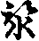



能熏心、心所。缘本识时，能熏之心但熏识本有种，增此一个本有种子，唯生一个本识体，正为其因缘。转熏一心、心所虽多，但是增上缘摄，则无顿生六果妨，亦无多种生一芽妨。若尔，众多新熏种生本识，则有多生种一芽之过，此即不正义也。又解：此疏文是将业种资一个本识名言种子，即如一有心起时，同时思，即是业体；俱时餘触、受等四蕴时，名为业种。业种眷属亦立业名，即名多业感得本识。一个本有名言译种子，名言种子生一个本识现行，即众多同业感种为增上缘，傍或感本识种，故一个识种为其因缘。言本有种者，先已熏故，名本有种，非是本有种子名本有也。即是一个名言种子生本识现行，故无多种生一牙过。此解亦是不正义也。



疏：又设能熏者，各各熏一本识种子，乃至能持之识体是一故者，此第三解是护法师正义也。若缘本识时，能熏心、心所虽多，各各熏一本识种，后时或十个同类种子共生一本识体，亦无妨难；或五个种子，或二界同类共生一现行，亦得。如一麦中多极微同生一牙，此亦然耶？必无多异类种子共生一个现行也。此解是正义也。六种共生一果，亦无妨难者，问：即许多种子共生一个现行者，亦应一个种能生多现行，亦应多现行共熏成一个种，亦应前念一种。若言无此等法者，如何多种共生一现行？若言多种生一现行，由如一个麦中有多微共生一芽，一芽之中有一微，其喻同成。一芽中即有多微生多，不是多微共生一微，即是多种生多现行，其喻亦不成。又文难：未见多种生一芽故。答：谓后能持前多



疏：能熏虽有六现，不别是因缘，共生一种果者。能熏有六个，还熏成六个种子，更无有因缘，遂令六个现行能熏识共熏生一种子果，必无是事。



疏如五无间业，受一期报故者，五无间业即有五个业种子，共感一身入无间狱也，为受罪五倍。此就见分能熏为论者，然此见分缘相分，於相分中而熏成第八识种。问：如第七识，於相分中熏成他见分种，如何相分无缘虑熏，同见分有缘虑种？答：以第八见、相二分不同熏，所以於他相分中能熏成第八见、相分种。



疏：新旧因缘能熏有六，乃至一麦之中有多极微者。然此若新熏，本有同类种俱逢缘，今两个种子共生一现行亦得也。或唯本有逢缘，生一现行亦得也。或有新熏种子，亦生一现行亦得也。或十个同种、二十个同类种子俱逢缘，合共生一个现行亦得。如有一麦中有多极微，共生一芽。



疏彼破经部色、心二法各各有种，共生一果者，色中亦持种，心中亦持种，二处时有种，共生一芽也。



疏：此中此量而易，可知。有量云：汝初种子生时种亦生熏习同时势等故如初生种难初生种亦然。



疏面有三目者，不是佛法中说，即是西方僧间说广果天中摩醯首罗面上三目。其西国僧间亦不执色究竟天上大自在宫为摩醯首罗，以彼不知故。其佛法中说摩醘首罗唯有个两眼，然摩醘首罗即在广果天中诸天是也。能佛法即说摩诃般若、解脱、法身三事具足，即如儞僧间说摩醯首罗即相似也。问：龙王有八万眼，亦何圣教应舍？又如人二眼，识但是一者，问：如人间两眼，为两眼中一时发识？为前次第起眼识？答：即两个眼同时发识，非前后发眼识。果实者，疏解：此不别例。何以故？心王变根、种、色法，皆有实用。若五所变种子根，则无实用；变色，则有碍用。若难言是心所所变色故，不自在故，及色无碍用者，则应五识相应，心所所变色亦应无碍用。五识心所所变者，色即碍用。若本识五所，亦相例故。知本识五所，一念之中得具二受，如前五识心所亦然也。此解抄。又萨婆多师：现在四大与现在色为俱有因？为受於时？现在四大远生，受於具后无对色，则能造、所造、所造不是俱因。为避却远无对色不是俱因故，亦令现在造色与现在四大亦不成俱有因。疏主既不取本识五所所变五无碍者，亦应不得五识心所所变色是有碍用，但应五识心王并本识心王所变色是有碍用，即共萨婆多避却远无对色，令现在四大俱时能造色亦不成俱有因也。此六根眼等同时者，然本识心、心所各各能变一具五根，此六具五根皆同处同时，不相问也。论亦能以火无能烧用者，问：然准此文，大宗镜中有傍也，实无似有。



疏执受有二：一、五色根乃至种子可执，复是所执者，彼若救言：前第三一切种门则明缘种，后第四执受门中但言执受根身、缘根身也，第四门中不明执受种子、缘种子故。今彼难曰：亦如摄论中，种子与五根扶尘，同在一门中，说执受并一处缘之。汝何故缘种即在第三门，执受根身并缘根身即在第四门？种子不许在执受门中与身别明。故知汝说非也。



疏例同五门，今加斯舍，乃至准义，可知者，除第一同相，即除一切种门，除识行相门，除常与触相应门。何以故？触不常与触自相应故。若但言相应门，亦得例取也。若舍受门，亦须除之，受不得与舍受共相应故。若除受外，餘触等亦得与舍受相应。若断舍门，不得例取阿罗汉位舍。何以故？阿罗汉位唯断心王阿赖耶名，不断五心所名也。故不得取断中。若复长行中以义通取，则得下言异熟识体，菩萨将得菩提时舍，声闻、缘觉入无除依涅槃时舍。故知彼舍异熟识时亦舍心所，故亦得取断舍门也。自餘通取者，可知。随简彼宗者，非常非断者，为简僧依自性常故，故言非常；为简经部色、心持种，故言非断也。一、无记，二、坚，乃至四、相应，可为识熏者，一、无记性者，即是前论一类相续，是界趣生施设本故；二、坚者，即前论中性坚持种，令不生故；三、可熏者，即前因灭果生，非常一故也；四、相应者，可为转识熏成，以水为喻，如下文设者，如下第七云如水涛波随多少等是门。问：与恒转如暴流因果不断常门中唯取种子，亦取现行等以为因果？答：即约第八现行为恒转如暴流也。漂水下上者，问：水上可漂水不？如何名漂？



疏正量部等。彼先有过、未者。然正量亦立有过、未世。疏黑山既例者。若西国婆罗门计，若日没时，即九黑山能彰於日。疏主今引俗中事也。若佛法中，日若在遥远处者，食正西日没由。如人近者云：若星，则惠上；若远看云，则以入地。日没亦然也。



疏：前生后灭者。准次上论文中，即是前灭后生也。



疏初但难断，今亦难常者，初但难断者，即前论文中言过去、未来既非实有，非常可尔，非断如何等文是也。今亦难常者，即论文云：同现有位，后果未生；后果未生故，则无后果。即是难断也。果现有时，前因已灭，果是谁果现？果现所有时，前因无果，既无因生，即是常也。因果之体，未来已有者，问：准因果法，若为因之法若俱在前，为果之法若俱若在后，即合过去为因，即现在、未来为果；若现在为因，即现在、未来为果，即因前，果在后。如何此文说未来有因耶？答：今约萨婆多宗，约义不也。若谂却因作用，即现在有因作用；若论其体，即三世中皆是有因体故。若相应、俱有、作、异熟，此四因即约法体上建立，故三世中即此四因。如未来世中有此四因者，为未来中有异熟因，由有心、心所故，即有相应因；为有得四相体故，即有俱有因；为有增上缘法体故，即有能作因。餘现在、过去亦尔，故约法体立此四因。若遍行、同类二因，不约法体上立，唯约前、后位上而立二因，故此二因唯现在世及过去世中有也。已过现二世唯在於前位故，未来无此二因，以是后性故。此说因前果在后者，即约同缘类遍行因说。又约说，又约餘四因以起作用故，亦因前而果后故。此言为因若俱有在前等故，若因体即未来有也。初随返质唯难於常，今随双难亦破於断。初随返质准难於常者，即前文言过去未来若其实有，可许非断，如何非常？常亦不成缘起正理。今随双难亦破於断者，即此文云果既本有，何待前因？则是果体本有，不藉其因，则是常也。因义既无，果义宁有？因果总无，则是断也。今有二种三世无：若法行世，则过去名前，未来名后，今此论中因果即是法行三世。若向有三世，则过去名后，未来名前，如人中因果即是法行三世。若向背三背三世，则过去名后，未来名前，如人小时名后，老时名彼，如立人言前，何别未可知，则未来名前。又如人道行时，已行处名后，未行处名前，前顶店家相似，亦是过去名后，未来名前也。



疏量云所计作用，未来应有，不离体故者，今此比量令过未来世中，即取与果用也。若难生相光明合未来起因，他亦许有，则有相符。今难取与果用，即无过也。若将此量对古萨婆多师比量，即有相符之过失。古萨婆多师即许未来法亦有作用，谓光明生相苦法智忍，即应量云：未来许光明等三法外，餘无作用法，皆应起作用，不难体故，由如於体。又将此疏中比量对新萨婆多顺正理师，即得成也。以顺正理师许未来三法但有功能，不是作用，故疏中比量对顺正理师，即无违也。汝去、来法应是无为法，有法体，无作用故，如无为法。若将此疏中比量若对古萨婆多师，即有随一不成过。然古萨婆多师即许未来有光明等三法作用，故此比量对古萨婆多师有随一不成过。若将此疏中比量对顺正理师，即无随一不成过，以顺正理师唯许去、来世中而有功能，无作用也。



疏又未相法应是无为者，萨婆多宗：法体在未来世，则无生灭相，所还未起作用；过去世以起作用，亦无相迁；若现在法，则有四相迁也。故为此量破也。



疏又说：未来有生相用，过去有与果用者，谓异熟因，现在取果，过去与果。若同类遍行因，过去有与果用者，谓若同类行因隔越者，亦是过去果用。生相，未来有用故。疏中难：无过、未有用，应名现在也。



疏：今言用者，谓取与用者，此文即是小乘救也。彼救云：汝大乘难我，道理不然。我言用者，谓取与之用也。



疏难云：等无间缘过去取果者，若等无间缘前念惑时，能引起后念心、心所，则取果亦是过去与果。



疏即应过去有半作用，有取果用者，除相应俱有五因等，皆现在取，不能过去取；餘三缘亦尔。唯等无间缘能过去取果，即是半有作用。故今约难，令过去世半有作用也。俱舍论颂云：此中有四种类相位待异第三初作用立世最为善。又解云：等无间缘过去取果，婆沙正说，即应过去有半作用，有取果用。故此文应言：现在能取果，过去有与果作用，过去即无取果作用也。难云：其过去世中唯等无间缘等，即有与果作用，过去即无取果作用也，即名半有作用；其过去世中餘法皆不能与果，即是半无作用；其过去世中餘法皆不能与果，即是半无作用也。



疏有三法作用光相苦法智忍者，光明未来生相时，现在暗即在舍相。光明若起，暗已除；若光明在，现在作用即是与暗俱故，故未来有用。若生相在，未来有用；若现在，则住、异、灭有用。若世第一法於现在世与异生性、用俱起，能智在损，异生性力弱。若苦法智忍於未来世起，在生相时，则有力能排断，未来世中异生性不得起。若苦法智忍起，至现在时已前，世第一法及异生性先已灭讫。何以故？半必不得必向。并苦法智忍即是半，世第一法即是向，又是加行也。疏中难云：此三既未来有用，应名现在。



疏彼与果用，灭复灭失；取果之用，生后生失者，亦如异熟因或同类因等，流至於现在世已一廻灭，已落入过去；过去世中又一廻有与果用，即又一度灭。故云灭后灭。生相时中已一度生，又至现在世中又能取果，即又一回生也。即是生后失。故为此难。



疏若言苦果但是功能，无取果用故者，过无学末后心既不能取未来果，此末心应名过去无记果用，不名现在也。



疏：又若此心初无作用，应名灭，乃至处有言灭者，无学末心既无取用，即命是灭，如何已后更有灭耶？



疏又彼功能改名作用，而复何异者，彼宗即改未来无光明等三法作用，而名功能；及改过去取与半无作用事，名功能故。此文应言：又彼作用，故名功能。又难言：汝宗既言过去有与果功能，现在名作用，未知通功能与现在作用何差别？难言：应无差别，由如眼、目异名故。俱舍论云：五取果唯现者，谓相应、俱有、同类、遍行、异熟因。此五同於现在住相时，有力能取果也；唯餘能作用，取果不是故。二与果亦然者，果起酬因，即名与果。谓相应因、俱有二因，於现在住相时，则能取果；心王、心所更互与力，於现在灭相时，更互与果。过、现与二因者，谓同类、遍行二因，现在住相分时，果若隣次，其前二因在灭相，后果在生相时，则名与果。若起此二因，若入过去，或经三念、五念，后果起在生相，则能与果。与二因、果，则在过去世与果之也。俱舍论说：与果者，谓彼种子。此现在法尔有力能生餘法，正生彼力名为与果。问：萨婆多宗既不立有种子，如何为彼种子？如何言为彼种？故更问。答：名言种是因也。唯过去者，此异熟因现在住相时取果，异熟因落入过去世始能与果。如现世中造一恶业，此业则能取未来身。此因落入过去，或经多念多生，后果起在生相时，则与过去异熟因之果也。故异熟向过去与果也。二因於正灭者，相应俱有，在灭时心王心所则更互与果也。三因於正生者，谓遍行、同类、异熟，此三因后果起在生相，则名与果也。餘二缘相违者，若所缘缘於现在住相时，心心所正缘境时则能取果，曾现在灭相时能与果。若等无间缘一向过去取与果，前念心心所灭时，为开导能引后念心心所法，则能取果。若后念心心所起在生相，别名与果。故此二缘别明若因缘增上取果。若因缘增上缘不离前五因，故今不明。若无为为能作因，亦不取果也。



疏婆沙正文，应名现在者，今此疏中数数有婆沙正说者，今疏主引彼婆正义，牒而难之也。若言非是无学末心不能取果乃至非等无间缘者，若彼宗救言非是无学末心不能意说无学末心亦能取果，但为后念已去缘阙，果不得生者，难曰：汝若言无学末心能取果者，即违汝宗。汝宗说无学末心后不能取果，非等无间缘。若汝言无学末心能取果者，应无学末心成等无间缘。又言：汝若言现在末心不能取果者，违汝宗故，说一切法皆现在有取果作用。末心既不能取果，应名过去；既无取果用，应名功能。不如前解。前解顺文。若大乘中亦说无学末心非是等无间缘，故下文若此识等无间，彼识决定生者，可成无间缘；若此识无间，后识不生者，即不成等无间缘也。



若无得果，若缘不阙，定从此生者，乃至云何不能生果者，若彼救言：若末后果缘不阙者，其后果可生。以为后果缘阙故，所以后果不能生者。难云：因既缘不阙，故有作用，何不能生果也？既有无学末心为因，餘缘亦应不阙，应有作用，后果定生。若因不能果，则现在法是无用也。难云：汝心心所起时，即具四缘，生汝无学末心。既有四缘，无学末心即应成因，有作用，可取法生得果也。



疏自相离言，如何已说者，即如前真得，谓自相等文，是遂即取所及相分名当果。答：即是相分，不论亲、踈。相分时，谓粟子等时，是相分意说。如有春时声子因时，其果仍未起，即说此春间声子应生秋间果，即假说当果对现因。又有秋间声果时，其因已灭，即说秋时果声子从春时因生，即假说当因而对说现果。乃至善、恶因亦然。此唯识论中说因、果皆假施设，谓假立当果，对说现因；假立当因，对说於现果等文。即说因、果皆假者，即约第二胜义门中说，不约四世俗同说。若约四世俗门中即说者，一切因、果皆假立假者，即约第二胜义门中说。不约四世俗门中说者，即一切因、果皆是实有。有酬前相，即熟、变相等者，然果欲生之时，要成熟、转变，方能生果也。然观现在身是果，从过去善业生意，过去为因；即观现在善、恶业为即，未来为果。虽未来有果，即假说现在法为因也。又观现在异熟果有好能施，则知过去善，故观现在果假立曾因也。果亦如是者，性离言，故非果也；有功能，故果起酬因，非别果也。



远离二边者，即远离断常二边也。此答於前生灭分位法也者，然前论云被他小乘难同现有位后果未生，乃至难离断常，故今论中答云如是因果等皆假施设，已答前生灭分位也。如下不同解者，从如下解见修无学道，皆解无漏真智也。以理知故名契道者，理者，理非是真如理也。但不断不常之道，而理能引起无漏现行，即不断常之道理而契中道也。若执断执常，既不能引生无漏之中道也。



依种子立，约曾当义说其世也者，然彼瑜伽论中约种子而为道理。三世者，即是次定，即一切时常定而尽理也。即种子生种以分三世，谓此现在种子从前念种子，即前念种子名因也，现在种子为果。又从此现在种子后念种子时，即后念种子为果，现在种子为因也。若此唯识论说因果三世，有约麤相道理立有三世也。即观现在人身五蕰从前生故，即说现在身为果，过去善业为因。又观现在犹造不动业故，未来得生上二界也。由造福业现行因等，未来得人即身；由现在造福业，未来得生三德趣五蕰身。又如现在布施，未来得大财；由现在身持，於未来得大身；由现在忍故，未来得大眷属等。观现世麤因而得未来果也。



皆说有六通，乃至虽非种子，亦有三世者，问：他心智与漏尽智缘境有何别？又问：大论五十六等说有种子三世，唯识中说变三世，此三处皆约何道理？有何别？答：下疏中自会。又彼功能改文作用者，彼宗即改未来光明等三法作用而名功能，及改过去取与果之作用而名功能，故此文应云：又彼作用改名功能。他心、漏尽智缘烦恼尽处无为，无为虽不蕰三世，即假说有。无为是现在一道三世，乃至义说三世，故有即内、外种。上皆有三世之义。外种三世者，如前摄说。内种者，如见今时好人身，即说此人从过去世善业因生，即假立曾因，对说现果。又见此人今时行善，则说此未来还得好人天果，即假立当果，对说现因。二、依神通三世，乃至作证解故者，其宿住智等生时，法尔有缘三世之功能力，其神力所见之事既非妄心，所见皆实，故



第二说：犹起证净故，亦现三世影。有犹多修习禅定神通等法，即然知过去等事，令宿住等智而断除。三世中事彰遍彰故，即所见去来今皆实，随其势力，问缘多少。劫之事理实，所缘之相，能缘之见，实是现在，而心上作三世之行解，故智缘未来。若至未来，所见之事，与今时智所见事，更无量也。异生圣者，功能各殊者，若异生神通，则前知八十个成坏劫，后亦知八十个成坏劫。若声闻缘觉神通，前知八万个成坏劫，后亦知八万个成坏劫。若初地菩萨，前知百个成坏劫，后知一百个成坏劫，二地已上更多。若佛无边劫事，



三、依唯识乃至去来相实唯现在者，此义唯通前二种，谓前道理神通皆名唯识三世体，前二种外别有实体。其唯识三世多是妄分别心所变，以去来今据实能缘皆是现在。或复更释乃至诸违文者。问：其神通即是唯识通摄入唯识，谓唯有道理唯识三，恐神通滥妄缘故分三种三世。然神通皆不是妄缘知，唯识三世中即有一分妄缘知，如独头散意识而缘过去等。设立四灭三者，设餘六，或立四种三世、或灭三一。问：立二种三世者皆是妄说。



此中亦同胜军论师种子等法，前果后因俱时而生者。问：若前因后果可言俱时，果后果因即是别时？答：此胜军论师因果等法用，即与上座因果相似。谓胜军言：即此一个种子而有二时，谓生时酬因，灭时引果。即后法云：前果即此现在法。至灭相时，与后法生立，即灭为因，生为果，故云后因即於现在一个法体上。若法体生时即是果，即初生时酬前因故，生时名果。即此现在法体在灭相，即能与后念法为以灭时引果。三、相用不同时已下文，即是上座部义也。至异时后果方起者，合云至灭之时，后果方起，或云应异灭俱以也。此二相即法辨离无别体者，此生灭二相即於一个法体上辨，即於一个法上有生灭二相故。若生灭二相离法体外，更无别体故。若萨婆多离法别异四相，我相不离法有别体。色法迟钝，有三相用体：色法初生相时即为果，与前法因道即两法俱；若住相时即独住，无两法并也，其住相非是果也。若至灭相时即能为因，与后法果并也。此是二法灭等因，即后法为。今此所论即一法体者，言法为二时者，谓后法生酬前法灭等因，即后法为果，即后生相果与前灭相因并。若此现在法至灭时相，即与后法生相并，即二法上而辨生灭时。生灭时同在现在一念中，至生灭不相违，此乃即二法有二时也。故下文言：前因正灭，后果正生。若此论文中言生时酬因，灭时引果者，即於一法上而辨。谓此现在法初生时即与为因果，酬前法因故。若现在法至灭相时即为因，能引后法果。此乃一法上生灭，不得在一世，必前后相违。此乃一法上而辨生灭二时。体相虽殊而俱是有者，问体者即是法体也，相者即是生灭。彼虗言者等，问言等文等取何法。如解惑等者，解者是智，惑者是愚，即相违故，如愚智等。



疏又此据令除二乘，金刚心少，故不说者，至金刚心位，我执己不行，应名为舍；少，故不说。又八地已上大一僧祇劫不行，今约全处为论，故言阿罗汉位舍。若二乘人至金刚心时，毕巳竟断，我执现行，其金刚心时仍是有学位摄；至解脱道已，方成无学。今者但说无学，舍阿赖耶名，摄多时说；不说金刚心赖耶者，以时促故，所以不论也。八地菩萨随应二释者，若初师说，八地菩萨亦得名罗汉，亦舍赖耶名也。又依除分段生，此名无生者，意说阿罗罗汉亦得名无生，以三名中云应永不受分段生，故阿罗汉得名无生。其阿罗汉断烦恼故，亦得名煞贼。



疏此执藏名，唯约缚说者，今言舍阿赖耶者，据缘缚。若萨婆多，则已断法与未断为因。亦如先在凡夫时，起身边见等染污，能与修道烦恼为因；后入见道时，虽见或身边见等，后者学身中起染污法，是前见道时断见惑；身边见等，后者学身中起染污法，是前见道所引生。故后修道烦恼起，但是令与果，而非取，即是已断法与未断为因也。又彼宗由烦恼上法前、法后俱得缚众生，故不得解脱起；圣道唯能断烦恼上同令不转行者，即名离缚。如相应烦恼，相应心、心所落入过去心、心所，恒彼烦恼也；只令现在烦恼得不起，即名离缚也。若大乘断相应缚并染污法，若与烦恼俱时起心、心所法，亦皆断之。然小乘说相应缚，既贪等缚同时心王受上得四相，而成相缚，贪等亦缚。贪等烦恼上得四相以来，相应缚说习气上位不成者，然十地菩萨方断烦恼种上习气，至佛位永断习气尽也。若罗汉，仍有习气也。



疏如见道生等者，如俱舍颂：於佛上僧等供养上曾僧二影。疏：果谓新於见道，三、新说灭尽定，於四、新从想定出，五、新从无诤三昧出，六、新出修道。有人供养得大福已，后多时入世俗心，供养时得福异故。问：慈定为是学得？无学得？又问：佛为上首，僧等六人中几个人供养得福多？几人供养得福少？更问：有成熟阿赖耶非转识，乃至谓第一句入无心位者。问：异生在无心位，亦有第七识，如何言不成转识？乃至三乘人入灭定，皆有第七转识，如何言不成转识？答：即约前六转识说，不约第七识说，亦不相违。若二乘中第三果人，即得入灭定也。若前二果亦有心熟眠、闷绝，若一切异生或入无想定及入无想天，又无想天又入熟眠、闷绝，此等名无心也。



论云：诸阿罗汉、独觉如是者。问：独觉中亦有麟喻，部行众多而不言诸，偏於罗汉之上而言诸耶？又问：独觉如是各得别名，唯声闻之人而得罗汉之通号，如是应名独觉，独觉应名如是？答：独觉不能断所知，所以不得名如是；能断烦恼，所以得名罗汉。



论云：顿断烦恼及所知障者，成阿罗汉及成如来。问：金刚心可言顿断，其所知障於十地渐断，几成顿断？如疏自反。问：对法中何故於十号中说成佛时，唯言成罗汉，如是不说餘人？号思可知。



疏：已得不退者，即是证不退也。



疏亦得不退者，即是行不退也。若八地已去菩萨，於未得法定当得；若有违缘时，亦不能为障碍。若初地已上菩萨，未得法空当得；若有违缘时，亦不能为鄣碍。若初地已上菩萨，於未得功德唯碍鄣碍；若有违缘生，即不得於得法而有退也。初说回。说回心名不退者，即前位乃至直往者唯向不退者。然此中言不退菩萨舍阿赖耶名者，即正取第四不退名阿罗汉也。然此二乘、无学初回心已去，虽未至十倍等，其人即唯得名不退菩萨也。若此人至十倍第六心时，其人即得二名，亦得名信不退，亦得名烦恼不退；其人若至十住第七心已去，人即名位不退，亦名烦恼不退；其人若至初地已去，亦得二名，谓名证不退，亦名烦恼不退；其人若至八地已去，亦得二名，谓亦名行不退，名烦恼。故二乘、无学回心，即得亦不退亦名，谓名信不退、位不退、证不退、行烦恼不退。若直往菩萨，唯有餘四不退，无烦恼不退也。若此间正取烦恼不退，若泛解不退，即有餘四不退。



疏一、信不退，即十信第六者，前五心由退，能断善根；至十信第六，心更不退，能断善根也。



疏若十住第七心亦善，其位不退者，此位中更不退作二乘故也。



疏以得证净故者。更不退起烦恼，即是证净也。



疏亦名信不退，然未至彼位者，二乘无学回心向大，虽未至十信位，决定信大乘，亦名信不退也。此之不退，唯大乘有，若小乘罗汉亦退失。



疏即应有五者，今此疏中有五不退：一、十倍第六心，名为信不退也；十住第七心，名为位不退；三、证不退，初地至七；四、行不退，八地已上；五、烦恼不退，即是无学，回心向大者是。



疏：四者、若三乘、无学，皆舍赖耶名，即三人也。又加无学回心，名不退菩萨，即四人也。



疏从初发心二万劫者，即是无学回心二万劫始，则十倍初心，即是涅槃。往须陀洹八万劫，斯陀含六万劫，阿那含人四万劫，阿罗汉二万劫，辟支佛十千劫。此之有类，心回大经。此之劫数，始列大乘十倍初心也。此中劫者，约成、坏大劫为论也。然罗汉人从初发大乘心乃至成佛已来，皆名为烦恼不退；回心已去，即名菩萨处不退起，名不退也。



三乘有学金刚心位，乃至彼论不说，此亦不论者。问：何故亦名金刚心，名金刚喻定？又问：准下九心，见道八相应心，总合一八相应即为八。今以断惑中观顺非止即说於慧，此中断义唯说於金刚喻定，不名金刚喻智。言金刚心即是金刚喻，定即心故，所以经中说定学名亦为心学。今者举所依之定，意取能依之智，由定能起智，故说金刚心喻定，不名金刚喻智。然餘论中亦名金刚道，道即是智也。然此唯识及诸论中，即约三乘究竟道名金刚，或所断下下品烦恼难如金刚，或能断之智坚固喻如金刚。然金刚般若经，即约见、修、无学三道总名金刚。於无相海者，若真如无相如海，若能证真如根本智，由於般菩萨，由如乘船人，即菩萨乘圣道船渡无相海，并得至於佛果也。



即空方便智发起有殊胜行者，空者即菩萨起空根本智观真如时，由根本智上有方便，方便者增说也。有即是后得智，正根本智观空证真如时，此智即能起后得智，而起身诸业行苦行，舍身命等教化众生，由如不起灭而观诸威仪。初起已前於六波罗蜜一行中修一行乃至明佛力起者，若初地至六地已去即修行六度，谓初地行布施，乃至第六地修智慧，若第七地修方便，若第八地修愿智，若第九地修力，第十地修明智也。从此八地已去於刹那能得过前二阿僧祇所行功德智慧一倍者，若入八地已去既然，至九地已去初念修道亦过然八地一倍，第三念修道过前第一念多倍，乃至已后倍倍准前。问：此言福智多者，为熏得种多、为渐明利、为心勇猛？答：此中即得功德智慧等多，以渐殊胜明利故，亦不约熏得种子多也。犹此义故，若初地菩萨一年修道，能过地前地前大僧祇劫，若一日修道胜初地菩萨百年，乃至已后准知。若第九地菩萨二念修道，即胜第八地一劫，乃至第地菩萨一念修道，即过第九地十地十切等



此亦说彼各阿罗汉三义具故者，谓具应供、煞贼、不受分段生等三义也。二智是正体后得者。问：然此文中既言二空所显真理，如何此文言正体后得与别二种不相应故？答：今云正体及后得亦摄得生空智、法空智，其正体智中亦有生空根本智、法空根本智，其后得智中亦摄得生空后得智。或二智者，即是生空智、法空智，法空智中亦摄得根本后得，其生空智中亦有根本后得智也，与前有得也。



疏即唯约六波罗蜜为论，乃至见一一行中，皆能修习一切行故者，若初地菩萨，於六波罗蜜中随行一行时，能一行一切行；若八地已上菩萨，即约行八万四千波罗蜜行时，能行一切行。故与前别也。



疏不动染心，而方起惑者，染者，颠心也。菩萨起烦恼时，皆正智心，故不令与烦恼相应，为利有情故。意说：凡夫、小人若欲造善、恶业事时，要须起善、恶心。如造恶事，要起烦恼真恶心，方能造恶事而打人；若起善心时，即不能造恶事而打人。若欲造善业时，要须起善心，方能造善事；若起恶心中，即不能他善事。菩萨不尔，一、倍相违。如菩萨或起恶心时，即造善事故；或起善心时，而作恶事，是慈悲中作也。恶心时，即是善事；或起善心时，而作恶事，皆是慈悲心中作也。如经中说：佛过去作觉德，见有餘人谤大乘经，心作是念：若倍此人谤经，其人定百千劫入无间狱。我容煞此人，不令谤经。即大悲心煞此人，云：命终至无间狱。而起三念，同涅槃经先答云无国王相似也。如生兀药等，令变，令毒药，令变毒，别法我见故。以阿罗汉由有分别法执等在，故不损人；或由餘好药等毒药中，令变毒无力。三、不损人也。



疏：法我见故者。法有作用，名之为我。或与人我同体，故名之为法我也。为共烦恼同体，故此文应言以有本质。



疏十地菩萨所起烦恼为过失者，问：八地已上更不起烦恼，如何此文言十地菩萨所起烦恼？答：此文但总相说十地也。应云七地菩萨所起烦恼不为过失也。



论云：然阿罗汉断此识中烦恼麤重者，究竟尽说者。如愚意者，详观此文，既言断烦恼麤重，明知即是初师义，非第二师义。以第二师说，直往八地菩萨，犹伏第七识烦恼现行，名舍赖耶。



论云：阿罗汉无识持种，尔时便入无餘涅槃者故。准此文说，便入无餘涅槃是初师义。问：二乘人无识持种，即入无餘其事；菩萨无漏持种，如何得入无餘？即积集义，是心义，乃至或能熏种。於此识中既积集已，后起法等者，此疏中十二解有何差别？更应问此师。如愚所，初解唯约集，种在识中；后解即约集诸种子，后起现行，名之心体。此唯识论中解：心者即说意，能了诸境相，是说名为识。今者本识即是此三种中心之心也，约论种子所积集之处所也。



疏心、意识中，心之心者，即是藏识说名心，思量性名意。对法第二亦心义，乃至据一边说者，问：此论既言由种，云：熏习种子所积集故。此文唯有种聚集种子，而无起染现行，亦据一边说。答：即此论下，初证。即集法种能起现行，是心义；彼对法唯有种，名之为心，亦无起现行，约一边说。



疏摄论第一云：为所依乃至非通诸圣者，彼摄论云：阿陀那者，谓能执持诸法种子及能执色根依处。今能执取结生相续故。彼论约执取结生相续故，约正受生时，本识与取为依，故所依者是身。问：取者为是十二支中取支，如何与作所依者，问：初二果人，身必触处生，本识与取为依，如何言非通诸圣？答：此意取者非是十二支中取支，即从中有欲取支受生处故。即约得受生，执取得生有身，名为取也。即令生死得相续，即本识与受生时而所依。问：上文中解阿陀那，谓执受种子及诸色根，具二义；此下文解阿陀那，即执持种子及执持色根及根依处及执取结生相续，即具四义。即二文相违。答：此举胜说也。



即摄论第一所知依品是。此所知依者，彼论云：所知依者，谓第八识。即所知依、所知中等餘殊胜法也。是故三性法皆依此识方有者，谓依他、遍计、圆成等三性。问：其第八识如何与圆成实性及遍计为依？答：其第八识中还有能遍计心种，其识中种子皆是所遍计境，所遍计境还与遍计所执性成为依也。又如第七识遍缘第八而起我法执时，其第八识与圆成等为实为依。依者是藉，非如眼识依眼等根。即由第八心中烦恼种子有无漏种子，无漏种子生现行证真如时，即能断却识中烦恼种子，方显得真如。若无第八识，即无烦恼种子，亦无无漏种，亦不能显得真如，故说真如依第八识也。



疏前第一名心是积集，种在其中义，解云：若泛别解心者，即令二义：一、谓能集诸法种子，亦能起诸现行。若心与种子识明了其心，唯具一义。谓前第一名心是积集种处义，明种以所依现行识处；今言种子识，即明识中种子能生现行义故。二、别也。根本识、有分识等者，问：今此言有本识遍一切位者，准文中，有谓三有，分是因义。如何得通佛果、无漏位、老果中从因为名？谓说如是亦名补特伽罗。然说因为名，然佛非补特伽罗，亦此亦尔。说佛有云分识者，亦从因为位。



疏即是相续执持位心者，能此心等四名通一切位者，即约阿陀识相续执持位说也，以阿陀那通一切因、果故也。又始为论此能执藏，亦通无漏，乃至为能藏义者，意说第八识为能藏，根、身、种子为所藏，即此始、终而言此本识能藏，亦通漏、无漏，佛果本识名能藏故。此为所藏，不通无漏者，所藏者，是受熏义，是我执藏；佛无所熏及无我执，故佛无所藏。若第七我执执第八为我时，即本识为所藏，我执为能藏。故始、终而言此识为所藏，不通无漏，唯在有漏位；佛果本识不是我执藏，故无不受熏故。



初师第三随理应说者，问：前时阿罗汉位中既有三师说，若前二师，即是正义；若第三师，不是正义。疏中应言初师第二说随理应说，如何言初师第三？答：举初、后故，更应问法师。又问：言杂染者，为是有漏三性、有漏三性法？其不退菩萨及二乘、无学，皆有有漏杂染种。如何此言无学不退菩萨无染杂法？答：亦约我执说。由此义故，种生、现行异时，乃至起方生故者，此师即说：入金刚心时，舍异熟识种子，唯有异熟识现。今与金刚心俱起，即是正舍，名舍其菩提，在未来名为将得也。此师亦是不正义。此义即是护法师门人释也。生前识之种至金刚心已灭，生后识之种与金刚心俱前，念本识现行与金刚心俱起解脱道舍。疏文门五行者，皆是彼师不正义。论：上文中皆言因、果同时故。



疏佛地论第三、四等诸净中说者，即彼论明诸清净法也。



疏若约断说，即二乘、无学，乃至前解为胜者，若所说八地及阿罗汉舍阿赖耶者，即约断缘缚名，而不舍体故；约离自地染时，皆名舍阿赖耶；若金刚心时，舍体也。由此应作四句分别，有断而不断等，如前抄说。



疏以能缘从所缘分三者，若能缘从所缘分三者，我执平等性智位；若所缘从能缘分三者，谓阿赖耶、异熟阿陀那，即能缘、所缘之名。前长，后短，谓从无始已来我执恒缘赖耶识，故名前也。若约体者，即阿赖耶，即前高，后长；其阿赖耶体至金刚心及二乘入无餘涅槃，方舍阿赖耶识体。其能缘我执若约体者，亦前高，后短。无始已来我执与所缘赖耶同时有，故名前高；若至八地及二乘金刚心，即断我执体，故名后短。法执缘异熟识，其能缘亦前俱后高也。有从无始已来法执恒缘异熟识，故名前高也；若至二乘入无餘依时及菩萨金刚心时，即同时舍异熟识及断法执，故名后高也。若平等性智缘阿陀那时，即前长，后高，谓得成佛，尽未来际，平等性智恒缘阿陀那识。若约能缘说，即前短，后高，谓入初地，方得平等性智，名前短也；成佛已去，平等性智常状续故，常与阿陀那识俱也，名后高。若约所缘阿陀那识，即前长，后高；由无始时来有阿陀那识，名前长也。



疏如佛地说有为、无漏，皆不受熏者，意说无漏法而不受熏，亦应言善染等亦不受熏，唯无记方能受熏也。



疏金刚心菩萨等，既有二说，若已起者，时少，故不谓者，即是第十卷有一说：金刚心时，则起大圆镜智时。何故不说者，金刚心时促，但言解脱道。又一说：金刚心不起圆镜智，解脱道方起也。然此本识三性善染等不受熏，唯无记方谓我爱，唯无记方能受熏也。



然此本识三位差别者，谓我爱执藏位、善恶业果位、相续执持位。摄论第二说阿赖耶识为性，乃至此中不说小乘之名者，此摄论文中先明第八识如大王路，以后即结第八识之用阿赖耶识而为性。其第八识以心为体性，其第八识即以阿陀那识为体。若第四但言阿赖那者，即是萨婆多爱乐欣喜之阿赖那，故第四无识字也。



疏前第一解，心等通故。等中亦尔。乃至准义知者，既即等言，则等取摄论三名：赖耶、异熟陀那。又等取萨婆多爱阿赖耶心。既是通名，诸论异名，总得名心也。有漏二位名最初舍者，摄二位者，谓异熟阿赖耶。



疏无间解脱、将得、正得二释。此中皆名将得者，在金刚无间道时，菩提在未来，名为将得之言。其释文家即分位，谓将得、正得。论文中总名将得。一云：种生、现同时有二，乃至故名将得者。然此疏中两释中两释，即是正义：一、初师云：金刚心时与异熟识俱，其金刚心即与异熟同时灭故。金刚心舍异熟识，即是正舍名舍。由如小乘中说：世第一法与异生性俱起，如骑怨相似。即世第一法能容异生性，容异生性与世第一法同时而舍，即正舍名舍也。此师即是正义。其金刚心时，菩提在来，名为将得也。菩提与圆镜智俱起者，问：菩提是智，又言与圆镜智俱起。其菩提是八识中，何识中智？又解脱道即是菩提？答：菩提是解脱道，解脱道是第六、七平等妙观二智。若第六识起金刚无间道时，引第七识中解脱道。若约断惑，故名无间解脱道者，唯是第六识有无间解脱道，圆镜成事智中唯有胜进道也。故今第六识解脱道与圆镜智俱。



疏得与成熟既别体者，若萨婆多初得名得，后得名成熟；今此论文简萨婆多，故言将得。据实而言，得与成熟一体异名也。异熟先灭其金刚时，即已舍名舍；若第二说其金刚心时，由如小乘苦法智忍起时，名舍异生性，即已舍名舍。今此亦尔也。此二说，如下第十论文说也。其种生、现异时同。初说金刚起时，异熟识种已灭，唯有异熟识现行，与金刚心俱起，初得名得，后得名成熟者，然此文即约萨婆多师释：若续善根，善根至生相时，即名为得；若善根至现在时，即名成熟。同与成熟别。今此亦尔，若在金刚心时，即名得菩提，即将得名得；若至解脱道时，即名正得，即成熟菩提也。



疏此并彼弟子至二家异说者，问：次文中即无护法言，今此文中即是护法、弟子二家异说。更问：若大乘人不寂灭门至真如为论者，然彼论问：声闻与佛无餘涅槃何别？答：言无别者，即约三乘，皆无苦依身故。二乘入无餘已，身起俱灭。若佛虽无苦依，而得无漏五蕴常身等也。心等通故，随义应说者，若阿赖耶识名为心者，名所知依者，名种子识，名阿陀那者，其二乘金刚心时，及八地已上菩萨舍阿赖耶识时，亦名舍心，亦名舍前知依，亦舍阿陀那。异熟识名为心，名为种子识，名为所知依，名为阿陀那者，其菩萨金刚心舍异熟识，及二乘人入无餘依舍异熟识时，亦名舍心、所知依、种子识、阿陀那也。如无垢识，尽未来除，更不断故，其心、所知依等亦不断也。



有言有漏位即显前二及后一者，前二者谓有漏位中唯有阿陀那自相门、唯有异熟识异相门，后一者及末后阿罗汉位舍门。此三门唯是有漏位，次前具说，故今不明。其因相一切不可知了舍俱恒转通因果故者，若五门通因果有：一、因相一切种门；二、不可知门；三、了即识行相门；四、即舍受俱门；五、即恒转如暴流门也。问：既言恒转通於佛果，佛果上亦言恒转如暴流，有前文三种法喻如暴流水等。答：然佛果第八现行识恒转如流，亦有前少分有前水为喻，然无漂水下上等事。不可知门者，问：因位异生无遍智可，其第八心境皆可知，何说不可知通於佛果？答：亦如因位第八识及所缘之境，谓佛皆知之即是可知，然望餘异生不知故即不可知。今此亦尔，虽佛果上第八识及所缘之境诸佛皆知，即是可知通果上有也。



然受相应恐滥因位者，然因中第八与舍受俱即是异熟报主故，若佛果位舍受即非异熟报主故，果上舍受恐滥因中舍受故。今此论中此亦唯与舍受相应也，欲无减中舍受故。今此中皆言无减者，即名欲无减者念无减等。若新经论中即言欲无退念无退等也，如来无有不定退等也。心者，问：既佛第八识中有定，未知九次第定中是何定也？答：唯下流初解圆镜智通色亦无色，四十地中即圆镜智中亦有诸等至。



若在因位一心一时乃至故念欲俱者，然凡夫一念中不能缘过未，若佛果上一念之中欲能缘未来、念能缘过去也。因位中第八识虽一念一时不得缘过未，唯得缘现在；若因中第六识唯能少分缘过去未来，不得多时；若佛果位一刹那时八识皆能缘三世，欲缘未来、念过过去也。故大乘中说如是六通十力，於一刹那中即得并起也。谓於一念中即八识并起，故起宿住智即缘现在，即起漏尽通缘现在无为，起他心通缘八地识心王五十一心所，即起天眼通缘色，起天通缘声也。如初地菩萨一刹那中亦能知前后百劫，又能见百佛世界，乃至身亦能往往，故知大乘一念中六通即得并起。若小乘中说六识不得并起，即有三退：一也、已得退，二、未得退，三、受用退。若钝无学即具有三退，谓已得后三果，还退后三果，直至初果，名已得。又於佛身功德未得之法，圣人亦不得佛身中功德，名未得退。圣人若起天眼，即不得起天耳；若起宿住通缘过去时，即不得起死、起生通而缘未来，起一之时餘不得起，名受用退，以为六识不得并生故。若不劣舍性阿罗汉位唯有二退，谓有未得也及受用退，无已得退也。其人不得佛身中功德，名未得退，受用同前说。佛若身中唯有一退，唯有受用退也，即无已得退、未得退也。若大乘中及经部说亦有三退，如钝根无学亦有三退，失得九定现法乐住，今还退失，名已得退。若未得退，同小乘说。若约六通即得并起，若初八解脱中即有受用退，如起初二解脱，初二解脱即是初禅心，更不得起餘解脱，餘解脱所依地名别故。又如起空处解脱，即不得起识处解脱等，以二地心不得并生故，若佛身中三退总无也故。



疏如来既得四澄净故者，四证净者，谓佛、法、僧、戒。如是亲证此四，既是无漏，故言净除；深信此四，故名不坏信。故知佛亦有信也。问：佛果八识皆得，已证净耶？如餘处说。



疏许通无漏，於理无妨者，八地以上菩萨无漏心中亦有无漏寻、伺，故寻、伺亦通无漏。若佛无漏，即无寻、伺也。



疏：不可动摇，非如餘智。问：如何名动摇？答：若十地因中平等性智亦有间断，名动摇。又问：佛、菩萨平等智亦是舍受，如何无性如餘智？答：佛果第八大圆镜智唯是舍受。若餘三智，或喜、乐俱也。



疏或说通无色、色界六地，游观无漏通此地者，色界六者，谓四禅根本、中间禅、初禅未至及四无色根本定。若如是真实功德、十力、四无畏等，则唯在第四禅者，餘九地准有。游观无漏，则无如是真实功能。何故唯取初未至，不取餘上七？未至，则无无漏道，不能断惑故，是以不取之也。



疏起现行者，唯第四定多依天住，此智多分起大悲故者，若佛智现行，唯在第四禅，不起餘地，如是於天住第四禅。若佛住中多住十力，若其住中多住空解脱，若梵住中多住大悲。梵住，谓慈、悲、喜、舍。



疏有说通下，五、六定无，理能遮故。色界有遍缘心者，若取五地，则除初、未至；若断欲界染，可须初、未至。如是不拟断欲界染，故不起未初至，唯取四根本、中间禅也。疏中应云五地又云者，下三禅及初、未至、中间禅也。前解胜。若通取六地者，即取初、未至。若欲界色心即能遍缘，无色界心不能遍缘，地法无故。



疏虽下，四地仍唯舍受者，四地者，即是初未至初禅根本定时之四地。大乘宗皆通有喜、乐受故，如下三受释也。虽通四，此四地仍唯舍受，以寂静故也。除却中间禅，大乘许是舍受故。



疏阿赖耶与舍受俱，於三受位俱行不绝者，若前六识中喜、乐、舍三受现行，第八识恒舍受，故言俱行不绝。



疏所餘三受，当知思惟之所引起，乃至别发现前者。问：取佛位喜、乐受，亦是思惟作意引发起耶？答：少分亦思惟起也。



疏此佛地中类同舍受，不得起乐、喜二受。此乃思惟所引发故者，意说佛果位中第八识是舍受，其佛果第八识亦是舍受。佛果位中纵前第七识中起喜、舍受，本识亦恒舍受，以是任运故。若喜、乐受，则思修中取引起也。



疏：餘地总无，六十八说：如是功德多依第四。解云：既前疏文言餘地总无，下数疏云如是功德唯依第四静虑。上文言总无，下文言多依餘地，亦合少分有，文自相违也。故知餘地亦少分有，云：



疏虽色、无色，皆有此起，乃至所有等智者，若在因位，十地即得修彼种增；若在佛果位，亦不能修种增。餘九地虽有，餘不能生，唯现行第四禅根本地能生。如小乘三类边智，亦如凡夫无始时来，唯修外道起世俗智。六行伏惑，唯有苦、集、灭谛，不能起道谛。厌下苦苦，是苦谛；厌下麤，是集谛；欣上静妙，是灭谛；无有道谛。虽起有漏世俗智，不名无漏道谛故。如身在欲界，起初禅未至定，伏欲界九品染尽，而欣上初禅定已后，方得初禅定。若厌下地，为苦麤部，即是无间道；欣上地，为静妙离，即是解脱道。若初禅有漏根本定，亦不能离初禅自、他染；要得上二禅定，方亦不能离初禅自、他染；要得上二禅定，方能离初禅染。直至有顶地已来，地地皆厌下欣上，唯有顶惑不能伏无上可欣故。由如步屈虫，若移得前脚，方动得后脚；若至倒尖顶游处，若不动得前脚，亦不能移后脚。今此亦尔，若定八地，若有上地可欣，即能厌伏自下地染；乃至无所有处，即欣上有顶地，为静妙离；猒下无所有处，为苦麤鄣，即伏无所有染。前脚由如静妙离解脱道，若后两脚喻如厌下地为苦麤鄣，是无间道。若至有顶地中，由更无上可欣故，即不成解脱道。由不成解脱道，亦不能伏有顶染，亦不成无间道也。后时作预流向入见道时，起苦法智忍为无间道，断欲界苦谛下惑，起苦类智忍断上二界苦谛下惑。至第四苦类智时，以先在凡夫六行伏惑，世俗智在未来藏中更不能起。世俗智在未来藏中，唯总一法前得与苦类智来，由如通信既义言语，苦法智言：若何是苦法智此来未起时，则便我世俗智伏惑？又不能百回伏下地惑生上，生上已还生下，我唯能伏无所有处已下苦谛伏有顶惑断道。今日断却三界惑尽土大好，我世俗在来受不起伏三界惑也。集、灭智皆亦如是。三类智边者，即苦类智、集类智、灭类智，此三皆在后边，故名之为边。圆镜智亦尔，餘地不生，由如世俗智不起也。圆镜智第四地得现行起，由如三类智得现起也。旧经论中云：等智一切凡夫四生能皆得有。故新云世俗智也。



疏缘十八界有为无乃至故名遍知者，此释遍智最正好也。



成唯识论疏抄卷第七。



疏五教、十理证有本识者，五教者，然疏文中不分明解释，今者总有三释：第一解解：一、阿毗达磨经两处颂文，解深密经颂及论文中此等无量大乘经，即如显扬论等。无明等覆爱结系凡夫等经，及如五种子经，此已上诸经，皆是大乘不共许经，即总合为一今经也。下小乘共许，即分为四，谓根本识，二、谓有分识，三、谓穷生死蕴，四、谓赖耶爱乐欣喜，即大乘不共许经为一，小乘共许经为四，故名五教也。二、解云：一者、阿毗达磨经虽三处有解，总为一教也；二者、解深密经伤；三者、入楞伽经偈；四者、即长行中。此等无量大乘经中，皆别说有此第八识，即此疏中云如显扬第一所引经云无明覆爱结缚愚夫感得有识之身，又如五种子乃至名有本识等，皆是所等；五者、谓大众、阿笈摩等，名根本识、有分识、穷生死蕴等，即是小乘等共许经，总合为一教也。三、解云：唯取大乘不共许经，即为五教：一、阿毗达磨经颂，二、解深密经颂，三、楞伽经颂，四、即无明覆爱结系愚夫等，五、即是又如五种子共许经。证第八识，虽自大乘信，其小乘不信，故取第一解小乘共许经为胜也。如断常中言阿赖耶乃至故非一向依此例说者，如前明阿赖耶识不断不常门中，言阿赖耶为断常非断非常已恒转故者，若因中第八恒转不断，此文可言阿赖耶识非断非常，以因有赖耶故。今佛果者，今佛果上即无阿赖耶识，唯有无垢识恒转不断不常之义。今佛果上第八识因果不断常中而言阿赖耶者，即从因中为名。然前问宽而为名狭，前问言阿赖耶为断为常，若因中若佛果第八识，皆通问也。若后以所相应问中，即言阿赖耶识无始时来乃至未转，於一切位恒与此五心所相应者，此阿赖耶名即通二乘无学十地菩萨，皆有阿赖耶识名而与五所俱故。据八地已上实而言，若二乘有学七地已前菩萨，即有阿赖耶识而生与五所相应。若八地已上菩萨，即而言赖耶上五所俱者，即无阿赖耶识，唯有异熟识与五所相应。今第八地已上而言赖耶上所俱者，亦是俱因中为名也。此显依初舍为名，彼意显通诸位者，然此卷文中言阿赖耶识者，即依初舍为名。若餘上下文中言第八识者，即显通诸位为号。又准下说一切有中，破五取蕴非爱著处，计离色等无别自体者，此第二解。等等者，即等取餘色等。故下破萨婆多最初五取蕴亦非真爱著处。既言五蕴，色蕴亦在其中，故等取五蕴也。此涅槃非爱境故，此不论者，此卷文。眼等识者，即集心王，取五十一心所集实法。有即取二十四得等不相应假法，又等取十一色。故等取有为是爱著处，不等取无为涅槃，涅槃不是真爱著处也。是离共许五取蕴外无别有体者，疏中错离字，应云是共许五蕴是真爱著处。若五取蕴外餘无为等，即不是真爱著处也。又解云：意说大、小乘共许离五蕴外无别第八识自性故，今小乘唯计有六识。小乘计离六识外无别第八识自性故，以小乘计识六为识蕴故。故今小乘难第八识离眼等识无别自性。量谓量度，楷定之义如常应知者，问：其教正理可言楷定，如何言圣教正理而为量应知者？问：圣教正理可度，若三量名量度。然亦经、摄论等同一经，诸论不有者，若此卷阿毗达磨经中无始时来界偈，及解深密经阿陀那识甚深细等偈，此二今经偈，即摄论等中亦有也。若后如海遇风缘等偈，唯此识俱中有之，餘论皆无此偈也。



疏：不言对有法，言对法者，乃至不应为难。今解：经名阿毗名对，达磨名法，此名亦通对有。此何故而言对有法，而言对法？答：若江对有法，唯得持义，而无轨义；若言对法，即合轨、持义。由如因明，有法名持，法名为轨。又因明中有法，或作法，云：或作有法。如数论师：我为有法，思名为法。与有法皆不定，故不可难。言对法者，对谓对向，法中有教、行、智也。有其三解：一、以教对理，二、以行对果，三、以智对境。有其二解：一云：若有法，唯有持而无轨；若法，即具轨、持。今言对法，法中即具轨、持，不言对有法也；若言对有法，唯有持而无轨。二云：又准因明，法与有法皆不定故。如思等是自性，我、无我等是差别。然数论者即执我是思，即我为自性，思为差别。故法与有法皆不定，故但言对法，不言对有法也。



疏初二句名致一言者，然初句但言无始时来四字，意显下第二句亦有无始时来；第二句有一切法三字，意亦显第一句亦有一切法三字，互相显也。故初句言但言无始时来，第二句但言一切法之言影，互相显者也。种现识中是种子识者，意说诸法种子在第八现行识中，故说第八为种子识。其第八识能持识，即俱所持种以立能持识之名也。虽复现行，亦名因相者，即说现行第八识与一切法作持因也。此文即同前一切种因相中解。



疏与诸现法为依，虽同变异，故置别说者，第八识亦与诸法为依。若五色根，亦七眼识等心、心所法为所依。本识、五色根依义虽同，何故不同说？答曰：若五色根为所依，复逢为缘。或眼根变，虽名之为变；若本识为依，恒、常不变故。今别报也。如愚意者，其第八识与五根、器界及前七现行所依，与一切色、心作依，故名为依。虽同也变者，其第八识能缘变五根及器界等。变者，谓第八识不能缘变前七现行识故。故量别说者，犹变故，即论中别言即变为彼；由不变故，即论文别云复为彼依。故变、不变，餘论文名别说。



疏不缘变之果者，第八识不缘现行七识果，本识唯缘所变色五根之果。色，法也，即五根、世间等是。虽第八识能上末那，乃至第六意识依之为转者，此第一解言：意说第八识与作俱有依，即第七识依第八识中种子为因缘依，又第七识依第八识、现行识为俱有依，又第七识缘第八识为境。今者但现行第七识依现行识，第六识现行依第七识也。唯明俱有根是增上缘，不说种子、因缘，亦不说等无间意根也。又第八识乃至七依第八者，此第二解即约第八识与一切依为依，方第七依第八也，其第六依第七也。故第二解与前解别。



疏此所犯随一，今应先成。第六有根，即是末那者，末那者，今者小乘不许有第七识。若因中言转识摄，故他小乘不许有第七。末那是转识摄，故因中有随一，不成也。他人亦不许有第八识，故今先成第七识。有量云：第六识定有俱生不共根，转摄故五识。其第六识俱有不共根，即是末那也。方始成立末那有根。方始应云：七、六二识定有俱有根，转识摄故所也。此有五识，为不定过者，作不定过云：为如五识是识性，不依第七识，为俱有依耶？为如第六识是识性，即用第七识，为俱有依耶？五识是识，是识性故者，为不定过三：为如第六是识性，非五识故，则用第七为俱有依？为如第七是识性，非五识故，不用第七为俱有法？疏：此亦不尔，其第七识许非有依也。



疏或若不尔，前末那以第八为俱有依，有不定过。以第八既俱有依者，此论本意，意明前七识以依第八识为论文，避不定过，故以第八立第七为俱有依。量云：第七识以第八为俱有依，是识性故，如前六识。他作不定云：为如第八识是识性故，则无俱有依，第七识无俱有依耶？为如前六识是性，有俱有依，第七俱有依？今论文为防此不定过故，所以成立第八识依第七为俱有依。第七是识性，则用第八为俱有依；第八是识性，亦用第七为俱有依也。



疏不诤等无间依，种子之因。种子因前句，是故但诤俱有者，今此中但诤俱有依，不诤等无间依亦不论种子。种子依前句，无始时来界，界即种子，故前以明种子依讫，今不论也。



疏此染种子能生现行，乃至今诸有情流转生死者，即染种子顺现行也。



疏谓一切生死即前顺后，其体顺用者，谓前烦，烦为因，能顺后。又如无明能顺行，发生死苦果。体不相垂，性相随顺也。由无明起用，方发行也。



论云或业生者，问：与餘文中惑业苦、苦生何别？又此中言趣色生又何别？应问：



疏此中所解执持一切顺流转法，乃至与前解同者，若如五根依第八识，第八识执持五根，如手中执杖。其现行惑、业非五色根，名为执持。今者但陈依持第八名执，故现行第八识与惑、业为依，故外器亦器亦然。此中意说：即本识现行与现行惑、业而作所依，即是依执名轨。既或现行，即是现行，即是现行烦恼。若业，即是思现行。其第八识不能亲轨持他现行惑、业以为所缘之境。其现惑、业非如色等五枯，名为轨持。若第八识即能亲轨持五色根，令其不杂，颂以为境，今生觉、受。



疏谓器世间是趣所法，乃至名喜觉支者，第一解取外器世间中有等，皆是趣资具，故五名为趣；第二解即唯取惑、业名资具，由惑起业，业能感生故也。如大乘中及小乘经部同说。如喜受是所顺法，同遍行五别境心、心不相应法及同等俱有法，皆名能顺，能顺喜故。相应心、心所及得等及喜受，总名喜受觉支。今此亦尔，身为所趣法，惑、业是能顺趣法，及趣资具亦能顺趣法，此中皆名为趣也。中有但是能趣。又如中般、不还，必不能回心向大；善是不定性，回心向大者，必不受中般、不还身也。



疏世间成者，由有本识所有资粮、种子、加行、位种，依第八识，皆得成熟，名世间净。乃至烦恼净成等，皆名如下第十随心杂染中解。若有於等引地没，生非等引地等，亦说顺现行。乃至惑与现行道为依持，令证得涅槃者，然此中有两重：顺无漏种子、顺无漏现行。无漏现行即顺所证涅槃也，即第八现行识与现行道为依持也。此解顺下第一师说能证道之义。是彼品类，非是彼体者，非道是灭家品类，共道实不是彼灭体；其实即是家品类，其灭实不是彼道也。问：如何名灭净？善言灭烦恼故，即名灭者，其无为亦能生圣道，应名生净(云云)。



疏令证得涅槃，前顺於后者，见道顺修道，修道顺无学道也。惑摄世间，得远证涅槃故者，此解即约资粮加行，有漏善能资无漏种令增长，后时无漏种生现行，能证涅槃。



疏言依他起性为遍计所执依者，由有第八现行识与第七识为依，故第七识还能执；由本识与第六识为依，故第六识还能起执也。谓此意说非唯道是还，乃至是彼品类，非即彼体者，然灭即是还家品类，其灭不是还之体性；善还是灭家品类，其还不是灭之体性。此中三说，应准解颂者，即此文中三师是也。初师取能证道，第二师取可证涅槃，第三师取能证道及可证灭也。惑俱现行界，是性因义故者，问：此第二解与第一解何别？答：然前乃至即现行识者，此第一解即约现行第八识，与他一切染、净、善现种而作所依；居第二解，即唯约现染、净、现行七转识，而依第三句中现行第八识。谓一切法等依，即是现行第八识。由此有法趣，现行及涅槃，证得即是净。现行界是性因者，即前颂中第一句界字也。由此有报、趣，是能依染法，乃至通染、净故者，由此有者，即此疏中有其二解：一云：其有字唯属别所有能依染、净法，由此有诸趣法，由此有涅槃净法。其有字即不属总所依之能有。其第二句是想所依，是能有也。第三、第四句即是所有也。或云属能、所依，以通能有及所有故者，此第二解。其由此有者，此有字即通属能依、有所。其第二句即是能有，亦是所依。下之二句，染、净法即是能依，上是所依有。下二句即别能依有、总所依，上是别所有之总能有。若第二句即想所依有、别能依，亦是总能有之别所有。然生、业、感皆通苦、集者，生者即是苦也。即说：若惑、业、苦，皆是苦谛摄也，苦谛宽故。若惑、业，即集谛摄；若在，即苦谛摄。



疏又大乘中有苦非集乃至无记法等生者，大乘中苦宽集狭，即是集必是苦。如言有漏皆苦，如十二支皆苦谛摄。有苦谛摄，有苦非集，即如业所感异熟生，非是烦恼故。如小乘择苦、集是一物因、果，故非二也。



疏不取加行资粮，乃至对法同故者，若资粮位中起有漏闻、思，随现行八时，亦能资无漏种子，令其增长，即能资是有漏，所资是无漏。其所资无漏种子亦得名闻、思、修所成慧，故所成即宽。故闻、思、修所成慧即通五蕴；十二处中即通四处，谓色处、声处及意处、法处；二通十界，谓七心界、色、声二界并法界也。若但言闻、思、修慧唯是行蕴摄、法界摄，即是五别境中慧也。若古师唯立闻、思、修三慧，即不立所成等，由是用生得慧闻、思、修慧中受得戒及加行善闻、思慧中受得别解脱戒，无处摄故。若新住论中既立闻所成等三慧，即如瑜伽论闻、思、修所立。立者，成立。意说闻、思所成等三慧心中受得别解脱，别解脱戒即属生得闻所成慧摄、思所成慧收；若用加行善闻、思慧中受得别解脱戒，别解脱戒即属加行善闻所成慧摄、思所成慧摄也。若闻熏习，即通有漏、无漏摄，故前文之闻正法时，非但熏有漏种子也。对法同故者，即此唯识论中明闻熏习与对法中明熏习同也。若言道谛，则唯是无漏，不通有漏。谓起执故，诸趣还有生彼趣也者，此第一解云：由有遍计所执性成故，即起能遍计之执心；起能遍计之执心故，遂造五趣中善恶业；由造得善恶业故，后时即五趣中也。或缘而起戒执，此由彼起，故是彼性者，或缘五趣而起戒执，此执犹缘彼起，故是彼遍计性。又解：或缘诸起而起戒执，此由彼起，故是彼性者，此第二解云：趣者，即是补特伽罗，即是数所趣我我也。即有五趣我故，即缘而起执，由起我执，遂造五趣业也。此执由缘彼起，故是遍计性。或趣是见趣，起二执故者，此第三即约意趣解也。由起见故，即由意趣故，还我、法二执也。或起我、起我所二执



疏四清净法者，四净法者，即如摄大乘论第五云：八喻显依他说无名遍计若说四清净是则圆成实。八喻者，谓镜、像、水、月等。应於彼文：一、真如，二、涅槃，三、无漏圣道，四、无漏发法。由闻教法故，即修圣道断惑；为证涅槃，显得法身。即真如，即无漏法。有为、无为四法清净法为成实者，问：准下文中，无漏有为离至究竟胜用周遍，亦同此一得名，则异生身中无漏种子亦得名圆成不？又问：其无漏智可名胜用周遍，可具三义，名圆成实。其四清净中，一、所依清净，谓佛所依身。所依身既是色、法及大等，有何胜用周遍而得名圆成实？答：应於摄论中文。



疏淮颂中四句：集、苦、灭、道者，第一句是集谛；第二句是苦谛；第三句是灭谛诸趣向义，即是涅槃，是所趣向处也；第四句是道谛证得，即道谛证得，即是能证无漏圣道也。以趣即是三乘所趣灭谛理故者，若灭谛即三乘所归趣处，故说灭谛名之为趣，即是能藏以解藏识。乃至此正述阿赖耶名、义者，然外道即法胜性为能藏，餘二十三谛为所藏，非如彼一。此阿赖耶与诸法不一不异者，若数论说冥性未转变时，其大等藏最胜性中体是一也。我今阿赖耶中善藏种子与诸法不一不异也。



疏能摄论文更难者，彼论更难於是僧住、胜性等，与此论文同。论云：又能执取结生相续者，取者，执取义。谓由本识前念命终，或五根中执取后身，令不断故，非是烦恼名取也。论论：彼能证解阿赖耶识者，若十地菩萨，皆不能证见第七、第八识，唯观苦谛总相从知，以是有漏法皆苦谛故，唯有如是能知故。如有难言：二乘人不知有第七、第八识，先作四谛时，以苦谛亦以总相证故，所以亦能断第七、八识中惑也。又他心智能知前六识，不能知第七、八识他心麤识，故开属等善机。若法者，即开机而属法也。摄论第二但有初言，更无后解者，然彼论中菩萨皆名胜也。摄论有三，无初种子者，然摄论三义中，但言执持色根依处，亦能执取能结生相续等文，即是前能执持诸法种子等文也。问：依处所造中有二十四触，既假，如何得名所造？其色、声、世等有实体，可名所造(云云)。若望种子，即名执持，乃至取诸有。此第一解中，即第一、八识但能执持种子不者，



疏：若望等依，不名陀那者。外器世间无陀那，陀那名执持也。



疏前、中、后颂俱不解识，具此三义者，三十颂前、后文无不明陀那识识，而具三义。然前初能变中解出识了，谓了别，即是行相等；餘上、下文中更不解识字。



疏谓无漏道真证得之者，即证得依圆成三性，名证唯识也。



疏：不愚法声闻者。愚者，暗昧义，即是所知障也。



疏摄论总说二乘凡夫，理未定故者，摄论总二乘凡夫不为说阿赖陀那者，不尽理也。且如二乘不定性者及根熟士，我、人、天善根为而成熟之，故知二乘凡夫亦为说也。然不为说凡愚第七识恒缘第八，乃至何故人难意答是也。安慧之学徒者，问：其人既不为凡愚等说者，问：此疏文即是叙他外，是安慧学徒即应信学大乘，何故更谤大乘？答：其安慧师先在小乘出家，而学小乘教，而造救俱舍论，故正理师。然安慧在小乘中之时，其慧藏即安慧下出家，而学小乘法，后时安慧方回心向大乘，而造唯识释，故安慧之学徒而谤大乘也。其安慧犹如世亲先向小乘中出家，后回心向大乘中出家中作如此说，乃至为非善说者，此文即是慧藏谤大乘论中作如是说。善大乘教是佛说者，何故如前等相违，明知非是佛说？



疏此不义，谓不为说者，疏文不达义已等，文即是三藏师与彼出过失已，上叙彼难意也。但以智穷海性，乃至千古模范者，此文即是疏主影三藏师。疏异者，望也，即是希望义。此中约全五性为论，非约少分者，然此中无间无性有情乃至定性等，若有信根熟者，即为说阿陀那识；若有种性人，若根未熟，佛亦不为说阿陀那识也。然前文中说凡即无性愚趣寂等者，即约根未熟故，不为说阿陀那识；若无性人及定性人，若根熟者，佛亦谓说阿赖耶识也。是师子国山名者，问：何故名师子劫？此如将夫在於山中而作妻室，将肉与吃，经数年间，遂生一男一女，皆是人形。男女既长大，问其五所由：我父何故是畜生五？具答所以。其男如还将五造向人间，隐名藏迹，皆饥贫而已。其师子既见夫既如及妻已，即广行煞。若逢人煞人等，大损人众。是时国王多将兵众，欲煞师子，毕竟煞不得。王即出𠡠：有人煞得师子者，即赐金千有分，国半治。是时师子男语王白：我今贪苦，而欲应慕，可得以不？王曰：虽是畜生，还是汝美。男曰：既是畜生，父母之情寂在。其既即将一力欲煞师子。师子遥见，即识其既，而生欢喜，而成近之。其既即将刀煞得师子，将来即王。王问其人所由，其人不肯答王。王即现感，其人具答所由。王白其人：既是畜生之子，当能煞其父不？思与覆识。而理务人即多与男如师名，置一船上，任水东西。其母即漂至一处，若生男即不养，若生女即养，即名大如国。其男漂至一处，若生男即不养，若生女即养，即养即名海岛土。后时见高人海采宝，其师子男即煞父为名，名为执师子国也。



疏：洪波鼓濵者，海名也。壑者，坑㵎沟壑。有沟泷故，即水波遍沟泷之中也。



疏颂言别者，理准，可知。将海配本识等，可知。境等风所击者，境者，即是所缘缘境也。此成第八识自境，不熏成种，乃至七识境相分熏种者。然疏中意说：其第八识相分不能自熏成种，要藉前七识现行系第八识，七识相分方熏成第八识种。此疏中解不当也。然经文中言境等风所击者，不约前七识现行击第八识，七识而熏种也。今者但约第八识如海，前七识如浪。若海，若一风至，即一浪生；多风至，即多浪起。若一境至，即一今识生；若二境至，即两识起；若多境至，即多识生也。故经颂意者如此。或自境界虽非能熏，为须受用，故亦从本识生者。然此疏文亦非也。若自生第八识相分者，即母自生海，缘自生缘，何关从海生浪之事？



疏无明覆爱，结系凡夫，感得有识之身者，第一经也，即是具缚凡夫。由无明故，即能发业；由爱故，即润生惑。即无明、爱、取，名之为结；犹此惑故，能系有情在生死中。由此还惑，得有识之身。有识之身者，即是第八识身也。



疏又如五种乃至名有取识等者，第二经也。五种子者，谓识种、名色种、六处种、触种、受种、五果种子。第八现行识能取得五果种子，即阿陀那识，而能结生相续。乃至此根未满，名色相增；次根满，六处明盛等也。谓至教者，言中於理乃至故请论无不定失者，问：此中若将至教量摄以为因之中论不定过，其至教量既是宗法，岂宗中而明不定过耶？宗中恒有九过。答：佛所说经，即言中於理一一皆名至教，摄实知故。若菩萨所造论释义，言或不中於理不如实知，不得名至教。故至教言即简诸法，故请论无不定失。即初四因加契经说字乃至非佛语故者，苦初四因不加著契经摄故。尔者，即有不定过，云：为如六足等论顺无我理等，大乘经非佛语所？为如增一等顺无我理，如汝大乘经是佛语耶？为简此过，於前四因上苦加契经摄故。量云：诸大乘经至教量摄。因云：皆顺无我，违数取趣契经摄故，如增一等。



疏：然诸初四因有随一过，彼不共许，此顺无我故。解云：若因中言皆顺无我，违数取趣乃至遮胜性等，此四因他小乘不许，顺无我理故，则随一不成也。将此四因作宗成立，成立已覆为因，即无过失也。



疏又若已契经为至教量，或有不定过者，作不定之，为如增一等顺无我理大乘经是至教量耶？为如大乘论顺无我理大乘经非至教耶？两对为因，加乐大乘者，许契经摄故。下文者，前之四因，一一因上皆加乐大乘者，许能显示无颠倒契经摄，故亦得也。已后乐大乘者，乃至契经摄，故名，则总五因。



疏又总以中间四对为宗，唯取许能显示为因者，还取成因。此量云：诸大乘经皆顺无我，违数，取趣奇，皆流转，趣向，还减，赞佛法，毁诸外道，表蕴等法，遮胜性等因。乐大乘者，乃有契经摄者，如增一等。总合为一量。别分四宗，又为四量，并前总量，次有五量。此上五量，皆是成因比量。又成宗比量既有五因，则为五量。辨前五量，总合为十比量也。诸大乘经至教量摄等比量，为自比量、共比量。既成因，即是共也。又问：然摄大乘说诸大乘经乃至不违人无我故者，此比量即摄大乘论文。



疏主引成而与出过，法师於此未能了达故者，诸师未能解得摄大乘中比量也。大名居士者，即是俗人而有妻子也。



疏此对小乘有随一过者，小乘师不许大乘经不违补特伽罗，无我性故，即所立因有随一过也。芳振一时，声流八远者，其说此师於一时中间芳声遍於八远。八远者，八方，即四方、四维；远者，道也。或名八表，表者，边境之处名表，意说此人名闻亦流至八表也。食色者，即如此间对尸相似。若西法，若解五部已上经论，即得百尸、二百尸封也。唯识决择释者，即是唯识长行，文即注在唯识释后。亦外道等及汝大乘，两俱极成，非佛语故。发智所摄，非如增一等者，若发智论望佛所说经，即是非佛语所摄，不是佛语故；发智论若望外道经书，即是非佛语所不摄也，不是外道经书摄故也。小乘或外道、大乘，皆许发智不是外道经书所摄，名非佛语所不如；增一等是佛语，名非语所不摄也。



疏若以发智为宗，因、犯两俱不成，宗、犯违教失者，若大乘言发智论佛说宗、雨俱极成，佛语所不摄，如增一等，今此因则有雨俱不成。大乘、小乘皆不许发智论是佛语，非佛摄故。小乘虽许发智论本是佛说，说集成论则非佛说也。大乘不许发智论是佛说，若大乘成立智论是佛说，故所立宗有自违教过也。简彼六足非自许故者，问：即前文即双简发智论、六足论也？答：然梅咀利那、梅呾罗曳尼者，若梵云梅咀利耶者，即是不可不如声呼；若梵云梅咀罗曳尼，即是如声中呼也。氏谓氏族。曾当皆生此种姓家者，然弥勒菩萨即去亦曾生此慈姓婆罗门家，现在亦生此慈姓婆罗门家，未来亦生此慈姓婆罗门家。长行有七故字，此是彼文，餘文并是此说者，答言：一、先不记故，二、本俱行故，乃至义异故。此等即是庄严论文，彼处唯标不释。若释文中言若大乘经佛灭度乃至大、小乘教等，释文唯是此论中有之。如正法藏事者者，问：其正法、僧法先已灭故，今者应之灭末法事？答：今言正法者，即佛法名正法，像末法等名正法。



疏如正法灭事者，若中印度境最初有法，亦最后灭；佛法如餘远处法，后事先灭。由如深处在先水至，最在后水尽；餘识处即在后水至，在先水尽。此末法一万年慧至，如今时劫灭。其十岁边小三灾已，又许劫增人受，至六为岁，或六千岁，方始法。法灭已后，有诸独觉次第出世不绝。后弥勒欲下生时，手掌内放光，照此世界诸独觉己，佛光明名名入出涅槃。或有独觉不见不知，佛即以神通力移诸独觉量於他方世界，此光名严净世界，令诸独觉速离此世界，入於涅槃故也。旧云胆波国，新云俱溢弥国。此下和尚制恶见论乃至有量者，然想和尚曾向西京诸处不见制恶见论，不得元无制恶见论也。诸小乘人云佛无功用舍，谓佛不作意观者，小乘言：谓佛任运而不作意观。然佛或见小小事，即说之；或见大大事，即不说之。然佛虽见佛灭后有大乘，后知未来有破法事，亦不说之。於彼后言佛有三因，乃至即慧、天眼所见等，此文即是大乘难小乘。此疏中三因皆说佛智而缘未来，即慧、天眼所见者，然天眼能缘未来。何以得知？如俱舍颂云：第五、二、六明，谓三际愚故者，问：六通与三明摄以不？答：相摄。谓天眼通即是死生知，明能缘未来。答：宿住通即是宿住，明能缘过者；若漏尽通即是漏尽，明能缘现在。故知天眼能缘未来也。今疏中言慧能缘未来者，与意相应慧也，即依华严经。华严经说：慧眼能缘一切有为法，若法能缘无为。若准金刚般若论，即说慧眼观空能缘无为，法眼缘有为也。



疏：岂非师子之虫自食肉也者，小乘难者，汝大乘即是名师子之虫。



疏汝驴被师子皮者。出在伊中，如驴体被师子皮，在於山野。虎、狼见已，即皆怖走去也。谓是师子被作驴鸣，虎、狼即来食之。喻恶弟子被袈裟似佛，及其出语行迹，即是凡夫恶见得便。



疏又如非我不非汝之为自食者，小乘诽谤大乘，如虫食师子肉。我大乘不作谤小乘教，即不是食师子虫也。问：然唯识等大乘诸论中，皆非行小乘教，如何言我不作汝？答：此中意别。又汝非我者，谓汝小乘人诽谤我大乘教，无不是佛说。我不非汝者，其大乘人无不非小乘教法，而不是佛说，曾无大乘经中汝得等，而不是佛说。故乘论中但破小乘心外法执，而谤其小乘法也。谓声闻智不能行故者，即能缘也。



疏一、有依，故智依教生，非证智故者，已六、五因，即将佛而对小乘说也。若小乘人依圣教，方能知诸法，非能证智知；若大乘中，佛皆证智知诸法，不依意教也。又依於三乘，虽修行各异，所证是同也。



疏二、不定有时，便有异智生故者，若小乘人出观已后，或起无记心、威仪异熟生心；若工巧心多耶命，故亦不知；若佛恒是无漏心，恒在定故。



疏：三、缘世谛，不及第一义谛者，若下智所知，即名世谛；若上智所知，即第一义谛。小乘人唯缘安立四谛，不能缘非安立谛也。付度者，意知识近也。佛能缘第一义谛。



疏四、不普故。虽缘世谛，但得小解，不缘一切故者，小乘缘俗谛，不及如有遍知智能一切故也。



疏：大乘非佛说，翻覆自违者。小乘前言大乘非是佛说，又复言是餘佛说，故有翻覆自违也。



疏大乘体者，此论文中言亦同彼论有体，大乘无异体。体是一故者，虽一切佛名说不同，其大乘体即无别也。



疏：若言声闻乘乃至有大过故者，若小乘言我小乘有体者，即是理、行、果、禅定、功德是体也，并有小乘教是佛说。又佛出世偏说小乘教者，则成大过。何故大乘佛说不大乘教，独说小乘教？故有过者也。若言声闻我是佛说乃至有大过故，与此小异者，善之声闻我即是佛说，而有声闻乘；若无大乘体，其佛出世说声闻乘，声闻乘亦无也，即是大过。然彼庄严论与论文小有异也。



疏又此佛有大乘体，乃有彼无此义者。此文准此论，有庄严论，有彼摄论，无此义名也。然小乘宗唯许有大乘体，彼智为体，有诠大乘教也。



疏以何为体？彼智为体，有局义故者，若言大乘体唯如一切种智是者，即大局也。何以故？今言大乘彼体，即取教、理、行、果、相、好等，并十力、四无畏等一切功德，皆是大乘体也。



疏：彼论广中言者，彼论广解文中说也。



论谁出於世说声闻乘者，此论文即同彼论，非有体也。二、非不相违故乃至不可以此同大菩萨故者，若言将自利法教他即名利他，行者不然，虽将自利法教他，他人唯自求声闻涅槃，不能得大菩萨。若将言自利法而利者，即是相违，然别有利他法，须四摄、无量等。



疏：四、非教授故，乃至声闻乘无者，若声闻教授，唯教授自声闻乘人，不能教授大乘；若佛教授，教授三乘故。



疏：一、发心异者，若声闻发心，唯自取恶，自求涅槃，不能度众生；若大乘发心，即有三妙观，谓：誓断诸恶，誓能求菩萨，誓能度法界众生也。



疏：三、方便异者。若二乘人，即作三义，观七处善等而为方便；若菩萨，即用六度等而为方便。



疏：四、住持异，福、智聚小故者，若声闻住世间时，有人供养者，唯得人、天果报；唯得声闻乘，福、德狭，小乘得大菩萨故。若佛住世时，有人供养，则得三乘果，乃至得成佛，福、智最大故。



疏五、时善异三生，得解既故者，若小乘极速三生，即得果也。且如第一生发心，修行顺解脱分善根；第二生身上，则修顺决择分善根；至第三生身，或得初果，或得阿罗汉果。虽生数少，则得果仍是钝根，仍不得四禅、八地定、三明、六通。若经六十劫练根，方得果者，此人名利根、三明、六通。四禅、八定，皆悉得之。此言劫者，是水、火劫也。



疏有言大乘依行无果，非佛说者，此文即是生下论文。若小乘言，其大乘中唯有大乘行，而无大乘果者，疏先断法执诸分别者，若菩萨入初地已后，则能断法执；若地前资粮加行位学无相观，断相缚分别法执。



疏若汝言佛语有三乃至故非佛语者，此即萨婆多申难言：且如我学宗，由一切体有不空，即有烦恼体，则能显示毗尼，能伏灭烦恼，则圣道也。又是佛说能入自修多罗，虽断我，则不违法空也，即还有诸法体也。今言法空体无我、我所，故名法空，非是大乘中法空体也。今言法空者，空无我、我所，故名法空，非是大乘中法空观名法空也。汝大乘既言诸法无自性，即执内空、外空、有为空、无为空等，则一切法皆空，则无烦恼；断除，则不能显示毗尼藏。又无为空等，则一切法皆无烦恼；断除，则显示毗尼藏。又无诸，则无能断之圣智；既无一切法，则不能入自修多罗。今约三藏为问：法空即是论藏也，修多罗即是经，毗尼即是律。疏现自烦恼、毗尼故，菩萨以分别为烦恼者，分别者，菩萨分别男相、女相。此分别心不是烦恼，是烦恼之因，因分别心即智烦恼。今学法空，断此分别心，令烦恼不起，即是显示毗尼伏灭义也。又解：分别者，即是法执所智障



疏如煞害於父母等。言等，等者，此颂意得阿罗汉惑。业由如父，能生身故；爱由如，能资长故；有如六识，有自在用故。二、多闻有，是於取见取耶求出离状。以多闻沙门、婆罗门即出家外道者，得名沙门。国人如六根，随行如六密。如随行畜生，人能受用；六尘随六根，六根能受用。若断此者，即是阿罗汉也。



疏觉不坚为坚者，此疏文颂不足，应云：觉不坚为觉善住於颠倒极烦恼所化得无上菩提。若显了顺其心解者，其人即将生死不坚劳之法返将为坚。又常住於常、乐、我、净恶法之中，又知贪、瞋等恶烦恼，所谓：而返得菩萨。其人应合常入地狱。颂文应言：觉不坚为坚善住於颠倒极烦恼所谓常入於地狱。今者即隐密好逆，解者能觉，即是善顺如定。此定利，名不坚；此不坚利定，能断此坚烦恼。此定先不坚，为能断烦恼，返名为坚；此烦恼先是坚，后被断除，故返名不坚。故名觉不坚。四、颠倒者，谓不净计净，无我计我，无常计常，苦计为乐。菩萨有住此四念中，能善知颠倒法也。极烦恼所谓者，谓诸菩萨修道之时，被餘恶人来向菩萨乞头与头，乞眼与自，唯被如是烦恼，所谓：心无退转，即得无上菩提道也。应言庄严大乘经、论，乃至无有大乘庄严经故者，意说犹有大乘论故，即解释一切大乘经，即论名能庄严经，住是所庄严也。今应名庄严大乘经、论，犹论能庄严大乘经故。古者翻云名大乘庄严经者，非也，无有大乘而来庄严经故。疏上座部分别论者，问：何故上句即言上座，下句即言说假部？应捡宗轮。疏：



疏：九心者，一、有分心乃至九、有分心者，一、有分心者，有谓、有谓、有谓。三、有分是因义。二、能引发者，如说初睡觉心。三、见者，如初睡心，初新观境界。四、等寻求。观诸境，寻求此色等为是黄，而寻求之，逢境即缘，名之为所。观彻者，如观诸色，实知是青，金知是黄，皆如实知，名观彻心也。六、安立者，知此是色已，心中安立，作青想，作黄想。七、作用。安立、施设境分齐已，即作善业势用，生人、天；善、恶势用，入恶道。八、返缘者，缘境已，是还，即命缘缘也。还归有分心。返缘者，即是还也。今大乘满彼有分识是第八识。解云：有分心即是第八识。其次六识生，即法作意引发。其次五识缘境智，名之为见。其次同时意识生，触求境界，名为寻求。其次审知此境是青、黄，名为观彻。其次审知此色，施设名言智想，名为安立。其次施设名言已，还造善、造恶势用，名为势用。其次造善、恶业已，境还，即命终，名为返缘。其次还从有分心生也。



疏：一、一念蕴者，谓灯、炎、铃、声、心、心所是也。六、期蕴者，谓命根、众同分及五色根是。三、穷生死蕴者，谓细意识是也。即至金刚已来相续，至金刚心方断。



论说一切有部增壹经中者，问：见法华疏第一卷说四阿含经非是萨婆多宗，如何论此说增一等是一切有宗？应捡法华第一疏。答：然四阿含即是有两种：一、谓堂内结集主加叶为上座所结集得四阿含经，后时即萨婆多，以总取崫内所结集四阿含以为本宗，故萨婆多宗中有四阿含。此四阿含经，西方有本，此方无本，故此论中言说一切有部增一经中。二、有堂外结集主婆师波阿罗汉所结集得四阿含经，即后时大众等四部总於婆师婆四阿含经以为本宗，故法华疏中说四阿含是大众义，此大众部中四阿含即此方有本也。婆波者，此云埀渡，以念报心思念众生苦，所以因常埀渡也。所以彼疏此论各据一义，亦不相违。其世亲第二解中，即於现在世中智、爱、欣二法，乐唯过去，喜於未来。又问：何故唯识中即取三世总、别，不取世亲第二解？无性解云是贪三世乃至总、别之境者，然无性解意即约三世总、别，故论中取无性解，但约三世解之。若世亲后解，即不约三世总、别之言。



疏执为内我简他至金刚心恒行不息者。今言内我简他我，今言人我简法简法我。此人我至二乘无学已来，虽无漏心，亦有不行；餘有漏位，恒行不随绝。今不约计我为论也。



疏有时乐生者，是等流乐者，乐有二种：一者、异熟乐，即是业感乐受，是无记性也，地狱中无也；二者、等流乐，谓善性乐，谓不善乐受。不善乐受者，亦通地狱有之也。若小乘中说：八大地狱中及鬼、畜中极苦之处，即有等流乐。谓热地狱中时时有凉风触身，即有乐生；及寒地狱中即有热风来触身，即有乐生。此等皆名等流乐也。若大乘中说：此等热苦处无乐也。虽寒狱中有热风触身，热狱中即凉风来触身，但苦稍轻，仍不名为乐也。此类此身者，问：何者名类？答：此类者，即是下分文众同分也。此命等乃至即是行蕴者，问：身、心即是色蕴，如何言行蕴？若命及众同分类，即是行蕴摄；若身、心，即五蕴中摄。



疏如闻雷声，起怖畏故，乃至无有我故者，此约不还人虽离欲、染，闻雷声起，为有第七识。由计我故，唯大乘有，名不极成。若经部师计第六识中我见离欲、染，故与大乘六识中我见相似；若萨婆多宗，我见唯见道断。



疏摄论据共许者说，故不说离欲者有我者，彼论与经部共许六识中我，言离欲无我也。若约不共许，第七识虽离欲染，由有我故也。问：今此中雷声，或是何处论文？又问：萨婆多经部等，计第六识中有我。若离欲已，闻雷声，起论怖以不？又问：彼宗唯第六识有我，约前六识皆有？答：若大乘中，若凡，若有学圣，离欲界已，及无学人等，若闻雷声，皆起怖畏。若小乘说有学、无学及凡夫等，若离欲已，闻雷声，即不怖也。



乐受乃至然无唯缘贪者者，贪者、乐受俱名贪、俱行乐。无性解：贪与乐受双取是爱著处。乐为贪增者，由有乐受即增长贪，此即总缘乐与贪面为著处。或有别缘乐受而为著处，此论唯说乐受，亦非真爱著受，即唯缘乐受而为著处。然此文不言贪而为著处，即此论唯有别缘乐受而执为处著，然无有唯独缘贪而为著处。无性性贪、俱行乐是乐及贪乃至此即总缘者，此第二解，即后念心总缘前念乐受乃贪也，而起爱著。或有缘乃至然无唯缘贪者，即第二解，即约别缘说，即后念唯别缘前念乐受而起爱著，然后念心不唯别缘前念贪，贪不是爱著处。



摄论不言除八极成有我非无学故者，此然唯识论中即除劫无学，故论者谓非无学也。即取有学人及凡夫等而信无我者，而爱我故。若摄论中即不除无学，然无我皆极成故。彼论但言身见，亦非真爱著处。但言身见以表知生信无我者，虽於见身见不贪，是有学凡夫而极成有我。既言有我见，明知不是无学。所以彼论言无我者，虽於身见不贪著，而於内识由爱我故也。有学凡夫信无我者，若信若证者，若有学即证，若凡夫即信。然修论云：一切有部增一经中亦密意说，乃至唯显此赖耶识者。然此一数论文意者，梵云尼底，此云所防护。即如西方人间防护好金银等物，及防护如不令他见等，西方皆呼名尼𮞅底。若此物初虽防护，久后亦防护者，可得名为尼𮞅底。若此物初时虽防护，若已后即不防护者，即不名尼𮞅底。今论云：即将此理难之。若第八识即初时亦防护，已后亦防护，可爱此八识，名为尼𮞅底。若餘五取蕴及乐爱及身见色等，初时虽防护，已后即如西方见一好物心生爱念，乃至已后时皆不能割舍，即於此物深生爱著处，可唤此物名阿赖耶，是真爱著。若於此物初虽爱著，已后即割舍，而不是爱著者，即不名阿赖耶。今论云：即将此理而难之曰：若第八识即是一切所爱著处故，即初亦爱著此识，后时亦爱著此识，可说此第八识名阿赖耶，即是真爱著处故。若餘五蕴，初虽爱著已，后在地狱中，五蕴即不生爱著处故。若除五蕴，初虽爱著已，后在地狱中，五蕴即不生爱著，即不名阿赖耶。乃至餘身见等准知。即是此论文之大意也。非想九品及餘有想定皆极成有我见者，即如不还果人已断下八地烦恼尽，乙又断非想地前八品染尽时，其人仍乃至有顶地中第六识中我。前八品不断我见故，其我见地地之中皆在第九品，故其人又有三界中第七识中我也。又解：有想定、有想定者、有心定者，皆名有想定，皆有第七识中我。唯是大乘中许有，即不极成。如何此文极成耶？应问法师。问：灭定无想异熟种，於今法中何处摄？为是不相应行中故收？为从现行能熏心，现行心心所中摄受於处？舍识等者，意兼心所，即是识。实想蕴全行蕴少分者，然论中言转识等，等者即等取，餘心所法即等取。想蕴令爱蕴少分，即取忧喜舍苦四爱，故云少分。已前已别明乐受故，即是识蕴全想蕴全爱蕴少分及行蕴少分。行蕴中即除身见及行乐俱贪及不相应行，此等皆论文中别明，唯取行蕴中餘心所法也。乐受身见三，摄论等有耶？无欲及下别遮者，谓乐受乐受俱时贪并身见，摄论中更无餘者，无餘者此论中有也。又云：然摄论中唯有乐受身见及转识三即无，即无已前五色及已下色身不相应等别遮法也。



疏若言五欲据在者，乃至色蕴全者，论文若但言五欲非爱著处，唯据在家为论五欲，则外五尘故。今言色身非爱著处，即道、出家人及外道色身。问：既言色身，次不摄外五尘，如何言色蕴全？答：此文但总相说，摄得外五尘、内五根等色，皆是色中摄，故言全也。



疏故外道言：我是著处，乃至能、所著处者，外道若计我见，我见即有；并计别有我是爱著处者，所著处能著我，心五亦无；若影像我，即众同分摄。摄论文少别，并如彼摄论者。问：今既指彼抄基，法师亦造彼摄论疏不？答：主无不造摄论意说，应捡摄论文而读。此唯识抄摄论，无性、世亲三卷者。问：此言摄论，即是无性、世亲所造摄论藏。然此论中明五教十理，即半卷已来明之。若无性摄论、世亲摄论，即三卷已来而明五教十理。若摄论五卷，亦三卷解；十证若十卷，亦三卷解。或顺解脱分等，名顺清净故者。然解脱分、决择分既是有漏，皆得名为谁染法也。然解脱分、决择亦得假名道谛，以能顺无漏故。由如忧、苦，亦假名无漏。若忧，能深缘解脱；若苦，能亲所引生。今亦尔也。



疏分位之中有清净无漏种故者，即是以入圣初果或初地已上有漏、无漏问杂生，名之分位也。



疏或诸法种子之所集起者，若疏中前解，心即不取种子，唯取第八识现行是种子集起处所，由如而云之处故。今唯取现行第八识名之为心。此解即通有漏、无漏、无漏位，亦唯取第八识现行识名心也。若疏中后解，即唯取识中种子名为心，即不取现行第八识名心。心是集、起、生，由善、恶业种为增上缘，名言种为因缘，集一处生人识现行果。



疏：理爽前经者，爽者，失也。现失前经，或爽者，明也。



疏又心相续，长时间断，乃至经文不见者，前六识或入无定，长时间断；后还相续，流转不息，皆由有第八识故间。此文既言相续长时，又言间断，即是相违者，若入灭定，或经一劫，不得名长时间断，不得言经文流转不息，意显第八识相续。又长时不间断，经文流转不息者，方能持种子；若在六识不相续，不长时，又间断，不得经久，故亦不能持种子也。大乘命终受生，即闷绝摄者，然准下论文，立五位无心：一、无想天，二、无想定，三、灭尽定，四、睡眠，五、闷绝。然命终受生，皆闷绝中摄。然闷即是二十四种触密中闷摄。然闷即是有心时，或被餘杖样击触身根，还即闷也。若有心时，即名闷；若无心时，亦假名闷，即由前有心时闷之所引生故。故无心已去，亦名为闷。由如睡眠，若有心时睡，即名睡；若熟睡，虽无心，亦为睡。即由有心时睡，方引起；无心时睡，即而彼似，故彼名。今此无心时闷亦尔，如下解睡眠中说。若显界，即有闷、触，由有违缘故。若上二界，即见闷、触；若下二界所有受生命终，亦是闷绝中摄故。然小乘即命、受生，皆有心也。然大乘中即亦立五位无心，即受生命终，皆是闷绝中摄。



疏经部六识不俱时有乃至是义之本者，若经部本计六识不俱时有，则识自熏眼识；餘亦尔，名自熏大众部。虽六识俱时有，无熏习；设经部六识俱时，亦不成熏习义。



疏：摄论第二无性解云：若六转识乃至起识熏义者，无性设破经部六识俱时更互熏者，三因故，不得更互相熏：所依别，眼识眼、耳识根等；二、所缘别，眼识缘色，耳识缘声；三、作意别，眼识中作意别，眼识中作意能警眼识起，耳识作意能警耳识生。此三种既各别，无相应义，如何六识更互相熏？我今大乘餘识同依本识，即所依同，又与本识不一、异故，而成熏习，故无过也。



疏世亲摄论乃至非极成因者，世亲亦破经部更加行相别六识名，名、行相别，不能更互熏能。疏文中言此不成因第八六识文，皆是疏主弹云：若六识行、相各别，故不得成熏者，其本识与六识亦行相者各别，应不能熏。又本识所依相者各殊，谓前五色有色根、分别根等四根，第六有染、净等二根，乃至第八识唯有第七一识以为根，亦所依别，应不得熏。故今疏主若天亲、无性释，俱不取之，总皆弹斥也。若前根、境各别为因，今言行相别，将何以为同喻？



疏摄论唯有此中一因者，彼论唯有根、境、作意、善等类，别无自除二因也。



疏如电光者，然电光亦有易脱。其电光起时，或大，或小，或东边起，或西边起。有起之时，说电光而易脱也。上下准知。前解误破经部六识俱时受熏者，即前文之又以经部有熏习故。设许俱时，亦不成熏。此破经部乃至见义之本，此等即是前解也。或兼无性、天亲破经部六识俱时不得受熏：一、即所依、所缘、作意、行相等别，总名前解也。前解虽本不作，此解自为不定。八识三别本相熏者，前解者，即是三藏师。三藏师解云：即前文云此中言根、境、作意即不差别，乃至不尔，此言说之何益者，此文云皆是三藏解。三藏解也云六识根、境、作意各别，六识起惑别，前、后不俱时，故不得；俱时，故不得；互相熏，不得；前不受作意熏，即所依、都所缘、作意、行相等引，总名前解也。今解者，即疏主即。又中解云今解但遮六识体非受熏，乃至非识恒起，故无熏习者，此疏文即是疏主解也。更加六识体不受熏，即无过也。纵又六识俱起时或是前识，六识体不然受熏也。疏主难云：其六识非刹那有二识并来熏。若一刹那中或并起眼、耳二识，即眼识熏种在耳中，耳中熏种在眼，餘舌、身识亦然。即刹那刹那有两识起，可成互熏习。若刹那刹那无两识并起，如何得有互相熏习也？又六识体亦不能熏也，是间断有善、恶性故。唯第八识相续是无记性，乃可受熏。又云：前解虽本者，即是前文。文又以经部乃至是义之本等文为前解也。何以得知？即以前文云：前解设破经部六识俱时受熏，不作此今解。但遮六识体非受熏，其后解等即有，自不定也。摄论第二无性解云：等已下文，方是后解。二解任情取舍，后乃为胜。



疏一、三性、善等位互相望起者，瑜伽论亦破经部六识前、后熏。且如前念是善心熏得，念不善心种子应失。如彼论言：善心无间不善，不善无间善心生。无记亦尔。



疏：二、三界位，谓下中如界、妙界心互相望起者，且如身在欲界，引得上界定，前念是欲界心，后念是上界心引；或是无色界心，则应前念欲界心熏后念色界心，或前色界心后念熏无色界心。三界便成杂染：欲界名下，色界名中，色界名中，无色界名妙。



疏：三、有漏、无漏互相望起者，前念有漏心重，后念无漏心或应。此即是有漏熏无漏，无漏熏有漏耶？



疏：四、出、出位互相望起者，前念世心熏，后念出世心。又瑜伽论说：经部有三种受熏：一者、六起识，二者、五根，三者、四大种若受熏。若欲、色界，即六识、五根受熏；无色界，六识受熏。若入无心定，即四大种受、想熏也。问：若第三有漏相望起，第四即言世出。此有何差别？答：今第四即无漏分出。若若根本智正证真如，则唯名出世智；唯证真如，故但有无漏心。缘真如者，即名出世。无漏后得智，世间事、法故，及有漏智缘真如，皆名世间智也。故与前第三别。有漏加行智缘无漏，故名世智。



疏以根、境等，初不成量，故此无遮所。或一类言，义亦简彼者，前论文云：根、境作意为因，无有同喻，不成比量。今此后论文，故不遮简也。或论文言：一类亦简切根、境，根、境等非一类故。



疏此违经中但有二宗者，若不许有第八者，即违经中可熏之义也。



疏然以巨藤可为熏习，文但明集，还义合之者，论文分明集者可熏宗法，以巨胜可熏故。巨胜不能持，种亦非故，是染、净种所集起心故。论文不说持种及所集起心宗法，义理含取所集心，义亦得也。



疏第十者，即下第十证中言若无此识，界地性还无所熏识，皆不得成也。如五十一末叙者，如瑜伽论，谓叙经部师有三法持种：一云：唯取四大中能持种子，即简去，简去所造五尘；二云：即取内五根中能持种，即简去外五尘；三、唯心王中能持种，即简去心所耶？或虽不相应，彼许是假无体法故者，然经部无别立有不相应耶？问：经部、大众部等名，各世有几种不相应行蕴？如前大众部有执随眠是不相应行蕴所摄，即取一切烦恼上随眠是大众部不相应。若经部师元不立不相应及无表色，唯立有於。问：如经部师在下二界中，先已色中持种，后时生无色界，写色中种子，而罪在心中；又先心中持种，后入无心位，即写心中种子，以在色中。



疏然无性以有前念熏后念法者，即无性中亦破经部前、后相熏也。彼论据计，唯识前熏后，乃至故前、后异也者，彼论据本计，唯约识体前熏於后；此论中今据末计，亦无识类中前熏於后。今言唯识者，然彼论说经部，唯言识中言熏，即是唯识也；彼论不言识类中受熏。若此唯识论中，即说经部六识中受熏也。若识中受熏，即是经部本计；若言识类中受熏，即是经部末计。



疏因断既成，何劳第八者，何故名因？识类故，同、异实故者，难曰：若汝经部师计类是实者，应同外道，外道亦计同、异类是实也。以瓶、衣等若瓶里，即能持彼种瓶，不能持实种。若衣能受香，或有疏本云：如麻衣等，麻瓶不能持实种。若衣能受香，或有疏本云：如麻衣等，麻谓油麻，即受薝卜华熏。二本疏皆同也。一、识类，识界之流类，乃至即无常之流者，问：彼计二类有何别？答：若识类，即是不相应中众同分；若刹那类，即是不相应中时也，以不相应中有时故。无常之流者，经部计前心是无常，熏后念无常心也。前、后俱无常，故与前识类亦相似也。即后念心是前念心之流类，故言流也。



疏若难今者，间断不持种者，无心住断，无色位色断。更有解同宗法解也。别类必同别性者，此文即约大乘中法同分而难。若大乘中总同分、趣同分、生同分，皆是无记性；若界同分，即通三性；若法同分，即通三性。谓善法上同分，同分是善性，乃至不善、无记亦然。由如生等四相，四相属所相有为法，其四相亦通三性。若论文言有情类，可许是有情同分；既今论文言别类者，即是别法上法同分。今难曰：其别类若如来、大乘总同分及如小乘总同分，可许识类是无记性，而受於熏。其别类既是法同分，法同分既通三性，即法同分属於善等别事，亦通三性。既法同分通三性也，何能受熏也？若古萨婆多唯立有性同分属於善等别事性，亦通三性。既法同分通三性，如何能受熏也？若古萨婆多唯立有有情同分，若新萨婆多即立有有情同分及法同分也，皆是记。问：何故大乘中同分生同分即是无记性？其若界同分及法同分即通三性，有何所以？答：若趣生同分皆无记性，若趣生同分即是异熟，若法界同分即是等流，其生心识类同故。前成凡夫得成罗汉者，此约一今身上初在四善根，此人出现身上而得有学果，应后无漏熏前凡夫有漏心。其后时不经生即得罗汉果，应后得罗汉果，应后时罗汉无漏而熏前有学无漏，及前凡夫立有漏熏复亦然。或是异身者，此文即约今生从凡夫得有学果已，至从身中方得无学果，应后身罗汉无漏熏前生有学无漏，前生有学无漏熏后身罗汉无学亦然。



论云：又眼等根或所餘法，乃至根法类同，应互相熏。互相熏者，为难令前识受熏彼念类名互相熏，为难令识同时更互相熏？下徵根法，谓根等根及所餘法。乃至然汝不许者，今难曰：若识类同故，即许相应熏识中即有前念等无间缘意根。意根是根同类故，即许前念意根为能熏，熏种在后念意根中。其五色根，今意根亦根类同，亦应前念五根为能熏，熏种在后念五根中。其五色根亦是应相熏，旧云次第灭意根，今云等无间意根。於五识既名依前念等无间意根，等无间意根即如五蕴等，皆名为法，有轨持故。其识蕴是法类故，其识蕴即许前念熏后餘四蕴。与识蕴既是法类同故，其四蕴亦应前后念。又如十八界皆法故，其七心界是法类故，即许前念熏得念餘外五尘及餘心所法。是七心界之法类既同，餘外六尘及心所法亦应前念熏后念也。或信等五根与意根亦是根类同故，其信等五根心所亦应前念熏得后念。何故唯许心王受熏，不许心所亦能受熏也？然不得三无漏根难者，或恐彼不许故也。然经部许类由，如锯皆恒相续，一类无记能持於种子，乃至入无心定时其类常相续。由如大乘中第八识相似，虽生无色界，后时从类中种子而生欲五心也。或入无心定，后时从类中种子而生心也。若识体事由如锯齿，锯齿或高或下不定，其后事亦尔，或起善或起不善，起无记心或时不记心，或有间断也。眼等法与非法，非法者即是五尘也。其五根是法，外五尘亦眼等类，同是其五密，亦应更互受熏持种也。



疏或应意根成造色，乃至根类同故者，彼摄论破，故云：若等无间意根与五根根类同故，即许意根前念意根熏后念有根中种，亦应五根根类同故。其五色根即是造色性，等无间意根亦与五色根根类同故，等无间意根亦应是造色性也。



疏：此有三种：一、鸠摩罗多，乃至其实总是一种经部者，正理法变。室利罗多，经部师以为上座，不是座上部之上座。然室利罗多造经部毗婆沙。毗婆沙者，毗云：异也，广也，胜也。婆沙者，说则名广说、胜说、异说也。问：萨婆多中，几部而有毗婆沙？又问：若多人共造论，可言毗者，异也。若一独造，如何得名毗婆沙？又问：此方有数，今毗婆沙造论？答：然一人所造，得一毗婆沙，一义中即有十解、五解，亦得名异，名圣说也。此方唯萨婆多宗中毗婆沙，而无经部毗婆沙。



论执自心色自类无间前为后种因果义立者。问：此上座部计前为后种，有是种子耶？又彼部执有种子以不？答：非是种子。如萨婆多说：为彼种故，名为取果者。种者。



疏以经为量者，故言经部者，此上座部自有经部，不是俱舍论中经部师耶？



疏无性摄论云：二念不俱有，故不得熏习者，彼论破上座云：若前二念并，可得受熏；前、后二念既不俱，故不得受熏。



疏极成言简，佛为不定，彼不极成故者，若萨婆多等诸乘计佛与二乘同入无餘涅槃，灭身智故；若大乘亦共二乘入无餘涅槃，然大乘佛即不计入涅槃也。即不应成。若不言极成简者，作不定，为如佛除能为因，故即入涅槃耶？为如前前许能为因，故二乘人不得入涅槃耶？今者极成言简，故无过耶？



疏前解是本者，即是三藏师解。谓疏中言：自下经部诸师既见上座破此难已，更方转计等流文，即是三藏师解。若疏中后解，即是疏主解也。无色无心，后生诸色，诸心无失者，经部计：如诸异生，身无色界，色久已灭，后从无色界生色界时，即从心种子而生色也。如入无心定，心虽无灭，后时从色种子而生心也。



疏虽说有色、心，心能起色，故但说心者，此二部会，此二部会。此经言：心是强盛，能起心，亦能起色；色不能起心，故经中说心、身种子。



疏非因缘性故，以无取果用故者，等无间缘虽过去取果，不定因缘性；五因因缘性唯现在取果，故无过失。第五、清辨无相大乘乃至真谛皆空者，问：如何言无相大乘？既言无相大乘，亦有有相大乘。又问：其清辨与彼法皆出俗谛中说，依他、圆成二宗何别？其真谛中说空，二空何别？答：言无相者，其清辨谓真谛、依他、圆法非空非有。若遍计所执性，其体是空。言似比量，乃至汝不许我胜义故。四种世俗之中各随摄故者，彼法宗四胜义中皆有非空，谓：初胜义如幻，非空非不空；第二真因果性，非空非有；第三真二空性，非空非有；第四真一真法界，非空非有。若初俗，唯是空；若后三俗，出俗谛门中皆有也。即无不空之义。胜之中各随摄故者，其中道大乘说胜义中亦许有种子，谓初胜义中亦有种子，种子从他生故名为果，能生他故名为因，以第二胜义是因果性故也。若随小乘彼转实有，便违自宗。若清辨对小乘立此量，彼小乘宗转更计诸法皆实有，即清辨立此量，而违大小乘佛法自义。此文亦不约大乘为自、小乘为他，小乘为自、大乘为他，大违大小教，即名违自乘。若萨婆多宗计诸有为皆有，清辨言有为空者，即是有违宗过。若许说假部中亦说法空也。若真性有为空，空字取似幻手巾为喻，其喻即有所立不成过。所立空中法於有体喻上无体，若取菟真实幻为喻即成。又为无实为宗，若取心所上空华相分为喻，即所立不成实，所立不成无实，所立出实喻上不转故。若取空乃至亦非极成者也。



疏若随汝宗，乃至亦非极成者，然清辨胜皆空。今对彼法等立比量者，其般若有法，即有所别不成过。



疏为除幻歒求石女儿者，即括空华，结实拟虗。汝如生儿，用为兵相也。汝中可略此三性有无，略述掌珍、清辨本意。引二见之是非，定双性之耶？正者，初性是无，后二性是有。即八证中身受证也者，问此经文，何故此论十证中，即名异熟证中有身受等事？所以彼论名内身受证也。如彼电光长养色等者，即如由人吃好食故，即长养得身上肥觉脂肉。肥觉脂肉，即是长养色。谓处遍满长，养相增盛长。若后疲时，其麤相肥，长养色即无也。故言长养色间断。若细，长养色仍在。由是有异熟同时，定有长养色。由如罗城防护子城，有长养色，不必有异熟色。如天眼耳根，唯有长养色，而无异熟色。其天眼耳根，长养亦有间断。如人天眼，唯有长养色，而无异熟色。其天眼耳根，长养亦有间断。如人天眼耳根，亦后间断。如身在下地，引得上地天眼耳根，及扶根色四大。其人若便起天眼耳通时，即引起天眼耳根，而扶天眼耳识，能远见色闻声等。其人若不起天眼通时，其天眼耳根，即断绝无也。由是天眼耳根，唯有同分根，而无彼同分根。若异熟五根，若缘境，即是同分根。唯有同分根，而无彼同分根。若根发识，不缘境时，其根即是彼同分。故异熟根常相续也。由如身中等流色，如人若努捧臂时，其捧臂即坚硬，而引起等流色。若不努捧臂时，即其手无坚硬，无等流色。今此亦尔，若起天眼、耳通时，即引起天眼、耳根及同时扶尘大种；若不起天眼、耳通时，其人即无眼、耳而起肉眼物也。若生在四禅中，则一切皆得两眼，谓天眼、肉眼；若不起通时，即无天耳、眼也。由此天眼、耳根是长养色而有间断，故此文引为喻。若起天眼、耳根，同时亦有肉眼根，然二根必无并起作用。若起天眼，发天眼识缘色时，即不得起肉眼发识见色；如肉眼，发肉眼识缘色时，即不得起天眼识缘色，乃至耳根亦然也。问：既说天眼、耳根数数间断，如何论说肉五根常相续耶？论中但约异熟五根常相续，不约天眼说也。由是有天眼而无肉眼，谓阿那律是也；有天眼亦有肉眼等，如舍利弗等也。问：身在欲界得上天耳、眼根时，即依天眼、耳根而发上界识；若起肉眼，即起欲界中识。即识有二种，不可天眼根发发欲界、眼根发上界识。今既说生四禅中即得天眼、耳根、肉眼根、肉耳根，未知根既有二种，其所发之识亦有两种，未知两根。问：发一种识，为二根各发一今识？若言两根同发一识，其欲界倒亦应然。答：即欲、欲别发识不同时用，如上解是。问：若说天眼、耳根无异熟者，何故经中说阿那律过去作贼，集起灯光照佛善根，今得天眼业报？故知天眼、耳亦是异熟。若餘人不修善者，还不得天眼、耳。问：阿那律言得天耳根，为同天眼？亦有不得天耳？为因时修得？为引时修同？更应捡上下文详也。



或总非六识乃至故无相符过者，问：既彼宗亦许六识中善恶性者非是真异熟，如何无相符？更问：有情是假者，即是五根名假者有情也。如自许声，大乘不许，是异熟生故。然大乘中声亦是异熟生摄，若小乘中非是业感异熟生摄。此偏对经部者，能为经部师有五位无心，谓无心、睡眠、闷绝、无想灭定、无想异熟故。此偏对经部。若萨婆多唯有三位无心，谓二无心定及无想异熟。若有漏无漏定者，如异生圣者入有漏无漏定，后从定出方觉身有轻安触。如正入有心定时，引得上界轻安触。得上界轻安触为缘，从出定时即引起欲界遍悦触也。如理思者，如人修善时而不是身劳倦，过事已彼方觉身有益损。又如人求学，过事已后方觉身疲劳。不必理思者，即如人造恶业，谓身贪作耶行放逸，过事后方觉身劳损等事。或不思性者，即是无心时也。或后根等，即有心时也。



疏谓在定散者，在定中亦有身、受、散心，亦有身、受、意识，不缘一深妙理者，或若得定而证真如，或在定专注於定，或时经一食顷，或经一日后，时出定身上，而有轻安适悦触也。又在定中，或不在定，有别思虑。此思虑时者，问：若在定，若在散心中，皆得有。有别思虑、无别思虑耶？答：有。如



疏然无五识，或别缘等，乃至后时损益身故者。问：劳损既是触尘中疲息等假触，如何第八识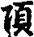



受此假境？以第八不缘假故。答：不然。其第八识，唯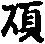



得造疲息等之能造四大，犹有四大，方造得疲息等触。故第八识及身识，皆缘造疲息等触之实能造四大也。言身受者，或此等位中有此身受，或初在此位，虽顶得疲息等触，仍不觉也。后时出此等位中，方觉身上有轻安息等触。故知触显前第八识定，顶受得此境也。第八识能顶受是因，后时有身上疲息等触名果。如坐禅师在定之中，心别缘纵有身损者，此约未得定说也。但约求定之时，但作尊意，加行趣求。尊注於定初，虽身不觉劳损，后时方觉劳损也。集后果位，显因前定有，乃至非谓受数，此即是触尘。若得适悦，即是二十四触中息触也；若身损，即是二十四触中疲触也。故此身受，即是在其定触尘，非是受数。



疏不言非佛，但言有情，有不定过，乃至为有情故者，不定过失。以佛有情摄，佛智餘善心等时，即无异熟。为如许智，彼时有情摄，故智餘善心位，即有真、异熟耶？或成立有情摄故，即有真、异熟者，佛亦化现化有情。若成立具有真、异熟者，即违自宗过。若以此宗第八为喻，彼说无故，无俱不成者，然喻中则有有俱不成，无俱不成。若将第八识为喻，彼宗许我有第八识故，即能立不成者，若彼宗既不许我有第八识故，即将第八识为喻，即无第八识体。故其喻上即无能立之因、所立之宗。二立皆不成，名俱不成。若彼宗既不许我有第八识，即是无俱不成，亦不是有俱不成。又契经说有情流转五趣、四生等者，问：此第三经何故疏中不言八证中相摄耶？又问：此经唯言五趣、四生，不言三界。又问：但言生，则何须言趣？但言趣，即得，何须言生？(思之，可解。)此言正实简能趣法。乃至相似趣生者，即取所趣得身，名为趣体；亦不取中有及或业能起之法，名为趣生。



疏：外谓餘加行善及彼餘无记心、心所法长养等流色者，若生得善，即不得起；生得，唯同地起。若加行善中，闻、思慧不得起上；若加行中修慧，虽身在上界，亦得起修慧者，皆是加行善，即是上入定。若染污法，要离下地染。已上地十烦恼中，唯除嗔，餘九皆得起，乃至上界亦得起上地烦恼。如下文中谤解脱者，是名萨婆多。下界得起上二，不得起下烦恼。若四无记中，异熟心必同地，亦不得异界地得；若威仪心下，亦不得起上工巧心，上地无也。若下界亦得起上通果。无记心、心所法，身在下界，由坐得上界定，身常洁润泽，皆是上界长养色。定力长养，故无色记界无长养色；若等流色，下界不得起上界地。总而言之，有三种流：等流、流。二、异熟流，谓善、恶业招得无记果，前后相似，名流。三、长养流，或由定力长养，前后相似。若等流之色，下界不得起上界；若长养，名等流色，下界亦得起上地，上地则不能起下界异色也。



疏第七识不在此中，非共有故者，第七识亦具实、恒、遍、无、杂，四义具足，唯大乘有，是不共故，故简之也。又解云：身在下界，亦得起上地等流色。如马胜比丘往色界中，见彼梵王时，必便起彼天眼；既闻梵王语，亦须起彼天耳，方得闻声也。且若梵王语时，必须起彼天眼；若梵王语时，必须引起等流色，始能发起语言。亦通有通果色。准此道理，下界亦得起上地等流色。或如人得神通，令或大、小，皆是通果色也。若闻慧，则从境为名；思慧，从相应法为。若名修慧，当体为名。定体名修，因条得故。慧者，与定时俱慧，故名为条慧。欲界有闻慧、慧，而无修慧；色界有闻慧、修慧，而无思慧；无色界唯有修慧与无闻慧、思慧。若生得善，从所依身为名也。又无色界无长养色；若生无色，入无色界定时，则无长养色。若身在欲界，坐得无色界定时，身上所有光洁长养色，皆是色界长养色，不是无色界长养色。何以故？如人坐得无色界定，要先坐色定，然始后坐得无色界定。今此身上长养色，即是色界长养色耶？必无坐得无色界定，要先得色界定，然始得无色界定。设超地者，唯超得一地，不得超四地也。若身在下界，得超上八定，皆是加行善，故加行善许异地起及同地起。若染污法者，亦得许异地起。若未离下地染，即不得起上烦恼故。若已离下地染，即得起上地烦恼也。餘无记心、心所者，即是通果无记，亦许下地得起上地通果无记。长养色者，谓是天眼、耳根，亦许下地起上地天眼、耳根。然大小乘说别，若小乘中，六通之中天眼、耳通心、心所法，唯是无记性，不通善性。然由第六修得上地定为因，至无间道时仍未得天眼、耳通起，至解脱时方得天眼、耳通起，故定为因，引起天眼、耳通，名之为果也。若神境智通中亦一分通无记性，谓十四变化心等，其餘他心通等三通皆是善性也。若大乘中说，除天眼、耳通，若餘四通皆是善性，其天眼、耳通皆是无记性，大小乘皆是同也。然即不取天眼、耳根约为通体，唯取天眼、耳、心、心所法是遍体，故唯识云：通体唯取天眼、耳通相应慧也。大乘中说，若为戏论所知，天眼、耳通唯是无记性。今者通中心、心所皆有十一法，谓遍行五、别境五，并眼、耳识、心王也。若为利乐所起，天眼、耳通心、心所，即善性，即通二十一法。天眼、耳通体，谓遍行、别境、善十，除轻安，五识中无轻安故，并眼识心王也。其所起天眼、耳通，即是等起善通收。问：如四种善中，若善十、若十一是自性善，乞善十一相应、别境、遍行，即是相应善。其天眼、耳通既与善俱起，应是相应善，何故说是等起善耶？答：计合是相应善。如由第六识中加行闻思慧引起五识，即五识即是加行善，闻所成慧善假，思所成慧若摄。今者既由第六中修慧而引起天眼、耳通心所，天眼、耳通心所五亦假名修慧所摄，不可第六识修慧所引天眼、耳通心所，天眼、耳通心即是闻思慧摄故。思慧摄故，由第六识中修慧引起天眼、耳通心所，天眼、耳通心所即是等起善取。其实有漏五识自性是散，是不通修慧。由如苦根假名无漏，由菩萨第六识无漏心中为利有情故，所引起五识中苦根，苦根由无漏修慧引故，其苦根亦得假名无漏修慧所摄，其苦根亦是等起善收也。据实苦根不通无漏，今者天眼、耳通名修慧，苦亦然也。又大乘中第六识起加行善，所引五识，五识亦是加行善。若第六识中是生得善，所引五识，五识亦生得善，故五识与第六识必不得善。故若小乘中说五识中无加行善，其五识不由第六识引也。第六识中起加行善，其五识中还起生得善。又说五识中唯有修道烦恼，五唯修断若地。如小乘立有五类法，谓异熟、长养、等后、实於、刹那。若大乘唯立三种法：一者异熟，即业所感无记法是也；二者长养，即天眼、天耳根及餘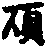



等长养色是也；三者等流，谓除前二外，餘烦恼法故。加行善、无记心、心所，皆是等流中摄，故下亦得起下地等流色也。问：如身在下地，如何不得起上界地闻慧？又问：此疏中言加行善，亦摄得福分善不？又此言加行善，即资粮加行善耶？然大乘中说有二说：一云身苦，欲界不得起色界闻慧；一云许起，若身在色界，不男不得起下欲界闻慧。第七识不在其中，非共许故者。问：第七识具、实、恒、遍，无谁四义？且如十地，身在下界，起上地法空妙观察智，其第七识平等性智随第六识，亦是上地摄，加行不名杂。若以此宗第八为喻，无俱不成者，然喻中即有有俱不成、无俱不成，喻上无能立、所立，名俱不成。然彼宗不许有第八识故，即将第八识为喻，即无第八识体故，即能立、所立皆俱不成。



疏异熟色中有九处，除声，乃至色界中全无彼者，身中五根及扶尘，皆是业感，名异熟色。若小乘宗，九处是业感，唯除声；今大乘，五根、扶根、五尘，皆是业感所感。今九处除声者，是随转理门法处有，五识心所无，色界无也。



疏五色中业所感者，即苦、乐、舍者，无色界今也。然五识中即有苦、乐、舍是异熟，若意中即有苦、乐、喜、舍是异熟，唯除其爱。



疏二禅已上无无漏诸色分别知者，二禅已上亦有形色、显色、表色，而无语业。语业声唯是初禅欲界系，故餘声亦得有之。又香、味，二色也。



疏然此虽复说不共因，乃至上亦有故者，两因共简一法，名为共因；若一因唯简一法，名为不共因。即如第七识，亦是实，是遍，是无杂，而是不恒；入初地已，有变易故。唯一恒因简去，名为不共之因者，如五色中业所感者，虽是实，无杂，而是不恒，又是不遍，即恒、遍二因简也。有一法具三因简，如身在欲界，起初禅谄、诳，此初禅谄虽是实，即是不遍，二禅已上无故；亦是杂，下界得起上地故；亦是不恒，有不起时故。今言遍、无、杂、恒三因简，无有一法得具四因简也。餘皆思取之。



疏非但一一别简，非是业果者。然将两因共简一法，名之为共；若将一共唯简得一法，名为不共。若言真异熟因，亦得简与餘法，餘法非是真异熟故也。



疏其第七识非共有故，乃至有转易故者，其第七识第三因恒字简之。且如第七识入初地已后，或转为平等性智，或入生空观，我执不行，亦有转易，亦是不恒。虽亦遍实无杂，而是不恒故。



疏若彼萨婆多不许彼不相应已者，如前第一卷末、第二卷初，以破萨婆多十四不相应说故。言不许法，皆是起生，即是命根同分及五根同分，皆是趣生体。无色界无五根，今取同分、命根等一切有部计诸无覆无记。



疏有二乘圣者，非起生摄故，乃至答应灭、离者，除佛一人非趣生摄，餘二乘、无学皆是趣生摄。又如上流不还至有顶地，有顶地无断惑道，却起下所有处无漏道能断有顶惑。若第八识者，生无色界，无色界无身。又第六识起无所有处无漏道，当尔之时，是何地趣生？为属生处，是有顶地趣生？为属起心处，是无所有处地趣？即应二趣俱灭、离失也。即摄论第三云生非想处，乃至准前释者，然今论主设许小乘说三性有漏法为趣生体者，今者即难有漏三性诸法为趣生。且如不还人身生无所有处，起无漏心时，其无漏心不是趣生体。又正起无漏心时，不可别起有漏第六识为趣生体，以无二识并生故。既第六识是无漏，无漏非趣生，解体即是灭、离。又如不还果生在有顶地，却下无所有处无漏心时，其非想地既有无漏法为趣生体，即非想地中无趣生体。又无所有处无漏心不是趣生体，即二趣皆灭、离之失。若化地部，即立有齐首补特伽罗。如不还人生在有顶地，其人即与有顶地齐，其人更不须起下无所有处无漏心，其人即任运烦恼尽而成罗汉果也。及即此最后生无色界，凡、圣非趣生者，问：此最后论文唯明不还圣者，何处言凡夫？答：然前文云此心若无，生无色界，起善等位，应非趣生者，即是明凡夫。若后文设许趣生，乃至便违正理者，即是明圣



疏：有漏是界义者，有漏三世法，皆是缚义。善法是所缘缚。戏论者，其有漏法，由如小儿终日戏於沙土之中，但虗弃功立也。



疏说为人趣，名化生者，佛身是变化，不是生摄；业或系缚，名四生故。



疏五根在自身，非己相分，他身五根者，若五根自身，即自能执文，是己相分也；若五根在他身，即非是己相分，互非己执受也。以依执受，非生执受者，此文即会瑜伽对法文也。然瑜伽论中说声者、执受者，即约依执受说，不约生执受说。其声即依执受四大种，四大种而造得此声。其能造四大既有执受，其所造之声亦名执受受也。若对法论中说声非受者，即约生执受说，不约依执受说也。其声即不生执受，而生苦、乐等受，亦不能觉痛、养等也。其身识转时，名为执受，即约同分根。即是身根正发身识，名同分也。身识不转，亦名执受，是彼类故者，即约彼同分。其身根虽不发身识，亦名执受，名彼同分。又以依执故，非生执故者，若五根、四尘本识常执，方得生；若不执者，便即烂坏，是死，不名生若，即名生执。若声虽依能造五根、四大，本识不执之，不如五根、四尘。由如人手执铜钹，铜钹上声，手不执故。本识如人手，铜钹如五根。除四尘内声，如铜钹中声，本识不执之也。即是八证。执受五因中者，即是对法论中八证也。彼言六识各别，故不能遍执者，彼言如眼识别依根，其眼识不能遍执者，彼言如眼识别依根，其眼识不能执受眼执，乃至耳识亦然。若第八识遍依五根，其第八识即能执受五根也。此中第八识佛色根证者，意说佛果第八识亦能执受佛果位五根也。证者，即下八证文，非显能执受唯异熟心，勿佛色身无执受故者，即是佛色根证也。即是八证执受五因中者，即是对法论中八证也。彼言六识各别依故不能执受者，彼言如眼识别依根，其眼识不能执受眼根，乃至耳识亦然。若第八识依五根，其第八识即能执受五根也。此中第八识佛色根证者，意说佛果第八识亦能执受佛果位五根也。证者，即下论文，非显能执受唯异熟心，勿诸佛色身无执受故者，即是佛色根证也。即一类摄尽一类，异熟、无记即双摄尽，故今说三者。问：何故前明第八识即有五因，今者明转识唯有后三因？答：前言先业所引非善染等，今言第三一类中即摄得前二因。其一类中言异熟，即摄得前文先业所引也；言无记，即摄得前非善染也。若言一类佛身中第八识唯是一类佛亦有执受，若言异熟、无记唯是有漏耶？故转识中但说后三因，不说前二因也。又前二因明本识、转识同异者，此第二解也。谓第八识即由先业所引不由现缘，若前七识即由现缘也。又第八识体非善染，故若定过，更问前七识是善染故也。非显能执受唯异熟心，佛能执心为不定故者。问：如何作比量而有不定过也？



疏等取威仪等心者，本识四无记中虽有异熟生心也。此对前说非善染等者，然今七转识中之现缘起故者，即对前第八识先业所引也。今后明前七识中言彼善染等，即对前第八识非善染等也。



疏即同摄论生不净者，彼摄论明世间清净，谓闻、思、修三慧及顺解脱、顺决择分善等；又明出世间清净，谓见、修、无学道、无漏法等；明三不净，谓烦恼不净、业不净、生不净。此是旧论文，今新翻云：谓烦恼杂染、业杂染、生杂染、色杂染、业杂染。不遮论文，今新翻云：谓烦恼杂染、业杂染、生杂染也。杂染者，即是不净也。今此已下论文，但返显本识五因得名异熟，无比量可成也。



疏：然旧作此五因，乃至勘诸八识第一执受。不见此文，但知虗读者，疏主显此唯识文胜。若读瑜伽诸论八证，若不见此论五因，彼人但知虗读。然旧五因比量，即五今喻也。今者，此论文中有三今喻。三今喻，一一皆得通於五因而作比量也。即明论师智巧便也。三喻者，如声、风等，如非择灭，如电、光等也。若除不见此五因、三喻，虽读餘论文，但知虗读也。此中更互依持之因者，然此明三法依持，即生阿含经文也。或彼设言转识有持用，而非恒持，即以此一为极成因者，若但宗许转识，而非恒持者，即是有间断。间断即彼此共许，即是极成因也。此喻有先，即以寿𤏙非能持识故者意说。若言能持识，唯取识可名能持识，其寿𤏙等非是能持识。此中作言能持，即是过也。



疏非寿与识亦如於𤏙者，𤏙，欲、色界；识，寿通无色。非寿与识亦如於𤏙，不通无色界耶？



疏应不通三性及与无漏，如寿与𤏙者，寿、𤏙是无记性，又是有漏生。既言六识能持者，应唯无记，唯有漏摄耶？



疏此亦不然。如寿能持𤏙乃至乃非无漏者，小乘难者：汝大乘若云识是无漏及通三性者，其寿、𤏙唯无记，有漏不许更互相持。难云：如寿能持𤏙、𤏙，即不是寿，二各别也。如识能持受𤏙，何妨寿、𤏙是有漏，是无记；识通三性，是无漏，二各别故。又如寿能持𤏙，可得名为寿；寿既不同持寿，寿应非是寿。



疏此意不然。谓无漏法乃至寿等为例成者，先者，大乘以自宗义答彼小乘也。大乘识是能缘见分，𤏙是相分，寿亦是种上功能，俱同无记性，同是有漏。故不可见分是无漏，相分是有漏。前岂同为难也？



疏一切中俱有此例者，如眼识能见色下，名为眼识；眼识不自见，应当非眼识耶？根中难。彼处论文中问：寿、𤏙、识三，命终之时，何者先舍？如俱舍论中第五先舍命根。若言先舍𤏙，后方舍餘二者，其无色界无𤏙，应名命终等，如前抄已解讫。然今己识种中功能为寿，即命现行望种，乃至无力引生，能持曾在者，此文即是外难也。



疏：因缘义者，非要能熏，乃至於斯义立此答也。今言因缘者，非是亲因缘，但为法生时，即藉因记缘，方得起也。著者，显也。若恶种，自力能起，不藉他力；若名言、无记种，自无力能起，要藉善、恶引，方能起耶？且如一今善业引得一今识名言种子，令生现行时，此名言种有其二力：能生同念现行，又能引一后念种智；此后念后，於同念复生现行，又能引后念种子。如是不绝，已后皆然，以为有为之法当念灭故。且如种子，前后相引，不藉能熏，亦是因缘；现行识能持诸种子，诸种子各生因现行，亦是因缘，是藉能熏。又如种现行等，皆是也。然第八现行虽不能熏，望自名言种，亦非因缘。非由第八现行识於种有力，由现行识方持种子；若无能持现行识，其种子即失等也。故现行识能持寿体，种能持现行识。又由𤏙亦疎远，能持识也；若身无𤏙，即舍第八识，故𤏙能持识也。



论云受生命终必住散心非无心定者，问：彼文中言此经通大小乘，小乘中说受生命终时皆是有心住者，小乘经部亦立五位无心，如何言生死时有心起？经部如何解也？更捡。



疏诸无学者，先入灭定，后方入无餘，乃至为命终识。彼如何成者，若依利根二乘欲入无餘依时，先游诸等至，谓有漏顺、逆等；次后即入灭定，灭定中即入涅槃。若钝根人不能入灭尽定，还入涅槃耶？即是六识而入涅槃。若将第八识为命终识，其入涅槃即是有心，非是无心，亦不是定，即非即非，定心得成。若约第六识为命终识者，即无学人在无心定而入涅槃。即绝言是散，有心不成故者，约第八识说也。说灭尽定名定中间者，次将入涅槃，诸利根人先入有心八定，次入灭尽定已，后入涅槃，即灭定在中间，故名中间也。问：若言唯利根无学先入灭定已，后入无餘涅槃，钝根不同者，何故说有根满定非满，定满根非满等？又无色界利根无学欲入无餘涅槃，如何能游诸等至耶？若意识受生、命终，乃至不相违也者，问：此文是大乘、小乘，何计此第二解？即设纵他宗不正义，即约第六识为受生命终识，即不约第八识说也。即会瑜伽论云：彼说无学入灭定，无六识而入涅槃者，即由无学愿力故也。然经中说散有心而得命终者，触异生及有学命终说也。其异生故，及有学命终说也。其异生、有学受生命终，皆有第六识故。此解即不正义也。然瑜伽师生死二位乃至闷绝中摄者，然彼论说六位无心及入无餘涅槃，不别说生死二，生死二位即是闷绝中摄也。今言闷绝离生死外，为鬼药等所闷绝故者，即此唯识论言：如睡无梦，摄亦闷绝时，摄亦闷绝时。即是被鬼药等闷绝，即不约生死时名闷绝也。无心故者，萨婆多宗唯识三位无心，谓无想灭尽定、无想异熟。若餘死生位、睡眠闷绝位者，皆悉有心故。



疏先释有二者，先上世已成法师有此二解释耶？问：此人既言此国中先上世来有此二释，名先释者，先者既未释瑜伽对法论，何意上代法师即引瑜伽对法为证？思之。



疏唯以无记心命终故者，若大乘中说渐死者，将远心许通三性，近记心即是染污，即智、润、生、爱等九种命终心俱，生、爱俱故。若正，唯无记。若萨婆多宗，将死、正死心皆通三性，如俱舍抄解耶？今引对法，证命终心唯是识，唯是无记性故耶？



疏：若不然者，说无心位何不别说，乃至唯言五位者，后师解云：即许受生、命终皆有第六识也。若命终时无第六意识者，何故瑜伽论唯说五无心？谓二无心定、无相定、命想天及睡眠、闷绝，更不别说生无心、死位无心，而成世位无心。既不别说生、死二位无心，若言死位、生位无第六识者，其瑜伽说七位无心，谓二无心定、无想、异熟、睡眠、闷绝及生位及死位，故俱言餘五位无心。故知生、死位时，则有第六意识耶？



疏前师解云：乃至位中摄故者，前师言：生、死二位无心者，亦即闷绝中摄故。故不别说五位无心，唯有五位无心。故知生、死位无有第六识耶？



疏今助释云：是破他故，乃至比量两师者，疏主助释言：瑜伽论为破萨婆多生死时有第六识，且言生死时无第六意，唯有本识。据理而言，初生位、死位亦有第六识现起，非唯取前师一说，亦兼取第二说耶？据实而言，唯取前师说。此文唯诤第八识於生死位有、无，不约第六识也。此中所以乃至诸实共禀，众教同说者，然此中说生死位以惛昧为因，而无转识者，即诸实德皆依此义也。住圣教皆同说此生死位无转识，八惛昧为因也。以难陀论师等乃至盛当所指者，意说难陀论师等皆受信生时阙三因，而意说不得起之义也。即将生位意识以阙三因为正义也，常穿扬谈说此义也。问：此言正法藏者，为即是法藏部，为大乘中别有正法藏师？更问：住者，善也。用者，其五天笠国名因国，即三世佛、一切独觉师中皆现，能除众生贪、瞋势起病，而得清凉。由如天上月能势起，而得清凉也。旧云天竺，竺字恶故，即名天竺。由如老人诵经中须陀洹果，洹字丑，即改却洹字，名为须陀圆果。乃至法华经中言采薪及果，[屏-廾+十][屏-廾+十]字丑，故其诵经造亦改布也。旧亦名申毒国，今新云名申度，亦名五印度也。为有五大论师出世，名五月，亦名五日。光者，显也。化者，施也。名遍五天竺国故。誉美方今者，意说生位阙三因之义，亦胜今时法师所立义，今时法师亦不能造得。如此义之上，即是诸论师赞叹此前不正义，将为正义。其无识之筹已下疏文，即是疏主弹斥难陀师等名为无识之类也。筹者，类即说大唐三藏至西微破此不正三藏，意解与唯唯识论中义同。又疏主披此唯识中破此生阙三因不正义，即更益前难陀等过失。今十家唯识释既皆备具，有标为一本论，即胜义、云集、诸若、羊实，皆叙破前不正义也。或因五识乃至境珠先妙者，然正义应言由一识故引起五色，今者此师即由五识先缘五尘方引起意识，或因闻他教行引意识别生异知异见，或由定为因方引起散意识。言死位中或因五识他教等故，等故意识可有。唯正得已惛味为因者，然临死之时虽有五识及他教等为因，然由有惛昧为因，其死时意识不得起也。



疏：死位既同，更无异说乃至更增此释者。死位时，意识惛昧，不藉三因，诸师共同。今此不说生位意识，须令三因，故有异师於此别说也。



疏取增人、法，此何不说？乃至必应尔故者，问彼师言：亦有独头意识不藉五尘等三因而起，执人、执法独起者，彼师答云：意识若必藉三因方始得起，或眼识见餘事，耳闻餘声，因於五识，始得起於意识。缘五尘，必无独起意识耶？



疏或加为因，如闻、思等，或生得善引生起者，若身在欲界，由加行善，闻、思慧引，方能入定；欲界地法无修慧故，要须闻、思，始能入定。色界由加行善，闻慧引，则能入定；色界无思慧故，为有耳根，有闻、思故，其生得善亦能疎引定也。无色界闻、思慧俱无，唯有生得善，通三界有耶？然无色界中无漏心间而引起无色界修慧，修慧方引起生得善，其无漏心无间不亲引生得善也。若色界中无漏心无间或亲引起色界闻慧，闻慧方引起生得善；或无漏心无间或亲引起色界中闻慧，闻慧方引起生得善；或无漏心无间引起色界修慧，修慧方引起生得善，其无漏心无间不亲引生得善也。若色界中无漏心无间或亲引起色界中闻慧，闻慧方引起生得善；或无漏心无间或亲引起色界中闻慧，闻慧方引起生得善；或无漏心无间引起色界修慧，修慧方亲引起生得善也。其欲界中无漏心无间心能亲引起欲界生得善，或无漏无间亲能引起欲界闻思慧。问：何故上界无漏心无间不能亲引起生得善，其欲界闻中无漏无间即能亲引生得善耶？答：若欲界是散地，散地中生得善明利也。其上二界既是定地，故生得善暗劣也。故上下界生得善有别。彼初生时曾不现起者，然彼师言：由下界串习力故，后生无色界，至第二念即得现起。若初生时，初第一念无第六识。今难曰：既由上界串习力故者，即应初生时初第一念亦应第六识。今难得起。



疏即生得善，或勤烦恼，久习工巧等者，难异师曰：即前生数习生得善，或数习烦恼，或久习威仪、工巧，心初生、初念，亦应得起。若汝救言无色界中乃至要生别者，若汝言初生时由惛昧故，意识不得起者，今难曰：此即是前诸实六尘之因，由死生位，皆由有惛昧之因，何劳之中别说也？



疏：根本计麤、细意识，二意许得并生者。彼部本识计二意并生，被大乘难，二识不得并生。即转救言：麤、细二意前后起，不得并生。



疏无著摄本云：应二意识俱时转等。又依染巧故，时无漏故，意识所缘不可得故者，彼论上座部云：二识不得并生。如经说云：无处有无容二识并生，无处无容於一处所二佛出世，无处无容二轮王并出生，无处无容二独觉并出。此有三因：一、依染污故者，有二释：一云：第八识依染污末那识，八为俱有依，名为依染污也。此解不定，第六识亦依染污末那故。二、熏欲命终，命终时，第六识中即起爱、染，而闰生第八识；依第六识中，染污爱、取故，而得受生。如论云：九种命终，心俱生，爱俱故。故知依染污故，证命终时唯有第八识故。今取后解。卒被打煞者，即不同起润生爱；若渐渐病死者，即起染污闰生爱也。时无断故者，即显第八识常不断也。此上二因，俱是返显欲命终时有第八识也。第三、意识所缘不可得者，即是比量破上座部命终时有细意识量，云：汝命终时定非意识，意识所缘不可得故，如命根也。即是以汝因还破汝也。及下亦若是意识行相所缘，必可得故。若大乘中欲命终还心，餘通三性心；若命终近心，唯是染污。若萨婆多命终之时，还心、近心皆通三性。今此依染污因唯大乘有，即是第八识小乘无耶？



疏又此所依，即种子识，乃至唯识论故者，上座部细意识者，即是我大乘第八识。取他宗义，大乘总取为自己义。如上论文，取他小乘根本识、有分识等，皆总取为大乘第八识耶？比来讲摄论法师唯解难上座部无二意识得并头生，为不寻读识论文，不解总取上座部细意识为自大乘第八识也。又已前讲摄论法师等虽见摄论中难二识意俱时转等，又染污故等论文，然诸师等不知此摄论而破上座部。若读此唯识论文，方知破上座部计也。无二意识并生论者，上座部云：我不部经中唯说无三佛并出出世，无二轮王并生，无二独觉并生出世，唯有此三部经中不说。不许有二意识并生者，故许二意识并生耶？经部萨婆多师因此不许二识并生经文，还即计言六识不得并生，故单单而起耶？



疏又因明法，因有三相，乃至非正比量者，若作量云：第八识定是命终时心。因云：依染故，时无断故。则无同喻。虽有初一相，谓有遍是宗法性，即阙第二相，而无同品定有性。取此二因为比量者，即是过失。



疏意识所缘不可知者，乃至所计之识者，大乘，汝上座部。言汝所说细意识，意识所缘不可知者，即是我大乘种子识缘，身、器不等，知不可知故。汝上座师何劳虑总我第八识为汝细意识耶？



疏：且初、二意并生有难者，即有餘法师作此比量，而难上座部也。



疏亦应有麤、细二眼识，并生转识，摄如意识者，比量有不定果，为如耳识摄故，则无麤、细二识耶？为如意识、转识摄故，则有麤、细二识耶？故应宗中应言：前五识亦应有麤、细二识，并生转识摄，故如意识。无有过耶？



疏岂得随性须拨圣教者。破上座部云：如岂伴劫？我部经中无此语故，便圣教耶？



疏以三因者，此非正量者，此三因若作显自比量，即有过失。若先量云：第八识定是命终时心。因云：依染污，故时无断；意识所缘，不可知故。无有同喻，非正比量。今此前二因不作比量，但返显自第八识命终心，即取第三因返显比量。二、无过失，如疏文。上比量，可知。



疏谓立量云乃至由如色等者，此中初比量因，是彼摄论中第三因也。



疏唯第三因成是比量乃至何得悟徵者，唯第三因作返显比量，云：汝命终时，不可知故。如命根前二因但返显，不作比量耶？比来讲论法师将前二因皆作比量者，非耶？何得徒徵耶？



疏：善业从下冷，恶业从上冷，乃至最后舍故者。如有人先造恶业，应生恶趣。其人欲死时，从头至心已来先冷；正后从心慧至脚，方一时冷。若先有善业者，欲死之时，从脚至心已来先冷；已后从心至头，方一时冷也。若有餘落，华师解云：若心与踝子已下一时冷者，其人入地狱；若心与脚膝一时冷者，其人入畜生中；若心王腰已下一时冷者，其人入鬼道；若心与𮌎已下一时冷者，其人道；若心与顶已下一时冷者，其人得生天；若心与顶一时冷者，其人入圣。次上说，皆是不正义也。然此肉团心即最初生，即最后舍也。谓最初生，最后灭。然初入胎中，身如[葷-車+七]豆许大，即有肉团心也；及后正死时，其肉团心最后舍也。二、如火灾劫时，其大梵王宫最初生；后火灾虽其梵王宫，最后灭也。二、如水灾劫时，其极光净天宫亦最初生，后时起水灾时，亦最许灭也。又风灾劫时，其遍净天宫亦最初生，后时起水灾，亦最后灭也。又如风灾劫时，其遍净天宫亦最初生，后风灾起时，亦最后灭也。三深坑中，其水最在先已，后方至餘浅处，后时水欲尽时，其深坑中水最后灭也。问：肉团心取初生最后舍故，曾闻说此识最初生，此识最后灭。又初生时亦有身根，如何独说此心最初生？问：无色界中亦有最初生最后舍不生，其色界及六欲天既是作生，亦有最初生等事。又从色界及六欲天死已，亦得生餘善恶趣。其色界六欲天，亦有由下上分冷触渐起，别其北洲中死者必生天，亦有由下上分冷触渐起，乃至四恶趣中及四果人，前七地菩萨皆准此。问：渐命终者，亦有先舍五识身故者。问：其顿死者如何？



论云第六意识不住身故，乃至恒相续故者，五识各自依五色根，可依住身；若意识不依色根，名不住身也。又境不定，又意或能缘色、缘声香味等境。遍寄身中者，应云遍托身中。遍者，若与身识同缘，即是遍也；或与眼识等同缘，名不遍耶？恒相续者，意识恒常起，非如五识多有间断，唯除无心五位不现行。餘时恒常起故者，若第六识望第八识，其第六识亦间断也。第六意识恒常起现，逢境即缘即心，不同本识久住一境。定缘此境者，逢境即缘者，即是独头第六识，或依五根为门，与五识同缘时境。第八识与五根为境者，即下文中言阿赖耶识中有一类计业风所飘，遍依诸根，恒相续转也。若言依根能执受者，第六应然者，若第八识不依五根，而能执受五根者，其第六识亦不持五根，应能执受五根，故第八识即依五根，而能执受五根也。若不依能执受已，第八为不定者，意说若第六识即不依根，即本能执受；若第八识亦依五根，而能执受。若言第八不通依故，而能执受者，其第六识尔。依不能者已，第八识为不定。色文外量云：第六识定不能执受，以不通五根故，如外风声等。今化不定过去，为如第八不遍依故，第八识即能执受。汝第六识不遍依，而能执受，如风声等等。不遍依故，汝第六识不能执受。故知第八识是遍依，而能执受，即是性。引果所摄者，问：此言引果，即引前残果耶？



疏名位非色四蕴者，依俱舍论，此有多释。且一解云：为行、识中有名句故，所餘受、想、行四蕴总名名耶？又释云：四蕴心、心所法能显於境，由如於名能诠於境，从喻为名故。故此四蕴为名名。此解通大乘下文头境名言。



疏色羯罗蓝等者，如宗轮说：頞部昙，此云疱。其渐洞击，由如疮疱。閇尸者，此云渐结。彼[噯-(受-又)+(白-日+(罩-卓))]就遍，亦云閇尸。同同长，乃为凝结。犍南者，此云厚也。五有经说：七日成杂秽，二七日如疮，三七日如疮，三七日已凝结，四七日渐渐厚。菩萨入胎，不资不净，亦不渐渐增长。谓若胎即具根大，既皆顿圆，至钵罗奢佉。钵罗奢佉，此云具根。至五七日，即名此位。问：此位为是地前，为是地上菩萨？又问：声闻、独觉在五胎，与菩萨何别？识缘名色，名色缘识者，问：何故十二支中识缘名色，名色缘六处等？与此经文别，即更互相缘。又问：此言识名等，即是十二支中识名色耶？答：是。无性释云：此二皆用识为名。因缘者，问：言因缘者，为是亲因缘耶？答：仍名因缘。复引俱时因果为例。如二芦束者，问：二芦束如何得因果？答：仍名因果。故唯有意，意即为识者，然萨婆多说：初受生时有第六意识，第六意识为名外识也。实但有三，谓无识蕴故。不与名相应者，此师意说：其第六识即是名外识，其第八识不定名中识，故第六识与名不相应也。经部师等道理同此者，问：其经部计亦同萨婆多者，等者，更等取何部？答：末计也。



疏：一、俱有根曰色，等间根曰名者，彼论泛尔解：名、色非所诤，即五色根曰色，以俱有故，即取前念等无间曰名耶？第二解又云：五色根，根所依大种及根处所被能生大种者，曰色能。此中有四种：一、所造色，五根色；二、能造五根之四大种；三、扶根尘，四尘造。扶根家之能造四大与此四种，曰色也。若造五根家之四大，四大最亲，能扶五根；其次即所造扶尘色，亦次远能根。若扶根尘家之能造四大，四大唯能扶自扶尘，不亲扶五根；若望疎远少分，亦能扶也。



疏：所餘四名，要由有识，乃至故少无解。解云：所餘心、心所法曰名。第八识能执持五根扶尘等，亦是名、色相依，小乘无此也。问：唯下十二根中，其色根即在六处中摄，何故此中说五根在名、色中収耶？下自解也。



论云眼等转识摄在名中者，问：此名即言眼等五识摄在名中，下文即言羯逻蓝中无五识时，即上下二文自相违。答：下文约七日位已去，有也，无过也。彼名中识，其軄是何？第七识也。问：第七识既非业感，如何得识耶？答：今者但约相依，不依学感、非学感也。别有末那为名中识者，问：此文且言第七识为名中识，下十二支中即不取。又第七识非业感，如何自名名中识？如愚意者，言第七识为名中识者，其大乘中且约杂染缘起支说，非支皆亦名为支，已破小乘。故此疏中亦说五根亦是名色摄。若约不相杂染解者，第七及五非色摄下，第八疏中亦有此解。



疏摄论文说：香识退还者，谓诸菩萨信有第八识，作此观：行人至老死位，观此老死由杂生，由集谛故生。集谛有麤，有细。若生支是麤集谛，生现在生老故；若有支名细集谛，则从老支观此老死由谁故有？由生支故有。次生支由谁有？由有支故有。有支由谁有？由取支有。由谁有？由爱有。爱由谁故有？由受生支有。次由触支支有。然无明触所生诸受，即能为缘生爱；若不是无明触所生受，即不能为缘生爱也。乃至名色支由谁有故有？由识支故有。观至识支，即更不观，便即退还。为观识支与名色更互相依，更已，今即不观引也。识支即是第八识，今引彼文意，头有本识故。若地前、地上菩萨智欣，此观有菩萨，即不作三十四智观；若二界乘人，即作三十四智观；若二界乘人，即作四十四智观。谓观老死、老死集、老死灭、老死趣灭行，老死即是苦谛，老死集者是即集谛者，老死灭者即是灭谛，老死趣灭行者即是道谛。谓观此老死体逼迫故，即是苦谛。谓此老死由谁生意？老死从生支生故，生支是名老死果。集谛如何即得灭？此老死要由证灭故。如何能证得此灭？即由道谛故。如是乃至行行、集行、灭行、趣灭行，唯有四十四智。其无明无因故，无明不从集谛生，故无明上阙无四谛也。识若不断，惟名色得增长者，不等者，然此文剩，不学此文，即是问故。此文应言：识若何，惟名色归增长？以不誉四也。世尊！



------



## 成唯识论疏抄卷第八



北京　灵泰　撰。



疏今说有异，是说之者，然有三师不同，所以长行中说三师义异。颇设异计者，颇者，设也，设有师然。次下明受中三师者，皆是护法假作，异计心同，初能变故。所以不说者，此文即是正义，以第七识同第八识是舍受，所以第二能变中更不说。於无想中出舍根者，意说无想定心、心所皆灭，所以舍受且无，而灭舍根。



疏云此第七识即与被地能引果业之增上受类相应，缘彼业果为境界者，此师说：且如解云：有人造三恶趣业时，其恶业即与忧受俱起。其恶业既与忧受俱起，其恶业后时感第八识。生三恶趣时，其第七识缘与忧受恶业所感。得第八识时，其第七识且与忧相应。乃至如有人造五戒、十善业，其五戒、十善业即与善受俱起。其十善、五戒业后感得第八识，生人六欲天。其第七识缘第八识时，即与喜受相应。又如有人生得初二本定，其不动业则有喜受相应。此喜受俱时，不动业则感得第八识。生初二静虑，即第八识是顺喜受业。其第七识缘顺喜受不动业所感第八识时，其第七识且喜受相应。其第三、第四静虑且然为然。行乐与善受、乐受、舍受所引，且名顺乐受业果、顺舍受业果。然此师解：上二界极好。由坐得初二禅定，不动业与喜受俱。若得三静虑定，其不动业即与乐受俱。若得第四静虑定，其不动即与舍受俱。后时此不动业感第八识生。四静虑中，第七识缘彼第八识时，其第七识可与喜乐舍俱起。若欲界中有人造业，恶业与相应，与忧受相应。业后感第八识，第八识即是顺应受业果。第七识缘互忧受相应，其理可然。或有人造恶业时，即与喜乐受相应。既感恶业与喜乐受俱，岂第八识生恶趣？其第七识缘彼第八识时，其第七识与喜乐相应。或有人造恶业时，戒即善业与乐应受俱，此善业则与应乐受俱。既然感善业与应受，岂第七识於人天中顺善业与应受相应？大论云：若贪现在乐，即造非熟业，造恶业有乐受等。若贪未来乐，即造福业。若贪未来静虑乐，即造不动业。文云：若与资具，即与现在乐。若令出家，即与未来乐。若令坐禅定等，即与现在未来乐。



疏云又定地前有增上乐受，乃至唯在五识者，此中第二解：其第七识随他受，谓生第四静虑，第七识则舍受相应地法有舍受；若生第三静虑，第三静虑中有其地乐，第七识则乐受相应，第三静虑地法是乐受故，故第七识乐受乐相应。若三恶趣中多有忧共俱，忧、苦即在五识中有其忧，即第六识亦与忧俱，不与苦俱。设造恶趣业时，虽有喜、乐俱，由所感第八识受果，果处有忧受，其第七识唯忧受俱。若人、欲天中，多分有喜、乐俱，乐受即在五识中，喜受与第六识俱，第七识且与喜、乐俱，乐受即在五俱。设造福业行时，有忧、苦受，由所感生第八识他有喜，第七识且与喜俱。又静虑已上，舍受业胜；四胜虑已上，言第七识与舍受俱。若在人、欲天中，虽有舍受，而舍受业劣，即喜、乐受胜，所以不说有第七识与舍受俱。若三恶趣中，虽亦有舍受，舍受业劣，而忧、苦受胜，所以亦不说与舍受。此释胜前疏中释。



疏云：如苦乐受唯在五识，非引业俱，乃至义不说者，此师说：若第六识，则能造引业、满业二种为施；若前五识，唯造满业，不能造引业。又与相应忧受有引业，增上五识中在，即不能但说忧受。初二静虑根本意地唯有喜种，若说为有乐受者，皆义说耶？若轻安，即名调物；若言有，则言遍悦[适-古+畜]逈。初二定乐悦，五义别悦，亦不说之。唯不知意说初二静虑中虽有乐，即於喜受能悦五根，义说为乐。此论文不说初二静虑中有乐，但说有喜。问：五识依五根，必依自上地，何故第六识依第七识，即许上地第六识而依下地第七识？即如身在下地，起上地润生受等，俱生舍受第八识俱。乃至证此义者，彼论亦说俱生舍受与第七识俱。然应等皆思惟引发者，若起喜乐，应皆摄心中思惟之所引发，如思惟前恶等身起应。彼论云：若应喜乐等，当知思惟所引发；若舍受，当知任运之所引发地。如依缘等者，若第七识依他，颂中言依彼转缘彼，故颂中别说；若第八识不依他，故但与他为依，即如颂言依根本识等也。问：异熟一切种等既有不同，何故此识而不别说者，此中问意：前第八识既言异熟，其明第七识颂且应受非异熟。前时第八识颂中既言一切种，其第八识颂中应云非一切种，何故明第七识颂中不别说？答：彼是第八识自相不别义。然此明第七识自相，谓思量为性、相。问：此疏中云明异熟即是第八识故，果一切种即是第八识因有，如何乃至是第八识自相别义？答：第八识持因、果为自性，故异熟一切种是第八别义。又言染污即异彼者，又明第七识颂中言有覆无记摄，即显第七识是染污，显与彼八识别也。前言异熟即是无记，触等五同何今说者，此中问：既触等五法与第八识相应，何故第七识颂中云及触等俱，何不须说？谓加爱等者，此中答意：有何所以不须说耶？谓与第七识相应心所，与前第八识多少异。其第七识又加我、痴、我等烦恼，所以颂中重云触等者，第二、能变颂中不说遍行五数，谓唯有四惑相应，更无餘心所法故。故今说触等，辨四或成九法也。将恒转如流何故不说者，此问意：若第八识常相续至究竟位方舍，可许颂中言恒转如流。第七识因中十地起平等智，既数转易，如何颂中不说有非恒转如流？以显别於第八识



疏云此三位舍，即显非恒，如流转者，第八识至果位究竟道方转，颂中有恒转之言；第七识在於因中灭定出世道数有转易，颂中不说恒转言。以颂说三位数第七非恒，亦以说



疏云：又此若与四受相应，乃至少分断者，难前师言：若第七识与四受相应者，如且第三果杂欲界染，生初静虑时，应名断第七识心。初静虑生，应二静虑出，在三出乐等，皆少分断第七识。即於修道中以断第七识少分，如何言全？则顿即是渐，断已失。



疏云：问：若尔，欲界中乃至方欲断者，此中意且如欲界中不伏修惑者，如世间道。唯然，伏修道俱生中贪、瞋、痴等迷事麤烦恼，不能伏修道中身、边二见迷理细烦恼，及与身、边二见俱起隣迄贪、痴迷理者，且不能伏之。此修道俱生身、边二见，九品中第九见方能断第七识，九品之中且第九品断，与第六识中、边二见有何差引？答曰：彼身、边二见，则地地中第九品断。我第七识唯有顶地与下下烦恼同时顿断，与前别。虽世道不能伏身、边二见，身、边二见被伏故，且不能起。



疏云唯初地已去有行、不行，乃至亦名无动摇者，入初地已去，第六识入法空根本智及法空后得智及法空灭尽定，其第七识平等性智即行；若入(生定)空观根本智及生空观后得智及灭尽定，其第七识有漏心位平等智即不行；若成佛已去，第七识一切时常起平等智，平等智与圆镜智相续相依，尽未来际，即平等智常行。又常舍受，名无动摇故。又彼此智多起我於即大悲等者，能佛果位第七识平等智常起大悲，而现他受用身，故化十地菩萨。何以得知现他受用身即是大悲摄？答：约三德已言之：若法身，即是断德；若自受用身，即是智德；若他受用、变化身，皆名恩德。他受用及变化身，皆起大悲也。



疏云在第四静虑唯舍受者，此平等即住第四静虑。此智亦通色界六地。无色界四地虽有，多不起，唯起第四静虑尽住中多住大悲也。



疏云又设下地有平等智不变易者，设初静虑、二、三起平等智，亦唯舍受，与因位相顺，同舍受故。疏云不可定说下地第七为有顶依者，若第七识在有漏位，或在法执位，虽在下地，亦与上地第六识生空妙观察智为依。若十地位中第七识无漏位成平等性智，随在何地，初静虑、二地乃至有顶第六识入法空妙观察智。且引第七识必同地，不可无漏第七识在下地，与上地第六识法空妙观察智为依必同地。若在佛位，则不然，第七识常在第四静虑地。设第六识依有顶地以入灭尽定，且下地第七与上地第六识为依。如有难：云何果位平等智唯依第四禅，因位平等智则返餘地起？答：生死之位，下地第七识为根，发上地妙观察智。因、果既是解，何妨二位别？又问：五识依五根，必自上地。如初禅眼识，或依自地根，或依上三禅眼，必无上地眼识依下地五根。何故第六依第七，则依上、下根？如在欲界念修，起无色爱，所依根第七识即是下地，能依第六即是上。或上地欲贪终，起欲界爱，能依第六识即欲界系，所依第七识即是上地系。



疏云：言隐没，为不善言故。解云：集经论言：隐没无记、不隐没无记，是不名方言。令亲云：有覆无记、无覆无记。



疏云通三性无记摄者，第六识起三性心时，第七且常起。



疏云：摄论二本皆第一说者，然无性摄论第一、天亲亦第一中，皆明第七识是微细，即有覆无记性。一云：前问及烦恼问答心，乃至名有覆者，此中说前问者，即次前论文中云末那心所何性摄耶。末那者，是问第七心王何性摄耶者。心所者，即问与第七识相应心所何性摄耶。即论中双问心王、心所是何摄。前颂即是时第二能变颂中者，有覆无记摄。有颂中亦双明心王、心所行是有覆摄。今此已下，论文答解中唯说心所是有覆摄，不说心王是有覆摄。即论答解云：此意相应四烦恼等，乃至隐蔽自心，说名有覆。答中意显第七心王体性非染，即举同时相应四烦恼等以显心王。心王由他心所等相应染，即由心所覆心王，名为有覆。二云：或由解中唯解心所，乃至以显心王亦有覆摄者，此第二解云：唯论文解中唯解心所是有覆，谓此意相应四烦恼等，乃至名有覆，即唯前论文问中且准问心所，不问心王是何性耶。虽言末那心所所性摄耶，即举心王以显所。又前颂中云有覆无记摄，亦唯明心所是有覆性，亦不明心王是有覆性。以为与第七识俱时我痴，说为恒行共无明。恐此第七识中不共无明是不善性，说第七识中不共无明是有覆性。约界为论，无地分别者，然彼论云：谓生欲界，现末那相应心所，即欲界系。色、无色界亦尔。



疏云：对法第一，他界缘。界缘云者，烦恼缘。他界缘云亦不缘色。色等亦通者，即如身在下地，起上地天眼、耳、根及扶根尘，谓色、触等。文如马胜，变色界器也。又如色、无色天，佛边侧立。此等皆是色通异地。



疏云：若尔，命终心第六识起爱，此爱为缘，命终虑自地法为我为缘，当生虑他他法为我耶？



疏云缘未来生，即是缘自地所生虑。此别缘我唯自地者，如自地死，还生自地者，欲终时，第六识爱还起自地爱，缘自地法为我；若自地死，生他地者，即起当生地爱，缘当生地法为我。此别缘我法，自地必不缘他法为我耶？



疏云若想缘我，许亦缘他者，若总计我，即身中种子过三界，则许缘三界法为我。为简种故，论说言异熟藏识。言能种子通三界，现行藏识即自地，不可难以相应、所缘二转者。今者第七与第八识俱相从名系者，即与第七识同时四或等能转第七识，第七识是所系；同时烦恼是能系，即心王属心所。若缘缚名系者，第七识中烦恼能缚第八识，第八识是所缚；第七识烦恼是能缚，即第八识却属七识中烦恼。又第六识中烦恼亦能缚第七识，即第七识属化第六识中烦恼故。今者俱约第七识属第八者，俱故假名系。又解：此文二释：一云谓生欲界，乃如王属臣，属相应缚者，此三解中，若第一解，即恒第八识心生地，其与第七相应四惑等心所法，而第七识心王即心所属心王。若第二解中，即约第八识生欲地等，其第七识心王心所能缘他第八识，即第七心王心所是能缘，其第八识是所缘境。第七识能缘心心所属他所缘之地，能缘心心所亦属第八识所缘之境。第七心王心所如牛，第八识如。若三解，约第八识所生之地，第七识心王即属他第八识所生地中诸烦恼等，即第七心王属餘烦恼，其第七心王即属同时四烦恼相。由同时四烦恼等缚第七识心王，第七心王属同时心所烦恼，即属相应缚。其第七识心王亦属第六识中烦恼，由第六识中烦恼亦能缘第七识心王。第六识烦恼能缚他第七识心王，第七识心王属他第六识中烦恼，即第七心王属所缘缚，说第七识属第八识所生地法烦恼。



疏云：前所系言，亦通诸执，是彼颂者，前我执亦是随所生系。若是诸执，亦是随所生所系，是彼我执之类；若是平等智，即非所系，是彼无漏类故也。



疏云：彼说灭定二位中起，亦摄尽者，一解云：彼论不说灭定者，此灭定通在有学、无学二位中，智亦摄尽，所以不说。若唯法体相摄，其学、无学即不摄得灭定，灭定即是非学、非无学所摄。若约位，即亦摄得，即在学、无学二位中起故。



疏云：彼说世道伏与不伏，乃至不举灭定者，第二解云：彼大论云：世间道伏何烦恼？不伏何烦恼？因言即明出世道有学、无学伏断烦恼之位次，故且不疑明断。若伏第七识烦恼事，即不明灭尽八定，灭定非道摄故。



疏云：又彼唯约人故说二位，此依人及法说有三性立。第三解云：灭定、出世道俱是法収，若学、无学即是人摄。彼论唯自约人说，此论即约人、法说。说罗汉即是人，出世道及灭定即是法。如第八识断舍门中引对法，乃至亦通法执。约自体说者，前明第八识舍门，即引心对法。十地菩萨一切位中如罗汉然，第八识唯从烦恼乃至。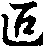



通法执。约自体说者，意说第八识名阿赖耶者，即约能缘烦恼缚说。若断却能缘烦恼，即舍赖耶之名，即舍名而不舍体。若第七识名染污者，即约第七识自体名染污。第七识体即有王障，名染污定。且不约第七识约缚名染污，后时即舍第七识自体。此中不退菩萨，乃至系舍门摄，非欲永舍者。问：十地菩萨於三位中何位摄？答：出世道摄。又问：此云不退，即是八地已上菩萨，为是初地菩萨？答：通二。又问：初地已上菩萨能断第七识中法执，以不为法执鄣菩萨。若言断者，何故此云与有顶地上上一时顿断？问：人执染二乘乃至菩萨应不舍者，此中问意，人执能染污三乘人，三乘人若未断却人执时，即不名舍藏识赖耶名。二乘断却人执时，二乘方舍藏识赖耶名。其法执既能染菩萨，八地已去菩萨有法时，八地已上菩萨应不舍藏识赖耶名。答：烦恼障麁乃至不从得名者，第一解云：若烦恼障麁，有烦恼障时可名藏识。法执即细，八地已上菩萨赖有法执，不名藏识。又烦恼染三乘乃至不名藏识者，此第二解云：然烦恼障能染三乘，若断烦恼时即舍藏名。法执唯染菩萨，菩萨有法执时不名藏识。设有执能执，亦不名藏识。问：染通三乘乃至应设优劣者，烦恼能染三乘，三乘共立藏名。法执独染菩萨，菩萨独得藏名。更应设优劣，更求异释。答：藏据缚唯在烦恼乃至且通法执者，若烦恼是缚，可得立於藏名。染体据障亦通法执，法执不立藏名也。



疏云：三乘学位灭定者，若声闻人，不还果亦得灭定；若部行中，亦有不还果而得灭定。然麟喻独觉，必无学位中而得灭定。谓彼从凡至无学位，一座不出观，即得无学位，中间更无容预而入灭定。若菩萨人，或说初地得灭定，或说八地得灭定，如下当说。



疏云此诸烦恼皆是本识种子所引者，即约第七识中烦恼，皆从第八识中种子而生，即约因缘。依以离欲，由行故者，若世间道虽伏第六识，烦恼虽已离欲界染，第七染由行故。



疏云：非所以对治及能对治境、果、缘、力差别缚者，若世间道亦不然。对治第七识中烦恼，非是世间所对治，故云非所对治。又第七识中烦恼不作对治道，能对治除烦恼，故云及能对治。故彼世道虽缘六行伏，或境界差别。故八十八云：俱生萨迦耶见，世道不伏。彼初六识中语识者，此即念问前故。此处即言：第七识极微细，与有顶地下下烦恼一时烦恼断。彼论即言：俱生萨迦耶见，世道不伏。答：此论即约第七识中我见说，彼论即约第六识中俱生身、边二见，皆世道不能伏。



疏云然不言金刚心方断者，彼论虽言萨迦耶见，然不言金刚心，故知通餘地。餘地之中，第九品断，故知彼论即约第六识中我见说。若第七识，则是金刚心断，故此不同。彼断能不伏相似者，第六识中俱生我见，则九地地皆通断善；第七识中我见，至金刚心一时顿断。若第六识中我见，且世间道不能伏；若第七识中我执，亦世间道不能伏。故云然不相似耶。又第六识中我见，即圣道能断；若第七识中我见，虽有圣道，亦不能断，即不还果；虽离欲依，不能断第七识中我见。



疏云一分或全，且不现行者，若人生空观，则一分人执不行；若第六识人法空观，则第七识中人执、法执全不现行。



疏云：若二乘、菩萨人有漏后得智者，然菩萨、二乘等虽由前无漏智引生有漏智，生有漏智虽由无漏引生，依不得名为后得智。然此有漏智但名世俱所摄，若无漏者可名后得智。二乘人且有无漏后得智，谓观十六心皆是无漏后得智。又二乘虽有根本智名为羊、鹿，而无牛车体，无无漏后得一切种智，唯佛有一切智。故知驾车法牛，先车后根本智，根本智如牛车光，后得智如车。真无我解乃至名出世道者，问：何故名真无我解？又问：何故第十论中说论后得智名世、出世道，此论文中说后得智唯名出世道？且总相说由如涅槃者，涅槃即是无心，今此灭定亦无心也。



疏云以各自地极微细者，第七识於色界自地烦恼九品之中，唯在第九品，乃至有顶皆然。



疏云欲界系生，彼相似不能发业通生等者，欲界第七识，或与有顶地第七识，或皆相似，俱不能发润生等。若无明能发业，若爱、取能润生，此第七识不润无明能发业，亦不润爱、取能润生。故知四种爱皆不是第七识，彼四种爱皆能润生故。若有难言：既有九品，乃至无九品义者，此问意即双问。难曰：若言第七识有九品，即应地地中九品别断，以除此第七识中有我见九品故。若许地地中九品别断者，其第七识即在欲界中，应有麤、细九品，非一释。上二界亦尔。又难曰：若许若七识常释故，准下下通顿断者，应三界中准有一品第七识，应无九品第七识。



疏云：由此一类，胜道方然。断彼多品之或，即第七识中或九地为九品，故云多品之或。由此应知，实有九品。如断善邪见，唯九品断。依作九品，能断善根者，如断善根，即下下品邪见，能断上上品善根；末后即起上上邪见，断第九品。下下品善根，即约尽处而言，故云一品断。据实邪见，亦作九品善根。问：见道除恶趣，恶趣之果，第八且言除。乃至能缘此识，亦应断者，此中问意：且如第八识生在地狱中，即地狱中第七识缘地狱中第八识为我；若第八识生在畜生，畜生中第七识缘畜生中第八识为我。乃至见趣亦然。乃至生北州长寿诸天亦尔。三恶趣有二种：一、地下三恶趣，二、人中三恶趣。谓如人，是人中地狱，由如八大地狱；若二形，是人中畜生；若黄门，是人中饿鬼。今者三乘人得人见道已去，即断多种三恶趣，乃断八难处，其第八识更不白多处三恶趣等中生。既所缘第八识不白三恶趣中生，其三恶趣能缘第七识，亦不向三恶趣生。缘彼三恶趣第八识，既人见道已，所缘第八识不向三恶趣受生。既言人见道断三恶趣第八识果，亦应人见道已，三恶趣中能缘第七识既不生，亦应言人见道已断能缘第七识。人见道已，即所缘三恶趣中第八识既言无，其能缘三恶趣中第八识之第七亦应断。若以不行名为断，此识可言除。若以断体除，於彼不可尔者，此第一解云：若人见道已，三恶趣中第七识虽有种子，更不得行，不执恶趣中第八识为我，可言人见道断第七识。若言人道已断第七识性种子体者，即不得此解，即义说入见道断第七识。据实入见道，不得云断第七识，故此解不尽理。约实义者，若第七识入修道断相应缚，又染依断体名为断耶？下自当知。实理解者，乃至不可以此侧彼者，此第二解云：若入见道即断，彼恶趣中不善业所招第八识果更不得生，可言入见道断三恶趣第八识果。其三恶趣中第八识果，其三恶趣中第八识果，其三恶趣中第八识种子仍在，但不生现行，即不生断，名之为断。又第八约所缘缚，名之为断。今者疏中且约三恶趣第八识果，故言不善业招，据实亦断，生北州长寿。又善业所招果，今者非约入见断第七识，故人见道断，无未断修道烦恼故。故三乘初入见道，无未断小许修道惑。若言入见道断三恶趣第七识，为其初果人合应断一分修惑，如何乃说初果人无不断修惑？故知见道不断第七识。此为胜迂会者。唯然，论中解迂会者，若顿悟菩萨心向大，一重得圣，即不名迂会。若二乘人先入小乘而得小果，后时方回心大，方得入初地，以两重得圣，方名迂会。且不约留名迂会，若约迟、疾，即地前顿悟疾、渐迟。若顿悟菩萨即经六十劫修道，即至十住；若初果人经八万劫，方至十信；若顿、渐悟二人至初地已去，即时第一种相似，更经二大劫修道，得成佛也。



疏云何故不说同第八识初师舍义为问者，此中问意，论中何故即彼决择分说不退菩萨亦名罗汉等而为门？何故此第七识不同第八识中初师皆无学位也？答：本识约究竟名舍，故约无学位。第七识通系，通我、断、说三位。



疏云：三位无义为体为义者，即安慧断第七识体，若护法断第七识染义。又为体为义者，即是名。如前舍阿赖耶识，至八地已去，即舍名而不舍体。若异熟，即成佛已去，即名、体俱舍。若第七，且舍体。若断无我执，即法执在；若断法执，即平等智在。故且约体以舍之。



疏云：然今此论不依佛地无性摄论为证义文者，疏主収安慧意云：我所引证，唯取大菩萨所遣论，取弥勒菩萨瑜伽庄严论等，不执无性小菩萨所造论为证，及亲光菩萨、亲光菩萨造佛地论。然无性及亲光皆与护法同时人也。



疏云释无学佛有漏者，无漏者，无学立无漏心，入有漏心时，亦无第七识也。



疏云逆简第八及无间缘种子等宗者，应立宗云：无染意识，意有俱生、不共、增上所缘。宗中言增所依，即简种子，种子是因缘依故。又若第六识依第七，是不共依。今云不共依，即简第八，第八是共依。若依生，即简等无间缘。若论中言不共依依者，意显所依能。论文略无所字。所所依即简种子，种子是他依。前师云：此据多分。若不尔者，非恒、定、俱者，前师会大论云第八识恒与一识俱转者，即约餘异生等说。说有染第七，即不约得圣者说。若不约凡夫说尔，唯约凡夫、圣者。既第七识体即第八识，即不与一识恒俱转，即不恒，亦不名定。



疏云：然所引识起多小中有无字乃至非七俱难者，护法难安慧云：汝若言净位无第七识者，前所引教云：藏识恒与一识俱转，所谓末那。若起意识，则二俱转；若起五识，则与俱转。若汝言性无第七识者，即无学身。若起第八，应与一俱转。乃至无学五识起时无第七识者，其第八识则与六俱转。则无七俱转，故为难。



疏云文意似有为藏识之云，乃至无藏者，此文即是前师会大论文。然大论云藏识恒与一识俱转，乃至五识起时，即七俱转者，约异生、有学说。何以故？疏言藏识即是阿赖耶识，唯异生等说与七俱转。彼论不云第八识及异熟与俱转故。故知阿罗汉第八识若起五识，即与俱转。以阿罗汉无藏识之名，藏识之名唯在异生位。有言无染，意以俱许者，能阿罗汉等三位无染第七识，即护法、安慧皆同。若护法说二乘人无染我执义，有彼法执在；若菩萨起法空智，即无染法执，还净第七识在。若安慧说说二乘位，即无法执第七识；若菩萨，即无净第七识。又彼若言经言平等智非第八者，问：何处经文说平等智非第八识？更问论云不可说彼乃至如境智者，问：此中说平等智依六识师义，即同下第十论文中说平等智依六识师义。



疏云即汝共许，许佛恒行者，然安慧即共许佛位有平等智，不许有佛第七识体。



疏云六识智有转易不恒者，佛果位入灭定前，六识不恒；若菩萨依下静虑定，引入灭定。且如加行心是初禅摄，入初禅已后，引起有顶地厌心种子，始能入灭定，为次第中最后故。



疏云即有比量相违过，乃至无比量者，若捻云此举宗，以即有比量相违。何故？此一意识半即有依、无依违比量，故名比量相违。如因明中比量相违，如说瓶等是常即是通，亦不须比量。若敬宗师解云：此中念作比量量云：除圣灭定等，餘异生一分意识亦应无依，转识摄故。知汝圣道无学，则违汝比量故。此中比量虽与后决定相违相以，然决定相违，则因中过，因违於宗而为过；若比量相违，则约宗中过，宗进於宗也。



疏云便有自法自相相违者，若捻法云：此中思量，无有法自相相违过。若敬宗师云：即有法自相相违果。谓若言许道灭定，餘异生意识定，应有依宗六识摄故。因此六识摄之因，则通有依、无依此一分，通无依此一分。通此之因，则违宗中法意识，有依法自相相违故，则有一分法自相相违。



疏云决定相违，谓彼一分意乃至如汝圣道者，若言餘圣道及学意识，餘意识必有比，依六识摄故，如前五识，即作决定相违量。云餘圣道无，学餘异生等意识亦应无，依六识摄故，如汝圣道。二乘三位法执无染，菩萨三位或净、无漏。无漏心起者，若二乘三位即有法执无染，其法执不染，二乘名为无染；若菩萨即有净，第七识不染，菩萨名染，菩萨无染。



疏云：初二阿僧祇者，是地前一阿僧祇者，是地前一阿僧祇，从初地至七地二祇。问：此但言我见，即得须臾言补特伽罗？答：鹿双。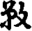



问：能缘人我，七地已前，乃至无漏心时舍者。此中问意：其七地已前，第□识中我执，若第六识入法空观，即言舍第七我执；若餘有漏心位，即不舍第七我执。如下，入无漏心亦尔。何故人无漏时，即无第七我执？其第八识，亦应舍阿赖耶名。何故七地已前，入无漏心时，不言阿赖耶名？



疏云如下，且然。舍此相应者，如下，明法。我中亦作此难。又第七识舍相应缚，名之为舍。



疏云平等智生，等流且尔，体类同故者，等流者，即是法空后得智及法空所引灭尽定，俱是根本智之等流是。



疏云唯第七识人执可鄣彼者，问：第六识中人执亦鄣彼智，何故偏说第七？答：根本也。



疏云必法空观入见道，此非三心真见道义者，三心之中许初心见道，取后二见道。何以故？初心既断烦恼鄣人执等，即是生空观，第七识中必有执现行；若后二既是法空观，第七识中则无法执。然正义家唯取一无间、一解脱，名真见道。若三心中前内遣有情假缘智，即是生空观，其第七识即起法执；若后二心即是法空观，其第七识中即起平等智。简即三心见道。



疏云：若是法观等流者，即是法观乃至即是人观者，若法空后得智及法空所引灭定，皆是法空根本智之等流。此后得智、灭尽定，皆名法空观。若由生空根本智所引起生空后得智及生空灭定，此后得智及灭定，皆名生空观。是生空观之等流。



疏云若定尔者，八地已去不出无漏，彼位何时非法观果者，此中问意：八地已上常无漏心，一切时法空观，未智何时非法观？有生空观及生空，后得灭定。



疏云：其相见道及修道乃至由第六识引生别者，若五地已上，第六法空观能双缘真、俗，且引第七识平等性智亦能双缘真、俗。若缘俗，即能缘阿赖耶识，亦不缘餘俱事。若八地已上得自在，第六识中起法空智双缘真、俗时，亦引第七识能双缘真、俗，俗中即能通缘一切相等俗事及缘第八识。若起第六识法空后得智缘似真如时，亦引起第七识平等后得智而缘似真如。若第六识中法空后得智作安立谛时，即引第七平等后得智，有二说：一云：其平等后得即缘似真如，以十地位中平等智皆不能作安立谛观。若至佛位，第七识即能作安立谛观。二云：其平等后得智唯缘似真如。若八地已上，第六识皆容后得智唯缘俗时，亦引第七平等后得智能缘餘一切俗事。理不须疑。若五地已前，若第六识法空理根本智证真如，引第七识亦起根本智能缘真。若第六识起后得有缘事，第七识亦起后得智，则缘俗、缘阿赖耶识。若第六识后得智缘似真如时，亦引平等后得智缘似真如。若第六识后得智作安立谛时，由他作安立谛，则不同正体智亲证真如；依缘四谛理，则不同缘事之智。若第六识作安立谛观时，引第七识，第七识一念之中亦能缘似真如，亦能缘第八识，其似真如即是有为俗谛摄。其第七识后得智，实是缘有为过。缘有漏第八识，亦缘无漏似真如相。真如从本质说，亦缘无漏，皆由第六意识引。若第六识化非安立谛时，则亲缘真如，能断迷事迷理烦恼，能得择灭无为。后得智化安立谛观时，则能断迷事烦恼，亦得择灭无为。若后得智得事，则不能断迷事惑。问：佛地位四智亦别起生空观以不？答：又佛果位唯有法空，观无生空，以无用故。或唯缘第八，或名缘似真如，乃至不名真俗双行者。问：此文中言或者，即是第二体不？问：此文中说第七缘似真如，由第六识心作何行相，而引缘第七缘似真如？又五地已上第七识亦能缘似真如。此文中言第七缘似真如，即约五地已前第七识中起后得智同说。答：若十地中第六识法空，后得智作安立谛观时，即引第七识平等。后得智有二说：一云缘似真如，一云唯缘俗，并如前。又解：若在佛果，乃至故知因中亦依真俗。前解为胜者，此后解即有好。难曰：何故因位平等智随於妙观同一地？五地真俗既双缘，第七随六缘真俗。若言五地第七识唯缘俗者，亦应因中平等智不随妙观同一地，故前解胜。



疏云或第八未舍名，得言缘赖耶，乃至藏义应暂舍者，此中意说：若七地已前第七识平等智，则言阿赖耶，阿赖耶识名未舍故。故平等平等智亦缘阿赖耶识。论中云等。然此疏文大诵远、近。后此疏即念：次前文中说佛地平等智缘无境识，次后即言菩萨见修道中平等智缘异熟识，次后即应言七地已前平等智亦解阿赖耶识。言此解难知。既无然藏，藏义应舍者，此文即是外难曰：若第七识入平等智时，第八识既暂无执藏之识，第八识则应暂舍阿赖耶名；第七识入圣道灭定，第七识应言缘异熟识相，暂舍我执名。答：此亦不然。若第八识许暂舍赖耶名者，即应初果。或初地菩萨亦应暂舍阿赖耶名，故知不可。其八据永舍名，所以入八地舍赖耶名；第七识我执约暂舍，所以灭定圣道舍第七识我爱执藏名。



疏云：有自胜用者，法体任持自性之胜用故。



疏云有法中据迷理人中起事执者，此疏文解不齐。何以故？法中亦有迷於事，人中亦有迷人。空理应言迷，人空理应言迷。执喻法执，迷法空理；迷人喻人执，迷生空理；迷人、法执起，喻若我执。依法执起，故邪道是高解。



疏云问：人中亦可言迷理，法中起事执者，今此相翻。又问：既言人执依事起，亦可人执迷理起；既言法执迷於理，亦可法执迷事起。



疏云罗浅喻云若执是执即执人乃至杌应非是法执者，此疏中不念作此问痴罗喻。此中问意：若先执杌已，后方执人，可许执杌是法执。执人是人执，可得人执依法执。既迷杌起人执，故迷杌不是法执。迷与执别，如何说人执依法执？



疏云境、行别者，且不俱起。今此不违，故许俱起者，若於二境之上起二执者，必不俱起；今於一境之起二执，则得俱起。顿悟菩萨许见道全，乃至即约念时，唯人、观皆。若一心见道，第六识起法空观时，即违第七识，法执不行；若约三心见道，若初心第六唯起人空观时，即第七识中识，法执现行；若起后二心，其第六识唯起法空观，即违第七识，法执不行。然正义中唯取一无间、一解脱为真见道，是正义；其三心见道，皆是相见道。若不正义，即许三心见道真是见道。



疏云：若任散定心，有漏、无漏心者，此等圣者若任散心，若任有漏定心，若有漏心，若无漏心时，皆有法执。然法有漏定有其四：一者、顺退分，若从初地至七地菩萨，或初禅定是菩萨传，或如餘异生入此定力劣，入此定则顺起诸烦恼，名为顺退分。二、顺任分，谓顺自地，则如异生、二乘七地已前菩萨，若入禅定，则顺初禅自地；若入第二禅定，则第二禅自地。乃至有顶亦尔。第三、顺决择分，即住初地已来菩萨入有漏定，能顺当来菩萨提决择念，非是加行位中顺决择分。地上菩萨不起之，得果之时，不起向彼加行位，唯顺初地决择之圣智。四、顺胜进分，七地已前菩萨乃至二乘圣生等，若入初禅定，则能引第二禅定；若入第二禅定，则能顺引第三禅定，能顺后之胜进。乃至有顶地定皆耶？若是渐、顿，有学、无学顿悟菩萨八地已上大势相似者，若有学、无学渐悟及顿悟至八地已去，以能伏我执不行，与无学渐悟至八地已去大势故。其无学渐悟能断烦恼。若七地已前，其有学渐悟及顿悟菩萨亦相似。



疏云若不能与，即应起法观乃至以为此证者，若八地已上唯无漏法观相续，如何起法执？故知亦起生空观第七识法执依起。既八地已去无漏心常相续，更无有漏心而为诵，以此为证，故知八地已去常无有漏心。



论契经说八地已上一切烦恼不得现行，唯有所依、所知鄣在者，所依者，今有二解：一云、所知鄣是所依，烦恼鄣是能依。烦恼已无，唯有所依、所知鄣立。故经云：系如曾木，依地生长。若境曾皆木，虽坏如是法，烦恼皆依无明住地而得生长。若无无明住地，其烦恼亦无。旧来皆作此解。二、第七识是第六识所依根，第六识是能依，唯有所依第七识中所知鄣悊。法云曾以此义问疏主，疏主可此解。



疏云不见餘时，第六意识唯有法执，经於一切时都无人执者，此意返显，故不见餘八地至第十地已来经一劫之中，第六识中唯起於法执，不起我执。故知第七识经此一劫之中，由起法执，第六常无漏。若七地已前菩萨，第六识中起法执。



疏云：然有别名，此不在彼，乃至非餘三者，一云：三性法总名异熟生，从异熟生即四无记，皆名异熟生。今耶无记法是异熟生，餘三非异熟生，即是总名中之别名。然无记异熟生之别，则不在彼威仪、工巧、变化等别名中摄相相。此无记异熟生是总名中异熟生摄。言四无记是总名异熟生，是此四中总名之别名，非彼三名摄。餘三不摄者，皆是异熟生摄。由如四缘，前三缘虽亦是增上缘，又显差别，分出餘前三缘。前三缘不摄者，皆增上缘摄。四无记皆是异熟生，为显差别故，如於餘三无记。餘三无记不摄者，皆是异熟生无记摄。又如三种色，虽长养色，亦从同类因生，唯是肪、肉等。但长色赖异熟色，从前善、恶业感，或是前同类生。然从善、恶业，为唯名异熟色？此二色不摄，於是等流色摄故。等流色㝡究前四无记者，或缘威仪心，或发威仪心，名威仪。又婆多第二禅借初禅天眼、耳识，皆名借威仪。此天眼、耳不是业感，不是异熟心，异熟心不借异地。又缘工巧心，或发工巧心，名工巧心故。若发业变化心，名变化心。或变化色废等，出是无记。问：变化通果心皆依定起，如何善定为因，能发无记通果？答：若在善定中，必别起无记通果心，诸善定中无此事故。恶在定已，方起无起通果心耶？



成唯识论疏抄第九末(释第五疏之二)



疏五识不能转心发业，但非随转发业，乃至及四无记具三，除变化者，若初禅心发业时，唯是第六意识。但如前起煞生时，先第六识俱时审虑思，思量前何事应煞、不应煞；起审虑思已，即起决定思，决定拟煞前人等故，即第六识作违因等起。后欲煞生时，眼等五识则须者，覔刀杖等五识但能随他意识后起，名随转发业，作近因等起，故六识亦能作近因等起。今者四无记：一者、异熟生心。此通六识，皆有，义如常释。二、威仪路者，若但言威仪体，即取身业行、住、屈、申表色是也。但取表色，不取形色，但取色青、黄、赤、白色。若威仪体，三色之中唯取等流色，等流色㝡宽，不取餘异熟色、长养色故。若言威仪路，唯取尘，亦取能三尘处，亦有香、味、触。三与色尘既不相离，故香、味、触亦是威仪路也，唯除声尘。今有二种：一者、或道路名路，即是威仪於道路上往来、行出、所游履，故亦名为威仪路也。二者、身上别引起一类等流色、香、味、触，即威仪表色之所依止，故身上四尘亦名为威仪路，即所依名处名路。超法师释：若第六识亦能发威仪，亦能缘威仪体，身业表色故。威仪体表色唯二识缘，谓第六识及眼识。若眼识亦能缘威仪路，即缘色尘故，亦能发威仪刹那等起，所引发威仪故，亦有缘仪心也。若耳识能发威仪刹那等起，发威仪故，作通因等起，不能缘威仪体。声上无威仪体故，亦不能缘威仪路，声不是威仪所依、所游履故。若鼻、舌、身三识唯能发威仪刹那等起，随转发故，亦能威仪路。香、味、触三尘是威仪所依、所游履故，不能缘威仪体。威仪体即身业，长短等表色故。已上即六识皆能发威仪。二识能缘威仪体，谓眼识、意识能缘威仪体也。四识缘威仪路，谓眼、鼻、舌、身四识也。其工巧体，唯取色、声二尘。且如声上有屈曲、嗔歌，是工巧体。若所依声，即是工巧处。屈曲显所依声，既无别体，体即是处也。若色上雕文、尅镂、屈曲等，皆是工巧体。若所依色尘，即是工巧处也。且如壁上𦘕形像等。工巧非但有色尘，尘一有餘香、味、触，与色不相离故。故香、味、触虽不是工巧体，亦是工巧处也。如作房舍等，亦是工巧处。若第六识缘工巧体，亦能第工巧处也。缘发五巧故，亦具远因等起、刹那等起因。若眼、耳二识亦能缘工巧处，亦能发工巧故，亦有刹那等起、近因等起也。若以色、声之上有工巧体，有工巧处。若鼻、舌、身三识亦能发工巧刹那，随转能发业故，亦能缘工巧处。香、味、触、尘是工巧处故，不能缘工巧体也。已上即明六识皆能发工巧。三识能缘工巧体，谓意识、眼识、耳识，此三识能缘色声工巧体，五识即能缘工巧处。问：其威仪路、工巧处，为是有情、为是无情？答：其威仪路、工巧处，即是有情数摄。问：若尔，如何前说即取外无情上道路色香味触名为威仪路，即取外无情上谓作木石及房舍壁画等处名工巧处？答：据实而言，唯取内身上所引起等流色中色香味触等名威仪路、工巧处，即取身上等流色香等四尘名路。如人行住等表色威仪时，皆依身上手足上等流色，今此身上等流色与威仪作所依故，故说身上等流色名威仪路。如人作呗赞等时，依唇舌牙齿咽喉等方得出声作呗等，今者依唇舌牙齿咽喉等等流五尘名工巧处。又如人作儛及餘工巧时，即依身上手足等上等流色五尘为工巧处。又如人手足捉笔作书或等，或手中捉斤斧等作木作时，即依手上等流五尘名工巧处也。曲此义故，其威仪路、工巧处亦是有情，如不是无情也。故取身上所引等流色为威仪路名工巧处，其威仪路、工巧处即有间断也。若身上扶尘为工巧处、威仪路者，其处与路应常相续故，如不取身上扶尘为为路也。若第八识不能缘威仪体表色，表色是假故；亦不能缘工巧，工巧体亦是假故。由是义故，前说眼等识识缘威仪体表色，及许眼、耳二识缘工巧体者，皆是许五识缘师之义。若不许五识假者，眼识等不缘威仪体及工巧体也。若义说者，既表色不离色尘，既说第八识能缘色尘故，假说第八识亦能缘威仪体。其四尘既是实有体故，说第八识既能缘五尘故，说第八识亦能缘工巧处。工巧处仍不是声上名、句、文，声上名、句、文唯意识缘之，五识不能缘名、句、文也。既佛声上屈曲为工巧，工巧是假也。若色上屈曲即名色工巧，色工巧亦是假也。若许五识缘假者，即说眼、耳二识能缘工巧体也。据实而言，其工巧体既是假，第八识不能缘工巧体。若说工巧体不离色、声二尘者，即义说第八识缘工巧体也。若出威仪体者，即用百法中表色为体，其表色体即是色中长短、方圆、高下等也。及前文说表色体，即是长短、方圆等形色是也。若长短、方圆在外五尘上，其长短等即名外色所摄。若内身上长短等色，即名为表色，表色即是长短等形色上分位差别，故威仪体即是长短等色也。由影、光、明、暗等，即是青、黄等上离色差别，此亦结也。其第七识都不能解缘工巧、威仪等也。若变化，唯第六中有五识，无变化也。若五识中唯有通果心，即如天眼、天耳通也。虽有远色之能，不能变化也。有是变化必是通果，如变化金银等是也。有通果不是变化，如天眼通是也。又如第六识中死生智通，依眼门中能远未来世中死生等事，此知唯是通果摄，不是变化也。又此变化，三慧之中唯是修慧所摄。若但言闻慧思，即是行蕴一分别境中慧也。若言闻思修慧所成，即通五蕴，亦通十界、七心界、色界、声法界。法界即除五色根及香味触。且如欲界中别解脱散律仪，若有人善解经论者，将欲受戒时发心[這-言+敗]期，誓断一切恶，誓明一切善等，即第六识中起加行闻思慧所受得别解脱戒。此等散律仪身语业色，皆是闻思修慧所成摄，所以通五蕴。若有不解经论受散律仪戒时，第六识中起生得善心，受戒时此戒即是生得善摄。若修慧既是上界通系不系，即通定共戒也。问：大乘小乘变化通果具几性？答：大乘变化通果等即具二性：若利乐有情起变化通果等，即是善性；若㛓嬉等起神通变化，皆是无记。若小乘变化通果等，准是无记性摄也。问：无色界中亦有缘威仪心，亦有缘工巧心不？若无者，云何说毗钵舍那菩萨、广慧声闻，若定若生，以无色界心了三界法？答：得。又色界中有佛菩萨异生等，色界心既遍缘，其色界亦有缘工巧心。问：八地已上菩萨入无色界定时亦能发威仪，缘威仪、缘工巧皆不更问，应捡已前抄。问：工巧体及处、威仪体及路等，亦通异熟、长养、等流已不？答：取等流如上。问：其威仪路体何故唯取表色，不取形色？其表色即是长短故。答：於内长短上分位如上。问者：佛身上扶根五尘，以威仪路、工巧处以不？若取身上扶尘以为工巧处及威仪路，其处及路应常相续，唯取无记性，不通善恶性。答：即能引起身中一类等流色为威仪、工巧处，所以威仪路、工巧处有间断也。亦不取身上扶尘五尘为威仪路、工巧处。若前抄中言取扶尘等作工巧处、威仪路等，宜应故之。结说声上有工巧者，若能歌呗等语声，即是执受大种声摄。若由手能弹筝等及口能呗佛生等，即是因俱声摄。问：若取声上屈曲次为工巧，即说耳识缘工巧体者，准前论文，声上屈曲即是名句文摄，如何耳得缘名句文？名句文与声上工巧屈曲有何别？问：因工巧体於百法中以何为体？答：假随实尘摄。问：何故长短等在外色上即名为形色？为形色若在内身上即名表色？又如前论中破萨婆多表中云：若言是形，便非实有，长等极微不可得故。故知亦依内身上表短等亦名形色，形色上假立表也。问：身上工巧体与工巧处何别？答：假实别故。



疏又非五识有二刹那相随，乃至更互而生者，此师以前解等无间缘第一师义意，说五识唯得一刹那，不得二刹那相续；亦非眼识灭已，耳识生；耳识灭已，鼻识生等。故眼识灭已，即意识生；其次即耳识生，耳识灭。又意识生本识，第七、第六识，五识中随起；本识常与三，与三识俱转。若尔，本识、五识起时，与七俱转。故知不正义也。又此师前六常得一性起，不得二性起。且如意识是差别，与一眼识是善，餘四识则不生。若意识缘是染，即与一耳识同染，餘亦不得生结。故五识三性，皆由意引。若五识三性俱生者，意识应三性故。



疏谓由了别定所缘境及种种所缘境者，定所缘者，此诸圣者或缘苦谛无常、空、无我等，或缘集谛灭等为定境。此定俱时，意识非但能缘定境，定中亦能与耳同缘声等境。此圣者以为利根无色界心能缘三界法耶？又解云：定所缘境者，即在定中唯缘真如、无相理，或缘一无常理，故定中唯缘理而不缘事。及种种所缘境者，即约定中兼缘理、事故。定不俱者，此初师虽说定中虽许同意识得与耳识同缘声境，结意、耳二识必须同性，不得别性，故定中意识善与耳识善、无记性即不得起也。



疏依多念说，名俱喻云者，如说一心，非一生灭，即是喻也。



疏：如经云：起一心多心者，由如如来初成道时，帝释於天上而生慢。佛举诸天二十二臣曰：阎浮提中有佛出世，不知是真是虗。今作一问问佛。佛若解得，即是真佛也。问：何物最为高？何物最为重？何物最为疾？何物最为多？二十二臣中有一臣答曰：二十八天最高，铁围山最为重，鹰鸟飞㝡为疾，摩伽陀国人㝡为多。帝释曰：此亦不是重，亦不多。又有臣答曰：虗空㝡为高，大地㝡为重，空中风行㝡为疾，大地草木最为多。帝释即印可此。臣远将此问佛，至於佛所，而问於佛。佛悬知此意，而答曰：知慧高於空，福德重於地，忌念疾於风，乱想多於草。今者意说，佛知慧高於虗空，虗空不是高也。由佛福重，故能令六种振动，大地不名重。由起一念时，即遍缘一切法，风行不名疾。众生忌相，一日之中起，故多於大地草，大地草少於乱想。今者多心者，即乱想也。



疏云何一念？谓世俗言说一心刹那，非生起刹那者，如言见道十六心。且如苦法智忍，或经三念、五念心，能入法起；虽经多念，事方究竟，总名一心。谓世俗言一心，非一生灭刹那名一心；今名一心刹那，於中有多心故。胜善眼染七日无记故，虽有三性者，此师意说：唯不许前六识三性俱，亦许八识三性俱者，且如起一善眼识时，第七识、第八识恒自无记故，即有三性俱。若取八识为三性俱者，即一切心法有三性俱。今者唯取前六识三性俱义。



疏即等流多，率尔少者，即眼识中有善等流，耳识有不善等流，即有二等流；即有鼻识起率尔心，即二等流、一率尔。故言等流多，率尔少耶？



疏：或三、四等多，一、二等少，解云：此中意说：或二识有等流多，一识有率尔少；有一、二相对，即二名多，一为少；或二、三相对，或二识起中率尔，三识中起等流，即二为少，三为多；或三识有率尔，二识有等流；或多、少相望，皆得作也。此中且举初率尔、举后率尔等流心以作。其中决定寻求染、净作法，皆唯率尔等流心作法也。与前解少别。



疏若一向同境时，即不善意，乃至此前师立者，此疏文意是前师释意，说三性不俱，五识不并起。



疏集量论说五俱意识必现量故者，此论文不尽理，五识俱时意识许通现量、比量二量故。



疏萨婆多师出已，方闻者，萨婆师计六识不并起，故定中唯起意识，不得耳识也。故正在定中，唯有意识；出定已后，方有五识。由如人正睡时，有意识；睡觉，方有五识起故。故出定已，有五识起，始能闻耶？



疏广慧声闻，有学、无学、无色界心，而缘三界法故者，结广慧声闻、毗钵舍那菩萨。若定若生，以无色界心了一切法，即阿罗汉中唯不动阿罗汉最利根，即身在色界，起无色界定，能缘一切法。又无色界定中起欲界耳识，能闻声，故名若定也。若生者，即身生无色界中，用无色界心了三界法。又不还中，即利根不还，能入无色界定心，缘三界法，亦能入无色界定，起欲界耳识，闻声。若声闻，即有利根；若菩萨中，或初发心小者，即不得自在定中起耳识等；若大菩萨，都慧力高，亦有利、钝故。又四善根已前，菩萨容生无色界，了一切法；若四善根菩萨，则欲界生。何以故？以欲界身入见道，以是不生无色界。问曰：小乘、大乘入见道时，依何处身入？答：若大乘、二乘人等，依九处入见道，谓欲界六天为六处，及三天下唯除北洲，餘为三处，即九处皆得入见道，大、小乘同也。又色界中必同入初果，若得，即入第三果，以为离欲故。问：北俱虑洲人命终后未知生何处？又未知造何业而生北洲？人命终之后必不重生北洲，命终之后必生天故。何以故？因前世中修道时，具作恶取空观著空见故。由前加行心是善心，遂生北俱虑洲；由作恶取空观，遂生边地难处；为前生作空观，遂今生於妻子衣服等，皆无我我所。无明行业故，北洲亦不能作，依善恶业故，令终之后皆生天也。作但恶取空观得生北洲，若拨因果即入地狱，不得生北洲。又无想者，彼命终之后必生人中，有餘恶业或入地狱。为前生修无想天业时，或拨因果后报业熟，所以入地狱。猕猴池侧者，问：为池名猕猴？为猕猴在池边，故名猕猴？又问：上了遇声，耳识与定相应，乃至由定中闻故出者，此文即解论中从定之语，有三释：初解即约定中意识起闻於声，名从定起；第二解即约定中起耳识而闻於声，名从定起；若第三解即约假者人中闻声故，即从定中起出也。



疏显扬论说种种意者，即是前因中能解声种种境，名种种立故也。



疏：此非集论本文，是师子觉义，前师引为证者解之。今言等引位中无五识者，是释杂集论。又师子觉谓不是无着集论文也。无着造餘论，皆言等引位中许有五识故也。即不许六识三性俱，即引此证定中唯是善，不得起率尔无记耳识，以为定中不得起五识故。



疏：多分有二义：一、多识，二、多人。多识者，五识中不得起餘四识，唯得起一耳识，故言多识。多人者，唯不动阿罗汉得起耳识，餘圣者不得起，故言多人也。



疏唯得起耳识，非餘四识，非菩萨故者，问：如起根本，起正解真如时，或有声，即亦得起耳识不？及十地菩萨亦准此问。又问：如二乘人断修，或时亦得起五识不？及十地菩萨起证真如，断所起障时，亦得起五识不？又问：二乘人四禅定及八未至定，中间得起欲界耳识不？又问：二乘人入四无色，若根本未至时，亦得起色界眼、耳、身三识不？又问：如大目连，由有声境至，即得起耳识；亦可在无色定时，餘色、香、味、触等境，亦应得起餘识。此等四问并未答，且亦答末后者，即是广慧。二乘人空中唯得起耳识，更不得起餘四识。言广慧者，即是随法行见至种性。人体利根，具有起慧；若餘信解种性，即是钝根，即利起慧，不名广慧也。能言毗钵舍那菩萨者，毗钵舍那亦是起慧，与前广慧名字相似也。问：名字既曰，何故不言广慧菩萨、广慧声闻，乃至言毗钵舍那菩萨、广慧声闻？答：若菩萨、声闻之上重言广慧，即名字重也。今者文势便好，故云毗钵舍那菩萨、广慧声闻也。若菩萨定中五识皆能起，如观经云：出定入定，皆闻妙法。彼经即与此中闻众声相似也。能菩萨定中亦得起眼识，即如维摩经云：有佛菩萨得真天眼，在於定中得见三千佛国。能上来论中唯证得六识，有二性俱，在定中闻声，即善与无记性俱，无三性俱起。文为证及广慧等故者，结疏中利及广慧等四字。何以故？上文已略，广慧声闻於定中唯得起耳识，非餘四识，如何下文又言非广慧？故知剩长也。



疏问：如何定中意识俱受，与耳同缘？此上文是问须也。意问既是无所有处定，其意识即是舍受也。其耳识即是欲界有苦、乐、舍三受，意识得与苦、乐、舍三受，耳识得因结也。



疏初起之时，必昧劣故，乃至必不生故者，此中答意：耳识初起率尔心时，既是昧劣，率尔必舍。意识与耳识同约声，意是舍受；耳识但是舍受，同约一散声。



疏初起之时，必昧劣故，乃至必不生故者，此中答意：耳识初起率尔心时，既是昧劣，率尔必舍受。意识与耳识同缘声，意识是舍受，耳识亦舍受，故舍受定中得起舍受。耳识若入第二禅，初禅喜、乐受定，第三禅乐受定时，必不引起率尔无记，耳识必不生故。此解即是三受不俱，师义是不正。答：且如菩萨入下三禅定，第六识与喜、乐、舍俱。其菩萨为有情故，即於定中起五识；或为有情受苦、乐，即五识中有苦受，第六识中有喜、乐受。故知六识亦得异苦受并起也。故知前说，此解不正也。



疏二解：虽同缘，何妨异受？其性亦许有不同故者，此解即是三受许俱是正义也。设第六识入定是喜、乐受，引生舍受，耳识亦得；设第六识是舍受定，引生舍受，耳识亦得也。缘起空处识处定时，亦能起耳识，与无所有处相似也。若入有顶地定，即不能起耳识，以心想暗劣，故缘准知。此间论文既言意识是无所有处，起欲界耳识者，即是下地耳识，依上地第六识分别根也。又解：疏云：问：如何定中意识俱受，与耳同缘？此已上文是问也。意问：既是无所有处定，其意识即是舍受也。其耳识即是欲界有苦、乐、舍三受，如何与舍受意识得与苦、乐、舍三受耳识为同缘？散意入舍受，乃至互又不生者，此已上文即是答也。意答：由散意即入无所有处舍受之定，即引生欲界舍受耳识。耳识率尔即是舍受故，故得同缘。若入下二禅喜、乐等定，即不能起舍受耳识。此第一解即不许意识中耳异受者，即是不正义也。取疏中第二解为正。瑜伽论说：率尔等三是无记，乃至得起几心者，此已上即有两个问：初问意引瑜伽论说：五心之中，前三心是无记。如何此与定俱时，意识所起寻求心？如何是善性？第二又问：五心之中，其定中得起几个心？唯初二心者，其定中意识唯起二心，谓率尔、寻求二心。若起寻求心时，即出定也，更不得决定染、净、等流三心也。答第二问。



疏若散五心，初三无记，乃至亦通善等者，此第二答云：今在定中闻声之时，耳识率尔是无记性；若与定俱时，第六识率尔寻求心，即是善性。瑜伽论云前三心是无记者，约餘间断六识散妄心说也。若定心既是善法，设声於声，率尔寻求心等皆善故。由此理故，餘散心若专注佛像善心时，忽有餘声等至所起率尔心、寻求心、决定心，皆是善性；若造恶时，或专注恶境，忽有餘境至率尔寻求心，皆是不善性故。若第八识，唯有率尔决定心；若初声境至亦有率尔心，义说有之也。若第七识，亦义说有决定染、净等流，无率尔寻求心故也。



疏又五识必由寻、伺所引，此入定心乃至后无寻、伺故者，此中间意：五识五起时，皆由寻、伺所引起；此入定心既是无所有处，无寻、伺故。若入初禅定，所有寻、伺引五识；若二禅已上，五识起时，起无寻、伺引故。



疏此如第七卷寻、伺中者，如第七论文云：显多由彼起非说彼相应。疏：文中解：若约欲界及禅，初有寻、伺地，五识起时多由寻，一切识皆由寻、伺引故。自有五识时，亦不由寻、伺引起故，故言多分。若二禅已上无伺地，借初禅三识起时，必借初禅寻、伺，方能起初禅三识也。起异地识难，必须寻、伺引，故言显多由彼引起。何以故？虽是异地心引，异地耳识为身，是欲界耳识，同是欲界地故。虽是异地心引，亦无寻、伺故也。



疏又此定为唯有漏，亦通无漏者，若一切无漏，皆不离生、法二空。若不是生空观，即是法空观；若不是法空观，即是生空。无漏定皆不离二空观故。



疏又欲界耳识许异地心引，乃至无寻、意为能引耶者，此中问意可起，即是牒前答语而以问之。既说无所有处意识引异地欲界耳生，则无寻、伺引二禅已上起初禅三识，应无寻、伺意识引五识耶？



疏答：初起五识，必寻、伺、引，乃至等流心等，即是不许尔者，此中答意：二禅已上，初起初禅三识率尔心时，必由寻、伺、引；后至等流心起三识时，即无寻、伺、引。此疏文中解不正义，应云：二禅已上起三识时，为起异地识故，必须借初禅寻、伺意识能起三识。若不得寻、伺，则不能起三识故。为是异地，要须寻、伺、引。虽无所有处心引，是异地欲界耳识，为身与耳识同欲界地故。故起耳时，则即无寻、伺、引也。



疏如叙异说。别抄者，叙二师同异，如枢要说。



疏若五与意识别缘，唯第六识法处者，能不相应，非唯有一类，有百千万类不相应行故。第六识别缘法处双者，或缘五色相，或缘二十四不别相应，或缘无为等。第六意识，则与五识别缘也。



疏由此故知集量论等引，乃至亦无法执，以此为证者，结。此疏中缘五俱意识是现量者，且顺集量论文作此释也。此疏中释不尽现也。准下论文，五俱意识许通三性。虽意识或缘名教等，意识即是比量所收；或色境至眼识，缘时不癈意识俱时，眼识是现量，意识是比量也。若耳识听经之时是现量，虽意识或执我，我体常周遍，即是非量所摄；或有声境，耳识即是现量所摄。若兼有境至意，与五识俱，一时同缘，五俱意识必现量故。疏诸师於此觉、慧异说，如别抄故者，诸师於此或说五俱意识是现量，或说五俱意是比量，或说五俱意识是非量。



疏八地、二乘、凡夫位，六识、三性容俱时转者，若八地以去菩萨，五识中亦有等流、无记性等，即从前时同类因生也，亦名自性无记也。其八地已上菩萨，第六识中常无漏，其五识中亦有善性、无记性，二性俱起，无不善性。二乘、无学亦尔，结八地已上菩萨，第六识中常起无漏善，其五识中亦得起无记，亦同归此大目连入无所处无漏善，亦起欲界无记耳识也。问：王为前师，不许六识二性俱故，故今成立八地菩萨、二乘、无学许二性俱。既许二性俱，故知六识、三性得俱起故耶？此疏中言八地菩萨六识中起三性者，不能应云已上菩萨六识唯得起二性。若七地已前菩萨，既第六识起有漏心，即得起三性心。



疏若五识转依，随前二师所解位次者，五识转依有二师说：或说初地得，或说佛地得，转五识也。



疏三乘无学菩萨后得智中何性六识俱起者，若后得智度有情所引苦根，皆是善根。此苦既是善性末起，何善所摄？不是生得善摄故。此苦根既修慧所引，即是修慧成善根。若如定中起耳识同声，耳识率尔是无记性，故知后得智所引通无记故。又五识若在因中，必无有定，唯识所化起五识，方有定故。由此起十地已来菩萨及三乘后得智所引，即通善性及无记性故。若二乘人第六识无漏后得无学智，即能引起天眼、耳，起通果无记及通果善，即如二乘无学后得智中亦能起六通等。若变五尘及空中运身往来等，皆是神境起通摄。其二乘无学第六识无漏后得智中，唯能引起耳识中自性无记，自性无记亦名等流无记。其自性无记即不在四无记中异就生无记所摄，即除四无记已外，别有一类自性无记，故起无漏后起，不引起五识中异熟生无记也。其二乘人无漏后得智，以劣弱故，即在无漏后得智中不能引五识中威仪、工巧等也，二乘在善定中不能起威仪等故。若如二乘人别起作令外乞食等，即二乘人第六识入变化通果无记心中，即能起化心等，必无在善定中能起通果无记也。若在十地位中菩萨后得智中引起五识，五识亦得有少分自性无记。其无漏后得智亦能引起五识，五识中多分是善性，以无漏后得所引起故。其五识中善，即是修所成慧加行善摄。其无漏后智中不引起五识中生得善，生得善以暗劣故。其菩萨十地位中，无漏后得智亦能起无漏发威仪心，亦有缘少分发工巧，缘工巧由第六识。无漏后得智中亦能引起五识中威仪工巧心，故菩萨在定之中亦能现行、住等表色威仪而作。有情上来所起威仪工巧等，唯是善性摄，即是修所成慧加行善收。故瑜伽云：异熟生唯是无记性。威仪工巧通三性，其通果唯二性，得善及无记性也。故菩萨无漏后智中所起，皆是善性威仪工巧也。或可由无漏后得智亦得引起五识中少许无记性威仪工巧，其所引起威仪工巧但是威仪工巧类摄。其八地已去菩萨，虽第六识中无漏常相续，亦能引起五识善性威仪工巧，及通果亦引起少许无记性威仪工巧等也。故前疏中云：八地已上菩萨，五识中亦有无记，同前所说。若为利生，其所起通果即是善性；若为嬉戏，其所起通果即是无记性。若七地已来菩萨，由有嬉戏，其通果亦通无记性；若八地已上无嬉戏，故所起通果唯是善性。故菩萨亦有无漏威仪工巧等。何以得知菩萨有无漏工巧？即如佛灭后，其弥勒菩萨造降魔像等，皆是菩萨工巧心作也。其十地菩萨无漏智中，亦能引起五识。十、自性无记。自性无记亦不是四无记等摄，即别一类自性无记。自性无记亦不是由业所感得也。自性无记由如外山河。外山河等亦不是四无记中摄。何以故？若四无记中异熟生无记，即是有情如摄，名异熟生，即是业果。其山河等但增上果，非是异熟果故，不是异熟生无记所摄。其外山河等亦不是威仪工巧。威仪工巧即是有情如摄，即由缘威仪工巧心及发威仪工巧等心之所引起故。故於外山河等不是威仪工巧也。其山河等亦不是变化无记摄也。其山河即由业感，是增上果摄故。其自性无记亦结。对法论中说有五种无记：一者自性无记。自性无记者，谓外山河及名句文身及中涎𣺡，及五根上一分长养五根，此等皆是自性无记。缘五根有二种：一者异熟，谓由业之所感得者是。其异熟五根即不名自性无记。二者长养，谓由饮等之所长养。此长养五根即是自性无记。其二种五根皆不是威仪体，亦不是威仪路，亦不是工巧体，亦不是工巧处。何以故？其五根即是内处摄，其威仪工巧等即是外处收。故二种五根不是威仪工巧也。其身上扶尘亦不是威仪工巧。何以故？其身上扶尘即由饮食等之所长养，若威仪工巧即由威仪工巧之所发故。又由能缘威仪工巧心之所缘，故知由发威仪心别发起一类仪表色，而眼识缘之，亦由发工巧心发起一类工巧色声等。其五根等身上扶尘等亦不是威仪路工巧处，即由发工巧心别发起一类工巧心名工巧处，亦由发威仪心别发起一类色香味触四尘名威仪路也。二者异熟生即业果，三者威仪，四者工巧者者通果。故起十地菩萨无漏后得智中起五识中无记名自性无记，自性无记不是四无记中由如前山河等缘，七地已前菩萨有情心位亦有四无记也。若如来果亦有无漏威仪工巧通果，若报身化身亦有行住等威仪心工巧，佛亦有工巧。若言佛无威仪者，是佛无行住等耶？若佛无工巧者，岂佛拙於餘凡夫缘，故起佛亦有威仪工巧通果？问：眼既有五眼，其眼识亦应有五种眼识。又问：耳根中记既无耳根内耳根，其耳根中亦应有佛耳根等五种耳根，耳识亦应有五种，乃至身根亦准此。问：既经说菩萨不起灭定而现诸威仪，其十地菩萨正入八根本定及中间禅定时，入此等有漏定时及入此等无漏根本定时，亦能缘威仪缘工巧以不？其论文说真俗两智起行



相互违合令相应闻思於义自性即无者，若言闻声即在耳识，令言闻慧者，不是闻声故名为闻慧，闻慧即是能缘教法名句文故。唯第六识中有闻慧，其耳识等即无闻慧，为耳识不能缘句文等故也。



疏谓彼所引，亦通所成者，由意识中或有闻、思、修三慧，遂引五识，亦名闻、思、修三慧；所成之中，则通五蕴。若无表色等，皆能由前闻、思、修三慧慧所引已得所成之名耶？若意识中入修慧所引起五识中善，五识中善一句名为修所成摄也。若餘异生用闻、思慧心中所受得别解脱戒，别解脱戒亦名闻、思所成；后时若欲起邪见，断善根时，前耶见加行心时，即舍却此闻、思心中所得别解脱戒。若用生得善心中受别解脱，别解脱亦是生得善摄；后时若起邪见时，即发此品邪见，而断此九品生得别解脱也。



疏成所作智即是修故者，成所作智唯有修慧，无闻、思慧故。



疏此等皆由随意引生，乃至见断故者，若意识起分别烦恼，亦引五识分别惑；若意识起俱生惑，亦引五识中起俱生惑；若意识起不善分别发业，引五识，亦缘。五识既有分别烦恼，故由通见道断烦恼。若意识中起生得善，引五识，亦是；生得加行善，亦缘。



疏缘起经说欲界意识乃至有覆性故者，且意识中深暗生爱，即九种命终俱生，故是有覆性也。餘或有持戒比丘，或修道行者等，多分常起善心。设有不悟惑，起贪、痴、慢等已，即生惭、愧悔过。由此烦恼惭、愧伏故，所起烦恼则不能发业，亦不成不善性，但名有覆，无记性所摄故。



疏缘非变化相，从四中变化所摄者，若五识唯有通果，实无变化；唯在第六识中通果，与变化相似。亦假说五识有变化，五识实无变化也。



疏五识缘威仪、工巧，不能发威仪、工巧者，五识缘威仪、工巧，如上所说。今言五识不能发威仪、工巧者，五识不能远因等起发威仪、工巧，故五识亦能刹那等起发威仪、工巧也。其威仪、工巧即通三性：若异熟生，唯一无记性；若通果，即通二性，谓无记及善性。问：何故此文即言五识缘威仪、工巧？何故次下疏又又四识缘威仪、工巧？答：此问文即是总标，故云五识缘威仪；心等下，文即别释，即言四识缘威仪。



疏不是五识实是生界系，据意识中相似者，此疏文不便也。应应变化，不是五识有，实在意识中有；不是欲界系，实在上界系文。上界能变化心次欲界，故名欲界变化，实是上界有变化故。



疏或所变化似欲界，故名为欲界变化者，或所变化境似欲界中，故名欲界。又解：大乘自能变化心所变化境，随能变识，即上界系。即欲界有情第八识托彼上界变化境以为本质，遂变色境。此欲界所变境即是欲界系。



疏或是生得变化，但是异熟心摄者，如欲界龙王及鬼，皆能生得变化。且如龙等，於空中生得变化。令下两等，若生得变化，即是善摄；若恶心变化，即是不善；若无记心变化，即是异熟生摄，实通三性。且云无记者，异熟生摄。又下欲天分亦是生得变化。又欲界诸天亦有不起通力，唯起生得变化力故。



疏：色界无工巧等者。色界既无造屋宅等，所以无工巧也。



疏：无色界又无威仪者，无色界既无有身，所以无威仪也。



疏：四、识缘威仪；五、识缘工巧。若不尔者，异熟生摄。解云：眼识能缘威仪体，并缘威仪路；耳识俱不能缘威仪也。若鼻、舌、身三识亦能缘威仪路，不能缘威仪体；若眼、耳二识能缘工巧体，亦缘工巧处；若鼻、舌、身三识唯能缘工巧处，不能缘工巧体。大乘、小乘皆得，如前抄中已说。若威仪、工巧中不摄尔者，即是异熟生摄故。今者若缘若发，皆名威仪心，故工巧等亦尔。



疏不同小乘是威仪类，名威仪心。异熟生心宽，威仪心狭者，若萨婆多计心无记中餘三即狭，威仪心宽；餘三无记中不摄者，是威仪心摄。又更别立有威仪类，且如色界中上三静虑诸天借初禅中眼、耳、身三识，故此异地借识心；四无记中不是工巧心，色界无工巧故。又不是异熟生摄，彼宗计异熟生心不许异地起，故此异地眼、耳、身识但是威仪心类摄，名为威仪类。若大乘上三地借起初禅异地三识，此异地三识但是异熟生摄。又上三禅借下初禅眼、耳、身三识，此眼、耳、身识是无记性，即是异熟生摄。大乘之中异熟生宽；餘三无记不摄者，皆是异熟生摄。若尔，心望遍行，应名心所者，此中问意，其心王亦依作意警，故其心王得生；又亦由触和合，故其心王方得生。今者即是心王依心所。若心王依心所，其心王应名心所。又解：心王不名为所，不属心故者，此文即重解第二解中第三解。第三解中云系属於心者，正解心所之义。今第二解云系乐於心者，即心王不名为所，不乐心故。



疏：虽为制二者，唯悬丞制令县，故县丞是制第二官也。若县尉等，不名制第三官，由如符上，唯即有像，故队制两人，更无餘也。县令嘱心王取总，县丞喻心所作意，兼取心王总相，亦取餘一切心所别相，县尉喻餘心所法取别相也。问：喻受、触唯取别相，可同县尉知别事而以喻之。其触、受等餘心所法，亦能心王总，亦有自取别相，如何将县尉以例之？其餘心所既能取总相，与前县丞取总、别相何？别受能了此摄受等者，问：此言摄受，即是领受之异名也。此境上别相，作意亦能了者，问：今说作意能了境上别相者，既说作意取餘五十个心所之别相时，为作意与餘心所同缘境上别相，其作意即名缘餘五十个心所之别相。若言缘上别相即名取五十个心所别相者，餘触等缘境上别相时，触亦应名餘五十个心所别相。其作意为缘餘五十心所上相分，名作意取餘心所别相，为说作意上带餘心所上行相，谓可意等相领受等，云说因相，名作意取餘心所之别相。若作意上带餘心所上行，更何用餘心所？其作意即有一切行相，故其作意应业体能领受，及起言餘语，心所应无用。乃至餘心所取心王之总相，亦准问之。已下释前此字也。



疏彼论此言，显取总相故者，论中此者，即前了此。此是此心王之总相，即此论中重。如言触能了此有总相，触能了此心王总相故。可意等相者，即触所了之别相也。



论：受能了此，此者，即是心所总相，受能了心王总相故。摄受等相者，即是受之别相也，受能了自别相故。餘心所皆然。乃至餘五十一心所，皆缘心王之总相，即心所各自有自相，别相皆能缘心王之总相，心所各自有别相。乃至别境五中亦应言：欲能了此可乐事相，胜解了此决定事相，念能了此串习事相，定慧了此得失等相。乃至善十一中亦应言：信能了此心净为相，惭能了此贤善等相，愧能了此



恶等相，乃至根本烦恼贪等能了此染著等相，乃至随惑准结。故五十一心所，皆能了心王之总相，各自缘心所之别相也。唯作意虽缘心王之总相，与餘心所同体，缘作意自无别相而为所缘，即能餘五十一个心所之别相，为作意之别相也。但如作意了心王之总相时势，即了触之可意等相，受之舍受等相，即别了餘心所之别相，取为作意之别相也。乃至五十一心所之别相，为作意之别相。



论云：欲亦能了可乐事故，乃至定慧亦无得失等相者，结论文说五别境中，即言亦者，亦前心王之总相，故著亦字，谓之欲能了知心王之总相，欲亦能了自欲之可乐别相，乃至定慧能了前心王之总相，其定慧亦能了自定慧得失之别相也。心所异相名异相者，别也，意说心所别相也。



疏五十三、五十五，数不同也。以开、合五见，增耶欲、解故者，结瑜伽两处文不同。且一文开五见，合邪欲、胜解，即心所，有五十五；有一种文开邪欲、胜解，合五见，即心所，即有五十三；若合五见，即五十一心所。此三文不同，即取五十一心所为正。



疏於四事可生五别境者，四事，谓：可乐境、决定境、曾习境。所记名四事。



疏等流者，同类所引义，非前、后等流也者，此疏文即简前等流果唯果唯是异时前、后起，谓前念同类因引后念等流果，即如前文种子前、后自类相生，如同类因引等流果耶？今者二十随惑即依根本烦恼分位上假立二十随惑，与根本惑相似，故名等流。其随烦恼与根本烦恼亦得同念起，亦得前、后起也。不约前同类因引后等流果，前、后相引，名等流也。



论一切时俱者，显遍行於一切时，常俱起故，惑俱故。或俱者，细五并生。时者，心起即有，故二别也。言时者，谓或一切有心皆有，或无始不比，或缘一切故。境总言时者，今解一切时者有三种：一、谓一切有心时即起，二、无始不断。无始不断者，亦是心起时即起，非是无始已来常相续，名无始不断。三者、谓缘一切境时即起，故言一切时不缘一切境，亦非相续，非心有故。故言时者，此上三问即翻前解中三法，谓翻前一切心皆有，此问名非心有即有；谓翻前无始不断，此问云亦非相续；谓翻前或缘一切境，即此问云不缘一切境也。



疏若如初说，并多分，或加行者，若如前九地，名一切地者，即欲界定，前加行中说名轻安故。



疏此所无义，应审简别者，憍亦通三界故。若小乘，眼见名见，了闻名闻，知谓意识名知，觉谓鼻、舌、身三名觉，能觉痛、苦、乐等事。若大乘，见、闻同小乘，知谓鼻、舌、身三，觉谓第六识中，非异念、心觉也。傍义也。增上出生乃至名受故通者，若言五受根即为者，苦根即不摄忧根，忧根准第六识，苦根在五识；若言喜根即不得摄乐根，乐根通五识，喜根唯在第六识。故名根者也。若言三受，即宽也。谓言乐受，即摄得喜受；若言忧受，即摄得苦受。故言受通也。



疏集色所依、集无色所依，色根相异，言别依身者，彼论：云何名身受？集色所依故。即集多极微色，而色根即受为能依，五色根为所依。五根名受所，故名身受。云何名心受？集无色所依故。若心体不是色法，故言无色；同时有心王，并作意、相、思等，有众多法，故言集也。即此心、心所是所依，受是能依。色根相异，名为身受；意根相异，名为心受。言别依身者，即受等各各别依五色根故。或第七识名别依意根，或第八识染、净通依色，五根是别依也。问：对法论中说集色所依名身受，即集众多极微而成身名集者，与此相违。前明第一论中说：大乘中诸识变时，随量大、小，顿现一相，非别变作众多极微，合成一物。如何彼论说集极微成身？答：说假



疏一云：忧根、苦皆能乃至皆通无漏者，结。今此疏文中即解论文中苦受亦犹无漏起故。文即有两解，此即初解也。若言五根，即狭也。若苦根，即不摄得忧根；若喜根，不摄得乐根。故根狭。若言三受，即宽也。苦中摄得忧，喜中摄得乐。今此论文中况言苦受亦由无漏起故。既言苦受，故摄得忧受，忧、苦二受并通无漏。若忧、苦根皆能引无漏者，此文言总也。应言忧根能引无漏，苦根被无漏所引故。



疏受宽根狭者，若但乐受，即通喜受；但言苦受，通忧受，受通名故。若言苦根，即不通忧根；若但言乐根根，即不通喜根，根义狭故。今此通中言根者，非是出生义。又解根义，但约照烛明了义、增上义以解根义。二、云五根中乃至非无漏摄者，此文即第二解也。此中意说，论但言苦受亦由无漏起故，故知论中但约苦根而说也，论中不约忧根说也。何以故？若苦根，即通对无学身中，皆得有之；若忧根，即通有学，不通无学身中有也。



疏无漏第六意识引生故，乃至精进等，故有苦根者，言无漏第六引生故者，文此中即通二乘无漏及菩萨等，即由第六识中无漏引起苦受。即如大目连得无学已，即以道眼观视世界，见母生鬼中，乃至目连大叫，驰还白佛。既言以，明知即由无漏引起苦受，即不是忧受，忧受以离欲舍故。或唯后得智可中，方起五识等者，此文即唯约菩萨，不约二乘，二乘无后得智故。结初地已上菩萨第六识无漏起后得智，为化众生入於地狱火中，火既逼身已，即有苦根起。若菩萨心生厌离，其苦即得离。或五识中精进有疲劳苦等，皆是无漏所引。结今不约化作鱼身等取肉生苦。地上菩萨化作鱼身，即无苦故；地前菩萨虽作鱼身，不是无漏所引。



疏明彼漏、无漏门，作是说者，彼瑜伽论明漏、无漏门中即明此等。



疏忧非无漏，虽亦能为无漏加行，乃至不俱起故者，若忧根能引无漏，亦不与无漏俱起，亦无漏不引忧根。若苦根或与无漏俱起，即如八地已上菩萨第六识中常起无漏，为化众生故；或入火中，其菩萨五识中亦引起苦受。故第六识虽入喜、乐定，亦与苦受五识俱起。苦根即与无漏前、后起，即如七地已前五识等中亦有苦受。或前念起无漏，后念引起苦也。若大乘中未知当知根最宽，即取见道前十五心及资粮加行位，亦名未知当知根体。此地前二位能顺无漏法，故假名无漏，以忧根为未知当知根体。若有觉体，即取有为无漏法及有漏加行善，除生得善及无学身中睡眠等法，皆名学、无学，故最宽也。问：何故名无学身中生得善即通学、无学摄？其无学身中睡眠即通学、无学摄？又道共戒、定戒、别解脱戒，皆通学、无学故。若萨婆多计，唯取见道中前十五心无漏法，名未知当知根体。若有学人身中无漏有为，名有学体；及无学人身中取无漏有为，为无学体。学、无学体者，即取二十九法，谓十大地，谓遍行五、别境善、大地法十，除无疑善根，并无表色，及寻、伺二并得，及生等四相法，及心王，合成二十九法，为学、无学体故。若学、无学身中所有有漏善法等，皆是非学、非无学摄。此有漏善，不是学人身中无漏有为，故名为非学；不是无学人身中无漏有为法，故名非无学摄。及灭尽定择灭无为，亦是非学、非无学摄。及人天顺生死福分善等，皆名非学、非无学摄也。若道共戒，即通学、无学人有；若别解脱戒及定共戒，不通学、无学人之有。定共戒、别解脱戒唯是有漏，故小乘狭也。今言非学、非无学者，不是学，亦不是无学，名非学、非无学。由如舍受，不是苦，亦不是乐，名为舍受，故小乘说为忧苦，不通无学也。



疏：十四、一分见断，一分修所断者，谓七色根、五受根、意根、命根也。今此疏中总相说，应云：五受根及意根通三断。若与分别烦恼俱起，其意即是自性断，即通见断。五受若与俱生烦恼俱起，亦自性断，亦通修道断。若五受及意根是善性、无记性，亦通缘缚断，即是修道断。若通无漏者，是非所断，即喜、乐、舍三实通无漏。即如第三禅中有无漏乐，初二禅中有说无喜，故乐实通。若忧、苦名无漏者，即假名无漏也。若五色根、男、女二根并命根，亦通二断。若入见道已去，不生三恶趣等，亦是不生，次通见、修断。若无记法，即通缘缚断，通修道。若信等五根及未知当知根，若是有漏善法，亦约缘缚断，即通修所断信等五根及未知当知根；若是有漏善法，亦约缘缚断，即通修所断信等五根及未知当知根。无漏亦通非所断摄。



疏其七色及命，由约不生断，故通见断者，若大乘中，即立有三断：不断，即唯在见道断也；二、缘缚，即唯在修道断也；三、自性断，谓烦恼等，即通见断及修断也。若小乘，唯有二断，谓自性断、缘缚断，即是不生断。且如入见道已去，即断三恶趣身、黄门、女人身、卵、湿生等，及北州及长寿天身等，得见道已，更不於此等处受生故；入见道已，所有三恶趣、黄门、女人身等中，五色根及男、女根、命根更不得生故。此等通不生断，故说七色根等通见断。若约离缚边，亦通修断也。故七色根、命等唯通见断、修断，不通非所断。今者说五根、男根、命根等，不通非所断。今者说五根、男根、命根等，不通非所断者，即约二乘及十地菩萨。谓二乘人及十地菩萨身中，五根、命根、男根唯是有漏，不通无漏，故五色根等不通非所断。若约佛身说者，即五色根、命根、男根亦通无漏，非所断也。其佛身中既有无漏五色根及命根、男根，故此五色根、男根、命根通非所断故。今约佛身说者，即十三根通三断，谓五色根、男根、命根及五受根、意根。此十三根即通见所断、非所断耶？今疏中言前六、后六，此十二一分通修断及不断，亦约二乘、十地菩萨，不约佛身说也。然此中自性断及善、无记法通缘缚断、修道断者，且如三界九地之中，地地皆有九品烦恼。且如断欲界前八品烦恼时，即唯是自性断，仍不断善、无记法；若断第九品烦恼，即是自性断；若断善、无记法，即通缘缚断。乃至有烦恼地亦然。问：男、女二根丑陋故。色界诸天尚无男根，何故如是无漏故，而得成佛？故有界根本所留身是欲界者。若尔，色男回心声闻反顿悟菩萨是色界身，以无男根，后时成佛，得有男根。又说地狱中尚无男根，已无用故，非於无间大地狱中可有希望婬欲事故。何况如来身上而成男根，於彼何用？若言三十二相中须此男根而庄严身者，既是好物，亦应色界天皆有男根，不应言男根是丑陋。故更捡释。问：由入见道故，其北州中入长寿天中等，所有信等五根更不得起，即说信等五根亦通见断，何故论中不说信等见断？其二十二根望如来说，其未知当知根既有有漏，亦通见断已不？答：即下有解，若互相显随其所应者，此中意说非但七色根、命根等通见道中不生断，其五受根、意根及信等五中亦通见道中不生断。谓未得入见道已前，或生三恶趣北洲女人身等，於彼三恶趣等身中亦起苦忧等五受，及意亦起信等五根。今者既入见道已去，更不得起恶趣等身中所有信等五根，五受根、意等永不生也，故此中信等五根亦不生断。今者皆云其信等、五受、意等，据实而言亦通见道不生断。今者其七色根、命等即不与分别俱故，所以见道中是不生断。其五受根、意虽亦是不生断耶？今五受、意根既与分别烦恼俱生故，故五受、意根即在见道中是自性断摄，不是不生断。其信等善法虽亦是见道不生断，今者信等五即摄在修道缘缚断摄也。



疏谓前六及后六者，前六者，五受根、意根。五受根、意根为前门，明十四根通见、修、断。已明，故云前也。后六者，谓信等五根及未知当知根，为信等三无漏。此八根即前十四根。已除八根，八根不通见、断等，故云后六也。



疏无漏不引，论不说之者，论文但言忧能引无漏，论亦不云无漏引起忧，以无用故；论文亦不言忧与无漏俱起故；论文但言无漏引起苦根，亦不言苦与无漏俱起，亦不言苦能引喜、乐，则通无漏，名得与无漏俱起故。



疏不可说六中是命根乃至故不可也者，亦不可说言前六中或除意根，加命根以为第六故。命根通非断，以佛身中有无漏命根故者，若尔，五色根亦应是非所断，以佛身中亦有无漏五根，故知不可取命根为前六也。无学身有，故即佛也。不取二乘无学意说，无学身中有命根故。今者取五受及意根为前六者，约二乘无学、有学及十地菩萨，不约佛果位说也。



疏信等五乃至有修断、无漏、不断者，若信等五是有漏者，即是修道中缘、缚断；若信等五通无漏者，即不断。若未知当知根既通三位，若资粮、加行位，名未知当知根者，是有漏，即修断也；若见道前十五心无漏法，名未知当知根，即是不断也。



疏随顺彼者，即是彼故。解云：若有学身有诸苦、乐受等，则名为学；若无学身有苦、乐，即名无学。



疏忧、苦二根并是学，苦根亦无学者，若忧根，唯预流果、一来果有也；若不还果，若无学果，即无忧根，忧根离欲舍故。若苦根四果人身在欲界者，许皆有苦根。忧根麤重，离欲即舍；若苦根微细，离欲不舍。由如睡眠，如不还果。无学身在欲界，虽断欲界染，亦得有睡眠；苦根亦然，故得有也。若初二果人身在欲界，回心向大，至七地已来，有漏心亦许起忧根；若八地已去，常、无漏相续，则若后二果人回心向大，十地之中皆无忧根。若顿悟菩萨身在欲界，亦有微细根，或往色界，或生色界者，忧、苦二根皆无有也。



论或总分四，谓善、不善、有覆无记、无覆无记受者，此论文且总相说，不细分别，意明三受通善、不善、有覆等四性俱起。此初说中，即有三受中随一受得，与四性俱即得也，不约一一受皆得具善等四性。乐受得与善性俱者，且如第三禅中乐受入善定等，即乐受得与善性俱。又如入二定，乐受亦得与善性俱。又如欲界中见佛等心生寿，乐受亦得与善性俱。乐受与不善性俱起者，嗔过顺境，喜乐俱故，嗔是不善性，得与喜乐俱。又如先煞生等心生喜乐，及造邪行等受乐等，即乐受与不善性俱也。若身在下三禅中，起下三禅中烦恼时，即乐受与有覆无记俱。若寻常起乐受非善非恶，即受受与无覆无记性俱。喜受与善等四俱起者，准前乐受说。若舍受与善性俱者，谓入第四禅定中，乃至有顶定，皆是舍受与善性俱。舍受与不善性俱起者，即如人间造罪等也。舍受与有覆无记性俱者，即起四禅已上烦恼，乃至与有顶地已来，即舍受与有覆无记性俱起。舍受与无覆无记性俱起可知。若忧受，唯得与善恶二性俱起。若忧财色妻子等，即忧与不善性俱。若於无上法思慕愁戚，即忧与善性俱也。其忧苦受者，即如比丘行道精进被苦，即得与善性俱，即不得与有覆无覆二性俱。若苦受，得与不善性俱。若多造罪身疲苦，即若受与不善性俱。若不造善恶业，即如人作生活等，即苦受与无覆无记俱，其苦不得与覆性俱。然此论文中，唯许意地有喜乐忧舍四受随相，其意中唯无苦受。若在下三禅中，即有意地乐，故意中亦有乐也。



论云有义，三受容各分四，乃至是无记故者，然此师即委细分别记三受，即一一受皆得与善等四性俱。若乐、喜、舍三各得与善性俱，如次前说。其苦若得与善性、不善性、无覆无记俱起，亦如前说。其苦受与有覆无记性俱起，即难知故。故今分别，若上界烦恼唯是有覆性，然无苦受也。故今分别云，若人、欲界天五识中既有苦受，其五识中既有俱生贪、痴、不发业者，即是有覆性，故知苦受得与有覆性俱。又如三恶趣中极苦处、意中忧受，唯有意识中苦、极苦处，既无分别烦恼是有覆性，故知苦受得与有覆性俱。此中意中具有五受，在下三禅意中即有乐受，若在地狱中即有苦受，受一一皆通善性、不善性、有覆性、无覆性也。



疏云五识皆通有此四性者，谓五识中即有善性、不善性、有覆性、无覆性。此论云有义三受各分四者，此师即委细说意。善性有三受者，如比丘明道精进疲苦等善，得与苦受俱；如新出定身然安善，得与乐受俱；及第三禅中乐善心，皆得与舍受俱。若不善耶行造罪等不善，得有乐受俱；若造罪疲劳等不善，得与苦受俱。舍受皆通。若忧受既是善恶性，不得有有覆无记，故今论中分别也。委细如上说是也。



疏：嗔不善故，此中除之者，嗔是不善，得与忧俱，故今除之。



疏修道烦恼及身、边二见，全是无记故者，修道烦恼一分不发业者，即是有覆无记摄。若身、边二见分别起者，能发於业，即是不善；若俱生者，皆是有覆无记。问：此苦趣中意地者，得与几烦恼、随烦恼俱起？思之。



论、瑜伽论说若任运生一切烦恼乃至一切根相应者，言任运者，即是俱生烦恼。皆於三受现行可得者，意说俱生烦恼即得与苦、乐、舍三受俱起。若遍一切识身者，遍与一切根相应者，即说贪、嗔、痴遍六识故，故云若遍一切识身也。既贪、嗔、痴三遍六识故，若五识中贪、嗔、痴即与苦、乐、舍三受俱，若第六识中贪、嗔、痴即与喜五受俱。不遍一切识身者，谓俱生身边见及慢唯在第六识中有，此慢身边见唯与意地中三受俱。若地狱第六意识中无苦者，其身边二见如何得与三受相应？不可说俱生身边二见与忧俱起，忧唯善恶性，身边是有覆性。若身边不得与苦俱者，其论文意言身边唯得与喜、舍二受，其身边见即不与意地一切根相应。故知意识中者，苦得与身边见相应也。然通六识，慢亦可然者，应言慢即不然，慢唯意识中有，疏中错亦可字也。



疏：身边二见及此相应者，俱生身边二见及俱生时隣近憍慢、贪、痴等，除嗔，皆是有覆无记性。



疏依缘起经，欲界系贪、信所伏，故有覆无记者，即诸修道禅师、行者、持戒人等，或时不觉，对境起慢、贪、痴等，不起身、语，寻即生惭、愧之所伏，故贪、痴皆不发，业不成不？答：即成有覆无记性。意识既是有覆无记，即引等流五识，亦成有覆无记。



疏如率尔等五心中，意是染、净者，意识尔时但起有覆者，若第六识起染、净时，五识率尔心，率尔心或是无覆无记性，即第六识与五识不同性。由如定中，意识是善，耳识率尔是无覆无记，即五识与意不同性。若餘时第六识中起染、净心，染、净心后若引起等流五识，五识即成善染性也。其五识即与第六识同性，谓意识是善，引生五识，五识亦善性；若意识不善，引生五识，五识亦是不善；若意识起生得善，引生五识，五识亦是生得善；若意识起闻所成、思所成等三慧等，引五识，五识亦是闻、思、修慧所成等；若意识无覆无记，引生五识，五识亦无覆无记。今既意识中有覆无记引生五识，五识亦成有覆无记性。



疏不可等流五识乃是不善、无覆摄者，不可意识是有覆无记，引生等流五识。五识是不善性，或是无覆无记性，故五识亦同意识，成有覆无记性。



疏又非有覆意识，不引五识生故者，不可言意识起善，引五识亦善；意中不善，引五识亦成；不善意中无覆无记，引五识亦无覆无记。不可言意识是有覆无记，即不引五识成有覆无记性也。故知五识与意识同有覆无记性。问：此文既说五识皆与第六同者，何故前论文说六识一念得起三性，即五识与第六识不同？性如何通？答：有同，有不。同者，多也，亦无过。疏勇跃者，勇□者，跳义；跃者，



疏随应皆乐者。若欲界五识中有乐，初禅眼、耳、身识有乐也。问：身在欲界地，初禅天眼、耳识中得有乐舍不？又问：身在上三禅眼、耳、身三识及寻、伺等，皆得有乐不？更问：



疏云未至地十一根有喜故者，初二未至有十二根，谓信等五、三无漏根、意根、舍根、喜根，即成十一根。问：何故未至定中唯言成就十一根，不言成就餘五色根及命根等耶？答：根本定中即有二种：一者、意，即得彼根本定；二者、生，即身生彼根本地中故。根本定即得者，成就五色根、色根、命根等。若未至地中唯得有定，不得身生未至定中故。未至定中唯成中一根，不得身生未至地中，故无五色根色。又大乘下三禅，若根本近分，皆通起舍受也。若萨婆多，一切未至定心皆是舍受故。若大乘，初禅未至定即乐初禅摄，乃至上地皆然。若成实论师是经部师宗，初禅未至即欲界摄，第二禅未至即初禅摄，乃至已上地皆然。大乘、小乘法等对云：初禅未至定能离欲界染上地断下地染法。既汝初禅未至即欲界摄，如何欲界自地法能离欲界自地染？故知不是耶。初未至定中即有十一根。十一根者，谓信等五、三无漏根、意、喜、舍。若初禅、二禅根本地中即有十八根，谓五色根、信等五根、三无漏根、喜、乐、舍，即除三无漏根。若第三禅根本地中即有十七根，谓二十二根中唯除意、喜、男、女也，有餘十七根。若第三禅未至定中唯有八根，谓信等五及乐、舍、意。若第四禅根本地中即有十六，谓二十二根中除忧、苦、喜、乐、男、女以外，有餘十六。若第四禅未至定中即有七，谓信等五及意舍。若空处未至定中亦唯有七，谓信等五及意舍。识处未至定中亦唯有七，谓信等五及意舍。乃至非想地未至定亦然，唯有七根。若空处、识处、无所有处，此三地中根本定中唯有十一根，谓信等五及命、意、舍根，及三无漏根。若非想地中唯有八根，谓信等五、意、命、舍。次为非想地中无漏根暗劣故，不说有无漏根也。若兼说无漏者，其非想地中唯有已知根、具知根，即无未知、当知根。若兼说二无漏根，其非想地中即有十根也。



疏但适意识及身处少分，乃至不遍悦故者，若欲界婬欲乐及第三禅乐，一切身、心一一毛孔皆遍有乐，遍五根故。若初、二未至根为前定，俱身处少分有乐，不遍五根；心中有喜，不名乐也。近於根本定，故名为近分也。如近村边，名近村也。



疏：根本、近分俱有离生喜、乐。离生喜、乐者，离生却欲界烦恼杂染法生故，得初禅定名为喜、乐。问：未至定能离下地染，其未至定得名为离生喜、乐；其根本定不能离下地染，如何名离生喜、乐？答：由未至定引起根本定，所以根本定亦名离生喜、乐。若小乘中说：一切未至定中唯是舍受，无喜、乐受故。故受生命终，皆依未至定中受生命终。小乘解：离生喜、乐别也。然未至定能离欲界恶不善法，即未至定名为离生也；其未至定中即不得名喜、乐也。由未至定离恶不善法生故，即说引生禅初根本定中；根本定中喜、乐，即根本定名为喜、乐，不得名离生也。今者大乘即同小乘中解：离生喜、乐也。问：若如小乘，未至定中无喜、乐，可许未至定名为离生，根本定名为喜、乐。即如前显扬论中：若根本定，若未至定中，皆言有离生喜、乐者，如何通初禅根本定得名离生喜、乐？唯由初未至定能离下欲染，其实唯由初未至定能离下地染，如何初禅根本得名离生喜、乐？若言由未至先离生故，引起根本定，根本定唯名喜、乐，即离与喜、乐名别者，如何显扬论说：若未至，若未至，若根本定，皆有离生喜、乐？言故乃至定生喜、乐，离喜、妙乐等者，皆唯此问。更问法师：



疏云五根虽无适悦，何不名乐者，此中问亦二，即初、未至定。五根既无适悦，何不名乐？



疏初、问离未至，亦有喜、乐者，彼论有三门明义：初门离生喜、乐，第二门明定生喜、乐，第三门离喜、乐。即彼第二门中说离生喜、乐，故言初门。



疏：少故不说相，未明前故者。然初、二未至，虽有乐少，故不说也。



疏下文以此例解地狱有忧之义，乃至以迫心施，亦得名苦者，然初、未至定中虽五根有乐，受想中有喜受，为初、未至定中以悦根少，初、二未至中不得名乐，以悦心强故。初、未至定中虽有乐，而但名喜，不名为乐。然地狱中但名为地狱中，通心劣故。所以虽有忧受，不得名忧，但名为苦也。



论：异熟、无间者。异熟者，即是第八识初受生已也。无间者，其第八识初受生王，至第二念更无间隔，即苦、忧相续，故名相续也。



疏彼五趣辨是异熟、非异熟文者，后瑜伽论约五趣中几是熟、几非异熟分别门也。



疏以苦重故，不善业类乃至总相续故，趣体故者，此师意说：若地狱中不善业重，唯招得苦受、忧受，不得起六识中舍受，舍受是寂静故。若餘鬼、畜生，虽受处不善业轻，则许招根名。此约六识可然，不同第八识虽是舍受亦许。岂不善业招？以是相续、是趣体故。



疏人、天中逼迫轻者，若六欲天亦许有忧、饥苦、害苦，唯除第六他化自在天中魔王，则无苦受，以是欲界中最是上品善业招故。



疏：若唯苦受地狱相似者，若鬼畜二处苦忧处，此苦与地狱中苦相似，亦名为苦也。



疏若杂受处容有喜、乐者，鬼、畜杂受处亦许有喜、乐。如迦栴延与屠儿夜中受八戒，自作业，后夜则受乐，自日受苦等。此等文皆是化相续赞叹八戒功德。所以古者，若若实造恶业，则令地狱中长时受；既持八戒，则令长时在人、天中受乐。岂持戒功德於地狱中杂受也？故知是化。



疏问：无分别烦恼者，此中问意既言地狱受苦尤重，即无分别忧，故忧由分别，方得生。既言无分别忧，在地狱中应无分别烦恼耶？



疏岂以第三定有乐，无分别，亦无见道等耶者，如第三禅乐中极乐至三禅受乐，无分别，亦许有分别烦恼；地狱之中是极苦受苦，受苦尤重，无分别，何妨亦有烦恼？故知地狱中亦有分别惑。此文且变质。汝不可言人等中有分别忧故，即言人中有见道烦恼；其地狱中无分别忧故，即令地狱中无分别见道惑；亦不由有分别忧故，即令地狱中无分别见道惑；亦不由有分别忧处即有见道惑，无分别忧处即言无见道惑。汝若言地狱中无分别忧故，即无别见道中，或者亦应第三禅中无分别喜，故第三禅亦名无分别，其第三禅中亦应无分别见道惑。故汝不应作如此难言：有分别见道惑不由若闻恶事，即加行，心中有忧，而起分别。地狱中若既重苦，无分别耶？



疏又彼此无分别烦恼亦无妨者，第三、禅乐极重，有容预得起横思度分别烦恼。其十六地狱令及餘纯苦鬼、畜趣一分之中极重，无容预故，不得横思计度，不得起分别烦恼。故地狱令鬼、畜一分由无分别烦恼，苦极重故，不能造报业。若许地狱中得造总报业者，即地狱中重造总报业，即地狱中无有出地狱时也。然此唯识论中即约地狱中罪人无分别故，苦尤重故，不能造总报业。然瑜伽论中说：在地狱中罪人无分别故，苦尤重故，不能造总报业。然瑜伽论中说：在地狱中罪人由阎罗王劝谏罪人，罪人不造总报业。如瑜伽论中：二十成劫满已，至住劫时，即令一人作阎罗王。次复即有众罪人生地狱中，即有牛头狱率来至罪人所，欲苦罪人。罪人不伏，打捧。其罪人遂共牛头狱率相诤击，力不伏，受罪。时是阎罗王即至罪人所，语罪人言：住！汝起此是何处？罪人若此是地狱，又问：汝知前身何处来？由造何业而来生此？其罪人即自知前身人道中来，由人中造煞生命等十恶业道而来生此处，具报於王。王言：汝既自造业，即是自作还自受，何故更拒张牛头等耶？汝若将心受罪，即有尽期，何时得出？汝更若化诤起嗔造业故，时无有出。罪人被王劝，王更不拒张，即任所四计也。今者合取处，其地狱中罪人，一即由无分别故，苦尤重故；二由有劝谏故。由此二缘故，罪人不造总报业也。若餘鬼畜杂受轻处，亦有分别烦恼能造总报业也。此中有难云：苦中极苦故，地狱即无分别忧，以无忧故无见惑。乐中极乐故，三禅即无分别喜，以无喜故亦尚无见惑。三禅最极乐，以无分别喜故有见惑。地狱极苦处，以无分别忧故有见惑。答曰：地狱忧迫苦极重无容预，无容预故无见惑。三禅极乐，地狱乐许容预，容预故有见惑。瑜伽论说：若通一切识身者，乃至意地一切根相应者，若人中地狱中五识贪痴等有覆无记者，皆三受俱。其理可然。若第六识身边二见在地狱中有覆无记性云得者，若受俱可，许皆三受。若人天第六识中身边二见等有覆无记性者，与乐舍受俱可。然人天第八应识无苦，如何言皆三受相应？皆义不成也。今约多分，且说皆言，极难解也。



疏五十七说一根善，以三性为境。二十二根中又非餘法故者，二十二根中唯忧一根，唯是善、不善性，不通无记故。忧缘善等三性为种，唯意根是善、不善，非餘根唯通不善法故。



疏除三所餘者，除三者，若即乐、喜、舍根，谓六识中容，故地狱中定不成就现行也。若初禅师，即乐、喜、舍根，谓六识中。若后师护法菩萨，除三者，即是乐、喜、忧根。此三，地狱中定不成现行也。有说：除三者，是三无漏根，现行定不成就也。



疏一向苦，鬼、畜亦尔者，若瑜伽论文，即言：一向，鬼、畜亦尔。若唯识论文中纯苦，鬼界、傍生亦尔。两文别也。



疏若杂受处，后三种现亦成就者，若鬼、畜轻受，或初师乐、喜、容、舍，亦得成就；前、后师乐、喜、忧，亦成就。



疏信等五，男、女二根或现不成，断善、不断善有一、二故者，若不断善根人，虽在大地狱中受苦，时时生厌苦心求快乐，有信等五得现行故。则如论文：愿我何时当舍此命，乃至令我受乐故。故知起信等五根，如人厌苦求乐处故。若断善根者，则不得起信等五根也。若八寒、八热地狱中，皆无男、女二根。故下文言：非於无间大地狱中可有希望婬欲事。故论文中且举极苦处无男、女根据实，而言餘等活等中亦无男、女根据实。若餘鬼、畜趣中，亦得成就男、女二根。互有、无者，若成男根，不成女根；若成女根，不成男根。故云互有、无也。



疏苦根入不定中者。前师云：五识中有苦故。五识中苦，如在地狱，或有闷绝位、死生位，则无苦根；若餘受时，则有苦根。故言入不定中也。



疏不尔，餘三即无故者，此前师云：如在地狱中，五识中常有苦，意识常有忧、喜、乐，定不成。若不约容舍三不成中为第三者，即三法中唯有喜、乐二法不成，即无第三，舍受不成故也。



疏若有言喜、乐更取一形者，以无形乃至亦无二形故者，此前师立理云：若不取容、舍不成中为第三不成者，或取一男形，或取一女形，以为第三不成中者，以恶趣中一身者之上不许有成就男、女二形故者，后师曰：岂鬼、畜生亦无二形也？然鬼、畜生亦有成就男、女二形故者，若信等五根、男、女二根及苦根，皆入不定中，或不不成故。



疏不苦乐受为纯苦暎夺，略而不论者，前师虽一分鬼、畜，时时亦有不苦不乐中容舍，为纯苦暎夺故，所以不得名舍。如第三禅，於中亦有舍受，为轻示故，唯名为乐；虽鬼、畜有不苦不乐受，为纯苦故，唯名为苦也。此论文中，若前师即是安，后师即是护法。



疏如彼六识，有时无故，不成意根者，难前师言：汝何故能依容受即言无，所依六识即言有？此所依六识如彼能依容受，亦应非有。



疏：前师言：彼即生死位，更不别有。解云：如闷绝位，即生死位摄，更不别有。



疏若以身等识定相续，乃至意识间断，五识相续者，前师本意忧根为第八，今既难忧间断已，转计忧苦根为第八，以身等五识常相续故。若尔，取苦为第八者，五识有苦，五识应常相续；意识中有忧根，忧根既不成，意应间断。



疏：问：化生，如瑜伽论第二或有具诸根者，此中而意：化生有情，诸根顿具，则有男、女根故。地狱既是化生，何故无男、女根故？



疏五根之，皆受苦故者，若触苦，即身识得；若苦受，五根皆有故。



疏：小地狱中有然等活等。地狱中即无男、女根，即无婬欲事，而起婬、贪。若大地狱中亦无婬、贪。若准正法念经，即大地狱中亦有贪欲，心有婬事。言或见依附者，识等若相触著，即身磨灭故。问：何故经中说男抱铜柱女䥫床？又如何说彼地狱中而有情欲？若有男、女根，可许地狱中而现情欲；若无男、女根，如何起情欲？又若以为缘，令其苦受，须彼一形，乃至令多为彼受苦缘者，又若地狱或得一男形，或将女形等以为受苦缘者，应地狱中一一有情身上皆须成就二形，今多受苦故；或应一令有情身上有百千个男、女形，以多为彼受苦缘



疏彼论随小乘中萨婆多等说者，然此疏中有三解：初解依小乘，后两解依大乘。此即第一解依小乘说也。若小乘萨婆多等，大、小地狱无异熟无记乐纯苦处，於中亦许有等流乐。等流乐者，即是威仪、工巧心中乐，或善、恶心中乐，名等流乐。若异熟乐者，即异熟无记性乐受。若法师解：解地狱中有苦，故名之为乐，实无乐。如人右䏝重安左䏝，亦名为乐，於中实无乐也。异熟非等流乐者，即大乘中有二解：第一解云：即约餘杂受处有等流乐，而无异熟乐，非地狱；地狱中亦无异熟乐，故地狱纯受苦处。又第二解：其地狱中无异熟，许有等流乐。



疏此名纯苦，一切皆无者，此疏文即却牒取大乘中第一解。大乘中说地狱中即无等流乐，无异熟乐故；说地狱名即无等流乐，无异熟乐故；说地狱名纯苦处故。



疏：或随小乘萨婆多等，现在意识嗔重俱故者。若萨婆多宗计，贪者喜乐俱，嗔者忧苦俱。



疏瑜伽论五十九说彼五十八乃至依麤相故现者，彼论亦言：贪者，喜、乐俱；嗔与忧、苦俱。亦随小乘说麤相说。若细分别，贪与忧、苦俱，嗔与喜、乐俱，即论下文贪遇违缘，忧、苦俱；嗔遇顺境，喜、乐俱故。



疏云：答：假相故名贪食者，若地狱中识食增，若鬼中思食增，若畜生中触食增。



疏大众部诸识并生，诸识并生，苦、忧相续者，此部六识并生，五识有苦，意识有忧，故云苦、忧相续也。



疏或依上座部计，乃至随说者，彼部计九心中有分识，名异熟识。故此论云：异熟无间，乃至引发心、寻求心等起时，即是五识，或与忧、苦相续。



疏谓经部寻、伺唯在意识者，然经部寻、伺唯在意识。所以者，寻、伺、忧俱。若萨婆多计寻、伺在五识，所以初禅已上有五识故。若意识中寻、伺有起、不起时。



疏或依弥沙塞部，计彼亦有异熟意识，意识生故者，弥沙塞者，此云化地部也。彼有意识，名异熟果。意识者，忧俱问彼六十六诸趣之中，乃至故今应解。此中问意：何故瑜伽说餘六欲天趣及人趣等有忧、苦等？即忧、苦是实，而不随他小乘语。既瑜伽等说地狱中有忧等，即言随他小乘语说地狱中有忧耶？



疏：有亦何爽者。初、二近分，虽有乐受，小故不说，但名为喜也。说地狱中腑藏间风者。即热地狱中凉风至，或从毛孔中入腑藏间，或从口中入，即外风入内身，以在腑藏而为段食也。然小乘说罪人契、䥫丸等，初入腹时，亦名段食。若起增菩萨，初地即入，变易生死。生色界者，亦无忧根。



疏：谓有报者，除忧，餘四受皆通报也。



疏何地断等，可初禅断忧，二禅断苦，第三禅断喜，第四禅断乐。定中通喜、乐受，率尔耳识但舍受故者，然第六识入下三禅定。其第六识者，即忧、喜、乐受，亦得起率尔耳识舍受。故知前文亦得异受俱起也。此中果位，谓成佛时或转得无漏，初地即得者，此疏中有二种果：一者、究竟果果，谓得成佛无漏；二者、不究竟果，即得初地无漏。正得七、六，不正通五。



疏非断漏，故名无漏者，若喜、乐受，即通无漏，能断漏故。其喜、乐、无漏圣道，俱能断，名无漏；苦根不能断漏，故但无漏引，故名无漏也。



疏：答：有即如泪，泪下如雨，即有定眼依处，非实有根，故知有也。解云：故知无色界中泪下非实是眼根，但有所依之色为例。故知无色界有佛无漏五



疏如无色界见道，傍明有种，非彼现行者，如下第七卷论中说。已上亦说也。



疏色界上三定有无漏五识，以此为例者，且如鼻、舌二识，唯有欲界系；眼、耳、身三识，欲界初禅系。其色五根即五地系，即有漏五识二地系；上三禅无有漏五识，其无漏五识即通五地有。今者有漏五根唯五地系，无色界虽无有漏五根，何妨无漏五根通六地有？疏若尔，何故第七、八无漏唯舍相应耶者，此中间意：前六识通下三静虑有，即与喜、乐相应；无漏七、八识亦通下三禅有，亦意喜、乐、舍受相应耶者，



疏以彼边际功德胜故者，一地中最为胜故，四禅之中即第四禅最为上胜。然第四禅中有上、下品，是最上品故，即是是地中最上品。最上名为边际，有其六种：一者、义无碍解，二者、法无碍解，三者、乐说无碍。入第四禅边际定，方得此三种无碍解、词无碍解、词无碍解。以是声故，即初禅系。四者、无净三昧，有阿罗汉最是人中上福田，前三果人不及此故。此阿罗汉欲入城乞食时，前加行中先作是念：一切众生入於地狱，皆由烦恼为因故。我今既是阿罗汉人中最上福田，有人供养我者，必得圣道，或得值遇诸佛，或得生天。若於我身起烦恼，落恶道，故我今以无净行。若有人嫌我立，即坐；嫌坐，即行；嫌我行，即坐等。作是思惟已，即入第四禅上品边际定无净三昧。五者、佛知如何。若欲知一切人心等，即入第四禅上品边际定，方始能知也。六者、延寿法，如阿罗汉命将终，即心作是念：我若久住於佛法中，有大利益者。遂即舍衣、钵，入僧，入第四禅上品边际定，亦能延命故。所以第四禅上品定为边际定故，故功德胜故。



疏：大悲、天住等，并多依第四住：一者、天住，即是色界天。色界，皆名天住；与诸天住，名为天住。天住之中，佛多依第四定故。二者、梵住，即修慈、悲、喜、舍四无量心，故后得生初禅第三天，作大梵王。梵天中住，故名为梵住。一界唯一梵王。若下品修者，得生梵众天；若中品明者，得生梵补天；若上品明者，得生大梵王。梵住之中，佛多住大悲心，拔苦与乐。三者、佛住，即一百三十不苦法。佛住之中多住十力，为降天、魔故。四者、圣住，即空、无愿解脱，皆通三乘得。然圣住中，佛多住空三昧，为入空三昧，故能对治烦恼魔；餘无作、无相、无愿不能对治烦恼，故所以不住。此上四住，皆约自受用佛身作也，不约化身故。



疏如不变香，香因阙故者，由如色界之中无段食故，无香、味种故，又无能感香、味业故，即阙香、味因故，即色界中不能变香、味。既无所缘之境，其能缘之识亦无，又无鼻、舌识种子。



疏不然，小乘不变香、味，乃至鼻、舌识亦有者，此疏文中不然已下，即是答也。然小乘教不许色界有香、味，又许有广慧声闻故。然大乘即许波罗蜜多菩萨、广慧声闻，色界之中能变五尘等故。又无色变境，唯名定、果，不得名通果，定、慧不约故。



疏以上无三识无漏，应言有者，此中难意：有上三禅，无有漏眼、耳、身三识；无漏三识，上三禅应言有。



疏上地五识本来无无彼种类如何有者，上三静虑，五识本来无，所以上三静虑不许有五识，五识许在初禅有故。疏：此中三解，任情取之。然疏文中之问，八地皆有，乃至彼现行，即是第一解也。或唯第四定有第七、八识，乃至无彼种类如何有，即是第二解也。又四静虑乃至如七、八识，即是第三解。其第四解，即是第三解中子段分出也。然和上又解云：第四解即是第二解，第二解中子段分出。然第一解，八识通有八地，有在难也。言餘地有种而不起者，与无何别？若四静虑中皆有五根者，四禅除无想天，有十七天，岂一佛身有十七具五根？又若发识，未知依何地五根而发於识？又第二解，七、八则在第四禅，第六识即许通八地有，其五识即许在初禅地，岂在佛果？能变之识在上地，所变五根在初禅。又下地五识，上地本识一切时起，随有身在下地，起上天眼，天眼有不起时故。又未知初禅五识为是借识力？为是起通力？未知起何识？又十地因中，平等性智、妙观察智，初禅乃至有顶。若佛果位，平等性智不随妙观察智也。又第三解中，若八识皆依第四禅者，如下俱舍论文，八地已上菩萨生第四禅，仍起初禅寻、伺，后得智中为也。说法必假寻、伺，即许上地起下地，岂佛不及菩萨等？若第六识唯依第四禅者，准下论文，妙观察成所作智，时时同断，入灭定尽，唯许大圆镜智、平等性智相续故。故知第六亦入有顶地灭尽定，又越等至不成也。今助解云：本识、第七识、五识、五根常依第四禅解也。然极难解。此中三解，任情取舍者，如遇意者，疏中言问八地乃至非彼现行为第一解，又从或第四定乃至以殊胜故为第二解，疏中言又四静虑皆有五识等，文但重摄第二解，而无别解。又从又解唯第四定有，如七、八识即是第三解。



疏无漏八识应束为义，几师所说者，此疏中三解，皆是疏主解释，应言：有无漏八识，通八地有。有义，七、八识在第四禅，五识在初禅；有义，八识总依第四也。又般若经云：如来有肉眼。肉眼见，障内色；若天眼见，障外色。不见障内，可须肉眼；天眼内、外俱见，何须肉眼？又经云：小须弥山、大须弥山、小䥫围山、大䥫围山。即一四天下有一小须弥山，一三千世界有一大须弥山。招法师难。疏主！且如四天下有一小须弥山，须弥山即有小四天王、小三十三天，乃至初禅天等。既言一三千世界有一大须弥山，亦应山上有大四天王住，亦应有大三十三天住，亦应大梵兜率陀天。法师数日不答，己后解云：大须弥山唯庄严世界，亦不安置诸天也。复是傍义也。见傍明种，非彼现行。其见道傍，如下第七卷论中说。梵云振旦国，此方云汉国，即西人唤此间汉国以为根且国。梵摩诃至那国，此云大唐国，即西国唤此大唐国以为摩诃至那国。



成唯识论疏抄第九卷末



成唯识论疏抄第十之本



北京　灵泰法师　撰



释四种无明通三界处，明八万四千心行，明有二世益方明为善，益一世非名为善，明五识能引起四无记，明得灭定人数多少，明他心智所缘半下，明六十二见中明十四不可记事。



疏云总劝教兴者，即是论中今应广显彼者差别相是也。总劝餘人智，我释遍行别境等义，教令生信，故唯识教得兴建也。



疏云心所与心为一为异者，至下论文如是六位与心为一为异文。



疏云初萨多等问，但五遍行者至下，论文如是六为与心为一，为异文。



疏云初萨婆多等问，但五遍行者，然萨婆多五遍行、五别境、十法，名遍行心起，别有今大乘。今谓五遍行，故今为问。



疏云经部师等问有实五以为遍行者，然经部师唯识受想思是三是遍行，心起则有也。然触作意虽是遍行，然是假有。今大乘五乘五遍行皆是实有，故今问假实，亦不极问遍义也。



疏云瑜伽五十六卷乃至起尽经者，瑜伽论中亦引此阿含经而明触也，前第三卷中亦引起尽经中证成触也。



疏云与受、想、思三法为依，举蕴胜者，受、想、思是三蕴摄。今触与受、想、思依者，触与三蕴为依胜故。



疏云即象随经者，此经明如等象迹，知象知处，因以世名。



疏云：四、无触蕴恒和合等。胜云：即色、受、想、行蕴恒和合故。



论云：若於此作意，即於此了别。即於此作意者，此者，此境也。此文意说心王与作意常相随起。若於此作意，即於此了别者，若作意依此境时，同时则有心王，共依之即是有心，作意亦共，心王缘之故，即有作意也。



疏云五十五所引是续，餘是论故者，然瑜伽五十五及此唯识论，此引经文证道行义者，与自唯餘明遍行义，唯引餘瑜伽、显扬论论中文证遍行义，不引经证。



论云作意心令趣自境者，若正缘此境时，即名他境也。论文无心起时无随一。



论彼定生触，必由触有者，彼定生触者，说有三和合，故能生触。必由有故者，即是由有触故，方有三相也。然此论文即同前第三论文，触依彼生，令彼知合。此之彼定生触，即同前触依彼生。必由触有者，即同前令彼和合。论云无心起时，即一随故者，无如是心起时，三受之中不具一受者，或与一苦受俱，或乐受俱，或与舍受俱，为受中通三受，不得并生，已相违故，亦心起但随得起一个受也。其思中亦云随一者，其思亦能作善、不善、无记业，既遍三三性，故一心起时，唯得起一个善性等，其三性不得并生，故言无随一也。问：其五遍行者，若明思、受文中得，即言无随一，故餘触作意相，即不云随一。答：然中即有三类，亦应言随一也。然触半即有可意触、不可意触俱相违触，触中文略，不说处理，亦合有之，与与受、思同也。若作意唯能言，唯能取境，自分齐相，处无多种，所以文中明相、作意等，不言随一。其受、想、思等皆有三种，所以文中言随一也。其触既有三种，一心起之时，亦随一一个触也。



疏云：非非青者，即说。意说是青，不是餘黄也。



疏云：所缘及处者，即是总标境也。及处者，即是取境分齐之处也。或依一处、二处为境，乃至或时缘十二处、十八界等为境，思令心取正因等相。此文造作善等者，因者，即是三性，心、心取也；相者，即是所缘境相。此文意说，即是由过不善境相故，即令心、心所起不善心有。如论中云：不善起由有三缘：一、贪等随眠未永断故，二、顺烦恼境现在前故，三、不正思、眠、修正现起故。亦过善境相，即起善心因。善心起时，亦具三缘：一、善种未被损故，二、顺善心、境现在前故，三、正思、修现前起故。由此义故，善心、心所过无记境，即起无记所。无记所起亦具二依，缘无记种子未彼损，顺无记境在前故，半之心正现起故。



疏云：下文说欲能起正懃，前解为胜者，即前解勤能，云信为能依，欲为释精进依也。



疏云说漏、无漏可假之事，乃至实可攸法者，据实言之，灭谛、道谛是可攸法，苦、集谛道可厌法，即是善、欲也。今此中正义，若於恶、无记三性法等所乐者，皆名可攸法。此欲、道二性亦不约灭，是无漏名可攸法也。



疏云：若自内身可厌不合，及后识离位，乃至非可厌事者，此法者，可厌事必有可攸事，於可攸等上而生欲故。如於内身上生厌时，必於外境上生可攸故。於内身上可厌事即无欲，於外境可攸事即有欲。或於外境生可厌，即於内身生可攸亦然。问：此师若外境生厌，即於内身生攸，岂一心之中欣厌俱起？而问：思之。可厌之即通六识，或唯六者，即如三道作攸厌观时，其攸厌观不得并即作。若正作厌，欲界为苦麤鄣时，道、无间道即不能作攸观。若作攸，上为静妙离时，即是解脱道。又攸时，谓欲俱无，嗔一分为体。若厌，为慧俱无，贪一分为体。然准大乘，厌离应作四句分别。有厌非离，谓缘苦集谛，前加行道深厌苦集故，所以有其加行，是不能断烦恼，名为离。有离而不厌，谓缘灭道谛，无间解脱道为能断烦恼，故名之为离。其灭道虽是可攸，故名之为非厌。有亦厌亦离，苦集谛，无间解脱道中谓苦集谛是可厌，故名厌；能断烦恼，故名厌。有非厌离，谓苦灭道谛，加行道谛谓灭道，是可攸非厌，不能断烦恼，非唯



疏云虽七识，或唯第六有此欲故者，若第七识有欲者，即明第七识前三师中不正义，第四师第七识中无欲。



疏云：七、八二识全及六识异熟心等一分，但随境势力任运缘者，若第七识，即随自缘生力缘境；若第八识及六识一分异熟心者，即随善其因势力任运缘境也。唯前六识，或唯第六者，问此三师。问：说何故於欲、於识宽狭三处不同，有何所也？谓前第一师即可厌之处，即通六识；或唯第六，其中容境，八识俱俱通。其第二师即云：唯前七识或第六，有此欲故，乃至[士/巾]希望故。第三师云：唯前六识，识或唯六。思之，可知有正、不正。



疏云乃至末云解脱坚固，究竟涅槃者，顺正理师说：於不善法等起於欲，乃至於人、天善法之上起於欲，乃至於涅槃上亦起於欲。知欲是遍行也。解脱坚固者，若世间同状，或后时还起，名不坚；若无漏圣道断烦恼已，永不生故，名之为坚。由此又知入初道由善法欲者。问：故诸经、论中皆明如是我闻处，皆言信为入法之初首；信为欲依，此处即言即欲为入法之初首。答：若为缘初，凡解经事法之法，即信为初首；今者法相推求，即欲为初首。各据一义，亦不相违。



疏云乃至出离为后边者，断烦恼尽，名之为出离，即涅槃是生死之后边故。或出离者，即是涅槃之异名。



疏云一一三世对辨，可知者，然前解欲三师中，若前二师既欲缘可攸境，其欲唯缘未来，不缘过去；若第三师欲缘於三世也，以欲能缘攸厌境故。论云：胜解者，如人於善等三性法而生疑，不决定故，不名为胜。后时解此三性，法师即言或解是也。以解心胜极心，故言胜解也。胜解通三性也，法师即言或解是也。若别约胜者，即於菩提、涅槃法而生，即可名之为胜解，不即生死法。此前约胜解，唯是善性。



疏云由经部理即证等力者，即外外道教名邪教，外道所说道理名邪理，外道所生得四禅定名邪证。



疏云：即染心中少分无也。若染心中有疑，即无胜解故；若善、无记中於事未决，亦无胜解。



疏云即萨婆多意师诸对法意计者，即萨婆多师所计对法论，此中正破萨婆多故。



疏云：若已餘经有法此亦有，乃至上地亦应有者，难曰：详胜有处解，许无胜解之处，亦言有胜解者，亦应许欲界及初禅有寻伺，上地无处亦应有寻伺耶？



疏云：故心法迹，念是定固者，无贪、无嗔是戒因，念是定因，正定是因。迹者，因义。问：贪、嗔、痴三是不善根，今至此三根立善根，何故唯立无贪、无嗔以为我戒迹？此二能鄣戒故。又痴遍染心，故不能障戒。



疏云：或有已受彼体，乃至他界缘使等者，已受彼体者，即是五尘等，凡夫曾缘五尘体故。或未得体者，如灭道谛，凡夫曾未得故。染污心等者，即如邪见人曾未得无漏灭道证，但闻说诸佛圣者灭道之名，初闻灭道之名，心上遂变起灭道之相分行缘，灭谛作不生不灭择灭无为之行解。若道谛亦变作有为无漏之时行解之，至后时分灭道谛时，又作不生不灭之相分行缘，则名缘彼灭道之类也。以是无漏灭道，遂缘不著，但言缘彼类。缘见心上所见相分，皆是有漏。今初，疎所缘缘本真说，所以缘无漏损灭道体。各缘自心上亲相分者，即缘有漏及他心智，缘他地法，皆悉不成，皆缘自心一亲相分。今初，邪见缘无漏，他心智缘他地法，皆约疎所缘缘本质说，所以成。乃至缘他地法，亦名缘彼类故。若萨婆多，有漏心缘无漏道，不成缘，缘性不同，随顺故。由如金坚而不受麤，烦恼毒势不得入中。若有漏心缘有漏法时，性、相随烦恼毒集入中，而成有漏。所以佛身、二乘、无学心是有漏烦恼缘，故毒气入而成有漏。然此彼文解缘体、缘类，有其四释，亦不约亲相分解缘体类。若初亲分者，即邪见，以初无漏反缘他地法等相分，皆名亲取故。故今者但初疏缘以解之。此文即是第一、约有漏、无漏、已受、乐受解缘体类。若念如现量、非量心中曾缘五尘等，五尘等皆是□受得，即名缘体。若凡夫曾未得无漏法故，即如邪见缘无漏灭道谛时，即名缘类，不名缘体。又解四：初、有漏中已受法名缘体，即落入过去法；若未受法名缘类，即名未来。即近取、亲近取名缘，乃至他缘、界缘。既者，此第二解，即初[迡-匕+(二*〡*〡*二)]近解体类者，念缘自地之法，即名缘体，以自地故；若念缘他界、他地之法，即名缘类，以别地故，缘之不著也。使者，即是新经论中随眠是也。若旧经论中说烦恼名为使，若烦恼恶法，思如曹主；若无记法，由如故奴。即烦恼他善、不善、无记之法，所以成有漏，无堪任性故。旧经中云：谓贪使所使、嗔财所使、痴所使等。然唐三藏见此使已，即难言：但如即若使故时，岂可即若之气而入奴体中？烦恼使善、无记法，其烦恼入善法等体中。由此义故，唐三藏翻新经论中言随眠。大乘中解随眠为随逐有情眠等，小乘亦解随眠。如俱舍抄解，即烦恼缘有漏善、无记法体中，遂又无堪任性等，故随眠名缘旧使。又解云：远近者，若有人今生中所得法不妄故，即名缘体；若多生忘却之法，后时忆念得者，即名类也。后得智缘有为无漏，乃至亦名彼类者，第三、即约后得智名缘体若类。若后得智缘有为无漏，名缘彼，以相摄故；若后得智缘真如等，即名缘类，不亲取故；若后得智缘道谛，名缘彼体，因是有为故。若后得智缘真如名缘彼类，以是有为无为别故、实相缘真如故、不亲证故。第四即约根本后得智解缘体类。若根本智缘真如得体，后得智缘真如得类。然初念后得智缘真如时亦缘体，以亲得故亦名缘类，如行道真如类故。前加行位为问真如名，即作真如观。即此无分别初一念缘真如时，此约一念真如，即是前加行位曹闻真如名我之类故，名缘彼类故，亦有是曾闻名我之体故。若第二第三念已去，亦应名缘体及类。谓第二念无分别智亲证真如名缘彼体，即此真如初念我真如之类亦应名类。乃至中地及佛无分别智证真皆有体类，亲得体故名体，即此真如之类名类。若类如涅槃等全不起念者，如餘俗人曾未闻涅槃名故，即不能起念念涅槃也。若学佛法者曾闻涅槃之名，即於涅槃亦起於念。如自证分为后忆因者，唯唯识论上下有三处说：初第一卷后心心所法熏习力故能为忆念因，二即如立自证能为后时忆念同，三即如此中论又相能忆念因。然第三取想为忆念因者，即大小乘同皆好。问：下文解心等取境已熏功能在本识中，无为后时念因数习力故，得有如是忆识等事，论文何别？答：相似也。许前有体之上更立用者，此文意说前念有自证体故己分为用，其后念见分用能忆善念体。



疏云：即是后起痴心故者，即染定后起痴心故。即如定后起痴心故者，即如人生得上地定起，从定心出已，亦得起痴。即如从净定无间引生朱定也、朱定也、味定，同时有痴心。亦如欲界系𫏐时散心，从定出，亦得起痴心。



疏云有漏智生，能知所缘得出相者，然二来人在有漏定中，则能智不能知朱；若出定已，即知失不知得。若菩萨在无漏定中，即双能知得失也。



疏云：彼返质云：若无於定心位，乃至无心自求染者，彼小乘难云：无定心时，得住一境者，亦应受味时，心须成染；无贪之时，心不得成染。故知无定合时，心别得任於一境也。



疏云：此令不然。专注所缘乃至岂假定今者，此大乘𠡠意，心若多念，依专注所缘，则由定也。若一念之心住境，亦不由有定为之法生，已有法尔一念住故。



疏云不可以贪等而无不成染者，此文到不应云不以贪等而得成染。



疏云：念专等法，虽体是思，非即故心者，经部师唯受、想、思三是实，是蕴恒故。若念、慧、贪、嗔等时，是思上假立。



疏云：非一切愚皆以邪见者增上者，若愚而亦味，即无慧也。若但有愚而不味者，即有慧也。如邪见人，虽愚而不味也。



疏云：发地亦无，俱我所小者，此论皆是萨婆多宗也。



疏云此安慧义而方共责者，婆罗门师传：西方责安慧，或时起一於所乐，唯起於欲，乃至境不决定，故无胜解者。此文中若言境虽不定，亦得起者，而初所乐所以不起胜解者，即违下文。下文云：贪与痴不得并起，於境不决，无染著故。以本论言慧之境故者，然唯识说即依六经、十一论而造唯识论，故彼六经、十一论皆是本经、本论也。然定为所观境者，即从前闻、思、修慧已吉其名也。



疏云：但注所依系心眉间，不能简择此定所缘者，此人虽向师边闻说系心眉间住，或自寻经论见有眉间住等，虽观有系心或灯点上，於此上亦能知是苦空无当，於我等不知亦此色恒色，但系心故。若散乱人多系心眉间，或时数息，或贪行者观心上不净等也。



疏云：此第二解，或所观境乃至从餘多分者，间此愚昧，有定无胜。若前解，即约前解，即初前加行位中有闻、思、修慧已，后时正观眉间时，即有定无慧。若此后解，若前加行心二无闻、思慧者，此人若无慧者，从何心中学得此解？眉间更问。言愤慧角至眼相视者，问：愤即恚，为别体耶？又疏云：或起贪。如何名愤恚？贪、嗔不并生故。又如何名角眼？又此妄念愤慧缘之境。如何名所观思之不由四谛理或时道理？



疏云或后时理者，即四谛理，或时道理。此中所说皆据因位者，然此中且约少分名因位也。有漏为因，无漏为果，亦不约佛位名果。即如十殊胜中，地前六度名因，地上六度名果。今据实者，一切无漏心皆有别境五，以无漏心皆具二十一法。若有漏修慧中亦具别境五，亦有二十一法。若闻慧中不多，若别境五，或时起三等。若思慧中亦若别境五也。率尔心起乃至等流亦有此事，准义应知者，若凡夫率尔心即无五别境，若寻求心中唯无胜解，若决定染净等流心等半有半无也。若佛果位率尔心中亦有五别境，第八境等流心亦无别境五也。



疏云：自性散动者，五识之中不能入定。是自性散乱有六：一、内散乱，谓惛沉等邪定；二、外散乱，谓掉举、恶作，缘外五尘故；三、自性散乱，即是五根、五识故。违然意五，振贼共殖及累世故，治收亲近新。然眼缘色之时，第六意识不随於境而缘者，故言所见色与盲等，是前定中闻声定。餘意识不随耳识缘声执者也，如初化故。四、相散乱，谓贪名独，既坐禅相，令他人知供养我。五、麤重散乱，谓作意念：唯我能作如是善道业，我是好人，起於我心。故麤重。六、下劣散乱，谓不作念取於小果，唯趣求无上菩提。若作此六，邪名散乱。违此五种，不散乱也。若正入根本定，五识不行，五得引智故。五识虽如第六识念曾所受境，乃至故是曾上，皆引意生者。问：何故此文说缘现在境名缘类，即说五识名缘类？又缘过去境名缘体？准前文言：缘过境，以疎远故，应名缘类；若缘现在境，世故，应名缘证。若准此文，知文应言：缘他地境，依缘体；缘自、他境，名类。思之。



疏云等引之定者，等引定非散，唯有心，非无心；亦是地名，名等引地故。故论云：等引地非等引地。若等持通散，即有心，不通无心。若等至定通有心、无心定，心中亦有安和能至。此无心定中安和，名为等至定。故餘论中云：无相等至，灭定等至。



疏云：即身心中所有分位安和之性者，然入定时，身根之上及心大上亦有遍悦。此身根性者，然入定时，身根之上及亦有遍悦。此根适悦，唯是无记性，不名轻安。轻安唯是善性。心者，若在意中，或时有心识，亦有无身识，亦有无身识者，定中常有第六识，常第六识中有轻安，而是善性。其小子师问和云：其五识中，意所引青者，亦有调畅故。如何得有安？和答：由在定中，若引起五识是无记性，即无调畅轻安。若若由定力引起五识是无记性，即调畅轻安。若由定力引起五识是善性者，其五识中即有调畅轻安。轻安是善性故。六地已上菩萨，由定中所起善性五识，五识即是调畅轻安。若凡夫、二乘，定心中所起善性天眼、耳识者，亦有调畅也。



疏云或生得慧，乃至即彼类故者，五识亦有生得慧。若言闻、思、修慧体唯世定识，若此意识三慧所引五识，五识亦得有闻、思慧、修慧所成。此等所成，亦此意识中闻、思、修三慧类也。故若意识起生得慧，引五识中亦有生得慧；若识中起闻慧，引五识中亦有闻慧；若意识中起思慧，亦引五识中有思所成慧；若意识中即修慧，亦引五识中修慧所成。即如八地已上菩萨，第六识中常入修慧，引起五识中善性，五识中善性即是修所成摄；若五识中起无记性，无记性即非是修不成摄。何以故？若闻、思、修三慧及闻所成等，不是无记性，唯是善性，以八地已上菩萨无闻、思慧故。故五识中唯有修所成，无闻、思所成也。又如凡夫、二乘人及七地已前菩萨，若第六在修慧，为嬉戏故，所引天若眼、耳识，眼、耳识即是无记，无记不是所成极。若言难言难，此无记天眼识等由修慧引起，若是修所成者，应返质曰：亦由修慧引起天眼耳根，天眼耳根应亦是修所成摄。故知天眼根等虽由定引起，不是修所成摄。无记五识亦然。若意生得定者，及二乘七地已前菩萨利乐故，入修慧中所引起天眼耳识，天眼耳识等即是善性，故地即是修所成摄，其意性亦能引起天眼耳为利乐也。又修所成中即通五蕴，同时有识即是识蕴，同时有受想思即名三蕴。若有漏定即有定共戒，别防身语七支，名色蕴。若无漏定即有道共定，名为色。故修所成中得果五蕴。又如小乘中威仪工巧通果，异熟生唯是无记性，不通善恶。若起善恶，即是餘法收入，有四无记摄也。若又乘中异熟是无记性，威仪工巧通三性，通果通二性，



疏云许巧神通乃至多分妙观察智摄者，问后师曰：若五识中亦有天耳通智者，则通佛地论文。然佛地论云：六通之中唯详漏尽通。此漏许佛位之中四地皆有也。若餘五通皆是妙观察智摄，不云五识有天眼、耳智。答：据实而言，天眼、耳体即不取天眼、耳二识相应智为体及俱时意识相应智为体。若唯独天眼、耳通缘前境，无俱时意识者，所见所闻之境由如梦中见想不能分明，亦不能说得智者，俱时意识方得缘境分明故，又明故。又天眼、耳多间断故，意识多相续故。所以妙观察地实而言，亦取天眼、耳识相应智也。若萨婆多，六识不并生。且如马胜比丘往色界中共梵王语时，起天眼、耳通者，彼梵王身则眼识已，则起天耳识。死梵王语，耳识断已，又起意识，发语言问彼梵王也。又复起天眼、耳识等，如二乘无学，或知上下界有情心多是他心智。若佛起一切有情者，唯是通起一切种智，知



疏云非中，如因中唯念境类者，若因中五识唯缘现在，缘现在境者，皆名类；若果上五识既缘三世，则缘境体过去者，皆名缘境体。



疏云重如前说者，疏主错指前论文，前论文中即无不说五别境中，而与俱、不俱也。



疏云此就他宗。设说五识无欲等故者，此解上。然五师识中无欲等，五意识中有欲等。五意识中既有苦受故者，欲等亦得有苦相应耶？



疏云：第八、三字者，别境等五亦通三学，无学人身中有别境、别名、非学非无学摄。



疏云：第九、三断者，此别境等五，亦通三断性，不是烦恼染污法，不通自性断。若见道断中，断相应缚，断俱时烦恼故；若善、无记性者，修断之中，断缘缚、断；若无漏者，即是非所断摄耶？遍行五受中，通苦等受。见道中时，是断相应缚；修道断中，善、无记中，皆是缘断缚。初是自性断，与别境相似；通无漏者，即是非所断摄。又解：见道别境，与见道烦恼俱起者，其别境遍行，是不善性；不善性者，即自性断。若别境等五，与修道烦恼俱起者，亦通自性断；若无漏者，非所断也。得胜解：



疏云：第十一、断九根者，此则遍行别境中记道二十二根摄。若若别境中念、定、慧，即二十二根中信等五根摄，即是念根、定根、慧根摄故。若欲、胜解，亦非二十二根所摄。若遍行中唯受数，即二十二根中五受根摄；与作意解、触、相思，非二十二根摄。若言择、非择者，即五遍行别境中若异生无记性者，即是择摄；若是善及无记性，如威仪、工巧等心者，即是非择所根。



疏云有漏善心，或不俱等者，起有漏善时，五别境中，或时起一，或二，或三，或四，名为不俱；或时起五，名为俱也。



疏云：非以烦恼等中欣戚行别者，不以烦恼欣戚别故，五别境等则不与相应，唯除疑不得胜解俱故，餘者皆得相应。此文即遍显也。非心烦恼中有等欣行，嗔及疑等戚行故，及善中有加行生得，及缘三世及缘无为别，即说五别境不与前烦恼等相应也。今者即说一切皆得与别境相应，若五别境与根本即相应，亦能缘无为也。



疏云善中如行得缘世无为别故与相应者，且别境亦通加善闻、思、修慧，善闻、思、修慧体即是境中慧行，亦通生、得。善亦能缘三世，亦能缘无为，皆得相应。应云非不与相应，断却疏中不与之字。



论云：欲心希望为性，懃为法业，胜解以即持为性，不可以转为念，以明记不忘为性，定依为业，定心令心专注不散为性，智依为业，慧以简择为性，断疑为业者。问：释此五别境一种心所，何以有初自作用为业，有他作为业，各各不同也？



------



## 成唯识论疏抄卷第十



更门立依已辨次第，乃至立舍等三者，立者远者依无贪等三根与，三根与及精进立舍不放逸二，依无瞋立不害也，故云立舍等三取，以三根后说精进也。



疏云此行蕴舍，别受蕴舍故者，言行舍者，则是行蕴中舍，不是受蕴中舍受。为欲简别受蕴中舍取，以言行蕴也。



疏云：且蕴婆多、法救、俱舍、杂心等说者，法救、妙音、世友、觉师，此四尊者即是毗婆沙中评师。餘五百罗汉各各异说义，此四尊者悲德出。若此四尊者自释义时，若别相评是非也，即法救师造阿毗昙、杂心论，若天亲菩萨造俱舍论也。



疏云：婆沙虽别有厌等，法救等不说者，彼论虽别说有厌等，然法救师记是评师，亦不取也。故法救亦取厌，唯立十种菩萨，除无痴故，无体即是慧故欤？



疏云：不是言遍善故遮彼者，然萨婆多师善十种云：遍善心故，虽是数界轻安，遍一切善心故。若今大乘释善十一云：唯善心俱，名善心取。不云遍善心，心轻安；不遍善心，欲界无轻安故。略中五句，明依处因者，五句者：一、实，二、德，三、能。此三即信之依处，□□此三为□□方生也。四、忍，即是信因。五、乐，言即是信果。乐中五句，明信法处因果实体业者，如愚意者，言五句者，具论文云：一、於实德能，即明信依处；二、染忍乐欲者，即是明信因果；三、心净为性者，即明信体；四、对治不信；五、乐善为业。此上二句，即是明信业也。故略中五句。



疏云实等不别分别者，然彼论文中唯异实德能之语，亦不尘分别，不及此论也。



疏云：实、德、能三，是语依处，是境第七者，若言取於，於者，境也，即是第七转境声摄也。实、德、能三，是信取缘境故。若言所依，依者，所依根，即是第七转所说根摄。



疏云：显扬说有五业，然治不信乃至起善道增长信者，彼论五业者：一者、对治不信故；二者、能得菩提，由有漏故，能得办也，立资粮满故。此中言资粮，或资粮位，名资粮；或人、天善揭慧，亦名资粮。如造一善业，能得十生、五生乐故；四、利益他自故，夫善法皆益，或益他世；五、起善道增长信故，有信故，常得生人、天处，增长净法。此善十一，皆有此五业。若初业，别也。如解惭处，则言对治无惭等，以下皆然。亦应第五业中增长惭等。然此论云乐善为业，亦摄彼论下之四业也。



疏云即是论中坚固信也者，若信具此五业，亦是餘论中坚固信摄。由坚故，方能至辨故。然准瑜伽对法等，信有三种：一、清净信，二、坚固信，三、明净信。今者即是第二坚固也。即是彼第九云信为欲依者，即是对法第九明之。若言通论一切信并显扬五辨中除第二辨因者，然五业之中，第二业菩提因唯是无漏希求佛果，可注菩提因。若欲通论餘世间善生人天果及通得二乘果者，即取餘四业。四业能得世间果，即除第二菩提因。若人天善业感多生善果，所有福慧亦名资粮漏，即不是资粮位名资粮也。



疏云若事若理，信忍皆是者，今者实者，不要真如理名实。除一切法，若有法无法，有即如实知有，无则如实知无，名为如实也。



疏云体非实故，亦非谛故者，然疏主且约必虗空非四谛摄以难立师，不依大乘以为小乘虗空非四谛摄。若大乘中说识变虗空通四谛摄，若无漏心上变空是道谛摄等，如前第二摄说。



疏云内体别摄证乃至亦名真大者，即是同相三宝。别相三宝者，法、佛名三乘，教、理、行名法宝，十地菩萨、二乘人名僧，此皆是无漏住持。泥令然、素像名住持等，是有漏。别相三宝名真行，或真如名真，有巾名行，或无漏名真行。别相三宝名为真净，如真净故。住持三宝是真谛之方便，亦名真净故。然三宝中法宝即是宝者，佛言僧宝即是假俳也，以依假俳者名佛僧故。故大般若经中问云：何故唯念般若波罗蜜，不念佛僧二寂耶？答：佛僧是假者，若法寂即是实，法寂中即摄得佛僧也。旧经论中梵云伽蓝，此云作持处。若新经论双云(未问)寺者，即同僧中有九寺门，安置九云卿，卿以辅翼天子。今者寺中众僧以辅翼佛法，由如前答即也。或有异名真净方便。



疏云：今能得，后能成，无为得，有为成者，此之或无为成，有为得，或今新成，后得智通，亦不约不相应得得。解云：



疏云对法但言谓我有力者，既有我宗，吹唯约自身也。问：今文中明信法处应立一种，何说立三种者？若中亦摄得前二实德，若前实得，中亦摄得后二。更问：实上即者，信因亦忍；若后二下，唯言佛果，谓乐欲、所思；若后二下，唯言佛果，谓乐欲等。有何所以？亦可前一唯言信果，后二唯言信因。又问：前可大般若经言唯念不般若波罗蜜，法不念俱，即言法是实心，僧是用者，即然宝法实。何故念缘中唯念佛，或有餘经中三寂俱念？准义思之，即是因时信口生别，互同时缘，漏有信因，信是果也。信是因叹，叹是果果，知还显信为欲依与为勤依故，即如是次第也。问：此三法如何为同时因果？答：此三法展转相杖托而起，由如两脚同时行，更互相与力，亦是同时因果。此因时为因果亦然。异时因果者，即先起胜解已，佛起信，起信已，后起欲，亦得也。心之净故，依士释。第三转声者，若言天授，授衣词，受之钵，名依士释，即是第七转摄。其事云何？择是具，即是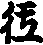



之作具，由择为依具故，方证灭，故第三转亦是具亦。今此亦尔，信是作具，方能合心净也，故第三转摄。



疏云心之净故，依士释第三转声者，第三转声是具声，具谓作具，意显欲胜解是信之因果作具，由信有此作具，方能信令心净也。



疏云：唯信是能净，餘皆所净者，此信能净心，至餘遍行境及同时餘十种善信等能净之，有通净餘善心所功能故，由如作意能一切心、心所故。若餘惭、愧等十种，则不能有通相也，欲各各自别相也。若汝之信，有其善、恶，不信可是有，於无记中，其信是无者，此受意说。若汝之信，信其善可修，信其恶法可漏者，恶法不信，恶法可厌，可许有信也。若尔，於无记法上，应无有漏。



疏云：喻如水清珠者，若此珠，人间皆有。若言水类珠，青珠、黄珠、赤珠，皆是水精。珠中能出水者，各自爱珠。若珠中能出火者，名扬珠火。是故若能清浊水者，名水精珠。



疏云：亦如泥䲡动泥浊水者，此泥䲡，鱼也。此鱼灭，即泥□动尾浊水也。疏云：又信於三性，何妨爱三而唯性善者，此中救意，如大乘信於善、恶、无记法，信唯善性，故我信唯爱三性，何妨是善？为遮此等，故论云：又於苦、集，非信所依也。超法师释也。



疏云：若彼救言，二俱之以体是信者，即印顺、示顺、欲胜解二法，即皆是信，仍非是欲解也。



疏云：忍可及欲是信之具者，思是信果，欲是信果，故是信具也。谓於自身者，自□贵增上於法者，然谓於好法自身学之，意言此法记若我身应学，今我此身而生道德，故於法生尊贵，故於自身亦自生贵重，故於法於身为增上仪。



疏云：然以细防恶者，释者法也。数有五种：一者笞，如五十已下杖罪名笞；二者杖，如六十已下名杖六王；三者徒罪，如徒障亦五：一、三我徒，二、二年半徒，三、二年徒，四、一年半徒，五、一年徒；四者缘罪，缘数有三：一、后三千里，二、缘二千五百里，三、缘二千里。若缘一千里、一千五百里，皆不名缘，但名移乡；五者罪罪，罪罪有二：一、缘死，二、根死。论云：熏贤善，随举暴其者。然惭愧别相，皆有人法。章贤云：谓有善德人。重善云：谓一切善法，惭愧学恶，举恶法也。



疏云对法但言修地为体者，彼论但言惭愧为体者，但是差他为体，唯有唯识解惭愧别相。



疏云：显扬即言於世，增上即缘也。亦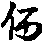



总惭愧缘。更下，难古说者。问：此意言古说者，为是此方上世来古师说，名古说论？是西方上代诸论师说，名古说？若此方上代说，名古说者，如何造唯识本者，在西遥难未？古师答：合是西方古说也。问：若举暴恶名为愧者，其上二界中，记无恶人恶法，如何得起愧？又无分别智缘真如，真如恒是恶人恶法，如何依真如时，得起惭愧？又问：上二三界，既无天人，无法一种，俱彼此相似，如何得起崇重贤善，及无世间诃厌增上，而得起惭愧？大无色界，如何得有善法及人，而得起惭？又无色界，言语既无，如何能崇贤重善？更捡上下，可成



疏云：他自增上等，然是缘起者，於自身及自法则是惭起之缘，於世间法即是起愧之缘。初起缘处以解惭愧，由如俱舍论中断善根处云：上品不善根能断善根。据实而言，邪见能断善根。今上品不善根能断善根。据实而言，邪见能断善根者，约断善根起缘处。如言贼烧村，贼不能烧村，火能烧村。今言贼烧村者，约缘处故，言贼烧村。惭愧亦尔，约起缘处以解惭愧也。然自身同法解惭，他世间增上法解愧者，但约情解名自他。如人有好事，有大问方，虽作此事，非虽自身不作，亦欲得认取。取以善法名自，能答已故。如有人作其事，有人问言：虽作此事，虽自身作，亦不肯认取。恶法亦尔，能损己故。取以恶法名他，好法损自己，恶法锻地。若惭愧别相，谓崇重贤善，举暴恶，是惭愧别相。



疏云：谓彼若言因得自他境有差别者，自身名惭，他身名愧。



疏云：正理师云：差现在罪因，乃至非现别故者，差罪因别现在身，故名惭；若罪不善果出未来身，别地在故，名之为愧也。



疏云三不善根，根翻对入至非别对治故者，若贪、瞋、痴三根，则有别对治。且如无贪对治贪，无瞋对治瞋，无痴对治痴。二、有通对治，谓即是正慧，通能对治贪、瞋、痴。若无痴能是慧者，今立量云：痴定有别对治，贪、瞋、痴三摄故，因贪、瞋故。如痴有别对治，取谓无痴。若许烦恼唯通对治，取是正慧，无有别对治也。



疏云通别对此，远总对治者，若三善根正相翻名近，若慧不与三善根相翻，取以名远也。



疏云此二简诸一切取非不善根者，如愚意者也。且如遍行别境，虽遍六识体，非是烦恼摄，不具二义，故遍行境非根也。若不定四，亦不遍五识中，又非正烦恼摄，不具二义，亦非是根。若痴、慢、五见，虽是正烦恼，然此等五识中无，亦不遍六识，不具二义，故非根也。若十小随惑，唯立意，不遍五识，又非是正烦恼摄，故非是根本。若中、二、大、八，虽遍六识体，非是正烦恼摄，皆心非根。故此二义，简餘一切心取相顺之因。唯是有漏者，问：若善业，可名贪；若恶业，如名贪。思之为缘之因，亦取涅槃而发贪等。故亦是具者，外道邪见，於涅槃等法而出贪、瞋也。又问：何故唯取涅槃法是善等，即生三恶道？故涅槃是具，而不取菩提。思之更问择灭涅槃亦是。若苦具，迷理生故者，问：灭谛与涅槃，为一为异？又问：苦定与有、有具，有何差别？解如疏。三苦者，谓苦苦、行苦、坏苦。问：欲界三苦，可言欲界，发嗔唯欲界故。若上二界行苦，如何由嗔发？应思(更问)。



疏云：贪慧三界发业，润生入具，故云苦。苦具者，若贪多分能润生，少分能发业；若贪多分能润生，少分能发业；若嗔多分能发业，少分能润生。论云：欲界烦恼，皆结生也。



疏云嗔但约有情重处为论者，然彼论说嗔但约有情处，智者为情处起嗔，即拟抨怨，然唯是业道。若无情处起嗔，不拟抨怨，则杂也。今唯识起嗔，则通有情、无情处也。问：欲界之贪，可能发不善业？若三界福、不动业，如何贪发？思之。



疏云：今能障法并通三界者，所谓嗔则是欲界，能对无嗔通二界。问：何故贪、痴能治佛谓俱通三界，所治嗔唯欲界，无嗔通三界？答：恶法从深防，所以能所之，无嗔通三界，所谓唯名界。



疏云：集论说此即教诠智决择为性者，然彼集论说无痴善根，即用起教证智而为体然，故此论中引教证也。



疏云：以报为生，得生便即得故。从所依名报者，报者是异熟身，身即是所依有身，故我即有此善，合是异熟身之善。今达此名，名报善。



疏云：若名修慧从因定为名者，由定为因，能发慧故。慧即是今言修慧从因定为名。



疏云：不言十一善根摄舍等为过也。若得十一者为因者，则得舍等为不定过。云：为加舍等，是善十一摄舍等无别体、无痴无别体耶？为加无贪等，善十一摄无贪有别体、无痴有别体耶？今因三善根摄耶？即无过欤？



疏云：此大悲如前，应二十二根中慧等三无漏根摄者，若□至佛果位中，三无性根中唯有具知摄也。然佛位具知根，若依第四禅，即用七法为体，谓信等五根、意根为具知体。若具知根在下三静虑，即灭用为体，或九法为体。若第三禅，为信等五及意舍根、乐根八法为体。若初二禅，或加行喜根九法为体，大非用无痴、无嗔二法为体。若无痴体即是慧，则应大悲具知根中信等五根中慧根摄也。



疏云无痴因及果皆通四慧乃至此是等流、增上果故者，四慧者，谓生、得、闻、思，谓或更加性巧、便善，方得尽理。性巧者，即是无漏慧也。此等诸慧，或是无痴之因，或是无痴之果，或同时因果，或异时因果。若为因之时，则六因之中有二因，谓根相应因、同类因。若为果之时，即五果中有二果，谓士用果、等流果。若增上果，一切通。若果时因果者，由前同类因引后等流果，同类因、等流果、同类因、等流果必定异时，故其异时因果中亦有能作因及增上果。据实而言，其同类因唯约种生种说，不望现望现为同类因。故前论云：种子前后自类相生，如同类因引等流果。若现望现修说同类因、等流果者，即不遮也。即如杀生得短命报，皆假说为同类因、等流果也。若同时因果者，由俱有能作、相应三因，得士用果、增上果也。然大乘中不多约六因以辨因果也。若小乘中，即约六因以辨因果。然生得善即是福分善，然福分善即宽，生得善即狭。分善摄得生得善，生得善不摄得福分善。分善体即明利殊胜、三界殊胜善故。若生得善体，性暗昧劣故。若顺三界业以修闻、思、修慧，皆是福分善摄。然福分善即一分闻、思、修慧为体，即身欣、厌等，如诸外道无生等六行慧。或厌下欣上者，厌下苦麤鄣，欣上静妙离下，如闻、思慧，方引得果修慧故。故福分善摄得一分闻、思、修慧为体，善取一分修慧，约体亦是闻、思慧故。若以决择分善即修慧，慧有闻、思慧一分，且约体是修慧故。若性巧便善，即是三乘见道、修道、无学道无漏法是。若准十地论，八地已上菩萨义，准说有闻、思慧。由闻法义，故名闻慧；由思法义，故名思慧。约体言之，唯是修，亦无闻、思慧也。小乘二义简者，小乘萨婆多师有五义简贪、嗔、痴：一者、由贪、嗔、痴重，能发麤重身、语恶业；二者、由贪、嗔、痴与断善根，作身强加行故；三者、通六识故，疑、慢等不通五也；四者、是随眠；五者、通随，谓随逐有情。师谓行相简昧，行相难知，由如睡眠。五者、通五断故者，即四谛下，分别烦恼为四；及见道下，分别烦恼为四；及修道下，为五部烦恼，合为五断，亦名五门。以此五义释贪、嗔、痴，是根义也。今唯识起恶胜故，言惑摄得；俱舍中作断善根，身强加行，或摄得；彼起极重身、语业，或二俱摄得也。今疏中言小乘三义简者，是疏主望分文也。今更加故，作五义简。



疏云若尔，即三念住亦尔者，即是后师难前师也。且如三念住者，且如一人在於佛尼边涂香，佛於此涂香之人亦不贪，正念正知。又有一人於佛右边刀斫，佛於此刀斫之人而无嗔，正念正知。又有一人於佛身上亦不涂香亦不刀斫，佛於不涂香不刀斫人亦无痴，正念正知。然三念住即用无贪、无嗔、无痴、正念、正知而为体。正念者，即是二十二根中具知根中念根摄也。正知，即是二十二根中具知根中慧根摄也。然三念住是二十二根摄。今后师难古师曰：大悲以无嗔、无痴二法为体。



论从无嗔说大悲二十二根摄者，亦应三念住，亦心无贪无嗔无痴为体。论从无贪无嗔，应说三念住，非是二十二根摄。又后师返质，前师曰：不尔，大悲以四无量悲，四无量悲唯用无嗔为体，亦应大悲悲根摄也。



疏云不尔，大悲以此无量中悲，乃至无住依慧，故根所摄者，此是前师解也。大悲以四无量中悲，俱用无嗔为体。大悲有相，以故有相滥故，论从无量中悲，俱用无嗔为体。大悲与悲有相滥，有相滥故，论从无嗔说大悲根摄也。三念住无相，以故无相滥故，故论说三念住是二十二根中摄也。



疏云且约影显非实理文者，此文即是前师又解瑜伽等文。云论说大悲非根摄者，且约无嗔为体，名非根摄。据实而言，其大悲既以无痴为体，无痴即是慧，大悲一分，实是根摄。今从无实为体，论说大悲非根摄者，亦影显大悲是根摄也，非尽理也。



论说三念住是根摄者，今从无嗔为体。论说大悲非根摄者，亦影显大悲是根摄也。论说三念住是根摄者，三念住即是住、正念、正知、无痴为体。上言二十二根摄，亦影显三念住既用无嗔为体，故亦是非二十二根摄也。论文影显非实尽理也。若论文说大悲及念住半是根摄，半不是根摄，即是尽理也。



疏云：若尔，即三世俗文如何择者，后师难前师曰：论说不害、舍、不逸三，是世俗有文，如何通择？



疏云音有者，体即慧故者，前师答曰：无痴依一个慧、一法五，故慧是实有，无痴亦实。若舍、不放逸，依四法立，此二依多法为体故，故不逸、舍是假有。



疏云：问：不害体即无嗔，应非假有者。后师难曰：无痴依一慧立，无痴是实者，不害亦依一无嗔，上即不是，亦应是实。



疏云：答：世俗有言，通假实故。言前师答曰：若论文云世俗者，即通假实故；若言假有者，即是无体故；若言有体者，即别有体故。此亦不然，如五见慧分说为世俗有故。乃至此无痴亦尔者，前师说无痴用一个慧为体，即无痴是实；其五见亦因一个慧为体，五见亦是实有。若舍不放逸，用多法为体，故舍不逸即是依立有。此疏文即是后师返难。前师曰：此亦不然，其五见依一个慧立，其五见即是意识中所说五见为世俗。即此说无痴亦尔者，无痴亦依一个慧立。仍治无痴是意有者，亦应论中说痴名世俗有说。既论中不治无痴为世俗有，故无痴不依世俗立。



疏云：彼择择满善断者，谓圆满从初所入根本静虑，乃至极善明所者，如有人难得入定，不得知住定、出定等，但言为满。后时更明，方善知出、入，而得自在，而名顺现也。如是乃至入四禅、四无色等亦然。对法论择满善之者，且如有人若坐得初禅未至定，不名为满；要得根本定，方名为满。如何名成？虽坐得初禅定，若初禅地中所有功德善法，皆从习成就；今所得定，转更明净。由如有人新造得屋宅，名为满；还从修治扫地、泥壁等，令屋宅转更明净。修治於定，亦复如是。及得第二禅根本定，名满。乃至有顶地根本定，皆然。



疏云：此但言因善，彼据实；因中一分乃至究竟果位者，彼对法。论云：成满者，据因中行说。谓得一分初禅根本定，则名为满；后治诸定，名之为成。谓得一分第二禅根本定，名之为；所得一分定，名之满根。唯识论中唯云满有，不言满。不成满者，此据修行至佛果位，圆满慧不修治故。不善成字，若声闻行，行至无学果；若缘觉行，行至极缘觉果；乃至菩萨行，行至於佛果。更不从修治，故言满善，不约因中行行为名言。



疏云或作善事，圆可名满，能满善根故，非要其果者，或唯识中言满善者，据治修何善，一期分限名满。此解与对法论同，亦不约三乘极果为言也。



疏云：彼唯加行作意修习，而非精能者，虽四无记中威仪工巧等，如法世工巧。虽然，彼百年、五十年加懃苦，殊无利益。又如来作等皆能也。问：何不名精？与纯何别？(思之)。



疏云显扬但有证之五名，对法一名，皆悉俱有者，若显扬论但有证之五名，有势有懃等，无论中五名，谓彼由加行等。若对法论中，然中五名亦名论中俱有，言故二名也。



疏云：胜品位名无退者，退者由如有人，此胜四位唯是菩萨上人，然学我是恶人，不能学之。无退者，如言：彼是丈夫我亦尔，不应自轻而退屈。



疏云次人谛观等者，即入见道已前，名为谛观也。谓涅槃言者，其涅槃即是安身之处，故涅槃名言，其涅槃亦名舍宅。



疏云：修习曾不觉从喻为名者，若细被甲及不舍善轭，此二名皆从喻为名也。



疏云：且如地行舍，有初发心，有下品、中品、上品者，且如言入初地已前，先说发心，即是被甲，或就中有势。既入初地，即入、住、出心，名下品，即是加行，亦名即懃；住心，名中品，即是无心，亦是有勇；出心，名上品，即是无之，亦名坚猛；欲入二地，起胜进心，即是无即，亦名不舍善轭。已后皆然。



疏云：初发心者，即是初发菩提心。长时修者，谓三大阿僧祇劫修因。无间修者，刹那刹那心中懃修行故。应其修者，凡所修行，心珍重故。无餘修者，一切功德善法，皆悉修尽，更无遗餘故。亦得被甲等五、百势等五，如次配之。以下资粮、五道等，皆被甲能之也。精进有三，摄此四者，亦如彼摄者。然三者，谓被甲摄善、利、乐。若彼三中、彼三中被甲，即假名摄此五中第一被甲精进也。故但言摄四者，不言五色。若摄善精进，即摄得餘四精进；若利、乐精进，即不摄地五，即於五分别出利、乐精进也。本地菩萨地者，即瑜伽本地分中菩萨地也。即六度皆有者，然精进不遍六度，为此精进能遍上业餘五度故，所以言精进、六度皆有。趣二者，二乘果亦利、乐地。即波罗蜜者，略，故不说；或无，故不说者。能二乘果者，即是定性趣寂第三果、第四果。然趣寂声闻中亦有钝根、利根，四一向大声闻亦有利根、钝根。此文意说为证。文中唯言二乘究竟道，欣大菩提故，即唯明不定性二乘人回心向大。论中不明趣寂二乘故。今疏文云：即趣寂声闻中有不退法声闻，即名波罗蜜声闻，在无色界能变起定果色，亦少分能利他有情。文有略故，不说趣寂二乘。若趣寂声闻中即有愚法者，即非彼罗汉，即全不能利他。第二解云：若不定性人得成佛已，能尽未来际他有情所心，论中说不定性二乘也。若定性人罗能定时，利少有情不能长久，即灰身摄智即无，利乐事即少，故亦无故。论中为无故，不说趣寂也。今正解者，言二果者，即是趣寂声闻无学果及无学解觉果，则不取第三果，第三果人心有进趣故。以论文中但言二乘究竟道理，明今疏中即取二乘无学果人。若趣寂二乘无学中有不愚法波罗蜜圣人，即少少能利乐他。然今此中略故，不说趣寂二乘也。若趣寂二乘无学果中愚法人，即全不能利他。既无利他，即无故，论中不说也。立本性中无故，论不说也。此有二种：一、无漏者，许有漏。有漏麤重通三性故者，即由烦恼缘三性法故，即三性法上皆有麤重，无堪任性。若二乘人起生空智，正能断烦恼上定鄣，亦能傍伏所知障上麤重，定相不起，后入无餘涅槃，即慧灭尽也。若菩萨起法空智，正即能法所知障，即上麤重定障，兼亦能断烦恼上麤重，即无漏能除三性定性。二、有漏者，乃至唯是善性者，然如其生用，有漏善唯能伏不善性定鄣，后时退还，不能伏有漏善及无记上定鄣，以力劣故。



疏云：然对法说餘一切鄣，乃至第十说亦同之者，对法第十或同餘尽法论性一切，或对法第十同显显扬，除麤重故。



疏云或是受数，但能鄣者，如缘修定者，得初禅已，领受下劣，更不肯进修已上定故，即是领受下劣法。



疏云：所防中通一切有漏法者，有漏法中唯防异不善法，离彼四法无别故。乃至双成无体用者，体者不进，即用精进三根为体也。用者即不逸，以防恶修善为用。即不逸体之与用，不离彼四法也。若不逸者别体，其不逸即有别用，不逸体用与彼四法不殊故。不逸离四法，外外双成，无别体用也。四者，他也。此则一切别有世体。皆作是说者，此文即萨婆多宗。萨婆多宗立一切法皆有体，或餘处亦立法有体。一切或是一切有部说不放别有体。或□切者，或大乘小乘中诸师说不逸别有体。



疏云：依谓依处。持令增长者，实法是假法之法，无贪等实法为持假不逸等，令善法增长也。



疏云：慧别之能，竟不可得者，无贪等四法，总有能防恶修善之能。别能者，无贪对治贪，无嗔对治嗔等，精进治懈怠。



疏云心次前别解中，心无贪为首，故从近为结也者，若加数中无贪等三根，亦以无贪为体者，若论文别简中云若简依持即无贪等，亦以无贪为首论文也。结中云离无贪等竟不可得，亦以无贪为首。若贪嗔痴名根，与二十二根根义别也。若贪嗔痴能生身语恶不善法，名不善根。若二十二根中意根别能照境明了增上名根，若男女根俗家增上，若五受根受用业果增上，若命根住持增上，若三无漏根能生得菩提涅槃增上，若信等五根世间离增上。



疏云：行蕴中舍，简受蕴中舍，故量行言，非谓行也。看今彼文中，应行者行蕴，行蕴中舍，是受蕴中舍受也。今云行舍者，此非谓行舍，有其行字，故行舍即思也。此舍亦不如思，能造作善恶等，名之为行，说思为行也。思於行蕴为主胜，故说思为行也。



疏云：离沈没故，初心乐等，还离加行，次心正直，於染无性，后无用者，此三位即初入定说。若餘散心时，亦无此三位也。初心利等者，即在加行位中，若有沈没，其心不利。其加行心中，若离却沈没心，故云初心利等也。远离加行，次正直者，此即约入定心。若加行心中，既有趣求，即有高下，离於加行，故言正直。於染无性，后无切用者，此亦即是次后入定心中。若散心位中，胜染法侵，心则性弱，须作功用。今在定位，既不胜染法信，即心无怯弱，亦无功用也。



疏云或今所说虽同时，同时不逸，乃至说其相也者，餘者约利、增说。若无间道中能除杂染，则不逸、增同时。有约利、增说，其前、后二法实是同时也。疏中说舍与逸，或同时起，或前、后起，二时俱好。



疏云对法第十、殄贪虑者，彼论约上界舍或无漏舍，能除欲界贪虑也。问：不放逸与行舍，同依四法立。不放逸、舍体性，上、中应同，无别有何？所以二法同依四法上立，作用各各不同？其不放逸，有防修为性，对治放逸，成满一切，与出世间善事为业；若行舍，令心平等正直，无功用住为性，对治掉举，静住为业。又问：能依应与所依相似。何以故？能依不放逸，行、舍各殊。若所借四法，体、业亦别，谓：无贪著为性，作善为业；无嗔、无恚为性，作善为业；无痴、明、解为性，作善为业；放逸、勇悍为性，满善为业。其忿、恨等，同依於嗔，等亦准此。问：平等正直，无功用者，问：既说十遍善心，心准此起时，即有行舍。其散善心起时，如何亦有平等正直，无功用？若散善心起时，无平等正直者，其行舍等，应不遍善心。疏云为除贪虑，心依止舍者，心是所寂静，即舍为所依止，心是能依止也。



疏云：契经之除贪虑心，乃至亦有舍也。贪境不还，心即有起，故说贪虑。彼论说舍，说除贪虑者，说上二界舍，能除欲界中贪虑。唯欲界系，或约无漏舍，能除欲界有漏贪虑也。据实言之，欲界中舍，亦得与虑俱。如在无上法，思慕愁灭，既无善心，虑亦与舍俱起也。



疏云对法第十八道支中说，故唯约无漏者，此疏主错引也。唯七觉支中是无漏，八道支中说，故无有舍也。



疏云：嗔断总求，不但损者，若嗔本拟断命，亦不拟损物，过於损物，故说嗔为断命。



疏云：既尔，如明风等不断物命者，如嗔害有情，前有情心生灭等，即成业道，能招当来三恶趣总别报身故。若捐总报身，或能感总别报身，皆名业道。若唯招别总身，不名业道。由如行支能感别报身，皆名业道。由如行支能感别报，不名行支。若能感总报身，或双能感总别报身，方名行支。若论识嗔为业等，於无性起，唯能感别报，不能招总报，不名业道也。又如比丘坛故正受，於时一日三羯磨竟，此戒能感总报，或双能招总别报身。身若受戒已后，彼於持依、说净、度食等，唯能感别报，不能招报身。及未受戒已前加行心，唯能感别报，不能招总报。及造恶若正断他命时，唯能招总报，或双能招总报、别报。别报若前加行心及后食肉等，唯感别报身也。问：若呵骂风为风，为是无性，不成业道者。何者？比丘斩草木等，无情即感得就身。又问：若呵风为风，为是无情，无情不能懊恼，即不成业道。若呵骂有情，有情即能懊恨等，即结业道者。如出佛身血及煞阿罗汉有情身，佛及罗汉虽是有情识，而不起懊恼之心，何故能煞之者而成业道，入无间狱？思之。更问：



疏云今此翻麤相别者，今唯言无嗔不害於有情处起者，约麤说理，实此二亦於无情处起，如何风骂为业也？问：前大悲以无嗔痴二法为体，今何故独言不害者，此中问意，何故前说大悲即双用无嗔痴为体，今此说悲即唯用不害一法为体？为显功德别故，别立一假法也。此上疏文且即总答也。答一切功德依圣人身上胜乃至非无贪等者，此文即是别答也。不立不嫉者，嫉者即是喜，喜即是不嫉也。谓有此者人即资善故者，谓人身中有此不害故，即令人资善也。或彼自体即资善故者，即不害自体资善也。今论但约事取疎法者，今者唯别等义也，而不取及义也。



疏云诸功德等如胜处，亦以无贪为性等者，此约小乘宗问也。如小乘宗八解脱，前三解脱唯用无贪为体。大乘中前三解脱中，若作少多相观身不净等，即是无贪为体，无贪於境厌故。若作光明总相等，即用世间正智为体也。又小乘十遍处中，前八皆以无贪为体，后二用四蕴为体。又小乘中诸功德法，多用无贪为体，小用无嗔以为体。所以者何？无贪於境厌。小乘人唯厌生死，自利行为胜故，不拟利他，故用无贪为体。大乘不然，一切功德多用无嗔为体，少用无贪为体，无嗔於境生欣故。以大乘唯利乐有情为胜，不以同利乐胜，故用无嗔为体。彼据实体，此约假成者，然前大悲所依无嗔无痴，无嗔无痴皆是实故，即大悲双用二法为体。若悲即所依不害，不害即是假故，故悲唯依不害一法为体。又诸此若在如来身上诸功德，问一切皆是实，不得论其假也，以如来身上无假功德故。若约法相门中，即得论其假实。问何故不於无贪等上建立者，此文问意，何故不得无贪等上建立不害，唯依无嗔上建立不害？问诸功德等如胜处等，乃至依无贪之上者，此文问意，何故胜处等即依无贪上立也？其不害何故於无贪上建立，即依无嗔上立不害？



疏云：此是无嗔一分，於境不增，方欣彼故者，嗔名无嗔，名欣贪名，但无贪名，散欲相翻。



疏云不说无唯名欣者，彼不说唯无嗔一法名欣，要无嗔与欲俱，方名欣也。此性非欲，欲俱法也者，欣体即是无嗔，无嗔即与俱故，故欣不是欲也。无嗔要令欲俱，方欣於境。各据一义，亦不相违者，然贪名嗔欣，无嗔名欣，若嗔名为厌，无贪名为厌，故各据义别，亦不相违。随应之言，显不同欣与欲俱故者，然前欣要与欲俱，然论文中即随应之言，即显不忿、不恨、不嫉等四法，不同前欣与欲俱。此四法不与欲俱，亦得起也，故云随应。



疏云：不愤发。愤发者，即如人嗔己，面赤恶发是也。亦则翻之。不愚说。愚说者，说他过失，令此翻不说也。人过失故。非不忍。不忍者，即若被嗔骂，不能食忍。非不忍者，若愚违缘，皆忍受之。不触不突云者，逢人即放，无意智而触悟之。不触变者，不触悟人也。不䛞訿。䛞訿者，哻唇䥫口是也。不可离。可离者，谓不信弩[(色-巴+用)*(此/(色-巴+用))]也。无嗔[乞-乙+(了-(丁-一)+(衣-〦+一))]寻。[乞-乙+(了-(丁-一)+(衣-〦+一))]寻者，终日起寻伺，愚人即嗔恚故。今亦翻无害寻。害寻者，终日寻伺，遇一切有情，皆拟损害他身，故令翻之也。随应之言前慧俱。此不尔者，然前厌即与慧俱，今者显不悭不憍，不得厌此二法，不立慧俱。或即趣向前行，即吃令吃等时之处，常在前对也。不研等。研等者，即欲向他界处，或乞或覔物等时，或他不与，即久住斫等寻覔也。或久欲者，若吃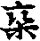



处，即望教得。钞：多此已上，皆用贪为体。若家势寻者，一切人最多，即傍家中族姓、豪贵，身身伇明色、力、位、体等而起寻，而覔他物。此即用观及增二法为体。不憍憍者，即曲眼时宜而觅他意，其作亦然。问：论云善十一中，信以心净为性，不善为业；想心重贤善为性，止息恶行为业；愧心非答为性，止息恶行为业；贪以无著为性，作善为业；无嗔以无恚为性，作善为业；无痴以明解为性，作善为业；懃以勇悍为性，满善为业；轻安己堪任为性，持善为业；不放逸以防修为性，成满一切世出世间善事为业；行舍以心心正直无功用住为性，静住为业；不不害子为舍断无嗔为性，悲愍为业。问：此上中一皆是同善性，何故与业各各不同？且如惭愧虽不同，是止息无行为业，岂无善十一中唯此二法能息恶行，餘者不能耶？餘若能者，何故文中不说？又无贪等三根虽别，皆同作善为业；餘法虽别，亦应作善为业。又何故无贪等三唯言作善，精进即言满善？岂无贪等餘十法皆不能满善欤？又轻安之下即言持依，餘法何故不言转依？乃至以后问皆然。问：前害寻等七法，然准文中即有八法错也。不憍不诈者，问：此二何别？前解为胜。虽无论文，准故胜也者，问：前解不覆无贪痴为体，即是此问论文，如何言无论文也？



疏云以前即忿等，初九说讫者，即是小十烦恼中除害，餘九是也。



疏云：故此论卷六烦恼之中，但言不慢义可通三者，六烦恼中明慢者，然邪不慢即通此论文中三师不慢义也。欲胜解亦尔者，若随大烦恼中邪欲，即翻入别境中欲；若邪胜解，即翻入别境中胜解也。或有行相相翻者，如掉举相高，其舍寂静，故行相相翻，亦得通治。以掉举是贪痴分者，然行舍名通治者，行舍能所掉举，掉举中有贪痴分，分行舍由如慧，名通治也。问：掉举是贪痴故，其行舍能治掉举，即行舍即名通治者，其五见缘不正知等，或是别境慧分，或是痴分，其善慧能治不正知五见等，其善恶应名通治，乃至正念治妄念亦然。又散乱体即贪嗔痴分，不散乱意不乱，应名通治。又放逸依贪嗔痴懈怠四法立，其不放逸能治放逸，其不逸应名通治也。答：准理通也。或说性对治有忘念等三者，诸忘念体即翻入别境中正念，谓散乱体即翻入别境中正定，若不正定、若不正知体即翻入别境中正直体。或有行相体性皆相翻，不忿等是无嗔一分也。然不鄣餘翻为法者，即如前贪等三能鄣三善根，即翻贪等三名无贪等。不信鄣信翻不信入信，餘者如前应知。二、此则损同他嫉等不然者，然害能损自他，若悭唯损自非他。若悭唯损自，然於今身之上虽知悭不舍现身，由今身起悭故，令自身於来世中或时得贫穷入饿鬼等，即名损自也。若嫉唯损他，如二女事一夫等，如二臣事一君必嫉，如且害人王相镰等，皆由有嫉也。



疏云主得善位，随此而说者，既论文说不害，障无上乘胜因悲故。即从知文来所说不害者，或是顺解脱分不害也，或是顺决择分不害也，或是加行善不害也，或是无漏善位不害也，不说生得善位不害。故疏中云：生得善位，随此虑说。若生得善，即是福分善。福分善中亦摄得欣、厌等闻、思、慧也。於生得善中亦有善十一，不害亦然。所有布施，不求菩提、涅槃，皆生得善摄。然生得善体性暗劣，故亦不害也。



疏云能治通上界，如嗔分等者，即无嗔通三界，能治欲界嗔也。



疏云：无别体家之如五，是定无世俗，乃至体非别性者，此文即是解无痴中第一师也。此师意说，若以一个法为体，即实有；若用多法为体之假有，如五见用一慧为体，及无痴亦用慧为体，皆是实有；若舍不放逸等，用四法为体，即是假也。



疏云：若尔，不害例亦如慧者，后师难前师曰：无痴即用一个慧为体者，即实有者，不害亦通一无嗔为体，不害亦应是实。



疏云：决未决时，不鄣乐起一者，此师意说：若极愧，同类必不得俱起。若於境决时，或时起惭，或时得起愧；若於境不决时，或起愧，则惭、愧二法不鄣互相也。



疏云除依无总等者，此师意说，若缘真如无相时，则无不害也。要缘有相后得智，缘有情时方不害起也。



疏云或无漏位谓轻安者，此师意：若世间道中能益五根胜故，即是有轻安也；若无漏中唯断惑胜，不益根故，则无轻安。



疏云不遮有时皆得相应者，然此且约善十一，於六位起不痴，於一时间十一善皆得相应也。



疏云：未必於世间，中道得起惭，或时起信等，或有分起时，餘五位中出然也。



疏云：舍事未决定，有三性心者，难师曰：如三性中，不善、无记心无信可。然如何无信可？无信者起，非是善心。



疏云若尔，佛应无此觉支者，若大乘中资粮位中先得四念住，次后四正断，后方得神足；若加行位中𤏙、顶得五根，忍、世第一法得五力；若见道中得七觉支，亦得八圣道，修道亦然。若初得四念住，则不能起四正断乃至五根等，别下能起后故；若得四正断乃至五力等八道支，皆能起前，前法后能起前故。若在见道中，亦能起四念住也，即是种缘念住。种缘念住者，若二二合缘，如缘身，二缘受；若三合等，皆名种缘念住。若初修四念住，缘身时不缘法，四念住各各别缘，不名为惟；若合缘者，即名为惟。若据缘法念住，四个皆名法，故皆是通名也。或即总观一切法无常、无我，故名为惟也。若尔，小乘宗资粮位唯得四念住；若加行位中燸位得四正断，顶位得四神足，忍位得五根、世第一法、五力，见道位方得八道支，修道方得七觉分支。但说大悲无害为体者，今说大悲，来意说大悲通上见也。若四无量中悲，即用不害为体。其四无量中慈、悲、喜、舍，不能缘三界，唯缘於欲界，故四无量慈、悲、喜、舍上，即无大字。若佛、菩萨别得一类大慈、大悲、大喜、大舍，大慈、大悲、大喜、大舍，即能缘三界，别得大名。其异生、二乘等，不得大慈、大悲等也。其佛、菩萨所得大悲，亦有无嗔为体，大悲亦用不害为体，大喜亦用不嫉为体，大舍体同四无量舍体。今说亦用不害为体者，□此名亦不是佛百四十不共法中大悲。百四十不共法中大悲，用无嗔、痴为体，菩萨亦不得之。故此疏中大悲，用不害为体，即是佛、菩萨同得大慈、悲。又百四十不共法中，亦无大慈、大悲、大喜、大舍也。



疏云许轻安俱定等者，轻安与定俱也。说诸心所无不皆断者，此文意说，若决定令有轻与在轻，论说即明之，即是欲界中无轻安，亦不约有少分有处即说欲界有轻安，餘法皆然。



疏云有寻伺等有长短也者，若无寻唯伺地，唯是大梵天中间禅是最短；若有寻伺地，谓欲界及初禅下二天也，名中；若无寻无伺地，谓二禅已上乃至有顶地最长位也。今约地以分三：若人则不定；或身在欲，亦得二禅已上定，名无寻无伺故；或二禅已上亦起寻伺，所以约地则定也。



疏云三师说皆不正义者，问：以前师说五识无轻安是不正义，如何此文言二师皆说正义也？(更问)初、约他引世宗者，如愚意者，即他引者，即论文中定所引善者亦有轻安，调畅故。即由他第六识中定所引五识中得有轻安，此师意立宗说五识中轻安。彼论自俱引证者，如愚意者，即是彼论文云成所作智俱必有轻安故。意说与五识俱时得有轻安，以引成所作智俱时有轻安识，五识中约有轻安也。



疏云即顺三界分别之中欲无轻安者，若作次前解者，成所作智唯在定地与轻安俱，即顺前论文中第二解说欲界无轻安，故知欲界无轻安也。身在欲界定所引善五识之中乃至无说者，即无者，此文意说：若二乘人所起眼、耳识是无记性，五识即无轻安；若异生所起天眼、耳识亦是无记性，亦无轻安。故二乘、异生在定之中不能利乐，所发起天眼、耳识皆无轻安，以是无记性故。若有不定性，二乘身在欲界九处而入变易身，谓三洲、六欲天，即如舍利弗等，是其类也。及七地已前菩萨身在欲界者，此等顿悟菩萨既身是欲界，在十地位中由定起通，等为有情所起五识，五识是善性，故五识中亦有轻安，即定地轻安得与欲界散五识俱。又菩萨多分起四禅定，四禅定能起神通等事，利有情故，故起四禅定；四禅定力强，故能引五识中轻安。若通果是善性，即有轻安；若通果记，即无轻安，以轻安唯是善性故。若菩萨身在欲界、无色界定，亦能少分引起欲界中五识轻安；或可无色定力劣，故不能引起欲界五识中轻安。若人生无色，第六识中得有轻安俱。此诸菩萨若为嬉、䥫所起五识是无记性，即无轻安。若色界中渐悟声闻及顿悟菩萨依色界身入变易身者，唯起眼、耳、身三识中善性者，得有轻安。此诸菩萨无鼻、舌识中轻安，以为鼻、舌二识是欲界故。知尚又云：若菩萨身在上三禅，借初禅眼、耳、身三识起。总大乘中说借识身，唯身是无记，异熟生摄。若小乘中说借识力，威仪类摄。故知菩萨身在上三禅，借下三起，是无记性。故知三识即无轻安。若若大乘中说身在上三禅，借初禅眼等三识起，是异熟生无记，即说十地菩萨身在上三禅，借初禅三识起，是无记。故眼识等三识中，岂无闻所成、修所成？从前已来，皆说第六识起闻等三慧时，即引五识中亦有三种所成。其菩萨第六识中闻、修三慧，岂不行识而成，闻慧所成？若五识有闻所成，即眼识中得有轻安。破前所说因位五无，在果许有，此据因位者。问：前疏中说前师，前师云：十五界唯有漏心，无无漏五识。若因若果，二位皆无。如何此文说前师在果许有？法师云：问：前师无不说因位五识无，轻安果位有，如何此疏文中以破前师？答：今此疏文即遮破前师，亦无违也。或因谛许似果位有成事智也。如愚意者，前师既都说五识中无轻安，明知因果位中五识中无轻安，所以后师破也。若在佛果，此为正义者，即佛果位上方有成所作智者，即是正义。或初地成所作智俱必有轻安故者，今第二解中子门。又解：初地有成所作智者，是不正师义也。



疏云：若作此解，违前所说，欲无轻安乃至轻安故者，外人难曰：若初地五识成所作智有轻安者，鼻、舌二识唯欲界系。鼻、舌二识既有轻安，则欲界中有轻安也。则违前第二师正义，欲界无轻安故。此难意许欲界有无漏，鼻、舌识亦是不正义难也，欲无无漏故。



疏云彼前但据一切异生乃至五有轻安，不相违也者，此是善文，意说前第三正义。欲界无轻安者，约异生说。或说欲下地意识不能引起轻安，说欲界之轻安故。若菩萨圣者，何妨欲有无漏？鼻、舌识亦有轻安故。虽作此善，亦是不正也，欲界无无漏故。又佛成所作智，唯依第四有故。



疏云前文但对彼前师说，非为尽理者，疏中三解之中，若前二解，且破前师前二解不尽理也。



疏云：若尔，虽定，所引五识应无轻安者，此难意云：五识中既有者，受俱虽是定，所引五识应无轻安。



疏云此理不然。所善者，舍、乐俱故者，若定所引，五识既与舍受、乐受俱，亦有轻安。若喜受在意识故，如一切时五识有苦受故，所以五识有轻安也。



疏云然菩萨得智，虽起苦根，乃至名逈受故者，若渐悟菩萨及七地已前，顿悟菩萨身在欲界者，其后得智中即得有苦根，谓安三洲、六欲天也。若顿悟、渐悟身在色界，其后得智中无苦根，以色界无有苦故。



疏云餘受可有，即通果心者，餘舍、乐受及通果善心，皆有轻安。然论中说通果唯与舍受俱，不许通果与喜、乐受俱。虽依下三禅中起，通果亦唯与舍受俱。虽菩萨起通果，化起有情，有情以乐有情，其通果亦是舍受。虽菩萨为嬉戏相，通亦无喜、乐受，但成通得成，不成名为嬉戏。若苦受及通果无记，即无轻安也。然实菩萨后得智中起五识有轻安者，然渐悟菩萨身在欲界，入亦身至十地位中起后得智，即能引五识，五识有轻安也。上界三识、下界五识者，若渐悟菩萨、顿悟菩萨、顿悟菩萨身在色界者，即五识有轻安；若渐悟菩萨身在欲界，即为五识有轻安。



疏云然彼有时一一等至者，此约因位散心，心中或起欲身，或时胜解等，随何别境一重故。若因位之决定心中及三乘、无学果，即五别境等二十二法定俱起。



疏云：所治岂有能治者，此文即外人难曰：上二界既无所治之嗔，其上二界岂有能治之无嗔？欲有情惛治，轻安岂有者，此文即论主返质也。曰：汝言上界无所治嗔，即言之能治之无嗔，亦应欲界无能治之轻安，如何得有所治之惛沉？故欲界无能治之轻安，即有所治之惛沉。何以故？上界无所治之嗔，还有能治之无嗔。无嗔及惛，皆通三界。



疏云：第十一、有学、无学、非学。解云：若有学人身中有善十一，名之为学，有进趣故；若无学人身中有善中一，名为无学，已息求故。问：若定性二乘即无学已，更不造求，可名无学；若不定性二乘，虽得二乘无学果已，更竟求大乘菩萨行菩萨行，如何此人名为无学？答：今定性人更不趣求，名为无学；不约不定性二乘谓学，名为息求，名无学也。又若望得自乘无学果，名为息求，名无学；若不定性人，虽望得自乘极果，名息求。其不定人无学，若望大乘佛果，远是有学也。若异生人身中有十一善，名为非学，推也。



疏云非邪见故，非邪见故者，此十一善。此十一善不与邪见俱时，故不通见道断也。於中即有无想定及北洲业，皆由邪见真，如何言非邪见生？



疏云：答：彼不言善位通见道断，能善法断缘缚唯是修道断。若自性断、不生断，即通见道断。若异熟果，如人身等，何言不生断是见道断？



疏云若不尔者下，修道烦恼乃至岂见所断故者，若有人解云：恶趣中别起善业，善业即见道断。已舍三恶趣中别报果故者，今难云：修道烦恼亦能别招恶趣果，修道烦恼应是见道。故知别报善业不是见断也。



疏云：若言见断，以此证非者，若有人云：善通见断者，以道理而证彼非也。



疏云修即得门者，谓自性断、缘缚断、不生断等也。彼之云谓有根、无根，何地缘何地，地皆倣此者，若言有根者，信、精进是根摄，餘九非根也。有根、无根者，此者漏善十一皆是有根，能得异熟果也。若善十一中无漏善者，即是非根，无漏善不能招抨故。何地者，欲界地唯餘轻安有漏善。若善十一皆缘九地，则欲、色界中善十一能缘一切。若言色界中波罗蜜菩萨、广慧声闻身中善十一，亦能了一切法。若无色界中异生、外道及非波罗蜜菩萨等身中善十一，唯能缘自地、上地法也。设有餘释及餘门者，今设学知。此疏中抨放，谓学也。



疏云而根本摄非唯不亦位学知用等流者，若菩萨随烦恼，但名随烦恼，不得名烦恼也，亦得名等流性，从前等流生故。若根本烦恼，亦名烦恼，亦名随烦恼，亦名随烦恼，不得名等流性也。



疏云：然有就处论覆之者，若论文异，更论文中重解之；若证药难处，论文皆覆解之。即如解贪之中覆释业，云谓由爱力取蕴生故；解嗔之中覆释业，谓嗔必令身心势惛等是。餘之准知。



疏云：萨婆多师解无漏贪是善法欲者，若萨婆多师不共无明、疑、邪见得缘无漏，随大乘亦然。若贪唯缘无漏事，谓佛身是也。



疏云：或上二界中，由爱、静虑等故，彼诸烦恼因此增长，亦取蕴生者，烦恼有二种：一者、生烦恼，即是九种润生烦恼，唯俱生烦恼能润生故。谓贪、嗔、痴、慢、见、边身六种烦恼，能润生不取、疑、邪见、戒见。取者，是分别烦恼故。二者、定烦恼，从定出已而起爱者，味谓贪。上定疑、慢乃至五见，皆容得起，唯除嗔故。餘烦恼皆能爱味定，若戒取、见等从而生故。然此定后所起烦恼，不能发不动业，但能损不动业故，犹起定烦恼，故前善定违被损故。上二界中，由爱、静虑等，乃至亦取善生者，然味定中所起烦恼，亦能发业，感总报果也。若润生烦恼中，若临死时润生，或即有能发业故。



论云：全界烦恼皆能结生，故润生烦恼能发业。乐受求离，嗔亦依之者，此文意说，若於苦苦之上，可许起嗔，以苦上加苦，故其惟苦，如何起嗔？故今此文解云：如人初时有乐，即不起嗔，后愚违缘，失於乐法，遂即起嗔。故依乐世，惟若愚餘迁流之事，即起嗔，嗔亦依行苦也。答：随顺生苦，具无漏即非；缘生於苦，无漏亦是者，若无漏与苦相顺，若无漏法与苦不相顺，若依无漏法而起於烦恼，因此生苦，无漏亦是也。



疏云：对法等论，但言苦具，不知是何者？彼论但言苦具，亦不分别有漏苦具、无漏苦具也。



疏云：或有之云：唯有漏法，此不然矣者，或有人云：有漏法是苦具，无漏法不是苦具者。难云：此不然，如邪见谤无漏，此人入恶趣，故无漏法亦是苦具。或有人云：准有漏法，此不然矣者，或者，谓疑或人也。谓有疑或之者，曾不解经论，遂即经云：若有漏法即是苦具，其无漏法不是苦具也。此不然矣者，即是破云：若有智之者，若解经论，即知有漏、无漏法皆是苦具也。据业道量漏，非於餘不嗔者，若於有情之上起嗔，即重能感总报，而成根本业道；若於无情之上呵风詈为而起嗔者，即孙但招别报，不成根本业道。此嗔与恶行，恶行者即是行支，谓独头无明迷理，相应等亦迷事者。然四无明中，令若相应无令，及取随眠、缠、无明各一分，其现行种子中，即取相应无明现行及相应种子，此中即取相应无明现行及相应种子，此中通能迷理、事，即下文言相应无知与九同迷等也。其相应无明，若与身边二见相应，即唯迷理；若独头无明全，及取缠、缚、随眠各一分中，即取独头无明现行，及取独独头无明现行，及取独头无明现行，及取独头无明种子，此等唯能迷理也。



疏云邪定为先，后方有疑，然生次第，此文为正者，后对法论说：邪见为先，后方有疑。生邪定者，见决定也。今此论先有疑生，次后生邪见，即约三随顺说：由有身见故，即起道；由有见破故，即有戒取；由有疑故，即起邪见。故说约果人断三结，更不言断除烦恼、疑、谛实等，方起邪见。生起次第，唯识论文为正。



论云：於德者，即是神通功德等；有德者，即是人人身中有神通等法也。



疏云：然对法论中，但由有我，乃至及等流生，或造从根本说者，此文即会对法及唯识文也。然彼论中云我慢者，但由有我，心则高举，高举即是慢也。此论中但言持已，持已即是对法论中我也。故二论亦不相违。我见相应者，相应即是慢也。慢与我见相应，或先有我，后方起慢，则是等流也。今说为我慢者，由先数我，方有慢生，则我为根本。说名我慢者，遂从根本为名也。



疏云：於劣性已胜，於等法已等者。问：於下品人自身即是胜，及中品人与自身等，如何名慢？答：若於彼下品中人边，自不生高举心，即不是慢。友过人故，名过慢也。坊亦慢者，增上也。是二虗空法，或是四沙门果，或此增上处起慢，名增上慢也。七慢，如疏中说。若立九慢者，小乘即拟化句数以立九慢也。然九依我见后生者，然九慢依我见后生，故文云：我胜、我等、我劣、我有胜、我有等、我有劣、我无胜、我无等、我无劣。既九慢皆有我字，故知非慢，即依我见后生。



疏云即彼小乘通见、彼修断乃至是故圣者现行者，若小乘萨婆多计我见道断，虽慢通修道，亦不能起。先为有我，后方起慢；我既断，慢不能起。如人倚柱而立，若去却柱，此人即倒，是无柱倚，故此人更不能起。慢亦尔，此来倚我失，乘既断已，慢不起。又萨婆多我见与慢不得俱时起，先有我，后方起慢。故根本烦恼中唯缘无明得与餘九俱起，若餘九不得并生。若大乘宗说前三果人皆得起慢，若菩萨四地已前容得起我慢，四地已上作菩萨提分慢观，所有我见永伏，不起慢，亦不得起九慢通见、修断也。慢唯邪慢、增上慢，不通修断。然慢，邪见人能起故。若餘五慢通修，通七慢，或俱生，或分别。故知九慢类修起无失者，及论中亦云一切通见、修所断者，问：若增上慢及慢过慢等，如餘论说：预流果人於后果而不起增上慢。又全未得，即言得，名邪慢；若小得，谓多得，名增上慢。若言断者，彼违谓文。谓文云：一切皆通见、修所断。又问：圣者身中者几慢？应问法师。答：如前说。是师云谓於三品者，问：此言三品者，为约功德法以为三者，与第五德何别？如何於五至起慢？即起慢之人，谓於三品人上起慢，为於三品法上起慢？答：於人及法上起。於我蕴起慢者，问：此文既言我蕴者，为於即蕴计我上而起我慢，为於离上而起我慢？答：多即蕴也。於未证胜德，乃至於所未得谓已得。问：此言增上者，即为是前於德，为是有德？又七慢中，几个慢缘於德起，几慢缘有德起？又问：此言证者，为是证真如名证，为是道理名证？若言证真如者，如何其人起增上慢矣？於德起二证，道理名证也。我得生者。问：此言德者，即是前於德、有德、举德也。又问：七慢皆皆不正名邪，何故邪慢偏得邪名？答：且偏七中相望说。依本及品类之者。问：何者名本？谓更问。然九依我见便生，三品处起者。问：此九皆各依我见后起，其九即合於七慢中我慢后生。文中既言九依三品生，如何言九便依我见起？岂九慢即依三品及我见两处？答：我见为先后，於三品上起九慢也。卑慢者。问：慢是高举，卑是卑下，既二相违，如何名卑慢？慢与卑为别为一？更问。谓他直、作用、因果，乃至亦摄彼尽，如理应思者。问：他直等既是事法，如何得初谛理以摄於事？后如何摄？答：谛理，道事；理，真理也。然简择、犹预、异决择。断觉为疑故者。问：决断是智，如何言益决断为疑？答：此师不正，或益或益。时疑者。问：其益时中，为先疑，后慧后疑？答：前后皆得。此师说疑，与显扬对。法问者。问：言此师者，为初师，为第二师？梵云毗軄真罗，比云乾，梵云毗駄底，亦是疑义。



疏：云何为缘身界见时？云：若自界、自缘，皆西国有；若以自有行自缘，此间亦有。且证当是应者，界由身且。如言字是界，餘既者慧，义应转受，非是慧。如何慧证当是若也？慧是解云：字左边著，与人身之，即是信字；若言字右边著者，身即是法字；若言字上著，四即上。上四云字，即唯迷理。虽缘谛有观，疎远迷者，然五见皆能迷理。若身见、边见、邪见，亲能迷谛；若戒见所，能疎远迷谛。颠倒者，心上为品，名颠为品，为上摄倒。谓於欲界、唯识俱出，发招在处。业是分别者，唯识欲界中身、边二见是无记快，不能发业；若欲界中分别五见，皆是不善性，能发於业也。问：外道恶见为因，即得上界禅定，而生二界受乐。如断言恶见者，多受苦耶？答：多受苦，少亦受乐。更问佛度当来萨婆多等者，今此疏文不见圣教，是传说也。问：萨婆多即佛灭度后第三百年中出世。若经部佛灭度后第四百年出世，如何经部师返言遮当来萨婆多？萨婆多望经部，应言遮过去萨婆多，品文应言遮当来经部；应言遮过去萨婆多，品文应言遮当来经部也。梵云思说提底廿，此云伪也。廿者即是字，思说提底即是自缘，即后字界。字界，梵云阿迷提底，此云有也。廿是字界，阿迷提底即是自缘，即共云但论提底廿。此云福缚廿者是字界，僧吃烂底是字缘。虽佛灭度后第三百年中萨婆多出，佛灭第四百年中经部出。若经部说经，可言遮过去萨婆多等；既经部师说化佛在日，佛说经时，即遮当来萨婆多，应无过去字也。无过去萨婆多望佛，佛即是过去，其萨婆多即是当来。若经部望萨婆多，萨婆多即是过去，经部即是当来。心上显现似我之相，证非实有，是假法故者，此文即益萨婆多师我今大乘心上所现，相分假乘，体非实故，即同萨婆多执有有见。又云体非全无依他起性，然所缘缘者，此文即简住部师我今大乘以我之体名是善法，不同经部是虗伪也。



疏云：移转之法者，移者可改能义，转是转彦，彦或是变现，即诸识生时，实似能取所取相现故也。即心上所彦，名移转也。



疏云：又依本质可令虗伪者，若。



------



## 成唯识论疏抄卷第十一



**译者**：北京　灵泰法师　撰



疏云此於界、性、识等，皆不定者，性者，三性；四不定，皆通三性。界者，悔、眠二种，唯欲界寻、伺通欲及初禅，识谓八识；四通定，唯在第六识中有，餘识皆无。於五、七、八识及上二界全多分者，此等论及疏文即约四一切，餘应叙四一切遍行，具四一切不定。若欲界第六识有四不定；若初禅已上，第六识中即无悔、眠；若二禅已上，第六识中自地即无寻、伺。二、约界全：若无色界中，全无悔、眠；若欲界中，多分悔、眠。



疏云此界系局，亦非遍无漏者，界系局者，悔、眠唯在欲界，不通上界。若寻、伺唯□□□禅有，不遍二禅已上。亦非遍无漏者，然初禅未至□□□初禅根本定中亦有无漏。此无漏有根本智、后得智，□根本智中无寻、伺，唯无漏后得智中有寻、伺，故云大非通无漏。下文云：后得智中为他说法，必假寻、伺。初来至无漏定中即有根本、后得智，后得智中得有寻、伺。若初禅根本无漏定中亦有根，若初禅根本无漏定中亦有根本、后得智，后得智亦有寻、伺。若中间禅中亦有根本、后得，后得智中亦伺无寻。此等三，今后得智中若缘不起语时，亦不起寻、伺；若为他有情起语言故，方起寻。故下得智中为他说法，必假寻、伺，故知起语方起寻、伺。故寻、伺不通根本智，故云亦非通无漏。故下文言：寻、伺难非真无漏道，而能引彼证彼。引，生也。问：渐悟菩萨是欲界身，及在初禅无漏后得智中，可许得起初禅无漏寻、伺；身在下地，得起上地法。若顿悟菩萨八地已上，必生色界第四静虑中。既身在第四禅上地，如何得起下地初禅无漏寻、伺？又八地已去菩萨第六识中，无漏常相续，后得智无漏。答：下有二释：一、解；三、渐悟菩萨身在欲界及初禅，得起上地初禅后得智中无漏寻、伺；即身在欲界下地，得起上地法。即渐悟菩萨身在欲界，得上九次第定。得，谓四禅根本定为四，无色根本定为四，对前色界四禅即八定，及加灭尽定以为第九定，渐悟菩萨具得九次第定。若顿悟身色界第四禅中，则无漏寻伺。无漏寻伺唯在初禅，下地无漏胜，不起下地劣无漏。又曾无圣教说□□□地，必借下地无漏、上地无漏。上地无漏是殊胜法，下地无漏是劣法。□□起劣故，唯餘借识身上起下地法。如身在上三禅，借下初禅□中眼耳身识三，及十地中菩萨生第四禅，皆借下初禅□□□漏。眼耳三识、十地菩萨五识是有漏，此借三识。借三识是无记法，亦非是染。上地已离下地染，亦非是善。上地善殊胜，下地善法劣，故上不起下地劣法。又唯是舍受，不通喜乐受。若萨婆多宗，身在上地，借下初禅三识，初禅三识是威仪无记心。若大乘借下地三识，三识即是殊就生无记心。又餘生有顶地，有顶地无漏断恶无漏道，却起下地无有处无漏道，断上有顶地烦恼，即是上地起下无漏。除此已外，餘皆不得，必无身在上地，地下地无漏。又顿悟对身在第四禅，不同借识中得起下地初禅无漏寻伺，借识身是有漏。由此故，顿悟菩萨身在第四地，不具九次第定，唯得六次第，不得初二三禅定，唯得第四禅定及宝处定、识处定、无处非想处及灭尽定为六定。为又不具十八禅前，下三禅前皆不得，则阙下三禅中十四个支。上地不起下地无漏，唯得第四禅中四种支，是第一解通大小乘中义也。问：若顿悟菩萨身在第四禅，即不许下初禅后智中无漏寻伺者，对与论文相违，何故论云后得智中为他说法必假寻伺？答：论文准据渐悟身在欲界及初禅，得起初禅无漏寻伺，论云后得智中为他说法必假寻伺，不约顿悟后得说。顿悟有寻伺，又不相违。又此渐悟得具九次第定及禅支及无漏，后得智有寻伺，悟不具。由如小乘萨婆多□□第行者得择灭无为，超越行者得择灭无为少。且如次第□□者，依初禅未至定入见道时，起十六心，谓苦、法、智、忍等，得已即是得断三界中见道烦恼下无漏择灭无为得□□□。起圣道断欲界中修道烦恼一品乃至五品已来，名一来果向，品品之下皆得无漏择灭无为得。依初未至无漏定得一来果时，则将前见道中中断欲界见道烦恼下，及上二界见道下所得无漏择灭无为，及一来向中断欲界修惑五品已成所得无漏择灭无为，而成一来果。又起圣通进断欲界中修道烦恼七品、八品，七品、八品皆得无漏择灭无为，名不还向。乃至断欲界第九品惑尽，依初未至无漏定得不还果，则恒前一来果上无漏择灭无为，及不还向中断修惑所得无漏择灭无为，而成不还果人。又起圣道进断初禅九品烦恼乃至无处，有处已来九品烦恼皆得无漏择灭无为，名阿罗汉。向后进断有顶地九品惑尽得阿罗汉时，对将不还果断惑所得无漏择灭无为，漏阿罗汉向中断惑所得无漏择灭无为，又将三界见道择灭无为，将此识择灭而成阿罗汉果，皆约无为上后说。所以论云：诸惑无耳断，离系有重得。次第行者，得择灭无为最多。若超越行者，先世间道以断欲界修道烦恼一品，乃至断欲界九品烦恼尽，后回向心，依初禅根本定、无漏定入见道，起十六心烦恼下无漏择灭无为，则不得欲界见道四谛下苦法智忍、苦法智二品，乃至道法智忍、道法智下无漏，故择灭无漏无漏，及亦不得欲界中九品烦恼无漏择灭无为，以为欲界中无品修道烦恼先用□□以断。又不依初未至定得第三果，依初禅根本定得第三果，初禅根本定不能断欲界烦恼。超越行者，不得欲界中见道、修道□□□漏择灭无为，谓未离欲界染，必不得初禅根本定，要离欲□□中染尽，方得初禅根本定。故知前次第行者，依初禅未至定得前三界，以依初未至定能断欲界染，以初未至定能断欲界染故，故前次第行者，欲界见道、修道无漏择灭无为。又此超越行道得第三果，具依初禅根本定断初禅九品惑，乃至无所有处九品惑尽，名阿罗汉向，皆得无漏择灭无为。又断有顶九品烦恼尽，得阿罗汉果，则将前上二界见道下所得无漏择灭无为，及将前阿罗汉向中断初禅修道，乃至断无处九品烦恼，所得无漏择灭无为，而成阿罗汉果。对不得欲界见道修道下无漏择灭无为，故三超越行者，得无为少也。又见道第十六心道类智时，建立三果。若次第八者，至第十六心时，建立须陀洹果。若超越人，先世间道断欲界修道或六品尽，至见道第十六心道类智时，建立一来果。世间道断欲界修道烦恼九品尽，至见道十六心，建立不还果。第二又解云：顿悟菩萨身在第四禅中，以自在故，亦能任运得起初禅中后得智无漏寻伺，但名起下无漏，不名为借下无漏。若不许顿悟菩萨上地不得起下地者，今难云：岂可顿悟菩萨不及渐渐悟，则得九次第定，十八禅支皆具之？顿悟唯得六定，禅支不具足，无又后得智中无漏寻伺。又罗汉是小果，当得名九次第定。今以理准，顿悟虽身在第四禅中，亦得起下初禅中无漏寻伺，亦得九次第定，十八禅支具皆之。身在三地，得起下地无漏，无漏是不系法故。又前借识身，唯初二乘异生说，不约菩萨。忽若有人难云：身上第四禅，上地得起下初禅无漏寻伺，则名借下地无漏者。今返会云：有顶地不还果，却超无所有处断惑道，亦应借下地无漏道。彼既不然，是又不借此第二解，唯是大乘解。然五地已上，若本后二智同一种生时，后得智中为他说法，后地即不立寻伺具起。今者初独头，后得地法与寻伺具。又犊子部中说：有齐道补特伽罗，以上流不还上生有顶地，与三界顶齐，则不须起下地断惑道，法尔自然得无学果也。问：萨婆多说次第得果，即无为果多；若超越得果者，则得无为少。若有人用世道断欲界六品或七八品，超初果得第二果，来智得多少无为？答：此人不得欲界修惑六品、惑七八品，择灭为为以来足离欲，亦得见道无为。或有人先用世道断欲五品得初果时，一人无不用世道断五品，或所得初果者各得无为多少，已离者不得，未离者得。又先用世道断无所有处惑，起前二果得第三果，此人得多少无为？答：唯已前见修皆不得，亦非通无漏者。问：此文即说者，二禅已上无漏根本后得智中而无寻伺？答：如前解。又问：初未至定及初禅根本定及中间，前此三义处，得有真见道、无间解脱道、中相见道、一心见道、三心见道、九心见道及两重十六心见道，及生空智法，空智以无？既有此诸无漏法，此等无漏中得有寻伺以不？答：真、无相、无他生，后得有，中间无真道。又问：二乘人入初未至及初禅根本中间生空漏，后得智中得有寻不？又问：前后得智中若不教化生，其后得智中亦得有无漏寻伺不？答：化生方生。又问：非想地亦有上来诸无漏法无间解脱道等，又外道六行伏惑道所起初未至相漏定、初禅根本定、中间解脱时，皆得有寻伺不？又问：二禅已上备初禅寻伺时，所起有漏定中皆得有寻伺不？又问：中禅得有有漏世道无间解脱不？



疏云恶作非悔，悔之体性，追悔者，是解云：恶作是悔因，悔是果，悔以追悔为体性。然论文中不明恶作乃至寂是悔因者，此文意说：若前境是所作，所作即恶，即所嫌是恶，即能嫌恶心是善。若能缘心是恶，即能嫌前所作事，其能嫌恶心体寂非是悔。若先恶所作，方生於悔，恶作、悔恶体是何者？此中不问悔以何为体，但问作以何为体。此义思者，恶作体性，疏中自有多解。应思者，更无别义可思，则岩胜中解。



疏云：此中有解，此唯有猒，云：有云：恶作体即是猒。



疏云：若尔，猒应通三性，何故言唯善者，此即是难。难云：若恶作体是厌者，则厌通三性。若厌恶，是厌即是善；若厌善，此厌即是不善。若厌中客法，此厌通三性，何言是善？



疏云：此大乘不尔。解云：此大乘厌通三性。



疏云：若同於彼，有以前妨。解云：若大乘同彼，萨婆多厌，体唯是善，即有如前猒，体通三性。



疏云此猒是省察心心所者，即觉察，即是慧，即同下解三性俱体是慧。今者或家省察心心所以为恶作体，亦好省察，亦通三性。善中猒是无贪一分，准染厌体即是嗔分者，若染厌即是嗔分，若染中欣即是贪，若善中厌即是慧，俱无贪一分。若善中欣体，欣体即是无嗔体。恶中有二种：若异性等，但恶法厌体即是嗔；若如善，舍利弗等厌小乘法，此厌体即是无贪。以为断烦恼尽故，不可说嗔为体。



疏云有欣上恶法是贪，厌下恶法亦是嗔分者，此疏中解难：欣上厌下，相对解不尽。理应欣上恶法是贪，厌善法、嗔、无记。厌体即是欲，悔因即是前之厌欲者。若善文，善厌即是无贪；若不善中，厌即是嗔，前无记厌即是欲。前文厌欲皆是恶作，恶作体即是悔因起。此疏中引厌通善、恶以为恶作者，即不及疏中餘解。以为前论文说善中方有厌，然说恶作通三性者，证果为言悔通三性者，然恶作及悔体皆通三性。或省解云：所作境乃至其实恶即是悔者，此文中总有二解云：即疏中或有解云：乃至是悔恶义。第一解：此文意说，作有属是所作事，恶则属心，即此心於所作事而嫌恶，是悔恶义。第二解云：即疏中从今言作者乃至依之生悔等，即是二解。此中意说，住者是依，依是所作；恶者亦是境，境是所嫌。恶作即是境，由是境而依，方能生悔。说恶作是悔因，悔因者即是境界，依是境界为因，方生悔。今此解亦不当应云：作即是境，恶通心、境。若依，即是所嫌恶；若心，即是能嫌恶。故恶处通心、境，其实能嫌恶，心即是悔。疏中言以恶作言通说彼心、境者，此文即双结二解。此言或有解者，非疏主也。



疏云无记者是慧，威仪、工巧慧所摄者，无记性恶作者即是慧。此既强感，即是威仪、工巧中慧所摄，亦通异熟无记。异熟无记慧即劣，约亦不通。通果心有前、后因、果者，嫌恶所作法，后方追悔，即是先起恶作因；缘方悔，即先起恶作因，后方起悔。果即前、后因为胜，或即俱时义先、后。然由境、心即得生者，此文即是同时因、果。此问疏文，即准同前疏文。第二、果解云：有解脱云：所作恶是境乃至即是悔以立同时因、果，即恶作是境，悔是心。由同时境为因，方生同时心。悔果说同时因、果，即此文念。论文中说：先恶作业，后方追悔。论文



疏云非是五盖之中止相，止相通定、慧，乃至非令止下者，若唯识论中说悔障止唯定，是不通於慧。然止住心专注一境，亦非令止义。若五盖中止，止通定、慧。若但言止、观，观唯是慧，不通於定；止唯是定，不通於慧。若双言止、举、舍，止、举、舍三中皆令有定、慧。以简择得有慧，以专注即得有定。问：何故四不定中恶作能鄣止？八缠中，五盖中悔即障止者，即约违障说。止相下，盖、缠中说悔、鄣、举者，即约顺障说。不定中眠能障观，亦约违障。盖、缠中眠能障约止者，即约顺净说。各据一义，亦不违。问：何故惛眠合为一盖，掉、悔合为一盖？答：如俱舍颂云：盖五唯在欲治用同故杂等立一盖障蕴故唯五舍论文。问：悔、眠既通三性，言悔、眠通盖、缠中摄，盖、缠中摄约性？答：其盖、缠中唯摄得不善性悔、眠及有覆悔、眠。其善性及无覆无记悔、悔、眠，即非盖、缠中摄。何以故？此二惛沉、掉等俱时起故，不得通善、无覆性。若悔、眠通善、无覆性，若悔、眠通不善性者，即与不善沉、掉俱起；若有覆性悔、眠，即与有覆性沉、掉等俱起。



疏云作者，错也者，疏云：且引彼据字名错，计应此文唯是作字作度，作度但是一今字假错字。今言错者，即是外劣，谓语中错者。据者，若将慧正有字据破事，万人伏；若将屈事据破彼慧正之事，即万人皆不伏。借者，据



疏云：此显扬第一云於已作、未作追恋为体者，彼说言已作者，即同此论中合恶所作业，后方追悔；后言未作，即用此中悔先不作，亦恶作故等文。反者，即是转义。心生於悔，即说转前所作事。



疏云：以此单名，即诸教拔。解云：眠者是单名眠，睡者即是诸圣教拔号。



疏云：为别餘心亦有五识者，餘心者，即是餘贪、嗔、痴有五识。亦解云：餘心者，餘悟时心。云五识难五识，云暗劣昧无明了时者，然睡中亦得少分起五识，谓睡时、惑时，起身识有痛等事，其睡中第六识亦不明了。



疏云略别寤时、寤时广者，寤时者，即於悟时缘境等引相广。总别聚上者，谓受、想、思、识。名总别者，即依行蕴中通三性。若不善睡，亦通行蕴中贪上染性；若善睡，即通行蕴上信等善性。无记可知。其贪、信等无别体於思蕴上假立。又亦恐经部於总别聚上假立者，即经部师於总别聚上假立睡眠。睡眠无别体，总聚者，身於此总聚卯上假立睡眠；别聚者，即是餘别聚心、心所上假立睡眠。由眠所引但起眠时者，由有心睡眠，方引起无心睡眠，故无心亦名眠。



疏云：由嗔谏犯鄣觉邪行者，何有比丘受得戒，得戒由重犯戒，外人无犯，谏言比丘起嗔，诸人不谏嗔，此嗔即名障谏取鄣觉耶行？



疏云：初乐出家，次修正行，后入正定者，此五盖能障三学，云：初二盖能障戒学，次后三盖出家。初盖能障出家五戒，谓比丘、比丘尼、正学等五家戒，不障在家男女五戒。如出家犯重，外人觉谬，言此人真，即第二，即障正行学。初二盖障戒学。由出家作止观无相理，专注则有定，由简择有慧。正止观心时，惛沉起即睡眠生，於止能为顺鄣。惛沉、睡眠起，即䇿举。䇿举心、举相中，专注境亦有定，简择则有慧。作上下想、前后想、光明想。上下想者，云观头；下者，身作三十六物，不后想。由作举想，即掉举生，则前作止举想，皆缘世间事。彼他障，即修舍想，令心平等。舍心中亦有定慧，或作灯𦦨想，观息如；或作莲华想，观自心如在莲华上。作此止观时，拟云：如何称佛？不由疑故，能顺鄣舍；由贪破盖，能鄣出家；由嗔盖，鄣正行；由及三盖，鄣入正定。



疏云：五、入正定修止举舍者，心中亦有定慧，举中亦有定慧者，中亦有定慧。



疏云：若盖因缘故，亦名为盖，非永必是心所者者，则经部师难难。若睡眠恶作是盖，即是心所者，即盖因缘亦名为盖，则非是心所。盖因缘者，谓将命及疲等事，为则生睡眠心。如瑜伽第一说及对法论说。嫉悭障舍，乃至故不相违者，能嫉悭皆能损自他。如嫉於现在，嫉他名利方便相；他於当来，自生恶道即损自。若悭不与他乐即损他，来生自入恶道即损自。今者不悭嫉，即通二别。由不嫉与他利，后生即自利。嫉亦尔。又云：嫉悭障於自他利，恡妬门中数动心者，谓嫉嫉於他人有好牙法䇿利事门中，数数动心而生嫉妬。若悭则於自身所有若牙若法尔等䇿等利门中生悭恡，所以嫉悭是恡。



疏云盖中障、舍与此不同，乃至不相违者，若五盖中舍与此八缠中舍名不同。五盖中舍唯是定心，非心，非举，非高，不下，平等名舍，疑能为障。若八缠中舍即依二利，平等名舍，谓於自身平利不生嫉，二等即平等，即名舍，悭、嫉能障。二文不相违。



疏云说是随烦恼及痴分者，然彼论说染、悔、眠即是二十随烦恼种类，是根本烦恼中痴、舍摄。



疏云：言通三性者，乃至通三性。解云：此初师说悔、眠二种以痴为体。若瑜伽对法论中说悔、眠通三性者，今会彼论，据与悔、眠同时相应一聚心、心所中心王及恩相、受等，体通三性。若悔、眠唯是痴，痴唯是染。



疏云若唯痴者，发善中乃至总数为体者，即破前第一师云：何故悔、眠通善性？则言与悔、眠同时相者，应总聚心、心所中餘心王、受、想、思等通其善性。论文说悔、眠不善性，即不约总聚心、心所中餘心王、受、想等是不善性，则偏说悔、眠是不善痴为体故。故知悔、眠通善、不善性。



疏云：於善、不善等，若染、追、恋为体者，悔修於善，则名染；悔於不善事则，则名不染。追、恋者，改转於前所作事性，悔拟改转智。



疏云：又无记是总数也者，此师说悔、眠通善、不善性，不通无记性。染者痴为体，染者无痴为体。餘论说悔、眠通无记，□□□□□者，今会云：约与悔、眠同时，总聚心、心所，餘心有受、想等，通无记性，记通无记。



疏云何故染、净即依别数乃至依总聚立者，此后第三师破前二师。破第二师云：何故悔、眠通染性？染性即别依痴分立。何说通净及无记？即无别依，而同时总聚餘心王等。上立破第二师。何说通染、净？即依别数。染性依痴立，净者依无痴立。其无记性而无别依，但依总聚心、心所立。



疏思择所作，以思为体者，问：若言思释唯是慧体者，何故此文即后是思？答云：思与慧修，名、释俱思，亦无过。



疏云：由此亦有依餘上立者，即睡依思想上以立睡。



疏云一、以理如前说故者，今以道理立恶作、睡眠有别依。谓如前说，明了知所作，思择所作故，故恶作以思慧为体。谓如次前说，思想种种梦境相故，故睡眠以思想为体。



疏云：二、以教说知无别。解云：即瑜伽教五十五说作睡眠是世俗有，故知恶作睡眠无别实体。



疏：彼说增上者，即是欲。由睡眠时起欲，忆已前事，於简中记欲。若餘不忆人，简无欲。思想及性为因亦得者，因果应云是思慧想性亦得。此单相即摄名者，云寻即是单名，言寻求者即是复号，云何者即是单名，言何察者是复号。



疏云：一、从为证喻，即意识及相应乃至与言说。言相似者，如名言能诠一切法，若意识能取一切境，识与言相似。



疏云亦一切心、心所法等，而竟是主胜，故偏说者，若耳识唯能缘声，不缘名；若意识能缘名，通一切心、心所者，即唯是第六意识中心王及一切心所能缘於名言，餘识皆不能。



疏云今此境者，通一切法者，今论中意，言境者，此境则通一切，一切法皆是所缘境故。



疏云：大论第五云：乃至义为所缘者，彼论说寻伺能名句之为境，及所诠义得伺二能缘为境。



疏云：然但举意言境摄法，即是不言言说名等者，此唯识论但言意言境，即举诠名言及一切所诠境义，皆悉摄得尽。



疏云：彼论说法，义有不及，名不及，如涅槃等者，彼瑜伽论偏说举义摄法不尽，不及唯识中名也。何以唯识中举能诠名、言，亦摄得一切所诠义？即举能诠摄法尽。然瑜伽但举所诠义，则不摄得能诠名、言所不及也。由是但得得涅槃义，则不摄得能诠名。又正解云：唯识论中言意言境，境中即摄得一切法尽。瑜伽即说寻、伺缘能诠名为境，及缘名所诠义为境。彼论若名下，所诠即名为所。前义者，能诠名唯诠得有为，有为是所诠义，相称可故，即不诠得涅槃。觉为、觉为与能诠若为名、言不相称可，欲为涅槃是无为性，离言，故名、言不及。由小乘中名俱义境，有为是言依，无为不是言依。如是现在名、言诠现在法，即能诠、所诠同一在世故。即言：若现在言诠过去、未来法，即能诠名、所诠义不俱故。有为堕三世，所以有为名为言依；若无为不堕三世，其无为不是言为。此亦如是，所诠义中不摄得涅槃。若疏还言涅槃亦是所诠义摄，若更言境者，即通有为、无为力。心前后有数、不数，皆依寻、伺，故名所依。真问：其三行中，若寻、伺是语，加行寻、伺无，以语亦无；二禅已上寻、伺无，即无语。此论文应说寻、伺是语、言所为。何故说寻、伺是身、心，说依心、心，不依寻、伺？有更问：



疏云：非为细推度翻慧为义故对法言推度不推度者，此思非但言推度，亦无细度。此思翻慧为义，慧名深推度，谓思名不深推度。故对法言推度者，慧不推度思也。



疏云然计法显此如是次第，乃至此相违者，对法论云推度、不推度是。既不推度是思，则对法中先言推度慧，后言不推度思，即慧其先思后。今唯识并用思、慧，则在先说思，在后说慧。即将彼对法上句推度，显唯识中下字思、思能推；即将彼下句不推度，逆显皆唯识中上思、思不推度。二论不相违。



疏云：贪等有是烦恼及随烦恼者，贪等名烦恼，忿等名随烦恼，即一名心。若一个字唯名，不得名名身；若多介字，即得名名身。既梵特缚，涅槃唯自得多。云斤字、介字，即是一个名身，即二名身。二种二者，即悔、眠多个字，是一个名身；又寻、伺多字，又是一个名身。既有四个字，故有二个名身。声缚别故者，特缚涅槃，即自一种二；特缚成，即自二种二。



疏一、系界种欲别，乃至十通无漏种别者，一、界系种类别，真云：恶作、睡眠唯欲界，寻、伺通初禅。二、依思慧种类别，寻、伺依思慧，悔、眠别有体。三、假、实别，寻、伺是假，悔、眠实。问：第三与第二依思慧者何别？答：第二但论思慧、不思慧，此论假、实。四、断时别，寻、伺若离欲，不断寻、伺，寻、伺通初禅。若恶作，离欲界即断；若睡眠，离欲界亦不断。即罗汉虽欲界染，身中亦有睡。今此应作四句：一、有断而不舍，即是欲界中善法、无记法及眠等。唯此却欲界能缘烦恼，所缘善法、记法皆不舍，即不还果、罗汉果。虽断欲界中能缘烦恼，则有欲界中善法、无记法及眠。二、有舍而不断，则如有人受得别解脱律仪戒已，后戒名终形，改二形生善根等，但名舍别解脱解，而不名所。三、亦舍亦断中，如欲界恶不善法，谓：烦恼若离欲界染时，亦舍亦所。四、非舍非所，谓：无漏法。问：乘有相应缚，有离相应缚耶？答：今应分别。若小乘有相应缚，亦有离相应缚者。相应缚者，且如不善心起时，即心已受想等起，则与贪等烦恼起。彼他同时贪等烦恼上惑，得缚同时相应心已，及受想等法不得解脱，名相应缚。后起无漏道时，唯断与心已，同时相应贪等烦恼上，或得或得，不缚同时相应心已等心已，则名解脱。其心已等及与心已相应烦恼，虽落入过去世，其心有相应烦恼，仍体有此心等，还与同时烦恼一处常相应烦恼上，或得不转同时心王所，则名离相应缚。若大乘唯有相应缚，无离相应缚。且如不善心起时，心王则与贪等俱时相应俱起，名相应缚。后起圣道时，若心王心所与心相应烦恼一时灭，更无体，则不善离相应缚。小乘法有体，则名离相应缚。五、上地不起种类，若生二禅已上，则起下地初禅寻伺。若生上地，名不起下悔眠。六、支非支种类别，若寻伺即是禅支，若悔眠不定。七、缠盖别，悔眠是盖缠等伺，非盖缚。八、语行非。五、非别，寻伺是语行，悔眠非。九、通定散，别寻伺通定散，悔眠散。十、通无漏，寻伺通有无漏，悔眠有漏。



疏云：其二无记随应记者，二无记者，谓有覆。其有覆无记，能在染中；其无覆无记，配在不染中。若善、不善、有记，三性无之。其有覆、无覆二种无记，配在无记中。



疏云所对别者，此解意，若寻伺依思为慧，论说是假名，悔眠云世俗有，俗中假有实，悔眠是假有。



疏云：但初对别者，此言种子世俗者，对胜义，其种子名世俗有，非是条然离识有体。如心、心所者，如种子亦不离本识体。条然别者，体由如心、心所，虽是别有体，心所还与心已相应。



疏云：世亲摄论亦有此说。假非因缘者，彼论说种子假法，如无非因缘。



疏云：麤、细异上、下地者，更解云：寻麤伺细，不得生由。如一心中，上地受、下地受不得并生起；亦如上、下受，亦不得一心而并起。若言上、下地受，地受则不得俱起；若未离欲界受心，不得起上界受。若起色界，色界受必先离欲界爱；若言上、下地，上、下地爱则得俱起。如因来入无所有处定，耳闻若声。若第六定入无所有处定，第六意识则与无处有处舍受起应。若欲界耳识则与欲界舍受相应，则欲界耳识俱时舍受与第六意识中无所有处舍受上地者，应难彼言：目连！身在欲界入者，无处有处定则不起天耳通。如何说无之？色界耳识故地，是欲界耳识故地。取上、下地爱胜，即不得俱起，不取上地受；若上、下地爱，则俱时记。



疏：问：若寻、伺二不得俱生，如何大乘乃至亦不俱记无此地者，今此疏文即是萨婆多师难大乘。萨婆多难云：我宗中寻、伺二法即得并生。答：但如欲界及初禅中寻、伺二法得俱起，则欲界及初禅名有寻有伺地。若中间禅得初禅中上品定，以伏寻、染，不伏伺、染，则中间禅名无寻、伺，唯伺地。二禅已上寻、伺、染俱伏，则名无寻无伺地。则有三地名别。汝大乘中寻、伺不得并生，则三地俱不成。且如欲界地寻不起同时，则欲界应名有寻无伺地。汝大乘三地应皆不成，以寻、伺二种不但时故，故无此三地也。



论云：依寻伺有染杂染者。问：言离寻伺染者，於三性中及有漏中，为初何性名为染耶？若言寻伺通不善故，离不善性时即名离寻伺染者。难云：寻伺通善性，离不善性时名离寻伺染。餘遍行等亦通不善性，应初禅离遍行等，不善性时亦应名离遍行染。彼不尔，此何然也？又难四：初善既离欲界寻伺不善染，其初禅应名无寻无伺地。若初有覆性名为离染者，其二禅已上既有有覆性，亦应得有有覆性寻伺，不可说离善无记及无漏性寻伺名为离仪。诸教中唯说不善有覆性名染，即不说善及无漏无记名染。又三性寻伺总名为染者。问：二禅已上既离寻伺染，何须臾起初禅寻伺染？又若言二禅已上能离三性寻伺，即名离寻伺染者。又应论文言：初禅出之应名离应禅，乃至四禅出乐应名离属染，乃至初禅离欲界悔眠应名离悔眠染。又问：欲界有所缘香味，即有欲缘鼻舌识。二禅已上既有色声，初亦应二禅已上得有眼耳身识。既无能缘眼识等，如何得有所缘色等？若言由初禅眼等三识，其二禅已上得有色等者，亦应初禅有寻伺时，其二禅已上亦应有寻伺，乃至喜乐亦唯。难三：中间禅者。问：初禅寻三处有漏，无二禅已上唯一处有无漏？答：即三地等，故有三处，如下地。然伏寻伺以入中间乃至等染未离者。问：此文准中间禅，应言欲界无寻等时伺等染未离，如何此文言欲界无伺时伺等染未离故，又大梵王亦退起寻染不？又问：初禅根本定与中间禅何别？答：上者名中间，下中者名根本。然伏寻染乃至伺等染等未离者，生禅已要伏於寻染，得初禅上品定则入中间，则入中间名有伺无寻地。若中间禅不伏寻染但不起寻，则名有伺无寻地尔者，即与能界中亦不伏寻染亦有不起寻时，欲界应名有伺无寻地故。如中间禅能伏寻染，则与欲界别。然准俱舍论多宗，中间禅唯与舍受相应，而无喜乐受相应。即彼经部师难：若中间禅唯与舍受相应无喜乐受者，如何经文乐生三非非处？处者云：初禅有三，二禅三，三禅三天，三三成九，天处有乐受。多解云：今言中间禅是舍受者，即是能感中间业，能感中间业令舍受相应。或中间禅地位次是舍受故，故中间禅名熏舍受。非中间禅不起乐受，中间禅亦得喜乐受。由如出人能感人业皆善得人身，得人身中亦起五蕰恶业。此中间禅亦后如是，能感中间禅业虽与舍受俱，不度中间禅亦得起乐受，故乐生三九处义得成立。



疏云：身在欲界，虽未离欲，一品乃至非一品离者，如有人身在欲界，若不作欣猒观，六行伏惑，猒下界为苦、麤、鄣等，不能离欲中一品烦恼乃至多品烦恼。此人唯多作不净观，如净心师少分伏欲界贪。此不净观唯是欲界中间思慧心中，非是修慧，不能离欲界染，不得观，不能离欲界贪，能伏得心。后若出不净观，或退，即欲界贪欲。此中间禅亦尔。初禅定、中间禅虽同一地处伏寻染，方得中间禅，则名为有伺无寻地定。其中间禅定后出观时，或退起寻染，或不退寻染。中间禅定亦不能离初禅地中一品烦恼及二乃至多烦恼，方得中间定，但少分伏寻染，不能以品段离寻染。以中间禅是初禅自地有漏法。夫自地有漏法皆不能离自地染，要第二禅中未至定，方能离初禅地染。问：未知圣作六行伏不？答：异生作圣，作四谛观。答：师惑委细之阿那含人，亦作六行伏惑，欣上界为静妙。修初禅有三品：若上品定，即名无寻唯伺地，是中间禅也；若中品下品定，名有寻有伺定，名初根本，初根本与中间禅定别。然大梵王天名将中间定，禅八得上品定；若梵众梵辅天，名初禅根本定。问：梵辅天伏寻染已，亦上得中间定不？答：得。小乘多说初未至定、中间禅皆唯有舍，若初禅根本即得有喜乐。若尔，何故言禅离生喜乐？答：故地梵王入中间禅名舍受，若入初禅根本即名喜乐受；若梵众梵王入中间定名舍受，若入初定根本即名得喜乐受。然地地中有皆三品，如初禅中下品修生故梵众天，中亦修故生梵补天，上六修故生大梵天。问：若尔，初禅上品修即名中间定，二禅上品修应有中间禅？答：初禅有三地，中间得定、中间禅、三禅



疏云其无漏定依於此地，乃至摄法不德者，其无漏定亦有三地：若无漏定依此有漏初禅有寻、伺、染地，其无漏定亦名有寻有伺地；其漏定依此中间定无寻、染、有染地处，其无漏定则名无寻唯伺地；其无漏定依二禅以上，以地离其有寻、漏、伺定染支，其无漏定则名无伺地。其有漏定有寻等三地，是此无漏之流流类。有漏定既三地，无漏定依彼亦有三地。若言有漏定有三地，无漏定无三地尔者，即三地摄法不尽，唯摄得有漏定；无漏定三地，则不摄得三地。故地、无漏定亦有地别。



疏云然无四法一时并义者，睡眠中亦得起寻伺，然亦眠中得起悔，此二皆由强思加行法能起者，然悔眠既依第六识，第六识既能强思加行，说依能悔眠亦强思加行，谓思唯暗相动𢉁等加行方得睡，故言睡者惛也，眠者昧也。问：四不定亦得二二合、三三合、四四合，不思之。



疏云：五十八说：问：生第二定，或生上地，乃至彼地境界者，此师引瑜伽文，立其道理，证五识中有寻、伺。由二禅已上，起初禅眼识、耳、身三识，而领受上地色境及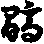



境。冯云：又说寻、伺即七分别，谓有相等者，此意引七分别者。既七分别者皆是寻、伺，其七分别中既有任运分别，任运分别既有五识中有，知五识得有寻、伺。



疏云：谓有相无相，乃至染污者。有相分别者，谓缘过去是境，及现在境有相状。过去之境，虽已落净谢，曾以起显现，名有相。无相者，谓缘未来世境，未来世境未曾起故，故名无相。任运者，谓不起定。缘境寻求者，得与寻俱起。缘境伺察者，谓与伺俱。染污者，谓与贪嗔等烦恼俱起。不染，谓与信等善十一俱起。然此中寻者，即是寻求分别。此中伺，即是伺察分别也。



疏云：此师分别谓在五识，非五识体即是分别者，此师说五识任运分别，非五识中皆是七分别，及随念、计度等三分别亦念违。然餘圣教中说五识中无分别者，意说五识自体无分别，妨五识得与分别相应。分别相应分别者，即是寻、伺也。然说论第三破上座部胸中色物为竟根者，上座部被他难曰：五识，六识摄，具有等无间根，及有同时俱有色根。第六识是六识摄，既有等无间根，亦应有俱有根。上座部被师虽已，则立胸中细色为其意根，非执胸中麤肉团心为其意根。胸中肉团心即是身根，此师亦心麤，执法处别境色以为意根。然上座部既说第六识胸中色物以为意根，即大乘经曰：五识依色根，其五中即无随念显示色物以为其根。即大乘难曰：五识依色根，其五识中即无随念显示二分别。唯五识中者，自性分别。其第六识亦二分别，五唯识中有自性分别。其第六识既依色根，其第六识亦应虽有自性分别，应无随念显示。许五识无随念乃至是寻文者，此释五识有自性分别，无餘二分别。则旧经论中云：一、随念分别；二、显示分别。即缘未来世依，未来世依可显示。显示分别即是新经论中计度分别二自性分别。若新经论中云：一、随念分别；二、计度分别；三、自性分别。亦是寻、伺。



疏云：非直义通大小乘中，亦说五识有自性分别。若小乘多云三分别中，亦说云自性分别。又多云亦说五识并寻伺。然彼宗说起五识及第六识时，必与伺俱起。由如大乘遍行，心起即有。即被硕云：五识唯寻伺。若意界、法界、意识中，即令有三。谓欲界及初禅，即名有寻有伺等。乃至己意界、法界、意识界，即名无寻无伺也。



疏云：然十五种意不共业者，法师云：论云：论文应是十四种不共业。应捡谕伽第一文。



疏：引发於苦者。由寻、伺、非爱境能用，起五识中苦受烧心业。缚者，烧者也；缚者，起。



疏云：人天寻伺，多分、小分喜等者，如人中间人子，人中有一人、二人快乐，有喜受；餘者有苦，多分应受。若欲界六天、劣弱诸天，被他强天等多起，应俱。



疏云彼各别作，今此中总通人天等五趣为论者，彼瑜伽第五说寻伺人天必趣，名名别说。今此唯识论文又说寻伺应起相应，曾不说与苦乐俱，即人天五种为论。



疏云：以此义总说喜名者，许论以诸禅属受，总立喜名。



疏云欲界寻、伺，下地喜、乐，乃至何不别说者，此文后师立理。虽前师初禅中意师乐与意中喜相顺，则说喜相受有寻、伺俱。既欲界中喜、乐在识各别，谓欲界意地境唯名为喜，不名为乐；五识中意说唯名为乐，不名为喜。既欲界喜、乐在识各别，无体、性、相离，何故圣教不别说五识中乐受与寻、伺相应，彼意地与忧相俱？有分别者，能解五受。若忧应喜，即名分别，通悦心；若苦、乐，即名无分别，通说可知。若舍通二种，然初二禅中随有等乐受，少说身、多悦心故。故初二禅乐受亦得名有分别，地狱中苦亦得少分、有分别也。



疏云：餘根处苦、忧名业。一处势不相似，何缘不说者，即后师立理难前师。自地狱中有意地苦、苦於忧，说苦、苦受者，寻、伺者，餘趣之中，意地逼迫，唯名意忧，不名为苦；五识中逼迫，唯名为业，不名为苦。唯何故经、论中不说五识中苦、受？似应五识中忧、受有寻、伺。



疏云：说寻、伺二法名身等三法者，即是名身、句身、文身。生在第二定已上，起下识相显。乃至由彼寻、伺竟，识起者，此第一解即说生三禅中。若率尔三识，即无寻、伺引起；若等流三识，即由寻、伺引起。此解亦不尽，理应说起。若率尔三识，亦由寻、伺起为胜。



疏云若身在欲界定中，耳识乃至与下界耳识俱时起故者，此明目连身在欲界定中，耳识率尔。耳识起时，与无处有处意识同缘欲界中声。第六识既是为所有处心，则无寻、伺欲界及初禅。餘时五识，多分由寻、伺意识引起。



疏云：其显由彼起，正欲前师所引大论者，即会大论五十五文，说五识中有寻、伺。



疏云其多由彼起傍会乃至除率尔者，其多由彼起，即彼傍会。有论文说欲界寻、伺能引五识者，今会云：欲界、初禅起五识时，多分由寻、伺引起。若非定观，即由寻、伺、意识引起五识；若任运缘境中起五识，即不由寻、伺引起。婆多云：定后关声者诸识不许并生在定中不恒起时识。其显由彼之正会前师，乃至显多由彼起。许率尔心者，问起下，论文重成，立前第一。又问其多由没起，即傍会说。云论中说欲界及初禅五识中有寻、伺者，即会疏文中第一解云：初禅、欲界除率尔心等，餘染、净心起，皆由寻、伺、意引起。若会第二解，即说初禅、欲界中起染、净等流五识时，或由寻、伺、意识引起，或时不由寻、伺、意识引起。



疏云：又初定及显界乃至道引方生，由彼起者，此第二解：初定及欲界五识率尔心，除由意识引五识，五识是自、他方能引，引第六识不与寻、伺俱。二禅已上起初禅五识率尔心，以五识非是自地法故。故二禅已上起五识率尔，皆由寻、伺、意识引。此解为胜。论云：彼说任运即是五识乃至相应寻、伺者，然对法云：七分别即不初寻、伺，任运分别即是五识。瑜伽任运等七分别即是寻、伺，运分别是寻、伺故。任运、随同，义各别。但言寻、伺有七分别者，此文即会瑜伽文，瑜伽文中七分别皆是寻、伺。不言七分别皆是寻、伺者，此文会对法文，对法文随说七分别，随说七分别不寻、伺。



疏云：答：彼摄论乃至世五识者，真彼多说五识中亦有自性分别，故说五识有自性分别。是此文即解前一体即是五识文也。



疏云：何故五识即是任运？意俱寻、伺，方名任运者，此中间意何故五识？五识体即是任运，识意体不名任运；与意识俱时寻、伺，寻、伺体方名任运。



疏云：此违定中闻声等事者。解云：此中。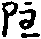



意：若与五识时常五思识，五思识名有分别寻伺尔者，则建目连定中闻声五识俱时意识，即是无前有处心分寻伺故。答：前解深密经中，则约五识俱时散意识中，必与分别寻伺俱，不约五识俱时定中意识有分别寻伺故。地定中间声五识俱时意识，意识则无分别寻伺，亦无违死建也。



疏云：问：若尔，善、恶追悔亦通舍、不者，此中问意，无记之悔即得与舍、受俱，未知善、恶性悔得与舍、受俱不？



疏云：答曰：恶作强思乃至工巧心俱中者，此第一解云：善恶悔既是强感，初未至末，则与忧不与舍受俱。其威仪工巧既通舍受，无记悔与无记威仪工巧中舍受，或於善染相续末位方与舍俱。与此第二解通相解。若善恶性悔初强成时，即唯与忧俱。若善染性悔势力渐劣末位，然得与舍受俱。故善染时俱，即无舍受。舍受乃至非正有染舍可与俱者，此文意说善染悔初强威时，无舍受俱，唯与忧俱。若善染势分直至相续末位，与戚行舍俱。舍受亦通戚行等者，此分意说者有三种：一、顺益舍，能为分别，如曰念中定是。二、中客，即非苦非乐名中客舍，客舍不能为人事。三、戚行，戚行不多分别名戚行者，若多分是忧故。善染末位与戚行舍受俱，非与前二种舍受俱故。悔是戚行，还与戚行舍受俱。正不善染悔强时，戚行舍受俱。舍受非无戚行悔强思生，唯与戚行舍俱者，梵王成即时，独灾劫而坏，不不即是戚行舍受，亦不是应。应离欲界舍，与萨婆多别。乃至违文者，小乘说善恶性悔唯与忧俱，乃至善染悔至相续末位亦唯与忧，不与舍受俱。彼宗说不还果等离欲界染已，即舍悔即应。若初二果人未由有悔故，故今大乘说善恶悔末位既与舍受俱，又无记悔亦与舍俱。第三果人虽离欲身，中由有悔。若依此解，违下文云：悔非无学，离欲舍故。由此义，疏文亦解。应说恶作多与覆俱，乃至亦离欲舍者，此二解云：即是正义。应说恶作多分与忧俱，谓悔与戚行舍受，戚行舍受悔即是与忧受俱，悔伴类俱。是戚行离欲时，若师善恶性悔，亦即师无记性悔故。故云：若无染善者，无记亦无。圣者所起悔俱是恶化，乃至亦师种者，一、问：属者如何起作？既许圣者起，未知恶作得与受俱。三、问：既说恶作离欲不舍，色圣者起无记恶作，如何是工巧心摄？无色圣者所起恶作是工巧，如何威仪心摄？四、问：三果圣者皆得起恶作以不？及上二界意生亦得起恶作以不？亦问：七地已前菩提及地前菩提，皆得起悔及恶作及睡眠以不？应问诸师。答：如揄安说。



疏云世间离欲种内苦乃至亦师种者，疏云：解：若善悔，若不善性悔及无记性悔，若竟生，生上界。伏欲界中善性悔、不善性悔，则悔善悔种子。若不还果，则师欲中若善悔，若不善性悔种，皆师种子，方始生上界，以悔能障上界定。乃至罗难亦师善性悔种子尽。疏：主解不尽理。和尚难云：不善悔体是恶法，离欲界肢，伏善悔，现行不起，应不师种。由如得二乘果已，回心入大乘菩萨地中，即不师二乘，无师种，但伏二无漏，令不起。若之欲界中善悔，障上界故。故离界肢，则师种尽，方得生上界者，今虽知二乘无漏亦障菩萨十地，亦应师二乘无漏种尽，方入菩萨十地。既不许二乘无漏得入菩萨十地，故地不还圣者不师欲界善性，而生上界。哲法师解云：若欲界中不善性悔鄣第三果人，三果人则师欲界中不善悔种而生上界。若欲中善性悔上鄣第三果，不还果圣者唯伏欲中善性悔现行令不起，则不师善悔种子而生上界。若罗汉亦有善性悔种子在，为是善法故，故不师善悔。定性二乘无学入无餘依涅槃肢，法师却善性悔种子。若不定性二乘有学果人无学人，回心向大乘至成佛肢，金刚喻定现在前时，善悔种子劣无漏有漏善法同时舍。由如二乘人得二乘果回心向大乘者，二乘无漏种子鄣鄣菩萨十地，十地位中亦不师二乘无漏种子，但伏二乘无漏现行令不起。后十地满乃至成以时，金刚喻定时现在前时，方前舍二乘劣无漏种子，及与有漏善法同时顿舍。



疏云：以不言与苦欲界乐俱者，此师意说，然欲界五识中有苦乐受寻伺，唯苦定说寻伺自在，於欲界不得与苦乐受俱。



疏云：悔增至三，眠增至四。极苦处亦有眠者，谓能与忧、舍、苦三受眠，与喜、忧、舍、苦受相应。谓无间地狱中虽无极重睡眠，由多时受苦，即第六意识亦有惛昧，有杂睡眠中亦受苦故。谓地狱中亦得起悔，谓有情类初生地狱，已见诸苦具，已得宿任，通见过去，造飞生悔。地狱中得起寻、伺，而发语业：语业！愿我何时当舍此命！此疏同文。此苦身、心令我自在，受胜快乐。寻、伺与五受相应。



疏云：设许亦有亦无，恒安非定引生者，设欲界有恒悔、眠二种，互无杂种悔、眠二种非定引生数。



疏云：有人三藏之西方，乃至说初静虑者。有餘人云：传三藏之说西方，说未至定中有寻伺无？不然，准满。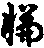



云：即四种根本定中，亦有禅十八禅支，非未至定有寻伺等支。今之支者，由如依树支，表树䇿茂，禅师亦小，依於根本定为根。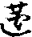



而生十八禅支，即是功德支叶。说未至定中有寻伺，亦不是禅支。未至定中，根既未成，如何能生支叶？难为此难，亦不应理。根难云：未至定中有寻伺，即立禅支者，其欲界中亦有寻伺，应亦立为禅。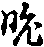



支亦初禅，未至定中有喜受，应亦立为禅支。第二，未至定中亦有喜受等，应亦立为禅支。第三禅，未至定中即有乐受，应三。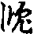



支故知虽法中合有，即有不已，故立支。故知未至定中虽是喜受，即不立为支。根本定中有喜乐受，即立为支。故知未至定中虽有寻伺，地法合有，不立为支。根本地中寻伺，即为支。



疏云：合嗔、邪见、贪我见，是中约麤相言不得者，此言悔与嗔、邪见、贪我及痴与五法俱起。此解今好。论文且约相言，不得与九根本烦恼俱，据实亦得俱。



疏云：又解：必不得俱与悔间起者，此之悔不与根本烦恼，亦顺论文作此释。



疏云：答：忿等嗔分，等嗔分，如本得俱生者，忿等依嗔起，忿等是嗔分。嗔是本，忽与末根本嗔得惯俱起。忽等根本嗔，忿等亦得与慢俱起。



疏云：何故忽等各别记者，此我前解意，又作此难。难云：既许忿等与根本烦恼俱起者，如何言忿等十各别等起，得名独头烦恼？



疏云：於自十中各别不得起，自各别起名忿等，各别起则不约根本烦恼，俱名得头起。



疏云：如大论第七染法分别，乃至间生名俱者，彼大论云：追悔性恶而自责。疏主会文，恶作亦不与嗔而间生，则没论文。就此论文，□疏主问：何故显扬第一恶作，乃至不之无记者，不染名善，染名不善？



疏云彼顺小乘多分起故，乃至应俱者，解云：此文见答。会前显扬，但说恶作善、不善，不通无记者，即顺小乘说。小乘说恶作既与应俱，应唯善、恶性，恶作是善、恶性。



疏云闻所成等，显因闻所成乃至狭劣者，若唯之闻、慧、思、修三慧，即唯别境中慧受不摄，得餘法即狭劣。若言闻所成，闻等三慧所成色法得生等四相及身、语等色，同时五蕴皆名所成。又八地已上菩萨无漏常相续，则无漏定中所起身、语业色名修所成，摄法宽广。问：别解脱戒内何所成？答：由闻、思、慧所成。问：别解脱界未十八？答：唯是修慧所成。问：别戒、脱戒未十八界中持几界？破几界？答：据实，别解脱戒十八界中若持若破唯三界，谓法界、色界、声界。如持戒人持七支戒，谓色界、声二种能发表业，谓不妄语等，离口四过，即是声表业，即十八界中声界摄。若不煞、不盗、邪行，离三恶行，即是色表业，即十八界色界摄。若色、若声发得善、无表，善、无表即是十八界中法界摄。持戒人十八界，唯持三界。若破戒人，谓作煞生、盗、婬，即是色表业，十八界中色界摄。妄语、口声表，声界摄。若色界发恶无表，恶无表是十八界中法界摄。此上约十八界各别。若十二处分别，即唯三处：色、法界。若五蕴分别，色蕴及行蕴摄。若芥处十戒十八界，约实言，唯持五界，谓意界、意识界、非非界法。若定戒意识界，皆是转心发业。若约随转发业，即遍持十界，谓五识界：色、声、意界。意识界、法界，即为十界也。问：佛三身，几有始有终？答：若身本来先有，亦是无始无终。今约初成佛时，师障所显得法身，亦是有始无终。若自受用身，成佛时得，即是有始无终，不约无漏种子说始终，不约身故。若无漏种子，无漏种子亦是无始无终。若他受用及化身，化生即起化，必即先有始有终。



疏云於眠等位思择义故者，睡眠中择义亦有加行，善若思择，义即最宽。若染心中始他胜己，亦能思择法义成耶？见人亦能思择法义成，烦恼心中亦能思择法义。



疏云故次应辨染觉修师等，后自有门，故先不说者，此中意云：四不定既通三性，分明别曰不定，与生得善加行俱起，即明四不定善性说，即应次明四不定染性。此中不明染性者，已下文中既明四不定染性，通见师、修师。问：此中不先说？



疏云即欲界修道二无俱有眠等三者，此餘悔以外，除等三既通有覆无记性，欲界俱生身边二见既是有覆无记性，亦得与眠、寻、伺三法俱起耶？



疏云恶作无记及染必不善者，解云：善恶作则不通有覆无记，以下麤恶作即不得与欲界中俱生身边二见俱起。若恶作通染必不善性悔，唯是威仪工巧者，此明无覆无记悔是威仪工巧摄，若善性悔是生得善等摄。若如舍利弗法执中，恶作异熟生摄。



疏云：文中第二解说，悔是四无记中亦通异熟生摄，与为是业果熟生摄，为是法执异熟生摄？若言是法执中摄，何故前说恶作非染，解麤猛摄？理通顺论，且许



疏云其餘无记，虽不缘威仪等，亦是彼摄者，第一解云：其恶作通覆无记者，若缘威仪、工巧等心，其无无性恶作是威仪、工巧心摄；其无覆无记恶作，诸不缘仪、工巧，其无记恶作亦是威仪、工巧心摄。是缘威仪等心类，非餘异熟生摄。此解顺论文。



疏云：又解：彼不缘威仪等心乃至亦恶作俱者，第二解。又解云：其恶作通无记性者，若缘威仪、工巧心，是威仪、工巧心摄其无记性恶作；若不缘威仪、工巧，无记恶作是异熟生摄。若大乘异熟生心宽与不摄者，皆异熟生摄。如增上缘生上三静虑，借下初禅中眼、耳、身三识，三识是无记性，此借识心是异熟生摄；起下地寻、伺，是借识身力故。无记恶作不缘威义工巧者，是异熟生摄。若多宗云：即威义心宽，餘不摄者，此摄如增上缘生上三静虑，起下初禅眼、自身识是无记性，是威仪心摄。



疏云此异熟生非实异熟，寻、伺亦然，乃至文相违者，然第八识得名真异熟，亦名异熟生；若睡眠、寻、伺，即名异熟生。不真异熟不与前第八识中相违。问：此疏云即言寻、伺异熟生摄，次下论文即言寻、伺许初彼性微劣。



疏云：说不善污，分别此有善、净、无记者，不染污中有二种：一、善，谓与善十一中随何善心所俱；二、净、无记，亦名不善染污，是无记性。



疏云：大论第一七分别中说不染污分别，此有善乃至与此同者，今引此大论来意者，为唯识论中明无记云寻、伺，寻、伺与后三乘无记相摄，故彼论来为证。然大论依寻、伺若别而立七分别，七分别中取不染污分别。论自释云：不善染污分别者，此有善、净、无记，谓随与一心等善法相应者。言若净者，其寻、伺亦通生得善方便、善闻、思、修慧及无漏后得智。净、无记者，是无覆寻、伺，即是四无记中后三无记摄。然论主会大论文，善谓随与一信等善法相应者，然善法起时，即餘记安，餘十善定俱起。如何彼论言随与一心等相应？非谓唯得别起一个信。故知彼论但举总数，故言随设一信。彼论言寻、伺、净、无记，正与此论同。



疏云：此文但说不与业果异熟俱，乃至彼可与俱者，今言寻伺不与业果异熟心俱，其寻伺即得与法执类异熟心俱。论云：恶作、睡眠，唯欲界有，寻伺在欲同。未知他洲及三恶趣、六欲天中，如何得恶作、寻伺等事？既前论文说追悔先业名悔，能寻察名义故。其三恶趣及北洲，如何得有悔？寻伺亦得有之。寻伺嚣苦谛无漏，后得智中亦有少分嚣繁。由初禅内有寻伺，外有火灾；二禅已下，内喜，外有水灾；三禅已下，内出入见，外有风灾；第四禅离八灾。论等如俱舍妙说。其有缘无记悔修定者，是本有位。解云：即是欲界中本有身，不得上界而起於悔。



疏云非谤涅槃，色界中有，无入起悔，此违下文者，第一解云：即是少闻比丘於中有位，不得起悔。若作此解，违下论文：有邪见者，悔修定故。问中既谤罗汉，双谤涅槃、菩提，此明言谤涅槃。答：如金刚般若云：皆以无为法而有差别。又如大论：谤罗汉足灭道谛。则邪见此间唯取涅槃。疏中又作天二解：



疏云：又解：欲界中有中起悔，悔乃至及生有言无，即少闻比丘於色界中有亦得起悔，是生下地悔。论：又生上不起下悔者，据多分说。又据色界生有说，不得起下地悔。然有色中，第四禅最安，中极在，无过无间。其少闻比丘於中有枢闰，第四禅受生处无。此受生处起谤灭心，极胜第四禅。中有身起无间，中有身而𫏬，坠於地狱，上头下



疏云欲界入初定，名下地上者，即身在欲入初禅定，亦得起上初禅寻伺，名下地上。



疏云第二定已上，第四定起初定及欲界耶见者，此解生上起下地寻、伺，即第二禅已上起下初禅寻、伺。又初少闻比丘生第四禅中，起下欲界中耶见，耶见俱时亦有欲中寻、伺，即是第四禅欲界起欲界寻、伺。又色界后后拟生欲界时，其色界终心亦得起欲界闰生爱及起欲界寻、伺，名上起下。



疏云：若无色界起下色界，欲闰生名等，名上起下者，即无色界没，下生欲界；无色界终，心起下欲界闰生，闰生烦恼俱时亦有欲界寻、伺；及无色界没，来生色界终，心起色界初禅闰生烦恼，俱时亦起初禅寻、伺，名上地起下地寻、伺。



疏云：有邪者，悔修定故。悔同缘上者，或有餘人初学修定，虽未得上地定，起闻、思位，多用功夫，而不得定。闻此小闻比丘得第四禅定，即仍后堕地狱。自餘人始用功天，拟修学定，虽未得定，亦悔修定，下地悔亦得缘上定。



疏云：通亦上增乃至心。据实义解云：小闻比丘本是增上慢人，村色界中有，中起邪见，而起下欲界悔。悔修上地定，是生上地，起上地欲界中悔。上地欲界中悔，而缘上地定。前论文虽言悔眠生上，必不现起下者，约多分说。今此说上地得起下地悔者，据令大义。



疏云：又解：彼时极从乃至地下悔生。解云：第二、又解：彼少闻比丘中有起邪见、慢灭已，即堕无无间中。有中时答极，伇后不容生悔。今之有邪见者悔修定者，此据欲界本有位，虽未得上地定、戒字，修上地定而不得定、戒。闻小闻比丘得上禅定而生无间，餘人起邪见悔。一生已来，多用功夫修无生上地，起下地悔。先此解，即顺前论文，生上地不起悔故。若得上地定，以离欲界染，不得起欲界悔。



疏云：上文烦恼皆以三界分别，乃至不相违者，如上论文，明根本烦恼及中，皆以三界中分别烦恼、随烦恼。三界中皆通身在下地，得起上地烦恼；上地许起上地，许起下地烦恼。准前道理，亦应生上地，得起下地。欲界悔、不许悔，与九烦恼俱。少闻比丘中有位中，与邪见心前后别时，而悔村、悔九灭，与邪见俱不相违。



疏云：许俱义解，许悔与邪见及嗔俱起义。然此段疏总有四种解：一、与第四少分别，可知但加嗔。



论云悔非无学，离欲舍故者，然悔唯通学及非无学，不通无学。若染悔非学非无学，然通学者，若初果二人得有悔，若后二果人即无悔。恶作即通四果人，皆有恶作。



疏云：第三果等，乃至审决者，初二果人，由有欲界妻、子、恶不善法。此中第三果人，以师欲界烦恼及恶不善法，皆若悉师；不然，入三恶趣栽生已定知生死有边际得第三果已决定出村无随事必不悔，已审决故。



疏云：无记设悔，随忧根有无行相同者，若有忧处，悔则有无，忧则无悔，悔则愁戚，忧亦愁戚，相随有无行相同。如彼虽有愁戚，或是舍受等者，此修不还果人，虽离欲染，还有愁戚，愁戚即是戚行舍受。由如大梵王心怀不说，说是戚行，舍此如是。



疏云：善法欲以去，名为学。解云：善法欲者，即是初发菩提心资粮位中所有有漏善法，皆名为学。若大乘中有学、无学，通取有漏、无漏善名界，名无学。宽若多宗，从见道至无学位以来，中间所有无漏法名学。若无学身中无漏法无学，不取有漏善法名学，名无学。



疏云：今言通无漏者，邪见等势起，缘无等生，或见道四谛。下邪见势，即前人云邪见势力引生后念悔，即悔通见道四汸。下师或缘自他见而起於悔，由如前论文，缘自他见起贪恚慢相似，悔通见道四汸。下四其悔不得与俱生身边二见俱起，以悔不通有覆无记性，其悔唯痴俱不得已，餘非理惑俱起。若眠则通与一切烦恼俱起，或随他烦恼后引生，或缘自他见等，眠通见师。



疏云：谓在根在五识，由无漏后得智位引，或引后时五识等生。解云：由无漏后得智位引起者，由与无漏后得智同时引起五识苦根，五识中苦根与后得智俱时。或引后时五识等生者，或由前念无漏，后得智引起后念五识苦根亦得。谓初地已上芥身在欲界者，见诸众生在地狱中有种种苦，即无漏后得智引起大悲，生地狱火，烧菩萨身，心生厌离，即菩萨五识中有苦生，即是无漏后得引起五识中苦。或第六识中正入无漏，后得智同引起五识中苦亦得。或前念无漏，后得智引起后念五识苦根亦得。今此菩萨被烧有苦，即是分段身。分段身以欲故，故被烧有苦。若变易身是微细，眠当不见，岂被火烧而生苦？第二解：变易亦有微苦。问：菩萨即入地狱中未？第六识中有苦不？答：若地狱中众生为恶业感第六识有苦，此菩萨或是人身，或是地身，既不被恶业感为救生，虽在无间，菩萨第六识无在根，是无漏亲所引生。无漏不引悔、眠，悔、眠则不能救众生，又是无用。



疏云：二十二根中仍名不师。解云：即二十二根中意五受根通三师，与见道烦恼俱起，意根五受即是见师。若与修身烦恼，即通修及通不师也。



疏云应苦许为三无漏根者，此应根通未知当知及已知根，为通有漏、无漏法？即说应通二根。始从资粮位已去，皆名未知当知根摄。若小乘中，前二根唯无漏，不通应根，俱谓见道前十五心，即名未知根；若第十六心已知所有无漏法，即名已知根。



疏云若既师者，名非所师，即无学眠非前摄者，解云：此眠所师缘缚断。言已师者，皆既断者，竟说眠通善性及无覆性者，即断缘缚师。即无学身中眠皆已师，缘缚师即名非所师。若眠亦通三师。若不善性眠与见、修烦恼俱起，即是自性师，即眠通见师、修师。若眠亦通相应师。若善性眠即是缘缚师，即在无学身中。善性眠名非前断，即不取无记性眠。何以得知？即下疏文云：若无漏引，名为无漏。眠虽亦能，还引生故。故知无漏近引起根。若无漏即还引善性眠，无漏不引起无记性眠，故知无学身中有善性眠。亲所引生即简眠，深求解脱即简悔。若小乘中说一切有为有漏法皆是非学非，若有为无漏法即是学及无学，若无为法即是非学非无学。若大乘中说有为有漏亦通学，即如应苦等；亦有有为有漏法通无学，如无学身中眠等；若无为，即同小乘据求无漏。无漏前引，即非非断者，此文意说：若应即能深求无漏，应名无漏；若苦无漏所引，苦亦无漏。今者睡眠若望他，应能求无漏。苦无漏所引者，其眠即是师法，不通不师。何以故？眠不及他。应苦能求无漏，无漏不引应眠，但初无学身中有，故眠名非所断。



疏云：又解：此据多分不得者，有出世深生悔故，可名名师。解云：第二解云：今言悔唯见断、修断，不通不断者，据实言与应便求解脱，即说应是非前断。悔与应行相既同，亦有求出世深生悔故，故悔亦通非前断，与应相似故。寻、伺二法虽非无分别智，乃至此解即通无漏师义者，此师意说：然根本智中即不与寻、伺俱，由加行位中寻、伺能引其见道故；或后得智中同时亦引起寻、伺，故寻、伺得通无漏，名非所师。后解虽非，乃至即不通无漏师义者，意说：若根本、后得智中皆无寻、伺，由寻、伺能引无漏智，由如忧；或被后得智引起寻、伺，由如苦；寻、伺如忧、苦，亦名无漏。村五法中唯分别摄，乃至今以为证者，然大论第五虽明寻、伺中四句有寻、伺皆分别，即彼论说寻、伺为分别，即明不分，亦不拟明此分别即是五法中第三分别摄。然今此初师即取大论第五分别说寻、伺文。别者，即是五法中第三分别说寻、伺为有漏。若二师解大论第五中说寻、伺为分别者，即会云后得智中亦有分别故。诸寻、伺皆分别者，寻、伺能分别境。有分别非寻、伺者，二禅已上心、心所及欲界初禅中不与寻、伺俱起，自餘心、心所皆名分别，不名寻、伺故。



疏云：彼正思惟能令求、寻求、趣入、极趣入者，初浅推寻名寻求，若深推求名寻求；初浅证理名趣入，后深证理名极趣入。正智中即有根本、后得智，后得智摄寻、伺。问：既言趣入证理之语力，为是根本智？为是后得智？



疏云是大菩萨语言同故者，此言因者，即是前寻、伺是语行问。既引十地论初乃至语言因者，此中问意，既彼论中之又说寻、伺语言因者，何处不引三请中何故净觉人等上觉亦是语言因？语言因故，亦是寻、伺。



疏云：念，智论具智。此颂即是十地经。十地经本是华严经中十地品。今人间流行谓别行，亦得摄入彼华严经中，亦得如观音经普门品。念者，即是修慧。维摩经云：大慧行大念者，即闻是慧。慧者，即是思慧。行者，即是修慧，如谛理。谛理善思之谛者，即是闻慧。善思念之者，即是思念之者，即是修慧。故此念即是修慧。答：若依梵本，乃至应之净思唯者。答：彼文即是翻译家错。既赞叹金刚藏菩萨，应合好语赞叹以说众生心。若言何故寻伺人，即是问：而菩萨如何名赞叹？故知禅家增应何故净思推，即是好语。后八地菩萨已上由有者，然八地已上菩萨於利地中仍作功用。下文云：第九地菩萨？沙於利地中不欲行鄣。故知八地已上利地须功用。有正思惟，体即是慧，不名为寻者，此第一解明佛位中有正思惟，后第二解次明下佛无正思惟。正思惟体即寻伺。又解：十无学中佛无正思惟。前以无为寻者，此师意说正思惟即是寻伺，知佛十无学法中许正思惟唯有无学法。又八圣道中既许正思惟，即佛有七圣道，立



疏云：八地已去，无漏观心既相续，乃至有漏五识。是即难曰：五识皆由寻、伺引者，八地已去，无漏心常相续，无寻、伺，如何发起有漏五识？



疏云何亦此不尔？定中闻声乃至但说法须者，此即答此前难。不然，目连！入定第六识入无所处，乃无寻、伺能引五识，定中亦能起耳识闻声，故地五识多由寻、伺起。故地八地菩萨无漏心中有寻、伺时，亦能起五识；无寻、伺时，亦能云五识。五识时不名一切时，皆须寻、伺起。前显五识多由彼寻、伺起。八地已上菩萨但为他说法时，必须寻、伺发。



疏云：此说诸门说为遍行，大乘不尔。随小乘宗说寻、伺二法是语遍行，大乘不说寻、伺，是遍行佛无寻、伺。然萨婆萨多宗说佛亦有寻、伺二法。



疏云唯心遍行，此实遍行，此二种遍无漏者，大乘中唯说受、想二法是心遍行，不说身行、语行名为遍行。唯如上来道理，寻、伺二法通无漏。



疏云十地中是初地已上乃至劣不行者，十地中皆有寻、伺。初地已去乃至第十地已来，后得智中所起无漏寻、伺、金刚寻、伺。此寻、伺与彼相应同时，心已一时不行寻、伺，是是劣法。今至金刚，心以胜得舍劣。如得未知当知根时，即於前四道得胜舍劣；如得既知根时，即於却前未知当知今根得胜舍劣；若得具与根时，即舍却前已知根得果舍四故，后得胜舍劣故。



疏云唯后得智，非正智者，乃至四句为证者，今说寻伺，唯通与后得智俱，不根本智俱者，以七十三说寻伺，四句分别。有思惟真如，不离真如，谓加行位中闻思慧，唯能思惟真如，不能真证真如。思惟者，即是寻伺也。有真亲如，谓根本智正能亲证真如，则无寻伺，不思惟真如，数亲真证。有亦思惟真如，亦亲真如，谓无漏后得智有寻伺，名思惟真如，心中拟宜亲真如。不思惟真如，不亲真如，谓餘业果异熟生心。既无漏后得智中亦思惟真如，亦亲真如智，无漏后得智中有寻伺也。问：二乘人无漏后得智中亦得起寻伺，利有情，思惟真如，不亲真如者。问：思惟者，即是寻伺。既后得智中寻伺缘真如，真如即是理，如何乃云后得智中缘事化有情说法时，方起寻伺耶？人答之，可知。



疏云：大论第五解此二是三界心、心所乃至不之唯者，大论第五初此二种分别：一、有漏心，名分别；二、遍计心，名分别。解此二种有漏分别即是三界心、心所，名分别。离据有漏，说二分别，不之唯字。故知分别寻、伺亦通无漏后得智，后得智亦名分别故。故智、无漏后得智中有寻、伺也。



疏云：此中第一师说寻、伺体，乃至闻无寻、伺者，此第一师说说寻、伺唯是有漏，即无漏。初禅五支中阙无寻、伺支，无漏禅支中唯有喜、乐心，亦境性三通无漏。



疏云至佛便无，但即思慧，乃至此义应思者，至佛果位，则无寻伺支，但有思慧。体无麤细者，麤心是寻伺，细者是伺，说无是支。若自餘人有烦恼，在初修物禅定，则须初禅中寻寻伺支，能对治欲界中恚害不善法故，故须寻寻伺支，是对法支。喜义乐是摄益人定体，是所依支。此定体，餘寻伺喜乐之所依。如来身中烦恼既皆师，无寻伺为能治支。问：不放逸能对治放逸，如来有不放逸寻伺。既名对治支，如来应亦有寻伺。答：染法须除妨，如来则有不放逸寻伺，是语行。佛无寻伺，如前。



疏云中亦有此问答应者，彼礼文：如来无寻伺寻伺支劣亦无过由如身中无闻思闻思慧是劣。还如来身中有十八不共法、十力、无界，与餘圣者不共有故。不可说言禅支多者，则胜；禅支少者，谓佛无寻伺，谓佛即劣；餘二乘等虽具十八支，不痴是劣。



疏：缘有漏、有事等，皆准为之。皆皆此四不定亦得缘有事。餘寻、伺及眠许悔得缘无事，以悔不得与餘根本惑俱。业我见、边见能缘无事，有无漏，名境取。悔不得与俱生身、边二见俱。



疏云：其楞伽师乃至立别故者，诸楞伽师，即执楞伽经中八、九种种识，如悔中诸彼执八识，当不可有何。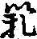



有心所不别立心所，即论师执诸法皆空，法当不许立不立心。可经部唯立三心所，谓五蕴中受、想、思三，餘善谓心、惭等，餘位贪等，皆於思上假立，无别有体。若处有心所，则文应立多蕴，不合唯立五蕴，故知心所唯有三。此等虽有心所，水名无妙音，亦同经部作。此说即是婆沙中四禅师，大论中之一人，谓餘觉天、世友等。



疏云：如俱舍解触支中叙经部计，婆沙等叙妙音等计者，即是俱舍论中解十二因缘中明触支中叙此等师计也。



疏云：还行及独行无心窹於窟调此难调心者，游历境界，名为还行；无第二故，名为独行。今难云：若有心所，则名伴行等，不应名独行。既名独行，故知无佛。无身者，谓形色。意说此心，无其形色。窹者，睡。窹窟者，心窟。意说此心，睡窹於心窟。中难：若有心所者，应颂中云：谓此难调心所。既唯意调心，不言调心所者，故云无心所。论云：染污由心者。解云：由无心所，经但云染净，净云由心。若有心所，经言染净由心所，不由染净由心。



疏云心垢故，众生垢者，是第八识。此文说由第八识中有二鄣垢种，即令众生受三界生死身，即名众生垢。心净故，众生净者，即第八识无鄣垢种，即令众生得或生净土中。



疏云此意难云许心似二现，此牒已成义者，已前论文中以成立八识心王、六位心所。此成立得心王、心所之上，皆能既似无相分，或现似能取、能取。此许心似二现，牒已成义，立八识心王、五十一心所变似见、相二分。若疏主解，将此许心似二现。此一句则总结已上所有八识心王、六位心所，皆能变现见、相二分。疏主无不释他难言，但将此结上文。若悊法云许心似二见者，他人申难，别此一领证。无证云：意说若染心生，似贪现；若染心生，即似信等言。故唯知有心王，无贪、信等心所。故有许心似二现，贪、信二名似二现。若疏主解，此假似见、相二分现者，即不相当本意。外人净离心外者，别心所相应，无别心所相应。即引此颂证无心所本意。前论现似见、相二分，疏主错解。



疏云如是贪等者，乃第一说染者，疏主解心上变似贪心等现，由如自证分变似见相二分；正王能似由如自证分贪等，是证变似由如见相二分。悊法禅云：若疏主言心变似贪、嗔等著变言者，则生生相应义。他外人总意诤：有别心所与心王相应净，无别心所共心、心王相应，亦不净心变贪等。疏主不解相应，但义之唯似，故知非哲。法云：此颂中是似贪等义，似於心等。云：染心起，则似贪等现；净心起，则似於信等现。唯心王上似有贪、信，故知无别信、贪等别体。



疏云无别染善法者，乃至如二分者，疏主释云：谓心变似见相二分，见相二分离心已外，无别善法。又言：心变似贪、信等，贪、信等离心，无别有贪、信等体。今变似之言，即显心王是能变，贪、信等是所变。由如自证分变似见相二分，见相二分离自证分，受无别体。悊云：序之，外人本意净，贪、信等染善心所离心王，无有引体；本亦不净，见相二分离心别体。外人本意净，有别心所，无别心所，与心王相应。疏主言：心变似贪等，著变似。言如心变见为相二分，即者，却相应义。哲解云：无别染善法者，外人云：善心染生似贪起，净心生即似信现。此染贪善信体，体外更无别染贪善信等。故知别心所法，应方上下文意，知疏主错。



疏云：如对法第五、相应六等，说自性二体不供者，彼论云：贪、信得与解、思等相应，无二贪自体、得相应；或信得与惭、愧等相应，必无二信自体、得相应。唯说与他性相应，非与自性相应。



疏云离日轮外无有光明，如日所故。千光明者，离日轮外有多光明，故知离心王外有多心所。疏中且初日轮照千境界，且言千光明法。且日轮有百千万亿光明而照於境，境亦有多。



疏云：第七、云五法品说者，彼经中说相名分别，正智如如名五法。



疏云：彼觉天等之非别有所俱心，前后分位别，故说有五者，解云：觉天等计心前后分位，若别说有受、想、思，如初怒缘境领纳时，既名受；次第二念念缘境施设，名言取像，即名想；次第三念缘境造作时，即名为行；次后於境了时，即名为识。即一识体缘境，前后分位别，即名受相。行、识离心已外，无别心所。餘贪、信等，皆依思上假立，故知无别心取。即前后分位，说有五应。若经部立有受、想、思已成五蕴，非此所破。若觉天不立受、想、思等，所以此破觉天立，亦非破耶思之



疏云由相异故，体亦应异者，今难：既许受、行化用相别者，亦应受、想、行体亦应别，以体不离相故。



疏云彼计六识体一而所依分位故说六此蕴亦尔者，即是一意识菩萨计。又彼计六识即体是一，俱所依有眼等六根门引，故说有六识。如一猕猴於六窓中著，此五蕴亦尔。定唯识但前后分位别，故说有受、想、行、识五蕴。今者傍引一类菩萨正破觉天。



疏云：为现在一念有种种行相不同，乃至名有多分，位若别者，又难云：谓现在一念识有多行相，谓一念中领纳行相，取傍造作家之心，了别等众及行相。既许唯有一识有漏，所以念此一念识有多行相因缘者，所以义



疏云：谓多念变异，根境相似，因缘无别，亦尔，过先者。又难：多变异，设许汝前后多念，则令一识有种种行相。引者。今难云：且如一眼，前念眼识亦依眼根，前念眼识亦缘色境，后念眼识亦缘色境。既眼识缘前后念，根境相似有何前以？则一眼识前后有分别、领纳、取像、造作等行相。若别，太成过先也。



疏云即贪无有所依染心者，即贪无所依识，无所依识。



疏云：又后经说触、受俱想者，既经说有触、受、想，故知别有心所。



疏云：亦言如是诸法和合，非不和合者，若别有多心所可言和合，无有如众多人得名和合，一人不名和合。既唯有一识无心所者，如何得名和合既言和合？故知别有众多心所。



疏云：又经说灯明喻，乃至如前行者，如依一灯，则有众多光明；如依一心，即有众多似所长行。如前引者，即前论文云：如与光日，光喻与明喻亦相似，如依日有多光。



疏云又速速三喻，乃至成唯有想已者，今云将后三句，即配前三界居声闻。云何是唯觉者，即能前欲。既说欲界中计四大种为我，岂欲界中唯有色？故亦有心、心所。或唯有心者，配上色界。色界中既言意生，意者即是心，岂色界中唯有心？故地亦有似所。唯有想者，即配上无色。无色界中既言无色想生，岂无色界中唯色想而无心所？故地无色界有餘心、心所，谓乳、酪、苏，乃至有想者。今引此喻意说，证有心所。岂唯有色？必应有心，亦有想、受等有色意生。意生者，即是作生，随意然而生故。



疏云：即彼所说三、麤四大种以为我者，即如欲界人中及天，皆执此麤四大种以之为我。



疏云：将决定。解云：五通行亦名将决定。心起即起故，故言心王。为主为依，简亦无事。即五经：一者、如性说之贪、嗔等法，二、又后经触、受、想等，三、又言如是和合等，四、又经说灯明喻，合又连三喻。已上即名五经。



疏云：唯有想。解云：既云有想，故有餘触、受、思等心所。说六界者，唯显色动心所，乃至故故想。言以心胜者，然此中说士夫六界，唯解有内情身中作法，亦不初外山河等上作法。既言言士夫，明知是内。一、色取依者，谓身上四大种，其能依法即有十一，谓五识根及身上五尘，并先表色。此十一法皆依因身上四大种故。若外尘，其外依法唯有五尘。文十一法：二、动所依，谓身中骨节间中界，由骨节间有空界，故法内身能持劣行来事。餘心所依，可知界也。因言性也。色心之身依空而动者，如人似造时，由能等心敬乎起等流色，方始依云有任、运任等事也。



疏云：又次前引乳等喻经，应为返质觉天等，许心十一后变异若别，起五蕴能若别。今返质云：乳酪苏等前后变异，熟乳酪苏等即名为即。既心体许前后变异，心体亦名为色，非谓所以。质等亦无者，若心王即名能似，心所名似。其心已上起染心，应即似等。若心王上起净心王，即似信等。颂许心似二现即是心王能似或似於质等或似於信等即是所似质。心等一无别体乃至现者是也者，意说见相分离自体分外，无别见分。相分由自体分生，即触变见似相二分现。二虽有别体，体由心方生，为法胜。说之为似者，此文即说心所离心王外，别有体由心王生，心所为王法得生。若尔，贪信等乃至所之似贪信等者是何者，此中问意：贪信等即入能似心王中，受别有所似贪信能，是何想信？诸心贪信等法乃至亦在其中者，此答也。言想者，心王能起染净别者，贪信等所。此中说心王亦能得染贪净信等及无记法本质，即心王自证分上所变相分中有贪信无记三性法，其信亦能缘信等贪无记法本质。正信等自证分上所起相分中，亦有信、贪、无记三性法，其贪等亦能缘信等、无记三性本质。然贪等自证分上所变相分上，亦有贪、无记三性。其想许心王聚中同时有心所，此解心王贪所心能似贪信，与下解别。其无记法有顺染者、顺善者，顺善者乃至此亦是。即如善心中缘无记法、缘无记相分，无记相分即名顺善，染心缘无记亦然。今颂中但云似贪染法、似信净法，不云无记法者，其无记法若有於此无记法而起染心，无记法顺染；若有因此无记法而生於净心，其无记法即顺净。若顺染者，其无记法即为名染；若其无记法若顺善者，其无记法即名为善，颂中不云无记也。如大众部一说，说出世鸡胤部，此四部即立有善法、恶法，不立无记法。且如由善为因感得平正好山河果，其山河等虽此感善业，善得强其山河，既彼善业感其山河等，等即顺染，善能感善，善因山河等法亦名为善。恶业为因感得山河世界及地狱等，其恶山河等亦顺彼能感恶业，因其山河名为恶性。问：第二解云：初解何别？思之宽胜，应舍宗抄。今此所说四世俗中第二道理世俗，乃至法尔因果非即非理者，然此论中言：若依世俗，蕴、处、界等心王、心所各各别，即是依第二世俗中解。若论中云：若依胜义，心所与心非即非离者，即依四胜义中第二胜义说，以第二胜义中法皆非即非理。以心王为因，心所为果，亦非即、离。或心所为因，心王为果，亦非即、离。以心王、心所相望得有相应因、俱有因，亦不依第一胜义中。第一胜义中但明诸法如幻，亦不明不即、离门故。依第二胜义以说不即、离，能立四重世俗，即约诸法定说。若第二俗，即瓶、盆还乘。若第二俗，即说蕴、处、界心王各各定有，其体各别。若依第三俗中，四谛为因果，果即定是果，果不是因；因即定是因，因不是果。又如善因决得乐果，善、不善因决定得苦果，因果各别。若依第四俗，即二空各别，由断我执而得生空。若依其四胜义门者，即不可说诸法是定，诸法皆不定。若第一胜义，蕴、处、界等皆如幻如化，名自等八喻，皆不真宗。若依第二胜义，因果不即不离，因即是果，以苦乐是一故。心王为果、心所为因，或心王为因、心所为果，种子与识体为因果，亦非即离。若依第三胜义，真如体是一，但初诠门显即，假说二定。若第四真即一心法界，心言路绝，故第二俗与第一真法体虽是一，但初真实如幻等即有差别，餘者准知门。后三俗、善三真皆体是一，如我於一法上而分真俗。若其法是一，但为所为说别，而佛为初入佛法众生及餘意生等，即说四世俗法，定有蕴处界等，实有因果等事，各各真实。若佛为修业者欲入圣位，即约观行次第说诸法如幻，因果不即离等，即四胜义真实。后俗、前三真皆体无别，但初观行无及对根不同，即说有异。又约第三胜义，乃至若同二无我、八非定离者，真如虽体是一，约诠以显之，如云善法真如、不善彼真如、无记法真如，皆约诠显。今之二重亦初诠即八识有八，若约二无我、八识皆是二无我有八，识体不别。又则推入第一真中亦非即离，乃至可有实离者，今约第一真中亦有不即不离，既诸法皆如幻如化、不真不实，别有即离，其第一真即理胜於第二俗



疏云或是第四，乃至彼文自会者，若依第四，胜义心王所不定说；若即名离，如下解八识中云八识自性不可言定，一行相所依缘相应依故，又一灭时餘不灭故等，亦非定异。经说八识如水、波等，无差别故，定异应非因、果性故。八识亦不可定说若即若离故。至彼真胜义中，心言路绝，文自当会。



疏云问虽但有现起乃至依俱义随、义随者，若论文中，唯问云何应知现起分位，不问次中所依信义，所以不问。



疏云解第三能变染，第二颂已后，乃至心所俱说者，即前解第三能变染，谓次第三能变等一颂为第一。次下云此心所遍行，即是第一颂依止根本识真，乃至六识亦俱依止第八识真，即颂中五识随缘现及意识常现起，此前六识皆依第八识故。或俱、不俱，如涛波依水等二句释俱转义。准论颂，合有三句：



疏云：无心之言，乃至意得起立者，颂中言无心二字通下四位，应言无心灭定、无心无想定、无心睡眠、无心闷绝。若餘四位不言无心者，即四位乱有心故。此四位谓言意识得起，意识得起即有过失。既云五位无心，如何於中许意识起无心？无心通下四位，即



下四位亦是无心无过失耶？



疏云：根本生之由作解。始，初也，即是根义第八识生之因由。又初生此一身之中，第八识亦为生初始之由，不得无始来始也。第八识是无始也，但初生现身一期分限中立始终也。



疏云又解：第七、八识并明，乃至影显文者，第八识并明，即有漏分位者，如前明第八识颂中罗供位拾，即明第八识断有漏分位。又如前明第七识颂中云阿罗供灭出世道无有，即是明第七识断有漏分位。则第七识唯明断有漏分位，不明第七、八识，第七、八识灭分位。今六转识唯明起、灭分位，即颂中五识随缘现及意识常现起除生无想天乃至睡眠与闷绝等，即六转识唯明起、灭分位，分明断有漏分位。身解云：第七、八识一切事常行，恒无间断，所以第七、八识但明断有漏分位，不明起、灭分位。即返显六转识亦有断时，六识但明起、灭分位。又显、互显第七、八识虽但明断有漏分位，亦影七、八二识亦有起、灭分位。即七、八识正断有漏时，即亦名起、灭。今六转识虽但明起、异分位，影显六转识、六有漏分位，即前、后论文影互显之。起、灭灭者，即是五位无心起者。云意识现起下，转依中自当解者，问：何处文是？下疏云即意识常现起下，转依。此一句通二颂说者，即此依止根本识。此二句通下二行。下二行颂中明六转识，明六转识皆依根本识。



疏云：二、同缘色境者，即是五尘色境。



疏云：若小乘五识有三类，即以五、四、三缘而生者，三类者：一者、眼识为一类，以眼识具五缘生，谓云、明、根、境及作意；二者、耳识一类，耳识具四缘生，谓云、根、境、作意；三者、鼻、舌、身三识为一类，此三识具三缘生，谓根、境、作意。若天眼除明云者，问：天眼除明云，鼻、身识亦除云，与天眼何别？应：天眼以暗中亦能见，及合中眼见，眼取合中知境。又问：若天眼除云，眼与肉眼何别？耳何别？



疏云并无根本依者，若前六识以疏，即以第八识为根本依；若七、八受互相依，即唯有俱有依，而无根本依。



疏云：或说第八依四，第七依三，乃至此据正义者，若说第七识具四缘生者故，即是前三师不正义，如前第四初说。第一师说第七识缘第八识识体，及缘第八识俱时相应想、遍行等。第二师说第七识缘第八见、相二分。第三师说第七识缘第八识体及后种子。此上三师说第七识依第八识，其第七识遍缘五遍行及相分、种子。第七识所依、所缘，各各别也。其第七识即是四缘生。四缘生，如疏中解。若第四师说第七识依第八识见分，缘第八识见分即第七识，即以依初根即是所缘境，第七识唯有三缘生。三缘生者，即是正义也。如大暴流水者，问：经中唯取暴流水，不取池水、甘不流水以为喻，可知。谓如明净镜面，乃至多影者，问：大乘中之无境中信，如何此经言镜像？又问：镜中者，名像。如人行在四中，有餘色生，名之为影。何故此经中说中像名之为影？答：有一影生，乃至多影者，此中既明净镜，镜中即是像，非是影。若行在日中，有餘色生，名之为影。影，此应云乃至法中无等者，此通说想、致等。三、解云：今此论文中应云此法、喻等，广说如经，则一不之此法、喻等。今但之此等法、喻者，法中唯有五识处，无法可等。若喻中中虽举各设喻，即喻中处有喻可等，谓受等取被像镜喻，此通之此等法、喻。



疏云：乃至佛果五识势与因。解云：佛果五识具缘多小，与因中凡夫相似。亦佛果识多间断，少分相续，以所藉众缘，时多不具。又佛佛中肉眼之具九缘生，既名肉眼，必具九缘识。若佛天眼，即具七缘，除云明。



疏云：亦者，显不定义。於中四解：



疏云：或缘於心，或异缘而者，或厌於心者，即是无想定、灭尽定。或异熟而者，即是无想天睡眠、闷绝。



疏以八识相望不同前，乃至名常现起者，第六识不同前五识麤动，所藉缘时多，不具起时少，不起时多；又第六识不同后二、七、八识行相微细，一切时常相续，第六识名常现起。



疏云：取后第二翻。下文云：由斯颂中中不说此第六乃至彼双结者，即论中第二翻解末云：由斯不说第六说此随缘现。亦应相论中第一翻解末亦应结：由斯不说此随缘现。今论中於第一翻末不著此语，於第二解中方著此。由斯不说此随缘现者，初双结上二解。



疏云：种根理者，种子谓种，根谓六根，理谓四谛理。



疏云由何依等，或阙等时者，或由五识所依五色根，五色根或即间时。如处母胎中羯罗蓝等位，五根未起，即名阙根，五识亦不得起。又胎、眼、盲、聋等，皆关五依根，五色根五识不起。



疏云缘理、事等者，理谓安立谛、非安立谛。理即是内，事谓五尘事，名外。根、境等者，根谓六根，名内；境谓五境，名外。以八、七识与同故者，意说五识、八七识皆同缘事，不可约内、外解。若第七唯缘内，五识唯缘外。以想为生死之内者，谓诸外道亦不别立受、思、心所等，唯有想能缘一切境而取相。如想等因想而造生死，学受生死身，由此想是生死内，外道偏厌想。又受修诸禅，想修无色。修诸禅者，即初禅生应：二、出苦，三、出喜，三、出乐。即初禅有定生喜、乐，二、离生喜、乐，三、离生乐、妙乐，四、有者念、舞、静乐。即离变异受，得不动、无为想。修无色者，名空无边处想、识无边处想乃至非想处想。由离不变异受，得灭受、想无异。别有高楼者，即大论俱者等，皆说广果天中，别有高楼。梵王居住初禅，梵辅与梵王，同一个[山/相]云地，可许依此地上，别立高楼外，第四禅中，既是碍居天，如何於广果天上，别立高楼？答：如果天与无想天，虽各别处住地高楼，故名同一地，然无想天，稍高於广果天百里五十里，故名高楼，其一一外道，各各住一个高楼，非是众多人共住一楼也。如下三禅，即有[山/相]云密合，但第四禅中，名星居天，所以初天名无例，餘上八天，亦名无云，輙所得名故有。如四谛独名安立，举初以显后，集谛名邪行，乃至道谛名正行，然梵王与梵辅，虽同一地，若於间常时，其梵辅亦不见梵王，梵王意遣令见，即得见梵王。



疏云所解违语，如彼说者，即次前疏云：如第二师会唯有有色支据中间长时，谓初生时及末后时，皆有心时。又虽与无心定为喻，然长时相似，后得为喻。



疏云：然上座部等说生彼中有亦无有心者，彼部说生无想天中有亦无心。



疏云：大乘中有生支摄。解云：若小乘中说中有，即是识支摄，小乘不立有种子故。过者，乃至无名行中有名为识，识支入母胎名名色支，胎渐增长名六处，乃至应舍。别抄云：谓於中有至本有中未衰变来，皆生支摄耶？



疏云非即次生有后第二念时，乃至非有意识者者，欲生无想天有心者，然非即次生有时第一念、第二念，亦非彼本有初第一念、第二念，说名有心。彼生有中第一念、第二念，本有中第一、第二念，皆无有心，以闷绝。然约彼本有心长时说有心，谓生彼天一期五百劫，分位三分，谓初分位中一百六十七劫以来皆起。法云：彼一期中十分分之初位，即五十六劫已来皆有心。说极少亦百年、五十年有心。若据生有本有初、第二念，即说有心，不初本有位初分位中一百六十劫已来名有心尔者，即卵生等初受生时，生有大第一念、第二念及本有中多念，皆无识起，以是闷绝。以摄即以后本有，方有心起。故知生无想天亦然。



疏云又非中有末可起想心者，亦非中有末位可起异熟无记心，以彼中有末位皆起闰生。闰生生即是染心，不是想心。引起异熟无记无心分位位时者，能引异熟无记种子六法常定，谓遍行并心王。餘五或有或无，异五别境。或时一起二等，即取此等法为引起异熟无记心体。然无记心多分不起别境，少分起别境。若善心多分起别境，亦有少分不起。若定心、无漏心，即常起五别境。



疏云今作此分，作於第六心，灭上无想者，问：何故已前论文依第八识上建立无想异熟熟，此则依第六识中立无想异熟，第六识中立无想异熟，为是则别想，为是想等？答：前据依第八，则行识行上立无想异熟熟；据依第六识中，厌心种子上立不相违。



疏云如婆多亦许多时起者，即多云说生无想天上，即亦许多时起心已，后即别者，无记异熟实法遮心、心所，令不得起。若大乘宗，唯於第六识不起时，即於厌心种子上假立无想异熟。



疏云：第四、静慧下，二天亦然，非是凡夫下、中熏习。真无云天名下品，福生名中，广果名上无想天。上六熏习唯在广果天中，不下二天。若许可，三禅中各有三天，皆有下、中、上六熏习。如初禅中梵众天名下六，无趣天名中六。大梵天上，餘二、三禅中三天皆尔。下二天亦然者，即生无云、福生二天亦麤动，非此二天即发。异受名亦然，此二天亦下、中品故。然下六修禅生无云，中六生福生，上六生广果。外道所生，彼不知者，问：准知疏文，异生身在广果天中，若得他心，知天眼等，亦别知五净居天。若菩萨及后二果身在欲界，乃至四禅广天已来，为亦不知五净居天身得知耶？然今即是定前，乃至同大论五十六说者，此下疏中有三解，此即第一解云：若前定前渐渐心时所熏得种，此种子免在有心位，能有势力，即感彼天想法第八识。此渐心时所熏得种子，此种子至无心位已去，即此种子能感彼天中别法报第六识。即一因能招别想、报二果。此解不当，即取下第二、三解以为正。又解：即是能引定思。乃至二因二果别者，此第二解云：若前时利时微细，微细心中所所熏得种子，此种子免势力，能感彼第八识想法有心果。若微心及利微心时所熏成种子，此种子在有心及以后至无心位，即皆能招别报第六识。即前微微有心时，种子还能招生彼天初时别法有心第六识果。若此种子至无心位时，能初彼天以后别报第六识。无心异熟果时，有心时能招有心果，无心时能招无心果。此等文意说，即前微微心强，招总报阿赖耶识。若微微心时既劣弱，唯能感别报。由如正一白三羯磨时，即成根本业道，能招想法。若前加行心及已后得，於或见有护持心，唯能招别报。此亦如是，何故有位能招彼别报有心果，至无心位能招彼五百劫无心果？答：有。如施成坚因藏，初发心施喜，将物施喜施，施受喜来，感得不境互坚因三时。若一时不喜，则不定果业。今此亦尔，初时有心业感有心第六识，后时无心时业即能感彼无心第六识。又宗云：即约一旦在有心时、无心时分位别，能招总报、别报果。谓此定前后时利思至心定位，既去此思，即能招彼无想天中第六识别报异熟有心位及后无心位。若此时利思在定前有心位时，即能彼天有心第八识总报果。即许一思能招别报有心位、无心位。由问一是业，能感色、非色。色者，色身；非色者，即是异熟心。心初第三解可知。



疏云：前说即许一思招二报，乃至理亦不遮者，即说一思能感总别报，是前第一解。色者，谓身非色离根，如依一业能感色身及根，故知一思则能感别报。



疏云此念前念唯有有色支言者，即约别法六识中间不行，彼说无想天唯有有色支。



疏云：设一期此同小乘者，小乘者，小乘说定。三、约后亦名心。下文之约后有故无。如是，是先大乘。破云：中间长时无有过。



疏云生彼有情，必有欲界，乃至生天后业等者，如诸外道，先於欲界第一生中修得无想受。此欲界死，死至第二生，即生无想天。受无想天，受无想天满，从彼死至第二生，即堕欲界。以欲中后报，第由如小乘同说生北洲人。北洲人死，定有后报业。生六欲天业，即如如生山中坐禅师观行等。若能观自身六有实我，诸法皆有，是因缘生，唯除法执者，即是好生行。若据法，皆云无有体，即是好取，云不摄佛教。由诸法云无根生北洲，由前观别无实我，故生北洲，於一切法皆无我取。以由前缘，世坐禅前加行心中有少闻思善，从彼北洲从已后报业，生欲界六天中。



疏云：此义意言：由前在此，乃至必生欲界者，即是小乘释。由诸外道前世，此欲界中修无想定时，前必作欲界中善业；定前释种，故受无想天。彼已定生欲界，欲界中或生天中，人、鬼、畜无间等中也。和尚用大乘宗难小乘曰：若言修定时，定前造欲界业，即之后报定生欲界者，今难云：即修无想定时，加行亦造下三禅业，始得无想定。始能修无想定时，即先说生得初禅定；得初禅定已，又修第二禅；得第二禅，第二禅已，又第三、第四同前，方始生得无想定。定前既造四禅中宗，又应往彼无想。彼已，后报业生下四禅中。若彼救言：欲界是劣，即生欲界。今难言：下三禅望彼无想天，下三亦是劣，应得生下三。又彼言：定前或释种涅槃等，往彼无想天没，即后报业生欲界者，今难言：若有释种定业，决定不得生无想天。既得无想定，即折伏种等业，合成不定。故知下三禅皆得生



疏云云。此不同彼唯今法，乃至顺后受业者，大乘不同彼小乘。若彼小乘，无想天唯是生报，可言往无想天死已，后报业生欲界。谓欲界中第一生修得无想定，即第二生生报业受无想天业；三生，可言后业即生欲界。界大乘中，无想天既通后报，即无顺后报业生欲界中。



疏云故知生彼既通生后不定，乃至皆无有者，今乘中生彼无想天通生报业、后报业、不定报业。如於第一生中於欲界修得无想定，往此欲界死，即生无想天，名生想法业。如於欲第一生中得无想定已，现戒、现别，即退先者，无定想起，下三禅往欲界死已，第二身中生，在下三禅中随何天中受生已，又重修前第一生中无想定已，即往下三禅中死已，至第三生，始生无想天中，名后报业。又於今身中修得无想定，现身退已，还生欲界，於第二生修得无想定已，往此死已，第二生方生无想天，亦名后报。又如人先欲界修得无想定已，后退，先无想定命终后，经三、五生已后，又后重修得已，先无想生，即无想天，名不定报业，通三业也。若经彼无想天死已，生下无云等，及三禅中及欲界，皆得。又可经无想天死，即向广果天，即至梵众庶天，皆得次第受生。为此人先修得四禅中地地业。且如已前修无想天定，以须伏欲界染，得初禅下六定；得下六定已，即修中六定；得中六已，修上六定已，即起厌心，厌初禅苦、麤、鄣等，乃至修二禅下六定，乃至伏三禅染，得第四禅下六定，次修中六定，次修得上六定，於上六中受别极修，得上上六无想定。故知无想定前皆已修得四禅中业，往无想天别已，生得次第下，生广果四禅乃至初禅梵众天，但不得生云处识等，以为曾来、未曾修故。



疏云：言唯於无想天无心，故知乃至滥有心，故须简者，若无想天唯在广果一处有受，无别法想，滥不须著，无心简之。故颂中但云：除生无想天，除四位无心。滥有心者，谓亦有有心定及有有心睡眠、闷绝。今云无心，故简去有心，故云无心二定及无心睡眠、闷绝等。然欲界人中多分由吃粘食有无心眠，六欲天中亦有小分无心，若等活地狱亦有少分无心睡，若餘地狱中即无无心眠也。



论云：伏遍净亦伏净染者，若得初禅有漏定，则伏欲界贪；若得二禅未至定，能伏初禅贪，亦不能伏自地二禅；若得第三禅有漏定，能伏二禅贪，不能伏自地三禅中贪；若得第四禅有漏定，则能伏第三禅中贪，则不能伏自地贪；若得云处定，方能伏第四禅贪。乃至有顶亦尔。今遍之伏遍净贪者，约地满心者为论。论云：有漏离次下有漏定，不能离自地染。



疏云：依二十二法灭上假立。解云：若无想定，依二十二法假立，谓五遍行、五别境、善十一及心王。若无想异熟，唯依第六意识中十一法种子上假立，谓遍行、别境及心王。虽亦有眼、耳、身识，三中各有十一法。此三识非是第四禅中法，是地初禅、下地。不取之如前者，如彼毒箭入身也。



疏云：修厌所同想作意，於所生起种种想中乃至於无想中持心而住，即修是无想定时，於欲界中种种想中作厌背想，厌下界为苦麤障，厌背而往，谓无想定寂静处作厌欣背，持心而作。



疏云：显扬第一亦作此说。即似六行伏或得者，虽外道六行伏，或三界、九地皆有，然初修无想定远加行，亦作六行伏；或若修无想天近加行，即不作六行伏。即初厌下界为苦麤，初欣初禅为静、妙、离。既得初禅定已，即起二禅未至定，厌初禅为苦麤障，欣二为静、妙、离，乃至四禅未至定，即厌三禅已下，皆作欣、厌法。既得第四禅上六定已，唯作厌，不作欣，即厌麤动心、心所故。故近加行但似六行伏惑。然六行伏惑，即令欣、厌二法。问：若远加行，即作六行伏惑，而欣、厌亲近加行。谓得第四定已，唯作厌想，不作欣想，即似六行伏惑法。何故此文於□无想定持心而住，而作欣想？此论下文亦云：此唯厌想，欣彼果入。又下疏文云：又此定前，即为六行有所欣、厌。答：想得远



疏云：俱舍云：或无想者，定惑即无想。解云：或得无想者，有此定者，即此人定，属此人故。即无想者者，定名无想定，依主释；或无想即定，名无想定，时持业释。



疏云有即命终者，以论下云通后报后者，有诸外道於第一生身修得无想定，后还退先无想定，即於现身中受；不得此定，即后命后。后至第生中方熏修得第一生中无想定，至第三生方无想天。问：何故无想定先第一生中修得此定，至第二生受不须薰修无想定，即合生无想天中？何故至第二生中受熏修无想定，方生无想天？若二生受熏修无想定者，亦应即是第二生亲造得业。此业应是生报，不定后报。如何第一生修得诸业，成后报业者，虽至第二生，亦受不熏修前第一生福业，至第三生中自合受。何故无想定业即别？论云不甚光净，形色广大者，问：光净即是显色，谓赤、白等；形色广即是形色，谓长头等。何故不云表色？或多分者，是中六摄；少分劫者，是此六摄者。然彼天五百劫分为三分，三分中分，分分有一百六十七劫。若受一个一百六十七劫，即名下六摄；受二个一百六十七劫，即名中六摄；若具受三个一百六十七劫，即名色六上六摄；或受四百五十劫，是中六摄；或受四百劫未来，是此下六摄。



疏云：问：若退生色界，彼方生，得生彼，彼时光洁等不者，此中问意者，若有人是下六性，先於欲界中退，先无想定，起下三禅染；后生欲界时，熏修得无想定。彼生无想定天，此人得光净，形色广大。



疏云：现不退定中夭者，此人应云：现不必退，亦不必中夭。形色者，云短色形，谓身形长短等量。



疏云：一、据形色，量与前别，乃至此六摄者。此据形色以分三品，不约寿量以分三品。或有虽寿命多，而形色果劣，即名下品；或有寿量虽短少，而形色胜前下六，即名中六极殊，为上品。



------



## 成唯识论疏抄卷第十二



北京沙门　灵泰法师　撰。



疏云：世亲摄论第四无。解云：世亲摄论中但言三界唯心，更无别解释。



疏云十地经名体者，十地经中若经名、若经体皆无性，第四卷广解。



疏云心、识是一者，此一句释妨难外人。问曰：何故论中则言唯识，经中即言三界唯心，名、字各别？答：名虽有别，心、识体一。若在五蕴门者，即名为识；若在处门，即名为意；若在十八界门，即名为心。谓七者，前六识及意。



疏云：如说若无心所，心未曾转者，如说者，即如餘经论中说：若无心所，心王即不得起。心王要与心所相应，心王方始得起耶？



疏云唯心之言，即显三界唯识，乃至即属三界贪等结者，从此疏文已下，直乃至此，即唯心义意。如是已来，疏皆解三界唯心之义。何故经中唯说三界唯心，不言无漏法唯心，且不言圆成实心？答：三界是有情爱著之处，因之起执实我法所，但言三界唯心，不言出世法唯心。次下且解三界名：若有欲界爱，即名欲界；若有色爱，即名色界；若有无色界，若有无色爱，即名无色界。若有情别起三界烦恼，即堕在三界。其有情身若与欲界爱结相应，即属欲界；爱结相应，即属无色界。爱结者，即是九结，并等取餘无结、疑结等。又解：此疏文云：如有漏善法、无记法等，若欲界中贪等九结及餘烦恼之系缚，此善法、无记法等即属欲界中能系烦恼。上二界亦尔。如牛被绳系，牛即属绳，即如前文。或为彼地诸烦恼等之所系缚，名彼所系。但言三界唯心，不言出世法唯心。



疏云此唯识言无有三界乃至非无无漏及无为法者，又三界此唯心言者，即显三界中有依他起法而为所缘。此三界唯识心言意遮无实三界中横计实我、实法而为所缘，故言三界唯心。又三界唯识心言亦不迷真如所缘及无漏依地所缘，即是道谛摄故，谓真如即是成识摄。若无漏依他即是道谛摄，即取下文根本智而配上真如所缘，即根本智是能缘。真如是所缘，即取下文后得智配上依他所缘，即后得智是能缘。无漏依他起法所缘，此真如及无漏依他法不为染爱等之所执故，又非所治故。若烦恼染法即是所治法，此真如无漏依他非是所治法，其真如无漏依他唯是能治法。又烦恼生死法即是迷乱法，若真如无漏依他即是悟解法，非是迷乱法，又非三界摄。故此真如无漏依他亦不待识无漏依他唯心及真如说为唯心故。故真如无漏依他法不须待唯识言而自成，但说三界有漏是唯心，故经中但说三界唯心。故三界唯心言非无无漏依他及无为真如法也。



疏云：若尔，欲界可言唯心，乃至有立已成者，外问曰：汝大乘言三界唯心者，若欲界、色界中有色法处，心能变色，色从心生，可说色名，名为唯心，是则应言欲、色二界名唯心。无色界中既无色法，何故复言无色界亦名唯心，即说三界唯心？又小乘等多计波，无色界唯有心，故名唯识，由无色界中无有色法。今大乘中又言无色界唯心，即相符极成过。立已成者，即是相符极成过。此不然。乃至无餘虗等识所取义者，此文意说，其无色界中非但无心外法，无色界中亦无离心王外别有贪等心所染、信等心所净法以为能取之故。虽无色界中亦有贪、信等，恐外人执离心外别有贪、信等以为能取之心故。无色界中离心王外无别贪、信等以为能取心，其贪、信等即是心故，故唯说三界唯心，不言三界唯心所。又无色界虽有虗空、无为、择灭、非择灭、无为等，乃至萨婆多立三无为，若化地部等立九无为，此等诸无为亦不离心外别有是识之所取法。此无色界中心所缘等诸无为亦不离心，故说三界唯心。恐外人执无色界虗空等以为心外法，



疏云：又经部师执无色心乃至故说三界唯心者，无色心者即是无体法，其无体法即名无体无实，此无法是心之所取。经部许无色界心亦缘无法，无法是能缘心之所法，恐此经部执此无法是心外别有。故今大乘云：此无法既名法，即此无法亦不离心。破经部心外无法，说三界唯心。大乘无法是唯识者，即约缘无之时，变起亲所缘相分，相分不离识故，故说无法亦名唯识。言显现所依者，有种无：一、现在心缘过去，过去世无法即与心作所依缘；二者、过去等无问意，过去等无间意根是无体法，与现在心作所依。又彼部无色界中心等是无色相，又无色界心即缘假虗空及假择灭境等，设不缘虗空、假择灭境，即心缘无法为所取境，其无法无有体实。恐彼经部执此无色界中假虗空、假择灭是心外法，大乘中说三界唯心。又恐经部执彼心所缘无法，执此无法即离心外有，以经部缘无得起虗。今破彼部执之，非但有体法不离心，此无法既名法，此无法亦不离心。有大乘说三界唯心，



疏云又前二师有二，乃至不尔，无漏应非唯识者，又前第一师即是安慧、护法，第二师是即难陀。此前二师亦唯明三界分别心、心所。所现者，谓识所缘，即是识自体分上之所现。又疏云复举识者，显识所现定意识所行。所行者，即是所缘。上但言谓识所缘，即义以门。又后举唯识所现者，意明所缘相分唯从他内识上现，此相分是内识所行境界。定者，决定义。



疏云即一体上有二影生，乃至如变为缘等者，即是一识体之上有见、相二分生。见、相与自体分别，故名为不即；离自证分无别见、相分，故名自不离。诸心、心所缘起力故，即於自证分无上法尔如是有见、相分生。如变为缘者，如者，而即自证分而变见、相分，而自证分缘见、相分。如训释微字，即名信字，亦名敬字也。



疏云即不言随色等有垢、净者，经中但言心垢、疏生垢，即不言色垢，故众生垢；色净，故众生净。现有十地随悟、入者，即是地前者，此文即解论文中能随悟、入。若所随悟、入处，即是现在十地上；若能随悟、入，即是地前。由菩萨解此四智，方能悟、入。



疏云：然是阿毗达摩经，乃至不出经处者，说此智即是阿毗达摩经。然摄论但言四智，未说四智出何经。



疏云：相违即名相违者，解云：相违即是境者，即是人、天、鱼、人、天、鬼业力，令此四境相违，故云相违。无者，人故，名相违者。



疏云或相违即者，人、境俱别；甚相违即人、境俱别者，双结上两释。



疏云：生此识因，说名为相者，即能缘见分因。所缘境为因，生能缘见分；由所缘之境为因，生此能缘见分。即此所缘者境，说名为相分。心、心所法由四缘生。



疏云：空定唯空者，若诸观行者观大地等作空想后，入空定时，即见此地唯空，即是一境。应五心，谓人、鬼、鱼、天及空定者。又第二解空定者，前四种，谓唯有水、宝、地、宅、山等四境。如颂云：於一端严婬女身等。若出家人见，作不净观，死尸相现。若空定观女人作空，不见女人身，乃至餘者，可即於一女身上有四境不同：一、不净相，二、空相，三、日炎相，四、美饮食相。亦是一境。应思离其土毛翔，鹿见四骤，边见高翔，鱼鼈见之，入泉何界。儿於女人妄生染爱，离其土石州县名，出此女美女色，进与晋文公为妻也。毛翔者，即是美女。



疏云：今言境非实一故者，若旧云一境应四心，今弹序云：境若是一，可许境应四心。境既有浓河、宝地等四种不同，应言一处，解成别证，知唯有识，亦言一处四心生。



论云：一、相违识相智乃至於唯识理决定悟入者，然此菩萨即是能观人，观他餘人四种境即是所观处。言相违识相智者，相违识相即是餘人天鬼等所有四境，智者即是能观菩萨。二、无所缘识智者，无所缘识智者即是餘人，识缘过去未来无法，智者即是能观能观菩萨，观他餘人菩萨自应无者，即是餘凡夫等缘境。四、随三智转智者，境随二智转者，即是餘圣者入观之时令境随智。随智变下言者，还是能观菩萨，观他餘人餘人所缘境而随心转。以下随自在者智转智，皆准此知。上一智字即是餘观行者，上者智字即是能观菩萨。然此四智中言境者，皆外五尘成立。唯识道理以为小乘等执五尘境等离心别有故，所以但说五尘境。今此文亦随破他言，入无分别智等境不现，据实亦有其境，但心专注，所以不见境。所以不见境，由如仰观於针，见针而不见天；俯观於指，见指而不见地。



论云梦镜像等者，若大乘中说梦中所见境皆见无实体，及镜中面像、水中月亦无实，但萨婆多师即执为实。同经部义者，即大乘缘过去未来无法得生心，以经部计缘无生心得生，如萨婆多显已破讫者，然彼宗即缘有生心故。所以破缘无得起虑者，其缘过去无法得起心虑。境非真虑起者，即过未境既非真实，缘之亦得心虑起。难是实有者，难者即是问难。今日若凡夫得五尘实境，何故智不成？故知凡夫不得实境。实智不成者，若凡夫缘得其境，应智得成。既凡夫不缘得实境而智不成，故凡夫若得实境而智不成，故知若观境是假而智得成。



疏云得心自在者，若十地菩萨。然次虽令受十王位，未必即受十王位。又如初地菩萨作阎浮王，二地作金轮王等。如法华经云：又诸万亿国转轮圣王至若如娑婆一三千世界，即有百亿个转轮王。今既言万亿转王，明智即是他方三千世界转王，从他方世而来至此方。明知即是初地、二地菩萨作此轮王，即能往餘他方世界。若是异生作轮王，唯能若行若往，唯得自处所王一四天下，则不能往他餘四天下。



疏云或意解思惟观境亦成，乃至前解为是者，此即或有观行者以假想意解思惟多时，观大地等作金、银根等，即此观行者於假想心多时修此观已，后即自身见大地为金，餘人皆见火，不见大地为金，不得受用。今不取此解，以假想观大地为金无实用，即取於转换本质，变大地为实金、水等，餘人皆得受用。前解胜。



疏云第三地得定自在，各据胜说者，餘其教中说第三地菩萨方得定自在者，据胜而说。初地施至三地忍等，据实初地中亦得定自在。十地菩萨地地中皆能行十度。一切异生能作此者，然异生得神通者，可分能变地为金。然无实金等，用覆相故。问：取菩萨所变大地金等时，既现成金，未知本地在不？答：变有二定，变地为金。既作金时，地体以灭。餘人得此金等，法有实用，而二覆相。如天女变佛身为女，但覆界相，令不见其变，本界身还在。然餘二乘变等，虽现其相，多无实用。然即质不变，如变相柱为金等，皆名即质变。若离质变者，名作境随事慧转者，事慧者，即缘事事慧，名事境随事慧，无五境等随缘事之慧转。变事者，即是五尘境。



疏云：谓诸声闻、独觉等，乃至所缘相应者，等至菩萨。空境者，即是初果，乃至二乘无学等。修人空观，观我所法皆悉是空，微微修生空观，餘我、我所即能断烦恼。由境无有实，此空是实，作此空观，此空即能断烦恼。若境是实有，此空观是不实者，此空观应是虗妄，应成颠倒。以境是实有，作空相故，此空应不能断烦恼。故知外境无实，空观是实，此空即能断烦恼。此即是苦谛下空。或作四谛观中，或作苦谛下苦、无常、空、无我、因、集、生、缘等十六行，亦能断烦恼。故知外境无实，此苦、无常、空、无我等，观是颠倒，应不能断烦恼。菩萨观此声闻、独觉，观外境无实，作苦、无常、空、无我等，即能断烦恼。入空观时，外境不现。



疏云法观者，谓此后得乃至相皆现故者，法观者，谓后得智观契经等。依此经中理，随观一境之上，观苦即苦相现前，观空即空相现，乃至观无常、无我、无我等亦尔。谓等一极微之上，观为苦相，即苦相现前；前观为无常，则无常相现前。空、无我等亦然。然二乘人后得智中不能缘契经，但先加行智中缘契经；今在后得智中，依契经道理而观苦、无常等。论之中云谓得胜定者，此文意说：若得初果以后，所有圣人若入定时，定观苦、无常等，名为胜定。若餘异生，虽在定中，但作欣、厌等观，亦不能在定中而作谛中，多不缘事；若在定中，多作四谛观等谓观。故异生得定，不名为胜。



疏云非一体上有众多义乃至体应非无常者，此明不一不异，皆是第六识观行者，心上作苦、无常等行解，非一极微体上有此众多无常等义。若苦、无常等即是极微者，极微体应有众多，以无常等义以众多故。若无常等异於极微，极微应即是常等。境随理慧转者，谓慧能观四，谓理即缘理之慧，名为理慧。境者，即是所缘境，所缘境随他缘理之慧转变。境虽真转者，慧能缘真之慧，缘真之慧名之真慧，即餘五境他真慧而不现。一、随自在者智转智者，问：设八地已上菩萨智方能变地为金、银，其地初小乘如何能观见八地已上菩萨之智？三、随无分别智转智，问：此事说菩萨能观见他，餘圣者证真无分别智。其能观他者，为用后得智；能见他无分别智，为用有漏智；能见他无分别智，为用他心智；为用世俗智。心意识所缘。皆非离自性。即缘识之体。或义事性，即自心法；或理体，即义之所依本事者。疏中解此上二句有二解：一云：心、意识所缘，所缘者，即是八识上见相分；皆非离自性，自性者，即是八识上自证分。意识所缘见相，皆不离自证分之自性。故疏中文云：即缘识之体者，即是见分，见分是识体上用；即是自证分缘见分，见分不离自证分。或义事性者，义之言境，事即是相分，相分亦不离自体分。二云：其真如理体，即是义之所缘依本事，本事即是体事。义者，即是餘有为法，故真如名真实心。故真如以识为体，不离自识性。若八识等即缘虑心，即八识上见相分，皆不离识之自性也。



疏云：大乘他方佛眼乃至自他不极成者，若萨婆多唯许娑婆世界有佛出世，不许有他方有佛。又唯许有八方有众生，若上下方皆无世界。又如小乘如来十五界是有漏。此亲缘言，简他身中自心外色及第八等所变名。然他身所变色及自第八识所变色等，皆是五识疎所缘缘，不是亲缘。



疏云如是餘四识展转相望，四量亦尔者，量云：极成耳识，定不亲缘，离自声等。因云：五识之中随一摄故，如餘眼识等。餘鼻、舌、身识准此。知极成言亦流至此，亦应简不极成耳、鼻、舌、身识，即大乘中他方佛耳、鼻、舌、身识。小乘佛非无漏耳、鼻、舌、身识，最后身菩萨善耳、鼻、舌、身识。谓极成言亦流至此者，亦应简大乘他方佛意识及小乘最后身菩萨不善意识。然不简小乘佛非无漏第六识，以小乘说意界、法界、意识界中亦有无漏故。最后身菩萨者，即是王宫生身。此土成佛，名最后生菩萨。所起烦恼，皆悉是实，如呵调达、爱睺，皆实烦恼等。菩萨三大劫中仍是凡夫，亦入地狱。三大祇劫满已，即得四定，谓：定不生恶趣，定生善趣，定不生贫贱，定生贵处，定得男身，定不生女中等。虽三劫满已，又一百大成、坏劫修相好。大乘中三大僧祇劫满已，即百劫修相好，千劫修威仪，万劫学佛牛王行、步。色相类者，谓向似佛相。相者，即是桑叶初生时，其色似黄，似白色。佛相似赤，赤似未，未似此分，分似绀，似黑。若将白似黑，即不可



疏云：即俗空平等有者，平有者，即真中有俗，俗中有真，真俗相形立。



疏云阿萨埵非有故，或言无者，梵云阿萨埵，通二义：一云亦云无有，即阿之言无，萨埵言有；二云亦得言无，即言无。



疏云此会於中道非谓诠於彼义者，即颂中言是则契中道即是会於中道。会者，证即是智证於中道之理，不是能诠言称可於道理名之为会，但取智证於理。



疏云：今此依三界虗妄生死，乃至不说清净者，即明弥勒菩萨前二行颂，意明断三界虗妄生死，而证於涅槃空性。颂不说无漏依他法，但说有漏依他虗妄心及涅槃空性。若通明无漏有为法者，此颂具足，应言断有漏妄心生死法，修无漏清净依他法，而证涅槃。据实而言，四事皆通者，此文意说四事皆通有情。亦如疏中作法即处，谓终南山；时，谓缘山时等，乃至作用亦是无情。今者四事皆通有情。亦如南转人，南转人经尔所时，常住南持定，即有情处。定时者，即今日时、明日时。今日时即被他难曰：或有时缘此人，或时不缘人等，即时亦是有情。疏中即约有时缘山，有时不缘山，身亦是有情，作用亦是有情。问：此四事皆通无情以不？应问依师。又解云：即旧真谛颂云：若唯识无尘。此之一句通配於处、时、身、用四事。应言：若唯识无尘，处定不成；若唯识无尘，即时定不成；若唯识无尘，即身不定亦不成；若唯识无尘，即作用亦不成。及新颂云：若识无异境。此之一句通於四处。外人难曰：若唯有识，无心外实境者，即四事皆不成；若识无实境，即处定不成；若识无实境，即时定不成；若识无实境，即身不定亦不成；若识无实，即作用亦不成。又解云：设文中错作通字，应是过字。应据理而言，四事皆过。即外人难曰：若一切法皆是唯识，无心外实境者，即处、时、身、用此四事皆有过失。故云：据理而言，四事皆过。



疏云：旧真谛论云处时悉无定乃至识唯识无尘者，此颂应言处时决定，即取第一句中下无定二字及第二句中上一无字摄属上处时也。此文意说处时无不决定，无有处时即决定，即第二句中下四字。相续不定者，相续者，身也，即是身不定。作事者，即是作用，即取第二句，应言作用不定应不成。若唯识无尘，此第四句应合是颂中第一句，不是第四句。若唯识有识无心外尘境。



疏云：菩提流支论云：若但心无尘乃至人及所作事。此颂意说：若但唯有内心，无有心外六尘，实无心外境，妄见为心外境，即取第三句中上三字。应云处，云处时决定，即第四句中人及作事者。身所事者，即是作用，即取第三句中下二不定字。流於下第四句，应三：身作用不定，此四皆不成。



疏云：若离实有色等外法色等论生者，生文意说。外人难云：若有心外实有色法等，即终南山处常定，即能缘山之识亦定。若离我所计心外无有处色等法，一切皆唯识者，即此山处亦不定，能缘山之识亦等定。



疏云此即第一、经部师等难处、时者，即经部为首等，餘十九部即二十部，小乘皆为此难。难曰：若有心外境，即境即处、时决定，身作不定。既大乘言一切法皆有唯识，无心外境者，今难曰：即应处、时不定，即身及作用应定。



疏云：如汝非终南山时缘之。终南者，即在南指。为以例如世尊近河边说法，指河沙为喻。



疏云：缘此应生者，若不缘南山处，即缘此南山处识应生。



疏云：此言现识，非谓比识者，此难意云：今不缘南山处，亦应缘比南山，现量识应生。不难意：令比量识生。若比量识不缘南山处，缘此南山，比量识亦得生，即六识皆通现量。



疏云：何故此处有时识起，非一切时者，何故於此南山处有时识起者，若举眼时，即缘此南山识得起，非一切时；若合眼时，即缘此山识不起。



疏云：如眩翳者，有物不正名眩，眼精上有病名翳。



疏云：量云：有多相续同一时。问：於一处所，应定一见，餘不能见。乃至一量空华等，有见、不见？解云：如众多人同一时间，同一处，所谓山泽处，一人见，一人不见山泽等物。因云：执唯识喻云：如众多人同一时间，同一处，所有翳者，即见空华；餘人无翳者，见、不见空华等。



疏云何因寻香城等用者。寻香城者，此有三：一者、如散乐人寻饮食香来作乐。来人幻术力，令小儿即上帝释园取凡契。众人见，上梯往天上。帝释斫小儿身两段，死生在场。便乞钱[貝*責]小儿命，将小儿身、手、足一处益著小间，小儿还活。二、大海中蜯蛤口吐气，即於大海上似有种种城墎。天人见蜯蛤行变，城亦通名为寻香城。三、青阳气亦得名香城。皆不实。问：眼中有病，一人发，一人蝇，一人见华，三不同。又疏中空、华等，等所何物？又问：若眼中有翳，可许见发、蝇、华；眼中暗等，如何见发、华？问：何外难中见华、蝇等，即名相续身？前南山处及时，即不名相续身？一种皆缘境，即两不同。答：如前，皆通情思之。散乐等名寻香城，是此类也。



疏云：如上皆有反覆比量者，返前处决定比量云：汝正缘南山处，缘此南山识应不生。因云：执实山无，此心生故，如餘不缘南山处。时决定比量量云：汝正缘南山时，缘此南山识应不起。因云：执实山无，此心生故，如不缘时。次相续不定量云：如多人於一处所同一时间，一人眩翳见发、蝇等时，餘人无眩翳者，应见此发、蝇等物。因云：执唯识故，如众多人於一处同一处时间见实山等。若眼中翳长，即眼前见长毛发；若眼中翳周圆者，即眼前见轮；若眼中翳如人宇者，即眼前见物如蝇。



疏云：真谛论云：定更等义成如梦如饿鬼乃至及共受逼害者，皆将新颂释旧颂文。处、等等取时，即取第二句中上如梦一字配第一句，应言：处、时定，如梦义得成。第三句中续者是身，即名身不定，即取第二句中等三字如饿鬼配第三句，应云：身不定，如饿鬼。一切同见脓河等，即第四句如梦害作事。作事者，即是作用，即应云：如梦中损害有作用。此已上五句，以三喻释前四难。复次如地狱一切见执率及共受通害，此已上三句，以一种彼喻合释四难、四事、四成。此旧颂与新颂意相似。



疏云：菩提流支论云：处时等诸事乃至为彼所通恨者，第一句处时等诸事，则取第三句中梦字配上第一句，应云处时定如梦。无通等外法者，即无心外色等实法。人者，身，应云身不定如饿鬼。饿鬼等流恶业力实色脓河等，由恶业力遂虗妄见种种脓河等事故。依业虗妄已一句，皆释身不定中如饿鬼。如梦中无如动身出不净，此已上二句，即如是梦损有用。此已上六句，以二事喻释前四难。狱中种种至为彼可通恨，此已上二句，已一种喻合释四难，四事得成也。



疏云：餘不见梦倒所见处，比量亦尔者，量云：餘梦中所不见处园等处，应亦处定。汝许梦境非实有故，如餘梦中所见园等处。



疏云：许如是境皆无实故，如梦所见者，如梦中虽无实境，或梦见於城南等处有园，而城南处亦定。



疏云：以因言许无随一失，无以真如无不实过者，若因中不言许者，因中即有他随一不成过。彼小乘等不许境不实，故皆许外境是实。今因中言许，即无随一过。问：为大乘自许如是境非实？为许他小乘如是非实？更空问：又是大乘自许也。若真如是实有，又非是梦境，是正智证，故无真如为不实之过。彼论云：即於是处乃至此答时，定难立量。唯前者，量云：汝於梦中见有园等时，亦应不见。汝许梦境非实有故，如餘梦中不见园等时。或於梦中不见园等时，亦应见有园等行。梦境非实有故，如餘梦中见有园等时。若园中即无有情，即言园园中即有有情，故知时定亦通有情。汝许梦境非实有者，然此因即对经部师，经部师说梦中皆无无实境，即梦境是假。故前疏中言以经部为答，此因不对萨婆多，萨婆多许梦境皆是实有。



疏云：彼论云：指如饿鬼，乃至不合得食者，谓诸饿鬼问业者，即所见境同；别业者，所见境异。或有一类众多饿鬼同业故，皆共见餘粪等有盖，皆诸鬼等，即共见脓何有损害用，则不见餘粪等，餘粪等於此类饿鬼即无损害用。或有一类众多饿鬼同业者，皆共，唯见粪、屎等有损害用，即不见餘脓何等，脓何等於此类饿鬼即无损害用。或有一类众多饿鬼同业者，皆共，唯见众多狱率有情，执刀杖守护河水等，不令得饮，即狱率有情於此类饿鬼有损害用，即不见餘脓河，脓河等於此类饿鬼即无损害用。此狱率虽无圣教，以理问之，亦是无情。若人见恶事饮，来生作倒命等。



疏云：立量解云：同於一处，同於一时，乃至由如饿鬼见脓河等者，同於一处，同於一时，有众多人。若同是翳者，即见发、蝇等；若无者，唯见发等，不见蝇在等喻。由如饿鬼同业者，唯见脓河；不同业，不见脓河等也。



疏云：立量解云：有翳、无翳所见，乃至如梦失情而等者，即答前用中三种，谓量云：有翳者，见发等，即无实用；无翳者，所见实发，即有实用。又梦中所见饮食、刀杖等，即无用；餘非梦时所有饮食、刀杖等，即有实有用。又寻香城无实用，饮城等有实用等，其理亦尔。因云：许无实境故，如梦中若损失精血等，即有用；餘不失精血等，即无用。此失精血丑，对众不得说，即应云：如梦见屎尿，屎尿即有实用；餘不梦见屎尿，即不屎尿等，屎尿等即无实用。



疏云：立量解云：餘位处定等，乃至如地狱人等者，今此一切皆是唯识，虽无心外实境，而处时亦定，身有不定，有用无用，失得成立。许无实境，此识生故。如地狱中虽无实有情狱率，及苟鸟等同等者，见苟鸟逼害即有用，於餘饥出即无逼害用。



疏云：今举一梦等，餘别二喻及一种喻者，今论文举一梦境喻等，取餘二喻，谓如饿鬼喻，及如梦中失精等喻，及复如地狱一种喻。若狱率虽是无情，逼恨有情众生以为苦具。若他天见实界，即不乐；若见他男、女，则以为乐。化天界女，皆有情摄。今例难：苦中极苦荼落迦，即以非情、似情为苦具；乐中极乐至他化，亦应非情、似情而乐具。今答曰：天中得自在，即用有情为乐；地狱恶业招，故以非情、似情而苦具。不可难云：乐中极乐至三禅，非情、似情为乐具；若第三禅中禅定乐，唯是内门不变色等境以为乐具；若欲界天中他化、自在天中等婬欲乐，即化天界天女等以为乐具。故但可难曰：乐中乐乐至他化，应以非情、似情为乐具。若如来化身，亦是有情摄；他他化见量，类皆具有情。问言：化男、女及如化身，如何是有情？应问



疏云：旧唯识云：旧意识云何含？为至教故，引经为难者，即旧二十唯识中取四阿含经中十二处为至教，说无心外法。何缘世尊说十二处？阿含经中广明蕴、处、界。蕴、处、界等本为二乘人说，令二乘人餘乘执故，即为入我中说六二法。有云：阿含者，即是大乘经，亦名阿含，非约小乘。四阿含经为若大乘中说三乘教、理、行等各别，及根性有下、中、上品教别者，即为求声闻者说应四谛法。为求缘觉者，若声闻、二乘，从初至末皆厌苦欣灭；若菩萨初修，虽有少分厌苦欣灭，若以后则不厌苦欣灭。若婆多说三乘，但由根性有上、中、下根别故，所以有三乘。乘有别，三乘教、行皆同，三乘皆同观蕴、处、界等，三乘皆同修行故。



疏云似色现识，从自种子缘合，乃至身处、触处者，今说相分似色现识，相分非色。似色相分从识生，故名为现识；若见分，即名似识。现色缘生法，如幻如化，非是实识，但似识故。识见分能变起色，故名为现色。中说意即同。相分名为五，相分现行名色等五尘，即相分种子缘合转变而生。佛相分种说眼处，佛法相分现行，故名为色处。或说见分种子名色根，业种名五根，如前第四卷解。此已上解相分种子名五根者，仍下义。下义应五根种子、五根现行，皆名五根。若前六识相及第八识相分等，名为五色。境虽真，引此；颂虽同，意即别。如第一卷中引五根等，意破极微；第二卷引五根等，意引有作用故。已后准前。又解：以来建立第八识，故五识根乃至并识变故者，然后二十唯识中言种子为五根，相分现行为五尘者，即约未立第八识以前，即五色根说种子为根，恐小乘离识外别有五根。今此唯识论中言依所变，非别变有者，即申正义意，说依本识变起现行五色根为所依，现行五尘而相分为所缘。此论不同彼二十唯识论文。此论说五根、五尘并识变



疏云：谓若别知从六二法乃至知者者，若有有情能知从六根、六境而生六识，假合名身，无有实我知者，无有实我见者，如是有情能入我空。



疏云即破一合实我相故令入我空说色等十者，今说有十二处，故知身有十处别；即破执身为实我相、一合相，故知身有十二处各。故依彼所化生乃至化生有情者，然二十唯识论：世尊即依所教化二乘众生，令二乘人入生空观故。故世尊密意趣而后十二处，由如世尊遮断见外道密意，说有化生有情中有转识。



疏云：说无有情我，但有法因者，此二句即是俱舍论中颂。此颂意说无有实有情，亦无实我，但有诸法因缘。因缘者，即是五因、四缘等也。



疏云：问：众生执有我，为破实我说法处者，法处者，即是十处法。



疏云：复依此解说唯识教者，餘者法空，观三性、三无性教，皆是生空十二处之解。



疏云：以说唯识，除其法见。法见者，即法执。



疏云非是离遍计所执实乃至说为法空者，非无离遍计实言以外，则言更无解无漏正体后得智名为法空，但空法执名此空也。问：此言根本后得智证唯识性者，为缘真如名唯识性，为约依地名唯识性？答：说者问故，亦约依他取真无妨。



疏云：谓设依他言，法体亦离者，虽有依他能诠言，其法体亦离言。



疏云四重俗谛中，前三是俗谛乃至二谛依有者，指法云：解云：但有，应言：若四俗谛中，初俗谛唯是俗，不通真；若四重真谛中，第四真谛唯是真，不通俗谛。俗谛中，后三真中，前三亦通真，亦通俗。真、俗相依，此文即明四重俗谛。四重真谛中亦有真、谛相依，亦如四重俗谛中，若前三俗，即名俗谛中俗谛；第四俗，即名俗谛中真谛。即前三俗而依第四真，即四俗中亦有俗谛而依真。若四重真中，前三真，即名真谛中俗谛；若第四真，即名真谛中真谛。即第四真谛亦依前三俗，即说四真中真谛；即第四真谛亦依前三俗，即说四真中真谛。亦依俗谛



论云：真、俗相依。若立四俗戒，唯立四真，亦不名相依。要双立四真、四俗，方名相依。此中亦依约麤相说，相依各细说者，即四俗中，若前圣及前，即是俗；若将后望前，后即是真。若初俗依第二俗，亦得；初俗依第三俗，初俗依第四俗，亦得；若第二俗依第三俗，亦得；将第二俗依第四俗，亦得；将第三俗依第四俗，亦得。此中若能依，皆是俗；若所依，皆名真。然疏中且约四俗中，前三俗依第四俗。又四真中，即将后真依前真，即得；第四真即依第一真，亦得；若第四真依第二真，亦得；若将第四真依第三真，亦得；若将第三真依第一真，亦得；若将第三真依第二真，亦得；若将第二真依第一真，亦得。今此四真中，若所依，皆名为俗；若能依，即名为真。四真、四俗皆有相依，故前真、后三俗且名为真。对前，前俗故，亦得名俗；对后，后真故，亦得。由如三个文：若凡，唯大非小；乘弃，唯小非大；若排，亦大亦小。何以故？若将凡配排，弃凡唯名为大，由如第四真配前三真，第四唯真非俗。若将弃对凡排，其弃唯小非大。由如初俗对后俗，其初俗唯俗不通真。若排对凡、圣，即名小；若将排对弃、排，即名大。故说排亦大亦小。由前三真，后三俗。若此三对初俗，此三唯名为真；此三对第四真，此三即名为俗。故中间三真亦俗。若总四俗、真相望，乃至二谛有者，此中说：若四俗皆俗，即将四俗依第四真亦得；若四真皆真，即将四真俗依第一俗亦得。以第四真唯真非俗，若初俗即唯非真。此中言相依者，皆是相配，故名相依。若细说，若初俗有四重依，谓初俗依第一真，初俗依第二真，初俗依第三真，初俗依第四真。初俗有四重依，若第二俗有三重依，谓第三俗依第二真，谓第二俗依第三真谛，第二俗依第四真。若第四俗，唯依第四真也。言四俗而依真，若四真亦依俗，谓第四真有，谓第四真依初俗，谓第四真依第二俗，谓第四真依第三俗，谓第四真俗第四俗。又第三真有立量，谓第三真依初俗，第二俗、第三等，准前作法。若二真有二重依，谓初俗、第二俗，谓第一真唯依初俗。然疏中约总相说。



疏云二十唯识义与此同者，二十唯识中亦云：真谓相依而建立故。乃至者，佛说为不可者，与此唯识文同。



疏云：此问色识望住相续。所以者何？外人问曰：答：一切色法皆从识变，以识为体，即色法等名为色识者，何故心、心所即间断所依色境？何故不如心、心所法简断耶？言一类者，外人又问：若一切色皆从心变者，何故能变心、心所即通三性，即非一类？其所变色唯一类无记，不通三性。论名言熏习势力故者，如今有情，识心之上缘此五尘、五根时，识心作百年行解。由此行解，即色成种子。后时从此种子生现行时，所生五根、五尘等亦百年相续而转。无性、天亲但有解意，而无文解。问：第六识缘根、尘时，即心上作千年行解，而熏成种子。种子后时生现行时，即得千年住者，其五识缘五尘时，不要作千年行解。其五识所种色尘，种、不种，不后生现行时，应不得相续，应成间断。又第七缘第八识时，其第七识亦不能作舌千年行解。其第七识熏成化第八识见分种子，种子后时生第八识见分，八识见分应不得相续。名言熏习势力起者，问：何故三熏习中不说者，支我执二熏习，此论文中偏说名言熏习。又此言名言，为是表义名言？为是显境名言？思之。



论云：染污法为依处，乃至便无杂染，亦无净法者，此论文意极疎远。此说五根、五境与除染净法为处者，即正约欲、欲界中说。少分亦约色界，即不约无色界说。以无色界中无有五根、五尘，色如何约欲界中有五尘境界？即便牵起非缘心故。谓五根发生五识於五尘，若有情五尘，五尘上即起贪欲，而起贪色、贪声乃至贪好触等境，即起烦恼，具造十恶。又若逢违缘五境，即五根发识而起嗔心，亦具起十恶而起诸烦恼。若诸烦恼，若唯有五尘而无五根者，亦不能起烦恼，造诸烦恼颠倒恶业。以无能缘识，由此具造十恶业故，即生三恶趣。故经说：五根、五尘，皆名乱相。若能缘之识，即是乱体。此即是外色等与染法为依。又由人身在欲界故，即少分厌五尘而持五戒，即生人中。又少分持戒十善，即生天中。又上品厌离欲界五尘、五根等，不起贪心故，即作欣厌及作谛观，而得上色界定。如是厌色界也，即得无色界定。如是知三界皆不实，便作谛观，渐次修行，得入圣位等，说五尘、五根、色等与净法为所依。若无五尘，即无所贪五欲境界，乃所厌五欲境界。又五无根，即五能发净法之心。此无色等法，即是染净。若无声法，净法亦无，即无生人、天、出世法，皆由五尘、五根。若有所治染法，即自能治净法。若色界中，亦爱自色身，亦由色故，而起贪等烦恼。又色界中，由起厌心而厌色故，即起圣道。色界中亦有乱相、乱体，经中唯约欲、色二界，说有乱相、乱体。



疏云：颠倒即诸识等，乃至即是业生者，缘色等境而起颠倒。此论文即约欲界有情者缘色境而起烦恼，色界少分亦缘色界境而起烦恼，无色界全无缘色境而起烦恼。心、无色法，疏中有二解：初云：即有漏心、心所，缘色境不证实，即三界有漏虗妄心、心所，皆名颠倒。从此后方生烦恼、杂染、业等，即先起颠倒，后起杂染。若於色境而起四颠倒，贪等烦恼名颠者，即是先起烦恼、杂染。四颠倒著执即是烦恼，如何论云应无颠倒，便无杂染？即先起颠倒，后起烦恼。故知颠倒不是烦恼中四颠倒，即是有漏虗妄心、心所名颠倒。二解云：或颠倒体即是业生，颠倒是烦恼中四颠倒。如缘色法而执为常，常即是无常，计是边见摄；即缘色法而执於我，计我即是我见；或缘色法而执为乐，计苦为乐，即是戒禁取摄；或缘色法而执为净、不净，计净即是取中摄。



疏云：乱相者，相耶？由也？解云：乱相者，即是相分。此相分即作所缘缘因，能引起能缘心故，故境即是心因。此乱相、乱体，皆约欲、色二界中说。



疏云顺结颂法，故文隔越者，隔越结颂者，即取第二句应许为色识结上第一句中上乱相二字，即取第三句及与非色识结上第一句中下乱体二字，即若无乱相，体亦无。若渐次顺结颂法，应云：乱相即是色识，乱体即是非色识；若无乱相，乱体亦无。今从相分为色识者，色从识变，说色名色识。



疏云：境因能生心之果者，即境所缘，缘因能引生能缘定果也。



疏云：诸法由量刊定有无者，即是圣言量、现量，能刊定诸法有无也。



疏云论主依同我答五识及同时意识现量得时等者，然大乘自宗说六识得俱时起。



疏云：顺他宗解，五识缘境现量，同时不执为外。五识等后，意妄生心，外境相当。顺他宗解者，以彼经部婆多等六识不许并生故。今论顺彼解云：前五识缘境现量，得不执为外。五识灭已，后意识起时，缘境妄分别，妄生外境相。又大乘宗，五识缘色等境时，五识不作青黄色解，但任运缘之，亦不作外境解。若小乘两宗说五识，色等五识作青黄色解，及作外现量，据多分说。据实，五识俱时意识，意识亦有执。



疏云然实五根亦有意识妄执者，乃至后五生何执断者，然五识俱时，意识亦有执起。亦如五识相续正缘色等境时，意识与五识因缘色等境，忽傍边有怨家语言，即耳识闻此怨言声已，即意识中起执，执为实忿、恨。顺识相续专注者，著此怨，耳识相续；此顺识相续专注者，著此怨，耳识相续。此怨，意识相执，而实怨。故知五识俱时，意识亦有执。若五识、五识俱以时意识，时意识无执者，若闻怨声已，应五俱意识不执，而实怨想。若五识俱时，意执为怨，实想者故者，五识俱时，意识中得有执。若彼后言五识灭已，后时意识方起执者，又难曰：若五识灭已，意识方起执者，若后五识生时，有何所以即令意识断？故知后五识生时，意识中执即不断。故知五识有时、未灭时，俱时意识五亦起执。故知五识俱时，意识得有执。



疏云：然但坚除，可说有异，非五说俱，无有执者。若五识俱时意识，五识俱时意识，不坚除执著时，此五识俱时意识，则与五识同是现量。若五识同时意识，意识起坚除执时，意识即不名现量，则与俱时五识异。以五识是现量，俱时意识不是现量。坚除者，即是执；不坚除者，即无执。



疏云：诸处但说五识俱意识是现量，不言定尔，故不相违者，诸论中俱说五识俱时意识现量，则不定说五识俱意定是现量。说五识俱意有执，亦不相违境解。又大乘宗中亦说五识灭已，后生意识，互顺自他宗。



疏云：四分中自相分者，四分者，相见、自证、证自证分等四分之相分也。



疏云五识中嗔等互亲，不顺本质境，但称亲所变相分，非遍计所执者，今疏主说五识中贪、嗔等缘境，不称本质，但称相分者，但随麤相释，即不尽理解。若五识中如患迦未罗病，损坏眼根，令眼识见青为黄，即是不称青色本质，俱称黄相分。若据实，五识既现量缘境，则但称本质及相分。奴以手案眼，见第二月时，即是第六意识於眼根门中，第二月识实不是第二月。此亦如是，由患此故，即意识於眼根门中见青为黄，眼识则见黄。此解最好。亦如菩萨后得智、缘他心智及缘世俗境时，既是现量，则俱称本质、相分。五识所缘境亦尔，五识即唯是现量，即五识缘境俱称本质、相分。又现量心缘境，即俱称本质、相分，以能缘心离名言故，故称本质、相分。若此量心缘境，唯称相分，不称本质，如前论文。假智及诠等假智，即是量智。若非量心缘境，即俱不称本质、相分。然三性心皆通许有非量，如缘瓶、衣等智，皆是非量。



疏云五识不称本质，但称相分者，五识中亦应有比量，许不称本质。既知五识三性心皆唯现量故，故知五识缘境俱称本质相分。问：若患迦末病损眼，即第六识依於眼根为门，即第六识见青为黄，其眼识还见青，眼识则称本质影像。难曰：若迦末罗病损第六根，可许第六识见青为黄；既患病损眼根，应眼识见青为黄；既不损第六识意根，其第六识应见青为青。又难曰：既说患损眼根，或说眼识见青为黄，或说意识依眼门见青为黄，亦应由病损耳根，亦应耳识缘好声将作恶，意识依耳根为门，缘好声以为恶声，乃至损身根亦准知。又问：疏中约何等义，说五识中贪、嗔等而不称本质，亦应五识起善、无记心而称本质？



疏云现觉如梦等，解云：觉者，即是心、心所舍名。如在梦中缘境时，不言我在梦中等；现量心正缘境时，亦不作我能缘境。



疏云正量许境相续诸识刹那者，正量部许有长时四相，如世界经劫住等，即许能缘心刹那刹那生灭，即物生心共缘旧境。然正量部即许五识灭已，后生意识亦得现量。



疏云五识现量能见者心以灭非有者者，今破正量部云：设许所缘境不灭，则五识现量能见心以灭已，后意识如何有现量？然婆多计五识灭已，后意识生，亦得现量。



疏云此中文总，意含二种者，此中论文总相意含破正量部、多部二种，即颂云：现量如梦等以起现量心觉时及境已无正破多宗兼破正量。



疏云此二现量不分别执者，二现量者，即是五识现量及五识俱时意识现量，故云二现量。



疏云：然今此中据自多分者，今说五识俱时意识是。



疏云由亦二，无有多过失者，由此说五识俱时，意识有执，亦无多过。外人问曰：若一切觉时之边乃至此即牒定他宗者，问：此文既是他小乘来难大乘，即小乘名他，大乘名自，应是他小乘牒定大乘自宗，如何此文说牒定他宗？答：次下解是。何故觉时於自色境不知唯识者，问：缘法中说者，其小乘将何以为如梦境时？何以为觉时令知自心是唯识？思之。外人问曰：乃至不离识者，此即牒定他宗。解云：此即大乘假说，牒定他小乘难宗，即是大乘破他小乘宗中，小乘宗中皆许心外有色等故。此中且唯有喻，而无法合意。问：从梦觉，即梦境无我，何寻常觉时，前色境即不无，即常有也？



疏云：无用、作用，诸法皆尔，无有作用及作者用。解云：若总聚人，即名作者用；人身、手等，即名作用。故无实人作用者，及无实手等作用。然作用、作者，皆是我异名。



论云：非如手等亲执外物，日等舒光亲照外境者，非如手等亲执外物，此二句即破正量部。正量部不立相分，彼部说心心所法亲取前境，如钵中物，即破言非如手如等亲执外物。日等舒光亲照外境，此二句即是破论。破论说：眼识起时，舒光直照前境，如日舒光亲照境。今破之言：心等缘境时，非如日等舒光亲照外境。然外之物者，日月大光名体。



疏云：但如汝宗，镜等照物，似外境现，乃至於自心上现者，然大乘及经部不立有镜中像、水中月。镜中实无像，水中实无月。亦如人面向南照一镜时，由镜面明净故，令其眼识还却见自面向北。又看水时，水明净故，令其眼识却见天上月。由如日月中看一盆且水及镜面，水及镜面明净故，令其日光却向屋梁间现。若镜中者，名像部光明生。於中餘色可见，名鄣。今说镜中名影像者，借他餘影，此镜中说之。若两宗立有镜像实及水中月，今疏中言：大乘云：但由如汝两宗，实有镜中像向镜中现。今此他心智亦尔，即他心之影於我自心上现。今大乘中破两师云：镜中实像云：又如於狭小水上两岸居。两岸者，互见两岸，於水中现分明。若是实色，如何得二实色同处看？极略色，即折互为能。所得色者，或人身是能得，壁为所得；或壁戒是能，碍人身所得。二者、极逈色，唯折所得色至细，名极逈色。所得色者，即两种间及两墙间空界色，被人及餘草木等物为能得，令所得空界色不现。若准两宗说，空界色亦是四大近空中而为能造，即四大是能造空界色所造。若准大乘，则不定。或时虗空中有四大造空界色，或时地中四大造遥空中空界色。由此，或有能造色，所造色少；或有能造四大，所造五根色。大小相称，可知壁持尽。若违，远见天上碧色，则名空一显色。



疏云缘相分色，自身若识所变等互尔者，自识若缘他餘人相分色以为本质，亦自变起相分之及自身。前六识等缘第八识所变相分以为本质，即六识等自变起相分。六识等为亲所缘，即一法体之上有二影生者。问：相分可名为影，其见分如何名影？答：彼从自体起故。



疏云：如质为缘，还见本质；以心为缘，还见自心者，如人照镜时，以自本质面为缘，还见自面本质。由镜面明净故，即掉眼识，返见自本面。如缘外色等时，还以自心为缘，还见自心者，自心者，即自心上见分，能见自心上相分、影相分，不离心名，名为自心，非是自见分还见自见分故。



疏云他心智云何知境不如实，乃至不知如佛境等者，此文说如餘二乘、十地菩萨等他心智缘他心时，不能一一如实称心可知，他人本质心不分明故。如自心还缘自心，亦不能称可与分明，故不及佛他心智缘他心时，能令称可知如实事，了知他心本质事。问：若大乘中说七地已前菩萨起有漏他智，则不能知四果及前六地中无漏心者，亦应如佛后得智及十地菩萨后得智。他心智不能治四果人根本智及九地已前根本智，以根本智是胜，后得智是劣。又问：初地菩萨起无漏心，能知二地菩萨有漏心。若言知者，如何言初地菩萨不知二地举足、下足？若若言不知者，如何说异生他心智能知初果有漏心，乃至初地有漏心能知餘初地有漏心，乃至初地无漏心能知初地无漏心，乃至初地有漏心能知餘初地无漏心？又问：大乘中他心智能缘他人心，亦能缘他心、所缘者，为约佛、菩萨说？为二乘、异生等说？又如餘有一个人，亦如第一人心缘他第二人，第二人心是所缘，第一人心是能缘，心得准知。第一人心即缘第三人心，乃至第九人心缘他第十人心，即前前是能缘，后后心是所缘，乃至千万人皆然。此菩萨等起他心智，缘他第一人心时，此菩萨他心智为缘第三人心、为亦缘得第十人心？乃至佛及二乘等他心智，亦准此问。答曰：二十唯识颂云：何此句是问头？问：餘二乘菩萨他心智，为称实智、为不称实智？下三句即是答，谓知境不如实等。若异生他心智即不及声闻，声闻不及缘觉，缘觉不及菩萨，菩萨不及佛他心智。除人他心智缘他人心时，但总相而知，非委细一一具器智。前人心起烦恼，即八万四千门中须何能治行断？此断烦恼等故，餘人他心智即不如实知。由如缘自心智即后念心，缘前念四时亦不能治实知，及如自心缘同时不能知实知。若佛他心智即一一委细知，并知八万四千行解治治法对法此等心中烦恼。又若小乘说他心智唯缘他心心等，即不缘他人心所缘，何如前人缘此人即以菩萨心而为所缘？缘菩萨心时，其菩萨等他心智缘此人心时，但知前人能缘心为与善相应、为与贪等相应等，即菩萨他心智不缘前人心所缘境。若缘前人心所缘境，即菩萨心缘自心过。以菩萨是前人心之所缘处，其菩萨智应名自心智，不得名他心知。又前人心唯缘色等，即前人心色等为所缘境。若菩萨他心智缘此前人心所缘色等，其菩萨他心智应名缘色智，不得名他心智。又前人心缘不相应行无为等，若菩萨他智缘前人心所缘者，其前人既用不相应行无为之所缘境，应菩萨他智应名缘不相应无为，即不名他心智。餘阿罗汉、独觉、佛等他心智亦准此知。故他心智唯缘他人心，不缘他心所缘。若大乘中说菩萨他心智亦缘他心，亦缘他心所缘。从前人心缘自类，他心智缘前人时，圣者亦自缘之。所以故，大乘中同聚心心所受想等变相分更互，尚不得相缘无妨。又如前人心设缘色等不相应无为时，其能缘他心亦缘他心所缘色法，以他心智本知前心为所缘境亦无过。以从本为名，还名他心智。又小乘说有漏他心智，还唯有漏心能缘无漏心。若无漏他心智，是唯无漏心不能缘有漏。若大乘中说有漏，是唯缘有漏心不能缘无漏心。没七地已前菩萨有漏心，亦不能知物果人无漏心。何以故？有漏是麤劣，无漏是胜，不相称可。若七已前无漏心，后得智中他心智，方能知四果无漏心。又若异生有漏他心智，亦能知四果，人生得善心及无记心，即不能知行善心，知行善心以是胜。若缘约他心，有漏亦能知，无漏有漏心，二乘亦能知。佛菩萨心，其事云何？如猕猴将蜜厌佛，佛不肯取，弥猴即知佛心，为不作净故，故是以不受，即取水洒蜜上，佛即受之，即是有漏知无漏他心。又如值波毱多，欲他有情被魔王恼乱尊，尊者心念言：何故佛在世时，不际此魔，令今悟我？即入空观佛，佛即观见，佛心知智著，此魔遗我降，即将三具系颈等事，如佛须侍者。其声闻入定，观见佛心，专向阿难，如日初出，先照高山等。此等皆各二乘心，知佛无漏他心。若佛实心等，觉菩尚不能知，故问有漏他心智是劣，即不能知无漏心。其无漏后，有得智中他心智是劣，亦不知得缘根本智胜心以不。又大小说他心智，即缘他人心中十二种心，以为他心智之所缘境。十二者：一者、痴心；二、离痴心；三者、贪心；四、离贪心；五者、嗔心；六、离嗔心；七、沉心，谓与惛沉相应心；八者、荣，谓与博举相应心心；九者、聚心，在定心；十者、散心，谓散乱心；十一者、小心，谓狭劣心；十二者、大心，谓意成本诸异生求成佛度有情心。



疏云：既有他心异相，自心之境，何名唯识？许有他色等者，此外人问意：既言唯识，即自身中唯有一识及自一识所变色，可名唯识。若一身中许有八识各各所变相分色，又许他餘人识异於自心，又许有他人八识亦有所变色，如何名唯识？



疏云由此理故，彼显真如者，由此理者，理谓道理，非是真如名为也。非是由真如理又能显能真如理，即由此二空、无我之道理能显得真如理。



疏云八识自体者，识自相分至如是五法，皆不离识者，问：何故有法中明二所变者，谓十一色？何故此说中言二所变者，谓相、见二分？即二处相违。答：此处约明唯识义，即说二所变，是见相分。彼论约出法体，即说二所变，谓十二色。彼论如言所变者，若第八识心王，即能变起实五根；若同时五所，唯变起似根尘；若第七识不缘色故，此中除之；若五识，亦能变起实五尘；若第六识，能缘变十八界似根缘等形。彼论云二所变。就此中，即约唯识道理以说五聚法、八自性。若为唯识，若不相应三分位，亦名唯识；若无为，即识实性，亦名唯识。但遮一切失，通二乘等，乃至不定。忌颠倒者，今言二乘、罗汉人有颠倒执者，非是烦恼部中我执及烦恼中四颠倒，谓无常、计常等，即是所知障中法执。四颠倒离识五法者，即是前五聚法。



疏云非清辨等各恶趣空者，解云：清辨等即是地前小菩萨求至天极，有我执慢高心，心中有疑，无不肯向无上弥勒处问义决疑。清辨言：弥勒菩萨既未来佛而作王，有妻子与我相似，我子能向弥勒处问，我留之，待弥勒下生成佛，方彼问义，能决我疑。即护法菩萨二十八、九自知命时不久，即於菩提树下而行礼忏等。清办菩萨既自心中有多疑义，欲清护法菩萨决释疑，即使人於唤护法菩萨。护法菩萨语彼云：人命危脆，不可久住。汝清辨若有疑者，宜就我来与汝决疑。尔时时使者即是往清辨，具陈前事。清辨云：菩提树者，誓不空见。若见菩提树，必须成佛。是时清辨既知自命不久，欲得留此内身见当来弥勒佛，即於石观音菩萨像，七日七夜不吃食但服氷时，行膝至心求石观音。至满七日已，即观世菩萨石中现身，语清辨菩萨：人者作此慇懃心求见我，我欲何所须？清辨言：人命危脆不得久住，我得留身见弥勒成佛，使我所疑已后方令久住。菩萨言：不可久住。汝若欲得见弥勒者，当广发愿，命终已生彼宫亲见弥勒，决疑亦著。清辨曰：愿不可改、志不可移，今唯愿留身见弥勒菩萨。观音言：汝若欲得留身者，应向阿罗罗窟中，即能留此身。时清辨菩萨颂持执金刚呪，呪白介子，自介子击青石令闻。石既闻已，普告诸人曰：若欲留身见弥勒者可入窟。时六人共清辨入窟中，其门是閇，名恶趣空、诸法有为空等。



疏云：问：前第二卷末种生现起，如俱有因，得士用果。何故此中但言得等流果者，此中问意：何故前第二卷中明种子生现行，如俱有因，得士用果；今时此处明种子生现行，即言是等流果耶？



疏云：答：如前第二卷初，乃至种生现行，非士用果者，如前第二卷明因能变、果能变中等流、异熟二因习气，此二习气能摄一切法尽。又以种子生现行是等流果，云：等流习气为因缘故，即八识体、相差别而生，名等流果。果似因，即是种子生现行唯是等流果。故知种子生现行不是士用果，即是彼前第二卷论文简种子生现行唯名等流果。彼处等流果即是此间等流果，彼简种子生现行非是是士用果耶？



疏云：彼卷下但言如小乘俱有因得士用果，不言即是俱有因者，彼第二卷下明种子生现行，但言如小乘俱有因得士用果，不言种子生现行即是俱有因士用果。



疏云：显扬十八破俱有因是因缘者，显扬十八破多俱有因不是因缘性。婆多宗云：六因中除能作因外，餘异熟因、俱有等五因，皆是因缘性。颂云：因缘五因性多云不立有种子。若明俱有因，现行心王望现今心等，亦是俱有因，亦是因缘性；心所现行望心王现行，名俱有因，亦是因缘性；生往四相望本法，亦名俱有因，亦是因缘生。具如一色法为本法，即有大四相、小四相，并本法即有九法。若大生望八法，大生即名俱有因，大生能生八法，八法望大生五因。三、非因者，谓小生、大住、大异、大灭及本法，此五法生以无及故。若大住望八法，即名俱有因，大住能住大八法，八法望大住五因。三、非因五因者，谓小住、大生、大异、大灭及本法，此五法能生大住；若小生、小异、小灭，此三不能生大住。餘大异、大灭亦尔。皆望八法，皆名俱有因，八法望大异、大灭，即五因、二非因。若一心王起时，极少即有十一法，俱为遍行五、别境五；辨心王即有十一法，此十一法、此十一本法各有大四相、小四相；辨本法即有九十九法，俱法



疏云俱是因缘、生起因等摄，得等流果者，大乘中即有十因，二因明法；若小乘中，即明六因。今大乘中因缘性者，即牵引、生起等因；摄因缘性者，得等流果。虽牵引等因，亦有因缘性者，生起因去果近故。疏中且举生起因，即十因中六因是因缘生所摄，牵引、生起、引发定异、同事不相违因。此六因中有因缘种。若二因中，即能生因中有因缘种，餘方便因即无因缘种。



疏云此据法体，彼举譬喻，互不相违者，此中说种子生、现生是等流果者，法体说；彼前第二卷说种子生、现行如俱有因得士用果者，据譬喻说，互不相违。



疏云：又乐为果，名俱有因，种现即非者，若现行心、心所更互为俱有因。或心王为因，心所是果；或心所为因，心王名果，即心、心所更互为俱有因。若种子生现行，即不名俱有因，种子生现行非更互为因故。如一念中，种子生现行，即种子望现行，旧种子名因，现行为果。若现行生种子，即现行不望旧种子名因，现行望新熏种子说现行名因。新熏种子生现行，现行生种子，唯望所生为因，即不更互为俱有因，不同心王、心所得更互为因。又大乘中即有孤行四大，或是处唯有风大，谓空行风等；或有处唯有火大，谓炎炉、灯火；或有处唯有处唯有水大，谓河水等；或有处唯唯有地大，谓所餘地等。然小乘即不然，必四大不相离，即无孤行地大等。又萨婆多有五类法，皆名俱有：一、四大相望，更互为俱有因，更互为果，谓地大为因，餘三大为果，或餘三大为果等。餘者唯知。然四大不望所造色为俱有因，虽餘时亦有能造、所造为俱有因。为一、三独度已所得无表色，无表色虽已后长相续，即此现在无表色不与能造四大为俱有因故。即由此义，即例破餘一切能造四大望所造色皆不成俱有因。又问：彼宗既四大不相离，如何流？河等中偏见有水而不见餘大，若炎火中唯见炎而不见餘大，若餘地等处唯见地大而不见餘大，若於空中唯见风大而不见餘大？答：婆沙论有二解：一云体增。若餘处即一个色极微上即有一见能造四大，乃至香、味、触亦尔者，若於？河等中即一个所造，更即有两个氷大、一个火大、一个地大、一个风大，即五大而造色，故於所？河中偏见水而不见餘。若炎炉、灯火处即有两具火大、一个水大、一个风大，此五大共造一个所造色，即於火中而唯见火不见餘大。若於空中风处有两具风大、一个地大、一个火大，即五大共造一个所造色。若於地处即两具地大、一个火大、一个风大、一个水大，即五大共造一个所造色，故於地处而唯见地而不见餘。二解云：即约用增而体不增。如所？等处虽有四大能造一色，而水大因增，故唯见水而不见餘，乃至餘风等处亦然，唯用增。此二解虽无评家，二解俱胜。又彼小乘说一个色极微，即有一具能造四大极微，即能造有四，所造有一，即有五法。又无孤起一个色极微，餘香、味、触亦然。法尔所造色极微，即有七个所造色极微，此七个所造色极微，即有七具能造四大。又七个色极微起时，法尔即有七个香极微、七个味极微、七个触极微，即有四七二十八个所造相随得一聚。此二十八个所造即苦，苦法有一具能四大，都计有一百一十二个能造大种，并前二十八所造，都计能造、所造有一百四十个法同聚。十二心王、心所相望，更亦为俱有因，更互为果，即心所为因，心王为果，或心所为因，心王为果。三者、大四相、小四相望本法，本法望大四相等，更互为俱有因等。知抄中说四定律仪身法七支，更互为俱有因果等，即如入定时，即有身自语七支、无表色极微，自语七支、无表色极微，更互相望而为因。五道律仪色，身语七支、无表色，七支、无表色，一一相望，更互为因果。此已下五种相望，皆是因缘性。



疏云若与俱有法为因，亦通，无妨者，若种子生现行，既是因念，即种子与俱时现行法为因，即种子亦与俱时法为因。我现行生种子，随即现行亦与俱时种子为因，现行即与俱时法为因。但与俱有法为因，非与俱有法更互为因。



疏云：如摄论说，即义说为二因者，即摄论中说：种子生现行，亦名同类因，亦名俱有因。即於种子生现行，义说为二因。



疏云若别解者，唯前、后种乃至或增上果中摄者，若唯前总相解等流果，即种子生种子，种子生现行，皆名等流果。今此后解即别相解等流果，唯取种子生种子，名等流果；种子生现行，即名士用果，或是增上果摄。



疏云：然约第一解，等流果即此二种，乃至以俱有为果者，若唯识前解，等流果即种子生种子，种子生现行，名等流果。此种子生种，生种子，种子生现行，此二种即摄一切种子尽。下士用果等，即於种子生种子，种子生现行。上义说士用，果义说士用，有四：一、俱生士用，谓种子生现行，现行生种子；二、无间士用，谓种子生种子果；三、隔越士用，谓善、恶业种能感异熟识现行果；四、不生士用，谓无漏圣道断，或证得择灭无为离系果。



疏中但说俱生士用，故云以俱有为果。



疏云：若约后解，等流谓作意乃至作动心等生者，若约后解，等流种子生种子，名等流果者，即识种子生现行。现行名士用果，即作意种子傍能警动心等种子；今起现行，即作意种子望心等种子。作意种子说名士用因，即约第二解等流中，一、心王种子自生现行，现行亦名士用果；二、由他作意种子警心王种子生现行，即此心王现行；望他作意种子，即此心王现行，亦名士用果。然此解中说种子生现行等名士用果者，即约法士用果说，实不是士用、作用、士用。若约前解，等流种等乃至士夫所作名士用果者，问：此约人士用果，果中为所第八识名言种子为士用果。何者为士用因？谓取五蕴假者行等成为士用果用。何法为士用因？又问：明人士用中何故不取第二解，唯取二解？答：此解即约人士用。有说：若约前解，等流种子生种子，种子生现行，即第八识；等流种子生第八识现行已，即於此五蕴假者士夫能作行种因等，士用果得成。此第八识等流种子远望士用



疏云增上果互有二，乃至不能繁述者，然此文中有二解增上果：一、不离增上果，谓纯增上果。此识现行若望他善、恶业感色，其识现行即名异熟果；若作意种子作动色，其识现行即名士用果；若从自名言种子而生识现行，现行即名等流果。除此三果已外，餘所依根等，即此识现行即名增上果。二者、谁增上果？即五果中除增上果已外，餘四果总名增上果，以增上果最宽。今此纯、杂有多种，即如四谛中亦有纯、杂。若四禅总名安立谛，即名杂；若苦谛名安立谛，集谛名邪行，乃至灭谛名清净，道谛名正行，此即是不杂解。又如十八界总名百法界，即杂解；若除十八界已外，餘者名法，即名不离。又十二处总得名法处，即名杂；若除十二处已外，餘者名法处，即名不杂。又又如第四禅中无云无，若第四禅八天总得名无云，以无密云密合即名杂；若从初为名，初天名无云，餘天名福生广果乃至色究竟等，即名字各别故，即名不杂。又如四缘中，其四缘极名增上缘，即名杂；若餘三缘已外，餘法名增上缘者，即名不杂。又如异熟生，即四无记等一切有漏种子皆依异熟识，餘一切根名异熟生者，即是杂；若餘三三无已外，餘业果体是异熟，故名异熟生者，即名不离。为约前解，等流种子生种子、种子现行，即除等流果、异熟果、士用果三果外，餘者所依根及餘外山河等，皆名增上果，此文即约纯增上果解。若后等流种子生种子，名等流果；种子生现行，即名士用果，亦名增上果，此即约杂上果解。



疏云且依一法说者，如名言种子乃至即是等流果、异熟、士用、增上四果者，如第八识名言种子望所生第八识现行及自类种子生种，此第八识现行名言种即名同类因善恶业，望此第八识现种善恶业即名异熟因识现种者。若识等五果种子名识种子，老位即名现行识业种，能感识现种。作意种子傍能警觉第八识心等种子，令起现行，即意种子。望此第八识种子作意种子，即名士用因。作意亦能警心种子，即如前文云：作意能警应起心种。六因之内无士用因，为五果之中有士用，对士用果即言有士用因。若第七识种子与第八识为俱有，依第八识、第七识种子势力能引起第八识。或第八识种子亦依第八识种子，由如眼摄种子与眼识种子为俱有，要由眼根种子势力能引起眼识种子。又如第六识种子依第七识种子，此第七识望第八亦然。第八识依第七识，第七识依第八亦然。即第七识种子望此八识现行种，第七识必亲增上因。虽共因中无增上因，由五果中有增上果，今对彼增上果即说有增上用。即第八识现行种望自能生名言言种子，第八识现种即等流果。第八识现行识现行种子望能生善恶业种子，第八识即名异熟果。若第八识现行望能生作意种子，第八识即名增上果。第八识现行识现行种子望此能生第七识，第八识即名增上果。第八识得具四果，由第八识具四果故。故前第二卷论云：此识果相虽多位，多种异熟宽不共。故偏说之果有多种者，即第八识具四果，谓等流果、异熟果、士用果、增上果。



疏云餘一切法准应知者，若第六识中异熟无记心业所感者，即此异熟无记心名言种子。望自第六识中异熟无记心现行及种子，此名言种即名同类因善、恶。望此第六识中异熟无记心现行种子，即此善、恶业名异熟因作意种子。傍能警觉此第六识中异熟生心现行令起，即此作意种子。望此第六识中异熟无作意种子，即名士用因。若第七识种子为俱有依，由第七识势力引起第六识中异熟无记令起，即第七识。望此第六识中异熟无记心，第七识即名亲增上因。若第八识即名疎增上因，即第六识中异熟心无记。望此能生，随其所应，第六识中异熟生心即名等流果、异熟果、士用果、增上果。若前眼等五识之中异熟生心亦然，唯用眼等五色根为疎增上因，第八识等即名疎增上因。餘者唯前作法，可知。第七识唯有三果，谓等果、士用果、增上果，即无异熟果，与无漏法皆同得三果。



论云此生等流异熟士用增上果名一切种者，今此论文以举所生四果，即显能生种子因名一切种也。



疏云：除离系果，非种生者，离系果唯是无为，唯是灭谛。断烦恼所显，得无为，名系离果。离系果不通有为，无漏道谛。



疏云：此无为法互有展转证得之义者，从无漏种子生起无漏现行心，无漏现行心能断烦恼已，方能证无为法。



疏云：由此道理，后不取无漏有为一切种子，乃至彼果义者，若有漏第八识等生时，谓有等流果、异熟果、士用果、增上果，即具摄得四果。若无漏种子并善法，能生彼果义故，谓无漏有为从自类名言种子生无漏现行，能生种子亦有同类因所生无漏现行，即名等流果。若无漏作意种子傍惊觉无漏识现行，令起此作意种子，即名士用所生无漏心等现行，即名士用果。无漏种子所依俱有，俱有法即名亲增上因无漏现行，即名增上果。无漏种子生无漏现行，唯摄得三果，谓等流、士用果、等增上果，即无异熟果。故无漏种子摄四果不尽。此中不取之二十。若有漏善恶种子生善恶心等善恶现行，亦唯摄三果，谓唯等流果、士用果，而无漏种同得三果。既是善恶法。非是业所感。无有异熟果。



疏云：今答之言互有展转相生义者，若有分别现行生种子时，亦有展转相生之义。谓从种子生现行分别心，起行分别方能生种子，故有展转相生义。今此论文即有两种展转之义，谓可无为即有展转证得之义，及此现行分别心生种子亦有展转之义。



疏云：若为相分，亦识所变者，若内种子一，第八识自证分二，亦是第八识所变，所以得名种子。若外麦等种，唯是识所变，不是第八识自证分所持，所以不名种子。



论云：种识二言。解云：种识者，唯取第八识中种子，种子亦是识所变，所以得名亦种亦识，不取八识现行。



疏云此中所显本识中种，非持种者，此唯取第八识中种子，名为种识，亦不取能持种现行第八识。



疏云第八识后展转力乃至至常彼彼分别生所摄者，若第八现行识约能生他色，当第三句，以展转中故处明之。亦如第八现行识以展转力现助缘摄者，由第八识为缘，变起五色根，即助令五识依五根故，五识得起。又又第八识变为五尘，即令六识缘此五尘为本质，变起相分，六识得起。又为俱有依，令前七识得起。由第八识现助力，眼前七识现行分别心令起。然第八现行识更不能黄生种子，第八识不是能熏，故第八现行识非是因缘。已上约第八现行识能生他餘七识等，故第八现行识即是第三句，以展转力故摄。若约第八现行识从他生边，其第八现行识即是第四句，彼彼分别生所摄。第八现行识通二处摄。



疏云此本识中种，由餘三缘助者，前明种子即是现因缘讫种子，即由餘三缘助，谓等无间缘、所缘缘、增上缘。



疏云共、不共等者，共中不共，不共中不共，如前第三卷说。



疏云：并不相应者，不相应命根、众同分，及得、非得四相等。又由无想定亦能助识起，即由无想定感得无想天中初生时异熟心、心，故不相应行等亦令助识令起。



疏云：谓由真如等，乃至分别等者，由真如为所缘缘境，即生邪见心等分别。由邪见缘法，真如为所缘缘境，而生邪见。或由有真如体，即起能诠真如之名言。由名言诠真如，即心上变作种子真如行解。



疏云相应、不相应，皆名分别者，谓不相应即依分别心上假立说，不相应行亦名分别。问：何故前展转力即取五尘法？何故解彼彼分别中即不取无为，唯取不相应等文？问：此解彼彼分别中於百法中取几聚法？更问：如今解此解即为分别，不后解说，略作段科。与此不同者，即是下文中云本识中种容作三缘，生现分别，除等无间等，以下文是。今且随文，乃至寻之者，如下解四缘中因缘，即解颂中一切种识；餘三缘，即解颂中现行分别心、心所知。下解十因，即解颂中一切种识；解五果等，即解颂中分别现行心、心所



疏云此总问缘及缘生相者，言总四缘者，即上三句；次问四缘，即第一句；由一切种识等二句，即是因缘；以展转力故等句，明餘三缘。若缘生相者，即是第四句，彼彼分别生。



疏云非一切法有为，今取亲者，解云：因缘者，今取亲者，同类种种生现，现生种是因缘；餘一切法现行、圣现行，或异类种望异现行，皆非因缘性。



疏云色、非色，报、非报等，种子各别者，色者，谓色蕴；非色，谓曰蕴。报者，即体是异熟无记心、心所法；非报者，即非异熟无记，谓善、恶心、心所。若善、恶业，即能有异熟；若无记法之，即不能有异。就有疏本云根、非根者，非此间不疑明根义，何须言根、非根？



疏云：有说名言种三界无别者，不然，违此文。界系别者，古者诸大德说：名言种子三界皆别无，但由善、恶业别故。谓由欲界善、恶业惑此名言种子，名言种子即生欲界；由色界善业感此名言种子，名言种子即生色界。无色界亦然。今任本序云：不然，违此论。又诸界、地等功能差别故，即三界、九地名言种子各各别，不相杂乱者，如四无色中，四地中名言种子各各有别，亦不得将空处名言种子而生识处等。若四禅中，地地名言种子各各有别，虽地地有三天，皆同一类名言种子。如杂修静虑，资下三天名言种子生上，为居天知故。第四禅中虽有八无，皆是一类名言种子。乃至将少净天中名言种子而生遍净天，亦无妨。乃至将梵众天种子而生梵王天，亦将大梵天王名言种子而生下二天，亦得上八地，八地皆同一类名言种子。然欲界中有二说：一云：欲界中五趣虽别，皆共同一类名言种子。如将人中、欲天中名言种被业感，生天，生三恶趣；三恶趣中名言种子被善业感，即得生人大欲天中。由如四禅中地地虽有三天，即共有一类名言种子，以同一地故。今此欲界中虽五趣别，以同一地故，即有一个名言种子。第二解云：此亦不然。四禅中虽一地中有三天，三天皆同一天趣，可许一地三天中皆同一类名言种子。若欲界中虽同一地，以趣别故，不可五趣中同一类名言种子。既欲界中五趣别，即亦有五类名言种子。谓六欲天中即自有一类名言种，即将四天王中名言种子亦得生他化自在天，乃至餘天唯知五，得将第六天中名言种子而生。四天王中虽名言种子是其一类，而由感业有胜劣，即诸天身亦有大小。若四洲人亦同有一类名言种子，若畜生亦尔，身有大小，名言种子一类，但由能感业力有大小。地狱亦然，鬼中亦尔，五趣有五类名言种子也。此第二解为胜。问：四生中名言种为同为别？又问：三贤十圣有漏名言种子为同为别？又二十七贤圣者名言种子为同为别？更问，思之可知。



疏云显自相生义，乃至为异熟种之因缘者，若善、恶业种但为异熟名言种子之增上缘，善、恶业种不是异熟名言种子之因缘也。问：疏即间断，乃至望种及果非缘者，若名言三性种子，即是隣次，谓前念种子生，后念种子次第生；若善、恶业等望异熟果，即是隔越；若善、恶业现行能感因，望当来所感得现行异熟果，亦是隔越，非次第；又善、恶现行业为能感，望所感异熟无记名言种子，亦是隔越；若善、恶业种子所熏得已，而有势力，即异熟五果种子种等，望所感异熟果等，此非因缘。及起同时自类现果者，乃至异熟之因种，彼非自类者，此文说：若善种子生现行，即是自类；若现行异熟，望能感善、恶业种异熟之因，即自类。以异性相感现受现行报者，即是现行异熟果；异熟之因者，即是能感善、恶业因也。



疏云报非报乃至为能熏者，此文意总说餘者有绝等，即能为能熏。若根中既有异熟无记法，即不能自熏种。



疏云：有漏若除一己者，若有漏位，除劣、无记法，不能熏种；无漏位，除佛果、善法，佛果、善法互不能熏成种子也。



疏云心品之言，即通见相。共有法等者，即旧经论中名共有法，若新经论中名俱生有法。共有、俱有，一体异名。共等有法者，谓得及生上四相，及定共，或道共。如定、道二戒，互名定共戒，亦名定戒，亦名道共戒，亦名道俱戒。皆等，皆名俱有法。若平言心，即唯得自证分、见相二分。若心品，品中即宽，即摄得心所及自证相及得等四相等皆品。若言俱有法，有法亦极宽，亦摄得四相等。



疏云：无性之人，第七末那识亦有势力，如前已记者，无性有情，第七识亦能熏种，以本识中答自种生，已有因缘并自体者。然本识中既有八个识种子，从自种子而生八识现行。



疏云俱或异时异类果者，若种子望俱时异类种子，如眼识种望耳识种子等；或望长时异类现行，如眼识种子望耳识现行，或眼识现行望俱时异类耳识现行等；或种子望异时异类种，如前念眼识种子望后念耳识种子，或种子望异类现行等。今非是因缘性。对法论因缘中说六因是因缘者，然对法中约六因以明诸法，说六因是因缘等。若唯识论中，即约十因二作法以明因缘等。如麦生牙种相显於现行，与若从萁生拔等即不显。若从麦种生牙现行熏成种义者，此文说：若第八识与他七识作缘性时，其诸种子即属第八识，即种子入第八识因中为种子，即是第八识相分故。故说第八识与前识作因缘。若七识与第八识作三缘性，其本识中种子亦属七识，种子入七识用中，故种子通二处。然阿赖耶识与前七转识作二缘性：一、第八识现行为彼七转识作所依；二、识中种子与前七转识作因缘性，即本识中种子亲能生七识。若前七识与阿赖耶识亦作缘性：一、由七识能生长养彼识中种子，即由能熏现行，令新熏种子生，旧本有种子长；二、由七识能摄植彼种子，即由七识现行熏成种子，种子而生第八现行。今说前七识与第八识作二缘性，皆约前七识能熏现行说。此中说六、七与第八识互为因缘者，以六、七识能熏生第八识见分、自证分，不说五识、五识别能熏生第八识见分等故。故约现行七识望第八识以为更互，亦不约本识中自名言种子能生现行，即言七识与本识为更互熏而为因缘。其种子虽生本识现行，本识现行更不能熏成种子，即更互为因缘不来。今取前七现行，以非更互为缘。又解云：非将彼前七转识自种子能生彼第八识现行识，可言转识与本识互为因缘。今者若七识种子还生现行七识，可名因缘；前七识现行即生自七识种子，可名因缘；若第八识种子还生自第八识现行，可名因缘。前解为胜等无间缘。缘者，有缘虑用。



疏云已前生开导所摄受者，即是前念心、心所为开导，能引摄后念心、心所故。



疏云：然非唯但义便简命根等乃至互有此缘者，外人问曰：命根等是假，即非等无间缘；不放逸等体是假，亦应非是等无间缘？答：然非唯是假便简命根等非是等无间缘，以无缘缘虑用简命根等非是等无间缘，即无过。不放逸等虽假，亦是等无间缘。



疏云故命根等善等无间义，无有缘义者，若前念命根且体是一，后念根亦体是一，故但有等无间义，无缘义。



疏云无间者，显虽前无间为后缘乃至应非此缘者，等无间者，不心刹那中无间隔。虽隔刹那百年，但於中间无异类心隔，亦名等无间隔。刹那即非无间缘尔者，入无心定望於定心，应非等无间缘故者，虽经百年断，亦名等无间缘。但前心望后心，中间无隔，故名等无间缘。



疏云故知唯望自类识为缘义，乃至有七、八识，宁非此缘者，若正义师，唯望自类识为等无间缘，虽入无心，定有七、八识，非与前六识为等无间缘。若前不正义师，即八识果类，互为等无间缘。此互前后道因果者，前念心、心所是因，后念心、心所是果。等者，即通因及果，皆有等也。



疏云：即简相似法沙门义。彼一心、一心所各自望为，非望餘者。今等者，即二义：一者、体等，前念唯一心王五遍行等，后念亦唯有一心王五遍行等，即前念、后念心王、心所头数相似，名为体等；二者、用等，若前念一个心王有势用力，能等与后念心王、心所为开导等，引后念心、心所起，即前念一个心所有势用力，即能齐引后念众多心王、心所令起。故前念心是无记法，唯是有遍行别境及心王能有势力，能引起后念善十一等多心所令起。又如第八识因位，唯有心所五遍行，至成佛时，能引五别境善十一多心所令起，皆是用等。若相似沙门，亦名著名沙门，唯有体等，无有用等。至成佛第八识，五遍行引善十一，此缘后一报。如色不相应有多类起者，如不相应中有多类起者，亦如众同分中多同类起，亦如身中即有界同分、趣同分、眼同分、耳乃至沙弥同分，沙弥同分等皆同起。又如身中即有百千生住异灭四相俱时起。亦一身八识虽名多类乃至如菓大等者，如一身中虽有八识，体用各各有别，用名为等，其色等即百千同类起。如身中长养色等，亦有百千同时俱起。又如多草被坈已即成少灰，即多色引少色。又如烧草皆而生无量烟，即色引多色。皆不等令彼定生，即顿后果。虽经文远乃至当定生者，如生非想经八万劫后，须非想地命终已生。中有中经一念二念已即起眼识时，即是八万劫已前欲界命终时，眼识为开道依、为等无间缘，引此中有中眼识起。若言等无间缘所依，即唯是前念心王。若言等无间缘，即通前念心王心所。前念心心所望后念为等无间缘，不可将后念心心所与前念为等无间缘。为因之法若俱若在前，为果之法若俱若在后。



疏云：不相应假是我宗义者，若我大乘及经部，皆许不相应是假；若宗，即许是实。



疏云：若许八识俱乐为缘，乃至种子类应尔者，若前不正义师许八识更互为等无间缘者，如第八识为缘，引生餘七识者，即许多识并生。今难曰：种子亦应名等无间缘，以许多类种子俱时并生。



疏云：不同八识行相所缘，乃至开导依中解云：即眼识依眼根，五识等各别；依五色根，第六依第七，第七识依第八，第八识依各别。不得互为等无间缘，如前第五卷。间导依中解云：谓五识有四依，谓自境根、第六识、第七识、第八识；第六识有二依，谓第七识、第八识；第七识有一依，谓第八识；第八识有一依，谓依第七识。所以八识依有不同，故非互为缘耶？



疏云：第八十、说入无餘心，乃至更有别解者，且如俱解脱阿罗汉先得灭定已，后欲入无餘依涅槃时，即先愿力入九次第定，谓眼逆、均间、次越等。如是乃先入有心定已，次入灭定、无定，后始入餘依涅槃，即说灭尽定名为定中间行。此灭定即有心定后，在无在无餘依涅槃前，前有心定、无餘涅槃中问，故灭定名实中间行。若餘不得定阿罗汉，即有入无餘涅槃，不得灭定。如前第五卷说：爱生命终，必住散心，非无心定。此文意说：若在定心时，不得命终；要住散心，方得命终。即约第八识说。今此论文应云：餘罗汉由愿力入灭尽定，心得命终；餘人等必住散心，非无心定，方得命终。又罗汉住无心定，即得命终，即如先入灭尽无心定，方入无餘依涅槃。若罗汉住有心定，亦不得命终，如弗入有心定，当他见道、坐禅，即被他蓝婆、大力、鬼根；弗为入有心定，即不得命终。果法既许通一聚法，缘法亦应尔者，既后念中既有心、心所法，故知前念等无间缘中亦有一聚心、心所法。



疏云：总界二人。解云：即是顿悟、渐悟二菩萨也。



疏云一切异生即顿悟者，若顿悟，直入菩萨初地等，即名异生菩萨；若不定性，先得二乘有学圣果，或得无学圣果，后回心入初地，即名圣者菩萨。



疏云得成佛者，定色界后。后报利益摩醯首罗智处生者，此约顿悟菩萨说。现报利益受佛位者，即第十地菩萨於现身上得成佛，名现报利益。后报利益摩醯首罗智处生者，今十地菩萨生第四禅中，作第四禅中王。此王业即是己先地前在四善根位作此十善业，入初地已上更不造业，即从地前造得十王业已，经百生、千生，至第十地生第四禅，方受地前所造得第四禅王业。智处生者，第十地菩萨在大自在宫，一切智、一切种智生处故，或是智见生处。十王位者，初地菩萨作阎浮提王，二地作四天王、金轮王。问：何不作银轮王等？答：今约一倍，一倍胜前故。从䥫轮王即越入金轮王，而不作铜、银等。第三地作刀利王，以王四天，唯是臣，非是王。菩萨若生四天王，四天王既是臣地，每日一度朝帝释。第四地菩萨即作夜摩王，第五都使，第六作乐王，第七他化，第八作禅王。若大菩萨穴王生大梵王，若小菩萨及二乘人等，皆不生大梵王天。以是僻执处故，第九作二禅，第十作第四禅王，何不作第三王？答：第三是极乐故，所以不作第三禅王。或有初地菩萨作铁轮王，或有异生作第四禅王。此异生虽作第四禅王，所有功德亦不及地前四善根位菩萨，何况初地菩萨？铁轮道德位次，今当作十王位，未必即作十王位故。有一类初地顿悟菩萨智增者，不作铁轮王，即生第四禅中，不无云、福、生、广果三天，托最胜依而受变易生死。乃至顿悟菩萨至第八地，不作初禅王，直生第四禅中，无云、福、生、广果三无而受变易生死。故知十地菩萨不必受十王位。若二乘有学、无学，回心向大至地前，不能新造十王业。以论云：诸圣有学，不共无明永断，不造新业。



疏云：第八十云：变易生死所留生身，即於此洲。解云：即於南洲受变易生死也。



疏云若必至自在宫，唯异生色界后者，若至大自在宫，即是第十地顿悟菩萨，即於色界后第八识引生无漏，谓诸异生求佛道者。问：初果人少分断烦恼，当得名圣者，何况十地菩萨双断二障，而名异生？答：从因为名，如上解。问：身在四天王天及身自在第三禅中，而得无学果者，拔回心入变易已，得入初地已去，其人亦得名四天王及第三禅王以不？若言是王摄者，如何言十地菩萨不作四天王及第三禅王？若不摄，是何等色？又人王经中说：十地菩萨亦作四天王及第三禅王。又问：未知四天王是臣，如何得名四天王？又问：未知四天王中有罗汉果者，亦朝祭凡夫、帝释不？大论五十云变易生死乃至即於此洲者，问：何大论中唯说此州得变易生死，不言六天二洲？思之。彼色界无佛可教化者，问：色界中既有他受用佛，如何言无佛？大自在天宫者，问：如何色究竟天下海火有数量，其大自在宫者下亦有数不？又问：此言大自在者，从何得名？为约他受佛名为自在？为约第十地菩萨名为自在？问：七地已前既受分段身，未知七地已前他受用土中得有父母女人不？若有，如何得名净土？净土中无女人？又若七地已前菩萨约秽土中而受父母胎中者，如何下文说初地菩萨常生诸佛大集会中？不可说菩萨於秽土中而受胎身，即常生诸佛大集会中。若言他受用土中无女人者，如何说弥陀佛父母名也？问：大梵王二乘不生彼，何故经中不许大梵王，即唯除五净居天？若如次下疏文，经不说彼发大心，故论文中释也。



疏云有学等回心但於欲界等乃至不往彼生者，若初果人回心若极七返有，即有七生定业回心至第七尽，於欲界中受变易生死；若家家等随受生定业尽已，即於欲界中受变易身；若一来果从人中、天上受往来定业已，即於欲界中受变易生死；乃至不还果欲界中生死尽，即於欲界身受变易身，於欲界第十地即往色究竟天上大自在宫成佛。有学人必於欲界回心受变易身，必不生色界中回心受变易身。若如罗汉延寿，即要便得第四禅边际定，方始得延命行。若受变易身，或初果、一来果，虽未得根本定，得初未至定，且能受变易生死；若得根本定，亦得受变易生死。



疏云：其诸异生无色界身，乃至方受殊胜变易身。若悲增菩萨，七地已前即生欲界，受分段身；至第八地，必生第四禅中无云、福，生广果三天。三天中随受一身，托胜身，方受殊胜变易身。或有初地菩萨智增者，初地即生第四禅中下三天，谓无云等。得胜身已，方受变易身。然今亦说顿悟菩萨至第八地生色界，第四禅中下三天受变易身者，约决定说。一切顿悟菩萨至第八地，决定生第四禅中。或有初地智增者，初地亦生第四禅受变易身。如第八卷论说：罗汉、独觉、已得自在菩萨得受变易身。据决定者，随於中亦有初果等前三果，有学人亦得变易身。以有学中不决定，或有学中不回心者，即不受变易身，即说无学人得变易。此亦如是。亦言顿悟菩萨第八地生第四禅，据决定说。於中亦有初地智增者，初地亦生第四禅者，若悲增者，初地则不生第四。或有初地即生第四禅中无云等三天受变易身，或有二地生第四禅下三天受变易身，或有三地菩萨四、五、六、七地已来生第四禅中无云三天受变易身者，皆名智增菩萨。若第八地生第四禅无云等三天受变易身者，即名悲增菩萨。此诸菩萨受变易身已，更不向餘处实受生



疏云大自在宫有，谓净居天，乃至初彼起者，此大自在宫即在五净居天上。故六门陀罗尼经云：说薄伽梵在净居天上，依空而住，众妙七宝庄严。此净土即名他受用土，即第十地。於他受用土有中，即菩同身而成自受用身佛。若十地菩萨不见诸佛自受用土，唯有诸佛乃能知之，即此大自在宫。若论系，此大自在宫即是不系法；若论处所，即色究竟天上别有处所；若论摄者，此大自在宫即是色究竟天摄；若论第十地菩萨身，即是无云等三天中身；若第十地未成佛，即向他受用受土；若已成佛，即诸根遍法界。



疏云此唯他受用土十地菩萨报身往彼，然由异熟同一地者，此大自在宫即是他受用土第七菩萨报身往后大自在宫，非是生彼，即第十地菩萨於佛他受用土中而成自受用身佛。此第十地菩萨生是第四禅中无云等三天身，后往大自在宫，虽天有别，同是第四禅中一地身。言报者，即是异熟果名报身，非是三身中报身。



疏云据实受变易在下三天处未得生净土者，若八地已上顿悟等，於第四禅中下无云等三天中受变易，未得生大自在宫；第十地满，方得生大自在宫。今生言者，往故名生。



疏云第十地极熏修得生其中者，若不还果，即须有漏、无漏杂修静虑，生五净居天。今第十地菩萨不作有漏、无漏杂修静虑，但由愿力、定力、智力等极熏修往大自在天宫。然一切地上皆不生五净居天，即第十地菩萨满故，名极熏修。若前九地菩萨，但名熏修，不名为极。



疏云然成佛时，必要往自在宫成佛就胜处者，然渐悟菩萨於欲界身第十地位，即往色界第四禅中大自在宫而成佛也。



疏云后往色界，乃诸净土者，及诸净土，即初地已去菩萨，即生他受用净土中；受生，即十地菩萨所住十重他受用土。今者二乘有学、无学回心已去，既受变易身，后时得入初地已，即作神通，往初地他受用土中供养诸佛；既初地满，即作神通，往第二重他受用土中。乃至第十重他受用土亦尔。若顿悟菩萨，即实身生他受用土中，莲华化生；其他受用土中更无女人，即无胎生。



疏云：有说胜鬘经云：许有多变易生者，即古师等说变易生死，死已又更受变易身，变易身死已，又更受变易身，即便有多变易身。



疏云许佛往菩萨生彼者，然化佛总有三：一者、为往餘趣作□□身等作佛。二者、即丈六化佛，即是一四天下唯有一个丈六作佛。此小化佛即化二乘人及异生等，及化地前资粮位菩萨，及化欲入煗位菩萨，皆是一四天下小化佛化之。若有众多有情根熟，即有一四天下小化佛放光劣地，唱言：我是一切智，天上天下唯我独尊。若如来灭度后，或有一、二人根熟，有或时有佛，或时有菩萨潜形密诱化。亦如佛灭度后，或有不定性罗汉人欲入无餘依涅槃，或时有佛，或时有菩萨化佛一老僧，或时化长者同居，或时客僧问彼罗汉言：人修何行？证何果？彼罗汉答云：我今以得罗汉果，烦恼既尽，老迈，我今欲入无餘依涅槃。彼化僧报口：如此无餘依涅槃，我从无始已来百千返。入此无餘依涅槃已，后时还起心识人者，入后时心识决定还起，只是稽迟，妨广。修道人者，宜应回心向大修无上菩提。时此罗汉闻此，即不入涅槃。回心向大形者，若众生根熟，佛必来化。三者、大化佛，即是一三千界唯有一个大化佛。此大化佛唯教化地前加行位中煗、顶、忍、世第一法菩萨能见此三千界大化佛，乃至欲入见道时，亦见此大化佛化。从此入见道后，出见道时，不见大化佛。教化即是他受用佛化。此他受用佛为地上菩萨唯说一切诸法如幻如化。虽此地上菩萨，亦见为地前二乘十化佛说法，而不领受此法。先以知此法唯称地前菩萨根器，即不称地上菩萨根器，如文解。虽在坐下闻说法，而不领受之。乃至第二地菩萨，亦见为初地菩萨所现他受用身佛说法，亦不称第二地菩萨根器，亦不领受。若见为第二地受用佛说法，即领受之，以称彼根器。乃至第十地菩萨，若见为第十地菩萨他受用身佛说法，即领受之。若见为第九地菩萨他受用身佛说法，即不领受之。又若为初果受初果变易身已，或有罗汉是分段身以起天眼，且不能见此初果变易身，变易身是微细故。若初果人乃至第四果皆受变易，杂是肉眼，以同类亦能相见之。虽有学无学差别，且相似故，故得相见。菩萨不然，若有同是初地菩萨同受变易身，虽有肉眼亦得相见。若初地变易身菩萨，即不能见第二地变易身菩萨，以第二地菩萨是殊胜。若第二地菩萨以神通现身，令此初地菩萨见，初地菩萨亦能见第二地菩萨变易身，乃至入心不知住心菩萨，住心菩萨不能见满地心菩萨，即十地中变易身菩萨於不能见后，后地得见前故。又初果受变易已，即无妻子。又如初地菩萨中，或有受变易身者，或是受分段身者，或有顿悟者，或有有学回心者，或有无学回心者。此等诸类菩萨同受初地者，即还同见百佛世界能化百类有情等。虽有分段变易，有餘所有功德智慧皆悉相似，亦同立化受用佛等，不可同是初地菩萨。受变易身者即能见佛多，众分段者见佛须少，必无是处。乃至十地菩萨皆然。又若受变易身者，餘人天眼亦不能见之。又初地菩萨乃至八地已来，若受分段身者，或生欲界而受胎生即有父母，或受化生或生色界地地受生，唯除五净居及大自在宫不得生。乃至七地菩萨生色界已，不舍静虑还生欲界。又诸如来或於化土或於报土等，现有父母妻子，皆为化地前菩萨及二乘凡夫，及化七地已来受分段身菩萨，故佛现有父母妻子。释伽佛是故示现，以所化凡夫等由父母妻子。若他受用身佛於报土中，为化七地已来受分段身菩萨。他受用身佛亦示现有父母妻子等，以为所化七地已来受欲界分段身亦有父母等。若佛化变易身菩萨，於净土中乃至女人名字尚无，亦无有父母妻子等。以所化受变易身菩萨，无有此事许佛亦往者。然寻经中虽见色界诸天下向欲界佛边，初初闻而发心得果，亦不见经中文说佛往色界中化色界有情。然色界声闻有学无学，亦向欲界佛道发心，而回心向大受变易身。



疏云唯初二果及独觉於彼发心，上界无故者，若色界中，无有初二果人乃至独觉发心；若初二果人，唯於欲界中有；若部行，唯在人中有；唯除北洲，通三洲有；若麟角，唯於南洲有；若色界中，唯有不还及罗汉发身。



疏云：不言唯欲界遮餘界无者，此后师云：大论文则许欲界、色界皆许有变易身。



疏云不餘洲岂无乃至亦色界后引生无漏者，除北洲，餘三洲皆许有变易身，故知亦有声闻色界中回心，於色界后引生无漏也。



疏云一切下，色身得非择灭者，若生色界中，受已，则於色界身得非择灭；若生无色界中，於欲界、色界身皆得非择灭。



疏云：非定所生色，可成身留者，若无色界变起定果色，唯有色尘等，亦无实五根，及无实扶根尘，不可以定果色而留身故。



疏云：中阴经中说佛处中阴，乃至大众部经非大乘义者，大众部说色界、无色界中有眼、耳等，具六识身，及无色界亦有六尘，即佛俱知天后而受人中有中，二十年化无色界有情。



疏云：楞伽、般若说菩萨不生无色，大论等同者，即说初地已上菩萨皆生无色界，若地前菩萨亦许生无色界。大论文亦说地上菩萨不生无色界。



疏云：一云：无色生色界者，不肯上界更经一生，何况有多者，此第一解不及第二解，即是前第一师释。前师意说：必无欲界发菩提心已，后欲界命终，生於色界，方受变易身。如有人於此现身上得初果已，更不执生，即得第三果，更不经生欲界中生。从欲界命终已，即生色界，色界圣者必非经於欲界生。若有二乘人，或得初果、第二果已，即於欲界或经一生、二生乃至多生已，此初二果更不生上界。以经欲界生故，即於欲界；以经欲界生故，即於欲界中而取罗汉果。俱舍论云：欲界经生圣不往餘界生或於欲界中有不还圣者，发菩提心已，得根本定、宿住通，知欲界业尽，而厌麤身，即忽引变易身。或於欲界中有不还果，虽发菩提心，或不得上界中根本定，亦不得宿住通，则不知欲界业尽，但厌麤身，即便急引变易身。故於欲界发心，即於欲界身而受变易生死。必无欲界中发心已，而生上色界，方受变易身。故不还果不同初二果人，彼初二果欲界中业未尽故。虽有初二果，虽不得通，由有圣道力故。少分亦有能知欲界业生数多少者，亦有初二果不能知欲界业生数多少。此初二果人业力所牵，或有即发菩提心时，即受变易生死；或有发菩提心已，或经欲界一生、二生乃至第七生身，方受变易生死。此初二果於初未至定中，与得受变易生死一生身受变易身，何况多生！



疏云：二云既无受遮，如七生者，发心、留身未必同时，乃至於圣无违者，第二解为胜，即是后第二师释。此后师意说：既无论文遮，即许欲界中发菩提心已，生上色界中受变易身。由如七生初果发菩提心，留身、受变易未必同时。未必同时者，不具义。有发菩提心时，即受变易身而留身，即发心、留身同时；有发菩提心已，或经一生，即受变易身，或经二生，受变易身，或经三、四生，五、六、七生，方受变易身，即发心、留身不必同时。不还果亦尔，即发心、留身未必同时故。有欲界发心，即於欲界受变易身，名发心、留身受变易身，以不还果欲界身业力尽故，未得第四禅边际定可资故业，故得留身。欲得生色界，依殊胜身受变易身故。由如是理，先於欲界发心，生一梵众天处，受一身已，即受变易身；或有二处众：梵、补二天，处二身已，方受变易身；或生三天处，方受变易身；乃至或生一切受变易身；或二、三、四地乃至广果天，方受变易身。一切皆不遮。至第十地菩萨满，即往大自在天宫，即佛位。或有但於第四禅受一生已，而受一身，方受变易身。有决定业，虽不还果，发菩提心向大乘地，地中不得重生，以受生处更不受身，未得边际定可资故者，此疏文意说：若得第四禅中边际定，即受变易身。既不还果人未得边际定，则不资故业而受变易身。然此疏文亦一往说，非是尽理。今难曰：亦有初、三果，依初未至定中得受变易身，如何言不还果未得边际定，不能入变易身？然小乘说六种法，唯依边际起：一者、延命，二者、无诤定，三者、愿智，四者、法无碍解，五者、义无碍解，六者、词无碍。然边际有二种：一者、地边际，谓第四禅；二者、果边际，谓是第四中上上品定。故者，疏文解不尽，应云：不还果欲界发心向大乘，即生色界中，托胜身上而受变易身也。



疏云：因论生论，其净居天上有实报土，第十地居为三界处？为不尔者，此中同意：居五净居天上有实报土，第十地菩萨居之。此大自在宫为是三界处摄？为不是？



疏云：佛地论说此他受用乃至即色究竟天摄者，此他受用佛居他受用土，为第十地菩萨说法。若论处摄，此他受用土即是色究竟天摄；若论系，此他受用即是不系。乃至欲上大宝华王座，时时节大，长远千劫，一千佛威仪等，即有十种相现，即大宝华王座一相现也。乃至第十地座大宝华王座已，即十分一切世界化第十地菩萨，他受用诸佛一时云集，摩菩萨顶，七返动等。于时菩萨即入金刚喻定，一刹那中顿断三界二障种尽等。至第二念既成，佛充法界。广如华严？十地品。此诸佛身即是十处、十界摄。亦有五根、五尘，以无碍状，似法处中无对色即。亦指大自在宫，唯在五净居天。若论净土，法处皆有。即法华云：常灵鹫山，十方皆有大自在宫。由如王舍城南山中有一禅师，於窟中坐禅，忽见一小孔，中有端正女子出来。师见之，即於孔下向入说。少年男子闻，十十五五，向此孔中坐。须臾，还见小孔中女子出来。少年男子语言：可不？即相唤过。合体女唤令入孔，子男子随入中。行三十里，见一大河水，及一城女子。女子语男子言：欲得入城，向所中洗沐。诸人入水中沐浴，便不觉知。既开眼已，即向王舍城南中坐。此孔即是修罗孔，修罗孔一切处皆有，亦指小孔为厂处。若大自在宫，上下十分皆有，亦指五净居天上有在宫也。是故经言：有妙净土出过三界，第十地菩萨当生天中者。此大自在宫净土，若是佛识所变，及第十地菩萨无漏后智所变，其大自在宫，即非是三界摄。即经约无漏识所变，故云有妙净土出过三界。若十地菩萨有漏第八识，变大自在宫净土，变大自在宫净土，即是三界摄，以是有漏识所变故。



疏云随是何界染、不染识引生何地无漏识起者，染者，即是顿悟菩萨。有人执不染者，谓二乘无学回心，唯有法执。谓此二人身在欲界，其有漏第七识随第八识，亦是欲界系。若入初禅平等性智，即是欲识染、不染第七识引生初禅平等性智，乃至引起二禅、三禅，乃至有顶平等性智，皆准此知。或身在初禅，即引起二禅平等性智，即初禅有覆、无覆第七识引生二禅平等性智。餘者准知。



疏云言有覆名染，无覆名不染者，即约总悟。何以故？此法执若望二乘，名为无覆，即名不染；若望菩萨，即是有覆，即名为染。今者即言引生无漏，皆望不约二乘说，故知法执唯名为染。应言：谓从何界染第七识，引生何界无漏第七识？



疏云为此师说有人、法执，乃至皆互相生者，谓即护法师说第七识具有人执、法执。今言第七识中染著、人执、不染者，法执者，通望三乘说。亦如第七识先有人执，后入生空观等时，即第七识是无覆，即是无覆引有覆。又如初果，身在欲界，未入生空观，其第七识即是欲界中有覆无记；若入生空观时，即欲界有覆第七识引起欲界中无覆第七识。乃至一来果、家家等，皆准知。又如不还果，身在色界，初禅地入生空观，及生空观后得智及灭定时，即是初禅有覆第七识引起初禅无覆无记；第七识后出观时，即初禅无覆第七识引生初禅有覆第七识。乃至身在非想，初得无学金刚喻定时，即唯是有想有覆第七识引生非想无覆第七识。染、不染识引生何地无漏识起者，问：其顿悟菩萨第六识先入生空观，以依第七识染我执，第七识唯有不染法执在，次后即起第六识中法空观，引平等智起时，亦得名第七识不染法执引无漏？答：如前解得。



疏云即在下，二界有漏第七乃至与第八识同地系者，若初地以上菩萨，皆不生无色界，唯生欲界、色界；若有漏第七识，必与第八识同地系，亦如顿悟菩萨。或无学渐悟菩萨身在欲界，第六识入初禅妙观察智时，即是欲界中有覆第七识引生初禅平等无漏第七识；乃至第六识起非想地妙观察智，即是欲界有漏有覆染第七识引生非相地平等性智，能引染第七识唯是欲界系，所引无漏平等性智通色、无色界。或菩萨身在色界，第六识起色界妙观察智，即是色界有覆染第七识能生色界平等性智，后出观时，即是色界平等性智引生色界有覆第七识；乃至第六识起非想地妙观察智，即是色界有覆染第七识引生非想地平等智，后出观时，即是非想地平等性智引生色界有覆染第七识。非无色界有覆第七识能引生无漏，以地上菩萨不生彼无色界。



疏云：亦总相言染第七识，应言唯染第七识。以法执、我执望菩萨，皆是有覆、染；若法执望二乘说，即名无覆、不染。今者，皆望菩萨说。



疏云菩萨灭离无色生故者，地上菩萨灭无色生，故离无色生。



疏云所引无漏平等性智，随其所应，亦通无色，乃至不可言第七是下地者，解云：即能引有覆染第七识是欲界、色界系，所引平等性智通色、无色界。又如因位十地中，其第七识即从第六识。如初地已上菩萨，身在欲界，第六识起初禅法空观，其第七识起平等平等智，即随第六识初禅同地法；若第六识起第二禅法空观时，其第七识起平等性智，即随第六识第二禅同地法；乃至第六识起非想地灭尽定，其第七识起平等性智，即随第六识非想同地；若佛果，其第七识平等性智即随唯与第八识同地，其七识即不随第六识同地。即前疏中即三解。有说如来唯依第四禅等，广如前说。



疏云三界、九地，有漏望无漏，乃至一、二各容者，此有四门：一、三界相望为等无间缘，二、九地上、下相望为等无间缘，三者、有漏、无漏为等无间缘，四者、善、恶三性为等无间缘。此言善、恶者，即初欲界中三性相望为无间缘，不约上界，上界心无不善法故。解云：若欲界死，还生欲界，即得三性死，引生欲界有覆润生爱。又如初禅死，还生初禅，其命终心即通有覆、无覆及善性心死，引起初禅有覆润生爱。乃至有顶死，还生有顶，亦然。若欲界死，生色、无色界，不得不善心及有覆心。既以要离下界染，方得生上界；若未离下界染，则不能生上界。唯得无覆无及有心死，能引生无色界自体有覆润生爱，令生起相续。然非一地性乃至九地相望。若从下地死，而生地者，其死时唯得起覆性及善心，而引上地有覆润生爱。若从上地死，生下地，其命终心即有覆、无覆及善心死，而引生下地有覆润生爱。若欲界中，即善等三性具足；若色、无色界，唯有善性、有覆无覆性。又如大乘宗，如论：下界死，应生上界，即下界命终心时，即起上界爱。从上生下，亦尔。若小乘宗，从上界生下界，命终心不能起下界爱，至中有位，方能起下界爱。从下生上，亦尔。若从下界生无色界，虽无中有，至无色界生有初心，方始起无色界爱。问：既言三界，即摄得九地；若言九地，亦摄得三界。何故重言三界、九地？答：宽、狭如理，可知。



疏云以能引发第六意识决择分唯色界者，若三乘人顺解脱分善，即通欲界中闻、思慧，是亦通四禅地中闻、修慧。若决择分善，修慧唯在初禅未至定。若不还果，先世间道六行伏惑，超前初二果，超取第三果者，即决择分善即通在五地，谓根本静虑定及初未至定，或通六地及加、中间禅。若菩萨决择分善、决择分善，初煗、顶、下忍等位，即通下三禅中。若上忍位，即唯在第四禅。下文云：虽方便时通诸静虑，而依第四方得成满。若麟喻四善根，即唯第四禅中有，以为一坐时从不得起下三禅决择分善。其无色界，即无三乘解脱分善、决择分善。问：得初果已去，更有顶决择分善以不？答：无。唯未得初果等已前四善根中得名顺决择分善根，顺取见道真实决择分故。若初果及初地已上菩萨修道位中，唯有顶决择分定，即俱舍论云：定四种：一、顺退分，谓从净定出，得入第二禅定，即名顺胜进。二禅已上亦尔。四、顺决择分定，即初果已得顺决择分定义。唯大乘菩萨亦令有此四定，作法如前。又若言加行位，即是煗位顶等四善根名加行位。若言加行道，即十地已来菩萨皆有加行道，谓加行、无间道等。若言加行智，即是七地已前菩萨有加行智。问：三乘初起无漏，唯用色界有漏善心引；若已后起无漏，且得用色界、无色界有漏善心引。以不应问。寻上下文，思之。



疏云：五识中，初三识上、下言自类，乃至不可言漏唯一界者，若眼、耳、身三识即欲界及初禅，即上、下界更互为缘；若鼻、舌二识唯欲界有，上界无，即不可言上、下界互为缘；若欲、鼻、舌二识善等三性，亦更互为等无间缘。



疏云：此言善等，且随所应上、下界地者，即欲界善眼识为缘，引生初禅无记。初禅眼识初起，既是率尔，心即无记。或初禅眼识引生欲界眼识，身识亦尔。



疏云不共者，简有漏。第八识是共者，若论八识，即第八识是共依，餘七识即名不共依。若别识相望，即前五色根生不共依，谓眼识唯依眼识根等。若第六识亦名共依，即前五识共依第六识；第七识亦是共依，即前六识共依第七识。



疏云同境者，简第七识为六依法。虽有前义，非同境者，若眼、色眼根能照色，即是同境依。若第六依第七识，第七识是不共依，亦依有漏第七识根发无漏第六识，即第七识唯依第八识。见分第六通缘一切法，即第六、第七识不同境也。若唯前师七地之中得无漏五识，八地已去得变易生死者，此师意引例证成。如菩萨至八地已去，定受变易身智；菩萨得初地已，定得无漏五识。乃至初起虽必在欲界，后起亦通色界者，初师说唯下第九卷论文说：顿悟菩萨初入见道，入初地时，唯依生善根身起。即初入见道时，即是欲界中五识初引生无漏五，故云初起虽必在欲界。若菩萨入初地已，或生色界，受变易身，引起无漏五识，故云后起亦通色界也。异生成佛，必是色界第八识后引生无漏者，即是顿悟菩萨色界后成佛，引生无漏五识。八地已去，菩萨便无鼻、舌识。乃至前解别者，此中约十地菩萨身色界者，说无鼻、舌识。若渐悟菩萨身在欲界八地地上，乃至第十地已来，皆具有五识。问：顿悟菩萨身生色界，即无鼻、舌识；渐悟身在欲界，即有五识。顿悟菩萨不及渐悟？答：不然。由小乘说，渐次第行者得择灭无为多，超越者得择灭无为少，及佛亦得择灭无为少，即次第行得初果。又起六无间解脱，断欲界前六品，或得第二果，其人即得初果见道中上下八谛下八个择灭，及得断欲界六或下六个择灭。其次第行者得初果已，又起九无间解脱，断欲界九品，或得第三果，其人即得前见道中八谛下择灭。若得断欲界九品或九令择灭，断九地即得八十一个择灭。若有云超初果得二果，其人唯得道八谛下八个择灭，不得欲界修道六品烦恼下六个择灭，其人不可得第二果，又却圣道断前欲界六品，而得六个择灭。又如有人先世道断欲界九品尽，其人后时入见道，即超前二果，得第三果，其人唯得见道八谛下八个择灭，即不欲界修或下九个择灭，不可得第三果已，却起圣道断前九品，而得择灭。乃至有人先用世道断无所有处已来烦恼，有人后时入见道，亦超前二果，得第三果，其人亦不得欲界中九即择灭，其人即得初禅中九个择灭，乃至得无所有处九个择灭。此人在见道中，即须起初圣道九品烦恼，即方引起二禅，如是第三禅等亦尔。又如佛见道十六心已去，即超上七地，直到有顶地，起九无九解脱，而成三十四心，而得作佛，令得见道中八个择灭，及得有顶地中九个择灭，都得十七个择灭。岂佛得择灭得故，即不及次第行者及超？超者既是利根，得择灭少，岂不及钝根者？故知不由得五识即缘，得三识即劣。



疏云或二根处，身根闻香者，或鼻、舌根处既有身根，即用身识闻香，以鼻二识是合中知，身识亦是合中知，故用身识中闻香。



疏云虽有此解，由如是义，前师解妨者，虽此后解欲界鼻、舌识依色界中鼻、舌根，今不取此后解，即取前眼、耳、身识互用闻香，於理为胜。问：若前、后二师说有漏五识初起无漏五识时，即顿悟、渐悟菩萨用何地有漏五识后而引起何地中无漏五识？答：准前及下，疏文可知。



疏云善、无记性，多唯善性，有通无记者，此文说：若第十地菩萨临欲成佛时，用何性五识引生无漏五识？故今疏中云通善、无记性。其五识中即多唯是善性，少分通无记；非临欲成佛时，五识一切皆是无记，一切皆是善性。今言善性者，即是修所成摄，由八地已去菩萨第六识中无漏常相续故。八地已去五识中唯有修所成，而无闻、思所成，即由第六识中修慧引起。五识中或二，或二是善性；或二识既是率尔心，即是无记性。故五识中半是善性，半是无记性。从此已后，即引无漏五识。由如目连，第六识入无所有处定，耳识闻欲界声，其耳识中若起善性，即是修慧所成；既耳识闻声起率尔心，即是无记性，记性非是修所成摄。然三慧所成唯是善性。今此亦尔，十地菩萨第六识中常无漏善，其五识中若起率尔心，即是无记，无记心是非修所成摄。若初地已成菩萨，所有五识无不善性，唯有善性及无记性，多起善性，多起无记性。



疏云此合八识入十二心为无间缘者，十二心者，若欲界有四心：一、善心，二、不善心，三、有覆无记心，四、无覆无记心。色界有三心：一、善心，二、有覆无记心，三、无覆无记心。无漏有二心：一者、有学无漏心，二者、无学无漏心。都计有十二心。谓如俱舍颂云欲界有生九此后从八生染从十生四等，可作三界等无间缘。若大乘差别者，若大乘中，欲界无覆无记心能引生上二界无覆无记心，为等无间缘，即是第八识者，欲界命终，生上二界；从上生下亦尔。又下界有覆无记心能引生色、无色界有覆无记心，为等无间缘，即是第七识，从下欲界命终，生上色界、无色界。此等义唯是大乘中、小乘中无。若小乘中，若下欲界无覆无记心命终，生上色、无色界，即欲界中无覆心取起上二界闻，生染污心。小乘宗心无下地无覆心引生上地无覆心，若下地有覆心命终即不得生上二界，以未离下界染不得生上地故，故小乘必无下地有覆能引生地有覆心。又小乘中唯说善心能引无漏心，必无有覆心及无覆心能引无漏心。若大乘中亦许有，即如初地已去第七识中有覆心引起无漏平等性智，又如初成佛时无覆性第八识引起无漏第八识。若小乘中即有上地防染定心，谓从修善定起彼染行定所逼地，从彼染心生下地善心，为依下染善防护退。又小乘即欲界中有通果心，谓从色界善定引生欲界无记通果心，又从欲界通果无记心引生上界善定。此等义唯是小乘宗有，大乘无故。小乘宗欲界有四无记，谓有威仪、工巧、通果、异熟生。色界有三，除工巧有餘三。无色唯有异熟生无心，无餘三。若大乘中欲界有三无通果心，染者心皆大小乘相似。



论云心或相应者，言或者，是三性不定义。意说心王与三性心所相应多少不定，或时与信等善心所相应而缘於境，或时与不善贪等相应而缘於境，或时与有覆心相应，或时与无覆心所相应，故言或也。此中有二师，乃至或唯缘实者，即是西方诸师中有二解，即简经部眼识缘和合色体是假法，乃至而非是缘以无体者。问：今此大乘中所许眼识缘长等假法，与经部眼识缘和合假有漏属也。思之。带者，是心似彼境相义，乃至如前第二卷。解者，带凭杖义，由如病人托杖方起，心心所法托境而生，即心心所凭杖境方生，亦名带。带者，是心似后境相义，即能缘有。心有似所缘之相者，即是亲相分。此相分若望小乘，小乘说相分名行相，即是能缘心，摄心外法是所缘。若大乘有二重，若缘境所缘者，即说相分是所缘，见分名行相，即缩头。若说本质名所缘，即相分名行相，即出头。带有二义者，即古西方师释及三藏释名二义，谓正智等生时挟带真如之体相起者，即是正智托真如为境方起。不一不异者，若为诸门中解，即真如是所证，以正智是能证，即无为有为别。今者根本智上解说之正智证真如时，即约无分别智上不作一异等行解，又不作有相者相等行解，故云非相非非相者即无有，无有相非非相者亦不见者相。若相其体则有同时心所，乃至虽有所托然非所虑者，此文意说，若有体法即名所缘缘者，其心心所同时起时，心所亦有体，其心王亦杖托心所方生，其心所应是心王家所缘缘。今答之言，心所望心王唯有所说而无所虑，心王不能亲缘心所，故云心所非是所缘。前句是缘者，即论中谓若有法是缘。句是所缘者，即论云是带己相心或相应所虑所托是所缘也。又前句缘此句是所缘者，即真如诸即是前有体法是缘义，所虑所托即是后句是所缘义。



疏云或此相应法是所缘缘果者，由有所缘之境故，即能缘心、心所得生，即所缘境为因，能缘心、心所是果。



疏云：谓能为缘生能照法者，能照法，若五色根及识等，皆名能照法。若言能缘法，唯是识等根，不能缘也。



疏云：设为彼所托，彼得生者，如五色根与五识，但为所缘依所托，非是五识所缘也。



疏云安慧等师既无见分，如何解所缘者，若安慧师既无见分，即无能虑、能托；无色等相分故，即无所虑、所托也。然此文说本、影名二支者，为对小乘宗说，大乘本、质、影像上各有二支。若解大乘自宗义，即不须言本、质、影各二支，但能缘心、所缘境。更应问：



疏云：一是有为，即识所变；内所虑托者，即是亲相分，是亲所缘。



疏云：即如自证分缘见分真者，即如自证分缘见分、自证分缘证自证分、证自证分缘自证分、无分别智缘真如等，皆是亲所缘缘。



疏云：空等虽是无为所摄，乃至若依本体即是真如者，虗空等者，等取择灭、非择灭、不动想受灭。此五无为，若依识变缘，亦此五无为时，即变起相分，缘此亲相分，识变相分是有为故。此五无为既依真上假立，若正智缘真如时，即亦名缘五无为。无为体即是真如，即是无为上假立，即如前第二卷。论云：离诸彰碍，故名虗空。然若假实，即有为摄，即是前二卷中识变虗空。识变虗空既有生灭，即有为摄。若从本质判生，即是无为。此识变无为，唯是独影，唯从见。若论性，即从能缘见以判三性。若论师摄，不可说无为善生唯灭，是法同分摄。若缘执离蕴计，亦从能缘心判性，亦是独影，唯从见，即是同分摄。若心过去相分，若缘色相分，即是色摄。若缘心相分，即是心摄。



疏云：不言起内心以是缘义者，若本质即能亲起於见分，见分为缘，方起能缘见分，本质法为不能亲起相见分。然亦变他依处者，相似名变。不杖他生者，此第一师。如缚人身上扶尘，餘他处有情皆於转人身上同处变作扶尘，时餘人等各自於转人身上变作扶尘，人亦不杖，托缚人身以为本质，方变他扶尘。若缚人自於身上所变扶尘，扶尘即有执受；若餘人於缚人身所变得扶尘，扶尘即无执受。餘者更互相望亦尔，自他不相杖质也。



疏云即种子等互杖他变，乃至望他即为影像者，此第二师意说：自身第八识要杖他人身中五根、种子、器世界等以为本质，自身方变影像五根及种子、器世间；自身中五根及根子等，望他即为影像。其餘人第八识亦杖我自身中根身、种子、器世界等为本质，他人方变起影像根身、种子、器世界等。故云他人望我自身亦为本质。



疏云：何故不许可受用者缘，不可受用者不缘者，今论主难彼云：汝言种子、器等缘，不等不缘者，今亦应第八识，谓他土及他扶根、尘可受用，自第八识缘；若他五根及种子等受用，自第八识不缘之。皆中亦以种子为难。五根亦无受用之义，如何变他者，然此论文中亦以种子为难，亦应将五根为难。亦应难云：他人五根既自身不能受用，亦不托他五根为本质，能缘无为三世等法故。有、无不定者，若缘三世无为等，即无本质；若缘餘有为法，即有前所缘缘本质。



疏云因中五数，唯托心王所变为质者，疏主解不然。哲法云：因中五数，亦托第八识心王所变为质。五数今能托餘人所变等法为本质。若五数种子及五根，即是分别变，即无实用。若变色等，即是质碍等用，即是因缘变。其触等五数，亦能托餘人所变色等法而变之。



疏云：此中言品，文虽总说，心等不尔者，论文虽总言心品，即第八识心王，能托他为本，质自方变；若触等五数，则不能托他质变。



疏云：既非业果体，力便质起者，疏主即取前论文中解第八识中前第一师不正义。前第一师云：随一因力任运变。既第七识体非是业果体，便杖质起。若是业果体者，不便杖质。若疏主作此解者，非即同前不正义。今难云：亦常如第八识中执缘离蕴，许我虽不是业果体，亦不杖托质变。应云是俱生第七识，便杖托质。缘真如虗空，本等无外质，乃至有外质者。问：若根本智缘真如虗空，可无外质，己亲缘故。若后得智缘真如虗空等，如何外质以变相而缘？问：若言缘现在法而有外质者，如现在中自证分、缘见分等，如何得有质？思之！



疏云：故一切种所杖本质有无不定者，一切种者，非是种子，但是一切境种类也。



疏云或第六识所变外质方起者，即是第六识中所变定果实色等，五识亦缘此法处所变实色故。前第二论云：及堕法处所现实色。此文意说即取十地位中无漏第六识妙观察智所变起实定果等，为五识本质故。前四智疏中云：亦言十地中所变金、银等有实用。前论文云：然堕法处所摄实色等，皆约妙观察智中所变实定果。又下第十论中说蕴等识相不必皆同等，云菩萨后得智所变起净土皆有实用故。今者不取地前菩萨及二乘等第六识中所变定果色。地前菩萨及二乘等第六识中所变定果色虽相似有，然体非实故。非有说不得者，即是唯识第十卷说佛五识无根本智，不能缘真如等，唯有后得智缘餘俗事。然今大乘至佛位已一切皆所缘，乃至唯除相应自体亦是所缘缘故者，此文说若至佛位即同聚心心所亦能相缘，亦如与眼识同时二十二法，二十二法为更互相缘，心王亦能缘受等，受等亦缘心王等，唯心王自证分自不缘能缘自性，乃至见分不能返缘自体，餘心所亦然，乃至八识同聚心心所亦然。若诸根互用有二说，有说初地得，有说八地得，二说俱正。若菩萨得初根互用已，其前五识五识一一皆缘十八界，亦眼识亦缘耳识，乃至亦能缘第八，乃至亦能发缘五根及六尘等，其与眼识同聚心心所不能自相缘，其眼识心王不能缘同时心所，同时心所亦不能同时心王，乃至耳识等四识亦尔，故云唯除相应不能缘外法皆是所缘缘也。



疏云：与后生异法为缘，非前师法者，如虑能损害禾稼等，令其以前青色生等皆灭已，以后则枯，丧黄、霜、电。与已后枯丧黄色为顺缘，不与前已灭成青色等法为顺。与青作相违缘外，更无增上。乃至以此别体明四缘者，但是增上缘，即是所缘缘。如眼正缘南件色时，餘东、西、北件不缘之处，即是增上缘摄。然小乘中问：所缘缘与增上缘何宽、狭？答：谓上缘宽，所缘缘狭。其事云何？亦如一信根，信根不得自与信根为增上缘。信根唯除自身根体以外，与餘一切法为增上缘，乃至餘一切法亦尔。故增上缘唯除自体，不得与自体作增上缘。增上缘宽，若所缘缘狭。亦如作四谛观，前能观之心有二十一，谓遍行、别境、善十一、二十心王。此二十一法至第一念时观一切善，即缘著三界苦谛，不缘餘三谛；若缘一切有漏因，即缘著三界集谛，亦不缘餘谛；若缘无为时，即缘三界灭谛；若缘道谛时，即三界道谛。若总宽者，谓作空、无我观时，即普缘一切四谛皆尽，一切法皆是空、无我故。唯同时自相二十一法不能自缘，故有所缘缘名狭。增上缘唯除自一法外，能是餘法为增上。若空、无我观至第二念，亦缘得前第一念后蕴心、心所法，第一念名狭。问：小乘中如何说增上缘宽，所缘缘狭？亦如一念二十一法作空、我观时，亦缘得二十一法，二十一法亦是空、无我。答：解如上是也。然此正义时所缘缘，餘不缘者是增上缘者。问：如大乘中，一念之中二十二法心、心所作空、无我观时，亦缘得餘一切法并二十二法尽，如何言不缘者是增上缘摄？答：如疏皆解也。



疏云：此中果法者，谓根。根上缘所成，名为增上果。自种为先，与非色为建立，乃至三界法出者，问：其生、住、成、得中，唯后成、得中第二句建立，与第四句义成、得各别。今此中第二句与第四句何别？又如色法生时，用何为先？何为建立？何法为和合？而色、法得成。又问：其住既说风轮等等，何故不说有用何法为先？为建立？为和合？为住？等四句。又问：如何名风轮？水轮者，是何义？



疏云：自种为先餘法色无色为建立助伴所缘为和合。三界法生者，亦如色种子为先，即是因；即色等得建立，即是果。助伴为和合，即能造四大及香、味、触等及得等四相，皆是助伴。色法先有所缘境，即名色法得生现行。第四生者，即是第二建也。亦如心法即心王，种子为先，即是因；无色为建立，即是果。无色者，即心、心所四蕴。助伴所缘为和合助伴者，即是作意、想、思及得等四相，皆是助伴。所缘者，心、心所生时，即便有所缘，心法方得生；由所缘境为因故，心法方得生。餘色法生时，无所缘。然此增上缘有生、住、成、得，此中即约谁增上缘？不杂增上缘，其事云何？若生中既有种子，先为下云三界法得生种子生现行，即是因缘。今说生名增上缘，即说因缘亦名增上缘，即约杂增上缘解。若后住、成、得三唯是不杂增上缘，皆是陈相依故。虽得中亦有三乘种子得时得涅槃，即约无漏种子得无为涅槃者，亦得疏增上说。由无漏种子生现行已，无漏现行方得涅槃，故云成、住、得三皆是不杂增上缘。若约后解中说，得亦得菩提。二十七贤圣等无漏种子生无漏现行，亦名因缘，故得亦是杂增上缘。此四法中若生、得，即约杂增上缘说；若成、住二法，即约不杂增上缘说。言餘法无色为建立者，解云：既餘成、住、得皆具四法，明知此生中亦具四法。既下言三界法生即是现行，今言色、无色。无色者，即是意根；色者，即是亦色根。



疏云：住者，如对法第五，谓风轮等。於水轮等者，住者，风轮依虗空，水轮依风轮得住，金轮依水轮得住，地轮依金轮得住，餘一切草木等万物，皆依地而得住。



疏云谓所知胜解爱乐为先，宗、因、喻为建立者，所知胜解者，即立论前中善知解法义。爱乐者，即随自乐为，即是立论者或乐立声无常等。宗、因、喻三为建立者，即是古说义，即宗、因、喻三名能立义为所立。所立义成者，即是古师义义为所立。然此论言中成者，即摄得餘论中成立、成办也。



疏云内外如理作意等是者，等取法随法行。若旧经中，即名如理作意，即如其道理而作意故；若新经论中，即名正念思惟。正念者，即是如理；思惟者，即是作意。虽新旧别，意义相似。若旧经论中，即名如法修行，即如其教法而修行；若新经论，即名法随法行。言法随法行者，准餘论中有二解：一云：诸法者，谓所证涅槃；随法者，谓能证圣道。行谓行行，由行圣道，方能证涅槃，是故为法随法行。二云：诸法者，诸圣道出世；法随法者，谓有漏世间修慧。由行世间法故，方得出世间，故名为法随法行。又法者，谓涅槃；随法者，谓教法。由随顺教法修行，能证得涅槃法。又解云：法者，无漏圣道，名之为法；随法者，谓教法。由随顺修行教法，能得无漏圣道。由如论中解见道差别，此见道或名正性离生。正性者，即是涅槃。内证得涅槃故，即能远离生死恶法，或能离生烦恼，皆名为生。即诸烦恼生澁滑恶，能损害有法，所以初禅名为离生喜乐。欲界一切恶不善法，名之为生；初禅能离欲界恶不善法，或根未熟，名之为生。



疏云彼且约无为说实，互通有为，二十七贤皆得故者，彼大论等亦约无为，则言证得涅槃，据实亦通有为。今应三乘无漏种子为先，内分为建立，外分等为和合，证得初果乃至罗汉果、二十七贤圣等果。



疏云：论说得通三性者，得通不善性者，如过去恶业，种子为先，不如理作意为建立，外分恶知、知识等为和合。恶业得来，善法准知。



疏云：彼论又说何法作用者，乃至彼但影略。解云：大论中通加作用，即唯有生、成、得、作用四种，阙无住。若对论中，唯有生、住、成、得四种，阙无作用。第一解云：若大论中作用者，更无别作用体，即是生、住、成、得四体上用。第二又解：作用者，唯是第三成上有作用，第四得上无为无作用。此唯识论生、住、成、得摄法周尽。若对法中不说作用，大论中不说住者，二论或是影略。今此所说是顺所生此缘果，若违之果一切皆通者，如大乘论说：离染随顺因与杂染法作相违因，其清净法随顺因亦即一顺一违。问：若染、净二随顺因起时，皆有一顺一违。其无记相违因起，唯有相违而无随顺，如霜等唯能损禾等，唯与禾作相违同。答：其无记因起亦有一顺一违，如霜等虽与初禾等作相违因，其霜等即是后时枯、丧等作相顺因，由前霜等为因，方引起后时枯、等丧故。



疏云：偈云：取境续家族乃至依是量立根者，取境者，即是五色根及意根。续家族者，即是男、女二根。活命者，即是命根。受业果者，即是五受根。若在地狱中，即应苦根，即受用恶业果而起受苦受。若是人、天之中，乐受、喜受，即受用过去善业果舍受。遍五根世间者，即信等五根。出世净者，即是三无漏根。量者，七分量而立二十二根。



论云即以满少分为性者，即用身根少分以为男女二根体性。



疏云：或通八识，或不尔故，故言随应。解云：今解论文中随应二字，或通八识者，即舍受通八识中，皆有舍受。或不尔者，若忧根、善根，唯第六意识中有；若苦受、乐受，即在五识中皆有。故论文言随应。然护法师即许第六识中有五受，许有苦受；若餘师，第六识中唯是四受，除苦受。



论云未知当知根乃至资生根本位者，论文中明未知当知根有三位者，即缘二乘未知当知根说。



疏云：不取前位者，不取前资粮加行位。



疏云故见道中，如对法第九有十六心，此除末后心者，即见道除第十六心。道类智取前十五心，名未知当知根。



疏云问：何故见道通十六心，此根唯在十五心时者，此中问意即约三乘人见道十六心为问答。若问：菩萨何故见道通两重十六心，两重十六心皆名见道？何故第一重十六心中，前十五心仍名未知根；至第二重十六心，第十六心方名已知根？问：二乘人一重十六心云：何故见道有十六心，十六心皆名为见道；至前十五心，则名未知当知根，其第十六心不名未知当知根？



疏云见道据见观谛行故，即十六心皆是者，此中亦答三乘人见道十六心。其见道中有无漏圣慧眼，能见四谛理，即十六心，皆名为见道。谛行者，即是苦、无常等十六心。



疏云此根有所未知而当知根乃至身当知者，此未知当知根有所未知可当知故，故唯前十五心名未知当知根。其第十六心，一切圣道皆以重知。论其第十六心，即无所未知可当知故，所以第十六心则名已知根。



疏云此中类忍皆缘前心，其第十五心乃至唯取十五心为此根也者，至第十五心道类智忍时，此道类智忍则能遍缘一切三乘圣道。遍说虽前苦、集、灭三谛类智忍等皆两重缘说，其第十五心道类智忍普缘一切三乘圣道时，其道类智忍唯是一重缘，一切圣道两重缘。此道类智忍谓遍缘他餘圣道讫，道类智忍则不能缘相应法。道类智忍唯能遍缘他餘三乘圣道，道类智忍不能自缘。即道类智忍不能自知，故知前十五心名为未知当知根。至第十六心道类智时，又更重缘一切三乘圣道。即前道类智忍以第重遍缘三乘圣道之讫，其第十六心道类智又更第二重遍缘三乘圣道。第十六心道类智遍能缘前道类智忍，即两重缘一切三乘圣，第十六心两重缘一切三乘圣道。所以第十六心道类智则名为具知根。虽第十六心道类智遍缘他三乘圣道，皆是两量缘。其道类智缘前道类智忍，唯一重缘。今时此中约谛说两重缘，不缘刹那说。虽道智类智忍道一重缘，若餘圣道皆是两量缘故。所以第十六心名第九卷具知根。又真见道中以断二障种讫，此中类忍皆缘前心。即如第九卷论云：有两重十六心。若前第一重十六心，八观真如、八观正智，即是缘前心，乃至法真见道无间解脱见自证分。乃至第二重十六心，观现前界不现前界苦等四谛，法真见道无间解分分观谛，不同小乘宗。若小乘不立有真见道断烦恼，唯有此见道十六心。俱舍颂云：净无越十六。谓小乘中苦法法智忍是无间道断欲界烦恼，苦法智是解脱道证无为。谓苦类智忍无间道断上二界烦恼，苦类智是解脱道证无为。乃至道类智忍等准知。俱舍颂云：净道沙性有为果，此有八十九。解脱道及灭，五因立四果。舍得胜道，集断得八智。顿顺十六行，取此行颂舍。彼文释之，与此间义相当。问：其大乘十六心即有解脱道，岂不证无为？又问：其类忍岂不缘前心？若不缘，如何得名已知根等？



疏云：问：此相见道在真见道后，真见道中以有无间，乃至岂初果亦此根？解云：今约大乘宗问，不据小乘宗问。若小乘宗，前十二心名见道，第十六心则名修道。若大乘中，初果亦已前生见中以断烦恼，后苦、法、智、忍等十六心皆是相见道。此中问曰：其相见道在见道后，前真见道中已有无间、解脱，无间道断烦恼讫，其解脱道以得初果。何故於后相见道中，前十五心仍是未知当知根摄？岂初果亦有此未知当知根？



疏云：答此不然。其初果乃至得有初根义者，答曰：此难不然。其初果至相见道中第十六心，见谛相圆，方妨建立初果，非真见道中、解脱道中可名初果。故前十五心由有未知当知根摄，而非初果得有初未知当知根。



疏云义唯菩萨，从真见后，亦不出观，乃至第二根摄者，菩萨三心者，有三解：一云：若真见道，名第一心；若第一重十六心，依观所取、能取，别立法类十六种心，则名第二心；若第二重十六心，谓依观下上谛观，别立法类十六心，则名第三心。此相见道中两种十六心，皆名后得智，即是菩萨入真见道。从真见道后，亦不出观，即入相见道第一重十六心，依观所取、能取门，别立法类十六心等。此第一重十六心，若至前十五心道类智忍时，仍是未知当知根摄；乃至第十六心道类智，由是未知当知根摄，相见未满故，即此第一重十六心，则名第二心也。若菩萨入第二重十六心，谓依下上谛境，别立法类十六心种心。此第二重十六心，若有前十五心，亦有未知当知根摄，相见未圆故；若至第十六心时，相见既圆，方极见满，即非是未知当知根，即是第二已知根摄。此第二重十六心，即名第三心。其九心见道者，但圣教中法，前十六心上广流布，即依法中义说，其实无别九心见道。其观行心中，亦不作九心行解，所以不立为第四心。第二解云：三心者，第一心谓真见道，第二心者谓三心见道，谓内遣有情假缘智。此师即说此三心为相见道，前一心为真见道。若餘师说此三心为真见道者，即立前一心真见道，即将此三心见道以替一心见道之处。第三心者，谓后两重十六心，即第三重十六心中，前十五心仍是未知当知根摄，至第十六心方是已知根摄。第三解云：三心者，即除真见道，唯取相见道为第一心，第一重十六心为第二心，第二心、第二重十六心为第三心。准前作理，此三解皆好。



疏云：此中加行、资粮之言，不唯取彼。二、摄根本者，此中加行、资粮，不唯取资粮、加行，资粮、加行之言，亦摄得根本见道。



疏云：如五十七云：一、色界系及不系一切系不系为义。色界系者，即是顺决择分善。顺决择分善唯是有漏，修慧唯是色界系。不系者，即是无漏法。一切系不系为义。义者，境也，即是无所缘境。系者，苦、集谛；不系者，即是灭、道谛。即是加行位菩萨缘一切苦、集谛为境，缘一切灭、道谛为境。此论文略。若具足云：一、欲界系色界系及不系一切系不系为义者，若欲界系者，即是顺解脱分善，即是欲界思慧是顺解脱分善摄，及色界中间修慧亦是顺解脱分。此色界中及欲界中顺解脱分善亦缘苦、集谛为境，为境亦缘灭、道。亦五十七云：一、色界系乃至唯色界系故者，问：五十七中即明初根是色界系及不系。然又问此论中即说资粮位亦是初根摄，故此疏文即说此初根即是决择分善以来是。答：如下疏会。是一、根本位乃至能远资生根本位者，何故此受不从前资粮位以择？即先从见道解脱，方后解脱资粮位。又问：犹前资粮、加行等根本，方始得见道。其前二位应名根本，何故方说见道以为根本位？其见道名根本者，望虽得名根本，思之。



疏云大乘入劫以去，小乘亦尔，於谛现观发起决定胜善法欲者，若大乘中，即是菩萨入初僧祇劫已去，於菩提、涅槃等法发起决定胜善法欲心，即不取已前劣善。方言游云：经云第九云从发深固大菩提心等即是。若小乘，即是入顺解脱分善资粮位已去，亦发起胜善法欲。或入劫已去，配菩萨入初僧祇劫，於谛现观发起决定胜善法欲，即配小乘。



疏云：五十七说问未知根何义者，此中问意，此未知当知根未与是何义意义。



疏云：答：修谛现观者，从善法欲已去，乃至解脱分位者，谓修谛现观者，从善法欲已去，於一切方便道中所起信等五根。此信等五根，即是此未知当知根意义。故知未知当知根，亦通顺解脱分位有。若自餘异生、凡夫等，未入善法欲已前，及未发菩提心者，虽起信、念、定、慧等五根，即不是未知当知根摄。方便道者，即是趣菩提之方便，即资粮、加行二位，亦得名为方便道。若言加行位，即是四善根中加行位摄，更不得通餘位。若言加行道，即通十地菩萨，皆有谓有，谓十地菩萨有加行道、无间道等。若言加行智，即唯通七地已前菩萨，八地已上菩萨亦无加行。



疏云此不望涅槃为名至下，当知者，此知当知根唯望修道中已知根为名，即望修道中已知根，此得名未知根。此未知当知根未得初真解脱，是故不望涅槃为名。涅槃者，是真解脱。若顺解脱分，即远望涅槃为名；远顺涅槃故，故名顺解脱分。善决择分唯望见道中择法觉支等为名。



论云：於此三位，信等五根乃至为此根者。问：上来论文中唯明二乘初无漏根，其三乘人依初未至定入见道，应唯有七根：信、意、善。如何此文说有九根？答云：九根者，谓信等五意、喜、乐、舍。然菩萨若前加行位中，於一前前后后位中得起四禅定，即得起九根，即色界六处有初无漏根。若菩萨依第四禅入见道时，唯起七根，谓信等五意根、舍根。若二乘人，前加行位亦应起九根。若约别之人，见道通而言，得有九根；若约一人说，唯得起根。其事云何？依初未至定中入见道，唯有七根，谓信等五意喜。答：有人依初二禅根本定之中入见道，亦起七根：信等五意喜。若有人依第三禅中入见道，亦得起七：信等五意乐根。若有人依第四禅中入见道，亦唯起七根：信等五意舍根。问：舍受通四禅等及初未至定，知初果人依初未至定，即今有八根：信等五意、喜、舍根。乃至若有人依第三禅中入见道，亦有八根：信等五意、喜、舍根。乃至若有人依第三禅中入见道，亦今有八根：信等五意、喜、舍根。何故说依初未定及依第三禅入见道，唯说有七根？思可解通故。



疏云即八十根为性，乃至多顺同彼者，若加行忧根，即以十根为性，谓信等五意，喜、乐、舍及忧。若安慧亦尔。对法对法论中亦说：有忧根，十根为性。以安慧菩萨多顺同彼集论。无著菩萨造集论，集论中亦说：有忧根，十根为性。又云：安慧顺小乘说有忧根。此亦顺异说，同彼安慧。



疏云：大论等中多不说者，以根本位见道中无忧故。故大论中多不说忧根。佛说信等五根，意、喜、乐、舍九根。



疏云：有一能入者，谓已知根；有一不能入者，谓已知根；有一不能入者，谓未知根。若具知根，一切能入。



疏云：此相虽知，所以别说。然大论说下三无色有未知当知根。所以此论中两重会云：初、即约下三无色有世俗智种子；今入见道，以傍修彼种子，令增长。第二、论文会云：或二乘位回趣大乘，为证法空，乃至此根所摄者，此文意说：或是二乘无无学，先得无漏具知根；今回入向大，为证菩萨法空。其人於地前色六、无色三，九地生空无漏具知根。彼二乘所起生空无漏具空根，亦即是菩萨未知当知根摄，故云下三无色未知当知根。又不还果先得无漏，生空已知根；后回心向大，为证菩萨法空。其不还果人至地前亦起，九地生空无漏已知根。彼不还人所起下三无色生空无漏已知根，即是菩萨未知当知根摄，故云下三无色至初无漏根。



疏云谓有菩萨先勇异生位，乃至既非见道，起亦无失者，谓菩萨先勇於异生位，修习后彼四禅、八定。今有二解：一云：即是菩萨从无始已来数数修习得彼四禅、八定，即得彼下三无色定。今不取此解。二云：即在资粮加行位亦数数修习得四禅、八定，即与资粮加行位虽起四禅、八定，即得彼下三无色定。此与资粮加行位所间杂起四禅、八定等，能顺无漏。俱舍说：定有四种：一、顺退分定，出已，能顺起烦恼；二、顺住分，谓顺自地定；三、顺胜进，即从初禅定出，顺入第二禅定；四、顺决择分，即出定已，此定能顺无漏定。即令取顺决择分定，即是资粮加行位间杂所起八定能顺无漏定。今取第二解：资粮加行位起八地定等为胜，即菩萨后见道时，傍修彼已前所起世俗智种子。此世俗智种子，彼他无漏资故。故有漏世俗智种子得名未知当知根，故说彼下无色定；世俗智种子名智当知根，故即说彼下三无色。有未知当知根，后於道位亦得起世俗智种子，令生现行，即於修道位中入、出诸定，游诸等至，故於修道位起世俗智种子，令生现行。非见道中得起世俗智现行亦无失，见道之中则不得起世俗智种子



疏云对法第十三解真现观，乃至此至俗智方现在前者，然对法论中解亦与此前疏文中解相似。若言现观谛，现观即真见道，非安立谛。既云现观边智谛，现观即是相见道十六心时，缘安立谛时，方资世俗智种增长。此世俗智种子由出世增上缘力长养彼世俗智种子故，故名得此世俗智。於见道位中世俗智种子不得现行，以见道十六心刹那无有间断，不容现观世俗智。若於修道位中即得起此世俗智现行，即於修道位中入出法空，游诸等至。问：今用何法以为世俗智？答：即取欲界中闻慧、思慧能作欣、厌观故，故欲界闻、思慧即名世俗智。即由欲界闻、思慧作欣、厌观故，即能引起色界中修慧。又取色界中闻、思、修慧，色界中闻、思、修慧亦能作欣、厌观，故色界中闻慧、修慧名世俗智。色界无思慧，又取无色修慧，无色修慧亦能作欣厌观，故无色界修慧亦令世俗智。诸圣者入资粮加行位，依欲界中闻思慧，及色界闻慧修慧，及无色界修慧，此等总有三种作意：一自相作意，如意观色观受相等五蕴，即观蕴界等三科法门。二共相作意，谓观一切法为苦空无常无我等四谛十六种行相，乃至道如行出等三胜解作意，不净观骨璅观等。此三种作意，即是诸圣者等入资粮加行位，作此三种作意观。此三种作意虽有有漏，皆此顺无漏圣道，此三种亦不定欣厌等观。若外道作欣厌等六行，唯是世间道，则不作此三种作意。三种作意，则道欲界闻慧修，及色界闻慧修慧，及无色界修慧，皆能作此三种作意。



疏云：此根非加行及无漏根现行，於修彼有。以修彼地无四善根者，若下三无色地中，彼地无漏傍修世俗智种子，此世俗智种子则名未知当知根。此下三无色世俗智种子即非是加行善摄。下三无色无加行四善根，加行位四善根唯在色界中，即此下三无色世俗智种子既是有漏法，亦不是无漏法。问：在见道中，即既许傍修世俗智种子令增长，未知见道中亦傍生修已前资粮加行位。若加行位善种子令得增长心不？又入见道已后，其资粮加行位善更生现行以不？答：今者见道中唯傍修与资粮加行位中间杂所起四禅、八定世俗智种子令其增长，其见道中位亦不傍修资粮加行善根种子令其增长。何以故？得果不修向通。又为曾得故，资粮加行善皆是向道摄，所以不修。又入见道已，所有资粮加行善永不生现行。傍修世俗智种子令增长者，由如有先发菩提，以入资粮加行位中所行布施、持戒等功德，皆能傍资无漏种子令增长。若餘人未发菩提心，未入资粮加行等位，亦虽行布施、持戒，亦不能得资无漏种子令其增长也。



疏云：此中说修唯得修，修非行修，修必不起者，此中行见道修世俗智者，唯是得修，即顺种子，名为得修。今唯修彼世俗智种子令增长，不顺彼世俗智现行。以见道无漏必不得起，有漏世俗智现行亦名得修，非习修。习习者，亦是现行行。问：何故有两？何故有两修、学字？答：言修修者，即得修，故名修；言行修修者，即行修，故名修。故二句中皆有两人修修。若菩萨婆多，即修未来世世俗上，令得增长。



疏云唯相见道修以差别傍观乃至不相顺者，即唯是相见中十六心傍修彼世俗智种顺子。以相道有差别、相顺世俗智，非是真见道中能修世俗智。以真见道是无相、无差别、相、无相顺等，所以不修。此第一解胜。



疏云：又解：真见道亦修，以时促无差别，所以不说者，今第二解，真见道中亦能傍修世俗智种子。以真见道中时促，又无差别相，所以不说真道傍修世俗智，但云相见道中傍修世俗智种。此第二解不及前解。



疏云此中说下亦得修上，先离色界欲，乃至渐离欲说，非实道理者，然此唯识论中说依第四禅入见道，傍修下三无色世俗智种子，即是下地能修上地者，此即下能修上，皆是上品。即诸菩萨於资粮加行位中间杂起八地定，先先前离色界中欲，得彼四无色定，能修下三无色世俗智。有胜见道，非一切见道皆尔者，若曾得修下三无色定及自在者，后入见道，即傍修彼下三无色世俗智种子。若二乘人或是有先不得下三无色定者，则见道中不能傍修彼下三无色定世俗智。若唯识说依下地能修上地者，皆约上品已得自在者说，即是上品已得自在者，依第四禅入见道时，亦能傍修下三无色修慧世俗智种子增长。今能傍修下欲界中闻、思慧世俗智种子能作欣厌者，能傍修下欲界中闻、思慧世俗智种子能作欣厌者，能傍修下三禅中世俗智种子增长。若对法论中说，即约今时渐离下界欲说。而得上地定已，即上地能修下地世俗智善法种子增长者，即依中品下品者未自在者说上能修下。若上地修下地善法种子者，若圣一切皆能，如诸异生凡夫及圣者等。若入初未至定时，则能傍修初未至定中一切善法种子及世俗智种子皆令增长，亦能傍生修下欲界中闻慧思善法种子能作欣厌者皆令增长。如入初禅根本定，亦能傍修初禅自地善法闻慧修慧种子，及傍修下初未至定中善法世俗智种子，及欲界善法闻思世俗智种子皆得增长，餘上地皆然。乃至如一切圣者及一切异生凡夫等，但有得入非想地定时，皆能傍修非想善法种子增长，亦能傍修下三无色及四禅及欲界闻思慧善法亦能增长。若上能修下，有约中品下品。若下能修上亦能修下，即是上品人。或有异生凡夫，以得四无色后入第四禅定时，亦能傍修四无色中善法世俗智种子皆令增长，亦能傍修下三禅乃至欲界闻慧思种子皆令增长，皆约今时渐离欲说。前



疏云修习得修定已，乃至所起世俗智种子者，问：如说下三无色定名为世俗智，智不是定，即是修慧种子。后二许起。既非见道，起亦无失者，即起前二位中杂起行定世俗智，不起二位中善法。问：得胜舍劣，得果舍前，向如净得，入初地已，却起已前资粮、加行等位中所起世俗智种子，世俗智种子而生现行。若今此世俗智种子不是资粮、加行位摄，许在修道位中得起现行者，难曰：若世俗智种子既不是资粮、加行善者，其世俗智种应不是未知当知根摄。既说世俗智种是初根摄，明知即是资粮、加行位善中摄，如何说在修道位中得生已前世俗智现行？更问。又解云：二乘人亦有先修习者，乃至非一切见道皆尔者，问：此第二解，二乘人先修得下三无色定者，其人应先用世道伏下三无色烦恼，后时依第四禅入见道，则超前三果，得第三果之不还。以次第行者，不得上根本智。若次第人先不得下三无色定，则不能傍修下正无色上世俗智种。答：亦然。若离色界欲及菩萨得者，问：此文先离色界欲，应是前疏中第二解说二乘傍修；及菩萨得者，即是疏中前第一解菩萨傍修。又下三无色中有世俗智种子，即名初根摄，即入见道傍修。其想地亦有世俗智种，如何不说为初根摄，亦不说入见道傍修？答：亦傍修，如次先说。是



疏云又解：菩萨三无色地亦有无漏见道，乃至唯依於定、悲、慧地者，此中意说：下三无色见道种子令增长，如下三禅中亦有见道种子，但种增亦毕竟不起。杂作此解，疏主自於疏文中弹斥故。既言见道即是慧增，若无色界即定增而慧劣，故下三无色不得有见道，以见道别依定增，慧劣地无有。



疏云或说既许善法欲已去，名此根本者，即菩萨解脱分者亦生於彼，非是说者。既许入善法欲已去，即名未知当知根者，即菩萨资粮位顺解脱中时简长远，亦得生下三无色地。菩萨在资粮位中时简长远，经一大劫。既生下三无色地，即新熏成世俗智种子，名未知当知根。故於下三无色地有未知当知根，即如大论波罗蜜多菩萨等，若定若生无色界中，了一切法。若定者，即身在下界，得彼四无色定；若生者，即菩萨在资粮顺解脱分位中等，而生无色界。故下三无色亦许有菩萨顺解脱分善。若欲、色二界顺解脱分，名正解脱分；若无色界中，名助解脱分，非是正。若前疏中解彼地此种法尔即故者，即约下三无色有世俗智本有种子。今此疏中解脱既许在顺解脱分菩萨生无色界，熏成世俗智种子者，即约新熏种子说。彼菩萨下三无色有未知当知根，有胜见道傍修得也。



疏云二乘人劫数近故，不可说有彼解脱分者，若二乘人在顺解脱分位，或经三生，极迟六十劫等，即得圣道时既促，即二乘人在顺解脱分位，无容得生无色界。既二乘人在资粮位，顺解脱分中节促，故不生无色界有二乘人，於无色界中无二乘人。顺解脱分善未知当知根，即欲界中闻、思慧及色界闻、修慧，是二乘人修解脱。二乘人修解脱分，唯欲界、色界中有。第三果已去，回趣大者，问：其初二果人回心已去，地前既经一大劫，亦应得起九地，生空、无漏。已知根亦是菩萨初无漏根摄，何故疏云唯说不还果？经：为已去未得，故更问。疏云：然二乘未证法空观，起无漏故。解云：此说二乘虽为法空观地前起无漏，由未证故，此中不说为根亦得。



疏云：前言三位皆二乘根者，前此论文中说资粮位、加行位、见道位，此三位皆有未知根者，约二乘人未知当知根说。



疏云：虽二乘亦尔，以见道前位乃至不可为例者，虽二乘人亦见道中时节促，然二乘人见道已前资粮、加行位时节皆促，所以大论说二乘人资粮、加行、见道三位皆有未知当知根。若菩萨地前资粮、加行二位劫数既长，故大论说菩萨胜解行地者未知当知根，不说菩萨见道中有未知当知根，故不可例。又回心二乘等，即初果人经八万劫始至菩萨十信、初心，二果六万乃至□支、十支对十信、初心。此等二乘人既得二乘果已，不怖畏三恶道游游，不决定进修道，所以经时节长久。若菩萨或三十劫、或六十劫修道，即至十信、初心。此等以上劫皆约成坏劫为数，虽七火灾劫、七水灾劫已，方有风灾劫有差别，然火、水、风三劫皆是约八十增减劫为一个成坏劫，水、火、风三劫皆相似。



疏云：九根、十根，皆如前解。解云：若七地已前菩萨未离欲界者，亦有忧根，十根为性；若八地已上菩萨，即无忧根，九根为性；若初、二乘人未离欲界，亦有忧根，即修道中十根为性；若第三果已上已离欲界，即唯有九根。初、二根亦通有漏者，即忧根等亦名未知当知根；若初、二果人身中忧根及有漏信等五根，皆名已知根；若二乘无学身中苦根、有漏信等五根，皆名具知根。三、无漏根亦通有漏。



右此泰抄，当药师寺经库阙之顷，地藏院基范拟讲得兴福寺福薗院经藏之本，以请助笔於予。虽耻恶笔，随喜不少。为令法久住中宗，绍隆摸写之讫，愿以此功德，师僧、同志、法侣、七世父母、内外眷属、法界群类，餘薰不虗，同得安养界，快乐无穷。



于时天文贰丁巳天林钟二十三日，此卷功毕，笔义晓合十



------



## 成唯论疏泰抄卷第十三



**译者**：北京　灵泰法师　撰



疏云显缘摄法尽，义更别；四缘摄法尽，义更别立者，即是四缘；亦於一切法尽，即是十五依处；亦摄一切法尽，即是四缘；依十五依处别义说摄一切法尽，即十五依处别义之上立十因；亦依十五依处上义差别故，立为十因。十五依处是法体。此十因者，十五依处上义用，用不离体。故论云：依十五处义差别故，在为十因也。因别体者，今言十因依十五依处义总别故，立为十因者，约体、用解，即十五依处是解，十因是义用，用不离体，故十因不离十五依处也。



疏云：然依者，於义俱第七转声也。依声色，若言於，於即通境，通所依根，若通境也。



疏云：然大论三十八但有三种十因及五果体是依处於者，三种十因者，谓无记十因，谓种等事；清净十因，谓三乘无漏法；杂染十因，谓此十二支生死事。三种十因，如瑜伽论三十八说也。然三十八但说十因及五果，不明十五依处也。



疏云：随一切法名为先故，总为先故说，是彼诸法随说因。由先有一切法体故，即起名也。谓此名心，此名色，此名人等。谓皆此名已，即心中起俱作诸名想、声想、如想等。既起想已，即起悟也。谁一切法体为果，能离染为因？即取此亦起语为此随说因体。若法、名、想三，即是起染之来由也。即与唯识论意同也。此文意说：由先有一切法故，即诸佛如来证得此一切法已，即於后得起中，依一切法上安立名字，随说十二静教、十八界等。既有名已，其弥勒等诸菩萨皆此名教已，即菩萨心中起尽，即取依然谁名而谁一切，谓此是名，此是心等。既菩萨、菩萨与餘有情说时，先菩萨心中起想，想能施说种种名言为业。既想，想已，即说之。故约起名唯在於佛，起想即在菩萨，即取萨所起离言为随说因体。或可由先有一切法故即尽者，佛证此一切法已，即谓今时释迦佛说十二部名教。今时释迦佛皆过去佛说名教，即释迦佛心上起想，依能离言教所安立此是名，此是名，此心等。既起想已，然为餘有情起言说也。此约广展转传来，即过去佛起名，现在佛想及起语，此所起语名随因也。彼论文势似取离一切法乃至三法为体者，然彼显扬等论文势似取离一切法之上名想语，即取此想语三法为随设说因体，不唯取起语为随说因体。



疏云然今此文正解彼意，乃至心是离诸法因也者，然今唯识论文正解彼论，但取法、名、想三所起语，此所起语即名随说因体。所以者，但依处在随说因故，取语为随说因体。若不唯取语为随说因者，即论文应言依不想说三者随语因，说者即是语也。故知又但取所起语为此因体，此中则以能於语为因，所诠诸法为果也。即以名、想为所依，语是能依，由名、想方能起语耶？即言语正是诠诸法因也。



疏云语性总言，即通三性，乃至体、实二性者，若约假者，语、声能表善、恶，故假名；假名善、恶，故说语、声通三性。第二、约实我者，语、声通二性。若在佛依，语、声即是无漏善性；若一切异生、十地已来菩萨，语、声皆是无记性。



疏云或可大乘离声无体，乃至例难同所依故者，若前解名唯二性，即是实义；今者约假说者，则通三性。或可大乘名等依语假者，名等离声无体。既所依声即通三性，此名从所依声，名亦通二性。由如生、异、灭四相，即如所相者为法体，是善性；此能相生、住、异、灭从所依，有依法体亦是善性，有为法体是不善性。此生、住、异、灭亦如所依，法体亦通不善。又如何得之？法体既通三性，能得之、令得亦三性也。非得等所依命根同分择灭之得，能得道也。大乘即不在有法前得、法后得也，但於法体同时假立，法俱得也。



疏云不可言三相是共有因，乃至义皆通故者，若萨婆多说生等四相望法体是俱有因，所以四起所依体四相亦通三性。若法前、法后俱得，即从所得法以所前，以能得之得从亦得之法，亦通三性。然小乘宗不立得与法体为俱有因。何以故？若法体在未来，即起法前得；至过去，即得与法解不俱。又法体在过去，其法后得亦在未来，或在现在。法体既不同世，故不得作俱有因。又择灭、非择灭、无为不蕴三世，其无为上得即蕴三世故也。若名、句、文三，是自性无记。若名、句、文望三法体，即不是俱有因，亦不得於得、能得诸法，所以名、句等是自性无记。又名、句、文亦不同威仪，威仪中即有缘威仪心，故威仪心等。其名、句亦不因工巧，工巧中亦有缘工巧心发工巧心。其名、句等亦不同异熟，异熟是善、是恶所灭故，故是自性无记。然小乘立五种无记，谓餘四无记，上更立自性无记，谓名句文。今大乘难曰：不可说言三相是共有因，三相即通三性，名等非是共有因，名等唯无记法。我今大乘三相是假，所依法体即三性，名句文是假，亦从所依声，声既通三性，其名句等亦通三性，所以名句望本是俱有因，生等三相与法亦是俱有因，得等是假，从所得法亦通三性也。然大乘说名句等通三性者，亦约假说也。又大乘亦不说名等与本及四相与法体等为俱有因，假取他小乘义，大乘假说有俱有因，故说名等通三性也。然对法说名句等是自性无记者，随转理门，故今大乘说名等通三性，以佛身中名句等是无漏善。又如对法说五色根是无记，亦是随转理门，若大乘中根亦是善性，以佛身中五根是无漏善也。



疏云即依此悟，随见、闻、觉、知、得者，即依此语，若随见色，得随闻声，彼随所知香、味、触，得随意觉一切法，后方起言说，说诸义故。取能诠语为因，所诠一切法为果也。若大乘眼见名见闻，耳皆名中，鼻、舌、身三名与，以是现量故；意识名觉，意识或通非量等故。小乘中见明同前。若鼻、舌、身三识名觉，以为香、味、触三是无记故，由如死尸，今及於彼，故言鼻、舌、身亦觉；若意识名知也。此即是约能见者说。为有见皆此等事已，此人即说言：我见此事，我皆此事，我觉此事，我能知此事故。此由约能见者说也。或随彼所见等事，皆说诸义故。此文即约所见皆事说，谓我句来所见如是色、男、女等事，说依义故。此文取约所见皆事说，谓我句来所见如见如是色、男、女等事，或向来所皆如是舌，或向来所觉味等也。



疏云：此即语，即为所说一切之因；所说一切，即为能说语业之果。



疏云：古师云：所说一切法，是皆因体者。解云：若古师说云：若一切为因故，方起言说，即一切法体。以为随说因体，言语是果也。



疏云然有漏无记随说因乃至染净此因唯此可解者，然疏主已见瑜伽论中有三种子因，便即傍疎义。既见此随说因为简无记，即随说因为简无记之随说因；为简杂染，即通说因为简杂染之随说因；为简清净，即随说因为简清净之随说因。若无记即随说因，即是持业释，即能诠语因是有漏、无记性，所诠一切果法通漏、无漏三性等。即除佛语唯是无漏善性，故餘十地已来菩萨及一切异生等能诠语、声皆是有漏、无记性，即是所诠果法之中得通有无漏及为善性。又十地已来菩萨及异生等有漏、无记性语亦能说生死杂染等法，即所诠果法中得有杂染恶法也。又若十地已来及异生等有漏、无记语亦能诠种因之法、谷麦等法，即所诠果法通无记性也。即是能诠随说因是有漏、无记性，所诠果法有漏、无为三性等也。即是因唯无记法，果通一切法也。若无记云随说因，即是依主释也，即是诸佛、十地菩萨及异生有漏三性等语说种因、谷麦等无记事，乃至是有漏、无漏三性等随说因而诠无记事果也。即是能诠因通一切法，所诠果果唯是有漏、无记性。若杂染即随说因，持业释也，即除佛已外，餘异生等有漏杂染语，而诠有漏有为无三性等果法，即是能诠随说因唯是杂染性，所诠果法中通一切有漏无漏有为无为三性等也。若杂染之随说因，即依主释也，即是诸佛及十地菩萨一切异生等有漏无漏等三性语，诠生死杂染之法，此乃即是有漏无漏三性等随说因，而诠杂染等事，即是能诠随说因通三性漏无漏等，所诠果法唯是杂染性也。若清净即随说因，即持业释，所诠果法通漏无漏三性等法，即除十地菩萨及餘异生等说，说一切有漏无漏有为等一切清净杂染无记等事，此乃即是无漏清净随说因，而所诠果通漏无漏三性等果事也。若清净之随说因，即依主释，即是诸佛十地菩萨及异生等有漏无漏三性语，而说菩提涅槃漏清净等事，此乃即是有漏三性等随说因，诠无漏清净果法等事也，即是能诠语通漏无漏三性等，所诠果法唯是清净也。今此中不取无记即随说因，杂染色随说因，清净即随说因，以能诠语太狭也。此中唯取无记之随说因、杂染之随说因、清净之随说因，以是能诠通漏无漏等三性等宽故也。若哲法抄者，若一切异生及十地菩萨诸佛等，说种因谷麦等无记事，此等色名无记随说因。若一切异生十地菩萨诸佛等，说生死杂染也法，即名杂染随说因。若诸佛及十地菩萨及异生凡夫等，说菩提涅槃无漏记，此等即名清净随说因。果通一切有为无为者。问：论中说无为言语道断，性离言故，又非言依。如何今说无为同於有为，是所诠等果？思之。问：准前於教体中，即说十地菩萨第六无漏识心也之上依所有名等，皆是无漏善。何故此中即说十地菩萨所有漏皆是无记，即随说因？又问：其随说因，为取所依声，为取名句文为体？若佛声为体，大乘声体能诠，名句能诠故。若取名句为体，其随说因应是假也。(思之)问：十地菩萨及二乘等，无有杂染随说因也不？(思之)问：前说随说因中，既有无记随说因、因无记之随说因，其十因中乃至不相违因中，亦有无记即不相违因、无记之不相违因，杂染即不相违因、杂染之不相违因、清净之不相违因也不？(思之)



疏云：由如名等，是彼释果，乃至执著由见名字起者，若言是不想见，此文即无差本，集论亦也。若无由如名字取相执著，此文即是师子觉文也。彼论意说，由名先故，即起想安立分虑，然想已后，方起释如能诠名字下而取於境，即执前不是实名，执名下所诠色声等是实，能发语故。既见起执，执前所起想是实想，方起言说，即以名、想、见三以为随说因体，所起云语，以为果也。即以名、想、见三法为语之依处，语依此三法起故也。今言如能诠名字者，亦得如由表义名言，言名诠今者，能见能境也。今者但约至集论起见之时，如与能诠名下所诠境，即起执相也。



疏云：问：有何所以二论相违者，此中问云：何故对法中即以名、相、见三以为随说因体？名、相、见三何起语？即名果。何故唯识及瑜伽等论即用法、名、想三法以为起语之来由而起於语？即用所起语以为随说因，所诠一切法以为果也。故二论相违。愿



疏云：二论解因果，对法无著，乃至不相违，各据一义者，若大论等，以言说为自体，以所诠一切法为果者，即约能诠、所诠者；即以能诠为因，所诠为果；即用所诠是能诠之果，能诠之因即约能诠；所诠是能诠之果，能诠之因即约能诠、所诠已因果也。若对法论中，以生起为因果，即依名、想、见而起言说，即名、想、见三法为能生起以为因也，所生起语以为果也；即依名、想、见而起言说，即以为不想、见三法为能生起以为因也，所生起语以为果也。二论各据一义，亦不相违也。



疏云：故对法论云：随说作，乃至随说之能作，观待能作等。随说者，即是语也。能作者，即是名想见三法也。为名想见三法能作语，如建立十因。次第者，亦如第一因果对，即第二随说因，名为能诠。已后九因，皆是作者，是所诠果也。第三二能所对，建立观待因，即是观待因中，能受为因，所受为果等。第三远近对，建立牵引生起二因，即牵引生起二因，即牵引因去果远，生起因去果近也。第四亲疎对，即建立摄受因，同事因。若据受因，名为疎。同事因，名为亲。第五同性异性对，即建立引发因，定异因。若引发因，唯是同性相引，名为同性。若定异因，亦应善恶业为因，而得异熟无记果，即各异性。第六相违不相违因也。



疏云又大论约贯通诸法境，以说为因，乃至不相违也者，若大论约所诠中通一切有漏、无漏、有为、无为三性等，所诠境宽故，即以说为因，所诠法为果。若对法论中据染分相生，即以名相见为因，以说为果，即见执著，执著即是染分，故不通净也。



疏云：然有人云：唯三受为体乃至然领受中通能、所受者。然有人云：唯通苦受摄为体乃至然领受中通能、所受者。然有解云：唯通苦受、乐受、摄受等以为观待因体者，不然。若待心中情欲方求，方求领合，可说即以受为因体，亦有失。领受为因，方起情欲，即以所受合为因，情欲为果。又所受、领合非是三体故，故知不得唯用苦、乐等三受为观待因体。然观待因中亦以所受为因，能受为果，亦以能受为果，故知通能、所受为体也。



疏云不可言欲，欲不遍故，非受性故者句，以见前言待情、欲等，求、领、合等，即言以欲为体，言非是受故。此言不通心故，有心之时亦无言故，能受是遍行心故，起立之时即有受故，故用受为体也。



疏云：即观於此随能所受，领彼所能受果，即有能受之中亦有所受，即是能为因、所受果，为因、能受为果也。



疏云或生、住、成、得所，此待与所生等为因者，若种子与所生牙等为对待因；若水轮依风能得住，即与水轮为对待。此等皆是所受为因，所受为果也。问：然此观待因，此等皆唯疏文中既除外种望牙、内种望现等，皆非是观待因，如何此文中又解第一句三乘种性为先？其第四句若约证得涅槃果中第四句，即是此观待因摄；若第四句约得涅槃果种子生、现行，即不是亲观待因摄，即取成、住、重。若生、得中，即若取分，分第二、第三句等者，皆是此观待因摄也。若作此释，皆胜也。然水轮、风轮，风轮为因，其风轮即是所待因，水轮即是能待果；乃至地轮依金轮，金轮即是所待因，地轮是能待果也。此所待与所生等为因者，所生即是能待果，所待者即是因也，即所待与能待为因也。若求、若取者，若求者，即起情言、言得、吃、合等；若取者，即从营为、造作等事也。



疏云：然此所待，若能、所受，乃至四句别也者，此一段文大意者，若所待名因，即由所藉果起故；若能待是果，云能藉彼因力，其果方生故。故因位恒为所待，其果常作能待。待者，藉也。故今作四句者，有以能受为因，能受为果，如待苦有乐故。如有人有病，苦受望病得差，而求乐受；既不见医师，即待苦有乐。此即用能受、所待为能受，能待为果。有以能受为因，所受为果者，如先起情欲为因，方求合等。此即用能受、所待为因，所受、能待为果。有以所受为果者，如人欲远行，观待语言为因，得有往来为果也。此即以所受、所待为因，所受、能待为果。有以所受为因，能待为果者，如先释领食为因，后方起情欲果也。此有以所受、所藉为因，能受为果。此一段文大意如是。



疏云：二、五分位别。解云：若受，谓有苦、乐、应、喜、舍，五受别也。



疏云作意等四，乃至非领乐已，不如於受者，若作意、触、想、思，虽亦常遍诸心等，然触唯以触境为性，不能如受能领乐已，唯受能领乐已故。



疏云但除种子因缘之法，乃至不尔，应言得等流果者，若观待因，唯疎相待，方是观待因。故上文言得，增上云用果，即除种子因缘之法。如谷麦种望牙，同种子望现行，皆非是观待因。若取此种望牙，内种望现，名观待因尔者，应下文言得等流果。既下文不言得等流果，故餘种子等因缘法，皆非是观待因也。



疏云：问：何故唯说因缘是牵引生，乃至竟有何失者，此中何故说因缘是牵引生起因摄？此因缘复是引发定异同事不相违四因摄。受观待因是观待摄，亦是引发定异同事不相违四因摄。此观待因亦应是牵引生起摄，究竟有何失也。竟者，究竟也。



疏云：答曰：不然，已名远故。名观待者，乃至名相通故。解云：此第一解云：疎远相待，非是亲者方是观待因，故观待之名而疎远也。若亲者亦摄得疎通，有亲疎名通故也。



疏云：又解：若亲相待，亦是此因，乃至不说等流等，此解为胜者，此即第二解中亦取亲者名观待因。如解：望种现行，待内种子，皆是亲观待因摄。下文明果之中但据疎远，言得增上果。云用果不言亲者，则不说得等流果，此观待因亦得等流果也。此解胜前，如愚意者，此事疏第二解即顺论文，以论文中说观待因中即住、成、得名，生及得中皆有种子生现行故。故观待因中通亲因缘，於理为胜。文解：观待情欲是观待义，乃至故非此因者，即此中疏文，更无别解，即重成前第二一解。一解中唯取疎远者名观待因故，即是能受为因，前受为果；所受为因，能受为果，方是能、所受性是观待因摄。若内种望现行，谷种望牙，非是情欲能、所观待，故亲者非是观待因摄。如种子生牙，虽不待情，异种亦能生牙。



疏云：问：若尔，何故无足为因故有往来业者，即我义问也。此中问意，要观待情欲是观待因者，如是为因得有往来业，岂却足往来亦是情欲耶？



疏云：答：亦是内情欲所待也。若种子、现行、因缘等法，非是情所待故，非观待因。若情所待时，即非是因缘故。



疏云：前说正义，既所受中已所待为因，牙待於种亦可此因者，此中疏文既无别义，即重成立第二解。第二解云：亦亲因缘种生现行亦是观待因。下文且据疎者说得增上果、士用果，不言得等流果法亦得等流果。既所受中亦以所待为因，如现行待种，牙待於种，亦是所受为因，所受为果也。



疏中虽有二解，取疎者为胜。今观待因疎相待，不取亲者。



疏云：且无记之因，若无记，即因唯有漏、无漏性，乃至皆准此去者。若无记，即因唯有漏、无漏性，乃至皆准此去者。若无记，即观待因，即持业释也。其因唯是有漏情，其果即通漏、无漏三性等。如种因等事，即是无记观待因。然如有人欲种糓、麦等因时，即先发愿云：我若种得此糓、麦等种子已，时作本显，而将宜买羊、牛，作及业而贩肉等事。即是无记观待因、果。有漏不善性苦果，通无记事，可知。若无记之观待因，即依主释。其观待因，即通有漏、无漏三性等，其果唯是有漏、无记性。若杂染，即观待因，即持业释。其因唯是杂染性，其果即通漏、无漏三性等。如有人因造恶业已遭在，遂即发善心，即如龙树菩萨谛於行竟宫等恶事，既见餘竟被煞，龙树菩萨观待此恶事，即须发心出家得圣道等，即是种观待因，其果即通无漏善性等。有人引婬恶业已，即便还俗取妻子，即杂染观待因，其果即通有漏不善性。餘法唯者，通果、无记，可解。若杂染之观待因，即依主释，其因即通漏、无漏三性等，果唯是杂染性也。如有经释：外道或见佛，或皆法，而起诽谤，即堕地狱。即清净观待因，其果通种满。餘者准知。若清净即因，名持业释也。其观待因唯是清净、无漏，其果通漏、无漏三性等。若清净之观待因，即依主释，其因即通漏、无漏三性等，其果唯是无漏、清净也。然此疏中既言无记即因，乃至名餘漏等者，即不约瑜伽中三种十因解也。若约彼文者者，若无记因，即无漏文言难染因，知有漏三性法即总名杂染，杂染因中亦摄得前无记因故。亦疏文即约善等三性已解因果，应云无记因、善因也(思之，更捡章疏)。若善发力等所染者，若无漏种子，即从善发等染；若有漏三性法，皆从观等染。不问同异，相性称故。名为因果者，若同性，即善种子生善现等自果；若异性，如若善恶业为因，而感异熟无记自果等也。



疏云亦得因中与能胜清净之法者，即是圣道无漏现行也。圣道即是能证涅槃，是所证法故，故圣道名清净法。今即习气依处中，无漏种子即与能证涅槃无漏圣道现行为因缘，圣道现行从因生故；无漏种子即不与所证涅槃作因缘，涅槃不从因生故。勿见大论云此因证得涅槃清净因，便即言牵引因为因而得无为果，以无为非因生故，无为疎远故。下论文不说习气依处牵引因得离系果故，故知此因但与能证涅槃无漏圣道现行为因缘。下论唯定习气处牵引因，种子生种子，种子生现行等，得等流果；若业种子，得异熟果；若外谷、麦等，得增上果也。今此亲此三性之因，乃至能引等流、增上果故者，此文意说：若因是善，果亦是善；因若不善，果亦是善；若因不善，果亦不善；若因是无记，果亦无记；若无记因，亦得增上果，如外糓等。故果随因性。此上皆约因缘能生等流果。或可因是无漏善性，果亦通无记。若有漏六度，唯得四果，除离系果。若无漏六度，即得四果，餘异熟果。若有漏、无漏度六相资，即当得五果，即如变易身。由无漏业资，感得异熟果。其无漏业所得者，实是增上果也。又如无漏现行，前后相引。等流若同时得四相，同时心、心所法，则名增上果。故无漏得二果。若有漏善，亦得二果法。等流前后相分，得等流果。同时心、心所等流，得四相，名增上果也。善、不善性，即通三性。知若善为因，即得二果：亦生善果，即是等流果；亦生无记果，即是异熟果。若不善为因，亦得二：谓得不善果，即是等流果；亦得无记果，即是异熟果。若无记之因，因通三性，果唯无记。若无记因，意得无记果。知即是等流果。若善、恶为因，而得无记果者，是异熟果也。



疏云如净因与近菩提为缘者，是解之。此疏中且约欲成佛时，无漏种子与金刚定为因缘也，不约已前见道等谛也。疏云此缘如前辨因，随何性、果通三性者，如前约中无间更解。或前念有漏心引后念无漏果等，准前等无间缘作法。



疏云：若以未来为因，果非现在，乃至义似未来，无实未来。知此立理也。此疏文中非因前为一，以果非因前故；而果故者，又别为一，以即是因前而果后故。若心缘未来境，即因在未来；其心、心所果即非现在，其果非在因前故。要因前而果故者，方得名为果故。今者亦不然，相分在现在，义似未来，故能缘心、心所果亦是现在，亦名因、果。所以为因之法若俱若在前，为果之法若俱若在后也。如愚意知：若现在心缘过去，即是前因而果后；若现在心缘未来境，即是果前而因后也。即是非因前而果后。难意如是。



疏云体是六根，即通八识。五根为体，果唯心、心所知。若通八识，即是意根及五色根为体，即用六根也。疏云此前三果，果性皆同，因准可知者，若前无间灭依处、境界依处、根依处，此前三依处，果法皆同；此三依处，果果皆是心、心所。既是心、心所，即通三性：漏、无漏等。且如境界依处中，若声闻人后起无漏心、心所，唯缘安立谛；若菩萨后得智，起无漏心、心法，是无漏善性。若无间灭依处，因亦是心、心所，果亦是心、心所，即前念灭心、心所为因、为依处，后念心、心所即为果。若境分依处，因即通色、心、心一切法，如他心起缘他心境因也。若果唯是心、心所，即所缘境分为因、为处，能缘心、心所法为果。若根依处，因即通色、心、色者，即如五色根，心知即是根。若果亦唯有心、心所法，即六根。若为因依处，心、心所为果。问：根依处中既有等无间意根，即摄得无间灭依处，何从别在第五无间灭灭依处？答：此通色、心，约根；彼唯心、心所，无间别也。



疏云：亲助缘者，其果宽狭乃至作用、士用必同所作者，此文意说，若作用依处、士用依处，此二依处得果宽狭皆相似也。若作用、士用皆同，得士用果、增上果，其中亲疎不同。如斫树时，处名为所作处，即人功气力最亲。作用名士用，除斧等名作具，作用即疎，即人士用及斧等作用，同於所作斫树等更也。



疏云：此二果通摄漏、无漏三性。因亦尔者，二果即士用依处得果、作用依处所得果。此二果通漏、无漏三性。亦如前有漏心为因，引生后念无漏心、心所果时，即前念有漏相应心、心所，名作者；同时作意，得四相等，名为作具。即是有漏心等作者、作用、作具、作用为因，果通无漏。若前念有漏心、心所为因，能引后念有漏心、心所，即前念有漏相应心、心所，名作者；因时作意，得四相等，名作具。即是此作、具二果通有漏也。三性、心、心所果，准去。因亦尔者，即因亦通漏、无漏三性等。此等漏、无漏三性、心等，皆用相应心、心所、作者、同时作意等四相，名作具也。又如不善心起时，相应心、心所，名作者；同时作意四相等，名作具也。



疏云：然此二及前五无漏记即因乃至此随顺小乘依六识作法者，然此二者，谓作用依处、士用依处；及前五者，谓语依处、领受依处、习气依处、有闰种子依处、境界依处，即除五七无间灭依处、根依处也。此上依处皆通无记，即因果通漏无漏也。只如作用依处、士用依处无记，即因果通无漏者，即如有漏无记第八识引生大圆镜智时，即前念有漏无记第八识相应心心所名作者，同时作意得四相等名作，反引生后念大圆镜智，即是无记因而生无漏果也。若前语依处无记，即随说因，其果通漏无漏等，即是无记能诠为因，所诠果法中通无漏果法也。若领受法处无记，即观待因，其果通漏无漏，皆是疎远也。若习气依处有润种子，依处若无记种子，即因能生有漏无漏果也。既是种子，必无记种子为亲因而生无漏果法，若疎远定之亦空有也。即如玄资粮加行位中熏修顺解脱分种子，顺决择分种子熏在第八识中，此顺解脱分种子、决择分种子既是有漏，摄相归性同第八识无记性，即此顺解脱分、顺择分种子名无记性，即此顺解脱分、顺决择分远能为缘，有漏无记种子为因，亦能傍资无漏种子今生无漏现行，即此顺解脱分、顺决择分种子牵引生起。见道之中无漏心现行即是无记，即因生无记，即因生无记，即因生无漏果。此解准方第二卷论云：诸有漏种子与异熟识体无别故，无记性摄。若境界法处中亦无记，即因其果通漏无漏也。如有漏心心所缘五尘等境即是无记，其果通有漏。若无记即因生无漏果者，若声闻人无漏后得起，则唯缘安立谛也。若菩萨无漏后得起，亦能缘安立谛，亦能缘除有漏五尘世俗境等。此有漏境即是无记，即因其果通无漏心心所也。除无间灭依处必无无记，即因果通无漏。彼无间依处所生二二果唯是有漏，以是有漏无间灭依处二因是无记故，不生无漏果。即如无间缘中若前无记心为因，必不能引生后念无漏心果也。以因是无记，果必是有漏。若前念无记心为因，则能引生后念有漏善心果或不善心等果也。若根依处中必无依有漏无记五识根为因而生无漏心等果，以根是无记不生无漏果故。今此解中除无间缘，根依处无无记为因不生无漏果者，此随顺小乘依前六识作法。若小乘家等无间缘，必前念无记心为因引生后念无漏心果，必无有漏无记五根为因能发生无漏五识果也。



疏云若七、八识无间缘无记，即因、果通无漏，七有漏根，六无漏故者，若大乘中依七、八识作无间缘，即无记，即因、果通无漏。即如无覆无记第八识成大圆镜智时，即是前念无记第八识为因，引生后念无漏果也；若有覆无记第七识转成平等性智，即是前念无记第七识为因，引生后念无漏果也。此等皆名无记，即因、果通漏、无漏也。此解前后因、果说。若解俱时依者，即第六识依有漏无记第七识为根，而第六识起妙观察智，即是依无记根为因，除无间缘及根除因。乃至其无间缘因亦通无漏者，今此疏意便无漏三性等为因，而生无记性果：有语依处、领受依处、有闰种子依处、习气依处、境界依处、作用依处、士用依处。此已上七依处，因通漏、无漏三性等，果通无记性。除五个因，法虽未解(思之可解)，若习气、有闰种子二依处，因即无漏，果通无记性者，必无无漏为亲因，而生无记果。今约疎远说也。谓如变易生死中，无漏有分别业为因，能成变易生死异熟无记果，即是无漏因而生无记果也。又如前念无漏为能引已后后漏，漏念已去无记心果。今约疎远说。若等无间缘，即培次唯除无间缘依处及根依处也。必无前念是无漏，引生后念无记心果也。若前念无漏心为缘，即能生后念善心果也。亦无依无漏五色根为因，而发生无记心果。此除无间缘及根依处者，此依六识作法。若依第七识无间缘，十地菩萨位从平等性智为因，引生无记第七识，即是前念无漏为因，引生后念有漏无记果。即无漏为因，果通无记性。与无记为因，除无间缘及根，餘因通漏、无漏三性。此法六识为论者，问：如目连入无所有处无漏定，而起欲界率尔无记耳识。及八地已上菩萨，第六识常入无记，而亦起无记五识。五识即依第六分别，根即是漏，即因果通无记。如何此中依六识作法，而除根依处耶？应知。又解：前疏云然此二及前五无记乃至此随顺小乘者，此文意说：此二者，谓作用、士用。及前五者，谓无间灭、境界及根三。并前作用、士用二，名为五也。此五中除却无间灭及根依处，餘三皆无记，即因其通漏、无漏。如境界中，如有漏、无记境界为因，若有漏心、心所缘之，即是漏。若菩萨后得无漏心、心所缘之，即果是无漏。此解亦得。



疏云色根、意根若有异故者，若有漏五色根是无记性，於五根为因，不能为因，发生无漏五识；即无记为因，不生无漏果。若六识前念等无间意根心无，前念无漏心为因，引生后念无记心果；亦无记心为因，生后念无漏果。此依前六识为论，大、小乘皆同也。然萨婆多五识即有俱有五色根，五识亦有等无间意根。若第六意识唯有前念等无间意根，则无俱有意根。若大乘意根中，俱有中如第六识依第七无识根为因，第六识得入无漏；第七识依有漏无记第八识为因，第七识引生平等性智。若等无间意根为因，其第七识即无记为因，果通无漏，如无记第七识引生平等性智；或无漏为因，果通无记，如无漏第七识引生无记第七识；第八识为因，果通无漏，如无记第八识成大圆镜智。



疏云：然此中士用作用，唯约有情士夫用说，乃至非但内有情也者，若士用根本，唯约人士夫用等说士用也。谓人名士夫，士夫气力能造屋室，屋室等得则成，名士用果，斤斧等名作具。又因人士夫能与上经荣铢除锄禾别奉等用，名为事用，故下言得事用果等，不言得离系果也。今者亦通取士用，不唯有情上在士用也。法士用有四种：一俱生士用果，谓种子生现行，现行生种子；二者无间士用，谓种子；三者超越士用，谓异熟果；四者不生士用，谓因圣道断烦恼，证得离系果等也。又解云：今亦通取非但内有情也者，即是地各等为士用，地各望牙等亲，故曰及锄引为作用也。然作用皆第三转声者，问：作具作用云第三转声，士用作用如何亦具声耶？答：然作用士用皆是第三具声摄，由假人能有作用故，是闻声中摄，由如择灭亦是第三转声中摄。择者慧也，即慧是证真如家之作具，即由慧故能证真如也。如眼识生已，眼界及种乃至此约法为士用说者，然疏主解，即有难辨也。若眼根即是前根依处，及种即是前习气依处，乃至等无间、所缘缘等，皆是前依根、等无间依处、境界依处也。今者，和上解云：如异生时，即取作意，能惊觉心王，即作意亲故也。其作意即是士用依处。若餘同时，心、心所即疎故，即名作具、作用依处。又云：然此疏又解，即种竟也。亦如眼识，以眼根及种子亲故，名作者、士用；等无间缘疎故，名为作具、作用。今文言如，不言即是也。若准疏文中，即离竟。若眼根即是前根依处摄，种子即是习气依处摄等，今将为士用，故成离竟。等无间即是前等无间依处摄，若所缘缘即是前境界依处摄也，今将为作具、作用，故成离竟。慙法除解云：亦如眼识，以依第六识，第七识即用第六识，第七识为士用、作用，稍无亲故。若餘缘，谓空、明等，即作具、作用也。



疏云：人望擎牙人为士用，地水为他用，他用疎於人切故者，此即亲疎相对。外人望擎牙人为士用，人即是亲也。以气力能锄却除恶学等，擎牙方约疎义。若地水等即名作具作用，地水即疎也。虽也在士中种约禾稼，若无人气力锄治，其禾苗无不善果实。又如斧等斫伐树等时，即人名士用，斧等名作具，即人是亲，斧等疎远也。



疏云：若依瑜伽三十八无记因中，乃至及锄治为作用者，彼论以地水为士用，日及锄治为作具作用者，即据实道理解也。



疏云谓一切无漏见一切无为乃至引发因中摄者，此中真见依处即前念无漏见现行为因，后念无漏见现行及证无为与即生死法隔别，则今摄受因中前五有漏法依处别故。於第六别真见依处与前五有法别也，前五有漏法则与无六依处别也。虽无漏见现行时亦有前五依处，无漏现行时有所缘缘，即有境界依处；前心取后心，亦有前无间灭依处；无漏现行亦有所依根，有作意，得四相等为作具、作用，即亦作用依处。虽真见有前五依处、五依处等意，即於前五依处中如何依处得摄？其五依处不得第六真见依处摄，故无离境也。除见因果，自果成种者，虽无漏见现行时亦从自无漏种子为因缘生无漏现行，今则除无漏种子因，无漏为因缘，即於生起因中摄成是种子生现行，即彼发因摄。虽无漏现行亦熏成无漏种子，今亦除即现行生种子，既是因缘，即后引发因中摄。今真见依处中但取无漏现行引后念无漏现行说也。



疏云於后有为无漏能引后法也者，问：其真见依处亦现行引现行，与等无间依处有何别？答：若彼等无间缘，即约前念心、心所者，后念为开道依。今真见依处前引后者，即是见道。真见道中，无间道引解脱道及见道十六心，谓前在法智忍引后在法智，法智引后在类智忍等，乃至道、类智，皆前前为因，引后后见道也。若从无始已来，初地见道最难证故；若得初已去，第一能入第二地等，乃至如来也。故摄大乘论云：如竹破初节解节第二能破如是得初地餘地违能证。若俱舍论中子从四生五解从五生四，此文意说：若有学无漏心从他四心无间而生，谓从前念有学心生；若从三界善心，谓此有学心无间能生他五心，谓生他三界善心及生后念有学无漏心及生学无漏心；谓无学无漏心从他五心生，谓从他三界善心生及从有学心生；无学心生，谓无漏心无间能生他四心，谓生他三界善心及无学心也。



疏云：助成因缘，名为摄受者，若前五依处为疎缘，能助成有漏因缘。若言心、心所种子，种子今有身，方起有漏因缘，名心、心所现行。故前五诸处名为摄，名为摄有漏种子，生有漏心、心所现行，名为因缘也。故云：谓摄受五缘有漏法。又由此六依处疎增上缘，能助成无漏亲因缘心、心所，名言种子今有力，方从种子生漏现行。即由此六依处，能摄受无漏因缘种子生现行，名因缘也。故论云：具摄受六并无漏法也。餘因缘亲能生法者，即六因处中，皆除亲因缘也。



疏云然随所应，有五有六，乃至非心、心所，即便无故者，若有漏心、心所，即具五依处，除真见也；若无漏心、心所，即有六依处，谓无间，或根依处、境界、作用、士用、真见也。此已上六依处，唯约能摄受有漏、无漏心、心所说，亦不约摄受有漏、无漏五说也。非法、有漏，皆有五等者，若有漏心、心所生，即具五依处；若有漏色、若有漏色不相应法，则有二依处；若有漏作用依处、士用依处，亦如色法生时，必法能造四大、能造四大，望所造色法、能造四大，则名作者、依者、士用。色法不然，起亦有同时餘色法，餘色法及得四相等，及同类因等；望此色法，则餘色法得四相等，名为作具、作用也。又如四大种生时，皆从识变易，即识及四大种子，则名作者、士用。四大不独起，四大起时亦有餘。问：四大及得四相，皆名为作具、他作用？言非心、心所门，即便无故者，若有漏心、心所生时，即有五依处；若非是心、心所，餘既不相应等生时，即便无五依处。其色不相应，以唯具二依处也。此中前五通无记因，后一非也者，若前五依处，谓境界、无间、根、作用、士用，此五依处皆通三性；若后一真见依处，即唯是无漏善性。然此真见，若证无为时，亦名真见；若断烦恼时，亦名真见；若前念引后念，亦名真见。



疏云谓三法通无漏也者，三性者，亦无记中有异熟生、威仪、工巧通果，即前前是劣故，后后是胜也。即异熟与异熟为因，名等；异熟生与威仪为因，名胜；威仪与威仪，名等；威仪与工巧为因，名胜；工巧与工巧为因，名等；工巧与通果为因，名胜；初禅通果与初禅为因，名等；初禅通果与二禅果为因，为胜。乃至第四通果等，准知也。若不善性法，唯与欲界作用，上二界无不善也。即色界中，下名不善，与下品不善为因，名胜；中亦不善，与中品不善为因，名等；中品不善，与上品不善为因，名胜；若上品不善，与下品不善为因，名等。若性无漏以下，自作法也。



疏云大论第五等云无记与染善为因乃至望现行亦同性故者，然有漏三性种子摄相归性，同第八识无记性摄。然生三性种子，现行因、果俱有善等，故亦名为善种子，随所生现行亦同性也。故云无记者，善、染为因。



疏云欲界法与三界无漏为因者，若欲界中生得善与生得为因等，生得善与皆慧为因，名胜；皆慧之思慧为因，名等；思慧与色界约修慧为因，名胜；色界初禅修慧与初禅修慧为因，名等；初禅与二禅修慧乃至无漏为因，名胜。准知。



疏云：此唯自性。设他性亦相摄乃至故非别性不相摄故是此定异因皆约同性说。设性别亦相摄，谓是善、恶业感得无记果，虽是异性，亦法相称。为此定异因中有善、恶业因感得无记果，即因此义。故云下，疏文以性，论云则宽也。相摄者，谓善业定引人、天第八识，善业不引恶趣第八识，以后相摄故；若善业不引恶趣第八识，不相称故；若恶业定引三恶趣第八识，恶业不引人、天第八识，以后相称；恶业不引人、天第八识，不相称故。自分中自性与自性为因者，自性者，谓善三性各望自性，准善、恶业感得无记果，以相称可故；即无记望善、恶业，亦名自性也。



疏云内为因，内长养与长养为因，如是等者，内者扶根尘，即扶根尘与扶根尘为因，内中长养色与长养色为因，异熟色者异熟色为因，等流色与等流色为因，故云如是等也。



疏云：此相违、不相违因通漏、无漏，果亦尔。乃至令有为、无漏不生，无为不显者，若北俱卢洲长寿天徒等处，今有为、无漏不生，无为不显，故此等处即与圣道作相违因。若得圣道已，更不生北俱卢洲长寿徒天；圣已，更不生北俱卢洲长寿徒天，即圣道与恶作相违因。



疏云：然领受及此后三因同。瑜伽十五云：於彼生、住等果，不云餘者，乃至其性狭故者，然瑜伽上、下即两处文不同。若大论第十五文与此唯识论中同说：前领受、依处及后三因，谓同事因、相违因、不相违因，此四因皆同。瑜伽论第十五：此四因中皆言生、住、成、得。此四因宽故，餘六因中狭，故餘因中则无生、住、成、得。又瑜伽论更有一文及显扬论同说：但於同事相违因、不相违因、不相违因，此三因中即有生、住、成、得。若观待因中不无漏生、得、生、住，然唯识论中即四因中皆有生、住、成、得，即唯识中宽於彼。彼论说：观待因中唯望情故，作法故。彼论其观待因体性狭也。其性狭者，性谓体性也。三十八、唯依乃至不相违中唯此胜故，不相违也者，又彼论相违因中唯言生，不言住、成、得；亦相违中据胜故，唯独言生。其不相违中生最胜故，能生法法，故相违中亦偏言相违生也。即会应显扬文据胜说生也。



疏云：应知大乘灭相虽不待因，乃至非与前法灭为因者，如离、满十因中，若离、满相顺因即与前清净法作相违因，其离、满相顺因即能生后后离、满法；若清净相顺因即与离、满法作相违因，其清净相顺因即能生后后清净法也。其无记十因中，如霜雪等能损害禾稼等，前前青色生等不得起，令后黄死、枯悴、黄色等为生因，生而等灭法为相违因，与后后枯悴、黄色等为生因，而作相顺因；若死亦与禾稼等后后法作相顺因，令青色洪义得作相顺因；若尔，死亦与禾稼等后后法作相顺因，令青色滋义终法生故。即今前前枯悴、黄色不得起，即与前前法为相违因，与后后法为生因。



疏云：初解与古来大意，第二大同者，若论文中，初巧解菩萨地有寻等义，与古来解大异也。即取六因中因缘种为能生因，即取餘因中及牵引、生起二因中业种等为方便也。若第二餘，与古来诸师释大同也。



疏云：问曰：何以得知生起因有业等种子也？乃至不说有增上缘故者，此中问意：何以得知生起因有业种也？论文二处者，一、即是菩萨地论文，二、是有寻地论文。此二处论文，皆言此生起因是能生因摄，不说生起因中有增上缘业种也。



疏云：答：此谓不尔，亦有文，乃至生起之文中亦有非因缘种也者，此中答云：生起因中亦有业种、增上缘也。今亦有论文证云：谓大论第十卷中问：若十二支相望无因缘者，何故说言望无因缘者？何故说言依十二因缘立十二支因缘也？若依增上缘所摄者，十二支谓牵引、生起、引发三因。说非有因缘者，牵引因者，即无明及行名为能牵引，识等五果种子名为所牵引，故能引、所引俱名牵引因。生起因者，即爱、取、有名为能生起因，生、老、死名所生起，即五果种子位已闰名生起因中，即有文中即有业种、增上缘也。故知生起因中亦有业种、增上缘也。引发因者，即通摄在二因中，谓牵引因中亦有引发因，生起因中亦有引发因也。故彼论即为增上缘中说有牵引、生起因也。



疏云：又菩萨地等，谁谓彼言生起因是此因也？如文意者，此中意言：又虽说言彼菩萨地中生起因唯是因缘能生因摄，即菩萨地中生起中亦有业种增上缘也。即如此大论第十，又是证生起因中亦有增上缘业种也。即如次前引大论第十文，十二支牵引、生起、引发三因摄等，是其证也。除现行种及引现行异性种者，现引种者，即现行生种子也。引现行者，即是现行异性者，即善恶业种感无记果等。其引发因，取种引自种，云引现行，乃至摄前因为自体故者。问：此中既取引发等四因中未被闰种，未被闰种不能生现行，即是已被闰种收，不合是牵引因中摄？答：若已闰者，即生起摄，亦□无过。未闰者，是牵引摄。



疏云除引自乘及异熟增上等流果者，若引自乘中，若无漏种子生无漏现行，是因缘故，今亦取之；无漏现行种子，今亦不取之。若无漏现行证无为，既非是因缘，今即除圣道证无为也。若等流果中有二种：一者、若种子生种子，种子生现行，现行生种子，名等流果。既是因缘，今即取之。二者、假等流果，若由前世煞生业，今身短命报，亦名等流果，即名假等流果，实是增上果。今亦除之，不取也。或亦取发业因中现能熏种，乃至下名。二、有释者，若今此前疏中文，唯取种生，种种生现，即是下二释中第一释云：虽有现起是能生因，如四因中生自种者，而多间断。此略不说。然今疏云或今取引发中现能熏种为因缘者，即是下论文第二释云：或亲办果亦立种名，如说现行谷、麦等种也。



疏云：即牵引因前四因小分，除生起因者，今牵引因中即除却增上缘业种子等，即唯取因缘种子。以牵引因中因缘种子皆全，未被润，去果远，故云今取牵引因全也。然引发定异同，事不相违。此四因中亦除业增上缘等，唯取因缘者，然此四因中因缘种子中有其二种：一、未被闰因缘种子，二、释被闰因缘种子。今者不取四因中已被闰因缘种子也。今者唯取此四因中未被闰因缘种子，故言四因一分，即是一因金，四因小分也。即除生起因，生起因是已被闰故，去果近故。即牵引因四因中亦不摄得已被全因缘种也。



疏云：若被闰已去，皆名已熟，即生起因、全四因小分，除牵引因者，今生起因中亦除增上缘业种也。然此四因中因缘种中有其有显：一、未被闰因缘种；二、已被闰因缘。今者唯取四因中已被闰因缘种，似去果近，故除四因中未被闰因缘。因缘种是前牵引因，四因中摄故，故生起因、全四因小分并除牵引因中因缘种子也。次生起因中亦不摄得四因中未闰因缘种，亦是摄因缘者种子也。



疏云：此二种子既是因缘者，二种子者，无是牵引种子、生起种子也。



疏云以此二因唯种子故者，既菩萨地言牵引种子、生起种子也。



疏云以此二因唯种子故者，菩萨地言：牵引种子，生起种子。既言种子，唯摄种子，唯摄种子生种子，种子生现行。既菩萨地不言现行，故不摄得餘引发等四因中现行生种子为因缘者也。



疏云引发等四因内现行能生种乃至略而不说者，今菩地唯言牵引种子、生起种子者，以种子熏在本识之中，一类常相续，更无间断。若断烦恼，烦恼种子至圣道起时方断，不相续故。故菩萨地唯说二种子。虽引发等因中亦有现行熏种子以为因缘者，以能熏现行德多间断故。虽第七识现行亦常相续，一切能熏。今约前六识现行多间断，故菩萨地略不说现行为因缘，虽说种子为能子、为能生因也。



疏云即此现行亲办果故，乃至餘四因摄者，今现行生种子既是因缘，无此现行亲能缘种子果，无说此现行假名种子果。此现行生种子无是生起因摄，如生起因中种子既已被闰，被闰种子无能近生果故。此现行才起之时，无熏成种子，此现行亦不生果故，故现行生起因摄。故现行生种子非是牵引因摄，牵引因果远故。第二、又解：此现行生种子无六因中，无下四因摄，谓发起、定、异、同事不相违中四因所摄也。



疏云此方便因亦有等无间、所缘缘乃至非无小别，至下当去者，此四因全六因小分。方便中亦有等无间、所缘缘，谓观待因、摄受因、同事因、不相应因。此四因中亦有等无间缘、所缘缘也。今且对前因缘故，故说等无间缘、所缘缘，总言增上缘摄也。所餘因位初、二、五、九者，问：其观待因中既有生、住、成、得，其生、得中亦有种子生、现行，是因缘。如何此中说观待因唯是增上缘摄？答：取生、得中小分，如前已解。若第九相违中既言离餘相顺因，无与清净作相违因；若清净相顺，无与离餘清净等种子，亦是因缘摄。如何论中说相违因亦是增上缘摄？(思之更问，亦合文取。)



疏云若唯摄二，不摄便狭者，若全摄生起、牵引二因，名结因者，则有大宽之失，以二因中有业种子故。若唯摄牵引、生起二因，不摄餘引发等四因中因缘种子，便有太狭之失，以餘四因中亦有因缘能生起故。



疏云彼有非因缘，方便不摄故者，若唯取八因名方便故者，不摄牵引、生起二因、增上缘业种等者，便有太狭之失。彼牵引、生起二因有非因缘故，今方便不摄二因中非因缘法，故成狭也。若因缘唯摄生起，无摄增上，乃至不摄生起业种，是太狭失者，问：次前疏文中已释太宽、太狭失，何故此今疏文中人熏、解太宽、狭失？此后解与前解何别？问：答：总熏、解亦也。



疏云：此中影略，但以摄不尽太狭为解，而影取宽上。如云：虽知者，若有寻地，唯说生死因名结生因者，摄因缘不尽，是太狭略也。虽说生起因是结生因，亦影取牵引等五因中诸因缘种名结生因，即尽理也。虽说餘九因名方便因，摄生起因中非因缘法不尽太狭，名之为略。今亦影取生起因中非因缘法诸业种等名方便因，故尽理也。若前菩萨地唯说牵引生起种子名结生因，即摄餘四因中诸因缘不尽便太狭，亦略影餘引发等四因中诸因缘种名能生因。或菩萨地唯说牵引种子生起种子名结生因，不说现行生种子名能生因者，即名为略。虽说种子为结生因，亦显取现生种子名结生因摄也。虽说餘八因方便因即名为略，亦影取牵引生起因中非因缘诸德业种等名方便引也。



疏云：问：何故以菩地因缘分二：结生因亦名牵引种乃至即摄现种俱尽者，此中问意：何以菩萨地因缘分二：能生因亦名生起种子，亦名牵引种子。虽有牵引、生起二种子，唯摄得种子生种子、种子生现行。由不摄得现行生种子，因缘不尽。有寻、伺地，唯立一生起因，次摄现行种子俱尽。



疏云：答：约闰未闰，唯约种论故，乃至亦无违也者，此中答云云。若菩萨地约闰未闰二位，故□分二种生因，谓未被闰生牵引种子，已被闰名生起种子，故论分二能生因也。既论文言牵引种子生起种子，既论文言唯种子，论文不说现行，故菩萨地唯摄得种子生种子，种子生现行是因缘，即不摄得现行生种子名因缘也。若有寻伺地约能起於果体是因缘，既论文但言生起因缘，结生因摄，不言种现，故摄得种子现行也。若种子生种子，种子生现行，现行生种子，皆名能起於果体是因缘也。亦不分闰与未闰，但以亲疎相对，亲者名生起，疎者名方便因故者，寻地唯立一生起因，二论文亦无违。



疏云不说增上业所摄者，菩萨地但说因缘种子是牵引生起因摄，则不说增上业种等是牵引生起因所摄。疏文何实，即是所字错作何字。论云：虽二因内有非结生因，而缘种胜显，故偏说。解云：此二因，亲因、缘种显胜，故论文偏说此二因名结生因。此二因中，增上种疎随，故论文不说。若餘八因，即增上疎显，故论文偏说八因为方便。虽餘四因中亦有因缘，即亲因缘随，故论文不说此八因中有因缘也。



疏云：作意不与受。解云：此是经文也。作恶不即受，非即此刹那。如作恶业已，要经十念、五念、百念已后，方始受恶业之果也。



疏云非结生因实唯一种，方便唯九者，非结生因唯是生起因摄，非方便因唯是餘九因摄，亦是不尽理文。应言：结生因通六因中因缘者，皆是结生因摄。若方便因，四因全，六因小分，是方便因摄。此尽理解。



疏云：上来虽有二文者，二文者，即是已前论中十依、十五处立十因，二十因与二因相摄也。



疏云：又解除牵引生起者，此文既顺四缘依十五处，此文应言又除习气依处有习闰种子也。既十因是用，十五依处是体，体用不相离，故明十五依处中亦言牵引生起，亦无违也。



论云或种子言唯属第四者，此师意说，今取种子即唯属十五依处，第四有闰种子依处，以种子名同故，故唯属第四有闰种子。虽第三习气依处，习气亦是种子异名，今亦不取之，以习气与种名别也。



疏云此有闰中不简去业，不摄习气依中因缘种，乃至取舍如前摄二因者，解云：若此师说，但言种子唯属第四有闰种子依处，有闰种子依中亦不立业种，亦不摄习气等。餘五依中因缘种者，即取舍如前。虽有闰种子中亦有业种，非因缘法，而业种等随因缘种去，果近亲显，故偏说。虽习气随顺差别，功能和合，不障碍餘五依中亦有因缘种，即餘五因中增上业种显而因种随，故不说。二因者，谓生因、方便因也。远、疎等别故者，言别者，此中即远近、亲疎、别随、显别也。



疏云此中即是前第一师义者，然此明十因等一段文中，合瑜伽论上、下品中菩萨地、有寻地乃至四缘依、十五处等诸违文处，文皆两师合释。若诸文中初师总是一个师，而合上品文尽理释也。品文无别师也，非是前文第一师即与后文中第一师别。若诸文中第二师即总是第一、第二师，更无别师，非是前文第二师即是与后文中第二师别也。其餘领受及下和合乃至境界通四者，然准已下疏文，皆言领受、和合、不障碍及自无间或境界、依处等，皆言依所缘缘、等无间缘，皆有此四依处。今疏中言无间缘三者，错也。应言无间缘四也。问：领受依中如何有等无间缘？不可前念在受引生，故后念乐受。应问法师。又解：若领受、和合、不障碍，三依处中亦有等无间缘、所缘缘也。如领受依中待古有未也，即是前念古受，引后念未受故，故名等无间缘。领受依即是有等无间缘亦得也。或心中故情色，即是有等无间缘亦得也。或心中故情色，即求显合等，即心中亦缘显合故为境，领受依中有所缘也。解：二、合前以为体故者，即是和合依处、不障碍依处。此二依处色外体，即合已前依处以为不障碍体也。然显处、等无间依、和合依处、不障碍依处，然此四依处皆有等无间缘，等无间缘有四依处也。然疏文中云无间缘三者，即解无间或依处自体，但显解领受、和合、不障碍三依处等无间缘也。若境界依处、领受、和合、不障碍，此四依处中皆有所缘也。故疏文云境界通四也。



疏云此二处全名亦显故者，若等无间依处唯是等无间缘，此处更无非等无间缘；若境界依处唯是所缘缘，此处更无非所缘缘者。今於二处亦无餘缘，即於此二处等无间缘、所缘缘之上，重说为增上缘。若领受依处等，有是所缘缘，亦有非所缘缘者；有是等无间缘，亦有非是等无间缘者。



疏云依所餘者增上，易故，略不说之，乃至皆增上故者，然瑜伽论文云依所餘者增上，此文易故，所以此论文不解也。若尽理解者，然十五依处中因缘，通六依处中一分也，即是第三习气依处，依处第四有闰种子，第十一随顺，第十二差别功能，第十三和合，第十五不障碍，此六依处中一分有因缘也。若等无间缘，通四依处中有也，谓等无间依处全，谓领受、和合、不障碍，此三依处一分有也。若所缘缘，亦通四依处有也，谓境界依处全，餘领受、和合、不障碍，三依处中一分有也。然增上宽，所缘缘狭。其增上缘，除自体一法已外，即与餘法作增上缘，皆如佛位心王。已分不然，自缘见分，见分除自体分，能缘餘一切法，乃至心所见分亦然。若增上缘，通六依处全，九依处小分。六依处全者，依领受处、根依处、作用依处、士用依处、真实见依处、障碍依处，此六处全是增上缘也。九小分者，依领受、习气、有差、无间灭、境界、随顺、差别、功能、和合、不障，与此九依中一分有增上缘也。若无间灭定中，若心、心所情取起者，即第一念至第二念心，即是等无间缘摄；若第一念心望第四、第五念心，即是等无间缘摄；若第一念心望第四、第五念心，即是增上缘摄。或可等无间缘、境界二依处之上，重说为增上缘也。若不尽理解，因缘互第四有全种子依处，虽餘五依处亦有因缘，但以增上缘显因缘随，故不说。若等无间缘唯互第五无间灭依处，所缘缘唯第六境界依处，虽领受和合不障与依处中亦有等无间缘、所缘缘，而增上显中间二缘随，故不说。餘有闰难文，无间灭、境界三依以外，餘十二依处皆是增上缘摄。虽有闰种子依处中亦有增上缘，而因缘显增上缘随，故不说。虽领受习气随顺差别功能和合不障碍依处亦有餘，餘三缘缘随增上显，故偏说增上也。若四缘与十因相摄，若不尽理解者，因缘者，因缘唯是生起因摄，虽餘五因内有因缘，而增上缘显因缘隐，故不说。若等无间、所缘缘唯是摄受因摄，虽餘观待同事不相违用亦有无间、所缘缘，而增上缘中间二缘隐，故不说。若增上缘，则餘生起、摄受二因外，餘八因合皆是增上缘，虽生起因内亦有增上缘，即因缘显增上缘隐，故不说。虽摄受因中亦有增上缘，而增上缘随中间二缘显，故不说。若尽理解者，因缘摄六因小分，中间二缘摄四因小分，增上缘摄二因全说，随说因、相违因及餘人因小分也。论说因缘能生因摄增上缘，增上缘性即方便因，中间二缘摄受因摄者，此瑜伽论文即三因说此义也。既明四缘与二因相摄，应言因缘能生因摄，餘后三缘即方便因摄。若四缘与十因相摄，应与因缘亦因摄，中间二缘四因摄，增上缘即二因全，谓随说及相违因，餘八因小分摄。此论文明因缘增上缘即是能生方便摄，即不说中间二缘二因摄。此中前疎，疎者疎牒也。自餘九因三缘所摄，乃至故论不说者，然餘摄受因外，餘九因中即摄得因缘增上缘，所以瑜伽论但明十因中摄受摄中间二缘，即不说餘九因摄因缘增上缘也。即六因小分是因缘，餘者是增上缘也。非方便因不摄二缘，观待因事不相违方便摄故者，此文意说非方便因内不摄所缘缘等无间缘。既言观待因事不相违四因，此因中既有中间二缘，不摄所缘缘等无间缘。既言观待因中事不相违，此四因中既有中间二缘，又说此四因亦通方便因中。既有中间二缘故，故知中间二缘亦是方便因摄也。以餘二缘亦名增上缘故，此三缘亦方便摄。若不尔者，应大论能生因是增上缘故者，大论云说能生因既是因，即不说为增上缘故也。



疏云：因中方便摄三缘，能生摄因缘者，方便摄三缘者，谓等无间缘、缘、增上缘也。



疏云：若但言异熟即六识中报，非真异熟，乃至故言异熟生者，若论文但言异熟唯摄得第六识，第六识唯名真异熟，故判不摄得前六识中业感者异熟生心，以前六识中业所感者唯不异熟生，不得名为真异熟故。故今此论文但言异熟生即摄得前六识中业所感者唯不异熟生，不得名为真异熟故。故今此论文但言异熟生即摄得前六识中业所感者异熟生心，亦摄得第八，第八识亦得异熟生，故如前第二卷论广说也。问：无色界既有善业，感得有异熟相续身不？若无有者，如何前论文云无身命，无能持故？答：虽无色身，有餘亦得名身也。



疏云：此中即显故道生法能善不受报论非也者，然此道生法即是晋时人也，本是和洲短庶敬人也，俗姓㔁，后因出家承事竺法护，彼法师以为和尚，此道生法遂改却本姓，即取竹法护姓，亦改姓姓竹，则名为竹。道生法师即取事和尚之佛姓也，状似众僧，取佛姓僧等，亦不释某某等。此道生法师即是生法师与肇融叡法师因时人也，即生肇融叡。此道生法师造五种论一卷。善不受起论。此师意说，善业即不招无记异熟果，恶业亦不招异熟无记果。此师意说，即同小乘中大众说，大众说唯有善恶二法，无有无记性法。若山河大地等，唯是善恶二性。若善业感得人身，人身山河大地等，山河大地等总名为善性。能感业是善性，所感身山河等皆名为善性。若由意业感得地狱身及锄满烟炭刀即釰，地狱身及锄满烟炭刀即釰，摄契锄地等山河等，契锄地等山河等皆名不善性，以能感业是不善性故。河感得地狱刀山，山河亦是不善性一切烦恼，况名不善性。即色界无色界亦有不善性法，已上二界中亦有烦恼故。此道生师唯有善恶二性，无为亦取法性也。今唯识论中许有三性法，即许有善恶二业能招异熟无记果，故古道生法师非也。二万劫□□论。此师意说，所有人身中山河等於无刹那生灭，於同小乘中正量部能所说，一却曰相等，三涅槃无名论，四缘若无记论也。



疏云同小乘中，由有漏善亦感报故者，今唯论中说善恶业能感异熟无记果，亦同小乘宗。然小乘萨婆多说：异熟无记法，有情有情有。既有者，唯於无覆无记中有异熟，异熟果唯是有情摄。即由一切有漏善恶业及不善业能取异熟果，故名有漏取。从此善恶业，生此异熟果也。



疏云此位称长至金刚心，顿通二乘无学者，此明第八识。若名异熟识，此异熟识至十地满，金刚小时，方始顿断也。此异熟识亦通二乘无学位也。



疏云三十八等，皆言法增等为自果也者，亦瑜伽论中明等缘果，亦因劣而果胜。如下品善法为因，有三品果，谓有下品果、中品果、上品果。若中品法为因，有二品果，谓中品果、上品果，无下品果。若上品善法为因，唯有上品果，无中品、下品果也。不善法、无记法亦尔。



疏云对法唯据善法者，解云：然对法中亦举善法为言，此合通三性法为等流果也。



疏云：谓煞生短命报，乃至然既名等流果，非同性果故者，且如有人由造煞生业故，死入地狱，受无量苦，后从地狱出，餘煞生残业未尽故，不则裁截人中亦定善业所感命根，令遗短假。如人布施修善等时，若三时无悔，此善业即成定善业假。既餘师恶业及水火资师等，皆能害假其命根，令短受也。若布施修善，或一时、二时乃至三时生悔，令此布施等善业於成不定业，此善业所感人命应寿百年，即彼煞生等残业裁截却餘五十年，餘得寿五年治也。据实而言，人命短长唯是善业感定，善业定感得长命，不善业定感得短命，犹如餘残煞生等恶业，裁促不定善所感得人，令其短促也，即是增上果摄。今言由煞生业得短命根者，即约相相随顺。一说果随顺因故，由煞他命令短故，即由煞生业令自命亦短也。假名等流果恶业促，有业不同性故，非是等流果促，由无记果短长皆似所感善恶业相似也。偷盗施行等，准知亦尔也。言随顺相门者，果随顺因故，不是随小乘说，名随相门也。问：餘施行等等流果，如何行相？又问：如不煞等流长命等是假等，亦应



疏云：相似之义，假名等流实业所感，此果名煞生业感，得人中短命报。假名人中等流，人中命根短长，实是善业感，非是煞一生恶业感也。



疏云：此果即通有漏、无漏，唯是有为，凡、圣皆通者，此等流果通有漏者，即善生善、不善生不善、无记生无记、善无漏中无漏生无漏等，皆同性、相生，名等流果也。凡、圣皆通者，谓凡夫身中亦有种生、现行、行种、种生、种善，圣人身中亦然。故小乘亦云通等流，似同因、类因、相似、自起、地前生等，亦似与大乘同也。瑜伽等依处，前、后即通论者，依处者，即是随顺依处。此文意说，其随顺依处，即前念法望引於后念法，通论前、望后，名随顺依处。随顺依处得等流果，亦通论前念、引后念，非约俱时法，名随顺依处也。



疏云：以无为中不动相受灭三性真如为果者，此诸无为皆是离系果也。此中意说，若假实别论约除一者，即於真如上约断烦恼中名为择灭，择灭中分於不动想受灭。今者唯约究竟断灭所得不动想受灭无为，即不约伏灭所得不动想受灭，此伏灭所得不动唯是择灭故。故此中择灭、不动想受灭，约体言之，唯是善性，此三无为皆是离系果也。今亦不取虗空、非择灭此二为无，依真如假立。其二无为约实即是善性，约假餘一即虗空、非择灭，唯无记性。故对法论云：胜义无记者，谓虗空无为、择灭无为。又此二无为皆不由断障所显，故若真如之上无色之处显於虗空，缘阙之处得非择灭。以此义故，其虗空、非择不是离系果。论文既云断障所显善无为故，此已皆显。施若摄假从实，前五无为皆是三性真如体也，即此真如名离系果。若据实而言，其真如体唯是善性，名约除显，即名善法下真如、不善法下真如、无记法下真如也。



疏云：然此果有义，唯断烦恼障，乃至亦不相违者，此亦不相违。此师意说，烦恼是系缚，所以断却烦恼，得离系果。若所知障不能系缚故，所以不断所知。纵断取知障时，不得离系果；断定障，亦不得离系果。此师即是下文云约后即真如中二择灭摄义也。若第二师说，断烦恼、所知障二得离系果，此师即是下文断所知障亦得择灭。初一即真如，后三皆择灭师义也。即据实而言，断烦恼得择灭无为，断定隣得不动无为、想受灭无为。定障者，即是受也。由断变易受故，得不动无为；由断不变易受故，得想受灭无为。若断所知障，即得善法真如、不善法真如、无记法真如。今此等无为，皆约断障等得也。若非择灭无为，则不是断得，但是缘阙所得故。若虗空无为，亦是不断得，但是不障即，故不虗空也。



疏云：然三十八等但云士夫用，乃至是士用果，不言如俱因等得者。彼论云：士夫用者，且如有人能占卜时，即人名作者，所有筭子阴阳文书名作具，即得他师师，彼亦名士用果。人如具生贩卖等时，即人名作者，所有𩥁䭾辖笼等是作具，所得钵，彼者皆名士用果。又如人能造屋宅，造屋宅时，巧人名作者，所有斤斧等名作具，作屋成办亦名士用果。乃至由人势力种得田苗禾稼等时，人名作者，所有笔墨文书等是作具，若得覆名果，皆名士用果。稼穑者，种日被，𨱁曰穑。稼曰者，如人种日时，下谷麦等种子在於土中，乃至未结实成势已成，皆名为稼。稼谓禾稼。若谷麦结实成熟，镐外収得，在於场上仰断等已成，皆名为穑，即是𨱁日穑也。此上明人士用。彼瑜伽亦不言如小乘俱有因得士用果也。



疏云：俱生、无间、隔越、不生之士用果也者，已下四种即是法士用。此四种即是小乘中义。如小乘中说：一者但生士用者，即是心心所法相应因、俱有因，名俱生士用。二者无间士用者，即是心心所等无间缘，名士用也。三者隔越士用者，即是善思业为因为经，隔多念多时方得异熟果也。四者不生士用者，如断烦恼更不生，证离系果也。名生此四，但言如士夫用，实不是士夫用也。唯假人所得，名士用果。由如世间说𫚴足酔，此如𫚴足而有三寿，似𫚴足故名为𫚴足，定不是足也。若醉多与酒契，牙颈刀煞等打破前贼，此但如有此破贼足士用，此实非是。此是兵摄，即与丘丘在兵兵也。若即是人，能主领行兵等用。今此俱生等四士用，但云如士用，实不是士用也。今大乘中说义亦有四种士用，如正奥生等业，即得名俱生灭。今与他家作生治等，至明日后日方得等，名无及士用灭。和春间种曰，至壮间収得麦等，名无为。断烦恼得离系，名不生士用也。灭可大乘中亦有四种法士用：一者俱生，谓种子生现行种子。二无间士用，谓种子种及前后心心所无间缘餘用。闻前小乘



疏云：一者、唯士夫为因，所得是士用果。因唯假者，非小实法。解云：此初师定唯取假人、士夫所得麦为士用果，不即法士用也。即唯取假人为士用夫，此假人体唯是缘五和合，无有小实体故。四缘不摄得假人、士夫，假人、士夫无有实体故。若因缘等四缘皆是有体，法方是义。



疏云第二师意：心、心所俱等，乃至假作者，具所辨事业等者，此第二即通取若人若法，皆不士用，即心、心所俱时，亦名法士用果、法土用果中，乃至俱生、不生也。



疏云：前师唯取有为小分为果体，士夫力所辨故者，若前师意说，唯取有为小分，即唯取假人为因，所种得田禾生杌船等，行下造屋宅占卜，乃至如人作得衣裳等，成辨皆名士用果。若由里下中捣野等，不由人力种，但自生者，不名士用果故，故唯取为小分也。此师唯取假人为因，所得名士用果，不取法士用果。问：既前师唯取假，若为士用果，未知由假者，所修行善业□六度等，所得三乘圣果禅定等，皆是人士用果以不？答：亦是也。



疏云第二师即通无为多，亦是果也。体乃至从为名士用者，第二即通取法，士用即取俱生无间等，不生士用即类烦恼证得无为。离系无为者，不生事因果，故云通无为亦是果。体即取无漏种子田法为作者，同时得四相作意等。作具方者，与慧俱时名作具也。今说圣等作具，皆从假人士用为名施，故从为名者。增上谓餘前四餘四缘果者，问：前四果即摄一切法尽，如何言餘前四果外餘法名增上果？餘四果外何以为增上果？(更)次前解中十因二因摄等即者，然此中上下文中所有初师，皆是一个师义也。习气事文言显诸依处乃至得增上果一切名，然此中言功能者，谓诸法为因能得於五，所以此因名功能也。若法士用依处亦得此果，即六依处得也者，法中即是士用果，士用果中同士用果故，并前五依处，故有六也。然疏文中虽言法作用，应取法事士用得异熟果，疏中不答法作用。又作用名通故，若士用亦名作用，谓士用、作用、作具。上品亦有作用，谓作具、作用也。故取士用、作用，则前六依处同异熟果。然有人言：此中既言业种得异熟果，即疎远故。今疎作用得此果即士用，士用以是亲故者，不然。其习气有果等，亦是亲故，应不得异熟果，故非也。或可作用、士用辨前五依处，即七处得也。此士用中有四种俱，谓生无间等，其作具、作用中不得有四种也。然此中说法士用得异熟果者，即士用果说也。



疏云若摄受五，辨有漏法心、心所二依受，摄受一切有漏故者，若心、心所即摄受五，谓心、心所即有所依处、境界依处、无问依处、士用依处，餘心、心所即餘无间境界根三依果，皆心、心所。餘等不相应法，唯有作用依处二也。故知法、士用亦有种子得异熟果也。



疏云何以知五者，乃至有二说：此亦说，此亦应尔者，何以知五依处中得异熟果？即准下十因中说。牵引、生起定异因，事不相违。五因得异熟果，不说摄受因得异熟果，故不取士用、作用得异熟果也。又准下士用，有二说：若前师说四因士用果，唯假人士用说，即此间准五依处得异熟故。此中初师亦人士用，不说士用而得异熟果。若第二师说八因得士用果，即通说法士用果，即此中第二解。或法作用、士用亦得有业种得异熟果，即是法士用中士用果也，即是七依处得异熟果也。今疏中说五依处中得异熟果，七依处得等流果，五依处得离系果。有说五依处得五士用果，有说十一处得士用果者，此等解，皆准下十因中得果，反多小作法，皆是正义。若餘解，或增多依处得五果者，皆是傍义，非是正也。真实释亦望自类现行者，若真实释中，即前念无漏现行引后念无漏现行；或释亦望自类现行者，若真实释中，即前念无漏现行引后念无漏现行；或见道引修道等，皆名等流果也。有说士用、作用依处亦得此果，乃至此师即依得等流果者，然此师即四种法士用中前三种说，谓俱生士用果中种子现行、现行生种子，亦是此间等流果。又无间士用中有种子生种子、现行因现行等，亦是此间等流果也。



疏云无间灭法所望不同，乃至故亦不得等流果者，若等流果唯是自界、自地同时下品法为因，引得上品果，即是因劣而果胜，可名等流果。今此等无间依处即三心为等无间缘，灭善心引不善心，不善心引无记心为无间缘，故等无间依处不得等流果。后善心引善、恶等同类相引为无间缘者，即灭有所念上品为因，引后念下品心，故无间依处不得等流果也。若说法士用，即士用俱得此果者，此师即是前第二师。餘有法士用有四种：若取法士用、作用、离系果者，即是第四不生士用果说；若辨士用、作用，辨前五即七处同离系果，灭引领受依处即八处也。不以证传者，其无为不由即待证起故，方有取证，先成有故。又□依无为上立离系果，不於无漏有为上立离系果。彼有解法为清净观待因故者，然观待因中有生、住、成、得。得中，前第七生生疏文成得涅槃，成得菩提果故。今取得中唯得菩提有为果故，故说观待因中得离系果也。



疏云又待能证有所证，於生、住乃至有为之果者，此文意唯其理。领受依处中亦证无为，得离系果，即合六依处中得离系果，即依领受依中有生、住成得。得中三乘种姓为先内，如理作意为外分，佛出世善知识等为和合，证涅槃离系果。故云於得中有离系果，故六依处中得离系果。准下十因得五果，论文中唯说五依处得离系果，不说观待因中得离系果。故今领受依处，五依处中得有离系果也。第二师果说乃至十一依处得者，若领爱中有由人方作得，名士用果。又此第二师即四种士用，二及第四说。如习气中即种子生，种子生种子，种子即是间士用果。无间灭中即前心引后心，亦是无间士用果。真释中亦有见道引修道，即是无间士用果；若证无为，即是不生士用果。随顺中亦有证得无为，是不生士用果；其有功能中有证无为，亦是不生士用果也。和合不障碍，合前法为体。



疏云处与法士用果乃至故知依处亦尔者，处中不同士用果，然因与所一切法果非士用果故，所果与因不相密故。又此士用果必是生故，但能显於法故。已下十因中皆不言随说因得士用果，故知语依处亦不得士用果也。今难曰：若士用果必从他生者，无为既名生士用果，无为如何得生？



疏云即第三中有非业者乃至异熟果便为太宽者，第三习气依处中有因缘种、等流果等非是业者，若得异熟果便为太宽失也。



疏云：随顺处言唯自第十一乃至故非等流果，故太宽失者，今第十一随顺依处中亦引证涅槃，即是离系果，非是等流果也。及随顺依处中非同类、异无漏等法者，即如生得善引生得善不同类等流果，生得善引皆思修慧不异类非等流果，皆慧引皆名同类，皆慧引思慧名异类，思慧引慧思名同类，破界思慧引色界初禅修慧名异类，初禅修慧引初禅修慧名同类，初禅修慧引二禅修名异类，乃至引有皆准知。今此已上同类、同类、同性、同地相引者，皆名等流果。若异性、异类、异地相引，即是增上果。或有漏善引生有漏善，名同类等流果；有漏善引无漏善灭，是增上果。若俱时心、心所，或是士用无果漏引无漏，亦不等流果。若取此随顺依处中异类、异界及引涅槃，有漏引无漏等流果者，即太宽失也。然随顺中有涅槃果，故□后非同类相引。谓四无记中若异熟引□□、引、上引、上引通果，此等皆非是等流果。又生善引，论云：分分善中皆慧引、思慧引修慧，又善中皆慧引、加行善中皆慧、皆慧引思慧等，此已上皆非是等流果。又不善中贪引嗔、嗔引痴等，异类相引。又云：异界相引，谓欲界中皆慧思慧，思慧引色界中修慧。又起色界中皆慧引初修慧，初修慧引二禅修慧，乃至三禅引四禅引，四禅引无漏等。又从色界修慧引无色界空处修慧，空处修慧引生识处修慧，识处修慧又引无所有处，无所有处引有顶修慧，有顶修慧引无漏，此已上皆非是等流果。又无漏中见道引修道，修道引无间道，此等异界亦非是等流性也。此已上法，若同类同类相引，同界同界相引，又上引上、上引中、中引上、上引上者，方名等流果。且若无记中上品异熟引上品异熟，上品异熟引中品异熟，中异熟引上品异熟，此等即如无记中上品异熟引上上可知，此等即是等流果。又威仪中上引上、上引中、中引上，此即是等流果，乃至通果亦然。又生得引生得善，生得善中亦有三品等。又论分善中皆慧引皆，亦有三品，方是等流果。又思慧引思慧，亦三品相引，方是等流果。又加行善中皆慧引皆慧也，因思慧引思慧，方是等流果也。又初禅中皆慧引皆慧，亦是等流果。乃至第四禅中皆慧引皆慧，方是等流果。乃至有顶地引有顶地，方是等流果。若初禅修慧引二禅修慧，即非於等流果。乃至无所有处修慧引有顶地修慧，亦非是等流果。无漏中见道，引见道方是等流果，修道亦是等流果。此已上是等流果。然虽顺因，虽异界相引，但不相违，名为顺随。且如生得善引分，善中皆思慧；分善引加行，善中皆慧；皆慧引思慧，思慧引上界修慧，修慧引无漏，无漏证得涅槃。此等皆不相违，皆相随顺，所以名随说因也。自处亦摄俱时及后同类诸法者，圣同时相应心、心所及得四相，又前念引后无漏，此等皆非是离系果也。若无为，方是离系果。士用处言唯自第九乃至亦引增上等流果者，然人士用中即无等流果也。唯有增上果者，法士用中亦有等流果。如四种法士用中，若俱生士用中，种子生现行，现行生种子；又无间士用中，前念心、心所引后念心、心所，及种子生种子，此等即名等流果。餘中亦有太宽，乃至若不摄彼，便为太狭者，此疏中有二解上果，此即第一、不解增上果也。十五中四境界障，即此四处及十一小分是增上者，皆是增上果摄，即是四□；十一小分同增上果，即是太狭也。若习气随顺真见士用，四处外取十一处是增上果者，即太宽失，此十一处中亦有得四果故。若不摄习气四处中，四处中前四果别，此四处又别有增上果者，不摄，即太狭失。



疏云引后同类等者，即真见中亦有无漏现行引无漏现行，无漏现行即不是离系果也。领受中亦有不得士用者，然唯前论文中既言习气处中得异熟果乃至真见中得离系，今此文中返彼文，应言如习气中不得异熟果乃至真见中不得离系果，亦应言士用中亦有亦有不得士用果，即疏中言领受依处者也。如士用中有不得士用果者，如人本意，他家不便与作生俗，作生俗了其人不唯得他。其人若得，是士用果；其人若不得，唯得，即所得名增上果。若作此外，亦违下文。下文云：虽士用果所亦得，此亦增上果。答：於所得士用果，果上义说为增上果也。如愚意者，士用中亦有不得士用者，即如人及等与他作生活，其人虽与他作行，在种由等即不得及，故名士用果中不得士用果。或此增上唯应难狭，四依处得果故者，此第二解，即增上果说也。若者十五处名增上果，若餘前四处，若唯取十一处名增上果者，即太狭。先即唯狭，而无太宽失，以不摄得四处故。十一处中亦得四果，即总名增上果；四处得四果，即总名增上果。四处得四果，何故不名增上果？故知四处虽得四果，即此四处及四果总名增上果，即不狭也。以异熟因熟时知果相违，乃至得异熟果者，答：异熟时，即善、恶业种，望异熟、无记果性、相，故名异熟因者果相。习气处亦未亦知果相，故於习气中说得异熟果也。



疏云以等流因，必下等法与同上法，乃至故论说者等，疏因劣而果若，随顺亦胜；有为行亦因劣而果胜，故於随顺说得等流果也。



疏云：但是士用处必士用，不可同前言此处亦得非，乃至所得士用亦不得增上等故。然餘四处有四因果，有不得者，如随顺处言得等流果，此随顺处亦得非等流果；真见处中言得离系果，此真见处亦得非离系；及前习气处中亦得异熟果，此实亦得非果熟果。即餘处论文中皆言此非处亦等，其士用处中论文有无亦非得士用果，但言士用处此处亦增上果等，但是士用处忘得士用果，不可言亦非也。於士用果上义为增上果也。若望法为因即亦取者，取法士用中摄，士用亦得异熟果。



疏云：论文中不说得今义，唯与处不同无妨。又观待因及士用，作用滥故，故即八句义。八句义之中，皆取观待士用而之，餘因无监，所以不也。



疏云大乘起因，非因缘故者，若大乘中善、恶业、异熟、无记名言，非是因缘也。若萨婆多宗亦因餘，然作因餘五因，谓异熟因，皆是因缘性，故颂五因因缘性。以士夫而观待不故不说得者，然观待因既说假者，士夫待所待故，士夫不得离系果，故不说观待因而得离系果。问：观待因中既有生、住、得，得中既说涅槃，如何说观待因不得离系果？应问法师。清净有为引故者，若真如即名离系果，故其清净十因中引因藏是离系果。何以故？唯是清净十因中唯取有为无漏种子果，故名引因。引因无漏种子，无为即非是离系果。其引中无漏种子所生现行无漏，能证无为所烦恼故，故无为名离系果。故不说清净十因中引因而得离系果也。



疏云：既尔，即所缘缘餘三缘得，乃至无得间缘亦名士用者，此第二师即法士用果说也。即说八因三缘而得士用果，唯餘所缘缘，以外境之上无如士用故。虽前又虽立等系种、等系士用，皆是假说也。如何得具餘三缘四种？法士用中，若俱生士用中，即有种子生现行、现行生种，及无间生士用中，即有种止等，皆是因缘也。若无及用中，即有等无间缘也。增上缘通故，士用亦得异熟果，但此中不得第四不生士用果也。此下明十因四缘得五果，皆如前十五依处得果，择灭皆同也。



疏云此增上果乃至四缘者，此增上果故不尔。前所用为四果之用，外因所得、所不同，果各别也者，此第二解不增上果说，即十因中唯取随说因、相违因。此二因重，人因小分，前四果外，餘法方名增上果也。然不相违中摄无为如何增上者，此中问意取同事因、不相违因中无为，及摄受因中境界处亦有无为。无为境因生心、心所法，果也；无为，为因也。其因、事不相违因既前境界处以为体，不取之，故但说於因，不说处。其随说因中虽有无为，亦不取之。所以故？彼所无为唯是果，由意说为因，所无为是果。故随说因中无为不令他为因，但为果，故不取之。居真见中虽有无无为是离系果，亦不他为因处皆与他作果，故不取之。所以唯取摄受、同事不相违中无为为因，而得增上果。故今为问。问云：此三处中无为如何得增上果？今此疏且举不相违者，略举方隅也。答十因皆得果乃至观待等亦然者，此中答意：若十因皆得果，无不得之者，此三因中言无为得增上果者，与一切法俱不相障碍，其所不得无为为名得增上果。今言无为得果者，其无为亦取与果之用。由如随说因，由一切法为因、所为果，其所一切若自在本处，亦与之言因不相及，疎也。此无为为因亦尔。又如观待因亦疎，观待其因、果亦尔，不相及，仍名为因。此无为为因不同小乘无为是因、果，仍不得名因、果，应不同小乘中说无为是因、果。无为是六因中作因，摄无为为因之时不得五果也；无为五果中离系果，摄无为为果之时不六因生。今大乘亦说无为有因、果，由圣故，方证无为。圣为因，无为是果。由无为为所境心、心所缘之无为为因，心、心所为果也。



疏云：明缘所生法，文应明缘；所生法，文应明缘。故住缘缘是正论者，缘所生者，是第四句彼彼分别生也。明所生分别心、心所，即便生四缘体，故四缘是正论。虽明缘所生，不缘故者，此第二云：虽明所生等彼彼分别生义，不明四缘故，故四缘是论。既以缘生法相作缘多小，乃至何以解用者，本识中种作三缘，故四缘是正论。辨体体者，即是四四缘。用者，本识中种作三缘，故四缘是正论。辨体体者，即是四缘。是四缘是诸体用者，即第□卷。由一切种识下，第二师。论云：此生等流、异熟、增上果，故四果名一切种，名用。若不四缘体，何以得辨四果用也？据瑜伽等，以士夫所得为士用果，乃至故二师皆是者，今此瑜伽文意者，商量取此论士用果中有二师也。然论中虽明士夫所得为士用果，大论亦不相违法为士用果，故此中二师皆是也。然十因有漏、无漏、无漏，有为、无为者，有□漏、无漏分别者。若十因中，三因通无漏、有漏，谓随说因、观待因、相违因。若随说因中，如来随说无漏语，为随说因亦说法，则有漏及无记语为随说因，说之云事也。若观待因，或因有如来无漏法及真如等法为观待因，诸外道起诽谤心随於地狱等。若相违因中亦有无漏，无漏与有漏法正是相违因故。即十因中随说因、观待因、相违因通有漏无漏也。七因唯是有漏，不通有无漏也。若清净十因中，亦三因中通有有漏也。谓随说因，即凡夫等语为随说因，亦说清净无漏等果法。无漏漏为随说因，亦说清净等法。若观待因中，亦由杂染等法为因而生无漏果，即如人因行恶事遭去即心得圣。若相违因，一切恶事与无漏法相违因故。清净相违因亦得有有漏法，即清净十因中有有漏，七因唯是无漏也。若无记十因中，随说因、观待因通无漏，即佛清净无漏语及异生语为随说因，亦种田麦等无记事。若观待布施修善而种田等，或观待恶业而种田等，即无记观待因中道有漏及无漏法也。若无记相违因中不通有无漏，唯以霜等损实禾稼，霜电与禾稼等为相违因故。问：唯论文中说摄受因中有六处，其十因及无记十因中所摄受因中得有，如何得有真见依处？真见依处是无漏故。若无记中摄受因无真见依处者，如何说依处体而辨十因用？又如何名真见？答：但五受处因也，真见可知。二、有为无为分别。若十因、观待因、摄受因、同事因、不相违因，此四中有无为为同见也，即观待因。观待无为为因而修行善法，尔灭法别，诽谤无为而堕地狱，皆以无为为观待因。若摄受因中境界依处，亦以无无所缘境因而生能缘心心所果法，即所缘无为为因而能缘心为果。同事不相违二因，前因为体故。同事不相违二因，亦有无为为因也。引发定异等因，虽有无为，即是离系果。摄受非是因摄，故不取之。故四因中得有无为为因也。餘六因唯是有为法故。若十五依处，即领受依处、境界依处、和合依处、不障碍依处，皆得有无为为因。准十因中作法，餘十一处无有无为为因也。其前随说因如来说者，准楞伽经说偏三身。若作身为三业人等，是异生等，唯说处蕴界等三科法门，布施持出六波罗蜜等法门。若报身佛，谓十地菩萨法，如他法门诸世界用等。问：如何大论等地上所修名大波罗蜜多？又如何得十应而显十地？答：约有名如。约答：法身佛说不生不灭法门，然法身一分无言说。化身佛如约如化法门，约如化法门亦即是十地菩萨之法门。若化身佛□身佛说不生不灭，不生不灭法即化法身佛法门也。



论云本识中种容三作缘：生、现、生、现分别等者，前第七卷由一切种识以下，至应辨正论以上论文，即是举果已显因也。果者，即是彼彼分别生也。因者，谓缘十因、二因、十五依处等，即先举彼彼生分别之果，以显能生之四缘等。今此本识中种以下论文，即举因已显果。因者，即是本识中种子是也。果者，即生现分别等是。即即云言通摄心、心所，若见相分唯自体也者，今者生现分别，分别之中亦有不相应法相分、见分等。不相应等皆以识为体，今唯识为宗，论文自言生现行分别也。



疏云：无非识种子者，意说一切法皆识种子生，无有一切法不识种子生也。



疏云总而言之，一切相见分等法皆有此缘，非无识种生故者，今言生现分别者，即亦通生知法相应见相分等是因缘，非唯生识名因缘也。



疏云：然见分中餘五、七识乃至第六有时缘者，今餘五、七识，五、七识不能缘种故。前第四卷之中不五师义，亦餘第五识见分缘种子也。然第八识见分能一切时缘种子，第六识见分有缘种子时，有不缘种子时也。



疏云：谓有种子於现行法，乃至异现行等，皆是增上缘者，能助与者，即根种子助持识种子等，作意种子助识等。识等者，谓心王及心所，故名二也。即前第三卷云：虽此亦能引生心所，心是主故，但说引心也。此等名助与力，故名增上缘。又虽无助力，但不相违，亦是增上缘。如眼识种子可识现行，皆不相违，即增上缘摄也。



疏云：然无漏种子与有漏现行，乃至非不，故非也者，此第一解，无漏种子亦是增上缘，亦是不相违因中摄。然无漏种子即不与有漏现行为生等不相违增上缘也。若得无漏起现行时，能损有漏法，彼无漏与有漏法而不因，故无漏种与有漏法非为因也。故无漏法与有漏法非作增上缘也。故□去无漏法也。



疏云：或亦是此缘，现未为障故，乃至令不生之缘也者，今此此第二解，无漏种子亦与有漏法作不相违增上缘。虽异生凡夫身中亦有三乘无漏种子在，亦不□三性有漏等生现行，所以有漏烦恼等皆得生故。虽有无漏种子，亦不相违故。又如受变易身，无漏有分别一，能招变易身细异熟无记果故。现□为□故，必不生故者，若有漏生现行时，既能有漏烦恼等法，有漏烦恼既破已，□不得生，故云以不生故。此中但□有漏现行，即无漏现是已令有漏不，故云无漏法与有漏法亦作不相违增上缘也。此后解为胜。



疏然此总言，於见分中通与一切乃至与别也者，若至佛果位，无漏种子生现行，亦是因缘、增上缘、所缘缘、等无间缘也。若佛果位，五识、六识、七识、八识见分，皆能缘种子也。若佛果，第七识平等智见分、第八识大圆镜智见分，即一切时约种子。虽非此解，佛果位八个识见分缘种，於理为胜。



疏云：此文总也。不自地识小相作三缘者，此论文中总说也。不□自他等，具缘多小，应言自身他八识相，唯有增上缘、所缘缘。自身八识互相，即八於七有，七於八无等，下文自明。



疏云因缘有无，前总门中以定餘餘诸者，总门者，即是前论文云现起分别，展转相望，容作三缘，无因缘故也。



疏云：此中分别既摄见相分等，乃至是见分也者，此言生分别者，摄色不相应法见分相分等，由他种子等生也。非唯生见分名生分别，色不相应等法以识为体，皆名不别。今唯识为□，且举言生现分别也，偏举识也。



疏云即前六识，或且第八识似他处故者，若眼等五识，亦托他根尘为本质，而起相分也。若第六识，能缘他扶根尘一切法以为本质，而实起相分也。多第八识，唯能变他扶根尘等为本质，疎所缘缘，不能变他种子五根等也。



疏云：於四缘中，二定无也，谓因缘、等无间缘无也。



疏云第八若有，七必有者，若第八识为所缘，即是通依根所缘故，第八识故，七识必有也。据实而言，第八识若有，第七识必有，以第七识常无间断故，第七识缘第八识故。若有第八识时来，必有前六识。且如第八识生上界时，鼻、舌二识唯言界系也，眼、耳、身三识初禅系。无色界中虽有第八识，无五识；若入灭尽定、无想定等，虽有第八识，无第六识也。问：准此论文，第八识非扶前七识，如何餘处说定中，先第六识变起无□等□像，其第八识扶第六识无漏相分上，方第八识变起有漏言等，令他有情得受用也？答：定有□先也。



疏此一行法，故不问八者，此行门也。具约第八识为问餘七识，即八於七有，七於八无，即第八识。约第七识为问六识，即第七於六、五无一有，餘六於彼一切皆无，即餘第七识。即彼第六识为问能五识，即第六於五无，餘五於彼有，即第六识。五识等各不相缘故。乃至同类异体，心、心所为等，一行为，皆准知。由如前第六卷中十烦恼等，尔见为问餘九烦恼得相应、增上二缘，必不同时故等，即餘贪转嗔为问餘八烦恼等流。有云：第七唯约一行相门，第八处有，餘门无分别，故不同也。此说疎也。知论云第六於五无餘五无餘五於彼有五识唯托第八相故者，然今论文，且业果说前五识不缘第六识。若约已知，菩萨无漏第六识中反起果色等五尘法处，前摄实色五识亦能缘第六识中法处色也。



疏云前第六聚容作三缘生，后自第六识聚餘因缘者，此论文意：识若前念第六识，引后念第六识，即等无间缘、所缘缘、增上缘，唯餘因缘。



疏云：此中不□阿罗汉后心等无间缘也者，若阿罗汉后心，第六识末后心，若后念缘前念，后有所缘缘，亦有增上缘。若餘第六识，餘识唯有增上缘。



疏云皆非种子者，今者皆是现行，现行所以非是种子。



疏云：若前为后缘，引彼功能故者，此是观所缘论中颂文也。功能者，即是种子，即是前念现行相分种子也。



疏云：彼随经部因果异时，既非现境生五识故者，今□菩萨随经部师因果异时意故，所以后念五识缘前念相分。然经部师宗俱有后念五识缘前念相分云意，亦无论文后念五识缘前念相分。然经部师说因果异时者，即前念种子生故后念现行，后念现行生前念种子，即前念五根生后念五识也。要种因灭果方生，故名异时。



疏云后念云识带前相生故者，即后念五识所虑所托前相分，故名所缘也。



疏云：即以相分为行相本质，为疎所缘缘者，即前念所生现行相分名行相前念现行相，前念现行相分为本质疎所缘缘也。不取前念相分所种子为所缘缘，五识不缘种子故。今此菩萨说后念五识前相者，不正义也。故五后见者，问：如何名□？又问：前师中说，菩萨既随经部因果异时，即应第一念五识现行相分熏□念相分种子，念相分种子能生第二念现行相分，方被第三念五识缘也。乃至第七识亦然。



疏云：若后已前为所缘，缘自身八识，乃至即双熏彼二分种子者，今此后论文，因□菩萨随经部师因果异时，说五识也。前第一念缘五尘时，有五识上相分现行，熏成相分种，云师第一念至后第二念，即生相分现行。后第二念五识缘前念相分，即五识前后亦具三缘。今说后念五识缘前念相分者，有时有，非一切时皆有也。即因乘前□菩萨五识后见缘前念相分道理，即傍乘义。便解前七於八所缘，容有似熏彼第八识相见种故。若前七识熏自类七识相见分种子，即有前第一念熏自类七识见相分种，见相分种至后第二念，即生见相现行。以不是业感，故云前念第七识熏自类见相分种子，至后念即生现行也。即如前后念五识缘前念分相者，意势相依，前念亦是影像相分，后念亦是影像相分，即前念相分熏种至后第二念，即生现行，即后念五识缘也。今若七识能熏彼第八识相见种已，此相见种生现行已，若相分被他第八识见分，彼他第八识自证分缘，即名第八识缘前七识也。即七识能熏现行，七识现行名与第八识为疎所缘缘，第八识缘自见相分等名亲所缘缘也。即前七识相分中为能熏彼第八识相见种子，相见种子至后第二念未至现行，既第八识见相分未被业感，即不生相见现行。此第八识见分种要经百千年，经其生两已，若被善恶业力招感，此第八识异熟识见相分方生见相分现行也。故七识前念熏第八识，既不被业感，至后第二念即不生第八见识相分现行也。又如五识缘第八所变本质色等五尘，五色相分中熏他第八识相分种子，如前影像相分中熏至第二念，即生本质山河等色等五尘。故知前念七识虽熏他第八识见相分种，至后念即不得生第八识相见分也。



疏云：自证等种生自证分，堕应亦尔者，若第六识缘他第八识自证分，即第六识相分为能熏他第八识自证分种。自证分种后，经百年、千年已，被他有恶业感生自证分现行时，即被第八识证自证分缘。自证分时，作亲所缘缘。若第六能熏现行相分，与第八识证自证分为所缘缘。若第六识缘他第八识证自分时，即第六识相分为能熏他第八识证自证分种。第八识证自证分种已，后彼业感生现行时，即被第八识自证分缘。此证自证分也。即第八识中能熏现行相分，与他第八识自证分为疎所缘缘。所熏第八识证自证分，证自证分生现行时，与第八识自证分为亲所缘缘。此前七於八所缘，容论文皆是异师说，不正义也。即前念八於八无等，是正义也。



疏云：若缘虗空及心、心所等，乃至第六识具后二句，如理可知者，第一句者，有唯与第八识见分为疎所缘缘。谓前五识中能熏相分，与第八识见分为疎所缘色。即如五识缘第八识所变色等五尘本质时，即五尘相分中熏他第八识相分五种，第八识相分五种后业感生第八识现行相分，现行相分即与第八识见分作亲所缘缘。即五识中能熏现行相分，与第八识作疎所缘缘也。第二句者，即唯与第八识自证分作疎所缘缘。谓第七识缘第八识见分为本质时，即第七识变起亲相分，即第七识现行相分为能熏。第七识相分中熏第八见分种子，第八见分种子后业感生第八识见分现行，见分现行即与第八识自证分为亲所缘缘。即第七识中能熏现行相分，则与第八识自证分作疎所缘也。第三句者，有亦与第八识见分及第八识自证分作疎所缘缘，即是第六识中能熏相分也。即如第六识缘第八识见分时，即第六识中相为能熏，熏他第八见分种。第八见分种已，后生见分现行时，此第八识见分即与第八识自证分作亲所缘缘。此第六识中能熏相分，与第八识自证分作疎所缘缘也。若第六识缘第八识所变色等五尘及五根本质时，第六识中现行相分中能熏第八识，熏第八识五尘、五根等相分种子。相分种子已，后生相分现行时，此现行相分五尘、五根，即与第八识见分作亲所所。若第六识中能熏相分，即与第八识见分作疎所缘缘。故第六识中能熏相分，与第八识见分、自证分作疎所缘缘也。第四句者，有俱不与第八识见分及自证分作疎所缘缘，谓第六识不缘第八识，不熏第八识见分、相分种也。即如第八识缘虗空及缘心、心所见分等时，第六识相分中熏心、心所见分虗空等种。虗空等种已，后生虗空现行时，第八识见分、自证等，俱不能缘现行虗空等。故言虗空是假法，第八识不能假法也。其第八识不能缘前七识见分，见分现行不与第八识作疎所缘缘。其第八识但约种虗空等种，故第六识能熏相分。



与第八识见分、自证分作疎所缘缘也。即第六识中，即第三句俱、第四俱、第四俱。第四俱非句，故云其第识有后二句。此上四句，仍不摄第八证自证分也。唯第六识能熏第八识自证分种、证自证分种、证自证分种也，餘识皆不摄也。若第六识缘第八识自证分时，即第六识相分中熏成他第八自证分种，第八自证分种以后生自证分现行时，即与第八识证自证分作亲所缘缘；其第六识中能熏相分，即与第八识证自证分作疎所缘缘也。若第六识缘他第八识证自证分时，即第六识相分中熏成他第八识证自证分种，第八识证自证分种以后生证自证分现行时，即与第八识自证分作亲所缘缘；其第六识能熏相分，即与第八识自证分作疎所缘缘也。问：已上四句等皆约前七，前七於八所缘容有论文也。此中大意者，若五识相分，第七相分即一切时恒与第八识作疎所缘缘，以第七识相分中恒熏成第八识见分种故；及五识相中恒熏成第八所缘缘，若第六识相分即不定也。若第六识缘他第八识相分、见分，即第六识现行相分中熏成第八识见分、相分种，其第六识相分即与第八识作疎所缘缘。若第六识缘蕴计乘及虗空等，及缘餘七识见分等，而第六识相分中熏成种，其第八识唯约种门说，其第八识亦能缘虗空种子，其第六识能熏现行相分，即不是与第八识作疎所缘缘。及前七识同熏见分种子，其第八识唯缘种门，唯缘前七识见分种子，亦不约前七於八识所缘有，其七识见分即不与第八识作疎所缘也。



疏云：即是二义与前师别。解云：即此后师说第八识见分、自证分二种，用前七识中相分作疎所缘，缘前七於八，所缘容有，即与前师别也。若前师即八於七有，七於八无，第八识不能缘七识等也。



疏云六随等七，准此应知者，此中意说：若第六识中能熏相分，亦与第七识见分及第七识自证分作疎所缘缘。且如第六识缘他第七识见分时，即第六识相分中熏成他第七识见分种子；第七识见分种子已，后生第七识见分现行时，即与第七识自证分作亲所缘缘。其第六识中能熏七相分，即与第七识自证分作疎所缘缘。若第六识缘他第七识中亲相分时，即第六识相分为能熏，熏成他第七识中亲所缘种子；第七识中亲所缘种子已，后生第七识亲相分现行时，此亲相分即与第七识见分作亲所缘缘。其第六识中能熏相分，与第七识见分作疎所缘缘也。第二又解：或第六识缘他第八识见分时，即第六识相分中熏成第八识见分种子；第八识见分种子已，后生见分现行时，即与他第六识见分作所缘。第七识见分恒缘第八识见分，故其第六识中能熏相分，亦与第七识作疎所缘缘。此第二解。虽有此理，然稍远也。若第六识缘第七识自证分时，即第六识相分为能熏，熏成第七识自证分种；第七识自证分种以后生现行时，即与第七识证自证分亲所缘缘；即第六识能熏相分，与第七识自证分作疎所缘缘。若第六识缘第七识证自证分，即第六识相分中熏成第七识证自证分种；第七识证自证分种以后生现行，即与第七识自证分作疎亲所缘缘；若第六识能熏相分，即与第七识自证分作疎所缘缘。第六识前五识亦然。如第六识缘五识中亲相分时，即第识相分为能熏，熏成五识相分种；五识相分种以后生现行，即与五识见分作亲所缘缘；其第六识能熏相分，即与前五识作疎所缘缘。若第六识缘前五识见分时，即第六识相分中熏成五识见分种子；五识见分种子已后生现行时，即与五识作亲作缘缘；其第六识能熏相分，即与五识自证分作疎所缘缘。若第六识缘前五识自证分时，即第六识前相分中熏成五识自证分种。五识自证分种已，后生现行时，即与五识证自证分作亲所缘缘。其第六识能熏相分，即与五识证自证分作疎所缘缘。若第六识缘前五识自证分时，即第六识前相分中熏成五识自证分种。五识自证分种已，后生现行时，即与五识证自证分作亲所缘缘。其第六识能熏相分，即与五识证自证分作疎所缘缘。五识自证分作疎所缘缘，五识自证分亦然。准知前今者已上，皆约缘已熏成种说。若唯缘不熏成种，亦不是此义也。即前论云：皆约能熏成后相种。故第七识及五识、第六识皆非疎所缘缘，第七识及前五识皆不能缘第六识，亦不能熏成他第六识相、见等种故。问：八识及三性各别，即餘一个第六识缘他第八识，即第六识能熏他八识种子，八识种子生八识现行等。又餘第六识一性心中能熏三性种子，未知五识於一性心中能熏三性种子已不？答：五劣不得，其一趣心中能熏五种也。见不用欲界他心中能熏九地种子以不？乃至三界四性亦准此问。答：得



疏云：若餘缘者，不同一所缘通受，不与心同一缘者，此即是大乘故。大众部难曰：若餘心王、心所缘受时，受体不同缘受者，即有不同一所缘通心、心所法，缘境之时，理同一所缘故。



疏云：然极相近，不缘诸法。解云：然此疏中有二解，此即第一解也。此文意说即萨婆多、大乘宗等说心、心所法，以心、心所极相近故。由如多人并同一面观曰及同观前戏等诸人面，以极近故，互不相缘。心、心所法亦复如是，心、心所法但同缘前色境，以极近故，亦不相缘也。又心、心所法不能缘俱有法，谓得四相等，以种极近故。由如眼前色，眼识不能见自眼，以极近故也。说自证分既得自缘，即无前过，但后失者，此文即是第二解。此文意说心王自证分与餘心所见分同缘心王见分，能心、心所自证分亦然，即心、心所皆同一所缘，即无前无不同一所缘过。前过者，若许缘者不同一所缘，过文是也。此解心王自证分共餘心所见分同缘心王见分者，即有后失。谓后论文云：勿见分境不同质故。论文即妨心、心所见分同一所缘，亦不约自证分与餘见分同缘名同一，故云有后失也。据实而言，因位之中心、心所各不相缘为胜。如愚意者，既说心王自证与餘心所见分自缘自心王见分时，即无前受不与心同一缘，故云过。既说心王自证分与餘受等见分同缘自心王见分，有后文言然极相近，缘俱法等过失，以相近故，同和心、心所不相缘。



疏云：非多见分，见分共亲相分名为者，非众多分共缘一个亲相分明，为同一和，然诸见分各各自证亲相分故。若尔，具如第八心王不能，乃至如何名同一所缘者，此文即外人难云：第八识心王即不缘相应五所上相分为质，如何名同一也？心王即无本质也。然此论中有二师，若初师即说一切同心、心所相分皆不相缘，乃至第八识心王、心所亦不相缘相分，各自反相，如第八识同时五所亦不缘心王相分为质，而反起相分。



疏云二、相似名同一，即第八识俱心王、心所乃至此第一义也者止，今者相似，故名同一也，即是第一师义。第一师义说俱时，若心王、心所见分相，一切皆不相缘也。问：初师第八相应五所，既不缘心王相分为本质，五所应无疎所缘缘？答：无。亦得下，解不要有也。



疏云：无缘俱时他见分故，此依因位，佛则不然者，此第二师意说。若因位之中，唯□缘俱时心心所之相分，相分为本质起。若同时心心所相分，皆不得相缘俱时心心见分也。若佛果位正义之中，亦同时心心所得相缘，谓心王自证分，与同时心所见分，同缘同心王见分。或心所之中，亦如受自证分，与同时心心所见分，同缘自受之见分也。



疏云：心以本识所反为质也。诸心、心所，理例并然者，此第二师别例。且如第八识相应五心所，即杖托第八识心王实种子相分等，以为本质。心所等五，方始自反起相分。其第八心王见分，即不缘心所。上五数相分种子，以本为质，而自第八心王起相分也。故知同时心所，同缘心王相分。即例前七识亦然，即心王杖托心所相分，心所杖托心王相分，谓诸互为质起也。



疏云：然前师意，各各自缘所反种，乃至无能生识用也者，然前师第八识心王不杖他质，唯缘自所反种子。若五心所然，不杖托心王所反种子，五心所唯缘自所反假种子也，相分各各不缘故。故前七识亦然。此前师是正义，前师即同前所缘缘。中论文云：亲所缘缘，皆有离内所托，虑必不生故；疎所缘缘，能缘或有离外所虑，托亦得生故。然后师要心王、心所更互相杖、相分也。然前师、后师皆除第八识心王所反种子有实用，能生现行心王所反五根心有实发识等用。若第八识中五心所法所反假种子及五根皆无实用，种子不能生现行等用，五根无发识等用。若心王、五心所所反种子皆有实用者，则一刹那中有生六牙等过、生六眼识等过也。此后师即远前疎所缘缘、能缘或有文也。



疏云：此师难曰：何故同一所缘分为二义？第八识五数无本质也者，后师难前师曰：何故同一所缘即分为二？一本质同，故名同一所缘；二相似，故名同一所缘也。又不除第八识相应五心所，心所不杖，托心王所反实种子相分以为本质也。前师解云：若必有本质，乃至如何同本质者，前师云：若第六识缘虗空等，以何为本质？故知亦无本质也。又难后师曰：若言同一所缘皆相杖者，如第八心王亦不杖五心所相分为本质，如何言名同一所缘者，此疏文别有餘师云：若一切心、心所起时，必托本质，方得心生。缘虗空时，即以名为本质。如第八识心王，即托同时五心所假种子等相分以为本质，方始第八心即自反亲相分。若五心所亦托心王上实种子相分等以为本质，方始五所等各各自反起亲相分也。前七识皆亦然。即如同师诸心所见分，缘此心王亲相分时，心王见分亦自缘亲相分，即名同一所缘也。心所相分亦然，谓诸相分等为质起也。



疏云：自证分境许不同缘缘自见分，乃至此义应思者，后师意说：若自证分境不同缘，即如心王自证分，唯缘自心王见分，实不能缘餘心等见分；若诸心所等自证分，即各各缘自餘见分也。故云自证分境餘不同缘也。若亲相分亦不同缘，心王见分唯能亲远自心王亲相分，心王见更不能亲缘餘心所等亲相分；若心所等亦然。今者依可同也。且如眼识，心、心所等同依，餘识亦然，本质亦同。即如眼识等同时，心、心所同托一色本质境，色本质境亦同也。餘皆然也。故云此义应思。



䟽云：同一所缘，相似名同，各各反故，乃至是故前师皆可玩者，今此疏文，即是□疏云□二也。若第二师，一切心起，皆有本质，名同一所缘，即心心所起时，皆有疎所缘缘，即恐於唯识之道理，今者唯取前师解妙，即诸心心所亲所反相分，相分相似，故名同一，各各别反，故此义皆胜，是故前师立玩者妙也，即前师奇可妙矣。此已上二师，说同时见相二分不相缘，后师说相分为质起等，此二师皆约因位十地已来菩萨及异生无二乘等说也。



疏云：相与餘分，但为增上。若疎所缘缘，亦非见分、相分不相似故者，此第一解。若相分与自证分，与自证分证自论分，但有增上缘。若言见分与自证分作亲所缘缘，相分与自证分作疎作缘缘者，不然。相分、自证分亦非是疎所缘缘。何以故？见分与相似故。且如见分缘青色等，本质即反起青色相分，即本质是色故。相土亦是青，即相分与本质相似，俱是青故。即可说本质青色等是疎所缘缘，即同前本质是所缘。相分名行相，见分名事，青色相分是亲所缘缘。今者，见分等相分与不相似。不相似者，即见分是能缘心，相分是色境。又见分唯四蕴，相分有五蕴，故见分、相分不相似故。故相分故，故相分不与自证分疎所缘缘也。



疏云：或可说得，由相为缘，见分生故者，此第二解，见分与自证分作亲所缘缘，相分亦与自证分作疎所缘缘。由相分为缘，起能缘见分，即自证分亦得生故，见分与自证俱是能缘故。又解：见分缘青黄等，亲相分时，即见分亦非青黄等。解：即见分、相分俱有青黄也。故见分与相分亦得相似故，故相分与自证分作疎所缘缘。见分与自证分作亲所缘缘，即同前相分是所缘。见分名行相，自证分名事。若□□相分与自证分作疎所缘缘者，今难曰：何故本质隔於亲相分？本质即餘，与见分是疎所缘缘。故知相分隔见分，相分与自证分作疎所缘缘，亦无违也。故知相分与自证分作疎所缘缘。若相分即不与证、自证分作疎所缘缘，以相分隔於见分、自证分两重故也。疏中虽有二解，后解为胜也。此疎文□也。应言：或可说得，由相为缘，自证分生故。若相分为缘，见分生故者，即失以极，何须耳说也。若见分与第四证自证分，唯是增上缘。此已上皆约亲所缘缘说也。若约疎所缘缘者，即自证分与证自证分为亲所缘缘，见分与证自证分作疎所缘缘。若前分见是色，相分是能缘心，即可言见分、相分不相似故。今者见分及自证分皆似，所以疏中不言见分与自证分不相似也。若约亲所缘缘，即说见分与证自证分作增上缘。若约疎所缘缘，即见分与证自证分亦是疎所缘缘，亦是增上缘，故不相违也。然自证分前缘见分时，即见分与自证分作亲所缘缘，相分与自证分作疎所缘缘，相分与自证分作疎所缘缘。若自证分后缘证自证分缘证自证分时，与自证分作亲所缘缘，更无第五与自证分作疎所缘缘也。展转为二缘，得相缘故者，若自证缘证时，证自证即与自证分作所缘缘、增上缘。若证自证缘自证时，自证与证自证分亦作二缘，谓所缘缘、增上缘也。



疏云：然前相分与见分为二缘，不言种子亦为相分，乃至为缘故者，前来已上，皆约现行相分、见分等相说。所以相分与见分为二缘，即所缘缘、增上缘。若第八识见分缘种子相分，种子相分第八识见分即作三缘，即因缘、所缘缘、增上缘也。自他八识者，即是自身、他身八识，各各相□。若言自他识，即自身中八识相以为自也。



疏云以彼功能遍现者，即是相分。故第二卷论云至无漏位胜慧相应，说无分别而证净故，说无实用亦现。彼不尔，诸佛应非等也。



成唯识论疏抄卷第十四。



疏云：即彼所发业感三业。解云：三业者，或福、非福、不动，名三业，即身、语、意三。傍引俱舍颂：常怀念毒，好集动过恶，见他苦恼悦，死作於魔卒。



恶业即作狱卒。



疏云别助当业者，问：别助之中有别耶？又助别何受？又为其正发，即是感总报，或总别报业是耶？(如下解)



疏云：现报业中转人身作狠庸等，虽不能令生死相续，亦能令五种相续，而来畜赴转人来畜。此现报业应名总报业，亦得名行支，应名引业。又问：既有转界来女，亦应有转二形及不界为界女。既转人成畜，应五亦然，欲界身成色界心一一诸天身等。答云：女人由现身供由品佛，即由现报业得作转轮主。及经中说：有一长者名为忽起先贫，由供养佛故，现身忽起大富等。此现报唯感别报果，现报业不能感引果，故现报业出非行支。即如生报、后报业能感总报业者，即能令生死相续，可得名行支。若现报业及引报业但感现身等报果，此报现业不能感总报果，即不生死相续。所以说现报果、别报业皆非行支。



疏云：对法第七说恶不造业，无真实义遇，故云：由圣者无真实义愚，圣者不造后者福不动总报业，若圣者亦得造现报业。



疏云：瑜伽第十说：有支非学摄，别报非。解云：然瑜伽论说：十二支是非学非无学摄。圣者若报业及餘异生别报业，皆是行支耶？



疏云：此中有云：学是解脱分等为体，初发心已者，皆不造；后者，引业。解云：然有餘人解云：未知当知报根之体位有种：一、见道位，二、加行，三、资粮。此三位皆名未知当知。此资粮位顺解脱分等，三位等皆名有学体。故知初发心入资粮位已后，既名有学，皆名不造；后有总报业，皆不是行支摄入。解云：问：何故此说资粮加行位能造生死中初不动行，餘圣教说资粮加行位有学未知当知根摄？答：餘圣教中初顺赴义边，说资粮加行位是初根摄。此论中据实义，即说此二位中能造福。不动行已，此二位是有漏，能造生死业。其人因者，前大论第十说有支非学摄，遂作此解云：解脱分已去既是未知当知摄，明知解脱即是有位摄，而不造新引业。此即不然。缘起不说内法异生，乃至不定内法异生不造新业。解云：此以下疏文，皆是疏主破前外人异解。然无明有四：一、相应亦不共；三、经转无明者，即是现行无明；四、随眠，即是种子。据实而言，无明唯有二种，云：一、相应不共。不共相应，名有现行种子，分成四种。内法异生者，至十位第七住心，即名内法异生；至十位第七住心已，更不退，作阐提、外道、二乘。据言：若是退法种姓，至十住第六心已前，亦皆有退，即名外法异生。要至十住第七心不退，得名内法异生。前是不退法种姓，入十位初心已，后即不退，皆得名内法异生。然缘起经外法异生，即得起相应不共经缚随眠四种，能发总报业，是行支摄。若初大乘中，内法异生不发递者，即四无明中，唯起随眠无明，发总报业，是行支能相应不共经缚三种无明。前内法异生放逸者，即四等随能起相应经缚随眠三种，发总报业，行支摄。准不能起不共无明，此多是外道能起。若内法异生放逸者，不造十恶业，傲不进道，不放逸。□经缘起经虽言内法异生不放逸者，所有福不动行，非是无明为缘者，唯不许起现行相应不共三种无明。为简却彼现行无明，说彼福不动行，非无明支。前无明种子，即能发彼福不动，得成总法，是行支摄。大乘四十心，小乘七方便。七方便者，一五停心观，二别相念处，三总相念处，四煗，五顶，六忍，七世第一法。如会中说，菩萨有二种，若不退初发心，后能八相化王，十倍第七心位不退，更不断善根，不造五无间业，随心无间狱。其人若至十住第四住中，更不起不共无明，而慎三恶趣。华严经中，即初不退种姓，说第四生贵真佛子等事。若退种姓者，六住已前亦断善根造无间业，当堕地狱舍子等是。若至第七住，方信不退不断善根等，不造无间业不入地狱，自后不妨入餘恶趣。其人至第四回向，方三恶趣一地不随，亦后领中受如身等。即如释迦菩萨在僧祇劫中，作牟如迹宝发佛而得受记。今者即约大例言，唯取第七住已后名内法异生。设有一人初发心已，即不起相应无明。或今古约大例言之，不放逸者所有福行不动行。非无明为缘者，不起现行相应无明者，然放逸者先不起不共无明。此中说不放逸者，但说不起相应无明，若得圣已后得为缘。亦不造总报业明者，无漏不放逸有，为简於此故说彼行。乃至内法异生不造新业者，此中不放逸者，为简此中行现明发行，说不放逸人非无明为缘。其不放逸人亦有无明种子能发总报业，故知者内法异生亦能造新业。经中但言诸圣有学不造新业，不言内法异生不能造新业。傍问：其内法异生若放逸不放逸者，皆用不共无明种子皆发行不？若内法异生用不共无明种子发於行支者，其内法异生何异外道？外道亦用不共无明种子发行支。答：外道有现、无现。问：何内法异生不放逸者不起相应无明现行？若得圣已，还得起相应无明现行，相应无明通修道断。又问：地前资粮加行位亦许起俱生分别烦恼现行，如下疏云：唯资粮位中能伏麤分别烦恼。谓师、邪教亦起者，前加行能伏细分别。或谓自耶分别所起者，亦资粮加行位中。论第九云：菩萨住此资粮位中，二麤现行虽有伏者，而舍细者及二随眠，心观力微，未能伏灭。又云：加行位中菩萨唯能伏除分别二取，於俱生者及二随眠有漏观心有所得故，有分别故，未全伏除；未全伏除，未能灭。若不许资粮加行起烦恼者，即违唯识论文，定此等人命终时而不起闰生贪、爱、取耶？若许起者，烦恼起时，必有相应无明同时起故，痴遍一切染心故。故知内法生不放逸者，而起现行相应无明。若许起者，即违缘起经，故彼说不放逸者非无明为缘故。问：欲界发非福业无明者，无明可唯不善性；发欲界人、天福业无明，其无明如何唯不善性？又如内法异生不放逸者，身在欲界，唯用无明种子发业，如何无明唯不善性？及内法异生放逸者，身在欲界，唯用相应无明而发於行，如何唯不善？如次下，唱初又中疏解。



疏：由此当知顺解脱分、顺决择分，乃至故是行感总报。第一解：此又意言：方便者，是方便善。此资粮、加行位中能违时三界生死恶法，能趣向涅槃。此二位中亦能造总报业，是无明、行支。此言二法是生得善法者，非是暗昧善名生得善。今言生得善者，即是资粮、加行位中所生得资粮、加行善根，不生得善。意说：二位中所生得资粮、加行善根体，即是行支，能感异熟果。此中亦不碍说二位中有暗昧，二位中有暗昧生。问：善与餘凡夫身中得善，同是行支。此中意、静二位中资粮、加行善体，是行支，能感异熟果。此疏中第一解即说资粮、加行位能造总报业，是亦正义。若顺解脱分、顺决择分，皆名为方便性。此资粮、加行能违背欲有、色有、无色有，尚有感总报，是无明、行摄。即彼资粮、加行二位中所有生得善，故福分善、欣、厌、六行、伏惑等，皆是行支，能感总报。若据实而者，若欲界中生得善，有势力，即能感总报果，即是行支摄；若色、无色界中生得善，无势力，故唯感别报，不能感总报果。若顺解脱分善，亦能感总报果，亦是行支；顺决择分善，唯感别报果，



疏云：或说彼亦方便善法，乃至不尔，别报有相例失者，此第二解，唯说资粮、加行唯位中能造别业，不能是总报业，不名行支。今此唯识论中，但取感总报业，方成行支。故经云：说内法不造者，非无明、行二位不造总报业。业虽经言资粮行位中不放逸者，所有福行、不动行感报，实不是总报，但是别报因，亦非行支体。若不许现报业等不名行支尔者，即别助当业而相例失。若说现报行名支，亦应别助当业而相例失。若说现报业名行支，亦应别助当业应名行支。既别助当业不得名行支，其现报业亦不名行支。此解亦不。正诫和尚诫云：若资粮位多散慢故，亦能造总报业。若加行位中专作停观，虽能造别报，不能造总报业。



以感生死非殊胜故，乃至不报因体应名行支者，若总报业感总别报业尽，能感生死总别报生死身，其总报业总别报业则名殊胜，是正行支摄。若二位不助当业，既感生死非是殊胜，唯别报业等非是十二支中正行支摄。非非行摄者，此别报业既能感当来别报果故，其别报业亦是非不行摄，即别报业亦是助行支中摄。若不许别助当业是助行支摄尔者，如诸有情於一生中感唯一个总报业，即感总报异熟果中识支全，及名色中与第八识相应作意思，及触受支中一分与第八识相应受支。若初杂体，即取六处中第六意处，第八识上皆是总报果。惑有一尔业，争能双感总报别报果？即此一尔业，能感第八识心心所，即若色约受等，各一分总报果。又由此业，兼能感得别报果，谓名色中五识，及与餘六识相应想作意思，及五别境等，及六处中五根，及第六识，并取六识俱时触受支等，此等皆名别报业惑。唯有一个别报业，唯感得别报名色扶根四尘，及与前六识时别境五遍行五等，及前六识。此别报业，即不能感总报果，即除五果中第八识相应心心所。此中意说，若由总报业业，总别报业力所感，得名色处触受，感得名色处触受等支，即得名为色六处触受等，此名色等，即名行感。应别助当业所感，得名色六处受等别报果衣，不名行感，亦应不得名为名色六处等。既唯别助当业因体，亦名行支。此上皆约果引因，□正异熟。



名色支者，乃至唯感别报诸行亦是者，此亦举果以显因。若正异熟名色等中感唯总报者，则有一尔业唯感得总报果，总报果名异熟。谓五果中取第八识心心所感兼取别者，则有一尔业兼能感总别果。以取五果可全，谓总报果、别报果。若兼取名色支唯满果亦是者，此又即名唯别报业所感得名色、六处、色、受，亦是满果。今行支亦然。若正行支由如总报异熟果正行者，即唯总报业并感总别报业。若兼取唯行支感别报业者，此文即是别助当业唯感得别报名色、六处、触、受。诸唯别报业亦是助行支，别报即名色兼名色支摄。亦不相违者，由唯别报业所感得别报果，此别报果即是名色、六处、触、受。此别报名色等果，即此十二支中兼名色等支摄，亦不相应。此论但取正行，及至不尔，即有如前理妨。所以深者，然此论唯取感总业感别报业名正，即不别取唯识别报业名正行支摄，以别报业不能牵后有总报业。然别报业体亦是助行支摄，然不是正行支摄，所以除别助当业正行支摄。不尔，即有如前释妨。



疏云既尔，返显乃至熏习所収者，由已上此道理，即显无明中若无始能发总报业，此无明双能发别报总，此等无明即是十二支中无明支摄。既尔，返显无明若唯能发别，唯发别报所有无明，非是十二支中无明支。若此无明所发唯别报，别报业即是有分熏习中所收，即不是十二支中正行支摄。前二支，异熟果摄者，二支者，谓无明、行。此疏文但初总相说，亦不尽理。其事云何？若不善性无明支发，非福业所感三恶趣中苦异熟果，苦异熟果与前无明支、行支作异熟果因，果因相当。何以故？以无明支、行支是不善性故。故无记苦异熟果望前三支，以异性所以，名异熟果。若欲界不善性无明发，福行感得欲界人、天业异熟果，人、天业异熟果与彼福行作异熟果，不与前无明作异熟果。何以故？因果皆谓相当。若福业且善性，可得人天乐异熟果。其无明支既不善性，即不得人天乐异熟果，所因果不相当故。苦果由不善业受果，善业舍果通善恶得。欲界一切发业无明是不善性，不得人天乐果。人天乐果唯望福业得异熟果，名不善无明也。上二界中有覆性无明支，不动业得上界异熟果。上界异熟果唯与前不动业作异熟果，以因是善性、果是无记，因果相当。其乐异熟果不与前无明支作异熟果，以无明是有覆有覆染，以性不得上界乐受异熟果，以通果不当故。由此道理，是前一行支异熟果，不望无明名异熟果。



识支全及并意处乃至餘皆别报者，中意总报果体者，若不杂出体者，即取识支全名。色中、想中即取与第八识相应想，又於行蕰中即与第八识相应作意思，及触支、受支中取与第八识相应触、受，此等中即取第八识同时心、心所，名为总报。与者，名中五识及想、作意思、别境五等，及色蕰中扶根四尘，及六处中五根、意根，意根中与六识等，及餘触、受等，此皆是别报。若约下论文中第二解，杂出体中即感名色种，总五摄因，乃至六处与识总别亦中。其第八识既在六识中，意根中摄六，即处意根中第八识，名意总报。其事云何？言六处与识想别亦然。若六处即名总，六处中意根中即摄得第八识。识支亦名为根别者，即第六处意根中别分出第八识，名为识支；取六处中第六、意中第八识，名为总报。疏云：并意处



疏云：此五种子虽是当果亲因缘性，正是引因，然正行熏。解云：若识等五果种子被行支熏时，即不能堪生现行。若识等五果种子由加行支熏发，此识等五种子即异於本，堪生现行，名之为发。如水闰种子，闰种子堪生现行。



疏云：及萨婆多业为因缘性。解云：然萨婆多说：除能作因外，餘五因因缘性。



疏云：所引发者，有三义：择本有、新熏，二、合因。解云：然所取识等五果种子中，惑唯取新熏种子，亦得即顺新熏即义；惑取本有种子，亦得合取，即成护法义。



疏云：餘色四蕰因缘种，皆是名色种子。解云：四蕰者，即相蕰尔。餘色蕰、识蕰、行蕰少分□□，由此六处名相摄。乃至唯此亦然者，然前即约名色为总，总摄五因。今者六处与识相望以为总别，由六处能生识义。六处中意处总得六识，八识是报生，有持种胜故。即於总六处中别离出第八识，为意界摄，即第八识支，故云总中离别。准此亦然。识名能引，三、四有异，乃至亦前二支中第三果者。解云：有异者，云集论中无明、行、识支三种名能引，名触六处、触、受四种名所引。亦前二支者，云支无明、行名能引。为第三者，有识支为第三能引支。



疏云：种子识中通有行识，说行种以为识支能引摄。解云：即现行第八识中，有行支种子，有识支种子。行支种子、识支种子亦相近。集论识说中，业种名识支，支名能引也。



疏云：何故缘起上卷云一分名色，六处、触、受亦名所生？答：依当现行作是说，非谓种子即名所生。解：云何缘起经云一分名色，六处、触、受名为所引，一分名色，六处、触、受名为所生？答：若缘起经中说一分名色，六处、触、受名所生者，依当来现行位说，非得名色等种色名所生，名色等种但名所引摄。又说名色入母胎，但说识支是种子摄者，此第二触即说当来所生。生支位中现行名色，六处、触、受在母胎中，即名色等一分亦名所生，亦不约名色等种子位中得有入母胎位。故但识支是亦种子摄所明，不说识支是所生。



疏云：世尊告曰：彼於先后次第而生起，如是而说。解云：若据实而说，识等五果种子由行支一时熏发，即先后次第。若假说者，先后次第者，惑一由说故，故说识五种有先后次第。二、惑初当来生支现起分位有先后次第，即下论。下论云：续生时，因识相显，即先说识支；次根未满，名色相增，即相说名色支；次根满时，六处明述，即次说六处支；因新发触，即次说触支；因触起受，即次说处。於当来生处位，假说识等五种先后次第也。闰、未闰时必不俱者，上言闰字者，即是受、爱、取体；下闰字者，是资摄闰义。此文意说，若爱、取未资摄闰，行等五果种即引与生不得同时，故云闰、未闰业不俱。亦可解此论文。若行等五果被闰已，即生、引同时；若未闰，即生、引不同时也。



疏云：虽八万劫，终不生果。解云：此疏主引郁头蓝子，由退上八定，重修上定，被禽兽恼，初在林中飞；鸟恼，发作鹰食诸鸟，后空地米；鼠恼，愿作猫追水；鱼恼，[虫*建]食鱼。后上生万八劫以后，生欲界一经作翅狸，有一经作转猫觉。



疏云：初熏时即能生现，应初熏位便有爱等。若尔，如何造闰时异？解之。且如一念中起无明，发起行支，行支即此能感得五果种子，於后多时方起爱、取，闰方生现行。若言一念初熏时即全五果种子得生现行者，应初熏时便起爱等闰生。若尔，如何造业与闰生时别？故知一念中起无明，造业即不得起闰生；爱等初熏时即不能生现行，以后初爱等闰方生现行。



疏云：於当起位，方现生、引，许有同时。其体是一位别说，故有生、引。别解云：文意说於当来生、老位，即假说能引、所引与所生同。即於现生、老位中，亦有能引识等五果种子生、老现行。故於所位，即假说有能、所引与所生同时。若据实道，现能引等生、引，不得与所生同时。谓未被闰，未生识等现行时，即名能引、所引因。若已被闰现行时，即明所生支。能引、所引与能生时，前既别，皆不得同时。又云：此文意说，若行支及识等五种子，以被闰既，即名能生支摄。即因引与生因，许得同时。其实行与五果种，只是一体：一、初位别，即得引；生、引二义别，名



疏云：其闰缘合，可合引、生二义之名。解云：此文意说，若能行、引行支□本发所引识等五果种子，若被爱、取闰缘和合，即行支及识等五果种子转名有支，即假说能引、所引与能生得同时，故得引、生二义名。若引起经，皆是假说生、引同时。若据实而言，能引、所引不得与能生支同时，由未被闰即名能引，已被闰即名能生支，以闰时节别故。



疏云：经亦意同时。解云：今经中亦不定说能引、所引定与能生定同时。经中但言：若能引行支及所引识等五果种子未被闰时，及未生现行时，即能当来生。若现行时，即说能引、所引与能生、所生得同时耶？或望此所生果远近说。解云：若能、所引，即去果远；若能生因，即去所生果近耶？



疏云：虽爱、取二亦能闰前，六引因体，名为能闰；以近当来，但说能生。解云：爱、取二亦能闰前，能引行支所有识等五果种子，则爱、取二亦应名能闰因摄。今者爱、取能闰有支，唯有支名能生因。有支中种子即为因，正能生当来二支，爱、佛二支即不得名能生因摄。由爱、取二能闰有支，堪生现行故，故爱、取能令他生。又爱、取近有支，能生因故，故爱、取二亦名能生因摄。若能引、所引，即远果。



疏云：是前。解云：牒前论文者，即是腾前起后。问：然此论文中说能生支，即令唯谓缘迷外乃至欲等四取等。论文爱、取等能闰体，何故重举前文中谓缘迷内乃至五果种已，论文等能引、所引等七支耶？答：等前行。答：五果种是所闰法。然今此文中即举前所闰六支以解能闰爱、取。若此中唯明爱、取能闰法，不举前所闰法者，虽文中得能闰爱、取，未知闰何法故。故将明爱、闰论文，即先牒前所闰六处，以次爱、取能闰，故云腾前起后。



疏云此六俱能近有生等者，即是有无之有，非是身名有；执有者，即是身名有。复受境界时，不能了所知境；起染受时，爱等增长。今说缘迷外增亦果愚。缘境界受，发贪、爱等。若缘因身、因果，即名迷内异熟果愚；若当来身生处受乐等，即名缘名外增上果愚。起增界受，从空处欲死时，拟生识处。其人空欲命终，心亦缘未来、当生处我身为受乐耶？空处亦有缘外境界受不别，定约缘亦之境界而起於爱、取，以不遍也。



疏云：不尔，异熟此名言种未能生果。解云：若识等五果名言种子，由造业等感五果名言种子，五果名言种子即能堪生现行。若异熟名言种子不被业感尔者，此异熟名言种子虽在本识中，必不能引生现行耶？此业即藉前无明引所以例者之藉义。别身造业，别身起爱者，此疏文别约后报业说。



疏云：此中一、愚随增义说，乃至修愚别随增分。二、解云：此中说同、异熟果愚唯能发业，迷外境界愚唯能闰生者，皆约随增而说。据实而说，迷异熟果正能发业，亦能闰生，全烦恼结生故。内异熟愚者，即是无道分别烦恼，即是迷理烦恼，由无明迷异熟苦果理。又迷未来生死因果现，即希求未来苦果身，即造福、非福、不动等三业，而感未来苦果故。迷异熟果愚即是见道迷理惑，故云见道烦恼不迷。然见道烦恼即多迷理，少迷於事。少迷於事者，即例自、他见，如次随应起贪、恚、慢，即是见道烦恼；缘自、他见事而起贪、恚、慢，又是见道断。若迷外境界愚，即是修道俱生迷时烦恼，如缘外如色五尘境界所起烦恼，名迷事烦恼迷外境界愚。迷外境界愚既是修道愚生，迷事烦恼如缘外如色五尘境界所起烦恼，名迷事烦恼、迷外境界愚。迷外境界愚既是修道烦恼，即正能闰生亦助能发，非福行业。然修道烦恼即多於迷事、少迷於理。少迷於理者，即俱生身边二见及隣近贪慢无明等名迷理，以自外二见修尽别。随增分二者，今论文其迷内异熟愚，即是见道烦恼能迷随能发业说；明内异熟愚唯能发者，亦是随增说。若迷外增界愚，即是修道迷烦恼闰生；今说迷外境界愚唯能闰生者，亦是随增说。然大乘中若分别烦恼唯见道断，见道亦能断时烦恼，即是缘自他见所起贪恚慢等是。若俱生烦恼唯是修道断，然修道多断迷事烦恼，亦能断理烦恼，谓俱生身边见及隣近憍慢等是。若萨婆多说迷理烦恼唯见道断，迷事烦恼唯修道断，



疏云：故下二惑，皆通发、闰。解云：即下论云：若见道烦恼，即正能发业，助能闰生；若修道烦恼，即生能闰生，助能发业也。



疏云：瑜伽第十：此十二支无因缘者，依增上所摄生起因故。解云：彼瑜伽等论说十二支无因缘者，即依生起因十增上例业种说。唯说业种无有支，即不依生起因中因缘种说，则不说识等五果名言有支耶？生起者，即是十因中生起因者，果近中论说。不说餘因者，以果远故。



疏云：彼下又云取所摄业名胜分别有等，解云：取所摄业者，即由爱、取二支：闰支、行支、业行支、业种。以彼爱、取、闰取摄受，即转有支。有支被闰已，近生当来果，故名胜分有。此中以取支近有支，且言取所摄业，即讨爱支亦在其中。



疏云：五种虽能生因能生，无力正感，不名有故。解云：识等五果名言种子，虽望当来生、老、现行；识等五种子，虽是正因缘；识等五种，若不得业感，必无力能，能自生果；识等五种子，要由他业感，方能生现行。唯说业种名有支，即不说识五果名言种子名有支耶？



疏云：本地第五、三十八等说生起因、能生因摄因缘为性，即唯五种，不说业支。解云：彼瑜伽等初生起因中能生因亲因缘生说，唯说识等五果名言种子名有支。亲生、生、老即不依生起因中增上业种子，即不说种业子名有支。诸衰变位，随多少时，心、色俱衰，名为老者，法中意说：若无色界，即心衰；若欲、色界，心、色但衰，故云心、色。无多少时者，若欲界生人、天与老中半，如人旧受百年已前，名生支；若已后过此，皆是老支。若六欲天多分是生支摄，欲死已后，前经一日、二日，名老支；若色、无色界欲死已前，经十念、五念，老方命终。



疏云：有六种生，乃至成长生。解云：一、种生，父母精血和合下母胎中；二、增长生，入母胎已，乃至未出胎渐增长；三、出胎生，出母胎渐生长、渐长大；五、成长生，乃至未衰变来。然中说五生、五左、六死，皆约人趣胎生、左死说，不约餘趣。人中具五生，畜、鬼亦五生。色、无色界六欲天并地狱中，唯有第五成长生，无前四以化生者，诸根㥧起。餘此以外，餘鬼、畜、人中，若胎外生者，即具此五生；若湿生、化生，唯有其二，谓渐长生。又除物初时，除物初时，人唯化生。如色天劫初，人唯有第五成长生。虽六欲天中初如是五至十二有十念、五念少分渐长，势应有渐长生。此中取十年、五年渐长义。六欲天先第四生。



疏云：谓须发衰乃至命根衰。解云：谓头白名发衰，面皱身皮名身相衰，不能动他事业名作业衰，不能受用饮食财色不能用衰，谓渐渐近死名命根衰。然此中五起多利者，人中具五衰，北洲人今头白，上二界者命根衰，六欲天中有大五衰、小五衰相，即身衰摄头衰，华委等亦是身衰，亦有命根衰，畜生无头白衰，有日思趣亦然。人中具四生者皆有五，左地狱唯有命根衰，若闻死喜领，我因舍此苦根。问：上界有大小五衰不？更问。



疏云：有六种死，乃至六、时非时死者，解云：一、究竟死者，有二解：一云：阿罗汉入无餘涅槃，名究竟死；罗汉唯取一尔身死，死后边更无已后身起，名究竟死。二云：凡夫身死，识离於身，气绝以后，名究竟死。二者、不究竟死者，谓异生死，诸业生等虽於此身死，又有未来身中有百千回死，名不究竟。三、自相死者，谓前将死及正死时，识欲离身时，名自相死；今不取气绝，识离身死已后，名自相死。四、至不究竟死分位差别相者，谓异生等死时，有将死、正死、已死、前后、前后分位差。五、究竟死分位差别相，谓罗汉命终时，亦有将死、正死、已死、前后、前后分位差别。知取罗汉死名究竟死，於理为胜。六、时非时死：百年命终尽，名时；未满少巳，名非时死。欲界具六死，六天亦有六死：有斩首、断腰、愤恚等，名非时。上二界无非时死，以无力技违缘故。地狱有时死，以身亦有餘五死。若三恶趣亦是非时，有四死，唯除究竟及第五凡夫及前三果。有四死而无第一死、第五死，以死已支生。若无学人唯四死，唯除第二、第三死。问：罗汉云何有非时？答：其触觉罗汉等亦被他煞等，亦有非时死。然自相死立摄得除五死，若非时死亦摄得餘五种。然初差别义所以分出六死，此间唯取自相，谓死取将死、正死时，不取已死名死。问：东西比知初事而有作生不？北州有五生不？五老、六死不？八部亦有不？四果、十地分受分段变易，而有此五生、六死、五老以不？问：六天头白不？如上抄。此取自爱死者。问：十二支中死支即前自相死，若生死老支取五生、五老不？



疏云：此依位若无识现行当亦识亦摄为引因依处。乃至如彼广说，於此无违。解云：若据而言，识等所引五果唯是种子，不取现行。前论所引者，谓本识内亲生当来异熟果，摄识等五种，故知五果唯是种子。若中有身，据实言之，唯是生死支摄。初文云：谓从中有至本有中未衰变来，皆生支摄。谓约当来现行位，若假说为五果支，约续生时，因识相显；次根未满，名色相增；次根满时，六处感；依斯发触，因触起受等。此五位据实而言，实是生支摄，即假说五果支。今若初来现行位，假说现行识等为五支者，即中有力反初受生一念时以来，亦皆是识，亦是摄，即说现行识假为识支，说中有身是识支摄。在云：若说识现行当亦识摄，即於支位现识上假说为识支，入母胎中四、七日已来是识支；次根未满，名色相增，未满即假说为名色支；次根满，名色相增，即假说为名色支；次根满，次六处明感，即假说为六处支；因斯发触，即假说为触前；因触起受，即假说为受支。此等五位实是生支，假说为识等五果支。若假说生支位，现行识等为五果支者，即第八异熟现行种子俱在第八现行识中，引因种子即依第八识，自证分即现行第八识，引因依处即第八现行识名所依，能引、所引自种名能，即说现行名色、现行六处、现行触及现行受为能生因依处。因现行名色引起现行六处，六处生现行触，触生现受，由现行受生爱尽，尽生取，取生有，此爱、取、有名能生因，即能生因依地。现行名色乃至触、受而得起，即能生因名能。依名色等乃至触、受为所依所，故云为生因依处。若萨婆多宗中有身亦是识支摄，如过去二支因、现在五支果，即中有身即当现识支摄。以次入母胎四七日以来，即名名色支。如瑜伽论说：后由五相建立缘起：一、众若引因依处者，谓於现法中名色为缘，六处生起不断不知。此依所例及依处一切愚夫，於内自体愚痴生起，是文无明，无明缘次后法行，及至后时有触缘受，此中六处名无明等。引因依处者，此文即约当来生老位中，先由起名色即有六处，六处不断即不知所缘五尘及六。一切愚夫於内自体即依六处起无，由起无明发诸行，行能引得五果种子。此中能引无明及所引五果种，皆衣六处方起，说名色六处为引因依处。此中触、受即是无记，触、受是支摄。二、众苦生因依所者，谓诸愚夫触为缘故，於现法中论诸受生起受为依处，於外境界发起诸爱，由爱为缘次后有取，取为缘故次后有有，如是爱等三种生因。由触缘受为依处者，此文意说，谓诸愚夫由有触故，於现身中五受生起。此触受为依处，於外境界发起贪，贪爱等次后有取，取为缘故即次有，次有此爱取即为能生因，能生因皆依触受而起，此中即取无明触取生受以为触受。三众苦依因者，谓无明缘行乃至触缘起现法识，为福非福及不动业熏习，后后种子所随逐，能引当来餘身识等生者死苦。是故说此为是取因者，此文意说，即取无明、行、识、名色、六处、触、受以为因，由此五果能引当来生老死位。四众苦生因者，谓受缘爱，爱例取缘有，是名当来众苦生因，即先所作业为烦摄受，未来世生将现前故。当前名有者，此文即说爱、取、有三为生因。五众苦生起者，谓有随生，生缘老死，如是名为众苦生起，即识、名色、六处、触、受。若种子性随所依时，道得众苦引因之名。今与果名生老死苦者，然此五种，前二即依现行生老位假说，若后三即初一具十二支说。以不如理作意为因者，然不摄可道理名不如理作意，作意体即是遍行中作意能，此中因说不如理作意与无明为因缘。据实而言，不如理作意与一切烦恼为因，一切烦恼起时皆不称道理，一切惑起时皆不如理作意方起。以无明遍故，但说无明取不如理意为因。



疏云：彼唯不断因非离染因故依染因说支故。解云：疏中有三重立理不断因者，由起不如理作意为因，即教。教起无明不如理作意，即令无明相续等断续。此不如理作意与无明作不断绝因，令无明不断绝。由无明不断绝，无明能发业，业能感等五果种子，即令生起相续不断绝，故云唯不断因。然不如理作意亦即是五别境中染慧一为体。一为体，慧非染故，所以不说不如理作意为支。无明是支，生离染业，染因即说。即由熏此业种，即令识等五果有堪生现行。又由烦恼中爱、取闰，即成有支，而生生、老死。此业，彼由无明为因，不说不如理作意。



疏云：佛言：无明亦引非理作意，与行为缘。解云：无明亦能引非理作意，无明亦能与行为例。



疏云：有者应无穷，又此应说。解云：若老死有果，不死有果者，十二支应更二十支、三十四支。若老死有果者，何故今时不说老死有果耶？



疏云：老别离时，愚人贪着心热，乃至应苦，缚多名恼。解云：愚夫见妻、子死，别离六根皆苦，总相而说。此中约与五识相应名苦等，故云五根相对名苦；与意相应名者，故云意根相对名应。又此中绝身根，正得苦对。意根名爱，即法尘；与意识相应，即意识缘妻、子等生忧。若言五根相对、意根相对者，旧译文别忧、苦。然多名苦、名恼者，法恼非是前共随恼。既见前人死，但心中烦愁叹者，然唯第六识中。叹者，嗟也。叹得通身、语、意业，谓发受；嗟叹之，谓事我。



疏云：何故不说者，何不说老死有忧悲苦恼果？忧悲离散者，若对前离散境，方起忧悲。



疏云：趣诸趣识。解云：应趣人天等五趣，名诸趣义。



疏云：法为旧，与小乘同。解云：若小乘亦说忧悲苦恼是老死果，亦不说想悲苦恼是十二支摄。旧说者，旧经论说：



疏云：云何欲显？谓或生或业，从业生於事，乃至显后无明亦由前无明。解云：即引俱舍义第九云：从惑生或苦，谓从爱支生取支。从惑生业者，谓取支生有支，生支生行支。从业生事者，谓从业支生识支，及从有支生生支。从事者，遂识支生於名色，从名色生於六处，乃至从触支生受支，及从生支生於老死支。从从事生惑，谓爱支生爱支。由意有支，其理唯法。然法烦离是小乘，其大乘中离无烦文，亦引此何烦之道理。若以五果种，依当起现行位，亦说有支后。如从受事㝵生爱支，即显从前老死而为因，能生今时无明，即今时无明从前老死生。如从爱生取，即显前无明，即今时无明从前无明生。然此中意者，唯从事生，或类生老位能生无，即十二支终转生死，亦不取从或生，或从前无明生今无，无明生今无明，不是十二支相续流转。



疏云：老无明自体杂染若餘缘乃至不损减不说为。解云：若说无明唯与无明为因，更无餘业十缘者，此无明为因而生无明，亦不能令十二支生死相续增长，亦不能令生死法得损减耶？要由无明为因，能於行行支，又能感识等五果，以五爱、取、闰方、老死，即令生死增长。由此不说无明为无明因者，此中意说，亦不由前无明即令后无明等增长及立损减。今者但初有餘缘，谓有无明种子及所缘境名知识等，遂令无明得增长。若有餘圣道能断无明，明即有损减。



疏云：由此亦类老死有果，为无明因，乃至彼等流以为喻。解云：即类老死为因，能生无明，发业惑。即老死与无明为因，如受生爱。虽知发闰惑体不因者，虽老死为因，能生无明，无明即是发业惑体。如受生爱，爱即是闰生惑体。虽老死无明发业惑，受支生生爱等闰生惑。虽生发业、闰生二种，或体不同，是能同是烦恼等流。若受为因，能生於爱，亦是从别生惑。若老死为因，生无明支，亦是从事生惑。故云是彼相似等流以为喻。



疏云：非小乘无明以五蕰为缘起，爱等亦尔。或於相例解云：若大乘中，唯独用无明能发於行，唯用受爱生取。若小乘，即用无明。无明同时，五蕰皆发於行支、爱支；爱支同时，五蕰皆能生於取，皆约分位缘生。如愚意者，无明既以五蕰身缘起支，其爱、取二亦以五蕰身缘起，无明与爱因是或，所以相例同以五蕰为性。又类破彼常、断二愚者，此文即明现在果。现在果从前十支因生，即破常；现在十因能生未来二果，即破断也。



疏云：非彼二法皆无果因。解云：非彼老死无果，无明无因，即老死以无明为果，无明用老死为因。问：生老死乃至此是何生等者，此中有四个问意：初问生老死是三相不？非无言是三相摄。第二又问：生老死若是三相者，何故不说位相为支？下蕰言：住滥无为所不说。第三又问：若住滥无为所以不说者，若小乘中说生相在未来，住、异、灭是现在、今现；大乘说生、住、异、三是现在，灭相在过去，即说现在十因、未来二支果即相，死相在未来，岂过去灭相是未来世死相？自王花文、第四文问：生老死非是三相者，未知是何生等摄？至生老死非是相应行中异、灭三相者，既生老死非彼三相，生老死未知是何生等亦摄？



疏云：后难善释，前难如何？解云：后难善现，即后难云：生、老、死是三相以不？今蕰生、老、死是三相摄。前问如何老？前问云何不说住为相？今未蕰故，故云前难如何问。此上答之是三相摄，即蕰前第一难，未蕰彼三难。云：前难善释，彼难如何？如何？疏中返会难善释，前难如何蕰？显前名后，对后名前。更问：



疏云：唯老非灭相。解云：若老死，即取将死及第八识等离身时，即死相即是现在有体法，即灭相即是无体灭相。在过去，即前论后一是无，故在过去。



疏云：即是正死末后之时，及前将死顺取之位。解云：正死者，即是煗不离身是，即第八识欲离身时，即名正死者病时。言顺死位者，或五日、十日等。



疏云：灭相体无，唯过去立，不可为。又是无体，谓灭相、死相、不相。例解：一、断四相，其时长久；其刹那四相生已，即灭极故。时分虽异，一、斯四相中灭相及刹那四相中灭相等，俱位过去世立；大乘灭相过去世立，故云依世立相。



疏云：虽俱是假，依世不同。解云：若死支亦是假有，即於五蕰总聚现行上假立生、老死支。如依四尘上总说为瓶，瓶即是假，四者即是实。今五蕰是实，生、老死是假，故下论云：九实、三假已闰六支，合为有故。若一期四相中灭相，灭相是假故。即虽俱是假，依世不同者，谓死相唯是现在有，若灭之，依世不同。



疏云：问：若生等即生等相，此后二支应行蕰摄，乃至而令生厌，体非即彼三相所摄。解云：问：生、异、灭三相即是行蕰所收，若生、老死是生、异、灭三相者，此后生、老死三支应见行蕴摄。答：以彼生、已、灭三相显此生、老死三支，非此生等三支是后生等三相。此生、老死三死体是现行五蕰，故生、老死通五蕰摄，生、老死三支不是行蕰所摄。此生、老死三名虽依生、异、灭三相，即体实有殊。体实有殊者，生、异、灭三体是行蕰，生、老死三支体是五蕰。如触处死，触名谓滑、澁、轻、重、耎、缓、急，论饥、渴、饱、力、劣。问□□□：病、老、疲、息、少二种触中有死，此二十二种触中死不是灭相，但将正死刀风解支节、时节，名二十二种触中死。触生中死支是触中死，岂以二十二种触中死体是灭相？由此生、老死三支依生等三相立名，而令生厌，生、老死三死体非彼三所摄。



疏云：今者，生、老死应言二支。今言二支，皆以生、老死三别，故言三支。问：若十二支中死支二十二种触中死触所摄者，应十二支中死支。二支中死支是二十二种触中死触思摄者，应十二支中死支。唯依有色蕰中四大，云何次前疏中言生、老死支即现五蕴摄？问：无色界中既无二十二触，将死、正死何触摄？



疏云：杂集论中亦以老死合立支者，为显离老得有，乃至故各别立支。解云：此文意说何老死合立一支？答：为显离合老得有死，少年等老而死故。老前附死者立支，非於胎生身中离名色等得有六处等故。此文即返显。如婴儿身在胎及卵生等，要前有名色，以后五根满已，方有六处，即在胎中。六即显六处，而依名色支；不离名色支，得有六处支。名色、六处各别立支。若湿、化二生，诸根显具，所以不说依名色而得有六处。论病何非支不遍定者，问：二十七贤圣及喜行麟喻，若分段身、变易身、十地菩萨，十地菩萨若受分段身，若受变易身，及修罗八部等，此皆得有病以不？四轮王有病不？问：小乘说佛得有病不？问：此病皆是别报不善，所谓感不遂果；及罗汉已断不善业，如何有疾？



疏云：问：此病法非世不遍，乃至曾不患小疾。解云：上二界令无疾患，六欲天亦无，诸有福天现五衰皆死，非是病也。地狱者，极苦逼迫，疾苦即是论微苦，地狱无病苦故，故病不遍。界趣唯人、畜、鬼三有病，病亦不定，如拘罗八十，曾无小疾。



疏云：非中交者，临终以前，根识衰根。解云：非中交，古即道衰老人等。老人等临终时，必根识衰弱，故老遍三界，少交无老。



论云：定故立支，胎即湿生者，乃至未名意处者。问：此文问答名色六处行相者，皆约当生现行位说。又问：此五果中，何唯问名色六处，而不问答识触处耶？答：为当生，餘有不问答。



疏云：第九等。九等云：湿、卵二生，除在母胎，餘如胎生，次第生起。是定解云：若卵湿生出母胎，既其卵中有黄水等名色，边母将解附此卵，卵中方名色等渐渐增长。如又湿生，谓顶生王大小阶等，皆是湿生。湿生不在母胎，亦名色，名色等亦得渐渐增长。故云：湿、卵二生，除在母腹。若卵生要在母腹中，名色方得微增长。此湿、卵二生，除不在母腹中，由如胎生在母胎中，名色等得渐渐增长。



疏云：有色有情在色、欲界受作生者，於初生时，诸根圆满，与餘差别，故不遍者。解云：天趣、地狱全他生，初生六根全无之名色；劫初人、畜、鬼皆化生，初生亦无名色，诸相圆满。



疏云：问：何故此中说言三生皆有次第，乃至湿、化二生身分顿起？解云：此问何故此中说湿生、卵生，此三生名色次第微微增长者？何故喻伽解生支云：出现云何？出现者，名生也。意问：言造云何？彼处答云：谓湿生、化生身分顿智，即说湿生身分顿起。此起此中即说湿生名色微微增。增是相违。



疏云：谓湿化初生，皆得顿起者，此文总也。意说：若湿生初生，唯有手足，而无五根；化生初意，亦具手足，亦顿起五根。二、别论云：初受生位惟具根。解云：问：何故不言虽具六根，而言具五温？五根色圆满，即名六处支；五色根未圆满，虽有意根，亦不名六处。谓初受生时，即有意根及身根；若初念时，无身根者，应同木、石无情。故初受生时，至身根、意根，亦不名六处支。今初圆满，说四、七日以后，餘眼根、四根成就，方名六处支。



疏云若尔，云何色化生？初生根满者，此文即是问於有色界化生。约位乃至云云以下，是答。



论云：一切一分上二界者。解云：一切者，即是十二支。一分者，谓欲界有一切一分十二支，谓欲界中无有上二界中十二支故，故一分。谓色界有一切一分十二支，即色界中即无欲界及无色界中十二支，故言一分。色界亦然。



疏云：缘起上云：若唯有名，都无色，断有何过？乃至亦得名依，理亦无失。解云：彼经问曰：若有情一生中唯有其名，都无其色，斯有何过？答云：若一生中唯有四温名，名都无其色蕴，其名不依色住者，即不应道理。意说名、色相依，而依疏主。今彼经中意有三解：一云：然彼经谓名依色住者，即约欲、色二界有道界身处现起语。一云：或色界亦有色种子无，即色界中第八识名。识与第八识同时五心所法，五心所法即说为名。色种子名为色，即无色界第八识即与五心法及色种子相依而住。名与色种子为识所依者，其色种子虽是第八识中相位见分缘，其色种子即依第八识自证分住，即说第八识见分亦疏依色种子相分，互疏依相应触等五心所法，故云无色。名与色种子为识所依，不说第八识依第七识。第七识不是业感，非是十二支摄故，即是上界名及识依下界色种子。哲云：然此种子即不是无色十二支摄。第三又解云：无色界有定果色种子，为此定果色种子亦不言支摄。若尔，圣者有立色种子。又异生生无色界，即不能缘下界色，异生应不具十二支。或色种子亦名为色，乃至为异界名为者，此文中但明无色界中色，即泛约无色有名色六处等相依，亦不约无色界中名色种子等，即是十二支中名色支六处支摄。何以故？若色种子是无色界摄，不许名色种子等是十二支中名色支摄。既是下界五根四尘，不即是无色界中十二支摄。若无色界约生在名色位，即根尘种子是名色中蕴色摄。若已后在六处位，即根种子等是六处中五根摄。又彼定色思有种子等者，其凡夫身中亦依本有定果色种子。



疏云：世尊！若唯说爱与取为缘，不缘於取，斯有何过？解云：若说爱缘取有，或爱不缘取，取不由爱生，断有何过？布相名爱於恶趣，乃至此二果生，亦不缘爱者，此有二种人：一者、谓造恶业人欲死之时，而不爱恶趣，而求生善趣。此人由非福业，还生恶趣，即爱善趣，生舆恶趣。然此人若起爱自身，此爱即能闰恶趣种子；若爱善，不能趣闰趣生。二、又如二我、人，在七方便中，四善根修不净观，深厌生死身，不爱有身，心中欲得无后有身，名求无有。此人虽求无彼有，由此人有福业或不动业，死以还天、人生中相违。果生即希求无，为有果起，即名相违。故求无有去，唯在七方便位中。若得初果，知定生善处，亦不无有也，以知生数多少故。亦所说无有爱者，希求无有，求无有时。解云：即如经中说：二乘人等，在资粮位中，在四善根位中，是异生位。未得初得，未得无谛，即是初果。向欲入见约时，发心意乐，欲得果证预流果时，即断三恶趣中后有身。若后一来，即断欲界六品烦恼。若得不还，不欲界得有身。若得罗汉，断三界生死后有有身也。故名求天有，亦不生爱故。若准经文，唯是异生求后有身。今者准道理，有学前三果，亦愿生死后有求断，即前三果有学人，亦名无后有，亦无违也。



疏云若尔，不还乃至岂不相违者，此中即引以伏爱等，而后灭定不起。爱已前二，即此二人皆无现爱：一、生恶趣者，二、求无有者，二、求无有者，三、得灭定。可许无现爱、取。若餘不还果不伏下，烦恼不得。不得灭定者，应者现行取而闰生耶？又问：此论云不还闰生，爱虽不起者，其伏下，或得灭定不还。若他满心中无现行取，若生自起三天处，亦得起现行爱、取不还。若不伏下，或不得灭定不还。若地满心，亦得起现行爱、取闰生，不蕴地满心无也。



疏云：若其不还果，生他地闰生，虽不现起爱，乃至故如彼，取定有种故。解云：此论文中即约得灭定不还说。如有不还果，已断欲界九品惑尽，即伏初禅乃至无处。以有处以来烦恼得灭尽定，即不还起烦恼后，命后后时，即生初禅有烦恼种种处所，即时爱、取种闰生。又从梵众天生梵辅天，唯将爱、取种子闰生，亦起现行爱等。乃至已上亦然，即将爱种子闰生，摄如自身。取种子能闰生，即无生上，却断下生。或有不是果伏初禅乃至第四禅已来烦恼，若命终时，即生初禅有烦恼种，即亦用爱、取种子闰生。今论皆约不还果伏初禅等现行烦恼，说爱、取种闰。若有上流不还，以断欲界尽，不伏上初禅等烦恼后，命终从欲界生初禅时，即用爱、取现行闰生。乃至从梵众天生梵辅天，亦用现行爱、取闰生。乃至从极光净天、少净天，亦闻现行爱、取闰生。长长鬼趣者，虽彼不生爱生身处，乃至及现在境者，此人虽不爱当生处，还起爱缘现在自身、我身，如今即死。又起爱现在所受衣服等五尘境，



疏云：虽种现殊而体无别者，虽名色种子及现行别，种子、现行俱是名色支；虽六处种子、现行别，俱是六处前；虽识种子、现行利，俱是识支摄。虽现殊而体无别耶？即四七日已前者，此中名色位既在前四七日位中，即当初七日羯罗蓝位，第二七日頞部昙，三七日閇户，四七日健南，此四位皆是名色位。



疏云：此中五，前乃至中说。文欲通下，解云：今者但举识支，云谓续生时因识现显。今因之字通下四位，即应续生时因识等显。以根未满，名色相增，因名绝相。次根满时，六处明咸，因六处根显。位斯发触，因触相显，因触起受相显。今者生五果现行时，令五果子时用相显。钵罗奢位，梵语，此云具根位。



疏云：世尊！若世老死、名色、六处、触、受为相，於此生身何缘显示生、老死名？解云：此文说：若於生、老位中即有，谓续生次，因识相显；次根未满，名色相增；乃至因取发触因，因触起受等，於生、老二支位说。既有此五位名，即应生、老位，但应名为识、色、色、六处、触、受五位名，付於当起位，但名生、老名也。问：此中何不说识支蕴？前说支，即约识支种子，通能、所引；此不说故，彼即约现行、名色、六处、触、受而入母胎，偏说四位。据实而言，若准论，先有识支，方有名色。即识论云：若不入母胎，名色不得增长。



疏云：生头行苦，老头坏苦，死头苦苦。乃至若无色界，即显三相。解云：问：何故对法论云：生、老、病、死，皆名苦苦。此中生、老、死，则名三苦。二论相违。蕴对法论中，约实而说四种皆名苦苦，谓在腹中亦有苦触，故生亦有苦苦，即次热贪等苦、触等苦。此论中随增偏约，谓随支既有色，即名行苦；中老失乐，即名坏苦；由死灭身，即是苦苦。若欲界中，即具三苦；若色界中，唯有行苦、坏苦；若无色界，唯有行苦。



疏云：其生果若在未来，为令有情生厌离故，但总相相说生、死、老，乃至属相显。解云：此即显多但十二支因。如现在十支因、未来二支因，未来二支因即於未来生、老、死二支果上但总相说，名生、老、死二支，为其生厌。若过去十支因、现在二支果，即於现在老、死二支果亦说识等五果，即谓续生因识相显，次根未满，名五相增等五位。今者皆互相类。若准后未来生、老、死二支，於现在识等果位中亦缘说生、老、死二支，即是以后类今，说二无妨。若准现在五位，於未来生、老、死二位中亦五识说有等五果分位差别，即是以今类五，说五不遮，即约具十二支而作法。如现在生、死二位，有人命终，不中二位生，至老能尽其寿命者，即生支位中摄得四位。然令一位少少，谓从中有及入母胎一念，即名识支。次名色、六处、触，乃至少未别苦来，皆名触支位。从此能了别苦以后，乃至五十，皆名受支位。故生先位摄得四位，令一受位少分。从此老、衰、变乃至死已来，皆名受支位，即老支唯摄得支位一少分。或如有人受中有身，於有中死者，亦具足十二支生、死等。即如少闻比丘得第四禅中有命终者，亦有具足十二支。或有初入母胎一念、二念命终者，或有入胎在名五位中命终者，或有六处位命终者，乃至至五识戚受位终者。此等已上虽中支，皆具足十二支。



疏云：何故内不同爱、取而总立无明？解云：何故於无明支内不同爱、取别立？有两种无明支，支内即於无明支内也。



疏云：如缘起经说：十一胜者：一、所缘胜，遍缘染净，乃至二种妙智对治故。解云：一、所缘胜者，谓此无明遍缘四谛染净法故。苦、集名染，灭、道名净。二、行相胜，谓此无明能隐真如，能显生死忌。三、因缘胜，谓此无明能与一切烦恼为根本，亦能与业及生为根本因。等起胜者，谓此无明亲能发起，能引行支；六、流远能发起，亦引能生、所至支。皆之等类者，同等起因果。□五、转异胜，谓此无明即能转作四种无明，谓道、眠、缠、缚、相应、不共。六、邪行胜者，谓此无明若前四谛下执，或我、我所者，即名增蕴；若起邪见，拨无四谛现者，即名损减。七、相状胜者，谓此不共无明体往，后细难知。如何微细？且如有人泛起心时，若起贪、慢等根本烦恼时，俱时即有相应无明；若起忿、怡等少七烦恼时，俱时痴即名非主无明。若四无记中，若缘威仪时，即名威仪心等；若缘工巧时，即名工巧心。若泛尔不缘威仪、工巧之，亦不起烦恼染，亦不起信、慙等十一善心，但泛尔不作意[彳*分]境，任运所起心，此心即名异熟生心。各作意强思，谁识因果？据实而言，实不解因果道理，遂仍迷因果道理者，此心则名不共无明。唯外道异生等，起此不共无明；若内法异生，善解因果道理，即别起不共无明。此无明自相微细，能遍爱、非爱、不爱心也。共相者，即非爱非不爱，名不共相。今此共相，亦不言苦、空、无常、无我等共相无明。若与贪等相应，名爱；若与嗔相应，名非爱；若不与餘烦恼，谓非爱非憎，名共相。八、作业胜者，谓此无明能与苦、集二谛流转，而作所依事。此无明亦与真如、寂静法、禅定心等，作部寻事。寂者，谓真；如者，谓定心，或寂为涅槃；心者，谓所有道。有道能止息恶法。九、障碍胜者，谓此无明能障碍胜菩提法，及能部真如广法。胜法者，谓四智菩提法；广法者，谓真如。真如能遍一切法，名为广法。十一、对治胜者，谓二种妙智，方能对法，此者明。二种妙智者，今有二解：一云谓根本智、后得智，名二智，此解恶；二云谓妙观察智、平等性智，名二种妙智，能断无明，后为胜。问：此四智，几智是而断？或无漏道，几智有游观无漏道蕴，对成所作智、大圆镜智？唯游观无漏道，不名断惑道，此二智要成佛方得。此二智，若妙观察智是断或无漏道，能断一切烦恼。若平等性智，据实而言，亦不能断烦恼。若言平等性智能断惑者，二乘人无平等性智，故知亦不能断，即共今者相从而说。此平等智亦名断或无漏道，谓第六识中妙观察智正断烦恼时，其第七识平等性智，亦与妙观察智而依作所依，亦缘远助妙观察智断或。又不可说妙观察智正断或时，其妙观察智即名断或道，其与妙观察智俱时所起平等性智，即名游观无漏道。故知妙观察智正能断或时，妙观察智即名以或道，其与妙观察智同时所起平等性智智，亦名断惑道也。又解云：二种妙智者，谓生空智、法空智，故二乘、二乘人起生空智，亦能断此无明。言二智者，亦非根本、后得二智，后得智不能断迷理无明，此中皆是见道迷理发业无明，亦非是智。妙观察智名二智，其平等性智不能断惑。若言平等性智相从亦名以或者，其□□世间道亦相从名断或，故知不取平等、妙观二



疏云：诸论唯说四爱者，谓：一、爱爱者，总标名；二者、即是修善之人，爱於后身善处而修，等许有爱；三、会善俱行爱者，即是迷恶业者，恒受五尘境界俱；四、彼彼欣乐爱，是多贪爱人，起心进求子息。诸论唯说四爱名集谛者，约增胜说。据实而言，餘一切烦恼及业，皆是集谛摄。



疏云：能沃自沃者，闰也。



疏云：其实有多现行。解云：据实而言，有多现行。解云：据实而言，有多现行。烦恼、爱，即且依初、后分爱、取二种。



疏云：若能取、若所取者、所为取，皆名取。解云：若能取者，即是四取之能缘贪；若所取者，即是所例四取；若所为取者，即是餘无明、嗔、慢等一切烦恼。所为取为先起，能取为缘故，即说起餘烦恼，故名所为取。此等皆名为取。



疏云问法缘起乃至有他地者，此中问意欲生起下，论文下无明能发上行，有此问来。问意为生此地中十二支皆同地，为地十二支为缘？亦有与他地十二支为缘也？



疏云尔何失者，此蕴应以下，疏文双难，二俱有过。



疏云：若唯此地，缘起上文当云何通？乃至不应道理，非境界。解云：此中难意：若生此地，论缘起支皆唯是此地者，即缘起经当云何通？然缘起经中难世尊曰：无明、爱、取三支皆是烦恼。即说无明支能与行为缘。何缘不说爱、取二支同於无明，皆爱、取二能发自地行支，或即爱、取能发异地行支？世尊告曰：爱、取二种有分齐故。其爱、取唯能问自地行支及五果种。所以者何？若欲界爱、取与上二界不动行支作起因者，不应道理。何以故？以非境界故。非境界故者，非分齐义。若无明发行，即与行作等起因；若爱，即与自界行支、五果种而作资用因。又言无明与离欲界至能生缘起作等起缘者，此文即总相说。与离欲界者，即是初未至定能离欲界。染意说：欲界无明与初未至定俱时，亦且支作等起缘，即由欲界无明能发初未至定行支。或色界类者，即说无明能发初未来定行支；或色界类者，即说二禅未至定乃至有顶未至定行支。其事云何？由初禅无明能发二禅未至定行支作等起因，乃至无所有处无明能发非想地未至定行支作等起因。



疏云：又言：如是无明，由此所起非理作意及果为伴，能为彼界不动行缘等，即异无明、异界行等。解云：此文意说，即许异地无明能发异地行支。且如欲界中，由起不如理作意为因故，即生无明，无明即是果也。即因、果二种名为伴。又即同时相应心、心所，名之为伴。即此欲界无明，能发初禅中初、未至定中行支。若欲界无明支，必不能发初禅根本定中行支；欲界无明，亦不能发二禅中未至定行支。乃至上地亦然。然初禅中无明支，唯能发第二禅未至定行支；即初禅无明，不能发第三禅中未至定行支。上地皆准知，唯得隣次，不得隔越。又初禅地中，由起不如理作意为因，即起无明。不如理作意为因，无明为果，二种名伴。由此初禅中无明支，能□□发第二禅中未至定行支；如是乃至由无所有处无明支，能发非想地未至定行支。然今若八地自漏未至定行支皆由下地无明发，如欲界无明能发想未至定中行支，乃至无所有处无明支能发非想未至定行支，何故此八未至不得起自地烦恼无明发蕴？由如太子未得位不得起恶行。问：既未至定中有识定，何故不用同地无明发自地未至定行蕴，断欲界九品惑尽方得起未至中染，未至中染亦能发行支？若上八地根本定行支唯是自地无明发，若得根本定皆得起自地烦恼，由如太子得王位能发恶行。初禅根本定行支唯是初禅无明发，乃至非想地根本定唯由非想地无明发。又今此中八地未至定行支，若下地无明即能发上地未至定行支，心无上地无明能发下地一切行支，若退起下地即有自地烦恼。即因自地无明发自地行支故者，异地无明支能发异地行支。



疏云：若得异地支，后起异界支者，乃至当知有支，即此所摄。解云：此难异地无明发异地行支。今难曰：若许异地无明发异地行支者，何付阿故？五十六说复云何通？彼论云：随生何故界何故当知有支即随生欲界地十王二支七即是欲界系乃至上二界亦然。



论云：如下无明等发上地行者，五、取下地中九品修道无明而上行，为用道无明而发上行。设有一人伏下前八品烦恼，云餘一品或能发上行？答：不如下说。



疏云：诸缘起支皆法自地，同分五十六文。有所发行依地无明，同起取缘起。解云：若诸缘起支皆依自地，即同取五十六文。五十六文说随生何界、何地，缘起支皆自地摄者，约多分说，即十二支中即十一支全，一支、少分皆是自地，渐除无明，少分能发上地行支。有所缘行依地无明，即同取缘起经文。然缘起经中唯约一支、少分说，异地支得与异地缘起支为缘，唯有下地无明支能发上行支。此经、论二种子各据一义，亦不相违。



疏云：此如何等？应类其事唯一为多。此唯有一，如下无明发上地行。解云：此问曰：既许异地缘起支得与异地缘起支为缘者，即应显其事为当异地十二支皆能与异地十二支为缘？为当十二支中唯有一支能与异地缘起支为缘？以下蕴云：此十二支中唯有一支能化异地缘起为缘。如下一个无明支能发上地行支，要离九欲尽，后时方起彼地无明者，若许未至定中有染，亦要谓离欲界九品烦恼尽，方始缘起未至。未至定中，除未至定中染，亦能发业。如起未至定时，若伏欲界三、四品或已，若已伏者，不得起现行；若未伏者，亦得起现行。未至定若有染，要离下地九品或尽，方得起未至定中染。



疏云：此意即类五十六说，依多分支说。经意通论有，依地亦无违。解云：若五十六说，随生何界地诸缘，前皆是自他摄者，即约多分说。谓十一支、全一支、少分，皆是自地摄。唯除无明支能发界界行，餘十一支皆是自地摄。若缘起经说，异地缘起支得与异地缘起支为缘者，即通论唯约一支、少分，如下地无明能发上地行支。



疏云：此意入显未至定中无明，或不得根本定，必不起故。解云：此意即类上八地有漏，未至定中皆无烦恼。或由不得根本定，不得起上地烦恼。前论云：生在下地，未离下染，上地烦恼不得现在前。得彼地根本定者，彼地容现在前，故知初果。虽得初果，未至定能断见道烦恼，即有欲界俱生不善性烦恼在。即如未至定中，由有下地烦恼，即未定定无上地烦恼。



疏云：但是下地初起未至定，皆如此发。解云：如身在欲界，初起初禅未至定行支，即是欲界不善无明能发初未至定行支。如初地、第二禅中未至定，即由初禅中无明支能发十二禅中未至定行支。乃至初地、非想地未至定，即是无所有处无明支能发非想地行支。若至大、小乘，皆许命终心唯是舍受。若大乘中说：初禅、二禅根本定中有喜受、乐受，亦有舍受。若第四禅中唯有舍受，即如有人身在欲界，得上四禅根本定已，此人即用四禅根本定心中皆得命终。以下三根本定中皆许有舍受，从彼四禅生。下地亦然，虽有第八识，死生皆是舍受。今约第六识中舍受说。若萨婆多说：初二禅根本定唯是喜受，无舍受；第三禅根本定中唯有乐受。若八未至定心唯是舍受，如有人身在欲界，若得下三禅根本定，此人后於欲界命终，生下三禅时，此命终心即於下三禅根本定出，入下三禅中未至定心方得命终。以下三禅根本定心无舍受，未至定中有舍受，从彼下三禅中命终。若第四禅已上根本定中既有舍受，即根本定中亦得命终。若萨婆多宗，即许三性心皆得命终。若大乘中，正命终心唯是无，若终命终心亦通三性。即以有人由串习所引。问：如论文，受生命终心必在散心，非无心定。如何大□□大乘中说，如人身在欲得四禅定，得於四禅根本定心而得命终，许下三禅中而许有舍受？若小乘中，下三禅未至定方得命终。蕴约第六说，顺彼论约第八故。又问：上八根本地中得散心，其八未至地中亦得有散心。若未至地唯是定者，如何起烦恼？



论云得爱亦缘当生地受者，问：此文为约一具十二支中所所缘於爱，云当生地受而生当生地爱？为约两具十二支前染现行受而爱？今者言缘者，藉也。彼藉何受而起爱？云何故有此问？既受缘爱现起受支，乃至许异地成为问。解云：既许无明与异地行支为缘，亦应异地受支得与异地爱支为例。



疏云：随其所应，彼亦缘当生地受，若俱时现行受，若前所种子受。解云：若与现行爱同时相应染受，染受亦能为缘生爱。此与爱相应受即是境界受，境界受即是无明、触为缘所生染受，此染受方能为缘生爱。或前种子者，即是识等五果中异熟受支种子及境界受种子，亦能为缘生爱也。



疏云：从异生地，异地亦定依同地。解云：此第一解：若自地死，生自地，亦依自地受为缘生爱，即是爱支定依同地受；若欲界死，生初禅，即依异生初禅地等受而生爱，即爱亦定依同地受。此同地受是前摄。又现居处受乃至有疎缘义。此第二解云：如从欲界死，生初禅中，即欲界中受亦与初禅中爱为缘。由如无明发异地行，此异地受缘异爱，此受不是支。此第二解云：及初解，若异地爱、取，不得闰异地有支。问：受缘於爱，疏通异地者，此中即我前第二解异地受，疏与异地爱为缘。此问也。



疏云：问：何故识等、生等开、合不同，而何及有俱成为一？解云：此中问意：何故所引支即开、合不同？若能引行支、能生有支俱合为一耶？



疏云：故业有三，总合名行。有解云：业有三者，谓福、非福、不动。此福、非福、不动总合名行。支有支。



疏云萨婆多等等二因五果者，然萨婆多即立有一刹那中具十二支，如造煞生时者，同时无明名无明支者，同时思即名行支，若同时识即名识支，若同时作意想扶根尘即名色支，若同时五根及前念等无间意即名六处，同时有触名触支，同时有受名受支，同时有贪名爱支，同时有餘缠於烦恼名取支，同时身、语业名有支，生相名生支，异相名老支，灭相名死。今此部中者，此中是生。下论文即今此人乘部中，即过去中支因。



疏云触身死生为者，解云：即今身造十支中，今者身死已，未来世方受二支果。



疏云若约时分，此即乃至，岂非爱、取与生、老同在未来？故约大时分以说三世。义即不定者，此疏文错。应云：如后趣业心，过去造前七支因，现在世起爱、取、有三支因，未来受生、老二支果。此乃即三世具定。若现在、今身造前七支因，以第二身起爱、取、有，以第三生受生、老、死二支果。若作此解者，即无三世。即现在、未来世造七支因，即爱、取、有、生、死五支同在未来世，即唯有现在、未来二。然疏意且约后报业四生，后据实三生，受亦无妨。今者应言：过去前七支，现在类三支，未来起三支果。即约生时分以说三世。又大乘说：如有人造无间业，谤法生报。且如一业感得百生无间身，即是一业感得百身五果种子。即今生造前七支，起爱、取者十支因；至未来第一，即受地狱身。即现在造前十支因，未来有二支果，即唯二世。若受第一生地狱身欲死时，又起爱、取，即闰第二生地狱身、识等五果，言种子，又受第二地狱身。此生起业即三世具足，即是过去造前七支因，现在起三支因，未来有二支果。乃至第九地狱身欲死时，又别起爱、取、有，闰第十身、识等五果，名云种子，方受第十生地狱身。此生报业亦即三世具足，即是已前过去造七支因，现生三支因，未来二支，以后作法准知。乃至第一闰身亦然，起爱、取、有三亦尔。或一个业感得一具名言种子，此一具名言五果种子受地狱一身已，又重起爱、取，闰此名言种子，还重受地狱身，乃至将此一具名言五果种子重受一百生亦无妨。如法华人谤持业转轮入狱等具足一劫，劫尽更生一劫，是增减名一劫，一劫中受一身满即死。又更受一个地狱，无间受一中劫者，即是一增减劫之住劫，二十增减即受二十个地狱身。若地狱唯住劫中得有狱，若成坏劫即无地狱。又此罪人此方世界受二十劫已，此世界劫若坏时，即向他方世界地狱中受，如是经历十方狱。问：此一业势既感得地狱身，应合一受，已后业势未尽，更不令死，即一出受地狱身属了，何故住劫中少回死，又生受少身，即别别身受耶？答：虽由此一业虽感得众多地狱身，计总合一个身上受尽属了，然申种类受命即高眠，故不一业感得地狱身，即於二十劫中唯受一个身，故知还经受二十个身。由如阿那律以一食施，感得九十一劫天上、人间受乐，岂於一个身上受果属了？岂可餘人受一百岁，此人偏受一万岁？故知约种类，唯餘眼药、神呪等，而得受命长远。又常不轻闻法华经，而得受命一业。得一业，得多身，人天中由有一。若业感得多身，一准前地狱作法。又萨婆多说：住劫二十劫，若第一劫，唯减不增；若第二十劫，唯增不减；中间十八劫，亦增亦减。若大乘住劫中，二十劫皆有增减，大少分别。大乘中，一业能感得百生、一千生身，最后第一百身亦生报业，从初身为名。同一业招，初身既名生报业，乃至第一百身亦名生报业。若有一个后报业能感得一百生个身，最后受第一百身，亦名后报业，亦从初为名。问：若许一业即能感十生身，百生身亦应起一具爱、取，能闰得十生身、百身。五果种子发业势，能远感果，所以业感多身。闰生要须隣次亲闰，所以一生中所趣一具爱、取，唯闰隣□。后一身中，识等五果种爱、取，即能是闰餘生。或可人、畜中一生中死，爱、取能闰后中身、五身。以人中有中夭，被他煞，不得欲死，起闰生爱。若地狱中，即无中夭一生身，取起爱、取，闰以一身。问：若许一业感多别者，亦应众多总报业烦恼能感一身。是唯有一业能感得多，必无多身总报业烦恼感一身。然多总报业，各各能感一身。问：萨婆多曰：若尔，多总报业不能失感一身者，何故菩萨百劫修相好业，唯感得一身？答：此菩萨百劫修相好业者，皆是别报，即许众多别报业能得一身，必无众多总报业共感身。问：且如一个生报业感得十生身，如受第一生身时，此感得十生业以被爱、取闰，名为有支。此能感十生业以被闰，何以不顿生十生身？又此业以被第一身中起爱、取闰，以前有支若至第二身，别报爱、取如何？又色闰此业蕴，虽第一身中起爱、取闰，此招十方之业。此业虽被闰，既一时不闰，餘九生身中识等五果名之种业虽被闰，所以前后得顿生十身现行。又此业虽第一生爱、取闰，至第二生中又起爱、取重重闰，此业亦无妨。又业所望不得，若望一生，此业已被第一生爱、取闰，故此业望第一身，此业即名有支。若望餘九生，此业能感餘九生，此业即名行支。又此一业虽感十身，即十身识等五果种子各各别，不可将第一身识等五果名言种子第二身中方始受。若小乘中，唯后一业唯感一身业，不得感多生身，即生报业唯一个生报身，餘者皆是后报不定等业。问：加行位菩萨既是分段身，被劫火烧不？又问：其大三失坏器世已，其大作佛，被大三定坏不久。问：从初地至七地已来，分段身菩萨被大三灾损不？未知劫坏而生何处？及菩萨十重有漏智，彼三灾损不？思之。问：风动为性，何说风转体望？答：今说风以动为性者，即约餘世间能生万物、能成就万物空行风说，不约风轮说。又世间风亦有望者，即如麤风能别。若由有情业增上力者，以风有三种：一、能成风，谓寻常空行风，乃成世间；二、能任持风，谓由风轮体望，能住持，得世界令住；三、破坏，即是起风失，能碎世界。然萨婆多说：风轮同住必四大，四大不相离，必无孤行、地大、地风大。今此风轮望者，即是地大大增。亦若大乘中立有孤行、四大，其风轮即是孤行、风大。问：五逆害父等，唯识论中害者，但损有情，非断地命。此言害父母，为断他命？为损其身？答：言害母，煞之异名。煞父非母，有通名、别名。如言光明通名，日光亦明，月、星、火等亦缘名光。明若别名，日唯为光，不得名明；若月、星、火等，唯名为明，不得名光。今此亦尔，若通其煞亦名害，害亦名煞，煞即断命，害不断命。故餘业造，思种一生中，即得数数生现行。若煞父母业，思种一生中，唯一回生现行，以无两个父母煞也。



疏云：萨婆多师爱、取、有三与前七种中初二定不同世者，即萨婆多说：过去二支因，现在五支果；现在三支因，未来二支果。即现在世实有八支定得同世，谓识等五果及爱、取、有三。若爱、取、有与无明、行定不同世。若大乘现在世，或十支，或七支，或三支，定得同世；现在必无八支得同世，谓现在十支因，未来二支果。或现在造无明、行等七支因，次生爱、取、有，后后生爱、生、老死果；或现起爱、取、有三因，未来起生、老死二支果也。



疏云：非起能闰，隔世异时，方成所闰。解云：非现在起能闰爱、取，未来方起所闰有支。然此疏中且约能闰爱、取与所闰有支同世，亦有现在起爱、取。能闰同以后十身种子，即能闰与所闰隔世异时亦闰；能同以后十身、五身种子，即能闰与所闰隔世异时无违。如前抄说。



疏云：因在过去，果或现在，或在未来；因在现在，果未来世。解云：如造一个顺生报业，能感十生身。若受第一身，即十支因在过在，二支果在现在。若受第二、三生身以去，即七支因在过去，三支现在，二支果在未来。或生报业，十支因在现在，二支果在未来。或后报业，七支因过去，三支因在现在，二支果有未来。



疏云：一往而言二世缘起，解云：即过去十因，现在二支果；现在十支因，未来二支果。虽过去七支，现在起爱、取、有三支，未来起生等二支果。其无明等七支及所云取、有三支，此十支皆是因性。虽前七、后三支各别世，今既十支皆是因性，亦可言十支是因同世，二支是果别世，亦可言二世。



疏云：道理而言，亦三世也。解云：即过去七支因，现在三支，未来二支果，亦可有三世。



疏云：十地论云：第八卷十二缘生乃至。此翻译谬。解云：然旧十地论云：即十二支经三世作法。即同少乘。十地论云：谓过去无明、行二支因，现在五支果；现在三支因，未来二支果。即翻译人谬。大乘实无此义。今翻梵本与瑜伽同，但言三际乃至非谓三支者，问：旧译十地论第八卷诸三世，今新瑜伽论即言三际，际与世字有何别？瑜伽三际与十地三世何异？更问：但言三际乃至后际缘起去，初去谓过去，中者谓现在，后去谓未来。谓从初际、中际例起去，即是过去十支因，现在二支果；从中际、后际缘起者，现在十前因，未来二支果。



疏云今三世去，此释人意。解云：若十地论说过去三支因现在五支果现在三支因未来二支果即於三世作法者，即旧释意，同小乘说。现果有因起者，谓现在生、老死果即从过去十因现起。因必於趣者，谓现在十因能於未来生、老死



疏云：增上爱体异名取更有餘或为取支体故非是假。解云：问：转识等五果种子成有支，有支即是假。若爱增名为取，何故取支不是假有？善：若下三爱，若名爱支；若上品爱，即名取支。取支、爱支各自别体取支，故不是假有。若转下三品爱支，各自别体取支，故不是假有。若转下三品爱成上品爱，上品爱而成取支，可言转爱成取去，可言取支是假。今者上品、下品各各别，不可转下品爱，取支不是假。故下品爱是爱支，上品爱名取支，故取支不是假。又取支摄餘烦恼为体。五是一中，谓无明、识、触、受、爱者。问：其触、受支即取六识相应触、受及与第八识相应触、受为触、受支体，如何不是非一事耶？又问：其爱支亦取六识相应爱，如何得名一事？思之。



疏云：行通行、色、心。解云：若行支中身、语二业名为色，思即名心耶？



疏云：有人释云：五者，谓取、不取识支、取唯爱。增上解云：瑜伽云：解一事非事，亦列名字。但总相言：五是一事，餘非一事。今唯识中释一事非一事，即别别名字，即古老大法师、景法师等。未见唯识论文中释一事非一事，即大师即造瑜伽抄。释瑜伽论文云：五一事者，谓无明、触、受、爱、取，即上品爱名取支。取支是一事，即不取识。识中支通取六识，识支即是多事，识支非是一事。今疏非云若师等等取於支名一事者，即违唯识等一圣教。



疏云：五、色、非色门，行通三业名色，五、六处、二蕴乃至老死通二种。解云：若行支中通有意业及身、语，身、语是色摄。六处、二蕴者，五根名色蕴，意处即是识蕴。行等六支转名有支，有支通色、非色。五蕴现行名生支，生支亦通色。心、老支亦然。



疏云：第六、第七有漏有为，乃至不尔，此门便为无用。解云：即是第六有漏无漏门、第七有为门。问：既言缘起支明知即是有漏有，何故今说有为无为门、有漏无漏门？答：今立此第六、第七门者，为对大众、化地二部，如契经中说：世尊说言：其缘起法，若佛出世、若不出，其例起法性相常住。若大乘中及萨婆多解此经云：若佛出世，其缘起支亦无明缘行，乃至生缘老死；若佛不出世，其缘起支亦无明缘行，乃至缘老死。若佛说缘起经时，其缘起法亦无明缘行等；若佛不说时，亦无明缘行等。经云：缘起法性常住。若大众、化地部师解此经云缘起法恼常住者，故知别有缘起支无明。故世尊言：缘起法性常住。明知有缘起支无为，其明依无故无为。此无明为性，所以无明能发行支；其行支亦依无为故，所以行支能感识五果，乃至生缘老死亦然。所以别有缘起支无为，其缘起亦通无为、无漏法。今大乘彼二类即言：其缘起支唯是有为、有漏。对彼二部，今立此第六、第七明，故此二门非无为用。对诸言有为者，为因缘等所为故；言无为者，非成业所为。亦有为亦无为者，谓无漏圣道从因缘生，故名有为；非或业等所为，故名无为。若作此解，唯大乘有，小乘无也。闰生有覆者，三界中即取俱生贪、痴、慢，身边二见无，是正闰生；或是有覆性，唯除僧生嗔，以损自他故。



疏云：欲界四取，说是不善，成证非一。解云：若大乘中说：若欲界中烦恼，即名欲界取；若三见取者，为见取；三界中戒取，名为戒取；若三界中身见，名我语取。欲界中即具四取。欲界分别四取唯是不善性，谓欲取、戒取、见取、我语取。若上二界唯有见取，於戒、我语取无欲取，欲取谓欲贪取。若萨婆多说：欲取唯於欲界中有。有欲界烦恼，多贪外色境界取，以欲界中有欲取。上二界唯有我语取，以上二界是定地烦恼，多缘内身起贪，执我所故，上二界中有我语取。若戒取、见取通三界我语取者，如执取实我时，我体实无，唯有空语，名我语取。又若欲界中分别烦恼皆是不善性，即欲界中无明支是不善性。无明支能发初未至定不动行支耶？



疏云：上界此三，皆唯无记。解云：若上二界中，见取、我戒等取，是无记性。又上界无明、爱、取，是无记性，亦得也。



疏云：问：若取中既过四取，如何乃言修道或正闰，见或助闰，当有取支名助？解云：此中问意，取支中既有四取，四取既是分别。既取支中有分别烦恼，即今应言见道烦恼是正闰，如何乃言修道或是正闰，见道是助闰？又若有取支名助闰，



疏云：答彼助问，合名取支。解云：今答云：若取支中有上品爱，上品爱既名取支，即取支中唯上品爱名为正闰。若取支有四取，有四取名为助闰，即正闰合二名取支耶？



疏云：问：何妨亦应助发，或合名无明？解云：今难云：取支中既有正闰、助闰，正闰、助闰合名取支，亦应发业中有无明，唯能发别助当业，此助当业无明应合名无明支。



疏云：答：高解亦得，今但据正发。或论说亦得，文顿故。如前准后解云：此解意，今此唯识论中且据正发总别业无明，名无明支。若发别助当业无明，即非无明支摄。今将前无明支准后取支，取支中既正闰、助闰合名取支，今者即正发、助发无明支合名无明支，亦妨。五果支初当生处说分位相者，然当生处实是生老死支，位中假说有五果前后，谓在母胎中续生位，因识相显，次根未满，名五相增等。五位等中亦起善染说五果，以约分位而起善染。问：在母胎等中既得起三性心，未知异生得起何性心？问：菩萨、独觉、转轮王等在母胎中，未知得起加行生得善及四无记，及俱生分别烦恼及所知障。若七地已前菩萨身是分段者，在母胎中得起生空、法空、无漏心，及前二果在得起无漏心不？答：异生在胎唯是得起生得善，非加行；唯得起俱生，生烦恼；唯得起意业，不能发身、语业；唯得起异熟，生无记。亦可分能起缘威仪心类，不能起发威仪心，以在胎中不能发威仪。若菩萨在胎能发加行善等，餘者不得起。异生在临，并不忆前生事。老死由二义乃至二多起应然故者，此中若言老位起染及起应悲等文，皆会瑜伽文说曰：唯杂染



疏云：欲界摄十二全，色、无色界摄十二少分，乃至无色等、无色等及无三受等。解云：若欲界摄十二全者，谓欲界中无明支中即通有世俗愚、胜义愚，胜义愚即发欲界中福行，亦有不善性。若欲界行支中亦有福行、非福行，欲界中无不动行。又欲界中亦有身三等，业行中亦通善、不善性。若欲界识支中亦具五趣、四生。若欲界名色支亦有五蕴及五趣、四生。若欲界六处支皆具足，亦有五趣、四生。若触支亦有可意触、不可意触、俱违触，亦有五趣、四生。若欲界中受支中即具苦受、乐、喜、舍受，除忧受，忧受唯善、恶性，不通无记，不得名异熟。若欲界爱支亦通不善性、有覆无记性。若欲界中取支亦通不善、有覆无记性。又取支具有根本烦恼及随烦恼，若能取、所取、所为所，皆名取故。若欲界中有支即合前六支作，唯前六处作法。若生、老死，亦准前。若色界中十二支唯有一分。若无明支唯有胜义愚，无世俗尽，无不善性，唯有覆无记性。若行支唯有不动行，无二行。若初禅中即有身、语、意三业，二禅异，唯有意业，唯善法。若识支唯有天趣，唯是化生。若名色支中即无香、味二尘，名中即无鼻、舌二识。二禅以上，皆无五识。又唯有生，即趣摄。若六处中唯有化生，唯是天趣，唯有意识，名意处。不欲界中初受生时即先有身根，於四七日以后方有眼耳等四根生。若欲命终时，即先舍眼耳鼻舌四根，末后方舍身根意根耶？又欲界不具足，即是初受生时亦无眼定根、耳鼻舌根。若色界初受生，五根顿现起善欲，命终一时顿舍五色根。若生彼色界，五色根皆具足，必无不具足五根。若色界触受，唯有可意触、俱相违触，无不可意触。然今应解释。若大例而言，可意触能生喜乐受，若不可意触能生苦应受，若俱相违触能生舍受。若他此释，四禅已上唯有俱相违触能生舍受，无餘触。若舍中既有顺益舍中容舍、违损舍者，即约别义言，亦应言可意触能生顺益舍，不可意触生违损舍，俱相违触能生中容舍。既此三种舍得通上二界有，其三种触即亦通上二界有。然色界中新生天，寻见下火灾亦生怖，及上二界天欲死时亦心怀，不说上界无。既应受，明知即是违损舍也。若受支中，下三禅中即有乐喜舍三，若第四禅已上唯有舍受。若爱取支唯是有覆无记性，有支生老死准前作法。若无色界中十二支处少，谓无明支唯有胜义愚有覆无记性，若行支中唯有不动行、唯有意业，若识支唯是作生天趣，若名色支唯有名，无有色名中又无五识；六处支中唯有意处；触支中唯有俱相违触；受支中唯有舍受；爱支中唯有有覆无记。取支既摄一切烦恼，若根本十烦恼，即嗔欲界，餘九通三界；若随烦恼中，小七中二是不善性，即唯欲界；诳、谄通初果及欲界，餘通三界。故言上二界唯摄取支一分。有支，生、老死支，可知。上二界唯有十二支一分。今疏文中言色、无色染，一向无者，非者，今应云：上二界中无不善性，而有根，即有覆无记性。欲界通染、净者，即是有有支、行支通染、净。名色具五蕴者，然出名色体中有二解：若约杂出体，名色具五蕴；此中约杂出体，名色具五蕴；若约化出体，名色不无具。欲界具一切支和合等起者，和合者，相随顺，或即十二支和合方得起。和合者，一切义。若上界死，其一分等起。等起者，十二支齐等王起也。六处具诸识等者，然六处中有天处，即有前念等无间间六识。然八识而言，谓欲界有八，初禅有六，二禅已上有三。论上地行支能依下地者，问意：如初未至定六行道，能依欲界与修慧同时；不动行支能依欲界十二支。又问：如第二禅行支依初禅十二支，上地能依下地染，可有此义。岂有上地善不动行支能依初禅善不动行，乃至有顶地能依下地亦然？



疏云此通色、无色，求上生而起彼行故者，解云：若初禅未至定行支，即能全离欲界染；若空处未至定行支，即能全罗色界染；虽第二禅未至定行支，能离初禅染等。今约全离染说，不约一分说耶？



疏云：为观下界？为兼故障？观上界？为数妙？观离？解云：谓未至定，六行依或道。谓观下界为苦，即是无间道；观上界为静，即是解脱道。谓观下界为麁，色无间道；观上界为妙，是解脱道。谓观下界为鄣，是无间道；观上界作出离，即是解脱道。此言苦者，非是苦受名苦。若色界中有苦受，上界即无苦受。且如离欲界为苦，并厌欲界喜、乐、舍受，亦名苦。如法非相地，未至定厌无所有处为苦，亦然。非是苦受名苦。



疏云：即上行支下，无明所发。解云：且如欲界中不善性无明支能发起初禅，初禅未至定行支、未至定行支得起，起即能伏欲界中俱生迷贪痴。问：未知未至定中有多小行支？答：且如初禅未至定中即有九如行、九无间道、九解脱，此等定有三九二十七个定心中行支，能感得初禅中异熟果，其胜进道即不定。即准对法及餘论中说，胜进道有三种：一、即从未至定中加行无间解脱道起已，即起欲界散闻思为胜进道。闻思为胜进道既是欲界散闻思慧，此胜进道不能感得初禅中异熟果。若作此释，即无定心修慧胜进道，唯有九加行无间解脱道是修慧。二云、如先起加行无间解脱道已，即用以后所起加行无间解脱等道与前前道而作胜进道，故未至定中唯三九二十七。三云、先起加行无间解脱道已，即别入修慧了相作意以为胜进道。若修慧为胜进道者，即胜进道亦感得初禅中异熟果。若作此释，初未至了□□九加行、九无间、九解脱道、九胜进，即成三十六个修慧行支。以初禅修未至定，即须别起加行道，初未至中即有九个加行道。若起二禅未至定时，亦有此三种胜进道，然即起初禅中闻慧以为胜进道。以无思慧，餘二因前，乃至起空处未至定，即起第四禅中闻慧，亦有三种胜进道。若起识处等，既四无色中唯有修慧，无闻思慧即唯有二种胜进道，为用后后加行无间等与前道作胜进二，或别起修慧了相作意以为胜进道，乃至已上亦尔。若二种已上未至定，或起一加行道，即起二无间、二解脱、二胜进，名总；或起一加行，唯能起一无间等，即名别。异生与二乘同，即加行或总或别。问：此中起未至定，即有三十六个行支，为当定感得一个果，为当感后三十六个果？答：不定。若猛利心入未至定，或一行支寻得多果，如比丘至心礼佛而得无量轮王位。若游游心而入未至定者，即多行支而后一果也。以下一切为所境界者，即是缘下界一切为苦乘鄣。虽缘上一切者，即缘上一切为静妙离，静妙离即亦名妙出也。故说依亦断下界支者。问：其六行伏或道体即是慧，慧能伏下界烦恼，何故此论中即说上界行支能伏下地烦恼等耶？答：实而言，慧体能伏烦恼，今者即约与慧相应思亦能伏下地烦恼，非但慧能伏下地，或其同时心王等等所亦能伏下地，或今说相应助往，但说行支能伏下或，故前文云：业之眷属亦立业名，无如意识中十五种，不告业中有能离欲，唯是慧故。说意能断善根，是耶见断善根；说意能续善根，是疑心中能续善根等。虽是餘心所法，今者论生为名，总名意识不共业，此亦尔也。又如说意识能缚心发，缚心发业即是无明能发业。今者亦从生为名，此亦如是，故与慧同时二十二法皆能伏下地烦恼。答：行相谓见分，如前已说。乃至如十六行相者，此者答意。然诸心、心所皆犸有一个行相，若慧即有六个行相等。其事云何？如心王唯有一了别行相，若受唯有一行相，若想即有一取像行相。今者即有苦、麤、鄣、静、妙、离六种行相故，故慧独得六行名，此六行唯有漏。又如十六行相亦即是慧，谓苦、无尘等十六行皆是慧，餘心、心所即无此十六行相应，独得十六行相名。然十六行即通有漏、无漏，然加行位中亦非有漏十六行观，故十六行通有漏也。然今六相皆以慧为体，由慧能简择，方能伏下地烦恼，即是慧及慧俱时行支，即慧及行伏下地烦恼，故六种行相以慧为体。由如十六行相，谓苦、无常、空、无我、因、集、生、缘等十六行相，皆以慧为体，故云行相即取慧及同时行支。论文云：上地行支能伏下地



疏云：瑜伽第十说：颇有依支得离支耶乃至非无漏非究竟者，彼论问言：颇有依胜起支得离缘起支耶？答：谓依上地行厌离下地染，非毕竟能离耶？亦非上地无明、爱、取支能离下地染；上地无明、爱、取支是烦恼，故不厌离下地染。若上地有支是所闰业性，即有支业性唯是业种子，非是现行业性，故上地有支亦不能离下地染。然今有漏未至定行支皆是现行，行支是现行慧，方能作六种行相，厌六地，欣上地。然上地识等五果种子及生、老支既是异熟无记性，亦不离下地染；上地餘十一支皆非能治道，不能离下地染故。故知唯上地行支名能离支。此行支唯有漏，方名行行；唯有暂时依下地染，非究竟。若无漏，即不名行支摄，能究竟离染。识等生等异熟无记者，问：其名色中既有慧，何故不能伏下烦恼？答：行支即是善性，能伏下地烦恼。若名色中慧既是无记性，即不伏下。或欲界具一切和合等记者，和合者，一切义。若上界，应言一分等起。等起者，十二支齐等生起也。彼论问言：彼有居有漏文。何故非业乃至非支摄者，此中支者，非是十二支，但支分名支。此中而意：若学、无学身中有漏，若何故不名学、无学也？以下答意：若总从不学，即有漏善亦名法学；若约实体，唯取无漏法名学、无学。以此疏中问答无不相当。问意：唯问彼学人身中有漏善支，何故不是学摄？答中：学人身中有漏善，用明为缘，故非有支摄，故不相当。答：既非有支相从，亦非学也。



疏云：有人解云：今大乘既取善法，欲已法者名学。解云：即是太法师及顺憬师造。瑜伽抄中如前资粮位、加行位、见道位，此三位皆名未知当根，皆名为学。故发心已去，内法异生皆不造总报业，皆非无明发，皆非行支。内法异生若放逸者，彼除一种乃至有学，三学无明为缘。问：前言内法放逸人，即除不共无明，用餘三无明为缘。彼文见云：内法不放逸及圣有学，亦用三无明为缘。二有何别？如意：若内法放逸不同等三，皆用无明为缘；若内法不放逸人造，人造非福业，即用三无明为缘；若造福不动业，即福业即用三无明为缘，即用正法如理作意为缘。故亦有别。虽作此解，更应小法师得圣者已去，得自在，亦得起相应无明现行。



疏云又不放逸内法异生若造福行乃至非无明起增上缘者，此文唯在加行位中起正法为缘，造别报福不动业，起如理作意，心引生无漏见道故，故不说用无明为缘。虽或善趣感殊胜生者，皆约别报业善说。解说为依者，即心中凝求异以为依。正法者，善法。若不放逸者，在资粮位，即用无明种子为缘，而造总报福不动行等。从前疏云不然缘起下，云外法异生乃至明知善法欲已去皆由造行支者，此已上文，疏云成立资粮位能造总报业。又此等已上疏文，皆成立在资粮位中造总报业。内法异生不放逸者，造非福业时，即用三无明为缘；若造福不动业时，即用正法如理作意，心、心所引，即不用无明为缘。



疏云：然如决次择分善，虽别无文，定择感总报，乃至可非行支，非非正引故。解云：已下名即明加行位造唯别报业。若三乘人资粮位中，即时节长久，能造总、别业；若三乘人加行位，时节即促，唯有二、三生，即入见道，所以不造总报。行支感总报，准感别报，於理为胜。今不可唯言圣不造业者，此文意说，亦不可经中唯言圣者不造总报业，返影加行位中既是异生，即令造总报业。经中虽言圣者不造总报业，至加行位而变不造也。对法第七。未见谛者，乃至福不动行也。然此对法文中，亦明在资粮位中不放逸者，不起现行无明，唯用种子而造总报福不动行；随眠者，即是无明种子，亦名愚痴有，今无明种子亦是无明支。



论云：杂修静虑资下，故业生净居等。解云：然资修有四种：一者、纯有漏资。如罗汉命尽，以死生智观未来者，令行或得延命。又观现在，於众生、於佛法无义益，心作念：不受后有，不肯延命。谓无贪爱，不惜其身，正死喜舍身。如弃重病，得未曾有，入无餘依。若观现世有利益，即惜身，以将资具舍施大众，令我延事了房，结加失生。发欲界散身、语、意，心念：愿回此福，令命行长达。即入第四静虑有漏边际定。定、福二资延命行。出定已，发散口三业，愿资命行现身因，令得长时与果不绝。又入定散愿，令此命根得百年岁一劫等。此唯有漏心资欲界身。二、纯无漏资。谓不定性声闻、独觉、大力菩萨，纯入无漏定，转分段身而入变易身。或由无漏定资此身，或先念资令殊胜妙，或六品身资令百千劫身命多劫。问：法华经中与耶瑜伽昙弥等女人，罗汉受记得成佛已，此女人身於何时舍？答：即欲受变易身时，於女人身分段入变易时，尚许能舍受。知入变易，亦舍女身。三、变易资。唯是凡夫女人，修初禅中品定，修习多修习，即生梵众天。修初禅中品定，修习多修习，即是梵补天。如修上品，生大梵天。二禅亦然。四、无色定、空处等，虽无三天，即四无色天。无色天中，皆有三品。修四、有漏无漏杂修。资：谓诸不还果，以有漏无漏定杂。资：下无云福生异果。三天中业，有其五品，生五净居天。若约杂修时，未得自在，即十念无漏定，次入十念无漏定。以初修不然，入一念有漏定，即入一念无漏定，乃至入三念无漏定，次入三念有漏定，又入三念无漏定，渐渐入一念无漏定，即入一念有漏定，又入一念无漏定，即名杂修成熟也。五品者，下、中、上胜品、上极品。一、下品修习三心，谓一念无漏，第二念有漏，第三念无漏。修此三心，即生无烦天。二者、中品，谓有六心，心生无熟天。六心者，四念无漏，第五念有漏，第六念无漏。三者、上品，谓生九品，即生善现天。九心者，谓有六心无漏，三心有漏，准前作法。四者、上胜品，谓有十二心，即生善见天。十二心者，谓有八心无漏，四心有漏，准前。五者、上极妙品，有十五心，即生色究竟天。十五心，其有十个无漏，五心有漏，



问：此中有漏定心、无漏定心，皆作何行相？答：若有漏定心行相，作三种作意：一、自相作意，谓作蕴、处、界，观色、观青等自相；二、能相作意，谓苦、无常、空、无我等能相；三者、胜解作意，白骨观。此中有漏定，唯作苦、无常、空、无我等行相。问：第十地菩萨生大自在宫，修杂修静虑不？答：不还果即杂修，资下地业即是分段身，生五净居而受生。若顿悟菩萨定生於第四静虑中无云等三天，随生何天中受变易身。若十地满已，即以悲愿资下无云等三天中，故业等作神通往大自在宫。若二乘回心，渐悟菩萨既有所留生身是欲界，於欲界中受变易身。若十地满已，即以悲愿望欲界，故中业作神通往大自在宫。若第二禅说色界亦有二乘回心，即渐悟菩萨於四禅一天中生受变易身。后第十地准前生大自在宫，即前论云或由第六识悲愿引第八识成无漏等，故知第十地菩萨不杂修静虑。若不还果既是分段身，即杂修静虑生於五净居天，即生故名生。若菩萨既受及易身已，即受不受生，但往故名生。若预流乃至罗汉虽受变易身，既即唯见一四天下小化佛，与顿悟地前菩萨所见亦同。若至四善根，即一三个界大化佛。虽二乘受变易，顿悟菩萨是分段身，所见诸佛皆悉同，皆名地前。若初地已上所见他受用身佛，亦皆同之。



疏云：此总报苦业及名言种说时已造有。然旧业及旧名受种，以造於招感，以相属著故，资下地业及故名言，而生五净居天。若得四果已，及七地以前有漏心位，及八地已上有漏五识，於此等位中虽然杂，亦新熏成名言五果种，然更不能新发业。虽所新得五果名言，无业相感，故此言名种即成无同，不能生现行也。前解唯是地名不动，即通一切者，然前解云：以定法境，乃至皆无此事。皆此解即约定能令心专住一境，名为不动。若细定能令专心注一境以解不动者，即上八定地皆名不动，即发宽也。若不异更不动，乃至此亦应尔者者，然欲界是散已，许溥地趣在人中受，以是散地。然色界是异地，即得同地而别在受。



疏云：若不异处受，名不动受，多分说。如地狱业不可改转，仍许缚重为罗汉身受。解云：对法论说，不可异处受，名不动业者，约多分说。如说地狱业不可改转，仍许转地动业者，约多分说。若准经文，得罗汉果，受地狱火。以理解云：是初二果，由未离欲界中，约有恶业等故，不还罗汉定不受报。若大乘中言罗汉得受地狱苦者，即大乘中如何说罗汉恶业种子既断尽，又无过去、未来恶业，如何罗汉得受地狱苦？又非如小乘中有不属身业能感果。且如有人受得引解脱戒已，此隣虽刹那刹那前入过去，即恒起法，后得即名属身。如人或命终时，有舍此引解脱戒，引解脱戒即蕴落过去，名不属身业。此别解脱戒虽落入过去，而不属身业。由感业未成世异熟果故，可有罗汉有恶业得受地狱。又萨婆多有法不可令见，见法不可令生。若大乘恶业种子刹那刹那前灭后生，若起圣道，即尽一切受无遗餘，如何罗汉能受苦处？故知初二果受非在於□□为胜。第十、菩萨当生善处，乃至得而至生。后据实而但性，故名非新生彼处。彼论中既有生言，即疏主顺彼论中，即六言感八识得生大自在宫。然於一处虽有十三重出，皆不相鄣，而其事云何？一、谓作地前二乘说未至小化云：小化云中有漏有秽，谓劫增时名净，劫咸时名秽。二、为化四善根菩萨在一三千界大化土，大化土中他即天增，咸纯天秽。次十地菩萨所其他受土以为十重。又如来自受用土百一重，故有十三重。且如一三千界有四天，四天中永有一小化云，即同处加行菩萨有一大化云，摄众多小化云为一大化云。即小化云中人不然，见化土人，见化土人得见小化土中人，上能见下，下不见上。已后皆然。又初地菩萨虽同处覆百个大化土以为一个初地菩萨，他受用云：如是第二地於一处覆十个初地所，若他受用土，即化一个第二地菩萨所居云：乃至第十地亦然。以兼约别故，皆不相鄣碍，必无一处同一著。二个初地云碍同一处，以相鄣碍，乃至必无两个。第十地菩萨云而同在一处，以相鄣碍，故亦无两。今大化云而得同在一处，即许一个云中而有众多初地等同类菩萨。若两个初地云，一个在此方安置，故论云：或在他方、此界。诸净妙云意说：或在他方初地云，或在此方初地云，或在地方二地云，或在此方二地云，乃至第十地云亦然，故同类不得同处。若佛化受同，亦得共相。佛自受用云同在一处，以化受用云兼自受用，约不相鄣碍。然拂他受用云即是十地菩萨十重净云。问：众多诸佛自受用云得同云一处，若得同一处，诸佛若自有。自受用云皆遍法界，故得同处。若前十二重云即有分治大小，所以不同类同在一处。如小化云分量即是一四天下名，大化云即是一三千界，若初地云即是百三千界，乃至第十地而亦有，皆有分量，所以同类者不得同处。然加行位菩萨即见地前小化云并大化云，若初地即见自地净云并见地前小，但大化云既见三重七见，下



疏云：空见道分别云：或唯发福，不动修道成发非福。解云：岂欲界见道烦恼唯不善性即能发福，不动行修道烦恼不善性及有覆无记性能发非福？



疏云：又此中二说：正发业无明唯见道断。解云：即此唯识论中有二师说，皆言正发业无明唯见道断，助发业不定。彼人后云愚熟愚迷前八苦乃至餘见道断者，不然者，已上文皆是太法憬等立道，理引论文证成。八、疏主曾向后二师下，作业所以，不本其名，但叙其不正义而已。破云：疏中不然已下，方是疏主破八苦者，为生乃至五感苦。岂已上世俗苦言同故？乃至发非福行世俗者，此文意然。此论於中说迷世俗造非福行，迷胜义造福不动行者，即约造业说。由迷三解七苦名世俗，而造福非福行；由迷人、天等果胜义愚，而造福不动行。对法论说：前七苦名迷世俗苦，第八苦名胜义苦。即约八苦，兼约难意易知法门以辨世俗。胜义亦小细，造非福等名世俗。虽名同义别，若不尔者，前七苦中乃至何故不造非福者？若不化如前解者，其下与释。既有乐受，即有坏苦。八苦中第六、七是坏苦。既说前七苦是如俗能造非福者，其下三禅中被名坏苦。彼若有坏苦者，何故下三禅而不造非福业？然约实义者，其下三禅中但身生欲界中生，皆得初禅定，乃至得无所有处定已，后时逢缘退劫。第四禅已上定时起行，即下三禅心，即说下三禅中亦有求不得苦。又小乘中说罗汉身在欲界有具五种退缘，故身生欲界得有退缘亦有练根。若生色无色界中即无退例，所得定亦不退亦无练根。今者第六第七是坏苦，即难下三禅中而有坏苦。又恶趣岂无第八胜义乃至造福不动行者？既三恶中亦有第八五盛苦，何故三恶趣中而不造福不动业？问：何经论中明十二支唯言名色缘六处，不言名色缘六界及蕴？又问：唯言名谓非色四蕴，亦不言处界？又问：唯言识支，不言心意支？见断烦恼等例见等起等者，若修道闰生爱，即缘当来身起，不缘见起。若分别中爱即缘见而生，即如前文云缘自地见，如次随应起贪恚慢。问：其发业，或即有一类见道无明，能正发五趣总报业；又有一类见修烦恼，即能助发人天总报业；又有一类见修，或即能发人天别报业；又有一类见道类，即能助发三恶趣总报业；又有一类见修烦恼，亦能发三恶趣别业。今者闰生惑，亦有一类修通，或唯能正润五趣业；又有一类见修，或唯能助润人天总报业；又有一类见修烦恼，唯能助润人天别报业；又有一类见道，或唯能助润三恶趣总报业。九种心，命、修、心，三界生者。问：何故论文唯约三界而立九命终心，而不约九地、五趣、四生立？答：论文约总相说，唯三界有九心，五趣、四生亦得。有云：若约九地，即有九九八十一个心；若约五趣言，即有二十五今心；若约四生，即成十六心。彼定俱生爱，无明唯修断者。然前师说起俱生爱，同时即有，俱生无明俱故，故爱及俱时无明是润生惑，唯修道断。问：其俱生慢，身边见亦能润生，何故偏说无明？答：餘慢等虽虽无不定，其无明遍染心定说



论说已下事两难者，即是若无明支为一难，若爱取支为二难。



疏云：彼若救言，大论第十但据边言，从多分说。解云：初师救大论第十，说预流果以断一切一分有支者，据多分说，除无明、爱、取，餘九支通见、修断。若前师意说，唯取正助发业，无明唯见即断，正润助闰生，或唯道断。前师违瑜伽对法论文。若第二师兼取正助，故说无明、爱、取通见、修断。第二师顺彼论文。问：四取，见、戒取等非餘取者，若欲取，亦通见断、修断；若我语取，是萨迦耶见，亦通二断；若我见、二取，唯是见、道断。



疏云：以见断烦恼不唯发恶趣行者，然见道烦恼亦能发人、天善趣行故。若言人、天感别报业，修或能发，乃至不言发人、天者，前师救言：然修道或能发人、天别报业，若见道或能发人、天总报业，通总报、别报。瑜伽论不言分别烦恼发性人、天业，但说分别烦恼发三恶趣业，即恶趣别报业应修道，乃至但论总报者，此文是后师难前师。若如前言者，即应修道烦恼唯能发人、天别报业，应修道烦恼不能发三恶趣别报业。其修道烦恼既能发三恶趣，故知大论但福、但福、五报、总报，故知助发恶趣总报亦唯是分别烦恼。彼但言恶趣业随分别，若修道烦恼亦能助发人、天总报业。



论云：结生者，即和合苦者。和合苦者，由爱、取能润五果已，令续后身不绝故，故结生。正发业者，唯见不断，以兼猛故。乃至约多分说不相违者，此论文中即会对法、瑜伽二论。会对法、对法，然正发天总趣业无明，及正发三恶趣总报业无明，皆唯是总断。对法云：说世俗、胜义二恶，皆是见所断。助者，不定退会。瑜伽论云：若助发人，



------



## 成唯识论疏抄卷第十四



夫总报业，即通见所断、修所断。若助发人、天别报业，亦通见断、修断。以任运起俱生烦恼，亦能助发人、天总报业。别若助发恶趣总报业，无明唯是见道断，以起分别猛利烦恼，方能助发恶趣摠报业。助发恶趣别报业，烦恼通见、断。瑜伽但言往恶趣行唯分别起烦恼能发，往恶趣行唯分别起烦恼能发者，此文即约地下三恶趣、人中三恶趣。此二种三恶趣，皆由分别烦恼助发。二种三恶报总报业，皆是见道所断。故疏中云：彼等唯是分别烦恼发。其助发二种恶趣别报业，即通见、修断故。问：其修罗等八部是见断不？答：此等皆是见道断，得初果已，永不受非。天身八难等，互是见、断。世智辨总、熟，互由耶见、分别烦恼起，是见、断。长寿天是无想天，含凡夫生故。四禅四天色，除圣者外，一分凡夫等，皆名长寿天。此等凡夫，以在上二界中，皆不得初从凡夫而得圣故，必无上界中得入见道要。欲界见道无在上二界中，从凡夫位超前二果而得第三果。以约从凡夫而超前一果二果者，此法见道中而得增果，彼上二界诸凡夫等皆是难地。又五半释迦皆是人中饿鬼摄，此五半释迦皆名黄门。黄者是中，为守中宫之中央黄。新译经名半释迦，旧胜鬘经中即名栴陀罗，栴陀罗者駈遣内人。新译名扇𢮎迦，高解古帝王宫门，扇上皆有雌黄涂表贵卷姓，门用赤土。又古天子殿前皆用珠沙布地往成，此名赤发。总报业中有正有助，乃至上下亦有正助。助者前后，前后助能发业。问：若发恶趣亦通贪瞋痴，论文言无明支正发业者，唯见所断。答：虽贪瞋等亦能正发三恶趣总报业，然无明通福非福不动行，所以论中偏说无明。



疏云：发业或唯种子，如不放逸乃至未临终时起现等故。解云：即是贪违文。有圣教说业烦恼是种子者，即约内法异生不放逸者，以无明种子而发福不动业。或有圣教中说洹生或是种子者，约不还果种子闰生说。或有前第七卷中[(虺-兀+(一/尢))-虫+羽]无想天中第一师说：生无想天及彼设皆不起心，心唯种子闰生能。此说内法异生不放逸唯用种子发业，约见道相应不共无明种子正发业也。若内法异生助发业者，即前十念远因等起时，乃刹那等起时亦俱起生，有应无明现行能助发业，故云远因等起亦有现故。又此说不还果人及无想后等用种子闰生者，约正闰生。若助成者，不还人未命终之前，亦得起现行烦恼能助闰生。



疏云：色性非染污，此断即通诸心、心所。解云：此说若色法性非是染污，无法是缘缚断，不是自性断；若心、心所性是染污，心、心所是自性断摄。问：如自身第八识於他身上同处变作扶尘，自身前六灭烦恼心缘他上自第八识，乃至变扶尘时，得成缘缚不？又问：此为约烦恼心缚亲相分成缘缚义？为约烦恼缚疏本质成缘缚义？若唯约前七识亲相分各为缘缚者，其第八识本质应不各缘缚。若约本质为缘缘者，他身上扶尘应名缚缚。随彼七识所缘者，漏、善等境是者，此中即烦恼心中缘善境及无覆无许记境，即是能缚所缘。以所缘善、无记不是缚，被他能缘缚，是即所缘缚摄。若烦恼心若缘烦恼及覆无记法，即是下自性断相应缚根，以所缘烦恼自体即是缚法，不籍能缘烦恼缚故。然不善有覆法即是相应缚，相应缚即是下问自性中摄。然大乘五云：既是无记，即是五识中烦恼唯能缘无记五尘境。若第六识烦恼能缘三性法，若第七识烦恼中即缘无记境。此等七识烦恼心中缘菩萨等，皆是所缘摄缚。又此中总七识缘为自身上五尘善、无记法，为成缚义，亦不约自七识缘他身五尘善、无记性而成所缘缚。论云：非由他缚成有漏，非由他解成无漏。问：断第七识中烦恼时，其第八识亦得名断缘缚断不？答：得。



疏云：杂得烦恼者，谓第七识起烦恼时，乃至第七烦恼断时，六识等法各为得断。解云：此疏中第一解漏俱名杂彼烦恼者，亦是至过共有善。次下疏中自禅席。



疏云：又相间起者，名之为杂，乃至性顺漏间生名杂。解云：此第二解杂彼烦恼者，谓前六识中善及无覆无记法与烦恼前后、前后间杂而起，名为杂；由烦恼毒力，令前后、前后所起善、无记法中皆成有漏性等，名杂彼烦恼。即外难曰：若相间起名为杂者，即有学回心向大至初地，乃顿悟菩萨至初地起平等性智等，与烦恼间杂而生。或前念烦恼别生后念平等智，或前念平等智引生后念烦恼，应平等性智亦应名杂。若无学回心已断第七识烦恼，所起平等性智不名杂。但约烦恼障名杂，不约所智障名杂。然疏中解云：同是漏性相顺者，各为杂无漏第六识。第七识不烦恼，与烦恼正相违，所以不名为杂。又若有漏覆不动善业由无明支发，即无明发善行、业行，即名因等起，可说有漏善业名为杂。若无漏第六识及六记业不由烦恼、无明为因所成，起无漏第六识，不名为杂。疏中说无漏第六识间烦恼者，且总相说。此中解间杂，即约隣次。若前念第七识中烦恼引生次后念平等智，平等智次后又引生烦恼，可言无漏第七不顺烦恼等。若第六识即不然，第六识欲入无漏时，先起加行善心，方引起无漏。第六识若生得善，亦不能引起无漏，何况烦恼心能引起无第六识？若从无漏心鳞次，或起加行善心，或时即起欲界生得善，从无漏隣次亦不能起上二界生得善心，故智无漏第六识不能与烦恼亲相引起。若远即得，即如先起烦恼即起有漏加行善，次即起无漏第六识，从无漏第六识出次起有漏善，有漏善后方起烦恼即无妨。若作因等起杂者即狭，唯有漏善业名为杂，即由无明支必因等起。然发善行支唯有漏善业名为，即无明支不发无明记业，即无记法等应不名杂。据实解者，即除第七。第七识中唯有许无漏平等性智与烦恼间起不起为杂，第七识中唯有覆无记即是有漏善，无覆无记间起名杂。今除第七识不名杂，若相间生名杂者即宽，唯取六识中善法及无记法令烦恼前后前后相间而生名杂，即摄得有漏善法及无覆无记法皆与烦恼相间生。有漏善及无记法皆名为杂，即有漏善及无记法性顺名为杂。



疏云：又杂者，谓有漏善业烦恼引成有漏性，由无明支能发善业福不动行支，行支成有漏性，不同无记法。无记法不由烦恼起，无明支唯发善、恶业，无明支不能发记。释云：不得无记后断彼无明，无善业即名离缚断此。疏：第二解杂，彼烦恼即遍，有漏善及无即宽。若疏第二解杂，谓有漏善业烦恼引，即由无明而发福不动善业名杂，即不摄无记法名杂。无记不由无明烦引起，第二解狭。今者即化第二解，令第三解少分名杂，於理为胜。



疏云：彼烦恼名缘者，即是缘籍之缘。



疏云：又解云：相应缚心王及遍行苹性非染法。乃至此解即违下唯修断文。见道岂无相应缚？解云：此即第四解。杂彼烦恼即心王、遍行别境，其体非染、净。此心王、遍行等法与贪等烦恼俱起，此心王、遍行等即名烦恼缚。以后若断此与心王等俱时，贪等烦恼尽时，彼心王等即名得断。心王、遍行等虽与贪等染法相应，至心王等性非染、净，故心王即不是自性断故。若断相应缚，即是断新彼烦恼门收。若作此断相应缚，即名杂彼烦恼者，此解即违下杂彼烦恼唯修道断文。若相应缚，亦通见道断、修道断；若杂彼烦恼，唯修断。若言断相应缚名断恼者，见道岂无断相应缚？故此解非和尚禅。疏主云：何故疏主前疏文中解自性断中言即通断诸染心、心所，皆自性断？今於此后疏文乃言心王、遍行别境、心所法额与贪等烦恼相俱起，其心王、遍行或其体非染。后若断却俱时烦恼，其与烦恼俱时心王、遍行等，其体仍在，不许断者，今难曰：若遍行、心王等与烦恼相应起，今准断却俱生时相应恼，恶王、遍行等仍躰不断，其体仍在者，今问曰：未知此与烦恼相应俱时心王遍行等，心王遍行等其体是染、其体非染？若染者，心王遍行等应自性断，一切染法皆自性断故。若云不染是无记性者，难曰：心街遍行等与烦恼相应起，其心王遍行等其体非染，即是无记性，不成染者。其心王等与善十一心所等相应，其心王遍行等应不成善性摄，亦应不是相应善摄，其体唯应是无记性。其遍行别境等亦不得成无漏善，不名。若无漏定慧摄八心王遍行等，其体唯无记性故。又心王遍行等虽与烦恼俱起，其心王遍行体唯无记者，亦应心王遍行等与烦恼俱时心王心所等。据实言，若断善根时即断善十一，亦断却者，善十一俱时心王遍行等。法和尚解云：其心王遍行等若与烦恼俱起者，其心王等其体即是染。若断烦恼时亦断俱时心王心所，心王心所体既是染，即是自性断故。心王遍等若此染者即是自性断，与烦恼俱起亦尔。相应不善若心王遍行等与善十一俱起，亦得名为相应善根，亦得成无漏定慧。无记可知。断善根人既断善十一，亦断与善十一俱时心王遍行别境等也。



疏云：由此应知前二说。解云：此疏文错。今应云：此由应知前第二、第三说。善即所善，缘彼烦恼，全就解杂。彼烦恼中有四解，唯第二解令善、无记法与烦恼间杂起，第三解少分名杂烦恼者，於理为胜。



疏云：若说七识名杂烦恼，离欲九品未得无学，乃至但能缘尽，说为断，非断杂烦恼。解云：第七识中烦恼，不还果虽离欲界染尽，乃至即无所有处染尽，亦不能断第七识烦恼，要与有顶地下下烦恼一时顿断，望力等故，乃异生等。以世道伏无所有处以来除尽，亦不能伏下界第七识染等。辨不还果，若断欲修道九品烦恼尽时，不还果即名离欲染。若前第一解脱，第七识中烦恼与前六识中善等三性俱起，即漏俱名杂彼烦恼者，即如不还果身在欲界，以离欲界九品染尽，未得无学，不还果身中以成就欲界善法，即不还果身中欲界善法应不名为断杂彼烦恼，以有欲界中第七识杂彼烦恼由来断故。若约第七识中烦恼见杂烦恼者，即不还果离欲九品尽染时，即但能断缘染烦恼，即名为断，不能断杂染烦恼，以第七识烦恼由在故。



疏云：既尔，生上圣者不断杂烦恼亦自然无，如道见烦恼修道缘缚未尽亦为断，乃至此义应思者，解云：即如不还果，虽不能断第七识中杂彼烦恼尽，若生上界，不即得起欲界中第七识现行烦恼故。今约现行不起，各自然无，即不约无欲界第七识中烦恼种子，故各自然无，其欲界第七识体仍有。又如见随烦恼被他修道烦恼缘缚品，见道烦恼各所缘所缚，修道烦恼是能缘，岂可待断能缘修道烦恼尽故，方始所缘缚见道烦恼？即由如初果人下中修身道烦恼，嗔他外道身中分别邪见，邪见道烦恼即是初果修道烦恼，各能缚外道烦恼，名所缘缚。若外道等已后断见道烦恼时，岂可待初果人断修道烦恼尽，方始外道等断见道烦恼？故知初果人虽未断能缚修道烦恼尽，其外道等即亦能断所缘缚见道烦恼。又如欲界修道烦恼有九品，即修道上品烦恼或被他修道中品、下品烦恼缘缚，缚后若起下品圣道，即断却修道上品烦恼。虽有中品、下品能缘缚在，其上品烦恼互名为断。今互尔，虽不断欲界第七识中杂烦恼，其欲界若善等法亦各为断缚。又即见道四谛下烦恼各有九品，上品烦恼有百千类，中品下品烦恼各有百千烦恼。今应作四句分别者，有自部同品缚，且如见道苦谛下烦恼，若同部苦谛下上四烦恼，即自缘苦谛上品烦恼，同是上品即名同品，故云同部同品。有同部异名缚，即同是见道苦谛下九品烦恼，故名同苦谛下品烦恼。缘他自苦谛上品烦恼各异品，故名同部异品。有异部同品缚，有如见道苦集灭道四谛异，故名异部。即集灭等谛下上品烦恼缘他谛，上品烦恼缘他苦谛，四谛虽异，同是上品，故名同品。有异部异品缚，即如集灭道谛下中品烦恼，缘苦谛下上品烦恼，名异部异品缚。小乘中见道四谛烦恼不许一时顿断，即唯有同部同品断。同部异品断，即一时顿断见道苦谛下九品烦恼，故有同类同品。同部异品断，必无异部异品断。部同品断，即虽先断尽见道苦谛下九品时，仍未断见道集灭道三谛下九品烦恼。若修道烦恼唯有同部同品断，即如修道上品烦恼时，仍未断中品下品烦恼，彼修道九品烦恼前后断。然不还果生上界已，须随八所生七。彼计虽不断下界第七识杂烦恼，即生上界已，下界第七识烦恼既行亦不得起，及下界有漏善无记法不起现行，名自然无。非约所种，名然无由。如修道烦恼缘见道烦时，即见道烦恼被他修道烦恼缘缚，即修或是能缘缚。若见道烦恼即名所缚，后时断所缚。见道烦恼时虽未断能缘缚修，或岂见道烦恼不名断？故知虽未断修惑，其见道烦恼亦名为断。故知缘缚以对自性缚、相应缚性故，此义应分别。由小乘中说，见道四谛下有四部烦恼，谓见苦下所断烦恼、见集下所断烦恼乃至道下所断烦恼。如见苦下所断烦恼被他见集灭道三品所断烦恼缘缚缚，即见苦下烦恼是缘缚，餘三部下烦恼是缘缚。后入见道时先断所缚缘，见苦下烦恼时虽未断餘能缘缚三谛下烦恼，其苦苦烦恼岂不名为断？故知随未断餘三谛下烦恼，其见苦下所缘缚烦恼亦名为断，以烦恼体是自性断、相应断，施故重故其缘缚缚轻。虽断缘缚断，其见苦下烦恼亦即是自断性相应断。如见集灭道下烦恼，被他见苦下烦恼缘缚时，后先断缘缚之见苦下烦恼时，岂餘集灭等三谛下烦恼亦得名断？故前虽断能缘缚见苦下烦恼时，所缘缚集等三下烦恼亦不名为断。故知缘缚轻，相应自断重。又如小乘中说修道九品烦恼，其上上品烦恼被餘下八品烦恼缘缚时，后时记圣道所上上品烦恼时，岂八品能缘缚在？其上上品烦恼不名断，故上上品亦名为断。又如餘下八品，或被他上上品或缘缚时，后断上上品或时，岂餘八品或亦名为断？唯前作法。故知虽断能缘或时所缘，或不名为断。虽来断能缘或时所缘，或亦名为断。故知自性断相应断施重以为断名断。九品烦恼品品皆得离系择灭无为，所缘缚轻下得名断，故善无记法断能缘缚轻故，唯於第九品方得离系而得择灭无为。今此善等法亦尔，但断前六识中能缘缚烦恼尽即说名断，以缘彼烦恼重故。虽不断轻烦恼亦名断，以轻烦恼轻躰前解俱，或与我执俱故而成有漏。若圣者曾与漏俱，或即从先时有漏种起而成有漏。



疏云：如五见是慧分体，是应断、不应断，乃至不正知等，亦唯此问。解云：此问意，五见皆以慧为体，此慧体为应断、为应不断？若言慧是自性断者，即无与烦恼相应慧体，亦无所缚法。若断烦恼时，慧体亦言自性断者，亦无离相应缚也，以慧皆自性断。若言慧体不应断者，五见便非见漏解体摄，即如烦恼中有见漏，五见亦非缚体。如是不正知等，应问言：不正知以慧分为体，此慧分未知是应断、不应断？若言慧分是自性断者，即无缚相应法；若非缚者，便非是烦恼体摄。失念等以念分为体，亦唯此问。



疏云：答：遍行别境中乃至作意等，皆文有妨。此文答：若五见依惠立见是慧分者，即是别境中慧，即是不断法；若五见是见性者，即是自性断法，即烦恼中别有无性名为烦恼体，仍是假故，是自性断摄。故知是见性者，是自性断摄；是慧分者，是非断。若不正知慧分者，即是别境中慧分摄，即是不断法；若是痴分者，即是断法。由此遍行别境十中除慧，餘九法所有除分皆入随烦恼中。其非法体非烦恼法，假立烦恼名。若不作此解者，其九法体即是烦恼体，即是能缚，更无所缚法；其作意九体是烦恼，即无别相应缚。皆有大妨。然心所通三性，有心所即入染、净位，如善十一即是净心所；又如终信等五即有信、进，皆是净心所；又如欲、勤心观心所即定，定能令心专住一境。今从所依为名，所以说心为定、为心。若根本烦恼及随烦恼即染心所，故心王是王。虽心王通三性，故不入染、净，所以说定为心。此慧、此慧影，如九说好。然由慧分见用猛利增胜，故且除



疏云：而缘此缚，此位起缚。解云：而缘此缚者，即是缘彼烦恼，是所缘缚。此位起缚者，即在烦恼间杂位而缚善等。



疏云：彼入善、无记门，即修道摄也。入依门，即唯见断。解云：若无想定，如人身中别报善等，半释迦等身中别报善及无记法，即既是无记法离缘缚断，即是修道断；此善、无记法依不生断故，即是见道。其无想定，即与因已果丧断；若别报善，即是果丧因已断。



疏云：彼等唯是分别烦恼发外道等起。解云：若智分别烦恼，即能发三恶趣等八难业。由外道等起邪见等分烦恼，即能发无想定业、无想无业。如有人若坚持五戒，不起爱、恚、慢等，由此清净业，即感得男身。若持五戒时，或前后、前后数起贪、慢等烦恼，由此杂染五戒，即感得女人身。且由分别烦恼感女人身，且由分别烦恼感得五种半释迦身及卵、四生等。若入见道时，即分别烦恼因故。所有果法，谓三恶趣、八难、女人身、四生、不思等皆断，即名因已果丧断。即除地狱，地狱中无别报善业。八难中，餘地狱、餘七难半释迦、女人、四生，由不得起故。即此等类身中，所餘别报善业亦皆不得起，即名果丧因已断。依展转说，因丧果丧，果丧因已。若八难中长寿天者，即无想天身。今八难中应言无想天，亦不可说四无色天、非想天等受八万劫，名长寿诸天。彼非想天中亦有上流不还果人，亦生彼天，亦有湿生、卵生等，顶生王是。若入见道，即处不受此等身。如女人得入见道，入见道更不女身。今言别报善业者，若鬼趣中亦有别报善业，如经说：有五百城鬼爱乐。如诸天，畜等亦尔。女人半释迦，别释亦尔。见道一切杂身更不受报，别报亦无。此等五色根无记法及别报善业乐果，若入见道时，别报善及无记法现行不起，名见道不生断。若八难身中女人等别报善，及八难身中无记法种子别报善及无记种子，即是修道离缚所。五半择迦，云梵云扇等迦，此云毕竟。梵云半择迦，此换势亦言绝世，或本无或损害无，或自无势用者及被损告根者，此等二类毕竟无有。势用即五中初二。自者，半择迦非。扇即半月，护、洒、嫉妬三是。虽换用得作法，非是毕竟。等释与二形别也。半择即是五种半择，五种半择即五不男人，其五半择迦皆是黄门。若五种半择迦，即是人中饿鬼。若二形即将双起男女烦恼，二形人即是人中畜生。若半月半释迦，即半月已前即得起男、起半月及即不起。北洲人由先起恶取空，空亦是分别烦恼杂类。问：其北洲何故有多名？问：八难身中异熟无记种子，及八难中别报乐若，及四生异熟无记种子，及女人身五不男异熟无记种子，此等种子入见道已，但不起现行，即名因已果丧。此等种子即修道位，但名离缚断亦不断种子。此等种子既见修不断，其体於何时舍？答：此等种子，若定性二乘无餘涅槃时，与第八识因时舍。二乘不定姓者，及顿悟菩萨将成佛时，解脱道中与第八识劣无漏法，同时须舍。



疏云：断是舍义，非得对治义。若尔，即恶趣业果亦是取性，为例亦然。解云：今者善及无记法是不性，断者是舍义，非得无漏。对法治道，能断於体，名为断；但现行不起，名为断。若三恶趣中恶业异熟果既是无记法，此无记法既入见道已，更不得起现行，亦名为断，亦是舍义。此等善、无记法种子，於修道中即是离缚断。是实无想天等及恶趣中异熟无记法，反别报善等，入见道时，但现行不得起，名为断。此等种子皆悉不断，对於修道中方始断缘缚断。



疏云：对法第四云：恶趣业果，见道所断，乃至非断缘缚及种体。解云：然对法论中说见道中所恶趣中异无记果者，即与因合说。由分别烦恼为因故，即能发得恶趣业果，即是分别烦恼为因。恶报中异熟无记果名果，由入见断却分别烦恼因故，即说思趣异熟无记界亦名为断果。与因合说，名断恶业果。其实唯断分别烦恼因，即不断恶趣中无记果种种。



疏云：五根无断，互如此释。解云：说三恶趣及八难、女人、半释迦等所有五色根名见道断者，亦是与因合说。其实五色根种子入见道时亦能断，至修道中方始离系，缚缘断故。又云：谓信等五根，外道起无想定时亦有信等五根，五根亦见道断故。约不生断故，信等五根亦通见断。然瑜伽论约离缘缚故，即说信等五根一分修所断。一分所非断者，四种者，一、自性断，二、离缚断，三、因亡果丧，四、果丧因断，二、果丧因随断。谓三恶趣别报善者，此疏文且总想说。其地狱中无别报善，餘鬼、畜趣有别报善。无想定等引发烦恼见位因己界随见断者，问：由无想定为因，方得无想天果，即无想定果是因，如何说无想定是果随见断？答：由外道先起分别烦恼邪见为因，方修无想定，无想定方感得无想无为果，故分别邪为因，无想定为果。后时若断邪见故，亦不修无想定，其无想天亦不得生，故说无想定是道断。若无明、爱、取乃至弱故不说者，论云：二断者，谓见、修断。辨种体名自性断，自性断施，所以无明、爱、取是自性断。其无明、爱等通缘断不生法体，其不性断但断因故，其果不得生，非断缘缚不生，不通无明上有也。行者少分通自性、离缚、不生三种，见种所断，乃至故行、有通不生。解云：若行支中不善思业及有支中不善思业，既是染污法，即是自性，自性断中通见道断、修道断。然唯此疏，文即疏主，前后相违。前文即言心王等与贪等俱起，心王等性非染污；后断却俱时贪等，其心王仍在。今此行支中即言不善思是自性断，故知思身即是遍行中心所法。心所法既是即性断，故知心王等体是染，亦是自性断。若行支中善业及有支中善业及有支中五果无记种子，即通离缚断不生，不生断即是见道断。若离缚断，即是修道断，以无想定等既是善业，即是见违，因亡果丧断故。若行、有支中别报，即是见道果，丧因已断，故说行支通见、修二断。



疏云：识等七支唯离缚不生乃至恶趣人天如应知。解云：若识等五果、种子及生、老死既是无记法，通不生断，即是见所断；通离缚断，即是修所断。若三恶趣及八难，如人身等一切五不男，所有识等五果、种子及生、老死支，辨身中所有别报善等，若入见已，此等身中别报善及无记法现行永不得起，即名不生断，唯是见所断。若别报善种及无记法种仍有，即道、修道离缚断故；若初现行不得起故，即是见道中不生断摄；若约种子，即通修道断摄。除此以外，餘人、天身中有善业及无记法，若现行，若种子，唯是修道离缚断，即不通见道不生断。故三恶趣人天如应知。此中分为二段：若餘人、天异熟果，唯是修道缘缚断，不通见断；若餘恶趣中异熟果及如人身、色、不男、四生，唯是见道不生断。问：故瑜伽论说有漏善法是修断者，约善、无记离缘缚，即是修断；恶趣果、无想定等，而通见、修断。



疏云：大论第十云：预流一来断一切支一分，无令断者，乃至后生。彼今通作论。解云：然瑜伽论中但通作论，言预流一来断一切支一分。故今分别云：若入见道得预流果时，即断三界分别烦恼及善业，及断正发三恶趣极报业，及助发三恶报业，皆见所断。若助发三恶报别报业，亦通修断。所有八难、五不，男、湿、卵二生，皆得非择灭，永更不受，即断一切支一分。若初得餘流果，未经欲界生者，谓於三界身即不定，或时受，或时不受。若得餘流果已，或已，或经欲界一生，乃至经七生者，即不生色、无色中，即永不受上弍界身。所有色、无色界身，皆得非择灭故，故圣等。或有人於现身得预流果，即不经生，於现身即得不还果，不还果即生色、无色天，无色天中各有一生，於中亦有令超、半超、遍没等，即断上二界中天、天之中第二生，及断欲界一切有支。大论但通相说，初、二乘断一切一分有支。问：预流一来当言断何？答：谓断欲界一分有支，即是初、二果人，即断欲界中一切一分有支。



疏云：不还欲界一切，色、无色不定，即罗汉一切已断。解云：不还欲界一切，色、无色不定，即罗汉一切已断。解云：问：又还果当言断何？答：谓断欲界中一切有支，故云不还欲界一切。若不还果，於色、无色即不定。或令半超等乐慧生五净居，不生无色界。又有中般不还，亦不生无色界。又如身在欲界，得不还果已，断却色界惑，其人死已，即生色无，不生色界。故言色、无色乐定生无色界等。问：罗汉当言断何？答：谓断三界中一切有支。



疏云：此门兼解果断分齐。解云：此中兼明预流果、不还罗四果断或分齐，谓预流来即断欲界一切一分有支，不还果即断欲界一切有支，罗汉总一切有支。论云：十乐、舍俱，受不与受去相应故，乃至实义如是。诸圣教中随彼相增，阿说不定。解云：此论文中说十乐、舍俱，十一苦受俱，十一少分坏苦所摄，十二少分苦苦所摄，十二全分行苦所摄者，此等皆是假说，即约当来生、老死分位假说，与乐、舍、受等俱。今者据实言之，十二支中若无明支行、取、生、老死，此六支中既受支有现行心，心六支中即得与乐受、舍受、苦受相应，此六处中亦得有苦苦、坏苦、行苦等。餘识等五文及有支，此等六支皆是种子，既不是现行心、心所，如何得天乐受、舍受等相应及三苦等俱？此六支中即无三受苦，故知皆是假说。若言一切有漏法皆是行苦，即十二支中若种若现，一切皆是行苦所摄。若言依舍、受立行苦者，唯无明、行、爱、取、生、老死六支中得有行苦。又缘起经中说：生显行苦，老显德苦，死显苦苦。又十地经云：无明、行、识、各色、六入名行苦，触、受、爱、取、有、生、老死名坏苦者，此等圣教又是假说，即假上更重假



疏云：此约一识，若依多识，得俱起故。解云：若约一识，即不得三受并起；若约多识，即得三受俱起。或明识中有属受，可中有苦受，鼻识有舍受。



疏云：此中所相应名俱，非谓世并名色为俱。解云：此中所说三受与现行心、心所相应名俱，即但约一识中随与一受，非谓三受同在一世，与一个识而并显俱，亦非谓三世并故名俱。若受三世并故名俱者，三受亦应得与色法相应。



疏云：大论第十但言乐、舍除二，与解俱行苦受及所餘中一。解云：然瑜伽第十说乐、舍除二，与餘俱行者，谓乐受、舍受，即除受支、老死二支。此乐、舍二受与餘十支相应俱行，即同唯识论中十舍乐俱，除受支、老死二支。若苦受及所餘中一者，若说苦受，即除受与与餘十一支相应及加老死。所除中一者，谓前十支与乐、舍受俱，即除老死及受二支。今者即取前除中所除一老死支，老死支亦与苦受相应，故云所除中一。今者即十一支与苦受俱，亦同唯识论十一苦俱。



疏云：其应喜受同苦、乐说。解云：若应受，即摄在苦受中摄；若喜受，即在乐受中摄。又解云：此间但明三受相应门，即不明受。若五受，即是二十二根中五受根摄。此中三受明义：若喜同乐，若应同苦。若前异熟门，应非异熟；今时受俱门，故亦与应俱。而生、老等既是异熟无记，应唯恶性，如何无记法得与善、恶法相？答：据实而言，异熟无记法不得与应相应。今者即假说异熟无记得与应俱，以生、老、死分位中得起善染故。今假说无记得与应俱。



疏云：生支位宽，有乐、舍。解云：谓从中有至本有中未衰变来，皆是生支摄。今约生支分位别配者，即谓从中有初受生一七日已来，皆是识支摄，即现行识支得与乐、舍、受相应。问：识支既是第八识，如何得与苦受、乐受俱及苦境、苦等俱？答：今约从中有至初受生以来，是识支位。在识支位，即前六识中得有苦、乐、舍、受相应及有三苦等。今言识支与苦、乐及有三菩萨，皆是假说。即受生已七日已来，於名色位亦有乐、舍相应，亦有三苦。乃至次根满时，六处明威，因斯发触，因触起受等位，皆有三苦等及有苦、乐、舍、受相应。问：识等五果约当来生，又现行心、心所位中得有三苦、乐、舍、受相应。有支既唯是业种子，识等五果种子如何说有支得有三苦，得与乐受、舍苦受相应？答：据实而有，言唯是种子，不得有三苦及与三受相应。即如起受取闰前业种，识等五果种子转成有支时，此有支不生现行。即有支要经十念、五念多时以后，方生五果现行。此有支经支此十念、五念之时，即在有支法中，中间或时起餘心所，心所亦有苦、乐、舍三受相应及有三苦。既在有支位起三受及三苦，即假说有支亦与苦、乐、舍、受相应。其实有支唯是种子，不得与三受相应及有三苦。今皆是义说有。依有支上立有三苦，亦准此知。皆约在有支中间起餘心所，餘心所三苦也。



疏云：大论第十云：谓乐受俱行支及非受俱行支一分是坏苦。解云：然大论约依三受，次立三苦：依乐受立坏苦，依苦受立苦苦，依舍受立行苦。谓乐受俱行支者，即是前说乐受与十支俱行，即餘受支及者老死支。非受俱行支者，即是受支。此受支即不与受想相应，不与受共相应，故今说受名非受俱行支。今者即取与俱行十支及受支，即此十一支若坏苦，其受支亦名乐，故即依乐立坏。故有取受亦与唯识论同。



疏云：言一分者，十二中通有苦苦、行苦。今陈於彼，故言一分。解云：今瑜伽论中言一分者，即十二支通有苦苦、行苦、坏。今除苦苦、行苦，唯取坏苦，故言一分。若以下，明苦苦中，即十二支中除却坏苦、行苦，唯取苦苦一分。言一分



疏云：彼第十云苦受俱行支及非受俱行支一分是苦之解云：苦受俱行支者，即前说苦受与十一支相应，唯除受支及非受俱行支者，即是受支。受支不与受相应，说受支名非支俱行支。今亦应受支名苦苦，即十二支小分名苦苦，受支中有苦故，即依苦受立苦苦。亦与唯识论中同一分者，如前以释。



疏云有依三受别门者，此依三受上以立三苦，舍受与十支俱，今行苦即依十一支立，唯除老、死。



疏云：大论第十说：所有二苦支，皆行苦摄。乃至与此文同。解云：彼论云：二苦者，谓苦苦、坏苦。即苦苦、坏苦，皆是行苦摄。即同此论云：十二全分行苦所说。有是行苦，不是苦苦、坏苦摄。即同此论中云：依舍受说十一少分，除老死支，如坏苦说。约相显时，舍受位显者，即舍受、行苦相显，依舍受而立行苦。与二受俱，二苦相显者，即取乐受上坏苦相显，苦受上苦苦相显；依乐受而立坏苦，依苦受而立苦苦。



疏云：此约实体、相显二行位说支。解云：二位者，即是因、果二位，即十二支因、果二位说支。又言实体者，即是一全体多分摄三苦。言相显者，即是二相显多分摄三苦，故言二位。问：未至定中行支能感得何处异熟果？八根中地中行支能得何受异熟果？亦有用下地行支为感得上地果？将上例下，亦准此问。问：十二支得与十因、六因、十五依处、遍计等三五果相，若等五法相摄云何？问：从前十乐、舍乃至十二全分别苦摄所者，未知九地支名得与何受相应？及与三苦中何苦相应？又此论中约何果十二支而得与三受、三受苦相应？思之。一、全体多分摄二苦，乃至餘二苦名多分者，此文即是前十二全分是行苦，故名全体。多分者，十一少分是坏苦，十二少分是苦苦。二、相显多分摄三苦，乃至名多分者，此文即依三受以立，即是论文依舍、受说十二少分名行苦，依餘苦受支立苦苦，依乐受支而立坏苦。十地第八经曰者，即十地论自引经明十二支，故云经白。彼论无解者，彼论但言餘因缘分名为坏苦，彼论亦不解言受、取、有、生、老、死名坏苦。



疏曰：瑜伽等说，据遍法体，五摄道理。解云：上来唯识论中所摄十二少分是坏苦，十二少分是苦苦，十二全分是行苦者，皆大论第十说，即大论是正称道理。



疏云：因多种子，隐而不论。解云：疏中有二解：此第一解，即因中识等五果及有支皆是种子，唯无明、行、受、取此四半种子半现行故，故言因多种子，隐而不说。十二支中有三苦，谓有为法造化名行，乃至随相增说者，此文解十老死与三苦俱起意化义。僧当果本故者，即由无明与发於行感得五果种，后时生生、老死，故说前七为当来异熟果报本。於熟变时，此苦方起者，於熟变时者，谓有支，以六处合名有故；此苦方起者，即是生支。皆果报故者，然无明支名果，即今时从事去生、老而生，即过去生、老死为因，现在无明为果，故十二支皆得名果也。



疏云：苦谛宽，集谛狭，诸集皆苦，非苦皆集。解云：若通相解，苦集者，有苦亦是集谛，谓观杂染缘起中老死苦、老死集、老死灭、老死趣灭行、老死集谛者，即是生生支名集谛，即说苦为集谛。又爱苦、爱集受、灭趣灭行、爱支集谛。若别相解，约能感异熟果名集谛者，有集非苦，即行支、有支、无明、爱、取，名为集谛。不得名苦谛宽，集谛狭。



疏云：有异熟故方名集，集是有报义者。问：如论中说：有漏善恶业感异熟果，其行支是善恶性，可许能得异熟果。又欲界发业无明是不善性，可许能得异熟果，是集谛摄。若上二界无明唯是有覆无记性，及三界正闰生爱、取有覆无记性，此等如何是集谛摄？答：若上界无明支虽是有覆无记性，其无明能发感异熟果果业，苦三界爱、取即能次圆感异熟果果业令起。所以上界无明、爱、取等虽是无记性，亦名非谛摄，亦能感异熟果。不尔，此文者为难。解云：作释此释，即无违也。



疏云：又二道位，有漏二道是缘起支，非道谛摄。乃至若摄一义，亦不相违。解云：若资粮、加行，若顺无漏法，即得名资粮道、加行道；若资粮、加行，名缘起支。此二不得名道。善顺无漏法，可名为道；顺生死法，非道、无漏。二道种是道谛者，一云：即说是道、修道，名二无漏道。二云：学、无学，名二无漏道。得解为胜。



疏云：爱增名取，爱种能生故。解云：问：若爱两种子能生取两现行，即爱望於取有因缘者，何故前文说爱、取支为独相，不与餘支相交杂？若爱种子能生取支现行者，即爱、取与亦是杂相。又前疏解独相、杂相中云：若中品、下品爱即名爱支，上品爱即名取、取支。爱、取名为独相者，如何下品中爱种子能生上品取支现行？答：准爱种能生取支现行，其取支中不准有上品名取支，取支中亦更有餘烦恼及四取等名为取支。今约多分，说爱、取为独相。又云：同类因、因缘性者，必下品种子能生下品种子能生下品现行，必无下品种子能生中品、上品现行。又中种子即生中品现行，必无中品种子能生下品、上品现行。若上品种子能生上品现行，必无上品种子能生下品现行，即名名自同类也现行。若准此义，爱支中亦有下、中、上三品爱，若取中亦有下、中、上三品爱，即下品爱种子能生中品取支为因缘，即上品爱种子能生上品取支即爱、取为因缘，必无下品、中品爱种子能生上品爱为取支。经中多分说爱增名取支，据实取支中亦有下、中、上品爱。今爱、取各有其二：一、约位说。若起贪资下及起婬爱，未能广追求，名为爱支位。以后追求得欲境资具，名取支摄。於取支位起四取、四等，即起爱、取支已，能闰识等五果种子，即爱支为先、取支为后。此二各别，名为独相、不相交杂。爱、取种子不生取支，二各别。二、若於欲命终时又起，但生爱重闰生，即前含爱名爱支，后念爱名取支。前念爱种子能生取现行，命终之时覆取二支得为因缘。又不可说临命终时起爱，以后方起四取。临终时力风解节极大苦恨，如何能起四取？欲界终时亦起俱生我，无爱我自身。诸论中多说取支中四取，准是分别，不约俱生四取。又不可说命终时要起爱方闰生，如人忽名木打煞，如何事得起爱、取？故知少年时所起爱、取，以能润生定也。



论说九种命终心俱，生爱俱故。约分命终者，非一切卒死者故。少年位所起爱、取二支别，即说爱、取二支名为独相爱种子，不生取现行，爱、取无因缘义。若临终时起爱、取，前念名爱，后念名取。前念爱种子能生后念取现行相，望取有因缘，临终以后念爱名取支，亦不及能起四取。唯识论中谓续生时因识相显，次根未满名色相增，乃至斯发触，因触起受，即同俱舍。颂曰：为识正结生蕴六处，前念名色从生眼等根，三和前六处於三爱因果未了知，名触在婬爱前受贪资具，婬爱等二支虽别义意同。又解：问：前论文中说爱望於取非是杂相，今后论文即言爱望於取而作因缘即是杂，即前后论文相违？答：若前念、后论文并是一师义，即许相违。既是两师，各别无相违。若师说取、爱非是杂相，其别师即不与后爱与取作因缘，前师即是爱、取非是因缘。若后师说爱与取作因缘，即不立前爱望取非杂相，其后师即说爱望取亦是杂相。不尔，识望名色乃至约当生位得为因缘者，此文中即约对法论中杂缘起支，即约分位说。识望名色等得为因缘，即据当来现行生死位中五果分位前后，而谓当来在生支中，从中有至初生位即名为识支位时，即名色等种总名为识支，即识支俱时名色种子生名色现行明时，即说识与名色作因缘。若望至名色位时，即六处种子名为色支摄，即从名色位俱时六胜种子生六处现行，即说名色与六处化因缘。乃至触支位时，即受支种子名触支摄，即从触支位中受支种子而生受支现行时，即说触望受而作因缘。此文即约对法杂乱缘起支，假说五果相望得为因缘。据实，五果相望既是种子，即不成因缘。若约隔越说者，无明支望爱取支得为因，即从无明种子生爱取俱时烦恼现行，以说金界烦恼皆能结生。又五果种子与当来生老支亦同作因缘，谓从五果种子而生生支现行、又行支现行。又行支与有支亦得作因缘，谓从行支种子生得有支



疏云：缘起经生引同时解云：若已被同，即所引识等五果种子中，业种子与能生支同时。



疏云：约种望种相隣支说。解云：此中约识种子望名色种，皆非因缘；名色种说六处种，非为因缘；乃至触望受种，非为因缘。又云：此疏文错。应云：今约种望现相隣支说。解：即约有支中五果种子望隣次生支现行，得为因缘。



疏云：即此缘起，十地瑜伽别说业为识支。因缘准此者，对法中即说业种以为识支，即行支望识亦作因缘。今者，瑜伽等既不说业种以为识支，故行望於识非是因，故云因缘准此。



疏云：如对法说识支，此业种者，行望於识，名为因缘现行，行望行种识前故。解云：且如或本有业种，或有以感异熟果旧业业种子，此等本有业种或旧业种即生起现行，现行又熏成一个杂，杂熏业种子能感异熟果，此业种子还由业现行熏故，所以行支中通有现行种子为行支。旧经论中云：行支有子时、果时，即有三法：一、旧业种惑是本有业种子；二、业现行；三、杂新熏业种子。对法论中约旧种子或本有业种子与无明支俱故，即假说无明望行得为因缘，即说现行支新熏业种子即名为识支摄，即说行望识支亦作因缘。然今业种子虽有百千，若有一个业种能感此一具异熟果，即说此种业为此异熟宗之行支；若餘业种子望此异熟果，即不名行支；若餘业种能感餘异熟果，即餘业种望所感餘异熟果，亦名行支。乃至无明支亦尔。若有无明唯能正发此行支，即此无明望此所发之行支，即名无明支；此无明若望餘行支，即不名无明支。乃至餘者皆尔。



疏云：此依别体，非分位故。解云：此唯识论中，唯取无明名无明支，即不取餘法名无明支。餘以无明望行，行望於识，皆无因缘。乃至□行支，亦准取业名行支，亦不取餘法名行支，餘者皆然。对法论中，即约分位说，即无明俱时业种子，名无明支。所以约分位说，无明望行，得为因缘。或萨婆多说十二支，三约分位说也。



疏云：彼论以无明为首例餘应亦尔彼且以无明作法者，然对法中说，无明望行得有四缘，乃至生望老亦尔，故云例餘应亦尔。谓无明俱时思能生行故，即无明望行得有因缘。由前念随行无明引起后念现行思，即无明望行有等无间缘，现行行思却能缘前无明故。无明望行有所缘缘、增上缘，可知。如是行望於识亦具四缘，谓与行俱时识种子能生识支故。行望识支得有因缘，谓前念行现行思引后念现行识。前行望识有等无间缘，识支能缘前念行支。行支望识得有所缘缘、增上，可知。即不约识等五果种说，即约当生支位现行识等五位假说。行望识具四缘等，乃至识望色亦具四缘，准前作法。乃至生望老死亦有四缘：一、准前作法。师云：彼论但言无明望色行为增上，望无色行为三缘，谓等无间、所缘缘、增上；乃至望无色为三缘，等无间缘、所缘缘、增上。解云：无明望色行为增上者，即现行无明支望身、语色行。身、语二业既是色法，不能缘前念无明故，即无所缘缘；身、语业既是色法，故不从等无间缘生，即无等无间缘。无明望色行，但有一增上缘。无明望无色行为二缘者，即现行无明支望行意思业。行支有三缘，谓前念现行无明引起后念意思现行，所以有等无间缘。后念意思现行止能缘前念无明，即有所缘缘。问：何故不约无明能缘於行，即说行缘无明？答：今约相生次第而说，其能缘心心所果从境因而生。若行缘无明，能缘心从境生，即是无明能生行。若说无明能缘行者，即是无明从行生，便成达无明不从行而生故。今说行缘无明，乃至老却缘生支亦然。增上可知。谓有色望有色支为一增上者，是生支位中现行色蕴望老死支中现行色蕴，唯有一增上缘。老死支中色蕴既是色假，故不能缘前生支位中色蕴，即无所缘缘。色法不从等无间缘生故，即无等无间缘色法望色但有一增上缘。谓有色支望无色支为二缘者，即是生支位中现行色蕴望老死支中现行心心所法有二缘，谓老死位中现行心心所法能缘前生支位中现行色法，即有所缘缘。增上可知。无色望有色一增上者，即是生支位中现行心心所法望老死位中现行色蕴。老死位中现行色蕴不能缘生支位中心心所依，故无所缘。老死位中色法不从等无间缘，故无等无间缘。或无明望身、语业，亦是无色望有色、无色望无色为三缘者，即是生支位中心、心所法望老死位中心所法，能缘前生支位中随行心、心所法，即有所缘缘。老死位中心、心法，前生支位中心、心可等无间生，故即有等无间缘。现行无望现行意思业，爱现行望取现行，亦是无色望无色。现行意思业能缘前现无明，其现行取支能缘前现行爱，皆有所缘缘。现行意思业从前前无明等无间生，现行取从前前现行爱生，故有等无间缘。今此已上皆据实约现行心、心所，心、心所现行色法而作法，皆不约种子相望作法，所以不约识支望名色支。名色支中色蕴望六处中五色、根等化法、识等五果及有支，皆是种子也。若依增上缘所摄，乃至唯说增上缘者，前七支即是牵引因摄，对法云：能引、所引俱是引因。若后五支即生起因摄，对法云：能生、所生俱是生因。此言生起、牵引因唯是增上缘者，即是十二支中牵引因、生起因唯是增上缘，亦不是十因。十因中牵引、生起因亦通因缘、增上缘摄。



疏云：无明望行支，爱望於取，生望老死，此三有餘二缘，谓爱间及所缘缘。解云：无明望行，谓前念无明为缘，引后念意思业行支，所以有等无间缘；后念意思业行支能缘前念无明，即有所缘缘。爱望於取，谓前念爱为缘，引起后念取支，即有等无间缘；后念取支能缘前念爱支故，故有所缘缘。生望老死者，谓生支位中心、心所为法缘，引起老死位中心、心所法，有所缘缘。此中若能缘心、心所法，名为果；所缘境，即是因。



疏云：行望识，乃至触望受，支望有，乃至皆非现行心能缘故。解云：此中若现行心、心所，方是能缘心、心所果；若所缘境，法名为因。今行望识，识支即见缘心、心所果。识支既是非现行心、心所，不能缘行支，无所缘缘；乃至爱支、有支亦不是现行心、心所法，即不能缘所取支。此等皆非所缘缘。若等无间缘者，即前念现行心、心所有间导用，令后念现行心、心所生，方是等无间缘。今识支既是种子，乃至有支皆是种子，无等无间缘。



论云：有望於生，受望於爱，无等间、无缘、有所缘缘。解云：生支位中，现行心、心所能缘前有支，故有所缘缘；爱支能缘前受支，故有所缘缘。



疏云：依用果前后者，谓无明为因，行为果，乃至生为因，老死为果。



疏云：异隣次，若越次，是顺次；若逆次，不相杂乱实缘起说。解云：今唯识论中说十二支唯隣次，非越次。即无明望识支，即行支望名色等，唯是顺次，非逆次。下相杂乱实缘起，若隣次，即是越次也；若异顺次，即是逆次。



疏云：不如对法无明望行相杂乱。解云：若对法无明望行为因缘者，即是相杂乱、不相杂乱实缘起说。若相杂乱假缘起者，言不相杂乱者，即如上来一、二尅实出体以辨四缘义。若实是支体，即在十二支摄；若非是支体，即不在十二支摄。其十二支中若实是种子，即言种子；若实是现行摄，若相杂乱者，虽不是支，亦在十二支中所摄；实不是现行，亦言是现行。其十二支中虽无因缘，即说是因缘，即如对法一一支相望，皆具四缘等，此等皆是相杂乱故。此中即约不相杂乱中亦有顺、有逆，若相应杂乱中亦有顺、逆二种子也。且隔越者，且如说无明，乃至餘一切准知者，且如无明望受用亦然。若无明望受，即具二缘，谓爱能却缘无明支，即具所缘、缘增上，可知。乃至无明望取亦然。若无明望生、老死位中色蕴，唯有一增上，色法不能缘无明，故无所餘。若无明望生、老死位中心、心所，即具二缘，谓所缘、增上，谓生、老位中心、心所能却缘无明，故有所缘。以后作法，皆准此知。又行支望名色，亦有一增上，乃至行支望亦处、触、受、有及生、老位中色。然若行望爱、取及生、老位中心、心所法，即具所缘、增上，如前作法。又识望六处唯有一增上，乃至识望触受支及生老位中色亦然。若识望爱取及生老位中心法，即具二缘。乃至有支望老死位色，即有一增上与上。有支望老死位中心，即具二缘，谓所缘缘、增上。此顺次中，即约前与后支而作业缘。若逆次者，亦有隣次隔越。乃至餘但增上者，今此后逆次中，即得后支与前支而作几缘？逆中即餘因缘、等无间缘。一隣次者，若将老死位中色心心与生支位中唯有一增上，其生支位中色不能缘老死，故无所缘缘。若将老死位中色心与生支位中心，即作二缘，谓所缘、增上，其生支位中心能缘老死故。若生支位中色心与有支唯作增上，其有支种不能缘生支故。有支与取而作二缘，取能缘他。有支取与爱亦作二缘，爱缘取故。爱与爱唯一增上，受触亦一增上，乃至名色与识亦一增上。若识与行支中心法，即具所缘增上。若识与行支中身语色，即唯增上。若行与无明，亦所缘增上。老非定有附死立支，即老死合作一支。二障越者，若老死与有支唯一增上，乃至将老死与识等亦然，以是种子不能缘恶。若老死支与取支而作二缘，谓取支能缘老死支，乃至与爱、行、无明等皆有二缘。隣次如对法者，即如对法前支与后前一一皆具四缘，谓如无明与行而作四缘，行与识支亦尔，乃至生与老死亦尔。如前作法隔越，与前实缘不殊。乃至若约当生随生所应者，此中隔越若约实义识等五果唯是种子而说者，即与前不相杂乱实缘起支说，即此中同前。亦应言行且隣隔越者，且如无明与识等五得有但一增上，无明与爱、取、生、老死为二缘，谓所缘缘、增上。此等义皆如前抄说，故云与前实缘不殊，亦约识等五种而说。若约当生现其所应者，此中意说即约杂缘起支说。若约当来生支位中即现行识等五果及有支者，其十二支即皆是现行，即应言无明与识等五及有支为二缘，谓所缘缘、增上，此识等五皆却能缘无明故。若无明与爱、取、生、老死皆具二缘，所缘、增上。逆次中有隣有间，皆应思准。然今逆次中即餘因缘等无间缘，其逆次中即有所缘缘、增上缘。今既约相杂乱解者，然识等五果及有支唯是种子，即是无现行能缘虑心。其识等五果、有支既约当生位，皆得说为现行支。文云：由斯识等亦说现行。即识等五果及有支，同生老支说，皆得有现行。若作此释，即十二支皆假说为现行，故中色心与生支中色唯一增上。若老支中，中色心与生支中色唯一增上。若老死中色心，生支中心即具二缘增上，谓生支中心能缘他老支中色心故。已后唯异失。若生支与有支亦有二缘，谓所缘增上，谓有支能缘他生支。乃至六处与识亦作二缘，所缘增上。乃至行支无明亦作二缘。若逆中隔越者，既约杂乱，十二支皆具二缘，谓老死与有支亦具二缘。准前法，乃至老与识五果皆作二缘。逆隔越中，肉具二缘，谓所缘增上。缘起下说皆约增上说者，然缘经下卷说：十二支唯有增上缘，无三缘。然有远近者，若顺中若超一二等即名为近，如无明望识名色等能作几缘？若起四五等即名远，如无明望约受等能作几缘等？或超者名近，或超十二支等名远，准前作法。顺中既然，逆中超间亦有远近，准顺中作法。然此中识等五，依当现位诸支隔，乃至一一思准者，然识等五及有支，依当生位同生老死说。顺中隣次即十二支，如对法智具四缘等，皆如前作法。若逆中，即隔次隔越等亦准前说。



疏云：行即是业道，无明、爱、取是烦恼道，餘七是苦道。解云：今言道者，即是道理，谓业道理、烦恼道理、苦道理。今言道者，非是游履名道。



疏云：为烦恼难、业难、苦难，然新翻名杂染。解云：今言难者，即是经难，或是留难。由烦恼、业为留难，能转有情，不能出三界。旧云烦恼鄣业、鄣根，意与难义意相似。今新经论中名三杂染，谓烦恼、业生杂染等。



疏云：乃至有一分，含识等种故。解云：有支中既含识等五果种子及业，今有支中明取於业，故言有一分。不尔，彼论应分别者，应如此论中业有一分。非如或业亦集谛者，若或业亦通苦谛摄，亦通业谛摄。



疏云：又为生厌，不起或业。解云：若於三界不生厌，即起或造业二种生死；若於三界而生厌，即不起或业也。



疏云得名所由者，即解因、缘二字之所由。因者，正感；缘者，助感。引满业是者，此中即有二种业：一者、引业，唯能引第八识；二、满业，唯能满果。然前十二支中有一业唯名为引，亦是行支摄；有一业通引、满，亦是行支摄。问：何故前十二支中唯引业亦是行支摄，今此处即言引、满二业？答：十二支中为令生死相续，此处为庄严，各据一义。无漏业中除无分别正体后得及此加行，乃至缘事生。问：加行、根本、后得，皆名得无分别以不？答：若加行智即无颠倒分别，名无分别；根本智即无推求等分别后得，无耶分别。此三皆名无分别。然今唯取缘事后得智，不取缘安立等四谛后得智。正感者，显由此故。生死相续者，即显由此无漏业及有漏二种生死得相续。



疏云：无漏者，如异熟因，故言正感。解云：且如有漏善、恶业异熟因，即此感异熟果，异熟果得相续。其无漏有分别业，由如於异熟善、恶业因，其无漏有分别业亦能令身得相续，由如异熟因耶？



疏云：烦恼鄣者，谓一切闰生诸，或取发业。虽取已发业，感五果种恶，唯取一切正闰，助闰生烦恼。问：何故唯取闰生惑，不取发业？或取业或者，即与无漏业不齐。其漏业即用无明发，其无漏业即用何法为能发不齐？若取闰生惑即齐，闰生惑即同，何知鄣有漏业与无漏业同也？



疏云：所知鄣者，此类虽多，但取缘佛、有情起者，或取一切起闰。解云：然所障品类虽多，今唯取缘佛、缘有情所知鄣者，即是下论不执有情菩提实有，无由发起猛利悲愿也。二、解云：或取一切所知障，然作变易生死缘，由一切令界皆能闰生，即一切所知障能助变易生死故。



疏云：生死有几者，此第一问。生死有几种下，答生死有二。第二问云：有何所以生死有二？



疏云：易可见故，有定限故，易了知故。解云：易前见有，约即眼见。有曾齐限者，谓上至八万，下至十岁。易了知者，即约第六意识知。



疏云：一分一段，故名分段。解云：今身死，后身生，即此身死，后身生，名分段。



疏云：非彼世间及非回心二乘境乃至诸天眼上不能见。解云：设有预流果入变易身，即有分段身。罗汉及独觉虽有天眼，亦不能已是。设有初果人入变易身，已是肉眼，亦能见自类初二果人变易身。又若四果人入变易生，即初二果人以是同类，亦得相见。初二果变易身即能见不还、罗汉等变易身。又不还果变易身即能见自类变易身，亦能见初三果变易身。不还不能见罗汉身，亦能自类相见，亦能见前三果。又十信得见变易天，不能见十位变易。乃至十回向亦因前此变易身，虽是肉眼，亦能相见。设有凡夫天眼，不能见之。问：初地变易身，其二地已上分段身能见初地变易身不？若见，如何云变易身细上？然见下故。二地已上分段身菩萨肉眼已是利根智十疏故，能见初地变易身。经：菩萨父母所生清净肉见眼能见三支界。然菩萨不同二乘，以智慧少，又根钝故。设是分段罗天眼，不能见初果变易身。然自是初地菩萨一个受分段身，一个受变易身，其分段身还不能见同地变易身。瑜伽云：以同类天眼得相见。又在四善根内分段身菩萨眼不能见初果人变易身，即是圣者；其四善根菩萨即是凡夫，不同初地已上圣。二地分段身得见初地分段身。又其初地菩萨以道德胜於初地，其初地菩萨尚不能见二地菩萨所居之土，岂能见身？由如六欲天等，虽同是凡夫，同是一界，一切以少福胜。其四天王不能见刀利天身，乃至亦尔，况得圣菩萨！



疏云：如前第七卷，已有二解故。解云：然前第七卷有二师说：一云：顿语菩萨，唯色界后留身；若二乘、声闻，於欲界后留身。第二师亦许色界有前子闻，回心唯除五净天。谓此业，此州，乃至欲界人、天亦尔者，然分段中业、州、界、地皆生定。谓此业者，即是因，谓有漏善、恶业等。此州，此界，此地，地者，即是受分段果身之处。谓如是业故，即生人中南州，而年等活。乃至餘三州亦然。谓由如此业，即生欲界、无色界。谓由如是业故，即生死九地皆定。若变易中，此业者是因，是无后业、州、界、地等，即是受果之处。或是此州身，即四禅中无漏业，即能为因资；或是欲界身，亦用四禅无漏为因；或是初禅身，亦用上三禅无漏为因。变易身皆不定。若无漏业，依地即定。既疏中云四边际定能资变易，故知无色界无漏定不能次变易身。如广果天，身受五百劫，身皆五百由旬。若入定果，定延命长，五百、六百劫即名增；或资长，三百、二百劫即名减。餘处亦然。资身唯有增而无减。



疏云：如资广果天身过五百由旬，命过五百劫，或於彼乃至欲界人、天亦尔。解云：今且举第四禅中广果天是上品，故偏举之。且如广果天身长五百由旬，等五百劫；若菩萨依广果天身受变易身，若增身过三百由旬，即名减。又如南州人身六尺，寿百年；若菩萨依广果天身受变易身，若增身过三百由旬，即名减。又如南州人身六尺，寿百年；若菩萨依此州身入变易身，若延此命过一百，身过六尺，即名增；若命三十已下，身四尺，名减。或有疏云：如资色究竟身过一万六千由旬，命过一万六千劫，两年不同。疏：声闻、辟支佛乃至得不思议界无漏法身。然此文三乘、无学相对明故，所以不说菩萨得变易身。此文意责二乘、无学回心虽未得初地、未证法无我，地前廻心已得受变易身，故云未证法无我，未得离变易身。然菩萨虽证法无我，未满故，所以未得离变易身；佛证法无我，满故，所以离变易



疏云：生者，诸受想起；死者，诸受根灭。解云：者，或受用五尘，或执受名受。根者，五色。若生者，即诸受及五色根得起；若死者，即诸受、五色根。



疏云：摩利迦！此名甥者，即末利夫人乃至即胜鬘也。解云：问：末利夫人何故名甥？答：夫人本是彩华，由供养佛，现身得作波斯王姤。王如胜此姤，故名胜鬘。瑠璃王是胜鬘弟。



疏云彼说如似，以所为缘即烦恼，乃至此举分段因果以况变易者，今举分段身以喻於变易身，故言如似。且如分段身品，由有漏善恶为因，招感识等五果种，即起取烦恼鄣，即取支为缘，闰前行支识等五果种子，而生三界后有身。今此变易身亦然，即用无漏有分别业为因，所知鄣为缘，变易得起也。



疏云：生此死三种意成身。解云：即是罗汉意成身、独觉身、已得自在菩萨身，名三。



疏云：佛性论云：於三界外有三种人，受於变易。人虽即此，然非界外。解云：然说三界外者，即遂助因说，即说无漏有分别业能感之因，名三外。其变易身既是有漏，即非三界外。三种人者，即是罗汉、独觉、已得皆自在菩萨三人也。



疏云：无明住乃至烦恼之而起者，此五应名己为自、他。自、他者，是种子；五住地，皆是种子。然此中有二重依：一、所知障为所住、所依，若烦恼障，即是能住、能依；二、即二鄣种为所住、所依，若二鄣现行，即是能依。



疏云：彼意说有一如取为缘。解云：云变易身一一法用，皆如分段身，以用取支为缘，有漏业为因。今变易身亦然，即以所知鄣为缘，无漏有分别业为因，故云一如取。



疏云：佛地第二卷说：声闻乘或除七生，乃至三无数劫修菩提因，无有过失。解云：此文意说：前三果人得受变易身，或除七生者，或是七生人得受变易身。或如有初果，即有七生分段定业，西灭至末法一万年灭已，所得不果者，唯缘名为缘觉。若约前在初发心时，即向佛边听法，方发得缘觉心。若有人种声闻四果善根，及得声闻初果，而作极返。有其人至第七生中，生在人中。若七无佛法世果，即化部形。若生在天上，即化声闻。以是声闻根性，得生天上。若是缘觉根性，不得生天，唯在人中。大乘与萨婆多同说：三乘人种顺解脱分已，亦得生无色界六欲天中。若声闻人种𤏙等善根，亦得生无色界。色若行人，同声闻说。若麟喻人不得今时生种燸、顶，后生种忍等，即於一生一坐以为成觉。若萨婆多说菩萨四善根法用，与麟喻同。若种声闻顺解脱分善，或经一、二生已来，种声闻四善根等，其人出无佛世界而化麟。或除一生者，即是二果人得受变易身。一生者，即是人天一往来，名一生。即如有一来果，有一生一生分段定业，要受却此一生分段身业，方得入变易身。或除人界处处生者，即是不还果人得变易，即如有行般、无行般。或经色界一天处一生，即受变易法。不还果若生上界天，天上中唯有一生，无无有一无处得受二生。即如不还果受梵众天中一生已，更不重生梵众天。从梵众天死已，即生梵辅天等。必不还生一梵众天中，有二生定业者，即不得初果，即得在凡夫身中。受却此天中一生定业已，方得圣果。餘果天亦然。不还果上界□□，处处唯有一生。若色界中生触、有行、无行、上流四种不还果不定性者，得受变易身。上流不还果亦有令超半超遍后不还果定性者，即不得受变易身。若不还果受中般者，必有定性二乘。又不还者，或有受色界十一生已，方受变易身。若不还果生无色界及生五净天，亦不得受变易，皆是定性二乘。若三果人受却分段身定业已，即受变易。虽已前由诸烦恼所发不定业，皆得非择灭



疏云：毕竟不生，非永不生。解云：毕竟不生者，受变易身已，所分段身不定业更不得生，即毕竟不得生。分段身非永不生，即由无漏业资变易身，变易身即得生，故其变易身即得生，非永不生。



疏云：第八十说后次回向菩提声闻乃至轮此文非为应理。解云：第八十云：即总相说。或於学位即能辨舍者，即是二乘；前三果人回心向大乘者，即然弃舍分段身，受变易身。或无学位方能弃舍者，即是二乘；无学人即弃舍却分段身，得入变易身。故知前三果人得受变易身。知此胜鬘经文及唯识论文唯说二乘、无学及八地以去菩萨得变易身不？不说前三果人得受变易身者，非为应理也。



疏云：七地已前决定性者，有受此生，乃至不说此三种定，故说之。解云：七、前地已前菩萨决定性者，有变易身。今此唯识论中唯说二乘、无学及八地已去菩萨得受变易身者，即据决定性说。其八地已上菩萨及二乘、无学人决定受变易身，其前三果及七地已前菩萨即有受变易身，有不受变易身，即不决定。故此唯识论文不说前二乘、无学、八地已上菩萨三种人定，即说之。问：七地已前菩萨，何者名决定性？既有决定性得受变易身，亦应有不决定性不受变易身。答：若七地已前名佛种姓者，或智增菩萨，名决定性。八性，八、初地已去即受变易身。



论云：有从初地即得灭定，若悲增菩萨名不决定性，至七地漏心方受变易。故前论云：或有乃至七地满心方将灭定也。



疏云：七地已前代三德苦，乃是实身，勿可知故。解云：七地已前在欲界分段身者，代有情受苦，即是人身。菩萨或是天身，向三代有情受苦时，亦有苦受。若菩萨生厌苦，即餘或施食、衣服，说诸利益。若在欲界者，得有受苦分段故；在色界者，如何有苦受？答：大悲菩萨常生欲界救众生，不多色界，色界无苦受。色界身细，无火烧；设入火烧，不得为身细故入见道，所有三恶趣果皆得非择灭。七地已前变易身者，即起作身，在三涂代有情受苦。



疏云：大智度论云：八地舍虫身者，舍分段。解云：总言舍分段身，细言欲界天及人身。鹿皆为尸依住，或食之。经文一一毛中皆有尸。村邑依住舍，皆身欲界天、人身。若色界天，即分段身光洁。由如光明，即无尸火依住。欲界天、他化天，亦有夜叉、神、鬼、龙等知足。有龙至等变易身，无尸也。地狱无户火。



疏云：若作此释，此中据定，非无直往七地已前前三果亦得受义。故解云：八地已上菩萨定受变易身，据实七地已前及前三界人亦有得受变易身。



疏云：初地等既得者，必更无决定分段业，如阿罗汉故。解云：有菩萨地得受变易身者，即无决定分段业，由如罗汉时决定无分段业。若有决定分段业者，罗者於梵众天中有二生定分段身业，即於异生位中受起已，方得预流果。若作此释，或有智增菩萨，有决定分段业，即初地已上不得受变易身也；或有悲增菩萨，初地已上虽无决定分段业，还受不定业身，即初地不得受变易身；或有悲增上不悕烦恼，即初地已上受分段身；或有智增上悕烦恼，即初地已上受变易身。



疏云：大慧！说寂静依乃至然未一向此中不说。解云：说寂静法者，即是佛说乘空理教，即是远行地菩萨得已证此无我之相，七地菩萨即得自在如意生身。生身，故知七地已前菩萨亦得此变易身。然七地已前菩萨然未一向皆得变易，即七地已前菩萨有得变易身，有不得变易身。身，此唯识论中不说七地已前菩萨得变易身，八地一向得。此论及胜鬘经说八地及二乘、无学得变易身，亦说七地得变易



疏云：一者、得三昧乐、三摩提乃至如实乐相、法相乐故。解云：三昧者，是三三昧也。空、无相、无愿，旧三昧讹也。新名三摩地，三摩地是即等持。三摩提者，即九次第定。此是旧名，杂新译名三摩钵底，此云等至。已前说等持乐。等至意生身乐者，轻安乐。二、如实知诸法相者，即能如实称可觉知诸法道理。又相者，性也。即能如实觉者，真如理。三、种类俱生无他者，种类者，是九地、十地菩萨於一切色心众多种类诸法皆能知之，或能作恒河山种类有情。然一时顿俱生起，即是无量种类身俱时能起。无作者，即是无功用，任运能化种种有情身一时顿起。若初地菩萨尚能作，而类有情如实变相、法相业者，即是法相寂静乐，亦小是乐，受五欲、九轻安等乐也。



疏云：此文不及四卷者，解云：两本楞伽十卷，一、四卷此中说，三意生身胜十卷者说。



疏云：初、二、三、四王地皆应各得，乃至得定自在，於此生死有胜能。解云：若初、二、三、四、五地皆得地意，但以初、二地中未得定自在，故三地已上皆得定自在。初、二、三地行施、戒修，修者修慧，即初地行控二地行；修，修谓修慧，即是定。故知三地已上得定自在，故说三、四、五地得三昧乐、三摩拔提意生身。初、二劫中未得意自在，故不说得三昧乐等意生身也。



疏云：自心寂静，行种种行。解云：即说初地已上菩萨得禅定等法，行种种悲、智、利生等行。自知寂静者，即是据定法。



疏云：大海心波转识之相，乃至如实知有、无相故。解云：即是初地已上菩萨作唯识观，观第八识由如大海，观前七转识由始波浪。名意识生者，即解意生身名；随意识而生，名意生身。以见自心境界故者，即作唯识观时，见一切境界皆是自心，了知唯识。如实知有、无相者，如实知遍计所执相是无，如实依他圆成是有也。得诸法无相、如幻等法，乃至自在、自在神通者，得诸法无相。无相者，即真如、圆成实性。如幻等法者，即知依他起法如幻不实。悉无所有者，即知依他起法无真实体。而知遍计所执身、心转变者，既受变易身，身渐殊胜，名身转变；心渐明利，名心转变。及得餘无量定心、无量相力者，相谓境相，即於无量境相而得大力。



疏云：此中三名虽诸地已得，乃至非於餘地分不得。此解云：十地菩萨皆约此三昧乐等三意生身。初地菩萨亦得定，亦能如实觉知诸法相，亦能化作百种类，一时俱生；餘地亦少分得。



疏云：然胜鬘及此中约通三乘乃至变易生死增胜位语。解云：然胜鬘经及此唯识论说二乘无学已得自在菩萨得三意生身者，即约决定得受变易身说。若楞伽经中说三昧乐、三摩拔提、意生身等三意生身者，约顿悟应法菩萨，即不说二乘。其七地已前，有定受变易身，有不定受变易身，故云通定、不定。



疏云又解直往乃至名位有异亦不违者，此又将楞伽文已说就此论。彼经中第三意生身同唯识论第三已得自在立姓八地已上菩萨。然彼经中前二意生身即约渐悟菩萨。虽二乘回心已去，地前亦得三昧乐意生身、如实觉诸法意生身。彼经据胜者说，在三、四、五地中得三昧乐身，在八地得如实觉知身。疏中虽有二解，前解胜二种、三种二者乃至亦不相违者，即彼经前二身名二种，并第三身即名三种。又解云二种者意生身者，即是胜鬘及唯识论说二乘无学及无得自在菩萨，即是一种三。又彼经说三昧乐等，即是第二三种意生身。此等圣教仍不摄得前三果受变易身，即摄取佛地第二或除七生满，或除一生满，或除上界处处受一生，及瑜伽第八十说或於学位方能弃舍，或无学位方能弃舍，即是前三果人受变易身。今者取瑜伽、佛地、唯识论、胜鬘、楞伽等经，明二乘前三果有学及无学及七地已前菩萨及八地已去此等受变易身死，方可义同，悉



论云：如有论说：声闻、无学永尽后有，云何能证无上菩提者，此文即是问。依化身乃至故不违理者，此文即是答也。



疏云：此即第二、释名，兼辨得入讫。解云：有说二乘、有学、无学及初地已上菩萨得变易身，即是辨得讫。



疏云：彼鄣此部，不助感生故。解云：然小乘无不立有所知障，但立有不染污无知。不染污无知，义同大乘中所知障。



疏云若作此解，有四问答者，此第一解。若取前论云若取知部乃至无餘涅槃为问，次如诸异生物烦恼故为答者，即从此已下。论文中即都计支后有四，今问四问答。



疏云有四问答，若作后二解，但有三文者，此牒疏云：第二解云：又若所知鄣助无漏业乃至此异生物烦恼文有义，总是难外伏计。若取此以上论文而难外伏计解者，此已下论文不论文，不开问答。即取除却此论文下，论文中但有三问、三答文。又疏中第三解云：又解此文乃至如何道实能感苦，总是难文。若取此若所知障助无漏业乃至实能感苦以来论文死苦为等文，为第二问答。次取彼计何便所知难助论文。云或分为三，由种姓别故，不能趣如者，此文即说：无种姓人与有种姓人别故，故无种姓不能趣真如。



疏云：返显既知有趣寂者，虽有有无漏及所知障。解云：知趣寂者，虽有无漏及所知障，亦得入无餘依涅槃。



疏云：初解同瑜伽、佛地。解云：然瑜伽、佛地论中亦有此问，答若所知，或助无漏业。乃至若准前第三解，此答第一问者，答曰：如诸异生物烦恼，故云前段。牒疏文中有三解。其第三解中有二问头，即取如何道谛实能感苦为第二问。今此然所知鄣乃至闰生用故，即答疏中第三解中第一门也。



疏云：解脱者，谓二涅槃。解云：二涅槃者，谓二乘所得有餘依、无餘依、无餘二涅槃。问：二乘无学即得前涅槃，何故此中但言得二？答：初自在得槃已失，有情有故，所以不说。



疏云：佛地论说：二乘无学，尽此一身，必入永灭。乃至又问：行苦有故，是为大过。解云：彼论中问意：二乘无学断烦恼，尽此一身已，必永入灭无餘涅槃，即与佛无异。谓二乘无学亦能出生死，证真如；佛亦能出生死，证真如。故说佛与死，二乘无学无异。二乘人但无菩提利答乐他，故说二乘与佛别。其二乘人无学，何用引彼变易生死趣者，菩提三大阿僧祇劫长时受苦？答：变易身中无有苦苦、坏苦。变易身既是有漏法，唯有行苦。



疏云：菩萨虽藉烦恼生死受，不同凡夫、二乘说现及种闰。解云：若菩萨伏烦恼，既行不起，虽有烦恼种，亦不能闰受生。若凡夫既由烦恼现行，种子方能闰生，能变生。若不违果，即用烦恼种子闰，今能受生。问：不还果人伏烦恼者，即用种闰生；若八地已上菩萨，今伏烦恼现行，亦应用种闰生？答：若八地已上菩萨种类者，皆不用闰生。若不还人若伏烦恼者，即用闰生；若不伏者，亦用种闰生。不还人种类，皆用种闰生。



疏云：故须法执助知受生。解云：智者是无漏有分别业，故须法执所知，鄣助无漏有分别业受变易生。



疏云：如罗汉近年法资现身因，乃至入无漏定实资故业。解云：如罗汉入定，或观见自身，或得三日、五日以来活。自观身有利益故，即将衣、钵与现前僧已，即发散身、口、语、心念：令我至过去感今身业，令我此身以得长时。发愿已，入第四禅有漏边际定。今资此分段身。或先定、后愿，如前说；令欲入变易生死，亦然。即二乘、菩萨等不说利益有情而求菩提，后入无漏定力实资过去感今身，故业势力令此身得长寿，即入变易身生。或先入无漏定已，后方发愿，心念、口言：愿此定力资过去感今身，故业势力令得长时得，亦果不绝，方入变易身。或愿此身得一劫、多劫住，令业长时与果不绝者，此言与果者，是即大乘中取果与果义。为彼种故，名为取果；果起砂因，名为与果。旧命欲尽，今入无漏，实资彼命更得长时，令此命长，即不与果异。下论言即与果，亦是取果与果之义，即释论文与果不绝。疏云：言胜定者，应云边际。第四静虑者，静虑后边所有胜定，诸定中最上、最胜边。胜游名际。四定俱时得者，四定中地、地中上品定，皆名边际也。



疏云：虽经行苦，今得如来三身功德，大善大乘等。经云：虽诸菩萨及回心二乘受变易身，经三大劫行菩萨道。虽有行苦，为得如来三身功德，亦不辞苦，心中即大欢喜、大悦乐。此大喜、大乐不是四无量中喜、乐。由如有人或经辛苦，求得业问道业及货易牛；虽经辛苦，以得称心如意，亦不辞辛苦。既未来佛圆证无相大悲一味平等解者，无相者，谓真如；大悲者，能利他。解云：谓行解，即是根本智。意说佛智能圆证真如，得利他大悲，皆悉平等，而无法执。若七地已前菩萨虽证真如，然圆证不能平等，而起大悲一味之解，所以起所知鄣。



疏云：说业为因，以是胜，故无明故；无明为缘，以疏远，乃至少分相似。解云：无明者，即是所知鄣。何故说无漏业为因，所知鄣为缘？答：无明业望所知鄣，即无漏业亲故，胜故。由无漏业力能近身命，以得长时，故说无漏业为因。若所知鄣望於身，即极疏能。所知鄣但执有情菩提实，或作有漏依，为欲断除，令身久住，故所知障即不能资身令久住，故说所知障但是缘。若无漏业望有漏业，即无漏业亦是疏远。然有漏业即能新感识等五果烦恼，爱、取即能亲圆识等五果及业，故说有漏业爱、取等名亲。若无漏业，即重向有漏业。皆上无漏业，即资化有漏业，令造有势力，令有漏业能感此身不断绝，故说无漏业是。疏由有此鄣诸俱行法者，谓所知鄣所起身诸业及所起不相应行法，皆是有漏也。



疏云：此中三释，并通三乘，乃至不起执故，但有后二义。解云：然论文中释知障，有其三释，并通声闻、独觉、菩萨三乘也。然八地已上菩萨，既第六识中无漏常相续，即第六识不说有情菩提实有，即第六识无有初择所知障，但有后二择所知鄣。为欲断除留身久住所知障，为有漏依。又解：以同类故下，得见上者，即此疏中第二解。既说下，得见上，亦应初变易身肉见得无觉变易身、十地变易身，罗汉得见十地菩萨变易身，初地得见二地变易身。



疏云：小乘福资入定，通有、无漏；今者大乘舍福资身，定唯有漏。解云：然小乘说罗汉延命，寿资分段，身入定时，即有漏定。若大乘中，罗汉延寿唯有，是入有漏定。故唯识论云：若所留身，有漏定愿所资助故。又云：今者大乘舍福资身，定唯有漏。抄云：若唯无漏，资感变易生死；唯有漏，资感分段生死道；有漏、无资漏，生五净居天。不同小乘舍福资分段，定名通有、无漏。



疏云：界外生死、界有漏生死、无漏生死。解云：准经文，界外生死、界内生死、有漏生死、无漏生死。界内生死者，即是有漏分段身；界外生死，即是无漏生死者，即是变易生死。皆随助、无助业因说。



疏云：有妙净土出过三界，十地菩萨当生其中。解云：即是他受用土。引此文意，证变易身即是界外，生死是大自在宫。



疏云：答：由增受行方得成佛，故世尊说善修神足能住劫等。解云：由入变易身增寿，其命经三劫方得成佛。神是者，即是四神足。欲界懃心观神者，谓於持，即是定。足者，欲，谓懃心观。由此欲、懃心观为□足因故，即能发起定。由如脚、足为因故，即能运转身，得有情来。今欲、懃心观，由如足定体，由力即是罗。延寿之时亦名修神足，因入有漏边际定，能延寿命故。若变易身亦是修神足，即因欲、寿心观为因，而发起无漏定。无漏定为因，能延寿命行，令变易身经三大劫身不死。若如来亦名善根修神足，由佛身中有无漏定及愿故，即延寿行，能尽未来佛身命不断绝。



疏云：此是发起极成迟钝，不如初修菩萨。解云：发趣者，谓发菩提心趣於佛果。极成迟钝者，为初果回心已去，经八万劫方至大乘中信初心；若一来回心已去者，经六万劫方至十信初心；若不还果回心已去，经四万劫方至十信初心；若罗汉回心已去，二万劫至十信初心；辟支十千劫回心，方至十信初心；二乘回心皆极迟钝，不如顿悟初修菩萨。若初修菩萨发心已，或经六十劫、八十劫，即至十信初心，故是利根疾也。四、生死者：一者、因缘生死，唯是无漏业；二者、方便生死，即是所知障，变易生死前加行故；三者、有有生死，即是初资变易身殊胜渐渐；四、无有生死者，即是变易渐渐委劣也。



疏云：有身等三，故名诸业。解云：若有漏业中亦有身、语、意三业，若无漏有分别业中有身、语、意三业，若入无漏定时亦有身、语七戒，故言有身等三，名谓业也。此二种若俱执若故者，即是二鄣种，即是我执、法执，俱名执著也。



疏云业种子是者，即是能感分段变易第八识之业种子，及生第八名言无记种子，此二种即名真异熟因。此二种子既有第八识相分，故皆不离本识。虽无漏业，第八识不缘，亦不离本识。即本识者，即是生分段变易身现行第八识名果，此果及业种因皆不离本识。



论云：转曰始起者，皆谓净种识者。净种识者，即是无垢识也。



------



## 成唯识论疏泰抄卷第十六



**译者**：北京　灵泰法师　撰



明梵网经与仁王经说卢舍那身分别。



疏云：此初二以道为位，即分出体；后三以分为位，即通出体者，和尚解云：以论中云解资粮加行道故，故言以道通出体者，亦如资粮加行道名唯在地前，不通见道等。地上若见道，即名通也。非但见道得名见道，其修道、无学道亦得名见道，见道通三处也。其修道名，即见道亦得名修，无学道中亦得名修道。且如起他受用身他菩萨及变化身，且如起他受用身他菩萨及变化身化众生，即四修之中名自在修故。无学道位者，以望见道为资粮加行故，故言以道为位。分出体者，唯取种子，不取现行，行名分出体。若得三位，善取种、现行名也。法师正解云：此文意说，此五位中约二位，即望后圣道以为初二位之名。其事云何？若言资粮道道者，即是佛果上四智起菩萨名道。资粮者，即是因中资粮位中所有善根等是，此资粮位中所有善根等是。此资粮位中善根为因、为资粮故，即得当来佛果上菩提道，即是果也。资粮是因，资粮之道名资粮道，依主释也。今名资粮道者，即名后当来佛果圣道为资粮道名，即此资粮道取后当来佛果上菩提道，道即是果也。资粮是因，资粮之道名资粮道，依主释也。故今名资粮道者，即望后当来佛果圣道为资粮道名，即此资粮道取后当来佛果菩提道作此资粮道名，故名道为位。即分出体者，分者即是因义，即取顺解脱分分字也，即取顺解脱分亦是资粮位体。若言加行道，道即是后果位见道中择法觉支，加行者即是因位四善根故，加功用而求当来见道中择法觉支，故即加行之道名加行道，依主释也。故前迦加行道望后望道为名也，故以道为位。即分出体者，分者谓支分，即亦名顺决择分，分字即是支分，以取顺决择分为加行位体。如愚意者，定分出体者，即资粮位用一分闻思慧为体，若加行位即用一分修慧为体。后三以分为位即通出体者，意说后三位皆约当分位得名，此三位不约望后此得名。若名见道，即取见道中七觉分得名；若修道，即取此修道位中八圣道为名；若无学道亦然，即不同前二位。即通出体者，意说见道中非唯有七觉分，见道中亦有八圣道；修道中非唯有八圣道为体，其修道中亦有七觉支为体；乃至无学道中亦有八圣道、七觉支为体。故七觉、八圣道通在后三位，故名通出体。非离伏时可名除也者，此文意若𤏙顶位，即观能取今伏贪等烦恼，非离起此等伏烦恼法外，别有餘法可除所取烦恼也。



疏云现法二智从实相随故者，二智者，谓根本智、后得智。根本智证性，后得智证相也。论云复令悟入唯识相性者，问：悟相者，为是后得智所缘依他起相？悟性者，为是根本所缘真如法耶？



疏云如罗縠中观月等故者，罗谓绫罗，縠谓乌縠衣，由如庾信为他作奴曹主。既而内外者，天上阴晴，庾信报曰：汉云渡河希，才知暎星如霞褁，灯月似中镜。今此亦约十地智、根本智观真由如，由如罗中见月不分明也。若初菩萨根本智观真如亦不分明，由如隔九重罗观月等以为初地，即后九地中九重鄣在。若二地菩萨根本智观真如时，即如隔八重罗观月等为二地菩萨，即后八地中八重鄣也。乃至三地亦准知。又十地智、后得智缘依起法不分别，如初地菩萨缘依他二，不知其微细事。然十地菩萨观他受用佛亦不分别，如初地观见初地他受用佛亦不分别，乃至由佛神力，其初地菩萨得见后九地中他受用佛亦不分明。



疏成已度人者，意显菩萨作唯识观，自身即得；成佛已后，更度餘人。



疏摄大乘说由何能入者，即是问；由善根力所任持者，即是答也。造此摄大乘说由何能入，乃至彼在此论资粮位中者，此已上所引论文，皆是资粮位中事。摄大乘说乃至断除四处障者，此义即是无著所造本论文也。意说由何能入资粮位，即由有善根，起三种练磨心，断四处鄣，方得如下解。无性云此即入因，谓由行因於能入者，此文即是说无性所造释文，即释前无著本论文。无性释前论云：此三练行等，即是入资粮之因。谓由行善因，方能入解行位也。若有疏文云谓由何因者，即是问意也。摄论云由何云何，乃至谓我缘法、义、忆者，此文即是无著论文。法者，即是十二部经教法；义者，即是所诠义。此菩萨谓缘能诠教法及所诠义以为境也。无性云：此能入具者，此文即是解释文。无性释前本论中缘法义境者，即是入资粮位之作具也。若上已下文言摄论者，即无着本论文者。若言无性云、天亲云，皆释文也。所入入喻者，所入者，即是加行位，是诸菩萨所入之处。入喻者，即此加行位中名作具、作者，皆从喻为名。若假士者，有即车等用，可名为作具、作者。此菩萨所有善友等名作具者，皆从喻为名。又云：喻者，谓名事互为客等，名为喻。谓此菩萨观名至义，名即为客；观义至名，义即为客等，名之为喻。谓此菩萨观名至义，名即为客。假有人实是恶人，虽有赞此恶人为好人者，名虽是好，此恶人亦不得作。好人还是恶人，好人被谤为恶人，准前知。



疏云：寻思果教授二颂者，寻思果者，谓四如实智也。其弥勒菩萨教授无着等弟子二颂云：谓菩萨於定位，观影唯是心等。



疏云入唯识所须，即此见道者，如人欲得吃食，意拟欲得饱，是此人所须也。此菩萨观三性等意者，意欲得道圣，道圣即是菩萨所须也。



疏云何修行入因、果分？明差别分乃至果断分是此究竟道者，彼摄论有十殊胜。十殊胜者，谓所知依者，即是第八识；谓所知相者，即是遍计等三性法；因者，谓地前六波罗蜜；果者，谓十地已上六波罗蜜。意说：由地前六度为因，方得十地果果修行上六度；上六度由因，方得授实因六度别在地前。修差别者，谓十地中修行方行。三学者，谓十地中戒、定、慧。虽地前亦有三学，以唯有漏，非餘殊胜故，所以不说。其十地中三学即通漏、无漏，以胜故，所以说十地中三学即为三也。果智者，谓四智菩提；果断者，谓涅槃。即十殊胜中前二是境，次六是行，后二是果。如次应知。前十胜几在见道、修道？如理思之！



然摄论十分良如前已释者，即摄论中十殊胜并此论中有也。即说前已成，唯明三殊胜，餘七殊胜以下方名。其事云何？一所知依，即是第八识，谓与染净法为所依故，即前初能变中以广庄明。二所知相，谓遍计等三性，亦从前第八卷以明。三入明谓地前六度，即正在此中资粮位明果。六度谓地上六度，即已后明十度处说之。五修差别，即是后卷明菩提涅槃处明之。十三住中前十二住即菩提位，今此五颂前四颂摄者，据实言之，十三住中前种性位而有菩萨种性，故亦得名菩萨。其前种性住即不是前四颂中摄。何以故？此中约资粮一颂即明入劫以发心，发心菩萨方是初颂摄，然十一住方是四颂摄。若种性住中先成发心，即不是此初颂摄。若有种性住中少分能发心，虽未入劫亦可少分是此颂中摄。乃至七地中初种姓地亦然。自成就菩萨功德所应众多善法於彼现行者，若入五位菩萨所行六度行等，其有菩萨种姓虽未发菩提心，其入即能他债不谏受寄无善，即是菩萨檀波罗蜜多等相现。以餘者准知。



疏云：由性二贤，乃至然由思择，有所制约，有所防被者，若声闻即受。又别解脱戒，有所制约，不得造诸恶，此菩萨为有菩萨种姓。虽不受戒，无所制约，亦不被师长防，彼其人为有菩萨种性。方便逼迫其性，不乐造罪，而乐习善法也。亦非由心中思择，而能任运行诸善法。一切佛法种子者，即是在种姓位中，即具佛果位功德种子，亦有种子，亦有十地菩萨僧种子。性不能起上烦恼缠，乃至或断善根者，其说有菩萨种性，多分不作此重恶业。若先菩萨种姓人，多作此恶业，餘人作此重罪时，亦不能速忏悔，而续善根，而改其过失，多分不入地狱。



疏造无间业，或断善根者，此若有菩萨种性，虽亦少分造无间业，或断善根，多分不作也。然诸种性有其二种：一者、不退种性，此菩萨发大乘心已去，虽未入十信，即更不造五无间业及不断善，亦不入无间地狱，亦不作畜生、饿鬼等业，亦不受鬼、畜身也。二者、退种性，此菩萨虽发大乘心，至十信第五心已前，亦作五无间业及断善根，入无间地狱。然一造五逆业及断善根，出入无间地狱，故亦能造畜生及鬼等业，亦受鬼、畜等身，亦入小地狱。此退种性菩萨从此十信第六心已去，乃至十住第六心已来，亦作餘小地狱、畜生、饿鬼等之业，受畜生、饿鬼等身，亦入餘小地狱，唯除阿毗地狱。至十住第七心已去，更不退二乘等也，乃至未得清意业。清意业者，即是初地也。



当地前住於餘十一住，乃至为令清净而修正行者，此文意说，当知前种生住中，唯得具后十二住中因种转，其当未能发心趣求。二、未得十一住，亦未得清净，况如来住耶？若任此胜解解行住中，即能简发心趣后菩萨住及佛住。然此解行住未得后十一住中功德，此人若於自胜解行住中，即名已趣求得，为令自住清净故，而位六度等行。於前住中虽修法善，乃至故与前者意说，若在前种性住中，虽亦修行诸善，为性自仁贤，故修行善也。此人亦不为求菩提而行善也，以为未度趣求佛果，又未入僧祇劫。若住此胜解行住中，即名发心趣求所行诸善，皆得求菩提故作也。故第二住与前第一住别。此说无漏修慧不得，非有漏修此位不得。此疏文即解前以分别慧得坚固相续无退菩萨胜修之论文，此第一解也。



疏主云：然论文说住胜解行住中，菩萨用分别慧得坚固，乃至未得菩萨胜修者，意说此位菩萨不得无漏修慧，名未得菩萨胜修；此位非不得有漏修慧，名未得菩萨胜修；此位亦得有漏修慧故。故说住解行位中，菩萨未得坚固相续无退菩萨胜修也。或此说初发心时，乃至如何得有如是邪神通者，此第二解前论文也。然前证文中说未得坚固，乃至未得菩萨胜修者，即约前种性位中说也，不约此胜行中说。若前种性住中，即未得坚固，乃至未得菩萨胜修。若住此第二住中，既言菩萨发心能现八相神通之事，此住中既不得修慧，如何有如是神通？故此住中亦得菩萨胜慧，定中得起如是神通等，此文即是立理也。此十信菩萨既不得修慧，如何得有神通能现八相神通之事？此住中既不得修慧，如何得有如是神通？故此住中亦得菩萨胜修慧，定中得起如是神通，皆依修慧定心起故。故知十信菩萨亦有修慧即起神通，能现八相成道等，虽未全得，等持、等至亦少分得也。



未超五位乃至处众怖畏者，若地前即有五畏，若得入初地即离五畏，由初地菩萨有福德有衣食故即无不治，由初地纪行善不行恶故即无恶名畏，由初地观生死平等死生同故即无死畏，菩萨无恶业故即无恶趣畏，由菩萨有通德辨才故即无处大众畏，若地前返此五种即有五畏。忘前身者，此位菩萨少分忘多分不忘。久作者，谓经十年五年学问遂忘也。或是听慧为说法无励而转者，谓界四助作意义，谓此菩萨要作意方能说法度生也。



疏云菩萨相中未皆成就者，相者，非是三十二相也。若约三十二相者，有异生作转轮，亦具三十二相。故知相者，即是菩萨相状，於菩萨相状未皆成就。



疏云：在家、出家二分正加行中未等显现者，菩萨若在家而行十恶，即如作喻国王煞五百婆罗门等，即是煞生。若菩萨观前人多有钱财而行放逸，菩萨即与偷劫，即是偷盗。餘者准知。菩萨皆是利益心中，非与无心相应。若出家时受具戒，须至威仪，作商主、大臣，能断众生邪见等过。此文亦不得约在家菩萨能行在家行，出家菩萨能行出家行。此文即约在家能行出家行，出家行出家菩萨能行在家行。在家菩萨能行出家行者，即如维摩经云：亦有妻子，常修梵行。梵行即是出家行，妻子即是在家菩萨。又云：虽处在家，即是在家菩萨；不著三界，即是行出家行。其出家菩行，在家俗人。其出家菩萨虽不造性罪，亦造少分遮罪。



於此所死诸行相，非乃至此一切相皆无所有者，此言相者，谓能观之心上缘遍计所执性，所执性能取所取相无时，即心上变起依他起相，即如前文云心变无依他摄。又下文云现前立少物，少物即是此中相也。即下忍起时能伏上品相，若中忍时能伏中品相，若上忍起时能伏下忍相，若入见道时即伏一切相，以世第一法时小故，此中不说伏相也。谓下忍起时能伏上品烦恼现行，中忍起时能伏中品烦恼现行，上忍起能下品，下品烦恼最难伏故，所以上忍能伏也。



疏云：自性显现者，若恶法相望，即恶业名黑，善法名白；业相望，即说无漏业，名非黑非白业也。入初地时，此一切相无所有。一切相违者，如愚意者，如前所说五畏、三妄，谓他说勉励而转，乃至正加行中未等现之相，入初地已，皆无所有也。一切相违，白法显现者，如愚意者，即是无漏白法生起现行，名显现。



疏云然念住等乃至解脱分者，念住者，即是四念住等三十七菩提分法，即是在修解脱分位亦能明三十七菩提分法。



疏云：增上戒住者，以第二地名离垢地，又第二地中持戒，所以此第四住名增上。



疏云增上心住者，心即是意也。觉分者，即第四地修三十七菩提分法。缘起流转心息者，缘起者，即是十二缘起支；流转者，谓无明缘行等；心息者，谓无明灭行等。若声闻所行修法多故，所以有觉分四谛；缘觉行法小故，唯有缘起智观。增上者，若二乘所有定、慧非是增上，此菩萨所有定、慧望二乘皆是殊胜增上也。然第六、七、八住中皆言增上慧者，即是菩萨慧也。



疏云经多俱照百千劫者，俱照者，此云百亿，即是经多百亿百千大成坏劫。



疏云：此就恒常勇猛精进，非不勇猛勤精进者，解云：若恒常勇猛精进，即经一大阿僧祇劫至解行地，得入初地。若於精进修道，或不精进者间断者，即经无数大劫。即如释迦牟尼佛法，昔修道在初阿僧祇殊胜解行位时，十六王子说法华经，教化众生。其释迦迦牟尼过二大阿僧祇劫成佛已来，以经亦无数大劫其作王子时所化众生，于所化众生于今住声闻地者，故知所化众生非是恒常勇猛精进者也。



疏云：摄论第七云：有五补特伽罗者，解云：胜解行补特伽罗，谓地前；二、清净增上意乐行，谓是初地；三、有相行，谓前六地；四、无相行，谓第七地；五、无功用行者，即是八、九、十地也。



疏云初禅方便属初禅，非欲界者，初禅方便者，谓初禅未至定也；初地方便者，谓是胜解行地。今此难即用餘小乘乘十九部作此难也。然餘十九部皆计初禅未至定还属初禅，乃至非想亦然。若经部师中有异师，名成实论师，计初禅未至定即属欲界，二禅未至定即属初禅，乃至非想亦然。



疏云学佛威仪，万劫化现成佛者，即学佛行、住、坐、卧等威仪。化现成佛者，即此菩萨万劫之等学佛教化众生，起难思化事。问：何故唯识等论皆言成佛时即入金刚喻定，彼经说欲成佛时即入寂定？二文相违也。



疏云满心修相好亦是劫中收者，意说百劫修乃至万劫化现成佛者，此等皆在第三劫中修，是第三劫摄也。四十八说：有二无数大劫，乃至方证菩提不过此。证菩提不过此量者，有二种无数大劫：一者、即取日、夜、月、时、年。此五种为劫者，即取一日为一劫，二日为二劫，百日为百劫，千日为千劫。如是数一日、二日，乃至数至阿僧祇劫，方名一阿僧祇劫。若取大乘，即准华严经，即当一百一十八劫，方名僧。若准小乘，即无当第十二数，方名僧祇劫。以下准知。乃至一夜为一劫，二夜为二劫，乃至数夜至阿僧祇数，即名夜阿僧祇劫，方名一僧祇劫。乃至一月为一劫等，准前作法。时者，即取雨际、热际、寒际时，即四个月为一时。即一年中分作三时，即取四月为一时，一时为一劫，二时为二劫。如是为百时为百法，千时为千劫，乃至数至阿僧祇劫，即名年阿僧祇劫，方名阿僧祇劫。日月岁数者，即是小三灾劫也。若僧祇劫即风灾劫，六十四名一劫。如数一风灾劫，二风灾数至不可数，名一阿僧祇劫。如华严经，十十名千，千千为万，万万为亿，亿亿为等。此阿僧祇劫乃当第一百十八数，即当小乘第五十二数。然华严数法，或华三千界微尘等数。二无数劫者，即取风灾六十四劫为一劫，如是数风灾劫至阿僧祗数，方名阿僧祇劫。若取前四夜等五种为阿僧祇劫者，即经无量无数僧祇劫方得成佛。若取后大风灾为等僧祇者，即满三大劫而得成佛。八百里石净居天衣者，其石即方圆上下皆八百里，有净居天衣服如三铢，经三年方一回拂石，拂尽此石名一大劫。若准阿含经中，即取一城方圆上下有四十里满，中盛芥子，经三年除一芥子，如是除尽一城芥子方名大劫。



疏云：或所转众多中劫者，即是增减劫，名中劫也。或有转众多大劫者，即是超火灾大成坏劫。然火灾大劫□极难超故，即如尸毗王、慈力王、月光等极苦行，方能超大成坏劫也。净居天衣者，问：既有五个净居，今居何者天夜？又问：五净居天亦名五那含天，於中既有阿罗汉果，何故偏说为五那含天亦名首陀含天？



释迦菩萨超九劫，乃至如别抄会者，问：如初地已上菩萨一种精进，无有一个即偏懈怠，而能五俱祇劫方得成佛；一个偏精进，唯经一僧祇劫即作佛。何故即说释迦超先成佛，弥勒不超得成佛耶？有漏超向心故者，问：言有漏种子为体以不？又问：种性住亦取真如为体以不？最初二位虽论文有，然不解此行相故。今别之者，然种性住者，即是此资粮加行。此约二种住，此论文略解故，不广明故，所以今时疏文中偏广明之。若识十一住，此已下论文中广明，所以此疏中不广明。



种姓住，即以一切佛法乃至常无常、漏无漏别故者，此文意说，其种性住即唯取后十二位中一切无漏种子为种性住体性也。亦不取解行住中有漏心为体，以非殊胜故；亦不取真如为体，以未证真如故。故五法中唯是正智摄，正智唯无漏，故不取相分别也。据实而言，相、名既通无漏者，即亦取无漏相、名也。即五法中取相、名、正智三法为体，若三性中即取依他、圆成二法为体，即取无漏有为种子名圆成实，亦取真如为圆成实。若常、无常相对，即真如常起为圆成实。若有为漏、无漏法为依他起，约此义故，此文即取依他起。若漏、无漏相对者，即有漏者名依他，无漏者为圆成，故今唯取无漏有漏有为为他地故也。又云：此种性住分后资粮种子、加行位种子、见道种子、修道种子、无学道种子。此种性住，即取后五位为体。若至资粮位，亦取自资粮位种子为体，亦取后加行、见、修、无学道种子为资粮位体。若至加行位，即不取资粮位种子。此加行位，即自加行位种子，及后见、修、无学道种为体。乃至已后准知。故大乘中，前能摄后，后不摄前，得后舍前故也。由如亦度，谓前前引发后后，即檀度摄於六后，则不能引发前持，於不能引发施等。若小乘即一，背相返后，必带前前，不带后后。如总相念住，修四念处，即不能修正四懃等。别相念住，即能四正懃，亦能修四念住，即别有一类殊胜四念住，非是前劣四念住，则不修四神、五根等。至煗位，修四神足，亦有四念、四正断，则不能修五根等。类位五根，忍位五力，世第一法，第见道等，皆准此知。由如六度后，能持净前前也。初解胜



疏云五法中正智者，今此略也。五法之中，亦取相、分别、正智、如如。准除於名，名是假法，故不取之。五法中，相最宽故。有名是相，谓所诠名，如名中亦能诠名故。有相非是名，谓餘色等法。有分别皆相有，非分别谓餘色等。有正智皆相有，非正智谓餘有漏法。有如是皆相有，非如来谓餘有为法。前解胜。若资粮，五道、三乘皆同，非唯大乘论有。若资粮位，唯取闻、思慧为体，虽有修慧，而不取之。若至加行位，即唯取修慧为体，亦有闻、思慧，亦不取之。



第二位以一切心法乃至唯以有为为体者，第二位即取彼十地菩萨佛果功德无漏种子为体，亦取自解行住行者漏闻思性，闻思性既能顺趣出世无漏法故，故取资粮加行有漏闻思修三慧等为第二住体。若加行资粮中有漏心等者，又解行地中亦有能诠名名故，即五法中取相名分别正智有力力体，唯除真如，以为未证真如故。若三性中唯取依他、圆成二法为体，如前以解。问：何故前解种性中住即说是圆成依他为体，无常常别？此解行住中即唯取有漏为体，故前说善。又问：前种性住中即取五法中正智为体，若解行住中无不用五法为体，若后十住中即取五法中正智分别真如，即不取相名为体，如来住中无不取五法为体。思之，即无加行、无功用、无相住者。问：下文加行即是功用不？思之，



未曾得世间功德顺趣者为体，乃至及相为体二种别故者，且如凡者天眼见一四天下，声闻天眼见小千界，缘觉天眼见中千界，初地菩萨所有天眼虽是有漏即能见百三千世界，二地见千三千界，三地已上准知，此等皆名世间未曾得功德。又如宿住智亦通无漏者，初地菩萨有漏宿住智亦能见过去百劫，此等亦名世间未曾得功德。此等天眼及宿住智有此功德能者，皆由无漏引起，及七地前所起有漏善心。今此意说，其七地已前即取无漏真如等为解，即五法中即通相、名、分别、正智、如如为体，以初地菩萨亦有诠名故，有漏善心即是分别摄。若三性中即通依他、圆成，圆成中亦有真如故。若八地已上即无有漏心，即取五法中四、此中四、此中四法而除分别。若如来住，即取相、名、正智、如如、依他、圆成等为体。然三十二相，若十地菩萨所得者，即是有漏异熟果；若佛得者，是无漏



疏云：辨差别者，胜解行住，於菩萨修所作狭小，乃至终无退转者，此中即约修行差别。谓地前菩萨，一行之中唯修一行。初地已上，一行之中修一切行；八地已上，一切行中修一切行，即极宽。若初修，即初狭后宽。若初发心，即功德最，如涅槃经发心、毕竟二分别等。如虗空之恶，皆拟断除；如虗空之善，皆拟修习；法界众生，皆拟拔济。若加行位即微，唯求於见道，乃至初地、二地、第十地已来皆狭，至佛果位即最宽也。由如般若经初、后宽，中即狭也。



疏云无相修果，当知引受得诸功德者，谓菩提、涅槃是也。既知地住而相摄已，地摄五颂，唯住应知者，意说从前来既将七地与十三住相摄已，即将七地摄五颂。准此应知者，若前种姓地未发心，即五颂不摄；若发心已去，即初颂；若解行地，即是前二颂拂；若净胜意乐地入地心，即是第三颂摄；若行正行地、决定地、决定行到究竟地、到究竟地中取因究竟中小分，此等即是第四颂摄；若果究竟中小分，即是第五颂摄。



然此二种各五不同始终分齐者，此解初位信发深固大菩提心即名为始，乃至未起顺决择分即名为终者，今有二种五：一即初五位名五，二即约菩提所须入有五。故今此论中即含三种五，以一处明之。清净增上乃至无数三大劫者，此文意即约有清净上力等，即是三大劫之初始。



疏云善根是因降伏所治故者，善根者，非是无贪、无嗔等三善根，但是信、进、念、定、慧等五根。此上下文言善根者，多是信等五根皆能治。所治者，如信能治不信等精进、念、定、慧等五根。此上下文言善根者，多是信等五根能治。如信能治不信，精进能治懈怠等。故知深固不退，方名初入僧祗劫。即准此文，四十心中，十信第六心已去，方名初入僧祇之始。即十信第六心已去，方能坚固不退。十信已前五心，由有退作断善，造五无间业故。如舍利弗是退种性，发大乘心，经六十劫修道，至十住第五心，虽入僧祇劫，虽不退断善根，造五逆，由有退作二乘故。至第七住，更不退作二乘也。若顿悟菩萨初发心修道，经六十劫中，但名顺解脱分摄，即未名入僧祇劫。其顺解脱位最长，至六十劫满，至十信第六心，即名不退。不退但断善根，及造五逆业，则名初入僧祇劫。虽已前在六十劫中，亦不得名入僧祇劫。若渐悟菩萨回心，或经八万、六万、四万、二万、十千劫满，至十信第六心已去，方名初得入僧祇劫。虽已前地八万、六万等劫中，亦名入僧祇初也。



疏云：初释资粮乃至故名资粮者，若资粮道，道者佛果上菩提也。资粮即是因中初位，意说将资粮而资益，拟将来佛前加行位身，乃至十地菩萨身资粮此因之身，而化道粮方至佛果故也。然前第七末增上缘中乃至亦不相违者，问：何故前第七卷未知当知根，言资粮位能远资生生根本位，根本位者即是见道从为名？今者此文解资粮位云为趣无上正等菩提，即从远求佛果为名，何故二文自相违也？答：彼第七卷解资粮位，即约菩萨修资粮位以满，故说资粮近，即能正生加行位，次能生见道，故从近为名。此处即约初入资粮位，故远求菩提，从远为名，亦不相违。应知资粮加行而得名者，若资粮唯望菩提为名，加行位唯望见道为方，



疏云：彼顺决择分者，言分者，乃通分顺解分。解云：顺决择分者，是四善根。善根能断彼见道中择法觉分也。决择者，即是见道七觉分中择法觉分也。分者，支分义。即见道中既有七觉分不同，即此择法觉支分，是彼七觉支分中之一分也。若择法觉分，即择法亦是觉分，餘亦不名择法，得名觉分。但是著属故，即决择大乘也。顺解脱分者，解脱者，说涅槃。虽有四种涅槃，涅槃体无差别，不可言分也。分者，因也，与涅槃为因。分者，即是顺。分者，支也，说因之一分。



疏云依此利他为因，为度有情，乃至文影於此，义贯於彼者，然论文中云为自故，求无上菩提；为有情利他故，勤求解脱者，此论文倒也。然论文正应言为自利故，出生死故，求无上菩提；为有情利他故，勤求解脱者，此论文到也。然论文正应言为自利故，出生死故，求解脱；为利他度有情，求菩提。故二乘人求解脱，唯自利也。然求菩萨，利他义显，自利义隐；衣求解脱，即自利义显，利他义隐。故今论中求菩提，为自利名隐故，故论文偏说隐者为自利故，求菩提；求菩提，利他义显故，即论文中不说求菩提为利他故也。求解脱，利义隐，故论中偏说隐者为有情求解脱；求解脱，自利义增，故论文不说为有利求解脱。故求菩提、涅槃，皆具二利也。



疏云决择可体分，体有多分故，乃至后非是分，体非多故者，见道中有七觉分不同，故言体多也。然涅槃经无多，故体非分。又涅槃经有四种不同，其体无别。又解脱解脱者，即胜解数缘解脱，乃至今为此解，即无前难。解云：即五别境中胜解缘解脱，解脱苦故，故说胜解名为解脱。故此疏中后解即不及前解。前解名顺解脱，解脱即是涅槃，那寻名解者？但可名顺解脱分，岂可名顺胜解脱心？然大、小乘各别。若小乘，因中胜解劣，所以因中但名资粮位；果中胜解强，所以果中言一切苦我已知，集我已断等，智境胜也。又果中名戒香、定香、解脱香等。若大乘中，因中胜解强，印境胜故，所以因中名胜解行地；果中胜解劣也。然彼望慧为名者，即顺决择分；望见道中择法觉分慧为名者，即顺决择分。望见道中择法觉分慧为此，望胜解为是者，意说顺解脱分即望果上胜解为号。



疏云：由前无间所说三因者，三因者，谓因力、善支力、作意力。若有因力，即便逢善友；虽逢善友，即便自作意。由具前三因，恒无间断故，即能善备智，名资粮菩萨，能入十地。此四即名依持力也。若虽有因力，若不是逢善支，即亦不能名资粮；虽逢善友，若不作意，亦不名菩萨。要具三因，方名资粮菩萨也。



疏云：第三、力能修正行者，由作意故，即能修正行也。此四望二乘性恶故。缘任运心资粮者，此言四胜力，即简去由推劣力；由有大乘种性故，即简去二乘性；有善友故，即简恶友缘；由有作意故，即简任运心；由有胜资粮故，即简故下资粮也。问：华严第九乃至如何此文言多住外门修菩萨所者，此文问意：既华严经十住菩萨能八相神通等事，皆依意、心，方起神通，能现八相，故知此位菩萨即有定心。如何此文说此文位菩萨多住外门散心，而不言依定耶？第四、生贵真佛子者，意说菩萨为至第四住已去，菩萨生生常得生贵胜宗，常生人、天，不生恶道，亦不生贫贱家，故第四住名贵住。由如小乘说：过三大劫已，百劫修相时，常得果身，常生贵家住。由如小乘说：贵家诸根，诸根必有等。应捡俱舍文。从诸贤圣正法生者，正法者，十二分教法也。意说十二教即能生地前三贤，亦能生地上圣，此菩萨从十二分教生也。



疏云清净妙法身者，离杂染故，名为清净妙法身者，不是三身中法身也。此菩萨不得法身故，此但身中有妙法，故名妙法也。



疏云应现种种形者，即是神境智通，或现梵王、帝释身等。复云或处为众生究竟菩萨行者，究竟第十地菩萨所修行，名究竟菩萨行。此菩萨即能为众生示现第十地中究竟菩萨行也。



疏云或复现初生出家行学道者，初生者即王宫中现生也，出家者即现逾城出家也，学道者须六年苦行也。或於树王下者，菩萨於树下得成道，故说此菩萨树名为树王。答此第四住菩萨乃至皆於三界者，意说由第四住菩萨作十法观中，由第七观业故，此菩萨更不起不共无明而新造业；由第八观果故，此菩萨更不欣求未来果，故说此菩萨舍离生死出三界。又此十住菩萨乃至亦不相违者，此文会前第四八相也。



疏云能现八相度脱有情者，然地前菩萨或能现一相、两相，或能现入涅槃一相，或能现出家一相，或能於树现成佛一相，亦不能降魔。或有地上作魔王，魔王即能伏地前菩萨也。非能断第具现八相。若是真佛，即能从兜率天便乃至入涅槃，八相皆具也。



疏云：分得十力。十力者，即不是佛身中处，非智等十力。然十地菩萨方得近力，无告但言通力等十力。然十地菩萨尚未得□十力，如维摩经：十地菩萨方得近力。无畏但言近力，未正得也。如何此位言得十力？言得者，即华严经以十法为一分，说信等十力也。



疏云：无碍寂灭观，观者是慧，寂灭者是定，即是双起定慧也。



疏云：又说佛法功力能灭一切烦恼者，第二解云：言学佛位者，十功力能灭烦恼，非今时即能灭也。论此二取，言显二取取执，取能取、所取性者，今言二取者，非是能取、所取为二也。若一切善、无记心、心所名能取，色境等名所取。又依能取建立十二处，同处名能取，外六处名所取，十八界亦然，故不说此能取也。若说此能取名二取者，即善心、无覆无记心及后得智，皆有能取、所取。伏此等能取、所取者，便成大过。故应起染执心，执能取、所境为实有者，方名二取，是烦恼、所知二障摄。



颂二取言乃至方名二所取者，此言二取者，表显染污心执见分能取、相分所取，执此能取、所取为言我实法，其能执心熏成种子，方名此二取随眠，亦不取能取、所取名二取。若能取、所取名二取者，有非执二取，谓善、无记心及后得智，皆是有能取见分、所取相分，此等二取种子岂亦伏耶？故知唯取染心，执能取、所取为实我法，方名二取种，方便之也。又善、无记相分既非染，亦别伏之，故别取也。然此文唯取染心，若执能取、所为实我者，即通二障摄；若执二取为法者，即唯是所知障收。随逐有情乃至不现餘处中故名随眠者，眠伏藏识中，亦不在餘色等中也。此前解，即当体解随眠名。或随增过乃至是随眠义者，此后解，即从喻为名。今言随眠者，滋长义。由如者眠人，今日睡眠时，至明日其眠更增多，故眠者滋长。今此亦尔，有此烦恼行处，即滋长过失，即从他睡眠中睡，以得立随眠之名。



疏云其萨婆多别如别抄者，萨婆多解随眠云：行相沈隐，故名随眠，如人睡眠。论云烦恼障者，谓执遍计行，乃至见、疑、无明、爱、恚、慢等者，问：何故百法中即说六烦恼中贪等居先，恶见在后，此处论文即说恶见、萨迦耶见居先，餘烦恼在后耶？答：若此论中即准前由我、法执二障具生文，即说恶见居先，餘或在后；彼论即准前由我、法执二障具生文故，即说恶见居先，餘或在后；彼论即约三毒根本说故，即先说贪等，后陈恶见。二论亦不相违。或虽所生之或先除，乃至餘方断尽者，此文意说前八品断餘未惑，至第九究竟地满心方断我见时，方断第九品中餘烦恼。又解：既所生或有多品数能生之处见定，然亦九品。和尚云：此解大系前第六卷中以广释讫，何须此处而更重论？云：然疏中虽有二释，初解为胜，以我见第九品道方能断除。若言没曳远利瑟煞，此云我见，即唯摄我见，不摄得我所也。若梵云萨迦耶，即亦摄得我见及我所也。今言萨迦耶言者，宽也。若明所知障中亦言萨迦耶，即是我、我所见也。此出自体生若眷属，乃至今此文为胜者，然此论中出烦恼障体有三种出体：一、处自性者，即此烦恼唯取根本烦恼及随烦恼为体，亦不取与烦恼同时遍行别境心王等为体性，故此论唯取萨迦耶见乃至诸随烦恼。此等皆约尅性出体者，通四蕴为体，谓取六根本萨迦随，及通取与烦恼同时所起遍行、别境、心王、不定四等为体障。三、眷属出体者，即通取五蕴，谓取本随二，或及取与烦恼俱时餘遍行、别境、心王、不定等，及取与烦恼同时二名不善，身语色为欲恼体故，眷属出体即通五蕴。问：何故由烦恼发福不动等三行，今唯取非福行为烦恼障体，即不取餘福不动为烦恼体？答：若烦恼发非福行时善，其非福行即得与无明支等同时起故，以无明与恶行俱是不善性故，故取为体。若由无明支所发福行不动行等，其福不动行既是善法，无明是染性故，善行不与染无明俱起故。今者即取与无明同时非福行为体，不取福不动行为体。此中亦不取由福行等所感三界异熟果为此烦恼体，此异熟果唯是无记性故。然佛地论中出离体中，即取一切烦恼，及取由烦恼所发得福非福不动业，及由福等三业所感得异熟，亦取与烦恼同时餘遍行等心心所法。此等已上烦恼业果，皆摄在烦恼障。问：未知所知障中有一百二十八不？又问：既所知鄣与烦恼数等，其知障亦能总迷四谛，谓数总、行总、数行别及重缘烦恼，亦有相应无明、不共无明，亦有四谛下九品所知障，亦有亲迷、疎迷。其所知障中俞亦爱能润生，所知障中无明亦能发业以不？若言不者，既是同体，何理不能？答：若与烦恼同体，能总别迷。若二乘人断烦恼已，即不能迷谛也。



疏云：此之头数亦与烦恼障同者，若二障同体起者，此所知障头数亦同烦恼障，亦有一百二十八种也。若所知障别体起者，其所知障即有千种类。餘者思之。



疏云：然显烦恼麤，举有多品类，乃至故不显数者，问曰：何故论文中明烦恼障即显数有一百二十八，其所知障即不显头数耶？答：若烦恼障即二乘，二乘即作品数断，谓初果人即断三界见惑，一来果即断欲界修惑，六品不还果即断欲界修惑，九品阿罗汉果即断三界修烦恼，故论文中显意烦恼头数有一百二十八。若所知障菩萨即不作品类断惑，有初菩萨即断有顶地所知障惑，有第十地菩萨即断欲界所知障，为此道理，故论文中即不显所知障头数也。其实法执、不实法执无离无明，故不有数者，若法执起，必与所知障中无明俱起，故法执论文中不显头数，若烦恼障论中即显头数。



疏云：佛地言：诸心、心所及所发业、所得果，乃至除异熟果，不感报故。若所知障俱时，此所知障即随烦恼，亦能发业；若所知障不与烦恼俱者，此所知障即不能发业。问：此烦恼、所知二障，同体一种生，而用有异。圣道容时，二障应同断灭。如何二乘唯断烦恼，不知类所知障？答：由如茎牙散末，散末中亦有草叶，亦有石药。若障合时，石、草叶气力齐等，此药偙著多时已去，其草药力即渐消灭也。若石药力由强，虽药同一处，药即有衰、有途。二障之体亦复如是。二障虽同一种生，圣道起时，有断、不断耶？



疏云：此中果，若谓等流、增上、士用果，除异熟不相应果者，谓此所知障前后相引，故名等流，同时即名士用果。增上果极宽。



疏云此所知障，依主释也者，此所知障即障於所知境，以受所知障积称也。此所知障受称，依士释也者，此所知障即障於所知境，以所知障故。此所知障亦能缘菩萨智故，故古云智障也。



疏云故唯识性中破之者，即举下文不与无明慧等。佛地论说有义法执，乃至此障中无者，此佛地中亦是安慧师，如前已说，故此障中不明也。若言法执何藉慧俱者，此安慧故云：若法执起时，不藉与安慧俱起。故第八识中无慧，无有法执。若言因中法空，第七识我执不行。若第六识起法空观，其第八识即法执断者，难曰：若起空观时，其第八识断者，应无漏起时。既无所熏，识即不熏，成无漏种佛果，如何得成第八异熟？既尔，乃至总合为法者，意说第八异熟识既不与法执，餘六识中业果异熟亦不与法执俱，故今总举第八。前六、七识异熟，今论皆不与法执俱。又下异熟心许是法执，故不可为例者，既五识中有十三个烦恼，亦有十三个所知障，今疏文云五识有十三法执俱者，非也。上下论文皆言五识中无法执故耶？若第七识中有十二个烦恼，亦有十二个所知障，法、报俱。然见道中无缘邪教、耶师，乃至名无分别者，此中意识，五识中自不起能邪教、邪师、自耶思惟等分别烦恼。然意识中起疑邪教、邪师、邪思惟如分别，或时即引五识，五识亦名有邪教、邪师、邪思惟分别烦恼。今此意说非彼自力分别者，然有三个疏不同：有一个本言如彼自力者，非也；有一本言非字一本有，无学与无学义意同也。意说五识中无彼自力所起分别烦恼，然有由意识所引分别烦恼



疏云：佛地论说：五识虽无见等，乃至曼表等起二障所摄者，无见道等。若即五识中无身见、边见等五见者，五中谓有爱、恚等，名非见也。



疏云谓遮外法执五识中惑唯修道断故者，即遮小乘婆多。婆多计颂云：不染非六生色定非见断。意说不染即是善、无记法。非六生者，意说若烦恼非从第六识生者，意取其烦恼从五识生者，及五眼、色等此善记法，及五识中所生烦恼，及五色根等法，非是见道断，唯是修道断也。五识之中唯有修道烦恼，五识中无见道烦恼。又计五识中唯有生、得善，无方便善。彼计第六意识中亦有修道，或见道，或亦有生、得善，方便善也。今大乘故彼计云：五识中亦有见道，或由意识引方得生。故五识中亦有修道或也。五识中亦有生、得善，亦有方便善。即如第六识中执生、得善时，即引五识中亦有生、得善；若第六识中起方便善时，即引五识中亦有方便善。五识中善是第六识等流，不可言第六识中起方便善识，五识中起、生、得善也。必无是事，不可言此法执心无无明俱。如人执心无明俱故者，此护法安慧云：汝若言此善、无记心中随烦恼有法执，此法执不与无明俱，故说痴与无痴相违。若恶中心法执即与无明俱者，难曰：故如人执起时即许与无明俱，其法执起时即不与无明俱，一种皆是执。故人执起即有无明俱时，执起时亦有无明俱也。



疏云世尊！於此智起烦恼刹那心相应等者，此文即约起烦恼者，谓是心与现行烦恼相应起也。此文意说：一切现起烦恼刹那之心而相应者，皆依无明种地而得生长，无有不依无明住地。无明住地者，即是所知障耶？若所知障名发业者，即依名发业故。无漏亦尔。且如八地已上菩萨，於入观恒常无漏，无漏引故，亦能起五灭，能见有闻声等。即此五识，皆由无漏引起；即此五识，依名无漏。其实五识实是有漏，以五识所依五色根及第八识是有漏，故未来真无漏也。世尊！心不相应无始无明住地者，此文意说：心起时，唯与所知障相应，其心即不与烦恼相应。乃至若复过於恒沙如来菩萨智所应断法者，此意即举能治所菩萨智以显所知障。若无明住地断诸所应断皆亦随断者，问：此经说若断所知障时餘烦恼随断者，何故十地菩萨唯断所知障不断烦恼障耶？若尔，必俱应二障乃至如二执用者，此文即彼护法难安慧也。然安慧即许第六识中有烦恼障实有所知障掌，其第七识中唯许有烦恼障不许有所知障。彼护法难曰：若第六识中有烦恼障即有所知障，即二障必俱起，应二障体各有别者，应第七识有二执体俱，其第七识中应如第六识中二有二执作用也。如愚意者，此文即生次下论文。问：若尔，有所知障必有烦恼障者，即二障体各有差别，第七识中应二执体俱起，是二执故、如因故。次举论文答云：体虽无异而用有别。



此中二障，随三乘圣道有胜有劣者，然二人能断烦恼障故，即生空智名胜；不能断所知障故，即法空智助。若修道法中，十地菩萨唯断所知障故，即法空智胜；不能断烦恼故，即生空智劣。论云刺或所后者，此言或者，即是不定义名或故，即生空智劣或，非是烦恼名或。此依种说，不依麤重者，若十地不断烦恼种故，说十地不断烦恼，其十地中亦能断烦恼麤重。重者，谓是无堪任是也。得二果故，故须双断者，二果者，谓生空智、法空智，名二果。又云菩提、涅槃，谓断烦恼得涅槃，谓断所知障得菩提。



疏云：诸异生不断二障麤重种子者，此文意说非异生能断二障种子，业意说异生不能断二障种子及麤重也。种谓现行，体一躰异者，若异生等起烦恼现行，即带所知障，即二障同一个现行所重障种子，现行所重障种子随现行，二障种子即同一种体也。若阿罗汉躭断烦恼障尽已，独起所知障现行，所知障现行所重得种子，种子随现行，种子唯有所知障种，所知障种即与烦恼障种体别异也。有独有所知障，所知障种不共烦恼种同体，谓阿罗汉身中所有所知障。有独有烦恼种，种不与所知种同一体，谓修道位中十地菩萨唯断却所知障，不断烦恼种，即独有烦恼有二障同体，谓异生身中二障种。是因是义，故二鄣种即各独有别种体，无同体也。其二障现行，即一独一俱。若所知障即有独有所知障现行，而同时无即烦恼障现行，即如罗汉所知独所知障现行，各起烦恼障现定。同时即定有所知障，无有独烦恼行而无所知障者。若独有所知种，虽不与烦恼障同种，其独所知种亦能生现行，即如罗汉身中独所知障能生现行。若独有烦恼种种不与所知障同种者，其独烦恼种种一一不能生现行，即如二障种。先同体者，十地菩萨断即一分所知障种时，有一分烦恼种亦不能生现行。故有烦恼现行时必有所知障，即如前迷浅必迷深。有烦恼现行必有所知障，有迷深不迷浅，即有所知障时而无烦恼现行也。



论言非餘三种者，问：若起威仪、工巧、不善性体，既有烦恼时，俱必有所知鄣，如何言非餘三种？又问：其所知障即异熟生摄，其烦恼障於四无记中何法摄？



疏云虽与不善有发心俱，不得二乘但名无覆者，问：其所知障既与不善有覆烦恼同体，如何是无覆无记？问：如何知障既与烦恼同体？即如异生起烦恼障，造煞生等恶业，此烦恼俱时亦有所知障。若不善性，所知障亦是不善性；若起烦恼是有覆性，其所知障亦是有覆性。其所知障必与烦恼同时种故，不可一心之中烦恼是不善姓，所障即是有覆性。如阿罗汉既非唯断烦恼障，不断所知障，所知障既通不善、有覆二性，如何此所知障望二乘即是无覆？答：此所知障若与烦恼同体，俱时而起，此所知障即是不善有覆性。若断烦恼，唯独有所知障，所知障望二乘是无覆者，由如有人若有两手两脚，即能煞人，亦能往来造种种事业。其人若被他人却一手一脚及斫却半身，此既无半身分，即更不能造诸事业行来等也。此所知障，然古难解。此所知障若望菩萨，即亦是不生有覆性。外有难：由所知障由鄣菩萨果故，是有覆；不鄣二乘果故，即是无覆者，应难云：所知障是染，不障二乘果故，成无覆。亦可资粮加行位中关，且助见道、修道，可许是善；不助佛果，应成无覆。不有难：外如第七识缘第八识，名带质通情，本第七识相分。若属能缘见分，即是有覆性；若属所缘第八识见分，即是无覆性。岂一个相分半是无覆，半是有覆？若更别解者，若所缘境强，即唯属所缘，是无覆性；若能缘心胜，唯属第七，是有覆性。此解者稍有道理。又有难曰：解即如第六识重，自第二识中异熟无记心是席质通情本处，应问法师：



疏云前师不许第七识中有法执，乃至二难齐故者，然安慧师唯许第七识七识中有我执，不许第七识中有法执也。今正义语言不尔。何以故？违我自正义宗中比量。若第七识中有生执，二难即齐；若第七识中无法执，即不齐也。言齐者，第七识中有生执，第六生空；第七有法执，第六入法空；第七法空即齐也。若不齐者，若第七识法执者，第六作生空观时，第七识何故不入法空？以第七识中无法执故，即应是法空。又如阿罗汉，第七识既无我执，第六识若作生空观时，第七识亦应入法空观也。此义更应问法师。如愚意者，因中第七识必有法执，因中具二空故，如具第六识也。



疏云不依璎珞经，非极成故者，然唯识论文唯引胜鬘经为证，以胜鬘经中说义周悉故。若唯识论文即不引璎珞经，璎珞经义不周悉故。故有餘果从乃至非所作已办者，由得有餘依涅槃故，名梵行已立梵。谓涅槃行八圣道，由行八圣道方得涅槃。梵者，是静也。意说涅槃寂静，所作已办，从道谛故。有颂云梵行已成立者，是梵行已立；圣道已善修者，即是所作已办。人天七种学人者，谓前三果、四向，名七种学。七种学总是人身、天身也。



疏云：烦恼有二，谓住地烦恼，乃至花数譬喻所不能及者。住地烦恼者，谓是种子；起烦恼者，谓是现行。即五住地中，皆有现行，有种子。此文意说：前四住地烦恼，若种，若现，及第五无明现行，此等无始已来，皆依无明住地烦恼；若种，若现，及第五无明现行，此等无始已来，皆依无明住地种子而得生长。所以无明住地种，其力最大。上烦恼依，谓上品烦恼也。无明者，即是所知障也。和尚云：疏文应错，复应捡经文。



疏云随餘烦恼有俱、不俱者，疏中随字或错，应是虽字义。善得者，餘烦恼如前，贪、嗔不并起，爱、憎必不俱，皆如前明烦恼，离一切烦恼心，皆有无明故。



疏云如二乘等，必非有餘烦恼俱故者，意说无学人虽无烦恼，遂有所知障中无明。



疏云三、难断增，要上上道方能断故者，此无明住地所知鄣，即极难断，要法空智方能断，故上上道不是九品中上上道也。



疏云见一处住地者，即约邪见等五见为名也。即约入见道时，一时断却，故分别烦恼，故名见一处。



疏云次有三品，迷、事、理、惑，约界论之者，约三分界论者，谓名爱住地，欲界中修道烦恼有九品故；色爱住地，即是色界中修道烦恼；有爱住地，即是无色界中修道烦恼，故约界论也。



疏云后一智鄣，总名无明，无品数故，无有别迷谛行相故者，或有初地菩提能断有顶所知障，或有第十地即断欲界所知鄣，故无无明住地，无品数也。此所知障若与烦恼同体，与烦恼俱起，即所知障亦能别迷谛。若二乘人断却烦恼障，虽有所知障，所知障即不能别迷谛也。



疏云此约数种，名之为地等，内分别解云：一、约数，即五住不同名数也；二、种约种，即约种子名住地也；三、约断，即约见、修二断修道：一处见、道断，次三修、道断，后一通见、修道也。



疏云：古云此五住地如四流体，三界烦恼中一切无明名无明者，不然者，四流体者：一者、欲流，谓欲界中除五见及无明，以别自餘一切烦恼，皆是欲流；二、有流，谓上二界中一切烦恼，亦除却无明及色见；三者、见流，谓三界中一切身见、边见、於取见、取邪见为体；四者、无明流，谓三界一切无明为体。故大德释五住地者：见一处住地者，即是见流，谓三界中身边见、於取见、取邪见也；欲爱住地者，谓欲界中除五见及无明已，别餘一切烦恼是也；色爱住地者，谓色界中餘五见及无明已，别餘一切烦恼是也；色爱住地者，谓色界中餘五见及无明已，别餘一切烦恼是；有爱住地者，谓无色界及中一切烦恼是；亦除见及无明住地者，谓三界中一切无明是也。古师虽作此释，即不是也。即此唯识论文中解为正



疏云即初地中断五识，或二障并得者，五识之中亦有分别所知障，即入初地时与烦恼同断；若五识中俱生所知，即十地中地地皆断也。



疏云菩萨俱鄣，二果别故者，若二障，即通鄣菩提云果；若烦恼鄣，即正障涅槃，兼鄣菩提；若所知障，即正鄣菩提，兼鄣涅槃。二果者，谓菩提、涅槃也。



疏云后中定障，二乘亦断，小故不说者，若凡夫身中有烦恼故，即能鄣四禅、八定。如欲界烦恼，或不善性、有落性，即能鄣初禅定。要作六行伏，或道伏却欲界烦恼，方得初禅定也。如初禅地中所有烦恼，即能鄣第二禅。第二禅定已上亦然，即伏却初禅烦恼，得第二禅定。已上准知。异生即说烦恼能为定得。然罗汉唯能断烦恼定鄣，唯能伏所知障定鄣。以二乘人无法定智，不能断所知障定鄣。或如有二阿罗汉，唯用初禅未至定中无漏道断烦恼尽，得阿罗汉果。其人天无不得四禅及九次第定。其人既断烦恼尽，如何不得四禅、八定等？此人身中即有定下劣性，不肯进修，故能鄣於定，名为定障，即是所知鄣摄。是人以得初未至定，未至定中有劣分离，生喜乐领受。此未至定中喜乐受而不肯进，后时起无间道等，伏此定鄣。得非择灭，即得根本定，唯能伏定鄣，不能断也。以择灭无为先已得故，即故即下劣性，名定障也。由断变异受故，得不动无为；由断乐变异受故，得相受灭无为。小故，论文不说二乘能断所知障也。唯得漏、无漏受。若所三果，即得净定、味定、无漏定。若阿罗汉，唯得净定、无漏定，无味定也，以断尽烦恼故。



疏云：伏烦恼时，此俱法执亦不起故。伏烦恼法执乃至加行智伏者，此文意说，异生用六行有漏道伏时，与烦恼俱时所知障，名能伏，令不得起。拟其势，以同体故。非但此六行伏惑有漏道能伏烦恼及法执，即见道已前贤圣行法中顺生世，是有漏加行智，亦能伏烦恼及法执也。有生执必不带法执，迷浅必迷深故。有有法执不必带生执，如二乘无学起法执时，无生执故。若名是一者，执我常体周遍，常得虗空等等三种我，反执常为我，皆是我执。若名是执空性二十五谛，除我见及六句义缘法起，是等皆名法执。若据实而言，执空性二十三谛六句义等，皆是邪见烦恼摄。以诸文言非因计因，皆邪见摄故，不是我执摄。执我我者，方名我执故。如成实论师名师子曾，先是数论宗中出家，后时即得佛法中出家，与经部师而非作弟子，即造成实论。仍用彼数论宗言：五尘生五大，五大生摄有。其人若是凡夫，说此五尘生五大等，皆即是邪见，是烦恼鄣，不是我执摄。若执我，方是执故。其人若得阿罗汉果，说此五尘生五尘生五大，即是法执所知障也。大有阿罗汉执有微极，同外道计，皆是法执所知障收。



疏云：能伏二细分别现种者，即能伏现行令不起，亦能折伏种子，损其势力，不能生现行。



疏云：其俱生现种皆少，亦能伏者，若俱生身、边二见独头者，最极细故，其加行位不能伏之；若俱生身、边二见与贪、痴、慢俱起，稍麤故，其加行位亦能伏之；若餘俱生贪、痴、慢迷事生者，亦能伏之，其种子亦被折伏。种子势力，二不能生现行也。



疏云菩萨不断下界，或起定生上故者，谓诸菩萨不退地定，还生欲界故；或不伏欲界烦恼，而生上界，得上定故。若异生用六行伏，或即要伏下界烦恼尽，方得上定，生上界也。若生欲界，必退却上界定也。问：菩萨亦作六行伏惑之道，生上界不？答：资粮位菩萨亦作六行伏惑之道，而生三界。即如资粮位菩萨於劫坏之时，亦作六行伏或之道，而生上二界，或生他方世界，皆得不麤。若至加行位，必不作六行伏惑之道。此行位多作三无性观，入唯识论，欲入见道故。问：且如加行位菩萨未得无漏，故不得生净居；不作六行伏之道，不得生上二界。此加行位若至劫坏之时，当生何处？答：此加行位菩萨劫坏之时，即他方欲中，为此菩萨欲入见道。论文中唯於欲界有善趣身起，故生他方。欲界之中，经说二种人得生他方：一、谤法之人入此方无间狱，至劫坏之时，生他方无间地狱。如此法华经说：劫尽更生，如是展转至无数劫。二者、此界有情，凡生他方国土，而得往生。除此已外，更无有文说生他界。问：如何得知资粮菩萨而生上界耶？答：如经中说：波罗蜜多声闻、毗钵舍那菩萨，若定若生，以无色界心了一切法。若定者，色即唯得上界；若生者，即是身生於彼土界之中也。说此二谛与诸部相摄者，准此第十云：此十一障，二障所摄，亦是诸部相摄。法云：



论云亦尔者，顺决择分乃至论有亦言者，非资粮位是七地中解行地摄，其顺决择分亦是七地中解行地摄。论云亦也，其资粮加行位亦是十三住中解行摄。论云散心决定意解思性者，此文意说，若资粮位中多分是散心中亦能决定意解思性，小分是有漏定中亦能决定意解思性。既言胜解行地亦摄加行，加行位中唯是有漏修慧，故知有漏定中亦能决定意解思性也。已下明百四十不共法福智相摄。



疏云即十力，一切智是起者，此一段疏文言一切智亦不是根本智名一切智，然此十力皆是后得智，其曰无畏亦是后得智。此根本智上无无十力、四无畏，以后得智中为魔王故，即起十力；为伏解道故，即起四无畏。即佛十力中自有一切智，谓明十力中言，谓一切智、无净智、清净智、离增上智、离增上智。若百四十不法中一切种妙智、一切种妙智事，即摄得根本智、后得。若餘处言一切智、一切种智，即是缘理智；一切种智，即是缘事智。一百四十不共法功德者，谓三十二相、八十种好、十四无所畏、三念住、三不护、大悲、无忘失法、永断习气、一切种妙智、四一切相清净土，谓法有一百四十法也。更别有十八不共法者，谓身无悟先、意无悟先、无种种根、无九十恭音、无不择损，为六也。又欲无减、胜解无减、念无减、精进无减、实无减等。又如来悟业起，为知道眼起，随起而转，身意亦永了达过者，无著无等，现在未亦然。已上并是大乘不共法。若小乘之中十八不共法者，谓十力、四无所畏、三念住及大悲，即为十八。若小乘说共劫功德者，谓三十二相、八十种好，皆是共功德摄。其三十二相、八十种好，轮王亦有也。若八定，异生有。若六道、前五通，异生亦有也。四无量、八解脱中，前七解脱，凡夫共有。四一切相清净者，一所依清净，谓佛身六根及佛身也。二所缘清净，谓佛所变净土及五尘等。三心清净，谓是定也。四智清净，即诸慧也，即心境定慧也。



疏云：且佛十力，慧根、定、知根摄，唯是智。解云：然据实之言，其十力即用信等五法为体，非唯用慧为体，即说十力是智摄。然准法华，诸出体有五：一、最胜出体，故决择说：十力用佛具知根、慧根为体。二、引生体，故对法云：若定、若慧为体。三、剋实出体，菩萨地云：用五根为性。由意胜故，且说十力慧为自性。所以但言处等智力，不信力、精进力，即会决择文说。四、相观出体，对法又云：及相应法，心、心所，四蕴为性；五、眷属体，五蕴为性；定共、道共、无漏色等，助为体故。此诸亦约最胜出体，即言：若十力，於信等五根中即是慧根摄；若十力，三无漏中即是具知根摄也。其十力及十信，尽智身故。十力皆约者，即三根对，谓：信等五根，意、喜、乐、舍九根，上空三无漏摄故。此三无漏根即是依也，谓：在见道中，法前九法上，世来当知根；谓在修道中，依前九法上，世已知根；谓无学道中，依九法上而立具知根故。此言十力是具知根摄。



疏云四无畏，五根具知根摄，通谁知者，其四无畏即是信等五根摄也，亦是具知根摄。若五根摄信等五根，进、念、定即是福摄；若五根中，慧根即是智摄。故四无畏通福、智摄。若四无畏依具知根中五识等为体，无畏亦畏，亦是福、智。



疏云：诸相随好舌根及四根处，乃至合四所摄者，正取舌根，不取餘根，即取餘四根扶根尘。餘四根扶根尘者，谓身根、眼根、舌根依处。依处者，即是扶根四尘大种。今取舌根者，即三十二相中，由如来契会舌根，常得味中上味，故唯取舌根也。又取舌根依处者，三十二相中，世尊相薄广长，能露面轮，至于发际，即是舌根上扶根尘也。今取根依处者，三十二相中，世尊眼睛绀青鲜白，红白[糸*芳]，晈洁分明，此等即是眼根上扶尘。若言眼能远无，即取眼根。今既不言远见，故不取眼根也。今取界根尘者，三十二相中，世尊阴相势净藏密，其由龙马，亦如马即有，是男根上扶尘。若三十二相中，自餘相皆依身根扶尘。若鼻根、耳根扶尘，即在鼻孔，耳孔中深，故三十二相中不明也。今者亦应取声，即三十二相中，世尊其声体震，由如天皷，疏中应言合四根扶尘所摄。今者唯取舌根，因取四根依处者，以为依舌根依处上而立三十二相，三十二相以用舌根依处为体。其实佛五色根皆是无漏，即是福也。餘人中有漏异熟五根，非是福也，已是无记性。若言由福业故，即感得人天中五相，得人天中五相从能感之业为名，即人天五根亦得名福田，他福业感故。若三恶趣中五根，皆由非福业感故，所以三恶趣五根不得名福。男根者，问：佛自受用身，常居第四禅，佛自受用身上得有男根不？若言有者，如论中说：男女二根形丑漏故，色界无男女。故有四句云：有男非女，谓欲界中具男根者是；有女非男，谓欲界中能生养者是；亦男亦女，谓二形者是；有非女，谓上二界天。是故知色界无男女根。若言无者，云何言佛具三十二相耶？答：如来自受用身上亦得有男根，以是大夫相故。若言餘色界天皆无男根，佛既在第四禅，佛二无男根相者，例曰：上如有漏鼻舌识，即许唯欲界系，其色界无二识。其有漏眼耳身识，即计初禅系，第四禅即无眼等三识。成佛已，即许无漏五识皆许第四禅。有云：今此亦尔，虽除色界天等定无有漏男根，何妨如来身上即有无漏男根？故知自受用身上亦有男根，然他受用变作身亦具男根。然亦不可言色男中顿悟菩萨受变易身上先无男根，后成佛时亦无男根。其依先欲界中渐悟受变易身有男根，后成佛时即有男根。难曰：欲界渐悟菩萨先有男根故，后成佛时即有男根。其依色界烦恼悟菩萨先无变易故，后成佛时即有男根。其依色界烦恼悟菩萨先无变易故，后时成佛即无男根者，亦应欲界渐菩萨先有五识可许，后成佛即具五识。彼既不尔，此云何然？故知顿悟菩萨后时成佛齐有男根。诸相随好。随好者，谓八十种好庄严於三十二相，即是随相之好。



疏云三不护如无畏者，三不护者，谓身不护、语不护、意不护。此三不护中，若身、语不护，谓身、语业即是色、声摄；若意不护，谓意业即是意俱时思。故此三不护，若取身、语、意三业，即唯是福。是福若三不护，取舍等五根为体，即通是福、智二根。慧根是知、信、进、念、定，即是福也。若餘人，即有三护，谓护身、护意故。



疏云：三念住非根摄，无贪、嗔所摄即唯福者，三念住者，若有一类众生将刀斫佛右胁，如来缘之不生嗔，即是无嗔；又有一类有情於佛左涂栴檀，如来缘之即不生贪，即是无贪；又有一类有情不将刀害佛，亦不涂香，如来缘之亦不生痴，皆正念知。若无贪、无嗔，即是二十二根摄，此三念即唯是福摄；若是正念，即是福，是根摄；若是正知，即是智摄，即是根摄。然疏中能，皆约随增说也。故三念以有正念、正知，应是二十二根摄。今者但取能发心因，故取无贪、嗔非根摄。



疏云无忘失法者，然此无忘失法即是慧，亦有念也。由有念故，无忘失即有慧，能简择。由有念，五根之中即是念根摄，即是福。由有慧，即五根之中慧根摄，三无漏根即是具知根摄，即通有福、智也。



疏云随增说上，言如力唯智，一切种妙智亦尔者，其百四十不共法中唯一切智是纯智摄，餘十力等皆通有漏福智。永断习气非根，六根所修者，此无为法或是第六意根，为能修无为？是所修发？故名六根所修。据实，即九根所信，谓信等五根，意、喜、乐、舍。喜、乐、舍既是三受，不得并生，即证无为时七所论，谓信等五根及三受中随应取一受。永断习气者，即是择灭等无为。由从生无为，即能永断习气。永断习气既是无为，即非二十二根摄。六根者，即是能从无为之法，应是七根，谓信、念、定、慧五根及意、舍根，皆是能证之法。或可此支除心王故，不取意根，唯取心所，即唯取信等五根、舍根也，故唯六根也。喜、乐、舍三受虽别，然二受不并生，又同是一受类，故合三受而作一受数。



疏云菩提分中四念住、根、力、觉支乃至少分是福，餘唯福，非智也者，若四念住既以慧为体，故四念住即令是智摄。念四正勤体即是精进，若四神足体即唯是定，故四正勤及四神足即唯福摄。若五根中慧根，五力中慧力，七觉支中择法觉支，若八正道中正见、正见、择法觉支、慧力、慧根，皆是智也。故云不分是智。若餘信、进等乃至正念、定，皆是福摄。问：佛具几根？答：佛身中谓具眼、耳、鼻、舌、身五也。根及男根、命根、意根、喜、乐、舍根及具知根。问：如来天住之中，唯住之中，唯住第四禅中。第四禅中既唯舍受，下三禅中有喜、乐受，如何佛身中得有喜、乐受？但成而不得现起也。问：凡不起乐受者，何故下文言佛受用大乘法乐？答：言大乘法乐者，即是轻安乐，非是乐受。问：寻名解义，既名大乘法乐，如何是轻安乐？若言轻安乐是大乘法乐者，异生、二乘等亦得轻安乐，其异生等皆应名得大乘法乐。若言得者，与佛所何别？若言非者，如何云轻安乐即是大乘法乐？应问法师。问：男、女二根既是丑恶，如何如来自受用身有男根？答：佛身男根者，即三十二相中马阴藏相。由如来有三十二相，故佛身中有男根也。问：佛身中眼等五根及命根既无漏，何故眼等五根不是具知根摄？答：由如有顶地中有无漏而不明利，即有顶地中无漏道不是未知、当知根、已知、具知三无漏根所摄。佛身五色根亦尔，虽是无漏，非是具知根摄。又眼等五根是色法，具知根是心法。色、心既殊，故六色根非具知根摄。问：大乘十八不共法与百四十不共法相摄，云何三念住非根摄，无贪、嗔所摄者，问：第三念住即於等分有情而不起痴，即有无痴，何故此中唯言无贪、嗔？问：神足中有欲、勤、心，观欲是真如，何疏说四神足唯福？问：八识於二十二根中何根摄？问：上来明百四十不共法是福、智者，此等为约佛自修得福、智，为约生他众生福、智？有唯起非福，乃至四念住愿、智等。问：愿、智者，谓是阿罗汉所起先净愿、智，为是十度中愿、智？准下论中，出十度体之后五智，以择灭为性，说是根本后得智故。有义：第八以欲界胜解及信为性，即以此三为自性故。又餘圣教中亦言：即以欲、胜解、信、智为体。如何疏中说愿、智等是智非福？又此愿、智，为愿即智？为愿与智别？为先发愿，后起智？答：如愚意者，疏中即约小论文初师义所以说，所以说愿、智唯智非福。其愿、智，六道或同或别。若愿、智知过去、未来，即同宿住起、生二智；若知现在，方名愿、智，故与二通、别。若知无色界者，或漏尽智知，或是愿、智也。愿、智者，即用世俗智为体，应引俱舍颂愿、智能遍缘，餘如无净说也。餘差别。问：功德智、福，以是无漏故；若真如，即非福、智。据实而言，其相名分别正智，皆通有福、有智。若三性中，依地通福、智；若圆成实，遍计法性，非福、智也。



论云：且依六种波罗蜜多，通相皆二者，若菩萨行六度时，但唯济益有情，即六度皆名为福；若菩萨六度时，若拟自断除烦恼求菩提，即六度皆名为智也。若约助伴即智，与俱行即智，与福俱行即福。



论云别相前五，前为福德，第六、智慧者，问：若别相中前五是福者，何故下论云忍以无嗔、精进、审惠为性？既言审慧，明知忍亦是智摄。又问：六度中忍与智何别？



疏云隣近生起以出体者，此文即是生起次下论文。次下论文云：或后前三，唯福德摄等。若依定心，亦能行布，施等亦得。即如八地已上菩萨无出入观，恒在定心，亦能引施等。若入初地已上，即能施身、命，第三地极增。若入初地已上菩萨，即无怨家能实。若菩萨自身、命等，皆是受在忍。若八地已上能行忍者，无怨家能害故，即无耐怨。若忍，亦有安受苦忍也。八地菩萨身生色界，如何得忍耶？应问。又问：初地已上菩萨得具几忍？问：耐怨害忍、安受苦忍二种，又何差别？答：彼他怨害家，将得棒、杖，或得刀、害，皆名耐怨害忍。若拔师俱具五打，或拔怨家恶口骂，或拔他盗劫破物，或自舍身、命，皆是安受苦忍。



疏云：若依精进，前三名福远，智慧故名远也。不是前三摄於精进方修禅定，禅定能发慧远。



疏云：若依精进修三慧、六善巧、观四谛、缘生法等修三慧者，谓闻、思、修三慧也。若餘论中说第六波罗蜜三慧，即是加行智、根本智、后得智，即是尽理也。若唯识论说第六波罗蜜三慧，谓生空、法空、俱空。据实言之，三慧中但有二慧，入法空必有生空，故法空即是俱空摄受无别，俱空即是不尽理也。问：唯识论波罗蜜中何故不取加行、根本智、后得三慧耶？答：为下论文明三学中慧学有三，谓加行、根本、后得三慧。下文既明加行等三慧，又上论文第六度中又明加行等三慧，即有重也。所以第六度中唯说生空等三，即是尽理。若餘论第六度中说加行等三慧是也。缘起者，谓十二支也。后三唯智，近生智故者，谓由精进方修禅定，能慧名近生也。及定是福者，然前文即约定能发慧，故说定名智。亦者，此文即约定自体是福愿，此意即是别境中定也。随意乐力乃至皆通二利者，此加行行时随意乐说。若人行六度，唯为自未来得果好，即是自利；若行六度，唯为利他，即情即是利他摄。



疏云或唯自利，谓诸相随好者，然疏文中不尽理，三十二相、八十种好亦通利他故。故如来现化身三十二相等，皆为利他也。即如一切怨家、恶人，若见佛时，即舍恶，盲者得眼等，皆是利他也。又如经中说教量功德：假使三千大千世界一切有情所有功德，不及如来一毛孔中功德；佛身八万毛孔、八万毛孔功德百万千分，即不及八十好中一个好功德；假使八十种好功德百分、千分、三十二相中阴，除无见顶相梵音声相，不及三十二相中一相功德；假使除三十二相功德百分、千分，不及一无见顶相功德；假使无见顶相百倍、千倍，即不及好来一梵音声相德。何以故？梵音声相若说法时，即令无量百千有情皆得离在，而得道果。如何说三十二相唯自利也？又如八十种好亦通自利、利他。若八十种好通利他者，谓：第六十四、世尊法音随穴大小，增不减，应理无善；第七十一、世尊音声不齐不下，随穴生意，利悦与言；七十二、世尊能随诸有情类言音意乐而为说法；七十三、世尊音汉说诸法随有情，各令得解；七十四、世尊说法，减依取第，必有因缘，言无不善。此已上五，今皆是利他。然疏主约多分说，所以言相妨唯自利也。唯自利，谓永断习气；利他，谓四摄等；自、他俱利，谓相、好及六度等。



疏云：或自他俱利，谓六波罗蜜等。解云：若气施三种，皆是利他，若小乘说。若施浮图形像，即唯是自利摄，以无受者故。若施病儿及俱等，即名利他，以有受者者。若持於三种之中饶益有情，即唯利他，餘二即自利。耐怨害忍，即利他、自利。三种精进中，利乐精进准利他，餘二自利摄。三种精虑中，引发中，若菩萨为利益有情起神通，即是利他；若为嬉戏起神通，即自利。办事亦通自利、利他。安住唯自利慧中，加行智、后得智通利他，若根本智唯自利。



疏云：同事者，谓菩萨若在长者，长者中尊；若在师士，师士中尊，皆名同事。如维摩经：入诸酒肆，能立其恶；入诸婬舍，是欲之过。此等即相通，不同事也。



疏云：有四种菩萨行者，波罗蜜者，谓六波罗菩提分；法者，谓三十七菩提分法；神通，谓六根神通等法。然菩萨为自求菩提故，行波罗蜜行；为降伏二乘故，修菩提分法；降伏外道故，修神通行；为成熟有情故，修熟有情行。此四行通，地前菩萨及十地菩萨皆修此四菩萨行也。



疏云：三十二相，解云：三十二相总有二类：一者、即如凡夫复无遮幡幡转，即是一个轮三业，此已上皆是轮王；二者、其本有无漏种曾未得增长，即是入资粮加行位菩萨修有漏闻、思、修三慧，广造福业势力，资此本有无漏种令得增长，亦造无量轮王业故。下诸文引大论，若在胜解行地，始能修彼论。得方便菩萨虽合作轮王，菩萨不肯轮王业而舍王位，作贪下下七人，即积集无王业，名积集资粮菩萨。若凡夫造得轮王业，即受却也。既地前由有漏业资本有无漏种子，无漏种子忽生现行，即入初地，入初地无漏报、有漏思也。无漏识言语有，资我无漏得生现行，汝有漏於我无漏大有思，且我无漏资汝有漏业，初地且作铁轮王，二地作金轮王，至第十地第四禅王，既至第十地作第四禅王，既至第十地金刚心时，无漏语自我相汝思，即是舍却，汝今我作佛，即是无漏报、思也。十地之中，轮王即总是有漏异熟无记果。



疏云即彼天说三十二相，乃至下唯有种子等文有。问：何意有此疏文来？答：上来即解胜、解行地所修修法因果之中所有功德，今者却谈所说功德在何位得有，故有此文来也。问：三十二相等，地前解行地亦得，何故今说地上方得益？地前虽得三十二相，唯是有漏，非殊胜故，未得十王位。无漏资有漏三十二相，至初地具无漏资有漏，方得十王位相。故此论文中说地前不得三十二相。又云若诸不共法乃至善净圆满者，此文意说十地菩萨小分相似，如何言得百四十不共功德？未正故。故维摩经说菩萨进、力、无畏，故知十地菩萨未得正也。今者得者，假名为得。由如赞初发心人云发心、究竟二不别，意说此人成佛已后，方得与佛不事。若在凡夫，如何与佛不别？故知亦赞语。今此亦尔，故知劫中修一切菩萨行。乃至未得净故者，意说地前未得十地位中十王位殊胜三十二相、八十种好之异熟果。说入因中者，意说由行三种练行为因，能入资粮位。



疏云三种练磨心行除四处缘此义初境止观恒常等者，若菩萨，谓除退故，修三种练磨心；为除障故，即但断除四实障：一、菩提广大屈，引他况己练；二、万行难修屈，省己增修练；三、转依难证屈，引麤况妙练。四处鄣者，一、二乘作意者，即是不定性菩萨超二乘人作意，唯拟厌生死，欣涅槃，求二乘果。二、诸疑、离疑者，诸疑者，即通地前定性、不定性小菩萨。疑二乘为得作佛，不得作耶？说自身及诸菩萨为独得作佛，亦不得作耶？疑自、他故，名为诸疑。离疑者，此小菩萨疑云：唯有我能行菩萨行，即得作佛。离菩萨乘以外，疑餘二乘得作佛，为不得作佛，为不得作故邪？是鄣也。疑如䟦路，不肯进修。三、离所闻、思我、我所执者，所闻者，是闻慧；所思者，思慧也。约定性顿悟，初学作安立非安立谛观，或修闻思慧，或作布施六度之行。此小菩萨遂自念言：唯我能作此行，乘是好人，乃是菩萨。餘人不能作此行者，即是恶众生。此小菩萨作此念时，即是菩萨鄣。此小菩萨若言我能，即是我我所执。何以故？菩萨修行之时，不见能行施三事体空，方是菩萨真行也。四断除分别缘法义境者，谓诸顿悟定性不定性小我，或行无相行，既执为好，或作四谛观，即执此行为好，即是菩萨。别法者，谓十二分。教义者，即是能诠教下所诠之义，即此菩萨於能诠教法所诠义中而生执差。诸菩萨即作四谛观，即了知有染净因果等，亦作无相，即时除一切相。上者定也，散观者慧也，即是菩萨双修止观。惮常者，修行无间故，虽修即殷重，即恒常加行。



疏云：广者、无边，谓成佛已，诸根相好一一无边。大者、无上，即如来超过十地菩萨，故名无上；又过二乘，亦名无上。深者、难测者，唯佛能知，餘凡人不能测知故。时长者，即经三大劫，长时修因，方得成佛；又一向成佛，即尽未来际故。



疏云：诸有鄣善等，乃至一切自体圆满而生者，若持戒、行施等时，唯求当来生死中富贵王位，皆名有鄣善。意说：如人说无遮不食等。或行施等，从此命修已，即得后身中可爱乐轮王等殊胜自体，得生命有鄣麤。初亦举菩萨，后举转依。论实皆同者，然今论中初令菩提广大，言唯菩提名广大，其后涅槃中亦得广。言转依广大，屈引况己练，二皆同也。亦者，论中亦约菩提，即是智之用广大故，故於菩提上偏言广大。若涅槃是理，即是所证之法等，涅槃上偏言难



论：复修此加行，应列其名。解云：总即结上。所以者，即是论文云菩萨先於初无数劫，乃至既圆满已，总结上资粮位行行。由得见造，复修此加行者，即是论文云为入见道位，即唯识性，复修加行是也。意说今时行行者，皆得见道，故复修加行。复者，重义也。行资粮位，今重修加行位所，所以名复修加行。犹如小乘说先观地，纵马奔驰。既有三法：一、乘马人；二、所乘马；三、即所观地。如先观地也。菩萨在地前，具作安立、非安立真如观等，即如先观地。正入见道时，即如纵马奔也。菩萨、如来、马人，喻无分别智。地前真如四谛理，应别其名者，即是此论云谓燸、顶、忍、世第一法，可曰名之。



疏云：已闻随修道达契经等法乃至得清净转依依也者，已闻随修者，即是闻慧。谓闻十二分教契经等法，能诠、所诠，皆悉解了。既经教已，由教持心，恒常进求，不令退转，即是持也。如理作意者，即是思慧位也。凡所为作，摄可道理，由思起故。显三摩地依止定心，即是修慧。照境分明，不遇迷故，即是明也。是无漏圣智，明入初地也。以入初地，以证得一分二空之理，名依。依者，即是转依。又云：已闻修道达真如乃至第五是地果者，已闻随修契经，故能持心，名持。由起如理作意，即有堪任，名住也。次由发得三摩地定，明净如於镜面定中所现影像。由如於镜中像，即名镜也。依心定中所行影像，视此相分，不异自心，展转明盛明也。由加行前行故，即能舍二取，入见道，断烦恼。不如始业者，谓初地无漏，名始也。不如解



疏云唯是方便利益有情者，其佛果位但名方便，不得名方便道。道者，趣求义，佛果息趣求故。为利有情增施，为但有胜进道，或通有解脱道，无有加行，加行是进趣故。对法八说所有资粮加行道者，即同此论中非前资粮，无加行故。有加行道而非资粮者，即同此证近见道故，立加行名。若齐解者，乃至约最初说者，此疏中说加行德亦名资粮者，即约对法中说，加行位中得名资粮。谓彼论说加行位有三种：一、资粮未具，未定生；二、资粮已具，未具，已定生；三、资粮已具，即此生时。准对法说，加行位中有此三种。今此通说菩萨加行位有三种，今无违。



疏云：无性云：扶求行、见、方便因相，乃至定俱有戒，为我、为色蕴故者，谓行相、行解也。见者，谓能缘之见，即无能愿之心。意说此四寻思体即是慧，方便因相即是四寻思，方便果者即是如实智。此如实智名果者，即前四寻思家果也。决定智者，即是如实智也。然此中即有四种出体：一、尅性出体，若四寻伺，唯用加行智为体；若在四善根，如实智亦唯由加行智为体。以在四善根中情求义故，唯取加行智为体，不取餘法为体。据四如实智既通地前上，其四如实智即用加行、根本、后得三智为体；若在四善根中，如实智唯用加行智为体；若在见道中，四如实智即用根本、后得二智为体。若谓初地已上、七地已来，既通漏、无漏，无漏四如实智即用根本、后得智为体；若有漏四如实智，即用加行智为体；若八地已上及佛位，无漏四如实智即用根本、后得智为体。二者、相应出体者，其四寻思、四如实智即并用同时遍行别境善十一四蕴为体。三、若约随增出体，若煗、顶二位四寻思，即用五根为体；若忍、世第一法四始实智，即用五力为体。四、看属出体者，寻思、如实智即用五蕴为体，以定共戒名色蕴故。既者，文言因中但言加行，不得言方便，恐滥佛果位方便故。即今此下文中，即因中言方便因相、方便果，即与上文相违。今正应言加行因相、加行果相，即无违



疏云：五根、五力为体。解云：若大乘中资粮位中修四念处、四正勤、四神足，若至加行位中燸、顶二位修五根、忍，世第一法修五力，故唯取根、力为体也。若小乘中资粮位修四念处，燸位修四正勤，顶位修四神足，忍位修五根，世第一法修五力。



疏云：四寻思者，五事中如理相应分别者。然五事中分别有二种：一、谓修生死虗妄分别，二、修出世如理相应分别。今者四寻思，即取如理相应分别为体。



疏云：二、唯有漏，二、唯无漏者，此文意说：五事中，若相通漏、无漏，分别及名唯有漏，正智如如唯是无漏。此文不尽理。今应言：正智如如唯无漏，分别唯有漏，相及名即通漏、无漏。佛得无漏名、句、文身，若十地已来菩萨所有名、句、智皆是有漏，即以第八识是有漏故。



疏云：若真如是真智所缘，名无漏。乃至对谓义故，名无漏者，此真如但性能出源，与真智而为所缘，故名为无漏。真如不能著谓烦恼，名无漏也。又非无漏所缘，所缘摄俱起，名无漏。若正智能对治有漏尽，漏尽故，名无漏故。



疏云：四十八卷第十住中，乃至即如实智，名无生忍经者，解云：即十三住，谓从种姓住为第一，乃至第十住即是第八地。菩萨意说：第八地得无漏如实，无漏如实智即是三无生忍；三无生忍已，用无漏如实即是三无生忍；三无生忍已，用无漏如实智为体。谓诸菩萨先起四寻思，观所取空已，即起如实智。可知。一切法作如实智时已，即起如实，能取、所取执皆悉得远离也。於现法中一切杂染、无生观等，皆即在见道中正得无漏如实智，名无生忍也。乃至从初地至七地已来，若起有漏如实智，即不名无生忍；若起无漏如实智，即名无生忍；若至第八地中，能得无漏如实智，名无生忍。



疏云：故此唯忍可是果者，即是四如实智。彼唯加行是因者，即是四寻思。



疏云：中忍虽亦观无能取乃至而前印今名实智。解云：问：下忍印无所取，上忍印无能取。下忍上忍，下名实智。如燸、顶二位观无所取有，即不名实智；中忍二观能取，应不名实智？答：若燸、顶二位已前光，即可不名实智；中忍虽观能取，而未印可，由前有下忍以印可故。又是忍欲，故云中忍，亦名如实智也。



疏云非是寻思与寻相应，不尔，上地应无燸、顶者，此言寻思者，但是慧异名，能观察故名寻，即非是不定中寻也，亦不是有寻有伺初名寻思也。若是四不定中寻者，有寻有伺即在初禅，二禅已上皆无寻伺，即初禅地有寻，可许初禅有顶、燸。二禅既定寻，二禅已上应无燸、顶。二禅已上乃至第四禅既有顶，故由寻思作是四不定中寻也。若在初禅有漏四寻思燸、顶时，四寻四即得与初禅寻伺相应。若起二禅已上四寻思，寻思即不与寻伺相应。



疏云既於前位缘法义境者，即於前资粮位中，缘能诠教法，所诠义为忆。



疏云：无性第六、释此中名者，乃至谓句、句身、多句身等，皆名之果。解云：然论文中言名者，即是诠色受根之能诠名也。问：论文中何故不言文、句，但言名耶？答：此中言若者，亦摄得名因、名果。谓名即是果，文即是因。由文为因，方起名果，即举果以摄得因，故但言名，不言文也，举名即摄得文也。又名因句是果，由名为因，故方起句，即但举名因，即摄得句果，即举因摄果，但说其名，不言句也。名召诸法胜，但说寻名者，即会违也。问：何故诸论中不言句寻思、文寻思，而言名寻思？答：名能诠召诸法胜故，所以但说寻名，不言句、文也。义者，如名身等所诠表得蕴。准前文中，名诠自性，自性即自体；句诠差别，即名与自性对；句与差别体，即应言名寻思自性寻思。何此言名寻思即言义寻思？答：今者即义宽，故不说自体者。问：准前文中，名诠自性，自性即自体；句诠差别，即名与自性对；句与差别对，即应言名为思自性寻思。何故此言名寻思即言义寻思？答：今者即义宽，自性狭。若言自性，即唯摄得蕴、处、界、五尘等，自体即不摄，同在无常、有漏、无漏义。若言义即宽，义即摄得三科自体及无常等，故若体若义，总名为义。此中但言义，不言自体。推求此能诠、所诠，定不相应者。解云：相应者，相属著义。今观能诠名，不属所诠义；观所诠义，即不属能诠、所诠，不相属著。故前云二相、别相，即是遍计所执也。若法名漏义，法义属名，属名属名，即能诠、所诠相应



疏云：即依所说能诠、所诠，今观是意言性也。若法能取心，能取心亦是所取摄，即观所取中能诠名、所诠义，依此二法观其自性。乃至如是常等义者，能遍计性、名、义之自性。自性谓蕴、处等体不可得故，由心外所执实义、实法体皆无也。若观名、义下，差别在无常等，有漏等体不得故，由如心外所执在无常等差别也。



疏云：证知四种虗妄显现。解云：即是依他名义自性差别。



疏云了达四种遍计所执者，即是是遍计所执名、义、自性差别。



疏：依合相观，故通达二种，乃至观二种之自性，即约立四寻界差别观。名、义即是离相；若合，名、义亦尔。自性差别、自性差别一处观，即是合相，即同二云相同，故合思察也。解云：依合相观者，即是四寻思，谓四寻思：一、名，二、义，三、自性，四、差别。四种即合名自性，一处明即合名差别义。差别义，今一处明之。离相观名，即作亦相观：二、义，三、名自性，五、名差别，六、义差别也。其已前



疏云：四寻思者，於意言境者，即是唯识也。由如於意能表所缘之法，如名诠所诠之义，以呪於意言也。今四寻思中名者，即不是十二分教能诠之义名，但是教义定相属著。此菩萨即观名之与义不相属，亦如人初生之时，无未召名字，至长大已去，方今立名。又如人死已后，名由常在，故知此名与义无不相属。如何此即生嗔恚？由如容寄相似，无实定名，亦如劫一切之上即立千。名既有千，岂一体法而有多？又如一瞿详，自於九法，即应一法而有多体，故多假也。



论云：此四识离及识非有者，此四离识者，即是下忍位印所取，皆察所取名离识故。及识非有者，识者能取也，意说在中忍上忍观能取空也。了知内识及所变相属不相离者，内识者无分也，所变者谓相分，即观依他相见属别相离。此在四善唯以三性观者，若在四善根中未得真三性，若入见道已方得真三性观，谓在根本智宽，先现通法空门亲证真如，即名真作遍计圆成观。若无漏后得智中，观依他如净依他上无计执性，即是真作遍计依他观。下品已久修习者体，然若人寿五百岁时，即菩萨在四善根中，或经四生五生身已方得入见道，以人命短所以经生数多也。然此四善根中，菩萨虽同与餘人受年百岁，由得神通力，若延命即得千万岁。若四善根菩萨在人寿八万四千岁出世时，其菩萨在四善根中，或经一生已以得入见道。若人入约地已各有上品，乃至不复四寻思观者，若先未伏二取今取，今在加行位中四寻思，即欲观能所取空，后智如实智等印能所取空，即在加行位即通其所取空，欲燸顶二位皆观所取故，亦忍重印所取空，谓下忍及世第一法，亦即所唯一重观能取空。唯是中忍位亦通重印能取空，谓上忍印能取世第一法二空观印，故於前印观能德取空。若入初地已，智不作四寻思观，亦不观能所取空，以先除能所取故，即唯起四如实智印能所取空。此四如实即是三无生忍体，此於地前位并上中品，若入地已名有上品者。问：地前如实智即有四种，下忍印所以空，乃至上忍印能取空。若入初地已，乃至佛果位亦有四种如实智，亦下忍印所取空，乃至上忍印能取空。问：四寻思思与遍行思为别为同？答：不唯是慧，故下自知。此四寻思次第者，初观名义不相别；次观次性名自性者，即唯能诠之名，但行蕴摄；次观义自性者，即通五蕴及非蕴，谓无为亦是义故；次观差别，即观二种之义，谓在空等义，初无遍计所执性，次无依他性，后无圆成性，故名。以三性皆观所取无，并是此空观也。四法定地名者，地者地者，地即四善根，亦名燸地位，乃至名世第一法地位。然资粮等五位体皆是假，若至资粮位时，即用众多法而作，乃至究竟位亦然。至此究竟位中，即得众多法，即用多究法，何为竟也？



疏云法无名，名无义者，依地所论诠法下，即无遍计所执之实名；然依他能诠名下，无实遍计取诠义。论依前解者，然前解者行者、智者，即无漏慧得前智之相；若后解行者、行相，即无漏慧之前行相。故今取前解。



疏云：明得实下，寻思是慧，故名为发，乃至名无间定等。解云：明得定，寻思是慧，即是慧俱时，必无前后。由如世第一法，世第一法即是慧，无间是定，即依无间定后念起世第一法，世第一法有一刹那故。今且举世第一法，世第一法极速唯有一刹那后，燸、顶、忍世第一法是慧，其明增定亦与四寻思同时，若忍世与印顺定亦同时，皆无前后也。准见道前相名燸，其燸即是有漏。



疏云明得是无漏慧前相，其即是有漏明者，无漏慧初得无漏慧之明，乃至名明得定者，言明得者，若所得者，即是无漏法；若能得者，谓有漏定。此定明得者，即是慧之是名，非是定之名也。若此有漏慧与无漏慧行相相似，可言无漏慧。有漏慧名为明得，无漏慧即能都分缘、谛缘，其明得慧亦能作都分缘，即有漏慧似无漏慧。若有漏定与无漏行相当故，其有漏定不得名明得。故说燸位中一个慧体得三种异名，其有漏慧名燸为有漏慧，有道无前相故。亦名四寻思，有漏慧能寻思，寻思名义故。其有漏慧亦名得，以有漏慧道先前相故。约义别故，即一体慧立三种异名也。问：既言明得即是慧，非是定者，何故论中云依明得定故下寻思，乃至依无间定发下如实智，亦准此问？答：言依明得定，不言明得慧者，即隐却慧名，但举所依定以显能依之明得慧。由如俗中隐却如名，不显名字，即如且小时，但名某甲之如；若尔，出嫁已，即名某甲之妻；若老已，即名某甲之五。今此亦尔，但隐却慧名，但言明得定，不言明得定，不言明得慧。后依名增长，发不寻思；依印顺定，发下如实智；依无间定，发世第一法等，皆准此释，皆隐却慧名。今举所依之定以显能依之慧，即明得之定名明得定。明得是别境中慧，定即是别境中定，故明得之定依主释也。与明得俱定，故名明得定，故明得定。故明得定不是持业释，即依明得之定而发下寻思，明得与定同时名得定。其顶位中言明增定者，明增是有顶慧，非实也。即明增之定亦依主释，即在顶位中一个慧体性业增，故有三种异名，亦名顶，亦名上寻思，亦名明增。若是有顶慧与无顶慧行相同前，得名明增。若有顶定与无顶慧行相不劣，所以有顶定不得名明增。言明增定者，寻思准前应释也。若在忍位中，即随义用，别有於一个慧体故而立三名，亦名印顺，亦名忍，亦名如实智。本云印顺定，各印顺即是慧，非定名印顺，即印顺俱时之实定，定俱时印顺。印顺之定依主释也。有顶慧可得名印顺，故能印前顺后。前若体不能印顺，故当不见说定能印顺。故依印顺定发下必如实智，准前应释。若在世第一法位，即於一个慧已无三，既无间受之定，无间即定有持业，依主释。以慧唯有一刹那故，更无间摄，故有以无间即定持业释。然定慧有无间之义，依无间定发上如实智，准前释也。



疏云法无名，名无义者，然依他有诠法上，即无遍计所执之实名；能依他能论诠名下，无实遍计所执所诠义。



疏云：梁摄论入真义一分三摩地，即印所取无。名一分者，彼说一分言，即当唯识中下忍位，以印所执无也。



疏云随顺遍达所依处故者，所依者，非是身也。但前前法法与彼彼法法为所依，前能引后故。



疏云念此三位，四善根中慧立为忍者，然言善根者，非是燸、顶等名四善根。亦言四善根者，一、下忍，二、中忍，三、上忍，四、世第一法。此四名善根，皆有忍故。



论云忍境识空者，即是下忍印所取无；忍识空，即是中上忍观能取识无也。



论云：此中正忍、顺忍故者，若下忍、上忍，即名正忍。下忍印所取无，上忍印能取无。若中忍印，即但名顺忍也。



疏云无间即是定者，即此一刹那无间道之言，即入见道名无间，即定无间之定。无间者，即是时也。定谓定体，即名无间之定。



疏云中忍之顺乐印可者，顺乐后位上品之忍者，即是中顺乐已后上忍世第一法也。



疏云：相者，即是空所执相，有依他相，乃至真胜义性者，空有相者，此菩萨在此位中观遍计所执性空时，此菩萨即空所执相。当心现有者，此菩萨正空遍计所执相时，当心变起依他起相，分而缘之，名有相。此菩萨心中起念口言：此定之相即是唯识真胜义性。



疏云：此中顺者，乃至古云分别观论者，乃麤云名别观证，若弘翻名分别瑜伽，即是观也。此二颂本是弥勒菩萨所化，即教授四善根菩萨而入见道故，故今作佛，遂与作菩萨受记，即如释迦佛与弥勒受记也。然无著菩萨引他弥勒所作、教授二颂，安置餘大乘摄论中。



疏云以时小故，从忍位说者，然颂中但说中忍、上忍，不说世第一法者，以世第一法时促故，故不说之，即世第一法论中上忍说也。后触无所得者，触者，从也。后位见道，即无所得也。有义八识皆有执故，相缚於见，通於八识者，此文安慧义。有义不然，乃至名为相缚者，此文即是护法菩萨立理而问也。若善、无记心无执故，即有相缚者，其后得智亦应有相缚。若无漏后得智，即名后得智；若有漏，即不名后得智也。已下亦是护法有相缚也。



若四不然，乃至缘一切境，非皆论解者，其后得智：一、断漏方得者，即断烦恼漏方得。故知若有漏心，暂断漏也。二、体非硬澁，非漏所增者，若有漏善、无记心、心所，被他烦恼缘故，即毒气入有漏法中，即漏所谓具有漏法，体即硬澁不安隐性。无漏法返此，故非相缚，非虗妄分别境。若有漏法，即是虗妄心、心缘之境。四、后得智缘一切相为证解。证解者，即后得智缘他智法，作如幻化等。若有漏心缘依他时，不作如幻等论解。摄相俱者，即有漏法常与第七烦恼俱。为此道理，所以无漏法非是相缚，有漏法有相缚。又云：法云漏相俱故者，即有漏相分俱，能缘见分。漏所增故者，烦恼后缘彼，增彼过失故。



疏云若善、无覆无记心中唯现、比量，其染污心通非量者，此文不尽理。且一往而言，以无记心有现、比量，染心唯非量。若据实而言，若善心、无记心有现、比量，亦非非量，善心中缘瓶、衣等。若染心中有非有量，谓染污心中瓶、依等。染心中亦有现量，如五识中起烦恼缘境时，即名现行，其染心中亦有比量。然疏文中有义亦缚，有义彼非此，二有义同，无偏胜也。言相缚者，谓一切有漏法善等三性心，皆名相缚。缚能缘之心，即第八识缘烦恼种子等，亦名相缚也。唯除无漏心，不是缚也。故四分皆名相缚，有相状故。非相分名相缚也。



疏云阿罗汉修道，烦恼断时，乃至无堪任性者，望是一切烦恼，若现若种，皆漏体。即一切众生有识身中，由有烦恼种子现行等，令身、心不安隐性，无堪任性。



疏云有漏麁重随眠断时，从漏所生乃至皆得微薄者，言有漏者，即是一切有漏善等三性心等及色，但除无漏及无为体，非是有漏故。此意说言：恐如善等三性心诸法，体虽非是烦恼，与漏俱时，即相应缚。为漏所缘，即是所缘缚。由此善满善法，毒气入中，遂成硬澁不润槊性。如虵吃人身分，毒气遍入身中，令不安隐故。此善等三性法，即从无明烦恼漏所生。从漏所生者，即证无明漏法而生行等漏所熏发。由现行烦恼熏漏种子在第八识中，令第八识及五根等成不安隐性也。本所得者，即此漏法当体本成所得漏性，不得餘性。又云：本所得性，即约因也。三性法即由根本二性为体生缘，而得成有漏法。不安隐性，即约体也。在依附性，即是果也。与彼相似者，此在依附性与彼本漏体性相似，毒重分同，故无堪任性。皆得渐薄者，不得漏体，过失重故。引此论文，极为尽理。皆得微薄者，既得罗汉果，此等漏与有漏皆得微薄。



疏云：阿罗汉有习气者，已有过患故。非是烦恼种子名习气，即是无堪任性名习气也。即有习气名为过患故，即是前文中二乘断种而不断习，唯佛独能度超越义。如餘其数云：阿罗汉有恐怖，有归依；如来无恐怖，无归依。



疏云唯佛独能度为众生归依者，此说若佛能断习气故，可与众生而作归依；二乘不能断习气故，即不名归依。故说彼名欲断尽著。是不共佛法者，由如来能断有漏习气故，即得一百四十不共法中欲断智习气。大论第二说自识中乃至故佛说为行在者，此文约一切三性，若善若性，皆是种子中收，即三品约胜劣作法。若烦恼品摄者，即是烦恼净，若种若现也。麤重者，违细轻故，随逐有情性识、伏藏识。若业果熟，即约五果及餘於威仪、工巧、有漏、通果、三无记种。但名麤重者，即是从烦恼漏所生故，不安隐性故。不名随眠者，体非是烦恼漏故。若一切善等，不名麤重，不名随眠。然此文中亦约胜劣相形作法，非是尽理也。然恶法即不及无色，无色法即不及生得善法，生得善法即不及福分善闻思慧，福分善闻思慧即不及福分善中修慧，善福分中修慧不及顺出世资粮位中思慧，顺出世资粮位中思慧即不及资粮位中修慧，资粮位中修慧不及加行位中修慧，加行修位中修慧即不及初地已上知七地已来有漏加行智中闻思修善，即千倍万倍。此中前不及后，后全胜前前法千倍。然此中亦不约地前修慧，而不及地上生得善，生得善是暗昧故。问：如何说福分善中修慧，而记及欲界中顺出世资粮位中散闻思慧？答：若福分善中修慧，曾应得故，即无始来千回万回转。又顺三界生死法故，非是殊胜。若顺出世间慧，曾旷劫以来未得故，又能违背生死法故，又顺三乘无漏种而体胜故。由此道理，设有顶地中福分善中修慧，亦分及欲界中顺出世间世思慧也。问：如何地前修慧，而不及地前加行善中散心闻思修慧？答：若七地前加修慧，不能与无漏起引生入，故是劣也。若尽理者，即一切善无记等法亦名麤重，从烦恼所增故。又由此善等法生时，所依身自体即有堪能。然此菩萨等又为麤重所说，故善等法念念说为行在也。



疏云所知障麤重，异熟品摄者，所知障即四无记中是异熟品摄。



疏云：领受麤重摄，一切有漏受摄，即善受亦在其中，乃至即威仪无记。餘无记亦摄者，即在等乐、应、喜、舍、舍五受，善等三性受。领受境界，令心不安，名麤重。其也者，劳倦。麤重者，即是久行、住、坐、卧威仪，令身疲劳也。及餘无记，即取工巧无记。若久作工巧，亦作疲劳，此等令身疲劳。此等二十种触中，疲触所摄，即如前文，或损或益。



疏云：准五十八文，麤重缚乃至亦未断者，此文即尽理也。即烦恼及餘一切有漏善等三性法，皆名麤重也。然显扬十六论文亦不尽理，且约执说。正是所得者，由断麤重缚故，名无所得，即见道。及无所见者，犹离相缚故，即无所见也，即在修道。



疏云相缚即约现行相，麤重约种子语者，此文尽理应理者。若种子，亦名相缚、麤重缚；第八识缘烦恼种子时，种子亦名相缚；若有现行，亦名麤重缚。



疏云：此中言相缚者，乃至与瑜伽第五十八有漏麤重同者，此文即尽理。言断麤重缚者，如无间道远尘，麤即是一障体；解脱道虽治，治即是麤重，无堪任性是也。故下文无间道时，虽无惑理，而未舍彼无堪任性。为性舍此，故知解脱道尘即是麤，境即是细。如洗衣初侵，尘垢先除；文侵，细垢方脱。今者亦尔，圣道法麤者先除，细者后断。然今此中或以烦恼体名麤重，或无堪任性名麤重，或有漏善等三性法名麤，总有类



疏云：初地分得者，谓初地中断分别、断分别烦恼、所知二障，及断分别麤重、无堪任、无性也。若前七地中六识相缚、麤重缚，由智至八地第六识无记行二缚，以第六识恒无漏故，其种子由在八地已上。若第七识中一切我执不行，亦名分无也，即有所知障在此位。菩萨於安立谛乃至不唯作四谛差别观者，然菩萨或作总空、非我一真如观，或唯观我空，或唯观法空，或作内遣有情假缘智等三心作，此等已上皆是法空观。又菩萨在资粮位，亦散慢缘谛。若在加行位，亦作都分缘谛，作上下八谛观，亦作七周灭谛。缘三周灭行即未得，亦作空、无我而行，非安立谛。



疏云：或总作一实真如，或别作二空。别、总言者，一、总观一切法皆无相，故名一实真如观；二、或菩萨，或二乘人，观我执皆空，名生空观；三、菩萨观法执皆空，名法空观。此三种即名三心，非安立谛。如愚意者，若三识中，前二心名别；若第三心名总，遣有情依法故。



疏云胜鬘经有作、无作四谛者，然引胜鬘经中无作四谛，虽无作名立，此问非安立名相似。若约离名言，即不如是。以彼经言：有作四圣谛、无作四圣谛，各有四重故。既名非安立谛，岂有四谛耶？故知经及伽论非安立唯有一重，谓一真法界安立谛即有四重，加前谛唯实、唯中解故。今取瑜伽论为胜。无作四圣谛即非安立谛者，然彼论约诠，约诠门故，即说四谛名非安立，谓取四谛下真如。若此论即约癈诠旨，即说一真如名非安立谛。故此论、彼论各据一义，亦不相违。又彼论说：菩萨非安立四谛，说离变易身名苦谛，断所知障名集谛，待无住处涅槃名灭谛，得法空智为道谛。此即约事，名非安立也。



疏云：亦不能伏二种谛障故。解云：二种谛者，谓安立谛、非安立谛，名二种谛也。烦恼障、所知障，若正障四谛，即障安立谛。故於安立四谛下，建立一百二十八烦恼。其二种亦能障真如作非安立谛，真如作非安立谛、非安立谛。然今大乘宗与彼小乘作名安、名安立谛。然今大乘宗中，彼小乘亦作安立、非安立也。然二乘人亦有人空、非安立谛，能断违理烦恼。问：菩萨在加行位中，於安立谛、非安立谛俱学观察，即能引得当来二种，故非如二乘唯观安立。既二乘人入见道时亦得非安立谛能断烦恼，其二乘人在加行位中不作非安立谛观，如何得真见道中非安立谛？答：若准小乘中说，在资粮位厌漫缘谛，即最宽至；至加行位从后向前，即七周减缘谛、二十四周减行，即留在无常等一行而入见道中十六心等安立谛。今者大乘中说，三乘人在加行位中，即从减餘三谛及减上苦谛四行等，皆从后向前减，同小乘说。若欲界下四行，即是前向后减，即减却苦、无常。苦、无常以与非安立真如不相随顺故，即留著空、无我二行以为加行而入见道。以空、无我与真如相随顺，真如之上亦有空、无我，空、无我为门，方显真如故。故二乘亦能引见道中非安立谛观也。



论云：虽方便时通诸静虑，而依第四方得成满者，且如菩萨初修燸、顶、忍之时，亦通下三禅；若成满时，西依第四禅。且如初修燸时，从初禅未至渐渐顺胜，即引根本定燸；后修根本定燸，即引得二禅燸；既至第二禅后修此燸，即引得第三禅燸；既得第三禅后此燸，后引得第四禅；既至第四禅后修此燸，令其成满。如是又却依初禅未至定修顶，次至根本定修顶，乃至第四禅亦然。若修未至定下忍时，即从初未至下忍微微胜，即修禅根本定下忍，次修二禅下忍，乃至修第四禅中品忍亦然。若燸、顶、下忍、中忍，即通四禅；若成得体，唯依第四禅，名下上忍及世第一法，不依下三禅，唯依第四禅，以时促故。如愚意者，若顿悟菩萨身在欲界三州，及渐悟声闻身在欲界九处，及在初禅，及独觉在人中回心，此等人修菩萨四善根，通依禅修而入菩萨见道。若渐悟菩萨身在第二禅，唯修下三禅四善根。善渐悟菩萨身第三禅，唯修下三禅四善根。若菩萨身在第四禅，唯修第四禅四善根。以为身在上地，唯除借识及借下寻伺，及有顶圣借下圣道。问：二乘四善根皆得异地起不？答曰：不然。若菩萨为遍学诸道，即依四禅中地地遍修四善根，第四禅方成满。若二乘人唯依一地修，即依此一地即顶成满处，不得异地修，以为二乘人不能遍学诸道故。且如次第行者，唯依初未至定中而修善根亦得成满，必无漏初禅根本定中修燸也。依初未至定中修四善，更不得异地修。虽五地中皆有四善根种子，其人唯修一地四善根。禅根本定中修四善根，四善根唯依初禅根本地中方得成满，此人亦不得依未至定及二禅方已上而修四善根。乃至超越人依二禅四禅等修亦然。若麟喻独觉唯依第四禅入见道时，其人唯依第四禅中而修四善根而得成满，其人亦不得依下三禅中而修得善根也。



疏云：六十九中通三乘，说三乘人现观。若二乘人次第八行者，顺解脱分唯是欲界系，即用欲界中闻思慧为顺解脱分也。问：次第行者，解脱分善，亦通色界以不？答：若次第行者通，即取初未至定闻修慧以为顺解脱分体。此约果人，唯依未至定中得入见道。若超越行者，先用世间道曾伏惑者，顺解脱分即通色界初未至四禅闻修慧为体，其人即通依四禅根本定，皆得入见道。若麟喻独觉，唯依第四禅入见道。若菩萨方便，即通诸静虑入见道，唯依第四禅。问：依初未至定，几人得入圣？答：依初未道，得初二果、三果及第四果也。问：依初禅根本定，乃至第四禅根本定，得有几圣？答：依四禅根本定，得有二果，谓阿那含及阿罗汉果也。



疏云若有於此执中间意说，若有缘法执师中间禅，得入见道者，即此疏文中破之。



疏云若有於此执中间等者，意说若有餘法师执中间禅，深入见道者，即此疏文破之。



疏云此几依未至依乃至无所有处依可得者，此约六现观，即九地之中得何现观？故问也。何故但说从初未至定乃至无所有处而为问，不问非想地耶？答：今约断惑无漏道说，不约游观无漏有顶。虽有游观无漏，以无断惑无漏断道故，故不得问有顶地也。



疏云：答：一依非依能一切可得，又三依五依生。解云：一依非依者，谓思现观不依色、无色界定地也。此思现观唯依欲界，欲界中闻思慧名思现观。餘依一切依可得者，即总据餘五现观名也。又三依五依生者，即别释五现观也。三依者，谓谛现观、边现观、於戒现观。五依者，谓初未至及第四禅根本定。此三观即通依初未至及四禅根本定，此三观即通说三乘。如初果人入见道时，此智边或三现观唯依初未至定生也。若二乘人超越行者，此三现观即通四根本定生也。若菩萨三现观，唯依第四禅生也。其安立谛、非安立谛，必法同地。如依初未至定智起，非安立谛还依初未至定智起，安立谛必先依初未至定智起，非安立别依初禅根本定智起，安立必无事。已上皆然。若信现观、究竟现观是无漏，即通依十地智起，谓色界界六地，谓未至、中间禅、四根本及无色四地也。若小乘宗，谓亦依中间禅得入现观，即依六地也。



答：一依非依非依乃至一种一分亦尔者，然一思现观唯依欲界有，不依上界有一依非依也。餘依一切依可得者，意说后五现观通依九地，谓色六、无色三。然修道位中亦得有根本后得智故，即修道位中得有现观，故智谛得通九地有，非见道中偏有智边智谛也。若究竟现观亦通九地，无学为依九地有，若於信现观亦通九地有，故云餘依一切依可得。问：於戒现观如何得通上界耶？答：今应分别。若尔，小乘中自说。问：如何意色界立有定共、道共戒耶？彼答云：为除能等智破戒之心故，故上界有定道戒。其事云何？且如受别解脱戒，唯除於根本身语七支性罪不起，不能伏除欲界能等起破戒。前加行含嗔等心，由有欲界贪五尘等，及由嗔煞生方破戒故。且如受五戒，於时唯於支四根本性罪不得起。若受二百五十戒时，五百戒时即能伏十支性罪，谓身三、语四。虽受得别解脱戒，而伏所起之性罪。若不伏色界根本能等起贪等烦恼时，由有色界贪等烦恼已，后能犯起身语七支性罪，而别解脱戒於不得明净。为助别解脱戒力故，即起初未至定共戒而伏色界能等起执。或贪等烦恼不能起故，初未至定能断欲界烦恼故，即初未至定有断律仪。虽伏欲界烦恼不起，然由有初禅烦恼为缘故，即引起欲界烦恼，起欲界烦恼即犯戒也。若无初禅烦恼，烦恼即无欲界烦恼。今为除犯戒障更远故，即起二禅未至定而伏初禅烦恼。乃至由有三禅烦恼故，即引起二禅，二禅烦恼引起初禅烦恼，初禅烦恼引起欲界烦恼即犯戒。今为令障更远，即起第四禅未至定而伏第三禅烦恼故。四禅为令障更远，即起第四禅未至定而伏第三禅烦恼故。四禅为令障更远，即起第四禅未至定而伏第三禅烦恼故。四禅为令障更远故，故四禅中有远分对治，所以四禅中有定共戒。若四无色有四种远故，所以无色不立有定共於戒。上来虽起定共戒伏，虽断四断欲界烦恼，以后若退起烦恼还犯戒也。若欲令永断犯戒能等起烦恼，助令别解脱戒得清净者，应起圣道永断欲界烦恼。由此义，即起初未至圣能断欲界烦恼。虽断欲界烦恼，为令障更远故，即起二禅圣道而断初禅烦恼，乃至起第四禅无漏定而断下三禅烦恼，故四禅中远分别治令障更远，所以四禅中即有道共戒。若无色界无远分对治，又由四种远故，所以无色界不立有道共戒也。然九乘中四禅有定共戒，同前小乘说。然第四禅及下三禅皆有共戒，乃至加有超越行者，以世间道能伏无所有处以来烦恼，后时入见道时，即依上四禅根本定入见道时，一无间道皆能欲界犯戒，能等起见修烦恼，故四禅皆有道共戒。然大乘曰：如汝小乘中，唯初未至定能断欲界烦恼，上四禅根本定皆不能断欲界烦恼，为令障更远远分对治故，即说上四禅中皆有定道戒令者。我大乘既四禅根本定皆能断欲界烦恼，何妨下三无色定亦然，令障更远远分对治其下三无色，然有道共戒也。故戒现观得通一切地也。



又三依五依者，此文唯约自见道中三现观也。说此见道中智谛边或三现观，唯依五地。餘一种一分者，谓助见道中之住现观，亦唯依五地也。



又彼梵王居多散乱者，然中间禅即是僻执地故名为散乱，故二乘人不生彼天。问：若凡夫而作梵王可除散乱，若十地菩萨作梵王，如何故散非纯净地所，亦得言我是知者等烦恼不？若言十地梵王时不执生梵子者，即阙七识住中根一身异。若言菩萨亦示现执乘能生汝者，岂可菩萨教有情起身边见等烦恼业？又问：若中间禅中则具漏法，唯是大梵王得，比餘天不得起，可言中间禅是梵王居多散，最非纯净地。其初禅亦梵众梵补皆得起，如何言中间禅梵王居多散？又梵王若起中间餘无漏法，其中间禅无漏不除入见道。既梵王坐得起中间禅，有漏法不得起无漏法，无漏法体离散善，如何中间禅无漏不得入见道？又问：大乘中间禅既是非纯净地，即不除入见道，如何依中间禅断俱生烦恼，而得二乘无学果？



又菩功德乃至不同二乘者，然菩萨见道与究亦见道，唯依第四禅。若菩萨修道，十地功德即通依十地，谓色六无色四，故云多依第四禅。若二乘，又见道即通依五地，谓初果未至四禅根本。若小乘，即说小乘见道通依六地加中间禅。若二乘修道，无学道即通依九地，谓色无色三也。如先所修诸世俗智种子者，即是先居资粮位中而修四禅八定世俗智种子，由彼熏修皆得清净，亦名为修。此名谛现观边者，即是在见道中，后相见道缘下上八谛观时，而傍修世俗智种，渐渐令殊胜名得清净也。由彼入相见道安立谛心时，即傍修世俗智种子，有殊胜势力能生现行也。



疏云：若尔，应修道位，应知未知当知根种子不殊胜者，此中难意，且如见道中傍修三无色有漏世俗种子，有漏世俗种子名未知当知根。即此三无世俗智种子被见道傍修已久，至修道位，此种子应名未知当知根。答云：世俗智种子虽体是一，约见、修二位不？若见道一重资，但名未知当知根；至修道位，又更重当知，此种子即是已知根也。此问意得果，不起前问。若先在资粮位，所有世俗智种子未知当知根摄。此世俗智种被见道傍修已，后至修道位中，遂世俗智生现行，即见、修位别总是一。今世俗智种子摄修道中，应名起未知当知根。约位行相，二皆有别，乃至但名已知収者。然此世俗智种体虽是一个种子，即约见道位、修道位别，以为见道位前所起者，未能通缘故，即名未知当知根摄。若至修道位，以更用修道智重知故，即此世俗种子名已知摄。



又六十九云：见道初智生时乃至是此根摄者，此文即缘下三无色亦有见道无漏种子是初根摄。若正入第四禅见道智生时，即能傍修餘下三无色中见道无漏智种子因皆得增长，此下三无色见道亦不能生现行。问：下三无色界中既有见道种子者，加何前说三依、五依？应名三依、八依。前言五依者，即约五地中有见道种能生现行故，所以偏说五依。其下三无色见道种不能现行故，所以不说八依也。问：色界定慧约等可有见道种子，其无色空强慧劣，如何得有见道种耶？应问法师。又云：此文意由初入见道时亦能造修道，又无学种子有其势力皆生现行，虽无后时有比生现行，此时不即得生现行，所以修道、无学道种子不得名见道摄。若世俗智种子被见道治已，亦时能生现行，所以世俗智种子名未知当知根摄。问：且如有漏修法而得增长者，且如初禅下品修时，即能修上地下品，并修欲界三品种子令增长。至修初禅中品时，即能修自地中品，下品不能修，因地上品亦麁修欲界三品。若初禅修至上品时，即能修自地三品，亦能修欲界三品，亦能修第二禅法也。何故入出第四禅能法也？何故入第四禅能修下三无色、三无漏根？此义更应问，思之。



疏云：问：若尔，如何彼地圣道亦离欲界者，即是不还果人在色、无色界，亦能断亦二界烦恼，而得无学果。又问：声闻思心渐悟，菩萨身坐四禅之中，厌心既劣，如何得入大乘见道耶？更问：唯欲界人即佛出世现观，现观者即是见道。意说欲界九处得入见道，谓东、西、南三洲及六欲天也。此九处亦是有佛出世东等。东等者，智摄，摄六如故。上言互真如摄，智摄所以；下言东等，所以重言互等也。或偏遮有漏后得智者，即有漏智及后得智也。又云：然虽由前无漏势力引起有漏后得智，有漏后得智即假名后得智实，非是后得智实。若无漏者，方名后得智。



疏云：佛地有二说，无此第一。然彼一切无漏心合作法者，然后论无说见道、修道、无学道所有根本智合作法。彼说中有二师说：有义，一切根本智相、见俱有；有义，一切根本智见有、相见无也。



疏云此即不然者，然唯识论中亦约见道中根本智明见相有无等。



疏云：智者了达二皆无等住二无真法界者，此第一师解。此颂云：了达者，入见道也。二皆无者，见、相二分也。等住者，即自证分，从真如也。二无者，无见、相二分也。真法界者，即是真如也。若得第三师解，此颂云：二皆无者，即是遍计所执能取、所取也。返覆比量，义准可知者，汝缘色智，应非缘色智，无色相分，方如缘声智；又缘声智，应非缘声智，无声相分，如缘色智。



疏云：虽无现观，从无分别相乃至不得餘智，名曰从如。解云：此师意说，真虽现，从根本智缘真如时，还有细相分。相分与彼真如极相似故，不得餘能缘心王麤相分也。有别疏本云：如虽无亲，从无分别相与彼相似者，意说根本智缘真如时，虽不亲从真如，根本智还从实起细相分而缘真如。此缘真智挟带真如之体智，故名所缘者。言挟者，皆名杖义。心杖真如境，心方得生故。其义云何？言狭者，即如病人不能自起，要得餘强人以手筞此论人两腋下，此强人使病人方得起也。今此亦尔，根本智由如病人不能自起，真如喻能强人，即真如使根本智腋下，根本智方得起。言带者，即如笇袋不能自起，要由人及腰腰此笇袋，笇袋方得起。今真如由如人腰带，根本智喻如笇袋，根本智不能自起。由从真如带此根本智，根本智方得起。



疏云：若尔，心王应名缘所，不现彼影，带彼体相。智者既心王、心所相杖托，方得起故。为起故，为此问。见即是道者，言见道、修道、无学道，此等道谛，故名见道等也。今言道者，非是游履义。又云：疏云：见即是道者，道谛即是无漏智，一切诸法皆游履此智，方得成佛。故说此智，名之为道。论一真见道，谓即所说分无别智，乃至总说一心者，下文说有三心真见道及一心真见道，皆依此文真见道说也。说三心者，谓内遣有情假缘智等三也。既论文中言虽多刹那，明知有多心，一心不名两，三心方名多也。故三心皆名真见道，依此立也。若一心见道为从者，即言虽有多刹那，而相等故。既言而相等，明知唯有一心也。或说三心，或说一心，皆依此文说也。



疏云名顿断者，不别起观心，三品断，名顿者，此师即含文：或可观心已，即断此三品惑，名顿。又解：第三、遍遣一切有情诸法假缘智，即合上品烦恼。上品故，知障一处断，故名之为顿也。人、法、理障者，此前师即说菩萨先从生空理，从后法空理；先断烦恼，后断所知；先起生空麤智，后起法空细智。若后师说菩萨见道中必不别起生空观，唯作法空观。



论云有义，二空、二鄣、顿从断者，然解见道名顿者，虽有多心，长时相续，不生观故，故名为顿。然疏文中有二解名顿：一解云：即得三心名顿，即说一无间、一解脱、一胜进。第二解云：即约二心为顿，即起一无间、一解脱，除胜进故。言且为二说，合有十一解者，或约七心为顿，即上品烦恼、上品所知合一上品，即中品烦恼、所知合为一中品，所知合为一下品。既有上、中、下三品惑，即相三无间、三解脱、一胜进为七一心，为第一解；或除胜进，六心名顿，即第二解；或后无间道即前解脱，道即三无间，如第三心解脱并一胜进，即五心名顿，即第三解除胜进；或二障各别上、下二品，即鄣有二品，既鄣有三品，即起二无间、二解脱并一胜进，五心名顿，进即四，即第四解，即第四解除解进，即四心名顿第六解；或后无间即前解脱，即三心名顿第七解除者，如见道章中说也。



疏云：古德云：此有三说者，不然者，即是泰法师释此文云：谓即所说无分别智实证二空所显真理等。又即是第一师。释有义，此中二空、二鄣渐证渐断，即是第二师义。释有义，此中二空、二障顿证顿断，即是第三师义。今解不然，谓所说无分别智等文即是物标，不名别师之义。下文有二有义，即是二师所说。问：古矣！太法师无不见唯识文即身欤？如何今说而作三说？更问：此初泛说为相相见道者，即於相见道中假说有三心见道，无无三心见道。又约决定乃至定有三心者，此解脱有三心见者，解即说相见中定有三心。



疏云合为四类者，谓此三心，见道所断二障中，各有上品、下品，今者约所圣道，但有三心也。



疏第三心时，其智上品能广缘一切内、外我法者，然三心中第三心除内、外我法。如何外我？即是执梵王为常，皆是化我，即执名外我；或执外一切五尘等为我所，故今名外我摄也。



疏云此则说二真见道义者，即是说三心是真见道师义。各说假者，乃至第二智胜，能广法故者，此则是说三心皆是相断见师义。



疏云此即泛说为相见道者，即是此论文云相见道。此复有二等者，道总标，是泛说也。次下论文中云有义有义，有二师说者，方是真解也。



疏云：总、别殊义，名亦不别解。然此一段疏文，并餘有诸论第一文也。一、对法三心名法，即约内遣有情假缘智等三心也。二、此论及瑜伽等之师，二名法智，第三名类智，今约三心也。三者、约十六心，即法忍、法智名法，即八观真如；类忍、类智名类，即八观正智。第四、即约现前界、不现前界以明法、类，即缘现前欲界名法一，缘不现前上二界名类。若餘论虽有四说，总束为三类：一、对法三心名法，及此论十六心、八观真如、八观正智等。餘如疏文中说也。



疏云若曾上界善取相者，乃至不等别能唯法智云者，然准此瑜伽论文，即先明下上地十六心，后明所取、能取八观真如、八观正智等十六心。然今唯识论中不次也。何者？即如次此论中先明真见道，次明三心相见道，次明所取、能取八观真如等十六心，未及明依上、下地十六心以为细故，多缘四谛理故。其次不及，不合明依所取、能取十六心。以是言故，既欲出观半缘理、半缘事，故是麤也。故此论文别也。别故，此论不为次第者，但为降伏二乘故，且先说八观真如十六心，后说现前界、不现前界十六心。二乘人但现界、不现前界十六心，亦能作三心相见道，以二乘不断法执所知障故，亦不能作八观真如、八观正智等十六心。又淮枢要中序此论中现前界云：若不在欲界入见道，可言上二界名不现前，名类智缘，欲界中现前界之；若身在欲界入见道，可言上二界名不现前，名类智缘，欲界名现前法智能缘。今难曰：且如渐悟菩萨，或色界回心即於色界中入见道，岂无是现前界名法智缘？欲界是不现前界，即是类智缘，故知不可。今正应言下界名法、上界名类，或欲界散地名法、二界是定地名类，即无过也。若准能法观次第正义，应云先明真见道似，次三心相见道以，次明上下地十六心，末后方明依所取能取八观真如等十六心，方是正也。善取相者，即是当於加行位中曾，於加行位中曾作都分都缘谛，作上下八谛观故。今在相见道亦能作上下八十六心，即苦法智忍、苦法智、法智即缘欲界四谛，苦类智忍、苦类智即能色无色四谛，业惑道亦尔，即是二现前界不现前十六心是。若不尔者，即智第二重所取能取十六心智，共法智忍、苦法智、苦法智忍总缘三界，在法界如苦类智忍，苦类智、类智忍即合三界谛，下正智集灭道二



疏随自所鄣，有四见分者，问：既无间道唯起一法空智，即一个见分，解脱道中亦然，如何今说无间道中有二见分，解脱道亦有二见分，即有四见分？答：据实言之，见道唯有一个见分。然无间道既双断二谛障，即断烦恼鄣时，义说为一见分；断所知障时，六义说为一见分，故有二见、二分也。有四无分者，然无间道虽有一个智，其智即有二用为智，法空智必带生空智，故无间道有二空见分之用。解脱道亦然，故有四见分。然见分中有无间解脱，自所断障有四见分，乃至总法有中第三心者，如愚意者，其无间解脱各有一见分。既言随自所断障，即无见道中法空智必带生空智，法空即断法执，名一见分；生空智即断人执，名见。故无间道中空智、法智断法执，名一见分；生空智即断人执，名一见故。故无间道中义说有三见分。若解脱中法空既带生空法，空解脱道即证断法执下所得无为；若生空解脱道，即证断人执下所得无为。故解脱道亦义说为二见分，故云随自所断总法有中第三心也。有义此三是真见道，以相见道缘四谛故者，问：前论文总标中既言二相见道，此复二种等，云何故此阿末后方始如云此三是真见道？答：虽标，即是前渐。论师义无别者，若见缘真如时，即能缘智、所缘真如别有。又为、无为别？若真如即是诸法之体，自证分亦是识体，相见分皆用自证分为体，故真如与自证分体等相似。此师以三心、十六分等俱相见道，唯缘非安立者，问：论文自云：一、观非安立谛有三品心、八苦三心。前言缘非安立，论中自云：二、缘安立谛有十六心。其十六心既言缘四谛之是缘安立谛，如何此疏文言十六心亦缘非安立谛？答：非安立别，故无过。前云一、解如名法，缘智名类，乃至对法约三心并缘如者，问：有何所以缘如名法，缘智名类？何故不缘如名类，缘智名法也？又问：对法中三心为在真见道亲证真如，三心为性、相见道法？前真见道、无间解脱，二别名法，总缘名类。问：何故不别缘名类，总缘名法？云何前



疏云初解相见道，复云何者，问：二心相见道，即是后得智不？



疏云第一师者，第一师约三心名真见道，以缘非安立谛故。若相见道中，即缘安立四谛。今此三心既缘非安谛，故知即真见道也。此即是前渐断、渐证师义。渐断、证者，即有十四解，约十三心名渐，谓烦恼鄣亦有上、中、下三品，所知障亦有上、中、下三品，即有六品类也。即先断下品烦恼，起一无间、一解脱，次断下品所知亦然，总六无间道、六解脱道。又起一胜进，即有十三心，名渐，即第一解；又除胜进，即有十二心，名渐，即是第二解；或复解脱即是前无间，即十一心，名渐，即是第二解；或烦恼有上、下二品，所知障亦有上、下二品，即有四鄣，断一品鄣时，即起一无间解脱，此四品鄣总起四无间、四解脱，并起一胜进，即七心，名渐，即第七解；或除胜进，六心，名渐，即第八解；或复解脱即前无间，即五心，名渐，即第九解；或二鄣唯即上、下二品，即起无间解脱，若一胜进，五心，名渐，即第十解；或除胜进，即四心，名渐，即第十一解；或后解即前无间，即三心，名渐，即第十二解；或二障唯有一品，即起一无间、一解脱，并一胜进，即三心，名渐，即第十三解；或除胜进，即二心，名渐，即第四解也。如先抄者，即见道在也。



疏云以加行心意不尔故者，然第二师即说三心并是相见道，以真见道中但缘真如，何得更有三心差别？菩萨於加行位，以加行心中拟入真时，唯观一种法空理断鄣，即不拟真见道中作三心别也。



疏云对法第九、十五等皆空，此二是安立谛故者，问：彼论既言此二是安立谛者，为缘何者名二？为约二重十六心名二？答：是也。所取者，谓谛理者，问：此言谛理与真如何别？若言谛理与真无别者，何故前言十六心即言缘四谛理，复云十六心即言缘八观真如等？又无别者，何须立有通重十六心？若言别者，即此前十六心八观真如、八观正智。



疏云：所取者，法亦缘如。能取，谓缘理真智，而缘根本智中所真如。若八观正智，即后得智，而缘他根本智。若言在法智忍，缘真如者，如何言在者谛？法谓类法，智谓加行智，忍谓无漏后得智忍。三、可解。三十八种分别随眠者。问：何故论文在谛下，即言断二十；餘集、灭、道下，皆不言断二十八？又问：此十六心，为实断三界一百十一二烦恼？为无不断？但法依真见道中，断一百一十烦恼也。又问：何故在谛有四心？若在法智忍下，即言断二十八随眠；若餘，若法智、类智，皆不言断二十八。思之，可解。内大乘唯识中两重十六心，及大乘中说二乘十六，及小乘中说三乘十六心。此四种十六心，名与义何别？若言唯识中两重十六心，名、义无别者，何须立两重十六心？问：答：分别二障，唯是一类，即见道中四重断之重，谓前真见道中异断二鄣分别随眠。第二重相见道中三心见道云：一、内遣有情假缘智能除耎品分别随眠。第三重十六心云：正断三界见苦所断二十八种分别随眠。第四重复十六心云：断见所断者百十二分别重。断惑之处皆有加行、无间、解脱、胜进以不？三、在类智忍，谓智无间无漏慧生，於信忍智各别内证，言后圣法是此类。问：何故皆言谓智无间之言？此文如何释？问：何故相见道中法，前真见道各各不得？谓前三心见道中即云法界见道，二空见分自所断鄣无间解脱，总建立名相见道。若第一重十六心处即言法真见道无间断脱，见自证分差别建立名相见道。若第二重十六心处即云如其所应法真见道无间解脱见分缘谛。若后九心见道无不法之忍可，欲界智者即是无间道，现观决定智即智，此名智现观边智也，以立后而得智故。



疏云此唯前别，与无间解脱不总合说故者，此十六心皆别法也，不如三心见道中第三心缘内外法，我总合缘也。



论云：言后圣法皆是此类者，即类智缘前证如之忍智。缘暑此智之时，遂意解言：次已后所起一切无漏修道无学道所有圣法，皆是此中证如如智，缘类法也。与前忍智缘类同故，名类智也。苦类忍即缘前缘苦如之慧，名类忍也。若在类智，即缘前苦类忍，即是缘智。若法忍法智，俱缘如也。苦法智忍者，苦者即三界苦谛，法者即是能诠苦谛之教，智者即是能诠苦谛之教，智者即是加行道中有漏心中起闻思等三慧心，名智。忍者即是无漏之忍，即苦之法，又即苦法之智，又即苦法智之忍，皆依主释。如苦谛既然，集灭道三谛亦尔。道法智忍者，道谓道谛，法者能诠道之教法，智者谓加行道中有漏智，忍谓无漏忍，皆依主释。准前苦法智者，苦谓苦谛，法谓苦如，智谓缘缘苦如之智，名苦法智也。



疏云：显扬十七说法智、类智、四谛智不由加行差别者，此意说言不由能缘行相，故有十六心差别也。但约理体之中，皆有十六心之义。超即谈体中说智十六行相，亦如三解脱门。若别立者，缘遍讨无，故名空；缘一切有漏法不可取，名无取；涅槃寂静十相，故名无相。若义说者，即涅槃中亦说有三：即涅槃中无我、我所，故名空；即此涅槃离名、绝相，名无记。无相可知。若有漏法，今亦有三种：依他起上无法所执，名空；即此依他本来自体无能取，名无相。无取可知。即此遍计所执性无，故名空；既是无体，无有相状，名无相；既无体，不可取求，名无记取。即此真如名四谛法。类智等亦尔。由能缘智、缘境行下，类其源底，知有四谛十六心等。故知真如之中亦有四谛差别，即是超法师抄。更应问法师：一、现观忍，二、现观智者。然此后十六心亦名法智忍、苦法智乃至道类智忍、道类等十六心。言现观忍者，即是八忍，谓：苦法智忍、苦法智，苦类智忍、苦类智，集法智忍、集类智，灭法智忍、灭类智，道法智忍、道法智，道类智忍、道类智，灭法智忍、灭法智，道法智忍、道法智，道类智忍、道类智。故论文中现观忍、现观智即摄得十六心。



疏云以於前十六心后作此观，渐麤故者，然此疏观真如等十六心为细，若后上、下八谛十六心为麤；若准枢要，即说上、下界十六心为细，若八观真如等十六心为麤。



论云：二十六种止观别，乃至各有四观，即为八心者。问：既有十六个心，都有十六忍、十六个智，如何？



疏云：八忍合为四，八智合为四，名忍智合说。



论云诸相见道依真假说世第一法无间而生者，此文即令违。然餘对法显扬瑜伽论等文，皆言从前有漏加行位世第一法隣次无间，即生苦法智忍十六心等及三心等。合者，会言以相见道即依真见上假说为相见道，即真见道相见一处合说故。餘瑜伽等说从前世第一法隣次无间即生十六心也。据实而言，即从前世第一法无间即生见道，生见道后即生三心，相见道心生十六心。假说相见道等者，正八真见道时亦不作行相，我是无间道、我是解脱道等，即生真见道。且在相见道，在相见道中学真见断证之争，皆是假实也。既是假法，何谓作者？为降伏二乘故，及引生真相二见道故。又菩萨入见道，何故唯入法空不入生空？意者，然菩萨所作时，为利益起大悲心。若欲利生，即先后得成自受用身，不断不尽是自利摄，复能起化用及化身智。难曰：作利益有情是利他摄，若二乘唯证生空理法理，作众生故即无利他。此有三用者，如愚意者，一真见道后方得生故、二非安立后起安立故、三分别随眠见断故。问：菩萨后得智缘根本智时，即此能缘之智，六通之中何通所摄？



疏云：本颂何故但说於真以论性，乃至今依见分说者，以本颂云：若时於所缘智都无所得尔时住唯识离二取相故。即但说真见证。真见证唯识性，即是用成实，故不说相。见道，即约见分而说。若的自证缘见分时，见分即是依他起摄，故今不说自证缘见分。但见分缘真如，是真见道也；若说在见道次，是缘智也。



论云诸后得智有二分耶者，诸者谓三心后得智，缘两重十六心谛观后得，更有缘事后得智等，故言诸也。众生识上声色等相生者，其有情识有声名句等生，声等即是色麁摄，故说众生识上有色也。然大乘及萨婆多同说声是蕴声处声界收，若名句文次是行蕴法界法处摄，为三界处有二十四不相应行故。若经部师次不世有不相应行，其经部次说名句及声，则是色蕴声处界摄，则不说名句是行蕴声界摄。



论云有义此智见有相无者，此第二师亦同初师说，佛说佛一见十五界，佛亦不说法。此身三师说，其十八界中若五根五尘唯是相分，若法处即通见相分，别七心界唯是见分。此第二师说，既无五根五尘相分，故所依五根既定，其能依五识亦不得智故。此师亦说，五无识即无十五界。圣智皆能观照境故者，此师说后得即真，取心外本质皆以无相分故。



疏云：同见体之法者。有疏云：如彼四句广说者。有思惟真如，不观真如，谓地前加行位。有观真如，不思惟真如，即真见道根本智也。有亦思惟真如，亦观真如，谓相见道，即八观真如，各观真如也。有不思惟真如，亦不观真如，从餘发心，住其他之心。他真世等者。此有三法，谓他心，即是他心智所缘境；二、他身，五根扶尘；三、他人所受四尘等。



疏云离自见体之法者，问：言离自体者，为能缘见分、所缘本质法为自体？为所缘亲相分为自体？如愚意者，如旅人见分缘巳人时，即离张人自身中法外，其张及见分不能缘王人，以不变相王人相分故。



疏云不变为相分者，即如见分缘无体法之时，本质虽无，心上相分即有，此相分似无，故名相分。



疏云：言对法十，显扬说六或十一等，此等现观之义，如现观章中说。



疏云：然有义、事、所缘者，义谓能缘观心无常等义；事者，谓同俱有之法，同一事业故；所缘者，谓四谛非安立等境。



疏云：喜能明利，有分别。有问：何故不与受乐俱？答：思现观即是欲界中思慧，思慧唯立意识中。欲界中第六识唯有喜、忧、舍三受，第六识无有乐受，故唯与喜受相应。若色界中第六识中有乐受，上二界无思业。又欲界中若闻得师、得法，皆第六识有喜受故。故喜别分别。



论云加行位中观察诸法者，此文即约前资粮道，亦名加行道故。



论云：非前资粮，无加行故。今此文即不约四节根名加行道也。思能生修者，由资粮位中思所成慧，能引生煗等修慧。



疏云：虽如亦是法皆自相，未际之时但名共相者，若根本智缘真如时亲证真如，故真如名自相；若加行位及后得智观真如别亲证，故如即但名共相摄。



疏云煗等不能广分别法，乃至多分有分齐者，此加行位，燸等四善根即作都分，而缘谛即上下二界作谛八观，故燸、顶等虽劝一切法无常等，既是都分缘谛，故有分齐也。谓观者通二谛，谓居、乐、无常通二谛，空、无我通四谛，至顶、忍位渐渐而狭，士见道已又渐渐宽。由如般若经名金刚，初发心地最宽，发四弘渐渐极广大故；次入净心地极细，无能取所故；从二地已去渐渐复宽，其如来地无法界故。喻如金刚，两头麁，腰里细也。言现观者，即是四不坏信，谓佛、法、僧、戒。注缘三宝在世间决定清净者，问：请信缘世者即是有漏因果法，出世者即缘无漏有为、无为？答：是也。



论云：四现观智谛现观乃至法缘安立谛世出世间智者，如愚意者，若第四现观中即本后二智，若一切种根本智缘真见道中真如，若非安立谛即唯有两重十六心及九心见道。初现观两字即是别名，二现观二字即是六现观中通摄。智者即是非安立智，即是能观之智。谛者即是非安立谛，此智现观缘非安立谛，故名现观智谛也。一切种者即是真如，以与一切法为体性，故说真如名一切种。



疏云谓在何位但缘非安立乃至即一切见、修道二智者，如愚意者，此现观既是根本、后得智，言一切种者，谓是真如，即根本智缘之。言非安立者，即是三心见、道是后得境。既不是缘事后得智，故言根本、后得无分别智。问：既言此通见、修、修道，亦得有非安立等三心，以不无得？



论云：现观边智谛现观者，初现观者，即是真见道，非安立谛名现观也。下现观二字者，即是六现观之通号。边谓后边，此安立谛即是非安立谛边之后边也。智者是安立谛智，谛者是安立谛，此安立谛智是非安立后边，故名现观边智谛现观。



疏云此通有漏、无漏者，此边、现边，据实唯无漏。言有漏者，且如从真见智已，渐次即起无漏智缘安立谛，即后得智、后次后智、有漏智，亦能安立谛世十六心共相相作意也，故言通有漏。能在相见道中，即具作安立谛十六心；若在修道位，则不具起安立十六心，或作一心、二心。即初出见道无漏心时，亦不名修道，亦见道摄；从相相有漏世从智时，虽名修习，不名修道也。



疏云尽、无生智为自性故，乃至菩提分法为自性者，十智，谓苦智、集智、灭智、道智、法智、类智、世俗智、他心智、尽智、无生智。然大乘中说阿罗汉皆不得十智，但烦恼漏尽之处名尽智。又智智缘择灭无为，烦恼不生，更名无生智。即佛身亦有十智。若小乘之中，即有不退种姓阿罗汉，即得十智，烦恼更不生；若退种姓阿罗汉，得九智，不得无生智，更退智烦恼。故小乘说世俗智唯有漏，今大乘说世俗智唯取三十七菩提分法为自性也。



论云此真见道摄彼第四乃至第五小分者，问：第四、第五等中既通修道位本后智，即言真见道摄之。其第六现观果位亦有本后智，何故真如与善达不言摄生如来家者？问：生如来家既是真如，与善达法本不何别？二、自有答。於多百门以得自在者，问：菩萨初入见道时，初得十百果是闻，是故何言以得自在？又问：此菩萨为在见道根本智时而得十百门？为在相见道后得智中而得十百门？又在相见道中，为在三心见道、二重十六心九见道等而得十百？为出见道时方得十百？如何论言并为此二见道时生如来家等？又准疏文云真见道中不得起五识，文何故名？问：有言根本智中十百者，准下论文，若五地已上得真、俗并行，既初同初地，如何在根本智中即见世界而能了俗？



论云：彼第二三虽此俱起，而非自性，故名相摄者，然或现观、信现观，既戒信等不是慧同性故，所以不摄。然资粮位唯得思现观，不是加行位中所起之此，至加行位亦容间起也。若初地菩萨无思现观、究竟现观，即有餘四现观也。



疏云：缚先所依，生餘依故者，所依者，谓身也。即得缚却异生性所依之身，即缚得无漏圣性所依之身也。



疏云由此般若自相续故者，若佛身四智即不觉敷荣，菩萨身中智慧亦名也。法界名如来家者，即真如是也。问：生如来家与善达法界何别？答曰：若生如来家即是根本智，若餘者皆是后得智上作用也。



疏云：有此州在果也。若实果，即成佛果上所有四智心品及涅槃，并一切智种及无漏离系果，即是成佛果上所有菩萨四智心品及涅槃，并一切智、一切种智及无漏离系果，此等皆是并所得实果也。在果者，即入初地已上，由无漏势力，傍资地前资粮，资粮位已前有漏之乘，今感得十王，十王位乃是菩萨花枝也。若至初地已上，更不造新业，故资产有漏业也。由如有人造重罪，死后合入无间狱，即是实。此人未死已前，或善性病，即是花枝。问：菩萨何故於十王中不作餘九王，而偏作转轮王，有此欲界恶生？更问：



疏云：三种平等者，一者、得一切有情平等，菩萨观众生无有亲、疎故；二、得一切菩萨平等，见法菩萨皆无高无下，等皆恭敬故；三、得一切如来平等，十方佛法同故。然皆论中言初地菩萨得法平等者，即约三平等说也。若十平等，八地已上方得也。第七识中十平等，若初地菩萨得，第七识中十平等也。



疏云即常生在他受用土中，如梵网经者，即梵网经说为第二菩萨戒经。方坐莲花台者，我今卢舍那，即是第二地菩萨所见他受用佛。周匝千华上复现千释迦者，即是加行位中所见居化佛。一花百亿国一国一释迦，即是於云所化佛。若为初地菩萨所见他受用佛，又应言：我今卢舍那方坐莲花台周匝千花上复现百释迦一花百亿国一国一释迦。若为第三地菩萨见他受用佛，应言：我今卢舍那方坐莲花台周匝万花上复现万释迦一华百亿国一国一释迦。以初地菩萨生在他受用者中，即坐百叶花，若所见佛亦坐百叶；若第二地生在他受用五中，即坐千叶花，坐所见佛亦坐千叶花；若三地菩萨生在他受用者中，即唯万叶花；若三地菩萨生在他受用者中，即唯万叶花，其所见佛亦坐万叶花。已上准知。唯仁王经：若菩萨住百佛国中作浮四天王，修百法门，二谛平等心化一切众生；若菩萨住千佛国中作刀利天王，修千法门，十善道化一切众生；若菩萨住十方佛国中炎魔天王，修十万法，四种定化一切众生；若菩萨住百亿佛国中作兜率天王，修百亿法门，行品化一切众生；若菩萨住千亿佛国中作化乐天王，修千亿法门，二谛八地化一切众生。若住十万亿佛国，作他天王，修十万亿法门，十二因缘智化一切众生。若菩萨住百亿佛国中，作初禅王，修百亿法门，方便智化一切众生。若菩萨住百万微尘数佛国中，作二种梵王，修百万微尘数法门，双照方便神通智化一切众生。若菩萨住百万亿阿僧祇微尘数佛国中，作三禅王，修百万亿阿僧祗微尘数法门，四无碍智化众生。若菩萨住不可说不可说佛国中，作第四禅大净天王，三界修不可说不可说法门，得理尽三昧，同佛行处，尽三界源，教化一切众生，如佛境界。故知仁王经中，若三地已上，不约三地者十万，四地者百万等，乃至十地，即是十住不说不说佛国中等。若言初地百、二地千、三地万、四地亿、五地兆，乃至第十地，即是沟十数，十当第中数者，何故乃言第十地有不可行不可行佛土中？然十地论第已见梵网经中，言二地菩萨有千叶花等，即合言初地百、二地万等，其实三地已上，即约十万亿等倍倍说。又此言初地菩萨所见佛坐百叶花者，即会瑜伽言初地菩萨所见佛坐百叶华者，即会瑜伽言初地菩萨所居境土分量宽狭如百三千界之分量。问：其叶上唯有一大释迦佛及一国一释迦，即十国中唯有一小化佛，此等叶及一国等唯有一个佛，其所化有情何处安置？答：且如释迦化佛丈六之身有一四天下，岂可佛即坐通四天下？其佛身长丈六，具所坐处方圆不过八九尺，故餘处大有空地餘有情居，故知久化土然。又卢舍那佛所坐又花台，花台由如风轮，若身菜由如分终金刚轮，若一花百亿国，百亿国由如地终安置餘有情。然七地已前菩萨虽生在上中，於凡夫五摄中受生，即同处见异生菩萨常见地受用土，若五唯见秽土。又七地已前菩萨生秽中即不生莲花，唯餘化释迦菩萨最后身上初生之时地中踊出花台，而我无化土中唯有知足，即上化相中一生补处菩萨而生莲花，餘者皆无坐花。问：欲界四禅中诸天有屋舍不？答：有。即所坐宫殿之上亦有种云霞之以宅舍也，乃至第四禅亦然。一刹那颂证百三摩地者，然一念中唯得一个定体，上有一百个化用名得百定，非一念中而得一百个体定。以净天眼见诸佛国者，即於一念中得见一百个三千界。



疏云一刹那顷证为三摩地，乃至即十百皆得自在者，此菩萨得初地时，即於一刹那中一时得有此十百之事，於一念得定见佛动世界，不约前念得有十百之作用。若约前后念，亦同千万种事，何论十百？三摩地百舒者，或化作今银、七宝、色、声、定也。问：二地得十个万等，为前后同？为一时得？答：亦一时同。二、见百如来者，即如初地菩萨见百住一个丈六尺小化佛，小化佛即化二乘、凡夫等见一百。今大化佛即是化四节根菩萨一三千界大化佛也，不见一百千他受用身佛。以初地见百三千世界，今言见为如来，即见一百个大化佛也，即见一个化初地小菩萨化周也。二地菩萨即见一千界大化佛，十个小地受用佛即是化初地菩萨，小他受用佛即见一个化第三地他受用身佛。二地已上准知。身亦能往彼佛世界者，即身能往一百界、三千界放光明，即放光照百千佛国。四、化为百类者，或化作舍观、七宝、色、声、黄等为类总。今他有情见，若言第四化作为身，即与第九心化作百十何别？故知第四中化作舍观等为类总也。五、成动为种所化有情者，问：如何菩萨於一念中能化为类有情，令根成熟而得入圣？答：亦不约得入圣，从作有一个为有情所乐者，菩萨即对机而为说法，今令善根成熟已，彼餘时方得入圣。若欲留命，同百均住者，然一初地菩萨若触尽寿命，或得三劫活，然今欲留，即得百劫。七、见前复证百劫事，此中约见前五中起已，后七十劫即名百劫，即前约见百劫故，亦见百劫。百法明门，即是法也，谓知者无常等法也。身皆能现百眷属者，但触一个本身，同时化作菩萨，百眷属围遶本身，菩萨本身即有一百一也。又云：即约前第九百个化身为本，於此第九百化佛上，一一身上能现百身以为眷属，即都计现方今身。法师云：境身太多，应於菩萨自实身上能现为身以为眷属。前解为胜。



疏云：二、加能入者，佛世界即此中动百世界摄者，能入百佛世界，即是前身亦能往也。三、加照百佛世界者，即是前久放大光明也。



疏云又作阿赖耶识依他性观者，从初地至七地，即作阿赖耶识观；从八地至十地，即作异熟识观。身上亦能往彼佛世界者，问：为菩萨化作一百，今身能往百佛世界？为实身能往彼佛世界？以净天眼见诸佛国者，此见往佛国，与见百如来及见前后证百劫事何别？又问：言诸佛国者，为见小化佛国？为见大化国？为他受用佛国？各见以来，今准前是，可知。六、若欲留身得百劫住者，问：此言留身，为留分段身？为留变而身？欲身时，为用无漏定愿资？如阿罗汉入边际定延专法。若之留变易身，欲留身功用者，初果亦然，何论菩萨？若言留分段身，经百个成住劫住者，后彼时劫，种菩萨身何处安置？五、成熟为类所化有情者，问：如菩萨於灭劫，从八万以下，至百岁以来，同入见道，可许化得百类有情。若至二十减劫，或二十坏劫，或增劫，或至年二十三岁，既众生难化，菩萨於此时中入见道时，如何能化得百类有情？诸尚於五浊出世，不於餘时菩萨小人耶？若言菩萨要至二十住劫中灭劫方得出世者，菩萨先已修行，满於成坏劫、增劫、三十岁等灭劫而入见道，是又留身而待住劫满方入见道。又渐慢菩萨身在色界，或有菩萨身在六欲天而入见道，如何能化为类有情？已上上界人难化故。又如何动色界五成熟有类所化有情者。问：有情若是利根，可除一念善根即同成熟。有情既是钝根，要经多念多时方得善根成熟，如何经一刹那即令有情成熟？准解。如是闻中言一时，不得约刹那时，以钝根者要经多时方得解故。亦不得明多时，以净天耳即一念时中即解脱故。问：菩萨得十百门中摄得几通？如愚意者，若见佛国即是天眼知通，若动世界即是神境智通，若见前后百劫而中若见者即是宿住智通，若见后际即是死生智通，唯大天耳他心智尽。



成唯识论疏抄卷第十八。



疏：客染等者。若至其位，烦恼是客，不得久住，可除遣故。唯有圣道独住名主，烦恼无故，无故名客。由如客寄，不可自在。若在生死之中，烦恼名主，有自在故；圣道名客，不得自在故。



疏云具功德者，疏文中有二解：一、能顺生功德故。由证真如，方顺生有为法功德也。二、真如功德之实性故。言功德者，功德，功夫。德谓功德，谓道位多功德。主此道位，故名功德也。



疏非言依故，异有为性者，解云：言俱义境，且如现在言悟诠现在法，名言俱境；现在语诠过去、未来世法，不俱境。乃至过去言亦然，诠三世法已，曾起言诠故；未来语亦然，即言语诠三世法，所诠法即随世也，能诠言亦堕也。即将世言以诠世法，世法即是言依也。若将言语诠真如不堕世，言语即堕世；即将堕之言诠非世之法，真如堕世。故非是言依也。



疏云：此中有餘，约二乘说。乃至虽见相貌，从易处言者，然论文中说有苦依在，名有餘涅槃依者，且约二乘人说。以大乘中佛有餘依，即取佛无漏五蕴名。有餘依者，即难见相貌故。且说二乘有苦依在，名有餘依。涅槃从易处而言，以虽言有，微苦依故。依谓依身者，若三恶趣中身，以逼迫故，即若重苦依。若人天中所有凡圣身，为苦轻故，名微苦依。为阿罗汉身亦有。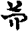



咳、虵、唾等苦。问：如何说身名为苦依？答：欲界身即与苦苦、行苦、坏苦为所依。若四禅已，口上身即与行苦为所依，故说为苦依身。问：无色既无身，如何名有餘依处，入涅槃无餘依？答：无色界亦有四蕴所依身，名有餘也。若下二界，即有五蕴所依身也。



疏云亦就实出，体通三乘人者，三乘皆约苦依身尽，名无餘依；未来解脱道中，亦苦依身尽也。



疏云：大悲、般若常所辅翼者，出无住因。解云：因者，所以义。此言大悲、般若，有约立无住名之所由。由大悲故，不住涅槃，异二乘，二乘常住涅槃故；由大智故，不住生死，异凡夫，凡夫常住死故。不住即无住，故无住三名，因悲、智以立号。应翻云：由大智故，常住涅槃；由大悲故，常住生死也。即大悲是恩德，大智是智德，涅槃是断德。用恩、智二德辅翼於断德，即名二德具足，即悲、智名不住之涅槃。依主释此根本、后得智，皆名大智也。



疏云显缘此涅槃土地悲故者，此第一解云：缘者，藉也，非是缘虑也。无住处涅槃即由断所知障，显得涅槃是法空理。意说菩萨由有法空理深故，即能生大悲、大智；大智不住生死大悲故，即不住涅槃。若二乘人无法空理故，即不能生大智、大悲也。或由智、悲乃至故名涅槃者，此等二解：缘者，缘虑，就二利说。由大智故，即自利行圆；由有大悲故，即外利行属。即由双具悲、智二行，故悲、智能证得法空理，故於生死、涅槃二俱不住，即缘此法空真如起悲、智二用。法空理即是无住涅槃，涅槃常寂，故云用而常寂。若二乘人即无大智、悲行，故不能证得法空理，而不得无住涅槃也。问：何故此文中即说悲、智二种皆能缘证真如？准下疏文，即说大悲不能缘真如。下疏文云大悲、般若者，真如为所缘，证智、后得智即般若，般若能起大悲。答：此疏文中即约久修之者起无缘大悲，无缘大悲即能正缘真如时，其无缘大悲亦缘大悲，亦能缘外利众生，故说大悲、智能缘真如。若下疏文即约初修行者气力既微，不能起无缘大悲，双缘真、俗故，即须先起智证真如已来，方引起后得智中，方起大悲利有情。各据一义，亦不相违。



论云：一切有情唯有初一者，一切有情虽有本来自性清净涅槃，而不得也。以异生等未证得涅槃，由如山海中虽有珍宝，人不得也。若有人取得珍宝，即属彼人。此中亦尔。若凡夫身中有自性涅槃，有而不得。由如珍宝在山海中，人不得也。若初果，其人等证得一分自性涅槃，即如人取得珍宝，即属彼人。若初果人亦分自性涅槃，乃至一来、不还果，亦令得自性涅槃。若罗汉圆满而得自性涅槃。



疏云直诠入地菩萨有初及第四者，若二乘有学位，回心向大入地者，与直往菩萨同时，亦得初及中、第四也。然论文中少也，不明直往菩萨得涅槃故。论文应言：一切有情唯有初一，二乘无学容有前三，直往菩萨有初及后，唯我大师可言具得。问：涅槃既名圆寂，二乘无学烦恼鄣尽，方得有餘。顿悟菩萨入初地已，其俱生所知障中未尽，如何得无住及初一？其前三果人俱生烦恼未尽，如何得初一？问：二乘唯断烦恼，即而得有餘。然第十地菩萨金刚心既双断二鄣得有餘、无餘者，为初断一分烦恼边而得有餘，断所知鄣而得无餘？为双缘约断二障边而得有餘、无餘者？为约断一分烦恼边而得有餘、无餘，断所知鄣而得无住？为双约断二障边而得有餘、无餘？



疏云若断转得果，乃至答应广说者，言断转得果者，即断烦恼转果者，而得后三涅槃果也。其事云何？若二乘人起金刚心，断非想第九品烦恼无间道时，即同时即双得有餘、无二涅槃，灭无为果，其实解脱道中方得涅槃。今言无间道时即得涅槃者，即约无间道正断烦恼将名得，其解脱道在未来故。其二涅槃得虽同时，显有前后。若断烦恼鄣尽已，即显得有餘涅槃，为有身者有故，不显得无餘涅槃；若身智灭已，显得无餘涅槃故。故断缚得果及何位次同时、果时？果时者，即是显有前后也。若菩萨在真见道、无间道中正断分别二鄣时，即名得无住更涅槃果，实是解脱道中方得涅槃。此言无间道中得涅槃者，亦约将得名得，以无间道正断二鄣，故言得涅槃也，亦名断缚得果。若菩萨至金刚、无间道正断俱亦二障时，即同时双得有餘、无餘二涅槃，择灭、择灭无为果也，即名断缚得果。亦约将得名得，如前作法，实解脱道得二涅槃也。由断却二鄣也已，告依身灭，故名无餘依涅槃；由鄣得无漏五蕴身故，即名得有餘涅槃。即佛得二涅槃时，后亦同时，显亦同时，非即前后也。异时者，在菩萨见道，先得无住涅槃，后至金刚心时，方得有餘、无餘二涅槃也。



论云：善逝者，在因果为名。逝者，往也，名善逝也。如来者，在果具因为号。



论云：虽无实依而现似有者，此论文中第一解不尽理也。即佛等现有金锵、马麦等，名佛有餘依涅槃。



论云：非苦依在，说有餘依者，此第二解，即为胜也。非苦依者，即佛身中有无漏五蕴，名佛有餘依也。



疏云：时言世尊！二乘有餘生法，乃至无无餘依者，彼经意者，为引二乘不定性者，回向大。有餘生法不尽，故有生者，即二乘无学，虽无分段生死，而更有餘变易生，故不尽，即是苦谛也。有餘梵行不成，故不纯者，即二乘人虽证得有餘依，择灭生空理，而未得无住涅槃。若得无住涅槃，即名纯也，即是灭谛。即全得，名纯；若半得半不得，名不纯也。事不究竟，故当有所作者，三乘唯得生空智，名不究竟，未法空智。虽得生空智，更须修法空智，名尚有所作，即是道谛也。不度彼，故尚有相所断者，二乘人唯将断烦恼障，未断所知障。二乘更须所知鄣，故云尚有所断，是即集谛。度者，越也。二乘不越所知障，去涅槃界。遂问：何以得知梵行即是涅槃灭谛？答：如有颂言：梵行已成立圣道已善修受尽时欢喜由如舍重病。明圣道者，即是道法；梵行，即是灭谛；涅槃，



疏云唯有如来成就一切功德者，即佛成就十力、无畏等一百四十不共功德。



疏云阿罗汉不成就一切功德者，虽阿罗汉亦得成就无谛、愿智、六通等，皆是共有功德；阿罗汉不成就十力、无畏等不共功德，故言不成就功德。言得涅槃者，是佛方便语者，然彼经亦以一乘为我，亦令二乘回心向大欲。佛说定性人得涅槃，即不是方便说。以定性人自乘中唯得前三涅槃，故更不得餘涅槃。即定性人名实得涅槃，不是佛方便说。若佛不说定性人实得涅槃者，即是佛方便语。以不定性人虽别得有餘涅槃，仍未得无住涅槃，其自性中涅槃未圆，即说不得涅槃。言得者，是方便语也。前约有餘便无说有，乃至唯说於无者，



论中云然声闻等乃至说无涅槃者，此文即依有餘说无也。



论云：非彼实无，乃至有餘涅槃者，此文即依有餘说有。论云：尔时未证，乃至无无餘依者，此文即是依无餘说有。论云：非彼后时，乃至无餘涅槃者，此文即是依无餘说有。



论云或说二乘乃至不依前三者，此论文即依无住说无也。众时求证无餘圆寂者，问：二乘无学，金刚心中、解脱道中以双证有餘、无餘为身智在，但未显无餘涅槃，如何此文云尔时证无餘圆寂？无住处者即是涅槃，涅槃者即是解脱离缚，其无住涅槃既是非择灭，如何言无住涅槃是解脱？答：下有二说，前言断所知鄣知涅槃故者，即是前文云四无住涅槃，谓即真如出所知鄣等。



疏云但鄣所知，不招生故，今为此难者，今不约所知鄣，所知鄣能发业，为其难也。今但约所知鄣，不能招生，故令为难也。非於尔时断烦恼等，意说由所知鄣能悮犯三业，即第二地中断所知障悮犯三业愚，非是第二地中由烦恼鄣悮犯三业，即说第二地中断烦恼悮犯三业愚也。



论四圆寂诸无为中乃至中二择灭摄者，此初师说。此四说：此四涅槃，即於地诸无为中是。何者无为中摄？诸无为者，即是四无为，或六无为，或非无为中。此四涅槃中，若初后涅槃即是者，如无为摄；若中二涅槃，即是择灭无为摄。若第二师，论文云：即四涅槃，於诸无为中，初涅槃是真如无为，后三皆，后三皆是择灭无为所摄。



疏有是择灭，非是涅槃，谓断烦恼鄣因中所得灭者，如前三果人，谓断烦恼障，唯得择灭，不得涅槃也。



疏云或六行得灭，是彼分涅槃者，外道所得彼分涅槃，无不是涅槃。既伏烦恼，即是非择灭，不是涅槃。疏主别令引外道涅槃，在此第二句中说也。彼者，彼外道；分，谓少分。世尊语彼外道曰：若我果中用无漏断惑所得，名为涅槃。汝既唯伏惑得者，即是彼分涅槃摄也。



疏云所依转尽者，所依者是身。意说二乘所依身尽，方显无餘。若金刚心断烦恼缚时，即显得有餘所依缚尽。初得果时，乃至瑜伽论说是非择灭摄者，意说金刚心时得二涅槃时，於后有苦身皆得非择灭，仍至现在仍未得非择灭，以此身由故。此现在身若无已，亦得非择灭。由如对法论中说：依如人身上入见道时断分别烦恼，於后如人身得非择灭，此现在如人身不得择灭。此身若死已，即得非择灭。又於涅湿槃生，即身上得见道已，於后有湿生法得非择灭，於现在湿生身仍未得非择灭。若此身死已，即得非择灭也。乃至依卵生身得见道亦然。今此有餘、无餘亦尔。此文意说：如阿罗汉得有餘依涅槃、无餘依涅槃。此二涅槃皆同时得，约显位即有前、后。如何罗汉果金刚心无间道断烦恼尽，解脱道中即得有餘依涅槃，同时亦得无餘依涅槃？以有餘涅槃、无餘涅槃体是一故。问：何故说阿罗汉先得有餘，后身、智无时即得无餘？答：此二涅槃虽同时得，约显位即有前、后。是阿罗汉虽身、智在位，由断烦恼鄣故，显得有餘依；后身、智无位，即显无餘涅槃。此后身更不生，皆由前金刚无间道由真如力断烦恼鄣，所以令后果更不生。由如对法论中说：恶趣果名见道断。且如入见道时，无间道中断分别烦恼所舍，得人本、所本中三恶趣，下三界趣至解脱道中断，皆永不生，得非择灭，则名见道。恶趣果虽断，相仍未显。其初果人第一身死已，又受一身，如是极七返。有受七生身已来，皆不受恶趣果。断此初果、第二、第三身已后，更不受恶趣果，方显前见道之力能断恶趣果。由如得阿罗汉果，金刚心断烦恼时，双得有餘、无餘依涅槃。虽得无餘，其相未显。复所依身智死已，方显已前所得无餘涅槃。若前师说，无学身智死已更不生，不断缚故，即是非择灭摄。若金刚心断烦恼缚，得有餘、无餘涅槃，即是择灭摄。若见道中断分别烦恼缚，即是择灭。若见道断恶趣果等更不生，既不是断缚，即是非择灭。故引对法瑜伽论，见道中恶趣果不生，是非择灭摄。若后师说，若金刚心烦恼鄣时，及见断分别烦恼，此等一向是择灭摄。若见道恶趣果更不生，亦是非择灭摄。若佛得有餘、无餘涅槃，无住涅槃，皆得时显位之同时也。即约成佛时、金刚心时，断二鄣尽，至解脱道，即双得有餘、无餘二涅槃亦同时。舍苦依身故，即显得无餘涅槃。及得无餘五蕴身故，即显得有餘涅槃。显得及显位皆同时。问：设非择灭，云何𫏐离染，永不后生故者，此问意云何？非择灭中即有𫏐时缘阙非择灭，即是究竟得非择灭耶？



疏云学见圣迹者，此文即约二乘人入见道说也。学者，见道能缘之智。圣缘者，即是四圣谛。四圣谛即是三世如来智所游履之迹。今者初果人缘四谛时，即名履迹。三世如来圣迹之处，卵、湿二生者，以多恶痴故，所以得圣，更不受之。及於及后有，若受若取，得非择灭者，即是闰生烦恼爱、取支也。意说得初果已，既有七生，即於受七生身时得智。闰生七身上爱、取支已，既更不爱第八有，第八有得非择灭，即所受第八之身不得生，其能闰第八身上爱、取支亦不得智。虽有闰生第八生爱、取种在，更不生现行，而得非择灭。



疏云故此二非是永灭摄者，即是不种想受灭二无为，𫏐伏定鄣，得二无为，是非择灭摄。及所此所依变异、不变异等者，即说烦恼是能依，三受是所依。即由先有乐受为所依故，即起贪；由是先有苦受为所依故，即起嗔；由先有舍受为所依，即起痴。故说三受为烦恼所依也。问：既圣起无间道，乃至岂非慧也者，此问前师曰：既用圣慧无间道断定鄣变异受等，如何不得择灭？而言无间道断二受等，而得非择灭耶？



疏若有漏亦非择，若无漏不断漏种者，定非择者，若前师意说：若如用有漏无间道，有漏无间道虽是慧，能伏变异受得不动，不变异受得想受灭无为，皆是非择灭摄。何妨用无为道中无间道，无间道虽是慧，唯断二受，断餘所知鄣等，不断烦恼漏种者，皆是非择灭摄。若入见道恶趣，果永不生等，及餘𫏐伏者，皆是非择灭摄。若用无漏道断漏烦恼缚，唯是择灭。若后师说：若圣道断二受及断所知鄣及断烦恼鄣等，皆是择灭，其二受亦是所知障摄。故断二受，即得择灭也。入见道恶趣，果永不生者，即是非择灭摄者；𫏐伏二受不起者，即是非择灭摄。



疏云：又此应徵萨婆多乃至亦得择灭故者，前师云：我用圣慧无间道断变异受等，得二无为，是非择灭摄。汝后师即虽我云：既用无间道断二受，得二无为，应是择灭摄。汝后师亦应徵应难：萨婆多师亦用无间道断不染污无知，应得择灭。然萨婆多师说：若无间道断烦恼等，得择灭无为；若用无间道断不染污无知，不得择灭无为。其有漏无间道断烦恼，亦得择灭无为。既许有漏道断或得择灭者，亦应有漏道、无漏道断不染污无知，亦应得择灭。不染无知者，即同大乘中所知鄣也。彼乘说：其初不染无知，即是劣慧。由声闻、缘觉身中有劣慧故，不得成遍智；若佛身中无慧劣故，得成遍智。又萨婆多说：择灭、非择灭，皆於法上建立。若择灭，即於一切有漏法上建立。且如一个心王与遍行别境，及六大烦恼地法，及加寻、伺，此十八法相应俱起。后若起圣道断，十八法上大四相、小四相等，此众多法上，皆得一个择灭无为断餘染法。然亦又择灭通三世有，若断过去世所有染法，白法后得不起不别行者身故，故择灭通过去世。若断现在世上染污法，令俱不起，得不别行者身故，所以择灭通现在世上。若断未来染法，上法前得不起不别行者，所以择灭过去、未来世。故择灭遍三世，唯於有漏上立，不得向无漏道谛上立择灭，故择灭即立宽问法狭也。若非择灭唯於有为法上立非择灭，唯通未来也，不通过去、现在世。如过去法以起落漏，现在法以起其非择，与法体俱落入过去。其非择灭，唯令未来世中未法令不得起不别行者，即是缘阙所显。其未来染法既不得起，即送非择灭得别行者身，故非择灭法宽而世狭也。然大乘非择灭，择灭唯向无为上，即极难见相㒵也。



疏或复大乘乃至亦有何求大者，此第二解云：前师意说大乘中如见道中无间断分别因故，其餘八难等果永不得生，即是非择灭摄也。后师说是非择灭摄。



疏云既尔，定知无餘，先得所依，后无，乃至实得於前，无餘亦尔者，此文意说：二乘金刚心断烦恼时，已得无餘涅槃；后所依身无时，方显已前无餘涅槃；后身智无时，方名得无餘涅槃，由如得不动想、受灭无为等。且如得初禅定时，以离欲界苦、忧二受，亦少分得不动无为。虽少分得不动无为，以初禅中由有喜、乐受动勇故。至得第二禅时，亦照如何第三禅时以离忧受，亦少分得不动无为？为第三禅由有乐受，未名全自不动无为？故下得三禅定时，皆不建立不动无为。若得第四禅时，即离苦、忧、喜、乐四受，方名全得不动无为。动者，动勇，即被四受等之所动也。令得第四禅定不被四受等动，故名不动也。如离第四禅得空处定时，亦少分得想、受灭无为；乃至离非想地，方全得想、受灭无为。故二无为已前少分得。约全得处，方显已前所得无为，故言得第四禅定不动无为。想、受准知，无餘涅槃亦尔也。又有不还果，有三满，谓：得见事，名根满；得不还果，故名果满；得灭定，故名定满。既有不还果，依未无定断四禅已下烦恼，不断已下变异受，不得不动无为。其人又便别起圣道断二受，方得不动无为。或用世俗道伏四禅以下变异受，而得不动无为。想受灭，无为亦断。若前师云：若断二受，若世道伏二受，后退不还等，皆是非择灭摄。若后师云：若用圣道断二受，即是择灭摄。若用世道伏二受，后退与不退，皆是非择灭摄。又如无学果，有根满非定满，谓是不动种性，不得灭定。有定漏非根满，谓退种性，得灭定。故知有阿罗汉依未至定断三界烦恼，得无学果，不断二受，不得二无为。得无学已后，别起圣道断二受，方得二无为。以阿罗汉依初未至断三界染，不断二受，初禅根本定尚不得，何况二无为。若异生世道伏，或得第四禅定，即决定得不动无为。以是欣厌观有漏，离次下也。然异生虽离第四禅染时，亦少分得想受灭无为。乃至离无所有处染时，亦少分得想受灭无为。以为异生不得灭定，不能灭有顶杝舍受尽故，则不全得灭受想无为。所以於异生身上，而不建立得想受无为。今约立二无为者，皆约圣更得也。若少分得，不名为得也。又总问言之，前后二师说断无堪任性，皆不得性择灭。若小乘说断却善法、无取法上所缘缚，令或得不别行者身，即於善、无记等上亦得择灭，断染法亦得择灭。若大乘不然，唯约断障即得择灭，若於善法、无记等法上亦不得择灭。如成佛时，虽舍却有漏善及无记法，劣无漏等性任运自灭，亦不得择灭也。若前师说十地菩萨，初地菩萨见道中断分别烦恼即得择灭，及成佛时断修道烦恼亦得择灭，若十地中虽断所知障不得择灭。若后师说十地中断所知障，及初地见道中及第十地中金刚心断烦恼障，即断二障皆得择灭也。二受即是所知障，故断二受时亦得择灭。或由先断或后永不生此义应思者，此文第二解云：即由金刚心时断烦恼劫故，即后有身永不生；若见道中断分别惑故，后恶趣身亦永不生，皆非得择灭。前后师皆同。即三无为中是择灭摄者，然有二本：



疏云文不同，有本言三无为者，即约论文中第二师说，后三皆择灭说也。有一本云二无为中是择灭者，即约第二师不动、想、受灭，皆是择灭摄，以断鄣得故。二、取疏文皆正。此若约无间道断，乃至即对法第二等文为正者，即是前疏云对法第二说有二应断法，乃至二受灭中建立不动及想、受灭。然此对法论文但总说，亦不别分别言断二受而得择灭、得非择灭等。然此论中，前、后二师即各解对法论文不同。若前师解对法论中说二受灭者，即约二受若伏若断，皆得非择灭；若后师解对法论中断二受者，即得择灭无为。故后师、前师各说对法论文为正。境及行相，乃至名为微细者，其所缘境、能缘行相，唯有诸佛能知之。若十地菩萨等，皆不能知，故名微细也。名一切种智者，即是缘事智；及一切智者，即是缘理智。由此如来不忘失法者，此即是百四十不共法中无忘失法也。



疏纯简因无漏者。然十地因中，有漏同地，不名为纯。若成佛已，恒起无漏，则有、无漏间起故，故名纯也。



疏云自心、心所不缘着本质，如现餘三智鄣等，乃至亲照本质故者，此第一解云：若大圆镜智缘他平等性智等，三智既不能亲缘着三智本质，但变起三智影像相分，三智影像相分於圆镜智上现，故名能现也。若大圆镜智能亲变起五根，五根身变五尘，变五尘等即名能生。既五根身及立等是第八识亲相分，故第八识亲能缘之，故云亲生本质也。又自土等法乃至但从此生，名为能生者，第二解云：即八识所变自五根身中等法，五根身中等法总是亲相分境，即第八识亲能缘之，故身、土等即於第八识上现，故名能现也。若第八识不能亲现著前立智，前立智但从第八识中种子生，故名为能生也。能生者，前七转识现行皆从第八识中种子，故名能生，此解为胜。一切方能现者，方能现故。一切处能现者，於此一一处中即遍一切处中，即遍一切处皆能现也。



疏云又自第八识上别种所生乃至名能现别种生故者，此第三解云：第八识上从别种所生自色、心等法，即於自身中所有无漏色、法等法，皆从第八识中别种子生，故名能生也。若第八识大圆镜智示现智他众生五趣身时，缘他有漏有情及五趣等，於智上现，名为能现。於佛身中无有别种子能生他有漏五趣身故，故佛所现五趣身即名独影，唯从见相分，即从自假种别生故，亦名别变，故云无别种生也。若言佛有别种子生他有漏五趣者，便成大过，以无漏不生有漏故。若缘无漏等所起相分，即从实种生故，如前第二卷已说。若凡夫缘无漏所起相分，相分皆从佛种别生，即是分别变，是独影唯从见也。和尚解云：能现者，谓第八识大圆镜智能变起根、身等相分，相分於见分上现，即见分能现相分，自证分能现见分，名能现



疏云平等性智者，真如理智乃至今我无故。自、他平等性者，疏中有二解：一云：真如理通与一切法为性，即真如名平等性也。智缘此真如平等性故，故此智名平等性智，即是真如。若和尚又文外解云：即约此智中有悲、智二法，於悬亲中而行平故。即此智虽缘餘事时，此智名平等性智。此平等性唯别属能缘智也。第二缘之第七识者，在因中有我见故，即有自、他差别，不名平等。今在佛果，我见既无，自、他平等，故名平等性智。今后解为胜。



由缘无住涅槃故乃至非智是所立名为建立者，缘者藉也，由藉有法空理无住涅槃故，此第七识恒共悲智相应，即悲智名所立、涅槃名能立也。问：何意论文中即说第七识能建立无住涅槃耶？答：据实而言，十地位中即本由第六识能建立得无住涅槃，第七识无不能建得无住涅槃，即由因中第六识妙观察智引平等智，平等智至果上殊胜，方名能建立无住涅槃。由如俗间由父母故方生得一儿，儿由父母方得有漏也。即父母是本、儿子是末，即本由父母养此儿报业熟，能渐渐长养令儿长，於儿得长大学业成熟者，皆由於父母也。先时父母家业不贫不富中间也，后儿得长大已，家业学问即胜於父母千倍万倍，即众人皆识此儿得名望，父母不得名望也。今此亦尔，妙观察智此空时，即引起平等性。若起初禅法空，妙观察即引起初禅平等智，乃至引起有顶亦然。如是渐由妙观智，父母经因中二大僧祇劫养平等智儿，学业等令其殊胜。至第八地已去，即平等智得十地平等。如是渐渐长大至佛果中，其平等智功能即胜妙观千倍万倍。其佛平等智即能为十地菩萨现他受用身及现他受用土，亦能建立无住涅槃得十平等。其妙观察智至果位，唯能说法无为，多力能、多力能，由如儿长大至胜父母千倍也。亦如老鵄鸡巢中出鸟子，是此中大意也。若得成佛方起成事智，㝡是陈远，岂养儿



疏或由此智所显者，如无住处解云：第二解云：由悲利他行，不住涅槃；由智自利行，不住生死。由有悲、智故，方能证法空真如。即由悲、智能扶坚建立，得真如悲、智，名能建立真如所立也。佛地论云：乃至名为令味。味者，即能证智名一味，不约所证理名一味；即由平等智常证无住涅槃处，不改张约易，名一味也。神用莫方者，莫者，无也；方者，他也。意说餘世间法不能化於此法，即神用无此，摄之为妙。总持定门，门者，即是众多义，即定及总持等，一一皆有众多门义。门非是游履名门。然二乘人妙观智亦少分能观自、共相，后得智亦能然少分说法也。



疏云：入出诸禅者，唯妙观察智，能入正法禅，游诸等至也。



疏：一、观自共相妙理，名妙观察乃至作用差别，疏：文中应云：一、观自共相妙理，名妙相察观智；二、起总持业，妙观察智；三、现无边作用差别，谓现通等，名妙观察智，於理为胜。



疏所作之成，成所作即智者，所作者，谓起化身神通，利乐有情，是所作也。成者，成立、成办，即由此智於所作神通等而得成办。问：所作既是神通，所作有情等，其神能作，应言所依之智。如何所作即智？思之。



疏不能作根心乃至似意业缚者，不约化作，变五根及心王并心所及业果。今言化心、心所，即是相分於心、意也。如下，当辨。



疏云诸餘功德智差别故者，即餘功德是智助伴也。



论云：此转有漏，乃至而得此四智者，此论文即释庄严中转识得智之文。疏文说回观智转五识等，此中唯约第六识得者，然庄严论即是旧辨，译名回观智；新经、论中名妙观察智。差云妙观察智转五识得者，即不正义，如下当有。



疏：转强得强者。因中识能果上智强，即转因中强得果上强智，故名转识得智也。



疏云：如前所转舍中净。然言异熟识种现俱时舍故者，此中第一师义，即是前所弃中第一师也。金刚心既舍异熟识种子，其异熟识现行亦在金刚心与种同时舍也。



疏对法第十、解金刚喻定无间灭尽等生者，然前念金刚心无间道灭已，后念尽智方生如，即是正义也。不言金刚心与尽智俱时智也。然金刚无间道及后念解脱道，皆是妙观察智。妙观察智俱时，亦能引起平等性智；至解脱道，即别起镜智。当尔之时，亦未引起；成别起已，后后念中方引起成事智。若至金刚心时，亦不起有漏五识也。然解脱道即是尽理体也。然大乘中金刚无间道断二障尽已，至解脱道，烦恼更无餘故；解脱道即名尽智，烦恼更不生故。其妙观智至解脱道亦名无生智，即一个智体义，说为尽智、无生智。又餘二智亦得名尽智。又若尽智身中名尽智者，即四智总名尽智；若能能缘者真如，故名尽智者，即餘成所作智。餘三智名尽智也。若小乘萨婆多说尽智、无生智，体各别也。若钝根阿罗汉，唯得尽智，不得无生智；若利根阿罗汉，亦得尽智、无生智也。即是先起尽智智者，一切苦，我已知；一切集，我已断；一切灭，我已证；一切道，我已修。次后即起无生智。无生智者，谓一切苦，我已知，不复更知；一切集，我已断，不复更断；一切灭，我已证，不复更证；一切道，已修，不复更修也。



疏云：前师解对法尽智生时，文云：乃至如异念言俱有等。解云：前师解对法云：彼文即约无间道时已生尽智，尽智仍未圆满，至解脱道方尽智圆满，故言无间道与尽智同时生。彼文不言无间道时仍尽智等未起，言无间道即无间道时即尽智生，名无间也。又如异念、前念当同名俱时，何况俱时而不得名无间也？法师禅云：如餘处名无间道者，即道生时不被此品烦恼而成漏间，名无间也。若旧经中名无间道，即取此道生时不时此品烦恼而成满碍，名无间也。故知前师非也。



疏云：真见道中，此智即起第六引生。解云：初入见道中无间道时，妙观察智、平等性智同时而起，由第六识引起平等性智。二障顿依，乃至起必同时者，此文即约顿悟菩萨入见道时顿断二障，其平等妙观必同时起。若渐次断，乃至唯法见道者，即说渐悟菩萨在二乘位既得妙观智，后回心修行，得入菩萨法空观见道，方得起平等性智，即是起生空智；断分别烦恼障，即念起妙观智；若后起法空观，断所知障，即后念平等性智。即断二障既有前、后，其二智亦有前、后也。



疏法空地后，尽未来故。乃至不同因位，一切皆同者，若法空地后得成佛已，其无垢识决定恒与一说俱，谓第七识平等性智也。成佛已后，其平等性智自力既胜，即任运自起平等性智，亦不藉他第六识方起平等性智也。若第六识或入生空时，或入法空时，其第七识恒常入法空，更不入生空也；设第六识入生空时，第七识恒是法空也。故不同因位。若在因中，若第六识起我执，第七亦起我执；若第六起生空，引第七识，即起法执；若第六起妙观智，入法空时，引第七起平等智，即入法空；若第六识依初未至定中入妙观智，引平等性智，亦是初未至定也；若六入初禅无漏妙观察智，引平等性智，亦是初禅；乃至第六识依非想地入灭尽定，引平等智，亦是非想地也。因中第七识不得自在，一切时由他第六识引起也。故因中第七与第六，一切皆同也。亦不同地者，若成佛已后，其平等性智与第八识恒在第四禅，同一地也；若第六识或又四禅、八定，乃至入八、九次第定，故言不同地。若异生位中，第七、八识亦同一地系；若十地之中，第七识、第八识或同地，或异地。如身在初禅地，初禅平等性智即七、八同地；若身在初禅，或起非想地平等性智，即是不同地。餘者准知。



论云：此后展转至无学性，乃至解行地尽者，意说若二乘定性、不定性，皆从初果至二乘无学所已来，亦得起生空妙观察智也。即此不定性，二乘有学、无学回心已去，至地前解行地疑已来，皆得起三乘生空妙观察智。



疏渐悟菩萨入者，至解行地终者，二乘人得四果已，回心向大地前，一大阿僧祗劫满，胜解终地已来，皆得起。二乘人生空妙观察智，不得菩萨空妙观察智也，入初地方得。



疏云：顿悟者至无学位。解云：疏文中意说，顿悟菩萨得入初地已，至成佛位已来，皆得起菩萨生空妙观察智。然疏文说顿悟菩萨至无学位者，错也。准论文中，应言若二乘定性、不定性。问：十地菩萨亦入法空，何故但言入生空？答：论文既不许法空，故知十地位中若入法空也，必带生空，故入生空时亦有法空也。故言入法空观，亦观亦显有法空。



疏云加行心乃至亦违其意者，意说由前加行拟作细法空观法，入法空观已，即远第七识中法执不行，得起平等智。



疏有唯生观，乃至或二俱者，此文意说：成佛已去，唯第六识起生空妙观智。生空妙观智，或观理非事，或观事非理，或二种俱观，皆得也。其第六识中亦得起法空观。若大圆镜智、平等性智，此二智中唯有法空智，必无生空智故。在因中位，若第六识起生空智，唯伏第七识，或执不行，亦不能引起第七中起生空智。若第六识起法空智，方引起第七平等智。佛果上第七识，第八识中唯起法空智也。若佛果位，五识中虽有二说，有说得起生空后得智，由意识引起故；有说唯法空智，由解脱道后第六法空智引生故。引此第二解，虽言初地即亦得起，乃至不解外事起麤。或者问：若见道中不得起五识者，如何前初菩萨於见道中一刹那中而顿得十百见、百世界等？



论云：有义，成佛身方得初地者，若金刚无间道时，即平等、妙观二智同时而起。至解脱道时，妙观察智即引起圆镜智。次已后，后得智中引起成所作智也。问：如何名根本智？答：此正体智能生他后得中智，故说此正体智能生他后得智，故说此正体智名根本也。问：如何名后得智？答：若五地先起根本智，后方引生后得智。又先由证真，后方达俗，故名后得。即如了俗，由证真故，说名后得。



疏地前种增、入地二智者，地前由闻熏习，亦无漏种增长；入地即生无漏现行，故入地种现二增长。



疏：地前用增，入地体增，乃至唯护法师，解云：若地前由有漏多闻熏习，令无漏种功用增长；入地已去，无漏现行处熏成无漏种子，则是无漏种子体亦增也。然此疏文中既双取新熏本有种子，即唯是护法师义，亦不是前二师唯立本有师义，唯立新熏师义。然此疏文且总相说地前种增也。若委细说者，若地前由闻熏习故，唯熏发妙观、平等二智本有种增长，亦名用增也。以为入见道已，即生妙观、平等二智现行故，所以地前熏此二智种增。若地前亦不能熏大圆镜成所作二智种增，以正义中入见道已，十地之中不得起大圆镜成事二智现行故。若入地已去，得生平等妙观二智现行，二智现行复能熏种，故入地二增亦是种体增也。若在十地之中，唯熏发大圆镜成所作二智本有种子增故，故此二智在十地中即名种增长，亦名用增。生当果功用，说不新熏成二智种故，即无体增也。若成佛已上，生此二智现行，唯有现行故，即有现增；以不新熏成种故，即无体增。不尔，更应种增长故，即无种增、用增也。乃至闻成佛已前平等妙观亦然，故大圆镜成所作唯有本有种，而不新熏种也。



论云：行相所缘不可知故。解云：此第一师即引前初能变中不可知门以解之。若第八识唯缘真如，即行相所缘名不可知。若第八识缘俗智，行相所缘有可知耶？



论云餘一分二，准此应知者，其餘妙观平等，其体是一，而分根本、后得智用，皆准大圆镜智应知。



疏：行相所缘也。解云：行相者，是分；所缘者，谓镜也。



疏：或似后得乃至真观后生。第一解云：然佛地论说：若餘三智，即由有根本引起后得，即有本、后二智各别。若此成事智既无根本引，如何成事智中有后得智？今者解云：其果上成事智，即以因中平等妙观后得智。若因中十地菩萨妙观平等，后得智不证真故。故今此佛果上成事智上别用於以因因中平等妙观，后得智不证者故。即以后得智故，佛果上成所作智名后得智，其体不是后得。第二解云：或佛果上成事智，如他因中平等妙观，后得智唯依俗故。今此果上成事智唯缘俗，所以果上成事智名后得。



疏因有二类种，果唯一类种，乃至未获述之者，解云：十地因中根本智种、后得智，若别种，若成佛，有一类种而有二用也。若生二用，二用即迷，现行忘也。然此中应分别，且如从初地至五地已来，即根本、后得二智各别种生，不可说一种子而生二现也。若从五地已上乃至佛果中已来，即根本、后得智而同一个种，同一个种而生二用，或多个种同生现行。现行能有二用，双缘真、俗，独五地已上能了真、俗二智行相互为会，令相应，所以根本、后得智同一个种。由如大乘中说：五受用别种生。其事云何？若欲界中在五色者，名苦，名乐；在意地者，名喜，名忧等。故欲界中五受各别种生，不得同种生也。若初二近分有喜，有舍，亦各别种；若第三禅中近分根本中智、乐，亦各别种生；若第四禅已上舍，各别种生。此等即同五地已前本、后智各别种。唯初二根本地中喜、乐同种生，即一个现行受而有二用：能悦心故，即名为喜；能悦身故，即名为乐。又动勇故，即名为喜；安静故，即名为乐。故初二根本地乃至利乐有情者，此师意说：第八识是前七识之根本，故云第八能现自受用身；若第七识是前六识之依，故云能现他受用身。若成事智是末，故现变化事耶？



疏诸智相见分别门，如前等九卷解讫者，应是第八卷中解，不是第九卷中解也。



疏：有无漏门，如随识中辨。解云：若解善无漏门，如随前三能变中解也。



疏假实分别门者。此文意说明诸心所几实等，如前应知。



疏总有四种，乃至故不说之者，虽转依义总有四种，既前颂文云舍二麤重，故须得转依，须得转依即是所证得佛果上所生得、所显得，故今此中唯取所证得果菩提、涅槃所生、所显也，不取餘三转依。其餘三中虽有迷、悟依，真如即十地菩萨所得，十真如即是迷、悟依中摄。若至十地中，真如即名悟依；若真如在生死中，即名迷依。故此十真如迷、悟依即是因中位，即能证得中摄；及前能断道，皆是因能断道故。十地修行故，即断十鄣而证十真如，故十真如、十鄣皆是能修道之作具也。故真如迷、悟依、能断道、断十鄣、十行等，皆是因中能证得中摄，非是果上所证中摄。所以此中皆不取也。



论云：前修习位乃至究竟位相者。解云：意说十地行等即名能证得，皆是因位摄故。前十地中行因所得转依，谓佛果上菩提、涅槃等。此佛果上涅槃，即是此中究竟位体相。



疏此即离彼相应缚义者，若染心、心所，即有相应缚；然菩提、涅槃既是无漏，故离彼相应缚也。



疏：非漏根增，离二缚义者，谓离相应所缘缚也。



疏：初、性唯染者，即是相应缚，唯是染心、心所也。



疏彼通一切有漏者，后所缘缚，即是有漏性善、无取法。若烦恼缘有漏善、无记时，即烦恼毒气入善、无记法中，令善、无记法而成漏性善、无记时，即烦恼漏生由。如以眼者，自答其眼根；烦恼有漏善、无记法，亦复如是。若烦恼缘无漏法，无漏法即损缘烦恼由。如以眼观日，却损其眼根；烦恼缘他无漏法，亦复如是。



疏有第七、所知障俱者，此中意：据实所言，唯第七识中我执烦恼名漏，其所知不名为漏。今者约所知障与他漏法为所依，故所知障亦得名漏。故前文云又所障为有漏依也。圆简二乘者，即简二乘无学。二乘无学唯得生空智，同前三涅槃，不得法空智及无住处涅槃及餘功德，故二乘无学不名为圆。



疏长续尚字，意乃为远者，此中应言：此菩提、涅槃即是无漏界，此菩提、涅槃即是无漏界，此菩提、涅槃即是不思议，此涅槃即是善，此菩提、涅槃即是常，乃至安乐、解脱身等亦然。即此流至於下也。



疏无为功德所藏，有为功德菩提所含者，若言涅槃时即含藏一切无为功德，即涅槃名能含，无为是所含；此言含者，即约举时摄得一切无为功德，即涅槃名能含，无为所含；此言含者，即约举涅槃名时摄得一切无为功德名含，非如第八识能含藏诸种子名含也。若言菩提时即含一切有为功德，即菩提名能含，餘有为功德名所含；此举菩提时即一切有为功德，皆名菩提，即如五种般若等，亦摄一切法故，亦非如第八能含种。或是因义，或为所缘，乃至或为缘生，作他利乐事者，此疏文即解论中或为因义，能生第五乘等论文也。然此中言佛果上菩提、涅槃，涅槃为因，能生五乘者，非是将他佛果上菩提、涅槃为名言种子，一分种子即亲能生他菩提乘，一分种子即生他声闻乘等五乘善根而为因缘，亦无是事。今者便说佛为因，能生五乘者，即或约所缘，即佛果上菩提、涅槃为缘境，即五乘起善心，缘佛果、菩提而欣乐故，即生得他五乘道。或为增上缘者，即由佛果上菩提、涅槃故，即令五乘众生长善灭恶，广转传说者，或由佛菩提根本智亲证真如、涅槃故，即生后得智，后得智即生大悲，大悲能现佛身，说十二分教，令诸五乘有情闻此教已，即长善灭恶，故名展传说也。具此等缘，方生五乘众生，生长善灭恶，得世、出世利乐事故，故名能生五乘也。



疏约於此位，依於相、体者，此第一解云：然彼胜鬘经及无上依经所覆，不得显故，即名在经，名如来藏。此中即约佛果、上二果体能摄藏，谓菩提体、相能摄有为功德，谓涅槃体、相能摄无为功德。或彼约有障、无鄣，乃至故不同者，此第二解云：彼经说在缠，名如来藏者，即约有二鄣故，故名在缠，名如来藏也。由无障故，即出缠故，即名法身也。此中即约本、末说，谓涅槃为本，即能摄无为功德；由菩提为本，即摄得餘末有为功德。



疏：此餘大众部解云：若大乘部说一切如来无有漏法。



疏：佛智通等者。智为四智，通谓六通也。



疏云：时诃身语，现起入灭，现有背痛，似苦集谛者。若时诃调达时，面上亦怒，眼现嗔色，即是身业。上业中出恶言，云痴人，即是语业。此时诃，即是似集谛。若王宫生，即是现起也。若双树灭，入涅槃，即是入灭。及现背痛等，皆名似苦谛也。



论云：集论等说，乃至五外界者，此中问意，此中既说佛身皆是无漏，彼集论即说十五界唯有漏。既十五界唯有有漏，如来是无漏，即佛果、佛无漏法，即如来无五根、五境、五外界等。



疏云十有色处、法处少分者，十有色处者，即是五根、五尘；法处少分者，谓法处有命根、同分等，皆是有漏也。



疏非蕴、处、界有情所摄者，此第一师说如来虽有十八界，以绝名言故，即佛十八界，亦非是十八界系摄等。



疏如来根、境，皆以意识妙定为先身，乃至以相麤故，可受用故者，此第二师说：如来十八界中唯有三界，谓有意界、法界、意识界。佛无五根、五尘、五识等十五界也。即诸如来五根、五境，皆是法界中摄等，即不是十五界摄。即如来由第六识入定，定力为先，变五根、五尘。其第八识亦随他第六识后，变起五根、尘等。五根、尘等虽是第八识变，然由第六识中定力为先变，故此第八所变五根、五尘，皆是法界中摄。除佛已外，自餘菩萨及异生等五识，即依此佛所变身上似扶尘及外五尘上托为本质。菩萨、异生等又重变起五尘影像相分。然佛所变五尘即细，既是定果色，即是法界不摄，唯是外五境摄。又如佛由定力所变五根，亦是五根，五根无发识用。由如无色界诸天变起定果色，泪下如雨，亦无五根。虽是五尘法界中摄，佛所变五根既是定果色，明知不是五根。如来无所依五根、所缘五境，五识不得生色，识亦非有，故佛无十五界也。虽定果色，似其五根、五识实非根也。若餘菩萨、异生等所变起相分等，即是麤外尘摄。又餘菩萨等五识所变起五尘相分，以相麤故，亦非是佛五尘摄。然餘菩萨所变五尘，即是菩萨五尘可受用之，然菩萨等不变起佛六根相分。又若由第六识中定果变起五尘等，即是外五尘类故，又是无情故，故定果所变五尘即是法界中摄。若执第六定果力引起天眼、耳根，天眼、耳根既是有情摄，天眼、耳根即是内六处摄，不是法界摄。又第六缘十八界，即是十八界摄，不言是第六识缘故即是法界摄。又五尘三识缘，谓五识、第六识、八识，此之三识皆能缘五尘。若五根二识缘，谓第八识及第六识，此二识皆能缘五根。若第八识为意根，亦有二识缘，谓第七、第六能缘第八识也。若五识唯有一识缘，谓第六识能缘五识。又加自证分，即有二识缘，谓五识自证分各各缘五识见分也。若法处所摄色有五种，若两个同种同色根，影、光、明、暗为所碍色，即是极逈色，极略可知。遍计所起色中有二释：一云：若大乘经部师说：镜中无面像，水中无自由，镜面净故，遂令眼识返见自面等。若执镜中实有面，水中实有自者，即是遍计所起色。若萨婆多宗说：镜中实有面，水中实有自等。已上即是实义解。二云：若第八识所变五根、五尘，即是实也。若第六识变五根、五尘等，即是遍计所起色。此第二解即是傍义，非正也。



疏及十八不共法经者，经中明十八不共法，即名十八不共法也，非别有经名之为十八不共法。



疏：前、后刹那别异起故，然行迅速。解云：或前念起观智说法，后念起成所事智而起变化身；或前念起成所事智现化身，后念起妙观智说法。然前、后二智起迅速故，然以并起二智也。



疏：此平等智既能变起受用、变化二身，即为根、境而依之，或乃至名平等智。此师意说：平等性智既能变化他受用身及变化身，他受用身及变化身上变起五根及前五境，此识皆依他受用身上五根缘色等五尘，化地上菩萨，即名平等性智。此平等智若依化身上五根缘五色境，化地前异生等，此智则名成所化智。据实言，唯是一个平等，有二种作用，则名平等智、成事智也。此师由如一意识菩萨，意识虽是一意识，若依所缘色，即名眼识等也。



论云：如转生死者。问：如何言有漏法生者即是生起现行，死者是灭相？若尔，佛身中有法，既有生灭，应亦有生死。



疏论此缘麤事，乃至成事智转五识得者，此师意说：若平等智品缘麤事境时，即说此能缘麤事境平等智，名为成事智也。故说成事智转五识得。据成事智，即是他平等智上作用也。即是第二师缘。佛唯三界实，餘十五界者，此师意说：佛唯有意界、意识界、法界，餘十五界皆名虗。谓五根、五境，即是法界摄；若佛五识，非是五识界摄也。



论云谓餘成就十八界中，唯有后三通无漏者，谓餘者，谓餘二乘及十地菩萨唯成十五界是有漏，后三通无漏摄。谓餘成就等，出麤识境者，即论文言谓餘十八界中后三界，餘十五界是。餘十五界是漏者，即是出二乘、十地菩萨十五界有漏麤无之境体。佛成熟者等，显知一切也者，后论文中意说佛成熟十八界即是无漏，即显前论文云非说一切，即约佛十八界皆无漏。但言佛，即显菩萨。及至识是识用者，意识论中但言约所成十八界皆是无漏，即返显菩萨、二乘所成十五界皆通有漏。十五界皆通有漏故，即是麤恶之境体。菩萨、二乘准知此有漏十五界，故知能知十五界唯有漏者，即显我智之境。若如来十五界唯无漏，诸根相续，一一无边，唯佛胜智方能知之。若餘十地菩萨、二乘等，无不知也。又解：麤浅者，麤者，即是所知十五界境体；浅者，即是能知有漏十五界之我也。



疏非说有情，十五界等皆唯有漏者，今准此疏文，佛亦名有情。佛是有情，十八界即唯无漏。



疏说如来妙色身者，此两行颂即彰如来三身功德。若如来妙色等四句，即彰如来化身功德。如来色无尽，智慧亦复然，即彰佛自受用功德。如来色无尽者，即是转无常色，获常色也。智慧亦复然者，即是转无常受、想、行、识四蕴，而获常受、想、行、识四蕴。一切法常住者，即彰法身功德也。



疏云智之与境，皆具此二义者，智者，谓四智菩提；境者，谓清净法界也。



疏云智微妙，性相甚深者，智者谓四智，性者是清净法界真如性也。



论云又善白法性故者，问：何故此即说无漏法为白法，乃餘黑白四种业中即说无漏是非黑非白摄？合具四义。四义者，能论文：一、此又是善白法性故，二、清净界乃至极巧便故，三、二种皆有顺益相故，四、违不善故。又云：若违四不善，合具四义。四义者：一、自性故，二、远离生灭极安隐故，三、妙用无方极巧便故，四、顺益相故。违四不善者：一、不善之法是恶法性故，二、不善之法有生灭不安稳故，三、不善之法不巧便故，四、不善之法违此四不善，故无漏名善也。



论云：论处等八唯无记，如来岂无五根、三境？解云：此文意说，此之四句收他外难。谓有外难曰：既说如来四智皆是善者，何故对法论说十二处中五根、三境是无记性？如来既无五根、三境，问：既说四智心、心所法是善，何故将五色根等以难心、法？答：前论云四智品极摄一切有为功德，其五根、三境亦在四智心品中摄，故说四智是善，即将五根等是无记以难也。又前说四智是无漏界，外人即将十五界是有漏以难之；今既说四智是善，外人即将五根等无记以难之。



论云此中三释，广说如前者，此中答慧，如前答有漏中。论文还应云：有义，如来功德身上土甚深微妙，乃至绝诸戏论，非蕴、处、界法门所摄。第二、有义，如来五根、五境妙定生故，法界色摄，乃至论说五识性散乱等。第三、有义，如来功德身上如应摄在蕴、处、界中，后三皆通善、无记等。集论等说五根、三境是无记者，彼依二乘麤浅境，既非说一切，谓餘成就十二处是无记也。



论云一切如来身土等法皆灭道摄者，问：如何身土是有为，即灭谛摄？答：如愚意者，若佛法身及法性土是无为故，即是灭谛摄；若自受用身及他受用身、变化身，及自受用土、他受用土、变化土，皆是有为故，是道谛摄。



疏：次、正解真如来五法者，谓清净法界、四智、菩提；解真如未五法者，谓清净法界、四智、菩提。名之为五也。



疏：然此二解并前四解，云：一、是灭谛摄，亦是善；二、道谛摄，故是善也。故云有二解。此二解并前四。令六解者，如愚意者，一云：说佛身、土，灭、道摄；二云：说佛身、土，非苦、集故。并前四解，即有六解。无断、常者，是根身乃至是他身。相续常义者，然此文中且总相说。应言若自受用身，即是不断者，即约成佛已去，始终相续，不断绝也。若他用变化，时时化缘将毕，即有愿绝，后时餘处还起身也，名为相续也。



疏：庄严论说三种常，如常施食乃至断别不尽。相续常义者，谓法身名凝然常，彼身不断常；化身相续常，虽说报、化二身是常，还有生灭。如言此人有施食，此人举时等即有施食，掖中即不施食。又如言此人家势富贵，常受快乐，然此人亦有不受快乐时。今言报、化是常者，非如法身常住不灭，报、化身等还有生灭也。问：何故如来报、化二身得常有耶？答：由如来昔在因中有法空智，断不所知障，证法空理穷尽故，故成佛已，即自受用不断常，尽未来际故。声闻人唯断烦恼障，同假择灭无为法空智故。又不证法空理，即证理不穷尽，故声闻人不得自受用身，即灰身灭智。又如由昔日中有悲愿，誓度一切有情，利乐他故，后成佛时，即得他用及变化身，亦无尽也。若声闻人无悲愿故，不拟利他，故声闻人不得受用及变化身也。理实断所知障，证法空理，正得自受用身，傍亦得他受用身、变化身；若悲愿，正得他受用及变化身，傍亦得自受用身。由如所知障，正障菩提，兼障涅槃；说烦恼鄣，正障涅槃，兼亦能障菩提。此断所知障及悲愿等亦尔也。



疏若初唯生得不灭者，便违佛说，乃至违比量故者，此文即是破当常、现常也。然智者法师执有常、当者，说：一切众生若未得成佛，即色、心是无常；若三大劫修因，当来得成佛已，众生若未得成佛，即色、心是无常；若三大劫修因，当来得成佛已，佛色、心即常住不生、灭。由如真如，是凝然常也。现常者，智法师说：一切众生身中常有佛子，无生无灭。此佛子故，鼻、眼、耳一切皆是。由如母胎中有娠儿，由母数数吃食津闰，今此娠儿渐渐长大，后即出胎。众生身中佛子亦尔，由三大劫多闻令熏习，此身中佛子渐渐长大，后时即得成佛。今破云：生者皆灭，一向记故。又作量云：佛色、心等定有生、灭。因云：从因生故，由如凡夫。或应返显凡夫色、心应不生、灭，从因生故，由如来也。



论云：清净法界，众相寂静，故名安乐者，此真如虽十相，名众相永静乐者也。



论云：四智心品永离恼害，故名安乐者，此四智名安乐者，即是五乐中觉法乐。



论云此二自性皆无忧根者，然真及四智俱名为乐者，即是五乐中无根寂乐也，非如有漏善逼身亦受生相。身亦受生相者，即是业系也，即由有漏福非福不动善业故，灭三界中令有情受生死身。安谓安足者，诸经论中即无别安体。二乘解脱身者，言解脱者，即是依生空真如上所得假择灭。言身者，即是生空真智名身，故彼名真如是二乘解脱身。乃至是五分法身中解脱知见者，意说二乘所得生空真如，生空真如即是二乘解脱身，故二乘真如为解脱身，非是五分法身。五分法身即是解脱数，此二乘解脱身即佛生空真如无为名解脱身也。若二乘菩提即是五分法身中解脱知见，解脱知见即是尽智无。然此五分法身唯是无漏法，不通有漏法。一戒香者，即取道共戒也；二定香，即取八地中无漏定；三慧香者，即无漏慧能缘有为。四、解脱香者，即与无漏慧同时无漏胜解数，能卞四谛理苦，我已知，不复更知等。五、解脱知见香者，即是无漏慧能缘无为也。然此五分法身少分，亦通前三果人也。若二乘无学身中慧香、解脱知见香，即是尽智、无生智也，能缘有为、无为、无为等。若前三果人有解脱知见香及慧香，即但取无为漏慧以为缘有为等，名慧香、解脱知见香也。又云：戒者，谓道共戒。定者，谓无，谓非取第於定。慧者，缘有为名慧香，缘无为名解脱现知见香，或无学名见慧。解脱者，即是与尽智、无生智俱时胜解脱数。解脱知见者，即尽智、无生智。若佛身中尽智者，烦恼无餘故名尽智，烦恼更不生名无生智，不初自求以缘尽、无生智。以如来乐利他有情不息，若二乘人即约息求以解尽、无生智。一切苦我已知等即名尽智，一切苦我已知不复更知等名无生智也。



疏彼菩提果是五分法身中知见者，解云：二乘所得菩提，即是五分法中解脱知见、尽无生智是也。体生义者，意说三身皆有体。



疏：依止义，解云：若如所有性为门，即将理摄事，即无为摄有为。或四谛亦得一切法尽，何法不是四谛？或二空亦摄得一切法尽，何法不是二空故？或三解脱门亦摄得一切法尽，何法不是三解脱门？故经云：一切法亦如也，众圣贤亦如也。若十八界中摄四谛，四谛即名为事；若安立中摄四谛，四谛即唯是理。故如所有性，即将理摄事，即有为依无为；若尽所有性，即十八界、十二处中亦摄得一切有为、无为法尽也。故约尽所有性中，即是无为依有为也。依止义者，若法身，即与报、化二身为依止；若自受用身，即有为法更互相依止；若他受用、变化身，亦然。众德、众集义者，若法身，故是所聚集处，即法身亦名聚也；若起化身，亦有多法聚集也。故通三身。若总若别者，如愚意者，若总者，即三身总名法身，以体依穷义故；名别者，唯清净法界得名为身；若自受用、他受用、变化，不得法身。复有胜义别立三身者，即依前法身中，约胜义以分三身。言依胜义者，即知论文云：自性身具足真常功德等若自受用身即具诸如来乃至广大法平等。乃至他受用、变化身，亦准知。寻思路绝者，非是不定中寻思，但约三界虗妄，以以所名为寻思也。



疏：无十相者，谓无五尘相、男女相、生异灭相也。



疏积集有碍之体者，解云：佛自受用色身，亦名变碍义。是色义虽十方一切佛自受用身，更互相遍，仍名十八界摄受碍以解之，如世间灯光。是色法更互尚不相鄣碍，何况如来而相障碍也？



疏：第二、五法摄三身门者，即将清净法界、四智、菩提，此之五法已摄三身也。有义：初二摄自性身乃至故知二身皆有实智者，如愚意者，此初师又云：为二：初别解三身，后引证立理。就初中分三：初、摄自性身，谓从有义初二至而证得故文是也；第二、摄受用身，谓从中二智品至得受用身故是也；第二、摄化身，谓从后一智品至难思化故是也。



疏：第二、师自性，又有四：一、据举，二、引证，三、解违，四、立理者，如愚意者，一、据举者，谓从有义，初一摄自性文是；二、引证者，谓从说自性身至非色、心，故更是。就引证中更分为四：一、引庄严论。



疏：庄严论说三种常，解云：谓凝然常、不断常、相续常。



疏：佛地论云：如餘论说竟，不出是何论。解云：庄严论中亦说也。然须勘折者，然庄严论即无抄者，此中意即勘复论文中义，具安此间唯识疏抄中著也。



论云：有义，初二摄自性身，乃至故知三身皆有实智者。然准论文中，此不正义师即不立有自受用身，亦不说用何智而成自受用。此师但说镜智实成法身，平等智实成他受用身，若成事智实成佛身，观察智唯说法也。若后正义师中方立有受用身，用四智实成自受用身。



疏云说法断疑者，菩萨既入见道，已断二鄣中疑。今者十地中断疑者，即断十地菩萨於事不解之心，名疑也。



论云：又智殊胜具备三身。解云：然摄论有十殊胜，谓所知依所知因果差别智殊胜等，即说智殊胜中具摄三身耶？二引取佛地论及深密经，三引世亲菩萨金刚论，四引佛地及对法摄大乘论。三解违者，谓从然说转去藏识者至彼实性故，文是。四立理者，谓从自性法身至色心等物，文是。



疏初、据智摄者，如愚意者，谓从四智品中真实功德至种种身相摄变化身，文是。即据四智以摄三身。自受用中有三：一、别证，二、解违，三、说。如愚意者，一、引证者，谓从圆实镜智至转诸转识得受用故，文是。於中有二：初、引庄严论，二、引摄论。二、解违者，谓从虽转藏至云何身摄，受是。三、说相者，谓从又受用身摄初不共至下文有色、心，皆受用摄，文是。



疏以为证得妙理者，意说由平等智证得平等性故，所以此智得自、他平等，能化十地菩萨也。



疏据实二身，亦四智俱现，乃至相似后智用者，然此四智唯成自受用身。然第八识能变起实五尘，五尘皆有实用；若餘三智皆能变似五根、五尘，五根、五尘皆无实用。又此四智皆能现他受用身，此四智俱能现化身，四智能说法。且如平等性智系餘三智，餘三智及平等智即现化受用身。又由成所智，由生因中利他无漏成熟，即成所作智系餘三智，餘三智及成所作智皆能现化身也。故知四智皆能现他受用、变化二身。若大圆镜智不能现他受用、变化身者，岂可镜智不能亲缘他用、变化他身？故其镜智不能现二身。故今但约相中他用身似后平等智作用，其变化身即似后成事智作用。即前例四智中，镜智居先，餘三智在后，故说平等、成事，皆名后智。解化身等中有三：初出理，次解违，后说相者，如愚意者，初出理也，谓说又他受用事实智为体文。即是解违者，谓从虽说化身至发此二智自受用文是。於中有二：初合摄论，后全摄论文。须说相者，谓从然变化身至故别说有文是。



疏但明二智现二身，体非二身也者，但说平等、成事二智能现他受用、变化身二身，体非二身，即是二智也。第三、他化身相中有四：一、据举，二、立理，三、引证，四、会违者。如愚意者，即就前文第三说相中以分四段：一、据举者，谓从然变化身至无明配质法，文是；二、分现者，谓从若不尔者，谓从若不尔者至尚不知故，文是；三、引证者，谓从由此经说至分现故。於中有三：初引涅槃经，次引佛地经，后引深密经；四、会违者，文谓从随说变化至故不说有，文是。论无形质法者，即是他心相分心也。



疏化无量化人之类，皆令有心为引他故者，若佛欲化变众生等，师即化作化人，方便接引。如须达长者最初见佛，不解礼佛之轨则，在佛边坐。是时如来遂化作一净居天，光明赫奕，威仪庠序，动、止可观，即前礼佛，以百千倍而叹佛德。须达见已，遂教学彼天威仪，而作礼佛也。



疏此涅槃经下，他地经下，他地经者，即论中引佛地经云：又说如来成所作智，化作三业。



论云何声闻及傍生等知如来心者，声闻知佛心者，如者诸弟子五命年无欲须侍者，是时五百阿罗汉作礼而求作侍者，如来皆不许。是时阿那律入定观见如来心，如来心偏向阿难，如日初出照於高山等。傍生知佛心者，如佛神往质师长者家，质师长者家大富无有男女，佛既与儿，时佛至一林边，有一猕猴从阿难索钵取蜜，阿难不与钵，如来许与钵。时猕猴知佛心与钵，又从阿难索钵，即是傍生知如来心也。



论云：虽说变化，无根等用，乃至故不说有者，此论文云：违。问：瑜伽八十八说四事不可作：一者、五根，若化作五根，即无发识等用；二者、心有；三者、心所。答：化作心、心所，有先缘虑等用；四者、业果即是异熟，若化作异熟色，即不能令受苦乐等用。若外等流色，亦容作也。如何此论文如来能化心等？然此论会彼论文云：一云：彼瑜伽论说四事不可化者，而依餘二乘、菩萨等，餘二乘、菩萨等不能化四事，故不依如来。如来能化作四事，故彼论言不说化事。又第二解云：如来虽化作根、心等，然化根无实发识用，作心无实缘虑用，故瑜伽说别化四事，或文为正也。又无根等用，乃至不尔者，香等亦应然者，此文即会大论中四事不可作，即佛化五根，即无实根等用，故大论说不作根等，不同化色、声即实用。若佛地色身及化声说法，即於欲、色二界皆有实用，餘化香、味、触三即无实用。其事云何？等佛、菩萨於色界中虽化香、味、触三尘，其色界中有情既不契段会，故於化香等法无实用。若作香、味等，於欲界中亦有实用，谓佛化香等疑食，餘欲界有情亦得受用。



疏：应以木石为难乃至不得为例者。外人难曰：他受用及化身既无实心，应如木石。解云：此他用变化身，修生化有情，有十功德，不可将木石为例。



论云亦兼利他为增上缘乃至故俱利摄者，此段文意得明法身亦通二利。其法身若与自受用身为依故，故法身即是自利摄。其法身亦兼利他，即法身为增上缘，与他受用变化身为依，令他用化身利有情，故其法身即是利他。



论云：而属佛法相性异者，若真如与四智觉为性，即名为相，故真如即名为身。若与诸法为性，住持自性，故真如即名为土也。故身土别。问：自受用身，眼耳诸根一一皆遍法界，如何分出身土？且如人身，身为能依？土为所依？即有身土差别。答：若自受用身，身土别者，若与心、心所与觉为依，有执受，即名为身。若执受用是所取缘，即名为土。由如人身，身中有执受，即名为身。若人身中所有运熏等，即名为土也。



论云：然随地其量无边者，意说法身是性，餘色等有为是相。相既遍一切处，其性随相亦遍一切处。



论云：谓圆镜智，乃至利他无漏者，意显由因中平等妙观智，修自利无漏等。



论云诸根相好一一无边者，根谓五根，意说若化身上即有三十二相、八十种好；若阿弥陀佛即是第二地菩萨所见他受用佛，其阿弥陀佛身上即有八万四千相、八万四千好；若令自受用佛，身上即有无量相、无量好也。



论云因圆无际者，若他受用土中即有十六圆满，六圆满中佛土名周圆者，其圆国土形量即杆梯，犹如蕗叶，即他役用身於土上住。若他土及作用土皆杆梯，为身及土皆悉麤浅故，即土在下，身在上安置。若自受用国及自受用身，其形量即圆国，由如鸡子形量，身与土皆悉遍满。其自受用土中即无圆满，即自受用身及心、功德及土，此三法即互相杂，一一皆遍。由如解者，一身令成微尘国，国一处令成人形，其人即眼中有𫄨，𫄨中有眼，一一皆相续入含。此亦自受身及土、功德、智慧，此三即不可说在土下。若身已上无土，土则不遍；若土已下无身，身应不遍。今者应言土中有身有智慧，智慧中有身及土，身中有土及智慧，即眼中有𫄨，𫄨中有眼等四，一一皆平遍也。故论功德、智慧既非色法，随所依身，言遍一切处也。如愚意者，相好可无边，其根但广大，故名遍，非是有多五根名无边也。前解胜



论云：或大、或劣、或胜者，若初地菩萨所见他受用佛，名小、名劣；二地所见他受用佛，名大、名胜。乃至已后准知。如初地菩萨所见他受用佛，此初地菩萨入第二地时，此他受用佛或时灭却身已，又变作第二地受用身；或时不灭，即转初地菩萨所见他受用身，转作第二地中他受用佛。餘者准知。



疏唯见百佛，见百世界化佛，乃至变化身土者，若初地菩萨，即一个他受用佛，见一百大化佛，见一百个百亿一四天下小化佛，见一百个三千世界。后准知。



疏他受用法乐增，同自受用，乃至土变化者，若自受用身，佛即自受用法乐；若他受用佛，令他十地菩萨受用法乐。若十地菩萨见他受用佛现神通等，其菩萨心无不珍重，不生希奇相；菩萨若闻他受用佛说一四句法时，即心生敬重，作希奇想，菩萨即受用法乐。故他受用身同自受用身，俱名受用。然疏中错解云他受用法乐增者，难曰：既他受用佛是相分心，不是实心，如何受法乐？疏中应言：自受用，即用受用法乐增；若受用身，令他菩萨受用法乐增。既受用义、意，二身俱名受用。问：变化身何故不名受用身，亦令他二乘、异生受用法乐故？答：若二乘、凡夫但闻佛说法时，心亦不多生敬重，亦不作希奇想，心生敬重，故化身唯名变化，即不名受用。故后受用身及变化身，即约所化根机，以他用、变化之名。又自受用佛，若第八识，唯舍受；若第六识，即有喜、乐、舍受、乐受；若五识，唯有乐、舍受。又自受用身土中，佛土不说，法亦不舍，以无法可说，无疑可破。以诸佛若知诸法尽，故诸佛无相向说法可答。



论云：随未登地有情所宜化为佛，或净或秽，或大或小者。或净者，即是一三千界。一三千界中，有一大化佛所变土，名净名大。若一四天下小化佛所变土，名小名秽。又此四天下化佛土中，若人乘八万岁，海水渐灭，处处皆有明珠，妙弥勒佛下生时，名净名大也。若人寿百岁，海水渐增，有荆蕀沙砾时，即名小名秽。



论云：餘二身土随诸如来，乃至有共、不共可。然此论文唯摄大乘论第十卷中，为除外难，故有此文也。外难曰：其十方诸佛即有无边，何故今者一国土中唯有一个佛出世，不有百千佛同时出世耶？答：然所化生有共、不共。若共者，即百千诸佛同化作一身一土而来化生，故此一佛中即有十方佛。以诸佛事相杂，由如大海水，如百流水皆至於海，若取得海一滴水时，即是取得一切？河中水。今此亦尔，若见一个佛时，即见一切佛也。乃至不共准知。若十地菩萨宜百千佛者，即百千佛同变化一个他受用佛而成化之。若十地菩萨宜见一个佛，即一如来变化一个他受用佛而成化之。若十地菩萨宜见一个佛，即一如来变化，其化佛亦然。有何所以？一、由有情种性故，或多属一，或一属多；二、由因中发佛力故，亦或多属一，或一属多。



疏此文一往佛地大好者，然此论文解三身同异少，然佛地文大广。



疏引弥勒菩萨所化善根及熟等者，若弥勒当来下，生时三会：第二会度九十四亿人，九十四亿人曾得向释迦遗教中受三归也；第三会度九十一亿人，九十一亿人曾得人人向释迦佛遗教中受三归也；第三会度非，非称佛名者，释迦佛弟子弥勒亦然。度之，名为共；若弥勒唯度曾结缘有情，名不共也。



论云：无漏识上所变现者，乃至十二等者。然此文中，皆约有漏、无漏八识上亲相分说，不约疎相分说也。又此无漏心，缘有漏、无漏法时，其相分与能缘见分，同无漏善性。若约三科，即相与见别也。即见分是心，相非心等。故明无漏处，即论中但言蕴等识相不必皆同，不言善等识相不必皆也。若有漏心中，缘漏、无漏法，实起相分时，是相分与见，必同是有漏善，约善等三性即不是。或能缘见分唯无记，所缘通三性；或能通三性，所缘相唯无记；或能缘是色。故论中明有漏处，即双言善等识相不必皆同。蕴等识显此，应知亦不必皆同。是此文之大意也。



疏：第八、身、土虽实缘净、秽者，应云八识皆通缘净、秽。下自当知。



疏自受用者，唯无乃至非餘所知变故者，若自受用土有佛，无漏八识皆能变之。其土唯净，唯是无漏，唯佛能知，唯佛能变，餘菩萨等亦不能知，不能变。



疏他受用土，体唯是净，乃至非有秽心之所变故者，若他受用土中，如六识后得智所变者，即唯净，唯无漏；若十地菩萨，第八识及五识所变者，即唯净，唯有漏；若第七识入无漏心后得智中所变者，即唯净，唯无漏；若有第八识，唯缘第八识，不能变土也；若第六识在七地已前有漏心所变土者，即唯净，唯有漏；若第六识入无漏后得智所变者，即唯净，唯无漏；若八地已去，第六识中无漏观常相续，即第六识所变者，即唯无漏；设七地已前，六识中𫏐时起烦恼不久长，所以所变土亦名净摄；若化土中，虽二乘及餘异生亦起善心，而变土故，亦不久故。从长时说，亦是秽土摄。



疏本质，佛所变者，非秽，故能变之者乃至据相似者，然疏中答不尽理。既佛、菩萨更互相狡，而本质如何及乃至本质唯佛所变？应答言：他受用土既其人生，故唯是净。色界异生有漏善业感色界身土，尚许是净，何况他受用中土也！此据相似者，虽能变者识通有漏、无漏，别有所变土亦通漏、无漏，而所变土相挟相似，以有漏、无漏土一种，皆名为净土。



疏若变化土本质通净、秽，乃舍利弗等所见异故者，若变化土中佛八识所变者，唯无漏，通净、秽；若十地菩萨八识所变者，若第八识及五识所变者，即唯有漏，通净、秽；若第六识无漏若变者，唯无漏，通净、秽；若有漏第六识所变者，即唯有漏，亦通净、秽；若第六识无漏后得智所变者，即唯无漏，通净、秽；若有漏第七识唯异熟识，不能变一土也。二乘有二解：第一云：谓若随彼二乘等，乃至即有漏心，皆通净、秽者，此文意说，即约二乘后得智少分能变土也。谓若二乘第六识中无漏后得智所变者，唯无漏，通净、秽。然二乘人无漏后得智中缘事狭少，能变时后得智中犹缘事也，不能多时缘事，即二乘人无漏心中多少缘四谛理故。又能缘事者，多分即与四谛理事合缘之，无唯缘事后得智也。若菩萨无漏后得智时事也。若地前菩萨及二乘等，及餘异生有漏识中餘七识所变者，亦唯有漏通净秽。二云或二乘人全无缘事无漏后得智，即二乘有漏心中所变土，唯是有漏通净秽，如梵王见净、舍利见秽。净者，即如生西方弥陀佛国土七宝为地等，或如佛足指按地令三千界清。其餘异生二乘中第八识及前六识，亦能随佛所变净土系时变净土。然五识上亲相分亦名乃为土摄，非如第八识所变土有处用，然许二乘有少分缘事后得智。胜中即前解为胜。螺髻者，即故上髻，即发髻螺旋，由如佛常佛中故相似合。梵王即是八地已上菩萨第四梵王也。



疏今此文中总约三法者，谓蕴、处、界三法也。净与不净，理必须同。乃至非如有漏心相、见性有别者，净者即是土相分，不净者即是识土。此文之意说：若无漏心变起净土、秽土相分，净、秽虽不同，此相分即从能缘心制性。能缘心既是善，是无漏；此所缘相分是亦善、无漏。故约性言无，即独影唯从见，见与相分同善，善、无漏。若能缘心，缘蕴、处、界等，即是性。境不从心，即能缘是心；所缘蕴等，即通有色、非色故。故云无漏心所起相。相分与见分同是善、无漏，非如有漏见分、相分或别性，或同性。具如鼻、舌、身三识，三识通三性。其所缘香、味、触境唯无记，即缘心所缘，境生各别。或有同性者，即如心无漏识变起变味、触三境，变味、触三境即唯善，唯无漏。餘异生等鼻、舌、身识三是善性时，即托佛所变香、味、触三似为本质，变起香、味、触三相分。即有漏心中能缘鼻、舌、身三识，是有漏，是善性；所缘香、味等相分，从本质判性，亦是善也。故亲相分亦是有漏善性。故有漏心中相分，相分与见分一向同是有漏性。善等三性，不安皆同。乃至无漏心缘他有漏贪、嗔是法本质时所变起应相分，相分唯善，唯无漏。若有漏心缘无漏时变起应相分，相分即是有漏，是善性。



疏蕴等识相分必皆同，乃至亦各有异者，此文意说：各心缘蕴、处、界等时，其所缘亲相分蕴、处、界等不可随能缘心，即识蕴摄中所缘蕴等还来色、心等十八界。且如第八识亲分中变起五根尘，即能缘十处及能缘法处中少分，谓定果实色及五识缘五尘及第六识。第缘十八界时，此等所缘十八界等还是十八界摄，不随能缘心判性，即是识界摄及是法界摄。以见分及十八界非是一类种子，故各各从自色等、心等种生也。故所缘相分不从能缘心，是识蕴摄。其见分、相分既纯从无漏善种子生，故见、相二分同是善性，同无漏也。



疏乃至相应法相分亦然等者，上来唯心王见相分，此下明心所见相分。如所心中，且如来受蕴缘十八界时，此蕴、界等即不随於受，而是受蕴摄，色、心别故。乃至想等，皆准此知。作用法不同杂种生色、心者，作用者，谓心能缘虑作用，色有变碍作用，受有领纳作用也。不可有漏同无漏难者，不可难言：有漏中相同有漏，即能缘心或道三性，所缘或无记，即见、相不同性。其无漏中见、相同是无漏，亦可能缘与所缘各别性也。问：如何佛能变秽土耶？答：佛虽种子，皆是无漏，而相中所缘似秽土。秽土即荆蕀、沙砾等。然佛所变秽土相分，即因缘变摄。若餘有情因佛神通见他方净土，他方净土众生难见，而不得受用相分，即是分别变摄。



疏何故界系见相许，而漏必同者，此中问意：且如身在欲界，由得定力，引得色界中天眼、耳根，即许欲界第八识见分缘上界天眼相分。其所缘相与能缘见分同是有漏，同是无漏，而不许可是有漏，如是无漏耶？



疏：如无漏缘使相分唯有漏者，使者即是烦恼也。且如有善心人见佛之时，即受起亲相分。亲相分从本质别性，即相分是善性，又是有漏；能缘之心是善性，亦是有漏也。或如佛起无漏五尘，餘有情五识托为本质，变故相分。相分约性言之，从本质判性，其相分即是善性；约漏、无漏言之，其相分从能缘心判性，即是有漏。如有外道邪见人等见佛之时，向外道等嗔心、邪见、不善心，缘佛之时所变现相分，相分是善性；约漏、无漏言之，其相分从能缘心判性，即是善性。相分从本质判性，又相是有漏，能缘心是不善性。摄同有漏，其三性别也。又解：若外道邪见人起嗔见、强威，缘佛善色之时，虽本质是善、无漏，此外道等所变地亲相分，相分从能缘心以判性，其相分亦是不善。性是有漏，能缘之心亦是有漏、不善。此解即与无漏心、无漏心上相分，相分是善、无漏，能缘之心亦是善、无漏也。



疏：缘虗空等，能缘心通三性，相分唯无记。解云：此初任运心缘虗故，故能缘通三性，所缘相分唯无记。然大乘中虗空非择灭即是胜义无记，其能缘虗空等心即通三性。若皆纯种唯一性者，乃至应不成失者，此文意说：若见相同一种生，即见相皆同一性者。难曰：应能缘见从所缘相伴性者，其能缘三性或见分应是无记性。若所缘育等相分而说能缘见判性者，其所缘相分应通三性。若言香等相分而从能缘见判性者，其所缘相分应通三性。若言香等三境通三性者，即诸论言香等三性无记不成之过失，故相、见别性也。不可说约第八所变，乃至例亦应然故者，亦不可言第八识所变相分即是无记性。以能缘见分是无记，所缘相分应是无记，则说鼻、舌、身三识所变香等三境，香等三境而通三性。次能缘见分通三性，所缘三境亦应通三性。或三境通善、无记二性，鼻等三识所变相即是香处、味处、触处摄。若言香等三境通三性者，诸论中无文说也。诸论唯说八唯无记。难云：若尔，大乘中说虗空非择灭是无记，其能缘空等之心通三性。应能缘心既通三性，其所缘虗空等亦应通三性。既缘空之心通三性，所缘空等是无记，故其鼻、舌三识能缘是三性，所缘是无记。



疏：应言途三性诸法文，故解云：若香、味、触三境，唯通善性及无记性；若异生等所变香、味、触，即是无记性；若佛所变香、味、触，即是善性。其香、味、触不通不善性，诸论无文说故。蕴等识相，或相见分因，或相见分异，类此应知。乃至明知相见分不必皆同者，如愚意者，蕴等同、异等见相同、异，与前无漏中蕴等识中义相似。三身生灭门，皆此中应对三身。几身是有始有终等，应捡前抄。



疏化自、他身，色俱非等者，此中应对三身：业化自者，即如天女自变身，如舍利弗；有化他者，即如天女变起舍利弗，令如天女；无有亦变化者，非自非他者，如变外山、河等。三、身相对四句门者，如弥勒。疏中即有两重四句：有受用非变化，谓自受用；有变化非受用，谓猿、猴、鹿、马身；有亦受用亦变化，谓他受用、变化身。第四句者，即受用非变化，谓自受用；有变化非受用，谓猿、猴、鹿、马化身及变化身；有亦受用亦变化，谓他受用身。生、法二身於三身门者，生谓生智。唯摄他受用、变化身，不摄自受用、法身者，谓五分法身。若自受用身中，即有实五分法身；若他用、变化，即有五分法身。



疏上来已依略、广及位等，约能、变识等讫者，略者，即前由假说我、法等一行半颂；广者，次二十三行半；位者，即末后五颂，明唯识位也。



疏变现所变名为行相者，此师意有二分，即说本质境是所缘也，亲相分名行相，能缘之心名之为事。唯以难陀二分义少，分有异者，然前难陀二分俱实，此师即立二分以似难陀师。然见实相虗，即与难陀有异。此所现土如识变故者，此师既说相分虗疎，其他用土中珍宝国土，相分即是虗也。如日及轮者，此喻二分也。轮者，即是光也。意说日喻自证分，光喻见分，光所明之处即喻相分，故光及所照处即是假也。如灯及光者，亦喻三分，说灯涅槃喻自证分，光喻见分，所照处喻相分，故见相、见虗也。设缘色等乃至不及於识者，意说见分亦是不实，不及识自识是实。如缘过、未乃至见不及识自体分者，见分缘过、未等时变起相分，相分是所缘；缘过、未见分，未见分是行相。即此相分虽有，仍不实故。其缘过、未之见分虽体非无，以此见分缘虗境故。故能见分行相，即是不定心也。故见及相分，皆不及自体分。相分虽有，非稍实法者，初师言：如第六识缘过去未来之时，见分虽变起相分，即不如缘现色等相分也。以现色相分，即稍实於过去之相分也。此师即外境是所缘，相分名行相，见分名事。同小乘解，彼内证故，此所不论。如缘自体者，如愚意者，若真如是圆证故。若无分别智缘真时，真如由如自证分被见分缘。又此中唯明有为见相是虗，亦不论无为真如，故真如与自证分皆实。不遮缘过未，但得似彼者，此师虽缘现在五尘相见俱实，亦不遮缘过未时相分是假也。前师相见即识种生，此师相见与识别种者，问：何故前师相见与识自种生，即识相见是虗，自证是实；后相见与识别种生，即说三分俱实？答：前是独影，后通性及带质，故别



疏若是似者，应非缘真者，此文意说。不可说不可真如是实，智即不实也。不可实之智能缘真如实，故能缘、所缘俱是实也。内是依他，外是遍计者，然有两重外：一者、即是依他是内，遍计所执性实法名外；二、即亲相分名内，疎所缘缘名外也。为破执故，虽为愚夫，非真心之理，岂佛非有者，此文意说。然论文中但言或诸愚夫迷执於境，乃至解脱生死者，意说为破愚夫执故。所以论中唯言为愚夫执，非心言理，即执有心外之道理，故说唯识言为破愚夫执也。虽论中为破愚夫执心外法，不为佛说唯识，岂佛非有唯识耶？故知愚夫迷故，遍言独言愚夫。佛以了唯识故，不了与佛说法，故此文中不言为佛说唯识也。即佛后得智，无有相见，乃至餘作二解，故是所执者，然第三师中有二解。此第一解云：佛后得智，无见相分。若餘有漏善心及因中、后得智中有见相分者，即是法执。又佛似有见相故，即现有净、秽土相分。由佛不作二分也解，故非所执；餘有情作见、相二分解故，即是所执。此等皆是不正义也。又佛自在了达三世，乃至或佛不现，餘人自见者，此第二解云：即计有见相分以为佛证，不可言性故；餘人不证，不可言性故。故见、相皆执。故证文中言无见相者，依餘有情说，不依佛说也。或佛虽不现净、秽等土相分，然餘人即自见佛有净、秽土相分。此亦是不正义。



第三、释结施愿分者，然论云此论三分乃至无增减故者，此文即释也。言释者，意说三十餘但名唯识，不得名成唯识。故论云：此本论名唯识三十也。若十卷长行，即名成唯识，不得单名唯识。即由长行而来，立得三十颂唯识也。故论云：此论三分成立唯识，是故长行论文名为成唯识论。即此文中释长行论文得成唯识之名，故释也。结释施愿分者，此文到，应言释结施愿分，从次前论。然相分等依识变已来，即释也。此论三分成立唯识，即是结也。后之二颂回施发愿也。即第二师解论文者，如愚意者，即此第十来论文中既有明见相分，即是第二师明三分阳实为正，而科此文。又云：此下即是测法师疏，故言第二师解论文也。初一颂半名初，次二十三行半名中，后五行颂名后；纯一名初，圆满名中，清白梵行名后。以教成教者，即将长行及餘论教成立此唯识三十颂；教教既已，即将成唯识道理也。以理成理者，即将比量道理成唯识道理。能疏中取初、中、后善等科此论文者，即不当也。然瑜伽论约论始终，一代说短，分初、中、后。言净者，乃至教、理俱得者，意说由修治故者，如得照净；由教成教，故所成之教得明净；由理成理，理得明净也。由三十颂显乃至非增、减者，即前第一初、中、后科三十颂，第二境行果科三十颂，第三依生相位科三十颂，第三依性相位科三十颂。故依此三家，科三十颂，即非增非减义也。

