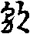
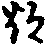
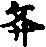
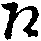

# 顺正理论述文记



> **藏经**：卍新纂大日本续藏经（新纂卍续藏）　**册次** 第 53 册（X53）　**编号** No. 843（X0843）　**部类** 经疏部　**卷次** 2 卷　**篇幅** 59,602 字

> **卷／品**：0 卷 · 0 品



---



顺正理论述文记第九



沙门　元瑜　述



○释第十二卷论



无色法中(至)蕴得等性。



述曰：此下明非色非心法。问：前於心所之初，举四有为结二生下，理应於此结前心所引不相应，何故此中乃於无色结二生一？未详其旨。解云：由於次上括异名中，兼亦明心不唯心所，故於无色结引可知。於正解中，初标列，次牒解，后简类。此即标列也。一句总标，三句别列。案萨婆多部诸师立心不相应行，故亦无定，随诸论增减不同。今此论主於十四外许有和合性，故於等中摄之。复有餘师於得等外更计度蕴得、界得、处得等，当知此即得之流类。或於非得外计有不和合及追等，当知即是非得流类。非有异体，故复言类。故今等言等取异体，类言类取即体异名。



如是诸法(至)相应而起。



述曰：此释总名。非如心所与心相应，而体复是行蕴所摄，故言心不相应。即遮心所行言，即遮色心无为，以彼皆非行蕴摄故。



说心言者(至)故复言行。



述曰：此第二释。言心者，为明得等而心同是无色之类，而心同类，故说言心。心言即遮色法一种，以诸心所亦是无色。又所例等而心同类，而心相应，为简彼故，言不相应。诸无为法是无色故，可名为心。无所依□□不相应，非行蕴摄，或非迁流，为简彼故，故复言行。



此已总标(至)自相续二灭。



述曰：此下牒解随义相似相对解释，总为七节：一明得非得、二明同分、三明无想、四明二定、五明寿命、六明四相、七明名等。就第一明得非得中，初明自性，后明差别。明自性中，上两句对明其体，下两句总示所依。得是总名，但得初重说获成就。



论曰：得获成就(至)不获圣法。



述曰：初释颂文，后广决择。释颂文中，此释上半生二法体。一得义中，未得、初得，说名为获；已得、重得，说名成就。总而言之，但是一得、别得二义，名获、成就。总别初重，门异故尔。此与俱舍释有少异。俱舍中，以本来未曾得及得已失，但今初得，即名为获；第二念已去，相续不失，名为成就。与此相违，名非得者□□，曾失及重得已，但今初失，名之为不获；第二念已去，非得相续，名不成就。是则得与非得，皆卞初生。相生一念，名获、不获；自□□续，名成就、不成□。此论中，但据本来未得、今得名获，即以未得、非得名不获。若已曾得，设令因退，今时重得，但名成就。以是重得故，即以己失、非得名不成就。问：如是便与得、舍、成就、不成就四句相违。解云：得、获、成就，本唯一物，随论者意，所用便别。此文与彼不可一例，其义如何？此明获、成就，意以异门相对解释，辨得、非得差别之相，故获、成就，体各不同。彼四句中，欲以异门庄严於义，得即唯据新得，成就即通於新旧。成就摄於得，得不摄於成。思之可解。



於何法中(至)如理应思。



述曰：此释下半总示所依。所依有二：有为、无为。且有为中唯自相续有得非得，谓有为法堕自身中，非他相续，无有成就他身法故；非非相续，无有成就非情法故。无为法中唯於二灭有得非得，心所引故，违内起故；非得虗空，非心所引故，不违内起故。问：非情色等非择灭云何？答：亦由是自增上果不生，亦应成就，亦许多人共成，犹如择灭。应审思之，一切有情皆成非择灭。具缚异生及具缚者，入见道时苦法忍位，唯此二人不成择灭，餘皆成就。但言除具缚，理亦应尽。为於凡圣各别分别，故说二门。诸有得者，即有非得理，实得非得相翻而立故。为证得义，引本论说色行二蕴一得等。色行蕴者，谓色及十得，皆为大得所得，故言一得得也。问：餘相所相，为一得耶？为别得耶？若尔，何失？二俱有过。若一得得，诸相应法便为例难。若别得得，有无穷过。以得有四相，四相复有得，如是展转成无穷故。解云：有别得而非无穷，非於一法即成多故。此得有四相，四相名有得。此得设有相，异法相依，多亦何失？既不相碍，有应无过。又解：一得所得，然诸相应不可例难。岂以能相所相同相故，即令心王心所同相相？即应以同相相者一得所得。若以心王心所共一相应所相应故为例难者，不然，不说四蕴一得得故，有缺灭故，非一切故。应更思之。



经主此中(至)别物名得。



述曰：此下广决释。初答门引至教，后徵难立比量。此即初文也。於中先叙俱舍中经主所问。



应答彼言(至)及不善法。



述曰：此论主答，引经中破戒苾𫇴，及非断善造五逆等，具足成就善此。



若谓经说(至)有太过失。



述曰：此牒外难。案此等经，便有依非情轮，珠他相续，象马、兵臣、女宝，有得之过，成太过失。



此难不然(至)名成就故。



述曰：此是论主释餘主经。言成就者，谓自在义，非与此同。



若谓餘经(至)亦应尔者。



述曰：此牒外道难。既维轮王，应非别得。



此亦不然(至)说名成就。



述曰：此论主释。言自在者，谓现在主。於现有能，谓彼七宝皆是增上果摄，恒现在前，随彼经王所乘而转，可名成就。非於过未善不善法不俱现行，一现行时，於不行者若无有得，云何成就？过未有体无得，成就尚难，况汝宗中无体於而成就？



若於未来(至)名成就者。



述曰：此牒前计，现虽无体□□，别得，仍於未来有能生用，即名成就。



理亦不然(至)应是预流果。



述曰：此论主难。若如汝解，便有非□业过失。一得俱至最后身菩萨，定生无漏□即是成就无漏故已，应是圣阿罗汉。最后心是异就生灭像心，后更不能生於无漏，即是不成就无漏，应是异生俱世俗忍。见所断惑既不复生，便为不成就，应是预流果。案此文似入忍位，即得见所断烦恼，非择灭不增上忍，应更堪餘文。



又若许有(至)有何非理。



述曰：此下徵难立比量。初执宗微过，二外难显非，三以理雪非，四外举宗□□广破所执，六结定是非。此即执以己宗徵□□□过。



如是非理(至)是为非理。



述曰：此第二外难显非。古有体法现量所知，如色声等五识现取，如贪嗔等他心智取，闻现可知。说非现境，须有作用比量安立，如眼耳等所执之得，体用俱无，越於现比。无而言有，是为非理。立比量言，所立之得必定是无，体用无故，犹如兔角。



此定不然(至)说此为无。



述曰：此第三论主以理雪非也。义所许得有大作用，谓由得故，已得诸法不失成就，得为幖帜。知此属彼分别智生，不失生智二因，斯为为大用，更有何用？过此而言，是无比量。言义所许得定有别体，有大用故，犹如眼等。以有用故，知有自体，显外所立体用无因，有不成过。



若尔何用(至)智之幖帜。



述曰：此第四外人举自宗义夺前所立。谓经教说如是二用无劳於得，但所依中有诸种子，烦恼种子未拔、生得善种子未损、加行善种子增长自在，有前二用。



此复云何(至)说名为断。



述曰：此重释前义。虽开二门，且就生得释未损义。谓邪见力能损身中生得善种，令不能生现行善心，即名为断。非毕竟害，令其总无，有而无用，故但名损。即不成就，未损名成就。



安由功力(至)名不成就。



述曰：此约加行易释。增长自在，谓无始来曾习其先有种子而不自在，未曾习善。或有言本有者，或有言习生者，皆由起已种子增长。由彼种子增长自在，能生现行，说名成就。即与大乘自在成就义势相似。若□未起，或智已退，还不自在，名不成就。



不善无记(至)便为无用。



述曰：此释不善及有覆无记。由见修道令所依身转变异本，於彼二道所断惑中无复功能令其现起，是名为断，与此相违名为未拔。若世间道伏彼种子，令无功力生於现行，亦名为断，与此相违亦名未损。自净无记或无功力可生现行，谓工巧等习未明利，与此相违名为自在。诸如是等，但约所依种子差别二用便成，无劳知得，故彼二用非依於得。明论主立有大用因，有不成过。



如是种种(至)名为种子。



述曰：此下第五广破所执。就中初破种子，后随法别破。此即初文也。故先总非而所说，以彼所说皆依种子，根植不正枝叶自倾，是以先徵种子体相。



谓名与色(至)转变差别。



述曰：经部宗中安立种子自有二说，一说依名色、一说但依心。随破二义，文即分二，此即初义述种子也。谓名色中於生自果，有展转引功能或隣近生功能。由所依身於后二念功能起故名为转变者，即是展转功能。后渐增长，将生果位功能增减名为差别，差别即隣近功能。故由相续有转变差别不同，所以功能有展转隣近差别。



名色者何？



述曰：此责名色体。



谓即五蕴。



述曰：此出名色体也。



如何执此(至)以何为种。



述曰：此论主正破汝以五蕴为性，三性因不过三种。若总□五蕴令方名因，即应是假。若一一蕴别能为因，汝经部宗唯无记，云何无记生二性耶？若自种类善唯生善者，异性相间以何为种？



天爱非汝(至)不善性生。



述曰：此第二师立义。还谓论师为天爱者，其人劣弱，为天所矜，意存相蔑，故名天爱也。非诸劣智能解种子。古种子者，由前刹那殊胜思故，熏於后心，令彼后心异功能起。前思差能者，谓现行思有胜作用，是思中之差别，故名思差别。令后心中功能转异，亦是功能中之差别，即为种子。故如是生三性心功能，一一遍依三性心知。由此种子令所依心相续转变，即展转功能差别□隣近功能，故得异性更相引起。



今汝所执(至)为无别体。



述曰：此徵外执种子与心体为因异。



此无别体。



述曰：此外人答，即心功能，无有别体。



岂不许善(至)处非处智力。



述曰：此下正破。若种与心无别有体，善心如种能生不善，不善如种能生不善，皆由与种体不异故。恐彼释言：於善心中，不善种子能生不善，非即善心。故下难言：狂无心者，可作是念：有心之，终无此语。如与煗，岂别用耶？由无别故，应因减果。立比量言：善心应能感不善果，与不善种体无别故，犹如彼种。既现不善心，不能感爱果，不可於中安善种子。那落迦者，西方二释：一云：落迦名末，那名不可。不可等故，名那落迦。二云：那落名忌，名为人。造恶之人颠坠於彼，故名恶人。古代翻译，以义傍翻，名为地狱等，即等傍生、饿鬼。又现善心，不能感非爱果，不可於中安不善种。末奴沙者，唐言摄意。以劫初时，释种上祖摩诃三末多王减诸大众：汝等有情当摄於意，义当人趣。涅槃经云：人者，能多思义。即其义也。若因欲於善、不善心安不善、善二种子者，心如种，善便招恶。如来但知善得善果为是处，得不善果为非处，吹更许有善招不善，非佛所知。是即如来味为成就处智，故为谤佛。



又应许(至)极为迷谬。



述曰：此中又以无别体故，证种与心同得一果，即同得一果为因，证无漏心能感三有。又应无漏能生烦恼，以无漏心中安烦恼种故。恐彼释言：无漏兄或亲对治故，无漏心中不安或种。故下难言：或圣身中修所功惑，应无种子自然而生。是即今无漏生有漏。若烦恼心安无漏种，应即烦恼能生无漏。恐彼释言：障次相反，故无漏不依或心。故下难言：圣起惑已，重生无漏，应无种子。恐彼释言：如苦法忍无种而生，斯亦何失？故下难言：无因而生，尔时应是初无漏摄，名为刹那。是即刹那，非唯一念。如是徧约有学为难，退姓无学，应有三界修或种子。以经部宗无烦恼退，此难不成，故指下文并烦恼退。恐彼释言：种之与心虽无别体而有差别，有差别故各生异果，依他起故无有别体。故下难言：曾未见有言别而同，非智所乐。



又前所起(至)更互相应义。



述曰：此文徵彼前思后心，既不俱有，云何成因果？



此何所疑(至)更互相应。



述曰：此外人释：因前故有后，无前后不生。因果法尔，此何不或？



若有思时(至)当更思择。



述曰：此论主破有前思时，后心少有可言相对，得说相应有无。不但相应，岂有如是之例？后当更说。



然彼所说(至)本无种故。



述曰：此下随法别破，一破生得善中非毕意害义、二破加行善中彼法已智义、三破诸烦恼中二道所断义、四破释种子中展转隣近义。此即初文也。若实有种害之不尽，可言毕竟害，本无种故；俱应言毕竟不害，无所害故。



又彼所说(至)而作是言。



述曰：此与彼作违教过。经说彼人初智恶心，善心渐隐，恶法生现。更於后时耶见成就，一切皆断。经说一切皆断，而执非毕竟害，不由分别鬼，何用有此乱言。



又善种子(至)能生善故。



述曰：此进退难。若损力闻尽，有之后何用？若损用不尽，应非断善根。



又彼所言(至)说名成就。



述曰：此第二破加行善中彼法已起义。此即牒彼所说。



此亦非理(至)品类计度。



述曰：此正破汝经部宗无未来法。加行善法先未曾生，於现心中理无种子。又如前破，种子不成，无生因故，生义必无。初生尚无，呪有已起。又未来无，於何自在？恐彼责言：何因缘故，而本不生？故下释言：以生因无故，非有不生因。生因既本无，功力如何有？即由此义，兼破宗计度品类。断烦恼法，其义云何？品类者，谓九品、五类也。如前已破，种子不成，无漏心生，现无诸惑。未来、过去其体是无，有何诸惑？言品类设种子，依何而立？现无漏心非所依故。若依无漏，体不异故，应同一果，应非所断，如无漏心。如其不依，种现无体，有种令无，是断惑义。种体既无，亦无所断，云何可说断烦恼耶？故摄□论云：无种戒无体，若许为转依，无彼二无故，转依不应理。谓转依者，或彼种体无，名为转依。非出世心正现前时，有彼可得，云何可说彼无种子？或体断灭，若以现无即名为断，一切皆无心，应即顿断，云何可得说有品类？



然彼所言(至)名未断者。



述曰：此第三破诸烦恼中二道所断义，此即牒所说也。



此今应说(至)无生用故。



述曰：此徵彼意，二道何别？恐彼责言：二道勋异，如何致疑？下即释言：由汝俱说如种被烧无生用等，故应徵向。



若谓如种(至)诸烦恼者。



述曰：此牒彼释。如种虽损，未是令坏。犹如种子已被闰湿，将欲生牙，忽遇火缘，令还乾燥。虽现不生，名为被损。非永害，故后得生。世道伏惑，亦应如是。虽现不能生於诸果，名之为断。更於后时，犹有如前生诸行果，即异熟等；及诸烦恼，即等缘果。



如何说言(至)如何名断。



述曰：此论主破过火种乾，是阙生缘，非为损种。去种被损，必不生牙。若能生引，不名为损。或亦如是，云何名断？



又一心中(至)理不成立。



述曰：此下第四破释种子中展转隣近义。谓以能所不俱破其断义，违断义故种子不成。立有种子其过若斯，故彼所言理不成立。



又彼所言(至)生果功能。



述曰：此即□牒彼释前展转隣近之义。谓相续中前后转变是展转功能，差别是隣近功能。



如是具寿(至)如后当辨。



述曰：此正破汝譬喻。宗唯立现在，过未是无，现唯刹那，现无相续。前后之异，而言前后，违所许宗，故言异意。过未无体，而言三世诸行相续，是永理言，故曰异言。后果既无，於何起用果生之位？因无谁生，而以无间生果为种之号？此亦乖理，故名为异。号者，西方唤头为命，能转身故，岂身之最种？生果位胜，故名前。前违於理，故言首异。又释彼宗所许，於现刹那功能名种，而所发言，乃云转变相续差别。言意相永，故云异意言也。若意若言，违种子性。所以然者，意许唯现，现无差别，言说差别，违二世故。彼皆建立种之法，故言其种亦异也。又释此俱戏调之言耳。明彼运心、形言、动首皆有别，别之过异，异生智言异也。



彼由憎背(至)有何相违。



述曰：此下第六，结定是非。就中，初结过有无，次结宗成坏，后结立破意。此即结过有无也。谓彼皆得，其过众多，令己不讫。许有得者，有何相违？相违无故，名无过也。



经主於中(至)体用极成。



述曰：此结宗成坏。经主所引，种子不成。既无种子，故知二用唯应在得。得有用，前因成立。因无过故，其宗得成。



对法诸师(至)建立己宗。



述曰：此结立破意。由彼诸说坏乱正宗，谓譬喻者执心差别生果功能说为种子。异部诸师或有说彼名随，界是因义，随身有故。或有说为熏习者，由依前念熏成习故。或有说为功能者，以有功力能果故。正量部师说为不共，由有此故当果必生，犹如义故。大众部师说名僧长，前思所长故、能长后心故。如是等执，彼彼部中或有诸师执有别体，如惑业论说。由有此等圣餘杂乱，故今决择令辨正耶。



如是已成(至)非所断二种。



述曰：此下辨差别。初明得差别，后明非得差别。得中初正分别，后重简择。此即正分别也。第一句三世分别，第二句三性分别，第三第四句四系分别，第五句三学分别，第六句三断分别。若论得体，通於三世、三性、四系、三学、三断。今此文中就所得说，故有差别。



论曰：三世法得(至)后当更辨。



述曰：此释初门。过去有三中，过去者，或是法前得，或是法后得，或是法俱得。现在未来，闻是法后。未来法有三中，过去现在者，皆是法亦得。未来无次第，故不可定。其文后应更思之。现在法有三等，过去者唯法前，未来者唯法后，现在唯法俱。通据一切，容可如是自有。诸法无三得，於后重简择中释。



又善等法(至)无记三得。



述曰：此第二门明得所得同善等性。问：诸得差别不可一例，有为法得同法善等耶？解云：有为法得随所得法通於三性，得择灭得随於治道，故亦是善。非择灭得随所依身界众同分，是等流性，故是无记。更是餘文，亦应思勘。



又有系法(至)唯有不系。



述曰：此释第三门。非择灭得通三界者，谓一切法非择灭得皆通三界。所以者，问：若於欲界身中得者，皆随所依欲界摄故。餘可例思。择灭得者，若随有漏道上二界系，欲界无道得无为故，随无漏道即是不系。餘皆随法，以义应思。



又有学法(至)得唯无学。



述曰：此释第四门。五取蕴得随法是有漏，非择灭得随依是有漏，有所证择灭随道是有漏，故皆非学非无学，既可知。问：知圣者於修道位断三空已，还烦恼有漏无漏道更相得修，无学位中修有漏道，所得无为并二道得，释义云何？解云：彼一无为二道所证，随其所空为圣道证边得，随圣道是学无学，有漏道证边得，随有漏道非学非无学。



又见修所断(至)谓非所断。



述曰：此释第五门，准前可解。



前言三世(至)欲色无前起。



述曰：此重简释，餘门可见。三世有疑，故别分别。於此颂中俱举一切，无三世得者，具者不论。



论曰：无覆无记(至)工巧处者。



述曰：此释上半，明无覆无记中唯有二通及变化心。俱生四蕴虽是无记，皆由胜加行力所引起，故势力强盛。威仪路者，谓心是威仪所依，故名路。於一分极修习者，如佛威仪饮光见而心悦、马胜尊者身子覩而钦□，如是等例亦加行成。工巧处者，亦以心是工巧所依，故名处。於中一分极修习者，如毗湿转羯磨(唐言差别作业，或云种种作业)、天神最善工巧、西方工匠莫不祠事，如是等例亦加行成。故此等法有三世得。自餘一切异熟五蕴、变化威仪工巧、五蕴威仪工巧一分，唯法俱得。世断者，唯一世成就故。刹那断者，一刹那成就故。威仪路、工巧处、四蕴一分有世得，是正义不？若是，颂中何不说？若非，此中何不破？解云：此是正义。故识身足论云：成就欲界善心、不善心、隐没无记心，皆云定成就欲界不隐没无记心。若在欲界未入上定，二无记心无法前得，云何定成耶？颂中不说，不说者非全，故后得心中当更分别。



虽有无覆(至)法前后得。



述曰：此释第三句。欲界有覆不能发业，二定以心非寻伺同俱亦不发业。唯初静虑三大烦恼及谄诳憍发有覆色，不发无表，势力劣故唯法得。当知一切有覆四蕴有三世得。



欲界诸色(至)及后知得。



述曰：此释第四句。谓欲界善不善，色通表无表，有记性故有法后得，非心俱故无法前得。当知一切不善四蕴、欲界无色界善四蕴、色界善五蕴、一切无漏四蕴，五蕴皆有三世得。



如是已辨(至)得法易他舍。



述曰：此下明非得差别。第一句三性分别，第二句三世分别，次三句界系分别，后一句明舍时分。若论非得体，无覆无记性通三世三界。今此文中就所不得法说，故有差别。若准得中，亦合作学三断分别。俱以初言唯无记性是非学非无学，修所断义可知，故不别说。



论曰：性差别者(至)无记性摄。



述曰：此释初句，明一切三性法非得，皆无覆无记性。以诸非得，皆随所依非作意智，如界同分等流性摄。



世差别者(至)性相违故。



述曰：此释第二门。未来不成就法，非得先知，故通三世。过去不成就法，通前后知，故有三世。现在法现成就，故现无非得。诸不成就者，以不应有得，故非得亦无。虽有二说，言异意同。未得之前，有过去非得。后生之徒，有未来非得。虽非得杂，非现知性已有焉。



界差别(至)可名异生性。



述曰：此释第三门，非得随依故。一一法非得，皆通三界系。恐有难言：有漏法非有漏三界系，无漏法非得应无漏不系。故以二句释之。谓本论中许以圣遂非得为异生性，异生性体必非无漏。此以教证非得之体不随所不得法，但随所依共缘起故。智非择灭得，不可言其无漏。或有难言：异生不得圣，非得是有漏；圣不得异生，非得应无漏。如是欲界不得色，非得欲界摄；不色得於欲，非得应色摄。如是等难，一切应以随所依故，而心云通之。



不获何圣法(至)苦法智忍。



述曰：此问异生性至所不得法。



有说不护一切圣法。



述曰：有三师释，此即初也。异生耳中，一切圣法皆养未得，故约一切名异生性。



若尔，岂不(至)一切圣法故。



述曰：此外人难：若一切圣法非皆是异生性，既无一有情成，一切圣法皆有非得，故应俱是异生。



若有不获(至)故无有失。



述曰：解者通难，若於身中於诸圣法唯有不获，此纯不获是异生性，但杂即非，故无上失。



若尔，本论应说纯言：



述曰：此难义徵。若纯不获，方是异生性。本论应言：云何异性？谓纯不获圣法。



不尔。杂言(至)不杂餘故。



述曰：此解者释，虽无纯言，纯义已显。如说此人食水，明知即不杂餘。



有说不获(至)彼非得故。



述曰：此第二释唯望不成苦法智忍。恐彼难言通比智生，舍初无漏应是异生，故预遮言。然非如是，以初无漏非得有二：一依异生身、二依圣身。依异生身者，必定不与无漏俱智名异生性，彼已永害。今时虽有依圣身者，与无漏俱，故不名异生性。若有，后以三乘初无漏为问，亦应以纯不获义通之。准前对一切圣法者，义即可解。



经主於此(至)复作是言。



述曰：此下广决择故。先牒俱舍中经主引经部释异生性，谓於未生圣法身相续上分位差别假立异生性，徵其释意。



谓异生性都无实物。



述曰：释经主意俱由，谓异生性无别实物，故作此释。



若尔，是谁续分位？



述曰：此徵经主既言是假，依何而立？谁之分位？



谓眼耳等相续分位。



述曰：此释经主意，是眼等分位。



岂一刹那(至)非实过故。



述曰：此正申难。无别异生性即眼耳等未生圣法名异生性者，但一刹那应即异生性。若一刹那非异生性，即一刹那应生圣法。既一刹那不生圣法，而言相续位方异生性。此必不然，恐彼释言色等刹那有相续者，故令遮曰：去言相者，是两望义而为刹那，便应是假。刹那非实，违於自宗，以经部说刹那刹那是实法故。



此非唯有(至)可超越故。



述曰：此更出过。非唯相续言违俱一刹那是异生性义，又无别异生性违超异生地经。谓经中说：若有钝根，因闻他教能如说行，法随法行至於苦忍，如是名为随信行者，乃至广说。恐言经说异生地、不言异生性，下即解云：此异生地即异生性。复有问言：何缘故知即异生性？下即答言：说得舍故。谓有经说：於世第一灭位之中，舍异生获得圣性。复有经言：世第一法与异生性成就得俱灭，苦法智忍与异生性非得成就得俱生。既於彼时说得於圣法、说舍异生性，复即此时说入正性超异生地，故知异生地即是异生性。恐彼释言：如我所说，未得圣法名异生性，尔时超越於经不违。故下难言：非於尔时於眼耳等少有所舍令可知，如得圣法，眼等如本皆成就故。既无所舍，是即违经。



若谓恶趣(至)应非异生。



述曰：此牒转计。以恶趣为异生性下，即破言於忍位中已得恶趣，非择灭应非异生。



若谓眼等(至)异生地者。



述曰：此牒转计，即超越眼等，文显易知。



理亦不然(至)超越眼等。



述曰：此论主破眼等如本，云何超越？



若言如证(至)超越眼等。



述曰：此牒外救。如有经言：证无学果，超越过一切有漏之法，岂即眼等？非如本眼。



理亦不然(至)故喻不齐。



述曰：此论主破证无学，时据断结，故名超越。今既具转，故不成例。



若谓如言(至)超越恶趣。



述曰：此牒外救。如说预流能越恶趣，岂是断结耶？此亦应尔。



理亦不然(至)超越何眼等。



述曰：此申理破预流果位。於三恶趣业永不作、於果永不趣、於烦恼永不行，得非择灭，故名为越。今见道中眼等具有，云何名越？



若言应有(至)生性等例。



述曰：此下通外难，故牒外难。言离异生身有别异生性，亦应离瓶等别有瓶等性，故牒彼难。非之不然。瓶若不破，不失瓶性，故知无别体。不失眼等，舍异生性，故知有别体。恐彼更以牛马等性为难，故总例遮。皆以与体俱有无故，知无别体。



若言婆罗门等性何不尔者。



述曰：此牒外难。如诸世门吠舍，或违罗刹、帝刹行、梵志行，可以或为婆罗门。若婆罗门门行、秽恶行，可以[阿-可+出]为吠舍等。是即婆罗门等性，不与身俱，应有别体，何不有别耶？



如圣异生(至)故无有过。



述曰：此论主通难，圣者於三恶趣不作不趣不行，异生作趣行有此定别。知意了法工巧施为，制止诸恶堪能行善，如是等事随於何性皆有能者。既无定别，依何立有彼等性耶？设有中因边方少分差别，当知即依众同分故，更无别性。



岂不如圣法(至)故名异生。



述曰：此牒人外引圣性为例难。



此例不然(至)是异生性。



述曰：此论主释：凡无无漏法，无漏成圣性；圣有有漏法，有漏非凡性。恐彼难言：恶趣等既圣无，应是异生性。故下复加遍异生成就简定。恐彼又以异生同分为难，具二义故，应是异生性。故下第二复加违圣道得为简同分。



又若有法(至)是异生性。



述曰：此中应有外人设难：云何知有异生性体？非如色等现量所知，非如眼等有用可比。故今为通此异生性，与诸异生作身生因，是为大用有，故知共有体。



岂不业烦恼(至)何用异生性。



述曰：外人难：业等是身因，何预异生性？



此责非理(至)而可得生。



述曰：此论主答：眼等从业生，必依於大种。如是身生，依异生性更相待力，岂唯业等？



故有别法(至)有大义趣。



述曰：此总能由有用故知别有体，即由越此名异生地，作此释不违。经说：若无异生性，成圣教相违。



傍论已了(至)何时当舍。



述曰：此下释第四以故前结引徵智。



此法非得(至)类此应思。



述曰：此中初别二种舍时：一以违得故得法时即舍、二以随身故易地时即舍。此中先释得法舍，指事所见随得圣法时舍。三界非得者，今三界异生性得非择灭故名舍，非谓一时舍於三界。又解：舍三界中异生性，如言断三界善根，如是乃至阿罗汉果时解。解於不时解脱者，中间越於二种种性，故言乃至。又解：兼说学位利钝根等，故云乃至。餘易了。



又此非得，云何名舍？



述曰：此责舍法。



若非得得断(至)舍於非得。



述曰：此释舍法用。问：非得既是无记，唯一刹那成就第二刹那。望前非得既不成就，即有非得智。是刹那刹那皆舍非得，云何乃言得法易地方舍非得？解云：今言舍者，据一类尽，非少分舍。非得得断，谓更无此类续智。如入圣已去，更无异生性得续智，故名断非得非得。据此类非得，总有非得生，非於少分。思之可知。



得与非得(至)必不俱生。



述曰：恐有难言：得又有非得，应成无覆故。今以大小得相得，以遣得上无穷。非得及非非非非，况不俱生缠，即先无无穷之过。所以者何？非得现在，现成就故。於工有得，更无非得。第二刹那方非得智失得，故以非得非得为得为名。理实应如后念之得，得前念得。虽得於得，仍名得非，即不得故。非得不可以十为名。如一法智，具谁於得？第一刹那有三法，第二刹那有六法，第三刹那十八法。如是非得，初失一法。第一念时，一非得智。第二念时，二非得智。第三念有。以如是是，如理应思。



又从下地(至)非得转故。



述曰：此释易地舍随依转故，义亦可见。



如是已辨(至)同分有情等。



述曰：此下大文第二、明同分。同分者，牒章门。有情等者，示体性。谓彼同分，唯以有情等类为性。说有情言，为遮非情等言，即遮非等之类。有情等言，义兼能、所。若即同分，是有情体，是均等性。就同依释，即有情是等。若所等，是有情等言，显同分。能等故说等，相似故说等。即就依士释，有情义等，名有情等。若有情，即诸有情等，是相似义，即有情等。然此言下，不自同分，俱举其果以明其因。



论曰：有别实物(至)名众同分。



述曰：就论中，初迷正宗，后通外难。述宗中，一示体，二二云名，三辨用，四释名，五辨依，六舍位有别。实物是情，展转类等，三解如前。第二解胜，即示体也。本论说为众同分，此即念名也。多法相似因，故名众同分。



一趣等生(至)有差别故。



论云：一趣等生用，谓与一趣、一生、一界、一地、一姓等中，生随其同，身形大小，安布诸根，所作事用，所饮所食，皆互相似为因，亦与彼类作相业因。若无同分，必相似相，乐之义相，故似及乐，由同分力。恐有难言：由业力故，生於趣等，何预同分？故下释言：如一有情，在面净色，先业所感，现心所引，四大所造，具三种因，故身形等，虽同於业，亦由同分。云何知然？现见世间，同业所别，身形量等，而彼诸根，有好丑别，作用有胜劣，饮食有不同，当知皆由同分有异，以业因故。



若谓满业(至)此差别者。



述曰：此牒外释。引业同故身形是等，满业有异故根等别，非由同分。



理不应然(至)作用等别。



述曰：此论主难有漏者。假令如是，或唯引业势力胜故名受於果，而引业同作用等别，岂非由有众同分耶？



若身形等(至)应不得有。



述曰：此牒外宗以理徵难。现见有人先习一业，后便舍置更行餘业。若由业灭，应不可及。无现可改，明由同分。故知同分是彼相似相业之因。



此中身形(至)故名同分。



述曰：此释名也。身业相似名同，同义之分，故名同分。就依士释，思之可知。



如是同分(至)谓蕴处界。



述曰：此辨依也。谓依有情说天等故，乃至广说。餘之三趣，若据实义，同分非一，所谓三界、五趣、四生、四十二住处，或中边处、男女等身、婆罗门等姓、近事苾𫇴、学无学等，无量差别。若据法说，随於蕴等复有无量，皆依内法，不约无情。依俱舍中，一、法，二、一，有情同分。法同分。有情同分复有二种：一、无差别，谓诸有情、有情同分，一切有名等有故；二、有差别，所谓界等，一类有情各等有故。



异生同分(至)涅槃时舍。



述曰：此舍位也。略举二种，餘可准知。总而言之，离彼类中舍彼同分，故俱舍中约死生得舍作四句。有死生无舍，谓是处死还生是处，如是有舍得无死生。俱不俱句，思之可解。



岂不异生性即异生性同分？



述曰：此下通外难，即通俱舍中经主所立五重难。此即初难，得初无漏舍异生性及异生同分。舍时既同，道有别体。



此不应然(至)舍而不得。



述曰：此论主通难同时舍。作用别故知有别体，作用等因名同分。舍异生同分，得圣者同分，违成圣道立异生性。舍异生性不得圣性，以圣身中有异生计故。以用别故明知异体。



同分非色(至)无别事类。



述曰：此经主下，第二难。同分非色不可现见，如何知有先无别用？无别事即身形等，无别类即相牙等。俱舍论中虽言无用，上已辨用，故置不论。



由见彼果(至)现证知故。



述曰：此论主通见无别果，知有同因，即是比量。观行者知又是现量，谓有漏道厌下同分，及观谛者缘苦乐心。



何不许、有无情同分。



述曰：此第三难，人等相似既有同分，表等相似何无同分？



不应如是者(至)蒃豆等生。



述曰：此论主通。若责如天等有同分者，亦应如天等有生及趣，成大过失。



又佛世尊(至)别有同分。



述曰：此第二释。佛既不说，理在绝言。为解佛意，复应思择：何唯依有情，何缘知实有？下有五重释：初二释初，后二释后，中一双释。此即初也。由诸有情各各欲乐有平相似，故立同分。等中无，故无同。然俱舍中经主意，以缘法有情起同类学及言说故，说有同分。诸非情诸缘之亦智同觉施设，故引非情为难。令此论主既以各智相似为同，故己善通彼难。



又必因有情(至)说有同分。



述曰：此第二重，以因内有外，故约内说。



又因先业，证有实物。



述曰：此第三重，以内有先业感得趣生同分，有勤勇故。引得勤䇿等同分，前等中无，故依内说，即由二因以证果有。问：芬等是非业增上果及由勤勇种殖生耶？解云：二并依内，非彼自有。又疎远，设有名无。



又木素漆(至)由此法生。



述曰：此第四重，以像及真形虽多相似，而唯缘一起真实言，故知内法可有物类为实言依，明知别有。若无别者，色等相似应俱言实。



又前说故(至)有差别故。



述曰：此第五重指同上释。以有异故，知有别体。



是诸同分(至)觉施设耶。



述曰：此第四难同分。既同分，云何得智同觉言耶？



由诸同分(至)而色性成。



述曰：此论主通是同因，故体即是同，如四大种自成色性。此中言觉施设因者，亦应如前於身中智觉施设更互相似。亦可约所缘，同分一解脱。由前诸别因，外法无同分。



此应显成(至)同异句义。



述曰：此第五难。汝执有情同分，遍有情故。同胜论宗，大同句义，即第四大有谛。餘有差别，一切皆同□，异句义，即第五谛也。



若胜论执(至)不应収采。



述曰：此论主通胜论所执，与此不同。彼执一法遍多法，其体是常，依和合谛方与法合，如是等异。若无此别，同亦何遇？岂以彼言所见是色，令佛弟子言非色耶？理中为正，何论外道明人之难，智者所惭？



已辨同分(至)异熟居广果。



述曰：此下大文第三明无想。一明生处，谓无根天中。二明自体，谓心心所灭。三五事分别，谓唯是异熟。四明居所依，谓广果天。



论曰：若生无想有情天中。



述曰：此释生处。於彼天中多时无想，故名无想。虽亦灭心等，以本修定时唯厌想故，立无想名。恐滥草木，故言有情。情者谓识，彼位虽无，诸根体是识所依故，而从类例说有情言。亦可彼天具有二分：无心之位名无想，有心之位名有情。总举彼天为其生处。



有法能令(至)如堰江河。



述曰：此释自体。谓有别法能令心等暂时不智，能令想无，故名无想。从用为名。



此法一向(至)名无想天。



述曰：此释异熟性，是无想定所感异熟。由彼已下，泛述大宗。修无相者，皆由天眼见彼天身形容殊妙，寂静无动，有色无心，谓是涅槃，便生欣慕，修无心想定，冀当尅证。故彼色蕴并无相事，决定唯用无想定感。以非业故，不能感众同分命相。入无想前，出无想后，多时有心。四蕴异熟，通用定业，俱感无过。相婆沙云：无想无定不能造受身处。所以者何？非是业故。业能造受身处，及能得根、命根。无想定得无想，诸餘是彼共根。案婆沙似命色蕴亦是共根。论者解异，皆许五根通非业感。然於餘处更无此例，但无想定势力强故，能感五根，非如得业、命根。如上既有延俱，虽非总异熟，而是持身主，故亦唯业感，以说彼天有多心故。恐有难彼无想之名，故以从多通释名义。



无想有情(至)名无想天。



述曰：此一问答明俱所依。



彼以业生(至)二种俱有。



述曰：恐有难言：如佛经说：一切有情皆因食住。彼无想中四食俱𨷂，云何得住？故今释言：彼以宿业为思食，由受生心所牵引无间入无想心为资助，亦可二心皆为牵引资助为识食，又以彼识相应之触为触食。故无心位唯有过去三食，既食即无，请有心位亦有现食间。无想事体不从等无间缘生，何故此中说之为食？解云：谓续生心等无间力，引生彼地无想前心，名等无间缘，以彼为食。若无彼者，不生彼天，无想之体无容得起。亦可以彼出无想等无间缘为食，资助力故。



彼诸有情(至)顺后受业。



述曰：此释彼天由想智故，便谓涅槃非真究竟，便智彼地谤灭耶见，便舍彼寿生於欲界。先业力既更不进修，如箭坠地还生欲界，生彼天中无欲界业故。必应无有修后受业，北俱卢洲定生天故。有生天业成先所造顺后受乐，或即於彼起顺生业。定有业义同，非顺后相似。



已辨无想(至)非圣得一世。



述曰：此下大文第四明二定：一结引，二别名，三辨相，四依身。结引别名，如文可见。辨相中，先明无想定，后明灭尽定。就无想中，一明自体，即如前心等减。二明依他，即后静虑。三明作意，即求解脱。四明性摄，即唯是善。五明招果，即唯顺生受。六明修者，即非圣异生。七明成就，即初得一世。



论曰：如前所说(至)无想同。



述曰：此释自体。谓如是系，是例前义。能灭心等，与无想同。



由正成辨(至)而入定故。



述曰：此释无想定名。此中定言，梵云三摩钵底，唐言等至。随言便故，标之以定。谓无想定体，正性相续，能成大用，故名等至，即是等性至大用义。或复等言，显最极义，谓无初后，闻穷至故，名为等至。即依等至，义说为定。有餘师释：不谓如理。如理是善正，故名等。随缘相续行，故名至。心所中定，令心、心所及所依大平等而行，故名等至。此无想定，能令大种平等而行，故名等至。此法具前义故，得名等至。等至故名定。何故名无想定？补特伽罗身中无想，名无想者，此定是无想者所有。就依士释，无想之定，名无想定。或即彼定与想相违，即定无想，名无想定，是同依释。恐有难言：於彼定中，心、心所灭，何唯无想？故下释言：想最麤动，是所厌怀，从於便立名，故但名无想。诸异生等，既受入定，故不厌受。受与想相应，故想灭时，受等亦灭。



此定在何地(至)静虑非餘。



述曰：此释所依地。



此不应说(至)而修彼因。



述曰：此外人责此定能於无想异熟。前欲说无想居广果天，后品说广果在后静虑。果既已显，其因定随，何劳此中说依后静虑地？



此责不然(至)为无想因。



述曰：此论主破为无想因，曾未说故。



岂不前颂(至)说为无想定果。



述曰：此外人难。前颂释中说无想是，无想是定果，即显此定为无想因，即是已说。



此亦不然(至)今说乃成。



述曰：此论主答：前无颂说，今乃显成。岂以前释取后文即？后文即食，后颂中不说。



何故此定名异生定？



述曰：此下释作意，故引经中说异生定为问徵智。



为求解脱(至)名异生定。



述曰：此释经文，即解求脱作意。谓诸异生执无想果为真灭谛解脱涅槃，计无想定为能出离。生既道谛，依依修行证解脱果，方修此定。圣者不然，故唯异生学，名为异生定。即释颂中求脱作意为先而入。



前说无想(至)一向是善。



述曰：此善性摄。恐有难言：前於无想何不脱为无记性摄？故今释言：前言异熟，无记自成。



岂不此是(至)五蕴异熟。



述曰：此外人难为异熟因，明知善性，何劳说善？



不尔。颂中(至)谁复能遮。



述曰：此论主答为异熟因，颂中未说，故令说善为因义显。又不言善说异熟因，虽遮无染无记，有染无记谁复能遮？西方诸师亦有即执此文，言染无记异熟因摄者。今谓不然，色界唯是自业果故，不能招欲界因果，断地故、无记之法不坚实故。诸论唯说不善、善有漏为异熟因故。窃谓论主此语失宗，亦可由诸烦能闰生故，相从义说为异熟因。故今言善，为欲遮彼。又解曰：次下句顺生受言，显招异熟烦恼闰业。相从亦有顺受之义，故应遮遣。於此门中兼明无想定所感异熟，即无根天五蕴果也。



若尔，此中应言纯善。



述曰：此外人难。若但言善，非遮异性。为欲遮故，应说纯言。



不尔。离言(至)已显非餘。



述曰：此论主释，虽不说纯，纯义已显。如异生性中，说引食水风例。又但言善，有善即说，不言餘性，义准知无。



此定既是(至)为顺何受。



述曰：此下释招果，故先徵问。



唯顺生受(至)非约成就。



述曰：此论主释一类法师，言唯生受。我如理释，通生不定。谓诸外道得此定已，回心入圣。圣道生已，必不更智。约非圣所行，名异生定，非据成就。若入圣道，必不受果，故通不定。俱舍论中，经主不取如是正释。於前师解智不俱心，言此定退，得说必智。得此定者，必不入圣。於此不信，可谓聪明。



又许此定(至)不乐入故。



述曰：此释修者，此定通是。此法异生，即佛弟子。外法异生，即诸外道共所修得，非诸圣者。此无想定，既是有漏，圣者观之，唯生厌患，招生死果。喻之帆然修彼，须求脱想，故非圣者之所修习。此文中言此法异生修，即证前修者得入圣有，顺不定受。皆言异生不善圣，即释修者唯异生。



颂中已说(至)便为无用。



述曰：此是论主弹颂烦身。已言求脱为作意，无劳更说非圣修。



此初得时，为得几世？



述曰：此下释成就世宽狭，故先徵问。



此於诸位中(至)非离染得。



述曰：此正释诸位者，初后位中皆如欲界别解脱，或得未曾故，於初食时不得过去。若得过去非谓未曾，以无心故不修未来，故唯得一世。第二食等心未知前恒有现在，亦成过去即成二世。出无心已来舍以前，更无现在唯成过去。恐有难言：定心引智何不修未来？故以天眼耳根为例。通释：因无心故不修未来，此是善故。有法后得无前得故，非离染得。别修成故，唯加行得。



次灭尽定(至)三十四念故。



述曰：此下相明灭定。於中一明自体，谓如前灭心等。二明作意，谓求寂静住。三明依地，谓依有顶定。四明性摄，谓唯善是性。五明招果，谓通於三种。六明修者，谓圣非异生。七明初得，谓俱由加行。



论曰：如前。无想(至)名灭尽定。



述曰：释中初释颂文，后通经义。释颂文中亦有亦七分，此释自体，谓亦然。声为例，如无想能灭心心所。



如是二定(至)而得证入。



述曰：此释作意，为显与前无想定别，故对解释。前无想定执果为解脱，唯厌於想执定为出离道。令灭尽定求现寂静住，为现法涅槃厌於麤动。观灭尽定心心所灭但是止息，由止息故远离散动得寂静住。寂静住谓身凝宗，止息谓心等灭。



前无想定(至)有灭尽定。



述曰：此释依地。所以非想名有顶者，上业所生有中胜故名有顶，或最上边名为顶。



何缘下地无此定耶？



述曰：此责下地无灭定意。



厌背一切(至)中际心断。



述曰：此论主释，得此灭定由具二缘：一缘一切心，下地不厌上；二色际，谓断极上心，下地不能断上故。



於三性中(至)为寂静住。



述曰：此释性摄，谓唯是善。以染及无记，皆是散动圣。圣者厌之，无容更取以为静住。



前无想定(至)四蕴异熟。



述曰：此释招果，取正理故。言前无想顺生不定灭定退者，许得受生，故通后受。为显此等皆受於异熟果说，故言约异熟果。下地尽满，即全不受。既见别说全不受，知三种但约时说。今此方言异熟不定，亦可此亦不定中收。下分其果，即是简一，明灭定所感异熟，即非想天中四蕴。



前无想定(至)得灭尽定。



述曰：此释修者，谓唯圣得，非诸异生。以有顶地见所断，或是智灭定自地障碍，异生未断，故无能入。



有餘师说(至)非诸异生。



述曰：此叙异说。即经主解异生怖断所以入现，涅槃胜解方得入此，故圣不怖断。有涅槃胜解异生相违，故唯圣得。



彼说非理(至)无差别故。



述曰：此论主难破。经主释：若异生怖断，无涅槃胜解，应无无相定。所以者何？二无心定心皆断灭，外道亦缘无想以为涅槃，是即涅槃胜解无差别，断灭之理斯一。由此不修灭灭定例，亦应无无想，故释非理。



此中有说(至)故不怖断。



述曰：此叙世亲师主、如意论师同释前义。入无想者，经灭麤心，犹有上地细心为依，非令断灭，故不怖断。



彼亦非理(至)非为正因。



述曰：此论主破失修。无想本为灭，心明不怖断。既求解脱智，出离想明失，亦用涅槃胜解为方漏入。故彼所言异生怖断，无涅槃胜解，不成过故，非为正因。



一切圣者(至)灭尽定不。



述曰：此下释初得，故先徵问。



应言不得(至)离染得故。



述曰：此论释加行方智非离染得，故得有顶时未即得彼意。



由何而得？



述曰：此责得时。



由加行得(至)亦成过去。



述曰：此论主释，由加得得，如无想定。



世尊！亦以加行得耶？



述曰：此外人责如来一切德皆离染得。若言灭定加行得，世尊亦尔耶？



不尔。



述曰：此论主略违。



云何？



述曰：此外责。



成佛时得(至)尽智时得。



述曰：此叙俱舍经主解，谓尽智时得。



岂不尽智(至)亦有过失。



述曰：此中论主弹经主释，有不中理。去言得者，谓是初获。初获即是至生相时。若至现在，名为成熟，不名为得。计成佛时，即是尽智至乎现在。当此之时，尽智亦非得，何况灭定得尽智时？谓金刚定尽智之得，住於生相，尔时名得。尽智起时，但可名曰伍立现行。言佛功德离染得者，谓金刚定名为离染。由彼离染，令佛功[仁-二+(彰-章)]之得，至於生相，名离染得。非成佛时，方始得也。故彼所言，暂起欲乐，皆现在前，此言无过。言成佛时得，此言有过，非全违理。是故说亦亦有过失。



随宜为彼(至)定成佛故。



述曰：此是论主代经主通难，理实得言在菩萨位。今於近佛成熟事，说远菩萨初得声，故於佛位说得无过。又金刚定无间成佛即名为佛，约彼位中言成佛得，斯亦无过。



且置斯事(至)俱分解脱。



述曰：此假为向。且止成佛时，名得不名得。论灭定无心，故无未来。修佛尽智时，先未曾起。既不成灭定，何名俱解脱？



永离定障故(至)成俱解脱。



述曰：此论主释定障者，谓有漏心上无堪任性，此永离故，未成佛时於灭尽定应得不得。有未得退，彼不依佛身，成佛时舍，名舍不成就。又解：於灭定有一类不得，依未断鄣身，彼已永舍，如得圣时舍异生性。圣道非得，无厌有餘圣道不得，故成佛时有依佛身。灭定非依未断鄣者，已永断故，名俱解脱。又虽未得，於得自在立比量言，尽智如来名俱解脱，於起灭定得自在故，如已起位。



西方师说(至)后得菩提。



述曰：此乾地卫国萨婆多师作如是解，谓彼菩萨见道圆满生无漏心，入灭尽定方入修道，於尽智时成过去故，名俱解脱。



迦湿弥罗国(至)后方生尽智。



述曰：此举能方。毗婆沙释菩萨学位不起灭定。



何因此国知前未起？



述曰：此责北方师前未起因。



何为不责西方起因？



述曰：此北方师语。其不向西方起因意，意欲亦徵先已起因。



此我迦湿(至)安触心故。



述曰：北方师释未起意，谓彼菩萨时入观时发愿发斯，所作未办终不重起，故於中际无起异心。若起即有越斯心过，故知菩萨不入灭定。



理实菩萨(至)无漏圣道。



述曰：此西方师释。俱舍中云外国师说，即印度诸国。萨婆多师释意同，故随举皆是。彼说纵入灭定，暂越无漏道，实非越归心。



若尔，斯心如何不越？



述曰：此北方难智有漏心，即名为越。如何不越？



谓我未得(至)诸事究竟故。



述曰：此西方释。必定尽漏，故言不越。中间智定，於理何违？



岂不由斯(至)为非前因。



述曰：此北方师难见所断惑，能为惑因，故名根。或烦恼得名，或於修所不断，或引以外境，故名怨歒。菩萨要动欲修，修未曾道，状除诸或。见道满时，事未究竟，无始已来，为有漏定之诳惑。灭尽定者，既是有漏，即能诳或世间诸定之类也。与声闻共，兼之易得，岂容菩萨本[玄*(句-口+匕)]未满，而能尊彼，稽留大事？若起彼定，即[玄*(句-口+匕)]心。[玄*(句-口+匕)]心既不越故，知喻未起，故以三十四念得菩萨提。故证前未起，其理尊成。



如契经言(至)触此三触。



述曰：此下通经义。如摩诃俱瑟秘罗经作如是问：出灭定时当触。佛言：具寿！当触三触，乃至广说。何者是三触体？云何触彼触耶？



有说灭定(至)触於三触。



述曰：此释前经问。有三义说，此即初也。三解脱，一相应触，如其次第名三触。其义云何？我我所执掉举名动，空无我行能对治故、能破动故，名为不动。不动相应触不动触，贪心执境摄为己有，有所执故名所执，故名三摩地。能断所有名所有，餘如前说。生死十相五境，生住灭界女涅槃中，无为无相无相之定，缘无相故名为无相，餘如前说。此是三触体，住无心时无此等触，出时忽遇名触，如暗中行忽遇壁等，是谓触三之义。



有餘师说(至)现在前故。



述曰：此第二师解。识处方便唯观於识，空处方便亦唯观空，无异想故名为不动，彼相应触名不动触。根本地中虽通异想，从方便说皆名不动。无所有处无先遍识所有，有顶地中无有想异，无二分明相故名无相，乃至有顶下可言无相，故四无色皆名有想。是谓三触体智。灭定心通有漏、无漏。若有漏者，若逆次入非想等至，名触无相触。若逆超入无所有处，乃无漏逆次第入无所有智，触无所有触。若无漏逆超入处，名触不动触。虽不得入空处，以二处皆名不动触，一即具其名。又释此师非正宗义，是异部师许从灭定入空处等，故作是释。



复有餘师(至)名为无相。



述曰：此第三师解。但取一念无漏无所有处缘灭谛涅槃心，约体是无漏非有漏故名不动，约地名为无所有，约所缘名无相。彼相应触具三种名，入彼心时名触三触。



虽已说二定(至)灭定初人中。



述曰：此下第四明佛身。前辨相中若自体皆灭，心心所生摄俱唯善，初得一世，是谓多同。依地作意招果修者，兼长行中异熟，是谓多异。今於此中明依身即二定，俱依欲色为同；初起即无想，通二灭定初人，是谓有异。



论曰：言二定者(至)是名同相。



述曰：释论中初释颂文，后释妨难。释颂中初释依身，以衣同相谓总相说，二定俱依欲色界身。然熟无想中有三家异说，初言在下三，次言餘无想，是自类异释，亦无妨难。唯第三说不通色界，亦是自部异师，有违教过。发惠论说色有谓色界是五行，谓具五蕴过。知迦叶佛时名五蕴为五行，论主取彼名而造论，或即五蕴无常名行。彼论中以色有五行相对四句。第一句者，谓是色有而非五行，谓生色有有想天中起他界心，无漏心入二无心定，及生无想天已入无想，彼皆是色，非色有五行。第二句者，谓在欲界入诸静虑。第三句生色界住自界心。第四除上说。既有生色有入无相定，故言不入，违自教过。



言异相者(至)唯具三蕴。



述曰：释初起一，谓无想定因天眼通见彼无想有情，谓为涅槃便即修故，於色界中有得初起。若灭尽依说力起，唯於欲界有佛为说者、有俗为释者，居恼故、有强加行，故得初起，非於上地宿习力故。色界复智非於无色，以诸蕴相依故。无一蕴独住，心心所必俱，亦无独三蕴。可有二蕴，谓入无心。亦有四蕴，谓入无色。餘皆可易。



何因故知灭定有退？



述曰：此外人责问言：灭定退出色界，云何知耶？



准邬陀夷(至)色界受生。



述曰：此论主答。虽无正□文，准义可解。谓舍利子曾於一时於大众中说如是义：有说苾𫇴，乃至广说。今解满足者，谓无漏解得无学果，名为满意。成天者，谓诸化生不由父母，由意所乐住意即成，名意所成天。说彼义时，邬陀夷於大众中形言相违背，言无是处。舍利嘿然，后至佛边，乃至广说。由生色界，知退已失。



如是广释(至)有差别故。



述曰：此总结二定别相地，谓后定有顶，有差别故。二加行有异，出离止息故。三相续，即前异生圣者。四异熟，即前长行中说无相有顶，异熟别故。五顺受处有异，无相顺生不定，灭定顺生后不定。六初起无想通二界，灭定唯人中，是谓差别。六门文中不说无差别者，有门：一自体门、二种摄门、三得世门、四依身门，是谓为同。



○释第十三卷论



今应思择(至)灭受想定。



述曰：此下释妨难。此总标疑，劝令思择。所灭是总，立名唯别。何也？



猒逆彼二(至)入灭尽定。



述曰：此论主释，由方便中漏厌此二，见受所依二净根故。生死依依供方便，约二立名。



有餘师主(至)乃至广说。



述曰：此下释灭定灭法多少。此是自部异师解理。实言之，心心所法同生同灭、同得同断，故灭中一切皆断。然如来说随众生宜，或说灭受想，以过多故；或识灭心，是所依故；或名灭尽心，心所尽故。对法诸师唯依正理显其本意，不执一文。不得闻灭受想便谓留心，闻言灭心即谓留所。执一非餘，未为通论。举识不离，已显兼所举受及想。言灭意行，明亦灭心无上菩提。言心不放逸为本，明不亦摄精进，精进亦然。智慧能害烦恼，明知亦摄无常想。欲贪者，欲界贪，乃至广说。色无色贪等。



譬喻论者(至)互不相离故。



述曰：此叙鸠摩罗多门徒释。彼宗所执，唯一心王，随用差别，立种种名，无别心所，但心缘境。第一刹那初了名识，第二刹那取像为想，第三刹那领纳名受，第四已去造作名思。诸餘心所，皆思差别。识、想、受三，唯无记性。思心已去，方始通三。入灭定者，灭想、受心，由此二麤是所厌故。识心虽非所厌，定中亦不得智是无记故。於行位中，思之差别为灭定体。以实言之，即是心；就用言之，是心所。故彼定中必有心体，但无受、想之位。何以知然？称灭受、想定故，知无受相，必定无有无心有情。既曰有情，明知心有。又契经中具寿毗舍佉问佛言：世尊！入灭尽及与命终，为有别不？佛言：有别。去命终者，身行断、寿命断、诸根坏、煗触灭、识离身。入灭定者，身行断、语行断、意行断、寿命不断、诸根不坏、煗触不灭、识不离身。如是即显有心故异无心，识不离异於离。又说寿等互不相离，定中有寿、煗，明知亦有识。



此说非理(至)俱生灭故。



述曰：此论主破去有心体，必受想俱。既曰有心，宁无受想？



有何至教，证此义成？



述曰：彼师责心，必受想俱生灭。言凭何至教，取信为实？



如契经说(至)离受想生。



述曰：此论主引经，证必俱义。



又此定中(至)一切皆灭。



述曰：恐彼释言：识心若起，必受等俱。於此定中，俱有行心而无识心，故无受等。故今难言：若以识心所依无故，能依受、想亦无，行中心所亦无，所依云何独起？如是即应一切皆灭。



若谓此俱言(至)此亦应尔。



述曰：此牒释经。言俱者，前后相隣，非谓并智。此定中心戒，从前受等入，戒后受等生，亦是俱智，故不违经。引之而例，如久易可解，立比量言。此经言俱，非日并起，说俱声故，如彼二经。



理必不然(至)非无间起。



述曰：此论主破彼之二经与此有别，不可一例。曼駄多经智心与随因果不并。又彼经中说：以故声是第五转，从於智心生堕落。第五转声多明前后，由此道理可不同时。不净觉支性相违故，同时有过可前后智。今此所引同时无过，故必同时。如是江显所立同喻，差别所立不成之过。



又执俱言(至)显同时义。



述曰：此引二轻，说以俱言目同时义。有之云：心经虽不言俱，亦是俱义。恐彼释言贪无间起名有贪心，故即遮言诸善无记贪次第起皆名有贪，成太过失。如是二经言俱非善，又显前因有不定过。



又受想等(至)应不得生。



述曰：此又难彼所许心心所法前后而起，心所依心所名斯立。起时无心，如何得起？



若谓心作(至)当更广辨。



述曰：恐彼释言心次第起名为心所，故牒彼计。下即破言心从心之生应名心，心所之生心应是所依，后当更说。



又契经说(至)受想二法。



述曰：此又引经诸意行灭，即应心所皆灭，以识心所皆意行故。彼言虽灭，受想自散相违。



又识相续(至)亦应不灭。



述曰：此又以彼心不灭，故以理徵，令受想二法亦不得灭。



若谓如经(至)闻受等缘。



述曰：此牒外计。俱舍说言，是尊者世友说，亦譬喻师差别也。彼谓经言：受缘受有，受不生受。虽言触生受，何妨有不生？此师许定中，有触无受想。



此例不然(至)必有受等。



述曰：此论主难。俱舍中说：尊者瞿沙，亦萨婆多异师也。彼难言：受生於爱，经中自荀。言有不生，触生於受。由来决定，不可一例。



有餘师(至)而无触者。



述曰：此第二师释言：应有受想难，以於定中触亦无故，受依何生？



未知彼意(至)但有虗言。



述曰：此论主难无触义，故先徵其触体。所以问者，萨婆多师三和生触云：三和者，必是触。触□因故，亦得名触。经部宗中，三和即触。既有三和，理应即触。今许有识为三和，而言无触，非知所许。



又灭定中(至)理必应有。



述曰：又以理难，若执灭有心，而经中说诸意行灭，教力证故，亦应无心。若无思便无思虑，以思虑由田可故。思既无故，心亦应无。由此即证无心有情决定应有。故彼所言无无心有情，理逼为虗说。



有命等故(至)色心随一。



述曰：此彼引异命终难。有命根、根不坏等在，名为异。所以者何？有命故名有情，非由心。以无色界无色、无心位无心是有情，故命不孤起，随依一种。



引契经说(至)仍名不离。



述曰：此以现身必起名不离，通前识不离身离。



引寿煗识(至)必无有心。



述曰：此以约少分说，通前三法乐不相离杂，恐他许言无色界有色，故指下破。上来具显於灭定中有心有过、无心无失，以此故知决定无心。



然定后心(至)所引发故。



述曰：就彼说者，心本不断，於生无离。恐彼难言：灭位无心，后云何知？故今释云：入心为等无间缘。恐又难言：等无间缘无有差别，云何起定？心有迟速。故今释言：由宝斯力所引发故。



灭尽定体，为假为实？



述曰：此下明体假实。初总问起，次述正释，三叙异论，四广徵破。此即问起也。



应言此定(至)令不生故。



述曰：此述正释。此灭定力能遮正心有大用故，犹如心等其体实有。



经主於此(至)是有为摄。



述曰：此下叙异论，即俱舍中经主，亦经部中异师释也。彼说灭定全无有心，由前定心力别，引起一类与心相违，所依相续，令后餘心暂时不转。由前定心与后餘心相违起故，前心能遮非灭定体，有大用因，有不成过。前心所引心不转者，俱是心无，更无别事。前心之后，后心之前，於此分位，假立定体。恐有难言：依无而立，云何灭定许是有为？下即解云：即此假定，约前后无，似有生灭，假说有为。



或即所依(至)假立为定。



述曰：此亦即彼师徒异释，即彼所依违心而起，即假说之为灭定体。



若尔，后心从何而起？



述曰：此下广徵破沙宗。既初入定，心能遮心，故非心生因。现复无心，复从何起？



彼说此依(至)为种别故。



述曰：彼师释：由前定心重身成种，即从彼生。无色界没，从心生色；从灭定起，依色生心。故言展转互为种子。



何有此理(至)俱时起故。



述曰：此论主难。有根身中一切心种皆无缺少，境复现前，应俱时起。



说依前心(至)境识俱起。



述曰：此是论主述以己宗生缘唯一，无俱起过。



若执不待(至)欲符彼执。



述曰：此重申难。若无别缘即应俱起，此言便似方便。欲明上座部等许有多识同时俱起，以有多因果应俱故。



若言所说(至)不从彼起。



述曰：此牒彼释。唯从种生据无心起，在定位故不可多心。有心位中从自类智，故无多识同时起过。



此亦非理，无异因故。



述曰：此论主难有想身中有种义：一、初从彼起，后即不能无异因证。又初起心种俱坏遍，何不多识俱时而起，更无异因证？心初起定无多种。



又有心位(至)生起餘心。



述曰：此第二难，无心位身餘心种子现被损伏，当能生心。有心位中既不被损，转应能生。理实言之，现损者应不能生。



若言此位(至)餘心生者。



述曰：此牒外释。於彼身中，虽有少分违心心种，谓入定心种子，能有无量不违心种从彼心生。



有心位中(至)有根身生。



述曰：此论主难无心位有不违种，既能生心，有心位亦例能，何不生也？应立量言，有心之位，心应依种，有心种故，如无心位。



又如有执(至)闻不嗤笑。



述曰：此引共知例显其过。如是意显心从前生，於定位中俱有遮力、无生心力。



又执灭定(至)都无有义。



述曰：此正破彼前师定体。云言假法虽依於实，以无实故，假法亦无。定位中无，前后何别？俱是无故，不可言有。无义恒故，复非有为。无所依故，亦无假有。



若言假定(至)可说为善。



述曰：此破第二重有所依，以假从实应无记摄。



是故唯(至)实而非假。



述曰：此续定也。由前道理，初入定心能引后故，无遮显碍力。灭定之体既是尊性，明不依身，不可无依而立假法。又遮心用不可言无，有大用因还得成立。故知别有实法名为灭尽定体，唯能遮碍无生心力。



修观行者(至)还生意识。



述曰：恐有难言：前心能引，后何因断绝？灭定能遮碍，后何得生？故今释言：由灭定遮碍，有因而不起，前心引力故，定尽心复生。既以定能遮心有用，故知体实；前心引后唯一，故无多起。问：俱舍论中能明后心起因，别明定体假实，何故此论总今说耶？解云：经主意许前心有遮力，种子生后心，定中心并灭，灭定体是假，后三义因时，故应别显。今此论宗前心能引后种子，如前定中心并灭，灭定体实有，能遮碍於心，意欲以能遮心证其体实，故遮引义於对明。



由此准释(至)随其所应。



述曰：此以灭定例餘无心。然於无想少有差别，所谓不得言入定心、应言趣无想心，不得言安斯力出、应言因势尽，不得以应无记摄为难有相符过，但应以能遮心证其有体。彼所依身与前因相，前应如后、后应如前，比量所逼非能遮体。无想定中大分相似，子细分别非无亦异，故约此说随其所应。



已辨二定(至)能持煗及识。



述曰：此下明命根。上句句云名，下句因证。命是活义，寿是斯限决定之义。斯限已来，活即为命。故知命者，即寿异名。而寿体相越诸根境，故以能持煗识作用比知立比量。言寿体实有大用故，犹如大种。



论曰：命体即寿(至)谓三界寿。



述曰：此下释。於中初释颂文，后思随义。此引本论释上，上云名本论，即是发智论说。



异名虽尔(至)何法名寿。



述曰：此下释下句，故先领异名，徵其寿实体。



谓有别法(至)说名为寿。



述曰：此下答。初述正宗，后破异执。此正引经证其有用，即释下句成前因义。能说三法能持於身，若舍身时身便强仆，仰倒为强、仆面为仆，即是倒卧取终之义。故知由寿持於煗识，三法共聚能持於身令得久住，此能持因即是寿体。



若尔，此寿何法能持？



述曰：此外徵二有寿持。谁复持寿？



此寿能持(至)能持煗识。



述曰：此下答为异经主。初言煗识能持於寿，为难所逼，方言业得，故言我说一句是业。为遮彼难，何不许业能持煗识，何用寿耶？如是即显有大用因不成之过。故今释言：寿有二义，故为业持：一、唯业异熟，二、常续无断。煗阙一义，谓虽无断。有非异熟，谓长养等流。识阙二义，谓有非异熟，谓等漏刹那识。及有间断时，谓处无心位，虽於无色及恶趣中，不入无心，有第二义。阙初义故，非业所持。所以者何？若唯依业，非异熟者，谁之所转？间断位中，业持何法？



非非业灭(至)寿力所持。



述曰：释以於非业耶？灭识中业无少用故。非业持识由有寿故断而复起，若无寿者断不重生，故寿持识岂不无业识亦无耶？不尔，等流非业生故。岂不异熟必依业耶？不尔，从多明类说故。



复如何知寿能持煗？



述曰：此问寿持煗因。



要有寿者(至)非煗所持。



述曰：此释有煗必由寿，故知寿持煗。恐有难言：有煗必有寿，应说煗持寿。故下破言：如无色界有寿无煗，故知彼寿非煗所持。



岂不无寿，亦无有煗。



述曰：外难，如外煗无寿，煗应非寿持。



虽亦既有(至)俱行煗故。



述曰：此论主通说内非外，何成例难？若又难言：我亦应说煗俱行寿应可通同，非俱行者何能为持？彼若复言外煗无寿何能持者，应告彼曰：既云外法，何次说持？



由此故知(至)说之为寿。



述曰：此总结。由前道理，煗之与识，非业所持。既为寿持，显寿大用。持煗及识，前因复成。



经主於此(至)非别实物。



述曰：此下破异执，一叙计、二徵体、三广述、四徵破。此即叙计也。即俱舍中经主所引我亦有寿，宗义相符，俱非许有别物为体。



若尔，何法说为寿体？



述曰：此徵体也。



谓三界业(至)住时势分。



述曰：此广述也，即经部计。谓三界业随其所应，引三界果六处并依，依即扶根及心所等。此所引果从始至终，前能引后相续势分，即此势分说为寿体。彼势分有相续决定，由彼相续有定限故，随应住时尔所时住，如谷种所引芽等，乃至熟时相牵势分，箭喻例知。是故但於并依六处住时势分，假说为寿，非别有物。



寿体实有(至)住时势分。



述云：此下徵破成立为有，如前根处。谓彼前言由有命故，施设诸根及根差别，由此有彼有、无彼无。又於众同分能续能持故，於无色界要有命根，身有所生处决定故，起染等非命终故。由此等用，当知实有。彼言经主说诸大种住势分名为命根，如复当破，故命枝之。谓无色界无内五处或起餘心，又无异熟意更异势分。於彼既无，说何为寿？若有异熟住时势分可名命根，此无色界处此起餘心时，既无异熟势分，说何法为命？所依既无，说何为势分？此依第一转明无势分体。



既无所引(至)复嘱於谁。



述曰：此明相续决定本是势分义。相续决定既无所天，依第六转明相续等无所属主。



既无如是(至)说为寿体。



述曰：此明由有相续决定义故，说随应住时。尔时所住无相续等，依第三转明无所由。此亦无异，说何为寿？



是故经主(至)都无所表。



述曰：此续定也。



又所引喻(至)说名命根。



述曰：此明二喻皆无间断。於有间断不成为喻，反显有间便无势分。彼义不立，别有义成。



如是命根(至)亦有命根。



述曰：此结命根不依於二。



若尔，命根依何而转？



述曰：此问所。



此依先世(至)亦准命根。



述曰：此出命正依先业，兼依现在众同分住。众同分准命，亦依先业及现命根。



今复应思(至)俱尽故死。



述曰：此下思择随所应义。此先思择身死之因。引施设论，其文易了。俱舍经主第四句中，谓亦应言舍寿行故。其理不然。舍寿行者，引灭业令灭富乐，即是灭寿业尽故，应初句摄。故於第四不应复言。今以理释，既引令招富异熟果受已命终，亦应容在第三句摄。恐有难言：福尽命不尽，实有受若而活；命尽福不尽，必无不死而受。故知俱尽之位福尽於死，无能只可言寿尽故死，何劳言福尽故？故今释言实无功能。俱谓於俱尽位有死，说为俱尽故死。依第七处说第五转，思之可知。



发智论说(至)彼言何义。



述曰：此举发智论文，责其说意。



若所依身(至)非时死故。



述曰：此释若如身可害名随相续，身不可害名之便住。初显命根有身损障而断，复显命根无身损障不断。即由此义，证有第四抂横而死名非时死。然俱舍中经主意许，寿无别体即所依身，是故随身转及恒住，故恒有障等为婆沙师释。



经说所得(至)自舍命故。



述曰：此又通释经中句。此释初句也。欲界诸天除地居者，以彼恒若何素落战有破伤故。空居诸天非地所害，俱由发起增上喜受，身心劳弊便致命众。贤□师於旧释外，以义复如舍寿行者，理恐有违，以诸圣者可他害故。亦可论主约正住在边际定时非他所害，亦可准约佛舍寿说，以佛必无因於他害而命终故。即同俱舍，又应说佛自涅槃故。



唯可自害(至)损害故。



述曰：此释第二句。



俱可害者(至)欲界有情。



述曰：此释第三句，谓除那落迦等，餘欲界有情。



俱非害者(至)主处胎时。



述曰：此释第四句。那落迦者，业力所业，非由害而致命终，北俱卢洲命分定故。王佛者，谓轮王太子。既灌顶已，先应学习古昔仙王所行梵行，故谓王仙。以彼当绍轮王位，故非自他。害佛使者，如时转迦，旧云耆婆，或言耆域，并讹略也。唐言命者，能济诸命，故以标名。或名能活，下针定差，投药必愈，故以名也。彼由使入火取有明，故知非所害。佛所记别者，如殊底色迦，旧云树提伽，讹也。唐言有明，彼之父母其家巨富，年迈无子，忽因怀孕问诸外道，或言是女而不遐龄。及其问佛，佛记是男，长年具德。外道无识，方便药中母丧焚躯，子安无损。即由其为佛所记别，佛令命者入而抱出，委如经说。达弭罗等三人，如经中说，皆由业力，於婴儿时或投猛兽、或置旷野、或坠深坑而不头逝。长者子耶舍，即昔如来在婆罗痆斯国鹿野苑中转法轮时，大长子名之耶舍，应感祥梦走赴如来路，游尼连禅河不为所溺，蒙佛告慰善来入道。鸠摩罗时婆，其人是鹿母之子，为大义所眩遂损之首，在车马屡践不损容仪，频毗娑罗王因出而见收而养焉，后遂长大出家获果。最后身菩萨，即所住最后身，谓王宫所生也。菩萨在胎时，菩萨福力母亦无损，轮王例焉。



若尔，何故(至)受生有情。



述曰：此外人难。如前所解，俱非害中所摄乃众，令於二界一界少分，何故此经唯言非想？



彼经举后(至)举后显相。



述曰：此下通难，总有三义，此即也。如初静虑有离生乐，谓之种安，诸地亦有。唯言初者，举初显后显初。



或除有顶(至)从彼处殁。



述曰：此第二释。下诸无色四静虑中，皆应摄在第一句摄。以彼亦起□耽定味贪而命终故，而非重贪。故言起於种类烦恼，非即皆如欲界天也。若依此释，便与前解四句文违，非此论主所存之义。



或餘无色(至)俱非所害。



述曰：此第三释。以非想地自无无漏，名非自害。又无上地近分定害，名无他害。餘地相违，是即应是第三句摄。故第四句唯乎非想。



岂不有顶(至)应名他地。



述曰：此是俱舍经主之难。有顶亦为他地圣道所害，是即应是第三句。



若依此说(至)不名他故。



述曰：此是论主前解者通经主难，谓如是难亦可通释。以世间说胜者为他，谓如怨言今高胜，岂念下流不见愍言，他今次溺我应济拔，故知他言唯依胜转，故今言意显上地。又诸卑劣力不制强，而得说言他他力胜，不见胜者言他力劣，故上制下有自在能，不名他故。是故非想虽有下地圣道所害，下非他故不名他害。



然於此中(至)非自他所害。



述曰：此是论主以上道理。破师解：谓佛经中所言害者，皆据因害而致命终。断或名害，非经本旨。若据断烦恼，不应言致死。既言致死，明知非约断烦恼说。而今乃以断或为害，非当圣言。又若案此那落迦等，皆为他地圣道所害，是亦应是第二句摄，非谓第四。故言断或为害，便与前释相违。今谓此中违前释难，有少难解，其义云何？此第三师释：若唯以断或为害，即三无色、四静虑地第二句摄，欲界一切第二句摄，非想一地第四句摄，阙第一句。若亦兼以煞伤为害，即欲界中非自害者第二句摄，可自害者第三句摄。如是二根，其那落迦皆应许是第二句摄。从与前师义相违者，恐非过难，以第三解本欲为违前二释故。是故但应以违经意，一难使屈，无烦后难。亦可经中先有此判，那落迦等第四句摄。论主今言违经前释，其难即成西方释义。有言於此三异根中□，论主意取第二为胜，今解唯取初释为胜。云何得知？如前建立行蕴中言，四得自体契经中说，生在非想非非想天，俱非所害，非不一切色无色立，俱非所害。举后摄初，故作是说。彼文既是论主正释，明知此中意取第一，良为上地所有烦恼害含藏，起而微劣，又无外境之所牵逼，上地命根胜业所引，岂因结或而致命终？故应但以初释为中。



然彼尊者(至)乃至广说。



述曰：此中又引彼经后文向教兴意，谓彼经世尊分别四得自说，听俱了然。舍利子！我第四句寻复生疑，世尊为通意显必死，以一切生皆归死故。若第四句唯维有顶，即彼所言断烦恼不？俱言自地。若第四句通摄於下，即应随於一切善起。若有能断一切烦恼便般涅槃，不断殒殁通於一切。俱非害者，下释经意。恐诸有情闻彼彼类俱非所害便谓是善，故重问答明其必死。谓彼诸类虽非可害，然由福命尽故致死。或有一先尽，所以有中夭，非由被害而致命终。西方释家有言：此文偏依有顶，即显前文俱非可害。唯非想意，直取文意似不相当，故非所乐。应更思择。



命行寿行(至)寿行差别。



述曰：此一问答解释命寿差别之相，於中总有五师解释。总而言之，命是活义、存义、住义，未死即名为命。寿是定义、斯义、限义，近得不名为寿。是故有寿非命、有命非寿、有通命寿。第一解，生不生法一对分别，得业所引限皆决定，失缘不生便无活义。第二解，虽约舍意与前同。第三解，明所延命时限无定故非寿摄，本寿业引名寿亦命。第四解，明谓智慧即延命时，无明诸烦恼即润生时，所望虽别意同第三。第五解，以所延命虽无学得，业所引者通於一切故，约此分别意亦同第三。如是五解皆附正理。所以者何？若案正理，命寿无别。如本论言：云何命根？谓三界寿。若通义说，括前五义应成四句。寿非命者，谓诸命根住不生法。命非寿者，谓由定力延得命根。寿亦命者，谓先业因生法命根。第四句者，解前诸相



顺正理论述文记第九



No. 843-A



永超东域传灯录云：顺正理论述文记，元瑜撰。业品已下未成序，神昉撰。西大寺本有二十四卷，元兴寺本有二十卷。成辨序云：或二十卷，或二十四卷。(已上)



宽政六甲寅年，於洛西久濑村光福寺讲俱舍论之日，得此本於智积院大众藏，令本誓写之，惜哉！但第九一册未见，餘后学当弘通全本。



丰山爱染院住沙门　林常快道　志



顺正理论述文记第十八



沙门　元瑜　述



○释第二十九卷论



已辩无明(至)四蕴名名。



述曰：此下广分别中第二释名色支结引问答，如文易别。色已辩者，谓於上辩色蕴义中摄十界十处，一界处少分有变碍等，故立色名。岂不前文既辩四蕴，虽辩四蕴未说为名，故於此中应更分别。颂中一句唯示其体。释中初释颂以辩体，二问答以释义，三举难问会通。此中即初也。



何故名名？



述曰：此下问答以释义。一问，二答。此即问也。既是四蕴，何故称名？



能表召故(至)种种所缘。



述曰：此下答初述正说、二破异说。述正说中有四义释：初中一释、二难、三通。此即初也。如诸法名能表召法。名者，梵云那(那个反)摩。梵本三释：一云那麻(弥夜反)帝阿泥泥底那摩，是能表召，故名那摩义。夫立名以像法故标名，其法已彰，所以言表。唱名以召体故题名，其体已至，所以言无色四蕴。与彼义同，牵物显彰，谓意缘了。若心不了，显义所说，故为心缘。境相必显，令境彰显，能表成立。言召者，谓能牵法，令远至近、外至内。义者，心缘取境，理亦如兹。约境相於心成内行相，约境义於心成内解了，由兹二义能召义成。以与彼名义极相近，就相隣释，故名为名。



若尔，不应(至)无所缘故。



述曰：此难也。於四蕴中心心所法能缘境故，表召可成。诸不相应义将安立？故名应不摄心不相应行。



不尔，表召(至)名摄无失。



述曰：此通也。初法中分色无色，於无色内有表召能，色聚中无故亦无失。如释色义，如文可知。



又微细故(至)现量得故。



述曰：此第二释。梵本第二释云：那末南(奴绀反)那(去)摩是归依，故名那摩业。将释名者，所谓能随。能随者，归依也。譬如弟子归依於师，可说名为某师弟子。如是四蕴以微细故，於彼彼义随理立名。且如眼识、色识、诸相色名、人同分等，皆约他法以立其名。言随理者，理是因义。亦如所以名眼识者，依眼根故名为眼识。如是托事故有所因，故四蕴名随他以立。非如色等现量所知，五根无表所因大种现量所得，其相麤显应自立名。故无色蕴有随他义，约归依义说之为名。



又於一切(至)而似此故。



述曰：此第三释。梵本第三释云：那末延底那摩是趣向故，名那摩义。无色四蕴能於三界九地五趣四生趣求生故，谓心心所能结生故，四蕴遍游一切处故。若尔，无漏不求界等所有四蕴应不摄名。不尔，此难理亦相个。今所言名，唯辨有漏无漏四蕴，非此所明。然亦是名，是此类故。



又於无色(至)不劳徵诘。



述曰：此第四释随说者意。



上坐意谓(至)顺成彼义。



述曰：此二破异说：一破彼释义，二破彼引证，三破彼决释。三中各二，举二破此，即举彼彼释义也。上座意以随顺释名，如人四蕴顺人相续，相续是假四蕴为实，以实假成故说为名。



若尔色法(至)无所凭据。



述曰：此破也。以色例难，显无所依。



岂不佛说(至)皆随自在行。



述曰：此即举彼引证也。上座意以此伽他中所说名者，是无色蕴。既言其胜，不与色同，是故偏说能成相胜。



此中引彼(至)为能成因。



述曰：此下破，初纵总破，二夺别破。纵中先徵也。假设许此四蕴曰名，为说唯名能成相续，为显名胜引色共成。此徵意者，既说餘法随自在行，明知说名能引色等，而引此颂证唯说名能成相续为不应理。



若谓一切(至)无色为因。



述曰：此牒救也。无色既遍一切有情，而有有情不成就色，故知但说名成有情。



理亦不然(至)便成大过。



述曰：此难也。有无心故，遍义不成。以彼宗说无心定等犹有细心，故引上文证心非有。恐彼欲以不相应行以为无色成彼有情，故说得等彼宗非有。如是若在诸无心位，由前道心等必无，据彼所宗又无得等。彼但有色，四蕴皆无，遍一切言便不成立。恐彼复说一一有情於一处生，所有诸蕴为一相续？无一相续，有色无名，非据一时，故不成难。论主则以一一有情三界诸蕴成一相续，故亦无有无色有情。若异处生，便异相续。即从有色生无色时，色因应失；后还生下，不作应得。又一切处死此生彼，既异相续，此过皆生。



若一有情(至)色不遍者。



述曰：此牒外救。理实三界是一相续，然一一处分位不同，色不遍故，但说无色。



无色亦同。



述曰：此破约分位。色不遍者，约时分位。无色亦然，无心位中无色无故。



又应审思(至)言依名名。



述曰：此下夺而别破，故先徵也。颂中所说映一切名，为是言依？为是四蕴？



然於此中(至)映十二处。



述曰：此论主为决判，然责异说意。



若谓皆是(至)及相应法。



述曰：此牒外人释四蕴为名映一切。若谓缘一切，寻即破言应唯意地，意地方能通缘境故。



若谓所餘(至)有情相续故。



述曰：此牒外救。颂中正说，意地名名，所餘是类，故是名摄。故下破言，引颂无用。颂外更有能成因故，乌知不亦摄於色耶？



又如何说无过名者？



述曰：此又徵破四蕴摄名。何故说名无过名者？



若谓名中(至)色不过者。



述曰：此牒外计蕴数多故。



色中施设(至)名岂能过。



述曰：此约界处破。



若谓名通无色有者。



述曰：此牒外救，以通三为多。



诸不通者，应不名名。



述曰：此举不通，叹等为难。



若谓不通(至)无斯过者。



述曰：牒外通难，以类相从。



理亦不然(至)与通等故。



述曰：此论主破颂说通者餘即不通，亦应颂说无色餘定有色。又引颂证明其最胜，故偏说名能成相续。既许名中有非胜者，理应同色不可摄名，思之可详。



除所执名(至)皆随自在行。



述曰：此责除名，何为能从？



若谓此名(至)色随名转。



述曰：此牒外计名随名行，以展转依破其偏义。



若谓名遍色(至)无心有情故。



述曰：此牒外计。有色处必有名，有名处非必色。下即破言非情及无心，无四有色故。



亦非名色外(至)更无第三。



述曰：此明离二无名能随。



又理不应(至)定不应理。



述曰：此总说过，不应四蕴说为一法。设是一法，又无随行，是故伽他说皆谁相。



上座於此(至)但取餘名色。



述曰：此即举彼决释也。谓彼自许四蕴为名，故名色言具摄五蕴。又经说识依名色言，所宗过未无有法体，故於一念便别生疑。下自释言依餘除识。



今详彼难(至)答皆不应理。



述曰：此破也。异念相望，识可依识，是所共许，故难不成。受等不可与识为依，故彼释言亦不应理。



今於此中(至)为约俱生。



述曰：此下第三举经而会通也。一通识名色更互为缘经，二通流转观至识转还经。初中先问后通，此即问也。



识缘名色(至)说互为缘。



述曰：此下释，一述正释、二破异释。述正释中，一正释、二引证、三通妨。此即正释也。谓经说二互为缘者，谓说一念识支位中更互相依而得成立，然后位中名色外无别识体，於识支位离识之外有名色支，故名色支通於识位，识支不至后名色支。故名支成立已，后第二心无有识支再生。虽互为缘唯约俱起，然以识后有名色、名色前有识，故识缘名色亦据前后；识前无名色、名色后无识，故名色缘识唯据俱时。然经部师并约前后，以俱生法无因果故。故即以此证俱生因，弹彼所宗唯约前后。



又契经说(至)非佛法宗。



述曰：此下引证。於中提引二经一喻，合成合证。此即初也。即彼经说如芦束喻，有体时并，尚不相同。拨二世无，义何所托？



又契经说(至)无障碍故。



述曰：此引第二经证也。既说痴所生染浊作意，又说非理作意为无明因，又此中言能证俱起。



又如灯明(至)俱有极成。



述曰：此第三引喻为证，谓灯生明理，证因果同时。



而有救言，灯明非异。



述曰：此叙外计，灯即是明。既非异体，何言因果？



此不应理(至)非离灯焰。



述曰：此破也。灯之与明，触有热冷，量有小大，色有赤白，处有近远，用有烧照，种种不同。世间圣教，喻等显体，故灯与明俱生体异。



若谓明焰(至)是明因者。



述曰：此牒外救，明不依灯。焰之与明，同从炷起。



亦不应理(至)非一和合生。



述曰：此破也。非一和合，多果生故。



岂不一击(至)有非一果生。



述曰：此外，难如以铁击石，火声俱生例之，一炷并生明焰。



理亦不然(至)因体各别。



述曰：此论主破火依少分、声依多故，又二各别自类因故。由是明焰异体相依同时而有，成同法喻。



若识与名色(至)识缘名色。



述曰：此下，通妨也。一举、二通，此即举妨也。



互为缘性(至)应知亦尔。



述曰：此下通有三释，此即初也。虽互为缘，胜故偏说。所言胜者，为心所依故，能持精血故。



又识缘名色(至)无别位故。



述曰：此第二释，准前可解。



又识缘名色(至)据刹那名色。



述曰：此第三释分位即定，所以偏说刹那，展转说互为缘。



大德罗摩(至)生有名色。



述曰：此下破异说。先破逻摩，后破上座，此即举初也。彼说中有末心名色，引无间起结生类识，正结生识即生有时。然生有未生，此识先失无俱名色，生有名色从此引生，是故名为互为缘义。



如是推寻(至)识非缘性。



述曰：此徵责也。初从中有生独识时，若总为缘，何故唯受？如其除识，何故识非缘？



若谓彼位，无识俱生，



述曰：此牒外救。中有末位无识俱生，故无俱生不为缘过。



应结生识(至)独有识生。



述曰：此难也。独识无所依，成过生故；心所不应为，心所依故；唯生异类，无道理故；未离色贪，必有色故。由如是理故，应无独识生。



若谓此时(至)而但说识。



述曰：此牒外计，有色不说。



即应此位(至)生有名色。



述曰：此破也。色既有，名岂无？是故不应言独识。



又应此独识(至)出自邪执。



述曰：此责独识位非中非，理教相违，故非正说。



又心心所(至)缘餘境生。



述曰：此又徵破心心所法前后生义。以理推定，违宗所说，显彼不成。此即徵也。眼识无间，即有受生。言眼触所生，显受与眼识同缘一境。受俱餘识，为有为无？无即绝言。若有餘识，为是意识与受同缘？为是餘缘别缘异境？



且非意识生(至)眼触所生。



述曰：此破意识与受同境。眼触所生受依於眼根，然依五根必缘现境。后起意识若缘前色，必定是缘过去为境，时既别故无容同境。不可彼受意法为缘，意法为缘俱生意识，乃至意触所生受等不生眼触所生诸受。



亦非餘识(至)得一切境。



述曰：此破异识别缘异境。若异依境可俱时生，岂直缘境多端，亦乃有互缘义。故应一时一切境，以不并生不自缘故。



若无诸识(至)违理教故。



述曰：此破无识受等独生，中间无识后无所依，成过失故。识缘间断而更续生，说异有宗欲界无有，色无色界许有无心。彼经部宗全不许有，执灭定等识续生故。是故不可眼触生受非眼识俱，由是诸心必有心所俱时而起，一切心所亦必识俱故。中有末心无无识理，无间无有独识而生，不尔便违如前理教。



上座於此(至)名色为缘。



述曰：此下破上座说。此举计也。彼以缘起次第义中说识缘名色，又更说名色与识更互为缘。大缘起经：识不依名色，为得住不？故举前二为相违难。以后即以第三理通，谓识缘名色据为生缘，展转为缘者据为住缘。



此亦不然(至)有相依。



述曰：论主破菩萨观识缘谁而生，知缘名色。故知名色为识生缘。又如彼说名色，但与名色时识为依住缘。然菩萨观名色谁生，知是初识。识复谁生，知是名色。是故说识名色生者，即是为缘生名色识。而言后识，与□相违。又大缘起经说识依名色住，不言名色依识住，更互不成。彼宗不许识名色俱，直尔时足，不成展转。况拨过未，言其无者。



如何俱生有相依义？



述曰：此外反问俱生依义。



若随𨷂，一一不立故。



述曰：此论主释相依道理。



又佛於彼(至)理必不成。



述曰：此论主释大缘起经文意所说，非欲为释有支次第，说名色缘触求为得缘故。由是彼说识依名色而得住者，谓以名色为所依缘。意识所依一，谓名所缘通。二种五识翻此所缘一，谓色所依二。名即等无间，色即自色根。餘所依所缘有俱生理者，於中五识所依必二，谓异时、同时。所缘但一，谓同时。意识所缘通。此义贯通诸有支位，不可据此释有支中识与名色互相依义，故彼所说理必不成。展转为缘，据生缘故，前释为善。



然契经说(至)此言何义。



述曰：此下第二，通流转观至识转还经。於中，初举以问，后以义答。此即问也。谓世尊说我菩萨时观缘起义。



之后后前前为因，及至识支，不言俱行，乃说知识、名色为缘。过此，於餘心不复转。此何所显？



菩萨尔时(至)具显二缘观。



述曰：此答也。谓彼菩萨逆观缘起所从生缘。然其生缘略有二种，谓前俱起。先观老死乃至名色以识为缘，但说前生，未论俱起。今欲观识所从之缘，若前生缘不异先前说，以生支即识，行即有故。是故於此举俱生缘，观识俱生缘。观识俱生缘，例餘应尔。所以至识，心便转还。问：先观老死以生为缘，岂不已观名色从识？解云：老死宜摄未来四支，名色现身老死一分，广略不等，故应再观。问：行以无明为缘，无明摄现爱、取。既有广略，何不再观？解云：观缘起门，理应次第。识由行起，既已不观；行由无明，无容隔起，故不观也。



如何名色为识俱缘？



述曰：此问识俱名色生义。



已於此中(至)至识便还。



述曰：此答也。谓识生时，以彼名色以所耽着境及所依住身。此中虽引释识住义，然於此中依身义胜，以经中说中说依第七故。故经说识依名色言。又此所言喜爱润识，是由爱力令有漏识住着蕴中得增长义。以名色作识俱生缘，故其识还於餘不转。



虽老死支(至)以识为缘。



述曰：此释伏难。恐有难言：已观老死缘生而起，何不复观名色缘识？故此初释，文意可知。



毗婆沙师(至)十二支处。



述曰：此叙师释前伏难。识生名色实与生同，为猒情深故再观察，为猒流转故不遍观。但再观生，餘亦已了，欣慕还灭，是故遍观。谓无明灭故诸行灭，乃至生灭故老死忧悲苦恼灭。问：猒怖生故须再观生，亦应猒怖流转须遍观察，而言由猒故不遍观，此有何意？解云：如人知食香味不调，为欲审知𫏐应齅，由嫌不适但知便止。如是为欲须再观生，由猒情深不能遍遮。



已辨名(至)故名和合。



述曰：此下第三释触。初就所依说为六触，次就依等分为二触，三就相应分为八触，如是说触为十六种。此即初也。触言标体，六就依分，三和生言举因示体。释中初释颂，后决释，此即释颂也。恐疑第六意意识法三不同时云何和合，故初为释因果相属故。又同一果故，和合义成。因果相属者，以意法二因生识为果。同一果者，三同生触故。



触体别有，大地中已成。



述曰：此下决择，一明体实有、二明与识俱、三明为受缘、四为六处果、五以受为果、六辨因差别。此文即显体是实有，故俱舍说：诸师於此觉慧不同，一说三和即名为触，如经部等。一说别法与心相应，三和所生说名为触，如常有等。相对决释，如先已辨。



虽三和生(至)二缘生故。



述曰：此下第二明与识俱。於中初正辨触，后例受等。预辩此者，以俱舍中引上座说：要於触后方有受生，根境为先，次有识起。此三和合，即名为触。第三刹那缘触生受，第二刹那合义成故，第三刹那二果俱故。应问上座：第二刹那为有受不？第三念识为是触不？一释：俱已。识皆是触，虽有受而非此位受，从此位触生。此次受以异境遮破，谓后念受与其位识境为同异？如其同也，不应从前生；如其异也，无义相应起。一释：触无受受位，识受非是触。是故此中因成立触与识俱起，剩例成立受等俱生。问：既无有说识后触生，何初成立识触俱起？解云：经部宗中无俱因果，以执触体即是三和，故不说言於识后起。由前道理证别有触，理所逼故，破应识有。恐彼闻触三和所生，便谓前三和引生后念触，逆遮其计，故立俱起。此即触识俱生正理。立比量言：依此根触与此根识非异时生，与识生缘无差别故。如此根识



谓契经说(至)乃至广说。



述曰：此下释因生缘无别。义有二释：一释随根境，二释随名色。此即初也。内有识身即内六处，外名色言即外六境。既说二二为触生缘，又餘经言二缘生识，故知与识生缘是同。



岂不此即(至)因不极成。



述曰：此外难内识身，可兼六识理。应显触缘三，所说生缘同，因有不成过。



经义不然(至)如前已说。



述曰：此引二二言，证非三义。又引前颂：眼色二缘生，诸心所有法，识触俱受，於法行摄。有因证二触，缘因遮成立。



又经说识触生(至)无能障故。



述曰：此第二释，显识与触同以名色二法为缘。



由此即证(至)是大地法。



述曰：此下例证受等。一以理证，即生缘同，如颂说故。二以教证，说相杂故。三以彼宗证，以彼宗中识即是触，又经说识与受等杂。由此道理皆可俱生，是故名为大地法义。



彼作是言(至)一切心俱。



述曰：此叙上座释大地法非要恒俱，宁以恒俱证大地法。



若尔，何大地法义？



述曰：此徵彼释。



有三三地(至)餘随所应。



述曰：此上座释有寻伺等、善等、学等三三地中遍游行者，名大地法。若法唯於诸善地中有，名大善地法。若法唯於诸染地中有，名大烦恼地法。於此容生故，於餘不生故，随应而起，非谓恒生。所以不释大不善者，於根本论界身足中辩诸地义。然彼不说大不善地，但是后代毗婆沙师因诵善故增足不善地，非本论不必复通。所以不释小烦恼者，以不说彼遍诸心故。



此但有言，违前经故。



述曰：此论主破违前所说相杂经文，望作异端，终非正理。



彼作是说(至)作如是说。



述曰：此外反徵，复引后说，令论主释。意欲令前相杂之意，如后所说，表同境义。



有何未了(至)其理决定。



述曰：此论主释前后义殊。



宁知决定？



述曰：此责所以。



以餘经中(至)已善成立。



述曰：此论主引，餘不离言证触俱起，三必俱起故。证非前后，二无所缘故。非触境同，以寿及𤏙无所缘故。斯例既成，诸难皆息。若彼释经谓无间生，应经前说非无与有或有与无，可有展转互相依理。既无相依理，岂有相杂能？两有互望可成相故。故由所引经，已善立俱义。



如何触受(至)所生触。



述曰：此下第三明受缘，一问、二答。此即问也。依前道理触受俱生，何故但言於触生受？故引两处明文为难。



岂不显见(至)触亦尔。



述曰：此下答，一泛释，二通妨，三示宗。初中有三释，此即初也。引三二例，义显可知。



此例不平(至)非受缘触。



述曰：此外难明随灯行住，影随身变长，二随二有无，可言於彼起。受定随触，有何定因？



虽无现相(至)有差别故。



述曰：此论主释随触行相，领心为受。即由此理，随触义成。



若犹不了(至)不相违背。



述曰：此第二释。若据假触，唯能生受，不从受生；若据实触，亦从受生，说互因果。恐彼又说识亦与受更互为缘，故应假触非唯生受。是故释言：非唯眼识为眼触体，受等亦依眼色生故。



又约别义(至)显异门义。



述曰：此第三释约领行相义说触生受，非即以此受可生触相应因，故更互为缘。引循身念为例可知。循身念者，观足至顶皆不净成，令於境中生猒除染，据念猒境餘无以加，理是为言缘息念佛及无量想，总以异门亦断贪欲。



如何知受亦为触缘？



述曰：此外问：既约异门说触生受，理有异门说受生触，如何知有？



餘契经说(至)身受为缘起。



述曰：此举说有由身受触，即显有身触由身受生，证受触相应因故、俱有因故、或相故故。



何故眼等(至)不依说受等。



述曰：此下通第二释中之妨也。一徵，二释，三难，四通。此即徵也。所说假触，三和为体。若诸三和唯能生触，可从果号，因名为触。然实三和亦生受等，何缘不说为受等耶？



以和合中(至)皆触引发。



述曰：此释也。有三释：一谓若据果应亦名受，但触义显偏立触名。二明名触据和合义，非据生触果，故受等非难。若必和合能生触果因名触者，即应受等触因生故皆得触名。然实受等皆从假触生，一触受通名，餘立别想。若说受等通名触，三和随果名触无过。若说受等唯别名，果既不随因，因亦不随果，据今义触亦无有过。由说受等皆三和生，故餘经言心所触引。



若尔相等(至)触为缘受。



述曰：此难也。既许假触通生想等，何故但说能生受耶？



亦说想等(至)总说诸行。



述曰：此通也。了达经中说触生想，如前已说。然缘起中唯说受者，以触后位受用最强，故以受声总说诸行，理实想等说在其中。



然於缘起(至)绝彼根本。



述曰：此示宗也。前虽泛释令义易彰，理实缘起门说实触生受。云何知然？以但说从六处生故。若据假触不但依根，以必具三合成体故。实触岂但从根生耶？实虽从三而根最胜，偏说胜故但说从根。而假所依即无胜劣，偏说根故知实非假。若尔，何缘言唯生受，不言俱受及受生餘？解云：说前位胜因生后胜果故，或后位受为爱等近因，为令怖果近触令不起，由斯偏说触为受因。理实从触亦生想等，从受亦有触等法生，与展转因田无相违失。



诸心心所法(至)六处缘触。



述曰：此下第四显为六处果：一问，二答。此即问也。对餘心等责为果偏。



此位触胜(至)六处为缘。



述曰：此答此位据胜，理实应通。



复以何缘(至)生胜想等。



述曰：此下第五显以受为果。一问，二答。此即问也。触胜位后亦有想胜，何缘但说生胜受耶？



虽触与彼(至)不应为难。



述曰：此答也。於触胜位与受等俱，然相应中受领触相，是故说触顺受义强。故於后时亦偏顺受，故说触果唯受非餘。如胜解顺决定、轻安顺止、勤顺观等，偏说为因。



名色二六处，缘触何差别？



述曰：此下第六，就因差别。初问，后答。此则问也。触因差别有三不同：一、名色缘触，二、缘，二、生触，三、六处缘触。此三何异？



名色缘触，说在何经？



述曰：此下答。初述己见，后叙异说。述己见中，初徵其说处，二举经说文，三徵经所辩，四对释辨异。此即徵其说处也。缘二生触，如伽他说眼色二等。又契经说：由有识身及外名色，二二为缘，诸触生起。六处缘触，如缘起中。名色缘触，何经正说？



大缘起经(至)所谓名色。



述曰：此举经说文也。可了知，显有体。可知可施设者，显可说名触。触之由序，触因触缘，总而言之，显能生触。亦可别配触之由序，显假所依根因餘缘，生於实触。餘如次释。



此所引经，欲辩何义？



述曰：此徵经所辩。



辩名与色(至)亦不可施设。



述曰：此下对释辩异。释有两处，各有释辩。此即初释也。谓彼经中说境为行相，就依士释，行所行相故。说根为标举，依训词门，标识等名故。说五根五境以为色身，就同依释，以色为体，色即是身故。此和合位，名有对触。有对触因故，说意法处以为名身。就同依释，以名为体，名即是身故。此和合位，名增语触。增语触因故，从果为名。就多时释故，於意法施设为名身。意法若无，语触非有，是无所依。假非有义，说有对触，准此可知。因有假触，实触得生。假触若无，实亦非有。体非有故，不可了知。其体既名，依何说故？於三世皆难立名，以过未名因现在故。现若无体，说谁曾当？是假触无，实亦无义。此说假触以为名色，从假生实，说为缘触。



若但如是(至)故有差别。



述曰：此对前释辩因异也。谓如四释，名即意及法，色即五根境，如是便与二缘触同。然名色言说六处位，说五根境以为色故，二言遍通一切根境故。二、名色通局不同。名色虽将六处同位，唯根通境，体有宽狭，故三种因异不同。



复有别义(至)实触亦无。



述曰：此第二释行相标举，与前释同。依此二种所生实触，名名色身，身谓所依。依意生者，就多财释，以名为身，说为名身，即此名身，名增语触。依五根者，就多财释，以色为身，说名色身，即此色身，名有对触。虽复通依行相标举，根是所依，故随所依标名，恐有生疑。问：说名身依於意识，云以意识为所依故，据此则应名意识触，而名意触，岂不相违？故今释言：意、意识一，体无异故。名色所依，即二缘体，以名以色为所依故，如是之触，名有依。此若无者，无无依触。下义释中，以无依等假触，无例无二，身实非有。又释：名色所依，即内六处，体是名色为所依故，即六所依，名为六触，假说触故。此若非有，实触亦无，实触非依，名无依触。下以虽六无假触，例离所依，无实触六，触谓六处。



若作如是(至)知甚深义。



述曰：此对前释，辩因异也。既说名色，但取所依，故名色与六处无别。作异门说，令知异义与二有别，如前应知。



有餘师说(至)如其次第。



述曰：此叙异说有两家：前说名色体宽，二唯根境，六处唯根；后说名色摄多故依界，二唯根境故依处，缘起说缘故说六处。评云：异说皆於正理无所相违。



即前六触(至)立增语触名。



述曰：此下第二就所依等分为二触，谓五识相应名有对触，以所依境皆有对故。此就依士或相隣释。有对之触故、近有对触故，意识相应名增语触。增语谓名增，谓增上语。为增上名方得生已，语为增故名增语。或谓增长，谓缘名故增上语言。或谓增胜，名能表诠胜於语故。又由名力令语胜故，名近是意长境。意触从彼名、从境为名，就依士释或相隣释。



有说意识(至)立增语触名。



述曰：此叙异说。意识名增语，为语增上故。就依士释，语为增上故。就多财释，彼相应触。就相隣释，名增语触。显为不从餘相应法，故说主言。



即前六触(至)十六种触。



述曰：此就相应分为八触。受行极似触，释触为受所领。依触而生，故释为受行相依。与受相应，辩顺俱受。能引生言，辩顺后受。



已辩触(至)但依心故。



述曰：此下第四释受。於中初总后别，此即总也。约因差别总分为六，就所依异总判为二，如文可知。所是释名皆就依士。



颂曰：此复成十八(至)复分成十八。



述曰：此下别分别，谓於心受广分别义。初开定数，后义分别。此即初也。然於释中义有七节：一辩定数，二释名义，三会违文，四简相滥，五缘境异，六广收体，五辨别用。此即初文显成十八。



云何十八意近行耶？



述曰：此徵其体。



谓喜、忧、舍各六近行。



述曰：此举三六示其体。



此复何缘立为十八？



述曰：此重徵数不增不减。谓分别受约体应一，约行应三，相应应六，约境亦尔。行相应境应三十三，此依何义唯立十八？



由三领纳(至)领纳异故。



述曰：此释也。谓取三行，据一相应，就境不同，故成十八。



意近行名，为目何义？



述曰：此下释名义。此即问也。



喜等有力(至)数游行故。



述曰：此释忧喜等三缘差别境，引意令起故名近行。近是隣逼义，彼与意相应故名近行。是因义，为意行因。就依士释，意之近因名意近行。或复行者是迁转义，彼缘异境故得行名，近意令行名意近行。或复行者是动作义，能动作意故得行名，是近意行故意近行。



若说喜等(至)名意近行。



述曰：此牒异释。谓说喜等以意为缘，能数行境。就多财释，以意为近行，立意近行名。



即应想等(至)由意行故。



述曰：此难也。就多财释，想等亦同。想等既非，明非此释。



若唯意地(至)乃至广说。



述曰：此下会违文，举违文也。以经中说：眼见色已，於顺喜色起喜近行，於顺忧色起忧近行，於顺舍色起舍近行。耳闻声已乃至意识法已，云何乃说唯意相应？



此不相违(至)不应为难。



述曰：此会释也。五识引意，故言见已。以言见等，明五识引。既有已言，显非五识。经文已显，岂合致疑？



何缘身受非意近行？



述曰：此下简相滥。一简身受，二简意乐。此责身受非近行因。



与意近行(至)亦不名行。



述曰：此正简也。其立意近行，依意名意，近分别故名行。身受不然。



岂不身受(至)数游行故。



述曰：以举引意，能为近缘，例可近行。



此亦不然(至)而有近行故。



述曰：此破也。𨷂前相故，非定引故，非必由故，非意近行。



第三静虑(至)意近行中。



述曰：此举意乐，责成近行。



此责不然(至)方名行故。



述曰：此下破有三理，非一欲界无又非餘，色少故不说。二由滞境行推移，故行义相违。



又无所对(至)意近行故。



述曰：此第三无所对意苦，故不立意乐为近行摄。



若尔应无(至)无所对故。



述曰：此外难舍，无所对应，非近行。



不尔。忧喜(至)故无有失。



述曰：此通也。意地忧喜即为舍对。若尔，即舍名为乐对，以根同地无舍对故。谓於三定，自根本地无所对舍。若尔，近分唯有舍根，自地无对，应非近行。及初二定所有喜根，自地无对，应非近行。不尔，欲界舍及喜根皆有同地所对法故。或舍容有自地所对，谓欲界中曾无乐有自地所对，故彼不可意近故。



然十八中(至)名为杂缘。



述曰：此明缘境异。



若虽非见(至)诸意近行。



述曰：此下广収体，一收无引、二收异引。此收无引也。恐执经文见色已等便谓不见，直尔缘色非近行收，为明总收故非是说。若要见已方有近行，未离欲贪不得上眼耳，故无见闻色界色等，而以有染心缘上色等，名缘上界色等近行，以无记近行不缘上地故。身在色界必无齅尝触欲香味触理，而以善无记若缘欲香味触，名为缘欲界香等近行故。



若尔，何故(至)乃至广说。



述曰：此举显违难。



随明了说(至)而可分别故。



述曰：此通也。眼见等引，缘明了故。依眼等引，易辨说故。随了易说，说见等引。理实非引，亦近行收。



又诸近行(至)令类解所餘。



述曰：此收异引也。恐执经文眼见色已於顺喜色起喜行等，便谓见色已於於顺喜声起意近行非近行收，如但见铃须缘声等，为明总摄故作是言。恐难违文逆为通释经文，释经文所举随无乱说，别意建立无杂乱故，显境无定随现在心，故言此中且举现在类知过未。自缘此时亦即於中喜忧无杂，况复总对其餘有情。



续生命终(至)容有喜近行。



述曰：此显别用也。唯舍近行任运得能为续生，舍顺死故能为命终，餘行不尔。唯有杂缘诸舍近行能正离染，以意近行唯是有漏，有漏离染唯近分定，定是故唯舍，总厌欣故。唯有杂缘诸加行道容有喜行，以根本定为加行故。若无间道唯近分舍，最后解脱容有喜行，谓后解脱入根本定。故知九无间道、前八解脱间但是杂缘舍行，第九解脱及加行道舍及喜。问：忧根能作加行道不？解云：远对无违，非近加行。



诸意近行中(至)亦唯有一。



述曰：此下义分别，一分别系缘、二辩有无漏。此分别系缘也。欲界系十八，俱能缘欲、十二缘色、三缘无色。初二静虑唯有十二，俱缘欲界、八缘色界、二缘无色。三四静虑唯有六舍，俱缘欲界、四缘色界、一缘无色。空处近分有四近行，俱得缘色、一缘无色。四无色本及上三边唯一法舍，唯缘无色。问：说色缘欲界，定无染善缘下境，为身在下、在上亦缘无覆无记、为缘下不？解云：在上亦缘，於理无妨。所言法知非依上身，以无漏心缘有漏法，必以苦集厌行而缘己厌，不欲重观。所以生上不起缘灭道者，非厌与欣，由厌既无欣亦不起。诸有漏慧谛观亦然，餘厌欣心例不依上。然有直尔，宿住地心及餘位缘非厌欣行，身生何地？缘下无违。辩本事等说分别处，但作是说。有说：一生即生上地，应定无有下地分别。即此生中，彼三分别无容得有现在前故。此文但说身生上地，不起下地分别现前，不言不起上地所系缘下分别，故知亦有身生上地善缘下心。又上文言：染污分别缘自上地，无记分别缘自下地。非生餘地能起餘地无覆无记分别现前，故知亦有身在上地起上地系。无记近行能缘下境，是何缘下？未见明文。以理详文，通三无失。复更思捡，未可指南。依下身无，此中不说生上便有，故不言无。缘自并无遮，缘上虽无覆，俱缘不系，理亦无违。



诸意近行(至)体相违故。



述曰：此辩有无漏。释中初释颂，后广辩。总而言之，文有四节：一明有无漏，二成就多少，三获得多少，四会师句经。此即初也。立意近行，令意数行增长。世间有情皆有分别，而起涅槃相违，故近行门不通无漏。



谁成就？几意近行耶？



述曰：此下明成就多少。初正辩宗，复破异说。正辩宗中，初问、后释。此即问也。有情不同，生下生上、得不得定、离未离贪，於中谁成？几意近行？



谓生欲界(至)唯染污故。



述曰：此下释。於中略释生欲界者，后例释餘生欲有情。有十八例：一谓未得色界善心，得八地善心，各有二种，谓未离下欲，及已断贪，乃至已除非相贪者。於中但释初出四例，餘义准知。此即释初也。初二定八，谓四喜、四舍。三四定四，谓四舍。无色界一，谓一舍，由彼但缘自上地故。



若已获得(至)不缘下故。



述曰：此释第二，以得近分故舍具六，善缘下故未得本定，不得善喜故唯有四。



岂不意近行(至)应无缘香味近行。



述曰：此难上地能缘香味，以经中说彼识引故。



此责不然(至)五识所引。



述曰：此通也。谓如人间生盲聋等，有自性念生知，及正在定缘色及声，及未得通缘上界色，如前所辩。广收体中无引异引，皆近行摄。随明无乱，经说定引。



成二定八(至)无色如前。



述曰：此释第二成二定等。



已离欲贪(至)皆如前说。



述曰：此释第三除欲六忧，离欲舍故。



若已获得(至)餘如前说。



述曰：此释第四餘定成欲。初定十二，三四定四，无色界一，皆如前说。



由此道理，餘应知。



述曰：此以前四准餘十四，及以生欲准生上上，生初定天及至非想。如次十六、十四、十二、十一、六四二例，皆准可知。



若生色界(至)通果心俱。



述曰：此随难释。谓生上地舍下地法，唯欲通果，成由定心。故生色无容起欲作，故得成就欲界作心，即成彼俱舍法近行。心无苦乐，故唯舍受，总缘作事，名法近行。问：有时发语，理但缘声，如何不名缘声近行？解云：彼若发语，必亦意缘，所以说义，是故亦且是法近行摄。问：如前文说，非生餘地能起餘地无覆无记分别现前，云何此中言生色界成就欲界法舍近行？解云：上言无者，唯据追缘过去色等差别分别，异地不行，此是总缘现在分别。下与上例，前已分别。



经主此中(至)故作是说。



述曰：此下破异说，一叙、二破。此即叙也。经主意以诸阿罗汉得六恒住，故见色已不喜不忧，心恒住舍意正念知，便谓无学近行都无。准此证知，近行唯染，喜者俱爱、忧必带憎，不择而舍是无明相故。此中若已离染，此地近行必不现行。由是证知，唯杂染者能牵於意得近行名，善无覆俱非意近行，以阿罗汉容有起故。



未审经主(至)善喜等受。



述曰：此下破故。先徵责许不许因善有漏心非意近行。近行要与烦恼相应已断而行，非近行摄。要六恒住远所治受。如是所说何缘证知？



又彼自说(至)契经相违。



述曰：此下引彼所言，以证己义。经主定说杂染是染言，但遮无染。说不喜等，唯有无染，非其所遮。说差别言，必有所简。若无无染，何须染言？



又诸有漏(至)所说为善。



述曰：此引彼说唯杂染言，显同有漏却成己义。又引彼说我见异言，却显违经别生异旨及证正宗。



此诸近行(至)舍法近行。



述曰：此第三明获得多少。获是引取义，得是已受义，故於离欲八无间中，新新引取六舍、近行八解脱道起名得。非谓二道所得不同，牵受义殊，故分差别。准上第九二种道中获得通果，非二道中别有所得。说初定言摄眷属者，以於尔时亦得餘品近定分故。离第四定得空处心，故彼不能获得通果。离空处等得识等心，故彼令无缘色等行。得无学时得九地善，但由离欲不得六忧，上生下时获得当地。言当地者，依当地成。不因地者，非当地系。生欲界时不得欲界通果心故、依地故故、非自成故、失所依故。



又即喜等(至)餘不别说。



述曰：此下会师句经。初释经文，后义分别。贪等滞境，名为耽嗜。诸染污受，为耽嗜依。无贪等心，名为出离。诸善性受，为出离依。无记双随，故不别说。由二依别，成三十六。然世尊说此三十六为奢(是个反)萨多钵陀，唐云师句。随此诸句，能表大师师之句故。表师句故，名为师句。有说：钵陀，唐曰迹义。邪师所识，得即迹名。以钵陀声，是所游义。一言所游谓之句，一足所游谓迹。有说：此受名设萨怛啰钵他，唐言刀路。或名设怛[口*盂]钵他，唐言怨路。刀、怨皆是怨之通名。路亦所游，但非差别。以有漏法为受所依，故得名也。有说：此受名设萨怛啰钵陁，唐言刀迹。意刀所践，得刀迹名。但以师刀与怨，梵本声滥，钵陁、钵他亦少相似，是故诵者各执一文。又钵陁声，义兼句、迹。由兹释者，各见不同，所以於中有种种释。然其的据，未卜所从，理并无违，故今并举。



此三十六(至)如前应知。



述曰：此下义分别：一明系地，二明缘境，三明随断。此即系地也。出离依能缘下，耽嗜依不缘下，故多少别，思之可知。



此约界地(至)如应当思。



述曰：此第二明缘境，文显易知。准意行文，例亦可解。



如契经说(至)无量差别。



述曰：此明随断。谓引经中所说依此能断，舍此差别名言，会释其义。以出离依舍，躭嗜依是指伏断。依喜舍忧是离欲，依舍离喜是离二。色界之舍名种种，无色之舍名一性，依一舍异是离色。无漏名非类，无色名一性，依非舍一是离无色。此等断言显，以同断义显可知。应审思择。



何缘不说(至)如前已辩。



述曰：此即是后餘指别。文随断已，成前分别。分别四餘行识等，餘文具辩，故不分别。



若尔，何缘更兴此颂？



述曰：此责成意有二释，谓不分别。前论中已辩餘所说处，何故此中重兴此颂？前论今颂作者不同，岂以前文难兴此颂？解云：论释於颂引释相违，今为一文可为此难，或餘处说至文可知，何假此中指在餘处？若义已指，岂不烦文？此释便为正难颂意。



为於后颂(至)更兴此颂。



述曰：此答也。若不重指恐疑后颂，广释餘支显是前文，故收支义。



如前已说(至)应无解脱。



述曰：此大文第二明略摄喻显，谓於上成广辩十二。此下举上略摄为三，为显用殊，约喻以显。於中烦恼五法为喻：初喻为因，第二相续，第三未断，第四频生，第五间业。镇生池者，诸身为生。果喻有三：初喻有漏，二喻有穷，三喻近果。异熟喻一显不更招生。餘饮食谓别辩体成，餘饮食谓即体成，已熟食中无此二用。异熟果事例亦如是，但酬因用不更招生，不尔无穷便成大过。



○释第三十卷论



已辩缘起(至)餘三无色三。



述曰：此下大文第九明四有。然四有义名体已彰，体不越前所立义故。云如中有，如前广辩。生有即是缘起识生支，死有即是受老死支，摄本有即是无明、行、名色、六处、触、受。取有与受老死一分，随前所说。本有谓死前，受生刹那后。又於先辩中有段中，论文已辩四有名义，是故其义於上已明。故於此中辩性及系。颂中一句标体，三句分别。分别中二句，二字辩性，三字辩系。辩性中二句辩生有，二字辩餘三。辩生有中一句判性，一句辩意。自地显非他，烦恼显非缠垢及摄恼尽。



论曰：於四有中(至)无覆无记。



述曰：此释初两句。生受生心必由惑润，是故生有唯染性收。



由何等惑？



述曰：此责能染。



一切烦恼。



述曰：此明遍收一切随眠。



诸烦恼染诸生有耶？



述曰：此问既摄一切，上下异地得相染耶？



不尔。



述曰：此显非。



云何？



述曰：此责非意。



但由自地(至)非诸缠垢。



述曰：此明因果地别，故不相染。同地烦恼俱有润能，必非缠垢，心昧劣故，缠垢要由强思起故。



有餘师说(至)唯此二能。



述曰：此叙异说，言唯二惑。



此二非无(至)染污生有。



述曰：此破也。显通一切，非唯此二。我慢我爱，见道所断，圣结生有，必不现行□□□□是解烦恼。又有情有，起无有爱，彼必不起。此二现前，言二数行，有不成过。



餘中有等(至)犹如生有。



述曰：此解餘三。餘言即表三有，三言显通三性。中有长意，故说通三。初位如生，亦唯染污。



如是四有(至)已具思择。



述曰：此释无色三，谓除中有义，准餘界皆具四有，文显可知。



有情於此(至)引及起如次。



述曰：上来九段大文，第一辩有情起，自下第二辨有性住。所言起者，未必唯生建立有□□□差别，成有情故，说名为起。今言住，非□□□□□有情。



支约所因。於三颂中，初句总示，五句别释，两句通经，餘辨染用。於别释中，前三句释段食，后两句释餘三。段食中三义：一标其名，二明界系，三明体性。体性中，初表正，二遮滥。三食中三义：一标名，二体性，三界系。表段无无漏，体遍四境，故便举三而遮色无功，况有以遮无？三食体标自名，类通无漏，故为遮无而说有无功，举体以遮餘。是故段食即以举三遮色为出体，三食即以有漏遮无为出体。



论曰：经说世尊(至)三思四识。



述曰：此下释。於中，初随颂显义，后随难决择。随颂显义中，此即释初总示也。如来始於摩揭陁国菩提树下成等正觉，方欲往就劫比罗筏萨都国度诸亲宜，化渡殑伽河。时毗舍离布剌拏旧云富兰那，讹也，唐云圆满。等，将诸门人，从苦行所，远至河侧，来近世尊。思量如来具诸相好，舍於王位，出家为道，必有所证，我当归依。既见世尊，晤起已，问言：王子！何证何能？世尊正为破彼自饿，兼为遮遣宿作自然常因等计，故以寓意，先作是答：我於一法，正觉正说，谓诸有情皆依食住。布剌拏等闻已生欣。上知自饿门非出要法，归依种觉，求哀乞义，皆依食言。若唯据段，有不资食，便为妄言。故知如来总於一切能持能引有情法中，从多就胜，说四为食。梵云质跢波𠼝诃啰，唐言四食。阿诃啰者，是能引义，或能持义。持即持现，引即引当。自古相传，义译为食，亦以西方说食为阿诃啰。标数列名，如文易了。



段有二种(至)翻此为麤。



述曰：此释别释中段食标名也。开麤细门，以二义释：一谓无秽为细，有秽为麤。劫初食者，谓地味、地皮饼、林藤三种，皆无变秽，香焰以去，即麤食摄。二谓少耎而细，多鞕为麤。细污虫，即虱也。其体细少，从污而生，故得名也。此食为少，婴儿食为耎。等即等取虮老人等，餘麤可知。



如是段食(至)如极光净天。



述曰：此释段食界系也。谓唯欲界，以实色界所有妙触亦能益身，犹如喜食亦有食义。然无分段吞噉之理，为食义劣，故不名食。由此故得说彼离段食贪，於胜段食已离贪故。亦说色界不依外缘，非由吞噉身方住故。



若尔欲界(至)方名段食。



述曰：此外难，若以色界无吞噉，则无段食者，即应欲界唯吞噉，方得名段食。



不尔。欲界(至)无相类失。



述曰：此通难也。欲界中有非者，例得名。色界总无，是故无所例。故以三境皆得食名。



若人生在(至)寿岂断坏。



述曰：此外难如上所说，非上界身依外缘住，以证色界定无段食。此明虽有能益之触摄益於身，设使无之，不由无故身寿便尽，故彼身住不由外缘。又显不由吞噉段食身分得住，既北洲人定寿千岁必无中夭，设离吞噉寿无尽义，应如色界说无段食，不依外缘身得住故。



虽不断坏(至)苦为存活。



述曰：色界无食，形色无亏，北洲有损，不可为例。



若尔，如何彼由食住？



述曰：此外难形色虽损，终不致殂。无食而存，此为已终。如何说彼住必由於段食，说欲界必由外缘故。



香等为食(至)有能益煗。



述曰：此下通难，有二释。此即初也。香触为食，是故得住。



或非欲界(至)不应为难。



述曰：此第二释。设许北洲离段吞噉而身得住，理亦无违。不言欲界皆资段食别有不资，亦非段食定唯欲界色界亦有。谓能益触，从多说故。言欲界资段食，就胜说故。言下有上无，故不应难。



然段食体(至)强而速故。



述曰：此释段食体性中正表也。初总释，次别释，后总结。此总释也。唯言为显不摄第四，三言为显三无非食事。十一者，一香，二味，餘十一触。口鼻所受故得段名，非二受者相从立名，餘文易了。



岂不求食(至)亦名为食。



述曰：此下别释三也。一难，二通。此即外难。能损之触，是食所治，不应名食。此即意显摄三不尽，以饥渴触应非食故。



由此二种(至)此二胜餘。



述曰：此通难消宿食，希新美，显无病，故是食。



色处应言是段食不？



述曰：此下别释唯言，明三处之外若有是食，唯义不成。然以段食之功，能持相续长养根大，必须相续之法能持身声。非相续非食义显，必须有形段法能养根大，意处法处非食易彰。眼等五根虽含二义，但为段食，谓益自根，根非所取，故不能益，义皆易了。唯有色处相续有形，体是境摄，可段吞噉，故於非食应广思择。广思择中，初辨自宗，后破异说。辨自宗中，初辩义，后通难。辩义中，一问，二答，三责，四通，五徵，六释。此即问也。



应言是段，亦段别噉故。



述曰：此答也许是段。



若尔，何故言三处为体？



述曰：此责也。若色亦是段，段食何唯三？



以约食说，故但言三。



述曰：此通也。色虽是段，而非是食。此中说食，故但有三。



色处何缘不名为食？



述曰：此下徵有二：初徵非食因，后徵知非因。此即初也。



是不至根(至)可成食事。



述曰：此下释对二徵，有二释。此即初也。立比量言，色非段食，是不至取，根所行故，犹如声处。意义云何？立食以养身，养身必须近至，近至方能资故。又食以资身，资身必须被取，被取方成益故。凡斯二义，必待俱时，如其前后，不成食事。无色被眼取，谓即被取而非近至。香味触至无根，即近至而非被取。唯香味触近至自根，二义俱成，乃名为食。契经所说，显近至义。津液浸润，显内外相保。吻舌取味，以必因水，舌知味故。进度喉筒，即咽通喉咙也。渐渐消化，即麁食消也。味即食之浓腻汁也，或食之上妙精也，如言地味。非唯味处，此味须食而染，能为损益，是食之势，故名势，如言力势。此味能熟，作用圆满，故名熟，如言果熟。此味定是种种威德，是食功用，是食所有，故名德，如言德句义。如是四义，皆同食之浓精也。诸虫，即有情身内所有诸虫也。尔时以下，释前论意。所以彼俱身方名食者，尔时方有食作用故。恐有疑难，在器中应非食摄，故下为释。从当为名，如造罪人、召地狱等。恐有救言，色香等四同在一，宁分是非？即以同在段因，证色亦是食。故论主以声不相应，令彼违宗，作自比量。亦即彼举同在段中，然非食摄，作不定过。恐彼亦许声等是食所立，此相符极成不定，同喻所立不成。故下又以不相续故，证声非食；无段故，证不相应，非食所别。音声虽极微聚虗疎，不可分段吞噉，永无如如



又如何知色处非食？



述曰：此第二、徵起非因。



身内摄益(至)形显力。



述曰：此下后释也。有三义，此即初也。齅香甞味为食极成，涂洗益身证触是食，皆近至根为根取故。色无此用为食不成，以根取时近眼犹迷，既不消处无味等生，及至身中非根所取。味等本拟流润自根，色处既无明其非食，恐执见日能损眼根，见月能益执色为食。故下为释是触功能。问：食至腹内无鼻舌根，尔时香味亦是食不？解云：是食为益之法，未必唯为益根，尔时亦能益於大种。若尔，色处何不益耶？不尔，色处无至益同，香味等三至能益故。如至方，色即不然。或可尔时唯触为食。若尔，何故说食有三？在鼻口中二为食故，通前后说，故言食有三。二中宜以支触为续。



岂不苦乐(至)亦为损益。



述曰：此外难不言触。非但食非一，亦如缘色，苦乐与识俱生，尔时苦乐於眼能为损益。然苦与乐由缘色生，展转而言，远由於色。既能损益，为食义成，由与触同能损益故。



理不应然(至)定非色处。



述曰：此通难也。若据前因方成损益即名食者，见色之时，由眼由明及意界等方生眼识，如是展转损益眼根，岂容眼等亦名为食？即显前因有不定过。又实但触能为损益，色处无能缘色之触能生苦乐、能为食事，非色能生。见色不能增损眼故，色不生苦乐，故前因不成。若尔，见药何不生触能为损益？解云：药为损益在香、味、触，故见药时於色好丑亦能生触。触为食事，然於药用未有功能。若尔，我宗为食亦尔。解云：故知能益唯香等三，而远生触，谁云不尔？



又与极成(至)差别相故。



述曰：此第二义也。香等三种为食极成，然其胜义是不共境。色是共境，如声非食。外香等三独至根俱名为不共，内香等三胜义不共。亦可色处有一色体，俱时多収名之为共。香等不然，故名不共。亦色处一向可共，香等三种外即可共，内必不共，是故不同。以声为喻，证其非食。



又诸段食(至)设劬劳故。



述曰：此第三义，成食至俱香等便增，以极分明可易知故，坏其形显以和杂故。劳营食者唯求香等，故但香等是食非多。



若尔，何故(至)具至色香味。



述曰：此下通经。此举经文说色为食。



为令欣乐(至)是色香味。



述曰：此释也。谓兼赞助非是食体，或赞所舍所受非赞食体。



又先已说：



述曰：此指先说。



先说者何？



述曰：此责说处。



谓为当为名(至)有何相违。



述曰：此举说处，谓在以前中未实名食，从当立称假赞无过。



又叹食德(至)亦依非体。



述曰：此第三释叹食德，诸毉亦然。



又举色相(至)故作是说。



述曰：此第四释明赞色妙表，餘亦然也。



经何不赞食具触耶？



述曰：此责经中不赞触意。



赞具色等(至)体无缺减。



述曰：此释也。一谓义显，准例可知。二是食体，此食言显，如其次第义言无减。



然上座言(至)皆名为食。



述曰：此下破异说，一举计、二正破。此即举计，彼说同聚色香味触皆名为食。一以经证，谓唯捴说进入口鼻牙齿咀嚼，乃至广说，不言除色。然色香等捴可进入，故应同聚皆是食体。二以理证，谓皆消时能增血等。



彼言非理(至)证色亦是食。



述曰：此下破此，先破经证。经虽捴说，应以义简，故引三例。一引经说业为生因，然有非业是生因，谓有漏有记得等；有是业非生因，谓无漏无记业。二引经说非黑非白无异熟业能尽诸业，能断业中唯有七二能断黑业，四能断白，一能断，二除上无能所尽中，又除第四及无色业。三引经说识生等言应简无漏，食亦应尔。应有食相谓可吞噉，此简声等；及有食用谓能益根，此言简色，是故唯三。



又彼所说(至)能任持身。



述曰：此牒其立理，责其述意。但有此说，无因证成，湏成无因，有不成过。



是故，食体唯香、味、触。



述曰：此捴结也。



非色不能益(至)无所益故。



述曰：此释遮滥也。以餘非食，其义易知。色非难知，故须简别。一由不益自根，明其无至益用。二由不益解脱，明其无远益用。谓以不益解脱，明见色时益根。乐明见时尚不益眼，例至身内无益於根。



已说设食(至)不滥无漏。



述曰：此下释餘三食。初正释文，后释妨难。此即正释文也。於结前中，已说段食，结上标名。已说界系，结上界系。已说体，结上体性。应知已说通於三处。释三食中，触谓等，释标名。此三唯有漏，释其体。通三界皆有，释界系。如是四等，因次捴结。唯后三等，释简别意。



何缘无漏触等非食？



述曰：此下释妨难。初释所遮妨，后释所立妨。此即举所遮妨也。何缘无漏为食所遮？



食谓能牵(至)其理定成。



述曰：此释也。食谓能牵诸有，即能引义，故名食，谓此地食能引未来此地诸有。能资诸有，即能持义，故名食，谓此地食能持此持现在此地诸有。由此二义，为食定漏，故佛教令修厌食相，以顺有故，是可厌断。爱生长处，无漏但能资他引有，谓现前时长养根等，餘义皆阙。他地有漏亦但能资，故立有漏他地非食。疑曰：能牵后有，谓异熟因牵后生者，即唯不善已有漏法，顺生后爱方有能牵。餘既无能，应同无漏及他地法，是即段食，唯无记故，无能引功。若谓由其资餘令引，无漏他地亦能资益，於断二际摩悟所从。故下释言：无漏虽𫏐能资现有，为成己依，非为令引，所趣异故。有漏不然，不可为例，结当来有。释有二种：一、唯异熟，二、通有漏。若唯异熟法是此地，有漏、无记皆能资益此异熟因，令感当果。於中若是异熟、无记，望当同类为同类因，与异熟因有同牵义。若非同类，但据能资，资及能牵皆名引后。无漏他地不可例同，若通有漏，更互皆尔。疑曰：外法、香等既不能资，亦无牵能，应不成食。故下为释：为食通三，外唯等流，觉内三种，令异熟住，令等流生，令长养长，如是展转皆得名食。或可此文举其体类，明其展转牵有功能，理定成言，显有食义。



云何应知(至)应不得成。



述曰：此下释所立妨。此即举妨也。所立三食，用别云何？若用不殊，如香味触合为一食，应不成三。



如一抟中(至)差别极成。



述曰：此释也。有三义：初明二三别俱难了，各以其实用别不同。然触等三可分三食，以不共知是一食故。香等不尔，共知一故。由是触等可理分三，不应言一同於香等。次明二三用俱难了，然触等体亦难了知。为令了知，据理分别香等三体遮易了知，故但言一。后明触等据其增时亦有差别，谓此三种所得果殊，如前所言能益、引起、能依、当有现行时别。谓生爱时触食现行，引当有时老死等思食现行，於结生位识食现行。或对此三辨果差别。或若此位触食最强，以餘为因成立胜用，即触是果，其餘名因。思识若强，例亦应尔，即胜果起位名果现行。约此行时，非无差别。



如契经说(至)为何所因。



述曰：此下释通难。此即举难兴问也。部多之言义具多释，故存梵本不显唐言。此中且据一义兴问，一即名正所显，二即义论宗，故举已生为释也。



此因中有(至)所引果义。



述曰：此下通释显意求生。言因中有为证此义，泛举诸经立以五名，因於中有体。此即初也，如前已辩。欲界色业不能牵引，牵引业者必是意思，从意思生意所成，故名成也。



若尔，此应有大过失。



述曰：此外难胎卵湿生，亦引业感应必意成。



不尔。中有(至)以成身故。



述曰：此通难揽外缘者，不唯意成，故唯化生。立意成号，岂不有滥化生生有？不尔，已如前文显故。若尔，色界色为能引，应非意成。不尔，彼天色虽能引，必有思故。



二者求生(至)未断生结。



述曰：此举后四前三，易第五二义。二经为证：一以顿现故名为起；二以顿暂现故名起，对当生定者不退转故。前经中说：生死之身名之为坏，可破坏故。即显可断及无常灭，故说彼身名坏自体及坏世间。所言有者，非有身有，是有此有。谓世世尊说有此坏自体起，即显忽有可坏自体歘然起义，亦应说有坏世间生。梵音多倒，故生居上。又释：言有坏者，显生死身有破坏义，是故说彼名有坏自体、有坏世间。欲明有坏自体起已，便生有坏世间，故作是说。上起下生随义为文，自体世间是其通称。为明中有实有，故以自体标真生有。恐执为常，故以世间辩过。后经易了。



何缘说食(至)所谓觉支。



述曰：此下释辩胜用。一问，二答，三徵，四释。此即问也。如中阿含习相应品食经中说：明解脱亦有食，非无食。何谓明解脱食？答曰：七觉支为食。如是七觉支、四念处、三妙行、护诸根、正念智、正思惟、行问善法、亲近善知识善人，如次前前法，以后后为食。明解脱者，即此涅槃。故诸有为皆有食义，如何但立四为食耶？



虽诸有为(至)无因缘用。



述曰：此答也。就胜说四，餘非无能，引例可解。



四食胜用，其相云何？



述曰：此徵也。



谓初二食(至)二有无始。



述曰：此下释。於中初述己见，后叙异说。述己见中初依颂释，后述异义。此即依颂释也。初之二食能益义齐、所益不同，故分为二。后之二食立果无别，由其作用能引能起义有不同，故分二种：思为引业，以欲界色不能引故；识为种子，初结生时识用胜故。由是前二能养现身，后二能生未来。二有理应先生后养，而食先养后生违次第者，有别义故。欲明现在所依为因，引起能招餘生业果，此后因为果、前果为因，即辩前果之因、后因前果而起，前前无始终义斯成。若先说现生因，其果未来未起；若谈现在所养，其因过去已亡。已亡未生相隐难了，现在所养之果又非现因所生，故就现果现因转依说为因果，显无始义。寻文可知。



或诸众生(至)四种为食。



述曰：此述异义。捴别益三人，故分为四食。



有说受为(至)四种为食。



述曰：此下叙异说，有两家。此初家有二，释食。此又初也。约能为受、所受所领、远因所依，说四可解。



或复段食(至)名色二有。



述曰：此第二释显此四食，如其次第为根大受果名色食。问：境贪受爱为触思识食因，何缘不立为别食体？解云：义不可例，只如段食说长境贪，不望长贪说之为食，以能长养根及大故。据亲就胜方得食名，境贪生触为和合缘，非亲及胜故不名食。触是受所领，亲胜易彰；受为思所希，疎劣义显。为未来未希境及生，后果前因能生义劣。从思生爱非胜非亲，但於苦乐为因最胜，以望彼乐为异熟因，为食义成非据增爱。爱能润识但作傍缘，识生有㸦能为亲种，故彼三种不名为食。引经为证显果同因，巨细释文如后当辩。



有说观此(至)四种颠倒。



述曰：此第二家谓净贪段。求乐贪触，计常起思，执有未来，起思求故。执我贪识，心王自在，多执我故。



经说四食(至)故名资益。



述曰：此下随难决择，总有五段：一释上四食有胜用经，二释上说食断遍知义，三释触思识名食因缘，四释经说四种食□，五释说食名受因缘。此即初也。於中初释经文义，后释发起因。释经文中初叙无过释，后叙有过释。无过释中略有三释。此即初也。此释意显经有三义，谓说四食所益众生有三差别，随所益别缘著三久，谓能令部多安，能令有情住，能资益求生。此三如次生本中有。此下约已生义释部多言。然生本有皆已生摄，但於本有别义得名，故部多言唯自生有。安显暂安，住显久住，资显资持。生有能牵本有相续，中有趣生，斯食用也。



或复众生(至)至行尽位。



述曰：此第二释。此以数义释部多言。具烦恼者，数往趣故。假有情数，容有求生。安谓安止，住谓暂住，资谓资持。当来合言，显当缘合。恐有不远，显今生有。行尽位者，谓无餘依。



或有情类(至)诸求生者。



述曰：此第三释，约前经义释部多言。但以经中前二合说，俱显已生；后一别举，唯显将生。曾业能令安立，现因能令不断。又释：安谓不坏，即业持令存；住谓起用，即加令作。业持将生者，文显易知。俱舍有释：言部多者，谓阿罗汉。此约真实释部多义。



有说部多(至)非大海等。



述曰：此叙有过释，一叙、二破。此即叙也。亦以已生释部多义，已生通摄生本二有，求生摄中此二体别。为明此二不摄非情，故说有情简令无滥。以食经说大海小海、大河小河、大川小川、山岩溪㵎、平泽大雨，如其次第前前皆以后后为食，依前望后得有食名，即以此证非情有食。为显食者唯是有情，故言有情通简前二。



若尔此言(至)思虑有情。



述曰：此破也。若言为简，便为无用。食标段等，已简非情，段等不是非情食故。设彼救言：诸外道辈，亦计树等资段等食，如溉灌等，是故须以有简之。此亦不然。若对外道，外道亦许树等有情，如似瓠等，能见其架远近向延。故有情摄，即不可以有情简之。若欲简者，应以真实释部多义。言真实者，要是极成。如是须能简丛林等，是即应以有情摄已生部多总简，可为无妨於义成立。



何故契经(至)二言何用。



述曰：此下释教起因：一问，二答，三责，四通。此即问也。有情可足，何假餘言？



岂不已说(至)故作是说。



述曰：此答也，举前可知。



但说由食(至)差别等义。



述曰：此外责也。虽已分别三言别相，然以道理总是有情，何缘戾总？谈其差别，欲何所显？



餘契经中(至)如是三句。



述曰：此通也。食益有情，餘经已说。此经意为遮显别门，此即述前第一第三两家释意。或欲为显三食差别，此即述前第二释意。对勘前文，其义易了。



言於段食(至)故名遍知。



述曰：此下第二段，释上说食断遍知义。於中，初释断遍知义，后随差别通释妨难。此即初也。直言断者，谓令离系。随於何食得离系时，即说名为断於彼食。为简



等断故，后言遍知。遍知者，通知也。由通知力，食得离系，是即离系依属遍知。若据第七，依遍知断；若据第六，遍知之断。就依士释，名断遍知。或可此断遍知为因，从因为名，断名遍知。就持业释，断即遍知，名断遍知。第二释言：伏位名断，断方便故，从果为名。永拔名遍知，遍知能永拔，从因为名。就相违释，断及遍知，名断遍知。



若尔不应(至)可名永断。



述曰：此下随别通释妨难也。於中，初释段食中妨，后释餘三食妨。初中，一、举妨难；二、以理通，此即举难也；五、妙欲染，通摄欲界，缘五境贪。缘段食贪，唯对三境，乍可断多，其必尽少，无容断少必以摄多。



虽有此理(至)体名断。



述曰：下通。初举正通，后叙异说。正通有二，此即初也。显必俱时，故作是说。



虽有此理(至)非段食故。



述曰：此外责也。据体以狭，不能摄宽，故说无理。



此责不然(至)故作是说。



述曰：此遣也，据必俱时，时无宽狭，难亦无理。



或此中说(至)五境界贪。



述曰：此下第二也。意明欲界所有诸贪，皆是此中五欲染摄，不唯欲界缘境贪，是故与前义有差别。断少摄多，义亦与前相似。此初，且标染体多少。



若尔，云何？



述曰：此徵也。



非贤圣事(至)作如是说。



述曰：此难也。先以欲染摄欲界贪，后以五妙欲染摄欲界贪。非贤圣事，所谓婬也。不离婬界，或依士释，欲之界故。或多财释，有婬界故，名为欲界。欲界之贪，就依士释，名为欲染。据此欲界所有诸贪，总名欲染。色等五境，能顺增贪，欲资粮故，亦名为欲。是所欣故，名之为欲。就持业释，妙即欲，故名妙欲。妙欲有五，就带数释，名五妙欲。此五妙欲所属之界，就依士释，五妙欲之界，故名五妙欲界。五妙欲界中贪，若依第七，若缘第七，以彼依缘五妙欲界，就依士释，名五妙欲染。是故欲界所有诸贪，皆得名为五妙欲染。此妙欲染，通见、修断。断见断时，不断段食，故不可说五妙欲染。得永断时，亦断遍知段食缘缚。段食断时，此贪必尽，故举段食断遍知时，亦断遍知五妙欲染。



有释为显(至)妙欲染言。



述曰：此举异说。五妙欲染是修所断，为显段食是修所断，故作是说。显断俱时，明非见断。



如是释言(至)於理无违。



述曰：此破也。断遍知言唯据无漏，有漏无容名遍知故。无漏必无见修合断，但说圣道断段食时，已显唯断修所断染，於义无滥，何须简耶？又设简之，於义无益。兼言见断，理亦无违，尔时见断必已断故。如后触等皆通前说，谓断非想第九品染，名为於触断遍知时。尔时名为亦断三受，非苦乐受断者，此时离欲三定先已断故。然据必无，故言亦断。断思断识与触时同，然欲色爱及与名身皆先已断，故无所简，於理无违。置此简言，便为无用。



岂不随断(至)别说耶。



述曰：此下通三食妨，此即举妨也。此后三食，断既同时，随断一时，受等皆断，何劳别说？



以有众生(至)果定非有。



述曰：此通也。於中有三释：一为赴机、二显因果、三为显义。为显义者，食是引义，引通能所。由爱取境，食义方成，是故四食是爱所引食。复如次引妙欲染受名色，此但徵三，故不说段为因所引。能引於果，故成食义。由此道理，断虽同时，为显不同，故从别说。



触复如何说名为食？



述曰：此下第三释触思识为食因缘。随释三种，文分三节，此即问触也。



以触能有(至)受所领故。



述曰：此释也。以触食有能摄益用，立摄益者是所摄益。摄谓摄令不坏，益谓益令增长。由触令不坏，餘心心所同其引相，引之令生。就中於受为用最胜，由根境等缘力所生，名摄益体。复为受因，故名能益。受所领故，释为因义。然无根等皆成食失，以胜故。



非一切思(至)是我德用。



述曰：此释思食要取有希望。思谓思望顺情之境，由思境故爱必现行，希望之思唯在意识。为证此思能成食事，故引二子希望沙囊，俱舍论中说为灰囊及引营农等。有所希望便有力等，俱舍论中引诸商人思积沫等。集异门足说：大海中有大众生登岸生卵，埋於沙内还入海中。母若常思卵便不坏，如其失念卵即败亡。经主难言：此不应然，违食义故。岂他思食能持自身？理实应言卵常思母得不烂坏，忘即命终。起念母思在於触位，谓至触位能有希望。虽有此理，然彼论中文有别意。母若若常思者，谓子於母若能常思，如言食常吃、佛常念等。或可母子因缘相感，由母思子、子即思母，举其本故说母常思，经主於中不取意耳。论主不释，以易显故。为通经说意思食言：一显意相应、二为遮我用。胜论计思为我德，数论计希望为我用。或数论计思是我，胜论计思是德用。



经说四食(至)段食处说。



述曰：此释识食。此先通经也。



识能为食，其相云何？



述曰：此问也。



了可爱境，能持身故。



述曰：此释也。



若尔云何(至)处中舍者。



述曰：此难也。立可爱境，现及当来识益处中，应无食义。



由彼亦有(至)故无有过。



述曰：此通也。不希世乐，名之为舍。缘於灭道，何戾持身？



契经说有(至)复有何用。



述曰：此下第四释经说四种食食。此举经问义也。



为遮食外(至)有能食者。



述曰：此释也。外道计食者是思，或计是识，今总说为食。欲明诸食是食之食，无别食别食者，故言食食。



佛说四食(至)爱因缘义。



述曰：此下第五释佛说四食名爱因缘。一释文义，二辩释意。释文义中，一问，二答。此即问也。



所希爱事，为食体故。



述曰：此下答有二释。初中於一释，二徵，三遣，四难，五通。此即释也。所爱是食，故食生爱。



何缘於食生於希爱？



述曰：此责也。



因此发生(至)名爱因缘。



述曰：此遣也。因爱生乐受，因乐受生爱，爱复缘食，以资具故名因缘。名爱因者，是近生因故。名爱缘者，执为资具故。



岂不食缘(至)因食而生。



述曰：此难也。应据生苦，非爱因故。



理实应然(至)名爱因缘。



述曰：此通也。有二释：一由迷者，经说爱因。二谓因食，生希离爱。是即还是与爱为因义。因於此爱，复求饮食，即是以爱为因缘义。前依士释，后多财释。如饥触所逼，生希离爱，追求饮食，即其义也。



或复果生(至)名爱因缘。



述曰：此下第二释，一释、二难、三通。此即释以苦果为食果，以爱为集，亦据多财释以爱为因义。



若尔，食应(至)皆应有爱。



述曰：此难也。



此责不然(至)此亦应尔。



述曰：此通也。有二释：一谓据一分名爱因缘亦有非者，二谓由先爱求食无过。如二经说：



虽知据此(至)复有何用。



述曰：此下说释意，故先问也。



为显诸食(至)深成有用。



述曰：此释也。一为明食为轮转因，二为明食能生诸苦，为令厌避故深有用。



广辩食已(至)其体是何。



述曰：此下大文第三明有情殁，一问、二答。此即问也。总有六问，如文可知。从其大分总名为殁，义相应故兼说生等。然前三问义并兼餘，后三问中唯明殁义。末摩者，在有情身有别处所触便致死，汉地无名义名死穴。



颂曰：断善根与续(至)断末摩等等。



述曰：此正释也。初三句答初问，次一句答第二问，次一句答第三问，次一句答第四问，次三句答第五问，次一句答第六问。



论曰：断善续善(至)无有功能。



述曰：此初三句，答第一问：一、释，二、责，三、答，四、难，五、通，六、疑，七、答。此即释也。本意欲明有情死位，何识现起义相应，故剩辩餘五位。断善必由邪见，邪见五识中无，见断唯意故。断善唯疑、正见，此亦五识非有，见断唯意故者，意名见故。离欲必由在定，退生必



岂不最初(至)亦唯意识。



述曰：此责也。



所说生言(至)非离所说。



述曰：此答也。生所摄故，不立第七。



非此生言(至)极相违害。



述曰：此难也。经论明文中生有异，何容中有摄入生初？



无相违失(至)二部诸结。



述曰：此通也。若据生有，与中有殊，不可相摄。若但言生，通摄无过。本论有说：欲中有起，名欲界生。故无违害。



岂不住彼(至)即获此结。



述曰：此疑也。欲中有起与欲界系二部结得俱时而生，如解脱道於解脱得。上界死有与界善得俱时而灭，如无间道生。获是引起为义，无间道亦得名获，如近行中以无间道同解脱故得。此结应是上界正殁心中。



且证中有(至)兼摄中有。



述曰：此遣也。本引此文意，证中有起，亦名生言摄。若释彼文，当者据正。



意识虽具(至)必昧劣故。



述曰：此下释次一句，答第二问。一释，二证。此即释也。本意兼释，例前可知。昧劣死生，无强盛受。



由此故说(至)无舍受故。



述曰：此引证也。故说与所立义同。



虽说在意识(至)无生死。



述曰：此下释第三一句，答第三问。颂言二者，谓死及生，於二位中唯散心故。定无心位，於二无能。初释非定，后释非无。此即释非定心也。若言定者，谓在定心及要依定方得起心。在定心者，通自他地。诸在定心要依定者，谓异地染、异地无记。异地染者，谓上地染，於此生中必因入定方得现起；非自地染，要因入定有生得故。设非生得，於现生中不因入定而得起故。异地无记，谓通果心。此等皆不命终受生，如文易了。然不分别异地散善，以加行义，义同定心，似於下地上生得，应勘思之。



亦非无心(至)乃至广说。



述曰：此释非无心也。前释不死，后释不生，於中各二，前理后教，如文易了。



然死有心(至)当广思择。



述曰：此下释第四一句，答第四问：一释，二责，三答，四难，五通，六疑，七遣。此即释也。欲界二释，诸论咸然，既无许文，理应通教。



劣善何故不入涅槃故？



述曰：此责也。



以彼善心(至)入涅槃故。



述曰：此答厌当果故，更不起因。



若尔住异熟，应不入涅槃。



述曰：此难也。现正可厌，如何得起？



不尔已简言，厌背未来故。



述曰：此通也。但言厌当，不言厌现，如何成难？



何不厌背现在异熟？



述曰：此疑也。尚厌未成，现何不厌？



知依现异熟(至)唯二无记。



述曰：此遣也。现者有思，故不可厌。当者有患，故不起因。



眼等诸识(至)所趣后有。



述曰：此释第五三句，答第五问，明意识依实无方所，约身根灭处，假说有三种不生。二释通取无违，必无同分相续生者。



唯渐命终者(至)断末摩苦。



述曰：此下释第六一句，答第六问。初正释颂，明断末摩为人趣等死之方便。后傍生论，剩辩天中五衰相起为死方便。前中，一释，二责，三答。此即释也。言末摩者，是身死穴，其量极小，如嗢钵罗华鬘，或微等所触之处量。西方多有触末摩贼，以手触人，著即致死。所言断者，由风热淡，随一盛时，逼切死穴。死穴生大苦，从此须臾，定当舍命。杂心中说，不通曰遮。义如断故，立以断名。此断末摩，由罪业引，多申。



通，如文可知。杂心中说，地狱中无苦当断，故业持不死。唯餘鬼畜生，及人三方除。郁单曰有断末摩，而说为解支节者，汉也。若凡若圣，皆容有此。唯除世尊，众苦永尽。天中非有，具如下文。



何缘地界非断末摩？



述曰：此责也。



以无第四(至)外器三灾。



述曰：此答也。内外三灾，俱无第四断末摩苦故。唯有三地，谓非灾，以非利故。随所应言，显非次第。如实理者，由风热淡，如次应由风火水起。



此断末摩(至)故言有五。



述曰：此傍论明诸天中将死之位，先小后大，五衰相起，故致命终。通说诸天，言此五论，其一一未必皆具。



如何得知非一切有？



述曰：此责所由，何缘知尔？



由教理故(至)不善业故。



述曰：此释也。教言不起于坐，显非久时。又言都不觉知，亦显先无五相。理实非俱集业，何以容衰相皆同？



世尊於此(至)圣造无间餘。



述曰：此下大文第二判聚差别，标徵正辩，如文可知。



论曰：一正性定聚(至)三不定性聚。



述曰：此下释颂，初列名也。



何名正性？



述曰：此问初也。



谓世尊言(至)是名正性。



述曰：此答以释灭无为正性也。



何故唯断说名正性？



述曰：此徵所以。



谓此永尽(至)智者定爱故。



述曰：此释以尽邪法体是善常，故名正性。



世尊亦说(至)正性离生故。



述曰：此第二释。以道谛名正性，於此性定者名正性定。人人非一，故说之为聚。



何名邪性？



述曰：此问第二也。



谓有三种(至)如次为体。



述曰：此出邪性体可知。



於二定者(至)故名为造。



述曰：此释第二定义，明学无学者定趣离系，造无间者定趣地狱。前名圣者，后名无间者。若言圣者，学谓正脱，无学已脱，故名为圣。远众恶故，善所趣故，名圣可解。言无间者，中无间义，谓无间隔、死无间也。趣时无间，立无间名。



正邪定餘(至)得不空名。



述曰：此释第三也。欲明此类应一善恶缘，如次须成正邪二性，不定属一故名不定。



顺正理论述文记第十八　沙门元瑜述



No. 843-B



昔年余获此原本，爱其笔迹，常与古法书同玩。　云华上人偶覩此，大骇，谓是希世之书也。此原极难读之论，此记之所裨不为少，虽是一斑，尚可重，岂徒笔迹可爱，乃需余写一本。余恐误其草体，为摹搭以呈，并录　上人前日所考於左。



义天目录下云：顺正理论述记五卷，元裕述。东域录云：顺正理论述文记二十四卷，元瑜业品。已下未序，尽神肪师撰。



一乘院见本。西大寺有二十四卷。元兴寺见行本二十卷，成辨序云二十卷，或云二十四卷。东寺本二十卷。



五宗章疏录云：顺正理疏二十四卷，八百三十，帋元瑜述。



或本有未书，云仅见智山所藏第九卷一本，而曰述文义。



文政戊子之春清明节



苞识

