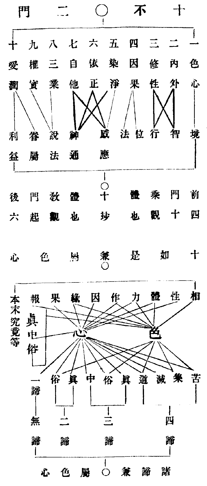
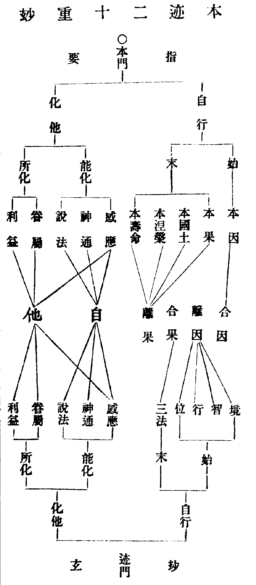

# 十不二门指要钞详解



> **藏经**：卍新纂大日本续藏经（新纂卍续藏）　**册次** 第 56 册（X56）　**编号** X0931　**部类** 经疏部　**卷次** 2 卷　**篇幅** 144,441 字

> **卷／品**：0 卷 · 4 品



---



## 目录



  - [No. 931-B 合刻十不二门指要钞详解序](#no-931-b-合刻十不二门指要钞详解序)

  - [No. 931-C 十不二门指要钞详解总序](#no-931-c-十不二门指要钞详解总序)

  - [宋慈云忏主　遵式　序](#宋慈云忏主遵式序)

  - [指要钞序](#指要钞序)



---



No. 931-A 重刻十不二门指要钞详解引



十不二门指要钞者，玅显荆溪之意，善示修证之要，而无极大师所著详解，消释详悉，意旨精密，大有功於学者焉。第其分会有未尽善者，加之国本脱误尤多，则蒙学之士往往病焉。(余)曩访获善本，对挍一通，及窃正分会之未善者，犹虑其未详，不丞刻梓。客秋因本寺讲钞，复细为挍订，质诸老师宿衲，而剞劂流通。读者诚由文辞之易晓，以开发玅解，则庶几此举之务，立行造修之一助乎！



旹元禄癸未秋八月朔旦



天台山沙门(亮润)叙于德王之圆觉室中



重刻十不二门指要钞详解凡例(九条)



国本有脱误者，今依明本悉雠正之。其明本有疑误者，於格上书某字疑某字。  

释签及钞尝有诸本与此所合不同者，亦书某字，一本作某字。  

会本每卷之首列撰人，直斥二祖之讳，非所以尊祖也。今竝删之，惟存某尊者之称。  

会本所标之释题之科，既非钞科，亦非解文。葢分会之际，欲对释文之科私添入耳。今欲不滥钞科，尽删去之。  

会本不标指要述人，而反标释签述人，大非钞解之意。今据钞解，标否得当。  

会本标钞科，每科删某下数字，及往往改削字句者，今据原文悉补之，无复一字之损伤。  

会本数处私补结门之科，理虽当有，亦不可谩添。今别标诸格上，以便见前后应对。  

会本分会差谬者凡三处，今竝改会之。  

此番重刻，务在删补会刻之增损，完全各书之原文。然惟释签指要有别行之可考，而详解则别行亡久，故今多所可疑，而不得而挍证，读者详焉而可也。



------



### No. 931-B 合刻十不二门指要钞详解序



指要钞者，开十不二门之玅钥也。其语深，其义䆳，非利根上智，曷能通之？有宋可度无极大师，深明一家教观，为之详解，诚如执柯折薪，游刃破竹矣！然其本𨤲而未合也，学者病之。天台云石师，乃无尽大师之高足，其兄以玄师，亦法门之伟人，每念及之，时复扼腕，乃留意参会成帙，未梓行，而寂云公悯兄赍志，毅然继志而梓之，以公同学，不亦善哉？噫！此解流通，台宗朗如日星矣！合帙而观，用志不分，法华开会之大旨，则又思过且半矣！得非大有功於后学欤？是不可一日少缓也。丞募檀资，以付剞劂氏，梓成，问序於余，余媿无文，而直述其会刻之颠末，昆仲之苦心如此云。



崇祯辛未端阳后二日武林天台后学沙门海眼槃谭书於报国院



------



### No. 931-C 十不二门指要钞详解总序



夫具妙心者人，悟妙心者佛，阐妙心者教，释妙教者祖。祖言既玄，必因门而入；妙门虽辟，须得要而登。既指要之可凭，必详言而始解。妙法莲华经者，阐妙心之至教，了佛意之玄诠。如来说之於八年，结集堆之以八里。梵册传来，犹太仓之粒粟；童寿翻译，如沧海之一沤。然而缩一劫为一日，妙在神通；藏刹海於一尘，玄由至理。是则虽粒粟可以为太仓之种，一沤可以收沧海之深。七佛绎经之师，六万传心之旨，斯言不谬，厥义可徵。若夫尝一粟而众味具存，见一沤而瀛渤俱在，则惟在吾天台智者大师之具足五舌五眼，乃能得之也。盖大师灵山夙闻，大苏妙悟，纵无碍辩，称性宣扬。依迹本二门，开待绝二妙。如来大事因缘，众生佛之知见，至是殆无餘蕴矣。第迹门非远，十妙难通；至理虽彰，妙心难悟。由是荆溪开以十不二门，四明指以一念心要。噫！若如来之与智者，可谓破一微尘而出大千经卷；荆溪之与四明，可谓合大千经卷而归一微尘，则法华玄义迹门、十妙十不二门、指要钞者，真直指人心，见性成佛之要门，无离文字而说解脱之秘典也。惟约为博源，略为详本，不有钱塘可度大师，孰传四明法智精义？发为详解十数万言，譬王家椒室，相宅朱门，非主壶者而莫识其浅深，非司阍者而莫启其阶降，良遗泽於后昆，流芳於末运者也。惜其未入大藏，散於僧寮，徒仰嘉名，不获寓目。有四明延庆寺僧传慧字朗初者，诗酒僧也，偶於山寺得获此书，虽知井中具宝，不解燃炬而观，以之进余，用当清供。余得之，如热渴之满饮甘露，饥馁之饱饫醍醐，冀登梨枣，以公同志。复以钞解各行，艰於寻绎，命弟子正谧会合其文，藏之笥中三十年矣。兹弟子正识坚诚募梓，因缘辐辏，大法当行，垂老覩兹，颇为称快。然而归功有自，慧僧不无缘因，即此可以忏生平绮语截舌之𠎝，释积劫曲糵灰河之罪，因斯冥益，重得为僧。以实语赞性具之宗，慧业裂迷痴之网，并将功德，普惠四生，若自若他，俱臻十妙，是可酬山僧流通之志，与两弟子锡类之心尔。



时皇明天启五年岁次乙丑仲冬天台山幽溪沙门传灯著於四明延庆寺之罗云堂



No. 931-D 十不二门指要钞科



钞科分(二)初释题(二)初正释题(十)  

二述人号(荆)



二释文(三)初总叙立意(四)初序前文立述作之意(二)初叙前(二)初叙教广(二)初十玅意(燃)  

二众释意(凡)



二叙观略(观)



二立意(二)初重示大部意(所)  

二正明今述意(二)初为成玅解(故)  

二为成玅行(故)



二例后义彰法理无殊(二)初例本玅(若)  

二例四章(况)



三别示玅体令解行俱成(三)初指玅归心(若)  

二示成由行(则)  

三功成识体(则)



四结示立名使诠旨斯显(四)初立门所由(故)  

二出门名义(何)  

三各自高深(一)  

四直彰宗趣(本)



二列门解释○  

三结摄重示○



○二列门解释(二)初列门对玅(二)初列门(一)  

二对玅(是)



二释门旨趣(十)初色心不二门(三)初标(一)  

二释(二)初约诸境明总别(二)初双标(且)  

二双示(二)初别(何)  

二总(既)



二就理事明谛境(二)初约理事明三谛(二)初明理事(当)  

二结成三谛(是)



二会生佛居一念(故)



三结(故)



二内外不二门(三)初标(二)  

二释(二)初明内外境观(二)初标示(凡)  

二释相(二)初明外境观相(外)  

二明内境观相(所)



二明内外融泯(二)初互融(是)  

二俱泯(谁)



三结(此)



三修性不二门(三)初标(三)  

二释(二)初修性双立(三)初修性对论(二)初直明性德(性)  

二以修对辨(二)初明相成(性)  

二明互具(在)



二明逆顺相反(二)初明对逆故二性并存(修)  

二明因顺故二心俱泯(可)



三明离合本同(二)初约法明离合相异(又)  

二约喻明修性体同(二)



二修性俱立正示不二(应)



三结(此)



四因果不二门○  

五染净不二门○  

六依正不二门○  

七自他不二门○  

八三业不二门○  

九权实不二门○  

十受润不二门○



○四因果不二门(三)初标(四)  

二释(三)初就圆理明因果暂存(三)初明始终理一(众)  

二明悟迷事异(二)初问  

二答



三明事极理亡(祇)



二依圆解明修证无得(二)初约法明惑智之体本虗(秪)  

二约喻明修证之功不立(二)初明修证功亡(故)  

二明德障体异(空)



三约圆乘明始终不二(二)初翻覆对扬明体一(是)  

二高广无减明不二(所)



三结(此)



○五染净不二门(三)初标(五)  

二释(二)初明所显净法(二)初染净体用理无增减(三)初法(二)初明染净体(若)  

二明染净用(法)



二喻(浊)  

三合(清)



二界如缘起性本圆常(二)初约性德直示(故)  

二约修成反显(故)



二明能显玅观(故)



三结(此)



○六依正不二门(三)初标(六)  

二释(二)初明果用由因本具(三)初示依正不二(二)初明不二之由(巳)  

二示不二之相(以)



二明因理本融(二)初明三位本玅(是)  

二示一切皆融(但)



三明始终无改(二)初明情智局徧(然)  

二明体用常融(二)初略示(始)  

二广示(故)



二明理显以观为功(二)初克彰观行之功(若)  

二结示生佛一致(如)



三结(此)



○七自他不二门(三)初标(七)二释(二)  

初示感应之体本同(二)初约法示(三)初约一性明自他(随)  

二约三千明感应(如)  

三约俱具明道交(众)



二约喻示(二)初顺喻(不)  

二反喻(若)



二明观行之功方显(二)初带喻彰用匪功成(若)  

二就法明发由观合(应)



三结(此)



○八三业不二门(三)初标(八)  

二释(二)初明所显果用(二)初约对机显逗会无差(二)初示三轮不同(於)  

二明真应复殊(在)



二约称理明卷舒自在(二)初融身说(二)  

二曾三轮(身)



二明能显观体(三)初结指心因(岂)  

二观成用显(百)  

三染体本玅(故)



三结(此)



○九权实不二门(三)初标(九)  

二释(三)初明等鉴由理融(平)  

二遍逗由心证(至)  

三结示归理一(对)



三结(此)



○十受润不二门(三)初标(十)  

二释(三)初明权实本圆薰修如幻(二)初由具可薰(物)  

二因薰可发(若)



二明生佛一际欣赴不偏(然)  

三明地雨无殊利益平等(故)



三结(此)



○三结文示意(三)初明十门通贯理体无殊(二)初约十门明理一(是)  

二约十玅明理一(如)



二明一念包容观行可识(三)初明一念观境之功(既)  

二明心法摄成之要(若)  

三明重述观行易明(故)



三明得意符文总别无异(首)



十不二门指要钞科(终)



十不二门







本迹二十重玅







No. 931  

十不二门指要钞序详解



------



### 宋慈云忏主　遵式　序



宋武林沙门　可度　详解



明天台后学　正谧　分会



------



### 指要钞序



【觧】此题上三字，是所序之正文。序字，是能序之通目。以别冠通，故云指要钞序。指要二字，本序自释。钞者，钞录为义。西资钞序云：夫疏之有记钞，葢后学之曹，记录要义，抄写格言，以辅翼其疏，防乎传受之谬误，讨寻之忽忘耳。(文)序者，所以序作者之意。尔雅云：东西墙谓之序。注云：所以序别内外也。(文)谓见墙别宅舍之浅深，观序知述作之难易。又序，绪也，谓茧之绪也。凡茧之抽丝，先抽其绪，绪尽方见其𮈔。今序在初，如𮈔之绪也。(光记)



【序】东山沙门遵式述



。【觧】东山，即台之东掖山能仁寺。忏主云：东掖山者，葢予幼岁受经之所，时年传法之地也。忏主族姓叶氏，台之宁海人。其母乞灵於观音大士，梦一美女，授以明珠，咽之生师。七月，能从母称观音名。十八祝发，二十纳戒。初住宝云，终於天竺，与法智同禀学於宝通云师。指要既成，乃为述序，发明述作之功。沙门如常释。述者，礼云：述者之谓明，作者之谓圣。今云述者，葢谦词耳。语云：述而不作。



【序】大教隆夷，存乎其人。诸祖既往，玄化几息。时不可久替，必有间世者出焉。



【觧】通叙教法兴衰在人，通指佛法以为大教。玅玄总序云：大法东渐。签云：通指佛教以为大法。(文)此对西土外道，此方儒教，约内外而分大小。隆，盛也。夷，平也。文选云：道有隆夷。(文)即兴衰之义。易曰：神而明之，存乎其人。(文)存，在也。谓教法兴衰在人，得人则兴，失人则亡。礼云：文武之道，布在方策。其人存，则其政举；其人亡，则其政息。(文)诸祖者，通指荆溪已前。诸祖在世，教法盛行。诸祖既往，则幽玄之化，几近於息灭矣。文选云：仲氏既往，玄化几息。系辞曰：易不可见，乾坤或几乎息矣。(文)替，废也。间世，即名德间生於世。孟子曰：五百年必有王者兴，其间必有名世者。(文)以时节不可久废，不远而复，必有间生者出兴於世，荷负斯道。四明塔铭云：天欲久其道，世必生有人。(文)间世者谁？故出其人。



【序】四明传教导师礼公，实教门之伟人也。



【觧】别叙传弘之德。四明，乃庆元府南面山名。有峰最高，四穴在上。每澄霁，望之如户牗，相传谓之石窻。谓四畔通日月星辰之光，故曰四明。人尊其道，故以处名人。传，转也。以己之道，转以授人。导师者，法华云：有一导师，聪慧明达。(文)尊者，上字讳知，下字讳礼。二名不偏讳，故称下字。公者，尊之称也。伟，大也。谓奇伟卓绝，一家教观。赖师中兴，故称伟人。此且总叹。



【序】童子受经，便能思义，天机特发，不曰生知之上性者乎？



【觧】童子，即太和未散之时，幼稚之称。尔雅云：人未冠曰童。礼云：人生十年曰幼学，二十曰弱冠。(文)弱冠已前，皆名童子。尊者七岁，属母丧，为报鞠育，急於出家。从里中大平兴国寺洪选为弟子，即童时也。受经思义，虽不见所出，尊者之母，既梦梵僧遗童子曰：此佛子罗睺罗。从而有孕。初出家时，从师受经，必能思义。忏主与师同门，必知其事。天机特发者，天然之机，挺特而发。庄子云：其嗜欲深，其天机浅。(文)不曰即，岂非之谓。语云：生而知之者，上也。今借用以拟本有性德，宿习开发，义似生知。止观统例云：生而知之者，葢性德也。学而知之者，天机深也。



【序】及进，具禀学於宝云通师。初预法席，厥父梦其跪於师前，师执瓶水注於口中，其引若泉，其受若谷。於是乎天台大教圆顿之旨，一受即了，不俟再闻。师谓之曰：子於吾言，无所不达，非助我也。逮师始灭，公复梦贯师之首，擐於左臂而行。



【觧】叙师资授受，自行化他，事匪偶然，故有奇相，形於梦寐，预表彰焉。进具，谓进受具戒禀学者。按实录曰：十五受具戒，专探律部。二十从宝云学天台教(文)。通师本高丽君族，壮游中国。当晋天福年间，见螺溪寂法师，了天台宗旨。会漕使顾公舍宅为寺，以为传道之所，即宝云寺也。初预者，预，厕也，入也。初入宝云师轮下，其父之梦，葢受学之先谶也。父金性讳经，梦尊者跪於通师之前，通持瓶水注於口中，其引若泉，来之而不竭；其受若谷，注之而不盈。孟子曰：源泉混混，不舍昼夜。谷者，说文云：泉出通川曰谷。尔雅云：水注川曰溪，注溪曰谷。谓师之乐说无穷，如泉之不竭；尊者之容纳，如谷之不盈。谷音欲，若作谷音者，训空谷、穷谷也。於是，犹自此也。天台大教特言圆顿者，别於藏等四教，举其极者言之。一家所谈，功由即具。尊者自此於宝云言下，一遍受之，即能解了，不俟再闻。师谓之言，即印可之语。凡师资授受，难疑问答，更相启发。今一闻即了，不假再询，其於启发之道何有哉？故曰：非助我也。语云：回也，非助我者也，於吾言无所不悦(文)。颜子於圣人言下，默识心通，无所疑问，故曰：非助我也。尊者亦然，通师深赞之言也。逮，及也。通师示寂於端拱元年，初入灭时，尊者又得传持之谶。贯，穿也。擐音患，带也。左传云：擐甲执兵。葢梦穿师之头，带於左臂而行。梦虽似异，有所表故。



【序】嘻！得非初表受习，若阿难泻水分瓶之莫二也。后表传持，操师种智之首而行化也。



【觧】此示梦不徒然，必有所表。嘻，叹声。初父之梦，表尊者受习通师之道，如水分瓶。犹如来说法，阿难传受，如水分瓶，更无二也。大经云：阿难自侍我来，持我所说十二部经，一经於耳，曾不再闻。如分瓶泻水，置之一瓶。(文)后表等者，后梦即表持於种智之首，行化於他法门。身以种智为头，即中道种智，即三而一也。光记三云：一切智是万行首，故以为头。



【序】淳化初，郡之乾符寺，请开讲席。诸子悦随，若众流会海。繇是堂舍侧陋，门徒渐繁。未几，遂迁於保恩院焉。法华、止观、金光明诸部，连环讲贯，岁无虗日。



【觧】叙游化处所，说法年代。淳化，即宋朝太宗年号，二年辛卯岁也。尊者年三十二，出世住持。誓辞曰：予居宝云，既值鶴林，始迁乾符西偏小院。乾符改承天，今为能仁。西偏小院，即今法华附庸院也。悦随者，所谓道不求扬，而四方尽闻；众不待召，而千里自至。易曰：刚来而下柔，动而悦随。(文)梁学士云：学者悦随，如群流之会通川也。(文)繇，由也。侧，谓偪仄。陋，谓隘陋。住处狭陋，学徒加多，遂迁居焉。未几，犹言居无几何。实录曰：淳化辛卯，受请乾符寺，绵历四祀，遂迁於保恩院。(文)即今之延庆。法华该乎玄句诸部，总包诸章疏也。实录曰：专务讲忏，常坐不卧，足无外涉，修谒尽遣。前后讲法华玄义七遍，法华文句八遍，摩诃止观八遍，大般涅槃经疏一遍，净名疏二遍，金光明玄疏十遍，观音别行玄疏七遍，观无量寿佛经疏七遍，金刚錍止观义例、止观大意、十不二门、始终心要，不计其数。(文)连环者，庄子云：连环不可解也。荀子曰：始则终，终则始，若连环之无端。(文)讲贯者，讲说之道，使义理贯通无碍。国语云：朝而受业，暮而讲贯。(文)尊者四十餘年，专务讲说，连属循环，未尝一日虗弃。



【序】尝勗其徒曰：吾之或出或处，或默或语，未始不以教观权实之旨，为服味焉，为杖几焉，汝无怠也。大哉！



【觧】尊者常以弘持教观为己任，即以自行而为化他，勉励来学。勗，诫也。出处语默者，系辞曰：君子之道，或出或处，或默或语(文)。今借用其语，以示四仪常在教观，故云未始等也。教即能诠之教，观即所修之行。教行二途，缺一不可。权谓权谋，实谓真实。若权实不分，则昧於化意，所谓为实施权等。服则被身，味则充口，行则倚杖，坐则凭几，皆日用不可须臾缺也。其於教观权实，未始暂忘，亦犹是也。解谤云：予自滥讲四十餘年，凡释一文，申一义，未尝不以部味教观而为凭准(文)。以己所行，勉励其徒，故云汝无怠也。既自彰於言，可得称赞曰大哉也。



【序】若夫被寂忍之衣，据大慈之室，循循善诱，人不可得而称矣。



【觧】言其三轨匠物，人莫能知。然涉世弘经，必须柔和忍辱，运大慈悲，了诸法空，方能取成大利。若夫发语之端，衣、座、室三，缺一不可。令成文体，且言其二。祭文则曰：开慈悲之室，踞法空之床。其义是同。循循者，语云：夫子循循然善诱人。尊者训人，循循有序，亦如是也。其化导之功莫大，故云不可称矣。



【序】释签十不二门者，今昔讲流以为一难文也。或多注释，各陈异端，孰不自谓握灵蛇之珠，挥弥天之笔？岂思夫一家教观，殊不知其启发之所。



【觧】正明述钞由致。释签者，玄文有疑，弟子签出。荆溪释之，师资合标。门师序云：因签以释，思逸功倍(文)。荆溪於本迹二门之间，述此十门。后人录出，别行於世。自昔至今，讲解之流，皆为难晓之文。葢斯文乃本迹之文心，三部之纲要。教观旁正之意，彼此相成之说。事理二造，一念三千。修性离合，即具随缘。本法总别，拣境立阴。种种大义，蕴在其中。文约义丰，诚不易晓。由谓之难，解释者众。如清师示珠，指昱师注文。更有他师著述，故云或多。诸师消文，曲随己见，而不得一家正意，故云各陈异端。孝经序：异端起而大义乖(文)。虽所见暗短，莫不自矜己能，谓得佛祖之意，故曰孰不等灵。蛇珠者，史记云：楚臣隋候出行，见牧童打伤蛇脑。侯怜之，用药涂治而去。一夜偶见庭中有光，烛之，乃一蛇啣珠在地。自言：我本龙子，变形游戏，为牧童所伤，赖君以救。今擕珠以谢。侯得之，进楚王。王置殿上，发光如昼。(文)弥天笔者，梁僧传云：道安法师文理通经，德望隆重。时习凿齿锋辩天逸，时往谒见。既坐，称言：四海习凿齿。师曰：弥天释道安。时人以为名对。笔者，葢取三分分经，符合经论，故云也。文意谓诸师自言所述之文，除后学之疑，如灵蛇珠，光耀破暗，契佛祖之意。若安公秉笔，分经合论，龙子变形，故曰灵蛇。文选云：人人自谓握灵蛇之珠，家家自谓抱荆山之玉。(文)岂思等者，钞中所破。清师解今一念为真心，昱师不立阴境，唯观不思议境。一家教观，拣一念妄心为入理之门、起观之处。若唯观真及不思议，则不知启发之所矣。



【序】公览之再叹：岂但释文未允，奈何委乱大纲！山𬯎角崩，良可悲痛！



【觧】尊者披覧诸师所述失旨，咨嗟不已，故云再叹允当也。委坠乱紊，非但释文未为允当，抑且委坠紊乱大纲。大纲者何，即一念三千，即空假中山外，弃妄观真及不思议，即坠乱大纲也。未允者，之字训往造，谓体同，改二十来字。山颓者，礼记檀弓曰：泰山其頺乎，梁木其坏乎，哲人其萎乎。角萠者，书云：百姓凛凛，若崩厥角。言民畏纣虐，危惧不安，若崩摧其角，无所容头。今取二事，喻解行不正，委乱教门纲纪，如泰山之颓。邪说暴行，使学者无所趣向，危惧不安，若畏纣之虐。



【序】将欲正举，舍我而谁？遂而正析斯文，旁援显据，绰有餘刃，兼整大途。教门权实，今时同昧者，於兹判矣，别理随缘其类也；观道所托，连代共迷者，於兹见矣，指要所以其立也。



【觧】正明述作。将欲扶颠持危，正举斯道，舍我其谁哉。孟子曰：如欲平治天下，当今之世，舍我其谁哉。(文)析，剖也。楞严云：析出精明。(文)正则剖析十门奥旨，义理泠然。旁则援引佛祖诚言显据，免生疑谤。绰，宽裕也。孟子曰：岂不绰绰然有餘裕哉。(文)刃者，庖丁解牛数千，而刀若新发硎。恢恢然其於游刃，必有餘地。(文)言得其玅处也。兼整大途，谓消文合理之外，复能整大途。即教门权实，观道所托。权实者，前之两教，教证俱权。圆教，教证俱皆是实。别教，教权证实，意稍难晓。今时同昧，即齐玄颕三师。但见荆溪有圆教随缘之说。尊者深究圆别教旨，以别教真如，既能生法，安不随缘。特立别教理随缘之义。以圆别同诠中道，而但不但殊。别则教权故但，理实故中。以理实故，亦说随缘；以教权故，显非即具。他宗於终、顿、圆三教皆明随缘，只云性起，不云性具，验非圆教。故尊者格量他宗所谈，但齐今家别教类，谓流类钞中引玅记专缘理性是别教义等。观道所托即介尔妄心。一家入道，不可远求，即刹那心显三千法，岂同山外弃妄观真？始因慈光恩师兼讲华严，以华严心造为真心，自此奉先清师、梵天昭师、孤山圆师谬有承袭，皆谓观真。故义书云：葢由上人师祖已降，皆谓心独是理(文)。若此之迷，非始今日，故云连代。四明立宗，则指介尔之心为事理解行之要，以此正说格彼谬谈，故曰於兹见矣等。逸堂云：教门权实，观道所托，所以四明得为中兴教观，功在於兹。



【序】至若法华止观纲格之文，隐括错综，略无不在。后之学者，足以视近见远，染指知味。易不云乎：通天下之志，定天下之业，断天下之疑，实此一二万言得矣。



【觧】言二卷之书，而於三部纲格之文，莫不该摄。纲谓纲纪，如网之外围。格谓格正，如物之大体。隐括者，荀子云：抅木必将待隐括。注云：正曲木之具。错综者，如易三五以变，错综其数。所谓河图、洛书，今是洛书之错综也。谓戴九履一，左三右七，二四为肩，六八为足，中则有五，纵横交错，皆十五也。门师辅行序云：岂唯错综所闻，将以隐括所治。所治即行，三多之玅运遽阶。所闻唯解，一真之玄览斯㳷。今法彼文，谓玄句开解，止观明行。三部纲格之文，所治所闻，若解若行，皆萃此书也。视近见远，谓阅指要之近，可以见三部之远。究指要之意趣，如染指於鼎，然后知三部之味。染指者，左传云：楚人献鼋於郑灵公(穆公太子夷也)，公子宋与子家将见(子公，宋之字。子家，归生字也)。子公之食指动，以示子家曰：他日我如此，必甞异味。及入，宰夫将解鼋，相视而笑。公问之(问所笑)，子家以告。及食大夫鼋，召子公而弗与也(欲使食指无验)。子公怒，染指於鼎，尝而出(文)。今取染指之微，知全鼎之味，如览二轴之文言，达三部之义旨。易不下，复借易中三句，通结指要述作之功，可以通达今时同昧教门权实之志，可以定连代共迷观真观妄之业。引佛祖诚言，证成其义，断学者之疑。



【序】式忝同学也。观者无谓吾之亦有党乎！取长其理，无取长其情，文理明白，谁能隐乎云也！



【觧】叙作序之意，因释他人之疑。式者，忏主自斥其讳，古人亦尚单称。如涅槃疏云：顶滞於豫章。释签序云：普早岁在尘，谓忝与四明同一师学。为斯钞序，理之当然。毋谓言辞虗餝，情党所及。语云：吾闻君子不党。疏曰：相助匿非曰党。后人不必致疑，特文理优长，宗旨明白，昭昭然若揭日月於青天，使之沈没，可乎？故曰：谁能等。



十不二门指要钞详解卷上本



唐　荆溪尊者　释签



宋　四明尊者　钞



宋武林沙门　可度　详解



明天台后学　正谧　分会



【序】十不二门指要钞卷上(并序)



【觧】上四字是所释，下三字是能释。上六字是别，别在今题。钞字是通，通於诸钞。上四字入文委释，指要二字本序自明。钞字如向卷者，卷舒为义，文凡二卷，故以上下甄之。并序者，摭华钞云：疏题兼目於序，故云并也。葢序后不再列题目故。(文)



【序】宋四明沙门知礼述



【觧】能述人号，读者避之，此非临文不讳之例。



【序】十不二门，本出释签，岂须钞解。



【觧】先寄问辞徵起，以明述钞之由。此文乃荆溪释迹门十玅之后，搜括十玅大意，而立十门。释签已是能释，何须作钞解之，得非能所重烦乎？文心解亦曰：玄义申经，记释玄义，文已三矣，讵假染笔以四其说(文)？



【序】但斯宗讲者，或示或注，著述云云。而事理未明，解行无托。荆溪玅解，翻隐於时；天台圆宗，罔益於物。



【觧】答：出山外著述之谬，虽非山家正说，亦禀学台教。故云斯宗讲者，或示奉先清师示珠指也，或注天台昱师注不二门。二师著作撰述，皆有云云之言。汲黯传云：吾欲云云。师古注曰：犹言如此如此也。史略其辞尔。汉隽诸文，横注云云二字。辅行云：未尽之貌。云者，言也。说文云：象云气在天，回转之貌。言之在口，如云润物。广雅云：云者，有也。下文尚有如云之言(文)。忠法师曰：吾祖法智尊者，始因钱塘奉先清师制示珠指，解十不二门，总在一念之文为真心，别分色心为俗谛，改造谓体用，为造谓体同，凡改二十来字。天台昱师注不二门，立唯观不思议境，消一念三千唯色唯心之文为真谛。法智愍而救之，所以指要之所由作也。故序曰：或示或注，著述云云(文)。孤山正义，乃祥符四年作，在指要后。事理等者，一家所明事理，有乎多义。今为山外，迷於三法事理也。圆论三法，各具事理两种。三千若欲造修，须拣生佛之高广，唯观一念妄心。此心当体圆具三千，即理造；此心能变造三千，即事造。如此解之，名为玅解；如此观之，名为玅行。山外诸师乃以三法抗分事理，谓心法属理，是能造；生佛属事，是所造。心既属理，敻指真心，则初心依何开解立行？故知山外三法事理未明，则玅解玅行无所依托。故忠法师曰：清师又立心法三千为理造，生佛三千为事造，殊不知三法各具事理二造。故指要破曰：据他所释，(至)无差之文永失矣。故序云：事理未明，解行无托。是皆破於清公也。荆溪等者，荆溪玄解十玅，作此十门，门门结归一念三千，合修观者易入。诸师异说，敻指真心，翻使荆溪玅解隐没於时矣。吾祖依法华开显玅旨，建立圆顿宗乘，点示诸法圆具事理三千，意令物机开解立行，拣境修观，即一念妄心达阴，成不思议，显三千法。若唯观真，但众生在事，未曾悟理，是杜初心入理之门、起观之处，则天台圆宗何益於物机乎？



【序】爰因讲次，对彼释之，命为指要钞焉。葢指介尔之心，为事理解行之要也。



【觧】正明述作，仍释命题之义。爰，於也。讲次者，因讲玄签之次，对清昱二师而释之。下文有人解今一念，是破清师。有人不许立阴等，是破昱师。命此能释之文为指要。钞：介尔者，辅行云：弱也，谓细念也。(文)介尔有心，三千具足。圆论诸法，皆具三千。若欲造修，须从近要。的指一念为事理，解行之要。此心圆具三千，即理之要。心能变造三千，即事之要。文云：若事若理，皆以一念为总。解此一念，具两种三千。依解立行，於一念心，观此三千。文云：教行皆以观心为要。特指心者，万法之本，众病之源。心能具故，心能造故。荆溪门门，结归一念。天台的论境体，唯在识阴。葢以此也。推而广之，一大藏教，无越此心。故曰：一期纵横，不出一念。故知指要，其功莫大。



【序】聊备诸生温习，敢期达士批详耶。时大宋景德元年岁在甲辰正月九日序。



【觧】谦己以记岁月，聊备学徒温故诵习，岂敢期望明达之士批覧研详。景德，乃真宗年号。



【钞】钞曰：此文题目，多本不同。或云法华本迹十玅不二门，或无本迹二字，有唯云玄文十不二门。此或以所通之义，所释之文，而冠於首，葢不忘其本也。而尽是别录者，私安取舍由情，无劳苦诤。



【觧】十门本出释签，初无题目，后人录出，各随己见，以立首题。且示三家：初是昱师，次是清师，第三莫知谁立。虽所立异，不出二义：初二是所通之义，第三是所释之文。所通义者，十门为能通，十玅为所通。所释文者，签为能释，玄为所释。不忘本者，要见十门出於大本故。取舍等者，示珠指立题云：法华十玅不二门。又云：有本题玅法莲华经本迹十玅不二门。或云：法华本迹不二门。或但称本迹者，并后人增损，今所不用(文)。问答决疑中，广破他人立题，今钞主暗破之。诸师立题，尽是私安，非荆溪意。取彼舍此，皆由人情，何劳苦兴诤竞，广破他人立题之不当耶？尊者之意，只云十不二门，故云作者自立，引下文释之。孤山正义云：义家抄录，往往别行，标立题目。二三其说，吾将适从。今依行满法师涅槃记，指为法华玄记十不二门。况满是荆溪门人，必也亲闻呼召，故依彼记，以立总题。虽违众，吾从古也(文)。虽云有据，恐非作者之意。学者孰不知此文出自今经玄记耶？



【钞】若十不二门四字，乃作者自立，故文云：为实施权，则不二而二；开权显实，则二而不二。法既教部咸开成玅，故此十门不二为目，须据此文释其题旨。岂非四时三教所谈色心，乃至受润，无不隔异，故皆名二？今经开会，实理既彰，十异皆融，互摄无外，咸名不二。



【觧】正释题目。初释不二。为实施权，意在於实，实本不二，顺权机故，分隔而说，故云不二而二。开权显实，意在於权，权既同体，不动纤毫，故云二而不二。法既等者，荆溪云：若不约教，则不知教玅；若不约部，则不知部玅(文)。境等十法，既约教约部，判后开之，则此十皆玅。今此十门，依十玅而立，宜名不二也。须据开显玅旨而释，方异昔经之不二也。岂非下，正释不二。约今昔对分二与不二，约教则三教为二，约部则昔圆兼带，亦非不二。以四时三教，未证三千三谛，无不差别隔异，故此十法皆名二也。今经开显三千实相，玅理彰明，十法隔异，悉皆圆融。举色则色摄於心，色外无法，举心亦然，乃至受润亦尔，故云互摄无外。



【钞】即以不二当体为门，然亦可云十不二为能通，十玅为所通。问：玅即不二，不二即玅，俱名俱体，何分能通、所通？答：今不以麤玅分能、所，亦不以名、体分之，葢以十玅法相该愽，学者难入。此文撮要，径显彼意，乃以略显广，以易通难，义立能通、所通。



【觧】次释门字。门有当体、能通二义。初句当体；然亦下，能通。当体者，不须更约能通、所通，即不二体便能通入。孤山云不二即门，亦此谓也。法华开显三千玅理，当处虗通，法法趣入，以为其门，故曰当体。经云：开方便门，示真实相。此方便、实相，各有当体、能通二门。疏八(二十四)云：实相不二，当体虗通，故名为门。如净名不二门、华严法界门等。记八云：无碍名虗，无壅曰通，故得全体成能通门。(文)四明云：门外无理，能、所泯亡。(文)然亦等者，十门虽皆当体，然约义立，亦有能通、所通。以门为能通，玅为所通。故生下，问：凡言能通，必以能通之麤，通於所通之玅。今不二即玅，玅即不二，何分能、所之殊？名、体言之，名为能通，体为所通。今不二与玅，俱得为名，俱得为体，那分能、所？答中，不以麤玅答上初义，不以名、体答上次义。麤玅分能、所者，玅玄第九就能、所判麤玅为四句，自有能通麤，所通亦麤；能通玅，所通麤；能通麤，所通玅；能通玅，所通亦玅(文)。又云：门名能通，理是所通。即名、体分能、所也。今之能、所，并非此二，葢以玄文十玅所谈法相，该罗广博，学者难以造入。此之十门，撮其纲要，径直显彼十玅之意，乃以十门之略，显彼十玅法相之广，对上法相该博言之。十门门门结归一念修观之易，通彼十玅文文之下散漫观心之难，对上学者难入言之。以此难易广略之义，立於能通、所通尔。



【钞】数至十者，葢从十玅而立，虽立门对玅，互有多少，而不亏本数也。此且总明，待至释文，更为点示。若欲标述作人者，即是荆溪尊者，既是后人录出，不可正斥其讳。



【觧】释十字。十是数方。方者，法也。如华严中，凡诸法门，以十为数。(辅行)从十玅立者，从所通玅，立能通门。玅既有十，门亦如之。虽立门对玅，或门多玅少，或门少玅多。门之与玅，彼此皆十，故云不亏。此且总明者，今且总明释题，待至消释别文。门门之下，点示不二之旨。如释色心门，初云：故今摄别入总，特指心法，明乎不二。以此为门，则解行易入。内外门云：复为显其玅义，必须内外互融，随观一境，皆能遍摄。此之不二，悉得称门。泛论虽尔，一家观法，皆用内心玅义为门。下去诸门，亦皆点示。或指立门对玅科，或指出门名义者，皆非。



△释文为三：初、总叙立意；二、从一者去，列门解释；三、是故十门讫文，结摄重示。此三即拟三分也。



【觧】结摄重示者，门门通入，乃结十门而摄十玅，重示一念三千三谛。观行易明钞末云：结文示意以十门。十玅理一，结文重示，即示意也。拟三分者，三分本为分经，但可比拟而已。总叙立意拟序分，以今正明十门，先总叙玄文，以立十门之意。列门解释，正明十门，可拟正宗，结摄重示。既结十门，重示观意，可拟流通也。荆溪科节止观，亦拟三分。



△初、又四：初、叙前文立述作之意，又二：初、叙前，又二：初、叙教广二：初、十玅意。



然此迹门谈其因果及以自他，使一代教门融通入玅故。



【觧】科十玅意者，迹门所谈境等十法，意开一代教门，无不皆玅故也。初三句十玅，后二句明意。然即领上之辞，此即指法之语。荆溪释迹门竟，搜括大意而成此书，故於文初领上十玅，故云然此等也。迹门者，迹谓足迹。玄七(八)云：如人依处，则有行迹，寻迹得处。文心解云：望本为名，皆从喻立也。如人从本处，则有行来之迹，故因其迹以通其本。(文)门者，迹中化用，通至实相，故称门也。十法虽广，不出因果自他。因收境智行位，果收三法。自收能应神通说法，他收感及眷属利益也。



【钞】然者，是也。即领上之辞，亦信解之语。若不信者，乃云不然。此迹门等者，指上玄文所谈十玅：境、智、行、位，因也；三法，果也。感应兼自他，神通说法，是能化者作，属自也；眷属利益，是所化者事，属他也。故因等四，收十玅尽。一代教门所明法相，岂过於此？今於十义，皆用待绝二玅而融会之，令无壅碍，故云融通入玄。



【觧】境等为因，三法属果者，葢本玄六(初)云：上来四玅，名为圆因。三法秘藏，名为圆果。(文)位玅通因果，今总名因者，签云：位玅若立，实通因果。为对三法，且从因说。(文)因果自他四明，孤山前五玅，是同於后五玅。四明兼自他，孤山唯属他。正义云：自他者，揽前五玅，名自行因果。对后五玅，名化他能所。玅玄云：前五约自，因果具足。后五约他，能所具足。(文)既云约他，则唯属他四明，何云通自他耶？(文)今谓玄文虽约自他，对前后五玅。既云后五约他，能所具足，能所即是自他。下文云：能化所化，自他义蕴。其中能化者，作现通说法，是果上作用。所化者，事所化之机。天性相关，则成眷属。无不蒙润，则成利益。并所化边事也。十义，十玅也。待谓相待，彼此互形曰相，以他望己曰待。以法华之玅，形四时为麤。以四时之麤，形法华为玅。待者，前四时为所待麤，法华为能待玅，故云相待。绝待者，绝前诸麤，无复形待，故名为绝。相待论判，出前三教四时之上。绝待论开，复能开前，令皆圆玅。签云：圆中约时，待绝俱玅。(文)而融会之。释融字，谓法法皆融，令无壅碍。释通字，谓法法通入，



△二、凡诸下，众释意。



凡诸义释，皆约四教及以五味，意在开教，悉入醍醐。



【觧】众释者，境有七科，智明二十，乃至利益，各明法相。意者，於此诸释，皆用教味，先判后开，俱圆俱玅。开教等者，约教则开三教入圆，约部则开四味入醍醐。正义云：开教不语入圆，入醍醐不语开味。影略互显，巧玅若斯(文)。



【钞】如初理、境，具有七科，一一皆用四教拣之。意开、藏等俱圆，复以五味判之。欲开、兼等皆玅，即使醍醐之外，更无餘味。如此释之，方称玅法。智、行乃至利益，各明种种法相，无不皆用四教五味。判后开之，皆成极味。



【觧】理境者，实相玅境，为智所照，从本具边，故名理境。柬，判也。



△二、观心下，叙观略。



观心乃是教行枢机，仍且略点寄在诸说，或存或没，非部正意。故纵有施设，托事附法，或辨十观，列名而已。



【觧】观即能观玅观，心即刹那妄心。禀教修行，莫不由观心显发，故喻枢机。枢机者，要也，发也。易曰：言行，君子之枢机。枢机之发，荣辱之主也。枢喻教行以观心为要，机喻教行从观心而发。如云：教不观心，如贫数宝；行不观心，非涅槃因。仍且下，明玄文观略之意。观心虽是教行之要，但玄文正明五重玄义，出诸教上。观且傍示，止观则委明行相，故於今文但略点示。有存没者，非部意故。纵诸文末有明观心，但是附法托事，虽位玅中略列十乘之名，既非专行，亦不委明，故云或辨等。



【钞】枢，即门之要也。机，谓机关，有可发之义。葢一切教行，以皆观心为要，皆自观心而发。观心空故，一切法空，即所修诸行，所起诸教，皆归空也。假中亦然，岂不以观心为枢机耶？然今玄文，未暇广明，寄诸文末，略点示尔。又虽据义，一一合有，为避繁文，故有存没。如十二因缘，境后则有，四谛则略，葢有止观。对此明乎教观旁正，如常所说。托事，则借彼事义，立境立观，如王舍、耆山等。附法，则摄诸法相，入心成观，如四谛、五行等。既非专行，故十乘不委。此即义例约行等三种观相也。



【觧】上二句，就譬释。枢谓门臼，门若无枢，则无开闭之功，故云要也。机谓弩牙，弩若无牙，则无启发之用，故机有可发之义也。葢一下，就法释。以观心为要，合枢要义。观心为教之要，果上偏圆渐顿诸法，皆我心具，行者必须摄法，归心修观，故至果成，称性设化。四教义。问：四教从何而起？答：依三观起。观为行要者，所修六度万行，皆因心本具，故全性起修，名无作行。皆观心而发，合上发义。由观心故理显，出观心故果成。若非三千空假中，安能成兹自在用？故教行皆自观心而发。观心空故等者，一切诸法，若教若行，皆心本具。若观心空，则所修六度万行，果上所起诸教，皆归空寂。空观既尔，假中亦然。说虽次第，用在一心，只於一心，宛有三用。此亦为下起教观之张本也。然今下释，仍且略点等，未暇广明者，观心虽为枢要，以玄文正明开解，未暇委明。乘境寄者，非部正意故。因缘境后则有者，玄二(十九)明观心者，一念无明即是明，乃至一念之心，既具十二因缘，观此因缘，恒作常乐我净之观，其心念念住秘藏中(文)。四谛则略，玄二(二十二)观心可知，不复记也(文)。以有释存，以略释没，非全无为没，但观心语略，其文隐没耳。或云：二句并释，或存没则不释。笺要云：以略释存，没固可知，不复更出也。教观傍正者，枢要云：此文兴致，正为於观。教观傍正，须知二意：一、约三部所自之文；二、约一家传通之旨。三部所自，则傍正互有。如义例云：如法华玄，虽诸义之下皆立观心，然文本意明五重玄义出诸教上，则教正观傍，托事兴观，义立观心。若今止观纵用诸教，意在十法以成玅观，则观正教傍；一家传通，则唯观为正。是故三部皆以观心而为正要。乃至以从文故，玄既观傍，故於十玅观有存没；今用旨故，玄亦观正，故撮十玅为此十门。门门既乃即心，玅玅无非是观。若谈观文言望於止观，此中极略；若谈宗旨望於止观，今文颇周。以止观宗旨无出三千，即在一念。今以三千不二点示一心，心全是玅，玅不出十。若晓十玅，止观可知，故云一期纵横等。既非下，释。或辨十观，谓玄文既非专明观行，是故十乘不暇委明，但列名耳。然后总结，指向所明托、附二观，显名所出，即义例文中约行、附法、托事三种观相也。三种观法，初名义。三种观法，义蕴经疏：天台依诸大乘经立四种三昧，修十乘观法，直就阴心显三千法，即从行观义。又依诸经，於玄句约事相、法相入心成观。托事，谓心为能托，依正事为所托；附法，谓心为能附，诸法门为所附，即事、法两观之义。荆溪考核其义，立三种名，故义例云：夫三观者，义唯三种：一者从行，唯於万境观一心，万境虽殊，玅观理等；二约法相，如四谛五行之文，入一念心，以为圆观；三托事相，如王舍耆阇，名从事立，借事为观，以导执情，如方等普贤，其例可识(文)。次用与此三种观，妙玄文句，各有事法。玄约四谛五行等，即是附法；托感应等事修观，即托事也。句释如是我闻等，即附法；王舍耆山，即托事也。以玄句消经，而於事相法相文末，令行者附托观心，免数他宝，故缺从行。止观正明十法成乘，如正修章，专约一心，修乎十观。前六章广开玅解，纵明事相观心，亦只助成约行观尔。若义例以三种敌对三部者，乃引三部三观显文，示其观相也。三修不问事法二观可造修，不修则乘境不备，不修则立观何为？答：山外一宗，谓事法观门，不通修习，所以玄句立观心者，有二义焉：一为已修止观者，令其不忘本习故；二为未修止观者，忘於封滞，令知起行必依止观故。四明义书，引玅玄观心，即闻即行，释签随闻一句，摄事成理，不待观境，方名修观等文示之，乃转计云：不论立阴。四明引正当观阴，具如止观第五去文。又诸观境，不出五阴等文逐之，又转计云：我本自问於阴，拣境诸文所无，不问通立阴境。四明又引玅乐拣境及心，玅玄由一心成观等文为证。既被四明前后穷逐，义皆破坏，不足评矣。四明建立三种观法皆可造修。义书五云：三种观法，皆为行立，俱可造修。若但论教义，不观己心，如贫数他宝(文)。尊者之说，悬合吾祖所立观心之意，深符即闻即行，立阴拣境之文。然乘境不备，若为修习？据义书有乎四意：一者、咨禀口决。如云：岂非大师说诸玄疏，多在圆顿止观之前，所谈玄疏，正开座下行人圆解。葢兼有观行之机，欲修观法，故托於事相、法相，立乎观门，令其即闻即修，得益者何限？岂待玉泉唱后，寻之方修耶？或於事法观道有壅，则咨禀口决而通达之。二、以广决略。文云：大师灭后，传持此教，为师之者，必须悬取止观之意而开决之。荆溪数於记中指乎止观，乃令讲授之人，取彼广文，决兹略观。既得决通，乃於事法观门便而修习，岂须背今见讲，自寻止观耶？三、从行度入。文云：若於师门先闻止观，久曾研习，今覩玄疏事法观门，则用本习观法，度入事法观门而修。或因兹得悟，乃名事法观门悟入，非是约行观中得悟也。四、略论三观。文云：又一种根性，只於事法观门修之得悟，亦不待寻止观。故法华三昧，只约一念妄心，略论三观，乃有三品证相。(文)已上四义，并是十义。书发明随闻事相法相，摄归内心，成乎理观，不待寻彼止观，专示观境，方名修观。若山外既谓事法不通修习，释彼文云：随闻一句，事相法相，摄归真理，便是观心，不待托阴修观。此与四明说义，优劣可见矣。四、兼独事法二观，皆有兼含之义。如光明玄观心三菩提云：若知即空，真谛菩提心，度妄乱心数之众生。若真即假，俗谛菩提心，度沉空心数之众生。双忘二边，即发中道第一义谛菩提心，度二边心数之众生。(文)菩提属法，众生是事，法中兼事，故记作附法含托事。释光句以四方佛表四谛智，佛即是事，四谛属法，事中含法，故句记作托事兼附法。释云：行者应知借四方佛表四谛智，此乃托事含附法也。(文)且行人心无并虑，何得兼含而修？当知但约兼含释义，不约兼含修观。若从行一种，无兼含义。旧谓净名疏释法无众生等诸句，一一皆以生空观历心及餘阴入诸法。而观义书判云：乃是用於约行观门修附法观，以为附法含从行。又据方等历幡坛道，具是从行兼托事。今谓法无众生之文，四明谓以从行观修附法观，观成即附法观成，非法含从行。若方等乃修三昧者，傍历幡坛等事，非从行兼事也。五、内外事理。从行通观内外，事法惟局内心。如四三昧属从行观，四行中修十乘观，正观内心。至例餘阴入，历缘对境，则通观内外。十六、观经观佛，亦从行外境。附法乃附四谛五行法相，入心成观。托事则借事表托，内心唯局内心，不通外境。通事理者，上三三昧并诸经行法属理，纵任三性，是事理观。观阴心本具三千，事观观变造三千。旧谓事法亦通事理，今不取焉。六、料简。问：辅行标历，结托义例。引历例托，其义云何？答：诸文凡约事相明观，皆名托事。文句借城山事，表对五阴正论修观。止观以正观心傍历事仪，表对法门修观。观门虽异，表托义同，故得诸文通称托事。则标历结托，引历例托，二俱无妨。请观音疏以大林精舍明托事观，与城山同义。书云：大林精舍是依报色入，以理智体之，正同方等。普贤历尊容道具，用法门体。达此，则方是托事之观。(文)大悲忏仪云：二、托事者，观音一身有千手眼，手有提㧞之力，眼有照明之用，即是一千神通智慧也。又云：三种观门，相须而进。(文)此与止观傍历义同，皆可称托事也。问：四种三昧收诸行尽，且四三昧自属从行，何云收诸行尽？答：诸经所明行相，不出四种，故云收尽事法二种。乃吾祖於玄句事相法相立此观心，令行人揽彼事法，入心成观，不可为难。



△二、所明下，立意，又二：初、重示大部意。



所明理境智行位法，能化所化，意在能诠，诠中咸玅。为辨诠内始末自他，故具演十玅，搜括一化，出世大意，罄无不尽。



【觧】科重示大部意者，向叙前文教广观略，今欲正明述作意，故重示之，以为下玅解玅行之张本也。意在能诠等者，大部明此境等十玅是能诠名，意在开显一代教中因果自他之法无不咸玅。为辨等者，示须十玅，所以如来出世施设一化，无出自行因果化他能所，故演此十，则一化大意该摄无遗。文心解曰：不谈十玅，摄法不周；不论一化，示玅不徧。(文)十玅释题是能诠名，诠於题下别文，故云诠中诠内也。



【钞】更举十玅，方出其意。能化即应，并神通说法也；所化即感，及眷属利益也。此十乃是一代教中能诠名字，大部明此，意在开显诸名咸玅故也。须辨十者，欲收始末、自他尽故。始谓境等，即自行之因；末谓三法，即自行之果。自他如前。若辨此十，一一咸玅，则了如来出世意尽。



【觧】释重示科。初二句总标，次释。能化、所化，即后五玅。前五玅，文显不释。此十下，明。大部明此意，开诸名皆玅，谓一代能诠，无超此十玅。玄释法华开显之意，开前四时所谈十麤，皆成十玅。此十若玅，则一代能诠诸名，无不成玅也。须辨下，释。为辨诠内等，出须十玅意。始末，即因果也。自他，即后五玅，故指如前。



△二、故不下，正明今述意二：初、为成玅解。



故不可不了十玅大纲。



【觧】不可不了，即诫劝之辞。玄文十玅，科目繁夥，犹如网目。举其大纲，则网目可寻。大纲，即三千也。若欲立行造修，先须解了三千三谛之法体。此之法体，是如来当时一番修证自他因果之法。今欲修证此从因至果之法，先须解了。依此玅解，方可立行。



【钞】欲知此十皆玅，须了开显大纲，即三千世间俱空、假、中，是今经之大体，能开之绝玅。境即此故，事理俱融；智发此故，无缘；行起此故，无作；位历此故，相摄三法；究尽此故，果满；生具此故，一念能感；佛得此故，无谋而应；神通用此故，化化无穷；说法据此故，施开自在；眷属全此故，天性相关；利益称此故，无一不成佛。今此十门，正示於此，若能知者，名发玅解。



【觧】释为成玅解。初总明三千玅解。境即下，别示十玅所依。今此下，结显十门所示。三千世间俱空假中者，世是隔别，十种五阴、十种假名、十种依报，隔别不同，故名世。间是间差，三千种世间差别，不相谬乱，故名为间。以三千法皆因缘生，是故一一即空假中。今经大体者，法华三周开显，并以三千为体。辅行云：十玅是今经权实正体，亦大车体，亦宝所体。(文)能开等者，玅乐云：若不先了能开之玅，将何以为所开之麤？(文)境即等者，此字即指三千大纲，七科谛境不出三千，理本圆融，事宁隔异？理即性具，事即变造，具变不二，故曰俱隔。色心门从境玅立，故荆溪名事理不二门也。智发等者，以智缘境，智为能缘，境为所缘；以境发智，境为能发，智为所发。三千玅智既全境而发，境智一如，缘即无缘。行起等者，进趣名行，即修治造作，全性德三千，起修德妙行，以性夺修，修德无功，故称无作。位历等者，位位皆具三千，故一一位具摄诸位功德。初阿字门具四十二字，后茶亦尔，故云相摄。三法等者，玅乘三轨，真性遍周，观照圆导，资成助发，唯佛究尽，故称果满。生具等者，生虽在迷，理体本具，众生由理具三千，故能感。佛得等者，诸佛由三千果满，故能应。所谓任运真化，不须谋作，如月不下降，水不上升，水月一际，感应道交。神通等者，神名天心，通名慧性，与六法相应，用此三千，任运化物，化复作化，化化无穷。说法等者，五时说法，凭据此三千，施则称性，被机分隔而说；开则称理，示玅无不圆融。眷属等者，前机受道，即成眷属，既全三千，故得父子天性自然相关。利益等者，十种利益称三千，故七方便人来至今经，咸成佛道，如三艸二木，皆一地所生，一雨所润也。今此十门，正示此十玅大纲，以十法皆即三千三谛，故皆称玅。能知此者，名发玅解，为此义故，十门所由作也。若能知者，名发玅解，是发明荆溪开发玅解，故述此十门，不离一念，令修观者易入。序云荆溪玅解，葢谓此也。



△二、故撮下，为成玅行。



故撮十玅为观法大体。



【觧】撮，揽也。揽此十玅三千之法，为今止观之大体，而修玅行述作意。荆溪於迹本二门之间，立此十门，有何深意？孤山正义云：葢荆溪大师，揽玄文教义，入止观行心。俾夫名字行人，识法相之有归，达造修之无滞也。又云：悟理之要，必在十乘。故荆溪恐后昆昧旨，乃於释签，更立十门。结束十玅，咸归止观。一念三千，不思议境。方显教不虗设，悟理有从。荆溪述作，意在斯焉。又云：以彼观门，收此教义。以此义教，识彼观门。若欲造修，须依彼部。勿谓此文，便堪修行。(文)既云摄教归行，唯以玄观，教理相对，义归一边。反显事法不通，修习乃见。十门虗设，难可信从。净觉文心解云：述作之意，不逾二焉。一为摄教成观，即前云：故撮十门，为观法大体。二为示略知广，即后文云：使一部经旨，皎在目前。然其后意，亦成前意。(文)初云摄教成观，无妨之说。次云示略知广，以十门为略，经文为广。况以后意成前，致使二义皆未明述作之意。法智科此文云：为成玅解玅行。且玄文十玅，大师纵辨宣扬释经题旨，岂非玅解？文文之下，立观心释，岂非玅行？又何假荆溪重述十门，方成玅解行耶？须知玄文十玅，法相该愽，学者难以造入。荆溪揽彼十玅，摄作十门，门门结归一念三千，以此三千是十玅之大纲，观法之大体，乃以略显广，以易通难，正为成於玅解玅行。如此明之，深得荆溪述作之意矣。观法摄属。问：荆溪述此十门，以三种观法言之，属何一种？若云从行，则部旨有妨。葢玅玄唯明事法，签解玄文，岂是从行？反显事法不通修习，过同山外。若云托事附法，且十门不约四谛五行法相及王城耆山事相明观，何名事法？答：须知的属事法二观所摄。葢由玅玄广解十玅，文文之下，立观心释，或於四谛五行文末附彼法相，以明观心；或托感应神通事相，以明观心。故今文云：纵有施设，托事附法。然玄文正意生解义强观，且傍示乘境不备，难以造修。若大师在日，说玄疏时，座下有观行之机，咨禀口决而修习之，得益者何限？大师灭后，为人师者，必须三部通达谙练。学者欲修事法之观，悬取止观十乘十境而开决之。荆溪悬鉴末代神根既钝，何能谙练止观乘境之相？故於迹本二门之间，述此十门，门门结归一念三千，为观法之大体。禀学之徒，覩事法观心之文，若欲造修，不待远寻止观乘境，即观一念具足三千三谛，便能通入。所谓以略显广，以易通难，即此义也。故钞云：玄文虽立观心，而且托事附法，葢非部意，故多缺略。若具论能成之功，须指摩诃止观也。又云：此文乃行正解傍，与止观同成观体，以由十门，门门皆显三千，即是摩诃止观十乘观法之大体。若论能成，虽是止观从行，须知正为成就玄文事法观门，观成则事法观成，非从行观成也。是知十门即玄文总观心文耳。能成既是从行，不妨通於内外二境，所成正是事法，不与部旨相违。或据揽彼无边法相，摄作十门，作附法观收摄。须知玄文本通事法二观，不可迷荆谿义例，以三种敌对三部，便谓玄文只属附法。且十玅法相无边，行人心无并虑，安可俱时而修？岂可见揽十玅法相，遽作此判？



【钞】言观法者，十乘也。应知止观十乘是别论行相，而一一乘不离三千，即空、假、中，故云观法。大体义例云：散引诸文，该乎一代，文体正意，唯归二经：一、依法华，本迹显实；二、依涅槃，扶律显常。以此二经同醍醐故。是知用此十玅绝待之义为观体者，方譬日光，不与暗共。又此三千法门徧於诸法，若色若心，依之与正，众生、诸佛，刹刹尘尘，无不具足。故华严云：如心佛亦尔如佛众生然心佛及众生是三无差别。故今家释经题法字，约此三法，各具三千，互具互融，方名玅法。然虽诸法彼彼各具，若为观体，必须的指心、法三千。故玄文云：佛法太高众生法太广於初心为难心佛及众生是三无差别观心则易。又义例云：修观次第，必先内心。今家凡曰观心，皆此意也。故今文中撮乎十玅，入一念心，十门示者，为成观体故也。若不尔者，何故节节唯约心说？岂尘、刹、生、佛而不具邪？若不见此，全失今文述作之意也。



【觧】释为成玅行。初明绝待三千为观体。十乘观法，是所修行相。三千三谛，即十乘之大体。别行玄记云：止观十乘，是观别相。三千空假中，是观总体。(文)别相虽有十乘，论其大体，只一三千。如云：观法非十，对根有殊。虽复根殊，但以不思议观，观不思议境。(文)十玅既以三千为大纲，故撮开显大纲，为观法大体。大纲大体，法喻异耳。此且正示，次引文证。本迹显实者，迹门显圆成之实，本门显久成之实。文句分经云：前十四品迹门，开权显实。后十四品本门，开权显实。义例云：所以始末，皆依法华。此即法华三昧之玅行也。次用涅槃者，虽依法华，咸归一实。末代根钝，若无扶助，正行倾覆。正助相添，方能远运。(文)设三种权，扶一圆实，名扶律显常。金錍云：指的玅境，出自法华。此因野客问玅境所凭，故大部谈圆极处，无非三千。玅境所出，独在法华。今文通约一部言之。前六章广开玅解，通乎大小偏圆。论其正意，归於二经。由本迹显实，谈常显性，是同同一味。故结显云：是知用十玅为观体等。不与暗共者，既指开显十妙三千而为观体，方可喻如日光赫奕不与暗共。在昔诸经大小并陈、权实各立，其犹灯炬星月与暗共住。来至今经指权即实，佛慧圆明、法界洞朗，其犹日轮当午无处不南。玅玄云灯炬星月与暗共住，譬诸经存二乘道果与小并立，日能破暗故，法华破化城除草庵故(文)。又此下明三千周遍示唯心体具。初明诸法圆具。又者，更端之辞徧於诸法，此句总标色心是已色阴及四阴心。依正者，色心是正，国土属依，生佛即十界正报，刹尘即生佛，依报即心佛众生，皆具三千。引华严如来林菩萨说偈为证。彼文先明心造一切，次以心例佛、以佛例生，明三无差。今家释心造有事有理，则三法各具两种三千方无差别。义书云：以我一念之心及一切众生、十方诸佛，人人说於理具、各各论於事造，而皆互具互摄，方名三无差别(文)。今家等者，玅玄三释法字，约心佛众生三法。一释众生法，云一法界具九法界，则有百法界千如是等(次约佛法心法释云云)。今云三千，广略异尔。各具互具者，随境示具曰各，具体本同曰互。然虽下，明观体唯心，诸法体同，故彼彼圆具。今欲修观，须拣难从易，的指自心，故引二文为证。佛法等者，义书云：是则诸佛亦有心，众生亦有心。若随净缘熏起，作佛界之心，则高远难观；若随染缘熏起，作九界心，则广散难观。故辄取一分染缘熏起，只今刹那阴识之心，依之显性也(文)。义例云者，心境释疑例。问：诸文皆云色心不二，若欲观察，如何立观？答：色心一体，无前无后，修观次第，必先内心(文)。今家诸部，凡明观心，皆拣难从易之意。故今下，的示今立意。今之十门，撮彼十玅，入一念心，束作十门而示者，为成观法大体故也。撮前五玅，成今四门，为十乘观体；撮后五玅，成今六门，为起教观体，并以心法三千为门。不然，何故十门节节云一念或心性刹那等耶？岂可见多明心具，不了拣难从易之意，便谓尘等不具乎？诸法圆具，如向所陈。孤山唯谈心具，不许色具，故寄此斥之。今为成玅行，故撮十玅大纲，一念三千，成乎观体。不见此意，全失荆溪述作之意也。



△二、若解下，例后义，彰法理无殊二：初、例本玅。



若解迹玅，本玅非遥，应知但是离合异耳。因果义一，自他何殊？故下文云：本迹虽殊，不思议一。



【觧】科语，谓以前迹玅，例后本玅。又以释名，例下四章，彰本迹十玅。名等五章，自他因果之法，三千玅理无殊。初例本玅。迹本俱谈十玅，但有离合之异。自行因果既一，化他能所岂殊？故引玄文为证。此二句，本肇师九辙中语。彼第六，本迹无生。辙云：多宝为本，释迦为迹。本既不灭，迹岂有生？本迹虽殊，不思议一(文)。今家虽用其语，义则永异。以约久远，成佛为本；中间施化，今日五时，近成为迹。本迹久近虽殊，三千三谛，不思议一也。



【钞】若本若迹，各论十玅，而不同者，但是互有离合故也。迹因具明境、智、行、位四者，离因故；迹果惟明三法一玅者，合果故；本中不云境等，唯明一本因玅者，合因故；本果之外，更立本国土、本涅槃、本寿命者，离果故。故知唯云因玅，必具境等；唯云三法，必具国土等。若知因果不殊，自他岂应有异？以本初坐道场时，亦徧赴物，岂不现通说法？岂无眷属获益邪？应知久近虽异，皆以三千俱空、假、中而为大纲，故云不思议一。



【觧】若本下，释初三句。若知下，因果义一，自他何殊？应知下，释后二句。离合异者，迹中因开而果合，合习果、报果为三法玅也。习果既证三法，必有寿命、国土，但合为一，三法玅耳。本中因合而果开，开习果，出报果，明本国土玅也。葢由涅槃、寿命、国土是称实感报，故於习果开出涅槃、寿命、国土之报果，亦是开正报，出依报也。又因果有傍正。玄九云：迹门破废方便，开显真实佛之知见，明弟子实因实果，亦明师门权因权果，为成弟子实因实果，因正果傍。本门废方便之近寿，明长远之实果，亦明弟子实因实果，亦明师门权因权果，要显师之实果，果正因傍(文)。良以迹中正为物机开显，得入真因，故因为正。本中正开长远寿量，故果为正。正则离而详说，傍则略而合明。因果既有傍正，所以文有广狭、义有可否。文广狭者，唯佛与佛乃能究尽诸法实相，境玅也。唯我知是相，十方佛亦然，智玅也。本从无数佛，具足行诸道，行玅也。天雨四华，位玅也。此因文广也。佛自住大乘，果文狭也。本门经曰：我本行菩萨道时，所成寿命今犹未尽，因文狭也。我成佛来久远若斯，果玅也。自从是来，我常在此婆婆世界，国土玅也。然今非实灭度，而便唱言当取灭度，涅槃玅也。处处自说年纪大小，寿命玅也。此果文广也。义有可不者，机土净不净、化事成未成，故於习报开不开也。由本佛是净土净机，故不说涅槃，即於法华唱灭有涅槃玅。既有涅槃，必论寿命长短，故有寿命。有正必有依，故有国土。又往事已成，开出涅槃等。迹中无此，但一果证三法而已。由此诸义，故本迹十玅互有离合也(玅玄本门文意)。



△二况体下例四章



况体宗用秪是自他因果法故，况复教相秪是分别前之四章，使前四章与诸文永异。



【觧】上以迹例本，总是释名。今以释名例下四章，亦不外此。故云：秪是教相，只是区别麤玅，永异诸经也。自他因果，与因果自他不同。前以因果自他收摄十玅，今欲自他各论十玅，机应皆能化物。故钞云：必合从因至果等。故自他各有体等，则自他在前也。



【钞】如上所明二十重玅，皆是释名而含体等，以释名是总，三章是别，总、总、别故。且十玅中，境即是体，智、行、位、法是宗，应等三玅是用。感及眷属既获利益，必合从因至果，还起利他之用，亦具体等，故云秪是自他因果法故。又名等四章皆是被下之法，即属教也，而须以相别其麤玅。今之四章出前三教，四时之上复能开前，今皆圆玅，故永异之言含其待绝，以唯今经能徧开故。



【觧】初释例三章。又名下，释例教相。初如上下，示名含三章。且十下，释自因果。感及去，释他因果。释名含体等者，名谓名言，一部言句皆能诠名，体、宗、用三皆遍始终。但题目是总，经文是别，揽别为总，就题释名，故释名章能总含三章之别。如法华本迹十玅以名，其名具含体等，即今文云境即是体等。境是理境，因果所依，故属体。智、行、位三是因，三法是果，因果属宗。应及神通说法是果上之用，依体起宗，宗成有用也。签云：境是体，是法身；智、行是宗，是用。乃境、智、行三，住前三法，对体、宗、用，即一性、二修规矩。今文以名例於体等，名既不出十玅，故以十玅分对体等也。名等等者，钞主释意：前四章为教，第五章为相。常逾名是能诠，体等是所诠。今文体等例属於教者，才涉言诠，即属教也。玅宗云：上之四章，皆是言教，谓诠名、诠体、诠宗、诠用之教。玅乐云：通论圣言被下，俱名为教。(文)并约能诠为言。玅宗云：五重玄义，本是经中所诠观法。(文)此约所诠为语。此四皆是圣人被下之法，故皆属教。须以大小偏圆之相，拣别麤玅。今经四章，相待论判，则出前三教四时之上；绝待论开，则开前诸麤，令皆圆玅。以唯下，释绝待永异。相待则待麤论玅，永异可见。绝待则无非一玅，何言永异？故释云：唯独今经遍开一切，则前部所无，岂非永异？又凡言教相，有教即是相，有教家之相。玄十云：教即是相，非谓无相。(文)於前四章，俱论简判，名教即是相。玅乐云：教家之相，故云教相。(文)谓前四章为教，第五章为相，即前四章教家之相也。



△三、若晓下，别示玅体，令解行俱成三：初、指玅归心。



若晓斯旨，则教有所归，一期纵横，不出一心，三千世间，即空假中，理境乃至，利益咸尔。



【觧】科别示等者。上科叙前例后，名等四章，玄文该遍。今乃离文，别示三千玅体，入一念心，令玅解行，俱得成就。初指玅归心。若晓三千三谛、十玅大纲之旨，则一代教法，有归趣矣。以一代教法，不离三千，三千不逾一念，故云一期等。签一云：始自寂场，终乎鶴树，故云一期。五味为纵，四教为横。如来五时化物，四教逗机。所说法门，虽即无量，不出一念三千。三谛理境等者。上虽摄法归心，言犹通总。故今历玅别示，始自理境，终至利益，无出一念三千，故云咸尔也。



【钞】三千玅体为教所归，故一期之内，五味传传相生，故纵；四教各各趣理，故横。而所诠法虽有显覆，准今经意，未甞暂离三千玅法。又虽诸法皆具三千，今为易成玅解、玅观，故的指一念即三法，玅中特取心、法也。



【觧】释指玅归心。今初，正释。三千玅体等者，一代时教，宗归法华，法华开显三千实相，是诸法之大旨，众流之归趣也。传，音转，驿递之义。约部，则五味次第相生，从浅至深为纵；约教，则藏、通趣真，别、圆趣中为横。所诠即境等十法，虽有昔日之覆，法华之显，若准今经开权显实正意，则无非三千玅法，以前四时十法之麤，皆从三千玅理施出故也。又虽等者，上虽通以诸法各具三千为所归，今之文意，为成观故，的指心法，即拣难从易。心、佛、众生三法中，拣生佛之高广，特取心法近而复要，易成玅观故也。



【钞】应知心法就迷、就事而辨。故释签云：众生法，一往通因果，二往唯局因；佛法定在果，心法定在因。若约迷、悟分之，佛唯属悟，二皆在迷。复就迷中，众生属他，通一切故；心法属己，别指自心。故四念处，节节皆云观一念无明心，止观初观阴入心。九境亦约事中明心，故云烦恼心、病心，乃至禅、见心等，及随自意中四运心等。岂非就迷、就事辨所观心？



【觧】此句定心法属於迷事，为下观真、立阴、破立之张本。应知之言，辞含诫斥。应知此心，乃约迷约事以辨，非从悟从理以论。即引三文为证：初、观阴心，证心是迷；下之九境、四运心等，证心是事。玄二(初)云：若广众生法，一往通论诸因果及一切法。若广佛法，此则据果；若广心法，此则据因。签二(二十)释云：然众生义通，故云通论；义非究竟，故云一往。一往虽通，二往则局，不通於佛及唯在因(文)。此文钞中三番引用：初、定心法在迷，二、斥山外违文，三、释因果二字。虽三番引，各有所主，非繁重也。玄签但约因果通局以论三法。四、明复约迷悟自他柬判者，以因果名义，然有收拣。以六即言之，九界属迷，皆名理即；名字已去，并名佛界。此收无不尽也。下文云：因从博地至等觉还，果唯玅觉。此拣无所遗也。则因果分之，九界为因，佛界无果。其如佛界，言犹通漫；名字以去，并名佛界。故须复约迷悟甄分。佛唯属悟，的取圆教玅觉为果；等觉已还，并属九界三道，以无明未尽故也。心生虽皆在迷，心法乃别指自己。刹那妄念，以心对生，九界皆名众生，并属於他。又复应知，玄签约教，且约因果；今文明观，更约自他。下文云：生虽在因，复通一切，唯取心因，是今观体(文)。故知四明约因果迷悟自他拣判，方见三法体相不滥矣。四、念处等者，彼文四(九)云：此之观慧，只观众生一念无明之心，即是法性。又云：观无明心，毕竟无所有，而能出十界诸阴。又云：今观此无明心，从何而生等(文)。止观初观阴者，正修章初观阴境，用十乘观法。下之九境，亦是约事。第四三昧，随自意中观起，心推四运，亦是事也。岂非下，结指。上所引文，皆是迷事三法通局。玄签之文，如前所引。今问：玄文云：一往通论诸因果。诸者，不一之辞。似约界界各论因果，四明那约迷悟九一分耶？答：诸字训於，即语助也。下文云：一往通於因果是也。旧谓界界各论因果者，非。问：十界因果，摄法周足，何得又云及一切法？答：拾遗记云：一切法者，即是假人实法，及以依报，各有性、相、体、力，作因缘、本末、究竟等法也。是知上云因果，通言十界。今云一切法，即十界中各具十如。是法界界互具，乃成千如矣。旧谓九界中善恶等法，义恐不然。问：签云：一往虽通，二往则局，不通於佛，及唯在因(文)。既云不通於佛，又云及唯在因，何繁重乎？又及字对何处下，答：此二句释上二往局义。以众生法二往言之，正在於因，不通佛界。唯在九界，故云不通於佛。既不通於果，佛及唯在九界之因，故云及也。问：众生法须约一往通论，有何所以？答：玄文广明千如玅旨，正约众生法说之。一往通论十界，皆名众生，则千如义备也。



【钞】有人解：今一念云是真性，恐未称文旨。何者？若论真性，诸法皆是，何独一念？又诸文多云观於己心，岂可真理有於己他？更有人全不许立阴、界、入等为所观境，唯云不思议境。此之二师，灼然违教。



【觧】叙破清昱二师观真弃阴。初云是真性，是清师。次不许立阴，天台昱师也。忠法师云：如序中引示珠指，解今一念，以帝网珠喻，乃至云我之一念，亦复如是。能如是观一切诸法，唯心无性，名真性空等(文)。今且从容不迫，略斥之日，恐未称不二门之文旨。何者下，徵释。且摩下，示止观。前六章广开玅解，明一切诸法，无非真性，何独一念？今之一念，为成玅观，须就迷就事而辨。若敻指真心，初心如何造趣？诸文观己心者，如签云：己心生佛。别行玄云：他者，谓众生佛。自者，即心而具(文)。若论真性，生佛平等，无间己他，更有人者。忠法师云：昱师唯观不思议境，消一念三千(文)。若据注文，本无此语，但云介尔起心。三千性相，即非纵横并别之旨，故云总在一念(文)。既云三千性相，非纵横并别，岂非不思议境？故四明约义，引而破之。此之下，总斥二师，灼然违背一家教文。观真妄。问：一家圆观，观一念心，为真为妄？若云观真止观，拣境修观，唯观识阴。若云观妄止观，何云系缘法界？玅乐何云但观理是等耶？答：示珠指谓心唯是理，如云一念即一性也，一念灵知等。又云心即生佛之心，非离生佛外，别有心为生佛之本(文)。谓心是非迷非悟之真心。究其弊源，始因慈光恩师，兼讲华严，见清凉大疏，以心法是理为能造，生佛是事为所造。既不深本教，滥用他宗，故定一念属真。清昭诸师，谬有承袭，咸谓观真。须知克论此心，真妄同源。众生无始在迷，未甞离念。约修门说，必须达妄即真。若敻指真心，则杜初心入理之门，起观之处。凡论诸法，皆是真性，自是开解。奈何山外境观不明，将解为观。慈云所谓不知启发之所。四明定所观境，的属妄心。只由凡夫众生，迷真逐妄。见前一念，全体是阴。欲令返本还源，故须从近从要。令达妄以显真，方是佛祖为人之意。若敻指真心，真心已是显悟，何须修观耶。然虽定境属妄，毕竟圆顿。行者正用观时，观一切法为真为妄。当知直观此一念妄心，当体具足三千诸法，皆不思议。所谓造境即中，无不真实。止庵曰：直观一念心，体是三千。譬如见冰，不问融与不融，直作水会。先达云：山外观真，即同观妄。四明观妄，即同观真。斯言得矣。梵天昭师，孤山圆师，本承袭清师之说。孤山见四明立义，定境属妄。遂转计云：昔人观真，今人观妄。鹬蚌相扼，我乘其弊。达六识之妄心，显三谛之玅理(文)。昭师因被四明往复徵诘，巧作救义云：观六识之妄心，成三谛之真心(文)。义书云：予闻此救，喜跃不胜。葢予义论有益，能转人心，改迷从悟也。上人因谁得解。若谓奉先座下得闻，且示珠全不约妄释心，亦无观妄成真之说(文)。是知观妄成真，出自四明。如云：乃依此心，观不思议，显三千法。又云：以依阴心，显玅理故。孤山何得窃取以为己说，却乃妄破，直云观妄耶？昭师纵能转计巧救，为观妄显真，但有其言，全迷其义也。立阴止观第五(初)。正修章列所观十境，阴乃居初。文云：此十境通能覆障。阴在初者，一现前，二依经。大品云：声闻依四念处行道，菩萨初观色，乃至一切种智。章章皆尔，故不违经。又行人受身，虽不阴入，重担现前，是故初观。辅行云：今家用此十法为境，不同常途，别立清净真如，无生无漏(文)。据此，则圆顿行者，阴境现前，恒得为观，何须言立？葢由山外不立阴等为境，直观不思议境。今对彼不立，故云立耳。问：圆顿行人，必须观阴释签，何云阴等十境，唯在三教？答：若论阴体所属，在前三教。如止观五(二)云：此十种境，始自凡夫正报，终至圣人方便。阴入一境，常自现前(方便即别教道)。则别教教道已还，三教九界，背性成迷，无非三障四魔，皆属阴境所摄。圆人了知，无非性具法门。荆溪据阴体而判，故云惟在三教。圆人既了此阴无非法界，即此便是圆人所观之境。故连文云：今是圆人所观境界(文)。葢前辈有读文不尽之过，但以阴境在三教为难，殊不知今是圆人所观境也。



【钞】且摩诃止观，先於六章广示玅解，岂不论诸法本真，皆不思议？然欲立行造修，须拣入理之门，起观之处。故於三科，拣却界、入；复於五阴，又除前四，的取识阴辅行；又拣能招报心，及以发得，属於下境。此是去丈就尺，去尺就寸，如灸得穴也。乃依此心，观不思议，显三千法。乃至贪、嗔等心，及诸根尘，皆云观阴、入、界及下九境。文中拣判，毫末不差，岂是直云真性及不思议？



【觧】引止观依解立行，拣境修观，皆观阴妄，结斥观真不立阴境之非。初明前六章开解。然欲下，明第七正修。至观阴入界，总是初境。及下去，明下之九境。岂是下，结斥。前六章开解者，止观五(初)云：前六重依修多罗以开玅解，今依玅解以立玅行。(文)辅行问：五略中有行有解，有因有果，何故但云六重是解？答：言大意者，冠於行解自他因果。意既难显，还作行解因果等释，非谓已有行果等也。若论文意，但属於解。於属解中，恐解不周，故须委明名体及摄法等。方便望五，稍似行始。若望正观，全未论行，亦历二十五法，约事生解，方乃堪为正修方便。是故前六并属於解。(文)然欲等者，既能解了法法本真，皆不思议。若欲起行造修，入此真理，须得其门。欲观此不思议境，须知起观之处。所以吾祖於正修章中，广明十境、十乘、行相。三科拣却界入者，止观云：依毗婆沙，明三科开合。若迷心，开心为四阴，色为一阴。若迷色，开色为十入及一入少分，心为意入及法入少分。若俱迷者，开为十八界也。十界少分属色，七界少分属心，以此法界中亦有四类法故。言二少分者，以法入中有四类法，谓无表色、心所法、不相应行、三无为。则无表色属色，心所法属心，不相应行非色非心，三无为非三聚摄。(文)次克示境体云：若欲观察，须伐其根，如灸病得穴。今当去丈就尺，去尺就寸，但观识阴。识阴者，心是也。(文)辅行云：从广之狭，正示境体。阴入界三，并可为境，宽漫难示，故促的指。略二就阴，如去丈就尺；略四从识，如去尺就寸。以由界入所摄宽多，阴唯有为，有为之中，义兼心色，故置色存心。心名复含心及心所，今且观王，置於心所。故初观识，餘下例之。(文)辅行又拣等者，彼云：於第六中，取能招报者，仍须发得，属烦恼境。餘之分别，方是今境。(文)彼云：取，取去也。今文云拣，其义是同。能招报心有二：一见行，二发得，并须拣去故。四明用，及以二字代彼，仍须文义易晓。发得能招报，属下烦恼境中。见行能招报，乃受想行三心。虽五阴中拣去，界入中未分王数，故须此拣，在后文例。餘阴入中观乃依等者，正指所拣，克示境体，总无明心也。贪嗔等心，即历餘一心。如破遍文后云：历餘一心三观者，若总无明心，未必是宜，更历餘心。或欲心、嗔心、慢心，此等心起，即空即假即中，还如总中所说。(文)辅行云：今此但观欲等心王。(文)及根尘者，破法遍文末例餘阴入，及十乘文后历缘对境，故云皆也。止观云：前来所说但观识阴作如此说，餘四阴亦如是，十二入十八界亦如是。辅行云：此文应在第七卷末十乘文后，何故於此即例餘耶？答：以义便故。从初至此单约识心，从此已去乃至离爱，具约五阴方成行相，故须於此例餘阴入。辅行云：欲融诸法示观境遍。(文)历缘对境者，止观云：端坐观阴入。如上说历缘对境观阴界者，缘谓六作，境谓六尘。(文)更有净心历法以示玅境，在第五卷不思议境说教大体科后，及下九境谓烦恼、病患、业相、魔事、禅定、诸见、现文六境也。兼上慢、二乘、菩萨三境，托缘不说。前开章明於十境，今亦通言文中拣别分判，如云烦恼心、病心等，皆属迷妄之事，毫𨤲无有差忒也。拣境。止观正修章先示三科色心为境，次克示境体，拣去界入及前四阴，唯观识阴。文云若欲观察须伐其根等，并辅行释并如前引。但南屏已来谓识中有善恶无记三性，为通观三性、别观无记？若别观无记，止观不拣善恶，总观识阴；若通观三性，辅行何云在无记？故竹庵艸录释出此义云：摩诃止观所立观境通阴界入，初心通漫难可用观，的拣见前无始日用能造诸法识阴心王，为所观境。若乃善、恶、无记三心，属所起心相，非能造识体，非所拣境，历缘对境，随自意三昧，方能观境。荆溪云：在无记故，通约五阴色心，属报阴法，对下所发烦恼九境，非善即恶，以分三心，本自分明，初无难见(文)。但辅行料拣自来，谓文无生起，止观拣境，已自分明，荆溪何故孤然立问？况五识、五意识，乃是界、入中法相，大师既拣，荆溪又却取来为问，至答文中，又云定是今境，岂非师资相违？止庵约二义断之曰：界、入无归，识名通滥，由止观拣去界、入诸识，唯取第六识心。荆溪谓五识、五意识既皆拣去，在何处得为观境？又五识、五意识通名为识，何等识心是今观境？正对止观设问，初不相违，今但直消辅行料拣之文，则拣境之义，从而可了。问：五识、五意识及第六识，并能生於受等三心，何等识心及所生三心是今观境？初且定能生、所生。何等下，徵问。此据上文，引有宗所计。以下界、入二科，对今五阴拣示境体识心而问。上文既云今初且观诸识为境，又云若以识界而为观初，何往不得？但识名多故，阴在初故，又名略故，是故先用(文)。其义已明，恐人迷故，复设此问。意谓三科既但开合之异，若略二就阴十八界眼等五识及五意识，及界入中第六识心，十二入中虽无识名，意根即第六识，以前念为根、后念为识也。此等识心及所生三心，是今所观阴境否？答：五识、五意识定是今境，未属烦恼在无记故，先答界中五识等也。五意识者即第六识，与眼等五识同时取境名五意识，亦名同时意识，约用中相背故分五种。既是报阴无记，未属所起烦恼心也。判属今阴境所观，在下当明。於第六中取能招报者，今文云：辅行又拣能招报心。彼文云：取，取去也。此答第六识，先答所生三心也。能招报即受想行，受想烦恼润於行业，迁流造作即能招报。此有二种：一者见行，二者发得，属下烦恼境。第八记云：自此已下现文六境及略三境，咸是发得此九境外所起烦恼，乃至四弘但属受等三阴所摄，是故寻常非无烦恼，乃至发心亦并通观，非不名境(文)。虽在五阴中已拣三心，由界入中未分王数故须此拣。然此现起能招报心，辅行既云非不名境亦并须观，今既拣去就何处观？须知例餘阴入中观，仍须发得属下烦恼境。今文云：及心发得属於下境。现行能招报心如上已拣，仍须更拣发得能招报心，亦当拣去自属下烦恼境中所观。然辅行的指烦恼一境，今通云下境者，以烦恼所起之心既是发得，下诸境中所起之相亦不出此故也。不答五识五意识中三心者，以起惑造业皆第六识王数，共造五识五意识，但为助耳。既拣第六，餘五可知。餘之分别方是今境，谓第六中有乎三种，除彼二种能招报者，对境所有能分别者名之为餘，故云方是。又此五识五意识虽是今境，仍在下文历缘对境中明覆疎。初答文，止观第七十乘文末历六作缘，对六尘境修观。然语不顿疎，说非行时，前判定在今所观境，乃是修观行者历经行等缘，对色香等境，以正观心揽彼缘境，摄入一心总为观境，玅观观之令成玅境。故止观云：若不於行中习观，云何速与道理相应？又云：怀道之贤触处用观(文)。行缘既尔，餘之缘境用观亦然(己丁并依桐洲注释)。五识五意识，第六识相状。智涌云：今且约於眼根见烟以示其义，由胜义根引生眼识，见於前尘分别是烟，属现量境。既见其烟比知有火，即眼意识属比量境。境谢缘念即存，属第六识，缘法尘中落谢色尘。竹庵云：刹那有初后，境界有现比，并能生三心之相。鉴堂约亲疎说，今谓只是空有二宗，宗计不同。荆溪挟有宗立难，不必苦求相状也。



【钞】问：常坐中云：以法界，对法界，起法界。安心中云：但信法性，不信其诸。及节节云不思议境。今何不许？答：此等诸文，皆是能观观法，复是所显法门。岂不读辅行中分科之文，先重明境，即去尺就寸文也；次明修观，即观不思议境等十乘文也？况辅行委示二境之相，非不分明，岂得直以一念名真理及不思议耶？



【觧】料简法界、法性、不思议等。第二卷常坐中，但云：一念法界，系缘法界。今是第一卷弘誓中，文云：佛法界，对法界，起法界。辅行释云：佛法界，根也。对法界，尘也。起法界，识也。仍本迷说，故云根等。得名法界，更无差别。(文)义例作弘誓文引。二文俱有法界之言，约义引之。安心中者，止观云：惟取此心，但是法性。起是法性起，灭是法性灭。(文)今是发大心科六，即显是中文。义例亦云安心者，二文皆云法性，文意相似，约义引也。二文法界、法性，正符山外之见。今何不许，而观妄耶？答中二句，总判上诸文，不出能观所显，下文一一对释。义例云：体达若起若对，不出法界。止观云：系缘法界是止，一念法界是观。(即法界是能观所显。)止观云：若未闻时，处处驰求。既得闻已，攀缘心息，名止。但信法性，不信其诸，名之为观。(即法性是能观所显。)重明境者，前於生起互发中，具明十境已竟。今复明之，故云重明。於此阴境，委明三科色心，正是定境，未论修观。次明修观，即不思议境。十乘观法义书亦云：辅行於阴入境，文分两段。谓先重明境，即指三科内唯取识心，去尺就寸文也。次明修观，即十法成乘之文也。(文)委示二境者，拣示阴境及不思议境也。岂得下，结斥二师。



【钞】应知不思议境对观智边，不分而分，名所观境。若对所破阴等诸境，故不思议境之与观著，名能观。故止观云：譬如贼有三重：一、人器械钝，身力羸，智谋少，先破二重；更整人物，方破第三，所以迟回日月。有人身壮，兵利，权多，一日之中即破三重。辅行释云：约用兵以譬能所。今以身壮譬圆三谛，兵利譬圆三止，权多譬圆三观，械等并依身力故也(上皆辅行文也)。岂非谛观俱为能观耶？今更自立一譬，双明两重能所。如器诸淳朴，岂单用槌而无砧耶？故知槌砧自分能所，若望淳朴，皆属能也。智者以喻得解，幸可详之。皆为不辨两重所观，故述斯旨。



【觧】由山外不晓两重所观，直将不思议境为所观境。不知若对阴等诸境，则不思议自属能观。以对观智边，忘能所故，从境受名耳。故此特以两重能所示之，令知所观决然属妄。如义书云：故不思议境，望下九乘，名所观境。望前识阴，则玅境并下九乘，同是能观之三观也。大意云：谛观名别体复同，是故能所二非二(文)。然此两重，在於一心，更无前后。譬如等者，止观约别圆，对拣修证迟速之殊，含於两重能所之义，故引为证。彼云：别教初知中道，前破两惑，奢促有异。何以故？别除两惑，历三十心，动经劫数，然后始破无明。圆教不尔，只於是身，即破两惑，即入中道，一生可辨。譬如贼有三重等(止观六二十六纸)，贼有三重(三惑)：一人(别教行人)器械钝(次第三止)，械者，兵器，通名。身力羸(次第三谛)智谋少(次第三观)。先破二重(别教历三十心，方破二惑)，十住修空破见思，十行修假破尘砂，更整人物(十向修中)，方破第三(无明)。历劫修行，故云迟回日月。有人身壮(圆教行人)一日(一生)，一生能入初住，故曰一日之中，即破三重。兵智譬三止三观，并是能观。身譬三谛，此语所观。械等并依身力等者，三止三观，皆依三谛，譬智械并依身力而有。辅行云：智械并依身力故也。(文)兵器智谋是能依，譬能观玅止；玅观身力是所依，譬所观不思议境，此一重也。贼譬所破阴妄之惑，前之谛观若望所破，皆属能破，此一重也。今更等者，复加砧槌一喻，的譬圆教两重，能所两重用在一时，故曰双明。器诸淳朴者，玅乐云：本以古质为淳朴，今以未治为淳朴，令其成器故名为器，淳朴不一故名为诸。(文)两重能所，旧云：初重以一心三观为能观，一境三谛为所观；次重合上境观俱为能观，一念妄心为所观。问：两重能所约何义而立？答：初重约圆诠开解而说，次重约立行造修而说。(文)读教记云：定境用观一家要宗，必先详於解行之文，解行详则境观明矣。止观一部其要在乎解之与行，解则圆解诸法本真，行则立行定境用观。第五文云：前六重依修多罗以开玅解，今依玅解以立玅行，此解行之分也。余甞断曰：开玅解於定境之前，用玅观於定境之后。故知定境用观尽在立行文中，与开解文了不相涉。荆溪义例十不二门大槩同然，皆先开解而后立行也。立行有二：先定境，后用观。定境者何？立阴是也。若不立阴，玅观就何处用？玅境於何处显？故十义书云：定境修观乃是止观一部纲格，进道要宗。辅行於阴入境，文分两段。谓先重明境，即指三科内唯取识心，去尺就寸文也。次明修观，即十法成乘文也。山外之失可知矣。近代有谓定境之后，方用玅解，葢不究此解行之文。如其说，则定境在前，开解在后矣。又谓先以不思议观，观不思议境，为初重能所。却合不思议境观，而观於阴，为次重能所。如其说，则修观在前，定境在后矣。颠倒错乱，不足评也(文)。私谓开解立行，定境用观，如上所明，可谓详矣。须知圆顿行者，正用观时，的观现前。一念妄心，具三千法。三千即一念，一念即三千。不纵不横，不前不后。观之不已，则阴境转成不思议境矣。不思议境，境即是观。两重能所，历历分明。以要言之，但观心是不可思议境，则两重能所，玅在其中。此义蕴之止观辅行四明。因山外境观不明，不许立阴入为境，唯观不思议境。因示之曰：不思议境，是能观观法所显法门。复以两重能所示之(云云)。遂引止观辅行明文为证，复自立槌砧淳朴之譬。详夫祖师文意，说有次第，用在一心。称性而观，绝待而照。焉有初重次重之分？又何得谓之初重约解，次重约行？又何得谓先以不思议观，观不思议境为初重，却合不思议境观，而观於阴为次重？解行倒置，境观前后。如上所评，义学不可不精究之。



【钞】又若不立阴等为境，玅观就何处用？玅境於何处显？故知若离三道，即无三德，如烦恼即菩提，生死即涅槃。玄文略列十乘，皆约此立。又止观大意，以此二句为发心立行之体格，岂有圆顿更过於此？若如二师所立，合云菩提即菩提，涅槃即涅槃也。



【觧】明圆人离阴无德，若如山外直观真心，不立阴妄为境。反显观非即境而立，故曰观无处用；境非达阴而成，故曰於何处显。离三道别求三德，如弃冰求水，岂可得耶？如烦恼即菩提等，不言结业即解脱者，乃顺四谛法相，生死即涅槃(生死是苦，涅槃是灭)，烦恼即菩提(烦恼是集，菩提是灭)。意令行人翻苦为灭，翻集为道，以苦集二谛束为三道，结业收在集谛。钞云：集既兼业，以惑业俱属，故因於兼之耳。玄文略列十乘者，玄八(末)辨体章，入体之门，四教皆列十乘。至第九卷初，明圆十乘，一一乘皆依此二句而立。不思议境云：即生死之苦谛，是无作之灭谛；即烦恼之集谛，是无作之道谛。发心云：一切生死即大涅槃，一切烦恼即是菩提。安心云：体生死即涅槃，名为定；达烦恼即菩提，名为慧。破遍云：若生死即涅槃者，分段变易苦谛皆破。若烦恼即菩提者，四住五住集谛皆破。通塞云：知生死过患名为塞，即涅槃为通。知烦恼恼乱为塞，即菩提为通。道品云：观生死即涅槃，治报障。观烦恼即菩提，治业障、烦恼障。次位中云：生死之法本即涅槃，理涅槃也。乃至尽生死底，即究竟涅槃也。观烦恼即菩提亦如是。安忍中云：若观生死即涅槃，不为阴入等境所动。若观烦恼即菩提，不为见慢境所动。离爱中云：观生死即涅槃故，诸禅三昧功德生。观烦恼即菩提故，诸陀罗尼等生。(文)止观大意者，荆溪所述。文中发心文云：众生无边誓愿度，生死即涅槃故。烦恼无数誓愿断，烦恼即菩提故。安心中云：若知烦恼生死本性清净，名之为寂。此烦恼生死本性如空，名之为照。通塞中云：虽知生死烦恼为塞，菩提涅槃为通。(文)



【钞】又引常坐中起对俱法界者，今问：法界因何有起对邪？须知约根、尘、识故，方云起对法界。故义例释此文云：体达(修观)若起若对(阴入)，不出法界(成不思议)。彼有约理、约观、约果三义，此文正约观行辨也。又安心文云唯信法性者，未审信何法为法性邪？而不知此文正是於阴修乎止观。故起信论云：一切众生，从本已来，未曾离念。又下文云：浊成本有。若不观三道即玅，便同偏观清净真如。荆溪还许不？故辅行解安住世谛云：以正观安故，世谛方成不思议。又云：安即观也。故谈玄玅，不违现文，方为正说。今释一念，乃是趣举根尘和合一刹那心，若阴若惑，若善若恶，皆具三千，皆即三谛，乃十玅之大体，故云咸尔。斯之一念，为成观故。今文专约，明乎不二，不可不晓，故兹委辨。



【觧】前问答中，直分判其能观所显。今出其意，故云因何有起对等耶？约根等者，辅行释云：佛法界，根也。对法界，尘也。起法界，识也。(文)义例释者，心境释疑。例问：第一卷弘誓境中云：对法界，起法界，法界如何有起有对？答：一者约理，心佛无殊，虽起虽对，奚尝非理？二者夫念起，依理体达，若起若对，不出法界。三者称理，理既法界，起对称理，无非法界。(文)即约理等三义也。虽有三释，今欲显法界之言，是所显故，但引约观一义。唯信法性者，正是达妄成真，真外无法，故云唯信法性。山外引此为观真心，而不知乃於阴妄修乎？止观二文，并答上能观所显，引起信并染净门，并证一念属妄。论云：是故一切众生，从本以来，念念相续，未曾离念，故说无始无明。(文)偏观等者，辅行云：今家用此十法为境，不同常途，别立清净真如，无生无漏。(文)金錍云：傍遮偏指清净真如。知荆溪不许也。安住等者，因止观五(二十八)引大经不生等四句，於不生生中云：安住世谛，名不生生。止观释云：无明共法性，能生一切隔历分别，故名世谛。安住者，以止观安於世谛，即是不可思议境。辅行五下(二)释云：以止观安故，世谛方成不思议境。安即观也。(文)岂可直云不思议耶？今释文中，一念乃是意根为因，法尘为缘，因缘和合，起一念心。辅行云：秪观根尘，一念心起。(文)此心的属於妄也。阴是苦道，惑是烦恼，善恶是业。此之三道，皆具三千，皆即三谛。旧谓一念三道，正当拣境。今谓不然，须知正释理境，乃至利益咸尔。意谓此之三道，趣举一法，皆具三千，皆即三谛，为今十玅大体，故云咸尔。若尔，何故文云不出一念？故继之曰：斯之一念，为成观故。与上文诸法皆具，为成玅观，的指一念义同。



【钞】问：相传云：达磨门下三人，得法而有浅深。尼总持云：断烦恼，证菩提。师云：得吾皮。道育云：迷即烦恼，悟即菩提。师云：得吾肉。慧可云：本无烦恼，元是菩提。师云：得吾髓。今烦恼即菩提等，稍同皮肉之见，那云圆顿无过？



【觧】上因山外不立阴境，直观真心，遂引玄观，以生死即涅槃，烦恼即菩提，为一家宗极之说。又恐他人以禅宗名同义异之文，惑乱正说，故料简之。相传云者，不欲指其异说之人，故须知此出圭峰后集。裴相国问禅法宗徒源流浅深，圭峰答释云：达磨直出可师，傍传道育及尼总持，及示三人见解亲疎，故有此语。印本见行，详四明意。恐当时有人引此为难，故今斥之。如往复书云：圭峰后集，流衍来吴，禅讲之徒，多所宗尚。咸云：达磨印於二祖，本无烦恼，元是菩提，方为得髓。智者所说，即同持、育二人之解，乃成得肉之言。鄙僧忝嗣台宗，得不伤痛！遂於指要文中，对扬厥旨(文)。今烦下，结成难势。



【钞】答：当宗学者，因此语故，迷名失旨，用彼格此，陷坠本宗，良由不穷即字之义故也。



【觧】当宗学者，不得今家正传，因见迷即烦恼等说，便同今家烦恼即菩提之语，即迷名也。但有即名，而无即义。虽云迷即烦恼，悟即菩提，乃背面相翻之义，非今家当体全是之义，故云失旨。若用彼禅宗格量吾教，则使抗折百家之说，同彼得肉之言，故云陷坠。皆为不明即义故也。



【钞】应知今家明即，永异诸师，以非二物相合，及非背面相翻，直须当体全是，方名为即。何者？烦恼、生死既是修恶，全体即是性恶法门，故不须断除及翻转也。诸家不明性恶，遂须翻恶为善，断恶证善，故极顿者仍云本无恶元是善。既不能全恶是恶，故皆即义不成。故第七记云：忽都未闻性恶之名，安能信有性德之行？若尔，何不云烦恼即烦恼等，而云菩提、涅槃邪？答：实非别指，秪由性恶通融寂灭，自受菩提、涅槃之名，葢从胜立也。此则岂同皮肉之见乎？又既烦恼等全是性恶，岂可一向云本无邪？



【觧】今家所明即义，永异诸宗人师，此通总言之。下云诸家诸宗，是同二物相合，对总持断惑证理；背面相翻，对道育迷惑悟道。当体全是，正示今家即义。辅行云：即者，广雅云：合也。若依此释，仍似二物相合，其理犹疎。今以义求，体不二故，方名为即。(文)虽不对可师，本无元是。今既云烦恼当体全是菩提，岂可谓本无烦恼？是知可师亦无即义。往复书云：智者立法华，待绝二玅。止观圆顿十乘，以生死即涅槃，烦恼即菩提二句文，以为纲格。诚非二物相合名即，不可以断证明之；亦非一法翻转名即，故不可以迷悟分之。烦恼非定本无，菩提非定本有，故用烦恼即菩提，绝其言诠，寂其思虑，俾玅解圆明，玅行顿显者也。(文)何者下，徵释即义，发明即具宗旨，点示性恶法门。修恶性恶，对修善性善得名。克论法体不出十界，九一对分善恶。别行玄记云：九界望佛，皆名为恶。(文)烦恼生死，是九界法，故属修恶。圆人解了九界修恶，当体即性，性名不改，复是法门，岂可断除翻转？断对总持，翻对道育。别行玄云：性之善恶，但是善恶之法门。性不可改，历三世无谁能毁？复不可断坏。记云：善恶是性，性不可改，安可断耶？既不可改，但是善恶之法门也。法名可轨，轨持自体，不失不坏，复能轨物而生於解。门者，能通可出可入等。诸家下，明诸宗失即义。别行玄记云：以性具善，诸师亦知；具恶缘了，他皆莫测。(文)言虽兼指，意破禅宗。三师翻破道育，断证破总持，极顿破可师。可师既云本无，元是不能全烦恼修恶，当体即是性恶，故三师皆即义不成。第七记者，玅乐七(二十二)因文句释经一相一味，谓解脱相、离相、灭相，即本有三道性恶法门。记云：若不尔者，徒开浪会，虗说漫行(止)。对此终穷，焉能昧实？忽都未闻等，谓忽若都未曾闻性德三道之名，安能信有一乘性德之行？光记一云：须闻性恶者，以知性恶故。修恶本虗，三观十乘，无惑可破，无理可显。修德功寂，是无作行，故以性德召此行也。(文)问：摩诃止观无性恶之名，应非性德之行？竹庵曰：荆溪出语，各有所对，自有对山家学者，自有对他宗学者。今文乃对他宗而言也。止观性具三千，与今谈性恶，广略异耳。若尔下，徵释即义。由上云不能全恶是恶，谓断除翻转本无，皆不能全修是性。今徵云：何不云烦恼即烦恼，生死即生死耶？答：实非烦恼生死之外，别指他法为菩提涅槃。只由生死等虽是恶法，以即性故。法体通融故，烦恼受菩提之名；法体寂灭故，生死受涅槃之号。从胜立名，名虽胜劣，体无优降，但约化他修门边说。言烦恼生死，则生厌离；言菩提涅槃，则生欣乐。为此义故，从胜立名，名虽转而体不转也。若名体俱不转，谓生死即生死，亦应无妨烦恼即菩提等。体既不转，岂同持育断除翻转得皮得肉之见？又既修恶全是性恶，岂同可师云本无耶？名体转不转，四句分别：一、名转体不转(三道即三德，三道之名虽转为三德，体实不转。生死即涅槃，即此句)，二、体转名不转(大论云：转生死五阴为法性五阴，而犹有五阴之名)，三、名体俱不转(如云：十二因缘非佛、天、人、修罗所作，本自有之，此名体俱不转。今云全恶，是恶亦尔)，四、名体俱转(止观云：无明复为法性明，即名体俱转)。性恶。问：天台诸部不谈性恶，独在别行言之，何耶？答：玄约人法十双，总释品题。初人法至第八，乃顺论自他。九明缘了，是却讨根本。上之八双，皆是缘了二因而为种子。至料拣中，问：缘了既有性德善，亦有性德恶不？答：具(文)。以此义故，在彼文明。诸部不明者，记云：摩诃止观明具三千，玅玄文句明示千法，微乎修性。其文既广，具义难彰。是故此中略断善恶，明性本具。名言既略，学者易寻。若知善恶皆性本具，性无不融，则十界百界、一千三千，以此所谈望止观文，不多不少(文)。据此，则玄句止观非不明之，但是广谈一千三千，别行略说性具善恶也。问：修性善恶，其相何如？答：性具佛界为性善，性具九界为性恶；修中佛界为修善，修起九界为修恶。四明云：本具三千为性善性恶，缘起三千为修善修恶。(文)问：缘起三千为修善恶，则三千法体不可断破。指要云：烦恼生死既是修恶，全体即是性恶法门，故不须断除及翻转也。若云不断，别行玄又云：阐提断修善尽，佛断修恶尽。北峰曰：今言断者，约即论断。四明云：障体即德，无障可论，斯为断义。(文)今亦可疑，既即是了，有何可断？曰：以由即故，而显於离；以由离故，全显於断。离谓离情，即谓即法。以离情故，即是於断；以即法故，故言不断。应知但断能执之情病，故云诸佛断修恶尽；不破所执之法，故云修善修恶即事造三千也。问：性恶断不？答：性具善恶，实不断破。故云：性之善恶，但是法门，性不可改，复不可断坏。如云：若断性恶，普现色身从何而起？若云：拔性德苦，即理毒害为所消伏。此乃体是修恶。以就圆论，指修即性，故受理性之称，亦约即论断义也。应知性恶有起有具。具者，性具九界也；起者，乃全性起恶。此是修恶，以圆诠故，即性而起，受理性称。如云：法界无染，即理性之毒。玄云：破无明理恶。别行云：拔性恶苦。皆此类也。既指修即性，以修为性也。



【钞】然汝所引达磨印於可师本无烦恼，元是菩提等，斯乃圭峰异说，致令后人以此为极，便弃三道，唯观真心。若据祖堂自云：二祖礼三拜，依位立。岂可言烦恼、菩提一无一有耶？故不可以圭峰异说，而格今家玅谈尔。



【觧】此一节，元本自云：此乃又超得髓之说也。可师之见，意纵阶此，语且未圆。问：今明圆教，岂不论断惑证理及翻迷就悟耶？若论者，何异持育之解？答：只如可师，岂不断惑翻迷，岂亦同前二耶？故知凡分渐顿，葢论能断能翻之所以尔(文)。时天童凝禅师有书於四明，谓不可以道听涂说，将为正解。凡往复二十来番，诤之不已。太守直阁林公劝四明下和融之语，辞不获已，遂改数行云：然汝等汝字，正指前相传云者。葢当时禅讲之徒，咸谓台教宗旨，只齐持育之见。尊者救时之蔽，故此辟之。往复书云：人据圭峰以难台教，岂不依教而反破之(文)？能断能翻之所以者，其实渐顿二教，咸皆断证迷悟。葢约能断能翻之观智，即不即，次不次，以分渐顿之别尔。



【钞】今既约即论断，故无可灭；约即论悟，故无可翻。烦恼、生死乃九界法，既十界互具，方名圆佛，岂坏九转九邪？如是方名达於非道，魔界即佛。故圆家断、证、迷、悟，但约染、净论之，不约善、恶、净、秽说也。诸宗既不明性具十界，则无圆断、圆悟之义，故但得即名而无即义也。此乃一家教观大途，能知此已，或取或舍，自在用之。故止观亦云：唯信法性，不信其诸。语似弃妄观真(元云岂异可师之说)。而义例判云：破昔计故，约对治说。故知的示圆观，须指三道即是三德，故於阴等观不思议也。若不精拣，何称圆修？此义难得的当，至因果不二门，更为甄之。



【觧】此下，对前断证迷悟二义，以明今家正意。若得前来修恶即性之义，则断与不断，二皆无在。今家约即论断，不同尼总持；约即论悟，不同道育。当知烦恼生死，乃九界修恶之法。既十界互具，界界具十，则九界当处，即是佛界，是名圆佛。岂断坏九界，而证佛界？又岂转九界之迷，为佛界之悟耶？如是论之，方名达九界非道，即是佛道；魔界如，佛界如也。四明云：佛之与魔，相去几何？(文)圆论断证迷悟，但约情理以说。情著，则十界俱染，有惑可断，为惑所迷。理融，则十界俱净，不断而证，了迷即悟。但约此论，不约三善、三恶、六秽、四净法体而说。以善恶净秽，皆性本具，不可断除翻转故也。此乃等者，指上即具之旨，是教观大途。教不明此，非圆顿玅教；行不明此，非圆顿玅观。苟能知此旨，取舍自在，无不圆极。取舍即断否？义光记云：秪就即之一字，明於二义。障体即德，无障可论，斯为断义。障既即德，障何尝断？斯不断义。断与不断，玅在其中。(文)止观亦云者，对前第三师说。非特彼云本无元是，而止观亦云唯信法性。然义例云：约对治文云：以众生久劫但著诸法，不信法性，破昔计故。约对治说，令於诸法纯见法性。若见法性，则见诸法纯是法性。(文)故知下，通结上文所明即义。一家极谈，难於的当。至下释三千，并常更为甄别。钞云：体用之名等。



△二、则止下，示成由行。



则止观十乘，成今自行因果；起教一章，成今化他能所。



【觧】科示成由。行者欲成显此十玅因果自他，当修玅行止观，凡十章。大意释名、体、相、摄、法、偏、圆、方便、正观、果报、起教、指归。此十亦即因果自他。於十章中，唯举十乘起教者，前六是十乘之解，果报是三法之相，旨归是息化之理。今故不言，但举正观成前五玅，起教成后五玅。



【钞】已约心法，显乎玅旨。虽知十玅不离一念，若非玅行，何能成之？故玄文虽立观心，而且托事附法，葢非部意，故多阙略。若具论能成之功，须指摩诃止观也。故境等五玅，且论诸圣及佛世当机所观、所发、所行、所历、所究尽法，而於我曹禀教行人，如何成就？故令修止观，用十法成乘，方能亲观玅境，发智立行，历位登果。故彼十乘，能令行人成就自行因果也。



【觧】将欲正出今文之意，先重指前科，指玅归心。乃约一念心法，显示三千玅旨，则了十玅法相，不离一心。虽能解知，若欲成就，须修玅行故。玄下，释出相成之意。玄文纵有观心，但是托事附法，以其解正行傍，非部正意，故乘境不备。若欲具足，论於能成，须指止观。以止观正明观法，行正解傍，乘境悉备，故须修十乘起教，成就玄文十玅因果自他之法故。境下，释十乘成自行因果。玄文所谈境等五玅，乃佛世诸圣当机修证之法，於我辈今日禀教修行之人，何能成就？故荆溪令学者依止观十乘修之，方能成显也。所观(境)、所发(智)、所行(行)、所历(位)、究尽(三法)。



【钞】言起教一章，成今化他能所者，彼文起教，虽即弗宣，而且不出裂网之意。此裂网文，泛论生起，虽在果后化他，细寻其意，多明初心自行。故文云：种种经论，开人眼目，执此疑彼，是一非诸。今融通经论，解结出笼，岂非始行能裂他网？又文云：若人善用止观观心，则心慧明了，通达渐顿诸教，如破微尘，出大千经卷，河沙佛法，一心中晓。岂非自行起教？又云：若欲外益众生，逗机设教等。此文方是果后化他也。辅行二释，谓化他裂网，自行裂网。但自行文略，故读者多暗。至於归大处文，亦为初心修观而说。故云：胶手易著，寱梦难醒。封文齐意，自谓为是。乃至云：为此意故，须论指归。故知五略十广，虽该自他始终，而尽是行者修法。若了彼文，方可销今相成之意。故今十门，从染净不二已去，皆指果后设化之相，悉在初心刹那一念，而必须三观功成，此用方显。故文云：故须初心而遮而照等。故知能修起教之观，则能成就应机现通说法之用也。此意稍隐，解者方知。不作此解，则止观裂网指归之文，记中自行之释，及今相成之语，如何销之？若云但修十乘，果用自显者，则合云十乘成今化他能所尔。



【觧】桐洲私科，分四：初、标起教章，二、示止观文意，三、示今门文意，四、结迷解得失。次文分三：初、正示起教文意二：初、引止观文二：初、示意弗宣者，天台说摩诃止观，至第七正修，才至见境，时逼夏终，法轮停转。后三章不说起教，不出五略中裂网之意。起教本为除他疑网，其意是同。故辅行云：虽缺餘文，行门非要。略中已具，足表其心。(文)此裂等者，若以止观文相生起次第言之，则裂网在感果之后，须至果后化他，方能裂他疑网。若委细推寻文中元意，必自行修之后方化他，则一部始终尽是行者修法。故深求文意，多明初心自行，少论果后化他。净觉谓自裂网则通初心，裂他网须至果后，但得泛论生起之义。二、引文，凡三节。北峰谓初文乃初心为他通经，非修观也。第三是果后化他，亦非修观。今起教观，正是第二自行起教之文。由善用止观，观心发悟，通达诸教，名自行起教。未是破无明果上起教，又非初心为他说起教。若初心为他说，名初心裂网，非正修起教观义也。(文)初、始行裂网文云种种等者，第二卷五略生起中标裂网文云：云何裂大网？种种经论，开人眼目，执此疑彼，是一非诸，闻雪谓冷，闻鶴谓动。今融通经论，解结出笼。(文)大小乘教，本是开明智眼，逗物不同，种种各说，不晓如来悉檀被物之意，於四门互相执著，是一非诸。今融通经论，解结出笼。既云融通经论，即初心能裂他网也。辅行释云：虽本为开众生智眼，实机未显。如法华前，众生於教，权实空有，事理互迷。若为判已，开权显实，使权实不滥，令识教本意，破执教疑网，达一理无外，了法门大体，知众教有归(文)。今融通等者，理本无说，说必被机。四悉四门，诸观诸谛，适时利物，未及通方便，各计一隅，情执未破。今为融会，重疑飒然，如系鸟在笼，情无所适。解执滞结，开权教笼，如游太虗，纵旷无碍(文)。此是始行裂他网之文，初心便能解释经论，教示来学。净觉谓若自裂网，则通初心；裂他网，须至果后者。不究融通经论之言，与释裂网中通除自他疑网之说。又签云：自行则从因至果，化他则位位有之(文)。净觉见据初心，依理生解，与果上起教不同者。辅行自拣初心，观化他境，是内心观解，与果上起教不同。於今始行裂他网，了无关涉。又文云等者，第二卷释裂网文云：第四为通裂大网诸经论故，说是止观者，若人善用止观观心等(文)。此正明修起教观，故云用观观心，通达诸教。辅行明作自行释之。言善用者，用不思议观观於玅境，则揽果上偏圆渐顿不出一心。用观观之，则？河沙佛法一心中晓。辅行云：初文通除自他疑网，故云通裂，乃至须晓渐顿诸教出自一心。若不善用不思议观观於一心，不思议境何由可裂执教大疑？(文)科云：初约观心自除疑网。岂非正明初心修起教观耶？破尘出卷者，华严？如来性品：譬如有一经卷，如大千界所有一切无不记录。时有异人具足天眼，见此经卷在一尘内，作是念言：云何经卷在一尘内？遂破尘出卷。辅行引宝性论云：有神通人见佛法灭，以大千经卷藏一尘中。后有人破尘出卷。(文)三、果后化他。连文云：若欲外益众生逗机设教者，随人堪任称彼而说等。(文)四、明断为果后起教。二、明辅行释。二释者，通指上两文。初作自行释，故云须晓等。次作化他释，故曰为利他故裂他疑网。自行文略者，辅行自行释中文甚简略，只由净觉引文不备，专据若不善用不思议观等文，谓但修十乘果上自显，不许四明修起教观，而不看上文云须晓渐顿诸教出自一心，此正当修起教观之义。净觉昧此，故云读者多暗。又谓自裂通初心，裂他须果后，不许初心裂他及修起教。故四明备引三文一一结示，使初心有裂他网义、有修起教义、有果后起教义。初文有融通之言，即始行裂他网也。次文有善用止观之言，即初心修起教也。第三有逗机之言，即果后施化也。二、例示指归文意。云至于等旨归三德，名为大处。自他同归三德，虽是息化之理，亦为初心。故止观二(二十二)云：第五归大处，诸法毕竟空故。说是止观者，夫胶手易著，[日*藝]梦难醒，封文齐意，自谓为是，竞执瓦砾为瑠璃珠。近事显语，犹尚不知，况远理密教，宁当不惑？为此意故，须论旨归。(文)辅行释云：心性如手，惑著如胶，随文封滞，迷於旨趣，不达教相，不晓旨归，随文生著，互相是非。非但不至三德旨归，为阴集魔而担将去。寱梦等者，梦甚故寱，寱故难醒。法性如眠，无明如梦，僻执如寱，执重难除，名为难醒。封文等者，封，闭也，塞也。诸教、诸门、诸谛、诸悉，随一各执，故云齐意。(文)三、通一部文意。五略中，发心修行，即自行始；感果，即自行终。裂网，即化他始；归处，即自他同归，亦自他终。三、示今门文意。谓若了止观裂网文意，通於初心，方可消今之起教，成化他能所后之五玅也。故今十门，前四门为十乘观体，后六门为起教观体也。从染净门去，纯谈化他，悉在初心修观。由因中修观之功，至果显化他之用，故引染净门，能显玅观。文证空中名遮，假观名照，三观圆修，净用方显。故知因修起教，能成就应机等用也。感应玅中之应，神通、说法二玅，皆是能化之用。所化即感及眷属、利益二玅也。后六门中，染净谓所显净法，依正谓果用由因本具，自他谓感应之体本同，三业谓所显果用，皆果后化他也。若染净云能显玅观，依正云理显以观为功，自他云观行之功方显，三业云能显观体，皆因中修起教观之相也。四、结迷解得失。若云等者，结斥净觉偏见之失。彼谓四明离十乘别修起教，自立义云：但修十乘，果用自显。今反质云：如其说，则荆溪合云十乘成化他尔。起教观辅行二下(十八)云：问：大章名起教，五略名裂网，云何得同？答：对扬利物，名为起教；令他除疑，名为裂网。起教本为除他疑网，是故同也。(文)止观大意叙五略中云起八教，是则裂网、起教，名异义同。四明深得此意，乃云：彼文起教，虽即弗宣，而且不出裂网之意。(文)以五略略於九广，九广广上五略。文心解云：起教之言，须起八教，徧逗群机，而反用自裂之文，作自行起教，不亦谬滥乎？(文)彼迷於义同名异，反显广略义不相关，况复止观明指第九，重当广说。是知五略裂网，即大章起教也。今文云：此裂网文，泛论生起。虽在果后化他，细寻其意，多明初心自行。(文)尊者立义，果后化他法门，须在初心修观。因若不修，果何能显？初心行人，必须徧揽果上偏圆、渐顿、权实法门，入一念心修之，方能果后遍逗群机也。止观明指第九重，当广说。摄法中亦略示。(文)起教虽即弗宣，摄法之文可考。止观三云：如来曾作渐顿观心，偏圆具足。依此心观，为众生说，教化弟子，令学如来破尘出卷，仰写空经。(文)又释裂网文，如前引，并初心修起教观之明文也。然初心修起教，为离十乘外别修耶？即十乘而修耶？若别修者，则显十乘观体，一念三千，摄法不尽。况自行初心，修不思议境，又修起教，应两重用观耶？若即十乘而修不二门，那云十乘成自行，起教成化他耶？答：若以观体言之，十乘起教，只一三千三谛，何法不具？但修观行者，须精识果上偏圆、渐顿诸教，出自一心。揽此等法，入一念心而修，名起教观。北峰曰：法理已备，修相未明。是知说有次第，修在一心。善修止观者，揽化他法，融入一心，焉有起教在十乘外？荆溪云：须晓渐顿诸教，出自一心。(至)执教大疑。如此自他，并由玅观契於玅境，是故能有如是玅用。(文)草庵云：终日十乘，终日起教。但文义主对，解行相当，则玅玄十玅，止观十章，各具自行化他之法。玅玄前五玅须修止观，十乘自行之观成之；后五玅须修止观，起教之观成之。此关节也。若以旨趣言之，十乘不离起教，起教不离十乘。艸庵曰：止观虽十乘，不思议境观一也；初心虽起教，而不思议境观亦一也。文心解引辅行云：若不善用不思议观等文，岂非但修十乘耶？若谓十乘不该果用，后之五玅更须别修，则众宝之车，成坏驴之运(文)。此以旨趣而难关节，抑亦四明，何尝云别修耶？若云起教不通初心修者，签文云撮十玅为观法，大体应云撮五玅为观体，只合云重述四门，令观行可识。净觉不许初心修起教观，如何消今相成之意耶？文心解曰：但以起教之义，正明感应等事，彼此相显，故云成今(文)。荆溪谓十乘成前五玅，起教成后五玅，故重述十门，令观行可识。是知十乘起教，俱是观法。若以彼此教观相显以释相成，却见十门徒施，观法无用矣。问：钞云互相显映，与彼此相显何异？答：净觉但约彼观此教而言相显，不知以行成解四明，约教广观略，行正解傍，而论相显，即解行相成也。问：初心修起教，与化他境为同为异？答：起教观乃揽果后化他法门，入初心修化他境，明三千法离性执己，无妨四说不可会同。



十不二门指要钞详解卷上本



十不二门指要钞详解卷上末



唐　荆溪尊者　释签



宋　四明尊者　钞



宋武林沙门　可度　详解



明天台后学　正谧　分会



△三则彼下功成识体。



则彼此昭著，法华行成，使功不唐捐，所诠可识。



【觧】科功成识体者，十乘起教，观行功成，则识所诠三千玅体。彼此者，彼即止观，此即十玅。彼观此教，解行相成，昭明显著，法华玅行，於兹成就，使功不虗弃，教下所诠之体可识。



【钞】故知得此相成之意，则不唐学问，不谩修行，教下所诠，玅体可识。



【觧】故知若得前科解行相成之意，解成则不唐学问，行成则不谩修行也。



△四、故更下，结示立名，使诠旨斯显四：初、立门所由。



故更以十门收摄十玅。



【觧】科结示立名，使诠旨斯显。以十门摄十玅，结示立名，直申一理，使经旨泠然，诠旨斯显也。初立门所由。十门从十玅立，故云所由。故更之言，承上而来，欲令解行俱成，故更立十门，收摄十玅。



【钞】如文。



△二、何者下，出门名义。



何者？为实施权，则不二而二；开权显实，则二而不二。法既教部咸开成玅，故此十门不二为目。



【觧】十门何故皆名不二？徵释云：为实等在昔，四时三教，分隔而说，皆云二法。今经显实，开会而谈，皆不二也。



【钞】理事三千，本皆融即，实机未熟，权化宜施，佛顺物情分隔而说，故云不二而二。半满诸法，暂有差殊，权化若成，实理须显，佛随自意开会而谈，故云二而不二。境等十法，即是所通，既约教部判后开之俱圆俱玅，故能通门宜名不二。



【觧】理事至而说，释为实施权。初二句，明一实理；次二句，明施权意；后二句，正明施权。诸佛慈悲，不与世诤，物情差别，亦以差别之法逗之。从一清净道，施出二、三、四，故云分隔而说。此施权当分义也。半满至而谈，释开权显实意。初二句，明权法；次二句，明开显意；后二句，正明开权。会二、三、四，咸归於一，故云开会而谈。此开权跨节意也。与玅玄二会异科，明施开意同。初明诸法本实，云一切诸法无不皆玅，众生情隔於玅耳(今云理事等)。次大悲施权，云大悲顺物，不与世诤，是故明诸权实不同(今云实机等)。三、今经开显，云今开方便门，示真实相(今云半满等)。境等去，释法。既教部等门为能通，境等即所通。约教判三麤一玅，约部判昔麤今玅，约教开偏入圆，约部开四味麤，即醍醐玅。俱圆则约教论，开俱玅乃约部义也。所通之法既俱圆，玅门由玅立，故能通门宜名不二也。



△三、各自高深



一一门下，以六即检之。



【觧】各自高深者，该修德之极为高(究竟)，彻性德之源为深(理即)，门门皆用六即检校高下，故云各自须六即。检者，以十玅不出三千，三千不离一念，既以十门收摄十玅，则门门之下，的指一念三千为今观体，故须六位拣其高下也。



【钞】一家所判法门，名义无间，高下己他，无不理性本具，全性起修，分显究尽。故今十门，一一如是，皆为观体，其义更明。然事异故六，理一故即，此宗学者，谁不言之？而的当者无几。应知圆家明理，已具三千，而皆性不可变；约事乃论迷解，真似因果有殊。故下文云：三千在理，同名无明；三千果成，咸称常乐(约事明六)。三千无改，无明即明；三千并常，俱体俱用(约理明即)。若见斯旨，稍可持论。



【觧】一家等者，天台一家判诸经论一切法门能诠名字、所诠义理，无论高、下、己、他，皆用六即拣判。止观云：圆观诸法，皆云六即。故以圆意约一切法，悉用六即判位(文)。高、下、己、他，即心、佛、众生、十界、依、正。佛界为高，九界为下。心、法为己，生、佛为他。理性本具(理即)，全性起修(名字、观行相似)，分显(初住至等觉)，究尽(究竟)。既诸法门皆用拣判，故今十门亦以六即捡之，故云一一如是。十门既约六即，乃显门门摄归一念，三千皆可修证，则十门皆为观体。前四为十乘观体，后六为起教观体。其义至此犹更分明，验知起教初心不可不修矣。然事下，北峰分四：初、标迷，二、正示，三、引证，四、结示。初文即止观大意文。此二句自荆溪发明之后，凡禀山家学者，皆能言之，而得旨者少，故云无几。以由净觉以空中为理同，俗假为事异(此义虽在杂编，以在四明轮下已有此语，故暗斥之)。应知等者，三千法门理性本具，不可改变。荆溪云：万法是真如，由不变故，随缘即不变，乃全事成理，理同故即也。约事乃论迷、解等即，变造三千全理成事，遂分六位之差即，事异故六也。理即名迷，名字、观行属解。真即分证，似谓六根。因即前五，果即究竟。引因果门四句释之。钞：下释曰：三千在理为染作因，纵具佛法，以未显故，同名无明。(该前五，即因中三千也。)三千离障，八倒不生，一一法门皆成四德，故咸常乐。(究竟，即果上三千也。)此二句既将因、果对分，必该六位。故注云：约事明六。三千实相皆不变性，迷、悟理同，故曰无明即明。(此明因、果只一三千。)三千世间一一常住，理具三千，俱名为体；变造三千，俱名为用。故云俱体俱用。(此明因、果三千俱能起用，因中三千起於染用，果上三千起於净用。)此二句示三千之性在迷在悟，未始改易。虽在於体，体不离用，全用是体也。故注云：约理明即。原夫事、理两种三千本圆融相即之义，理即迷此，名字解此，乃至究竟显此。今以理同事异对两种三千者，不分而分。以事异，故六即理之事，对事造三千；理同，故即即事之理，对理造三千也。若谓两种三千之外更有迷、悟之事，则两种三千摄法不尽，何名玅法耶？六即义蕴，大经名出智者。止观一引如来性品云：譬如贫人，家有宝藏，而无知者，知识示之，即得知也。耘除草秽，渐渐得近；近己藏开，尽取用之。(文)经文甚广，大师撮略而引。辅行委释，义虽蕴经，诸师莫知。吾祖深悟圆宗，发明此义，故於止观发大心，约六即显是观。经疏约六即释佛字。荆溪云：此六即义，起自一家，深符圆旨。(文)即之为义。辅行云：如前引体不二，故名即。指要云：当体全是，方名为即。(文)吾祖立六即义有二：一、显圆诠。诸法事理不二，生佛体同，免生退屈，故明即字。虽全体是迷悟因果，其相有殊，免生上慢，故明六字。止观云：若智信具足，闻一念即是，信故不谤，智故不惧，初后皆是。若无信，高推圣境，非己智分。若无智，起增上慢，谓己均佛，初后俱非。为此事故，须知六即。(文)二、革文字暗禅之蔽。世间暗证禅人，拨弃修行，唯云即心是佛，不辨阶位浅深，多滥上圣。为救斯蔽，故明六位文字。法师封文滞意，唯守名相，推功上人，自谓绝分。为此等故，故明即字，以示初后理同。辅行云：暗禅者，多增上慢。文字者，推功上人。并由不晓，六而复即。(文)此六即与两种三千，如何会同？杂编云：理同者，三千空中之理，迷悟咸同也。事与者，三千即假之事，因果有异也。(文)霅川之说，分割三谛已死之义，置而勿论。南屏云：两种三千法体，皆不思议，名理同。六位浅深，情分高下，名事异。(北峰评曰：不二门云：名智浅深，何尝云情？)北峰因南屏之说，又详究玅宗指要之文曰：理同者，事造三千法，体与理同，故即也。事异者，情智迷悟浅深，所见事异，故六也(改情分为情智也)。葢圆诠生佛迷悟，缘起变造诸法，皆事三千，并由理起，全事即理，事与理同，故云理同故即也。而事造上，有迷有悟，逆顺事殊，悟仍浅深，真似相别，故云事异故六。是则理同故即，通事理两种三千；事异故六，别指事造三千，分迷悟浅深事异也(文)。今恐理事三千，摄法周遍，岂事造外，更有情智浅深？应属缘生虗假，非圆家即理之事也。鉴堂云：应知理同故即，是理造三千；事异故六，是事造三千。以事造不出逆顺二修，权实二造，皆是即理之事。全性起修，虽迷解真似乍分，当处无非理性本具，故即不妨六，六不妨即，一一无异，故事造三千，始终不缺，正由迷解法上，当处点即也(文)。今依此说，更助显之。理同事异，非单理单事，葢由全性起修，故有六位迷悟高下之殊，故曰事异，其实皆当处即理也。全修成性，故六皆即理，故曰理同。是则理同故即，即事之理，对理造三千；事异故六，即理之事，对事造三千。若尔，何名俱体俱用耶？答：俱用之言，正彰理同故即，能即体起用。因中全三千之体，起於染用；果上全三千之体，起於净用。其实正意明理造三千也。四明云：第四句明圆，最显体用之名，本相即之义(文)。问：三千乃圆融法体，今以六位迷悟高下，会事造三千，将非差别法而会圆融法乎？答：全性起修，虽分六位，其实当处即理。故四明曰：理则本具三千，性善性恶也；事则变造三千，修善修恶也。既以修善修恶为事造，何妨以六位高下对之？复次，四明於玅宗，发明蛣𧏙六即之义。文云：六即之义，不专在佛。一切假实，三乘人天，下至蛣𧏙，地狱色心，皆须六即辨其初后。所谓理蛣𧏙，乃至究竟蛣𧏙等(文)。润师指瑕云：理即在迷故，则有蛣𧏙等名字；在悟，则五即皆佛。如何却於此五，而立蛣𧏙等名字乎？净觉时在四明轮下，作抉膜书，委破润师。后来背宗，还同他见。故杂编云：六即之名，本为拣滥。虽一切法通於六位，若名有叨滥，故须甄之；若名不滥者，不必拣也。且蛣𧏙蝮虿，是畜趣之微物，俱是迷逆之号，固无叨滥之理，何须用六位甄分？良为他人见涅槃疏中，蛣𧏙蝮虿，具於四分。例彼四分，立此六即。虫名虽同，分之与即，二义敻殊。何者？彼之四分，既名为作，葢约权造事用而言；此之六位，既名为即，须从实证理体而说(文)。北峰破云：有三失：初至不拣是一切不遍失。止观云：圆观诸法，皆云六即，何云蛣𧏙等不必拣耶？二从且蛣𧏙至何须甄分，是圆见同凡夫失。圆见含灵，皆毗卢体，岂同凡夫？三从良为至尽文，是妄破例四分失。四明不曾例涅槃，四分乃成加诬。艸庵扶成云：十方虗空生我心，内空生大觉，如海一沤，觉体周涵，无乎不在。然佛名曰觉，觉遍十方，毗卢遮那，即一切法者也。夫如是圆顿初心，莫不即是。若唯即是，上慢弥滋，六位甄分，革斯叨滥。於是圆观诸法，皆须六即也。四明达此，则曰不惟显佛，九亦同彰，下至蛣𧏙，皆须六即。葢佛以十界为通体，蛣𧏙即佛界别相，十皆究竟。不舍蛣𧏙至果圆成，名体不转。以如来终日与蛣𧏙同，而𧏙𧏙终日与如来异。故曰三千在理至咸称常乐。兹乃唯心观体，无法不收，六即相须，深符圆旨。(文)葢圆诠十界，初后不二，迷则俱迷，悟则俱悟。毗卢身土，不逾凡心；阿鼻依正，全处极圣。一佛成道，法界无非此佛，依正一成，一切成故。玅宗曰：以论十界皆理性故，无非法界一一不改。故名字去，不唯显佛，九亦同彰，乃至果成，十皆究竟。(文)解谤云：蛣𧏙名相至究竟者，此名理性具十界也。(文)忠法师云：广智传四明曰：约一人唯心观体说也。(文)



△四、直彰宗趣



本门已广引诚证，此下但直申一理，使一部经旨，皎在目前。



【钞】如文。



△二、一者下，第二、列门解释二：初、列门对玅二：初、列门。



一者、色心不二门，二者、内外不二门，三者、修性不二门，四者、因果不二门，五者、染净不二门，六者、依正不二门，七者、自他不二门，八者、三业不二门，九者、权实不二门，十者、受润不二门。



【钞】可见。



△二、是中下，对玅。



是中第一从境玅立名，第二第三从智行立名，第四从位法立名，第五第六第七从感应神通立名，第八第九从说法立名，第十从眷属利益立名。



【觧】十门从十玅立。前云立门对玅，互有多少，即今文。



【钞】七科之境，不出色、心，此二不二，则诸境皆玅，故云第一、从境立名。智、行二法，正论修相，傥二境不融，修性有异，则不成玅，故二、三、从智行立名。位多在因，三法唯果，若了始终理一，此二皆玅，故第四、从位法立名。通应是事，果后利他，既是净用，依正必融，纵是他机，亦同自体，此之玅事，在今染心，能如是观，玅用方显，故五、六、七、从感应神通立名。三业是能说之人，权实是所说之法，此二若融，说法方玅，故八、九、从说法立名。眷属是三艸二木，利益由法雨所滋，若知本一地雨，则权实益等，故第十、从眷属利益立名。立此十门，意成十玅解行故也。



【觧】玄文明境，具有七科。今以色心二法收尽，故云不出。今经开权，色心诸法咸成不二门，显七科无非玅法。依境发智，以智导行，是正论起修。今明内外二境互融，修全性起，故使智行方称玅法。钞中反显云不融有异也。位玅实通因果，为对三法极果，故多在因。若了始因终果，一理无殊，位法方玅。故因果门从二玅立。神通感应，是果后利他之事。果上全三千之体，起於净用。其用既净，故依正不相妨，他机同自体。此之净用，在今染心。能以利他之法，揽入一心玅观观之，果用方显。故此三门，从通应二玅而立。此初心修起教观之相也。能说之人，三轮设化；所说之法，权实不融。今经开之，咸名不二。三草二木是能受，法雨是能润。今皆一地所生，一雨所润，即利益平等。结意云：荆溪立此十门，为成玅解行也。



△二、一色下，释门旨趣十段。初、色心不二门三：初、标。



一、色心不二门者。



【钞】一切诸法，无非玅境。本文七科，亦且从要。七科尚广，玅旨难彰。今以色、心二法收尽，故大论云：一切世间中，唯有名与色，若欲如实说，但当观名色。此二不二，诸法皆玅。故今摄别入总，特指心法，明乎不二。以此为门，则解行易入也。



【觧】释标文。初释色心。此二下，释不二。以此下，释门。初文从宽至狭，示境之要。法华开显三千诸法，无非玅境。天台从要，总作七科。次明法相该愽，故云尚广。今以略显广，故用色心收尽心法为门。解行易入，即以易通难也。论云：一切诸法中但有名与色更无有一法出於名色者若欲求真实但当观名色(文)。笺要曰：大论云：名色者，谓心但有名故。若望假名，此名即实(文)。摄别入总者，摄色心之别，入一念之总，故就心法以明不二。解行易入者，揽法归心，无法不趣，解易入也。即心成观，观无不通，行易入也。



△二、且十下，释二：初、约诸境明总别二：初、双标。



且十如境乃至无谛，一一皆有总别二意，总在一念别分色心。



【觧】总科云约诸境明总别，谓约七科谛境明乎总别。别则分色分心，总乃的指一念。今且通分总别，下方别开事理。诸师不得此意，便就此分事理，将理为总，以事为别，致与一家文义相违。



【钞】总在一念者。若论诸法互摄，随举一法，皆得为总，即三无差别也。今为易成观故，故指一念心法为总。然此总、别，不可分对理、事，应知理具三千，事用三千，各有总、别，此两相即，方成玅境。



【觧】初句牒文。若论下，通论诸法皆总。今为下，正明一念为总。然此下，遮异说。应知下，显正义。诸法互摄者，三千诸法以即性故，趣举一法摄一切法，则法法皆得为总，即心、佛、众生三无差别。诸法虽多，不出三法，故用此结也。然虽诸法皆得为总，今意为成玅观，故指一念玄文，拣难从易之义也。不可等者，以山外以理为总，事为别。以理同故论理总，事异故论事别。俟下，评破。四、明建立。则理具三千，一法为总，诸法为别。事用三千，总别亦尔。故云各有相即者，理中总别即事总别，事中总别即理总别，方得称玅。皆由理具，方有事用故也。事理总别，文云：总在一念，别分色心。以一家事理，如何分对？孤山以理总事别而释，以理同故论总，由事异故论别。一念是理，属能造，故名理总。生佛依正是事，属所造，名事别。净觉亦云：理总事别，但以空中为理，俗假为事。旧破云：以彼不晓性具诸法，法法宛然，故无理别。不晓事相本来圆玅，故无事总。如毛吞巨海，芥纳须弥，岂非事相能总诸法耶？破义未尽，别出义章。四明立义，理具三千；事用三千，各有总别；性具诸法，总别相收；缘起诸法，总别亦尔等。尊者之说，符文得旨。符文者，不二门。当知心之色，心即心，名变玅。乐记四句，立法金錍，圆见事理，一念具足，皆蕴乎事理各论总别之义，又深得一家圆顿解行之旨。以圆论诸法，事理不二，趣举一法，咸具事理，理体具足，名理总；虽同趣一理，而诸法宛然，名理别，此性具三千也。缘起诸法，以即性故，随举一法，诸法咸趣，名事总；虽同趣一法，而诸法宛然，名事别，此变造三千也。是则三千诸法，法法即性，法法起修，法法终日不失自体，法法终日同趣刹那，虽各有总别，其实事理互融。圆解虽尔，若欲修观，必须拣难从易，的指一念心法为总，则玅观易成。故四明云：若事若理，皆以事中一念为总。则又得一家立行造修之旨。然此既约两种三千会之，则修性体用无住，本法不变随缘，皆一揆矣。又知荆溪明乎总别之意，欲显诸法互摄，一一性遍故也。以互摄故，法法为总；以性遍故，别体宛然。故四明云：诸法不失自体为别，即性遍也；同趣刹那为总，即互摄也。



△二、何者下，双示二：初、别。



何者？初十如中，相唯在色，性唯在心；体、力、作、缘，义兼色、心；因、果唯心，报唯约色；十二因缘，苦、业两兼，惑唯在心；四谛则三兼色、心，灭唯在心；二谛、三谛皆俗具色、心，真中唯心。一实及无，准此可见。



【觧】前双标中，先总，次别。今双示中，乘其义便，先别，次总，又欲摄别入总故也。十如中，本末究竟，文略不对。钞中点出因缘，束为三道。



【钞】十、如中。相可别故属色，性据内故属心。观音玄义指心为体，而诸文中双取色。心力作单，不能运缘，或指爱，或指具度，既存两说，义必双兼。若云业为因者，则似兼色。今从习边，故因果皆心，五阴皆报，则须兼心。今从受身，约色义强。本末究竟，文虽不对，既论三等，同后三谛。因缘中，现、未七支皆须双具，识名虽独，必含中阴，故亦两兼。行、有是业，不可偏属；无明、爱、取，唯心可知。诸谛中，苦同七支，集既兼业，道亦含戒，皆具色、心。俗论诸法，兼二可知。灭及真中，一实无谛，体唯是理，无相可表，并心证故，故不兼色。然上所对，不可永殊，欲成别义，故且从强。



【觧】初、消文。然上下，明意。相性二法，玄云：相以据外，揽而可别；性以据内，自分不改。指心为体，玄下云：心觉苦乐，故以当体(文)。双取者，玄云：地狱界以摧折色心为体，人天以安乐色心为体等。力作者，功用名力，搆造名作，动作须是色心相应，故云单不能运缘。或指爱者，止观云：无明爱等，能润於业，即心为缘也。玄云：二乘以无明为缘，六度菩萨以烦恼为缘。或指具度，玅玄云：缘，助也。所谓诸恶我、我所，所有具度，皆能助成习业(文)。业因兼色者，善恶之业，皆以意为方便，身口七支所造，故兼色心。今从习因而说，故唯在心。玄云：如是因者，恶习因也。自种相生，习续不断，以习发故，为恶易成，故名如是因(文)。果属心者，玄云：习果也。如多欲人，受地狱身，见苦具，谓为欲境，便起染爱，此习果也(文)。五阴皆报，既四阴属心，一阴属色，合兼色心。今取受身为报，故唯属色，亦从强而说。本末等者，玅玄初相为本，后报为末，所归趣为究竟等(文)。既论等者，玄云：若作如义，初后皆空为等。若作性相义，初后相在为等。若作中义，初后皆实相为等(文)。同后者，真中唯心，俗兼色心也。七支皆名苦道，须兼色心。现五果中，识本唯心，今取含中阴色，故亦两兼。此识托胎，乘於中阴，阴义属色，天眼能见。身口属色，意业属心，故不偏属。无明等惑，唯在心也。诸谛者，四二三一无谛，通总而示。四谛中苦，同前因缘，理须双具。集兼业者，四谛法相，合惑业二，皆集谛收。集是烦恼，只唯在心，既兼於业，故通色心。道即三学，戒体属色，故双具(此释三兼色心)。二谛三谛，俗该依正，故兼色心。四谛中灭，二谛中真，三之真中，一实无谛，体并属理，无形相表，故不兼色。并内心证，故唯在心。示意者，上将七科，分配色心，欲成别义，一往从强。若论诸法，本来相摄，又不可谓条然永殊。



△二、既知下，次总。



既知别已，摄别入总。一切诸法，无非心性。一性无性，三千宛然。



【觧】既解上科别分色心，今当摄诸法差别，归刹那之总。一切诸法，别也；无非心性，总也。既云诸法无非心性，岂非摄别入总？心属事，性属理，今欲於事显理，是故双举。一性下，正释摄别入总之所以。良由一性圆融，无决定坚住之性，立理事三千，故能摄别以归总也。前云一念，今云一性，理事相显也。



【钞】前约诸法不失自体为别，今明诸法同趣刹那为总。终日不失，终日同趣。性具诸法，总别相收；缘起诸法，总别亦尔。非谓约事论别，以理为总。又复应知，若事若理，皆以事中一念为总，以众生在事未悟理故，以依阴心显玅理故。



【觧】释摄别入总，文相稍广。初释前四句，次释后二句。初又二：初正释，二拣显。初文有三节：初对前明摄别入总；二、性具下，示事理各有总别；三、又复下，明并以事念为总。前别分色心，为显法法宛然，不相混滥，不失自体。今明诸法元同一性，故同趣刹那。妄念别时常总，总时常别，总别同时，故云终日。亦为成观，故云刹那。据圆诠玅旨，法法为总，亦可云同趣一尘也。此之总别，若事若理，皆有此义，故云性具等。本具三千，一法为总，诸法为别，一摄一切，故云相收。缘起三千，既全性起，亦以一法为总，诸法为别，亦皆融摄，故云亦尔。非谓下，如前叙破。应知理事三千，皆以心法为总，就迷而辨，故云事念。众生全体在迷，未尝悟理，须指事念，不可以心为真心。以依阴心，观显不思议理，故曰事念。岂可不立阴等，直观不思议耶？上云若事，是事造缘起之事；下云事念，是迷妄之事。现前一念，云何能总事理诸法？须知约此一念，能具诸法，名为理总；所具诸法，名为理别。约此一念，能造诸法，名事总；所造诸法，名事别。如此分之，两重总别，自然不滥。钞云：本具三千为别至咸趣一念也。又序云：介尔之心，为事理解行之要。即此谓也。



【钞】问：他云：一念即一性也。一念灵知，性体常寂。又云：性即一念，谓心性灵寂。性即法身，灵即般若，寂即解脱。又云：一念真如玅体。又云：并我一念，清净灵知。据此等文，乃直指文中一念，名真净灵知，是约理解。今云属事，是阴入法，与他所指，賖切如何？



【觧】二、拣显中。初问。起他云者，引示珠指文。对今一念，属事并难。凡引四文：初是释今总在一念，云：一性即一念也，一念灵知，性体常寂。次释修性门界，如一念云：性即一念，德即法身，般若解脱，皆常乐我净也。今敌体示性德相，谓心性灵寂，性即法身，灵即般若，寂即解脱(文)。第三文是未入文前，悬叙不二唯心实相。科云：一一法界，皆即一心真知玅体。又云：当知诸法不二唯心，唯心无相，具一切法。故此十门，门门之法，皆名不二。一一诸法，当体通入，名之曰门。若一法入，此一法外，更无九门之法为异，并我一念清净灵知(文)。据此四文，并约理解。今云属事，与他所见远近，如何賖远切近？



【钞】答：此师祇因将此一念约理释之，致与一家文义相违。且违文者：一、违玄文。彼判心法定在因，佛法定在果，众生法一往通因果，二往则局因。他执心法是真性故，乃自立云：心非因果。又碍定在因句，复自立云：约能造诸法，故判为因。佛定在果者，乃由研修觉了究尽为果。今问：既将因果分判法相，何得因果却不相对？果若从觉，因须指迷，何得自立理能造事而为因邪？既不相对，何名分判？又违华严心造之义。彼经如来林菩萨说偈云：心如工畫师，造种种五阴，一切世间中，无法而不造。如心佛亦尔，如佛众生然，心佛及众生，是三无差别。辅行释云：心造有二种：一者、约理，造即是具；二者、约事，即三世变造等。心法既有二造，经以心例於佛，复以佛例於生，故云：如心佛亦尔，如佛众生然。是则三法各具二造，方无差别。故荆溪云：不解今文如何销偈心造一切三无差别，何忽独云心造诸法得名因邪？据他所释，心法是理，喻论能具能造；生佛是事，唯有所具所造。则心造之义尚亏，无差之文永失矣。又若约能造释因，则三法皆定在因，以皆有二造故。此文是今家立义纲格，若迷此者，一家教旨皆翻倒也，焉将此解定教文之欠剩耶？二、违大意及金刚錍。他自引云：随缘不变名性，不变随缘名心。引毕乃云：今言心即真如不变性也。今恐他不许荆溪立义。何者？既云不变随缘名心，显是即理之事，那得直作理释？若云虽随缘边属事，事即理故，故指心为不变性者，佛法、生法岂不即耶？若皆即理，何独指心名不变性？故金錍云：真如是万法，由随缘故；万法是真如，由不变故。故知若约万法即理，则生佛依正俱理皆不变故，何独心是理耶？若据众生在事，则内外色心俱事皆随缘故，何独心非事邪？他云：生佛是因果，法心非因果。验他直指心法名理，非指事即理，生佛二事会归心故，方云即理，亦非当处即具三千。是知他师虽引唯色之言，亦祇曲成唯真心尔。



【觧】答中，总斥他解违文背义，别破初违文，二违义。初又二：一、违玄文，二、违大意。金錍初引玄签三法因果之文，如前。示他执等者，叙他谬见。示珠指云：心法定在因者，心非因果，约能造诸法判为因也。华严云：一切唯心造，心造诸如来等。岂非十法界皆由心造？佛定在果者，由觉自心研修究竟名佛，故云定在果也(文)。今问下，徵斥。因果相对者，对迷说觉，既以研修究了名果，则合判迷为因，何云心法是理，能造生佛之事，故判为因耶？又违等者，前云心造诸法，故判为因，岂但违玄文，又违华严心造一切三无差别之义。须知心、佛、众生，三皆能造，故云无差，岂可独云心能造耶？故引彼经，辅行委破。辅行五中，引经十八如来林菩萨说偈云：心如工畫师至是三无差别。若人欲了知，三世一切佛，应当如是观，心造诸如来。不解今文，如何消偈心造一切三无差别(文)？如工畫师者，畫师即无明心，能造十界五阴，故云种种。一切世间，即十法界假实国土等。辅行释初偈云：言心造者，不出二意：一者约理，造即是具；二者约事，不出三世。三世又三：一者过造於现，过现造当；二者现造於现；三者圣人变化所造，亦令众生变心所造(彼文甚广)。今云三世变造，指前二义。等即等於圣人权造也。问：华严只云心造，荆溪得何文意，便作事理而释？答：正得天台引造证具之义(如下辨)。经以下。四、明例释。次偈别行玄记。上云：经文先示心造一切，便以此心而例於佛，示佛权造，同心实造。次复以佛而例於生，示生实造，同佛权造。权实虽异，因果暂殊，三皆能造一切世间，故得结云三无差别(文)。不解天台引造证具之文，如何消释华严经偈心造一切(指初偈)、三无差别(指次偈)？辅行又云：若无今家诸圆文意，彼经偈旨，理实难消(文)。通指一家诸部圆文，今此正指不思议境文也。葢清凉华严大疏解释此文，以心为理为能造，生佛是事为所造，故斥云不解今文等也。荆溪释意，三皆能造，山外何独以心为能造耶？据他等者，然示珠指本无显文，指心是理。四、明据他立义，核而破之。义书六引珠指云：佛名真觉，生名不觉。心即生佛之心，非离生佛外别有心为生佛之本。经示本末因果不二，故云三无差别耳(文止此)。四、明断云：岂非谓心是非迷非悟之真心(注云心唯属理)？今云心法是理，能具能造。义书云：此心迷则为生，悟则为佛(今云生佛是事，所具所造)。此则只得一人心法少分(注以唯知事造生佛，不知理具生佛，二造双明，方〔明〕全分)。今云心造尚亏，殊不识法界有情、十方诸佛生佛之全分。因嗟珠指弃於大海而取一沤，所得者如爪上土，所失者如大地土(今云无差之文永失)。故指要断云：心造之义尚亏，无差之文永失。以我一念及一切众生、十方诸佛，各各论於事造，人人说於理具，而皆互具互摄，方名三无差别(文)。问：心造义亏，为理为事？若云亏理，他云心法是理；若云亏事，义书云唯知事造。答：义书明云唯知事造，不知理具，正当亏理。他谓心是非迷非悟之真心，此心迷则为生，悟则为佛，心能作生作佛，岂非事造？以约迷悟说故，迷悟属事也。他云心法是理者，他谓非迷非悟之真心，故云心唯属理，非圆诠性具三千之理也。问：既云能具，岂非理耶？答：他计真心遍一切处，名之为具，但有具名而无具义也。又若等者，若谓心能造法，释心在因，应须生佛，亦定在因，以三法皆具二造故也。以三无差别之文，是一家所立不思议境观心具造等义之纲格，若以非迷非悟之理以释心法，乃成缘理断九，偏指真如，则抑挫圆宗，反同历别之行，故云翻倒也。欠剩者，山外谓玅玄类通十种三法，合有观心之文，文无者略也。光明玄十种三法，圆谈法性，若更立观心，则是剩也。义书十云：玅玄但以三轨类通十法而已，合有观心一科，彼文无者略也。今之玄文虽带十种法相，并以一性贯之，法性无外，即我一心，岂此之外而有法相不融，更须附法作观乎(文)？焉可将此等见解，定教文中之欠剩耶？只缘山外才见言心，便作真理而释，谓圆谈法性，便是观心，故此斥之。二造。问：大师於止观不思议境，引华严心造之文，荆溪得何文意，便作二造而释？况造谓造作，正属於事，云何理中说造？答：荆溪得义符文，葢圆宗大旨，法理当然，以一切法，并由理具，方有事用，只一心造，任运有事有理，此得义也。符文者，止观初明阴境，引此文证正示境相，即心生十界，事造义也。不思议境，又引此文证心具十界，理造义也。辅行科云：重牒初引示境相文，前云心造，即是心具，故引造文，以证心具。又云：不解今文，如何消偈心造一切，三无差别(文)？故知正得引造证具文意，乃作二造而释也。问：指的玅境，出自法华，何故止观正明玅境，却引华严文耶？答：三千玅境出法华，心造拣境出华严，从所拣境以示玅境，故重牒华严文。虽引彼义归法华，以今经说因缘果报，皆是实相，因缘是能造，果报是所造，此之造义，既在实相，是故造义，理本具足，以此理造，方有事造(别行玄文)。问：缘生事造，其相易知，理具三千，其相如何？答：理无所在，徧在於事，即世间诸法，是理造之相。若尔，以何为事造耶？曰：事造亦不出此。若尔，二造不分。曰：只一十界，据心而分事理之殊，以由此心，有起有具。约心体本具诸法，即指诸法无非理造之相；约起心变造十界，即指十界诸法是事造之相。诸法是一，但约此心而分事理，故曰只一。非事非理之三千，趣事趣理之不同。辅行云：一一修具，无非理具。鉴堂云：理造之相，不可别求，只於事上覔也。○二、违大意。金錍示珠指释色心门心之色心，引止观大意云：随缘不变名性，不变随缘名心。今言心即真如不变性也之色心，即随缘也。(文)虽不引金錍，由二文并明不变随缘之义，既违大意，亦违金錍也。随缘不变名性，即事之理也。不变随缘名心，即理之事也。他云心即不变之性，直作理释，即不许荆溪立义也。若云下，纵释，以三法无差破之。若言心法即理，生佛亦然。若知三法无差，不可独指心名不变性也。引金錍文，以显事则俱事，理则俱理。既云万法是真如，则心与生佛俱理，不独指心为理。既云真如是万法，则心与生佛皆随缘事，不可云生佛是事，心非事也。他云生佛是因果法者，珠指云：佛名真觉，生名不觉。心非因果，如前引验。他所解，既谓非迷非悟之真心，正是指心为理。他谓会生佛归心，方名事即於理。须知一家圆说色心依正、生佛刹尘、一切诸法，趣举一法，当处具足三千。所以大师圆四念处，六尘皆唯。唯者，无外之称。举色，则诸法趣色，色外无法。香等亦然。四、明云：唯色之言，非权唯实。山外不晓，虽引唯色之言，克论其义，只是唯心。以不明诸法当处圆具，须摄色归心方具故也。



【钞】况复观心自具二种，即唯识观及实相观。因何才见言心，便云是理？又实相观虽观理具，非清净理，乃即事之理也，以依阴等显故。问：若尔，二观皆依事，如何分耶？答：实相观者，即於识心，体其本寂，三千宛然，即空、假、中。唯识观者，照於起心，变造十界，即空、假、中。故义例云：夫观心法，有理有事。从理，则唯达法性，更无餘途；从事，则专照起心，四性叵得。亦名本末相映，事理不二。又应知观於内心，二观既尔；观於外境，二观亦然。此皆止观及辅行文意，非从臆说。他云真心具三千法，乃指真如，名不思议境，非指阴、入也。金錍云：旁遮偏指清净真如。那得特偏指耶？又云：夫唯心之言，岂唯真如心耶？须知烦恼心徧。第一记云：专缘理性而破九界。是别教义，那得句句唯於真心？又此标一念，乃作一性真如释之。后文多就刹那明具三千，亦作真如释耶？



【觧】以事理二观破他，指心为理。初示观心具事理。因将此心作真理释，违背诸文。况复一家所明观心，具乎二种，谓唯识历事，实相观理。因何才见言心，便云是理？次明观理即事而显。今虽观理，非同他见清净真如之理，即迷事而显理也。三、简二观皆依事。答：释二观之相。此二各具能观、所观、所显之义。识心是境，体是於观，本寂三千所显也。照是於观，起心是境，变造十界所显也。云识云起，即二观皆依事也。虽皆依事，今以具变而分，故云本寂三千，变造十界也。引义例心境释疑。例云：问：即此文中，或云诸法即是法性，或云四运四性推检，何者为要？答：夫观心法等(文)，直观本寂三千，不推四运，故云更无餘途。用自他共离四性推检，四运起心，毕竟不可得，故云专照等。四运局事观，四性通事理。然理观亦观起心，但投足制纵不同。今纵其所起，属已、未、正等，故云专照。理观虽通四性，但推本具理心，且约所起，对理自具而为研核。四运是所观，四性是能观。本末相映者，本即理观，末谓事观。能观皆是一心所缘，莫非三谛，故云相映。不二者，义书云：须知事理不二之语。得意之者，随修一观，必含二义。如修理观者，虽云但观理具，须知全修在性，则善修实相观也。修事观者，虽观能造十界之心，须知全性成修，则善修唯识观也。岂令九旬常坐之徒，皆须纵任善恶之念，四运推检耶？岂令公私匇遽之徒，皆须静室观理，然后方名事理不二耶？(文)四、示外境具二观。孤山唯识观外，真如观内，直以内外二境，分对事理四明立义，内外皆修事理二观。内心二观者，上三三昧及诸经行法是理观，纵任三性是事观。外境二观者，观色等诸法本具三千即理观，观色等变造十界即事观。先辈或约外色生灭例心四运，或约大经琉璃光菩萨非青现青等，文殊云此光即是智慧，大师谓是有分别色，或云推过在心。今谓内心约四运推检者，只缘此心但起虑想，无色质可见，故须推之。若外境色法𪭢然在目，何必推之？但直观一色变造十界，即空假中，即外境事观也。止观辅行文意者，结上内外各具二观，备见大师荆溪文中，非任胸臆，如随自意，历六作六受，即见色等，岂非外境事观耶？他云等者，重复结斥真心具法之谬。前云心法是理，能具能造，验他约真心摄於色具，正指清净真如，名不思议境，具足三千，非指现前妄念阴入之心也。傍遮等者，义书云：荆溪立於无情有性，正谓显圆妄染即佛性，傍遮偏指清净真如，珠指正当金錍所遮。云何将所遮之义，为能释之文？如以毒刺损众生之佛眼，殊非金錍抉四眼之惑瞙。(文)唯心等者，义书云：此则遮於世人，约於真心说唯心义。故云：唯心之言，岂唯真心？应知唯字正属唯心。乃今约烦恼心说唯心，不可约真如心说唯心。岂非金錍本示无情有於佛性？无情色与烦恼心二法，俱约随缘义说。於随缘中，烦恼心为能造？生死色为所造？所造即理故既遍，能造即理岂不遍耶？(文)第一记者，文句约教释阿若憍陈如。阿若翻无生别观。无生中云：依於法界修菩提行。记释云：依境起行，专缘理性等。谓缘佛界清净真如而破九界，自是别义。今偏指真心，正当此责。今云：总在一念，以一性释。后文云：三千因果，不离刹那。亦是真耶？事理二观，义蕴经祖，名出荆溪。占察经云：唯心识观者，所谓一切时、一切处，随身口意有所作业，悉当观察等。真如实观者，思惟心性无生无灭，不住见闻觉知，永离一切分别之相。(文)义例引东阳大士诗云：独自精，其实离声名，三观一心融万品，荆棘丛林何处生？(理观)独自作，问我心中何所著？推检四运并无生，千端万累何能缚？(事观)止观上三三昧及诸经行法是理观，第四纵任三性是事观。荆溪据兹文义而立显名义，例如前引。辅行二下云：观有二种：一者唯识，谓一切唯心；二者实相，谓观真如。唯识历事，真如观理。(文)约何义分事理？孤山据经，唯识观成，得色寂三昧；真如观成，得心寂三昧。以二观直对二境，唯被一机。谓先修内心观成，以此净心历外诸法，即名事观。此说违文背义。义书破云：若以唯识为外观者，唯色之观为在於何？四念处约唯识唯色分於内外，非不显然。上人何得故违宗教，坚令唯识为外观耶？又义例显云：事观专照起心，四性叵得，那对外境？(文)又占察二观双被利钝二机。若谓观成历於外境名事观者，是则唯有理观之机，事观无用也。又不晓义例观成历法之文，致兹谬说。义例意云：修内观成，内心若净，以此净心历外诸法，任运泯合。内观既然，外观亦尔。如义书三云：自有初心便宜修外观等，如后内外门引。占察唯识观成，得色寂三昧等者，神智圆通记云：须知占察知唯是心，则於色界及诸外境不起分别。所以经云：色寂三昧，非谓事观专观外色。真如实观思惟心性不生不灭，以能超过无色四空，心及心所二俱寂灭。是故经云：心寂三昧，非谓理观唯在内心。(文)此说据经，深可依用。净觉亦以二观分对二境，但约三谛分事理。孤山义坏，净觉例然。四明云：观於内心，二观既尔；观於外境，二观亦然。(如前消文)二观之相，先达约二义分之。制、纵、定、投，足具变分事、理。如上三三昧，制心从理，而修理观；随自意中，纵任三性，名修事观。初义也。钞云：实相观者，体其本寂，三千宛然，即空、假、中。唯识观者，照於起心，变造十界，即空、假、中。义书云：事、理二造，既其不分，事、理二观，因何而起？(文)次义也。逸堂约起心、不起心，推运、不推运分之。如指要观本寂三千，为理观；照起心，变造十界，名事观。义例从理唯达法性，从事专照起心，是约起、不起分之也。上三三昧，直观一念，本具三千，名理观；随自意，纵任三性，用於四运，推检起心，变造十界，名事观。推运、不推运也。或云：二观皆观起心，以众生无始未尝离念止观。修德境云：心起必托缘。(文)此心何尝不起？今谓才言心起，必有四运，虽众生日用，妄心常起。若修理观直观，当念本具三千。既云唯达法性，体其本寂，则知理观非观起心。若云心起必托缘，辅行释云：且约所起，对理自具，而为研核，其实但推本具理心。(文)问：上三三昧既唯理观，辅行何云或唯观理？答：此释第四三昧云：是随自意中，从末从事，而修观法。意谓自有诸经行法一科，岂亦属事？故释云：如常坐等，或唯观理。此正点诸经行法而言也。问：既以四三昧分对事、理，辅行何云修三昧者，於此二途，一不可废？答：凡修三昧人，有此二向，於此二途，须修一种。不修理观，则修事观，故云也。



【钞】问：永嘉集既用今家观法，彼奢摩他云：一念即灵知自性。他立正合於彼，何谓不然？答：彼文先於根尘，体其本寂，作功不已，知灭对遗，灵知一念，方得现前。故知彼之一念，全由玅止所显。不尔，何故五念息已，一念现前？秪如五念，何由得息？那得将彼相应一念，类今刹那念邪？况奢摩他别用玅止安心，毗钵舍那别用玅观安心，优毕叉方乃总用止观。故出观体中一念，正是今之阴识一念也。何者？彼文序中，先会定慧同宗，法尔中乃云：故即心为道。可谓寻流得源矣。故出观体云：秪知一念即空不空，非空非不空。言祇知者，乃即体(止也)了(观也)。现今刹那是三谛理，不须专亡根境，显其灵知；亦不须深推缘生，求其空寂。故云秪知此乃即心为道也。若奢摩他观成，显出自性一念，何用更修三观？问：彼云：若於相应一念起五阴者，仍以二空破之。那云不更修观？答：於真知起阴，以观破之；不起阴者，何用观之？彼二空观，乃是观阴，非观真知。故知解一千从，迷一万惑。若欲广引教文，验其相违，不可令尽，书倦且止。



【觧】永嘉大师与左溪同时，尝学天台教，有集见行。其间暗用天台三观，故云用今家等。恐山外谬据彼文灵知自性，以释今文一念。故兹料拣彼集，有十大章：第四奢摩他(玅止)，第五毗钵舍那(妙观)，第六优毕叉(止观)。彼奢摩他云：得此五念停息之时，名为一念相应。一念者，灵知之自性也。(文)答中，释出彼文灵知一念，乃是所显，与今文一念属阴不同。先於根尘等者，彼云：夫念非忘尘而不息，尘非息念而不忘。尘忘则息念而忘，念息则忘尘而息。忘尘而息，息无能息；息念而忘，忘无所忘。忘无所忘，尘遗非对；息无能息，念灭非知。知灭对遗，一向冥寂，閴尔无寄，玅性天然。(文)文中，念即是根，故云根尘。息无能息，忘无所忘，故云体其本寂。进修无间，故云作功不已。能知之念既灭，所对之尘亦遗，故云知灭对遗。玅性天然，即今灵知一念，方得现前。故彼灵知一念，由修奢摩他、玅止，体其根尘本来寂灭，五念停息方显也。五念者，文云：复次，初修心人，入门之后，须识五念：一、故起，二、串习，三、接续，四、别生，五、即静。故起念者，谓起心思惟世间五欲。串习念者，谓无心故忆，忽尔思惟。接续念者，谓串习忽起，知心驰散，又不制心，更复续前，思惟不住。别生念者，谓觉知前念是散乱，即生惭愧改悔之心。即静念者，谓初坐时，更不思惟世间善恶及无记等事，即此作功，故云即静。四念为病，即静为药。虽复药病有殊，总束俱名为念。得此五念停息之时，名为一念相应。一念者，灵知之自性也。(文)斥彼谬据并难之非，故云那得等也。别用玅止者，以彼所明止观二法，有於总别。别则先止次观，总则止观双修。对优毕叉总用，故云别也。对散用止，对昏用观。总用止观，是彼正意。故前云况，次云方乃也。出观体中一念，乃指摘彼文观体中之一念，恰与今文阴识一念是同。彼第六优毕叉中十门：初则言其法尔，次则出其观体。定慧同宗者，彼序云：夫定乱分歧，动静之源莫二；愚慧乖路，明暗之本非殊。至暗动之本无差，静明由兹合道；愚乱之源非异，定慧於是同宗。(文)定即是止，慧即是观，同宗即总用止观也。法尔者，注云：今古常然，名为法尔。谓真如之法，法尔随缘；万法俱兴，法尔归性。本自如斯，故云法尔。(文)即心为道者，彼云：一心深广难思，何出要而非路？是以即心为道者，可谓寻流而得源矣。(文)即心为道，钞文自释，以玅观体了一心是三谛理也。立观体者，即文云：第二、出其观体者，只知一念即空、不空、非空非不空。(文)立三观之体也。祇知者，今释即是用於止观体了，见前一念是三谛理，故云即空等。体了即能观，刹那是所观，三谛是所显，两重能、所蕴乎其中。不须等者，异奢摩他亡根、境也。彼一念对尘，即是根、境。尘、念俱忘，灵知斯显。彼云：忘缘之后寂寂，灵知之性历历。(文)深推等者，亦不同毗钵舍那也。彼云：一切诸法悉假因缘，因缘所生皆无自性。一法既尔，万法皆然。境、智相从，于何不寂？(文)此即推缘生求空寂也。谓唯用止观体了一念是三谛理，故云只知等，即法尔中即心为道之义也。然若奢摩他中尘、念俱忘，显出自性灵知相应一念，则不须优毕叉中更修三观。因兹并难：彼奢摩他既云此五阴者举体即是一念，此一念者举体全是五阴，历历见此一念之中无有主宰，即人空慧；见如幻化，即法空慧。(文)是则仍修二空之观，破其五阴，何云不修观耶？答：於相应一念起阴，用观破之；不起，则何须修观？况彼二空正是观阴，非是观真，初亦无妨。故知下，总结斥。由不知一念是妄，才见言心，便云是理，故於诸文触途成碍矣。



【钞】二、违义者。问：据上所引众教，虽见相违，且如立此十门，欲通玅理，亡於名相。若一念属事，岂但通事，将不违作者意乎？答：立门近要，则玅理可通。若敻指真如，初心如何造趣？依何起观邪？今立根尘一刹那心，本具三千，即空、假、中，称此观之，即能成就十种玅法，岂但解知而已？如此方称作者之意。若也偏指清净真如，偏唯真心，则杜初心入路，但滋名相之境。故第一记云：本虽久远，圆顿虽实，第一义虽理，望观属事。他谓圆谈法性，便是观心，为害非少。今问：一念真知，为已显悟？为现在迷？若已显悟，不须修观，十乘观法，将何用邪？若现在迷，全体是阴。故金錍云：诸佛悟理，众生在事。既其在事，何名真净？然谁不知全体是清，其奈浊成本有。应知观心大似澄水，若水已清，何须更澄？若水未清，须澄浊水。故辅行释以识心为玅境云：今文玅观观之，令成玅境，境方称理。又解安於世谛云：以正观安故，世谛方成不思议境。故知心虽本玅，观未成时，且名阴入，为成玅故，用观体之。若拨弃阴心，自观真性，正当偏指清净真如之责，复招缘理断九之讥。且如今欲观心，为今刹那便具三千？为须真知体显，方具三千？若即刹那，何不便名阴心为於玅境，而须止真心邪？又大师亲令观於阴等诸境，及观一念无明之心，何违教邪？应是宗师立名，诠法未的，故自别立邪？又若谓此中一念不同止观所观阴等诸心者，此之十门，因何重述？观法大体，观行可识，斯言谩设也。又中谛一实，别判属心，与总真心，如何拣邪？



【觧】假设问辞，以理难事，意在答出。即事通理，以显专理，则违义。问中，先领上违文，次设难难意。立此十门，意令学者从门入理，不滞名言。今释一念既属於事，莫违述作元意乎？初总答。初二句明观妄之得。正约一念，近而复要，即阴妄而通玅理也。次三句明观真之失。若远指佛界真如为所通，初心何能造入？抑亦观无所托矣。次今立下，别答至作者之意。广上总中观妄之得。今文正意，乃是趣举根、尘和合一刹那心，当处具足三千三谛，称性而观，即能成就玄文因、果、自、他十玅法相，即以易通难之义。若云十门通於玅理，亡名离相，但是开解。荆溪述意，为成玅行，岂但解耶？即妄显真，方称述作之意。若也至名相之境。广上总中观真之失。敻指真心而为所观，正同偏指真如。唯於真心，则杜绝众生入理之门，起观之处，但滋名、相耳。故第下，引证理观为要。若以一念为真，则不须修观。如云：揽玄文教义，归止观行心。俾乎行者识法相之有归，达修造之无壅。此但解知而已。今立根、尘一念为境，玅观观之，显此十玅，故知观心为要。文句四释，消经前之三释，望后观心，并属事境。玅乐释疏：因缘约教，本迹观心。四、释文意云：本虽久远(本迹)，圆顿虽实(约教)，第一义虽理(因缘中世界为人，对治并事，第一义属理)，望观属事(三、释望观心，并属事)。他谓下，举妄毁观心结斥。葢有宋景德年间，光明玄广、略二本，并行於世。慈光恩师制记曰：发挥专解略本，废广本十法观心之文，谓后人擅添。清昭已下，皆承其说，谓十种三法是圆谈法性，不须观心。义书斥曰：若刚废此文，则杜众生入理之门、趋果之路，全迷一家解行之要。故今云为害非少也。今问下，徵问一念为迷为悟。初二句定。若已下，核问。金錍下，引证众生在事。既其在事，则一念属妄，何名真耶？然谁下，约譬显染。净门云：清浊虽即由缘，而浊成本有。浊喻迷中染心，清喻果后净心。从来未悟，故浊在前，以验此心是妄。辅行下，重引证观妄显真。以识心为境，如辅行五中，初云：前虽示体，但直指心。心为一切法之本，故示体是心。至是故今文玅观观之，令成玅境，境方称理(文)。此以前简示境体。一念识心为不思议境，正是达阴成不思议也。安住世谛，如前释。故知下，示观妄意。心虽本玅，合全体是清；观未成时，全体是迷，须名阴妄。今为成就玅法，故用玅观体之。若拨下，结斥成失。既其弃妄观真，正当今錍傍遮之责，复招玅乐专缘理性而破九界之讥。且如下，以今文止观皆观阴入徵斥。只问：今欲观心为现，今刹那妄阴即具三千，为须显悟真理方具？若即妄示真，正是以识心为玅，何须别立真心？又天台说止观，亲令行人观现前阴入，并所发下之九境及四念处，节节皆云观一念无明心，何得固违宗教，别立真心？恐是祖师立阴等名诠示行法，未为的当而自立耶？又若等者，为防转计。若谓今文一念不同止观阴等诸境，犹更不可重述十门，令观行可识观法大体，行正解傍，与止观同成观体等言，皆成虗设矣。又中等者，以他立义，反难於他。彼谓理总事别，今别分色心中谛一实谛，体唯是理，别属於心。今问：此别中真心与总真心如何拣异？若云是异，皆是真心；若云是同，则总别不分。况别判属心，正当理别，何谓理中无别耶？



【钞】心、性二字，不异而异。既言不变随缘名心，即理之事也；随缘不变名性，即事之理也。今欲於事显理，故双举之。例此合云：不变随缘名佛，随缘不变名性。生性亦然。应知三法俱事俱理，不同他解。心则约理为通，生、佛约事为别。此乃他家解心、佛、众生之义，不深本教，滥用他宗，妨害既多，旨趣安在？



【觧】释无非心性。心性二字，通迷通悟。楞严云：常住真心，性净明体。属悟也。义书云：专是凡夫一念阴识之性矣。在迷也。今云心性不异而异，事理相即故不异。性属不变之理，心是随缘之事而异也。大意云：不变随缘名心，乃即理之事。随缘不变名性，乃即事之理。今文双举，欲就事显理故也。次以此心例彼，生佛俱是即不变之随缘，皆即理之事。亦应不变随缘名佛名生，故云亦然。应知一家所论心佛众生，事则俱事，理则俱理。不同等者，结斥山外滥用他宗。华严大疏以心性为理，为能造。生佛是事，是所造。此是他宗解心佛众生三无差别之义。慈光不深台教，兼讲华严，滥用此义，妨害今家三法各具事理二造之旨。



【钞】一性等者，性虽是一，而无定一之性，故使三千色心相相宛尔。此则从无住本立一切法，应知若理若事，皆有此义。故第七记释此文云：理则性、德、缘、了，事则修、德三因，迷则三道流转，悟则果中胜用。如此四重，并由迷中实相而立。今释曰：迷中实相即无住本，乃今文一性无性也。上之四重即立一切法，乃今文三千宛然也。第一重既以性、德、缘、了为一切法，须以正因为无住本。餘之三重既将逆、顺二修为一切法，必以性、德三因为无住本。此即理、事两重总、别也。问：既以迷中实相为一性，对三千为别，正当以理为总，何苦破他？答：以三千法同一性故，随缘为万法时，趣举一法总摄一切也。众生无始全体在迷，若唯论真性为总，何能事事具摄诸法？而专举一念者，别从近要立观慧之境也。若示一念总摄诸法，则显诸法同一真性。故释签云：俗即百界千如，真则同居一念。须知同一性故，方能同居一念。故以同居一念，用显同一真性，非谓便将一念名为真谛，岂同居一尘非真谛邪？今文以一性为总，前后文以一念为总，葢理、事相显也。此之二句，正出摄别入总之所以也。由一性无性立理、事三千故，故两重三千同居一念也。岂同他释，直以一念名真性耶？



【觧】释后二句。初文性虽至宛然，是正释。一性，即性体也；无定性，乃性计之性也。以性有二：真常、不变、随缘、染习。上云一性，不变性也；下云无性，染习性也。谓此性体虽是真常一理，而其性融玅不决定，亦是三德秘藏，无坚住性也。故此玅性具足三千。次会同本法。今文一性无性，即无住本；三千宛然，即所立法。应知理、事三千各有本法，故云皆有。引第七记四句立法因。疏释经一相一味云：一相，即无住本，立一切法；无住无相，即无差别；立一切法，即有差别。(文)记释云：一相，即无住本，立一切法；理，则性德缘了；事，则修德三因等。此之四句，即是两重立法。初云：理，则性德缘了(性德正因为本，性德缘了为所立法)；事，则修德三因(顺修)；迷，则三道流转(逆修)；悟，则果上胜用(亦属顺修。从因至果，果必化他，故云胜用。次三重，皆以性德三因为无住本)。四句立法皆本经。疏如下，委辨。今释等者，会释今文。彼云：四重并由迷中实相而立，即无住本。且前三重可得由迷，第四果用亦从迷立耶？曰：果由因克，故亦由迷；理以果地融通，并由理本。上之四重，不出理、事三千各有本法。修有逆、顺，因必克果，故有四重。此即下，会同事、理总、别者，初以性中正因为本，即理总；性德缘了为所立法，即理别。次以性德三因为本，即事总；逆、顺二修为所立法，即事别。今问：次重既云性德，何名为事？既云三因，安得目总？答：虽云性德，全体在迷；虽曰三因，只一实相。故云并由迷中实相而立。若尔，初重正因亦是迷中实相，那云理总？答：正由若事若理皆以事念为总，其义宛齐。问答去，料拣事理。初约性本同理总。问：既将本法会释今文，迷中实相乃今文一性无性，则一性是总，三千是别。一性既是实相，正当理总。答：谓诸法性同，俱得为总。今为成观，从要指心，以三千色心同一真常不变之性，全不变性随缘变造诸法。诸法既同一性，故趣举一法，总举一切。众生从本已来未曾离念，须就迷点示。若以真理为总，何能诸法互摄？故今专指一念，是於诸法中别，就近而复要立乎观境。既知一念总摄，方显同一真性，乃即妄而显真，故引签文证今一念为总。彼文因明七二谛境，初约跨节意，存略而示，故云但点法性为真谛，无明十二因缘为俗谛，於义即足。签释云唯一法性以对无明，至只点一法，二谛宛然，俗即百界千如，真则同居一念(文)。帖今文意，百界千如乃今文三千宛然也，同居一念乃今文一性无性也。功由诸法同一真性，故得同居一念之总。今以事显理，达妄成真，故以一念用显一真，山外何得作真理释？须知圆诠诸法，互摄互具。今为成观，故的指心，且云同居一念。若同居一尘，岂非真邪？今文下，结示初后点文意。前云总在一念，后云宁乖一念，前后文也。一性是理，一念指事。即事之理，故云一性；即理之事，故云一念。即相显也。此一性无性，三千宛然。二句正明所以。由於从总立法，故得摄别入总也。无住本。诸大乘经，出处非一。文义最显，莫若净名经中卷观众生品。文殊问净名曰：善不善孰为本？答曰：身为本(见一切住地)。又问：身孰为本？答曰：欲贪为本(欲爱住地)。又问：欲贪孰为本？答曰：虗妄分别为本(色爱住地)。又问：虗妄分别孰为本？答曰：颠倒想为本(无色爱住地)。又问：颠倒想孰为本？答曰：无住为本(无明住地)。又问：无住孰为本？答曰：无住则无本。文殊师利从无住本立一切法(文)。楞严第七佛语阿难：本此无住，建立世界及诸众生(文)。大师不见法华药艸喻品一相一味，亦其义也。天台引用：一、如玅玄，约理事明本迹；二、如文句，释经一相一味；三、如文句，释方便品十双权实，初约理事；四、如光明玄，逆顺两番生起无住本义；四、明约无坚住义，释舍遗记上云：都由三德秘密法性无坚住性，是故大圣以此法性无住为本(文)。别行玄记下云：以本觉性，元离住著，即无住本。指要云：性虽是一，而无定一之性(文)。净觉义编云：有云无住本者，谓性不定住也。真如非寂非照，而寂而照，是性不定住；无明体空，立一切法，亦是性不定住。此释无据，葢未看本疏也。疏解无住则无本云：无明依法性，法性即无明，无二无别，岂得性还依性？当知无明则无本。又解无住义云：即无始无明也。以身见等惑皆有所依而起，起则有始；此无所依，起亦无始。故云无始无明即是无住。以此明之，无住是无依义，何尝云性不定住耶？(文)破四明无据，自凭本疏是无依义。今谓疏约无依义释经无住则无本，何得错引以释无住本耶？四明无坚住义，深得荆溪文意。玅乐云：此无住本，具如释签第七已。释签云：法性即无明，法性无住处；无明即法性，无明无住处。无明、法性虽皆无住，而与一切法作本。(文)玅乐云：无住即本，名无住本。(文)次辨四句立法。玅乐因释疏一相即无住本，立一切法云：理，则性德缘了；事，则修德三因；迷，则三道流转；悟，则果中胜用。如此四重，并由迷中实相而立。(文)荆溪立此四句，正得经疏元意。理性本法，即经云：一相至寂灭相。疏释云：众生心性即是性德、解脱、远离、寂灭三种之相。修德三因，即经云：一味。疏释云：如来一音说此三法，即是三味。此三相则为境界、缘生、中道之行。记云：由佛说故，此性可修。重指性三以为修境。三道流转，即疏云：性德只是本有三道：解脱相者，即是业道解脱德；离相者，即是烦恼道般若德；寂灭相者，即是苦道法身德。果中胜用，即经云：究竟至于一切种智。疏云：终则得为一切智果。经疏但云：自行证果。既有自证，后必化他，故云胜用。又符圆诠教旨，初重为彰性德本具，故以正因为本，缘了为所立法，即理具三千。次重为彰全性起修，故以性三为本，修三为所立法，即全体起用，变造三千也。指要引此会释一性无性，三千宛然者，葢为他师指心为理，生佛是事。理唯是总，事唯是别。故特引修性各有本法，以显事理皆有总别也。又四明直作两重而用。如云：第一重既以性德缘了为所立法，须以正因为无住本。餘之三重，即将逆顺二修为所立法，必以性德三因为无住本。(文)初重约性中三法自分，次重约修性相对。净觉不许杂编云：近人持论，多任胸臆。无住差乎一性，立法谬於二修。本末相纷，源流一混。又云：初重可尔，餘三不然。他意谓餘之三重，是离三法门。既将修德三因为所立法，必以性德三因各相主对，为无住本。斯乃不知修性离合之旨。何者？约性虽离，对修须合。由性中了因未曾发心，缘因未曾加行，同名正因。修中正因，即了因所照，缘因所严，只是无住本耳。记云：事则修德三因，对本兼举也。例如智者解无量义经，从一法生四果。荆溪云：圆佛为一，而生三权。能所相对，故云四佛。今亦如是，正因为本，而生缘了。修性相对，故云三因。又修性不二门云：修虽见九，九只是三。例今修虽具三，三只是一。(文)净觉意谓无住只是一性，立法但可二修。若判餘三，重以性三为本，即是以二修差杂一性。(故云无性差乎一性。)修三为所立法，即以一性谬乱二修。(故云立法谬於二修。)以修差法，故末纷於本。以性谬修，故本纷於末。(故云本末相纷。)今谓四重立法，是荆溪本。经疏元意，既将三因三道为所立法，必以性三为无住本。若破四明，即破荆溪也。约性恒开，对修方合，是性种三道。敌对三德，对却类种，合性三为一，即修性相形义。今文是修性各三法相，修性相对义。何得妄破四明，不知修性离合耶？又若谓修德三因，是对本兼举者，三道流转，亦应尔邪？净觉立义，皆为不善。圆实教中，修性法体，各具三法。未尝闻性但正因，修但缘了。进不成圆，退不成别也。会光明玄十种三法，逆顺两番生起。初约施教逆推，理显由事，是逆生起。次约立行造修，反妄归真，是顺生起。初从法性无住本，立一切教法。二从无明无住本，立一切行法。以四句会之。拾遗记云：今之初番，是彼第四果中胜用。今之次番，是彼第二修德三因。(文)净觉谓十种三法中，三因佛性，即初二两句。正因佛性，本具二修，即性德缘了。缘了二修，共发一性，即修德三因。逆顺两番生起，即三四二句。无明为本，立十种三法，即三道流转句。法性为本，立十种三法，即果中胜用句。如此会释，本法颠乱。何得於十种中，特取三因分折，对当初之二句？其餘九重，何不对耶？二、从无明无住，立一切行法。乃立、行、造、修，是顺生起，何云三道流转耶？会两重总别，指要云：第一重，性、德、缘、了为所立法，须以正因为本。餘三重，以逆、顺二修为所立法，必以性三为本。此即理、事两重总、别也(文)。旧问：两重之本，并属於理；两重之总，并在於事。又次重，本、法、性三为本；两重之总，并是一念。事、理不同，三、一有异，如何会同？北峰云：两重总、别就法，故并以事、念为总；两重本、法推功，故并以理、性为本。何者？两重总、别，并由一性，故能总在一念。就法，在迷、在事，以事为总；推功归性，亦得以理为总。故四明云：今文以一性为总，事、理相显也。两重立法，虽推功由理，以理为本。既以实相在於迷中，当知就法亦得以事为本。夫如是，则从总、别推功，与本法齐；从本、法在事，与总、别等。问：净名疏云：法性即无明，无二无别。当知无明无本。签云：法性即无明，法性复以无明为本(文)。净名即故无本，签云：即故为本。何耶？答：净名疏释无住则无本，签释无住本故，法性、无明相即，互得为本。问：玅乐明四句立法之后云：具如释签第七已释。且签文无四句立法，何虗指耶？答：正指释无住本义，非指四句立法也。



△二、当知下，就理事明谛境二：初、约理事明三谛二：初、明理事。



当知心之色心，即心名变，变名为造，造谓体用。



【觧】大科就理事明谛境者，前明总别，未分事理，今明事理，俱有总别。初约事理明三谛者，理具事造，咸空假中，故先明理事，次结三谛也。初言心者，能具刹那之心，即理总也。色心者，所具三千，即理别也。即心者，即上能具三千刹那之心，事总也。名变者，即事造三千，事别也。变名为造者，此变亦名为造，随缘变造，非搆造也。此即事理两重总别，此之变造，乃全体之用，故云造谓体用。



【钞】心之色心者，即事明理具也。初言心者，趣举刹那也。之者，语助也。色心者，性德三千也。圆家明性，既非但理，乃具三千之性也。此性圆融徧入，同居刹那心中。此心之色心，乃秪心是三千色心，如物之八相，更无前后，即同止观心具之义，亦向心性之义。三千色心，一不可改，故名为性。此一句，约理明总别。本具三千为别，刹那一念为总，以三千同一性故，故总在一念也。



【觧】先正释，次料简。初又三：初释初句理具总别心之至念也。初句牒文，即事明具总标也。即事标心字，理具标色心。初言下，释。圆家下，出意。圆论性德非别教，但中之理具法之性也。圆融徧入者，无一法偏谓之圆，无一法异谓之融。法法周遍，法法互入。只由诸法性体圆融，互遍互入，故同居刹那也。此心下，绝能所。上明色心诸法同居一心，谓有能具所具。今绝此计，故云只能具心，即是所具三千色心。如彼八相迁物，不分前后。相在物前，物在相前，则不被迁。只物论相迁，只迁相论物，谓无前后，是故云祗具如止观不思议境。止观心具，正指玅境文也。止观云：一念即三千，三千即一念。一念不在前，三千不在后。(文)八相者，大小各四，谓生、住、异、灭。辅行释云：相为能迁，物为所迁。俱舍云：此谓生生等，於八一有能。谓本四相及随四相，名之为八。大相为本，小相为随。以此八故，令一切法成有为相。言生生者，谓小生生大生。於八一有能者，谓小相於一有能，能生大相。大相於八有能，谓一大相起时，必与三大相及小四相俱起，并一本法，故云八相。餘三大相亦复如是。故此八相望於本法，不前不后。心具三千，亦复如是。三千如八相，一心如本法。(文)亦向心性，指上无非心性。此三千色心，在因在果，不可改变，故名性德。此一下，结成总别。此理总别，亦事念为总。



【钞】即心名变等者，即上具三千之心，随权净缘，不变而变，非造而造，能成修中三千事相。变虽兼别，造虽通四，今即具心名变。此变名造，则性属圆，不通三教。此二句，则事中总、别，变、造三千为别，刹那一念为总，亦以三千同一性故，故咸趣一念也。



【觧】释即心名变，名事总别。即心名变者，牒文。即上下，释即心也。即上来具德刹那之心。随染下，释变造文。谓真如不变之性，能随染净二缘，变造十界诸法。不变等者，全性变造，故云不变非造。变虽下，释变造义。金錍云变义唯二，故云兼别。造通於四藏，通论业惑搆造。造变虽通，具义则局。以通从局，即具名变。变亦名造，三义俱圆也。此二下，结成事中总别。



【钞】造谓体用者，指上变造，即全体起用故。因前心具色心，随缘变造。修中色心，乃以性中三千为体，修起三千为用，则全理体起于事用，方是圆教随缘之义。故辅行云：心造有二种：一者、约理，造即是具；二者、约事，乃明三世凡圣变造。即结云：皆由理具，方有事用。此文还合彼不？



【觧】释造，谓体用。初句牒文指上。至起用者，总标故。因下，释因前。心具色心，指上理具。随缘变造修中色心，指上事造。乃以下二句，释今体用。则全下二句，释出全体起用，即不变随缘，方成圆教随缘之义。引文证同者，一者约理，同今心之色心；二者约事，同今即心名变等。皆由理具，方有事用。同今造，谓体用二文，若合符节矣。



【钞】问：变名本出楞伽，彼云：不思议熏，不思议变故。造名本出华严，彼云：造种种五阴故。华严唯有二教，楞伽合具四教，何故金錍云变义唯二，造通於四？答：部中具教，多少虽尔，今约字义，通局不同。何者？大凡云变，多约当体改转得名，故变名则局。若论造者，乃有转变之造，亦有搆集之造，故造名则通。别、圆皆有中、实之性，是故二教指变为造。藏、通既无中、实之体，但明业、惑搆造诸法，不云变也。大乘唯心，小乘由心，故云变则唯二，造则通四。



【觧】简变造所出。用与所出，谓二经用与。如金錍，正约部中具教多少以难。不思议熏，理具也。如云：真如内熏。辅行云：真如常熏。内具，亦云旧熏。不思议变，即事造。楞伽部属方等，故具四教。金錍云：变义唯二。今云等者，等上熏义。答中，谓不约部中具教多少以论，乃约字义通局而说。先释变义。变谓转变。由中道实性玅不决定，故受熏变，当体改转义也。此义唯局别圆。次出造义有二：转变、搆集。别圆同诠中道实性，当体改转名造。此释转变名造。藏通灰断，不谈常住，故云无中。实体但明见思烦恼，润有漏业，搆六凡生死，非转变造。此释搆集造也。金錍云：藏通造六，业惑造也。别圆造十，转变造也。唯心结上转变，由心结上搆集。大乘所说诸法唯心，故论转变。小乘由业力造，造遍三界，故云搆集。



【钞】问：他云造谓体同，及改此文二十来字，而云收得旧本，又云勘契多同，今何违旧？答：旧本诸文全无错邪？应是荆溪亲书本邪？又多本同者，止如杭州十藏中台教，顷曾略读错字不少，岂非初将一本写之，一本或错，十处皆讹？又云日本传来别行十门，题云国清止观和尚录出，亦云体同等者，未审止观和尚又是谁耶？此人深谙一家教不？始录之本全不错不？岂以先死之人遵之为古，所立之事皆可依耶？如乾淑所录䆳和尚止观中异义，乃以三界为无漏总中之三，可尽遵不？况诸异义特违辅行，自立己见，故皆云记文易见和尚云云。此师又称第七祖，故知止观和尚多是此师。若其是者，则全不可依，既暗荆溪深旨，必有改易也。又日本教乘脱误亦多，唯有别行、十不二门，则全同他所定之本。他既曾附示珠指往於彼国，必是依之勘写尔。设是旧本，须将义勘，莫可专文。



【觧】简谬本改字违文。示珠指云：有别行本云造谓体用者，近人谬故也。或者意云造是体之用，而不知此文正示色心全真，如变色心，不异本性，故云体同。及改二十来字者，下文多一差字，内外门除两假字，改终自炳然为终日炳然，修性门藉智起修为藉知曰修，一期为其字，因果门三千并常为三身并常，染净门除二与字，自他门形事不通为未通，三业门若信因果除因果二字，此皆示珠指据旧本改除也。以旧本多同为问，先答旧不可依，次答多本同者，错字亦多。日本传来等者，亦契勘多同中义，故亦云体同也。国清等者，净觉杂录名义云：唐贞观十一年，有日本僧最澄，乃天台道䆳门人，䆳即荆溪弟子。澄初传教归国，以道䆳为始祖，封山曰天台，造等曰国清，自是教法大行於彼。今云止观和尚，即䆳师也。乾淑，僧名，有文集抄录。䆳师所释止观异义，䆳师暗於止观之义，多有异见，与荆溪所释相违。如释止观无漏总中三，谓於三界有漏法上，证於无漏止观。一、明渐次止观云：先修归戒，翻邪向正，止火血刀，达三善道。次修禅定，止欲散网，达色无色定道。次修无漏，止三界狱，达涅槃道。次修慈悲，止於自证，达菩萨道。后修实相，止二边偏，达常住道。辅行云：此中番数但有五重，义则十三。初番有六，谓三善三恶。第三番四，谓两教二乘。并前六义，合为十也。餘三不开，合为十三。於十三中，实相是所缘之境，望顿是同，不应数为不同之限。(文)止观。下文料拣三种止观，腾疑者云：教境名同，相顿尔异。释曰：然同而不同，渐次有六，善恶各三，无漏总中三，凡十二不同。从多而言，故言不定。辅行云：两教二乘是无漏四，而今乃云无漏总中三者，何耶？别而言之，离为四人。若总名无漏，则合郤三人，但存一位。今举总合，开一中兼三，故名无漏总中三也。若没本位，离而为四，并善恶各三，及以禅定慈悲各一，故成十二。(文)和尚云云者，乾淑所录异义甚多，今不烦引，故此指之。称第七祖者，谓天台已下至䆳师当第七也。设如所言，收得旧本，须以义勘，岂可专文而害於义？



【钞】问：文纵难定，义复相违。何者？此文摄别入总，合云变造体同。若云从体起用，还是开总出别。既失不二之义，便无开会之功也。答：若得前之总别意者，则是不执旧讹文也。岂理体唯总，事用唯别？如常坐中修实相观，既云唯观理具，文中广辨三千，还有总别不？若无者，那云一心具三千邪？随自意中修唯识观，观於起心，即约变造事用而说，还有总别不？若无，那云一切法趣檀等？那云观一念善恶心起十界邪？岂随自意三昧非不二开会观耶？应知立兹体用，欲於理体及以事用皆明三谛。事用若即空、假、中，还成不二圆玅不？既於理事两重总别皆显绝玅，那将摄别入总而为难邪？又夫开显乃示法法皆玅，若知即具，而变用岂不玅耶？



【觧】拣谬，释从讹暗义。初、依谬立难。此文摄别入总者，他不明事理各有总别，乃指前别为历境，显示别相。从即知下，为摄别入总，正示归宗。从当知下，为结显不二，故云此文摄别入总也。只由他谓理总事别，故摄别入总，是摄事归理也。合云变造之事，与理体同。若云从体起用，还成开理总而出事别。他谓体同等文，正是结显不二，故云则失结显不二之义。他云今文变造体同，唯约法华圆门开显，以同示体，令晓变造色心性常不二，故云若作从体起用，则无开会之功也。二、据正决答。初、总示正斥邪。若得前文正释总别之意，谓理具事用，各有总别也。岂理唯总，事唯别耶？如常下，徵事理总别文义，正指下文不思议境。以下十乘，名通四行，常坐居首，故先言之。唯观理具者，荆溪云：实相观理，广辨三千，正是不思议境。一心是总，三千是别，理中总别也。随自意乃五，略修大行，纵任三性，推四运心，即唯识观。历诸善中，不出六度。一切法是别，趣檀是总等，谓餘五度也。止观云：一切法趣檀，成摩诃衍，是菩萨四运。又一念是总，十界是别，四种三三昧玅行，皆依法华绝待玅义而为观体，岂非不二开会观耶？应知下，彰事理总别皆玅应知。今明理事总别，欲於体用结成三谛，故下文云非色非心等，法法皆玅者，正示事造诸法，全具而变。理具既玅，事变亦然。



【钞】问：他云：之，犹往也。即全真心往趣色心，则全理作事。此义如何？答：非唯消文不婉，抑亦立理全乖。何者？心不往时，遂不具色心耶？又与心变义同，正招从心生法之过。况直云心是真理者，即乖金錍释心。既云不变随缘名心，何得直云真理？又造谓体用，方顺文势，如何以同释造？



【觧】简谬执，训释乖理。他云等者，珠指云：之，往也。非，助语也。谓全性往趣，故云之色心。尔雅云：之者，往也。般若云：一切法趣色。是趣不过(文)。答中。初斥消文立理俱非。若云真心往趣，殊非性德本具。次斥义同生法。心之色心，正明理具。若云往趣，却与即心名变义同，全同别教从心生法，则四性计中堕自性过。次斥指心为理，公违大意。金錍，不变随缘之义。金錍云：万法是真如，由不变故，故知诸法皆理。何独指心为理？如前已明。今但云即乖彼文，不变随缘名心，乃即理而事，何得直作理释？又造下，重破体同之谬。以全体起用名造，谓体用文方宛顺。



【钞】问：若真心往作色心，有从心生法之过者，文云即心名变，亦有此过邪？答：不明刹那具德，唯执真心变作，灼然须招斯过。今先明心具色心，方论随缘变造，乃是全性起修，作而无作，何过之有？



【觧】拣心变，对谬显正。问中，牒前生法，以难心变。初至过者，牒前真心往趣，义同生法。次文云至过耶，并难。即心名变，亦应招过。答中，约心变异，性具通难。初顺问答。谓若不明具，单云心变，岂免斯过？今先下，违问答。今既先云心之色心，即是理具；次云心变，是随缘变造。全具而变，全性起修，何过之有？



【钞】问：即心名变，此心为理事邪？若理者，上约随缘名心；若事者，乃成事作於事，那言全理起事？答：止观指阴入心能造一切，而云全理成事者，葢由此心本具三千，方能变造。既云心之色心，已显此心本具三千，今即此心变造，乃是约具名变。既非但理变造，自异别教也。



【觧】拣即心名变，全理成事。答中，以止观例显今文，葢由此心本具三千，方能变造，即并由理具，方有事用也。今既先明心之色心，已显心具，次云心变，即全具而变。既非等者，以由变造，义通别圆，复须此拣。既全具而变，不同别教但中之理，随染缘造九界也。



△二、是则下，结成三谛者。



是则非色非心，而色而心，唯色唯心，良由於此。



【觧】结成三谛。结上事理总别，无非玅三谛也。



【钞】上之事理三千，皆以刹那心法为总。心空故，事理诸法皆空，即非色非心也；心假故，事理诸法皆假，即而色而心也；心中故，事理诸法皆中，即唯色唯心也。故辅行云：并由理具，方有事用。今欲修观，但观理具，俱破俱立，俱是法界，任运摄得，权实所现。言良由於此者，即由心之色心故(理也)，即心名变故(事也)，全体起用故(理事合也)，方能一空一切空，一假一切假，一中一切中也。他解此文，分擘对当，大义全失，仍不许对三谛，而云此中未论修观故。设未修观，立谛何妨？况此色心，本是谛境。更有人互对三谛，云得圆意，葢不足言也。



【觧】初、正释。上云心之色心，即心名变，心及即心，岂非刹那为总？色心即理具三千，变造即事用三千。非色非心，破也；而色而心，立也；唯色唯心，法界绝待也。引辅行文，初二句证事理三千。俱破等，证结成三谛。只观性具三千，任运摄得事造。三世变造，是九界实造；圣人变化，是佛界权造。权实皆事，犹同示现。俱破等者，若云三千俱破是空，俱立是假，法界是中，即名随德用。若云三谛俱彰荡相，故云俱破；三谛俱彰立法，故云俱立；三谛皆显绝待，故俱法界。即体一互融，一空一切空等，可见。他解下，斥谬。珠指云：非色非心，显上心性也(上云一切诸法无非心性)；而色而心，显上之色心；唯色唯心，显上体同，唯心不二也(文)。不许对谛，彼云：有人用对三观三谛，非色非心对空真，而色而心对俗假，唯色唯心对中。今谓此是圆法，若随自意，何法不通？岂止三观谛耶？此门本依诸谛境立，既摄别入总，以明色心，唯显色心不二。至内外门，对境明智，方辨观智。(文)互对者，昱师注文云：净光大师点读云：非色非心，真谛也；而色而心，俗谛也；唯色唯心，中谛也。予之书曰：非色非心，中谛也；而色而心，俗谛也；唯色唯心，真谛也。一家玅旨，三谛读经。愚今注曰：是相如色即真谛，如是相色即俗谛，相如是色即中谛，一如三谛等。乃至不纵不横，不并不别，如斯消释，奇哉畅哉快乐哉！何法华三昧之远乎？旋陀罗尼之异耶？(文)故斥云云，得圆意，葢不足言。



△二、故知下，会生佛居一念。



故知但识一念，遍见己他生佛。他生他佛，尚与心同。况己心生佛，宁乖一念。



【觧】理事三千，全心本具，即具而变，全体之用。故知但了见前刹那，为诸法总，则能徧见理事三千。己他生佛者，九界为生，极果为佛。心具十界，名己生佛。生佛各具十界，名他生佛。以他况己，谓生佛。三千之高广，尚与心同，况近在自心之所具，宁乖一念？



【钞】己、生佛者，心法三千。他生佛者，佛法、众生法，并名为他，各具三千，三千不出生佛也。以理摄事，同趣我心。葢心之具故，即心变故，全体用故，故识一念即能徧见也。



【觧】释云：以理摄事，谓理具摄得事。造既全理成事，理既举一全收，故使事中同趣一念。此释但识一念，遍见己他生佛。



△三、故彼下，结不二。



故彼彼境法，差差而不差。



【觧】结上不二。彼彼等者，己他生佛之境，迷悟高下之别，既同一心，故云差而不差也。



【钞】可见他云：此本多一差字，存略无妨，不须苦诤。



【觧】他云者，珠指云有。别行本多一差字，亦近人添也。(文)四明，意谓存略无在。



十不二门指要钞详解卷上末



十不二门指要钞详解卷下本



唐　荆溪尊者　释签



宋　四明尊者　钞



宋武林沙门　可度　详解



明天台后学　正谧　分会



△二、内外不二门三：初、标。



二、内外不二门者(智行)。



【钞】正约三法，立内、外境也。众生、诸佛及以依报，名为外境；自己心法，名为内境。故观音玄义立所观境有二，所谓自、他。他者，谓众生、佛；自者，即心而具。乃引华严心如工𦘕师等为证。有人立佛界为内，九界为外，乃引此经或说己事，或说他事证之。而不知彼明果后垂迹，乃以佛界为己，九界为他。今论初心，观所依境，既未成佛，安用佛为己耶？据观音玄，方为允惬。问：前引大部，拣於佛法太高，众生太广，今何取之？答：辨其难易，故且拣之。若论机入不同，故须双列。复为显其妙义，必须内外互融，随观一境，皆能徧摄，故名不二。此之不二，悉得称门。泛论虽尔，一家观法，多用内心妙义为门也。



【觧】释。初标，分三：初、释内外；二、复为下，释不二；三、此之下，释门。初又三：初、正释。正约下，一句标起。众生下，释出。生佛该十界，正报及依报兼自他。依报亦属於外，唯取自己一念心法为内。引证。如玄上云：此境复为二，所谓自他等。(如今引)记云：一家明观不出二境。四、念处心对色阴而分内外，此文心对生佛而分自他。十、不二门以心对彼依正色心而分内外，则依报生佛及己色阴皆名为外。荆溪特会两处之文，立外境也。(文)观音玄明菩萨所观之境不出十界，故约三法而分自他；念处所观身、受、心、法不出五阴，故以色心而分内外。此门以心为内，依报生佛及自己色阴亦属於外。特会二文者，念处但以己色为外，不言生佛；观音玄但言生佛为外，不及自色。今文既云依正色心，则生佛依正及自己色皆属於外，故知荆溪特会二文立外境也。内境则二文皆是内心，故不俟言。二、有人下，斥谬。昱师注云：九法界即外境也，佛法界即内境也。(文)三、问下，料拣。机入不同者，下界众生心麤散故，多著外色，宜观内心；上界众生味禅定故，多著内心，宜观外色。有此二机，故双列二境。复为等者，即以略显广之意。此门从智行二妙而立，倘内外不融，则不成妙；内外融摄，玅义方彰。释门中，先释今文；泛论下，的示今意义。书云：但不二门，都为示於观法大体。以今家观法正在内心，傍托外境，以舍傍取正，所以特取内心为总。(文)一家观法，拣难从易，多明观心也。



内外二境。义书云：只一非内非外之三千，随乎观慧趣内趣外之不同。一家境观，近而复要，虽多就内心，葢机缘不同，自有宜於外境修观者，故须双列。故不二门云：凡所观境，不出内外(云云)。四念处四云：众生有两种：一者多著外色，少著内识；二者少著外色，多著内识。如上界多著内识，下界著外色多内识少(文)。别行玄上云：此境复为二，所谓自他等(如前)。记上云：一家明观至立外境(如前引)，荆溪特会两处之文立外境(如上略示)。若论二境被机者，义书三云：修内观时，先用圆解，揽於万法唯心，然后观心。若宜修外观，先揽万法唯色而观於色(文)。此得天台唯色唯心，荆溪一念具足，一尘不亏等诸圆文旨，岂同孤山独头之色不具三千等。又义书云：且内外境，略以四义论之，自有推过在心。故先於内心修观，伏断五住，则以伏断净心，历彼色等诸法，任运自见。一一法具三千三谛，则不论於外境修观。此如义例，必先内心。内心若净，以此净心，徧历诸法，任运泯合。亦即止观识阴观成，遍历界入依正，一一皆结三谛也。自有内外兼修，如方等忏仪，正修内观。若对外境，乃用内心正观之法，傍历尊容道具，皆成三昧也。自有正约内心，修观不入，乃舍内境，专修外观。如破法遍文后，例餘阴界入，修圆破遍。既例破徧，亦例十乘，但文在破徧中示尔。此则外色若净，将此净色，历一切法，及以内心，任运泯合也。自有初心便宜修外观，如先得色无色定。若发心修圆顿止观，此人已著内心重故，须以外观破之。於外色等，观成理显，还将净色，历一切法，及以内心，任运泯合也。此如四念处，唯色唯识二种观法，被二根机也。(文)虽具四义，不出内外二境也。孤山净觉之说，不暇评破。



△二、凡所下，依门释二：初、明内外境观二：初、标示者。



凡所观境，不出内外。



【觧】凡所下科，标示者，初句标，次句示。



【钞】大小乘中所明观法，二境收尽，故云不出，今非偏小也。



【觧】释标示。云大小等者，四教之机，能观观智，随教诠示，析体渐顿不同。若所观境，初无有异，故云不出内外。今明圆人所观，拣非偏小。



△二、外谓下，释相二：初、明外境观相。



外谓托彼依正色心，即空假中。即空假中妙故，色心体绝，唯一实性，无空假中。色心宛然，豁同真净，无复众生七方便异，不见国土净秽差品，而帝网依正，终自炳然。



【觧】别明外境观相。的论修观，多在内心。今被二机，内外双列。随标语便，先明外境。初句正立外境。即空假中去，是能观。三观亡照，色心宛然。下明观成理显。托者，依也。文从通总，但云依正色心。其实生佛色心，及以依报，与自己色阴，皆名为外也。彼字正指外境。色心体绝，是亡所观。无空假中，是泯能观。境观双亡，三千理显。故云色心宛然等。是则正报无非遮那法身，岂有七方便众生之异。依报无非寂光，更无下三土净秽之殊。而色心相入，依正互融。如帝网珠，交相辉映。故云炳然。义书云：依正若不互具互摄，岂可如帝网耶(文)。



【钞】言托者，依也。彼者，既以内心为自，乃指依报及生佛色心为彼。此乃正立外境，即空、假、中去，即是妙观及观成相。於依等四，随托一境，皆以圆融三观观之。此观既玅，故令阴入染体泯净，即前依、正等，全为妙体一实圆理，故云体绝及一实等。所观阴境既绝，能观妙观亦寂，则病去药亡，能、所双绝，故云无空、假、中。於双绝之处，融妙三千，一时显现，豁然同皆真净。法法皆实故真，皆非染碍故净，故云宛然等。如是，则一切众生皆毗卢体，一切国土悉常寂光，有何定法名三、五、七、九及净、秽耶？故云无复至差品也。而彼彼三千，圆融互入，犹因陀罗网，终自炳然，即是外观功成之相。观行已上，至於玅觉，节节无非如此显发。不尔，安云发心毕竟二不别耶？



【觧】释分二：初、正释。言托至别耶，初句释托字。托有表托，如王舍耆山辅行云历事观法，结云托事见理。今文不同，前二乃依托之托。彼者下，释彼依、正色心。此乃下，分节境观。於依下，释初二句。此观下，释即空、假、中妙，故色、心体绝。即前下，释唯一实性。所观下，释无空、假、中。所观阴绝，结前色、心体绝。能观亦寂，正释无空、假、中。病去譬阴绝，药亡譬观寂。能即观药，所即阴病。於双下，释色、心宛然。豁然下，释豁同真净。钞文双结，故云宛然等。如是下，释无复至差品。众生、国土是总，三、五、七、九及净、秽等是别。先以遮那寂光点示依、正，次方云有何定法等。声闻、缘觉、菩萨为三，加人、天为五，两教二乘、三教菩萨为七，或合二乘取人、天为七。九即九界同居等三土，传作净、秽。而彼下，释帝网依、正。炳然因陀罗者，帝释有千名，一名释迦因陀罗。殿前有众宝珠网，一目一珠，一一珠内现帝释宫殿庄严。如是众珠互相映入，众珠咸现一珠之内，一一珠内皆具众珠。帝释依、正彼彼不杂，以譬三千，理显圆融。互入义书云：况外观中全无摄外法、归内心之言，而自云帝网依、正，岂外色不具三千，不具内心耶？(文)即是下，结外观成相。观行下，示正斥谬。下文引他解外观成相。文云同者，似也，乃似其分。真破云：岂外观功成，止齐相似？故今云观行已上，节节显发，但分四位，明昧浅深耳。因明正义，暗斥邪说。



【钞】问：他云旧本无两假字，唯云即空即中，空中玅故，而云以空中亡彼依、正之假，此本何得妄加耶？答：虽欲依於旧本，其如义理残缺，必是往时读者不谙境观，故妄有改削矣。且文标所观，境有内外，岂以依、正、色、心、阴、入之境而为假观耶？徧寻荆溪之意，必不阙此一观。何者？如止观破思假之中云：因缘生法，即空即中。辅行云：且以法性空中对幻假说，其实幻假即不思议假。既云且以，知非尽理，须即妙假，故云其实。文中不云即假，尚欲据义加之，岂自著述而特略之？况彼云因缘生法，方有幻假之义，今直云依、正等，且未成幻假，况妙假乎？又第一记中释十二入各具千如中云：境据假边，空中尚无，其数安在？然必约假以立空中。此虽将境为假，然与今文不同。何者？彼约十二入各具千如为境，即已成不思议假，故非此例。恐未解者以此为据，故粗引之，仍出其意。又上若不立假观，下何亡之，而云无空、假、中耶？又若更云空中兼上，依、正俱亡，故云无空、假、中者，文已自云色、心体绝，何繁重乎？若以色、心体绝，亡所观阴境，无空、假、中，泯能观妙观，则无是过也。又准内体，三千即空、假、中，三千已是妙境，犹尚更立三观，今但云依、正等，未结成妙境，那更略兹假观耶？



【觧】对旧料拣，除两假字。初有三重问答，次然且下斥旧释义乖违，三引染净门义例，三文徵释。初云旧本者，珠指云：依正三千是假，以空中亡彼依正之假，故云即空即中。有别行本添即假二字，谬也。此正用空中以亡彼假，岂又云即假乎？(文)答中，先斥不谙境观。依等是境，即空假中是观。岂以所观阴妄，便为能观玅假？验他不谙定境修观之异也。次遍寻文意，须存假观。初且通标云遍寻等，次引辅行妙记，当文示之。初止观破思假，文在第五卷(二十九纸)。引大经六句，明无生门破法。遍经释云：何生生不可说？生生故生，生生故不生，故不可说。大师解：生生故不生者，因缘生法，即空即中。辅行五下(五)释云：生生故不生等者，明不可说。有漏之生，即是空中。空中不可言思所得，故不可说。但云空中者，且以法性空中对幻假说，其实须云幻假即是不思议假。(文)今先引文，次类今文，不略假观。次以因缘生法幻假之义，并今依正色心，尚未成幻假，宁是妙假？且幻假与赖缘缘生，建立妙假等诸名言，如何区别？须知赖缘缘生，义只是一。谓赖缘而生，随称不同。幻假之体，既是有漏之生，亦缘生也。但境随观转，幻名虽殊，通是缘生。无体幻别，名一理；随缘幻圆，名以性夺修幻。今是圆无生门，正当以性夺修，名随德用。空彰荡相，中彰绝待，假彰立法，名建立假。若约体一互融，一假一切假，名妙假也。第一记者，疏释经万二千人观心释中，以十二入各具千如，成万二千法门记。文有六句：初四句明三谛俱亡，第一义中无有一法，故云境据假边等；下二句明三谛俱照，故云约假以立空中。此即空中还寄妙假而立，正同辅行三谛无形，俱不可见。然即假法可寄事辨(文)。虽云将境为假，乃取千如妙假，正是能观，以十二入是所观故，如云具即是假。又上等者，引当文泯能观观，只由先明俱照故有，次文俱亡。上若不立，下何亡之？又若等者，纵他转计。他问：此既云无空、假、中，上有假字何妨？答：此是示观成唯一性体，能、所俱亡，故须云无空、假、中(文)。今牒他云：兼上依、正俱亡，云无空、假、中。其如文中已有色、心体绝句，是泯所观，岂非繁重？若以等者，示文正义。又准下，复将内境具有三观，显今外观须有假字。三千玅境已是妙假，尚明三观；依、正色、心但名阴、入，尚非妙境，安可略观？



【钞】问：前门心之色心，云是三千妙体，今云依、正色心，何非妙境？答：上云心之色心，即刹那念，本具七科色心，此非妙境，更指何耶？今但云依、正等，乃是直论外阴、入、界，故不例上。



【觧】次重料拣，因答作并。前释依正色心，未结成妙境，故以前门心之色心三千玅境为难。答意者，既指刹那本具，正是妙境，今直明外境阴入，不可比例。



【钞】问：既将佛法、众生法为外境，佛已离阴，何得皆是阴入耶？答：修观行者，外境未亡已来，见有他佛。故起信论云：以依转识故，说为境界。则知过在於我，何关佛耶？



【觧】因上答文，定彼依正色心，是外阴入界。故以佛已离阴，何名阴入为难。果佛亦有非漏非无漏阴，今言离生死阴耳。答中推过归己，在佛非阴。葢修观行者，直至等觉，皆有内外色心之别。犹见他佛，则属阴境。唯至妙觉，更无彼此色相迭相见。唯一真如智独存，方能离阴。故义书云：若修外观，须观妄色成真色。若众生诸佛为外境，则观众生阴入色心，成真净色心。诸佛虽离阴入，行人所观，须将应身色心为境(文)。故知才属所观，虽是佛境，亦属阴摄。引起信证文云：以依转识故，说为境界。而此证者，无有境界，唯真如智，名为法身(文)。



【钞】然且置所定之文，试论能定之义，还合一家教宗不？秪如他於谕迷显正决中，指色心门为外境者，岂可内境离色心门耶？又解：外观成相，豁同真净。文云：同者，似也。乃似其分真，即六根净也。岂外观功能，止剂相似？又解：内观先了外色心，一念无念，谓外境亡；唯内体三千，即空、假、中，谓内体显。既全不约解行分文，先了之言，乃是牒前外观，内体已下，方观於内。是则六根净后，方修内观，则识阴十乘，初心绝分。又若谓外境亡时，内体必显者，则唯有外观，不须观内。又成内观，初心后心，皆不修也。此等相违，请当宗匠者观之，还可将此见解，定教文之是非乎？或须云：终日炳然，有何损益？而苦诤之境观乖失，而全不知。况依正本融，迷情疆隔，观成情遣，且云不见。尘去鉴净，现像非磨，故云终自炳然。此则自胜於日，他莫知之。



【觧】次斥旧中。初举他释义乖违。次破妄改终，自为终日。初至宗否。先总标置文用义，且置假字有无之文。试论所释内外观相之义，还合一家妙教之宗。不只如下，引他所释，一一别破。一、不合指色心门为外境。谕迷显正，清师文也。初句引他释义。岂可下，钞主徵诘。色心门正明谛境内外兼收，故知内境岂离於此？二、错解豁同真净文。又解下，引他释义。岂外下，破。据兹释义，外观功成，只齐相似，则后心不修外观，何云发心毕竟不别耶？节节显发，如前所明。三、错解内境观相文。初引他释。外境亡与内体显是珠，指释内境科语。既全下，斥。解行不分，下文正释。先了之言，是先开妙解。内体已下，正修内观故也。先了下，是他所释。是则下，以位分齐斥。前外观成，齐相似位。次修内观，是六根净。后是则止观於内心阴境，明十乘观法初心无分矣。又若下。牒他所见。则唯下。定唯有外观。前破内观名字观行初心绝分，今又见不须观内，又成相似已上后心不修，故云皆也。此等下。总结斥。如上众释文义显然相违，岂可将此见解定文中假字有无耶？或须下。破他改字。珠指云终日互映交涉，如珠珠常各炳然也。有本云终自炳然，字之误也。既云终则知是终日字，若言自则终字无力，思之(文)。今斥意者，一字是非未害大义，何必於此闲缓字义而苦诤之？若定境用观立行之要，却不谙练致成乖失。况依下。自出正义，性具三千本来融摄。迷情下。二句约迷悟说。妄情既遣故云不见等，约离相说。一往言之，障体即德，无障可论也。尘去譬情亡，鉴净譬体显，三千玅用互入无妨，发得本有修德无功，故云现像非磨终自炳然，所谓但复本时性也。辞不迫切，但云自胜於日，不同他径廷言之。



【钞】问：染净不二门云：照故三千常具，遮故法尔空中。又云：亡净秽故，以空以中。又义例云：观此一运，即具十界、百界、千如，即空即中。此文何须添假字耶？答：因徵彼文，验知旧本是往人改削。何者？若不解彼之文意，须据彼文，除今假字。今人既然，往人亦尔，不足疑也。呜呼！不解境观，以至於斯。且如染净门云：故须初心而遮而照，照故三千常具，遮故法尔空中。葢三观相成也。既云照故三千常具，照是观不？三千是玅假不？既不可单修假观，遂须空中成之，故云遮故法尔空中。因兹遮照玅用现前，故云徧应无方。既於玅假历於净秽，复须空中亡之，故云亡净秽故，以空以中。义例照此一运，即具十界、百界、千如者，即於内心唯识之境，用不思议假观照之，方显百界、千如仍须遮之，故云即空即中。正是三观相成，则与染净门中观相恰同也。故彼三文有即是剩，此文无即是欠。何者？今文标云凡所观境，不出内外，即云外谓托彼依正色心。既无心具及百界等言，未成妙境，又无观照之义，因何便云是假观耶？党理之者，见斯晓谕，更何由执？



【觧】引染净门并义例，对今文料拣假字有无珠指，据染净门文，除今假字故也。义例照此等者。五、心境释疑例第三。问：起已望前，心相可识；未起望后，有后可望。则名欲起，何名未起？答：对於后境，知心未起，名为未起；心相欲生，即是欲起。是故二心心相全别。观此一运，即具十界、百界、千如，即空即中。故知虽观十界四运，亡界亡运，唯观三千即空即中，无三观名字能所泯合(文)。答中，初至於斯，先斥今昔不解文意，谬据三文，除今假字。且如下，出三文义，只作一意消通，所谓三观相成。初文以妙假照其法体，故云恒具；以空中遮其情执，故云法尔。空中即自然无相也。如空中名遮，一相不立；假观名照，三千宛然。以妙假成空中，以空中成玅假，故曰相成。若无空中，亡泯绝待，妙假未免建立；若无妙假，照性乃成，偏空但中。然空中二观，俱名为遮，那分二耶？空以离性相计为遮，中以绝待为遮。一法之外，更无餘法，故名绝待。次文先以妙假历彼净秽法体，复以空中遮其净秽分别之相，故名为亡，亦三观相成也。义例亦与此门观相同也。问：事观合以事造三千为观体，今照一运，即具百界，亦观具耶？答：照此一运，即具界如，正当假观，具即是假。次云空中，正是三观相成，非观理具也。故彼下，结判彼此文相有无欠剩。



△二、所言下，明内境观相者。



所言内者，先了外色心一念无念，唯内体三千，即空、假、中。



【觧】明内境观相。初句标。先了下，先须开解。唯内下，正修内观。行者先用妙解，了达外境，全我心造。能造之心，本无四性。故钞云：本无念性，谓无造念之自性也。唯内体三千是内境，即空、假、中是妙观。外境色心，能造所造，皆无自性。唯有内体三千，宛然妙观。观之，观成理显。



【钞】先了等者。初心行人，欲依内心修观，先须玅解，了达外法唯一念造。此能造念，本无念性；能造既无，所造安有？外法既虗，唯有内体三千实性。如是解已，方依内心修乎三观。故内体二字，亦事、理双举。内即内心，随缘义故，对外立也；体即是性，不变义故，非内外也。故义例云：修观次第，必先内心。乃至云：又亦先了诸法唯心，方可观心。又彼文云：唯於万境观一心。故知若无此解，如何知心具足诸法？若不知具，但直观心，何殊藏、通？藏、通何曾不云观心？纵知心体，是中若不云具，未异别教教道也。故止观先开六科妙解，然始正修观心之义。如是如何释云：先修外观，至六根净，方修内观耶？又此内观，含於唯识、实相两观之义，学者寻之。



【觧】初、正释内境观相。初、约解行申文。从初至唯一念造，释先了等。外法，谓生佛依正色心，唯心所造。此能下，释一念无念。本无念性，谓无造念之自性也。能造所造，既皆虗寂，唯见三千法体。如是下，正明修观。初句结前开解。方依下，修观。故内下，点内体二字。则内体三千，该於事理。既云并由理具，方有事用。若明理观，任运摄得事造。所谓善修实相观者，知全修在性也。故义下，引证。初文正内心修观。次文证，先解，次行。第三双证解行。故义书於一念无念下(注先了万法唯心)，即空假中下(注方可观心)。故知下，明须妙解。止观所明四教，皆观根尘一念，故云藏通。岂不观心即具唯圆，故不谈具。别教，教道也。辅行问：既知心具，但观於心，何须观具？答：一家观门永异诸说，该摄一切十方三世、若凡若圣、一切因果，良由观具。具即是假，假即空中。问：若不观具，为属何教？答：别教教道，从初已来但从心生，十界断亦次第乃至藏通，此等皆不观具(文)。故止下，以祖意示正斥谬。止观十章，前六重依修多罗以开玅解，第七正修方依玅解以立妙行。山外何云外观功成止齐相似，却见六根净后方修内观耶？前已破斥。又此下，兼示文含事理。山外，内心理观，外境事观。四明谓今内观具含事理二观之义，不可云单修理观。钞云：既内体三千事理双举，内心随缘即变造三千唯识观也，体性不变即理具三千实相观也。意令寻文见义。



【钞】问：外观何不先明解了，而直修三观耶？答：据义合有，但是文略。何者？若不先了唯色、唯香，如何观外依、正等耶？但为外观摄机须故，为对内故，显不二故，故且并列。今之文意，正明内观，以十门妙理唯指心法，故诸部中皆云观心。



【觧】以内例外徵。问：外观何无先了之言？答中，先明文略义。书三云：然内观合有三观亡照及观成相，外观合有玅解先了万法唯色之言。葢绮文互映，故互阙也(文)。但为下，明双列意。摄机者，或有得色无色定之机，著内心重，须令从易。先观外色，次对内立外，故有外境。三者十门，皆显不二。若不双列，何能显其不二耶？今之下，正出今意。泛论虽通内外，一家观法，从近从要，多明观故。内观文中，先明玅解也。十门妙理，唯指心者，钞云：此文与止观同成观体，专约心法说之。所以节节云一念等，特指心法妙为门也。岂唯今文，诸部皆以观心为正意也。



△二、是则下，明内外融泯二：初、互融。



是则外法，全为心性。心性无外，摄无不周。十方诸佛，法界有情，性体无殊，一切咸徧。



【觧】生佛依正，色心等法，全为心性。诸法唯心，故云无外。心佛众生，趣举一法，融摄三千，故科云互融。先明心摄。心摄既尔，生佛亦然。次十方下，明生佛各摄所具。三千性体，初无二致。只由性体无殊，故能彼彼各徧。



【钞】三法体性各具三千，本来相摄。前虽解了心摄一切，今观称性，包摄灼然。故是则下，先明内心融於外法。既云互摄，生、佛亦然。故十方下，次明若生若佛各自徧融。又此性体非谓一性，葢三千性也。以佛具三千，方摄心、生；生具三千，方融心、佛；心具三千，岂隔生、佛？若心无佛性，岂能摄佛？佛无生性，何能摄生？故性体无殊之语，有谁不知？一切咸徧之言，须思深致。他解唯论融外归内名不二者，一何局哉？一切咸徧，如何销之？况餘九门皆归一边，全伤大体。



【觧】先总标互融意。心佛众生，同一法界，圆融体性。从本以来，互具互摄。前虽等者，却指先了之言。前明外法唯心，但解而已。今观之不已，灼然称性，融摄无妨。故是下，释初四句，明心摄。故十下，释生佛各摄。又此下，释性体无殊等。非谓定一之性，葢具足三千圆融玅性也。以佛下，广上三法，各具三千相摄义。若心下，反显。故性下，寄正义，诫斥谬解。先诫云有谁不知等。他解下，斥融外归内者。清师云：心性融摄，摄彼三千，即我三千。孤山云：摄色归心，所见同也，一切咸徧。如辅行云：纵知我心具三千法，不知我心徧彼三千。彼彼三千，互徧亦尔(文)。若云融外归内，此文莫消。况例餘九，皆归一边。融色归心，融修归性，则伤害大体。



△二、谁云下，俱泯。



谁云内外，色心己他。



【钞】既各融即，不可定分，故称理观，谁云有二？然内、外等三双，但泛举相对，令皆融泯，亦可云内色心为己，外色心为他，更用己、他拣其内、外。



【觧】释俱泯。泛举内外等三双，皆约色心相对。此等二法俱泯，即不二也。亦可下，又作一义消之。更用己他拣上内外，故云内外色心己他。且上文以心为内，餘皆名外。今云内色心为己，何相违耶？须知亦不出上科文意。前既云三法本来相摄，各具三千。今云内色心为己，即心具三千；外色心为他，即生佛各具三千也。亦同前门己心生佛，他生他佛之义。谓内心所具三千，外境各具三千，皆融泯也。



△此则下结门所从。



此即用向色心不二门成。



【觧】用向门成者，前门明所观境，此门正明观法，从境立观故也。



【钞】十门理一，莫不相由。今从依境修观，内外二境，皆色心故。此二妙故，内外不二也。



【觧】门门皆显三千三谛，故云十门理一。由七科色心皆成妙境，今依境立观，故内外不二也。



【钞】十不二门指要钞卷上



【钞】十不二门指要钞卷下。　宋四明沙门知礼述。



△三、修性不二门三：初、标。



三、修性不二门者(智行)。



【钞】修谓修治造作，即变造三千；性谓本有不改，即理具三千。今示全性起修，则诸行无作；全修在性，则一念圆成。是则修外无性，性外无修，互泯互融，故称不二，而就心法妙为门。



【觧】释标文。初释修性。今示下，释不二。而就下，释门。造行曰修，不改曰性。修性义也，变造理具三千。修性体也，只一十界。三千诸法，在性在修，得名虽殊，其体是一。妙乐云：镜明性十界，像生修十界。(文)只一大圆镜体，非背非面。取镜明边，喻性具十界。取像生边，喻起修十界。故文云：在性则全修成性，起修则全性成修。然一家事理修性，体用三双，名异体一。故诸文凡释事理，必以修性申之。凡释修性，必以事理明之。凡释体用，必兼事理修性。如今修性，以变造理具三千。而释义书释二造云：此之二造，各论三千。理则本具三千，性善性恶也。事则变造三千，修善修恶也。钞云：理具三千，俱名为体。变造三千，俱名为用。签云：理体无差，差约事用。钞云：性体具九，起修九用。释不二中，初互融。以性融修，修虽造作，既全性起。以性夺修，修德无功，作而无作。次二句，以修融性。性虽不改，既修德相貌在性德中，则诸法纵然圆成互具也。次是则下，互泯。初句以修泯性，次句以性泯修。互泯下，结上融泯，显不二义。融谓虗融，泯谓泯净。谓无修性隔异曰融，亦无修性名相曰泯。门义者，诸法皆可论於修性，亦为成观，从近要故。心法为门，



△二、性德下，释二：初、修性双立三：初、修性对论二：初、直明性德。



性德祇是界如一念，此内界如三法具足。



【觧】科直明性德。若不识性，以何为修？皆由理具，方有事用。故先明性德。本具三千，不可敻异，故名性法。法皆常乐我净，名为德。略举界如具摄三千，诸法皆具三千。今为成观，故指一念。此内心所具界如三千，皆即三谛，有轨持义，故名三法。



【钞】言德者，即本具三千，皆常、乐、我、净故。界如一念，即前内境具德刹那心也。界如即，即空、假、中，任运成於三德、三轨等。即空，是般若清净义故；即假，是解脱自在义故；即中，是法身究竟义故。诸三例之。然诸法皆可论於修性，亦为成观唯指一念。应知前二门直明依境立观，此门及因果不二，乃委示前二，令成圆行始终也。何者？性德岂出色、心不二，修德莫非一心三观。今示修性互成，成妙智行。以此智行，从因至果，则位位无作，方名如梦勤加等，即自行始终皆妙也。



【觧】初消文。然诸下，示意。应知下，对辨。初句释性德。本具三千，释性常等。性德不变故常，离二死苦故乐，具八自在故我，一切染法不相应故净。界如下，释界如。一念即前者，指前门内体一念。界如下，释此内界如。三法具足，界如三千，既即三谛，故成三德。三轨等，即等诸三法。般若是智，能破烦恼，故云清净。解缚得脱，故云自在。法法圆具，故云究竟。诸三者，略则十种三法，广则无量三法也。示意中，为成观体，的取心法，对於诸法，故云唯指。对上二门，一念为总，内体三千，故云亦也。对辨何故有此修性一门，故对前后辨其来意。以此四门，成前五妙，今委示之。初总判。依色心境，立内外观。色心即所依妙境，内外即能观妙观。修性因果，委示色心内外，令成圆行，则全性起修，全修在性，行始为因，行终为果也。问：染净门钞云：色心门摄别入总，专立识心为所观故。今云依境立观，何故总将色心为所依妙境耶？答：据徵释中，性德岂出色心不二？即妙境也。又文云：心之色心，乃至结成三谛等，岂非妙境？下文因明十门，皆为观心而设，故的指识心为境也。徵释中，色心不二，即初门；一心三观，即次门；此门正论观法也。故修性互成，即今门；从因至果，指第四门。二三两门，从智行二妙而立，故云成妙智行。因果门从位妙立，故云位位无作。如梦勤加，即因果门，譬无作行，如梦作为。前四门正明自行因果，故云始终皆妙。问：色心门约理事明三谛。心之色心，性德也；即心名变，修德也。今何直云性德耶？答：乃约境观，分於修性。拾遗记上(云云)，文自应知。下总将五妙四门，会通修性也。



△二、性虽下，以修对辨二：初、明相成者。



性虽本尔，藉智起修，由修照性，由性发修。



【觧】相成者，由修照性，故性德方显。由性发修，故方照性，故云相成。虽性德本然，必须凭藉妙智，发起圆修之行。此二句，先明从性起修。下二句，正明相成。上云藉智起修，此修偏目於行。下云由修照性，该乎二修。



【钞】性虽具足，全体在迷，必藉妙智解了，发起圆修。故云：性虽本尔，藉智起修。由此智行，方能彻照性德，而此智行，复由性德全体而发。若非性发，不能照性；若非彻照，性无由显。故云：由修照性，由性发修。此二句，正辨相成之相。



【觧】初释上二句。由此下，释后二句。文只云修性，钞主便约智行释修者，准知下文离谓修性各三，文略义周，必该二修各三，九法论离合也。有昧略文作六法论者，请以今文证之。



△二、在性下，明互具者。



在性则全修成性，起修则全性成修。性无所移，修常宛尔。



【觧】前虽相成，恐不了者，谓修性尚异，故明互具。令知修外无性，性外无修，全性成修，全修在性。谓具无别具，皆是缘生。生无别理，并由本具。然虽互具，修性宛然。故虽全修在性，修起三千，终日随缘变造。虽全性成修，而理体三千，未甞变异。故云性无所移等。以后二句，释成上二句互具之义。错综其文，谓在性则全修成性，修常宛尔。起修则全性成修，性无所移。



【钞】相成之义虽显，恐谓修从显发，方有性德，稍异修成。故今全指修成，本来已具，如止观广辨。三千之相，虽是逆顺二修，全为显於性具，则全修成性也。又一一行业、因果、自佗，虽假修成，全是性德，三千显现，故云全性成修也。又虽全性起修，而未甞少亏性德，以常不改故，故云性无所移。虽全修成性，而未始暂阙修德，以常变造故，故云修常宛尔。然若知修性各论三千，则诸义皆显。故荆溪云：诸家不明修性，葢不如此明也。



【觧】释互具。初正释，次拣谬。初相成下，释上二句。又虽下，释下二句。然若下，示修性意。初句指前。虽显相成，尚迷互具。既云由性发修，则显发方有。既云由修照性，则性稍异修。恐有此谓，故明互具。然释全修成性，全性成修，皆以修显性。良由理无所存，遍在於事。初句以修起显性具。止观广辨三千，先明思议境心生十界，次明不思议境心具十界，正是以生显具。逆顺二修，不出十界。变造诸法九名逆，修佛界名顺，此全修成性也。次句显修成。由性发修，谓修治造作，故云行业等。即变造十界，虽是修成，全性显现，则全性成修也。引文例显，故云如也。示意。由上文来，既修常宛尔，性无所移，乃知修性各论三千，则事理总别、二造二观、本法不变、随缘三无差别等皆显明，故云诸义。荆溪云者，妙乐云：比读此教者，不知修性(文)。下文云：佗以真如一理为性，随缘差别为修。葢不如今家明修性相成互具，各论三千之义。



【钞】问：佗云旧本作藉知曰修，而以本性灵知用释知字，若云藉智起修者，葢写者书曰逼知，后人认作智字，既不成句，又见下句有起修之言，遂辄加起字尔，此复云何？答：既许写曰逼知，遂成智之一字，何妨往人写日远知，误成知曰二字，必是因脱起字，复由二字相悬，致使有本作藉知曰修也。故知写字添脱远近，难可定之，鲁鱼之讹，岂今独有，须将义定，方见是非。何者？佗既暗於三法妙义，尚将一念因心阴识，直作真知解之，况今有此讹文，知字可执，岂不作灵知解耶？且灵知之名，圭峰专用，既非即阴而示，又无修发之相，正是偏指清净真如，唯於真心及缘理断九之义也。佗云因真教缘，示善恶知，即是真知，乃知诸法唯心，故曰藉知曰修。今问：此之知字，为解为行？若随阙者，则不名修。若单立知字，解行足者，乃玄文智行二玅，止观妙解正修，便为徒设，则天台但传，禅诠都序也。又言示善恶知即真知者，还须先用妙解即之不？次用妙行即之不？若然者，正是藉智起修；若不然者，智行二妙全无用也。今云藉智起修，直是由於智妙起於行妙耳。故后结文云：如境本来具三，依理生解，故名为智。智解导行，行解契理，三法相符，不异而异。然智行俱修，今偏在行者，葢智从解了发起义强，行就进趣修治义强，故从强也。又此一句全是释签行玅中文，彼云藉智起行，故佗又云：智名未称，全性成修。若尔，何名智妙？应亦本是知妙，后人改为智妙乎？



【觧】拣谬中，初问。云旧本等者，珠指云：藉，假藉也。知，了性也。曰，言也。灵知，即心也。今文知者，因真教缘，示善恶知，乃知诸法唯心，故云藉知曰修。有别行本云藉智起修者，谬由不晓全知之修，故兹妄改。况知体直指唯心，而照智名，未称全性成修。葢写者，书曰逼知，后人认作智字等。答中，先以写字添脱破，次以义理定是非。逼，近也。加，添也。佗云写曰逼，知是近；今云写日远，知是远。佗谓复加起字，是添；今云因脱起字，是脱。故添脱远近，难定其义，以文定义，万无一得。鱼鲁者，抱朴子云：三写鱼为鲁帝成虎(文)。文字讹舛，自古难定，须以义定文，万无一失也。约义中，先破知字之非；今云下，明智字为是。初文以佗错解三法无差，况出今文讹谬三法妙义。葢山外一派，昧於华严三法各具事理玅义，谓心是理生，佛是事致，将一念在因之心、阴妄之识，作真理解。况见今文旧本讹为知字，岂不执之作灵知解耶？圭峰专用者，珠指引云：知之一字，众妙之源(文)。既非等者，不能即妄成真，正同偏指清净真如。既无修发之相，验非全性起修，正同缘理断九也。佗云下，举彼谬解，委悉难破。(佗云下，举如前引。)今问下，以义徵核。初以智行缺，具徵知字。初核定解行，次难随缺非修，何名藉知曰修？若单下，谓只一知字兼具解行，则妨玄观解行诸文。玄文智解行行，止观六章妙解正修立行，皆成徒施矣。禅源诠都序是圭峰作，彼云：知之一字，众妙之源。故天台等者，天台传南岳三种止观，摩诃止观六章第七正修解行备足，如膏明相赖。若知字解行足者，天台不须传止观，但传禅源诠也。又言下，牒彼谬解，徵难即义。今问：若用解行即之，正同今文。用妙解即，故名藉智；用妙行即，全同起修。不用解行论即，则二玅无用也。正释今文，智字为是。初直就义合释，以由释藉，由智起行，故云藉智起修。故后下，引下文离义证结。文约十妙，明理一钞，释如下文。虽引离文，正取智解导行以证今意。然智下，修偏属行，应疑云：若对一性，智、行俱修。今藉智起修，偏指於行，何耶？葢智下，释出，乃从名义偏强说也。又此下，引文证同。签四(十七)云：智为行本，则行藉智生；行能成智，则智藉行成。今约义引。佗又下，引谬徵斥。



△二、修又下，明逆顺相返二：初、明对逆故二性并存，二、明因顺故二心俱泯。初文者。



修又二种：顺修、逆修。顺谓了性为行，逆谓背性成迷。迷、了二心，心虽不二；逆、顺二性，性、事恒殊。



【觧】欲明顺修逆修俱泯，故先对逆以辨二性俱存。初句标，次句列。顺谓下，释逆顺义。迷了下，即随缘而不变，约性故不二。全不变以随缘，约事则恒殊。性谓性分，随缘染习。



【钞】上之全性起修，一往且论顺修。修名既通，有顺有逆，今欲双亡，先须对辨。了性为行者，即藉智起修也。背性成迷者，始从无间至别教道，皆背性故。逆称修者，即修恶之类也。心虽不二等者，随缘迷了之处，心性不变，故云不二。逆顺二性，是全体随缘故，即理之事常分，故曰事殊。是则以前称圆理修，对今背性，故成二也。



【觧】初示意。全性起修，指上以修对辨文也。修名下，示今意。今欲双忘者，近指二心俱泯。修通逆顺者，佛界修善名顺，九界修恶名逆。二、了性下，正释。初释初句。指前藉智起修，既全性起，故名为顺。谓解了本心具三千法，全性起修，名性德行。背性下，释次句。九界众生不知性具，违理而作，故名背性。始自阿鼻苦趣，终至教道已还，皆是背性。何者？四趣堕苦，人天著乐，二乘沈空，菩萨著假，咸未达性，俱名逆修。逆称下，简逆名修。以修恶例九界三道，恶亦名修。旧疑今之背性，自别以还。下文谓实终至等觉者，各有所以。背性以圆对偏，圆教始终皆是顺性。谓实则因果对论，等觉已还，无明未尽，犹有谓实心也。次释心虽不二，云随缘染习性分之性。此逆顺性，乃全三千不变之体，随缘变造，事既恒分，故有差殊。是则下，释对逆故二性并存。以相成中全性起修之顺，名称圆理对今背性成迷之逆，为二性并存也。



△二、明因顺故二心俱泯者。



可由事不移心，则令迷修成了。故须一期迷了，照性成修，见性修心，二心俱泯。



【觧】初二句，责其不分迷悟。不可因迷了二事，不移心性。如前迷了二心，心虽不二也。又须知逆顺性事常分，不可执迷为了。故须下，正立理。故须一往改迷为了，照本性德，成乎顺修，自然二心俱泯也。



【钞】可，不可也。由，因也。不可因逆顺二事同一心性，便令迷逆之事作了顺耶。此乃责其不分迷悟也。故正立理云：故须一期迷了，照性成修。言一期者，即与一往之语同类，乃非终毕之义也。葢言虽据寂理，二修终泯，且须一期改迷为了。了心若发，必照性成修。若见性修心，自然二心俱泯。此义显然，如指诸掌，人何惑焉。岂非逆修如病，顺修如药。虽知药病终须两亡，一往且须服药治病。药力若効，其身必康。身若安康，药病俱泯。法谕如此，智者思之。



【觧】释分二：初释文，二简谬。初释初二句，责不分迷悟，出文意也。次释次二句，谓正立义理，须改迷为了。葢言下，释一往义。据本寂理，二修终自泯亡，且须一往改迷为了。了心若发者，谓玅解开发，必照迷顺，同一心性。既能照了，故曰见性。全性成修，故曰修心。如云：若不识性，以何为修？因顺故泯也。此义等者，山外不晓一期是一往义，故此斥之。岂非下，约譬显。药病两亡，譬二修俱泯。服药治病，譬改迷为了。药効，譬了心。发身康，譬见性也。



【钞】问：佗云旧本作此其字，释意云：岂可由不移生死涅槃常殊之性事，便任此为了修乎？是故下句便云：故须一其迷了，照性成修。此复云何？答：佗虽执於旧本，而违现文。何者？文云：可由事不移心，则令迷修成了。文意唯责执迷为了，何曾双责迷了为了耶？岂非彰灼违文乎？故知迷了双泯，功由了修。何者？迷既背性，故立了修，翻之遂一，期事殊也。了既顺理，理无违顺，故二心自泯也。是知用此期字者，既不违文，兼得顺理。若用此其字，相违稍多，不能广破也。



【觧】问答简谬。他云等者，珠指文(如钞引)。今问：此说可否？答：谓佗执旧违文，文意责不分迷悟，以迷为了。如彼所说，双责迷了也。生死是迷，涅槃为了。故知下，示正义。二心双泯，功由顺修。迷既背性成迷，故须顺修。翻改迷修为了，则二性并存，一期事殊也。了修既顺本寂之理，则违顺叵存。此则因顺，故二心俱泯也。是知下，结示。彼此释义，邪正得失。期字则不违现文，兼顺义理。其字则违文背义，故云稍多。



△三、又了下，明离合本同二：初、约法明离合相异者。



又了顺修对性，有离有合。离谓修性各三，合谓修二性一。修二各三，共发性三。是则修虽具九，九秖是三。为对性明修，故合修为二。



【觧】欲明修性体同，先辨离合相异。前科逆顺双明，意令改迷为了。今明修性离合，复置逆以论顺，故云又了等也。初二句标列；离谓下，释离合义。先离合对辨；修二下，就合各开。离谓修性各三等者，乃於修性法体上，论此离合之名。名下之义，离处常合，合处常离，离合之体，非离非合。所以圆家修性，须论离合者，法体圆融，玅不决定，一而论三，三而论一，不同别教所诠三法，隔别不融故也。离合义者，一必具三为离，三即是一为合。修性各三者，语不顿舒，且言各三，才言修者，必该智行。既二修各三，对於性三，是九法论离也。合谓修二性一者，虽一必具三，离三成九，九只是三，是三法论合也。合既修二性一，以合显离，离中修三，必该二修各三。岂不见前文由修照性，由性发修四明，便作智行二修而释。修二各三者，前云修性各三，未分二修，但是文略，恐人不了，故就合中，特於二修各开为三也。智行二修，共显性德三法，故云共发性三。修虽具九者，性三咸为所发，皆名修也。九只是三者，离三成九，故云修九。合九为三，故九只是三。为对等者，释前合谓修二性一为对，正因一性修中，但明缘了二法也。



【钞】复置逆修，但论顺修法相离合。葢此修性，在诸经论不易条流，若得此离合意，则不迷修性多少。如金光明玄义十种三法，乃是采取经论修性法相，故具离合两说。如三德、三宝，虽是修德之极，义必该性；三身、三智，文虽约悟，理必通迷；三识、三道，既指事即理，必全性起修。此六岂非修性各三？三因既以一性对智行二修，三菩提、三大乘、三涅槃并以一性对证理起用二修，此四岂非修二性一？若各三者，唯属於圆，以各相主对全性起修故。修二性一，则兼於别，直以修二显於性一，则教道所诠。若知合九为三，复是圆义，此文多用各三。如云：性指三障，是故具三，修从性成，成三法尔。又云：一念心因，既具三轨，此因成果，名三涅槃。若后结文，三法相符，虽是修二性一，乃合九为三也。



【觧】释离合对辨。初示。今辨离合，置逆论顺，前修性对。论云：全性起修，且论顺修。次科方逆顺对辨。今明离合相异，又复置逆论顺。置，舍也。问：今文约顺修以论离合，何故光明玄三识三道逆修，亦论离合耶？答：彼约十种三法，体一名异，俱通离合。三识三道，虽是逆修，约即逆是顺，亦论离合。钞云：指事即理，全性起修。葢此下，示得意会文。一家所明修性，备在诸大乘经论，难以疎条流畅。若得今文离合之意，往观经论法相，洞然可了。多即约离以说，少则约合以论。如金下，正引文释义。光玄十种三法，乃是采摘经论法相，该因彻果。大师自约六离四合而释，故今引而申之。三德三宝，修德之极，以修显性，故云义必。玄中直作修极而说。三德者，法身、般若、解脱，各具常乐我净，名德。文云：法名可轨，诸佛轨此而得成佛。身者，聚也。一法具一切法，觉了三谛，名般若。於诸法无染无住，名解脱。三宝者，至理可尊，名法。觉理之智可尊，名佛。毗卢遮那徧一切处，此和可尊，名僧(文)。乃果上一体三宝。然此德宝，虽是修极，必全性三，而起三身三智，以悟显迷，故云理必。法报应为三身，实相般若即一切种智，观照般若即一切智，文字般若即道种智。然此身智，虽约悟论，必通迷性。修性相对，亦离义也。三识三道，虽是迷逆之事，玄云：识名了别，是智慧之异名(文)。三道修恶即是性恶，皆结同三德，故云指事即理。必全性起修，第九庵摩罗识，第八阿棃耶识，第七阿陀那识。三道者，苦道即法身，烦恼道即般若，业道即解脱，皆指事即理也。今据玄文释义判云：此六岂非修性各三？智行约因中自行证理，起用约果上对机释三因。了因云：智与理相应。缘因云：功德善根资助觉智开显正性。释三菩提云：真性菩提以理为道，实智菩提以智慧为道，方便菩提以善巧逗会为道。释三大乘云：智随於境名为随乘，得果得机名为得乘。释三涅槃，修因契理，惑不生、智不灭，名圆净涅槃。寂而常照，机感即生，此生非生；缘谢即灭，此灭非灭，名方便净涅槃。记释云：此三涅槃约契理应机三种修义，对於本净一性而说(文)。故知四种是合义也。若各下判所属圆别。先判所属，次引今文示离。谓修性各三唯在於圆，修二性一别教亦诠，故云兼别。各相主对者，修三性三主对正是全性起修，以性法身对修法身，以性缘了对修缘了。虽云修三性三主对，修中必兼智行。修二兼别者，别教亦诠三法，修性不融非纵即横，别修缘了显本法身，即以修显性。圆人了知修二性一，乃合九为三圆融互具。此文下引文示多用离义。初当门文，次因果门文，三结摄中文。如境本来具三等，此合九为三也。今云似也。



【钞】修二各三等者，就合各开。如三般若等，是了因之三；如三菩提等，是缘因之三；共发三道等，正因之三。既发性三，俱云修九者，虽兼性三，咸为所发，故皆属修。又凡论修者，必须兼性九。秪是三者，如三般若，秪是了因；如三解脱，秪是缘因；如三道等，秪是正因。为对等者，释前合意。性既唯立正因为对，性以成三，故修但缘了也。诸合三义，例皆如是。



【觧】释修二各三，就合各开者，前约离修性各三，修必该於智行，以合则修二性一，验知修三须开智行。今就合中，修二各开为三也。三般若等是了三，等於三识、三大乘。般若是智，故对了因。菩提缘因，等於三宝、三涅槃也。三道正因，等於三身、三德。既发等者，既以修三发性三，何云修具九？故云咸为所发，故皆属修。修必兼性，故云修九也。九只是三者，合九为三也。解脱与菩提义同，前后互出为对。下点为对性明修，合修为二，是释合谓修二性一之意。性唯正因，对性明修，合为缘、了。诸合三例者，菩提、大乘等诸三法，并是对一性以明二修。



【钞】问：十种三法，俱通修性，各可对三德、三因，何故三般若等唯对了因，三菩提等独对缘因？答：如此对之，方为圆说。单云了因不少，以具三故，了三自具三因、三德等故。缘、正亦然。应知一德不少，三、九不多，至於不可说法门，岂逾於一邪？



【觧】问：俱通修性者，谓诸三法，不出一性二修。趣举一种，可对三德三因。何故唯将般若对了，菩提对缘，似非圆融遍通之义？答：谓正显圆融，故作此对。如以三般若对了因，了是般若，般若必具解脱法身，则了三自具三因等诸三法缘。正例知一德不少，一必具三，故三九不多。九只是三，三只是一。纵至无量法门，举一全收也。修性离合。离合之名，起自一家。离合之义，蕴乎经论。法华药艸喻品，一相一味，所谓解脱相、离相、灭相、涅槃，三德互具。地论空有不二等，中论因缘所生法等。离是具义，合是即义。三法互具故成离，互即故成合。一必具三名离，三即是一名合。如云：离谓修性各三，合谓修二性一。光明记以具释离，如云：究论空假，得为体者，由具於中。然体上之名，有离有合。艸庵云：离谓修性各三，此离名也。其义何甞定离乎？方且合之可也。合谓修二性一，此合名也。其义何甞定合乎？方且离之可也。葢以义推之，即合而论离，即离而论合。至𧷤其体，谁离谁合乎？(文)一家所明修性法相，须论离合者，意彰圆融即具之旨。光记云：只为单说，圆义不成。作此融谈，方彰玅体。指要云：一德不少，三九不多。至於不可说法门，岂逾於一耶？(上明名义体意)次明离合数者，先达约二句收束诸文：一、修三性三，修性对论三；二、修九性九，修性对论九。初、修三性三，如不二门云：性指三障，是故具三。又一念、心、因等，离谓修、性各三等。金錍云：本有三种，三理元遍。答：修性对论三者，不二门对性明修，合修为二，即合谓修二、性一也。修九性九者，不二门云：修虽具九，光句释金鼓、圆、空、鸣三法，即理、境中二，明於九法。鼓圆是法身，鼓空是般若，鼓鸣是解脱。於此三法，一一具三，遂成九法。既约鼓、体、性、德中论，未涉起修，乃性、九也。修性对论九者，如涅槃玄体、宗、用三，各有三法。或约三一论，如签云：一谓涅槃，三谓三德。又约五法，如玅宗云：此是法身中三，未明餘二各三。又约十八法，如拾遗记云：斯由性、三互具成也，致令修三亦成九义。又约二十七法，如光疏鼓体譬法身，具圆、空、鸣三，三义各三，体具九法。宗、用亦然。已上皆是随文生解，非的分离、合之数。一家正意，的约三、九明之。九法为离，三法为合。减之，则法体不圆；增之，则徒加名、相。荆溪云：离谓修、性各三，合谓修二、性一。四明云：修中论九，九只是三，三、九圆融，未始差别。或据修、性各三之文，约六法论，谓不二门所论离、合，与经体离、合不同。经体约法门大体，九法论离；今文约圆人起修，六法论离。从性三起修三指，要引十种三法、六离，并是修三、性三相对。又性指三障，是故具三；修从性成，成三法尔，岂非六法论离？若下文云：修虽具九，九只是三。四明谓就合各开，不可为难。今谓不二门，且约修性相对，故云修性各三。才言修者，必含智行，语不顿舒，且云各三。又云：各相主对，全性起修。一往似谓修三性三，各相主对，全性三起修三。细寻其意，须该二修。若刚执修性各三是六法者，今问此之修三，为智为行？若云智修，则缺於行，云行亦然。况合文云：修二性一。以合显离，必二修各三。若离为六法，应云：合谓修一性一。又只应云：合六为三。亦应问云：今修性门，依何妙立？恐难酬答矣。三明离合相者，净觉谓离性中法身，为修中法身。离修中缘了，为性中缘了。合修法身，归性法身。合性缘了，归修缘了。川字分离合。杂编经体章云：三虽似九，九只是三。全修之二在性中，全性之修在修内。以互相摄，故似九义(互摄成离)。克论其体，唯是法身，宗唯般若，用唯解脱(克论是合)。文心解云：性中智脱，全成二修。修中法身，即是一性。义虽具九，体只是三(文)。此乃修自即修，性自即性。修性体别，何名不二乎？孤山约修性与夺而说。约迷性与而言之，性中具三，是离义。约悟修夺而言之，合为性一。如正义云：为对迷性，说为悟修。故为修中夺所照境，以属於性。则修唯有六，而智三不出於了，行三只是於缘，故云合修为二。亦应更云：为对修明性，故合性为一。以性中了因未曾发心，缘因未曾加行，故夺缘、了之名以属於修也。(文)此是今家对类二种相形之义，非全性起修圆融之旨也。四、明得一家圆融离、合之旨。约一必具三为离，三即是一为合。钞云：如三般若是了因之三，三菩提是缘因之三，共发三道等正因之三。又云：如三般若只是了因，三解脱只是缘因，三道等只是正因。(文)约具明离，一中具三；约即论合，三即是一。方见不纵不横，全性起修之义也。四、明离、合位。今修性门正依玄文智、行二妙而立。释签明断云：今言行者，多在住前三法，妙显在於初住。又云：境即理性三，智即名字三，行即观行相似三。又妙乐明初住分果，修性一合，无复分张。据此，但是住前法相，何故钞释离、合，直至於果？如云：三德、三宝是修德之极。又云：以此智、行，从因至果，位位无作等。须知玄签之文有自行竖入义，有当、妙、高、深义。若前五妙，四因一果，约自行竖入，则境、智、行三多在住前三法之果，显於初住；若当、妙、高、深，则境、智、行三该因彻果，不局初心。故一一门下，以六即检。先达云：智、行既检六即，修性须该始、终。况签显约六即以明三德，一理而三理，一行而三行，乃至六即初后俱三，三一不殊，初后不二(文)。又玄五云：从理性之三法，起名字之三法，修观行之三法，发相似之三法，乃至究竟之三法(文)。此等诸文，皆通因果。故光明记云：若境智行对住前三即，此乃从强约修别对。若论法体，真位无缺(文)。孤山净觉局以住前法相而说，但得自行竖入从强约修别对之义，失於修性法体该因彻果当妙高深之旨矣。五明离合文者，今修性门本无十种三法之语，何得引彼释今离合？玅玄自有境智行论离合义，却置而不用，以致昔人谓有而不遵、无而强用之难当知。四明得荆溪之意，妙乐十(五)云：修性三因，玄文止观俱有此意。如云三识、三道、三佛性等，具如修性不二门说。九门共成，方了此旨(文)。荆溪既指，故以十种三法释之。问：荆溪虽指，寻文则无。答：文云此内界如三法具足，明文在兹，何惑之有？问：若果用十种三法释今离合，玄文三法妙自有类通，十种三法何故不用？却远取光明玄十法而释，岂非弃亲近而从疎远耶？答：妙玄虽有十种三法，乃是初住类通而已。一者释相不委，不辨离合相状。二者能类是三轨，所类是十种三法。以能类所类但在初住，不显横广竖深、该因彻果，故不用也。若光明玄十种三法两重生起，横包竖摄，彻果该因，法相周备。以此释之，则离合遍通一切，故云葢此修性至离合两说。是则以十不二门离合之义，消通一代经论离合之文；以一代经论离合之文，消通十不二门离合之相。问：十种三法俱通修性，离则俱离，合则俱合，何故六种是离，四种是合？答：六离四合之义，出自玄文，何关四明？故指要云：如金光明玄义，采取经论法相，故具离合两说。此六岂非修性各三？此四岂非修二性一？皆指玄文。指南云：三因中正了可见。缘因云：功德善根，资助觉智，开显正性。判云：此是一性二修。又以涅槃、菩提、大乘，谓一性对起用二修者，由三涅槃中方便净，谓寂而常照，机感即生；三大乘中，以得果得机为得乘；三菩提中，以善巧逗会为方便菩提。此之三种，由智契理，乃能起用，故云证理起用二修。此乃从一性起修二合说耳。餘之六种是离，故各三也。以三识三道是迷之极，本有位故；三德三宝乃修之极，当有位故。由迷事即理，修必有性，故约离明。以悟之曰智，证之曰身。若非本有，证悟成别。故三智三身，亦约离说(文)。艸庵云：六离无理性之名，四合则有之。名义偏强，无佗说也(文)。此但出六离四合名义而已，未为尽善。又须知六离四合，据光明玄文义而说。若十种皆通离合，拾遗记约圆融释义故也。六、拣全性起修，各相主对。南屏论起、修，乃似川字。如以性起修，以修起修，正是各相主对而起。今钞亦云各相主对，得不与彼同耶？须知二说自异。彼以性法身起修法身，谓以性起性；乃至以性解脱起修解脱，谓以修起修。今则不然。性中虽有二修，二修在性，同名性三，非属修也。既云全性，显非属修。宗中虽有法身，既全性起，尽属宗三。用三亦尔。以此为别。文云各相主对，岂非以性法身对修法身，乃至以性解脱对修解脱，与南屏义同耶？须知今云各相主对，但是性三、修三，以三对三，故云各相主对。其实境三对智三，名各相主对；境三对行三，亦名各相主对。且今云全性起修，为智？为行？北峰依境、智、行三法之文，谓从境三起智三，从智三起行三。若今文，且是从境三起智三。须知凡论起、修，必兼智、行。若从境三起智三，是全性起修；若云从智起行，则成以修起修。何名全性起修？须知今文且约修、性相对而言。其实修中必该智、行，智、行二修皆全一性而起。全性三起智三，全性三起行三。拾遗记云：若全性三起契理修，则成三智；若全性三起契机修，则成三脱。(文)证理起用既尔，智、行亦然。但语不顿舒，直云全性起修尔。若签云：从境起智，从智起行。此乃住前三法生起次第，非全性起修之义也。



△二、二与下，约喻明修性体同者。



二与一性，如水为波；二亦无二，亦如波水。



【觧】前明法相圆融，故有离合之异。今明修性二而不二，故约波水以喻体同。



【钞】虽明修性及智、行等别，皆不二而二，故约波水横竖喻之，仍约合中三法而说。开岂不然？初明修二如波，性一如水，二而不二，波水可知。修性既然，修中二法亦二而不二，同乎波水。问：修二性一，已同波水，修尚即性，岂修中二法更须约谕融之也？答：如身两臂，虽与身连，臂自未合，为防此计，故云亦如波水。有本云亦无波水者，既不成喻，此定讹也。



【觧】虽明修性及智行等别，总指上修性双立，并离合相异。二而不二，指今体同。初约波水喻修性，次以波水喻二修，即智行。前虽修性对论离合之相，义虽殊别，理无二致，故约波水以喻体同。修二如波，性一如水，竖也。修性相望，一往名竖。次以波水自喻二修，横也。文中既以二修对一性说，是约合明合。既二而不二，开亦例然。初明下，释上二句。修性既然下，释下二句。修二性一，既同波水，异而不异，岂修中二法条然别也？故云亦也。且取波水不二喻於二修，不可同前修性求其法譬相当。观音疏下云：譬如一身有左右手，定慧亦尔(文)。故云如身两臂等也。有本云者，珠指亦作亦如波水释，叙佗说云：有本云亦无波水，误也。若云波水俱无，即喻修性双泯，非此中意。又波水俱无，不成譬喻也(文)。今云不成喻，亦此意也。



△二、应知下，修性俱亡，正示不二。



应知性指三障，是故具三，修从性成，成三法尔。达无修性，唯一妙乘，无所分别，法界洞朗。



【钞】性指三障等者。既全理成事，乃即障名理，是故立性为三。性既非三立三，修从性成，亦非三立三。岂唯各定无三，抑亦修性体即。如是了达，即不动而运，游於四方，直至道场，名一妙乘也。问：性三本具，那言对障名三？答：本具妙理，若定是三，不能作一及无量故。故知立则一多宛然，亡则修性寂矣。今就亡说，岂得将立以难之？



【觧】释俱亡者，上双立中，修性对论，逆顺相返，离合本同，并释修性。今明俱亡，是释不二，故云正示不二也。全理成事等者，释性指三障，是故具三。性既下，释修从性成，成三法尔。岂唯下，释达无修性，唯一妙乘。全理成事，谓全性恶成修恶；即障名理，谓修恶即性恶。既全理性而成三障之事，今即指此三障名理性三，故性具三。此同金錍无始烦恼、业、苦，即是理性三因。非三立三者，性本无三，故曰非三，指三障而立三也。各定无三者，修三性三，妙不决定，皆非三立三耳。修性体即如上波水之喻，修之与性，亦非二立二，其体常即。乘是运义，圆人全性起修，名不动而运，从因至果，游於四方四十位，直至道场玅觉位也。问答意者，性指三障，释云非三，即是亡义。若云性三本具，自是立义。妙理圆融，性不定住，能出生一及无量，岂可定三？一多宛然，修性寂矣者，立即是照，亡即是寂。此之二句，亡照互显，上下相映。应知照则修性一多宛然，亡则修性一多寂矣。今就亡说者，今科正明俱亡，故云性本无三，对障说三耳。达无修性，正明亡义。若云性三本具，是约立以难亡，岂可得乎？



△三、结门从前。



此由内外不二门成。



【钞】可解。



△四、因果不二门三：初、标。



四、因果不二门者(法位)。



【钞】因果名通，今就开显，唯约圆论。因从博地至等觉还，果唯妙觉，虽通传立，约极义彊。三千实相，未显名因，显则名果，隐显虽殊，始终常即，故名不二。门义如前。



【觧】释标文。初释因果。三千下，释不二门。义同前三，亦指心法。四趣人天及四教，各有因果，故云名通。今就法华开显，唯约圆论因果也。博，广也。六道凡夫，未禀方便教者，名博地。乃至圆教，等觉已还，皆名为因，妙觉为果。传立者，初住已上，位位迭论真因分果。文心解云：因该五即，果通分满(文)。初句可尔，次则不然，故云约极义强。大乘因果，皆三千实相，隐则在迷，显则属悟。然迷有厚薄，悟有分极，理与名字，俱名为隐。虽五品观行论显，六根相似论显，初住已去，分证论显，今对妙觉，究竟显故。等觉犹有一品微细无明，尚名为隐，前位可知。虽果悟因迷，隐显事异，而三千实相，初后无殊，故云始终常，即始因终果也。



△二、众生下，释三：初、就圆理明因果暂存三：初、明始终理一。



众生心因，既具三轨，此因成果，名三涅槃。因果无殊，始终理一。



【觧】大科，因果暂存，修证无得，是名因果。三、始终不二，方明不二。初先明始终。理一即不二义。理虽不二，其如迷悟事异，因果乍殊，故有次二科。众生之名，通於九界，别就一念心法为因，当处具足三千三谛，可轨则故，名为三轨。三千即空观照轨，三千即假资成轨，三千即中真性轨。虽具而迷，故名为因。三法究显，方名为果。果是归趣，复名涅槃。



【钞】众生一往，通於因果，佛名无上众生故。二往则局因，对佛立生故。生虽在因，复通一切，唯取心因。是今观体，体具三轨，是果之性，故名为因。此性若显，名三涅槃。三法体常，始终理一。



【觧】初、释众生心因。引签文释众生二字。签云：一往通因果。今释：佛亦名众生。故大论云：众生无上者，佛是。签云：二往则局因。今释：对佛界立众生，唯局九界。虽总引二句，正取次句二往局义。生虽下，释心因二字。众生虽因，复通九界，广散难示。今从近要，唯取一念心法之因而为观体。言观体者，指阴心也。如云：若无十境，乘则无体(文)。体具下，释。既具三轨，一念心体具足三千，即空、假、中，可则名轨，是果人之因性也。此性下，释此因成果等。谓此因性若显，成证果位，名三涅槃。三法下，释因果无殊等。因名三轨，果名涅槃。三法之体，常无变异也。



△二、若尔下，悟迷事异二：初、问意者。



若尔，因德已具，何不住因？



【觧】科迷悟事异者，欲彰因果不二，先辨迷悟事殊。事殊乃不二而二，理显则二而不二。故约迷悟，暂分因果。若尔者，领上心因本具发问。意谓心因既具，三轨是果。人之性只合住因，何须求果？



【钞】求证果位，为成功德，因德既具，何须求果？



△二、但由下，答意者。



但由迷因各自谓实，若了迷性实唯住因，故久研此因，因显名果。



【觧】答中。应先云：若了迷性，实唯住因。今先示所迷之过，故云但由迷因，各自谓实。言谓实者，法本虗融，众生情谓执之为实。欲离谓实之情，进修不已，故云久研此因。情亡德显，果名斯立，故云因显名果。



【钞】因德虽具，但为在迷。诸法本融，执之为实。始从无间，终至金刚，皆有此念。若不谓实，铁床非苦，变易非迁。此念若尽，即名妙觉，故云各自谓实。若了所迷之性，有何佛果别生？还证因德，故云住因。而因德显处，自受果名，故约迷、悟而分事殊。



【觧】初、释但由迷因。各自谓实，诸法本融等者。三千诸法，本皆虗融。无明之心，执之为实。如云：一色一香，无非中道。众生情隔於妙耳。此谓实心。始自阿鼻，终至金刚。后心虽惑有厚薄，皆有此念。若不谓实等者，以无显有。铁床对前无间，变易对前金刚。若无此念，处阿鼻而非苦，因移果易而非迁。无非究尽，离谓实心，方名妙觉。若了下，释若了迷性等。但了所迷三轨之性，更无佛果，别从他生。古德云：但复本时性，更无一法新。



△三、秪缘下，明事极理亡。



秪缘因果理一，用此一理为因，理显无复果名，岂可仍存因号？因果既泯，理性自亡。



【觧】复疎：上因果无殊，始终理一。既以一理为因，亦以一理为果。大乘因果，皆是实相故也。理显则因果俱亡，理亦自泯。故知因果乃取理之事，得理则亡。事一理乃能融之性，故亦自亡。



【钞】理显等者，对隐名因，称显为果，显已无对，果名岂存？果能称实，名尚不存，因既属权，故宜双废。又对因果事，立理融之，所对既泯，能融自亡。



【觧】对隐下，释理显无复果名。对隐名因，称显名果。如前三千实相，未显名因，显则名果。隐显相对，论因果也。理性若显，无隐可对，果名不存。果能下，释岂存因号。以果实不存，况因权亦废。又对下，释后二句。因果是事，一性是理。以理融事，故因果俱亡。所对既亡，能融亦泯。



△二、秖由下，依圆解明修证无得二：初、约法明惑智之体本虗。



秪由亡智亲疎，致使迷成厚薄。迷厚薄故，强分三惑，义开六即，名智浅深。



【钞】言亡智者，即上事理顿亡之智，方能圆断，故云秪由圆人始终用绝，待智顿亡。诸法理果尚亡，惑何次第？秪由此智功力微著，故成疎亲。由疎亲故，惑落前后，名迷厚薄。智疎惑厚，智亲惑薄，传传明之，此乃约智分惑也。既有厚薄之义，故强分三惑。又义开六即，名其亡智浅深。若论亡智，了於即理，无一德可修，无一惑可破，强名厚薄浅深也。



【觧】科惑智之体本虗者，虽智有亲疎，迷成厚薄，了於即理，体本虗融也。钞：初、标示圆断；二、秖由下，约智分惑；三、若论下，结归圆断。即上事理顿亡之智，指上科因果既泯，亡事也；理性自亡，亡理也。圆顿行者，即境立观，能所泯亡，始自名字，终至等觉，位位如是，故云始终。用绝待智，非唯因果泯净，理性亦亡，故云顿亡。诸法理果尚亡者，从胜而说置，因而言果。理果是所证之实体，尚自泯亡；惑障乃所破之妄情，岂存次第？若尔，何故见思尘沙无明之惑，有麤细厚薄？故曰秪由等。由此事理顿亡之智，功力微故名疎，著故名亲。钞：以微著释亲疎义。智疎故厚惑前除，智亲故薄惑后落。传传明之者，相似已还，观疎力微，故一体三惑麤者，先落从强受见思尘沙之名，分真已上；观亲力著，故一体三惑细者，方断从强受无明之号，亦可分真已上。位位迭论亲疎厚薄之义。由迷有厚薄，故强分三惑，乃不分而分也。由智有浅深，故义开六，即不当开而开，无浅深中而论浅深也。若以圆融绝待妙观，体了惑智本虗，智即理故，无德可修，惑即理故，无惑可破，修德无功，是无作行，方名圆断也。圆断义章，如四教仪。又净觉楞严说题云：秪由观力微著不同，是故麤者先落，细者后破，非作意然，任运然也。竹庵补注云：此为圆教先断见思，后断无明，约观力说。相传前辈曾问：观力微则俱微，著则俱著，所破之惑，何故不随三观之力，同时分破？作此问者，甚有眉目。今谓圆人一切圆融，所破之惑，乃偏情也。偏情麤细，故有先后。从来学者，以情难法，圆诠诸法，一切圆融，为有偏情，强分三惑耳。



△二、故如下，约喻明修证之功不立二：初、明修证功亡。



故如梦勤加，空名惑绝；幻因既满，镜像果圆。



【觧】欲明修证功亡，故约梦、空、幻、像四喻，以譬智断因果，皆成无作。勤修智德，由称性故，如梦中事，了不可得。妄惑本无，假名不实，如彼虗空，但有名字如幻，通喻上智断之用。故牒云：既满镜中现像，以譬果德斯圆。



【钞】他云：梦、空、幻、像，四皆是喻，以对智断因果。释意虽即不显，对法稍似相当。又云：空下须作此名，其义甚便。葢言惑体如空，但有名字。故大乘十喻第四云：虗空者，空但有名，而无真实等。作此冥字，义说虽众，终恐未亲。今秪图显理，岂敢党情？如予意者，旧文诸字，若稍有理，即便遵行，必诸圣眼，洞见我心。傥智短言疎，未能称理，请诸匠硕，示以弹诃。然举此四喻者，葢显圆人妙解，众德元具，万惑本空，虽立证修，一一无作。故勤修慧行，如梦作为，都无所辨。惑但有名，如空无实，知无即绝。复约智断始终，以明因果。因无能感，故如幻；果非所克，故如像。解既称实，四皆无作。因果既尔，何有二邪？



【觧】初、叙他见；二、然举下，明今释。初又二：初、举他对文改字之是；二、今秪下，示今为法亡情之心。他云等者，珠指云：此中四喻：梦喻智，空喻断，幻喻因，像喻果。言如梦勤加者，正喻能亡之智也。如梦本无，由眠心故有。觉已求梦叵得，而梦事宛然。诸法本空，无明故有。因智若发，达性本无，唯观无性，故云勤加。空名惑绝者，喻断德也。无明本无实体，而但有虗名幻因者，通喻智断之因也。镜像者，镜中像也。不取镜，但取像，喻果之不可得耳。(文)空下须作此名者，彼云：有别本作此冥者，后人谬改耳。意谓冥契真空之理，故云惑绝。今谓不然，岂唯法喻不分，抑亦懵於断德。(文)大乘十喻，大品经通序赞菩萨功德云：解了诸法如幻、如𦦨、如水中月、如虗空、如响、如乾闼婆城、如梦中、如影、如镜中像、如化。大论云：虗空但有名而无真实。(文)二、明今释三：初、总示四意；二、故勤下，别释四喻；三、解既下，结归不二。初句总标。众德元具，示如梦勤加意。万惑本空，示空名惑绝意。万惑者，无明重数甚多，处处说破无明三昧。又云：河沙烦恼证修无作，示幻因镜像意。次别释中，勤修下三句，释梦喻，慧行即智德也。惑但下三句，释空喻，即断德也。知无即绝者，谓解知惑但有名而无真实，即名为绝。复约下四句，释幻像喻，智断之始为因，智断之终为果，能成即因，所克即果，皆以法喻参合而释。结中圆解既称实理，故使妙行证修无作，显因果不二也。



△二、空像下，明德障体异。



空像虽即义同，而空虗像实。像实故称理本有，空虗故迷转成性。



【觧】初句牒示义同。空但有名，镜像无性，故不实义同。次句略标体异。圆人指障即德，何云体异？今云异者，体质之体也。约迷悟论，一往云异。



【钞】空惑像果，不实之义虽同，而空但有名，知无永绝。像虽无性，色相宛然，故云空虗像实也。像实等者，释成体异。果德三千，非今方得，故论非果。然称本而证，不可泯亡，故云称理本有。迷即无明，无明转故，即变为明。迷名永失，转成性明，故云迷转成性。他云须作性成，若云成性，则令果成因也。若尔，后文云了今无明为法性，岂亦果为因邪？



【觧】初、正释，二、引旧破。初空惑下，释初义同。空喻惑，像喻果。惑即所破之障，果即所显之德。不实者，上云惑但有名，如空无实，果非所尅，故如像也。而空下，释次句。空虗像实，略标体异。知无永绝，谓既知有名无体，自然永绝，无复有也。像虽无性者，镜中现像，非自他共离而生；虽无性，计色相宛然。果德下，释第三句，释成像实。果德所显，本自有之，全性成修，非适今有。以性夺修，故论非果，如前果非所尅也。果德既称性而证，性名不改，岂可泯亡？迷即下，释第四句，释成空虗。迷时即法性为无明，悟时转无明为性明，名转体不转也。迷名永失，同前知无永绝。他云等者，珠指云有，本云成性，悮也。若然者，则反令果成因也，非性因成智果也(文)。引下文斥非，可见。



△三、是则下，约圆乘明始终不二二：初、翻覆对扬明体一。



是则不二而二，立因果殊；二而不二，始终体一。若谓因异果，因亦非因；晓果从因，因方克果。



【觧】是则之言，由上文意。既其德障体异，空虗像实，是则立因果殊也。今明因果不二，故复应知二而不二，始终体一。若谓下，反显不二。晓果从因等，即顺也。



【钞】可解。



△二、所以下高广无减明不二。



所以三千在理，同名无明；三千果成，咸称常乐。三千无改，无明即明；三千并常，俱体俱用。



【钞】大乘因果皆是实相，三千皆实，相相宛然。实相在理，为染作因，纵具佛法，以未显故，同名无明。三千离障，八倒不生，一一法门皆成四德，故咸常乐。三千实相皆不变性，迷悟理一，如演若、达多，失头得头，头未尝异，故云无明，即明三千世间一一常住。理具三千，俱名为体；变造三千，俱名为用，故云俱体俱用。此四句中，初二明因果各具三千；三明因果三千祇一三千，以无改故；四明因果三千之体俱能起用，则因中三千起於染用，果上三千起於净用。



【觧】释三千在理等科。高广无减者，高即佛界之果，广即众生之因，高广虽殊，体无增减，故因果不二也。先通释四句，今经略开明诸法实相，如是相等，即三千故。今约因果实相，释三千也。因果皆实相者，普贤观云：大乘因者，诸法实相。祖师以义加之，大乘果者，亦是实相。三千皆实，相相宛然，谓性具十界，皆是真实，法法纵然，不失自体，故云宛然。实相下，释初句。三千在於迷理，能随染缘，作九界法，故云为染作因。此三千中，非无佛界，未究显故，同名无明。常途，谓初句属理，即今据因，从博地至等觉，还又实相，未显名因，总该前五。等觉无明未尽，三千未究显故，同名无明也。三千下，释次句。八倒者，外计邪常等，为界内四倒；二乘无常，为界外四倒。极果所证一一法门，法法皆常乐我净，名为四德。但举常乐，任运有於我净。三千下，释第三句，以不变性释三千无改。迷即因，悟即果，迷悟虽殊，始终理一。迷即无明，悟即性明，体不二故，方名为即。无明即明，迷悟理一也。失头喻迷，得头喻悟。楞严第四举演若多晨朝照镜，爱镜中头眉目可见，瞋责己头不见面目，以为魑魅无状狂走，忽然狂歇头非外得，纵未歇狂亦何遗失(文)？演若多，翻祠受。三千世间下，释第四句，初释三千并常，即今经世间相常也。理具下，释俱体俱用。问：今云理具三千为体，变造三千为用，岂非理同故即对两种三千耶？答：正明圆家全体之用，方名不二也。此四下，总判四句，初二明因果各具，是知初句因中三千该前五即。



【钞】此第四句，明圆最显。何者？夫体用之名，本相即之义故。凡言诸法即理者，全用即体，方可言即。辅行云：即者，广雅云：合也。若依此释，仍似二物相合，其理犹疎。今以义求，体不二故，故名为即(上皆辅行文也)。今谓全体之用，方名不二。佗宗明一理随缘作差别法，差别是无明之相，淳一是真如之相，随缘时则有差别，不随缘时则无差别。故知一性与无明合，方有差别，正是合义，非体不二，以除无明无差别故。今家明三千之体，随缘起三千之用，不随缘时，三千宛尔，故差别法与体不二，以除无明有差别故。验佗宗明即，即义不成，以彼佛果唯一真如，须破九界差别，归佛界一性故。



【觧】别释第四句。初、约体用不二明即义。既云俱体俱用，正显体用不二，具变双明相即之旨，故云最显。辅行文在一上(十六)。荆溪不许二物相合论即，直须当体全是，方名为即。如三道即三德，生死涅槃之流，皆体不二，名为即也。今谓下，四、明约全体之用。佗宗下，约佗对今家较得失，又三：初、佗宗真妄成合。一理随缘，就佗宗说。下云别理随缘，约今家教义。此段四，明据贤首宗约义引文。藏师起信论疏上之上(十六)：一、约体绝相义，即真如门非染非净，非生非灭，平等一味，理无差别(今云纯一是真如之相)。二、随缘起灭义，即生灭门随缘转动，成於染净，染净虽成，性恒不动(今云差别是无明之相)。一理即真如，清净是能随，九界差别是所随。又云：直论真性，乃无差别，但随染法差别，故说无漏法有差别耳。今云差别是无明之相，纯一是真如之相。疏云：不生不灭与生灭和合，是随缘门。今云随缘时有差别，不随缘时无差别，故知一性与无明合，方有差别。谓真如守於自性，未论缘起诸法时，则无差别也。今以义断之，既真妄和合，方能随缘，正是二物相合，非体不二相即义也。除无明无差别者，真如一性，是佛界法，与无明合，则有九界差别之相。若断无明，则灭九界，唯有一性，故无差别也。二、今家下，今家体、用是即。体即理造，三千不变性也；用即事造，三千即随缘也。今家全三千理、体，随缘起三千事、用，方是圆教随缘义也。全理成事，只一三千，在修在性，为体为用？不随缘时，理具十界，不少一法，故云三千宛尔。故随缘差别，三千事、用与体不二也。除无明有差别者，名达为除修恶，即性、事造三千法、体，不动纤毫，故云有差。三、验佗下，判佗宗即义不成。佗明即者，藏疏序云：不变性而缘起，染净恒殊；不舍缘而即真，圣凡一致。华严疏云：由不变故，始终随缘；由随缘故，方能不变。又云：随缘即是不变，不变故能随缘。今格量佗宗，既破九显一，正是离义，但有即名，而无即义也。



【钞】今家以即、离分於圆、别，不易研详。应知不谈理具，单说真如随缘，仍是离义。故第一记云：以别教中无性德九，故自佗俱断九也。若三千世间是性德者，九界无所破，即佛法故，即义方成，圆理始显。故金錍云：变义唯二，即是唯圆。故知具、变双明，方名即是；若随阙一，皆非圆极。荆溪云：佗家不明修性。若以真如一理名性，随缘差别为修，则荆溪出时，甚有人说也。故知佗宗极圆，祇云性起，不云性具，深可思量。又不谈性具百界，但论变造诸法，何名无作耶？



【觧】约即离分圆别，又三：初、标示。九界，即佛界圆教义；离九界，说佛界别教义。佗破九界差别，归佛界一性，但得离义，正同今家别教也。应知下，引文示义。应知佗宗不明理具诸法，不知全体起用，单明一真随九界缘作差别法，正是离义。引证者，玅乐一云：以别教中无性德九，故自佗断九，别修缘了，而发本有常住法身(文)。性不具九，故须断除，岂非离义？九界无所破者，变造九界，名为修恶；性具九界，名为性恶。修既即性，故九无所破。性具九一，虽有生佛色心等殊，举一全收，从胜即佛。变等唯二者，金錍云：变义唯二。今云等者，楞伽云：不思议薰、不思议变。熏亦通别，故云等也。具变双明者，具是理体，变是事用。凡言即者，须於诸法指事即理，指修即性，全用即体，方是圆教体不二义。三、荆溪下，以今验彼。玅乐云：比读此教者，不知修性(文)。修性各论三千，属圆。佗宗不明一理差别，而论修性，属别。甚有人说，只云性起者，佗宗一乘圆教说四种法界，谓性悔圆融(理)、缘起无碍(事)、相即相入(事理)、主伴重重、依正无尽(事事)。此为至极之说，但论变造。何名无作者，全具而变，以性夺修，方名无作。



【钞】世人见予立别教理有随缘义，惑耳惊心，盖由不能深究荆溪之意也。且如记文释阿若文中云：别教亦得云：从无住本，立一切法。无明覆理，能覆、所覆，俱名无住。但即、不即异，而分教殊。既许所覆无住，真如安不随缘？随缘仍未即者，为非理具随缘故也。又云：真如在迷，能生九界。若不随缘，何能生九？又辅行释别教根尘一念为迷解本，引楞伽云：如来为善、不善因。自释云：即理性如来也。楞伽此句，乃他宗随缘之所据也。辅行为释此义，引大论云：如大池水，象入则浊，珠入则清。当知水为清浊本，珠、象为清浊之缘。据此诸文，别理岂不随缘邪？故知若不谈体具者，随缘与不随缘，皆属别教。何者？如云梨耶生一切法，或云法性生一切法，岂非别教有二义耶？问：净名疏释无明无住云：说自住是别教意，依佗住是圆教意。且随缘义，真、妄和合，方造诸法，正是依佗，那判属别？答：疏中语简意高，须凭记释，方彰的旨。故释自住，法性、烦恼更互相望，俱立自佗。结云：故二自佗并无圆义，以其惑性定能为障，破障方乃定能显理。释依佗云：更互相依，更互相即，以体同故，依而复即。结云：故别、圆教俱云自佗，由体同、异而判二教。今释曰：性体具九，起修九用，用还依体，名同体依，此依方即。若不尔者，非今依义。故玅乐云：别教无性德九，故自佗俱须断九。是知但理随缘作九，全无明功，既非无作，定能为障，故破此九，方能显理。若全性起修，乃事即理，岂定为障而定可破？若执但理随缘作九为圆义者，何故玅乐中真如在迷，能生九界，判为别邪？故真、妄合，即义未成，犹名自住。彼疏次文料简开、合，别教亦云依法性住，故须究理，不可迷名。此宗若非荆溪精简，圆义永沈也。



【觧】约别理明随缘义，又三：初、斥世人不许，二、引文立义，三、据文结判世人者，四、明立别理随缘。诸师不许，有永嘉继齐师立随缘指滥，嘉禾子玄师立随缘扑，天台元颕师立随缘徵决广破。今言诸师闻予此说，惑耳惊心，葢由暗於荆溪深旨。荆溪虽不显立其名，备有其义，连引三文示之。释阿若文，如玅乐第一因疏释阿若憍陈如。陈如是姓，阿若是名，翻无知，以无生智为名。约四教释无生别观。无生智云：依於法界，行菩提行。记释云：依境起行。亦指但理为九界覆，而为所依。法界只是法性，复是迷悟所依。於中亦应云：从无住本，立一切法。无明覆理，能覆所覆，俱名无住。但即不即异，而分教殊。今背迷成悟，专缘理性，而破九界(文)。别圆同诠真实之性，性不定住，皆能立法，故云亦也。佛界但理不即，九界能覆真理，虽皆无住，即则是圆，否则是别。是知无住立法，与真如随缘，同出而异名。既许所覆真理，名无住本，岂非别理随缘耶？仍未即者，非理具故。葢由别教能随是真如，但中佛性所随染缘，作九界法。九非性具，但随缘起，须破九显一，故不相即。圆则全性十界，随染净缘，变造事用，修之与性，体用恒同。既全性起修，故全修即性修，九即性九。下文明圆教随缘云：体具明随，自异权教。今但理明随，与实教异也。真如生九，亦是释阿。若文真如不守自性，随无明缘，故曰在迷。由随缘故，能生九界，反以生法显出随缘，故曰若不随缘，何能生九。竹庵谓四明以生法为随缘，厚诬之也。须知真如在迷，正语能随；能生九界，方论生法。由随缘故，生法引辅行者，止观云：只观根尘一念心起，即是假名，假名之心为迷解本。辅行释云：照知一心起无量心，心无量故，迷解无量。迷则十界苦集，解则四种道灭。楞伽第五云：如来藏为善不善因者，即理性如来为善恶本，应以十界互为善恶。又引大论，如今文别教，根尘一念具理性佛界，故引楞伽，以理性如来证一念也。以善证解，不善证迷，因即本也。故根尘相对所起一念为迷解本，即理性如来为善不善因。随无明缘作九为迷，随师教作佛为解，即染净二种缘起也。佗宗所据者，藏师立随缘，正凭此文。起信疏(之一)云：随缘起灭义，即生灭门，谓随熏转动，成於染净。(乃至引)楞伽云：如来藏为善不善因。(文)池水等者，水喻一念，珠喻净缘，清喻佛界，象喻染缘，浊喻九界。此喻通、圆、别。今文喻别，但云象入则浊；下文喻圆，则曰浊缘与水俱有也。故知下，兼明生法。先简不谈体具，标随、不随。复引棃耶生法，证不随缘；引法性生法，以证随缘。若单云妄出生九界，直明生法耳；若云法性出生九界，随缘义也。法性若不随无明缘，安能生九？一切即九界法，单明一界，不言一切。故此亦悉檀被机，说随、不随。若约理论，单真不立，独妄难成。真、妄和合，方能生法。别、圆皆尔，但以具、不具分，即、不即拣。如云棃耶等者，玅玄云：诸论明心出一切法不同，或言阿棃耶是真常净识，生一切法；或言阿棃耶是无记无明，生一切法等(文)。应知今云不随，与前不随缘时，则无差别，言同义异。今云不随，乃指梨耶直明生法，不说随缘。前云不随，乃是真如守於自性，未论缘起时也。问答料简说自住等者，此引净名疏八(十九)立问。若据记释，别、圆各有自、他。疏中语简，又从各说别自、圆他。或据此文，便谓别既属自，则随缘义不成，岂知别教还有自、佗之义？故答中指出别教具有自、佗。今且准疏，依佗属圆难。答中约疏简，凭记释为答。法性、烦恼俱立自、他者，记云说自住是别教意者，是说烦恼法性体别，则是烦恼法性自住，但名为自。亦可云离烦恼外别有法性，法性为佗；亦可法性为自，离法性外别有烦恼，烦恼为佗。故二自佗并非圆义。故今云更互相望以立自、佗，指前之自及后自、佗，故名为二。释依佗云者，记云：依佗即圆者，更互相依等。由体同异者，别教无明法性体异，圆教无明法性体同。今释下，释记文义。先释以体同故，依而复即无明法性体同，故全体起用，用还依体，用即体也。性体具九，对别无性九起修九用。对别修说，无明依法性起修九用，谓全法性体所具九界，起九界修恶之用，此用还依性恶之体。若法性依无明起修佛界净用，亦全无明体所具佛界修善之用，此用还依性善之体。今文且就随九界缘边说，性善、性恶虽有九一之殊，而皆融泯，举一全收，并名为体，对别但论九耳。若不下，释别教惑定为障义。别无性九，显圆性体具九；自佗断九，显圆不断。但中之理，能随染缘作九界法，全是无明之功，即真如在迷，能生九界，亦是法性与无明力造诸染法。既非体具明随，非全性起，不名无作，故无明惑性定能为障，故须破九，显佛界但理也。若全性起修等者，复约圆义，全体随缘，全性起修，指随缘事，即不变性，方名无作。障既即德，不须断除，显於别教，定须破显。若执下，酬答前难。若谓但理随缘作圆义者，其奈玅乐文何？既许真妄和合，方造诸法，正是合义，终成二法各自住也。不同即义，故云未成。料简开合者，净名疏八(一十七帋)云：无住有住，有开、合否？答：若合无明，即是法性。法性无住，无明无住，故言无住。(此是圆教相即之义，此合是即也。)若开法性，出无明，无明依法性，亦得言有住。有住者，依法性住，法性非烦恼，即是无住。(文)记释曰：此中开、合，合义唯圆，开义唯别。圆亦论开，非一向异，与别永殊。别但具开、无合诸文，明别亦真、妄合。此合还开，今合乃是即之异名耳。若开下，正示别义。法性是所覆，无明是能覆，能、所两别，故曰开出。开，离也；合，即也。(文)圆中合义，如云缘了与性一合。合，即也。此宗等者，钞：上云：若不精拣，何称圆修？此义难得的当，因果门更甄之。钞：主至此拣判，引荆溪文证定，故有此语。随缘名出佗宗义蕴经论。起信论疏序云：不变性而缘起，染、净恒殊；不舍缘而即真，圣、凡一致。疏：释真如门，立二义：一、真如不变义，二、随缘起灭义。又云：真既不变，云何随於染、净？既有染、净，云何不变？释云：如海因风，起於波浪。浪虽起灭，湿性不变。不变之性，不碍起浪；浪虽万动，不碍一湿。是故动、静无二法也。(文)义蕴经论者，法华经是法住法位，世间相常住。荆溪作不变随缘释，知法常无性，佛种从缘起。大师释云：中道无性，即是佛种。(不变义)迷此理者，无明为缘，九界起；解此理者，教行为缘，正觉起。(随缘义)药艸喻品云：一相一味。大师引净名从无住本立一切法，作事理本法释(理即不变，事即随缘)。玅乐释此文后，结云：随缘不变，理在於斯(文)。楞伽第五云：如来藏为善不善因(佗宗所据)。大论云：如大池水，象入则浊，珠入则清等。随缘者，对不变说。不变即中道理，本有不改之义。随缘乃全理成事，转变造作之义。良由真如不守自性，故受熏变。随於染净二缘，故名随缘。体相者，别教不变，以真如一性如来藏理为当体体，无明差别为所依体。随缘则以无明差别为当体体，如来藏理为所依体。圆教不变，以理造三千为当体体。随缘以事造三千为当体体，并以一念妄心为所依体。不变即性具三千，相相宛然为相。随缘则以真如无明互相熏习，成染净二用为相。起信云：真如净法实无染相，但以无明而熏习故，则有染相(染熏净)。无明染法实无净业，但以真如而熏习故，则有净用(净熏染)。初是从真起妄，次是反妄归真。因兹真妄之缘，故有染净二用之相。指要云：淳一是真如之相，差别是无明之相。随缘时则有差别，不随缘时则无差别(文)。则知不变乃一理无差，随缘以无明差别为相也。佗宗建立，彼立五教，艸剏於帝心，因循于至相，开判於贤首。帝心，即杜顺法师造法界观，通华严，於中有五教之义。洎乎至相俨尊者，方显名义，如孔目章(云云)。贤首藏法师起信论疏云：教类有五：一、愚法小乘教，但说我空，纵少说法空，亦不明显。但依六识、三毒建立染、净根本，未尽法源，故多诤论。二、大乘始教，亦名别教。於中但说诸法皆空，不尽大乘法理，故名为始。三、大乘终教，亦名实教。说如来藏随缘成阿棃耶识，缘起无性，一切皆如定性；二乘无性，阐提悉当成佛。方尽大乘至极之说，故名为终。四、大乘顿教，总不说法相，唯辨真性，亦无八识差别之相。呵教劝离，毁相泯心，但一念不生，即名为佛。不依地位渐次，故名为顿。五、一乘圆教，所说唯是法界，性海圆融(理)，缘起无碍(事、理)，相即相入(事、理无碍)，帝网重重，主、伴无尽(事、事无碍)，故名圆教(文)。彼判起信论，如悬叙义门中云：若於五中显此论之分齐，正唯终教，亦兼於顿(文)。彼判随缘，正在终教，亦兼於顿，如起信论疏。若据清凉，亦兼於圆，以随缘义为究竟之说，如华严？出现品疏云：不变随缘之义，乃为诸佛之本，性、相无碍，因、果圆融，为不思议。过此，更无究竟(文)。故四明二十问中第四云：藏疏五教既皆不立，理具三千，但就不变随缘立终、顿、圆三教。(文)次今家引用：一、如止观大意云：随缘不变，故名性；不变随缘，故名心。二、如金錍云：万法是真如，由不变故；真如是万法，由随缘故。三、如玅乐云：随缘不变，理在於斯。(文)三文皆圆教相即之义，不同佗宗一理随缘，但是合义。今家圆教随缘，如指要云：今家明三千之体，随缘起三千之用；不随缘时，三千宛尔。故差别法与体不二。(文)圆中实理，体具诸法，全体起用，修性无殊，事、理不二之义也。次别理随缘者，荆溪引用，并在圆教法智已前，及同时人皆昧荆溪之意，只知圆教随缘，则抑今之圆同彼终教。唯我法智深究荆溪之意，酌量其义，中兴教门特於别教显立随缘之说，则显佗宗终、顿、圆三教所立不谈理具，单说真如随缘，仍是离义，正同今家别教，故於指要引文诚证。楞伽云：如来为善、不善因。是佗宗随缘所据。辅行却引此文以证别教根尘一念为迷解本，岂非别理有随缘义？岂非佗立随缘只齐今家别教耶？四明立义可谓深切著明，奈何同时昧旨，不许此说？有永嘉继齐师立随缘指滥破之，孤山有长书请嘉禾子玄师同破，玄师立随缘扑，扑灭其义，故四明有别理随缘二十问问於齐公。后天台元颕师立随缘徵决，以代齐公答二十问。时净觉在四明轮下，撮三师难意，以十门折难辟之。今原四明特立别理随缘义者，柏庭云：有二义故：一以教理当然。葢别与圆同诠真如变造，但约即不即、具不具以分别教。若非随缘，安能生法？理之所在，孰曰非邪？二者判佗属别。然而彼宗虽明不变即随缘等，以不谈具，则非全体而造。虽曰相即，还成离义，以非即具之即故也。故今判之，但齐别教而已。(文)逸堂曰：四明立别理随缘，乃中兴一家圆顿之教。诚哉斯言！近代竹庵亦乃不许，乃云：检尽诸文，莫过生法。净觉非是是非，良可笑也。竹庵不究荆溪文意，只由真如不守自性，随於染缘，方能生九界法。故四明云：若不随缘，何能生九？况净觉虽是未背宗前，作十门析难，扶成四明，辟齐、玄、颕三师之说，其间亦有未尽之义。如第一门叙齐师难曰：随缘之名，对乎不变。不变之称，对乎随缘。反覆相成，如波水矣。(叙佗师不变随〔缘〕相即)而言别理有随缘不变义者，果有也，即边之中，岂是别教？果无也，名不孤立，安称随缘？(明别教即无随缘义)析云：藏疏云：不变随缘者，皆真如二义也。彼立无明，自有二义：一无体即空义，二有用成事义。无明二义，即别教二边也。(至)且真如二义，自论相即。别理二义，何尝不即？那忽将事而难於理？皆指事中随缘之性与不变之性，自论相即。以理望事，终成相离，须断九界归一性故(文)。今谓净觉酬齐师之难，以正理考核，良恐未然。葢净觉失究分门立义，藏疏随缘虽在真如门立，乃谓真如能随於缘，当其随缘，即生灭门。须知今家别教，能随所显，只一真如；所随所破，只一九界。四、明说别理随缘，只是真如能随染缘生九界法，本无相即之说。如指要云：佗宗明一理随缘，作差别法(至)正是合义，非体不二。验佗宗明即，即义不成；今家以即离分於圆别，不易研详等。据此，则别圆皆有随缘之义，但以即不即而分教殊。别理随缘，不谈理具，非全体之用，无相即之义也。佗虽说不变即随缘，随缘即不变，既不谈具，正是合义，即义不成。但有即名，而无即义，正同今家别教。读教记说义，亦本析难，但精看指要文义，是否自知。复次，别圆二教，俱论生法，亦以即离分二教殊，并须真妄和合。故论云：唯真不立，独妄难成。真妄和合，方有所为(文)。楞伽云：理性如来，为善不善因(理性属妄，如来属真)。起信论云：不生不灭(真)，与生灭和合(生灭是妄)。玅乐云：真如在迷(真如是真，在迷是妄)，覆理无明(无明能覆，真如所覆)。诸文并约真妄合论生法也。



【钞】佗云：旧本云：三身并常。今问：如何说俱体俱用邪？佗恐应身说体，法身说用不便，乃自立云：举体全用。纵兹巧释，义终不允。



【觧】破谬改字。旧本云者，珠指云：三身并常，俱体俱用者，三身果满，咸成四德，举体全用也。(文)破斥，如文。



此以修性不二门成。



十不二门指要钞详解卷下本



十不二门指要钞详解卷下末



唐　荆溪尊者　释签



宋　四明尊者　钞



宋武林沙门　可度　详解



明天台后学　正谧　分会



△五、染净不二门三：初、标。



五、染净不二门者(感通)。



【钞】以在缠心变造诸法，一多相碍，念念住著，名之为染；以离障心应赴众缘，一多自在，念念舍离，名之为净。今开在缠一念染心，本具三千，俱体俱用，与净不殊，故名不二。有人云：染即是感，净即是应。不解文旨，但对而已。须知此门指果后净用，凡夫染心已具，乃令观此染心，显於净用，并后依、正俱在能应，自、他不二，方兼於感。



【觧】释标，文分三：初释染净；今开下，释不二；有人下，斥谬中，先叙旧解斥谬，次示正释兼明门义。在缠心者，凡夫为烦恼缚著，遍造九界诸法，全属无明，故名为染。离障心者，果后离三障故，缘扣即应，故名为净。问：在缠名染，离障名净，约六即位，如何分对？答：前明因果，因从愽地至等觉还，果唯玅觉。钞：释俱体俱用，谓因中三千起於净用，果上三千起於净用。今明染净二用，须约因果分之。前明终至金刚，皆有谓实，即今云念念住著，岂非等觉犹有一分在缠？然义有进退，若论相似位人，六根遍照，即相似离障。况诸文以观行相似位坐道场为如佛，则在缠且齐名字已还。又虽论观行相似离障，克论应取初住已上圣位离无明障，方名离障。但文云果后净用，复须的指玅觉，故云虽通传立，约极义强。今开在缠染心，但开名字五品，圆解已深，能知如来秘藏，则不论开。五品既尔，相似可知。今文正意，指玅觉果后遍应众缘之净用，全在名字凡夫之染心。观此染心，显兹净用，任运历六即位也。有人云者，昱师见五、六、七从感应神通立名，殊不知今明净用，并后依正互融，皆是能应自他门中。能应属自，感即他机，故云兼也。



△二、若识下，释二：初、明所显净法二：初、染净体用，理无增减三：初、法二：初、明染净体者。



若识无始即法性为无明，故可了今即无明为法性。



【觧】科所显净法，正在果后。而无明染体用者，显不二故，即染之净也。体用者，法性无明，是染净体。变造诸法，应赴众缘，为染净用。次文明用，用必全体，故先明之。文中二句，约迷悟相翻，以示体一。以明静曰法性，暗动曰无明也。无始无明，与起信论一切众生，从本已来，未曾离念是同。而大经有十地菩萨见终，诸佛见始之言。以至诸经，有忽然不觉，从真起妄之说，又成有於始终。唐复礼法师，曾有偈问天下学子曰：真法性本净，妄念何由起。许妄成真生，此妄安可止。无初则无末，有终应有始。无始而有终，长怀懵兹理。愿为开秘藏，期之出生死。(文)原夫法界平等，非真非妄。教门诠示，有真有妄。是知从理，则真妄同源，本无终始。从事，则迷悟敻隔，终始条然。荆溪则曰：若从事说，若见法性始，则见无明终。从见法性终，名见无明始。若从理者，应知二法，俱始并终。况此二法，自无二法，俱无始终。四明云：甚深秘藏之源，非真非妄。若言忽然不觉，而生无明，此乃约修以说，对性论起。不如是，则无以显进修之人，复本还源之道矣。以此义故，凡诸经论，多云从真起妄。其实一切众生，自无始来，唯在迷不觉而已。若得此意，则礼师之问，虽不答可也。



【钞】三千寂体，即寂而照，既无能照，亦无所照，名为法性。以本愚故，妄谓自他。三千静明，全体暗动，即翻作无明。本来不觉，故名无始。若识此者，即照无明。体本明净，即翻为法性。



【觧】初至无始，释即法性为无明。若识下，释无明为法性。初释法性。三千寂体者，性德三千，是染净体。此之三千，本来寂灭，名为寂体。全体灵明，故即寂而照。寂即是静，照即是明。即此三千明静之体，是於法性，故约寂照释之。体离能所，即照而寂，故无能照所照也。以本下，释无明。愚，迷也。无始在迷，名为本愚。妄谓自他，即分能照所照。所谓元明照生，所所立照性忘。全明为暗，全静为动。故云翻作本来不觉，释无始义。次释无明为法性。识，亦了也。谓无明暗动之体，本来明静，即昏为明，即动为静也。



△二、法性下，明染净用者。



法性之与无明，遍造诸法，名之为染。无明之与法性，徧应众缘，号之为净。



【钞】体既全转，用亦歒翻。法性既作无明，全起无明之用，用既缚著，名之为染。无明若为法性，全起法性之用，用既自在，名之为净。问：他云无二与字，及将二之训往，迷即法性往趣无明，悟即无明往趣法性，其义云何？答：二与有无，俱有其义。二之训往，释义稍迂。且之字者，乃是常用文字，而多为语助。虽尔雅训往，用自有处，安於此中，文字不便。如一理之内，净秽之土，岂皆训往耶？若旧本无二与字，则之字不须训往，但为助辞，其义自显。何者？但云即法性之无明，其用即染；即无明之法性，其用则净。其文既宛，其义稍明。问：若有与字，义复云何？答：此文既辨二用，有则於义更明。何者？夫与者，借与、赐与也，亦助也。法性、无明既互翻转，成於两用，互有借力助成之义，而劣者借力助与疆者。若法性内熏无力，无明染用疆者，则法性与无明力造诸染法。若无明执情无力，法性内熏有力，则无明与法性力起诸净应。以由无明虽有成事之用，以体空故，自不能变造，须假法性借力助之，方成染法。法性虽具三千净用，显发由修，真修纵不藉无明，缘修宁无欣厌？故下文云：必藉缘了，为利他功，无明与力助与法性，方成净用。荆溪既许随缘之义，必许法性、无明互为因缘，但约体具明随，自异权教。



【觧】释染净用，分二：初、正释。体既全转，用亦歒翻。此且总示染净体用，歒对翻转。法性作无明，无明为法性，体全转也。全起无明法性之用，用歒翻也。体既全转，指上即法性为无明，是真转为妄；了无明为法性，是妄转为真。用亦敌翻，点今二用。起无明用缚著名染，对翻为染用也。起法性用自在名净，对翻为净用也。次、料拣二：初、拣二字训释有无二：初、问。他云等者，珠指云：言法性之无明者，此染相也。之，往趣也，同上文心之色心也。谓全法性趣於无明，唯无明起，故云遍造无明之法性者，净相也。有别行本加两与字，云法性之与无明，复云无明之与法性。若言之与，之即语助，与犹共也。乃是法性共无明造恶，亦是无明共法性起应，(乃至)诚为可笑(文)。答中三：初、总明纵夺。纵其二与字，去留无在。夺其之字训往，释义全非。二、且之下，斥之字训往。三、若旧下无与字，亦通之字为语助，徵起释出，文顺义明。二、简存二与字，於义可否。初、问，二、答，又三：初、总标有与义明。二、何者下，委释真妄借助三：初、释与字义。二、法性下，释借助相。既互翻转者，即指上文体、用全转敌翻之义。劣者，借力助强者，此由劣弱，自不能造法应缘，但可以劣借助强者，造作应用耳。内熏者，法性、真如常熏内具，造诸染法，即九界依、正三世变造，俱名实造。执情，即谓实之心；起诸净应，即是圣人变化所造。纵现九界之像，普门示现，亦名净应权造也。三、以由下，释借助义。初、法性助无明成染。以单真、独妄不能成功，须真、妄和合，方能变造。以无明体空，须法性助有成事之用。论明无明有二义：无体，即空义；及有用，成事义。次、法性下，释无明助法性成净。法性虽本具，由修方显，亦藉无明为缘助也。他释此文，亦有异论。净觉杂编元师辅赞已死之说，不腾叙也。今钞约起教观意释之。法性理体虽本具三千净用，若欲显发，须假修成。但修有真缘，住前为缘修，住上为真修。真修既任运相应，纵不藉无明助缘修，则未发真前，难逃作意，须存欣厌，即无明助法性力。由兹修习，故至果上显於净用。故引文证。彼云：应知理虽自、他具足，即今文法性具三千净用。彼云：必藉缘了为利他功，即今显发由修。钞：释云：称性圆修，方名缘了；与性一合，功成用显。设化无方，即果后净用；称性圆修，即初心修观也。不作此解，则果后五住究尽，遍应众缘之净用，何故犹有无明助耶？旧味净用由修方显之意，致果上有无明之疑，故多异论。三、荆溪下，略引随缘结显。既许者，不变随缘，名出他宗；既曾引用，即许义也。互为因缘者，亲生为因，疎助为缘。若随染缘，则无明为因，法性为缘；若随净缘，则法性为因，无明为缘也。若尔，别、圆何拣？故云体具明、随，自异权教。谓性体具九，起修九用，即随染缘；例此，性体具佛，起佛净用，即随净缘。别亦具佛，而不具九，故但理随缘作九，非全体随缘也。玅乐释无住本法云：染、净二类，具在十门。今明染、净体、用，如何会同？须知四明既约真、妄相即释无明、法性，乃是一体不二。言法性，则全无明为法性；言无明，则全法性为无明。玅乐既云迷中实相是真不离妄，与今染、净二体义同。若以染、净二用会彼四句，今之二用与彼后三句同。染用即三道流转，净用即果中胜用，亦兼修、德三因，但缺初句。光明、玄两番生起既皆顺修，但是今文净用，不可将染用对彼次番生起也。



△二、浊水下，喻。



浊水清水，波湿无殊。



【钞】浊水喻迷中染心，清水喻果后净心。波喻三千俱用，湿喻三千俱体。须知染中其水虽浊，亦全湿为波，清时岂别有波、湿？故云无殊。则波之与湿，皆无殊也。他谓波中之湿无殊者，湿性既不变，波性岂变耶？问：第四记云：如清、浊、波，湿性不异。岂非波异湿同？今何违彼？答：读彼文者，不看前后，但取一文，成我局见。今为麤引彼文，仍聊释出，令欲据彼证唯湿无殊者，闻之自诫。何者？彼文本释世间相常，但相本流动，今欲说常，须约位显。全位为相，位常相亦常，故文数云：相、位无二。仍自问云：位可一如，相云何等？答曰：位据理性，决不可改；相约随缘，缘有染、净。缘虽染、净，同名缘起，如清、浊、波，湿性不异。同以湿性为波，故皆以如为相；同以波为湿性，故皆以如为位。所以相与常住，其名虽同，染净既分，如位须辨。释曰：彼问既云相云何等，故知答文以位例相，成乎等义。乃先法次喻，喻中以法参而合之。法中先举位一，故云决不可改；次明相等，故云同名缘起。喻中亦先举湿性不异，显上位一；次明以湿为波，以波为湿，正当显上位相无二，位等相等。故知文中本答相等，但相兼染净，等义难彰，故先以湿性喻位。论等仍显全位为相，全湿为波，以位例相，明其咸等。因何但将湿性不异一句为证，全不以湿而例於波，及抛相等之问，岂可得乎？况若论异义，岂独相异，位无异义耶？故当科即云染净既分，如位须辨。岂非染相必以在缠真如为位，岂可净相不以出缠真如为位？若论等者，浊水清水既同一湿，岂不得言同一波耶？以水清后还是浊时动用故也。



【觧】释喻文，二句有二：正释、料拣。初至变耶，是正释，又二：初释文，二他谓下破旧。常途直将波水以喻修性体用，今以清浊喻染净心。以波喻二用，湿喻二体。清浊之水皆全湿为波，则因之与果皆全体起用。波喻三千俱用，湿喻三千俱体者，谓清水之湿譬法性体，浊水之湿譬无明体、染净体也。虽有清浊，其湿无殊。以清波譬净用，浊波譬染用。虽有清浊，其动无殊。故云波与湿皆无殊也。故下文云：以水清后还是浊时动用，则染净二用同一事造三千，染净二体同一理造三千也。他谓等者，珠指云：浊水之波、清水之波，二波虽殊，而湿性无殊。喻迷悟缘起虽二，唯心不二(文)。今破既许湿性无殊，波性岂应变异？次问答料拣二：初引文，正以波异湿同。难答中，先斥引文残缺，弃前后文，唯取中间二句，成乎局见。抛相等问，是不看前；不以湿例於波，是不看后。次今为下引文释出。本释等者，句四(二十九)。世间相常住者，出世正觉以如为位，亦以如为相，位相常住。世间众生亦以如为位，亦以如为相，岂不常住(文)？记释此文，谓世相本是迁流动作，今约位显，以全理成事，事即理故，理常事亦常，故云全位为相等。位即真如之理，相即随缘之事。数云相位无二者，记云：众生正觉位相无二。又云：正觉众生相位常住。又云：是故相位其理须等。问云位可一如者，以真如为位故。相云何等者，相兼染净故。正以位一而难相异。答中钞文释出是以位例相成乎等义。先法次喻者，位据理性(至)同名缘起，是单约法答。喻中以法参而合之，如清浊波湿性不异，是总举喻。法中初句先举位一，相约下次明相等。相虽兼於染净二缘，以同名缘起故云等也。法中先举位一，故喻中亦先举湿性显上位一，同以下法喻参合也。以湿为波喻也，以如为相合也，以波为湿喻也，以如为位合也，正显位相无二，无二故成等。故知下出答文意，本答相等以兼染净等义难见，故先以湿性喻位，仍以全湿为波，方显全位为相，以如为位亦以如为相，即以位例相，位如相亦如即咸等也。因何下斥其但取一文不看前后之失。记云相与常住名同者，染净二相同名缘起，二真如位同名常住，开下异义故云名同。况若下释，染净既分如位须辨，上论位相咸等故以位例相，若论异义以相显位，相异位亦异也。染净既分是相异，如位须辨是位异，众生在缠真如，正觉出缠真如，即是如位亦异也。若论等者，上既辨异复结归同，谓水之清浊虽异湿性一等，波之清浊虽异动性一等，如是结同为显今文正意，波之与湿皆无殊也。



△三、清浊下合者。



清浊虽即由缘，而浊成本有。浊虽本有，而全体是清。以二波理通，举体是用。



【钞】水之波湿，常无增减，若其清浊，必各由缘。虽象入则浊，珠入则清，而其浊缘，与水俱有。从来未悟，故浊在前，如山抱玉，如沙有金，鑛璞本有。水虽本浊，浊非水性，故全体是清。以清浊二波，秪一动性，故云理通。而皆全湿为动，故云举体是用。既悟后不迷，知清是水性，通性可转，称性则常故也。



【觧】释合文。初四句，释清浊由缘，常无增减。正喻染净体用，理无增减。清浊由缘，譬凡夫深心，果后净心，由染净二缘。虽象下六句，释浊成本有。初二句，喻染净由缘用。大论文意，水为清浊本，珠象为清浊缘。水譬一念，象譬染缘，珠譬净缘，清浊譬二用。与水俱有，正释浊成本有。染净由缘，而众生全体是妄。从来下，正约法释本有。起信论云从本已来，未曾离念是也。如山下，复以二喻帖释浊成本有。山沙，喻一念。抱玉有金，譬法性净用。鑛璞，譬全体在迷，浊成本有也。水虽下，释全体是清。浊非水性，譬一念虽迷，迷非本性。全体是清，譬全是净用。以清下，释二波理通。通，同也。二波只一动性，譬二用同名缘起。而皆下，释举体是用。全湿为动，譬体用也。既悟下，显浊非水性。从来未悟，故浊本有。既悟后不迷，知浊非水性。违性可转，合浊非水性。称性则常，合清是水性也。同前迷转成性，称理本有义也。



△二、故三下，界如缘起，性本圆常二：初、约性德直示者。



故三千因果，俱名缘起。迷悟缘超，不离刹那。刹那性常，缘起理一。一理之内，而分净秽。别则六秽四净，通则十通净秽。



【钞】迷悟缘起，皆三千之体起於玅用。体既不出刹那，玅用岂应离体？故使缘起咸趣刹那。三千既其不变，刹那之性本常。以体收用，缘起理一，不分而分十界、百界。约十界，则六秽、四净；约百界，则十通净、秽，十中一一各六、四故。



【觧】释界如缘起，性本圆常。界如缘起，即三千因果，俱名缘起。性本圆常，即刹那性常，缘起理一也。初科云性德直示者，缘起属修，何名性德？须知事用三千，迷悟缘起，皆全体起，不离刹那，是明性德本具。次约修反显者，今科直明性德本具三千，能显玅观，在后方明，故今约修为显性德，故文云性常理一，十界百界等也。从初至咸趣刹那，释前四句。迷悟缘起，三千玅用，皆全体而起。因中三千迷缘起，果上三千悟缘起，虽分迷悟，同名缘起。刹那本具三千玅体，用既即体，故不离刹那。三千下，释刹那性常，缘起理一。以不变释性常，体既不离刹那，故三千不变，刹那性常也。以体收用，故缘起理一。理即是体，缘起是用。不分下，释后四句。一理内分即不分，而分六秽四净。且约别论百界，则十通净秽，互具为言。十中一一即十界，各具六秽四净也。



△二、故知下，约修成反显者。



故知刹那染体悉净，三千未显验体仍迷，故相似位成六根遍照，照分十界各具灼然。岂六根净人谓十定十分真埀迹，十界亦然，乃至果成等彼百界？



【觧】约修反显科。初二句重明性德。如上所示，则知刹那染心，体具三千，悉皆互融互泯。三千下，正约修显。初二句释伏疑。观行位人，虽理观圆融，事用未显故。相似下，以十信六根，遍照百界，一心即是相似，显此三千也。初住分显中道，埀十界应迹，分证三千，故云亦然。四十一位，位位皆尔。乃至玅觉果成，究显三千实相，等彼性具百界也。



【钞】问：前云刹那百界，有秽有净，今何悉净？答：前论净秽法门，皆理本具，通於迷悟，无有增减，即性善、性恶也。今之染净，约情理说，情著则净秽俱染，理性则净秽俱净。故刹那染情，体具十界，互融自在，故名悉净。疑者云：刹那既具三千，我何不见？答：未显者，验体仍迷，非理不具，此名字中疑也。观行既亦未显，遂以相似验之。父母生身，疑於相似。五眼、五耳乃至五意，皆能徧照。自身既现十界，以验他身亦然。故相似位人，比知百界同在一心。若至分真，普现色身，能现十界，一一复起十界三业，故云亦然。果地究尽诸法实相，等彼性中所具百界。故知性具百界，互融广徧，染心自局，浊体本清。



【觧】初、寄料简，释初二句；二、释伏疑，申后诸句。初问意者，据前直明性德十界法体，难今染体悉净。答意者，前论六秽四净，即理性三千性善性恶法门。是於法体，在迷不减，在悟不增。今云染净，的约迷情理性而分。迷情执著，则十界俱名染碍；理性虗融，则十界俱净。故上卷云：圆家断证迷悟，但约染净论之，不约善恶净秽说也。(文)故得刹那染念，虽是迷情，体具三千，法法互融，自在无碍，故名悉净。此则果后净用，全在染心，方名不二。疑者下，申后诸句。初、释三千未显，验体仍迷。观行下，释相似位成(至)谓十定十。钞意何故？以相似验，由观行位亦未显故。如下文五品位人，理观遍融，事用未能自在，三千未显故也。五眼等，谓六根各明肉、天、慧、法、佛五。如法师功德品，明父母生身，获得六根清净，自身现十。验他亦然。正释。岂六根净人，谓十定十也。比者，此位虽未证真，相似解发。以似比真，故云比知等。既知百界，故非定十。若至下，释分真埀迹。十界亦然，普现色身，名为埀迹。既十界，一一复十，任运百界。果地(至)所具百界，释乃至果成。等彼百界，玅觉究竟三千实相，即彼性中所具百界。称性而证，故云等也。故知下，总结。修成之位，既显三千，故知性具百界。法体融遍，迷情自生局碍，故云染心自局。本来悉净，故譬浊体本净也。



△二、故须下，明能显玅观。



故须初心，而遮而照。照故三千恒具，遮故法尔空中。终日双亡，终日双照。不动此念，遍应无方。随感而施，净秽斯泯。亡净秽故，以空以中。仍由空中，转染为净。由了染净，空中自亡。



【钞】然今十门皆为观心而设，故色心门摄别入总，专立识心为所观故。内、外门正示观法，虽泛论二境，正在内心。第三门全性起修，辨观令玅。第四门即因成果，显证非新。故此二门皆论一念。已上四门摄自行法门，同在刹那，而为观体。从此门去，钝谈化他，而化他法门虽即无量，岂出三千？亦摄归刹那，同为观体。此当其首，故广示观门。后既倣此，但略点示。不得此意，徒释十门，空谈一念。故今文先明净用同在染心，理具情迷，显发由观。遮、照者，空中名遮，一相不立；假观名照，三千宛然。复令三观俱亡，三谛齐照，乃亡前遮、照。照前遮、照，故各名双；亡照同时，故云终日。此则同前即空假中，无空假中也。他见法尔空中，欲例即空即中，而不看上句照故三千常具，彼门但举依正之境，况不云三千及以百界，尚未结成玅境，何关假观耶？若此中纵无上句照故三千常具，但云空中，於理亦成。何者？上已具示三千净用在刹那，故彼秪云依正色心，据何文义云是玅假？思之思之。不动此念者，明观成相不移，即今刹那文念，而能尽未来际作三千化事，此之刹那即法界故，有何究尽？第五记云：刹那刹那皆尽过未，施设三千皆玅假力，亡净秽相须藉空中，故云以空以中。染中净秽更显明者，复是空中之力，故云转染为净。染净各具三千，空中了之，三千既亡，空中亦泯，方名染净不二。此则同前因果既泯，理性自亡。



【觧】释能显玅观。先通明观体，以后六门为起教观体，成后五玅化他能、所，此门居初。今明能显玅观，故通叙十门，皆为观体之义。初二句总标记主，述此十门皆为修观设也。故色下，先明前四门十乘观体。色、心门初标云总在一念，次明总中云既知别已，摄别入总；总在一念，摄别入总。正立识心为所观也。内、外门正明观法泛论等者，机入不同，故须双列。一家观法，多就内心、内境观相。文云：唯内体三千，即空、假、中。钞：前文云：应知前二门直明依境立观也。第三门者，色、心门明所观是性，内、外门明能观是修。今示修成，全为性具，名无作行，故云辨观令玅。第四门者，果德三千，由因本具，称本而证，故曰非新。前文云：此门及因果委示前二成圆行始、终。二门皆一念者，前明辨观令玅，显证非新，示二门意；今指出二门心、境，皆论一念。修性门云：性德只是界如一念。钞：释云：亦为成观，唯指一念。因、果门云：众生心、因既具三轨(文)。钞：释云：唯取心、因，是今观体。已上下，总结四门。自行法门者，以前五玅明自行因、果，四门从前五玅而立故。同为观体者，并指心为十乘观体也。从此下，明后六门起教观体，以后五玅明化他门是果上用。物机无量，不出三千，此下六门依后五玅立，并指果用在於染心，为起教观体也。广示观门者，此门明能显观体，广明遮照、亡照及观成相等。望下五门，最为详委。后略点示者，依、正门但云：若非三千空、假、中，安能成兹自在用？自、他门云：必藉缘了为利他功。三业门云：百界三业俱空、假、中。权、实门云：至果乃由契本一理。受润门云：故知三千同在心地。不得下，结劝。若不得记主述作元意，皆为观心，则徒释十门，不知前四后六十乘起教观体之玅；空谈一念，不知前四摄自行因、果同归一念，亦不知后六摄化他法门同归刹那也。须知钞主於此十门科判，并以观心为正意。色心门以总、别、事、理分科，意在摄别入总；内、外门以内、外境观及融泯分文，意令修内观；修性门明双立俱亡，意在全性成修；因、果门意在修证无得；染、净门明所显净法，意在能显玅观；依、正门云理显以观为功；自、他门云观行之功方显；三业门云能显观体；权、实门云遍逗由心证；受润门云权、实本圆，熏修如幻。观此科语，岂非十门皆为观心耶？故今下正释今文，复先叙意。先明净用在染心者，却指前文染体悉净。理具等者，生下须明修观，理虽本具凡情尚迷，欲显净用必由修观，同前法性虽具三千，净用显发由修也。遮照下正消文，初释三观亡照，次释观成相。初又二：初正释空中遮假观照，即三观相成。空中虽同名遮，其义则别。空遮於有，中遮二边。遮谓遮其情执，故云一相不立。照谓照其法体，故云三千宛然。此释照故下二句。复令下释终日亡照，亡谓亡其修用，故云三观俱亡。照谓照其法体，故云三谛齐照。此释亡照。乃亡下释双字，既俱亡俱照，何名为双？乃指上遮照为双，故云亡前遮照、照前遮照。若欲易晓，只是亡前三观、照前三谛。亡前遮照，谓空中二观之遮、玅假一观之照。照前遮照，谓真中二谛之遮、玅俗一谛之照也。以同时释终日，亡时常照、照时常亡也。以外境观相文义例同今文，即空假中义同於照，无空假中义同於亡。他见下破。旧清师於外境文中除两假字，唯云即空即中、空中玅故，正中今文为例。前已委破，今临文亦略斥之。今文上句有照，故三千恒具。照是观，三千是假。上句既明假观，复须空中成之，故下句云法尔空中。彼但云依、正色心，非是假观，不可为例。三千净用在刹那者，即三千因果、迷悟、缘起不离刹那。次释观成相。不移下，释不动下二句。何能不移？此念遍应无方，由此刹那全法界作。法界之体，亘彻无遗，故不动刹那化用无尽。玅乐记：证刹那心，尽未来际。上文二：因兹遮照，玅用现前，故二遍应无方，随感而施。以空以中四句亦是三观相成。上二句假观。钞：上云玅假历於净、秽，即观成历法；净、秽斯泯，是任运泯合。下二句明空、中二观亡玅假三千也。染中下，释仍由空中转染为净。染中净、秽，即染体本具六秽、四净三千法门。由三观净心历兹净、秽，观慧增进，故更显明。仍藉空中遮其玅假，亦是三谛齐照。钞：以复是释仍由也。染净下，释由了染、净。空中自亡，各具三千者，如前云：因中三千起於染用，果上三千起於净用。只一三千在染在净之不同，故云各具三千，是假空中了之。空中究了染、净所具三千，即是空中亡净、秽相。三千净、秽法门既亡，空中能亡之观亦泯。



此以因果不二门成。



△六、依正不二门三：初、标。



六、依正不二门者。



【觧】此门依感应神通而立，应物现通，必该依正。既是净用，依正必融，故名不二。



【钞】果后示现下三国土，名为依报；示现前三教主及九界身，名为正报。以寂光圆佛本无二故，即是能开之玅法故也。此净秽土及胜劣身，同在初心刹那，有何二耶？



【觧】释标，文二：初释依正；以寂下，释不二。果后示现者，圣人变化权造也。前三教主虽名为佛，藏、通二佛属二乘界，别佛属菩萨界，圆等觉还亦菩萨摄。果后示现十界依正，如玅玄六云：若言神通度物，非但变己身同其正报，亦变已国土同其依报。璎珞云：起一切国土应，起一切众生应也。若应同正报者，即是示为十法界像也。若应同依报者，即是同十界所依处也。寂光圆佛无二者，如云：真如实性，非身非土，而说身土，离身无土，离土无身。言身土者，一法二义。今云：已证遮那，一体不二。下三土九界是所开之麤，寂光圆佛是能开之玅。开前身土，即寂光圆佛，故云不二。净秽土者，三土传作胜劣身，即九界迭论，同在初心，兼明门义。继云：有何二耶？复是不二义。依正既居一心，一心岂分能所也？



△二、已证下，释二：初、明果用由因本，具三：初、示依正不二二：初、明不二之由。



已证遮那，一体不二。良由无始，一念三千。



【觧】总科依正不二者。大科既云果用由因本具，予科先明不二之由，又云已证遮那。钞释云：举已证之位，释标文云果后示现等。今应云：初示果用不二，对下因理本融方的。今云依正不二，恐书者之误。良由无始者，果地依正融通，并由众生理本，毗卢身土不逾凡念。



【钞】已证者，葢举已证之位也。寂光遮那，依正不二，全由因德，一念三千。傥因本不融，果何能一？纵修治令合，亦是无常，终归分隔。



【觧】初释已证。举已证位，即究竟玅觉。寂光下，释遮那一体不二。签只云身，钞则兼土，方见不二。全由下，释良由等。皆由理具，方有事用。傥因下，反显果必由因。因中若不互融，果上何能不二？别不谈具，纵别修缘。了庄严法身，是修治令合；既本无今有，是无常法。



△二、以三千下，示不二之相。



以三千中生阴，二千为正国土，一千属依。依正既居一心，一心岂分能所？虽无能所，依正宛然。



【觧】明不二相。初二句，以三千分属依正。依正下，正明不二。能依身，所依土也。虽无下，不分而分。依正宛然者，以法法不失自体故。依正虽在一心，而能依所依，任运常分，故云宛然。



【钞】在文可见。



△二、是则下，明因理本融二：初、明三位本玅。



是则理性名字观行，已有不二依正之相，故使自他因果相摄。



【钞】理等三位，融相未显。如五品人，虽以理观徧融一切，而於事用未能自在。此位尚尔，前位可知。然迷情自异，不二天真，故云已有。自即己心，他是生佛，佛唯在果，餘二在因。果摄心生，纵由修证；心能摄二，全由性融。推功归理，乃言故使。



【觧】释三位本玅。从初至已，有释初二句。自即下，释故使等。理等三位，性虽本具，但融相未显。若至十信六根互用，能以一玅音遍满三千界，方於事用自在，况至分真。故知五品理观虽融，事用仍隔。解谤云：若圆五品，初随喜人能於一心须显三谛，即广事而达深理，即深理而达广事，无一事用不具三千，以达事用全理起故。(文)彼正约理观遍融，故得无一事用不具三千。理观虽尔，未能如真似化，用身土无妨也。然此三位融相未显者，乃迷情自生隔异不二之相，天真自然本来融摄，同前染心自局，浊体本清。自他相摄者，前文云：三法体性本来相摄，果摄於因。纵谓修显心能摄二，既未证得，全由性体互融。



△二、但众下，示一切皆融。



但众生在理，果虽未辨，一切莫非遮那玅境。



【钞】不可任情，必须顺理。理智未显，见法仍差。须知本融，无非玅境。



【觧】释一切皆融。初二句，约情理分融隔。前明融相未显，葢任迷情。今谓一切皆融，须顺理体。理智下二句，释但众生在理。果虽未辨，言众生在迷，但有理性。事用未显，名果未辨。理智，乃证理之智。迷情既深，理智未显，见法仍差。由果未辨，故於事用未能自在，此是任情。须知本融，无非玅境。释一切莫非等，即顺理观也。



△三、然应下，明始终无改二：初、明情智局徧。



然应复了诸佛法体非徧而徧，众生理性非局而局。



【觧】明情智局徧者，生自局限属情，佛能徧融属智。非徧非局，约体性说。而徧而局，约情智论。



【钞】於生局处，佛能徧融；於佛徧处，生自局限。



【觧】於生局处，佛能徧融者，果上佛眼、佛智观之，全生是佛。於佛徧处，生自局限者，众生於佛依正中而生殊见也。



△二、始终下，明体用常融二：初、略示。



始终不改，大小无妨，因果理同，依正何别？



【钞】有四句：初、三约因、果，竖辨理同；二、四约诸法，横辨相入意显。终既大、小无妨，始亦如是，由不改故；果既依、正不二，因亦复然，由理同故。



【觧】释略示云：横竖者，始因终果相望名竖，依正大小相对名横。意显者，以终显始，以果显因也。



△二、故净下，广示。



故净秽之土，胜劣之身，尘身与法身量同，尘国与寂光无异。是则一一尘刹一切刹，一一尘身一切身，广狭胜劣难思议，净秽方所无穷尽。



【觧】广示八句，依正问出。初二句，先土，次身。次二句，先身，次土。次二句，又先土，次身。相由而来，顺文义便。亦由身土体一趣举，无在尘身、法身量同者。如云：一尘之身，咸与理等。广狭约土，胜劣约身。



【钞】文有八句：初二句，双举依、正。同居等三土，传作净、秽；地狱等十界身，迭分胜、劣。次、尘身下，二句，双示依、正体性。一微尘身，一微尘国，各具三千，体徧法界。彼彼身土，亦复如是。三、是则下，二句，明徧摄。一切刹趣一刹，一切身趣一身。文虽刹、身各摄，意必依、正互收。四、广狭下，二句，结玅。三千无碍，出生无尽，不可心思，不可口议。如是融相，今古常然，迷悟不改。



【觧】释尘身二句，示依正体性，文云法身寂光故也。文虽各摄，可见意必互收。即一切刹趣一身，一切身趣一刹，此明事用相摄。



△二、若非下，明理显以观为功二：初、克彰观行之功。



若非三千空假中，安能成兹自在用。



【钞】性具三千，若体若用，本空、假、中，常自相摄。微尘本含法界，芥子常纳须弥，无始无明，强生隔碍。顺性修观，即空、假、中，则自在体用，显现成就。性本空、假、中，性净解脱也；修成空、假、中，实慧解脱也；起用空、假、中，方便净解脱也。虽是修二性一，以皆空、假、中故，则成合义。



【觧】释观行之功，先明性具体用。众生心性，圆具三千，有体有用。法身般若为体，解脱为用。性具三德，本空假中，故三千体用，互相融摄。性本常然，因理本融，不二天真之谓也。尘含芥纳，即大小无妨，刹身徧摄不思议解脱玅用。微尘芥子，体量虽微；法界须弥，体量虽大；事用三千，同一体性，相入无妨。如是融相，本来自尔，故云本含常纳也。理虽本然，融相未显者，由迷情强隔，故云无始无明等。若能全性起修，此用方显，故云顺性等。顺性修观，即空假中，释初句。自在体用，显现成就，释次句。成兹者，指前大小无妨，依正何别？刹身遍摄，果用自在也。性本下，以离释合。性具三千，本空假中，本含法界，常纳须弥，即性净解脱也。顺性修观，实慧解脱，自在体用，成兹方便净也。以证理、起用二修，对一性说。既皆空假中，乃合九为三之义，非教道所诠。修二性一，故云则成合义，彰圆诠也。文明自在用三解脱中，即方便净。方便必由实慧与真性合，方能起用，故约三脱明之。



△二、如是下，结示生佛一致。



如是方知生佛等，彼此事理互相收。



【钞】既解修成全是本具，即知迷悟体用不二、波湿无殊之譬。於兹更明我心为此，生佛为彼，缘起为事，性具为理，彼此三千，理同不隔，遂令缘起互入，无妨依正不二，斯之谓欤！



【觧】释生佛一致。既解修全性具，指前果用修成，因德本具。即知迷悟体用不二，释初句也。须知果悟因迷，体用无二。染净门，明因果染净，二用皆全。体起喻波，湿皆无殊。今云迷悟体用不二，此譬愈彰明矣。我心下，释次句。谓心佛众生，三千理同，本无隔异。遂令事用十界，缘起诸法，互融互入，皆无妨碍。故云依正不二也。



此以染净不二门成。



△七、自他不二门三：初、标。



七、自他不二门者(感通)。



【钞】染、净、依、正及以此门，都为感应神通而立。且即染之净，依、正必融，即是神通及以能应。既由己辨，须名为自。唯未论感，感即他机，虽分自、他，同在一念。故上文云：他生他佛，尚与心同，况己心生佛，宁乖一念？佛法、众生法，皆名为他，而各具生佛。若己生佛显，则与他佛生佛同，俱为能化；唯他众生生佛，而为所化。既同一念，自、他岂殊？故名不二。依此观察，能成二玅，复名为门。



【觧】释标，文三：初释自他；虽分下，释不二；依此下，释门。释自他中，初明依玅立门。上云五、六、七，从感应神通立名。即染下，以三门对通应。即染之净，谓果后净用，染心已具；既是净用，依正必融。故前二门即是通应名自，今论所化之机名他。上云自他不二，方兼於感(文)。起应现通，从因至果，必自修证，故云已辨。释不二中，初二句略示，次引上文证。先引；次佛法下，释。自心为己，生佛为他，各具三千，故云生佛，三千不出生佛故也。已生佛显等者，自心所具三千，果用彰显，则与诸佛所具三千，并属能应，即自也。九界众生所具生佛，为所化机，即他也。既同居一念，故名不二，能成感应神通二玅也。



△二、随机下，释二：初、示感应之体本同二：初、约法示三：初、约一性明自他。



随机利他，事乃凭本。本谓一性，具足自他，方至果位。自即益他。



【钞】证果之后，不动而应，众机普益，既非谋作，皆由性同因果，验之灼然不二。



【觧】释一性，明自他。不动而应，故曰无谋。一身湛然，安住无量身。百界作佛，全真起应，故曰不动。皆由自他同一性故。一性具足自他，因也。至果益他，果也。故云因果验之。



△二、如理下，约三千明感应。



如理性三德三谛，三千自行唯在空中利他，三千赴物物机无量不出三千，能应虽多不出十界，界界转现不出一念，土土互生不出寂光。



【钞】先以三谛例自他，本同三千。既即空、假、中，乃三德三谛之三千也。自行即净秽亡泯，无不空中；利他则帝网交罗，三千皆假。三谛既即三是一，自他则分而不分。然今所辨自他，俱在玅假，以能化、所化皆三千故。欲约三谛论不二故，且对空中辨之。玅假尚不离空中，一假岂应隔异？问：前修外观，既当自行，但列空中，与今符合，何苦责之？答：往时不解境观之徒，据此等文，妄有除削。何者？此约三千以明空中已具不思议假，况复利他之观，初心岂可不修？不修则何名摩诃萨？秪为假观始行须修，方得感应同居一念，自他不二，据兹而立，如何却云自行无假？又若自行唯修空中，内观岂非自行？何故言即空、假、中耶？物机等者，正明自他各具三千，细辨故三千，总论故十界，转现互生，即无记化化，化复作化也。依正皆尔，应必对感。机岂不然？一念从事，寂光约理，二必相即，故互举尔。



【觧】释三千明感应，先以三谛例自他本同中三节：初约三谛分自他例不二；然今下，就一假明自他显不二；问前下，对谬说明自行修假观。三德、三谛、三千者，桐洲云：三谛是所依体，故云天然之性德也。三德是所显常、乐、我、净，故云果德。欲显三千因果理同，故云理性三德、三谛、三千也。一师云：以三千即空、假、中故，乃约三德、三谛以明之。何者？三德之三千，法法皆常、乐、我、净故；三谛之三千，法法皆圆融自在故。德显修成，谛约性具。故荆溪云：德若无谛，德无所依；谛若无德，谛不能显。故以修成之德，显於理性之谛(文)。愚谓：此句正释理性三德、三谛、三千。以此三千，一一即空、假、中，故名三德、三谛、三千也。三千自即三谛，何名三德、三谛耶？葢圆诠三谛，体是三德，不纵不横，一一互具。三千即空，三皆能破；三千即假，三皆建立；三千即中，三皆绝待。不同别人，不知三谛体是三德，故三谛隔历，非纵即横，故云三千。既即空、假、中，乃三德、三谛之三千也。别行玄记上云：以三千法皆因缘生，是故一一即空假中，三谛互具非纵非横。故荆溪云：三德三谛三千。下卷云：若观心空，理事三千无不空也。观心假中，理事三千无不假中。观三千空，空即三观，三皆能破，故总言空。观三千假，假即三观，以皆立故，故总言假。观三千中，中即三观，皆绝待故，故总言中。此乃三德三千故也。但以别人不知三谛体是三德，不纵不横一一互具(文)。理性者，就迷说也。自行空中利他假观，同染净门能显玅观，照故三千恒具，遮故法尔空中。此自行利他对下自他并属於自，即初心所修玅假名利他行，且属於自。此二句分释三谛。次三谛下以三谛明自他，上句明三谛，下句例自他。圆融三谛体一互融，故云即三是一。虽分自他只一三谛，故分而不分，岂非自他本同？然今下取次文意，能应不出十界，物机不出三千，即能化为自、所化为他，於三谛中俱属玅假。以能所皆三千，释上自他俱在假义。欲约下明今以三谛例自他意，欲约三谛以论不二，故暂对空中明之。三谛既即，例显自他本同，故云自行唯空中也。玅假下，二句：初句明三谛尚即三是一，次句明自他既同一假，岂应分二？然玅假、一假，其体是一，但上句约三谛，故对空中而言玅假；下句约自他同一玅假，故云一假也。料拣中，以自行唯在空中，合前外观即空即中作难。答中，明旧人昧旨，妄自除削。何者下，释出自行有假三千，明空中即。文云利他，三千赴物，故云已具。况复下，明初心须修假观意。摩诃翻大萨埵名心，不修利他之行，何名大道心耶？由是而知初心修起教观，何所疑哉？秪为下，明修假观功能。正由始行须修至果，乃感应同居一念，自他俱在玅假，故云据兹而立。又若下，以内观例显正明等者，今文所辨，正明自他同一三千，以明不二。先以三谛例显，未是正意，故云且对。今明自他各具三千，故曰正明。虽云各具，只一三千也。依正皆尔者，界界是正，土土是依，无记化化禅是果上所证，属能应也。所化之机虽未彰显，全体本具，故云机岂不然。果地融通，并由理具故也。尘说、刹说，即依报也。事理相即，是故互举。亦可云界界转现，不出遮那；土土互生，不出伽耶。



△三、众生下，约俱具明道交。



众生由理具三千故能感，诸佛由三千理满故能应，应徧机徧，欣赴不差。



【觧】俱具明道交者，生佛俱具，三千玅道交感也。众生在迷，故云理具。诸佛果成，故云理满。三千理同，故感应相收，机应咸遍，机欣应赴，毫发不差也。



【钞】既三无差别，则感应相收，众生感心中他佛，诸佛应心中他生。不然，岂能一念皆令解脱邪？



△二、不然下，约喻示二：初、顺喻。



不然，岂能如镜现像，镜有现像之理，形有生像之性。



【觧】顺喻，谓若不尔者，何能如明镜当台，无心现像。形对像生，形喻机扣，像喻应赴。理之与性，即生佛各具三千也。



【钞】诸佛三千，即现像之理；众生三千，即生像之性。若不然者，不能即感即应，非任运化也。



△二、若一下，反喻



若一形对不能现像，则镜理有穷，形事不通。若与镜隔，则容有是理，无有形对而不像者。



【钞】以鉴净形对，无不现之理，而反显之。意云：若不现者，可言鉴理有穷，形事不通也。诸佛悟理，众生在事，三千理满。若一机扣之不应，则可云三千互阙。既无此理，则前义善成。仍释伏疑：何故众生多不见佛？故云：若与鉴隔，则容有是理。即障重机生，名与；鉴隔机成，名对。若其对者，终无不现。然未通字必误，合云不通，纵移於下句，语稍不便，智者详之。



【觧】释反喻。初释出反喻意。以鉴等者，以由果满机扣，无不应之理，而反显之，故云若一形对等。诸佛悟理，故云镜理；众生在事，故云形事。三千下。以法合喻。三千理满，合镜净；机扣不应，合形对不能现像；三千互缺，合有穷不通。互缺者，佛缺三千，则不能应；生缺三千，则不能感。既无此理者，谓无果满机扣不应之理，则前俱具道交之义。善成签：若与下。释伏疑应。疑云：理满机扣，无不应者，何故众生多不见佛？故约喻释云：若与镜隔，容有是理。钞：以法释镜隔。众生三障厚重，道机未熟，如临镜背视，名与镜隔，则像不现，有是理也。无有形对不像，此句显出正义。镜明常存，物来斯现。临镜背视，非镜咎也。三千理满，无有机扣而不应者矣。未通必误者。珠指云：若形对不现像，则镜理有穷；形事未通，与镜隔，容有是理。(文)



△二、若镜下，明观行之功方显二：初、带喻彰用，匪功成者。



若镜未现像，由尘所遮，去尘由人磨，现像非关磨者，以喻观法，大旨可知。



【觧】科带喻彰，用匪功成者。带前镜像之喻，彰用全性具，非由观行功成。然总科云观行之功方显，今云何匪功成耶？须知总科虽尔，今科意彰果由因具，以性夺修，故匪观行功成。即文云现像非磨也。



【钞】故知心鉴本明，三千之像本具。对物未能现者，葢三惑之尘所遮，去尘虽缘了之功，现像乃全由性具。此中正明观心发用，他云由机现像，其义天隔。观法大旨者，非唯此中，诸门皆尔，但在此说为便耳。



【觧】释喻文。以法参合，先明理具。众生心体，如大圆镜，本来明净，三千玅用，具足无亏。镜未现像，因尘所遮，譬机扣不能，应由惑尘所障。去尘由磨，譬惑破由修。缘了之功者，了是正观，缘是助道。去三惑尘，全由观行之功也。现像非磨者，果用若显，普现色身，全由性具，非关修观。若非性具，何名无谋之应？他云等者，珠指云：镜明实由磨力，像现自因形生。此辨修观故性明，机感故应赴(文)。钞主谓：今科正明由观心故，显发应用，现十界像。若云由机现像，乃前科意，故云天隔。诸门皆尔者，点签文意，十门皆为观心而设，岂独於此明之？葢逐便尔。文出此中，义徧初后也。



△二、应知下，就法明发由观合。



应知理虽自他具足，必藉缘了为利他功，复由缘了与性一合，方能称性施设万端，则不起自性化无方所。



【觧】科云：就法明发，由观合者。上约喻彰，修德无功，故云非磨。今就法明，理显由观，理虽具足，指前科意。谓能化之自，所化之他，理体本具，故喻非磨。然必凭藉观行，为利他功。复由等者，修既称性，不同别修，故云一合。方能等者，修观功成，故果用自在也，非二物相合。须知此合，是即义也。玅宗云：荆溪有时以合释即，正引今文。



【钞】虽由缘了，须拣前三，称性圆修，方名一合，功成用显，设化无方。



【觧】须拣前三者，别行玄记上云：藏、通义立，全乖性种。别教虽有初心别修，唯有圆教修性不二。虽云皆具，须辨此殊(文)。



此由依正不二门成。



△八、三业不二门三：初、标者。



八，三业不二门者。



【觧】诸门皆以二法而论不二。此门以三业明不二者，以色心束之，虽三而二。身口是色，意业是心。故文云：心色一如，岂非不二？钞云：示诸三业，即开三教。九界三业，即圆佛三轮。故云不二。钞云：诸身尚即，三业岂分？文中融身说是，诸身尚即，会三轮即，三业岂分？



【钞】果后逗机，示诸三业。四时、三教，谓有差殊，今经开之，唯圆法体。诸身尚即，三业岂分？故名不二，亦就心法示也。



【觧】释标文。初释三业。今经下，释不二。亦就下，释门。此门唯在能应，故云果。后逗机等，亦是圣人变化权造，故云示也。十界三业，是故云诸。四时三教有差者，法华以前，各各身，各各口，各各说，故今经开之。即向身是圆常之身，向法是圆法，故云唯圆法体。诸身尚即者，法华以前，三佛离明，来至今经，从劣辨胜，即三而一。诸身尚即一身，示诸三业岂异？



△二、於化下，释二：初、明所显果用二：初、约对机显逗会无差二：初、示三轮不同。於化他门，事分三密，随顺物理，得名不同。心轮鉴机，二轮设化，现身说法，未曾毫差。



【觧】於化等者，总科云：逗会无差。谓果人三业，随机逗会，毫发无差。虽曰无差，未论不二。故子科云：不同与复殊也。事分者，果后化他，故约事用，分於三密，理则不异。物理者，物机道理也。



【钞】三、皆秘玅，非下地知，故名为密。能转摧碾，复名为轮。转己示他，摧他惑业，称机示现，毫发不差。



【觧】初释密义，次释轮义，后二句总结逗会无差。三皆秘玅者，大术在於世尊，等觉已还所不能测，故云下地。辅行释轮义云：如轮王宝，能坏能安(文)。运载名安，摧碾名坏。今约能转、摧碾二义：转己所证以示众生，是能转义，如三转中云示转也；摧碾众生烦惑结业，是摧碾义。



△二、在身下，明真应复殊。



在身分於真应，在法分於权实。



【钞】说三权法，皆是应身。若闻圆乘，必见法佛。别纵覩报，犹是修成。圆见应身，皆唯本具。仍约四味，权实未会，真应且分。



【觧】释真应复殊。先约徧圆相对，约真应分。三教是应，圆乘是法，法即真身也。次约徧圆相对，拣修性。藏通现劣，故但是应。别覩胜身，名为他报。夺而言之，只云胜应。与而言之，故云别纵。覩报既不谈具，犹是修成。圆人了知三身本具，全性而发，故见应用。指修即性，亦名法身。诸文以身对教，则生应报。法对藏通别圆，此从增胜而说。仍约下，正释文意。约未开说，一往分於真应，故云复殊也。



△二、约称理明卷舒自在二：初、融身说。



二身若异，何故乃云即是法身？二说若乖，何故乃云皆成佛道？若唯法身，应无垂世；若唯佛道，谁施三乘？



【觧】科云：融身说者，应身即法身，三乘皆佛道也。即是法身者，大经云：吾今此身，即是法身。同今经微玅净法身，具相三十二，二经同味，故得用之。皆成佛道者，方便品广开中数云：皆已成佛道，应无垂世(应字平声)。谁施三乘者，一开之后，无所间然。岂有应身垂世，说三乘法之异耶？似废权义。



【钞】问：此中法身说佛道邪？餘文何故不许法身有说？答：葢华严宗独谓我经是遮那说，餘经皆是释迦所说。故今家会之，遮那乃是释迦异名。纵胜劣有殊，而说必是应，法定无说。若相即者，法全是应，无说即说；应全是法，说即无说。今云法身者，非离应之法。故经云：微玅净法身，具相三十二等。若论即者，凡说圆教，皆即法身，何独华严？但彼隔小，故现胜身，乃报身像而即法身。今经开权，故於应身即法身也。问：现住灵山，岂不垂世？答：身既即法，土非寂光耶？故施开废会，身土咸然。



【觧】问意者，今文法身说圆教佛道，因何诸文不许法身有说？答中，先示不许法身说法之由。葢新译华严，谓是毗卢遮那所说，弘彼宗者，有此谓也。玅乐破云：近代翻译，法报不分，二三莫辨。良由不分遮那属法，能说教主是卢舍那，乃他报身，亦名胜应。所以真应之二，法报应之三，皆莫能辨故。今下，以义定判。遮那是异名者，普贤观云：释迦牟尼名毗卢遮那。今家会意，以五时教主只一释迦，云遮那说华严，即是释迦异名也。若三身相对而论离义者，说必是应，法定无说。若相即下，约三身相即而说。玅记云：故存三身，法定不说；报通二义，应化定说。若其相即，俱说俱不说；若但从理，非说非不说。事理相对，无说即说，说即无说(文)。报通二义者，自报无说，他报有说。此三身俱存，即前三身相对，说必是应，法定无说。相即中云俱说等者，法即报应，故俱说；报应即法，故俱不说。若但从理，双非义者，理非说默故也。事理相对者，谓相对论即，正同今文相即义也。法既即应，全是应身，故无说即说。应既即法，全是法身，故说即无说。今云即是法身，乃应全是法，故云非离应之法。既说佛道，乃说即无说也。引玅经证应身即法。若论下，通示诸经中圆皆是应身即法斥他，何独华严是法身说？但彼下，辨二处教主即法有异。华严隔小，於彼初分永无声闻。既说别圆，被别机故现起尊特，亦名他报亦名胜应，被圆机故乃即法身。今经开权，故指劣应即法身也。故云一尘之身咸与理等，况丈六之质非法身耶？次问意者，文云法身佛道无应身垂世施三乘法者，经云常在灵鹫山，岂非应身垂世耶？答意者，应既即法，伽耶岂非常寂？故施则身分胜劣、土有净秽，开则无非遮那寂光。开已无权，义当於废，故云应无垂世，谁施三乘？会即开之异名。身土咸然者，岂开身而不开土耶？



△二身尚下会三轮。



身尚无身，说必非说。身口平等，等彼意轮。心色一如，不谋而化。常冥至极，称物施为。



【钞】虽知权实相冥，真应互即，傥三业尚殊，则色心不泯。故会身说，令知身口本融，以二等意，使色心不二，方名即应见法，不动而施。灵山见闻，无不尔也。



【觧】释会三轮。权实相冥，真应互即，指上已融身说。三业尚殊，色心不泯，明今须会三轮。故会身说，令知身口本融，释身尚非身，说必非说。以二等意，使色心不二，释身口平等，等彼意轮。身口是色，意轮是心，心色一如，即三业不二。不谋而化者，鉴机名谋，现通说法名化。以性夺修，故云不谋。常冥至极者，心常契於极理。称物施为，谓称彼物机，现身说法，或权或实，若胜若劣也。灵山见闻者，法华开显，见佛闻法，无非遮那，咸是佛乘，故云无不尔也。不动而施，正示常冥至极，称物施为义。



△二、岂非下，明能显观体三：初、结指心因。



岂非百界一心，界界无非三业？界尚一念，三业岂殊？果用无亏，因必称果。若信因果，方知三密有本。



【钞】指上果人三业，真应互融，虽即难思，岂过百界？百界融泯，全在我心，因心若无，果须造作。若信因果相称，方知三密有本。他云：信下无因果字。有亦未多，令义易显，故须在之。



【觧】结指心因。指上下，释。初四句，指上果人三轮不思议化，真应互融，权实相即，不出百界三业，全心本具。因心下，释果用无亏，因必称果。签则以果无亏，验因本具。钞则以因元具，显果无作。果地融通，并由理具，以果验因。并由理具，方有事用，以因显果。二文互映，乃见因果相称也。他云等者，珠指云有别行本，於若信下有因果二字，葢后人昧此文意輙加耳。今文自是指上文云：若信上百界一念三业之因，方知三密有本。故文便举百界等以释成，岂非正由因理本具也，何得云信因果耶(文)？



△二、百界下，观成用显。



百界三业，俱空假中，故使称宜，遍赴为果。一一应色，一一言音，无不百界三业具足。化复作化，斯之谓欤。



【钞】百界一念，本空假中，须顺性三，以成修德。修性一合，果用乃彰，遂使色声传生百界，岂无记化化禅，不即阴发耶？



【觧】释观成用显。上既结指果上三密，因心本具，已有其本，故云百界。三业本空假中，即性德三谛也。须顺下，正示文中俱空假中。圆人全性起修，故须顺性修观，即全性德三谛，成顺修三观。修性一合，即观成果用。乃彰是用显，故使称适机宜，遍赴为果。一一应色言音，无不百界等，即色声传生百界。化复作化，故云传生。玅玄六云：不别作意，故云无记。化复作化，故云化化。(文)果上所证，全由阴妄心中显发。



△三、故一下，染体本玅。



故一念凡心，已有理性，三密相海，一尘报色，同在本理毗卢遮那，方乃名为三无差别。



【钞】三、密相海。本理遮那，心尘皆具，例彼生佛，名三无差。既云一念凡心，那作非因果释？



【觧】释染体本玅。三密相海是应，本理遮那是真，心尘染体皆具，故云本玅。以心例佛，以佛例生，事用难分，迷悟之殊，三千理体，元无差别。既云下因，便斥谬心非因果。又既云一尘遮那，那云无情无性？



此以自他不二门成。



△九、权实不二门三：初、标。



九、权实不二门者(说)。



【钞】权是九界七方便，实则佛法圆乘。四等未会，权实不融，此经开之，皆称秘玅，故云不二。



【觧】释标文。初释权实。此经下，释不二。九界七方便者，辅行云：人天二乘，三教菩萨，别取教道，地前位也。玅乐六云：七望於九，但除四趣，离开菩萨。以子义通，故世间从九；结缘义局，故方便唯七。第五云：照九界机，说七方便者，九是所被，教不出七。说七被九，渐令入实。人法七九，故立总言。九界从自分立名，方便从进趣为称。又九界从物机立名，方便从化主受称。总举不同，故云七九(文)。佛法圆乘，佛法指人，圆乘指法。以佛对九，圆乘对方便。此经下，今开。法用能通，无非秘玅。



△二、平等下，释三：初、明等鉴由理融。



平等大慧常鉴法界，亦由理性九权一实，实复九界权亦复然，权实相冥百界一念，不可分别任运常然。



【钞】权实优劣，不名平等。实不融权，复非於大，故法法皆玅，一一互收。常如是知，即名平等大慧。此之大慧，虽由果证，凡心本然，故但观心，此慧自发。



【觧】释明等鉴由理融。初释平等大慧。法法下，释法界。常如下，释常鉴。果证此理，故能常鉴。虽是果证，全由理性。权实本融亦由者，从上门来，非唯三密全在凡心，果证大慧亦由理性。故云凡心本然，不可分别，任运常然，即权实理本不二。既百界一念，故但观心，则大慧自发。璎珞云：诸佛菩萨，以大方便，平等大慧，照诸法界(文)。



△二、至果下，徧逗由心证。



至果乃由契本一理，非权非实而权而实，此即如前心轮自在，致令身口赴权实机，三业一念无乖权实，不动而施岂应隔异？



【觧】至果遍逗群机，乃由契本一理，理体则权实双非，赴机则权实双照。如前者，指三业门。意轮鉴机，二轮设化，三业能说，既居一念，权实所说，任运无乖，无乖即不二也。全双非体，起双照用，名不动而施权实，即非权实，岂应隔异，方名权实不二也。



【钞】证果之后，於体内不分之权实，而被机分隔说之。既理元不分，故此经称理而会。如是施会自在者，由契本因。因本若隔，果那得融？若欲契之，但观一念。



【觧】证果下，释至果。已下三句，体内不分，即双非体，分隔说之，即而权而实也。称理而会，故名不二，即签云岂隔异也。施会自在，是至果逗，机因契合，本因一理故尔。若因隔果融，则本无今有。圆顿行者，晓果从因，欲契果融，须观阴识。



△三、对说下，结示归理一。



对说即以权实立称，在身即以真应为名。三业理同，权实冥合。



【觧】三业是能说，权实是所说，二必相由。故前门云：在法分於权实。今云：在身则以真应为名。三业理同能说，三业既理同，所说权实必冥合。故此权实，以上门成。



【钞】如文。



此以三业不二门成。



△十、受润不二门三：初、标者。



十、受润不二门者(眷利)。



【钞】从喻立也。能受者，即三艸、二木、七方便众生。能润者，即大云注雨，即前四时三教。今经开之，唯一地所生，一雨所润，无复差降，名为不二。观己心地三千，与佛心地三千不殊，则念念受润，常沾玅益。依此为门，则成二玅。



【觧】释标文。初释受润，谓能受能润也。法喻参合，草木是譬，方便是法，云雨是譬，时教是法。如来大云，注诸教雨。今经下，释不二。今经开显，皆一地所生，一雨所润。观已下，取当门地雨无殊科文，帖释门义。三千圆理，生佛无殊。常沾合受，玅益合润。此门从眷属利益立名，故以此为能通，则成就二玅也。



△二、物理下，释三：初、明权实本圆，熏修如幻二：初、由具可熏。



物理本来，性具权实。无始熏习，或权或实。权实由熏，理常平等。遇时成习，行愿所资。若无本因，熏亦徒设。



【觧】物理等有物机，道理本具权实玅体，即所熏也。或为权机，或为实机，并由无始熏习有殊，即能熏也。权实由熏习者，谓为权为实，由能熏殊。理常平等者，所熏之理，本无二相，故云平等。遇时等者，值遇时节因缘，成其所习，加其行愿相资，故有权实之机出。由具可熏义，性具权实，即是本因。熏亦徒设者，谓内无种，外缘无功，即徒设也。辅行五中云：自行由观染因缘生，化他则以净因缘生。自他相对，则以染净因缘和合而生。又自行染，有内有外。内谓无明，外谓他境。以内具故，他境能熏。故观所熏，唯见理具。若观理具，则识真如，常熏内具(文)。此文有能熏、所熏及权实义。无明是权，真如是实，内具是所，化他是能。



【钞】如文。



△二、因熏可发。



遇熏自异，非由性殊。性虽无殊，必藉幻发。幻机幻感，幻应幻赴。能应所化，并非权实。



【钞】岂唯权实相冥，抑亦感应体一。性本圆具，偏发由熏，以性夺修，故修如幻平等法界。佛不度生，不分而分，暂立感应，欣赴本虗，故皆如幻。然此尚非但理随缘之幻，岂同缘生无体之幻邪？今明各具本融，暂分如幻，能知此者，方是圆乘。



【觧】释因熏可发。初二句约理体平等总贯下文，谓不但所熏权实体本冥合，即非由性殊；亦乃机感应赴，其体常一，即感应皆幻也。性本下，释遇熏。下二句权实性体本来圆具，释非由性殊；权实偏发，良由熏习不同，释遇熏自异。签谓权实体性虽等，必藉幻修显发。钞：释云：以性夺修，修德无功，故名为幻。平等下，释机感应赴皆幻，即感应体一。佛是能应，生是能感。平等真法界，佛不度众生，即感应一致。理不可分，不分而分，故云暂立。机欣应赴，本无实义，故皆如幻。然此下，拣非。幻名虽通，幻义永异。今明以性夺修，尚非别教随缘之幻，岂同通教体空幻耶？今是感应各具，权实本融，暂分感应，故名如幻。能知以性夺修之幻，方是圆玅一乘也。签能应、所化并非权实，总结感应如幻。



△二、然由下，明生佛一际欣赴不偏。



然由生具非权非实，成权实机；佛亦果具非权非实，为权实应。物机应契，身土无偏，同常寂光，无非法界。



【觧】生具非权非实，成权实机。如前生具三千，能感佛亦等者，佛由三千理满能应。



【钞】若圆理无偏，感应一致，故一尘应色，无非法身，自他所依，不逾秘藏，方为色香中道，起对法界也。



【觧】生佛皆具，故圆理无偏。由俱具故，成机为应，岂非一致？一尘下，释身土无偏等。一尘之身，咸与理等，故云无非法身，身无偏也。自他不逾秘藏，土无偏也。三德秘藏，即常寂光。依报色香，无非中道。同常寂光，正报根尘。若起若对，无非法界。四、明自约色香中道起，对法界帖释，后二句为者是也。



△三、故知下，明地雨无殊利益平等。



故知三千同在心地，与佛心地三千不殊。四微体同，权实益等。



【钞】四、微约喻，即一地所生；权、实约法，即一雨所润。凡地三千无隔，随一念以俱圆；佛地三千既融，随一应而尽具。况生、感心中之佛，佛、应心中之生，感、应之体尚同，权、实之益何别？故云：但化菩萨，不为二乘。其有闻法者，无一不成佛，方名受润不二。



【觧】利益平等中。四微，谓色、香、味、触。对四大得名，四大为四微所造。金錍云：草木与地，四微何殊？彼明法华开显三草二木皆一地所生，正同今文一雨所润，正明益等一地实相也。一雨，佛乘也。初四微下，释。四微体同，权实益等。凡地下，释。故知三千至三千不殊。众生三千既在因迷，约一念而圆具；诸佛三千既已果满，随一应以徧收。况生下，以感应体同况权实。益等生佛同一，三千感应一致。人分凡圣，其体尚同；法唯圣说，所益何别？引证二文，皆明益等。但化等是能润，其有下是能受，故结云受润不二。



此以权实不二门成。



△三、是故下，结文示意三：初、明十门通理贯体无殊二：初、约十门明理一。



是故十门，门门通入色心，乃至受润咸然，故使十玅始终理一。



【觧】三、结摄重示。初明十门通贯，理体无殊。钞曰：门门皆显三千，即空、假、中。即其义也。初约十门明理一。门为能通，玅为所通。能通之门，既显三千三谛，则所通之玅，始终理一。故次科约十玅，释成理一也。



【钞】门门皆显三千，即空、假、中。十门既然，十玅亦尔，故云通入及理一也。



△二、如境下，约十玅释理一。



如境本来具三，依理生解，故名为智。智解导行，行解契理，三法相符，不异而异。而假立浅深，设位简滥，三法秪是证彼三理。下之五章，三法起用。



【钞】性德三千，即空、假、中，名为境三。境能发智，照此三千，即空、假、中，故名智三。智能导行，契此三千，即空、假、中，名为行三。此是修中论九。九秖是三，一一具三，开合无碍。功成历位，虽有浅深，三九圆融，未始差别。三九究尽，等彼三千，即空、假、中，名为三法。由空、假、中，方能起用。他机因果，亦复如然。故十章始终，皆得称玅。



【觧】释十玅理一。境是理境，故签云本来具三。钞：约性德三千三谛而释。签云依理生解，即依於理境而起。智解全由性起，故云依理。签但云智行。钞：以性例修，作离义释，即是从境三起智三，从智三起行三也。钞云境能发智，照此等者，即以玅智照於玅境。此字指性德三千三谛也。签智解导行，行解契理，即从智起行。钞云智能导行，契此性德，名为行三，正是住前三法生起次第义也。前钞文云修二性一，以修例性而言，乃合九为三故。今约修中论九而释，虽兼性三，咸为所发，故云修九。此是下，指上境、智、行，明三九离合之义。圆融自在，故云无碍。签云三法等者，境、智、行三，修性符合，圆融互具。即三而一，故不异；即一而三，故而异。约位位理同，故云假立。设位拣滥，免增上慢。功成下，释假立浅深。三九离合，徧通诸位，故云未始差别。三九下，释三法。只是证彼理三，唯佛究尽。究尽，此也。等彼之言，与前等彼百界义同，即称性而证也。已明前五。下之五章，指后五玅。由证三法，方能起用，故钞云由空、假、中。由等彼三千，即空、假、中也。签文通总而言，故云五章起用。其实神通说法及以能应，故前云应等三玅是用。感及眷属既获利益，必合从因至果，还起利他之用，故云他机亦然。故十下，结。始自理境，终至利益，皆得称玅者，只由皆全此三千三谛故也。



△二、既是下，明一念包融观行，可识三：初、明一念境观之功。



既是一念三千，即空、假、中成，故有用。



【觧】科云：一念境观之功者，初是一念性德，三千三谛是境修德，三千三谛为观成故，有用是境观之功。



【钞】此上十门、十玅，摄法虽广，同在凡夫。刹那一念，三千世间，即空、假、中，性三为境，修三为观，成则是果，用则化他。若不摄归心法，焉能成办自他？是故指要，其功莫大。



【觧】此上等者，指前二科。摄法虽广，即自行因果、化他能所。同在一念者，正明今意。三千等者，只一三千在性名境，全性起修为观，成是果成，用即化他。若不下，反显。以此门玅，摄归一念，方能成就自行因果、化他能所。是故下，结示一念境观之功。



△二、若了下，明心法摄成之要。



若了一念，十方三世，诸佛之法，本迹非遥。



【钞】言非遥者，一念三千总摄，故非遥；一心三观易成，故非遥。



【觧】科心法摄成之要者，念即心，法即总摄易成，非遥即要也。久本近迹之别，不出三千，一念总摄，故云非遥，此约解释。生佛高广，初心难观，从近而示，就一心修，三观易成，故云非遥，约行释也。



△三、故重下，明重述观行易明。



故重述十门，令观行可识。



【钞】将彼十玅无边法相，摄作十门，不离一念，令修观者可识，作者再三显示。何以迷之？



【觧】释重述观行易明中。无边法相，摄作十门，即以略显广；不离一念，即以易通难。



△三首题下。明得意符文，总别无异。



首题既尔，览别为总符文可知。



【钞】此之十门，虽在迹门之后，仍例本门，复将释名例餘四章，故知五义释题尽备，故云既尔。此既一部都名，必览三分诸品别相而立。既得总意，令将此总符彼别文，故云可知。欲销一部，文文句句皆须预知绝待之意，无不入心，成乎观行。傥迷兹旨，销彼别文，何能显玅乎？问：他云：释名是总，三章是别。名中具三，即览别为总。将此四章符教相文，则可知也。今以首题为总，经文为别，据何所出？答：名总三别，少分可然；以教相为符文，全不允当。况餘四章，前文已例，不须更示。今依记文云：所以释题不可率尔，题下别释，理非容易。岂非以题为总，以文为别？问：观心既非此部正意，何故十门皆约观释？岂作者特违部意邪？答：文初既云观心乃是教行枢机，信非闲缓之义，但为玅义难解，故部中判教生解义，强观且旁示。然部之玅旨，乃摩诃止观之大体也。何者？若非三千空假中，何能顿止三惑、圆观三谛？故义例云：唯依本迹显实。应知止观用此玅义为能止能观，葢不思议境即观，故三障四魔为所止所观也。故千如玅旨，玄文广约众生法示之，文句广约佛法明之，此十门欲与止观同成观体，皆专约心法说之，所以节节云一念或心性刹那等也。故总结文云：令观行可识。前文云：则彼此昭著法华行成。又云：故撮十玅为观法大体。应知前四门为十乘观体，后六门为起教观体也。大部既教广观略，此文乃行正解旁，互相显映方进初心，岂重述十门？但销名相而已，愿诸闻见如理思修云尔。



【觧】释得意符文，有正释料简，又最后问答料简述作。初释首题既尔。此既下，释览别为总，符文可知。欲消下，示意。一部别文，文文之下，通结玅名，句句之间，咸具体等，皆须预知开显三千大纲绝待玅意。此是玅解入心成观，即此绝待之义为观体，乃成玅行。此是点示消经之法，令显玅旨。问他云等者，引珠指谬说，并今正意为难。答中，先出他义之非。今依下，示今义，有据玅乐第一记文也。别释别文，次料拣述作。问中云观心非正意者，玄文教正观傍，故今之十门皆约观云而明，将非与部旨相违耶？答意者，此文末上既云观心是教行枢机，信知十门正意观心为要。然玄文教正观傍，由玅义难解，正明五重玄义出诸教上，故生解义强，傍论观法。然须了知部中开显绝待玅旨是止观十乘观体，前文云用此绝待之义为观体者，方譬日光不与暗共。何者下，徵释义例之文。上卷亦引止观，既依今经本迹开显玅旨，即以三千为观体也。三千三谛是不思议境，用此为能观，是即境立观。三障四魔不出所观阴等十境，两重能所，蕴在其中。故千下，以三法歒对三部，明此十门与止观观体是同。千如玅旨者，玄句从略，但明千如；止观明观，广说三千。玄约众生法者，文释法字，先约五差判权实，谓四趣、人、天、二乘、菩萨、佛，前四属权，后一属实。次约四类释法相，以菩萨、佛、菩提器同，共为一类。文句约佛法者，玄文释佛法，指云是事可知，无劳广说，至方便品更当明之。故文句方便品约四义释：初、约十界释；次、约佛界释；三、约离合释；四、约诸位释。记云：明理徧摄，约十界释；明自证极，约佛界释；明佛化用，约离合释；明三德徧，约诸位释。问：止观专明观法，约心法说，其义易明，何故玄文约众生法，文句约佛法耶？答：玄约众生，有乎二义：一者、玄文一往通论因果，十界并名众生，佛名无上众生，欲明千如义便故也。二者、五章释题顺约行次第，必约众生起行义便故也。文句释经别文，经初命章谈诸法实相，十如是法是法华权实正体，既云唯佛究尽，故顺经文就佛法，义便故也。所以四释中，后之三释皆属於佛。此十门为成就玄文，十玅部中观既略示，荆溪重述十门皆约心说，葢欲与止观同成观体故也。止观正明观法，故於正修委明乘境，玄文虽立观心，未暇委明。荆溪作此十门，结归一念三千即空假中，即十乘观法之大体，意令修观行者随闻事相法相，不须远寻止观，即於十门便可修习，述作大意岂过於此？同成观体，义稍难明，切宜详究。互相显映者，以此文之行正显大部之观略，以大部之教广显此文之解傍。不二门云：本文已广引文证，此下但直申一理。钞云：重述十门，岂但消名相而已？此以教广显於解傍，纵有施设托事附法，或辨十观列名而已，玄文观略也。然今十门皆为观心而设，故不可不了十玅大纲，故撮十玅为观法大体。总结文云：令观行可识，十门行正也。愿诸下，钞主总结劝修也。



【钞】十不二门指要钞卷下(终)



十不二门指要钞详解卷下末(终)



No. 931-E 合刻十不二门指要钞详解䟦



从法华出玄义，从玄义出释签，从释签出指要，钞从钞出详解。葢以言诠言，凡五转关矣。然非以水浇乳，实添膏益明耳。幽溪大师常珍重此本，欲广其传，以为入台教之指南。姑苏刻者，十不二门，与钞解各行。一使文义无断续之嫌，二使学人有深思之得，其意自善。但中下之根，难於强记。每临讲席，寻对为难。往以玄师会合其文，袭笥中二十年。而今云石师复坚诚劝梓。大师西逝后，得贤弟子继先志以启后贤，台宗中一大胜事也。方今绝绪中兴，圆乘盛演。此册既行，凡见闻随喜者，皆当与种鼓毒之缘。而会者刻者，岂独下一金刚种子而已哉。客寓莲居，偶覩胜事，为随喜书此。



崇顺辛未佛降生日灵江比丘广镐和南敬䟦

