# 法界安立图



> **藏经**：卍新纂大日本续藏经（新纂卍续藏）　**册次** 第 57 册（X57）　**编号** X0972　**部类** 经疏部　**卷次** 3 卷　**篇幅** 63,086 字

> **卷／品**：0 卷 · 1 品



---



## 目录



  - [No. 972-A 法界安立图自序](#no-972-a-法界安立图自序)



---



### No. 972-A 法界安立图自序



闻夫四徵未具，本无臭以无声；二仪攸分，遂有形而有象。形质既立，依正斯分。于是十方世界而棋布星罗，六道含灵而尘纷蚁聚。有名有体，孰能尽见尽知？有种有因，难以穷其繇始。况复神机吐纳，业运迁讹，出没无方，化化无际者乎？非夫至圣至神，大觉玄鉴，恶能[狂-王+方]狒其涯岸哉？致使凡庸暗识，耳聋瞽而不知；世智辨聪，封己见而莫信。所以道岸转遥，真源难复。更有愚痴邪说，执理迷事，受一非餘，拨无佛土。耽空为道，堕莽荡之深坑；妙有不弘，损人天之福德。适越之燕，求升返坠。虽智愚有间，昧道何殊？葢不明乎因果凡圣故也。夫因果者，自心之影向耳。因果明，则操修之具可知也。凡圣者，迷悟之分位耳。凡圣明，则升进之功可期也。法界者，乃圣凡之依报，犹人之屋庐也。皆从心变心造，非是无因无缘。是故刹海无边，摄归毫末，横该竖彻，总会心源。如是知为真知，不尔非真知也。知见既正，则信入无疑，趋向有堦，圣凡不滥，闻熏观达，至於洞融，方能空有无碍，真俗圆通，福智两严，大通自在，方为究竟。然归源无二，方便多门。今此集中，略明有门，谓人天世界，凡圣因果，皆是实有，非寓言假设。若夫空空妙理，无我无人，绝修绝证，生佛一如之奥义，自有八部般若，诸大经论在。窃以通都大郡，有大藏，有明哲处，加此则为骿赘。但山陬海曲，穷年不闻正法，头白未谤因果者，以此开发善信，不无小益。故彚集成言，以为法施之助云尔。



万历丁未仲秋沙门仁潮集於天目兰若



法界安立图总目



卷上之上一、略明南洲(一十六则)



卷上之下二、广步大地(二十五则)



卷中之上三、徧观三界(二十二则)



卷中之下四、大千劫量(一十六则)



卷下之上五、游诸佛刹(一十九则)



卷下之下六、研穷法界(六则)  

七、法界总论(一十一则)



总释大意，数一至七，从凡至圣，自近而远，通为一观。如入大海，转入转深，方知世界无边，众生无数，而真法界量，亦无有尽。然则离事无理，离理无事，性相不二，体用同如，总为法界一大缘起。故经云：终无心外境，能与心为缘，皆是自心生，还与心为相。以色大故般若大，色清净故般若清净也。



法界安立图别目卷上之上



一、略明南洲佛兴缘  

贤劫缘  

娑婆疆域  

震旦国图  

南赡部洲图  

别胡梵说  

论地中(有九义)一名闻  

二里分  

三山王  

四水源  

五地脐  

六轮王  

七梵书  

八气和  

九中道



论僊道  

断疑生信



题注



千里之程，起于跬步，将游法界，发轸人间。葢世界广远，人莫能知，故略示方隅。初明一洲，渐及远大，如增十为百，积流成海也。



No. 972  

法界安立图卷上之上



燕山沙门　仁潮　集录



一、略明南洲



佛兴缘



夫尘寰寥廓，异趣纷纶。织十惑之致网，覆五阴之重云。沈迷欲穽，萦遶稠林。薰蒸于畏宅之焰，回旋于生死之轮。加以业浪长漂，去觉源而转远；痴城危锢，处永夜而难醒。沙劫易过，苦流无已。是以六通至圣，十智能仁。被弘誓铠，运大悲轮。不动真际，而智周法界；常住三昧，而普现色身。升慧日于幽关，震法雷于梦宅。演圆音而广被，洒甘露以均沾。俾脱险途，令登觉岸。洎夫八相示成，十天敷妙。津梁九地，舟舆四生。虽真乘上智，拯万彚以兴慈；大誓甄陶，任根缘而利益。是则群生以苦感为因，如来以悲应为缘也。



贤劫缘



佛兴利物时当贤劫。何名贤劫？谓大千世界初欲成时，大水弥满，有千枝莲华出现，金光普照。净居天见，乃曰：希有此瑞！当有千佛出兴于世。以是因缘，遂以此劫号为贤劫。释迦牟尼如来乃贤劫第四佛，我等之所师，为娑婆之教主。



娑婆疆域



佛所王土，号曰索诃世界，古经翻为婆婆，经中所谓忍土是也。谓此土人强识力，能忍苦乐，堪任道器，故佛王之。案此封疆，周轮铁山。山外是空，空不可测。山下是地，地下是金，金下是水，水下是风。其风坚密，逾于金刚。众生心力，同业所感，能持世界，不令倾坠。自风以外，即是虗空。约此周轮，从下而上，至无色穷，名为有顶。论其尽界纵广，卒非里数之所度也。依智论，从色界下一大石，经一万八千三百八十二年，方始至地。约此上方，名为一佛所王土也。轮山内有百亿四天下。今初，且明一四天下之南洲有二：一、震旦国东土。震旦国区域之兴，帝喾九州(冀、兖、青、徐、摄、荆、豫、梁、雍)，舜十二州(以冀州土润，增置并、幽、营三州)。夏禹平水土，分别九州(扬、荆、豫、青、兖、雍、幽、冀、并)。周大封建，葢千八百国。春秋之世，见于经传者，百二十有四国。下至战国，七雄并而为秦。惩周封建之獘，罢侯置守，分天下为三十六郡。及南平百越，又



东震旦国图



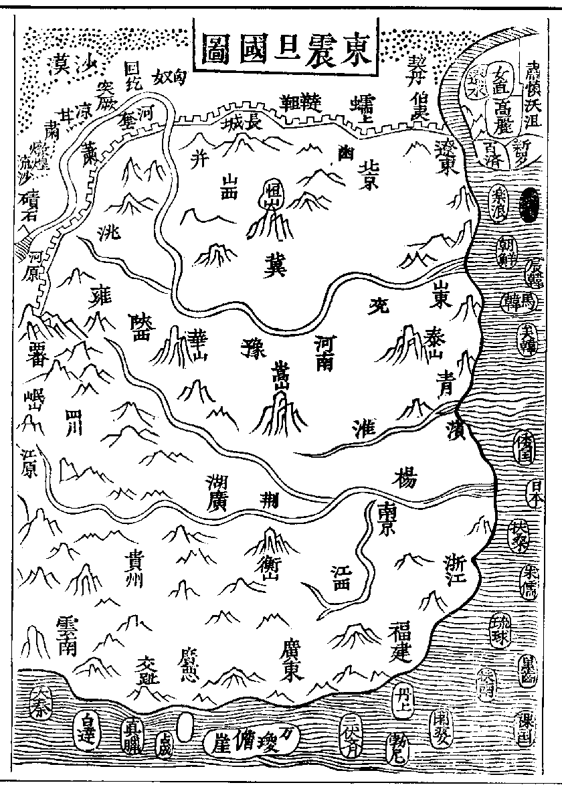



置(闽中、南海、桂林、象)四郡。两汉以十三州统治(汉武置十三部刺史)。晋为十九州。唐为十道，后又为十五采访使。宋朝元丰颁行李德刍等所僎九域志，分为二十三路。汉盛时四履之地，东乐浪，西炖煌，南日南，北鴈门，东西九千里，南北万三千里。古长城，战国时赵筑之，自代竝阴山至高阙(二州名)以备胡。燕亦筑妫州之北至辽东。秦始皇令蒙恬筑长城，起临洮，入高丽。元为十八道，至皇明一统，置南北二直𨽻，并十三省。四渎者，河出碛石，江出岷山，淮出桐栢，济出王屋山。五岳，泰(东)、衡(南)、华(西)、恒(北)、嵩(中)。



南赡部洲图



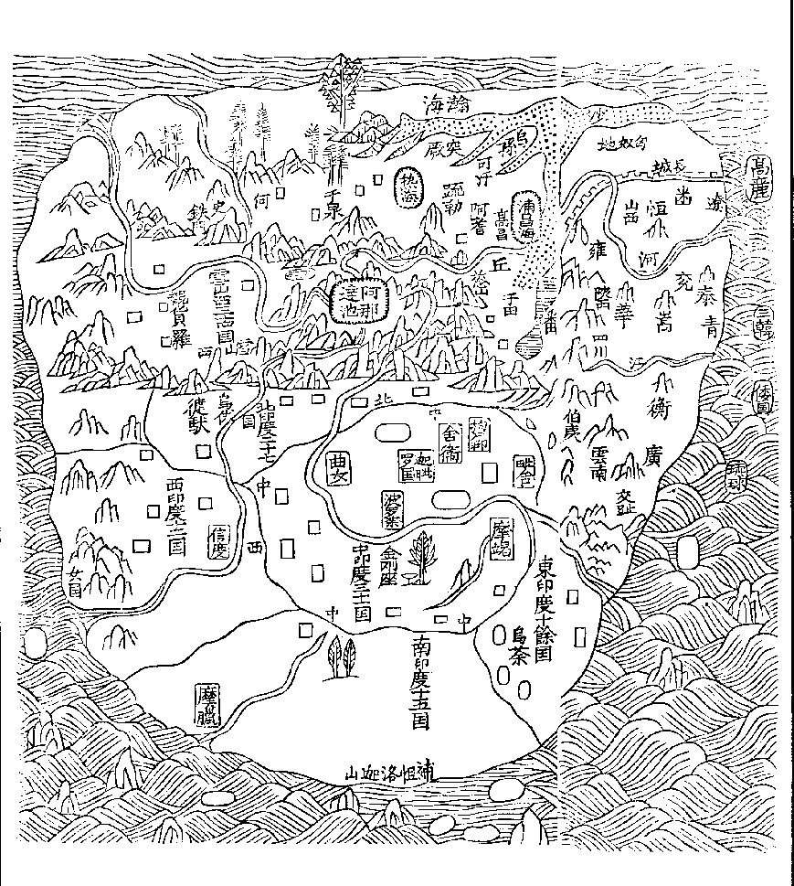



仰寻诸佛之降灵也，不可以形相求之，随机显晦，故得以言章述矣。自法王示迹，照临忍方，群生何幸，仰兹陶诱。使夫二十五有绝生死之因，九十八使断牵连之业，竝超三界，俱载一乘，含育蒙大造之恩，至人引勤劳之虑。故有垂慈圣迹，布此灵仪，令重昏动其玄机，识浪静其漂怒，方为入道弘辙，亦乃出有初门。而事总冥权，理符神运，抑非天授，谅实人谋。但祯瑞氤氲，嘉祥杂沓，喗焕天地，引燿幽明。然则文物光乎万古，声明高于视听，所以薄列鸿猷，用观弘范也。案西域志云：赡部中心名阿耨达池，在香山南，大雪山北，周八百里。(起世经：雪山众宝所成，顶有四金峰，中一高峰，峰有龙池，五十由旬。)十地菩萨化为龙王，于中潜宅，出清冷水，以给赡部。池之东面银牛口流出𠓆伽河，(即恒河。)遶池一帀，入东南海。池南面金象口流出信度河，遶池一帀，入西南海。池西面琉璃马口流出缚刍河，遶池一帀，入西北海。池北面颇胝师子口流出徙多河，遶池一帀，入东北海。(或曰：潜流地下，出积右山，为东华黄河之原。)葱岭当赡部之中，南接大雪山，北至热海千泉，西至活国，东至乌杀国。四方各数千里，崖岭数百重，冰雪风寒，山阜葱翠，故名葱岭。自葱岭东近高昌国，曰阿耆尼。(汉书焉耆有伽蓝十数。)西南屈支，(旧曰龟兹，伽蓝百所。)葱岭之北四百里曰清池，(亦名热海。)西行千里曰千泉。南有小雪山，(突厥避暑之处。)西至呾罗私，乃至史国。东南入铁门，南出至覩货罗，(东至葱岭，南至雪山，西至波斯，北据铁门，有三十国。)逾诸国至缚曷，北临缚刍河。(伽蓝百所，人谓之小王舍城。)从此西南逾诸国，东南入大雪山，(山阿有龙洞，佛化其龙，留影于洞。唐玄奘亲往礼拜，远望则金色炳著，近则不覩，渐隐没。)次至梵衍那国。(有卧佛，长千丈。商那尊者胎生无条，衣尚存。)东逾黑岭，至迦毕试国。(北背雪山，伽蓝百所。)东入北印度境，至健䭾罗国。(有大塔，高五百尺，魏胡太后遣使持长幡五百尺挂之，脚方及地。此塔与洛阳伽蓝记同，一时当有二塔。)北至乌仗那国。(释种被斥王，此古轮王之苑，僧常万人。)南渡信度河，逾诸国，东南至迦湿弥罗国。(伽蓝百所。)逾诸国，东北至末兔罗国。(毱多度人，筹盈石室。)东北至室伐罗，次至窣禄那，(东临恒河。)东渡河至末底罗，东去北雪山边有金氏国。(女为王，不知政事。此东去接吐番，北接于阗，西接末罗婆。)自末底罗东南至醯呾国，(佛为文鳞龙王说法之处。)南渡𠓆伽河，(河左有塔千座。)东南至劫比它国，(佛在忉利为母说法，帝释现三道宝阶之处。)西北至曲女国，(戒日王设大会，令玄奘立真比量论义处。)东北至舍卫国，(城南五里有祇树给孤园。)东南至迦毗罗国，(佛降生处。净饭王殿、摩邪夫人殿、菩萨降胎处殿、佛成道后还本国度八王子释种处。)东北至拘尸那国，(娑罗双树林，佛入涅槃处。)西南至波罗柰国。(鹿苑，转法轮处。近苑有支那寺，国王为众僧造。支那，此云大唐。)顺𠓆伽河东北至毗邪离国，(旧名毗舍离，有维摩丈室，纵广十尺。)东北至弗栗恃，(北印土境。)西北至尼波罗。(此国北境即东女国，与吐蕃接，命使往还，率由此地。唐、梵相去万里，自古取道迂远。此国有池，水面火起，中有火龙。)自毗邪离南渡𠓆伽河，至摩竭提国。(或摩伽陀、中印，有王舍城。西南渡尼连河、伽邪城。城西六里伽邪山，俗呼灵山。西南菩提树，树高五丈，佛成道处。周垣五百步，中有金刚座，千佛坐之，入金刚定。那阑陀寺，五王共造，僧徒数千，并俊才高学。国东南鸡足山，迦叶入定处。东北灵鹫山，王舍城有热泉涌出。目连云：此水经过小地狱来，故热沸而垢浊。有三深井，大水不满，谤佛生陷处。)东北逾诸国至奔那伐，(自信度河东至此，皆中印。)次东至迦摩缕，(东印从此东去，山阜连接，可两月行，至蜀西南界。)南至三摩怛，(东北海滨。)西南乃至乌荼国。(东南临海有城，海商止处。南去执师子国二万里，夜望其国佛牙塔，宝珠光如大炬。)逾诸国西北至憍萨罗。(中印有王引正，为龙猛造寺，集千僧，计工人食盐，价田九亿金钱。)国南有山，(山崖之上石阁五层，层有四院，飞泉流注。)逾诸国南至末罗矩。(南印滨南海有末剌邪山，出龙脑香树，香如氷雪。此山之东有布呾洛迦山，山顶有池，池侧石天宫，观自在菩萨游舍于此。有愿见者，厉水登山。)东南海有执师子国。(北印土境有佛牙精舍，上建表柱，置大宝珠，夜望如明星。王宫侧建大厨，日营万八千僧食，常兴此供不绝。)南数千里有那罗稽罗洲。(人长三尺，为鸟喙，食椰子肉。此洲东南有棱伽山。)自达罗毗至北恭达补。(南印土有贝多罗树林，周三十里。其叶长广，色光润。五印书写，莫不采用。今贝叶乃略名。)林西二千里，至摩诃剌国。(东大山有寺，罗汉造舍，高百尺。石佛高七丈，上有石葢七重悬空，相去各三尺。传云罗汉愿力，或云神力，或药术之力云。)西方至摩腊婆。(五印之境有此国，及摩竭提重学，名僧甚胜。国南至海。)西北逾诸国，至瞿折罗。(西印土境。)渡信度河，至信度国西，以至狼揭罗。(临西海，海岛中有西女国。)北逾诸国，至迦毕试界。(东临北印，西至弗林波斯国。)其餘诸国风物，兹不具录。如西域志、释迦方谱，可备悉之。○印度。(此云月，以居诸国之中，如星中月。此西域之正名，天竺、身毒讹称也。)北背雪山，三垂大海。地形南狭，如月上弦。川平地广，周九万里。七千餘城，依止其中。尽三海际，一王所治。(汉书云：其国殷平和气，灵智所降，贤懿挺生。神迹诡怪，理绝人区。灵应明显，事出天外。)光明云：八万四千城邑聚落。仁王经：十六大国，五百中国，十万小国。楞严云：此阎浮提大国二千三百。楼炭经：葱河以东，名为震旦。(唐彦琮法师云：葱岭已西，竝属梵种。铁门之左，皆曰胡乡。)



别胡梵



南洲一地，大约五分：中分为雪山、葱岭；南分为五印度，乃昔金轮圣王之所治，是梵天之种，世称其国名天方，亦名婆罗门国(此云净行、净志)；西分为覩货罗、波斯诸国，西夷所居；北分为胡虏之乡，突厥可汗、乌孙、匈奴所居；东分为二，其沙河以西有胡人，吐蕃所居；积石之东为震旦国，乃帝王所化，是君子之国。封域分殊，应须甄别，不当以梵为胡，而自混滥。有以天竺为胡国者，斯言大误。又有称胡经、胡语等，皆非正言，当云梵经、梵语可也。



论中



夫法王利见，未隔中边，适化无方，岂专形教。虽大云普泽，而败种难荣；晨旭高晖，而覆盆不照。致使疑信相半，邪正交陈，而大悲之光，曾无间然也。或曰：华夏得天地之中，九州之外，皆边夷耳。斯不足辩，观西域图可知。今为未知者，更复明之。考诸经论，其义有九：



一、名闻



本行经云：护明菩萨谓天人金团曰：往昔补处菩萨托生之家，须具六十种功德，三代清净。汝下阎浮，为我观察。金团曰：迦毗罗城王名净饭，夫人名摩邪，于诸世间具足功德清净，有大名称，堪生彼家。护明曰：善！吾定生彼。如是佛自亲选，诸天共闻，则知迦毗罗国名闻最胜，为诸国之中。(普曜经亦同。)



二、里分



大地广博，世莫能穷。右今无人至西北海者，况知地之中邪。世俗谓中国者，自论此方之中耳，非天下之中也。依周公测天地，定豫州为中，云四边各五千里(豫至东海无五千里，之西之北不知其几万里，而云五千里邪)。禹贡言各二千五百里，当时地狭，后渐开濶，至汉方可九千里，今又较濶。依内经，大地周二十八万里，径九万里。若以东西九万里畫为九分，则华方在极东一分之间耳。西去更有八分之地，天竺在五分之中，东西去海各四万五千里。当知我国是大地之东，天竺为大地之中明矣。



三、山王



天下诸山，皆自昆仑发脉而来。最极高广，群峰拱峙，周万餘里，龙神所宅，非人力可登。其枝条分布，为众山之原。虽屈伸睽顾，起伏万状，而根脉相连，如竹园然。或近出两笋，伏地行鞭，至远处，又出两笋。昆仑左边分数支：其一支走东，度流沙碛石，迤𨓦发为震旦诸山；一支走东南，发起东印度诸山，次东又为百夷诸山。右边分数支：一支走西南，生起西印度诸山；一支走西，为活国、波斯诸山。前面为黑山、雪山及北印诸山，至中印多伏少出；后面为葱岭，生出北胡等山。众山飞走其下，高耸众峰之上。昆仑居大地之中，五印度在昆仑之南(俗书以雪山东支名昆仑山，借名也)。



四、水源



水之为物，其性趋下，莫不本出于山而末入于海也。雪山之顶有大龙池，周千餘里，为天下诸河之总源。从池四面各出一大河，河濶四十里，波涛澒涌，趋于四方，各与五百河俱流入于海。池东之水皆向东流，池西之水皆向西流，池南之水皆向南流，池北之水皆向北流，四隅亦尔。葢地形如团瓢，其顶即雪山，在极高处，四面渐下故尔。震旦诸水皆东流者，以居地之东隅也。是知山当地中，池居山顶，此池为大地水源之中，中印度正与龙池相对。



五、地脐



梵网经云：释迦牟尼佛于寂灭道场坐金刚华光王座。正法念处经云：一切世间阎浮提国悉无此座，金刚座处八万四千由旬，佛坐此座得佛菩提，餘地不能持佛。西域志云：中印度恒河南摩竭提国，国西南渡尼连禅河十里有菩提树，树下有金刚座，千佛坐之入金刚定。俱舍论云：此座下连金轮，故名金刚座。三世诸佛皆于此座成道降魔，故知金刚座是地之脐。



六、轮王



人有胜德，必居胜地。夫金轮王者，为阎浮人中福德之最胜者也，诸人王中皇帝之圣神者也。故有金轮表瑞，七宝呈祥，相好庄严，千子围遶，御龙马而飞空，四洲粟王望德而归化。故轮王出世，必生中土。其中土者，即中印度也。历代轮王出兴之处，名殊胜者以此。



七、梵字



梵字，犹古篆也。自开辟来，即有其文。历万万餘年，古今不易不同。此方文字，篆𨽻迁讹，元从梵天传来，故曰梵书。金银轮王，递相承用。故书梵字处，妖魅远离。唱梵音时，鬼神敬畏。葢天帝之玉音，孰敢不敬奉哉。是以诸佛说法，皆用梵音。天龙八部，遵奉流行。以至呼天天应，召虫虫驯。通幽彻明，至灵至神者，其惟梵音乎。诠梵音者，是为梵字。总持经中，明诸利益。如存阿字而入定，观字轮而明心。唵字出供，可以上献诸佛。纥哩舒光，可以下拔群苦。能令染者净，愚者智，夭者寿，病者痊。摧邪辅正，饶益群生者，其惟梵书之用乎。世间文字，有六十四种。第一梵书，第二佉楼书。乃至莲华树叶，右旋掷转，至六十四书，名一切种音。六十四种书中，梵书为第一。故知梵书，为文字之王。



八、气和



塞暑之宜，随方起用。葢地有隆卑，气有燥湿，故凉燠不同。夫气得其中则和，失其中则戾矣。所以极南蒸热，极北苦寒，濵海风湿，蛮山瘴疠，土有沃壤火沙，水有痖泉苦井者，非得气之偏乎？至如印度之方，夏不太热，冬不严寒，四序温和，五尘佳妙。迦毗奇色之天华(唐玄奘至中印，见奇异天华，采种而东归。渡河遭风，其华种尽失，疑龙所夺去)，解谷正音之律竹(汉志：黄帝使伶伦徃昆仑之阴解谷取竹，断两节间而吹之，为黄鍾之宫。制十二筩，听凤鸣，雄鸣六，雌鸣六。此黄鍾之宫皆可生之，是为律本。至治之世，天地之气合以生风。天地之风气正，十二律定)，以至药王之树(雪山有药王树，嗅者、甞者、触者，诸病皆痊)，肥腻香草(雪山生此草，牛食之，乳为醍醐，粪如檀香之气)，地中甜味(雪山地中有甜味潜流，理筩可取，斯亦醴泉之类)，龙池甘藕(佛世有比丘病，一比丘往雪山乞藕。龙施之，藕径尺，味甘，食之病愈)。良以天地之气和，故所生草木亦纯粹也(邵子曰：天有至粹，地有至精。人类得之则为明哲，草木得之则为芝兰)。



九、道中



名以表实，事以显理。故有中土者，必有中道存焉耳。若夫有中土而无中道者，与边地何殊乎。是以华夏圣贤，言道育民，以中为本。曰𠃔执厥中，曰用其中于民。曰中也者，天下之大道也。致中和，天地位焉，万物育焉。世圣尚尔，况出世之大圣，宁以偏邪之道，而示于人邪。所以正觉能仁，生中土，现胜相者(生王宫，具三十二相)。将非以中道之正法，而启悟群生者乎。然而毛道凡夫，弃本逐末，未有圣智。曰知曰见，皆是迷倒。遂使好同者则恶异，宾此者则辞彼。故是非以生，惑倒以萦。爱憎相形，邪正相倾，而罪福已成矣。故我正觉圣人，愍而谕之，调而和之，乳而药之，援而救之。俾夫止纷竞，归太宁，舍狂妄，复良诚。以合乎大均，以契乎本真。以至于至公至纯，至神至妙，至中之道而后已。原夫群生机异，执见不同。或执于色，或执于空。执色者窒，执空者流。正觉示以药言曰，色即是空，空即是色，则色空不二为中。或执为同，或执为异。同则儱侗，异则纷纭。药言曰，同者同异，异者异同，非同非异，一观为中。或执诸法，为实为虗，为常为断，为大为小，为徧不徧，为自为他，有边无边，或即或离，或欣或厌，亦有亦无，亦恒亦变，来者去者，语者默者，勤者怠者，清者和者，赞者毁者，如是等各执异见，一一成偏，多岐亡羊，流而忘返。正觉者谕之曰：万法本闲，而人自閙，空实无华，瞖者妄见，人波鬼火，水性无殊，猿猴捉月，痴狗逐块，演若迷头，驰走东西，狂性自歇，歇即菩提。又曰：譬如船师，不住此岸，不住彼岸，而运渡众生，至于彼岸。曰：学道如牧牛，执杖视之，勿令东西犯他苗稼。如御马，执辔在手，惰则䇿之，逸则制之，从容乎中道而行矣。如陶师调泥，不僵不软，方中轮绳，可作盆瓶。如琴师调弦，不缓不急，方可奏曲，适其中而道可期矣。夫受病异缘，施药多方，故有事中，有理中，有俗中，有真中，有渐中，有顿中，有小中，有大中，有初中，有终中，有至中，有圆中，有中戒，有中定，有中慧，有中观，有中行，有中因，有中果，若摩尼之应色，空谷而答响矣。以至饮食衣服，行住坐卧，大小诸事，自行化他，靡不示之以中。佛自日中一食，令诸比丘过中不食，食之不饥不饱。衣制三衣，不奢不裸。行则直行，坐则趺坐。调身则不宽不急，调息则不涩不滑，调心则不沈不掉。至于沈浮两舍，惺寂双流，不出不入，寂而常照，照而常寂，心心无间，中中流入中道之海。洎乎中之至也，亡违顺，等怨亲，泯同异，一死生，齐物我，通古今，混虗空为一体，现山海于毛端，一语一默，一动一静，而普饶益与众生。夫如是，则岂其所谓世智之狂解，无想之痴禅邪？来从中来，故曰如来。去从中去，故曰如去(即善逝也)。中非动，是谁来？中非静，是谁去？非动非静，无来无去者，其至人之蕴乎？非动静而动静，无来去而来去者，其悲云之妙乎？无来而来，虽生不有。无去而去，虽灭不无。是故如来之道，不可以动静、来去、有无、生灭而言也。是则超诸数量，绝诸对待，不可思议，至玄绝妙之道欤？世有河边居人，不信海水味咸。有海翁取一勺以示之，使知咸味耳。岂曰大海可勺而尽之哉？



论僊道



僊，迁也。人之形神，能迁而不死者也。世俗言僊，有几等不同。有天僊、神僊、人僊、地僊、鬼僊。或游人间，或隐深山，(如天台、匡庐、鼓山、终南等。)或居海岛，(如逢莱、瀛洲、阗苑、小有等山岛。)或在地下，(昔人游地穴，见九馆诸僊人。)皆长年不死。古人曾见，故世多羡慕。世人恶短夭，爱长寿。凡见百岁餘者，已呼为僊，况千万岁者？不知彼亦有无常，但寿长耳，非永不死也。比人为优，比天为劣。天人寿长，多经劫数。视彼僊人寿短，等如蜉蝣耳。僊道虽妙，固不如天人。天人虽优，又安得如圣人超数量，契常乐，永不为生死之所僊，而亿劫常存者乎？



华严云：神僊山中，五通僊人，充满其中。(此居七金山中，乃天僊也。)楞严经：佛言：复有从人，不依正觉，修三摩地，别修妄念，存想固形，游于山林，人不及处，有十种僊。彼诸众生：



坚固服饵而不休息，食道圆成，名地行僊。  

坚固草木，而不休息，药道圆成，名飞行僊(服药草久，身轻飞举)。  

坚固金石，而不休息，化道圆成，名游行僊(炼丹化骨，点石成金)。  

坚固动止，而不休息，气精圆成，名空行僊(调气固精，远形涉空)。  

坚固津液，而不休息，润德圆成，名天行僊(咽精离欲，氷雪绰约)。  

坚固精色，而不休息，吸粹圆成，名通行僊(服虹饮雾，粹气潜通)。  

坚固呪禁，而不休息，术法圆成，名道行僊(能以术法，述遵自然)。  

坚固思念，而不休息，思忆圆成，名照行僊(想顶出神，观脐炼丹)。  

坚固交遘，而不休息，感应圆成，名精行僊(坎离疋配，采精摄术)。  

坚固变化，而不休息，觉悟圆成，名绝行僊(存想化理，邪悟变化)。



是等皆于人中鍊心，不修正觉，别得生理。寿千万岁，休止深山，或大海岛，绝于人境。斯亦轮回，妄想流转，不修三昧(正定也)，报尽还来，散入诸趣。龙舒居士曰：楞严经说：有十类僊，寿千万岁，休止深山，数尽复入轮回。为不了真性，与六道众生同名七趣。世之学僊者，万不得一。纵使得之，不免轮回，为著于形神，不能舍去故也。且形神者，乃真性中所现之妄想，皆非真实。欲求长生，莫如净土。不知修此而学神僊，是舍目前之美玉，而求不可得之碔砆，岂不惑哉？



唐香山居士赠王山人诗曰：闻君减寝食，日听神僊说。暗待非常人，潜求长生诀。言长本对短，未离生死辙。假使得长生，才能胜夭折。松树千年朽，槿华一日歇。毕竟同虗空，何须夸岁月。彭殇徒自异，生死终无别。不如学无生，无生即无灭。



断疑生信



不信曰疑，万惑之所从生也；不疑曰信，万善之所从出也。信为入道之通衢，疑为修行之大障。信如风舟顺水，则千里可期；疑如波浪洄漩，则终朝寻内。故经云：医王能治一切病，不能治命尽之人；佛能度一切众生，不能度一切不信之人。故知学道以信为初，如沃壤良田，所种五谷必滋长也。世人不信，其疑有三：一曰此天地日月外，云何复有天地日月？二曰人死形坏气散，云何神有升沈苦乐？三曰不信人可成佛，以谓我耳目所不及，遂疑而不信矣。譬之朔北人不信万斛舟，而贾客每乘之；江南人不信千人帐，而胡人日居之；凡人不信宝严刹，而圣人每游处之。宁曰我目所不见，遂果无有乎？佛具六通，有天眼，宿命明见，洞彻十方世界，无所不覩，六道升沈，一一遍知。故以神道设教因缘示人，令离苦趋乐，修心练性，以至于成佛。佛者，觉也，即人人之真心，本觉之性也。众生昧此而不觉，如处长夜，能仁朝彻，悟证本真，故号大觉。裴相国云：终日圆觉而未甞圆觉者，凡夫也；具足圆觉而住持圆觉者，如来也。是故释迦成道中天，说有说空，观根逗教，截苦之根源，入道之要路，俾趋吾之所趋。吾之所趋者，非六道，非三乘，乃如来正觉之趋也。故曰：自觉觉他，觉行圆满，故名为佛。然则世之儒教圣人，岂不明明德而新民乎？龙舒王居士曰：释氏之所以孳孳训世者，无非戒恶劝善，而吾儒何甞不戒恶劝善哉？其理未甞不同也。其不同者，惟儒家止于世间法，释氏又有出世间法。儒家止于世间法，故独言一世而归之于天；释氏又有出世间法，故知累世而见众生业缘之本末。此其所不同耳。然则佛之所言，不可以目前所不见而不信也。况佛戒人妄语，必不自妄语以诳人。世间中人以上，犹不肯妄语以丧其行止，况佛乎？其言可信，无足疑者。先贤云：佛言不信，何言可信？夫神者，我也；形者，我所舍也。我有去来，故舍有成坏。然则生者非生也，以神之来而形成耳。死者非死也，以神之去而形坏耳。世之人不识其神，徒见其形，乃悦生恶死，可不为悲乎？且神之来也，何自而来哉？葢随业缘而来。神之去也，何自而去哉？葢随业缘而去。业缘者何哉？其所作者，人间之业，神则随之而生于人间。所作者，天上之业，神则随之而生于天上。若作阿修罗之业，神则随之生于阿修罗。若作三恶道之业，神则随之生于三恶道。是轮回六趣，无有出期。然则神者，自无始以来，投胎易壳，不得久留于一所。所以然者何哉？以吾所造之业，非久而不尽者，故神之舍于业也。业尽则形坏，形坏则神无所舍，又随吾今世所造之业而往矣。譬如人造屋宇，必居其中。人造饮食，必享其味。故造如是业，必受如是之报，葢自然之理也。然则吾今世之所为，可不慎哉？(注：世人多执神随形灭，无有后报苦乐事。故龙舒云：形有坏，神不灭尔。此治病药言也，幸勿谬计而起邪见，执药成病。)



法界安立图卷上之上



法界安立图卷上之下



燕山沙门　仁潮　集录



二、广步大地



四洲图  

四洲说  

业因  

舍报相  

山海图  

山海说  

地动缘  

龙王宫  

金翅鸟  

阿修罗  

天修罗战  

龙神身量  

业因  

地狱名  

八热狱图  

游增狱图  

苦报相  

八寒狱图  

小地狱  

出地狱  

恶因  

阎摩王  

饿鬼  

畜生



(广步大地者，前来虽明一洲稍开封滞，尚未尽大地，不知海外四洲须弥皆在地也，故次明之。)



四大部洲图



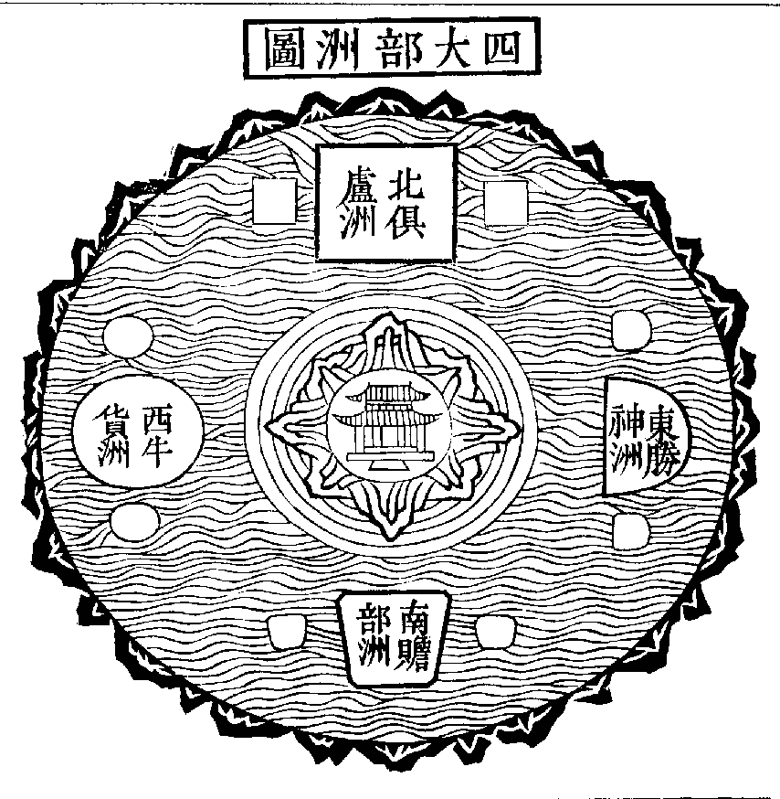



须弥山王之外，有七重金山，七重香水海，次第周帀。七金山外，大咸水海中，有四大洲，八中洲，及数万小洲，徧布安住。咸水海外，有小轮围山，周帀围遶。此四洲等，皆一地所持，是为一世界舆地之图也。



四大洲者，依长阿含经云：须弥山南有天下，名阎浮提。(此云胜金洲，新婆沙论名赡部洲。)其土南狭北广，纵广七千由旬，人面像此地形。有大树名阎浮，围七由旬，高百由旬，枝叶四布五十由旬。人寿百岁，少出多减，中夭者多。阿毗昙论云：南洲衣服庄饰种种不同，一生欲事无数，亦有修行至死无欲者。○起世经云：大海北有阎浮树，树下有阎浮那檀金聚，高二十由旬。(以此胜金出树下，因以名树名洲。)○顺正理论云：有二中洲：一、遮末罗，(新媻沙罗刹住。)二、伐罗遮罗，皆有人住。(俗书蠃虫录载诸国人形各异，或是海中诸小洲也。)



长阿含云：须弥东有天下，名弗于逮(此云胜身，立世云弗媻提)。其土东狭西广，形如半月，纵广九千由旬，人面像之。有大树王，名伽蓝浮，围七由旬，枝叶四布五十由旬，高百由旬。人寿二百岁(楼炭经三百岁)，饭食鱼肉，以谷帛珠玑共相市易，有嫁娶礼。○阿毗昙云：东弗媻提，人多欲者，一生数至六七，亦有修行至死。无欲者，食自死鱼肉，自不杀生，头发剪前披后，著下衣竟，上衣绕。○顺正理论云：有二中洲，一提诃，二毗提诃，皆有人住。



长阿含云：须弥西有天下，名俱耶尼。(此云牛货媻沙，云瞿陀尼。)其土形如满月，人面像之，纵广八千由旬。有树王名斤提，围七由旬，高百由旬，枝叶四布五十由旬，人寿三百岁，以牛马珠玉共相市易。○阿毗昙云：彼土食肉杀生，人死烧尸，或置水埋土。嫁娶同南洲。人多欲者，至十或十二，亦有无欲者。庄饰皆披发，上下著衣。○顺正理论云：有二中洲，一舍搋，一怛里拏，皆有人住。○起世论：斤提树下有一石牛，高一由旬，因名瞿陀尼，因以名洲。



长阿含云：须弥北有天下名郁单越(此云最胜媻沙，云俱卢洲)，其形正方，人面像之，纵广一万由旬。有树王名庵媻罗，围七由旬，高百由旬，枝叶四布五十由旬。人寿千岁，无有市易，持生自活，无我我所。诸山浴池，华果丰茂，众鸟和鸣。四面有阿耨达池，出四大河，无有沟坑、荆棘、蚊䖟、毒虫、自然粳米(自生也)，众味具足。以焰光摩尼珠置自然(烧也)釜鍑下，饭熟光灭。有曲躬树，其叶密致，天雨不漏。男女宿下香树，果熟自然裂，出种种衣，或器或食。河中宝船，乘之娱乐。入中浴时，脱衣岸上，乘船渡水，遇衣便著，不求本衣。至香树取乐，和弦而行，无有诸病，形貌皆同，发绀青色，齐眉而止。人起欲心时，熟视女人，彼女随诣园林。若彼女人是父母中表之亲，不应行欲者，树不曲荫，各自散去。若非亲应尔者，树则曲覆其身，随意娱乐，一日七日乃舍去，怀妊七八日便生。随生男女，置四道中，行人出指，含嗽出乳，充徧儿身。过七日已，其儿长大，男向男众，女向女众，命终不泣。(以人寿定满千岁，故死而不吊。)庄严置四道中，有鸟名忧慰禅伽，接置他方。(立世云：其鸟啄尸，至山外噉之。起世经云：人死，有鸟衔其发，置佗方世界。)其地柔软，随足隐起，大小便时，地开坼，利已还合。乃前世修十善行生此洲，命终生天善处。○阿毗昙云：人多欲者，一生数至四五，亦有无欲者。○顺正理云：有二中洲，一矩拉媻，二憍拉媻，皆有人住。



起世经云：南洲人身长三肘半，东西同量。(少肘量。)北洲七肘。○阿毗昙云：南洲身长三肘半，或四肘。东洲八肘。西洲十六肘。北洲三十二肘。(一肘当周尺一尺八寸。)



正法念处经云：北洲人于山障外彻见无碍，耳之所闻，若远若近，若大若小，而皆得闻。东洲人于黑暗中亦见众色，耳识所缘，尽一箭道。西洲人眼识所缘，山壁无碍，眼识亦能闻声。如阎浮提蚖蛇之类，眼中闻声，瞿陀尼人亦复如是。如隔障碍，闻众音声，见众色像，亦复如是。(此言三洲报通，故能洞视彻听也。南洲则隔窓纸，不见外物，隔障不能闻声，故不尔。此槩言之，南洲亦有通者，如清禀禅师宴坐，闻曳木声，曰：勿令损阶。侍者不见有曳木者，细视之，见群蚁曳蜻蜓翼缘阶而上，斯亦静极光通之谓也。龙树嗅丸而知药品各若干分，图澄数千里见火烧城，梵僧眠闻虱号而惺。世人亦有明𧦴秋毫，聪闻蚁鬬者。)



楞严经云：阿那律陀无目而见，䟦难陀龙无耳而听，兢伽神女非鼻闻香，骄梵钵提异舌知味，舜若多神无身觉触，摩诃迦叶无意而知。(此皆不假六根而知六尘者，比有根而知者又妙也。或修得，或报得，经因业缘，若湛流妄复圆常，则真明通洞，六根互用，妙中又妙者也。)



媻沙论云：四大洲，八中洲，人形短小。复有五百小洲，或人住，或非人住，或有空者(非人鬼也。此胎生者，化生者，徧诸处)。



因本经云：阎浮五种胜三天下及至他化：一勇徤，二正念，三佛出世处，四是修业地，五行梵行处。诸天及三天下各有三种胜阎浮：一长寿，二色胜，三地胜。



阿含经云：南洲三事胜：一、勇猛强记，能造业行；二、勤修梵行；三、佛出其土。○分别功德论云：媻拘罗尊者长寿第一，于百寿中而加六十。阿难问曰：尊者长寿何以不生三方？答曰：诸佛不生三方，以其土人难化故。此土众生利根捷疾，极恶勇猛，取道不难，是故往古诸佛皆生此中。(经论相较，南洲胜者以道，三洲胜者以福。然北洲福乐最胜，经名为难者，何邪？以其虽有痴痴富乐，伥伥修论，无有智慧，不能增修道业，佛不生其土，故不闻正法，因名为难，即八难之一也。南洲有佛出世，大椉根器，多生其中。以尊命短促，众苦逼迫，怖畏发心，勤修道行，有益当来，故为四洲之胜也。)



业因



四教仪云：在因行五常、五戒、中品、十善，感人道身。(或作福时，有正助、敬慢、喜怒、专略、多少不同。故受报时，亦有中边、贵贱、妍媸、精粗、丰俭之不等耳。)



阿含经云：波斯匿王白佛：为媻罗门还生自姓媻罗门家，为复刹利、鞞舍、首陀罗家邪？佛言：何得如是？当知有四种人：一从冥入冥，谓有人生卑姓家，若生旃陀罗家、渔猎家，及餘种种下贱工巧业家，贫穷顦顇，复作卑贱之业，乃至为人作使，是名冥处。于此冥中，复行身口意恶，身坏命终，当生恶处，舍恶受恶，故名从冥入冥。二从冥入明，谓有世人生卑姓家，乃至为人作诸鄙业，是名为冥。于此冥中，身口意善，命终生天，故名从冥入明。三从明入冥，谓生富贵之家，聪明黠慧，是名为明。于此明中，身口意恶，命终生恶趣，故名从明入冥。四从明入明，谓生富乐之家，是名为明。于此明中，身口意善，命终生善趣，受天化生，是名从明入明。(刹利，王族也。媻罗门，净志也。鞞舍，商贾也。首陀罗，农夫也。旃陀罗，屠脍也。此印土贱贵之分。冥，恶也。恶相，愚痴昏昧之谓冥。明，善也。善相，聪明光朗之谓明。三业恶则十恶具，生恶处则三涂备。三业善则十善具，生善趣则三善道备。言生天者，略也。谓因谈善恶，果通六趣，皆自人道发轸者也。)业报差别经：佛言：复有十业，能令众生得人趣报。何等为十？一者不杀，二者不盗，三者不邪婬，四者不妄语，五者不绮语，六者不两舌，七者不恶口，八者不贪，九者不瞋，十者不邪见。于十善业，缺漏不全，以是十业，得人趣报(此明总报)。又自行杀生，劝他令杀等业，得短命报。自不杀生，劝他不杀等业，得长命报。自行偷盗，劝他偷盗，得少资生报。自离偷盗，劝他不盗，得多资生报。好打拍众生，恼乱尊贤，得多病报。不鞭打众生，瞻视病苦，得少病报。嫌恨恼他，不敬尊长，得丑陋报。爱敬父母贤圣，施衣扫塔，得端正报。不敬父母沙门师长，轻懱下族，得下族姓报。敬事父母沙门师长，遵受教诲，得上族姓报。不諮问智慧大德沙门，显说恶法，得邪智报。能问智慧沙门，修习多闻，得正智报。于三宝净戒人所，不生殷重心施，生边地报。于三宝梵行人边，殷重心施，生中国值佛闻法报(略言别因别报，详具全经)。华严云：业有现受、生受、后受相(此即三报，受报也。现作现受，现报也。今作来生受，生报也。今作后后世报，为后报也。以因有强弱，故报疾迟不一。世人不知此，以为无报应)。



舍报相



人死时，身心昏昧，如睡无梦。极闷绝时，明了意识，必不现起。六种转识，行相所缘，必不能知。是散有心，名生死心。(八识也。)此时由善恶业，下上身分，冷触渐起。颂云：顶圣眼生天，人心饿鬼腹。旁生膝葢离，地狱脚板出。(眼不见，耳不闻，五识先无。心不知，六识亦无。身热，则八识离身即冷也。验最后何处热。若心热，即生人道。餘例此。言有升沈者，以此俗人谓身死气散，谁受苦报。彼不知有八识耳。)守护国界主经云：佛言：若人命终之时，豫知时至，正念分明，洗浴著衣，吉祥而逝。光明照身，见佛相好，众善俱现。定知此人，决定往生净土。若人念佛持戒，无精进心。命终亦无善相，亦无恶相。地府不收，安养不摄，如睡眠去。此人疑情未断，生于疑城。五百岁受乐，再修信愿，方归净土。若人起怜悯心，正念现前，于财宝妻子，心无爱恋，眼色清净，仰面含笑，想念天宫当来迎我，耳闻天乐，眼见天童，舍此报身，定生天界。若人生柔软心，起福德心，身无病难，忆念父母妻子，于善于恶，心不错乱，其心正直，遗嘱家财，辞别而去，定生人界。若人于己眷属，恶眼瞻视，举手扪空，便利不觉，身常臭秽，两目红赤，仆面而卧，踡身左脇，百节酸疼，或见恶相，口不能言，伸吟呌唤，冤债现前，心识散乱，狂惑颠倒，徧体如冰，手捻死拳，身硬如石，此人命终，定入地狱。若人好䑛其唇，身热如火，常患饥渴，好说饮食，张口不合，贪恋财宝，命卒难断，开眼而去，此人定入饿鬼。若人身染重病，如在云雾，心神昏散，怕闻佛名，多爱食噉血肉之味，不受劝化，爱恋妻儿，踡手足指，徧身流汗，出麤涩声，口中咀沫，此相现前，定入畜生。(此言人命终时，心有善恶念，身有好丑相，以卜升沈何处也。)



首楞严经云：佛告阿难：一切世间，生死相续，生从顺习，死从变流。临命终时，未舍煖触，一生善恶，俱时顿现。纯想即飞，必生天上。若飞心中，兼福兼慧，及与净愿，自然心开，见十方佛，一切净土，随愿往生。情少想多，轻举非远，即为飞僊。情想均等，不飞不坠，生于人间。想明斯聪，情幽斯钝。情多想少，流入横生，重为毛群，轻为羽族。七情三想，沈下水轮，生于火际，受气猛火，身为饿鬼，常被焚烧，水能害己，无食无饮，经百千劫。九情一想，下洞火轮，轻生有间，重生无间，二种地狱。纯情即沈，入阿鼻狱。若沈心中，有谤大椉，毁佛禁戒，诳妄说法，虗贪信施，滥膺恭敬，五逆十重，更生十方阿鼻地狱。(此约情想多少，而分升沈之相。情，爱染妄情也。想，渴仰善想也。)



华严经云：譬如有人将欲命终，见随其业所受报相。行恶业者，见于地狱、畜生、饿鬼所有一切众苦境界。或见狱卒手执兵仗，或瞋或骂，囚执将去。亦闻号呌悲叹之声。或见灰河镬汤，刀山剑树，种种逼迫，受诸苦恼。作善业者，即见一切诸天宫殿，无量天众，天诸彩女，种种衣服，具足庄严。宫殿园林，尽皆妙好。身虽未死，而由业力，见如是事。(又如正法念经：将生六道有多种，中有身相应知之。)



九山八海图



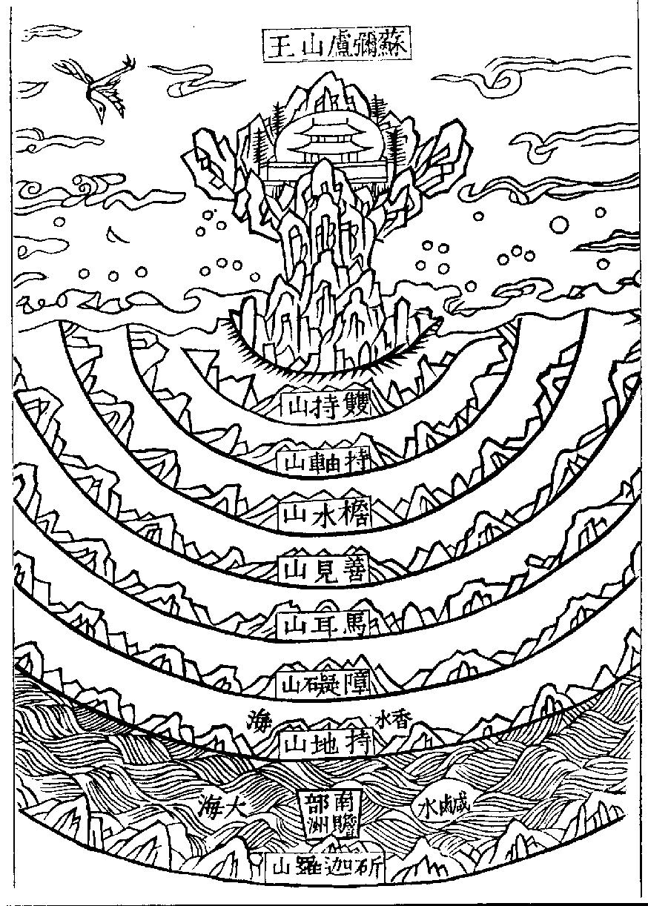



九山八海者，依起世因本经云：



第一须弥山，其底平正住金轮上，下狭上濶渐渐宽大，四宝合成金、银、瑠璃、颇梨，生种种树郁茂香远，多诸贤圣之所住处，高十六万八千由旬，出水上者高八万四千由旬(长阿含同俱舍立世，高广各八万由旬，七山及铁围次第减半相间而住)。须弥山外有香水海，横广亦八万四千由旬(俱舍八万由旬)，七海次第减半，有优钵罗华、钵头摩华、拘牟陀华、逩茶利迦华等徧覆水上(以下海同山由旬等)。



第二双持山，高广各四万二千由旬，海同(俱舍四万，海濶四万)。



第三持轴山，高广各二万一千由旬，海同(俱舍二万，海亦二万)。



第四檐木山，高广各一万二千，海同(俱舍高广各一万由旬，海同)。



第五善见山，高广各六千由旬，海同(俱舍高广各五千由旬，海同)。



第六马耳山，高广各三千由旬，海同(俱舍高二千五百由旬，海同)。



第七障碍山，高广各一千二百海同(俱舍高一千二百五十海同)。



第八持地山，高广各六百由旬，海同(俱舍高六百二十五由旬，海同)。



(第八大咸水海，横濶三十二万二千由旬，水际二万三千六亿八千四百七十五由旬)。



第九，斫迦罗山，高广三百由旬。(俱舍论：轮围山高三百一十二由旬。阿毗昙：周回三十六亿一万三百五十由旬，包大咸水海。○或云小铁围山，乃约义而番。)



诸山入水，皆八万由旬。住金轮上诸海，皆深八万。(经论诸山海由旬少异。且依俱舍算之，从须弥中心至本山南际，四万由旬。从此南际向南，逾七金山，七万九千三百七十五由旬。七海数同，共十九万八千七百五十由旬，至咸海北际。须弥北去亦然。南北通径，共有三十九万七千五百由旬。又从七山南际徃南，渡咸海轮围极南际，又得三十二万二千三百十二由旬。从七山北至轮围极北际，数亦同南，合有六十四万四千六百二十四由旬也。其轮围山南北通径，总有一百零四万二千一百二十四由旬。东西径同，是为一世界之边际也。)大海何故潮汐？华严经云：娑伽罗龙王宫殿中，水涌出入海。其所出水，绀琉璃色。涌出有时，是故大海潮不失时。○百川竞澍，云何不溢？华严经云：有四大宝布在其底，性极猛热，饮缩百川。是故大海无有增减。一者日藏，大宝光明照触，海水悉变为乳。二者离润，大宝光明照触，其乳悉变为酪。三者火𦦨光，大宝光明照触，其酪悉变为酥。四者尽无餘，大宝光明照触，其酥变成醍醐，如火炽然，悉尽无餘。○何故咸味？楼炭经云：有三因缘：一者海中大鱼，身长二万八千里，不净其中。二者世界始成，自阿迦尼咤天放大雨，洗荡尘垢入之。三者曾昔僊人呪之故尔。



地动缘



何因地动？阿含经：佛言：地动因缘有八：地在水上，水止于风，风止于空，空中风大。有时自起则大水扰，大水扰则普地动，是为一也。有时得道比丘、比丘尼及大神尊天，观水性多，地性少，欲自试力，则普地动，是为二也。若始菩萨从兜率天降神母胎，专念不乱，地为大动，是为三也。菩萨始出母胎，从右脇生，专念不乱，地为大动，是为四也。菩萨初成无上正觉，地大震动，是为五也。佛初成道，转无上法轮，魔若魔天、沙门、媻罗门、诸天世人所不能转，则普地动，是为六也。佛教将毕，专念不乱，欲舍寿命，则普地动，是为七也。如来于无餘涅槃而般涅槃时，大地震动，是为八也。华严经：菩萨说法，地六种震动。(二经地动皆吉祥，若修罗大战，地动则凶。)又正法念处经云：非法恶龙起大瞋恚，震动大水，或一百、二百、三百由旬。地住水上，以水动故，大地亦动。世间或言灾俭、丰乐、兵起、水旱等。复有异因缘地动，地下有持风，持风动故大水动，大水动故令大地动五十由旬，或一百、二百、三百由旬。随风广狭，水动亦尔。如水广狭，地动亦然。又二种动：若善因缘动，众生丰乐，无诸衰患；若诸众生作不善因缘动者，众生则有不善事起。又阿修罗与天鬬战，地大震动，



龙王国



楼炭经云：须弥山北大海水下有娑伽龙王宫宅，纵广八万由旬，宝城、栏楯、园林，众宝庄严。



华严经云：娑竭罗龙王宫殿中有四宝珠，能生海内一切珍宝。龙王太子阎浮幢之宫殿，及大奋迅龙王等八十亿诸大龙王宫殿各别。(龙有五种，谓蛇龙、蚊龙、鱼龙、象龙、虾蟇龙。)娑竭罗龙王现大自在力，饶益众生，从四天下乃至他化，兴种种色云，出种种色电光，震种种雷声，复起凉风，然后乃降种种诸雨。虽彼龙王其心平等，但以众生善根异故，雨有差别。○阿那媻达多龙王兴大密云，徧阎浮提，普霪甘雨，百谷苗稼皆得生长，江河泉池一切盈满。○正法念处经云：大海中深万由旬，城名戏乐，纵广三千由旬，龙王满中。有二种龙王：一者法行，二者非法行。一护世界，二坏世间。法行住处不雨热沙，非法住处常雨热沙，焚烧宫殿及其眷属。若人顺法，孝养父母，供养沙门，修行正法，令法行龙王增长大力，以善心故，降微细雨，五谷熟成，色香味具，无诸灾害，果实繁茂，众华妙色，日月晶光，威德明净，福德龙王不放毒风。若诸众生不行善法，不孝父母，不敬沙门及媻罗门，恶龙增长势力，作大恶身，以恶心故，起恶云雨，恶风吹气，入水杂毒，五谷獘恶，食者病苦，令人短命。恶龙灾毒，递互相害，以非法龙作诸恶故。○大云请雨经。佛在龙王宫说法，敕召大云轮葢龙王、娑伽罗龙王等诸大龙王，大音者、电舌者、宝冠蛇身者、千头赤眼者、云雷响者、燿云光者、睒电冠者、椉大云者，持大雨，持大风轮，于阎浮提降澍大雨。(依内经，风雨雷电皆龙神主之。外书云：是阴阳气变，阴包阳，阳奋出为雷，轧磨光发为电，阴和阳为雨。又阳和阴为雨露，阴和阳为霜雪。此但道其缘，而不知其因也。)



迦楼罗国(此云金趐鸟)



经云：大海之北有大树，名居咤奢摩离。其本周七由旬，入地二十由旬。其身出高一百由旬，枝叶四布五十由旬。树东有卵生龙及卵生金翅鸟宫殿，广六百由旬。树南有胎生龙及胎生金翅鸟宫殿。树西有湿生龙及湿生金翅鸟宫殿。树北有化生龙及化生金翅鸟宫殿。其金翅鸟王若搏取诸龙时，即飞往树上，下观大海。便以两翅扇大海水，水为之开一千六百由旬。即便衔取诸龙，随意而食。四生龙等皆为鸟王等食噉。○惟不能取娑竭龙王及难陀、优钵难陀、提头赖咤龙王、阿耨媻达多龙王等，及诸龙中有受三归、六斋、八禁者，皆不能食。(昔诸龙苦，金翅鸟白佛。佛赐袈裟，令分而披之。诸龙若得挂一缕者，金翅鸟则不能吞噉，其苦遂息。)



阿修罗国(此云非天，福力等天而无天德，为多瞋慢故。)



经云：须弥山东去千由旬，海下有鞞摩质多罗阿修罗王国土住处。海水在上，风持如云。纵广八万由旬，七重宝城及宝树园苑等。宫城广万由旬，中有宫殿，广千由旬。诸修罗宫大小各各不同。山南有踊跃阿修罗王宫殿，山西有奢媻罗阿修罗王宫殿，山北有罗睺阿修罗王宫殿。国土宝树人民与东国同。



正法念处经云：大海地下，天之怨敌名阿修罗，有二种：一、鬼道摄，魔身饿鬼，有神通力；二、畜生摄，住须弥侧。在海地下八万四千由旬，有四地：第一地二万一千由旬，是罗睺阿修罗王住处，于欲界中化身大小，随意能作。其所住城名曰光明，纵广八千由旬，无量宝林，流泉浴池，寿五百岁，人间五百秊为一日一夜。第二地在一地下二万一千由旬，是勇徤阿修罗王住处，纵广一万三千由旬，城名星鬘，寿六千岁，人间六百秊为一日一夜。第三地在二地下二万一千由旬，是华鬘阿修罗王住处，纵广一万三千由旬，城名含毗罗，纵广八千由旬，寿七千岁，人间七百秊为一日一夜。第四地在三地下二万一千由旬，是毗摩质多罗王住处，广博六万由旬，城名含毗罗，广一万三千由旬(楞严经复有胎、卵、湿、化四种修罗)。



天与修罗鬬战



正法念处经云：阿修罗欲与天战时，先遣恶龙行恶风雨，坏南洲人百谷。(以人行善业，诸天增盛，故欲坏之，如坏树根。)法行善龙王云迎教诫。(顺法善龙，常护善人，故来救之。)恶龙不听，遂相鬭诤，雷火交战。时人间善力多，则善龙得胜，恶龙败退。修罗复使官军来战，时人间行恶多，则修罗众胜，龙众败走。乃劳空行夜叉，踊身飞空，上请天兵。(夜叉有光，迅飞如流，世人谓之流星。口中出烟，世人云箒星。)天兵复胜，修罗败。小修罗王复出大军合战，天龙不胜，故四大天王出四部大兵而击之。修罗王军不胜，共请大阿修罗王。王忿怒，踊身起座，大地摇动。难陀龙王以尾打大海，雨至忉利。帝释见地动云扰，知修罗侵境，敕三十二天入质多罗林，各擐金刚甲胄，各持金刚刀劒、弓箭、钺叉、罥索、器杖等以备之。其大修罗王率领四国诸修罗众无数千万，出大海水，各执器杖，升空而上，与四天王共战。四王见彼势重，升须弥顶，上奏帝释。帝释于是椉其象龙，敕诸天王召集天兵，从空而下。然修罗王兵已至山脇，帝释以善言诫谕其王，骂曰：捉汝！缚汝！天王敕令发兵。日天子在前，放大光明，射修罗目。其王目盲，不见天众，乃以手障日(人间以为日蚀，天福德力不能加损)，令修罗战。于是二阵相合，最极雄猛，世间大战，无过于此。王与王战，官与官战，军与军战，龙与龙战，椉大云，击大鼓，运大神力，其鬬不一。或执劒戟，或执矛槊，或雷电辟历，或宫殿刀轮，有取大石，有取大树，有水鬬者，雨火鬬者，拳鬬者，呌鬬者，幻术鬬者，或雨刀、雨箭及雨石山，或相擒、相缚、相伤、相杀，故损耳、损目及手足等。天人身分，损已复生。修罗遭伤，手足堕落，不能复生，若头落心伤则死。天人虽中流矢，穿身而过，过已还合，但觉痛触，若头落腰断亦死。是时也，须弥摇动，大海沸涌，鱼龙出没，惊惶鼓舞。阿修罗王现神通力，有五百头、五百手，取大山三百由旬，走向天众。天王以箭射山，碎如沙末。又取大山五百由旬，掷向帝释。伊罗象王以鼻取山，返掷修罗，中𮌎身倾。天人唱言曰：畜生！白象打汝。象王现神通力，化为千头，口出火𦦨，化身无数，徧虗空界。帝释奋威，现身有千头千臂，执金刚杵，流金刚𦦨，化身无数，各椉象王，皆向修罗震威驱逐。修罗王见帝释神变，畟塞虗空，心生恐怖，摄诸军旅，奔逃而下。三十二天及四天王，神兵亿载，飞刃如落华，流矢如秋雨，共追修罗。帝释说慈心令，摄诸神兵，复还忉利，解甲胄，易天衣。帝释升殿，诸天王礼贺。帝释说法，教诫诸天，勤修戒善，慎勿放逸。诸天奉行，各还本宫。伊罗象王欢喜踊跃，鼻出二河，徧洒四洲，甘雨七日，百谷滋茂，亦还宝窟。(天与修罗共战，其胜负之低昂，皆与人间之善恶相关者，何邪？得非感应各从其类欤？何则？夫天善也，人善则与天道冥通，如火加薪而火炽，故天增力而胜修罗矣。修罗恶也，人恶则与恶道相通，如未添流而波大，故修罗增力而胜天矣。性性溜合，而莫之逆也。所以影响相符，同时不忒。譬之阳燧对日而火形，铜出崩而钟声应，是亦感应各从其类焉。夫天之胜负低昂，即人之善恶消长；人之善恶消长，即天之胜负低昂。是以天人一体，凡圣同原，虽尊𢍉之有异，其理性则一而已。然则泰山何待撮土而后为高哉？曰：人善者，益其性矣。益性者，培其本也。根本壮而枝叶自茂也。如其斤之毁之，剔其根本者，则枝叶不期枯而自枯矣。曰：若尔，人善果有益于天邪？曰：非益天也，还自益也。故天龙欢喜，洒甘露以泽地，而人民得食得寿也。是果惟益于天乎？故古德云：善逐心生，如珠生光，而还照珠髓。其斯之谓欤？曰：如是，天则果益于人邪？曰：非益人也，是益自也。人能增道进善，而天益光明，福乐倍盛也。是果唯益于人乎？故普贤云：如大树王，若根得水，枝叶华果，悉皆繁茂。以大悲水，饶益众生，则能成就诸佛菩萨智慧花果。亦犹世教，善治国者，先安人民，民安则国固。其义同也。是故天人表里，相须而成者也。天人之所以为天人者，皆戒善而为其本也。苟世间不行戒善，则天人损灭，修罗增盛，恶雨火风，五谷不登，则人遭涂炭之苦矣。故法华云：佛未出世时，三恶道充满，诸天众减少，阿修罗增盛。信矣。伏愿共修戒善，以合天心，以和召和。细雨清风，醴泉为饮，嶙凤为椉。修罗胜则凶，天胜则吉，相持者半吉。莫若无宼不战，方为大吉。)



身量



阿含经云：大兽之中，难陀、䟦难陀二龙，其形最大，遶须弥山七帀，头犹上顶，尾在海中。(目犍连尊者所降者，即此二龙王。)菩萨处胎经云：第一大鸟，不过金翅，头尾相去八千由旬，高下亦尔。若其飞时，从一须弥至一须弥，终不中止。(庄子：鹏之背不知几千里，飞时击水三千里，翼若垂天之云。此金翅鸟之小者耳，俗书名鹏。)



华严经云：三十三天共阿修罗鬬战时，诸天得胜，修罗退衂。阿修罗王其身长大七百由旬，四兵围遶无数千万，以幻术力将诸军众同时走入藕丝孔中。又偈云：如阿修罗变化身，蹈金刚际海中立，海水至深仅其半，首共须弥正齐等。(化身长十六万八千由旬，故海深止齐腰耳。)



四分律云：摩竭大鱼，身长或三百由旬、四百由旬，极大者长七百由旬。故经云：眼如日月，鼻如大山，口如赤谷。(俗书说：水兽大者，不过巨灵之龟，其形最大，首戴蓬莱山海中游戏。此龟未及小小之摩竭。)



律中舍利弗漉水而饮，漉多遍，犹有细虫，遂七日不饮，身形枯顦。佛问其故，对曰：佛令漉水而饮，我以天眼观虫，犹尚过器中粟水沙，以护生命，不敢饮水故尔。佛言：若以天眼观一切人民，无有活者。自今已后，但听肉眼看水，清净得饮。(众生受报极小者，形如微尘，凡眼不见。故知业力幽臭，不可思议，非凡情能测。惟佛大圣，乃能尽知尽见，故号如来为正遍知。)



业因



阿含经云：皆先大布施。由心高凌虗，苦恼众生，心多瞋慢，生金翅鸟中。以瞋慢故，生畜生中。以布施福德故，为鸟中王，宫殿庄严。○又先多瞋恚，心曲不端，大行布施，及喜调戏，犯戒鬬争，诽谤经戒，故堕龙中。由施福故，以七宝为宫殿。○正法念经：于人中时，愚痴瞋恚心，焚烧僧房、聚落、城邑。如是恶人，命终堕地狱，受无量苦。从地狱出，生于龙中，受畜生身热沙所烧。○于前身时，施会供养外道，行不净施，杂漏不坚，以食施破戒杂行之人，心无正思。如是施已，命终生阿修罗中，有下、中、上等。○业报经云：由身、口、意三行微恶业，憍慢、邪慢等，得阿修罗报。○又由瞋、慢、疑三因，得修罗报。亦作诸福业，谄曲好胜，故报修罗。(经言：心高凌虚为鸟，心曲不端为龙。及人道中，杀生得短命，偷盗得贫穷，轻慢得下姓，恭敬得上族。所谓形端则影直，声和则响顺。未见貌丑鉴镜，有悦目之华；体短照水，发超群之观者也。)



地狱总名



地狱者，梵语名泥犁邪，此云非道，欲界最下劣故。(毗昙)又名捺落迦，此云恶人，乃造罪恶人所住之处。(媻沙论)媻沙论云：赡部洲下有大地狱，洲上亦有边地狱及独地狱，或在谷中山上，或在旷野空中。(海边庙中)餘三洲唯有边独地狱，无大地狱。有说北洲无狱。○地狱有情，其形如人，口出种种受苦痛声，乃至无有一言可了。○地狱铜铁所成，亦有铁城、劒树、沸河、铁网等诸庄严。斯恶道有多种，总为三：一热，二寒，三边。



一、八热地狱图



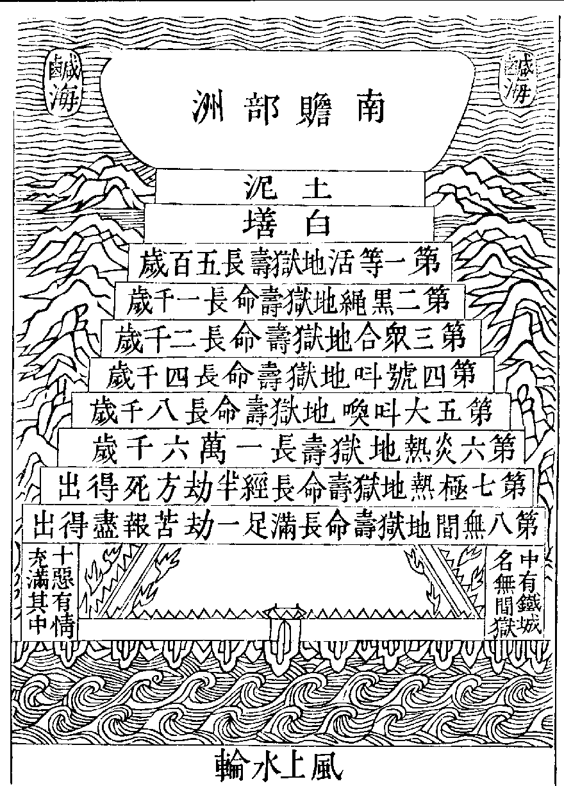



热地狱者



依媻沙论，南洲下至无间共四万由旬，上尖下濶，犹如谷聚。○萨媻多论，南洲下土泥五百由旬，白墡五百由旬等，活至极热。七狱共高一万九千由旬，各广万由旬，无间高广各二万由旬。○法苑偈云：初七各濶五百旬，后一三十二万里。纵广正等铜铁成，有情上品恶所生。○因本经云：四大洲诸山王外，别有一山名铁围，高六百八十万由旬，纵广亦尔，金刚所成。此山外复有一重大铁围山，高广正等。两山之间极大黑暗，无有光明。日月有八大地狱，谓活大地狱等。　○无间(去声，下同)



寿量者，按阿毗昙论云：等活寿五百岁，黑绳千岁，次第倍增，至炎热一万六千岁，极热半劫，无间一劫。



俱舍论云：等活一昼夜，当四王天五百岁。次第至炎热一昼夜，当他化天一万六千岁。○较量寿命经云：



等活一昼夜，比人间一万六千二百俱胝秊(俱胝，此云亿数)。



黑绳一昼夜比人间三万二千四百俱胝秊(加一倍为二)。



众合一昼夜，比人间六万四千八百俱胝秊(加二倍为四)。



呌唤一昼夜，比人间十二万九千六百俱胝秊(加四为八)。



大呌唤一昼夜，比人间二十五万九千二百俱胝秊。



焰热一昼夜，比人间五十一万八千四百俱胝秊。



十六游增小地狱图



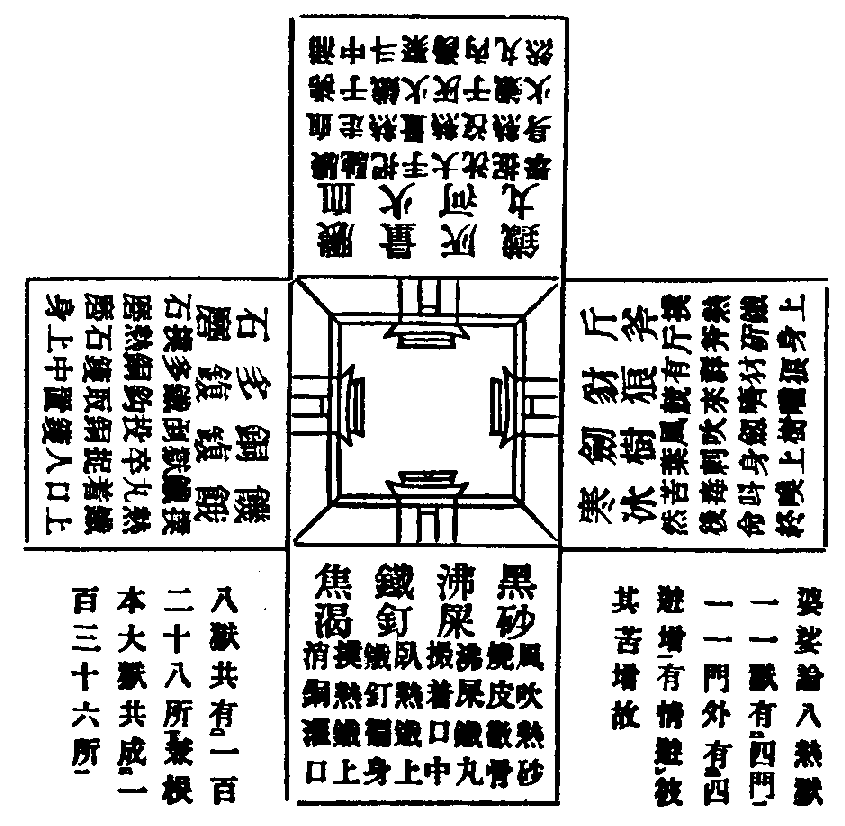



地藏经云：阎浮提东方有山，号曰铁围。其山黑邃，无日月光。有大地狱，号极无间。又有地狱，名大阿鼻。复有四角、飞刀、火箭、夹山等(二十四名)。又有呌唤狱等(二十二名)。是等地狱，其数无限。一、二、三、四，乃至百千。诸有地狱，在大铁围山之内。其大地狱有一十八所，次有五百，名号各别。○无间狱者，其城周帀八万餘里，纯铁成，高一万里。城上火聚，少有空缺。城中诸狱相连，名号各别。中有一狱，名曰无间，周万八千里。狱墙高一千里，悉是铁为。上火彻下，下火彻上。铁蛇、铁狗，吐火驰逐狱墙之上。狱中有床，徧满万里。一人受罪，自见其身徧卧满床。千万人受罪，各各自见身满床上。众业所感，获如是报。○成实论云：五无间者：一、趣果无间，舍身即生彼故；二、苦无间，中无乐故；三、时无间，定一劫故；四、命无间，中不绝故；五、形无间，此狱纵广八万由旬，一人亦满，多人亦满故。(多论二万由旬。)



苦报相



萨婆多部有八大地狱：一、等活(阿含名想)，亦名更活。谓罪人手生铁爪，递相瞋忿，相爴肉堕。又手执刀劒，递相斩割，身碎在地。死已，冷风吹活。或狱卒唱生，罪人自想：我今已活。故名想，亦名活。久受苦已，出想地狱，慞惶驰走，至黑砂狱。黑砂苦毕，次至沸屎狱，次第乃至第十六寒冰狱，然后命终。由身、口、意造不善业，堕斯地狱。○二、黑绳狱，谓以热铁绳絣直罪人，铁斧斫碎，又絣锯之。或风吹铁绳，历络其身，皮骨焦烂，苦毒万端。久受苦已，出黑绳狱，至黑砂乃至寒冰，然后命终。由恶意向父母、佛及声闻，堕此狱中。○三、众合狱(经名埠压)，或两山合压，骨肉糜碎。或铁象蹋身，或铁杵捣之，大石压之，脓血流地，众苦竝至。久受苦已，出众合狱，次至黑砂等狱(同前)。由造三恶业行，堕此狱中。○四、呌唤狱，狱卒捉罪人掷铁镬中，或掷大𨫼上，嗁咷呌唤。久受苦已，出叫唤狱，至十六小狱中(同前)。由瞋恚怀毒造恶，堕此狱中。○五、大呌唤狱，取罪人著铁釜镬中及𨫼上，返覆煎熬，遂大呌唤。久受苦已，乃出(同前)。由邪见造异陋行，堕此狱中。○六、炎热狱(阿含烧炙)，将罪人置铁城中，或铁楼上、铁陶中，内外赤然，烧炙焦烂，罪毕得出(同前)。为烧炙众生故，堕此狱中。○七、极热狱(阿含大烧炙)，将罪人置大火坑，或铁叉贯之，火中烧炙，罪毕得出(同前)。由舍善果，业造众恶，堕此狱中。○八、无间狱。狱卒剥罪人皮缠身，上著火车，上轮碾，往返铁城，大火交射，万毒竝至。凡所遇者，皆恶色、恶声、恶臭、恶触，无弹指歇，故名无间。久受苦已，次至黑砂十六小狱(同前)。由造极重罪(十恶五逆也)，堕此狱中。○正法念经云：阿鼻苦千倍遇前七大地狱(阿鼻此云无间)。○观佛三昧经云：阿鼻地狱纵广八千由旬，七重铁城，七重铁网，有十八鬲子(朗的切，鼎属)，周帀七重，皆是刀林。四大铜狗，十八狱卒，八头，六十四角，六十四眼，有七铁幢，火涌如沸。若有罪逆命终之时，铜狗化十八车，状如宝葢，一切火𦦨化为玉女。罪人遥见，心喜欲往，风刀解体，寒急作声：宁得好火安在车上？即便火然。罪人命终，来坐火车，屈伸臂顷，直入阿鼻，从上鬲下，如旋火轮，至于下鬲，化阎罗王，大声告敕：痴人狱种！汝在世时，不孝父母，邪见无道。汝今生处名阿鼻狱。如是大苦一日一夜，如人间六十小劫，如是寿命尽一大劫。具五逆者，受罪五劫。复有众生犯四重禁，虗食信施，诽谤邪见，不识因果，断学般若，毁十方佛，偷僧祗物，婬逸无道。此人罪报经八万四千大劫，复入东方十八鬲子，如前受苦。南、西、北方亦复如是。阿鼻即无救也。



二、八寒地狱图



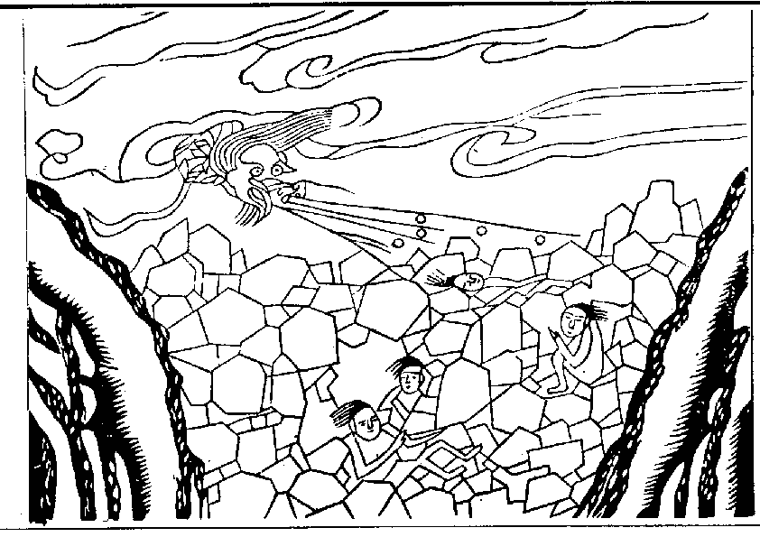



一、頞浮陀地狱(寒苦所切，肉生细疱)。  

二、尼赖浮陀狱(寒风所吹，通身成疱)。  

三、阿咤咤地狱(唇动不得，唇作此声)。  

四、阿波波地狱(舌动不得，唇作此声)。  

五、呕喉喉地狱(喉内振气，作此声故)。  

六、郁波罗地狱(肉色细拆，如青莲华)。  

七、波头摩地狱(肉色大拆，似赤莲华)。  

八、芬陀利地狱(罪人骨折，似白莲华)。



(一二从身相受名，三四五从声相受名，六七八从疮相受名。此八狱在铁围山底，仰向居止，受寒冻之苦。)



毗昙论云：佛说各各世界外边有黑暗大地狱，日月光明所不能照。两界铁轮山外是寒地狱有十，一名遏浮陀，至十名波头摩。因冷风吹触，其身坼破，𪹼声咤咤，耳闻相知，其最狭处八万由旬。在下无底，向上无覆，其最广处十六万由旬。○三法度经云：頞浮陀寿如憍萨罗斛量。胡麻二十斛，有一丈夫满百年取一粒。如是取尽，复以二十頞浮陀寿为一尼赖浮陀寿。次第准此。○㽵椿录云：复有十地狱。第一遏浮陀(此云肉段。罪人遭冻，身肉段坼)寿。一媻诃麻(智论：二十斛油麻觜量，名一婆诃。人间过百秊，除一粒，候廿斛麻尽，方出此地狱)。二泥罗浮陀(此云疱。冻的肉绽成疱)寿的。二媻诃麻。三阿呼呼(忍寒之声)寿。四媻诃麻。四呼呼媻(忍寒长声)寿。八媻诃麻。五阿咤咤(舌动之声)寿。十六媻诃麻。六搔乾提迦(火燄如此花色)寿。三十二媻诃麻。七优钵罗(火燄如青莲花色)寿。六十四媻诃麻。八拘尼陀(焰如此花)寿。百二十四媻诃麻。九奔茶里迦(焰如此花)寿。二百五十六媻诃麻。第十波头摩(火焰如之)寿。五百一十二媻诃麻(一万二百四十斛麻)。已上十狱，各各铜铁所成，一一纵广一百由旬。前五寒冰，后五热焰。前前寿限转短于后，后后苦恼倍胜于前。各有十亿小狱而为眷属。



三、边小地狱



三、法度经云：一、山间，二、水间，三、旷野，受别业报。



㽵椿录：孤独地狱在阎浮提诸处，或旷野山间海畔庙中，有八万四千座，苦报转轻(此等小狱应寒热杂受，苦有多少，寿有延促。海边如僧护所见诸狱，山间如泰山鄷都，又如亿耳所见等)。



出地狱



观佛三昧经云：阿鼻死已，生寒冰中。寒冰死已，生黑暗处。八千万岁，目无所见，受大虫身，宛转腹行，狐狼牵食。后生畜生中，五千万身，受乌兽形。后生人中，聋盲瘖痖，疥癞痈疽，贫穷下贱。经五百身，复生饿鬼道中，遇善知识及菩萨，呵责改悔，称南无佛，称佛恩力。寻即命终，生四天处，悔过自责，发菩提心。



业因



业报差别经云：身口意三行重恶业，起断常诸邪见等业，得地狱报。○经中多以五逆、十恶、谤法等业，堕地狱中。○㽵椿录云：第一根本极重之罪，杀父母，杀阿罗汉，破和合众，逼奸净尼，出佛身血，无有忏悔五逆之罪。及上上品十恶业，感八大地狱。上中品十恶，生寒冰等地狱。上下品十恶，生孤独小地狱中。(以上十恶，皆是总因，更有别因。如毁谤贤圣，妄言恶口，死入地狱。洋铜灌口，拔舌犁耕，烹煑众生，受镬汤报。剥夺人衣，受寒氷报。此等别因，遍诸经论，兹不具录。)



那先比丘问佛：经云：如世间火热，不如泥犁中火热。如持小石著世间火中，至暮不消；取大石著泥犁中，即消。恶业人在中，多岁不死。亦如蛟龙，食石即消。如人怀胎，其子不消。善恶业力，致消不消。人作善恶，如影随身。人死，但亡其身，不亡其行。如然火夜书，火灭字存，火至后成。今世所作，后世成之。



阎王住处



起世经云：阎浮洲南二铁围山外有阎摩罗王宫殿，纵广六千由旬，七重墙壁，七重栏楯，七重金网，七重行树，园苑花池，种种美果，众鸟和鸣。王以恶业故，昼夜六时自然有赤融铜汁在前，宫殿即变成铁，五欲功德皆没。王见此已，怖畏不安，即时入内。时有狱卒取王扑铁地上，以融铜汁泻置口中，从下而出。王作是念：往昔作恶，今受此苦。愿我舍身人间，受生如来法中，正信出家。发是善念已，宫殿还成七宝，五欲具足。彼诸大臣亦复如是。○经云：阎罗王昔为毗沙国王，与维陀始王战，兵力不敌，因立誓愿为地狱主。臣佐十八人领百万众，同立誓曰：后当奉助，治此罪人。毗沙王者，今阎罗王是。十八臣者，今诸小王是。百万众者，诸阿傍是。○正法念经：琰摩罗，此言双王。兄主男狱，妹主女狱。



饿鬼



正法念处经云：饿鬼有二种：一者人中住，二者住饿鬼世界。是人中鬼，若人夜行，则有见者。饿鬼界者，住阎浮下五百由旬，长三万六千由旬，及餘饿鬼眷属，其数无量。住阎浮提，有近有远，略说有三十六种。



镬身  

针口  

食吐  

食粪  

食气  

食水  

希望  

食唾  

食鬘  

食血  

食法  

食肉  

食香烟  

疾行  

伺便  

地下  

神通  

炽然  

伺婴儿便  

欲色  

海渚  

阎王执杖  

无食  

食小儿  

食人精气  

罗刹  

烧食  

不净巷陌  

食风  

食火炭  

食毒  

旷野  

冢间食热灰  

树中住  

四交道  

杀身



略说三十六种，广则无量。



众生重心造恶，业行各异，种种悭心不行布施，贪心因缘生饿鬼身。



畜生



观诸畜生种类差别，三十四亿，随心自在，生于五道。于五道中，畜生种类，其数最多，种种相貌，行食不同，群飞各异，憎爱违顺，伴行双只，同生共游。所谓飞禽走兽，乌鹊鹅鴈，鸿鸟众类，异群别游，不相怨害。狐狗野干等，互相憎嫉。乌与角鸱，马及水牛，蚖蛇鼬等，共相残害。形相不同，行食各异。观是众生，为种种心之所役使，作种种业，入种种道，噉种种食。○或受化生蚕峨及细虫身，或湿生龟鳖鱼蟹蜯蛤，及诸细虫蚊虻蚤虱。受胎卵湿化身，依地水火木而住。大身细身，无数种类。



法界安立图卷上之下



法界安立图卷中之上



燕山沙门　仁潮　集



三、徧观三界



日天宫殿图  

月天宫殿图  

日月照用  

气候寒暑  

星天宫殿图  

四天王宫图  

福报化生  

生天业因  

忉利天宫图  

忉利业因  

三界安立图  

诸天身寿  

诸天业因  

天人光明  

饮食精粗  

三界九地  

论诸天主  

四禅四地  

天有圣凡  

三界总别  

五衰退相  

心生六道图



释总题



前所观境，周小轮围，中至须弥，通属于地。知下地已，应观上天。天有三界，曰欲界、色界、无色界。此之三界，皆是众生所受报处，为长者之大宅，幼穉诸子，游戏其中者也。如其四火焚烧，三车在外，有识之子，宁不推排而出之乎？



日天子宫殿



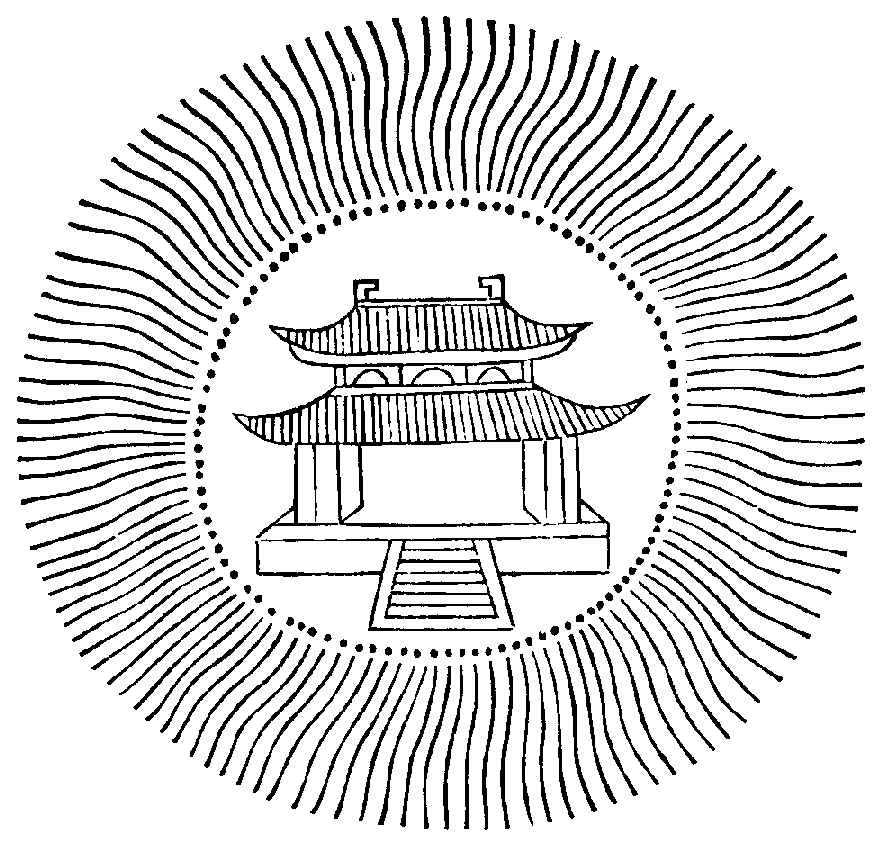



起世经云：日天子宫殿，天金颇梨所成。城郭纵广五十一由旬，正方如宅，遥看似圆，有五种风吹转而行。阎浮檀金以为妙辇，高十六由旬，方八由旬。日天子及眷属居中，受天五欲。日天子寿五百岁，子孙相承，皆于彼治宫殿住，正足一劫(或是中劫)。日天子身光照金辇，辇光照宫殿，光明相接，有一千光，五百傍照，五百下照。日宫常行不息，六月北行，六月南行。



月天子宫殿



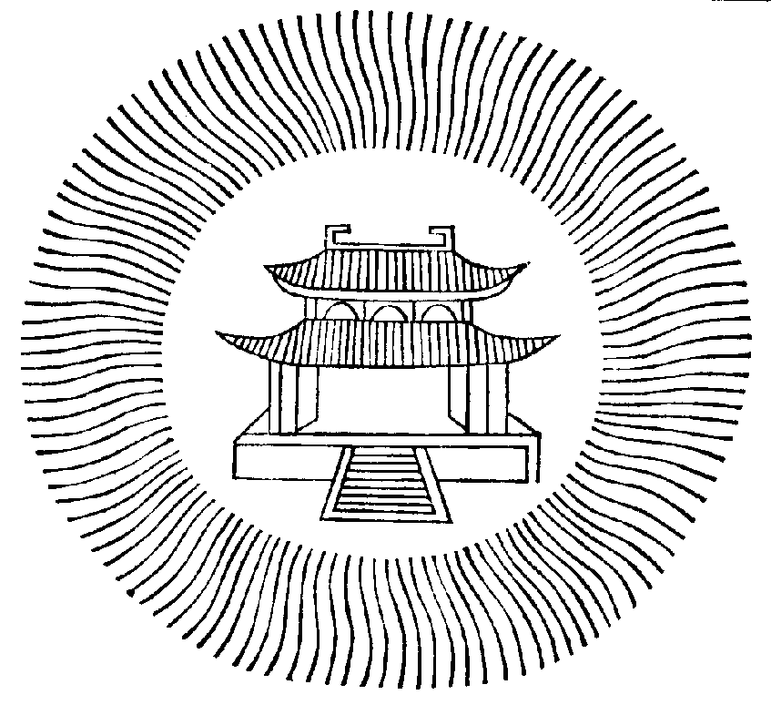



月天子城郭五十由旬，宫殿天银、青琉璃所成，高十六由旬，广八由旬，风持转行。月天子与诸天女，在此辇中受天五欲。月天子寿五百岁，子孙相承，宫殿住於一劫。月天身光宫殿成千光明，五百傍照，五百下照。



长阿含云：日天宫墙薄如花葩，为五风所持。日宫厚五十一由旬，周回一百三十五由旬。月宫厚五十由旬，周回少三由旬，或云住四十劫(此小劫也)。



日月照用



起世经云：何因缘故，月天宫渐渐现邪？有三因缘：一者背相转出；二者青衣诸天，常半月中隐蔽其宫；三者日天有六十光，障彼月轮，去日渐远，故渐渐现。复何因缘，圆净满足？亦三因缘：一者面相转出；二者于十五日，月光炽盛，隐翳青衣；三者月宫去日最远，日光不障。复何因缘，黑月十五(即此方三十日)一切不现？此时月宫最近于日，日光隐覆，一切不现。何缘名月？于黑月一日已去，乃至月尽，光明渐渐减少故。何缘月中影现？此大洲有阎浮树高大故，影现月轮。○南洲日正中，东洲日始没，西洲日初出，北洲当半夜。(餘三洲例此。)又南洲所谓西方，西洲谓之东方，西洲所谓西方，北洲谓之东方，北洲所谓西方，东洲谓之东方，东洲所谓西方，而南洲谓之东方也。○立世云：以众生业力增上缘故，故有风轮吹日月等宫，回转不息。日行百八十路，月行十五路。复有二路：内路、外路。日行与月，或合或离。一一日中，日行四万八千八十由旬。若稍合时，日日覆月三由旬又一由旬三分之一。是故十五日被覆，月光不现。若稍离时，日日日行(同前)。是日离月三由旬又一由旬三分之一。是故十五日，月大圆明。○若日随月后行，日光照月光。月光麤故，被照生影。影还自翳，故见月后分不圆。以是事故，渐渐掩覆。日在前行，例此可知。又日行周圆，速疾于月。六月日从内路出至外路，六月从外路入内路。若月十五日从内至外，十五日从外至内。如日行南洲内路，则行北洲外路，则行东西二洲中路。是时南洲，日最长十八牟休多，夜最短十二牟休多。北洲夜长十八牟休多，日短十二牟休多。东西二洲，日夜等分，并十五牟休多。如南洲三洲，例之可知。(一牟休多，当此方三刻三厘三毫三丝三忽也。)



气候寒暑



起世经云：何缘夏热？以日宫六月向北行时，有十因缘，日光照触十种山故，令其生热。又何缘寒冷？以日宫六月向南行时，有十二缘生冷。须弥七山中间，各有大海及四洲大河，日光照彼海水，故生寒冷。○又何缘有此河水？以有日故热，热故有炙，炙故有蒸，蒸故有汗湿。以汗湿故，一切山中汗流为水，以成诸河。○立世云：何缘冬寒、春热、夏时寒热？是冬时水界最长未减尽时，艸木由湿未萎乾时，地大湿滑，火大向下，水界上升。何以知然？深水最暖，浅水最寒。时节已至，日行外路，照炙不久，是故冬时则寒。春时水界长起减已尽，艸木乾萎，地已燥坼，水界向下，火界上升。何以知然？深水则冷，浅水则热。冬时已过，日行内路，照炙则久，以故春热。是故大地八月日中恒受照炙，雨水洒散，地气蒸郁。若风吹蒸，气消时则寒，风不吹时则热，故夏有时寒热。(天竺四月一时，故但立三时。)



星天宫殿图



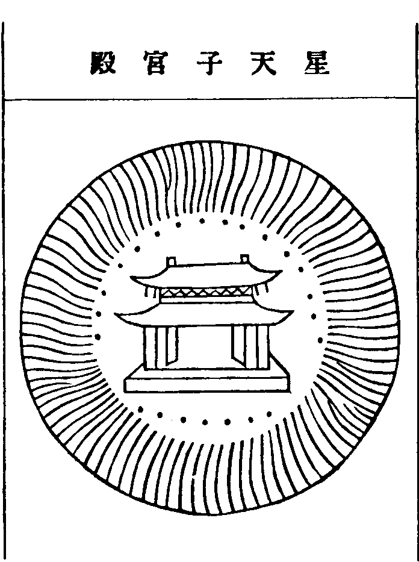



大集经：过去媻伽媻僊，分布星宿，摄护国土，养育众生，各有所主。东方：角[一/几]氐房心尾箕。北方：斗牛女虗危室壁。西方：奎娄胃昴毕觜参。南：井鬼柳星张翼轸。(具如本经，与孔雀经大同。)○消灾经：有九执大天，二十八宿，十二宫辰。○楞严经：八万四千灾变恶星。○文句：毗沙门为星宿之主。○诸星形量，依楼炭经：大星围七百二十里，中星四百八十里，小星百二十里。星是诸天宫宅。○瑜伽论：大星十八拘卢舍，中星十拘卢舍，小星四拘卢舍。(一拘卢舍，六里也。)○阿含：大星一由旬，小星三百步。○星宫最小者，径半俱卢舍，周回一俱卢舍。星大者，径十六由旬，周回四十八由旬。(里数多少不同者，或闻记稍异，不必合会。磐师述曰：若依内经，星宿并是诸天宫宅，内有天住，依报所感，福力光现。俗书即云：天为精气，日为阳精，月为阴精，星为万物之精。星有坠落，乃为石矣。夫遥大之物，非凡度量，令人难知，莫若天也。星若是石，不得有光，性又质重，何所系属？一星之径，大者百里，一宿首尾，相去数万。百里之物，数万相连，濶狭纵斜，常不盈缩。又星与日月，光色同耳，但以大小差别。然而日月，亦当石邪？石既牢密，乌兔焉容？石在气中，岂能独运？或谓日月星宿是气，然气体轻浮，当与天合，环转循顺，其间迟疾，移动不均，宁当气坠，忽变为石？○昔山西某县甾，雨太作时，空中有石，落地如碓觜，人皆不识何故。后有胡僧曰：龙食也。龙争食，故落下。葢龙以石为食也。凡空中在落，类乎此。)



罥索经云：日天子、月天子、二十八宿天、七曜星天，是诸天等种种衣服具庄严之，半跏趺坐。○须弥山半，四天王居。(因本智论四万二千由旬，毗昙俱舍四万由旬。)东方有城名上贤，南方有城名善见，西方有城名周罗，北方有城名天敬。(长阿含、智论同。)



四天王宫图



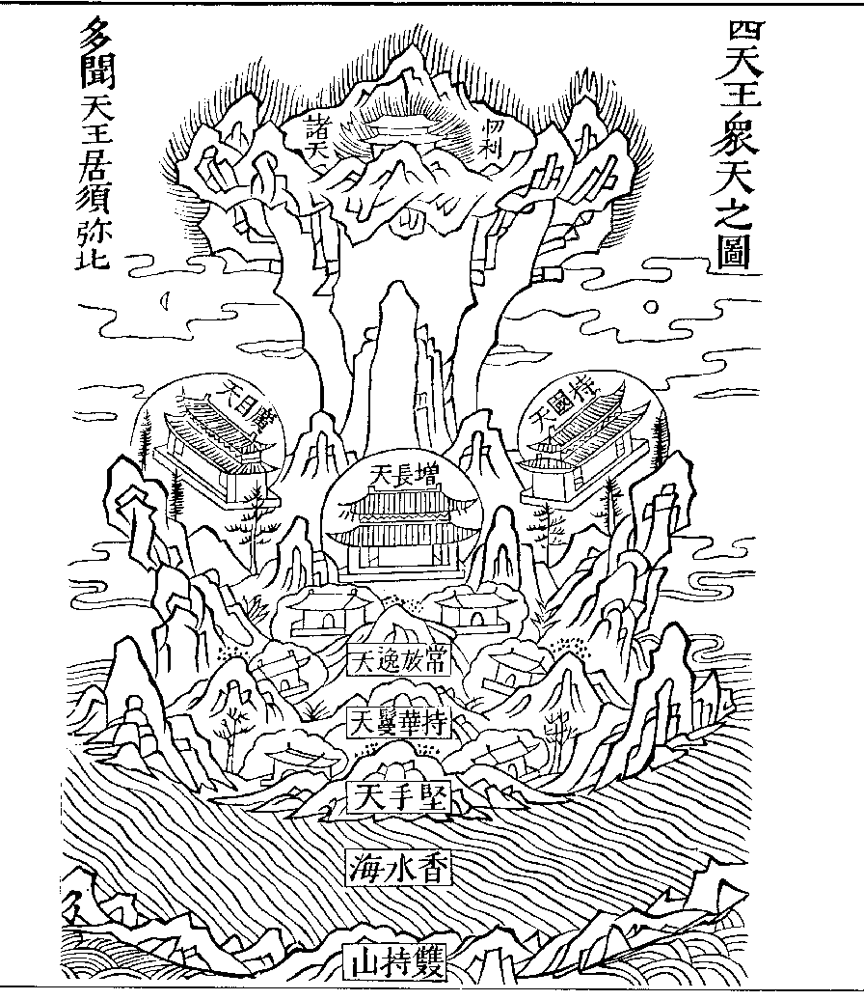



东方治国天王(多用持国，华严提头赖咤)，领乾闼媻，毗舍阇，护东洲人(乾闼媻，此云寻香行，帝释乐神也。毗舍阇，云噉精气鬼，智论富单那)。



南方增长天王(令自他善根增长，故华严毗留勒叉)，领鸠槃茶、薜茘多，护南洲人(鸠槃茶此云厌魅鬼，薜茘多云最初饿鬼)。



西方杂语天王(孔雀广目，专主罚恶，令遇苦发心。华严毗留抟叉)，领龙及富单那，护西洲人(富单那云臭饿鬼，智论作毗舍阇)。



北方多闻天王(福德之名闻四方，故华严毗沙门)，领夜叉、罗刹，护北洲人(夜叉，此云㨗疾鬼，能速疾传报者也。罗刹，云暴恶食人鬼也。○阿含经)。



四王有二十八部鬼神(金光明)，嫁娶行欲如人间(阿含经)。四王各有九十一子，有大威力，皆名帝，能护十方(大吉义经)。○一切山河、树林、土地、城郭，一切鬼神，皆属四王(智论)。○一王有八将军，共三十二将，周四天下，护出家人。韦将军于三十二将中，最存弘护。比丘道力微者，为魔所惑，将军凄惶逩赴，应机剪除(天人感通传)。



福报化生



阿含经云：四天王天初生，自然化现在天膝上，自然宝器盛天百味。食已长大，与餘天等。入池浴讫，诣香树下。香树曲躬，取香涂身。复诣吉具衣树，取种种衣著。复诣庄严树、鬘树、器树、果树、乐树，随意受用。视东忘西，视西忘东，无量快乐宫殿园池种种(具如经中)。



起世经云：四王天初生时，如十二岁儿，于父母坐处，或两膝两股忽然而生，即有宝器盛天须陀及以天酒，随福上中下，有白赤黑色。饮食既讫，身量即与旧男女等。



生天业因



起世经云：诸有一种身口意善行，如是作已，身坏命终，生于天上。此处识灭，彼天上识初相续生。行识生时，即共名色一时俱生。有名色故，即生六入。若是天男，即于天女坐膝边生。若是天女，即于天王䏶股内生。如是生已，彼天即称是我男女。



忉利天宫之图



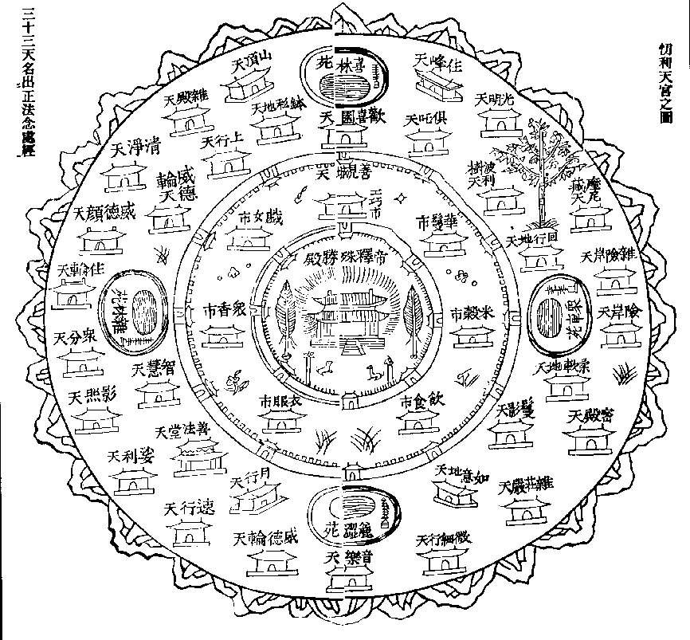



三十三天名，出正法念处经。



忉利，梵语具云怛利夜登陵奢(此云三十三天)。



须弥山顶，纵广八万四千由旬，其中平可居者，止四万由旬。(婆沙论。○顺正理论：三十三天迷卢山顶，顶四面各八十千。)山顶四角，各有一峰，高七百由旬，七宝合成，金、银、瑠璃、颇梨、真珠、砗渠、玛瑙之所庄严。(因本经。○婆沙高广五百由旬，正理同。)有药叉神，名金刚手，于中止住，守护诸天。山顶善见大城，周万逾缮那，重门高一由旬半。城有千门，严饰壮丽。各有五百青衣药叉，各严铠仗，防守城门。中央金城，周千由旬。(正理论云：殊胜殿周千由旬，其地真金杂宝严饰，柔软如妒罗绵，随足高下。)



帝释住处。城有五百门，中有楼阁，名皮禅延。四边宝楼一百一所，内一万七百房，一一房有七天女，一一天女有七彩女。其诸天女皆帝释正妃，帝释与舍脂女共住，化身与诸妃共住(毗昙、阿含略同)。目犍连尊者游历小千界，无有端严如毗阇延堂者(杂阿含即毗禅延)。城内衢巷，天人随福，屋舍多少，路有五百。有七市，曰米谷、饮食、衣服、众香、戏女、工巧、华鬘市，竝有市官、天子、天女往来贸易，商量贵贱，具市廛法。虽作是事，无取无与，脱欲所须，便可提去。是善见城复有天州、天县、天村，周帀徧布(因本经)三十三天。其城纵广六万由旬，七重城壁，七重栏楯，七重铃网，外有七重多罗行树，周帀围遶，杂色可观，亦以七宝所成。城高四百由旬，厚五十由旬，城之四面亦各相去五百由旬。于其中间便开一门，诸门高三十由旬，濶十由旬。一一诸门亦有楼橹却敌，台榭庭阁，水沼华林，种种奇妙。众鸟和鸣，天乐时奏，念衣衣来，欲食食至，重重向上，麤业渐轻，福业转胜(因本经)。城外(善见城外)四面有四苑：一、众车苑(因本杂色车苑，杂阿含东门外)，随天福德，种种车现(东照明园有佛发塔)；二、麤恶苑(因本麤涩苑，杂阿含南门外)，天欲战时，甲仗自现(南粗涩围有佛衣塔)；三、杂林苑(因本云杂乱苑，月八十、四十五、三十三天，放宫内采女，入此苑中，与天众合杂嬉戏，受天五欲。杂阿含经云西门外。)诸天入中，极妙欲尘，杂类俱至。(西欢喜园有佛钵塔。)四、喜林苑。(因本入中，皆受欢喜。杂阿含北门外。)诸天所玩，皆生欢喜。(城北驾御园有佛牙塔。)四苑各周千由旬，各有一如意池，周五十由旬，池中八功德水。○城外东北有圆生树，花开之日，顺风香闻百由旬，逆风犹及五十里。(即经云波利质多罗树香。)城西南有善法堂，三十三天时集辩论，制伏阿素洛如法、不如法事。(顺正理论。)善法堂最中有师子座。(毗耶仙人经：善法堂有八万四千柱，入此堂者，无恶触、睡眠、频呻等过。)帝释升座，左右各十六天王行列向坐。有二太子，是二大将军坐。诸天王左右持国天王，与大臣军旅恭敬。诸天依东门坐，增长天王依南门坐，广目天王依西门坐，多闻天王依北门坐。是四天王以世间善恶奏闻帝释。诸天王月八日，四王大臣徧行世间；十四日，四王太子行；十五日，四王自行，观詧善恶。若无多人受戒布施，帝释闻奏，忧恼说言：天众减损，修罗日增。(阿毗昙论。)本为人时，施饮食、灯明、钱财，故名释提桓因。(此云能天主。)本为人时，姓故，名憍尸迦。舍脂为第一后，故名舍脂钵底。于一座间思千种义，故名千眼。(华严：帝释现身有千眼，手持金刚出火焰。正法念现身有千头。)于三十三天为主，故名因提利。(中阿含经)○问：人中四洲，由日月轮以辨昼夜。欲天昼夜，云何得知？答：钵特摩花合，嗢钵罗花开，多乐睡眠，尔时为夜。若嗢钵罗花合，钵特摩花开，少欲睡眠，尔时为昼。(婆沙论。○天宫昼夜光明，故以花开合辨。)三十三天生时，天女手中花生，自知有儿，即以授夫。七日天生，善知天法。行宫殿中，见无主天女来言：圣子善来！此汝宫殿。我无夫主，今相供养。(毗耶仙人经)或天王欲游戏时，天女围遶，奏诸音乐，至彼天宫。彼宫天王相迎，入内共坐。亦奏天音乐，食天苏陀，饮天甘露，诸天女和杂娱乐。游一天已，复至一天。彼天相迎，娱乐同前。如是遍历三十二天，诸天宫殿、宝树、园苑境界，光色各异。或黄金宫殿，白银、瑠璃、颇梨宫；或二宝、三四色宝、七宝宫殿，宝垣、宝树等，光色各异，亦如是。或一王、二王共游，乘宝车、乘宝船，游香水河，微妙五尘，快乐无量。天女奏乐，歌舞言笑，相牵相劝，游玩去来，欲心炽然。又往餘处，最为放逸。于是帝释乘宝辇，天女围遶，奏乐而来。其诸天王恭敬迎礼。帝释现神通力，示未来苦相。诫敕诸天：勤修道业，慎勿放逸。诸天奉行，各还本宫。(具如正法念经。○此经云：帝释是初果须陀洹。)



业因



智论云：昔媻罗门姓憍尸迦，与知友三十二人共修福德，命终皆生须弥山顶。憍尸迦为天主，三十二人为辅臣。○净名疏：昔迦叶佛灭度后，有一女人发心修塔，报为天主。三十二人助修，报为辅臣。君臣合之为三十三。○四教仪：单修上品十善，生忉利天。(总因也。)长阿含经云：于佛所净修梵行，命终生忉利天，增益五福，谓寿、色、名、称、乐、威德。○阿含经云：僧尼持二百五十戒等，亦是生天业。○温室经：浴僧净业，亦得生天。○杂阿含经云：施胜妙衣及爱念物，施妙香，施妙食，不杀生，不贪嗜，不懈怠，节食，施贫人食，执节卑逊，或见僧尼，闻正法，一宿受斋戒，业因竝生天上，宫殿随身，身金色，受胜天乐。○正法念经：持不杀、不盗、不婬等，皆得生天。又云：杀、盗、婬业，若生人中，身色憔悴，无有威德。若有餘业，得天中身，形貌减劣，宝庄严具，光明微少，天女皆舍，餘天轻笑。若与修罗战，为他所杀。法苑云：若持不杀戒，得生四王处。不杀、不盗，生忉利。不杀、盗、邪婬，生夜摩天。更加不妄语、两舌、恶口、绮语，生兜率天。奉佛戒，兼身口七善业，生化乐、他化天。



(经云：帝释天王欲游行时，出宫门外，向南合掌，恭敬三礼。有御马夜叉神，惊怖堕鞭。帝释问曰：尔小鬼神，何故惊惧？夜叉曰：天王于三十三天中为至尊，更无过上。今复向空顶礼，岂更有尊上者？是以怖耳。帝释曰：我礼南赡部洲佛陀僧伽出世圣贤，汝小鬼神不知乎？于是夜叉信悟，礼帝释天王足。经云：帝释得须陀洹果，教诫天人，修诸道品，进趣涅槃。又以因修戒善，报得天身，故敬法是本行。)



三界次第安立之图



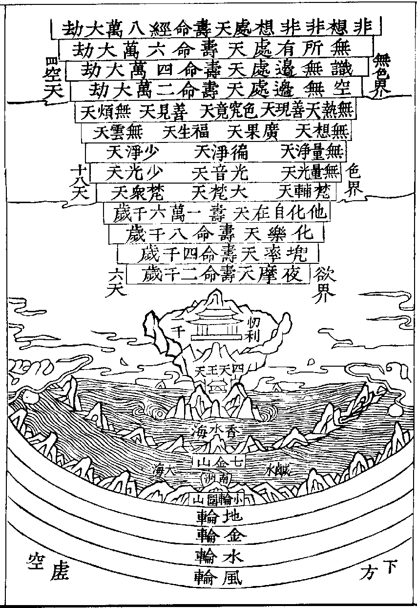



三界次第安立说



下方虗空中，有大风轮，高百六十万由旬。(俱舍论)水轮，高八十万由旬，广百廿万三千四百五十由旬。(俱舍论)以众生业力，水不流散，如食未消，不堕熟脏。(因本经)金轮，高三十二万由旬。(广与水轮同。俱舍论)水上有风，风转此水，于上成金轮，如熟乳生膏，是名金轮。(厚三洛叉，二万由旬。○因本经)地轮，深六十八千由旬。(新菩萨藏经及增一经同)



轮围山、内咸海、七金山、香水海，至须弥山根。○上升一万由旬，遶山纵广一万由旬，是坚手天住(婆沙)。复上一倍(因本二万)，遶山八千由旬，持华鬘天住(一倍者一万也)。复上一倍(因本三万)，遶山四千由旬，常放逸天住。复上一倍(因本山半四万二千四王住)，遶山四千由旬，日月星宿天住。复上一倍，遶山四千由旬，是四王天住。



须弥山下别有三级诸神住处，皆有七重墙垣，皆夜叉住(因本)。此三天皆药叉住，四天王之所部(俱舍)。



复上升四万由旬，山顶纵广四万由旬，其中善见城纵广万由旬，是三十三天住。○即从此山上升四万由旬(或十六万)，有处如云，七宝所成，其犹大地，是炎摩天住。○复上一倍(或三十二万)，有地如云，是兜率天住。○复上一倍，有地如云，是化乐天住。○复上一倍，有地如云，是他化天住。次第乃至色究竟天，皆有地如云(上倍者，竖高也。广如忉利，纵广四万，炎摩八万，乃至他化次第倍前，从广六十四万由旬也。○媻沙论)。



因本经云：须弥山上忉利天以上一倍有夜摩天，又更一倍有兜率天，展转至梵身天，下有摩罗波旬宫殿。梵身天上有光音天，倍光音有遍净天，倍遍净有广果天，倍广果有不麤天，其下别有无想天，倍不麤有不烦天。次第善见天、善现天至阿迦尼咤天(色究竟也)，上更有名空处、识处、无所有处、非非想处。



毗昙论：佛言：梵处近远，如九月十五日，有人在梵处放百丈方石，坠向下界，中间无碍。到后岁九月十五日，至阎浮地。如是两倍至无量光天，又两倍至徧胜光天，倍倍加上，乃至阿迦尼咤天。此天放大石山，经六万五千五百三十五秊，中间无碍，至阎浮地。○智论云：从色界初际下一丈石，经一万八千三百八十三秊，方始至地。



诸天身寿(身量依俱舍论，衣量依长阿含经，寿量依俱舍毗昙及较量寿命经。)



欲界六天者，四天王身量半里，衣重半两，人间五十岁为一昼夜，寿五百岁。忉利天身量一里，衣重六铢，人间一百岁为一昼夜，寿一千岁。夜摩天身量里半，衣重三铢，人间二百岁为一昼夜，寿二千岁。兜率天身量二里，衣重二铢，人间四百岁为一昼夜，寿四千岁。化乐天身量二里半，衣重一铢，人间八百岁为一昼夜，寿八千岁。他化天身量三里，衣半铢，人间千六百岁为一昼夜，寿一万六千岁。魔罗波旬天衣重半两六十四分之一，寿三万二千岁。



色界寿命，用劫为量(不著衣服，如著不异。头虽无髻，如著天冠。无男女相，形惟一种。出因本经)。○初禅三天(华严梵众下有梵身天)：梵众天，寿命半劫(半中劫，为二十小劫)，身长半由旬(二十里)。梵辅天，寿命一劫(四十小劫)，身长一由旬(四十里)。大梵天，寿命一劫半(六十小劫)，身长一由旬半(六十里)。○二禅三天(华严初有光天)：少光天，寿命二大劫(成住坏空，总为一大劫)，身长二由旬(光明最少)。无量光天，寿命四大劫，身长四由旬(光明胜前故)。光音天，寿命八大劫，身长八由旬(无觉观语言，以光当语故。此天语时，口出净光)。○三禅三天(华严初有净天)：少净天，寿命十六劫，身长十六由旬(以离喜受染为净，未及上位为少)。无量净天，寿命三十二劫，身长三十二由旬。(清净胜前故。)徧净天，寿命六十四劫，身长六十四由旬。(清净周徧，无有过患故。)○四禅九天。(华严云广天等。)无云天，寿命百二十五劫，身长百二十五由旬。(此上不依云住。)福生天，寿命二百五十劫，身长二百五十由旬。(有胜福力。)广果天，寿命五百大劫，身长五百由旬。(果报最胜故。)无想天，寿命五百大劫，身长五百由旬。(心想不行故。)无烦天，寿命一千大劫，身长一千由旬。(无希望故。)无热天，寿命二千大劫，身长二千由旬。(离热恼故。)善见天，寿命四千大劫，身长四千由旬。(定障渐渐见极明故。)善现天，寿命八千大劫，身长八千由旬。(形色转胜，善能变化故。)色究竟天，寿命万六千大劫，身长万六千由旬。(色法最极。)



无色界四天(无色界天无四种色，有定果色。当知无色界无有色界，故无有身量)。○空无边处天，寿命二万大劫(定行、慧行各得一万○，厌色依空故)。识无边处天，寿命四万大劫(定、慧二行各得二万○〔，厌识〕依识故)。无所有处天，寿命六万大劫(但有定行相倍○，厌识依识性)。非非想处天，寿命八万大劫(亦但定行相倍媻沙○，研穷识性似尽不尽故)。



阿含经云：齐此为众生生老病死往来所趣阴界入聚也。○因本经云：是此世界中所有诸众生，有生老死堕在如是生道中住，至此不过，是故名娑媻世界。无畏刹土诸餘十方一切诸世界，亦复如是。



诸天业因



智度论云：欲界众生有三种，以善根有上、中、下故。上者，六欲天；中者，人中富贵；下者，人中卑贱。又云：上分因缘，天道果报；中分因缘，人道果报；下分因缘，修罗果报。修罗虽与天相似，以其结使覆心，心多邪曲，近道难，故在人下。○四教仪云：四王、忉利，单修上品十善得生。若夜摩以上，兼修未到定得生。(亦名欲界定。)



次第初门云：若自尸罗皎洁，志在禅门，专修五法，则色界清净，四大自现身中。缘是次第，获得根本四禅种种胜妙支林功德。尔乃因超欲网，果居色界。(五法者，欲、精进、念、巧慧、一心也。支林者，四禅共有十八支也。又禅定中，觉冷热等乐，丛沓如林，备见止观。)



业报差别经云：若众生具修增上十善，得欲天报。修有漏十善，与定相应，得色天报。修四空定，得无色天报。



天人光明



智度论云：诸天业报生身光者，欲界诸天以灯烛明珠等施，及布施、持戒、禅定等清净故，身常光明，不须日月所照。色界诸天行禅离欲，修习火光三昧故，身出妙光，胜于日月及欲界光。是诸光明皆由心清净故得。○佛常光明，面各一丈。诸天光明大者，虽无量由旬，于丈光边蔽而不现。憍尸迦作是念言：佛妙光明蔽诸天光，智慧之明破我愚暗。○长阿含经云：萤火明不如灯烛，灯烛不如炬火，炬火不如𧂐火，𧂐火明不如四王宫殿、衣服、身光，四王天光不如忉利天光明，展转乃至色究竟天光明不如大自在天光明，自在天光不如佛光明，诸光合集不如四谛法光明。达摩云：诸光之中，智光为上；诸明之中，心明为上。



论形色毗昙云：南洲众生，种种色相。东西二洲，唯除黑色，餘同南洲。北洲人皆白色。四王天四色，有绀、赤、黄、白。欲界诸天，色皆如是。如初受生时，若见绀花，则身绀色。赤、黄、白等亦如之。○或云：梵王白银色，衣金色。色界天黄金、白银二色。(色界中亦有，入青、赤、黄、白徧处定，故不止二色。)



饮食精粗



起世经云：一切众生有四种食：一、麤段及微细食，四洲上至六欲皆同。以上色无色天，竝以禅悦法喜为食，无麤细食。二、触食，一切卵生得身，故以触为食。三、思食，谓意思资润，诸根增长，如鱼鳖蛇虾等，及餘意思润益诸根寿命者。四、识食，谓地狱众生及无边识处天等，皆用识持为食。(或名揣、触、念、识。揣谓人龙鸟皆揣食。揣即抟也。餘义同。)楞严经云：如是世界十二类生，不能自全，依四食住。所谓段食、触食、思食、识食。是故佛说一切众生皆依食住。(温陵注：人间段食，谓所餐必有分段。鬼神触食，但散触而他。禅天思食，食至但思之则饱。识天识食，既无形色，但以识想也。)○欲界诸天，福厚者，随思具足，甘露盈杯，百味俱至。福薄者，虽有饮食，恒不称心。○经云：诸天共宝器食，随其福德，饭色有异。上者见白，中者见黄，下者见赤。○正法念经云：炎摩以上，尽色界天，贫富皆等。忉利以下，报有厚薄。福厚者，一切具足有餘。福薄者，虽有衣服宫殿，食常不足。(曾有薄福天患饥，故下阎浮摘酸枣食。人见形殊，怪问。答曰：我非人，薄福天也。以有宫殿，食常不足故尔。下求由修戒忍，不修施故。)



三界九地



通论：界地者，谓三界九地也。一、欲界六天下，二、名地居天上，四、名空居天。四王，谓于四方统摄诸部鬼神故。忉利，谓须弥顶有三十三天宫故。四教集云：夜摩(此云善时)，以华开合分昼夜故。兜率(此云知足)，于五欲境生喜足故。化乐，于境善化而受乐故。他化，于自他境皆能自在化用故。楼炭经云：欲、色二界中别有魔宫，其魔怀嫉，譬如石磨，磨坏功德，纵广六千由旬，宫墙七重。(大论：魔罗番夺命。波旬王名番杀者，常欲断人慧命。涅槃疏：依于佛法而得善利，不念报恩，反欲加毁。辅行记：魔字从石梁武以来，谓能恼人，易之为鬼。净名云：多是不思尔，解脱菩萨应为魔王。垂𥙿记：第六天上别有魔罗所居，他化天摄，即天子魔也。)以前通名欲界。(规矩注：欲谓饮食、睡眠、婬欲也。又偈云：六受欲交抱，执手笑视婬。谓四天王交忉利抱，夜摩执手兜率笑，化乐熟视，他化暂视，欲有厚薄也。)亦名五趣杂居地。(天、人，三涂也。修罗，天趣摄。鬼、畜徧五趣，皆有三欲。)二、色界十八天，虽离欲染，尚有色质，故名色界。通名梵世，为已离欲染也。通号四禅，为离散动也。欲界但十善感生，此天兼禅定感生，然有漏禅观六事行耳。(六行者，厌欲界苦麤障，欣色界净妙离也。)此是凡夫伏惑，超世间道也。初禅俱舍论，名离生喜乐地，谓离欲界杂恶生，得轻安乐也。二禅俱舍，名定生喜乐地，谓有定水润业，忧悬不逼也。(资中曰：二禅已上，无有语言，但以定心发光，光有胜劣，分其高下。)三禅名离喜妙乐地，心虽离喜，而喜乐自具也。(初门云：初禅五支，觉观喜乐一心。二禅四支，内净喜乐一心。三禅五支，舍念慧乐一心也。其修证相，具止观中。)四禅九天，然四禅报境，但有三天，无想乃广果别开。(经二岐，一直往趣广果，二迂僻趣无想。)此四之上，有五不还天。(不复欲界受生故。)乃圣贤别修静虑，资广果故业而生，与凡夫不同，故又别列。亦名五净居，通名舍念清净地(初门云：四禅四支，不苦不乐，舍念一心)，亦名根本四禅(初门云：四无量心，背舍胜处，一切处神通变化，及无漏观慧，诸禅三昧，悉从中出，故称根本)。三无色界有四天，无业果色，有定果色，依正皆然，乃灭身归无定性。声闻所居，或无想外道别报，或舍厌天人杂处，其类不一，皆无色蕴(色界至此，依温陵解)。空处者，行者厌患色笼，心欲出离，即修观智，破三种色(可见可对色，眼见色尘也；不可见可对色，声香味触也；不可见不可对色，意缘法尘，即无表色也)。识处者，谓厌患虗空，无边修观，舍前外空，更缘内识。无所有处者，外境名空，内境名识，舍此二境，入无所有定。非想非非想处者，非识处之有想，非无所有之无想，舍前二处，而入上定(初门亦云：凡夫外道得此定，谓证涅槃，断一切想，故言非有想。佛弟子如实知有细想，依四众而住，故云非无想。得失合名)。顺正理论云：一切天众，皆作圣言，为彼言辞，同中印土，然不由学。自解典言：



论无色界身处有二义：初言无处者，媻沙云：四空离形报无别处，但在欲色二界，成就四空无色业。言无身者，俱舍云：无色无身。纂云：无业果色，非异熟身。楞严云：是四空天，身心灭尽，定性现前，无业果色。(孤山注曰：无业果色，显有定果色也。)次言有处者，起世云：倍色究竟有空处，乃至非非想处，皆名诸天住处。华严云：菩萨鼻根，闻无色宫殿之香。言有身者，阿含云：舍利弗灭时，无色界天泪下，如春细雨。仁王经列无色天众。中阴经云：如来至无色界中，诸天礼拜。大众部云：但无麤色，非无细色。净名疏云：若不了义教，明无色界无色；若了义教，明无色界有色。涅槃经云：无色界色，非声闻缘觉所知。今此所明，当从后义。



论诸天主



论天主，有通、别二义。通论者，魔、梵、欲、色，各有主义。释签云：四天王主四天下(此言巡游赏罚为主)。大论云：帝释为二处天主(四王忉利)，魔王为欲界主(居欲界顶故)，大梵王为三界主。净名疏：帝释是地居天主，梵王是娑媻世界主，统御大千(统御上下)。天人感通传答南山云：魔王虽欲界主，帝释四王若行佛法，魔不能制。妙乐云：梵即色主，亦三界主，魔为欲主。辅行云：梵王为三界主，餘皆臣属。别论者又三：初、独论梵王。文句云：梵王住初禅中间，内有觉观，外有言说，得主领为王，单修禅为梵民，加四无量心为王。又云：梵王号令，总上冠下。别行疏：梵即色主，名为尸弃。毗昙云：二禅以上无语言法，故不立王。禅门云：初禅有觉观心，则有语言法，主领下地众生为便。二、独论摩醯。大论云：摩醯首罗八臂三眼，骑白牛。又云：过净居天，有十住菩萨，号大自在。大千界主。灌顶经：字威灵帝。华严经云：大千世界主摩醯首罗。涅槃疏云：若言世界主，正是摩醯首罗。辅行云：摩醯首罗能覆大千，举世尊之以为化本。三、魔、梵对论。涅槃疏云：摩醯首罗居色界顶，主大千界。若法华中列世界主梵天王者，其实祗领小千。经家美之，故言主耳。私谓：章安判云：此是大千之中得为大千之主，降此不得。大千界有万亿梵王，此处梵王尸弃居大千之中，故称为主。自餘诸梵所居既偏，故不得为主也。今故断之曰：摩醯处于色顶，以报胜为主；梵王居大千之中，以统御为主。



四禅四地



述曰：自昔谈天，未知四禅四地之义，以由诸文森列，不能区别耳。据因本经、阿毗昙、媻沙论等，皆以天名次第竖高，相去倍远，皆有住地。此等立义，未足可凭。今依俱舍云：梵天无别处所，但于梵辅中有高楼阁者是。法苑亦尔。大梵是君，梵辅是臣，梵众是民。据此，则三天同在初禅，止一地耳。若萨媻多部，以无想、广果身寿不殊，同为一处。楞严云：从福爱天有二岐路，福德圆明名广果天，身心灭尽名无想天。(二岐即是分二类耳，与萨媻多义同，同一处也。)又云：此中复有五不还天。(此中指四禅。)四禅四位天王，但有钦闻，不能知见。如世间深山道场，阿罗汉住，世间麤人所不能见。据此，则知祇一广果称王，而于此中具有五那，含一外道同居四禅，祗一地耳。次第禅门云：佛于仁王说十八梵，亦应有民主之异。又云：四禅中有大静王。缨络经明禅禅皆有梵王。楞严亦四禅四位天王。华严列众三十九位，其间则欲界天天称王，色界则禅禅称王，餘天不列。今详初禅既以大梵为王，而三经皆说四禅有王(仁王、缨络、楞严)，则知光音、徧净、广果三天皆王，自餘皆一臣一民之义。今故依等大椉经旨，初禅至四禅立为四地，云广果为王，福爱为臣，无云为民，五那含一？外道则寄居广果天中，已上九天同居四禅一地也(二禅、三禅例之)。或以天天身寿不同，须各分处，如诸小椉经论者。然梵王之与梵辅、梵众，若身若寿，皆长短不齐。又广果、无想虽五百劫，广果则有中夭，无想定满其报。以此论之，虽身寿不同，不妨同处，亦犹阎浮之人有寿有夭也。乂华严谓诸天王皆十地菩萨者，此等皆是权来引实，在于天中化诸实报之天，使求脱天业，故得称王。若谓王者敻居一处，与餘天隔异，则将焉用彼王？餘天何所依仰？不作此论，岂不大乖其义？或谓二禅以上无语言法(毗昙)，何以为化者，然光音既以光为语，则知上地诸天威仪进止无非言教，以是义推，无不可者。



天有凡圣



媻沙论：问：三十二天(六欲、十八梵、四空天及恒憍、坚首、持鬘并日月星宿)，几凡几圣？答：二唯凡住，五唯圣住。自餘二十五天，凡圣共居。言二唯凡住者，一是初禅大梵天王，不达业因，唯说我能造化天地，恃此高慢，轻蔑一切，所以圣人故不与居。又无想天中，唯是外道修无想定以生其中，受五百劫无心之报。外道不达，谓为涅槃，受报毕已，必生邪见，来生地狱，圣人亦不生其中也。五唯圣住者，广果已上，无烦、无热等五净居天，唯是那含罗汉之所住也。凡生彼天者，要是进向那含，身得四禅，发于无漏，起熏禅业，或起一品乃至九品，方乃得生。凡夫无此熏禅业，故不得生也。若言那含生彼，理则无疑。问：阿罗汉既是无生，何故亦云生彼天者？答：此应言欲界那含生彼而得罗汉，非谓先是罗汉而生彼也。



三界总别



总名三界，曰欲、色、无色也。自下从金刚际，上至他化天，中间五趣杂居，一切有情未离贪欲，故名欲界。自梵众上至色究竟，此十八天正报身相，如银白色宫殿，真金赤色，光色互照，故名色界。自空处至非想处，此四天人同碧落界，若虗空四蕴成身，无色蕴故，名无色界(亦名三有)。别名二十五有，谓四洲、四恶趣(地狱、鬼、畜、修罗)、六欲竝梵天、四禅、四空处、无想、五那含。皆名为有者，谓因属有漏，果系有为，有生有死故。



五衰退相



因果经云：天人身净，不受尘垢，有大光明，心常欢悦，无不适意之事，犹为欲火所逼。福尽之时，五衰相现：一者头上华萎，二者眼瞬，三者身光灭，四者腋下汗出，五者自然离于本座。(媻沙有衣服秽染，体生臭气，无眼瞬光灭。餘三同上。)又云：此诸天子，本修少善，得受天乐。果报将尽，生大苦恼，堕三恶道。本造善行，为求乐报，今得少乐，后复多苦。譬如饥人噉杂毒食，初虽为美，终成大患。云何智者贪乐此也？色无色诸天，见寿命长，便谓常乐。既见变坏，生大苦恼，即起邪见，谤无因果。以此事故，轮回三途，备受诸苦。三界之中，无有一乐。○智度论云：菩萨得神通力，见无色界天，乐定心著，不觉命尽，堕欲界中，受禽兽形。色界诸天，亦复如是。从清净处堕，还受婬欲，在不净中。欲界六天，乐著五欲，还堕地狱。(如郁头蓝弗得非想定，报尽后，堕飞狸身中。)



述曰：夫三界定位，六道区分，麤妙异容，苦乐殊迹。观其源始，不离色心；检其会归，莫非生灭。生灭轮回，是曰无常；色心幻影，斯为苦本。故涅槃论之以大河，法华方之于火宅。圣人启悟，息驾返源，超出三有，渐愈十地也。寻夫天报，虽复丰华，服玩光新，身形轻妙，而自在天上更是魔王，无想定中翻成外道，非想定后尚堕狸身。六欲杂染，迷惑殊重，不能受持般若，供养涅槃，憍慢转增，我人愈胜。所以头卒萎髻，腋汗流衿，宝殿歇光，罗衣聚腻，福尽衰至，难免无常。凭斯净心，悉皆忏荡，普愿永离苦因，清升常乐也。



心生六道图



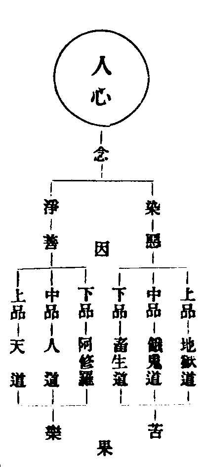



夫人皆有心，有心必有念，念起必有染净。染谓取著六尘，净谓不取六尘。且世人未有不染六尘者。若取著六尘，而起贪嗔婬杀等业，是为恶。若于六尘，不起贪嗔婬杀等，是为善。又于六尘，而行施戒忍等，是为善。善恶之业成于今，则苦乐之报应于后。以其因中善恶，有上中下之不同。故其果中升沈，有天人修罗地狱鬼畜之异也。在六道中，又复造业，业复续报。是故六道轮回不息。观其原始，由我心念而生。故佛言：三界惟心，万法惟识。是以善修道者，惟明于此。谨其初念，制其染心，斯为要术。若于六尘而不取，不取即无业，无业即无报。是故一念不生，则六道俱销，轮回斯绝。业种既断，斯出三界矣。若居不生而证真，身心永息，是为二椉。若从不生处，而起六度万行，是为菩萨大椉。若似断(未实断烦恼本)，未证(未得真理)，带异计邪见者，是为外道，未免轮回。是故缚脱由心，得失在我。修行者其鉴之。



法界安立图卷中之上



法界安立图卷中之下



燕山沙门　仁潮　集



四、大千劫量



千世界图(说)  

大千摄禅  

大千积数  

劫量总名  

成劫  

住劫  

坏劫  

空劫  

大劫图(说)  

增减劫图(说)  

四轮王  

小三灾  

大三灾  

劫运图(说)  

贤劫千佛(图说)  

纪劫秊数



(前来虽观三界，但竖明其高，未及于广。故次明大千，周知八方，有无穷三界，可穷佛刹之广也。)



千世界图



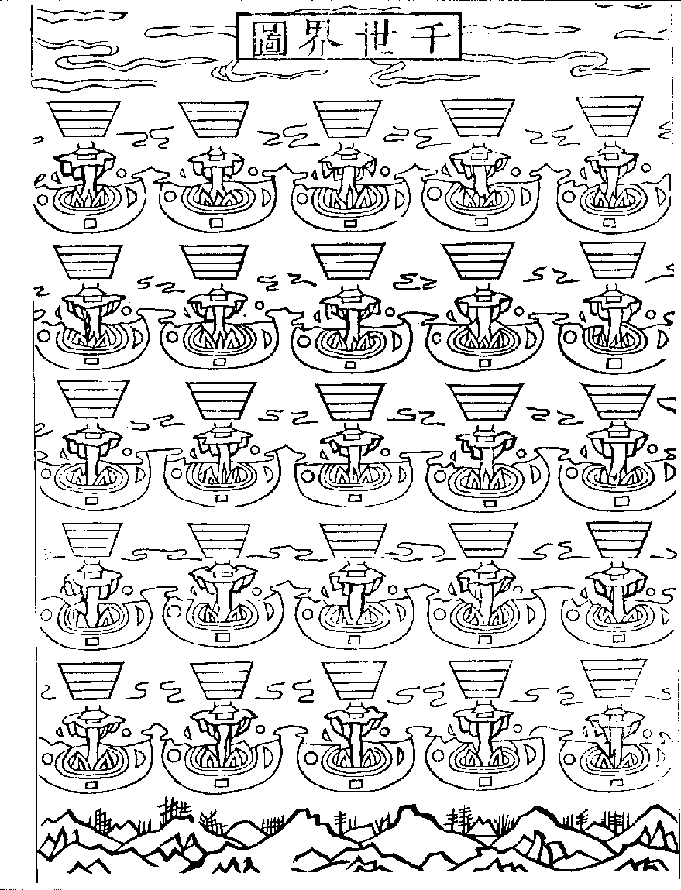



大千世界说



华严经云：三千大千世界，以无量因缘乃成大地，依于水轮，水依于风，风依于空，空无所依，众生业感，世界安住。○菩萨藏经云：诸佛成就不思议智故，能知诸风雨相。知世有大风，名乌卢博迦。众生诸有觉受，皆因此风之所动摇。此风轮高三拘卢舍。(此云一鼓声间，襍藏五里，为拘卢舍。)于此风上虗空之中，复有风轮，名瞻薄迦。此风轮量高十由旬。如是次第八千风轮之相，悉能了知。最上风轮名周徧上界，为水轮之所依止。其水量高八十百千由旬，为大地之所依止。其地量高六十八千由旬，是地量表有一三千大千世界。○长阿含云：一日月周行四天下，光明所照，是为一世界。如是千世界中，有千日月、千须弥山王、四千天下、四千大海、四千恶道、千阎罗王、千四天王、千忉利天至千梵天，是为小千世界。尔所小千千世界，是为中千世界。尔所中千千世界，是为大千世界。其中须弥、四洲、日月乃至梵天，各有万亿，通名一佛刹也。○俱舍云：四洲、日月、迷卢欲天、梵世各一千，名一小千界。此小千千倍，说名一中千。此中千千倍，名一大千。皆同一成坏。(杂阿含经、顺正理论、瑜伽论、智论、杂集、显扬论，大千数皆同上。)○金光明云：是诸人王手擎香罏，供养经时，其香徧布。于一念顷，徧至三千大千世界，百亿日月，乃至百亿非非想天。○华严云：尔时世尊，从两足轮下，放百亿光明，照此三千大千世界，百亿四洲，百亿大海轮围山，百亿须弥六欲，乃至百亿色究竟天。其中所有，悉皆明现。○华严钞云：若说小千，但数初禅。若数中千，即数二禅，以二禅量等中千故。若数大千，即数三禅，三禅量等大千故。是知大千有百亿，初禅有百万，二禅一千，三禅唯一四禅耳。○媻沙论云：初禅广如四天下，二禅如小千，三禅如中千，四禅如大千。(据此，则前钞应云：二禅量等小千，三禅量等中千为是。)○述论曰：佛之圣言，理应无二。云何经论互有不同？须弥之数，若依阿含、俱舍等大千，则有万亿须弥。若光明、华严等，则有百亿须弥。此数不同也。又或言大千有百亿四禅，则量最狭。或言惟一四禅，其量最广。此广狭之不同也。又或言有四空天，或无四空天。此增减之不同者，何邪？曰：虽有少异，各有理焉。一、会数者，先以谕显。一、小千界，如一贯钱。(一文如一须弥山，千文如千须弥等。)一、中千界，如千贯钱。大千界，如千千贯。虽数之大小不同，皆不出此千千贯。何者？以亿有四等故。若以十万为亿，则大千有万亿须弥。若百万为亿，则大千有千亿须弥。若千万为亿，则大千有百亿须弥。若以万万为亿，则大千有十亿须弥也。以此会之，或百或万，无不可者，总不出此大千之境矣。二、会广狭者。且如二禅，量等小千。以小千初禅向上取之，则有千二禅。如是百亿初禅向上取之，则有百亿四禅。譬如夏云，普覆九州。若以州取，则有九云。若以郡取，则四百餘云。若以县取，千数未多。或言一云普覆万国，或言万国各有夏云，思之可见。三、天数增减者。有二义：若以金光、楞严等，则色界上有四空天。若华严，约有处所，但至色顶；约该地法，徧于四空。四空无处，随处得果。如在欲界得无色定，即于欲界而受果报，故无别处摄在二界故。○阿毗昙云：从此须弥顶边，至彼须弥顶边，十二亿三千四百五十由旬。从此须弥中心，至彼中心，十二亿八万三千四百五十由旬。从此山根，至彼山根，十二亿三千十五由旬。其八方山山相远，亦复如是。此佛所说。○或云：千须弥外，有一小轮围山外遶，高至初禅。中千界外，有中轮围山外遶，高至二禅。大千界外，有大轮围山外遶，高至三禅。(又一须弥，四天下外，有一小轮围山，共成四等。)○总大轮围山内所包，上至非想，下极风轮，统名三千大千世界。以三度积，故曰三千。略去小中，举其末后，故云大千。斯大千界，成则同成，坏则同坏，通号娑媻世界，乃释迦如来摄化之境也。



大千摄禅之图



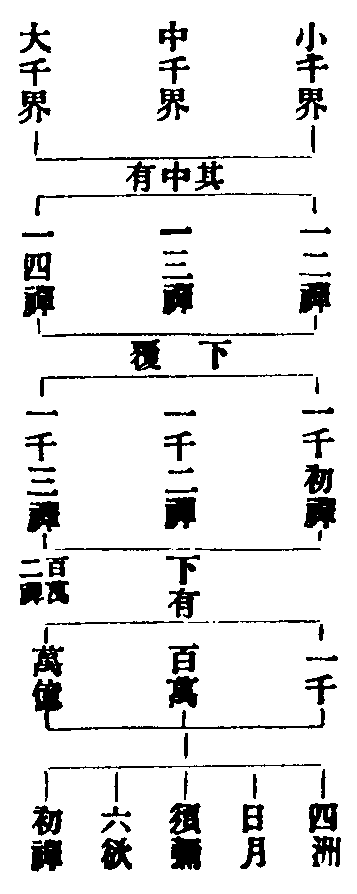



大千增数之图



一世界(一日月之所照临也)



○(此方黄帝算法增数)



十世界(十日月)  

十



百世界(百日月)  

百(十十)



小千  

千世界(一小千)  

千(十百)



十千界(十小千)  

万(十千)  

(亿数有四等)



百千界(百小千)  

亿(十万)  

○(此亿大千则有万亿须弥)



中千  

千千界(千小千为一中千)  

兆(十亿亦百万)  

○(此为亿大千有千亿须弥)



十千千(十中千)  

京(十兆亦千万)  

○(此为亿大千有百亿须弥)



百千千(百中千)  

姟(十京亦万万)  

○(此为亿大千有十亿须弥)



大千  

千千千(千中千为一大千)  

秭(十姟亦亿万)



劫量总名



劫者，是大时之总名也。梵语具云劫波簸陀(略云劫)，此云大时分。然此大时，甚为久远，不可以岁月而计。故圣人假拂石芥城，指水火成坏等际，以给其候焉。劫有多种，略可知者，大小成坏耳。初约四等：一别劫(一增减)，二成劫四十(以住合成)，三坏劫四十(以空合坏)，四大劫(总成坏别劫)。若更舒之，则有六劫：一别，二成，三住，四坏，五空，六大。若更束之，则为三劫：一小劫(即别劫)，二中劫(成住随一)，三大劫(总成住坏空)。开阖虽异，总不出于一大时分也。



成劫



成劫者，谓过去世界既磨灭已，空旷久时，众生业力复起风雨，依旧造立诸器世界也。依华严经云：三千大千世界，非以一缘、非以一事而得成就，以无量缘、无量事而得成就。所谓兴布大云，降澍大雨，四种风轮相续为依。其四者何？一者能持，能持大水故；二者能消，能消大水故；三名建立，建立一切诸处所故；四名庄严，庄严分布咸善巧故。如是皆由众生共业及诸菩萨善根所起，令于其中，一切众生各随所宜而得受用。○又大云降雨之时，有大云雨，名为能灭，能灭火灾；有大云雨，名为能起，能起大水；有大云雨，名为能止，能止大水；有大云雨，名为能成，能成一切摩尼诸宝；有大云雨，名为分别，分别三千大千世界。○三千大千世界初始成时，先成色界诸天宫殿，次成欲界诸天宫殿，次成于人及餘众生之所住处。○又如大云雨一味水，随诸众生善根异故，所起宫殿种种不同。○世界初欲成时，有大水生，徧满三千大千世界，生大莲华，名如来出现功德宝庄严，徧覆水上，光照十方一切世界。时摩醯首罗、净居天等见是华已，即决定知于此劫中有尔所佛出兴于世。尔时其中有风轮起，名善净光明，能成色界诸天宫殿；有风轮起，名净光明庄严，能成欲界诸天宫殿；有风轮起，名坚密无能坏，能成大小诸轮围山及金刚山。有风轮起，名胜高，能成须弥山王。有风轮起，名不动，能成十大山王。何等为十？所谓佉陀罗山、僊人山、伏魔山、大伏魔山、持双山、尼民陀罗山、目真邻陀山、摩诃目真邻陀山、香山、雪山。有风轮起，名为安住，能成大地。有风轮起，名为庄严，能成地天宫殿、龙宫殿、乾闼婆宫殿。有风轮起，名无尽藏，能成三千大千世界一切大海。有风轮起，名普光明藏，能成三千大千世界诸摩尼宝。有风轮起，名坚固根，能成一切诸如意树。其大云所雨一味之水，无有分别，以众生善根不同故。风轮不同。风轮差别。世界差别。○起世经云：云何世界坏已复成？谓过去世界磨灭之后，经无量时，起大重云，徧覆梵天，澍大洪雨，滴如车轴。经历百千万秊，彼雨水聚渐渐增长，乃至梵天世界，大水徧满，四风所持。雨止之后，水还自退，无量万亿由旬。有大风起，名阿那毗罗，吹彼水聚，波涛涌沸，生大聚沫，吹置空中，从上造作梵天宫殿、他化天宫(云云)。复造须弥山王、四洲、轮围山等，依旧建立。(造化天地，自此始也。)○若世界成时，先自上成色界三禅天，次第成下，至欲界𦦨摩天。此依空居者，故自上而成下也。其次先自下风轮，次第成上，至忉利天。此依地界，故自下而成上也。○如是风水鼓舞变化，经二十劫，诸器世界方得成就。



住劫



住劫者，谓世界已成，能令有情安住受用也。华严经云：三千大千世界既成就已，饶益无量种种众生。所谓水族众生得水饶益，陆地众生得地饶益，宫殿众生得宫殿饶益，虗空众生得空饶益。○长阿含经云：天地更始，了无所有，亦无日月。地涌甘泉，(亦名地味。)味如酥蜜。时光音诸天，或有福尽来生，(人生之始。)或乐观新地，性多轻躁，以指甞之。(饮食之始。)如是三转，得其甜味。食之不已，渐生粗肥，失天妙色。神足光明，冥然大暗。后大黑风吹彼海水，漂出日月，(日月之始。)遶须弥山，照四天下。时人见出则欢，见入则惧。(昼夜之始。)自兹以后，昼夜晦朔，春秋岁数，终而复始。劫初成时，人皆化生，无有男女尊卑。众共生世，故名众生。(众生名始。)食地味多者，颜色麤悴。其食少者，颜色光泽。(好丑始也。)遂生胜负，便生是非。(起不善始。)地味稍竭，咸皆懊恼：咄哉为祸，无复地味。又生地皮，状如薄饼。地皮又灭，又生地肤。地肤灭故，(增一云。)又生自然地肥，如蒲桃酒。○楼炭经云：地肥不生，便生两枝蒲桃，(即林藤也。)其味亦甘。久久食多，共相形笑。蒲桃不生，更生粇米，无有糠糩，不加调和，备众美味。众生食之，生男女形。(有根之始。)○正理论云：更生自然，非种香稻。此食粗故，残秽在身。为欲蠲除，便生二道，遂男女根生。由根形故，欲习便起。○增一经云：时诸人欲多者，便成女人，故有夫妻之名。(夫妇之始。)其后众生婬欲转增，遂夫妻共住。后光音天下生母胎中，(胎生之始。)故有胎生。尔时造立城郭，自然粇米朝刈暮熟，暮刈朝熟。○中阿含云：米长四寸，未有茎𠏉。时有众生并取日粮，如是相效，乃至并取五日，粇米渐生糠糩。刈已不生，遂有枯株。尔时众生懊恼悲泣，各封田宅粇米以为疆畔。(田地始也。)其众自藏己米，盗他田谷，无能决者。议立一平等主，善护人民，赏善罚恶，各共减割，以供给之。故选一人，形貌尊雅，甚有才德，请彼为主。(田主之始，如今王也。)于是始有民主之名，奉行十善。哀念人民，如父母爱子。人民敬主，如子敬父。人寿长久，丰乐无极。○阿含云：世界初成，光音天人下来，各有身光，飞行自在。见有地肥，极为香美。取食多者，即失神足，体重无光。日月始生，因贪食故。地肥灭没，复生婆罗。婆罗灭没，复生粳米，长四寸许，朝割暮生。食彼米故，方分男形女相，行不净行，彼便作家。于中懒惰众生，便作是念：多取粳米，为一日食。乃至积聚，渐至七日，米随所割，暮不复生。(祐律师云：浇风既动，则淳源斯谢；精灵通感，则霆击为迟。东莱加租，而海鱼潜泳；合浦增赋，而玑蜯远移。以近方古，不生粇米，未足异疑。)因此造作田种，立以标榜。于是有一众生，而入他田，窃取他稻，便相拳鬬。众生举一智者三摩多，为守田主。若可诃者，当令彼诃：我曹所得稻谷，当以输送。是田主谓之刹利种。其有舍家，入山求道，远离恶法，谓婆罗门种。习业自营，谓之居士种。习诸伎艺，以为生活，谓之首陀罗种。(或毗舍。)是四种中，有人思惟：世间恩爱，污秽不净，何足贪著？所以舍家，剃除须发，法服求道，我是沙门。(述曰：沙门之号，自上古有之。葢以欲为苦本，家是著根。著深故，诸恶竝起；欲滋故，生死无穷。是以上古之开士，自悟知非，顿舍恩爱，以杜其苦源；复舍家著，以断其恶因。臂之出，笼之鸟，离云之月，出尘之道，此实先焉。)○此住劫中，天地不坏，众生安住，亦经二十小劫。每一小劫，增极时，有轮王出世；减极时，有一小三灾。(详后。)



坏劫



坏劫者，谓住劫已满，世界万物尽皆坏灭也。华严经云：三千大千世界劫火起时，焚烧一切艸木丛林，乃至铁围、大铁围山皆悉炽然，无有遗餘。又风灾起时，有大风起，名曰散坏，能坏三千大千世界，铁围山等皆成碎末。复有大风，名为能障，周帀三千大千世界，障散坏风，不令得至餘方世界。若令无此能障大风，十方世界无不坏尽。○显宗论云：言坏劫者，谓地狱有情不复生至外器界尽。坏有二种：一、趣坏，二、界坏。趣坏者，谓此世间过于二十小劫已，从此复有等住二十坏劫。坏劫将起，住此洲人寿量八万，是时地狱有情命终，无复新生，为坏劫始。乃至地狱无一有情，尔时名为地狱已坏。诸有地狱定受业者，业力引置他方地狱中。由此准知，傍生鬼趣时，人身内无有诸虫，与佛身同傍生坏。故有二说：于人益者，坏与人俱，餘者先坏。是时人趣，此洲一人无师法然，得初静虑，唱如是言：离生喜乐，甚乐甚静。餘人闻已，皆入静虑，命终竝生梵世，乃至此洲有情都尽，是名赡部洲人已坏。东西二洲例此。北洲命尽，生欲界天，由彼钝根无离欲故。生欲天已，静虑现前，转得胜依，方能离欲。乃至人趣无一有情，名为人趣已坏。是时欲界随一有情无师法然，得初静虑，竝生梵世。乃至欲界无一有情，名为欲界已坏。是时梵世随一有情无师法然，得二静虑，唱如是言：定生喜乐，甚乐甚静。餘天闻已，皆入彼静虑，命终竝生极光静天，乃至梵世有情都尽。(上至坏到三禅，准此可知。)惟器世界空旷而住，大灾将起，方始界坏。○界坏者，谓火、水、风灾坏器世界也。一火劫，其俱生火起，坏至二禅天。二水劫，其俱生水起，坏至三禅天。三风劫，其俱生风起，坏至四禅天。而四禅天不坏，为舍念清净故。此大三灾劫，但坏器世界，不坏有情，而有情徙于别界。或有禅愿及三摩提力者，得生四禅天中也。○显宗论云：下三禅天定，遭水、火、风灾。初静虑寻伺为内灾，能烧恼心，外火灾故。第二静虑喜受为内灾，轻安润泽，外水灾故。第三静虑动息为内灾，外风灾故。初静虑内具三灾，外亦遭于三灾所坏。第二静虑内有二灾，外亦二灾所坏。第三静虑内惟一灾，外亦一灾所坏。第四静虑无有外灾，以彼定中内无灾患故。○杂心论：问：何故坏劫不至第四禅？答：净居天故。彼无上地生，即彼般涅槃故。亦不下生下地，非数灭故。若彼住经坏劫者，亦不然。增上福力生彼处故，内扰乱非故。若彼地内有扰乱者，则外有灾患。彼初禅内有觉观火扰乱故，外为火灾烧。第二禅内有喜水扰乱故，外为水灾所漂。第三禅内有出入息风扰乱故，外为风灾所坏。问：第四禅未曾有扰乱者，何得不常？答：刹那无常所坏故。第四禅地不定相续，随彼天生，宫殿俱起。若天命终，彼亦俱没耳。



凡住劫尽，必经一火灾坏界，亦经二十小劫，方坏得尽。其水风劫，如后明之。



空劫



空劫者，谓经大灾之后，天地万物皆悉无形，廓然空洞而已。如是空空，亦经二十小劫，过此劫已，复入成劫，如前劫风鼓扬劫水，水生厚沫，化作未来山海世界，依旧建立也。



大劫成坏循环之图



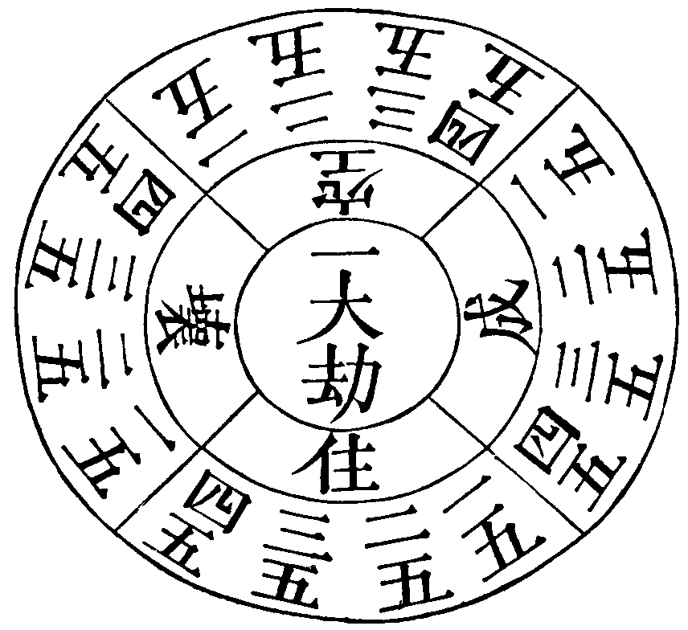



总前四种，共为一大劫。此大劫成坏循环，源源不已。凡十方三世所有一切世界，皆具此四种劫相，谓成、住、坏、空。成而即住，住而续坏，坏而复空，空而又成，连环无尽。(譬如浮桥，用廿秊方造得成，又廿年跨水度人，又廿年渐渐坏尽，又廿年无桥唯水。水论空劫，又一大劫如一大年，四中劫如四季。成如春，住如夏，坏如秋，空如冬，冬而复春。)



对法论云：如是东方无间无断无量世界，或有将坏，或有将成，或有正坏，或坏已空，或有正成，或成已住。如于东方，乃至十方亦尔。如是若有情世间，若器世间，业烦恼力所生故，业烦恼增上所起故。○华严云：譬如林中叶，有生亦有落。如是刹种中，世界有成坏。○庄椿录云：观夫世界成坏无穷，有二因缘：一、由众生同业所感，谓同迷一心三毒惑业，感现依报。惑业未尽，依报何穷？若无所依，何名受报？故令世界成坏连续。二、由诸佛愿力所感，谓佛有弘誓，尽度众生。众生既无穷，佛愿亦无尽。由是所感，依报连续。



小劫增减循环之图



凡一大劫中，有一往劫。一住劫中，有二十小劫。小劫者，一增一减也。增减约人寿以明。



减劫，从右上渐次减下，至十岁　寿数，增减依中阿含经。



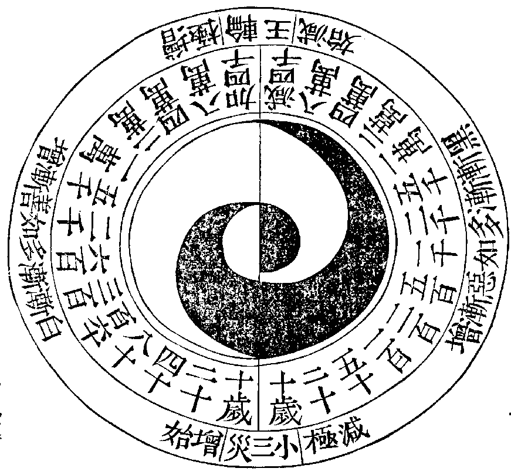



增劫从左下，渐次增上至八万，　以白喻善，以黑喻恶。



解曰：经名增减劫者，皆就善以明义。谓增者，由善业增长故，福增寿增等，乃至十善具足时，人寿八万岁，为增劫之极也。如月一日二日，渐渐增明，至十五日，月光明圆满，黑月消尽。减者，由善业损减故，福减寿减等，乃至十善消尽时，人寿十岁，为减劫之极也。如月十六十七，渐渐明少，至三十日夜，白月消尽，唯黑月在。此皆以善增善减，立增减之名也。



若增至八万岁时，七宝显现，五味甘美，百福咸集，人神和悦，风雨以时，香稻甘泉，世皆善人，轮王出世，丰乐无极。若减人寿至十岁时，七宝隐没，五味苦涩，百衰竞集，人穷物苦，鬼哭神号，阴阳乖沴，风雨失时，饥荒疫疠，残忍相戕，愚痴獘恶，微有人形，衰极于此。所谓积善降祥，积恶降殃，讵不信夫？前约善明增减，次互明之。谓善之增即恶之减，善之减即恶之增。若善一则恶九，善二则恶八，至善九则恶一，善十则无恶也，是为增极(亦是恶之减极)。如恶一则善九，恶二则善八，至恶九则善一，恶十则无善也，是为减极(亦是恶之增极)。犹如阳长则阴消，阴长则阳消。良以人心之善恶互为消长，故感报缘苦乐低昂，有增减之相耳。故知因果历然，感应无差。如是增减一周，是名一小劫。循环经二十周，名一住劫。或问曰：此增减图像寿数，与义易卦气全同。易乃阴阳递为消长，至阳极则阴生，阴极则阳生，循环不已，葢气数之势必然者也。若尔，善恶递为消长者，则是善极必恶生，恶极必善生邪？亦可善恶互为其因邪？互为其因，是为邪因。邪因则因果俱非，其因果历然者，果安在哉？答：非善从恶生，亦非恶从善生。夫以劫末之人，苦极思乐，物穷知返，良心斯现，改恶为善，故罪灭福生。是反恶为善，非恶极生善也。若恶极不返，则流入地狱，岂有增福寿之理乎？又增盛之时，居福盈地，骄奢恣纵，废善肆恶，故恶卸罪来。是亡善为恶，非善极生恶也。若善极不厌，则舍人报生天宫，岂有寿夭福折之理乎？只可以善为增因，恶为损因。不可谓善为恶因，恶为善因也。是故增减之相，与阴阳消长大同。其所以增减者，由心不由数也。故不同邪因无因之见。是以下愚者围于数量，上智者超乎数量，不为物所转也。上约现劫通相而释。其别相义，具诸经论。○其小劫增减之法云何？按庄椿集云：此住劫初，阎浮人寿八万四千岁，身长八丈。凡过百年，命减一年，身减一寸。过千年，命减十年，身减一尺。如是减至十岁，身长一尺，则减劫之极也。过尔之后，复入增劫。凡过百年，命增一年，身增一寸。增至千年，命增十年，身增一尺。如是增至八万四千岁，身增八丈，则增劫之极也。如是一减一增，共计一千六百八十万年，名一辘轳劫。经二十辘轳劫，方为一住劫也。○评曰：泛常论增减，一往如之。今再详则不然。按庄椿总数则是也。其言身长八丈为增极，则非也。何则？人身长八丈时，寿方八百岁，岂增至八百而遂减邪？亦安有八百岁之轮王出世哉？若尔，增减止得一十六万八千年，据上总数，为百分之一分耳。彼虽云增至八万四千岁，乃所经年数，非人寿数然也。若谓人寿八万四千岁者，则身长当八百四十丈，而所经之年，八百四十万年矣，方是增极之正数。减亦如之。又言至十岁，身长一尺为减极，则是。若谓减过八万四千年，身减八丈为减极，亦非也。何者？设减过八万四千年(所经之年)，人身减八丈，此时人寿方减八百岁。尚有八万三千一百餘岁，寿身长八百三十一丈餘(此时寿非十岁，身非一尺)，云何为减极邪？更以图明。



增劫(从人寿十岁为始)



时  

寿  

身



过百年  

增一岁  

增一寸



过千年  

增十岁  

增一尺



过万年  

增百岁  

增一丈



过十万  

增千岁  

增十丈



过百万  

增万岁  

增百丈



过八百万  

增八万岁  

增八百丈



(又过四十万年)  

(又加四千岁)  

(又加四十丈)



减劫(从人寿八万四千岁为始)



时  

寿  

身



过百年  

减一岁  

减一寸



过千年  

减十岁  

减一尺



过万年  

减百岁  

减一丈



过十万  

减千岁  

减十丈



过百万  

减万岁  

减百丈



过八百万  

减八万岁  

减八百丈



(又过三十九万九千年)  

(又减三千九百九十岁)  

(又减三十九丈九尺唯一丈在)



若云过百年增一岁等，当如此图。若不尔者，则非过百年增一岁也。(俟再考。)



增劫四轮王



凡增劫中，皆有四种轮王次第出世。如前渐增至人寿二万岁时，铁轮王出世，王一天下，奋威始定。又增至人寿四万岁时，铜轮王出世，王二天下，威震乃伏。增至人寿六万岁时，银轮王出世，王三天下，遣使方伏。增至人寿八万岁时，金轮王出世，王四天下，望威顺化。金轮圣王具七宝、千子、十善化世。七宝者：一、金轮宝，真金所成，千辐具足。王灌顶日，飞空而至，乘斯轮力，王及四兵飞空而行，周四天下，诸粟散王仰德归化。二、象宝，白如雪山，六牙具足。三、马宝，龙种所生，王椉一日，周四天下。四、玉女宝，莲华化生，端正第一。五、主兵臣宝，勇健大力，智略无敌。六、宝藏臣宝，善知伏藏，诸宝任王取用。七、如意珠宝，光照一由旬，令夜如昼，复随王意雨诸珍宝。王寿八万四千岁，大子相承。是时七宝(金、银、琉璃等也)出现，地味浮上，自生粇米，四序温和，人行十善，最极丰乐，经久远时(具如诸经论)。



减劫小三灾



凡减劫之极，有小三灾，次第而起。按毗昙论云：佛说劫中世界，经二十小劫坏；次经二十小劫，坏已空；次经二十小劫，空已起成；次经二十小劫，起成已住。是住劫中间，有小三灾，次第轮转：一、疾疫灾，二、刀兵灾，三、饥馑灾。第一劫小灾起时，有大疾疫诸病。阎浮人民，寿促唯十岁，身矬二三搩手，稗为上味，发服第一。是人不行正法，邪见增长，恶鬼损人，国王皆亡，国土空废。唯小郡县，相去辽远，病苦无疗，一日一夜，疫死无量。由行恶法，得是果报。生此劫浊时，郡县荒芜，唯少家在，相去转远，无人送埋，白骨徧地。劫末七日，众在遭疫死尽，唯有万人，能持善行，善神拥护，不令断绝。七日过，大疫息灭，恶鬼散去，尔乃阴阳调和，美味出生。众生相见，犹如亲友，共相爱乐，不舍善法增长(善增为增劫之因也)。寿渐增至二十千岁，久久增至八十千岁。时女五百岁，乃行嫁娶，国土丰乐，村落次比，衣服财宝，称意具足，经阿僧祇年(此增极之时也)。乃至众生，未起十恶，从起十恶(起恶为减因也)，寿命渐减，至寿十岁(减之极也)。刀兵者，人寿十岁时，三毒邪见，日夜增长，父子兄弟，互相鬬诤，何况他人。以瓦石刀杖，互相怖畏，四方诸国，互相伐讨，害死无量。不善果报，生此劫浊，人家没尽，残餘分散。劫末七日，手执艸木，即成刀杖，互相残害。是时诸人怖惧刀杖，逃窜山林、孤洲、坑窟，以避灾难。或时相见，仍各惊走，譬如獐鹿遭逢猎师。七日刀兵横死无量，唯万人在，以为人种(如前)。过七日后，刀兵息灭，阴阳调和，众生相见，喜爱如亲友。从十岁展转行善，寿增二十千，乃至八十千岁，住阿僧祇年(同前)。饥馑者，时人寿十岁，所食稊稗，人发为衣。贫穷困苦，愚痴邪见，日夜增长，谷贵饥馑。见他资粮，便往夺食。以此因缘，饿死无数。作恶业故，四五秊不雨。由大旱故，覔生艸菜尚不可得，何况米谷。一日一夜饥死无数，郡县空尽，唯少家在，三毒转盛。时六七年不雨大旱，思欲见水尚不可得，何况饮食。劫末七日，饿死殆尽，唯餘万人(如前)，乃至寿增八十千岁。○瑜伽论云：三种小灾出现，谓俭、病、刀。俭灾者，人寿三十岁时，方始建立。当尔之时，精妙饮食不可复得，唯煎朽骨共为䜩会。若遇一粒稻、麦、粟、稗等子，重若摩尼，藏置箱箧而守护之。由此饥俭，有情之类亡殁殆尽。此之俭灾，经七年七月七日方乃得过。彼诸有情起下品厌离，由此因缘，寿不退减，俭灾遂息。至于人寿二十岁时，本起厌患，今乃退舍。尔时多有疫气相续而生，彼诸有情悉多殒没。如是病灾，经七月七日方乃得过。彼诸有情起中厌离。由此因缘，寿量无减，病灾乃息。又至人寿十岁时，本起厌患，今复退舍。尔时有情展转相见，各起猛利杀害之心。由此因缘，随执艸木及以瓦石，皆成刀劒，更相残害，经一七日方乃得过。复有三种最极衰损：一、寿量衰损，谓寿极至十岁。二、依止衰损，谓其身量极至一搩，或复一握。三、资具衰损，唯以粟稗为食中第一，以发褐为衣中第一，以铁为庄严中第一。五种上味悉皆隐没，谓苏、蜜、甘蔗、油、盐，咸变其味。尔时有情展转聚集，起上厌离，不复退减。又能弃舍损减寿量恶不善法，受行增长寿量善法。由此因缘，寿量色力，富乐自在，皆渐增长，至八万岁。○中阿含经云：八万岁时，人初起恶，盗他人物。因盗滋故，寿形转减。父寿八万岁，子寿四万。其时众生增杀业故，寿损二万。复增妄语、两舌故，寿损一万。更增嫉妒、邪婬，乃至非法欲、恶邪贪、两舌、绮语、邪见、不孝父母、不敬沙门、不作福业、不见后世罪故，寿命转减。五千、二千、一千、五百、二百、一百，乃至人寿十岁，女生五月，即便出嫁。稗为上味，甘美尽没。唯行十恶者，为人所敬，人民互有害心。(刀兵劫起，与毗昙同。)亦有惭愧厌恶之人，便入山野隐藏。刀兵劫过后，从山野出，相见更互慈心，爱念如亲友。作是言：我等由生不善心，令亲族死尽。我等宁可共行善法，离杀害业。行善已，寿便增长。十岁生子，寿二十岁。复作是念：若行善者，寿色转好。我等应可更增行善，离不与取。遂寿增四十。复离邪婬、妄语，乃至两舌、麤言、绮语、贪、嫉、瞋恚、邪见、非法欲、恶邪贪、不善法行，故寿命增八十、百、六十、三百、六百、二千、五千、一万、二万、四万、八万岁时，孝顺父母，恭敬沙门，修诸福业。此阎浮洲，极大丰乐。女五百岁，乃当出嫁。轮王治世，人民安乐(云云)。疾疫、饥馑，延促同前。○新婆沙论云：若有能一日一夜，持不杀戒，于未来世，决定不逢刀兵灾起。若能以一诃梨果，起殷净心，奉施僧众，于当来世，决定不逢疾病灾起。若能以一团食，施诸有情，于未来世，决定不逢饥馑灾时。○述曰：观夫劫数之增减，人寿之延促，国土之丰俭，受用之苦乐，皆系乎业。业之善恶，职由乎人心。以人心淳浮相侵，善恶相滋。故劫之增减，寿之延促，亦随之于后也。信乎善恶之报，影响相从。苦乐之徵，由来相易矣。是故我辈今禀最灵，宜应止息十恶，勤行十善。而世世果报，祯祥嘉庆者，岂不逍遥怡乐有餘裕哉！



大三灾相



凡诸器世界，成久必坏。有三种大灾，随时而起。一火灾者，谓一大劫中，住劫过已，则有一火灾，坏其世界。其相云何？依因本经云：大三灾时，有大黑风，吹使海水两披。取日宫殿，置须弥山半，安日道中。缘此世间，有二日出，河渠流竭。其后久久，大风复取。第三日出，大恒河竭。四日出，阿耨池竭。五日出，大海乾枯。六日出，大地烟起。七日出，山地洞然。(长阿含、杂心论皆同。观佛三昧经大同。)直至梵天，乃至三千大千刹土，靡不烧灭。六欲诸天，皆悉命终。须弥山崩，洞然烈焰，至于梵天。梵天舍命，生光音天，以下尽成灰墨。新生天子，未曾见此，普怀恐怖。旧生天子，各来慰劳，勿生恐怖，终不至此。(谓火灾坏止初禅，不至二禅，以无火业故。然二禅邻于初禅，故火坏初禅，光照二禅。二禅新天，乍见不达，遂生恐怖。旧天见惯，故来安慰耳。)火灾之后，劫欲成时，布大黑云，周徧降雨，滴如车轴，无数千岁大千刹土，水徧其中。及至梵天，其水渐长，至光音天。(此成劫之水也。)此水复减，有大风起，鼓动波涛，起沫积聚，自然坚固，变成天宫，七宝校饰。由此有梵天宫，其水转减，依前聚沫，次第成就他化天宫，直至成四天下，依前建立。(此明世界复成之相。成已又住，住已又坏。如是次第经七火灾而后，水灾方起。)二、水灾者，如坏趣中众生皆生三禅已，是时雨沸灰水灾，从上光音宫殿随水消灭，至下欲天皆悉无形。水灾之后，有大云雨，复作世界，事同火灾。(如是次第经七水灾之后，风灾方起。)三、风灾者，谓众生皆生四禅已，风灾随起。因本云：水灾之后，其次久久，大僧伽风至果实天，其风四布，吹诸天宫，使诸宫宫相拍，碎若粉尘，直至天下。诸大山王相拍亦然。地下水尽，水下风尽。其后还复而降大雨，至果实天，风鼓波涛，起沫积聚，如前水灾，仍旧建立。



三灾经劫图



凡三灾坏劫经时，甚为久远，非同时起，谓一大劫后有一火灾，七火后遭一水灾，如是久久方一风灾。



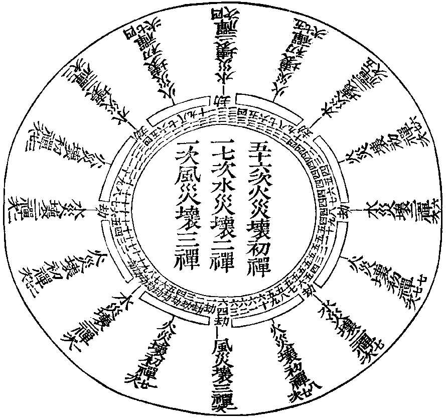



大三灾劫运始终，共经六十四大劫，为一周之数。毗昙论偈云：七火次第后，然后一水灾，七七火七水，复七火后风。(此总括三灾次第数次释。)



顺正理论云：此水火风三大灾起，逼有情类，令舍下地集上天中。初火灾兴，由七日现；次水灾兴，由降瀑雨；后风灾兴，由风相击。三灾起时，云何次第？要先无间起七火灾，其次定应一水灾起，此后无间复七火灾，度七火灾还有一水，如是乃至满七水灾，复有七火后一风灾起，如是总有八七火灾。一七水灾一风灾起，水风灾起皆次火灾，自水风灾必火灾起，故三灾次第其理应然。何缘七火方一水灾？极光静天(即光音天)寿势故，谓彼寿量极八大劫，故至第八方一水灾。由此应知，要度七水八七火后乃一风灾，由遍净天寿势力故，谓彼寿量六十四劫，故第八八方一风灾。如诸有情修定渐胜，所感异熟身寿渐长，由是所居亦渐长久(如四禅广果寿五百劫，空处二万劫，乃至非非想八万劫，其依报亦渐广，经劫亦久。葢业力不可思议，非世可知。众生自无始来业报连环，所经劫数无量无边，何止千万劫而已哉。故佛说远因，则以刹尘数论之，非六通大圣其谁与于此)。



三大劫佛兴之图



三大劫中三千佛出，庄严劫已过去，星宿劫犹未来，贤劫乃现在，有千佛出化于世。今据贤劫，且约四时，谓成、住、坏、空也。然成劫已往，坏空未至，今在住劫，而住劫之中有二十小劫，此二十小劫中次第佛出。



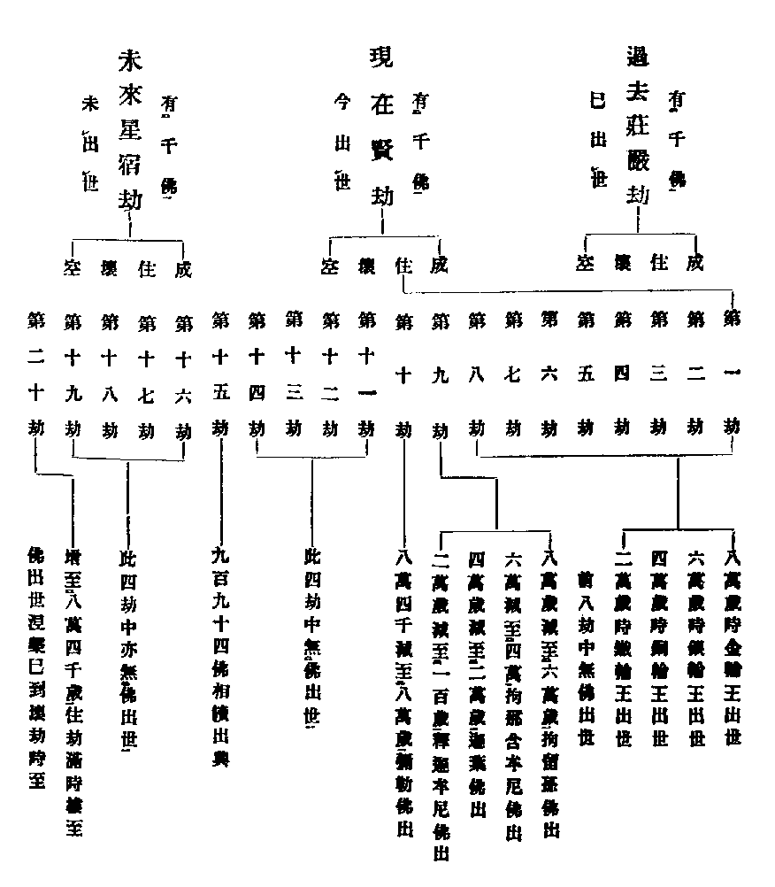



娑婆世界，自入住劫，已经八减八增(八小劫也)，无佛出世。今当第九减劫，有四佛出世：初减人寿至六万岁时，拘留孙佛出世；次减人寿四万岁时，俱那含牟尼佛出世；次减人寿二万岁时，迦叶波佛出世；次减人寿至一百岁时，释迦牟尼佛出世。从住劫初，至释迦世尊，已得一万四千二百七十九万三千年。故法数偈曰：娑婆住劫岁流迁，九减仍闻八度添。一万四千零二百，七十九万三千年。又自释迦世尊灭，至宋绍兴，已二千一百年(新算自宋高宗绍兴元年，至我朝万历丙午，又四百七十六年)。人又减二十一年，身减二尺一寸。今人只可六尺，寿八十岁(减至人寿八十，身当八尺。言只六尺，未必然也。葢尺有古今长短不同，宋尺比周尺长三寸四分，当依周尺，正合八尺为准耳)。此去更过七千年，人寿十岁，身长一尺，至此减劫之极也(遇小三灾)。过尔之后，复入第九增劫。从人寿十岁，如前过百年，命增一岁，身增一寸。如是渐增，乃至寿八万岁，金轮王出，至此增劫之极也(凡增劫中有四轮王出世)。次后复入第十减劫，减至八万岁时，弥勒佛下生。从绍兴去至弥勒，更经八百八十万七千年。是时百亿阎浮真金为地，地平如掌，秔稻自生。思衣衣来，想食食至，无量快乐。男女五百岁，乃方婚嫁。弥勒初会，度人九十二亿，尔后度人无数。佛身长三十二丈，人民长十六丈。弥勒住世六万岁，说法度生。涅槃后，正法、像法亦如是。贤愚经：佛言：弥勒三会度人，悉我遗法种福众生，然后乃化同缘之徒。弥勒灭后，渐减至人寿十岁。十减劫极，复入第十增劫。十一劫至十四劫，无佛出世。第十五劫中，有九百九十四佛出兴于世。十六劫至十九劫，亦无佛出。至第二十劫，最后楼至佛出化于世。涅槃后，千佛出尽。二十辘轳劫满已，则坏劫时至(遇大三灾)。久久复成，造未来星宿劫之天地也，亦有千佛出世。故三千佛总括偈云：



庄严华光毗舍浮(过去千佛，举其初后)，　贤劫俱留楼至佛(现在千佛，举其初后)，  

星宿日光须弥相(未来千佛，举其初后)，　如是诸佛度众生。



纪劫年数



按庄椿集，计劫经年之数。



一小劫(亦名别劫，亦名辘轳劫)，谓一减一增也。总此增减，共计一千六百八十万年(如前筭，凡过百年减一岁，从八万四千减至十岁，凡经八万四千个一百年，是为八百四十万年。其增积年数同减，增减合，故得一千六百八十万年也)，名一辘轳劫。二十增减，数亦如之。



二中劫(即住劫等四也)，谓二十辘轳劫也。总此二十增减，共计三万三千六百万年(亦是二十个一千六百八十万年也)，名为一住劫(一中劫也)。坏空成三劫，数亦如之。



三大劫，谓四中劫也。总四中劫(亦是八十小劫)，共计一十三万四千四百万年(亦是四个三万三千六百万年)，名为一大劫也。是为天地成坏始终之极数，周而复始，运运无穷焉。



观夫虗空无量，故世界无边。大化无穷，故劫运无已。其大劫者，在大化之中，其犹一年也。成住坏空者，四季也。八十增减者，二十四气也。四轮王者，孟夏之麟凤也。三灾人者，严霜中秋虫也。矧兹𤨏𤨏含生，营营来去者，等彼器中蚊蚋，纷纷狂閙耳。一化而生，再化而死。化海漂荡，竟何所之。梦中复梦，长夜冥冥。执虗为实，曾无觉日。不有出世之大觉大圣，其孰与而觉之欤。○或问：按邵子经世一元消长之数，则一十二万九千六百年，是为天地始终之极数也。较前大劫则为万分之一，何多少太不侔邪。然世无二理，何者为是。答：天地成坏之大数，唯六通圣神者所能知见，岂世俗小智之可测哉。世人只可言世间事，过之则出世法也。曰：一元之数岂非邪。曰：数易理也。



邵子一元之数，理则然矣。言开物闭物者，比拟也。如今一岁之运，有个否泰。逆推而上之，则一元所统一十二万九千六百年中，亦有个否泰。而运气与年相类。故曰：开物于寅，闭物于戌。犹惊蛰启物，霜降杀物。理或然也。以为一大运否泰之数则然。若以天地成坏亦如其数，未必然也。果如彼数，至寅会中，方有人经八会。人至戌会后，则人俱无，天地随坏矣。戌后天地果坏乎？若坏，则弥勒佛等当生何处？(按前见在天地中，有千佛出世。天地既坏，无地可生。)寅前果无人乎？无人，则轮王是谁？寅后生人，则轮王应在。(轮王寿八万岁，故今应在。)是则数或有盛衰。(如前增减劫。)而天地岂依人筭，数亦可坏邪？



法界安立图卷中之下



法界安立图卷下之上



燕山沙门　仁潮　集



五、游诸佛刹



十方佛刹图(说)  

东方净土  

西方净土图(文十一)  

七宝严地  

七宝宫宇  

莲华浴池、行树乐音  

宝网舒光  

顶光远照、化禽演法  

寿命长远  

往生正因、疑城示谪  

净土正报总说  

一浮幢佛刹图  

十浮幢佛刹图  

百浮幢佛刹图  

华藏业因说  

释华藏名



释总题



游诸佛刹者，谓深心信解诸佛刹土，神智徧观也。葢知有人天，不知有佛者，凡俗也。信佛为出世大圣者，道器也。然信一佛，其福虽胜，见量犹局。信多佛，则其福量无边，其智量益广。



十方佛刹图



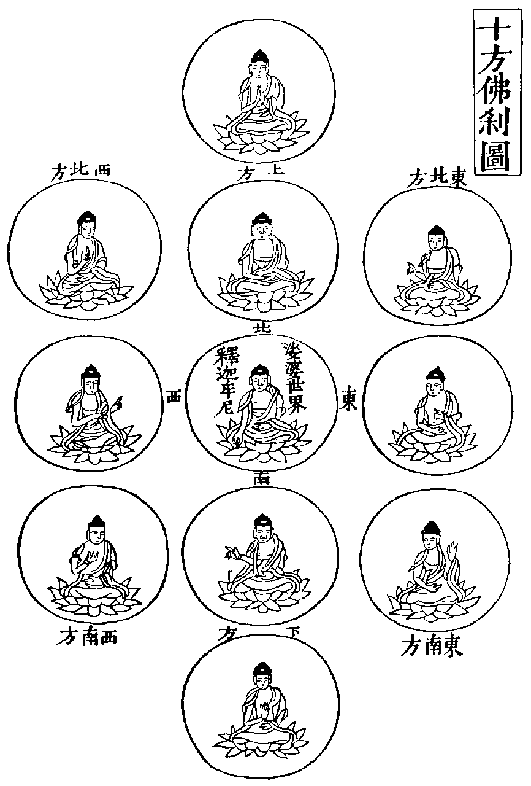



大千世界为一佛刹。如是娑婆之外太虗空中，复有十方大千诸佛刹土。何以知然？依华严经云：此娑婆世界，东次有世界名为密训，次南有世界名丰溢，次西有世界名离垢，次北有世界名丰乐，次东北有世界名摄取，次东南有世界名饶益，次西南有世界名鲜少，次西北有世界名欢喜，次下方有世界名关𨸎，次上方有世界名振音。此十方世界，如来各有百亿万名号，令诸众生各别知见，乃至十方无数世界亦复如是(一四天下佛有十千名号，大千有百亿四天下，故有百亿万名号，十方大千亦如是)。



东方净土



七佛功德经云：东方去此过四𠓆伽河沙佛土，有世界名曰无胜，佛号善名称吉祥王如来，亦是宝严之土莲华化生。次东方过五𠓆伽沙佛土，有世界名曰妙宝，佛号宝月智严光音自在王如来。次东方过六𠓆伽沙佛土，有世界名曰圆满香积，佛号金色宝光妙行成就王如来。次东方过七𠓆伽沙佛土，有世界曰名无忧，佛号无忧最胜吉祥王如来。次东方过八𠓆伽沙佛土，有世界名曰法幢，佛号法海雷音王如来。次东方过九𠓆伽沙佛土，有世界名曰善住宝海，佛号法海胜慧游戏神通王如来。东方去此过十𠓆伽沙佛土，有世界名净瑠璃，佛号药师瑠璃光王如来。如是诸佛世界，皆如西方极乐世界，功德庄严等无差别(兢伽或恒河，此河濶四十里，沙细如面，一沙计一佛刹，计尽一河之沙，名一恒河沙佛刹)。



西方净土图



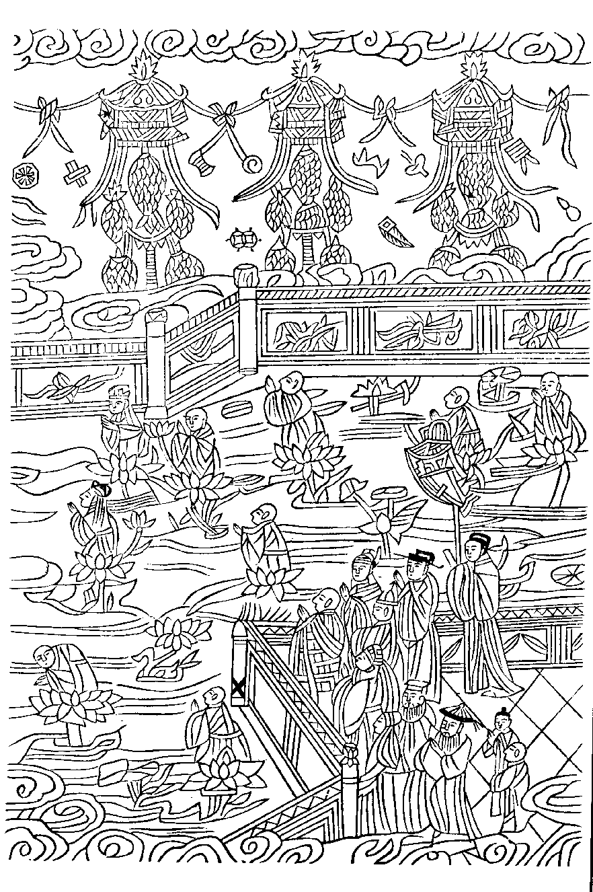



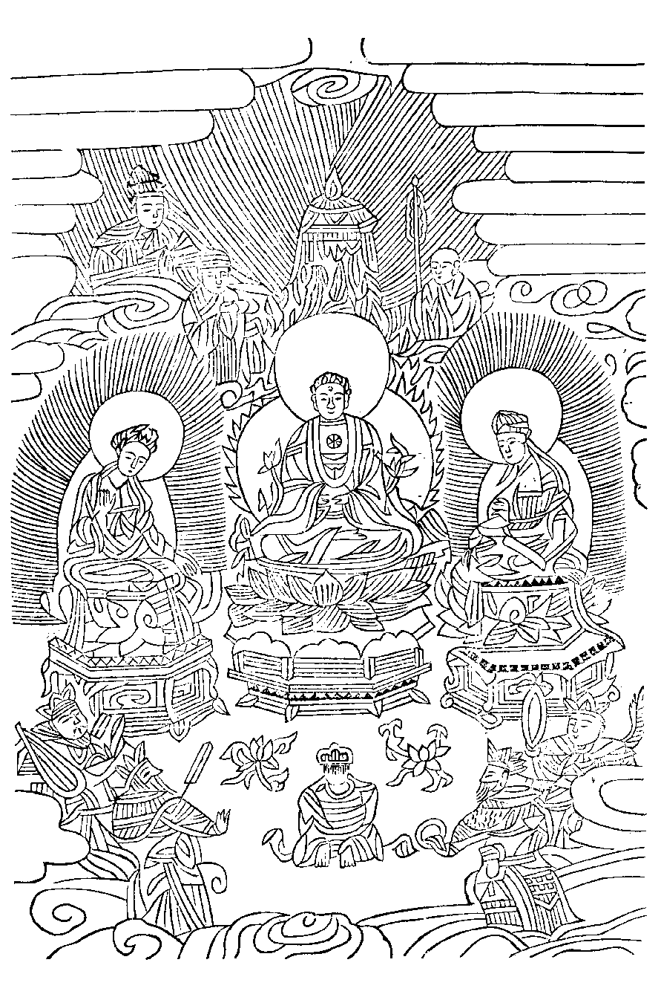



西方净土



何名净土？世界皎洁，目之为净；即净所居，名之为土。摄论云：所居之土，无有五浊，如颇梨等，名清净土。对法论云：无烦恼众生住处，名为净土。十方国土虽复清净，惟西方极乐世界最为殊胜故。



阿弥陀经云：从是西方过十万亿佛土(大本百万)，有世界名为极乐。彼土何故名为极乐？其国众生无有众苦，但受诸乐，故名极乐(大本云：有自然清净之音，自然快乐之事)。



七宝严地



大阿弥陀经云：阿弥陀佛刹中，皆自然七宝，所谓黄金、白银、水晶、瑠璃、珊瑚、琥珀、砗渠。其体性温柔，以是七宝相间为地，光色照曜，奇妙清净。(观经云：琉璃地上，金绳间错，以七宝界，分齐分明，放种种光。其光如华，或如星月。)恢廓平正，无须弥轮围、诸山大海及坑坎井谷，亦无地狱、鬼、畜、修罗等，惟有自然流泉，亦无寒暑。(小本云：无三恶道。)



七宝宫宇



彼佛讲堂精舍七宝合成，复有宝楼观栏楯(小本七重栏楯)，宝珠璎珞之所严饰，殊特妙好清净光晖，菩萨声闻所居宫宇亦然。诸天世人所居宫阁，随形高下大小，或一宝二宝乃至多宝所成，或在地下或悬空中，随福厚薄各得受用(观经众宝国土一一界上有五百亿宝楼，小本有楼阁四宝严饰之)。



莲华浴池



有诸池沼，或黄金为池，或白银为池，或水晶、瑠璃为池，或珊瑚、琥珀为池，乃至七宝为池，其底沙亦如是。其宝池有方四十里者，五十、六十里者，以至方二万四百八十里。若大海者，若佛浴池，其方倍此。众宝合成八功德水，湛然盈满，清净香洁，味如甘露，有百种异华，芬芳馥郁。○一一七宝池中有六十亿七宝莲华，一一莲华十二由旬，一一宝华百千万叶。其华光明无量杂色，青色青光，白色白光，玄、黄、朱、紫之色，其光亦然，炜烨焕烂，明辉日月，流光化佛，说清净法。



行树乐音



诸宝池岸上，有无数旃檀香树、吉祥果树，花果恒芳，香气流布。复有七种宝树，或一宝者、二宝者，以至七宝为一树者，根、茎、枝、叶各以一宝。如是诸树，行行相植，茎茎相望，如是行列数百千重(小本七重)，周徧世界，微风吹动，出妙乐音，皆演妙法。



宝网舒光



复有无量宝网弥覆其刹，皆以金银珍珠、百千杂宝、奇妙异珍庄严校饰，周帀垂布光色晃曜，和风吹网出妙法音，或吹妙华徧处散布。



顶光远照



十方世界一切众生往生彼国者，皆在宝池莲华化生，自然长大。无乳养者，食自然食，身皆金色，容貌端正，非世可比。但光有大小，佛顶光明照千万世界(小本光明无量，照十方国)，菩萨顶光照千亿万里，声闻顶光各照七丈。



化禽演法



有白鶴、孔雀、鹦鹉、舍利、迦陵频伽、共命之鸟，亦演说法音，皆佛神力所化(小本是诸众鸟皆阿弥陀佛欲合法音宣流变化所作)。



寿命长远



彼佛寿命及其人民，无量无边阿僧祗劫，故名阿弥陀(阿僧祗，此云无央数，乃大劫之名也)。华严经云：娑婆世界一劫，极乐世界为一日一夜。



往生正因



志心欲往生者，有三辈：上者，舍家弃欲而作沙门，心无贪慕，持守经戒，行六波罗蜜菩萨业，专念彼佛，修诸功德。是人梦中见佛，菩萨命终，佛与圣众悉来迎致，即于彼宝池化生，得为菩萨。中者，虽不能作沙门，大修功德，常信受佛语，深发无上菩提之心，专念彼佛，随力修善，奉持斋戒，起立塔像，饭食沙门，悬幡然灯，散华烧香，以此回向，愿生彼国。命终，化佛接引，往生彼处。功德次前。下者，不能作诸功德，发大道心，一向专念，每日十气念佛。临终，梦佛亦得往生。其德次于中者。○复有三等：其次，斋戒清净，一心念佛，十昼夜不绝者，命终必得往生。又纵不能十昼夜，当绝虑去忧，勿近女人。端身正心，断除爱欲，斋戒清净，忆念佛名，一日夜不绝，亦得往生。又若男子、女人，发菩提心，持诸禁戒，所作善缘，饶益众生，忆念彼佛及刹境界。命终，佛迎化生净土。(又云：生彼佛刹，必修十善。小本云：若一日、二日至七日，一心不乱，即得往生。)



疑城示谪



若人修功德愿生彼刹，后有悔心疑惑不信彼佛刹及往生者，续有念心暂信不信志意犹豫，复又悔过念佛亦生彼刹，在边地七宝城中莲花化生，衣食自然受天快乐。惟于城中经五百岁，不见佛法及菩萨，以此为苦示其小谪。是故念佛之人，应当谛信发愿往生，勿怀疑惑致斯罪责。



正报总说



莲宗宝鉴云：因修白业，果感净方。化佛引上金台，贤圣迎归乐国。高超三界，逈出四流。业尽尘消，亡情绝虑。质托莲苞之内，神游宝界之中。面奉阿弥为本师，得见观音、势至为亲友。清净海众，大会宝池；九品胜流，各说本行。五香拂体，三德严身。暂扇微风，聆众音之演法；缤纷花雨，覩𦦨网之舒光。缥缈云霞，近浮神足；轻盈衣裓，盛接妙花。晨谒慈颜，得法印而还国；暮游金刹，听玉偈以逍遥。瑞莲初绽，为遣残殃；新学化生，行成不退。岂惟近忘麤苦，抑亦佛果非遥。戏玩琼林，灌沐德水。百宝之楼台华丽，七重之行树森严。景序长春，地平如掌。衣食随念而至，天乐不鼓自鸣。受用出于自然，快乐实非人世。诸天万亿倍，不可比论；诸佛恒河沙，悉皆称赞。身具光明妙相，足践圣道香阶。寿命难量，悲愿无尽。舍两重生死，既非果趣之身；获本际常光，离去来之相。缘强德胜，皆由念佛心生；福备寿长，尽是净因感报。故知佛有摄生之愿，生有感佛之因。如是胜缘，起于信愿；以斯妙果，成就正依。或禅诵七宝池边，或经行黄金地上。饱禅悦法喜珍味，挂慈悲喜舍天衣。功德资神，增加悲智；雍容办道，长养圣胎。入无生门，便登菩萨之位；得阿䟦致，不退菩提之心。住法王家，尽授如来之记；闻大椉法，同称补处之尊。念念虗玄，心心静虑。得三昧正定，具六种神通。献供十方，往来无碍；分身亿刹，不失定心。洒法水于三千，出众生于火宅。自他兼利，行愿周圆。可谓百千三昧尽唯心，功德庄严归自己。



今此极乐世界，以娑婆观之，即西去有十万亿佛刹之遥；若以世界种观之，则极乐世界尚抂第十三重内，去中间娑婆不远。以娑婆西去有佛刹微尘数世界等，方至十三重极西边际，此极乐是念佛人往生之处，实有七宝净土；执无净土，是邪见说。



一浮幢佛刹图



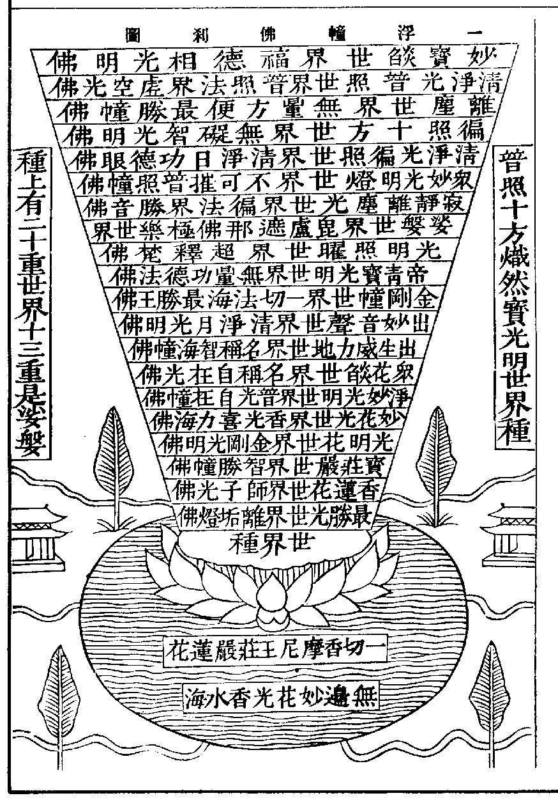



华严经云：有十不可说佛刹微尘数香水海，在华藏庄严世界海中，如天帝网分布而住。此最中香水海，名：无边妙华光，以现一切菩萨形摩尼王幢为底；出大莲华，名：一切香摩尼王庄严，有世界种而住其上，名：普照十方炽然宝光明，以一切庄严具为体，有十不可说佛刹微尘数世界于中布列。其最下方，有世界，名：最胜光徧照，佛号：净眼离垢灯，佛刹微尘数世界周帀围遶。此上过佛刹微尘数世界，有世界，名：种种香莲华妙庄严，佛号：师子光胜照，二佛刹微尘数世界周帀围遶。此上过佛刹微尘数世界，有世界，名：一切宝庄严普照光，佛号：净光智胜幢，三佛刹微尘数世界周帀围遶。此上过佛刹微尘数世界，有世界，名：种种光明华庄严，佛号：金刚光明无量精进力，四佛刹微尘数世界周帀围遶。此上过佛刹微尘数世界，有世界，名：普放妙华光，佛号：香光喜力海，五佛刹微尘数世界周帀围遶。此上过佛刹微尘数世界，有世界，名：净妙光明，佛号：普光自在幢，六佛刹微尘数世界周帀围遶。此上过佛刹微尘数世界，有世界，名：众华𦦨庄严，佛号：欢喜海功德名称自在光，七佛刹微尘数世界周帀围遶。此上过佛刹微尘数世界，有世界，名：出生威力地，佛号：广大名称智海幢，八佛刹微尘数世界周帀围遶。此上过佛刹微尘数世界，有世界，名：出妙音声，佛号：清净月光明相无能摧伏，九佛刹微尘数世界周帀围遶。此上过佛刹微尘数世界，有世界，名：金刚幢，佛号：一切法海最胜王，十佛刹微尘数世界周帀围遶。此上过佛刹微尘数世界，有世界，名：恒出现帝青宝光明，佛号：无量功德法，十一佛刹微尘数世界周帀围遶。此上过佛刹微尘数世界，有世界，名：光明照曜，佛号：超释梵，十二佛刹微尘数世界周帀围遶。此上过佛刹微尘数世界，有世界，名：娑婆，其佛即是毗卢遮那，十三佛刹微尘数世界周帀围遶(极乐世界在此围遶伴刹之中)。此上过佛刹微尘数世界，有世界，名：寂静离尘光，佛号：徧法界胜音，十四佛刹微尘数世界周帀围遶。此上过佛刹微尘数世界，有世界，名：众妙光明灯，佛号：不可摧伏力普照幢，十五佛刹微尘数世界周帀围遶。此上过佛刹微尘数世界，有世界，名：清净光徧照，佛号：清净日功德眼，十六佛刹微尘数世界周帀围绕。此上过佛刹微尘数世界，有世界，名：徧照十方，佛号：无碍智光明，十七佛刹微尘数世界周帀围遶。此上过佛刹微尘数世界，有世界，名：离尘，佛号：无量方便最胜幢，十八佛刹微尘数世界周帀围遶。此上过佛刹微尘数世界，有世界，名：清净光普照，佛号：普照法界虗空光，十九佛刹微尘数世界周帀围遶。此上过佛刹微尘数世界，有世界，名：妙宝𦦨，佛号：福德相光明，二十佛刹微尘数世界周帀围遶。



此徧照十方炽然宝光明世界种，有如是等不可说佛刹微尘数广大世界，各各所依住，各各形状，各各体性，各各方面，各各趣入，各各庄严，各各分齐，各各行列，各各无差别，各各力加持，周帀庄严。所谓：十佛刹微尘数回转形世界、十佛刹微尘数江河形世界、十佛刹微尘数旋流形世界、十佛刹微尘数轮辋形世界、十佛刹微尘数坛𫮃形世界、十佛刹微尘数树林形世界、十佛刹微尘数楼观形世界、十佛刹微尘数尸罗幢形世界、十佛刹微尘数普方形世界、十佛刹微尘数胎藏形世界、十佛刹微尘数莲华形世界、十佛刹微尘数佉勒迦形世界、十佛刹微尘数众生形世界、十佛刹微尘数佛相形世界、十佛刹微尘数圆光形世界、十佛刹微尘数云形世界、十佛刹微尘数网形世界、十佛刹微尘数门闼形世界，如是等有不可说佛刹微尘数。此一一世界，各有十佛刹微尘数广大世界周帀围遶。此诸世界，一一复有如上所说微尘数世界而为眷属。如是所说一切世界，皆在此无边妙华光香水海及围遶此海香水河中。



清凉疏云：准标及结，皆有不可说佛刹微尘数。其别辨中但列十九佛刹微尘数为二十重，其能遶刹但有二百一十刹尘数。(疏明标、结多别，别少。补注：经中但以二十个世界为主及眷属为二十重，岂中间所过之刹独无眷属？则八方之上、下重重空缺，何成安立？乃知不尔。故文结云：如是等有若干数。则知八方重重布满，齐等无异，其数已具。且如种中，第一世界有一刹尘眷属，第二世界亦应有刹尘眷属，第三、第四至于二重下，经过佛刹尘数主刹，皆有刹尘数伴遶，即有多多刹尘数。次第至二十重，具有无数重。其世界之数比标文最多。文但标十不可说刹尘数，未至恒沙刹尘，故最少。以二重下，即有佛刹微尘数个佛刹微尘数世界故。其二重上又倍之，三重上又倍之。)



十浮幢佛刹图



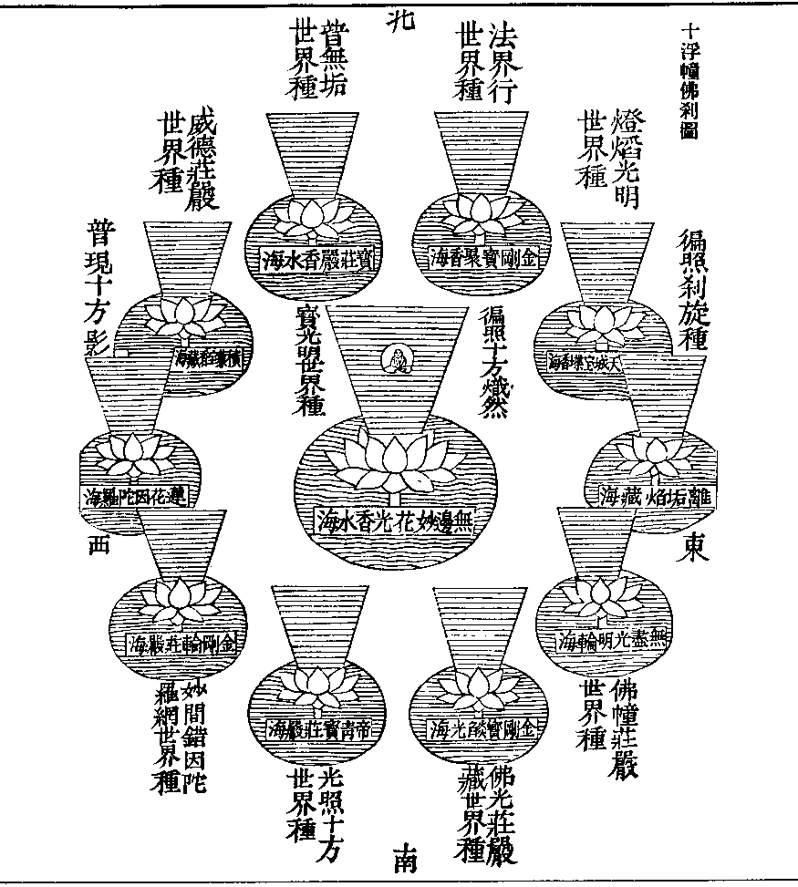



此无边妙华光香水海东，次有香水海，名：离垢𦦨藏；出大莲华，名：一切香摩尼王妙庄严；世界种，名：徧照刹旋，二十重世界于中安住。此香水海南，次有香水海，名：无尽光明轮；世界种，名：佛幢庄严。此海右旋，次有香水海，名：金刚宝𦦨光；世界种，名：佛光庄严藏。此海右旋，次有香水海，名：帝青宝庄严；世界种，名：光照十方。此海右旋，次有香水海，名：金刚轮庄严底；世界种，名：妙间错因陀罗网。此海右旋，次有香水海，名：莲华因陀罗网；世界种，名：普现十方影。此海右旋，次有香水海，名：积集宝香藏；世界种，名：一切威德庄严。此海右旋，次有香水海，名：宝庄严；世界种，名：普无垢。此海右旋，次有香水海，名：金刚宝聚；世界种，名：法界行。此海右旋，次有香水海，名：天城宝堞；世界种，名：灯𦦨光明(如是十海，在妙华光海外，次第右旋，周帀围遶。其十世界种中，皆有二十重世界于中安住)。此华藏庄严世界海，有须弥山微尘数风轮所持；其最上风轮，名：殊胜威光藏，能持普光摩尼庄严香水海。此香水海，有大莲华，名：种种光明蕋香幢，华藏庄严世界海住在其中，四方均平，清净坚固，金刚轮山周帀围遶，地海众树各有区别。此大轮围山内所有大地，一切皆以金刚所成，坚固庄严，不可沮坏，清净平坦，无有高下。此大地中，有十不可说佛刹微尘数香水海，一切妙宝庄严其底，妙香摩尼庄严其岸，毗卢遮那摩尼宝王以为其网，香水澄彻，具众宝色，充满其中，种种宝华旋布其上，旃檀细末澄垽其下(云云)。一一香水海，各有四天下微尘数香水河右旋围遶。此十不可说佛刹微尘数香水海中，有十不可说佛刹微尘数世界种安住。其最中香水海，名：无边妙华光，世界种，名：普照十方炽然宝光明，有二十重世界于中安住。如前无边妙华光香水海，次东有离垢𦦨藏等十香水海，经不可说佛刹微尘数香水海，至最近轮围山香水海，名：颇梨地，世界种，名：常放光明，有二十重世界于中安住(经文但列四重名号)。其离垢海，次南有无尽光明轮等十香海，经不可说佛刹微尘数香海，至近轮山香水海，名：妙树华；世界种，名：出生诸方广大刹(亦二十重世界)。此无尽轮海右旋，次有金刚宝焰光等十香海，经不可说佛刹微尘数香海，至近轮山香水海，名：无边轮庄严；世界种，名：无量方差别(亦二十重世界)。此金刚光海右旋，次有帝青宝庄严等十香海，经不可说佛刹微尘数香海，至近轮山香水海，名：树庄严幢；世界种，名：安住帝网(亦二十重世界)。此帝青海右旋，次有金刚轮庄严等十香海，经不可说佛刹微尘数香海，至近轮山香水海，名(经中阙此一海名)；世界种，名(经亦阙此一世界种)。此金刚海右旋，次有莲花因陀罗等十香海，经不可说佛刹微尘数香海，至近轮山香水海，名：密焰云幢；世界种，名：一切光庄严(亦二十重世界)。此莲华海右旋，次有积集宝香藏等十香海，经不可说佛刹微尘数香海，至近轮山香水海，名：阎浮檀宝藏轮；世界种，名：普音幢(亦二十重世界)。此积集海右旋，次有宝庄严等十香海，经不



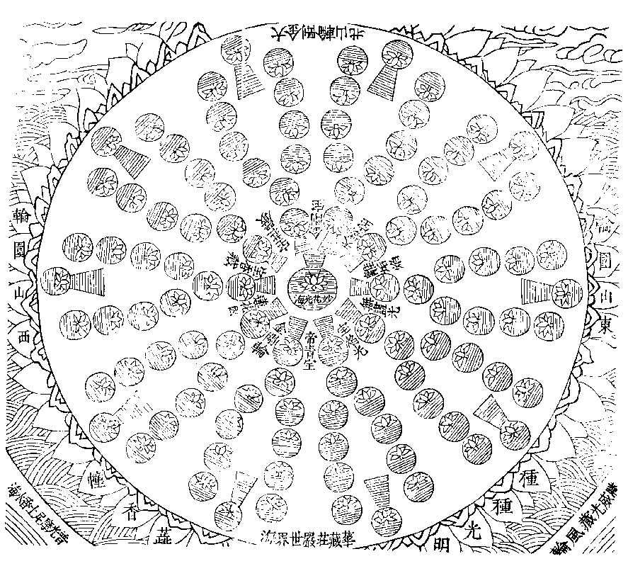



可说佛刹微尘数香海，至近轮山香水海，名：出帝青宝；世界种，名：周徧无差别(亦二十重世界)。此宝庄严海右旋，次有金刚宝聚等十香海，经不可说佛刹微尘数香海，至近轮山香水海，名：不可坏海；世界种，名：妙轮间错莲花场(亦二十重世界)。此金刚宝聚香水海右旋，次有天城宝堞等十香水海，经不可说佛刹微尘数香水海，至最近轮围山香水海，名：积集璎珞衣；世界种，名：化现妙衣(亦二十重世界)。如是等十不可说佛刹微尘数香水海中，有十不可说佛刹微尘数世界种，皆依现一切菩萨形摩尼王幢庄严莲华住，各各庄严际无有间断，各各放宝色光明，各各光明云而覆其上，各各庄严具，各各劫差别，各各佛出现，各各演法海，各各众生徧充满，各各十方普趣入，各各一切佛神力所加持。此一一世界种中，一切世界依种种庄严住，递相接连，成世界网，于莲华藏庄严世界海，种种差别周徧建立(其华藏世界海，依经中具有一百一十一香水海，种亦如之。其诸香海名等，具华藏品中)。



华藏业因



清凉疏：问：莲华、香海，约事可尔。何因刹海相、状如斯？曰：略举二因：一、约众生，如来藏识即是香海，亦法性海。依无住本，是谓风轮，亦妄想风。于此海中有因、果相。恒沙性德即是正因之华，世、出世间、未来果法，皆悉含摄，故名为藏。若以法性为海，心即是华，含藏亦尔。然此藏识相分之中，半为外器，不执受故(疎相分也)；半为内身，执为自性，生觉受故(亲相分也)。如来藏识何缘如此？法如是故，行业引故。二、约诸佛，谓以大愿风持大悲海，生无边行华，合藏二利。染、净果法重叠无碍，故所感刹相、状如之。是以出现品中多将世界以谕佛德。细寻文义，乃由佛德，世界如之。



枣栢论云：初因大愿力，任持一切，报得风轮。甚深大慈悲，报得香海。无边大行，报得莲华。又莲华即无依智体，大悲含育之宫殿。智照观根，顺悲济物之楼阁。平等自性，法身净戒之摩尼，防护之业，报得轮围。万行利生，开敷众善，报得众华。建行覆荫之宝树，如如报业所因，不可具悉。○夫报不虗得，皆有所因。若不知因，云何修果？以斯而观，亦可云平等。荷负一切无疲厌，故报得宝地。以大悲随方润物，故有诸香水海。随机普利于诸世间，清净无染，故诸莲华高出水上。以诸妙德发起一切诸善根，故有世界种。又以尸波罗蜜为之宝垣，摧邪建正为之宝幢。覆以宝网，报细智交络也。悬以宝铎，表法音摄召也。严之众宝，酧檀那之德也。兴之供云，答精进之恩也。加以破暗之光明，普熏之香艸，三昧游戏之园苑，无著无碍之渠流。及于八正阶陛，令众蹈之。三明台观，令众升之。法喜禅悦，令众味之。惭珍愧璎，令众饰之。七觉之丛林蓊郁，八解之花果芬芳。历重重之圣位，游处处之道场。皆是因果相符，事理相济，体用无碍，悲智无方，心境交参，圣德难量，神功巨议。一刹如是，十刹同然。(上约一德一行，因果相似者言之。若一度具诸度，一德具多德，互相涉入，则非言思可及。)



释华藏名



华藏庄严世界海者，乃毗卢遮那如来所都实报无障碍土也。华者，莲华也，以持世界海大宝山王形相如之，即蕋香幢。藏者，莲子住处曰藏，谓诸世界种在诸香水海中，如世莲子为藏所含，其香海所依大地类世莲房故。庄严者，谓宝地轮山、树林渠流、宫殿楼阁、阶陛栏楯、宝幢幡葢、宝垣缭绕、华果园苑、宝网悬空、香艸布地、奇珍摩尼等。世界海者，谓诸世界种中诸二十重世界，皆高十九佛刹微尘数，广极金刚山，以其深广难测故，谕之为海。



法界安立图卷下之上



法界安立图卷下之下



燕山沙门　仁潮　集



六、研穷法界(六则)十方刹海图  

释大数名  

通观刹海  

翱翔法界  

佛光观  

法界无尽



七、法界总论(十则)四土圆融图  

依正通论  

四土净秽  

五土净秽  

同处异见  

色因识变图  

共造义  

自在义  

心造法界图  

念具三千图  

法界直指图



法界者，心之别目。葢心之体用深广，性相无碍，即是以心为法，以心为界。安立者，心之妙相，分齐庄严，各各建立，不相杂乱也。圭峰禅师云：未明理事，不说有空，直指本觉灵源，故曰一真法界。从一真法界，分出理法界(事相光虗，皆同一性)、事法界(万法森然，各有分限)、理事无碍法界(以理融事，会事归理)、事事无碍法界(尘尘无碍，法法融通)。法以轨则为义，界以性分为义。此真空轨则之法，在理为理法界，在事为事法界等。葢理无分限，事有千差。古德云：春色无高下，花枝有短长。今此集略明事法界尔，亦即理之事。



十方刹海图



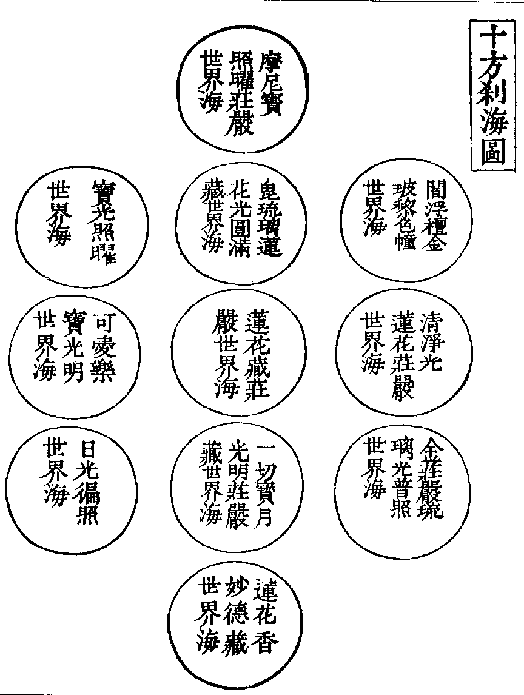



如来现相品云：此华藏庄严世界海东方，次有世界海，名清净光莲华庄严。彼世界种中，有国土名摩尼璎珞金刚藏，佛号法水觉虗空无边王。于彼如来大会海中，有菩萨名观詧胜法莲华幢，与世界海微尘数诸菩萨俱，来诣佛所(南西北方四维上下经文共有十段)。



如是十亿佛刹微尘数世界海中，有十亿佛刹微尘数菩萨，各与诸菩萨俱，来诣佛所。



又入法界品云：尔时东方过不可说佛刹微尘数世界海外，有世界名金灯云幢，佛号毗卢遮那胜德王。彼佛众中有菩萨摩诃萨，名毗卢遮那愿光明，与不可说佛刹微尘数诸菩萨俱，来向佛所，兴诸供养云。(南西北方四维上下经文十段，则十方共有十不可说佛刹微尘数世界海也，统名十法界安立海。)



释大数名



不可说者，大数之名也。此数唯佛尽知，故心王菩萨请问数名之义，世尊亲说阿僧祇品，明佛德数量，世数所不及也。按苑法师华严经注云：按此方黄帝筭法，总有二十三数，谓一、二、三、四、五、六、七、八、九、十、百、千、万、亿、兆、京、姟、秭、壤、沟、㵎、正、载也。从万以去，有三等数法，其下者十十变之，中者百百变之，上者倍倍变之。今阿僧祇品用中上数法，初数便云一百洛叉(此云万)为一俱胝(云亿)，俱胝俱胝为一阿庾多(兆)，阿庾多阿庾多为一那由他(京)，频婆罗(姟)矜羯罗(秭)，阿伽罗(壤)最胜(沟)，摩婆罗(㵎)阿婆罗(正)，多婆罗(载也，此方数尽)多婆罗多婆罗为一界分，界分界分为一普摩，如是倍倍转增至一百二十，翻为一不可说数，则非世间之筭数也(枣栢华严论阿僧祇品解与苑注大同小异，大槩以数此类，未必全同)。



佛刹微尘数者，大千世界名一佛刹，将大千界内百亿须弥四洲轮围及大地等，尽皆细磨为尘，名一佛刹微尘。以一微尘计一世界，计前所磨之尘，尽名一佛刹微尘数世界。经中以世界极多，非世数可纪，故每以佛刹微尘数计之，曰一佛刹尘，二佛刹尘，乃至多多刹尘。以刹尘之数，或计世界，或计浮幢，或计香水海，或计安立海等。



通观刹海



十方刹海徧布虗空香海、华幢、德均义等，经虽隐略，例观可知。据现相品云：此华藏庄严世界海东方，次有世界海，名清净光莲华庄严。彼世界种中，有国土名摩尼璎珞金刚藏，佛号法水觉虗空无边王。于彼如来大会海中，有菩萨名观詧胜法莲华幢，乃至诣佛兴供等。此文隐略。假如东方法水觉佛说法时，即云：此清净光莲华庄严世界海西方，次有世界海，名莲华藏庄严。彼世界种中，有国土名娑婆，佛号释迦牟尼。于彼如来大会海中，有菩萨名弥勒，来诣佛所。餘九方例此。即知刹种义均。是则总十方十亿佛刹微尘数世界海中香海浮幢，与中央世界海中安立庄严，其相无异。又入法界品云：尔时东方过不可说佛刹微尘数世界海外，有世界名金灯云幢，佛号毗卢遮那胜德王。彼佛众中，有菩萨摩诃萨，名毗卢遮那愿光明，来向佛所。此文则又略其世界海及世界种也。亦如彼佛为主，乃云：尔时西方过不可说佛刹微尘数世界海外，有世界名娑婆，佛号释迦牟尼。彼佛众中，有菩萨摩诃萨，名弥勒，来向佛所。餘九方亦例此。如是推之，则知总十方十不可说佛刹微尘数世界海(据十段经文之总数)，有十不可说佛刹微尘数广大莲华为所依持，如蕋香幢等(十方诸刹海皆如中央)。一一大莲华上，各有大金刚轮围山。一一轮围山内，各有十不可说佛刹微尘数香水海，如无边妙华光香水海等。一一香水海中，出一莲华，如一切香摩尼王庄严莲华等。一一莲华上，有一世界种，如普照十方炽然宝光明世界种等。一一世界种中，皆有二十重世界，于中布列，如娑婆世界八方上下诸世界等。其诸浮幢，皆上齐诸宝云，下齐诸宝地。宝地为华幢所持，华幢下有大香水海(此海有二义)。若此海外有轮围山者，则各各分际，各各名号，如普光摩尼庄严香水海等。下有风轮，如殊胜威光藏风轮等。若此海外无轮围山者，则八方诸大华王，同在普光香水海中，如莲池然。其香水弥漫，徧周法界，莫可测其涯际矣(齐此总名为一法界安立海也)。



翱翔法界



研穷法界，高广无极，展演心光，恢蓥觉体，自内之外，从近之远，廓彻洞融，徧周空界。初从我等现居国土，曰娑婆八方，有十三佛刹微尘数世界围遶。向上经七佛刹微尘数世界，至浮幢之顶(以上乃太虗空)。向下度十二佛刹微尘数世界，至世界之种(即宝光明世界种也)。如是东行，度一种、十种、百种、千种、万亿兆京，乃至正载数种、恒沙数种、一洲尘数、四洲尘数、须弥尘数、小千尘数、中千尘数，以至大千世界微尘数世界种。如是一佛刹尘、十百千刹，至正载刹尘，展转至于阿僧祇刹尘，乃至不可说佛刹微尘数世界种，方至极东大金刚山下。如东方，次南方，次右旋，九方亦如是。周极轮围，是为华藏世界海边疆也。复从此刹海东行，度一轮围(一轮围内有一世界海)，二三轮围，十百千轮围，洛叉俱胝那由他恒沙轮围，小千、中千、大千尘数十佛刹尘、百千刹尘、阿僧祇刹尘，乃至不可说佛刹微尘数金刚轮围山。又一轮围(即极东方金灯云幢世界)，如东方，南、西、北方及四隅亦如是。共八不可说佛刹微尘数世界海，皆竖高十九佛刹微尘数世界，上齐宝云，下齐宝地，最下极于风轮，统八极为法界安立海之边际也(安立海名详后)。研究至此，至广至大，无量无边，斯似乎极，然犹未也。等而上之，尚有上下方故。若尔，则彼华藏庄严世界海，浮幢之上，空旷无穷，复有风轮(如平等住风轮，有须弥山微尘数持上)、大海(如普光海)、华幢(如蕋香幢)、刹海(如下华藏世界海)，如是上行，过一刹海，复过十刹海，百千万亿超诸世数，乃至不可说佛刹微尘数刹海，最上方至于说佛种性无有尽世界普智轮光明音佛所(上方极尽)。又复彼华藏庄严世界海，最下风轮，名平等住，其风轮下，空旷莫测，复有诸浮幢(如宝光明种上二十层等)、华王(如蕋香幢)、香海(如普光海)、风轮(如上殊胜威光藏等须弥山微尘数)，其下渡虗空，至第二刹海(下方第二世界海也)，又渡第三、第四、十、百、千、万，乃至非世所知不可说佛刹微尘数世界海，最下方至于一切如来圆满光普照世界虗空无碍相智幢王佛所(下方至极)。总法界十方而观之，则华藏周帀得八数，上下得二数，如竖轴水车轮状(上下孤竖如轴，八方周辏如幅)，及伞葢形。如是揆之，亦未可为尽。何也？今会华藏为主，而十方乃有多刹尘数之伴，则上下诸佛刹海岂独无伴乎？是知经文含隐。详夫上下方之刹海，一一各有众多尘数刹海围遶，一如华藏八方之数。如是则八方齐等，上下相当，风轮香海重重相间，华王刹海行行相当，譬如百千大莲华池徧立空界。呜呼！孰能纵金刚翮、豁天眼光而游观此广大法界者哉？即使迈过斯界，四顾茫茫，而太虗空外复何物邪？又复谛审谛观十方刹海，亦非止此而已矣。是以诸佛境界广大无边，非入大解脱、得大三昧莫能见之。为启凡愚，故下本经文略言毫末而已(下本文亦未全，尚有十品存于天竺)。中上本经当更有餘义。信乎须弥量笔、大海量墨莫能书也，大千尘偈、大地尘品未足为多。原极于此，则情忘智绝，廓然无思矣。噫！回视我辈蕞尔之身心、寸灵之知觉，类夫醯鸡处于太虗、浮沤流于大海，存邪？亡邪？恍乎？惚乎？如梦想焉，如幻化焉，罔知所以然而然者也。故经云：十方虗空生汝心中，犹如片云点太清里，如法界性究竟圆满遍十方故。岂欺我哉？是故理极故令事广，花大故省池深。



佛光观



华严论云：如经中第二会普光明殿中说十信法门，世尊从两足轮中放百亿光明，徧照三千大千世界。修行者当随佛光作光明想，徧于三千大千世界。此想成已，次观光明过此大千，照东方十大千，南方乃至上下方亦各十大千。如是一周竟，次观光明过十至百，过百至千，过千至万，乃至无量不可说世界。光徧虗空，令其自心亦徧虗空。心同虗空，其心自定，朗然安乐。方从定还起十方观，周徧推求，自心内外都无所有，方始了知空慧现前，名忆念诸佛智慧光明普见法门。在此位中，定乱俱忘，名初发心住。以此空慧观诸世间一切众生及以国土，皆如幻化，无有体相，同佛空慧解脱法门。入佛知见已，以此名念佛门，以无念正慧相应故。入十方境界念佛门，空慧自性普周徧故。及一切佛成正觉、转法轮，三世劫在一时，无时分延促之相可安立故。



法界无尽



道旷无涯，法界无量，众生无数，业化无穷，诸佛悲智亦无有尽，毗卢法身无处不徧，方广妙法在在恒宣。如善知识寂静音海主夜神云：次值毗卢遮那如来于此道场成等正觉，念念示现大神通力，我时得见，即获此念念出生广大喜庄严解脱。得此解脱已，能入十不可说不可说佛刹微尘数法界安立海，见彼一切安立海一切佛刹所有微尘，一一尘中有十不可说不可说佛刹微尘数佛国土，一一佛土皆有毗卢遮那如来坐于道场，于念念中成等正觉，现诸神变，一一皆徧一切法界海，亦见自身在彼一切诸如来所，又亦闻其所说妙法，又亦见彼一切诸佛一一毛孔出变化海，现神通力，于一切法界海、一切世界海、一切世界种、一切世界中，随众生心，转正法轮。



七、法界总论



四土圆融图



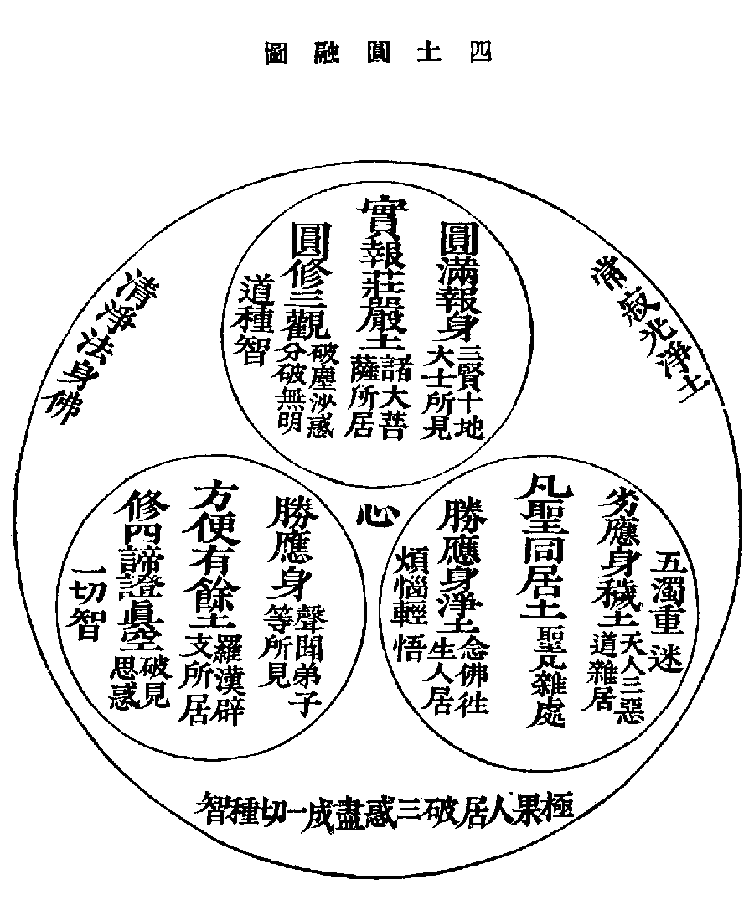



慈照宗主云：寂光同居，一智无殊。情生彼此，见有亲疎。觌面了色，空性如如。本无二路，自见妙麤。吾不如是，一体毗卢。惺惺寂寂，如净明珠。照彻心体，凡圣同途。四土合辙，三身一如。头头净土，处处阿弥。削去迷情，顿明心地。无量法门，收归方寸。



优昙大师偈。四土非方域，情生碍不通。悟迷分大小，净秽隔西东。万有形虽别，千机理自同。春风俱一拂，何处不花红。



依正通论



十方世界，无量无边。一切含灵，无穷无数。总而言之，不过依正。别则十四种，谓依报国土有四种，正报有情有十种。十种者，谓四圣六凡也。言四种者，曰寂光，曰实报，曰方便，曰同居也。问：何等有情，依何国土？曰：诸佛究竟极果，居常寂光土。法身大士，居实报土。三椉圣人，居方便土。六凡众生，居同居土。曰：若尔，则邦域各殊，凡圣亦异。云何云娑诃世界为释迦佛土，清凉补陀为菩萨圣境邪？曰：诸佛极果，理居寂光。摄化有情，亦居下三土。然佛身有三种：一法性身，居于寂光土。二报身，居实报土。三应化身，居方便土及同居土。释迦乃化身佛也。佛为教主，故云佛之刹也。菩萨以助佛转轮，故亦从之，如某郡主之郡也。(上言三身居四土。)问：若然，释迦为化身者，云何经云娑媻世界，其佛即是毗卢遮那？曰：对机说异，而其体常一。凡夫二椉见者，名为应身。(随六道所见，各各不同。)诸菩萨见者，名为报身。有无量相好，依报有无量庄严。若得净心，所见微妙，其用转盛。乃至菩萨地尽，见之究竟。若离业识，则无见相。以诸佛法身，无有彼此色相迭相见故。问：若诸佛法身，离于色相者，云何能现色相？曰：即此法身，是色体故，能现于色。所谓从本已来，色心不二。以色性即智故，色体无形，说名智身。以智性即色故，说名法身。徧一切处，所现之色，各各差别，皆无分齐，而不相妨。此非心识分别能知，以真如自在用故。



法身如来名毗卢遮那(此云徧一切处)，报身如来名卢舍那(此云净满)，应身如来名释迦牟尼(此云能仁寂默)。此三如来，一必具三，三即是一。不一不异，非纵非横。圆覧三法，假名如来。随顺世间，而论三身(此明三身一体)。问：若三身即一体者，云何一体住四土邪？曰：虽随机分四，然非异处，但同处异见耳。



四土净秽



观经疏云：四种净土，谓凡圣同居土、方便有餘土、实报无障碍土、常寂光土，各有净秽。五浊轻重，同居净秽；体析巧拙，有餘净秽。次第顿入，实报净秽；分证究竟，寂光净秽。娑媻杂恶，荆棘瓦砾，不净充满，同居秽也。安养清净，池流八德，树列七珍，次于泥洹，皆正定聚，凡圣同居，上品净也。方便有餘者，修方便道，断四住惑，故曰方便。无明未尽，故曰有餘。智论云：出三界外有净土，声闻、辟支佛出生其中，受法性身，非分段生。就中复有利钝，故论净秽也。实报无障碍者，行真实法，感得胜报，色心不相妨，故言无障碍。纯菩萨居，无有二椉。仁王经云：三贤十圣住果报。华严云：无量香云台。即其土净妙五尘。就中次第顿入，更论净秽也。常寂光者，常即法身，寂即解脱，光即般若，是三点不纵横，竝别名秘蜜藏。诸佛如来所游居处，真常究竟，极为净土，分得究竟上下净秽耳。



五土净秽



净土论云：土有五种：一、纯净土，唯在佛果；二、净秽土，谓净多秽少，即八地已上；三、净秽平等土，谓从初地乃至七地；四、秽净土，谓秽多净少，即地前性地；五、杂秽土，谓未入性地(即凡夫所居土)。第五人见后一，不见前四；第四人见后二，不见前三；第三人见后三，不见前二；第二人见后四，不见前一；第一佛上下五土，悉知悉见也(注：凡五上人，皆下不知上，上能知下也；五不见四，凡不知圣也；四不见三，小圣不知中圣也；三不见二，中圣不知大圣也；二不见一，则大圣不知至圣也。第一人唯佛至圣满觉，故五土悉见，圣凡悉知)。



同处异见



或问：佛土、生土，为同在一处？为各在异处？曰：同在一处。曰：既同处，则劫火坏时，应同散灭，可得然乎？曰：劫火坏世，佛土不坏。何则？众生恶业故，别业妄见故，菩萨善业故，佛无如是业故。所以华严云：一一刹种中，劫烧不思议。所现虽败恶，其处常坚固。法华云：众生见劫尽，大火所烧然。我此土安隐，天人常充满。故知不坏。然灭虽不俱，而起必同处。虽曰同处，而佛土不坏。(注：坏者，是变化土。不坏者，是自他受用土。以业不同，故同处异见。)曰：土在同处，我何不见？曰：业报不同故。如人于饿鬼，火处见水。饿鬼于人，水处见火。虽曰同处，而各不相见。唯同业者，乃能见耳。亦如药叉宫殿与人宫殿，同在一处，互不相见。他受用土，亦复如是。若自受用土，故是周徧，不即不离。若法性土，起灭常如。故佛土不可以存灭染净而思矣。○如维摩经：螺髻梵王见释迦佛土清净，如自在天宫。舍利弗见此土坑坎秽恶，乃疑念：若菩萨心净，则佛土净。我世尊意岂不净？而是佛土不净若此。佛言：日月明净，盲者不见，非日月咎。佛以足指按地，即时三千大千世界，若干百千珍宝严饰，譬如宝庄严佛无量功德宝庄严土。一切大众叹未曾有。佛语舍利弗：我佛土常净若此，为欲度斯下劣人故，示是众恶不净土耳。譬如诸天共宝器食，随其福德，饭色有异。若人心净，便见此土功德庄严。(罗什注称：适众心故，现国不同。螺髻所见如自在天宫者，复是见其所应见耳，而未尽其净也。下言如宝庄严佛国，始见释迦真、报、应净国。净国即在此世界。如法华寿量品中云云。此净秽同处而不相杂，如一器中有二种食，应二种众生。又李长者云：维摩经净土是实报土。未具明广。)○问：如前所言，则诸佛国土定是实有。云何经言诸佛国土犹如虗空？曰：法身无相，应物故形；真土无方，随机而现。众生善业故，诸佛本愿故，法如是。故经偈云：诸佛国土如虗空，无等无生无有相。为利众生普严净，本愿力故住其中。疏云：彰净国之意，使傚而行之。前半智境严，即无严。谓自受用土，周徧无等；法性之土，体性无生。二皆无相。后半悲应。无严之严，严徧法界；无住之住，常住刹中。(□心应下，后半即他受用及变化净。一偈之中，四土□□。如是则佛土不可以有无度之，但随悲智隐显利物耳。)



色因识变图



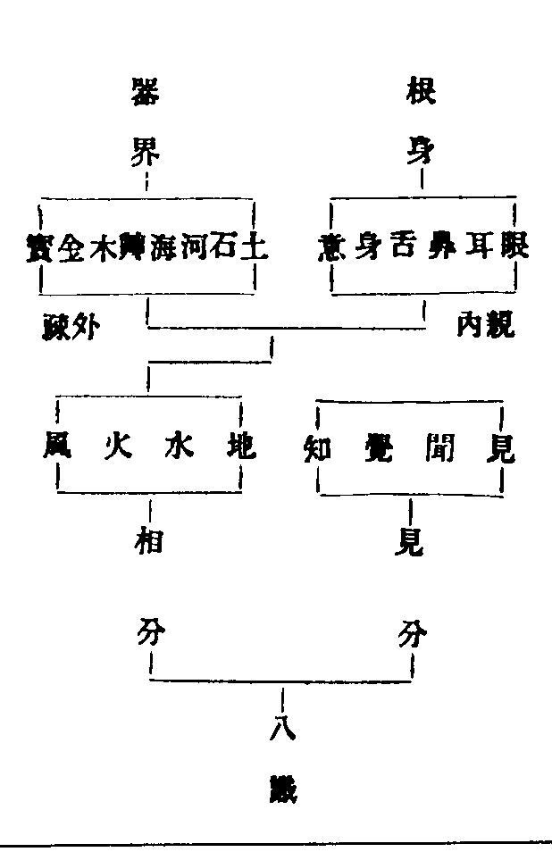



谓真妄和合，非一非异，名阿赖耶识，即第八识。此第八识分，为见相二分。见分变出眼等七识，相分变成根身器界。内六根有执受，故为亲相分。外器界无执受，故为疎相分。此二种相分，皆四大所成。四大为能造，依正为所造。八识是能变之主，详具唯识论。



或问：一切世界，因何而有？造者为谁？曰：因心而有，唯心所造。夫一切众生，自无始来，迷真合妄，而成阿赖耶识(此云藏识，以能摄藏诸法种子)。因此识故，变似根身器世界等。故经云：无始时来界(界，因也，即种子识。无始相续，亲生诸法故)，一切法等依。由此有诸趣(六趣生死，由八识而流转)，及涅槃证得(四圣修行，亦由此而得道)。又云：三界无别法，唯是一心造。一切因果(十法界诸因果)，世界微尘(净秽等诸世界)，因心成体(心为能造依，正为所成体)。又问：若识变似世界等，为是各各变？为是共变？曰：此义幽奥，应四义分别。



共不共义



宗镜录云：一、共中共变。由八识共相种成熟力故，变似色等器世间相。虽诸有情所变各别，而相似处所无异。如众灯明，各徧似一。多人所感，多人受用。如无主山河，众人共业力变。又共得受用，重名为共。非一趣用，他不能用。(佛言：一人发真归元，十方虚空，悉皆销殒。且古来发真得道者多，而世界元在者，岂圣言之无徵，而修行者不至欤？曰：非也。发真者，界实消。然所消者，自变之分耳。其元在者，共变之境也。以共义故，世界犹存。以不共义故，说消殒也。如一灯灭除，灯尚明果。众皆发真，则十方俱消无疑。)○二、共中不共。若唯识理，各各自变，各自受用。今且约自身能用，他不得用，名为不共。如有主山河，亦如自己田宅等，及鬼等所见猛火等物，人见为水，餘趣餘人不能用故。○三、不共中共，如自扶根尘，他亦受用。即内扶根尘，初唯自第八变，故名不共。变后他人亦有受用，名共，如婬女等。○四、不共中不共，如眼等根，唯自识依用，非他用故。眼识唯依眼根发，乃至身识唯依身根发等。问：色从识变者，无色界天无有色相，云何说变？曰：下界众生所见是业果色，无色界现境是定果色(入定时亦有宝宫殿等)，俱不离心。华严云：菩萨鼻根闻无色界宫殿之香。阿含云：舍利弗入涅槃时，色、无色天宫中泪下如春雨。波阇波提入涅槃时，色、无色天佛边侧立。以此而知，虽无麤色，亦有细色，故亦从心变。是故佛言：三界唯心，万法唯识。



自在不自在义



又相违识相者，谓彼四类有情能变之识，各相违故。致令所变之境，亦乃相违。故天见是宝严地，鱼见是窟宅，人见是清冷水，鬼见是脓河猛火。由四类有情先业之力，共相一处，各变相分不同。又如人见粪秽处，傍生见为净妙饮食。人见净妙饮食，诸天见为臭秽。故知随福见异，垢净唯心。业自差殊，食无粗细。又以悭吝业故，见浓满河流溢。然饿鬼等虽同趣，见亦差别。或有见大热围融煑迸𪷽，或见屎尿横流。(若相不一。)又虽同人趣，薄福之人，金带见为铁鎻，或见是蛇，或见金银为水为瓦砾等。又天人同器而食，上福者白色，薄福者见黄赤色。○又色自在相者，谓八地以去，菩萨相及土，皆得自在。以上品定心，有大势力，能任运变。大地为黄金，搅长河为酥酪。此是境随真智转，所变事皆成。一切诸妙境，(如华严会上，菩萨兴种种供云、宝葢、楼阁、珠网等。)皆不离菩萨能变之心。乃至异生，亦能变化。如变水为火，(饿鬼。)变昼为夜，(枭等。)变铁为金，(仙等。)变夜为昼。(鬼国。)此皆是境随事识转，所变事皆成。○凡变金银宫殿者，是实定果色，初地已去方能变。古德云：色自在心生，故心能变色。所以移山覆海，倒地翻天，变土成金，搅河为酪，悉无难事。当知色法，皆随感现。色无定体，随心所变。此理元是如来藏中不思议法。(十大之性，一一周徧，循业发现，为地为水等。圣人证此，得自在用，故转变无碍。)随心取著，成外成小。(著邪见故成外道，住真理故成小椉。菩萨于诸法，无住无碍。)言心造心变，咸出大宗。小椉有言，而无其理。然诸椉中，其名虽同，义亦少别。有共造依报，各造正报；有共造正报，各造依报。众生迷故，或谓自然。(松直棘曲，鶴白乌黑，皆是自尔。)梵天等造。造已，或云情与无情。(皆最邪因无因。如震旦云：阴阳等造，亦不由自然无因。)造名犹通。(通混内外，下出正因。)应云心变。心变复通，应云体具。以无始来，心体本徧。故佛体徧，由生性徧。徧有二种：一宽广徧，二即狭徧。所以造通于四，变义唯二，即是唯圆及别后位。圆人始末，知理不二。心外无境，谁情无情？故藏通造六，别圆造十。此十及六，括大小教。由观解异，故十与六，各分二别。藏见六实，通见无生，别见前后生灭，圆见事理一念具足。○实相法尔，具足诸法。诸法法尔，性本无生。故虽三千，有而不有，共而不杂，离亦不分。虽一一徧，亦无所在。若达唯心，了体具者，焉有异同？何疑有无？故知一尘一心，即一切生佛心性，何独自心之有无邪？以其造故，以共变故，同化境故，同化事故。世不知教之权实，执小道而抗大道者，其犹螳蜋乎？井蛙乎？应知万法是真如，由不变故；真如是万法，以随缘故。



心造法界图



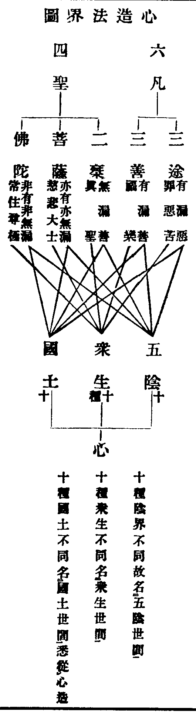



智者大师云：凡界内界外，一切阴入，皆从心起。佛告比丘：一法摄一切法，所谓心是。论云：一切世间中，但有名与色。若欲如实观，但当观名色。(心及相应数法，皆无质，但有名。身形质碍曰色。若开名为四：受、想、行、识，即五阴。)华严云：心如工画师，造种种五阴。(即十法界五阴。)一切世间中，莫不从心造。(三种世间，皆从心起。)



十法界者，三义十数是能依，法界是所依，能所合称故言十法界。又此十法各各因各各果，不相混滥故。又此十法一一当体皆是法界，故十法界通称阴入界者，以皆有阴入界故。佛有涅槃常住阴界入。大经云：因灭无常色获得常色，受想行识亦复如是。常乐重沓积聚义，慈悲葢覆即阴义。以十种阴界不同，故名五阴世间。揽五阴通称众生，乃至佛揽常住阴为尊极众生。大论云：众生无上者佛是(十号中为无上士)，岂与凡下同？以十界众生不同，故名众生世间。十种所居通称国土者，地狱依赤铁住，畜生依地水空住，修罗依海畔海底住，人依地住，天依宫殿住，六度菩萨同人依地住。通教菩萨惑未尽同人天依住，断惑尽者依方便土住(同二椉处)。别圆菩萨惑未尽者同人天方便等住，断惑尽者依实报土住。如来依常寂光土住。仁王经云：三贤十圣住果报，唯佛一人居净土。土土不同，故名国土世间也。此三十种世间悉从心造。



无明法，法性生一切法。如眠法覆心，则有一切梦事。心与缘合，则三种世间，三千性相，皆从心起。若达无明即法性一切心，一心如彼醒寤。○若法性无明，合有一切法阴界入等，即是俗谛。一切界入，是一法界，即是真谛。非一非一切，即是中道第一义谛。如是徧历一切法，无非不思议三谛。若一法一切法，即假观。一切法一法，即空观。非一非一切，即中道观。若一空一切空，无假中而不空，总空观也。一假一切假，无空中而不假，总假观也。一中一切中，无空假而不中，总



一念具三千图



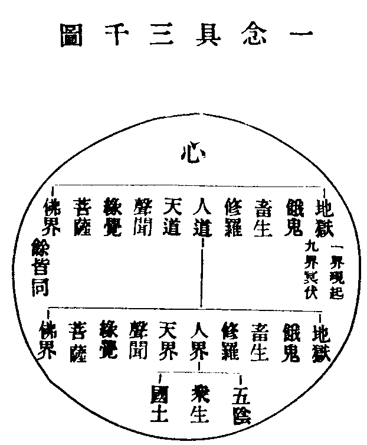



一心具十法界，一法界又具十法界，成百法界。一法界具三十种世间，百法界即具三千种世间。此三千在一念心，若无心则已介尔，有心即具三千。亦不言一心在前，一切法在后；亦不言一切法在前，一心在后。秪心是一切法，一切法是心，不前不后，非纵非横，非一非异，非识所识，非言所言，故称为不可思议境。此是天台圆教观心之要，　具摩诃止观。



法界直指图



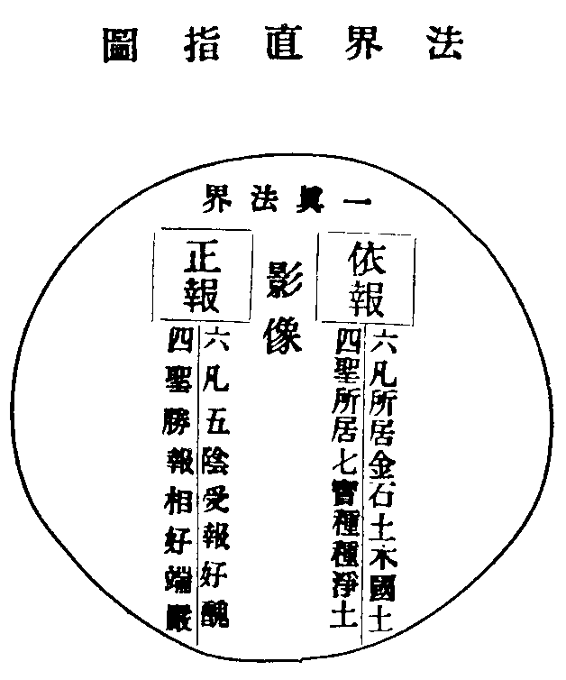



四圣六凡，依报正报，皆依一真法界而起业用。如虗空包含万象，大海涌现千波。又如明镜，现众色像。夫一真法界，明镜之体也。圣凡依正，镜中之影像也。虽影像似有，而性常自空。镜体虽空，而能现影像。是以空有无碍，真俗变融。以体寂故，名理法界。以相用故，名事法界。以即理之事，名理事无碍法界。以事事即理，名事事无碍法界。此四法界，举一全收，互摄互融。凡举一尘一毛，皆具足诸法。



中观也。即不可思议一心三观，历一切法亦如是。如四大色，能造大地、土石、艸木、种种人类、种种禽兽。如如意珠，能雨净妙五欲、七宝琳琅。色法尚尔，况心神灵妙，宁不具一切法邪？



永明智觉禅师云：夫善恶二轮，苦乐二报，皆三业所造，四缘所生，六因所成，五果所摄。若一念心瞋恚邪婬，即地狱业；悭贪不施，即饿鬼业；愚痴暗蔽，即畜生业；我慢贡高，即修罗业；坚持五戒，即人业；精修十善，即天业；证悟人空，即声闻业；知缘性离，即缘觉业；六度齐修，即菩萨业；真慈平等，即佛业。若心净，即香台宝树，净刹化生；心垢，则丘陵坑坎，秽土禀质。皆是等伦之果，能感增上之缘。离自心源，更无别体。



泰和曾居士曰：将明法界之性，先示业用之相，回万虑于体中，判千途于一念，故见见闻闻，不可得而略也。夫六合之间，奇伟灵变，何所不有？良以斯人弱丧，封锢实深，心穷于耳，耳夺于目，亥步所经，已不能晓，形物之表，益复昧然。若不解其桎梏，除其盲聋，则穷心犹鄙，宁承长者之家？局智长惊，谁破肩吾之夜？今斯图出，使人知大象若斯，前闻实狭，然后荡𮌎遣累，豁视开听，即事明理，达境惟心。如其世智限心，幽途废照，亦将谓幅圆穷于天地，事业极于百龄，一途既谬，万岐横生，见网绸缪，长夜方永。故当依圣建言，编经显义，畅法界之无穷，以广其心；明道妙之过量，以变其志。庶几局步可展，先心可革，拔锲出钉，将在斯矣。



法界安立图卷下之下(终)

