# 四教仪备释



> **藏经**：卍新纂大日本续藏经（新纂卍续藏）　**册次** 第 57 册（X57）　**编号** No. 977（X0977）　**部类** 经疏部　**卷次** 2 卷　**篇幅** 43,498 字

> **卷／品**：0 卷 · 0 品



---



天台四教仪备释上



苕谿沙门　元粹　述



天台四教仪　高丽沙门。



天台山，乃智者幽栖行道之地，以处命人也。虽吾祖生缘得道，垂化示寂，不在此山。盖为符定光悬记，兼展平生志愿，故事载别传。此山上应三台，故名天台。旧亦名南岳，俗谚亦称天梯。如辅行一(十七)。释教者，效也。亦诠理化物为义也。教有化仪、化法。只言四教者，通名立题，义摄两种。别文云八教，合二四以标之耳。仪，式也。旧据释签、金錍二文以明立题，今皆不用。高丽，东夷之国名。沙门，乃释氏之通称。此翻勤息，勤行众善，止息诸恶故。又沙门复以释为姓者，始自晋安法师。增一云：四河入海，同一咸味。四姓出家，皆名为释。显性录立四句料简云：一、是沙门非释氏出家外道，二、是释氏非沙门在家释种，三、是沙门是释氏两土之僧，四、非释氏非沙门两土之俗。



天台智者大师(止)，亦名五味。



炀帝居藩邸，称晋王从吾祖受戒。师谓王曰：大王迂遵圣禁，宜号总持。王云：师传佛灯，宜称智者。(具载别传)判释者，妙乐第一云：化仪四教，是判教之大纲。化法四教，乃释义之网目，罄无不尽者。一大藏教，判释无遗矣。旧於此辨提，谓摄属彼经。虽明人天戒善，亦三藏收具。见玄签第十(云云)。华严时，从经题立名。因行如华庄严，果德具云大方佛华严经。此人法喻三具足，更有单三复三，谓七种立题。如妙宗第一(云云)。鹿苑，亦曰柰苑，亦名仙苑。如来昔生垂化之地，缘载辅行(云云)。阿含，翻无比法。玅玄(十一)云：增一明人天因果，中明真寂深义，杂明诸禅定。长破外道，而通说无常，知苦断集，证灭修道。(文)方等，从事法立名。四教并谈曰方，四机普益曰等，乃调斥之方等也。若行法经称方等典，就理得名。如释签云：此以理等名方等典，非谓生酥调斥之方等。止观又以四门入清凉池曰方，所契之理曰等，此约行理合释。今方等时，非后二种。维摩诘翻净名，亦无垢称、思益、梵天所问经。楞伽翻不可往。楞严翻健相。三昧翻调直定，亦云正受。金即法身。光即般若。明即解脱。胜鬘夫人乃波斯匿王女。摩诃翻大多胜。般若翻智慧(般若五，不翻之中，一如法数)。摩诃般涅槃那飜大灭度。如来四十九年说法，总成五时。颂曰：阿含十二方等八，二十二年般若谈，法华涅槃共八年，华严最初三七日。此是别五时，更有通五时。收经如妙玄第十(二十六)。



言八教者(止)，然后出藏、通、别、圆。



不从渐来，直说於大，时部居初，故名顿教。中间三味，次第调停，引小向大，故名为渐。不思议力，一音异解，互不相知，名秘密教。闻小证大，闻大证小，得益不同，名不定教。经律论三，含藏法义，条然不同，名三藏教。三乘共行，利根菩萨，通别通圆，故名通教。独菩萨法，次第断证，别前藏通，别后圆教。理智断，行位因果，一切圆融，故名圆教。



第一顿教者(止)，约教名兼。



如来者，乘如实道，来成正觉，寂灭三惑，究尽二死，永亡三惑，亦名五住。谓见思为四住，尘沙无明为一住，同居名分段生死，方便实报名变易生死。四十一位者，圆教分真、住、行、向、地、等觉也。妙玄亦云四十一地。盖华严列众，菩萨虽多，举地位以总摄。如朝廷文武虽多，总曰百僚。旧据四念处文，前无十信，后无等觉为难者，误以部中谈位，难经前列众也。八部者，天(一)，龙(二)，夜叉(三)，乾闼婆(四)，阿修罗(五)，迦楼罗(六)，紧那罗(七)，摩睺罗伽(八)。人非人，总结也。须喻月者，智德渐圆，惑暗究尽，乃成断德(云云)。卢舍那，翻净满，亦名光明遍照。此华严教主，於道树下，现起尊特。修多罗，翻契经、契理、契机也。十二部之总名，亦别为十二部中第一。龙鬼等得预法会，以乘急戒缓故。法华文句二(二十三)，准涅槃开四句，如常说。



此经中云(止)如聋若哑等是也。



日出等者，妙玄第一明三照。准旧译华严二十九宝王如来性起品，譬文有四、合法有五。今家合四为三、演三成五，以对涅槃十三圣行品相生五味。又妙玄第十引法华信解品文用对五味，并图于下。



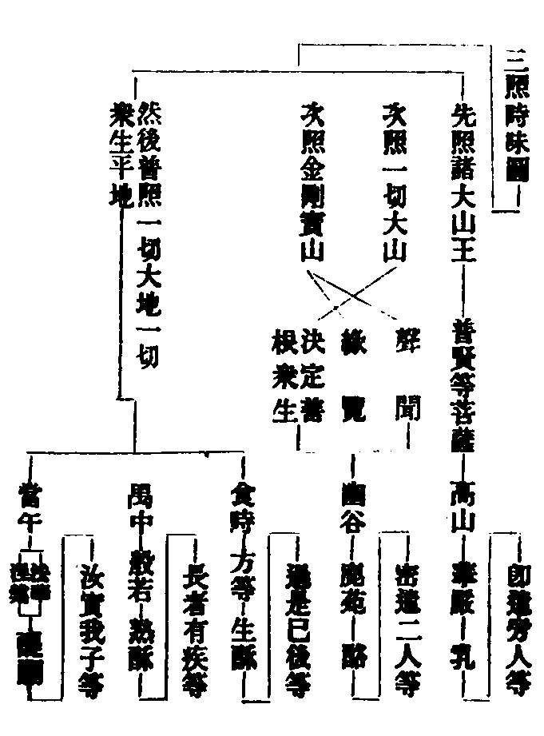



十二部经颂云：



> 长行重颂并授记，孤起无问而自说。



> 因缘譬喻及本事，本生方广未曾有，  

> 论议俱成十二名，广如大论三十七。



妙玄云：大小各具十二部，但小乘中说，非大乘之义。别让三存九，小乘灰断无。方广经说：必假缘无，无问自说，虽有授记，记作佛少。又论大乘九、小乘十一部，为缘别说，具在玄文。(文六十七。)信解品譬喻周后四大弟子，具领五时文也。即遣旁人等说华严教，以拟宜也。如加被四菩萨说住、行、向、地四十位，法慧说十住，功德林说十行行，金刚幢说十向，金刚藏说十地。具如释签第十。声闻在座，如聋若哑，谓有耳不闻圆顿教，有眼不见舍那身，以不见故，不能赞叹，故如聋哑。此同妙玄第一云：顿说本不为小，小虽在座，如聋如哑。然准妙玄第十，华严初分永无声闻，后分则有。此似前分有声闻者。别行疏记云：以后显前，机未堪大。(文下十五。)昔慧觉谓前分虽无形服，有根性声闻释叹者，误矣。



第二渐者(止)，事六度等教。



初中终三渐之始，寝大施小也。约佛意则寝於法华，据化仪则寝於华严。处说不动而游，身论脱珍著弊，文互显耳。又不动而游者，妙应无谋大小异见，如人覩月东西各行，皆有月随月实不往。舍那尊特智定庄严，故譬珍御。丈六应身忍生法恼，故譬弊垢。谓丈六佛著二忍衣，时人以衣长丈六为难者非。兜率翻知足六欲，并梵世七天之中有内院外院，菩萨居内院而降神也。摩耶翻天后化乘白象贯白日精，自右脇入正慧托胎也。大乘则乘旃檀楼阁等出胎，四月八日右脇降诞，备载瑞应经。纳妃有三：一瞿夷、二耶输、三鹿野。耶输生子名罗睺罗。出家等者，颂云：



> 十九逾城六苦行，五岁游历三十成。  

> 说法度生五十年，是则共当八十寿。



菩提翻道。草座者，因果经说：帝释化为吉祥童子，以草施佛，坐以成道。木、树、草座皆表三藏诠生灭故。劣应者，对大乘胜应说也。五人者，颂云：



> 頞鞞䟦提并俱利，此三属在父之亲，  

> 陈如十力母之亲，初转法轮先度此。



诸文异出，今图而会之。



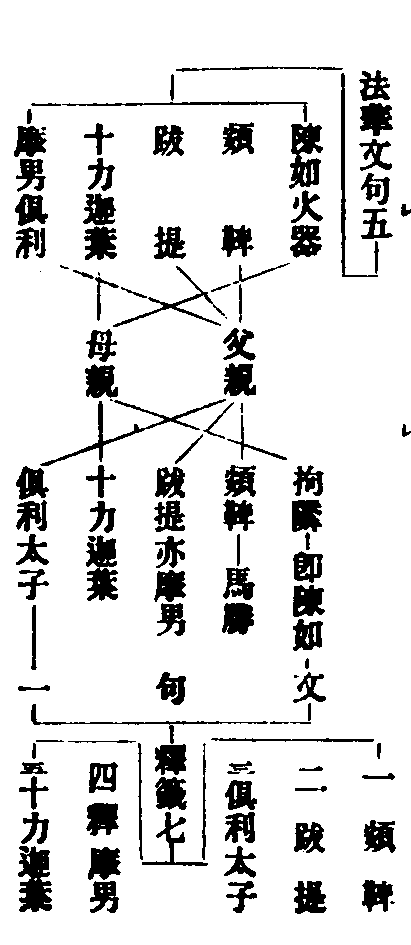



文句第五与涅槃疏、应法师众经音义同，以摩男、俱利为第五一人。文句第一却云䟦提亦摩男。今谓摩男翻大名，恐是长子之通称。以䟦提是甘露饭王之长子(出本行集)，俱利是斛饭王之长子，故二人互得称摩男也。不然，恐文句别有所出，释签却没。陈如开俱利、摩男为二人，当俟寻考，未敢臆说。谛度三。下文具明事者，三藏实有，不即理故。此且示小始垂化事迹，非论八相。然大小八相，降魔存没。旧说大无降魔，了魔即法界故；小无住胎，不谈常住故。今谓不然，华严五十八列降魔相，岂小乘耶？又魔即法界，圆教可尔，通别如何？当知经论存没，祇是随机异说耳。小八相如四教义，大八相如起信论。



若约时，则日照幽谷(止)，出九部修多罗。



旧译经二十九卷中，以一切大山及金刚宝山，合譬三乘对於鹿苑。今云幽谷者，亦准经结文云：譬如日月出现世间，乃至深山幽谷无不普照(文)。十二部出九部者，意明相生，其实九部亦从佛出。



信解品云(止)：即破见思烦恼等义也。



二人者，约法则谛缘，约理则真俗，约人则声闻缘觉也。不修相好故云憔悴，无力无畏故无威德。徐语者，文句云：大教明理真实故云疾走往捉，小教明理迂隐故云徐语。二十年者，用八忍八智断见合为一无碍一解脱，用九无碍九解脱断思总成二十，餘如文句第六。



次明方等部(止)，故言对教。



方等逗大逗小，以大斥小，以圆诃偏。虽四教俱说，收经甚广，然论部意，正为小机。释签云：虽兼斥大，正在斥小，故令小根耻小慕大。故今云对半说满也。才证小果，便堪弹斥，未必须待十二年后。后因维摩示疾毗耶，佛命弟子诣彼问疾，故皆述昔被弹，辞不堪往。室中更有礼座去华等事，广如彼经。半满字者，涅槃第五云：譬如长者，唯有一子，心常爱念，将诣明师，惧不速成，寻便将还。以爱念故，昼夜殷勤，但教半字，而不教诲毗伽罗论，良由其子力未堪故。毗伽罗翻字，本即满字也。



若约时，则食时(止)心渐淳淑。



食时，则辰时也。毗罗三昧经说四食时：早起诸天，日中佛食，日西畜生，日暮鬼神。今当诸天食时，子信父者，得果不虗；父信子者，闻大不谤。互相体悉，信者顺也。闻大为入，住小名出。本处草庵，喻小涅槃。四明云：入见尊特，功由业识。教未开故，且住草庵。於此会中，得通教益。三索之中，当机索也。若论部意，不复须藏，为横来机而重说耳。故前云逗大逗小。



次说般若(止)，正说圆教。



方等弹斥共义稍疎，今此般若正当共部，故有共般若，有不共般若。然论部意，如辅行云：旁用通教，正用别、圆，加於二乘，密成别益。(文十二、十五。)又释签云：前於方等，义已成通，故至般若，唯须此二。(别、圆。)明不共者，说部意也。意虽不共，犹有方等新受小者，至此须通，亦有衍门傍得小者，是故兼用。(文三十三。)今约偏、圆对论，故云带通、别二正说圆教。若仁王般若有四无常偈，义似三藏者，彼明助道，非部正意。



约时，则禺中时(止)，总名为渐。



禺中者，巳时也，禺亦作隅。长者具十德，如来具十号。金喻别教理，银喻通教理，般若明理不出此二，般若中圆亦别理摄。珍宝者，劝学中明一切法门。仓库喻定慧，包藏多少则广说略说，自行宜取化他应与。空生，须菩提也，亦翻善吉亦善现，解空第一。身子，舍利也，亦翻鹙子，智慧第一。般若空慧加被二人，转教菩萨加於可加也。三索之中此当情索。



第三秘密教者(止)，故言秘密教。



隐密赴机，互不相知，故云秘密。不同法华真秘，称为秘密。般若中诸天子叹云：我见阎浮提，第二法轮转。今转似初转。大谕六十五，释诸佛法轮，有显有密。初转声闻见八万诸天得无生忍，陈如得初果(显露教摄)。诸菩萨见无量阿僧祇人得二乘，无量阿僧祇人得无生忍等(此是秘密)。广如释签第一(二十一)具引。三轮者，摧碾业惑为义，亦曰三密。或为此人说顿等者，妙玄第一约十方此座一人多人示相须者当捡。且秘密何以得传耶？如妙乐云：秘密不传者，降佛已还，非所述故。尚非阿难能受，岂弘教者所量？又阿难非不传秘，覆机之密，非所传耳。故秘密所用，全是显教，是故传秘，只名传显(文一十八)。覆机妙用，故不可传。用已叙出，得以传之矣。此教之体，以顿等七教为当体，真中二理为所依。



第四不定教者(止)，故言不定教也。



一音之为教也，有小有大，通因通果，有当分，有跨节，有显有密，有定不定。今不定一音该乎大小，是果人所用，故使於渐得顿益，於顿得渐益。然益不定自属机边，何云不定教耶？教本被机，因教获益，堆功归教，教成不定矣。此由机缘宿种不同，於顿有渐种，於渐有顿种，故得圣教不定被之，对前秘密。今是显露不定人相，见法共闻，得益有殊耳。古师指一经一处为偏方不定教，今家不尔，一时一说一念之中备有不定。释签第一(二十二)云：乳中约圆别相对以辨不定，酪中教门虽无二别，乃与乃八万对，生酥熟酥三四对辨，其意可见(文)。故知不定徧前四味。又大经或时说深，或时说浅，应问即遮，应遮即问，及置毒发毒之喻，皆不定教相。此教亦以藏等四教为当体，真中二理为所依。



然秘密(止)化仪，四教齐此。



化仪齐昔，不通法华。若释签第一云秘密横被，无时不徧者，且约方等对前二时为言，考之自见。又释签第十云：五味则一道竖进，味味有半满相成，复於味味皆有秘密及以不定(文二十五)。彼约五味对半满以论相成，故玄文云：虽复俱游(五味半满俱用)，行藏得所。若华严唯满不半，乃至法华废半明满，半有成满之功也，非谓五味各有半满。又云味味皆有秘密不定者，且据大途言前四时耳。或显密相成，则以昔时秘密不定成今法华，是显非秘，是定非不定矣。昔据二签文设难，致有异解，今直示彼意，读者审之。若妙玄六(二十)引大论云：餘经非秘密，法华为秘密。释签七(十三)解云：非八教中秘密，但是前所未说为秘，开已无外为密。



次说法华(止)，又言会三归一。



妙法难解，取喻莲华，华果同时，权实体一。复有三义：一、为莲故华，喻为实施权；二、华开莲现，喻开权显实；三、华落莲成，喻废权立实。权谓四时、三教，三谓三乘人也。今悉开会，无非佛乘。又开已唯实，无权可论，义当於废，此是迹门。更有本门，拂迹显本，对喻可知。又迹门与诸经有同有异，圆诠虽同，兼带异也。本门与诸经一向异，诸经永无，久成寿量。古德云：理冠群经，事高一化。良有以也。



言权实者，名通今昔(止)，独得妙名，良有以也。



权实者，权谓权谋，暂用还废；实谓宝录，究竟指归。能诠则前三为权，圆教为实；所诠则真权中实。名通今昔者，昔经实妙权麤，今经开麤即妙，义非一槩，意各有归，故云不同。鹿苑但麤，唯一藏教。妙玄云：鹿苑三麤，鹫头一妙。约人论耳。兼但对带，别对四时，亦可昔部通云兼带。旧立部带、教不带等四句收经，今所不取。独得称妙者，有相待妙，有绝待妙，由开显故，有异昔经。故妙乐一云：显实语通，开权局此。问：昔部圆教更不须开，妙乐何云圆人初心谓圆隔偏，须闻开显诸法实相(文)？答：闻佛开权，隔偏情落，非开圆也。又妙乐云今经是圆，复须开显者，谓圆能开权耳。



故文云(止)世间相常住(理一)。



为实施权，不二而二；开权显实，二而不二。故人、理、教、行，四皆名一。光宅先立四一，谓教、人、因、果。今家立行一，收彼因、果，谓行始为因、行终为果，加理一以成四也。不明理一，法无归趣。文句第四云：无二者，无通教中半、满相对之二；无三者，无三藏中之三乘。又无般若所带，故无二；无方等所对，故无三。经中又云：无有餘乘，即华严之别及圆入别也。道即能通，故名行一。世间相常住者，相即实相故(云云)。经中正、直等二句，乃释迦章教一之文，说故属教，今取道义为行也。



时人未得法华妙旨，(止)故致诽谤之咎也。



迹门三周开显，初法说周，重举四时之权，会三乘归一乘，身子上根得记。次譬说周，明三车一车譬前法说四大弟子，设穷子喻获得家业，中根信解作佛也。下周因缘明十六王子，下种中间调停今得授记，有化城宝所之喻，下根千二百声闻等获益，人不见之故致诽谤。



约时则日轮当午(止)，出法华。



周礼一尺五寸土圭，立八尺之表，夏至午时以测日影，求地之中以建国。宋严、观二师与大史官何承天用此法测日影，以定中国。表北得影一尺五寸，与土圭等。地上餘阴一寸，天上千里，则知中印度方为地中。今云罄无侧影，据印度言之耳。涅槃经文本无出法华之语，但云出大涅槃，故后特标文云二义。今约义说，故只云此从等。



信解品云：聚会亲族，(止)授记作佛而已。



亲族者，法身影响之众也。开与授记，皆有通别。通开一切众生皆当作佛，别开当座悟入。通记阿耨菩提，别记劫国名号。



次说大涅槃者(止)，故名捃拾教。



此经之初，即广开常宗，显示佛性。为被末代，有追说四教(文出圣行品)。顺法华意，有追泯四教(出德王品)。泯者，合会也。四皆知常，意归圆实。暂用三教，以为苏息。实不保权，以为究竟。故譬法华如秋收大获，涅槃如捃拾餘残。



二为末代钝根(止)，故名扶律谈常教。



此追说四教，却更分别前诸味也。经中用譬赎今重宝。释签第三引经云：为末世诸比丘畜不净物(戒门畜八不净)，为四众说如来毕竟入於涅槃(乘种不达常住)，为灭诸恶为说是经，是经若灭佛法则灭(文二十六，彼文更委)。慧命法身论得失者，约迷悟以律助常，故云扶律谈常教。荆谿云：佛世尚以涅槃为寿，况末代根钝非助不前，习此宗者勉遵圣意。



然若论时味(止)，为第五时也。



同一醍醐，同中复异。妙玄第十云：涅槃犹带三乘得道，此经纯一无杂；涅槃更不发迹，此经显本义彰。(文八)妙乐复以一十六意辨异二经云：判味同时而部有异，约理名别咸归常住，约机彼称捃拾，约法彼存三权，论意彼带律仪，语证彼兼小果，受益彼无广记，说时长短永异，谈常过未不同，论譬大陈餘党，现瑞表彰各别，破执难易不同，领解近远亦乖，述成被根不等，用治生死不同。付嘱有下有此得十六意，准此略知事异意同不可失旨，失斯同异讲授殊难，岂唯两经餘亦不易。(文七十九。补注第八广引经释)文云般若出涅槃者，此法华后重般若也。



问：此经具四教(止)，初后俱知。



涅槃中四，正论追说，义兼追泯。追说则以三扶一，解即而行不即。追泯则即施即废，会三归一也。别教初心，信住行位，不知圆常。至向地中，始修始证。故曰：初不知，后方知。若妙玄四(三十一)云：别教初心，即知常住者，且约但中，名常住耳。又四教多种，云何分别？夫化仪之四，通该四时。当途之四，一代化法。若具说四，且在方等。从渐开四，徧论三渐。追说追泯，属涅槃部。别教复有竖入横学，还是别摄。总而言之，无出八教。



问：将五味对五时教，其意如何？



南本涅槃经第十三圣行品中，有菩萨名住无垢藏王，对佛称叹涅槃教胜。佛印可云：如汝所说，譬如从牛出乳，从乳出酪，从酪出生酥，从生酥出熟酥，从熟酥出醍醐。醍醐最上，若有服者，众病皆除。佛亦如是，从佛出十二部经，从十二部经出修多罗，从修多罗出方等经，从方等出般若波罗蜜，从般若波罗蜜出大涅槃，犹如醍醐。言醍醐者，喻於佛性。佛性者，即是如来。(文辅行九，下十四亦引。)义例云：五味唯喻一代五时浓淡，正显涅槃能诠教胜。若今家引用，或云相生，或约小机次第得益，明浓淡相皆约义通也。学者当知。



答：有二(止)，何必须待法华开会？



得通教益等者，辅行第十乃云：密成通益，密成别益(文二十五)。未审密益其其相如何？与当途通别行位为同为异？今恐祖师约义判耳。耻小慕大心渐淳熟义似於通，被加转教知诸法门义似於别，佛不显说机亦不知是通是别，故云密也。若论行位与当途四通别不同，以来开显且住小果。或经一二三四者，此既中根比於上达，味味得入似多一字，须约上达才闻即入，次则始终经涉一时其义亦通。又上达根性义该三乘，於法华前两教二乘密入，三教菩萨显露入，法界实相一体异名。若辅行云实相是别理，法界是圆理者，彼据大经，十千菩萨得一生实相是接入别，五千菩萨得二生法界是接入圆，以教判文理还不异。



上来已录五时五味(止)，自下明化法四教。



所录时味，且约当分。若五时互通，且如妙玄第十。欲略知者，华严在初，通亦至后；酪别居二；方等居三；般若第四，通皆至后；涅槃第五，通亦至初。故云从初发心，常观涅槃行道。若法华显露边论，不见在前；秘密边论，理无障碍。得此意已，判经无壅。问：化仪化法，八教名义，出何经论？答：华严云寂灭道场初成正觉等，辅行(九下十四)云此一座席未曾经渐，名之为顿。大经云从十二部出九部等，法华云应以是法渐入佛道，此渐义也。大经云我见阎浮提第二法轮转，此秘密也。净名云佛以一音演说法等，不定义也。渐顿不定，显密相对。法尔有四，化法四教。妙玄十(二十八)自拣名义，先叙异释，引阿含云佛在圆弥城北尸舍婆村说四大教，从佛闻、从和合众闻、从多比丘闻、从一比丘闻(文)。次引月灯三昧经明四种修多罗，地论明四家是今家所凭。释签云阿含但同有四，非即藏等一往语耳。然教定体与今不同(文三十一)。四教义引涅槃四不可说及四种四谛，皆四教显据，学者知之。



第一、三藏教者，(止)今取小乘三藏也。



修多罗翻契经，亦法本。四阿含如前解。此藏对定，阿含中多明修行法，以是安心，修证有绪，不杂乱故。又佛说经，先入定故。阿毗昙亦翻无比法，分别法义。此藏对慧，俱舍翻藏，婆娑翻广说，毗尼翻灭。从功能为名，能灭身口七支恶故，正翻为律。此藏对戒，等觉已还，不许专制，如世礼乐征伐，自天子出也。如来灭后，迦叶於毕钵罗窟内，五百圣人命优婆离结集，名上座部。更有大众部一千凡圣，命婆尸迦窟外结集。此二皆根本，后通称僧祇。今僧祇律及上座部，迦叶、阿难、末田地、商那和修、优婆毱多，凡五师相传，未甞分教。优婆有五弟子，各执一见，遂分律藏为五部焉。一、昙无德，此云法密，即四分部。二、萨婆多，此云一切有法，名十诵。三、弥沙塞，此云不著有无观法，名五分。四、迦叶遗，此云重空观。五、婆麤富罗，此云犊子部。此文不至此土，后更分为十二部及十八部，并二根本，名二十部律，具如名句。今比丘二百十戒，即四分宗。又经通五人说，佛及弟子、天仙、化人、菩萨所造名论。今此经论，皆是佛说。如出曜经(集解具引)灭后诸罗汉造阿毗昙，乃释佛所说耳。又戒是所诠行，毗尼是能诠教，断割重轻，开遮持犯也。



大智度论云(止)：为三藏教。



大智度论释大品般若故。诸文或云：释论、大论、智论，只是一部论名耳。迦旃延，翻文饰善，赞咏故大。大论云：佛灭百年，有迦旃延婆罗门(文)，非佛世之迦旃延也。夫三藏教名，昔静法苑(惠苑)师毁之於前，清凉观师赞之於后。天台大本、荆溪释签，山家学流不可全昧。苑师谓法华云贪著小乘三藏学者，乃以小乘为能别之言，明知三藏不唯属小。天台此名滥涉大乘，特违至教(指法华为至教)。清凉华严疏云：此师立义理致圆备，但三藏教名义似小滥，以餘三藏亦有三故。所以尔者，良以智论之中多名小乘为三藏故。成实论中亦自说云：我今欲说三藏中实义故。有据初对旧医戒定慧故立此三事，条然不同，异后三教。通教意融三故，别教依一法性而显三故，圆教三一无碍故。所以不名小乘教者，此教亦有大乘六度菩萨三十四心断结成真佛故(文)。释签十(七)云：三藏通大小，何故但属小？今明如法华云贪著小乘三藏学者，又大论中处处以三藏对衍而辨大小，故准此文以三藏为小乘。若通论者，小衍二门俱有三藏，但是通途，非别意也。若唯通途，如何消通？法华、大论具如四教广本中明(文)。今考大本，别意有三：一、小乘三藏部别故(大乘戒藏在梵网经)，二、小乘三藏隔异故(经律论学互相不融)，三、小乘三藏破旧医故(客医正术对破邪外)，故名小乘为三藏教。又苑师谓特违至教以小乘为能别之言者，且大论、法华皆罗什译，论中既以小乘名三藏教，故至译经二言双举为成偈文，何必强分为能别耶？问：大论百卷末云：佛在世时无三藏名，但有持修多罗比丘、持毗尼比丘、持摩多罗迦比丘(文)。佛世既无三藏之名，法华何云三藏学者？答：竹庵云：时有前后，教有大小。在前鹿苑十二年中正施小教，经律论法但各任持，佛亦不指三藏名小，故云无也。后至法华流通本经及大论中斥小立衍，故以三藏别指小乘，有无之旨可以意得。化老云：佛世非无三藏教名，但无三藏法师名耳。此释论意。



此有三乘根性(止)，总则六道生死。



三乘等者，声闻四谛教，苦为初门；支佛因缘教，集为初门；菩萨六度教，道为初门。理等八法，具如四念处分别(云云)。禀佛声教，故云声闻。生灭四谛者，苦则三相迁移(生、异、灭也)，集则四心流动(贪、嗔、痴等分)，道则对治易夺，灭则灭有还无。圣教审实，四皆名谛。又苦者，有为行无常逼恼。复论三种：一、苦苦，从苦受生故；二、坏苦，乐受坏故；三、行苦，常迁流故；五、衰、八苦，皆苦谛相，因果不亡故。有略云三有，梵王、无想、无烦等五，总在四种。圣教别为三种有者，为破外道，计梵王为生万物之主故，计无想、无心为涅槃故，计五那含为真解脱故。二十五王三昧破二十五有，出大经圣行品。玄文第四委释六道，或云五道辅行(二上二十五)。引大论云：佛去世后五百年中，部别不同，各回佛经，以从己义，故使修罗一道有无不同(文)。又楞严第九以阿修罗摄在四道(天、人、鬼、畜)。文句亦云：开鬼出修罗。又六道诸趣，无出胎、卵、湿、化四生。俱舍颂云：



> 人傍生具四，地狱及诸天，中有唯化生。



> 鬼通胎化二，六受欲交抱，执手笑视妄。  

> 初如五至十，色圆满有衣。



中有者，中阴也，地居形交，但忉利以风为事，兜卛抱夜摩，执手化乐笑，他化但视四王。化生之始如五岁儿，乃至他化如十岁儿，后利渐长，自初禅去初生，即长半逾缮那等，兼有天衣在身也。虽四生不同，身寿有异，生必有死，俱是轮转。



一、地狱道(止)感此道身。



此狱在南洲之下，谓之正狱。铁围山间，谓边狱。南洲有正有边，东西唯边无正，北洲边正俱无。北洲造罪，或入南正，或入餘边。梵语者，劫劫梵天下生，故竺国言书，皆承於梵。今翻梵成华，乃云翻译。周礼有象胥氏，通四方之语。东方曰寄，南方曰象，西方曰狄鞮(音低，低之言知也)，北方曰译。昔谓掌西方语者，合云狄鞮。诸经皆云译者，以汉世多事北方，北方之官，兼善西语，故今恐只是四方通称译耳。如周礼四官，通曰象胥。八寒八热，今以偈括之。



頞部陀尼剌部陀，　寒逼身疱及疱裂，  

頞哳咤并嚯嚯婆，　唬唬婆三皆痛声。  

六嗢(乌没)钵罗钵特摩，　第八摩诃钵特摩，  

青莲、红莲、大红莲，　如次对三种身色(已上八寒)。  

等活(斫刺磨捣吹活等前)、黑绳(黑绳絣量后方斩锯)、三众合(苦具众至合党相残)。  

嘷呌(众苦所逼，悲嘷发声)、大呌(极苦所逼，大呌称怨)、六炎热(火随身转，热苦难任)。  

七、极寒(若内若外，自身他身，俱出猛火，互相烧害)。下八、阿鼻(或云鼻旨，亦云阿毗成论，明趣界受苦时，命及形五皆无间)。  

此八寒热根本狱。



各有眷属其类无数，等活等八狱各四门，门各四狱，谓煻煨、尸粪、锋刃、烈河，一狱十六，总有百二十八，皆名游增。有情游彼其苦增故，八寒亦具百二十八。准妙玄第六说，正理论等但云眷属，故俱舍图热竖寒横，於八寒边不列游增也。更有孤独、隔子、轻系等狱，遍在江海山林空中处经劫数等者，俱舍颂云：



等活等上六，　如次以欲天，　寿为一昼夜(人间五十岁为四天王一昼夜，四天王五百岁为等活一昼夜，当人间九百万岁。又人间百岁为忉利天一昼夜，忉利天一千岁为黑绳一昼夜，当人间三千六百万岁。餘如慈恩刧章)。  

寿量亦同彼(等活同四天王五百岁，黑绳同忉利一千岁，等活苦寿如此，可不畏耶)。  

极热半中劫，　无间中劫全，  

旁生极一中(难陀、龙等，寿一住劫)，　鬼日月五百(鬼以人间一月为一日，积日为月，寿五百年)。  

頞部陀寿量。  

如一婆诃麻(婆诃翻篅，篅贮二十斛胡麻者，今俗间所用盛米者是)。  

百年除一尽(假使有人百年除一粒麻，二十斛尽，名为頞部陀寿)。  

后后倍二十(第二、疱裂二十婆诃麻。后后六狱，例增可知)。



上品五逆十恶者，猛利心作，三时无悔，曰上品。如摭华钞下(云云)。五逆即杀父、杀母、杀阿罗汉、出佛身血、破和合僧。十恶即身杀、盗、淫，口妄言、绮语、恶口、两舌，意贪、嗔、痴。四解脱经称为火途。



二、畜生道(止)，感此道身。



畜字今多以触音。辅行二上(二十五)云：畜生者，褚究、许六、向究三反并通。若作褚六音，即六畜也，谓牛、马、鸡、豕、犬、羊，则摄趣不尽。今通论此道，不局六也。婆娑云旁生，形旁行旁，故云旁生。或云徧有，徧五道中有之故也。无明多者，不过畜生。又大论以三类摄之，谓昼行、夜行。昼夜行又三，谓水、陆、空。长阿含广明(文)四解脱经称为血途中品者，心颇劣前，作之少悔。



三饿鬼道(止)，感此道身。



辅行二上(二十五)云：阇梨哆，此翻祖父。尔雅：魂者，归也。尸子曰：古者名死人为归人。又云：人神曰鬼，地神曰祇，天神曰灵。有云：饥饿，谓饿鬼也，恒被驱使。此趣在阎浮提下五百由旬，有阎王界，是根本处。亦有住阎浮洲者。有德者住华果树林，无德者住不净中。东、西二洲亦有鬼，北洲唯有威德者。诸天亦有随生处形。(文)更论三类九种：内障、外障、无障，如盂兰盆。疏：四、解脱经称为刀途。今燄口施食，正为饿鬼出生所供，乃旷野神及鬼子母。五百鬼子，下品者作，则便悔恶微劣。



四，阿修罗道(止)。感此道身。



修罗见天饮甘露，而采四天下华酿海，海中众生业力所持，进失甘露退不成酒，即誓断故言无酒。无端正者，此神谄曲，男则不端、女则端正，故帝释舍脂是毗摩质多罗女。无天者，辅行云：阿之言无，修罗云天，彼非天故。文二上(二十五)。有云：与天鬪战不有诸天，故得名也。鬼道摄者，居大海边。畜生摄者，居大海底。餘如辅行及文句中。楞严具明胎卵湿化四种之异。十善者，对翻十恶，谓不杀等。下品者，随心胜劣，后中例知。



五人道(止)，感此道身。



人为万物之灵。又人者，天地之心，五行之端。(此依俗解。)婆沙云：五道多慢，莫过於人。又五道能息意者，亦不过人。洲者，水中所居。於此略知四洲住处。下有三轮：下风，次水，上金。金轮之上，有九山、八海。须弥居中，铁围在外。中遶须弥，有七金山、七香水海。第七山外，是曰土轮，即四洲也。四洲之外，銕围之内，名曰咸海。具如俱舍。弗婆提翻胜身，身形胜故。阎浮提亦云瞻部。无热池侧有瞻部林，树形高大，其果甘美，依树立名。此方无故，所以不翻。西域记中翻名秽树。瞿耶尼翻牛货。俱舍钞云：劫初时，因高树下有一宝牛，为货易故，故以名焉。郁单越翻胜处，胜三洲故。注：寿一千岁者，唯有北洲寿定千岁，餘三据极分为言，未必全尔。圣人不出其中者，不生於彼而阐化也，非不居彼。准宝云经：颇罗堕将六百人住郁单越。八难如法数。若论果报，北洲胜南洲。若值佛闻法，南洲为上。大论云：南洲三事尚胜诸天，况北洲乎？一、能断淫，二、识念力，三、能精进。常者不易，戒乃防非。仁则不杀，义则不盗，礼不邪行，信不妄语，智不饮酒，酒昏性故。又此五戒，四性一遮。(酒乃遮制，餘性是恶。)大小戒禁，此为根本。



六、天道二十八天不同



天者，俗解元气未分，混而为一；两仪既判，清而为天，浊而为地。若释典中，天名最胜，亦名光明。若横论三十三，竖论二十八者，且据一须弥以上也。若统论一佛化境，则有三千大千世界(三千者，小千、中千、大千也。三千是总，大千为别，总别〔变〕，以别显总也)。俱舍颂云：



> 四大洲日月，苏迷卢欲天，梵世各一千，  

> 名一小千界。此小千千倍，说名一中千。  

> 此千倍大千，皆同一成坏(文)。



一千个日月，四州一一千，须弥一千六，欲天一千初。禅天总名小千界，为一二禅天所覆。又小千如一千钱，中千则成千贯，大千则如千个千贯。若以十万为亿，则中千有十亿日月须弥等，大千则有万亿光明。但云百亿日月乃至百亿非非想天者，有谓译本之误，应云万亿。今谓亿有四等：一十万为亿(大千有万亿)，二百万为亿(大千为千亿)，三千万为亿(大千有百亿)，四万万为亿(大千成十亿)。光明乃据第三等也。四禅非想唯一，亦云百亿者，以下望上故也。瑞应经云：三千日月万，二千天地之中央者，万即大千，二千者中千小千也。言佛生处是为三千之中。又此三千同一成坏者，须知成住坏空各二十增减，有小三灾，有大三灾。俱舍颂云：



业道增寿减，　至十三灾现，　刀疾饥如次(十岁时刀兵，二十时疾疫，三十时饥馑)。  

七日月年止(刀七日七夜疾，七月七日七夜饥，七年七月七日七夜矣)。  

三灾：水、火、风。  

上三定为顶(二禅为火灾顶，三禅为水灾顶，四禅为风灾顶)。  

如次内灾等，　四无不动故(初禅内有寻伺故等火灾，二禅内有喜乐故等水灾，三禅内有乐支故等风灾，四禅无内外支名不动也)。  

然彼器非常，　情俱生灭故(四禅虽无灾，宫殿随报灭)。  

要七火一水，　七水火后风。(二十增减，终有一火灾。似此七火后，复二十增减，方一水灾。似此七七火，一七水后，复有七火，方有风灾。总五十六火，一七水一风，成六十四大劫，为三禅寿也。又火灾兴，由七日并现。劫未坏时，六日隐在〔双持〕上下世界。坏时后，六日渐出。水灾起时，由雨霖注。后风灾生，由风相击。从下风轮，有猛风起。由增上业力，随处生风。北山云：火灾洞乎九天，旋岚荡乎三禅。水则荡荡然於焉其间矣。)



初欲界六天(止)，他化自在天。



六欲义如前释。又欲者希须为义，六天通有情、色、食、淫四种。四天王者，东方提头赖咤天王，此云持国，护持国土故，居黄金山，领二部鬼，乾闼婆、富单那也。南方毗留勒叉，此云增长，令他善根增长故，居瑠璃山，领二部鬼，薜茘多、鸠槃茶也。王有九十一子，如灵感传。西方毗留博叉，此云广目，亦云非好报，亦云恶眼，亦云杂语，此王能作种种语故，居白银山，领二部鬼，毒龙、毗舍阇也。北方毗沙门，此云多闻，处闻名故，居水晶山，领二部鬼，罗刹、夜叉也。诸处建立天王堂事，见唐天宝元年，如僧史略。须弥亦云苏迷卢，此云妙高，出水八万四千逾缮那，山之腹去地四万二千逾缮那。俱舍颂云：



妙高层有四，　相去各十千(始从水际第一级乃至第四级，相去各十千逾缮那)。  

傍出十六千，　八四二千量。(此横广也。第一级广十六千由旬，第二层八千，第三层四千，第四层二千。)  

坚首及持鬘，　恒憍大王众(第四级四天王)，  

如次居四级，　亦住餘七山(坚手等三皆药叉众，亦云夜叉。如次居下三层，亦住餘七金山，是四天王所部天众)。



又日月宫城，五风所持(一曰持，二养，三受，四转，五调)，齐双持山顶，旋环山腹，照四天下。忉利者，此云三十三。山顶四角各有八宫，中帝释殿。昔世三十三人，天帝为主，於摩竭陀国修胜业故，故同生此。俱舍颂云：



妙高顶八万(径过八万逾缮那)，　三十三天居，  

四角有四峰，　金四刚手所住(有药叉神名金刚手，执金刚止住其中，护诸天故)。  

中宫名善见(见者称善)。  

周万逾缮那，　高一半金城(善见外墙以金为之，高一由旬半，城有十门)。  

杂饰地柔软，　中有殊胜殿，  

周千逾缮那(城中有殿，周千由旬)，　外四苑庄严。  

众车麤杂喜(殿外四苑：一、众车苑，随天福力，种种车现；二、麤恶苑，麤澁战器〔战扬〕，天欲战时，刀杖等现；三、杂林苑，杂受欲乐故；四、喜林苑，极妙之境，观之无厌，名喜林也。)  

妙地居四方，　相去各二千(苑边有地，去苑各二千由旬)。  

东北圆生树(城外东北，树名圆生，挺叶开华，妙香芬馥，顺风遍满百逾缮那，逆风犹遍五十缮那)。  

西南善法堂(三十三天时集於彼〔如〕法不如法事)。



注：单修十善者，异夜摩已上兼修定也。夜摩翻时分，亦善时，云时时唱快乐故。兜率翻喜足，亦知足，於五欲境生喜足故。化乐，於境变化而自乐故。他化自在，欲得境时餘天为化，於他化用得自在故。注：兼坐未到定者，欲生彼四天，自有欲界定力。今未到定者，未入根本禅也。且尔注之，学者宜审。此六顶天更有魔天，即四魔中天子魔也。法华文句(第二十九)明三光天子是帝释内臣，如卿相；四王是外臣，如武将(文)。又帝释为地居天主，魔王为六欲天主，虽主欲界，帝释、四王欲行佛法，魔不得制，如感通传。



次色界十八天，分为四禅。



正报之身是清净色，非欲界垢染色也。此准上座部立十八天。若萨婆多宗唯立十六，以梵辅大梵为一，无别处故；无想广果为一，身寿同故。若经部宗又立十七，梵辅大梵身量别故(经部者，佛灭后四百年初，从一切有部复出一部名为经部，立义准经不依律论)。上座部中须明十八者，以广果无想身寿虽同因果有异，广果以无寻伺为因果，无想以无心为因果。禅者梵语，具云禅那，此翻定也，摄心专注不流散故。世出世间此禅根本，各有支林功德，如法界次第(云云)。



初禅三天(止)，四禅九天。



梵者，净也。梵众是民，梵辅臣佐。大梵即王也。世界成时，最初下生；劫坏之时，最后灭去。又三千有万亿梵王，唯此是大千之中，王名尸弃，得为大千之主，降此不得。况统上冠下，感德最胜，有语言号令，帝释诸天皆为臣也(具如文句及净名疏、涅槃疏释)。若辅行(十三)，明首罗能倾覆大千，亦尊为天主，但无号令。若餘诸禅，亦各以报胜为主。少光者，於二禅中，光明少故。无量光，光胜无限故。光音者，以光当语言故，新译云极光。少净者，意识离喜，而纯乐受故。无量净义，例前可知。遍谓周普。无云者，下依空居，如云密合。此无云首，故曰无云。然第四禅依何而住？业疏云：第四禅上，云居轻薄，如星散住；不同下天，如云密合。福生者，修胜福力，方生此天，从因彰名。广果，凡夫之果，无胜过故。无想者，一期中间，心想不行故。无烦杂，无热恼。善相，见善现相，究竟无极。此五天，三果所居，名五不还。若俱舍旧图，次第而上；若准楞严第九，居处似横，如新图示。又色究竟中，有摩醯首罗，此翻大自在天。此四禅，亦名四定。诸文或云四禅八定，或云四禅四定。四在八数，而重列者，对下散地，故俱称定；对上四定，乃称四禅，义两属故也。



三、无色界四天。



此四亦云四空天。言无色者，小乘宗计大众部云：但无麤色，非无细色。成论宗云：色是无教，不至无色。若大乘中，如大经云：无色界色，非诸声闻、缘觉所知。如辅行引(六上四)。今考释。释签三(四)：小乘说有，是不了义；说无色者，乃名了义。大乘反此。空处者，厌有色身，思无边空，作无边空解，名空无边处。识处者，厌前外空，复思内识，作无边识解，名识无边处。无所有者，厌无边识，思无所有，作无所有解，名无所有处。非非想者，具云非想非非想处。无下地想，故云非想；非无当地细想，故曰非非想。又舍二边想而入定者，名非想非非想定。餘如法界次第释。



上来所释(止)，实有苦谛。



凡夫有苦而无谛，今初教所诠，故云实有苦谛。



二、集谛者(止)，但见思耳。



集者，招集为义，惑与业俱能招生死也。前云四心流动，即指见思烦恼集体。见者，若云见理能断此惑，即从解得名。若云见即是假，假即虗妄颠倒，即当体受。称思者，名从解立。入修道位后，重虑缘真，此惑即除，名思惟惑(具如止观)。若论当体，即云爱惑从五尘起，牵生三界。又见惑者，从法尘起，能障真理。染污无知者，小乘中立二无知。妙乐云：染污无知，无明为体；不染污无知，劣慧为体。谓味、势、熟、德、时、数、量耳。(文)通惑者，通三乘人断尘沙无明，则名别惑。枝末通惑及界内惑，此三皆望大乘得名。



初释见惑(止)，合为八十八使也。



身见者，依五阴身执为主宰。边见者，於身见上执断常边。见取者，於非涅槃执劣为胜。戒取者，非戒为戒，如鸡狗等。邪见者，邪心取理，拨无因果。注利钝者，造次常有曰利，推利方生曰钝。如计身见，赞之则贪，毁之则嗔，於此不了曰痴，以此陵他曰慢。迷惑不决，所以生疑。五钝者，亦名见中思，亦名推利思，亦名背上使。若去，背使亦亡，故属见摄。前云集谛，虽在业惑，今历四谛者，惑是能迷，苦是所迷。又道灭虽是出世间因果，由迷苦集，故道灭亦迷也。如不识病，亦迷於药。此四谛惑，俱舍颂云：



> 苦下具一切，集灭各除三，道除於二见。  

> 上界不行嗔(文)。



此有亲疎之义，如孤山作六十句颂解云：



> 苦谛十使皆具足，身见唯缘苦境生，  

> 集谛痴业有漏因，灭谛无为无漏果，  

> 皆非身见所缘境，边见并及戒禁取，  

> 此二随身亦不生，是故集灭除三见。  

> 道谛本为无漏因，是故身见亦不起。  

> 邪见既拨无圣道，戒禁还须邪见生。  

> 执取非道为真道，是故则有戒禁取。  

> 四谛具惑有亲疎，苦下疎三亲有七，  

> 执我我所为身见，边见从身计断常，  

> 邪见拨无因果法，见取执劣以为胜，  

> 禁取於非因计因，疑则犹豫而不决。  

> 无明迷暗不了故，此等皆依苦境起。  

> 是故七惑号亲迷，贪嗔与慢三种惑，  

> 不从苦谛境上起，但缘前七背上生。  

> 是故三得疎迷号，集七四亲三种疎。  

> 邪见拨无疑犹豫，见取执劣痴迷暗，  

> 三疎名目亦如前，贪等只依四法起。  

> 灭则三亲四是疎，疎则前三添见取。  

> 苦谛是劣执为胜，是故见取得为亲。  

> 今灭谛是胜妙法，不可更言劣为胜。  

> 但从邪见背上起，执劣为胜名见取。  

> 是故灭谛疎有四，亲疎行相悉如前。  

> 道八三亲五种疎，亲则痴疑与邪见，  

> 疎法望前加禁取，苦谛戒禁则为因。  

> 有漏果非无漏道，妄执为因为果故。  

> 则有戒禁亲缘起，道谛真因真道故。  

> 不可亲缘非因道，但缘邪见起非道，  

> 故以戒取为疎法，道灭俱是无漏法。  

> 非是执劣以为胜，见取同前亦属疎。  

> 但从邪见起其执，总依俱舍释如上。



(闲居编三十五)。



上二界不行嗔者，毗昙云：无相害故，有善欲故，性寂静故，心滋润故。然上是伏而不行，非能断也。故法华蜈蚣蚰蜒喻嗔通三界。又四空无色岂有身见邪？虽无色身而有我执，故经论亦云我见。辅行五下约神我四句释十使增减，且准有宗亦有细色沉，才执主宰便成身见。八十八使者且据见惑，婆沙云九十八使者，兼下十思故云也。又辅行五(下十)以十缠加之为九十八，乃论文所出不同耳。今更示亲疎图。



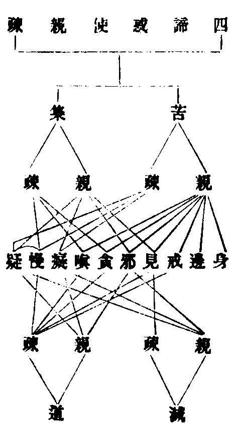



二、明思惑者(止)，故成八十一也。



此界系思，异俱生思及推利思也。(俱生者，与形俱生。如托胎时，女则於父起爱，於母生嗔。男则反此矣。)九地者，所依得名，非谓土石。贪嗔痴慢，各有九品，今总云耳。以大三品，分为九品。不言疑者，见道已断。此思既是障事，从五尘起，不历四谛。断此惑时，或直缘一真谛，或四谛中随缘一谛。故止观明见惑如四十里水，思惑如十里水。大经云：初果所断，如四十里水。其餘在者，如一毛渧。(谓迷四谛，故如四十。随缘一谛，重数甚多，故称十里。又不横起，故称一谛。)



上来见思不同(止)，实有集谛。



诸文或以见惑名三结(身见、戒取、疑)，或十六知见、六十二见、百八见，或见思称上下五分，皆是教门，随根异说，不可一准。



三、灭谛者(止)，灭非真谛。



灭者，无为空灭义也。对生明灭，尚寄於修。真理本净，体非造作。故四谛外，别立真理。故真理如月，苦集如云。道如却除，灭如却已。若云苦集是俗，道灭是真，乃约逆顺而说。逆真为俗，顺理名真也。



四道谛者(止)，合为七科。



道以能通为义，修圣道法，通至涅槃。或曰戒、定、慧，或云六度，或三十七品等，皆教门开合，被机不同。若合成三学者，戒摄三，谓语、业、命；定摄八，四如意、定根、定力、定觉、正定；餘属慧摄，或念根、念力、念觉、正念，通定、通慧。若以六度摄三十七，具如辅行(七上二十一)。又道品分四种：一、当分，二、相摄，三、约位，四、相生。又通正、通助，通漏、无漏、亦漏亦无漏，通大、通小，并如止观第七(四)具释(云云)。又小唯正道，大通正、助。今是小乘道品，义当相生，三、四、二、五，单七、只八。若约位，则八正对初果，七觉对二果。



一四念处(止)，观法无我。



念是观，不净等四处是境。身、受、心、法不净有五：一、种子，二、住处，三、自相，四、自性，五、究竟。受谓领纳有三：一、苦受，即苦苦；二、乐受，即坏苦；三、不苦不乐受，即平平之心行苦也。无常则刹那不住，无我则求我叵得。



二、四正勤(止)。三、四如意足(欲、念、进、慧)。



正则不邪，勤则不怠。如意足者，念处正勤，慧多定少。今四是定，定慧均等，如心满足。故瑜伽亦谓如有足者，往还如意。欲念等者，乐欲得定，念持於定，进求於定。慧者，止观法界次第皆云思惟，思惟观境，定力成故，慧当作思。亦恐此是有慧之定，举慧显定，亦通



四、五根(止)。五、五力。



能生名根，深固不动。力谓力用，排障遣惑。



六、七觉支(念、择、进、喜、轻安、定、舍)。



一念觉了，定慧平等。拣择真伪，进修正行。心得法喜，轻利安适。(止观云：除觉分，除其浮动，故得轻安。)禅定现前，舍诸妄念。



七，八道(正见止正命)。已上七科，即是藏教生灭，道谛明见。



四谛思无漏智语，离邪妄业是净业，进异苦行定修无漏，念正助法命非邪食。五邪、四邪，如辅行释。



然如前所列(止)，更不再列。



藏、通造六，故狭；别、圆造十，故广。四教迭论，至圆最胜。又藏、别不即，故劣；通、圆谈即，故胜。四种四谛，出大经圣行品止观第一。委释。欲略知者，迷真有重、轻，故论生、灭、无生；迷中有重、轻，故论无量、无作。又喻化城、宝所，各有迃、直二通，生、灭如前。无生者，苦无逼迫相，集无和合相，灭无生相，道不二相。无量者，苦即十界之果，集即五住烦恼，灭谓诸波罗蜜，道即恒沙法门。无作者，阴、入皆如，无苦可舍；尘劳本清净，无集可断；边邪皆中正，无道可修；生死即涅槃，无灭可证。



然四谛中(止)，是故然也。



声闻根钝，支佛则利，故支佛以集为初门也。慕果修因，且据凡位。若初果去，则云带果行因，支佛不立分果，乃云望果行因，文义多途，不可一槩。又四谛果前因后，且言三藏，餘之三教，义则不定，或云苦集灭道，或云集苦道灭。



略明藏教修行人之与位。



古师有言：顿悟即佛，无复位次之殊。释签云：约理则证法无名，约事则不无诸位。故知诸师偏从理说。华严云：随其地位而得解脱(文)。所以位者：一者引物希向，见贤思齐；二者深识位次，免生叨滥。通明四教地位所出，如玅玄第四委明，下亦略示。今藏教有四门：一毗昙有门，明七贤七圣；二成论空门，明二十七贤圣；三昆勒论，明双亦门；四车匿论，明双非门。后二门，大论虽指，论文不度。若空门虽胜於有门，但二十七贤圣，学人十八，无学有九。四教义云：贤人有二，圣有二十五(文二十七)。而凡位不备，今家不用(释签第五十八纸具引)。今依有门明声闻位者，有三意：一者凡圣位足，二者佛法根本，三者符顺教旨。四教义二(十七)云：毗昙虽劣，而是佛法根本，是故佛去世后，流传利物。且大乘经论，破小用小，多取毗昙有门，少用空门，故须略出毗昙有门贤圣之位(文)。又(二初)云：三藏四门，虽俱入道，而诸经论，多用有门，乃至圆教，多用非空非有门(文)。七贤，如今外凡三位，内凡四位。七圣者，亦不出四果：一随信行，二随法行，即是利钝，入见道名(初果)。如玅玄据成论，十六心为见道，即当初果，若有门义，当初果向。三信解，四见得，前二转入修道之名(二果三果)。五身证，四教义(十四)，判是学人，即三果升进，妙玄乃以四果向摄。六时解脱，七不时解脱(四果)，具如妙玄(二十四)广解。今不列七圣，直作四果释者，名义显故，无他说也。



初明声闻位分二(止)，初五停心。



凡，常也。圣，正也。又名贤者善直，亦曰邻圣。通论七贤，皆具二义。别论外凡为善直，内凡为邻圣。停者，止义，住义。修此五法，止住五过。心者四种：一草木，二肉团，三积聚精要，四虑知。今是虑知之心，若泛论之，义通四教。(妙玄第五，以五停对五品，此通圆也。四念处第三，明停心义，通於通别二教矣。)今是三藏声闻助道。四教义二云：心既调停，乃可习观。(文)又贪等是境，不净等是观。通论则定慧调适，故曰停心。妙玄别对，则念处名慧，停心名定。若禅门第二，以五停心即五门禅，则义该大小，通於凡圣菩萨等修。今此助门，诸文亦异，并图示之。



五、停心诸文列次。



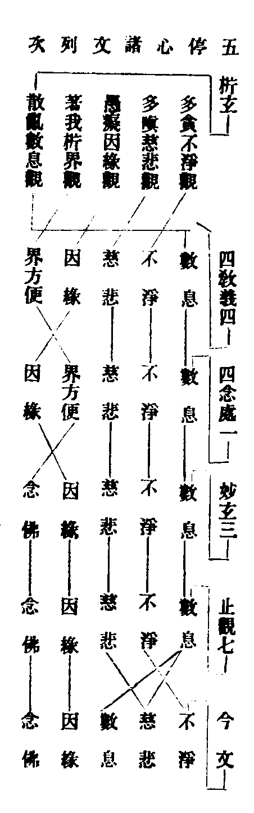



㭊玄不净居初等者，彼注文谓顺三毒次第三毒，后㭊果观为著我重者(观地水火风空识六界并十八界)，散乱即随烦恼，故居第五。今以数息安於嗔痴之间，一往列耳。四文皆以数息居首者，顺修禅人必先摄散入定故。四教义二云：今依禅门辨次第也(文)。又诸文专以不净数息居初者，妙乐(六十)引俱舍云：入道要二门，不净观数息(文)。然诸文列次义亦随宜，或五人各一、或一人竖修，或多或少不可一准。四教义二云：以病前后随人，不须定执前后次第也(文)。㭊界与念佛互存没者，四教义二云：开因缘观，出界方便代也。界方便与小乘念佛相同，亦破境界逼迫障(文)。又四念处一云：问：此中何不用念佛停心？答：作五度门则不用。作六度门即须用因缘对等分，念佛对逼迫障(文)。又此用治诸文不同，今略括示。



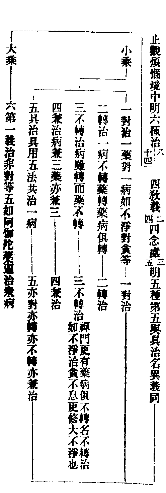



若禅门第四明六种治，皆出摩诃衍论，文相与止观大同，但兼治药病，俱兼兼五。第五名兼转兼不转治，与止观异。且兼至五，与具治何别？如五药具治一病，不同药病俱兼也。又兼转兼不转治，彼文以难。有解云：只是兼治根性，又能兼修转不转治，故别开此。又解云：恐是具治异名，即同四念处亦对亦转等。既兼转与不转，亦具兼治，复以兼收对五种义足，名略义含，与诸文一揆，学者宜详。止观第七(十三)明六度治六蔽，亦有四种，谓对治、转治、兼治、第一义治，非五停义。



一，多贪众生不净观。



六识妄心，於顺情境上引起无厌，故云多贪。此之境观，禅门第四明三种：一外贪，男女身分互相贪著，用九想治。二内外贪，於己他身而起贪爱，用八背舍治。三一切处贪，资生五尘等物，用大不净观治。㭊玄上明四种：一显色，谓青黄等，作青瘀想。二形色，长短等形，作坏烂想。三妙触，自他身分细软光泽，作蛆虫想。四供奉，祇承适意，用死想治也。须知此与念处观身有异：一正助不同，彼正此助也。二自他境别，彼观自身，此想他境。三假实观异，彼是实观，此明假想故。故知此当前示外贪，用九想观也。



二，多嗔众生慈悲观。



此观若准禅门，义通大乘。境观有三：一、非理嗔(欻起嗔心，不问可否)，修众生缘慈(一切众生如己眷属)；二、顺理嗔(人实来恼)，修法缘慈(见一切法皆从缘生)；三、诤论嗔(著己所解)，修无缘慈(能所一体，慈即无缘)。今小乘助观，只是於违情境上忿恨不已，名曰多嗔，当彼第一众生慈耳。法界次第明修慈悲喜舍四无量心，今但慈悲㭊玄。准俱舍论，七周行慈辅行(九下五)。依婆沙明九周行慈，下当图出。大卛不过七境三乐。七境者：上亲(父母师长)、中亲(兄弟姊妹)、下亲(朋友知识)、中人(非冤非亲)、下冤(害下亲者)、中冤(害中亲者)、上冤(害上亲者)。三乐者㭊玄，谓诸佛(上)、菩萨(中)、诸天(下)乐也。辅行引婆沙：三禅(上)、四事(中)、经行处(下)乐也。今谓㭊玄三乐，未知何据？况声闻助道与佛菩萨乐，恐成过分，宜以辅行为准。盖辅行引婆沙云：问：为与众生何处乐？答：有说与三禅乐，乐中胜故；有说与四事乐，已曾得故；有说与曾经行处所有乐，至所住处思惟令得(文九下五)。



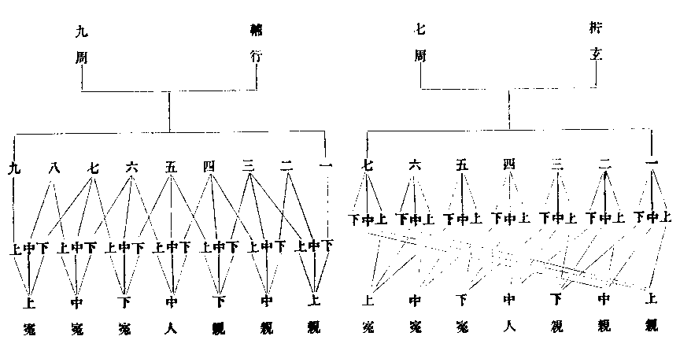



先亲后冤者，从易至难，顺心成观。㭊玄第六观方与上亲下乐，第七方与上亲中乐。中亲下乐者，一者、次第修观，未暇与故；二者、顺七周次第，每一番用观，先与上乐以为次第。中、下非要，故在后时。与虽前、后，境境皆三，使冤亲等以破嗔障。辅行开为九周者，一、顺从亲至冤，次第与乐，不待六、七，却缘前亲故；二、随机宜乐，所修不同故。且声闻自度，何观众生施与他乐？又复前境为得、不得？盖为破障，且尔运心，其实前人实未得乐。故㭊玄上云：问：自身有乐，可施於他。忽若自身无乐，将何施与？答：自身若无乐可施，即运心将餘诸天、菩萨等乐而惠施之。愿彼冤亲等众生得受如是等乐故。又涅槃疏云：虽欲拔苦，实未拔苦，皆是虗言；虽欲与乐，实不得乐，此是假说。(文)又行者用观，当念冤雠如过去父母等，方能冤亲平等与乐。广如㭊玄上(云云)。若大经十四梵行品明七境四番修观，疏：第十、开作两番九周。(指归钞第十二卷引)义属别教菩萨所修行相。於今非要故，故略不论。



三、多散众生数息观。



散者，攀缘思虑，与定相违。息有四相：有声曰风，结滞曰气，出入不尽曰喘(今依禅门口诀。若禅门云：结滞曰喘，出入不细曰气，各有其义)。不声不滞，出入俱尽曰息。绵绵若存，数之则定，数风则散，数喘则结，数气则劳(矣)。数者，从一至十，不少不多，令心不散。禅门有四师：一师数出息，不急不胀，身则轻利，易入三昧；二师数入，随息内敛；三师出入无在，俱随便宜；四师依四时用数。今家正取第三师，又不许出入俱数，恐生病故。梵语阿那波那，此云遣来(入息)。遣去(出息)即是三世诸佛入道初门，通於三乘四教。又用息明六妙门，谓数随止观还净，今且为小乘助道耳。



四，愚痴众生因缘观。



迷倒不了，拨无因果，故云愚痴。须知著我计断常，并执性实，三皆迷倒。若明三世十二因缘，则破断常。若论二世十二因缘(前十支现在，后二支未来)，即破我见。若明一念十二因缘(即是一念无明造业，乃至生死)，即破性执。此准禅门。若毗昙大经，则以界方便，以破著我，随机不同也(六界十八界论开合，如集解)。三种十二因缘，如妙玄三四教义二具明。若束对三道，如法数。俱舍颂云：



> 三烦恼二业，七事亦名果，略果及略因，  

> 由中可比二(后际略果，前际略因，中间广说，可比知也。补注十二，引论具释)。



又云：



> 从惑生惑业，从业生於事，从事事惑生。  

> 有支理唯此(十二通名有支，道理唯若此也。广如辅行三下十四释)。



又古颂云：



> 无明爱取三烦恼，行有二支属业道，  

> 从识至受并生死，七事同名一苦道。



若释因缘之义，如无明因，能与行支为缘，乃至生支为因，能与老死为缘故(具如㭊玄上)。此亦名十二重城，亦曰十二𣗥园，亦名十二牵连(如玄签具释)。成论更有三因四缘(释签十引)，俱舍及大论明六因四缘(辅行八下)，与十二支但开合耳。且因缘义甚深，愚痴众生何能观耶？禅门云：非谓如牛马等，但聪明利根，不得正慧邪，邪心取理，名为愚痴(文)。此与支佛何异？今助道破障，略论三世。支佛正观破惑，必须逆顺两缘，百千万世因缘等。前引偈亦名果者，七正是果，何云亦耶？如前指补注十二引论，七以事为性，故亦名果。普贤观亦通名十二苦事。又辅行(三中十四)云：虽有十二，二三为性。三谓惑、业、事，二谓因、果(文)。略因略果，前准俱舍，略其数也。释签三云：亦三世俱名因果，而支数多少不同者，具如俱舍云：略果及略因，由中可比二(文)。若准婆沙，谓前世略果，后世略因者，义乃全略。既有诚证，今姑存之。考释签意，正取略数，以消论偈。



五，多障众生念佛观。



止观乃云睡障，念处乃云逼迫障。禅门第四明三种障，念三身治(彼通大乘，今且明小乘助道也)。障即恶业。三种者：一、昏沉暗塞障(昏睡无记)，念应身三十二相治；二、恶念思惟障(欲作五逆十恶等)，念报身力无畏等治；三、境界逼迫障(身忽卒痛或见无手足火焚水溺等)，念法身空寂无为治。小乘当分亦有三身，如光、明、玄。若身对教，前三各念一身，谓生、应、报。圆念法身，诸身具足，如辅行念处。没念佛，明界方便，如前已示。



二、别相念处(止)，中间例知。



於五阴境修四念处，为破四倒，合五为四也。受则六根对六尘，义兼内外，故独为一。想行一向居内，想起违从行阴造作，故合为一。夫道品有三十七，独明念处者有三意：一如来遗嘱，二为成正行，三阴境现前。四教义二云：念处是佛法入道要门，虽有种种法门，而佛遗言但嘱依念处行道。(文)又四念处，一云：若无念处慧行，一切行法皆非佛法。(文)止观云：大品云：声闻依四念处行道，菩萨初观色乃至一切种智。章章皆尔，故不违经。又行人受身，谁不阴入重担现前？(文五二)又此念处别明属慧，通亦有定。辅行三云：四境止心，故名为定。(文下十七)此总别相位应知四句。四念处，一云：一境别观别，正是别相性念处。二境别观总，三境总观别，此二是总相之方便；四、境观俱总，是总相念处(文法数具出四图)。初则一药对一倒，中间二句观心渐熟，或别於一境总用四观，或别用一观总观四境(今文略出此句，阙前后二句)；第四、境观纯熟，举一俱得也。若㭊玄，准俱舍疏，前三皆别相摄，第四句方是总相位。今依妙玄四念处，初句是别，后三皆总。又上停心破障，至今念处唯观苦谛，至内凡位方通观四谛已。玅玄四(二十三)云：七贤位人明识四谛(文)。彼且通举，应如今拣。又慧俱、无碍、修性、共缘三种念处，念处名同，义则有异。至下释四果中更说(云云)。心行理外，名外凡。资粮者，从喻立也。欲越三有，以此为资，使五分法身不至夭丧。



三、明内凡者(止)，亦名七方便位。



渐见法性，心游理内，身居有漏，圣道未生，故名内凡。以定资慧，修四谛观，加功用行，故云加行。圣道之本，亦曰善根。煖者从喻，如钻燧先烟，春阳煖发，得佛法似解也。顶观四谛，转更分明，如登山顶，明瞩四方。忍者，於四谛中，堪忍乐欲，亦忍可义。世第一者，善根最胜，世间第一，具如妙玄四(二十四)，乃㭊玄等。此四观行者，俱舍颂云：



从此生煖法(从总相后生煖善根)，　具观四圣谛。  

修十六行观(四谛为所缘，十六行为能缘。苦下四行，苦、无常、无我。集下四者，集因缘生。灭下四者，灭尽妙离。道下四者，道正迹乘。新译谕苦下空名不净，灭下尽名静，道下云道如行出。略如辅行三下，㭊玄上解。据颂只是观於四谛，而释签四云：谓煖八谛十六行相。有解云：八字恐误。有云：以上二界四谛体同，通解称八耳。其实只观欲界四谛，此位有三品。)  

次生顶亦然(用观同前，亦有三品)。  

下中忍同顶(下忍徧观八谛，中忍缩观明减缘行。今云同顶者，对后上忍唯观苦谛一缘一行，故云也。释签云：下中忍同顶者，具观四谛十六行相。㭊玄亦云：约初观说，至下更明减缘行义。)  

上唯观欲苦，　一行一刹那(此上忍合有一行二刹那心，言一刹那，此据满说)。  

世第一亦然(上忍位中有二刹那，一刹那尽，餘一刹那在，名上忍满，即入世第一。今一刹那引入无漏，故云亦然)。



今通前图示，及相违文相。



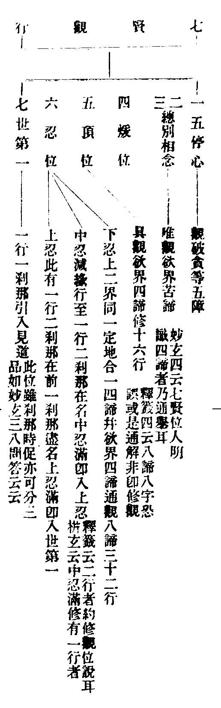



中忍减缘行者，若徧缘八谛，修三十二行，唯名下忍。谓初依欲界苦修四行，次例观上二界苦亦四行，又观欲集四行，次上界集四行，乃至上界道四行。若从前观从后减，至上界道谛下，唯修三行，不用最后乘之一行，名为一周。复从前观从后减，至第四番减上界道谛下道之一行，到此能缘既无，所缘亦减，此道行与缘同，名与缘同减，故云减缘必减行(据初一行)，减行不必减缘(据后三行)。第五番减欲界道下乘行，乃至最初欲界苦下空行，总有三十一周，皆名中忍位，唯留一行，并所缘苦境，入上忍位(此位所留一行，随行者所宜，如释签第四云云)。是则上四下三，七缘与初行同，名行与缘同减，故释签四云：七周减缘，二十四周减行(文)。据理实有七周减缘，三十一周减行，法数误列，今别图之。



中忍缘行之图



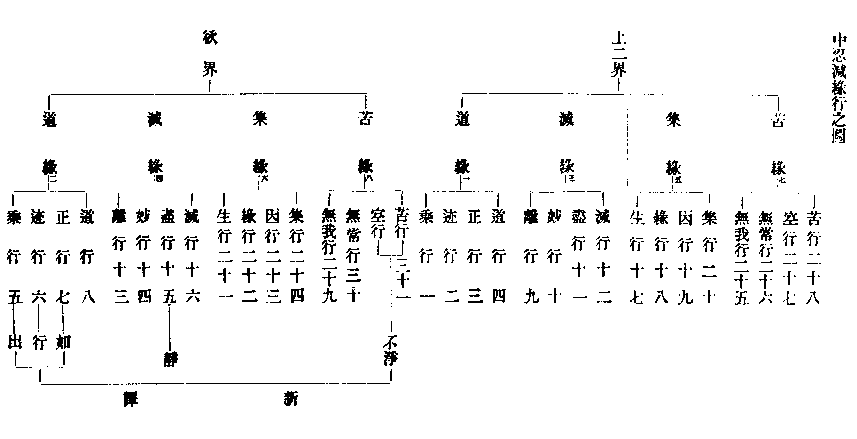



十六行义，如辅行三下(十七)㭊玄上具释。又上二界合一四谛者，同一定地故，以欲界现前比上而观故(㭊玄五义备释云云)。此则伏三界四谛下惑至发真时，故上二界同名比法忍智等。又十六行行只是观门，涅槃疏亦名十六谛者，取谛审观察义故。又此减缘行，妙玄三(八)合作八番者，以行从缘，但约八谛为八周也。四教义二云：中忍作十番缩观者，约后七谛，以行从缘为七周，开欲界苦下所减三行为三周，总为十番。妙玄八(二十八)曰：三番缩观进成上忍者，以三界不出四谛，亦以行从缘减后三谛，故曰三番。诸文详略赴缘不同，学者不必固执而自困也。此四善根有何胜利？俱舍颂云：



煖必至涅槃，　顶终不断善。(释签四云：忍位是进，煖位是退，顶是进退两际，犹如山顶。（文）今云必至涅槃等者，四教义二云：问：煖顶退者，何云性地？答：此人虽造恶堕地狱，一人受罪，不复重入有性地善根，故能得圣果。文有云：顶有三品，上品不退。)  

忍不堕恶道(四教义二十二云：下中二忍，虽起烦恼恶业，而不受三途，犹受人天百千生。若上忍成，但有人天七生业在。)  

第一入离生(此一刹那即入见道，故同见道离四趣生)。



餘有难文，略释于此。妙玄三云：但作二心观於一行，如似苦法忍、苦法智，是名中忍(文)。释签四云：彼四心同一行一缘(文)。二心者，忍、智二心虽在世第一后心发真，而得在中忍位中，义亦通修，故云如似，似彼世第一后心故。释签云：四心者，缘、行各二，故云四心。妙玄约一故，故有二也。有云：二心者，二刹那中忍位满云四心，即四行减至一行一缘二刹那在。有云：四心者，签云：於上忍中亦修四行。更有问答，请捡详之。玄签以难，读者更考。又释签四引论明修煖法，从欲界至无所有，八地各九品，并一具缚，总七十三人，是则煖法通於三界。涅槃经却云：如是煖法是色界法，非欲界有。须知能修之人通於三界，所发煖法依色界定发也。签引评家云：尽是色界法，住定地法(文)。涅槃疏作三义释云：一、多用定发煖法观，从多为言。二、据中间，三界皆能发於煖法，而色界居中，故言色有。三、据处为语，色发煖易，欲界则难(文)。



次明圣位，分三：(止)无学道(四果)。



初果见理破惑名见道，二果去重虑缘真破思惑名修道，四果惑尽名无学道。然初果位从世第一，后心苦忍真明，於八谛下发八忍八智，总十六心。有门以十五心名见道为初果，向至十六心是修道初果，摄㭊玄空门以十六心名见道为初果，二果去方属修道。宗计不同，不须和会。今家虽多用有门，高丽师欲令初学易解，且准空门注，见道是初果也。八忍八智者，俱舍颂云：



> 前十五见道，见未曾见故，世第一无间。  

> 即缘欲界苦，生无漏法忍，忍次生苦智。  

> 次缘餘界苦，生类忍类智，缘集灭道谛。  

> 各生二亦然。



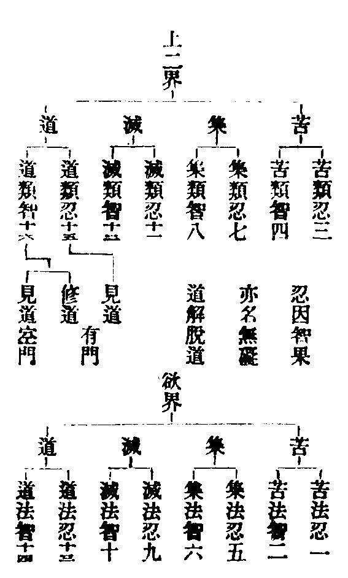



一须陀洹(止)，又名圣位。



预流者，预入圣道法流。金刚云：入流或翻逆流，逆生死流也。此断八十八使。婆沙论云：二十八使见道断，餘六十使修道断(文)。先达解云：有二种根性：若等观四谛者，见道断八十八使；若不等观四谛者，见道中唯断三界苦谛下二十八使，餘三谛下见随修道断。论中自定见随修断者，乃是钝根。



二斯陀含(止)，故更一来。



此果断欲界九品思惑，前之六品，於初果之后，此果之前，须论家家。今先明欲惑，润七返生死，次通示超，次根性，后别释家家之义。惑有麤细，故分九品，无漏智力，故经七生。私以偈括之：



> 初品润二生，二三四各一，五六共润六。  

> 第七断三品(法数有图，辅行第六上解)。



所以须七生者，成论云：於七世中无漏智熟，如服苏法。七日病消，如歌罗逻等。七日一变，如亲族法。限至七代，如七步蛇。四大力故，行至七步。蛇毒力故，不至八步。惑力至七，道力故非八(文)。次示根性，应云三三断四超住。次超三超中开四。北峰云：考俱舍、㭊玄、辅行等，只超次二，义开为二，断四超也。



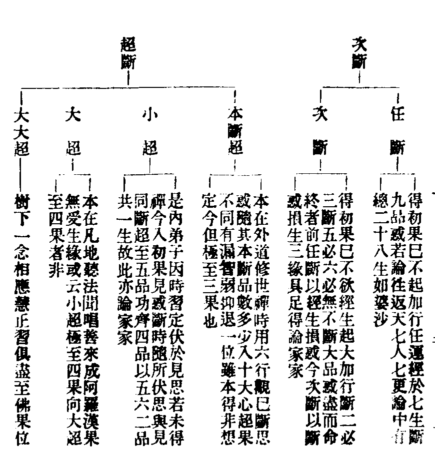



任断之人，非全无观行，但不及次断勤加功行耳。次断者，虽异任断，乃对超断越次得名。本断者，辅行(六上十)云：本得非想，即是已断下八地思，至十六心，应名阿罗汉向。但名阿那含者，以凡地时，有漏智弱，但名那含。若本断九，今名三向。若七八品，得名二果。断六品等，名二果向。断五四等，但名初果(文)。须抑退者，意令此人此生，必定起无漏圣道故(文出俱舍)。小超，准止观六释，只云：十六心满，超能兼除欲惑诸品，或三两品(六九)，及前明家家超至五品，乃至八品。辅行解云：此之五品(婆沙小超)，同四品故(俱舍次断)，随其本断(非本断超，只是随其本时所伏而断也)品之多少，而得为家家种子(八品名种子)，及以无学向果等名(文)。故知止观从浅而说。考辅行意，小超亦可超至四果。又如止观云：十六心后，即有一念超果至那含，或超至罗汉(文)。昔人误定小超，只到四向，遂致曲解辅行向果二字，谓之文倒，乃四果向耳。及定止观，或超至罗汉，及是大超，今所不取(前图大超下注或云等，乃是异说)。然则小超既超至四果，与大超何异？须知小超，凡地修观，伏於见思，至十六心，或浅或深，超果不定。若大超人，不论修观，一呼善来，直超四果。又果本断，世禅断思，成三根性，安得相滥？大超根性，昔人又分信法二行，闻唱善来，成阿罗汉，即是法行。十六心后，超至四果，即是信行(据前引止观)。无稽之论，今亦不然。若大超，引物希向，有教无人。又后通教菩萨，智利二乘，及与圆人，便成正觉，非无超义。但荷负众生，慈悲愿重，教门不说也。具如止观六云云。家家者，受生处不一也。人中三洲，天上六欲，张王不同，宫院等别。故论天家家，人家家，不等家家，平等家家(具如㭊玄下)。俱舍颂云：



断欲三四品，　三二生家家(断三品则损四生，后三生在；断四品则损五生，后二生在)。  

断至五，二向(断至五品，名二果向)。断六，一来果。  

断七或八品，　一生名一间(断至七品或八品，犹有一生间隔)。  

此则第三向，　断九不还果(七八为三果，向断九方得三果)。



此论颂一卷八品，世亲造，唐奘译，今出第六贤圣品。更有俱舍论三十卷九品，造者译者同上，皆名新译。真谛旧译俱舍论十二卷，及论释十二卷，辅行所准，正是新译。若止观超断五品名家家，乃准婆沙论也。欲惑之体，是正三毒，贪嗔痴慢在痴摄。七生断者，观有明暗，惑有厚薄，餘如上说。三缘者，一断惑缘，能断三品，拣异一品二品五品者。二成相缘，治彼三四，成无漏根，拣异本断，未成无漏。三受生缘，更受欲界三生二生，拣异即生般涅槃者。三缘阙一，非家家义。俱舍论云：即预流者，进断修惑，若三缘具，转名家家(文重加类节)。若断七八，亦具三缘，转名一间，此约次断。若小超人，亦论家家，具三缘否？有云：小超三缘不具(精英集)。进法师云：论虽不说义具三缘，止观六既云十六心后，即有一念超至那含(文)？验知小超断见惑时，兼发一念无漏之智，即成根缘，餘二例说。若尔，与次断何别？小超一念，兼发次断，必论加行，况次断根性，无超越义，自可拣也。前所引颂，为颂次断，为颂超断。原夫止观，验知颂文唯颂次断，故曰此次断义(指所引俱舍)，与今文同(会同小超，得云家家)。转赞云：既曰预流者进断修惑，则颂次断明(〔矣〕。旧称无家家，以判颂有功也)。昔交师谓颂小超，杂编破之谓颂次断，或超次俱颂，后复多说。今并四直之，学者请勿广誊，增无益之弊。辅行云：若超若次，进断三四(文六上)，得非小超亦至四品那？彼释家家三二处生，故以五品功齐四品而总言耳，非谓小超剩至四品止。六引婆沙云：次断五品名斯陀含向，超断五品名家家。次断六品名斯陀含果，超断六品名一往来。次断七品八品名阿那含向，超断八品名一种子(文俱舍名一间，婆沙名一种子，有一品惑在故也)。且次断五品名二向，超断五品名家家。又斯陀含与一往来，那含向与一种子，其义无别，何分超次？精微集云：超次对辨，皆有某意。初对为显超次有异，次人断五必六，未受家家之名，小超五品有命终者，故名家家也。中后二对为显超次是同，中则俱名二果并号，一来华梵互举，后则影略互显，名三向及一种子(文)。宪章谓咎分过德，用有抑扬，未必全尔，不暇评也。止观六明小超云：或三两品即是家家。辅行云：或三两品名家家者，应云三四，或恐文误，或婆沙不同(文)。准诸文说乃恐文误，或论中亦有断两品论四生家家者，故云或婆沙不同也。杂编有云：亦可断欲一二品五四生家家。玅玄四云：断欲界一品烦恼，乃至五品皆是於向，亦名胜进须陀洹。约此论家家(文)，文意既以一品乃至五品得论家家，霅川之说或未为失，但恐教门定故不应说也。次断之人必断大品，应唯三品何至四耶？又断第八何不至九？断大品已更进断小品，有何不可？不至九者，有得果越界二义，具如辅行(六上)。任断七生，何义不立家家之名？有云：教门方便立家家者，为令圣者畏经生故速得证果，任断根性不畏经生，故不说也。



三阿那含(止)，进断上八地思。



此果断欲界下三品思尽，进断上八地思，取证四果而般涅槃(此云灭度)。就此释般那含，此名从略，乃是般涅槃之阿那含也。旧对家家称为般般，义无所准。又此且论有餘涅槃。俱舍论云：般涅槃者谓有餘依，有餘师说亦无餘依，此不应理。(文重加类节)止观六云：次断初禅初品至非想第八品，凡七十一品，悉名阿罗汉向，六种那含位在其中。(文)辅行六(上六)引大论、俱舍释之。大论七种：一、中般，二、生般，三、行般，四、不行般，五、上流般(色界)，六、现般(欲界)，七、无色般。俱舍七种，前五如大论，第六却取无色般(辅行脱一无字，乃云但取色般并五为六)，第七方立现般。荆溪谓俱舍不立现般，指七种中第六不立耳。非谓论文不明现般，若大论中则现般第六。据二论六种，一立一不立，对释止观，故有此言。旧谓那含唯此一难，自报慈尧法师释出，莫不承用，无他论也。但诸文种数多少，今准俱舍三七种图示，然后对拣。颂云：



此中生有行，　无行般涅槃，　上流若杂修，  

能往色究竟，　超半超徧没，　餘能往有顶(餘字指不杂修，有顶是非非想处)。  

行无色有四，　住此般涅槃。(辅行六上㭊玄上具释论颂七种：先色，次无色，后欲般。今图顺三界次第，览者悉之。)



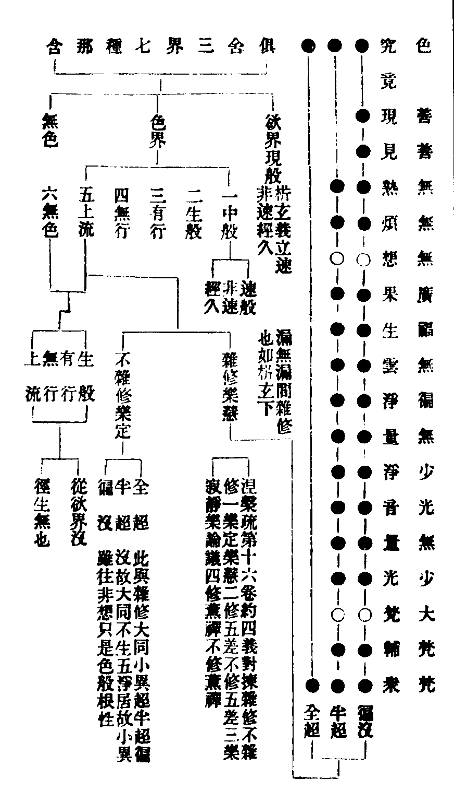



大论七种，名同俱舍，列次少异，更不再出。俱舍论云：行无色者，差别有四：谓在欲界，离色界贪，从此命终，生於无色。此并前五，成六不还。复有不行色、无色界，即住於此，现般涅槃。并前六为七(文重加类节)。色界徧没，只十六天。大梵是天主，我慢、无想乃界道所居，故圣者不生此二天也。俱舍复有九种，即於色般，合五为三。有行、无行，皆生般摄，即开三为九。颂云：



> 行色界有九，谓三各分三，业惑根有殊，  

> 故成三九别(释签五㭊玄下引论备释)。



诸文或云五种，独指色般。或云八种，三界七中加不定般。(补注十四：初引婆沙三界般中徧有不定，进老示不定相，乃约期心欲界便般涅槃，或未能克，却生上界而取证也。或期生上界，忽发宿习，欲界即证。色、无色准说。)杂心论七种，玅玄所用，於色界五，初开中为三，(速般、非速般、经久般。)并后四成七。毗昙有一万二千九百六十种般，如释签第五具示。色界中般者，初离欲界生色界时，厌苦心切，即在中有而般涅槃，故属色摄。若至色界，上生餘天，虽有中有，不得论般，为无宿习厌苦力故。(如析玄下。)无色不立中般者，指归钞(十八)云：经云无色众生无有中阴者，毗昙法中说除四空，餘一切处定有中阴，以无色界无处所故。(文)又俱舍明随於何处得无色定，於命终时即生无色。前图中引五差者，谓下、中、上、上胜、上极。辅行六(上三)、㭊玄下(十三)委释行相，由此五禅生五净居。又乐论议者，恐就下界修观时说，非生净居有论议也，以二禅上无语言故。(文)



四阿罗汉(止)，又名孤调解脱。



此位上八地七十二品思俱尽，四智已圆，(我生已尽，梵行已立，所作已办，不受后有。)无法可学，名无学果，亦名究竟。(如㭊玄下。)阿罗汉者，文句一云：或言无翻，含三义故。净名疏十引智论释云：一、杀贼，从破恶以得名；二、不生，从怖魔以受称；三、应供，因乞士以成德。(文因果对释也。)多含不翻，乃今家正意。以三义翻之，乃顺古耳。若释比丘因名，乞士等对举果名，盖欲显大比丘之阶位也。(如法华文句及观经疏。)又前标声闻通凡圣位，若阿罗汉局第四果。此位所修三昧，一名金刚，二名重空，三名电光。(上二名如妙玄第四，电光如止观第九。电光义通初果，金刚三昧通前五种罗汉，重空别在不动罗汉所修。)此果别号有二种、三种、六种、九种，及果性退不退，今历示之。先明二种：



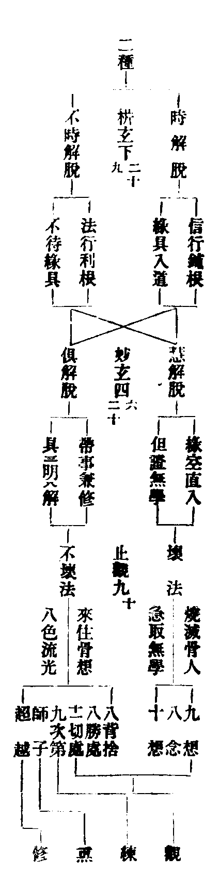



初时不时，从缘得名；次慧俱，约观立号；三坏不坏，依境受称也。或准正理论，以时不时，歒对慧俱。若准玅玄四(二十六)及四教义二(十六)，信法各二，不得灭尽定者，但是慧解脱；得灭尽定者，名俱解脱。旧云：歒对乃从正从多，各对则旁正兼举。以信行亦有带事兼修，法行亦有缘空直入。若坏不与慧俱，同假名集。准经论祖，文列十义，拣判慧俱。后人束作五义：一约性共，慧人修性念处，俱人修共念处(四教义二)；二约正助，慧人正道断结，俱人兼修助道(光明句中四教义二)；三约事理，直缘真理名慧脱，带事兼修名俱脱。事者，一带根本四禅俱人，亦依世禅修六行观故；二带无漏禅慧人，但至观禅俱人，具修观练薰修(止观第九。婆沙亦有少分慧脱、全分慧脱。此有三根：全无四禅，下根也；能修一禅至四禅，中根也；能修无漏禅至九想十想，上根也。俱人能修一二三禅，下根；具四禅，中根；修观练薰修，上根也。妙乐二云：四禅一切罗汉并得，次观等四俱解脱人方乃具足)。三得灭尽定(如妙玄四二十六)。已上三事，俱人兼得也。四约神变，慧人十四变化，俱人作十八变(文句二)。五约三明八解，俱人则具，慧人则无。若辅行云：通通於六，明唯局三(天眼、宿命、漏尽三也)，诸罗汉皆能得之(文)。此有阙具之义。婆沙云：若有一明二明，名慧解脱(文)。准知俱人三明具足。次明三种



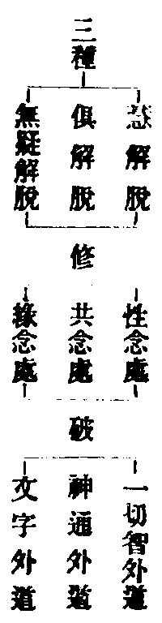



(性念处者，亦名自性念处，缘理断结，除自性过。共念处者，正助合修。缘念处者，缘佛三藏及世间文字，所缘处广也。具如四念处：一、四教义，二、俱舍。亦有三种罗汉，各论三念处。)



慧俱略如上。无疑者，三藏教法四韦陀典，天文地理一切通达，故曰无疑。四教义二云：问：不应别说无疑，九种罗汉无此名目。答：此出智度论，明欲结集法藏，集千罗汉皆得共解脱无碍解脱也。(文)既是大论开出，在佛世时俱人所摄，佛世且明自行入道，是故诸文只云慧俱。(六种九种皆无此名，若集论明六种中有无疑法者，与不动法名异义一，非今无疑。)释签五(十九)云：得灭尽定但名俱解脱人，以未修缘念处，终非无疑解脱也。(文)故知无碍乃俱人中胜者耳。小大言之，慧俱并小，无疑乃名大阿罗汉。妙乐一(三十一)引中阿含：舍利弗问：五百比丘几三明？几俱解脱？几慧解脱？佛言：九十人三明九十三俱解脱，餘但慧解脱。荆溪云：三明者即无疑解脱。(文)须知三明是俱人得，取其胜者复云无疑也。后明六种，附拣七种及列九种，然后约六种明果性退否。



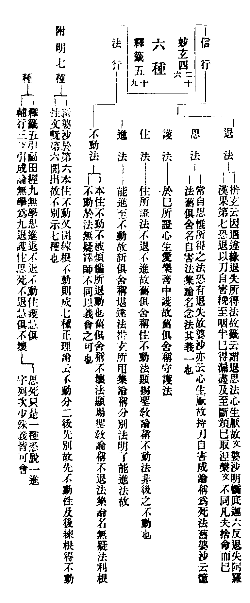



六种约根性慧，俱约观行，九种乃根性观行兼举耳。又九是空门二十七贤圣中之无学，为答福田长者所问，显福田之多赴机生善故。又六种明二加行差别，如㭊玄(下二十九)须者捡之。果性退否者，俱舍颂云：



阿罗汉有六，　退法至不动，　前五信解生(信行转入修道，名信解)。  

总名时解脱，　后不时解脱。  

从前见至生(见得亦名见至，亦是法行转入之名)，　有是先种性，  

有后练根得(六种罗汉，有先世种性定者，有后来修练根性转劣成胜者。如本是退法，练成思法乃至不动，或思练成护，乃至进练成不动。唯初退法是先种性，无练根者。又练根通资加修三位，唯除见道，以时速不能转根故)。  

四从种性退(第一退法最下无处可退，第六利根不退，唯中间四种根性有退，如第二退为第一，乃至第五退为第四。又此退性乃是练根，非先定根性也)。  

五从果非先。(前五种从无学果退居学位，第六则不退也。亦是练根论退非先种性也。非先二字，总颂果性。二种退者，若㭊玄辨果退非先中云：如第三护法，若先是退法，至果练成护法，则有果退。若先是思法，后练成护法，则无果退。乃至结云：即知果退唯约先是退法，若先是思法等四性，必无果退。（文）此似只就退法根性论之，更宜详考。)  

非先有退者，　但据餘四说(果退虽在前五，若论非先，唯中间四。第一退法虽无练根，不论性退，不妨亦有果退之义)。  

不动尽智后。  

必起无生智(第六、於尽智后能起无生智，所以果性皆不论退。餘五有退，以不起无生智故。本住不动，练根不动，皆无退义)。  

餘尽或正见(五种尽智，后或但起正见)。  

此应果皆有(尽智后正见，六种应果皆有)。



已上颂语，取㭊玄意略注，欲学者便於忆持，更详彼文可也。且罗汉见思已尽，已证无学，所以有退者，考论祖语(妙玄四（二十六）、止观九、止观九（十二）、上十五)，盖由信行慧解脱人，不修事禅，不得灭尽定。或世智断惑，但得尽智，不得无生智。遇著违缘，还起烦恼，故有退也(违缘者：一、长病，二、远行，三、谏诤，四、营事，五、多读诵。又大经明五缘：一、乐多事，二、乐说世事，三、乐睡眠，四、乐近在家，五、乐多游行)。又㭊玄谓非先种性者，但是无学一道所成，不得坚固，故有退。若是先种性，由学无学二道资持坚固，故无退(彼文更果退性不退等四句分别)。然前五种未必全退，有遇违缘者，故有退耳。故辅行(九、上十五)云：然慧解脱亦不并退，有退义故说有退(文)。又退者非久。辅行云：问：退经几时？答：经少时，乃至自不知退。若自知退，当修胜进方便。复次彼烦恼现在前时，心生惭愧，速作方便。如明眼人，昼日平地颠蹶，寻即还起(文)。释签云：此生之中，必得无疑。极至临终，亦得无学故(文五十九)。或曰：前时不时，各有慧俱不动。既从时解脱生，得非六种皆有退义耶？答：慧人未必一向论退，恐只钝根有漏智断，遇违缘者退。今复图示。



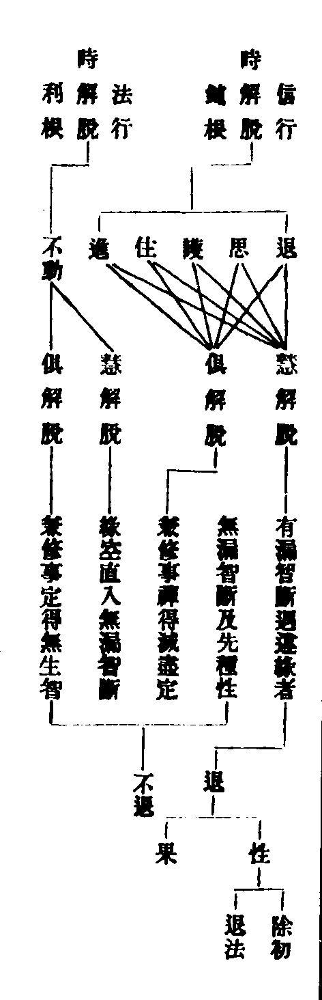



六种论退，局第四果。通辨四果退不退者，㭊玄引三家：一、萨婆多云：初果不退，后三果退。二、大众部云：前三果退，第四不退。三、经部宗云：初四两果不退，中间二果有退(广如彼文)。彼但注云：三师难定。今恐成诤，略为和融。辅行(九上十五)引婆沙云：阿罗汉退，牵二三果退。犹如井砂，上下有甎，中间唯砂。上甎若颓，从上至下，其中间砂，岂得不颓？四果如上甎，二果如中砂，初果如底下(乃至)。初果之前，更无有果。若彼退时，更无住处(文)。不可圣退为凡夫也，合彼初师。然见道既有不等观四谛，如婆沙云：二十八使见道断，餘六十使修道断(先断三界苦下惑见)。见既分尽，果理未圆。例如身子，六住尚退。后三果中，断惑之智，通漏无漏。是则四果，俱退俱不退。三师之说，说皆无妨碍。子缚者，见思烦恼。果缚者，五阴报质也。灰身灭智，究竟无餘。然身子入灭，而均提答佛，何云五分法身不灭耶？释签(十)云：无作之业，至未来世，名为不灭，非常住不灭(文)。无作业者，乃功薰耳(云云)。声闻自度，故名孤调。断欲九品，立二三果。上八地思，唯一无学者，止观云：如险处多难，多须城壁。欲界多难，多果体息也(文六七)。故知上界定地少难，唯立一果。若尔，七圣中，二为见道(信行、法行)，二为修道(信解、见得)，二为无学道(时解脱、不时解脱)。复以身证对四果向者，何耶？有云：位隣无学，将断非非想惑，特立此位，如别圆之有等觉也。今谓空有二论，设位不等，教门方便，多少随宜耳。妙玄明身证得灭尽定，约似证也。成论云：不得灭尽定名身证者，对四果真证，夺而言之。



略明声闻位竟。



天台四教仪备释上



天台四教仪备释下



苕谿沙门　元粹　述



次明缘觉，亦名独觉。



辅行(九下十五)引大论二十一云：迦罗，此翻缘觉，亦名独觉。(文)四教义二(十八)标云：辟支迦罗，此翻缘觉。释中开二，谓缘觉、独觉。新华严音义云：二名各有梵语也。毕勒支底迦，此曰各各独行。佛者，觉也。钵罗底迦，此翻缘觉。(翻译名义，亦开二名。)今谓梵音奢切，难以考论，恐迦罗名通。大论义翻二种，音义分二，恐梵语复有别名故也。缘觉者，观内因缘，禀佛教法。独觉者，观外因缘，无师自悟。文句(四七)引大论云：独觉者，出无佛世。缘觉者，愿生佛世。(文)俱舍明独觉自有二种：一麟喻，二部行。(如㭊上玄)若集解云：慈恩基师引仁王经，列独觉众。又云：释迦出世，五百独觉从山中来，至於佛所。学者如何消释此耶？(文)补注(六)亦引而释曰：本是声闻根性，以缘悟菩提，故名支佛。(文)今谓仁王经初，本无独觉之名，但云复有八百万亿仙缘觉。慈恩意以缘觉一众，诸经兼声闻而列之。若二乘别列，如仁王也。然以缘觉称独觉者，何耶？盖根性不异，名义互通。如缘觉人，虽值於佛，乐独善寂，通名独觉，即慈恩所云也。独觉之人虽无师教，观外因缘亦名缘觉，如光明云：我不恭敬缘觉菩萨。智者科为忏无佛世敬田恶业。又独觉人亦通见佛，文句(四七)引华严等独觉有三类：一者知佛出世即先入灭，或佛神力徒於他果。二者出无佛世。三者虽生佛世愿见佛故，不即舍寿亦不被移。(文中义具此三。)五百独觉山中来者，即第三类。通义虽尔，别释如前。又二辟支各有大小，准辅行(九下十五)有三义：一具相名大、不具名小。二两大中现通者大、无通者小。三现通中说法大、不说者小。又四教义(四)，宿世偏修性念处者小、兼修共念处者大。又先达立渐顿二义，如辅行等七生初果，后方极证为小、顿证为大。若与声闻对辨者，如文句七(二十六)云：二乘六义同、十义别，同出三界、同尽无生、同断正使、同得有餘无餘、同得一切智、同名小乘。别开十义者，行因久近六十劫百劫故(一)、根利钝(二)、从师独悟(三)、无悲鹿羊(四、声闻如羊惊绝奔走，支佛如鹿驰并顺)。有相无相(五)。观广略(六)。能说得四果法，不能说法得煖法(七、有云支佛能说法令人得四果，声闻不能说法不能令人得煖法)。在佛世不在佛世(八)。顿证渐证(九)。多现通少说声闻不定(十)。文中六十劫百劫者，析玄(上一)明修行。声闻利者三生，钝者六十劫。支佛利者四生，钝者百劫(文)。然则声闻胜支佛耶？声闻但入见道，支佛极证无学，还以支佛为胜。又有相者支佛，无相者声闻。分别功德论(五卷初谓字函)云：身子有七相，目连有五相，阿难二十相，独难陀有三十相。难陀金色，阿难银色(文)。是则声闻亦有相耶？元是声闻根性，不论种相。若是支佛转为声闻，不妨有相。四教义(二)云：迦叶舍利弗等，皆是辟支根性人也(文)。若文句解形色憔悴，谓二乘不修相好。此以大形小，不可为并。又根利钝者，别对支佛是法行，声闻是信行，通论各信法(文句五三十一，妙乐六二十八)。诸文更有侵习不侵习，亦由根利钝故，支佛不制分果。四教义(二)释小独觉云：本是学人，在人间生。或须陀洹七生既满，不受八生，自悟成道。(辅行亦云七生初果。)此似有分果者，恐先是声闻根性，出无佛世，后证支佛，是故云尔。又恐据其行因，借果名以格量，非谓支佛教门所制，更俟诚证。(云云。)别行疏云：支佛侵习为浅处，通教正习尽为彼岸。(文此以三藏支佛、通教菩萨合论浅处涅槃。)四明记(上)云：支佛修行，不立分果。深观缘起，久种三多。(作福、供佛、闻法。)福慧既隆，预侵二习。(预者，进侵习气，非预先也。此正释支佛，不可连下文作难。)虽未发真，四流莫动。(欲有见无明。)名得浅处。顿证极果，名到彼岸。通教菩萨正尽得浅处，习尽到彼岸。(虽未下，藏、通各开，以对浅处彼岸。)旧以此说为难。既云预侵二习，复云虽未发真，故今科注以革异说。况支佛谓理在习气外，纵云侵习，不云习尽。言未发真，义亦无失，学者详之。天亲论有四种声闻，准例支佛亦具四种。妙乐四(三十)又文句(四四)云：今经但见声闻得解，不见支佛者，支佛是中根，既值佛出现，入声闻数，随根得悟，故不别标缘觉耳。



值佛出世(止)，餘七支为苦谛也。



三识下。注气息者，初托胎位中有煖、识、息三，俱在母胎也。名色者，一七日至五七日皆是名色。触者，根境相对也。有者，业成能有果也。分明三道因果，广略如前。若三世、二世、一心等义，如法界次第备释。



既名异义同，何故重说(止)故言缘觉？



机宜不同者，声闻总观四谛，缘觉别观十二无明缘行等境也。若灭观下，观也。诸文更有逆顺等异，如阿含明始无明终老死名顺观，始老死终无明名逆观。又止观禅境以有支在初，此推因知果也。释签先从受支起观，此推果知因也(此如辅行。又四念处约十二支观受观见，明推寻观破之义)。又支佛根利不制分果，对声闻四果钝根而立，恐是小教中正意。若般若经明独觉向大乘，同性经明支佛十地(集解引之)，乃大部中被机兼说耳。说十地等且示阶羗，亦非制果不可为妨。支佛自悟还受戒否？若发无作未必更受。



言独觉者(止)，故名独觉。



观外因缘，无师自悟，未必一向独宿孤峰(大论国王悟道缘，如集解)。华严明菩萨下兜率，放光照之，觉即舍身，不觉即徙向无佛处。设在此界，亦是佛教所不及处。愿见佛者，不舍身，不被移也。



两名不同(止)，故居声闻上。



习气者，惯习气分，如器中香，其香虽尽，餘气尚存。统论诸文，有三家二，即今是见思家习耳。大经云：我衣我钵，见习也。舍利弗嗔，毕陵伽慢，思习也。



次明菩萨位者。



菩萨者，具云菩提萨埵、摩诃萨埵。旧翻大道心众生，新译云觉有情。以上求佛道，下度众生，故此菩萨於当教内亦称大乘(如折玄)。然教门所说，全不断惑三祇百劫，但是伏惑行因耳。其意云何？四教义三(六)云：三藏之教，正化二乘，傍化菩萨。若说菩萨断惑受生，二乘即疑。若结尽而得受生者，诸声闻人得罗汉果，将不受生耶？是故不说菩萨断结受生也(文)。又妙玄五(十三)云：令生事善，故作是说。欲求佛者，改恶从善(文)。又四教义三(二)云：虽修性念处而不断结，为生三界度众生故(文)。由教不诠中道应本，故留结惑受生利物，故藏菩萨不断明矣(杂编发轸钞有说，不须烦引)。若大论云：声闻人言：菩萨不断结使，乃至坐道场然后断者，是为大错。又云：岂有菩萨具足三毒，能集佛法(文)。此龙树申摩诃衍义，以大破小，故作此说。非谓鹿苑三藏菩萨皆明断惑。更委拣者，初在鹿苑禀教之时，及方等中横禀小者，必谓实历三祇百劫伏惑不断。若方等、般若转入衍中，来至法华，会归一实，定无始终三祇伏惑。权小教门暂尔施设，故得大论约实斥也。虽无实行，若释迦果后权示利生，不妨自历三祇百劫，故有尸弃、然灯等事。今之所辨，且约鹿苑三藏当分，故言不断。法华文句六(二十七)引阿含五佛子释，更与作字，名之为儿。四果支佛，名佛真子。菩萨不断惑，子义未成(文)。荆谿云：大论斥权，非谓全无(文)。似成却有断惑菩萨。今备引注之，庶绝异论。妙乐七(十七)云：阿含至子义未成者，既阿含中亦明不断结惑菩萨，而大论斥权，非谓全无(斥权云无，立权则有。是则大论唯云大错，乃破权说，非谓阿含全无不断惑者。此段明经论破立。旧云非谓全无子义者，误矣)。论云：迦旃延造者，从所造论及所计者说(此段明论斥执权者也)。岂以会二，还归阿含？法华准旧，十二年前，一何可笑(此段因便破古。古师不分大小菩萨，及昧水牛白牛之异。若通云会二乘归菩萨，则法华开已，仍旧同於十二年前伏惑菩萨，故云可笑。餘释不当)？止观三(十三)云：烦恼脂消者，名伏为消也。故别行(下三)云：但伏惑不断，如无脂肥羊。取世智为般若，即此意也。又俱舍婆沙意云：下八地惑，初修禅时，先已断竟。此有漏断，亦是伏义。如辅行三(下四)会释(云云)。若止观三(十六)云：得法眼照俗谛(文)。此似先断尘沙者，亦有漏智照得相似法眼耳。故止观第五云：三藏菩萨，有漏神通，非真起应；世智分别，非法眼明(文)。



从初发心(止)，百劫种相好，



生灭四谛，为所依境。弘，大也。要制其心，志求满足，名为誓愿。度者，越生死流，到彼岸也。誓若无境，名为彺愿。不行六度，其愿则虗。又此化他四门徧学，异乎二乘一门自行。又二乘虽无破戒乃至愚痴，行非利生，不名六度。盖夺而言之，别对谛缘，三祇百劫，名四阶成道。



言三阿僧祇劫者(止)，总别念处(外凡)。



阿僧祇劫，此云无数时，显其数多，其实有数也。俱舍云：



八十中大劫，　大劫三无数(谓一增减为小劫，此一增减亦名中劫，如劫章。其小劫名自有十种，当详)。



二十增减为中劫，八十增减为大劫，积此大劫成三阿僧祇。俱舍第十二引解脱经有六十数，后失其八。今阿僧祇第五十二辅行更引拂石芥子(一上)。华严亦有一百二十更零三数，总一百二十三数(新译四十五)，非小乘中义(云云)。释迦翻能仁，亦云度沃焦(大论明如来遇佛缘，如集解)。尸弃，此云宝髻，非七佛中尸弃也。常离女身及四恶趣者，应具离五障(一、恶道，二、贫穷，三、女身，四、形残，五、喜忘)。故戒疏云：初僧祇得五种功德(一、生天，二、生贵家，三、男身，四、根具，五、知宿命)。然玅玄但云：初僧祇常离女身(四（二十七），四教义三，二文同)。释签三(十五)云：第三僧祇始离五障，方乃不堕(文)。旧定云：初祇但离女身，第三僧祇方具离五障耳。其如戒疏文何？有云：初僧祇有遇缘、不遇缘异，不遇退缘得离五障，如戒疏。若遇恶缘复有退，至第三祇方得永离，则如释签。此说虽无文证，义恐如是。又亦可云：初祇离障且约功能，第三祇离乃据位说也。成论以念处为位不退，煖、顶为行不退，忍为念不退。数论以下、中、上忍为三不退，净名疏以煖、顶、忍为三不退。各随义对，不须和会。



次从尸弃佛(止)，即煖位。



然灯者，瑞应云定光，集解引经作锭光(云云)。七茎莲华者，初儒童为五百道士讲论，得银钱五百，后问王家女瞿夷买得五华，并女寄二华供养於佛，故云七茎。诸文但云摩纳五华奉散也。(集解具引瑞应)。释迦文者，具云文尼，亦牟尼，此翻寂默。瑞应经(有二卷言字函上卷初)云：佛因记曰：汝自是后九十一劫，劫号为贤，汝当作佛，号释迦文菩萨。已得记言，疑解望止，㸌然无想，寂而入定，便逮清净，不起法忍。(文)既云便逮法忍，乃证无生，岂得三祇皆是伏惑？孤山作疏判瑞应经在鹿苑摄。疏云：不起法忍者，若论密意，即圆地住，证无生忍。(文)神智补注亦判归鹿苑。言不起法忍者，乃是显露不定，例同提谓。今谓经文显说，孤山何得云密？提谓自论结益，神智何得引例？又旻智行解曰：逮，及也。如法华云逮得涅槃者，文句三(三十五)释云：三祇百劫乃得涅槃。逮之言远，乃及耳文。今谓法华但云逮得故作，故作远及，而释指在三祇百劫之后。今第二僧祇乃云便逮法忍，义亦未允。净觉发轸。钞：下据玄签引证通教行因，判归方等。妙玄七(十一)云：昔为摩纳，五花奉散，布发掩泥，跃身虗空，得无生忍。既云断惑，故知是通佛行因之相也。(文)释签八(三)云：昔为摩纳者，具如瑞应然灯授记得生忍，故知是通佛也。(文)妙玄九(十四)明圆行中云：儒童见然灯佛，得无生忍，行有真体。(文)从进老，唯经五义判在鹿苑：一、谈入胎，但云贯日之精；二、游四门，厌生、老、病、死；三、明成道时，方离三毒；四、委明降魔之事；五、始终不谈法界实相等。若玄签证通、圆者，经文自局，引用则通。如依正法念明四种，阿难演小成大之类也。故知便逮法忍，准经意解，还是便及后时得忍之位，更不退转。以第二僧祇望声闻为煖，煖必至涅槃故也。今复考经上卷有云：菩萨於九十一劫修道德，学佛意，通十地行，在一生补处，后生第四兜率天上，为诸天师。(文)且小乘经不明十地，恐霅川之判为优，则不起法忍，证通佛因，不妨断惑。若降生等相在方等中，且就三藏境本而说，则亦无大害也。后贤审之。



次从然灯佛(止)，即顶位。



毗婆尸翻胜观，亦云徧见。优婆塞戒经云：於迦叶佛满三祇者，随机异说耳。此明三祇等义，并出大论、俱舍、婆沙。



经如许时(止)，是下忍位。



尸毗，翻与。檀，翻为施。尸罗，翻好善，即戒善也。羼提，翻忍辱。歌利，翻恶世无道，又云鬪诤抒音，汝酌取也。弗沙，亦云底沙，翻增胜。本住百劫，修种相好，因赞彼佛，功超九劫，故九十一劫而成道也。螺髻仙人，名尚阇黎，有𦘕僧形者，非劬嫔。未知翻译六度满文，应在三祇之后，百劫之前。福义缘起，备在辅行。(三下初。)唯弗沙缘，如集解引。



次入补处生兜率(止)，即三藏佛果也。



此段具八相：一从兜率下，二托胎，三出胎，四出家，五降魔，六成道，七转法轮，八入涅槃。梵王昔缘，备在密迹经。集解亦略引三转四谛法轮：一示转，谓此是苦等；二劝转，谓此是苦汝应知等；三证转，谓此是苦我已知不复更知，乃至此是道我已修不复更修，一一转皆生眼智明觉，名十二行。如文句及记释化城喻品(云云)。维摩经亦云：三转法轮於大千，其轮本来常清净。薪尽火灭者，佛身薪，智慧火，身灭智亡，名无餘也。大乘则云：机薪既尽，应火云亡。



上来所释(止)略明藏教竟。



三人，三因大异，三果小同，同断出等，约果言也。由旬亦云逾善那，此翻限量，或四十里，或十六里。言三百者，语出化城喻品，三界处名为三百。止观七(二)又约空观及惑对释(云云)。



次明通教者(止)，故名通教。



此是大乘初门与三义共，利根菩萨接入后教，故四念处有三通义：一者、因果俱通，通当教是；二者、因通而果非通，即被接者是；三者、通别通圆，即藉通开导人是。谓别、圆用通而为方便，但成别、圆因果人也。言说是事，即空故无。若名共教，但得近边共二乘，失於远边菩萨受接。二义兼收，故云通教。通前之义，未见祖文。



依大品经，乾慧等十地，即是此教位次也。



此是三乘共位。若备尽通教位义，先达以五别三借说栝诸文：一、三乘共备别教始终位次；二、单借别教十地，亦三乘共位；三、别为通教菩萨借别一教(此是三借，是如止观第六破思假中辅行六上释。然止观前二借合作一科，皆共位，故释中复开为两；第三借作一科，独菩萨，故下复图示之)，别为菩萨立忍名，别明菩萨燋炷十地(具如玅玄四（三十），此名二别，并前三借共为五别)。大品更说十地菩萨为如佛(辅行明通二种如佛，以释大品：一、别为菩萨立忍名，第十名菩萨地，到共位佛地，故云如也。又被接人至十地破无明，能八相作佛，似通教佛，故云如也。释签亦明圆教观行如佛，相似如佛，但非今通教所论)，及被接等，俟下略明。先示三借。



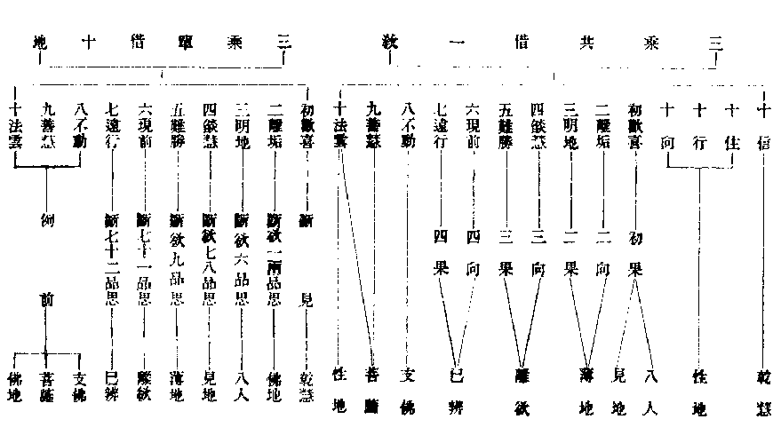



(单借十地，既乾慧断见，何位伏惑？如辅行六上八云：彼此地前，通为伏惑。通虽无位，即未断惑，不入地故。文意指地前修观伏惑也。)



(又妙乐二（二十二）云：或指地前假立七贤（文），燋燋十地，亦以乾慧断见发真为初焰伏惑之位，意亦例尔。有云利根者即伏即断，但未见祖语。)



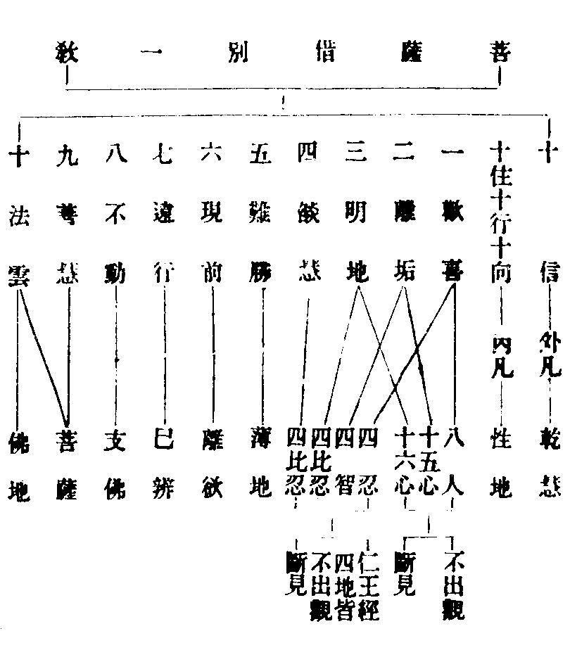



且通教十地已具，何须借位及初𦦨等？良以如来善巧被物，机既不一，教亦含容。借别位名，判通断证，义蕴经论，吾祖备明之也。又初𦦨者，妙玄四(三十一)云：别圆各逗一种根性，故用发真为初𦦨。(别，初地。圆，初住。)通教为逗多种根性，所谓别圆入通教，含容取乾慧耳。(大品明初地燋炷，大论明三处初燄。燄约能燋，譬智。炷约所燋，喻惑。三处者，通、别、圆也。三教含容通，故曰别圆入通，非被接义。)若钝根者，八人见地是初𦦨。利者，於乾慧即能断结，即是初𦦨。(文)且乾慧、初𦦨，三通言之，是何根性？须知论释燋炷，虽通三教，乾慧、初𦦨，只是通教。忍名者，大论为菩萨立三忍：一、伏忍，乾慧地。柔顺忍，性地。三、无生忍。三地已去，乃至十地，皆菩萨位。(玄文具出。)



乾慧地(止)初果齐。



两地断见者，止观六云：三地据断见之初，四地据断见之后，皆不出观。(文)辅行六(上七)：以借别断见位对通教拣，云通虽二地断时仍促，三乘共故虽促复长。(文)八人者，止观云八忍也。



五薄地(止)，烧炭成灰。



辅行六(上七)云：言共声闻等者，通教二乘七地以前与菩萨共，名共声闻。若尔，八地已上过二乘地，何故亦名共菩萨耶？答：以初名后从本立名，不同别圆始终别故(云云)。



九菩萨地(止)，净佛国土。



通教亦无，中道应本，以誓扶习，而生三界。道谓化道，观即空观，带空出假，故云双流。游诸世间，譬如儿戏，亦如幻师，种种变现。神名天心，通名慧性，天然之慧，彻照无碍，故曰神通。化诸众生，令生正见，我成佛时，来生其国，故云净佛国土。



十佛地(止)，炭灰俱尽。



七宝天衣，异木树草座，表殊胜自然也。通亦是丈六之身，或十里百亿神通变现耳。住空故劣，住中故胜，以通教被接有合身义，故云带劣胜应。旧问：别圆成道在初寂场，鹿苑唯明三藏成佛，今通教佛为何处成？如法师云：只一金刚土台成道。四机所见不同，若华严鹿，自论大小两始，不可以转法轮难成道也。合明八相，但此文略。正习俱除者，兼前总举。



经云：三兽渡河(止)，即此教也。



河喻空理，菩萨正习俱尽如象得底，支佛侵习如马次深，声闻断正使如兔最浅，此出涅槃经。又经云等文在中论，恐论引经故云经耳。指偏真为实相，菩萨至果名佛，不名佛者据因而说，又恐以中夺偏故云也。



此教三乘，因同果异，(止)同证偏真。



三因大同，三果小异，异则习尽不等，同乃共观即空，不同三藏谛缘度别。分段者，支分形段，三界生死也。



然於菩萨中有二种(止)，故言通后。



利根通后者，被接也。被字去声，如来被下之义。接即点示接入也。究论此，多就通论，复是定教，及非秘密。原夫如来出世，直欲众生悟佛知见，由机不等，从实施权，具谈四教。於四教中，机又不同，复於权说，言中巧妙，点示实理，故有被接。(点示之相，妙玄二四明别圆接通中，寄三法以示三根。解源谓非漏非无漏空不空一切法趣。释签三（十九）解云云。具论则有四正三接，虽有三接，不出四正。)圣教来此，如涅涅槃七种二谛，大品八地闻中，古师不晓，遂兴诤论，有二十三家。明乎二谛，唯庄严开善，擅风流之名。庄严谓佛果出二谛外，(即今被接。)开善谓佛果不出二谛。(通当教佛。)吾祖妙契佛意，深究化源，故明被接，则佛旨教文，俱无壅矣。此利根菩萨，才证真空，即为点示。若钝根菩萨，同二乘人，至法华会，方乃会入。又别圆接通，接圣不接贤，接真不接俗。若圆接别，接俗不接真，接贤不接圣。更有三根，及按位胜进。按位者，以位对位。胜进者，次第差降，升前进后也。大纲既得，网目可寻。



问：何位受接(止)别初地、圆初住？



三根者，此就利根受接以论。若妙玄明三根解源，通教钝根及别圆接，通合为三也。上根三地四地等者，二地俱断见惑，总而言之，若究论须至四地，以通三地未出观故。辅行则云：四地为上(义兼五地)，六七为中，八九为下(文)。今进一位者，教位从容，文或进退，故不同也。又经论说多附下根所接之教者，合云能接，似即按位，真即胜进，今但十向。辅行则云：七地以前入别十住，八地以去接入十行，知佛证法是入回向(文)。又妙玄教正具明三接，止观行正但论一接。若真位受接者，受应作被，谓用真位以被接也。若欲文顺，应改二句云：若入似位，若入真位。则答进入何位之问。



问：此藏通二教(止)，则一槩为利？



同而不同者，断证虽同，教行有异。界内者，对方便等土说。析色入空者，外计㭊至邻虗，今总观生灭，对破外道，汝㭊非正，亦名析色，义备辅行。(三下一十五)初门者，通后别圆故。体色入空者，诸法如幻，当体即空。槩者，平斛木也。



问：教既大乘(止)，略明通教竟。



朱雀，天子南门也。今指通教为共般若，通言方等。若论共部，方等义疎，如前已说。



次明别教者(止)，此竝别教之相也。



教等八法皆别者，独被菩萨三谛隔历，三智次第三惑前后，五行差别位不相收，一因逈出一果不融，无量四谛如前已明。二乘纵於方等般若得闻别法，亦皆自谓非己志分。



华严明十住(止)，岂得定说？



华严前无十信，后无等觉，於十住品前明十梵行，自古讲者指为十信。四念处(三初)云：於十住中多明圆义，於登地中多明别义(文)。故华严位义通圆别，今且示别，故云住行向为贤，十地妙觉为圣。本业璎珞亦明六轮(如法数对)。金光明指真谛所译胜天王般若也。五行者，圣梵天病婴儿也。又仁王般若明五十一位，但无等觉。四念处(三)云：璎珞结诸方等，仁王结般若。法华在后不明次位，但决了诸权而入於实。涅槃亦不明位，同开佛性入秘密(前是一部之后故结，法华是一期之后故不结具。故彼文有人欲指楞严六十圣位是结醍醐纯圆修证，其义似明，非祖文意)。



然位次周足(止)，自下细释。



此凡圣位中，有教证二道，地前属教，登地为证，此约行教证也。又一教始终，俱为教道，若说十地已证之法，名为证道，此约说教证也。(玄签借用证权实部，则具四种，辅行释别教，教权证实，但明三种。)复论竖入横学两种四教，释签十(二十七)云：别教复有四者，别教十住修生无生，十行修於无量，十向修於无作，登地证於无作，故云有四。又十行中习诸佛法，具足入於一十六门，亦名为四。问：住已习八，何故行中更习十六？答：前是自行，随用一门，后为化他，是故行中更习前八，是故十六俱须广习。(文)更有三根出假，十信上根，十住中根，十行下根。(四教俱论三根出假，如止观六（二十三）。)又对五忍，十信伏忍，十住信忍，十行去柔顺忍，十地无生忍，玅觉寂灭忍。(妙宗中（十八）亦对圆位。)若论真缘，则地前为缘修，登地为真修，缘谓作意缘念，真谓任运相应，元是地师之义。今家复加观义，空假为缘，中道为真，通圆亦有此之二义。(云云)六种性习，如下对



初言十信者，(止)通教乾慧性地齐。



信等十名，楞严具释。但彼文在圆，今别位耳。此云伏见、思。诸文有云伏五住，盖别。十信伏惑，有通、别故。别论见、思，通则五住。此位出假，即名上根。净名疏七(二十一)云：菩萨化物心重，自行则轻。故慈悲重者，不务断结，从相似空解，即便出假。见、思未破，故云有疾。(文)既能出假，破尘沙否？净名疏记无文。或云伏见及上根十信侵习七住已前，此两位皆破尘沙者，未详。



次明十住者(止)，行三百由旬。



十住乃至十地别名，学者非实，并略不释，备在集解，须者往寻。习种性者，璎珞经上卷(贤字函)明六种性以对别位(净名疏第九亦借别名以显圆)，今家玄签、四教义、戒疏等并依经列，四念处中少有不次。又地持论略明二种(亦名经弥勒造贤字函)，如戒疏列六种，后复用二种及对教证前后生报佛法，佛并图而会伸之。



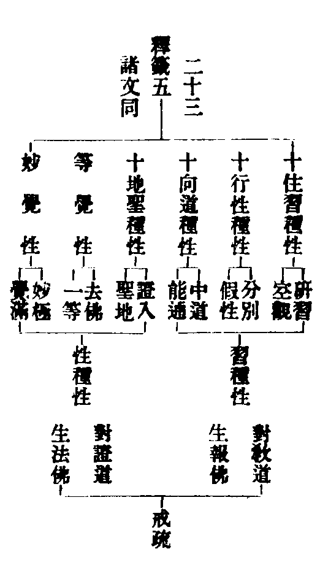



六种性者，种别性分也。地持第一云：种性者，名为种子，名为界，名为性。(文种子不同，有六界分。)又性通六位，种局在因，故前四名种。等觉虽因，望前称觉。二种者，地持经云：略说二种性。种性者，是菩萨六入殊胜，展转相续，无始法尔，是名性种性。习种性者，若从先来修善所得，是名习种性。(文)戒疏以六种对位，后复明二种者，以六位不出地前修习，登地证性，故用地持结摄六种。虽不显标，意必如是。况梵网是华严结经，地持正宗华严，故宜用彼结摄璎珞。又与约行教证，其义宛齐，故复例之。自古以戒疏文难，今备引注。戒疏云：性、习二种，若据位分，习种在前，性种在后；若据行论，性、习同时，前后不定。(标约行中义。)依体起用，(约中道理，起观行用。)先明性种，后明习种。寻用取体，(从自行用，取中道体。)先习后性。(自依体下，释同时不定义。)与教证二道相似。就位以论，教道在前，证道在后。(约行故证。)据行论之，教证同时，前后不定。(此标。)依体起用，先证后教。(望证道理，起教道用。)寻用取体，先教后证。(寻教道用，证中道体。)习种能生报佛，性种能生法佛。(文地前既论自行，修习至果，合生报佛。登地证性，合生法佛。智与体冥，任运起用，故不论应佛也。异解备诸章藻。)梵网经中，更有六种：一习种性，二长养性，(只是研习增长，与习种性通对十住。)三性种性，四不可坏性，(俗谛建立，故不可坏，与性种通对十行。)五道种性，(十向。)六正法性。(通收圣种等妙三种。)



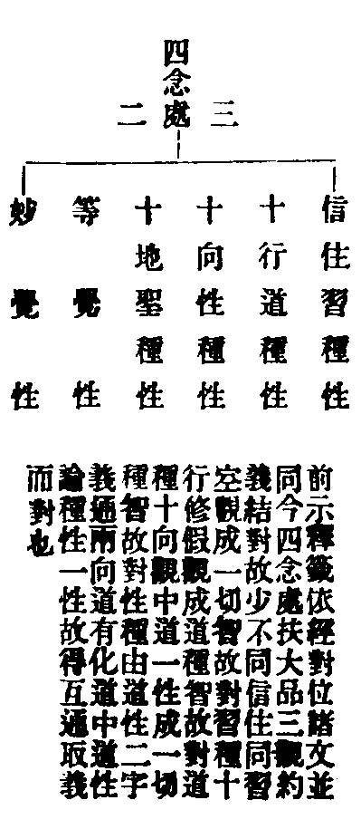



慧眼者，古德五眼颂云：



> 天眼通非碍，肉眼碍非通，法眼唯观俗。  

> 慧眼了知空，佛眼如千日，照异体还同。



玅玄三(十一)云：十住正修空，傍修假中；十行正修假，傍修中(文)。谓期心为傍也。初住断见，即离四趣。身子昔生至六住有退者，此见思俱断，思既未尽，见亦餘残，故有退堕。如四明答日本难(云云)。



次明十行者(止)，成道种智。



诸文云：十住修空断见思，十行修假破尘沙，十向修中伏无明。此以观对位也。若云：初住断见，二住至七住断思，八九十住断界内尘沙，十行断界外尘沙。此约惑分齐也。四念处四云：十住断界外上品尘沙，十行断中品尘沙，十回向断下品尘沙。(文言三品者，生无生八门为上品，无量四门为中品，无作四门为下品。)此以惑从教也。以别是界外教，或纯用假观摄故。然尘沙惑体，只是见思无明。就菩萨化他，分别药病，得名尘沙。就众生论，通别见思耳。妙宗云：见思重数，如尘若沙。(文)又复断尘沙之相，以修假观，名伏观成俗，显为断也。若尘沙习，懒於化导。且三品尘沙，与三根出假何异？盖三品尘沙，约一人竖论。三根出假，约三人横辨。又三根出假，通乎四教。三品尘沙，局在别论。又此十行，明横学四。且无作四门，为圆为但？若圆无作，十行位浅，尚未修中，如何能说以此化他耶？若谓但中，释签五(初)云：若附彼教，而为相状。(文)既附彼圆，岂应是但？杂编五(十四)云：十向圆修，可由实道。(智转行融，乃修圆中。)十行无作，且顺权方。(只是但中无作。)良以修中之位已深，出假之位尚浅。位深，故知昔日化他，无非妙行。位浅，故知将来自行，亦是但中。不可以实难权，以他妨自。(文)其说切当，学者知之。附彼圆教者，但为明於无作。相状能附，岂可全同深位？然此出假，若果但中，圆机起时，将如何赴之？当知圆机，自感圆应。十行出假，乃教道说。无稽之问，不足评矣。



次明十回向者，(止)居方便有餘土。



回事向理，回别向圆。行者至此，空假心满，智转行融，但无中体，乃修圆中。四念处云：别向圆修。霅川云：可由实道。(杂编但不合云：只缘被接，方曰圆修。)若玅玄云：十回向始正修中。此中但理不具诸法者，教道所说三观次第，是故云尔。今约圆修，乃是约行。注云：行不退者，化他行满，无退转也。前七住还断惑证空，名位不退；后初地去，名念不退。中道正念，二边莫动。



次明十地者，(止)十法云地。



注云乃至等觉俱名圣种性者，据同证论，准经必须开等觉性。无功用者，不加功力，任运流入。初地即同初住，分身百界。二地去，十倍增之。又二地去，各断一品无明，乃教道说。八相者，一生兜率，二托胎，三住胎，四出胎，五出家，六成道，七转法轮，八入涅槃(华严亦列降魔，如前示)。五百由旬者，三界加方便实报，五百约惑加尘沙，无明约观加假中也。宝所者，喻分证寂光。



更断一品无明(止)，即此佛也。



破十二品称为妙觉，皆教道说莲华藏世界，如华严经华藏世界品说，钝根者迷中重故。



有经论说(止)。略明别教竟。



八地入无功用，如华严妙觉位，但破一品无明，未见所出。至六地断思与罗汉齐者，取十度义，以第六般若空慧断惑故也，如止观第六借位中(云云)。十度者，六外加愿，智、力、方便。三贤者，别住、行、向，住果报土，义则属圆。此仁王经偈文，别教更有纵横之义，非此可尽。



次明圆教者，(止)圆建立众生。



圆者，法界无外，佛魔同途，理事双融，唯心唯色，三千三谛，妙不思议也。禀斯教者，圆观三谛，圆伏五住，圆断三惑，一行一切行，一切行一行。圆位例然。妙用庄严，故云自在。四悉普益，故曰建立。具如止观第一引华严(云云)。



诸大乘经论说佛境界(止)，并属圆教。



初发心者，三因开发即初住位，二住已去莫不皆然，故结云四十二位。薝方等者，观众生品天女弹斥身子之文。一心五行者，经云：复有一行是如来行，所谓大乘大般涅槃佛性之理。有人入大海浴，亦涅槃文。娑伽罗，此云咸海，随处受名，如华严也。梼香为丸，出楞严三昧经。清凉有解，如义例第七喻疑显正(云云)。



今且依法华璎珞(止)八妙觉。



法华但有五品六根，璎珞具明五十二位。妙乐(三四)云：若云圆位，六即亦足，何须更列四十二耶？以分真位长，故借别位分其品秩(文)。昔贤据此，谓圆教本无位次，但借别显圆。今谓妙乐意以五十二位在经论中多被别人祖师用释圆位，故云借耳。又有云：五十二位名虽在别，圆亦同用以分深浅，岂可圆教全无位次？大品四十二字，华严初住八相，法华五品六根等，皆圆位义也。故曰：显一理则始终无二，存诸教则因果历然。既禀教修行，安得无位耶？妙玄(五)又拣诸文开合有四：一、开前合后，如大经三十三天(住行向为三，十地等妙为三)；二、合前开后，如仁王十四般若(合三十心为三，十地为十，等觉为一，总十四忍转入佛心，名之为智)；三、前后俱开，如大品四十二字(对四十二位)；四、前后俱合，如法华开示悟入及游四方(对四十位)。又楞严明位有六十，前加三渐次(名字即)，及立乾慧地(观行即)，向后地前立四加行，并常五十二，共成六十



初五品者(止)，故名随喜。



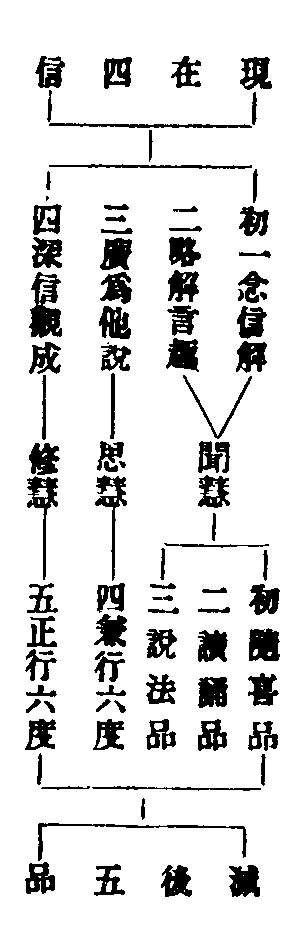



对三慧如文句。又妙乐十(十二)云：何故现在唯四信，灭后立五品？答：其义既齐四五无别，但是灭后加读诵位为第二品耳(文)。妙心体具者，介尔有心三千具足，此具妙故即空假中，一念既尔一尘不亏，心佛众生三无差别，解行之要学者当知。



内以三观(止)妙觉彼岸。



五悔者，初可名悔，餘四云何？劝请则悔请佛入灭，随喜则悔嫉他修善，回向悔於悭吝，发愿悔於懈怠也。理者，无生理忏也。事者，作法取相也。此三忏法通大小乘，具如光明文句。又能观名理周所缘，即忏悔处。若忏悔名梵语忏摩，此云悔过，华梵双举也。十恶者，文中阙杀生一恶，口有四恶。普贤观云：舌根起五种恶口。不善业者，准优婆塞戒经加说无义语，故云五种。



莫见此说。(止)寻之思之。



此斥偏执理性，无修无证，轻侮圣教，不敬尊容，乃堕外道自然之计。唯我智者，建立解行，了修即性，全性起修，性虽本然，修常宛尔。故清凉国师云：撮台衡三观之玄趣，使教合亡言之旨，心同诸佛之心，不假更看他面。鼠唧鸟空者，愚人谈即谈空，有言无旨，如恠鼠之唧鸟，声之空空也。广在经论者，称性即具，义备圣典，故请寻之。



二、劝请者(止)，例此可知。



回向者，回自向他，回因向果，回事向理，如回声入角，响必远闻。发愿者，前之四法，以愿要心，如𦘕有胶，如坏得火。又四誓为通，清净业等为别愿。五十校计经云：始自凡夫，终至等觉，皆行五悔。等觉尚尔，人何弃焉？



二读诵品(止)，与别十信位同。



化功归己者，此据功成入位而言也。若止观安忍中令修三术诫勿领徒，虽明品中修於三术，意诫初心为他损己。又品位虽说须守观心，若逐外有妨是亦须诫，意各有主文或少殊。此约观行成就五品在十信前，若准普贤观即品信合说。又吾祖居五品获旋总持，并如别辨。



次进六根清清净位，即是十信(止)，故定属圆信。



六根清净，如法华法师功德品说。仁王云者，波斯匿王所说偈也。十善者，即不杀不盗等十，此善顺胜人天业。



然圆人本期(止)，自然先落。



品位圆伏，信应圆断，云何此中二惑先落？将非与彼别观同耶？当知三观绝待，事理顿亡，就观论功，故名圆断。故净名疏有切葱喻。然观有微著，迷有厚薄，故强分三惑，二惑先除矣。况圆人本知惑体无二，与别解行逈不同也。辅行(九上)云：从初已来，三谛圆修，与次第义，求不相关。此论麤惑，任运断处，与次第齐(文)。又指要云：圆人始终用绝待智，惑何次第？此乃约智分惑也(文)。



永嘉大师云(止)：故言三藏即劣也。



同除四住，此处为齐等，乃天台妙玄位妙中文，永嘉集中引用之耳。昔传五代之后，我宋之初，台教泯没，因钱氏读永嘉集，至此不解，问于韶国师，国师指为台教中语，遂求於海东，由是高丽观师賷教部来使，始复兴焉。今称永嘉，盖有由矣。一切处住地者，我见为本，计著无量，名一切处。又见通三界，故名一切。



次从八信至十信(止)，行不退也。



虽约位格量，圆别即离，不可一混。



次入初住(止)，念不退位。



此有三节：初内证外现，次华严下引证斥失，三中观下总结。一品无明者，仁王开十地为三十品，以一品分三，断前二品尚在方便，断三品已方入实报，此皆教门分判，其实惑体前后不异。不纵不横者，异乎别教修纵性横及因果纵横也。释签云：虽一点在上，不同点水之纵，三德亦尔。虽法身本有，不同别教为惑所覆。虽二点居上，不同烈火之横，三德亦尔。虽二德修成，不同别人理体具足，互不相收(妙宗上广示)。三点三目，出大经哀叹品。西方有新旧二伊，旧伊如横川走火点水之纵，新伊如此方草书下字，细𦘕相贯不纵不横。摩醯首罗有三目八臂八相者，华严云：或见入胎等，既皆云或，一一相中皆八相故。涅槃云：发心毕竟二不别，如是二心前心难。发心即初住，毕竟即妙觉也。龙女成佛，文从权说，以证圆经成佛速疾。若实行不疾，权行徒引，机实义等，理不徒然，广如妙乐(云云)。诸声闻授劫国名号，须结缘故。



次从二住至十住(止)，此是一生补处。



爵有五等，谓公、侯、伯、子、男也。等觉所断，为正为习？若云习气，此文乃云一品无明。妙玄(五、六)亦云：观达无始无明源底，断最后微细无明。(文)若云正使，净名疏(二)却云无复餘习者，圆教始从初住，终至法云，圆断诸见，犹有习在。等觉入重玄门，千万亿劫重修，凡事见理分明，习气微薄，事等微烟。(文)须知等觉有正有习，如净名疏五(三十五)云：住等觉地，餘有一品及习气在。(文)若言入重玄门但断习，为释经中叹等觉断德无复餘习之句，且据一边而说。又垂裕云：犹有在者，此以元品无明名为餘习。(文)



进破一品微细无明(止)，即圆教佛相也。



父母者，能生阴身。楞伽云：杀无明父，断贪爱母。诸法是境，般若是智，境智冥契，故皆不生。虗空座者，非如大虗，义彰圆徧。妙玄云：或言道场，虗空为座，一成一切成。毗卢遮那、舍那、释迦，三佛具足，遍一切处(文)。今云法身，从胜而说。复顺圆教，指修即性。不离三土，即住寂光。寂光有相，非此可尽。



然圆教位次(止)略明圆教位竟。



六即义者，性德三千事理不二也。全由性具故六常即，如初一位在迷在事，然与极圣毫发无差，情想未亡即不妨六。故知只一十界，理则俱理佛界亦迷，成则俱成十皆究竟，以一一法皆三谛故，蛣𧏙成佛义可准知。六即意者，为免叨滥及生退屈，如文。又理同故即与初理即，两个理字为同为异？盖理义是一受名少殊，理同则圆论法体，理即则贬彼无修，虽尔少殊理不可异。



然依上四教修行(止)，可以意知。



此下明依解修行，虽义通四教，而正意在圆，故方便十乘。一依止观，今文阙明四种三昧(常坐、常行、半行半坐、非行非坐)及十种境(阴、烦、病、业、魔、禅、慢、乘、萨)，止观明常坐观阴入等境。(二)十观非有百乘，若无十境乘则无体，若无十法名坏驴车，入道之要殆不可须臾离也。



言二十五方便者(止)，五行、五法。



善巧调停，故名方便。此二十五为远方便，阴等十境为近方便。又二十五法为通方便，通四三昧故。方等、梦王、法华、六时、五悔为别方便。止观云：譬如陶师，若欲得器，先择良处(具缘)，息餘际务(诃欲)，治身内疾(弃盖)，调於泥轮(调五事)，作而不废(行五法)。得此譬意，五如指掌。若欲造修，当寻止观(云云)。初心略释五科纲纪，先读止观大意。



初明五缘者，(止)三教授善知识。



在家戒者，五戒、八戒。出家者，沙弥十戒，比丘二百五十戒。颂云：



> 四重十三二不定，三十九十四提尼，  

> 一百众学七灭诤，总论二百五十戒。



若论篇聚者，夷(僧有四重，尼有八弃)、残(僧十三、尼十七)、提(僧三十舍堕、九十单提，共百二十，尼有二百八)、尼(僧四、尼八)、吉(僧尼同百)为五篇，夷、残、兰、提、尼、吉为六聚，开吉罗为恶作、恶说为七聚。(罪结齐五，报劫齐六，因果杂摄齐七。兰有三品，不入正篇，不定七灭。篇聚不摄，亦属吉罗。如南山戒疏释。)此局声闻戒。梵网十重、四十八轻经，大乘顿制，凡有心者，皆得受之。更有大论十戒、大经十戒、五支戒，通大、小乘，具如玄签及止观记集解略引(云云)。粪扫衣者，世人弃而无用，义同粪扫，集缀为服。三衣者，安陀会五条，郁多罗七条，僧伽梨大衣，迦叶十二头陀，此当其二。大论六十八云：一、兰若，二、常乞食，三、粪扫衣，四、一坐食，五、节量食，六、中、后不饮浆，七、冢间，八、树下坐，九、露坐，十、常坐，十一、次第乞食，十二、三衣(文)。百一众具者，百物器用，各畜一件也。此外为长物。若畜长者，律令说净词云：大德一心念！此是某甲长衣，未作净，为净故，施与大德。若三衣持护、加法等词，略如六物图，广在律钞僧中。净食者，结净地以摄食，故云净食处。三者，上根深山，中根树下等，下根伽蓝。缘务有四：一、生活，二、人事，三、技能，四、学问。



第二呵，五欲(上)及诸好触等。



色如热金丸，执之则烧；声如涂毒鼓，闻之则死；香如毒龙气，嗅之必病；味如热沸密汤，舌则烂；触如睡师子，近必被啮。齿𮈔竹者，具有八音：金、石、丝、竹、匏、土、革、木。



第三弃五盖，(止)悔疑，



五法覆心，故名五盖。前对五尘名欲，此则转入意地。掉悔者，掉举通身、口、意，疑自、疑师、疑法。



第四，调五事(止)，调食不饥不饱。



眼食定外，各调身息心，入住出时合调，澁则结滞，滑则不细，餘如前示。



第五行五法(止)，可尊可贵。



一欲，二精进，三专念，四巧慧，五一心，此名法船。以一心为船柁，以慧为点头，餘为橹棹。



此二十五法，(止)临时审量耳。



虽名方便义，亦通正修之中，如调身心及知识等，餘准可知。



次明正修(止)，餘教例此。



观必托境，文略不明。此十乘者，次位等三，虽非观法，竝由观力，相从名观，故名十观。又备此十，令观可成，故名成观，亦名成乘。又前之四法，用无前后，通塞等三，成就前四，次位等三，以判前七。又前七正明车体，及以具度，后三祇是乘之所涉，若无所涉，运义不成(辅行)。上根唯一法，中根二或七，下根方具十。又前六正观，第七助道(大意)。斯是一家入道之本，不可率尔言其始末，应投哲匠，深究宗源，玩味圆顿止观，入心成行，绵续佛种，光显大教。今抑寄十问，以诱新学，庶达观者，因为开示。问：事理二造，约一念明，圣祖极唱，本何经论？问：理具事造，两种三千，当修观时，如何用与？问：玅乘三境，修相难明，自古多歧，如何定断？问：中论四句，与妙三观，如何会同，令成一辙？问：真如理观，唯识事观，对四三昧，起观如何？问：历三性事，徧六作受，十乘观义，何以明之？问：观佛三昧，十乘观法，两重能所，云何指决？问：第九佛观，名真法身，行者观时，为真为阴？问：玅乘当体，及以所依，约修约性，若为判属？问：上根一观，如何又云若无十法，名坏驴车？



一、观不思议(止)，其车高广。



止观第五卷云：历阴入界三科栋境观，总无明心。即此阴心，明具三千，显不思议境，即是观妙。境有三：一性德，二修德，三化他。总是初乘称性修法，为九乘本。辅行(五上二十六)云：观法非十，对根有殊。虽复根殊，但是一不思议观，观不思议境，乃至离爱不离境故。(文)高广者，正是乘体无发无到，坚彻三际，横徧十方，故云其车高广。



二、真正发菩提心(止)，张设幰盖。



慈悲普覆，故如幰。此观妙境不悟，於静心中重发弘誓，非五略初发大心也。



三、善巧安心止观(止)，安置丹枕。



止观安心，有总有别，别中自佗各六十四，以四悉檀说止说观，对信法行，回转相资，非此可具。丹枕者，南山经音经云：天竺国无此木枕，皆以赤皮内著绵毛，用之倚卧。丹是赤色，是正非间，以喻正智无分别也。枕能休息，身首安然，以喻定慧安息妄念。



四、破法徧(止)，其疾如风。



前安心是有慧之定，此破徧是有定之慧。虽通四门，无生为首。其疾如风者，速到萨波若故。此证十乘，非经文次(云云)。



五识通塞(止)，安置丹枕。



於塞得通，如贼为将；於通起塞，如将为贼。破贼护将，对法可知。枕以支车，车不昂举。车行去枕，其枕则闲，即动而静也；车住须枕，其则用，即静而动也。



六、道品调适(止)，有大白牛等。



道品只是念处次第相生，成三十七，餘如前示。实相为车体，道品为前导，故喻白牛。言等者，具云有大白牛，肥壮多力，形体殊好，行步平正。大意以中根至七乘，今至第六者，以正助分中下也。



七、对治助开(止)，又多仆从。



於正修时，忽然障起，求佛加被，发愿行施等，随蔽修助，助成正观，故如仆从。



八、知位次(止)，直至道场。



知位次中，明修五悔。安忍中，修内外三术。内术治惑，谓空、假、中。外术为远名闻利养：一、不受不著，二、缩德露玼，三、一举万里。若著法爱，则名顶堕，故须离爱以入分真。



谨按台教广本，(止)判教仪式耳。



其玄义等，且论教解，若明乘境，具在止观。自从此下等，有云：准玄义意，於此须明诸家判教，今略不说。略谓略去，非粗略也。有云：在观师时，应更有文，后人避烦，但存标举耳。今恐前说为正。



天台四教仪备释下(终)

