# 四教仪注汇补辅宏记



> **藏经**：卍新纂大日本续藏经（新纂卍续藏）　**册次** 第 57 册（X57）　**编号** X0980　**部类** 经疏部　**卷次** 10 卷　**篇幅** 487,803 字

> **卷／品**：0 卷 · 3 品



---



## 目录



  - [No. 980-A 天台四教仪注汇辅宏记原序](#no-980-a-天台四教仪注汇辅宏记原序)

  - [No. 980-B 辅宏记补订序](#no-980-b-辅宏记补订序)

  - [天台四教仪集注序](#天台四教仪集注序)



---



### No. 980-A 天台四教仪注汇辅宏记原序



天台四教仪集注一编，入藏流通旧矣，特以文约义丰，非广搜经论以阐发之，新学何以深入堂奥耶？辅宏记者，相传山家后嗣集而记之，所以辅弼集注而宏扬教观者也，又曰扶宗记。惜沿今不登梨枣，秘之讲座，珍逾龙藏，遂致传写者句读脱阙，字畫乌焉，盖一展卷而指不胜屈矣。予自乾隆丁丑搆兹记，癸巳乃得复获抄本仪注注暨诸先德集注标本，於是抽闲四载，欣然废寝忘餐，彚成十卷，更其题曰注辅宏记。方思精密重编，公诸同志，以成秉教必要之书，何期草始就而双目损明，岂夙生之少植欤？抑因缘时节之尚有待欤？留赠后贤，详加参订，以付梓流通，庶几尽未来际，俾见闻者共得游於三德之秘藏也夫。



大清乾隆四十四年岁在己亥七月哉生明比丘示三氏性权谨识



------



### No. 980-B 辅宏记补订序



如来一代时教，始自道场，迄乎双树，其间顿渐权实之部，偏圆半满之谈，於法华而开示佛之知见，乃大畅其本怀。夫所谓佛之知见者，一念三千，空假中不思议绝待之妙法也。宗此者谓之圆宗，解此者谓之圆解，修此者谓之圆修，证此者谓之圆证。法华偈云：佛子住此地，则是佛受用，常在於其中，经行及坐卧，意不在兹乎？迨迦叶十三传，而有龙树著中论，译之震旦。北齐文师读之，悟因缘即空假中一偈之旨，以授慧思，思师以授智者。智者大师契法华三昧，发旋陀罗尼，创立两种四教，判定一代五时，诚所谓一家教观，统摄龙藏者也。继之者，章安顶、缙云威、东阳威、左溪朗、荆谿然，而天台若教若观之书，於是乎大备。荆谿而下，承之者，兴道䆳、至行修、正定外、妙说琇、高论竦、常照寂、惟远通、法智礼，而教复称中兴矣。法智而下，绍之者，南屏臻、从谏辨、车谿卿、宜翁观、元实印、佛光照、子庭训、东溟日、普智碍、天竺慧、东禅翁、百松觉、无尽灯、灵峰旭。旭师，灵峰一枝之始祖也。作阄祷於佛，得台宗焉。传之者：苍晖晟、警修铭、履源洪、素莲珠、道来成。成师於灵峰为第六世嗣子嗣孙，今皆分座诸方矣。方成师之讲法武林也，曾授富春单子华藏以一心三观之要。单子淹通贤首、慈恩诸家，尝究西来大意。一夕，闻虫声，乃深悟，有颂云：促织促织，汝太饶舌，露冷风凉，声声啼血。故其谈教也，语语从胸襟流出，不偏不泥，贯达诸宗，雄辨若云，所向无滞，殆有获於辨才三昧者欤！单子有门人曰钱子伊庵，潜心内典，与余方外交，嘱较辅宏记补订一书，间有一二损益处，钱子均采入焉。噫！禅林胶理即而藐修，讲师竞多闻而拨观，如斯流弊，於今尤甚。曷不玩味乎兹集，而知不思议绝待之体，境观一如，解行兼进，以速到一切智海，免为增上慢人，不亦庆快平生也哉！钱子书成，而单子已卒，索序於余。余惟是集之由来及利导后贤之意，钱子述之详矣，故特序台宗授受之源，以公来哲，俾知闻风兴起云尔。



龙飞嘉庆二十一年岁在丙子仲冬长至日比丘仪润氏源洪书於武林苕上真寂精舍



No. 980-C 辅宏记补订自叙



四、教仪集注辅宏记者，逸其名，讲师传为帐中秘。余受之华藏单先生，继得示三氏补注於元如师，卒得绍昙上人辨讹於源洪师，皆释仪注之要书也。余慧劣遇艰，复乏净财，繙阅删辑者迨二十餘遍，晨夕祈三宝加被，五载而订定，制聚珍字盘勉成之。自丙子五月十有二日首事集印，越十一月朔后三日，日在长至而告成。其间较定舛讹，赞襄乃事者，则源师力也。或有问曰：子禀单传於曹谿，何复杂研夫诸教？今尤汲汲焉流通台家之辅宏记者，何欤？余笑曰：宗门运水搬柴，麤言细语，皆西来意，於经论何独不然？然理则顿悟，乘悟并销；事须渐除，应次第尽。子将谓一悟即佛，无事熏修耶？初祖不立文字，而属二祖以楞伽，子独未之闻耶？矧吾侪浅知肤见，三毒勃如，其敢毁木叉拨修多罗作师子虫耶？且余尝闻诲於华藏先生矣。佛法东流，迄今繁衍者，天台而外，标直指者，厥有达磨；阐法界者，厥有贤首；成唯识者，厥有慈恩；餘如净宗、密宗、律宗，斯诸祖者，悉大悲为心，各开方便门，以作如来之使者也。然简偏圆，辨邪正，知病识药，应病授药，横竖该罗，教观美备，可以评衡诸家之权实，希一生之登住者，则莫如天台。其习焉而全不奏功者，非空言无补，即一暴十寒，或方便正修境乘之阙漏，非天台咎也。然就天台一家论之，智者、章安、荆谿、四明诸著述，文富而义玄，幽䆳汪洋，目眩神骇。兼之一家立义，旨各有归，如借用地、论、教、证四种妙玄，借成二意而辅行，借成三意、别行、横学、无作四门，位浅只应但中，而释签谓附彼教，如斯异同，难以枚举。自四教仪集注后先叠出，为之括大纲，通旨趣，而后学者易以抽摘其端倪，是则台宗集佛法十二部之大成，而仪注又为台宗三大部之锁钥，岂不重哉？夫仪注重，则阐发仪注以宣扬教观者亦重，辅宏记一编是也。仪注搜引大小乘经论，奚啻百十部，虽有备简节义诸书，犹未周且尽，斯记则详录其引词，疏通其文义。末学钝根，苟能繇斯记以会台宗，其於偏圆邪正诸家权实之故，瞭如指掌。夫然后以此自行，即以此化他，将此深心奉尘刹，是则名为报佛恩。此昔所闻於华藏先生，而殷然流通之微意也。若夫灵峰之言曰：四教仪出而台宗晦。殆有激焉而为之辞，无烦余之置啄也。



大清嘉庆二十一年丙子十一月长至日武林三宝弟子钱伊葊谨叙



辅宏记补订凡例



旧题标天台四教仪集注辅宏记示师，於辅宏记上更加一注字，今仍删之，於记下加补订二字。定名之意见卷首。  

记本辑载周详，示师复增十分之三。今研记中有於义未确者，或烦重非要者，删之。於示师增注亦然。每节次第，於仪文前列科题，则低二格。若仪文则另起一行，而高列高格。其【■原注】上标阴文。次集注则加一【□注】字，而前空一字。其【□原注】上标阳文。间有原注与集注文连义合者，即不分标之。次记文上加一【■记】字。记有所遗，乃录示师之所补，别加【■补】字。补仍未畅，再参诸疏以备考。上加【■备】字，庶文不相滥矣。  

示师抄本外，余复得集注标本，未识何师所录，故但加有师标云四字。餘如灵耀师节义、天溪师备简补遗、集注问答、绍昙师集注辨讹，义有当采，均为增入，而各载其题名。  

楞严寺藏版，首列悬科，今删之。示师记本，另增贴科。然分科者，为识章节大纲，若过细科，则失於烦碎，故今科从总。  

刻本集注所见有三种，互有舛讹。至辅宏记抄本相沿，舛误亦多。今虽校勘，仍虑未周。后检校有得实者，乞为改正。於诸解谬处亦然。唯记中引经论等，或因文句冗长，略为节录；或因旨趣深玄，略添助语。集内似此不少，勿以不见经论原文为斥。将来别部引用，亦弗引兹刻为证。  

今刻用聚珍盘集字印成二百部，以为流通，前茅见者珍之。如有刻版因缘，则诸图仍宜挂线，而依原图付梓。



No. 980-D 新刻天台四教仪注汇补辅宏记缘起



原夫佛祖之道，乃定慧而已矣。定非观无以深入，慧非教无以深明。有教无观则罔，有观无教则殆。教受傅训，观由己行。训乃文字般若，行即观照般若。然后堪证实相般若矣。且如我始祖智者大师，灵山夙闻，大苏妙悟。降天魔於华顶，转法轮於瓦官。纵无碍辨，称性宣敭。依本迹二门开，待绝二妙诠显。妙经而有玄义文句止观，世称台宗三大部焉。畅尽如来出世大事因缘，罄无餘蕴。第以文博义渊，后世学者，皆望洋而叹。於是赖有高丽国师，妙录文精一轴，命名四教仪。辑三大部之要纲，为大藏教之引钥。傥能酣醉仪文，便可洞悉度生法药。所谓尝一粟而众昧具存，覩一沤而百川俱在也。然而文约义丰，尚难措瞩。叨有南天竺之集注十轴，可谓详且备矣。呜呼！时丁末运，黠慧凄漓，不有性权法师之彚补辅宏记者，而集注虽详，犹不足观也。以是知辅宏记者，诚法门之最要书也，大有裨於教观者。惜乎素未寿枣，学者罕亲，如光绪甲午夏，我　太祖敏公老人演集注於龙华讲堂，众集二千餘指，有是书者仅惟五六，尚是嘉庆间聚珍之本也，宝逾龙藏，珍而秘之。餘诸同志欲覔而不获，欲覩而无书，(闲)虽朽钝，受润有年，原欲念报祖恩，亟令绣梓。自愧赋性愚蒙，欠谙酬应，安心澹泊，乏术点金，弗获已，掩颜吐舌，敢报檀那。且喜法缘在兹，一举克遂，奈旧本蔓莚，句读未煦，若不少为疏调，初学披读维艰。迩来赴讲不暇，虽间以澄神游涉，频续频荒，其间行列编科，分眉分目，颇遂陋志。屈指三秋，若道完性权法师未了公案，则吾岂敢？



时大清光绪二十三年岁在丁酉春王月既望



天台嫡裔后学比丘谛闲书於瓯江古头陀山妙智禅寺之惺寂堂



新刻辅宏记凡例



是书乃大藏纲宗，台家心髓，大师说大部於隋，观师录心宗於吴，岗师述集注於元，示三师获辅记於乾隆丁丑，钱居士制聚珍於嘉庆丙子，迨至於今，始能殃梓告成。嗟乎！说经难，著经尤难，而刊印流通，亦未敢擅言其易，愿同志者毋得以为轻忽可尔。  

辅宏记者，相传谓台宗后嗣集而记之，惜乎逸其名，弗克显标记主耳。  

是书旧题标天台四教仪集注辅宏记示师，於记上加一注字，伊庵居士删之，复於记下加补订二字。兹者摄别从总，唯目之谓仪注彚补辅宏记耳。  

记本辑载周详，示师复增十分之三。居士补订时，重烦者删之，未已者补之。今所刻者，凡遇仪文，俱列科判。注文记文，皆另起一行。仪注二文，咸列顶格。设二文中有原注者，仍用小字附入二文之下。若注文首加阳文注字，而记文则低一格。以是释二文之辞，故宜尔也。则首列阴文记字。然示师所补之文，仍标阴文补字。居士备考之文，亦标阴文备字。如是则来学开卷，瞭然如视诸掌。  

𠁼葊居士所得标本补入之文，仍用有师标云四字，餘如旧例(云云)。  

楞严寺藏板，首列悬科，居士删之，示师贴科，余所未覩。然分科者，原为易识章节大纲，居士厌烦，删去细科，以予之钝目瞩之，似未堪略。今依仪本旧判，少加详易，增补文前，愿同志者垂赐鉴原。  

𠁼葊嘱云：如有刻板因缘，则诸图仍从挂线。兹宜从命，故将直说转畫成图，俱照集注参正。  

古疏随文科目，多不俱提，如一科分三，但标首科，今亦从之，奚敢逞能别调耶？  

古德标科楷式，巧用干支，以别科目层次，今亦承用。以是书章节繁叠，二十字未足为标，复用号码之数，依次标科，实欲从流覔源者，便非露拙也。  

以章节科中，虽大科分几，或子科复分，每科之下，但标其初，未曾俱列。今於记前，另设略科提纲者，以为索本讨源之便耳。  

(不肖)少而乏读，智不逮人。况未徧亲高哲，富玩古疏。今刻是书，唯遵前印疏理文节次第，未敢擅自移易。虽编科参梓，少有所补，一一俱依备简补遗，掉直文面而已。  

注既十轴，记亦十轴。今疏理记文，仍分十轴，以其页数过多，订本甚厚，恐翻阅者未便，故剖之为某卷上下，庶几可以薄订矣。盖为珍重佛法，非敢擅易也。赐览高贤，幸垂谅我。



No. 980-E 天台四教仪注汇补辅宏记卷首



时教图



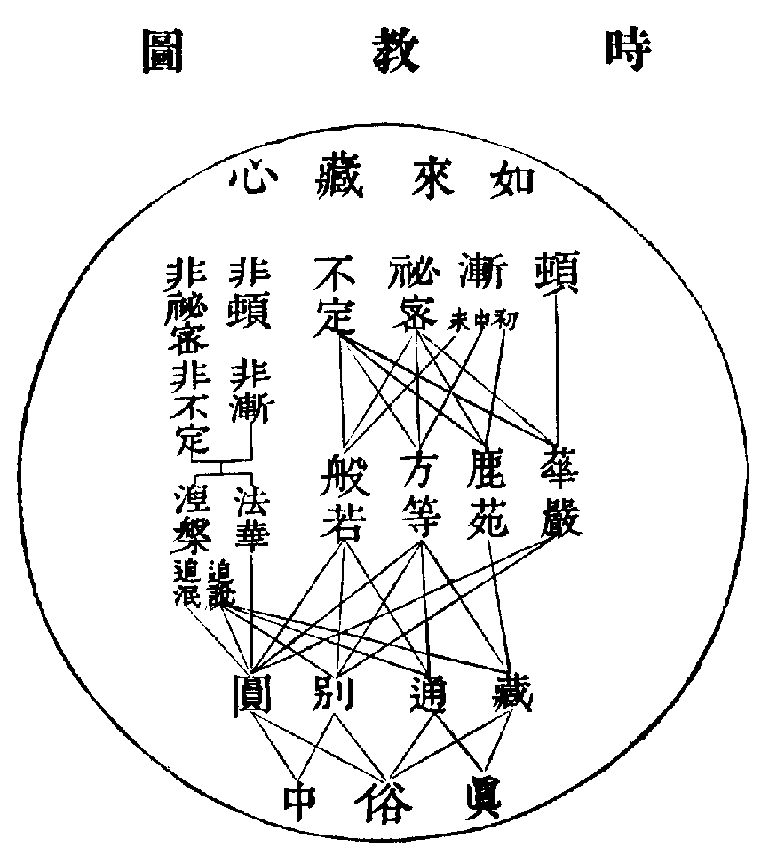



妙乐顿等四教，是此宗判教之大纲。藏等四教，是一家释义之纲目。若消诸教，但用藏等，其文稍通。若释法华，无顿等八，举止失措。



释签：依如来藏同体权实大悲愿力，随顺物机，不获已而用。既机宜不同，致法有差降。从一实理施出权理，权实二理能诠教殊，故有四种差别教起。



【■备】注释经论，只须长行直解，故玄签、文句、止观等书，均少图式。惟四教仪集注作图甚多，今本仍依仪注图式写入，以俾学者易焉。



△初、释图中时教之意。



【■补】部首旧列有时教图，首标如来藏心，不特明一家教部宗源，即如来一代教观，知惟心具，开卷瞭然。故今先明图，以明如来之教，依理而起也。理者何？即众生心。夫众生现前介尔之心，一念三千，即空、假、中，不可思议，当体绝待，无可诠显，姑作一圆相表显之。然此心体，何名如来藏？如来，果人之号；藏者，含藏之义。众生之心，含藏佛果智慧德相，故作圆相，以表因心果觉，无欠无餘也。依此起教者何？如来覩明星悟道时，叹曰：奇哉！众生具有如来智慧德相，但以妄想执著，不自证得。是以兴慈运悲，依如来藏诠中实理，而起圆、别二教，以度迷中利钝之机；又依如来藏偏真权理，而起藏、通二教，以度迷真利钝之机。此化法四教，从理起也。然如来惟以一佛之知见，咸令众生开示悟入，意在法华之纯圆。秖缘机器未堪，最初兼一别教，是为第一时。华严之顿，大机虽悟，小机未闻，於是脱珍著弊，但说三藏，令二乘革凡成圣，是为第二时渐初。次至方等，弹偏斥小，叹大褒圆，对半明满，四教俱说，令二乘密得通益，是为第三时渐中。次至般若，融通淘汰，转教付财，带通别二，正说圆教，令二乘密得别益，为第四时渐末。於此四时中，如来一音演说，众生随类各解，互相知者名不定，不相知者名秘密，此化仪四教，从理起也。至法华，开权显实，咸令开佛知见，乃畅本怀。次说涅槃，为未熟人，名捃拾教；亦为末代钝根，名扶律谈常教。追说四教，同四味施权；追泯四教，同法华显实。与法华既同时味，总为非顿、非渐、非秘密、非不定之化仪，从理起也。至於藏教，成生灭真俗二谛；通教，成无生真俗二谛；别教，成无量隔列三谛；圆教，成无作圆融三谛。虽四种不同，皆如来化法所摄，莫不从理起也。以是知如来藏心，体也；五时八教，用也。盖从体起用，正显心具之微旨也。问：如来藏，乃无明阴妄心。世尊觉满，藏理已显，所起时教，应云从真如理上而起，何以标如来藏耶？又心、佛、众生，三无差别，何以独标心耶？答：一家明理，就迷就事而论，不同他家，及与山外。【■备】他家，指台宗外各宗法师；山外，指台宗内背宗各师，如四明之徒，净觉师等是也。以清净真如，离妄立真，山家即妄全真，开初心圆观也。山外隔历，近乎别教，佛祖统记内详辨。【■补】理指清净真如，若指此理，祇齐今家别教，非究竟说。山门立义，所以超诸家者，正由此也。又一家纲格，不出解行。解则诸佛众生，色心依正，趋举一法，无非此理。行则的指内心。玄文云：佛法太高，生法太广，於初心为难，观心则易。今云如来藏心，意欲学人举纲挈要，依教以起观也。苟能洞了此图，则一家教部，性修解行，思过半矣，胡可去哉！【■备】立图本意，似将一代时教，括入一图，使人了然易明。今加以性具各解，与来哲有裨，存之。华藏老人曰：藏教灭俗显真，故真谛无俗，俗谛无真，为不平等之真俗。通教具体色真俗二谛，不知中谛。别教中谛，与真俗隔历不融。惟圆教一中一切中，一假一切假，一空一切空，即三即一，遮照同时，此为佛知见矣。图中收归三谛者，以前皆判教相，非证莫了，必须修三观，证三谛，始免数宝之讥，意深哉！



△二、释图下原引之文。



【■备】初、引妙乐示判释纲目者。前四时中，顿等四教可知。法华非顿者，明非隔渐之顿，正是会渐归顿也。故以顿等四教，为此宗判教之纲。既定纲已后，以藏等四教，详释五时用顿等化仪之义，故为纲目。若消下，谓前四时未经开显，但用藏等各论，当部不举从顿施渐，会渐归顿，及秘密不定等大纲，犹可消通。若释法华无顿等八，则五时之化仪难彰，偏圆之化法莫辨，相待绝待，义俱不显，举止之失措也宜哉。次、引释签明起教者。如来藏理，本一中实，但小机思息化城，令证偏空，谓之权也。虽分权实，理元是一，故曰同体。我佛依此而起大悲，乃为实施权，不获已而用也。然既随机立法，则从实出权，已分真中之殊，复因诠真分藏通，诠中分别圆，故成四种差别也。



△次释序分二：初序题。



------



### 天台四教仪集注序



【■备】此玉师序、集注所由作也。



△二序文



天台四教仪者，实教门之要道也。



【■补】天台大师以两种四教，判释如来一代所说：五时圣教，开本迹十妙，说止观十乘。依之修者，得道如林。大师灭后，章安大师结集广本，有望洋之叹。高丽法师於广本中，略录判释仪式曰：天台四教仪，由是学者易得纲要，故玉岗师标美乎序首也。仪注曰：教者，通指如来一代大藏也。教为入理之门，故曰教门。



自昔至今，注释者众，或略而不备，或博而太繁，矧又节去正文，但标初后，苟非精诵者，莫之能阅也。



【■补】昔指宋开宝间，至於元之元统，时三百餘年，注释者有苕溪玄粹师备释二卷，神智从义师集解三卷，舜江弘济师纪要三卷，其间更有注作，故云众也。略者，文简而理不周；博者，辞紊而意不切，此集注所由作也。初后者，初谓一节首，后是一节末，谓但标每节首末之文也。背文曰诵，对文曰读，但标每节前后，苟非熟诵者，莫能翻阅，何以导进新学哉！



今集诸部之文，注於其下，将无便於披览者欤？其间一二与诸家有同异者，盖述所闻於先德，非任胸臆也。若夫文末正修，初乘观法，文虽简略，理亦备焉。



【■补】诸部，谓采集经论，及一家教部之文。言同异者，如释题之从通，分天台如来两种仪式，及文义二通，乃至辩同体异体等，与诸家有异也。先德，指净慈志云：师等蒙润南屏八世桐州之孙，学法古源，承嗣竹堂。此书既集诸部成文，及述先德所谈，故非胸臆说，罔欺后学也。若文末示观，意在起行，务从圆门深入，故於正修，唯明圆行。文虽敬纸，一念三千，空假中理，已大备矣。夫一念三千，即佛知见，山家精髓，教观纲要，佛佛手授，祖祖心传，唯此而已矣。今但略举初乘者，十法成乘，以不思议阴境，为今正观，可摄下九故。



诸新学人究心於兹，忘言忘思，筌罤俱掷，奚以是为？然能尔也，则无适而不可，亦岂离是云乎哉？



【■补】初则依言开解，继则行起解绝。设有毫发当情，即以四性推破。推之既久，情念自尽，圆具之理，一旦豁然，回超言思之表，是为不思议境。此惟观智所证，故曰忘言忘思。盖理既圆悟，如得鱼而忘筌，获兔而弃罤也。是指仪文也。适，往也。



【■备】人能精研仪注，则於性修事理，因果自他，融会洞彻。由是集之约，以窥大本之广。复括大本之广，以归是集之约。依教二利，取舍自在，无往不可。然契理忘言之人，益知教观纲宗，不离是集，故序末深致意焉。噫！斯道之不明久矣。禅宗不立文字，而目为毒海。教家不务禅观，而逞彼唇鎗。惟我玉师，阐解行同途之旨，揭性修一契之源，非斯人吾孰与归。源师引藕益师语，作问答云：四教仪出而台宗晦，如执死方医变症，此意如何？答：藕师䇿进学人，广探大部，不可守此自隘也。仪注一书，使初学者，从约至博，为教观基址也。



时元统甲戌夏五，南天竺白莲华沙门蒙润谨序。



【■补】此纪时也。元统，元顺帝年号。南天竺，杭州山名。白莲华庵，在天竺玉几峰侧。传云：法师讳蒙润，字玉岗，海盐人。年十四，依舅古源师，授天台止观诸书，即了大意。源师寂，事竹堂传师嗣焉。出世主海盐之当湖德藏，迁杭上演福、下竺诸刹。后居白莲庵，专修念佛三昧。著有四教仪集注十卷行世。辩讹云：夏五出春秋，不言月者，史阙文也。○逸叟云：余久欲发明圆图序注，不藏法姪持憩师讲录来，乃芟繁存要，附於辅宏记前，以惠后人。示三师云：余自乾隆丁丑覔辅宏记，癸巳方得原记错悮者，录较补正。其间旁引仪注，注及先德，细标训释，更其题曰注辅宏记，仅成稾耳。圆图序注乃云栖憩西文所述，陶径逸叟复加删补，为素莲老大师所珍藏。今复得之，彚入注辅宏记前，将非尽善也夫！



【■备】憩师圆图序注详加删润。原本复有释此题玄义一篇，所判体宗用教，勘非切要，故删之。



No. 980



南天竺沙门蒙润集注



清比丘性权彚补辅宏记



清三宝弟子钱𠁼庵较订



天台嫡裔比丘谛闲编科参梓



△将释此文总分为二：初、释题二：初、标注题。



天台四教仪集注



【■记】初标题。天等四字，标大师所立之教。仪字，乃谛师略录之文。五字原题，又为润师所集注，即注题也。名集注者，抄集典章，注解要义也。盖大师纵无碍、辩说、教观诸书，其词丰，谛师录大部文心，成一卷仪式。其文约，润师复集诸文而加注之，乃有十卷仪注行焉。



南天竺沙门蒙润集注。



【■记】次标人。天竺，应云印特迦罗，此翻月，有东、南、西、北、中五天竺国。



【■补】然此非印度之南天竺，隋真观师於杭州龙井立精舍，名南天竺，后玉师居之，以成集注处也。沙门解本卷。



【■记】师取法雨润彼群蒙意立名。法华云：如彼大云，雨於一切，如其种性，具足蒙润是也。



【■备】注家题乃记者所标，记者厥功最伟，惜轶其名氏，无从考列篇首。辅宏者，拟附止观辅行传弘而立，谓博搜详记，以辅成集注，弘传利物也。示三师讳性权，住武源集福院，遍抄彚补，勤苦累载，传法支派，亦未及备考。今题标辅宏记，及列示师彚补下，特加辅宏记三字者，不敢没记者苦心也。较订者，虗衷细较，删冗阐真，订成以备考定也。



△二、释仪题。



天台四教仪



【■记】初、标题。此有通、别二义。天等四字是别，盖西土有龙猛四教，东土有光宅四教、苑公四教、晓公四教，玄签判教章广明。今云天台四教，是别题也。仪字是通，如补助仪、放生仪等，通以此立名。



【■备】言龙猛四教者，即龙树菩萨，以阿含、小乘为有门；大品、般若为空门；深密等诸大乘经，说有谈空，互相无碍，为亦有亦空门；中论等说一切法，皆即空之有是非有，即有之空是非空，互泯互融，即第一义，为非空非有门。光宅四教者，以羊车比声闻，鹿车比缘觉，牛车比菩萨，白牛车拟大乘菩萨。唐元晓公四教者：一、三乘别教，谓四谛、缘起经等三乘共学，内二乘未明法空，是别相故；二、三乘通教，般若、深密经等三乘共学，於中说诸法空，即是通相；三、一乘分教，梵网经等不与二乘共学，名为一乘，於中未显法之周普，名为随分，故名一乘分教；四、一乘满教，如华严经等，具明法界圆融周普故。苑公四教者，即唐贤首藏公弟子苑公，因宝性论有四种众生不识如来藏，立四教：一、迷真异执教，谓凡外迷真，广起异执；二、真一分半教，谓二乘如不变、随缘二义，但得随缘，不得不变，故名一分，於随缘中，唯说生空，不说法空，故名为半；三、真一分满教，谓初心菩萨，但得不变，不得随缘，故名一分，於不变中，双辨二空，故名为满；四、真具分满教，谓菩萨具随缘、不变二义，显真实理，识如来藏故。



【□注】天台，山名也。天者，颠也。元气未分，混而为一，两仪既判，清而为天，浊而为地。此本俗名，且依俗释。台者，星名也。其地分野，应天三台，故以名焉。如辅行一(上十七)。



【■记】颠者，顶也，高无上也。元气未分为太极，清浊已判为两仪。所谓气之轻清上浮者为天，气之重浊下凝者为地是也。此从儒释。若据佛经论，光洁自在神用名天，又身胜乐胜名天，如三卷天道中释。星者，散也。二十八宿，列位布散，各有分属之野，故云分野。其地既上应三台之星，故山亦以天台名焉。



【□注】此山即大师栖身入寂之所。盖以西方风俗，称名为尊，此土避名为敬，故以此处显其人也。复以人命家，则天台为宗矣。今题意在焉。



【■记】此明大师始终缘著此山，故以此命题。辅行云：西方称名为尊，如子之名，兼於父母。佛当生彼，预设此仪，使慕德称名故也。此方避名为敬，故以所居显其人也。



【■备】辨讹曰：栖身应云栖真，以大师避世守玄故也。律中西土亦以避称为敬，如曰不得称二师名，人问当示一字，若更问，当曰义因缘故名某甲。又根本有部乞戒词曰：我因事至说邬波䭾耶名，邬波陀耶名某甲。古师准此，故有上某下某之称。至佛菩萨万德洪名不讳者，如此土称谥号无异，又当别论也。予按阿难陀、罗睺罗，皆名非谥，然律中有是词，避称之义亦有之，双存可也。



【□注】四教者，别文明化仪化法，有乎八教。今但言四教者，以通名立题，义摄两种。盖非化仪无以判，非化法无以释，一书之旨，莫越於斯。教者，圣人被下之言，亦诠理化物为义。



【■记】今题标四教者，谓顿等化仪四教，藏等化法四教，虽有仪式方法之殊，总不出四字通名也。盖如来一代时教，化仪以判定，化法以分释，故题以四字通名，摄两种四教也。被下之言为教者，佛菩萨大悲益物，言普被於当时，教普被於后世也。诠理化物为义者，谓鉴机谈理，转化物心故。化仪有顿诠、渐诠之别，化法有诠、真诠中之殊。四教义云：此四通言教者，以诠理化物为义。大圣於四不可说，用四悉檀赴缘而说，说能诠理，化转物心故也。



【□注】问：或约化仪立题，乃据签文。化仪四教，文义整足，任运摄得三藏等四为证。或谓颁宣藏等以为顿等，谓化仪无体，又谓顿等四教。古师亦用藏等四教，起自天台，以此为化法立题，今何以从通名耶。



【■记】此料拣从通立题。



【■备】设问有三：一、谓四教之题，的约化仪。盖据释签解秘密不定中云：且寄三法，以出其相。何者？以此顿、渐、不定三法，对秘密故。则化仪四教，文义整足，任运摄得藏、通等四故也。二、谓四教之题，的约化法。盖据辅行明判教文云：如来权巧，善达物机，颁宣藏等，以为顿等。可知藏等化法有体，顿等化仪无体故也。三、谓四教之题，在天台的约化法。盖化仪四教，古师亦用。妙玄云：南北地师，通用三种教相：一、顿，二、渐，三、不定。华严为化菩萨，如日照高山，名顿教。三藏为化小乘，先教半字，名有相教。十二年后，为大乘说五时般若，乃至常住，名无相教。此等俱为渐教也。别有一经，非顿非渐，而明佛性常住，胜鬘、光明等是也。此明偏方不定教。此之三意，通途共有，惟藏等四教，天台独创。故以化仪立题，有滥古之讥；以化法立教，有专家之美故也。今从通名，何耶？



【■补】任运者，如顿则摄别、圆，渐则摄四教。颁宣者，谓颁布、宣扬、颁宣藏等。四法为渐，颁宣圆、别。二法为顿，颁宣藏等。同听异闻为不定，互不相知为秘密，故化仪无体。



【■备】释签：寄顿渐、显露、不定三法，以出其相者。秘密说法，其相难出，故寄三法，对秘密而夹出之，则秘密之相可知，而四教整足。妙乐云：秘密不传，降佛以还，非所述故，因后叙出，乃可传耳。又古师但立不定等三种，今云四教亦用者，以显露、秘密二种，同属不定摄也。偏方二卷解。



【□注】答，化仪化法，有体无体，或彼此相摄，文各有意，皆不为此立题而设。况古师所立顿等，与今不同。故妙乐以题等藏等，为天台一家判释之纲目。今此一书，既明判释立题，四教岂偏属乎。



【■记】化法二句，牒辅行意。彼此相摄，牒签文意，各有意者。



【■补】签以玄文但举顿渐不定，对显秘密，故不举藏等。辅行颁宣藏等以为顿等，申用教意，显教门纲格，不举顿等。是知二文各有攸归，皆不为此立题设也。古立不同者，妙玄云：南北师通用三种教相，如日照高山名顿等。签曰：始自华严，终至法华，皆有顿义。显露中唯除鹿苑，餘部皆有顿，故名顿教。不定亦复如是。乃至明鹿苑初成，亦有顿义，况诸经部。



【■记】南北诸师，通用三种。所立不定者，专指胜鬘及金光明。今家判味味之中，皆有不定。如玄文云：一时、一说、一念中，备有不定。不同旧义，专属二部也。是知大师不独创化法四教，即所定化仪，良亦回与古殊。故妙乐云：顿等四教，是此宗判教之大纲。藏等四教，是一家释义之纲目。今仪文既判释俱明，宜从通名立题矣。



【□注】仪者，天台一家四教判释仪式也。文末既云自从此下略明诸家判教仪式，显今一书明判明释在乎天台，岂可谓如来施化次第仪式耶。



【■备】此下既明诸家判教仪式，此仪字的指大师判释仪式显然矣。此恐将今仪字误作如来施化仪式而释，故辨定之。



高丽沙门谛观录。



【■记】次标人师讳。谛观者，三谛三观，境智一如，乃宗圆教观行立名也。通惠录云：吴越钱忠懿王，因阅永嘉集，同除四住，此处为齐句，问韶国师。师曰：天台国清寺寂师，必解此语。王延寂师至，问之。师曰：此智者妙玄中文。时遭安史兵残，近则会昌焚毁，教藏残阙殆尽。今高丽阐教方盛，全书在彼。王慨然使高丽。高丽君勅僧谛观，报聘天台教部，还归中国。观至，禀学寂公。天台教观，至是重昌矣。观探索大本，略出四教仪二卷。其上卷明一家判教立义，下卷明南北诸师宗途异计。后孤山师谓上卷词旨简要，学者资之，可了一化大纲。下卷乃破斥古师可缓，是以但行上卷也。



【■补】统纪云：观师制四教仪，人无知者。螺溪亡后，故箧放光，启视之，乃四教仪也，由是盛行。同除四住解九卷。



【□注】高丽，东夷国名。沙门，此云勤息，谓勤行众善，止息诸恶故。



【■记】众善不出三学，诸恶不出三毒，所谓勤修戒定慧，息灭贪嗔痴是也。



【■备】若论圆观，一念三千，即空假中，一破一切破，一立一切立，一究竟一切究竟，何善不行？何恶不息？此最上根勤息也。



【□注】又沙门复以释为姓者，始於晋安法师也。后增一阿含来此土云：四河入海，同一咸味，四姓出家，皆名为释(文)。



【■记】此兼解沙门，通称释也。道安云：剃发染衣，绍释迦种，当以释命姓。后增一下，证成。四河者，阿耨达池中，东殑伽河入东南海，南信度河入西南海，西缚刍河入西北海，北徙多河入东北海，即此土黄河之源也。四姓：一、刹利，翻田主、爱民、治国、王者之类；二、婆罗门，翻净行、道学、居贞之类；三、毗舍，即商贾种；四、首陀，即农人种。西域记云：自餘杂姓，难以详载。族姓殊者，有四流焉。又开元录引弥沙塞律云：汝等比丘，杂类出家，皆舍本姓，同称释子。既符经律，遂为永式。



【□注】显性录以四句拣云：一、是沙门非释子出家外道。二、是释子非沙门在家释种。此王种之释也。三、是释子是沙门两土之僧。此四姓出家，通称为释。四、非释子非沙门两土之俗。四句拣之无遗矣。



【■记】今虽通引，意在证成第三句也。



【■补】显性录：孤山圆师，解金刚錍，明无情佛性，故称显性。



【■备】外道亦不合沙门勤息之称，今姑贴作出家说。



【□注】或谓是释子，是沙门，乃释种出家。且梵土餘种出家，及此土之僧，皆称沙门释子，为何句收耶。



【■记】此单辩第三句，先出异辩。且下，诘破。意以释种出家，始称释子沙门者，请判两土之僧，非第三句收，当何句收耶？由是一诘，异家默伏也。



【□注】录谓观师抄录台教纲要也。



【■记】举纲而众目自张，抄要而全文可委。



△二、释文大科分三：初、叙时教法义散广二：初、正叙二：初、立能判主。



天台智者大师。



【■记】法藉人宏，教从人立，故首标立教之祖。



【□注】拾遗记云：天台，栖真之处。智者，隋主所称。大师，群生模范，亦帝王大臣所师也。



【■记】天台栖真者，发隐云：师以梦符手接，瑞感钟鸣。魑魅望德而消，梵僧从空而礼。宏经螺水，示寂石城，缘著天台故也。隋主所称者，炀帝为晋王时，授菩萨戒竟，王言：吾师传佛法灯，宜称智者是也。大师群范者，显扬论云：经言：大师者，能善教诫声闻弟子，应作不应作事，名大师。又能化导无量众生，证苦集灭道，故名。又能摧灭邪秽外道，出现於世，故名。是则唯佛乃称三界大师。今称大师者，良由四众攸仰，如佛出世故。请观音疏钞云：大者，褒美之词。师者，教人以道之称。古者解行可轨，名为大师。智者是当时模范，故称也。帝王大臣，如陈后主，隋文、炀二帝，仪同沈君理等。



【■备】大师先梦山顶有僧。招手申臂。至於山麓。接引令登。后入天台。见佛陇南峰。徘徊留意。其夜宿於定光之草庵。咸闻钟声。光舞手长吟。言但闻鸣椎集僧。是得住之相。忆昔招手相引时否。别峰华顶。独往头陀。后夜大风拔木。魑魅千群。安心空寂。自然散失。师讲净名。袁子雄见梵僧数十。手擎香炉出。



△二、明所判法二：初、总标。



以五时八教，判释东流，一代圣教，馨无不尽。



【■记】我佛慈悲，普化十方，遂得圣教，流传震旦。至智者大师出，以五时八教定解，不蔓不漏，罄尽其旨，正是书所录之文，故先总标也。



【□注】五时八教，本是如来所说之法，大师依义立名。



【■备】如来观机演化，时不愆期，教无滥设，故因时施教，本是如来说法之仪。唯意旨幽深，非四依大士，孰能测其端绪？大师亲见灵山一会，俨然未散，获旋陀罗尼，即四依中之初依，故能依圣义以立五时八教也。



【□注】用此判释一代圣教，故云以也。



【■备】五时八教，本如来说法之仪，今加一以字，则成天台解定仪矣。



【□注】然上天台智者，乃能判能释之人。东流圣教，乃所判所释之法。五时八教，乃判释之仪式也。



【■备】此於判释而分三别：以能属人，以所属法，以时教属仪，欲后学临文暸然也。



【□注】盖天台准法华意，判释诸经。如签文云：判释准乎部教。部教之义，唯在法华。



【■备】大师亲证法华三昧，故准法华释定诸经，如五时化仪四教中，处处引用信解品中语是也。节义曰：释签无判释准乎部教之文，但法法皆有此意。如境妙中言，若不约教，不知教妙；若不约部，不知部妙等意，略撮於此耳。



【□注】判谓剖判，释谓解释。



【■备】化仪乃总纲，宣剖判。化法乃方法，宜解释。



【□注】妙乐云：顿等是此宗判教之大纲，藏等是一家释义之纲目。



【■记】大纲乃目之总处，故喻化仪，以定一化总教。网目乃网之别眼，故喻化法，以释诸经别义。



【□注】如以化仪判华严为顿，以化法别圆解释。乃至判法华为非顿非渐，以纯圆独妙解释。



【■备】五时判，释详解见下。



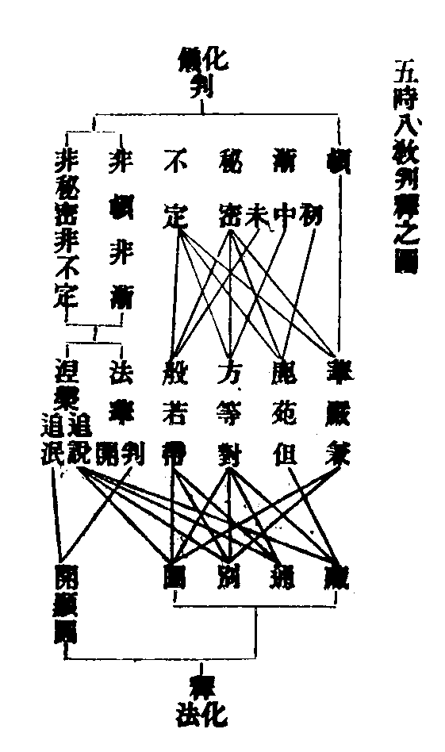



【■记】下文详释时教，文义散广，故总示之。



【□注】东流者，佛法自西而流东也。



【■记】汉明帝时，摩腾、竺法阑始来震旦，由是佛法广流东土。



【□注】代者，更也。如来五十年说法为一代，今以五时八教判释无遗。



【■记】如来说法，虽时长教广，今以五时八教判释，独契佛旨，更无遗议，非天台吾谁与归？



【□注】若尔，妙玄何云柰苑之前，不预小摄耶？须知妙玄约时破古，谓说提谓经时，乃未转法轮已前，未有僧宝。故破古师，不应於鹿苑前，别立提谓为人天小教。若约法收经，则如四教义云：三藏明世间布施、持戒、禅定，即是人天之教，并正因缘所生善法。此已为三藏所摄。故先达云：约时破古，不当五时所收；约法收经，义当三藏所摄也。



【■记】此料拣提谓经，谓柰苑前所说。提谓经，应在小乘摄。妙玄：云何柰苑前，小预小乘摄？



【■补】既不预小摄，则不属八教，既在柰苑前，则不属五时，得毋收法不尽耶？



【■记】须知下，是答辞。如妙玄约时破古中，引释论云：初从波罗柰，终至般泥洹，凡说小乘法，结为三法藏。从成道至双树，凡说大乘，结为摩诃衍。柰苑之前，不预小乘摄。何者？尔时未有僧宝故也。



【■备】虽系人天世间善论，未转小乘出世法轮，不当以提谓定立初时小教。盖佛以转法轮为时，故不预小摄之言，专破旧立初时之谬也。若约法下，申明台宗正判，应归三藏。以提谓经说戒善功德故，故引四教义，三藏世间施戒禅定作证。先达下，明台宗先德，解释可解。



【■记】古有齐朝隐士刘虬，立五时教：初、人天教，即提谓经；二、有相，即阿含；三、无相，即般若；四、同归教，即法华；五、常住教，即涅槃。



【■备】本节问辞，即将柰苑前不预小乘语。按以台宗，五时若有遗漏，故有此难。统纪云：树神知佛七日坐定未食，五百贾客过，有二大人提谓波利，诣神请福。神曰：佛在水边，先奉食。二人和蜜𪎊上佛，佛授三归依，复为说五戒。其归依僧曰：归依未来僧。



△二、别列二：初、五时二：初、徵起标名。



言五时者：一、华严时。



【■记】如来初成正觉，称法界性，说华严经，欲令众生悟入法界也。



【□注】从经题立时，虽历七处八会，新经九会，只是一经。



【■记】释从题立时之义处，会下解。



【□注】因行如华，庄严果德。



【■记】以万行因，华严一乘果德。



【□注】具云大方广佛华严经。此人法譬三，具足立题，更有单三复三。



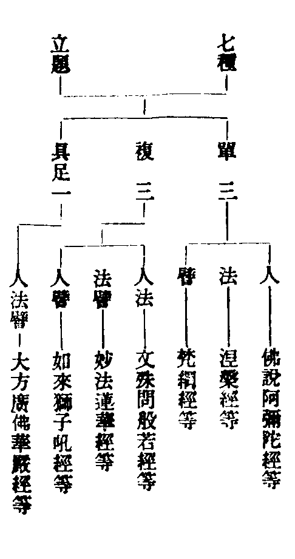



【■记】阿弥陀，翻无量寿，又翻无量光。佛为能说，阿弥陀为所说，皆果人。单人立题。涅槃，翻大灭度。是法，解见下。单法立题。梵网，大梵天王有网罗幢，红光互射，彩色交辉，重重珠影，涉入无尽。佛观是幢，因说世界无量无边，犹如网孔。佛说教门亦如是。单喻立题。文殊是人，翻妙德。若见佛性，即具三德，不纵不横，名妙德。般若是法，解见下。人法立题。妙法莲华，解见下。莲华因果同时，以比妙法权实一体。法喻立题。如来，解见下。狮子吼，比如来说法。谓一音普被，异类等解，魔外倾心。所谓狮子吼，无畏说，百兽闻之皆脑裂。人譬立题。大方广佛华严经，谓极虗空之可度，体无边涯，大也；竭沧溟之可饮，法门无尽，方也；碎尘刹而可数，用无能测，广也；离觉所觉，朗万法之幽䆳，佛也；芬披万行，荣耀众德，华也；圆兹行德，饰彼十身，严也；贯摄玄妙，以成真光之彩，经也。大方广，法也；佛，人也；华严，喻也。具足为题。



【■补】十身：一、菩提身，菩提翻道，谓佛成等正觉身。二、愿身，指从兜率来，乘愿度生说。三、化身，谓随类化现应机说。四、力持身，谓神力持真身之全身化身，及舍利之碎身，永久不坏。五、相好庄严身，谓证得微尘相好实报身。六、威势身，指魔外威伏边说。七、意生身，随自他意，处处受身，意有所往，身即随到，度脱有情。八、福德身，指福德具足故。九、法身，法性周遍法界以为身。十、智身，妙智圆明，决了诸法真光，一真法界也。



【□注】旧经晋译，五十卷或六十卷成。新经唐译，八十卷成。若龙宫三本，上本有十三千大千世界微尘数偈，一四天下微尘数品；中本有四十九万八千八百偈，一千二百品；下本有十万偈，四十八品(今但有三十九品，如释签十八)。



【■记】旧经，晋安帝时，佛度䟦陀罗翻。觉贤於扬州谢司空寺，翻梵本三万六千颂，成晋经五十卷，或六十卷。新经，唐永隆间，日照依晋本译，出入法界品两处脱文。证圣元年，实叉难陀翻。喜学重翻日照所成，兼补诸阙，成八十卷，仍脱文殊按善财顶之文。贤首将日照所补安喜学脱处，遂得文续义连。然斯二经，皆十万偈中之略，以译未尽故。龙宫三本，文殊与阿难海於铁围山结集，护法神收入龙宫，龙树菩萨亲往龙宫。见上中二本文广，非人力所持，唯以下本诵回，流传人间。今但三十九品者，指唐译品数。旧经七处八会，新译加普光明殿一会。第一、摩竭阿兰若六品：一、世主妙严，二、如来现相，三、普贤三昧，四、世界成就，五、华严世界，六、毗卢遮那。第二普光明殿会六品，一如来名号，二四谛，三光明觉，四菩萨问明，五净行，六贤首。第三忉利天会，说十住有六品，一升须弥顶，二须弥顶偈赞三十住，四梵行，五发心功德，六明法。第四夜摩天会，说十行四品，一升夜摩，二升夜摩偈赞三十行，四十无尽藏。第五兜率天会，说十向三品，一升兜率，二升兜率偈赞三十向。第六他化天会，说十地一品。第七重会普光明殿，说十地胜进行十一品，一十定，二十通，三十忍，四阿僧祇，五寿量，六菩萨住处，七不思议法明佛果德，八相海，九随相光明功德，十普贤行，十一如来出现。第八三会普光明殿，说六位一品，谓离世间。第九逝多林会，说入法界品也。



【□注】旧立四种华严，祖无显文。考大师荆溪之意，则有约时约处约理之不同。约理则曰法界，约处或曰寂场，约时曰三七日，或时长尽未来际。何得认此名言，便谓华严有四种之别。且其间於义有妨，不应以后分时长华严而为寂场，又不应将通五时中通教之义为时长也。



【■备】旧以寂场、时长、尽未来际、法界，立为四种华严。考大师、荆溪意，惟约时、约处、约理之不同。约理曰法界，约处曰寂场，约时曰三七日。或时长、尽未来际，何得认此约时之名言，反将时长及尽未来际，分立二种，加以法界、寂场二种，谓有四种别耶？且其间下辨讹云：不应以后分时长为寂场句，按旧译华严善财南询言不离寂场，新译言不离遮那座前，既后分皆言不离，应与经语融会。又不应将五时通后之义为时长句，按妙玄说华严时节长，今闻般若，即能得入签说，一以法界为华严，二以时长通至於后，既大师、荆溪皆以义通为时长，应与祖语融会。予读所辨，甚有见识。玉师以三约破旧四种，义已成立，且其间下二段，本属餘意，今顺玉师意，备一解曰：旧既约时而立二种，不应抹去三七当分，专立后分时长，以摄寂场也。至五时通后为义通，齐至般若为文通，微有区别，不可以义通之时长，即为文通之时长也。



【■记】妙乐言：所诠无外名法界。宗镜言：法界者，即一心之总名，万法之归趣。寂场解本卷三七日。如谓初七日说前五会，以经首言始成正觉，三处皆言不起前故。二七日说十地等，以经初言婆伽婆成道未久，第二七日故。第九会在三七日后，说有舍利弗祗园等故。此据菩提流支，约不坏前后相言也。



【■补】统纪言：旧以寂场、时长、尽未来际、法界，列为四种。华严又分前三属事，后一属理，此积代之弊。今论其义，只有三名：一谓寂场，妙玄引方便品始坐道场，三七思惟，佛最初顿说是也，以首品至三十六品为前分。二谓时长，妙玄引法性论钝根三处入法界是也，三十七品去为后分。三谓尽未来际，文句言：华严未席，始开於渐。妙乐说此，且寄娑婆，一期设化，用通今意。应知华严尽未来际，即法华经常在灵山，何殊十方更互主伴？虽有三名，而所说经无非华严，所诠理无非法界，此统纪破旧之词也。统纪复说：时长通三处者，谓般若、华严、海空、法华、佛慧、涅槃、莲华、藏海是也。



【■备】志师以三七思惟，收归寂场，则时处似未分。



【□注】问：华严时长，为至何时？答：如妙乐云：义当转教时也。经家取后分部类相从，结归前分华严部内，此即通五时文通之类也。若般若明华严海空，及日若垂没，餘辉峻岭，与夫莲华藏海，通至涅槃之后，此於他部明华严义，不可结归本部，乃通五时中义通之类，非时长也。



【■记】转教解本卷后。逝多林一会，部类相从，结归前分。华严部内，是为五时，文通般若。华严海空者，妙玄云：华严别但在初，通则至后。故历劫修行华严海空，法华会四佛慧，即是通至二经。又像法决疑经云：或见报身莲华藏世界海，为千百亿释迦牟尼佛说心地法门，乃至日出先照高山，日没亦餘辉峻岭。故莲华藏海，通至涅槃。后以像法决疑，是涅槃结经。当知上说，乃他部明华严义，不可结归本部。是通五时中之义通，非华严文通之时长也。



【■补】后分时，长指逝多林一会，文殊从逝多林出，舍利弗语六千弟子言：汝等见文殊威德相好等，乃至文殊语诸比丘，汝等善能成就十种大心句，记言：至般若来，方可得云令诸比丘成十大心，此乃义当转教时也。又统纪言：由历劫修学般若，今发空智，得入法界，观华严藏海，皆毕竟空。



【■备】辨讹言非时长当改曰非文通。私谓文通、义通均有时长之义，但文通时长齐至般若，义通时长尽未来际耳。



二、鹿苑时说四阿含。



【■记】小机於顿无益，故佛隐胜现劣，不动寂场而游鹿苑，保任劣机，权证小果。



【□注】从处立时，说经虽多，同一处故。



【■补】说四阿含，不局一处，且指初转法轮处言。



【■备】辨讹曰：同一处三字甚局，当知诸佛始化，皆在鹿苑，故以立时。



【□注】乃如来昔生垂化之地，缘如辅行上(七)。



【■记】辅行引大论曰：波罗柰王游猎，见二鹿主：一是释迦菩萨，一是提婆达多菩萨。鹿主告王：若以供馔，当差次送，每日一鹿。王善其言。次当达多群中有母，鹿白其主言：我分当死，而我怀子，子非死次，屈垂料理。主怒言：谁不惜命，次来但去。母至释迦主所，具白主言：若我不理，枉杀其子；若非次差，后次何遣？惟我当代。王怪问：群鹿尽耶？主言：但有滋茂，为彼群鹿归告於我，我悯之故，是身不久必不免死，慈救苦厄，其德无量。王说偈言：我实是畜兽，名曰人头鹿。汝虽是畜生，名曰鹿头人。以理而为人，不以形为人。我从今日始，不食一切肉。我以无畏施，亦可安汝意。以是因缘，知是释迦昔生垂化之地也。



【□注】群鹿所居，故名鹿苑。从树为名，亦名柰苑。二仙所居，亦名仙苑。



【■记】柰苑，地多柰树故。仙苑，婆裟言：佛出世时，有阿罗汉大仙，於彼处已住、今住、当住。佛不出世，辟支佛住；无辟支佛，五通仙住。二仙，或是阿罗逻、迦兰二仙。



【■备】辨讹言从树者，指苑为树，非指柰也，犹言波罗柰之林苑耳。二仙两字，恐荆溪一时便写耳。以郁头、蓝弗二仙在摩竭提国，不在此苑。今注虽引成文，似须改言仙人堕处。以五百仙人空中闻音乐生染，失神足，堕此处。



【□注】阿含翻无比法。



【■记】谓圣人智慧，分别法义，莫可比并。



【□注】妙玄十初云：增一明人天因果，中明真寂深义，杂明诸禅定，长破外道而通说无常，知苦断集，证灭修道。



【■记】报恩经言：为诸天世人，随时说法，集为增一，劝化人习。为利根众生，说诸深义，名中阿含。学问者习，说种种随禅法，是杂阿含。坐禅人习，破诸外道，是长阿含。分别功德论曰：阿难复思惟：契经文义混杂，宜当以事理相从，大小相次。第一增一，次名曰中，第三名长，第四名杂。以一为首，次至十，随事增上，名增一。中者，不大小长短等事，处中道也。长者，说久远事，历劫不绝，本末元由事经，七佛、圣王、七宝也。杂者，诸经断结，难诵难忆，事多杂碎，令人喜也。然经虽四所诠，同是无常。何则？世间有漏苦果，由惑业集因所感；出世间无漏寂灭，由正助道品所得。众生不知苦故，不断集；不慕灭故，不修道。故世尊段段说一切行无常，不久住法，速变易法，不可倚法，欲令知苦、断集、慕灭、修道也。



【■补】真寂深义者，无见思虗妄曰真，离生死迁流曰寂，乃出世法，故曰深义。长破外道，明正因缘。生法破邪，无二种因缘。



三方等时。



【■记】小机保证偏真，故佛广启褒叹之方，等施弹斥之法，令羞劣慕胜也。



【□注】广谈四教，均被众机，说经既多，处亦不一，故约法立时也。



【■记】四教并谈曰方，三根普被曰等。处亦不一，如王舍城、舍卫国、灵鹫山、泥连河等。



【□注】若普贤观称方等者，从理得名。如释签六(十五云)：此以理等名方等典。若止观二(六云)：四门入清凉池曰方，所契之理曰等。此约行理合论。今是生酥调斥之方等，义应属事。



【■记】四门，即有门、空门等。



【■备】统纪言：旧释方等立名，但分事理，未尽其义，今为委释。光明经言：读诵大乘方等经典。光明玄云：方等之教，通於三乘。新光明经言：欲生人天，欲得四果支佛，欲得佛，皆应忏悔，灭除罪障，安处方等。续遗记云：方等之名有二义：若大经从酪出生酥，譬修多罗出方等，此约第三时名方等，即被一乘四教机；若普贤观称方等，乃直明圆理。今以所引，恐谓同普贤观从理立称，故引三乘忏悔文定名，的从部教，不专事理也。按旧立论有三说：一、从事，大经从修多罗出方等，无量义经次说方等，释签生酥调斥方等，光明经读诵大乘方等，光明玄方等教通三乘，此皆指第三时教。二、从理，普贤观经：此方等典是诸佛眼。三、事理并通，止观曰：般若有四种方法，谓四门入清凉池，方也；所契之理平等大慧，等也。故第三时准四明立义，的从部教定名，不专事理也。今玉师以统纪方等从部教说，部教兼於事理，不若以生酥调斥乃佛化事，从事立名也。然旧立三说，内观经方等从理调斥、方等从事并同，今注方等从事理一，解亦小异。以四门入池属行，故曰此约行理合。论辨讹言：生酥调斥何曾离理？若单属事，似离理外别有事方等，且觉方等部有收经不尽之难矣。私谓化事断不离理，玉师且顺旧解，重调斥边判属於事，亦不至有难词，来哲虗心融会可也。调斥者，调停三乘之心令得通益，诃斥焦芽败种令心慕大。



说维摩。



【□注】具云维摩诘所说经人法立题。此云净名，亦翻无垢称。



【■记】凡夫染有，二乘染空，菩萨染中，皆不得净名。居士二边不著，中道不安，虽处居家，不著三界，示有妻子，常修梵行，如莲华出水，不为所溷，故净名名焉。此据迹释。若据本，乃金粟如来现身，万恶尽消，众善溥会，净亦不可名。於不可名中，以净名名也。无垢即净，称即名。



思益



【□注】具云思益梵天所问，经网明菩萨答。



【■记】经曰：过东方七十二恒河沙佛土，国名清洁，佛号日月光明如来。有菩萨名思益，由我佛宣说寂庄严光明，遂放是光，普照十方佛土。故思益梵天来此土，说偈赞佛，兴端请益。网明以佛身相超千万日月光明为问，故佛放光。思益梵天来，与诸菩萨互相问答。然经明文殊等行，迦叶、空生诸圣，皆有酬唱。今独指网明者，发起是经故也。



楞伽！



【□注】翻不可往。



【■记】楞伽，城名，在摩罗那山顶。华严论云：其山下瞰大海，上大下小，无路可上。城乃众宝所成，光映日月，无门可入。而此山城，为摩婆罗大夜叉王所据，具大神通者，方能升往。喻自觉圣智境界，非言思可到，非寂嘿可通，惟不思议者证入也。



楞严三昧。



【□注】楞严翻健相，三昧翻调直定，亦云正心行处。



【■记】智论云：楞严，秦言健相分别，谓知诸三昧行相多少深浅也。菩萨得是三昧，诸烦恼魔及魔人，无能坏者。调直定。四教义云：通言三昧，名调直定。真谛三昧，离爱见为调直；俗谛三昧，以称机为调直；中道三昧，无二边曲为调直也。正心行处。智度论云：一切禅定摄心，皆名三摩提，此言正心行处。是心无始来，常曲不端，得正心行处，则端直也。源洪师言：大佛顶首楞严经，翻一切事，究竟坚固。当智者时，经尚未来，此指首楞严三昧也。



金光明



【□注】金即法身，光即般若，明即解脱，单法立题。



【■记】玄义言：金光明分即三德，皆约性体，具金光明真实名义。谓法性可尊可贵，当体名金；寂而常照，当体名光；大悲益物，当体称明。



【□注】玄文顺古，复约譬喻，一释格他，譬法不周。



【■记】此因玄文，复约譬释，故今释之。玄文明古有三家释题：一、数论家：金比法身，光比般若，明比解脱。大师破曰：数论但明真、应二身，若以二释三，於论不便；若取经文，无处明三德；若便作义解，何义不通，而独譬三德？既违己论，又不会经，非今所用。二、地人言：金质有光明之能，如法性从体起用，自有般若、解脱之力，但作体、用二义，不须分光、明异也。大师破曰：地论幸明三佛，三佛释题，於义自便，而弃三身从体、用者，则非论义。若新、旧两本，并说三身，不道体、用，亦违己论，复不会经，进退何之？非今所用。三、真谛三藏言：金光明譬三种三法，谓三身、三德、三位也。譬三身者，金体真实，比法身；光用能照，比应身；明能遍益，比化身。譬三德者，金有四义：一、色无变，二、体无染，三、转作无碍，四、令人富。比法身常、乐、我、净四德。光有二义：一、能照了，二、能除暗。比般若照境除惑。明有二义：一、无暗，二、广远。比解脱众累永尽，普益有缘。譬三位者，金性先有，如道前正因位；光融体显，如道中了因位；明无瑕垢，如道后缘因位。大师破曰：三三之释，三义不了，且有三过：一、因缘不通，二、有乖圆别，三、不称法性。破已而即顺之，约譬释言：当知金光明三字，徧譬一切横法门，乃称法性无边之说；徧譬一切竖法门，乃称法门甚深之旨，方合经王一切遍收。此义渊博，且寄十种三法为初门，谓三德、三宝、三涅槃、三身、三大乘、三菩提、三般若、三佛性、三识、三道。此之三法，该括始终，甚深无量，是谓约譬一释，格他不周也。拾遗记言：譬喻一释，为诸师解金光明为世物象，用譬如来深法。诸师虽用譬显法，其实不知法相圆融，随名局解，故不能遍喻诸法。大师欲示金光明海无法不备，无法不融，故顺之以金光明三字为譬具足，比佛所游。是则略而十种，广则一切法门一一互融，皆不思议。此乃格他，譬法不周，广显性体，圆具诸法是也。



【■补】记中以二释三，己宗则坏，于论不便。此破违宗。若取经文，无处明譬。三德：此破乖经。因果不通，因与果相违也。十种三法者：三道：苦、惑、业。三宝：佛、法、僧。三身：法、报、化。三涅槃：一、性净，即实相。二、圆净，即惑净、理圆显。三、方便净，即善巧净。三德：法身、般若、解脱。三菩提：一、真性菩提，以此真性为道。二、实智菩提，即能照之智。三、方便菩提，谓善巧、化用、自在。三佛性：一、自性住佛性，谓真如自性常住。二、引出佛性，谓性由修显引出。三、至得果佛性，谓证得果位显发。三识：谓七识、八识、九白净识。又一、真识，谓真心。二、现识，变现根、身、世界。三、分别识。三大乘：一、理乘，谓理性。二、随乘，即智随理运。三、得乘，即得果自解脱，得机令他解脱。三般若：一、实相，即实体。二、观照，即照智。三、方便、善巧、化用。



【□注】其如经题，是法非譬。



【■记】或谓大师既顺古以喻显法，何又自立附文、当体二种释题？故今释之。如记言：虽然，顺古以喻显法，其如经题，是法非譬。故后自立附文、当体三种解释，斥彼推喻疎远，依经就法，方为亲切。斯由大师深解法性具金光明，真实名义究竟成就也。除法性外，名言皆无实义，是金光明三种法门，举一即三，全三是一，非一非三，而三而一，不纵不横，绝思绝议，是秘密藏佛所游处也。



【□注】又不可以被利钝机，双存法譬也。



【■记】此遮双存，以被二机。



【■补】遮双存者，玄文问：旧言此经说譬得名，云何矫义而依文耶？答：非今就文而害于譬，若苟执喻复害於文。义有二途，应须两存。故前言义推疎远，依文亲近。记曰：如此用譬，虽无经据，存之有益，二不偏废。汝专执譬，弃亲逐疎；我今双存，亲疎俱得。如玄文言：钝根以譬拟法，利根即法作喻。故经言：甚深法性，安住其中，即於是典金光明中，而得见我释迦文佛。又空品言：为钝根故，起大悲心。盖钝根守指守株，𡩋知兔月，利人悬解，不须株指也。又记言：佛说兹典，既被二根，故通经者释题，亦须二说赴其利钝。复贬从喻，如守株指；褒依法者，悬解兔月，不须株指。足见不许释譬微意。玉师恐后人不了以法比二说为定旨，故揭出言：其如经题，是法非譬。复恐以被利钝为证据，故又言：不可以被利钝机双存等也。



胜鬘等经。



【□注】具云胜鬘狮子吼一乘大方便方广经。



【■记】波斯匿王召女胜鬘回国见佛。女说偈言：如来现世间，普为群生出。亦应悯我等，宜速降此间。说毕，如来现身令见。又说偈赞佛，及种种法。如来印可，故有是经也。方便有三：一、为实施权曲巧方便；二、理本无言，假言而言大方便；三、权实无滞大方便。初、如一佛乘，分别说三是也。二、如诸法寂灭相，不可以言宣，以方便力故，为五比丘说是也。三、如涉有未始迷空，观空不遗於有，即佛方便知见，波罗密皆已具足是也。今是后二种。又经言：若如来随彼所欲而方便说，即是一乘。一乘者，即第一义方广。狮子吼见前。



【□注】胜鬘夫人，即舍卫国波斯匿王女，末利夫人所生，为逾阇国王妃。



【■记】梵语摩利。室罗翻胜鬘，相好胜母故。波斯匿翻和悦，王多仁慈故。末利翻鬘。



四般若时。



【■记】由前方等二乘，虽发心乐大，故习犹坚。夫欲淘汰执情，必须空慧之水，故有般若时。



【□注】从经题立时，般若翻智慧。智慧轻薄，即五种不翻之一也。



【■记】有分别名智，无分别名慧。又根本名慧，后得名智。今以智慧双易般若者，显权实一体大慧也。五不翻者：一、秘密不翻，如诸陀罗尼呪；二、多含不翻，如婆伽梵含六义；三、此方无不翻，如阎浮提树；四、顺古不翻，如阿耨菩提，自古存梵；五、生善不翻，如般若尊重，智慧轻薄，为人生善，仍存般若也。



【■备】记中分解智慧，亦一往言之，弗泥也。



说摩阿般若、光赞般若、金刚般若、大品般若等诸般若经。



【□注】摩诃翻大多胜，以多含故不翻。



【■记】非小乘，故大。诠显十八种空，乃至八万四千波罗密，故多。一切诸佛菩提，皆从般若中出，故胜。多含不翻，亦五不翻之一。



【■备】记解大多胜约般若部说，其实含多义。



【□注】光赞经云：於是世尊，从其舌本，悉覆佛土，而出无数百千光明，照三千界。其光明中，自然而植金莲华。其莲华上，各有诸佛讲说此经。光即光明，赞即讲说，即大品上帙。



【■记】此可配於三种般若。谓从其舌本悉覆佛土，即实相般若，实相遍覆法界也。出光明照三千界句，即观照般若，观照照察万有也。其光植金莲华，华上有佛说经，即文字般若，文字般若从大悲心流出也。



【■备】配合出记者新意。



【□注】金刚从喻立名，以金中精刚，能断难断，喻般若断疑荡相，亦名小般若，乃大部六百卷中第五百七十七卷。



【■记】海中有宝名金刚，最坚利。坚故不为诸物坏，利故能坏一切物。以喻般若能断难断之惑，不为无明烦恼所坏。



【■备】源洪师言：名小般若句，疑集注便引。盖藏中原有小品十卷，对摩诃名小存，俟后定。此有六译，今流通本，姚秦鸠摩罗什译也。



【□注】大品辅行五上(七)云：大品凡列法门，无不皆以五阴为首。



【■记】大品言：声闻依四念处行道，菩萨初观色，乃至一切种智，章章皆尔。故辅行言：此是引证，依经义以明十境，通能覆障五阴为初。故大品及大般若，凡列法门，皆以五阴为首，五阴只是念处境耳。



【□注】等诸般若经者，谓等於小品放光，仁王，天王，文殊问般若等。



【■补】统纪言：大品般若四十卷。按藏经目录言：摩诃般若三十卷，光赞十卷。龙树用此本作智度论百卷，智者依此论作疏二十卷，今在高丽未至。是知摩诃、光赞，皆即大品也。又统纪曰：若放光、金刚等十经，皆晋、宋间译，唐装法师始翻出大般若六百卷。当知前十经皆重翻也。天台诸部所引，正大品中义，是罗什翻。十经者，大品、光赞、小品、大明度、胜天王、文殊问、金刚七部，均罗什译，道行竺朔译，新道行支谶译，放光晋罗义译。



【■备】统纪十经，仁王不在其列。又统纪曰：四教仪列般若诸经名，总别重出，难於分别。盖摩诃即大品，此指摩诃大品重出也。私谓集注大部六百卷中句，亦系便写，以六百卷乃唐所出，不须引用也。



五，法华涅槃时。



【■记】二乘於般若会，领知法门，故说法华，开四时权，显一乘妙。然有漏网机，及横来众，未闻前教，岂解佛乘？更说涅槃，重为捃拾，普令证归佛慧。故二经同为第五时。



【□注】从经题立时，以此二经同醍醐故。



【■补】妙玄曰：醍醐，众味之后，涅槃称醍醐。此经名大王膳，故同也。



【□注】具云妙法莲华经。妙名不可思议法，即十界十如权实之法。莲华，譬上权实法也。



【■记】法华有三本：晋译名正法华，十卷；秦译名妙法莲华，七卷；隋译名添品妙法华，八卷。今是秦本。妙名不可思议者，言语道断，心行处灭也。十界，谓四圣六凡。莲华譬者，莲华因果同时，喻妙法权实一体。



【■补】妙法即实相。十如者，如是相，相据外而可别；如是性，性据内而不改；如是体，主质名体；如是力，功能名力；如是作，构造为作；如是因，习因为因；如是缘，助因为缘；如是果，习果为果；如是报，报果为报；如是本、末、究竟等，初相为本，后报为末，所归趣等为究竟等。一法界具十如是，十法界具百如是，又一法界具九法界，则有百法界千如是。



【□注】涅槃，具云摩诃般涅槃那，此云大灭度。大即法身，灭即解脱，度即般若，即三德秘藏也。



【■记】大者，称体而周，法身德，体遍十方也。灭者，无缚所累，解脱德，灭除二种生死缚也。度者，破无明障，般若德，照破五住无明也。



△二、结立异名。



是为五时，亦名五味。



【□注】结也。五时在大部中，或作五味列，故云亦也。五时说法颂云：阿含十二方等八，二十二年般若谈，法华涅槃共八年，华严最初三七日。



【■补】今明别义，故引孤山五时说法颂。



【■备】教观纲宗引玄义言：五味论别，别有齐限；论通，通於初后。章安言：人言第二时十二年中说三乘别教。若尔，过十二岁有宜闻谛缘度者，岂可不说人言第三时三十年中说空宗般若、维摩、思益？依何经文知三十载也？大论言：须菩提於法华中闻说，举手低头，皆得作佛。是以今问退义。若尔，大品、法华前后何定也？智者章安明文若此。今人尚传阿含十二、方等八之说，乃至别五时者，约一类最钝声闻，具经五番陶铸，方得入实。然此别五时法，亦不拘定岁月日时。辨讹言：五时颂局甚。然古所以病此者，以见法华有二十年除粪之言，遂谓方等亦有藏教，故判方等八，以阿含自有成文，言是十二年前也。又见经中有二十年中执作家事，复经少时之言，便判般若为二十二岁也。私谓玉师引颂，非不知通五时义，与章安所破，但泥别而不知通者不同。今既论别时前后修短，於无次第中当有次第，故引之耳。若结集家收归本部，此属文通来哲，固不可泥定年分，亦不可以通难别也。记中五时、收经、结经等说，存俟后考。



【■记】五时收经。鹿苑收四阿含等诸小乘经。方等除四时外，通收诸大乘经。般若会收诸部般若经。法华収无量义及普贤观经。涅槃会收大涅槃及像法决疑经。华严会收华严、梵网经。若论五时结经，则华严会以梵网为结经，鹿苑以遗教为结经，方等以璎珞为结经，般若以仁王为结经，法华以普贤观为结经，涅槃以像法决疑为结经。如来说法五十餘年，谈经三百餘会，今颂该括无遗也。



【■补】有本般若收诸般若经及无量义经，法华收法华并普贤观经。又言：般若以无量义为结经。



南天竺沙门蒙润集注



清比丘性权彚补辅宏记



清三宝弟子钱𠁼庵较订



天台嫡裔比丘谛闲编科参梓



△二、八教二：初、总列八教名二：初、据今文通列教名三：初、正列。



言八教者，顿、渐、秘密、不定、藏、通、别、圆，是名八教。



【□注】初、总标。不从渐来，直说於大，时部居初，故名为顿。中间三味，次第调停，鹿苑破邪立正，方等引小向大，般若会一切法皆摩诃衍，故名为渐。



【■记】中间三味二句，总喻渐相。别则鹿苑破外道之邪，立内法之正；方等引恋空滞寂之小，向智求悲度之大；般若会八十一科之法，同入第一义谛之乘。自小至大名渐，八十一科下解。



【□注】不思议力，同听异闻，互不相知，名秘密教。



【■记】同听一音，异闻诸义，此不知彼所闻，彼不知此所闻，名秘密。



【□注】闻小证大，闻大证小，得益不同，名不定教。



【■记】若宿於渐，有顿种者，今闻小得大益。若宿於顿，有渐种者，今闻大得小益。功推於教，名不定。



【□注】经论律三，各含文理，条然不同，名三藏教。



【■备】经藏法本义，律藏灭恶义，论藏无比法义，各有文理，包含摄持，名三藏教。



【□注】三乘共行，钝同三藏，利根菩萨，通后别圆，故名通教。



【■记】藏教以谛、缘、度，分属三乘、通教。三乘同观无生，四谛同修，体假入空，观十二缘，同观六度。若钝根见偏空，近同三藏；利根兼见不空，远通、别、圆，名通教。



【□注】独菩萨法，别前藏通，次第修证，别后圆教，故名别教。



【■记】涅槃经言：苦集灭道，各各因缘，皆有无量，是菩萨法，非二乘知。别前藏通也。别行记言：时长行远，次第隔历，故受缘理，断九之讥。别后圆教也。名别教者：



【□注】教理智断，行位因果，满足顿妙，一切圆融，故名圆教。



【□注】四教义曰：圆义有八：一、教圆，正说中道，言不偏也。二、理圆，中道即一切法，理不偏也。三、智圆，一切种智圆也。四、断圆，不断而断，无明惑断也。五、行圆，一行一切行也。六、位圆，从初一地，具足诸地功德也。七、因圆，双照二谛，自然流入也。八、果圆，妙觉不思议三德之果，不纵不横也。满足顿妙者，满故，三一相即，无有缺减。足故，圆见事理，一念具足。顿故，体非渐成。妙故，三谛不别。总之，一切圆融也。据下文，则曰圆伏、圆信、圆断等，名圆教。



△二、喻显。



顿等四教是化仪，如世药方。藏等四教名化法，如辨药味。



【■记】化仪如药方者，随宜说法，如医士按病制方也。化法如辨味者，知诸根性，如辨药性味也。



【□注】化仪：化物仪式。化法：化物方法。



【■记】辅行言：化仪敷置，引入化法，教门法则。



【□注】义例五云：顿等四教是佛化仪，藏等四教是佛化法。



【■补】荆溪以辅行中文难明，复以七种义例明之。



【■备】辨讹曰：仪法出自大师，当引八教大意等书，不必引义例也。私谓引亦无妨，然此说有益来哲慎择之慧。



△三、结指。



如是等义，散在广文。



【□注】广文一家教部，即下文广本也。大本，即法华玄义。



【■补】广文、广本统指一家教部，大本则单指玄义。



△二、依广本略录纲要二：初、总标所依。



今依大本，略录纲要。



【□注】今家所录，通依一家广文。如文末云：谨按台教广本。



【■记】此证今文通所依也。



【□注】的依大本玄义，如云：请看法华玄十卷。



【■记】此明今文的所依也。



△二别示纲要。



初辨五时五味及化仪四教，然后出藏通别圆。



【□注】此明今文抄录之法。化仪属部，故与时味兼明。化法属教，故后别明也。



【■记】部所以判教，故与时味兼明。教所以释义，须先判教已，方依教释义。义有缓急，文有前后，乃抄录分章法也。



△二、别释八教相二：初、化仪四教，分四：初、正明四教四：初、顿教三：初、总标。



第一顿教者，即华严经也。



【□注】此判部属顿。



从部、时、味等得名为顿。



【□注】此释出属顿所以也。部唯约法，时兼法譬，味专约譬。



【■记】部唯约法者，华严是圆顿法时。兼法譬者，经言：如日初出，先照高山。释言曰：譬佛光譬说教，照物譬被机，高山譬别圆众味。专约譬者，即从牛出乳。



【□注】最初说大，时味俱初，故得顿名。



【■记】此正释华严，名顿。



【□注】此下所谓如来等，约部判顿。此经中云下，约时判顿。涅槃云下，约味判顿。后准法华判也。



【■记】约部时味，列次判顿可知。后准法华判，谓后信解品下，乃准法华判，华严拟宜也。



△二、别释三：初、约部判二：初、明部教。



所谓如来初成正觉，在寂灭道场，四十一位法身大士，及宿世根熟天龙八部，一时围绕，如云笼月。尔时，如来现卢舍那身，说圆满修多罗，故言顿教。



【□注】如来乘如实道来成正觉文句九(十一)。



【■记】此指二身中真身也。成论言：乘如实道，来成正觉，名如来。乘者，法如如智；实者，法如如境。道是因，觉是果。若单论乘者，如如无所如；单明实者，如如无能如。境智和合，则有因果。照境未穷名因，尽源为果。道觉义成，即乘如实道，来成正觉，此真身如来也。以如实智，乘如实道，来生三有，示成正觉，即应身如来也。



【□注】初成正觉，三七日说大化之始，故曰初成。离邪曰正，背妄曰觉。



【■记】三七说大化，始是随机说。诸经论明初时说法不定。普曜经、密迹经皆曰：二七日说三乘。法华过三七日方说小乘。四分律中六七，兴显行经七七，五分律八七，智论五十个七日。则知随机见闻，得益不同。故如来初时说大说小，应现时分亦异。今华严是被大机，故三七说大化。正觉藏依生灭，通依无生，别依无量，圆依无作。若华严本部，当以别圆判。然别地以上，证道同圆。佛是果人，离偏小邪妄，证圆妙正觉。一觉一切觉，无觉无不觉，言穷虑绝，不坏假名，故曰始成正觉也。



【□注】寂灭道场：寂五住烦恼，灭二种生死，得道之场，故曰道场。即摩竭提国阿兰若，处处随法转，名寂灭场。



【■记】五住，谓见一切住地，欲爱、色爱、无色爱。三住地，无明住地。二种生死，谓分段、变易。生死是苦果，烦恼是集因。前四住感分段果，后一住感变易果。寂灭，乃究竟大寂灭处。佛於此得大寂灭道，故曰道场，即摩竭提国阿兰若处。



【■补】摩竭提，翻不害。劫初以来，无刑害故，至阿阇世王截指为刑，后自啮指痛，复息此刑。佛成道其地，故吉兆预彰。



【■记】阿兰若，翻寂静处。七佛与人作则，皆依阿兰若处成道。



【□注】四十一位圆教，住行向地，等觉别地。已上证道同圆。



【■记】住、行、向、地、等觉，如九卷释。此四十一位，破无明惑，应判圆教。别地同圆者，如八卷解。若华严疏明：一、海月等十菩萨同生众共配：初、发心住。二、执金刚神。三、身众。四、足行。五、道场。六、主城。七、主地。八、主山。九、主林。十、主药神。已上如次配十住。十一、主稼神。十二、主河。十三、主海。十四、主水。十五、主火。十六、主风。十七、主空。十八、主方。十九、主夜。二十、主昼。已上配行。二十一、阿修罗王。二十二、迦楼罗。二十三、紧那罗。二十四、摩睺罗伽。二十五、夜叉。二十六、龙。二十七、鸠槃茶。二十八、乾闼婆王。二十九、月天子。三十、日天子。已上配向。三十一、忉利天王。三十二、夜摩天。三十三、兜率天。三十四、化乐天。三十五、他化天。三十六、大梵天。三十七、光音天。三十八、遍净天。三十九、广果天。四十、大自在天王。已上天王配地。四十一、师子座众，配等觉。更有四十二、眉间众，配妙觉。



【■备】记中四十一位，据华严所列配位，然注乃指经前列众，不必泥定。



【□注】四念处云：华严后无等觉者，乃部中谈位，不可以此而难。今文经前列众也。



【■记】四、念处，释别教中。言华严初无十信，后无等觉，恐人举此以难故明。今文说有等觉，乃指经前列众。又清凉疏：问：明品已下三品，别明十信；十忍品已下四品，别明十顶。当知顶即等觉。清凉钞言：等觉因位之极，称为顶位。



【□注】法身大士，破无明惑，得无生忍，舍生身已，居实报土，受法性身，故曰法身。上求下化，建立大事，故曰大士。



【■备】不了第一义谛，是谓无明。第一义谛，乃圆家一空一切空，无生理也。以无生理，忍可於心，名忍。破一分惑，得一分忍，显一分法身，乃舍分段身之生，离同居方便之土，而居实报土，受法性身，名法身焉。行契佛行，是上求。化如佛化，是下化。此自利利他大事，惟法身菩萨能之，故名大士。



【□注】宿世根熟，佛化众生，种熟脱三，时时不废。谓种在久远，熟在宿世，脱在今日。



【■记】玄文言：佛设教元始，巧为众生作顿渐不定，显露种子，中间以顿渐五味，调伏长养而成熟之，又以顿渐五味而度脱之，并脱并熟并种，番番不息，大势威猛，三世益物也。今是大乘根熟众生。



【□注】天龙八部：天龙别名，八部总称，总别兼举也。天(一)，龙(二)，夜叉(三)，乾闼婆(四)，阿修罗(五)，迦楼罗(六)，紧那罗(七)，摩睺罗伽(八)。人非人等：总结八部。



【■记】梵语提婆，此翻天，三界二十八天也。那伽，翻龙，守天宫，持地注雨等龙也。夜叉，翻勇健，亦名暴恶，飞空飞行，守天城池门阁等也。乾闼婆，翻香阴，不啖酒肉，唯香资身，是天主幢倒乐神也。阿修罗，翻无端正。迦楼罗，翻金翅。紧那罗，翻疑人，似人而头有角，亦天伎神也。摩睺罗伽，翻大腹行，即大蟒神腹行者也。原佛道济百灵，慈育万有，三乘归投，八部翼卫，餘无此德，故无八部也。



【□注】龙鬼等得预法会者，乘急戒缓。故大师准涅槃经云於戒缓者不名为缓，於乘缓者乃名为缓之文，遂开乘戒四句。



【■记】涅槃经又言：菩萨於此大乘，心不懈怠，是名本成。为护正法，以大乘水而自澡浴。故菩萨虽现破戒，不名为缓。智者取此乘急戒缓之文，於止观中开成四句也。本成者，本所受戒，如本不失也。



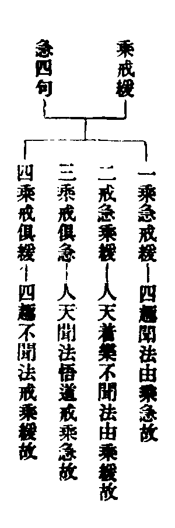



【■补】文句言：若通论戒乘，一切善法观慧，皆称戒乘。人天五乘，即是其义。道共等戒，悉是通义也。今就别判，三皈五戒，十善八斋，出家律仪，乃至定共，能防身口，遮恶道果，得人天报者，名戒。闻经生解观智，推寻谛缘度等智，能破烦恼，运出三界者，名乘。大品言：有相之善，不动不出；无相之善，能动能出是也。若戒乘俱急者，下品戒急，报在人道。持小乘急，以人身於藏教时，见佛闻法。严持中乘，以人身於通教大乘，乃至带方便诸大乘经时，见佛闻法。若持上乘，以人身於华严、法华等教，及诸教中，圆见佛闻法，列为同闻众也。若中品戒急，报在欲天。若持小乘，以欲天身於藏教时，见佛闻法。餘持中、上乘，如上说。若上品戒急，加修禅定，报在色、无色界。持小乘急，以色、无色界天身，於三藏中，见佛闻法。餘持中、上乘，如上说。二、戒缓乘急者，三品戒皆缓，报在三途。若小乘急，以三途身，於三藏教中，见佛闻法。餘如上说。三、戒急乘缓者，有戒受人天身，无乘佛虽出世说法，不见不闻。舍卫三亿家，及诸不见闻者，三界乐著诸天等是也。四、戒乘俱缓者，受三途报，不见佛，不闻法也。



【■记】华严疏钞言：一、乘缓戒急者，事戒严峻，三种观心不开。以得戒故，人天受生，或随禅梵世，耽湎定乐。世虽有佛，说法度人，於此类无益。设得值遇，不能开解。二、乘急戒缓者，德薄垢重，烦恼所使。是诸事戒，皆破理观。乘急信解诸法，戒缓命终，堕恶道中。於诸乘中，随何乘急，强者先牵。若一乘急，即闻华严等三乘戒俱急者，具持众戒，理事无瑕，於诸妙法，观念相续，即於今生，便应得道。若未得道，此业最强，必升善处。若一乘急，即於人天身，闻华严四乘戒俱缓者，失人天报，无得道期，展转沉沦，不可度脱。是则乘戒，岂得偏向乎？设有偏志者，𡩋偏於乘也。



【□注】如云笼月，月喻教主具智断二德。初一至十五，谓之白月，智光渐增，故譬智德。十六至三十日，谓之黑月，邪光渐减，故譬断德。



【■记】准华严钞，月有四德，合佛三法：明是智德，暗是断德，清凉是恩德，应器周故，亦是恩德。今取黑、白，喻智、断二德也。如大经：月爱三昧，光色增长，譬十五智德；摩诃般若，光色损减，譬十五断德；无累解脱。又言：月性常圆，实无增减，因须弥山，故有亏盈。不增而增，白月渐著；不减而减，黑月稍无。法身亦尔，因无明故。约如论智，如实不智；约如论断，如实不断。无智而智，般若渐明；无断而断，解脱渐离也。据华严梵行品，月体喻法身，月光喻十五智断，谓三十心为三智断，十地为十智断，等、妙二觉为二智断，合有十五智断也。



【□注】尔时如来指丈六身，即境本定身也。



【■记】辅行言：止观见佛相好，一一文中，皆言若见如来者，皆以三藏如来而为境本。於色相上，四机所见不同，故名境本定身也。



【■补】三藏如来老比丘相，即境本定身。境是所见之境，本为应机之本，定乃一定之身。如言只一金刚土台成道，四机各见不同。生灭机见劣应身，无生机见带劣胜应身，无量机见报身藏尘相好，无作机见法身如虗空相。虽机见不同，只是丈六一定身也。



【□注】现卢舍那身：现，即现起。卢舍那，翻净满。谓诸恶都尽故净，众德悉圆故满。自报，亦翻光明遍照。他报，亦名尊特，亦名胜应。



【■记】净满者，障净为先，德满为后，如言万恶咸消，众善普会也。梵网经疏言：满净者，德满为先，障净为后，所谓富有万德，荡无纤尘也。光明徧照，指为他报者，若据慈恩三藏释，则言身光、智光，内外照故，目於报身，通自他二报佛也。尊特有上中下三品，今指下品，从丈六身现起千丈舍那也。胜应如来，应身相好，有胜劣不同，今指胜者，华严佛有殊胜相好，对劣名胜也。



【□注】新译华严云：毗卢遮那妙乐九(二十七)。破云：近代翻译，法报不分，二三莫辨(文)。



【■记】新译。即唐实叉难陀译。卢舍那品，译为毗卢遮那品。如来名号品中，或名卢舍那，译为或名毗卢遮那。清凉疏言：毗即徧也。卢遮那光明照义，应言光明徧照。今按所释，名义未尝非，但未明言教主是报身耳。盖遮那法身佛，舍那报身佛，释迦牟尼应身佛。又以二身言之，遮那真身，舍那胜应，牟尼劣应，胜劣均名应身，是名二身也。华严教主，乃舍那译为遮那，则以法身为报身，法报不分也。又以真身为胜应，二三莫辨也。文句破言：自古经论，许有三身。若毗卢与舍那不别，法身即报身。一切众生，无不圆满。法身有说，众生亦然。若言果满方说，满从报立。若言不离，三身俱然，何独法报？又生佛尚且无二，岂唯三身？若论三身，法定不说。报通二义，应化定说。若其相即，俱说俱不说。若但从理，非说非不说。事理相对，无说即说。情同妙契，诤计咸失是也。



【■补】按毗卢遮那言遍一切处，卢舍那言光明遍照，牟尼言能仁寂默。



【□注】然华严教主经疏诸文，或云释迦，或云舍那者，盖是释迦现起舍那故也。而净觉谓本是实报土身，应下二土。故解谤破云：汝执藏尘为尊特相，树下之身，有此相否？故升须弥山顶品云：尔时世尊不离一切菩提树下，而上升须弥，向帝释殿。岂非华严是千百亿应身所说？此身既被别圆之机，见是尊特，何须独指华台受职身耶？(文)盖指千百亿应身中之一身所说。



【■记】此辨净觉师偏说，以定从劣现胜正意。



【■补】净觉云：药师净名观经之相，皆应身，不可指为法身。唯华严藏尘相好，为尊崇奇特，以相多故也。凡八万四千三十二相，皆从此实报尊特之身，应下二土。应八万四千似方便，应三十二似同居。准此，则彼意指华严藏尘相好，为证得奇特。不知华严十华藏世界微尘相好，是应机现起，即如来现起他受用，十地菩萨所被机也。故四明作解谤破云：汝执藏尘为实报尊特相，我且问汝，华严菩提树下三十二相之身，有此奇特相否？若谓是有，何言三十二相是应下？何言华严是实报身？故知华严非本是实报身，三十二相亦非应下，明矣。盖树下身，未被别圆机时，本无奇特相。若被别圆机，则於此身现起尊特，故不可谓本是实报土身也。以华严教主是现起身，故言不离一切而上升。须弥向帝释殿上升，即现起义，岂非华严是千百亿应身所说耶？华台受职者，即实报土身。若约所依名实报身，以称中道法性理感真实果报土也。若约所证名华台受职身，华台表法界理，故报身卢舍那佛坐华台，若应身释迦但坐莲叶。如签言：只以入实名华台，以内心入实故外处华台。玄文言：始见我身，初闻一实，已入华台。皆指所证为华台也。受职者，谓报身初坐千叶莲台宝华王座时，十方诸佛齐放白毫来灌其顶，受法王职也。但此身有证得相、有现起相，净觉所执是证得相，四明所定是现起相，故破言：何须独指华台受职身耶？盖指下注家断定四明意。统纪言：四明约机约教，以定身者是树下生身，现起尊特应别圆机，正合妙玄释迦最初顿说。释迦是生身，说顿是舍那，亦合四教仪如来现卢舍那身说法之言。



【■备】净觉背宗因缘统纪内载：须者往检。辨讹曰：盖指千百亿至所说句，虽约一阎浮提而论，但意似局。私谓四明是千百亿应身，所说句恐有未见千百亿之难，故玉师复申明一身也。辨讹又曰：实报土身应下二土之言，本四明妙宗钞语。以经中八万四千相好，大师判为真法身观。故钞言：然此色相是实报身，应同居土。而特名法身者，为成行人圆观也。后料拣中，问：尊特既是他受用报，须入地住方见。今八万相似位能见，验非尊特，合是生身？答：地住分证论见，地住以前相似论见，斯乃如来以实报身应下二土(云云)。当知四明此言，因他问意，谓地住以上，舍生身已，入实报土，方见尊特。今圆行人在相似位，处同居土，焉能见之？故答言：如来应下使见。而净觉反宗破言：华严藏尘相好是尊特，是实报、应下；观经八万四千相好是生身，非实报、应下。故解谤言：汝执藏尘为尊特相，树下之身有此相否？若言有，应下义不成；若言无，何故华严有上升须弥等文耶？足见藏尘尊特是释迦现起，应下之义不成矣。而八万四千尊特不然。此由圆观行人台像。圆观既成，所见佛身必非同居生身，实报土身方是其境。故如来以实报、应下同居而使见之，非入实报方能见也。然钞中乃是破立方便，非是下二土所现诸身皆从实报、应下也。况钞虽言以实报、应下，亦即於同居现起。此义当知，即华严从树下释迦境本现起，其义亦然。但华严现身说经，观经应行人现相，其义稍异。思之，可知也。又复现起应下，义亦不殊。如华严从境本发起，观经从三十二相常身常相发起是也。故四明言：有须现者，即为现之。则知应下，义不殊也。今但知是净觉语，不知出四明，恣情纵破，故略述此。



【□注】月堂云：境本定身，则是释迦。机感见相，乃是舍那。此即释迦境本定身，现起舍那尊特也。上品相好，下品尊特，二现言之，正当须现。



【■记】四、明约教，分三品尊特。谓法华三十二相，相相无边，即法身上品尊特。观经八万四千，中品尊特。华严丈六发起舍那，下品尊特。又约相海，分三品。谓华藏尘相，上品相海。八万四千，中品相海。三十二相，下品相海。次即言上品相好，下品尊特。此二皆现起相，故曰二现言之，正当须现。



【■补】下品尊特，以兼别机，须当现起方有，不能即劣显法。如法华微妙净法身，具相三十二也。月堂法师，讳询，字谋道。依圆辨琛，以正所学。统纪曰：准解谤说，尊特身有须现、不须现之分。故须现，如梵网、华严及观经等，相多身大；不须现，则以力加，令於劣身不取分齐，见三十二相即无有边，以知丈六是法界故也。



【□注】圆满修多罗，约圆实部主说。释签云：华严顿部正在圆真，兼申别俗。



【■备】八卷曰圆，以不偏为义。又言无有缺减，名曰圆满。法华言唯佛与佛，乃能究尽诸法实相，即圆实也。兼申别俗句，乃文义未能截断，顺带引之，非本节引用正意。



【□注】修多罗，翻契经圣教之都名。若十二部中直说法相者，名修多罗。今非此意。



【■记】契经者，以经通教理，教能契理，理能契机也。圣教都名者，据经藏释，通名修多罗。若十二部中名修多罗者，义局，故拣之。



【□注】故言顿，教结部属顿也。



【■记】此先结部属。顿下，约教说。



△二、明机教三：初、机教兼权。



若约机约教，未免兼权。



【□注】机是所被，教是能被。机有别圆，教兼权实。



【■记】由所被之机有异，故能被之教亦兼。



【□注】辅行曰：约部约味，得名为顿。部内之教，教仍兼渐。



△二、双示圆别二：初、为利机说圆教。



谓初发心时，便成正觉等。文为圆机说圆教。



【■记】晋译华严梵行品言：观一切法如幻、如梦、如影、响、化，菩萨如是观者，以少方便，疾得一切诸佛功德，常乐观察无二法相，斯有是处。初发心时，便成正觉，知一切法真实之性，具足慧身，不由他悟。今引二句以明圆也。



【□注】此释能兼之圆，如后释。



【■记】后九卷。言初发心者，初住名也。便成正觉者，成八相佛也。



【□注】等文者，等於三无差别之文。



【■记】晋译如来林菩萨偈言：心如工畫师，畫种种五阴，一切世间中，无法而不造。如心佛亦尔，如佛众生然，心佛及众生，是三无差别。



△二、为钝机说别教。



处处说行布次第，则为权机说别教。



【□注】此释所兼之别。凡经文处处所说，行列排布恒沙法门，历劫修行次第之义，皆别教也。



【■记】贤首品言：菩萨住在三昧中，种种自在摄众生，悉以所行功德法，无量方便而开诱。或以供养诸如来，或以难思布施门，或以头陀持戒门，或以不动堪忍门，乃至言八万四千诸法门，诸佛以此度众生，所谓行列排布恒沙法门也。又言：或一念顷，修普贤行而成正觉；或须臾顷，或一时，或半月，乃至不可说不可说劫，修普贤行成正觉。此历劫修行次第义也。



【□注】今文欲显部中机教兼权，故指经中别圆各说显文为证。若别圆间说，及分圆即别，融别即圆，义非一概也。



【■记】签文曰：华严所明位行，不出别圆。始从住前至登住来，全提圆义。从二住至七住，文相次第，又似别义。於七住中，又辨一多相即。自在至行向地，又明次第别义。此证别圆间说意也。若其间分圆即别，融别即圆者，乃圆融不碍行布，行布不碍圆融，故以义非一概总结。



【■补】光明玄记言：闻说三身具乎三德，失意者分隔即别，得意者互具即圆，融别即圆，分圆即别也。



△三、双结二约。



故约部为顿。



【□注】此结从部为顿。



约教名兼。



【□注】此结部中机教兼权。



【■记】双结部教。



△二、约时判。



此经中云：譬如日出，先照高山(第一时)。



【□注】晋译华严三十五宝王如来性起品，文有四照，合法有五。



【■补】晋译性起品曰：譬如日出，先照诸大山王，次照一切大山，次照金刚宝山，然后普照一切大地。日光不作是念：我当先照诸大山王，次第乃至大地。但山有高下，光有先后。如来亦复如是，成就无量无边法界智光，先照菩萨，次照缘觉，次照声闻，次照决定善根众生，随应受化，然后普照一切众生，乃至邪定。又唐译出现品言：譬如日出，先照须弥等诸大山王，次照黑山，次照高原，然后普照一切大地。乃至如来亦复如是，常放无碍智慧光明，先照菩萨等诸大山王，次照缘觉，次照声闻，次照决定善根众生，然后一切众生，乃至邪定，亦皆普及，为作未来利益因缘，令成熟故。



【□注】今家约义引经，但作三照。又复义开平地为三，用对涅槃五味。妙玄一(六)，释签一(十七)。



【■记】妙玄曰：如日初出，前照高山，厚植善根，感斯顿说。良由小不堪大，亦是大隔於小。此如华严，约法被缘，缘得大益，名顿教相；约说次第，从牛出乳相。次照幽谷，浅行偏明，当分渐解。此乃小隔於大，大隐於小。约法被缘，名渐教相；约说次第，名酪味相。次照平地，影临万水，逐器方圆，随波动静。示一佛土，净秽不同；示现一身，巨细各异。一音说法，随类各解，恐畏欢喜，厌离断疑，神力不共。故见有净秽，闻有褒贬，嗅有薝卜不薝卜，华有著身不著身，慧有若干不若干。此如净名、方等，约法被缘，犹是渐教；约说次第，生酥味相。复有义：大人蒙其光用，婴儿丧其睛明，夜游者伏匿，作务者兴成。故文曰：但为菩萨说其实事，而不为我说斯真要。虽三人俱学二乘取证，具如大品。若约法被缘犹是渐教，约说次第熟酥味相。复有义，日光普照高下均平，若低头、若小音、若散乱、若微善，皆成佛道，不令有人独得灭度，皆以如来灭度而灭度之，具如今经。若约法被缘名渐圆教，约说次第醍醐味相。当知华严之譬与涅槃义同。释签言初文五味者，还约华严日照三譬开为五味，然五味转变只是一乳，三照不同只是一日。今演华严平地之譬，以对涅槃后之三味，虽数不等其义宛齐。又涅槃以牛譬佛，乳从牛出譬佛初说大，乳出已后其味转变，犹成分譬义立五味。又华严日譬於佛，光譬说教，日无缘慈非出而出，众机所扣非照而照，故使高山幽谷平地不同，同禀教光终归等照，故用两经二义相成。



【■备】恐畏欢喜等，即四悉檀解二卷大人蒙光签曰：菩萨大人，蒙般若光，诸法之用，二乘如七日婴儿，若视日轮，令眼失光，名丧。外人暗证如夜游，菩萨利他如作务。



【□注】别行义疏记云：彼经预叙一代始终，故立譬云：犹如日出，先照高山，次照幽谷，后照平地。今家义开平地为三，对於涅槃五味(文)。



【■记】此引以证成三照对五味之义。



【□注】日譬於佛，光譬说教，照物譬被机，高山譬别圆众，此譬兼於机应也。



【■记】佛必感机应而说，故喻兼机应。如言佛不出世，万古长夜，及至出现，光明遍照，极於幽暗，悉皆大明，所以日譬佛也。光从日出，譬教从佛说也。物得日光能消长，机禀佛教有损益，所以照物譬被机也。高山卓出餘峰，别圆超越藏通，所以高山譬别圆众也。



【■备】此节应列於首，以消本节仪文喻意，然后引晋译华严等，文气似贯。



【□注】若释签用两经二义相成者，旻智行云：若不用涅槃五味，则不显华严演三成五。若不用华严三照，则不显涅槃后之四味皆从牛出。



【■备】此明释签用两经二义相成，复引旻师语以证。



【□注】旧谓今家合四为三，而诸文直作三，照引经何尝云合四耶。



【■补】旧谓合四为三，指统纪列三照五时五味图中，特标言妙玄合四为三。意谓玄文合经中次照一切大山，次照金刚宝山为幽谷，一照以成三照，故言合四为三。其实玄文准经立义而作三照，并无合四之语也。



【□注】又有以经中譬如日月出现世间，乃至深山幽谷，无不普照之文，谓是经文合四为三，殊不知此文只是照幽谷也。



【■记】经指华严。由此文连四照五合文后，便谓合四为三。以前四照为三合，足此一文为一合，为四合也。殊不知下，出正意。谓若以此文为合四，经应颂出。既经但颂前文四照五合，则知此一节文，只是照幽谷也。



【■补】谓经文合四为三，亦指统纪列图后，引经四照以证。又於四照文末，引经云：譬如日月出现世间，乃至深山幽谷，无不普照。特注云：玄文合大山宝山为幽谷，其文出此。岂非谓诸节经文，乃是合四为三文耶？但前言旧谓，此言又有，是玉师回护意。以统纪於今家甚有功，然恐后莫辨，故点明之。



【■备】统纪合四为三，以经有高山、大山、宝山、平地四种，玄文作三照，恐遭诘难，故引深山幽谷，无不普照，以证玄文合大山、宝山为幽谷。其文出此，固属别字微意。玉师以合四为三，妙玄无显文，不必泥定合四也。故於后相成图中，以约义引经释之。记中以前四照为三合，足此一文为四合，及经应颂出等，所解甚拗。研集注意，亦未然。或旧有此说，存俟考定。



> 经文四照，约义引经，但作三照。



三照五味相成图



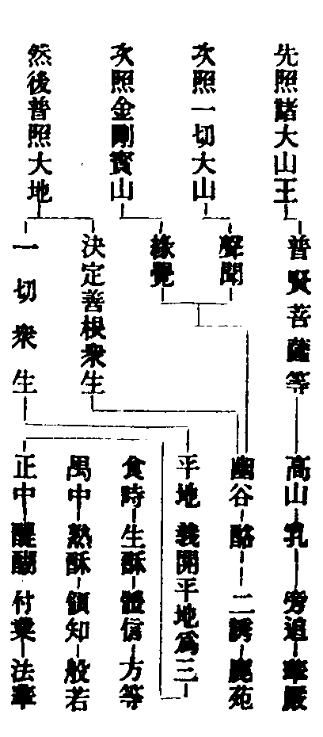



【■补】决定善根众生，乃事六度菩萨。三僧祇决定成佛，故曰决定。广修六度名善根，而未断惑，且名众生。然华严合法文中，列次照声闻后，普照一切众生前。佛意只以一类伏惑行因菩萨，为决定善根众生，本不明是菩萨属何教也。玉师既判属三藏，理应四照内，牵入中间两照。或以中间两照，但对声闻、缘觉，则普照大地，亦应只对一切众生。以譬中言，然后普照一切大地；法中言，然后普照一切众生，正相敌对。如谓普照义宽，故可牵入大地之下。若尔，今家取日照平地，止对后三时，又如何消通耶？据理，既上牵入普照，下应入於平地；下既牵入幽谷，上应入於中间两照。不惟令人易明，且与经义相合也。或言以未断惑，牵入平地；不住凡夫，牵入幽谷。此乃臆度，恐未符经义也。



【■备】三照五味图，统纪已列。然经曰：先照菩萨，次缘觉，次声闻，次一切众生。牵线中，应缘觉在先，声闻在后，始与经符。统纪图内列大山、宝山，牵入声闻在先，配幽谷；缘觉居次，配平地；食时，将决定众生配；禺中，复将决定众生注明藏菩萨。其中缘觉、声闻，与经倒列，一也。菩萨根利二乘，蒙照应在先，经虽不开藏菩萨应摄在二乘内，或摄入先照菩萨中，今判决定众生乃藏菩萨友，致利根后照，二也。缘觉、菩萨利於声闻，乃下牵配入平地，三也。玉师仍以决定众生乃藏菩萨，但配入平地，究为未妥，故同缘觉改牵幽谷。而声闻、缘觉虽分配大山、宝山，依旧与经倒列，总由善根众生是藏菩萨，其势必须声、缘、菩萨挨顺而列矣。辨讹曰：当以缘觉居先，声闻居后。私谓清凉师疏钞，黑山配缘觉，高原配声闻，大地内合配决定、不定、邪定三聚众生。则决定一聚，通指因中正定众生。惟经中系与缘觉、声闻一连之文，似当合入幽谷、一切众生，乃至邪定，紧对普照大地句，研两然后字，界限自清。故别作图说，以备参考。黑山配缘觉等义，疏钞广明，须者往检。又节义言，准经应缘觉在先，今依三车次第，故先列声闻。大地中开出决定众生者，此是事六度菩萨，以未断惑，且让二乘高出一头，但名众生。而其心行已大，虽未断惑，同是鹿苑三乘，故牵入幽谷。一切众生，通指十界之机，未起宏誓愿行之人也。私谓新作图说，依节义意判，决定属藏，菩萨亦通，但不可泥定众生二字，谓须合入大地，以佛亦称尊极众生也。图说中不列旁追二诱等者，此图本明华严三照以对涅槃五味，如此图说，於义已足。且旁追等专指一类小机备历五时者言，今华严三照统论大小众机，不必夹入旁追等喻配合。如以时味义富，亦可备列，俾无疎漏。来哲再定之，缘觉、声闻对凡夫则为大机，故合入一切大山。决定善根有金刚宝义，故合入金刚宝山。一切众生，机众先后得益不定，先即食时，次禺中，后正中，故开亦无碍。所对时味，但可取相生次第，如下所引无垢藏王一节经意也。



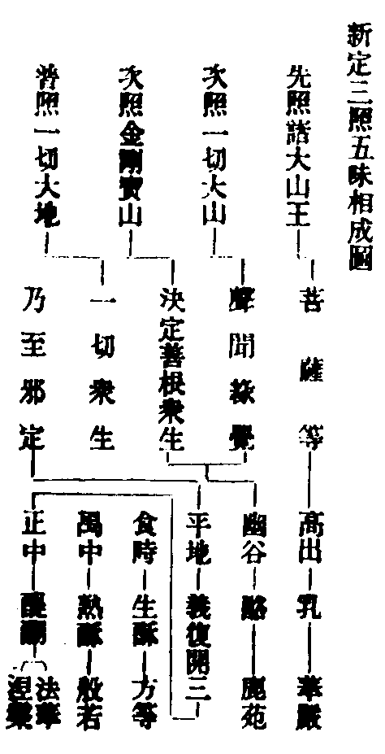



△三、约味判。



涅槃云：譬如从牛出乳，此从佛出十二部经(一、乳味)。



【□注】牛譬於佛，乳譬於教。释签云：此五味相生之文，在十三卷圣行品末，佛印无垢藏王菩萨竟，云：譬如从牛出乳，乃至醍醐。譬如佛出十二部经，乃至涅槃。



【■补】大经：无垢藏王言：诸佛菩萨成就智慧功德，实不可说，我意犹谓故不如是大乘经典。何以故？大乘经典能出生阿耨菩提。佛言：譬从牛出乳，乳出酪，酪出生酥，生酥出熟酥，熟酥出醍醐。佛亦如是，从佛出十二部经，从十二部经出九部修多罗，从修多罗出方等典，方等出般若，般若出大涅槃。



【□注】十二部经颂曰：长行重颂并授记，孤起无问而自说，因缘譬喻及本事，本生方广未曾有，论议俱成十二名，广如大论三十三。



【■记】大论言：诸经中直说者，名修多罗。授记者，众生三乘、六趣、九道中受记。诸佛法欲与众生授记，先皆微笑，无量种光从四牙出。从上二牙出者，光照三恶道，得遇斯光，闻说法者，身心安乐，得生人中天上，从是因缘，皆得毕苦。从下二牙出者，上照人天，乃至有顶。此诸光明，复至十方，遍照六道。作佛事已，还遶身七匝。若记地狱，光从足下入；记畜生，从腨入；饿鬼，从䏶入；人道，从脐入；天道，胸入；声闻，口入；辟支，眉间入。若记作佛，光从顶入。佛欲受记，先现此相，然后弟子发问一切。偈名祇夜，六句、三句、五句，多少不定，亦名祇夜，亦名伽陀。优陀那者，名有法佛必应说，而无有问者，佛略开问端。如佛自说：无我、无我所，是事善哉！一比丘白佛言：云何是事善哉？佛告比丘：凡夫人未得无漏道，颠倒覆心故，於无我、无我所，心大惊怖。若佛弟子闻好法者，欢喜奉行，无颠倒故，不复更作。如是等，杂阿含中广说。尼陀那者，说佛本起因缘。佛何因缘说此事？修多罗中，有人问故，为说是事；毗尼中，有人犯是事故，结是戒。一切佛语缘起事，皆名尼陀那。阿波陀那者，与世间相似柔輭语。如是语经者，如一狮子来礼佛足，佛告比丘：是师子毗婆尸佛时，依婆罗门来至佛所，大众之中以听法故，无共语者，即发骂言：秃辈！与畜生何异？恶口业故，九十一劫堕畜生中。此人尔时即应得道，以愚痴故，自作生死长久，今於佛所心清净故，当得解脱。如是等经，名为出因缘。何名因缘？是事之本，名因缘。本生经者，过去世时，菩萨身为赤鱼，自以其肉施诸病人，如是等无量本生，多有所济，名本生经。广经者，名摩诃衍，所谓般若经、华手经、法华经等，如是等无量阿僧祇诸经，为得阿耨多罗三藐三菩提故说。未曾有者，如佛现种种神力，众生怪未曾有，所谓佛生时，如是等无量希有事。论议经者，答诸问者，释其所以。又复广说诸义，如佛说四谛。何等为苦圣谛？所谓生苦等八种苦，广解其义。复次，佛所说经论议，及摩诃迦旃延所解经，乃至像法凡夫人所解经，亦名优波提舍。



【■备】祇夜、伽陀，分别见下节。此依大论录出其文。



【□注】华梵名义，具如妙玄六。



【■记】妙玄言：修多罗，翻契经，即长行。祇夜，翻重颂。和伽罗，翻授记。伽陀，即孤起。优陀那，翻无问自说。尼陀那，翻因缘。阿波陀那，翻譬喻。伊帝目多伽，翻本事。阇陀伽，翻本生。毗佛略，翻方广。阿浮陀达摩，翻未曾有。优波提舍，翻论议。此十二种，俱称部者，各有类从也。



【□注】此十二部经，通论大小，各具十二部。



【■记】解深密经，明菩萨依十二分教，修奢摩他。瑜伽论言，佛为声闻，一一具演十二分教。



【□注】别而言之，小乘让三存九。小乘灰断，无方广经说，必假缘无，无问自说，虽有授记，作佛者少，此以小九望大三也。玄文又以大九望小三者，谓大乘根利，无因缘、譬喻、议论之三也。又以大一望小十一者，谓小乘但让广经一部耳。



【■记】小让三者，妙玄言：小乘灰断，无如意珠身故。无广经又言：小乘根钝，说必假缘。少无问自说，虽有授记，记作佛少。大无三者，涅槃经云：护大乘者，受持九部。谓因缘中，取因事制戒；於譬喻中，依为诱引；於议论中，约非了义也。又小有十，瑜伽论言：无方广者，大乘说如来是常，一切众生皆有佛性。正理为方，包富为广。又理融无二，亦名为等，声闻所无也。



【□注】释签云：如上所说，一往赴机，据理应以通说为正。



【■记】玄文云：通语大乘，何得无此三耶？又曰：小乘亦有记莂六道因果，阿含授弥勒当作佛记，亦有自唱善来，即无问自说。又声闻中以法空为大空，空即方广，故以通为正也。



△三、引证二：初、引经徵起二：初、引经。



信解品云：即遣旁人急追将还，穷子惊愕，称怨大(唤等)。



【□注】譬喻周中四大弟子，具领五时，今领华严文也。



【■记】法华有法说、喻说、因缘三周，今正喻说周文也。



【□注】即遣说华严教以拟宜也。约教，理为所依，智为能遣，教为所遣。约人，师弟相望，佛为能遣，菩萨为所遣。



【■记】初约教明遣。教依於理，以理为所依，而智必照理鉴机方有说，故以智为能遣，教为所遣。次约人明遣，可解。



【□注】旁人约教，理智为正，说教为傍。约人，化主为正，菩萨为旁。



【■记】教依理而用智说，故以理智为正。菩萨从佛转法轮，故约人为傍。



【□注】谓加被四菩萨说四十位：法慧说十住，功德林说十行，金刚幢说十向，金刚藏说十地。是四菩萨说此位时，并云佛力故说，故名为遣。然加被四菩萨者：一、表旁追义便，二、彰主伴互融。



【■记】加被有二：显加具於三业，冥加但与智令说。第二会普光，七、重会普光，八、三会普光，九、会入法界。但有冥加，餘五会皆冥、显二加。然冥未必有显，显必有冥，心冥至极，故感佛加。经言：以三昧力，感十方诸佛现前也。四位各说：经明法慧菩萨，入无量力方便三昧，故佛告言：由汝所修诸善根力，令汝入此三昧，说十住法。功德林菩萨，入善思惟三昧，故佛告言：以汝思惟一切行愿力故，令汝入此三昧，说十行法。金刚幢菩萨，入智光三昧，故佛告言：由汝智慧清净，令汝入此三昧，说十向法。金刚藏菩萨，入智慧光明三昧，故佛告言：以汝胜智力，令汝入是三昧，说十地法也。并言佛力故说者，法慧告天帝言：此义甚深，难说难知。虽然，我当承佛威神力，而为汝说。故名为遣也。一、表傍追义便者，即遣正傍追义。二、彰主伴互融者，谓果主、因伴，递互相望，重重无尽，弥显圆融。



【■备】主伴互融，此华严事事无碍宗旨，顺带引耳。辨讹曰：虽言互融，但可以果主果伴、果主因伴、因主因伴互论，不可以因主果伴说也。



【□注】急追将还，直将大教，拟宜小机，故云急追。昔有大种，故曰将还。况复性德本有。



【■记】如来於大通智胜佛所，为沙弥时，曾与六百万亿恒河沙众生，结圆顿种子。今成正觉，直将大教拟宜，为急追。昔有大种，今说大教，为将还。又无漏性德，本来具足，今熏其本有，故言将还。



【□注】穷子无大乘功德法财故。



【■备】体色即空，假中不起，灭定现诸威仪，是大乘功德法财。今灭色趣空，不穷何待？



【□注】惊愕。文句六(二十一)云：纵昔曾发，废久不忆，卒闻大教，乖心故惊，不识故愕。



【■记】此释惊愕也。二乘向小已久，今卒然闻大，与其现习相乖，茫然不识，故生惊愕。



【□注】称怨大唤，文句六(二十一)云：小乘以烦恼为怨，生死为苦。若劝烦恼即菩提，即大唤称冤枉。若闻生死即涅槃，即大唤称苦痛。



【■记】小乘以苦集为劳为患，以道灭为修为慕，则烦恼为怨，生死为苦明矣。华严发明烦恼即菩提，生死即涅槃，是以所厌为所修，所患为所慕，岂不称怨唤苦耶？



【□注】等者，等於我不相犯，何为见捉之文。



【■记】约法谓：我本不求大，何意用大化我？



△二徵起



此领何义？



【□注】徵此信解品文为领何等之义。



△二、答释所领。



答：诸声闻在座，如聋哑等是也。



【□注】答：出华严。拟，宜也。谓有耳不闻圆顿教，故如聋。有眼不见舍那身，以不见故，不能赞叹，故若哑。



【■记】此引经以证聋哑也。华严入法界品言：上首诸大声闻舍利弗等，在逝多林，皆悉不见如来神力等，亦复不见难思菩萨境界。何以故？善根不同故。本不修习见佛自在善根，本不得诸菩萨眼所知境界。以是因缘，诸大声闻，不见不知，不闻不入。虽在林中，不见佛大神变。所谓日月辉天，盲者不见；雷霆震地，聋者不闻是也。



【□注】问：妙玄十(廿三)云：华严初分，永无声闻。今何云声闻在座耶？答：华严不入二乘人手，声闻若闻华严，则非声闻，故不可云有。若据华严，拟宜小机，其最钝根，具经五味，故不可云无。是则显对则无，拟宜则有。今四大弟子，领解如来拟宜之时，故云声闻在座也。所以摩诃迦叶却叙小机，蒙大拟时，迷闷躄地。若聋哑文，出经后分。妙玄云：后分则有。后分状当聋哑，况前分耶？故别行疏记云：以后显前机，未堪大



【■记】显对则无，拟宜则有。断定二乘不闻华严，而如来拟宜非无声闻。如文句言，即遣旁人疾走往捉，是劝门拟宜；穷子惊愕，是劝门无机；强牵将还，是诫门拟宜；穷子自念无罪，以至闷绝躄地，是诫门无机。今据拟宜说，故言声闻在座。出经后分，指华严入法界品文也。准不思议境界经云：舍利弗！五百声闻皆是他方极位菩萨，今在逝多林会，迹示声闻。据华严经，文殊逝多林出时，舍利弗语比丘言：汝等且观文殊相好威仪等。观舍利弗语辞示现，未能悟故，状当聋哑。以此义有二：一者、显如聋哑。二乘人於三七日中不闻说法，但见嘿然。二者、状当聋哑。释签云：有耳不闻，显如聋者；眼不见故，不能赞叹，义如哑者。玄文所云：前分永无声闻，据显见三七默然者说；后分则有，据状当不闻不见者说。但后分尚然，况前分耶？别行疏下，证成前分机未堪大。



【■备】统纪云：三七是拟机者，人无异论。然玄文云：於彼初分永无，声闻后分则有，虽复在座，如聋如哑。故神智义据玄文非之曰：初分永无，何所拟哉？今二义释之：一、初分永无，乃如来拟宜之化意；二、后分则有，状如聋哑，乃如来拟宜之化事。化意者，方便品云：始坐道场，三七思惟。签云：约大机，则寂场之时；约小机，则成已思惟未说之时。妙乐云：小见三七停留，大覩始终无改是也。化事者，文句云：华严末席，始开於渐。妙乐引经云：佛在逝多林，舍利弗不见如来自在庄严，不见诸大菩萨眷属，无智眼能见，亦不能赞叹。此即如哑等文，於彼末会，即当渐初。今考祖言，聋哑皆指在后分渐初，明是鹿苑十二年中。例如玅玄谓方等弹诃，应在十二年前，则知逝多林末会，正是拟宜之事。以由声闻先习小乘，未堪闻大，状如聋哑，故假净名以激进之。是则拟宜弹诃，俱在十二年中，无可疑者。四、教义以聋哑在华严，弹诃在方等，此但约部中而论，其实未为正意。私谓：统纪引祖言，聋哑皆指后分固是，但小见停留，显如聋哑，见即在座，前分亦通，并可说为拟宜，无机化事。至聋哑在华严，弹诃在方等，此乃判别五时，以分说法次第。若鹿苑亦有拟宜弹诃，似通五时义也。



【□注】昔慧觉谓前分乃有根性声闻，此则不可。若云声闻根性，义亦有之。如下文云：所谓二乘根性，在华严座也。



【■记】旧说前分声闻，乃有大乘根性，故虽在座，如不见有也。此则下，正遮出正。



【■补】玉师意以声闻必回小向大，方可言大乘根性，最初三七，安有此类也，故曰不可。



【■备】二乘，据下文应言三乘。有师标云：慧觉谓根性声闻者，意以前分虽无小人声闻，必有大人声闻，如法华真如声闻等。不知法华开显，故言汝等所行是菩萨道，以佛道声令一切闻，乃真如声闻也。华严前来未说，又未开显，岂有大人根性声闻耶？私谓：初句似指显对者言，故不可；次句指拟宜者言，故有之。慧师传检统纪。



△二、渐教三：初、总标。



第二、渐教者，此下三时三昧，总名为渐。



【□注】次顿之后，总明三渐者，寝顿，施渐也。



△二、别释三：初、鹿苑四：初、约部判二：初、寝顿施渐二：初、对机示处。



次为三乘根性於顿无益，故不动寂场而游鹿苑。



【□注】三乘：乘以运载为义，声闻以四谛为乘，缘觉以十二因缘为乘，菩萨以六度为乘，运出三界，归於涅槃。



【■记】此对机设部教也。谛缘度解下藏教，所乘虽异，同出三界，同断见思，入有餘无餘二种涅槃也。



【□注】根性，辅行云：能生为根，数习为性。



【■记】根有出生义，性以熏习成。



【□注】於顿无益。此三乘人，於华严座不信不解，是故如来不动寂场而游鹿苑。此显双垂两相，二始同时也。



【■记】华严出现品曰：一切二乘，不闻此经，何况受持？又言：设有菩萨，於无量劫，行六波罗密，不闻此经，或闻而不信不解，不顺不入，不名真实菩萨，故列於非器也。不动寂场，而游鹿苑者，如来神力不共，随机应现。寂场说顿教之始，即鹿苑说渐教之始，非前非后，故言双垂两相也。



【■补】统纪言诸文所论，初顿后渐，是化缘施设仪式。今说大小双应，方尽鉴机度生之意。



△二、以喻显身。



脱舍那珍御之服，著丈六弊垢之衣，



【□注】此明寝大施小，化仪次第也。



【■记】此即信解品遥见子身羸瘦憔悴，即脱璎珞细软上服严饰之具，更著麤弊垢腻之衣，乃至以方便故，得近其子等文。



【□注】约佛意，则寝法华之实而施权。据化仪次第，则寝华严之顿而施渐。



【■记】华严之圆，即法华之实。我佛本意，欲令众生开示悟入一乘实相而已。根器未堪，故施权也。



【□注】处说不动而游，衣论脱珍著弊，文互显耳。然若不明不动而游，无以见二始同时。不明脱珍著弊，无以见寝大施小。此文曲尽如来妙应，无谋设化之相也。



【■记】二文互显，不可脱一，始曲尽佛之妙应也。



【□注】舍那胜应尊特，智定庄严，故譬珍御。丈六劣应生身，忍生法恼，故譬弊垢。盖法譬双明也。



【■记】尊特首楞大定，种智大慧而自庄严，劣应生灭之身，则为蚊虱有情、寒暑无情之所逼恼。



【■备】有师标曰：妙乐忍有情恼为生忍，忍无情恼为法忍。大论言：忍诸恭敬供养，及诸烦恼淫欲，为生忍；忍其恭敬供养，及嗔恼欲法，为法忍。



△二、息大施小二：初、垂世成道。



示从兜率降下，托摩耶胎，住胎出胎，纳妃生子，出家苦行，六年已后，木菩提树下，以草为座，成劣应身。



【□注】此明小始也。本是圆佛，垂为三藏初成之相，故云示也。兜率，翻知足。此天有内苑外苑，菩萨居内苑而降神也。然在六欲梵世七天之中，以佛常居中故。



【■记】兜率陀，翻妙足，或译覩史陀，翻知足。受欲知足故，佛地论名喜足。最后身菩萨，於中教化，多修喜足故。楞严明此天不接下界诸人天境，乃至劫坏，三灾不及，唯内苑可尔，故菩萨居之。佛常居中者，大论言：若於下地生，命短寿终时，佛未出世；若於上地生，命长寿未尽，佛出世时过。惟兜率天，寿与佛世出时会故。复次，佛常居中道故，兜率於欲天、梵天中，上三下三；於彼天下生中国，中夜降神，中夜出国，行中道得菩提，中道为人说法，中夜入无餘涅槃是也。



【□注】从彼下生，托摩耶胎。摩耶，翻天后，净饭王之后也。妙乐云：一切诸佛，皆不在餘二贱姓故。尚尊贵时在刹利，尚多闻时在婆罗门。又浊难调时在刹利，清易调时在婆罗门(文)。



【■记】大论云：菩萨末后身，从天上来者，乘上道故。又从天下时，种种瑞应，又人敬重天故。论又云：菩萨将欲下生，先观生处，唯迦毗罗婆国净饭王后，能怀后身菩萨也。下引妙乐释，明刹利乃帝王种族，为世尊贵；婆罗门是通博净行，为世多闻。又刹利有势，能调劫浊；婆罗门无诤，得调时清。诸佛随时所贵，即於中生。今释尊世，正尚尊贵，又当劫浊，众生刚强难化故也。



【□注】托胎菩萨，自有胁入正慧托胎。小乘见乘白象贯日之精，大乘见乘楞檀楼阁等。



【■记】大论：问：人以垢心有相续入母胎，一切邪慧相应，云何菩萨正慧入母胎？答：菩萨忆念不失故入胎，中阴中住知中阴中住，入胎时知入胎，歌罗逻时知歌罗逻，乃至出生时知出生是也。小乘见者，如大庄严经云：化作白象，降神母胎。又须菩提偈言：其形如白象，四足有六牙，来入母胎时，如游园观想是也。大乘见者，华严经云：毗卢遮那菩萨，已从此没，生於人问净饭王家，乘栴檀楼阁处，摩耶夫人胎是也。



【■补】象是象王，有大力用，表菩萨能荷负众生也。贯表析空观，日表偏空理，以二乘修空观，齐己分量见也。栴檀楼阁者，表色心无碍，身土互融，以菩萨修中观，齐己分量见也。



【■备】辨讹曰：白象贯日，出普曜经，属大乘，乃大小乘共见也，存考。补中象王楼阁等解，亦存考。



【□注】住胎。若小乘八相，合住胎在托胎内。今示小始垂化事迹，非正明八相也。



【■记】小乘八相，解见七卷住胎，今带说。



【■补】因果经云：菩萨在母胎，晨为色天说法，日中为欲天说法，晡时为鬼神说法，夜三时亦如是。



【■备】辨讹日：小乘中住胎，无说法事，故不开。私谓：不开，当依七卷小乘不谈常住解。



【□注】出胎。四月八日右胁降神。出瑞应经。



【■记】瑞应经云：自夫人怀妊，天为献供，不享王厨。四月八日，从右胁生。即行七步，举右手曰：天上天下，唯我独尊。三界皆苦，何可乐者？是时天地大动，宫中尽明。梵释天神，於空中侍。四天王接置金几，以天香汤浴太子身。身黄金色，三十二相，光明彻照，极佛境界，莫不大明。天降瑞应三十有二：一者地为大动，坵墟皆平。乃至第三十二树神人现，低首礼侍。此时疆场左右，莫不称奇，叹未曾有。是出(胎相)。



【□注】纳妃有三：一瞿夷，二耶输，三鹿野。



【■记】十二游经云：菩萨妇家姓瞿昙氏，舍夷长者名曰水光。其妇母名月女，生女时，日将没，餘明照其家，因名瞿夷，是第一夫人。若第二夫人生罗云者，名耶惟檀，即耶输，父名耶施长者。第三夫人名鹿野，父名释长者。



【□注】生子，即罗睺罗也。佛出同居，示同人法。



【■记】大经四相品：迦叶问：何缘复衲耶输，生罗睺罗？乃至当知如来未度诸结大海？佛告迦叶：菩萨示现如是无量神通变化，一切众生无能测量。汝今云何能知如来习近爱欲，生罗睺罗？善男子！我已久住是大涅槃，示现是也。



【□注】出家时年十九，二月十五日夜半，乘天马逾城。



【■记】大庄严经云：菩萨自思：烦恼旷野，生死河中，若不修行，终难出离。於众睡后，即呼车匿，备马去来。帝释开门，四王捧足，释梵引路，诣大仙林，取剑落发。又有说：太子见老病死，回宫思惟，欲免是苦。其夜见诸妃女，状若死尸，愈加起厌。又见四天王在窗隙中，报出家时到。遂即开窗，靸天白马，逾城到䟦伽婆仙人林中剃发。



【■备】辨讹曰：乘宫中马，天捧马足，故曰天马，非天上之马也。私谓统纪亦同，然记中靸天白马一说则异，想机见不同耳。



【□注】苦行须六年者，文句七(十九)云：但诸佛道同，为缘事异。释迦苦行，六年草生，攒䏶至肘，不觉诸天哭唤动地，不闻移座得道。弥勒即出家日成道，彼佛十劫犹不现前。非根有利钝，道有难易，缘宜賖促，应示短长耳。(文)辅行云：六年苦行，所以伏见，为调外道，过其所行。(文)颂云：十九逾城六苦行，五岁游历三十成，说法度生五十年，是则共当八十寿。



【■记】经云：十方诸如来，同共一法身，一心一智慧，力无畏亦然。此道同也。事异，以三佛别明。谓释迦至象头山，同外道食麻麦六年草，蔓生延蔟，聚於䏶至臂，节亦莫觉。诸天见眷属日减，痛哭叫唤动地，修世禅故，亦复不闻。及太子自思：苦行非真解脱，吾当受食成佛。故移座成道也。弥勒下生经：佛言：四海渐减三千由旬，是阎浮地，长十千由旬，广八千由旬，平坦如镜，种种庄严。城中有大婆罗门，主名妙梵婆罗门，妇名摩提婆。弥勒托生为父母，身紫金色，二十二相，身长千丈，胸广三十丈，面长十二丈四尺，肉眼见千由旬，常光四照百由旬。穰佉王奉七宝台施弥勒，弥勒施婆罗门，见其毁坏，修无常想，出家於龙华菩提树下。树茎枝叶高五千里，即以出家日得道。彼佛十劫者，法华经云大通智胜佛，十劫坐道场，佛法不现前是也。准此，则知释迦缘事宜赊，故苦行六年。辅行引大论云：外道苦行，或三月、半岁、一岁，无能六年日食一麻一麦者。又言：佛若不行六载苦行，呵其非道，无人信受。以苦行过人成佛，呵其苦行，人皆信受。或问：颂言十九出家，三十成道，梵网经言七岁出家，三十成道，何也？答：发隐云：大圣示现，有何常规？有言：太子入檀特山修道，始於阿蓝迦蓝处三载，学不用处定，知非便舍。复至郁头蓝弗处三载，学非非想定，知非又舍。后至象头山，同外道食麻麦六年，受食成佛。是则颂言十九出家，三十成道，共十二载，正与三处修道岁数同。然与颂言五岁游历，又似有异，仍当以示现无常规释也。



【■补】统纪曰：瑞应因果、本起大论并云：十九出家。四阿含、出耀经和须密论并云：二十五出家。当何所从？今以八十寿，除五十载说法，定取梵网、无相三昧、宝藏经等三十成道；除六载苦行，定取荆溪二十五出家。合宝藏经二十五出家、三十成道之说，若约前后义，定有二事可证：一者出家后六年苦行，取成道之岁数合。二者将出家时，指妃腹曰：却后六年，汝当生子。后於成道岁，果生罗睺。未曾有经云：太子逃至山泽，勤苦六年，得佛还国。贤愚经云：出家六年苦行，得一切智。又普耀经云：父王闻太子得佛六年，令优陀那往请，言濶别以来十有二年。又言佛还国，罗云问讯群臣，疑太子捐国十二载，何从有子？此等经文，皆约出家六年成佛，又经六载还国。以上统纪文至孤山颂五岁游历，或指阿蓝三载、郁头三载。



【■备】源师曰：梵网经：七岁出家。岁字，古有作年字解者，甚妙。然合下句三十成道，则当以二十五出家为准。总之，如来示现，既无常规，又西域诸邦，纪岁时日，或有参差，流传结集，不无同异，更复翻译难齐，阙疑而已，后贤不必於此辨论见长也。辨讹曰：草生攒䏶等，出观佛三昧海经，因入灭意定故，不闻不觉，此属后教。若三藏菩萨，既伏惑行因，则不能入灭受想定，须引三藏佛本行经为妙，但彼无草生攒䏶等事。又本行经：菩萨入不动三昧，即第四禅，以息不行，知他心法，下不知上，天谓命终，故哭也。私谓草生等语，今注乃引文句用也。



【□注】木菩提树：菩提翻道，佛於树下成道，故名道树。草座：因果经说：帝释化为吉祥童子，以草施佛坐以(成道)。



【■记】因果经云：释提桓因化人，执净輭草。菩萨问：汝名何等？答曰：吉祥。菩萨懽喜：我破不吉，以成吉祥，汝草可得否？吉祥授草，发誓成道：愿先度我。菩萨结跏趺坐，如过去诸佛坐法，誓言：不成正觉，不起此座。



【□注】木树草座，皆表三藏诠生灭故。



【■记】草木春生，夏长枯，冬落故。



【□注】劣应对大乘，胜应判为劣也。



【■记】胜应，即大乘菩萨他受用身。劣应，丈六身也。



△二、应机设教。



初在鹿苑，先为五人说四谛、十二因缘事、六度等教。



【□注】五人颂曰：頞鞞䟦提并俱利，此三属在父之亲，陈如十力母之亲，初转法轮先度此。



【■记】此颂出释签。法轮：一、运转义。文句言：以佛心中化他之法，度入他心，名转法轮。二、摧碾义。辅行言：以四谛轮，转度与他，摧破结惑。如王轮宝，能坏能安。法轮亦尔，烦恼怨坏，安住谛理也。初转。婆娑云：转法轮有二种：一、在自身，二、在他提身。菩树下是自身转法轮，波罗奈国随他身转法轮。以他身中初转法轮，故言初也。先度五人者，鹿苑有三番度人法数言：初为陈如，说四谛得道；次为额鞞䟦提，说布施生天，福乐同证果；三为迦叶、俱利，如前说，皆得圣道。



【□注】文句五(五)云：问：何故初为五人转法轮？答：人先见谛故，人是现见故，人为证故，佛所行事业与人同故，诸天从人中得善利故，人中有四众故。



【■记】婆娑言：人先见谛，天在后故；人是现见，天非现见故；人以为证，不以天为证故；佛所行事，与人同故；诸天亦从人中得善利故；人中有四众故。



【□注】妙乐五(三十一)云：问虽涉五，意正在人，故皆以人答(文)。



【■记】问中。虽但涉五人意，实通为一切人。



【□注】若唯就五人，应有三意。妙乐一(十六)云：一酬释尊行因本愿，二赴五人本愿先悟，三报今日侍奉之劳。



【■记】释尊行因本愿者，妙乐云：歌利王割截时，佛发愿得道先度之。歌利王即陈如。又辅行言：佛昔饥世化大鱼，木工五人先斫肉，佛誓先度也。五人本愿者，妙乐云：迦叶佛时，九人学道，五人未得果，誓释迦法中最先开悟也。今日侍奉者，妙乐云：太子学道，父遣五人追侍得道，先为说四谛也。



(法华文句五)。



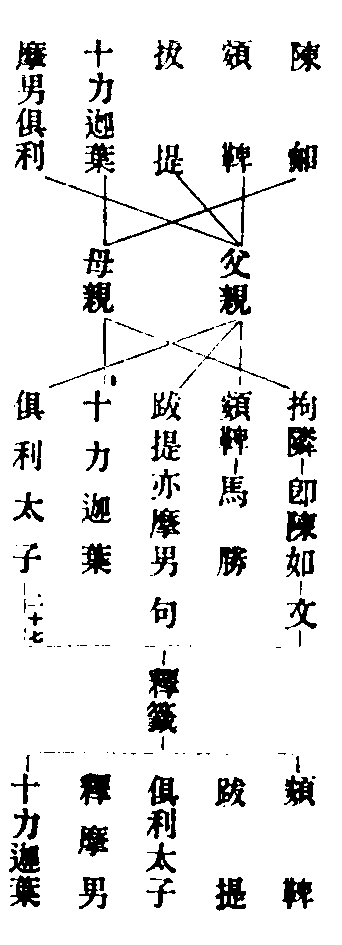



【□注】摩男，长子之通称。以摩诃翻大，故俱利斛饭王之长子，䟦提甘露饭王之长子，故皆称摩男。



【■记】教乘曰：四王有八子：一、净饭王，二子：一、悉达，二、难陀。二、白饭王，二子：一、调达，二、阿难。三、斛饭王，二子：一、摩诃男，二、那律。四、甘露饭王，二子：一、䟦提，二、提沙。文句摩诃俱利，即教乘摩诃男。



【■备】辨讹曰：按摩男，男字亦梵音，故有处言摩诃纳也。䟦提，诸经皆言甘露王次子。私检大藏一覧，引起世因本经，言净饭二子：一悉达，一难陀。白饭二子：一帝沙，一难提沙。斛饭二子：一阿尼娄驮，一䟦提梨迦。甘露饭二子：一阿难陀，一提婆达多。是䟦提生父，亦属不同。但仪文准签释，摩男是陈如，以为佛最长子，故称摩男。则摩男当为长子之通称，并非臆说。即法数引为甘露长子，当亦有所本。其诸经不同之处，想如前说，流传结集翻译之故也。



【□注】释摩男，即陈如也。如四姓出家，同名释氏。佛初成道，最先得度，在一切人天罗汉之前。如妙乐一(三十七)引分别功德论曰：佛最长子，即陈如也。



【■记】妙乐云：拘邻最初见佛道相，在一切人天罗汉前，故称释摩男也。如妙乐下，引证。论言：五百罗汉，各有所便，或智慧，或神足，或辩才，或福德，或守戒，或知足，或说法。各据第一论，先兄后弟者，拘邻最长，须䟦最小，故最长子，即陈如也。



【□注】谛缘度三，具在下文。五人是声闻，只应说四谛，今通举鹿苑所说之法也。



【■记】下文指下藏教。



【□注】事六度者，三藏教谈，实有事不即理故。



【■记】大品明六度有二：一、有所得心行六度，二、无所得心行六度。今事六度，即有所得心行不具足六度也。



△二、约时判。



若约时，则日照幽谷(第二时)。



【□注】旧译华严出现品云：譬如日月出现世间，乃至深山幽谷，无不普照(文)。



【■记】此约时也。



【□注】辅行一上(二十八)云：幽谷者，山川之幽䆳也。(文)



【■记】䆳，深也。



△三、约味判。



若约味，则从乳出酪，此从十二部经出九部修多罗(二酪味)。



【□注】从乳出酪，盖譬如来施教次第，从顿施渐，相生之义。若约机者，浓淡在焉。



【■备】此约味也。从顿施渐，为相生释；约小机转凡成圣，如转乳成酪，为浓淡释。



【□注】如下文云：一者但取相生次第，二者取其浓淡。



【■备】详解见二卷。



【□注】从十二部出。九部亦且相生，其实九部从佛出也。



【■记】相生之言，出涅槃圣行品。今亦且论相生，从十二出九也。其实从佛所出，经言我此九部法，随顺众生说是也。



△四、准经判二：初、引经徵起二：初、引经。



信解品云：而以方便密遣二人(声闻、缘觉)，形色憔悴无威德者，汝可诣彼，徐语穷子，雇汝除粪。



【■记】此准法华判也。信解品言：尔时长者，将欲诱引其子，而设方便，密遣二人，形色憔悴，无威德者：汝可诣彼，徐语穷子，此有作处，倍与汝直。若言欲何所作，便可语之：雇汝除粪，我等二人，亦共汝作。



【□注】而以方便。方，法也。便，用也。善用其法，逗会众生，亦善巧之谓也。



【■记】善以权宜巧逗众生，是方便义。



【□注】密遣。文句六(二十三)云：初拟大乘云：即遣旁人，表一实谛，一大乘教，一菩萨人。今明方便，隐实为密，指偏真为遣。约教，隐满字为密，半字为遣。约人，内秘菩萨行为密，外现是声闻为遣。约化仪，寝大施小为遣，小不测大为密(文)。



【■记】此引华严，即遣对释。本文密遣表一实谛者，五时除阿含，俱明实谛；今但指华严，兼别说圆，为一实谛也。一大乘教者，即华严圆别教也。一菩萨人者，即一类大机菩萨也。今明下，正释密遣。约方便，则以实为所隐，故为密；偏真所指，故为遣。妙乐云：今明密遣者，覆实名密，用小为遣也。约教者，满字顿教，隐而不说为密；半字渐教，用以说示为遣也。约人者，如经言是故诸菩萨，作声闻缘觉是也。约化仪者，说法施小为遣，小机不测为密也。



【□注】二人。文句六(二十三)云：四大弟子，齐己分领，不涉菩萨，故言二人。约法是因缘四谛，约理是有作真俗，约人是声闻缘觉(文)。今且约人。



【■记】四大弟子，齐己分领，安住声缘，故言二人。因缘，即生灭四谛。有作真俗者，析色空，是有作真；理外所有，是有作俗也。



【□注】形色憔悴。文句六(二十三)云：二乘教中，不修相好，但说苦空无常不净，即形色憔悴。又(二十五)云：内怖无常曰憔，外遭八苦曰悴(文)。



【■记】妙乐言：百劫所种，虽在小论，不在二乘，故无好形色。



【□注】无威德者，无有十力四无所畏故。



【■记】十力者：一、是处非处力，知一切因缘果报定相，从如是因缘，生如是果报，不生如是果报，悉知之。二、业智力，知一切众生三世诸业诸受。三、定力，知诸禅三昧。四、根力，知众生诸根上下。五、欲力，知众生种种欲乐。六、性力，知世间种种性。七、知处道力，知一切道至处相。八、宿命力，知一世乃至百千世，姓名苦乐，寿命长短等。九、天眼力，见众生生时死时，善道恶道等。十、漏尽力，自知我生已尽，不受后有也。四无所畏者：一、一切智无所畏，於世出世间诸法，尽知尽见。如佛言：我是一切正智人故，得安隐，得无所畏。二、漏尽无所畏，惑业死生俱尽。如佛言：我一切漏尽故，得安隐，得无所畏。三、说障道无所畏，说彼魔外障蔽圣道之法。如佛言：我说障法故，得安隐，得无所畏。四、说尽苦道无所畏，说能尽众苦之道。如佛言：我所说圣道，能出世间，能尽诸苦故，得安隐，得无所畏。出大论。



【□注】汝可诣彼徐语穷子。文句六(二十四)云：即以小教拟小机也。大教明理直实，故言疾走往捉。小教明理纡隐，故言徐语(文)。雇汝除粪。雇，赁也。文句六(二十四)云：除苦集之粪，取道灭之价(文)。



【■记】苦集能染污真性，如粪秽。道灭能通会空理，如得价。谓得涅槃一日之价也。纡，曲也。



△二徵起



此领何义？



△二、答释所领。



答：次顿之后说三藏教，二十年中常令除粪，即破见思烦恼等义也。



【□注】二十年中，用八忍八智断见，合为一无碍一解脱。用九无碍九解脱断思，总成二十(经中更有两处明二十年)。若住二乘位，转大乘教，名为於二十年中执作家事。从有二乘之机而来感佛，故云自见子来已二十年，皆取二乘各有十智。



【■记】一、断见，九、断思。总有十种无碍，十种解脱，成二十见思解。下藏教经明两处二十年者，不颂般若时，佛命转教菩萨，故言二十年中执作家事。意明二乘领命转教时，密破别惑见思，故言二十年也。一、颂法华时，叙父子别会久近，故言自见子来，已二十年。意明二乘之机，自来感佛，取立二乘之名，故言二十年也。十智，仁王经疏言：一、法智，即欲界系法中无漏智，欲界系因中无漏智，欲界系法灭中无漏智，为断欲界系法道中无漏智，及法智品中无漏智也。二、比智，於上二界无漏种智中，约四谛辨四种无漏智，如上法智中明，但有法比之殊也。三、他心智，欲色二界系现心心数法，及无漏心心数法少分。四、世智，知诸世间有漏智慧，亦名等智，凡圣同有故。五、苦智，观五阴苦、空、无常、无我也。六、集智，有漏法因，因集生缘观时无漏智。七、灭智，尽灭妙出观时无漏智。八、道智，道证迹乘观时无漏智。九、尽智，见苦已及修道已等智。论曰：我见苦已，断集已，证灭已，修道已也。十、无生智，见苦已，不复更见等也。



【□注】见思烦恼。分别曰见，贪爱曰思。止观八(初)云：昏烦之法，恼乱心神。(文)



【■记】迷理起分别名见，对境起贪爱名思。其体昏烦，其用恼乱。



【□注】此破见思。答：上除粪，粪能染污，故以譬之，谓污染真理也。



△二、方等五：初、约部判。



次明方等部净名等经，弹偏折小，叹大褒圆。



【□注】次明方等部。等，判部，收经也。



【■记】此约部判也。方等为能收，净名等经为所收。



【□注】弹偏等，明部意也。收经虽广，净名有弹斥功，特标为首，弹偏折小，叹大褒圆。妙乐四(三十六)云：今家八字，判尽经理，谓折小弹偏，叹大褒圆(文)。释签十(二)云：如观众生品，即是叹大，称叹文殊净名，即是褒圆，故令小根耻小慕大(文)。



【■记】净名明菩萨如幻，如水月，如化人烦恼，如灭度者受身而观众生。又明菩萨行四无量。又明依无住本，立一切法。签文指为叹大。又维摩言：文殊不来相而来，不见相而见。文殊言：若来已更不来，若去已更不去。来者无所从来，去者亦无所至。所可见者，更不可见。此乃作家相见，觌面相呈，乃至入不二法门。文殊以言遣言，维摩以无言遣言。盖以言为糟粕，非遣言无以得其醇。遣言，犹言非嘿然无以会其极。签文指为褒圆，正令耻小慕大也。



【□注】须弹斥者，盖为小机执真保果，取证入灭，故才证小果，便堪弹斥，未必须在十二年后。后因维摩示疾毗耶，佛令弟子诣彼问疾，故皆述昔被诃，辞不堪往。此是述昔诃，乃密弹也。若当座诃，如礼座去华等也。



【■记】维摩经有二诃，如弟子品：佛遣弟子问疾，皆述昔诃，辞不堪往。舍利弗言：忆我昔坐树下。维摩言：不必是座，为晏坐也。不於三界现身、语、意，是晏坐；不起灭定，现诸威仪，是晏坐；不舍道法，现凡夫事，是晏坐；乃至不断烦恼，入於涅槃，是晏坐。如是坐者，佛所印可。时我，世尊！闻语默然，不能加报，故我不任诣彼问疾。是谓述昔诃，乃密弹也。礼座者，经言：舍利弗！见室中无有床座，念诸大众，当於何坐？维摩言：仁者！为法来耶？为床座耶？乃至夫求法者，不贪躯命，何况床座？既问文殊：何等佛土，有好上妙功德，成就师子宝座？文殊言：东方度三十六恒河沙国，世界名须弥相，佛号须弥灯王。其座高八万四千由旬，严饰第一。维摩现神通力，彼佛遣三万二千师子座入维摩室，乃至文殊与诸菩萨上人俱坐，当自立身如彼座像。其得神通菩萨，即自变形为四万二千由旬坐师子座，新发意菩萨及大弟子皆不能升。维摩语舍利弗：为须弥灯王如来作礼，乃可得坐。於是舍利弗等作礼得坐。去华者，经言：天女以华散诸菩萨大弟子上，华至菩萨即堕，至大弟子便著不堕。一切弟子神力去，华不能去。天问舍利弗：何故去华？答言：此华不如法，是以去之。天曰：弗谓此华不如法，是华无所分别，仁者自生分别耳。诸菩萨华不著者，已断一切分别想故。譬如人畏时，非人得其便。如是弟子畏生死故，色声香味触得便也。已离畏者，一切五欲无能为也。结习未尽，华著身耳，习尽不著也。此当座(诃也)。



△二、约教判。



四教俱说藏为半字教，通、别、圆为满字教，对半说满等，故言对教。



【□注】四教俱说等，明部中用教也。盖以大斥小，逗大逗小，须四教，故四教俱说。方等说三藏者，一为弹斥之本，二为横来之机。



【■记】横来机者，未经阿含会，未闻生灭四谛，不证真理，故须说藏教。



【□注】如释签云：复有渐中，初入小行及俗众室外，说无常道。



【■记】此引以证上横来之机。净名佛国品：佛说随其心净，则佛土净。舍利弗念：佛为菩萨时，意岂不净，而娑婆不净若此？佛言：我此土净，而汝不见。於是佛以足指按地，即时三千大千世界，珍宝严饰，如宝庄严。佛无量功德宝庄严土，及佛摄神足世界，还复如故。求声闻乘三万二千诸天及人，知有为法，皆悉无常，远离尘垢，得法眼净。八千比丘，不受诸法，漏尽意解。是为初入小行也。俗众室外说无常道者，净名方便品：长者现疾，国王、大臣、长者、居士、婆罗门，及诸王子，并餘官属，皆往问疾。维摩因以身疾广说，如言：诸仁者！是身无常、无强、无力、无坚，速朽之法，不可信也。为苦所恼，众病所集，乃至是身如毒蛇、如怨贼、如空聚，阴、界、诸入所共合成是也。



【■补】净名本无室内室外显文，今谓不能入大乘室，义同室外。



【□注】辅行十(二十四)云：方等旁用三藏，正用三教，以斥二乘。合二乘人，密成通益。不语菩萨者，转成衍中人也。



【■备】辨讹曰：菩萨复转成衍中人句，出玄签会本二下。但今既言弹偏，则藏菩萨亦在其中，况复转成之事，或方等，或般若，其不转者，则般若后亦仍有之，似不可局於方等定转成衍。私谓方等弹斥，似专指二乘小机受化，具历五时者言，如论法华八相授记，则二乘似皆菩萨机也。然玄签转衍之文，自具深意。



【□注】对半说满，以满斥半也。故虽兼斥大，正在斥小。释签引大经云：譬如长者，唯有一子，心常爱念，将诣明师，惧不速成，寻便将还。以爱念故，昼夜慇懃，但教半字，而不教诲毗伽罗论，良由其子力未堪故。毗伽罗论翻字本，谓世间文字之根本，即满字也。若合喻者，半字谓九部经，毗伽罗论谓方等典，即满字也。



【■记】大经如来性品：佛言：说初半字，以为根本。持诸记论，呪术文章，诸阴入法。凡夫之人，学是字本，然后能知是法非法。乃至半字义者，皆是烦恼言说之本。满字者，是一切善法言说根本也。毗伽罗论，如辅行言：此论是字本。河西言：世间文字之根本也。典籍音声之论，宣通四辩，诃责世法，赞出家法，言辞清雅，义理深䆳，虽是外论，而无邪法，将是善权大士所为，故今以譬方等经。



【■补】毗伽罗光明记言：此翻记论，婆尼尼造。



【■备】兼斥大，不独指转衍之菩萨说。如下引殃掘经，文殊亦被诃也。



【□注】此据方等以大斥小，故以衍门三教之满，而对三藏之半。若文句云无方等所对之三者，乃显法华部妙，唯一圆乘，不同方等对三之圆也。



【■记】若文句下，谓法华纯圆独妙，无复兼但对带，故方等对三之圆，望法华纯圆不同。



△三、约时判。



若约时，则食时(第三时)。



【□注】即华严照平地中初食时也(辰时)。毗罗三昧经有四食时：早起诸天食，日中三世佛食，日西畜生食，日暮鬼神食。今是诸天食时也。



【■记】此约时也。毗罗三昧经言：食时四种：旦天食，午佛食，暮畜生食，夜鬼神食。佛断六趣因，令同三世佛，故曰午是法食时。十诵律言：唯天得过，中食无罪。经以旦为天食时者，清旦之气，取於清故。若以支配，则寅、卯、辰旦时，巳、午、未中时，申、酉、戌暮时，亥、子、丑夜时。今方等，即寅、卯、辰时。



【■备】辨讹曰：食时当约人中而论，不约天上也。私谓一日三飧，乃人每日之初食时，然早起天食，见经亦可配合。



△四、约味判。



若约味，则从酪出生酥，此从九部出方等(三、生酥味)。



【□注】约教论相生，约机论浓淡，既耻小慕大，如烹酪作生酥。



【■记】此约味也。净名经：迦叶言：我等何为永断善根？於此大乘，已如败种。一切声闻，闻是不思议解脱法门，皆应号泣，声震大千。一切菩萨，应大欣庆，顶受此法。说此语时，三万二千天子，皆发菩提心。此所谓耻小慕大，如烹淡酪作浓酥也。从九部修多罗出，方等为相生。



△五、准经判二：初、引经徵起二：初、引经。



信解品云：过是已后，心相体信，入出无难，然其所止，犹在本处。



【□注】过是已后，过鹿苑三藏之后，即今方等也。心相体信，父子互相，体悉信顺。子信父故，得果不虗。父信子故，闻大不谤。



【■记】此准法华判也。文句言於藏教得涅槃价，此既不虗，今为菩萨说大乘法，亦复不虗，子信父也。佛知此等见思已断，闻必不谤，无漏根利，闻即生信，父信子也。



【□注】入出无难。文句六(二十九)云：由是见尊特身，闻大乘教，名此为入。复被诃斥，犹见丈六，说小乘法，名此为出。大小入出，皆无疑难也(文)。释签三(二十三)云：不同畏惧王等之时，故云无难(文)。



【■记】畏惧王等。信解品云：尔时穷子，遇到父舍，住立门侧。遥见其父，踞师子床，宝几承足。诸婆罗门、刹利、居士，皆恭敬围绕。乃至穷子见父有大势力，即怀恐怖，悔来至此。窃作是念：此或是王，或是王等，非我佣力得物之处。不如往至贫里，肆力有地，衣食易得。乃至疾走而去。此则疑难之际，今既体信，故无难也。



【□注】然而修空观，用事识见生身，住权理。修中观，用业识见尊特，住实理。今二乘人，虽修空观，入见尊特者，由业识故。盖事业二识，为见相之本。故解谤云：入见尊特，功由业识，教未开故，且住草庵。



【■记】此明二乘见尊特之所以也。妙宗言：相起之本，其本迺是权实二理，空中二观，事业二识。就此分之，则生身尊特，如指诸掌。金光明疏言：丈六身佛住真谛，丈六尊特合身佛双住，真中尊特身佛双住，俗中法身佛住中道。此依二理，故有二佛。众生二识，有二观因，故感二佛。盖事业下，释明二乘由业识见尊特之故。起信论云：言二识者，佛用有二种：一者、依分别事识，凡夫、二乘心所见者，名应身。以不知转识现故，见从外来，取色分齐，不能尽知故。二者、依於业识，谓诸菩萨从初发意，乃至菩萨究竟地心所见者，名报身。身有无量色，色有无量相，相有无量好。所住依果，亦复无量。种种庄严，随所示现，即无有边，不可穷尽。离分齐相，随其所应，常能住持，不坏不失。如是功德，皆因诸波罗密等无量行熏，及不思议熏之所成就，具足无量乐相，故说为报。据此，则知事业二识，为见相之本，故二乘由业识见尊特也。解谤下，证释意。明法华开权，则废草庵。既未论开正处权理，故住草庵，身为客作。但由业识之功，见尊特池。



【■备】事识见生身，业识见尊特，亦一往分耳。其实见生身时，亦用业识。由二乘不知有七、八二识，不达境由心现，但用前六识心分别，故曰用事识也。见尊特时，亦不废事识。但约已断见思，离分别故；已闻大法，渐纯熟故。尔时具惑，唯是无明，则所用亦是业识，不专定修中观也。又二乘本是退大取小，过去曾修中观之种，得见尊特也。光明记言：如来以法界用，随顺众生。事、业二识，现报、应身。应身是生身，报身是尊特身及法性身。依事识者，但见应，不能覩报，以其麤浅不穷深故。依业识者，既覩报，亦能见应，以知真如起二用故。应知真如之用，现佛相大有三品：一、华严谈相好数，有十莲华藏世界微尘；二、无量寿经明八万四千相好光明；三、此经及法华、般舟等三十二相、八十种好。此三品相，既是真如全性之用，若多若少，皆无边际，故悉称海，无非尊特。然有通、局：以藏尘八万，局业识见；其三十二，通事识见，名生、名应。若业识即无有边，不可穷尽，离分际相，名尊特，属报身也。为见相本者，以事识乃见丈六相之本，凡夫不达唯心，未离分别，但以思议比量之智所感见者，名应身；见从外来，取色分齐，不能尽知也。业识乃见尊特相之本，谓诸菩萨能了唯心，已离分别，就以不思议现量之智心所见者，名报身；相好无边，离分齐相也。



【□注】犹在本处，犹居罗汉果，保证真空也。



【■记】文句云：虽复得闻大乘，谓是菩萨事，非己智分，不肯回小向大，犹居罗汉，不言未来当得作佛，故犹在本处。



△二徵起



此领何义？



△二、答释所领。



答：三藏之后，次说方等已得道果，心相体信，闻骂不嗔，内怀惭愧，心渐淳淑。



【□注】已得道果，真空灭寂之道，小乘罗汉果也。



【■记】真空寂灭，拣非第一义寂灭。小乘罗汉，拣非菩萨、大罗汉果。



【□注】闻骂不嗔。妙玄十(十八)云：恣殃掘之讥，任净名之折。



【■记】妙玄云：殃掘之经，弹斥非常，分明餘教。释梵四王，及佛弟子，乃至文殊，皆被诃斥。释签引殃掘偈云：云何名为一？谓一切众生，皆以如来藏，毕竟恒安住。云何名为二？所谓名与色，此是声闻宗，斯非摩诃衍。云何名为四？所谓四圣谛，是则声闻宗，斯非摩诃衍。一切诸如来，第一毕竟常，是则大乘谛，非苦是真谛。云何名为五？所谓彼五根，是则声闻宗，斯非摩诃衍。所谓彼眼根，於诸如来常等。具如止观七引，乃至增十，亦复如是。如是等文，弹诃声闻，明於常住，最为显著。餘如彼经。任净名折者，如述昔诃、当座诃，验知二乘已尽结使，故不嗔也。



【□注】内怀惭愧。释签云：谓受弹斥，令叹大自鄙，即其(益相)。



【■记】领受弹诃是愧己，叹大自鄙是惭人。



【□注】心渐淳淑，密得通益也。



△三、般若五：初、约部判。



次说般若，转教付财，融通淘汰。



【□注】次说般若等，明部意也。转教融通约法，付财淘汰约喻。所以令其转教菩萨，意在二乘领知法门，故曰付财。二乘本所不知，但谓加被令说，故曰转教。妙乐七(二十)云：於佛即是付财，二乘自谓加说。故般若中云：岂声闻人敢有所说？有所说者，皆是佛力。由机未转，且言被加(文)。



【■记】此约部教也。以须菩提解空，舍利弗智慧，佛於般若会，以不共般若空慧，加被二人，教大菩萨。意在二乘，领知众物，贯统法门，名为付财。其如二乘，不会佛意，无希取一飧之念，但言佛被令我说耳，故曰转教也。如大品言：佛告须菩提：汝当教诸菩萨般若波罗密。时诸菩萨等念：须菩提自以智慧说般若耶？为是佛力？须菩提知诸摩诃萨、大弟子、诸天心念，语舍利弗：敢佛弟子有所说，有所说法教授，皆是佛力。佛所说法，法相不相违背。是善男子学是法，得证是法，佛说如灯。舍利弗！一切声闻、辟支佛，实无力能为菩萨说般若波罗密是也。



【□注】般若会一切法皆摩诃衍，故曰融通。以空慧水荡其执情，故曰淘汰。



【■记】般若示知八十一科诸法，无非摩诃衍，故曰融通。然执法之情，二乘未尽，即以摩诃空慧之水涤荡之，故曰淘汰。八十一科见下。



【■补】签曰：以圆斥三及圆斥藏，即圆融为融。以三教斥藏，即融通为融。今乃三教融通之融也。



△二、约教判。



此般若中不说藏教，带通、别二，正说圆教。



【□注】此般若中等部中用教也，不说藏教。光明记四(三)云：诸部般若，广示衍中三教空慧，复以三藏为助道观。又仁王般若说四无常偈，恐其恡国，正助合行。



【■记】空慧之机，有闻持、义持。若义持利、闻持钝者，则不广谈四种空相，唯说即边一种空慧。若闻持利、义持钝者，则为广谈空相。既以三藏为助，道观则非正谈，故可言不说也。仁王下，约正助合行证释。普明王为班足所获，王言：愿听七日饮食。沙门许之。法师为说四偈：第一、无常偈云：劫烧终讫，乾坤洞然。须弥巨海，都为灰飏。天龙福尽，於中凋丧。二仪尚殒，国有何常？二、苦偈云：生老病死，轮转无际。事与愿违，忧悲为害。欲深祸重，疮疣无外。三界皆苦，国有何赖？三、空偈云：有本自无，因缘成诸。盛者必衰，实者必虗。众生蠢蠢，都如幻居。声响皆空，国土亦如。四、无我偈云：识神无形，假乘四蛇。无明宝象，以为乐车。形无常主，神无常家。形神尚离，岂有(国耶)？



【□注】带通别二，正说圆教。此约圆实部主而说。盖一代教主，意在圆若。辅行十(二十四)云：般若傍用通教，正用别圆，加於二乘，密成别益(文)。释签三(二十三)云：前於方等，义已成通，故至般若，唯须此二。明不共者，说部意也(即不共般若意也，正用别圆)。



【□注】意虽不共，犹有方等，新受小者，至此须通。亦有衍门，傍得小者，是故兼用(文旁用通教)。此皆部中用教意也。



【■备】若辅行下，玉师引释，以杜后难。谓般若带通、别、正说圆者，辅行傍用通教，正用别、圆等文，如何消释耶？释签下，证释。谓辅行所说，即释签已有方等成通之义。正用别、圆，以有新受傍得之机，故须傍用通教。是辅行释签之文，皆部中用教之意。谛观师正用圆教之语，约圆实部主而说，意各有在，两不相妨也。集注问答云：方等横来之机，是藏教小乘。衍门傍得小者，乃是通教。以通教正化菩萨，傍化二乘，故云衍门傍得小者。



【□注】共部。释签云：诸部般若，以但不但二种中道不共之法，与二乘共说。例方等部，非无此义。以方等经多顺弹诃，共义稍疏。般若於菩萨，则成共说(此据三根解源)。



【■记】共部者，但不但中。例前方等，非无与二乘共说义。以方等经多顺弹诃，如净名经：室包乾象，手掷大千，借座灯王，请饭香积。种种难思之法，虽对二乘面说，但意在弹诃，令耻小慕大，故共说义稍疎。而般若正用别圆，则成共说也。三根解源者，妙玄云：三人入智不同，如大品明非漏非无漏。初人谓非漏是非俗，非无漏是遣著。何者？行人缘无漏生著，如缘灭生，使破其著心，还入无漏，此一番二谛也。次人闻非漏非无漏是非二边，别显中道，中理为真，又一番二谛也。又人闻非漏非无漏，即知双非，正显中道，中道法界，力用广大，与虗空等，一切法趣非有漏非无漏，又一番二谛也。签释云：非无漏是遣著者，无漏无著，由行者著心缘之，今破其著，故名为非无漏也。又云：漏无漏本是通法，为成接义，故云双非。空不空本是别法，一切法趣本是圆法，於一一法，三人取解不同，故约漏等以示解源也。为成接义者，以别接通，以圆接通也。解见七卷。



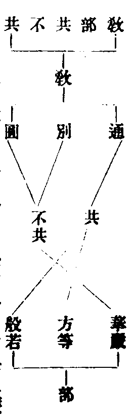



【■备】集注问答：问：般若既以但不但中法与二乘说，故部名共。云何约教唯通名共？答：约部则二酥时，二乘亦闻但不但中名共。华严聋哑名不共。约教则别圆菩萨法故不共，通则三乘同行故共。然约部名共，於教仍是不共。以虽闻而无心希取，故共犹不共也。又问：约部论共，虽通方等，既顺弹诃，得名共否？答：被弹而生耻慕，由闻共说之功，即被弹处，全成共说。虽共义稍疎，得名共部。



△三、约时判。



约时，则禺中时(第四时)。



【□注】禺中。说文云：日在巳曰禺中。



【■记】此约时也。统纪言：禺亦作隅，日影在中之边(隅故)。



△四、约味判。



约味则从生酥出熟酥，此从方等之后出摩诃般若(四熟酥味)。



【□注】约教，生熟二酥相生次第。约机，则二乘心渐通泰，自知萤火不及日光，敬伏之情倍更转熟，如从生酥转成熟酥也。



【■记】此约味以显教之相生次第，机之渐渐纯熟也，可以意知。



△五、准经判二：初、引经徵起二：初、引经。



信解品云：是时长者有疾，自知将死不久，语穷子言：我今多有金银珍宝，仓库盈溢，其中多少，所应取与。



【□注】长者，喻如来。世间长者具十德，如来具十号。



【■记】此约法华判也。长者十德文句言：一、姓贵。二、位高。三、大富。四、威猛。五、智深。六、年耆。七、行净。八、礼备。九、上叹。十、下归如来。十号者：一、佛从三世真如实际中生。二、功成道著，十号无极。三、法财万德，皆悉俱备。四、十力雄猛，降魔制外。五、一心三智，无不通达。六、早成正觉，久远若斯。七、三业随智，运动无失。八、具佛威仪，心大如海。九、十方种觉，所共称誉。十、七种方便，而来依止。



【■备】集注：十号，正如来十德，非授记莂之十号。



【□注】有疾者，法身无病，随机权示也。自知将死不久，文句六(二十九)云：有机则应为生，机尽应谢为死。今化机将毕，应谢非久也。多有金银，文句六(二十九)云：金即别教理，银即通教理。大品所明真谛，不出此二。而言多有者，理则非多，约种种门，亦得言多(文)。妙乐七(十九)云：大品有圆，何故但云不出通别？答：一者，但语通别，理已摄餘二。论能诠教，必须具四。今且从理，故云不出此二。二者，二乘至此，多成通别，亦且言之(文)。



【■记】多有者，如如之理，一亦不立，但约种种能诠之门，故所诠之理，亦不妨言多。如空非十八，约破十八法得名也。妙乐下，问中，以经有圆难，答有二意：一、约理意明。言通该藏，举别摄圆，教名分别，必当区分。无生先论生灭，无量后演无作，自渐至圆，必须具四，是则今文从理含摄也。二、就机意明。二乘修得，类有旧新。若从竖来之众，已经乳、酪、生酥、般若，直成别益；若横来机，未受弹诃，至此令得通益。虽说三教，今且从机得益边也。



【□注】珍宝者，文句六(二十九)云：劝学中明一切法门，皆是珍宝(文)。仓库盈溢等，文句六(二十九)云：仓是定门，即百八三昧。库是慧门，即十八空境也。通别两种定慧仓库，包藏一切禅定智慧，无所缺少，内充外溢，故云(盈溢)。



【■记】百八三昧十八空。大论法数广载辅行曰：破十八有，言十八空；对百八散，言百八定。此中通别定慧，配仓库可知。内充约体，外溢约用。



【□注】其中多少者，说於般若，则有广略二门。略则为少，广则为多。自行为取，化他为与(文)。



【■记】大品云：知色如相，知受、想、行、识，乃至知一切种智如相，如是能知一切法略广相。大论云：广者，从八万四千法聚已来，无量佛法；略者，乃至小品中一品，一品中一段。又略者，知诸法空、无相、无作、无生灭等；广者，诸法种种别相分别等也。



△二徵起



此领何义？



△二、答释所领。



答：明方等之后，次说般若。般若观慧，即是家业。空生身子，受勅转教，即是领知等也。



【□注】般若观慧妙玄十(十八)云：大品或说无常无我，或说於空，或说不生不灭，皆历色心，至一切种智，句句回转，明修行法(文)，即观慧义也。



【■补】回转者，如说无常等已，即云：当依无常无我修学。乃至说不生不灭已，即云：当依不生不灭修学。此能观法，色心至一切种智，即所观境。



【□注】家业，长者宅为大乘家，诸珍宝为不思议业。妙乐七(二十)云：前云付财，今云付业，财从所营，业即造作，皆是菩萨修德三因之作业也。名异义同，故得互举。



【■记】不思议业，指圆教一乘，具足不思议心、法、修德。三因者，经明了义，心王为正因。缘因者，十六王子覆讲闻法，今日解者是也。今日闻法作佛，名真子，为了因也。



【□注】空生身子：须菩提翻空生，解空第一。舍利弗翻身子，亦云鹙子，智慧第一。



【■记】须菩提初生，库藏悉空，故言空生。经明佛从忉利下阎浮提，须菩提念此大众，虽复殊特，皆归无常，即了法空。作是观时，即得道证。故佛言：观诸法空，是为见佛法身，得真供养。供养中最，故称解空第一。身子，取身端意。鹙子，舍利弗母。身端眼净，如鹙鹭连母。得名智慧第一者，在胎已，令母辨胜。舅八岁登座，十六国议论无双，七日中遍达佛法。故佛云：一切众生智，唯除佛世尊。欲比舍利弗，智慧及多闻，於十六分中，犹尚不及一。



【□注】受勅转教：受如来之勅命，转教菩萨，即加被说也。以空慧为入道之主，故加二人。辅行六上(十二)云：凡言加者，加於可加。须菩提空与般若空相应相似，是故佛加，令其说空。般若是智慧，故亦加身子，所以但加此二人也(文)。



【■记】非空不能荡相，非慧无以发明，故加二人。大论：问：佛不自说，况诸菩萨胜声闻，何故令声闻为诸菩萨说？答：众见佛身过须弥山，心皆惊怖，各念：云何从佛闻法？故命声闻为大众说。



【□注】领知。妙乐二(十八)云：被加为奉命，所说名领知。名说为领，无别领也(文)。此是熟酥益相，得此益已，义成别人。净名疏云：大品二乘，已有入假之义(文)。观音玄记上(十二)云：声闻转教，密破尘沙(文)。大品会法(八十一科，皆摩诃衍)不会人(而无希取一餐之意)。



【■记】大品会法，亦说知意。八十一科，谓色、心、五阴、十二入、十八界、四谛、十二因缘、十八空、六度、四智也。无希取者，信解品云：尔时穷子，即受教敕，领知众物，金银珍宝，及诸库藏，而无希取一飧之意。然其所止，犹在本处，下劣之心，亦本能舍也。



△三、总结。



已上三味，对华严顿教，总名为渐。



【□注】总结渐中三味。



南天竺沙门蒙润集注



清比丘性权彚补辅宏记



清三宝弟子钱六𠁼庵较订



天台嫡裔比丘谛闲编科参梓



△三、秘密教三：初、标名。



第三秘密教者。



【□注】隐密赴机，互不相知，故名秘密。释签一(二十三)云：不定与秘，并皆不出同听异闻，但互相知，互不相知，以辩两异(文)。



【■补】同听异闻者，净名云：佛以一音演说法，众生随类各得解，或有恐怖或欢喜，或生厌离或断疑。斯则神力不共法是也。但彼彼互相知者名不定，互不相知者名秘密，以辩两异耳。三界可怖，即世界悉檀；欢喜，即为人厌离；能治於恶，即对治断疑；见理，即第一义。



【□注】若不堪於显露入者，须秘密说。



【■备】谓如来说法时，机有不堪显露说者，於此是显，於彼是密，或彼此俱密，故须密说。以秘密应贴，互不相知论也。



【□注】今对前顿渐显露，即明秘密。若大本中先明不定，对前顿渐定教为次第也。此据说相，次第虽尔，秘密不定遍前四时，初无前后具足，应云秘密不定、显露不定，今皆略标。



【■记】今先秘密而后不定，大本先不定而后秘密，当知俱顺其便。下明秘密不定，除法华闻显，遍前四时，元无前后。



【□注】然秘密之名，起自龙树。如释签一(二十一)引大论释大品经：诸天子叹云：我见阎浮提，第二法轮转，今转似初转。问：初转少，今转多，云何以大喻小而言似耶？答：诸佛法轮有二种：一者、显，二者、密。初转，声闻见八万及一人，诸菩萨见无量阿僧祗人得二乘，无量阿僧祗人得无生忍，无量阿僧祗人发无上道心，行六波罗密，阿僧祗人得初地乃至十地，一生补处，坐道场，是名为密(文)。故知初见八万一人，属显露摄。秘密者，如次明之。



【■记】此明秘密之名所自。初二句直示起自龙树。夫龙树乃西天第十三祖圭峰，言豪贵家生，通四韦陀天地图谶，诵尽阎浮经论，自谓一切智人，欲谤佛经。大龙愍之，接入龙宫，一夏但诵七佛经目，方知佛法深妙。悟已还出，化国王、婆罗门、外道无数，造论数十部。此秘密名，出彼所造大论中也。诸菩萨见下，别释秘密。其中见得二乘，藏教人也。得无生忍，通教人也。发无上道心，别教十信也。行六波罗密，别之住、行、向也。得初地乃至十地之，别十地也。一生补处，别之等觉也。坐道场者，别之妙觉佛果也。



△二、解释。



如前四时中，如来三轮不思议故，或为此人说顿，或为彼人说渐，彼此互不相知，能令得益。



【□注】如前四时中，指秘密教，横在四时，别无部帙。三轮光明记一(三十)云：身业现化，名神通轮。口业说法，名正教轮。意业鉴机，名记心轮。三皆摧碾众生惑业，故名为轮。下地不测，亦名三密。



【■补】法数言：身名神通轮者，谓佛说法，先现神通，警动众生机情，令生正信也。口名正教轮者，谓佛说法，令众生翻邪归正，依教修行也。意名记心轮者，谓佛说法，先以意轮鉴知根器利钝，演说无谬也。车轮有摧碾之用，以譬如来三轮，摧碾众生烦恼、惑、业也。三密者，大论云：如来身、口、意三业，或现通，或说法，或思惟，皆非菩萨之所思议，故名三密。一、身密，谓如来处大会中，众见佛身，或黄金色，或银色，或杂宝色，或长丈六，或长一里，乃至现大神变，皆不可思议也。二、语密，谓佛说法时，或一里外闻佛音声，或十百千万里外闻佛音声；又一会中，或有闻说布施，有闻说持戒等，各各随身所闻，皆不可思议也。三、意密，谓佛常处寂光，凡思惟观察，皆不可思议也。三业皆非诸菩萨等之所思议，故言不测。



【□注】或为此人说顿等妙玄，先约顿渐三说相对，次约说默相对，各有三义，谓此座十方，多人一人，及俱三相对。



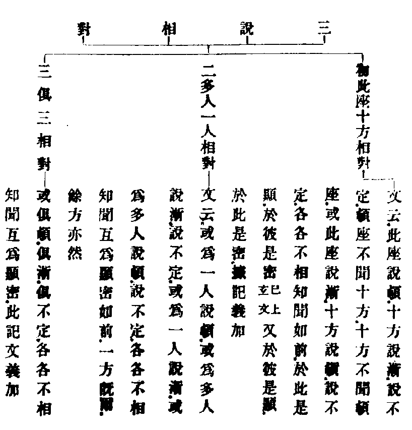



【■记】三中。云此记文义加者，即签文言既俱默俱说，互不相知，名之为密，何妨俱顿互不相知是也。



【■补】初文於彼是显二句，乃玉师据释签之义而加也。二中如前一方既尔，餘方亦然等文，亦玉师所加。三中记文义加者，乃签文所加。



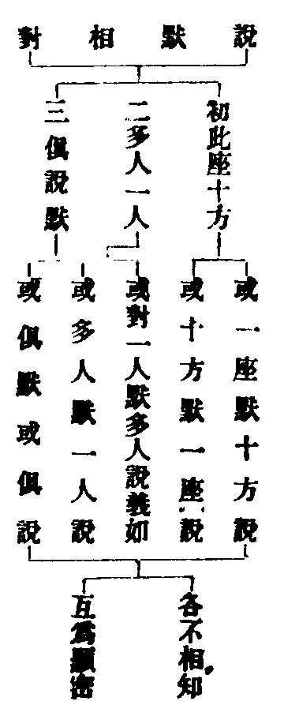



【■记】义加者，此说默相对图中。初二两对，玄文未出。释签曰：文略耳。既言俱默俱说，理合如前顿渐三法相对，故此图依义加补也。然妙玄下文曰：各各不相知，互为显密。虽复如此，未尽如来於法自在之力，但可智知，不可言辩。应知如来三轮不思议化，难以测度，今略判成秘密不定耳。



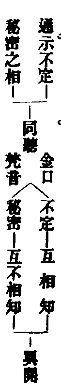



【□注】如释签云：不定与秘，并皆不出同听异闻，但有互相知互不相知，以辩两异。



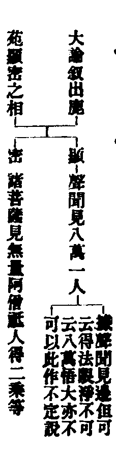



【■记】声闻见八万得法眼净，不见八万悟大。然在声闻，非不定教相，是显露摄。若对菩萨所见，则成秘密，如图示。



【■备】有师标曰：法眼净，乃十六心眼，智、明、觉、见、断、惑也。十六心解下，藏教。



【□注】此以般若对鹿苑说，即鹿苑中密说般若，义该三教，故云诸菩萨见等也。



【■备】此释图示，大论叙相。初句总判，即鹿苑。中下，别指密相。义该三教者，已记前文，可知。



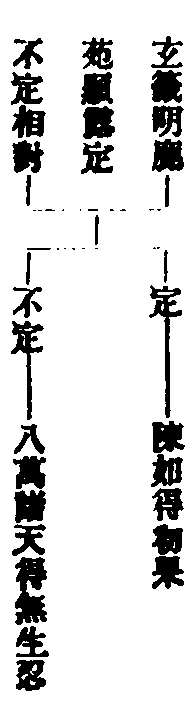



【□注】此约鹿苑闻小证大而说。如签云：酪中虽无二别，不妨以八万及一人以辩定不定也。



【■备】此判成，显露不定，非秘密也。作此判者，以下料简故。



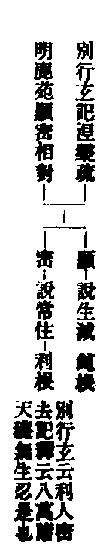



【□注】此以法华、涅槃对鹿苑说，即鹿苑中密说圆常，与法华、涅槃悟入是同。如别行玄记云：若八万诸天获无生忍，故云密去。又大疏云：利根人於三藏中，宜闻常住，即闻得解。如初转法轮时，八万诸天得无生忍，乃是密教意。据此，岂可谓同听生灭耶？



【■记】此判释图示显密相对。初一句总判，次二句指闻圆常。如别行下，指证利人密去。大疏下，指证八万得忍也。别行玄上云：三藏中二意：於利根密去，於钝根成酪。记释言：三藏但小，故无显露得大益者。若八万诸天获无生忍，故言密去。二乘方破见思，故但成酪。今但证释密教中利根密去也。又大疏曰：常住者，此非全是六度菩萨，应曰利根。於三藏中宜闻常住，闻即得解。如初转法轮时，八万诸天得无生忍。最下既然，例餘亦尔，乃密教意。大疏指涅槃疏。据此下，凖意反结。鹿苑密闻圆常，故云：岂可谓同听生灭耶？



【□注】问：鹿苑会上，只一八万诸天，何故诸文或定不定，显密有异耶？答：如来赴机难思，祖师释义非一。据诸天得法眼净，即显露定教，如云声闻见八万是也。据闻小证大，即显露不定教，如云八万诸天得无生忍是也。若曰密闻圆常，即秘密教，如云利人密去是也。经意多含，不可一准。然八万诸天，既是利根，密为正意，盖於三藏中，宜闻常住故也。



【■记】此节料拣诸文，说教定与不定之有异也。据诸天下之文，是释显露定教，指大论以证据。闻小证大下之文，是释显露不定教，文中举玄签为证。若曰密闻圆常下之文，是释秘密教，指别行玄记为证。



【■备】又签：问：何妨法华亦与诸教十方一席互为显密，而云法华是显非秘密耶？答：十方容有，一席定无。



【□注】且秘密教，何以得传？如妙乐一(十八)云：秘密不传，降佛已还，非所述故。尚非阿难能受，岂宏教者所量(文)？盖因后叙出，故可传耳。如妙乐云：阿难非不传秘，赴机之秘，非所传耳。故秘密所用，全是显教，是故传秘，祇名传显(文)。



此料简秘密也。初二句直问秘密得传所以。如妙乐下，举阿难以况人师不能传秘，所谓秘密非器不传也。盖下，直答可传之故。如妙乐云下，明阿难不传秘义，以赴机之秘，唯佛与佛乃能传耳。是故人师传秘者，但名传显也。



【■备】此秘密教，虽系如来化仪，然赴机之秘，惟佛与佛能之。降此如阿难，尚有未能，况后学耶？



△三、结名。



故言秘密教。



△四、不定教四：初、标名。



第四不定教者。



【□注】盖一类机，宿世於顿有渐种，於渐有顿种。故今闻小证大，闻大证小，推功归教，教名不定矣。如大经置毒发毒，大论八万诸天得无生忍等，皆不定义。



【■记】大经：佛言：善男子！譬如有人，置毒乳中，乃至醍醐，皆悉有毒。乳不名酪，酪不名乳，乃至醍醐，亦复如是。名字虽变，毒性不失，遍五味中，皆悉如是。若服醍醐，亦能杀人，实不置毒於醍醐中。妙玄谓：此譬两用：一、通约渐顿明不定，处处皆得见佛性也；二、约行明不定，行人心行譬乳，实相智譬毒，毒能殒命，智破无明。久远劫来，说实相毒，置於凡夫心乳，毒慧开发，不可为定。或初味发，或后味发，不得次第往判，故言置毒乳中，乃至醍醐，遍五味中，悉有杀义。



【□注】古师以金光明等别为一缘，名偏方不定教。今家不然，一时一说一念之中，备有不定。



【■记】此指古明今。如妙玄云：一时、一说、一念之中，备有不定。不同旧义，专判一部。故释签明南北诸师，通有渐顿不定。不定者，专指胜鬘及金光明。不同今家判义，味味皆有不定。



【■补】妙玄曰：南师以金光明、胜鬘、楞伽、殃掘之流，以别为一缘，为偏方不定教，以不定於顿，不定於渐故。偏方者，清凉疏谓：大体而言，渐中先小后大，说小时不妨说大。如十年宏律，不妨私室时说大乘，故曰偏方不定。胜鬘初云：波斯匿王与末利夫人信法未久。既言未久，明是初说。金光明既非第一顿教，又非第二渐中，末后明常住，明是不定是也。会玄云：偏方者，非正所说名。偏方者，法也，即偏法也。或偏者，傍也，说小时傍说大故。



△二、解释。



亦由前四味中，佛以一音演说法，众生随类各得解。此则如来不思议力，能令众生於渐说中得顿益，於顿说中得渐益。



【□注】一音者，通大小因果，当分跨节，显之与密，定与不定。今是不定一音，该乎大小，是果人所用。



【■记】此释一音而有五双。今是下，明是不定。一音大小者，谓小乘一音说四谛，五人闻人语，诸天闻天语。大乘佛以一妙音，遍满十方界，众音悉具足，法雨悉充满也。因果者，谓下地以一音，令他闻一法，约位即圆信。别地前佛以一妙音，随类各得解，即别地圆住。当分成今经相待义边，跨节成今经开权义边。



【■备】小乘一音，应指说小教时，佛但一音说法，各各领解不同。大乘一音，应指说大教时，佛但一音说法，各各领解不同也。因人一音，应指藏、通、别、圆四教诸菩萨等。果人一音，应指四教果头佛说。原记以圆信别地前为因人，以上为果人。或有所本，俟再攷定。当分者，说前四时教，依教领解是当分。妙玄云：跨节者，若开方便门，示真实相，即向身是圆常身，向法是圆常法，向理是真实理也。显密定不定下解，今是显露不定一音，故该乎大小，惟果人所用也。



【□注】於渐说中得顿益。妙玄云：虽说四谛生灭，而不妨不生不灭等。释签云：此指鹿苑虽施於渐，不起於顿。



【■记】此以鹿苑对华严，论不定也。妙玄下，正释。生灭即渐，不生灭即顿也。释签下，转释。谓如来不起华严之顿，而施鹿苑之渐，则鹿苑渐中，具有华严之顿。是故於昔有顿习者，今虽闻渐教，而能得顿益也。



【□注】於顿说中得渐益。妙玄云：虽高山顿说，不动寂场而游鹿苑。释签云：此指顿后渐初，不动於顿而施渐化。



【■记】此以华严对鹿苑，论不定也。妙玄下，正释。谓如来初成正觉，演大华严，如日初出，先照高山，是故高山为顿说也。既云不动寂场而游鹿苑，是为於顿说中得渐益也。释签下，转释。谓华严顿教之后，阿含渐教之初，乃是不动於顿而施渐化。其如众生不了渐中有顿，是故但於顿边得渐益也。



【□注】若方等、般若，虽为菩萨说佛境界，而有二乘智断。此二时中，俱有小果，新得旧得，如常所明。



【■记】此以方等、般若之说，大对鹿苑论不定也。谓为菩萨说佛境界，即垂顿教；而有二乘智断，即得渐益。寻常所明二时中小果者，谓新得，即方等中新受小者，及般若衍门傍得小者也。又有一类横来之众，未得通益，至是二时，名为旧得小果者是也。



【■备】横来之机，当是方等新得。被弹斥者，方等旧得也。衍门傍得，是般若新得。妙玄一云：虽三人俱学，二乘取证。此指般若旧得也。



【□注】虽五人证果，不妨八万诸天得无生忍。此重指渐，初对般若说。前文约法，此中约人。



【■备】此复以鹿苑初渐，对般若论不定也。前华严鹿苑对论，乃约顿、渐二法。此中鹿苑、方等、般若，同是渐教，故约人对辨也。



【■补】约法不定在教，约人不定在机。



【□注】当知即顿而渐，即渐而顿。



此劝知顿渐相即也。谓顿乃即渐之顿，渐乃即顿之渐，渐外无别顿，顿外无别渐。唯其即顿之渐故，所以令其於顿有渐种者，闻大得小益也。唯其即渐之顿故，所以令其於渐有顿种者，闻小得大益也。



△三、结名。



如是得益不同，故言不定教也。



此结不定教名也，可解。



△四、合明二教只是化法



然秘密、不定二教，教下义理，只是藏、通、别、圆。



【□注】上指四时为秘密不定之部，今明部中之教。故此二教，以藏等四教为当体体，真中二理为所依体。



【■记】此指上明。今如辅行云：顿等四教，是如来不思议力，布措藏等，盈缩调停，成熟物机，破邪立正，引小归大，废偏显圆，会权入实，故有诸部相生。是知秘密不定，以藏等四为当体体也。又藏等诠理，不出真中，故真中二理，为秘密不定所依之体也。



【□注】如妙乐一(十九)云：不定秘密，义各含四，显之与密，定与不定，相对论故。



【■记】此证释上义。顿渐二教，均显均定。秘密不定二教，一密一不定。既对顿渐而论，故各含藏等四教。



△二、结前生后二：初、结前四教齐文。



化仪四教齐此。



【□注】此以法华相待之意，判前四时不出顿等八教，意显法华超八教外，出四时表。



【■记】此释结教齐前四时也。盖相待论判，故判前四时，不出顿等八教。意显法华非顿、非渐、非秘密、非不定，无复兼但对带，超八教外，出四时表。乃五时极唱，最后极谈，纯圆独妙之教也。



【■备】超八教者，经曰：久默斯要，不务速说，直至四十餘年之后，非顿也。正直舍方便，但说无上道，无二亦无三，非渐也。九界咸开，无不成佛，非密也。今正是其时，决定说大乘，非不定也。既非化仪四教，即超化法四教，以开显圆，非隔历圆也。



【■备】辨讹曰：若言超八教外，则两种四教，有摄法不尽之难。然此亦对前四时而言超耳。开显之圆，不同前来隔偏之圆；会渐归顿，异前拟宜兼权之顿，故云超耳。虽超而即何摄法不尽之有？



【□注】故释签一(十六)：科玄文云：初明八教以辨昔，次约今经以显妙。



【■补】此证上判麤显妙。谓昔於四十年前所说之法，而以八教辨之，是麤。今即是法华既出教之外，显是绝待之妙也。八教者，签言：初五味，次不定，三秘密，即八教也。五味即顿、渐，渐中开四，并不定等二，即为八也。次明今经显妙者，如玄文言：今法华是显露，非秘密。是渐顿，谓开渐显顿也。非渐渐，谓非法华前渐中之渐也。是合非不合，合是会之别名，开显之圆，故云是合。不同诸部之圆，故云非不合也。是醍醐非四味，是定非不定，如此分别，故此经与众经异也。



【□注】若释签一(十七)云：秘密横被，无时不遍者，此约方等对前二时为言，老彼问辞自见。



【■记】此通释签秘密，无时不遍之文。



【■补】释签曰：问：华严、鹿苑，大小永隔，才说方等，同座并闻者，何耶？答：若以秘密横被，无时不遍；若约横论竖，则隐显在机。私谓：释签言秘密横被，无时不遍者，言通义别也。此但指三时中，不通第五。何以知然？考彼问辞，只约前三对说，意谓：岂前二时大小相隐，而有秘密？当知方等四教相对，亦有秘密，故言无时不遍。此约味味横论。若约此横以论三时之竖，前二味大小相隔，隐也；方等同闻，显也。此乃在机，非关教也。



【□注】又释签十(二十四)云：五味则一道竖进，味味有半满相成，复於味味皆有秘密及以不定(文)。盖约五味对半满以论相成，故玄文云：虽复俱游，行藏得所(俱游论相成，行藏论用舍)。



【□注】华严唯满不半，乃至法华废半，明满半有成满之功，非谓味味各有半满。又云味味皆有秘密不定者，此且据前四时为言，或显密相成，则以昔时秘密不定，成今法华，是显非秘密，是定非不定矣。



【■备】此通释签味味皆有秘密不定之文。今先通味味半满相成，以比知皆有秘密之文，不可泥解。盖乳等五味，自华严至法华，一道竖进。然此五味中，均有半满相成者，如玄此云：今明五味不离半满，半满不离五味。五味有半满，则有慧方便解；半满有五味，则有方便慧解。权实俱游，如鸟二翼，虽复俱游，行藏得所。若华严顿满，大乘家业，但明一实，唯满不半，於顿成乳。三藏客作，但是方便，唯半不满，於渐成酪。方等弹诃，半满相对，以满斥半，於渐成生酥。般若领教，带半论满，半为二乘，满为菩萨，於渐成熟酥。法华付财，废半明满，若无半字方便调熟钝根，则亦无满字开佛知见，於渐成醍醐。是则半有成满之功。所以如来殷勤称叹方便者，良以半有成满之功也。意在於此，非谓味味各有半满也。若泥定味味有半满之语，则华严唯满不半，及法华废半明满等，如何消通？故以味味半满，比知味味皆有秘密不定者，且据前四时置毒发毒，皆得会入醍醐而言。或约显密相成说者，则以昔四时之秘密不定，成今法华之是显非密，是定非不定，更了然显明矣。



【■记】俱游者，涅槃经曰：鸟有二种：一名迦邻提，二名鸳鸯。游止共俱，不相舍离，乃至选择高原，安处其子，然后随本安稳而游。如来亦复如是，化无量众生，令住正法，乃至所作办已，即便入於大般涅槃。



【■备】今以譬五味半满相成之意。行藏论用舍者，谓华严用满，鹿苑用半，乃至法华废半明满，如鸟之行藏也。



【□注】妙玄六(二十)引大论云：餘经非秘密，法华是秘密者。释签七(十三)云：非八教中之秘密，但是前所未说为秘，开已无外为密。



【■记】此释法华是秘密义。大论嘱累品云：般若非秘密法，法华说阿罗汉受决作佛，大菩萨能受持用，如大药师以毒为药。是文正明法华秘密，今何谓说法华是显非秘耶？释签下，明论说法华是密意。正所谓久默斯要，不务速说者，秘也。开昔所说，总成圆妙者，密也。是则上云法华非秘密者，谓非八教之秘密也。经经皆尔，岂可以龙树别意通害诸经乎？故法华是秘密非秘密，盖各有取义耳。



△二、生后四教俱非二：初、明法华开显非四教摄四：初、开显二：初、正明三：初、总明今昔二：初、开权显实。



次说法华，开前顿渐，会入非顿非渐，故言开难显实，又言废权立实，又言会三归一。



【■注】妙法难解，取喻莲华。莲华华果同时，妙法则权实一体。故有迹门三喻，本门三喻。



【■记】实相妙法譬莲华者，妙玄云：华有多种，例法有麤妙。狂华无果，喻外道空修梵行，无所剋获。一华多果，喻凡夫供养父母，报生梵天。多华一果，喻声闻种种苦行，止得涅槃。一华一果，喻缘觉一远离行，亦得涅槃。前果后华，喻须陀洹却后修道。前华后果，喻菩萨先藉缘修，生后真修。皆是麤华，不得为喻。莲华多奇，可譬妙法为莲故华。华实具足，可譬即实而权。华开莲现，可譬即权而实。华落莲成，莲成亦落，可譬非权非实。如是等种种义便，故以莲华喻妙法也。末二句示有本迹六喻，如下图示。此初，约部教也。



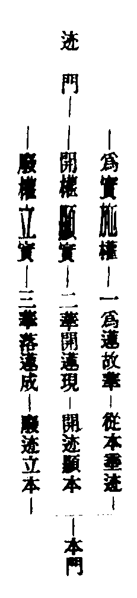



【■记】迹门为实施权者，经云知第一寂灭，以方便力故，虽示种种道，其实为佛乘是也。开权显实者，经言开方便门，示真实相是也。废权立实者，经言正直舍方便，但说无上道是也。本门从本垂迹者，经言我实成佛已来，久远若斯，但教化众生，作如是说，我少出家，得三菩提是也。开迹显本者，经言一切世间，皆谓今始得道，我实成佛已来，无量无边那由他劫是也。废迹立本者，经言诸佛如来，法皆如是，为度众生，皆实不虗是也。



【■补】天台分法华为本、迹二门：从序品至安乐行十四品，约迹门显实；从涌出品讫经十四品，约本门显实。以今一代化事为迹，久远最初成道为本。本如所依处，迹如所行路。



【■注】妙名一唱，待、绝俱时。故相待论判，出前三教四时之上；绝待论开，复能开前令皆圆妙。今文但云开者，盖上既云化仪四教齐此，则显法华出前四时，况复下文历部拣教，即是判也。然待、绝二妙，妙体无殊，约义而论，开为正意。



记。此释能开之妙。初二句总示待判绝开。今文下，明但开不判。然待下，释开为正意。言妙者，相待妙、绝待妙也。然相待时即绝待时，故曰俱时。此节释开前顿渐开字也。法华具相待论判、绝待论开二意，今但论开者，以开为正意。下文历部拣教即是判者，指华严时一权一实等文。待绝二妙，体本无殊者，玄文云：乳教中圆与今圆不殊，方等、般若中妙与今妙不殊。故顿部一妙则与法华无二无别。诸味圆教本自圆融，然而约义则有兼但对带之麤，必当开显令妙，故曰开为正意。



【■补】相待论判者，待前四时麤，显今一乘妙也。出三教四时上者，以昔诸经，兼但对带，不若法华纯圆也。绝待论开者，绝前诸麤，无可形待。以法华之妙，有绝麤之功，所以论开，妙外无麤，麤即是妙。如经言：决了声闻法，是诸经之王。指二乘所行，是菩萨道，更无餘乘，直显一实，故曰开前令妙等也。然此二妙，缺一不可。若非相待以判，则不显法华超过之说；若非绝待以开，则不知法华妙一切法。



【□注】凡论开权，有约部、约教、约界、约理等。今云顿渐者，乃约部通开。顿渐是权，属前四时。非顿非渐是实，即今法华。又三即是权，一即是实，故以开废会三，而结云故言开权显实等也。



【■记】此释所开部教。初一行，总示权实有四，谓约部、约教如次。约界者，开九界之广，显佛界之高，故云九界咸开，无不成佛。约理者，开生灭无生无量之机，显无作之实，故云开方便门，示真实相。今云下，正明开部。谓一顿、三渐皆权。法华不务速说，故非顿；但说无上道，故非渐。此即是实也。又三下，明开部中之教。谓藏、通、别既权，故当开之、废之、会之；圆教既实，亦当显之、立之，以归於一也。



【■备】辨讹引统纪载，集解曰：四时三教，咸为所开，不同华严聋哑，故非顿；不同三时次第，故非渐。今经开显，无不成佛，故曰会入非顿非渐。



【□注】开者，发也，拓也。昔不言三是方便，故方便门闭。今言三是方便，故方便门开。废者，舍之别名。开已俱实，无权可论，义当於废。约法乃开时即废，约喻必义须先开。若约理者，开废俱时，开时已废故也。



【■记】此释开废。



【■备】昔权隐实故闭，今於权见实，知是如来方便之力，於一佛乘，分别说三方便门开也。废则权即是实，二乘所行，是菩萨道，无权可论也。然约佛化法，既开於实，即座於权。约喻则华开莲现，义须先开。若约实理，理绝先后，即开即废也。



【□注】或谓今文开废会三，准彼玄签，第一对於四一，义虽无妨，但在彼不对，其文则重，在今但作结上开部，义似稍允。盖法华部开废会三，法应尔也。如下文云：总开会废，前四味麤。



【■备】此拣异解玄。签对四一者，玄序曰：荡化城之执教，废草庵之滞情，签判是教；开方便之权门，示真实之妙理，签判是理；会众善之小行，归广大之一乘，签判是行；上中下根皆与记莂，签判是人。盖以废会等三，合上中下根而对四一。然在彼不对，文似重说。今文无须对於四一，但作结上开部，义允常也。



【■记】下曰：来至法华总开废，会前四味麤，令成一乘妙，故作结上义为当。



【□注】旧於开权，有同体异体之辨。然约所开法体，及能开之妙，佛意边论，皆同体也。但所开机情，在昔执之为异，故不得不开。如释签云：法本自妙，麤由物情，但开其情，理自复本。又玄文云：开昔之异，显今之同。故开机情，的开异体也。



【■记】此辨同体异体。如释签云：有谓圆与三教，彼此历别。言开权者，开此三教之异体也。若今圆与昔圆，无二无别，是同体者，则不须开。此约教别与之意也。有谓不但开异体，亦开同体。此约部通夺之意也。然今论所开法体者，即前四味所谈藏、通、别之法也。能开之妙者，即今法华纯圆之妙法也。然佛意边皆同体者，经言：诸佛世尊，以无数方便，演说诸法，是法皆为一佛乘故。故同体也。但所开机情执为异者，如迦叶言：世尊往昔说法既久，我时在座，身体疲懈，但念空、无相、无作，於菩萨法，游戏神通，净佛国土，成就众生，心不喜乐。此执异之情须开也。下引释签玄文，证机情边论的开异体也。



【■备】翻译名义集法宝众名章中有同异体辨。



△二、权实名通。



言权实者，名通今昔，义意不同。



【□注】权谓权谋，暂用还废。实谓实录，究竟指归。昔有偏圆自他权实等义，今有为实施权开权显实等义，义不同也。在昔权实各趣，在今权皆趣实，意不同也。妙乐十(三十三)云：权实之语，非独今经，相即之言，出自於此(文)。



【■记】此释今昔权实义意不同。如志师云：前之三教，权实不即，大小相隔。法华权实不二，权即是实，实即是权。此义不同。昔经权实随顺机宜，悉檀逗会而已。今经为实施权，意在於实；开权显实，意在於权。此意不同也。妙乐云：诸经说权智者，权不即实，致令教法皆非自在，诸机不融，故教主别尔。诸经明实智者，是权外实，故破疑不遍。不及此经说施权意，已破诸惑，故言即实而权。况复今经本为显实，有疑皆断，故曰即权而实。所以权实非独今经，相即出自於此。



【■备】偏圆自他。谓偏圆相隔，自行化他等义也。



△二、列昔权实二：初、总指顿渐隔异。



谓法华已前，权实不同，大小相隔。



【□注】此下释出今易权实义意不同。文初约部通开，故以顿渐为权，法华为实。此拣昔日部中之教，有权有实。然在昔实妙权麤，在今开麤即妙，方显义意不同也。今且先明昔之权实，故曰谓法华已前权实不同等。



【■记】文初约部。故法华非顿非渐名一实，前四时顿渐部帙，通名为权。此则拣昔部中之教，有权有实，如华严一实兼一权等。然昔教权实麤妙，两分不同，今经麤即是妙也。今且下，先明昔之权实。为下，开显之本。



【□注】权实约偏圆，大小约半满亦可。权实约法，大小约人，在昔之时，皆有此义。



【■记】此释权实大小之义，而有二对也。一、理喻一对，谓偏小之理为权，圆满之理为实。半字喻小，满字喻大。二、人法一对，谓三乘教法为权，一乘教法为实。诸佛菩萨为大人，声闻缘觉为少人。又辅行释大小半满言，先须分别通途言之。谓大小者，或指衍中三教因人，或指藏教三乘之人。大中大者，或指三教果头人，或指圆教因位人，或唯指圆极果人。小中大者，或指三藏菩萨人，或唯指於佛果人。大小既然，半满亦尔。



【□注】然文意正明昔部权实，而复明大小者，须知权通偏教，而未的显。权中三藏小机，历前四时，与大相隔，直至法华，方得入圆。故论权实，复明大小。虽明大小，不出权实。如下(文)云重举前四时权，盖指此小机也。



【■记】此释复明大小之意。初二句推意牒文。须知下，劝辞。权通偏教者，谓通其藏、通、别之三教，既是如来权巧垂示，故可称偏也。权中三藏小机者，的指历前四时之钝根也。法华入圆者，舍利弗言今日乃知真是佛子，五百弟子言我今乃知实是菩萨等也。故於权实之外，复明大小，则义方周足矣。



△二、别列昔日麤妙二：初、明顿部二：初、隔异非本怀。



如华严时，一权一实(圆实别权)，各不相即，大不纳小故。小虽在座，如聋若哑。是故所说法门，虽广大圆满，摄机不尽，不畅如来出世本怀。



【□注】一权一实，释权实不同。大不纳小，释大小相隔。今此正当大隔於小，故小虽在座，如聋若哑。释签一(十一)云：华严大机，尚隔於别。小机被隐，一向不闻。是故但立顿大之名，不立一乘独妙之称。非佛本怀，良由於此。华严顿大，尚非本怀，况复鹿苑。故三藏教首，及以部内，麤尚未周，故妙号都绝。方等般若，比说可知(文)。



【■记】此明华严顿大之教，若对法华，尚隔於别。又以小不闻大，不立一乘独妙之称，故不畅佛本怀也。三藏为首者，三藏为四教首，乃浅中之浅，岂可称妙？及以鹿苑会上，部内所诠，即通之麤，尚且未周，况圆教之妙？故妙号都绝。都绝者，对不绝而言。以乳及二酥，若约部通夺，则非本怀；如约教别与，亦容有妙，故未都绝也。



△二、麤法须开显。



所以者何？初顿部有一麤(别教)，一妙(圆教)，一妙则与法华无二无别。若是一麤，须待法华开会废了，方始称妙。



【□注】所以者何？此徵起，释出不畅本怀之意，皆由在昔不能开麤显妙故。此以下，历部拣教，明判，明开。



记：此徵释意，谓初顿部等文明判，须待法华等文明开。



【□注】初顿部等，於此别明顿中麤教，须待开会者，以时人谓华严胜故也。



【■记】此判华严一麤。时人指宏贤首宗法师。华严钞云：法华疏叹身子三请云：餘经无此殷勤之请，唯华严解脱月菩萨请金刚藏，可为连类。而彼因人请於因法，此请佛慧，故亦不同。今番法华劣於华严，谓彼是一家请，此是三家请；彼是声闻请，此是菩萨请；彼唯三请，此有五请；彼唯因人请，此有佛请，便谓华严胜於法华。故释签云：自古弘经诸师，不晓佛意，见华严事广文长，菩萨致请，谓华严加胜法华。近代已来，读山门教者，仍有此说。人师但以请主胜劣相形，不曰法华观智胜此。而近代匠者，以教体谓胜法华，岂非悮耶？是故今文判后，遂开其一麤，以显法华独妙绝圆也。



【■备】此指古师华严钞，非清凉师之疏钞也。辨讹曰：此是观师破的之论。荆溪云：佛说华严，一不摄小机，二不开权，三不发迹，故未畅本怀。清凉从荆溪习学，故解华严时，全将法华开显圆意会入。如玄谈以教起因缘为初，即言如来为一大事因缘，出现於世，欲令众生开示悟入佛之知见。释妙严品初始成正觉，即将法华久成之意点入，处处将开显圆会入，始末皆然。假若法华不来此土，则释此经者，全昧开显，何能转麤成妙乎？私谓华严经文，亦微逗一二语发迹，但不若法华明显全彰，故荆溪判为未发迹也。清凉大师既知开显疏华严，理合如斯，来哲但当以精研教观为务也。



△二、判三渐



次鹿苑，但麤无妙(藏教)。次方等，三麤(通藏别)一妙(圆教)。次般若，二麤(通别)一妙(圆教)。



【□注】此约相待，判前部中麤妙也。



此断文判前三渐可知。



△三、今经独妙二：初、开昔部二：初、开偏麤成妙。



来至法华会上，总开会，废前四味麤，令成一乘妙。



【□注】此开前四味重中三教之麤，成今一乘妙也。且昔部中三教权人，来至法华，一向须开。若三教权果，本是圆果，岂可更开，令成圆佛。若对机之权，亦不妨论开，如云开丈六垢衣等也。



【■记】初一行，明开麤教成妙。统纪云：开前四味麤，会前四味麤，废前四味麤，故冠一总字，曰开、会、废也。前四时两教、二乘三教、菩萨人教，理行差别之麤，至今法华咸皆微妙，故云成一乘妙也。且昔部中下，明开麤人成妙。言三教权人一向须开者，以其所禀麤教既开，故其能禀麤人亦当开也。盖由依麤教修行作能，造至三百、四百由旬而已，终未能至宝所故，所以一向须开也。三教权果不开者，妙玄云：何处别有四教主，各各身各各口说也？当知只隐其无量庄严之身，现为文六身耳。若开方便门，示真实相，即向身是圆常身也。



【■补】对机之权论开，如云开垢衣等者，妙玄云：体化他之权实，即自行之权实，如垢衣内身，实是长者。体自行化他之权实，即自行之论，如一切治生产业，皆与实相不相违背，一色一香，无非中道，况自行之实而非实耶？



△二、开昔圆成妙二：初、本融故妙。



诸味圆教，更不须开，本自圆融，不待开也。



【□注】且昔部中三教既开，昔部中圆还须开否，故下即云诸味圆等也。以今圆昔圆二圆不别，此约教别与也。



【■补】此明昔圆本妙。初一行，举偏问圆。次故下，答。末三句，断释昔圆本妙不开。统纪云：在昔圆顿，不须更开者，华严心、佛、众生，三无差别；大集染、净，一切融通；净名不思议，毛孔含纳，思益网明，无非法界；般若诸法，混同无二。此等圆理，与法华佛之知见，无二无别，岂可更开耶？



【□注】若妙乐云：圆人初心，须闻开显诸法实相者。盖昔圆人，义有两向，名字初心，谓圆隔偏。闻佛开权，隔偏情泯，非开圆体也。若观行去，已入实者，但论增进。如经拣众云：除诸菩萨众，信力坚固者是也(信力五品，坚固十信)。



【■记】此释圆人初心，须闻开显之文。两向，谓昔圆隔偏，今圆不隔故。名字，即人由闻开权，隔偏情泯。如经下，引证。信力菩萨，即观行位，已圆伏五住。坚固菩萨，即十信位，已破见思尘沙故。此但论增进也。



【□注】又妙乐云：今经是圆，复须开显者，盖显法华中圆，非但出前四时，复须开显诸教也。



【■记】此引释法华是圆，复须开显之文。谓法华纯圆独妙，非但逈出四时，又能开显顿渐诸教，今成圆妙。



△二、唯今称妙。



但是部内兼但对带，故不及法华纯一无杂。



【□注】正判。昔部属麤，除鹿苑外，虽皆有圆，以兼等故，不得称妙。麤人细人，二俱犯过，此约部通夺也。



【■记】此释成昔圆部麤。谓华严兼一麤，方等对三麤，般若带二麤。是故昔圆犹可思议，不得称之为妙。故其麤人有隔细过，不及纯圆独妙也。



【■备】补遗曰：麤人细人，此句出大论，麤人则麤罪，细人则细罪，今借以比用。



【■补】所兼之麤固有过，即能兼之妙，不能令麤成妙亦有过。



【□注】释签一(十)云：始自华严，终至般若，虽名不同，但为次第三谛所摄。今经会实，方曰圆融(文)。



【■记】此证释昔麤今妙。次第三谛者，真谛扫荡，俗谛建立，中谛双遮，非真非俗，次第造修。三谛不紊昔时部帙，为其所麤也。圆融三谛者，真、俗、中三，同时相即，不前不后，绝思绝议。今经开会一切诸法，故云方曰圆融。



【□注】是故文初约部通开，须云开前顿渐等也。



此结申文开权之意。



△二、显今部二：初、能开得名。



独得妙名，良有以也。



【□注】如上相待论判，绝待论开，约教别与，约部通夺，翻覆抑扬，方显法华出诸教上，部圆教圆，妙绝群经，出世本怀，於此畅矣。故即引经四一为证。



【■记】此承上文顿部一麤一妙等相，待论判也。来至法华，总开成妙，绝待开论也。别与通夺，见上。



【■备】辨讹曰：相待为翻，绝待为覆，别与为扬，通夺为抑。



△二、引证纯一。



故文云：十方佛土中，唯有一乘法，无二亦无三(教一)；正直舍方便，但说无上道(行一)；但为菩萨，不为小乘(人一)；世间相常住(理一)。



【□注】以纯一故，独得妙名，故引一以显妙，盖一即妙也。



【■记】辅行言四一，名出光宅。今家和旧，亦作四一。旧言果一，今曰理一，若无理印，则同魔说。旧言因一，今言行一，因语则单，行通因果。人教二一，与旧不殊。



【□注】十方佛土等，据其同者而言，亦约佛意也。一乘法者，部圆教圆故。无二亦无三者，约数则无通教半满相对之二，无三藏之三乘，无有餘乘，即无别教及圆入别也。约部则无般若所带之二，无方等所对之三。方等之藏，则摄鹿苑。二酥之别，则该华严。唯一佛乘，故云教一。



【■记】此释教。一、十方佛土有二意：一、据其同者而言，谓虗空无边，世界诸佛国土，亦复无边。其中化导，各随机宜。或以一乘而被下，或以三乘而应诸。今云十方佛土，据其同演一乘法者言也。二、约佛意，谓诸佛本意，唯以一乘佛道，王於所化之土也。无二无三有二释：一、约教通，教通前藏教之半，通后别圆之满。今经独妙，绝诸对待，故无半满相对之二也。今经但为教大菩萨，故无声闻弟子，无三藏之乘也。别教但为积行菩萨，及一类圆机入别，历劫修行，次第行布法门。今经圆修圆证，故无别教及圆入别之餘乘也。二、约部，今经非对非带，故无方等所对之三，般若所带之二也。又方等之藏摄三藏，二酥之别摄华严，可解。



【■备】辨讹曰：据其同者句，似更有不同者矣。私谓佛意则无不同，今论机边集注，特加此语，如古然灯，尚不说法也。辨讹又曰：一乘法，应释言纵有施权，无不显实，故言唯有一乘耳。无有餘乘，准经偈中，无无有餘乘，而疏长出者，乃反文以释唯有一乘句，补出别教。长出，应指长行。



【□注】正直舍方便，但说无上道者。文句五(五)曰：五乘是曲而非直，通别偏傍而非正。今皆舍彼偏曲，但说正直一道也。(文)疏据说边属教一，今据道名能通，故属行一。



【■记】此释行一。谓五乘是如来曲巧随宜之说，而非正直之谈。又令二乘断烦恼而证菩提，离生死而得涅槃，皆是曲而非直矣。通别偏傍等者，谓通教旁为二乘，别教偏为菩萨，故云偏傍而非正。今经舍彼通别之偏，五乘之曲，但说纯圆正直一道，即无作之妙行也。或谓疏释此文为教一，今何言行一？故云疏据说边属教一，以圣人言说名教故。今从道有能通义，故属行一，以行趋进，与道能通，其义同也。



【□注】但为菩萨者，约佛意，但为菩萨；据昔方便，谓教化三乘。今此同一菩萨人，故云人一。



【■记】此释人一。谓约佛实意，虽复说三乘，但为化菩萨。然据昔日，以权巧方便，说谛缘度法，化上中下人也。然而在昔可有三乘人别，在今同一菩萨因人也。



【□注】世间相常住者，十界依正隔历差别之相，名世间相，以即理故，皆常住也。若乃情见生灭迁流，廓尔情忘，诸相常住，常既即性，非常无常，言偏意圆，斯之谓矣。学者於此，宜解会焉。



【■记】此释理一。谓若四圣，若六凡，若国土之依，若众生之正，彼彼殊形异状，名世间相似即理，故相皆常住。是则鸟鸣花笑，风动尘飞，法法亘古亘今，头头无迁无变，所谓有佛无佛，性相常住也。然道眼观之乃尔，若乃情见分别生灭，则国土成住坏空，众生生老病死，皆由妄惑，故有迁流。故云：一翳在目，空华乱坠也。若能即解即行，返闻自性，一旦廓尔情忘，诸相常住者。



【■备】谓根不逐境，境不牵心，根尘脱粘，分别不起，旋转妄流，复归真性。性既寂然，相亦常住，刹刹尘尘，法住法位。而於法住法位中，无相即相，相即无相，非相非不相，非住非不住，言思路绝，遮照同时，方证诸相真常住。理当於灵光独耀，迥脱根尘绝后，再苏时证之，忽自契悟，非思量分别所能解也。此与宗门悟境相同。故古云：但尽凡情，别无圣解也。若法华文句，则以佛生皆以如为位，皆以如为相。故世间相常住记中，则以清浊波与湿性不异。同以湿性为波，故皆以如为相；同以波为湿性，故皆以如为位释之。



【■记】夫常无常，是两头语。而此中道理性常住之常，不在两头，乃非常非无常双遮之中道也。若以言论，言有则失无，论此则遗彼。若以意会，举边则摄中，思内则该外。故知言偏而意圆也。总之，言求则头头错过，智会则法法露呈。故宜忘情泯解，冥会之可耳。末二句，劝解可解。



【■补】会义：有三种世间：一、正觉世间，二、众生世间，三、器世间。此三当体是理，理性本无生灭，故一一无非常住，一一无非法位。但众生迷暗，不能觉知，於常住中妄见生灭，於真如中妄见迁流，故世间相虽常住而不知也。唯我大觉世尊，坐於道场，如实知已，於不可说离诸戏论寂灭理性，能以方便说此理一。既三世间相皆常住，故理是一也。问：悟此理性，名为正觉世间，以顺性故，性相俱常可也。迷此理性，而为众生世间，既迷性故，性虽本常，相未必常，云何众生器世间相亦常住耶？答：若冰与水，同以湿为性，湿常氷亦常。复如醉见屋转，屋本不转故也。一切众生，但有理常：闻而能解，为名字常；念念体察无间，名观行常；麤垢先落，六根清净，为相似常；豁然开悟，证四十一位真因，为分证常；圆满显发，无欠无餘，为究竟常。



【■备】辨讹引管标曰：诸法以如为体，达此如体，三际不隔，十方无碍，双离八倒，即性真常。言偏意圆者，谓意出於常无常之外，又举一常，则该乐戎净，故意圆也。



△二、斥非



时人未得法华妙旨，但见部内有三车、穷子、化城等譬，乃谓不及餘经。盖不知重举前四时权，独显大车但付家业，唯至宝所，故致诽谤之咎也。



【□注】当代宏教之人，未解法华开权绝待微妙旨趣，但见经中有三车等喻，乃谓不及华严等经。盖不知三车等喻，乃重举昔日之权，意在指权即实，故举三车显大车。穷子付家业，化城至宝所，不知此意，故有谤法之愆也。



【■记】此总释当代弘教之人。三车乃昔日之权，意在今经，开之即实。故重举三车，穷子化城，以显今是大车，今付家业，今至宝所也。



【■备】辨讹曰：三车等，等字指七喻，出法华论。凡喻必约权实，明施开等，以显一化，方在其数。有云九喻者，非。



【□注】三车，羊车譬声闻乘，鹿车譬缘觉乘，水牛车譬菩萨乘，即鹿苑三乘也。



【■记】此明三车譬法。如经云：若有众生，从佛世尊，闻法信受，殷勤精进，欲速出三界，自求涅槃，是名声闻乘。如彼诸子，为求羊车，出於火宅。若有众生，从佛世尊，闻法信受，殷勤精进，求自然慧，乐独善寂，深知诸法因缘，是名辟支佛乘。如彼诸子，为求鹿车，出於火宅。若有众生，从佛世尊，闻法信受，殷勤精进，求一切智、佛智、自然智、无师智、如来知见、力、无所畏，悯念安乐无量众生，利益天人，度脱一切，是名大乘。菩萨求此乘故，名为摩诃萨。如彼诸子，为求牛车，出於火宅。



【■备】自然慧。文句云：从十二因缘门入，此门本有，非佛天人所作，名自然慧。如覩花开落而悟道也。科注云：声闻不能化他，如羊不顾后群。别行疏云：支佛譬鹿，犹有回顾之意。百松讲录云：一切智者，即内外法无不晓了。此是因中所修佛智，是果上所剋之智，即三藏果头所得自然智，是后施化所起之智。以其能因机说教，机教称适，故无师智。以小乘所明，但得一佛化世，更无有能为佛之师者。十六智，见十力、四无所畏法数内广明。讲录又云：譬牛者，牛有久久运重之力，皆化他之功也。



【□注】化城，文句七(十八)云：以神力故，无而欻有，名之为化。防非御敌，名之为城。(文)譬真谛涅槃，能防见思也。



【■记】此明化城譬法。如经云：如彼导师，为止息故，化作大城。是为无而忽有名化也。净名疏云：佛法如城，能为行人防非御敌也。真谛涅槃者，非第一义谛大涅槃。以大涅槃非化作故，不专御敌，理性即故，具众德故。且此真谛涅槃，但离虗妄见思，名为解脱。其实未得究竟解脱，故以化城譬之也。然此化城一喻，乃为定性人说。论言：实无为有。增上慢人，以世间有漏三昧三摩拔提，实无涅槃，而生涅槃想。如是颠倒，取对治此，故为说化城喻也。见思解四卷。



【□注】宝所，譬寂光大经中名宝渚。



【■记】此明宝所譬法。盖寂光乃诸佛所依真净土故，故以五百由旬宝所譬之也。宝渚者，即德王品明第七功德中，指四法作涅槃因：一、亲近善友，二、专心听法，三、系念思惟，四、如法修行。释第二专心听法中云：譬如估客，欲至宝渚，不知道路。有人示之，其人随语，得至宝渚，多获珍宝。一切众生，亦复如是。欲知善处，采取道宝，不知途中通塞之处。菩萨示之，众生随已，得至善处，获得无上大涅槃宝。以是义故，听法因缘，则得近於大般涅槃宝所。宝渚，梵音楚夏耳。



【□注】前四时权，且三车等，指昔三藏三乘而云。重举前四时权者，须知三周开显，藏圆相对，虽正开小机，然举昔之权，则该四时。又此小机，历前四时，名四时权也。妙乐五(十三)云：立一开权之言，於今乃成二意：一者腾昔施权，二为显实之所。不指所开，无由说实。况指权是权，知非究竟。既显实已，权全是实(文)。



【■记】此释重举前时之言。初一行，牒妨。谓前四时，通名为权。且经中三车等譬，乃指昔日三藏之三乘，而今文云重举前四时权者，何也？须知下，释明。如来法华会上，以法说、喻说、因缘说，三周开显，皆以藏乘圆教相对。括经大意，虽正开小机，然举昔日之权，则能该於四时，此约教释也。又三藏机，今来法华已历前之四时，故三车等譬，而仪文谓是重举前四时权，此就机释也。妙乐下，引证。一、腾昔施权者，腾以发挥为义，谓发挥施权之意也。二、显实之所者，谓法华显实，即显昔权是实也。不指所开，无由说实者，法华方便，是体内之权。夫欲说实，只在开权，故身子三请，如来三止，末后乃曰：诸佛随宜说法，意趣难解，如我以无数方便，种种因缘，譬喻言辞，而为说法。是法非思量分别之所能解，唯有诸佛乃能知之。乃至云诸佛如来，但教化菩萨，诸有所作，常为一事，唯以佛之知见，示悟众生是也。况指权是权，知非究竟者，舍利弗言尔时心自谓，得至於灭度，而今乃自觉，非是实灭度是也。既显实已，权全是实者，舍利弗言佛以种种缘，譬喻巧言说，其心安如海，我闻疑网断是也。



【■备】今注三乘历前四时一卷，则曰菩萨转衍。当知与夺之意，皆可通也。



【□注】诽谤。释签十(三)云：当知法华约部，则尚破华严。般若约教，则尚破别教后心(文)。人不见之，故致诽谤。



【■记】此释诽谤。谓以部言之，法华是纯一无杂，故破华严般若，谓之兼带。以教言之，法华独得妙名，故破别教后心，谓是真因。末二句结迷致谤，谓法华不及华严等经也。



【■备】天溪集注问答：问：别地证道同圆，云何尚破别教后心？答：此与别教地上地前，约教约行，二种教证，绝不相涉。的指别教妙觉，是圆教二行，废彼之高，就此之下，故谓之破。



△二、约时显妙。



约时，则日轮当午，罄无侧影(第五时)。



【□注】十界咸开，无不成佛，如日方中，无处不南。



【■记】此约时也。开九界即佛界，皆以如来灭度而灭度之，如日方中叡法师语。



【■备】辨讹引中云：只应开九界，今曰十界者，对机之权，亦须开耳。辨讹又云：如别教妙觉，只是圆家真因，是故佛界亦须开耳。



【□注】周礼用一尺五寸土圭，立八尺之表，夏至午时以测日影，求地之中以建国。



【■记】周公欲求地中以营王城，故以土圭测影，得颕川阳城，於是建都。郑康成曰：土圭长尺有五寸，夏至日立八尺之表，其影适正，与土圭等，谓之地中。



【□注】宋严、观二师，与太史何承天，用此法测日影，以定中国。表北得影一尺五寸，与土圭等。地上餘阴一寸，天上万里，则知天竺方为地中。今云罄无测影，据天竺说。



【■记】梁传云：东海何承天，以博物著名。乃问慧严曰：佛国用何历？严曰：天竺夏至日，日正中时，竖晷无影，所谓天中。於五行土德，色尚黄，数尚五，八寸为尺，十两当此土十二两，建辰之月为岁首。及讨核分至，推校薄蚀，顾步光景，其法甚详。宿度年纪，咸有条例。承天无所措难。后婆利国人来，果同严说。於是用法测影，以定中国也。郑司农言：凡日影於地，千里而差一寸。当知阳城，盖就此土自为中耳。既有表影，岂非餘阴耶？况此土东垂大海，边义彰矣。成光子曰：中天竺东至震旦，五万八千里。南至金地国，西至阿拘遮国，北至小香山、阿耨达，亦各五万八千里。则知彼为中国矣。故竺法兰对汉明帝言：迦毗罗卫者，大千之中也。慧严、慧观，禀学什公，见僧史。



【■备】辨讹曰：翻译集引郑司农言千里差一寸，签言万里，皆悮。又此约南北论里数，不约东西论。



△三、约味显妙。



约味，则从熟酥出醍醐，此从摩诃般若出法华(五醍醐味)。



【□注】释签一(十九)：问：彼经自以醍醐譬於涅槃，今何得以譬於法华？答：一家义意，谓二部同味，然涅槃尚劣。何者？法华开权，如破大阵，餘机至彼，如残党不难，故以法华为大收，涅槃为捃拾。若不尔者，涅槃不应遥指八千声闻，於法华中得授记莂，见如来性，如秋收冬藏，更无所作(文)。



【■记】此约味料简。法华，譬醍醐也。涅槃如来性品云：是经出世，如彼果实，多所利益，安乐一切，能令众生，见於佛性。如法华中，八千声闻，得受记莂，成大果实。如秋收冬藏，更无所作。以是证知法华为大收也。更无所作者，如云：约理无所作，究竟理也。约教无所作，闻此教已，更不他闻也。约行无所作，修此行已，更不改辙。如是等种种无所作义，略而言之，随智妙悟，得见经体也。



【□注】然彼经本无出法华之语，今约义说，故但云此从摩诃般若出法华。



【■记】盖般若领知家业，法华付与家业，其义顺次，故言从摩诃般若出法华也。



△四、引证二：初、引经证释。



信解品云：聚会亲族，即自宣言：此实我子，我实其父，吾今所有，皆是子有。付与家业，穷子欢喜，得未曾有。



【□注】文句六(三十一)云：十方法身菩萨，影响者为亲族。影响之众，多是释迦昔日同业，并共如来於二万亿佛所，共开化之。於其即是伯叔之行，故用此为亲族(文)。



【■记】此准法华判也。亲族有五等：一、亲族，即十方法身菩萨，影响是释迦伯叔之行；二、国王，即部中尊权为王，教即部内教主为王；三、大臣，即等觉；四、刹利，即登地；五、居士，即三十心。今是初一等亲族，即弥勒等诸大菩萨为亲族，不同旧人以分身诸佛为亲族也。



【□注】此实我子，我实其父。结会父子文句六(三十一)云：实从我受学，实是我子。从我起解，是我所生。我实曾於二万亿佛所常教大法，故我实是父(文)。



【■记】经言：尔时佛告舍利弗：吾今於天、人、沙门、婆罗门等大众中，说我昔曾於二万亿佛所，为无上道故，常教化汝。汝亦长夜随我受学。我以方便引导汝故，生我法中。是则二万亿佛，即六十小劫中，所值二万亿日月灯明佛也。常教大法者，即以佛说大乘经，名妙法莲华教菩萨法是也。



【□注】吾今所有，皆是子有，正付家业。文句六(三一十)云：一切大乘，万德万行，故云所有(文)。又如来藏，子性不殊，故云皆是子有。当知如来所有，即子本有。



【■备】所有即子有者，佛所有不出万行万德，而如来藏生佛不殊，故即子有。既子皆本有，在如来即是付与家业，在穷子即是欢喜得未曾有也。



【■补】万行万德者，妙乐云：所付般若，有共不共，不出因果，因为万行，果为万德。又子有者，如来修中所显，即众生性中本具也。



△二徵领所以。



此领何义？答：即般若之后，次说法华，先已领知库藏诸物，临命终时，直付家业而已。譬前转教，皆知法门，说法华时，开示悟入佛之知见，授记作佛而已。



【□注】临命终时，灵山唱入涅槃时也。



【■记】此释临命终时。谓如来出世本怀，普令众生作佛。今此经授三根记，是为付法王家业。故将付家业，而先唱灭也。如经云：如来不久当入涅槃，佛欲以此妙法华经，付嘱有在，如人付家业而终也。



【□注】譬前转教皆知法门。文句六(三十一)云：追指昔日大品领教所委，有广略般若共不共法，是汝所知，即汝所有。故法华但明佛之知见，更不广说一切行相也(文)。



【■记】此释前譬。转教皆知法门，谓多说为广，少说为略。但不但中是不共法，与二乘说名共法。昔为所知，今为所有。是故法华更不重勅领知，直明开示悟入佛知见也。



【□注】开示悟入文句四(十三)：约四意消之：一、约四位(住、行、向、地)。二、约四智(道慧、道种慧、一切智、一切种智)，即上圆位能契之智也。三、约四门。四、约观心。妙乐五(四)云：约智约似，唯圣方开。约观约门，乃通名字。不妨高位，不弃众生(文)。又二纸云：若作餘释，为令之说，徒施佛之知见安在(文)。



【■记】此释开示悟入。谓法华论明证不退地，今作四位释；论知如来能证实，今作四智释；论明不知究竟处，今约四门释；论明同义，今作观心释。此判明四意也。妙乐解言：不退，即开示悟入，皆念不退，佛所证得。为智释者，论言：除一切智，更无餘事。以同义释观者，即论言：二乘法身平等，更无差别，若无观心，云何知同？以不知究竟处者，处是所通，二乘不知，今为令知，知即是门，门为能通，故作四门释。又文句云：开者，即是十住破无明，开如来藏，见实相理。示者，惑障既除，知见体显，法界众德，显示分明。悟者，障除体显，法界分明，事理融通，更无二趣。入者，事理既融，自在无碍，流注任运，从阿到荼，入萨婆若。此约四位释也。一、道慧，见道实性，实性中得开佛知见也。二、道种慧，知十法界诸道种差别解惑之相，一一皆示佛之知见也。三、一切智，知一切法一相寂灭，寂灭即悟佛知见也。四、一切种智，知一切法一相寂灭相，种种行类，无不皆知，入佛知见也。此约四智释也。一、空门，一空一切空，即开佛知见也。二、有门，一有一切有，即示佛知见也。三、亦有亦空门，一切亦空亦有，即悟佛知见也。四、非空非有门，一切非空非有，即入佛知见也。能通则四，所通则一。开示悟入是能通门，所知所见是所通理。此约四门释也。观於心性三谛之理不可思议，此观明净名开。虽不可思议，能分别空假中心，宛然不滥，名示空假中心。即三而一，即一而三，名悟空假中心。非空假中而齐照空假中，名人。是为一心三观分开示悟入之殊也。妙乐下。判释四意。谓十住已上方能开示悟入佛之知见，是故约圣位圣智而释。名字位人亦得依门修观，当能开佛知见，故约四门观心而释。如此则佛知佛见，上不妨於高位，下不弃於众生。若作餘释者，妙乐云：知见佛境，若作餘释，为令之说徒施，佛之知见安在？故一家释义，依经顺论，契行得理。若深张地位，凡夫非冀，何益凡小者耶？为令徒施者，谓经中为令众生开示悟入之言无用也。餘释文句会本卷十广明，须者往检。



【□注】佛之知见。佛知即一切种智，具足三智。佛见即佛眼，具足五眼。亦名真实知见。若通途被开，其不在座，展转为说。或在界外，亦得闻之。或佛灭后，敦逼令信。乃至久远，四恶麤智，人天世智，若不开之，则佛之知见，永埋四趣，长没人天。若别开者，则在座得益，当机妙悟，得受记者。



【■记】此释佛知见体。谓三智，即一切智知空，道种智知俗，一切种智知中。此三智具足三观，一心之妙知，故曰佛知。五眼：一、肉眼，见近不见远，见前不见后，见昼不见夜等，因有色质障碍也。二、天眼，修禅定而得远近、前后、内外、昼夜、上下皆见，以无色质障碍也。三、慧眼，观一切法空。四、法眼，观一切诸法，能知能行，谓因行是法，得证是道，亦知众生种种方便门，令修证也。五、佛眼，具前四眼之用，无不见知，以其如实知见，亦名真实知见也。若通途下，明通开。授记品言：餘诸声闻众，亦当复如是，其不在此会，汝当为宣说。嘱累品佛言：於未来世，若有善男子、善女人，信如来智慧者，当为演说此法华经，使得闻知，为令其人得佛慧故。若有众生不信受者，当於如来餘深法中，示教利喜。又如常不轻远见四众，故往礼拜赞言：我不敢轻於汝等，汝等皆当作佛。乃至受人打掷，犹高声唱言：我不敢轻於汝等，汝等皆当作佛。此敦逼令信也。所以通开者，不欲佛知见永埋四趣，长没人天也。若别下，别开。在座得益者，即法华会蒙益者皆是也。当机妙悟者，即身子等於昔三乘之权，悟今一乘之实也。



【■备】四恶麤智，即指四趣。



【■补】界外者，即方便土也。如因缘周言：我灭度后，复有弟子，不闻是经，不知不觉菩萨所行，自於所得功德，生灭度想，当入涅槃。我於餘国作佛，更有异名。是人虽生灭度之想，入於涅槃，而於彼土求佛智慧，得闻是经是也。



【□注】授记，圣言说与曰授，果与心期曰记。若通途记，如法师品初，八部四众三乘之类，在座闻佛一句偈者，皆与授记，当得菩提。乃至灭后，闻一句偈，亦与授记。若别记者，如迹门别授应身记，本门授法身记。又总与七百，别与劫国名号等(记五百也)。



【□注】妙乐四(二十六)云：二乘且与八相记者，更令与物结净土缘。菩萨已於多劫利物，随熟随脱，不假八相浅近之记。二乘不尔，是故须之(文)。



【■记】此释授记。梵语和伽罗，此翻授记，又翻受记、受决、受莂也。从佛与名授，从机得名受，审实不虗名决，授劫国号名莂也。蒙佛诚言，许当得果，劫国决定，远近记莂，则大欢喜。故从圣言，说与记事，而名授记也。通记者，法师品云：药王！汝见是大众中，无量诸天、龙王、夜叉、乾闼婆、阿修罗、迦楼罗、紧那罗、摩睺罗伽、人与非人，及比丘、比丘尼、优婆塞、优婆夷，求声闻者，求辟支佛者，求佛道者，如是等类，咸於佛前，闻妙法华经一偈一句，乃至一念随喜者，我皆与授记，当得阿耨多罗三藐三菩提。又如来灭度之后，若有人闻妙法华经，乃至一偈一句，一念随喜者，我亦与授阿耨多罗三藐三菩提记。辅行云：此法华经中，邪见严王、五逆调达、畜生龙女、败种二乘，皆悉得记作佛。此通记也。迹门别授应身记者，谓三周说法，三根弟子领悟，各各别记作佛。如法说周授身子记云：当得作佛，号曰华光如来。喻说周授摩诃迦叶记云：当得作佛，名曰光明如来。须菩提！当得作佛，名曰名相如来等。本门授法身记者，分别功德品云：世尊告弥勒：我说是如来寿命长远时，六百八十万亿那由他恒河沙众生得无生法忍，乃至复有八世界微尘数众生皆发阿耨多罗三藐三菩提心。故文句云：分别功德品总授法身记。已上约本迹二门对明别记也。又总下唯就迹门明总别记。五百弟子授记品云：餘诸声闻众，亦当复如是。此总与七百记也。又偈云：憍陈如比丘，当见无量佛，过阿僧祇劫，乃成等正觉，常放大光明，故号为普明。其国土清净，菩萨皆勇猛，佛寿六万劫，正法住倍寿，像法复倍是，法灭天人忧。其五百比丘，次第当作佛，同号为普明，乃至皆如上所说。此别与五百劫国名号等记也。妙乐下证释声闻菩萨授记浅深。



【■备】二乘因中，利人未普，故先与八相记，更令与物结净土缘。菩萨多劫利物，不假浅近记也。辨讹曰：期者，期限。观彼心行，记彼得果久近，曰根与心期。



【■补】与物结净土缘者，辅行云：净佛国土者，谓与众生作净土因，处处结缘。众生机熟成佛，名净佛土；结缘时，名净土因。故净名云：菩萨取於净土，皆为饶益诸众生故。如云：布施是菩萨净土。菩萨成佛时，一切能舍众生，来生其国；结缘时，以布施摄。成佛时，地多珍宝，诸能摄者，同生其土，而受五种布施化益。由摄生时，有五差故，所谓人、天，及以四教。一切诸行，无非菩萨净土之行，故有四土横竖摄物也。不假浅近者，文句云：浅近之记，初住已行，非菩萨所欣；菩萨所欣，乃是圆极妙觉远记耳。故寿量品中，始从发心，讫一生，乃得妙因斯满，极果顿圆也。总与七百，别与五百者，合为一千二百也。



南天竺沙门蒙润集注



清比丘性权彚补辅宏记



清三宝弟子钱𠁼庵较订



天台嫡裔比丘谛闲编科参梓



△二、明涅槃泯会非四教摄四：初、示意二：初、双标。



次说大涅槃者，有二义：



【□注】佛出净土，不说涅槃，即以法华为后教后味，如灯明迦叶等。



【■记】此明净土。谓灯明佛不说涅槃者，如法华经云：佛说是法华，令众欢喜已，寻即於是日，告於天人众：诸法实相义，已为汝等说，我今於中夜，当入於涅槃。迦叶佛不说涅槃者，如大经云：迦叶佛时，一切众生，悉知如来终不毕竟入於涅槃，常住不变。虽有是典，不须演说是也。故玄文明本寿命涅槃妙中云：久远诸佛，如迦叶、灯明等，皆於法华即入涅槃。义推本佛，必是净土净机故也。



【■补】诸佛道同，为缘事异。如多宝佛但施权教，不须显实，故不说法华而即涅槃。当来弥勒只有龙华三会，尚不说小。大论明须扇多佛弟子未熟，便入涅槃，更留化佛住世半劫，说法度生。古然灯佛放光十二劫，竟无识者，总不说法。是知诸佛出世，不定五时。今言佛出净土，不说涅槃，从多分说。又涅槃玄记云：若约扶律为涅槃者，则唯秽土；若约圆常为涅槃者，则净秽皆说。乃约事理而分说不说也。



【□注】今佛熟前，番人以法华为醍醐。更熟后，番人重将般若淘汰，方入涅槃。复以涅槃为后教后味。



【■记】此明今佛须说涅槃也。前番人，指大通佛世曾熏大种者。后番人，指方等时新熏大种者。是故为熟前番人，则以法华开会之。熟后番人，重将空慧而淘汰之，后说涅槃而捃拾之。即如大经云：今世众生，无有智慧，多诸疑网，信根不立，世界不净。一切众生，恒谓如来无常迁变，毕竟入灭。是故如来演说此经，以为后教后味是也。



【■补】前番人者，妙玄曰：法华八千声闻，无量损生菩萨，即是前熟果实，於法华中收。后番人者，妙玄云：若五千退席，人天被移，皆是后熟涅槃中收也。说法华后，重将般若淘汰者，妙玄曰：为此义故，经云：从摩诃般若出大涅槃，即后番次第义也。



【■备】后番人宜依补中解。节义云：智论：空生问：法华一称佛名，皆成佛道。般若不退品中，又有退不退之说。故问：菩萨於法华得授记莂，为复毕定不毕定？以此证法华后，更说般若。淘汰结集家，结归前分般若部内，在第四时耳。



△二、双释二：初、捃拾残机。



一、为未熟者更说四教，具谈佛性，令具真常，入大涅槃，故名捃拾教。



【□注】一为未熟者，即五千起去，人天被移者。



【■记】此释二义科也。即法华方便品：五千增上慢者，从座而去。宝塔品：如来三变净土，容受分身诸佛，与欲同开宝塔人天等众，悉皆被移置於他土。是皆圆机未熟者也。



【□注】更说四教，法华废竟，今经复用，故云更说，而具追说追泯两种四教。妙玄二(二十一)云：涅槃圣行品，追分别众经，故具说四种四谛。施权德王品，追泯众经，俱寂四种四谛(文)。开权即四不可说也。释签三(十三)云：追者退也，却更分别前诸味也。泯者会也，自法华已前诸经皆泯，此意则顺法华部也。至大经中更分别者，为被末代，故大经中具斯二说(文)。



【■记】此释更说四教。圣行品追说者，疏略记曰：若言若是逼迫相去，即有作圣谛。若曰解苦无苦而有真谛去，即无生圣谛。若从苦有无量相去，则是无量圣谛。此三种四谛，悉是菩萨观境。菩萨住於大乘大般涅槃者，即无作谛慧。能所合论，备有四种。是知圣行品具说四种四谛，乃施权也。德王品佛言：生生亦不可说，不生生不可说，生不生不可说，不生不生亦不可说。今但指此四不可说，以明俱寂四种四谛也。谓生生不可说寂生灭四谛，生不生不可说寂无生四谛，不生生不可说寂无量四谛，不生不生不可说寂无作四谛。此开权也。释签下，引大经，具二说意。谓涅槃经：一、为未熟人更说四教等，如本节；二、被末代解，见仪文下节。



【■备】退者复退，举前四时，分别四教。



【□注】具谈佛性，令具真常。涅槃经首广开常宗，令一切众生皆知常住佛性，入秘密藏。止观云：涅槃寄灭谈常。辅行云：寄应迹灭度，谈法身圆常。



【■记】此指释也。初二句，释具谈佛性。长寿品云：如来长寿，於诸常中，最上最胜；所得常法，於诸常中，最为第一。如诸常中，虗空第一；如来亦尔，於诸常中，最为第一。诸药中，醍醐第一；如来亦尔，於众生中，寿命第一。是为广开常宗也。令一切下三句，释令具真常。谓一切众生，迷昧佛性真常理，皆住秘密藏外。是故如来演说真常，令其皆知佛性，入秘密藏中。秘密藏者，疏云：正法微妙，不可思议，绝名绝相。众生不解，名秘密。法界包含，摄一切法，用不可尽，名藏。故经云：不纵不横，不并不别，是秘密义。三法具足无缺，是藏义。止观下，证释。如经云：如来两足，自知常无常。涅槃时，一足黑黮，一足光净。净表法身常住，黑表应迹无常。故云：寄应迹灭，谈法身常也。黮，音断，黑也。应迹，在世八十年老比丘身也。



【□注】捃拾。释签一(十九)云：法华开权，如已破大阵，餘机至彼，如残党不难，故法华为大收，涅槃为捃拾(文)。



【■记】此释教名。捃，拾也。观音玄记云：渐化已来，法华入者，望前已钝，复有未入，待至涅槃，法华犹利。然法华破大阵，涅槃收残党；法华为刈获，涅槃是捃拾。大化之功在灵鹫，餘机未尽，故至双林也。捃，君上声。



△二逗留末代



二、为末代钝根，於佛法中起断灭见，夭伤慧命，亡失法身，设三种权扶：一、圆实故名扶，律谈常教；



【□注】二、为末代钝根。妙玄十(二十一)云：涅槃临灭，更扶三藏，诫约将来，使末代钝根，不於佛法中起断灭见，广开常宗，破此颠倒，令佛法久住(文)。



【■记】此释为末代钝根也。谓如来於涅槃会上，临灭度时，垂无缘慈，起同体悲，更扶三藏，诫约将来。其意为何？盖使末代钝根众生，於佛法中，不起断见云云。能使之不起，谓广开圆常之宗，破此断灭之倒。无常倒惑若破，真常佛法得住也。



【□注】起断灭见：一者，破戒拨无因果断见；二者，说於无常灭见。



【■记】此释起断灭见也。谓一切性遮禁戒，乃趋极果之正因，结道场之妙业。三世诸佛咸说，十方菩萨皆学，二乘圣人兢兢约束，末代凡夫心心放逸，不唯破诸禁戒，而且拨无因果，此起断见也。一切诸佛，法身常住，亘古亘今，不迁不变，妄谓生灭无常，此起灭见也。



【□注】夭伤慧命，无戒门也。亡失法身，无乘门也。若常途论，自报慧命，理体法身，在众生不减，诸佛不增，以迷背故，夭伤亡失。今此为无乘戒两门，以致慧命法身，夭伤亡失，意与常途，自不侔矣。



【■记】此释夭伤亡失也。谓常说自受用报身，以慧为命。如曰：一切种智为首，乃至定慧为足。又说清净法身，以理为体。如曰：佛真法身，犹若虗空。弥纶万有，囊括十虗。三世悉在，十方普周。非色非心，离性离相。无生灭，绝去来，以真如妙理为体。然此法身慧命，圣凡平等，无有增减。诸佛悟之向之，所以早登彼岸。众生迷之背之，所以沉沦生死。所谓迷之之故，夭伤慧命。背之之故，亡失法身。常途如此论也。今谓以无戒门故伤慧命，以无乘门故失法身，则非常途意矣。



【□注】设三种权，扶一圆实。辅行三下(二十一)云：彼经四教，皆知常住本意在圆，权用三教以为苏息，实不保权以为究竟(文)。



【■记】大经追谈四教之机，虽未行即，而能解即，故皆知常住。



【□注】扶律谈常。教释签云：以彼经部前后诸文，扶事说常。若末代中诸恶比丘破戒(戒门)，说於如来无常(乘门)，及诵读外典，则并无乘戒，失常住命。赖由此经扶律说常，则乘戒具足，故号此经为赎常住命之重宝也。



【■记】此释教名，扶律谈常也。彼经然后扶事说常者，谓扶戒律事，说法性常也。如经中佛为迦叶菩萨明金刚密迹，以金刚杵拟盗听说戒之沙弥，谓是化人，为欲驱遣破戒毁法者，令出众故。又如来於毁法者，作驱遣羯磨、诃责羯磨、置羯磨、举罪羯磨、不可见羯磨、灭羯磨、未舍恶见羯磨等，如是降伏，为示诸行恶之人有果报故。又云：我灭度后，有持戒比丘，见坏法者，即能驱遣、惩治、诃责，得福无量。若善比丘，见坏法者，置不诃责，当知是人，佛法中怨。而能驱遣者，是我弟子，真声闻也。又云：懈怠破戒，毁正法者，国王、大臣、四部之众，应当苦治。能有如是修习此业者，得寿命长，乃至常住於世，无有变易。是等诸文，皆明扶律而兼说常也。又经云：善男子！应当修习佛、法及僧，而作常想。若於三法修异想者，当知是辈清净三归，则无依处，所有禁戒，皆不具足，终不能证声闻、缘觉菩提之果。若能於是不可思议修常想者，则有归处。此等经文，皆说常而兼扶律也。若未代下，明无乘戒。谓恶比丘破戒，无戒门也。说如来无常，及读诵外典，无乘门也。无乘门故，亡净法身；无戒门故，失常住命也。赖由下，明经功能。谓由此经扶律，故得戒具；由此经谈常，故得乘足。由乘足，则法身不失；由戒具，则慧命不殇也。故号下，赞经功力，可知。羯磨，翻作法



【□注】如释签三，引经应有单复二义。所言复者，谓乘及戒。若言不许畜八不净，此是戒门事门。若说如来而不毕竟入於涅槃，及遮外典，此是乘门理门(此扶律谈常意也)。所言单者，唯约戒门。彼经扶律，律是赎常住命之重宝(以律助常意也)。四念处三(二)云：若别圆有法身慧命，何须赎命？赎命意在藏通灰断之命，令得法身常住也(文)。



【■记】此明签文，引经用义。复者下，总指乘戒释复义。若言不许等者，指经燡戒。经云：若有比丘唱如是言：涅槃经中，制诸比丘不应畜奴婢牛羊非法之物。如来先於异部经中，说有比丘畜如是等不净之物，某甲国王如法治之，驱令还俗。即不许畜之文。八不净者，经邪正品广列，而不分数。按善生优婆塞经云：一、畜田宅；二、种植根栽；三、贮积谷粟，居店求利；四、畜奴婢人民；五、畜眷属群畜；六、畜金银财宝；七、畜象牙、金银、刻镂诸宝、大床、锦被、氍氀；八、畜铜铁釜镬等也。若说如来而不毕竟涅槃等者，指经释乘。如梵行品云：为未来世诸恶比丘畜不净物，为四众说如来毕竟入於涅槃，读诵世典，不敬佛经。如是等恶现於世时，如来为欲灭是诸恶，令得远离邪命利养，如来则为演说是经。是扶律谈常意也。言外典者，即外道毗陀论、毗伽罗论、卫师论、迦毗罗论等诸书，一切呪术、医方技艺、日月薄蚀、星宿运变、图书谶记等经是也。已上释复义。所言单者下，唯约戒门释单义。如释签问云：法华既已显实，涅槃何复施权？答：涅槃重复施权者，正显是赎命之重宝也。四念处下，引证赎命。然此文先有问云：藏、通云何得入涅槃中修学耶？答：涅槃扶律而说，故名赎命。若别、圆有法身慧命，何须赎命？赎命意在藏、通灰断之命，令得法身常住也。问：三藏生灭慧，云何赎成常住慧？答：今涅槃引藏、通中，昔日灰断，不明佛性；今俱引见佛性，不同先日等文。是知涅槃已见佛性，今但扶律而说，不破於戒，正是今赎常住慧命也。



【■备】节义云：原注以律助常意句，应移令得法身常住也下，文义俱足。又如来毕竟入於涅槃句，据四相品曰：我之阎浮提示涅槃，亦不毕竟入於涅槃。梵行品曰：定不毕竟入於涅槃。应添一不字即足。如义例云：乃是双证。以涅槃为寿，是证谈常。非助不前，是证助常。文极清楚。又辨讹曰：以律助常，应在重宝句下。示师，则移戒门事门句下。依辨讹为顺，再俟后定。氍氀音巨吕。



【■补】据上文为末代义。此四念处引证，似抅以赎藏通断命，与末代起见等不同。想玉师因赎命义便引耳。



【■备】想即下节重扶三藏结归为末代意，故引之。



【□注】既扶律说常，则以律助常也。如义例云：佛化尚以涅槃为寿，况末代根钝，非助不前。



【■记】此明扶律谈常意。恐谓教名扶律谈常，为当以律助常，以常助律耶？故示云以律助常也。如义例下，证助常意。文曰：次用涅槃者，虽依法华，咸归一实。末代根钝，若无扶助，则正行倾覆。正助相添，方能远运。佛化尚以涅槃为寿，况末代根钝，非助不前。故扶律谈常，以显实相也。



【■补】谓如来在世教化，尚以涅槃扶律，谈常为常住寿命，亦律不可少。况末代根钝，非戒律助行，不能前进，而律岂可少耶？故须以律助常也。



【□注】然上云设三种权，扶一圆实，何故结云扶律谈常，且三权俱律耶？须知上明经中具用四教，则以偏助圆，后以乘戒两门重扶三藏之意，结归为末代钝根，故云扶律谈常也。



【■记】此料简结归之辞。谓前以三教，助后圆教，故曰设三种权，扶一圆实。后恐末代钝根，并无戒乘，故以乘戒两门，重推三藏，故结曰扶律谈常。是则上下文各有意也。



△二、同异三：初、时味论同。



然若论时味，与法华同。



【□注】妙玄十(二十一)云：然二经教意，起尽是同。如法华三周说法，断奠声闻，咸归一实。后开近显远，明菩萨事。涅槃亦尔，先胜三修(常、乐、我)，斥劣三修(苦、无常、无我)，断奠声闻，入秘密藏。后三十六问，明菩萨事(文)。



【■记】此三，将时、味、教对辨，明与法华同时科也。法华前十四品明迹门，三周说法，断奠声闻，咸归一实。后十四品明本门，初略开近显远，动执生疑；后广开近显远，断疑生信，以授法身之记，明地涌诸菩萨事。涅槃亦尔者，如寿命品，佛言：汝等比丘！云何而言有我想者，憍慢贡高，流转生死？汝等若言我亦修习无常、苦想、无我想，是三种修，无有实义，我今当说胜三修法。苦者计乐，乐者计苦，是颠倒法。无我计我，我计无我，是颠倒法。不净计净，净计不净，是颠倒法。无常计常，常计无常，是颠倒法。有如是等四颠倒法，是人不知正修诸法。汝等比丘！於苦法中，生於乐想，乃至於无我中，生於我想。世间有常乐我净，出世间亦有常乐我净。世间法者，有字无义。出世法者，亦有字有义。何以故？世间之法，有四颠倒，故不知义。所以者何？有想颠倒、心倒、见倒。以三倒故，世间之人，乐中见苦，常见无常，我见无我，净见不净，名颠倒法。以颠倒故，世间知字而不知义。何等为义？无我者名生死，我者名如来。无常者声闻缘觉，常者如来法身。苦者一切外道，乐者即涅槃。不净者有为法，净者诸佛菩萨所有正法，是名不颠倒，以不倒故知字知义。若欲远离四颠倒者，应当知是常乐我净，是为以胜三修斥劣三修，断奠声闻入秘密藏也。又寿命品迦叶菩萨说偈问佛，有三十二偈，其间开数不同，今依河西为三十四问，前十九偈正作三十四问，后四偈请答，而玄文列三十六问，乃依开善所开数，以河西面对梵文口决昙谶也。签曰：法华以本迹二门为初后二分，初则开权显实断奠声闻，后明本门增道损生，重更辨前开权化主久远成佛。涅槃正说开为四段：初纯陀品去明涅槃施权断奠三修，二长寿品去十四品明涅槃义，三现病品去五品明涅槃行，四师子吼品去三品明涅槃用。故知初已断奠声闻，后但明涅槃义用，是二经起尽同时也。又有明二经三义是同：一开权同，法华开三教权显一乘实，涅槃点浅劣，三修即常乐我；二谈常同，法华云是法住法位世间相常住，涅槃云墙壁瓦砾皆具佛性；三寿量同，法华谈过去寿命久远寿量，涅槃谈未来之寿金刚不坏身，是二经时味相同也。补遗引发源问：何故但修三？答：空滥果证，今明修义故且不言，既增减由机，故三四皆可。



△二部有小异。



论其部内纯杂小异。



【□注】妙玄十(八)云：涅槃犹带三乘得道，此经纯一无杂；涅槃更不发迹，此经显本义彰。妙乐七(十九)约十六意拣(云)云：



【■记】此释部内纯杂小异。即引妙玄云者，盖涅槃设三权，扶一实，故带三乘得道。法华明三权，显一实，故纯一无杂。又涅槃会上，大众咸信，是以更不发迹。法华从地涌出，权小生疑，是以显本义彰。故其部内纯杂小异也。况指妙乐十六意拣者，台家明义，多处说之，无烦广辨。欲重论者，更述大猷。判味同时，而有部异。约理名别，咸归常住。约机彼称捃拾。约法彼存三权。论意彼带律仪。语证彼兼小果。受益彼无广记。说时长短永殊。谈常过未不同。论譬大阵餘党。现瑞表彰各别。破执难易不同。领解远近迹乖。述成被根不等。用治生死不同。付嘱有下有此，得十六意。准此略知，事异意同，不可失旨。失期同异，讲授殊难。是为十六意拣之文也。



【■备】有下有此，有下方，有现众也。



△三、引常经证。



故文云：从摩诃般若出大涅槃。



【□注】故文云等别行义。疏记云：彼经就般若部后，分结撮五味次第也(文)。



【■记】此释所引经也。盖法华具彰执权之机，已破大阵，然须涅槃收其餘党。故於法华后，复谈般若，调伏其心，令於涅槃得醍醐味。故曰：就般若后，分结撮五味次第也。



【■补】法华已前，是般若为前分；法华已后，是般若为后分。以结集为一部，判第四时。



△三时合。



前法华合此经为第五时也。



【□注】前法华等者，今经时味既同法华，故此文中更不别立时味，但云前法华合此经为第五时也。



此释二经同第五时也。



△四、料简二：初、问：



问：此经具四教，与前方等部具说四教，为同为异？



【□注】妙玄十(二十三)云：问：涅槃追说四，方等正开四，别教复有四，若为分别？



【■记】此对方等料拣也。别教十住修生无生，十行修无量，十向修无作，十地证无作。故别教复有四，餘解在下。



△二答



答：名同义异。方等中四：圆则初、后俱知；常、别则初不知，后方知；藏、通则初、后俱不知。涅槃中四：初、后俱知。



此复引妙玄问之。答辞云：



【□注】答：涅槃当四通入佛性，别教次第后见佛性，方等保证二不见性(文)。



【■备】答中。涅槃下，明涅槃中四俱知，通入佛性也。别教下，答别教后知佛性，即所云初不知，后方知。然妙玄单就别教说，不属涅槃，不属方等也。方等下，明方等四中保证之藏通，初后俱绝分也。按别教问答，注引妙玄，带出仪文，无此意也。下注中，今以涅槃追说等文，方依仪文与方等拣。



【□注】今以涅槃追说四，与方等中四对拣答，名同义异。四教名同，知常不知常异。



【■记】此断今文答辞，先总答。



【□注】圆则初后俱知，常初心名字知，五品观行知，六根相似知，住上分证知，妙觉究竟知。



【■记】此圆、贴、方等说，前后俱知也。六即，解见圆教。



【□注】别则初不知，后方知。初即地前人也。辅行三下(廿九)云：别亦知中，今言不知者，前三不知圆理故也(文)。若妙玄四(三十一)云：别教初心即知常住者，但中常住耳。后即登地人也。若得意者，回向薄知。



【■记】此释别，初不知也。别教地前，未闻一中一切中圆理，故不解圆。常下，引辅行文证。盖止观明前三教未被法华会时，尚不解圆，何况入圆？故辅行明别亦解中。而止观言不知者，谓前三教皆不解圆理故。若妙玄别教，初心即知常住者，亦指但中常住，非圆常也。至别教登地，证道同圆，故能解不但中。又别向位，智转行融，虽未能透彻，亦薄解圆理，故云回向薄知。



【□注】藏通则初后俱不知。观音玄记上(十二)云：凡言别圆，初后知常。盖知人法不可灰断，藏通反是，故曰不知。



【■记】此释藏通初后俱不知也。观音玄云：若云惑尽，人法永无，斯是小乘，亦称权教。若言惑尽，人法不灭，斯是大乘，亦称实教。下接凡言别圆初后知常云云。又止观引经难云：大经谓阿罗汉不解三宝常住不变者，所有禁戒亦不具足，不得声闻之道。此意云何？释云：罗汉自力，不应知见常住。譬如天眼未开，不见障外，不闻他说，亦不能知。罗汉佛眼未开，又不闻佛说，那得自知常住？故法华云：於自所得功德，生灭度想，若遇餘佛，便得决了。又云：声闻、缘觉、不退菩萨，亦不能知。当知不闻则不知也。经称知者，齐知己理真谛无为，亦是於常一相无变。故华严云：诸法实性相，常住不变异，二乘亦皆得，而不名为佛。以常住语通，得作此释。若不作此释者，三藏不说大乘常住，声闻那得具声闻道、具禁戒耶？故知藏通初后，皆不知圆常也。



【□注】涅槃中四，初后俱知。辅行三下(二十二)云：彼经四教皆知常住，本意在圆(文)。观音玄记上(二十七)云：涅槃四教虽俱知常，初心用观不无差别，藏通且须顺於二谛，别初心人未即圆法(文)。释签二(二十八)云：涅槃解即而行不即(文)。



【■记】此释涅槃中，初后俱知。初引辅行，证四教俱知；次引观音玄记，明涅槃四教用观有别。



【■补】藏、通须顺二谛者，谓藏、通之机，虽知圆理，然初心修观，且顺实有幻有而修。若别教初心，虽解圆常，修观之时，仍顺次第，故云未即圆法。释签下，引证。由解即故，所以四教皆知常住。而行不即故，所以初心圆观，不无差别也。



△三、料拣时味二：初、问定意趣。



问：将五味对五时教，其意如何？



△二、答释所以二：初、约相生三：初、标立。



答：有二：一者、但取相生次第。



△二、喻显。



所谓牛譬於佛，五味譬教，乳从牛出，酪从乳生，二酥、醍醐次第不乱。



【□注】南本涅槃第十三卷圣行品中，无垢藏王菩萨，对佛称叹涅槃教胜，佛印可竟。佛言：譬如从牛出乳，从乳出酪，从酪出生酥，从生酥出熟酥，从熟酥出醍醐，醍醐最上。佛亦如是，从佛出十二部经，从十二部经出修多罗，从修多罗出方等，从方等出般若波罗密，从般若波罗密出大涅槃，犹如醍醐(文)。是则五味对教，出自於佛也。



【■记】圣行品。疏云：从佛出十二部经者，经指华严，华严最初是十二部。修多罗者，即三藏中一藏。物不堪大，即为说小。方等弹偏折小，叹大褒圆。般若三乘同闻，专归一实，引小归大，接偏成圆。及住方便，未证小果，许其通学摩诃衍道。大般涅槃，尊极之教，已住小果，斥废三修，说胜常乐。若尔，何不说法华？法华破小果，灭化城，引入宝所，与涅槃同。又迦叶如来二万灯明，皆说法华，以为极唱，不说涅槃。今释迦恶世垂迹，宜以异名显於常乐。两教同极，不言法华，意在於此。是则下，约味对教，结出於佛也。



△三、结成。



故譬五时相生次第。



【□注】相生。释签一(十九)云：此五味教相生之文，在大经圣行品末。(文)此约教论相生也。妙玄十(十八)云：渐机於顿未转，全生如乳。三藏中转革凡成圣喻，变乳为酪，即是次第相生，为第二时教，不取浓淡优劣为喻也。(文)此约机论相生也。



【■记】此引二文，以证机教相生之论也。释签下，约教论。妙玄下，约机论。不取浓淡优劣为喻者，酪浓乳淡，而淡者味劣，浓者味优。今但五味相生次第，不取浓淡优劣为喻者，祇是小机於华严，如乳非酪浓於华严也。



△二、取浓淡三：初下，根三：初、标显。



二者取其浓淡。



【□注】义例六云：五味唯喻一代五时浓淡(文)，盖言经文相生，虽显意取浓淡，以譬涅槃教胜，即约教论浓淡也。



【■记】此引释也。义例云：经中惟譬五道不同，佛性不变；五味惟喻五时浓淡，浓淡虽殊，皆从牛出。此喻教也。



【□注】今文教论相生，机论浓淡者，令易显，故其实约机约教，皆具二义。此明今文所约，亦一往言之耳。若尅实论之，皆具二义也。



△二、正释。



此则取一番下劣根性，所谓二乘根性，在华严座，不信不解，不变凡情，故譬其乳。次至鹿苑，闻三藏教，二乘根性，依教修行，转凡成圣，故譬转乳成酪。次至方等，闻弹斥声闻，慕大耻小，得通教益，如转酪成生酥。次至般若，奉勅转教，心渐通泰，得别教益，如转生酥成熟酥。次至法华，闻三周说法，得记作佛，如转熟酥成醍醐。



【□注】下劣根性，天亲呼为下劣小乘，众香称为贫所乐法。



【■记】天亲大乘论释中，明大乘十种胜相胜语，以异小乘。至寂灭胜相胜语中，明六种转。而第五下劣转，谓诸声闻、缘觉等，通达人无我故，一向背舍生死，不能利他，故呼小乘下劣也。贫所乐法者，净名香积品：彼诸菩萨问维摩诘言：今世尊释迦牟尼佛，以何说法？维摩诘言：此土众生，刚强难化，故佛为说刚强之语，以调伏之。谓此是地狱、畜生等，是诸难处，刚强众生，乃可入律。彼诸菩萨皆曰：未曾有也！释迦牟尼隐其无量自在之力，乃以贫所乐法，度脱众生。法华曰鄙事，涅槃曰伪砾，皆下劣义。



【□注】不信不解，非其境界。故维摩疏一(初)引华严云：此经不入二乘人手。垂裕记二(十)云：手以受物，表信力故。受法二乘不闻，从何起信(文)。



【■记】垂裕记下，转证。手以表信，大论说信为手，入佛法无漏根、力、觉、道、禅定宝山中，自在所取。无信如无手，入宝山中都无所得也。



【■补】大师著净名疏廿八卷，荆溪略为十卷，与前玄疏并行，今已亡。孤山圆著释略疏十卷，名垂裕者，谓垂示其宽裕之义，今亦亡。



【□注】慕大耻小，得通教益。释签三(廿三)云：谓受弹斥，令其叹大自鄙，即生酥益相(文)。辅行十(廿四)云：密成通益(文)。



【■记】此释得通益相也。释签意，指净名不思议品，明诸大弟子礼座受斥之后，复闻大菩萨难思解脱法门。故大迦叶谓舍利弗：譬如有人，於盲者前，现诸色像，非彼所见。一切声闻，闻是法门，不能解了，为若此也。智者闻是，其谁不发无上道心？我等何为永断善根？於此大乘，已如败种。一切声闻，闻是不可思议解脱法门，皆应号泣，声振大千。一切菩萨，应大欣庆，顶受此法。若有菩萨，信解难思法门者，一切魔事，无如之何。是为叹大自鄙，即是生酥益相也。辅行下，引证益相。



【□注】心渐通泰，得别教益。释签三(二十三)云：至般若中，不复同前悲泣之时，故云通泰。又云：皆使令知，即熟酥益相。得此益已，义成别人(文)。辅行云：密成别益(文)。盖显二乘人，於法华前，不论改观，故云密也。



【■记】此释得别益相也。前方等时，二乘之人，闻骂不瞋，但言闻大法门，应当号泣。今至般若，奉命转教，已觉通泰，故不同前悲泣之时也。又如来以共不共般若，广略二门，皆使领知，其犹长者委知家业，是熟酥益相也。以前得生酥益，即成通人，今得熟酥益，义成别人也。谓般若旁用通教，正用别圆，既以别理加於二乘，故得密成别益也。盖显下，申得密益之意。



【■补】二乘自利修空，今教菩萨改修假观，乃约秘密边论。



【□注】三周说法，法说周为上根人作三乘，一乘说身子得悟。譬说周为中根人作三车，一车说四大弟子得悟。因缘周为下根人作宿世因缘，说千二百声闻得悟。皆授初住八相之记。



【■记】此释三周说法也。谓法说周，即方便品开三乘权，显一乘实。舍利弗领悟云：而今从佛闻所未闻，乃至今日乃知真是佛子。譬说周，以三车一车之浅，况三乘一乘之深。大迦叶等四人领悟，如迦叶云：不谓於今忽然得闻希有之法。因缘周，即化城喻品明佛於大通智胜佛所，为十六沙弥，於八万四千劫，为四部众广说法华经。所化无量恒河沙众生，即今诸比丘，及佛灭后未来世中声闻弟子是也。说因缘时，富楼那等千二百声闻领悟，如五百罗汉云：我今乃知实是菩萨，得受阿耨多罗三藐三菩提记。皆授初住记者，欲令与物结净土缘故也。



△三、结成。



此约最钝根，具经五味。



【□注】最钝根。妙玄十(廿四)云：自有一人，历五味如小乘根性，於顿如乳，三藏如酪，乃至醍醐，方得究竟。(文)即最钝根性也。



△二中根



其次者，或经一、二、三、四。



【□注】其次者，妙玄十(廿四)云：自有利根菩萨，未入位声闻，或於三藏中见性，是历二味。自有方等中见性，是历三味。般若中见性，是历四味。(文)据此，则一味不得入至於二味，乃至三味不得入至於四味，皆名次根也。



【■补】此释次根不定也。未入位者，未入四果定性，根性大小未定也。若入声闻定性正位，是不能发三菩提心。何以故？以与生死作障隔故。谓二乘灭智灰身，永断生死，不能复入生死益物也。既未入位，或於藏等密闻圆常而见性也。



△三上根



其上达根性，味味得入法界实相，何必须待法华开会。



【□注】上达根性。妙玄十(廿四)云：自有一人禀一味，如华严纯一根性，即得醍醐，不历五味也。大经云：雪山有草，名曰忍辱，牛若食者，即得醍醐。(文)即上达根性也。前四时中，鹿苑密入，餘皆显入，故云味味得入。於法华中，但论增道也。



【■记】此释味。味得入者，谓鹿苑有八万诸天，闻转生灭法轮，密证无生法忍，是为密入。若华严、方等、般若时，皆是显入来。今法华会中，不谓显入、密入，但论增道损生也。



【□注】法界、实相，一体异名。上有味味之言，故重云耳。若辅行云：实相是别理，法界是圆理。据大经，十千菩萨得一生实相(初地同住)，是接入别；五千菩萨得二生法界(圆教二住)，是接入圆。以教判文，理还不异。



【■记】此料拣法界实相，名异体同。次释重举，意谓由上文有味味之言，为欲对之，故重云法界实相二名耳。若辅行下一段文，乃玉师约义引文而为点示，非辅行之全文也。



【■补】辅行云：大经：佛说观因缘智，四种不同，得菩提异。说是语时，十千菩萨得一生实相，五千菩萨得二生法界。章安云：三乘同观第一义谛，智解不同。一生、二生，是破无明一品、二品。实相是别理，法界是圆理，即利根接入别、圆也。四智得菩提异者，谓只一因缘第一义谛，下智观故，得声闻菩提；中智观故，得缘觉菩提；上智观故，得菩萨菩提；上上智观故，得佛菩提。乃是通教之机，通前通后，同观一法，而得四种之异也。一生、二生，是破无明一、二品者，通教一真含，二中能解，即为别、圆所接。然不能定其是别是圆，且据破惑无明多少，以分利钝次第，一心而判别、圆也。又别家明教，若初地至二地，仍经多劫，时长行远，从无超证之义。若圆家一生，可超十地之阶，况复一、二？故一生是别，二生是圆也。实相是别，法界是圆者，以四教义判涅槃文，谓一生实相，是接入别；二生法界，是接入圆也。若尅实论之，法界、实相，只是一体，原无有异。



△四、总结纲文。



上来已录五味五时化仪，四教大纲如此。



【□注】签云：言次第者，华严初云：於菩提道场，始成正觉。在初明矣。诸部小乘，虽云初成，自是小机，见为初耳。据信解品，脱妙著麤，故居其次。大集云：如来成道，始十六年。故知方等在鹿苑后。仁王云：如来成道二十九年，已为我说摩诃般若。故知在方等后，亦知仁王在大品后。法华云：四十餘年。大经云：临灭度时。当知次第有所据也(文)。



【■记】此示五时次第也。华严云：世尊在摩竭提国法菩提场中，始成正觉。华严第一时也。四十二章经云：世尊成道，作是思惟：离欲寂静，是为最胜。住大禅定，降诸魔道。故於鹿野苑中，转四谛法轮，度憍陈如等五人而证道果。然是小机，见初成道耳。据信解品脱妙著麤之文，鹿苑第二时也。大集序品云：尔时如来成道始十六年，广知众中多修梵行，悉来大集，堪任受持菩萨法藏，即为宣说菩萨所行之法。先示诸佛大神通力，为诸菩萨令知诸佛境界。方等第三时也。仁王般若云：大觉世尊，前已为我等二十九年说摩诃般若、金刚般若、天王般若、光赞般若。故般若第四时也。法华云：我得阿耨多罗三藐三菩提，从是已来，始过四十餘年。大经云：二月十五日临涅槃时，以佛神力出大音声，其声遍告乃至有顶众生：世尊将欲涅槃，若有所疑，今悉可问，为最后问。故此二经同第五时也。是知五时次第有据矣。



【□注】此乃别论次第，通则不然。如妙玄十(二)云：若华严顿乳，别但在初，通则至后。故无量义云：次说般若，历劫修行。华严海空，法华会入佛慧，即是通至二经。乃至夫日初出，先照高山；日若垂没，亦应餘辉峻岭。故莲华藏海通至涅槃之后，况前教耶？若修多罗半酪之教，别论在第二时，通论亦至於后。何者？迦留陀夷於法华中面得受记，后入聚落被害，作结戒缘起。又如身子法华请主，后入灭，均提持三衣至。佛问：五分法身灭不？答云：不灭。(虽云五分不灭，终是小乘中意。)岂非三藏至后耶？若方等教，别论在第三时，通亦至於后。何者？陀罗尼云：先於王城授声闻记，今於舍卫国复授声闻记。故知方等至法华后。般若，别论在第四时，通论亦至初后。何者？始从得道夜至泥洹夜，常说般若。若涅槃，别论在第五时，通论亦至於初。何者？释论云：从初发心，常观涅槃行道。此则通至於前。若法华显露，不见通前；秘密边论，理无障碍。故身子云：我昔从佛闻如是法，见诸菩萨受记作佛。岂非证昔通记之文(文)？若论方等，亦通於前。净名略记下之上(初)云：鹿苑理须密说弹斥。又华严中四，何须更论？亦是其例。既其一切俱通初后，岂可方等不通於初(文)？



【■记】此示通五时，明佛化周圆也。般若华严海空者，无量义云：由钝根菩萨，三处入法界。初因般若入法界者，华严时节长，昔小机未入，今闻般若入法界，即华严海空义，则知华严通后般若也。法华佛慧者，钝根菩萨，次从法华悟入法界，名入佛慧。经云：始见我身，入如来慧；今闻是经，入於佛慧。初后佛慧，圆顿义齐，则知华严通后法华也。莲华藏海通涅槃后者，此是玄文申出经意，以明钝根菩萨，从后涅槃悟入法界。以像法决疑经云：今日座中无央数众，或见佛丈六身，乃至或见报身莲华藏海，为千百亿释迦佛说心地法门。故玄文申云餘辉等也。签云：彼经既有住世无量劫之言，又见报身莲华藏海说心地法门。知华严通涅槃后也。若修下，明酪教通后。佛世僧夜行乞食，迦留陀夷而黑有光，妇见谓鬼惊堕孕，自此佛制不许夜行。故签云：虽於法华得记，此后犹作结戒缘起。按迦留陀夷由非时入聚落，俗疑打杀，埋马粪中，出便入灭见涅槃。又如身子者，身子入灭，均提持师三衣至，佛问：汝师五分法身灭否？答：不灭。阿难云：彼恒说法教化，故忆此耳。佛言：止！过去诸佛可非灭耶？而五分不灭，何所忧耶？然虽曰不灭，终是小乘中意。故签云：以无作之业至未来世名为不灭，非常住不灭也。则知三藏通至於后也。五分法身者，签云：无作戒名戒身，无漏净禅名定身，无漏慧名慧身，二种解脱名解脱身。一者有为解脱，谓无漏智相应；二者无为解脱，谓一切烦恼无餘也。又尽智为解脱身，无生智为解脱知见。法数云：知属智知，见属眼见，即无生智眼自在照了也。若方等下，明方等通后。签云：言至法华后者，即指王城授记，同於法华舍卫国记，即指方等通法华后。如陀罗尼经文殊白佛言：先於王城已授声闻记，今复於舍卫国授声闻记，昔於波罗柰授声闻记，我今请问，唯佛听许。舍利弗问文殊：世尊授记得菩提，各於世界如今世尊，世尊不虗所言真实，故能第二第三授我等记。知方等通后法华也。般若下明般若通初后大品，谓始从得道通初也，终至泥洹通后也。若涅槃下明涅槃通初，谓从初发心常观涅槃行道之言，出自涅槃经中，而释论举之以释大品，则知涅槃通至於初也。若法华下明法华通初，谓法华显露边既出前四时之上，故不见有文通前也。若就久默斯要，开麤成妙谓之秘密，当知此非八教中秘密，乃是无障碍理，故得通初。如身子言：我昔从佛闻如是法，见诸菩萨授记作佛。签曰通记者，昔日授记佛意不壅，小乘情隔自无希取，况约秘密以记二乘？据斯以论，法华通鹿苑矣。已上引玄文明通五时也。若论下重明方等通前，谓略记说鹿苑，才证小果便须密斥，未必在十二年后。又曰：华严中四何须更论？则方等已在中，故曰亦是其例。又餘时既互通，岂等三方等但通后而不通前耶？



【■补】净名略记荆溪作。



【□注】然只一五时，论通论别，别则次第，通则互通，并是如来赴机之相。



【■记】宜通五时入道，则通五时应之；宜别五时入道，则别五时应之。



【□注】但於通中，有文通，义通。若文通者，如结集经家，乃取部类相从之文，收通归别，如时长，华严，方等，陀罗尼等是也。若义通者，如莲华藏海，通至涅槃之后，与夫日若垂没，餘辉峻岭等是也。此则不可收归於别也。



【■记】文通，谓文类相从，故可收归於别。若义通，乃他部明华严义，不可收归於别也。



【■备】辨讹曰：时长二字，应改后分。



【□注】然非别五时，无以见如来说法次第。非通五时，无以见教法融通。



【■记】此结判，五时须开，通别可解。



南天竺沙门蒙润集注



清比丘性权彚补辅宏记



清三宝弟子钱𠁼庵较订



天台嫡裔比丘谛闲编科参梓



△二、化法四教，分二：初、总标。



自下，明化法四教。



【□注】妙玄十(廿八)云：问：四教名义出何经？答：长阿含行品，佛在负弥城北尸舍婆林，说四大教者，从佛闻，从和合众闻，从多比丘闻，从一比丘闻，是名四大教。(文)释签(三十一)云：但同有四，非即藏等，亦一往语耳。然教定体，与今不同。(文)妙玄十(廿九)云：月灯三昧经第六，明四种修多罗，谓诸行、诃责、烦恼、清净。私释会之，诸行是因缘生法，即三藏义也。诃责是体知过罪，即通教义也。烦恼者，若无烦恼，即无智慧，即别教义也。清净者，既举一净，当名任运有常乐我等，即圆教也。然则四教，在小乘中，有名无义；在大乘中，有义无名。是故今家影傍经论，立此藏通别圆，则名义备矣。



【■记】此释自下化法四教。妙玄问中，总问四教名义，出自何经。若名若义，应有所凭。不然，则出臆见耶？故先总问。答中，举长阿含示四教之名者，谓从四圣人边闻，即佛、菩萨、声闻、缘觉。四圣边闻，故名四大教也。释签下，拣名同体异，可解。次妙玄举月灯示四教之义者，月灯三昧经云：复有四种修多罗：一、诸行修多罗，不可思议；二、诃责有为修多罗，不可思议；三、烦恼修多罗，不可思议；四、清净修多罗，不可思议。



私释会者，【■补】章安言：以己意解释月灯四名，会对今家四教，故曰释会。诸行是因缘者，谓诸行乃二十五有也，即一念无明心为因，善恶业行为缘，因缘和合所生六道正因缘法，此即藏意者。



【■记】以藏诠生灭，明正因缘生法也。既诸行是因缘生法，则缘聚有生，缘散有灭，故是三藏义也。通教体法即空，谓诃责。



【■补】是体知过罪者，过罪即苦、集二谛。集为能报因，是过；苦为所感果，是罪。既是体达自他过罪，当体无生，如幻如化，是通义也。别教乃是无量观慧，以破无量见思烦恼，有一切智；破无量尘沙烦恼，有道种智；破无量无明烦恼，有一切种智。故无烦恼，即无智慧，是别义也。



【■记】圆教。四德性备，三身体圆。举一即三，言三即一。如举一常德，必具乐、我、净三，盖法身必具般若、解脱故也。光明记曰：法身配常、我，解脱配乐，般若配净。又涅槃疏云：法身配常、乐，般若配我，解脱配净。又涅槃四：法身配常，般若配乐，解脱配净、我。而经举一清净，任运具常、乐、我等，是圆义也。是故下，正明天台四教之所由立，名义俱备。如四教义引证，有总有别。别证四教者，如引我心论云：应学修多罗、毗尼、阿毗昙，是佛世时三藏之教。故成论云：我今正欲论三藏中实义是也。证通者，净名为迦旃延解说五义，二百比丘心得解脱。大品经三慧品明萨婆若智，三乘同得。中论诸法实相，三人共入是也。证别者，净名明以无所受而受诸受，乃至未具佛法，亦不灭受而取证也。无量义经明佛说般若、华严，海空菩萨历劫修行，即是别文。涅槃明五行，正别教意。智论云：结使有二种：一者、共二乘断；二者、不共二乘断。不共断者，不共般若断於别惑是也。证圆者，华严云：为说圆满修多罗。净名云：诸佛解脱当於众生心行中求。大品云：欲以一切种智知一切法，当学般若、法华。多宝叹言：释迦如来乃以平等大慧为大众说。涅槃云：复有一行是如来行，所谓大乘大般涅槃。智论云：三智一心中得。如是寻经讨论，四教义文处处有之，是为别证四教也。总证者，今家影傍经论立四教名义，如涅槃明四不可说，有因缘故亦可得说，四种之说以化前缘是也。又四种转四谛法轮，亦是四教意也。又法华明三草二木禀泽不同，譬方便说，即三教也。一地所生一雨所润，譬说最实事，即圆教也。又中论因缘所生法一偈通佛四说，如是等四说随机化物，即四教之异名也。



【■备】释签云：但同有四，非即藏等者，但同是四教名，非藏等义，故曰一往语耳。定体与今不同者，以阿含但真为体，故非引用正意。今家影傍经论句，出四教义，即指总别二证文。辨讹曰：今人谓今家立四教名，是傍影阿含、月灯二经而立。此但见文中所引，不见文中所判耳。今家立名，是依大经四种四谛生生等四句，法华三草二木等文，及中论因缘所生法等偈以立耳。如此则名义俱备矣。又妙玄复引地论云：一念心具四家释，谓谛家、般若家、舍烦恼家、苦清净家。私释云：约苦谛为初门，修道品令苦清净，即藏意。舍烦恼家者，无相体达为舍，如色是空，以空舍无相而论道品，即通意。般若家者，般若智照，诸法明了，恒沙法门，皆悉通达而修道品，即别义。谛家者，谛即实相，理即圆教，约实相修道品也。记中以阿含四大教分，贴佛菩萨声缘说，存以备考。或以梵语毕勒支底迦，此云各各独行，故以贴一比丘名。



△二、别列四：初、藏教三：初、列三藏名三：初、标列。



第一、三藏教者：一、修多罗藏，四阿含等经；二、阿毗昙藏，俱舍、婆沙等论；三、毗尼藏，五部律。



【□注】四教义一。初云：此教明因缘生灭，四圣谛理，正教小乘，傍教菩萨(文)。



【■记】此明三藏诠被。三藏以㭊法观，观因缘生法，皆由惑业所招，终归磨灭，於是修道，证取寂灭。此理为教所诠，正教二乘断惑证理，傍教菩萨留惑度生也。四、教义。问：佛於三藏，初开三乘，大乘最胜。何不以大乘为正，小乘为傍耶？答：鹿苑初转法轮，拘邻五人见谛成道，八万诸天得法眼净。但有小乘得道，未有大乘，故以小乘为正也。又大论云：佛於阿含中，虽为弥勒受记，亦不说种种菩萨行。故以大乘为傍也。



【■备】辨讹曰：三藏皆佛自说，俱舍、婆沙后人所造，五部律后人所分，似不应引。然出八教大意，以后人所造，不离佛说，故举此以略为准的也。



【□注】修多罗，此云法本。出世善法，言教之本也。又翻契经，契理，契机也。契理合於二谛，契机符彼三根。观经疏初云：经者，训法，训常(文)。凡圣之所轨则曰法，魔外不能改坏曰常。此释训。经者，由也。经由圣人金口，故言经也。此释义。



【■记】法本者，据玄文，世界悉檀说为教本，为人、对治二悉檀为行本，第一义悉檀为义本。教本者，金口所说，一言为本，派出无量言教。若人不解，菩萨则以佛教为本，造论通经，令人得道也。行本者，示人无诤法，如教起行、修行，入清凉池也。义本者，一句诠无量义，无量句诠一义也。今虽曰言教之本，其实亦含行、义二本，以行、义不离言教故也。又教本即闻慧，行本即修慧，义本即思慧，故三种为法门之本也。今依四教义曰：修多罗翻法本，谓出世善法，言教之本也。又翻契经者，谓修多罗共有五译：一、翻经，二、翻论，三、翻法本，四、翻线，五、翻善语教。智者定曰：且据一名，以为正翻。此方儒、道之书，皆称为经。遂借彼席经，以目圣教。则双含二义，俱顺两方。借义助名，更加契字，谓契机、契理也。摭华曰：契理合於二谛，契机符彼三根。二谛，实、俗、偏、真也。观经疏下，释法、常二义。如妙玄曰：天魔外道，不能改坏，名教常。真正不杂，无能逾过，名行常。湛然不动，决无异趣，名理常。又训法者，法可轨，行可轨，理可执也。经由下，正释经义。教中明有三由，谓教由、行由、理由。教由者，一切经、论、疏、记，皆由圣人金口故也。行由者，一切契理行、相似行、信行、法行等，亦由金口故也。理由者，一切世间、出世间义等，亦由金口故也。今是教由。净名玄云：悉檀致教，由如来心口，故言经也。



【□注】阿含如前。阿毗昙翻无比法，圣人智慧分别法义，不可比故。



【■记】阿含，如初卷，别列五时中。解无比法者，分别功德论曰：八智、十慧、无漏正见、越三界碍、无与等也。



【□注】俱舍翻藏，即包含摄持之义。婆沙翻广说，亦名五百说。



【■记】俱舍论云：由彼对法，论中胜义，入此摄故，此得藏名。或此依彼，从彼引生，是彼所藏，亦名为藏。包含摄持者，摄论云：何名为藏？由能摄故。谓摄一切所应知义，无令分散也。翻译名义云：毗婆沙，此云广解，总有三义，谓广说、胜说、异说也。毗尼，此翻为灭，佛说作无作戒，能灭身口之恶故，即八十诵律也(文)。南山云：毗尼翻灭，从功能为名，非正译也。正翻为律，律，法也。从教为名，断割轻重，开遮持犯，非法不定(文)。



【■记】毗尼。翻灭者，如母论云：灭诸恶法名毗尼。华严玄曰：灭有三义：一、灭业，非即断杀、盗、淫、妄，乃以不犯为毗尼，及灭诤为毗尼也。二、灭烦恼，谓烦恼是发业之本，今为调伏贪等令尽，故世尊制增戒学也。三、得灭果，即无为果。戒经云：戒净有智慧，便得第一道。即持戒之因果也。今明持戒力用为灭者，谓作戒即戒相，无作戒即戒体。如三业恭谨，翘勤礼拜，发言求乞，依戒精持，故名曰作。戒体若发，任运灭恶行善，然所发善业，惟天眼能见，不同戒相之有作，故曰无作。能灭身口七支之恶，即戒之力用也。优波离尊者，一夏八十度，升座诵出，故曰八十诵律。南山指道宣律师。翻律者，刊定记曰：若敌对翻，正称为律。尔雅言：律，法也。故律有二意：一者诠量轻重，二者遮制。南山言：断割重轻，即诠量轻重义；开遮持犯，即遮制义。



【■补】断即处断，割即分割，乃剖决义。如前人犯，律师审其犯缘，前为剖决重轻、犯不犯等。重轻者，五篇戒中，前二篇重，后三为轻。开遮者，五篇戒中，唯一制者，多分属遮，有二制、三制。多制者，乃如来善应物机，随宜不定性罪，但遮无开。或原情故开，如路行踏杀生草等，无损害心，故不犯。或遇难故开，如命难、梵行难等。或是作法故开，如长衣说净得畜，结净地开，内煑内宿等。但作法开处多，原情开处少也。持犯者，有作、止不同。五篇戒相多属止，则止、持、作、犯。一百羯磨多属作，则作、持、止、犯。毗尼一法，如世典型，故云非法不定。



【■备】五篇，即僧残、突吉罗等。二制者，即一制后复再制也。



【□注】五部律：如来灭后，上座大迦叶等五百圣人，於毕钵罗窟内，命优婆离结集，名上座部。大众婆尸迦等一千凡圣，窟外结集，名大众部。此二通称僧祇，即根本也。迦叶、阿难、末田地、商那和修、优波毱多五师，体权通道，故不分教。后毱多有五弟子，各执一见，遂分律藏为五部焉。



【■记】准禅书，佛以正法眼藏付迦叶，迦叶付阿难，阿难付商那和修。而为末田底迦言：昔佛记曰：佛灭后五百年中，汝於罽宾国敷宣大法。则末田地、商那和修，应皆是阿难弟子也。商那和修付优波毱多，毱多已前传法者，皆具禅、法、律三藏。自后律教别行，横分五部，传法者唯传禅门及经论。则知迦叶等五师，但体权行道，而不分律也。妙乐云：佛灭度后一百年间，诸祖持法所化众生，不相是非，但为一部大毗尼藏。即八十诵一百年后，毱多有五弟子，各执一见不融，遂分律藏为五，如㭊金杖，不失金用也。然五部之分，佛在世时，罗云洗钵失手，㩧为五片。佛言：表我灭后初五百年，诸恶比丘分毗尼藏为五部也。㩧，音朴，击也。



【■备】辨讹曰：命优波离，命字应改推字。此二通称僧祇，乃后人和融之语，因如来经中偏美僧祇故。又曰：既分上座大众二部，则不可云不分教矣。私谓此二通称，分而犹合也，若五部则不可合矣。



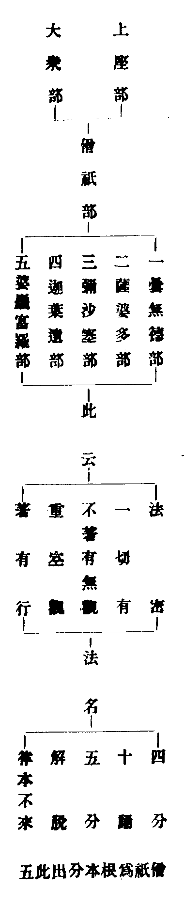



【■记】疏云：五部律：佛灭后百餘年，育王设会，上座他鞞罗立义摩诃僧祇。大众不同，分为二部。后上座更生二部，谓雪山、萨婆多。雪山绝后，萨婆多更集僧祇生三部，谓弥沙塞、昙无德、迦叶遗。就萨婆多、僧祇为五部。昔如来预见互相是非，大集经亦预指五部，宗轮论则广明分部，以为二十也。翻译名义曰：昙无德，亦名昙摩毱多，翻法密。隐覆即密义，又翻法藏。大集曰：我涅槃后，诸弟子等受持如来十二部经，书写读诵，颠倒宣说。以倒说故，隐覆法藏。人名昙摩毱多，法名四分。萨婆多，翻一切有，计三世有实三性，悉得受戒。大集曰：而复读诵书写外典，受有三世，及以内外破坏外道，善能论议，说一切性，悉得受戒。凡所问难，悉能答对。人名萨婆多，法名十诵。迦叶遗，翻重空观。大集云：说无有我及以受者，转诸烦恼，犹如死尸。人名迦叶遗，法名解脱。此有戒本，相同五分。弥沙塞，翻不著有无观。大集云：不作地水火风有相，空虗识无相。人名弥沙塞，法名五分。婆麤富罗，翻犊子。古仙染犊生子，故自后种性皆名犊子。此部计我，非是即蕴，亦不离蕴，而有实我，律本不来。大集云：皆说有我，不说空相，犹如小儿。摩诃僧祗。此翻大众。大集云：广博徧览五部经书，名摩诃僧祗，此有律本。首疏云：总别六部，僧祇是总，前五是别。此僧祇部众，行解虗通，不生偏执，徧顺五见，以通行故，故知是总。遗教三昧经云：佛在世时，众僧唯著死人杂衣。因罗云分卫空还，佛知其宿因，使众僧分律为五部，服色亦五种，令其各随一部中行。遂制仪则，各举所长，名其服色。昙无屈多迦部：通达理味，开导利益，表法殊胜，著赤色衣，非南方正赤。萨婆多部：博达聪敏，导以法化，应著皂衣，非北方正黑。迦叶遗部：精勤猛勇，快摄众生，著木兰色衣。弥沙塞部：思入玄微，究畅幽密，著青色衣，非东方正青。摩诃僧祇部：勤学众经，宣讲真义，以处本居中，著黄色衣，非中央正色。尔后便得大食。斯以五色坏衣，彰五部相。已上示三藏能诠也。



【■补】四分：一、比丘法，二、比丘尼法，三、受戒法，四、灭诤法。五分者，四分同上，更加僧法一分法数。云转烦恼如死尸者，谓转弃妄惑如死尸也。



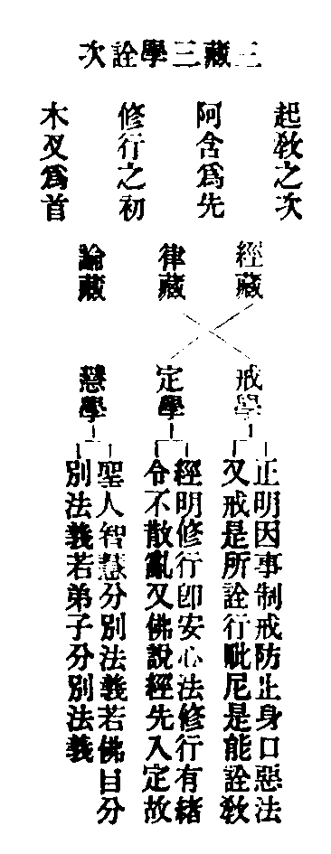



【■记】图示三藏所诠也。若尅性论诠，则经诠三学，律兼戒定，论唯慧学。今据正诠四教义云：阿含定藏，多明修行法也。毗尼戒藏，正明因事制戒，防止身口恶法也。阿毗昙慧藏，分别无漏慧法，不可比也。此三的属小乘。故法华云：贪著小乘三藏学者。问：如次对当，义理可然，而名乖诠次？答：说时非行时。起教之次，阿含为先。修行之初，木叉为首。又云：八正道，以正见、正思惟为先，正语等六皆名正。如人行法眼，前瞻路，后发足也。南山云：身口所发，事在戒防。三毒勃兴，要由心使。故今先以戒捉，次以定缚，后以慧杀，理次然乎。通言学者，所以疏神达思，怡情治性，圣人之上务。学犹饰也。器不饰，则无以为美观。人不学，则无以有懿德。乃至云：修学三法之用，得证五分之果。



【■补】婆娑云：修多罗亦分别戒慧，毗尼亦分别心慧，毗昙亦分别心戒，从多分说也。



【□注】四教义云：然此三法通名藏者，以皆各含一切文理也。



【■记】此释三法名藏，然是略引文耳，今具记之。四教义云：三法通名藏者，以含藏为义，但解者不同耳。有言文能含理名藏，有言理能含文名藏。今曰三法之名，各是一句，三名各含一切文理名藏也。



【□注】又经通五人说。妙乐一(二十五)云：佛及声闻，天仙化人，下四印定，即名佛说(文)。



【■记】此示经通五人说。如观经疏云：题称佛说，简异四人，弟子、诸仙、诸天、化人说也。钞云：若四人说，如来印之，亦得称经。言印有二：若小乘经，以三法印印之；若大乘经，以实相印印之。源洪师言：三法，空、无相、无作也。



【□注】律唯佛制，降佛已还，不许措辞。如礼乐征伐，自天子出。



【■记】律藏胜故，唯佛自说礼乐等者，此言孟予述孔子论天下之势，以明先王之制，诸侯不得变礼乐，专征伐也。子思曰：非天子不议礼，不制度，不考文，则须具圣人之德，据天子之位，方可作礼乐。以况降佛已还，不得制律也。



【□注】论通佛世灭后。文句九(三)引出矅经云：佛在波罗奈，最初为五人说契经修多罗藏。佛在罗阅祇，最初为那须提说毗尼藏。佛在毗舍离猕猴池，最初为跋耆子说阿毗昙藏(文)。妙乐九(十一)云：故知别有阿毗昙藏，是佛自说。五百罗汉结集，名相续解脱经。后广集法相，乃名为论(文)。



【■记】经云：佛在波罗奈，告五比丘：此苦原本，本所未闻，本所未见。广说此法，为契经藏。佛在罗阅祇，时迦兰陀子，名须陈那，最初犯律，故说戒藏。佛在毗舍离，见䟦耆子本末因缘，告诸比丘：诸无五畏恚恨之心者，便不堕恶趣，亦复不入地狱中。广说如阿毗昙。妙乐下，证成。又文句云：相续解脱经者，是佛自说，故且名经。当佛灭后，阿难所结集者，名修多罗。又云：五百集者，初名解脱，后广集法相，乃名为论。



【□注】今此三藏，皆是佛说。若云佛说名经，弟子所作名论，一往语耳。



此结今释餘。初句结今三藏是佛所说，次一行释餘所判。谓一往言之，如止观一上(十八)有造论缘起须者，往检佛说名经、弟子所作名论。再往言之，佛及弟子俱说经、俱说论也。



△二拣取。



此之三藏，名通大小，今小乘三藏也。



【□注】通论小衍，俱有三藏，今则别指小乘，不可以通难别。故下，即引经论以证别意。



【■备】辨讹曰：仪文内於婆沙中，婆沙二字，当曰毗昙。以迦旃延子所造，旧译名八揵度论，新译名发智阿毗昙论。婆沙乃五百罗汉所造，以解发智论者也。不读衍经，非大菩萨，是大论责语。以小乘无十八不共法，而迦旃延用十力、四无所畏、大悲、三念处为十八不共，所以被责。大论意谓小乘虽无，然不妨用大乘名而释，如三十二相，八十种好；小乘不妨以大乘名相而解，十八不共例然。



△三、引证。



大智度论云：迦旃延子自以聪明利根，於婆沙中明三藏义，不读衍经，非大菩萨。又法华云：贪著小乘三藏学者。依此等文，故大师称小乘为三藏教。



【□注】大智度论释大品经，龙树造，罗什译，九倍略之，百卷成文。亦名释论，智论，大论。



【■记】论序曰：论之略本十万偈，三分除二得百卷。以秦人好简，故裁略之。若备释，将千餘卷也。又云：论之初品三十四卷，解释一品是全论，其本二品，下法师略之，取其足以开释文意，不复备其广释，得此百卷。若尽出之，将十倍也。从能释名释论，从所释名智论，复从所释经名大论。



【□注】迦旃延子，此云文饰，善赞咏故。大论云：佛灭后百年，有迦旃延婆罗门(文)，非佛世之迦旃延也。



【■记】文饰者，赞咏文辞，善能修饰也。大论下，指证。二卷文云：佛灭后百年，阿阇迦王作大会，诸大法师论议异故，有别部名字。从是已来，展转至姓迦旃延、婆罗门道人、智慧利根、尽读三藏等文。



【■备】迦旃延，婆罗门姓。



【□注】聪明利根：大论云：迦旃延子辈，是生死人，不读不诵摩诃衍经，非大菩萨。不知诸法实相，自以利根智慧，於佛法中作诸论议(文)。



【■记】所作论议，即发智经八犍度。如婆沙论云：彼迦旃延有利智、三明、六通，具八解脱，五百佛所，愿於释迦遗法中造阿毗昙，於世尊处处教化之中而立犍度。是彼亦乘愿来作论也。



【■备】犍度翻。法聚以诸法门，各从其类，分为八聚。见三藏法数。



【□注】则知天台以小乘为三藏，本乎经论。昔静法苑师毁之於前，清凉观师赞之於后。苑师谓法华云：贪著小乘三藏。学者乃以小乘为能别之言，明知三藏不唯属小。天台此名，滥涉大乘，特违至教(指法华为至教)。



【□注】清凉华严疏云：此师立义，理致圆备。但三藏名，义似少滥，以后三教亦有三故。所以尔者，良以智论之中，多名小乘为三藏教。成实论中亦自说云：我今欲说三藏中实义故。有据初对旧医戒、定、慧故，立此三事，条然不同，异后三教。通教意融三故，别教依一法性而显三故，圆教三一无碍故。所以不名小乘教者，此教亦有大乘六度，菩萨三十四心断结，成真佛故(文)。



【■记】二、师皆贤首宗徒。苑师下，出毁。苑师乃法藏上首，谓经中小乘三藏乃对大乘三藏以成能别。天台立三藏教名，其过有四：一、滥涉大乘失，以大乘亦有三藏，应名三藏教故；二、大无三藏失，以彼不名三藏故；三、特违至教失，经云不得亲近小乘三藏学者，有小乘言，明拣异大乘三藏故；四、有不定失，以小乘诸部有不立三故，如经量部但立经、律二藏故。又有立五藏，於成实三外立杂藏及菩萨藏故。今集注中但指其第一、第二之过也。此毁文，华严疏钞具引。清凉以苑公解不合经旨，另出疏钞。今注但指其所出二过也。指法华为至教句，乃玉师点释，以佛所说皆名至教也。清凉此师立义下，出赞。疏钞中文有四节，以通五难，谓上四失之外尚有第五，云何不立小乘？难言四节者：一、出三藏名之所据，即良以下等文，以通违至教失及滥涉大乘失，谓大、小乘论同立此名，故滥涉之失不在於己。若难言：智论内小乘名随自宗语，三藏之称随他宗语，非共名也。今释曰：智论是随他名，成论小乘云何亦名三藏？岂随他宗耶？即由上义不违至教，以罗什译经多依智论，小乘三藏为欲成文。二、言双举小乘之过不在三藏，但责其小心耳。故诃小乘，不责所诠三藏。以上钞文，今注有据二字，乃玉师所加。成实论亦说三藏者，盖成实论诃梨跋摩自记曰：诸比丘异论种种，佛皆听故，我今欲说三藏中实义。是三藏名之所据也。华严钞又云：初对旧医下，二、明立三藏所以。四教之初，敌对旧医之三，故须特立三藏。三又迢然不同，故无滥涉大乘，所以偏从立号。亦犹五尘皆色，而色独得总名，故三藏虽通标总名，便为小乘别教。言旧医者，即涅槃新医、旧医之喻。旧医喻外道。外道戒、定、慧者，各有二：一、邪，二、正。外邪戒谓狗、牛等，正戒谓十善。旧定邪者，九十五种所说鬼神法，或能知吉㐫，现神变相也；正者，即四禅、四无量、四无色，发五通也。外慧邪者，因身边见心，发诸邪智，拨无因果等也；正者，即因身边见，发诸世智，说有因果诸善法也。今佛说三藏教所明戒、定、慧，即是新医从远方来，晓八种术。如来所说戒者，即五种得戒，发一切律仪、无作、有作、五部毗尼也；定者，即依八背舍、八九次第定等，发六神通也；慧者，即生灭四谛，破身边见、六十二见，发真无漏，成十一智、三无漏根也。此戒、定、慧，外道尚不闻名，况有其分？故言初对旧医等。三事迢然不同者，谓上对旧医，下对通、别、圆教。由不同故，立三藏名。即由此义，诸部多名三藏。从多立名，非不定失。通教意融三下，第三、明后三不名三藏所以，即正通大无三藏失。谓大乘虽有三藏，各有融、拂等义，故不立名，非无其体。言通教融三者，融至空寂。故法句经云：戒相如虗空持者为迷倒若学诸三昧是动非坐禅心随境界流云何名为定。无智无得，方名真智；般若无知，如智双寂等。皆意融三也。言别教依一法性而显三者，以一法性统之，不得迢然有别，一一法门不离法性。故论云：知法性离五欲过，随顺修尸波罗密；知法性无有乱想，随顺修禅波罗密；知法性本有智慧光明，无痴暗故，随顺修般若波罗密。言圆教三一无障碍者，即三而一，即一而三，非唯一体统之。一学之中，摄三皆尽。一行尚具一切，何况三耶？所以不名下，四、明不名小乘之所以，通第五难。难云：何以不名小乘，强立三藏，招而多失？故今通云：以有大乘，不得名小。三藏教中亦有菩萨，谓是大乘。自大乘中望之，皆称三藏小乘也。成真佛者，大乘说此断惑成佛，是八相化身；小乘以为实成，故属小教。故涅槃中詺执此实以为二乘。曲见以上，都依疏钞文条。然，华严疏作迢然。



【■备】八种术，指苦空等四枯四荣。五种得戒，一善来得，二见谛得，三三皈得，四八敬得，五羯磨得，十一智等见法界初门。六度三十四心六卷释。



【□注】释签十(七)云：三藏通大小，何故但属小？今明如法华云：贪著小乘三藏学者。又大论中，处处以三藏对衍而辨大小，故准此文，以三藏为小。若通论者，小衍二门，俱有三藏，但是通途，非别意也。若唯通途，如何消通？法华大论，具如四教本中广明(文)。



【■记】论以三藏对衍，如前仪文引迦旃延子不读衍经等。



【■备】四教义云：通别圆皆说戒定慧，岂非三藏教？答：通说无生戒定慧，一相无相不同，藏教别相异也。又一得不失，从胜受名也。别说恒河沙佛法，异前生灭。圆约真如实相，异藏偏浅，故不成也。



【□注】然论别意有三：一、小乘三藏部别故；二、小乘三藏隔异故；三、小乘三藏破旧医故。



【■记】小乘三藏别意有三者：一、如上明四阿含等经是修多罗藏，俱舍等论是阿毗昙藏等，部帙迢然别也。二、如上明经诠定学等三事不同，是为三藏隔异也。三、如新医戒定慧，对破旧医戒定慧也。



【□注】苑师谓法华以小乘为能别之言，且法华大论皆罗什译，论中既以小乘名三藏教，故至译经二言双举，为成偈文，即别义也。



【■记】此专解苑公能别之难。清凉钞中亦言：为欲成文双举。盖法华、大论，皆罗什译。论译在先，经翻在后。论以小乘名三藏教，经意岂得不然，而乃谓之能别耶？故至法华，以小乘、三藏二言双举者，为成四字偈故，即是经别义。非以二言双举，对大乘、三藏成能别也。



【■备】辨讹曰：即别义三字稍泥。私谓小乘别义，当如上三意判。



【□注】又大论云：佛在世时，无三藏名。法华何云三藏？学者须知，三藏之名，起於结集法藏者。故大论云：摩诃迦叶将诸比丘，在耆阇崛山中集三藏；文殊尸利、弥勒诸大菩萨，亦将阿难集摩诃衍。三藏是声闻法，摩诃衍是大乘法。复次，佛在世时，无三藏名，但有持修多罗比丘、持毗尼比丘、持摩多罗比丘(文)。



【■记】此更引大论判决。论谓佛世无三藏名，则说法华时，尚无其名，经中云何有三藏言耶？须知三藏名，起於结集也。故大论下，引证。出嘱累品。三藏是声闻法，摩诃衍是大乘法。此两句，是述阿难意。以彼上文言：又阿难知众生志业大小，故不於声闻人说摩诃衍，说则错乱，无所成办。佛法皆是一种一味，所谓苦尽解脱门。此解脱味有二种：一、但自为身，二、兼为一切众生。虽俱求一解脱门，而有自利利人之异，故有大小二乘之别。为是二种人故，佛口所说，以文字语言，分为二种：三藏是声闻法，摩诃衍是大乘法也。复次下，亦嘱累品文。意显虽无三藏之名，而有三藏之义。经家以义定名，故集小乘，名三藏教。



【■补】摩多罗无翻约义，应指论言。



【□注】是则结集经家，既立三藏之名，故译经者作此译耳。故法华云：三藏学者。



【■备】此结经文相承有本意，以说经时尚无三藏之名，不当泥经中小乘三藏为能别之言也。



△二、教所被机二：初、总标三乘根性。



此有三乘根性。



【□注】此是总标三乘。声闻四谛教，苦为初门；支佛因缘教，集为初门；菩萨六度教，道为初门。又三人亦通谛、缘、度三，文句七(二十一)。



【■记】此释当教有三乘根性。初一句断文。次行半，明三人各有入道初门。谓声闻小乘，苦谛为初，观四谛入道，发真无漏。缘觉中乘，集谛为初，观十二因缘，发真无漏。菩萨大乘，慈悲宏誓，道谛为初，修行六度，化众生成佛果也。未明互通三乘。文句曰：三人通观十二缘，二乘生灭十二缘，菩萨无生十二缘。又通论四谛，二乘有量四谛，菩萨无量四谛。又六度亦通三人。大品发趣品言：阿罗汉支佛，因六波罗密至彼岸。玄文亦载。



【■备】皆合小衍而论通也。



【□注】四念处一(二)云：所言三者，其义有八：谓教、理、智、断、行、位、因、果。理三者，声闻理在正使外，缘觉理在习气外，菩萨理在正习外。教三者，声闻禀四谛教，缘觉禀十二因缘，菩萨禀六度。智三者，声闻总相智，缘觉别相智，菩萨总别相智。断三者，声闻断正，缘觉断习，菩萨断正习。行三者，声闻为自修戒定慧，缘觉为自修乐独善寂，菩萨为众生修六度。位三者，声闻住学无学，缘觉住无学，菩萨三僧祇登道场。因三者，声闻带果行因，缘觉望果行因，菩萨伏惑行因。果三者，声闻断正，如烧木为炭；缘觉断习，如烧木为灰；菩萨正习尽，如烧木无炭灰也(文)。



【■记】此证三乘根性也。初总标三乘八义不同。理三者，声闻须断尽见思，契真空理。缘觉当兼其习气，证真空理。菩萨树王下，顿除正习，证真空理。在正使等外者，谓真空之理，为见思所覆，断见思方显，故在惑外也。教三者，声闻依生灭四谛轮，知断证修。缘觉依十二缘起门，逆顺观察。菩萨依六度门，三祇百劫，自利利人也。智三者，声闻观诸果，总作苦谛观。观诸烦恼及业，总作集谛观。故以现在总相一门，析色成空。缘觉虽观苦七支，集五支，以自行故，别观三世，别开苦集，故言别相智，以别相一门，析色成空。菩萨为化他故，通依四门，故通以总别相智，於四门析色成空也。断三者，声闻断正如器中除秽物，缘觉断习如除器中秽气，菩萨若见若思若见思习则以三十四心顿断也。行三者，声闻自求涅槃勤修三学，缘觉乐独善寂自求解脱，菩萨愍念无量众生故勤修六度万行也。位三者，声闻三果四向正在研真断妄名有学，四果罗汉真穷妄尽名无学，缘觉唯一远离名住无学，菩萨三祇百劫登道场也。因三者，声闻初果见道后修道名带果行因，缘觉不立分果故望果行因，菩萨不断结惑名伏惑行因。然缘觉菩萨因中俱不断惑，一称望果一称伏惑者，缘觉求自证，菩萨为化他留惑润生也。果三者，声闻断正如炭，缘觉断习如灰，菩萨断正习尽如不存灰。炭喻炭灰者，三乘入涅槃同灰断也。



【■备】有师标曰：若有佛无佛，理性常住，应理居初。今先教者，如来以教显理，众生由教入理，八义相生可见。



△二、别显三乘道二：初、教法三：初、示声闻二：初、详辨四谛二：初、通标。



初声闻人依，生灭四谛教，



【□注】闻佛声教，故曰声闻生灭四谛。止观一(十一)云：苦则三相迁移(生异灭)，集则四心流动(贪瞋痴等分)，道则对治易夺，灭则灭有还无。虽世出世，四皆变异，故名生灭(文)。自性不虗，四皆谂实，故名为谛也。



【■记】辅行言：三相者，不立住相，以人多於住处起常计故。净名言：比丘，汝今亦生、亦老、亦灭。老即是异。此中兼一期之寿、一念之促二种三相。四心即四分烦恼。四分必是三相所迁，故言流动。四相虽不相应行摄，即彼烦恼是生等故。为显此中成生灭义，故须以生灭说之。下文道灭尚成生灭，故此苦集言生异灭也。贪、瞋、痴三不定杂生，名为等分。以实有道，治彼苦集，名曰对治。有苦集时，则无有道。若有道时，能除苦集，故曰易夺。灭则灭有，因果还归无餘也。虽分世出世，而皆有变易，故名生灭也。末三句，释谛义也。苦集灭道，自性皆实，不虗名谛。谂，深上声。或谓：灭道圣人，行因得果，可言审实。苦集虗妄，何名审实？答：此虗妄因果，非虗妄非不虗妄，故有漏无漏因果，皆悉审实，不可混滥。故遗教经言：日可令冷，月可令热，佛说四谛，不可令异也。妙玄云：自性不虗，故称曰谛。



△二、别释四：初、苦谛三：初、徵。



言四谛者：



△二、释二：初、开总出别二：初、标名义。



一、苦谛，二十五有依正二报是。



【□注】大经云：凡夫有苦而无谛，声闻有苦而有谛。凡夫不见苦理，故言无谛。声闻能见无常苦空，故言有谛。



【■记】此引大经释也。大经圣行品疏言：若旧本则言：凡夫合声缘，皆言有苦有谛。新本开：凡夫有苦无谛，二乘有苦有谛。此於二乘而与夺之。旧言：苦是境，谛是智。凡夫无智有境，所以唯苦无谛；二乘有少分智，故有苦有谛。光明记言：凡夫有苦无谛者，虽遭大苦，不以为患，以不审谛，知是苦故。声闻有苦有谛者，此当三藏，不了无生，故言有苦。能审知故，名为谛也。



【□注】法界次第中(十)云：苦以逼恼为义，一切有为心行，常为无常患累之所逼恼，故名为苦，谓三苦八苦等。



【■记】此引祖释苦谛名义也。初二句训义。一切下，依义立名。谓一切有为心行，即苦体为所逼恼，无常患累为能逼恼，以是得名为苦也。



【■补】等，谓等餘十苦，百一十苦也。菩萨藏经有十苦，谓生、老、病、死、愁、怨及苦、受苦、忧苦、痛恼苦、生死流转苦也。瑜伽论有百一十苦，约之不出，三八摄尽，故不再出。



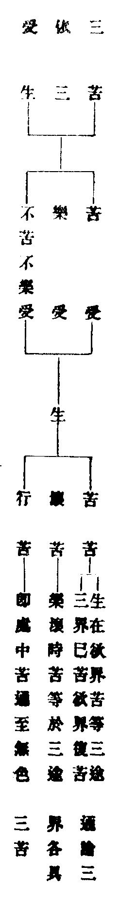



【■记】法界次第云：三苦有通别。别者，三苦对三受：苦受从苦缘生，情觉是苦，即苦苦；乐受乐坏时生苦，即坏苦；不苦不乐受常为无常迁动，即行苦。通论三受，皆有三苦：三受之心，是苦通；从苦缘生通，是苦苦；三受之心通，为坏相所坏通，是坏苦；三受之心通，是起役运动不停相通，是行苦也。



【■补】别论：欲界具三，色具后二，无色唯行舍受，即非苦非乐之处中苦。



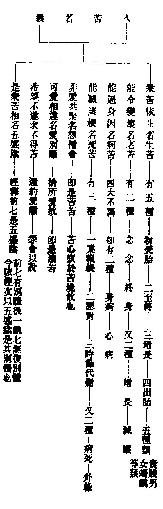



【■备】辨讹曰：后一总七，无复别体句，出大经疏，亦一往之言。据瑜伽论，前五是苦苦，六七是坏苦，第八是行苦。当知行苦摄得前二，前二摄不得行苦，则知有别体矣。



【■记】八苦。如大经圣行品说：生老二苦，与今文同。病苦。经明身病有五：一、因水，二、因风，三、因热，四、杂病，五、客病。又有四：一、非分强作，二、忘误堕落，三、刀杖瓦石，四、鬼魅所著。心病有四：一、踊跃，二、恐怖，三、忧愁，四、愚痴。今图所明死苦有三种：一、业报，二、恶对，三、时节代谢者，误也。盖经明病苦也。如经云：身心之病，凡有三种：一、业报，二、不得远离恶对，三、时节代谢。生如是等因缘、名字、受分别病。因缘者，风等诸病。名字者，心闷、肺胀、上气、欬逆、心惊、下痢。受分别者，头痛、目痛、手足等痛。是名为病也。又大经明死苦有二种：曰命尽死、外缘死。命尽死有三种：一、命尽非福尽，二、福尽非命尽，三、福命俱尽。外缘死亦有三：一、非分自害死，二、横为他死，三、俱死。又有三死：一、诽谤大乘名放逸死；二、毁犯诸佛所制名破戒死；三、舍五阴身名坏命根死。爱别离苦者，经云：所爱之物坏离有二：一者、人中五阴坏；二者、天上五阴坏。如是人天所爱五阴分别有无量种也。怨憎会苦者，经云：所不爱者而共聚集亦有三，所谓地狱、饿鬼、畜生。如是三趣有无量种也。求不得苦者，有二，经云：一者、所希望处求不能得；二者、多役功力不得果报。五阴炽盛苦者，经指生老病死、爱别离、怨憎会、求不得等苦，总名五阴炽盛苦也。婆沙论言：盛阴有何义？受所生故说盛，谓生受故说盛；受所养故说盛，谓养受故说盛。问：阴与盛阴有何差别？答：名即差别，谓阴谓盛阴。又阴有漏无漏，盛阴一向有漏。又阴染污不染污，盛阴一向染污。章安言：今依经文，以五盛阴是其别体，善恶阴盛即是苦体。



【■补】生苦中所言，至终至十月满足也。



△二、引古颂。



言二十五有者，四洲四恶趣，六欲并梵天，四禅四空处，无想五那含(四洲四趣成八，六欲天并梵天成十五，四禅四空处成二十三，无想天及那含天成二十五)。



【□注】辅行一下(二十一)云：因果不忘，故名为有(文)。



【■记】此总明为有也。如经言：无我无作无受者，善恶之业亦不忘。是则称理固无，作受据事，因果灼然。所谓三界之内，因之与果，如影随形，如声逐响，毫无差忒。因果不忘，故谓之有。



【□注】略云三有，欲、色、无色。或云九有，三界分九地故。



【■记】此略明为有也。言九地者，欲界五趣杂居地，色界初禅离生喜乐地，二禅定生喜乐地，三禅离喜妙乐地，四禅舍念清净地，无色界空无边处地，识无边处地，无所有处地，非非想处地，是为三界分九地也。解见法数。



【□注】国土名依报，五阴假名是正报，即苦谛之体。



【■备】国土外四大，五阴内四大，内外皆苦体也。



【□注】四洲，水中可居曰洲。



【■记】如下人道中解。



【□注】四、恶趣三途加修罗，以修罗一日一夜三时受(苦故)。



【■备】辨讹曰：三时受苦，准经应是阎罗，非修罗也。存攷。



【□注】六欲希须名欲。六天各有三种欲：一、饮食欲，二、睡眠欲，三、淫欲。梵王无想及五那含，总在四禅。经教别为三有者，为破外道，计梵王为生万物之主，计无想无心为涅槃，计五那含为真解脱故。



【■记】翻译名义云：外道计梵天为能生万物之本，梵王亦自己方能为造化之主，是真解脱；佛欲破彼情见，是故别标为有也。无想定得五百大劫无心之报，外道不达，而复计为真实涅槃；佛欲破彼情见，是故别标为有也。五净居中，有摩醯首罗天王处，外道亦复计彼天王能为造化之本，归之而得解脱；佛为别破此见，释之为有故。二十五三昧中，以种种破梵王者，梵王主三千大千，大千品类既多，有种种号；为破其种种，故修种种空，入种种假见，种种中道如来藏，多所含藏，名种种三昧破之也。如空破无想者，此是外道天，实非无想，而计为无想涅槃，以三谛空破也。照镜破那含有者，修熏禅随禅生，此虽得净色，不知色如镜中像；菩萨知之，即空分别无量像，依镜即本性中道三昧破之。



△二、揽别成总二：初、总示。



别则二十五有，总则六道生死。



【■注】六道轮转相通，故名为道。



【■记】道，犹路也，有能通之义。谓六道众生，轮转四生，循环三界，互相通达，故名为道。如曰：钻马腹，入驴胎，涂炭曾经几度回？或时天帝殿前过，或向阎君锅里来。是也。



【□注】辅行二上(二十五)引大论三十三：问云：云何六道，复云五道？答：佛去世后五百年中，部别不同，各回佛经，以从己义，故使修罗一道，有无不同(文)。



【■记】此料简五道六道。问中以五间六之故，答中以部帙不同有异。如大论言：五百年后，多有别异，部部不同。说五者，於佛经𢌞文说五。说六者，於佛经回文说六。又曰：五道者，是一切有部僧所说，婆蹉佛妬路部僧，说有六道也。今从六道说者，大论言：又摩诃衍中法华经，说有六趣众生。观诸经意，应有六道也。复次，分别善恶，故有六道。善有上中下，天、人、阿修罗。恶有上中下，地狱、鬼、畜生。不尔者，恶有三果报，而善有二果报，是事相违。若有六道，於义无违，故今从六道者说也。



【□注】楞严中更开神仙一类为七趣。



【■记】此示经开七趣，引文明证也。楞严经云：复有从人，不依正觉，别修妄念，存想固形，有十种仙：所谓地行、飞行、游行、空行、天行、通行、道行、照行、精行、绝行仙等。是皆人中鍊心，不修正觉，别得生理，寿千万岁，休止山林，或大海岛，绝於人境。斯亦轮回，妄想流转，不修三昧，报尽还来，散入诸趣。是为七趣。



【□注】又六道不出胎、卵、湿、化四生。俱舍颂云：人旁生具四，地狱及诸天，中有唯化生，鬼通胎化二(文)。



【■记】此示四生摄六道也。俱舍论分别世品释言：卵生，鵞孔雀等。胎生，象马等。湿生，虫飞峨等。化生，谓有情类生无所托，如地狱诸天中有等。具根无缺，支分顿生，无而欻有，故名为化。人中卵生者，如世罗、邬波世罗二罗汉，生从鶴卵鹿母所生三十子，般遮罗王五百子等。人胎生者，如今世人。人中湿生者，如曼䭾多、遮卢、邬波遮罗、鸰鬘、庵罗卫等。人中化生者，唯劫初人也。旁生三种共所现见而化生，则如龙等也。鬼胎生者，如饿鬼女白目连曰：我夜生五百子，随生皆自食；昼生五百亦然，虽皆食尽，亦不得饱等。鬼化生者，鬼本化生，有名无体可知。



【■补】中有者，俱舍言：於死有后，在生有前，中间所得之身，名为中阴。为至餘处，说此身名中有，在二道中间故。何缘中有非即名生？颂曰：死生二有中，五阴名中有，未至应至处，故中有非生。此唯天眼能见。瑜伽言：五阴初起，名之为生。依壳而起曰卵，含生而爱曰胎，假润而真曰湿，无而欻有曰化。如是四生，内心思为因，外壳胎等为缘。约藉缘多少而成次第者，卵生具四缘：一业，二父，三母，四煖。是以先说胎具三业，父母湿二业，湿化唯一，谓思(业也)。



△二、别显二：初、明六道六：初、地狱道。



一、地狱道，梵语捺洛迦，又语泥黎，此翻苦具。而言地狱者，此处在地之下，故言地狱。谓八寒八热等大狱，各有眷属，其类无数。其中受苦者，随其作业，各有轻重，经劫数等。其最重处，一日之中，八万四千生死，经劫无量。作上品五逆十恶者，感此道身。



【□注】地狱从处为名。婆沙云：瞻部洲下过五百逾缮那，乃有地狱。



【■记】逾缮那旧言由旬。大论曰：由旬三别：大者八十里，中六十里，小四十里。今以一逾缮那四十里，谓此南洲下过二万里，有地狱道。



【□注】梵语，释签八(二十)云：元梵天种，还作梵语及以梵书(文)。辅行七(二十一)云：光音初下，展转出生，是故五天并名梵种(文)。



【■记】每劫初时，梵王亲下，教导世间。华严疏言：大梵天王，劫初作此书字，以教众生。故西域梵书，千古不易，不同此土，篆隶随时也。辅行引大论言：梵种者，餘天人民未有。劫初生时，梵王独在梵宫，寂寞无人，其心不悦，而自生念：此间何以不生人民？是时光音天命尽者，应念来生。梵王自念：此诸天先无随我念生，我能生此诸天。是时亦各自念：我从梵王生，梵王是我父也。故但说梵种。



【□注】翻彼梵语，成此华言，故云翻也。周礼有象胥氏，通四方之语。东方曰寄，南方曰象，西方曰狄鞮(音低，低之言知也)，北方曰译。今翻西语诸经皆云译者，从通称也。如周礼四官通称象胥氏。



【■记】辅行云：寄等四，皆官名。寄者，能寄寓风俗之异於此。象者，能傚象风俗之异於彼。鞮则欲别服饰之异。译则辨其言语之异。



【□注】苦具，造恶之者，受苦具度，亦云苦器。



【■记】正理论曰：捺落言人，迦名为恶，人多造恶，堕落其中也。梵语泥黎，乃造恶众生受苦器具。



【□注】八寒八热。偈云：頞部陀尼剌部陀，寒逼身疱及疱裂，頞哳咤并嚯嚯婆，唬唬婆三皆痛声。六嗢钵罗钵特摩嗢(乌没反)，第八摩诃钵特摩，青莲红莲大红莲，如次对三种身色。(以上八寒)等活黑绳三众合，嘷呌大呌六炎热，七极热下八阿鼻，此八寒热根本狱。(等活，斫刺磨捣吹活等，前黑绳绷量，后方斩锯。众合，苦具众至，合党相残。嘷呌，众苦所逼，悲嘷发声。大呌，极苦所逼，大呌称怨。炎热，火随身转，热苦难堪。极热，若内若外，自身他身，俱出猛火，互相烧害。阿鼻，或云阿鼻旨，亦云阿毗成论，明趣果受苦时，命及形五，皆无间也。)



【■记】人寒热狱，大论具记。頞部陀，翻疱。寒触身分，悉生疱故。论言：其处积冰，毒风来吹，令诸罪人，皮毛裂落，筋肉断绝，骨破髓出，即复完坚，受罪如初。此人宿业因缘，寒月剥人衣；或劫盗绝人薪火；或作恶龙，瞋毒忿恚，放大雹雨，冰冻害人；或轻贱谤毁若佛，及佛弟子持戒之人；或口四业，作种种罪等因缘，堕頞浮陀也。尼剌部陀，翻疱裂。论曰：堕尼罗浮陀亦如是。然頞浮陀，少时有间，暂时休息；而此尼罗浮陀，无间无休息时。頞哳咤，即阿罗罗声。嚯嚯婆，即阿波波声。唬唬婆，即阿[喉-(仁-二)][喉-(仁-二)]声。论曰：此三地狱，寒风噤颤，口不能开，因其呼声名狱。嗢钵罗，翻青莲华。钵特摩，翻红莲华。摩诃钵特摩，翻大红莲。论说：沤波罗狱中，冻冰浃渫，有似青莲华。波头摩，状如此间赤莲华。摩诃波头摩，是中拘伽离住处。已上八寒狱也。等活者，论言：见等活大地狱中，诸受罪人，各各共鬬，恶心瞋争，手捉利刃，互相割剥，以矟相刺，铁扠相扠，铁棒相棒，铁杖相捶，铁串相贯，而以利刃互相切刽，又以铁爪而相抓裂，各把身血而相涂漫，痛毒逼切，闷无所觉。宿世因缘，冷风来吹，狱卒唤之：咄！诸罪人还活。以是故，名等活地狱。即时平复，复受苦毒等。前此中众生，以行业因缘，好杀物命、牛羊、禽兽，为田产、舍宅、奴婢、妻子、国土、钱财故，而相杀害。如是等种种杀业报故，受此极苦。黑绳者，论言：见黑绳大地狱中罪人，为恶罗刹、狱卒、鬼匠，常以黑热铁绳拼度罪人，以狱中铁斧教人斫之，长令短，短令长，方使圆，圆使方，截四支，刵耳鼻，落手足，以大铁锯解析剸截，破其肉分，脔脔称之。此人宿行因缘，谗贼忠良，妄语、恶口、两舌、绮语，枉杀无辜，或作奸吏，虐暴侵害。如是等种种恶口谗贼，故受其罪。众合者，论言：见合会大地狱中，恶罗刹、狱卒作种种形，牛、马、猪、羊、麂、鹿、狐、狗、虎、狼、狮子、六驳大象、雕、鹫、鹑鸟，作此种种诸鸟兽头，而来吞噉啮𫜪。𪙁掣罪人，两山相合，大热铁轮轹众罪人，令身破碎，热铁臼中捣之令碎，如笮蒲萄，亦如压油。譬如蹂场，聚肉成堆，积头如山，血流成池，雕、鹫、虎、狼各来争掣。此人宿业因缘，多杀牛、马、猪、羊、麞、鹿、狐、兔、虎、狼、狮子、六驳大象，众鸟多相残贼。如是等种种鸟兽故，还受此众鸟兽头来害罪人。又以力势相陵，枉押羸弱，受两山相合罪。悭贪、瞋恚、愚碍、怖畏故，断事轻重，不以正理，或破正道，转易正法，受热铁轮轹，热铁臼捣。嘷呌与大呌者，论言：此大地狱，其中罪人，见罗刹、狱卒头黄如金，眼中火出，著赭色衣，身肉坚劲，走疾如风，手足长大，口出恶声，捉三股叉，箭堕如雨，刺射罪人。罪人狂怖，叩头求哀。大将军小见放舍，小见怜愍，即时将入热铁地狱，纵广百由旬，驱打驰走，足皆焦然，脂髓流出，如笮苏油；铁棒棒头，头破脑出，如破酪瓶；斫刺割剥，身体糜烂。而复将入铁阎屋间，黑烟来熏，互相推压，更相怨毒，皆言：何以压我？才欲求出，其门已闭，大声号呼，音常不绝。此人宿行因缘，皆由斗秤欺诳，非法断事，受寄不还，侵凌下劣，恼诸贫穷，令其号哭，破他城郭，坏人聚落，伤害劫剥，室家怨毒，举城呌唤。有时谲诈欺诳，诱之令出，而复害之。如是等种种因缘，受大呌唤地狱罪。炎热、极炎热者，论言：热、大热地狱中，有二大钢镬：一名、难陀，二名、跋难陀。以沸咸水满中，罗刹鬼、狱卒以罪人投中，如厨士烹肉。人在镬中，脚上头下，譬如煑豆熟烂，骨节解散，皮肉相离。知其已烂，以义义出，行业因缘，冷风吹活。复投炭坑，或著沸灰中，譬如鱼出於水，而著热沙中。又以脓血而自煎熬，从炭坑中出，投之炎床，强驱令坐，眼、耳、鼻、口及诸毛孔，一切火出。此人宿世恼乱父母、师长、沙门、婆罗门，於诸好人福田中，恼令心热。以此罪故，受热地狱罪。或有宿世炮煑生蠒，或生燂猪羊，或以木贯人而生炙之，或焚烧山野及诸聚落、佛图、精舍等，或推众生著火坑中。如是等种种因缘，生此地狱中。阿鼻者，论言：见阿鼻地狱，纵广四千里，周围铁壁，於七地狱，其处最深。狱卒、罗刹以大铁锤锤诸罪人，如锻师打铁，从头剥皮，乃至其足。以五百钉，钉磔其身，如磔牛皮，互相掣挽，应手破裂。热铁火车，以轹其身，驱入火坑，令抱炭出。热沸尿河，驱令入中。中有利嘴诸虫，从鼻孔入，脚底出；从足下入，口中出。竖剑道中，驱令驰走，足下破碎，如厨脍肉。利刀剑矟，飞入身中，譬如霜树落叶，随风乱堕。罪人手足耳鼻支节，皆被研剥，割截在地，流血成池。二大恶狗，一名赊摩，二名賖婆罗，利口猛毅，破碎人筋骨，力逾虎豹，猛如狮子。有大刺林，驱逼罪人，强令上树。罪人上时，刺便下向；下时，刺便上向。大身毒蛇，蝮蝎恶虫，兢来啮之。大鸟长嘴，破头噉脑，入咸河中，随流上下。出则踏热铁地，行铁刺上，或坐铁戈，戈从下入，以钳开口，灌以洋铜，吞热铁丸。入口口焦，入咽咽烂，入腹腹然，五脏皆焦，直过堕地。但见恶色，恒闻臭气，常触麤涩，遭诸苦痛，迷闷萎顿。或狂逸搪揬，或藏窜投掷，或颠仆堕落。此人宿行，多造大恶，五逆重罪，断诸善根。法言非法，非法言法，实言非实，非实言实，破因破果，憎嫉善人。以是罪故，入此地狱，受罪最剧。原注引成论：五种无间者：一、趣果无间，舍身生报故，谓舍此身，即生彼也；二、受苦无间，中无乐故；三、时无间，定一劫故；四、命无间，中不绝故；五、形无间，一人多人，皆遍满故。正法念处经言：阿鼻苦千倍过前七狱故。



【■补】八寒八热偈，是苕水粹法师作。頞哳咤，义府言：以寒增甚，口不能开，但得动舌作声。此三，约受苦以立名。如唇动，不得唯舌作声，名頞哳咤。舌动，不得唯唇作声，名嚯嚯婆。唇舌俱不得动，但内振气作声，名唬唬婆。皆痛声也。如次对三种身色者，谓以青对嗢钵罗，红对钵特摩，大红对摩诃钵特摩。此是寒逼其身，乃作青红等色，故如次对也。哳音劄。绷音崩。颤音战。嗢音屋。浃渫音接雪。矟音速，矛也。刽音桂，细切也。拼音绷。刵音二，割也。剸音团。轹音立，车践也。笮音诈。燂音前，热汤也。磔音极，裂也。頞音遏。



【□注】各有眷属，其类无数。等活等八狱，各有四门。四门各有四狱，谓煻、煨、尸、粪、锋、刃、烈、河、增。一狱十六，总有百二十八，皆名游增。有情游彼，其苦增故。准妙玄第六云：八寒亦具百二十八。而正理论等，但云眷属。故俱舍图，热竖寒横，於八寒边，不列游增。更有孤独、鬲子、轻系等狱，遍在江海山林空中等处。婆沙七云：南洲有正有边，东西二洲，唯边无正。北州边正俱无。三洲人若造重罪，皆来南洲正狱，及东西南洲边狱受苦。妙玄六(二十八)云：此正地狱，在地下二万由旬。其傍地狱，或在地上，或在铁围山间。



【■记】等治下，热眷属狱。俱舍言：此下过二万，无间深广同，上七捺落迦，八增皆十六，谓煻煨尸粪，锋刃烈河增，各住彼四方，无间各四门。既各有四，上七亦然。十六、游增地狱四门，门门有四。东门四者：饥饿、铜镬、多鍑、石䃺；南门四者：脓血、量灰、灰河、铁丸；西门四者：斤斧、豹狼、剑树、寒冰；北门四者：黑砂、沸屎、铁钉、焦渴。又新婆沙言：八热狱各有四门，一一门有游增狱，有情游彼，其苦增故。次准妙下，寒眷属狱。初二句准妙玄总示，次一句指正理但言眷属。论言那洛迦等下四趣全，及天一分眷属中有，并器世间，总名欲界，是为但云那洛迦眷属也。俱舍图不列寒边游增者，承正理但言眷属意也。更有孤狱遍江林等处者，以孤狱有三法数，言山间、水中、旷野三处皆有地狱。婆沙下，示四洲边正狱有无。南本婆沙言：阎浮提下有正地狱，阎浮提上唯边地狱，或山上、或谷中、或旷野、或空中。弗婆提瞿陀尼唯有边地狱，无正地狱。郁单越正边皆无，彼是净果报故。问：何故阎浮下有正地狱，餘处则无？答曰：阎浮提人修善猛利，作不善业亦复猛利，故有正地狱，餘则无。又问：如餘洲亦作五无间，诸餘重业於何处受报耶？答：於此阎浮提下受也。妙玄下，示此南洲边正狱。如婆沙言：赡部洲下过五百逾缮那乃有地狱。又言：地上唯有边狱。又经明、铁围两山中间，日月所不及处，名黑暗地狱。然上所言边狱，即眷属狱。



【■补】今明八寒八热为大狱，十六游增为眷属狱，与大论稍异。大论谓八热为大狱，八寒冰炎火为眷属狱。鍑音富，大口镬也。磷音磨。



【□注】轻重，傍轻正重，重者遍历百三十六狱，中者不遍，下者复减。



【■记】重罪徧历根本八狱，及百二十八眷属狱。



【□注】经劫数等，俱舍云：等活等上六如次，以欲天寿为一昼夜(人间五十岁为四天王一昼夜，四天王五百岁为等活一昼夜，当人间九百万岁。又人间百岁为忉利天一昼夜，忉利天一千岁为黑绳一昼夜，当人间三千六百万岁)。



【□注】寿量亦同彼(等活寿同四天王五百岁，黑绳寿同忉利天一千岁，等活等苦寿如此，可不畏耶)。



【■记】俱舍释论言：四天等六欲天寿，如其次第，为等活等六捺洛迦一昼夜，寿量如次，亦同彼天。四天王寿量五百，於等活地狱为一昼夜，乘此昼夜，成月及年，以如是年，彼寿五百。乃至他化寿万六千，於炎热地狱为一昼夜，乘此昼夜，成月及年，彼寿如斯万六千岁。



【■补】人间二百岁为夜摩一昼夜，夜摩二千岁为众合一日夜，当人间十四亿四百万年。人间四百岁为兜率一日夜，兜率四千岁为嘷呌一昼夜，当人间五十七亿六百万年。人间八百岁为化乐一昼夜，化乐八千岁为大呌一昼夜，当人间二百三十亿万年。人间一千六百岁为他化一昼夜，他化一万六千岁为炎热一昼夜，当人间九百二十一亿六百万年也。



【□注】极热半中劫，无间中劫全，旁生极一中(难陀龙等寿一住劫)。



【■记】俱舍释论言：极热地狱，寿半中劫；无间地狱，寿一中劫；旁生寿量，多无定限，极长亦一中劫，谓难陀等诸大龙王。故世尊言：大龙有八，皆住一劫，能持大地。



【■备】辨讹曰：寿一住劫，准大论，是寿住一劫，以此文依俱舍。然俱舍明一增一减为中劫，文中旁生极一中者，意言住一中劫，非一住劫也，以住劫则有二十番增减故。私谓：论释言：此小三灾，中劫未起。又下文畜生道言：诸大龙王，皆住一劫。此处一住，乃倒写也。



【□注】鬼日月五百(鬼以人间一月为一日，积日为月，寿五百年)。



【■记】俱舍释论言：鬼以人间一月为一日，乘此成月，寿五百年。上释八热地狱所经劫数。



【□注】頞部陀，寿量如一婆诃麻(婆诃翻篅，贮二十斛胡麻，今俗所用盛米者是)。



【■记】俱舍释论言：寒那洛迦，云何寿量？世尊寄喻，显彼寿言：如此人间佉梨二十，成摩竭陀国一摩婆诃量。篅，音然，盛米竹栈。



【□注】百年除一尽(假使有人百年除一粒麻，二十斛尽，名为頞部陀寿)。



【■记】俱舍释论言：有置苣蕂满其中，设复有能百年除一，如是苣蕂易有尽期，生頞部陀寿量难尽。



【■补】胡麻，苣蕂子也，此方所无。



【□注】后后倍二十(第二疱裂，二十婆诃麻，后之六狱倍增可知)。



【■记】俱舍释论言：此二十倍为第二寿，如是后后二十倍倍，是为寒地狱寿量劫数也。



【□注】八万四千生死。毗婆沙言：五道各有自尔之力，地狱色断还续。妙乐五(三十)引毗昙云：一切地狱初生之时，皆有三念，知此处是地狱，由某因所生，从某处来。



【■记】大经言：诸婆罗门命终生阿鼻狱，即有三念：一、念我从何处来生，即自知从人道来。二、念今生何处，即自知阿鼻狱。三、念乘何业缘，即自知乘谤方等大乘经典，不信因录，为国主所杀，而来生此。念是事已，即於大乘方等经典，生信敬心。寻便命终，生甘露皷如来世界，寿命十劫。今引论明地狱初生有三念也。又论九言：地狱中或有能自识宿命者，如经说：地狱众生作如是念：诸沙门婆罗门恒如是说：贪欲见将来过患可畏之处，是以当断贪欲。我但以不能断贪欲因缘故，今受极处苦痛极恼。问：彼作是念时，为初生时、中时、后时耶？答：初生时，非中从时。以初生时，未受苦痛。若受苦痛，次前灭事，尚不能忆，况复久远？



【□注】文句四(三十四)云：初皆正语，若受苦时，痛声不复可分别。妙乐五(三十)云：初入地狱，如本有语，后时但作波波等声，不复可辩。



【■记】波波等声，忍寒声也。然初生热狱，亦有语言，后亦难辨。旧杂譬喻经言：昔有六人，俱堕地狱，仝在一釜中，皆欲说本罪。一人言沙，二人言那，三人言特，四人言涉，五人言姑，六人言陀罗。佛见之笑。目连问故，佛言：有六人为伴堕地狱，热汤沸涌，不能再语，各一语便回。一人言沙者，世间六十亿万岁，泥犁为一日，何时当竟？二言那者，无有出期，亦不知何时得脱？三言特者，咄咄！我当用治生，不能自制意，夺五家分，供养三尊，愚贪无足，今悔何益？四言涉者，言我治生，亦不至诚，财产属他，为得皆痛？五言姑者，谁当保我从地狱出，便不犯禁，得生天乐者？六言陀罗者，是事上头，本不为心计，譬如御车，失道入邪，折轴车坏，悔无所及是也。



【□注】文句云：狱卒是变化令见，非众生数。初将罪人缚至阎王所者，是众生数。若受苦时，非众生数。妙乐五(三十)云：有情非情，并是共业所感而为心变(文)。



【■记】此辩狱卒有情非情。非情数者，正法念经言：阎摩罗人，非是众生。罪人见是众生，手中执持，𦦨然铁钳。彼地狱恶业既尽，命终之后，不复见於阎罗狱卒，以彼非是众生数故。如油炷尽，则无有灯。业尽亦尔，不复见於阎罗狱卒，亦复如是。恶眼恶口，如众生相，可畏之色，皆悉磨灭。如破畫壁，畫亦随灭。恶业畫壁，亦复如是，不复见於阎罗狱卒可畏之色。故知狱卒，但从罪业众生自心感变，故自妄见是众生，实非众生数也。



【■备】有谓有情，指阎罗狱卒，及诸恶鸟兽。菲情，指大小地狱，并刀山剑树等也。然文句中之非众生数，是众生数。除初将罪人缚至王所者，是众生数。其餘受苦时，以及妙乐之有情非情，皆是业感所变现也。



【□注】众生常为热苦所逼，小狱通寒热，大狱惟在热。四解脱经称为火途，且从热为名也。



【■记】小通寒热者，毗昙言人养六畜，饮饴温清者，在热狱得凉间，寒狱得温间，所谓地狱有等流乐也。大狱唯热者，如言上火彻下，下火彻上，东西四门，皆有猛𦦨，如鱼在熬，脂膏皆尽也。



【□注】五逆：杀父、杀母、杀阿罗汉、出佛身血、破和合僧。



【■记】若据大乘，则加弑和尚、弑阿阇黎，名为七逆。



【□注】十恶，身业三种，谓杀、盗、淫。口业身四，妄言、绮语、两舌、恶口。意业有三，贪、瞋、痴。



【■记】法界次第中。言杀，谓断生命。盗，谓盗他财物。淫，谓非妻妾行欲事。妄语，谓以言诳他。两舌，谓搆鬬之言，间他令乖。恶口，谓恶言令恼。绮语，谓绮侧语辞，言乖道理。贪欲，谓及顺情境，心无厌足。嗔恚，若对违境，心生忿怒。邪见即痴，谓拨正因果，僻信求福，皆邪见痴人。



【□注】上品善不善业，皆有三品，而复有三，如摭华钞。



【■记】此释上品不善业，而带及三品善对待说，摭华钞如图示。



【■补】摭音摘，拾其遗义也。孤山释圭峰兰盆疏



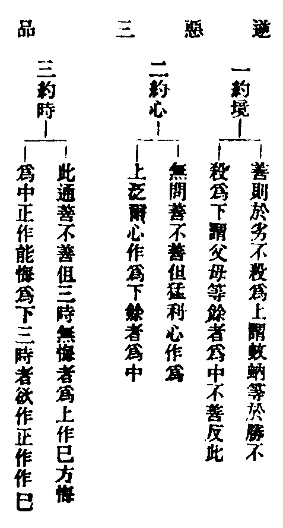



【■记】凡所作业，不出此三，谓心触境，境对心。心境交接，必落时分，故有三品：善、不善业。



【■补】法数言：一、加行心时，加行即方便，谓人欲作恶，必先起心，方便加行。二、根本心时，正作恶时，其心决定不可拔动。三、后起心时，谓作业已后，复起心缘，念所作事。



△二畜生道



二、畜生道，亦云旁生。此道遍在诸处，披毛戴角，鳞甲羽毛，四足多足，有足无足，水陆空行，互相吞啖，受苦无穷。愚痴贪欲，作中品五逆十恶者，感此道身。



【□注】梵语底栗车。辅行二上(二十五)云：畜生者，褚六、许六、向究三反，并通作褚六音，即六畜也。谓牛马鸡豚犬羊，则摄趣不尽。今通论此道，不局六也。



【■记】褚六反，音触，止也。许六反，音旭，养也。婆沙言畜谓畜养，向究反，音齅。谓横生饮食，多以鼻齅食之，故名为齅生。褚六音，即六畜也。即郑玄礼记注言牛马鸡豚犬羊，则摄不尽，今通论也。



【□注】旁生。婆沙云：形旁行旁。



【■记】婆沙曰：其形傍故行亦傍，其行傍故形亦傍。又有言：形傍身多横住，行傍心多不正。又刊正言：行行不正，受果报傍。负天而行，故曰傍行。大约此道众生，多覆身行故。



【□注】此道徧在诸处。婆沙云：遍五道中有之故也。文句四(三十四)云：四天三十三天悉有，而上天所乘象马等，是福业化作，非众生数也。



【■记】此释畜道徧在五趣。如婆沙论曰：后有说者，徧有故，名畜生趣。文句下，示徧天趣。亦准婆沙，明四王天、三十三天，有鴈、雀、象、马等，自上亦有雁、孔雀等文。问：自上诸天，亦乘象、马，今言无者，何也？答：彼天中惟有二足者，如妙色鸟等。餘皆无者，盖空居天所乘象、马，因彼众生福业因缘，故作非众生数象、马形，以自娱乐也。



【□注】披毛如走兽等，戴角如牛羊等，鳞甲如鱼鼈等，羽毛如飞禽等。



【■记】此四中，即有四足、多足、二足、有足、无足不同，五道皆徧。婆沙曰：地狱中无足者，如能究陀等；二足者，如鸟鸠罗那等；四足者，如狗等；多足者，如百足等。饿鬼中无足者，蛇等；二足者，鸟鸠罗那等；四足者，有威德象等，无威德狗等；多足者，如百足等。人道可知，天道见上。



【□注】水陆空行，此三是畜生所依处也。玅玄云：陆有三品，重者土内不见光明，中者山林，轻者人所畜养。



此释水陆空行也。初句直释所依处，如正理论云：傍生所止，谓水陆空也。所谓虫鱼鸟兽种数无穷，山水空陆境界无际也。玅玄下，别示。陆有三品：土内者，如蚯蚓等；山林者，如禽兽等；轻者，即六畜等也。



【□注】大论以三类摄畜生尽，谓昼行，夜行，昼夜行。



【■记】大论云：畜类有三，谓空、陆、水三种行。又昼行、夜行、昼夜行。夜如臬鼠等，昼夜如蝼蚁等。



【□注】互相吞啖。文句四(三十四)云：畜生者多盲冥。盲冥者，无明也。强者伏弱，饮血啖肉，怖畏百端。四解脱经称为血途，从相啖边为名也。



【■记】婆沙曰：有说以盲冥故名畜生，五道中无明多者，莫若畜生。故恃强吞弱，弱者怖畏百端，行一步必左右瞻视也。其实畜生是刀途，经从互吞啖边，名血途。



【□注】中品其心劣，前作已少悔。



【■记】较地狱少劣，比饿鬼为胜。



【□注】俱舍颂云：旁生极一中(旁生寿量，多无定限，其极长者，亦一中劫。谓难陀龙等诸大龙王，皆住一劫，能持大地)。



【■记】即与俱舍释论同。



【□注】文句四(三十五)云：劫初时皆解圣语，后饮食异，谄心而语皆变，或不能语。妙乐五(三十)云：诸教相中，畜生能言，皆此时也。又畜生能飞空，自尔力也。



【■记】此引畜生初皆能言也。如杂宝藏经云：佛言：过去比提醯国王，以象伏迦尸王军。迦尸王作是念言：我今如何当得香象，摧伏比提醯王军？时有人言：我见山中有一白香象。王闻已，即募军言：谁能得香象者，我当重赏。时军集众，往取彼象。象思：我若远去，父母盲老，不如随顺，往至王所。王言：与其饮食。时象不肯饮食。上古畜生，皆能人语。王问：何故不食？象答：我有父母，年老眼盲，无与水草。父母不食，我云何食？又言：我欲去者，王诸兵众，无能遮我，顺王来耳。王今见听我去，供养父母，终寿还来。王喜念言：我即人头象，此即象头人也。寻即放象。父母丧亡，还来王所。王欲伐彼国，象言：莫与鬬争，听我独往，令彼怨敌不敢欺侮，无能遮我便不还者。比提醯王闻象来至，极大欢喜，语言：即住我国。象曰：不得即住，先许彼王当还其国。汝二国王，应除怨敌，自安其国，岂不快乎？即说偈言：得胜增长怨，负则益忧苦。不争胜负者，其乐最第一。尔时香象说此偈已，即便还国。从此已后，两国和好。尔时白象王，今我身是。迦尸王者，今波斯匿王是。比提醯王者，今阿阇世王是。当知上古之畜，能人语也。



南天竺沙门蒙润集注



清比丘性权彚补辅宏记



清三宝弟子钱六庵较订



天台嫡裔比丘谛闲编科参梓



△三饿鬼道。



三、饿鬼道，梵语阇黎哆。此道亦徧诸趣，有福德者，作山林冢庙神；无福德者，居不净处，不得饮食，常受鞭打，填河塞海，受苦无量。谄诳心意，作下品五逆十恶，感此道身。



【□注】辅行二上(二十五)云：梵语阇黎哆，此翻祖父。后生云祖父者，从初受名。又后生亦是后生之祖父也。



【■记】婆沙言：或有众生，最初生彼道中，名祖父。又言：后诸众生，生彼生处，彼相续者，亦名祖父。



【□注】尔雅云：鬼者，归也。尸子曰：古者名死人为归人。又云：人神曰鬼，地神曰祇，天神曰灵。又云：饥饿，谓饿鬼也，恒被驱使。



【■记】此引外书释鬼也。夏禹王济江，龙负舟，舟人惧。禹叹曰：吾受命於天，竭力以劳万民。生，寄也；死，归也。何忧龙焉？自后称死者为归人也。饥饿等，婆沙论言：有说：多饥渴故，彼众生腹如山，咽如针孔，百千岁不闻水声，亦未曾见，何况得触？又言：复有说者：被驱使故，彼恒为诸天处处驱使，故亦名驱使鬼。



【■补】鬼者，畏也。谓虗怯多畏。又威也。能令他畏其威故。



【□注】此道亦徧诸趣。辅行三下云：此处在阎浮提下五百由旬，有阎王界，纵广量亦等，是根本处。亦有住阎浮提洲者，有德者住华果树林，无德者居不净处。东西二洲亦有鬼，北洲唯有威德者。诸天亦有随生处形，或居海渚，或在人间山林中，或似人形，或似兽形。



【■记】有德住华果者，即主掌华果树林，使不枯瘁，而受奇华茂林之乐。无德居不净者有二：一、有力，主掌其处；二、无力，偷啖粪秽，常受鞭笞。东西亦分有无威德二种。北唯威德者，彼地清净果报故。诸天随生处形者，谓四天王天、三十三天，唯有威德者也。居海渚山林者，有说阎浮提西有五百渚，两渚间有五百饿鬼城，其二百五十有威德者住，其二百五十无威德者住。故尼弥转轮圣王告御者摩多罗曰：我欲升天，汝可从是道去，使我见诸众生受恶善报者。尔时圣王从诸城过，见有威德者，如诸天子，天冠天衣，食甘饮美，各各游戏而自娱乐；无威德者，露体无衣，以发自覆，手执瓦器，行乞自活也。似人形兽形者，谓有正立者，有旁侧者，或面如猪，或首似牛，如壁上畫像是也。已上俱准婆沙对记。



【■补】随生处形者，如生南洲，像南洲人形；生天，像天人形。又长阿含言：一切人民所居舍宅街巷，四衢道中，屠儿肆市，及丘冢间，皆有鬼神，无有空者。依人名人，依村名村，一切树木极小如车轴者，皆有鬼神依止。有师标言：随生处形，谓随何处命终，即作彼形语。评曰：不应作是说：若从无色界殁生此处，可无形无语耶？应言：随所生处形语亦尔。



【□注】不得饮食，重者饥火节𦦨，不闻浆水之名，中者伺求荡涤脓血粪秽，轻者时簿一饱，加以刀杖驱逼，塞海填河。四解脱经称为刀途，从彼刀杖驱逼为名也。



【■记】然饿鬼应名血途，以见清水为脓血故，而经从彼刀杖驱逼，名刀途也。



【□注】下品正作能悔，故云下品。俱舍颂云：鬼日月五百。以人间一月为一日，寿五百岁。更有三类九种，内障、外障、无障，如兰盆疏。



【■记】三类九种，如下图示。内障、外障、无障者，疏曰：水到化为脓血，是内障；咽如针，腹如瘿，为外障；饮血、啖粪、烧然，是无障也。又有言：一、外障，得遇水时，即见有人执刀杖等障碍故；二、内障，口有火炬，或咽如针故；三、无障，见河是猛火，或食粪秽，或自割身肉食啖等也。



【□注】今水陆施食，正为𦦨口鬼神。婆罗门仙出生所供，为旷野鬼神，鬼子母等。



【■记】佛说焰口经曰：阿难习定，夜见鬼王，口吐火燄，饥火交燃。问：是何名？答曰：面燃。汝三日中，当堕我类。阿难惊怖，归投大觉慈尊，叙说前因，启请救苦之法。佛告阿难：我念过去作婆罗门时，於观世音菩萨边，受得陀罗尼，名曰无量威德自在光明如来陀罗尼法。汝若善能作此法者，加持七遍，能令一食变成种种甘露饮食，即能充足百千俱胝那由他恒河沙数一切饿鬼婆罗门仙也。出生偈曰：大鹏金翅鸟，旷野鬼神众，罗刹鬼子母，悉皆得饱满是也。



【■补】统纪水陆者，梁武帝梦神僧告以作水陆大斋，拔济六道四生。帝即遣迎大藏，创立仪文，三年而成，乃建道场。出生者，有二缘：一者，涅槃经：合旋旷野鬼神毗奈耶，令施鬼子母等。此曹本食肉噉人，佛化之受戒，嘱弟子随处施食。今斋堂各各出生是也。此唯出家人行之。二者，𦦨口经：令施饿鬼食。今斋堂别俱小斛，於食毕，众作法既之，或名具小生斛，夜间呪施。此通俗行之。



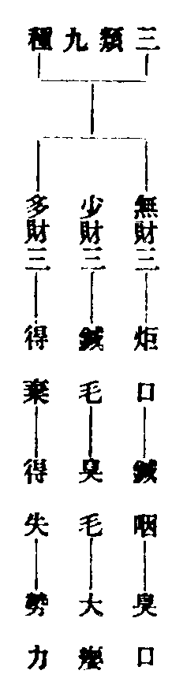



【■记】盂兰盆疏曰：鬼有三：一、无财，以无福德，不得食故；二、少财，少得净妙饮食故；三、多财，多得净妙饮食故。复各有三。无财三者：一、炬口者，谓火炬炎炽，常从口出。正法念经云：若人贪嫉，枉夺人财，破人城郭，杀害抄掠，得财奉王大臣，转增㐫暴，堕炽然饿鬼中。二、针咽者，头大如山，咽如针孔，由破斋夜食，盗窃众僧食故。三、臭口者，口中腐臭，自受恶报，以多贪名利，自是非他，赞叹恶人，毁谤贤善故。少财中三：一、针毛者，毛利如针，行便自刺，为贪利故，妄行针灸，及刺众生，但为求财，不愈病故。二、臭毛者，鬼毛利而臭，自拔受苦，由贩卖畜生，烹宰𬊈剥，楚痛难堪，地狱罪终，堕斯鬼趣。三、大瘿者，咽垂大瘿，自抉噉脓，由嫉妬於人，常怀嗔恨故。多财中三：一得弃鬼，常得祭祀所弃食故，由罪多福少，少施多悭，弃掷之物，方惠施故。二得失者，常得巷陌所遗食故，以於现财，常生悭著，疑欲失者，而方舍故。三势力者，谓夜叉、罗刹、毗舍阇鬼等，所受福乐，类於人天，或依树林山谷，灵庙空居，形竖而行，属於鬼趣。此等变化多端，由於因地，罪福不精，苦乐之因，相杂作故。然鬼神一道，多不信者。昔阮修执无鬼曰：今有见鬼者，言著生时衣，人有鬼衣，亦有鬼耶？论者伏焉。此亦不达鬼化为衣，似生时所著服也。然俗虽说有，非悉知有，故俗所说，但见人畜少分，不见餘之四道。如孔子曰：生与人事，此尚未知，死与鬼神，我焉能测？则知佛教法，方备明道六之趣欤。



△四阿修罗道。



四、阿修罗道，此翻无酒，又无端正，又无天，或在海岸海底，宫殿严饰，常好𨷖战，怕怖无极，在因之时，怀猜忌心，虽行五常，次胜他故，作下品十善，感此道身。



【□注】文句二(二十一)云：四天下采花，酝於大海，鱼龙业力，其味不变，嗔妬誓断，故言无酒。



【■记】修罗嗜酒，遍采名花酝海，欲成香醪。鱼龙业力，水味不变，嗔妬誓断酒，故名无酒。



【□注】无端正，男丑女端，舍脂是也。



【■记】男修罗二十四头千手，其丑可知。女修罗端正如舍脂，帝释纳为妻，五通仙人闻其声，即失五通，其美亦可知矣。今据男修罗，故名无端正。新婆沙言素洛名端正，彼非端正，名阿素洛。



【□注】无天，净名疏二(十四)云：此神果报最胜，邻次诸天，而非天也。妙乐二(二十九)云：无天德故(文)。



【■记】净名疏释者：此道有天福报，无天德行。妙乐，准正理论言：洛素名天，是自在义；无天实德，名阿素洛。



【□注】或在海岸海底。辅行二上(二十五)云：世界初成，住须弥顶，亦有宫殿。后光音天下，如是展转至第五天，修罗嗔便避之，无住处，下生此(文)。文句二(二十一)云：鬼道摄者，居大海边。畜生道摄者，居大海底。准此，则知妙玄明或居半须弥山岩窟，应天种摄。妙乐引阿含：四修罗次第住於海底，各於海下二万由旬以为一宫，居止处殊胜，必兼多福，方得生彼。又楞严经明胎卵湿化四种之异，属於鬼畜人天四处所摄，具如彼文。



【■记】辅行中，明修罗避天，从他化逆数而来。忉利正是第五天，嗔避之故，移住海岸海底。文句中，明鬼畜修罗，住海岸海底。以正法念经云：阿修罗二种：一、鬼道摄，魔身修罗，有神通力；二、畜道摄，住大海底，须弥山侧。阿毗昙论言：阿修罗谄曲覆故，鬼道所摄；罗睺阿修罗王师子生故，畜道所摄。而文句则以鬼道居海边，畜道居海底。准知妙玄明居须弥岩窟住者，天种摄也。言天种者，妙乐言：并是元祖。又大权示现，往缘何定？故有畜修罗，天种摄也。妙乐中引阿含四修罗住处，即婆稚阿修罗、佉罗骞默阿修罗、毗摩质多罗阿修罗、罗睺阿修罗也。各於海下二万由旬为宫，必兼多福，方得生彼。又於文末，检十地经曰：修罗有五类：一、极弱者，住人间山林，西方山大窟深，有非天之宫；二、妙高山北，大海之下，二万一千由旬，有罗睺宫；三、又二万一千由旬，有勇健之宫；四、又二万一千由旬，有华鬘之宫，华鬘，此云绮畫，以文其身；五、又二万一千由旬，有毗摩质多罗宫，即次第住海底相也。故正法念处经说：多好𨷖诤，怀胜负故，或居众相山中，或居海下，然有大力者，广修福故也。又楞严经言：三界中有四种修罗，若於鬼道，以护法力，乘通人空，此从卵生，鬼趣所摄；若於天中，降德贬坠，其所卜居，邻於日月，此从胎出，人趣所摄；有阿修罗王，执持世界，力洞无畏，能与梵王及天帝释四天争权，此阿修罗，因变化有，天趣所摄；别有一分下劣修罗，生大海心，沉水穴口，旦游虗空，暮归水宿，此阿修罗，因湿气有，畜生趣摄。



【□注】宫殿严饰妙乐。引长阿含十八云：南洲金刚山中有修罗宫，所治六十由旬栏楯行树等。然一日一夜三时受苦，苦具自来入其宫中。属四趣者，良有以也(文)。



【■记】起世经说：修罗宫殿，城郭器用，降地居天一等。亦有婚姻，男女法式，略如人间。今引长阿含释，复言三时受苦，故属四趣也。



【■备】辨讹指三时受苦乃阎罗事



【□注】常好鬬战。文句二(二十二)云：毗摩质多生舍脂，帝释纳为妻，后谗其父，遂交兵。脚波海水手攻善见，帝释以般若呪力不能为害(文)。



【■记】观佛三昧经云：光音天生此地，地使有欲入海水，洗其不净，堕泥变为卵。八千岁生一女，千头，少一二十四手。此女戏於水，水精入身。八千岁生一男，二十四头，千手，少一海水。波音名毗摩质多索乾达婆，女生舍脂。帝释业力，令其父居七宝殿，纳为妻。婆沙言：帝释纳舍脂者，诸天贪美色故，不为族姓。以舍脂端正无双故，帝释纳之为妻也。瑜伽论言：修罗与天鬬时，或断支节，或破其身，或复致死。若伤心断节，续还如故。若断其首，即便殒没。故诸天胜，入修罗宫，尽取其女。修罗胜，便至天宫，取其天酪美味。



【■补】天帝释发大愿，持般若波罗密於虗空中，刀杖自然而下，修罗耳鼻手足一时脱落。有师标言：又以手摇须弥山，动善见城。常释念般若上天助之，修罗败入藕孔。



【□注】怕怖。无极净名疏二(十四)云：往昔嫉妬恼他，故常多怖畏。(文)猜忌。辅行二上(二十五)云：又嫉佛说法。佛为诸天说四念处，彼阿修罗则说五念处。佛说三十七品，彼则说三十八品。常为曲心所覆。猜者，疑惧也。诗传云：以色为妬，以行为忌。害贤曰嫉。故知修罗嫉贤忌行。



【■记】此释怀猜忌心也。如婆沙言：彼修罗作是念：佛为我等说四念处，必为诸天说五念处；佛为我等说三十七，必为诸天说三十八助道法。以如是谄曲心所覆故，不能得正决定，是为怀猜忌心也。又有说：修罗疑佛助天，佛为说五众，谓有六众，不为说一众；佛为说四谛，谓有五谛，不为说一谛也。



【■备】节义云：五念等有二说：一、论中明魔现作佛，为四众说五念。三十八品及修罗闻说四念，谓佛前为诸天说五念，为我等说四念，谓佛有偏曲。二、修罗好胜增，如妄说也。



【□注】五常辅行一下(三)云：以慈育物为仁，以德推迁为义，进退合宜为礼，权奇超拔为智，言可反覆为信。内德具备，方成人道。慢强无德，判属修罗。又据善心，仍居下品。外扬五德，本在轻他(文)。



【■记】白虎通云：仁者，好生爱人也。义者，宜也，断决得中也。礼者，履也，履道成人也。智者，知也，於事见微知著也。信者，诚也，专一不移也。可反覆者，后可践其言也。慢强无德者，虽外行五常，意在轻他，无内德也。



【■备】有师标曰：论问：阿修罗与天不异，今何说善下，分为修罗果报？答：人能出家受戒，以至於道。修罗心多谄曲，以近道难，故在人下。辨讹曰：合宜。宜字，准辅行应是仪字，否则犯於义者宜也之解。



【□注】十善对十恶立，谓不杀等。又十皆有止行二善，如不杀止善，放生是行善等。



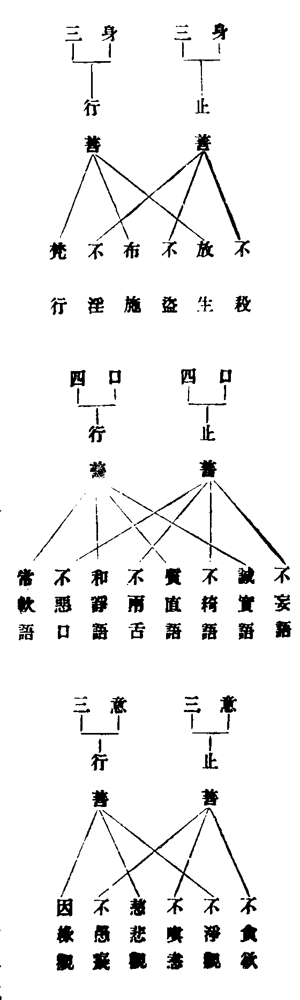



【■记】夫十善对十恶立者，人能知恶招苦，必须息恶行善，方可来世致清升乐果，故十善对十恶立也。止行通称善者，善以顺理为义，息倒归真，故曰顺理。止则息於重倒之恶，行则渐归圣道之善也。不净慈悲因缘等，观见藏教五停心中解。



△五人道



五、人道四洲不同，谓东弗婆提(寿二百五十岁)、南阎浮提(寿一百岁)、西瞿耶尼(寿五百岁)、北郁单越(寿一千岁，命无中夭，圣人不出其中，即八难之一)，皆苦乐相间。在因之时，行五常、五戒。五常者，仁、义、礼、智、信。五戒者，不杀、不盗、不邪淫、不妄语、不饮酒。行中品十善，感此道身。



【□注】辅行二上(二十六)云：梵语摩㝹賖，此云意。人中所作，皆先意思。易曰：惟人为万物之灵。礼云：人者，天地之心，五行之端。此亦未知五道故也。婆沙云：五道多慢，莫过於人。又云：五道中能息意者，亦莫过人(文)。法苑云：人者，忍也。於世违顺，人能安忍。



【■记】婆沙言：昔王名顶生，王四天下，告诸众生：诸有所作意，当善思，善筹量，善忆念。众生如教思量忆念，便能工巧作业。以所作先意思故，故名人为意。人为万物灵句，出尚书泰誓篇。易字误。人与天地合德，故曰天地之心。此以理言之也。端，履也，首也。人统五行之全，故曰五行之端。此以气言之也。儒典单就人论，故未知五道也。婆婆下，引释典解人。文曰：五道中慢心多者，莫若人，故名人趣。乃至五道中能止息意，莫若人趣。以人能得解脱分善根，能亲近善知识等四法，亦能修行亲近善知识等四法也。法苑曰：人者，忍也。谓於世间极苦甘心(安忍)。



【□注】四洲：此世界下有三轮，下风，次水，上金轮。金轮之上，有九山八海，须弥居中，铁围在外。中绕须弥，有七金山，七香水海。第七山外，铁围之内，即第八咸海。东西南北，有四大洲，四洲土轮，居金轮之上。於四洲边，复有二小洲，具如俱舍。



【■记】俱舍曰：安立器世界，风轮最居下，其量广无数，厚十六洛叉。次上水轮深，十一亿二万，下八洛叉水，餘凝结成金。此水金轮广，径十二洛叉，三千四百半，周围此三倍。又言：中洲复有八，四洲边各二。又言：瞻部边二洲者：一、遮末罗，二、筏罗遮末罗。胜身边二洲者：一、提诃，二、毗提诃。牛货边二洲者：一、舍𢮎，二、嗢怛罗漫怛里拏。俱卢边二洲者：一、矩拉婆，二、憍拉婆。此一切洲，皆人所住。



【■补】十万为一洛叉，即亿也。俱舍言：第一须弥山，高广各八万由旬。须弥外，第一香水海，横广八万由旬。第二双持山，高广各四万由旬。第二香水海，横广四万由旬。三持轴山，高广各二万由旬。四担木山，高广各一万由旬。五善见山，高广各五千由旬。六马耳山，高广各二千五百由旬。七障碍山，高广各一千二百五十由旬。第七香水海，横广一千二百五十由旬。八持地山，高广各六百二十五由旬。第八盐水海，三十二万二千由旬，中有四洲。第九小铁围山，高广各三百十二由旬。诸山入水，皆八万由旬。住金轮上，诸海皆深八万由旬。准此山海，四洲可知矣。



【□注】弗婆提翻胜身。



【■记】西域记云：东毗提诃洲，旧曰弗婆提，又曰弗於逮，讹也。此云胜胜南洲，故又翻初，日初出处也。



【□注】阎浮提亦云瞻部。无热池侧有赡部林，树影高大，其果甘美，依树立名。此方无，故不翻。西域记中翻为秽树。



【■记】大论言：阎浮，树名。此洲上有此树林，林中有河，底有金沙，名阎浮檀金，以树故名洲。此洲有五百小洲围绕，通名阎浮提。西域记言：南赡部，旧日阎浮提，又曰剡浮洲，讹也。藏钞言：赡部，此土无相当，故不翻。唯西域记音中，翻为秽树。



【■补】非污秽之意，高荫一切名秽。



【□注】瞿耶尼，翻牛货。俱舍钞云：劫初时，高树下有一宝牛，为货易故。



【■记】翻译名义云：牛货，亦番取与。藏疏言：以彼多牛，以牛为货也。西域记云：西瞿陀尼洲，旧曰瞿那尼，又曰劬伽尼，讹也。节义引长阿含言：西瞿耶尼有大树，名斤提树，上有石牛幢，又以牛羊为货易。故注含二意。



【□注】郁单越，亦云俱卢，翻胜处，胜三洲故。俱舍颂云：赡部洲人量，三肘半四肘(尺八)，东西北洲人，倍倍增如次(东洲八肘，西洲十六肘，北洲三十二肘)，唯有北洲人，寿定一千岁。餘三且据极分为言，未必全尔。



【■记】翻译名义云：郁怛越，翻胜处。亦言胜生，於四洲中，有情处货，此最胜故。亦言高上，出餘三方故。西域记云：北拘卢洲，旧言郁单越，又曰鸠楼，讹也。俱舍颂下长行释言：赡部人身，多长三肘半，於中少分，有长四肘。东洲八，西洲十六，北洲三十二。而一肘长一尺八寸，则南洲身量，多有六尺三寸，少分有七尺二寸。东洲身量，长有一丈四尺四寸。西洲人身量，长有二丈八尺八寸。北洲人身量，长有五丈七尺六寸。又颂四洲人寿量言：北洲定千岁，西东半半减，此洲寿不定，后十初叵量。谓后减至十岁，其劫初八万四千岁。又诸处有中夭，除北拘卢洲，则知北洲胜也。



【□注】圣人不出其中，不生於彼而阐化，非不居彼。准宝云经，颇罗堕将弟子六百人，住郁单越八难三途，以为三人中则有四：一盲聋瘖哑，二世智辨聪，三佛前佛后，四北俱卢洲。天上一无想，或指长寿天，受此诸果报，不得於圣化。



【■记】此释八难也。若欲不受八难，须习四种轮摧。如成论明菩萨习四轮摧八难：一、生中国轮，摧灭三途北洲长寿天难；二、修正愿轮，摧世智辨聪难；三、植善因根轮，摧盲声瘖哑难；四、近善人轮，摧佛前释后难。故无四轮，未免八难，而北俱卢乃其一也。净名疏明二种八难，谓凡夫住事八难，二乘住理八难。事即界内八难，理乃界外八难。荆溪言：若欲略明，则有餘涅槃中，三十心人，为三恶道，住无我法，名为北洲。地前法爱，如长寿天。未有初地十种六根，名诸根不具。地前智浅，如世智辨聪。不穷中理，如佛前佛后。若实报土中，位位相望，节节作之，此并障於中道理也。然此且说住事八难。



【□注】苦乐相间。辅行四上(九)云：若论果报，南洲为下下；若得值佛，南洲为上上。故大论六(十二)云：阎浮提以三事故，尚胜诸天，北洲不及：一、能断淫欲，二、识念力，三、能精进勇猛。复有书般若，是故诸天下来听法。故大经云：下下因缘故生北洲，乃至上上因缘故生南洲(文)。妙玄六(二十九)云：四天下人，虽果报胜劣，俱有生老病死，同是轻报泥犂(文)。



【■记】教说三天下，三种胜南洲：一、长寿，二、色胜，三、地胜。故南洲为下下。佛若出世，唯在南洲，东西但往不生，北洲不生亦不往，此指佛说。故论值佛，南洲为上上也。妙乐曰：佛者，劫初无病，劫尽多病。长寿时乐，短寿时苦。东天下富而寿，西天下多珠宝牛羊，北天下无我无臣属。如此时处，不感佛出。八万岁时、百年时，南天下人未见果而修因，故知佛出其地。故大论下，引证南洲为上。又教中明南洲有五种胜三天上及他化天：一、勇健，二、正念，三、佛生处，四、修业地，五、梵行。然不出大论三事也。大经曰：人业十善，复有四种：一者下，二者中，三者上，四者上。上下因缘故，生郁单越；中因缘故，生弗婆提；上因缘故，生瞿耶尼；上上因缘故，生阎浮提。疏言：十善有四，报在四洲。南洲年命，果报最劣，乃下业之果。而言上上者，取修道行善边胜故。



【■补】能断淫欲，即梵行也。能得解脱达分，得正决定故。禅中四分，有退、住、进、达。达者，於此定中，发见、思、无漏，能到涅槃。念力，即正念也，谓笃信念力，不见果而能广修因故。三、精进勇猛，即勇健也。有师标曰：念力，久远所作而能忆故；勇健，不见果而能广修因故。



【□注】五常，五戒。常者不易，戒乃防非。仁则不杀，义则不盗，礼则不淫，信则不妄语，智则不饮酒。酒能昏性，起过故也。



【■记】此释五常五戒也。初二句，明戒常义。次五句，明戒常合对。如提胃经中，长者问佛：何故但说於五，不说四六？佛言：五者，是天地之根，太乙之初，神气之始，万物之祖，是故但五。又曰：五戒者，令成当来五体，顺世五常五德之法。愍伤不杀曰仁，清察不盗曰义，防害不淫曰礼，持心禁酒曰智，非法不言曰信。此五不可造次而亏，不可须臾而废。君子奉之以立身，用之不暂弃。然是以五戒，顺世五常也。今乃以五常通於五戒。如天台大师言：仁慈矜养，不害於他，即不杀戒。义让推廉，抽己惠彼，是不盗戒。体制规矩，结发成亲，即不邪淫戒。智鉴明利，所为秉直，中当道理，即不饮酒戒。信契实录，诚节不欺，是不妄语戒也。末句明酒起过。如梵网经言：酒生过失无量，若伸手过酒器，与人饮酒者，五百世无手。大论开有三种：一谷酒，二果酒，三药酒，皆不得饮也。又问：出家禁饮，无待论矣。汉书言：酒者，天之美禄，所以颐养天下，享祀祈求，扶衰养疾。故有国家者，以酒合懽，以酒成礼。云何世间而得禁饮耶？答：夏禹以前，不闻有酒。唐虞之治，礼备乐和。酒之可戒，亦明甚矣。又何论焉？又问：大师戒经疏，开不为过患者，何也？答：此正明免於过患者难也。诚使百拜而祸不侵，无量而乱不及。文忠终身不醉，思远醉胜醒人。能如是者，疏文许开，意有在焉。如其不能，禁绝为上。



【□注】又五戒，四性一遮。酒乃遮制，餘性是恶。大小乘禁戒，此为根本。止观四(二)云：性戒者，莫问受与不受，犯即是罪。受与不受，持即是善。若受戒，持生福，犯获罪。不受无福，不受犯无罪。(文)辅行四上(三)云：所言性者，即旧戒也。不待佛制，性是善恶，故名为性。又云：五戒者，四性一遮。故俱舍云：遮中唯离酒，为护餘律仪。若论制已，性上更加一个制罪。(文)性戒轮王，亦用遮戒。如来所制五戒十善，开合之异，身三可见。不妄语，则摄口业四种酒。防意地，则摄意三



【■记】此明五戒四性。一遮者，如报恩经曰：优婆塞五戒，四是实罪；饮酒一戒，是遮罪。同结为五戒者，以饮酒是放逸之本，能犯四戒故。如迦叶佛时，有优婆塞，以饮酒故，邪淫他妇，盗杀他鸡。人问：何故尔？答言：不作。以酒乱故，一时能破四戒。虽非实罪，与实罪同也。大小乘戒根本者，法界次第言：犯五戒者，则破五分法身，及一切佛法。以五戒是大小乘尸罗根本，若犯五戒，则不得更受大小乘戒。若能坚持，则是五大施也。止观下，明性受二戒，持犯罪福有异。性戒者下，辅行云：料简三学，无作有无。初戒无作者，性戒不受，故无无作。若受戒下，辅行言：明受得戒，即有无作。故性罪之上，加违无作。出家等戒，无作别生。受得戒已，感发无作。是故持则福等虗空，破乃随破一支一境。举持劝受，加罪遮违。况犯已法除，复本清净。是为受得之戒，与性戒有异。故辅行云：如伐草害畜，俱有违制之罪，作单提悔，二遮俱灭。然於害畜，仍有性愆，故引大论解言：违无作罪同灭，而偿命犹在，是为性受有异也。俱舍下文言：诸饮酒者，心多纵逸，不能守护诸餘律仪。故为护餘，令离饮酒也。制已，加一制罪者，如大论引经云：佛言：若出家人，犯欲则弃。是比丘自誓而犯，是一罪；知佛所制，故而违犯，是二罪是也。性戒下，光明句言：开五戒，出十善。十善是旧法，轮王亦用，亦名性罪。性罪都是一切罪之根本，则知性戒通为所用也。律明诸餘比丘犯种种罪，如来一一遮制，如礼乐自天子出，故知遮戒局在如来所制也。末二行，明戒善开合之异。如光明文句云：五戒对十善，杀盗淫是身，三妄语摄口，四饮酒摄意，三俗不能护口，略制一妄语。释论言：说重者是妄语，则已摄三饮酒，是邪命自活，增益恚痴。出世以智慧为首，生死以三毒为根，若能禁酒，是防止意地三毒，长养出世智慧也。



【■备】九山八海形状及下天道，略知而已，故不广录。统纪有三千大千图，须者往检。



△六、天道二：初、总判。



六天道二十八天不同(欲界六天，色界十八天，无色界四天)。



【□注】辅行二上(廿六)云：今释典中所言天者，亦名最胜，亦名光明。(文)文句四末云：天者，天然，自然，乐胜，身胜。(文)



【■记】婆沙言：诸趣中胜故，谓有胜、乐胜、吉善胜、身胜、形体胜。有如是等胜，故名为天。又曰：有说诸天无昼夜，常以光明自照，故曰天趣也。文句下，如正理言：天者，威德特尊，神用自在。又别行钞言：天者，名无愁恼，常受快乐故。



【□注】二十八天不同，举竖包横也。若统论一佛化境，则有三千大千世界。



【■记】若以横论，则欲界忉利一天，即有三十三天，今以竖论也。



(三千者，小千、中千、大千也。二禅统一小千，三禅统一中千，四禅统一大千。三千是总，大千是别。总别双举，以别显总也。)



【■记】或问：金光明经说：诸人王手擎香炉，供养经时，其香遍布，於一念顷，遍至三千大千世界，百亿日月，乃至百亿非非想天，则大千直至有顶天。今何言四禅统一大千耶？今答：所以尔者，为与长阿含十八，杂阿含十六，正理三十一，及瑜伽、智论、杂集、显扬同意故也。况有云：显扬第一，明三千世界三灾所坏，故此以四禅统大千也。



【□注】俱舍颂云：四大洲日月，苏迷卢欲天，梵世各一千，名一小千界。此小千千倍，说名一中千，此千倍大千，皆同一成坏。(谓一千四洲，一千日月，一千须弥，一千六欲天，一千初禅天，总名小千世界。一千个小千世界，名中千世界。一千个中千世界，名大千世界。)



【■记】此段原注正释前七句颂，而与俱舍长行释颂同。



(小千为一二禅所覆，中千为一三禅所覆，大千为一四禅所覆。例此应云：千个初禅为小千，千个二禅为中千，千个三禅为大千。小千如千钱，中千如千贯，大千如千个千贯。)



【■记】此段原注：准例举譬，论释俱舍。言此文易了，总以喻显也。



(然以十万为亿，则大千有万亿日月，而光明经云百亿日月，乃至百亿非非想天等者，盖亿有四种：一十万为亿，中千有十亿，大千万亿；二百万为亿，中千有一亿，大千有千亿；三千万为亿，大千则有百亿，光明据此数也；四万万为亿，大千世界但有十亿。又复四禅非想唯一，亦言百亿者，光明记五七云：以下望上言之耳，又恐翻译之讹也。以义净重翻，则无百亿非想之言。)



【■记】此段原解释违。光明经云：若据俱舍释违，则言大千有万亿日月。光明经云：大千百亿日月者，盖此方黄帝算法，数有三等，谓上、中、下也。下等数法，十十变之；中等，百百变之；上等，倍倍变之。今此三千，若以小数计，有万亿；若以中数计，从千百已上百变之，则有百亿也。故华严钞云：若以小数者，小数则下等十十变也。谓十小千为万，百小千为亿，千小千为中千，已有十亿。更一千中千为一大千，一千中千即为千个十亿，故为万亿。若约中数者，谓从千已上方百百变之。谓百小千方为一万，千个小千为中千，方是十万。十个中千始为百万，方是一亿。既十中千为一亿，若千个中千则有百亿。故知论约下等小数而言万亿，经据中数故言百亿日月等。



【■补】以下望上言者，因下初禅有百亿须弥等，望上四禅非非想，亦带言百亿也。



(又瑞应经云：三千日月，万二千天地之中央者，万即大千，谓万亿二千，即中千小千也。盖言佛生迦维卫国，是三千世界之中央也。)



【■记】万即大千。下释明瑞应经文。



(须知成住坏空，各二十劫，为一大劫。一增一减，为一小劫。於住劫中，二十增减。每一增减，有小三灾，坏於有情。住劫尽时，乃有大三灾，坏於世界，经二十劫。空劫成劫，各二十劫，并约住劫数量而论。)



【■记】此释第八句颂。



【■补】成住坏空，大中小劫，大小三灾，统纪详载。



【■备】辨讹云：小三灾坏有情，在住劫论坏劫中云：十九劫坏有情，乃是空有情也。



【□注】业道增寿减，至十三灾现，刀疾饥如次，七日月年止。



【■记】此明三小灾起。而此一颂，出论第十二卷十一纸。论释言：从诸有情，起虗诳语，诸恶业道，后后转增。故此洲人，寿量渐减，乃至极於十岁，小三灾现。故诸灾患，二法为本：一、耽美食，二、性懒惰。此小三灾，中劫末起。三灾者：一、刀兵，二、疾疫，三、饥馑。谓中劫末十岁时人，为非法贪，染污相续，不平等爱，映蔽其心，邪法萦缠，嗔毒增上，相见便起猛利害心。如猎师见禽兽，随手所执，皆成利刀，各骋凶狂，互相残害，故说刀兵。又中劫末十岁时人，由具如前诸过失故，非人吐毒，疾疫流行，遇辙命终，难可救疗，故说疾疫。又中劫末十岁时人，亦具如前诸过失故，天龙忿责，不降甘雨。由是世间久遭饥馑，多分命终，故说由饥馑故，便有聚集、白骨、运筹。由二种因，名有聚集：一、人聚集，谓彼时人，由极饥羸，聚集而死。二、种聚集，谓彼时人，为益后人，辍其所食，置於小箧，拟为种子，故饥馑时，名为聚集。言有白骨，亦有二因：一谓彼时人，身形枯燥，命终未久，白骨便现；二饥荒所逼，聚集白骨，煎汁饮之。有运筹言，亦二因故：一由粮少，行筹食之，谓一家中，从长至幼，随筹至日，得少麤食；二谓以筹挑故场，得少榖粒，多用水煎，分共饮之，以济餘命。然教中说：若人能一昼夜持不杀戒，未来决定不逢刀兵灾起；若能以一诃梨怛鸡，即呵梨勒果，此言天主持来。起殷净心，奉施僧众，当来决定不逢疾疫灾起；若能以一抟食，起殷净心，奉施僧众，当来决定不逢饥馑灾起。此小三灾，各经几时？刀兵唯七日夜，疾疫七月七日，饥馑七年七月七日，度此便止，人寿渐增。东西二洲，无根本三灾，有相似灾起，谓嗔恚增盛似刀兵，身力羸劣似疾疫，数加饥渴似饥馑，北洲总无。前说火灾，焚烧大千世界，餘二灾亦尔。



(据瑜伽论，人寿减至三十岁，饥馑灾起，七年七月七日止。减至二十岁时，疾疫灾起，七月七日止。减至十岁时，刀兵灾起，七日七夜止。今俱舍云至十三灾现者，乃据减劫之极为言也。故自十岁返次送对，则十岁刀兵乃对七日，二十岁时疾疫乃对七月，三十岁时饥馑乃对七年，则与瑜伽初无异也。)



【■记】此会释二论对次异同。



(垂裕记十（十二）引什师云：婆须密从忉天下，生王家作太子，化众人言：我等祖父寿命极长，以今瞋恚无慧故，至此短寿，是故汝等当行慈心。众人从命，恶心渐薄，此后生子，寿二十岁。如是展转，增至八万四千岁也。（文）论增则子年倍父年，则自十岁增至八万四千岁；论减则百年减一年，则自八万四千岁减至十岁。故一增一减，为一小劫。)



【■记】此示名小劫。然此一增一减，亦名一辘轳劫。



【■备】辨讹云：子年倍父句，或生人倍於父年，取其为信，未必人人如此也。百年减一之言，未详出处。阿含云：子年倍父年，增既倍，倍而增，减亦半，半而减。虽如此言，亦非顿增顿减，如今人寿较古渐减，故据理以渐增渐减为是，达者详之。



【□注】三灾：水、火、风。上三定为顶。



【■记】此颂明大三灾起，今明三灾顶处。



(二禅为火灾顶，三禅为水灾顶，四禅为风灾顶。)



【■记】更不过上，故三皆顶。



【□注】如次内灾等四，无不动故(初禅内有觉观，能烧恼心等外火灾。二禅内有喜受，与轻安俱，润身如水，故遍身麤重等外水灾。三禅内有动息，息亦是风等外风灾。四禅无内患故，亦无外灾)。



【■记】此二句颂，通明四禅有灾无灾之所以也。此释与论辞异意同。以论释下三定，先有徵云：何缘下三定，遭水火风灾？初二三定中，内灾等彼故。又论称初静虑等，此称初禅等。又论称寻伺，此称觉观。是辞异意同也。又论云：何缘不立地亦为灾？以器世间即是地故。但可火等与地相违，不可说言地还违地。今注中无此徵释也。论释第四定，亦先徵言：第四静虑何缘无外灾？彼无外灾，离内灾故。由是佛说彼名不动，内外三灾所不及故。有说：彼地有净居天，故彼不遭诸灾所害。由彼不可生无色天，亦复不应更往餘处。是则与今注辞义详略有异也。



【■备】辨讹云：准俱舍论，遍身麤重下，有由此皆除一句，当注其下，方可销文。否则，遍身句亦不必引。



【□注】然彼器非常，情俱生灭故(彼器即依报，虽云不动，非是常住不坏之法。情即有情正报，彼天宫殿，情生则生，情灭则灭)。



【■记】此二句颂，单明第四禅非常住不动也。此释与论意同。以论文言：若尔，彼地器应是常；不尔，与有情俱生俱灭故。谓彼天处无总地形，但如众星居处各别，有情於生时死时所住天宫，随起随灭，是故彼器体非常住。虽云不动者，以论释有言：由此佛说彼名不动，内外三灾所不及故。然非是常住不坏之不动也。



【□注】要七火一水，七火水后风(初禅以下，七经火灾，是则七番成住坏空，当七大劫。第八水灾，齐於二禅，又一番成坏，当八大劫。如是初禅已下，七七四十九火。二禅已下，七番水灾，成五十六劫。初禅已下，又七火灾，当六十三劫。六十四劫风灾，坏至三禅也。又火灾兴，由七日并现劫。第未坏时，六日隐在双持山下。世界坏时，后六日渐出。水灾起时，由雨霖注。风灾生时，由风相击。从下风轮，有猛风起。又业力尽，随处生风)。



【■记】此释颂与论，互有详略。论言：所说三灾，云何次第？要先无间，起七火灾。其次定应，一水灾起。此后无间，复七火灾。度七火灾，还有一水。乃至满七水灾，复七火灾。此第八番，即风灾起。如是总有八七火灾，一七水灾，一风灾起。何缘如是？由彼有情，修习定因，於上渐胜，故感身寿渐长。初禅寿一大劫，二禅第三天八劫，三禅第三天六十四劫。由是所居，亦渐久住。是论释详而注略也。七日并现者，如七日喻经言：佛告诸比丘：一切有为法，无常变异，皆归磨灭。劫欲尽时，大旱积久，草木皆焦。第二日出，诸小流水皆竭。第三日出，大河亦涸。第四日出，阎浮提中四大河，及阿那婆达多池，皆亦空竭。第五日出，大海乾涸。第六日出，大地须弥山等，皆悉烟出，如陶烧器。第七日出，悉皆炽然，无复烟气。地及须弥，乃至梵天，火皆然满。故俱舍言：此大三灾，逼有情类，令舍下地，集上天中。初火灾兴，由七日现。次水灾起，由雨霖霪。后风灾生，由风相击。此三灾力，坏器世间，乃至微尘，亦无餘在。又复应知，三灾既由众生嗜饮食，好懒惰所致，则僧伽蓝中，当以佛法住持，方能佛法久住。若以衣食而住，则令灾起法灭。吾人安忍法灭，悠扬嗜味，坐待三灾耶？



【■备】天溪问答中：问：六日隐双持，何以不坏双持？答：当约众生业力判之。六日不坏双持，乃众生业力未尽也。



△二、别显三：初、欲界。



初、欲界六天者：一、四天王天(居须弥山腹)；二、忉利天(居须弥山顶，自有三十三天。已上二天，单修上品十善，得生其中)。



【■备】补遗曰：正法念经言：第一善法堂天，即帝释；二住峰天；三山顶；四善见城；五钵秘地；六住俱咤；七杂殿；八欢喜园；九光明；十波利树；十一险岸；十二杂险岸；十三摩尼藏；十四旋行地；十五密殿；十六鬘影处；十七柔软地；十八杂庄严；十九如意地；二十微细行；二十一歌音乐；二十二威德轮；二十三月行；二十四婆利；二十五速行；二十六影照；二十七智慧；二十八众分；二十九住轮；三十上行；三十一威德颜；三十二威德炎轮；三十三清净天。



三、夜摩天。四、兜率天。五、化乐天。六、他化自在天(已上四天空居，修上品十善兼坐，未到定得生其中)。



【□注】俱舍颂云：六受欲交抱，执手笑视淫，初如五至十，色圆满有衣。(辅行六上二云：地居形交忉利，以风为事。夜摩抱持，兜率执手。化乐视笑，他化但视文。)



【■记】六、天有欲为欲界。此释颂前两句受欲事也。



(六欲天化生时，四天王天如五岁儿，乃至他化如十岁儿，后则渐长如其身量。色界初生身量即成，且具天衣，如梵众生初生长半由旬。)



【■记】此释颂后两句。初生身量。总上所释，与论辞语，详略有异。以论释言，唯六欲天，受妙欲境。於中，初四天王，二忉利天，依地居之天，彤交成婬，与人无别。然风气泄，热恼便除，非如人间有餘不净。夜摩天众，才抱成婬。覩史多天，但由执手。乐变化天，唯相向笑。他化自在，相视成婬。世施设中，说相抱等，但为显彼时量差别。以上诸天，欲境转妙，贪心转捷，故使之然。随彼诸天男女膝上，有童男童女化生，即说为彼天所生男女。次二句，明生天众身量。又释曰：且六欲诸天，初生如次。如五六七八九十岁人，生已身形速得成满。色相天众，於初生时，身量周圆，具妙衣服。一切天众，皆作圣言，谓同中印土也。



【■备】节义言：诸天皆从父母膝上生，或父母卧处生。於女天膝卧处生，只一母；男天膝卧处生，则一父。又源洪师曰：六欲诸天，皆有莲池。凡诸天配夫妇已，共游莲池，见华乳生，男女共摸揑此乳，令乳得阴阳之气，内孕天形，月满华开，形相具足。譬如卵生，要藉父母煖气而成，不同佛国莲华化生也。



【□注】四天王天：东方提头赖咤天王，此云持国，护持国土故。居黄金埵，领乾达婆、富单那。南方毗留勒叉天王，此云增长，令他善根增长故。居琉璃埵，领鸠槃茶、薜茘多。王有九十一子，如灵感传。西方毗留博叉天王，此云广目，亦云非好报，亦云杂语，能作种种语故。居白银埵，领毗舍阇、毒龙等。北方毗沙门天王，此云多闻，福德之名闻四方故。居水晶埵，领夜叉、罗刹诸处。建立天王堂事，见唐天宝元年，如僧史略。



【■记】翻译名义言：提多罗咤，翻治国。主乾闼婆及毗舍阇。乾闼婆，天主幢倒乐神。毗舍阇，啖精气鬼，亦名颠狂鬼。光明疏言：上升之元首，下界之初天，王名提头赖咤，此言持国，又翻安民。毗流离，翻增长。主鸠槃茶及薜茘多。鸠槃茶，旧曰冬瓜，阴如冬瓜，行置肩上，坐便踞之。薜茘多，言祖父饿鬼，劣者也。光明疏言：王名毗留勒叉，翻免离。今注言：王有九十一子，如灵感。传者未详。毗流波叉，翻杂语。主诸龙及富楼多那。即富单罗，此言臭饿鬼，主热病。光明疏曰：王名毗留博叉，翻非好报，又翻恶眼，亦翻广目。鞞沙门，翻多闻。主夜叉及罗刹。夜叉，翻勇健，又翻轻疾，飞空捷疾故。罗刹，翻暴恶，又言可畏，乃食人之鬼。光明疏曰：王名毗沙门。索隐言福德之名闻四方故，亦翻普闻佛。合掌擎古佛舍利塔。僧史略曰：唐天宝元年，西番五国来冠安西。二月十一日，奏请兵解援。发师万里，累月方到。近臣奏，且诏不空三藏入内持念。玄宗秉香炉，不空诵仁王护国陀罗尼。方二七遍，帝忽见神人五百员，带甲荷戈，立在殿前。帝问不空，对曰：此毗沙门天王第二子独健，副殿下心，往救安西。其年四月奏报，二月十一日巳时，城东北三十里，云雾冥晦中，有神可长丈餘，皆披金甲。至酉时，皷角大鸣，地动山摇。经二日，番寇奔溃。斯须，城楼上有光明天王现形，怒视蕃师。谨绘图像，随表进呈。帝敕诸道州府城楼，於西北隅居置天王形像，此四天王居须弥腹者是。



【■补】大论曰：护世四王，各有九十一子，具大威德，皆名曰帝。能护十方土地城郭，一切鬼神，皆属四王。



【■备】记引持国天王所主毗舍阇，与注不同。



【□注】俱舍颂云：妙高层有四，相去各十千。(梵语苏迷卢，亦云须弥，此云妙高。妙谓四宝所成，高谓出众山表。始从水际，至山半腹，分为四级，相去各十千由旬。)



【■记】此释与论同。论言：苏迷卢山有四层级，始从水际，尽第一层，相去十千逾缮那量，如是乃至从第三至第四层，亦十千量。



【□注】旁出十六千，八四二千量(此横广也。旁即是横，最下一层广十六千逾缮那，第二层八千，第三层四千，第四层二千也)。



【■记】此释亦与论同。论言此四层级，从妙高出，旁出围绕，尽其下半。最初级出十六千，第二、第三、第四级如其次，第八、四二千也。



【□注】坚首及持鬘，恒憍大王众，如次居四级(坚首等三皆药叉众，大王即四天王，坚首最下级，乃至四王居最上级)。



【■记】此明王众居四级也。注释与论详略之异。以论释言：有药叉神，名为坚首，住初层；有名持鬘，住二级；有名恒憍，住三级。此三皆是四天王所统天众。第四层，四大天王及诸眷属所居止故。经依此说：四天王众於妙高山四外层级，四天王众及眷属俱。



【□注】亦住餘七山(诸药叉众亦住餘七金山，是四王所部众故)。



【■记】此段释颂，望论为略。以论文言，双持、持轴山等七金山上，亦有天居，是四天王所部封邑，是名依地住。四天王众，於欲天中，此天最广。【备】辨讹曰：注中单指药叉，然应指四王。当知四王虽居须弥山腰，实住双持山顶，餘山皆属统摄。王既住此山，则部属随王，不可单指矣。



【□注】又日月宫城，五风所持：一持、二养、三受、四转、五调。齐双持山顶，旋环山腹，照四天下。双持山高四万二千由旬，须弥七金及铁围山，入水皆八万四千由旬，须弥出水亦八万四千由旬。餘之八山，半半论减，乃至铁围山高三百二十八由旬二俱卢半。九山广阔皆等，高量俱卢舍，此言二里。日宫广五十一由旬，月宫广五十由旬。



【■记】此明日月宫城高广数量也。如楼炭经言：劫初未有三光，众生福力，感乱风吹火精、黄金精二宝，作日日天子所居城郭七重，东西二千里，南北高下亦然，周围八千里。又乱风吹琉璃、白银二宝，作月月天子所居宫城七重，东西一千九百六十里，南北高下亦然，周围七千八百四十里。皆大风持，犹如浮云右转而行。五风者，持谓有力能护持宫殿，养谓能保养宫殿，受谓含容宫殿，转谓转日月，调谓调日月寒暑。然此注中五风名，与长阿含有同有异。经言：又为五风所持，自然运转。一持风，二住风，三动风，四转风，五行风。同异可见也。齐双持山顶者，如长阿含及楼炭经皆曰：日月天子之果报，与四王同。又楞严明四天王胜藏宝殿，居日月宫。故知日月宫城，高齐双持山也。旋环须弥腹，照四天下者，若据张衡浑天图则言：日如鸡子黄，天如鸡子白。日从东出，渐渐西没，复从土下，入地东出，遶天地转。故言日出扶桑，日入蒙汜。如此方所论，乃以日月竖行也。今是旋绕山腹，周围照四天下也。须弥七金及铁围山下，明九山高广数量。如俱舍颂曰：苏迷卢处中。谓苏即妙也，迷卢即高也。次逾健达罗翻双持，以山顶有二道脊，山能持此，故名也。伊沙陀罗山翻持轴，山峰上耸，犹如车轴，山顶持故。竭地洛迦山，俱舍疏曰：此即西方树名。大疏但依状翻，不出其名。颂疏言：此方亦有名担木山，山上宝树形似彼故。苏达梨舍那翻善见，见者称善故。额湿嚩羯拏翻马耳山，形似彼故。毗那怛迦山翻象鼻山，形似彼故。尼民达罗山，俱舍疏曰：鱼名也。其鱼嘴尖，山形似故。华严音义言：此言持边山也。七金外边围绕餘六山故。於大洲等外，有铁轮围山。前七金所成苏迷卢四宝，入水皆八万妙，高出亦然。餘八半半减广，皆等高量是也。末二句明日月宫城广量。旧曰：日形纵广五十由旬，月形四十九由旬者，乃准楼炭经也。星最小者一俱卢舍，最大者十六逾缮那。



【□注】俱舍颂云：夜半日没中，日出四洲等。



【■记】此二句颂明日月出没也。



(辅行引长阿含二十二云：郁单起夜半，弗婆提日没，阎浮提日中，瞿耶尼日出。经文次第四方徧转而说。彼经又云：阎浮提为东，弗於逮为西，乃至单越为西，於逮为东。以由日月转故，皆谓日出处为东。（文）)



【■记】此段原注引经释颂，於中更引经明四洲互为四方。今记本论释言：日轮下面，颇胝迦宝，火珠所成，能热能照。月轮下面，颇胝迦宝，水珠所成，能冷能照。随有情业增上所生，能於根身、果华、稼穑、药草等物，如其所应，为益为损。唯一日月，普於四洲作所作事。一日所作事，为四洲同时不？不尔。云何？北洲夜半，东洲日没，南洲日中，西洲日出，此四时等，餘例应知。日行北洲，路有差别，故令昼夜有增有减。



【□注】近日自影覆，故见月轮缺(如新月则西近於日，自影覆东，故见东缺。残月则东近於日，自影覆西，故见西缺)。



【■记】此颂明月之盈亏也。注与俱舍释同。论言世施设中，作如是释：以月宫殿，行近日轮，月被日轮光所侵照，餘边发影，自覆月轮，令於尔时见不圆满也。



【■补】近日自影覆句，依会玄引俱舍，则言：近日日影覆，以日行稍疾，月行稍迟，行度有异。如月尽时，渐近日轮，日光赫奕，发辉照彼，映夺不现。乃至对照，或照须弥，不被照时，即全体现也。长阿含言：其城方正一千九百六十里，高下亦尔。遥看似圆，而实方正。然教中多说，不能具记。即近日自影覆，亦有多说。有言自影者，以月原黑，假日光而明，故月西近日，西边则明，而东边月自影本黑，故不明也。又言：假如月西行近日，则月本低日一由旬，而彼日光照之，故自影则落东边也。如人立日中，日若在东，则影落西也。



【□注】忉利，此云三十三。山顶四角各有八宫，中帝释殿。昔世三十三人，天帝为主，於摩竭陀国修胜业故，故同生此。



【■补】大论曰：昔婆罗门姓憍尸迦，与三十二人共修福德，命终皆生须弥山顶。憍尸迦为天主，三十二为辅臣。



【■记】又净名疏言：若此间帝释，是昔迦叶佛灭后，有一女人发心修塔，复有三十二人发心助修。修塔功德，报为忉利天主；而助修者，报作辅臣，合为三十三天也。



【□注】俱舍颂云：妙高顶八万(经过八万逾缮那)，三十三天居。



【■记】此下四颂，明忉利境。论释言：三十三天住迷卢顶，其顶四面各八十千，与下四边其量无别。有餘师说：周八十千者，别说四边各唯二万也。



【□注】四角有四峰，金刚手所住(有药义神，名金刚手，执金刚杵，止住其中，护诸天故)。



【■记】又论言：山顶四角，各有一峰，其高广量，各有五百由旬也。



【□注】中宫名善见(见者称善故)。



【■记】此颂帝释宫。又论兼释其量曰：於山顶中，有宫名善见，面二千半也。



【□注】周万逾缮那，高一半金城(善见外墙以金为之，高一由旬半，城有千门)。



【■记】此颂明宫城高广，形量小。注详於释论。



【□注】杂饰地柔软，中有殊胜殿，周千逾缮那。



【■记】此颂明城内地殿。周量论释云：其地平坦，真金所成，俱用百一杂宝严饰。地触柔软，如妬罗緜，於践蹑时，随足高下，是天帝释所都之大城也。於其城中，有殊胜殿，乃诸天朝会之所，如王家之太极殿。名为殊胜者，以其种种妙宝，具足严饰，蔽餘天宫，故名殊胜也。面二百五十由旬，故云周千也。是明城中诸可爱事也。



【□注】外四苑庄严，众车麤杂喜(城外四苑：一、众车苑，随天福力，种种车现；二、麤恶苑，麤澁战器，天欲战时，刀杖等现；三、杂林苑，杂受欲乐故；四、喜林苑，极妙之境，观者无厌，名曰喜林也)。



【■记】注释。与论互详。论云：城外四面，有四苑庄严，是彼诸天共游戏处：一、众车苑，在东门外；二、麤恶苑，在南六外；三、杂林苑，在西门外；四、喜林苑，在北门外。四苑周正，各一由旬，此为外饰庄严大城也。



【□注】妙池居四方，相去各二十(苑边有池，去苑各二十由旬)。



【■记】此二句颂池也。如论云：四苑四边有四妙池，中间各去苑二十逾缮那，是彼诸天共游戏处，诸天於彼角胜懽娱。有说地者，恐误。



【□注】东北圆生树(城外东北，树名圆生，挺叶开华，妙香芬馥，顺风遍满百逾缮那，逆风犹遍五十逾缮那)。



【■记】此注释颂，望论为略。以论释云：城外东北，有圆生树，是三十三天受欲乐胜所。耸干上升，枝条旁布，广高量等百逾缮那。挺叶开华，妙香芬馥，顺风熏满百逾缮那。若逆风时，犹遍五十。有餘师云：香无逆熏义，依不越树界，故说逆熏。理实圆生，有如是德。所流香气，能逆风熏。虽风力所遏，然能相续流趣餘方，渐劣渐微，近处便歇，非能远至。如顺风吹，转至餘方，为但风熏，别生香气。此义无定，诸师俱许无失。若尔，何故薄伽梵言：华香不能逆风熏，根茎等香亦复尔，善上功德香芬馥，逆风流美遍诸方。据人间香，故作是说。



【□注】西南善法堂(三十三天时集於彼，议论如法不如法事)，单修上品十善(拣夜摩已上兼修定故)。夜摩，此翻善时，亦名时分，时时唱快乐故。



【■记】夜摩，新云须𦦨摩，此翻善时分，时时唱乐。故大集云：此天用莲华开合，以明时分。又云：赤莲开为昼，白莲开为夜。以日光不及，故云善时。



【□注】兜率，此云妙足，新云覩史陀，此云知足，於五欲境知止足故。



【■记】兜率内院菩萨居，外院天人居。又佛地论名喜足，最后身菩萨於中教化，多修喜足也。



【□注】化乐，於境变化自娱乐故。



【■记】化乐：自化五尘而娱乐，楞严名乐变化。变谓转变，转麤为妙；化谓化现，无而忽有。此天娱乐时，自以神力福力，变现种种妙欲娱乐也。



【□注】他化自在，欲得境时，餘天为化，假他所作，以成己乐，即魔王也。净名云：多是不思议解脱菩萨，住赤色三昧，不取不舍，应为魔王(文)。



【■记】大论云：夺他所化而自娱乐，名他化自在，亦名化应声天，是欲界顶天。假他所化以成自乐，即魔王也。魔王者，大经疏曰：魔名杀者波旬，名为恶中之恶，住欲天顶，为欲界主也。净名经云：十方无量阿僧祇世界中，作魔王者，多是住不可思议解脱菩萨，以方便力故，教化众生，现作魔王。赤色三昧者，大经明二十五王三昧，破二十五有，得赤色三昧，以破他化自在天有故也。



【■备】辨讹曰：当知他化为欲界天主，与佛有违，故称魔王。大集经中，魔王别有一天，住他化上，非他化即魔王天也。



【□注】未到定，未入根本禅也。止观九(四)云：住欲界定，从是心后，泯然一转，虗豁不见。欲界定中，身首衣服床铺，犹如虗空，冏冏安隐。身是事障，事障未来，障去身空，未来得发，是名未到定相(文)。然生上四天，自是欲界定力。令从欲天极处为言，云未到定，不必四天皆尔。



【■补】此释未到定也。初句直释定名，谓初禅已上为根本也。止观下，证释定相。谓端身正坐，调和气息，泯然澄静，身如云影，虗豁清净，乃至犹见有身心之相，是欲界定。若住欲界定，数息为观，以定散乱。从是定心后，工夫更进，凝然湛寂，泯然一转，以有相转成无相，忽然虗豁，不见欲界定中身首床服，如太虗空。冏，音迥，光明也。安隐者，以烦恼性障犹在，而事障已空故也。事障未来者，谓能障未来禅定也。又事障者，欲界身首等为能障，未到定禅为所障。今障去身空，欲界垢染色境俱空，未来禅定得发，性障犹在，未入初禅，名未到定相。由其未入根本，名未到定。欲天极处，指他化言。



【□注】俱舍颂云：欲天俱卢舍，四分一一增(四分之一，即半里也。初四天王长半里，上五并半里论增)。



【■记】此颂明欲天身量也。论释言：欲界六天，最下身量，一俱卢舍，分为四分之一。如是后后一一分，增至第六天一俱卢舍半是也。



【□注】人间五十年，下天一昼夜，承斯寿五百，上五倍倍增(四天王寿五百岁，以人间五十年为一日。忉利千岁，以人间百年为一日。乃至他化十六千岁，以人间千六百年为一日)。



【■记】此明寿量。论详释曰：人间五十岁，为六天中最下天一昼夜，承斯昼夜，三十日为月，十二月为岁，彼寿五百年。上五欲天，渐俱增倍，谓人百岁，为第二天一昼夜，承斯昼夜，成月及年，彼寿千岁。夜摩等四，如次如人二四八百千六百岁为一昼夜，承斯昼夜，成月及年，如次彼寿二四八千万六千岁。双持已上日月，并无依华开合建立昼夜，如拘勿头、钵特摩等。又依诸鸟鸣静差别，或依天众窹𥧌不同，依自身光明，成外光明事。



【□注】法华文句(二十九)云：三光天子是帝释内臣，如卿相。四王是外臣，如武将(文)。又帝释为地居天主，魔王为六欲天主。虽主欲界，帝释四王欲行佛法，魔不得制，如感通传。



【■记】此分欲界有二天主也。虽魔王所主界宽，帝释所主界局，而帝释四王，欲行佛法，魔王终不得制也。如感通传天人费氏言：一王有八将军，四王三十二将，周四天下，往还护助诸出家人。四天下中，北天一洲，少有佛法；餘三天下，佛法大宏。然出家人多犯禁戒，少有如法。东西天下，少有黠慧，烦恼难化。南洲虽多犯罪，化令从善，心易调伏。佛临涅槃，亲受付嘱令护，不使魔挠。若不守护如是破戒，谁有行我之法教者？故佛垂诚，不敢不行。虽见毁禁，悯而护之。见行一善，万过不咎。事等忘瑕，不存往失。韦将军最存宏护，多有魔王子女，轻弄比丘，道力微者，并为惑乱。将军恓惶奔赴，应机翦除。故有事至四王所时，王见皆起，谓韦将军修童贞行，护正法教，是故魔王不能得制也。



南天竺沙门蒙润集注



清比丘性权彚补辅宏记



清三宝弟子钱六庵较订



天台嫡裔比丘谛闲编科参梓



△二色界



次色界十八天，分为四禅。初禅三天(梵众、梵辅、大梵)。二禅三天(少光、无量光、光音)。三禅三天(少净、无量净、徧净)。四禅九天(无云、福生、广果。已上三天，凡夫住处，修上品十善坐禅者，得生其中。无想天，外道所居。无烦、无热、善见、善现、色究竟。已上五天，第三果居处。上之一十八天，离欲麤散，未出色笼，故名色界。坐得禅定，故得禅名)。



此段小注，略显四禅九天内外凡圣差降不同，并结界禅二名所以也。



【□注】妙玄云：正报之身，是清净色，非如欲界垢染色也。十八天，此准上座部立。



【■记】此指部释，十八天总名也。言上座者，五分律云：上更无人名上座。毗尼母云：从无夏至九夏名下座，自十夏至十九夏名中座，二十夏至四十夏名上座。



【□注】若萨婆多宗，唯立十六天，以梵辅、大梵合为一，无别处故；无想、广果合为一，身寿同故。若经部宗(佛灭后四百年，初从一切有部复出一部，名为经部。立义准经，不依律论)，立十七天，梵辅、大梵身量别故。



【■记】此示餘部所立天数不同。梵语萨婆多，此云一切有。於佛灭后四百餘年，上座部中，因诤论事，立异部名萨婆多。彼云：即梵辅天处，有高台阁，名大梵天。如世尊处座，四众围绕，故曰无别处也。故俱舍云：梵王、梵辅，同一天故。辅行云：依有宗但十六处，初禅中高胜处名梵王，不别立也。无想广果合一者，准瑜伽论，亦不言无想，意以广果中收，由身寿同也。经部者，从说一切有部出而立。十七天者，合无想广果为一，开大梵、梵辅为二，以梵辅身量一逾缮那，大梵身量一逾缮那半故。顺正理论第十七天颂曰：此上十七处，名色界于中，三静虑各三，第四静虑八，共十七天也。



【□注】上座部中，须明十八者，以广果无想，身寿虽同，因果有异。广果以无寻伺为因果，无想以无心为因果。



【■记】此申明上座部立十八天所以也。意谓广果灭寻伺为因，五百劫寻伺不起为果。无想因中修无想定，灭不恒行心心所果报，生无想天中，四百九十九劫想心不行。既因果有异，故须开之成十八天也。



【□注】四禅，梵语禅那，此翻为定，摄心专注，不流散故。世出世间，此禅为根本，各有支林功德，如法界次第。



【■记】此释通名四禅也。四处总名禅者，准法界次第云：禅是西土之音，此翻弃恶，能弃欲界五盖等诸恶故。或翻功德支林，或云思惟修。今翻为定者，对散而言也。谓摄歛纷飞之心，专注一缘，使不驰流于六尘，散诞于五欲。习之既久，自然成定也。世出世之根本者，法界云：以四无量、八背舍、八胜处、一切处神通变化，及无漏观慧等种种诸三昧，悉从四禅中出故。又妙玄云：定圣行者，略为三：一、世间禅，二、出世禅，三、上上禅。世禅复二：一、根本味禅，隐没有垢无记；二、根本净禅，不隐没无垢有记。根本者，以凡圣外道通修故，世出世法之根本也。大品云：诸佛成道，转法轮，入涅槃，悉在禅中。若能深观根本，出生胜妙上定，故称根本也。隐没者，暗证无观慧。有垢者，地地生爱味。无记者，境界不分明。此有三品，谓禅也，等也，空也，即十二门禅。根本净者，不隐没无垢有记，与上不同。此又三品，谓六妙门，十六特胜，九通明等也。二、出世间禅者有四，谓观、练、熏、修。观者，九想、八背舍、八胜处、十一切处。练者，九次第定。熏者，师子奋迅三昧。修者，超越三昧。三、出世间上上禅者，即九种大禅：一、自性禅，二、一切禅，三、难禅，四、一切门禅，五、善人禅，六、一切行禅，七、除恼禅，八、此世他世乐禅，九、清净净禅。如地持释，法界亦记，今不具记。是则世出世间上上禅，由四禅而起，故称根本也。支林功德见下。



【■备】十二门等三藏法数，禅、波罗密均载。有师标曰：大论说：不乱不味，名波罗蜜。此但名禅，不名波罗密者，乱有麤细，爱有慢见为细，三毒为麤，一心爱乐为味也。辨讹曰：此翻为定句恐误，应云静虑。以欲界有虑无静，无色有静无虑，惟色界双备，故禅那别在色界，定通无色。



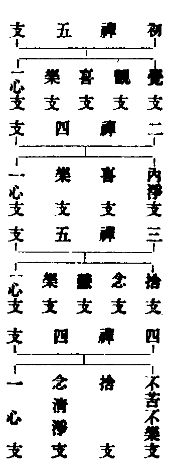



【■记】然此图中，但各标名相而已，今具记之。如法界二云：初禅五者：一、觉支：初心在缘名为觉。行者依未到地，发初禅清净色界法，触欲界身根，心大惊悟，尔时即生身识，觉此色界触未曾有功德利益也。二、观支：细心分别名为观。既证初禅功德，即以细心分别此禅定中色法诸妙功德，境界分明，无诸盖覆，如是功德，欲界所未有故也。三、喜支：欣庆之心名为喜。发时即有喜生，但分别未了，故喜未成。若观心分别，所舍欲界乐甚少，今得初禅，利益甚多，懽喜无量也。四、乐支：怡悦之心名为乐。发时即有乐，但分别喜，动踊心息，则恬然静虑，受於触乐，怡悦安快也。五、一心支：心与定法一，故名一心。行者初证禅时，乃即著定，而心犹依觉观喜乐之法，故有微细之散。若喜乐心息，自然与定一也。二禅四者：一、内净支：心无觉观溷浊，名内净。行者欲离初禅时，种种诃责觉观，觉观既灭，则心内净，心与净色法相应，豁尔明净也。二、喜支：欣喜之心名喜。行者初得内净时，即与喜俱发，而喜心未成，次心自庆，得免觉观之患，获得胜定内净，欢喜无量也。三、乐支：怡悦之心名乐。行者喜踊之情既息，则恬然静虑，受于内净喜中之悦乐也。四、一心支：心与定法，一名一心。行者受乐心息，则心与定一，澄渟不动也。三禅五者：一、舍支：离喜不悔名舍。行者欲离二禅时，种种因缘诃责於喜，喜既灭谢，三禅即发。若证三禅之乐，则舍二禅之喜，不生於悔也。亦云：三禅乐初生时，是乐三界第一，能生心著，心著则禅坏，故须行舍也。二、念支：爱念名念。行者既发此三禅之乐，乐从内起，须爱念护惜，则乐得增长，乃至徧身也。三、慧支：解知之心名慧。行者既发三禅之乐，此乐微妙难得，若非善巧解慧，则不能方便长养此乐，得徧身也。四、乐支：怡悦之心名乐。行者发此三禅乐已，若能善用舍、念、慧将护此乐，乐既无过，则增长遍身怡悦，受乐安快，此为最乐。若离三禅，餘地更无此徧身乐也。五、一心支：心与定法，一名一心。受乐心息，则心与定一不动也。四禅四者：一、不苦不乐支：中庸之心，名不苦不乐。行者欲离三禅，种种因缘诃责於乐，乐既谢灭，则不动之定与舍俱发，故内心湛然，不苦不乐也。二、舍支：离乐不悔，名舍。既得四禅不动真定，则舍难舍之乐，不生悔心也。亦云：证四禅不动定时，不应取定起念。若行舍，则无动念之乖也。三、念清净支：念者，爱念。既得四禅真定，当念下地之过，念自功德，方便长养，令不退失，进入胜品，名念。亦云：是四禅中有不动，照了正念分明也。四、一心支：心与定，一名一心。既得四禅舍俱之定，舍念将息，念无所依，泯然凝寂，一意在定，如明镜不动，湛然而照，万像皆现。何故四禅独名不动？以初禅觉观动，二禅喜所动，三禅乐所动，故四禅名真定也。若善巧照了分明，则因此定发真无漏。有漏外道，无慧方便，入此定时，不坏身色，直灭其心，入无想定，为谓涅槃，是为邪倒。支者，派也。瑜伽言：诸静虑中，虽有餘法，然此胜故，於修定者，为思量故，徧立为支。



【□注】辅行九上(九)引(婆沙)中：问：初、三何故五？二、四何故四？答：自古相承云：欲界五欲为外乱，二禅喜为内乱。初禅治外乱之始，三禅治内乱之始，故各有五。二禅外乱息，四禅内乱息，是故二、四但立四支。



【■记】婆沙言：随顺义是支，若法随顺彼地者立支。五支随顺初、三，四支随顺二、四。复次，欲界是难断、难除、难过之界，必须牢强对治，故彼对治初禅立五支。第二禅喜亦难断、难除、难过，故彼对治三禅亦五支也。初禅不难断、难除、难过，故彼对治二禅立四支。复次，为对欲界五种境界爱，初禅立五支；为对二禅五种喜，第三立五支。初禅无五种境界爱，三禅无五种喜、爱，故二与四不立五支。



【□注】初禅三天。梵者，净也，无欲染故。十八天皆净无欲，此当其首，徧得净名。梵众是民，梵辅是臣，大梵即王也。劫初先生，劫尽后灭，主领大千。然通论有万亿梵王，唯此是大千之中，王名尸弃，得为大千之王，降此不得横论。又初禅有语言号令，能统上冠下故也。如法华云：娑婆世界主，梵天王尸弃。大梵若摩醯首罗，居色界顶，报胜为主，无统王义。以二禅已上，无言语法，是故诸禅亦各以报胜为主，非统御也。竖辨具如法华文句、净名疏明。若涅槃疏云：娑婆世界主，正是首罗。又云：梵王只领小千而已。乃古师之说，非今家正意。



【■记】佛地论曰：离欲寂静名梵，具云梵摩，此翻清洁。寂静，谓创离欲染名清洁，得根本定为寂静。法华疏称高净。大论云：断婬欲天，皆名为梵。初禅当首，偏名净也。次明三天分君、臣、民。以二禅上无言语法，故不立王、臣。则知初禅有言语号令统领，故分王、臣也。然通论下，此约一佛所化之境，三千大千世界。约横论，有万亿初禅天，万亿梵王。然皆居四方，惟此尸弃是大千中主，领大千也。尸弃，翻顶髻王。顶上有肉髻，似螺形，亦名螺髻，或曰火顶，以火灾至此故。貌如童子，身白银色，衣黄金色，以禅悦为食也。又下，约竖辨。王大千，谓初禅有寻、伺，故有语言号令，统上冠下也。问：法华序品列外护众，谓摩醯首罗是娑婆世界主，何耶？答：摩醯首罗居色界顶，但二禅已上既无寻伺、无言语法，故报胜为主，非统御言主也。又尸弃者，此王本修火光定，破欲界惑，从德立名。然经标梵王，复举尸弃，似如两人。依释论正以尸弃为主，法华举位显名，恐一人耳。又单修禅为梵民，加四无量心为王也。涅槃疏云：大自在天即摩醯首罗，居色界顶，主大千界，十地菩萨迹现其中也。若法华中列世界主梵天王者，此意云何？若言娑婆世界主者，正是首罗；若言尸弃大梵等者，更举二禅等，收三、四禅梵王耳。又称梵天王为世界主，私谓此是大千之中得为大千之主，降此不得。故知所言梵王只领小千，乃古师说，非今注意也。



【■补】初禅名离生喜乐地，谓离欲界杂恶趣生，得清净乐，律中喻以巧浴润渍也。



【□注】二禅三天少光，光明少故。无量光，光明转增无限量故。光音，以光当语音，故新译云极光。



【■记】大论云：二禅通名光音，彼天语时，口出净光。有云：彼内无寻伺，外无言语，用光当语，故名光音。瑜伽论称极光净，谓净光遍照自他处故。



【■补】二禅觉观俱离，忧悬不逼，麤漏已伏，称定生喜乐地，谓有定水润泽其心，律中喻以山顶之泉也。少光等者，大论云：心清净优劣故，光有上中下。诸天心清净布施、持戒故，身有光明。复有人於暗处然灯，亦供养尊像塔寺，复常修慈，又修念佛三昧，念诸佛光明神德，复修火一切入，又以智慧光明，教化愚痴邪见众生。以是因缘，得心中智慧明，身亦有光。是以昙毗云：诸天报相，身放光明，无别昼夜，报得五通，形无障碍。是知三天论光，义徧前后；三禅论净，其义亦然。大要随位高下，立行浅深耳。



【□注】三禅三天，少净意识，嗜乐离喜，而纯乐受故。无量净，净胜於前，不可量故。徧净，乐受最胜，净周普故。



【■记】少净离喜而纯乐者，唯识论言：五识相应适悦受，恒名为乐，但悦身故。意识相应适悦受，若在欲界初二静虑，近分名喜，但悦心故。若在初二静虑，根本名乐名喜，悦身心故。若在第三静虑，若近分，若根本，皆称乐也。近分者，谓未至地，及未至根本也。无量胜前者，谓前仅心净，而此更身净也。徧净周普者，谓前二虽身心清净，未能周普此天，更加物我无二，反於世间。故论曰：三界中徧净为乐。又曰：福德徧净也。



【■补】吴兴云：地持论目第三禅为乐俱禅，此定功德与徧身乐俱发故。前二虽有乐支，为善所障，今灭喜纯乐得名，名离喜妙乐。地律中喻以莲华出地而未出水，根叶花茎，无不润渍也。问：三禅何故言净？答：大论云：缘净故净。八色是净法，未被练不得净。今三、四禅法起来，触此八色，为作净缘。三、四禅等，此是色界极净之色，用此为缘，触八色更净，故言缘净故净。是乐徧身受，故知是三禅中净也。少净者，此乐非境，出於净性，恬淡寂静，亦名寂灭乐，非无为之寂灭乐也。无量净，如楞严经云：身心轻安，成寂灭乐。徧净，如楞严经云：世界身心，一切圆净也。



【□注】四禅九天无云者，下虽空居，依云而住，此无云首，特号无云。业疏曰：第四禅上，云居轻薄，如星散住，不同下天，如云密合(文)。福生者，修胜福力，方生此天，从因彰名。广果者，凡夫之果，无胜过故。无想者，一期中间，心想不行故。无烦杂，无热恼，善相见，善现相，究竟无极。此五天，三果所居，名五不还天。若俱舍旧图，次第而上；若准楞严第九，皆横在四禅中。彼四禅天，独有钦闻，不能知见。如今世间，旷野深山，圣道场地，皆罗汉所住持故，世间麤人，所不能见(文)。又色究竟中，有摩醯首罗，此翻大自在天。



【■记】开蒙曰：三禅皆依云住，四禅方在空居。此天初得，独名无云。问：何故欲界除下二天，皆名空居？答：前言空居，不履地故。此则云气亦无，取意不同也。业疏下，引证。福生，谓具胜福因，方得生也。广果，谓异生善得果报。此天最胜，所有功德，胜下诸天也。无想，唯识论云：因中修彼无想定时，厌患麤想力故，生彼天中。违碍不恒行之心及心所，但以想灭为首，寿命五百劫。除初生彼，半劫想心尚在；及后退没，半劫想心又起；中间四百九十九劫，想心不行也。无烦杂下，释后五那含天。辅行言：无烦之始，得无烦名。伏热恼故，名无热；果易彰故，名善现；见清彻故，名善见；色中无上，名色究竟。又言：无烦，无见思烦恼杂也。无热，意乐调柔，离下界见思热恼也。善见者，定障渐微，见极明彻也。善现者，形色转胜，善能变现也。色究竟者，色法最极之处，是究竟处也。不迁者，不还人间受生也。俱舍图失考。唐译俱舍颂言：由杂修五品，生有五净居。论言：由杂熏修第四静虑，有五品故，净居唯五，谓下、中、上、上胜、上极，五品差别故。此中初三品心现前，便得成满，谓初无漏，次起有漏，复起无漏，第二品六，三品九，四品十二，五品十五，如是五品，杂修次第，感五净居。应知此中无漏势力，熏修有漏，令感净居。有言：由信等五，次第增上，感五净居。然皆竖论也。楞严横论者，彼四禅天，指福生、福爱、广果、无想也。所以独闻而不见者，盖下天修有漏凡定，此五修无漏圣业，凡圣业异故也。又色究竟下，别明色顶，有菩萨住处。如经言：过五净居，有十住菩萨住处，亦名净居，号大自在天王。又三乘中，立此为净土，是报身所居，约实但是十地菩萨，摄报之果，多作彼王耳。大论言：此天有八臂三目，乘白牛，执白拂，一念之间，能知大千世界雨滴数也。



【■补】三天是凡夫，一无想是外道，五净居是三果居处，此名舍念清净地。律中喻以沐浴，披新净衣；又如密室中灯，三灾不到，由其离内患也。业疏：南山宣律师释羯磨，此言业。



【□注】俱舍颂云：色天逾缮那，初四增半半(谓梵众半逾缮那，梵辅一，大梵一半，少光二也)。



【■记】颂明色界九天身寿劫量。



【□注】此上倍倍增(无量光四，光音八，乃至徧净六十四)。



【■记】解释与论同。论言无量光天，倍增二至四，乃至色究竟，增满万六千是也。



【□注】唯无云减三(下徧净天既六十四，无云倍应百二十八。身寿但有一百二十五者，谓从变易受入，不变易受难，故各减三。变易不变易，约三灾坏不坏说)。



【■记】无云减三之故，本论释不出。若华严钞明无云欲成上都数，故减於三，唯一百二十五也。



【■备】辨讹曰：既无云入不变易，身寿应增，当如清凉所言，成上都数，故减。又诸天身寿，皆举大概，故不妨减，存考。



【□注】少光上下天，大全半为劫。(少光已上，大全为劫，谓少光二大劫，乃至色究竟万六千大劫。少光已下，大半为劫，以由身量与寿量等。大梵身既一由旬半，故寿当一劫半。故以四十小劫为一大劫，则六十小劫成劫半也。梵辅寿一劫，身一由旬，四十小劫也。梵众身半由旬，故寿半劫，二十小劫也。)



【■记】注释。较论为详。论言：少光已上，大全为劫。自下诸天，大半为劫。由此说大梵过梵辅天，寿一劫半。谓成、住、坏各二十中劫，六十中劫为一劫半。故以大半四十中劫，为下三天身寿劫量也。



【■补】寿之劫数既尔，身之由旬亦然。应少光已上身量，以八十里为一由旬。少光已下身量，以四十里为一由旬。此约身寿对论如此。若约三灾对论，大全半为劫亦允合。盖世界成自上而下，坏自下而上，故成住坏空各二十小劫。除却空劫，梵王生成劫初，灭坏劫后，正当六十小劫寿也。自少光二大劫，至光音八大劫，却值七番火灾，又一番水灾，方坏二禅，正当八大劫寿也。如此对来，全半之义，毫无乖失。此以八十小劫为大全劫，四十小劫为大半劫。



△三无色界。



三、无色界四天(空处、识处、无所有处、非非想已上四天，只有四阴而无色蕴，故得名也)。



【□注】若厌色笼，修四空定，生四空天，名无色界。



【■备】有师标曰：此无色，非毕竟无色婆娑。谓或经二万劫色断，乃至八万劫色断，命终还与色相续故。断有二种：有须臾毕竟，须臾断相续，毕竟断不相续。



【□注】辅行六上四云：从第四禅，欲入空处，必作方便，灭三种色：一、可见可对色(色尘)，二、不可见可对色(五根四尘)，三、不可见无对色(法入少分无表色也)。此之三色，并在色界，欲入无色，故灭此三(文)。



【■记】灭色入空方便者，先想此身如甑、如笼、如网，乃至渐空。大论言：如鸟在缾，缾破得出。婆娑曰：先应思惟坼上、墙上、舍上诸空之相。取此相已，假想胜解，观察照了无边空相。以先思惟无边空相，而修加行，展转引起，初无色生。又顺正理曰：空法虽与色俱，而其自体不依属色。诸有於色求离者，必应最初思惟彼法。谓虗空体虽与色俱，而待色无，方得显了。外法所摄，其相无边，思惟彼时，而能离也。此明入空方便。灭三种色者，阿毗昙言：一、可见，谓色是。二、有对，有十，谓五根、五尘。若不可见有对，但五根、四尘。三、不可见无对，谓法处少分。问：香、味二想，初禅已离。色、声、触想，二禅已除。云何言空定灭耶？答：达法师言：香、味虽尽初禅，今言灭者，治有四种：一、坏对治，谓方便道，观下有漏无常等故。二、断对治，谓无碍道，正断下过。三、持对治，谓解脱道为首，及后一切无间解脱，持彼无为，不令散失。四、远分对治，谓解脱为首，及后一切无碍解脱，远令前障毕竟不退。今此空定，据第四治也。色、声、触三，言二禅灭者，二禅已上，乃至四禅，当地虽无，得借故也。



【■补】方便灭色者，禅波罗密言：应深思色法过罪，以有身色，则内有饥渴，外受寒暑等苦。复次，一切色法，系缚於心，不得自在。赞叹虗空无色，则无此过。一心缘空，念空不舍，当度於色难也。五根四尘：根，指五胜义根。唯天眼能见，凡夫不能见。落在浮尘根，如蒲桃朵等，故言不可见。然犹有对眼根，可对色等。四尘，指声、香、味、触。若法入少分者，以四分中之一，故言少分。一、心数法，属心；二、不相应法，非色非心；三、无为法，非三聚摄；四、无表色，属色。此色不可见，亦无对，无所表彰，名无表，即五尘落谢影子也。



【□注】无色界色，小乘空有二宗，各计不同。大众部云：但无麤色，非无细色。妙玄四(六)引毗昙云：无色有道共戒，戒是无作色，以无漏缘通。故此戒色，随无漏缘至无色也(文)。释签四(三十一)云：言无漏缘通者，通九地也。既通九地，岂隔无色(文)。妙乐六(九)云：无色虽无四大造色，定果所为，皆是墙壁(欲色二界业果所为)，三界皆以意识维持。若约诸宗，无色非全，无四大色，雅合其宜(文)。(有合门计有色，经墙壁譬)此是有宗计有色也。



【■记】细色，即定果色。妙玄引毗昙下，证成有色。婆沙：问：何故世尊弟子生无色，及无色界罗汉成就道俱生戒，不成就定俱生戒？答：有说：世俗戒是缚是系法，是以不成就；无漏戒不缚不是系法，故成就。有说：世俗戒堕在界中，堕在定中；无漏戒虽在地中，不堕界中，是故成就。则无色界有道共戒，无作色故。引妙玄释签证成。既有无作，岂得全无色耶？妙乐下，更引证成。盖文句言：堂譬欲界，阁譬色、无色界，墙壁譬四大。妙乐言：墙壁譬四大者，应通三界无色。虽无四大造色，然有定果所为之色，皆是墙壁。欲、色业果所为者，黑业、白业，欲界报；不动业，色界报。虽有垢净不同，俱业果也。三界意识维持者，定、业二界，皆意识所执持也。若约下，妙乐判明有色合宜。



【■补】此有宗引无作色，以显无色界有色。盖有宗谓道共戒，是色聚摄。道共者，见谛道中所发无作，与心上胜道俱，故曰道共。以无作为体，无作者，不假造作，任运而发，体属於色，故名无作色。无漏缘通者，无漏即见道八忍、八智。此十六心，能断三界见惑，而不漏落三途，故此无漏为能缘。三界苦、集、灭、道谛，理为所缘，既遍缘上下八谛，故曰缘通也。



【■备】法数引婆娑云：一、道共戒，於见道、修道位中，不作意持自然不犯戒，与道俱发，名道共。此戒是初、二、三果所得，即无漏戒也。二、定共戒，谓发得初禅、二、三、四禅定时，不作意持自然不犯戒，与定俱发。此戒断惑未尽，未出生死，即有漏戒也。



【■备】辨讹曰：此中明无色界，须疏明无色著落，不必引空有二宗杂解妙乐墙壁譬，亦不必引彼释大乘经，此明三藏大小须分也。私谓：上说修得无色所由，此因便详明无色有定果色，既有二解，必须兼引大乘证明，均属要义。无色著落下，有四段分解，非略也。



【□注】妙玄引成论云：色是无教法(此是空宗牒有宗计)，不至无色(此是空宗难有宗也。难云：应不至无色耶？如读教记戒体中辨)。此是空宗计无色者也。



【■记】读教记，未详。若准戒疏，言无教法者，谓戒是色住，无作是假色，亦言无教，非对眼色发隐言。亦言无教者，亦名无教也。非对眼色者，即非色非心之色法也。



【■补】泽山咸戒疏曰：小乘立三聚，谓色、心、非色非心。萨婆多有宗：作、无作，并色为体。注言：初依身口而起，故作戒以色为体；所发善业，天眼能见，故无作戒亦色为体。成实空宗：作戒以色心为体，无作以非色非心为体。注言：业由心起，心是正因，身口为缘，兼缘显正，故作戒色心为体。无作体者，由作初起，必假色心，无作后发，异於前缘，故强目之非色非心耳。若大乘者，但论色心，无第三聚，故作、无作戒体，通色通心。有师曰：无教法即无作色，亦名无表色，不可教示故。有宗谓无作业虽属於色，无有相状，不可分别教示，故名无教。空宗牒彼所计，故言色是无教法。无色一句是难，谓汝既言道共戒有色是无教法，既言是色，则道共戒应不至无色耶？何者？以道共是非色非心，故能通至无色；汝既是色，岂能至无色耶？如此难者，盖空宗亦许道共戒通至无色，但不许道共戒是色，以无色界无色故。是以空宗立戒体是非色非心聚，故能随无漏缘，通至无色也。



【□注】然小乘计有是不了义，说无色者乃名了义，大乘反此。



【■记】小乘以所证空谓极处，故推空宗计无色为了义也。



【■备】辨讹曰：然小乘计有，是不了义，上引妙乐许有宗合宜，复引签文破其不了。若破其不了，则荆溪许他有过，又引楞严及孤山释，判与小乘有宗义合。此但见荆溪许有宗合宜，不知荆溪释文后，不过旁引有宗，许其雅合集注，不当将大乘经反合小乘也。私谓小乘著空，计有不了，遂觉空宗胜於有宗，是小乘意许有定果，是大乘意亦是。今注引以证成意，上引签文，并非破其不了，下引楞严孤山释，乃就大小乘说有，是同边论，存俟后定。



【□注】楞严经言：是四空天，身心灭尽，定性现前，无业果色。孤山释云：谓无业果色者，显有定果色也。此与小乘有宗义合。若大经云：无色界色，是佛境界，非诸声闻缘觉所知者。此是大乘说有色义也。



【■记】大经：迦叶言：声闻、缘觉，若非色者，云何得住？世尊言：如非想非非想天，亦色非色，我亦说为非色。若人难言：非想非非想天，若非色者，云何得有去来进止？如是之义，诸佛境界，非诸声闻、缘觉所知。



【■补】四、空身心灭尽等者，正脉言，初二天全无身境，故曰身灭。后二天七八现行，俱伏不行，故曰心灭尽。定性现前者，明有定果色。无业果色者，依正皆空，圣眼观之，三尺识神似中有也。是佛境界，非声缘所知者，以声闻经说所证空，遂谓极处悉皆无色。大乘实说，界外尚受法性之色，岂此四天惟空空然？故斥二乘非所知也。又中阴经言：无色界天，礼拜世尊。楞严亦曰：无色稽首。仁王经言：无色界天，雨诸香华。阿含说：舍利弗入涅槃，无色界天，空中泪下，如春细雨。皆明有色也。又定果色，显扬论名定自在所生色，谓胜定力故，於一切色皆得自在，即以定变起五尘境。故论言：变身万亿，共立毫端空量地界也。以上辨有色竟。



【□注】空处禅门六(九)云：此定最初离三种色，心缘虗空，既与无色相应，故名虗空定也。(文)



【■记】三种即可见，有对有三种。



【□注】识处，禅门六(十一)云：舍空缘识，以识为处，正从所缘处受名，故名识处(文)。



【■记】所缘识处，必带於相，识相无边，名识无边处。



【□注】无所有处：行者厌於识处无边，於是舍之，入无所有处，亦名不用处。禅门六(十二)云：修此定时，不用一切内外境界。外境名空，内境名识。舍此二境，故言不用处(文)。



【■记】止观言：识处谢已，缘无所有法相应，名不用处，即佛三年就阿蓝、迦蓝所习定也。



【□注】非非想：止观六(四)引阿毗昙婆娑云：非无想天之无想，非三空之有想，故言非想非无想也。人师云：无想是色天异界，不应仍此得名。就同界识名，前无所有定已除想，今复除无想，想无想两舍，故言非有想非无想(文)。辅行六上(五)：人师尚不许引色无想天，况总引四禅？既是论文，取亦无失。人师释义，亦未全非。今家俱存，故无破斥(文)。止观九(八)云：此定不缘识处故非想，不缘不用处故非非想(文)。



【■记】人师意谓：无想是色天，与无色异界，故不应依以立名。当依同界之无所有，已除乎想；今复除无所有之无想，立为非想非无想也。辅行下，明止观双存两释之意。论文乃大士本经而造，取亦无失，此存论家释。人师非想依同界，不无其义，此存人师释。止观下，此止观正释。



【■备】集注问答，总引四禅句。辅行引立世论曰：非如四色及以三空，故言非想；非无想天及无心定，故非非想。



【□注】只打四阴。辅行五上(二十四)云：蕴之与阴，新旧异译(文)。



【■记】唐元奘师，新译曰蕴，旧译曰阴。大论：问：既有四阴，云何言非有想非无想？答：是中有想，微细难觉，故谓非有想，有想故非无想。凡夫谓得诸法实相，是为涅槃。佛法中虽知有想，因其本名，称非有想非无想也。



【□注】积聚名蕴，盖覆名阴。积聚有为，盖覆真性。



【■记】有为即色、受、想、行、识生灭法，真性即真如。法性只由无始不觉，遂有诸法积聚盖覆也。



【□注】然诸文或云四禅八定，或云四定者，辅行九上(初云)：若色无色二界相对，则色界名禅，无色界名定。若总以上界望於下欲，则上二界俱名定地，下界为散(文)。



【■记】色界思维修故，无色深定胜故，故分禅定二名。



△三、结二：初、结判生死。



上来所释，从地狱至非非想天，虽然苦乐不同，未免生而复死，死而还生，故名生死。



【□注】一往言之，三途唯苦，诸天纯乐，人中苦乐相间。通而言之，天亦有苦。妙玄六(二十九)云：六欲天者，地天别有修罗鬪战之难，通有五衰死相苦等。地狱色天，虽无下界诸苦，而为色所笼，若命尽时，不乐入禅，风触吹身，唯除眼识，餘皆有苦。四空诸天，虽无欲色界等苦，如疮(空处)，如痈(识处)，如病(无所有处)，如箭入体(非非想)，成就细烦恼(文)，及非想有八苦等。



【■记】四王、忉利二天，别有修罗难者。瑜伽论言：若修罗鬪战时，诸天失手复生，若斩首截腰亦死。六天通有五衰者。涅槃经言：大五衰者，头上花萎，腋下汗出，衣裳垢染，身体臭秽，不乐本座。小五衰者，衣服绝香，身光忽灭，浴滴沾身，本性嚣驰，两目眴动。小五相现，遇胜善缘，犹可转故。大五相现，必定当死。禅经言：於彼恒乐处，衰死二五相。是相及命终，尔时最大苦。方欲恣所乐，五衰忽然至。若见是相时，愁怖不自安。天眼卒便瞬，浴已水著身。一切妙境界，其心不喜乐。千种乐自然，迦陵频伽音。今则寂无声，当知七日死。玉女悉舍去，餘天共从事。见已生热恼，命终入地狱。又禅经云：腋下流汗出，衣服卒垢腻。见已大恐怖，是则净业尽。花冠昔鲜丽，而今忽萎热。身体本光泽，一朝顿枯瘁。常所爱乐座，今恶不复乐。是五种相现，当知时死至是也。苦等地狱。禅经言：诸天共器食，随福有差别。见此异色时，心则生忧恼。如是极愁惨，犹如地狱苦是也。色天命尽时，风触吹身，唯除眼识者。签文无解，从来无确释，有约义。通曰：胜禅定者，目力最胜，故命尽风触吹身，五根受苦，而眼识犹不受。又有言：上地眼识，眼起方有，风非眼境，故不受苦。俟再考。定如疮等者，禅门云：离四空定，说八种观，如疮、痈、病、刺、无常、苦、空、无我是也。前四对治事观，后四即是理观。此八有总、别，总则用此八法，总观空处定，四阴和合，故有此定，可患无实。别观者，前四对治观四阴事，谓病治受，痈治想，疮治行，刺治识。无常等四，即对观四阴理相，谓无常观识，苦观受，空观想，无我观行阴。又有云：观五阴能生诸恼，故如病；有闻病为轻微，故言如痈疽；有人以痈犹或可差，故言如箭镝入体。此为上根说四，若中根说八，下根说十，加痛恼衰坏，忧畏不安。今玄文为上根，以前四对治方法，别观四空也。成就细烦恼者，以四空有三十六品思也。非想八苦者，谓心生异念名生，若念念不停名老苦，行心扰扰妨定名病苦，退定是死苦，求定不得名求不得苦，求定不得必有於障，即怨憎会苦，失定时苦名爱别离苦，四阴心即炽盛苦，故三界皆苦也。



【■补】十种细烦恼，辅行言受乃至慧。受谓识所受，想谓识所想，行谓法行，触谓意触，思谓法思，欲谓欲入定，解谓法胜解，念谓念三昧，定谓心如法住，慧谓慧根、慧力。此之十法，乃无色之爱、无明、掉、慢、心不相应诸行，苦集因缘和合得生，於彼欲入灭定先灭，此等是也。



【■备】止观言：识处如痈，无所有处如疮。辅行补言：空处如病，非非想如刺。今仪文：空处如疮，无所有如病。然禅波罗密引摩诃衍言：观识处如疮如箭，观无想处如痴。存考。集注问答：问：风触吹身，何故唯除眼识？答：据俱舍言：眼识通二地，谓欲界及初定，又生二、三、四定地。若眼识现起，从彼退於下界生，故云。



△二、结归苦谛。



此是藏教，实有苦谛。



【□注】文句六云：三藏教诠生灭，故云实有也。



△二、集谛三：初、总标名体二：初、牒名示体。



二、集谛者，即见思惑。



【□注】集者，招集为义。惑与业俱能招生死，而今但云惑者，前苦谛中已明善恶业故，即见思惑示集谛之体也。见者，若云见理时能断此惑，即从解得名。若云见只是假，谓因成、相续、相待三假也。假者，不实为义，即当体受称。



【■记】止观云：见则见理，见实非惑。见理时能断此惑，从解得名。又曰：见惑非但从解得名，亦当体受称，称之为假。假者，虗妄颠倒也。



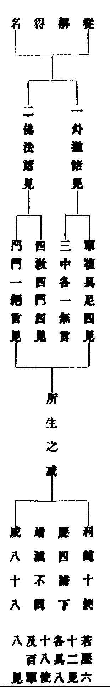



【■记】外道诸见者，止观言：一、单四见，二、复四见，三、具足四见，四、无言见。单四者，执有执无，亦有亦无，非有非无。於一有见，复起利钝十使，历三界合有八十八使，餘三亦各具八十八使。若历六十二见，见见各具八十八使，乃至历六十二见，八十八使各各百八。又复四见具足四见，又单复具足外，各各一绝言见，亦皆起八十八使、六十二见、百八等，如前说。约佛法，藏四门生四见，通四门生四见，别四门生四见，圆四门生四见，又四门外各一绝言见，如是一一见中，各各起八十八使、六十二见、百八等惑，如前说。以上诸见，见理则断也。



【■备】辨讹言：既是从解得名，不当列外道佛法诸见，当知见则是惑而非解矣。私谓见理则从解，见惑则从名，今从得名边也。辨讹曰：百八见，准校计经言百八痴，大论言百八受，即止观辅行引文，未甞言百八见也。



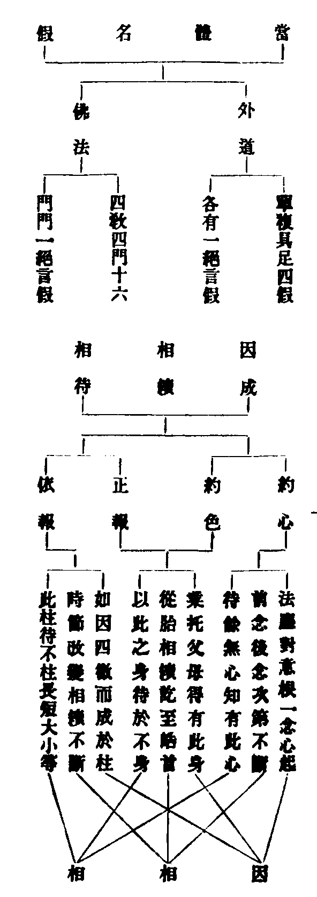



【■记】约外道例前，亦应言单复具足各假，并一绝言假。依佛法复十六假，一一如前说。又於一一假中，复有三假，谓因成、相续、相待也。法尘对意根者，因成约内外，相续但约内根，相待竖待灭无之无，横待三无为之无心也。辅行解言：约心，因内因外，和合方成，故所生法名因成。念不实故，故前念灭，灭已复生，生者必灭，计能相续，名相续。己待於他，假立於己，相待不实，名相待。若竖待者，意亦如是。约色，四大色身，体全不实，是三假故。前念灭时，假后念续，故名为假。待中亦应具有横竖，待往灭身，名为不身竖待也。他非我身，名为不身横待也。约依报可解。此是三藏随事三假，灭色空也。



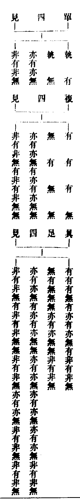



【■记】出止观会本五卷五。



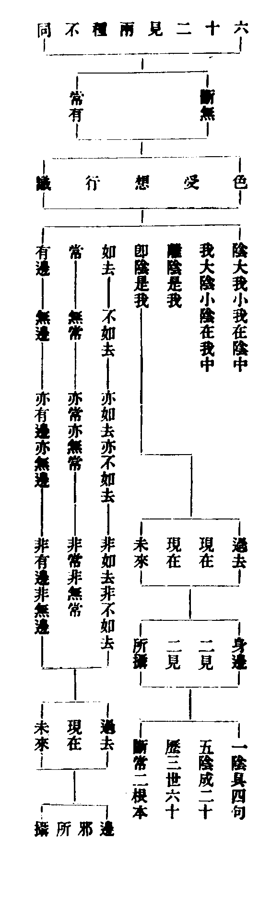



【■记】辅行引大论言：谓色如去等四句，四阴亦然，合二十句，此计过去也。又计色常等四句，四阴亦然，合二十句，此计现在也。又计色有边等四句，四阴亦然，合二十句，即计未来也。一一句下，皆言神及世间，三世六十，并有无二。论释言：凡夫取著，计有神我。计常者，修福灭罪；计无常者，为今世名利，故有所作。亦常亦无常者，只是双计初二两句。故於神我，以计麤细，为第三句。计神麤者，身死无常；计神细者，身死不灭。计双非者，见计第三，二俱有过。何者？常则不灭，犹如虗空，风雨不动；若无常者，则有变动，如雨在皮，则有坏烂。离此二过，以我心故，复说有神，神但非常非无常耳。佛言：四皆邪见。此即计神也。世间即是国土，是故神於世间，亦有四见。言计常者，问言：土若本无，计应有错。世间是有，何故邪见？答：破世间者，破常等想，不破世间。如无目人以蛇庄严，有目语言：蛇非璎珞。破倒亦尔，现见无常，不得言常。三四两句，准说可知。有边等者，外人求土，不得其始，即谓无终。无始中终，则名无边。计有此三，即名有边。如得禅者，计八万劫。三四二句，凖此可知。亦有人言：第三句者，八方有边，上下无边。有言：上至有顶，下至地狱。上下有边，八方无边。计神我如芥子等是。亦有计土及以神我，互计有无成。三四两句，准此可知。如去等者，如人彼来，去至后世，谓如去。谓先世无来，灭亦无去，名不如去。若谓身死为去，而神不去，名第三句。见俱有过，名第四句。大论甚广，须往彼寻。



【■备】五阴大小即离，解见下。於五阴中，一阴四见成二十，约三世成六十，以断常二见为根本，成六十二。出涅槃经。辅行亦引身边摄者，我即身见，大小即离皆边见。辅行乃节取大论，稍有不同，取其明显。句下皆言神及世间者，如论言：是见依色，神及世间，常是事实。餘妄语於受想等四阴，常无常、边无边等各四句，例此可知。计常者，修福受后报故。计无常者，但为今世，不信后报故。亦常亦无常者，谓神有麤细二种：一、微细常住；二、现有所作，身死时无常，细神是常。四皆邪见者，但於五众谬计为神耳。世间，指国土世间。於世间相中，亦有四种邪见。大论：问：神从本已来，无故应错。世间是有，云何同神邪见？答曰：但破於世间，起常无常相，不破世间。佛破世间常颠倒，不破世间。何以故？现见无常故。亦不得言无常，罪福不失故。求土不得其始者，求世间根本，不得其始也。计八万劫者，过是已往，不复能知，但忆想分别，有法名世，性是常故。神如芥子等者，论言：如芥子如枣，或言一寸。说神是色，法有分故。言神有边无边者，有人说神徧满虗空，得身处能觉苦乐，是名神无边。土及神我互计有无者，有人言：神世间无边，国土世间有边；或神世间有边，国土世间无边等，名为有边无边。有人见世间有边无边俱有过，著非有边非无边，以为世间实是边。见如去者，如人来此间生，去至后世亦如是。有人言：先世无所从来，灭亦无所去。有人言：身神和合为人，死后神去身不去，是名如去不如去。见去不去有失，是人不能舍神而著非去非不去也。辅行土若本无，计应有错者，单就国土问也。身去神不去者，身死变灭为去，神不变灭为不去。大论神去身不去者，身死消灭为不去，神至后世为去，其义皆通。又神王疏言六十二见，释者不同。且依大论，於色阴说过去神及世间常是事实，无常等三句亦然。餘阴亦如是，成二十。现在有边无边等历五阴，亦有二十。死后如去不如去等，亦有二十，成六十。是神与身一，神与身异，成六十二也。



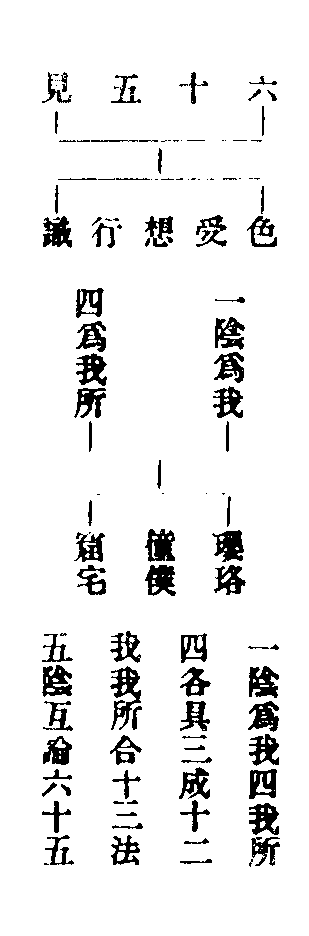



【■记】辅行引婆娑言：六十五见，即於五阴各计四为我所，谓色是我，受是僮仆、璎珞、窟宅。想等三阴亦然。合我及我所十三句，五阴合为六十五句。故一一阴，初一是我，四是我所。



【■补】璎珞，如人有财，仆属我使。窟宅，如油在麻中等。



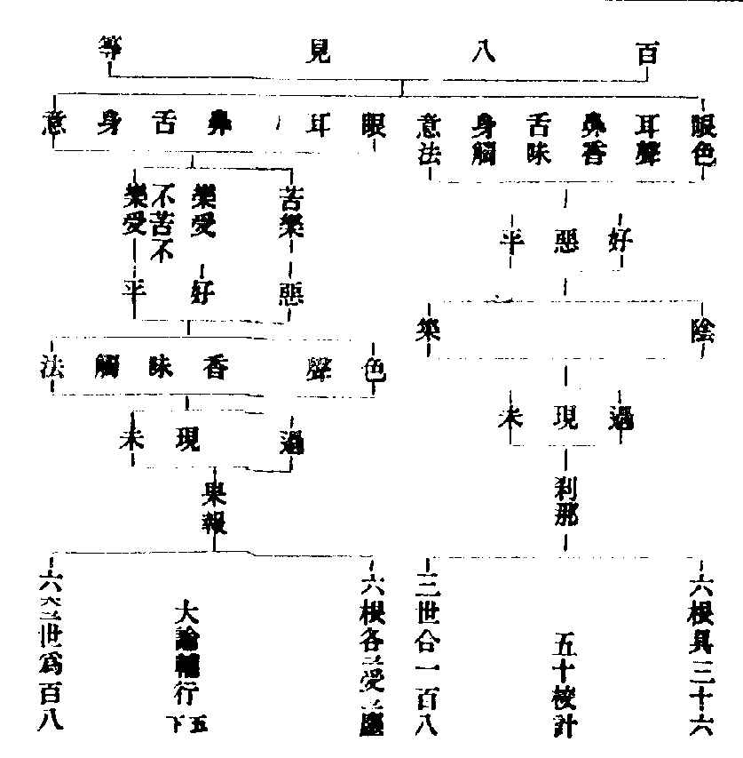



【■记】辅行言：五十校计经法相，稍异诸经。止观引经云：若眼见好色、恶色、平色中，皆有阴有集，乃至意缘法亦然。一根有三种尘，三种有六个阴集，则六根具三十六，三世合有一百八也。辅行言：彼经但立六根各六，虽无三世语，而结言百八，故知约刹那为三世也。既以心、意、识三为意地三，故通三世。如言集起名心，筹量名意，了别名识也。又辅行言：若准大论，六根各三受，三受对三尘，三世为百八，此则约果报对三世论。



【■补】刹那约心，果报约境，境是果报法也。阴集者，好恶平境名阴，阴上起见名集。有言：阴以阴覆为义，集以积聚为义。好恶平色，若对於眼，眼为所转，即覆於眼，名阴。阴复聚集好恶平色种子於内，名集。眼根既尔，餘根亦然。此说存考。



【□注】思惑入修道位，重虑缘真。辅行云：虑谓思虑，见道观真，已发无漏，今复重观，故云重虑。此惑即除，名思惟惑，此从解得名。若云思假及爱惑者，此当体受称。



【■记】止观言：称思惟者，从解得名。初见真浅，犹有事障，后重虑真，此惑即除，名思惟惑也。



【■备】思惑具因，成相续、相待三假，故言思假。爱惑者，法数言贪爱曰思，谓於外五尘，贪爱染著法界初门，谓之爱烦恼，此当体受称也。



【□注】然见惑从法尘起，能障真理。思惑从五尘起，能牵三界。此皆约欲界多分说，细论不拘。



【■记】此明见思为障不同，故教中称见惑为理障，思惑为事障。然约欲界，多分说也。



【■补】见惑非但障理，亦能牵生，如言由三复还下是也。思惑非惟牵生，亦能障理，如言由贪爱故，不见真理是也。辨讹曰：细论不拘句，因集注立上百八见图，故有此言。以上明百八见，不出六根六尘而起。既有见从五尘起，何故言见从法尘，思从五尘耶？私谓不拘者，和会障理牵生而说。



△二、名异体同。



又云见修，又云四住，又云染污无知，又云取相惑，又云枝末无明，又云通惑，又云界内惑，虽名不同，但见思耳。



【□注】见修见惑，见道所断。思惑，修道所断。约能断位，名所断惑也。



【■记】初果见道，八忍、八智所断，名见惑。二、三果思惟修道，九无碍、九解脱所断，名思惑。



【□注】四住见为一，住思惑分三，因此二惑故，住著三界。



【■记】见一切住地，欲、色、无色爱三住地。



【□注】染污无知，妙乐一(二十四)云：然小乘中立二无知，染污无知无明为体，不染污无知劣慧为体，谓味、势、熟、德、时、数、量耳(文)(诸法滋味损益等势，成熟德用近远等时，一一等数大小等量)。



【■备】法数言：染污无知，即见思无明为体，谓染污真性，无所明了也。不染污无知，即尘沙劣慧为体，指他人分上，见思惑种数多故，如尘若沙，但不能染我真性。二乘智慧狭劣，不能令他断见思，名不染污无知。



【■补】不障真理，名不染污。於俗谛不了，名无知。劣慧，即人空智。虽能证空，於诸佛恒沙法门、众生无量根性，皆不能达也。诸法滋味等者，谓於恒沙法门、无量众生，约法有诸法滋味，约机有损益等势、成熟德用，约相有远近等时、一一等数、大小等量，皆非二乘所知。随相论言：轻重、冷热、湿滑、软坚等，名势力。熟者，如食果入腹，变熟不同。德者，草木等威德，或根能出光，或能却鬼，或能除毒等。辅行言：他解不染污，即习气。今家意者，小乘习气，即别惑是。



【□注】取相惑，三惑皆名取相。观音玄记上(七)云：见思取生死相，尘沙取涅槃相，无明取二边相。今见思取六道生死之相也。



【■备】计生死为实，见思之取相也。照真不了俗，尘沙之取相也。偏於真俗而不契中，无明之取相也。辨讹言：观师以取相名见思，应作通别两解。别解，如文句释大迦叶观心云：即空抖擞取相，止观归大处。言取相障般若，均别指见思。



【□注】枝末无明，对根本得名。见思以无明为根本，故云枝末。於一切法无所明了，故曰无明。



【■记】无明为诸杂染所依，故见思以之为根本。



【□注】通惑对别惑得名。见思通三乘人断，故曰通惑。尘沙无明别在菩萨所断，故名别惑。



【■记】声闻前后，各断见思；支佛顿断见思，习犹未尽；菩萨以三十四心，顿断见思习气，故名通惑。



【□注】界内惑对界外得名。见思润有漏业，招三界生，故云界内。尘沙润无漏业，无明润非漏非无漏业，招变易生，故云界外。尘沙则通界内外也。



【■补】见思惑为能润，有漏业为所润；惑业为能招，三界生为所招。以见思所润所招，不出六道，名界内惑。唯识有言：诸有漏善不善业，由烦恼障助缘势力，所感三界麤异熟果，即分段生死也。尘沙润无漏者，此无漏业，即二乘人之所修空、无相、无作是也。但尘沙润业，未考出何经论。非漏非无漏业者，即菩萨出假所修之行，以不同六道生死业，故非漏；亦不同二乘耽空业，故非无漏。招变易生者，惑业为能招，变易生为所招。由悲愿力，改转身命，无定齐限，名变易。如改麤为细质，易短作长年也。问：改麤易短，何名生死？答：觉知势尽名为死，入定还资谓之生。以此惑业，只感界外生死，名界外惑。唯识有言：诸无漏有分别业，由所知障助缘势力，所感殊胜细异熟果，即变易生死也。尘沙通界内外者，此惑在化导边说。如二乘自断见思，不能断他人见思，故望他人见思，多如尘沙，此界内以见思为体也。菩萨若自破无明，未能破一切人无明，及知界外修证果位，故望他人无明，多如尘沙，此界外以无明为体也。



【■备】异熟者，所造惑业，异时异世而成熟感果也。所知障者，知即觉观，因此觉观不泯，障於法性，不得证入，名所知障。



【■备】辨讹曰：无明润非漏句，当先补；润亦漏亦无漏业句，存俟后定。



△二、别释见思二：初、见惑三：初、标名列使二：初、通标名数。



初释见惑有八十八使。



【□注】法界次第上(七)云：使以驱役为义，能驱役行者心神，流转三界，故通受使名。



【■记】小乘不言第八识，故曰心神。



△二、别列十使。



所谓：一、身见，二、边见，三、见取，四、戒取，五、邪见(以上利使)，六、贪，七、嗔，八、痴，九、慢，十、疑(已上钝使)。



【□注】身见，於阴入界中，妄计为身，强立主宰，恒起我见。诸文或云身见，或云我见。止观十(十六)变列二名云：求我叵得故，则身见破，身见破故，则我见破(文)。辅行五下(九)云：外人计我，如麻豆及母指等，或计徧身神身四句，及一异等(文)。



【■记】宗镜言：我有主宰二义，谓主有自在力，宰有割断力。义同我故，主是我体，宰是我用。又主乃俱生我，无分别故，属第七识我。宰是分别我，有割断义，属第六识我。故主等立而我见起也。辅行下，示执我之见。大论云：有言：神在心中，微细如芥子，名净色身。有言：如麦如豆，半寸一寸。初受身时，最在前受，譬如像骨。及其成身，如像已壮。有言：大小随人身死坏时。此亦前出。又唯识言：胜论作者我，数论受者我。体常周遍，量同虗空，随处造业，随受苦乐。又无慙外道尼犍子等，执我体常而量不定，随身大小，即有舒卷。又兽主遍出二宗，计我体常至细，潜转身中，作诸事业。然九十五种外道，宗计虽多，不出一异等四句。神身，即神我也。一异及四句，解前。又一是即阴，异是离阴。



【□注】边见，於身见上计我断常，执常非断，执断非常，随执一边也。



【■记】此边见，贴我见说。显扬论曰：执边见者，谓於五取蕴，执计断常染污慧为体。上释见中广解。



【□注】见取，谓因此见通至非想，信此非餘，执劣为胜。



【■记】释论言：此於诸见及所依蕴，执为最胜，能得涅槃清净法，名见取。由互相执胜，而起鬪诤也。又辅行曰：於非真胜法中，谬见涅槃，生心取著，皆名见取。若行道时，虽入种种观门，而真明未发，无明不了，便谬计所得为真为胜，生心取著，皆名见取也。今所言因此见者，谓或常或断等，计因此修持，能通非想非毁餘法，执劣为胜也。如外人亦修六妙观，修苦行，稍有轻安，以为到家消息。



【□注】戒取，执邪为道，名非因。计因及鸡狗等戒，名戒取。



【■补】玄签曰：外道亦有天眼，能见鸡狗生天，便受此戒，作生天计，不知鸡等於彼业谢往胜，因牵生天耳。见牛羊吃草生天，他亦食草，不知牛羊报尽生天耳。释签云：外道计苦行有六：谓自饿、投渊、赴火、自坠、寂默。持牛狗等戒，是谓非因计因，名戒取也。有师标曰：昔有外道持牛狗戒，阿难引见佛，白言：愿佛为彼说其果报。佛言：恐生怖畏，不可说之。彼人再四求，佛言：汝若持牛戒，如其牛法，毫不犯者，后得牛中；若小犯者，便入地狱。



【□注】邪见，由计断常，不计因果，复计此我以为自然，冥初世性，世性即是二十五谛(一冥初，二从觉等，如图示)及六谛等，或计从於父母微尘梵天等生，皆名邪见。



【■记】不了四谛因果，邪心推度，谓无此理，固执断常邪见，因此断灭出世间善根，乃至世间善根，作阐提行，是为邪见。又有不知业理众生，依世间定力，见人一生好行施者，反生下贱贫𫗪，彼即思惟，世间定无施与爱养祠祀，此即谤因。复见善者堕三途，恶者生人天善道，随即思惟，世间定无善感好报，恶感丑果，即谤果也。二十五谛，集注无图。百论文言：从冥初生觉，从觉生我心，从我心生五尘，从五尘生五大，从五大生十一根，以神我为主，谛觉相处中，不坏不败，摄受诸法。



【■备】一、冥初生觉。二、觉生我心。三、我心生五唯，谓四色、五声、六香、七味、八触。次五唯生五大，谓九地、十水、十一火、十二风、十三空。次五大生十一根，谓十四眼、十五耳、十六鼻、十七舌、十八身、十九手、二十足、二十一口。二十二大遗根，二十三小遗根，二十四心平等根。至二十五，合为神我主谛。此二十五谛数，论师所立，名迦毗罗。西天第一外道，知八万劫事以上，则不知立冥谛，亦名自性。觉即智大，我心即我慢。我思受用自性时，冥性则变成大等，为境所缚，不得解脱。我若不思，冥性不变，即得解脱，名为涅槃。略录唯识论释六谛即六句，胜论师立名卫世，此亦是我所受用。未解脱时，受用六句，离此六句，计为涅槃。



【■记】冥谛。金七十论释之，总略为三，处中为四，广为二十五。言略为三者：一、自性，二、我知，三、变异。自性是第一谛，古称冥性，亦名胜性。未生大等，住自分，名自性；若生大等，名胜性，用尊胜故。智论言：外道通力，至八万劫外，冥然不知，谓为冥谛。从此觉知，初立名冥谛。二、我知者，即第二十五谛神我也。三、变异者，即中间二十三谛自性所作，名为变异，故有三位也。处中为四者：本性无变异，一也；大等亦变异，二也；五大、五知、五业及心平等共十六但变异，三也；知者非本变，四也。释云：性能生大等，故名本；不从他生，故非变异。二、大、我慢、五唯，此七亦本亦变异。大从本性生，故变异；生我慢，故为本。慢生五唯，即五唯尘。五唯生五大、五根，故亦变亦本。三、五大、五知、五业及心平等一根，但从他生，故唯变异；不能生他，故不名本。四、知者，即我知为体，不从他生，亦不生他，故非本非变异。若准百论，五大生十一根，则五大亦本亦变，唯变异中但十一根也。六谛者，教乘言：一、陀𮪕，翻主谛，五大及时、方、神、意，此主为万物所依故。二、求那，翻依谛，谓色等五尘依故。三、羯磨，翻作谛，俯仰屈伸、出入去来等故名作。四、三摩若，翻总相谛，谓总相万法如一有故。五、毗尸沙，翻别相谛，如森罗万像各各不同故。六、摩波夜谛，谓五尘成就不相妨碍故。或计从於父母微尘者，如路伽论师执地水火风极微实常能生麤色，谓能生极微为父母微，所生麤色为子微也。或计梵天等生者，如围陀论师计从那罗延天脐中生大莲华，华上有梵天祖翁为万物主，出生一切有命无命物，从梵天口生婆罗门，两臂生刹利，两脚生首陀，两䏶生毗舍也。等者，等诸时。散外道计时生；方论师计方生；安茶论师计本际生，即过去时之初际；口力论师计虗空为因；无因论师计自然生；涂灰外道计自在天生；宿作论师计宿世本业所作为一切因。法数详载。



【■备】见取贴执劣为胜说，戒取贴非因计因说，身见贴我我所妄执为我说，边见贴身见上计断常说，邪见贴拨无因果说。邪见最广，此依翻译名义解。



【■备】补遗曰：八天子是众生父母，梵王是八天子父母，韦纽是梵王父母。韦纽，即那罗延天。



【□注】贪是己法者，爱即指五见为己法也。



【■记】法界，言以迷心对一切顺情境引取无厌是贪，历三界五行中十五贪皆贪，使今的指爱五见为己法也。



【□注】嗔非己法，故嗔。



【■记】法界，言以迷心对一切违情境，便起忿怒，名嗔。历欲界五行中五恚，即恚使，今的指於非己法边也。



【□注】痴不识。见中苦集。



【■记】法界，言迷惑不了之心，名为无明。若迷心缘境，随有所起，念念永失，不知慙愧者，皆名痴也。历三界五行中，十五痴即是无明。今的指不识前五，见苦集名痴也。



【□注】慢，我解他不解。



【■记】法界，言自恃轻他之心曰慢，乃至历三界五行中十五慢，皆是慢使。今的指前五见，我解他不解，名慢也。



【□注】疑，犹豫不决。



【■记】法界，言迷心乖理，犹豫不决曰疑。历三界、四行、十二种疑，并是疑使。今以所见犹豫不决释疑也。



【■备】法苑言：四谛修道，名为五行。以见惑中苦、集、灭、道为四行；思惑为一行；邪见与疑、非思故，三界四行为十二；贪、痴、慢三界见、思具故，三界五行为十五；上界不行嗔故，欲界见、思为五行、五恚。然今的当贴见说。



【□注】利钝。利则造次恒有，钝则推利方生。五钝，亦名见中思，亦名推利思，亦名背上使。利使若去，钝使亦亡，故属见摄。



【■记】触著即发，造次恒有者为利；少待而起，推利方生者为钝。五、钝下，明钝中思，亦属见摄。辅行言三种见惑：一、俱生见，五钝中有利，如虫兽凡夫，亦能起我、我所，即是利；从钝背上起，故属钝。二、推理见，未发禅来，虽世智推理辨聪，见想犹弱，故十使同属於钝。三、发得见，从因定发，见心猛盛，则十使从强受名，皆属利也。三种思惑：一、俱生，与形俱生，如男女托胎，妄与父母生爱恶心，此是邪思，还归见惑。二、依见思，如外道依见而起嗔，此利中钝，名背上使；见谛断时，正利去背亦去。三界系思，即三界九品思，此名钝使，亦名事障，号正三毒。然辅行意，乃明见思利钝，互相摄属。今文但明钝中之思，仍属见摄。若欲会之，辅行俱生思，即此见中思；辅行依见思，即此推利思、背上使也。



【■补】毗昙言：利虽有钝，此钝属利。从利使背上起，利使如刀口，钝使如刀背；钝使从利使后起，名背上使。



【■备】虫兽凡夫，起我我所者，止观言：如诸蝡动，实不搉理，而举螯张鬐，怒目自大，底下凡夫，何尝执见？行住坐卧，恒起我心，故五钝非无利也。餘解翻译名义详引。



△二、约界释成二：初、通示。



此十使历三界、四谛下，增减不同，成八十八。



【□注】四谛下惑，增减不同。前云集谛，虽在惑业，今历四谛者，集是能迷，苦是所迷。又道灭虽是出世间因果，由迷苦集，道灭亦迷，如不识病，亦迷於药。



【■补】道灭是惑之正主，对既迷苦集，必然道灭亦迷，故亦有惑也。



△二、别明二：初、欲界。



谓欲界苦十使具足；集、灭各七使，除身见、边见、戒取；道谛八使，除身见、边见。四谛下，合为三十二。



△二上界



上二界四谛，下餘皆如欲界，只於每谛下除嗔使，故一界各有二十八。



【□注】此四谛惑，俱舍颂云：苦下具一切，集灭各除三，道除於二见，上界不行嗔。辅行下五(九)：问：四谛下惑，依何理教增减不同耶？答：依阿毗昙，上界不行嗔，无相害故，有善欲故，性寂静故，心滋润故。然止而不行，非能断也。故法华中，蜈蚣喻嗔通三界。妙乐六(三十二)云：小乘中云，上界无恚，非尽理也。



【■记】此料拣四谛，各使有无。今先引毗昙证说。上界无嗔，行慈无相害。苦下无嗔，有十善欲。集下无嗔，有禅定则性寂静。灭下无嗔，有定而兼到佛僧边闻法，则心滋润。道下无嗔，以上界均定，水寂静滋润故。然止而不行下，依大乘断。嗔通三界者，法华云：蜈蚣、蚰蜒、毒蛇之类，为火所烧，争走出穴。文句云：厌色界定，出向无色，如毒蛇类，火烧出穴。若尔，嗔通三界也。句记释云：色界如穴，厌下如烧，欣上如出穴。前欲界以蜈蚣譬嗔，此中例之，不别分出。既曰蜈蚣，复是无色，故譬彼嗔。色界中曰毒虫，即兼蜈蚣。是则上界但不起嗔之现行，非无嗔之种子也。



【■备】法华火烧出穴四句科中，判明无色界，故譬无色同欲有嗔也。



【□注】问：何故身边唯在苦耶？答：此见依身，故名身见。依於身见，而起边见。餘三非身，故无此见。又见苦断故，故在昔下，四空无色。有身见者，虽无麤色，而有细色，所执未亡，即是身见。非想八苦，其义可知。



【■记】毗昙云：身见、边见，唯迷苦谛。以凡夫皆执苦为我，故身见从苦谛生。依身苦报，计断计常，故边见亦迷苦生。杂心论：问：何故身边见苦断耶？答：苦处转故，果处转故，见彼则断。不远随至根，此见不随根，故初见谛则断。



【■补】身为众苦之本，边见依身而起，故苦处转，果处转。见彼苦谛，则断不远，随至根本。无明非想八苦见前。



【■备】辨讹曰：四空无色有身见等句，似谓无色界无色，恐无身见，不知餘四蕴亦有身见，不独色蕴也。私谓玉师非不知四蕴有身见，而四空独指其色者，点人之所易忽也。



【□注】问：戒取何故唯在苦道？答：唯彼所起。问：戒取计因，苦谛是果，何故在苦？答：计多苦行，望为实因，故在苦下。非出世道，妄谓出道，是故复於道处能起。集灭异此，故无身见。无身见故，亦无边见。集灭非道，不生戒取。又复戒取在於苦道二谛下者，本是内道，见苦能断；本外道者，见道能断，故唯在二。



【■补】戒取见苦、见道断者，本是内道，但知苦时，不生戒取，故见苦断；本外道者，已生戒取，必断惑见道，方断戒取，故见道断。



【■备】辨讹曰：又复戒取等文，此中明四谛下十使，增减不同。四谛乃佛所宣之法，不当反引外道也。私谓戒取之名，多对外道而立。此段本玉师餘意，当以上解为正判也。



【□注】此有亲疎之义。孤山作六十四句解(云)云：



【■记】解见下。



△三、结成大数。



二界合为五十六，并前三十二，合为八十八使也。



【□注】八十八使，且据见惑婆娑中云九十八使者，兼十思故也。辅行五下(十)云：以十缠为九十八。



【■记】十、思法界。言欲界四，谓贪、嗔、痴、慢。色、无色各三，除嗔使为十。辅行引论言：缠八无惭愧，嫉悭并悔眠，及掉举昏沉，或十加忿覆。法数言悔，谓所作过不能自安而成悔盖。覆，谓隐藏所作过，惟恐人知。餘可解。



【□注】论文所出不同，或名三结。止观云：初果所破，如竭四十里水，功夫甚大，恐闻者生疑，略断三结。(文)谓身见、戒取、疑，如下图示。



【■记】论指大论。或时为钝，但说断三是也。止观准大经：迦叶问：如来说须陀洹断烦恼，如竭四十里水，云何言断三结？一、我见，二、非因计因，三、疑网。佛言：此三重故，亦摄须陀洹人一切所断结故。辅行引论言：三结生惑，增上身见，生六十二戒取，生一切苦行疑，於过去一切处生犹豫也。又世尊说断八十八使及无量苦，名须陀洹，则受化者生忧，何能拔除八十八大树，度八十八大河等？若佛说断三结者，受化者欢喜也。断结之相，准十地经言：非初非中后。论言：是断结相。此智尽漏力，为初智断？为中？为后？答：非初智断，亦非中后。如灯燄非唯初中后，前中后取故。谓取一时，则不能断；三时总取，方能说断。假三时断，则无定性。何者？初若能断，不假中后；后若能断，不假初中。既假三时，故知无性。一一推徵，三皆不断。是故经言：非初非中后。由三时无断，方能断结。故论云：前中后取。故论主总取三时，方显三时无断。经论言反，意乃相成。经则约性，论则约相，性相无碍，方能断结。然经论虽明大乘断结相，亦可意会小乘也。



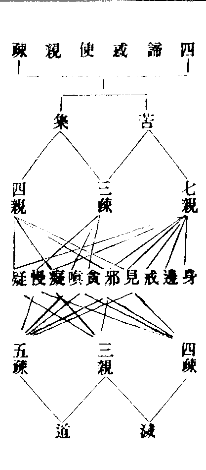



【■记】节引杂心。论曰：凡计罪福是我所作，不将善恶业因为我，故身见不依集，知集非我，不名迷集。边见依身，亦不依集，亦不将灭道为我，计断计常亦同，故身边唯苦。若戒取迷苦及道，谓愚人闻说精勤苦行，即谓事中苦身是道，不知勤观苦空，方断生死，身苦非道，故戒取迷苦谛生。或不将身苦为道，直执戒等福行为道，此将集因转将为道，如此戒取名迷道谛。理实凡愚不识集因，妄执为道，应是迷集。但彼迷心，不计福行以为集因，方转为道，故不名迷集。不同计苦以为道者，将苦为道，故名迷苦。是故戒取迷苦迷道，不迷於集。灭是圣果，众生所求，不取惑灭为道因行，故戒取不名迷灭。若邪见、见取及疑，此三通迷。四谛邪见，谤无因果，该凡及圣，故通迷见取。於自身报取为第一，即迷苦。於事善业计为第一，名迷集。若取梵无想等天为涅槃，名迷灭。於彼戒取所言之道取为第一，名迷道，故通迷疑心。於诸凡圣因果不知有无，生疑不决，故亦疑四。上来所明五见及疑，惟迷谛理，不名迷事，以迷理故还见理断。唯识心要云：迷谛有总别，总谓十种皆迷四谛，苦集是彼六道因依处故，灭道是彼怖畏处故。别谓身边唯迷苦八，通迷四身边唯果处起，别修空观及非我观，对治身边属苦谛故。疑与身边邪三见亲迷苦理，戒见二取执彼三见戒禁及所依蕴为胜能净，於自他见及彼眷属如次随应起贪恚慢。相应无明与九同迷，不共无明亲迷苦理，疑及邪见亲迷集等，二取贪等准苦应知。然嗔亦能亲迷灭道，由怖畏故生憎嫉故。迷谛亲疎麤相如是，与此大同小异对会可识。



【■补】孤山六十四句闲居编言：苦谛十使皆具足，身见唯缘苦境生。集谛痴业有漏因，灭谛无为无漏果。皆非身见所缘境，边身并及戒禁取。此二随身亦不生，是故集灭除三见。道谛本为无漏因，是故身边亦不起。邪见既拨无圣道，戒取还从邪见生。执取非道为真道，是故则有戒禁取。四谛具足有亲疎，苦下疎三亲有七。执我我所为身见，边见从身计断常。邪见拨无因果法，见取执劣以为胜。禁取於非因计因，疑则犹豫而不决。无明迷暗不了故，此等皆依苦等起。是故七惑号亲迷，贪嗔与慢三种惑。不从苦谛境上起，但缘前七背上生。是故三得疎迷号，集七四亲三种疎。邪见拨无疑犹豫，见取执劣痴迷暗。三疎名目亦如前，贪等只依四法起。灭则三亲四是疎，疎则前三添见取。苦谛是劣执为胜，是故见取得为亲。今灭谛是胜妙法，不可更言劣为胜。但从邪见背上起，执劣为胜名见取。是故灭谛疎有四，亲疎行相悉如前。道八三亲五种疎，亲则痴疑与邪见。疎法望前加禁取，苦谛戒禁则为因，有漏果非无漏道。妄执为因为果故，则有戒禁亲缘起，道谛真因真道故，不可亲缘非因道。但缘邪见起非道，故以戒取属疎法，道灭俱是无漏法，非是执劣以为胜。见取从前亦属疎，但从邪见起其执，总依俱舍如上释。此中少四句，想抄录者删其非要。又闲居编颂言：从谛生使名为亲，从使生使名为疎，四谛俱疎贪嗔慢，四谛俱亲邪痴疑。身边唯局苦亲使，戒见苦亲而道疎，见取集亲灭下疎，迷谛亲疎义如此。末二句应改言：集有四亲灭四疎，总於前三加见取。更简明。又苦七亲三疎者，以苦谛五阴法计为身，依身而起断常等见，将苦行以为实因，计非想以为涅槃，将世间果拨之为无，而皆迷痴不了，犹豫不决，故七日亲。贪嗔慢由於身边而起，又隔一层，故三曰疎。集以见取非因计因邪，则将世间之因拨之为无，痴疑可知，故四曰亲三疎。其义同前。灭以邪见，将出世果拨之为无，痴迷不了，狐疑不决，故三曰亲。道以邪见，则将出世因拨之为无，痴疑可知，故三曰亲五疎。由迷真道，方执戒取见取为道，故连贪嗔慢成五疎也。



△二、思惑三：初、标名示数。



二、明思惑者，有八十一品。



【□注】此界系思，亦名迷事思，亦名正三毒异俱生思及推利思也。



【■记】界系者，由此思惑，便系三界也。迷事即事障，对五尘境，憎爱等生，迷在事也。正三毒者，辅行言思有四，慢入痴摄为三，以非背使非习气名正。俱生思还归於见，推利思是利上之钝，见谛断时，正利既去，推利之钝思亦去，故此检之。俱生推利解见前，推利即依见思。



【■补】断见得人空智，虽有事中独头相应，了法从缘，不计性实，而於三毒无邪，故曰正。



△二、约界示体二：初、通示九地。



谓三界分为九地，欲界合为一地，四禅、四定为八，共为九地。



【□注】九地所依处得名，欲界同一散地，故合为一。



△二、列地分品二：初、欲界。



欲界一地中有九品：贪、嗔、痴、慢。言九品者：上上、上中、上下、中上、中中、中下、下上、下中、下下。



△二上界



上八地各有九品，除嗔使。



△三、结成大数。



故成八十一也。



【□注】於九地中各有九品，贪嗔痴慢，但上八地无嗔耳。



【■记】辅行云：以智断惑，智分分明，惑渐渐尽，何啻有九？立教判果，且略为九。



【□注】不言疑者，见道已断，理合无疑。



【■记】事障虽在，正信必具。



【□注】断此惑时，或直缘一真谛，或於四谛中随缘一谛。



【■记】释签云：或四谛中随思一谛，或唯思灭谛断，三界诸品不同，得后三果也。



【□注】故止观中云：见惑如四十里水，思惑如十里水。大经云：初果所断，如四十里水，其餘在者，如毛一渧。



【■记】思虽八十一品，对境方生，不同见缘，法尘横起故。



△三、结收集谛。



上来见思不同，总是藏教实有集谛。



【□注】此惑有为有漏之因，故云实有。上明见惑八十八使，思惑八十一品，乃见思俱开。若云九十八使，乃开见合思。若云四住，开思合见。但云见思俱合义也。或云三漏(欲有无明)，或云四流(见欲有无明)，或云上下五分。妙乐七(十八)云：上五分中，色染无色染，一向唯上。掉举等三(掉举慢无明)，虽复通下，不能牵下(欲界受生)，故云上分。言下分者，贪虽通上，不是唯上。嗔一唯下，不通於上。餘三遍摄一切见惑，虽复通上，而能牵下，故名为下。故俱舍云：由二(贪嗔)不超欲，由三(身边戒取)复还下，纵断贪等(名伏为断)至无所有(贪亦断得非非想)，由身见等还来欲界(文)。



【■记】此明见思开合，及见思别名。漏落三界曰漏。四流辅行言：见流，三界见也。欲流，欲界诸惑，除见及痴。有流，上二界诸惑，除见及痴。无明流，三界痴也。漂流不息曰流。染，贪也。



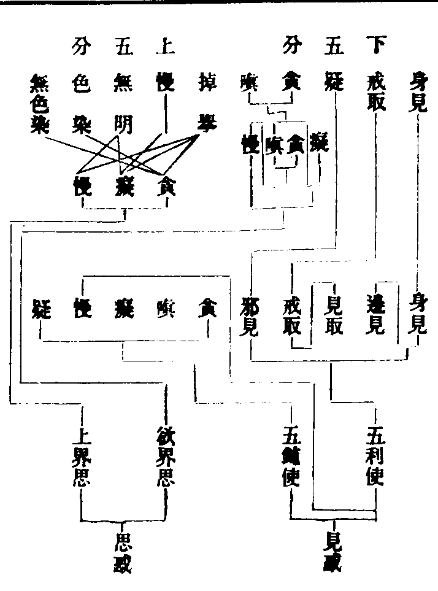



> (颂曰：)身摄边见戒摄取，邪见元从疑惑生，  

> 四钝皆由利使生，是故三结摄见尽。痴起贪嗔二生慢，  

> 举二摄二成欲思，无明即痴染即贪，掉举遍三俱定爱。



【□注】颂曰：身摄边见戒摄取。



【■补】边从身起，故非因计。因为戒取，於中必见，有所取即见取。



【□注】邪见元从疑惑生。



【■记】始而犹豫不决，继即拨无因果。



【□注】四钝皆由利使生，是故三结摄见尽。



【■补】三、结身戒疑也。此颂下五分见。



【□注】痴起贪嗔二生慢，举二摄二成欲思。



【■记】此颂下五分，欲、思举二指，贪、嗔摄二指，痴、慢。



【□注】无明即痴染即贪，掉举遍三俱定爱。



【■记】此颂上界五分思惑。成论：问：掉於上界名结，何故欲界不说？答：彼无麤烦恼，故掉戏明了。又坏定身有力，故为结。断此上分，则得解脱。



南天竺沙门蒙润集注



清比丘性权彚补辅宏记



清三宝弟子钱六庵较订



天台嫡裔比丘谛闲编科参梓



△三、灭谛三：初、标名。



三、灭谛者。



△二、示体。



灭前苦集，显偏真理。



△三、拣非。



因灭会真，灭非真谛。



【□注】法界次第中(十)云：灭以灭无为义，结业既尽，则无生死之累，故名为灭。妙玄二(二十)云：二十五有子果缚断，是灭谛(文)。



【■记】结业即集，生死即苦。玄文言：痴惑之本，既无常、苦、空、无我，则无明灭。无明灭故，诸行灭，乃至老死灭。若不燃火则无烟，名子缚断。无子则无果，灭智灰身，离二十五有，名果缚断。又言：若发见思无漏真明，具三十四心断结者，三界九十八使皆灭。以烦恼结使灭故，三界业亦灭。若三界业烦恼灭者，即灭谛有餘涅槃也。因灭故果灭，舍此报身，后报不续，名无餘涅槃，真灭度也。灭理不虗曰谛。



【□注】观音玄记上(十七)云：灭谛之体，是二涅槃。虽非真谛，能冥於理。故云因灭会真，灭非真谛。因灭苦集，方能会真，非谓此灭便是真谛。



【■记】先问：三藏所谈，灭非真谛。今文依灭起第四誓，那云真谛无为理耶？答：灭谛之体，是二涅槃。虽非真谛，能明於理，故曰因灭会真。道是灭因，苦集违理。佛既契真，故成佛誓。观真而发，是所引文，乃释依灭起成佛誓义。今证拣灭非真也。



【■补】涅槃翻灭度，大患永灭，超度四流故。



【■备】灭，但功用尽处，若真谛即下法性，自天而然也。



【□注】止观一(十二)云：法性自天而然，集不能染，苦不能恼，道不能通，灭不能净。如云笼月，不能妨害。却烦恼已，乃见法性。经言：灭非真谛，因灭会真。灭尚非真，三谛焉是？(文)辅行一下(十一)云：当知苦集，但是能覆，不能恼染。道灭能显，而理本净。法性如月，苦集如云。道如却除，灭如却已。(文)



【■补】辅行言：法性与真，名异义同。



【■备】问：藏教何为真理？曰：枯寂偏空也。



△四、道谛三：初、牒名。



四道谛者。



【□注】法界次第中(十)云：道以能通为义，正道及助道，是二相扶，能通至涅槃，故名为道(文)。



【■记】正道者，实观三十七品，三解脱门，缘理慧行，及忍智无碍解脱，三十四心，真无漏慧也。助道者，得解观中诸对治法，及诸禅定，皆助道。有餘方便对治，诸禅三昧，三十七品等，皆助道也。



【■备】下集注言此道品通正通助，大约止观法皆正道，二十五前方便皆助道也。



【□注】妙玄二(二十)云：戒定慧无常苦空，能除苦本是道谛(文)。



【■记】苦本即结惑。



△二、示体二：初、总标广略。



略则戒定慧，广则三十七道品。



【□注】略则戒、定、慧。释签三(九)云：道品虽多，戒等摄尽。戒摄三：正语、正业、正命。定摄十四：如意足、定根、定力、除觉、定觉、舍觉、正定。慧摄十八：四念处、四正勤、进根、慧根、进力、慧力、择觉、进觉、喜觉、正见、正思惟、正进、精通、定、慧、念根、念力、念觉、正念。止观七(九)云：念通缘两，处通三学：信根、信力。辅行云：一切诸法，信为本故。(文)广则三十七。道品三、四、二、五、单七、只八，若六度摄三十七，具如辅行七上(二十一)。



【■记】三、四即念、勤足，二、五即根、力，七即觉，八即正道。辅行六度摄道者，檀具二觉，谓除与舍。尸具三，谓正语、正业、正命。忍具四，谓念根、念力、念觉、正念。进具八，谓四勤：进根、进力、进觉分、正进。精禅具八，谓四如意足：定根、定力、定觉、正定。慧具十，谓四念处：慧根、慧力、择觉、喜觉、正见、正思。餘有二信，通三十五。一切诸法，信为根本故。



【□注】道品者，法界次第中(十二)云：品者，类也。此七科法门，悉是入道浅深之气类，故云道品也(文)。



【■备】入道浅深，应指对位、相生两种说。



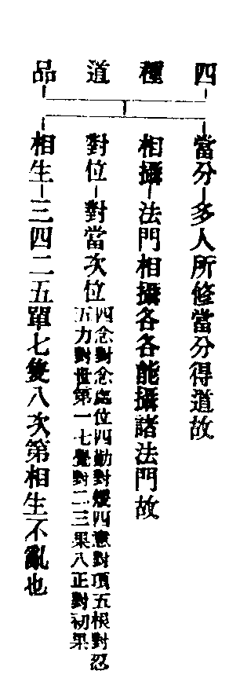



【■记】当分者，止观言：未必全具道品，方能得道。三、四、二、五，单七、只八，当分是道，故曰依念处得道。念处既尔，餘品亦然。为当分相摄者，释论言：念处既摄餘品，餘品亦摄念处。为相摄对位者，俱舍颂言：初业顺决择及修见道位念处等七品应知次第增。华严钞曰：初业者，修总相、别相念处。此初业位，能照身等四境，慧用胜故，说念处增。顺决择者，煖等四位也。煖法位中，能证异品决择分殊胜功德，勤用胜故，说正勤增。顶法位中，能持善趣无退转位，定用胜故，说神足增。忍法位中，必不退堕，善根坚固，得增上义，说五根增。世第一位中，非世惑法所能屈伏，得无屈义，说五力增。及修见道位者，修道位中，近菩提位，助觉胜故，说七觉增。见道位中，速疾而转，道行胜故，说八正见增。此对位义同也。据止观言，八正是见谛位，为第六；七觉是修道位，为第七。乃是约位，非调停也。今约调停，故以七觉为第六，入正为第七。相生者，论言：闻法已，先当念持，次即勤修。勤故摄心调柔，调柔故信等成根，根增为力。次七觉分别八正道，是正行也。有时八正在前，未办名道，已办名觉也。又止观云：如修念处，能生正劝、正勤，乃发如意。如意生根，根生力，力生觉，觉入八正。为相生也。



【□注】然此道品，通正通助，通大通小，通漏通无漏，亦漏亦无漏，并如止观第七具释。



【■记】止观问：道品是二乘法，云何是菩萨道耶？答：净名言：道品善知识，由是成正觉。道品是道场，亦是摩诃衍。涅槃云：能修八正道者，即见佛性，名为醍醐。大集云：三十七品，是菩萨宝炬陀罗尼。如此等经，皆名道品，何得独是小乘？又有漏道品，欲界二十二，未到三十六，初禅三十七，皆有漏。道品如乳，三藏道品如酪，通教道品如生酥，别教道品如熟酥，圆教道品如醍醐。或问：三十七是助道？是正道？答：大论云：是菩萨道，正也。净名云：道品善知识，由是成正觉，助也。又问：三十七品是有漏者，云何言七觉是修道？法华云：无漏根、力、觉、道之财。云何八正在七觉前？答：此应三句分别：一、三十七品皆有漏；二、皆无漏；三、亦有漏亦无漏。大论言：修八正道，得初善有漏五阴。善有漏五阴即是煖法，煖法之前尚得修，於八正道云何修耶？谓初师受法，系心忆念，名念处；为求此法，勤而行之，名正勤；一心中修，名如意足；五善根生，名根；根增长，名力；分别道用，名七觉；安隐道中行，名八正道。能如是修，得善有漏五阴，当知道品皆有漏也。二、皆是无漏者，即是见谛思惟所行道品，一向是无漏，法华之文意在此也。从来虽言有漏中得修八正、七觉等，未有文证，而毗婆娑云：八正在七觉后，亦是有漏，亦是无漏。何以故？依八正入见谛，即是亦无漏。若八正在七觉前，一向是无漏，此则可解。又亦漏亦无漏，即是对位意也。



【□注】又小唯正道，大通正助。今是小乘道品，义当相生。



【■记】此明通局结归也。谓约小乘七科，皆唯正道；约大乘七科，正助俱通也。今文言小乘之道品，当以相生之义为正也。



△二、别释详明二：初、标科。



此三十七，合为七科。



【■记】准瑜伽杂集三十七品，总有七类：一、对治颠倒道，四念处；二、断诸懈怠道，四正勤；三、引发神通道，四神足；四、现观方便道，五根；五、亲近现观道，五力；六、现观自体道，七觉分；七、现观后起道，八正道。故科为七也。



△二、列释七：初、念处。



一、四念处：一、观身不净(色蕴)；二、观受是苦(受蕴)；三、观心无常(识蕴)；四、观法无我(想行蕴)。



【□注】四念处一(五)云：四者，数也。念者，观慧也。处者，境也。今言四者，人於五阴起四倒故，於色多起净倒，於受多起乐倒，於想行多起我倒，於心多起常倒，举四倒故言四也。若相生次第，应言识受想行色。若麤细次第，应言色行想受识。今从语便，故言身受心法(文)。



【■记】观慧。释念者，同是别境，心所慧观，由念得住也。论云：身应多观不净，受应多观是苦，心应多观无常，法应多观无我。何以故？凡夫未入道时，起四颠倒故：破净倒说身念，破乐倒说受念，破常倒说心念，破我倒说法念也。四法次第者，教中论相生，从细至麤；论除灭，自麤至细。今从语便也。



【□注】若迷心不迷色，则数为五阴。若迷色不迷心，则数为十二入。若心色俱迷者，则数为十八界。如婆娑论俱舍颂云：聚生门种族，是蕴处界义。愚根乐有三，故说蕴处界。(诸有为法和合是聚义，生长门是处义，以能生长心心所法种族是界义。如一山中有金银铜铁等，名多界等。补注十三卷十二纸)



【■记】有为和含是聚义者，是论释颂，以明蕴义。次引经言：诸所有色，若过、现、未，若内、外、麤、细，若劣、胜、远、近，如是一切，略为一聚，说名色蕴。由此聚义，蕴义得成是也。生长门是处义者，亦论文释颂。以能生长心、心所法一句，是论主释词。种族是界义下，亦是论文释颂。又云：如是一身，或一相续，有十八类诸法种族，名十八界。今以等字该之。已上论文，释前半颂也。而后半颂，论释云：所化有情，有三品故，世尊为说蕴、界、处三门。或愚心所，总执为我，或唯愚色，或愚色心。根有三，谓利、中、钝。乐有三，谓乐略、乐中、乐广。如其次第，佛为说蕴、处、界三也。补注：神智师释三大部。



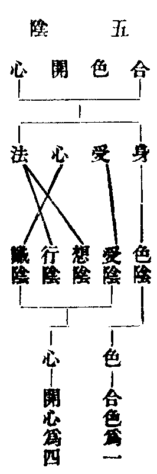



【■记】一、色阴，有十四种，谓四大、五根、五尘。二、受阴，领纳所缘名受，有六种，谓六触因缘生六受。三、想阴，能取所领之缘相名想，有六种，谓取所领六尘相。四、行阴，造作之心，能趣於果名行，有六种，谓於六想之后，各起善业、不善业、无动业也。五、识阴，了别所缘之境，即六识也。以迷心偏重，故圣教开心为四，出法界次第。



【■补】唯识论以受对前五识，想对六识，行对七识，识对八识。今此不论，弗以唯识所解配合也。



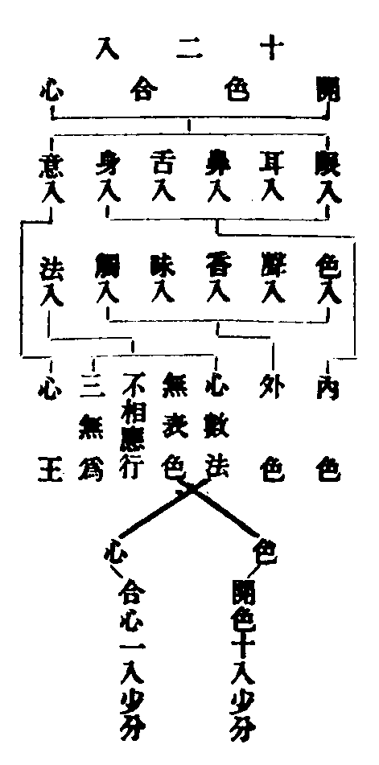



【■记】惑者迷色偏重，故大圣开色为十，心但为二也。入以涉入为义，根尘相对有识生，识依根尘，识为能入，根尘是所入。今此十二，通从所入受名也。内六亲故属内，为识所依名入。亦名六根者，能生为义，有生识功也。一、眼入，眼是四大造色体，为十色共成，所谓四大、四微、身根微、眼根微。二、耳入，三、鼻入，四、舌入，均四大造色体，为十色共成，但各换一耳、鼻、舌根微也。五、身入，但有九色所成，谓四大、四微、身根微。六、意入，除诸心数法，但取能知诸法心王也。外六疎故属外，识所游涉名入。亦名六尘者，染污为义，色、声、香、味、触五入可解。六法入有二种：一者、心法，除心王，但取相应诸心所法。二、非心法，即过去、未来色法，及心不相应诸行。



三、无为法，【■补】法入中，无表色属色，心数法属心，不相应行非色非心，三无为非三聚摄，故不属内色，亦不属外色也。



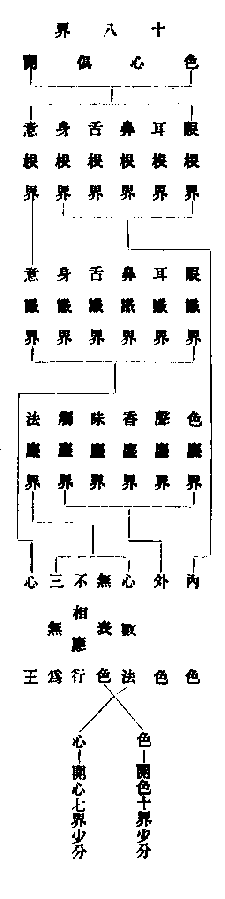



【■记】惑者，色心俱迷，圣教俱开，为十八也。界以界别为义，十八法各有别体，故十二入及前五识界可解。识以了别为义，六意识界，谓前五生已，传入意识，即以前五为能生，后意识为所生。此意前灭，次识续生，即前意识生后意识。如是亦脱传受根识之名，皆能生为根，所生为识。今专指所生为意识也。上明蕴、处、界所摄法，即小乘七十五法。如云：内色、外色、无表色，即五根、六尘、十一种色法。心王，即前六识心所法。明四十六，谓遍大地有十：受、想、思、触、欲、慧命、作意、胜解、三摩地。此十通善通恶，徧一切心。胜解者，於理明了。三摩云：等持，离沉掉曰等，专注不散曰持。大善地有十，谓：信、勤、舍、惭、愧、无贪、无嗔、不害、轻安、不放逸。此十不通於恶，唯是善业，能通至无漏圣道，故云大善地。舍者，远离掉举。大烦恼有六，谓痴、放逸、懈怠、不信、昏沉、掉举。此六依五、六、七识起，不通於善，唯是恶法，故云大烦恼也。大不善有二，谓无惭、无愧。人因此二，则无恶不造，故云大不善也。小烦恼有十，谓忿、覆、悭、嫉、恼、害、恨、谄、诳、憍。此十但依六识而起，故云小烦恼也。不定有八，谓悔、眠、寻、伺、贪、嗔、慢、疑。此八通於善、恶、无记三性，故云不定法也。无记者，不善不恶，无所记录也。麤念曰寻，细察曰伺。不相应有十四，得、非得、众同分、无想异熟、无想定、灭尽定、命根、生、住、异、灭、名、句、文也。此十四不与色法、心法、心所法相应，故众同分，众人形状相似也。无想果报异世成熟，曰无相异熟。外道所修，曰无想定。圣教所修受想心灭，曰灭尽定。依事立名曰名，积字成句诠差别曰句，为名句依而能显所表理曰文，身即字也。



【■备】无为有三。天溪补遗引俱舍颂云：此中空无碍，谓大虗空无碍为性，即虗空无为。颂曰：择灭为离系，随系事各别。随三界系，不同名事。离一系故，得一择灭。择力所得灭，名择灭。择为断智，推度令灭，故名择灭。非择灭者，颂云：毕竟碍当生，此二类不同。谓根尘缺缘，及所证位，诸无知惑，不得续起，名碍当生。如缘一色时，於餘诸色，及餘四尘，得非择灭。为正缘色，碍餘色等，当不生故，名碍当生。其餘法数广解。



【□注】观身不净，四念处一(六)云：一切色法，名之为身。内身，外身，内外身。己名内身，眷属及他名外身，若己若他名内外身。此三种色，皆从前世不净业生，则有五种不净，谓生、处、种子、相、性、究竟。



【■记】大论言：自身有二种：一、身内不净，二、身外皮毛爪发等皆不净。复次，行者观死尸䏺胀烂坏，取是相；观自身亦如是相，如是事。我未离是法，死尸是外，行者是内。如见端正女人而心着，即观其身种，称不净为外；知我身亦如是为内。复次，眼等五情为内身，色等五尘为外身；四大为内身，四大造色为外身；觉苦乐处为内身，不觉苦乐处为外身；自身及眼等根为内身，妻子田宅所用之物为外身。乃至今当总观内外。谓先观内身，求净不可得；次便观外，复不可得。疑曰：我观内时，於外或错；观外时，於内或错。故内外俱观，亦不可得。然观内观外是别相，一时俱观是总相。总观别观，既皆不得净相，故知三种色从不净生。此明五种不净，望大论列次有殊。以论列：第一、种子，二、住处，三、自体，四、自相，五、究竟。对此前后可知。



【□注】生处者，女人之体，是不净聚，虫脓秽恶，合集成立，经十月日，二脏间夹，迮隘如狱。释论云：此身非莲华，亦不由旃檀，粪秽所长养，但从尿道出。



【■记】此释生处不净也。大论言：住处不净，谓诸不净物和合，名为女身。内有生脏、熟脏、屎尿不净；外有烦恼业因缘，风吹识种，令入二脏中间，如在尿坑中。所谓是身为臭秽，不从华开生，亦不从薝葡，又不出宝山。迮隘如狱者，胎骨经云：婴儿在胎，有八种狱：谓婴儿之身最嫩，母吃热食，如镬汤狱；母吃冷食，如寒氷狱；饱时，如石压狱；饥时，如饿鬼狱；硬食，如刀山狱；行时辛苦，如碓捣狱；坐时，如铁床狱；母若低头，如倒悬狱。



【□注】种子不净者，揽父母遗体赤白二渧於中而住，是识随母气息出入，是为受身最初种子不净也。



【■记】此释种子不净也。大论谓父母以邪念风，吹婬欲火，肉髓膏流，热变为精，宿业因缘，识种子在赤白中住，是名身种。如偈言是身种不净，非餘妙宝物，不由净白生，但从尿道出是也。



【□注】相不净者，头等六分，从首至足，纯是秽物。譬如死狗，尽海水洗，洗死尸尽，唯餘一尘，一尘亦臭。



【■记】此释相不净也。大论亦名外身不净，谓是身九孔常流不净：眼流眵泪，耳出结[目*(甯-用+冉)]，鼻中洟流，口出涎吐，谷道水道常出屎尿，及诸毛孔汗流不净。如是不净，充满身内。如偈言：常流出不止，如漏囊盛物是也。



【□注】性不净者，根本从秽业生，托於秽物，长养其性，自尔不可改变。



【■记】此释性不净也。大论言自体不净，谓从足至顶，四边薄皮，其中所有不净充满，饰以衣服，澡浴花香，食以上馔，众妙肴膳，经宿之间，皆为不净。如说地水火风质，能变成不净，倾海净此身，不能令香洁是也。



【□注】究竟不净者，业尽报终，捐弃冢间，如朽败木，大小不净，盈流於外(文)。



【■记】此释究竟不净也。是身投火为灰，在地腐坏为土，在水䏺胀烂坏为水虫所食。一切死尸中，人身最不净。如说审谛观凡身，终必归死处，难御无反覆，背恩如小人是也。



【□注】观受是苦，四念处一(七)云：领纳名受，有内受、外受、内外受。缘内名内受，缘外名外受，缘内外名内外受。又意根受名内受，五根受名外受，六根名内外受。一一根有顺受、违受、不违不顺受。於顺生乐受，於违生苦受，於不违不顺生不苦不乐受。乐受是坏苦，苦受是苦苦，不苦不乐受是行苦。



【■记】此释受也。如论言：佛说有二种，谓身受、心受。心受是内，身受是外。又五识相应受是外，意识相应受是内。十二因缘故，诸受生。内六入分生受为内，外六入分生受为外。麤受为外，细受为内。又缘内法为内，缘外法为外。复次，一百八受为内受，餘残是外受。又言：从内六情、外六尘和合故，生六种识。六种识中，生三种受。行者观是世间乐受，皆从颠倒生，俱无有实，虽欲受乐，能得大苦。如是观乐受，是坏苦乐相，坏苦相至，即乐极生悲也。观苦受是苦苦，五阴之身，性常逼迫。又与苦受相应，苦上加苦也。行苦者，有漏之法，四相迁流，常不安隐也。能如是观，则於乐受不生欲着，苦受不生忿恚，不苦不乐受中不生愚痴，名受念处也。



【□注】观心无常者，心即心王，心王不住，体性流动，若麤若细，若内若外，皆悉无常。



【■记】四、念处。云心者，心王。例上有内心、外心、内外心。心王不住，体性流动，若麤若细，若内若外，皆悉无常，无奢无促。今日虽存，明亦难保。昔诸比丘谓：不保七日，乃至不保一日。佛呵为懈怠。又一比丘言：出息不保入息。佛言：善哉！刹那促时，无常山水，溜斵石光，若不及时，后悔无及是也。今但略引耳。今准论释，言心王不住者，谓过去已灭，未来不生，现在一念不住，疾故不觉。若心一念住，第二念亦应住，是为常住，无有灭相。如佛说：一切有为法，三相住中，亦有灭相。若无灭者，不应是有为相。故知心无住时也。若麤细内外皆无常者，谓是有为法，一切属因缘故无常，先无今有故，今有后无故。又复无常相，常随逐有为法故，有为法无有增积故，一切有为法相侵剋故无常。於有为法，心无常最易知。如佛说：凡夫或知身无常，不知心无常。若言身有常犹差，以心为常是大惑。何故？身住或十、二十岁，是心日、月、时、顷、须臾，过去生灭各异，念念不停，欲生异生，欲灭异灭，如幻事实相不可得。故知心是无常，名心念处也。



【□注】观法无我。四念处一(七)云：法名轨则，有善法、恶法、无记法。人皆约法计我，我能行善、行恶、行无记。若於心王计我，已属心念处摄。若於心数计我，从九心数，一切善数、恶数、通大地数，并属行阴法念处摄。此等法中，求我决不可得。龟毛兔角，但有名字，实不可得。若善法是我，恶法应无我。若恶法是我，善法应无我。若无记是我，无记不能起业，但名因等起。因此无记，起善起恶。善恶业尚非我，因等起何得是我。当知皆无有我，但是行阴。故经云：起惟法起，灭惟法灭。但是阴法起灭，无人无我，众生寿命。虽有法起，亦是颠倒。颠倒者，即是身边二见。



【■记】此释法处也。如教中明法者，有轨、持二义。轨者，轨生物解。持者，任持自性。此但约轨物生解义，以释法名。不取任持自性义者，意显法中无我实性可持故也。约法计我者，按定所计之我，必依於法。谓於心王计我，上已观为无常，无实我体。此除开心王。若於心数等者，此正推法无我。於十大地数中，除受，以前观受是苦摄。今以九心数中，想即想蕴，餘八行蕴摄。一切善数有十，谓信、进、念、定、慧、喜、猗、舍、觉、戒。恶数亦有十，谓恚、恨、谗、诳、憍、忿、怒、悭、痴、妬。皆行蕴摄。通大地数者，涅槃狮子吼品疏引数人云：十数并起为大地，通五品，谓善、恶、无记、不共、薉污等。成论云：法起十数，义说为十。或言欲界十居，止是十数，谓三途人、六天。今观此等行阴法中，求其我体，决不可得。但有龟毛兔角之虗名字，而无实事也。次以善、恶、无记互夺，观法无我。谓若善法是我，以善夺恶，恶法应无我，以善是恶主对故。若恶法是我，以恶夺善，善法应无我，以恶是善违害故。则互夺两亡。善恶法俱非是我，何得言我能行善行恶乎？若言无记法是我，然无记於法无所记录，则不能亲起作业，但名因等起耳。谓因此无记故，方能起善起恶，是则所起善恶之业尚非是我，而此因等起之无记何得是我乎？已上观法无我竟。当知下，指是行阴於中起灭故。经云下，引证。此中无我、人、众生、寿命者，谓无生空四相，正与金刚四相义同。金刚四相者，我是自在之名，人为主宰之目。众生者，取续前义；寿命者，取接后名。则以四为人执，故同此中义。大论云：人者，谓於阴、界、入中谓我是行人；我者，於阴、界、入计我、我所若即若离；众生者，於阴、界、入和合之中计有我生；寿命者，於阴、界、入中计一期果报若长若短。又法数言：众生於五阴法中若即若离，计我及我所，五阴是实，名我相；於五阴法中妄计我是人，我生人道，异於餘道，名人相；计五阴众共而生此身，名众生相；於阴法中计我受一期寿命长短，名寿者相。今既知但是阴法起灭，则无人我等计也。已上破我执，下并破法执。或谓既是法起法灭，而法应实有耶？故言虽有法起，亦是颠倒，即是身、边二见。谓此五蕴法中本非有身，而起此见，妄计为身；本非断常，而起边见，妄自执之为断为常，非颠倒而何？故知由颠倒而见有法，其实法亦当体全空，则知不但法中无我，而法亦空。今且破我见，故言法无我也。



【□注】想行蕴者，止观五(八)云：想取相貌，行起违从(文)。



【■记】想，谓取相在心。行，谓於好恶相边，起违从之念，念起念灭，迁流不住也。



【□注】念处居初者：一、佛嘱。佛将入涅槃，阿难请问：佛去世后，比丘依何修道？佛答：比丘当依四念处行道。二、依经。止观五(二)云：大品云：声闻人依四念处行道，菩萨初观色，乃至一切种智。章章皆尔，故不违经(文)。三、现前。止观五云：又行人受身，谁不阴入？重担现前，是故初观(文)。辅行七上(十二)云：以四念处，能为大小观行初门。如来殷勤遗嘱，意在於斯(文)。



【■记】此释注中。问，答也。如大经佛涅槃时，答阿难言：佛灭度后，当依四念行道。二、依经下，章章皆尔者，谓菩萨观不净、苦、空、无我，至於一切种智，皆应先观色故。辅行云：大品凡列法门，皆以五阴为首。三、现前下，大论云：五阴麤重常恼，故名担。如佛说五阴是担，罗汉此担已除，名弃担。则知行人阴入，重担现前也。



△二正勤



二，四正勤：一、未生恶令不生，二、已生恶令灭，三、未生善令生，四、已生善令增长。



【■记】此释勤者，不惟力勤，当以继念为勤也。念智如火，勤力如风，智得勤力，无往不克。瑜伽论曰：於四念住中，惯习行故，已能除遣麤重，了达善不善等。从此无间，於未生善法令生，於已生恶法令灭。



【□注】正则不邪，勤则不怠。辅行七上(十二)云：只是於前念处精勤，除恶生善。文从语便先除二恶，次生二善。据行必以已生善恶居先，未生善恶居次，并先明灭恶，次明生善(文)。



【■记】善恶二法，有通有别。通如大乘勤观法性为善，实相之外，皆名为恶。别则取观中懈怠、五盖等为不善，其能对治，为所生善也。



【□注】止观七(二十六)引十住毗婆娑偈云：断已生恶法，犹如除毒蛇；断未生恶法，如预防流水。增长已生善，如溉甘果栽；未生善为生，如钻木出火。(文)一、未生恶令不生：四念处观时，若懈怠心起，及诸烦恼恶法虽未生，恐后应生遮信等五种善根。今为不令生故，一心勤精进，方便遮止，不得令生也。



【■记】此四，正断中，名断断。瑜伽论言：断断者，即未生恶法，为欲令彼不现行断，为欲令彼不现前断，为断故断，名为断断。



【■备】辨讹曰：若懈怠起句，准法界次第，无此起字。若言起，如何说未生？



【□注】二、已生恶令灭。四念处观时，若懈怠心起，诸烦恼覆心，离信等五种善根，如是等恶，若已生一心，勤精进方便，除断令尽也。



【■记】四、正断中，名律仪断。瑜伽论曰：律仪断者，即已生恶法，应修律仪，令其断灭，不应忍受也。



【□注】三、未生善令生。四念处观时，信等五种善根未生，为令生故，一心勤精进，方便修习，令善根生也。



【■记】四、正断中，名修习断。瑜伽论曰：修习断者，即未生善法。由於善法数数修习，先所未得，能令现前，能有所断也。



【□注】四、已生善令增长：四念处观时，信等五种善根已生，为令增长故，一心勤精进，方便修习，令不退失，增长成就。



【■记】四、正断中，名防护断。瑜伽论曰：防护断者，即已生善法，由於已得、已现在前诸善法中，远离放逸，能生善法，住不忘失，修习圆满，防护已生所有善法，能有所断也。问：何以七科，此四名正勤，及后八名正道，餘不名正耶？答：心勇发勤，畏有错误，故言正。行道，畏堕邪法，故言正。



△三如意



三四，如意足(欲、念、进、慧)。



【□注】法界次第中(十三)云：智定力等，所愿皆得，故名如意足。



【■记】法界言：四念智慧，四勤精进。精进智慧增多，定力少弱，得四种定摄心：即智定力等，所愿皆得，故通名如意；智定力等，能断结使，故断行成就也。



【□注】此四属定，六神通中，身如意足，藉兹而显。又通因定生，亦可六通因兹并发。



【■记】身如意有三：谓能到、转变、圣如意。能到复四：一、身飞如鸟无碍；二、移远令近，不往而到；三、此没彼出；四、一念能至。转变者，大能作小，小能作大，一多亦然。种种诸物，皆能转变。外道辈转变化，不过七日。佛及弟子，转变自在，无有久近也。圣如意者，外六尘中，不可爱不净物，能观令净；可爱净物，能观令不净也。六通因此发者，如意如上。天眼通者，眼得色界清净色，自地及下地六道众生诸物，若近若远，若麤若细，诸色无不能照。此有二：一、报得，二、修得。五道中天眼，从修得，非报得，以从常忆念种种光明得故。天耳通者，能闻一切声：天声、人声、三恶道声。云何修得？天耳常忆念种种声故。宿命通者，本事常忆念日月年岁至胎中，乃至过去一世十百千万亿世，乃至大罗汉辟支知八万大劫，菩萨及佛知无量劫也。他心通者，知他心若有垢若无垢，自观心生住灭时，常忆念故得。复次观他人喜相、嗔相、怖畏相，见此相已，然后知心，是为他心智也。无漏通者，如来庄严入一切佛境界。经言：无漏者，谓离四漏。以不取彼四种漏故，名远离诸(漏智)。



【□注】四、正勤是慧。慧观不勤，念处不成，反招散动，如风中灯。今修如意，如加密室，定慧均等。欲者，希向慕乐，庄严彼法。言彼法者，谓念处境。言庄严者，修希向心，令法端美。凡所修立一切诸法，若无乐欲，事必疎遗。念者，专注彼境，一心正住。若无一心，观法断绝。进者，唯专观理，使无间杂。无杂故精，无间故进。凡所修立一切诸法，若无精进，事必不成。慧者，止观法界次第，皆名思惟。思惟彼理，心不驰散。当知四法是入定方便。出辅行七上(十二)、㭊玄下(三十六)云：四观神足心所中慧，以觉察为义(文)。妙乐二(八)云：思是慧数(文)。



【■记】谓第四，乃五别境中慧觉察为义。神即神通，足即是定。瑜伽论云：如有足者，能往能还，统纪言法。师敬云：依俱舍论，述小乘入道五位，作㭊玄记二卷。以小乘明析空五位，乃㭊中之玄，名㭊玄记。



△四五根



四，五根(信、进、念、定、慧)。



【□注】辅行七上(十三)云：修前诸品，纵善萌微发，根犹未生，根未生故，萠善易坏。今修五法，使善根生，故此五法，皆名为根。(文)信者，信於谛理，能生一切无漏根力，禅定、解脱、三昧等。然此信根，必依念处，若无信境，根何能生？



【■记】此释信也。於四念处谛理，深忍乐欲，如蜂搆蜜，如犊思乳。能如是深住净信，便生一切无漏功德。经言：信为道元功德母，长养一切诸善法也。



【□注】进者，信诸法故，倍䇿精进。念者，但念正助之道，不令邪妄得入。定者，摄心在正道，及诸助道善法中，相应不散。慧者，念处之慧，为定所摄，以观自照，不从他知。



【■记】慧者，谓修如意后，慧得定摄，即能照理除妄。惟以不净、苦等观法自照，更不从他异缘而别知也。



△五五力



五、五力(同上根名)。



【□注】前不入故，进修五力，令根增长，则能排障。同上根名者，辅行七上(十三)云：问：名同於根，何须更立？答：善根虽生，恶犹未破，复更修习，令根增长。是故此五，复受力名。根成恶破，故名为力(文)。释签一(九)云：信解品云：无有欺怠嗔恨怨言。欺为信障，怠为进障，嗔为念障，恨为定障，怨为慧障。若根增长，能破五障，故名为力(文)。



【■记】此释释签，引经文以明五障也。欺则忽乱浮疑，不能深忍乐欲，故障信。怠则不能勇悍深造，故障进。嗔则不善心多，不能明记正助之道，故障念。恨则心神郁结，不能泯然摄归念处，故障定。怨则含毒事深，不能觉察谛理，故障慧也。



【□注】信力信谛，不为邪外诸疑所动。



【■记】诸疑虽多，不必障定。论障定者有三：一、疑自者，自念诸根暗钝，罪垢深重，非其人乎？作此自疑，定慧不发。二、疑师者，彼人威仪相貌如是，自尚无道，何能教我？作是疑时，即为障定。三、疑法者，如世人多执本心，於所受法，不信敬受行。若生犹豫，法不染心。今此信根，增长有力，即不为所动也。



【■备】三、疑古今通病。教中谓疑自者，当念先世善根何限，精勤忏悔以破之。疑师者，但遵其法，不论其人，如夜行弊人持灯，不以人故废其照。疑法者，佛无诳语，笃信力行可也。



【□注】进力观谛，心无间杂，本求道果，未证不休。念力持谛，破边邪想，不令烦恼之所破坏。定力若成，能破欲界一切诸散，能於诸禅互无妨碍，不同单修根本之相。



【■记】定力若成，不但破欲界散，亦不同上地单修之定，以於诸禅定互无妨碍故。如辅行云：虽用欲界语法，不碍初禅支林；或住初禅觉观之法，不碍二禅内净；或住二禅与喜相应，不碍三禅乐受；或与四禅舍受相应，而能教化一切众生。纵妨四禅，不妨诸定。妨谓妨碍，碍谓遮止。纵有因缘，不入四禅，不妨一切禅定自在也。



【■备】辨讹曰：诸禅互无妨碍，此止观文，彼约圆意，今明藏教，当斟解之。



【□注】慧力能破一切邪外等慧，能破一切见爱等执。



△六七觉。



六、七觉支(念、择、进、喜、轻安、定、舍)。



【□注】修前不入，由定慧不调，故用七觉均调之。



【■记】念勤是慧，四足是定。又得根力，成善破恶，未能入理者，由定慧不调，故以七觉均调之。



【□注】觉谓觉了，支谓支分。法界次第中(十四)云：无学实觉，七事能到(文)。



【■记】实觉者，如实觉慧也。法界云：一、择法觉，善能简别真伪，不谬取诸虗伪法故。二、精进觉，善能觉了不谬行无益苦行，常勤心在真法中行故。三、喜觉，心得法喜，觉了此喜，不依颠倒法生喜，住真法喜故。四、除觉，断除诸见烦恼时，觉了除诸虗伪，不损真正善根故。五、舍觉，善能觉了所舍境虗伪不实，永不追忆故。六、定觉，发诸禅定，觉了诸禅虗伪，不生见爱妄想故。七、念觉，善能觉了常使定慧均平。若心沉念，用择进喜起之；若心浮念，用除舍定摄之，调和适中也。



【□注】止观七(九)云：心浮动时，以除觉除身口之麤。



【■记】轻安即除觉，亦名猗觉，乃猗任自在意。七觉乃入道之要。大论云：若离五盖，专修七觉，不得入禅者，无有是处。



【□注】以舍觉舍於观智，以定心入禅。若心沉时，以精进择喜起之念。通缘两处文。



【■记】摄散䇿昏，不使偏落。昏散是念觉。前说定慧调匀，是用七觉，所以今是念觉当体。



【□注】辅行七上(十三)云：定慧各三，各随用一，得益便止，无假徧修。若全无益，方趣后品。念能通持定慧六分，是故念品通於两处(文)。



【■记】佛说教令修，如医照方教服，着止微加一剂，不痊方添后药，前支未益，乃用次觉。法虽禀医，行由自己，如得益便已。



△七八正



七八，正道(正见、正思惟、正语、正业、正精进、正定、正念、正命)。



【■记】正念、正定是定，见、思惟、精进是慧，唯语、业、命通戒。又前七觉，是分别此八正道、正行也。



【□注】正以不邪为义，能通至涅槃，故名为道。



【■记】八正，亦名八圣道，出瑜伽论。



【□注】正见修无漏十六行，故明见四谛。



【■记】十六行，解见五卷。



【□注】正思惟，以正思惟发动此观。正语，以无漏智除四邪命，常摄口业住正语中。



【■补】八犍度论曰：以邪命作口四恶行，名邪语邪命。以邪命作身三恶行，名邪业邪命。又五邪中，后四皆口业，不必专指贪求利养。凡掉戏等，皆属邪命摄。俱舍言观象鬬等，佛亦立邪命中，邪受外境虗延命故。



【■备】辨讹曰：似不必指后四邪，以彼四种大论，名四邪业。故婆娑言：身口业中，若贪所起，皆名邪命。



【□注】正业，以无漏智除身邪命，住於清净正身业中。



【■记】身邪现奇特等。



【□注】正精进，勤修涅槃，善入正谛。正定，正住於理，决定不移。正念，心不动失。正直，不忘。正命，以无漏智慧通，除三业中五种邪命。见他得利，心不热恼，而於己利常知止足，住清净正命。



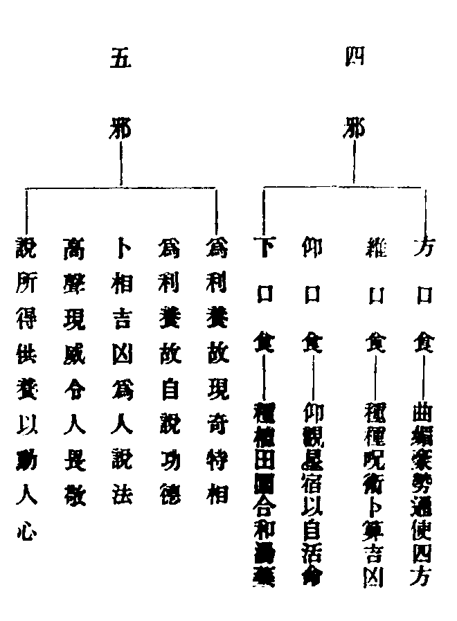



【■记】四种别在口业，五种通乎三业。



△三、结归。



已上七科，即是藏教生灭道谛。



【□注】辅行一下(十一)云：菩提烦恼，更互相倾，故名生灭。



△二、通论四谛二：初、论随机施教胜劣不同。



然如前所列四谛名数通下三教，但是随教广狭、胜劣、生灭、无生、无量、无作不同耳，故向下名数更不再列。



【□注】释签三(八)云：问：何故立四种四谛之殊？答：谛本无四，谛秪是理。理尚无一，云何有四？故知依如来藏，同体权实。依大悲力，无缘誓愿。物机所扣，不获已而用。机宜不同，致法差降。从一实理，施出权理。权实二理，能诠教殊，故有四种差别。教起涅槃，实后暂用三权助圆，故须具用偏圆事理。故今引之，以显成证。三偏一圆，界内界外，各一事理，故成四种(文)。



【■记】物机所扣者，释上依大悲力，无缘誓愿，由众生根器千差，如来声教万别，如言如来为众生随机应量说也。从一实理等，解前界内外各一事。理者，藏事、通理、别事、圆理也。



【□注】广狭等者。以藏通造六故狭，别圆造十故广。藏别不即故劣，通圆谈即故胜。於广狭境，各论胜劣，则成四种。四谛迷真有重轻，故论生灭。无生迷中有重轻，故论无量。无作不可作，寻常迭论胜劣释也。



【■记】谓当以藏对通，别对圆，各论胜劣也。



【□注】生灭妙玄二(二十)云：迷真重故，从事受名。如前释。



【■记】前释者，苦则三相迁移等，虽世、出世，四皆变易也。



【□注】无生妙玄(二十)云：迷真轻故，从理得名。苦无逼迫相，集无和合相，道不二相，灭无生相。



【■记】苦无逼迫者，谓五蕴皆空，岂有空能逼空？集无和合者，谓因果俱空，岂有因空与果空合？历一切贪嗔痴亦如是。道不二者，谓无能治所治，空尚无一，云何有二？灭无生者，法本不生，今则不灭，不生不灭，名真无生。



【□注】无量，妙玄云：迷中重故，从事得名。苦有无量相，十法界不同故；集有无量相，五住烦恼不同故；道有无量相，恒沙佛法不同故；灭有无量相，诸波罗密不同故(文)。



【■记】苦无量者，谓一法界，苦尚若干，况十法界，非二乘所知。谓地狱种种剥割、烧煑、剉切，不可称计，况复餘界种种苦相，菩萨智眼乃通达也。集无量者，谓无明、尘沙、见思诸惑若干。道无量者，谓㭊体、拙巧、权实、正助等。灭无量者，如是方便，能灭见思等，均是菩萨乃能明了也。又即空方便若干，皆无若干，虽无若干，而分别若干，无谬无乱。又如是方便，能灭见思，如是方便，能灭尘沙无明。又三悉檀分别有若干，第一义悉檀无若干，虽无若干，从多为论，名为无量。



【□注】无作妙玄云：迷中轻故，从理得名。止观一(三)云：阴入皆如，无苦可舍。无明尘劳，即是菩提，无集可断。边邪皆中正，无道可修。生死即涅槃，无灭可证(文)。



【■记】无作者，皆实相不可思议。四念处释无作四谛云：一念心具十界苦，名苦谛；具十界惑，名集谛；苦即涅槃，名灭谛；惑即菩提，名道谛。所谓即事而中，无思无念，无谁造作，名为无作。



△二、示二世麤妙因果有异二：初、明因果差殊。



然四谛之中，分世、出世。前二谛为世间因果(苦果、集因)，后二谛为出世间因果(灭果、道因)。



【□注】释签三(八)云：苦集只是世间一切法，道灭只是出世一法。世出世法，因果性殊，而因必趣果，因果类异，故使四殊(文)。



△二、明差殊所以



问：何故世出世前果后因耶？答：声闻根钝，知苦断集、慕果修因，是故然也。



【□注】声闻根钝，苦为初门。支佛以集，菩萨以道，通菩萨以灭，别菩萨以界外道，圆菩萨以界外灭。



【■记】注中。补明四教所修初门，谓声闻根钝，约界内苦为初门；支佛以界内集；菩萨以界内道。此藏教三乘，修生灭谛，分利钝也。通修无生空理，故以界内灭；别修无量不思议事，故以界外道；圆修无作不思议理，故以界外灭也。



【□注】慕果修因，且据凡位。若初果去，则云带果行因。支佛不立分果，乃云望果行因。



【■记】此拣明慕果修因句，唯约声闻凡位说。



【□注】四谛果前因后，此且一途，餘亦不定。



【■记】不定，如下，示。



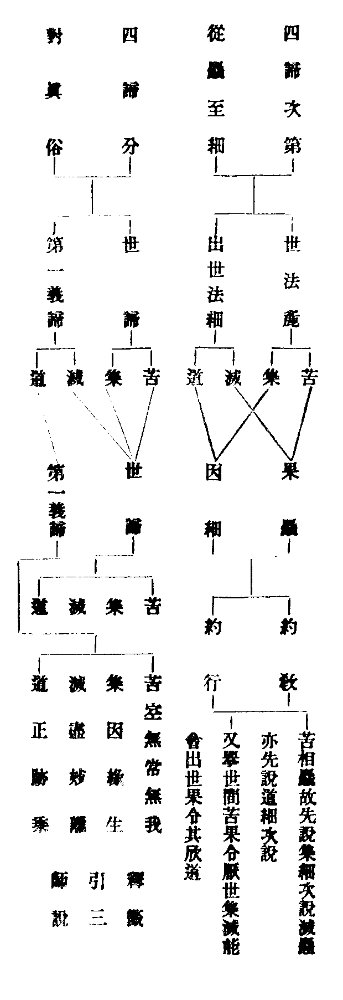



【■记】签云：或说世谛谓苦集，第一义谓道灭。复有说世谛谓苦集灭，第一义谓道。评者曰：四是世谛，亦第一义谛。如苦集是世谛，苦空无常集因缘生是第一义。灭是世谛者，佛说如城园林。是第一义者，尽止妙离。道是世谛者，佛说如筏如山如梯如楼。是第一义者，道如迹乘。若四谛尽第一义者，世谛说阴界入，第一义亦说阴界入也。



南天竺沙门蒙润集注



清净比丘权彚补辅宏记



清三宝弟子钱𠁼庵较订



天台嫡裔比丘谛闲编科参梓



△二、行位三：初、通标。



略明藏教修行人之与位。



【□注】道标一教修行之人及三乘位次。妙玄四(三十二)云：为破行人增上慢心，为消经文引物希向(文)。释签五(二十一)云：若无位次，将何以为见贤思齐，将何以越增上慢罪(文)。



【■记】此释通标人位也。盖位者，为显三乘行人，修因尅果，有阶差故。周易云：天地之大德曰生，圣人之大宝曰位。如是则知，若非位次，无以引行人之希向。如妙玄云：诸圣上位，非凡能测，岂可妄说？麤知大意者，为破行人增上慢心，为消经文引物希向也。见贤思齐，出论语。



△二、别释三：初、声闻三：初、标位分科。



初、明声闻位，分二：初、凡；二、圣。凡又二：外凡、内凡。



【□注】凡有四门明位：一、毗昙有门，明七贤七圣；二、成论空门，明二十七贤圣；三、毗勒论，明双亦门；四、车匿论，明双非门。



【■记】此明位次有四门不同也。一、毗昙有门，明七贤七圣者。四教仪二云：一、毗昙有门，即三藏教，明正因缘生灭之有。若禀此教，能破十六知见，见阴、界、入一切有为之法，皆悉无常、苦、空、无我，得世第一法，发真无漏，因有见真有，即第一义谛之门也。故大集经云：甚深之理不可说，第一实义无文字，声闻弟子憍陈如，於诸法中得实义。此即毗昙论中之所申也。二、成论空门，明二十七贤圣位者。四教义云：二、成论空门，即三藏教，明㭊正因缘假实法生灭入空。若禀此教，能破假实之惑，见假实空，发真无漏，因空见真空，即第一义之门也。故须菩提在石室中，观生灭入空，因空得道，名见法身。恐此是成论所申也。三、毗勒论双亦门者。四教仪云：三、明有空门，即三藏教，明正因缘生灭之有空。若禀此教，能破偏执有无之惑，见因缘有空，发真无漏，因有空而见真有空，即第一义之门也。此即迦旃延因此入道，故作毗勒论，还申此门也。四、车匿论双非门者。四教义云：四、明非有非空门，即三藏教，明正因缘生灭非有非无理。若禀此教，能破有无边邪之执，见因缘非有非无，发真无漏，因非有非无，见真非有非无，即第一义之门也。恶口车匿因此入道，论文未来此土有人言，犊子阿毗昙申此意也。彼论明我在第五不可说藏中，我非三世，即是见非有，非无为法，即是见非空，此恐未可定用。



【■补】因门契理出三界，苦门以能通为义也。盖有门则念念生灭，空门则三假虗浮。双亦则有无从容，双非则有无俱遣。随依一观，可以发真。



【□注】后二门，大论虽指，论文未度。若空门二十七贤圣者，学人十八，无学有九。四教义二(十七)云：贤人有二，圣人有二十五(文)。凡位不备，今家不用。释签五(二十)具引。



【■记】大论云：智者入三种法门，观一切佛语，皆是实相，不相违背。何等是三门？一、毗勒门，二、阿毗昙门，三、空门。何名毗勒门？答：毗勒有三百二十万言，佛在世时，大迦旃延所造。若佛灭度后，人寿转减，忆识力少，不能广诵，诸得道人，撰为三十八万四千言。若人入此门，论议则无穷。其中有随相门、对治门等种种法门，乃至不得波罗密多。若入阿毗昙，则堕有中；若入空门，则堕无中；若入毗勒，则堕有无中。又佛垂灭时，阿难问车匿事。佛答：恶性车匿，吾涅槃后，心渐调伏，当为说陀那迦旃延经。即双非门也。然论文虽指后二门，而论文未度者，未过来此土也。是则无位可凭，故不准此而明位也。如四教义言恶口车匿因此得道，末见论文是也。空门二十七贤圣者，成论第一分别贤圣品广明行得，乃至后结云：如是九种名无学人，先十八学人及九无学，是二十七人名为一切世间福田僧中具足，如下所示四教义言。次明三藏空门二十七贤圣位者，信法二行即是两贤，在方便道空门发真，断见惑未尽行即须陀洹向，见惑断尽名须陀洹果，空解增明断欲界思一品乃至五品名斯陀含向，断六品是斯陀含果，断七八品尽名阿那含向，欲界九品思尽是阿那含果，阿那含有十一种，带果行向是阿罗汉向，进断上二界思惟也。若非想九品尽即是阿罗汉。贤有二，圣有二十五，合有二十七，成论详载。



【□注】今依有门明声闻位者，有三意：一、凡圣位足，二、佛法根本，三、符顺教旨。佛法根本者，有门所说世间诸法，乃是无明正因缘生，不同外道邪无因缘生也。又四教义云：大乘经论，破小用小，多取有门，少用空门，故须略出毗昙有门佛法根本贤圣之位(文)。



【■记】此明今取有门，明声闻位。一、凡圣位足者，谓贤位七，圣位七。二、佛法根本者，谓佛说世谛诸法，以有门为根本故。三、符顺教旨者，谓圣教旨趣，允合有门故也。佛法根本者下，别释第二意。谓有门所说阴、入、界诸法，乃是无明正因缘生者，谓真如为因，无明为缘；无明为因，境界为缘，而有世间诸法生也。不同外道邪无因缘生者，以诸外道，或计万法，从梵天、虗空等生故。又四教义下，是证释有门是佛法根本。第三卷中，问云：两门不度，不可悬判。空门明义，胜于毗昙，何故舍胜用劣？答：毗昙虽劣於空门，是佛法根本。故佛去世后，流传利物。且大乘经论，破小用小，多取有门，少用空门。故须略出毗昙有门，明贤圣之位次也。



【■备】四、教义取有门意，兼得符顺教旨边解。



【□注】又二(初)云：三藏四门虽俱入道，而诸经论多用有门，乃至圆教多用非空非有门。



【■记】此证依有门明三藏位也。四教义云：随教立义，必须逐便。若是三藏四门，虽俱得入道，而诸经论多用有门。通教四门，虽俱得入道，而诸经论多用空门。别教四门，虽俱得入道，而诸经论多用亦空亦有门。圆教四门，虽俱得入道，而诸经论多用非空非有门。然虽具举四教四门皆可入道，而意别证藏教，以有门明位次也。



【■备】此正引证顺教旨意。



【□注】今不列七圣，直作四果释者，名义显故。



此明今文不作七圣列名。或谓既以有门明位，何故但列七贤，不列七圣，直作四果耶？故此释云：以四果之名与义明显故也。



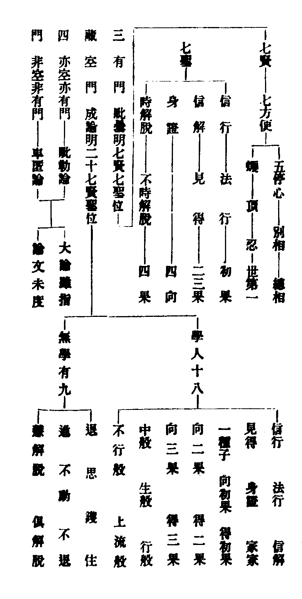



【■记】此是入假菩萨作四论，申四门，授四药，治诸病也。今文为标三藏修行之与位次，注中具出明位，凡有四门，故以图示诸名相也。然有七贤四果名相，下文逐一详解。后二门论文未度，此不必言矣。然空门二十七贤圣名相，似与论文少异，今记之，对阅为便。谓成论二十七贤圣，开果向为三，谓信行、法行、无相行，及初果为四，五、二果向，六、二果，七、三果向，八、三果。於此果中，又开十二，谓中生行、不行、乐定、乐慧、转世、现信、解、见得、身证，并前七为学人十八。开无学为九，谓退、护、住、思、死、不退、慧、解脱、俱解脱、不坏法也。



【■补】空门学人十八至上流者。四教义云：通名学人，以皆研真断惑故也。信行法行者，初向也。萨婆多云：因闻入者为信行，因思入者为法行。昙无德云：位在方便，自见法少，凭闻力多，后时要须闻法得悟，名为信行。凭闻力少，自见法多，后时还须思惟得悟，名为法行。天台远讨根源，久劫听学，久劫坐禅，得为信法种子也。信解，二向也。以凭闻法信力，进趣真解故也。见得，三向也。以思惟力，见法得理故也。身证，三果四向也。以现身即证灭受想定，似涅槃法，故云身证也。家家者，受生处不一，即二向也。一种子，三向也。以欲界九品思惑，已断八品，只一品未尽而命终，尚有一生，故言一种子。若不命终，进断一品，即证三果也。向初果者，於十六心中，前十五心无间道时，断见惑未尽是也。得初果者，八忍八智具足，断八十八使尽，见真谛也。向二果者，欲界思惑，已断五品故。得二果者，断六品思惑故。向三果者，断七八品而不命终也。得三果者，欲界九品思断尽故也。中般者，行人于欲界命终生到色界，未到之时即於中阴身发明圣道而般涅槃。生般者，行人从欲界命终生於色界即般涅槃。行般者，生色界已更能加功用行，断上界思惑七十一品俱尽而般涅槃。不行般者，生色界已不加功用行，自然得尽苦际圣道现前而般涅槃。上流者，即流行之义，以次第上流色界诸天受生，断七十一品惑尽方般涅槃。无学九至俱解脱者，四教义云无学，以真穷妄尽故也。退者，俱舍言：谓遇少违缘便退所得。思者，谓退失恒自思得。护者，谓所得善自防护。住者，谓离胜退缘离胜加行。进者，谓具加行能速达不动。不动者，谓不为烦恼所动。不退者，谓不退失所得。慧解脱者，以缘空直入不得灭定故。俱解脱者，即带事兼修得灭尽定也。



【■备】有门明位，见下。今录空门明位备考。



【■备】辨讹曰：图中初果下，应添向字，以信法二行，只在十五心，未到十六心故，应是初果向也。二三果上，应添初字，以信解见得真理，方名初果等故。私谓辨讹所说，合於四教义妙玄等文。然集注乃据俱舍，谓见道中有二圣者，一随信行，二随法行。此至修道，别立二名，一信解，二见至定判。至补中所言信解二向，见得三向，俟再考定。



【□注】此依释签五(十八)列。成论二十七贤圣，若辅行准俱舍列，则无身证，故料拣云：何缘身证不预其数？答：无漏三学是圣者因，择灭涅槃是圣者果，灭定有漏不是依因，是故身证不预其数。



【■记】盖释签明教途，故准成论，列位有身证名。今文依之，列二十七贤圣也。若辅行明观门，故凖俱舍，列位则无身证名。如俱舍言：契经说有十八有学，何缘於中不说身证？释言：依因无故。何谓依因？谓诸无漏三学，及圣者果。依彼差别，立有学故；灭定非学，非学果故。言三学者，无漏戒，即声闻无作也；无漏定，即根本净禅，观练熏修也；无漏慧，即四圣谛理也。具此三学，方堪趣入圣位，乃是圣者之因也。言涅槃者，此理相应，见思断尽，而证真空涅槃，乃是圣者之果，不依身证有漏为因也。是故身证不预其数也。



【■补】灭定有漏者，此是小乘事定。受、想、心灭，虽似涅槃，望四果犹为有漏。既属有漏，则非前三果所依之因，故不预学人数也。然辅行如此拣者，欲学人缘理断结，依无漏修，不可从事禅入耳。若以无漏心修事相定，则无入而不自得，非此论也。又此身证，那含非想、思惑犹未断尽？正当入此灭尽定时，前六识心、心所悉不现起，则不与无漏观智相应，而无断惑证理之功，故属有漏，非依因也。择灭解前，又合响言：灭定似涅槃法故，非学所摄；非真涅槃故，非无学摄。



【□注】中阿含三(十一)云：长者问佛：福田有几？佛答：同俱舍。且据学无学二十七人是同，然福出经列身证，俱舍则无也。



【■记】福田经：佛言：世有二种福田，学人有十八，无学人有九。十八学人，谓信行、法行、信解、见得、身证、家家、一种子、向须陀洹、得须陀洹、向斯陀含、得斯陀含、向阿那含、得阿那含、中般、生般、行般、无行般、上流、色究竟。九无学人，谓思法、升进法、不动法、退法、不退法、护法、护则不退、退则不护、实住法、慧解脱、俱解脱。是知经列身证也。俱舍则无者，论文言：学人，谓四向、三果、信行、法行、信解、见得、家家、一间、中生、行、不行、上流也。无学有九，谓退、护、思、住、进、不动、不退、慧脱、俱脱。是知论文不列身证。



【■备】二十七是同者，且据二十七数说其相同，若身证有无则异也。



【□注】凡者，常也，亦名为贤。贤者善直，亦曰邻圣。分内外者，相似见理名内，未得似解名外。



【■记】四教义云：此七位皆是非学非无学智等智，似解能伏见惑，因此似解能发苦忍真明，故言邻圣曰贤。今解名善直也。一切天魔凡夫，皆以爱著心修；一切外道，皆以邪见心修。虗伪邪曲，不名为直。佛弟子七种明识，生灭四谛理，知爱论、见论皆邪曲。伏此见爱邪曲心，用正信直心修诸善法，故名善直。复此一切爱论所诠，皆有生灭四真谛理，天魔眷属及诸凡夫所不能见，故流转生死。又一切见论所诠，皆有生灭四真谛理，六师外道悉不能见，故生死流转。如涅槃云：我昔与汝等，不见四真谛，是故久流转，生死大苦海。今七种从闻生解，明识此二种生灭四谛，故得信心正直，即是善直名贤也。又四义拣：一、随爱见而破戒，非直非善；二、持戒禅定而生邪见，善而不直；三、信心直见而破戒心乱，直而不善，均不名贤；四、信解真正，得佛教意，持戒清净，修阿那般那不净等观，心得停住，乃名善直。初贤之位内凡，谓於四真谛理依稀见解，如未然者，名外凡也。



△二、释所禀法二：初、凡二：初、明外凡二：初、分科。



释外凡中自分三。



△二、列法二：初、调心对治法二：初、标数。



初五，停心。



【□注】停者，止义，住义。修此五法，止住五过。心者，有四种：一草木，二肉团，三积聚精要，四虑知。今是虑知心也。



【■记】草木能随时生落，亦名心肉团，色法所摄。积聚精要者，如心经是般若部旨要戒本，名为戒心，是结戒要文。荆溪十不二门，亦文心之列。虑知心，外道多计之，谓我佛教判为缘虑。心教列八识，今指第六识，为今修行观法心也。



【□注】此五停心，通於四教，具如四念处明。妙玄五(三)以五停心对圆五品，禅门三(五)以停心名五门禅，义该大小，通於凡圣菩萨等修，今是三藏声闻助道也。



【■记】藏教五停，如下。若通家停心者，觉观多者，当观入息不生，出息不灭；不生不灭息，即是空无；能观所观，皆不可得；不可得即真，真即心停也。多贪欲者，当观贪欲非垢，无贪非净；非垢故不生，非净故不灭；不生不灭即空，空即真，真故心停。多嗔恚者，当观於慈，慈恚即不生亦不灭，如上。著我多者，当观其身，如屠牛四分，但见四大、六根、五阴、十二入、十八界，何处有我，即破我见。愚痴者，对因缘观，三世破断常，二世破果报，我一世破性实。善用五治，心即安住，得观无生也。别停心者，前三藏数息不净等停心，疎远事伪；通以观息不生不灭停心，即事而理近密真。今别教以持戒根本，若我住世，无异此也即佛，依此而住即僧。虽尔，望於三藏，是密是真；望於实相，非近非密，非真非理。与前别后别，居季孟之间，此义可知。能持五支诸戒，释论十种戒，于一一戒中具足尔许法门，即是别停心。戒是法本，道之根源，故以戒为停心也。圆以五停心对五品，如下九卷圆教详解。禅门以停心名五门禅等者，文曰：五门虽少而行通诸禅：一、阿那波那门，此通至根本及特胜通明等诸禅三昧；二、不净观门，此通九想、背舍、超越诸禅三昧；三、慈心门，此通四无量等诸禅三昧；四、因缘门，此通至十二因缘、四谛等慧行诸禅三昧；五、念佛门，此通至九种禅及百八三昧。复次，初数息门，是世间凡夫禅；次不净门，是出世间禅，声闻所行；次慈心门，即是凡圣二人为大福德，修慈入无量心；次因缘门，是支佛所行；次念佛门，功德广大，是众菩萨所行。此略明五门次第浅深相。



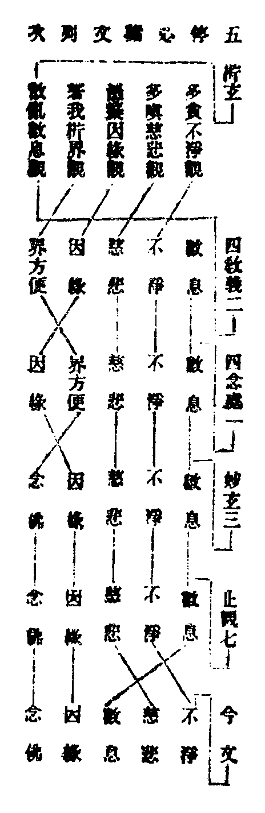



【□注】贪等是境，不净是观。四教义二(四)云：心既调停，乃可习观，犹如密室之灯。入道根本，无过此五法也(文)。



【■记】此不净观，思惟於贪欲，名善对治法。於嗔恚病，不名为善，非对治法。以观身过失，名不净观。若嗔恚观身过失者，则增益嗔恚。故餘境观例知。四教义云：修安般念有三：一、始习行，二、已习行，三、思惟已度。一、数是始习，二、随而已习，三、观而已度。复次，数、随、观，皆名始习。得三种：欲界、未到地定，名已习。发诸初禅，名已度。餘不净观等，亦如是分别。心既调停，乃可习观。如密室灯，入道无过。此五法也。



【□注】或云五停心观，则从慧。或云五门禅，则从定。定慧调适，故名停心。



【□注】然上列次㭊玄，以不净观居初者，约三不善根次第也。第四明㭊界观者，约不善根后辨。第五明数息者，散乱是随烦恼，故於烦恼后辨。



【■记】三不善，即依贪、嗔、痴三根本烦恼，故首不净，次慈悲三因缘。又约三不善根辨著我，故㭊界为第四。而散乱既是随烦恼，故数息观，於根本惑后治之也。



【□注】四教义等文，皆以数息居初者，顺修禅人，必先摄散入定。故四教义二云：今依禅门辨次第也。以病先后随人，不须定执前后次第也。



【■记】四、教义。问：何不依数人说不净观为先？答：今依禅门辨次第也。



【□注】又诸文专以不净数息居初者，妙乐六(十)引俱舍云：入道要二门，不净观数息。



【■记】俱舍言：入修要二门，不净观息念，贪寻增上者，如次第应修。长行释曰：正入修门，要者有二：一、不净观，二、持息念。随於何门，能正入修，如次应知。贪寻增者，谓贪猛盛，数现在前，如是有情，名贪行者，彼观不净，能正入修。寻多乱心，名寻行者，彼依息念，能正入修。则知诸文，或以不净，或以数息为初者，随病与药也。



【□注】㭊界与念佛互存没者，四教义二(四)：问：此处何不说念佛三昧为五种耶？答：开因缘，出界方便代也。界方便与小乘念佛相同，亦破境界逼迫障。(以二世因缘与界方便，皆破著我，能破虽异，所破是同，故闻二世因缘以破著我，却出界方便代念佛也。且界方便何以能代念佛耶？故下即释出云：以界方便能破之相，与念佛所破境界之相是同，以皆不出六界十八界，故念佛破境界逼迫障，界方便亦破也。)



【■补】此料拣析界与念佛二观，或用此则废彼意。今先明四教义：以界方便摧著我。析界者，即分六界、十八界相，以显无我也。四教义答问言：以二世因缘破著我，出界方便破逼迫障，以代念佛，故不用念佛也。是知析界可以摧著我，可以摧逼迫。如今文开分二世因缘摧著我，用念佛摧逼迫，故不须界方便。可见界方便，退能代二世因缘，进能代念佛。故四教义四念处，存界方便而没念佛；妙玄止观今文，存念佛而没界方便也。又界方便与小乘念佛相同者，以小乘念真空法身，则寂然无为，无六凡境界逼相可得；析界则观根、尘、识三，毕竟无体，无十八界我相可得，故言相同也。



【■备】二世摧著我，念佛摧逼障，下因缘念佛观中广解。要知著我重者，专开界方便治，兼治逼障。若逼障重而著我轻者，专开念佛对治，而以因缘中二世因缘摧著我，则著我摄入因缘观破，此皆随所宜也。



【□注】又四念处一。问：此中何不云念佛停心？答：作五度门则不用，作六度门则须用。因缘自对等分(性实、断常、著我，此三皆有，故云等分)，念佛对逼迫障(文)。



【■记】此明念处存界方便，没念佛意。原注：等分四教义云：愚痴对因缘观，以一世破性实，二世破果报我，三世破断常，故言自对等分。



【■补】此指愚痴为等分，以性实、断常、著我三皆愚痴，故作六度用。因缘者，以病兼三种，故云等分必须因缘也。



【□注】止观七(十七)云：毗昙以界方便破我(谓观破六界十八界也)，如辅行七上。



【■记】辅行云：毗昙以界方便破我者，我及断常，并性实三，并属痴故。初破我者，经论不同。杂阿毗昙说：著见行者，以界方便。愚夫不了宿业烦恼，积聚五阴，於缘计我。当於自身，以界方便，观察种种性、种种业、种种相，谓地等六界。地界水润，而不相离；水界地持，故不流散；火界成熟，故不淤坏；风界动故，而得增长；空界空故，食得出入；有识界故，有所造作。由众缘故，故知无我。又观此身不净充满，如吹散积沙，於无色法前后相续。如是观者，得空解脱门种子；於彼生厌，得无愿解脱门种子；正向涅槃，得无相解脱门种子。是名界方便。若大经说著我多者，为分㭊十八界法，此与六界总别之异。论四大界，是十色界半；论识界，是七心界半。但合色为四，合心为一，更加空界。教门随机，离合不定。今准禅经因缘破我，大集亦以二世破我，为简异故，故俱列释。



【□注】对治不同，今图示之。



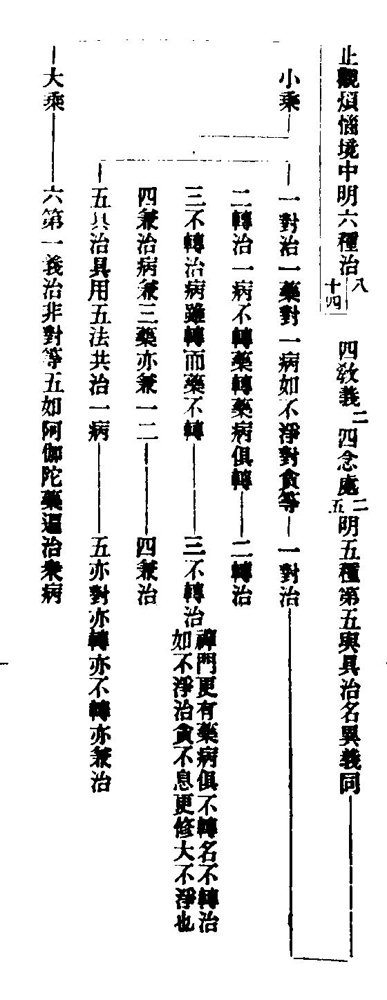



【■记】止观六种治者：一、对治者，谓一分烦恼，即有三种，合成十二对。此亦有十二，如对宼设阵，名对治。二、转治者，如不净是贪欲，对治而非其宜，应以净观得脱，转修慈心，念以净法安乐，岂加秽辱，名转治。若嗔人教不净，痴人教思惟边无边，掉散教用智慧分别，此是疾不转而治转，皆名转治。若药病俱转，亦称转治，亦是对治。三、不转治者，病虽转，治终不转，但以此法，宜修此治，治转不转病，称不转治。四、兼治者，病兼药亦兼，如贪欲兼嗔，不净须带慈心，病兼一二，药亦兼一二，是称兼治。五、具治者，具用上法，共治一病。是谓小乘先用五治，后用谛智得入真。大乘明治非对非兼等，名第一义治。如阿伽陀药，此翻著去，著去一切众病。小乘多用三悉檀为治，大乘多用第一义治。四、教义五治者，问云：此五观门，为对五人，为对一人？答：横对五人，竖为一人，随病多少，对不定也。此五种观法，对治五不善法，即有五意：一、对。二、转。三、不转。四、兼。五、亦对。亦转亦不转亦兼一。对治者，觉观多修数息，贪欲多修不净，嗔恚多修慈心，愚痴多修因缘，观著我多修界方便。若行者觉观等分，烦恼偏重，攀援不住，当修数息。随观息对治相应，则三种觉观，烦恼止息，心不动散，发诸禅定。定法持心，入出安隐，故名停心。四念处云：此五停门，复有五意：谓对、转、不转、兼亦对。亦转亦不转亦兼对者，数息对觉观，乃至方便对我，因缘对痴。对治若成，烦恼不起，又发禅定。禅定持心，安隐出入也。心既调停，方可习观。若对治未益，更须用后四种治之。行者善用四随，巧修五治，烦恼不能障，观心停住，即入初贤位。具如禅门广说。又二卷云：善用五法治心，心则安住，得观无生。无生现前，即破烦恼。有直有善，名初贤三种。解见下。



△二、列法五：初、治贪观法。



一，多贪众生不净观。



【□注】六识妄心，於顺情境上，引起无厌，故言多贪。禅门第四，明三种贪。一、外贪。男女身分，互相贪著，用九想观治(观他身)。九想者(一、胮胀，二、青瘀，三、坏，四、血涂漫，五、脓烂，六、噉，七、散，八、白骨，九、烧)。



【■记】禅门明行人当修定时，贪欲心生，若男缘女，若女缘男，取其色貌、姿容、威仪、言语，即结使心生，念念不住。此是外贪婬结使发相。用九想治者，法界次第云：一、䏺胀想，观死人䏺胀，如革囊盛风，异於本相也。二、青瘀想，观死人皮肉黄赤瘀黑青黤也。三、坏想，观死人风吹日晒，转大裂坏在地也。四、血涂漫想，观死人处处脓血流溢，污秽涂漫也。五、脓烂想，观死尸虫血流出，皮肉坏烂，滂沱在地也。六、噉想，观死尸虫蛆唼食，鸟啄其眼，狐狗咀嚼，虎狼抓裂也。七、散想，观死尸禽兽分裂，身形破散，筋断骨离，头手交横也。八、骨想，观死人皮肉已尽，但白骨筋连，或分散狼藉，如贝如珂也。九、烧想，观死尸为火所焚，𪹼烈烟臭，薪尽形灭，同於灰土。假令不烧，亦归磨灭也。又辅行言：此九通治六欲。若别治者，死治威仪言语，二欲胀坏噉，三治形貌，一欲血涂脓烂青瘀，三治色，一欲骨烧，二治细滑，一欲九想。又复通治所著人欲，散治人相欲，能动九十八使山，故所治最强也。



【□注】二、内外贪。於他己身而起贪爱，用八背舍治(先观内身骨锁，故能治内)。



【■记】禅门云：行人於修定时，欲心发动，或缘外男女身相、色貌、姿态、仪容，起於贪著；或复自缘己身形貌，摩头拭颈，念念染著，起於贪爱，障诸禅定。此内外贪欲发相，用八背舍治者。法界次第言：一、内有色相外观色。谓内有色相者，不坏灭内色相也。外观色者，不坏灭外色相也。以是不净心观外色。所以然者，行人为修流光故，不应初背舍中坏灭内身骨人，欲界结使难断故，须以不净心观外色也。此初背舍，位在初禅，能舍自他及下地，故名背舍。二、内无色相外观色。谓内无色相者，坏灭内色相也。外观色者，不坏灭外色相也。以是不净心观外色。所以然者，行人为入二禅内净故，坏灭内骨人，欲界结使难断故，犹观外不净之相也。三、净背舍身作证。谓净者缘净故名净。行者除外不净相，但於定中练八色光明，清净皎洁，如妙宝色，名缘净。身作证者，以无受著心，而受三禅中徧身乐也。四、虗空处背舍，谓若灭根本四禅及三背舍、四胜处，入一切处中色，一心缘无边虗空而入定，即观此定依阴入界，故有无常、苦、空、无我，虗诳不实，心生厌背而不受著，深入不退。五、识处背舍，若舍虗空，一心缘识入定时，即观此定依阴入界，故有无常、苦、空、无我，虗诳不实，心生厌背而不受著，深入不回。六、无所有处背舍，若舍识，一心缘无所有入定时，即观此定依阴入界，故有无常、苦、空、无我，虗诳不实，心生厌背而不受著，深入不回。七、非有想非无想背舍，若舍无所有处，一心缘非有想非无想入定时，即观此定依阴入界，故有无常、苦、空、无我，虗诳不实，心生厌背而不受著，深入不回也。八、灭受想背舍，背受灭想诸心心数法，是为灭受想背舍。所以者何？诸佛弟子厌患散乱，心欲入定休息，以涅槃法安著心中，故言身证而受想灭也。



【■补】大论言：背是净洁五欲，舍是著心，故名背舍。



【□注】三、徧一切处贪资生五尘等物，用大不净观治(即八胜处，因於自身骨人观成，渐见十方依正，故能治自他贪欲)。



【■记】禅门言：此人爱著，内外如前。复於一切五尘境界资生物等，皆起贪爱。或贪田园、屋宅、衣服、饮食，即一切处贪发相用。大不净观治者，如大论治贪欲饮食云：观是食从不净因缘生，如肉从精血水道生，是谓脓虫住处。如酥乳酪，血变所成，与烂脓无异。厨人垢汗，种种不净。若著口中，脑有烂涎，涎道流下，与唾和合，然后成味，其状如吐。从腹门入，地持水烂，风动火煑，如釜熟縻，滓浊下沉。浊者为屎，清者为尿。腰有三孔，风吹腻汁，散入百脉，与先血和合，凝变为肉。从新肉生脂骨髓，从是中生身根，从新旧肉合生五情根，从此五根生五识，五识次第生意识。分别取相，筹量好丑，然后生我、我所、心生等诸烦恼，及诸罪业。观食如是本末因缘，种种不净，知内四大与外四大无异，但以我见故，强为我有。复次，思惟此食，垦植耘除，收获蹂治，舂磨淘汰，炊煑乃成，用工甚重。计一钵之饭，作夫流汗，集合量之，食少汗多。此食作之功重，辛苦如是，入口食之，即成不净，无所一值。宿昔之间，变为屎尿，本是美味，人之所嗜，变成不净，恶不欲见。行者自思：如此弊食，我若贪者，当堕地狱，噉烧铁丸。从地狱出，当作畜生，牛羊骆驼，偿其宿债。或作猪狗，常噉粪除。如是观食，则生厌想，故於五欲皆厌。八胜处者，法界云：一、内有色相，外观色少，若好若丑，是名胜知胜见。谓内有色相，外观色少者，缘少故名少。若观道未增，故须观少因缘，观多畏难摄，转变不得随心。如观少好丑法中不净，转变自在，通达无碍，心无取舍，不起爱憎是也。二、内有色相，外观色多，若好若丑，是名胜知胜见。谓内有色相，外观色多者，观多因缘故名多。观心既调，则观多无妨。若於多好丑不净境中，转变自在，通达无碍，心无取舍，不起爱憎是也。三、内无色相，外观色少，若好若丑，是名胜知胜见。谓内无色相，如二背舍，外观色少，若好若丑等，皆如初胜处也。四、内无色相，外观色多，若好若丑，是名胜知胜见。谓内无色相，如二背舍，外观色多，若好若丑等，皆如二胜处也。五、青胜处，谓若观青色，乃至照耀，胜於背舍所见青相，亦不起法爱，是转变自在，少能多，多能少光色，名青胜处也。六、黄胜处，七、赤胜处，八、白胜处，均类如青胜处中分别。今用四色为胜处，依大论也。若璎珞经中，则以四大为四胜处也。因於自身等者，大论言：譬如幻主，观所幻物，知从己出，心不生著，能不随所缘，是时背舍变名胜处。於净观虽胜，未能广大，是时行者还取净相，用背舍之力及胜处之力故，取净地相，渐渐遍满十方虗空。水、火、风亦尔，取青相渐令广大，亦遍十方虗空。黄亦白亦如是。是时胜处复变为一切处。是三事一义，转变有三名也。



【■补】名胜处者，以想心纯熟，转变自在，如人乘马，能破前阵，亦能制马，名胜也。渐见依正者，见依正皆不净也，法数广明。



【□注】㭊玄上(八)明四种：一、显色，谓青黄等，作青瘀想。二、形色，长短等形，作坏烂想。三、妙触，自他身分细软光泽，作虫蛆想。四、供奉，祇承适意，用死想治也。此四望，大论六种，缺人相、音声、姿态等。



【■记】大论言：是九想，能除人七种染著。或有人染著色，若赤、若白、若赤白、若黄黑。或但染著形容，细肤纤指，修目高眉。或但染著威仪进止，坐起行住，礼拜俯仰，扬眉顿𥇒，亲近按摩。或但染著语言，輭声美辞，应意承旨。或但著细滑，柔肤软肌，热时身凉，寒时体温。或有人皆著五事。或有人都不著五事，但著人相。如止观言：六欲：一、色欲，二、形貌，三、威仪姿态，四、言语音声，五、细滑，六、人相。言人相者，痴人但染著人相。若男若女，虽见上五事，不得所著之人，犹无所解。若遇之，则能舍世所重，顿忘身命，而随其死。今引析玄四种，望之所缺，人相、音声、姿态，对之可见。



【□注】此不净观，与念处观身有异。一、正助不同，彼正此加。二、自他境别，彼观自身，此想他境。三、假实观异，彼是实境，此是假想。



【■备】辨讹曰：自他境别句，当知九想内外俱观，似不应言此想彼境。彼观内身、外身、内外身，似不应言彼观自身。私谓：彼五种，此九想等，彼统观一期生死，此专作死想观也。



△二、治嗔观法。



二，多嗔众生慈悲观。



【□注】於违情境上，忿恨不已，名曰多嗔。佛令修慈悲观，可以对治。



【■记】慈能与乐，悲能拔苦，尚欲与乐拔苦，岂令堕苦受恼？



【□注】若准禅门第四(二)，义通大乘，境观有三：一、非理嗔(歘起嗔心，不问何否)，修众生缘慈(一切众生，如己眷属)。



【■记】禅门明非理瞋发者，行人若修定时，嗔觉歘起，无问是非，他犯不犯，无事而嗔，是为违理邪嗔发相。修众生缘慈者，观一切众生，如父母亲想。智论明生缘慈者，十方五道众生，以一慈心视之，如父母、兄弟、子姪、知识，常求好事，欲令利益安乐。如是慈名众生缘，多在凡夫行，或学人未漏尽者。



【□注】二、顺理嗔(人实来恼我)。修法缘慈，见一切法皆从缘生。



【■记】禅门明顺理嗔发者，行人若修定时，外人实来恼触，而生嗔觉，相续不息。亦如持戒之人，见非法者，而生嗔恚。故摩诃衍说：清净佛土中，虽无邪三毒，而有正三毒也。法缘慈者，大经明见一切法，皆从缘生。智论明诸漏尽阿罗汉、辟支佛，破吾我相，灭一异相，故但观从因缘相续生。诸欲心慈念众生时，从和合因缘相续生，但空五众，即是众生。念是五众，以慈念众生，不知五阴是法空，而常一心欲得乐。圣人悯之，令随意得乐，为世俗法，故名法缘慈也。



【□注】三、诤论嗔(著己所解为是，谓他说行为非)，修无缘慈(能所一体，慈即无缘)。



【■记】禅门明诤论嗔发者，行人若於修禅时，著己所解之法为是，谓他所行所说为非，既不顺己，即生恼心。世自有人，虽财帛相侵，犹能安忍，少诤义理，即大嗔恨，名诤论嗔发相。无缘慈者，大经明不住法相及众生相，智论明是慈但诸佛有。何以故？诸佛不住有为无为性中，不依止三世，知诸缘不实，颠倒虗诳故，心无所缘。佛以众生不知诸法实相，往来五道，心著诸法，分别取舍。以是诸法实相，令众生得之，故名无缘慈也。



【□注】今是小乘助观，当彼第一众生缘慈。若法界次第，则具明慈悲喜舍四无量心，今但慈悲。



【■记】法界言，此四通名。无量者，从境得名。以所缘众生无量故，能缘之心亦无量故，悉受无量心，名慈悲。已解见前。喜者，庆他得乐，生欲喜心，名喜。舍者，若缘於他，无憎爱心，如证涅槃，名舍。广解如法界次第。



【□注】㭊玄准俱舍论七周行慈，辅行九下(五)：依婆沙明九周行慈，而皆不出七境。三乐谓：上亲(父母师长)，中亲(兄弟姊妹)，下亲(朋友知识)，中人(非冤非亲)，下冤(害下亲者)，中冤(害中亲者)，上冤(害上亲者)。三乐者，㭊玄上(十一)：谓诸佛(上)，菩萨(中)，诸天(下)。辅行引婆沙云：三禅(上)，四事(中)，经行处(下)。



【■记】七九二，周行慈。如上示此所判七境。大经疏：境有九品，冤、亲、中人，各有三品。或谓中人唯一，但七耳。中人於我无冤亲，不须开三。然中人不无愚智贵贱之殊，故可分三成九境，即有九慈。次修观内云：若全未修，但欲与三亲、三乐、三冤、三苦，三种中人不与苦乐。若初修慈，於三亲中，与三品乐；於三中人，与三品乐；於三冤人，上冤与下乐，中冤与中乐，下冤与上乐。第二修时，上冤与中乐，中下两冤与上乐。第三修时，三冤并与上乐，未是亲中三种之乐。第四修时，以中人、下乐，并与三冤。第五修时，以中人、中乐，并与三冤。第六修时，以中人、上乐，并与三冤。第七修时，以三亲、下乐，并与三冤。第八修时，以三亲、中乐，并与三冤。第九修时，以三亲、上乐，并与三冤。是名上冤与增上乐，尔时名慈心成就。又直取三品乐与九种境：初观时，三亲与二乐；第二时，中亲与上乐，下亲与中乐；第三时，下亲与上乐；第四时，下中人与下乐；第五时，下中人与中乐；第六时，下中人与上乐；第七时，上冤与下乐；第八时，上冤与中乐；第九时，上冤与上乐。是名慈心成就。今欲知其与此有别，故具记之。



【□注】辅行九(五)引婆沙云：问：与众生何处乐？答：有说与三禅乐，乐中胜故。有说与四事乐，已曾得故。有说与经行处所有乐，至至住处，思惟令得(文)。



【■记】婆沙言：或有说者，与第三禅乐，以三禅乐是一切生死中最胜乐故。若作是说，不起第三禅者，则不能起无量。复有说者，过去世曾得第三禅乐，以第三禅定念前世智，观彼乐已，以彼乐令众生乐。若作是说，若不得第三禅地念前世智，则不能起无量。复有说者，以近所更乐，如饮食乐、乘乐、衣裳乐、卧具乐，以如是等乐相令乐。尊者和顺密说曰：众生有乐者，以如是相令众生乐。若作是说，慈则不能缘一切众生。所以者何？一切众生不必有乐。复次，众生有乐根，以如是相令众生乐。若作是说，慈则不能缘一切众生。所以者何？一切众生不能於一切时起乐根现在前故。复次，众生有饮食乐、乘乐、衣裳乐、卧具乐，以如是乐相令众生乐。若作是说，慈则不能缘一切众生。所以者何？一切众生不必尽得如是乐故。尊者佛陀提婆曰：以所知见乐取如是相，以怜愍心令众生乐。如本方便时，若依村住，若依城住，以日前分乞食，见受乐诸人，或乘象马车与而行，或以种种璎珞严身，或见纯受若者，如无衣裳饮食，执破瓦器从他家乞。取如是苦乐相，速还住处，洗足结跏趺坐，令身心柔輭无障碍。观先所取相，众生乐者常令得乐，众生苦者令得先所见乐，则知辅行略取其三种也。



【□注】若㭊玄三乐，恐成过分。随机之说，贵在治障，不可概论。



【■记】盖诸佛乐，乃无上菩提觉法乐，无上涅槃寂静乐。未得旨者，恐成过分。尊者和须密曰：不以住慈故，令众生乐。但以此法作方便，能制恚断结。又尊者佛陀提婆曰：此观当言不颠倒。所以者何？与恚相妨。则知行慈贵在治障，不可概以与乐为论。



【■备】俱舍亦有愿与诸佛等乐之说，以此作方便耳。



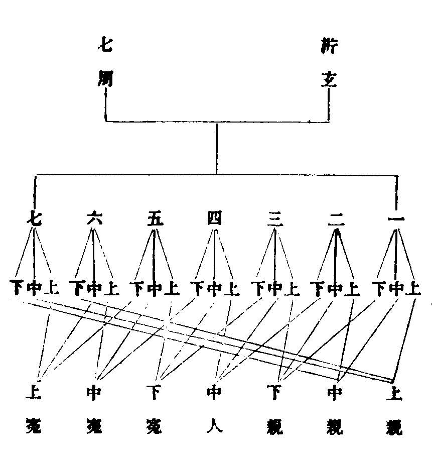



【■记】㭊玄七周者，俱舍论云：云何修慈？谓先思惟自所受乐，或闻说佛、菩萨、声闻、独觉等所受快乐，便作是念：愿诸有情，一切等受如是快乐。若彼本来烦恼增盛，不能如是平等运心，应於有情分为三品，所谓亲友、处中、冤仇。亲复分三，谓上、中、下。中品唯一，冤亦分三，谓下、中、上。总成七品。分别品已，先於上亲，发起真诚与乐胜解。此愿成已，於中下亲，亦渐次修如是胜解。於亲三品，得平等已，次於中品，并下中上冤，亦渐次修如是胜解。由数习力故，能於上冤，起与乐愿，与上亲等，修胜解脱。既得无退，次於所缘，渐修令广。谓渐运想，思惟一邑、一国、一方、一切界，与乐行相，无不遍满。是谓修习慈无量成也。



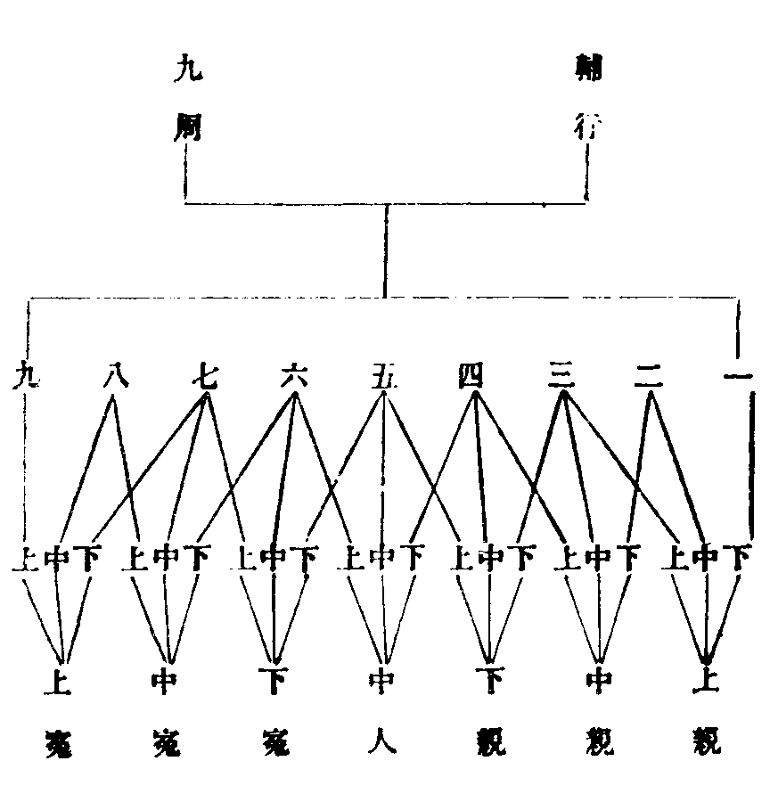



【■补】辅行九周者，谓初修时，令上亲人得於下乐；次修令上亲得於中乐，中亲得於下乐；次修令上亲得於上乐，中亲得於中乐，下亲得於下乐；次修令中亲得於上乐，下亲得於中乐，中人得於下乐；次修令下亲有於上乐，中人有於中乐，下冤有於下乐；次修令中人有於上乐，下冤有於中乐，中冤有於下乐；次修令下冤有於上乐，中冤有於中乐，上冤有於下乐；次修令中冤得於上乐，上冤得於中乐；次修令上冤得於上乐。是名辅行九周行人，修慈心观成就之相也。



【□注】先亲后冤者，从易至难，顺心成观。



【■备】盖以乐与其亲，则其观易成；若以乐与其冤，则其观难就，此人情之常事也。故今以亲在於前观而先与其乐，以冤在乎后观而后与其乐，是谓顺众人之心，而成其所观之慈也。



【□注】若㭊玄第六观，方与上亲下乐。第七，上亲中乐。中亲下乐者，一者，次第修观，未暇与故。二者，顺七周次第，每一番用观，先与上乐，中下非要，故在后时与。虽前后境境皆三，使冤亲平等，以破嗔障。



【■记】此别明㭊玄第六观所与境乐。谓有二意：一者，谓据次第修观，则应初观中，当以上乐与上亲，中乐与中亲，下乐与下亲。乃至第七观中，以上乐与上冤，中乐与上亲，下乐与中亲，如前图说。是故据次第修观，当在六七周中，与上亲中亲境，下乐中下乐也。二者，谓顺七周次第，皆以上乐与人，则初周应以上乐与上亲，二周以上乐与中亲，三周以上乐与下亲，乃至七周以上乐与上冤，亦如前图说。是则中下二乐非要，故於六七周中，以下乐中下乐，与上亲中亲境也。然与乐虽有前后，而七境皆得三乐。且如上亲，於初一周得上乐，至第六周得下乐，第七周得中乐。乃至上冤，於第五周得下乐，第六周得中乐，第七周得上乐。上品亲冤，皆得三乐。中下冤亲，及其中人，皆得有此三乐也。如此行慈，能使冤亲平等，以破嗔障也。



【□注】辅行开为九周者，一顺从亲至冤，次第与乐，不待六七，却缘前亲。



【■记】此别明辅行九周。行慈，谓顺从亲至冤，次第与乐，则初周与上亲下乐，二周与上亲中乐，三周与上亲上乐，乃至第七与上冤下乐，第八与上冤中乐，第九与上冤上乐。是则一、二、三周，即与上亲三品乐矣。岂待六、七周，却缘前之上、中亲境，方与下乐、中、下乐乎？是以辅行依婆沙开为九周也。



【□注】又复前境为得不得，盖为破障，且尔运心，其实前人实未得乐。故析玄上云：问：自身有乐，可施於他，忽若自身无乐，将何施与？答：自身若无乐可施，即运心将餘诸天菩萨等乐而惠施之，愿彼冤亲平等众生，得受如是等乐故。又涅槃疏云：虽欲拔苦，实未拔苦，皆是虗言。虽欲与乐，实未得乐，此是假说。



【■备】辨讹曰：又涅槃乃至此是假说一节，似不须引。当知此中正意，在运慈悲平等之心，功力不可思议。彼释乃反显之文。意谓二乘虽修慈悲，亦只是自己离苦得乐，不能利他。故曰此是假说及虗言等，正显菩萨方能利他也。私谓此恐后人不知，便谓慈悲虗设，故明之。



【□注】又行者用观，当念冤雠，如过去父母等，方能冤亲平等与乐。广如析玄上(云云)。



△三治散观法。



三、多散众生数息观。



【□注】攀缘思虑，与定相违，故名多散。息有四相。止观八(十七)云：有声曰风，守之则散。结滞曰气，守之则结。出入不尽曰喘，守之则劳。不声不滞，出入俱尽曰息，守之则定。(文)数者，从一至十，不多不少，令心不散。禅门第五(二)有四师：第一师数出息，不急不胀，身则轻利，易入三昧。二师数入息，随息内敛。三师出入无在，但取所便而数。



【■补】心浮，系心丹田，数入息。昏沉，系心鼻端，数出息。



【□注】四师依四时用数。



【■补】春夏发生数出息，秋冬收敛数入息。



【□注】今家正依第三师，又不许出入俱数，恐生病故。



【■记】禅门有四师明数息。一师教系心数出息，则气不急，身不胀满，身心轻利，易入三昧。有师教数入息有五意：一、易入定，随息内敛故；二、断外境故；三、易见内三十六不净物故；四、身力轻盛故；五、内实息贪恚故。有如是胜利，应数入息。有师教数入出无在，但取便而数，无得偏用，随人心安，入定无过即用。三师所论，皆不许出入一时俱数。何以故？以有息遮病，生在喉中，犹如草叶，吐则不出，咽则不入，此患生故。又有师依四时用数，今所未详，今依第三师法也。



【□注】梵语阿那波那，此云遣来遣去，入息出息。即是三世诸佛入道初门，通於三乘四教。



【■记】翻译名义云：阿那，亦曰安那，此云遣来入息也。般那，曰遣去出息也。安般守意经言：安为身，般为息，安为生，般为灭，安为念道，般为解结。所以先数入者，外有七恶，内有三恶，用少不能胜灵，先数入也。入道初门者，提婆云：佛说甘露门，名阿那波那，於诸法门中，第一安隐道也。



【□注】又用息明六妙门，谓数、随、止、观、还、净。摄心在息，从一至十，名之为数。细心依息，知入知出，故名为随。息心静虑，名之为止。分别推析，名之为观。转心返照，名之为还。心无所依，妄波不起，名之为净。如法界次第上，今是小乘助道，但名数息。



【■记】法界言：六法次第相通，能至真妙泥洹，故言妙门。一家所明，有十种六妙门，今但略出次第相生一科。六门以为次者，此六门既是亦有漏亦无漏禅，於餘亦有漏亦无漏禅中，浅而且局，故以为次也。一、数息门：摄心在数，从一至十名数。修无漏真法，先须调心入定。欲界麤散难摄，非数不治，故须善调身息。从一至十，则麤乱静息，心神净住，为入定之要，故数为门。二、随息门：细心依息，知入知出曰随。虽因数息心住，禅定未发。若犹存数，则心有起念之失，故放数修随。心依於息，入时知入，出时知出，长短冷煖悉知之。若心安明净，则诸禅自发，故随为门。三、止门：息心静虑曰止。虽因随息心安明净，而定犹未发。若心随，则微有起想之乱，澄淳安隐，莫若於止。故舍随修止，多用凝心止也。凝心寂虑，心无波动，则诸禅定自然开发，故止为门。四、观门。分别推析曰观。虽因止证诸禅定，解慧未发。若住定，则有无明味著之乖，须推寻检析，证诸禅定，多用实观四念处也。观心分明，则知五阴虗诳，破四颠倒，及我等十六知见。颠倒既无，无漏方便因此开发，故观为门。五、还门。转心返照曰还。虽修观照，而真明未发。若计有我能观，析破於颠倒，则计我之惑，还附观生，同於外道。故曰：外道计著观空，观智慧不得解脱。若觉此患，即当转照能观之心。若知能观心虗诳无实，即附观执我之倒自亡。因是无漏方便，自然而朗，故还为门。六、净门。心无所依，妄波不起曰净。修还之时，虽破观倒，若真明未发，而住无能所，即是受念。故令心智秽浊，觉知此已，不住不著，泯然清净。因此真明开发，即断三界结使，证三乘道。故言其清净得一心者，则万邪灭矣。以净为门，意在此也。



【■备】辨讹曰：今是小乘助道，二句似局。当知六妙，前三是定方便，后三是慧方便。修至第三得定已，即观四念处，后三亦可属四念处摄。既属定慧，不可但言助道数息也。私谓此中乃停心方便，专以数息判助道亦可。



南天竺沙门蒙润集注



清比丘性权彚补辅宏记



清三宝弟子钱𠁼庵较订



天台嫡裔比丘谛闲编科参梓



△四、治痴观法。



四，愚痴众生因缘观。



【□注】迷倒不了，拨无因果，故曰愚痴。须知著我，及计断常，并执性实，三皆迷倒。



【■记】三种迷倒禅门，谓之三痴。一、计有无，谓我及阴等，有耶？无耶？如是乃至非有非无耶？此著我也。二、计断常，谓过去诸法，为灭而有耶？现在诸法，不灭而有耶？推寻三世，若灭即断，不断取常，此计断常也。三、计世性，谓由有微尘，乃有实法及四大，由有四大，乃有假名，众生世间，因兹思念，而行邪道，此执性实也。



【□注】因缘者，法界次第中(十七)云：展转感果为因，互相由藉为缘(文)。如无明为因，能与行支为缘，乃至生支为因，能与老死为缘。



【■记】法界言：是中略说烦恼、业、苦三事，更互为因缘。是烦恼业因缘、业苦因缘、苦苦因缘、苦烦恼因缘、烦恼业因缘、业苦因缘、苦苦因缘，是为展转更互为因缘。如无明下，举例。则知因缘有二法，如言因亲、缘疎。因如种子，缘如雨露。故以亲能感果为因，疎而助发为缘。今就一支法上论因缘也。



【□注】四教义二(十八)云：十二因缘，有三种不同：一者，三世十二因缘：过去二支因，现在五支果；现在三支因，未来二支果。二者，二世十二因缘：现在有十，未来有二。三者，一念十二因缘：此约现在随一念心起，即具十二因缘。三世破断常，二世破著我，一念破性实也(文)。



【■记】四、教义。言过去二因，谓无明、行；现在五果，谓识、名色、六入、触、受；现在三因，谓爱、取、有；未来二果，谓生、老死、忧悲、苦恼。是为三世合明十二因缘。从无始来，生死不绝，不修观智；未来流转，无有边际，若修观智，则无明灭，乃至老死、忧恼皆灭，名因缘觉也。二世因缘者，备具大集经：佛为求辟支人，说现在十，未来二。有解：现在九，未来三。现在十者，一、无明。大集言：何谓观於无明？先观中阴，入父母所，先贪爱心，爱因缘故，四大和合，精血二滴，合成一滴，名歌罗逻。是有三事：一、命，二、识，三、煖。过去世中，业缘感果，无有作者，及以受者，初息出入，是名无明。有三种道：谓随母气息上下，七日一变息入出，名寿命，是名风道；不臭不烂，名煖；是中心意，名识。二、行者。复观三受因缘：五阴、十二入、十八界。云何为观？随於念心，观息出入，观於内身，皮肤肌肉，筋骨髓脑。如空中云，是身内风亦如是。有风能上，有风能下，有风能满，有风能燋，有风增长，故息之出入名身行，以出入息从觉观生名意行，和合出声名口行也。三者、识，三行因缘则有识生名识。四、名色者，著识因缘则有四阴及色阴名名色。五、六入者，五阴因缘识行六处名六入。六、触者，眼色相对名触，乃至意、法亦如是。七、受者，触因缘故，念色至法名受。八、爱者，贪色乃至於法名爱。九、取者，爱因缘故，四方求覔名取。十、有者，取因缘故，受於后身名有。此下二因缘属未来也。十一、生者，有因缘故，有生名生。十二、老死，生因缘故，则有老死种种诸苦，是名阴、入、界十二因缘之大树。若闻此，发真无漏，亦名因缘觉也。一念因缘者，约现在一念起，即具十二因缘，亦出大集为辟支人说。经云：眼见色生爱名无明，为爱造业名行，至心专念名识，识色共行名名色，六处生贪名六入，因入求爱名触，念色至法名受，若心贪著名爱，求是等法名取，此等法生名有，次第不断名生，次第断故名死，生死因缘众苦逼迫名恼，乃至意、法生贪亦如是。若闻此，心意开解，发无漏慧，亦名因缘觉也。



【□注】辅行七上(末)云：三世破断常者，三世相续故不断，三世迭谢故不常。又过去破常，未来破断，现在双破断常。二世破我者，现未二世具十二因缘，於父生爱，於母生嗔，名为无明。父遗体时，谓是己有，名之为行。从识支去，至老死支，与三世同。(文)辅行八上(十一)云：言一念者，非谓极促一刹那时，谓善恶业成，名为一念。异於三世二世连缚等相，故名一念。皆是无常，故无性实。(文)如妙玄二(十六)、禅门三(九)。



【■记】三世破断常者，谓过引现在，现引未来，相续不断。又过去已灭，未来未生，现在念念迁谢，事不恒常。此三世总破断常。又以三世别治者，谓前前灭，故破计常。或曰：过去已往，不至现在，故破常。后后相续，故破断。或言：未至虽未至，犹待接续，故破计断。现在则非过去，故破断计。非未来，故破常计。是为现在双破断常也。二世破我者，以二世十二支推之，俱非实有我体，是为二世摧著我也。言一念者，谓善恶业成，此正示具足十二因缘之一念。如言善心才举，天宫宝殿生成。恶念始萌，地狱火轮已具是也。连缚等相者，等乎分位远续也。如辅行言：俱舍婆沙委论，具有四种十二因缘：一、刹那；二、连缚；三、分位，即对岁而论是也；四、远续，如支佛观百千万世等，如今生造恶，来生未必受报，直待后后世方受，故名也。后三只是三世因缘，以约能顺生后等受，故开三耳。又论云：连缚者，如品类足论，谓遍有十二支位，所有五蕴皆分位摄。即此悬远相续，无始说为连缚。华严钞言：连缚要因果无间相连起也。若情、非情，皆有生灭，念念相续，故刹那连缚遍一切有为也。分位缘者，要约顺生受业及不定业三世、十二支、五蕴分位。若远续者，即前分位远相续耳。顺正理论言：远续缘者，谓前后际有顺后受业及不定业无始流转，如说无明、有、爱，本际不可知等。连缚缘者，取相连接，相系不断。彼疏释言：远续唯隔越，连缚唯无间也，皆是无常。此结一念破性实也。



【■备】天溪备简补遗引妙玄二者，文言：十二因缘支，二是过去则止常，二是未来则止断，现在则显中道。推现在三因，则说未来二果；推现在五果，则说过去二因。三世皆有十二支，为推因果故，作如是说。又言：一刹那十二缘者，若以贪心杀生，彼相应愚是无明，相应思是行，相应心是识，起有作业是名色，起有作业必有六入。彼相应触为触，彼相应受为受，贪即是爱，彼相应缠为取，彼身口作业是有。如此诸法生是生，此诸法变是老，此诸法坏是死也。禅门三者，文言：一、明三世十二因缘善根发者，欲界未到定心中，忽然觉悟心生，推寻三世过去无明以来，不见我人无明等法，不断不常，能破六十二种诸邪见网。二、明果报十二因缘善根发者，亦欲界未到定心中，忽觉识心明利，寻思我初生时，揽父母身分，以为己有，名歌逻罗，名曰无明。歌逻罗时，但有三事和合，无人无我，三事不实。今无明等十二因缘诸法，竟何所依？若不见无明等诸法是有者，岂是无耶？如是念时，破有无二见，慧解开发。三、明一念十二因缘善根发者，亦欲界未到定心中，忽觉刹那之心，无人无我，性本无实，以一念起时，必藉因缘。言因缘者，即具十二因缘，缘无自性，一念起定有实。若不得一念之实，即破世性邪执，心与正定相应，智慧开发也。



【□注】然此三种因缘，破愚痴者，著我在内。准大集禅经说，若毗昙大经，乃以界方便破著我，此皆随机宜乐也。



【■补】大集云：十二因缘能破愚痴。禅经云：佛所说缘起，令诸修行功德增益，灭除愚痴，观察缘起，远离断常二边诸想。辅行释止观曰：今准禅经因缘破我，大集亦以二世破我。



【■记】毗昙以界方便者，杂阿毗昙云：以愚惑故，於缘起所作中，计我作等诸邪见缚。或时修行，近善知识，得闻正法，起正思惟已，能於此身界方便，观此身种种自性、种种业、种种相，谓地等六界。彼地界为水界润，故不相离；水界为地界持，故不流散；火界成熟，故不淤坏；风界动摇，故得增长；空界空故，食等入出；识界合故，有所造作。又观此身，从足至顶，种种不净，秽恶充满。观察此色，如猛风飘散积沙，於无色法，先后相续，异分观察。如是观者，得空解脱门种子。於彼生死，厌离不乐，得无愿解脱种子。於生死不乐已，正向涅槃，得无相解脱门种子。若於此得不作想觉已，观一切有为，皆悉散坏，是名界方便满。是即破著我文也。大经以界方便破著我者，经云：著我多者，则为分别十八界法是也。



【□注】若束十二为三道轮转相生者，俱舍云：三烦恼，二业，七事，亦名果(虽有十二，而二三为性，三为惑业事，二谓因果)。



【■记】性类也。论云：无明、爱、取，烦恼为性；行及有支，以业为性；餘识等七，以事为性。如是七事，即亦名果。义准餘五，即亦名因，以烦恼、业为自性故。



【□注】略果及略因，由中可比二(后际略果，前际略因，中间广说，可比知也。此准俱舍缺略义。若准婆沙，前际略果，后际略因，乃全略义。补注十二引论具释)。



【■记】俱舍缺略义者，论言：由中际广，可以比度前后二际。广义已成，故不别说。意明现在既望过、未成十二，当知过、未亦自相望，各有未、过。故玄文云：推现三因，则说未来二果；推现五果，则说过去二因。三世推之，皆有十二支因果也。补注失详。



【■补】前际但说无明行因，则略去果。后际但说生死果，则略去因。此是婆沙全略之义。



【□注】又云：从惑生惑业，从业生於事，从事事惑生，有支理惟此。



【■记】此颂是论释难。论先难言：若缘起支唯十二者，不说老死果，生死应有终；不说无明因，生死应有始。或应更立餘缘起支，餘后更有餘支，成无穷失，不应更立，然无前过。此中世尊由义已显。云何已显？故举此颂明之。



(十二因缘通名有支，道理惟若此也。此名束十二轮为三道，以能通义与轮转义同。广如辅行三下（十四）释。)



【■记】论释颂言：从惑生惑，谓爱生取；从惑生业，谓取生有，及无明生行；从业生事，谓行生识，及有生生；从事生事，谓从识生名色、触、生受，及生支生死；从事生惑，谓受生爱。由立有支，其理唯此。已显老死为事惑果，及显无明为事惑因，无明、老死事惑性故，岂假更立餘缘起支？故经言：如是纯大苦蕴集。若不尔者，此言何用？如辅行释者，文云：束十二缘以为三道，十二因缘轮转相生，是故三道亦轮转相生。大论、十二因缘论、婆沙、十地经等并同。餘俱舍及论释，与此记录是同，故不重记。



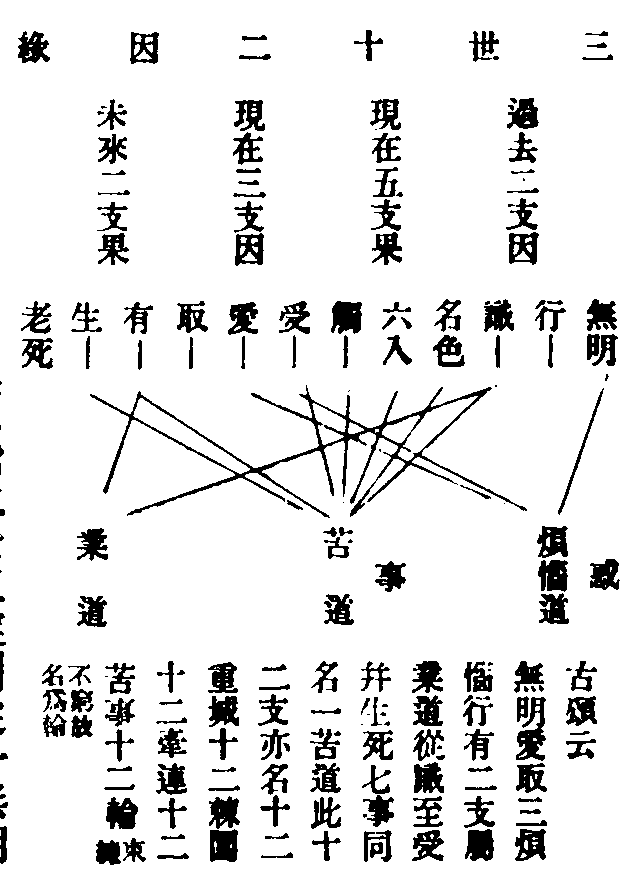



【■记】束为三道者，从三烦恼生於二业，谓从一无明出行业，从爱取二出有业。又从二业生七苦，谓从一行出识等五，从一有出生老死二也。七复生三者，识等五出爱取二，生死二出无明。净意菩萨偈云：烦恼初八九，业二与十支，餘七说为苦，三摄十二法。从三故生二，从二故生七，从七复生三，是故如轮转。一切世间法，惟因果无人，但从诸法空，还生於空法。名重城者，取困厄义。棘园，取难脱义。牵连，取系缚义。十二苦事，取逼迫意。十二轮，取流转义也。三世十二因缘详释六卷。



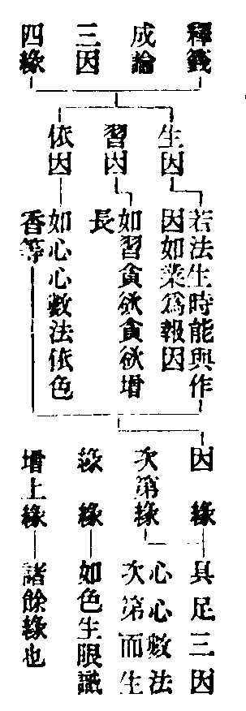



(释签云：若俱舍中因缘五因性，成论以所作因即是增上，故不别立，但立报因即生因是，自分因即习因是，共因即依因是。)



【■记】三因四缘，出成实论二释签中。但会通俱舍、大论，以明成论三因四缘。此图依释签立。



【■备】生因者，善恶报法生时，能与其善恶因如业相应，故为报因。



【■补】习因者，即自种因。如前念习善恶，后念善恶得相续起。依因者，如眼识必依九缘得生等，谓依第八识，依第七意根，六意识，五眼识。眼根空明，色作意解，出唯识论。此中不明九缘，但依色香等。因缘者，具足生、习、依三因。若准唯识，彼局此宽。唯识但约亲义，取种生种，种子生现，现行熏种，乃是因缘。今小乘因亲缘疎，亲疎合论，故三因皆名因缘。次第缘者，前心心所，开导於后；后心心所，即闻处起。成论言：如以前心法灭故，后心法得次第生也。缘缘者，新译为所缘缘。以能缘之心，缘所缘之境，境引心生，心因境有。成论言：若从缘生法，如色能生眼识。大论言：心心数法，缘尘故生。是以境为所缘。此缘有为生识之缘，故名缘缘。增上缘者有四，谓逆、顺、亲、疎。泥水为草木，顺增上；霜雪为草木，违增上。观自己根尘而生眼识为亲，观他人之根尘为疎。诸餘缘者，谓三缘之外，其餘皆属增上摄。若俱舍中因缘、五因性等，乃明成论三因四缘，即同毗昙六因四缘。但立下，会通毗昙之名。有言报因等，此非会通大论所立，记中悮也。以妙玄中全无大论之语，签内岂舍毗昙，而反会大论之名？然集注中具明因缘者，以因缘义，佛法根本，故广示会通自分因。毗昙所立，即大论自种因，存参。



【■备】辨讹：问言：大论、俱舍、俱六，何以成论立三？答：宗旨不同耳。当知成论不别立心数，但约前念起为心，后念起为数，故无相应及徧行。徧行乃染心所摄，所作即增上缘，故只立三因。存考。



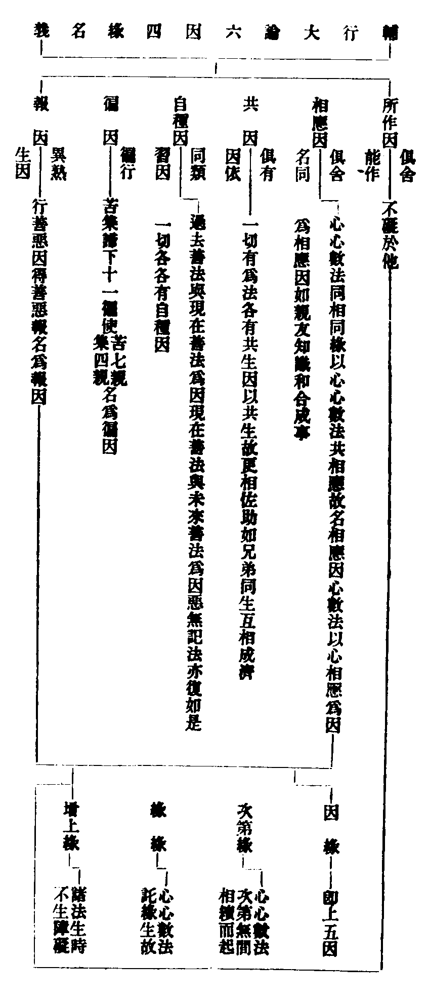



【■记】辅行言：新译次第缘名等无间缘，缘缘名所缘缘，餘二名同。然龙树立名，什公翻译，虽少不同，应非全失。以大论是一家承用，名字稍同，故且依之。然以四缘摄六因者，如俱舍颂曰：说有四种缘，因缘五因性，等无间非后，心心数已生，所缘一切法，增上即能作。所以辅行明之者，谓今明於事度事蔽，善恶相发，是六因中四因所摄。四缘之中，多少不同，故略明四缘及以六因也。而六因四缘名义，详释如论。今图但会通俱舍成论义耳。



【■补】大论：六因、四缘者，所作因，谓能为一切所生法作因，不遮碍於他法。亦云：能作因者，谓能为一切诸法作生起之因，即法生时，诸法於他不为障碍，且与其力。如眼根於识，饮食於身，佛於众生等，皆是能作也。二、相应因者，解言：心心数法，同相同缘，以心心数法共相应故。如眼识心王，与受、想等，同一能缘行相，同一所缘尘境。以心王与心数法相应而起，王即以数为相应因。若心数法与心相因而起，数即以王为相应因。眼识既尔，餘耳识等亦然。此因惟属心心数法，不通餘法。如亲友、知识，和合成事者，若依唯识，如眼识缘色，心王生起，定有五种徧行心所，五种别境心所。或善，则有善十一种心所；或恶，则有根随二十六种烦恼心所。如此心心数法，同一能缘行相，同一所缘之境，善则同善，恶则同恶，必相应起故。如亲友等，和合成事也。三、共因者，如眼识生起，必藉多缘，谓空、明、根、境、作意、分别依等，更相佐助，而得生起，名共生因。俱舍亦名俱有因者，注言：一切有为法，名共生因。如四大种，更互相望，为俱有因。地大待水、火、风等为因，乃至风大待地、水、火等为因。此四大种，要异类和集，方有功能，而造色故有。如受、想等，与心王决定同时而起，亦是更互为俱有因。又色、心相依，亦是更互为俱有因。又生、住、异、灭能相，与色、心等所相，亦是更互为俱有因。故此俱有因，通一切法也。大论云：一切有为法，各有共生因。辅行云：一切有为法，各各共生因。是也。四、自种因者，以一切法，皆从自种生故。如眼识生时，或善或恶，定从恶去善、恶亲种子生起。善种自生善心、心所现行，恶种自生恶心、心所现行。至未来生起亦然。亦即习因者，谓过去所习善种，与现在善法为因；现在所习善种，与未来善法为因。不善、无记亦如是。五、徧行者，谓邪见所起身、语、意业，能招不可爱果，则此邪见，徧为染污业果之因。无明等亦尔。又如迷苦谛所起身见，徧为邪见等惑之因。又能引起餘谛下惑，则此身见，徧为五部烦恼之因。无明等亦尔。此是徧因也。六、报因者，行善恶因，得善恶报，名报因。俱舍名异熟因者，以因通善恶，果惟无记，异性而熟，名异熟也。四、缘前解。



【■备】节义云：图中二相应因下，心心数法，以心相应为因句，第一心字多赘。此句心数法作主，反去率彼心王，同已作事，成相应因。凡成一事，决无不相应而能成就者，理之必然，故成论不立不对耳。注中善法、恶无记法，法字作种字解。徧因乃利钝使，亦遍诸法之中，故成论不立不对。



【□注】辅行引俱舍云：能作及俱有，同类与相应，徧行并异熟，许因为六种。今且依大论，略出六因相。以大论是一家承用，名字稍同，故且依之。



【■记】不依俱舍六因者，古有斥为异计故也。如无著菩萨显扬论云：有一异计，立六种因，谓同类、遍行、俱有、相应、异熟、能作。如是六种，除异熟因，餘五因性，有三种过失。如同类因有三过：若言同类之因，名同类因，有已成过。何以故？若善等法，善等体性先已成就，彼何用因？若言同类即因，名同类因，是即无果，有不定过。何以故？不示其果是谁因耶？又非决定因体同类，不相似法亦为因故。若言非同类即因，亦非同类之因，是即名言有虗设过。同类因言，无有所主，浪施设故。如是於餘四因三种过失，亦应如理广说。是则俱舍六因，虽可会通大论，既为菩萨所斥，故今且依大论，略出六种因相。况大论是一家承用，又与俱舍立名稍同也。



【■备】辨讹曰：许因为六种为字，准论应唯字。私谓今依大论，亦不因记中无著斥俱舍之故也。



【□注】乃至云：复次，心心数法从四缘生，无想灭定从三缘生，除於缘缘。



【■补】二定，除缘缘，非能缘故。由因缘者，谓由二因：一、俱有因，谓生等相；二、同类因，谓前已生同地善法；等无间缘，谓入定心及相应法。如是二定，心等引生，碍心等起，故与心等但为等无间，非等无间缘也。唯识以二定属不相应，故不属因缘。而此大论释从三缘生，以知大论宽，唯识狭也。



【□注】诸餘心数不相应行及色，从二缘生。



【■补】大论无数字，对前无想、灭尽定二不相应而论。



【■备】此中添数字亦无妨，意谓二定尚可许与心相应，其餘心心数不相应之诸行及色等，但从二缘生也。心数下不可逗断读。



【□注】除次第缘及缘缘，餘有为法劣故，无有从於一缘生者。



【■补】如名、句、文等，依语音分位立，即以语音为因缘，以无障碍故，得成名、句、文，即增上缘。既非心之分位，则无渐次引起之力，除次第缘，以次第必约心法论故。又无缘境之能除缘，缘色可知。



【□注】报生心心数法，从五因生，除於徧因。



【■补】指一分无记异熟，乃酬往业生，故曰报生。无记非善恶，故除染污之徧因。



【□注】无漏心心数法，从三因生，谓相应、共及无障碍。



【■补】无漏智起时，必王所相应而起，故从相应因。又无漏王所生则共生，故从共因。又以无障碍故得生，故从无障碍之所作因。除自种因者，以未见道前所熏习者，但有漏善根，初见道时所发无漏心心数，不可谓从自种因生。若修道中，亦有自种因也。此中三学，是无漏、是净，故除有漏之报因、染污之徧因。



【■记】此引大论，明四缘六因具减生法。以论三十二言：一切有为法，皆从四缘生。因缘者，相应、共生、自种、徧报五因，明因缘。又一切有为法，亦明因缘。次第缘者，除阿罗汉过去、现在末后心心数法，诸餘过去、现在心心数法，能与次第，名次第缘。缘缘、增上缘者，一切法乃至是心共生心数法，所谓受、想、思等。是心数法同相同缘故，名为相应。心以心所法相应为因，心数法以心相应为因，是名相应因。相应者，如亲友知识，和合成事。共生因者，一切有为法，各有共生因，以共生故，更相佐助。如兄弟共生故，互相成济。自种因者，过去善种为现未善法因，过现善种为未来善法因。不善、无记亦如是。徧因者，苦谛、集谛所断结使一切垢法因，是名徧因。报因者，行业因缘故，得善恶果报，是五名因缘。心心数法次第相续无间故，名次第缘。心心数法缘尘故生，名缘缘。诸法生时，不相障碍，是增上缘。已上四缘六因名义，图中已略点示。此中引论料简，系与图中一连之论。故此中於一切法下，以乃至二字接之，而具记之也。复次下，正示四缘具减生法。毗昙心论，谓心心数法四缘生者，谓心心数法从自种子生为因缘，前念开导力故生是次第缘，境界是彼缘缘，除其自己，餘一切法是彼增上缘。无想灭定从三缘生者，於中入定心是次第缘，於中自地前生功德是因缘，及彼俱生、生、住、异、灭亦彼因缘、增上缘。如前所谓二正受，从三离彼餘心所。诸餘心数不相应行及色从二缘生者，因缘及增上缘。餘有为法劣故，无从一缘生者。次明六因从减生法。报生心、心所法从五因生，除徧因者，大论言：以其不隐没无记非垢法故，除徧因。论又明诸烦恼亦从五因生，除报因。何以故？诸烦恼是隐没，报是不隐没，故除报因。报生色及心不相应诸行从四因生，非心、心数故，除相应因；不隐没无记故，除徧因。染污色及心不相应诸行从四因生，非心、心数法故，开相应因；垢故，除报因。诸餘心、心数法，除初无漏心，皆从四因生，开报因、徧因。所以者何？非无记故，除报因；非垢故，开徧因。诸餘不相应法，谓色、心不相应诸行，若有自种因，则从三因生，除相应因、报因、徧因；若无自种因，则从二因生，共生因、无障因。今注并略之。无漏心、心数法从三因生者，相应因、共生因、无障因。又大论云：是初无漏心中，色及心不相应诸行从二因生，共生因、无障因。无有法从一因生，若六因生，是名四缘生也。



【□注】净名记云：十二秖是四六而已。故知但是离合说也。且如无明，秖是行家之能通也，即同类因。行必四相，即俱有也。行中五部，亦同类也(见历四谛，思历一谛)。无明行中，心心数法，共行共感，所作必同。行有必招识等异熟，此行心有徧行五部之惑。若四缘中，论云：增上即能作因缘。五因性比六因说，可知。



【■记】荆溪净名记云：十二因缘，秪是四缘。六因离之名十二因缘，合之名六因。四缘又离之名六因，合之名四缘也。且如下，会十二缘，只是俱舍六因。谓无明既能通行，是同类。而行既有生、住、异、灭四相，是俱有。又行中既有历苦、集、灭、道见惑，及历真谛一部思惑，亦同类因。又此无明及行二支中，心心数法，既皆共行共感，则其所作必同，是能作因。而行有支既属业道，则业牵识走，故行有必招识等异熟，是异熟因。又此行中既有徧行五部惑，即徧因也。若四缘下，会大论四缘，即俱舍六因。谓大论既以诸法生时，不生障碍，名增上缘，即是能作。以能作因缘，不碍於他也。又大论以五因性名为因缘，则因缘一种，即相应等五因。以上图中，示大论六因，会通俱舍六因，故言比说可知。



【■补】盖以无明为因，而起染分思数，及诸边邪等惑，而造於业。无明既能通行，是同类也。行与四相俱生，则以四相为因而有於行，以行为因而有四相，既同时有，即俱有也。行中所起五部惑，同染污为性，亦是同类。五部，谓见历四谛，思历真谛，或随立一谛为一部也。共行即同类因，共感即俱有因，所作必同，即能作因。又无明心数起时，与染分心王相应而起，是相应因。行中心心数法，作业之时，无有障碍，即所作因。异熟见前。



【■备】此节乃会四缘、六因，合十二因缘也。辨讹曰：此节六行，文未妥，今更释之。且如无明起时，必有王所并起，是相应。无明与行和合而起，即俱有。无明中思种引起行，即同类。起染污行，即徧行。行缘识等，即异熟。识缘名色，且属能作。名色缘六入，亦同类。入缘触，是所缘。触缘受，是等无间。取缘有，亦同类。有缘生等，亦异熟。生缘老死，亦同类。增上、能作，支支皆具，略论如此。问：旧引论言，增上即能作因缘。五因性，二缘已会，餘二若何？答：如无明灭，引起行支，即等无间。行能反缘无明，是所缘缘也。餘例知。然十二支，但是有情相续。六因、四缘，通一切法。私谓：辨讹意以注未畅发，而更释之。若果全未妥，应一一指出。至无明灭句，此中约三世果报言，无明属痴，行是造作，当以心心不住为等无间。无明托所行境为所缘，此行境又为生无明之缘，是缘缘义。辨讹又曰：此行必有徧行惑句，与论有碍。前言报生心心数法，从五因生，唯除徧因。此中明招异熟之行，而言必有徧行。又异熟即是报生，翻译不同耳。又凡言行者，必须具善、恶、无记三种。若论恶行，容有徧因，於中含有善与无记，岂可槩言徧因耶？私谓：心、境、法，於四因、六缘，有增减不同。四六合十二，未可支支全合，似不当以行招后识。异熟难行，当分徧因也。至徧因，至见、疑、痴等，凡染污善法，凡外皆具足也。并存以俟后定。



【□注】辅行八上(十一)云：大论：问：佛说因缘，甚为难解，云何令於痴人观耶？答：非如牛马等。禅门但云：聪明利根，分别筹量，不得正慧，邪心取理，名为愚痴(文)。



【■记】大论云：愚痴者，非如牛马等愚痴。是人欲求实道，邪心观故，生种种邪见。是愚痴人，当观因缘，名善治法。禅门下，重证。



【□注】此因缘观，与支佛何异。今是助道破障，略论三世。支佛正观破惑，必须逆顺两缘，百千万世因缘等。



【■记】支佛逆顺两缘，至百千万世因缘等者，四教义云：一、观属爱十二因缘，二、观属见十二因缘。初者，即为二义：一、推寻，二、观破。一、推寻者，若闻正因缘生灭法，信解分别，觉一切属爱烦恼，皆十二因缘。观因缘，入定欲息，心达本源，求自然慧，乐独善寂，修习定心，得诸禅定。住此定中，知属爱烦恼，即是无明。逆顺推寻，即见十二因缘。云何逆推？此爱因何生？即知因受，受因触，触因六入，六入因名色，名色因识，识因行，行因无明，过去一切烦恼也。复顺推此爱，爱能生取，因取则有业，因有业则有生，因生有老死忧悲苦聚，轮转无际。若因停心观，入深禅定。如是逆推寻，或时见歌罗逻初受生，乃至见过去身起业烦恼，乃至二生、百生、千生也。顺寻取有，若因禅定力，或见未来一生、二生，乃至百千生。若见过、未事，其心悲感，道心转增也。二、观破者，即性念处，历别观十二因缘也。性念处观，略如前说。所以者何？若观爱，即污秽五阴性念处；若观爱、触、六入、名色、识，即观果、报、无记五阴性四念处；若观行，即善、不善五阴性四念处；若观无明，即过去污秽烦恼五阴性四念处；若观取，即现在污秽五阴性四念处；若观有，即善、不善五阴性四念处；若观未来生、老、死，即报、生、无记性四念处。是则用念处逆顺观察，破四颠倒。颠倒若灭，即无明一切烦恼灭，以无明灭故行灭乃至老死灭，是名性四念处历别观属爱烦恼因缘观也。次者亦二意：一推寻、二观破。一推寻者，若见神我及世间常无常、亦常亦无常、非常非无常，是则现在生身边四见，因此身边四见生十四难六十二见，此身边四见即四取逆顺推寻，此取因四爱、爱因四受，乃至四行因四无明，复顺寻四取能生四有，此有即受一切二十五有生老死忧悲苦恼。若因停心观得深禅定，或见过去未来生事，具如前说观。二破因性念处观，观四取身边四见，如是次第乃至无明，破过去如去、不如去、亦如去亦不如去、非如去非不如去，身边二见污秽五阴也。复顺观四取有乃至生死，破未来有边、无边、亦有边亦无边、非有边非无边，身边二见污秽五阴也。若能如是用性念处破三世身边二见之四见，即破十四难六十二见，一切属见烦恼一时皆灭，是名无明灭即行灭乃至老死灭。若属见烦恼灭，即还用前观爱十二因缘性念处观，破欲色无色爱皆灭，是则三界烦恼业道灭者名为有餘涅槃，若苦道灭者即是无餘涅槃，是名因性念处智慧观十二因缘入涅槃也。乃至言共念处、缘念处、助观十二因缘，类前可知。



△五、治障观法。



五，多障众生念佛观。



【□注】止观云：睡障念处，乃云逼迫障。禅门第四，明三种障，念三身治(彼通大乘，今且明小乘助道)。障即恶业。三种者：一、昏沉暗塞障(昏睡无记)，念应身三十二相治；二、恶念思惟障(欲作五逆十恶等事)，念报身力无畏等治；三、境界逼迫障(身忽卒痛，或见无手足，火焚水溺等也)，念法身空寂无为治(文)。今明小乘助道。



【■记】睡障。云逼迫者，相宗明睡眠以昧略为性，障观为业；念以明记不忘为性，定依为业。睡与念体用相反，故念则睡破，睡强则念障。应知昏睡强胜，如山麤重，压逼身心，受逼难过，故曰逼迫障。今以念佛观治之。禅门用三身治三障法，今具记之云：念应佛者，於三十二相中，随取一相，或先取毫相，闭目而观。若悬作不成，当对一端严形像，一心取相，缘之入定。若不明了，开眼更观，复更闭目。如是取一相明了，次第徧观众相，使心眼开明，即破沉暗。念报佛者，以正念缘佛十力、四无所畏、十八不共、一切种智，圆照法界，常寂不动，普现色身，利益一切，功德无量。如是念时，即是对治。念法佛者，即观法性平等，不生不灭，无有形色，空寂无为。无为之中，既无境界，何者是逼相？知境界空，即是对治。若念三十二相，即非对治。何以故？是人未缘相时，已为境界恼乱，而更取相者，多因此著魔狂乱。此乃通大乘观，今是小乘助观，唯念应身佛也。



【□注】据四教义云：破境界逼迫障，合念真空法身。



【■记】此出四教义，念佛破逼迫障，然意与禅门较异也。



【■补】真空法身者，小乘所证真空五分法身也。阿含言佛法身者即空，故约小乘当分言之，即以丈六相为应，从因感果为报，五分为法身也。



【□注】若以身对教，如辅行一下(七)云：前之三教，各念一身，谓生应报，圆念法身，诸身具足(文)。



【■记】藏念劣应生身，通念胜应应身，别念报身，圆念法身。以法佛体圆，具足诸身，故念法身，即具足生应报也。



△二、立观定境法二：初、别。



二、别相念处(如前四念处是)。



【□注】妙玄四(二十三)云：五障既除观慧谛，当能观四谛，而正以苦谛为初门，作四念处观，破四颠倒(文)。



【■记】声闻根钝，正以苦谛为初门，观不净、苦、无常、无我也。



【□注】析玄上(二十)云：别谓各别，身受心法不同故。相谓行相，观此四法作不净等行相故。言念观者，然观体非念，观是其慧，推求观察知不净等故。乃至处谓处所，谓身受心法是念所缘住止处故(文)。



【■记】身，聚集义。受，领纳义。心，了别义。法有二：想以取相为义，行以迁流为义。今名念者，四念处言，为初学用念持慧，不妄受异缘，念为增上，故从念受名也。



【□注】於五阴境修四念处，为破四倒，合五为四。受则六根对六尘，义兼内外，故独为一。想行一向居内，故合为一。



【■记】四念处云：人於色起净倒，受起乐倒，想行起我倒，心起常倒。破四倒故，合五为四也。若意根对法尘受，名内受；眼等五根对色等，名外受。然境虽内外，而领纳非二，故受独为一。而想则取相在心，行则念念不住，一向居内，合为一也。



【□注】又此念处别名属慧，通亦有定。辅行三下(十七)云：四境止心，故名为定(文)。



△二总。



三总相念处。一观身不净，受心法皆不净。乃至观法无我，身受心亦无我。中间例知。(已上三科名外凡，亦名资粮位。)



【□注】此有四句。四念处(一)云：一、境别观别，正是别相念处。二、境别观总。三、境总观别。此二是总相之方便。四、境观俱总，是总相念处。(文)初则一药对一倒。中间二句，观心渐熟。或别於一境，总用四观。或别用一观，总观四境。第四，境观纯熟，举一俱得也。



【■记】以不净治身倒，乃至以无我破我倒，如上别念，是为境别观别。或别於一境，总用四观者，如观身不净，乃至以是苦、无常、无我，是为第二境别观总也。或别用一观，总观四境者，如举一不净观，非但观身，亦复观受、观心、观法，皆是不净，是为第三境总观别也。第四、举一俱得者，如举身念处一境，而受、心、法俱在其中；若举不净一观，而苦、无常、无我皆在其中，是为第四境观俱总也。



【□注】若析玄，准俱舍疏，前三皆别相摄，第四句方是总相位。



【■记】陈译俱舍疏言：四中三种，唯不杂缘；第四所缘，通杂不杂。若唯观法，名不杂缘；若於身等二三或四总缘而观察，名为杂缘。今此指之者，意在所拣也。



【□注】今依妙玄四念处，初句是别，后三皆总。今此正当境总观别，谓别用一观，总观四境。



【■记】今依妙玄判，初为别，后三皆总。今此下，正判仪文，是第三句，如言观身不净，受、心、法皆不净是也。



【□注】又上停心破障四念处，惟观苦谛，至内凡位，方观四谛。妙玄四(三十三)云：七贤位人，明识四谛。此约解说。



【■记】惟观苦谛，谓总别念处所观身受心法，惟约苦谛也。如言正以苦谛为初门也。至妙玄云：天魔外道，爱见流转，不识四谛七位。明识四谛者，此约解说。如大经言：我昔与汝等，不见四真谛。见四谛者，识属爱四谛，识属见四谛，皆能明了。若解四谛，则所见真正，无有邪曲。则知七贤但约解也。辨讹云：唯观苦谛句太局。若言苦谛为初门，则可以念处所观身受心法即苦，所对破常乐我净即集，念处观即道，所灭即灭谛，不可局言唯观苦也。私谓唯观者，乃专注在苦，非谓只观苦谛，餘三谛便不观也。详论见下图中。



【□注】心行理外名外。凡资粮者，从喻也。欲越三有，此为资粮。



【■记】庄子言：适百里者宿舂粮，适千里者三月聚粮。资粮不充，罔克前进。欲越三有，非此不能发足前进，故名资粮。



【■补】妙玄言：前已别相念破四倒，今深细观慧，总破能生正勤如意觉道，疾入后法也。



△二、明内凡。



二、明内凡者，有四：谓煖、顶、忍、世第一(此四位为内凡，亦名加行位，又名四善根位)。



【□注】渐见法性，心游理内，身居有漏，圣道未生，故名内凡。以定资慧，加功用行，故名加行。



【■备】法性，指偏空理也。



【■记】定慧缺一，不可前进。外凡有观少定，今内凡勇猛增进，加以禅定，资乎观慧，名加行。



【□注】圣道根本，亦曰善根。



【■记】根有出生之义，此四能发觉支之华，圣道之果。四果善法，由此而生，又名善根。



【□注】煖从喻。妙玄四(二十四)云：以别总念处，观缘四谛境，能发似解，伏烦恼惑，得佛法气分。如钻燧先烟，春阳煖发，以慧钻境，发相似解，解即喻煖(此喻慧行)。又如春夏积集花草，自有煖生，以四谛慧，习众善法，善法熏积，慧解得起，故名煖也(此喻行行)。



【■记】大经疏迦叶品亦有此文义。释名煖。



【□注】顶妙玄四(二十四)云：似解转增，得四如意定，十六谛观，转更分明，在煖之上，如登山顶，观瞩四方，悉皆明了，故名顶法(文)。



【■记】解慧增长，复加定持，处煖之极。所以喻登山顶，觉慧了了分明也。妙玄又言：如山顶之道，人不久住，若无难，必过此到彼。行者住顶不久，若无难，必到忍；若有难，退还於煖也。



【□注】忍妙玄四(二十四)云：亦是似解增长五种善法，增进成根，於四谛中堪忍乐欲。(文)亦忍可义。



【■记】忍位。复有似解根增故，所有煖位，积集信、进、念、定、慧五种善法，增进成根，便能於四谛境中，堪忍乐欲，以是得名忍也。又忍者，以四谛境忍可於心，心中了了吐露不出，名忍。



【□注】世第一。释签(五)四云：此是有漏，故名世间。於中最胜，故云第一(文)。



【■记】玄文云：此心心所法，於餘法为最为胜，为尊为上，亦分胜，亦都胜。谓分胜彼煖顶忍法，分胜煖顶忍一切凡夫所得禅无量解脱除入也。除入即胜处。又都胜者，非谓都胜一切事业，但以能开圣道门故。彼见谛等不能开圣道门，以世第一法开圣道门，彼见谛等法得修。见谛等法得修者，皆世第一法功用，是知从功能立名也。是第一法名义者，最胜义是第一义，得妙果是第一义，如高幢顶更无有上是第一义也。



【□注】此四位观行者，俱舍颂云：从此生煖法(从总相后生煖善根)。



【■记】论解云：修习总缘共相法念住，渐次成熟，乃至上上品。从此念住后，有顺决择分初善根生。此法如煖，立煖法名，是能烧惑薪圣道火前相。如火前相，故名曰煖。



【□注】具观四圣谛，修十六行观(四谛为所缘，十六行为能缘。释签谓煖八谛十六行相，有解八字，字恐误。或约上二界四谛体同，通解云八耳。其实只观欲界四谛，此位有三品)。



【■记】论具释云：此煖善根分位长故，能具观察四圣谛境，及能具修十六行相。十六行，如后解。三品者，妙玄云：煖有三，谓下下、下中、下上也。



【■备】辨讹云：遍观上下四谛，故言具观，及签云八谛耳。非外凡唯观苦，至煖位方具观也。故荆溪特曰八谛。详论见下。



【□注】次生顶亦然(用观同前，亦有三品)。



【■记】论曰：此煖善根，下中上品，渐次增长，至成满时，有善根生，名顶。此转胜故，更立异名。动善根中，顶为最胜，如人顶故。或由此是进退两际，如山顶故，说名为顶。此亦如煖，具观四谛，及能具修十六行相。妙玄云：顶有三种，谓中下、中中、中上是也。



【□注】下中忍同顶(下忍徧观八谛，中忍缩观明灭缘行。今皆云同顶者，下忍虽上下徧观，不出四谛；中忍难灭缘行，约初观说)。



【■记】论具云：此顶善根，下中上品，渐次增长，至成满时，有善根生，名忍。於谛理能忍可中，此最胜故。又此位忍，无退堕故，名忍。此忍善根，安足增进，皆法念住，与前有别。然此有上下、上中、上上、下中二忍，与顶同。谓具观四谛，及具修十六行相。上品有异，唯观欲苦，与世第一相邻接故，有此义准。煖等善根，皆能具缘三界苦等，义已成立，无简别故。谓瑜伽师，於色无色对治道等，一一圣谛行相所缘，渐减渐减，乃至但有二念作意，思惟欲界苦圣谛境。齐此以前，名中忍位。



【■补】签云：此中忍位，未减道时，虽减行相，未减道故，故得具观四种谛也。颂云：下中忍同顶。约此而说，若此中忍，减道谛时，但修十二行，既减彼道，心无欣慕，故彼道下四行，亦不得起。由此道理，减灭谛时，但修八行，除道灭下，各修四行，故减集谛时，但修四行，故中忍具修十六、十二、八四行相是也。



【□注】上惟观欲苦，一行一刹那(此上忍合有一行二刹那心，言一刹那，此据满说)。



【■记】论释云：从此位无间起胜善根，一行一刹那，名上品忍，此善根起不相续故。



【■补】签谓：上忍惟观欲苦，及一行一刹那，名上忍。又云：於上忍中，亦修四行，虽起一行一刹那心，以观苦故起，能得修彼苦下四行相故。问：於上忍位，减彼三行，何故修彼所减行耶？答：虽减彼行，不减谛故，欣慕心故，故得修彼所减行相。於中忍位，修所减行，准望可知。留苦下一行者，拟入见道，故须留也。



【□注】世第一亦然(上忍位中有二刹那，一刹那尽，餘一刹那在，名上心满，即入世第一。今一刹那引入无漏，故云亦然也)。



【■记】释论云：上品忍无间，生世第一法。如上品忍，缘欲界苦谛，修一行相，唯一刹那，此有漏故，名为世间。是最胜故，名为第一。有士用力，离同类因，引圣道生，故名最胜。



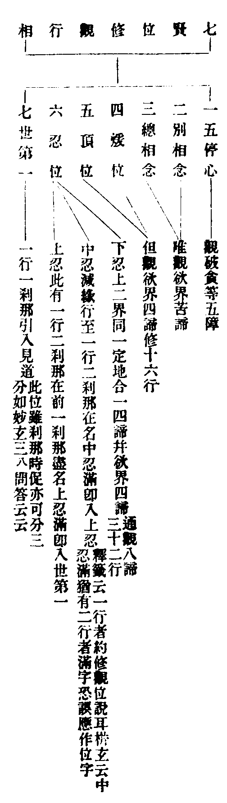



【■备】辨讹曰：图中唯观(欲界)苦句似局。如修六妙发色定，即以色定为所观，岂局在欲界？且俱舍二十六，明四念具摄十智，岂但观苦耶？又复但观欲界四谛句，亦似局加。新婆沙七，明煖加行位中，即具观上下八谛。俱舍二十三云：煖等善根，皆能具缘三界苦等之文。且煖善根，多从色定发，下惑已伏上方生。上定既生，上惑随起，岂可有病无药乎？释签四云：从煖善根去，至世第一成，或遍观上下，或舍上缘下，非但观欲界也。私谓：俱舍论云：缘总杂法念住中，总观所缘身等四境，修四行相，所谓非常、苦、空、非我。修此观已，生煖善根。又言：故唯有四，不增不减。集注据此，故判外凡唯观苦谛。论又云：传说在定，以极微刹那，各别观身，名身念住满。虽不指定欲界，然外凡尚不暇观欲界集等，似不及於色苦。集注之说，非无因也。辨讹所引念摄十智，似不必引，立意不同。至煖顶能缘三界，玉师非不知之，而判观欲界，想从多分言之，存俟后定。



【■记】妙玄问：世第一有三品否？答：一人无，多人有。身子上，目连中，餘皆下。就佛、支佛、声闻为三品也。



【□注】中忍减缘行者，若遍观八谛，修三十二行，名下忍位。若初依欲界苦修四行，次例观上二界苦亦四行，又观欲集四行，次上二界集四行，乃至上二界道下，不用最后乘之一行，名为一周减一行也。



【■记】此明一周减上界道谛下乘之一行。



【□注】复从前观，从后减至第四番，减上二界道谛，下道之一行到此，能缘之行既无，所缘之谛亦减。此道行与道缘同名，亦与缘同减，故云减缘必减行(据初一行)，减行未必减缘(据后三行)。



【■记】此明至四周缘行同减也。释签云：一一谛下，各有一行，与缘名同，亦与缘同减是也。所言缘行同减，据初一行者，即指道减行；据后三行者，即指正迹乘也。



【□注】第五番，减欲界道谛下乘行，乃至最初欲界苦下空行，总有三十一周。减缘减行，皆名中忍。唯留一行，并所缘苦境，入上忍位。



【■记】释签云：缘之与行，皆从后减。故使欲界最后留苦行，都有三十一周减。缘减行后，但有一行二刹那心，观於欲苦，名中忍满。唯有一行一刹那心，观於欲苦，名上忍成就。是则能缘所缘，同一苦名，故同留之入上忍位也(此位所留一行，随行者所宜，如释签第四云云)。



【■记】释签言：随缘一行，一刹那不住，故似见道。所以者何？行人有二种：一爱行，二见行。爱有二：一我慢，二懈怠。见亦有二：谓我及我所。著我慢者，修无常入世第一法。懈怠增者，修苦入。著我者，修无我入。著我所者，修空入。故知所留一行，不必定之一种，但随行人所宜一种，即当留之以入世第一也。



【□注】是则上四下三，七缘与初行同名，行与缘同减。故释签四(四)云：七周减缘，二十四周减行。



【■记】故释。签下，示分周减缘行。谓上下八谛名缘，是所缘故，各十六行故。三十二名行，能缘行故，应知七周减缘。二十四周减行，谓一一谛下，各有三行，与缘名异，亦不与缘同减，从行为名，故三八二十四周减行。又一一谛下，各有一行，与缘名同，亦与缘同减，但从缘为名，故名七周减缘。是则上界四谛，下界留苦，唯减三缘，上四下三，名七周也。



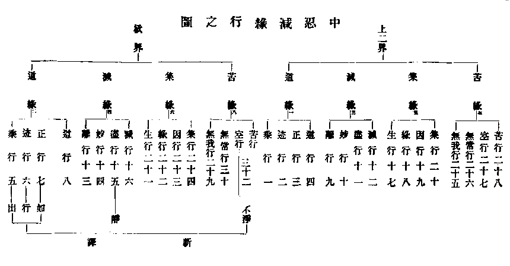



【■备】辨讹曰：图列空下不净，准婆沙、俱舍、瑜伽，皆同列空，无不净名，故知非新译之不同。辅行中，荆溪一时便写耳。准大论，不净观是初入门，净颠倒故生淫欲，为破净故言不净，是得解脱，非实观故。不净不入十六行数，存考。



【■记】恐人不解，从上例下，自前至后，顺观四谛，复自上还下，从后至前，逆次渐减缘行，故以图示，令易晓也。



【■补】俱舍言：如荷重担故苦，内离士夫故空，非究竟故非常，不自在故非我。又等现理故集，如种理故因，成办理故缘，相续理故生，如泥、团、轮、绳、木等，众缘和合成办瓶等。又牵引义故因，出现义故集，滋产义故生，为依义故缘。又不续相续断故灭，离三有为相故静，胜善义故妙，极安稳故离。又言：通行义故道，契正理故如，正趣向故行，能永超故出。



【□注】十六行义，如辅行三下(十七)及析玄上具释。



【■记】此释十六行之义。如辅行云：苦下四行：无常、苦、空、无我。观因缘生：念念生灭，故无常；为无常所逼，故苦；一相、异相不可得，故空；我、我所不可得，故无我。集下四行：集因缘生：有漏和合，能招苦果，名集；观於六因，能生苦果，名因；观於四缘，能生苦果，名缘；还受后有苦，名生。灭下四行：灭、尽、妙。离诸烦恼灭，名灭；一切苦尽，名尽；一切第一，名妙；超过生死，名离。道下四行：道、正、迹、乘。能至涅槃，名道；非颠倒法，名正；圣人行处，名迹；运至三脱，名乘。



【□注】又上二界合一四谛者，同一定地故。以欲界现前，比上而观，故析玄五义备释(云云)。此则伏三界四谛下惑，至发真时，故上二界同名比法忍智等。



【■补】析玄云：上二界四谛，有五义同，故得合观：一者同一天趣，二者同一定地，三者同一化生，四者同一烦恼性，五者同能引生无漏。



【□注】又十六行，只是观门。涅槃疏名十六谛者，取谛审观察义故。



【■记】涅槃迦叶品云：十六行者，即十六谛，亦是苦法忍、苦法智、苦比忍、苦比智等。此中既未断惑，故知仍取谛审、观审之义。



【□注】又此减缘行，妙玄三(八)合作八番者，以行从缘，但约八谛为八周也。四教义二(十二)云：中忍作十番缩观者，约后七谛，以行从缘为七周，开欲界苦下所减三行为三周，总为十番。妙玄八(八)云：三番缩观，进成上忍者，以三界不出四谛，亦以行从缘，减后三谛，故曰三番。诸文详略不同，盖赴机异耳。



【■记】妙玄八番者，文言：忍法观者，正观欲界苦，色、无色苦；欲界行集，色、无色行集；欲界行灭，色、无色行灭；断欲界行道，断色、无色行道。如是三十二心，名为下忍。行者后时，渐渐减损行及缘，复更正观欲、色、无色苦，乃至观断欲界行道，除观断色、无色行道，从是中名中忍。复更正观欲界苦，观色、无色苦，乃至观色、无色行灭，除道一切道。复正观欲苦、色、无色苦，乃至观欲界行灭，除色、无色行灭。复正观欲界苦，乃至观色、无色行集，除灭一切灭，并除欲界灭。复正观欲苦，乃至观欲界行集，除色、无色行集。复正观欲界、色、无色界苦，除一切集。复正观欲界苦，除色、无色苦。复正观欲界苦，常相续不断不远离。如是观时，深生厌患，复更减损，但作二心，观於一行，如似苦法忍、苦法智，如是中观名中忍。复以一心观欲界苦，名上忍。复次生世第一法，后次生苦法忍。今此以行从缘释之，合作八番意也。四、教义十番缩观者，文云：下忍於十六行作法谛观，中忍十番缩观。上忍但观欲界苦下四行，今但明中忍也。又妙玄明中忍三番缩观，今此亦以行从缘释，明三番意也。



【□注】四、善根胜利者。俱舍颂云：煖必至涅槃，顶终不断善。(释签四云：忍位是进，煖位是退，顶位是进退两际，犹如山顶。（文）四教义二云：煖顶退者，何云性地？答：此人虽造恶堕地狱，一入受罪，不复重入，有性地善根故，能得圣果。（文）且必至涅槃，与终不断善，有何异耶？盖煖虽造恶入狱，终不久留，后必生人天，证涅槃果。若到顶位，虽退入恶，必不起大邪见，断善根故。但有明昧浅深之殊，其善根一也。)



【■记】四、教义。言若通论四善根，亦名四忍。但忍法不退，别受忍名。若煖法遇恶因缘退，能造五逆，谤方等经，作一阐提，堕无间狱。若顶法遇恶因缘退，虽不断善，犹作五逆等。故复有此问也。答意明虽造恶堕苦，后罪毕脱苦，不但不复造恶，又能承善证圣。且下，辨煖顶善根异相。答：明二位虽同造恶堕苦，而有起见不起见，断善不断善异。论释言：四善根中，若得煖法，虽有退断善根，造无间业，堕恶趣等，而无久流转，必至涅槃故。若尔，何须顺解脱分？若无障碍，去见谛近，此与见道行相同故。若得顶法，虽有退等恶增，毕竟不断善根。



【■备】煖顶是藏内凡，性地是通内凡，以内凡位同，故煖顶判性地。性地解见七卷。



【□注】忍不堕恶道(四教义二十二云：下中二忍，虽起烦恼恶业，而不受三途，犹生人天百千万生。若上忍成，但有人天七生业在)。



【■记】四、教义云：於四谛堪忍欲乐，名忍位。於顶法位，用正方便，勤修增进。顶法善根，依六地定。若顶法善根增进，即生柔顺忍，亦缘四谛十六行。尔时信等五种善法，并得成根。以慧根故，於四圣谛堪忍乐欲，名忍法。今此智强惑弱，诸恶所不能动。以忍力大故，一切恶心，非数缘灭。如狮子王，餘兽远避，故不堕恶道也。论释云：若得忍时，虽命终舍住异生位，而进无退，不造无间，不堕恶趣。然颂但说不堕趣，准义已知。不造无间业，无间业者，必堕恶趣故。忍位无退，如前辨。此位不堕诸恶趣者，已远趣彼业烦恼故。若至忍位，於少处生身有惑中，得不生法故。趣谓诸恶趣，生谓卵湿生，处谓无想、北俱卢、大梵处，身谓扇𢮎、半择迦二形身，有谓第八等有，惑谓见所断惑。此於上下忍，随所应而得。谓下忍得，恶趣不生；所餘不生，至上忍方得。



【■补】扇𢮎者，生而男根不满半，择迦翻变，今生变作出法数。



【□注】第一，入离生(此一刹那即入见道，故同见道离四趣生)。



【■记】论释言：世第一法，虽住异生位，而能趣入正性离生。颂虽不言离命终舍，既无间入正性离生，准义已成无命终舍。何缘唯此能入离生？已得异生非择灭故，能知无间道舍异生性故。此四善根各有三品，由声闻等种性别故。



【■补】婆沙云：世第一法与苦法智忍作等无间缘，无有一法速疾回转过於心者，可与尔时能作障碍，令不得入圣谛现观。是知此法决定不退，入於正性，离四趣生。



【□注】问：前中忍中，玄文云：但作二心，观於一行。释签何云彼四心同一行一缘耶？答：中忍二心，似於忍智二心也。以由忍智二心，虽在世第一，后心发真而得。今中忍位，有此似解，故云如似。约一行说，但有二心，故云但作二心，观於一行。若释签云四心者，缘行各二，故云彼四心同一行一缘也。



【■记】此料拣中忍位中观心也。问以玄文二心观一行，而问释签四心同一缘行。答中，先明玄文所言，如似苦法忍、苦法智，如是正观，是名中忍之意。故直以似於世第一法忍智二心，标答妙玄。此节全文，见本卷六十纸。以由下，出其如似之由。此问中未叙明，答中补出也。约一行说下，方示玄文言二心之意。若释签下，约缘行各二，以等四心同一行一缘意也。



【■补】四心同一行一缘者，婆沙云：减至苦法忍后心，得正决定。彼四心同一行一缘，所谓增上忍。如似世第一法中，苦法忍、苦法智二心同缘是也。又忍、智二心，虽於世第一后心，引生无漏，发真方得。今中忍位中，有此忍、智二心相似之解。故玄文云：如似苦法忍、苦法智也。



【■备】辨讹曰：缘行各二句，似不可能所分开。当知签中云四心者，是指中忍位中相似忍智二心。上忍位一刹那心，世第一一刹那心也。存考。



【□注】释签四引论明修煖法，从欲界至无所有，八地各九品，并一具缚，总七十三人，是则煖法通於三界。涅槃经何云：如是煖法，是色界法，非欲界有(文)。须知能修之人，通於三界，所发煖法，依色界定发也。释签引评家云：尽是色界法，住定地法(文)。涅槃疏作三义释云：一、多用定发煖法观，从多为言。二、据中间，三界皆能发於煖法，而色界居中，故言色有。三、据处为语，色发煖法易，欲界则难(文)。



【■记】此明料拣煖法七十三人。涅槃疏明三解：一、庄严云：欲界十善相应心，名电光定，时得时失，故此人名具烦恼性，不开品数。若论方法，定有九品，惑亦九品。以九定断九惑，足电光一人成十。色界、四禅、无色、三空，皆九品惑。九品定七九六十三，足前十人，合七十三。二、开善云：无别电光异方法，亦无方法异电光，只电光定对九品惑成九定。初一品定只是实法，未赖於假，犹是惑抗行，未能伏惑。第二品定与初品作相续假，共为力用，方伏初品惑。第三品惑伏第二品惑，乃至九品定伏第八品惑。餘有欲界第九一品惑在，牵於初禅一品定，起共伏之。并四禅、三空，一一皆九惑。九定乃至不用处九品定，伏八品惑。餘第九品惑在，更将非想定伏不用处第九品惑。八九七十二，复将非想定足之，合七十三。三、数人解者，二不同：一、事障未来者，分九品解，一品解对断一品惑。复有十善相应心，即具烦恼性人，足前成十也。具烦恼人与初品定共断一品惑，后去一品解对断一品惑。四禅、三空，一一九定、九惑，成七十三。二、性障根本者，未来禅九品定，断欲界九品惑，取欲界具烦恼性一人，足此九品成十。如是十人，皆有未来禅。二禅未来定，断初禅九品惑。三禅未来九品定，断二禅九品惑。乃至非想未来定，断不用处九品惑，亦七十三。故疏问云：前明煖是色界法，何得通於三界作七十三人？答：初学之人须依四禅，据后利时则通三界。又昔在凡外曾得七十三定，今入佛法作煖法观是也。涅槃经：迦叶言：佛说寿、煖、识三法和合名众生。若从是义，众生应先有煖，云何说煖法因善友生？佛言：如我今说煖法，要因方便乃得，本无今有。如是煖法是色界法，非欲界有。因善友者，依善友教示修行始得也。今注为别明煖法所通界、地，故引签文中之问为问。答中，谓据能修煖法之人，故言煖通三界，而所修煖法必依色界定发也。引评家下，以玄文云：顶法者，色界善根有动、不动，住、不住，难、不难，断、不断，退、不退。就动至退有二：下是煖，上是顶。彼不动至不退为二：下是忍，上是世第一。签云：此文同论。以论云：有说：欲界善根有二：下者煖，上者顶。色界善根有二：下是忍，上是世第一。评家曰：不应作是说。应曰：尽是色界法，住定地法，圣行法好。今依评家，故言色界。此等只是判四善根，以有动等之异，对四不同故也。动乃至退分二，不动至不退分二，虽同在色界，由善根深、浅异故，致使差、降不同。动谓犹为外缘所动，住谓久住煖、顶，难谓煖、顶有难，断谓断於善根，退谓退为五逆等。不动等反是。已上签文，涅槃疏作三义释，如文，可知。



【■补】毗婆沙言：欲界十种，谓：一、具缚凡夫，二、除一品结，乃至九品尽者。初禅有九，或有除一品结，乃至九品。初禅无具缚人，即欲界说故。如是乃至无所有处九，虽顶、忍、世第一，亦如是。总七十三人。有言：以非非想著禅定最深，不能修煖法，故除非想。一、地评家。清凉疏钞云：婆沙是诸罗汉集，而有四大罗汉，为评家正义：一、世友，二、妙音，三、法数，四、觉天圣行。法即煖、顶等，非凡夫行故。



【■备】辨讹曰：能修通三界等，大约发煖法，多分在欲界得上地定而发。注引涅槃是色界法，当知是佛破迦叶难，问寿、煖、识三众生有煖之辞，故佛答如是煖法等也。后言色发煖法易，欲界则难，正显修欲界定发煖法难，须修色界定发煖法方易也。存考。



△三、结显异名。



上来内凡外凡，总名凡位，亦名七方便位。



【□注】以此七位，为入圣道之方便。诸文或云五方便者，盖停心破障，故不论总别念处，但合为一(文)。



【■备】以停心非正观故。



南天竺沙门蒙润集注



清比丘性权彚补辅宏记



清三宝弟子钱𠁼庵较订



天台嫡裔比丘谛闲编科参梓



△二圣三：初、标科列位。



次明圣位，亦分三：一见道(初果)，二修道(二三果)，三无学道(四果)。



【□注】四教义云：通名圣者，圣以正为义，舍凡性入正性。



【■记】四、教义云：苦忍真明，舍凡性得入圣性，真智见理，断於同类之因，故名圣也。



【□注】初果，见理破惑名见道。二、三果，去重虑缘真名修道。四果，惑尽名曰无学。文句八(四)云：研真断惑名为学，真穷惑尽名曰无学(文)。



【■记】此明四果三道之义也。初果名见道者，谓初果人，破八十八使见惑，最初见真谛偏空之理，故云见道也。二、三果名修道者，谓二、三果人，重起缘虑，缘前所见之真，断诸欲界思惑尽，进断上地之思，是乃带果修因，故名修道也。四果名无学道者，谓四果之人，断除三界惑尽，於诸所作，更无可学，故名无学道也。文句下，证释无学。谓正在空观研真，以一切智断惑。正云断妄，妄犹惑也。真与妄有所未穷，名之为学，即前三果也。若其所研之真已穷，所断之惑已尽，於诸学事，更无可学，故名无学也。然此约当教以明学，若望后教，远则远矣。



【□注】然初果位，从世第一后心，苦忍真明(或云：苦忍明发，即欲界苦谛下苦法忍也。明发，即苦法智也，谓真智明发也)，於八谛下，发八忍八智，总十六心。有门以十五心名见道，为初果。向十六心，是修道初果。摄㭊玄空门，以十六心名见道，为初果。二果去，方属修道。宗计不同，不须和会。今家虽多用有门，高丽师欲令易解，且准空门注，见道是初果也。



【■记】此明初果对见之意也。初三句，明初果所从。於谛发十六心，而有二说：初谓苦忍真明者，即欲界苦谛下苦法忍也。次谓苦忍明发者，即欲界苦谛下苦法智也。然忍为因，智为果，此分忍智因果言之，谓世第一后心，真智明发也。



【■备】辨讹曰：二果去方属修道句，当知空有二宗，只诤在一刹那间，而空宗虽以十六心为见道，当知过此十六心，仍属修道，岂二果去属修道耶？私谓注解本同，惟二果去字面稍晦，故辨明之也。辨讹又曰：且准空门句，当知观师一往约果判云：初果乃是见道，二果已去，乃是修道，非准空门也。私谓此判既与空门同，谓之准空亦可。



【□注】八忍八智者，俱舍颂云：前十五见道，见未曾见故，世第一无间，即缘欲界苦，生无漏法忍，忍次生法智，次缘餘界苦，生类忍类智，缘集灭道谛，各生二亦然。



此明十五心见道未曾见也。谓见道所见之理，名未曾见也。以从来不曾见，而今始见故也。若修道修见之理，则可谓见中曾见过也。言无间者，有二义：一者、以其刹那顷即入初果也；二者、唯系缘于无漏真空之理，不令餘念间入，故云无间也。言忍次生智者，此十六心原在一时发起，有何次第？今言次者，以无次第中而论次第也。



【■备】辨讹曰：各生二亦然。准论，二字应四字，以苦谛下有法忍智二，类忍智二，集、灭、道三谛下四种亦然。私谓：二四字面虽异，而意则同。十五心见道者，论释言：苦法智忍为初，道类智忍为后，其中总十五刹那，皆见道所摄，见未见谛故。至第十六道类智时，无一谛理，未见今见，如习曾见，故修道摄。此二句，颂本在后。下世第一无间等句，颂本在前。无间者，论云：从世第一善根无间，即缘欲界苦圣谛境，有无漏摄法智忍生。又云：此忍无间，即缘欲苦，有法智生。如是复於法智无间，缘餘界苦，有类智忍生。最初证法真理，名法智。此后境智，与前相似，故得类名。缘餘三谛，各四亦然。上皆论文。



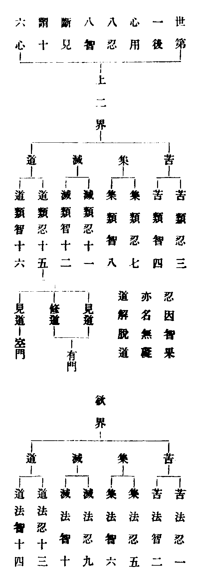



世第一、后心任运缘於四谛而生忍智，与前忍位中作意缘四谛不同。盖十六心虽一时顿发，然忍能断惑，智能证理，亦必任运缘于四谛也。



【■补】言忍因智果者，谓忍能断惑，智能证理，由惑断而理方显，故忍为因，智为果也。亦名无碍者，即无间道，谓初果依八忍，能断八谛下迷理之惑，此八忍不被见惑之所间隔，名无间道。解脱道者，谓初果依八智，能证八谛下无为之理，此八智已离惑缚，名解脱道也。出㭊玄记。



【■备】苦法忍者，苦谓欲界生死苦，法即真如理，忍即忍可，亦印证义也。谓於煖、顶、忍、世第一中，因观欲界生死之苦，至世第一后，心真如理显，生无漏法忍，是名苦法忍。苦类忍者，色、无色苦，是欲界流类；又观上二界苦，是欲界流类；又观上二界苦，亦生无漏法忍，名苦类忍。苦法智者，智是能证真如之智，谓欲界生死之苦，真智明发，证真如之理，名苦法智。苦类智者，又观上二界谛，真智明发，是欲界苦法智之流类，名苦类智。下集等三谛，可知出三藏法数。苦法忍者，以行人回光返照的，向苦上研求落处，但见其空、无常、无我，安有苦相可得？即将不可得理，忍可於心，故名苦法忍也。苦法智者，即以空观，研之既深，则真如之理，自得现前明了，故名苦法智也。上界言类忍、类智者，类者比也，谓行人欲观上界之苦，当须以欲界之苦法，比类而知也。



【□注】七圣位对三道，四果及向，次第超越，住果胜进，委如妙玄，四教义明，今图示之。



【■记】下详辨四果位次、名义、入道功能，今欲易明，故先以图示之。



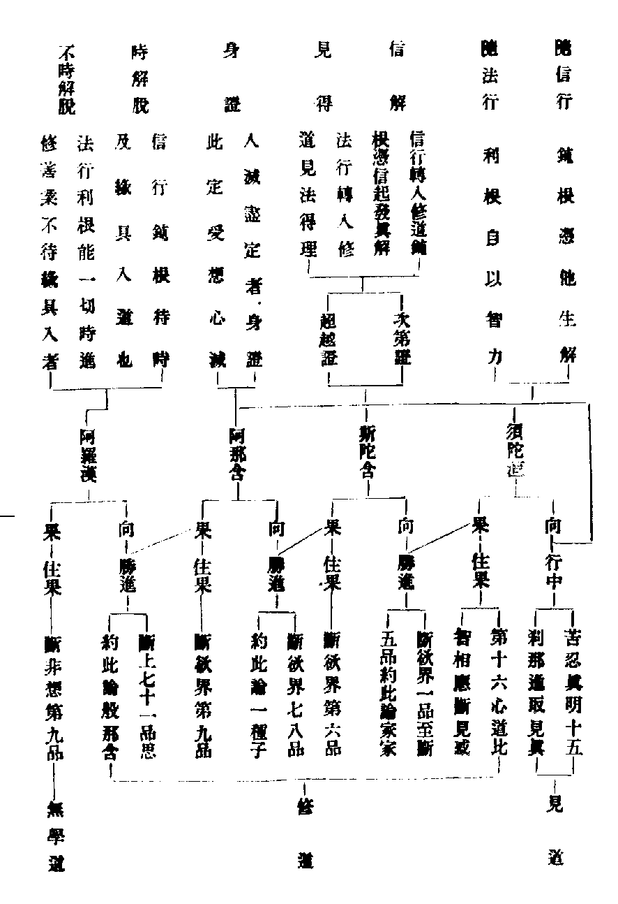



【■记】此图但略示其对位名义。若欲具知，当阅玄文四下，及四教义三。今略录四教义文以明之。如四教义云：七圣位者：一、随信行，二、随法行，三、信解，四、见得，五、身证，六、时解脱，七、不时解脱。就此七圣位，分为三道，所谓见道、修道、无学道也。一、见道者，即是八正道，见理断见谛惑，至十五心，如破石方便也。二、修道者，即是七觉分，随观谛一所断思惟，如断藕丝方便也。三、无学道者，如前分别真智，见理既极，三界正使已尽，无惑可治，不须更学也。一、明信行位者，即钝根入见道名也。言钝者，谓非自智熏，凭他生解故也。是在方便道，先虽有信，以未发真，不名为行。行以进趣为义，从得苦忍真，明十五刹那进趣见真，名随信行。乃至言是信行人，见道十五心，亦名八人地。八忍具足，智少一分，即是须陀洹向，亦名行中须陀洹也。二、明法行位者，即利根入见道名也。言利者，自以智熏，见理断结故也。本在方便道中，能自用观智，观四真谛法，但未发真，不名为行。因世第一法，发苦忍真，明十五刹那进趣见真，故名法行。乃至云但钝根凭他生解，智少观察；若利根以自智多观察为异耳。三、明信解者，即信行入修道，转名信解；钝根凭他起信，进发真解，故名信解也。此信解人证果有三：一、证须陀洹果者，第十六道比智相应即证也。若见使断，略说三结尽，广说八十八使尽，名须陀洹。受生死七返，终不至八生。二、证斯陀含果者，有二种：一、向；二、果。一向者，从初果后，心更修十六谛，观七觉支菩提行现前，即此世无漏断於烦恼一品，无碍断欲界烦恼一品，二品无碍断烦恼二品，乃至五品皆是斯陀含向，亦名胜进须陀洹，约此说家家也。二果者，若断六品尽，证欲界第六品解脱，即斯陀含果。三、证阿那含者，亦二种：一、向；二、果。一向者，若断欲界七、八品，皆名阿那含向，亦名胜进斯陀含，约此说一种子也。二果者，以九无碍断欲界结，证第九解脱，即阿那含果。复次，须陀洹有三种：一、行中须陀洹，即是须陀洹向；二、住果，正是须陀洹果；三、胜进，即是胜进须陀洹，亦名家家，即斯陀含向也。斯陀含但二种：一、住果；二、胜进。胜进斯陀含亦名一种子。阿那含亦二种：一、住果；二、胜进。胜进者，进断上五分结，即阿罗汉向也。阿罗汉但一住果。若据毗昙超越得果者，谓凡夫时，断欲界六品乃至八品尽，来入见谛道，后发苦忍真明，十五心中是第二果向，十六心即证第二果也。若在凡夫时，先断欲界第九品乃至无所有处尽，后入见谛十五心名阿那含，行第十六心即证三果，此是超越人不证前二果也。四、明见得者，法行转入修道是名见得，是人在思惟道中次第证三果，超越得二果亦如信解中分别，但以利根不藉闻法不假众具，自能见法得理为异也。五、明身证者，还是信解、见得二人入思惟道，用无漏智断五下分结故，发四禅、四无色定，即用共念处修八背舍、八胜处、十一切处，入九次第定、三空定，事性两障先已断尽，又断非想事障灭，缘理心心数法入灭尽定，得此定故名身证阿那含也。所以者何？以入灭尽定似涅槃法安置身内，息三界一切劳务，身证受想灭故名身证也。若约初果解身证者，但以先於凡夫用等智断结，得四禅、四无色定，后得见谛第十六心证第三果，即修共念处，还从欲界而修背舍、胜处、一切处，入九次第定成身证也。是阿那含乃有二种：一、住果，但是那含；二、带果，行向即是胜进阿那含也，犹名那含行向故，即是罗汉向摄。故智论言：那含有十一种，五种正是阿那含，六种阿罗汉向摄。当知此身证阿那含即是胜进阿那含、阿罗汉向摄，五种般那含、七种般那含皆但有上流般，八种般那含但有现般无色般也。如是阿毗昙约信解见得分别而数，乃至有一万二千九百六十种，废说本旨岂烦分别。六明时解脱罗汉，即信行钝根，待时及众缘具方得解脱，名时解脱。而有五种不同，谓退法、思法、护法、住法，必胜进法也。彼得二智，谓尽智、无学智等见也。若用金刚三昧，於非想第九品惑尽，次一刹那证非想第九解脱成尽智，次一刹那得无学智等见也。彼或时退，故不说得无生智。此五种罗汉是信种性根钝，因中修道必假衣食床具处所说法，及人随顺善根增进，不能一切时所欲进也。是五种罗汉各有二种，不得灭尽定是慧解脱，得灭尽定是俱解脱。若不得灭尽定，是人因中偏修性念处观，不修共念处观。若得灭尽定者，是人因中修性念处观，亦修共念处观。若证果时，三明八解一时俱得，故名俱解脱也。七明不时解脱阿罗汉者，即是法行利根，名不动法罗汉也。言不时解脱者，不动法人一向利根，因中修道能一切时中隋其所欲，进修善业不待众具，故名不时解脱。是人不为烦恼所动，故名不动。是不退义，成就三智故，谓尽智、无生智、无学智等见。能用重空三昧击圣善法，以定舍定，故言能击也。



【■补】是不动阿罗汉，亦有二种不同：一、不得灭尽定，名慧解脱；二、得灭尽定，即俱解脱。若闻佛说三藏教门，修缘念处，即发四辩，名无疑解脱。是名波罗蜜声闻，能究竟具足一切阿罗汉功能也。问：时、不时二人，利、钝不同，云何并得俱解脱耶？答：此简钝、利，明得有难、易之殊，何关简得与不得耶？此之七圣，名奠沙门。沙门有二种：一者、直言沙门，即因也；二者、沙门那，即果也。沙门有八十九，谓见谛八忍，思惟八十一无碍也。沙门那亦八十九，谓见谛八智，思惟八十一解脱也。沙门那复有二种：一、有为果，八十九有为果也；二、无为身，八十九无为果也。此二者，约智、断而论也。约智德，明八十九有为果；约断德，明八十九无为果也。



△二、断惑阶梯四：初、预流果。



一、须陀洹，此翻预流，此位断三界八十八使见惑，见真谛故，名为见道，又名圣位。



【□注】预流者，预入圣道法流。金刚云：入流，或翻逆流，逆生死流也。㭊玄下(八)名抵债，不受三途业债故。



【■记】此释预流之义也。谓断三界等者，约逆流而言，即四流中逆见流也。得果证者，约入流而言，即入八正道流也。故有二义：一者生死流，须陀洹人即逆此流，惟众生顺之也。二者道流，须陀洹人顺入此流，众生逆之而未入也。㭊玄名抵债者，如罗汉先直取道，未遑偿业，故名抵债。优婆塞戒经云：若负三宝物人，正事修道，欲求须陀洹乃至阿罗汉者，则不须偿也。不学道，应急偿也。准此，则知见道圣人，了知业债本空，求其偿处，了不可得，故名抵债也。



【□注】断三界八十八使者，何故婆沙论云：二十八使见道断，餘六十使修道断耶？先达云：有二种根性：若等观四谛者，见道断八十使；若不等观四谛者，见道中唯断三界苦谛下二十八使，餘三谛下见随修道断，乃是钝根。



【■记】此释断见惑有二种不同也。注中举婆沙意为问者，以婆沙问云：何故波罗伽那作如是说：八十八是见道，十是修道断？彼作是答：二十八决定是见道断，十是修道断。六十不定者，於见道中而有差别。波罗伽那说次第故，说八十八使是见道断，十是修道断。是则注中乃举其答意而为问端也。今又举古明有二种根性为答者，即二种根性：以钝根随修道断，餘三谛下见惑，释论意；以利根等观四谛，释今断三界八十八使见惑文也。



【■备】辨讹曰：先达言一节，据旧婆沙四十末九十八使，二十八使见道断，十是修道断。餘者，若凡夫修道断，若内教弟子是见道断。又四卷言二十八法定，见道断，六十不定。不定者，於见道中而有差别。既以凡夫对佛弟子说，则佛弟子於见道中顿断八十八使，修道断餘六十也。旧婆沙指凡夫而说，信无疑矣。



△二一来果。



二、斯陀含，此云一来。此位断欲界九品思中，断前六品尽，后三品犹在，故更一来。



【□注】此果断欲界九品思惑。前之六品，於初果之后，此果之前，须论家家。今先明欲惑润七番生死，次通示超次根性，后别释家家之义。



【■记】此明二果所断功行，名义不等，故须论之。先定三意也。如金刚疏释此人名为一来者，谓从此死后，一往天上，一来人间，得尽众苦。大论言息忌伽弥，息忌名一，伽弥名来。四教义翻言薄，前断已多，其未断少，名薄。今文释此，名同大论，义合四教。仪注云：此果断欲界九品思中前之六品也。若准空门位次，则应於初果断见惑之后，二果断六品思之前。或断四品，须三生、二生、家家。仪文虽略，今注补出。是以先则通明欲界九品思惑，共润七翻生死。次则通示四果及佛，有超断次断之根性。然后别出二生、三生、家家之义也。此先略标，下文逐一解释。



【□注】惑有麤细，故分九品。无漏智力，故经七生。所以须七生者，如辅行成引论云：於七世中，无漏智熟，如服酥法；七日病消，如歌罗逻；七日一变，如亲族法；限至七代，如七步蛇；四大力故，行至七步；蛇毒力故，不至八步；惑力至七，道力非八。婆沙云：应云十四，何故云七？答：中有本有，数不出七，故但云七。乃至若总论生，应云七人、七天。十四中有合二十八生，且依前说，不出七故，故但云七。



【■记】此释上欲惑润七番生死也。然惑润多番生死者为细，少者为麤，故以惑麤细成九品，而润生死成七番也。所以下，出其须七生之故。辅行引成论文者，即成论分别贤圣品云：极七有者，是人於七世中，无漏智熟。如歌罗逻等，此言凝滑，状如凝酥，七日变成。又如服酥等，极至七日，坚病则消。如七步蛇者，心地观经云：或有菩萨，以彼五欲而为恐怖，譬七步蛇，当害人时，毒力炽盛，行过七步，即便命终也。婆沙答文中，言中有、本有者，如人现前之身，名本有身；死后即受中阴之身，名中有身；於中有身中，投托父母，或生人间、天上、鬼、畜之中，名后有身也。



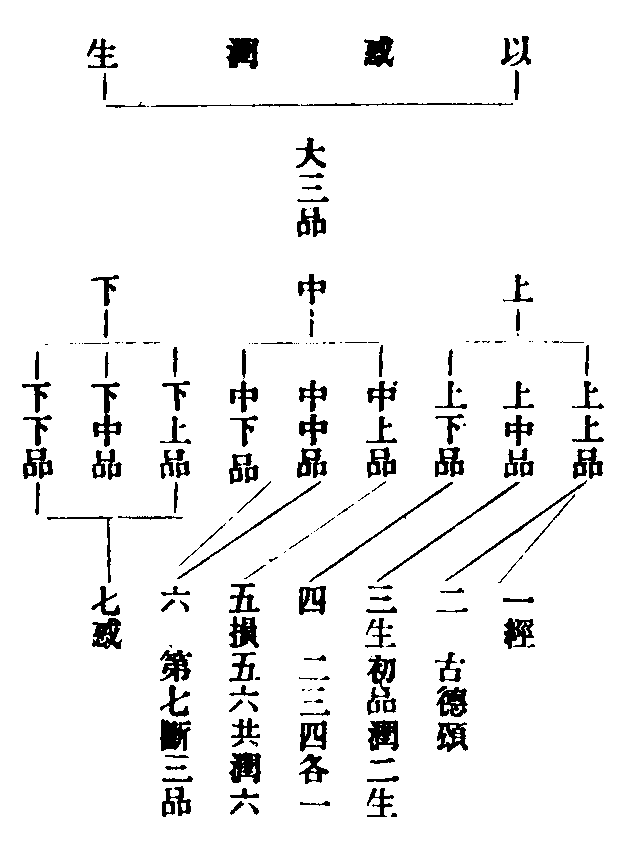



【■补】辅行云：初果生死，极至於七，定不至八，故名七翻，不必一切尽至于七。楞伽云：下者至七，中者三五，上者即生而入涅槃。四教义云：须陀洹受生死七返，终不至八。生集论云：极七返有者，谓即预流於人天生，往来杂受，极至七返，得尽苦际。







【■补】任断下，即止观引旧婆沙对超论次文，详引在后次断解下次断内。前任断经生，谓经七番生死而尽损惑。今次断，则以一生中，断二必三，断五必六，为断惑损生也。



【■备】辨讹曰：任断下，引止观对超所论之次句，当知是次断，非关任断也。详论在后。







【■补】此次断、超断二图，示上所言，次通示超次根性之义也。本断超下六行观者，厌下苦麤障，欣上妙胜离也。随其品数多少至无成根缘者，谓随其本在凡地时，以世智伏思惑，品数或多或少，今入十六心，超果不同。若本断五品、四品，今但名初果；本断六品，今但二果向；本断七、八品，今名二果；本断九品，今超证三向。问：断九品，应证三果，何以只名三向耶？答：以彼在凡地，用有漏智，智弱故，须抑退一位，故但名三向也。虽本地断上界惑，得非想定，应超证四果向，今但极至三果也。既以有漏智断惑，则无成根缘，以有漏智不能成无漏根故。若无成根缘，容或退归见道等位，则不止三生矣。故阙此缘，不论家家。



【■备】辨讹曰：断超下无成根缘句，文中既说入十六心超果不同，可知亦有从十六心后，缘四谛修成无漏根，云何说无成根缘耶？私谓：外道本性断思，后断见，故入十六心时，即超证果时，似不论十六心后也，故言无成根缘。辨讹又曰：小超下乃至无学向果句，若超至无学，是大超，非小超也。论解见下节。



【□注】任断者，此人非全无观行，但不及次断，勤加功行耳。



【■记】此释任断名也。意明此任断有少观行，虽不及次断加功断惑，亦能依观任运除妄，故名任断也。



【□注】次断者，虽异任断，乃对超断越次得名。



【■记】此释次断名也。意谓此人异乎前之任运断惑者。既然次断之人，加功进行，断惑损生，是乃对后超断人断见惑时，即超证二、三果乃至四果，超其次第故。今次断人得初果已，虽云起大加行，断二必三，断五必六，未能超越位次，故得次断名也。



【□注】本断超者，辅行六上(十)云：本得非想定，即是已断下八地思，至十六心，应名阿罗汉向。但名阿那含者，以凡地时，有漏智弱，但名那含。若本断九品，今名三向。若七八品，得名二果。断六品等，名二果向。断五四等，但名初果。(文)须抑退者，意令此人此生，必定起无漏圣道故。文出俱舍。



【■记】此释本断超名也。辅行下，引文释明本断超之义。须抑退者下，出其抑退一位所以，意明抑之者，实进之也。文出俱舍者，陈本第十七卷颂云：利钝根二人于中信法行若已灭修惑于初果道向。乃至灭五品向二灭九前离欲上色界则向第三果。



【■补】次断与断超何异？以次断之人，断见惑得初果已，后次第进果，次第断惑，三缘具足，论家家种子。断超之人，在凡夫时，见思全伏，至十六心满，超果不定。



【■备】有师标云：既得非想定，何故但断下八地思，不断非想地思耶？以内弟子得其地定，即破其地惑；外道先得其定，未破其惑，故虽得无想，止破下地思也。又辨讹曰：此节文虽出辅行，然违俱舍。当知论中未起胜进道，名住果非向。不论超证次断，悉皆十五心名向，十六心名果。纵断上地七十一品十六心时，但名阿那含果，以未起胜进道故。是以止观超次断辨，则次断名向，超断不名向也。问：若住果不名为向，则辅行若本断九，今名三向，断六品等名二果，向云何通？答：此是荆溪约抑退意立名，俱舍、婆沙无此名目，读者幸勿以辞害意。私谓止观超次对辨，专指小超。其判本断超中，有随以世智断之多少句，则三向、二向已含於中，故荆溪约意分判耳。



【□注】小超者，止观六(九)云：若凡夫地未得禅，十六心满，超能兼除欲惑诸品，或三两品(辅行云：应云三四，或恐文误，或婆沙不同)。即是家家一种子等，即是小超(文)。及前文云：超断至五品名家家，乃至八品名一种子(文)。



【■记】此重引止观超断，以释少超前文，即上所引释少超之前文。



【■补】止观中家家种子在前，故曰前文会本六上(二十)。如超次对辨，后明小超，故下言下文会本六上(四十)。玉师因宋代诸师，错执止观中小超与次断对辨之文，将谓小超一类，只能超至一种子。故注家引辅行力辨小超，其类非一，亦有至无学果也。



【□注】辅行六上释云：今文中言超断者，只是下文小超之人(此定止观超断属小超也)。



【■记】此引辅行释，明重引止观之文，而有三节。此一节会超断，是小超。今文即今重引止观之文。下文即指上所引止观，正释小超。若凡地未得禅等文，以其在下，故指为下文。所以引辅行释者，即释超断至五品名家家，乃至八品名一种子之文。今文中言超断者，即是下文明四超中小超之人也。下文者，以止观中明超断之文在前，小超之文在后故也。



【□注】本在凡地，未得色定，或修欲定，欲惑未断，此人至十六心，超断五品，名为家家。此之五品，同四品故。(此文别释小超中断五品惑论。家家者，一种人也。不可据此之文，通定小超之人，皆未得色定。如止观云：若凡地未得禅，若已得禅，岂止三向。盖小超人，其类非一。)



【■记】此一节文，辅行别释小超中论家家。



【■备】五六共润一生，故超断五品，退一位同四品也。



【□注】随其本断品之多少，而得名为家家种子，及以无学向果等名。(此文通释少超，超果不定。盖止观文明小超人至一种子，义犹未尽，故此点云随其本断等也。盖随其小超本位断惑品数多少，则断五品名家家，多则乃至极果，则知小超不可惟局三果向也。故止观云：十六心后，即有一念超果至那含，或超至罗汉。)



【■记】此引辅行，通释小超超果不定意也。文中示其超果不定，推知不局三向故。止观下，证明超果不定也。



【■备】辨讹曰：此引止观，文未恰当。知此论小超，在十六心中，随断惑品多少论，不在十六心后。不可将十六心后，答超断思惑之文，来证十六心中也。私谓此等超果之人，似应摄归小超，否则遗漏存俟后定。



【□注】问：小超若超至四果者，止观何故但云若凡地未得禅超，能兼除欲惑诸品？



【■补】除欲惑诸品，不过二三果而已，何能至四果耶？



【□注】答：此据小超中未得色定者而言，故云若。凡地未得禅超，能兼除欲惑诸品，若之为言，乃不定之辞也。况诸品之言，岂惟八品，故下即云一种子等。



【■记】此料简小超，有四番问答。问中，举止观何故释小超，只言超能兼除欲惑诸品？意明兼除欲惑诸品，但可名小超为家家，或种子，及三向而已，不得超名无学向果也。答中，先约未得色定小超，以释止观之文。次以二意释推其辞，以明超得无学向果。先以不定之辞释若字，意明若得色无色定者，则能超至无学向果。次以不一之义释诸字，意明兼除多品者，则能超至无学向果也。



【□注】问：或谓小超只至三向，乃判辅行，随其本断品之多少，谓双点超次，而得名为家家种子，乃别点小超，及以无学向果等名，乃别点次断，如此可乎？答：止观虽超次对辨，辅行唯指小超，如云今文中言超断者，即是下文小超之人，乃至云此之五品同四品，故随其本断品之多少等，乃释小超一连之文，岂可分擘对当耶。



【■记】此料简分文，对当超次也。问中，坚执己意，乃分辅行对当，止观超次。答中，有纵有夺。纵之，则明止观以超次对辨；夺之，则显辅行唯指小超。如云下，示辅行唯指小超之文。岂可下，结责不应分文对当。



【■备】止观超次对辨者，文言：今且依修道，断一品欲惑，次第至第五品尽，皆名斯陀含向。若超断至五品，名家家。次断六品尽，名斯陀含果。超断至六品尽，名一往来。次断第七品至第八品，名阿那含向。超断至第八品，名一种子。次断第九品尽，名阿那含果，毕竟不复还来欲界。次断初禅初品，至非想第八品，凡七十一品，悉名阿罗汉向，六种那含位在其中。第九无碍道，断非想第九惑尽，第九解脱道，证名阿罗汉果是也。三缘具足，得论家家者，辅行注云：今文中言超断者，即是下文小超之人，本在凡地，未得色定，或修欲定，欲惑未断，此人至十六心，超断五品，名为家家。此之五品，同四品故，随其本断品之多少，而得名为家家种子，及以无学向果等名也。辨讹曰：此是纪要中语，其说本正，不应破私。谓此是小超之文，岂可分擘对当二语？集注乃依文定断，全不扭揑，可以依从。吾侪未具毫末熏修判位之处，虗衷仰信而已，不敢以诤论见长也。



【□注】问：止观超次对辨，何故小超只至一种子耶？答：小超一种子已前，与次断异。



【■补】一、种子以前次断，必须得初果，已后起加行，断二、必断三、断五、必断六等。若小超，见思同断，超至五品等，故异。



【□注】若三果后与次断同，故止观不论也。



【■补】此料简止观超次对辨之意。谓断欲界惑九品尽，若次若超，同名三果。进断上八地七十一品思，若次若超，总名四向。七十二品断尽，同名无学。



【■记】答中。有同有异。前异故，所以超次对辨；后同故，所以不论小超至无学果向也。



【□注】问：或谓十六心后一念超，果至那含属本断超，超至罗汉属大超者，且小超何不预耶？答：本断超人，岂止那含。



【■记】本断超有至四果，向者故不止那含。



【■补】有但名那含，向者乃至断欲三四品，但名初果者，岂止那含一种而已。



【■备】辨讹曰：既言十六心后，不在四超中摄。若欲摄者，超至那含，可摄属小超；若至罗汉，或可附於大超。然与闻唱善来者不侔。当知凡言超者，皆在十心论，不在十六后。私谓：后字须活看。今言一念，时分甚促，未必经久方证也。且此等超果，既不在四超之中，此后又不别论，则义有遗漏。既与凡地闻唱者不同，则附入大超，亦非全合。莫若今注依无学向果一连之说，摄归小超为妥。至言超在十六心论者，则闻唱即证之流，何曾历过煖、顶等耶？存俟后定。又本断超，系外道断思不断见，故极至非想，应名罗汉向，抑他一位属那含而止？记解为顺。



【□注】若大超人凡地，闻唱善来，即证罗汉，何得云十六心后。



此料简十六心后超果是小超也。因有师谬将止观文中十六心后一念超果至那含，判属本断超。超至罗汉，判属大超。故今问中举他十六心后超果所属，以问小超不预超果之故。然此问意谓既有师如此之判，而小超不预十六心后超果之内矣。云何前引十六心后超果以证小超耶？



【■记】答中。意明止观所云：十六心后，一念超果。至阿那含，乃小超未得禅者；或至阿罗汉，即小超已得禅者。正属小超，证果不定，非属本断及太超也。



【□注】问，小超既至罗汉，与大超何别。答，以小超凡地修观，伏於见思，至十六心，超果不定。若大超人凡地，一呼善来，直超四果，与小超自不侔矣。



【■记】此料简大小二超，辽然不同也。问中，以小超超至罗汉，而问与大超直至罗汉何别？答中，明小超在於凡夫地位修观之时，已得伏惑，至十六心后，或能超至罗汉。而与大超闻呼善来，即证罗汉，逈然有别也。所言一呼即证者，如辅行云：佛言：善来比丘！自然得具足戒。当於言下，须发自落，袈裟在身，钵盂在手，犹如五岁知法比丘，如䟦陀罗波楞伽者。是以上释，通辨超次根性也。



【□注】次释家家之义。家家者，受生处不一也。人中三洲，张王不同。天上六欲，宫殿等别。故论天家家，人家家，不等家家，平等家家。辅行六上(六)云：家家者，有二不同，谓天及人。天谓欲天，三二家生而证圆寂(此天家家)。人谓人处，或三二家，或三二洲而证圆寂(此人家家。已上皆平等家家也)。若天三生天三人二，若天二生天二人一(天不等家家)。人生三二，反此可知(人不等家家)。故天家家，先於人中得见道已，若超若次，进断三四，后於天中三二处生。人中反此。天家家者，於最后生天中，餘残结断，名得圆寂。人中家家，准此可知。



【■补】此引辅行释上人天以论家家也。谓三家生而证圆寂者，即是已断欲惑三品，则损四生，即有三生在，故三生而证也。二家生而证圆寂者，乃欲惑已断四品，则损五生，而有二生在，故二生而证也。或纯天上，或纯人间，此所谓平等者也。故天家家者，先於人中见道起生，最后於天上而证圆寂也。人家家者，先於天上得见道，最后於人中而证圆寂也。圆寂者，即小乘涅槃无为之理圆，见思之惑寂也。瑜伽论曰：天家家者，谓於天上，从家至家，若往若来，证苦边际。人家家者，谓於人间，从家至家，若往若来，证苦边际是也。又天不平等者，天上起生，天三人二，最后天上而得圆寂是也。人中反此。



(然辅行云：三二生而证圆寂，即四果也。此是家家种性，不可作寻常断九品惑得三果释也。)



【■记】寻常释断欲惑九品，只得三果，今证圆寂，指四果也。



【■备】辨讹曰：玉师意谓：家家种性故，不生上界，而得四果。若寻常次断九品惑者，还生上二界，方证四果。故言不可作寻常等。不知欲界经生圣者，定不复生色无色界。以上二界，亦有长时之苦，同於欲界故也。私谓：俱舍论言：若在圣位，经欲界生，必不往生色无色界。由彼证得不还果已，定於现身般涅槃故。若於色界经生圣者，容有上生无色界义。然集注寻常二字，乃指断九品惑，只得三果者说。以明今证圆寂，是四果也。



【□注】俱舍颂云：欲断三四品，三二生家家(此二句正颂家家。断三品则损四生，后三生在论三生家家。若断四品则损五生，后二生在论二生家家)。



【■记】此两行小注，以释论家家也。而本论释曰：然复应说三二生者，以有增进，於所受生，或少或无，或过此故。何缘此无断五品者？以断第五，必断第六，非一品惑能障得果，犹如一间未越界故也。



【□注】断五至二向(断至五品，名二果向)。



【■记】论云：即预流者，进断欲界一品修惑，乃至五品，应知转名一来向果。



【□注】断六一来果。



【■记】论云：若断第六，成一来果。彼在天上，一来人间，而般涅槃，名一来果。过此已后，更无生故。此惑名曰薄贪嗔痴，唯餘下品贪嗔痴故。



【□注】断七或八品，一生名一间(断至七品或八品，犹有一生间隔，此据命终者)。



【■记】论云：即一来者，进断餘惑。若三缘具，转名一间：一、由断惑，断欲修惑七、八品故；二、由成根，得能治彼无漏根故；三、由受生，更受欲有餘一生故。颂中但说初后断惑、受生二缘，不说成根缘。如何一品惑障得不还果？由彼若断，便越界故。前说三时，业极为障，应知烦恼亦与业同，越彼等流异熟地故。间谓间隔，彼餘一生为间隔故，不得不还果。有一间者，说名一间。华严疏言：有三缘具，名为一间。上之二句，即是二缘。更有第三得无漏根，以为能治易故，不说同前家家。以下三品共润一生，故断七、八，餘第九在。亦有一生而为间隔，故名一间。有一品惑不证不还，有一生在不证圆寂，皆名一间。



【□注】此则第三向(此据不命终者而向三果)。



【■记】本论言：即断修惑七、八品者，应知亦名不还果向。先断三、四、七、八品惑，入见谛者，后得果时，乃至未修后胜果道，仍不名曰家家一间，未成治彼无漏根故。华严疏言：即此一间，是不还向也。



【■备】辨讹曰：原注分命终不命终，准论并无此意。若命终名一间，不命终名向者，如得二果，名一往来，亦应约命终不命终论否？既二果可言现在，一间必定局指命终也。且颂本是一意，不当分属两意也。



【□注】断九不还果。



【■记】论释云：若断第九成不还果，必不还来生欲界故，此惑名曰五下结断。虽必先断或二或三，然於此时总集断故。依不还位诸契经中，以种种门建立差别。华严疏言：九品全断，更不还生欲界，故云不还果也。



【□注】已上论颂，正颂加行次断，备乎九种根性。



【■记】言九种根性者，即色界九种般，谓於色般合五为三，谓有行、无行，皆生般摄，并中般、上流般为三，即开三为九，见下文图示九般也。



【■补】九种根性者：一、三生家家；二、二生家家；三、二果向；四、一来果；五、断七品一间；六、断八品一间；七、断七品第三向；八、断八品第三向；九、不还果。然一间之名者，集论言：谓即一来，或於天上，惟受一有，得尽苦际。所以者何？即一来果进至不还果向，或於天上，惟受一有，得般涅槃。故有一隙，容此一生，故名一间。约断七品或八品而命终者，为两种一间，以同是一生间隔故。约断七品或八品而不命终者，则为两种三向，以同是近三果故。如四教义云：信解人证阿那含，亦有二种：一、向；二、果。一向者，若断欲界七品或八品，皆是阿那含向。据此皆是之言，则断七或八，为两种一间，等无谬矣。是为备乎九种根性也。



【■备】节义曰：天平等家家，天不平等家家，人平等不等，共四位，并后五二向，一来一间，三向不还，为九种。集注问答解亦同，宜依节义。



【□注】辅行问：何缘无断一品、二品，及断五品，名家家耶？答：加行次人，断二必三，断五必六，必无不断大品惑尽而命终者。辅行云：此次断义，与今文同。盖指俱舍加行次断，与止观所引婆沙小超是同。



【■记】此料拣无断一二及五品惑，名家家义。问中，问其不名家家所以。答中，约加行必断大品惑尽命终，出其缘由。断二必三，断五必六者，谓由圣者起大加行，必断大品惑尽而命终者。如辅行云：大品者，谓三品。离三成九，故三名大。若断二必至于三，是断初大品。若断五必六者，是第二大品。又无一品能障於果，是故断五必至于六。所以无断一二及五品惑，名家家也。辅行云下，牒释，会文同义。俱舍加行次断，即上文所引二颂。婆沙小超之文，止观第六所引，此下注中有出。



【■补】与今文同者，玉师恐人错认辅行义，谓与止观超次对辨之次断是同，故此牒而辨之，谓与今文超次对辨之超断同，不与次断同也。以玉师意，止观次断是经生损惑，不论家家故。若超断是断惑损生，故论家家种子，而与俱舍明加行次断之论家家种子，其意正同。但止观中只云超断五品名家家一句，辅行引俱舍次断家家以释之故。又会通云：此次断文与今文同。此会义同。若尔，若会释止观，应云此次断人欲断四品名二生家家，与今超断五品名家家是同，以超断五品，功齐四品故。此止观言超断，即是小超，故注中言小超也。



【□注】问：次断之人，必断大品惑尽，何故断四不至五、六？又断八品，何不至九？答：断初大品已，既有餘力，故更进断第四也。不至九者，以有得果、越界二义故。六唯得果，无越界义，是故断五必至於六。



【■补】得果越界，有决定诸业，为作留难，如婆沙四十二。然论谓得四果，今借言之。



【□注】二三品中，全无二义，断二必三，於理无疑。



【■记】此料拣断二必三，五必至六义也。如辅行云：断九二，义异三品：一者得果，二者越界。第九一品，以有得果及能越界，故断至八；有命终者，所以断八不九也。



【□注】问，还有断一二品，论五四生家家否。答，既断二必三，岂惟一耶。



【■记】此料拣断一、二品，不论家家也。问中，由明断欲三、四品，三、二论家家，故发此问。以初大品之初一品润二生，第二品润一生，若断此一、二两品，但损三生，故有此问。答中，举无不断大品惑尽而命终之事，以显断二既不论家家，惟断一品亦不论家家也。



【■备】既断二，必三加。行人无有不断至三品而命终者，岂有断一品而命终者乎？



【□注】问，还有断六品，论一生家家否。答，家家者，受生处不一。既唯一生，则不论也。



【■记】此料简断六品，不论家家也。问中，由断前六品损六生，后三品未断，犹有一生在，故有此问也。答中，举受生不一，得名家家。既明一生只一处，非家家之义，故不论也。



【□注】问，断五至二，向还可於此论功，齐四品论家家否。答，加行次人，既断五必六，不同小超也。



【■备】加行次人，虽有二向之名，然此生必证二果，故与小超异。



【□注】三缘具足，方论家家。俱舍云：即预流者，进断修惑，若三缘具，转名家家。一、断惑缘，断欲修惑三四品故(此拣异任断)。



【■补】目初果，后任运七生。



【□注】二、成根缘，得能治彼。三、四成无漏根故(此拣异本断超)。



【■补】在凡夫地修四禅，用六行观，以有漏智弱，不缘四谛而修成无漏根，故无成根缘。



【□注】三、受生缘，更受欲有三二生故(此拣异大超)。



【■补】大超之人，在凡夫地，闻唱善来，即证罗汉，故无受生缘。



【□注】颂中但说初后二缘者(断欲三四品，即断惑缘；三二生家家，即受生缘)。论中既云预流果后，进断修惑，即是治彼三四，成无漏根。义准已成，故不具说。



意谓若在预流果前，或属小超，或属本断超，犹未可定。今论既云在预流果后，自属加行次断之人，成无漏根，三缘具足，其义自可准知也。故颂中不必具说也。



【□注】三缘缺一，非家家之义。若断七八，亦具三缘，转名一间，此约次断。若小超人，既论家家，三缘必具。



【■记】此料简次断之人五品，不论功齐四品家家也。三缘具足下，示次断之人论家家。俱舍下，引释。或难俱舍但明前后二缘，不说无漏一缘，故以论中明指预流果，后则明属加行。次人已成无漏根，非小超本断超，可得混淆，不必更说也。若断七八下，带示一间。虽亦具三缘，转名一间，无家家义。若小超下，兼示小超。若论家家，亦必具足三缘也。



【□注】辅行六上：若超若次，进断三四(文)，得非小超亦至三四品耶？彼释家家三二处生，故以五品功齐四品而总言耳，非谓小超至四品也。



【■记】此料简小超，非止断四品也。问中，举辅行明超次，进断三四之文，以问小超之人，止超三四。答中，约释家家三二。处义中，明辅行之文，乃释超次，非连及小超，亦止超三四也。



【□注】又复小超至五品而不至六者，由得果义故。



【■记】此拣小超。超五不六名家家，恐伏难言。次断根性，断五必六，得论断第二大品惑尽，何故小超但至五不至六耶？故注中牒而释之，以明第六有得果义。若断之，则成二果，不名家家也。今欲论家家，故小超但至五品也。



【□注】止观六引婆沙云：次断五品，名斯陀含向；超断五品，名家家。次断六品，名斯陀含果；超断六品，名一往来。次断七品、八品，名阿那含向；超断八品，名一种子(文)。



【■记】此举止观所引，意取超断五品名家家一句，证成上义。由上超次对明，谓超次之人，断五必六，小超之人，断五不六，故引而证之。然虽全举所引，意取超断五品名家家一句，证成上义，亦是起下文料简也。



【■补】此中次断一品乃至五品，皆名斯陀含向者，以此是经生损惑，无断惑缘故。断三、四品，不得论家家；断七、八品，不得论一间也。是知此次即任断之根性也。又云：此即止观六上超次对辨之文，由次断中不论家家一种子故。玉岗师意，以此中次断为任断也。俱舍论以未起胜进道，名住果非向。不论超证、次证，悉皆十五心中名向，第十六心名果。纵断上地七十一品十六心时，皆但名阿那含果，未起胜进道故。故止观超次对辨，以次断名向，超断不名为向。又所云次断，自属加行次断，玉岗师似作任断释之。若任断者，何必更论？且任断之人，至第七生中，得尽苦际，不往上二界受生，诸经论中具有明文，何得云六种那含位在其中？故知但约加行次断说也。问：若云住果不得名向，则辅行明本断超中，若本断九品，今名三向，断六品等，名二果向，复云何通？答：此是荆溪大师据抑退之意，约意立名也。俱舍、婆沙无此名目，读者幸勿以辞害意也。



【■备】加行次断，断惑损生，胜於任断。似不应反生上界，受长时苦。当以根性不同，有现般上流之异，仰信而已。至止观引婆沙判超次文，辅行释中，有天家家先於人中得见道已，若超若次，进断三四等。此似指论家家之次断，非任断比。辨讹亦曰：注师以此中次断为任断。然此中次断，玉岗师亦作加行次断释。唯前任断图中所引，对超论次句，作任断释读。下若任断人结句，玉师业经料简。



【□注】问：次断五品名二向，超断五品名家家。又斯陀含与一往来，阿那含向与一种子，其义无别，何分超次？答：由命终不命终，经生不经生异也。盖次断五品名二四者，此人既不命终，向二果也。超断五品名家家者，此既命终，虽断五品，功齐四品，以论家家。下二例说。故三缘具足，得受一间，正取命终，一生间隔。三缘不具，不受一间之名，但名阿那含向，正取不经生者，向三果也。



【■记】此料拣超断次断两名有异。盖下，别释超次五品异之所以。下二例说者，谓次断六品，名斯陀含果者，此人断五，必六大品，惑尽力亦尽，住二果也。超断六品，一往来者，此人虽超六品，命终犹须一番往来，据此立名也。又次断七八品，名阿那含向者，此人既不命终，向三果也。超断八品，名一种子者，此既命终，虽断八品，犹有一生间隔，名一种子也。上文引俱舍颂曰：断七或八品，一生名一间。此则第三向。而原注中，既以命终不命终分释，故此结示之也。



【■补】此中次断皆约功立号，超断似约过立名。但在功过边著眼，其义自分。问：且如斯陀含与一往来，但唐、梵不同，何分功过？答：名果、名向，悉是从功立号。但言一往来，即约生死过边立名。餘亦例尔。



【□注】然教门方便论家家者，为令圣者畏经生故，速得证果。若任断人，既经生损惑，故不说也。



【■记】此释论家家之所以。或谓佛祖教门，施设种种方便，论家家义。所以者何？故此释云：为令超次圣人，怖畏生死，速取寂灭道果故也。任断既不起加行，任运经于七生，故不论家家也。



△三、不还果。



三、阿那含：此云不来此位，断欲残思尽，进断上八地思。



【□注】此果断欲界下三品思尽，进断上八地思，取证四果而般涅槃(此云灭度)。



【■记】此明仪文不来之义。如金刚疏云：是人欲界中死，生色、无色界，於彼漏尽，不复来生。大论名阿那伽弥，阿那名不，伽弥名来，四教义翻为不还。又经言：阿那含者，非数数来。又不还来二十五有，名阿那含也。若更受身，名那含；不受身者，名阿那含。有去来者，名曰那含；无去来者，名阿那含。今以断惑释立名者，盖欲惑乃润生之因，既无其因，亦无其果，故不还来欲界受生，名不来也。此三果人，已断尽欲惑，更断上二界惑，意在现生取证四果，而般涅槃。何期不遂本意，即於胜进时命终，则论般那含也。



【□注】就此释般那含。此名从略，乃是般涅槃之阿那含也。旧对家家称为般般，义无所准。



【■补】般者，取也。以进断上惑，般取涅槃，故言般涅槃。但思惑未尽，仍属胜进，故名阿那含。是知此般涅槃之阿那含，乃约功能立名也。若约行，名胜进阿那含；约位，名阿罗汉。向虽有如此不同，只是那含断惑之位也。旧对下，斥旧。盖旧师谓二果向既断三、四品，仍有三、二处受生，可称家家。今那含断上界惑，既有六种、九种，亦可对家家称般般。然家家义乃凭经论，今般般义经论无凭，故言义无所准。



【□注】又此且论有餘涅槃。俱舍论云：般涅槃者，谓有餘依。有餘师说：亦无餘依。此不应理，彼应舍寿，无自在故。



【■补】若是无餘依者，即应自在舍寿入灭。今既果缚犹存，须待报尽，方入涅槃，故无自在。显宗论云：彼舍寿中无自在故。罗汉见思子缚已断，报身犹存为有餘，灰身灭智为无餘，今仍有非想最后一品故。且一往论有餘，若再往，即有餘亦不许也。彼应舍寿。俱舍作：彼於有餘依，即是有漏所依。八种依中，名最后边依，谓其最后身，依有餘涅槃而住也。八种依见法数。



【■备】辨讹曰：有餘涅槃，的指无学妙句解，便有涅槃音。谓陈如初得见谛，即断见惑，分证灭谛，亦是分得有餘涅槃等。此是今家顺经意，非论意。



【□注】止观六(五)云：次断初禅初品，至非想第八品，凡七十一品，悉名阿罗汉向。六种那含，位在其中。



【■记】此引止观，明六种那含在四向摄也。如释论云：那含有十一种，五种正是阿那含，六种阿罗汉向摄。即今六种也。



【■补】任断根性而止观名次断者，如俱舍云：若在圣位经欲界生，必不往生色无色界，由彼证得不还果已，定於现身般涅槃故。可见须陀洹人至第七生，仍须先证三果，方证四果，故亦得论次断也。又三果前超次对辨，三果后一切合论，故得论六种。那含若任断人，既是现般，不得复论六种。



(此是任断根性)。



【■补】此中次断，与前所引次断五品，名斯陀含向等，是止观一连之文，故知是任断根性，此玉师之意也。



【□注】辅行六上(六)引大论七种：一、中般，二、生般，三、有行般，四、无行般，五、上流般(色界)，六、现般(欲界)，七、无色般。俱舍七种，前五如大论，第六却取无色般(辅行脱一无字，乃云但取色般，并五为六)，第七方立现般。



【■记】然二论七般名同，但六、七二般，列次先后互异也。



【■补】辅行脱一无字。今考辅行会本六上二十二有无字。辅行云：无色般那含，於彼无色得有餘，名为罗汉。唯有心智而无色身，据此得有餘涅槃者，名为罗汉。今言般那含者，仍旧名耳。



【□注】荆溪谓俱舍不立现般，指七种中第六不立耳，非谓论文不明现般。据二论六种，一立一不立，对释止观，六种那含，故有此言。



【■记】此明辅行。荆溪所言不立现般之意，即辅行释止观文。言六种那含位在其中者，大论明五那含，谓中生、行、不行、上流。复有六种五，如上加现般。复有七种六，如上加无色般。俱舍不立现般，但取无色般并五为六，因有俱舍不立现般之言。今释俱舍不立现般之言，而引二意释之：一者、荆溪尊者乃指七种中第六不立现般，故言俱舍不立，非谓俱舍不明现般也。二者、乃据二论六种，一大论立，一俱舍不立，对释止观六种那含，故有此俱舍不立现般言也。



【■补】止观六种，盖准俱舍，不立现般，而取无色般。彼下文云：断非想第九惑业尽，名阿罗汉。现般即属四果中收，故不另立。



【□注】但诸文种数多少，今准俱舍三界七种图示，然后对拣。



【■记】此标拣取，以定今文也。拣者，诸文五七八九，至万二千九百六十种，既多少不可定准，故当拣之。取者，俱舍三界七种，名义周足准定，故当取之。



【□注】颂云：此中生有行，无行般涅槃，上流若杂修，能往色究竟。超半超徧没，餘能往有顶(餘字指不杂修有顶非非想处)，行无色有四，住此般涅槃。



【■记】言住此者，即指欲界也。俱舍云：此不还者，总说有七。且行色界，差别有五：一、中般，二、生般，三、有行，四、无行，五、上流。中般者，谓往色界，住中有位，便般涅槃。生般者，谓生色界已，不久便般涅槃，以具勤修速进道故。此中所说般涅槃者，谓有餘依。有餘师说：亦无餘依。此不应理，彼於舍寿无自在故。有行般者，谓往色界，生已长时，加行不息，由多功用，方般涅槃。此唯有勤修，无速进道故。无行般者，谓往色界，生已经久，加行懈怠，不多功用，便般涅槃，以缺勤修速进道故。有说：此二有差别者，由缘有为、无为圣道，如其次第，得涅槃故。然此说非理，大过失故。然契经中，先说无行，后说有行。般涅槃者，如其次第，与理相应，有速进道、无速进道，无行、有行而成办故，不由功用得。由功用得故，生般涅槃。得最速进、最上品道，随眠最劣，故生不久，便般涅槃。言上流者，是上行义，以流与行，其义一故。谓欲界没，往色界生，未即於中能证圆寂，要转生上，方般涅槃。即此上流，差别有二，由因及果有差别故。因差别者，此於静虑，由有杂修、无杂修故。果差别者，色究竟天及有顶天为极处故。谓若於静虑乐慧有杂修者，能往色究竟，方般涅槃。即此复有三种差别，全超、半超、遍没异故。全超者，谓在欲界，於色静虑，已具杂修，遇缘退失。上三静虑，以初静虑爱味为缘，命终上生梵众天处。由於先世惯习势方，复能杂修第四静虑，从彼处没生色究竟。於梵众天最初处没生色究竟，最后天中顿越中间，是全超义。言半超者，从彼渐次生五净居，即无烦天等，乃至中间能越一处生色究竟。超非全故，名为半超。圣必不生大梵天处，僻见处故、一导师故。言遍没者，从彼渐次於一切处皆遍受生，最后方能生色究竟。一切处死，故名遍没。无不还者，於已生处受第二生，由彼於生容求胜进，非等劣故。即由此故不还义满，必不还生曾生处故。尚不生本处，况有生於下。应知此谓二上流中，由有杂修静虑因故，往色究竟般涅槃者。餘於静虑无杂修即，乐定不兼事而修者，能往有顶方般涅槃。谓彼先无杂修静虑，由於诸定爱味为缘，此没遍生色界诸处，唯不能往五净居天。色界命终，於三无色次第生已，复生有顶方般涅槃。二上流中，前是观行指有杂修，后是止行指无杂修，乐慧、乐定有差别故。二上流者，於下地中得般涅槃，见不违理。而言此往色究竟天及有顶天为极处者，由此过彼无行处故，如预流者极七返生。此五名行色界者，若行无色界者差别有四，谓在欲界离色界贪，从此命终生於无色。此中差别唯有四种，由生般涅槃有差别故。此并前五成六不还。复有不行色无色界，即住於此能般涅槃，名现般。并前六为七也。



(辅行六上，㭊玄具释论颂七种，先色，次无色，后欲般，今图顺三界次第。)



【■记】此段小注，指文释颂。如辅行云：一、中般，谓欲界没，於色中阴，而般涅槃。二、生般，生色界已，而般涅槃。三、有行，生色界已，长时修行，方般涅槃。但有勤修，无速进道。四、无行，生色界已，不经久修，无功用行，而般涅槃。勤修、速进，二道俱无。五、上流，於色界中，要转经於四禅天处，方般涅槃。上流又二：一、杂修，即乐慧是。二、无杂修，即乐定是。有杂修者，往色究竟。无杂修者，往於有顶。颂中餘字，是不杂修。又有三种：一、全超者，谓在欲界，於四禅中，已遍杂修，遇缘退失。从梵众没，生色究竟，中间尽越，名为全超。二者、半超，梵众没已，中间渐受十四天处，或超一二，乃至十三，后乃方生色究竟天，皆名半超。非全超故，通受半名。全不能超，名为遍没。无杂修者，生无色界，唯不能生五净居天。从广果没，生三无色，后生有顶，方般涅槃。故此那含，纵生无色，犹属色摄。若欲界没，生无色，即无色摄。析玄释者，未详论颂。下明从列三界次序，今图稍别。







【■记】杂修者，以其有时修初禅慧，或有时修四禅慧，交互修故，乃乐慧根性也。问：上流杂修何法？答：修夹熏禅，初以一念无漏，一念有漏，又一念无漏。以前后二念无漏，熏此一念有漏，共有三念，以为根本。第二翻，以前三念为加行，更引起三念，则有六念。乃至第五色究竟天，则有十五心。由此有漏无漏，间杂而修，名为杂修，亦名夹熏禅。不杂修者，不生五净居也。以杂修者，修此夹熏禅故，故能生于净居天中。不杂修者，不修此禅，是故不生。既无其因，云何有果？非唯全超半超者不生，即遍没者亦不生也。虽往非想无色，只是色般根性者，辅行云：无杂修者，生无色界，唯不能生五净居。从广果没，生三无色，复生有顶，方般涅槃。此犹属色般摄也。



【■备】辨讹曰：虽言遍没，不必遍生。以有可生之道，令人厌离。且作是说，但是具历四禅，即可云遍没也。故大经明上流中，若受二身名利根，受四身名钝根也。



【□注】大论七种，名同俱舍。列次小异，如下图示。俱舍论云：行无色者，差别有四：谓在欲界，离色界贪，从此命终，生於无色。此并前五，成六不还。复有不行色、无色界，即住於此，欲界惑尽，现般涅槃。并前六为七。全超者，谓在欲界，於四禅中，已徧杂修，即可生於色究竟天。盖由遇缘退失，故生梵众。须从梵众没已，然后生于色究竟天。中间尽越，故名全超。



【■补】谓此人以初禅爱味为缘，故命终生梵众。又由先世惯习势力，能杂修第四禅，所以从梵众没生色，究竟名全超也。



【■备】集注问答：问：退失反得全超，何耶？答：准俱舍意，以遇违缘退失，则生畏惧，起大加行。况在欲界，先已徧修，故得全超。不退者不尔，故但半超及徧没也。



【□注】半超(者，谓自)梵众没已，中间渐受(梵辅小光等，不定於此)，十四天中，或超一二，乃至十三，后乃方生色究竟天，皆名半超。非全超故，通受半名。



【■补】色界共十八天，梵众乃最初没处，色究竟乃最后生天，中间大梵、我慢、无想外道，此二天圣人不生，故言十四。於此中若超一天者，即超梵辅；超二天者，即梵辅少光；乃至十三者，即超至善见；若至十四，即是全超，故不论也。可见十四天中，如有一天不超，皆名半超也。



【□注】徧没，全不能超，名为徧没。色界徧没，即十六天。大梵是天主，我慢无想是外道所居，圣者不生此二天也。



【■备】华严大梵天王寄配十地，此言圣者不生，如何会通？须知大乘发明示现，当亦寄生；小乘实行，声闻不生也。



【□注】俱舍复有九种，即於色般合五为三。有行及无行，皆生般摄，即开三为九。颂云：行色界有九，谓三各分三，业惑根有殊，致成三九别。



【■记】此示俱舍九种，以有行、无行为生般一种，并前中般及后上流，是为合五为三也。论云：即行色界五种不还，总立为三，各分三种，故成九种。何等为三？谓中、生、上流有差别故。云何三种各分为三？且中般涅槃分为三种，速、非速、经久得般涅槃，由三火星喻所显故。生般涅槃亦分三种，生有行等般涅槃故。此皆生已得般涅槃，是故并应名为生般。於上流中亦分三种，超、半超等有差别故。然诸三种，一切皆由速、非速、经久得般涅槃故，更互相望无杂乱故。如是三种、九种不还，由业、惑、根有差别故，有速、非速、经久不同。且总成三，由造、增长、顺起、后生、后业差别故。如其次第，下、中、上烦恼现行有差别故，及上、中、下根差别故。此三一一如其所应，亦业、根有差别故。因各有三，故成九种。谓初、二、三，由惑、根别，各成三种，非由业异。后三亦由顺后受业有差别故，分成三种。故说如是行、色、不还，业、惑、根殊，成三、九别。







【■记】此图示大论七种，名同俱舍，列次小异。



【■补】言六种那含，位在其中者，意谓止观六种那含，即同二论之七种。何者？以依大论明，六种即是一中二生，乃至第六现般，七种中缺无色般也。若依俱舍明，六种即是一中二生，乃至第六无色般，乃七种具矣。故荆溪一立一不立，特指第六以对止观，则显止观虽曰六种，即是七种。







【■记】此图示俱舍九种般也。释签引论，言中般为三者，谓速、非速、久住。准俱舍论，总为九种，谓三各分三，即中、生、上流也。有行、无行，生色界已，方般涅槃，并生般摄。言中三者，谓速、非速、经久，如迸火星。以喻三义，思之可知。并於中阴，论速、非速等。生有三者：一、生，约速立；二、有行，约非速立；三、无行，约经久立。并生色界已，论速等也。上流三者：一、全超，约速立；二、半超，约非速立；三、徧没，约经久立。从初色至色末，始终有此三人不同。如是三九，由业、惑、根异。言业异者，造顺现业成中般，造顺生业成生般，造顺后业成上流般。言惑三者，下品惑成中般，中品惑成生般，上品惑成上流般。言根别者，上根中般，中根生般，下根上流般也。



【■补】中般速者，舍身未离欲界；非速者，离欲界已。经久者，至色界边生。般速者，生色界即般涅槃；非速者，生四、五天不等。经久者，至色究竟上流。速者，全超；非速者，半超。经久者，遍没。顺现者，此人厌苦心切，三界如牢狱，在欲即涅槃。顺生者，其心疎至色界；顺於后者，又疎至色究竟天。下品惑轻至色界，中品重至三、四天，上品又重至色究竟天。上谓中有，中谓色界，下至色究竟。此依大经释。



【■备】辨讹曰：中般下顺现论是顺起，所谓食香中有起。中有以香为食，故曰食香。起亦是中有，故言顺起。荆谿恐人未晓，改现字耳。



【□注】诸文或云五种，独指色般。或云八种，三界七中，加不定般。(补注十四，初引婆沙三界般中，遍有不定。进老示不定相，乃约期心欲界，便般涅槃。或未能克，却生上界而取证也。或期生上界，忽发宿习，欲界即证色无色。准说可知。)



【■记】此释不定般也。色无色准说者，谓期心色界，便般涅槃；或未能克，却生无色取证；或期生无色色界，即证也。又期心无色空处，便般涅槃；或未能克，却生识处已上诸天取证；或期生非非想天乃空处，即证也。



【■补】进老，人名也。宋崇进法师有精英集行世，以年道相若，故称进老。舜江纪要中频有进老之称。



【□注】杂心论：七种妙玄所用，於色界五，初开中为三(速、非速、经久)，并后四成七。



【■记】杂心七般，谓速般、非速般、经久般、生般、有行般、无行般、上流般也。



【□注】毗昙有一万二千九百六十种般，如释签第五具示。



【■记】释签引杂阿毗昙云：阿那含者，或五、或七、或八。五谓中生、有行、无行、上流。七谓中般分三，如迸火星喻。八谓五，如上加现无色及不定。且从五种说，谓色五种。从根分十五，谓上、中、下各五故。约地成二十四，禅各五故。约性有三十，谓退、思、护、住、进、不动，谓种性各五故。处有八十，梵众至尼咤十六处各五故。每一种那含，有二千五百九十二。何者？约六处成十六人。约种性六成，六倍增之，合九十六。约根有三，三倍增之，成二百八十八。更以九离欲人，九倍问之，成二千五百九十二人。一人既尔，五种那含又倍增之，成一万二千九百六十种也。九离欲人者，谓离欲界九品惑，以为九人也。



【□注】色界中般者，初离欲界生色界时，厌苦心切，即在中有而般涅槃，故属色摄。



【■补】此简明色界中有论般涅槃也。如大经：迦叶问：何故欲界有中般涅槃？佛言：善男子！是人观欲界烦恼因缘有二：一、内，二、外。色界无内外因缘。欲界复有二种爱心：一、欲，二、食。观是二爱，至心呵责，既呵责已，得入涅槃。是欲界中，能得呵责诸麤烦恼，谓悭贪、嫉妬、无慙、无愧，以是因缘，能般涅槃。又欲界道，其性勇健，得向果故。故欲界有中涅槃，色界中无。善男子！涅槃有三种：上者，舍身未离欲界，便般涅槃；中者，始离欲界，未至色界，便得涅槃；下者，离欲界已，至色界边，乃得涅槃。又婆沙：问：如色界有中般涅槃，欲界亦有耶？答：无。欲界是不定界，多诸过失留难。住本有时，尚难得果，况住中有微劣身耶？然大经言欲界有中般，婆沙云欲界无中般者，不同何也？盖经据欲界命终，即受中阴，故云欲界有。论据欲染，必进趣色界，方般涅槃，故云色界有。言虽有别，其义一也。故此中言中有，属色摄也。



【□注】若至色界，上生餘天，虽有中有，不得论般，为无宿习厌苦力故，如㭊玄下。



【■记】㭊玄，未详。



【□注】无色不立中般者，指归钞十八云：经云：无色众生无有中阴者，毗昙法中说：除四空，餘一切处定有中阴，以无色界无处所故(文)。



【■记】此简明无色不立中般。然钞中指论释经，无色无中阴者，如杂阿毗昙心论言：中阴五者，中阴五阴性有去来故，非杂色有去来故。欲色界有中阴，非无色界，色非分故。故知无色无中阴，不立中般也。



【■补】净觉师作弥陀疏，名指归钞。无色界无处所者，显扬论言：欲界居下方，色界居上方，无色界无方处。俱舍明无色界无方处，谓於是处得彼定者，命终即於是处生故；复从彼没生欲、色时，即於是处中有起故。无色既无方处，命终生彼，当处即是，故无中阴。后来退堕欲、色界时，方有中阴现起。又云：此释四空天无中阴之故。盖中阴属色，托胎必假处所。四空天无有色阴，但依空等为处。依报之色既无，正报之质安有？是故无色界无中阴也。



【□注】俱舍明随於何处得无色定，於命终时即生无色。



【■记】此指论明，以释妨难。恐有难言：若无色界无中阴者，当云何知得生无色？故此释之，以明随处得定为因，命终即生无色为果。



【□注】图中引五差者(指五不还天因中有五种差别)，谓下、中、上、上胜、上极、辅行，六(上三)㭊玄，下(十三)委释行相，由此五禅生五净居。



【■记】此简明图引五差。初句标示，次指释行相。辅行云：生五含者，然由修熏禅，有五阶差。大品九定，通熏九地，此中唯熏第四禅地。先修得已，更以多念无漏相续现起，从此引生多念有漏，从此复生多念无漏，如是后后渐渐减少，乃至最后二念无漏。次复引生二念有漏，无间复生二念无漏，名熏加行成相。次唯一念无漏，次复唯有一念有漏，无间复生一念无漏，名根本成。故俱舍云：成由一念杂。言五差者，谓下、中、上、上胜、上极。一品有三，后品兼前，故第五品合成十五。如是五品，如其次第，三、六、九等，生五净居。由此下，结释引意。



【■补】图中引五差者，指前俱舍三界七种那含图也。差，阶级也。乃指图中所引杂修乐慧者，生五净居天也。以未明杂修五差之相，故此释之。谓杂修下品生无烦，乃至杂修上极品生色究竟。楞严文句云：初无烦天，即杂修下品，谓行人先练人四禅定已，於此定中，先起多念无漏心相续现前，次起多念有漏心相续现前，又起多念无漏心相续现前，如是渐渐减至二念无漏，二念有漏，复二念无漏时，名杂修加行成满。次起一念无漏，一念有漏，一念无漏，至此名为根本成满。由此有漏无漏间杂，故名杂修，亦名夹熏禅。以用无漏夹熏有漏，色定转明，果报转胜，由此资其故业，故从广果没，生无烦也。次无热天，即杂修中品，有六心，用前下三品心为加行，更引三心，一念无漏有漏无漏为根本，资其故业，从广果没，能起无烦，生无热也。三、善见天，即杂修上品有九心，用前六心为加行，更起三心为根本，资其故业，从广果没，生善见也。四、善现天，即杂修上胜品有十二心，用前九心为加行，更引三心为根本，资其故业，能超三天，生善现也。五、色究竟天，即杂修上极品有十五心，用前十二心为加行，更引三心为根本，资乎故业，能超四天，生色究竟也。无漏、有漏者，如观一切法无实我、无实法，直称理而观，即此可以资熏本有无漏种子发起，谓之无漏。若是不观于理，起有执杂心，谓之有漏。盖杂修亦尔，先起多念无漏，次起多念有漏，后又起多念无漏，如是乃至一念亦然。此但约定中而论有漏、无漏。有云在定是无漏，出定是有漏者，非也。所谓定中起有漏念者，即於定中贪著此为妙是也。



【□注】又乐论议者，恐就下界修观时说，非生净居有论议也。以二禅上无语言故(文)。



【■记】此简明净居决无论议也。如相宗云：眼耳身三二地居，则初禅尚不起舌识，何况二禅？二禅尚不假语言，况五净居？故知净居必无议论。有谓那含乐议论者，乃就下地修观时说耳。



【■补】大经云：上流般者，复有二种：一、乐慧，二、乐定。乐慧者，入五净居；乐定者，入无色界。如是二人：一、乐论议，二、乐寂静。乐寂静者，入无色；乐论议者，生净居。



南天竺沙门蒙润集注



清比丘性权彚补辅宏记



清三宝弟子钱𠁼庵较订



天台嫡裔比丘谛闲编科参梓



△四、无生果。



四阿罗汉，此云无学，又云无生，又云杀贼，又云应供。此位断见思俱尽，子缚已断，果缚犹在，名有餘涅槃。若灰身灭智，名无餘涅槃，又名孤调解脱。



【□注】此位断上八地，七十二品思俱尽，四智已圆(我生已尽，梵行已立，所作已办，不受后有)，无法可学，名无学果，亦名究竟，如㭊玄下。



【■记】色无色八地，每各九品思，八九七十二品思惑，今此位净尽无餘也。言智圆者，如大经云：一、我生已尽，罗汉断见思惑尽，更不受三界生死。二、梵行已立，梵即净行，谓罗汉由戒定慧之行成就，得证此果。三、所作已办，谓罗汉本求出离三界，今生死既尽，更不受后有之身。又戒师云：旷劫生死，於今始尽，故我生尽。无漏道品，已阶不退，故梵行立。四沙门果，今已克证，故所作办。灰身泯智，永无来报，故不受后有。又婆沙云：我生尽说尽智，梵行立说道智，所作办说灭智，不受后有说无生智。又我生尽是说集智，梵行立说道智，所作办说灭智，不受后有说苦智。是为四智已圆也。又此四句，亦名四谛下行。亦如婆沙云：我生尽，集下四行梵行立，道下四行所作办，灭下四行不受后有，苦下二行谓无常及苦也。又准胜鬘经云：於二种死中，无分段死，故说阿罗汉、辟支佛。我生已尽，得有餘果证，故说梵行已立。凡夫人天所不能办，七种学人先所未作虗伪烦恼断，说所作已办。罗汉、辟支佛所断烦恼，更不能受后有，故说不受后有也。故今以其智圆行满，而释其名。谓研真断妄为有学，真穷惑尽名无学。又此无学，四智究竟圆，二惑究竟尽，名究竟也。㭊玄，未详。



【■备】辨讹曰：仪文，此云无学，应无著。以无学乃位次，非翻名也。存考。



【□注】阿罗汉者，文句一云：或言无翻，含三义故。净名疏十引智论释云：一、杀贼，从破恶以得名。二、不生，从怖魔以受称。三、应供，因乞士以成德。(文)(因果对释)多含不翻，乃今家正意。以三义翻之，乃顺古耳。



【■记】此明翻为三义者，谓无明糠脱后世田中，不受生死果报，故曰不生；九十八使烦恼尽，故名杀贼；具智断功德，堪为人天福田，故言应供。含此三义，故存梵名，言无翻也。大论云：阿罗名贼，汉名破，一切烦恼贼破故。复次，阿罗汉一切漏尽故，应得一切世间诸天人之所供养。又阿名不，罗汉名生，后世中更不生故。净名疏引而断之也。因果对释，句申论意。



【□注】若释比丘因名乞士等，对举果名，盖欲显大比丘之阶位也(如法华文句及观经疏)。



【■记】此明诸疏对果释因之意。初二句正明对果释因。盖欲下，申意。谓如诸疏中，以释比丘因名乞士，怖魔破恶，必对果名应供。无生杀贼以名之者，盖欲显大比丘之阶位，即是阿罗汉，故对果以释因也。文句云比丘者，肇师云：秦言净命、乞食、破烦恼、能持戒、怖魔等。天竺一名，含此四义，秦无以翻，故存本称。什师云：始出妻子家，应以乞食自资，清净活命。终出三界家，必须破烦恼，持戒自守。具此二义，天魔怖其出境也。释论云：怖魔、破恶、乞士者，魔乐生死，其既出家，复化餘人，俱离三界，乖於魔意。魔用力制，翻被五系，但愁惧而已，故名怖魔。出家人必破身口七恶，故言破恶。夫在家三种如法：一、田，二、商，三、仕，用养身命。出家人佛不许此，唯乞自济，身安道存，福利檀越。三义相成，即比丘义也。涅槃、宝梁，皆举破恶名比丘者，不具说也。今明此三义，应通初后。如初出家时，白四羯磨，无作戒力，徧一切境，翻无作恶。初修禅定，发定共戒，防伏意地，贪、嗔不起；初修观慧，发相似道共戒，能伏烦恼。初心亦称破恶，何独后心耶？怖魔者，初剃发禀戒已，令魔愁；修定，欲伏烦恼；修慧，欲破烦恼。初心亦令魔怖，何独后心耶？乞士者，初离邪命，以乞自活；修禅，历境求定；修慧，缘理求无漏。皆是乞士，何况相应而非乞士？具此义故，通名比丘。依经家，皆叹后心比丘，义必通初，证信必后。故今叹之，以通初、后。此皆三藏意也。引文句竟。观经疏云：比丘者，因、果六义：因名乞士，怖魔破恶；果号应供，杀贼无生。又疏谓乞士名清净食，钞云：常行乞食名乞士，至果成应供德也。疏谓怖魔者，若发心出家地，行夜叉唱，飞行空中，展转乃至六天。魔王闻之怖畏，失人众也。钞云：出家离染，趋向无生。是故魔王闻之，心生恐怖，勤修三学，果证无生。疏谓破恶者，九十八使，悉皆破断。钞云：修观推穷，名为破恶；证智断尽，名为杀贼。



【■补】翻无作恶者，境是五欲六尘，若极淫极杀，则时时淫杀现前，名无作恶。今受戒翻淫杀等为持戒心，则戒相现前也。



【□注】又前标声闻，通凡圣位。若阿罗汉，局第四果。此位修三昧，一名金刚，二名重空，三名电光(上二名如妙玄第四，电光如止观第九。电光义通初果，金刚通前五种罗汉，重空别在不动罗汉所修)。



【■记】此明阿罗汉所修三昧也。初列名，次指释，末结名通位。如玄文云：时解脱罗汉，五种得尽智，无学等见也。若用金刚三昧，於非想九品惑尽，次一刹那，证非想第九解脱，成尽智，次一刹那，得无学等见也。或彼遇违缘，有时退故，不说得无生智。又云：不时解脱罗汉，名不动法，成就三智，谓尽智、无生智、无学等智。能用重空三昧，击圣善法，以定舍定，故言能击。签云：空空三昧无相，无相三昧无作，无作三昧空是圣法，复修空击前圣法，名重空。然金刚三昧，通前五种罗汉，重空三昧，别在不动罗汉修也。止观云：称电光者，彼论云：七依定外，更有定发无漏否？答：有。欲界定能发无漏，倐如电光。遗教经云：若见电光，暂得见道。如阿难䇿心不发，放心取枕即入。电光可见，义通初果。



【■补】能断非想难断之惑，故曰金刚。



【□注】此果别号二种、三种、六种、九种，及果性退不退义，今历示之。先明二种。







【■补】慧解脱既云缘空直入，而又通九想、八念。十想者，如大论云：九想乃是得解观，因修九想生恐怖。故更修八念除之。由心安无障，复修十想。转心转想，以此为缘，开三十七品。三十七品为缘，开涅槃门。故虽修九想等，仍是缘空直入也。俱解脱带事兼修者，即指八背舍、八胜处、十一切处等为事也。不坏法来住骨，想八色流光者，义疏记云：即九想中，於第八白骨，修八色流光。八色者，见地色如黄白净洁之地，见水色如深渊清澄之水，见火色如无烟清净之火，见风色无尘回净之风，见青如金精山，见黄如簷葡华，见赤如春朝霞，见白如珂贝雪，见色分明而无质碍是也。



【■记】㭊玄下，未详。图中妙玄四云：时解脱者，是信行钝根，待时及缘具，方得解脱，故名时也。不时解脱者，即是法行利根，此人因中修道，能一切时随所欲进修善业，不待缘具，故名不时解脱。又云：不得灭尽定者，但是时慧解脱；得灭尽定者，即是不时俱解脱也。止观云：不净禅发者，一坏法人修九想，此人但求断苦烧灭骨人，急取无学不欣事观。既无骨人可观，便无神通变化愿智顶禅。虽然身灭，实有身在。乃至云：即是世智断惑慧解人。若不坏法人修九想，从初胀想来，住第八骨想，不进第九烧想，得有流光背舍胜处，观练熏修，神通变化，一切功德具足，成俱解脱人也。今准法界次第释九想者，文云：六妙、特胜、通明等，但是实观，未有得解之观。九想已去，是得解观，於对治烦恼重病，力用为强。此九名想者，能转心转想故，谓能转不净颠倒想故。此九法皆名想也。详解见五卷不净观。八念者，文云：若修九想时，思惟死尸可恶，因此惊怖，㱇然毛竖，由是恶魔恼乱，忧惧转增。若存心八念，怖恐即除。言念者，内心在忆异名也。专心存忆八种功德，故名八念。何者八念？谓一、念佛，二、念法，三、念僧，四、念戒，五、念舍，六、念天，七、念阿那，八、念死也。十想者，文云：九想如缚贼，十想如杀贼。大师云：若尔，即应次前九想，何在八念之后？但为修九想时，若恐怖等障，既修八念，离诸恐怖，则心安无障。是以於八念之后，当用十想也。通言想者，能转心转想也。能转计常乐等诸颠倒等想，故名为想。前三想为断见谛惑说，中四想为断思惟惑说，后三想为修无学道者说。是以坏法之人，修此十想，能断三界结使，证无漏圣果也。何者十想？谓一、无常想，二、苦，三、无我，四、食不净，五、世间不可乐，六、死，七、不净，八、断，九、离想，十、尽想也。八、背舍者，文云：前九想、十想心，既是坏法，对治观门，则横局而竖短，皆未具足。若证圣果，无三明、八解诸大功德。若修此观，练诸禅定，证圣果时，则成大力罗汉，具三明、六通、八解等诸功德。此八通名背舍者，大论云：背是洁净五欲，舍是著心，故名背舍。若发真无漏慧，断三界结业尽，即名解脱。详解见五卷不净观。八胜处，亦名八除入，亦见五卷。十、一切处者，文云：从所观境得名也。亦名十一切入：一、青一切处，二、黄，三、赤，四、白，五、地，六、水，七、火，八、风，九、空，乃至第十、识一切处。九、次第定者，文云：若入禅时，深心智慧深利，能从一禅入一禅，心心相续，无异念间杂，故名次第。初禅次第定者，离诸欲恶不善之法，有觉有观，离生喜乐，入初禅定时，是中初禅定观均齐，自识其心，其心次第而入，无有刹那杂念间入初禅定，是为初禅次第定。二禅次第定者，若从初禅入二禅时，是中二禅定观均齐，自识其心，其心次第而入，无有刹那杂念间入二禅定，是为二禅次第定。三禅、四禅次第定意，类如初二禅中明。五、空处；六、识处；七、无所有处；八、非有想非无想处次第定，俱如上初二禅中明。九、灭受想次第定者，若从非有想非无想入灭受想定时，於是定前自识其心，要期心利，心心次第而入，无有刹那杂念间入灭受想定，是为灭受想次第定也。师子者，文云：菩萨依九次第入师子奋迅三昧。所言师子奋迅者，潜譬以显法也。如世师子奋迅为二事故：一、为奋却尘土；二、能前走却走捷疾异於诸兽。此三昧亦尔，一则奋除障定细微无知之惑，二能入出捷疾无间，异上所得禅定也。又有二义：一者、入禅奋迅。师子奋迅入三昧者，离欲恶不善法，有觉有观入初禅，如是次第入二禅、三禅、四禅、空处、识处、无所有处、非有想非无想处、灭受想定，是为奋迅入也。二者、出禅奋迅。师子奋迅出者，从灭受想定起还入非有想非无想，从非有想非无想起还入无所有处，如是识处、空处、四、三、二、初禅乃至出散心中，是为奋迅出也。超越者，文云：菩萨依师子奋迅三昧入超越三昧。名超越者，能超过诸地自在入出，故名超越。亦有三义：一者、超入三昧。云何名超入三昧？离诸欲恶不善之法，有觉有观离生喜乐入初禅，从初禅起超入非有想非无想处，非有想非无想处起入灭受想定，灭受想定起，还入初禅；从初禅起，入灭受想定；灭受想定起，入二禅；二禅起，入灭受想定；灭受想定起，入三禅；三禅起，入灭受想定；灭受想定起，入四禅；四禅起，入灭受想定；灭受想定起，入空处；空处起，入灭受想定；灭受想定起，入识处；识处起，入灭受想；灭受想定起，入不用处；不用处起，入灭受想；灭受想定起，入非有想非无想；非有想非无想处起，入灭受想定。是为菩萨超入三昧相。若声闻但能超入一，不能超入二，况能如上所明自在超耶？是中明超入有三种：一、顺入超，二、逆入超，三、顺逆入超。细心约义，自作可解。二者、超出三昧。云何名超出三昧？从灭受想起，入散心中；散心起，入灭受想定；灭受想定起，还住散心中；散心起，入非有想非无想；非有想非无想处起，住散心中；散心起，入无所有处；无所有处起，住散心中；散心起，入识处；识处起，住散心中；散心起，入空处；空处起，住散心中；散心起，入四禅；四禅起，住散心中；散心起，入三禅；三禅起，住散心中；散心起，入二禅；二禅起，住散心中；散心起，入初禅。是为佛菩萨超出三昧相。若声闻但能超一禅出，而不能超二，何况能自在超出耶？是中超出有三种：一、顺超出，二、逆超出，三、顺逆超出。足前三种超入，合为六种超越三昧，如来於此六种三昧而入涅槃也。齐此明三乘行行共禅竟。观练熏修者，止观云：观者，谓九想、八背舍、八胜处、十一切处，通称观禅。九想为破行人淫火，必须增想纯熟，能除世间贪爱，破六种欲。此九既除，於欲亦薄，嗔痴九十，八使山动，虽是不净初门，能成大事。背舍者，背净洁五欲，舍离著心，故名背舍。修者，持戒发誓，端身正心，谛观足大指黑胀[黹*皮]起，进观从足至头，唯见肿胀，心生厌离，复观脓烂，次却皮肉，谛观白骨八色流光，如是次第，乃至八背舍，发相具如禅门。八胜处者，前背舍虽能背舍净洁五欲，既是初观，缘中转变，不得自在。若欲得观心纯熟，转变自在，必须进修胜处，更深细观察，少多好丑，悉使胜知胜见，如快马能破阵，亦能自制其马。十一切处者，胜处虽能观中转变自在，而未普徧，今以八色两心，更相涉入，广普徧满，转变无碍。大论云：背舍为初门，胜处为中行，一切处为成就。三种观足，即是观禅体，成就具如禅门。练者，即九次第定也。上来所明之禅，虽体用具足，并是观禅，未明练熟调柔之相。今欲纯熟，则从初浅及至后深，次第而入，中间无有垢滓。间穬令不次第者，次第故名次第，亦是无漏练於有漏，除诸间穬，故名练禅。熏者，即师子奋迅三昧也。前是次第无间入，今亦是次第无间入，亦能次第无间出，除麤杂及法爱味尘，犹如师子，能却能进，奋诸尘土。修者，超越三昧也。近远超入，近远超出，近远超住，是功德最深，故名顶禅，於诸法门，自在入出也。[黹*皮]，音减，皮起也。穬，音棍，芒粟也。八念等法界，初门备载。



【□注】初时不时，从缘得名。



【■记】言从缘得名者，谓须待时及缘具，方得解脱名时。若能於一切时，随所乐欲，进修善业，不待缘具而得解脱，名为不时。故以从缘得名也。



【□注】次慧，俱约观立号。



【■记】言约观者，谓因中修性，念处唯观空理，果上只证偏真，名慧脱。因中修共念，兼观於事，果具三明八解，名俱脱。



【□注】三坏不坏，依境受称也。



【■记】言依境者，谓因中修九想，烧灭骨人，坏其观境，名坏法。若修九想，不进烧骨人，不坏其境，名不坏法也。



【□注】或准正理论，以时不时，敌对慧俱。



【■记】正理论云：契经说：若有五根增上猛利极圆满者，名俱解脱阿罗汉果；若有五根渐劣，名慧解脱。当知论云：根利者名俱，即是以不时对俱人也；根劣者名慧，即是以时对慧也。



【□注】若准妙玄四(二十六)及四教义二(十六)，信行、法行各二，不得灭尽定者，但是慧解脱；得灭尽定者，名俱解脱。



【■记】玄文明时解脱，即是信行钝根，而有五种，谓退、思、护、住、进是也。是五种罗汉，各有二种：不得灭尽定者，但慧人；得灭尽定者，即俱人。不时解脱，即是法行利根，名不动罗汉，亦有二种：一、不得灭尽定，但慧解脱；二、得灭尽定，即俱解脱也。四教义引杂心偈云：慧解脱当知，不得灭尽定，若得灭尽定，当知俱解脱。则知时、不时二种，各有慧、俱二种也。



【□注】旧云敌对乃从正从多，各对则旁正兼举，以信行亦有带事兼修，法行亦有缘空直入。



【■记】此举旧释对敌二意。初句释正理意，次句释妙玄四教义意，以下二句释旁正兼举也。



【□注】若坏法不坏法，与慧俱同。



【■记】此明坏、不坏，敌对、各对，义既与慧俱同，则当以意知，不必更论。故下，但拣判慧、俱二种也。谓以时、不时，对坏、不坏，亦可敌对、各对，慧、俱相同也。



【□注】旧约五义，拣判慧俱。



【■补】此总标旧以五义拣判慧俱。旧字，即指湛法师之假名集。以集中约十义拣判慧俱，谓十义只成五义，以分之成十，合之成五，但有只双不同，故今引文曰五义。



【□注】一、约性共慧人修性念处，俱人修共念处(四教义)。



【■记】此别示性共，拣四教义。明别相四念处位，有三种根性不同。若慧解脱根性，於别相四念处，但修性念处。若俱解脱根性，亦修共念处。若无疑解脱，俱修三种念处。今但指拣慧、俱二种也。



【□注】二、约正助。慧人正道，断结俱人，兼修助道(光明句中四教义二)。



【■记】此别示正助。拣光明句云：亦名慧行、行行。缘空直入，名慧行。带事兼修，名行行。亦正道、助道。小乘修正道断结，名慧脱。修助道断结，名俱脱。四、教义。问：性念处，但说慧数羸弱，云何能断结？答：慧数不独起，岂不能断结？又问：若诸数随起，即是共义。答：诸数随起有三种：一、但是缘理之慧，诸数任运随起，此说性念处。二、修诸数作助道善法，故说共念处断结。故佛说善法积聚，属共念处。助道与正道共断结，故杂心偏说共念处能断结。然利钝根人，用性念处，非不断结也。



【□注】三、约事理。直缘真理，名慧解脱。带事兼修，名俱解脱。



【■备】此别示事理拣也。有师标曰：有二无漏：直缘理，名缘理；无漏观等四，为对治无漏。出旧婆沙。



【□注】事者：一、带根本四禅俱人，亦依世禅修六行观故。二、带无漏禅慧人，但至观禅俱人，具修观练薰修(止观第九。婆沙亦有少分慧脱，全分慧脱。此有三根：全无四禅，下根也；能修一禅至四禅，中根也；能修无漏禅至九想十想，上根也。俱人能修一二三禅，下根也；具足四禅，中根也；修观练薰修，上根也。妙乐二云：四禅一切罗汉并得，次观等四俱解脱人，方乃具足)。三、得灭尽定，如妙玄四(二十六)。已上三事，俱人兼得也。



【■记】先以事理分约慧俱。事者下，转释俱人所兼修事，有三：一下，明兼修根本。四禅六行观者，即厌下苦麤障，欣上净妙离也。二下，明兼修无漏禅。意明慧人上根，但修九想、八念、十想之观禅；若俱人上根，又能修九次第定之练禅，师子奋迅三昧熏禅，超越三昧修禅也。原注止观第九者，即观禅定境中，详明此慧俱二种所修无漏禅也。婆沙少分全分者，第八十一之(五)文云：若慧解脱阿罗汉，能起根本禅现在前者，云何经说：苏尸摩问诸比丘：云何起诸禅现在前？诸比丘答：苏尸摩！当知我等是慧解脱人耶？答曰：慧解脱有二种：一是少分，二是满分。少分慧脱者，能起一禅、二禅、三禅现在前；满分者，乃至不能起一禅现在前。此中说少分慧脱，经中说满分慧脱，是故二俱善通。此有三根下，释明慧俱并有三根。先明慧人以修观禅者为上根，俱人以具修观练熏修者为上根也。三下，明得灭尽定。妙玄云：得灭尽定者，即俱解脱人。末结俱人兼得也。



【□注】四、约神变，慧人十四变化，俱人十八变。文句一。



【■记】此别示神变。拣言十四、十八变者，如文句云：十四变化者，初禅二变化：一、初禅化，二、欲界化。二禅三变化：一、二禅化，二、初禅化，三、欲界化。三禅四变化：加一三禅化。四禅五变化：再加一四禅化。无而歘有曰变，有而歘无名化。四禅俱有，上能化下，下不能化上，故至数增减。十四种色，谓五根、四大、五尘也。十八变化者，出弥勒瑜伽论：一、震动，二、炽然，三、流布，四、示现，五、转变，六、往来，七、卷，八、舒，九、众像入身，十、同类往越，十一、隐，十二、显，十三、所作自在，十四、制他神通，十五、能施辩才，十六、能施忆念，十七、能施安乐，十八、放光普动一切界也。又有人注云：一、普动一切界；二、身上出火，身下出水；三、流光遍照；四、随所欲示佛土恶趣；五、於地起冰，解令成水，於火亦然；六、山石中往来无碍；七、八能舒卷雪山王等；九、以现前大众大地内己身中；十、能往彼同其色类；十一、十二，或隐或显，皆不可得；十三、往来去住无碍；十四、他现通悉能制伏；十五、能与一切有情辩才；十六、有情於法失念者能与之；十七、令听法人身心安乐；十八、身放光明，作诸佛事。如此对之，依四禅十四变化，依观、练、熏、修十一切无漏事禅，能作十八变。又此十四变化，法界次第亦具明。十八变者，瑜伽论有颂，而以后三种为能变也。



【□注】五、约三明八解，俱人则具，慧人则无。若辅行云：通通於六，明唯局三，天眼、宿命、漏尽三也，诸罗汉皆能得之。(文)此有阙具之义。婆沙云：若有一明二明，名慧解脱。(文)准知俱人三明具足。



【■记】此别示明、解、拣。言三明者，谓天眼明、宿命明、漏尽明。然通大小乘，今是小乘三明，与大有异。大论云：三乘虽得三明，明不满足，佛悉满足。是为异也。言八解者：一、内有色观外色解脱，二、内无色观外色解脱，此二背弃色爱心；三、净胜解身作证具足住，此一背弃不净心；四、超一切色想，灭有对想，不思惟种种想，入无边空处具足住，此一背弃下地法；五、超一切空无边处，入识无边处定具足住；六、超一切识无边处，入无所有处定具足住；七、超一切无所有处，入非想非非想处定具足住，此三背弃下地法；八、超一切非想非非想处，入灭受想定具足住，此一背弃一切有缘心。是为八解也。今以此三明、八解，拣判慧俱。谓俱人则具，以其因中具修性共念处，果上三明、八解，一时俱得。慧人则无者，以其因中但修性念处，果上唯证无学故也。若辅行下，恐谓慧人。若无三明者，何以辅行说三明六通，诸罗汉皆能得耶？故此断有阙具之义。意谓具足三明者，即俱人；其有缺者，乃慧人也。婆沙下，别证慧缺。又有三家：赞定、慧。第一家赞慧者，作如是说：若有三明，不具八解脱者，名三明。若有三明，具八解脱者，亦名三明。具八解脱，无三明者，是名俱解脱。若有一、二明者，是名慧解脱。所以者何？慧胜灭定故。第二家赞定者作如是说：若具八解脱，无三明者，是名俱解脱；若具八解脱，有三明者，亦名俱解脱；若有三明，不具解脱者，是名三明；若有一二明，名慧解脱。所以者何？灭定胜慧故。第三家云：此二所说，俱唐捐其功，於文义无益。以三明或得灭定，或不得灭定故。若得者，名俱脱三明；若不得者，名慧脱三明。今注引第二赞叹定者之文，以证三明有缺者，是慧人。准之，则知具足三明者，是俱人也。是则所谓慧人无三明者，亦据赞定者初意也。然上所出辅行文云：通通於六，明唯局三。盖显通、明之用有异。如大论：问：神通与明有何等异？答：直知过去宿命事，名宿命通；兼知过去因缘行业，名明。直知死此生彼，名天眼通；兼知行因缘，际会不失，名明。直知尽结使，不知更生不生，是名漏尽通；若知漏尽，更不复生，名明。则通、明有浅深异也。又六通中三立明，餘三不立明者，婆沙云：身通是工巧法，天耳闻声而已，他心缘别相法。此三明能随顺厌离法，能弃生死，随顺善法，能到涅槃。何者？以宿命念前世智证明，见过去世事，生大厌离；天眼观生死智证明，见未来世事，生大厌离。以厌离故，漏尽智证明，能作正观，断烦恼故也。又天眼通但知众生死此生彼，明则兼知造业差别；宿命通但知过去受生，明则兼知姓名差别；漏尽通但知烦恼断尽，明则兼知永不复生也。



【□注】次明三种。







(性念处者，亦名自性念处，缘理断结，除自性过。共念处者，正助合修。缘念处者，缘佛三藏及世间文字，所缘处广也。具如四念处：一、四教义，二、俱舍。亦有三种罗汉，各论三念处。)



【■补】缘理断结者，谓缘无生空理，发真无漏智，断见思之结惑也。除自性过者，谓除於身、受、心、法之上，常、乐、我、净自性过也。又身、受、心、法，其性本来是无常、苦、空、无我、不净，不可改易，故名性也。



【■记】四念处云：阿毗昙明三种念处，谓性、共、缘，对破三外道。有人释性念处，谓观无生浅，名为生深；细观无生，见细法皆生死苦谛，名性念处。有人专用慧数，缘无生空理，发真断结，得慧解脱罗汉；对破邪因缘、无因缘颠倒执性，一切智外道也。共念处者，以禅定助道，正助合修，亦名事理共观，发得无漏三明、六通、八解，成俱解脱罗汉；对破根本爱慢，得五通外道也。缘念处者，缘佛三藏十二部文言，及一切世间名字，所缘处广，了达根性，善知四辩，堪集法藏，成无疑大罗汉；对破世间韦陀星文地理，文字鄙狭，当知邪正真伪，犹金比铁。故大经云：於诸想中，无常为最；於诸耕中，秋耕为最；於诸迹中，象迹为最。无常譬性，耕譬神通，迹譬文字也。经云：诸优婆塞善解诸法对治之门，所谓常无常等。故知心行理外，未入正真也。四教义云：三种念处成三罗汉者，性念处即是缘理之智慧，念处相应，发真无漏，成慧解脱罗汉；共念处共善五阴，成就背舍，乃至超越三昧、愿智、顶禅，如此助道，共正道合，发真无漏，得三明、六通，具八解脱，成俱解脱罗汉。若缘念处，即缘佛言教所诠一切阴界入性共二种念处，能观所观名义。若在禅定观此名义，即发四无碍辩，名无疑解脱大罗汉也。又云：所言自性念处者，说不颠倒慧也。如佛说修身观，身观者是慧。念处者，所作事不妄受缘故，除自性过，故说念处。南岳云：亦名慧行，亦名实观，缘理断结之正要也。所言共念处者，与慧相共法。如佛说此比丘善法积聚，谓四念处，是为正说也。南岳云：亦名行行，亦名得解脱，是对治事中善法，共正道断结色及诸数也。又能发诸禅神通也。所言缘念处者，一切法也。如佛所说比丘一切法，四念处是为正，摄受具足故，及略缘故。南岳云：还是性共二种念处，能观智所观境，合辨具一切法义也。若能分别观察，即发四无碍辩也。又云：佛说四念处教，出过三种六师之说，故能破一切外道也。一切智六师者，初心见理，发於邪智，辩才无碍也。神通六师者，得世间禅定，发五神通，亦有慈悲忍力，刀割香涂，心无憎爱，皆是根本十二门禅力用也。韦陀六师者，即是博学多闻，通四韦陀、十八大经，世间吉㐫、天文地理、医方卜相无所不知也。若此六师，内则有邪发一切慧，外则便能神通转变知世吉㐫，通四韦陀及十八大经无不知晓，十六大国敬之如佛。为欲破此三种六师，故说三种念处：一、性念处破一切智者，外人皆依身边二见发一切智，谓得涅槃常乐我净，此则如虫食木偶得成字，虫亦不知是字非字也。今性念处观破此身边二见，不生四见、六十二见等颠倒，是故破一切智六师也。二、共念处破神通者，外人但於根本四禅发五神通，定既浅近兼无不净，观神力转变盖不足言。今共念处即能发背舍、胜处、一切处、九次第定、师子奋迅、超越三昧发诸神通，禅定既深观行力大，所发神通无碍自在变化无方，摧诸外道易如反掌，是以身子降伏劳度差，目连化河溺诸外道，皆是共念处观所成神通也。次、缘念处观破韦陀外道者，四韦陀、十八大经皆明世间人天爱论、见论、浅近之论，佛说出世三藏若名与义，而彼经书所不记载。佛说缘念处观，缘佛所说三藏教门、出世名义、法门道理相对比并，岂是外人之所闻见？故缘念处观破韦陀外道也。俱舍亦有三种罗汉，各论三念处者，即论明四念住体中云：此四念住体各有三，自性、相杂、所缘别故。自性念住以慧为体，此慧有三种，谓闻、思、修等所成，即此亦名三种念住。相杂念住以慧所餘俱有为体，所缘念住以慧所缘诸法为体，宁知自性是慧非餘？经说於身住循身观，名身念住，餘三亦然。诸循观名唯自慧，非慧无有循观用故，何缘於慧立念住名？毗婆沙师说：此品念增故，是念力持，慧得转义，如斧破木，由楔力持。理实应言慧令念住，是故於慧立念住名，随慧所观能明记故。由此无灭，作如是言：若有能於身住循身观，缘身念得住，乃至广说。世尊亦说：若有於身住循身观者，念便住不谬。然有经言：此四念住由何故集？由何故灭？食、触、名色、作意集故，如次令身、受、心、法集；食、触、名色、作意灭故，如次令身、受、心、法灭。应知彼说所缘念住，以念於彼得安住故。又念住别名随所缘，缘自、他、共相续异故，一一念住各有三种。



【■备】华藏说四念住，即身、受、心、法四念处。於一念中，又具三种，谓自性、相杂、所缘。何以为自性念住？如观身不净，以观不净之慧数为体。内又分三，谓闻、思、修慧也。何以为相杂念住？如观身不净是本慧，其受、心、法等，即其所餘。今观受、心、法等，是谓所餘俱有为体也。何以为所缘念住？即指所缘之身、受、心、法为体，食、触、名色，推说诸法也。何以念住别名？随所缘缘，自缘他缘，自他共相续之不同也。



【□注】慧俱略如上。



【■记】此指如上略释，慧俱得名，即所谓约观立号也。



【□注】无疑者，三藏教法，四韦陀典，天文地理，一切通达，故曰无疑。



【■记】此释无疑名义也。三藏教法，即小乘经、律、论。言四韦陀典者：一、阿毗陀，此云方命，谓养生、缮性；二、殊夜陀，诸祭祀、祈祷；三、婆夜摩陀，谓礼经、占卜、军阵、兵法；四、阿达婆陀，谓异能、技数、禁呪、医方。摩登伽经载：初人名梵天，造一韦陀；次人名白净，变一为四，谓读诵、祭祀、歌咏、禳灾也。广而言之，仰观天文，俯察地理，乃至一切五通仙所有经书、呪术、智慧、技能，自然通达。所谓六鸯伽呪术，知日月五星经、原梦经、地动、鬼语、鸟语、兽语、四足兽、鬼著人语、国王占相丰俭、日月五星鬬相、医药、章算、数卜、歌舞、妓乐，如是等工巧技术诸经，尽知明达，故得名为无疑也。



【□注】四教义二云：问：不应别说无疑九种罗汉，无此名目。答：此出智度论，明欲结集法藏，集千罗汉，皆得共解脱无疑解脱也。(文)既是大论开出，在佛世时俱人所摄，佛世且明自行入道，是故诸文只云慧俱。



【■记】此明无疑之名有祖，故得别说成三种也。



(六种、九种，皆无此名。若集论明六种中有无疑法者，与不动法名异义一，非今无疑。)



【■记】此拣集论无疑也。集论，谓利根不动，於法无疑。妙玄，谓本住不动，不为烦恼所退动。故名虽异而义一也。



【□注】释签五(十九)云：得灭尽定，但名俱解脱人，以未修缘念处，终非无疑解脱也(文)。故知无疑乃俱人中胜者耳。小大言之，慧俱并小，无疑乃名大阿罗汉。妙乐一(三十一)引中阿含：舍利弗问：五百比丘，几三明？几俱解脱？几慧解脱？佛言：九十人三明，九十三俱解脱，餘但慧解脱。荆溪云：三明者，即无疑解脱(文)。须知三明是俱人得，取其胜者，复云无疑也。



【■记】此证无疑，即三明中之胜人也。



【□注】后明六种，附拣七种及列九种，然后约六种明果性退否。







【■记】第一，退下。㭊玄云者，文虽失详，准意乃释退之所以得名也。签云等者，释所退法。婆沙云：经说：尊者瞿醯迦，是时解脱阿罗汉，六返退失。第七返还，得时解脱身作证，以刀自害而死。问：彼尊者瞿醯迦，为是退性？为是忆性？若是退性者，何故以刀自害？若是忆性者，何故六返退耶？答：是退法性，以厌患退故，用刀自害。若不退，以是自害者，是忆法性也。又新译问：彼为是退？为刀思耶？若是退法，何缘自害？若是思法，何故退耶？答：若退法，彼厌故，以刀自害。又彼是退法，练成思法，仍恐退故，以刀自害。故知以刀自害，通二种也。思法下，婆沙亦云者，明六种罗汉中第二忆法。释云：心生厌忆，持刀欲自害也。成论称死法者，释云：此死相者，根有小胜，深厌诸有。是人不得三昧故，无漏智慧难得现前。设得善失，故求死也。论称死相，此谓死法也。旧婆沙云忆法者，即北凉时所译之名也。旧俱舍名自害法者，即陈译俱舍释论，明六种罗汉，其第二种称自害法也。集论名念法者，考唐译论六亦称思法，不名念法，或旧有译称念法者，未可知也。然诸文名虽不同，其义一也。护法下，旧俱舍称守护法者，陈本俱舍释论六种中第三名守护法也。住法下，旧俱舍称者，陈本六种中第四名住不动法也。显扬云者，即第三卷中明无学果中第四种称住不动，谓成就如是善根，虽不思自害及行放逸，然皆不退，不能练根，不能发起胜品功德，是则非今六种中最后之不动明矣。进法下，新俱舍称堪达法者，出唐译集论称分别法者，唐本无此名，以六种中第五名堪达，或此准旧译称也。不动法下，旧俱舍称不坏法者，亦即陈本显扬第三称不动法，谓从先来自性成就利根，此人於诸善根不为退法之所摇动，亦不为发胜功德及上练根之动摇，故说名为不动法也。则注云不退法者，误也。集论名无疑法者，唐本六种亦无此名，以第六种同今名为不动法，或注准旧译名也。



【■补】此六种，皆前破七十一品思，后更断最后一品。此处明重玄门，又果缚未亡，圣所难过，故六种生焉。







【■记】北凉时译。婆沙明六种，谓退法、忆法、护法、等住法、能进法、不动法。於第六不动罗汉中云：有二种，谓有从时解脱至不动，有性不动。从时解脱至不动者中上，本性不动者上下也。正理论云：退法种性，必是先有；思法等五，亦有后得。谓有先来是思法性，乃至不动；有先退法练根成思，至不动等多种差别，如理应思。是婆沙及正理，既皆开不动为二，足成七种。故此中释之，以明七不出六，不复别示，但附明而已。







【■记】释签所引福田经九种，出中阿含三十卷大品福田经，详见五卷辅行引成论。九种无学者，谓退相、守相、死相、住相、可进相、不坏相、慧解脱相、俱解脱相、不退相。据今所记，守相即注是护，可进相即注是思，是则名次有少未同。而思、死原是为二，或注与今所记有新旧译异也，而经、论次异，可会同也。



【■补】退者，退失三昧，智慧难得现前。守者，根少胜故。以守护三昧，不得退失，胜於退法，虽护亦退，故名为守。死者，无漏智难得现前，设得恐失，故求死也。住者，得三昧已，不进不退。进者，得三昧已，转深增益。不坏者，得三昧已，无能败坏。慧俱者，因灭尽定故。有二人得灭尽名俱，未得名慧。不退者，所作功德无退失故。



【□注】六种约根性慧，俱约观行。九种乃根性观行兼举耳。



【■记】六种约根性者，释签云：尽智有五种，无生唯一种，即不动。此即从根。又云：以有五种性故，罗汉有种，并法行一人，名不动。共六种也。慧俱约观行者，如前释云：慧人缘空直入，俱人带事兼修是也。九种则双约二义，可知。



【□注】又九是空门二十七贤圣中之无学，为答福田长者所问，显福田之多赴机生善故。又六种明二加行差别，如㭊玄下二十九(一者恒时加行，即勤修行。二者尊重加行，即猛利修行。六种罗汉，前二种俱无加行。第三护法，惟有恒时，无尊重。第四住法，惟尊重，无恒时。第五第六，皆具二加行也)。



【■补】正理论云：初二阙恒时尊重，然至无学思法，少勤护法，唯有恒时加行；安住法，唯有尊重加行；堪达具二，而是钝根；不动具二，而是利根。



【■记】此约两种加行，拣分六种也。初一句标，次一句指。载小注中，先列配二种加行，六种罗汉。下分四句料简，以前二后二各为一句，中间二种各为一句也。



【□注】果性退否者，俱舍颂云：阿罗汉有六，退法至不动。前五信解生(信行转入修道，名信解)，总名时解脱。后不时解脱，从前见至生(见得亦名见至，亦是法行转入之名)。



【■记】论释云：经说有六种罗汉：一、退法，遇少违缘，便退所得故；二、思法，惧退失，恒思自害故；三、护法，於所得善自防护故；四、安住法，无胜退缘，虽不自护，亦能不退，无胜加行，亦不增故；五、堪达法，堪能好修练根，速达不退故；六、不动法，不为烦恼所退动故。前五动性，从於学位信解性生，总名时解脱。以要待时，方得入定及心解脱。其所待时有六：一、衣，二、食，三、卧具，四、处所，五、好说法师，六、好同学也。后不动性，名不时解脱者，谓是利根。以不待时，便能入定及心解脱，故从於学位见至生也。然此从信解见至名者，论云：第十六心，随三向住果，名信解见至，亦由钝利有别。论者释云：随三向人，而住三果，利钝二根，得名不同。若钝根名信解，若利根名见至。前随信行，今名信解，谓由信故，胜解相显。前随法行，今名见至，谓由向见，得至果见。此二圣者，信慧互增，故有信解见至名别。



【□注】有是先种性，有后练根得(六种罗汉，有先世种性定者，有后来修练根性转劣成胜者。如本是退法，练成思法，乃至不动。或思练成护，乃至进练成不动。唯初退法是先动性，无练根者。又练根通资加修三位，唯除见道，以时速不能转根故)。



【■记】此释先有后得二义。文中，初二句标示先后二种。如本是下，释练根。唯初下，释先有。又练根下，明练根所通之位。唯除下，明练根不通之位。以见道第十六，一刹那心速，不能转劣成胜故也。然论文解颂有异。以论释云：退法种性，必是先有。思法等五，亦有后得。谓有先来是思法性，有退法性，后练根成思，乃至不动。随文当说，兹有具记。又云：退法种性，非定退也。乃至堪达，非必能达。但约容有建立此名，故六阿罗汉通三界皆有。若执退者必定应退，乃至堪达必能达者，彼执欲界具足有六，色、无色界中唯安住不动，彼无退失、自害、自防及修练根故。唯此二句，知与此解颂有同异也。



【■备】小注中，自六种罗汉至无练根者，与论正解全同。论解增出退、非定退，及三界六种具缺。今小注中，增出练根，通资加修三位，皆增出意耳。



【■补】练根通三位者，正理云：非唯无学有增进根，有学异生亦有此义，唯见道位，无容起加行故。



【■备】辨讹曰：有先世种性，世字未协。按颂中先字，通指学有位中；颂中后字，须的无学果后。



【□注】四、从种性退(第一退法最下无处可退，第六利根不退，唯中间四种根性有退。如第二退为第一，乃至第五退为第四。又此退性乃是练根，非先定根性也)。



【■记】此一句颂，明从种性退也。小注释明：初二句，明初后不退之故。次三句，明中间四种有退。末二句，明练根有退也。然与论释颂同。论云：不动种性，必无退理。前之五种，皆有退义。於中后四，有从性退。退法一种，无退性理。由此种性，最居下故。



【□注】五、从果非先(前五种从无学果退居学位，第六则不退也。亦是练根论退非先种性也。非先二字，总颂果性二种退者)。



【■补】此一句，颂明前五种从果退也。非先二字，乃总颂前性退果退二种。以四从种性退者，乃谓练入根性有退，非先种性有退也。五从果退者，亦是先退法，及从退练入思等之果有退，非先思等种性有退也。若欲易明，非先之上，应加一先字。如约性明先非先，以论退不退，则先性不退，练入非先种性有退。若约果明先非先，论退不退，则先思性等不退，惟从退练入四位，及退一位论退也。以先种性，即先天根本，故不退。非先，乃今生学知工夫，故有退耳。



【■备】此有二种，谓性退、果退也。性中论四，谓本是退法性罗汉，练成思法退时，仍退至退法；或本是住法性，练成进法退时，但退至住法；或是退法性，练成住法进法退时，仍退至退法，是谓性退。以退性最下，无处可退，故不论之。若先是思、护、住、进四种性，决不退至退法，故曰非先也。果退论五，其退法一种，本是退性，至思、护、住、进四性，亦必须由退练入者，方从而并退。若先是思、护、住、进四种性，决不退至有学果，故亦曰非先也。性退单就五种无学四果论，果退则从五种四果，退至有学初、二、三果论。如此庶与本论及析玄解稍合，后贤详之。



(若析玄辨果退非先中云：如第三护法，若先是退法，至果练成护法，则有果退。若先是思法，后练成护法，则无果退。乃至结云：即知果退，惟约先是退法，若先是思法等四性，必无果退。（文）此似即就退法根性论之。)



【■记】此段小注，释明前五从果退也。初二句，正释前五果非六。次二句，重明是根非性退。次二句，明非先，意含二退也。析玄下，辨果退非先义。此似下，注家断意，然与论不无同异。论云：五种皆有从果退义，虽俱有退，然并非先。谓诸无学，先於学位中所住种性，彼从此性，必无退理，学无学道所成坚故。若诸有学，先凡位中所住种性，彼从此性，亦无退理，世出世道所成坚故。若住此位，后修练根，所得思等四种种性，彼从此性，容有退理。而先位中住四等性，必无退理。此所得果先退法，有退果义。又亦无退先所得果，后所得果，容有退义。是故定无退预流果。由此应知果退法有三：一、增进根，二、退住学，三、住自位而般涅槃。思法有四，三如前说，更加一种退住性。餘三如次有五六七，应知后一，后一增故。思法等四，退住学位时，还住退非餘。若异此者，得胜种性故，应是进非退。何缘定无退先果者？以见所断依无事故。谓有身见，依我处转，见所断惑，此见为根，我体既无，名依无事，以无事故，必无退理等也。



【□注】非先有退者，但据餘四说。



【■补】此二句是析玄释，非论文，玉师引以解上二句义耳。



(此释伏疑也。盖上云五从果非先，然於退法本先种性，何故并云五从果非先？故即释云非先有退等也。则果退虽在前五，若论非先，唯中间四。第一退法虽无练根，不论性退，亦论果退，思护住进。若退法练入，尚论果退，况本是退法，岂不退耶？)。



【■记】此段小注，明释意也。初一句断文。盖上云下，出伏疑意。故即下，出今释辞。则果退下，明非退法论性退。第一下，明退法亦论果退。思护下，约中间四例：初退法有果退；



【□注】不动尽智，后必起无生智。



【■补】此二句颂，明第六罗汉起无生智也。尽智，是解脱道智，即我知苦已，我断集已等。无生智，一切烦恼更不再生，即我知苦已，不复更知等。故前五虽得尽智已，或遇违缘，即便退失；今烦恼永不复生，无有退失，故曰不复更知更断等。



(第六於尽智后能起无生智，所以果性皆不论退。餘五有退，以不起无生智故。本住不动，练根不动，皆无退义。)



【■记】此段小注释颂，明不退义。先明第六不动义，次明前五有退义，后明第六本住练根，皆无退义。论释云：不动种性诸阿罗汉，尽智无间，起无生智，非更有尽智，无学正见生也。



【□注】餘尽或正见(五种尽智后，或但起正见)。



【■记】此释与论同。论云：除不动法，餘阿罗汉尽智无间有尽智生。或即引生无学正见，非无生智后容有退故。



【□注】此应果皆有(尽智后正见六种应果皆有)。



【■记】此释与论辞异义同。论云：前不动性无正见生，即有正见生而不说者，一切应果皆有此故。谓不动法无生智后，有无生智起，或无学正见。前说四果，是谁果耶？应知此四是沙门果也。



【■补】正见者，一切罗汉皆有，皆知我是罗汉。



【□注】已上颂语，取析玄意略注。且罗汉见思已尽，已证无学，所以有退者。考论祖诰，妙玄四(十六)，止观九上(十二)，辅行九上(十五)。



【■记】此考祖文，明罗汉有退所以。妙玄云：随信行生退、思、护、住、升、进等法，得尽智、无学等见。若用金刚三昧，於非想九品惑尽，次一刹那证非想第九解脱，成尽智，次一刹那得无学等见。或彼遇违缘，有时退故，不说得无生智。此五种是信种性钝根，因中修道，必假衣食等善根增进，不能一切时所欲进也。止观云：初从麤住，讫至非想，通有四分，谓退、护、住。进退又二：一、任运退，二、缘触退。缘有内外，外诸方便，二十五种吐纳失所，是外缘触退。内於静心中，三障四魔而生忧爱，是内缘触退。后或更修得，或修不得，此人甚多。护分者，以内外方便，将护定心，不令损失。住分者，或因守护，安隐不失，或任运自住，即是住分。进分者，或任运进，或勤䇿进，各有横竖，横竖各有顿渐。若十二门一一而进，名渐进。若一时具足，名顿进。特胜通明，品品而发，名横渐。一时具发，名横顿。又於四分，分分皆有四分，具如修证中说。辅行云：言退者，有因缘退，名缘触退。无因缘退，名任运退。二十五种等吐纳失所，即去取失宜，是外缘触退。於静心下，是内缘触退。又云：禅门谓退分中，退分者，从九品至初品并失也。退住者，至初品便住也。退进者，至初品已，更能䇿进，至二品乃至九品，亦能更进。退护者，退已将护，使从初品以至九品，弗使更退。餘之三分，例说可知。



【□注】盖信行慧解脱人，不修事禅，不得灭尽定。或世智断惑，但得尽智，不得无生智。遇著违缘，还起烦恼，故有退也。



(违缘者，一长病、二远行、三谏诤、四营事、五多读诵。又大经明五缘：一乐多事、二乐说世事、三乐睡眠、四乐近在家、五乐多游行。)



【■记】此玉师出其退之所以然，取止观文意释也。如止观云：一坏法人修九想，但求断苦。烧灭骨人急取，无学不欣事观。既无骨人可观，便无神通变化。愿智顶禅，虽言烧灭，实有身在。例如灭受想而身作证，此人好退。乃至云：若然，即是世智断惑，慧解脱人，故得有退。非无漏智，断一品惑，进一品解，而有退也。



【■补】随愿而了，名为愿智。



【□注】又析玄谓：非先种性者，但是无学一道所成，不得坚固，故有退。若是先种性，由学无学二道资(坚固，故无退)。



【■记】一、道所成，指缘空直入者。二、道所成，指带事兼修者。



【■补】一道所成者，或谓是本断超人，初依有漏智，断上八地思，至十六心满，即超无学。不从二三果资加修而入者，名一道。若内弟子，必学无学二道入者，故坚固无退也。若准俱舍意，非先种性者，本是退法，至果练成护住等，此是无学一道所成，故有退。若先是护住等种性，或於学位练成护住等种性，此是学无学二道资持，故无退也。准俱舍及正理论，无学位中所练根性，名一道所成。若先世所种，若有学位中所练至无学位，皆名二道所成。正理云：无学位从退法种性，修练根行，转成思等，此四皆有退性果义。退法种性，虽必先得，而是退法，故容退果。诸学位中，从退法性，修练根行，转成思等，及得学果，皆容退失。诸无学者，先学位中所住种性，彼从此性，必无退理，学无学道所成坚故。诸有学者，先凡位中所住种性，彼从此性，亦无退理，世出世道所成坚故。



(彼文更有果退、性不退等四句分别。)



【■补】析玄云：一、果退性不退，即先学位是退法，至果亦是退法是也。二、性退果不退，即练、思成护，练、护成住，练、住成进者是也。三、性果俱退，即先是退法，后练成思等四法是也。四、果性俱不退，则前二道所成，及第六不动法是也。







【■备】有师标云：此六种中，约练性、练果，云何分别？初时方始转根名练性，所修已成名练果。以退法是先性故不退，餘四是练性故皆退。不动得无生智，性果俱不退。又云：若据图中论乎四句，於六种中，退法是果退性不退。如思练护，护练住，住练进，约性是退，约果是不退，是为性退果不退也。若退练为思，乃至退练成进，约性是退，约果亦退，则是性果俱退。若二不动，性果俱不退。显扬论明前三退思护，则有退失；四住进不动，则无退想，抑扬随机也。







【□注】然前五种未必全退，有遇违缘者，故有退耳。故辅行九上(十五)云：然慧解脱亦不并退，有退义故，故说有退(文)。



【■记】此申五种不全果退也。然者，领上之词。由上文明五从果退，故此领之，以明遇违缘者退，不遇者不退。辅行下，引证上义。



【□注】又退者非久。辅行问：退经几时？答：经少时，乃至自不知退。若自知退，当修胜进方便。复次，彼烦恼现在前时，心生慙愧，速作方便。如明眼人，昼日平地颠蹶，寻即还起。(文)释签云：此生之中，必得无疑。极至临终，亦得无学故也。(文五十九)



【■记】此明退者不久，即还得果也。初一句，标示退果不久。辅行下，引证。准阿含，明三果人退戒还家，毁失律仪，不失道共。俗人生谤，言无圣法。佛言：欲饱起厌，不久当还，更求出家。故知退即还起也。释签下，转明退即还证道果。此是略引，今具记之。文云：若退果者，牵於斯那，二果亦失。至初果住，法尔然也。此生之中，必得无疑。犹如胜人，平地颠坠，四顾遥望，不有他人见我倒否。即能自起，极至临终，亦得无学也。



【□注】或曰：前时不时各有慧，俱不动，既从时解脱生，得非六种皆有退义耶。



【■记】此问意谓时慧两种有退。既时不时各有慧俱，则不时中慧解脱人，应亦有退。练根不动，既从时解脱生，应亦不免于退也。岂非六种皆有退义耶？



【□注】答，慧人未必一向论退，恐只钝根有漏智断，遇违缘者退。



【■记】此科，简利根不退也。问中，举前义而问，六当有退。答中，指钝者逢违缘有退，若无违缘，即钝亦不退，况利者乎？况俱人不动者乎？如阿含中，阿难问佛：大德！是学退？无学退？佛言：无学退。则知世智断惑，慧解脱人，故得有退；非无漏智断惑，一品进，一品解，而有退也。



【■补】不动者，乃问练根不动。谓退法是时解脱，从退练成不动，亦时解脱。前五既有慧，后一亦应有慧。前五中慧解脱若退，则后一不动中慧解脱，亦应有退故。问曰：得非六种皆有退义耶？然此由前释退，所以中云慧人有退，非先种性亦有退故。据此，问曰：练根不动中，慧人应有退义耶？答中谓前五慧解脱人，亦不一向必退，但有漏智遇缘，方论果退耳。若五位慧人，无漏智亦不退矣。岂有不动慧人，尚论退哉？此断定不动不退之义也。



【□注】今复图示。







【■补】此点示六种罗汉各有慧，俱四教义明。唯退只是先种性，餘皆有练根性，故约性退，惟除退法。



【■记】图中以利钝分判时不时者，且一往说，其实互有利钝。止观云：若论根利钝者，法行利，内自观法故；信行钝，藉他闻法故。又信行利，一闻即悟故；法行钝，历法观察故。或俱利俱钝，信行闻慧利，修慧钝；法行修慧利，闻慧钝是也。



【□注】六种论退，局第四果，通辨四果。退不退者，㭊玄引三家：一、萨婆多云：初果不退，后三果退。二、大众部云：前三果退，第四不退。三、经部宗云：初四两果不退，中间二果有退(广如彼文)。



【■记】此通辨四果退不退义。析玄下，指所引宗计不同。



【□注】彼但注云：三师难定。今恐成诤，略为和融。辅行九上(十五)引婆沙云：阿罗汉退，牵二三果退。犹如井沙，上下有甎，中间唯沙。上甎若颓，从上至下，其中间沙，岂得不颓？四果如上甎，二果如中沙，初果如底下，乃至初果之前，更无有退。若彼退时，更无住处(文)。不可圣退为凡夫也，合彼初师。然见道既有不等观四谛，如婆沙云：二十八使见道断，餘六十使修道断(先断三界苦下见惑)。见既分尽，果理未圆，例如身子，六住尚退。又后三果中，断惑之智，通漏无漏，是则四果俱退俱不退。三师之说，皆无妨碍。



【■记】此约义融收三宗也。初二句指析玄注辞，次二句明今和融。辅行下，举所引断合。然兹略举所引，今具记之。谓婆沙中：问：阿罗汉退，不应二、三果亦退？答云：罗汉退，牵二果退。犹如沙井，上下有甎，中间唯沙。上甎若颓，从上至下，其中间沙岂得不颓？四果如上甎，二果如中沙，初果如底下。若至底竟，不复得去。问：若至初果，亦应言退第二、第三？答：如人堕於三层之屋，彼亦如是。虽不言退二、三，二、三实退。复次，二、三是第四因，其果既退，其因亦退。若尔，初果亦四果，因亦应说退？答：初果之前，更无有果。若彼退时，更无住处。若许初退，则有多妨：本是见谛，今非见谛；本是得果，今非得果；本是决定，今非决定；本是圣人，今非圣人。离如是过，故不说退。总而言之，不可以圣退为凡也。如金出鑛，岂更为鑛乎？则知此论合彼萨婆多宗说也。然见道下，融初果亦有退义。如婆沙云者，如上注云：先达言有二种根性：若等观四谛者，见道断八十八使；若不等观四谛者，见道中唯断三界苦谛下二十八使，餘三谛下之见，随修道断，乃钝根也。见既分尽，果理未圆，犹镜垢未尽去，光不全现也。例如身子，六住尚退者，舍利弗于六十劫中行菩萨道，证别六住，欲渡布施河。时有人乞眼，舍利弗言：眼无所用，何以索之？若须我身及财物者，当以相与。答言：不须汝身及以财物，唯欲得眼。若汝实行檀者，以眼见与。时舍利弗出一眼与之，乞者得眼，于尊者前齅之嫌臭，唾而弃地，又以脚踏。舍利弗思惟言：眼实无用而强索之，既得而弃，又以脚踏，何弊之甚？如此人辈，不可度也。不如自调，早脱生死。思惟是已，於菩萨道退，回向小乘。是则身子尚退，况小乘初果声闻，岂有触违，缘得不退乎？妙乐云六心中退者，准缨络意，身子於十住中第六心退，恐是尔前见思俱断，至六心时，见犹未尽，六心尚退，故云例如也。又后下，融后三果有退、不退。如论家云：无漏不退，但禅定退，修得欲界电光之定。此定难促，有时退失，名退无漏无退。又阿含云：世智断惑，慧解脱人，故得有退。非无漏智断一品惑，进一品解，而有退也。是则下，结成四果退、不退义。



【□注】子缚者，见思烦恼。果缚者，五阴报质也。灰身，即灭戒身、定身、解脱身、解脱知见中半分。灭智，即灭慧身、解脱知见中半分，则五分法身俱灭也。



【■记】此释出有餘、无餘二涅槃体。然就小乘宗，自有二义：一者，有宗曰：涅槃体一，约时不同，得二名字。言体一者，於此宗中，烦恼、业、思，以道力故，应起不起，择灭无为，是涅槃体。此体是一，约对身智，得二名字。身智未尽，说前涅槃，以为有餘。身智尽竟，向前涅槃，转名无餘。非身智灭，即名涅槃。以此身智，起已谢灭，是无常故。若断因故，令后不起，是非择灭，故非涅槃也。二、依成实，涅槃体二：生死因尽，名一涅槃；生死果尽，名二涅槃。由有宗中，要道亲断，方称择灭。身口二业，及生死果，非道亲断，故不取之。成实由断烦恼，餘不起故，见道断故，亦得择灭，故名涅槃。今合有宗义也。



【■补】解脱者，於无明、心俱解脱，无有餘习，永不退转，故名解脱。解脱知见者，能於一切断结道中，念念悉知。又知众生深心所念，如应说法，令得解脱，故能於一切众生、一切解脱道中，知见具足。又五分法身者，分即分齐，法谓戒、定、慧。诸法身者，聚也，聚集诸法以成其身也。诸法，指五阴戒身。戒法成就，证得此身。因修无漏定禅，得定身；修无漏慧，得慧身。心智断有漏烦恼，名有为解脱。烦恼灭尽，证得无为真理，名无为解脱。由二种解脱证得，名解脱身。知以智知，见以眼见。因此智眼，於一切法，知觉照了，当体即空，悉皆如幻，得证此身，名解脱知见身。文出三藏法数。又戒身等者，光明记云：谓无学道共戒、灭尽定、无生慧、有餘解脱照、解脱智眼知，名为见。谓自知是初果乃至四果也。是则前三并在於果，方名法身。若入无餘，则五分灭；灰身，则戒、定、有餘解脱灭；灭智，则慧及知见灭也。又解脱者，肇云：纵任无痴尘累，不能拘解脱也。释云：变化如意，於法自在，解脱无碍，故名解脱。又云：心得自在，不为不能所缚，故名解脱。净名疏云：一、真性，二、实慧，三、方便。此当初真性也。解脱知见者，如大论：问：但言知，何以复言见？答：言知言见，事得牢固。譬如绳，二合为一，则得牢坚。复次若但说知，则不摄一切慧。如阿毗昙所说：慧有三种：一、有知非见，二、有见非知，三、有亦知亦见。有知非见者，尽智、无生智、五识相应智；有见非知者，八忍、世间正见、五邪见；有亦知亦见者，餘残诸慧。若说知，则摄见；若说见，则不摄知。故说知、见，则具足。



【■备】辨讹曰：将解脱知见分，半分属身，半分属智。据经论祖诰，并无此意。又解脱身即尽智，解脱知见即无生智。若论身者五俱身，论智五俱智，不可半半分对也。又灰身者，乃灭报质身，不可指五分法身。存考。



【□注】然身子入灭，而均提答佛，何云五分法身不灭耶？释签十云：无作之业，至未来世，名为不灭，非常住不灭也(文)。无作业者，乃功勋耳(云云)。



【■记】此料简五分法身灭义。问中，举事以明灭而不灭。然均提乃身子弟子，身子既入涅槃，弟子均提携师衣钵，来至佛所。佛即问言：汝师五分法身灭耶？均提答佛：不灭。今释无餘涅槃，五分法身俱灭，故举其事。问彼云何不灭，反明彼若不灭者为是，此则何以言俱灭耶？释签下，引答以明其不灭者，乃延留未来之不灭，非亘古今湛然常住之不灭也。盖无作业，即小乘戒、定、慧也。所以但至未来世者，如律疏云：无作之业，至未来世。戒是有为色法，定是有为心法。命朽之时，形俱无作，戒体虽谢，无作戒业，得得不灭，以随业道至未来故。由诸事定，能伏结惑，如虫残藏；由伏故断，如虫害命。以无漏慧，得初果已，慧道势分，流至未来，经於七生，以灭尽惑。是则均提所言不灭，终归乎灭，以无作之业，乃功勋故耳。故此无餘涅槃，必须五分法身俱寂灭也。



【■补】若约凡夫及有学人，可云是业；至未来罗汉，不受后有，只可作功勋边论。



【□注】孤调解脱者，辅行三上(十一)云：灰身故无身，灭智故无智，独一解脱，故曰孤调。妙玄取独灭义，亦名孤调。涅槃名独灭者，辅行引大论云：小乘戒为自调，禅为自净，慧为自度(文)。



【■记】此释孤调解脱义也。谓此小乘解脱不同，大乘必具身智，所谓直解脱，非解脱，解脱必具法身般若故也。小乘以身为大患，以智为劳形，故灰其身，灭其智，以取解脱，是为孤然一解脱也。辅行云：若入灭定等者，既有身在，名为法身。受想心所，识智不行，名无般若，故云无智。罗汉在无色等者，无色般含，於彼无色，得有餘般，名为罗汉。唯有心智，而无色身，似有般若，而无法身。若入无餘等者，灰身故无身，灭智故无智，独一解脱，故曰孤调。妙玄下，指义示明。辅行引大论释妙玄独灭名义者，谓是中说胜因缘，是二乘福德，皆为自调、自净、自度。持戒是自调，修禅是自净，修慧是自度。又自调者，正语、正业、正命。自净者，正念、正定。自度者，正见、正思惟、正方便。此亦不出戒定慧意。今取自私自利之行，不行利他之业，以释独灭义也。



【□注】然断欲九品立二三果，上八地思惟一无学者。止观六(七)云：如险处多难，多须城壁。欲界多难，多果休息也(文)。故知上界定地少难，惟立一果。



【■记】此释伏问也。或问：教中依断惑立果证，则应依品数宽狭，立果位多少。何以欲界唯九品惑，多立二三两果，而上界八地有七十二品惑，唯立一果耶？故此牒而释之，以明欲界多难。人有八苦，天有五衰，所具之惑，能润七番生死。既有多种患难，故二三两果，与之休息。以下例上，则知定地纵然有难，难亦不多，是故唯立一无学果也。



【□注】若尔，七圣中，二为见道(信行、法行)，二为修道(信解、见得)，二为无学道(时解脱、不时解脱)。复以身证对四果向者，何耶？有云：位邻无学，将断非非想惑，特立此位，如别圆之有等觉也。今谓空有二论，设位不等，教门方便，多少随宜耳。



【■记】此释蹑问也。或蹑上问云：若上界定地少难，惟立一果者，何以教门七圣对三道，复以身证对四果向耶？答中有二：初举旧答，意明别人将断十二品无明，证妙觉果时，必立一位等觉。圆人将断四十二品，证妙觉果时，亦立一位等觉。盖以别圆两教，意在等觉运起金刚观智，断尽一分障果无明。藏人亦然，欲运金刚观智，断尽非非想最下一品輭惑，故须立此身证一位也。今下是注家融会，意明身证一位，成论所有，毗昙所无，且教门随机施设，不必定执也。



【□注】妙玄明身证得灭尽定，约似证也。成论云：不得灭尽定名身证者，对四果真证夺而言之。



【■记】此二文明身证灭定，有得、不得之别。妙玄第四下，明身证云：入灭尽定者，身证此定，受、想、心灭。成论明若得灭尽，而不能入诸禅定，名慧脱；若能入诸禅定，而不得灭尽，名身证；若二俱得，名俱解脱。是则二文身证灭定，有得、不得之别。故此释明妙玄乃约似证而与之，成论乃对真证而夺之。



【■补】成论以灭尽定为罗汉果，引经：若比丘能入灭定，一切事讫；若灭定非罗汉果，不应说一切事讫。经中说学人得九次第定，不说得灭尽。行者若得灭尽，而不能入诸禅定，名慧解脱；若能入诸禅定，而不得灭尽，名身证；若二俱得，名俱解脱。



△三、结明位竟。



略明声闻位竟。



△二、支佛三：初、合标。



次明缘觉，亦名独觉。



【□注】辅行九下(十五)引大论二十一云：迦罗，此翻缘觉，亦名独觉。(文)四教义二(十八)标云：辟支迦罗，此翻缘觉。释中开二，谓缘觉、独觉。



【■记】四教义云：辟支迦罗，此翻缘觉。此人宿世福德，神根胜利，学十二因缘以悟道也。大论云：缘觉有二种：一、独觉，若佛不出世，佛法已灭，是人先世因缘，能独出世，不从他闻，自以智慧得道，故名独觉。二、名因缘觉者，是人道根淳熟，藉小因缘而能觉悟，如见林坏，因此觉悟，成辟支佛。大论意似用此名因缘觉，是为标示华梵一名，而释为二也。今明因缘觉者，因闻十二因缘以悟也，皆四教义文。



【□注】新译华严音义云：二名各有梵语。毕勒支底迦，此名各各独行。佛者，觉也。钵罗底迦，此翻缘觉。(翻译名义，亦开二名。)



【■记】此出静苑师音义。又曰：毕勒支底迦，旧翻独觉，正得其义。或翻缘觉者，译人之谬。以梵语钵罗底迦，此翻缘觉，故智论十八通上二类也。



【□注】辟支迦罗，名通二种，若毕勒支底迦，局在独觉，此皆梵音賖切故也(除通二名，切局独觉)。缘觉者，观内因缘，禀佛教法；独觉者，观外因缘，无师自悟。文句四(七)引大论云：独觉者出无佛世，缘觉者愿生佛世(文)。



【■记】此正释二名。言缘觉观内者，如云：过去二支因，现在五支果；现在三支因，未来二支果。又云：二因既非其业，五果之报何酬？爱、取、有既已无疵，生、老、死亦何所累？如此观察十二因缘，流转还灭，是出有佛世，禀佛教法者也。独觉观外者，如云：秋观黄叶落，春见百华开。覩物变以悟无常，鉴时迁而入真道，是出无佛世，无师自悟者也。文句引大论，是证成意。



【□注】俱舍明独觉自有二种：一麟喻，二部行(如析玄上)。



【■补】一、麟喻者，唯欲自度，全无度他之心。譬如麒麟，唯有一角，独行无偶。二、部行者，兼能利他，谓部党共行，对前各各独行而言。此人得初果已，未值佛世七番生死，后证餘支佛教中，如鹿行走，亦能并驰并顾也。



【□注】已上名义各释。



【■记】此结上文缘觉、独觉，各释名义也。自此以下，约名义通释。



【□注】若集解云：慈恩基师引仁王经，列独觉众。又云：释迦出世，五百独觉从山中来，至於佛所。学者如何消释此耶(文)？



【■记】此引集解为通释之本。集解，神智义师释四教仪之书也。



【□注】补注六亦引而释云：本是声闻根性，以缘悟菩提，故名支佛(文)。



【■记】此引辅注，以声闻根性通释，独觉辅注，神智义师释，三大部之书也。



【□注】然仁王经初，本无独觉之名，但云复有八百万亿大仙缘觉慈恩。意以缘觉一众，诸经兼声闻而列之，若二乘别列，如仁王也。然经云缘觉慈恩称独觉者，盖根性不异，名义互通。如缘觉称独觉者，虽值於佛，乐独善寂故，即慈恩所云是也。独觉称缘觉者，虽无师教，观外因缘故，如光明经云：或不恭敬缘觉菩萨，智者科为忏无佛世敬田恶业是也。



【■记】此会通基师引经列众之意。然仁王经下，领上列独觉众意来。谓经初本无其名，但有大仙缘觉之语。而基师列为独觉者，意列诸经以独觉摄在声闻众中，乃以大仙缘觉之语，列为独觉众。所谓若声闻、独觉，二乘别列，则如仁王经也。然经云下，释明基师以经中缘觉称独觉。意谓根性不异，故同为小乘；而名义互通，故可交互相称。虽值於佛下，示缘觉之名，义通独觉。谓值佛闻因缘入道，名缘觉；而志乐离群孤寂，故义通独觉也。如慈恩所云一句，证慈恩所指独觉，是其人也。无师教示下，示独觉名，亦通缘觉。谓无师教示，而观外因缘境悟道，故名通也。如光明经下，指证其人。即经忏悔品云：或不恭敬缘觉菩萨，如是等罪，悉皆忏悔。而大师文句中，科为忏无佛世敬田恶业。是则科名无佛世敬田，即是独觉。而经言缘觉者，当是独觉名为缘觉也。



【■补】忏敬田恶业者，田有三种：一、卑田，亦名悲田，即众生是；二、敬田，即父母、佛、菩萨，是谓缘觉。菩萨出无佛世，乃众生之福田；既不恭敬福田，即成恶业矣，故当忏悔之。既无佛世而有缘觉，则知独觉亦称缘觉矣。若不孝养父母，则为恩田恶业；不济贫苦众生，则为悲田恶业。今不崇三宝，故云敬田恶业也。



【□注】又独觉亦通见佛。文句四(七)引华严等，独觉有三类：一者、知佛出世，即先入灭，或佛神力徙於他土；二者、出无佛世；三者、虽生佛世，愿见佛故，不即舍寿，亦不被移(文中义具此三)。五百独觉从山来者，即第三类。



【■记】此人云：通五百独觉来至佛所也。初一句标文。句下，举文证释。一者下，即华严所云：菩萨下，兜率放光照之，觉即舍身，不觉则佛以神力而徙之。二者下，即中论所云：支佛出世，佛法已灭，此是独觉人也。三者下，谓此人先得初果，十四生未满，若值佛即成罗汉，不值佛即成独觉。其既值佛，亦不舍寿，亦不被移，愿见佛故。二果、三果例然。文中义具此三者，此句指今仪文通具三类独觉，或是文句指经通具也。



【□注】通义虽尔，别释如前。又二辟支各有大小，准辅行九下(十五)有三义：一、具相名大，不具名小。二、两大中现通者大，无通者小。三、现通中说法者大，不说者小。又四教义，四宿世偏修性念处者小，兼修共念处者大。又先达立渐顿二义，如辅行等七生初果，后方极证为小，顿证为大。



【■记】辅行三义者。引大论云：若七生初果，值无佛世名小，百劫种相名大。种相不同，或三十相、二十九、八，乃至一相，此独觉大小也。又七生尽，植佛出世名小，种相修福，遇佛闻教名大，此缘觉大小也。又两大中，各有现通、不现通。现通者大，不现通者小；现通说法者大，不说法者小也。四教义云：今此小大二种，独觉、辟支迦罗，宿植不同。或於前世，若偏修性念处，观十二因缘，善根淳熟，生无佛世，因於远离，自然独觉，成小辟支迦罗也。若修性共二种念处，理事善根淳熟，独觉自悟，具足三明、八解脱及六神通，成大辟支迦罗也。又先达立顿渐指，如辅行等者。



【■备】意谓七生方证辟支果，为渐为小；不待七生而证者，为顿为大。此以加行损生为大也。



【□注】若与声闻对辨者，如文句七(二十六)云：二乘六义同，十义别：同出三界，同尽无生，同断正使，同得有餘无餘，同得一切智，同名小乘。别开十义者：行因久近，六十劫百劫故(一)。根利钝(二)。从缘独悟(三)。无悲鹿羊(四。声闻如羊，惊绝奔走；支佛如鹿，并驰并顾)。有相无相(五)。观广略(六)。能说得四果法，不能说法得煖法(七。有云：支佛能说法，令人得四果；声闻不能说法，不能令人得煖法)。在佛世不在佛世(八)。顿证渐证(九)。多现通少说法，声闻不定(十)。



【■记】此示声闻与支佛对辨，而有六同十别之异。言二乘六同者：一、同出三界，即梵行已立；二、同尽无生，即我生已尽；三、同断正使，即所作已办；四、同得有餘无餘，即不受后有；五、同得一切智，即人空般若；六、同名小乘，即喻如羊鹿二车也。言十别者：一、声闻行因六十劫，支佛行因百劫；二、支佛根利，声闻根钝；三、声闻从师，支佛独悟；四、声闻如羊，惊绝奔走，支佛如鹿，并驰并顾；五、支佛有相，声闻无相；六、支佛广观内外因缘，声闻略观四谛；七、支佛能说法，令人得四果，声闻不能说法，不能令人得煖法；八、声闻在有佛世，支佛不在佛世；九、支佛无分果，故能顿证，声闻有分果，故但渐证；十、支佛不乐说法，假神力以化他，声闻或时现通，或时说法之不定也。



【■补】言能说得四果法者，如本行经云：辟支佛者，理无说法，唯以神通而用化物，不以餘法。四念处云：支佛出无佛世，不禀佛教，但作神通以悦众生，不能说法。此中小注有悮，当是声闻能说，支佛不能说耳。纵能说法，既出无佛之世，安得有四果者乎？



【■备】上曰：现通中说法者大，此中小。注：指支佛当能说法，令得四果者，似指支佛说法功用，显其用胜也。



【□注】文中六十劫百劫者，析玄上(一)明修行：声闻利者三生，钝者六十劫；支佛利者四生，钝者百劫。(文)然则声闻胜支佛耶？声闻但入见道，支佛极证无学，还以支佛为胜。



【■补】此牒释行因久近，意明二乘各有利钝。而上文乃就二乘钝者，论行因久近也。次料简胜劣。问中举行因久近，故以声闻为胜。答中约所证浅深，故显支佛为胜也。言三生者，声闻顺解脱分外凡为一生，四善根顺决择分内凡为一生，见道入圣位为一生。俱舍云：极速三生得解脱，谓初生起顺解脱分，二生起顺决择分，三生入圣乃至得解脱。婆沙：问：顺解脱分善根，在有情身，其相微细，已种未种，云何可知？答：以相故知。彼有何相？谓闻善友说法，身毛为竖，悲泣流泪，厌离生死，欣乐涅槃，於法法师，深生爱敬，当知决定已种顺解脱分善根。若不尔者，当知未种也。支佛四生者，三生见道，得初果已，出无佛世，证无学果，故为四生。



【□注】又有相者支佛，无相者声闻。分别功德论五卷初谓字函云：身子有七相，目连有五相，阿难二十相，独难陀有三十相。难陀金色，阿难银色(文)。是则声闻亦有相耶？须知元是声闻根性，不论种相。若是支佛转为声闻，不妨有相。四教义二云：迦叶、舍利弗等，皆是辟支根性人也(文)。若文句解形色憔悴，谓二乘不修相好，此以大形小，不可为并。



【■记】此相有相无相义别。初二句指释。论下，引证，可知。四教义下，指人显根性也。如四教义云：若生佛世，闻生灭十二因缘教，即发四辩，还名罗汉，在声闻数。如迦叶、舍利弗等，皆是辟支根性人也，亦名辟支佛。若不尔者，那得次为求支佛乘，说十二因缘？设不值佛，亦自得道。据此，则知身子等声闻，是支佛根性，故亦有相也。



【□注】又根利钝者，别对支佛是法行，声闻是信行。通论各有信法二行，文句五(三十一)，妙乐六(二十八)。



【■记】文句云：支佛求自然慧者，辟支是法行人，从他闻法少，自推义多，故取譬鹿，鹿不依人故也。自然慧者，从十二因缘门入，此门本自有之，非佛天人所作也。妙乐云：是法行人者，一往且对声闻凭教，所以支佛自思为法。然支佛必自证声闻信法，信法具如止观第五记引婆沙等文。闻法少者，支佛或闻教堕在声闻者，亦是因信，但云闻少。是则文句证成别对，妙乐证成通论，各有利钝也。



【□注】诸文更有侵习不侵习，亦由根利钝故。



【■记】此重约利钝释也。谓支佛根利，故断正使，更能侵习；而声闻根钝，故虽尽正使，不能侵习也。



【□注】支佛不制分果。四教义二释小独觉云：本是学人，在人间生，或须陀沍，七生既满，不受八生，自悟成道(辅行亦云七生初果)。此是声闻根性，出无佛世，后证支佛，是故云尔，非分果也。



【■记】此明支佛不立分果也。初一句直标。次四教义下，引示。文云：本是学人在人间生，尔时无佛，佛法亦灭。或须陀沍七生既满，不受八生，自悟成道，是人不名为佛，亦非罗汉，但名小辟支也。若论其道力，或有不如舍利弗等大罗汉也。辅行亦云：若七生初果，值无佛世，名小迦罗。此是下，释非分果义也。



【□注】若般若经明独觉向(此则无妨)，大乘同性经明支佛十地(此乃兼说耳)。



【■记】如大品云：辟支佛，辟支佛道。当知支佛道，即独觉向也。无妨者，以独觉向，但是伏惑之类，非是分断惑果，故虽明而不妨也。大乘同性经，明诸佛十地、声闻十地已，有菩萨名海妙深持，问佛：支佛地复有几许？佛言：支佛地有十种：一、苦行具足地，二、自觉甚深十二因缘地，三、觉了四圣谛地，四、甚深利智地，五、八圣道地，六、觉了法界、虗空界、众生界地，七、证寂灭定地，八、六通地，九、微秘密地，十、习气渐薄地。是名十种支佛地。是知同性明支佛十地，乃因问之，便兼说耳。言兼说者，谓此经正明菩萨、声闻十地。约行、证、境、智而明支佛十地者，乃兼说耳。



【□注】别行疏云：支佛侵习为浅处，通教菩萨正习尽名彼岸(文。此以三藏支佛与通菩萨共论)。疏记上云：支佛修行，不立分果，深观缘起，九种三多(作福、供佛、闻法)。福慧既隆，预侵二习(预，进也。此释支佛侵习之所以也。不可竟作断习看，而连下文作难)。虽未发真(真无漏智)，四流莫动(欲有见无明)，名得浅处(支佛向中伏惑)。顿证极果，名到彼岸(此以支佛向与支佛自论)。通教菩萨正尽得浅处，习尽到彼岸(文。此约通菩萨正尽习尽自论)。



【■记】此别行疏，明水难中。文疏以三藏支佛与通菩萨，共论浅处彼岸。记中各论二人浅处彼岸，可解。二习，即烦恼习、业习。以其福隆故，进侵业习；以其慧隆故，进侵烦恼习也。与支佛自论者，与支佛果自论也。



(旧谓支佛必须发真，方侵习气。别行疏记云：预侵二习。复云：虽未发真，此谓难也。须知疏中以三藏支佛与通菩萨共论浅处彼岸，记中义开二人各论，不可谓记文正释疏中支佛侵习为浅处，以预侵二习连下虽未发真而作难也。若如上注释，则无妨矣。)



【■记】此段小注，正上记文句义。先出引旧并疏记文作难，次诫示疏记共论各论义别。不可下，遮其以文作难。若如下，指依上释为妥。



△二、分释二：初、明缘觉禀教四：初、正明所禀教法。



值佛出世，禀十二因缘教，所谓一无明(烦恼障，烦恼道)。



【□注】过去一切烦恼，皆是无明。体即是痴，迷暗为性，无所明了，故曰无明。



【■记】此指无明名体也。初二句指名。如法界次第云：过去一切烦恼，通是无明。以过去未有智慧光明，则一切烦恼得起。是以过去烦恼，悉是无明也。次一句出体。如唯识论云：痴惑於诸理事，迷暗为性。当知痴即无明也。又云：我痴者，谓无明愚於我相，迷无我理，故名我痴。若敌体指之，亦如唯识云：此中无明，唯取能发正惑后世善恶业者是也。末二句，谓无智照之明，於诸事理，无所明了故。



【□注】注云烦恼障烦恼道者，辅行三下(十四)云：能蔽圣道，故名为障。展转互通，故名为道。并从过患功能立名(文)。



【■记】此释无明，即名障道。盖障者，遮障，遮蔽为义。道者，道路，能通为义。而此无明，能遮蔽圣道真明，能互通有漏业果。是故以三障论之，为烦恼障；以三道论之，为烦恼道也。



二行(业障、业道，此二支属过去)。



【□注】造作，名行於过去世，造作诸业也。



【■记】此释行业名义。如法界云：从无明生业，业即是行。以善不善业，能作世界果故，故名为行。妙玄云：行时，过去诸行时。唯识论云：即彼无明所发名行也。既行以造作为义，能引为支，故於三障为业障，於三道为业道，此即过去二支因也。



【■备】辨讹曰：标记云：三障与三道不同：数数现起者名烦恼障，餘惑名烦恼道；五逆恶业名业障，餘业但名业道；北洲无想及善恶趣名为报障，餘报但名苦道。分道障者，修行之切要也。



三识(托胎，一分气息)。



【□注】既有惑业，以生垢心，故父母交会时，意识妄念，投托母胎，一刹那间，有了别义，名之为识。



【■记】此释识名。惑业者，即无明与行为能生。垢心，即颠倒垢染之心为所生。由此所生垢心，於父母交会，根境研磨之时，而起妄念，或爱母而憎父，或爱父而憎母，认其所遗，以为己有。即此三缘和合，名为投胎。所谓流爱为种，纳想为胎也。一刹那间，有了别义，名之为识者，法相宗以集起名心，思量名意，了别名识。盖明八、七、六识，次第得名也。今指第六名识支。又法界云：从行生垢心，初身因如犊子识，母自相识，故名识。即是父母交会托胎时名。



【□注】托胎一分气息。止观九(二十一)云：初托胎名歌罗逻，此时即具三事：一命，二煖，三识。是中有报风，依风名为命，精血不臭不烂名为煖，是中心意名为识(文)。此时便随母气息上下出入也。



【■记】此引止观之文，释托胎也。如辅行云：初入母胎，如风雨入舍，入已若不坏者，七日一变。初七名歌罗逻，此云凝滑，状如薄酪，是中有报风。依风名命者，辅行云：寿名风息，初投胎时，有一毫气，但根未具时，随母气息，根具气分，名为儿息。由有息故，连持此身，从能持说，故息名寿也。精血名煖者，辅行云：煖即是身，以由煖故，精血不坏，从功能说也。心意名识者，辅行云：识即是心，从当体说。



【■补】报风、依风，亦名报息、依息。依息者，依心而起，如嗔欲时，气息隆盛，初入母胎，即有报息。随母气息，儿渐长成，风路滑成，儿息出入，不复随母，生在异处，各各有息，名曰报息。



四、名色(名是心，色是质)。



【□注】从托胎后五个七日，名形位生诸根形，四支差别故。虽有身根及意根，未有眼等餘四根，故六处未圆，皆是名色蹑。



【■记】此释名色也。初一句，示胎中第五位，以教中明。初七名歌罗逻，翻凝滑；二七名頞部昙，翻疱；三七名蔽尸，翻凝结；四七名羯南，翻凝厚；五七名钵罗奢佉，翻形位也。虽有下，明成及未成各根。妙玄云：已受生、相续、未生四种色根也。



【□注】名是心，色是质者，四蕴是心，一蕴是色，质碍曰色，心但有名也。



【■记】名者，缘虑之气，但有其名，而无其实。法界云：从识生非色，四阴及所住色阴，是为名色也。



五、六入(六根成此胎中)。



【□注】从名色后至第六七日，名发毛爪齿位，七七日名具根位，五根圆满故。



【■记】妙玄云：六入已生，四种色根具足也。法界云：从名色中，生眼等六情，名六入。从五疱初开已来，即是六入名也。



【□注】六根成者，辅行四下(二十一)云：十九七日，诸根具足。(文)此胎中总有名色，六入皆胎中位。故辅行(八)云：三十八个七日，皆胎中位。



【■记】此结示胎中位也。初总示，次引证。辅行引阿难问经，佛为广说胎相：初七名阿罗逻，如薄酪；二七名阿浮陀，如厚酪；三七名闭手，如短小药杵；四七名伽那，如温石；五七名波罗奢呵，五疱开张；六七现膝相；七七现手足相；八七手指相；九七眼耳鼻口大小便道相；十七坚实有风门，吹胎如囊；十一七七孔开彻，母性改常；十二七生大小肠，如丝𫄧，有三支节，一百孔穴；十三七生饥渴想；十四七生九脉，交络缠绕；十五七生二十脉派，一边各十，又四十脉派八万名；十六七气息通；十七七眼得光；十八七诸根明；十九七诸根具；二十七生诸骨；二十一七生肉；二十二七生血；二十三七生皮；二十四七生肤；二十五七血肉长；二十六七生发；二十七七以业力故分别端丑，男居母左女居母右，男面向内女面向外，皆手掩面蹲踞而坐；二十八七生八种想，谓床榻园林等；二十九七生光润五色别异；三十七长发爪；三十一七至三十五七人相具足；三十六七生厌离想不乐；三十七七生秽狱想；三十八七风力所转，头向产门申两臂出产门，每於一七各有一风吹令变易，风各有名具如彼经。生已八万户虫从方而生，纵横饮噉左右各五百，诸节各有若干虫户，长大衰老常与虫居，是则乃至三十八七，计日成二百六十六，计成九月。所以少四日者，以半小月故也。问：世教及经并云十月，何故唯九？答：九即十也。如月初一受胎者定唯九月，二日已去日数满时即跨至十。又罗云六年胁尊者，六十亦有减者，乃至五月者，虽谓增减不同，而寿煖息必具，此不可以常论。



六触(出胎)。



【□注】出胎已后，至三四岁，由根对尘，情尘识合，然於违顺中庸差别境上，未能了知，生苦乐舍，是名为触。



【■记】此释触名体也。先出体。谓人生三四岁时，眼等五根，对色等五尘，中有识生。以此情、尘、识三，和合而成触体。故法界云：由入对尘，情、尘、识合，是名为触。然於下，示触名。谓一切境缘，并有媸妍，见有好丑，皆出自心。故人於违境生苦，顺境生乐，非违顺中庸境生舍。今尚未起苦乐等见，名之为触也。



七受(领纳前境好恶等事，从识至受，名现在五果)。



【□注】从五六岁至十三岁，因六尘触六根，即领纳前境，於三受违顺，中庸境上已能了别，然未能起淫贪之心，故名受也。



【■记】妙玄云：能分别苦乐，避危害事，能生贪爱，不起淫欲，於一切相，不生染着，是时名受。此上识等五，以三世因果言之，同是现果，即现在五支果也。



八爱(爱色、男女、金银、钱物等事)。



【□注】从十四五岁至十八九岁，贪於种种胜妙资具及淫欲等境，然犹未能广遍追求，不名为取，皆是爱支所摄。



【■记】此释爱名用也。先明业用。谓贪胜妙资具，乃爱资生尘境。及贪淫欲，乃爱男女情境。法界云：从受中心著名爱。谓於领受中，心心渴爱也。然未能广遍追求，如冲虎穴，过龙津，不顾危亡，唯以欲求，乃名为取。今既未能，故是爱摄。



九取(凡见一切境，皆生取著心，此二未来因，皆属烦恼，如过去无明)。



【□注】即从二十岁已后，贪欲转盛於五尘境，四方驰求，名之为取。



【■记】以释取名也。谓二十已后，正当强壮，血气方刚，较前淫欲，愈觉转盛。是以戴月披星，梯山航海，适越投楚，走北奔南，深染尘欲，名之为取。妙玄云：以贪境故，四方追求，是时名取也。此取与爱，以三世因果言之，同是未来生死因。以三障三道言之，如过去无明，同烦恼障。烦恼道，即无明、爱、取三烦恼也。惟无明发业，爱、取润生有殊耳。



十有(业已成就，是未来因，属业道，如过去行)。



【□注】体即是业，谓驰求诸境，起善恶业，积集牵引，当生三有果，故名为有。注云是未来因者，虽属现在，却为未来苦果之因也。



【■记】此释有名体也。初指体，次释名。取为能起，善恶业为所起，即此所起善恶业为牵引因，成三有之异熟果。是则有因有果，因果不忘，名有。法界云：从取，则后世业因成，名有。又因能有果，故名为有。注指仪文。原解业已成就，是未来因者，虽云现在三支因，实为未来苦果之因也。又以三道言之，而此有支，与过去行支，同是业道，即行有二支，属业道也。然有少别，以行惟善恶二性，有通善无覆无记也。



十一生(未来受生事)。



【□注】从有还受后世五众之身，是名生。所谓四生，六道中受生也。



【■记】此释生名也。初正释名。谓由现在有支，为正感生死之因，故受未来生身之果。五众，即五蕴也。所谓下，示生处。先德云钻马腹，入驴胎，涂炭经曾几度回？适从帝释殿前过，又向阎君锅里来是也。四生六道，乃善恶者受生之处也。



十二、老死



【□注】从五众之身熟坏，是名老死。



【■记】此释老死名也。如唯识云：老死，犹云衰变、败坏。住世衰变，总为老名；身毁命终，最后败坏，乃得死名也。而老死同一支者，唯识又云：老非定有，附死立支也。此老死支，与上生支，同为未来苦果，即未来二支果也。又此未来二果，及现在五果，於三道即苦道，於三障即报障也。



此是所灭之境。



【□注】以能灭之观，顺推此境，故此十二即所灭境也。



【■记】此释结名也。言所灭之境者，如法界云：若正观诸法实相清净，则无明尽，无明尽故行尽，乃至众苦和合皆尽。是为以观顺推，此境灭尽，名所灭境。



【□注】不立病支者，妙玄二(十六)云：问：何不说病为支？答：一切时一切处尽有者立支。自有人从生无病，如薄拘罗生来不识头痛，况餘病也。是故不立。问：忧悲是支否？答：非也。以终显始耳。如老死必忧悲(文)。



【■记】此节料简有二：先明病不立支。问：以生老病死为四大山，皆能逼害於人。既三种立支，何独病不立支耶？答：中不徧时处，故不立支。如瑜伽论云：十二有支，一切一分。上二界有，而病不遍一切处，不定一切时，故不立支。又唯识论云：薄拘罗年百六十岁，无病无夭。由昔持不杀戒，九十一劫，命不中夭。昔施僧一诃黎勒果，故身常无病。欲界众生，尚有如薄拘罗者，况色无色？故不以病为支也。次明忧悲不立支。如有老死，必有忧悲。故婆沙云：老死有果谓忧悲。老死为忧悲因名始，忧悲为老死果名终。忧悲既苦，老死亦苦。故云以终显始耳。



【□注】释签三(三)云：问：爱取何别？答：爱增广名取(文)。然上一往，似论三世，在支佛逆顺两缘，百千万世观因缘等。



【■记】因缘有三世、二世、一念。三种随修，一种即证缘觉果，故今但论三世也。支佛逆顺两缘，百千万世等观，已记前。



△二、谛缘开合殊异三：初、标显殊异。



与前四谛开合之异耳。



【□注】止观一(十二)云：总说名四谛，别说名十二因缘。



△二、徵释开合。



云何开合？谓无明、行、爱、取、有，此之五支合为集谛，餘七支为苦谛也。



【□注】苦是识、名色、六入、触、受、生、老死七支。集是无明、行、爱、取、有五支。道是对治因缘方便。灭是无明灭乃至老死灭(文)。辅行一下(十)云：离苦集为十二支，观因缘智以为道谛，十二支灭以为灭谛(文)。文句七(二十一)云：十二因缘者，还是别相细观四谛耳。约苦集即有无明老死，约道灭即有无明灭乃至老死灭也(文)。



【■备】此对声闻四谛判。



△三殊异所以。



既名异义同，何故重说？为机宜不同故。



【□注】声闻总观四谛，缘觉别观十二因缘。



【■记】根有钝利，所谓机宜不同也。



△三境观逆顺研推。



缘觉之人先观集谛，所谓无明缘行，行缘识，乃至生缘老死，此则生起。若灭观者，无明灭则行灭，乃至生灭则老死灭。



【□注】缘觉之人等者，此观十二因缘生。若灭观者等，此观十二因缘灭。



【■记】此顺推流转、还灭二门也。



【□注】诸文更有逆顺等异，如阿含明始无明终老死名顺观，始老死终无明名逆观。又止观禅境，以有支在初，推因知果也。释签先从受支起观，此推果知因也(此如辅行，又四念处约十二支观爱观见，明推寻观破之义也文)。



【■记】此指诸文推境推观。阿含明逆顺观者，但作此观，自灭诸惑也。止观以有支在初者，文云：思惟心所缘处，或缘善心恶心，能缘所缘，即是有支。有能含果，此有由取，以取善恶，而得有有。若不取者，亦无此有，故知有从取生。复知取从爱起，如爱色故取，不爱则不取。爱因受生，由领受善恶故爱生，若无领纳，爱则不生。又观受由触，六尘来触六根，故得有受，无触则无受。经云：六触因缘生诸受。又知触由入，若无六阴统六根，则不能涉入诸尘而生触。入由名色，色心合故，则有于入，当知入由名色。名色由初托胎识，故有凝酥薄酪，六疱开张，名色和合，当知名色由识。识由过去善恶业行，行由无明痴爱，造作众行，使识流转，从过去来今。从今爱取缘有，有能含果，招未来生死。是知以有支在初，以欲推因知果也。释签先从受支起观者，文云：如诸观法皆从受起，若支佛自起观者，应如阿含生灭各有逆顺观境，但作此观自灭诸惑。今大小偏圆共为观法，况四谛因缘名异义同，四谛观苦为初门故，今观因缘亦初起苦道，如四四谛苦并居初，故四观缘咸从受起，知苦断集次第不殊，用四种智见理各异，须分此四也。是知从受支起观，乃欲推果知因也。此如辅行者文云：观十二缘凡有二种：一、推果知因，如先推受以至无明，既知无明生於受等，则不起爱等起於当果，具如玄文释因缘境。二、推因知果，即如今文，文明发得还寄修辩，於定心中所缘善恶能所和合得名为业，业必招果故名为含，业即有因故有能含果。次推此业还由於取，取於善恶乃至无明，故息现因令灭当果也。四念处文已记前五卷，因缘观中不录。



△四、结显悟理受名。



观十二因缘觉真谛理，故言缘觉。



【□注】因观十二等，以观因缘生灭，觉悟真空而结名也。



【■记】此释结名也。意谓因缘和合，诸法有生；因缘别离，诸法有灭。是知生灭本自因缘，而诸法体寂然不动，真空之理，从兹别观，细察自悟，是故得名因缘觉也。



△二、明独觉自悟。



言独觉者，出无佛世，独宿孤峰，观物变易，自觉无生，故名独觉。



【□注】观外因缘，无师自悟，未必一向独宿孤峰，如国王花飞钏动等(如释签七二十一云)。



【■记】此别释独觉也。花飞者，如大论云：有一国王，出国游戏。清旦见树林，花果郁茂，甚可爱乐。时王食已，即便偃卧。王诸婇女，采花毁树。时王觉已，见林毁坏。思惟一切悉皆无常无漏，开发断结，成辟支佛果。钏动者，如禅经云：有国王令宫女摩身，为镮钏闹，令渐渐减，乃至唯一，则不复声。因思此声，从因缘生。悟证辟支佛果等者，如猕猴见支佛坐禅，后於餘处，见诸外道种种苦行，乃教外道跏趺而坐，捻其口，合其眼。外道叹云：必有胜法。外道受教，皆证支佛是也。



△三、同异二：初、明两种自拣，行位无殊。



两名不同，行位无别。



【□注】虽缘觉独觉之异，而同修因缘之行，同证侵习之果。



△二、与声闻对拣断侵有异。



此人断三界见思，与声闻同，更侵习气，故居声闻上。



【□注】习气者，惯习气分，如气中香，其香虽尽，餘气尚存。统论诸文，有三家二，即今是见思家习耳。



【■记】三家，谓见、思、尘沙、无明三家习也。二即，谓尘沙即习，无明即习。



【■补】无明亦分正习，而言即者，菩萨断无明时，至等觉位，必断其习，无留习者，故言无明即习。若声闻但断正使，则正习条然不同，故不即也。



【■备】集注：问：答云：通名三家，别称二即，何耶？答：见思最麤，正使外别有习气体故。声闻断正，支佛侵习不尽，菩萨方尽尘沙无明惑。细习无别体，只附於正，正断习亦断。是知二无别体故，即三各不同称家耳。



【□注】大经云：我衣我钵，见习也。舍利弗嗔，毕陵伽慢，思习也。



【■记】大经云：声闻、缘觉，有烦恼习气，谓我身、我衣等。又疏云：二乘犹有我衣、我钵。是见习也。大论：佛言：舍利弗往昔为蛇，曾害国王。医人收蛇，令吸毒气。若不吸者，即须入火。蛇思之云：我毒已放，云何更吸？即入火死。以由善恶不相妨故，故得圣果，犹餘嗔也。又毕陵伽一日渡河，因其水急，叱曰：小婢驻流！河神诣佛，白言：毕陵慢我。佛令忏悔。毕陵唤云：小婢来！我与汝忏悔。众笑忏而更骂。佛问：神见毕陵合掌未？曰：见。佛言：忏已无慢，当知此人五百世作婆罗门。又见河神宿生曾为己婢，常自高傲，口言而已。是思习也。



南天竺沙门𫎇润集注



清比丘性权彚补辅宏记



清三宝弟子钱𠁼庵较订



天台嫡裔比丘谛闲编科参梓



△三、菩萨二：初、标人。



次明菩萨位者。



【□注】菩萨，具云菩提萨埵。摩诃萨埵，旧翻大道心众生，亦大道成众生。新译云觉有情。以上求佛道，下化众生，故此菩萨，於当教内，亦称大乘。



【■记】此释菩萨华梵名义也。初示具足梵语，次两句出旧译华言。旧翻大道心众生者，如四教义云：菩提名道，萨埵名心，摩诃言大，是为大道心也。此似约自行翻名也。大道成众生者，如智论云：菩提翻佛道，萨埵翻成众生，摩诃翻大，谓此人用诸佛之大道，以成就众生也。此似约化他翻名也。旧译者，指秦晋而言。诸经多言菩萨摩诃萨者，什师以天竺语繁，两句八字标名，故略三存五，合两为一，云菩萨摩诃萨也。次二句释新译。然唐译有三释：一者、觉即是菩提之道，有情即缘虑之情，谓自能觉悟菩提之道，犹有缘虑之情，为对迷众生，故称觉有情也。二者、觉即是菩提之行，有情乃博地众生，谓此人不但自行诸佛菩提之道，又能开觉一切有情，所谓吾将以斯道觉斯民，故名觉有情也。三者、觉即所求佛果、菩提，有情即所度大地众生。谓此人上求佛觉，下化有情，自利利人，故云觉有情。是则约上求、下化一义而释也。又起信疏亦有三释：一、约境，有所求、所度。觉即所求佛果、菩提，有情即所度大地众生。谓此人以智上求佛觉，以悲下化有情，自利利人，故云觉有情。二、约心，有觉悟之智，餘情虑之识。谓此人自能觉悟菩提之道，犹有缘虑之情，对全迷众生，故称觉有情。三、约能、所，有能求、所求。觉即所求菩提之道，有情即能求佛果之人，故称觉有情。今则注云上求等者，乃约初义释也。末句结成。言於当教内亦称大乘者，谓此菩萨伏惑行因，望於后三，虽不名大乘，若对当教中、下二乘，亦可称为大乘也。



【□注】然此菩萨全不断惑，三祇百劫伏惑行因。四教义三(六)云：三藏正化二乘，傍化菩萨。若说菩萨断惑受生，二乘即疑：若结尽而得受生者，诸声闻人得罗汉果，将不更受生耶？是故不说菩萨断结受生也(文)。又妙玄五(十二)云：令生事善，故作是说。欲求佛者，改恶从善(文)。又四教义三(二)云：虽修性念处而不断结，为生三界度众生故(文)。由教不诠中道应本，故留结惑受生利物，故三藏菩萨不断惑明矣(此乃立权则有)。



【■记】此明菩萨伏惑行因所以也。初略指藏教菩萨不断所以。次四教义下，引证。文有四节。初为断二乘疑。如四教义问云：佛於三藏，初开三乘，大乘最胜。何不以大乘为正，小乘为傍？答：鹿苑初转四谛法轮，拘隣五人见谛成道，八万诸天得法眼净。但有得道之小乘，未有得道之大乘。故以小乘为正，大乘为傍也。二为逗机生善。如妙玄云：今明渐道之初求佛，当三阿僧祇劫修六度行，百劫种相好因，乃可得佛。欲令生事善，故作是说。事善者，即有相之善。如行六度，而不能达三轮体空，故名事善也。故作是说者，谓即藏教求佛果人，当须三祇修福，百劫种相，乃可得佛之说也。欲求佛者，改六蔽恶，从六度善，则知为人生善，故不说菩萨断惑也。三重引四教义。为受生利物(文)云：修性念处，为坏属爱魔业，破属见一切智六师；修共念处，欲坏爱结，破神通六师；修缘念处，为一切爱见众生说法。属爱坏故，一切天魔眷属坏；见坏故，十八种六师及一切外道眷属坏也。故用三种念处，行六波罗密，意欲降伏天魔外道也。又菩萨用三种念处，行六度时，虽修性念处，而不断结。为生三界度众生故，则知为受生利物，故不说菩萨断结也。四、约教及受生意，明不断惑。盖中道法身之理，乃起应之本。彼三藏教，既不诠显，故於菩萨，不论断惑。又菩萨大悲怜悯，欲度一切受生死苦，教化众生。众生根熟，即便成道。说三乘教，共三乘人，同入涅槃。若因中断结，即不受生，岂能利物？故忍受生死，不断结也。以是明之，则知不说菩萨断结者，良有以也。原注：约权指明则有耳。



【□注】若大论云：声闻人言：菩萨不断使，乃至坐道场然后断者，是为大错。又云：岂有菩萨具足三毒，能集佛法(文)？此盖龙树申通摩诃衍义，以大破小，故作此说。当彼鹿苑禀教之时，虽谓实历三祇百劫伏惑不断，若方等、般若转入衍中，来至法华，会归一实，定无始终三祗伏惑，故得大论约实斥权(此乃斥权则无)。



【■记】此言大论，明菩萨无不断惑之义，引论发明也。初句指声闻言，讹。次句指摩诃衍言，错。又云下，责词。然是略引，若具记之，如文云：何以故？汝法中说：菩萨已满三阿僧祇劫，后更有百劫中，常得宿命智。自忆迦叶佛时作比丘，名郁多罗，修行佛法。云何今六年苦行，修邪道法，日食一麻一麦？后身菩萨一日尚不应谬，何况六年？瞋习亦然，从久远世时作毒蛇，猎者生剥其皮，犹尚不瞋，云何最后身而瞋五人？以是知声闻人受佛义亦错。佛以方便，欲破外道故，现六年苦行。汝言瞋五人者，是为方便，亦似瞋，非瞋习也。又摩诃衍人言：得无生忍菩萨，一切烦恼及习都尽。亦是错。若都尽，与佛无异，亦不应受法性生身。以是故，知菩萨得无生法忍，舍生身，得法性身。若言至坐道场，一切烦恼及习俱断，是语亦非。何以故？若菩萨具三毒者，云何能集无量佛法？譬如毒瓶，虽著甘露，皆不中食。菩萨集诸纯净功德，乃得作佛。若杂三毒，云何能具足清净佛法是也。此盖下，明论主破斥之意。如四教义问云：智论何意从始至终，一一弹破？答：龙树为欲申通摩诃衍，明菩萨所行之道，以大破小，皆可破也。当彼下，转明论意以实斥权。盖阿含会上，但止保证真空，乃二乘所慕。而菩萨三祗修六度，百劫种相好，虽然历劫伏惑修因，若至方等受大圣之弹诃，般若领二乘之转教，则已转入摩诃衍中。后来更至法华会上，闻三周说法，则三乘总是一乘，九界同归佛界，岂有三祗百劫伏惑之事？是故论主得可以实斥权，以大破小也。末句原注，指明约实斥权则无耳。



【□注】若释迦果后，权示利生，不妨自历三祗百劫，故有尸弃然灯等事。今之所辨，且顺立权义边，故约鹿苑三藏，明不断惑。如法华文句六(二十七)引阿含五佛子释，更与作字，名之为儿。四果支佛，名真佛子。菩萨不断惑，子义未成(文)。



【■记】此以菩萨权示，明所辨也。谓我释迦如来，因成久远之实修，果成久远之实证，而有三祇百劫伏惑行因，又有尸弃、然灯二佛授记等事，是皆如来果后权示利生之事。是故今文顺权立义，以明三藏菩萨伏惑行因也。如法华下，引文句证菩萨不断惑义。谓一往言之，凡夫为外子，二乘为庶子，菩萨为真子。玄文云：昔教五人得真无漏，名佛子；菩萨不发真，名外人。释签云：小乘以菩萨为似子，以声闻为真子。是知子义未成，由不断惑也。



【□注】妙乐七(十七)云：阿含至子义未成者(叠疏引经)，既阿含中亦明不断惑菩萨，而大论斥权，非谓全无(此会经论明破立意，谓非但婆沙明不断惑菩萨，而阿含亦明，此对婆沙而云亦也。以阿含会同婆沙而判大论，则知大论斥权云无，非谓全无，乃立权则有)。



【■记】此以经论判明含有菩萨少分不断惑也。原注正出其意，文有四段：初、断文意，二、释亦字，三、正会判，四、推论文。含，有也。言立权则有者，别行玄记云：为逗衍机，须破三藏。非是废彼教而作是说也。



【□注】论云迦旃延造者，从所造论及所计者说。



【■记】此出大论斥权之意。言所造论者，即迦旃延所作发智经八乾度初品，是世间第一法。后诸弟子，为后人不能尽解八乾度，故作鞞婆沙也。



(此由上文阿含、婆沙明不断惑菩萨，则经论相符。而大论斥之者，盖斥其执权之人耳。故曰：论云迦旃延造者，从所造论及所计者说，即出其斥权之意。盖从其所造论及所计，故大论谓是迦旃延造。是则大论斥其计论执权之非也。)



【■记】此段原注释妙乐出论斥权之意。初明论斥执权之人。盖下，释明大论斥权之意。是则下，结明论斥计执之非也。



【□注】岂以会二还归阿含法华，准旧十二年前，一何可笑。



【■备】此因判藏菩萨之便，辩明菩萨当分大小也。



【■补】此斥古师如妙乐十车之难。古师所立菩萨之位，全同阿含十二年前。又法华会三归一，古师不知，但言会二，讲时但辨清会二二字，大意自明。



(此由他师不分大小菩萨之殊，及昧水牛白牛之异，谓法华会二乘归菩萨。故此破云：岂可会二乘断惑之人，还归阿含不断惑菩萨？若以会二乘还归阿含，法华四十餘年之后开显之教，还复准旧十二年前阿含之教，故云一何可笑。)



【■记】此释妙乐破古师谬说也。盖以菩萨有大有小，若三藏中则小，而方等以后皆大也。故以水牛喻权小菩萨，白牛喻实大菩萨。而彼不知，谬谓法华会二乘归菩萨也。



【□注】止观三(十六)云：烦恼脂消者，名伏为消也。故别行下三云：但伏惑不断，如无脂肥羊，取世智为般若。即此意也。



【■记】此会止观烦恼脂消之意。先指文正释，次引别行疏证成。如观音记言：无脂肥羊者，大论言：此菩萨虽有上妙五欲，不生贪著，以有无常等观故。譬如有王，有一大臣，自覆其罪。王欲罚罪，语臣言：若得无脂肥羊，少赦汝罪。大臣有智，以索系羊，养以水草，日日三时，以狼怖之。羊虽得养，肥而无脂，以献於王。王见问言：云何得尔？答以上事。菩萨亦尔，见无常空狼，令结使脂消，功德身肥也。是乃取世智为般若，即此以伏为消之意也。



【■补】取世智者，以未断惑，真智不得现前，虽修六度，乃取有漏世智为般若，即此伏而不断之意也。



【□注】又俱舍婆沙意云：下八地惑，初修禅时，先已断竟。此有漏断，亦是伏义(如辅行三下会释云云)。



【■记】此会释俱舍、婆沙断下八地惑也。盖有漏智弱，虽然说断，其实名伏。如辅行云三十四心者，今取论意，与诸经论明断少别。大论云：下地诸惑，因时未断，至树下时，乃以九地九品思惑，通名一九。故言三藏菩萨位同凡夫，以九无碍、九解脱合为十八，见道中八忍、八智合为十六，并前共成三十四心。俱舍、婆沙意云：下八地惑，修初禅时，先已断竟，唯非非想地九品见思全在。用九无碍、九解脱，以根胜故，不复更修。下八地定，不同声闻，亦异缘觉。乃至云：此与俱舍不同。什公翻译及龙树意，俱舍应悮。不同意者，今且以一意消通。今二论理齐：俱舍取修禅时，已断惑竟，不复更断；智论依餘部，虽有漏断，未名为断，至菩提树下，但断非想；八地俱名无漏，但是从部得名不同，故使二论用义不等。



【□注】然不断见思，还断尘沙否。答：须知三祇百劫，亦但伏而不断。故至树王下断见思时，於尘沙法上证四真谛，方断尘沙也。



【■记】此料简菩萨断伏尘沙问中。承不断见思而问断尘沙者，盖见思阻乎空寂，尘沙障乎化导，是则菩萨不断见思则可，不断尘沙则不可。故此问之答中，明修因时伏而不断，至成道时与见思同断。别行玄云：三十四心正习俱尽者，顿证罗汉及以支佛，亦三十四心无间而得，但不以此顿尽正习。一言於习有见思习、尘沙习。菩萨修学尘沙法门，治其劣慧，於一一门用四谛观，伏其正使，於一一门行六度行，熏见思习。故树王下三十四心，於尘沙法上证四真谛，故令正使及二习气俱时而尽，故能二谛皆究竟也。方异二乘弟子，偏障佛眼佛智也。



【□注】若止观三(十六)云：得法眼照俗谛(文)，得相似法眼，有漏智照耳。



【■记】此释止观，明菩萨法眼照俗也。先引文，次正释。谓菩萨修因之时，所得法眼，虽非名字观行，亦非分证究竟，但是相似法眼。於俗谛境上，只可依稀而见，彷佛而知，但是有漏智照。是故尘沙，但言伏而非断也。



△二、明法二：初、标。



从初发心，缘四谛境，发四弘愿，修六度行。



【□注】生灭四谛，为所依境。弘者，大也。要制其心，志求满足，名为誓愿。



【■记】此释所缘四谛境也。如前注云：苦则三相迁移，集则四心流动，灭则灭有还无，道则对治易夺，是名生灭四谛。此三藏菩萨依之而发弘愿也。要，求也。世出世之愿，无过此四，故谓之弘愿。而加之以誓，所以坚其成也。



【□注】度者，越生死流到彼岸也。誓若无境，名为狂愿。不行六度，其愿则虗。又此化他四门徧学，异乎二乘一门自行。



【■记】此明三乘广狭，修行有异。谓菩萨乘人，心既广大，故於有等四门，一一遍学，不为自利，唯乐利人。而二乘之流，心既狭劣，行亦孤陋，但依空法，取证道果，唯求自度，不欲度人。自其所以有异乎此也。



【□注】又二乘虽无破戒，乃至愚痴，行非利生，不名六度，盖夺而言之。



【■记】此明二乘行，非六度也。谓一往观之，二乘竞竞守戒，似修戒度，乃至无愚痴行，似般若度。称实言之，既是自私自利，而非利生行业，但名自行，不名六度。六度者，度他六蔽也。是则与之则是，夺之则非也。



【□注】别对谛缘，三祇百劫，名四阶成道。



【■记】此对谛缘，结名四阶。谓声闻人修四谛行，缘觉人修十二因缘行，菩萨人修四阶行。然此四阶成道，名出楞伽。谓初僧祇、二僧祇、三僧祇，百劫种相好也。



△二、释二：初、发愿修行二：初、发愿。



一、未度者令度，即众生无边誓愿度，此缘苦谛境。二、未解者令解，即烦恼无数誓愿断，此缘集谛境。三、未安者令安，即法门无量誓愿学，此缘道谛境。四、未得涅槃者令得涅槃，即佛道无上誓愿成，此缘灭谛境。



【□注】四、教义三。初云：一、未度者令度，即是度天魔外道爱见二种六道众生，未度三界火宅之苦谛，令得度也。二、未解者令解，即是爱见二种众生，未解爱见二十五有业，令得解也。三、未安者令安，即是爱见二种众生，未安三十七品一切诸道，令安道谛也。四、未得涅槃者令得涅槃，即是爱见二种众生，未灭二十五有生死因果，皆令得灭谛涅槃也。



【■记】以上如文可知。



△二、修行二：初、结前生后。



既已发心，须行行填愿。



【□注】观音玄记上(七)云：若非行山，莫填愿海(文)。



【■记】此释以行填愿。盖由观音玄义云：欲满此愿，必须修行，修行不出福慧。慧即般若，福即五度，互於资导，以行顺愿，事理圆足。故记云：若非行山，莫填愿海。行即福慧，义当六度。五资於慧，慧导於五，其犹目足，不可互缺。五除事障，慧除理障，此二功圆，悟理得事矣。



△二、正明修行二：初、总标。



於三阿僧祗劫修六度行，百劫种相好。



【■补】修六度行者，行施乃尽命倾财，持戒则防遮护性，忍辱则就刀割水，精进则如救头然，禅那乃四仪湛寂，智慧则一念圆明，大愿之心普被，有作之道徧施，度生死流，登涅槃岸，故曰六度。第一名施度，梵语檀那，秦言徧施。若内有信心，外有福田，有财物，三事和合，心生舍法，能破悭贪，是为檀那。布施有二：一、财施，谓饮食、衣服、田宅、六畜、奴婢、珍宝，一切己之所有资生之具，以及妻子，乃至身命，悉属他有，为他财物，故云犹属财施。有所须者，能施与之，皆名财施也。二、法施，若从诸佛菩萨经论，及善知识，闻说世出世法，以清净心，为人演说，皆名法施也。第二名戒度，梵语尸罗，此云戒。戒以防非止恶为义，谓能防恶律仪无作之非，止三业所起之恶也。大论云：云何为戒？若恶止，更不作，若心生，若口言，若从他受，息身口恶，是为戒。又戒训警也，谓警䇿三业，远离过非也。又戒名为制，能制一切不善法故。第三名忍辱，梵语羼提，此云忍辱。谓内心能安忍外所辱之境，故名忍辱。忍辱有二：一、生忍；二、法忍。生忍复二：一、於恭敬供养中能忍不着，则不生憍逸也；二、於骂詈打害中能忍，则不生瞋恨怨恼也。二、法忍亦二：一者、非心法，谓寒、热、风、雨、饥、渴、老、病、死等；二者、心法，谓瞋恚、忧愁、淫欲、憍慢、诸邪见等。菩萨於此二法，皆能忍而不动，是名生法忍也。第四、名精进。梵名毗梨耶，此云精进。欲乐勤行善法，不自放逸，谓之精进。精进有二：一、身精进，若身勤修善法行道，礼拜讲说，劝助开化等，名身精进；二、心精进，勤修忍辱、禅定、智慧等，是名心精进。大集经：佛言：精进有二种：一、始发精进；二、终成精进。菩萨以始发精进，习成一切善法；以终成精进，分别一切法，不得自性也。第五、名禅度。梵名禅那，此言静虑。禅亦有二种：一、世间禅，谓根本四禅、四无量心、四无色定等，是名凡夫所行禅。二、出世间禅复二：一、出世间禅者，谓六妙门、十六特胜、观练熏修等；二、出世间上上禅，谓自性等九种大禅。今是事禅，非出世间上上禅也。第六、名智度。梵语般若，此云智慧。三藏菩萨所有智慧，惟照生灭偏空之理也。



【□注】辅行三下，初云阿僧祗，此翻无数劫翻时。



【■记】此释阿僧祗，华梵名目也。梵语僧祗，秦言数。阿者，秦言无问几时，名阿僧祗。答：大论云：天人中能知算数者，极数不能知，名一阿僧祗。如十千名万，十万名亿，千万亿名那由他，千万那由他名频婆，千万频婆名迦他，过迦他名阿僧祗。或翻阿僧企耶，此云无央数。央，尽也。劫翻时者，大论言劫波，秦言分别时节。西域记云：时极短者谓刹那，百二十刹那为一呾刹那，六十呾刹那为一腊缚，三十腊缚为一牟呼栗多，五十牟呼栗多为一时，二六时合成一日一夜(云云)。俱舍言：时之极少名刹那，时之极长名为刧。



【□注】俱舍云：八十中大劫(谓一增一减为一小劫，二十增减为一中劫。今此一增一减亦名中劫，如劫章。其小劫名自有十种，当详)，大劫三无数。谓六十数中第五十二数名阿僧祇，谓积此大劫成无数时，故云三阿僧祗(文)。



【■记】此释三阿僧祇数，乃至名三阿僧祇也。若此方数法，秪有十等。如黄帝算经云：亿、兆、京、姊、姟、壤、沟、㵎、正、载。风俗通云：千生万，万生亿，乃至正生载，载地不能载也。亿分四等：一、以十万为亿，二、以百万为亿，三、以千万为亿，四、以万万为亿。纵至于载，犹可数而知。唯佛法中第五十二数，非心力能及，方名无数也。然六十数中，阿僧祇是五十二数，于六十忘失餘八，故但出五十二名耳。大、中、小劫，解见前三卷中。今以一增一减名中劫者，乃依劫章中义也。十种小劫名，详法数云：一、时，二、年，三、月，四、半月，五、日，六、夜，七、刹那，八、怛刹那，九、腊缚，十、目呼剌多是也。大劫三无数者，论释云：劫性是何？谓唯五蕴经说三劫阿僧祇耶？精进修行，方得成佛。於前所说四种劫中，积何劫成三劫无数？累前大劫为十、百、千，乃至积成三劫无数也。今注谓六十数中第五十二名阿僧祇者，翻译名义中详载。



【□注】俱舍问云：既积无数，何复言三？答：非无数言，显不可数(文)。



【■记】论云：解脱经言：六十数中，阿僧祇耶是其一数。云何六十？如彼经言：有一而无餘，数始为一，十一为十，十十为百，十百为千，十千为万，十万为洛叉，乃至大跋罗欃，为阿僧祇耶。于此六十数，忘失餘八。若数大劫，至此数中，阿僧祇耶名劫无数。此劫无数，复积至三，经中说为三劫无数。非诸算计所能数知，故得说为三劫无数也。



【□注】诸经更有拂石劫、芥子劫，具如辅行一上六纸。



【■记】辅行引金光明经言：梵天三铢天衣，三年一拂，拂尽，畟方四十里石，以为小劫；八十里尽，以为中劫；百二十里尽，以为大劫。不於如此劫修学，不名菩萨。又云：有一里劫，二里劫，乃至万里劫。又云：有大方城，周四十里，满中芥子，百年取一芥，芥尽名为劫，经劫无数，名阿僧祇。畟，音出，利也。



【□注】若大乘，亦有一百零三数(如华严)。



【■记】唐译华严阿僧祇品：心王菩萨问佛：云何阿僧祗，乃至不可说不可说？佛言：一百洛叉为一俱胝，俱胝俱胝为一阿庾多。乃至言：不可说转不可说转，为一不可说不可说。此又不可说不可说，为一不可说不可说转。共有一百二十三数是也。若刊定记破经文，此又二字为长。而清凉师则开此又二字，赞一不可说不可说，共有四不可说。而据刊定记，唯一百二十三数。据清凉疏，则有一百二十四数也。



△二、释相三：初、三祇行因列数二：初、总标。



言三阿(无)僧祇(数)劫(时)者，



此句仪文标徵可知。



△二、示相三：初、初祇行行。



且约释迦修菩萨道时论分限者，从古释迦至尸弃佛，值七万五千佛，名初阿僧祇。从此常离女身及四恶趣，常修六度，然自不知当作佛。若望声闻位，即五停心总别念处(外凡)。



【□注】辅行六上(十三)云：彼婆沙中释菩萨义，明因则指释迦三祇百劫，明果则指弥勒当成。何故尔耶？释迦果已成，是故指因行，为令慕果而行因故。弥勒因已满，是故指当果，皆使观因以知果故。故诸圣教并明释迦之因，如说菩萨昔苦行等；并明弥勒之果，如说弥勒下生经等(文)。从古释迦等者，发轸钞云：释迦翻能仁，牟尼翻寂默。能仁是姓，寂默是字。姓从慈悲利物，字取智慧冥理。以利物故，不住涅槃；以冥理故，不住生死(文)。



【■记】此释今佛修因，古佛姓字。发轸钞乃吴兴所撰，以释金刚疏之书也。钞云：释迦翻能仁，准本起经；牟尼翻寂默，准本行经。能仁是姓者，长阿含云：昔有轮王，姓甘蔗氏，听次妃赞，摈四太子，至雪山北，自立城居，以德归人，郁为强国。父王悔召，太子辞过不还。父王三叹：我子释迦，因此命氏也。寂默是字者，本行经云：又诸释种，性憍多言，及见太子，悉皆默然。王言：宜字牟尼也。从古释迦者，婆沙云：过去久远，人寿百岁，有佛出世，名释迦牟尼。刹帝利姓，释种众生，母名摩耶，父名净饭，子名罗睺罗。侍者弟子，出五浊时，皆如今佛。时彼世尊，化导有情，恒涉道路，为风所伤，肩背有疾，令阿难陀：往陶师家，求胡麻油，及以煖水，为吾涂洗。时彼侍者，至陶师家，广赞佛德，求索油水。彼陶师者，名曰广识，办胡麻油，及以香水，为佛灌洗，风疾除愈。佛为说法，彼闻欢喜，即发愿言：愿我未来作佛，名号弟子，眷属时处，如今世尊，等无有异。彼陶师者，即今释迦，从古释迦而发心也。



【□注】尸弃，此云宝髻，非七佛中第二尸弃也。缘载四教义三：初、并大论第三(文)。



【■记】翻译名义云：罽那尸弃，名出俱舍。大论名剌那尸弃，此翻宝髻，亦云宝顶。吾佛世尊初僧祇满，时值此佛，与七佛中第二尸弃隔二僧祇。先达谓同，故今辨异也。所言七佛者，贤劫之前九十一劫，初有佛名毗婆尸。第三十一劫有二佛：一名尸弃，此云大；二名鞞恕婆附。是贤劫中有四佛：一名鸠飧陀，二名迦那伽牟尼，三名迦叶，四名释迦牟尼。



【□注】从此常离女身者，妙玄四(二十七)、释签三(十五)、四教义三(二)云：第三僧祇始离五障：一、恶道，二、贫贱，三、女身，四、形残，五、喜忘，方乃不堕。如戒疏上三云：初僧祇得五种功德：一、生人天，二、生富贵，三、男身，四、根具，五、知宿命。旧云：初僧祇有遇缘、不遇缘异。不遇违缘，即离五障，如戒疏；若遇违缘，至第三祇方离，如释签。又初僧祇离障，且约功能；三祇方离，乃据定位。



【■记】妙玄云：此菩萨从初发菩提心，起慈悲誓愿，观察四谛，以道谛为初门，行六波罗密。从初释迦至罽那尸弃佛时，名第一阿僧祇，常离女身。释签科但曰：於中分凡圣位。四教义云：从过去释迦至尸弃佛，名一阿僧祇劫，从此常离女身。尔时不知当作佛不作佛。此初阿僧祇劫，即是得五停心，别总相念之位，用性念处、共念处、缘念处行六度。乃至云：是初僧祇劫修行六度，用四弘誓安抚生死众生，心无怯弱，故坏女人之业，常受丈夫之身。尔时未发煖解，位在外凡。戒疏云：初僧祇得五种功德：一、不生恶道，二、不生边地，三、诸根完具，四、不受女身，五、常识宿命也。已上所记，皆据方册明文。而注出四教义等，说第三僧祇始离五障者，或依旧本，亦未可知。又指释戒疏五种功德，与今所记前后辞异，然意是同也。旧云下，出旧会释。又下，今注文会释。



【■补】问：上引戒疏云：初僧祇得五种功德。何故此又言离障？答：以离障即得功德故。如大论云：若离五法，得五法，是名菩萨。何谓五法？离三恶道，常生天上人间；离贫穷下贱，常得尊贵；离非男法，常得男子之身；离诸形残丑陋，常得诸根具足；离喜舍忘，常忆宿命，得是宿命智慧；常离一切恶法，远舍恶人；常求道法，摄取弟子。如是名为菩萨是也。离喜舍忘，谓离妄想分别，有了记心，而能知宿命也。



【■备】节义云：从此常离女身下，应言妙玄四教义勾断。释签三应移在下，盖释五障文原在释签三故。



【□注】又文句二(十二)云：不生三恶道位不退。不生边地，诸根完具，不受女身，即行不退。常识宿命，不起妄想分别，攀缘诸境，即念不退(文)。妙乐二(二十一)云：第三祇时，横得三不退故(文)。



【■记】此以五种功德，配三不退，乃至通是三不退也。文句云：约位、行、念论不退，应四句分别：不生三恶道，位不退；不生边地，诸根完具，不受女身，即行不退；常识宿命，即念不退。具此名不退地，三藏义也。妙乐云：第三祇横得三不退，故离五障时，三义俱得，即是第三僧祇，通至百劫，通是三不退也。至此名为上忍。故今但取藏教初祇五功德，配三不退。



【□注】成论以念处为位不退，煖、顶为行不退，忍为念不退。数论以下、中、上忍为三不退。净名疏以煖、顶、忍为三不退。各随义对也。



【■记】此明诸文贤位对三不退可知。



【□注】然自不知作佛。四教义三(二)云：尔时未发煖解，位在外凡，故不自知己身当作佛不作佛。



【■记】妙玄亦言：准望二乘，位在五停，心别总相，念处位中，故不自知当作佛也。



△二、二祇行行



次从尸弃至然灯佛，值七万六千佛，名第二阿僧祇。此时用七茎莲华供养，布发掩泥，得授记莂，号释迦文。尔时自知作佛，口未能说，若望声闻位即煖位。



【□注】梵语提洹竭，此云然灯。大论云：太子生时，一切身边光如灯故，故云然灯。以至成佛，亦名然灯。(文)瑞应翻为锭光。



【■记】大论如文。瑞应下，示别翻。有足曰锭，无足曰灯，故瑞应经翻为锭。光摭华言：锭，音定，灯属也。古来翻译，回文不同，语异义同，故须从金。



【□注】七茎华等者，初儒童为五百道士讲论，得银钱五百，后问王家女名瞿夷，买得五华，并女寄二华供养於佛，故云七茎。诸文但云摩纳五华奉散也。如集解瑞应经。



【■补】因果经言：过去无数阿僧祗劫，有仙名善惠。时灯照王太子普光，启父出家，成菩萨道。善惠初为五百外道，讲论道义，各以银钱上之。当往普光佛所，欲施供养。见王家青衣，持七茎青莲华过，问言：此华卖否？答言：当送宫内，愿以上佛。善惠请以五百银钱，雇五茎华供佛。青衣从命，并寄二华，以献於佛：愿我后来，常为君妻。时王及臣，礼佛散华，悉堕於地。善惠五华，皆住空中，化成金台。后散二华，住佛二边。佛赞言：善惠！汝过阿僧祇劫，当得成佛，号释迦牟尼。善惠见地浊湿，心自念言：云何令千辐轮足，𮛫此而过？即脱鹿皮衣，以用布施，不足掩泥，又解发以覆之。如来践已，因记之曰：汝后得佛，当於五浊恶世，度诸天人。时善惠求佛出家，佛言：善来比丘！须发自落，袈裟著身，即成沙门。善惠命终之后，上生为四天王，下生为转轮王，乃至上生第七为梵王，各三十六返。或为外道六师，婆罗门小王，各尽其寿，不可称数。时善惠者，即我身是。青衣女者，即耶输陀罗是也。



【□注】布发掩泥，稽首佛足。见地濯湿，即解皮衣，欲以覆之。不足掩泥，乃解发布地，令佛𮛫而过(文)。得受记莂等。瑞应经云：佛因记言：汝自是后九十一劫，劫号为贤，汝当作佛，号释迦文菩萨。已得诀言，疑解望止，㸌然无想，寂而入定，便逮清净，不起法忍(文)。



【■记】禅书云：世尊因地布发掩泥，献华于然灯佛。佛见布发处，遂约退众，乃指地云：此一方地，当建一梵刹。竟时，诸天散华相赞。是则布发掩泥一行，最为希有供养也。瑞应经云：菩萨散五华，止空中。当佛上散，瞿夷所寄二华，挟佛肩上。佛知至意，赞言：汝无数劫所学清净心，弃命舍欲，守空不起不灭，无猗之慈，积德行愿，今得之矣。因记云云。然劫号贤者，大悲经言：佛问阿难：何故名为贤劫？阿难！此三千大千世界，劫欲成时，尽为一水。净居天子见此世界唯一大水，见有千枝诸妙莲华，一一莲华各有千叶，甚可爱乐。天子见华，心生欢喜，踊跃无量，而皆赞言：奇哉希有！奇哉希有！如此劫中，当有千佛出世。以是因缘，遂名为贤。是则然灯预记劫号，良可验也。佛号释迦文者，净名疏云：天竺语释迦为能，文为儒，义名能儒。



【□注】妙玄七(十一)：既云断惑，故知通佛行因之相也。释签八(三)云：然灯授记，得无生忍，故知是通佛行因也(文)。



【■记】此释明不起法忍，决非藏教佛果行因之相明矣。妙玄明四教佛果行因之相云：迹因多种，或言昔为陶师，值先释迦佛，三事供养：藉草、然灯、石蜜浆、发口得记、父母名字、弟子侍人，皆如先佛，是初僧祇发心。既不明断惑，知是三藏行因之相也。或言昔为摩纳，值然灯佛，五华奉散，布发掩泥，跃身虗空，得无生忍。佛与授记，号释迦文。大品亦言：华严城内得托。义与此同，并言断惑，故知通佛行因之相也。或言昔为宝海梵志，删提岚国宝藏佛所，行大精进，於十方佛送华供养。既为宝藏佛父，又是弥陀之师，称其功德不可思议，具在悲华经中，知是别圆行因之相也。今但明得忍，乃知是通佛行因之相无疑。问：瑞应经明摩纳献华然灯，诸文引此证二僧祇，何故妙玄证通佛行因耶？答：经中既言得不起法忍，三藏由伏惑故，无此法忍，故证通佛。而诸文证二僧祇者，以瑞应是三藏经故。净名疏以初祇为伏，二、三祇为顺，百劫为无生，三十四心为寂灭，故诸文中证二僧祇也。



【□注】发轸钞据此瑞应经，属方等摄。若明降生之相，盖约三藏境本而言。



【■记】此节与上节，皆带辨藏、通教相。发轸问言：若通、别、圆，妙玄何故判为通教？答：非但通二，亦通三藏。随教所说，浅深不同。一往瑞应，多属通义。以得忍故，异前三藏。不说行因不思议相，异后别、圆。况复若判属通，必兼后二。又言：餘经说遇然灯是八地，正是通教支佛地也。明降生之相者，瑞应言：自夫人怀妊，天为献饮食，自然日至。夫人得而享之，不知所从来，不复王厨，以为苦而且辛。到四月八日夜，明星出时，化从右胁生，堕地即行七步，举右手柱而言曰：天上天下，唯吾独尊。三界皆苦，无可乐者。则知就三藏境本而言也。



【□注】此时自知等者。戒疏上(三)云：尔时虽自知作佛，而口不说。准位在煖法性地，既有证法之信，必知作佛，修行六度，心未分明，口不向他说也(文)。



【■记】四、教义云：尔时菩萨，虽能自知我必作佛，口不称说，谓此是用煖法智慧修六度也。何者？因总相四念处，初所得善有漏五阴，即是性地顺忍初心之位。既有证法之信，故必知作佛。而用煖解法，修行六度，心未分明，不向他说也。



【■备】集注问答云：藏加行与通性地齐，煖在加行首，故约藏通对言耳。



△三、三祇行行



次从然灯佛至毗婆尸佛，七万七千佛，名第三阿僧祇满。此时自知，亦向人说必当作佛，自他不疑。若望声闻位，即顶位。



【□注】毗婆尸，翻胜观，亦云徧见。



【■记】华严疏云：此翻有四：净观、胜观、胜见、徧见。如月圆智满，是徧见也；魄尽惑亡，是净观也；既圆且净，是胜观、胜见也。名义云：毗婆尸，亦名维卫，此云胜观。此由释尊於毗婆尸佛初种相好，故为七佛之首。以赞弗沙精进力故，超九大劫，故至於今过九十一大劫也。



【■补】七佛首之毗婆尸，居庄严劫末，只隔一劫，何有九十一劫？以义推之，应非七佛中也，准尸弃佛可知。



【□注】优婆塞戒经云：於迦叶佛满三僧祗者，随机异说耳。



【■记】此明戒经中三祇行满不同。戒经第一修三十二相业品，佛为善生言：善男子！我於往昔宝顶佛所，满第一阿僧祇；然灯佛所，满第二阿僧祇；迦叶佛所，满第三阿僧祇。当知此文随机说耳。



【■补】统纪云：按戒经，佛言：我於释迦最初发心，於迦叶佛满三僧祇。窃详三祇满时，正在毗婆尸，今言迦叶者，兼百劫种相好言耳。



【□注】此三祇等义，并出大论、俱舍、婆沙。



【■记】大论言：从过去释迦文佛，到罽那尸弃佛，为初阿僧祇；至然灯佛，为二阿僧祗；至毗婆尸佛，为三阿僧祇。是中菩萨种三十二相业因缘也。俱舍云：第一僧祇满，值宝髻佛；第二满，值然灯佛；第三满，值胜观佛。是知大论名罽那尸弃、毗婆尸者，或彼此音异也。



【□注】此时自知等者。戒疏上(三)云：是时内心了了自知作佛，口自发言，准望位在顶法位中，修行六度四谛解明，如登山顶，了见四方，故口向他说(文)。



【■记】四、教义云：是时菩萨，内心了了，自知作佛，口自发言，无所畏难：我於来世，当得作佛。今谓此是顶法之位，行六度四谛，观解分明，如登山顶，四顾分明，了了自知作佛，亦向他人说也。



【□注】观音玄记下四云：声闻但於一境一门，修念处等，故易成就。菩萨徧於一切境界，一一四门，复加六度，久远熏修，使一一行，摄诸众生，令种熟脱。故三祇内，凡化几人，超凡入圣，自身此岸，度人彼岸，故经长劫，证位犹下(文)。



【■记】此释望声闻顶位也。然此所引记文，乃是答辞。以前有问，言声闻根钝，尚能速入七贤四圣，菩萨智利，何故三祇犹居顶法？故今引声闻但於一境一门等之答辞，以明菩萨望声闻位顶法位也。



△二、百劫种相好因二：初、结前生后。



经如许时修六度竟，更住百劫种相好，因修百福成一相。



【□注】辅行三下(三)云：过三祇已，百福种相。种即修也。於欲界人中，南洲男身，佛出世时，能种相业也。前后不拘(文)。



【■记】四、教义。问：菩萨几时种三十二相？答：极疾九十一劫，极迟百劫也。而言於欲界人中等者，乃就迦旃延小乘而论也。大论述其问云：三十二相业，向何处可种？答：欲界中种，非色、无色界。於欲界五道中，在人道；於四洲中，在南洲；於人道中，在男身；於时中，在佛出世时种。何以故？缘佛身得种故。又问：於三业中，何业种？答：意业种。何以故？意业利故。意业有六识，何识种？答：意识种。何以故？五识不得分别故。前后不拘者，大论言：何相初种？答：有言：足下安立相先种。何以故？先安立前后，能种餘相故。有言：绀青眼相初种，得此眼相，以大悲观察众生故。今谓虽有此语，不必尔也。若相因缘和合时，便是初种也。



【■补】色界耽乐，无色住定，故不能种。欲界苦多乐少，能发大心，修行六度。餘三洲福报最胜，唯南洲福寿俱微，善心易发，圣人化导，必生南洲。女人多障无智，故须男身。若非佛世，则无所缘，故佛出世时，能种相业也。



【□注】百福成一相者，四教义三(二)云：修行六度成百福德，用百福德成一相，以为三十二相之业因也(文)。



【■记】此释百福成相，乃相好之因缘也。大论云：复次，有人布施，是三十二相之因缘。所以者何？施时与心坚固，得足下安立相。施时五事围绕，受者是眷属业因缘故，得足下轮相。大勇猛力施故，得足跟广平相。施摄人故，得足下缦网相。美味饮食施故，得手足柔软七处满相。施以益命故，得长指身不曲大直相。施时言我当相与，施心转增故，得足趺高毛上向相。施时受者求之，一心好听，殷勤约敕，令必疾得故，得伊泥延䏝相。不瞋不轻求者故，得臂长过膝相。如求者意，施不待言故，得阴藏相。好衣服、卧具、金银、珍宝施故，得金色身相、薄皮相。布施时适可前人意，起自在业因缘故，得一一孔一毛生眉间白毫相。乞者求之，即言当与，以是业故，得上身如师子肩圆相。病者施药，饥渴者与饮食，起少病业因缘故，得两腋下满相、最上味相。施时劝人行施而安慰之，开布施道故，得肉髻相、身圆如泥拘卢相。有乞求者，意欲与时，柔软实语，必与不虗，故得广长舌相，梵音声相，如迦陵频伽鸟声相；施时如实语，利益语，故得师子颊相；施时供养受者，心清净，故得牙白齿齐相；施时实语，和合语，故得齿密相，四十齿相；施时不瞋不著，等心视彼，故得青眼相，眼𥇒如牛王相。是为种三十二相因缘也。然大论唯言布施，约意通六，以檀度能摄五度故。所谓檀义摄於六，资生无畏法，此中一二三，是名修行住是也。问：何谓修六度成百福？答：瑜伽论云：一、少分离杀，乃至邪见，为一福；二、多分离杀等；三、全分离杀等；四、少时离；五、多时离；六、尽寿离；七、自离；八、教人离；九、以无量称扬赞叹述离；十、见离杀等，深心庆悦，大生欢喜。十门各十，总说为百福行。华严钞：言少分者，经部许有分受，或多或全，由彼根生，有劣、中、上差别，及时有多时、少时等。少时从一日至十日，多时谓一年乃至命终。然其十种，分为四类：初三十据事以分，次三十依时有别，次二十约自他明，后二十约赞说立。正约行时，名为百行；约所生福，名为百福。依百福成一相也。



△二、别示福相。



福义多途，难可定判。有云：大千盲人治，差为一福等。



【□注】福义多途等者，辅行三下(三)云：问：几许为一福？乃至菩萨修十善，各有五心，谓下、中、上上、上上、中上。初发五心，乃至具足五心，如是百心，名为百福，成於一相。如是至三十二，名身清净(文)。



【■记】此释福义。然据文是指广示别，而注释意又似通明福量。今且福义多途者，大论：问：几许名一福德？答：有言：业报转轮圣王，於四天下受乐自在，名一福德。如是百福成一相。有言：作释提桓因，於二天中得自在，名一福德。有言：作他化自在天王，於欲界中得自在，名为一福。有言：除补处菩萨，餘一切众生所得福报，是名一福。有言：天地劫尽，一切众生共福德故，三千大千世界报立，是名一福。有言：是福不可量，不可以譬喻知。如三千大千世界一切众生，皆盲无目，有人能治令差，是为一福。一切人皆被毒药，一人能治令差。一切人应死，一人能救令脱。一切人破戒、破正见，一人能教令得净戒、正见。如是等俱为一福。复有人言：是福不可量，不可以譬喻。是菩萨入第三阿僧祇中，心思大行种是三十二相因缘，故知是福无能量，唯佛能知也。是为福义多途，难可定判也。今仪文但举一种而已，而注云乃至修十善名有五心等，通以百心释百福义。乃准大经？高贵德王品云：菩萨修清净身者，菩萨修不杀戒有五种心，谓下、中、上上、上上、中上，乃至正见亦如是。是五十心名初发心，具足决定成五十心是名满足，如是百心名百福德，具是百福成於一相，如是展转具足成就三十二相名清净身也。又此百心即是百思，谓菩萨先以五十思治身，谓修十善各五思，成五十思后心复起五十思，令圆成百福。五思者，婆沙云：离杀思、劝导思、赞善思、随喜思、回向思也。



【□注】观音玄下(二)云：凡用三千二百福，修成三十二大人相现时，方称菩萨摩诃萨。



【■记】三千二百福，即累上百福而成因性。三十二相，即所成果相。大论第四：问：转轮圣王有三十二相，菩萨亦有三十二相，有何差别？答：菩萨相者，有七事胜转轮圣王：一、净好；二、分明；三、不失处；四、具足；五、深入；六、随智慧行，不随世间；七、随远离。轮王相不尔。又问：菩萨何以三十二相不多不少？答：有言：佛以三十二相庄严身者，端正不乱故。若少，身不端正；若多，佛身相乱。是三十二相端正不乱，不可益，不可减。犹如佛法不可增减，身相亦如是。又问：菩萨何故以身相严身？答：有人见佛身相，得清净信，是故以相严身。复次，诸佛以一切事胜故，身色、威力、种相、家属、智慧、禅定、解脱，众事皆胜。若佛不庄严身相，是事便少。有言：阿耨菩提住是身中；若身相不端严，阿耨菩提不住此身中。是故菩萨修三十二相自庄严身，为得阿耨菩提也。问：佛智慧无量，身相亦应无量，何以止同转轮圣王三十二相耶？答：不多不少，义如前说。复有人言：佛、菩萨相不定。如说：随众生所好，可以引导其心者，故为现相。若众生不贵金而贵餘色，琉璃、玻瓈、金刚等，如此土世人者，佛则不现金色，观其所好则为现色。若众生不贵纤长指及网缦，以长指利爪为罗刹相，以网缦为水鸟相，造事不便，如著手衣，何用是为？如罽宾国弥帝隷力利菩萨，手有网缦，父恶以为怪，以刀割之，言：我子何缘如鸟？有不好肩圆以为似肿，有以腹不现无腹如饿鬼，有以青眼为不好，但好黑白分明，是故佛随众生所好而为现相。如是等无有常定。有言：此三十二相实定，以神通力变化身，随众所好而为现相。有言：佛有时神通变化，有时随世界处生，当生处不得言神通变化。又於三千大千世界中，随可度众生处生，则为现相。如密迹经说：或现金色，或现银色，或现日月星宿色，或长或短，随可引导众生则为现相。如人相中说：五处长为好，谓眼、鼻、舌、臂、指、髀、手、足相，若轮、若莲华、若贝、若日月。是故佛手足有千辐轮、纤长指，鼻高好，舌广长而薄，如是等皆胜於先所贵者，令起恭敬心。有国土，佛为现千万相，或无量阿僧祇相，或五、六、三、四，随天竺所好故，现三十二相、八十种好也。



△三、特示六度满相二：初、总牒。



修行六度，各有满时。



【□注】六度满文在种相后者，盖种相时亦修六度也。



△二、示相



如尸毗王代鸽檀满，普明王舍国尸满，羼提仙人为歌利王割截无恨忍满，大施太子抒海并七日翘足赞弗沙佛进满，尚阇黎鹊巢顶上禅满，劬嫔大臣分阎浮提七分息诤智满，望初声闻位是下忍位。



【□注】观音玄记下(三)云：割截身肉，就鹰贸鸽，至尽一身，不恼不没，自誓真实，感身平复，是檀满相。尸毗翻与，檀翻施。



【■记】释迦因地作王，名尸毗，得归命救护陀罗尼。视诸众生，如母爱子。是时天帝，知命将终，求佛问疑，徧求不得，却还天宫，愁忧苦恼。时天巧师，名毗首羯磨，问天主言：何以悲恼？答言：我求一切智人，而不能得。毗首言：有大菩萨，满足六度，不久成佛。天主以偈答曰：菩萨发大心，鱼子庵罗华，三事因中多，及其结果少。汝作鸽，我作鹰，汝便诈怖，入王腋下。当往试之，是菩萨否？毗首言：是大菩萨，云何以是事恼之？帝释言：我无恶心，如金须试。即如所说，变入王腋，举身战惧，动目作声。众人言：是王大仁慈，一切宜救护。如是鸽小鸟，归之如入舍。菩萨相如是，作佛必不久。鹰在近树，而语王言：还我鸽来。王言：我前受此鸽，非是汝前受。我先发愿，度一切众生。鹰言：欲度一切众生，我非一切众生耶？何以夺我食？王言：汝须何食？答：我须新肉热血。王言：无不由杀得之。我先作誓，若有众生来归我者，必救护之。云何杀一与一？思惟心定，而说偈言：是我此肉身，恒受老病死，不久当臭烂，彼须我当与。持刀自割股肉而授与之。鹰言：须逐道理，弗见欺也，令轻重等。王言：持秤称之。鸽身转重，王身转轻，乃至王身割尽，诸臣眷属却诸看人。王今如此，无可看也。王言：任看。若有成佛道，当忍此大事。王以血涂手，攀秤欲上，尽对于鸽。鹰言：何用如此？以鸽还我。王言：过去劫来丧身无量，今是求易佛道之时，肉尽筋断，欲上而堕。乃自责言：汝须坚固，勿得迷闷。众生堕忧海，应救护之，何为懈怠？尚不及地狱之苦十六分一。我特精进，犹患此苦，况地狱中无智慧者？诸天赞言：为小鸟能尔，况其大者？时大地六动，海水扬波，枯木生华，天雨香水，诸佛来赞必成佛也。鹰与鸽言：是真菩萨。毗首言：天主，汝有神力，令彼平复。帝释言：不须我也。王自作誓，感发一切。即语王言：心不恼耶？王言：我心欢喜，不恼不没。帝释言：谁当信汝？王作誓言：若心不恼以求佛道者，使平复如故。语已平复。人天见之，皆大欢喜，叹不曾有：必当作佛，我当供养。



【□注】如须陀摩王，以身就死，持不妄戒，是尸满相(尸罗翻好善，即戒善也)。



【■记】须陀摩王有大精进，常依实语，欲入园游戏。始出城门，有一婆罗门来从王乞云：王是福德人，悯我贫穷。王言：须待我还。适至园中，有两翅鸟王，名曰鹿足，向与山神共誓，取一千王已，得九百九十九王。唯少须陀摩王，从空飞来，捉将王去。诸女哀哭，号动一园。鹿足捉王至所住处，置诸王中。须陀摩王涕霖如雨。鹿足言：大刹利如何啼泣如小儿状？人生有死，合会有离。须陀答言：我不畏死，自恨生来未曾妄语，而今失信，是故懊恼，欲与婆罗门行施，辜负宿心，自招欺罪耳。鹿足言：放汝还去，七日行施竟，便来就死。汝若不来，我有力取。王还，恣心布施，立太子为王，大会人民。王乃谢言：我智不周，少不如法，便当瞋怒。我今身非己有，当去人民留之。愿王留意，垂荫此国，勿以鹿足鬼王为虑也。当设铁舍，奇兵卫护。鹿足虽神，亦不畏之。王说偈言：实语第一戒，实语升天梯，实语小人大，妄语入地狱。我今守实语，寗失身寿命。於是发去，至鹿足所，见来欢喜：汝实语人，不失信要，人皆惜命。王何脱竟还来？汝是大人。时须陀王广赞实语，诃责妄语。鹿足闻之，信心清净，语须陀言：汝能说此，今相放舍，各还本国。如是语已，尔时诸王各承不杀之恩，不忍相舍，共住於此，同立一城，即今王舍城也。是为尸满相。



【■备】辨讹曰：好善应云性善。性者，习以成性，以秉受戒法，任运行持，故云性善。



【□注】如忍辱仙人，被歌利王(翻恶世无道)割截身体，慈忍不动，作誓即感血化为乳，是羼提满相(羼提翻忍辱)。



【■记】如昔忍辱仙人，在于林间，修行忍辱。时歌利王，将诸婇女，入园游戏。饮食讫已，王少睡息。诸女采华，于其林间，见此仙人，恭敬礼拜，在一面立。尔时仙人，为诸婇女，赞叹慈忍，其言美妙，听者忘厌，久而忘去。王眠觉已，不见婇女，拔剑逐踪。见女在於仙人前立，嫉妒隆盛，恚目奋剑，拟仙人言：汝作何事？答言：我修慈忍。王言：我今试汝，当以利剑，截其手足，及以耳鼻。若不瞋者，乃知修忍。仙言：任意。王即拔剑，试之如上。问言：汝心动否？答：心不动也。王言：汝一身在此，无有势力，虽言不动，谁当信者？仙作誓言：若我实修慈忍者，血当为乳。誓已，即变为乳。王大惊走，将诸婇女而去。时林中龙神，为此仙人，雨雷电霹𮦷，致王毒害，遂不还宫。是为忍满相。羼音产。



【□注】如大施太子求如意珠，雨宝济贫，得珠堕海，抒海取之(抒，音汝，酌取也)，筋骨断坏，终不懈废。诸天问之，云：吾生生不休，故助抒海。海水减半，龙恐海乾，送珠与之，是毗离耶满相。



【■记】如好施太子求如意珠，辅行云：得珠坠海者，海神惜珠，因睡以盗其珠。太子觉已，而抒大海，正使筋骨枯尽，终不懈废。誓得如意，以给众生，济其身苦。诸天问之，答言：生生不休。诸天见此，精进助抒，海水减半。龙恐海竭，送珠与之。是为精进满相。



【□注】尚阇黎(螺髻，仙人名也)得第四禅，出入息断，鸟谓为木，於髻生卵，定起欲行，恐鸟母不来，即更入禅，鸟飞方起，是禅满相。



【■记】如螺髻仙人，名尚阇黎。有人畫像作僧形者，非得第四禅，出入息断，坐一树下，寂然不动。鸟见不动，谓之为木，即於仙人髻中生卵。仙人起定，觉顶上有卵，即自思惟：我若起行，鸟母永不复来，鸟卵必坏。即重入禅，至飞去时，尔乃起行。是为禅满相。



【□注】劬嫔大臣分阎浮提七分，城邑山川均故息诤，是般若满相。



【■记】如劬嫔大臣，分阎浮提地，以为七分，城邑聚落，皆使均等，大城小城，及以人民，尽作七分，七国无诤，是为般若满相。



【■备】节义云：长阿含五云：释迦夙为慈悲王，有大臣之子，名大典尊，次补父相。时王有六刹利王，典尊分阎浮提水土等作七分，封六刹利及大王为七大国。有师言：此取世智为满相。故大论破云：初地菩萨尚不知其边涯，十地乃能知之，云何言分大地作七分，为般若满相？



【□注】所言满者，度本治蔽，行期满愿。今蔽已离，与拔遂心。即知六度，其功尅满(文)。七日翘足等者，观音玄记下(四)云：婆沙云：尔时有佛，号曰底沙。有二弟子：一名释迦，乐修利他行。二名慈氏，乐修自利行。所化机在后熟。彼佛念曰：多人就一人难，一人就多人则易。欲令释迦先成道故。於是舍二弟子，入至山中。时释迦菩萨随后入山，寻求本师，不见踪迹。正行之次，忽见彼佛在宝龛中，入火界定，威光赫弈，特异於常。行次忘下一足，经於七日，说於一偈，叹彼世尊云：天地此界多闻室，逝宫天处十方无。丈夫牛王大沙门，寻地山林遍无等。因此精进，超於九劫，在弥勒前成佛(文)。



【■补】大论言：弗沙佛欲观释迦菩萨心纯淑未？即观见之，知其心未纯淑，而诸弟子心皆纯淑。又弥勒菩萨心已纯淑，而弟子未纯淑。时弗沙佛如是思惟：一人之心，易可速化；众人之心，难可疾治。思惟已竟，欲使释迦疾得成佛，上雪山上，于宝窟中入火光定也。又言：释迦菩萨作外道仙人，上山采药，是弗沙佛坐宝窟中，入火光定，放大光明。见已，心喜信敬，翘一足立，叉手向佛，一心而观，目未暂眴，七日七夜，一偈赞佛：天上天下无如佛，十方世界亦无比，世间所有我尽见，一切无有如佛者。於是超越九劫，故九十一劫得阿耨菩提也。



【□注】是下忍位者，戒疏上(三)云：若过三阿僧祇，种三十二相业，准望此是下忍位(文)。



【■记】三十二相，当检法数自知。此三十二，通云相者，於有所表，覧而可别，名之为相。如来应化之体，现此三十二相，以表法身，众德圆极，使见者爱敬，知有胜德可崇，人天中尊，众圣中王，故现三十二相也。种相之业，如上准位。是下忍位者，如四教义四云：此皆下忍智慧，能调伏诸根，满足六度也。所以者何？下忍智慧力强，烦恼力弱，用此智慧，修行六度，能忍六蔽，不惜身命，成六度也。四波罗密满，是性念处力，至下忍也。禅度满多，是共念处力，至下忍也。智度满，是缘念处力，至下忍也。问：罗汉尚不能不惜身命，修行六度，下忍智慧之力，何能成六度耶？答：若无慈悲誓愿，并积劫修行之力，罗汉智慧尚不能尔，何况下忍？今外缘慈悲誓愿，久植熏修，内有法忍智慧，助破六蔽之力，故菩萨望彼声闻，是下忍位也。



【□注】大论云：三阿僧祇时，六波罗密者，此乃事禅、事智满耳。俱舍云：道树已前，四波罗密满；至佛果位，二波罗密满。此约缘，理禅、理智始满。



【■补】辅行禅下无理字。



【■记】此释通二论六度满义。辅行云：此中明三祇百劫，与俱舍小异。俱舍则道树前四波罗密满，至佛位二波罗密满。颂云：但由悲普施，被折身无忿，赞叹底沙佛，次无上菩提。六波罗密多，於如是四位，一二又一二，如次修圆满。初一谓布施，次二谓戒忍，次一谓精进，次二谓禅智。如次对四句，由赞叹底迦，其超九劫故。从毗婆尸佛九十一劫，禅智二波罗密满。若准大论三阿僧祇，六波罗密满，亦不相违。大论三阿僧祇，但事禅智满耳。若至树王下，亦是缘理禅智始满。



【□注】观音玄下(三)云：问：依三藏说，释迦弥勒同时发心，一超九劫。何意二佛俱成贤劫中佛耶？答：释迦值弗沙促百劫，弥勒值诸佛，何必不促九十一劫耶？(文)记下(四)云：弥勒值佛，必有超劫，恐梵文未至。(文)



【■记】此引料简二佛同成於贤劫也。且据释尊超劫，而疑弥勒不超，何得同成一劫之所以也。答中，举释尊因中值弗沙，得促百劫，以例慈氏值诸佛，亦当促九十一劫耳。记下，明弥勒必有超劫，所以得同成於贤劫中也。



△二、果满愿遂四：初、成道经时。



次入补处，生兜率，托胎出胎，出家降魔，安坐不动，为中忍位。次一刹那，入上忍位。次一刹那，入世第一位。



【□注】补处者，前佛既灭，而此菩萨即补其处，故云补处。(文)此下具八相：一、从兜率天下，二、托胎，三、出生，四、出家，五、降魔，六、成道，七、转法轮，八、入涅槃。然此八相，通大小乘。旧谓大无降魔，了魔即法界故。小无住胎，不谈常住故。且华严中列降魔相，岂小乘耶？故先达云：成道必降魔，托胎必住胎。若开住胎，即合降魔在成道内。若开降魔，即合住胎在托胎中。但存没不同耳。



【■记】菩萨补处居兜率者，其犹储君，当绍九五之位，必先暂住东宫也。华严经云：菩提树下，结跏趺坐。魔王军众，其数无边，种种殊形，甚可怖畏。众生见者，无不惊慑，悉发狂乱，或时致死。如是魔众，徧满虗空。如来见之，心无恐惧，容色不变，一毛不竖，不动不乱，无所分别，寂然清净。住佛所住，具慈悲力，诸根调伏，心无所畏。非诸魔众，所能倾动，而能摧伏。一切魔军，皆使回心，稽首归依。然后复以三轮教化，令发道意，永不退转。当知是文，列降魔相。又离世间品，亦有降魔文。若言大无降魔，小乘则有。而华严所列之文，岂是小乘教耶？所以古明大小八相之异，乃开合之殊耳。



【□注】若大小义，约真中分，以华严中所列八相，是大乘故。但小乘八相皆劣，大乘八相难思。若尔，别相亦难思耶？以同诠中故，证道同圆故，今是小乘八相也。



【■记】此明大小八相义别。谓大乘八相，依中道妙理而示。小乘八相，依偏真而示。故有胜劣之殊。释签云：若权教中，三藏佛但云八相，相相皆劣。大乘八相，一一於中皆具八相也。问：若言大乘八相难思，则别教佛八相亦难思耶？答：别教所诠但中，圆教诠不但中。但不但虽殊，所诠之中不异。又别教登地与圆既同，佛示八相亦难思也。末句结今小乘八相。然此小乘八相中，前四相如初卷已见，后四相在下文释。若欲具知，当阅四教义。



【■补】大乘一相具八相者，如华严云：菩萨於母胎中，示现住兜率，初生为童子，出家，苦行，成道，转法轮，般涅槃等是也。



【□注】降魔者，四教义三(五)云：即於菩提树下，破万八千亿魔兵魔众，魔王败绩，魔兵退散(文)。



【■记】此释第五，降魔相。如止观云：三藏初伏四魔：坐道场得菩提道，破烦恼魔；得法性身，破阴入魔。此二共破死魔。道树下得不动三昧，变三玉女，破八万亿兵，冠剑皆堕者，是天子魔。辅行引大集云：天主初令诸军，次遣太子，次遣三妃，皆不能坏。后自领军，为佛所降。大军退散，王颠倒堕。冠盖剑三，各在一处。今更准瑞应经云：魔王见三玉女不能娆乱菩萨，且化老母不能自复，益加忿怒。更召诸鬼神，得一亿八千万众，皆使变为狮子、熊罢、虎兕、象龙、牛马、犬豕、猿猴之形，不可称言。虫头人躯，蚖蛇之身，鼋之首而六目，或一颈而多头，齿牙爪距，担山吐火，雷电四遶，护持戈矛。菩萨慈心，不惊不怖，一毛不动，光颜益好。鬼兵退散，不能得近是也。



【□注】安坐不动等四教义三(五)云：魔众散已，摄心端坐於第四禅，住中忍，修观成。中忍一刹那，上忍一刹那，世第一法一刹那(文)。



【■记】此释安坐不动，成世第一法。新婆沙云：魔王见菩萨坐菩提树下，端身不动，誓取菩提。速自出宫，至菩萨所，谓曰：刹利子，可起此座。今五浊恶世，众生刚强，定不能证无上菩提，且应现受转轮王位。我以七宝，当相奉献。菩萨曰：汝今所言，如诱童子。日月星辰，可令堕落；山林大地，可升虗空。若令我今不取大觉，起此座者，定无是处。后魔将三十六俱胝魔军，各现种种可畏形状，执持战具，色类无边，徧三十六逾缮那量，俱时奔趣道树下，恼乱菩萨，皆不能得。身心不动，喻如苏迷卢也。是则由是不动，而造成世第一法也。



【■补】修观者，徧观上下八谛之后，缩观减缘减行，由此端坐修观，成世第一。



【■备】辨讹曰：成中忍是结文，再言一刹那上忍，一刹那世第一法。准四教义有曰：一刹那发真无漏。今既发真无漏，则最后一刹那三字是剩语，刻本似破句读。



【□注】言刹那者，止观三(十六)云：经云：一念六百生灭。成论师云：一念六十刹那(文)。俱舍云：壮士一弹指，六十五刹那(文)。



【■记】经言者，即大涅槃经语也。又仁王云：一念中有九十刹那，一刹那经九百生灭。俱舍云：时之极少名刹那。



△二、断结成佛。



发真无漏三十四心，顿断见思习气，坐木菩提树下，生草为座，成劣应丈六身佛。



【□注】发真无漏等辅行三下(四)引大论云：下八地诸惑，因时未断，至树王下时，乃以九地九品思惑，通名一九。以九无碍，九解脱，合为十八。见道中八忍，八智，合为十六心。总前合成三十四心。



【■补】止观明三十四心云：只是一念，从假入空，得慧眼，照真谛，而得成佛。辅行云：引经一念六百生灭等，只明一念，当具多念，以证无间。三十四心，未足为妨。



【□注】声闻见思前后各断，支佛虽见思顿断，习犹未尽，故皆不得论。三十四心三藏菩萨至树王下，正习俱尽，方得论也。



【■记】观音玄记云：顿证罗汉，及以支佛，亦三十四心，无间而得，但不以顿尽。正习一言，於习有见思习、尘沙习。菩萨修学尘沙法门，治其劣慧，於一一门，用四谛观，伏其正使；於一一门，六度行熏见思习。故树王下三十四心，於尘沙法上证四真谛，故令正使及二习气俱时而尽，故能二谛皆究竟也。方异二乘弟子，独彰佛眼佛智。



【■补】八忍八智者，以欲界四谛下，各有一忍一智，谓苦法忍、苦法智等。上二界四谛下，亦各有一忍一智，谓苦类忍、苦类智等。合为八忍八智也。言忍者，即无漏禅定，智即无漏观慧。无间道中，三昧断惑名忍，乃即慧之定。解脱道中，观慧证理名智，乃即定之慧。此忍智具足，即断见惑，即见真理，故云见道中八忍八智也。合成三十四心者，谓见道八忍八智，名十六心。修道约三界九地，各有一无碍一解脱，名十八心。见修合论，共成三十四心。此之定慧，并从无始本具无漏种子所发现行，由此现行，能证真谛我空真如，故云发真无漏三十四心也。三大阿僧祇所修福智，为增上缘，无始法尔无漏种子，为亲因缘，故得顿发顿断顿证。然约所断惑品，分三十四心。若约能断能证，唯无漏定慧而已。所证即是我空真如，亦名择灭无为。无为真如，不堕诸数，以无为而有差别，故名三十四心也。大论：问：得何功德名为佛？答：得尽智、无生智，故名为佛。有言：得十力、四无所畏、十八不共法、三达无碍、三意止。三意止者：一、受教敬重无喜；二、不敬重受教无忧；三、敬重不敬重心，无异大慈大悲。三十七道品，一切诸法总相别相悉知，故名为佛。



△三、说法度生。



受梵王请，三转法轮，度三根性，



【□注】受梵王请。正法念经云：昔有国王，有二夫人。第一夫人生一千子，试当来成佛次第，释迦探筹居第四。第二夫人生二子，第一子愿作梵王，请千兄转法轮主。其次愿为密迹金刚，护千兄教(文)。梵王通为一代，请转法轮主，今别在小。



【■记】大经云：如来既成道已，梵王劝请：唯愿如来，当为众生广开甘露，说无上法。佛言：梵王！一切众生，常为烦恼之所覆障，不能受我正法之言。梵王复言：世尊！一切众生，凡有三种：所谓利根、中根、钝根。利根能受，唯愿为说。佛言：梵王！我今当为一切众生开甘露门。即於波罗柰转正法论。密迹金刚，内秘外现，执金刚杵，故以立名。世传楼至佛，非也。经惟一人，今於寺门为二像者，或以应愿无方，多亦无咎。有师标云：密迹：一、青翌𩯭，二、楼至德。辨讹曰：受梵王请正法，念经不明，应宝积经。



【□注】三转法轮者，净名经云：三转法轮於大千，其轮本来常清净。(文)轮者，佛证四谛法，有可转之义，故名为轮。又能坏烦恼，名之为轮。三转者，一、示转，谓此是苦等。二、劝转，谓此是苦，汝应知等。三、证转，谓此是苦，我已知，不复更知等。乃至此是道，我已修，不复更修。一一更生眼、智、明、觉三转，则成十二行法轮。如文句及记释化城喻品(云云)。



【■记】此释三转法轮。初一行示，即长者子宝积说偈，以欢如来清净法施，谓：三转法轮於大千，其轮本来常清净，天人得道此为证，三宝於是现世间。次一行半，释轮义，有二：初运转义，如文句云：以佛心中化他之法，度入他心，名转法轮。次摧碾义，如辅行云：以四谛法轮，度与他心，摧碾结惑也。三转下，正明三转法轮。一一下，结益成轮。如文句下，指文正明，今具记之。文句云：转此法度入他心，令彼得悟，破六十二见，乃名转法轮也。世间诸法，不离爱见，今此法轮，超爱见故，名为清净。辅行云：轮具二义：一、运转义，二、摧碾义。以四谛轮，转度於他，摧彼结惑，如王轮宝，能坏能安。法轮亦尔，坏烦恼怨，安住谛理，故于大千，转此法轮。此四谛理，体无结惑，名四本净。又本不可说，名为本净，为破他惑，不得已而转也。言示者，示其相状。劝者，劝令修习。证者，引己证彼。十二行者：一、约教，二、约行。教十二者，即示、劝、证是也。行十二者，三转皆生眼、智、明、觉。教十二为能转，行十二为所转。十二行是轮，十二教非轮。若作二轮义，眼、智、明、觉者，约四十八法，开此四心，成十六心。为苦法忍为眼，苦法智为智，比忍为明，比智为觉。餘三谛亦尔，成十六心。三根人各得十六心，成四十八行也。十二谛是教法轮，十二行是行轮，教轮能转唯一权智，所转则有十二教也。行轮能转之教十二，所转之行亦十二，或通三人，或约一人。今三道中单就见谛道中三人利根，闻示转即生眼、智、明、觉，三人合举，故言十二行也。记释云：初文中云十二行者，四谛各用示等为教，一转各生眼等为行。言能所者，四皆佛说曰能，度入彼心曰所。言是轮非轮者，轮以摧碾为义，唯教无行，岂能摧惑？若不摧惑，亦无轮名。佛知机知时，亦不无行而徒转也。今言非者，教从化主，行从受者，是故行轮从受者得，功归化主，故从佛得。以未尽理，故重释之。若作二轮，教行相循，共能摧惑，况复教行俱从佛转，是故教行俱得名轮。但眼智等无别体故，还指忍等，故眼等行约於谛教而成十六，故三根人闻三转教，各生眼等，成四十八。宽狭中云教轮等者，是化他智，但属一权，则能转惟一，所转十二，则能转名狭体宽，所转名宽体狭。行法轮者，教是能诠，行是所诠，故行随教益有十二，虽俱十二，宽狭则异。教定十二，行生眼等，若以示等生於眼等，数同名异。次辨通别中所言或者，不定辞也。或三人各闻三转，或一人前后闻三。初虽别简，今就下，正释。初转法轮，得见谛解，三乘之人方有十二也。



【■补】欲界亲缘，曰眼曰智；上界比知，曰明曰觉。如因眼有明，因智有觉。



【□注】度三根性。文句七(十七)云：为声闻三转，为缘觉再转，为菩萨一转。何故尔？由根利钝，此一往说耳。通云：例皆三转。诸佛语法，法至於三，为众生有三根故(文)。



【■记】记云：为众生有三根者，声闻乘中自有此三，故於鹿苑取悟不同。大论婆沙亦云三根，上根闻初转，中下例知文句。问：初为五人，云何作三根耶？复有八万诸天，何故无三根？为生三慧、三根、三道故。记释云：问：初为等者，既曰声闻自有三根，五人并是声闻根性。既具三根，复有诸天，何意无三？为生下。答：人天通有三义，谓慧、根、道。闻、思、修不同是三慧，悟有前后即三根，见、修、无学即三道。色、无色般，义准亦有，但非因法轮得耳。



△四、缘尽入灭。



住世八十年，现老比丘相，薪尽火灭，入无餘涅槃者，即三藏佛果也。



【□注】住世八十年光句上(二十一)云：世寿有三品：下方四十，中方八十；上方百二十，下方少夭；上方太老，中方不老。不少表常，又中方表中道。佛乐中道，为此义故，方八十年也(文)。



【■记】下方，犹云下品。此释住世八十年。初一行，明寿有三品。次二行，明佛取中品寿。统论诸佛示现寿量修短不定。如佛名七云：梵声佛寿十亿岁，月面修寿一日一夜。大论明须扇多佛朝现暮寂，阿弥陀寿命无量无边阿僧祇劫，而我释迦如来寿命不满百年。然世尊同人中寿，应满百年。而今所以不满者，为留二十年福，以庇末法弟子。如大集月藏分十云：悲愍众生故舍寿。华严疏云：见其憍恣，示迹涅槃，留餘福教，以济危苦。是则世尊示现八十年，非惟表居中道第一义天，抑且留福以庇末法弟子也。



【□注】老比丘。妙乐一(二十四)云：老比丘者，从后异故(文)。



【■记】四教各有身像。三藏丈六之身，不同后三，故言老以别之也。阿含云：佛临涅槃，如老比丘诣纯陀舍。



【■补】从后异者，以通教带比丘像，别教现尊特，故言老以甄别之。



【□注】薪尽火灭者，佛身名薪，智慧名火，身灭智亡，名无餘涅槃也。大乘则云：机薪既尽，应火云亡。



【■记】佛於拘尸那城，入火光三昧，烧身灭度。唯留舍利，为人天福田，身智俱灭。然是小教果佛，无餘涅槃相也。若大乘者，涅槃疏云：四缘感佛，佛则兴世；四机若息，佛则唱灭。



△三、结归藏教。



上来所释三人修行证果，虽则不同，然同断见思，同出三界，同证偏真，只行三百由旬入化城耳。略明藏教竟。



【□注】妙玄一(五)云：三因大异，三果小同(文)。释签一(十五)云：谛缘度殊，故因大异。俱断见思，三乘微异，故果小同(文)。



【■记】声闻见思前后各断，支佛顿断见思，习犹未尽，菩萨正习俱尽，故证果小同。



【□注】偏真望大说故。三百由旬文句七(二十七)：约三义明：一、约生死处，以三界果报处为三百。二、约烦恼，谓见思。三、约观智，谓空观。



【■记】文句云：三界果报处为三百，有餘国土为四百，实报国土为五百，见惑为一百，五下分为二百，五上分为三百，尘沙为四百，无明为五百。入空观能过三百，人假观过四百，入中观过五百，则知小教望大乘中道五百由旬而言三百也。



【■补】断欲界使为一百，断色界使为二百，断无色界使为三百。



【□注】由旬，即逾缮那，此云限量，如此方之驿。大论云：由旬三别，大者八十里，中者六十里，小者四十里(文)。



【■记】此释由旬之量。初二句会梵名华，次句举况。大论下，引证，发明限量，且有大中小之不同也。略明藏教竟。



南天竺沙门蒙润集注



清比丘性权彚补辅宏记



清三宝弟子钱𠁼庵较订



天台嫡裔比丘谛闲编科参梓



△二、通教三：初、标。



次明通教者。



【□注】四教义一(二)云：此教明因缘，即空无生四真谛理，是摩诃衍之初门也(远通常住故)。正为菩萨，傍通二乘(通机)。故诸大乘方等，及诸般若，有二乘得道者，为同禀此教也(通部)。



【■记】此释通教所通之义。如云：因缘生法，我说即空，当体无生。而上通但不但中道理，乃此教所远通也。菩萨二乘而分傍正，乃此教所通机也。此教正为菩萨学般若，至佛地远通别圆，而有已办支佛二乘之机，故曰傍为方等般若。有二乘禀教得道者，乃此教所通部也。大品云：欲得声闻乘，当学般若；欲得缘觉乘，当学般若；欲得菩萨乘，当学般若。如曰三乘同禀般若，是此教所通部也。有师标云：华严不共，阿含唯藏，法华开显，唯方等般若为共。节义云：因缘即空句是傍影，大论无生四谛句是傍影。大经四教，皆先提此宗本。



【□注】问：何故不名共教？答：共名但得二乘近边，不得远边。若立通名，远近俱便。言远便者，通别通圆也。



【■记】此亦四教义文，料简立通教名之所以也。问中，以三乘共学此教，故云何不立名为共？答中，先明立共不便，次明立通之名俱便也。



△二、释四：初、释名二：初、互通前后。



通前藏教，通后别、圆，故名通教。



【□注】此望前望后，独就菩萨释通教名。



【■记】此标释。立通教之名，独就菩萨通前，所以对通后而立也。二乘虽有通前之义，而不通后，则无所望，故并不得名通前也。



【□注】释签九(二十)云：通近同三藏，通远如别教。



【■补】然通教既是远通常住，当云通远如圆教。今签曰如别教者，以别教证道同，圆体是同故。有师标曰：通前三藏，云何亦就菩萨释名？答：正指当教佛，亦同三藏佛，归於灰断。然此佛岂二乘所成耶？故就菩萨释。



【□注】四念处二(句)，有三通义：一、因果俱通，通当教是。二、因通而果非通，即被接者是。三、通别通圆，即藉通开导人是。谓别圆用通而为方便，但成别圆因果人也。此三通义，唯在菩萨。



【■记】此证释独就菩萨立名之所以也。如四念处云：通义有八，谓教、理、智、断、行、位、因、果。教者，同禀无生之说。理者，同缘，即色是空。智者，诸法不生，般若生。断者，须陀洹若断，同是无生法忍。行者，同乘摩诃衍乘。位者，同是乾慧地，乃至佛地。因者，同学般若波罗密。果者，同到萨婆若海。三人八义不殊，故名通也。复次，通有三义：一、因果皆通者，如上八义，近通偏真，四枯拙度。二、因通果不通者，乃是别果，来接通因，得见佛性，成四荣双树。三、通别通圆者，别圆因果，皆与通异，藉通开导，得入别圆因，成非枯非荣双树之果也。然三通义，唯就菩萨而论。



【■补】如因果俱通一义，而二乘应有唯在菩萨者，以二乘虽有前之一义，而无后之二义，故并不受因果之名也。



【□注】今文通后别圆者，下文释出，虽但被接，意亦该於藉通开导也。



【■记】盖通教机杂，若受别、圆来接，欲成别、圆之人，必当藉通开导。虽通人被别、圆所接，但别、圆亦藉通教预为开导。故通为大乘之初门者，良有以也。所言藉通开导者，拾遗记云：即於乾慧及性地中，闻体法空，不但空于二十五有，亦乃空於涅槃。此人须藉通教谈空，开导其心，而了此空体是中道。乃以别、圆内外凡观，同於二乘，历乾慧地及后诸地，乃至十地，即成别、圆初地初住八相之佛。是乃通教通、别、圆之义也。则知后文虽出被接之机，其意必该乎藉通开导也。



△二、当教得名。



又从当教得名，谓三人同以无言说道，体色入空，故名通教。



【□注】此通就三乘释通教名。若三藏谛、缘、度三法，分三乘。今通教三乘，同观无生四谛，同体假入空，观十二因缘，同观六波罗密，见第一义。而分三乘之别者，但总相、别相等智，断结侵习，自行化他，根性不同耳。言说是事，即空故无。



【■记】三、人同以无言说道句四教义。四念处广解四教义。问：菩萨可修六度，二乘何得同观，亦修六度耶？答：涅槃经云：福德庄严，有为有漏，是声闻法。何处有悭贪声闻，破戒、瞋恚、放逸、散乱、愚痴罗汉、辟支佛耶？但二乘不能徧行其事，成就众生，何曾不同修六度、第一义谛、无言说道而断结耶？而今所以分三乘之别者，四教义云：三乘同秉通教，见第一义谛，同断三界见思，得一切智，同求有餘、无餘涅槃。此义既同，而分三乘者，声闻总相，体法入空，智慧力弱，但断正使，根性不同，亦有慧、俱二种解脱，如前三藏教中分别。缘觉福德利根，能少分别相，体法入空，生无佛世，不因闻法，时至道熟，自然晓悟，见第一义，断三界结使，尽侵除习气，是名辟支佛乘。根性不同，亦有二种：一者、小辟支迦罗，二者、大辟支迦罗。已如前说。若菩萨具修总相、别相智慧，体因缘即空，起大悲誓愿，以修诸行，见第一义，断界内烦恼。用誓愿扶习，还生三界。用道种智，游戏神通，净佛国土，成就众生。三乘善根湻熟，即坐道场。用一念相应慧，断烦恼习尽，得一切种智，名之为佛。转生灭无生二种法轮，化三乘众生，入无餘涅槃，是为大乘。则知分三乘之别者，但约总相别相等智，断结侵习，自行化他，根性不同故耳。又妙玄云：通教声闻，总相一门，达俗即真。缘觉能於一门总相别相，达俗即真。菩萨能於四门总相别相，达俗即真。又能遍四门出假，教化众生。签云：声闻缘觉，於一门总相别相者，总谓但作苦集观耳。别谓观苦七支，集五支。以自行故，但依一门。菩菩为化他，故於四门。然七地前，约自行边，亦但一门。入假方便，亦须徧习。正此意也。所言总别相等智者，经云：初以分别诸法智慧，后用涅槃智慧。分别诸法是别相，涅槃智慧是总相也。而三人随力用之。末二句，释无言说道。



【□注】辅行六上(十六)云：通人既观诸法如幻，幻本不生，今无所灭，名之为体。(文)谓体六。凡依正之色，如幻如化，当体即空而入真理也。



【■记】体色入空者，四教义云：今约无生四谛信。无生苦谛者，信阴入界不生，如梦幻、响化、水月、镜像，毕竟空无所有。解苦无苦，不为苦所苦，而有真谛。无生集者，了一切烦恼业行，如梦幻等空无所有，无和合相。知无所有，不为结业流转。解集无集，而有真谛。无生灭者，知一切生灭法不可得。设使有法过於涅槃，亦如梦幻，本自无生，今亦无灭。若不知无生无灭，生灭终不自灭。若知无生无灭，生灭自灭，而有真谛也。无生道者，信一切至涅槃道，皆如梦幻，无有二相。若见有二，有通不通，则成壅塞。若知不二，不见通与不通，任运虗通，入第一义。是则知道而有真谛也。释当教得名竟。



△二、显位二：初、原当教因果，列十阶级四：初、略标。



依大品经，乾慧等十地，即是此教位次也。



【■记】四教义四云：通教三乘，同观二谛。二乘虽观二谛，一向体假入空，用真断结，至无学果。菩萨亦观二谛，始从乾慧，终至见地，多用从假入空观，从薄地学。游戏神通，多修从空入假观，从辟支佛地学。二观湻熟，双照二谛，入菩萨地，自然流入萨婆若海(文)。问：若尔，何得此中第九菩萨地，方云从空入假耶？此文亦与四教义同。盖前之七地，但明三乘共意，未及别显菩萨。第八支佛地，亦与缘觉共明。至此第九菩萨地，方别明菩萨事也。此乃总叙之词，非谓菩萨至此方入假也。读者详之，先以图示之。







【■记】然支佛不立分果，此中何故亦有位次？盖支佛虽无分果，而断惑亦有次第，故有位次。断惑修行，虽从浅至深，若证果位，必至第八。是知前七，祇属於因，非分果也。又菩萨佛地，名异二乘，而言共者，以名虽有异，同是无学。应供得二涅槃，共归灰断，证果是一故也。



【□注】此是三乘共位。



【■记】此判图义。大品经文云：从乾慧地至菩萨地，皆行皆学，而不取证。佛地亦学亦证，故知三乘共位也。止观云：乾慧地正是三贤位：一、五停心，二、别相念处，三、总相念处。通是外凡，故言乾慧地也。性地者，即四善根位。以总相念处力，发善有漏五阴，名为煖。增进初、中、后心，得入顶、忍、世第一法，通名内凡，故言性地也。此二位共伏见惑。八人者，八忍也。从世第一转入无间三昧，故言八人也。见者，见真谛理，断三界见惑，八十八使皆尽也。薄者，除欲界思惟六品也。离欲者，除欲界九品尽也。已办者，除色、无色七十二品尽，如火烧木为炭也。辟支佛者，福慧深利，功德力大，而除习未尽，故名为侵也。菩萨地者，从空入假，道观双流，断习气，色心无知，得法眼道种智，游戏神通，净佛国土，学佛十力、四无所畏等，残习将尽，如餘少灰也。佛地者，大功德力，资利智慧，得一念相应慧，习气永尽，如劫烧火，无炭无灰。此即三乘共十地而断思惑之位也。或问：辅行谓通教二乘，七地已前，与菩萨共，名共声闻。若尔，八地以上，过二乘地，何故亦名共菩萨耶？答：以初名后，从本立名，不同别圆，始终别故。三藏教中，虽有二乘，菩萨行远，始终伏惑，永异二乘，故不名共。不闻别理，复非不共。又问：七地思惑已尽，何故六地名共声闻？八名支佛地，何故七地名共支佛耶？答：通位从容故也。节义云：当教共位，出大品灯炬深奥品。大论七十五卷，委明通十地行相。



【■备】集注问答：支佛八地所侵，乃见思家习；菩萨九地进侵，乃指出假尘沙家习；至佛十地，两家习尽。



【□注】若明三借等义者，一、三乘共借别教始终位次。二、单借别教十地，亦三乘共。三、别为菩萨借别一教，又别为菩萨立忍名，别明菩萨燋炷十地。大品更说十地菩萨为如佛，并图於后。



【■备】通教机广。上明三乘共位，是通三乘总判。今所列三乘借别等，皆别判。内三乘借别，及单借别地。三者、系三乘共别，为菩萨借别教。又别为菩萨立忍，菩萨燋炷十地，更说十地如佛。四者、专指通菩萨论，止观辅行六卷、三卷中详列。



【■补】十地菩萨如佛句，出大品大论。







【■备】今此一图，与集注所列少异者，依辨讹改正。辨讹曰：图中须将别欢喜地等置下，通乾慧地等列上方妥。如二果是薄地二向，岂亦可云薄地耶？若改转，则不妨薄地中含有二向二果，餘可例知。



【■补】止观云：借别教名名通位者，外凡三贤是乾慧，名十信；内凡四善根是性地，名十住、十行、十向；八人见地是须陀洹，名欢喜地；薄地是斯陀含，有向有果，向为离垢地，果为明地；离欲是阿那含，有向有果，向为炎地，果为难胜地；已办是阿罗汉，有向有果，向为现前地，果为远行地；辟支佛为不动地；菩萨地为善慧地；或以菩萨后心为法云地；或以佛地为法云地。大品云：十地菩萨为如佛，得作此释也。辅行释云：通教地前，无位可论，故借别教内外凡位，但名通教初地、二地；通教地后，亦无复位，故借别教法云、佛地，以名通教九地、十地，从容不定。故有或言：大品既云十地如佛，当知即是别名名通。楞伽云：远行、善慧、法云、佛地，是佛种性，餘者悉是二乘种性。此亦别名名通位也。若是别位，岂远行已前属二乘耶？近代释位，地前伏惑，正是此列。



【■记】四、教义云：约名别义通辨位者，即十信、三十心、十地之名也。铁轮位，即乾慧地，伏忍。三十心，即性地，柔顺忍，八人地。见地，即欢喜地，得无生忍。大品云：须陀洹若智若断，是菩萨无生法忍。薄地向果，向即离垢地，果即发光地。大品云：斯陀含若智若断，是菩萨无生法忍。离欲地向果，向即炎地，果即难胜地。大品云：阿那含智断，是菩萨无生法忍。已办地向果，向即现前，果是远行。大品云：阿罗汉智断，是菩萨无生法忍。辟支佛，是第八不动地，侵除习气也。大品云：辟支佛智断，是菩萨无生法忍。菩萨地，即第九善慧地。佛地，即第十法云地。当知如佛坐道场时，以一念相应慧，断烦恼障、法障习气，尽化一切有缘众生，竟入无餘涅槃。如薪尽火灭，八相成道。是则用别教名，以辨通教位也。



【■补】通教名借位者，指南集云：初、借位之意。佛教被机，机乐别位名通，佛说义通名别。旨蕴秘结，古执有情，劳我天台，申通经论。七地齐於罗汉，别义难收；四地断惑证真，通无此语。四善属於行向，伏惑在於地前，二教不收，诸部奚判？故立借别名通，以为通经法式。二、借位所依。问：虽曰通经，凭於何典？答：仁王四地断见，大品十地如佛，楞伽、种性、有无、轻毛、六心退等，此等经文，位名在别，义乃属通。若非借别名通，为何教收耶？集注：问：藏、通三乘，同断见思，既可借别名通，安知非借别名藏耶？答：通属大乘，原有通后之义，且三乘共行，故借於可借耳。藏一向是小，无通后义，三乘差别，而菩萨因不断惑，何可借耶？







(单借十地，既乾慧断见，何位伏惑？如辅行六上八云：彼此地前，通为伏惑。通虽无位，即未断惑，不入地故。文意指地前修观伏惑也。妙乐二（二十一）云：或指地前假立七贤（文）)。



【■补】若见此别名，判三人通位者，初地断见，二地断欲一二品思，三地断六品，四地断七八品，五地断九品，六地断七十一品，七地断七十二品思。八地已上侵习断无知等，例前支佛发真无漏，侵除习气，如烧木成炭等是也。辅行释云：单借别十地，名通十地，则彼此地前，通为伏惑，通虽断惑，即未断惑，以不入地故。此单借别十地，意在引通入别，与前共借不同。又初地断见，三教不收。若说别初地，是破无明；若说圆初住，即证中道；若说藏而无十地名目，所以三教不收，故用通教三义而收之。是故初地断见，名乾慧地也。







【■备】辨讹曰：图中八人，人字当心字。以经中明三地、四地断见不同，故今文中开为多位。如仁王明四地断见，故将此四忍对欢喜，四智对离垢。或有经中明三地断见，则将四忍、四智合为八心，对於初地，故知是八心也。若八人乃是十五心，不当以十五心更立十五心，对於二地，岂非繁重？私谓：集注图说，本於止观。



【■记】止观云：四、借别教名，名通教菩萨位。乾慧是外凡，性地是内凡。八人为初地，十五心为二地，十六心为三地，此三皆不出观而断见惑。四忍为初地，四智为二地，四比忍为三地，四比智为四地，此四皆不出观而断见惑。薄即五地断六品思，离欲即六地断九品思，已办即七地断色无色思，尽支佛即八地至十地断习无知。玄义：问：初地至七地，对果出何经论？答：经论非不对当，但高下不同，人师对之有异。或用见地止对初地，如今所用。或向取初三地并对初地，仁王明四地并对初地，此难定判。但通教见地，本是无间之道，不出观证须陀洹，岂得初地断见，乃至三地，或曰四地耶？若断别惑，不共二乘，此义有之。又或言六地断结齐罗汉，或曰七地，此乃定执。前后两果，经论对皆不定，中间可以义得。今依义推，不可定执。



【■备】玄义问一节，本三乘共借别教图下，今列於此者，以三四地断见本图下标故也。三四地不出观断见，解见下。



【■补】辅行云：此单约菩萨故修观断惑，不同此中八忍为初地。不可曰八忍具足，当指初入无间三昧，忍智初发之时而言。若曰八忍具足，则是十五心为二地矣。既入无间三昧，从初忍乃至八忍，皆属八人地故。又止观中问：三乘共断，其义已显，用何为据，更独开菩萨地耶？辅行云：问者，三乘共位，借义已成，别立菩萨，恐无诚证。答：大论判三处燋炷，有三种菩萨断惑。乾慧是伏惑，尚得为初炎，今取八人断真为初炎，有何不可？荆溪释答意：经论各有明文，并语菩萨智断。初引大论三处燋炷者，意引乾慧别在菩萨断惑之位，若共二乘，不名初炎，初炎即是断位故也。论别立菩萨，故以初地为断位。故大论灯炷品十地有二(云云)，如后文引。







【■记】四、教义。引大论云：声闻法中，名乾慧地。於菩萨法，即是伏忍。声闻性地菩萨，柔顺忍。声闻八人地菩萨，无生忍。声闻见地菩萨，亦无生忍。声闻薄地菩萨，游戏神通。声闻离欲地菩萨，名离欲清净阿罗汉地。於声闻法中，即是佛地。而三藏佛三十四心，发真无漏，断三界结尽，与罗汉齐也。大品云：阿罗汉若智若断，是菩萨无生法忍。乃至辟支佛若智若断，是菩萨无生法忍。即对菩萨八地，侵除习气。九、过辟支佛地，入菩萨位者，即九地、十地。是则十地菩萨，当知如佛也。玄文云：初、就三乘共位中，菩萨别立忍名而义通。二、用别教名，名别义通。通义已如前说。别立者，别为菩萨立伏忍、柔顺忍、无生忍之名也。乾慧地三人，同伏见惑。而菩萨更加伏忍之名者，菩萨信因缘即空，而於无生四谛，降伏其心，起四弘誓愿。虽知众生如虗空，而发心度一切众生。是菩萨欲度众生，如欲度虗空。故金刚般若云：菩萨如是降伏其心，所谓灭度无量众生，实无众生得灭度者。次三誓愿降伏其心，亦如是。是为菩萨在乾慧地，修停心别总相念处，观时异於二乘，故别称伏忍。复次，三乘人同发善有漏五阴，生相似解，皆伏见惑，顺第一义。而菩萨独受柔顺忍名者，菩萨非但伏结顺理，又能为一切众生伏心，徧行六度，一切事中福慧皆令究竟。如三藏菩萨於中忍中，三僧祇行六度，不惜身命。今菩萨亦如是，以空、无相、愿调伏诸根，为众生故，满足六度，故名顺忍也。复次，三乘人同发真无漏，若智若断，同名无生。而菩萨独受无生法忍名者，以其见谛理，断结使，不生取证之心，故别受无生法忍之名也。所以者何？若生取证之心，即堕二乘之地，不得入菩萨第九地，而别为立忍名，良有以也。复次，三乘人同得神通，二乘不能用神通成就众生，净佛国土，故不得游戏之名也。阿那含虽断五下分结，不能舍深禅定，来生欲界，和光利物，而不同尘，故不得离欲清净之名也。止观问：三乘人智断既齐，何故二乘名智断，菩萨名法忍？答：忍，因也；智，果也。故十五心名忍，十六心名智。又二乘取证，宜判智断；菩萨望佛，犹居因位，但受忍名。又菩萨一品思尽，即一分自在生，品品死，品品生，能忍生死劳苦，不入涅槃，故名忍也。



【□注】别明菩萨燋炷。十地妙玄四(三十一)云：别圆各逗一种根性，故用发真为初𦦨(别初地，圆初住)。通教为逗多种根性，所谓别圆入通，故含容取乾慧耳。



【■记】通教机杂，而乾慧中尤杂。取多所含容之意，故以未发真为初焰。四念处云：以相似灯炷为初𦦨耳。寻常谓别圆入通，多约被接言之。今言别圆入通者，通之一字，指通教中当教之机。别圆入通，指通别通圆之机。故云三教含容通说，非秪约被接言也。



【□注】若钝根者，八人见地，是初𦦨。利者，於乾慧即能断结，即是初𦦨(已上皆妙玄之文)。



【■记】此上二节文，俱释菩萨燋炷十地。初一句，牒前标示。妙玄下，明通教乾慧为菩萨初𦦨。然此所引，乃是答辞。因文前问：大论三处明初𦦨，约别圆皆取发真为初𦦨，通教何意取乾慧为初𦦨耶？答：别圆各逗一种根性，如文(云云)。又辅行云：大论三处燋炷者，意引乾慧别在菩萨断惑之位。若共二乘，不名初𦦨，初𦦨即是断位故也。论别立菩萨，故以初地而为断位。故大论七十八灯炷品云：十地有二：一、菩萨初地为初𦦨，二、声闻见地为初𦦨，若独菩萨地即欢喜地为初𦦨。论文既以菩萨初地而为初𦦨，故今取之，以为况释。於共伏道，尚得以为菩萨初𦦨，今但退取共断位者，为独菩萨初𦦨，有何不可？故知此文，别判通教菩萨位也。



(大品云初地燋炷，大论明三处初燄。燄约能照譬智，炷约所照譬惑。三处者，通、别、圆也。三教含容通说，故曰别圆入通，非被接意。)



【■备】此段小注，本在仪文乾慧地耳下，因记文长，消释未便，故列於后。



【■记】此段小注，释明含容，取乾慧意。大品明第一地燋炷者，经深奥品云：须菩提白佛言：世尊！菩萨用初心得阿耨菩提？用后心得？世尊！是前心不至后心，后心不至前心。世尊！如是心心所法不俱，云何善根增益？若善根不增，云何当得菩提？佛告须菩提：譬如然灯，为用初𦦨燋炷？为用后𦦨燋炷？须菩提言：世尊！非初𦦨燋炷，亦非离初𦦨；非后𦦨燋炷，亦非离后𦦨。佛言：须菩提！於意云何？炷为焦否？世尊！炷实焦。佛告须菩提：菩萨摩诃萨，如是不用初心得菩提，亦不离初心；不用后心得菩提，亦不离后心。菩萨始发意，行般若波罗密，具足十地，得阿耨多罗三藐三菩提。大论释云：灯譬菩萨道，炷喻无明烦恼𦦨。如初地相应智慧，乃至金刚三昧相应智慧焦；无明等烦恼炷，亦非初心智𦦨，亦非后心智𦦨。而无明等烦恼焦炷尽，得成无上菩提。是则以论中释经，则知大品明初地焦炷意也。大论明三处初𦦨者，四念处云：大论释灯炷品云：有人言乾慧为初𦦨，佛地为后𦦨。有言欢喜地为初𦦨，佛地为后𦦨。如此解释不同者，恐是诸大乘师释满字教门，三教名位不同，各取此意，以释初后𦦨也。若言二地是菩萨断道者，此取性地为断道，至六地与罗汉齐。或取八人地是断道，此以三地为断道，七地齐罗汉。今不取二地、三地，乃取乾慧者，故知是通三人之初，以似道为初𦦨耳。有言欢喜为初𦦨，佛地为后𦦨者，此约别教初地断道为初𦦨。别教登地见常住理，断无明见中道，故以欢喜为初𦦨也。有言初住为初𦦨，佛地为后𦦨者，是圆教意。以圆教登住是中道佛性，断一品无明故。此是通教通别、通圆之义也。



【□注】且乾慧初𦦨，三通言之，是何根性。须知论释，焦炷虽通三教，乾慧初𦦨，自是一途，不必三通收，以通教机杂故。



【■记】此拣明乾慧非三通也。先问，次答，如文可知。三通者，即上文所谓因果俱通，因通非果通，通别通圆是也。言不必三通收者，谓因果俱通之机，初地不能断结。因通非果通之机，三地四地方能断结。藉通开导之机，亦非能初心断结。是故乾慧初𦦨，自是通之当教一途，不必三通收也。



【□注】又乾慧初𦦨，何位伏惑。例如单借十地，如辅行，或云利根，即伏即断。



【■记】此料简乾慧初𦦨伏惑也。问：乾慧初𦦨，既是断惑，将何位而为伏惑耶？问中，约位问伏惑。答中，举单借十地，意明乾慧。如别教欢喜地断见，则以地前为伏惑位也。如辅行者，如上图中引文可知。或云下，更指一释。



【■补】然此中论伏惑位者，若云逗多种根性含容，取乾慧为初𦦨，其意则宽。故得例前借十地，地前立伏惑位也。若云钝根八人，见地是初𦦨；利根於乾慧地，即能断结，即是初𦦨。此则地前不须更立。何以故？乾慧本是伏惑之位，但利根之人，即伏即断，故以为初𦦨。若更立伏惑位，不名乾慧为初𦦨矣。良由前文单借十地，无论机之利钝，但未断惑而不入位，故地前更须立地，即更立伏惑位。此中不然，故立为不立，意存两向。



【□注】大品更说十地菩萨为如佛。辅行明通二种如佛，以释大品。一别为菩萨立忍名，第十亦名菩萨地，对共佛地，故云如也。又被接人至十地，破无明，能八相作佛，似通教佛，故云如也。释签亦明圆教观行如佛，相似如佛，但非今通教所论。



【■记】此释经说十地菩萨为如佛。初一句牒前标示。以大品经云：菩萨住十地中，当知如佛。谓若菩萨摩诃萨，具足六(波罗)密、四念处，乃至十八不共法、一切种智，具足圆满，断一切烦恼及习，是为菩萨摩诃萨住十地中，当知如佛。论释云：当知如佛者，菩萨坐如是树下，入第十地，名法云地。譬如大云澍雨，连下无间，心自然生无量无边清净诸佛法，念念无间。尔时菩萨作是念：欲界魔王，心未降伏。放眉间光，令百亿魔宫，暗蔽不现。魔即嗔恼，集其兵众，来逼菩萨。菩萨降伏魔已，十方诸佛，庆其功勋，皆放眉间光，从菩萨顶入。是时十地所得功德，变为佛法，断一切烦恼习，得无碍解脱，具足十力、四无所畏、四无碍智、十八十共法、大慈大悲等无量佛法，地六种动天雨华香，诸菩萨天人皆合掌赞叹，是时放大光明遍照十方无量世界，十方诸佛菩萨天人大声唱言：某方某国某甲菩萨坐於道场成具佛事。是其光明是名十地，当知如佛也。辅行下。引荆溪明通教二种如佛，以释大品经十地如佛。初种可知。二种如。文云：若被接者至此既破一品无明，亦能八相如彼八相，故云如佛也。对共佛地句。谓通教第十地名为佛地，对三乘之共佛地而曰如也。似通佛句。谓被接之人能破无明，无明破已如彼通佛同得八相，故名如也。释签下。明圆教亦有二种如佛。文云：若入圆教假使住前，亦得通名坐道场也。即是相似如佛、观行如佛。然彼文意为异别教教道言耳，非今通教所论之如佛。



△二、详示二：初、因地列名八：初、名乾慧地。



一乾慧地，未有理水，故得其名，即外凡位，与藏教五停心总别等三位齐。



【□注】三乘之初，同名乾慧。用体法念处等观，虽未得煖法相似理水，而总相智慧深利，故称乾慧也。



【■记】此释得名。乾慧地者，谓虽有能观之智，然所照之惑火未亡，真谛之理水未显。既未有理水，乾有其慧，故得乾慧之名也。是知惑喻如火，理譬如水，惑亡理显，犹水之尅火也。妙玄明三乘共十地。第一名乾慧地者，三乘之初，同名乾慧，即是体法五停心、总相、别相四念处观，事相不异三藏。此三阶法门，体阴、入、界，如幻如化，总破见、爱八倒，名身念处。受、心、法亦如是。住是观中，修正勤、如意、根、力、觉、道，虽未得煖法相似理水，而总相智慧深利，故体法停心、别总二相念处观。出四教义，二广明，须者往检。



△二、明性地



二、性地相似，得法性水，伏见思惑，即内凡位，与藏教四善根齐。



【□注】性地中无生方便，解慧善巧，转胜於前，得相似无漏性水，故言性地也。



【■记】妙玄云：性地者，得过乾慧，得煖已，能增进初中后心，入顶法，乃至世第一法，皆名性地。性地中无生方便，解慧善巧，转胜於前。言胜前者，如解苦无苦而有真谛，以阴入界不生，皆如梦幻响化，水月镜像，毕竟空无所有故也。解集无集而有真谛，以了一切烦恼业行，皆如梦幻等故。解灭本自不生，今亦无灭，而有真谛，以知一切生灭之法，皆不可得故，使有法过於涅槃，亦如梦幻等故。知道有道而有真谛，信一切至涅槃道，皆如梦幻等，无有二相，则任运虗通，入第一义，得相似无漏性水，故言性地也。



△三、二地并明。言并明者，以此二位同入无间三昧，同断见惑，所以同为发明也。



三、八人地。四、见地。此二位入无间三昧，断三界八十八使见尽，发真无漏，见真谛理，与藏教初果齐。



【□注】三乘信法二行，体见假以发真断惑，在无间三昧中，八忍具足，智少一分，故名八人位也(即八忍也)。三乘同见第一义无生四谛之理，同断见惑八十八使尽也。



【■补】此明得名八人见地也。初三乘下，释八人地。次三乘下，释见地也。八人位中，只具八忍七智，但是十五心，少一道比智，故曰八忍具足。智少一分，即以具足立名，故名八人地。至十六心满，即入见道，名见地也。



【□注】无间三昧等者，止观六(六)云：若言三地者，据断见初。言四地者，据断见后。皆不出观(文)。



【■记】此释二位无间三昧断见也。止观云：别名名通家共位者，旧云三地断见，或云四地断见，或言六地断思尽，或言七地断思尽。今核此语，若云三地四地皆断见者，此师不解通教义。三乘共位，同入无间三昧，不出入观而断见，那忽用三地四地断见耶？若但取三地断见者，四地应断思；若但取四地断见者，三地应未断见。若用两地断见，为出入观，为不出入观？若不出入观，则无两地；若用两地断见，为出入观，非断见位。人师救云：经说如此，盖由此师不解经意。今言经借别教之意，以显通教耳。然别见义长，论三地四地；通见义短，不出入观。但名可借别，义必依通。若作不出入观释者，如言三地者，据断见初；言四地者，据断见后，皆不出观。例如十六心，或言是见道，或言是思道。是则无间三昧者，三四二地，以断见初后分之。虽分二地，观智无有间断，故云无间也。



【□注】辅行六上(七)云：通虽二地，断时仍促，三乘共故，虽促复长，是故虽分三地四地。



【■记】此释通教断见，须分三、四两地也。辅行问：当通教中，判断见位，自分二地，何须破他，自立借别，立断见位，还同通教？答：只缘同通，故得名通。通虽二地，断时仍促；三乘共故，虽促复长。是故虽分三地、四地，或时借别，别见更长。仍有二意：若约理说，通至佛地；若约教道，云三、四地。虽二意殊，见义并长，以别长故。故借教道，判两地断见之义无爽。若依通义，云不出观；若依别义，地地皆能破见，以此为异，以别长故。故后两番，通用四地，皆断见位。人多不见，谓通义足，何须借别？



△四明薄地



五、薄地断欲界九品，思前六品与藏教二果齐。



【□注】体爱假即真，发六品无碍，断欲界六品，证第六解，脱欲界烦恼轻薄也。



【■记】此明得名薄地也。言薄者，厚之待也。以前三四二地，惟断见惑，思惑全在，犹冰之坚厚也。至此第五地中，不但断见，复能进断欲界九品思惑中，前之六品，正与藏教二果位等。以其欲界之烦恼轻微，犹冰之少薄，故名为薄地也。



△五、明离欲地。



六、离欲地，断欲界，九品思尽，与藏教三果齐。



【□注】礼爱假即真，断欲界五下分结，尽离欲界烦恼也。



【■记】此明得名离欲也。言五下分者：一、身见，二、戒取，三、疑使，四、贪使，五、瞋使是也。见四卷广明。



△六、明已办地。



七、已办地断三界见思惑尽，但断正使不能侵习，如烧木成炭，与藏教四果齐，声闻位齐此。



【□注】三乘之人，体色无色爱即真，断五上分结，七十二品思尽也。断三界事惑究竟，故言已办地(文)。



【■补】此明得名已辨也。言已办者，以三界事惑断尽，无功可用，如云所作已办也。见思曰事障，无明曰理障，以无明理障，对见思事障，故曰事惑。事惑者，即五上分也。五上分者，一掉举，二慢，三无明，四色染，五无色染。断此究竟，则名所作已办也。



【□注】烧木成炭。四教义三(十二)引智论云：声闻智慧力弱，如小火烧木，虽然，犹有炭在。



【■记】此释断正使不能侵习气也。言习气者，烦恼残习也。如乳母衣，久故垢著，以灰净浣，虽无有垢，垢气犹在。衣如圣人心，垢如诸烦恼，虽以智水浣，烦恼气犹在。如难陀淫习重故，虽得阿罗汉道，於男女大众中坐，眼先视女众，而与之言语说法。舍利弗瞋习重故，闻佛言舍利弗食不净食，即便吐食，终不复受请。摩诃迦叶瞋习重故，佛灭度后，集法之时，敕令阿难入突吉罗罪忏悔，而复自牵阿难手出，不共住言：汝漏未尽，不得以不净人而集佛法。毕陵伽婆蹉骂河神为小婢，慢习重也。摩头婆私咤，或时从衣架踔上梁，或梁至棚，或棚至阁等，掉戏习重也。如是等圣人，虽漏尽尚有习在，如火焚薪炭犹存也。



【□注】声闻位齐此者，辅行六上(七)云：通教二乘，七地已前，与菩萨共，名共声闻。若尔，八地已上，过二乘地，何故亦名共菩萨耶？答：以初名后，从本立名，不同别圆，始终别故。



【■记】辅行又问：藏教亦共声闻，何不立共名？答：三藏教中，虽有三乘，菩萨行远，始终伏惑，永异二乘，故不名共。不闻别理，复非不共，则显通教菩萨，断尽正使，故与二乘齐。复闻别理，得受别接。共与不共，皆可以说，不同三藏也。



△七、明支佛地



八、辟支佛地更侵习气，如烧炭成灰。



【□注】缘觉发真无漏，功德力大，故能侵除习气也。



【■记】侵者，损也。习气未尽，故但言侵之、损之而使之尽也。



【□注】烧炭成灰者，四教义三(十二)引大论云：缘觉智慧力胜，如大火烧木，木然炭尽，餘有灰在。



【■记】经云：譬如穷人负他钱债，虽债欲毕，餘未毕故，犹系在狱而不得脱。声闻、缘觉亦复如是，以有爱习餘气，所以不得成菩提也。



△八、明菩萨地。



九菩萨地，正使断尽，与二乘同，扶习润生，道观双流，游戏神通，净佛国土。



【□注】从空入假，道观双流，深观二谛，进断习气，色心无知，得法眼道种智，游戏神通，净佛国土，成就众生，学佛十力、四无所畏，断习气将尽也。



【■记】此明菩萨修学佛道，正习双除，俨超二乘之像，乃三乘中之杰士，所谓出类拔萃者也。言从空等者，二乘慧眼了空，惟观真谛。菩萨法眼照假，能观俗谛。所以从空亦能入假也。道谓化道，即慈悲利物。观谓空观，即鉴理自利。所谓悲智双融，真俗并运也。色心无知，即尘沙障习。五眼中，法眼能观俗。三智中，道种能照俗。下别教住行向中，解通教菩萨与别教菩萨，断习及得眼智，逈有浅深麤细不同。然观空自利，观俗利他，亦能进断尘沙，得法眼，证道种智也。成就众生，即下以布施摄众生来生其国等。佛十力者，法界次第云：此十通名力者，即诸佛所得如实智用，通达一切，了了分明，无能坏，无能胜，故名力也。大菩萨亦分得此智力，比佛小劣，故不受名。十力者，是处非处力、业智力、定力、根力、欲力、性力、至处道力、宿命力、天眼力、漏尽力。四无所畏者，一、一切智无所畏，二、漏尽，三、说障道，四、说尽苦道无所畏。此四通名无畏者，於大众中，广说自他智断，既决定无失，则无恐惧之相，故称无所畏也。言断习将尽者，既之曰将，当知未全尽也。须知此菩萨尽习，必在七宝菩提树下，机缘熟时，以一念相应慧而顿断也。



【■备】问：藏、通菩萨，既同不见中，何以一留惑，一断惑？答：藏、通虽同不见中，藏则正化二乘。若云菩萨断惑，二乘大恐，故须留也。通则正化菩萨，不妨明言断惑。



【□注】扶习润生者，辅行五下(二十四)云：大品云：留餘残习，以誓愿力及扶餘习而生三界，利乐有情。(文)此教亦无中道，应本以誓扶习而生三界。



【■记】此明扶习润生。初二行，举辅行，引经正释。次一行，明扶习润生之故，亦是兼藏教菩萨而言。妙记云：两教入灭，无未来化。玄文云：藏通等圣，亦得有应，但是作意神通。譬如图写，作意乃成，核论无本。何者？灰身泯智，无常住本，约何起应是也。



【■备】问：正使牵生死，习气不牵生死，何以言扶习而润生耶？答：菩萨生三界，当以誓愿为正，扶习为傍。所以扶习者，不过为受生缘耳。不必定如凡夫，以使为牵生，习不牵生为难也。若不留此残习，便登佛地，何以长能出假度生耶？



【□注】道观双流者，道谓化道，观谓空观，带空出假，故曰双流。



【■记】化道即修行六度，空观即体达法空，空假并行，故曰双流也。



【□注】游戏神通者，游诸世间，譬如儿戏，亦如幻师，种种变现。神名天心，通名慧性，天然之慧，彻照无碍。



【■记】此释游戏神通。初二句，释游戏义。诸世间，即器、有情、正觉三世间也。菩萨游三世间，行来往返，其犹儿童嬉戏，不作意分别也。次二句，喻神通义。谓幻师以幻呪力，幻造种种之事，或拈茎草幻成为人，或举幅巾变为匹马。今菩萨承禅定力，种种变现，或小中现大，大中现小，亦如幻师也。末四句，约法正释。即璎珞经云：神名天心，通名慧性。天然之慧，彻照无碍。当知天然慧性，与六法相应，即能转变自在，故曰神通也。



【□注】净佛国土者，一切诸行，无非菩萨净土之行。如以布施摄众生，菩萨成佛时，布施众生，来生其国等是也。



【■记】净名经云：佛为宝积，广明众行，为净土因。如云：布施是菩萨净土，菩萨成佛时，一切能舍众生，来生其国。持戒是菩萨净土，成佛时，行十善满愿众生，来生其国。忍辱是净土，成佛时，三十二相庄严众生，来生其国。精进是净土，成佛时，勤修一切功德众生，来生其国。禅定是净土，成佛时，摄心不乱众生，来生其国。智慧是净土，成佛时，正定众生，来生其国。四无量、四摄法、一切方便、三十七道品、回向心说、除八难、自守戒行、不讥彼阙、十善法等，皆是菩萨净土。菩萨成佛时，乃至命终不中夭，大富梵行，所言诚谛，常以软语，眷属不离，善和诤讼，言必饶益，不嫉不恚，正见众生，来生其国是也。辅行云：净佛国土者，通教出假菩萨，亦为众生作净土因，处处结缘。众生机熟，断习成佛，名净佛土。结缘之时，名净土行。故净名经云：菩萨取於净土，皆为饶益诸众生故。乃至布施是净土，成佛时，一切能舍众生，来生其国。结缘时，以布施摄；成佛时，地多珍宝。诸所舍者，同生其土，而受五种布施化益。由摄生有五差故，所谓人、天，及以四教。一切诸行，无非菩萨净土之行。故有四土，横竖摄物。是则净土义通诸教。今文且依通教，菩萨断餘残习，为净土果，但是异于二乘而已。



△二、果地显义三：初、明成佛。



十佛地机缘若熟，以一念相应慧，顿断残习，坐七宝菩提树下，以天衣为座，现带劣胜应身成佛。



【□注】上释诸位，具如妙玄四(二十八)。



【■记】妙玄云：大功德力资智慧，一念相应慧观，真谛究竟，习亦究竟。如劫火烧木，无复炭灰，喻习究竟；如象渡河，到於边底，喻真究竟。虽菩萨佛名异，二乘俱观，无生体法，同是无学，得一涅槃，共归灰断，证果处一，故称为通也。



【□注】过菩萨地，则入佛地，用誓扶餘习，生阎浮提。八相成道，五相同三藏，唯六成道。树下得一念相应慧，与无生四谛理相应，断一切烦恼习尽，具足力、无畏等，名之为佛。



【■记】一念相应者，众生机缘既熟，即一念空慧，与无生理相应，习尽成佛。妙玄云：藏佛因伏果断，通佛因果俱断。藏佛一日三时照机，通佛即俗而真，照不须入。



【□注】顿断残习者，观音玄记下(五)云：前断正使，今侵二习，至於佛地。见思习尽，真谛究竟；尘沙习尽，俗谛究竟。



【■记】此菩萨从已办地留习润生，用慈悲道与真空观双行化物，造到佛位，顿断残习也。



【□注】七宝天衣者，表殊胜自然也。



【■记】大品云：我当於菩提树下，从四天王天，乃至阿迦腻咤天，以天衣为座。当学般若大论，申明生身佛把草树下，法性生身佛天衣为座。成佛时，诸天龙等，各以妙衣为座。欲界天衣，从树边生，无缕无织，譬如薄冰，光曜明净，有种种色。色界天衣，纯金色光明。如是等宝衣敷座，菩萨坐上，得阿耨多罗三藐三菩提。所谓宝树表殊胜，天衣表自然也。



【□注】现带劣胜应者，通佛亦是丈六之身，或十里百亿神通变现耳。住空故劣，住中故胜。以通教有合身义，故云带劣胜应。



【■记】仁王疏云：带丈六像，现尊特身，树下一念相应，断餘残习，即通教佛。自觉觉他，则神通变现，有十里百亿神通身量也。金光明疏云：丈六身佛住真谛，丈六尊特合身佛双住真中，尊特身佛双住俗中，法身佛住中道。此依二理，故有二佛。则知通佛住空故劣，住中故胜也。然通佛有合身佛义者，神宝记云：即三藏佛，示成道相。带丈六像，现尊特身者，通被衍门，有利钝二机，故所见相，胜劣不同，所谓合身尊特者是也。而实一佛，机见有异，非谓大边存小，名为带也。言合言共，亦义云尔。旧多错解，故略云之。



【■补】光明记云：通教观既体法，显二种空，谓但、不但。钝根菩萨同二乘人，唯见但空，无中实故，非色心本。故佛元由誓扶残习，幻出身智，终归灰断，色有分齐，故曰丈六。利根受别圆接，解不但空，空是本觉中实之体，是妙色身。佛慧证得所有身智，称体无边，故名尊特。尊重奇特，亦名根身。只一佛身，由利钝机，见二种状，故曰合身。通教佛身，须作此辩。应了利根见佛，纵高十里，乃至百亿，以依但空，亦非尊特，有分齐故。若利人见丈六八尺，既依中道，亦无分齐也。



【□注】旧问：别圆成道在初，寂场鹿苑，唯明三藏成佛。今通教佛於何处成？如法师云：只一金刚土台成道。四机所见不同，若寂场鹿苑，自论大小两始。转法轮处，不可以难成道也。



【■记】此料简通佛成道处。初行半，举旧难。如法师下，正示释。像法决疑经云：一切大众所见不同，或见娑罗林地悉是土沙、草木、石壁，或见七宝清净庄严，或见此林是诸佛游行处，或见此林即诸佛境界真实法体。例知此义，四见不同，以证四教佛成道处无别，约机见有异也。



【■补】金刚土台：大论云：菩萨成佛时，实於智慧身，是时坐处变为金刚。有言：土在金轮上，金轮在金刚上，从金刚际出，如莲台直上，持菩萨坐处，令不陷没，名为金刚。有师标四机所见不同者：大经疏云：胜天中王，初坐树下，有四种相：或见坐吉祥草，或见坐天衣，或见坐七宝，或见坐虗空。



△二、明说法。



为三乘根性，转无生四谛法轮。



【□注】然通教佛合，但明成道等者，以由此三。



稍异三藏，前五不异，故略不论。



【■记】此节注文，虽明前之五相与三藏同，后之三相与三藏异，亦可且作别释说法相。不然，应在释涅槃相后通明也。故今权作说法一相而释焉。文句云：成道如上注，涅槃如后文。七、转法轮者，权智开三藏生灭四谛法轮，实智说摩诃衍无生四谛法轮，被通教三乘人也。



△三、明涅槃



缘尽入灭，正习俱除，如炭灰俱尽。



【□注】缘尽入灭者，第八，涅槃相。玅玄四(三十)云：双树入无餘涅槃，薪尽火灭，留舍利为一切人天福田也。



【■补】缘尽入灭者，则同大乘机薪既尽，应火云亡之义，此约利根所见也。又缘尽入灭，亦可约两意释：若言机缘未熟，故扶习润生；机缘熟已，断餘残习。今缘尽入灭，仍属当教钝根所见；若知中道，应本属利根所见也。所言双树者，林中四方，方各双树，四方共有四双八株，树曰娑罗。如来於此入涅槃已，东西二双，南北二双，合为一树，垂荫宝床，盖於如来，惨然变白，犹如白鶴。既八只合为二树，故云双树入无餘涅槃也。薪尽火灭者，谓如来之身，既入七宝金棺，四天王各持天上旃檀、沉水，各五百根，乃至第六诸天世间大众，各持旃檀、沉水，至茶毗所，以妙香木成大香楼，举棺楼上，直至迦叶礼赞竟，从心胸中火涌棺外，渐渐茶毗，经于七日，香楼乃尽，即是薪尽火灭之相。若钝根所见，乃身灭智亡；若利根所见，是机薪既尽，应火云亡也。留舍利为人天福田者，梵语舍利，此云骨身，是戒、定、慧之所熏修。究其为义，别有生、法、全、碎之辩。如云我不灭度，常在灵山，此非法身、全身乎？今论涅槃之后八万四千，则唯示生、碎二身尔。故如来茶毗始经七日，帝释开棺，取佛右牙，天上起塔，有二疾捷罗刹盗取佛牙一双。时城内大众收取舍利，满八金坛，入拘尸城，七日供养。时八国王共来争求舍利，有大臣优波吉谏八国王。时帝释化作人语：我等诸天亦应有分，若不见与，力足於敌。时优波吉告言：诸君且止，此舍利宜共分之，何须见诤？即分舍利为三分：一分诸天，一分八王，一分龙王。於是各还本国，起塔供养。



【□注】正习俱除，兼前总举。



【■记】此释正习俱除。盖前七地已断正使，八地更侵习气，九地进断习气，并断色心无知，则此十地只是顿断，而留餘残习气。而言正习俱除者，乃兼前而总举也。



【□注】炭灰俱尽。四教义三(十三)云：诸佛智慧力大，如劫烧火，炭灰俱尽。



【■记】以炭喻正使，灰喻习气，谓佛正习永尽无餘。譬如劫火烧须弥山，一切大地都尽，无炭无烟。



△三、引证。



经云：三兽渡河，谓象、马、兔也。喻断惑不同故。又经云：诸法实相，三乘皆得，亦不名佛。即此教也。



【□注】河喻空理。菩萨正习俱尽，如象得底。支佛侵习，如马次深。声闻断正使，如兔最浅。如涅槃经。



【■记】大经云：是实相法界究竟智，第一义谛，第一义空。下智观声闻得，中智观缘觉得，上智观无上菩提得。疏云：古来有解，谓三乘观异。今明三乘同观第一义空，但智有上中下，成三乘别。例如三兽渡河，得水深浅。三乘同观中道，深智即得无上菩提，浅智但得支佛、声闻菩提。辅行云：三乘如兽，真空如水底。象虽得底，仍分二别：小象得泥，通菩萨也；大象得底，即见不空。不空复有二种，谓但、不但也。又戒经云：如恒河水，三兽皆渡。兔不至底，浮水而过。马或至底，或不至底。象则至底，即十二因缘河也。声闻如兔，缘觉如马，如来犹象。今借此意，证成通教。三乘同禀，同作是解。解有浅深，故成三乘也。



【□注】又经云者，文出华严。彼云：诸法实性相，三乘亦皆得，而不名为佛。幻有之俗，名为诸法。即空之理，名为实相。乃真空实相也。菩萨至果名佛。言不名佛者，以中夺偏耳。



【■记】此释华严文也。初一行引文，次二行释义，然是晋译之文也。若唐译第八地四劝文，则云：善男子！此诸法之性，若佛出世，若不出世，常住不异，诸佛不以得此法故，名为如来，一切二乘，亦能得此无分别法。颂云：法性真常离心念，二乘於此亦能得，不以此故为世尊，但以甚深无碍智。当知二译文异义同，皆以中夺偏也。



【□注】彼经不共二乘，那作此说？如拾遗记云：彼部虽无小机禀教，何妨说於三乘麤浅，显圆佛乘(文)。彼后分经明四乘品，故斥三乘非佛乘也。



【■记】此料简引结也。初二句约意推经，不斥三乘非佛为简。如拾遗下，引释以明，不妨说小以显佛乘。彼后分下，结明华严斥三非佛。四乘者，四圣法界也。



△四会同。



此教三乘，因同果异。证果虽异，同断见思，同出分段，同证偏真。



【□注】三因大同，三果小异。异则习尽不等，同乃共观即空，不同三藏谛缘度别。



【■记】此料简同异也。初二句泛释，次二句转释。谓声闻果，但断见思正使；支佛果，更能侵除习气；菩萨果，断尽正习，更破尘沙。如斯不等，此其所以果有小异也。共观即空者，而此三乘，同以无言说道，体色入空，故云同也。



【□注】分段者，支分形段，三界生死也。



【■记】支形者，他非我身，我非他身，彼此各别也。分段者，即分限也。如欲界分限，不过百岁，乃至非非想天寿，纵饶八万四千大劫，亦是分限。下界以年计，上界以劫计，既堕於数，奚甞越限？故曰分段也。



△二、因根机利钝前后互通二：初、略标。



然於菩萨中有二种，谓利、钝。



【□注】此约接不接而分利钝。



【■记】此总明根有利钝，所以有接与不接之殊，以此教乃大乘之初门。接者，引也。其问最利一类，受圆人接，引入於圆。其稍利者，受别人接，引入於别。其钝根人，不能受接，故云不接也。



△二、详示二：初、钝通三藏。



钝则但见偏空，不见不空，止成当教果头。佛行因虽殊，果与藏教齐，故言通前。



【□注】修因克果，果在於上，故曰果头。通教菩萨，扶习润生虽异，藏教伏惑，行因断惑，证理不别，故言通前。结释前文，通前藏教也。



【■记】此明结释通前，文并可知。言行因殊者，通教扶习润生，藏教伏惑行因，故至於果上断惑证理。藏通无二，故得通前也。



△二、利通别圆二：初、正释。



若利根菩萨非但见空，兼见不空，不空即中。道分二种，谓但、不但。若见但中，别教来接；若见不但中，圆教来接，故言通后。



【□注】利根被接，被字去声，如来被下之义。此约应说，如云：说圆中道，被而覆之也。若上声呼，此就机论，如云：通教利根，被别圆接。接即点示接入也。



【■记】此释利根被接之义有二：一者约佛加被论，二者约机可被论。加被者，如来蒙覆被接，引导一切众生，至但不但二种中道之中，不令沉滞於偏真也。可被者，众生根利，始可受接於别圆也。



【□注】然被接义，散出诸经。大品八地闻中，大经空不空，一切法趣非漏非无漏，楞伽三种意生身，大经三十六文末一生二生等。若具明者，谓大经十二明四谛，后列八二谛。章安作七二谛消之，初一是总，餘七是别。此於四正，复论三接，故名七种二谛。



【■记】此示明诸经被接之义。大品八地闻中者，此的示般若经被接义。问：从七地、八地观常住破无明，是何教之位？答：非通非别，是别接通。何者？以通教始终不明常，何得中间而破无明？别教初心知常，初地破无明，云何八地始破无明？既八地闻中道，始破无明，则知是通下根被接之义也。止观云：初空、假二观，破俗上惑，方闻中道，仍须修观破无明，能八相作佛。此佛是果，仍前二观为因，故言以别接通耳。辅行云：若初、后不闻中，全属前二；若从初即闻，全属后两。复有一人破二惑尽，至八地方闻中道，闻已修观破无明，得法身本八相作佛。虽见中道，必假通教空、假二观为前方便，待别理接之方闻，此乃别接通意也。大经空、不空一切法，趣非漏非无漏者，此撮示经文被接义，详解见下节记中。妙玄云：其相云何至所闻不同止，乃明别、圆接通意也。楞伽三种意生身者，经云：所谓三昧乐正受意生身、觉法自性性意生身、种类俱生无行作意生身。法数释云：通教菩萨得如幻三昧，随意无疑，意欲至，身亦至，名意生。一、三昧乐正受意生身者，三昧翻正受，异苦乐受故。通教三、四、五地菩萨，得真空寂灭乐，普入一切佛刹，随意无碍也。二、觉法自性性意生身者，八地菩萨觉了一切诸法自性之性，如幻如化，悉无所有，以无量神力，普入一切佛刹，迅疾如意，自在无碍也。三、种类俱生无行作意生身者，九地、十地菩萨觉知一切诸法皆是佛法，一身、无量身一时普现，如镜中像，随诸种类而得俱生，虽现众像而无作为也。按释中，一身、无量身即种类意，普现即俱生意。又辅行云：一、三昧乐意成身，即三、四、五地心寂不动也；二、觉法自性意成身，即八地普入佛刹，故以法为自性；三、种类俱生无作意成身，谓了佛证法。成之与生，并从果说。此约通教及以接别。初文虽云五地，亦兼七地，即入空位也；八地当入假位。种类俱生者，了佛证法即是入中，属佛种类，未必自证。若接入别，七地已前入别十住，八地已去接入十行，知佛证法入十回向，并非证道，故名意生也。大经一生、二生者，此的示经文被接义。经中佛为须䟦那言：一切诸法皆是虗假，随其灭处，是名实相，是名法界等。下智观故，得声闻菩提；中智观故，得缘觉菩提；上智观故，得无上菩提。说是法时，十千菩萨得一生实相，万五千菩萨得二生法界。疏曰：一、生实相，二、生法界者，谓十地补处大士为一生，九地则二生也。亦如法华损生义意。章安云：三乘同观第一义，智解不同。一生、二生是破无明一品、二品，实相是别理，法界是圆理，即利根接入别、圆也。若具明下，具指大经及疏三、接义。经明四谛，后列八二谛者，圣行品：佛为迦叶菩萨广明四谛已，又为文殊菩萨说八种二谛，谓：随顺众生说有二谛：一者、世法，二者、出世法。善男子！为出世人之所知者，名第一义谛；世人知者，名世谛。善男子！五阴和合称某甲，凡夫众生随其所称，是名世谛；解阴无某甲名字，离阴亦无出世之人，如其性相而能知之，名第一义谛。复次，善男子！或复有法有名无实者，即是世谛；有名有实者，即第一义谛。善男子！如我、众生、寿命、知见、养育、丈夫、作者、受者、热时之𦦨、乾闼婆城、龟毛、兔角、旋火之轮、诸阴、界、入，是名世谛；苦、集、灭、道，名第一义谛。善男子！世法有五：一、名世，二、句世，三、缚世，四、法世，五、执着世。善男子！男女、瓶衣、车乘、屋舍，如是等物，是名名世；四句一偈，如是等偈，名为句世；卷合系结，束缚合掌，名为缚世；鸣椎集僧，严鼓诫兵，吹贝知时，名为法世；如望远人有染衣者，生想执著，言是沙门，非婆罗门；见有结绳横佩身上，便生念言，是婆罗门，非沙门也，是名执著世。如是五种，是为世法。善男子！若有众生於如是五法，心无烦恼，如实而知，是名第一义谛。复次，善男子！若烧、若割、若死、若坏，是名世谛；无烧、无割、无死、无坏，是则名为第一义谛。复次，有八苦相，名为世谛；无生、老、病、死，无爱别离，无怨憎会，无求不得，无五阴盛，名第一义谛。复次，譬如一人多有所能，若其走时，则名走者；或收刈时，复名刈者；或作饮食，名作食者；若治材木，则名工匠；锻金银时，名金银师。如是一人有多名字。法亦如是，其实是一，而有多名。依因父母和合而生，是名世谛。而知十二因缘和合生者，名第一义。是为经列八二谛也。章安作七二谛消者，涅槃疏云：若随言说，凡有八种：一、世出世，二、名无名，三、实不实，四、定不定，五、法不法，六、烧不烧，七、苦不苦，八、和合也。今明大师有七二谛，名虽不同，其义可会：一、生灭，二、无生，三、单俗复真，四、单俗单中，五、复俗单中，六、复俗复中，七、圆二谛。若依法华玄文，名相稍别，义意必同，读者应知。就一种中，复各三种，谓随情、随智、随情智。今欲以彼七种二谛，求释此文。佛旨难知，且出一师之见。八种不同，即名八文。初、约世出世两人判二谛者，通冠下七。一一二谛，各有此意。世情多想，束为世谛。圣智多知，束为真谛。此即随情智判二谛也。二、约名无名判。五阴和合，揽阴名生，即世谛。即阴离阴，如性知之，性即真谛。此约有作四谛立也。三、或复有法有名无实者。他曰：世谛有名，名名於体，物应於名。真谛但有名无实。今文反此。世但虗名无实，不生不灭，与法相称，即是真谛。不能即色是空，故有名无实。能即色名空，故有实有名。此约无生四谛立也。四、众生寿命，如旋火轮。此单俗复真，以论二谛。假名幻化，热𦦨火轮，但有其名，而无其实。称世流布，即是世谛。真与中合，共为真谛。若单以真为第一义者，不得言苦集灭道是第一义，俱指四谛，即真中合，此名无量。四谛中，若真若中，同为第一义谛。前文曰：第一义无量无边，不可称说也。五、世法五种去，此约单俗单中以明二谛。上以热𦦨火轮五譬，以譬人我为世谛，今以五法为世谛。五法如𦦨轮，𦦨轮譬法，法譬互举，同是单俗。心无颠倒，如实知之，即单指中道以为如实。此名有作无生等苦集为俗，指下文一实谛为真也。六、若烧若割去，此约复俗单中以明二谛。若烧若死，此明体法始终。若割若坏，此明析法始终。即以两始为有，两终为无，此之有无，合之为俗，即是复俗。单指中道，非有非无，故无烧割，即第一义。此明上有作无生之真俗，同名为俗，指下文一实谛以为真也。七、有八苦去，此约复俗复中以明二谛。复俗如向。言复中者，非单指理，即事而理，法界圆备，为复中。此合上来有作无生，真之与俗，皆名为俗，指下一实不可思议而为真谛。文虽不显，义推自成。然此一番，犹是复俗复中二谛也。八、复次下，先譬次合。明圆二谛，真俗相即，皆不可思议。譬如父母，和合生子，一人多能，以譬圆俗。十二因缘，和合三道，即是三德第一义，以显圆真，是名不可思议二谛。一切二谛，悉入此中，方便随俗，说诸二谛，无量无边，止论七种，何足惊怪？能如是知，名慧圣行。古来皆悉此二谛文，今用天台七种二谛，来释八番，义则相应，真顺圣慧也。由是故释签云：若欲凭教者，然此七文散在诸经，无一处具出。唯大经十二列八二谛章，安作七二谛消之。初一是总，餘七是别。初曰：如出世人心所见者，名第一义；世人心所见者，名世谛。疏曰：总冠诸谛。世情多种，束为世谛；圣智多知，束为第一义谛。即是诸教随情智说也。经云：五阴和合称某甲，名世谛。解阴无阴，亦无名字；离阴，亦无名。第一义阴是实法，某甲是假名，即实有俗谛也。无阴无名，即假实空；若离阴者，名太虗空。是故离阴亦无某甲及二谛名。疏云：名、无名，二谛也。世谛有名，真谛无名，即生灭二谛也。又经云：或有法有名有实，是第一义；或有法有名无实，是名世谛。幻化假名，即空故实，即真谛也。只指幻化，但有假名，故名世谛。故疏云：实、不实，二谛也。真实，幻化不实也，即无生二谛也。经云：如我、人、众生、寿命、知见，乃至如龟毛、兔角等。阴、界、入，名世谛；苦、集、灭、道，名真谛。兔角之俗，与前不殊，故成单俗。四谛义含，共为真谛，即是含中真谛也。故疏云：定、不定，二谛也。即单俗复真。俗是不定，中道是定。又经云：名世、句世等五法，是名世谛；於五法中，心无颠倒，是第一义谛。五种世法，名与前异，大意不别，亦是单俗。於世无倒，谓见实相。教道但中，虽未究竟，此中究竟，望前故实。故疏云：法、不法，二谛也。法谓实相，不法谓俗，亦是含中二谛也。又经云：烧、割、死、坏，是世谛；无烧、割等，是第一义。地前方便，皆属无常，故可烧；登地见常，故无烧等。故疏云：烧、不烧，二谛也。无常可烧，常不可烧，复俗单中二谛也。经云：有八种苦，是名世谛；无八种苦，故是第一义。八苦无常，同前烧义；无八苦真，即是实相。故疏云：苦、不苦，二谛也。亦是复俗单中教道有苦，圆中无苦。经云：如一人有多名字，依父母生，名世谛；依十二因缘和合生者，名第一义谛。依父母生，即十二缘，而分二者，以大经明十二缘即佛性故。且据显说，即以佛性而为真谛。依父母生，即是无明，名为世谛。故疏云：和合二谛，真俗不二。故名和合复俗复中二谛也。此於四正，复论三接，故名七种二谛者。四正即一藏、二通、五别、七圆。四种正明藏、通、别、圆四教二谛。三接即三、四、六三种。三是别接通，四是圆接通，六是圆接别。如妙玄云：一、实有为俗，实有灭为真；二、幻有为俗，即幻有空为真；三、幻有为俗，即幻有空不空共为真；四、幻有为俗，幻有即空不空一切法趣空不空为真；五、幻有，幻有即空，皆名为俗，不有不空为真；六、幻有，幻有即空，皆名为俗，不有不空一切法趣不有不空为真；七、幻有，幻有即空，皆为俗，一切法趣有、趣空、趣不有不空为真也。一、实有二谛者，一切依正色、心、阴、界、入等，皆是实法。实法所成，森罗万品，皆名为俗。方便修道，灭此俗已，乃得会真。乃至云：病中无药，文字中无菩提。皆此意也。二、幻有空二谛者，斥前意也。何者？实有时无真，灭有时无俗，二谛义不成。若明幻有者，幻有是俗，幻有不可得，即俗而真，乃至云是名幻有无二谛也。通人随智照真，与前不异，随智照俗不同。何者？通教观巧复局，照俗亦巧，却寻本俗，名为复局，析空体空，观门各异，故称局也。三、幻有空不空二谛者，俗不异前真，则三种不同，一俗随三真，即成三种二谛。其相云何？如大品明非漏非无漏等，大经明空不空等。复次，约一切法趣非漏非无漏等，解见下节记中。其相云何起至具一切法也止，是故说此一俗随三真转，或对单真，或对复真，或对不思议真，乃至云若随智证，俗随智转，智证偏真，即成通教二谛，智证不空真，即成别入通二谛，智证一切法趣不空真，即成圆入通二谛。三人入真之智不同，复局照俗亦异也。四、一切法趣空不空二谛，并入此文中释，即圆入通二谛也。五、幻有无为俗，不有不无为真，有无二故为俗，中道不有不无不二为真。六、圆入别二谛者，俗与别同，同观幻有之俗，真谛则异，谓一边但中，一边不但中，故云异也。别人谓不空但理而已，欲显此理，地前先修诸行，登地方显中道，虽缘修方便，故言一切法趣不空。圆人闻不空理，即至具一切佛法，无有缺减，故言一切法趣不空也。七、圆教二谛者，直说不思议二谛也。言直说者，即事显理，三千归于一念，



即理明事，三千性相宛然是也。真即是俗，俗即是真，如如意珠，珠体本空，即是真谛，而能雨宝，即俗谛也。珠以譬真，用以譬俗，即珠是用，即用是珠，不二而二，分真俗耳。已上撮略妙玄之文，是为七种二谛，四为正，三论接也。



【□注】古来二十三家，明乎二谛，唯庄严开善，擅风流之名。庄严谓佛果出二谛外(即今被接)，开善谓佛果不出二谛(通当教佛)。吾祖曲尽如来逗机设化之相，故明被接，则於诸经无所壅矣。



【■记】此示古今诸师，发明二谛之义，有所未尽善矣。初一句通示，次一句别美。庄严下，出二师义之所归也。然庄严立义，乃据利根，即今被接者也。开善立义，乃就钝根，故是通教佛果也。吾祖下，明天台智眼，卓越古今，为判教之独步也。是故二谛被接，义合佛经。如止观三云：通教三乘，二乘体假入空，只入但空，不能从但空入假，无化他用。菩萨体假入但空，能从但空入假，化度众生。上根菩萨体假入空，前入但空，次入不但空，则破无明，见佛性，与前真永别，岂可用为一真谛也？庄严师谓三界集谛，是招依正色心有漏之俗；佛果无漏，不招依正色心出俗谛外，而有真谛，一见不复更见，故出二谛之外。今云此义但得片意，而作义不成，不知佛智别照何境？别断何惑？若得今义，出外意则成。开善师谓体见思之俗，当俗即空之真，是故佛果不出二谛外也。今云此义若不能动，则异二乘，作意复不成。若得此意不出，义亦成矣。古来名此为风流，二谛义在此，但空不但空，合时祇是一真谛，离时却成两真谛，与三藏家异。彼三藏第三谛但有中道名，无别有体，眼无别见，智无别知。今则不尔，但三谛亦名真谛，亦名中道第一义谛，有别体、别见、别知，是为通教二谛、三谛合离之相也。辅行云：庄严云出，开善云不出，此由三乘共学菩萨有但不但。古人不晓利钝两根，但诤佛果出与不出，终未见今开合之意，故使二家各明已计，今文并破，是故皆云作意不成。故知二家各得今文利钝一边，所以云片意也。又不能知出外别照中道之境，用中道智进破无明，故云片意。若不能知钝根依教与二乘同证真谛，是亦但得片意。若全得今意，出与不出义悉成矣。是故古人双美二家，目此二谛而曰风流。言风流者，动止合仪，出入无失也。若依今用含中二谛，进退咸美，风流有餘，故云吾祖曲尽如来逗机设化之相者，良有以也。



【■补】涅槃玄云：庄严谓佛果出二谛外，非真俗摄。凡夫以惑因感果，是虗浮世谛。假体即空，故是真谛。佛果非惑因所感，故非世谛。不可复空，故非真谛。引仁王经云：超度世谛，第一义谛，住第十一萨云若地是也。开善谓佛果不出二谛，佛果涅槃，还为二谛所摄。体是续待二假，故是世谛。即此二假可空，故是真谛。佛果灵智，亦复冥真也。



【□注】古明被接，不出三义，以含中为发源，点示为机要，发习为根性，以通教巧故。一、真含二中，利根菩萨，才证真空，即为点示，如妙玄明。别接通中，寄三法以示三根解源，谓非漏非无漏，空不空，一切法趣，如释签三(十九)具释。然由利根，发昔所习，方可点示。若钝根菩萨，同二乘人，直至法华，方乃被会。



【■记】此示古明被接而有三义也。初句总标三义，次三句别列三义，次五行贯释三义也。言一真含二中者，如云：幻有即空不空共为真，此真含但中也。幻有即空不空，一切法趣空不空为真，此真含不但中。是为通教一真含二中为发源也。利根才证真空，即为点示者，此释点示为机要，不使利根耽着真空，令成别圆中圣人也。如妙玄下，引证点示。妙玄云：一俗随三真转，即成三种。其相云何？如大品明非漏非无漏，初人谓非漏是非俗，非无漏是遣著。何者？缘无漏生著，如缘灭生，使破著还入无漏，此是一番二谛也。次人闻非漏非无漏，谓非二边，别显中理。中理为真，又是一番二谛也。后人闻非漏非无漏，即知双非，正显中道。中道法界，力用广大，与虗空等，一切法趣非有漏非无漏，此又一番二谛也。初番即单真单俗通二谛也，二番即别接通含中入真二谛也，三番即圆接通含不思议中入真二谛也。大经云：声闻但见於空，不见不空。智者见空，及与不空。即是此意。二乘谓著此空，破著空，故言不空空。著若破，但见空，不见不空也。利人谓不空即妙有，故言不空利。利人闻不空，谓是如来藏。一切法趣如来藏，还约空不空，即有三种。复次，约一切法趣非漏非无漏，显三种异者，初人闻一切法趣非漏非无漏者，谓诸法不离空，周行十方界，还如瓶中。如瓶喻於人，人中之空不异十方之空，十方之空不异瓶内之空，故十方空皆趣瓶空也。次人闻趣知此中理，须一切行来趣发之。一切行者，即是方便之空假。要知地前之行而趣发此中道，乃是缘修以显真修，所谓缘修满时，真修自显也。后人闻一切法趣即非漏非无漏，具一切法也。如释签具释者，文云：通寄三法以辨其相。漏、无漏本是通法，为成接义，故立双非。空、不空本是别法，一切法趣本是圆法，於一一法各有三人。取解不同者，良由机发有异，故所闻不同，乃至别、圆机发，对钝住空，故成三别。是以释后二接，须对通、钝共成三人。同听异闻，此言是证。何言闻耶？以利根随闻随证故，故约漏等以示解源。若得此意，於一切法自在无碍，是为点示机要义也。然由下，释发习为根性。签云：通教菩萨由根利钝，发习不同。若发昔生所习别解，能解但中，方可点示受别教接；或发昔生所习圆解，能解不但中者，方可点示受圆教接。此是利根虽同观幻有之俗，而契真各异故。尔前接入中道，但钝根同於二乘，直至法华会上，方乃被会，是为以发习为根性也。



【□注】非但见空等者，止观三(十六)引大经云：二乘之人，但见於空，不见不空。智者非但见空，能见不空。不空即大涅槃(文)。



【■记】辅行云：智者即是利根，见中名见不空，不空即是不但空也。三德具足，名大涅槃。



【□注】离边名但，即边名不但。



【■记】此释但中不但中之异。言但中者，必离二边之空有，独显一中，假喻发明。如离却虗空，别指一月也。言不但中者，不须离二边空有，别显中道。当须指边即中，离边空有，中亦不可得也。如离却虗空，何处更有月可指示？此明别人入中，但解自性清净真如，不具诸法，故云但中。圆人不然，了知心佛众生，三无差别，一色一香，无非中道。譬如食蜜，中边皆甜，故曰不但中也。



△二、拣位二：初、问。



问：何位受接？接入何位？



【□注】初问所接，次问能接。



【■记】此释问意。言所接者，指通教利根人也。能接者，指如来以圆别二法，接引通教二种利人也。何位者，意谓但不知何位之人，可以受上二教之所接引耶？设蒙接入，又不知於二教中，可居何位耶？



△二、答二：初、答通定三根。



答：受接人三根不同，若上根三地四地，被接中根之人五地六地，下根之人七地八地。



【□注】答中。就被接机发习迟速，以论三根辅行，以四地为上，六七为中，八九为下。今进一位者，教位从容，文或进退故。此答初问。



【■补】此明以答初问也。初三句释三根意。辅行下，对明今文三根。末句结答。三、四地者，即八人见地也。此位断见惑尽，见真空理，但利者於十五心即得见道，钝者待十六心满方能见道，故成二位。然此二地所以被接者，盖上根一见一切见，非但见空，亦见不空，既见不空，故能被接也。五地断欲六品思，六地断下九品思尽，既断欲、思，或始见不空而受接，故判属中根也。七地断思尽，八地侵习气，此既待见、思尽，方解不空，故是下根也。止观云：破见、思惑尽，到八地方为说真内之中。故云：智者见空及与不空，被接方闻。辅行云：八地方接者，此据下根。问：何故须知第八方接？答：为欲示真内之中故，故待证空，方为点示，令深观空，即见不空。若尔，中、上二根，其义云何？答：中、上二根，亦见真已，方示中空。但前二根真空尚浅，是故说教多附下根也。



△二、答入位真似



所接之教，真似不同。若似位被接，别十回向，圆十信位。若真位受接，别初地，圆初住。



【□注】所接之教等者，答次问也。所即语辞。



【■记】此明以答次问也。然上所之一字，是语助辞，非能所之所也。



【□注】别向圆信，按位接也。别地圆住，胜进接也。



【■补】此明所接之教，有似位真位之不同。似位者，相似之位也。谓通断见思，被别十向所接，乃至修中道，伏无明，被圆十信所接。以别十向，圆十信，俱为相似，皆断见思之位。今欲接断见思之人，故以别向圆信之教，被而覆之，则所接者，按其位而成别圆中人，故曰按位接也。真位者，分真之位也。谓通教断惑，但断见思，若与后二教按而论之，但是相似，以其根利，能见不空。今欲接引，而以别地圆住之教，被而覆之，则所接者，随其胜进，而成别圆中人。盖别教登地已上，圆入初住已去，皆属分真，俱是破无明之位。以破无明之深位，而接断见思之浅位，故云胜进接也。



【□注】据上似位被接，真位受接，应作被字，盖以能从所也。



【■记】此释真位受接之受字，依义当用被字为妥。何者？谓上似位被接，乃覆被之被，而为能接。故下真位受接之受字，亦应作覆被之被字，方得同为能接。而仪文云受接者，盖以能接之位次，从所接之三根也。



【□注】辅行三下(八)云：若接入教道，在回向中。若接入证道，即在初地。若接入圆，亦分教证。比说可知(文)。



【■记】言教道证道者，能诠之教为教道，以言说有次第故。所证之理为证道，以真理无二故。别教三贤位中，未破无明，还须修证，修必次第修，证必次第证，故属教道。一登初地，已破无明，亲证真如，故属证道。若接入圆，亦分教证者，盖圆教本无教证之别，设欲分之，则比别教之说可知。例谓接入教道，在六根清净中，接入证道，即在初住，故云比说可知。



【□注】又别圆接通，接圣不接贤，接真不接俗。若圆接别，接俗不接真，接贤不接圣。



【■记】此料简圆接通别，各有当接不接之殊也。且如通教，三地四地已后，既得断惑，故称为圣。初地二地，全不断惑，仅能称贤。见尚不断，安论被接？故云接圣不接贤也。前二地为俗，后七地为真。惟除佛地，前二既不被接，故曰接真不接俗也。别教前四十位，无明未破，总名为俗。登地已后，分破无明，俱名为真。言接俗不接真者，真是证道同圆，故不须接。故其所接者，唯俗而已。俗即贤，真即圣也。别教亦有三根不同。上根信住，便能被接。中根十行，方堪被接。下根必待十向，才可被接。此则约教分齐，得受接义，故圆来接。而圣真位，则如初地已破无明，已成真因，任运流入，何须更接？是故圆所不接也。



【□注】又妙玄顺能诠教，约教道边，具明三接。止观为成观故，从所诠理，约证道边，唯明一接。



【■记】此明二部论接，三一不同也。止观问：何以别接通而不云接藏耶？答：由别教初修空假二观，破真俗二谛惑尽，方闻中道，仍须修观破无明，八相作佛。此佛是果，仍须前观为因，故言以别接通耳。辅行释问意云：何独接通而不云接藏？何独别接而不云圆接？答意云：通须别接，以机别故。若初后不闻，全属前二；若从初即闻，全属后两。复有一人破二惑尽，至八地方闻中修观，进破无明，得法身本，八相作佛。虽见中道，必借通教空假二观为前进之方便，亦必待别教之理接之方闻。今言别接者，应具二义：一、别教，教邻近故；二、别理，理异真故。辅行又云：玄文以圆接通别者，分为教证，行位别故。今不云者，约证道故，但约观故。释签云：若止观中为成理观，但以界外理接界内理。通别两教是明二理之交际，故明别接通耳。今玄文前六重仍存教道，故有圆接通别二意。实道只因圆理接权，故释今文应须教道，复以圆中接但中也。六重者：一、藏；二、通；三、别接通；四、圆接通；五、别；六、圆接别。止观、辅行会三更有明不接藏、圆不接之文，须者检详可也。



【□注】然圆顿止观，亦明被接者为知通塞，复以思议显不思议也。如辅行三(十七)。



【■记】此点示圆顿止观明接，另有一意，非可与前节同年语也。盖此圆顿止观，曾经法华开显，唯此一事实，餘二则非真，有何接与不接？以前之三教，有隔碍取舍。今之法门，唯观吾人一念之心，亡能所，绝对待，能所不二，理智一如，反观山河大地，犹如大圆镜智。以己心所，名之曰通。内心少有𮈔毫隔碍，名之为塞。故此法门，不可思议。只此一念，原具三千性相，百界千如，上与诸佛平等，下与众生一如。如心亦复尔，如佛众生然，故名不可思议也。又修止观时，於真生著名塞，能达於中名通。真是界内权理，名可思议。中是界外实理，名不可思议也。辅行问：玄文云：接非会义。今约法华，只应论会，何故论接？答：前后诸文，会义非一。今论修观，亦可重述法华前教，以例行人通塞之相。论於教门，有通塞相，故须明之。如此明接，未妨於会。况接在菩萨，与会不殊。又前后文，处处皆明可思议等，但为显於不思议故，前待后绝，次第应然，何须问言不应论接？



△三、拣异藏通二：初、问。



问：此藏、通二教同是三乘，同断四住，止出三界，同证偏真，同行三百由旬，同入化城，何故分二？



△二、答二：初、纵许。



答：诚如所问。



△二、裁夺二：初、辨析同中有异。



然同而不同，所证虽同，大小巧拙永异。此之二教，是界内教。



△二、正释异之所以二：初、明藏教之拙。



藏是界内小拙，不通於大故小，折色入空故拙。此教三人，虽当教内有上中下异，望通三人，则一概钝根，故须析破也。



【□注】然藏通三乘，断惑出界，证理虽同，教行有异。大小约小衍，巧拙论体析。对界外方便等土，名界内教，以此二教化界内也。不通於大故，小不能远，通常住故。析色入空者，外计邻虗，不出断常。今总观色心生灭，非断非常，对破外道，汝说非正。如止观三(二十六)、辅行三下(二十四)。



【■记】此明藏、通，钝者似同，利者硕异也。然藏教教是生灭，通教教是无生。藏教观是析空，通教观是体空。故云教行有异也。大小约小衍者，是转释教异。谓藏是小教，通是衍门，是为教之大小有异也。巧拙论体析者，是转释行异。谓藏人析色明空，通人体色明空，是为行之巧拙有异也。言对界外名界内教者，盖四土言之，藏、通二教，但化凡圣同居土，六凡法界也。别、圆二教，兼化方便、实报、寂光三土，四圣法界也。故知藏、通对别、圆界外教，而名界内教也。言不能远通常住者，常住乃大乘中道妙理，有五百由旬之远。而藏乘界内之教，既不能通，故是小也。析色入空一节，正明藏人观行之拙。初二句出外计。今总下，明藏行虽拙，亦能破邪。末二句引证。如止观破外邻虗云：此尘为有为无？若有极微色，则有十方分。若无极微色，则无十方分。若析极微色不尽，则成常见有见。若析尽，则成断见无见。此外道析色也。析心亦如是。若有若无，皆堕断常也。三藏析法观云：色若麤若细，总而观之，无常无我。以色从无明生，无明不实，麤细皆假。假故无常无性，即得入空。又介尔心起，必藉根尘，无一法不从缘生。从缘生者，皆悉无常。或言一念六十刹那，或言百亿刹那，刹那不住，念念无常，乃至云是名析色观意也。析名本於外道，对破邪析而名正析。何但外邪应须正析，乃至圆教四门生著亦须析破也。辅行释云：方分者，无尘而已。有必是色，色必有方，方必有分，有十方分。次破其更析极微，析故则尽。若一尘可尽，诸尘皆可尽。若可尽者，如何和合而成於身？若不尽者，一尘是常，诸尘皆常。若是常者，身不应灭，故非佛法正析相也。析心亦尔，若一刹那心不可尽者，如何后刹那生？后刹那生，前心必灭。若永灭者，如何复有后心而生？故知刹那念念生灭，非断非常。今三藏析法亦先观色，次观心。观色心时，但观麤细、无常、无我，不须云尽及以不尽。谓从过去一念无明而生诸行，复由至中阴时，我无明心复与父母无明心合生於色身，依报亦由共无明业同感，是故依正莫不皆由无明而生。无明之体从因缘有，故使造色亦从因缘，当知因果皆是无常，如何计之为尽不尽？观心亦尔，过去刹那感今刹那，况今刹那复对外境因缘故有，是故念念皆悉无常。如是推时，何但识与色心无常？进推心念本来非有，乃见法性真如常住。然此析名本於外道，今观无常亦名析者，已上俱是辅行之文，原是对破外道，汝析非正。



△二、明通教之巧二：初、正明巧大。



通教则界内大巧，大谓大乘初门故，巧谓体色入空故。虽当教中三人有上中下异，若望藏教，则一概为利。



【□注】通后别圆，故是初门。了知诸法如幻如化，当体即空。



【■记】此明通人之巧，故能为大乘之初门也。以其能了达诸法，如梦幻、泡影、镜像、水月，竟无所得，当体全空，是故别、圆藉此开导。



△二、兼容摄小二：初、疑问。



问：教既大乘，何故有二乘之人？



【■记】问：意通教既称大乘初门，其所被之机，必然自他双利之大士，何以而有声闻、缘觉、独善之流耶？



△二、释答。



答：朱雀门中，何妨庶民出入，故人虽有小，教定是大，大乘兼小，渐引入实，岂不巧哉。



【□注】天子南门谓之朱雀，渐引入，实明佛意也。



【■记】此以佛意，释明渐引入实。如云先以欲钩牵，后令入佛智之意。如止观云：如朱雀门，天子所立，正通王事，不妨群小出入。虽是小人，终是天子门也。今摩诃衍亦复如是，正为菩萨体法入空，虽有小乘，终名为大也。当知大乘教门，有小人出入者，盖在转小成大也。渐引入实者，谓渐次接引，令其造诣，入於圆实之地，是则虽小是大。故其通教二乘人之所修行，亦得名为巧度也。言天子南门谓之朱雀者，国王而曰天子，言非凡品也。以有覆护之德，仁育之恩，正如天之子也。故谚云：万灵振护者，圣天子也。以所居之都，四方四门，各有其名：东曰青龙，西曰白虎，南曰朱雀，北曰玄武。今举正阳之南门，况通教大乘之初门，而有大小同出入也。



△四、结所属文。



般若，方等部内共般若等，即此教也。



【□注】释签四(十九)云：不同三藏四阿含等，别有部帙。今以诸部方等诸般若中，但是三乘共行，即判属通(文)。今文通指般若方等，下但云共般若等，盖方等弹斥共义稍疎故。



【■记】仪文云：般若、方等部内共般若等者，非是局指般若中三乘共闻者为共般若，意取方等、般若二时部内三乘共闻者，俱名共般若耳。如辅行云：虽无别部共般若文，但取方等、般若中，或一时、一会、一章，独明共意，其流亦多。今观此文，则知方等部内亦有共般若者，即此教所属之文也。注中引释签以证成，言不同三藏等者，以三藏之教，有四阿含等为部帙，今此通教，无别部帙，是故於二时中三乘共闻者，判属於通。而今不曰共方等，而曰共般若者，盖方等重在弹斥，共义稍疎，而般若之空宗，正当教之妙旨，以是则曰共般若者，尽善也已。



△三、结。



略明通教竟。



【■记】此句总结通教全文。言略明者，以通教前后融通，大小不壅，焉能尽剖其奥，亦不过略为消显而已。



南天竺沙门蒙润集注



清比丘性权彚补辅宏记



清三宝弟子钱𠁼庵较订



天台嫡裔比丘谛闲编科参梓



△三、别教三：初、标。



次明别教者。



【□注】四教义一(三)云：别者，不共之名也。若名不共，但异藏通，未异圆教，故但名别。



【■记】此释立别名之所以也。言别者，乃不共之名。今以别得名，而不以不共为名者，别则前后各异，是故前异藏通，后异於圆，教中行相，无不隔异，故以别为名也。



△二、释三：初、略辨名义二：初、正释。



此教明界外独菩萨法教，理、智、断、行、位、因、果，别前二教，别后圆教，故名别也。



【□注】此教明因缘假名无量四圣谛理的化菩萨，不涉二乘别义。略明有八，谓教、理、智、断等也。教则独被菩萨，理则隔历三谛，智则三智次第，断则三惑前后，行则五行差别，位则位不相收，因则一因逈出，果则一果不融。(释签一十五云：在因说理，不在二边，故云逈出。复说果理，诸位差别，故云不融。)



【■记】此明教中行相逈异不同，故得别名，良有由也。所言八义者，如四教义云：一、教别，佛说恒沙法独为菩萨，不通二乘。二、理别，藏识有恒沙俗谛之理。三、智别，道种智也。四、断别，尘沙无知界外见思断也。五、行别，历尘沙劫行诸波罗密，自行化他。六、位别，三十心伏无明是贤位，十地发真断无明是圣位也。七、因别，无碍金刚之因也。八、果别，解脱涅槃四德异二乘也。是知文与此异，义则同也。小注引释签，以明因果别义。言一因逈出者，对他显异，不同通教。三乘通修，今一道出离，逈超二乘，亦离二边，以显中故也。言一果不融者，谓四德三身，各不融会，不能一德一切德，一身一切身故。或问：既云别义有八，今但名别教者，何也？答：若不知别教，何以得知别理乃至别果？以是而知，但名别教也。



【□注】独被菩萨故别前，隔历次第故别后。



【■记】此明前后隔异，故以得别之名也。独菩萨法者，不同前之三教，三乘鼎立，故云别前。隔历次第者，不同后之圆教，圆融无碍，故云别后也。



△二、引证。



涅槃云：四谛因缘有无量相，非声闻、缘觉所知。



【□注】涅槃云等，乃圣行品明四种四谛中无量四谛，即别教义。谓苦集灭道，各有因缘，皆有无量相，是菩萨法，岂二乘所知？乃以涅槃对鹿苑说，故云非声闻等也。此证别前藏通。



【■记】此明涅槃证成别前义。而疏中辨云：夫无量者，非超然出四谛外，种别不同。故涅槃疏云：经谓分别校计，有无量种。若委论者，应从地狱，乃至於佛，凡圣五阴，种别不同。於一一阴，复更分别无量界入，岂声闻、缘觉所知？是无量苦谛。从狱至佛，行业不同。一一行业，分别校计，亦有无量种，非声闻、缘觉所知，是无量集谛。从狱至佛，应以何身，应说何法，令其修学。一一身法，分别校计，有无量法门，以为眷属，亦非声闻、缘觉所知，是无量道谛。从狱至佛，因缘不同。一一解脱，复有无量解脱，分别校计，有无量种，非声闻、缘觉所知，是无量灭谛。如此四境既异，有作无生，亦非二乘中智所及也。乃以涅槃对鹿苑说者，断经意也。谓以涅槃经中之无量四圣行，以对鹿苑之生灭四谛而说，故云独菩萨法，非声闻、缘觉之所知也。



△二、正列位行二：初、略示。



诸大乘经广明菩萨历劫修行，行位次第互不相摄，此并别教之相也。



【□注】诸大乘经等者，释签四(十二)指华严方等般若行法，即是其相。然方等中多以别行斥於小行，般若中多以别法展转融通，华严正当历别之行(文)。



【■记】此总明诸部历别行相，皆别教所收也。初三句，总列诸部行相。次二行，别明行相大意。言方等别行者，别行虽多，而不外乎弹偏斥小，叹大褒圆二语，言之尽矣。斥於小行者，如净名舍利弗去华，迦叶自鄙等。般若以别融通者，大品以共不共般若，令空生身子，转教菩萨，会一切法，皆摩诃衍是也。华严正当历别之行者，如经十地品，广列行布法门。法界品明善财於一善知识所，各闻一法为行，或如幻三昧，或投岩赴火，算砂相黡，发菩提心等，种种诸行，皆言：佛法如海，我唯知此一种法门，餘非所知。乃知一百一十善知识，一一法门，悉皆如是。



【□注】如别行玄下(四)、别行记下(六)，既时长行远，次第隔历，此证别后圆教。



【■记】此引别行玄记，证成别后之义。即观音玄云：别教虽明中道，为钝根人方便说中，次第显理，广明历劫修行。故大品云：有菩萨从初发心修行，游戏神通，净佛国土，次第修习恒沙法门，助显中道。前却四住，次破尘沙，后破无明。十信通伏诸惑，而正伏四住。十住通伏诸惑，而正断四住，成一切智。十行出假，断无知，成道种智，兼伏界外尘沙。十向断界外尘沙，成道种智，正修中道，伏无明。十地断无明，见佛性，成一切种智。譬如烧金，尘垢先去，然后镕金。次第断结，亦复如是。此菩萨发心秉法，慈悲修行，自断无明，成就真应大誓慈悲，熏於法界。众生机感，即拔苦与乐。此是从空出假，观道种智，别教义也。记云：教诠中道，故异前二。显理次第，故异后圆。故名为别。不共般若，不共二乘，故别前教。圆非不共，故未别后。不名不共，意在於兹。又明行相次第中云：虽说众生见闻觉知体是佛性，而全起作三种之惑，故须用此觉知之性，观空破有，观假破空，待二均平，方照本性中道之觉，故名方便次第显理。既有如此迂回，故须经历尘劫，从初标志，次第修学恒沙观智，破恒沙惑，显如来藏恒沙性德，故缘无量四谛发心。又明伏断相中，先法云：十信缘中通伏三惑，心正著有，要先观空，伏断四住，方袪滞有。复偏著空，故观六界药病成就，体析八门道种。又观四圣惑智，因缘无量，作八门道种。二观既成，故照中道。此时三观只在一心，别向圆修，斯之谓欤？次喻云：圆譬冶铁作器，别喻鍊金作器。冶谓镕铸，淳朴顿融，任运麤垢，先落别观。次第显中，有意先观二谛，故使二惑先除，菩萨期真，应先利物。初虽次第修，后能圆应也。问：别向圆修，何但结为出假之智？答：从胜受名故，约教道故。如辅行云：一教始终虽具三谛，若入证道，不复名别。是故别教但在於假也。末一句是结证。



△二、详列二：初、总依诸经列位二：初、正列。



华严明十住、十行、十回向为贤，十地为圣，妙觉为佛。缨络明五十二位。金光明但出十地佛果。胜天王明十地。涅槃明五行。



【□注】此出诸大乘经行位次第之义。华严前无十信，后无等觉。於十住品前，明十梵行。自古讲者，指为十信。



【■记】此列诸经行位次第，皆别教所摄也。注中先拣华严本部，自无前后因位。古德敷演，皆以十梵行之净业，即十信人所熏修也。如华严疏云：十信自不成位，谓是方便，可以摄在住中等觉。因位之极，通称为顶，故无等觉之名。今疏不论十信成位不成位，皆以三品别答信问。谓十信有解、行、德三，以菩萨问明品明信之解，梵行品明信之行，贤首品明信之德用。今指十梵行者，盖净行品乃随事造修，悲智兼导，至此纯熟，了心自性，悲智无二，正显自他。梵行至净，为入住之因，是十信位之所修行。以是而知十梵行者，即可以指於十信之位也。



【■补】十梵者，谓身身业、口口业、意意业，及佛法僧戒，解见辅行，兹不繁载。



【□注】四念处三(初)。於十住中多明圆义，於登地中多明别义(文)。故华严位义通圆别，今且示别，故云住行向为贤，十地妙觉为圣。



【■记】此明经义，以示今文。判贤圣意，义通圆别者。释签云：始从住前，至登住来，全是圆义。从二住至七住，文相次第，又似别义。於七住中，又辨一多相，即自在第七重，会普光明殿，说十地胜进行，有十一品。第七品不思议法，明果德十普贤行等。此皆属圆，餘皆属别也。然华严圆融行布，无尽重重，固是多说於圆。今且示别，以分贤圣者。以住行向三十心，义明伏惑，是故为贤。十地方明断惑，是故为圣。以是约位别之所摄也。



【□注】本业璎珞，亦明六轮如法数对。



【■记】辅行云：依璎珞经，明位有六，展转从浅至深，故名为轮。又一一位，皆破结惑，故约轮义，以明摧碾。言六轮相对者，谓住、行、向、地等妙，如次对於铁、铜、银、金、琉璃、摩尼水约轮。



【■补】今明因位退妙觉，加十信以为六轮，以妙觉位中无惑可破，不成轮义也。



【□注】金光明，指真谛所译者。



【■记】金光明共五译，而有六本。今所指者，乃西天竺真谛法师於梁朝之所翻也。言六本者，五译之外，有隋朝大兴善寺宝贵法师。阅诸译各有繁简，由是太繁者删之，不足者补之，合成一部八卷二十四品，共成六本也。然真谛三藏所译金光明帝王经，名最委悉，故大师用之以定华梵。今在藏者，仅存三译，并真谛所译者，没之久矣，无由再考者矣。



【□注】胜天王，即般若也。



【■记】胜天王是般若八部中之一，於中但明十地、佛地，而不辨三十心及等觉也。



【□注】五行者，圣梵天病婴儿也。



【■记】涅槃明圣行有三，谓戒、定、慧。戒者，菩萨欲㧞苦集而起大悲，兴两誓愿；欲与道灭而起大慈，兴两誓愿。发誓愿已，次则修行弃家舍欲，白四羯磨，持性重戒，息世讥嫌，等无差别，回向具足无上戒等，是名戒圣行。定者，一、世间禅，二、出世禅，三、上上禅，如前四卷。初明慧者，四种四谛慧，谓生、灭、无生、无量、无作等也，是名慧圣行。梵行，梵者，净也，即是无缘慈、悲、喜、舍。菩萨以大涅槃心，修於梵行，得无畏地，具二十五王三昧，无方大用，具一切功德庄严，故名梵行也。天行，谓第一义天，天然之理，此语道前；由理成行名梵，此语道中；由行显理，此语道后；今约由理成行，故言天行也。菩萨虽入初地，二地不应住，以有所得，谓有理可显，有惑可断，故修上地智慧十重，发真修慧，即智慧庄严。上求佛道，故有圣行、天行；下化众生，故有梵行、病行、婴儿行也。婴儿行者，若福慧转增，实相弥显，虽不作意利益众生，任运能有冥、显二益。天行力有冥益，梵行力有显益。众生虽有小善之机，无菩萨开发，不得生长。慈善根力，和光利行，能令众生得见菩萨，同其始学，渐修五戒、十善、人天果报、杨叶之行，乃至示同别教历别次第相似中道之行，皆是慈心之力，俯同群小，提引成就，从慈悲心与乐拔苦，起婴儿行也。五、病行者，此从无缘大悲而起，若始生小善，必有病行。今示同生善边，名婴儿行；示同烦恼边，名为病行。以众生有病，则有大悲熏心，是故我病，或游戏地狱，或作畜生形，化身作饿鬼等，悉是同十恶、五逆之病，乃至示同别教寂场初断尘沙无明之病，是故菩萨悉同彼病，徧於法界，利益众生也。然则涅槃明五行、十功德，约义配位，似开三十心、十地、佛地，而文不出，故仪文中但指五行也。



【■补】若以五行配位，如四教义云：初戒圣行，定圣行，生灭四谛，慧圣行，即十信位。无生四真谛圣行，即十住位。无量四圣谛，即十行位。明修一实谛，无作四圣谛，即十向位。若发真见一实谛，证无作四圣谛，即圣行满。住无畏地，得二十五王三昧，破二十五有，名欢喜地，五行具足。次后而说十功德者，恐表住大涅槃十地之功德也。过此明住大涅槃，即妙觉地也。



【□注】又仁王般若明五十一位，但无等觉。



【■记】此仪注但引佛经，明别教菩萨位行。又有地论、摄大乘论、地持论、十住婆沙论、智论，并释菩萨地位，如四教义内明。



【■补】五十一位者，仁王偈云：五忍功德妙法门，十四正士能谛了，三贤十圣忍中行，唯佛一人能尽源，十善菩萨发大心，长别三界苦轮海。是则十地为十三贤，住、行、向开为三十，并佛兼於十信，则成五十一位。然天台疏中又开出等觉，以释偈中四字，谓十地为十，住、行、向及等觉为四，成十四大士。此中无等觉者，据经定位，经云：复次寂灭忍，佛与菩萨同用此忍入金刚三昧。下忍中行，名为菩萨；上忍中行，名萨婆若。是不立等觉明矣。故疏中问：诸经有等觉，何故此中不立？答：若依餘经，合有三品：下品十地，中品等觉，上品妙觉。今般若附通，故但论法云即及佛，而不开等觉也。然大师所开，据寂灭忍分三品耳。故知大师释义，自在难思也。



△二辨意



如是诸经增减不同者，界外菩萨随机利益，岂是定说？



【□注】然上诸经，随机明位，虽增减不同，莫非次第，故属别也。



【■记】此等经论，明菩萨位，名数多少不同，断伏高下亦异。对诸法门，明位不无殊别。所以然者，盖此既明界内、界外生法二身，菩萨行位，皆如来方便，用四悉檀，随机利物，岂得定说？若不广寻经论，则便不知同异，偏取定执，空增诤论，即同无目人而诤上天之日也。故今先列诸经，明别位次者，宜矣。



△二、别依璎珞列位二：初、判科二：初、准经明。



然位次周足莫过璎珞经，故今依彼略明菩萨历位断证之相。



【□注】璎珞凡圣位足，故今依彼以明别义。



【■记】问：何意约数的取璎珞？答：华严顿教，多明圆位四十一地，又不出十信位名。方等经多明诸法门，不正辨位。般若部多明菩萨观行法门，亦不辩位。法华开藏通别之权，显一圆位。涅槃大意，亦明别圆两位，而不的出名目。是以今依璎珞以明别位，以璎珞明五十二位名义整足，意似结成诸大乘方等别圆之位也。四念处云：方等前分，对圆散说，得道而已，未论地位。至璎珞总结阶级，明五十二位前后整足分明。如军师荡寇竟，方叙功勋，定其爵禄，所以前散后结。今依璎珞明别位者，良由凡圣位足故也。



【□注】然凡圣位中，有教证二道，此本出乎地论。今家借用，有二意焉：一者玄文借证权实部，二者辅行借消别门。良由地论两种教道，皆为方便，两种证道，皆为真实，义同部味，昔权今实，是故借用。若辅行借消别教教证者，由今别教教权证实，既与三教一向不同，其义难晓，而地论师以教道为方便，证道为真实，名义宛同，故今借之。如辅行云：是故今家借用地论教证二道，以消别门。於中先须知於二意：一者约行，地前为教，登地为证；二者约说，为地前说，始终属教。乃至结云：若读玄文，善须晓此教证二道，则别门可消。应知地论虽有四种玄文借用证权实部，但成二意，辅行借用，但成三义。何者？以由此教行分教证，说唯教道，是则能诠之教，始终属权，所被之机，地前属权，初地证实，



【■记】此约教证二道，各有所以，以为判定别教。妙玄云：地持明地相明义，说相似法；地实明义，说真实法。又教门方便，即教道明义；说所证法，即证道明义。今借用之，以明法华已前如地相，教道是权，至法华经犹如地实也。释签云：有两番意者，前文约行，次文约教。地相，谓地前回向位中，道观双流，地相现前。登地已去，明真实法，称为地实，初地即圆初住故也。又教下，依教道义，以四悉檀说登地法，名为教道。故知初地已上，仍存教道；若说十地已证之法，即证道也。凡释别义，多用此意。是则两种教道，皆为方便者，即是地论约行说相似法，约教说登地法，是两种皆教道方便，属权也。两种证道，皆为真实者，即地论约行说真实法，约教说十地已证之法，是两种皆证道真实，属实也。故玄文借之，以证权实部也。若辅行三行，以释借消别门。初二行，明别义异藏、通、圆三教，其义即教权证实。由其义异三教，所以难晓也。次一行，明地论教证，同别教之教证，故借用之。如辅行下四行，略举借意。今具记云：藏、通两教，教证俱权；圆教，教证俱实。此益易明。但别教中，教权证实，意稍难晓，人多迷之，使此别教，其义壅隔。是故今家借用地论教证二道，以消别门。於中应须先知二意：一者、约行，则地前为教，登地为证。何者？地前仰信，登地现前，岂有亲证复存隔历？二者、约说，为地前说，始终属教。何者？如云真如为惑所覆，或将十度以对十地，互不相收；或云须离二边，修真如观；或云等觉，入重玄门；或云五地，习学世法；或云八地，入无功用。等觉一位，或有或无，断十二品，称为妙觉。如是等例，不可具载，悉是权施。为引下凡，为入地方便，入地自证，权门自开，故云初地，即是初住入证道也。又云初地不知二地，菩萨举足下足。若约理说，名字观行，当有知圆，岂有初地不知二地？若云下位不测於上，圆亦展转，迭不相知，何但别人教门方便？今文非专判教优劣，但存次第及不次第，迷之尚宽。若读玄文，善须晓此教、证二道，则别门可消也。应知下，明借全成少。初一行明妙玄文，借四成二，谓借论二种：教、道、证昔，权部一意；借论二种：证、道、证今，实部一意也。次二行明辅行文，借四成三：初三句标示；何者下，是反徵，谓辅行借论四种，云何但成三义？次三句释成，如辅行云：约行，乃以地前为教，登地为证；约说，乃是为地前说，始终属教。是为借四成三也。是则下，乃以机教结成三义：上一句能诠，约教结说中，教道是权；下二句所被，约机结行中，教权证实。



【□注】旧於借消别门亦立四种者，且约说证道为权为实。若权，则违教权证实，借证权实之义。若实，则背有教无人之文。况地论正申华严，十地论师不分圆别之异，但约教证明方便真实。如云：若说十地已证之法，彼为实证，安可约彼立别说证。既云借证，可全同耶。



【■记】此破旧立别门四种教证。初句总牒旧立。然旧立四种者，即古师及泽山，各约行说立两种教证，两两共为四种也。而古师约行立教道者，谓住行向明地相，以三十心道观双流，地相现前也。约行立证道者，谓登地明地实，以登地已去，初地即初住也。又约说立教道者，谓住行向地等妙，是教门方便，如辅行言，始终属教也。约说立证道者，谓十地乃是妙觉已证，以十地之法，即证道故也。而泽山约行立教道者，谓为地前三十心说所证法，以十地自证，权门自开故也。约行立证道者，谓登地一位，以初地即初住，不可谓之两涉也。又约说立教道者，谓十地始终，以为地前人说十地始终故也。约说立证道者，谓妙觉，如辅行云，断十二品无明，称为妙觉也。如上泽山、古师，皆立两种教证，是名旧立四种教证也。次举其说证一种而诘者，谓汝约行立教证二种，及约说立教道一种，且置不论，而唯约说立证道一种，兹今当问为是权耶？为实耶？若权，则违教权证实，及玄文中借证权实之义。玄文既明别门教权证实，而引论中之两教道方便证权，两证道真实证实，则汝约说中立之证道，若是权，岂不违於玄文乎？若是实，则又背有教无人之文。以别教登地已上，有历别次第教，无历别次第人，故云有教无人。止观云：别教因中有教行证人。今就果者，但有其教，无行证人。何以故？若破无明登初地时，即是圆家初住，非复别家初地人也。初地尚尔，何况后地后果？故云因人不到於果，故云果头无人。既论文言有教无人，则汝约说中立之证道。若实背於论文，是则约说立证道谬矣。此上破竟。况地论下，明论师立教证意。论师即天亲菩萨，造论以释华严十地经，其中不分行布圆融之义，但约教证二道，以明方便真实也。彼既不分圆别，尚明教权证实，况今既分圆别，岂可约别说立证道是实耶？如云下，责约证道立为别门说证，谓不可以约彼实证之法，立在别教中说已证之法也。若立别教中说已证之法，则违有教无人之文，为何登地证道同圆耶？末二句答辞，是结答借之一语，亦非一定不易之谈，其间有或借或不借之巧。今度问意，必云地论既不分别圆，不应引用，今引用者，何耶？故今答云：辅行既云借用引证，则义似者借，义异者不借，岂可全然是同，而云借证耶？故玄文借彼之四，成我二用，辅行借他之四，成已三用者，此也。



【□注】又别立位中，复有竖入、横学两种四教。释签十(廿七)云：别教十住修生无生，十行修於无量，十向修於无作，故云有四。又十行中习诸佛法，具足入於一十六门，亦名为四。问：住已习八，何故行中更习十六？答：前是自行，随用一门；后为化他，是故行中更习前八。是故十六俱须广习(文)。



【■记】此明别位两种四教，一横一竖之义也。初句标示。释签下，引文释义。初别教十住下，释竖义。次又十行下，释横义。言竖义者，从浅而深，位位渐次而入也。且如十住，必须修生无生者，生谓生灭四谛，乃藏教之法门；无生即无生四谛，乃通教之法门。别教十住，宜当修此二教法门，乃可从有而入空也。次进十行，修於无量四谛者，乃本教之法门，自当发大心，修大行，从空出假，广度有情也。次进十向，修於无作四谛者，乃圆教中道之法门也。既行大行，当须事理融通，空假无碍，是故习中观，破无明，登初地，证无作，故名竖入四教也。言横义者，谓别教行位之人，既能从空出假，习诸佛法，当须徧学四教佛法，徧游四教四门，於别圆以自行，於藏通以利他，故名横学四教也。次下问答，以决未解者之疑也。



【□注】更有三根出假：十信上根，十住中根，十行下根。四教俱论三根出假，如止观六(二十三)。



【■记】止观说：三藏菩萨，下根三阿僧祇，正入假位，利益众生。中根二僧祇，已伏烦恼，功德身肥，即能化物。上根初发心时，为度众生，誓求作佛，初心即能入假也。通教下根断惑尽，方能出假。佛於法华中，破其取涅槃心，劝发无上道心。二乘既然极钝，菩萨亦同此说。中根断见惑已，生死少宽，思任运断，第二地名菩萨神通。从此已去，即能入假。上根初心闻慧，即能体达见思即空，已为众生作依止处，何须七地也？别教出假十住，后心十行位，修假方便，下根也。十住初心，即能入假。已得无漏，一受不退，即能出用，何须十行方起大悲？中根也。又别教初心，不愚於法，达解一切功德，犹如幻化，具五因缘，以益众生，上根也。圆教十信，六根净时，即遍闻见十法界事。既言六根互用，即是入假位也。又五品弟子，正行六度，广能说法，即是入假之位，何待六根耶？又初心之人，能知如来秘密之藏，圆观三谛，尚能即中，岂不即假？又六即料简，便有出假，何待五品耶？



【□注】又对五忍：十信伏忍，十住信忍，十行去柔顺忍，十地无生忍，妙觉寂灭忍(妙宗中十八，亦对圆位)。



【■记】此明别对五忍、十信。於三界惑，伏而未断，故对伏忍。初住断见，二至七断思，八、九破尘沙。信力坚固，故对信忍。行向出假，柔顺众生，故对柔顺忍。十地去，如妙玄云：就事为无生，就理为寂灭。签云：惑是事法，惑灭为无生，名就事。约所证实理为寂灭，名就理。妙宗下，指对圆位。五品伏忍，六根净信，顺二忍，初住至等觉无生忍，妙觉寂灭忍。



【■备】仁王疏：五忍对位，与今不同。见下十信伏忍内引。



【□注】若论真缘二修，则地前为缘修，登地去为真修。缘谓作意缘念，真谓任运相应，原是地师之义。今家复加观义，空假为缘，中道为真，通圆亦有此之二义(云云)。



【■记】此明别真缘二修也。谓有分别正智修观，是作意缘念，名缘；无分别正智修观，乃从性起修、全修，即性任运，与理相应，名真也。今家下，明三观真缘。释签云：地前两智具缘修者，今判属空假观。八教大意云：地前缘修两观，经劫无量，为中道；方便登地，三观现前，与初住无二无别，名证道也。末指通圆二修，大约伏道为缘，断道为真也。



【■补】通义未检。圆义者，妙句四上云：问：上根入初住，有利钝否？答：真修体显，则无差降。妙乐云：住前名缘，初住名真。然圆教住前亦名缘者，唯有今文及四念处，仍望别教义立其名也。



【□注】六种性习，如下对。



【■记】言六种性习者，即下文习种性，乃至妙觉性是也，如下图示。



△二、正判科



以五十二位束为七科，谓信、住、行、向、地、等、妙。又合七为二：初、凡；二、圣。就凡又二：信为外凡，住、行、向为内凡，亦名为贤。约圣亦二：十地、等觉为因，妙觉为果。大分如此。自下细释。



△二、细释二：初、凡二：初、外凡。



初言十信者。



【□注】四教义四(三)云：此十通名信心者，信以顺从为义。若闻说别教因缘，假名无量四谛佛性之理，常住三宝，随顺不疑，名信心也(文)。



【■记】此节引文释信义也。言假名者，即界外不思议因缘生灭相。如言因缘所生法，我说即是空，亦名为假名也。无量四谛理者，妙玄云：苦有无量相，十界因果不同。集有无量相，五住烦恼不同。道有无量相，恒沙佛法不同。灭有无量相，诸波罗密不同。是则无量四谛，就教道别义。若佛性之理，即证道同圆义。常住三宝者，三宝有同体、别体、住持之不同。谓雕铸塑像名佛，黄卷赤轴名法，圆顶方袍名僧，是住持三宝也。法、报、化三身名佛，三乘教、理、行、果名法，诸大菩萨果向贤圣名僧，是别体三宝也。(一)真体上觉照为佛，轨持为法，和合为僧，是同体三宝也。今应贴别教义边，若能一一随顺不疑，名信心也。



【■补】因缘是境，假名是观。无量四谛，正是恒沙佛法之假，双具空假之俗谛也。以此为方便，得显中道。佛性之理，即常住一体三宝。能觉之智即佛，所觉之理即法，理智和合为僧。此理本具，性非生灭，故曰常住。闻已随顺不疑，名为信心。又此十信，皆具解行二意：一、发菩提心，二、行菩萨道。发心是目，修行是足，目足备故，入清凉池。即别教初贤善直义。又四教义：问：别教菩萨，成就几法，所得信心，异前通教？答：还约十法，即知不同。一、信正因缘，知四种四谛，因缘不乱。二、真正发菩提心，知无量四谛，发慈悲誓愿。三、勤修止观，即知次第善修四种止观。四、破法徧，观因缘生灭，空假中三谛惑徧。五、知通塞，知四种道灭是通，四种苦集是塞。六、修道品，知次第修四种三十七道品。七、善修助道法，即背舍胜处，能成一切对治六波罗密，助开三解脱门。八、善识位次，知因四种四谛，入七位不叨滥也。九、安忍强软贼，即知修四种道谛时，於四种苦集，心能安忍。十、顺道法爱不生，即知次第修四种道谛，发诸顺道法，不生爱著，故异通教也。



一信，二念，三精进，四慧，五定，六不退，七回向，八护法，九戒，十愿。



【□注】信常住理，名曰信心。



【■备】初心仰信因缘假名，无量四谛常住之理，深信不疑。



【□注】忆念不忘，名曰念心。



【■备】以此无量四谛常住之理，常忆常念，得不遗忘。



【□注】真精进趣，名精进心。



【■补】无间曰精，不退曰进。欲证隔历常住之理，必藉空假为方便道，先修空观，观真谛理，於一心中不为他法所间杂曰精，念念趣入无退转曰进。



【□注】心精智慧，名曰慧心。



【■补】若一心精进，不以智慧拣择，虑成过愆，今用智慧，使离过故。



【□注】周徧湛寂，名曰定心。



【■补】慧若无定，虑成狂慧，今复湛然宁寂，与理相应。



【□注】定光无退，名不退心。



【■记】光，即慧也。定力日深，慧光日发，定慧交资，纵或逢难，心终无退。



【□注】保持不失，名护法心。



【■记】心虽无退，虑有散失，兢兢自护，持令不失。



【□注】回向，佛地名回向心(今文回向在护法前，此依旧译璎珞经说)。



【■记】谓此菩萨保持定光，向佛安住，所谓回佛慈光，向佛安住也。



【□注】安住无失，名为戒心。



【■补】如无作律仪，依定而发，名定共；依慧而发，名道共。虽未得真道，然相似定共、道共，任运防止一切过非，故言安住无失。不唯无堕四趣之愆，并不退失无漏心矣。是名戒心。



【□注】十方随愿，名曰愿心(此依楞严释十信名，但彼在圆)。



【■记】随自本愿，游历十方，以上求下化，名愿。



【■补】璎珞出十信名，不出其义。玉师依楞严截略字句，释十信名，不同其义也。



【■备】既楞严在圆，不可以彼释此别义。今略消字句，切弗拘泥刻划求解也。



此十位，伏三界见思烦恼，故名伏忍位(外凡)。与藏教七贤位，通教乾慧性地齐。



【□注】妙玄四(三十三)云：此十信习，从假入空，观伏爱见论(文)。观音玄下(四)云：十信通伏诸惑，正伏四住(文)。



【■记】妙玄伏爱见论，即伏见思烦恼也。观音玄中，诸惑通指见、思、尘沙、无明四住。除无明，合见开思。玄记云：十信缘中，道伏三惑，心正著有，要先观空，伏断四住也。



【■补】四、教义广明。此菩萨能自行戒、定、慧三种圣行，亦教人行圣行。乃至若修慧圣行，即先观生灭四谛，调伏界内见思烦恼，傍观无生无量中道佛性之理。正用生灭四谛，伏界内属爱属见一切烦恼结习，皆性念处智慧力也。菩萨得是性念处，与前共缘二念处合，即堪忍地智慧善根增长。从初信心，乃至愿心，十心成就，是铁轮外凡乾慧伏忍位也。



【□注】伏忍位。辅行九下(十五)云：仁王用五忍以判别位(文)。妙宗中(十八)云：若依别教，十信伏忍。仁王经疏中(十一)云：未得无漏，未能证，但能伏，不能断，故为伏忍智也。



【■记】仁王经云：五忍是菩萨法，谓伏忍上中下、信忍上中下、顺忍上中下、无生忍上中下、寂灭忍上中下，为菩萨修般若。然是用判别位文也。妙宗中下，判别十信伏忍。仁王经菩萨教化品疏云：地前三贤，未得无漏，未能证，但能伏，不能断，故为伏也。以有智故，能伏烦恼。初、二、三地，得无漏信，名信忍。四、五、六地，趣向无生，名顺忍。七、八、九地，诸念不生，名无生忍。十一、二地，得菩萨果，名寂灭忍。以初地得无漏信，是别教意也。故引疏以释十信，名伏忍位。然三贤内凡，尚为伏忍，况十信外凡乎？判位随机，不同仰信而已。



【□注】与藏通。齐者，格量伏惑义齐也。(下去格量准此。)



【■记】偈云：七贤七位藏初机，通教位中一二齐。别信并圆五品位，见思初伏在凡居。



【□注】此位出假，即名上根。净名疏七(二十)云：菩萨化物心重，自行则轻。故慈悲重者，不务断结，从相似空解，即便出假。见思未断，故言有疾(文)。



【■记】净名疏下，证释菩萨出假意。所谓自未得度先度人者，菩萨发心也。有疾者，称为导师也。



△二、内凡三：初、十住二：初、正明十住位次。



次明十住者。



【□注】四教义四(五)云：此十通名住者，会理之心，名之为住。



【■记】此节释明住名之所以也。仪文一句是标徵，注文是引释。仁王经云：入理般若名住。华严蔬云：慧住於理名住。理为所住，慧为能住，是能所合释也。



一、发心住(断三界见惑尽，与藏教初果、通教八人见地齐)。二、治地。三、修行。四、生贵。五、具足方便。六、正心。七、不退(已上六住，断三界思惑尽，得位不退，与藏、通二佛齐)。



【■备】辨讹云：论别七住所断惑，应言与藏、通二乘齐。今言二佛齐者，当知藏、通果佛，位胜二乘。若论断惑，则无异也。



【■记】初、住断见尽者。四教义云：体假入空观成，发真无漏，见真谛理，断界内见思九十八使，名发心住。乃是以伏从断，故言断九十八使。其实只断见惑八十八使，伏思惑十使。颂云：果位须陀预圣流，与通三四地齐俦，并连别住圆初信，八十八使正方休。又二住至七住，与藏、通二佛齐者，颂云：圆别信住二之七，藏通极果皆同级，同除四住证偏真，内外尘沙分断伏。故云同除四住，此处为齐也。



【■补】发心住有二义：一、发真解，住偏真法性理；二、出中道似解，住第一义佛性理。若生偏真解，即通教八人见地智断齐；生中道似解，是初得别教善有漏五阴，入别教内凡性地柔顺忍位。



【□注】於诸劫中，行十信心，不作邪见，广求智慧，名发心住。



【■记】璎珞经云：是上进分善根人，若一劫、二劫、一恒沙佛、二恒沙佛所，行十信心。信常住三宝、八万四千般若波罗密，修一切行、一切法门，乃至始入空界，故名住。依仁王起信，即十千劫来，修信行满，入位不退，创起大心，发心即住，名发心住，即信成就。心破见惑，故无邪见；欲见真谛理，故广求智慧。



【□注】常随空心，净诸法门，名治地住。



【■记】常随空心，净八万四千法门，清净洁白，鍊治心地，使悲智增明也。



【■补】空即真谛，心即真无漏，智即前初住所发见理之智。由此真智，方证空理，故曰空心。今谓断思重虑缘真，故云常随。诸法门者，即六度等。然住前虽修此法门，但未见理，不离於惑，皆成有漏，不得名净。今见理已，常随理心修诸法门，则能忘相。如修檀时，能达三轮，体空名净；修尸罗时，性重讥嫌，等无差别；乃至修禅，静散无妨，常随理心而成无漏，故言净门，谓能通至佛果故。



【□注】长养众行，名修行住。



【■记】巧观空有，增修正行，故众行即诸法门也。



【□注】生在佛家，种性清净，名生贵住。



【■记】佛家有二：一、菩提家，二、真如家。生亦二：一、解生，二、证生。解生生菩提家，证生生真如家，今是解生生佛菩提心家也。又生佛家有三：一、菩提心家，初住即生；二、大教王家，今四住生，此皆解生；三、法界家，至初地生，此证生也。谓诸佛从三世真如实际中生，则其种性至净至贵。别教四住菩萨，生在佛家，名生贵住。



【□注】多习无量诸善根，名具足方便住。



【■记】菩萨生佛家，克肖於佛，故带真随俗，习无量善根，方便成就具足。



【□注】成就第六般若法门，名正心住。



【■备】菩萨成就般若，则慧心方为真正。



【■补】五度是行行，今般若是慧行。事障除，正理显，曰成就。



【□注】入於无生毕竟空界，名不退住。



【■补】见思阻乎空寂，从二住来，用入理智，重虑缘真，至此思惑毕竟断尽，永无三界生因，彻证无生毕竟空界，名不退也。



【□注】得位不退者，初住至七住位不退，八住至十向行不退，初地已上念不退。



【■记】位不退者入空观，永无退失超凡之位。行不退者入假观，不退化他真正之行。念不退者入中观，不退中道常住正念。虽通举三种不退，明别位贤圣。今取位不退，以释前之七住也。



【□注】妙玄四(十一)云：见思破故，得位不退，真谛三昧成。尘沙破故，得行不退，俗谛三昧成。无明破故，得念不退，中谛三昧成(文)。



【■补】真谛三昧离见爱为调直，俗谛三昧以称机为调直，中谛三昧无二边曲为调直，故通言三昧。



八童真。九法王子。十灌顶(已上三住，断界内尘沙，伏界外尘沙，前二不知名目)。



【■备】辨讹云：不知名目者，以藏、通佛但知界内尘沙，不知界外尘沙也。止观云：得法眼，证俗谛，通教入假，即进断色心，无知则知。前二教既能断界内尘沙，岂不知耶？谓不知者，藏、通极果，不知别教八、九、十住界外尘沙名目，以其但齐七住也。



【□注】不生邪倒，破菩提心，名童真住。



【■补】菩提心者，佛心也。佛以化利众生为心，凡外起爱见邪倒，自他俱失。二乘起灰断邪倒，不能利人，自利亦不究竟，俱不发菩提心，故不论破。菩萨最初发菩提心，惟恐生邪倒以破之。今爱见七住断尽，不生外凡邪倒，破菩提心矣。复不住空而入假，不生二乘邪倒，破菩提心矣。童真者，从喻立名。世人初生，天真纯粹，名为童真。例今菩萨悲智坚固，不破菩提心者，名童真也。



【□注】从佛王教而生，於解当绍佛位，名法王子住。



【■记】从佛王教生，解是从佛法生，如佛化度，故云当绍佛种。



【□注】观空无相，得无生心，法水灌顶，名灌顶住。



【■补】菩萨常观空理，得无生忍，诸佛法水，灌其心顶，名灌顶也。问：此得真智，与前七住无异，何以见其超胜於前？若从八住来，即能从空出假，至今十住名灌顶者，应以俗智灌顶，何言真智耶？答：真是实智，俗是权智。化他用权，自行用实。今此二位，虽是俗智利生，超胜於前，然约自行修证入位，用实而不用权，故言真智法水。又此虽是照俗之位，然必证真，方能了俗。俗智从真智而起，推功归本，名无生心。有此二义，言真智也。



【□注】断界内尘沙等者，正修假观为伏，观成俗显为断。辅行一下(九)云：尘沙者，譬无知数多(文)。



【■记】正修假观时，但伏界内尘沙，未伏界外尘沙。直待假成俗备，方断界内尘沙，伏彼界外尘沙。当知伏惑如压草，断惑如刈草。此明断伏也。辅行下，以譬显尘沙之名也。以菩萨不知众生病，不知法门药，此等无知之惑，如尘若沙，故名尘沙也。



【□注】然尘沙惑，只是通别见思，就所化众生得名。妙宗上(廿六)云：众生见思重数，如尘若沙，究论其体，即劣慧也。如妙乐云：不染污无知劣慧为体，以其不能分别药病故也。若知病识药，应病授药，令得服行，即断尘沙相也。懒於化导，为尘沙习。



【■记】界内尘沙，是通见、思；界外尘沙，是别见、思。如所化六凡之机，不能知病与药令断，通见、思於菩萨，成界内尘沙；所化三乘之机，不能知病与药令断，别见、思於菩萨，成界外尘沙。故菩萨尘沙惑，就所化众生得名也。妙宗下，释名体。如妙乐下，证释妙乐。明小乘立二无如：一、染污无知无明为体，见、思惑也；二、不染污无知劣慧为体，尘沙惑也。菩萨不能分别药、病而成尘沙，故云劣慧为体也。



【■补】止观所示入假有三，谓知病、识药、应病授药。不了此三名惑，徧观徧学名伏，称机用与名断，所知不尽名为习气。



【□注】且三品尘沙，与三根出假何异。盖三品尘沙，约一人竖论。三根出假，约三人横辨。又三根出假，通乎四教。三品尘沙，局在别论。



【■记】答中。初约一人三人，横竖各异。谓菩萨於住断上品，於行断中品，於向断下品。十信出假名上根，十住出假名中根，十行出假名下根。是为约人三一，横竖异也。次约四教别教，通局论异。谓三根出假通四教，如上引止观可知。三品尘沙局别论，如今所明，历住行向观成所断。是为约教通四，局别为异也。正明十住位次竟。



△二、附释六种性习。



亦名习种性。用从假入空，观见真谛理，开慧眼，成一切智，行三百由旬。



【□注】习种性者，璎珞经上卷(贤字函)明六种以对别位(净名疏第九亦借别名以显图)。



【■记】此指璎珞六种性习，以对别位也。若南本职字函，佛为敬首菩萨说六种性，谓习种性、性种性、道种性、圣种性、等觉性、妙觉性。又说此六种性，复名六坚，复名六忍、六慧、六定、六观。今对别者，如下图示。净名疏借别显圆，承便指之。



【□注】今家玄签、四教义、戒疏等，并依经列，四念处中少有不次。又地持论略明二种(亦名经弥勒造贤字函)，如戒疏列六种，后复用二种，及对教证前后生报佛法，佛并图示。







【■记】图中。但示释签列对者，该四教义也。文云：初十信是外凡，别教乾慧地伏忍也。十住是习种性，从此已去，尽三十心解行位，悉是内凡，性地柔顺忍，约别教义推，如暖法也。十行是性种性，别教义推，如顶法也。十向是道种性，别教义推，如忍法、世第一法也。问：别教何须明四加行耶？答：十地既对四果，故须明也。又通教通真似解脱，为煖、顶、忍、世第一法；今别教别真似解脱，义立此名，比决分明也。次十地是圣种性，此皆入别教四果圣位，悉断无明别见思惑。等觉位即等觉性，若望菩萨，名等觉佛；若望佛地，名金刚心菩萨，亦名无垢地菩萨也。妙觉地亦名妙觉性，是究竟佛菩提果，大涅槃之果果也。



【■补】戒疏发隐云：住者，信立之后，慧住於理，得位不退，名住。为习种性者，信住皆研习空观也。行者，既发真悟理，从此进趣，名行。为性种性者，行中分别十界差别种性也。回向者，回事向理，回因向果，回己功德向众生，名回向。为道种性者，回向通中道也。地者，住持佛智，荷负众生，名地。为圣种性者，地地证入圣境也。等觉有二义：一、与佛无间；二、犹去一等。今兼明之，言虽齐等，未极於妙，犹隔一等也。妙觉者，朗然大觉，乃至寂而常照，名妙觉地也。



【□注】六种性者，种别性分也。地持第一云：种性者，名为种子，名为界，名为性(文种子不同，有六界分)。又性通六位，种局在因，故前四名种。等觉虽因，望前称觉。



【■记】此名六种性，对位通局也。言种性者，种谓种子，通因彻果，则有六位；性谓性分，言因果六位，乃性中之本具也。若言因故，前四名种；若言果故，后一称妙。而等觉介乎因穷果彻之际，妙犹未极，若望后原隔一等，若望前可称为觉，故云等觉性也。



【□注】二种者，地持经云：略说二种：性种性者，是菩萨六入殊胜，展转相续，无始法尔，是名性种性。习种性者，若从先来修善所得，是习种性(文)。



【■补】性种性者，谓本性中，具有无漏菩提种子性也。习种性者，谓无始来，修习众善，增长所得种性也。会玄记云：言总意别，故意显。第六意入中，有第八识，含藏无漏胜种子，不同有漏诸法，故名殊胜。自无始来，法尔而有，展转相续不尽。以此种子，在藏识中，第八识体，属意处摄，故总名六入殊胜也。若准今家，不分八识，谓菩萨六入，即是但中佛性之理，超出空有，故名殊胜。是理人人本具，始从凡夫，终至佛地，皆不离此。但外凡仰信，内凡解行，登地分证，故言展转相续。虽如此展转，其体性无始自成，不由今有，故言无始法尔，是名性种性也。习种性者，过去生中，得闻正法，依教修善，所获种子；或信住中，修空所得；或十行中，修假所得；或十向中，修中所得；皆是增长数习，是名习种性也。



【■备】辨讹云：文中虽言六入，意在总意根，以总中含八识，第八最胜，法尔有种生，现现熏种，无始展转相续不断故也。



【□注】戒疏以六种对位，后复用二种者，以六位不出地前修习，登地证性，故用地持结摄六种。虽不显标，意必如是。况梵网是华严结经，地持正宗华严，故宜用彼地持二种，结摄璎珞六种。又与约行教证，其义宛齐，故复例之。



【■补】此明戒疏对位用意也。言意必如是者，以戒疏六种对位后，但明性习相先，引喻教证，复解行详辨。对生法二，佛全不言，以地持二种，结摄六种，故曰虽不显标，但推其意必如是也。戒疏性习相先之文，如下引始从性习二种，乃至言先教后证是也。有师标云：六种只性习二种，性习只教证二道。玉师善得此意，故和融之。



【□注】自古以戒疏文难，今准旧注。戒疏云：性习二种，若据位分，习种在前，性种在后。若据行论，性习同时，前后不定(标约行中义)。依体起用(缘中道理，起观行用)，先明性种，后明习种。寻用取体(从自行用，取中道体)，先习后性(自依体下，释同时不定义)，与教证二道相似。就位以论，教道在前，证道在后。据行论之，教证同时，前后不定(此标约行教证)。依体起用，先证后教(望证道理，起教道用)。寻用取体，先教后证(寻教道用，取中道体)。习种能生报佛，性种能生法佛(文)。(地前既论自行，修习至果，合生报佛。登地证性，合生法佛。智与体冥，任运起用，故不论应佛也。异解备诸章藻。)



【■补】旧注戒疏有顶山记、泽山注，今恐指泽山注。



【■备】疏：明性、习二种，约位，习定在前，性定在后；约行，前后不定。谓依体起用，先性后习；寻用取体，先习后性。教、证二道亦然。约位，教定在前，证定在后；约行，前后不定。谓依体起用，先证后教；寻用取体，先教后证是也。此明前图习种对三十心，性种对地等妙。与地持先明性种，后明习种，均符教意，不可偏难也。



【□注】梵网经中更有六种：一、习种性。二、长养性(只是研习增长，与习种性通对十住)。三、性种性。四、不可坏性(俗谛建立，故不可坏，与性种性通对十行)。五、道种(十向)。六、正法性(通收圣种等妙三种)。



【■记】此兼引梵网六性，对别位次，如文可知。







【■记】此四念处，六性对别，与释签列次小异。注中谓明扶大品故也。四念处云：若扶三观，次第须依大品。扶三观者，欲以道慧具足道种慧，当学般若；欲以道种慧具足一切智，当学般若；欲以一切智具足一切种智，当学般若；欲以一切种智断烦恼及习，当学般若。初五方便伏见思，从假入空观十住，是道种慧断见思；从空入假学道种慧，断尘沙。若从假入空破偏假，从空入假破偏空，至十回向中，学不空不假一切智，伏无明，登地得一切种智。若至等觉，一时断尽烦恼及尽。若不明等觉，只十地断烦恼习也。是为扶大品三观也。故次约义结对，璎珞六性，有少不同。复由道性二字，义通两向。释签取种性义，以性种性对十行；取中道义，以道种性对十向。四念处取化道义，以道种性对十行；取一性义，以性种性对十向。少不同也。



【□注】从假入空观者，次第三观，出璎珞经。观经疏三云：假是虗妄，俗谛也。空是审实，真谛也。今欲去俗归真，故言从假入空观。妙宗上(廿六)云：见思取境，无而谓有，虗假凡俗，知虗名谛。二空之理，是审实法，知实名谛。不究俗虗，莫知真实，要须照假，方得入空，是故名曰从假入空观。妙玄三(十一)云：住正修空，傍修假中。十行正修假，傍修中。



【■记】此明别教三观渐修，次第深入也。如璎珞经云：从假入空，名二谛观。从空入假，名平等观。以是二观，为方便道。因此二观，得入中道第一义谛观。双照二谛，心心寂灭，进入初地法流水中，名菩萨圣种性无相法中，行於中道而不二故。是为次第三观之相也。



【■备】辨讹云：别既次第修於三观，所以能正修空，傍修假中者，须知别教本意，不藉修空，但藉空为方便。意在下化众生，故修假；期心佛果，故修中也。



【□注】净名略记下之上(十五)。若约别教为语，正观中道为慧眼者，於十住中远所期耳。慧眼者，古德颂云：天眼通非碍，肉眼碍非通，法眼唯观俗，慧眼了知空，佛眼如千日，照异体还同。



【■记】此因略记慧眼一语，引出五眼浅深优劣之不同也。如论云：肉眼见近而不见远，见前而不见后，见内而不见外，见昼而不见夜，见上而不见下，故云碍而非通也。天眼者，远近皆见，前后内外，昼夜上下，悉皆无碍，故云通而非碍也。慧眼者，天眼虽通，但见世间和合因缘所生假名之物，乃有相之事，而不能见无相无作，无生无灭之理，此寂相之理，唯慧眼能了知，故云了知空也。法眼者，慧眼虽了空理，而不能见众生过去、现在、未来，舍身趣生，死此生彼，不了出世俗谛大事，不能入俗度生，何以故？无所分别故。而法眼能见生住异灭，自他一异等相，又能为世舟航，作大导师，知病识药，应病授药，众生几微，无不洞鉴，故云唯观俗也。佛眼者，法眼虽能照俗，而不普遍，独有佛眼，又名大圆镜智，如千日高悬，十方普照，世出世间，若事若理，若依若正，若性若相，若生若佛，莫不一体同观，故云照异体还同也。今言正观中道，本属佛眼，而云为慧眼者，意显十住开慧眼后，可以渐见二空之理，故云远所期耳。



【□注】一切智者，观音玄义下(初)云：知一切内法，内名一切能知能解。一切外法，外名能知能解。但不能用一切道起一切种，故名一切智。玄记下，具释。



【■记】此释十住成一切智之义也。玄记释云：内法内名者，谓理内所诠法相，及能诠名字。外法外名者，即理外所诠法相，及能诠名字。空观若成，於此名相，悉皆体达无我我所，故云内外能知能解。然其空智，但总达诸法无生，不能别知诸法缘起，故不能用诸佛道法，发起众生善种也。



【□注】初住断见，即离四趣。身子昔生至六住有退者，此见思俱断，思既未尽，见亦餘残，故有退堕。如四明答日本难教行录。



【■记】此节释不知别住通惑，见思同断之疑也。如教行录：问云：身子於十住中，第六心退，恐是尔前见思俱断，至六心时，见犹未尽，六心尚退。别教初住界内，见惑皆已断尽，岂第六住见犹未尽，退作凡夫耶？答：若常程别教，皆曰初住断见，不起诸过。况见惑名数虽多，乃一位断思惑，经诸位方尽，此常谈别教分齐也。今曰身子六住尚退，复起重罪，恐有教门以见思俱断，至六心时，思犹未尽，见亦餘残，牵堕恶道也。



【■补】仁王经菩萨教化品云：若得信心必不退，进入无生初地道。疏：问：本业璎珞云：十住中，六住正观现前，值佛菩萨善知识所护，则出七住，常不退转。七住前名退分。如佛初会，有八万人退。净目王子、法才王子、舍利弗等，欲入七住，值恶因缘，退落凡夫不善恶中，作大邪见。今经不言退者，何耶？答：人心如面，各各不同。大圣随机，故亦差别。有说：十行性种人，犹退堕地狱。又初阿僧祗劫，有退堕者。璎珞言：七住，名住不退。七住已前，即有退义，约教而断也。初阿僧祇退者，三藏意。十行退者，通教意。十回向退者，别教意。十信退者，圆教意。今云信不退，进入初住，即圆意也。文句明通教三不退义，亦曰：六心已前，轻毛菩萨，其位犹退。七心已上，从初地至六地，名位不退也。此是借别教位名，名通教位耳。大师判教，明文若此。后辈无知，尚执异见，各诤是非，皆未曾细阅台宗大部故尔。如四明者，真可称为山家之真传焉。附释六种性习竟。



南天竺沙门蒙润集注



清比丘性权彚补辅宏记



清三宝弟子钱𠁼庵较订



天台嫡裔比丘谛闲编科参梓



△二十行二：初、正明十位。



次明十行者。



【□注】四教义四(六)云：此十通名行者，行以进趣为义。前既发真悟理，从此加修，从空入假，观无量四谛。



【■记】此释名行之所以也。仪文一句，标徵注文，引文释义。如四教义引涅槃云：知诸阴苦名中智，分别诸阴有无量相悉苦，非诸声闻、缘觉所知名上智，是名无量苦谛。知诸入者名为门，名为苦谛，分别诸入有无量相悉苦，即无量苦圣谛也。知十八界名为分，亦名性，即苦谛，分别诸界有无量相悉苦，名无量苦谛也。无量集谛者，知爱因缘能生五阴名集，一人起爱无量无边，况一切众生所起之爱，如是等爱无量无边，即无量集谛也。无量灭谛者，知灭烦恼名灭，分别烦恼不可称计，灭亦如是，即无量灭谛也。无量道谛者，能断烦恼名道，分别道相无量无边，所离烦恼亦无量无边，即无量道谛也。如是四谛，大经悉云：非声闻、缘觉所知，故属别教所学。



【■补】菩萨住此无量道谛，学十波罗密，一切诸道断尘沙，无知中品十行成就，从空入假，平等观成。



一、欢喜，二、饶益，三、无违逆，四、无屈挠，五、无痴乱，六、善现，七、无著，八、难得，九、善法，十、真实(断界外尘沙惑)。



【□注】始入法空，不为邪动，名欢喜行。常化众生，使得法利，名饶益行。常修忍法，谦下恭敬，名无违逆行。行大精进，令一切至究竟涅槃，名无屈挠行。不为无明之所失乱，名无痴乱行。生生常在佛国中生，名善现行。於我我所，一切皆空，名无著行。菩萨成就难得善根，名难得行。说法授人，成物轨则，名善法行。二谛非如，亦非非相，名真实行。



【■记】此正释别教菩萨十种行门之妙义，依稀俨似十波罗密。况菩萨利物，决不𧼯斯，故以十义而消释也。言十行者：一、施行，谓邪附法兴，若修檀时，未达法空，即为邪动。今初行菩萨，从空入假，始证假有之法本空。虽入俗利生，以布施行，摄诸众生，舍身命财，无畏法施，恣意行檀，不为无常苦等诸邪所动，其心欢喜，故以施而释欢喜也。二、戒行，谓以戒法利人，常时化令得益，故云饶益行。三、忍行，谓内修忍行，外受捶打辱事，乃至身为大地，任众生之所履，唯自谦卑，恭上敬下，违来依纳，逆来顺受，故名无违逆行。四、进行，谓发大勇猛，行大精进，俱令众生得二涅槃，当以如来灭度而灭度之，不令有人独得灭度。其精进修行若斯，故名无屈挠行。五、禅行，谓修定持心，无明伏而不动，则不昏不乱，故名无痴乱行。六、慧行，谓心心慧照，念念觉生，常不离佛，无时不现，故云善现行。七、方便行，谓以人法二空方便，空诸执著，我及我所，二俱无有，故云无著行。八、愿行，谓依四弘誓，运大慈悲，与乐拔苦，所愿如心，成就一切难得善根，故名难得行。九、力行，谓具加持力，依三轨式，说法授人，示教利喜，令人信解，领受三轮清净，善成轨则，故名善法行。十、智行，谓若身、若口、若意三业，如智慧行，所言如所行，言行相符，无有虗诳，故名真实行。言二谛非如非非相者，须知如是真谛，非如是俗谛。今十行满足，但中近显，故双非空有，别彰一中真实耳。



△二、附释种性。



亦云性种性。用从空入假，观见俗谛，开法眼，成道种智。



【□注】性种性者，假观分别十界差别种性也。



【■记】谓十行菩萨，从空入假，分别十界中种种性、种种欲，悉能分别不谬，名性种性。



【□注】从空入假观者，观经疏三云：若住於空，与二乘何异？不成佛法，不益众生，是故观空。不住於空而入於假，知病识药，应病授药，令得服行，故名从空入假观(文)。



【■记】此释从空入假观。初句标名。次观经下，引古释义。如妙宗钞云：先斥住空堕二乘地。若修假观，能成佛法，能益众生。观空作入中方便，故於空智证而不住。三界惑执，须荡令空。诸法因缘，须究本末。见思重数，如尘若沙。以大悲心，徧观徧学，故名知病。诸法诸门，破性破相，一一对治，无不谙练，是名识药。随惑浅深，知机生熟，神通该动，智辨宣扬，四悉当宜，各令获益。如此授药，方肯服行。皆由证空入假，故观名从空入假也。



【□注】道种智者，观音玄下(初)云：能知一切道种差别，则分别假名无谬，故名道种智(文)。



【■记】玄记云：空智总达诸法无生，不能别知诸法缘起，故不能用佛道法发众生善种。假观能尔，名道种智。



【□注】诸文云：十住修空断见思，十行修假破尘沙，十向修中伏无明。此以观对位也。若云：初住断见，二住至七住断思，八九十住断界内尘沙，十行断界外尘沙。此断惑分齐也。四念处四云：十住断界外上品尘沙，十行断中品尘沙，十向断下品尘沙(文)。(言三品者，生无生八门为上品，无量四门为中品，无作四门为下品。)此以惑从教也。以别是界外教，或纯用假观摄故。



【■备】此料简诸文，说断尘沙参差之故。由以观对位，断惑分齐，以惑从教，三种不同。



【■补】纯用假摄者，三观摄教也。空摄藏、通，假摄别，中摄圆。别教虽三具修，而空观无异。藏、通证道，同於圆教，唯有空、假，正属别教也。又十住傍修假，十行正修假，十向虽修中观，犹以假为方便，故纯假观摄也。有师标云：以惑从教者，谓以尘沙惑从於别教也。然别教先破见思，后破无明，何独以对尘沙？故云是界外教。盖界内藏、通二教，不论断尘沙，唯别教四门，徧学徧断尘沙，故非不修空、中，而纯用假观摄者，此也。



【□注】又此十行，明横学四。且无作四门，为圆为但？若圆无作，十行位浅，尚未修中，如何能说以此化他耶？若谓但中，释签五(初)云：各附彼教而为相状。(文)既附彼圆，岂应是但？杂编五(十四)云：十向圆修，可由实道。(智转行融，乃修圆中。)十行无作，且顺权方。(只是但中无作。)良以修中之位已深，出假之位当浅。位深故知昔日化他，无非妙行。位浅故知将来自行，亦是但中。不可以实难权，以他妨自。(文)其说切当，学者知之。附彼圆教，但为明於无作。相状能附，岂可全同深位？



【■备】此节料简十行位中，横学四教中所学之无作也。谓圆中无作，非别十行浅位所能说也。若系但中无作，又违释签附圆相状之说。此双难也。杂编下，释难。意谓别教十向，修中观位，既已智转圆修，可以说由实道。别教十行，修出假位，既是化他无作，自应且顺权方。只此且顺权方四字，二难俱解。一解：以实难权。盖无作名同而义有别，不可以附圆，而不应是但也。二解：以他妨自。盖十向修在自，十行学为他，不可以化他但中，妨自修圆也。将来自行亦但中者，别行位浅，所学无作，全依但中。故由此时，以望将来所有自行，智亦但中耳。释签明附圆相状者，节义云：十行中明生灭，依彼藏教为相状，乃至明无作，附彼圆教为相状。既言附圆，则能依但中，岂可全同所依圆中耶？义学杂编六卷，净觉法师所述。



【■补】言但中无作者，如苦不能恼，集不能染，出空有二边之外，天然之理，不假造作也。



【□注】然此出假，若果但中，圆机起时，何以赴之。当知圆机，自感圆应，十行出假，乃教道说，无稽之问，不足评矣。



【■记】此明十行出假，不能应圆机为难。谓十行出假，约教道判，本不应於圆机也。末二句是斥辞。



△三、十向二：初、正明十位。



次明十回向者。



【□注】四教义四(七)云：此十通名回向者，回事向理，回因向果，回己功德，普施众生，事理和融，顺入法界，故名回向。



【■记】此明回向得名之所以也。仪文一句，释徵注文。引文正释四教义云：菩萨深观如来藏，破无量取相，破无量尘沙，破无量无明，破无量身相、受相、心相、法相，知无量病，识无量药。作此观时，即入十回向位，回因向果，回事向理，回己济他，名回向也。



【□注】四念处三(十一)云：别向圆修。(文)霅川云：可由实道。(杂编但不合云：只缘被接，方曰圆修。)此据得意者，智转行融，及证道说也。若三观次第，唯修但中，据不得意者，及教道说也。



【■补】此节引诸文而证释也。四念处：十住修，性念处观；十行修，共念处观。十回向：回别向圆修，缘念处观。故云别向圆修也。有师标云：得意者，乃得佛意也。净觉谓被接方能圆修，不知别教得佛意者，十向自能圆修。若定言被接别教，无智转行融得意人耶？故原注以不合点之，若不得意者，十向唯修但中也。



一、救护众生离众生相。



【□注】以无相心，常行六道而入果报，不受而受，名救护众生，离众生相。



【■记】此下十段，正释义也。谓以无相心行六道，即不受义；入果报，即受义。到处度生，心常无相，名救护众生，离众生相也。



二，不坏。



【□注】观一切法，有受有用，念念不住，名为不坏。



【■补】言一切者，不出空有，以凡夫受用於有，二乘受用於空，俱属可坏也。今者念念不住二边可坏之相，而於中道受用，归向中道不可坏之性，故云不坏也。



三等一切诸佛。



【□注】三世佛法，一切时行，名等一切诸佛。



【■记】言一切时行者，谓一切时中，依三世佛法而行，所谓运无缘慈，度有情界是也。



四，至一世处。



【□注】以大愿力，入一切佛土，供养一切佛，名至一切处。



【■记】愿即法门，誓学佛道，誓成愿也。欲成佛度生，必须亲近诸佛，广修供养，名至一切处也。



五，无尽功德藏。



【□注】以常住法授与前人，名无尽功德藏。



【■记】言常住法者，即不生不灭，无起尽之理。此理含藏一切大乘功德，普应随机，无有穷尽，名无尽藏。



六、入一切平等善根。



【□注】行无漏善，善而不二，名入一切平等善根。



【■记】言无漏者，即不漏落于二边之善也。善而不二，即中道之善也。谓菩萨万善齐修，心中了了，而无一丝罣碍，故言无漏不二也。据十向修圆中，修一善，即修无量善，名入一切平等善根。



【■补】据经云：行善、无漏善而不二。何者？众生机多，不可独用一实而行化，故兼二边之机。相善即有边，无漏善即空边。今菩萨智转行融，即空而有，即有而空，是名入一切平等善根也。



七，等随顺一切众生。



【□注】以观善恶无二一相，名等随顺一切众生。



【■记】盖众生所起心念无量，此位菩萨缘修中观，观诸善恶性非有二，即是中道一相，名等随顺一切众生。



【■补】菩萨正修圆中，实相无相，故无凡夫有漏善恶之二相，亦无二乘偏空涅槃之一相。既平等普观，随顺实相，无非佛因，咸皆趋向究竟佛果，故名等随顺一切众生也。



八真如相。



【□注】心得自在，等三世佛，常照有无，名真如相。



【■记】谓菩萨以中观心，随顺实相，出入同佛，即寂即照，照有即不变随缘，照无即随缘不变，名真如也。



【■补】不为二边动乱，故得自在。无妄曰真，不异名如，乃三世诸佛安住之处。菩萨常照有无，即真如相，故名真如相也。



九，无缚无著解脱。



【□注】以般若照三世诸法，是一合相，名无缚无著解脱。



【■记】般若是即理之智，三世诸法是即智之理。理智合一，无能照所照，孰为缚著耶？



【■补】般若是智，三世诸法是境。三世约竖，诸法约横。一合相者，即佛大总相法门。若境智不忘，犹为缚著。今以无缘般若，照无相妙境，境智一如，故名无缚无著解脱也。



十，入法界无量。



【□注】觉一切法中道无相，名入法界无量。



【■记】谓菩萨觉悟一切，皆中道无相，一法既圆，万法俱寂，名入法界无量。



【■补】前曰一合相，以理为总；今谓一切法中道，以事为总。一切法者，即十法界，依、正、假、实、色、心法也。此诸事法，全理而成，具一切，造一切，即中道无相，中道即法界。十向菩萨，修圆中观，圆融之理，相似而显，故觉一切法，皆中道无相法界，名入法界无量也。



(伏无明，习中观)。



【□注】伏无明习中观者。集解云：空假之心既已满足，正修中道第一义观，无明不起，忍伏故也。



【■记】此释伏惑修中之力也。此位是解行终心，麤惑已融，似中慧净，断界外下品尘沙，伏无明之忍转，强相似之中道也。



△二、附释种性。



亦名道种性，行四百由旬，居方便有餘土(以上三十位为三贤，亦名内凡，从八住至此为行不退位)。



【□注】道种性者，始正修中故名道，能生佛果故名种。行四百由旬者，约生死处加方便土，约烦恼加尘沙，约观智加假观，以此增前为四百也。方便有餘土者，观经疏五云：修方便道，断四住惑，故曰方便；无明未尽，故曰有餘。



【■记】妙宗钞云：修方便道者，九种行人，合生彼土，藏二通三，别住行二。既修空假，皆方便道，别向圆信，所修虽实，犹居似道，判为方便，不生分段。盖除四住，约此修断，名方便断，通餘别为有餘也。



【□注】行不退者，化他行满，无退转也。前七住还，断惑证空，名位不退。后初地去，名念不退。中道正念，二边莫动。



【■记】此明行不退也。以此十位之大士，以其正修中观相似，见中道理，了知自他不二，因果一致，理事圆融，所以不著於自而回向於他，不著於因而回向於果，不著於事而回向於理，故能化他行满而无退转也。前七住下，言不能称为行不退位。后初地下，言其位超胜，亦不称之为行不退位。唯八住至此，共二十三人，俱得称为不退位也。



△二、圣二：初、明因二：初、十地。



次明十地者。



【□注】四教义四(八)云：此十通言地者：一、能生佛智，住持不动。二、能与无缘大悲，荷负一切。故名为地也(文)。



【■记】此言所以得地之功能也。初仪文一句，标徵注文，是引文发明。言地有二义：一能生，二能持。璎珞经云：地名为持，能持百万阿僧祇功德故。亦名为生，能生一切因果故。论云：生成佛智住持故也。



一欢喜(从此用中道观，破一分无明，显一分三德，乃至等觉，俱名圣种性)，此是见道位。又无功用位，百界作佛，八相成道，利益众生，行五百由旬，初入实报无障碍土，初入实所



【■补】大经云：菩萨圣行满足，即住无所畏地。即是初地菩萨，离五怖畏，谓：无死畏，无不活畏，无恶道畏，无恶名畏，无大众威德畏。若言不畏贪欲、恚、痴，此内无三毒，外无八风，则无恶名畏。若言不畏地狱等，即无恶道畏。若言不畏沙门、婆罗门，即无大众畏。见中道无二死，即无死畏也。法身常命已显，即无不活畏。得入此地，具二十五三昧，破二十五有，显二十五有之我性。我性即实性，实性即佛性。佛性既显，有感即应，故能百界现生，利益众生也。又此地具足四德，破二十五有烦恼名净，破二十五有业名我，不受二十五有报名乐，无二十五有生死名常，即佛性显也。



【□注】舍凡入圣，四魔不动，到有无边，平等双照，名欢喜地。



【■记】谓此菩萨，既离凡入圣，能转魔界，成佛界，四魔莫能动也。有边万法齐彰，无边一尘不立。照有不乖无，照无不乖有。有无二边，平等双照，居然中道第一义天。是则前未到而今到，宁不欢喜乎？



【■补】四、魔不动者，分破无明，不为烦恼所动；分证法身，不为阴魔所动；分得常住，不为死魔所动；百界作佛，不为天魔所动。



【□注】从此用中道观者，四教义四(七)云：从此见佛性，发中道第一义谛观，双照二谛，心心寂灭，自然流入萨婆若海，证无作四谛，一实平等，法界圆融(文)。



【■记】止观云：阴入皆如，无苦可舍；无明尘劳即菩提，无集可断；边邪皆中正，无道可修；生死即涅槃，无灭可证。此谓无作四谛，一实圆融也。



【□注】破一分无明，显一分三德者，无明乃是障中道之别惑，无明分破，中道分显，法身、般若、解脱是为三，常、乐、我、净故称德。应知初地所破无明，细分三品，中上虽破，犹在回向后心，至三品尽，方入初地。



【■记】无明翳乎法性，是障中别惑也。三德如金。光明玄义云：法名可轨，诸佛轨之。成佛经云：诸佛所师法也。身者，聚也。一法一切法，无有缺减，故名身。经云：我身是一切众生真善知识是也。般若觉了诸法集散，非集非散，即觉了三谛之法也。於诸法无染无住，名解脱。此三皆言德者，皆有常、乐、我、净四德也。谓法身无二死为常，不受二边为乐，具八自在为我，身、口、意三清净为净。般若任运具四德，如智冥真如境。故大品云：色净故，般若净。例此，即得色常、色乐、色我，诸义皆成。当知般若具四德明矣。解脱四德者，诸恶永尽，即无常、无乐、无我、无净，皆已尽也。众善溥会，即常、乐、我、净也。大经云：真解脱者，即是如来，如来即法身。当知解脱同如来常、乐、我、净也。应知下，明初地，正破下一品。



【□注】俱名圣种性者，据同证论，准经必须开等觉性。



【■记】言同证者，即无作四谛圆融中道之理，是十一地同所证也。所准之经，即是缨珞。如经云：从初地至等觉，俱名圣种性。



【□注】见道位者，四教义四(七)云：从初地至佛地，皆断无明。但以约位，分为三道：初地名见谛道，二地至六地名修道，从七地已去名无学道。(文)初地断无明别见，发真中道，故云见道。大经云：自此已前，皆名邪见人也。故知两教三乘，别教地前，未见中道，未断别见，皆名邪见人也。此约证道，同圆初地，即同初住故也。



【■记】初地名见道者，谓发真中道，见佛性理，断无明见惑，显真应二身，入佛智地是也。从二地至六地名修道者，断别惑三界爱。智论：迦叶闻甄迦琴声，不能自安，云：三界五欲，我已断竟。此是菩萨净妙功德所生五欲，故於是事不能安忍。例色爱、无色爱，亦复如是。维摩诃须菩提云：同於烦恼，不别菩提；入於八难，不得无难。意在於此。故从二地至六地，通名修道，断此别惑也。今以义推：二、离垢地，即侵断别教欲爱，名斯陀含向；三、明地，即别教斯陀含果；四、炎地，别教阿那含向；五、难胜地，别教阿那含果，断别惑欲爱尽也；六、现前地，别教阿罗汉向，断别色、无色爱也；七、远行地，别教阿罗汉果，断别无色爱尽。从此名无学道也。大经下，证初地，可名正见人也。



【□注】又无功用者，既至初地，不加功力，任运流入萨婆若海。百界作佛者，四教义四(八)云：初发真中道，见佛性理，断无明见惑，显真应二身，缘感即应百佛世界，现十法界身，入三世佛智地，能自利利他，真实大庆，故名欢喜地也。(文)辅行七下(二十四)引璎珞云：初地百界，二地千界，乃至万亿等界，现身亦尔。(文)行五百由旬者，约生死处加实报土，约烦恼加无明，约观智加中观实报。无障碍土者，观经疏六云：行真实法，感得胜报，色心不相妨，故言无障碍。(文)



【■记】妙宗钞云：行真实法等者，圆教从初，别教十向，能於诸法称实观中也。中理今开，即感妙报，色心不二，毛刹相容，纯是法身菩萨所居，实报无障碍土也。妙玄云：分别言之，此实报土，在方便土外。若即事而真，此亦不远。如云：观见娑婆瑠璃为地，坦然平正，诸楼台观，众宝所成，纯是菩萨咸处其中，即实报土是也。



【■补】色心不相妨者，色周徧，心亦周徧。此色即真常之色，故不相妨。如云：因灭是色，获得常色等。此乃胜妙五阴，法法圆融故也。妙玄云：华严明阿僧祇香华云：不可思议充塞法界者，此是菩萨胜妙果报所感五尘，呼此为欲界思惑。菩萨出入无量百千三昧禅定心尘之法，呼此为色无色思惑。签云：此中为消界外同体见思，故须界外更立三界。不然，於二乘所断何别？既分内外，见思名同，故须立思分三界。从五尘为名，故例如欲界。从定地为名，故例色无色界。故知违理由见，感报由思。四念处云：登地断别见，二地至七地断别思。此亦偏断之义耳(云云)。至八地已上，犹是无色界不可思议六尘。以地持解等觉无垢地，始得离见清净禅。当知离欲界色无色惑，俱至等觉乃尽，方是圆义。故大经云：十地为无我轮惑所转。无我只是见惑。若见惑不断，不应至无垢地。若见至无垢地者，乃圆义耳。故义推偏断，是别义也。所言偏断者，为对圆伏而说也。



【□注】宝所者，喻分证寂光也。



【■记】宝所喻寂光者，以常寂光净土，乃功德丛林，真如库藏，世出世宝，无不具足，假喻发明，犹若宝山。今言喻分证者，以仪文云初入宝所，既云初入，是故喻之分以证寂也。



二，离垢地。



【□注】以正无相入众生界，同於虗空，名离垢地。



【■记】若除诸相而言，无相是邪。无相即於无相，无相乃正。以正无相，入众生界，终日度生，不见有生可度。生界同处，无法当情，名离垢也。



【■补】不为空有二边之垢所染故。



三发光地。



【□注】光慧信忍，习佛之道，净极明生，名发光地。



【■记】仁王五忍疏，以三贤为伏忍。初地至三地，对无漏信，忍下中上。今上品信位中道，无漏之慧转著，名光。以习久净明，净极光通，名发光地也。



四𦦨慧地。



【□注】顺无生忍，观一切法，明燄慧地。



【■记】四、五、六地，对柔顺忍。以顺无生，故名曰顺。盖约教道七地，方对无生忍。故仁王云：尔𦦨圣觉达地菩萨，修行顺法忍，逆五见流，集无量功德，住须陀洹。疏以四地对下品顺忍。故今注云：顺无生忍，观一切法麤；得下品忍，观慧发𦦨。比前极其明盛，名𦦨慧地也。



五，难胜地。



【□注】顺忍修道，三界无明，莫不皆空，名难胜地。



【■记】仁王经云：胜进达菩萨，於顺道忍，以四无畏，观那由他谛，内道论，外道论，药方工术，故曰：我是一切智人，灭三界疑等烦恼故，集无量功德故。即斯陀含疏，以五地对中品忍，故曰顺无生忍。修道三界无明皆空，下地所不及，名难胜地也。



【■补】三界，乃界外之三界。以尘沙是方便土之无明，无明是实报分证寂光之无明。今至五地，顺无生忍而修佛道，方便尘沙已尽，即实报分证寂光无明亦分尽，故曰皆空。



六，现前地。



【□注】上顺诸法，观於三世寂灭无二，名现前地。



【■记】仁王云：常观真实，住顺忍中，作中道观，尽三界集因集果，一切烦恼尽故，乃至证阿那含。疏以六地对上品忍，故云上顺诸法，即顺诸法上品无生忍故。观过现未，起灭无二，当下寂灭，寂灭境相，常时现前，曰现前地也。



七，远行地。



【□注】观诸烦恼，不有不无，常向上地，念念寂灭，名远行地。



【■记】仁王云：玄达菩萨十阿僧祇劫，修无生法乐忍，灭三界集因集果，住后身中，无量功德皆成就，无生智、尽智、五分法身皆满足故，即阿罗汉、梵天位。疏以七地对下品无生忍，故曰：观诸烦恼不有不无，即是以中道观观之，为不有不无第一义谛也。由居下品无生忍，所以常向上地；由观法无生故，所以念念寂灭。是则从功用边造至上地，名远行地也。



八，不动地。



【□注】以无生观，舍於三界，名不动地。



【■记】仁王疏：八地对中品无生忍，故曰：以无生观，舍於三界。当知三界乃有为动作之地，既入无为寂灭，不为动之所动，名不动也。



九，善慧地。



【□注】入於上观，光光佛化，无生忍道，名善慧地。



【■记】仁王疏：九地对上品无生忍，故曰入於上观，光光佛化无生忍道。当知此道，具足辨才，现身如云，说法如雨，名善慧地也。



【■补】菩萨一一世界学佛化度，无明将尽，智慧转增，故名曰光光。光者，念念也。佛者，觉也，觉无生之理也。即以此道觉悟众生，故名佛化等。能以此利他，此慧之善者。



十法云地。



【□注】入中道观，受佛职位，既同真如，亦等法界，法云普覆，名法云地。



【■记】仁王疏：以此得菩萨果，名寂灭忍。故云：入中道观，受佛职位。既等不妄不变之真如，亦同交彻融摄之法界。唯以妙法慈云，遍覆涅槃果海，名法云地也。



(已上九地，地地各断一品无明，证一分中道。)



【■备】辨讹云：明十地将相宗寄位，明十地引来相宜。初、二、三地，寄同世间。初地布施，二地持戒，三地精进，此三种世间亦修故也。四地寄同初果，与注中无生观相宜。五地寄同四果，与注中三界无明，莫不皆空相宜。六地寄同缘觉，与注中观三世寂灭相宜。七地寄同菩萨八地去，方入无功用位。寄显一乘三世寂灭者，正与缘觉还灭三世十二因缘，是同第八地。而云舍於三界者，约顿悟菩萨论。而论中明顿悟菩萨八地，始受变易。若是渐悟初地论舍。



【■补】佛从真如法界生，真如法界，一体异名，即中道寂灭之理。菩萨入此观，故受佛职。



△二等觉。



更断一品无明，入等觉位，亦名金刚心，亦名一生补处，亦名有上士。



【□注】於十地后心用观，更断一品，方入等觉。



【■记】十地皆有初、中、后三心，今於第十地后心，用观断十一品无明，方入等觉也。



【□注】四教义四(十四)云：即是边际智满，入重玄门。若望法云，名之为佛。望妙觉，名金刚心菩萨，亦名无垢地菩萨。三魔已尽，餘有一品死魔在，断无明习也(文)。集解云：解入百千三昧，照一相无相，寂灭无为。望於妙觉，犹有一等，比下名觉，故名等觉。所修观智，纯一坚利，喻若金刚，名金刚心(文)。



【■记】边际智满，入重玄门者，璎珞明等觉地，百千万劫入重玄门，报修凡夫事。谓菩萨将前所修之法，重历一番，故曰重玄。法云是种性，等觉是觉性，故等觉为佛。妙觉乃当教极果，等觉是当教极因，故此望之，称为菩萨。以其智慧坚利，名金刚心。只有一品生相无明在，易断，故称无垢。三魔尽，死魔在者，大论：问：五阴魔可摄三种魔，何以三魔尽，死魔在？答：实是一魔，义有四种：烦恼魔，人因贪欲、嗔恚故死，作夺命因缘，别为一种；天魔，福德力势大，邪见力能夺慧命，亦能作死因缘，别为一种；无常死力大，无能免者，甚可畏厌，别为一种。是为义有四也。又论云：得菩萨道，破烦恼魔；得法性身，破五阴魔；得道、得法性身，破死魔；常一心故，一切处心不著故，入不动三昧故，破他化自在天魔。此等觉菩萨尚未得道，得法性身，故死魔在也。次引集解释，谓此菩萨发广大智解，造入百千三昧，於三昧中照一实相，无生死相，无涅槃相，寂灭现前。然以望於妙觉，犹有一等名等，比下十地之未觉名觉，上下望之名等觉也。又此菩萨所修观智纯一坚利，坚故不为诸物坏，利故能坏一切物，喻若金刚，故其观智名金刚心。问：别教何故法云后更有金刚等觉耶？经论止明十地行满便成佛果，南北诸师静论此义。答：更立等觉，未足为疑。华严经明法云地功德智慧，比佛如爪上土方大地。若尔，虽说一品无明，而实不可说品。何以得知？后心菩萨无功用道，其疾如风，一日间能破无量品无明障惑，何况璎珞经明等觉地於百千万劫入重玄门，报修凡夫事，故开法云更立金刚心等觉，於理无失。



【■补】止观云：三不应前尽，一不应独餘，此乃别教方便说耳。辅行云：三魔已过者，此璎珞教道说也。若从实说，过则俱过。问：虽曰方便，亦必有说，何以消释经文？答：大集经云：若能观法如幻相者，能破阴魔；若诸法悉是空相，坏烦恼魔；若见诸法不生不灭，能坏死魔；若除憍慢，则坏天魔。又云：知苦坏阴魔，离集破烦恼魔，证灭坏死魔，修道坏天魔。等觉既到，无功用后边，边际智满，入重玄门。三魔已尽，所证未穷，餘死魔在。又十地莫穷其边际，故等觉边际智满。



【□注】一生补处者，犹有一品无明，故有一生。过此一生，即补妙觉之处。观音玄记上(四)云：犹储君之义也。妙宗上(二十三)云：有惑可断，名有上士(文)。



【■记】言一生补处者，以无明未尽，犹有一品生相在也。若能以金刚观，再破一品无明，名过一生，即可补入妙觉佛果之处矣。言犹储君者，如王太子将绍南面，先且暂储东宫，故云储君也。有上士者，以等觉乃因位，非果位也。其上犹有妙觉极果在，不得称为无上，故云为有上士也。



△二、明果二：初、成等正觉。



更破一品无明，入妙觉位，坐莲华藏世界七宝菩提树下大宝华王座，现圆满报身。



【□注】四教义四(十五)云：金刚后心，朗然大觉，妙智穷源，无明习尽，名真解脱。翛然无累，寂而常照，名妙觉地(文)。



【■记】此明别教极果成佛之相，注是引文释成。初三句明智德圆，次三句明断德圆，末二句谓寂即妙，照即觉也。



【□注】藏者，包含十方法界，悉在中也(文)。



【■记】经云：华藏世界海，有十不可说佛刹微尘世界种，一一种各有二十重世界是也。



【□注】七宝菩提树者，七宝众多，表无量故。大宝华王座者，妙玄七(十二)云：或言寂灭道场，七宝华为座，身称华台。千叶上一一菩萨，复有百亿菩萨，如是则有千百亿菩萨。十方放白毫及分身光，白毫入华台菩萨顶，分身光入华叶菩萨顶，此名受法王职位，穷得诸佛法底，而得成佛。华台名报佛，华叶上名应佛，报应但是相关而已，不得相即，此是别佛果成相也(文)。



【■记】寂灭场，见初卷注。七、宝华为座者，华严经云：其华广大，量等百万三千大千世界，以众宝华间错庄严。乃至云：毗琉璃摩尼宝为茎，栴檀王为台，玛瑙为须，阎浮檀金为叶。其华常有无量光明，众宝为藏，宝网弥覆，十三千大千世界微尘数莲华以为眷属。乃至菩萨坐此华座，身相大小相称，无量菩萨坐餘莲华为眷属。十方佛从眉间出清净光明，名增益一切智神通，无数光明以为眷属，普照十方一切世界，右遶十匝，乃至示现种种庄严事，从大菩萨顶上入。其眷属光明，亦各入彼诸菩萨顶。此菩萨得先所未得百万三昧，名为已得受职之位，入佛境界，具足十力，堕在佛数也。末结圆满报身，如云：若始坐华台，眷属菩萨悉坐华叶。十方诸佛放眉间光，入华台顶；诸佛眷属放眉间光，入华叶顶。华台菩萨三昧受职，成於报身佛；华叶菩萨成应身佛。此大缘见胜，故现圆满报身佛也。



△二、转大法轮。



为纯根菩萨众转无量四谛法轮，即此佛也。



【□注】纯根菩萨者，迷中重故，次第修证。迂通宝所，对圆名钝。



【■补】初地能分身百界，具转四教法轮。此中但言无量者，由别人中道之迷重，故因中依无量四谛而修，故果上亦转无量四谛法轮。所谓约说始终属教者，此也。



△三、别示随机二：初、正明随机三：初、点示教道。



有经论说：七地已前名有功用道，八地已上名无功用道。妙觉位但破一品无明者，总是约教道说。



【□注】华严云：菩萨未至第八地时，如人乘船，欲渡大海。未至大海，多用功力；若至八地，从大方便，近佛智慧，无功用心，不加工力。



【■记】此下料简经论判位，有通、别、圆之不同。本节之文，属别教也。如华严八地文云：譬如有人，梦中见身堕在大河，为欲渡故，发大勇猛，施大方便。以大勇猛方便力故，即便觉悟。既觉悟已，所作皆息。菩萨亦尔，见众生在泗流中，为救度故，发大勇猛，起大精进。以勇猛精进故，至不动地。既至此已，一切功用，靡不皆息。



【□注】妙觉位但破一品无明，未审据何文说。



【■补】此是玉师断说。肇师云：出楞严三昧经。文云：首楞严定，非初地乃至第九地所得，唯十地乃能得之。既十地方得，则转入佛地，但破一品无明也。



【□注】诸文但云断十二品，称为妙觉也。



【■记】别教果头，齐圆二行，进前三行，则不知名。故知约教道说，於等觉断十一品无明外，更破一品，是为但断十二品，称为妙觉也。



△二、借别名通。



有处说初地断见，二地至六地断思，与罗汉齐者，此乃借别教位名，名通教位耳。



【□注】至六地断思与罗汉齐者，取十度义，以第六般若空慧断惑故也。如止观第六借位中(云云)。



【■记】此节正属通教也。初地断见等，前七卷引。言取十度义者，是取释签便也。以十度中第六般若，乃入空之慧，断惑若尽，与罗汉齐。至第七方便般若，出假化用故也。如止观者，文云旧曰六地思尽齐罗汉是也。



【□注】十度者，六度外加愿智力方便。



△三、借别名圆。



有云：三贤十圣住果报，唯佛一人居净土。此借别教名，明圆教位也。



【□注】三贤者别住行向，住果报土，义则属圆。此仁王经偈文。



【■记】此节文明属圆教也。仁王疏云：三贤即地前三十心，十圣即十地菩萨。此四十心，同生华藏果报土，非藏、通教中果报。若藏教，是凡圣同居；若通教，唯生有餘化城土。今言果报，即别、圆教人，得无障碍，生无障碍土。问：此中三贤，是别是圆？答：是圆。问：圆教合生常寂光，何故生华藏？答：华藏之中，别、圆共生，以是因非果，不得生寂光土故。华藏土中，有别教十地、圆教四十心共生也。妙觉极果，毗卢遮那，唯独一人，生寂光净土。问：前三土中，亦有净土，何故寂光独擅其名？答：凡圣同居，圣少凡多，是秽非净，方便有餘。但除见思，未断无明，偏真之净，非是真净。华藏世界，带别方便，未为纯净。寂光无此诸过，独擅净土名也。又义例云：有言此兼两教，圆教三贤，别教十圣。喻曰：言果报者，是实报土。既生果报，即是圆教四位人也。此师但见贤圣之名，便分别、圆两教。贤圣之称，乃借别明圆。但生实报，即是正明圆位。若言别教贤圣位不合生彼，而判十地属别者，圆四十位，俱破无明，因何乃分十地属别？又约证道，地即是住，何须分别？纵存教道，则十地以含两教，亦无分义。



△二、劝审断证。



如此流类甚众，须细知当教断证之位，至何位，断何惑，证何理，往判诸教证位，无不通达。



【□注】此乃观师示人判教之方。能知此者，不但别门可通，於一切教皆无壅矣。



【■记】观师者，即高丽法师也。言观师以此示人，必须细详本教中断惑证理，当在何位，何位断几惑，何位证何理，然后往判诸教诸位，无有不昭然矣。



△三、结。



略明别教竟。



【□注】此教明纵横者，别论不出性横修纵，因纵果横；通论因果各具纵横，性但有横，修具纵横。



【■记】此总标别教。通别两论，修性、因果、纵横也。别论者，性修一对，因果一对。通论者，性修、因果合论也。



【□注】初、性横修纵者。妙句九云：若但性德三如来是横，修德三如来是纵(前后而得)。先法，次报，后应，亦是纵(一性，二修)。记九云：性德之名，名通别教。别教虽有性德之语，三皆在性而不互融，故成别义。若三在修，前后而得，道理成纵。又妙宗云：别人不知本觉之性具染恶德，是故染恶非二佛性，别修缘了显本法身(修纵)。亦为不知本觉之性具染恶德，不能全性起染恶修，乃成理体横具三法(性横)。



【■记】此别释性横修纵也。初引文句，正示性横修纵。次引句记释成。后引外宗，重明性一为横，修二为纵。释签明别教三德云：别教法身，为惑所覆，良由不知本觉之性，具染恶德，是故染恶非二德也。故别惑通惑，业识事识，烦恼结业，三乘六道，变易分设。此等一切迷中二法，非二佛性。既非佛性，则成定有能覆之惑，应须还用随缘觉性，别缘真谛，及以俗中次第，别修空假缘了，或中边缘了，种种二因，或初缘次了，或初了次缘，次第翻破一切迷法，显於法身本觉之性，是故覆理成於纵义。又云：别人理体具足，而不相收，亦为不知本觉之性，具染恶德，不能全性起染恶修，乃成理体横具三法也。



【□注】次因纵果横者，光明记一云：行智理三，次第资发，修时纵也。法报应三，果中齐显，证时横也。



【■补】光句记云：相资为论，行资智，智资理。理显故能尽众苦，苦尽故法身显，智圆故报身显，功德无上故应身显。



【□注】良田此教，本有法身，为惑所覆，故须别作缘了之功，於资显发。复由此教，性具三法，而不相收，故使三身横显。此指修纵只是因纵，性横成於果横，修性因果，相对别论也。



【■记】此别释因纵果横也。光明记云：修时纵，证时横者，即今因纵果横论也。良由下，释成。释签云：应知覆义，不同泥土覆彼顽石。既覆但中佛性之理，如善人为恶人逼，令作众恶，故说善人为恶人所覆地。既此本有法身，为染恶覆，成於迷中之法，故须别作缘了之功，於资显发，故论修成纵也。又云：以其三法定俱在性，皆是所发，犹如三人各称帝三，何能相摄？是故不知性中三法，二是修者，二乃成横也。此指下，结明修纵性横，成因纵果横。



【□注】次因果各有纵横者。文句二云：别家因时三法纵横，果时三法亦纵横。因纵如向，因横即性横也。果纵如妙玄九云：法身本有，般若修成，解脱始满。果横亦如向说。须知此教因果三法，次第即纵，各异即横。妙玄五云：资成在前，观照居次，真性在后。此三竖别，纵非大乘。此三并异，横非大乘。



【■记】此释通论因果，各具纵横。初引文句，通示因果三法纵横。然是所破，为今所示也。因纵如向者，行智理次第资发修时，纵也。因横即性横者，若但性德三如来，是横也。果纵如玅玄者，意明三德次第而成，故成果纵也。果横亦如向者，光明记云：复由此教，性具三法，而不相收，故使三身横显也。须知下，劝知别教因果三法纵横义。妙玄五下，证释。末四句，结成圆义与别，全然不同。意明圆教因果三法，不纵不横，不并不别。此别教三法，竖别为纵，并异为横也。



【□注】次性但有横，修具纵横者，性横如上，性中三法，未论起修，无前后故，则无纵义。凡言修者，通因通果，因果既其各有纵横，修任运有也。



【■备】义见九卷广明，今以图示。



修性因果纵横图







△四、圆教三：初、标。



次明圆教者。



【□注】四教义一(三)云：圆以不偏为义，此教明不思议因缘二谛，中道事理具足不别，但化最上利根之人，故名圆教也(文)。



【■记】此明圆教得名之所以也。仪文一句，标示注文，引释玄义，云不思议不生不灭十二因缘者，为利根人，即事显理是也。



【■补】一念三千，即空、假、中不思议。二谛者，妙玄云：但点法性为真谛，无明十二因缘为俗谛。签云：无明迷真之始，法性全指无明。无始时来，奚尝非真？未发心前，无真不俗。只点一法，二谛宛然。俗则百界千如，真则全居一念。又三千外无实相，即俗恒真，事造即理具；实相外无三千，即真恒俗，理具即事造。故曰：理具事造两重，三千同居一念。



【□注】又云：圆教诠因缘，即中道不思议佛性涅槃之理。菩萨禀此教门，理虽非浅非深，而证者不无浅深之位。今明入道亦具四门，而诸大乘经意，多用非空非有门以明位也(文)。



【■记】因缘即中者，大经云：因缘明佛性者，无明、爱、取是烦恼道，烦恼即菩提，菩提通达无烦恼，烦恼既无，即究竟净了，因佛性也。行、有是业道，业即解脱，解脱自在缘，因佛性也。名色、老、死是苦道，苦即法身，法身无苦无乐名大乐，不生不死是常正，因佛性也。故言无明与爱是二，中间即中道。无明是过去，爱是现在，若边若中，无非佛性。常、乐、我、净，无明不生，亦复不灭，名不思议不生不灭因缘也。菩萨证理有浅深者，理绝修证，智似阶差也。



【□注】释签五(二十)云：圆教菩萨以界外灭谛为初门(文)。



△二、释二：初、名义功用二：初、释名义。



圆名圆妙、圆满、圆足、圆顿，故名圆教也(此释圆明)。



【□注】三谛圆融，不可思议，名圆妙。三一相即，无有缺减，名圆满。圆见事理，一念具足，名圆足。体非渐成，故名圆顿。



【■记】三谛圆融名圆，不可思议名妙，三一相即为圆，无有缺减故满。圆见事理名圆，一念具足为足，教体本周名圆，非渐次成故顿。



【■补】通则四名俱通初后，别则满唯局后，妙足顿三且在初。以色心本妙，万法具足，顿解本成，故后惑尽，德始满也。



△二、明功用



所谓圆伏、圆信、圆断、圆行、圆位、圆自在庄严、圆建立众生(此释圆法)。



【□注】圆伏五住，圆常正信，圆断五住，圆行一行，一切行圆位，位位相摄，妙用庄严，故云自在。四悉普益，故云建立。如止观一(三)。



【■记】止观云：圆信者，信诸法即空、假、中，无一、二、三，而一、二、三；无一、二、三是遮，而一、二、三是照；无遮无照，皆究竟清净自在。闻深不怖，闻广不疑，闻非深非广，意而有勇，名圆信。圆行者，专求无上菩提，即边而中，不餘趣向，三谛圆修，不为无边所寂，有边所动，不动不寂，直入中道，名圆行。圆位者，入初住时，一住一切住，一切究竟，一切清净，一切自在，名圆位。圆自在庄严者，或於此根入正受，或於彼根起出说；或於一根双入出，或於一根不入出；餘一一根亦如是。或於此尘入正受，或於彼尘起出说；或於一尘双出入，或於一尘不入出；餘一一尘亦如是。乃至或於此方入正受，或於彼方起出说(云云)。若委说者，只於一根一尘，即出即入，即双入出、不入出。於正报、依报亦如是。辅行云：一心三谛为所严，一心三观为能严，於依正二报，无不自在。故正受空功德，出说假功德，双入出、不入出，中功德圆建。生众生者，或放一光，能令众生得空、假、中益，得入出、双入出、不入出益。历行、住、坐、卧、语、默、作、止亦如是。



【■补】菩萨内自通达，即空、假、中不动法性，而令获种种益，得种种用，名圆力用，建立众生。问：庄严、建立，有何差别？答：并是不思议一心三智，能庄严法身，名庄严。外益於彼，名建立。法华云：定慧力庄严，以此度众生。度生，即建立也。



【■补】圆断者，不断而断，五住惑断，开佛知见，住大涅槃，故名圆断也。



△二、按经显位二：初、总指。



诸大乘经论说佛境界，不共三乘位次，总属此教也。



【□注】一代教中，唯除鹿苑，显露无圆。诸大乘经，凡说圆法，皆佛境界也。不共三乘位次者，拣异别教，不共二乘。今圆是佛乘，故不共三乘也。



【■记】此教说佛境不共三乘者。如经云：唯有一乘法，无二亦无三。又云：不令有人独得灭度，皆以如来灭度而灭度之是也。



△二、别释二：初、正显位次二：初、通列诸经二：初、正列。



法华中开、示、悟、入四字，对圆、教、住、行、向、地，此四十位。华严云：初发心时便成正觉，所有慧身不由他悟，清净妙法身，湛然应一切。此明圆四十二位。维摩经云：薝卜林中不齅餘香，入此室者，唯闻诸佛功德之香。又云：入不二法门，般若明最上乘，涅槃明一心五行。又经云：有人入大海浴已，用一切诸河之水。又娑伽罗龙澍车轴雨，唯大海能受，餘地不堪。又捣万种香为丸，若烧一尘，具足众气。



【□注】开示，悟入，如前释。



【■记】谓十住破无明，开如来藏，见实相理，名开。十行惑障既除，知见体显，法界众德，显示分明，名示。十向障除体显，法界分明，事理圆融，更无二趣，名悟。十地事理既融，自在无碍，流注任运，从阿至荼，入萨婆若海，名入。



【□注】初发心者，三因性开发，即初住位，二住已去，莫不皆然，故结云圆四十二位。



【■记】三、因性发，即初住者。观经疏云：分证佛者，初发心住。一发一切发，发一切功德，发一切智慧，发一切境界。不前不后，亦不一时。钞云：住名发心，发本觉心也。常寂常照，寂照双融，是本圆觉。即一而三，不发而发，故成三发。皆言一切者，法界无外，摄法不遗。诸佛众生，色心依正，同一觉体。全体为缘，全体为了，全体为正。缘因发故，了正亦发；了因发故，缘正亦发；正因发故，缘了亦发。盖三法圆融，发则俱发。缘发名功德，能资成故；了发名智慧，能观照故；正发名境界，是所显故。当知初住既尔，后四十一位，无不皆然。



【□注】薝卜等者，薝卜翻黄华，观众生品天女诃身子之文。净名空室，表常寂光。



【■记】薝卜：西域近海岸树，金翅鸟来，即栖其上。维摩经云：舍利弗问天女：汝於三乘，为何志求？天曰：以声闻法化众生故，我为声闻；以因缘法化众生故，我为辟支佛；以大悲法化众生故，我为大乘。舍利弗！如人入薝卜林，不齅餘香。如是若入此室，但闻诸佛功德之香，不乐声闻、辟支佛功德之香也。末句是辅行文，引表经旨。如辅行云：净名空室，表常寂光。是故入者，唯齅佛乘。



【□注】入不二法门者，彼经三十一菩萨，各说入不二法门已，问文殊师利：何等是菩萨入不二法门？文殊云：如我意者，於一切法，无言无说，无示无识，离诸问答，是为入不二法门。於是文殊师利问维摩诘：我等各自说已，仁者当说何等是菩萨入不二法门？时维摩诘默然无言。文殊叹云：善哉！善哉！乃至无有文字语言，是真入不二法门(文)。须知三十一菩萨，乃以有言言於无言，文殊乃以无言言於无言，净名乃以无言无言。故文殊叹云：是真入不二法门也。



【■记】华严疏云：然此经意，前后相成，共显经旨。若辨优劣，或三重、四重。三重者：一、诸菩萨以无二遣二，以言显说，似有不二可说，对二明不二，非绝待也；二、文殊以言遣言，明无不二可说，令忘言会旨；三、维摩无言显理，谓本自无言，不待更遣。是为三也。言四重者：文殊以言印彼，又明言即无言。若欲合者，前后三段，反覆相成，但为一义。初文殊以言显无言，次净名无言印无言，后文殊以言印无言。三段二人，共显绝言之理。前三十一菩萨以无二遣二，后二大士以无言遣言，但有二节。若更合者，若无诸菩萨以言遣二，空有绝言，何由显理？是则前诸菩萨假言显理，后二大士以无言显理。言与无言双忘，皆真不二矣。故虽三节一致无违，是则皆成圆教法门也。



【□注】般若明最上乘者，金刚经云：如来为发最上乘者，说涅槃云：复有一行，是如来行，所谓大乘。大般涅槃，佛性之理。



【■记】言最上乘者，谓四教有十六门，门门有无量行，所谓藏不如通，通不若别，别何似圆？是以圆教法门，为最上乘也。言一心五行者，圣行品文疏，标不次第行为三：一、标行名，谓复有一行。二、人谓如来，以如来因行，即因人也。三、法谓大乘，大涅槃经，大乘即圆因，涅槃即圆果，即因而果，具足无缺，是为一行一切行也。



【■补】大论云：从初发心，常观涅槃行道，当知亦不出一心。照十法界，即空、假、中。即空圣行具足，即假梵病婴儿行具足，即中天行具足。是为一心五行，一行一切行也。



【□注】又经云者，大经云：譬如有人在大海浴，当知是人已用一切诸河之水。辅行一上(二十七)云：理具诸法如海水，修观行者如在浴也。行摄一切，名为已用(文)。



【■记】大经云：菩萨亦如是，修习如是金刚三昧，当知已为修习其餘一切三昧。辅行下，引释经譬。意明修习即理之圆行，具足一切诸行，犹如浴海已用诸河水也。



【□注】娑伽罗，此翻咸海。如来龙王圆顿教雨为上根性，不雨三教下类之地。



【■记】此释重引华严雨、车轴雨等文，法譬俱可知也。



【□注】首楞严云：捣万种香为丸，若烧一尘，具足众气(文)。辅行一上(二十七)云：理性如丸，观行如烧，诸法顿发，名具众气(文)。



【■记】此引经以譬圆教之行门，所谓一行一切行，一修一切修，一成一切成也。辅行下，引法合譬，可知。



△二、结成。



如是等类，并属圆教。



【■记】此结文之所归属也。言如是者，指确之辞也。等类者，犹言同流也。谓承上法华、华严、净名、涅槃及首楞严等文义，莫不同归圆教之所摄也。



△二、别依二经二：初、标名显位。



今且依法华璎珞，略明位次有八：一、五品弟子位(外凡，出法华经)，二、十信位(内凡)，三、十住位(圣初)，四、十行，五、十回向，六、十地，七、等觉(是因位末)，八、妙觉(是果位)。



【□注】法华但有五品六根，璎珞具明五十二位。妙乐三(四)云：若云圆位，六即亦足，何须更列四十二耶？以分真位长，故借别位分其品秩。(文)或者据此，谓圆教本无位次，但借别显圆。然妙乐意，以五十二位，在经论中，多被别人祖师用释圆位，故云借耳。又有云：五十二位，名虽在别，圆亦同用以分浅深，岂可圆教全无位次？大品四十二字，华严初住八相，法华五品六根，皆圆义也。故曰：显一理则始终无二，存诸教则因果历然。既禀教修行，安得无位耶？



【■记】妙玄云：平等法界，尚不论悟与不悟，孰辨浅深？既论悟不悟，何妨辨浅深？签云：约理则证法无名，约事则不无诸位。故知悟即初住，未悟即住前。既许有悟不悟，何妨论於浅深，成五十二位耶？是则圆教亦有浅深，何言本无位次四十二字者？补注颂云：阿啰波遮那逻陀婆茶沙和多夜咤迦娑磨伽佗阇簸䭾奢呿叉哆若拖婆车魔火嗟伽佗拏颇歌醝遮咤荼。华严初住八相，解见前文。法华五品六根者，分别功德品明如来灭后五品观行位，法师功德品明六根清净位，如是等经义，皆明圆位也。



【■补】妙玄云：有言圆教顿悟，一悟即佛，无复位次之殊，说十地者，为钝根耳。如思益云：如此顿悟妙理之学，不从一地至一地。又有云：圆教既是顿悟初心，一悟即究竟圆极，有四十二位者，为钝根方便，立浅深名耳。又引楞伽云：初地即二地，二地即三地，寂灭真如，有何位次耶？已上悉皆偏释，而不知法界平等，尚不论悟与不悟，孰论浅深？既论悟否，焉得而不辨哉？检大乘经，明理究竟，无过华严、大集、大品、法华、涅槃，虽明法界平等，无说无示，而菩萨行位炳然，故还约七位，以明圆教之位也。



【□注】又拣诸文，开合有四：一、开前合后，如大经三十三天(住行向为三，十地等妙为三)。二、合前开后，如仁王十四般若(合三十心为三，十地为十，等觉为一，总十四忍，转入佛心，名之为智)。三、前后俱开，如大品四十二字(对四十二位)。四、前后俱合，如法华开示悟入及游四方(对四十位)。妙宗上(二十三)。



【■记】一、开前合后下，指大经。然大经前后各处，称三十三天。疏中并不对位，唯二卷云：如人远行，中路疲极，寄止他舍，卧𥧌中。大火卒起，即时惊窹，作自思惟：我今定死无疑。即便命终，生忉利天。疏开六亲义，谓远行譬理观，中路譬名字观，寄止他舍譬观行观，即时惊窹譬相似观，生忉利天譬分真观，起此譬两成就。三十二臣即分真义，若就一主即究竟义。今凖是义，开前合后，对四十二位也。然妙玄云：大经明三十三天不死甘露，将臣共服。此譬诸位，开前为三十心，合十地为一，等觉为一譬。三十二臣喻因位，妙觉为主喻果位。君臣同服甘露，因果俱证常乐。若不以圆位释之，此文难会也。二、合前开后下，仁王经教化品云：是诸佛菩萨本所修行，五忍中十四忍具足，谓信忍、止忍、坚忍、善觉忍、离达忍、明慧忍、炎慧忍、胜慧忍、现忍、远达忍、等觉忍、慧光忍、灌顶忍、圆觉忍是也。又云：五忍是菩萨法，伏忍上中下、信忍上中下、顺忍上中下、无生忍上中下、寂灭忍上中下，名为诸佛菩萨修般若波罗密。乃至云：是诸佛菩萨本所修行，五忍中十四忍。疏云：略即五忍，广即十四。谓三贤是三十地，乃佛地成十四。今合前开后，对圆位四十二也。三、前后俱开下，指大品说四十二字，后结云：一字皆入四十二字，四十二字亦入一字。南岳用表四十二位，初阿字表初住，乃至后荼字表妙觉，故云过荼无字可说。故今前后对圆家四十二位也。四、前后俱合下，指法华云：诸佛世尊欲令众生开示悟入佛之知见。譬喻品云：诸子是时欢喜踊跃，乘是宝乘，游於四方天台。於是二文皆对住、行、向、地。今前后俱合对四十位也。妙宗下，指证四句，文云：用彼大经月爱喻，十五日月对四十二圆因果位，皆智光增，惑暗减。初之三日对住、行、向三十位，初四至十三日对十地，十四日对等觉，十五日对妙觉，合前三十开后十地也。若三十三天同服甘露，对四十二位皆证常理，开前三十位对三十三天，合后十地用对一天，等觉对一天，妙觉极位用对一天也。若四十二字，字字互具，四十二字对圆证四十二位，位位相收，前后俱开也。开示悟入佛之知见，对圆真因四十位者，前后俱合也。是则与今大同小异。今举十四般若明合前开后，举妙宗亦明合前开后，是为小异也。



【□注】又棱严明位有六十，前加三渐次(名字即)，及立乾慧地(观行即)，向后地前立四加行，并常五十二位，共成六十。



【■记】楞严经云：云何名三渐次？一者修习，除其助因；二者真修，刳其正性；三者增进，违其现业。又云：欲爱乾枯，根境不偶，现前残质，不复续生，执心虗明，纯是智慧，慧性圆明，蓥十方界，乾有其慧，名乾慧地。又云：次成四种妙圆加行：即以佛觉，用为己心，若出未出，犹如钻木，欲然其火，名为煖地；又以己心，成佛所履，若依非依，如登高山，身入虗空，下有微碍，名为顶地；心佛二同，善德中道，如忍事人，非怀非出，名为忍地；数量销灭，迷觉中道，二无所目，名世第一地。是为四加行也。并常所明，十信名相似，即住、行、向、地；等觉名分真，即妙觉，名究竟，即为六十位也。略明标名显位竟。



卷八之下



南天竺沙门蒙润集注



清比丘性权彚补辅宏记



清三宝弟子钱𠁼庵较订



天台嫡裔比丘谛闲编科参梓



△二、依次释成二：初、明凡二：初、外凡三：初、牒徵。



初五品位者。



△二、释义五：初、随喜品二：初、标。



一，随喜品。



△二、释二：初、正行二：初、引经。



经云：若闻是经而不毁訾，起随喜心。



【□注】文句(八)云：随顺事理，无二无别。喜是庆己庆人。(文)妙乐(十三)云：事理祇是权实异名，了此权实，即非权实。故无二无别，即随顺开权显实之事理也。言己人者，理有事故，故能庆人。事有理故，故能自庆。又不二而二，故庆己他。二而不二，了非己他。



【■补】此引经文，证明随喜之名也。言若闻是经者，即圆闻迹门开权显实，本门开迹显本，深奥之法也。而不毁訾者，离诽谤过，起圆信也。起随喜心者，即妙悟圆理，该罗万行，所谓具缚凡夫，能知如来秘密之藏，为世间之初依也。注中先引文句，是正释。次引妙乐，是转释。会义云：理者，现前一念心之本性，即是法界实相之体。非本非迹，名为理本。非权非实，名为实理。事者，如来久远证此妙理，故名为本。从本垂迹，非生现生，非灭现灭等，皆名为事。如此信解，无二无别，名随如来证此现前一念实相。本迹权实，不可思议，我及众生，同此心性，亦当得之。故於己人，深信随喜，故云庆己庆人。庆己有智慧，庆人有慈悲也。节义引法华解云：或说己事，或说他事，佛界为己事，九界为他事。然事即理，其理本具九界之事，故喜九界在事之人，皆即佛界，为庆人。我今虽解，犹与众生同在九界之事，然九界全是佛界之理，故自庆。又实有权，故能化他，为庆人。权即实，故己即佛身，为自庆。对句记内，庆己有智慧，庆人有慈悲句甚清。



【□注】妙玄五(二)云：若人宿植深厚，或值善知识，或从经卷圆闻妙理，谓一法一切法(假)，一切法一法(空)，非一非一切(中)，不可思议，起圆信解，一心中具十法界，如一微尘有大千经卷，欲开此心而修圆行。圆行者，一行一切行，谓十法成乘，十心成就，其心念念悉与诸波罗密相应，是名圆教。初随喜品(文)。



【■记】此引妙玄，似就学人行边，以释随喜也。言宿植深厚者，乃深厚之善根也。显前四时之善根，不名深厚。唯闻法华下一乘圆种为深厚。如在大通佛时，下种已来，中间或有所得，或无所得等，为宿植深厚也。宿植是内因，知识即僧，经卷即法，此二为外缘。古云：若不往昔修福慧，於此正法不能闻。是人内因既成，外缘又具，故得圆闻妙理也。然则圆闻何等妙理？谓即空而假，即假而空。空假两非，双遮二边。既其双遮，必也双照。遮不在前，照不在后。遮照同在一时，不可心思言议，是为圆妙谛理，乃其所闻也。闻已，深忍乐欲，起圆信心。信已，起圆妙解。解得根尘相对，一念心中，具足十法界。如一微尘中，具大千经卷。如华严性品云：佛子！譬如有一经如大千界，时有人见此经卷在一尘内，即以方便破尘出经。以譬如来智慧具足，在於众生身中为惑所覆，不觉不知。如来观已而言：云何如来在於身中而不觉知？我尚教彼觉悟圣道，见如来性是也。然要实其所解，必须剖尘出经，故当开此心而修圆行。所谓一行一切行，即十法成乘，十心成就。如玄文云：略言为十，谓识一念平等具足，不可思议，伤己昏沉，慈及一切。又知此心常寂常照，用寂照心遍破诸法，即空假中。又识一心诸心若通若塞，能於此心具足道品，向菩提路。又解此心正助之法。又识己心及凡圣心。又安心不动不堕，不退不散，虽识一心无量功德，不生染著。如是十心成就已，念念与诸波罗密相应，是为圆行一行一切行也。能如是闻信解行，是为圆随喜品位。



【■备】有师标云：诸波罗密相应者，即究竟所归处。以观行中虽未显发，已伏五住，任运与彼相应。如义例云：实心缘实境，实缘次第生，实实迭相注，自然入实理。此偈为观行之髓，当精研之。



△二、徵释二：初、徵诘。



问：随喜何法？



△二、答释三：初、总答。



答：妙法。



△二、别释二：初、约所随立妙解二：初、直明心法三：初、示心体。



妙法者，即是心也。



【□注】妙法即是心者，指要钞上(四)云：今家释经题法字，约此三法，各具三千，互具互融，方名妙法。然虽诸法彼彼各具，若为观体，必须的指心法三千。起信论云：所言法者，谓众生心。



【■记】经题指法华三法，即心、佛、众生是也。的指心法者，妙玄云：众生法太广，佛法太高，於初心为难，但自观己心则易也。



【■备】起信下，证法是心。然贤首疏以生灭不生灭和合为众生心。今家引以证法的，指众生生灭心，以生灭即不生灭也。



△二、示体德。



妙心体具。



【□注】妙心体具者，止观五(十三)云：一心具十界，一法界又具十法界，十法界具百法界，一界具三十种世间，百法界即具三千种世间。此三千法，在一念心，若无心而已。介尔有心，三千具足。亦不言一心在前，一切法在后。亦不言一切法在前，一心在后。辅行五中(七)云：言无心而已者，显心不无。言介尔者，谓刹那心，无间相续，未曾断绝。才一刹那，三千具足。若具三千，即具三德。又介尔者，介者弱也，谓细念也。但异无心，三千具足(文)。



【■记】此明心体具足众德也。言妙心体具者，以根尘相对，一念心起，於十界中，必属一界，即具百界千法，假实国土，於一念中，悉皆备足。由理具故，方有事造，故云体具也。三千诸法，即五阴世间一千，国土世间一千，有情世间一千也。谓刹那下，此刹那心，如灯焰焰，似水滔滔，曾无有间，递相接续，自有识来，至於今日，未曾断绝也。



【■补】百界、千如等，辅行广明。所以论十如、十界、三世间者，以不谈三谛，显理不尽；不明十界，摄事不周。若非十如，因果不具；无三世间，依正不备故也。



【■备】止观九：问：一念具十法界，为作念具？为任运具？答：法性自尔，非所作成。如一微尘，具十方分。妙宗云：所言心性具一切法，造一切法者，实无能具所具，能造所造。即心是法，即法是心。能造因缘，及所造法，皆当处全心是性。是故今观若依若正，乃法界心，观法界境，生於法界依正色心。是为唯依唯正，唯色唯心，唯观唯境也。问：未起一念时，三千法门，在於何处？答：此因就法明具，故约一念论趣，举一念皆具一切。若论三千法体，亘古亘今，本自如如。初未尝以一念有无，而三千法为之增损。如即沤示海，岂以沤之起灭，而谓海之有无也？私谓无明未破起信，谓以从本来念念相续，未曾离念，故说无始无明。是念未起时，正属无记。无明以念细不觉，非离念也。此无记与念起，是对待法宗门下，亦称为光塌塌地，弗悮认为清净真如，常住真心也。故止观中，四运以推破之。识得无记，是无明细念。三千有无，不待言而自明矣。问：古德言：住地无明，即是诸佛不动智。此又如何？答：若了得念起念灭，杀盗淫业，悉是诸佛不动智，何说不通？若认无记为真如，错悮不少。旦了得淫杀等是不动智，正须调心彻证，以期一生登住。所谓行解相应，名之曰祖。若恃乾慧，断不敌业力也。慎之！思之！



△三、立喻明



如如意珠。



【□注】如如意珠，止观五(十七)云：如如意珠，天上胜宝，状如芥粟，有大功能，净妙五欲，七宝琳琅，非内畜，非外入，不谋前后，不择多少，不作麤妙，称意丰俭，降雨穰穰，不添不尽。盖是色法，尚能如此，况心神灵妙，宁不具一切法耶？(文)记中表法，约理解释，须者寻之。



【■记】此节从喻约义以发明也。止观正约事释记中。又约理释记，即辅行。此是略指，今具记之。辅行云：今珠义者，第一义天，天然理体，即胜宝也。性无杂染名净，无非佛法名妙。在一刹那，故言芥粟。珠中所雨，不增人欲，生一切愿，从希须边，故名为欲。又理为四弘所缘之境，故名希须。能满自他菩提妙果，名大功能。七宝者，金银等宝，不出七故，即譬无作道品、宝炬陀罗尼也。真宝名琳，似宝名琅，真似二宝，皆生於珠，即正助二门，不出於理。非自性故非内畜，非他性故非外入。既无自他，亦无共离，从不谋去，有化他用。非纵故不谋前后，非横故不择多少。任运施为名不谋，称机设逗名不择。虽五味不同，而秘密不定，故纵而不纵。虽诸教不同，而适时增减，故非多非少。若机若应，并非权非实，故不作麤妙。触缘斯现，故称丰俭。多名为丰，少名为俭。益物不穷，故降雨穰穰。穰穰，即福也。乃至依正，珠亦雨之。非本无今有故不添，非本有今无故不尽。若自若他，皆不出三谛。乃至单销譬事，意则可见，故直对理以明体用。珠是色法，世福所感，尚能如是，况复心神不思议境乎？



△二、生佛会同。



心佛及众生，是三无差别。



【□注】心、佛、众生三无差别者，释签二云：当知三法，即是不思议广大法界。应了此理，具足佛法及众生法。虽复具足，心性冥妙，不一不多。又众生及佛，不出于心，故无差别，名心法妙。是故结归三无差别，方名为妙。十义书云：以我一念心法，及一切众生、十方诸佛，各各论於事造，人人说於理具，而皆互具互摄，方名三无差别。又指要云：是则三法各具二造，方无差别。



【■记】此释三法无差之义。释签初句，直示三法即理。应了下，劝了理具不一不多。谓理具生佛故不一，心性冥妙故不多。介尔三千故不一，三千只是一心故不多。具足佛法故不一，不离一念故不多。言心性冥妙者，随缘不变名性，即事之理也。不变随缘曰心，即理之事也。无谛无形，体一互融，故曰冥妙。以不一故，三法历然。以不多故，三无差别。又众生下，约三无差别，以明玄文结妙。天台三大部，以三法各有所用。如玄文多用众生法妙，文句多用佛法妙，止观多用心法妙，各有妙义列。然以三无差别一句，是结归三妙。亦可名佛法妙，众生法妙，心法妙，无不可也。上至诸佛常乐我净，下至众生惑业苦道，总不出我现前，介尔一心，故但名心法，尚未结妙。须明三无差别，方名为妙。十义书下，引二造义释。谓心法有理事二造，生法佛法，亦各有理事二造。而心法二造具生佛，生佛摄入心法中。佛法二造具生心，生心摄入佛法中。生法二造具心佛，心佛摄入生法中。而心、佛、众生互相摄具，方得名为三无差别也。指要下，引结。三法各论具二造：众生约三世变造论事造，而诸佛约变化所造论事造。三世变造是九界实造，圣人变化是佛界权造。别行玄记云：经文先示心造一切，便以此心而例於佛，示佛权造，同心实造。次复以佛而例於生，示众生实造，同佛权造。权实虽殊，因果暂异，三皆能造一切世间，故得结云方无差别。如辅行云：心造有二种：一、约理造，即是具；二、约事造，即是变。变造不出三世。三世又三：一、过造於现，过、现造当，如无始来及以现在，乃至造于尽未来际一切诸业，不出十界、百界、千如三千世间。二、现造於现，即是现在同业所感，逐境心变，名之为造。以心有故，一切皆有；以心空故，一切皆空。如世一官，所见不同，是畏是爱，是亲是冤。三者、圣人变化所造，亦令众生变心所现，并由理具，力有事用。约心既有二种，经以心例於佛，佛例於生，故言如心佛亦尔，如佛众生然也。



【■补】指要钞详解：问：缘生事造，其相易知。理具三千，其相云何？答：理无所存，徧在於事。即此诸法，是理具之相。若尔，以何为事造耶？答：事亦不出此。若尔，二造奚分？答：只一十界，据心而分。事理之殊，以由此心有起有具故也。



【■备】十义书四明所造金光明玄有十种，三法大师皆以三观明之，有广略二本，失其略本，后之释者纷纷，皆不约观，故四明立十种义，以难昭庆讲主，故名十义书也。



△二、约能随立妙行三：初、标即境即观。



此心即空、即假、即中。



【□注】此心即空假中。拾遗记下(八)云：三观之首，皆言即者，指一念心即三谛故。言即空者，非即偏空，乃观一念即圆空也。此空能破三谛相著，故云一空一切空(三观悉彰破相之用也)。言即假者，非即偏假，乃观一念即妙假也。此假能立三谛之法，故云一假一切假(三观悉彰立法之功也)。言即中者，非即但中，盖指一念即具德中。此中能妙三谛之法，故云一中一切中(三观悉是绝待之体也)。



【■记】此正释空、假、中相即之义也。初句，总释即字。言即空下，别释此心即空。初二句，拣两教偏空，以观此心即圆空，所谓无假、无中、无不空也。次此空下三句，示能结名。即拾遗记云：非独空观於法破相，假、中亦能於法破相。何者？以空破相，即真破俗；以假破相，即俗破真；以中破相，双遮二边。此三顿破，名毕竟空也。末句一空一切空者，小注点明，是三观破相之用也。言即假下，别释此心即假。初拣两教偏假，以观此心即是妙假，所谓无中、无空、无不假也。次三句，示能结名。即拾遗记云：非独假观能立於法，空、中二观亦能立法。何者？以空立法，即真而俗；以假立法，即俗而真；以中立法，双照二边。此三顿立，名为妙假也。末句小注点明，即假是三观立法之功也。言即中者下，别释此心即中。初拣别教但中，以观此心即是不但中，所谓无假、无空、无不中也。次三句，示能结名。即拾遗记云：非独中观於法绝待，空、假亦能当处绝待。何者？以空中故，真谛绝待；以假中故，俗谛绝待；以中中故，中谛绝待。所谓双遮、双照、俱绝、俱待。此三顿绝，名为圆中绝待体也。



【■补】既此心即空、假、中，则终日破相，诸法皆成；终日立法，纤尘必尽；终日绝待，二边炽然。是为即立即破，即破即立，非破非立，而立而破。说虽次第，行在一时也。又详解云：若言心空故三千俱空，心假故三千俱假，心中故三千俱中，是名随德用。若言三谛俱彰荡相，故云俱破；三谛俱彰立法，故云俱立；三谛俱显绝待，故俱法界。即体一互融，举一即三，言三即一，是体互融也。辅行云：三谛无形，俱不可见。然则假法可寄事辨，即此假法即空即中，空中二体，二无二也。心性不动，假立中名；亡泯三千，假立空称；虽亡而存，假立假号。心印记云：以即空故，破染碍情，一相不立，显此三千同一性故。一切即一，方能同居一念，派之弥合，故如众珠咸趋一珠，毕竟清净，非断无空。以即假故，互具互摄，诸相宛然，显此三千不失自体。一即一切，虽复同居一念，即之弥分，故如一珠影入众珠，不可思议。以即中故，显此三千非一非一切，非分非合，双遮二边，无有二相，双照二谛，空假宛然，岂同但中不具诸法也？一假一切假者，假观观真谛理时，见思破而真谛理显；假观观俗谛理时，尘沙破而俗谛理显；假观立中道时，无明破而中道理显也。一中一切中者，三观皆中，乃以中观统真谛时，不惟中谛能统法称王，即真谛亦复称王。方其见思染情空则遮有，真谛理空则遮空，真谛理显则照空，三千明净则照俗。以中观观俗谛时，尘沙染破为遮俗，三千理显为遮空，即遮俗时照空，即遮空时照俗。以中观观中谛时，双遮双照，自在称王，自不必言也。一空一切空，可以例知。又空者，推此一念不自他生等故空。一念既不可得，以一空故，心所生所具一切法皆空也。拾遗记云：若在空前，即生死假；若在空后，即建立假。此生死假，即建立中所治之病。按生死假即偏假，建立假即妙假也。



△二、明境智俱忘



常境无相，常智无缘。



【□注】此境智冥一。



【■记】此句总断境智双忘。



【■补】光明记云：境是本觉，智是始觉，虽分本始，而是一觉。境智既尔，方曰相冥无二之法。又真常不生灭之境，本来无相，所谓灵源无状，千差斯泯也。真常不生灭之智，本无所缘，若有所缘，即有能所，有能所则凡圣角立，乃生死之本。今言常智无缘者，是忘能所，离待对，所谓灵光独露，一道清虗也。又无相者，无生死相，无涅槃相，无相亦无当体，即是实相。称此真常之境，发无生灭之智，境既无相，智亦无缘，即境即智，缘即无缘，斯称冥一也。



△三、显境智俱立。



无缘而缘，无非三观；无相而相，三谛宛然。



【□注】而言境智也。止观第一常境常智后复云：以无缘智，缘无相境；以无相境，相无缘智。境智冥一，而言境智。辅行释云：实相无相，无相亦无；实智无缘，无缘亦绝。何者？境虽无相，常为智缘；智虽无缘，常为境发。智虽缘境，称境无相；境虽发智，令智无缘。无缘而缘，照境无间。故云：以无缘智，缘无相境。无相而相，发智宛然。故云：以无相境，相无缘智。



【■记】注文。初句，总断境智双立也。次引止观，双证俱亡俱立之意。次引辅行，双证释也。谓实相真境，无彼生死涅槃一切境相，即此无相，亦复泯绝，乃真无相境也。实缘真智，无能缘所缘之影，即此无缘，亦复泯绝，乃真无缘智也。斯乃泯绝境智。何者下八句，复明境智互资互泯，斯乃明非断无之境，枯瘁之智也。无缘下八句，转承上义，以结释止观，即是申明仪文三观三谛宛然意。



【■补】智缘境者，一切智照真谛境，道种智照俗谛境，一切种智照中谛境。境发智者，真谛发一切智，俗谛发道种智，中谛发一切种智。又辅行释意，先有伏疑二番。初番释无相无缘如何修行疑。疑曰：今行人既开妙解，正欲禀圆行进修。今言无相亦无，则无所缘之境；无缘亦绝，则无能缘之智。境智既其俱寂，如何令彼进修而成五品耶？故徵云：何者，境虽下，是释。谓境虽无相，常为智缘，则所缘之境历然；智虽无缘，常为境发，则能缘之智宛尔。次番释既能缘发何名无相无缘疑。疑曰：既境为智缘，智为境发，何云无相无缘？故释云：智虽缘境，称境无相，谓智本无缘，故能称境无相也。境虽发智，令智无缘者，谓能发之境本无相，故令所发之智亦复无缘也。是则寂照双融，智无缘而三观昭著，照境无间；境无相而三谛分明，发智宛然。故曰：以无缘智缘无相境，以无相境相无缘智。



△三、结示。



初心知此，庆己庆人，故名随喜。



【□注】此结成随喜也。五品初心，知此妙心，体具事理三千境观之法，庆己有智慧，庆人有慈悲。



【■补】庆己得此智慧，即同佛慧。庆人皆具，而在迷须开观发明，故有慈悲也。



△二、助行三：初、兼明正助双修二：初、明内正。



内以三观，观三谛境。



【□注】大意云：三谛三观三非三，三一一三无所寄，谛观名别体复同，是故能所二非二。



【■记】三谛三观三非三者，如弄珠人，其珠不在空中，不落地上，不在手里。既不在三处，又不在一处。不在空，喻不住空；不落地，喻不住假；不在手，喻不住中。既不住三，亦不住一，故成非三非一也。三一一三无所寄者，以三三乎一，一无所寄；以一一乎三，三亦无寄。三一既俱无寄，是非一非三也。若三观一心，即约纵说；一心三观，即约横说。今非纵故非一，非横故非三，三一一三，俱是具心上义也。谛观名别体同者，以性三为谛，修三为观，故名别也。妙宗云：性了是真，性缘是俗，性正是中，不是了因，非大真谛，俗中亦然。此之三谛，方与三观体性不殊，是体同也。末句观是能显，谛是所显，其实体性非二，是故能所二非二也。



△二、明外助



外以五悔，勤加精进，助成理解。



【□注】止观七云：唯法华别约六时五悔重作方便(此约四种三昧相对而说，不可以光明弥陀亦论五悔为妨)。



【■记】外以五悔者。止观云：若四种三昧，修习方便，通如上说。惟法华别约六时五悔，重作方便。又言：心理微密，用观轻微，黑恶覆障，卒难开晓。重运身口，助发意业，使疾相应，更加五悔。小注：惟恐以金光明、大弥陀忏，俱论五悔为难，是故申明专对四种说也。如辅行云：此明方便来意，四种三昧，通用二十五法，为通方便。若行法华，别加五悔，不通餘行，故言唯也。



【■补】圆观行人，破障显理，三观即足，何假五悔助耶？答：止观云：行人无量劫来，善恶诸业，或已受报，或未受报，若平平运心，相则不现。今修止观，能动诸业，善恶相现，故修五悔，破此业障。障去理明，观行功速，如运舟加以风帆㯭棹，意在此也。



【□注】修忏要旨云：所以悉称悔者，盖皆能灭罪故也。劝请则灭波旬请佛入灭之罪，随喜则灭妒他修善之愆，回向则灭倒求三界之心，发愿则灭修行退志之过。(文)辅行二上(八)云：於法无染曰精，念念趣求曰进。助成理解，一往分之。五悔为事行名助，谛观为理解名正。



【■记】此节释外助之正义也。先引要旨，以释五悔名义。初一悔是总，后四悔是别。次行辅行，略明精进助成二句。一往者，犹言单层而言也，若再往分之。五悔亦有正助，理忏为正，事忏为助，如下文说。



△二、正明助行妙忏二：初、双标理事。



言五悔者，有二：一、理，二、事。



【□注】止观(二)云：事忏，忏苦道业道；理忏，忏烦恼道理。事不出三种忏法：理谓无生妙忏，事谓取相作法。



【■记】忏三道罪障者。璎珞云：犯沙弥戒，乃至比丘戒，若不还生，无有是处。是忏业道之文也。又云：眼耳诸根清净。是忏苦道之文也。又云：第七日见十方佛，闻法得不退转。是忏烦恼道之文也。次一句，总示事理三种忏法。末二句，别示可知。



【■补】止观云：若欲忏悔三道罪障，当识顺流十心；明知过失，当运逆流十心，以为对治。此二十心，通为诸忏之本。顺逆十心，即大悲忏等本中，内计我人，外加恶友等文是也。



【□注】光明文句三(十四)云：行者应知，三种忏法，无生是主，二为助缘。灰汁皂角，助於清水，若缺妙观，不名大乘，便同外道，无益苦行。须近善师，学忏悔处，及忏悔法，方可行於道场事仪。故於诸事，皆用妙观，照而导之，使作法等，皆顺实理，悉为佛因。又云：正助二忏，修逐根缘，自有一向修於正道，直登圆住。或内外凡，自有一向修於助道，如南岳立有相安乐行，不入三昧，但诵持故，亦能得见上妙色像。此二随根修入不同，若悟理时，必两舍也。自有正助相兼而修，或先正后助，或先助后正，或同时而修。今之所立，意在同修耳。



【■记】此示三种忏法正助。初行半，劝知三法正助。以灰汁、皂角，喻取相作法为助。以清水，喻无生是正。若缺下，明无正观成过也。盖以西域九十五种外道，人人劳形苦心，个个晓夜勤修，意欲自成无上道果，而反谓无益苦行者，以其心游理外，不知妙观故也。若内教行人，但用取相作法，不修无生正观，欲求灭罪证果，其犹但用灰汁、皂角，不取清水以净其器，岂不同彼外道无益苦行乎？此指全不知观者说也。须近下，明用正观成因。善师，即明眼净行有道德之师。忏悔处，即是圆妙三谛。忏悔法，即无生、取相、作法。三种忏法学已，方可行於道场事仪也。然诸事皆用妙观，使顺理为因者，如要旨言：妙观之宗，是大乘主。灭罪如翻大地，草木皆枯。显德如照澄江，森罗尽现。以此理观，导於事仪，使一礼一旋，罪消尘劫。一灯一水，福等虗空。是知如是事法，得成佛因，良由无生理观为主也。已上分示三法正助。又云下，明随根修行正助。初一句，总示随根。次一行，别示修正。次二行，别示修助。指如南岳者，乃略举文中大概，今具记之。如安乐行义云：安乐行有二种：一、无相行，二、有相行。无相行者，即是安乐行，一切诸法中心相寂灭毕竟不生，故名无相行也。常在一切深妙禅定，行住坐卧饮食语默，一切威仪心常定故，此行即正道也。有相行者，是普贤劝发品中诵法华经散心精进，如是等人不修禅定不入三昧，若坐若立若行，一心专念法华文字，精进不卧如救头然，是名文字有相行。此行者不顾身命，若行成就即见普贤金刚色身，乘六牙象王住其人前，以金刚杵拟行者眼，障道罪灭眼根清净，得见释迦及见七佛，复见十方三世诸佛，至心忏悔在诸佛前，五体投地起立合掌，得三种陀罗尼门：一者、总持陀罗尼，具肉眼天眼菩萨道慧；二者、百千万亿旋陀罗尼，具足菩萨道种慧法眼清净；三者、法音方便陀罗尼，具足菩萨一切种慧佛眼清净。是时即得具足一切佛法，或一生修行即得具足，或二生得极迟，三生即得。若顺身命贪四事供养，不能劝修经劫不得，是名有相行也。此二下结示随根不同。悟时两舍者，即所谓过河须用筏，到岸不须舟也。次一行明正助兼修，有三不同，如文可知。末二句明今是同修也。



【□注】忏悔名光明文句中(初)云：忏者，首也。悔者，伏也。不逆为伏，顺从为首。又忏名白法，悔名黑法。白法须尚，黑法须舍。又忏名修来，悔名改往。又忏名披陈众失，悔名断相续心。又忏者名惭，悔者名愧。惭则惭天，愧则愧人。(文)光明记三(七)云：然忏悔二字，乃双举二音。梵语忏摩，华言悔过。以由悔过，是首伏等五种之义。今既梵华二音并列，是故大师以首释忏，以伏释悔，乃至惭愧对释忏悔。欲令禀者修首伏行，及惭愧等。斯是善巧说法之相，故不可以华梵诂训而为责也。(文)



【■记】此示忏悔名之正义也。先引光明文句，释十番名，总五义也。初四句，约首伏释。但是略引具足，应云：忏者，首也。悔者，伏也。如世人得罪於王，伏款顺从，不敢违逆。不逆为伏，顺从为首。行人亦尔，伏三宝足下，正顺道理，不敢作非，故名忏悔。此自陈罪也。次四句，约黑白释。忏名白法，悔名黑法。谓黑法须悔而弗作，白法须企而尚之。此以取舍合论，言忏悔也。三、二句，约弃求释。忏名修来，悔名改往。谓往日所作恶法，鄙而恶之，故名为悔。往日所弃善法，从今已去，誓愿勤修，故名为忏。此以弃往求来，云忏悔也。四、二句，约露断释。谓忏名披陈众失，发露所作过咎，不敢隐讳。悔名断相续造业之心，厌悔舍离。此能作所作合弃，称忏悔也。五、四句，约惭愧释。谓忏者名惭，悔者名愧。惭者惭天，愧者愧人。人见其显，天见其冥。冥细而显麤，麤细皆恶，故忏悔也。此下释忏悔，乃分人天，及以四教事理之别也。上约人天释。次人是贤人，天是圣人。不逮圣贤之流，故忏悔也。此约三藏教中贤圣而释也。次圣贤俱人天，是第一义天。第一义天是理，贤圣是事。不逮事理，俱忏悔也。此约三藏教中事理而释也。次惭三乘之圣天，愧三乘之贤人，不逮此天人，故名惭愧，惭愧云忏悔也。此约通教中初贤圣而释。但此教中菩萨同二乘断惑，故三乘皆圣也。次三乘贤圣，尚非菩萨之贤，况菩萨之圣。今惭愧三十心之贤，十地之圣，总此贤圣皆是人，第一义理名为天。约此人天论惭愧，以但中为第一义天，不逮此人天，故惭愧忏悔。此约别教贤圣人天而释也。次三十心去，自判圣人，十信是贤人，约此贤圣论惭愧忏悔，总此贤圣皆是人，第一义理名为天。约此人天论惭愧忏悔，以具德中为第一义天，不逮此人天，自生惭愧名忏悔。此约圆教圣贤人天而释也。已上重重叠叠，皆释忏悔名也。次引记约五义释名之意。初一行，示华梵双举。次二句，明悔过五义。今既下，正示以五义释名。斯是下，赞天台巧释，以遮外责。盖由义净法师译忏摩是西音，乃忍义。西国人误触身云忏摩，意是请恕，愿弗嗔责。此方误传久矣，难可改张。应法师云：忏，讹略也。书无忏字，正言叉摩，此翻求忍，意谓容恕我罪也。天台释光明忏悔品，不辨华梵，但直云：忏者，首也。悔者，伏也。故此赞其巧释，以遮其不辨华梵之责也。义净是翻译名义之集主，法师



【□注】忏悔处。光明文句引普贤观，是名大忏悔，约中道为处也。名庄严忏悔，约俗为处也。名无相忏悔，约空为处也。若三种差别者，此是历别论处尔。即一而三，即三而一，此圆妙忏悔也。记云：若於三谛历别而解，乃次第观，非今妙观。其妙观者，空即三谛，假中亦然，名即一而三。三谛俱空，假中亦然，名即三而一。行者应知三一相即，为彰忏悔处绝乎思议。若以此语增於言想，则永不识忏悔处也。然忏悔处，谁人不具？何法暂非？但为本迷，满目不见，全心不知。是故经云：於十力前，不识诸佛。劝求覔者，须亲善师，须资妙教，勤听勤闻，审读审思。若其然者，必於能诠识所诠体，翛然虑外，无以状名，斯乃所求法性道理。此理至妙，为忏法所依，故名为处。若依此处而立行门，方得名为大乘忏也。又忏之所依，如器淳朴，非砧不成。以何为砧？谓一实相，无别实相，即罪相是。得此处者，罪无不灭，德无不显(文)。



【■记】此明忏悔处之所以也。先举光明文句，明三谛为处所。引普贤观文云：一切业障海，皆从妄想生。若欲忏悔者，端坐念实相。众罪如霜露，慧日能消除。我心自空，罪福无主，是名大忏悔，是名庄严忏悔，是名无相忏悔也。以大忏悔名中道为处者，盖谓此大忏悔体，非中非外，横该一切处；无去无来，竖穷一切时。不动二边，居然中正故也。即大师云：所观之罪，非复是罪，罪即实相；所观之福，福非是福，福亦实相。当体绝待，名为中也。以庄严忏悔名俗谛为处者，性具功德，庄严自性，以妙境为所庄严，以妙智为能庄严，境智宛然，即名为俗，则彰恒沙功德故也。以无相忏悔名真谛为处者，以空无相，则泯一切罪相故也。次半行，对别显圆忏悔处，非纵非横，不可思议也。次引记释上忏悔处，文出第六卷。初三句，拣非次第。其妙观下，示圆三观。行者下，劝知。然隔历而论，使成别教。今圆妙忏悔处者，谓此妙观，若确是三法，确是一法，均可心思言议。今者即一而三，即三而一，非三非一，而一而三，言语道断，心行处灭，是名绝思绝议圆妙三谛为处也。苟或於三一相即语上，加以奇文注释，玄思默契，识此法而忏悔者，最上最妙忏悔处也。然依解起行，方得止观气分。若徒增言想，与道远矣，故云永不识也。然忏悔处下二行，责人全具全迷。谓情与无情，莫不具有此理，故云谁人不具。若如是事理二忏，何法暂非？奈何长劫用理，长劫不知，故云但为本迷。无始已来，无明用事，而业识茫茫，六尘奔驶，是故满目不见，全心不知。故忏悔品云：於十力前，不识诸佛。文句云：诸十力前者，正忏悔烦恼障。独头无明，痴倒殊甚，不识法身佛也。法身遍在一切处，痴暗不知，故於佛前造作众罪，如牛羊不识天子，鸟雀不识檠像。於前造过，愚痴不识法身，亦复如是。劝求覔下，劝求处起行。善师，即有解行之师，僧宝也。僧能指迷成解，故须亲之。妙教，即佛所说经教，法宝也。法能灭暗发明，故须资之。勤听勤闻，即所谓进而问道，於师乃生闻慧。审读审问，即所谓退而修道，於己乃生思慧。若能如是闻思，必当依指见月，依筌得鱼，依能诠之教，识所诠之体。了知此体，翛然逈出思虑之外，亦无形状可得而名焉，是乃所求法性道理。此理至妙，离四句，绝百非，不可以名名，不可以识识。既为忏法所依，则於无名中强而名之曰忏悔处。若我等能依此处而立行门，是乃从性起修，全修在性所修忏法，方得名为大乘忏也。又忏之下，明依处起行之益。初二句约喻显。言淳朴者，本以古质为淳朴，今以未治为淳朴，治之令其成器，故云非砧不成。砧，磓鍊也。次四句徵释法砧。谓罪相本无，即是实相。此陈过罪，求哀忏悔，故名作法忏也。然作法忏通大小乘。小乘忏者，如毗尼中发露与学，二十僧中行摩那埵，或半月作法，或对首作法，或责心，但令作法成就，不障僧事，即清净也。阿含中亦有作法，犯欲人作毒蛇口想，此观成时，淫罪即灭。亦有观空忏，只是真空也。大乘忏者，或百八日，虗空藏堕厕是；或九十日，般舟三昧是也；或四十九日，大悲忏是也；或二十一日法华，或七日方等，皆是也。灰汤等净身，辛酒禁口，慙愧勤心旋绕，各有遍数等，皆作法摄也。取相者，谓定心运想，取相现起为期，於道场中，或见佛来摩顶，或见光现，或见华飞，或梦中见诸瑞相，或闻空中声，於此诸相，随获一种，罪即消灭，是名取相忏。如方等求十二梦王菩萨等，虽不正明作法，兼得事用也。无生者，谓端坐念实相，如日照霜露，观空缘理，无相最上。谓了我心自空，罪福无主者，记云：心性本来，即空假中，离三惑染，名为自空。十界罪福，二义叵得，谁为主宰？如斯体达，是无生忏。又一切罪业，皆从一念不了心，生一实相，为忏悔砧也。末三句，结能灭罪显德，意明行人得此处而立行，自然德日益而罪日损者矣。盖由此处高出一切诸处，如大经云：譬如有人入大海浴，当知是人已用一切诸河之水。大品云：譬如负债人，依投於王，债主反更供养，何敢就其覔物？书云：如墙头芬，非其茎叶独能高长，得所依处高故也。行人若依法性为忏悔处，既能高出一切诸处，是故得之者，罪无不灭，德无不显也。



【□注】忏悔法要旨云：一、作法忏，谓身口所作一切法度。二、取相忏，谓定心运想，相起为期。三、无生忏，谓了我心自空，罪福无主，观业实相，见罪本源，法界圆融，真如清净。法虽三种，行在一时。光明记云：此三种忏，同时而修。无生是正，二是助缘。斯乃正助一合而行，如膏益明，证理弥速也。又须了知大乘三忏，后一虽可独修不进，须假前二，前二不可暂离无生。得此意已，方可说行三种忏法。



【■记】此明忏悔法。先举要旨，列释三种。言作法忏者，谓身礼拜，口称唱，意思惟。三业所作，一依法度披。若了我心本自空寂，则罪福无主，而一切法皆悉寂灭，罪从何生？名无生忏也。观业实相，见罪本源者，盖见爱业报全体，即是性恶法门。如富豪人，七宝盈家；凡夫生盲，动转罣碍，为宝所伤；二乘热病，见是鬼虎，避走远去；圆人之眼，不盲不病，明见是宝体，达修恶即是性恶。故云：观业即是实相，能见罪之本源也。由性修融通，随缘不变，全修恶即是性恶。故云：法界圆融，真如清净也。此无生忏，虽不正明作事，亦必兼上二忏也。光明记下，证明三种同时而修。以膏喻助，以明喻正。无生正观，得作法取相助成，其观照之智愈朗，证妙理於刹那之间也。正如膏油以助灯火，其明益炽，霎时间可以成熟一切也。又须下，劝了大乘三忏。如要旨云：法虽三种，行在一时。𡩋可缺於前前，不可亏於后后。无生最要，取相尚宽。盖妙观之宗，是大乘之主。以理观导，於事仪则。一礼一旋，罪消尘劫；一灯一水，福等虗空。故曰：说六根罪时，心存三种忏法也。







【■记】光明文句中。初、约遮性罪。作法忏成，违无作罪虽云灭，而性罪依然不灭。如犯杀生，作法忏成，但是违无作罪虽除去，而偿命犹在。记云：无作罪者，昔受佛戒，由作法故，发无作体。若毁犯者，得违逆罪。今由作法，翻破此罪也。取相忏能灭性罪，性罪若去，违无作罪亦去。如伐树而枝叶萎，根本未去，续生如故。记云：性罪者，十恶也。不论受与不受，犯之性自是罪也。大论云：斩草、杀畜，二罪同忏。二种违制之罪俱除，而杀、畜偿命犹存。由以定心，想成胜相，熏修力强，能转恶业，是故能灭性、遮二罪也。观无生能灭无明，如覆大地，枝叶等悉尽无餘。记云：枝叶喻性，遮罪根本喻无明心也。二、约三学。释文句云：作法灭违戒上罪。记云：作法本为防非，故灭戒上罪也。取相灭定上罪。记云：取相不心专意，故灭定上罪也。无生灭犯慧上罪。记云：无生观照，故灭慧上罪也。以事非是戒家罪故，作事防非曰事非，散乱是定家罪故，惑暗是慧家罪故。三、除三报释。文句云：作法灭三恶道报障。记云：六道虽俱报障，而有苦乐不同，三恶唯苦，违法而得，故作法除之。取相灭人道报障。记云：人道之报，半苦半乐，散善所招，故取相忏乃能灭之。无生灭三界有漏报障。记云：三界天报，望人皆定，无苦唯乐，三漏所感，故无生忏乃能灭之也。四、别烦恼释者。文句云：作法灭怖畏忧愁烦恼，亦是破烦恼。记云：二番唯大释。前之四番，前通大小乘，无生惑灭，未简通别，作法或取毗尼之制。今之二释，无生的破障中无明，通惑不生，为今取相，验知此去唯就大释。别烦恼释者，怖畏属思，忧愁属见，今作法忏成，位在五品，能伏此惑，指伏为破，故云亦破烦恼也。取相能灭四住之烦恼。记云：取相忏成，位在七信，故灭四住。既见真谛，望中名相，故名取相也。无生忏成灭无明之烦恼。记云：无生观成，位登初住，所除的在根本无明也。故知此释别就大乘明三种忏也。







【■记】记云：次明生善，乃约喻显。五石，治病之药石也，即白瑛、紫瑛、石膏、钟乳、石脂是也。五芝者，即五色灵芝也，是轻身之仙草姜桂。喻小乘作法，未生大善；若大乘作法，生善非少。五石五芝，通喻大小两乘，生事理善也。



【■补】光句云：又三种忏：共除报障，取相除业障，无生除烦恼障。记云：三通三障。释言：共除报障者，此乃现报。父母生身，得六根转报，实在正助合行。若但理观，虽入真似，亦有不得六根净者，故言三忏共除报障也。取相除业障者，约出假说。能扶宿世无量业种，作度生缘，业不能障，於业自在，名除业障。以其未是真出假位，故见俗谛，名取相也。无生除烦恼惑，其义可知。



△二、双释理事二：初、明理忏。



理忏者，若欲忏悔者，端坐念实相，众罪如霜露，慧日能消除，即此义也。



【□注】光明记三(八)云：端坐者，身仪也。禅波罗密具出坐法，须者宜检。念实相者，忏罪观也。实相无相，当云何念？必以无念之念，念无相之相；以无相之相，相无念之念。若於念外别有实相，实相之外别有於念，则非此经念实相也。众罪等者，灭罪所以也。前念实相，盖体修恶，即是性恶。性恶照明，斯为慧日；修恶体虗，如消霜露(文)。



【■补】端坐，解见十卷。念无相之相者，观慧现前，万法皆如。相无念之念者，慧日高悬，能消诸暗。仁王云：说智及智处，皆名为般若，皆名为实相。四明云：处即实相，智是般若。能观之智，与所观之处，同是般若，智外无如也。二皆实相，境外无智也。境智双冥，其状如是。又了惑即般若，故言性恶。照明光明记云：以无念念，念罪实相。念与实相，能所名别，其体不二。如是念之，罪相既亡，实相亦泯。此慧如日消，罪如霜露也。体修恶即性恶者，修恶即事，造九界烦恼；性恶即理，具九界法门。全性恶，起修恶，故体修恶即性恶也。



△二、明事忏二：初、正明五：初、忏悔二：初、正释三：初、法二：初、灭恶。



言事忏者，昼夜六时，三业清净，对於尊像，披陈过罪，无始已来，至於今身，凡所造作，杀父杀母，杀阿罗汉，破和合僧，出佛身血，邪淫偷盗，妄言绮语，两舌恶口，贪瞋痴等，如是五逆十恶，及餘一切，随意发露，更不覆藏，毕故不造新。



【□注】昼夜六时等四句，明首伏法。杀父下，明五逆罪。杀音弑，下杀上也。妙乐八引俱舍云：五并业障摄，约处人除北，约人除扇𢮎(此云黄门，勅佳反)，四身一语业，三杀一处诳，一杀生加行(出佛身血)，无间一劫熟，随罪增苦增，八比丘分二(破僧)，以为所破僧。具如补注九(五)释。



【■记】此示五逆，并业障摄也。唐译俱舍第十七卷十二，明三障何处有中云：三障有无间，非餘扇𢮎等，少恩少羞耻，餘障通五趣。长行云：且无间业，唯人三洲，非北俱卢，餘趣餘界。又三洲内，唯女及男造无间业，非扇𢮎等。所以者何？即前所说，彼无断善不律仪，即是此中无逆之所以也。𢮎与差同。翻译名义云：扇𢮎，或云扇茶，此云生。言天然而生，男根不满也。有言：北洲黄门二种，於父母念子少，於恩爱之心无重恩故，纵使杀之，非无间受苦也。四身一语业等者，俱舍云：五无间中，四身业，一语业。三是杀生，一虗诳语根本业道；一是杀生业道加行如行，即方便也。以如来不可害故，破僧无间是虗诳语。何缘名破僧？因受果名，或能破故。无间一劫熟等者，明破僧果熟时处。论云：此必无间大地狱中，经一中劫受极重苦，餘业不必生於无间。若多作业，罪皆於次生熟。如何多业同感一生？随彼罪增，苦还增剧。谓由多逆，感地狱中大柔软身，多猛苦具，受二、三、四、五倍重苦也。八比丘分二等者，俱舍云：唯破羯磨僧，通三洲八等。论云：要八苾𫇴，分为二众，以为所破。又云：唯破羯磨，通在三洲，极少八人，多亦无限。通三洲者，有圣教故。要一界中，僧分二部，别作羯磨，故须八人。过此无遮，故亦言等。五分律云：要於界内，八比丘以上，分作二部，别行僧事，乃名为破。是中作主者，一劫堕大地狱，不可救。有师标云：北洲无佛罗汉僧，又不识父母，无杀逆事以除之。扇𢮎纵杀父母，思幼时割弃，父母无恩，故亦除之。杀生加行者，凡杀、盗、淫等业，於一业中，具有三种：一、加行，二、根本，三、后起。且以三业论之，如未杀前，备杀生之具，或至捆打出血，但未尽命，名加行罪。若断命根，名根本罪。断命之后，或称量而卖，及杀已埋弃等，均后起业也。八比丘分二者，以在一处，羯磨同修，或至得果。今诳言哄至他处，致果不得成故。约果论因，其罪重矣。罪增苦增者，造一逆当一劫，若至五逆，则有五劫也。翻译名义云：般咤翻黄门，扇𢮎翻生，与原注有异。然此似指黄门说，以父母少爱故杀，非无间业。若造餘三业，即黄门亦当同报。



【□注】光明文句中(三)云：人从父母禀身，十月怀抱，三年鞠养，抚念惟惟，始能升头戴发。教方教数，始解作人。那忽违恩背义，而行弑逆。天虽大，不覆此人。地虽厚，不载此人。此人命终，直入地狱(文)。



【■记】此别示为父母而行弑，天地之不能容其受生，故须入地狱也。谓人生天地之间，莫不从父母以禀其身，然人禀父母有身，而母恩尤为重也。何者？如古云：怀躭十月居娘腹，乳哺三年费苦心，痘瘖固然惊破胆，些须小病亦劳神。可见母恩最重也。抚，拍也。惟，惟怜子专切之意。教方、教数，是礼记篇名，则云六年数之数与方名。数者，一、十、百，云万、亿也。方者，东、西、南、北、上、下也。是则父母为子，废寝忘餐，唯欲长大成人，荣宗耀祖。若为子者，不念劬劳之德，全违恩义之心，乃以父母边而加之白刃，岂天地所覆载乎？是故命终直入地狱，更何疑焉。



【□注】十恶中。应明杀生，释十恶名，如法界次第上(九)云云。口有四恶，或云五者，加无义语。



【■记】此明十恶也。初二句出文，说略杀生一恶。次二句指释十恶之文。言十恶中，首即杀生，仪文脱略，故云应明。法界云：一、杀生，断一切众生物命。二、偷盗，盗他财物。三、邪淫，於非妻妾而行欲。四、妄言，以言诳他。五、两舌，鬬搆之言间他，致令得失分乖。六、恶口，恶言加被，令他受恼。七、绮语，绮侧语辞，言乖道理。八、贪欲，引取顺情尘境，心无厌足。九、瞋恚，若对违境，心生忿怒。十、邪见，拨正因果，僻信邪教。次应出四重、五逆、七逆，谤方等经，用僧鬘物，作阐提行，乃至十六恶律仪等。诸轻重业科目，皆从十恶中离合，分别其麤细而说者。今欲论诸入道要门，故此并具明也。末三句明口业之恶，或四或五，诸家开合之不同耳。



【□注】发露者，要旨四云：罪根宜露，则众罪皆灭(文)。若不发露，犯覆藏罪，如律中说。



【■记】要旨云：忏悔者，谓发露众罪也。何故尔耶？如草木之根，露之则枯，覆之则茂。故善根宜覆，众善皆生；恶根宜露，众罪皆灭。如戒本云：若有罪，当忏悔，忏悔则安乐。次明不露犯罪。戒本云：不忏悔，罪益深。莫轻小罪，以为无殃；水滴虽微，渐盈大器。末句指治覆藏。准光记云：对治有四法：一、治覆藏情过。谓梵云波利婆沙，此云覆藏，或言别住。谓别住一房，不与众僧同处，设入众中，不谈不答。行此法者，须满一百日，不忆元覆藏日数，故乃以百日为限。二、治覆藏罪。谓犯已覆藏，得吉罗之罪；不覆藏，得僧残。若覆藏者，先忏吉罪，后与别住。三、治僧残情过罪。谓六夜行摩那埵，此云善喜。前但自意欢喜，此亦使众僧欢喜。由前喜故，与其少日，即六夜也，故云意喜。僧众叹曰：此人改悔成清净。故僧众喜也。四、治僧残。谓二十僧中，白四羯磨出罪。然覆藏不经明相，直行摩那埵，然后入众出罪。或半月作法者，谓行别住时，每至半月说戒，须白众僧云：我犯僧残。对首作法者，忏重吉也；责心者，忏轻吉也。摩夷论云：故作者，对首一说；悮作者，责心而悔也。



【□注】毕故不造新者，断相续心也。已作之罪，愿乞消灭。未起之恶，更不敢造。



【■记】言毕故者，忏其前愆也。不造新者，悔其后过也。



△二生善



若如是，则外障渐除，内观增明。



【□注】若如是等者，光明文句中云：若纯用正忏，亦不须助。若正道暗昧不明了者，修助以助之。所谓灰汁、澡豆、皂荚、木槵，以助清水尔(文)。



【■记】此明正助兼修，是故生善获益也。言外障渐除者，助道之功也。内观增明者，正修之力也。前明正助，内以三观为正，外以五悔为助。今此即忏悔一法，而分正助之殊。谓无生理忏为正，作法等事忏为助也。若於五逆十恶等罪，过去业根既深，今生难以顿拔。是故正道暗昧，不得速成，故须修助以助之。所谓下，引喻，发明助道之能也。



△二喻



如顺流舟，更加㯭棹，岂不速疾到於所止？



【□注】如顺流舟等者。光明文句记三(十二)云：正解如顺水，正观如顺风。可喻正道，能趋妙理。篙棹可喻，旋礼等善。助於风水，舟岂不疾(文)。



【■记】此节立喻显明，如文可见。



△三合



修圆行者亦复如是，正观圆理，事行相助，岂不速至妙觉彼岸？



【■记】此节举法合譬也。谓以旋礼之㯭棹，助於观解之风水，则正道之舟，刹那而至彼岸，可谓运力於一时，成功於顷刻也。



△二、斥非二：初、总斥。



莫见此说，便谓渐行，谓圆顿无如是行，谬之甚矣。



【□注】此斥偏执理性。无修证者，谓即心是佛，若加修习，则成渐次，非圆顿行。辅行七下(十八)云：圆教位次者，先明五悔为入位之方。他人圆修，都无此意，将何以为造行之始？但云一念即是如来，空谈法界，委检心行，全无毫微(文)。



【■记】此释斥执也。初句总明斥执，次四句出能执情。辅行下，明圆融行，以斥偏执。意谓此偏执理性之人，但有言说，都无实义。所谓听其言也，超乎三贤十圣之前；捡其行也，落於盲龟跛鳖之后。欲谁欺耶？是故言过于行者，君子耻之。



△二、别斥二：初、明无因有果斥。



何处天然弥勒，自然释迦？



辅行七下(二十二)，引弥勒问经云：弥勒昔行菩萨道时，但昼夜六时勤修五悔而得菩提(文)。



【■记】弥勒问经云：佛告阿难：弥勒往昔不修苦行，但修善巧方便安乐之道，积习无上正等菩提。阿难言：云何名为善巧方便？佛言：弥勒昔行菩萨道时，但昼夜六时，勤修五悔，而得菩提。辅行云：彼经悔文，有三十二行，亦无别列五悔辞句。但数数请佛，数数说悔，餘三亦然。如言有罪悉忏悔，是福皆随喜，我今请诸佛，愿成无上智是也。



【□注】弥勒、释迦既是果人，由因克故，非天然等也。



【■记】比承经意而言，古今诸佛，原是从因尅果，非天然而有也。



【□注】谓今天台建立解行，了修即性，全性起修，正助兼行，从因至果。故清凉国师云：撮台衡三观之玄趣，使教合忘言之旨，心同诸佛之心，不假更看他面。



【■记】此示台宗建立解行之妙也。且如止观一书，要在解行。解则解於诸法本真，行则立行定境修观。故十章中，前六章以生妙解，第七方便正修，是为所建解行也。今言了修即性者，解也；全性起修者，行也。如十不二门云：性虽本尔，藉智起修，由修照性，由性发修。指要钞云：性虽具足，全体在迷，必藉妙智解了，发起圆修。故言性虽本尔，藉智起修，由此智行，方能彻照性德。而此智行，复由性德全体而发。若非性发，不能照性；若非彻照，性无由显。故由修照性，由性发修。是知了修即性，全性起修，即圆解行。而行有正有助，或先正后助，或先助后正。今者正助兼行，正观圆理，事行相助。如顺流舟，更加㯭棹，岂不从因至果，到於妙觉彼岸耶？故清凉下，指贤宗巧用今家解行妙义，以淘南北二宗之禅说也。台即天台，指智者大师。衡即衡岳，指思大师。皆宗三观玄趣，而疏文撮以释经。言三观玄趣者，大忏悔以中为趣，庄严以俗为趣，罪福无主以空为趣，名为玄妙之趣也。使教合忘言旨者，言教契于佛心也。心同诸佛之心者，禅心合于教意也。不假更看他面者，瑜伽云：不观他面，不看他口，於此正法毗奈耶中，一切他论所不能转。意云：既自通达，不随他语，亦不看他颜面，别覔一句一偈，谓是忘机之法门，以依法不依人故也。



△二、举谬执能所斥二：初、举谬计二：初、计所执法。



若才闻生死即涅槃，烦恼即菩提，即心是佛，不动便到，不伽修习，便成正觉者。



【□注】举所执之法，须知理虽平等，事有迷悟，何得便谓即是，不加修习。凡言即者，以显於离，如冰不离水，理须融冰，义同於离。



【■记】此节劝知事理有离即之旨。古德云：众生即迷中诸佛，诸佛是觉悟众生。则迷昧凡夫，望觉悟圣人，霄坏难以喻其高低。何得便谓无修无证，俨然古佛耶？又复当知，见凡即之一字，以显离义。假如池中之冰，不离池中之水，是为即义。若欲成水，理须融冰，是为离义也。故曰：识冰池原是水，赖阳气以消融。悟自心即是佛，假观行以修成。乌可妄执耶？



△二、计能执情。



十方世界尽是净土，触向对面无非觉者。



【□注】十方世界，尽是净土，此是依报论。即触向对面，无非觉者，此是正报论。即谓三土皆即寂光，九界无非佛界，理实如然，非修莫克。故即云：



【■记】此明能执之情计不亡，所谓执药成病也。若云当人本有妙性，天然离诸名相，本来无有世界众生，则何依何正？何觉何迷？如是说十方世界，尽是净土者，早是秽矣。触向对面，无非觉者者，迷之久也。何者？因闻相即之语，便计即为究竟。虽祛於腥，则又附於膻矣。净何甞真净？觉岂是真觉？纵谓三土即寂光，九界是佛界，亦是如理之谈。又何能以清净法身，而於常寂光中，得大受用耶？故云非修莫克。言其理虽如是，当须依理起行，依行入证。若非造修，莫能克证得也。故即云者，即指下节连属之文也。



△二、约教斥二：初、判属理即二：初、明有体。



今虽然即佛，此是理即。



【□注】妙安上(十三)云：然理即佛，贬之极也。以其全乏解行证即，但有理性自尔即也(文)。



【■记】此正明理即但有其体也。引妙宗者，以释理即之所以也。众生即佛，从因至果，其义有六：所谓理即佛，乃至究竟即佛也。今但言理即者，贬斥之极也。以其全缺名字之解即，观行相似之行即，分证满证之证即。后之五即绝分，但有前之理性而称即也。言贬之极者，具有二意：一者，当人妙心，体具三千性相，百界千如，心佛众生，三无差别，当体即是如来藏性。凡愚不知，自生退屈，高推圣境，不达本具如来藏性。为说理即佛者，令其不生退屈故也。以其乏后五即，故云为贬极也。二者，外道邪见，少有薄解，自生满足，莾荡拨无。为说理即佛者，以其全然具缚，乏后五位，是故谓之贬极也。



△二、明无用。



亦是素法身无其庄严，何关修证者也。



【□注】无缘了功德庄严，法身体素，天龙之所忽劣。



【■记】此正明但有其体，而无其用也。盖佛乃两足至尊，故令天龙恭敬，八部围绕。今言理即者，但有正因理心，全无了因慧心，缘因善心。无慧心，则无智慧庄严。无善心，则无福德庄严。无智慧，不能说法。无福德，不有相好。又无智慧，则无报身。无福德，则无应身。既无福慧二严，又缺报应二身。虽云理即，是一素法身佛而已。由是天龙之所忽劣焉。



△二、重斥所计。



我等愚辈，才闻即空，便废修行，不知即之所由。鼠唧鸟空，广在经论，寻之思之。



【□注】重斥所计鼠唧鸟空者。止观八(七)云：诸位全无，谬谓即是，犹如鼠唧。若言空空，如空鸟空。(文)辅行八上(十一)云：一达谛理，谬说即名，何异怪鼠作唧唧声？即声无旨，滥拟生死即是涅槃，亦如怪鸟作空空声，岂得滥同重空三昧？(文)此斥执理废行之者。所谓即之所由，意开妙解而立妙行，行可废乎？



【■记】此正斥执理废事，知文不达义之愚也。言我等才闻等者，是引己斥人意，所谓责人须责己也。鼠唧鸟空者，喻显不达义之愚类。此注中，初句是断文意，次句是标辞。引止观是正释，引辅行是重释。言鼠唧者，有一类鼠，常作唧唧之声，全无即之妙旨。以况计执之徒，妄计理即为妙，而不了即之所以妙也。鸟空者，有一类鸟，常於空中作空空声。虽谓空空，岂得滥同重空三昧之空空耶？此斥下，玉师发明。初句明上二释文意。所谓下，明即所由。意谓开解立行，如有目而有足。目足兼资，宝所得到，而行岂可偏废乎？



【■补】重空者，以我、我所不可得，名之曰空，并此空体亦不存，故曰空空。释忏悔竟。



△二劝请。



二、劝请者：劝请十方诸如来，留身久住济含识。



【□注】辅行七下(十九)云：大为二意：一者请住於世，二者请转法轮。



【■记】此明劝请之意有二也。其第一者，即所谓诸佛若欲示涅槃，我悉至诚而劝请，惟愿久住刹尘劫，利乐一切诸众生是也。其第二者，十方所有世间灯，最初成就菩提者，我今一切皆劝请，转於无上妙法轮是也。



【■补】止观云：劝请者，名为祈求。声闻自度，直谶己罪；菩萨愍众行道，故须劝请。我今知罪尚不得脱，众生不知，历劫流转。我无力救，请十方佛；佛悯众生，不简巨细，必冀从愿。



【□注】大论十五：问：诸佛之法，法应说法，何须劝请？又若诸佛现见在前，请佛可尔，今乃不见，云何可请？答：佛虽必说，而不待请，请者得福，何得不请？复次，佛法应须待请为说。又众生虽不面见诸佛，诸佛何尝不见其心，闻其所请？假令诸佛不闻不见，请亦得福，何况闻见而无益耶？



【■记】此引大论，料简问意而有二也。初问：诸佛法尔说法，何必待请？二问：众生不见诸佛，请之何为？答中亦二。先答初问，复二：一、为请者得福，犹如大王虽多美膳，若有请者，必得恩福，录其心故，是故有益，故当请；二、为佛法待请方说，故当请。次答二问，亦复有二：一、为诸佛能闻其请，故当请；二、为佛纵不见，请亦得福，故当请也。释劝请竟。



△三随喜。



三、随喜者，随喜称赞诸善根。



【□注】辅行七下(二十)云：佛转法轮，众生得三益，我助彼喜者，喜前劝请也。过去下种，现在重闻，得成熟益。未曾下种，现在成种，未来方益。故三世益，皆因法轮。故我随喜，众生得益。要旨云：随他修善，喜他得成(文)。



【■记】此释随喜他人之益成也。初四句，标释三益而喜。次六句，正释三益所以。言三益者，即种、熟、脱之三益也。如过去下，种现在成熟，未来解脱；现在下，种未来成熟，未来未来解脱。盖大势威猛，三世益物，故法轮转处，能令众生得三益也。次四句，结释。要旨下，证释也。



【■补】随喜者，十方一切诸众生，二乘有学及无学，一切如来与菩萨，所有功德皆随喜。问：随喜有何功德？大论云：譬如妙香，一卖一买，傍人在边，亦得香气，於香无损，二主无失。止观云：能化、受化及随喜者，三善均等。观众生惑，甚可悲伤；观众生善，应大恭敬。此中随喜是庆。彼止观云：法华随喜法，大品随喜人，人法互举耳。释随喜竟。



△四回向



四回向者，所有称赞善，尽回向菩提。



【□注】止观七(三十)云：回众生向菩提，一切贤圣，功德广大，我今随喜，福亦广大。众生无善，我以善施，施众生已，正向菩提。如回声入角，响闻则远，回向为大利(文)。



【■备】此释第四回向义也。初六字，标释回向菩提。次八句，正释回向菩提。后三句，以喻显回向之大利也。如云：十方一切诸众生，藏通有学及无学，声闻缘觉四教佛，一切菩萨诸善根，所有功德诸广大，我今随喜福亦大。我虽有善众无善，以我随喜善施彼，愿与法界诸众生，回向无上正等觉是也。



【□注】辅行七下(二十一)云：如回声入角等者，大论三十二云：回向者，如少物上王，如回声入角。问：菩萨功德胜於二乘，有何奇特？答：今此不以功德比之，但以随喜回向心比。如巧匠指示，倍得价直；执斧之人，倍用功力，直不足言。声闻自行，如执斧者；菩萨教他而行回向，犹如大匠(文)。



【■记】此明辅行引论，以释回向为大利也。如大论云：菩萨以随喜心福德果报，回向供养诸佛，过声闻、辟支佛布施。如人以少物献上国王，得报甚多。又如吹贝，用气甚少，其音甚大。又问云：诸佛次之有菩萨，菩萨次之有支佛、声闻，今菩萨欲求过声闻、支佛人布施等，有何奇特？答：今不以二乘施、戒等福德，比菩萨功德，但以随喜之心，能超胜彼，何况菩萨自行功德？二乘勤身力作，功德疲劳，菩萨默然随喜，智慧之力，所有福德，能过其上。譬如大匠，但以智心指授而去，执斧斤者，疲苦终日，计工受赏，大匠三倍。又如征伐，鬬者冐死，而主将受功也。



【□注】要旨六云：所谓回事向理，回自向他，回因向果(文)。



【■记】所谓随喜忏悔诸善根，回向众生及佛道，愿将以此胜功德，回向无上真法界也。



【■补】回事向理者，如六度等行，苟不回此以向实理，则行成有作，事属缘修成。凡夫浅行，三藏事度，故须回向了达。虽弹指散华，低头合掌，皆全性起修，礼侔法界。故凡所修福，功不唐捐。一礼一忏，罪消尘劫。一施一戒，功等虗空也。回自向他者，昔迷理徧，其所修善，庄严自身及己眷属。今顺本性，向於众生也。因回向果者，一毫善种，三业熏修，不趋二乘，宁滞三有。修既顺性，则成缘了二因。因必显真，同归究竟三德。所谓我今发心，不为自求人天福报，乃至愿与法界众生，同得菩提是也。释回向竟。



△五发愿。



五、发愿者，若无发心，万事不成，故须发心以导前四。



【□注】止观七(三十)云：愿者，誓也。如许人物，若不分券，物则不定。施众生善，若不要心，或恐退悔。加之以誓，又无誓愿。如牛无御，不知所趣。愿来持行，将至所在。如坏得火，堪可盛物。二乘生尽，故不须愿。菩萨生生化物，须总愿别愿。四宏是总愿。法藏华严所说一一善行陀罗尼，皆有别愿。一切诸愿，四宏摄尽，故名为总。故知一切菩萨，凡见诸佛，无不发於总愿别愿。



【■记】此释誓愿，文中有二：初二行，正释誓愿。愿者誓也者，此以誓训释愿义。然自制其心为之誓，志求满足乃称愿。是则要制其心，以固其愿，故以誓释愿也。四宏是总者，大士运心广普，依无作四谛，起四种宏誓：了阴入皆如，无苦可舍，而云众生无边誓愿度；了尘劳本净，无集可除，而云烦恼无数誓愿断；了边邪皆中正，无道可修，而云法门无尽誓愿学；了生死即涅槃，无灭可证，而云佛道无上誓愿成是也。法藏别愿者，辅行云：法藏是弥陀因名，於世自在王如来所，闻说二百一十亿佛刹发愿。又大弥陀经，为欲摄取诸净土故，发四十八愿，地为六动，为佛所记是也。华严别愿者，净行品有一百四十一愿，初云菩萨在家，当愿众生，知家性空，免其逼迫等是也。释发愿竟。



△二、结成。



是为五悔。



【■补】若能勤行忏悔，助开观门，一心三谛，豁尔开明，如临净镜，徧了诸色，於一念中，圆解成就，不加工力，任运分明，正信坚固不动，此名深信随喜心，初品弟子位也。



△三、例后悉宜忏悔。



下去诸位，直至等觉，总用五悔，更不再出，例此可知。



【□注】光明文句中(四)云：当知忏悔位长，其义极广，云何而言止齐凡夫？是故五十校计经，齐至等觉，皆令忏悔，即其义也(文)。



【■记】校记。经云：佛言：常持五十校记还自惭，是谓不失行。不自惭者，常失佛说已，诸菩萨名自惭自悔，各自念灭尽，非常、苦、空、非身。此证义广位长也。



【□注】记三(十三)云：从造无间业者，上至圆教等觉，故云位长。位位横论，各有三障：烦恼、头数、结业、流类、果报等差，故云义广。古人何谓但在凡夫？大师本以三昧总持，说忏悔位，该亘凡圣，自然与校记经合。实匪寻经，作此安布，行者知之(文)。



【■记】此引释位长义广也。如光明记云：位位不出四土。四土论三障者，分段三障：见思为惑障，有漏业为业障，界内生死为报障，是为同居土之三障也。方便土三障者：尘沙为惑，无漏业为业，变易为报。实报三障者：无明为惑，亦有漏亦无漏业为业，彼土变易为报。寂光三障者：约分证说，无明为惑，非有漏非无漏业为业，变易生死为报。若究竟寂光无报，则不说也。古师明忏悔位，谓鄙浊凡夫，应须忏悔；离垢清净者，何用忏悔？故此斥之也。



【■补】总用五悔者，光句云：十信虽三智圆修，但是方便陀罗尼，十住已去，乃至等觉。如十四日月，光未顿圆，暗未顿尽，应须忏悔，灭除业障。记云：十信尚忏，况尔前耶？但是等者，法华说三陀罗尼，须通初后，以位约之，其相最显。一、旋陀罗尼，旋假入空，此齐七信。二、百、千、万、亿旋陀罗尼，旋空出假，当八信。已上三法音方便陀罗尼，以二观为方便，转入中道法音，当十信也。辅行先明五悔为入品方便，品品皆修五悔。五悔虽属事行，皆与理观相应。所谓忏悔见罪性本空，劝请知法身常住，随喜了福等真如，回向顺空无相愿，发愿达能所平等。以是而知，行行皆能显理，岂道拘拘唯事相而已耶？言行者知之者，当知此忏悔法门，究竟非浅位事，不可直作麤鄙而观。於中而有二义：一者、须知忏悔通至等觉，不可谓是只凡夫事，此诫增上慢人也。二者、上至等觉，尚须忏悔，何况我初心之人？若不忏悔，障何由除？惑何由破？此进初心堕志人也。释大科初随喜品竟。



南天竺沙门蒙润集注



清比丘性权彚补辅宏记



清三宝弟子钱𠁼庵较订



天台嫡裔比丘谛闲编科参梓



△二、读诵品二：初、标。



二、读诵品者。



△二、释三：初、引经。



经云：何况读诵受持之者。



【■记】此引法华经句，以证第二品之功德也。何况者，比拟意。以前初品随喜他益鲜鲜之功，尚胜二乘施戒福德，何况此第二品中，读诵受持自行之功德耶？可见此五品之功勋，而后后胜於前前矣。



△二、释意。



谓内以圆观，更加读诵。



【■记】此释胜前之所以也。谓前随喜者，但圆信而已。今更加读诵，口之诵力，耳之闻力，以助於观，则内外相藉，使圆信转明，十心坚固，是故能成第二品也。



△三、喻显。



如膏助火。



【□注】止观七(三十一)云：善言妙义，与心相会，如膏助火。是时心观益明，名第二品也。读诵如膏，圆观如火。文句八(五)：看文为读，不忘为诵，信心故受，念力故持(文)。



【■补】此释譬喻也。先引止观，法喻并陈。初二句言读诵者，随文入观意。次三句喻明，因读诵之外助，俾内观而愈明，故成第二品也。次二句正以喻显，可知。次引文句，训释四义。妙玄云：初品观智如目，次品读诵如日，日有光故，目种种色。种种色，指三千三谛。又大论六种法师，受持读诵为四，宣传为说圣人经书，难解须解释，共成六种。释读诵品竟。



△三、说法品二：初、标。



三、说法品者。



△二、释二：初、引经。



经云：若有受持读诵，为他人说。



【□注】文句八(五)云：宣传为说圣人经书，难解须解释(文)。



【■记】仪文引法华经句，以证第三品之功德也。前品读诵，专为自利。此中受持读诵者，自行也。为他人说者，教他也。既能自利，亦能利他，彼此获益，胜前可知。注中引文句，以明解说二行，其功同也。解者注释其义，谓圣经语妙义玄，自非达者诠解，后学罔措。说者宣传其文，所谓佛法无人说，虽慧莫能了。是故宣传佛语，解释佛经，同入说法品也。



△二、释意。



内解转胜，导利前人，化功归己，心倍胜前。



【□注】妙玄五(三)云：行者内观转强，外资又著，圆解在怀，誓愿熏动，更加说法，如实演布，说法开导，是前人得道全因缘，化功归己，十心则三倍转明，是名第三品位(文)。



【■记】此释胜前之所以也。前虽观行转明，功在自行，斯则内以誓愿熏动，外则如法演说，开导前人，令彼依法修持，化功归己，俾己观三倍增明，二利双修，其功德自当胜前，奚待言乎？



【■备】有师标云：中阿含及付法藏经，俱言善知识是前人得道全因缘。毗昙云：说法解脱，听法解脱。经论虽小，可以例知。



【□注】止观七(三十)云：更加说法，转其内解，导利前人，以旷济故，化功归己。释签(五)云：故知以说法力，内熏自智，令倍清净，为说圆常，内心无著，故名为净。化功归己，意在於斯。问：南岳天台皆云为他损己，及止观中令修三术，诫弗领徒。又辅行七下(二十六)云：蚤领众者，名成损己，益他盖微。其如玄文止观及今说法品，皆云说法开导，化他归己耶？须知以慈忍无著之心说法则可。如云三轨备足，方可宣通。如四安乐行，方许说法，否则不许。若南岳天台所云，盖寄自以诫他也。如妙乐一云：今问弘经者，为名利壅己？为大悲益物？自行暗於妙宗，何殊无目而导？衣座室诫，思之自克。



【■记】此节深谈说法品位，不易登也。先引止观，以明功胜前品。次引释签，以证功胜所以。问中，南岳谓为他损己者，传中叙智断师咨疑禅要。师云：十地法门，惊异心目。断云：恐师位阶十地。师云：吾是十信铁轮位耳。天台谓为他损己者，别传中述智朗请云：不审师居何位？没此何生？师云：吾不领众，必净六根。为他损己，仅止五品耳。止观三术者，文云：一、莫受莫著，二、缩德露疵，三、一举万里。此是外三术。内三术者，谓空、假、中是也。外障是软贼，谓名誉等，当修外术以治之。内障是强贼，谓烦恼等，当修内术而治也。又辅行下，引证损己，以难今品之益己也。须知下，答辞。意明有堪说不堪说之分也。言三轨者，法华经云：大慈悲为室，柔和忍辱衣，诸法空为座，处此为说法是也。四安乐行者，法华明身、口、意誓愿四安乐行。又一者、正慧离著安乐行；二者、无轻赞毁安乐行，亦名转诸声闻令得佛智安乐行；三者、无恼平等安乐行，亦名敬善知识安乐行；四者、慈悲接引安乐行，亦名梦中具足成就神通智慧佛道涅槃安乐行。意谓具三轨四行者，方堪说法。反显不具者，则不堪也。若南岳下，通指二师，引己以诫众也。如妙乐下，正明警诫。意谓己眼不明，如为人师，何异无目导引？所谓一盲引众盲也。故教思三轨四行以诫之。



【■补】文句云：利物慈悲为首，涉有忍辱为基，说法亡我为本。而弘经者，慈悲覆护众生如室，忍辱遮蔽众生恶障及烦恼等丑如衣，了诸法空亦无我为能说，安心於空方能安他安己如座。四、安乐行，当检南岳法华安乐行品解。



【□注】问：今五品位说法，品中化功归己，彼止观安忍中，正於五品令修三术，诫弗领徒，何耶？须知虽於品中令修三术，意诫初心，为他损己。又品位虽说，须守观心，若逐外有妨，是亦须诫。



【■记】此节问答，以释初心说法者，当自量自裁可也。问中，先明。今言益，彼谓损，如何会通？须知下，答辞。意言初心弘经者，宜用彼以自警，用今以说法，庶几於他获利，於道无妨。不然，何如退步为妙？释说法品竟。



△四、兼行六度品二：初、标。



四兼行六度。



△二、释二：初、引经。



经云：况复有人能持是经，兼行布施等。



【□注】妙玄五(三)云：上来前熟观心，未遑涉事。今正观稍明，即傍兼利物。能以少施与虗空法界等，使一切法趣檀，檀为法界。餘五亦如是。事相虽少，运怀甚大。此则理观为正，事行为傍，故言兼行布施。



【■记】此仪文，引经以证第四品之功德也。况者，亦比拟意。言前品说法，虽是利他，似乎但熟理观为要，未敢涉於事行，所谓划地以自限也。故不若此品兼行六度之为胜也。注中引妙玄释成胜义。初四句，校前而论，超胜所以。能以少施下，明圆教行门之妙，不同前三教之麤行也。圆人一圆一切圆，故有运心利物之能。如取一抟之食施人，令一切法皆成布施。何以故？了达此施全体法界，法界外更无剩法故也。故能使一切皆趣於施，是为少施，与虗空等也。以其能作法界之观，故云事相虽少，运怀甚大。此品依然理观为正，事行为傍，故言兼也。



△二、释意。



福德力故，倍增观心。



【□注】事福资理，则十心弥盛，是名第四品位(文)。



【■记】此明胜前之所以也。前者既未涉事，虽有理观之功，唯有慧而无福。今藉事福之力以助之，使理观倍加增明，故云事福资理。十心弥盛，自当胜前，故称第四品也。释兼行品竟。



△五、正行六度品二：初、标。



五、正行六度者。



△二、释二：初、引经。



经云：若人读诵，为他人说，复能持戒等。



【□注】妙玄五(三)云：行人圆观稍熟，理事欲融，涉事不妨理，在理不隔事，故具行六度。若布施时，无二边取著，十法界依正，一舍一切舍，财身及命，无畏等施。若持戒时，性重讥嫌，等无差别，五部重轻，无所触犯。若行忍时，生法寂灭，荷负安耐。若行精进，身心俱净，无间无退。若行禅时，游入诸禅，静散无妨。若修慧时，权实二智，究了通达，乃至世智治生产等，皆与实相不相违背。具足解释佛之知见，而於正观，如火益薪。此是第五品位(文)。



【■记】此仪文，引经以证最后品之功德也。谓前品文意，持经理观，以自利为正；兼行事度，以利他为助。俨然事理有妨，是故不得谓正也。以其自第二读诵品中，发心兼利，多从理观，少涉事行，盖是圆教中一类钝根人也。此中不同，以其自第三说法品中，人发心而行六度，是人居本位中，惯以弘法利生。今者不行则已，既已发心行度，是故称之为正也。前以檀度该餘五，此以尸度摄之则一也。注中引妙玄，发明正行之巧，反显兼行之拙。其中利钝，历历可观。初一行，先明理事融通，自他无碍，故能具足而行六度。若布施下六行，列明圆教六度之相。具足解释句，明大弘妙法也。而於正观下二句，略喻正行之益。末句，结成五品也。初如文。若布施下，言财施者，十界依正，身财及命，一切皆舍，是内外施。如云：国城妻子，象马七珍，乃至头目髓脑，悉皆施与。无畏施者，能令一切安然离畏也。法施者，以己所见闻信解一切佛法，对机而说，即前说法品也。今行三种施时，皆无二边取著，以达三轮体空也。若持戒下，谓虽了戒相如空，而观讥嫌等於性重无别，非唯不犯波罗夷之重，即突吉罗之小亦不敢触，所谓精进持净戒，犹如护明珠也。若行忍下，忍有三生，法寂灭也。恶骂捶打皆悉能忍，达能忍所忍皆不可得，所谓忍心如幻化，辱境若龟毛也。若行精进下，身心俱净，勤无间杂，进而无退也。若行禅下，谓世出世及出世上上禅，皆能游心造入静散，悉无妨碍，所谓行亦禅坐亦禅，语默动静体安然也。若修慧下，实慧无分别，证理离诸能所，权慧有分别，照事无诸错谬，权实并行方名大慧，亦且治生产业皆与实相不违，唯其通达世出世智，故能具足解释佛之知见。佛之知见即妙法莲华经也。言具足解释者，以其能弘全文也。三智圆显曰佛知，五眼圆明曰佛见。



【□注】释签五(二十六)云：事理不二，方名正行。若取其意，但用三藏事、六度相，皆以实相融令不二，无非法界，即是其相。无畏等施者，论有三施，谓资生、无畏、法。舍於依正，名施资生，略不言法，故云等也(文)。



【■记】此节复引释签，以明事理不碍，即无作六度义。意谓无作六度，无别有相，即是藏教事六度，是其相也。三藏不达实相无相，故云有作。圆人了达，故以实相妙心，融令不二，即理即事，无非法界。故云三藏事度，即是无作之相也。文中单引二施者，以玄文略不明法故也。无性论云：法施无染心，宣说契经等法；财施无染心，施资生具；无畏施，心无损害，拔济惊怖。此自施行相也。又云：法施为益他善根，财施为益他身，无畏施为资他心。此明施所为也。又云：若论得报，法施资心，财施资身，无畏施双益身心，故得果报最殊妙也。



【■补】瑜伽论云：无畏施者，谓拔济狮子虎狼鬼魅等畏，王贼等畏，水火等畏是也。



【■备】有师标弥勒颂云：檀度摄於六，资生无畏法，此中一二三，是名修行住。谓资摄布施，无畏摄持戒，忍辱法摄精进等也。



△二、释意。



谓自行化他，事理具足，观心无碍，转胜於前，不可比喻。



【□注】止观七(三十一)云：正修六度，自行化他，事理具足，心观无碍，转胜於前，不可比喻，名第五品也(文)。



【■记】此释胜前之所以也。谓前品虽兼利他，事理不融，则观心有妨。今者己他不二，理事双融，自当倍胜於前也。不可比喻者，言此品功德难思，设以下方尽虗空界，尚不足以格量，所谓有口不能宣也。释第五正行竟。







【■记】玄文云：五品是圆家方便，欲令易解，准小望大。如三藏五停心：初品圆信法界，上信诸佛，下信众生，皆起随喜，是圆慈停心，徧治法界上嫉妒。二、读诵大乘文字，是法身气命，读诵明利，是圆数息停心，徧治法界上觉观。三、说法能自净心，亦净他心，是圆因缘停心，徧治法界上自他痴，痴去故行去，乃至老死去。四、兼行六度，是圆不净停心。六蔽名贪欲，若舍贪欲，欲因欲果皆舍，舍故无复报身，非净非不净也。五、正行六度，是圆念佛停心。正行六度，即事而理，理不妨道，事妨於道。今既即事而理，则无障可论。大意如此，与图示似异。



【■补】前图依四念处。五停心者，五品是也。藏以数息停散，圆以信理除疑。信是道元，故当初品。又信是功德母，如彼气命。又信忍不动故，即是停心。信品是一停心也。藏以不净事观停贪，圆以读诵除秽染。若著文字，染污法性，非求法也。文字性离，即是解脱。解脱清净，第二停心也。藏以慈停瞋，圆以慈故有说。说有秘密，则非慈相。当知慈故能说，第三停心也。藏以因缘观停痴，圆以六度度六蔽。暗去明生，第四停心也。藏以念佛停逼迫，圆以即事而理。理即法界法，佛岂逼迫？佛法无能逼所逼，第五停心也。当知信事即理，文字即解脱，慈即宽宏，度蔽彼岸，一切平等，圆五停心也。



【□注】四信五品对三慧文句十云：初二是闻慧位，广闻广信是思慧位，观行想成是修慧位，自浅之深成六根清净十信位也。又云：前三人是闻慧位，兼行六度是思慧位，正行六度是修慧位。







【■备】四信单对正行六度，此依楞严寺本。现在仪注依昭庆寺本，双对兼行六度者悮。



【■记】文句云：云何四信？略解三人，广说二人，观成一人。信通四人，故言四信也。四信者：一、一念信解，未能演说；二、略解言趣；三、广为他说；四、深信观成。妙乐释云：摄五成四，不须至五。又名从初得，故俱名信。略解三人者，去通从别，则受别名。广及观成，必有略故。故略通三人，唯除初信。初无解故，广说二人。除略解者，广局第三，不通前二。观成一人，复除广解，不通餘三。除信一事，餘不通四。唯信解四，名为四信。若一念信解，未有下三，乃是初信最局。略具初信，广具初二，观必具三，故后渐宽。但后后者，胜於前前，故成后局也。



【■补】一念信解者，谓随所闻处，豁尔开明，随语而入，无有隔碍，信一切法皆是佛法，又信佛法不隔一切法，不得佛法不得一切法，而见一切法亦见佛法，六根凡有所对，悉亦如是。无疑曰信，明了曰解，是为一念信解心也。二、略解言趣者，前但言解，未能敷说，说涉名数，须善方言，今此具足故言解。其言趣即是为他解说，以说力故，能起自他无上之慧也。三、广为他说者，经云：广闻是经，若教人闻，若自持，若教人持，若自书，若教人书，若以华香、璎珞、香油、苏灯等供养经卷。是则广闻、广解、广为他说、广修供养也。四、深信观成者，经云：闻我说寿命长远，深心信解，则为见佛常在灵山为众说法，又见娑婆世界其地平正，乃至大菩萨众咸处其中。若能如是观者，是为深信解相也。又观行想成，亦是第四、深信观成，谓具上三信，加修观行，入禅用慧，想成相起，能见有餘、实报二土相貌，见佛与比丘僧常在灵山，方便有餘土相，又见娑婆纯诸菩萨实报土相也。妙乐云：想成相起者，理具此相，依理起想，故想成便见此相。从初习观，但得想名，观行浅故，但依此想，渐深渐成，入初住位，任运遍见，应用无方。问：称理起想，何须想土？但观一念，妙理即足。答：前之三教用观，皆须破阴，唯圆教即观一念，三千三谛具足，是则一心一切心，一身一切身，一土一切土。故观成时，一心见一切心，乃至一土见一切土，十方诸佛身中现故，故於自心常寂光中遍见十方一切身土。



【□注】妙乐十(十二)云：何故现在唯四信，灭后立五品？答：其义既齐，四五无别，但是灭后加读诵为第二品耳(文)。



【■记】言义齐四五无别者，谓初信齐一二品，二信齐三品，三信齐四品，四信齐五品，故云四五无别也。



△三、结成。



此五品位，圆伏五住烦恼外凡位也，与别十信位同。



【□注】妙玄五(八)云：五品已圆解一实四谛，其心念念与法界诸波罗密相应，徧体无邪曲偏等倒，圆伏枝客根本惑，故名伏忍。诸教初心，无此气分(文)。



【■记】此明五品观行之妙，伏惑之能也。四教义云：上根利智，闻圆诠因缘即中，明无作四实谛理，便信解一实谛，是如来虗空佛性，非世间非出世间，非因非果，不可宣说，非可显示，无说而说。说世间因果，即无作苦集。说出世因果，即无作道灭。故维摩诃弥勒云：佛知一切众生，毕竟寂灭，即涅槃相，不可复灭。一切众生，即菩提相，不可复得。若知涅槃即生死，是无作苦谛。菩提即烦恼，是无作集谛。生死即涅槃，是无作灭谛。烦恼即菩提，是无作道谛。名四实谛也。所以者何？约一实以明四，一实谛不作於四，四不自作，乃至四亦无因缘而作四也。而说为四者，是无作之四。此四毕竟不可得，即是一实谛，名无作四实谛。若闻此信解无疑者，深信一切众生，是不思议解脱，即大乘，即般若，即首楞严定，即佛性，即法身，即实相，即中道第一义谛，即如来藏，即法界，即毕竟空，即一切佛法。因此誓愿，菩提心发，是为圆教名字即之信解也。应知四教义，乃品信合说。此以品信间说，故可引十信文，明五品圆解一实谛也。其心即观心，既与法界诸波罗密相应，是圆教观行即之圆行也。次明伏惑得名，谓法界理中，无外道邪倒，人天曲倒，二乘偏倒。既与相应，故无诸倒。复能圆伏诸惑，得伏忍名也。



【□注】又十纸云：五品之位，理须未显，观慧已圆，具烦恼性，能知如来秘密之藏，堪为世间作初依止(文)。妙玄五(十一)云：五品，六根为初依，十住为二依，十行十回向为三依，十地等觉为四依(文)。释签六(三)云：四依位者，以此四人并能化他，故以此位释於因人功用(文)。



【■记】此示五品位人，正堪为世间作初依之大士也。五住烦恼，但伏而未断，故云中道之理未显也。了达惑体，原是法界，故云观慧已圆。三惑全在，故云具烦恼性。圆人初心，便观涅槃行道，故云能知秘藏也。堪为句，正示初依人也。是则观行位成者，犹如如来不久诣道树证菩提，一切世间皆应向礼，一切贤圣皆应见之也。妙玄下，通明四依。若推圆望别，应约十住明三依，对住前为四依。若约始终位次，判为四依者，如文可知。释签下，证义释成。此四依义，出涅槃如来性品。



【□注】此约观行成就五品，在十信前。若普贤观品信合说，盖赴机异尔。



【■记】此料简普贤观，与今文品信开合之有异也。彼经云：读诵大乘方等经典，除灭六根罪过，得六根清净。以读诵大乘经典，是五品义。除六根过，得六根净，是十信义。故云合说也。彼经是如来说法，此文乃祖师判教，皆是赴机之谈。因时机差别，故开合有异耳。



【□注】又吾祖位居五品，而云获旋总持者，然旋假入空，约位竖论，虽在六根七信已前，约观横辨，不妨通於五品。



【■记】此点示总持横通五品，以释来学纤芥之疑也。恐有疑云：大师自云：位居五品，奚能获证旋陀罗尼？故有此文以示之。初二句标示，次五句释疑。谓约位竖论，虽在信位，约观横辨，何碍通於五品耶？如妙玄云：经说得三总持，但名似道，未得真道。签云：旋者，转也。转一切法，皆悉入空。言百千万亿者，以从数故，名假法音。方便者，中道法音，能作内体，证中方便。此三总是一心三观，持一切法，通名总持，即相似三总持也，是第一旋陀罗尼。旋假入空，在六根七信前。天台居五品位，何言得旋陀罗尼耶？故此释之。又妙玄云：若大乘忏悔，发初随喜圆信之心，获一旋陀罗尼已，不可向人说。虽种种分别，亦不可解，况后诸位？签云：今举三中之一，以劣况胜，故云一旋。约教竖论，虽在六根七信已前，今约三观，亦通五品初心也。释外凡一科竟。



△二、内凡二：初、判略标。



次进六根清净位，即是十信。



【□注】妙玄五(四)云：十信位者，初以圆闻，能起圆信，修於圆行，善巧增益，令此圆行，五倍深明，因此圆行，得入圆位。以善修平等法界，即入信心，乃至善修无著，即入愿心，是名十信位。璎珞云：一信有十，十信有百，百法为一切法之根本也。是名圆教铁轮十信位，即是六根清净。圆教似解煖、顶、忍、世第一法、普贤、观明、无生忍，前有十种境界，即此位也(文)。(普贤、释迦、分身、多宝、四圣及六根清净，共为十种)。



【■记】此节略显相似位中之功德也。言次进者，以前五品观行位中，观心之功，渐次增进圆慧，深明任运，麤垢先落。虽未证入法性相似见中道理，故得六受用，清净无染。以其似见之境，自浅至深，麤妙非一，故有十种心智之殊，云十信也。注中引妙玄，总列十种善修之行，而得十种心智之名也。初二行，摄前五品增进之功，而造入於斯也。初以圆闻，即随喜也。能起圆信，即读诵说法也。修於圆行，即兼正二行六度也。因此二行，善巧增益，故令圆行五倍增明。此结叹品行之巧也。因此下二句，略明造入来原。以善修下，正列显十行。此是略举始终，以该中间，今具记之。文云：一、善修平等法界，入信心。二、善修慈悯，入念心。三、善修寂照，入进心。四、善修破法，入慧心。五、善修通塞，入定心。六、善修道品，入不退心。七、善修正助，入回向心。八、善修凡圣，入护法心。九、善修不动，入戒心。十、善修无著，入愿心也。签云：善修者，由缘实相，行於五悔，䇿勤精进，至五品位，得入十信，名为善修。又云：既由十乘入於十信，理须具对横竖二意。已上竖对也。次璎珞下。约横对。如经云：修十信心，须具十德。签云：由善修故，相似解起，故十法在相似位转，名十信心。乃至愿心，亦复如是。何者？不思议境，以信为本，慈悲誓愿，藉念力持，心安止观，功由精进，破於三惑，妙慧方徧，於通无塞，由决定力，圆修道品，为求不退，正助无阙，回因向果，不滥位次，方能护法，内外不动，由善防非，於法无爱，由大愿力，故得至此，名为信心。乃至愿心十法，既许初心具修，当知信信皆具十法，如是则十信有百法明矣。是名下。结明。有三：一、铁轮十信；二、六根清净；三、圆教；四、加行也。普贤下。指证。小注出十种境界也。即经云：一切众生诵大乘经者，修大乘行者，发大乘意者，乐见普贤色身者，乐见多宝佛塔者，乐见释迦牟尼佛及分身诸佛者，乐得六根清净者，当学是观。此后别名四圣及六根清净十种境也。



【■备】记又引华严钞云：信有十德：一、亲近善友，二、供养诸佛，三、修习善根，四、志求胜法，五、心常柔和，六、遭苦能忍，七、慈悲深厚，八、深心平等，九、爱乐大乘，十、求佛智慧。又云：此十法者，即十乘观法也。释判位略标竟。



△二、列位详释，即相似十信位也。分二：初、明前七信二：初、正明二：初、先明初信。



初信断见惑，显真理，与藏教初果，通教八人见地，别教初住，齐证位不退也。



【■记】此略明初信断惑证真也。然圆人，一圆一切圆，所谓圆解、圆修、圆伏、圆断、圆证也。既言圆断圆证，则三惑齐断，三谛顿证，何谓此位人断见惑而显真理耶？答：诚如所问，至下引证科中，自当冰释。今兹任运，先落麤垢，校之三藏，正初果断见惑显真理人也。与藏教下，会同前三教位等。如颂云果位须陀预圣流，与通三四地齐俦，并连别住圆初信，八十八使正方休是也。若约三不退者，此是分证位不退也。



△二、后明六信



次从二信至七信，断思惑尽，与藏通二佛，别教七住，齐三界苦集，断尽无餘。



【■记】此略明六信断证也。其脱落麤垢，校之三藏，正二果至四果，断思惟尽。若会同位次，如颂云：圆别信住二之七藏通极果皆同级同除四住证偏真内外尘沙分断伏。约位虽同，约行优劣天殊。尘沙之名，藏通不闻，知尚不知，焉能伏而且断？今言内外分断伏者，以圆人至此，而能断界内之尘沙，并能伏界外之尘沙，此是满证位不退也。三界苦集断尽无餘者，苦，果也，即分段生死是；集，因也，即见思烦恼是。既能断界内尘沙，岂有三界见思餘而未尽？故云断尽无餘也。集因既谢，则苦果自亡矣。



△二、引证二：初、引仁王经二：初、正引。



故仁王云：十善菩萨发大心，长别三界苦轮海。



【□注】仁王云者，波斯匿王所说偈也。十善者，仁王疏中(十九)云：十信善者有三品：上品善铁轮王化一天下，中品善粟散王，下品善人中王(文)。



【■记】仁王经疏云：波斯匿王，已於过去十千劫，龙光王佛法中，为四地菩萨。今现王身说偈，乃旧所经履，故引证之。



【■补】上品对八、九、十信，中品对二之七信，下品对初信，以喻三种王也。



△二、解释二：初、正释十善。



解曰：十善者，各具十善也。若别十信，即伏而不断，故定属圆信。



【□注】妙乐(十八)云：信信通皆具足十善，非谓专以人天不杀盗等用对十信。既云长别三界苦轮，当知须是断惑十信(文)。



【■记】此节仪文，辨答十信，定属於圆，而非别也。注中重引妙乐，释成圆义。言断惑者，即圆教十信也。然而别教十信，乃初心之位，伏而未断。若未断惑，何能长别苦轮？须知定是圆信明矣。仁王疏云：十信菩萨，由发大心，求出三界。虽未能出，已远离恶道等苦，故言长别。若别教十信，犹是外凡，未能暂离，岂能长别？圆教十信，断三界惑，至十住初，即断界外无明等惑。以其但断四住，与罗汉齐，长别苦海，与二乘人，同生方便有餘土。若罗汉、支佛，於彼土遇餘佛，为说法华，即成菩萨，进断无明。若十信菩萨，纵未闻法华，亦能渐次进断无明，故属圆教也。



【□注】释签五(二十七)云：亦有人云：六根清净，名为顿义。十善菩萨，此是渐义。今文所引十善菩萨以证六根，岂应引渐而证於顿？故知二文俱顿明矣。但仁王经语其初后，法华经意论其中间，人不见之，徒生异见(文)。



【■记】此节会通仁王法华，语异义同。初一行，是举疑。今文下，是答释。意谓十信人，乃六根清净位也。大师引仁王十善而印定者，以其义同故也。若彼渐而今顿，岂可引渐而证顿耶？但仁王下，点明二义无殊。言仁王语其初后者，初句十善菩萨发大心，语十信之初心。次句长别三界苦轮海，语十信之后心。法华论中间者，经意圆融，初后俱可，中间亦可。



△二、非本所期三：初、述意。



然圆人本期不断见思尘沙，意在入住断无明见佛性。



【□注】此明圆断之义。辅行六上(九)云：从初已来，三谛圆修与次第义永不相关。此论麤惑任运断处与次第齐(文)。又七下(二十四)云：五品已能圆伏五住，岂至此位别断见思？但是圆修麤惑先断，犹如冶铁麤垢先除(文)。



【■记】此明圆人惑障虽有，任运先断，非彼本心也。何者？志在入住，圆破无明，顿见佛性也。注中初句是标辞。次引辅行，释圆断义。意谓虽非本心，则任运而有先断也。末二句设喻，发明先断之意。



△二、立譬



然譬如冶铁，麤垢先去，非本所期，意在成器。器未成时，自然先落，虽见先去，其人无一念欣心。所以者何？未遂本期故。



【□注】别行玄记下(六)云：圆譬冶铁作器，别喻烧金作器。冶谓镕铸，湻扑顿融，任运麤垢先落。烧谓锻鍊，物体犹坚，特要麤尘先去，然后融金以除细垢。圆观顿穷法界，无意先观二谛，二惑任运先落。别观次第显中，有意先观二谛，故使二惑先除(文)。



【■记】此明圆修圆断，任运而有先后也。初一行，喻明无心断惑，自然而有先后之所以也。明显可知。注中引记释成。初三行，先立二譬，以显圆别修断各异。次二行，用二观合法也。然此虽引圆位始终，由智微著，分惑先后。正显圆位七信智力，於四住惑著而亲，於无明惑微而疎。故无明厚，迷未除；四住薄，惑先落也。



△三合法



圆教行人亦复如是，虽非本所望，自然先落。



【□注】指要钞下(五)云：圆人始终用绝，待智顿亡。诸法理果尚亡，惑何次第？只由此智功力微著，故成亲疎。由亲疎故，惑落前后，名迷厚薄。智疏惑厚，智亲惑薄，传传明之。此乃约智分惑也(文)。



【■记】此节以法合譬，转明断惑先后，斯由功力勤惰。功力勤惰，致使观智亲疎，而成迷惑厚薄也。



【■补】绝待智者，无一法当情，尚不见理果可证，况有次第断惑耶？又详解引补注：问：观力微则俱微，著则俱著，所破之惑，何故不随三观之力，同时分破耶？答：此问甚有眉目。从来学者，以情难法，今谓圆人圆法，一切圆融，所破之惑，乃偏情耳。偏情麤细，故有先后，强分三惑也。



【■备】十不二门云：只由亡智亲疎，致使迷成厚薄。此是修观要语。



【□注】先达云：修观惑智一如，功成惑落先后。



【■记】此二语，引古为证也。先达者，过来人也。修观惑智一如者，即境即智也。功成惑落先后者，明起暗亡也。



△二、引永嘉集二：初、正引。



永嘉大师云：同除四住，此处为齐。若伏无明，三藏则劣。即此位也。



【□注】永嘉集云：然三藏之佛，望六根清净位，有齐有劣。同除四住，此处为齐。若伏无明三藏，则劣二乘可知。此本是妙玄位妙中文，永嘉集中引用之耳。昔传唐末五代时，台教湮没，因钱氏读永嘉集，至此不解，问於韶国师，国师指为台教中语。当问螺谿羲寂法师，师奏海东盛行，遂求於高丽。由是观师賷教部来使，始复兴焉。今称永嘉，盖有由矣。



【■记】此引古语，证成圆位之优也。永嘉，乃东瓯首邑之名也。大师者，即玄觉禅师，国朝封号洞明妙智禅师，本永嘉人也。悟道弘法，始终皆居本处。今称永嘉者，盖尊其处，隐其讳也。同除四住，此处为齐者，位同三藏也。若伏无明，三藏则劣者，行胜三藏也。二乘可知者，佛位尚劣，况二乘乎？位妙中者，言玄文中有十种妙，所谓境妙、智妙、行妙、位妙、三法妙、感应妙、神通妙、说法妙、眷属妙、利益妙也。今此语者，乃位妙中文，永嘉引用耳。钱氏，即吴越钱忠懿王也。读集因缘，见仪文缘起并传。



△二、解释二：初、除见思惑却同。



解曰：四住者，只是见思，谓见为一，名见一切处住地。思惑分三：一欲爱住地，欲界九品思；二色爱住地，色界四地各九品思；三无色爱住地，无色界四地各九品思。此之四住，三藏佛与六根清净人同断，故言同除四住也。



【■记】此释断界内惑，约位正齐也。四住者，见、思二惑也。见惑通於三界，合不可分，故但为一，以其断则同断也。思惑亦遍三界，以其不可同断，故须分三。由此四惑，缠缚不能跃出，欲去难许自由，故云住也。地者，指三界之处，分之则成九地也。三藏果人，断此四住，可以趣此。六根净人，任运亦断，故云同除也。



△二、伏无明惑便劣。



言若伏无明，三藏则劣者，无明即界外障中道之别惑，三藏教止论界内通惑，无明名字尚不能知，况复伏断？故言三藏则劣也。



【□注】释签六(四)云：有齐有劣者，惑尽处齐，观行闻教，是则为劣。亦以佛位格者，为顺教道故也。



【■记】此明界外无明，三藏尚不知名，云何伏断？以是为劣，固情愿矣。注引释签，指明齐劣，所以三藏仅用空观，但断界内通惑，圆人一心三观，故能圆伏无明也。释前七信竟。



△二、明后三信



次从八信至十信，断界内外尘沙惑尽，假观现前，见俗谛理，开法眼，成道种智，行四百由旬，与别教八九十住及行向位齐，行不退也。



【□注】虽约位断证，格量似齐，圆别即离，不可一混。



【■记】此明信中后三位之功行也。前七仅断界内之惑，而界外尘沙但伏而已，以其假观未得现前故也。今此三位中人，由假观现前，所以能断尘沙惑尽，能开法眼，见俗谛之理，成道种智也。行四百由旬，到实报庄严土也。与别教下，约位会齐。颂云：八之十信二惑空，假成俗备理方通。齐前别住后三位，并连行向位相同也。注中四句，诫示圆别即离之旨，不可不知。妙乐云：起信疏释真如门，立二义：一、真如不变义，二、随缘起灭义。指要钞云：随缘对不变说。不变即中道理，本有不变之义。随缘乃全理成事，转变造作之义。良由真如不守自性，故受熏变。随於染净二缘，故名随缘。体相者，别教不变，以真如一性如来藏理为当体体，无明差别为所依体。圆教不变，以理具三千为当体体；随缘，以事造三千为当体体，并以一念妄心为所依体。不变，即性具三千，相相宛然为相；随缘，则以真如与无明互相熏习，成染净二用为相。不同他宗一理随缘，但是合义，不谈理具；单说真如随缘，仍是离义。今家明三千之理，随缘起三千之用，不随缘时三千宛然，故差别法与体不二。是则自他宗中具明真如不变、随缘二义，若不以具不具简明，则圆别即离之旨混矣。是故诫之不可一混也。又仪注谓文虽约六根清净位断二惑、证二理格量，圆教名即，谓即生死是涅槃，即烦恼是菩提，即空假是中道，无断而断，无证而证；别教名离，谓离烦恼显菩提，离生死得涅槃，离二边是中道，有惑可断，有理可证。故不可混同而不知也。行不退者，尘沙障乎化导，今尘沙既断，则化导行成，自当不退菩萨之行，故云行不退也。



【□注】又此六根，明下根出假，功逾十向。此是相似圆融，三谛不同，次第出假之位。又五品明中根出假，五品之初为上根，亦约观行论坐道场度众生等。又辅行五上云：以初住为真出假位。



【■记】此节明圆人利钝有异，是故出假度生，则成三根迟速之殊也。初一行，明信位出假，乃圆教下根人也。虽称下根，功超别教十向之上，以是一心三观相似，见圆融三谛之理，不同别人次第出假之位也。又下，明中根者五品，即出假也。上根者初品，就出假也。若言即佛之谈，即在观行位中，就可论坐道场度众生也。古云观行谓如佛，即此意也。已上是论似位出假。辅行下，论真位出假，可知。释凡夫一科竟。



△二、明圣二：初、因位三：初、明十住二：初、首位单明。初、正明二：初、明内证。



次入初住，断一品无明，证一分三德，谓解脱、般若、法身。此之三德，不纵不横，如世伊三点，若天主三目。



【□注】此明断惑证理，全体起用，三德次第，本法身般若解脱。今顺初住缘了正，三心开发，而为次也。



【■记】此明破无明，显法性，到宝所，开秘藏，初发心住，能发一切之功德也。华严经云：初住功德，三世诸佛，叹不能尽。若具足说，人闻心狂。而今文明初住证一分三德，乃举要摄诸也。大经疏云：果地众德，但言三者，盖举略该诸耳。法身者，此身非色非无色。非色故，不可形相见；非无色故，不可心想知。虽非色，而充满十方，巨细相容，不广不狭；虽非非色，亦可寻求，能发众生深广智慧。故曰如来色无尽等，法身德也。般若者，非知非字。非知故，不可动虑分别；非字故，不可言说书绅。亦非不知不字。非不知故，不同灰灭；非不字故，不同偏空。虽非知，无所不知，三谛遍朗，极佛境界，凡圣并明。虽非字，半满具足，世间、出世间、出世间，上上诸字悉了。法界流注，若悬河海涌，不可穷尽。净名云：能以一音演说法，众生随类各得解，皆谓世尊同其语，斯即如来不定法。般若德也。解脱者，非喧寂，非缚脱。非缚故，五住不能系；非脱故，十智不能虗。非说而说，二边之所不拘，如百句解脱中说。非缚而缚，为讷钝邪痴阐提外道所缚。故有病，行婴儿行，住首楞严，示现善恶，随所调伏。众生之处，虽鄙必施，如医疗病，如华在水，无染无著，解脱德也。佛身业不可思议，法身则摄；佛口业不可思议，般若则摄；佛意业不可思议，解脱则摄。故知三德摄一切德，色含总别，囊括事理，以略收广，不逾三德也。则知圆教初住分证果，佛一证一切证，而曰证一分三德者，举三德以摄功德也。然三德序次，当以法身居初，般若次，解脱后。今以解脱初、法身后者为顺，初住、缘、了、正三因心开发为次也。如云缘因善心发者，则众生无量劫来，低头合掌，弹指散华，发菩提心，慈悲誓愿，布施、持戒、忍辱、精进、禅定等一切善根，一时开发一心，具足万行也。了因慧心发者，众生无量劫来，闻大乘经，乃至一句一偈，受持读诵，解说书写，观行修习，所有智慧，一时开发，成真无漏也。正因理心发者，众生无始已来，佛性真心，常为无明之所隐覆，今以缘、了二因，有力能破无明痴暗，而令正因朗然圆显也。此三种圆发，故名发心。缘因发即解脱，了因发即般若，正因发即法身。三心既发，同世伊字，假名行人，以不住法，住此三心，即住三德涅槃不可思议秘密之藏，名初发心住也。



【■补】三心发则俱发，本无初后，亦论次第者，以此三法，二为能显，一为所显。就能显中，缘因资成，了因观照，不妨无次第中论次第也。观经疏云不前不后，亦不一时是也。



【□注】言不纵不横者，异乎别教非纵即横也。释签六(二十)云：虽一点在上，不同点水之纵，三德亦尔。虽法身本有，不同别教为惑所履。虽二点在下，不同列火之横，三德亦尔。以二德修成，不同别人理体具足而不相收。如妙宗云：三虽性具，缘了是修。二虽是修，非适今有。二若非修，三法则横。二若非性，三法则纵。



【■记】此明三德名同，圆别证异也。意谓圆人三观圆修，三因圆发，是以三德圆证也。别人不然，修则三观次第，显则三因，证则三德俱次也。言法身为惑所覆者，不知本觉性具恶德，故染恶非缘了二德也。但有法身本觉，随於染缘，作一切迷中之法，名之为惑所覆。既覆但中佛性之理，如湻善人，恶非所能，为恶人逼，令作众恶，故说为恶所覆。此显定有能覆之恶，所覆真如，其理不变，始终常净，故说唯不从覆，故得有种名。



【■补】仪注云：应须还用随缘觉性，别缘真谛，及以俗中次第，别修空假缘了，翻破一切迷法，显於法身本觉之性，故覆理成於纵义。圆人不尔，以知本觉具染恶性，体染恶修，即二佛性，岂有佛性更覆佛性？如君子不器，善恶俱能，或同恶人作恶，则彰己能，何覆之有？故即二迷以为缘了，显发於正。缘了二德，体迷而得，义当所发，元是修德，复当能显，虽分修性，皆本具故，义不成纵。



【■记】是以圆教不纵，异别教纵也。虽二点在下，下明圆不横以异别横。然别教理体具足不相收者，亦为不知本觉性具染恶德，不能全性起染恶修，乃成理体横具三法。所言不相收者，三法定俱在性，皆是所发，犹如三人各称帝王，何能相摄？故不知性中三法，二是修者，二乃成横，故其理体具足而不相收也。



【■补】仪注云：圆人不尔，知本觉具染恶性，故使迷中一切染恶，当处即是缘了佛性。以二修显一性，如一主二臣，主摄臣，臣归主，三德相收，亦复如是。



【■记】故圆教不横，异别教横也。如妙宗下，转释。初二句，转明三法不横，即二德修成，不同别人理体具足，而不相收也。次二句，转明三法不纵，即法身本有，不同别教为惑所覆也。次二句，明不论二修则成横，以别教虽有性德之语，三皆在性，而不互融，此因中横也。复由别教性具三法，而不相收，故使果上三身横显，皆由不论二修之过也。末二句，明不论二性则成纵，以别教因中则法身本有，为惑所覆，须别作缘了之功，相资显发；果上则法身本有，般若修成，解脱始满，皆由不论二性之咎也。是故论二是性是修，乃成三德不纵不横也。言如伊字三点，天主三目，喻显不纵不横也。



【□注】三点三目：出大经哀叹品。西方有新旧二伊，旧伊如走火点水之纵，新伊如此方草书，下字细畫相贯，不纵不横。摩醯首罗有三目八臂。



【■记】此文辨示立喻之原。初二句指出处，下二行辨释正义。如大经云：何名秘密藏？犹如



字三点，并则不成，纵亦不成。如摩醯首罗面上三目乃得成，



三点若别，亦复不成。我亦如是，解脱之法，亦非涅槃；如来之身，亦非涅槃。我今安住如是三法，为众生故，名入涅槃。疏文为三：一、譬三点，二、譬三目，三、合三德。言从事入理者，三点是文字，此约言教；三目是天眼，此约修行；三德是佛师，此即约理。又是佛印，印於教行。凡有言说，与此相应，即秘密教；修习相应，是秘密行；证得相应，是秘密理。故一法二喻，称理教行也。次释三点者，旧伊譬昔教三德，法身本有，般若修成，入无餘已，方是解脱，无复身智。竖如点水，纵而相离。又约身约智，分得有餘解脱，横一时有。三法各异，横如列火，各不相关。新



譬今教三德，法身即照，亦即自在，名一为三。三无别体，故不横；非前非后，故不纵。一即三，如三点；三即一，如细畫。不可一三说，不可一三思，名不可思议非三非一秘密藏也。



【■备】辨讹曰：管标西方伊字新旧，犹此方草𨽻转变不同。准止观明三点，若横如走火，纵如点水。后人辄以横写作川，竖写作三，遂曰横川纵三，非也。今文应去横川二字，直云走火之横，点水之纵为是。当知西方伊字，但约有细畫



为新，无细畫𠁼为旧而分之。列火点水，乃章安借况语，非以释纵横也。此中亦然。



△二明外化



现身百界，八相成道，广济群生。



【□注】八相者，华严云：或见入胎等。皆云或者，一一相中皆有八相故(文)。



【■记】华严云：菩萨於兜率下生时，诸人天或见菩萨住兜率天，或见入胎，或见初生，或见出家，或见成道，或见降魔，或见转法轮，或见入涅槃是也。一一相中，皆有八相者，菩萨处胎中，有十种微细：所谓在母胎中，示现初发菩提心，乃至灌顶地；在胎中，示现住兜率，示现初生，示现童子地，示现处皇宫，示现出家，示现苦行诣道场成等正觉，示现转法轮，示现般涅槃等是也。然初住於百界现身成道利生者，仁王云：若菩萨住百佛国土中，作阎浮提王，王四天下，修百法明门，二谛平等心，化一切众生。妙玄云：初住竖破一分无明，获一分二十五王三昧，显一分我性，论真实处，不可思议；横则百佛世界，分身散影，作十法界像，导利众生也。正明竟。



△二、引证二：初、引经。



华严经云：初发心时，便成正觉。所有慧身，不由他悟。清净妙法身，湛然应一切。



【□注】此下引经释出，就斥他谬。



【■记】经云：若诸菩萨，能与如是观行相应，於诸法中，不生二解，一切佛法，疾得现前。初发心时，即得菩提，知一切法，即心自性，成就慧身，不由他悟。又云：究竟离虗妄，无染如虗空，清净妙法身，湛然应一切是也。问：初发心时，便成正觉，云何复说后心菩提？答：非初非后，不离初后。大论云：若但初心得，不以后心者，菩萨始发心，即应是佛。若无初心，云何有第二、第三心？以初心为根本因缘。亦不但后心，亦不离后心者，是后心亦不离初心。初心集种种无量功德，后心则具足。故能断烦恼习，得无上道也。是则圆住已上，传传论初后，方得成菩提也。



△二、解释二：初、明始成正觉二：初、示法判位二：初、正明。



解曰：初发心者，初住名也。便成正觉者，成八相佛也。是分证果，即此教真因。



【■记】此文断定。初发心者，圆初住也。此位中人，始破无明，即显三德。倘住前行道时，结缘之众，机宜湻熟，菩萨便可示现佛身，成正觉相。百佛世界，广说诸法，度脱众生，故云便成正觉。此即成八相之佛也。是分证果，即此教真因者，所谓他家之极果，是我国之真因也。



△二、斥谬三：初、以因为果。



谓成妙觉，谬其甚矣。若如是者，二住已去，诸位徒施。



【■记】此斥以因为果之谬也。如妙玄云：有师谓顿悟初心，即究竟圆极。签云：然华严中，位兼圆别。人不通晓两教位意，又复不达圆位始终，直指初心，以为妙觉。惟尚顿门，成佛速疾，乃成圆教。后位徒施，岂非权实初后之滥乎？



△二、引救重诘。



若言重说者，佛有烦重之咎。



【■记】此斥恐成转计之谬也。意谓若云二住已去，尚有四十一人之后位，而非徒施者，乃佛运大慈悲心，为钝根人而重说也。若如是，犹不免佛有繁重之过也。以是而知，依旧判者，诚未可也。



△三、引文劝审。



虽有位位各摄诸位之言，又云发心究竟二不别。须知摄之所由，细识不二之旨。



【□注】虽云各摄诸位，须知摄之所由者，由理具故。虽云发心，究竟不别。细识不二之旨者，旨在於即。即具之理虽尔，浅梁之事，位那不分。即故初后不二，六故初后不滥。位位各摄诸位者，如大品初阿后荼中四十字，初阿字门具四十二字，后茶字门亦然。又如华严一地具诸地功德。



【■记】此明尚恐不达谬之所由，及引经句为证也。先明位位各摄者，如大品云：阿字门，一切诸法不生故；罗字门，一切法离垢故；波字门，一切法第一义故；乃至荼字门，入诸法边竟处故。过荼无字可说。大论云：四十二字中，一字尽入诸字者，如阿字为定，阿变为罗，亦变为波，如是尽入四十二字。四十二字入一字者，四十二字尽入阿分，阿分还入阿中，是为具四十二字也。末句指华严说初地菩萨成就净诸地法。文云：菩萨如是成就十种成地法，所谓信、悲、慈、舍，无有疲厌，知诸经论，善解世法，惭愧坚固力，供养诸佛，依教修行。又云：此菩萨布施偏多，餘非不修，但随力随分。又云：菩萨於此净修十地，所作无障碍，具足不断绝。故清凉疏云：一地之中，具摄一切诸地功德也。



【□注】大经云：发心究竟二不别，如是二心前心难。发心即初住，究竟即妙觉。



【■记】次正明引经为证也。其作证者，乃上句是，犹未识透下句之所以也。言二不别者，神宝记云：初发心住，与究竟即，虽分极异，而证道同，故云二不别也。言前心难者，虽初后理一，而初发匪易，故前心难也。



【■备】一地普摄诸地，发心究竟不别。所以引此二文者，是为释成圆住，非烦重徒施也。弗忘章旨。



△二、指人证同。



龙女！便成正觉。诸声闻人受当来成佛记莂，皆是此位成佛之相。



【□注】龙女成佛，文从权说，以证圆经成佛速疾。若实行不疾，权行徒施，权实义等，理不徒然。如妙乐八(三十五)云：



【■记】此以人指证为初住成佛之相也。如妙乐者，文云正示。圆中云龙女作佛者，问：为不舍分段，即成佛耶？若不即成佛，则此龙女成佛，及胎经偈，云何通耶？胎经云：魔梵释女，皆不舍身，不受身，悉於现身得成佛。故偈云：法性如大海，不说有是非。凡夫圣贤人，平等无高下。唯在心垢净，取证如反掌。答：龙女成佛，从权而说。以证圆经，成佛速疾。若实行不疾，权行徒引。是则权实义等，理不徒然。故胎经亦从实得说。若实得者，从六根清净，得无生忍，应物所好，容起神变，现身成佛。及证圆经，既证无生，岂不知本无所受，何妨舍此往彼？餘教凡位，至此位中，进断无明，亦复如是。凡如此例，必须权实不二，以释疑妨。南方缘熟，宜八相成道。此土缘浅，只龙女教化。此是权巧，方得一身一切身，普现色身三昧也。



【■补】胎经云：界名火𦦨，佛名无欲。一切人民，悉受女身，了苦、空、无常、无我。七十万二千亿女，行三解脱，一日一时，即成佛道。名不舍女身，受身成佛也。问：实行、权行，如何分析？答：实行，是佛世当机之人，当证圆理，便知龙女同成实行。次往南方，即从体起用，便是权行。



【□注】诸声闻授劫国名号，与物结缘(文)。



【■记】妙乐云：二乘且与八相记者，令与物结净土缘。



【■备】仪文引龙女成佛，声闻授记，以证圆初住是本意。注中龙女从权说者，恐人疑龙女成佛，何以知是初住？既是初住，何以说为成佛？故以从权释之。二乘八相，与佛结缘，亦可例知。



△二、明三因克果



慧身即般若德，了因性开发；妙法身即法身德，正因性开发；应一切即解脱德，即缘因性开发。如此三身，发得本有，故言不由他悟。



【□注】发得本有者，妙宗上(二十二)云：今初住所发三法，皆性具故，发则俱发。从智证法，从法起应，即非一时。三身顿得，故非前后。不纵不横，复见於此。从始圆修，一心三观。今圆三智，一心中得。即以此智，证得法身。智性即色，三一体融，名妙色身。此身湛寂，如鉴无情，形对像生，山毫靡间，名应一切。三身三德，体离纵横(文)。



【■记】此明以因克果，毫发无差也。初句标徵。妙宗下，引文正释。谓今破无，明显法性，位登初住，所发功德，皆自性之本有，非从外来也。故云皆性具故，发则俱发。从智证法二句，明三身非一时。三身顿得句，明三身非前后，即不纵不横义。



【■补】前约二修一性论，三心开发，故不横；二亦本有，故不纵。今约从智证法等论，不横；得非前后，故不纵。又一番解释，故云复见於此。从始圆修下，指前五品观行。今圆三智，一心中得，即今初住所发，本有三法。名三智者：一、道种智，外破诸暗；二、一切智，能返自照；三、一切种智，非内非外，非自非他。今初住一心中，得此三智也。即以此智下，转释从智证法。然此证得法身，即名一身；智性即色，即名三身。以智即报身，性即法身，色即应身，三一体融，名清净妙色身也。



【■补】起信论：问：诸佛法身，离於色相者，云何能现色相？答：即此法身，是色体故，能现於色。谓从本以来，色心不二，以色性即智故，色体无形，说名智身。以智性即色故，说名法身，徧一切处。



△三、结成。



中观现前，开佛眼，成一切种智。行五百由旬，到宝所，初居实报无障阂土，念不退位。



【□注】中观现前者，既三因开发，应三智圆明，五眼洞照。今但云佛眼种智者，中必双照，三智具足，四眼入佛眼，同名为佛眼。辅行三上(二十五)云：如河入海，失本河名。何以故？肉、天二眼，有漏因缘；慧、法二眼，习气未尽。故舍本位，入佛眼中(文)。



【■记】中必双照，三智具足者，谓中必双照空假二边，则言一切种智，而道种智、一切智，法尔具足。观音玄义云：一切种智，能於一种智，知一切道，知一切种。一相寂灭相，种种行类，能知能解，名一切种智。记云：中观智者，了一切法，皆是中道。中则不偏，绝待为义。一法若中，一切众生，因地所种，一切佛法，无不咸趣。一外有法，不名中也。一法既尔，一切法皆然。故云：於一切种智，知一切道，知一切种也。言一相寂灭相等者，结前文所说，而成遮照。双遮则一相寂灭，双照则种种皆知。遮照同时，故名一切种智。正此义也。四眼入佛眼等者，经云：五眼具足成菩提，永於三界作父母。独称佛眼者，如众流入海，失本名字，非无四用。大论云：肉眼、天眼、慧眼、法眼，於成佛时，失其本名，但名佛眼。何以故？肉眼，诸烦恼有漏业生故，虗诳不实，唯佛眼无诳法。天眼，从禅定因缘和合生故，虗诳不能如实见事。慧眼、法眼，烦恼习未尽故，不毕竟清净故，舍本位入佛眼中，无有错谬，尽其边际故也。



【■补】妙句记云：若华严明初住得如来一身、无量身，具三不退者，记释云：今从初住，已具三德，故曰具也。般若是位，离二死故；解脱是行，诸行具故；法身名念，证实境故。释初住竟。



△二九位齐明。



次从二住至十住，各断一品无明，增一分中道，与别教十地齐。



【□注】次从二住等者。妙玄五(五)云：即是十番进发无漏，同见中道佛性第一义理。以不住法，从浅至深，住佛三德及一切佛法，故名十住位(文)。



【■记】如上初住，三观现前无功用心，念念断法界无量品无明，不可称计。一往大分，略为十品智断，即是十住。仁王经云：入理般若名为住。即十番进发无漏真明，同入中道佛性第一义谛之理。以不住法，从浅至深，住佛三德秘藏之理，即是十品。住一切佛法，名十住也。所言住一切佛法者，妙玄云：又住清净圆满菩提心，无缘慈悲，无作誓愿，普覆法界。又住一念中，成就一切万行诸波罗密。又住一切种智，圆断法界见思无明。又住得佛眼，圆见十法界三谛之法。又住圆入一切法门，所谓二十五三昧，冥益众生。又住能从一地，具足诸地功德，心心寂灭，流入萨婆若海也。明十住竟。



△二行向地二：初、明初、二两行与前别教校同异三：初、明二行与别同。



次入初行，断一品无明，与别教等觉齐。次入二行，与别教妙觉齐。



【□注】次初行等者。妙玄五(五)云：即是从十住后，实相真明不可思议，更十番智断，破十品无明，一行一切行，念念进趣，流入平等法界海，诸波罗密，任运生长，自行化他，功德与虗空等，故名十行位也(文)。



【■记】颂曰：等妙二觉初二行是也。



△二、明后位与别异。



从三行已去，别教之人尚不知名字，云何伏断？以别教但破十二品无明故。



【■记】颂云进前三行不知名是也。



△三、释同所以二：初、明以因为果。



故以我家之真因，为汝家之极果。



【□注】我家真因等者。妙玄五(十二)云：若十地十品破无明，圆家十住亦十品破无明。设开十地为三十品，秪是圆家十住三十品齐。若与而为论，圆家不开十住。今取三十心为三十品，与别家十地三十品等者，则十地与圆家十回向齐。若夺而为论，别家佛地与圆家初行齐。



【■补】若开等觉，与二行齐；今不开等觉，但初行齐。



【□注】与而为论，别家佛地与圆家初地齐。



【■记】颂云别地全齐圆住平，无明分断证真因是也。设开下，与夺并论。



△二、明因果所以三：初、正明所以。



只缘教弥权，位弥高；教弥实，位弥下。



【□注】故知别教权说，判佛则高；望实为言，其佛犹下。



【■记】此正明权实之所以也。以权教麤而且杂，位虽高而不高；实教妙而且纯，位虽下奚尚下。故曰：权说则高，实言犹下也。



△二、喻显所以。



譬如边方未静，借职则高，定爵论勋，其位实下。



【□注】譬如边方未静，授官则高。定爵论勋，置官则下。别教权说，虽高而麤。圆教实说，虽低而妙。以我之因，为汝之果。(文)爵者，封也。爵有五等，谓公侯伯子男。勋者，功也。



【■记】此节喻显权高实下之所以也。以上皆妙玄之文。爵者，下玉师释义，一一如文可见。



△三、结果同因。



故权教虽称妙觉，但是实教中第二行也。



【■记】言别教之权位，所以高而不高者，何也？以其圆教中二行之因人，在别教中，可居妙觉之极果。是故云：他家极果，原我家之真因也。



△二显三行已后二十八位一齐明。



次从三行已去至十地，各断一品无明，增一分中道，即断四十品惑也。



【□注】十向位者，妙玄五(六)云：即是十行之后，无功用道，不可思议真明，念念开发一切法界，愿行事理，自然和融，回入平等法界海，更证十番智断，破十品无明，故名回向也。



【■补】无功用道者，从初住来，即是无功用道。今於向中明者：一、借用璎珞，原是别义，故於向后明之；二、初住虽用，至此转著，故在此明。愿行事理和融者，菩萨无功用道，愿力薰起妙行，所起之行，全法界起，仍复回向法界，回向即愿，是愿行和融也。又愿行之事，悉回向法界，法界是理，是事理和融也。



【□注】十地位者，即是无漏真明，入无功用道。犹如大地，能生一切佛法，荷负法界众生，普入三世佛地。又证十番智断，破十品无明，故名十地位也(文)。



【■记】此明十地之妙义也。承上登住已来，即入无功用道，心心寂灭，念念增明也。犹如大地句，喻明地上菩萨，大行如斯。如地能生长万物，菩萨能宣敭佛法；地能荷负一切，菩萨能荷担法界众生，使令普入三世诸佛地也。明行向地竟。



△三、明等觉。



更破一品无明，入等觉位，此是一生补处。



【□注】等觉者，妙玄五(六)云：观达无始无明源底，边际智满，毕竟清净，断最后穷源微细无明，登中道山顶，与无明父母别，是名有所断者，名有上士也(文)。



【■记】此明等觉智断也。释签云：居妙觉边，名边际智满。亦可以佛不思议用，名边际智满。



【□注】等觉位中，正习俱断，如今文云更破一品无明，并上妙玄文断正也。净名疏二(四)云：无复餘习者，圆教始从初住，终至法云，圆断诸见，犹有习在。等觉入重玄门，千万亿劫重修凡夫事，见理分明，习气微薄，事等微烟(文)，此断习也。



【■补】重玄者，前来已用不思议妙智，断无明惑，起应利生，名玄。至等觉断餘残习，重修前所历法门，倒行凡夫事，玄之又玄，名为重也。



【□注】又净名疏五(三十五)云：住等觉地，餘有一品及习气在(文)。



【■记】此一品无明，即最初一念不觉，必须断此，方成妙觉。起信论云：如菩萨地尽，满足方便，一念相应，觉心初起，心无初相，以远离微细念故，得见心性，心性即常住，名究竟觉。又此一品及习气，如唯识论二愚及彼麤重论云：此地於法，虽得自在，而有餘障，未名最极。谓有俱生微所智障，及有任运烦恼障种，直俟金刚喻定现在前时，彼皆顿断，入如来地。由斯佛地，说断二愚及彼麤重：一、於一切所知境极微细着愚，即此中微所知障；二、极微细碍愚，即此中任运烦恼障种(文)。然二论似非圆教意况，不立等觉，但以十地满心，明断生相细障习气，成究竟觉。今但记之，以例知圆教等觉，餘有一品及习气在，必须断竟，方成妙觉也。明等觉竟。



△二、果位二：初、智断并显。



进破一品微细无明，入妙觉位，永别无明父母，究竟登涅槃山顶。诸法不生，般若不生，不生不生，名大涅槃。



【□注】观经疏云：究竟佛者，道穷妙觉，位邻於荼。故唯佛与佛，乃能究尽诸法实相，边际智满，种觉顿圆。无上士者，名无所断。无上士者，更无过者(文)。



【■记】妙宗钞云：等觉已名满足方便地，菩萨究竟地。始觉道穷，本觉理极，本始既泯，无以名焉，强称妙觉。



【□注】妙宗上(二十三)云：今此极位，乃究竟具诸位功德。故引法华：唯我释迦与一切佛，乃能究尽诸法之权，实相之实。达无明底，到诸法边，名边际智，不思议权智也。今已究竟，故名为满。於种种法，证本圆觉，不思议实智也。此觉极满，名为顿圆。复用第七无上士号，显智断极。有惑可断，名有上士，等觉位也。无惑可断，名无上士，即是妙觉。断德究竟，名大涅槃(云云)。无明父母者，楞伽经云：弑无明父，断贪爱母(文)。



【■记】楞伽疏释经云：何众生母？谓贪爱喜俱，如子女缘母，得以成立。无明为父，痴爱喻母，生於六入十二处聚落。断无明与爱二根本，名害父母。大经云：若以贪爱母，无明以为父，随顺而重者，则堕无间狱。意以弑断此父母者，究竟成佛也。喻父母者，贪心是内向，喻母；无明是外境，喻父。又无明是受身本，喻父；爱是枝末烦恼，如母。又父是疎缘，如无明；母是亲缘，如爱。弑断者，诠断烦恼，彰理观也。



【□注】涅槃山顶，喻更无过上也。诸法是境，般若是智，境智寂灭，名大涅槃。



【■记】大经云：安置诸子秘密之藏，我亦於此秘藏而般涅槃。此究竟涅槃，名不生不生般若。毕竟不生不生，不灭不灭，更无惑可灭也。今以诸法般若譬境智，名大涅槃者，四念处云：能观之智，照而常寂；所观之境，寂而常照。境寂智亦寂，智照境亦照。一相无相，即是实相。所谓无上大涅槃，圆明常寂照也。



△二、依正双明。



以虗空为座，成清净法身，居常寂光土，即圆教佛相也。



【□注】以虗空为座者，义彰法身体遍也。



【■记】经云：法身徧在一切处，一切众生及国土，三世悉在无有餘，亦无形相而可得。故云：以虗空为座。



【□注】成清净法身者，指修即性增胜而说也。若论教主，亦名尊特，亦名胜应。



【■记】法华云：清净妙法身，具相三十二。是指修即性增胜说也。次约圆实部主论。以教言之，法华三十二相，上品尊特也。以相言之，华严藏尘相好，即上品相好。据圆机而见，故名胜应。



【□注】妙玄七(十三)云：或言道场以虗空为座，一成一切成。毗卢遮那徧一切处，舍那释迦成亦徧一切处。三佛具足，无有缺减。三佛相即，无有一异。法华八方，一一方各四百万亿那由他国土，安置释迦，悉是遮那。普贤观经云：释迦牟尼名毗卢遮那。此即圆佛果成相也。(文)



【■记】此证增胜论圆佛具足三身。初华严圆佛成相。虗空为座，依报成也。遮那、舍那、释迦，法、报、应三，一成一切成，正报成也。次明三佛具足相即义。具足故无缺减，相即故无一异。意显法华已前，三佛离明，来至法华，从劣辨胜，即三而一也。法华八方下，示应佛即圆佛。法华佛变娑婆，悉令清净，容受十方分身诸佛。然於一方，犹故未尽。故於八方，各更变二百万亿那由他国清净，容受所分身诸佛。复於八方，各更变二百万亿那由他国清净，为诸佛当来坐故。当知八方，各四百万亿那由他净土分身释迦，悉遮那也。普贤观经下，引证。经明空中声，教行者修行普贤忏悔观法。尔时行者问空中声：我今何处行忏悔法？空中声言：释迦牟尼佛，名毗卢遮那，徧一切处。其佛住处，名常寂光，一切波罗密所摄成处。当如是处，观十方佛，知释迦是遮那明矣。故知应佛即法佛，乃明圆佛果成之相。



【□注】文句一(八)云：隐前三相，唯示不可思议如虗空相，即圆佛自觉觉他。(文)妙乐一(二十四)云：若隐前三相，从胜而说，非谓太虗名为圆佛。(文)



【■记】此重示圆佛果成相，尚未的示作何相也。文句云：身长丈六老比丘相，即三藏佛自觉觉他，带老比丘现尊特身。通教佛自觉觉他，单现尊特，华台受职。别教佛自觉觉他，隐前三相。唯示不可思议如虗空相，即圆佛自觉觉他。妙乐释：隐前三相，从胜而说，非谓太虗而为圆佛。盖别佛既曰单论，即是隐前二相。故今圆佛单论，即是隐前三相。但以劣显胜如虗空相，非谓虗空而为圆佛，以空是色法有生灭也。



【■补】隐非隐蔽。圆人观前三相，唯是法性，所谓妙色、妙心是也。神宝记云：不同前三，故云隐前。唯示不可思议如虗空相，要亦不离常所现相。以圆机一，故得以称。心同虗空，量等法界，是谓究竟法身。故今此身，即是法身。思之！



【□注】光明记一(八)云：此教所说世间相常，故一切法无非中道。虽与别人同见尊特，彼兼别修，此皆性具。故龙女云：微妙净法身，具相三十二。欲彰全性，是故从胜，特名法身(文)。



【■记】此引释从胜而说圆佛法身也。



【□注】常寂光土者，观经疏六云：常即法身，寂即解脱，光即般若。是三点不纵横，并别名秘密藏。诸佛如来所游居处，真常究竟，极为净土(文)。



【■记】妙宗钞云：尅体立名，前三在事，故从居人修断因果，立三土名。此土属理，故从本体三德立名。问：分证寂光，三障未尽，何得一向就理立名？答：障未尽边，自属实报。今就因果分忘之处，名上中下。常寂光土，谓初住已上名下，等觉名中，妙觉为上。诸佛下，约能居示相。金光明云：如来游於无量甚深法性诸佛行处，过诸菩萨所行清净。无量即寂，甚深即光，法性即常。普贤观经云：释迦牟尼名毗卢遮那，此佛住处名常寂光。常波罗密所摄成处，乐波罗密离身相处，我波罗密所安立处，净波罗密灭有相处。是故此土从四德究竟处立，以四彼岸显於三德。常我即法身，乐即解脱，净即般若。三论互具，一一论三，故法身等各具四德，名秘密藏也。释大科正显位次竟。



△二、巧明六即四：初、略叙所以。



然圆教位次，若不以六即判之，则多滥上圣，故须六即判位。



【□注】六即位者，义蕴佛经，名出智者，如贫女宝藏，力士额珠等。在诸文所明，或显法门高深，或明修观位次。今文备明圆位之后，复明六即，欲越上慢自屈之过。辅行一下(三十三)云：此六即义，起自一家，深符圆旨，永无众过。暗禅者多增上慢，文字者推功上人，并由不晓六而复即(文)。



【■记】辅行云：一、显圆诠。诸法事理不二，一切凡圣生佛体同，免生退屈，故明即字。虽全体是迷悟因果，其相有殊，免生上慢，故明六字。二、革文字暗禅之弊。文字法师，封文滞义，唯守名相，推功上人，自甘退屈，为此等过，故曰全体即是。暗证禅人，拨弃修行，唯曰即心是佛，不辨阶位浅深，多滥上圣，起增上慢，为救斯弊，故明六位也。又无机子叙云：痴禅任性，滥上圣以矜高；狂慧随情，居下凡而自屈。由是天台名六即佛，破二种见。拣其太过，六分因果之事殊；收彼不收，即显圣凡之理等。大经贫女藏者：一、有藏，二、人指，三、耘掘，四、得近，五、藏开，六、取用。以配六即额珠喻，亦出大经，意同。



【□注】辅行一上(十六)云：即者，广雅云：合也。若依此释，仍似二物相合名即，其理犹疎。今以义求，体不二故，故名为即(文)。妙宗上(十三)云：六种即名，皆是事理体不二义(文)。



【■记】此证体不二，故名为即也。妙宗云：事有逆顺，名字等五，是顺修事；唯理性一，纯逆修事。此逆顺事，与本觉理，体皆不二。释云：知此不二，事皆合理，名顺；其不知者，事皆违理，名逆。名字等五，若浅若深，皆知皆顺。若初理即，唯迷唯逆，而迷逆事，与其觉理，未始暂乖，故名即佛。是为不二名即也。



△二、详列位次六：初、明理即。



谓一切众生，皆有佛性，有佛无佛，性相常住。又云：一色一香，无非中道等言，总是理即。



【□注】金刚錍云：言佛性者，佛是果人，言一切众生皆有果人之性(文)。



【■记】此释理，即人也。佛言：我以佛眼，观一切众生，贪瞋痴烦恼中，有如来智，如来眼，如来身，结跏趺坐，俨然不动。



【■补】佛性名出大经，寄因性，立果号，欲其改迷向悟也。



【□注】观经疏二云：斯理灼然，世间常住。有佛不能益，无佛不能损。得之不为高，失之不为下。故言众生即是佛，理即也。(文)妙宗上(十五)云：世间常住者，即十法界。三十世间，一一皆住真如法位。法位常故，世间亦常。(文)今云性相十如中，举初二也。性以据内，自分不改；相以据外，揽而可别。



【■记】妙宗下，文云：世间常住者，即十法界。三十世间，一一皆住真如法位。法位常故，世相亦常。以一切法即真实性，性不改故常。若谓迁流，不得言常，斯谓情见。良以生法即性故常，住、异、灭法即性故常。即性之常，非常不常，不可思议，言偏意圆。故可得云：一生一灭，无非中道；唯生唯住，唯异唯灭。法华迹门显所证云：世间相常，住於道场。知已，本门乃云：如来如实知见三界之相，非如非异。故知三界即是常住，岂乖非如非异？本迹虽殊，不思议一也。此理秘妙，佛能明见，故曰灼然。今我智者，成秘妙观，虽是肉眼，而名佛眼，能见秘藏，亦曰灼然。妙乐云：显露彰灼，称为真秘。真秘之理，即世相常。世相常故，众生即佛。此理妙故，有佛教化，不益一毫；空过无佛，不损一毫。五即得之，不足为高；理即失之，未始暂下。对此四事，示理佛也。



【□注】色香等者，辅行一上(二十)云：此色香等，世人咸谓以为世情，然亦共许色香中道，无情佛性惑耳惊心。(文)六尘中趣举二种，圆观诸法无非中道，故四念处第四明唯色唯声唯香等义。



【■备】节义云：他家谓无情名法性，有情名佛性。荆谿云：他家共许色香中道，至今家无情佛性，则又惑耳惊心。因知他家於色香中道之旨，未全彻也。



【■记】无情佛性，出金刚錍。六尘下，明举二种，以况其餘无非中道。四念处下，指证诸法皆中。文云：天亲唯识论，唯是一识。复有分别识、无分别识。分别识者，是识识；无分别识者，似尘识。法界所有缾、衣、车、乘等八，皆是无分别识，成三无性。无性名非安立谛。龙树云：四念处，即摩诃衍一切法趣身念处，即是一性色。复有分别色、无分别色。分别色者，如言光明即智慧；无分别色者，即是法界四大所成。是色心不二，彼既得作两识之名，此亦得作两色之说。若色心相对，离色无心，离心无色。故圆说者，亦得唯色、唯声、唯香、唯味、唯触、唯识。若合论者，一一法皆具足法界诸法等，故般若等也。以是证知，色心依正，皆即性故。趣举一法，徧摄一切诸法。徧亦如是，法法互徧，皆无际畔，乃以无界而为其界，无不融通，故曰无非中道也。



【□注】如观经疏二引涅槃经云：一切众生即是佛。如贫女舍宝，众物具存；力士额珠，圆明顿在。如来藏经举十喻：弊帛裹黄金，土模内像，暗室瓶盆，井中七宝，本自有之，非适今也。净名云：一切众生皆如也。宝箧云：佛界众生界，一界无别界(文)。



【■记】此引诸经，明理即义。妙宗钞云：初引大经，众生即是佛。何以故？若离众生，不得三菩提故。如来性品云：我者，即是佛义。一切众生，悉有佛性，即是我义。如是我义，从本已来，常为无量烦恼所覆，是故众生不能得见。如贫女多真金藏，无有知者。时有异人，即於其家，掘出金藏。又如力士，眉间有金刚珠，与餘士相扑，以头触珠没肤，不知其处。有疮疗治，乃至医执镜照珠，在镜中显现等。如来藏经十喻者，彼经一法九喻，一是所喻，九是能喻。以所从能，故云十喻。一法者，经云：我以佛眼，观众生贪瞋痴烦恼中，有如来智、如来眼、如来身，结跏趺坐，俨然不动。一切众生，虽在诸趣烦恼身中，有如来藏，常无染污，德相具足，如我无异。即举九事，以喻其法。九喻者：一、萎华佛身，二、严峰湻蜜，三、糠糩粳米，四、粪秽真金，五、贫家宝藏，六、庵罗内实，七、币里金像，八、贫女贵胎，九、焦模铸像是也。今文但引暗井具宝，以证理即，乃显圆理。非如止观，以显别理。故云本自有之，非适今也。次净名皆如，语尚涉通，今须圆解。次宝箧云：己界及法界，众生界同等。己界即心法，法界即佛法。佛以法界为体，故对众生界，即成三法。心生在因，佛法在果。三无差别，故一界无别界。



【□注】理即者，妙宗上(十三)云：良由众生，性具染恶，不可变异。其性圆明，名之为佛。性染性恶，全体起作。修染修恶，皆无别体。全修是性，故得迷事，无非理佛。即以此理，起惑造业，轮回生死。而全不知，事全是理。长劫用理，长劫不知。不由不知，便非理佛。以全是故，名理即佛。以不知故，非后五即。然理即佛，贬之极也。以其全乏解行证即，但有理性，自尔即也。又理即佛，非於事外指理为佛。盖言三障，理全是佛。又复应知，不名障即佛，而名理即佛者，欲彰后五有修德，此之一位，唯理性是也。又障即佛，其名犹通。以后五人，皆了三障即是佛故(文)。



【■备】节义云：三障理全是佛者，光明疏云：凡明观法，初多就易易处，观成无难。不晓大师得意之谈，故以惑、业、苦三，皆是三因佛性，三障轮回之法。谓心实则三障确尔，情虗则三德圆融。於三德境，不损毫微。此三修恶，乃名性三，全为妙境。即惑、业、苦一，通彻法界边底。释理即竟。



△二、明名字即



次从善知识及从经卷，闻见此言为名字，即：



【□注】止观一(二十一)云：理虽即是日用不知，以未闻三谛，全不识佛法，如牛羊眼不解方隅。或从知识，或从经卷，闻上所说一实菩提，於名字通达解了，知一切法皆是佛法，是为名字即(文)。



【■记】此释名字即也。如辅行云：不知生死即理，名日用不知，如人日用不知光之恩。故言不识方隅者，牛羊之眼，不解方隅者多。故方譬实中之实，隅喻实中之权。或从名字下，正释义也。



【□注】妙宗上(十六)云：名字即佛者，修德之始，闻前理性，能诠名也。然有收简，收则耳历法音，不间明昧，异全不闻，俱在此位。简则未得圆闻，齐别内凡，尚属理即，以七方便，未解妙名，岂知即佛(文)。



【■备】收者，但闻三障理全，是佛名字，圆解开发，便是名字即人。简者，虽别教住、行、向三十位内，凡加功用行，以其未开圆解，隔历不融，通属理即故。



△三、明观行即。



依教修行为观行，即(五品位)。



【□注】止观一(二十三)云：若但闻名口说，如虫食木，得偶成字，是虫不知是字非字。必须心观明了，理慧相应，所行如所言，所言如所行，是名观行(文)。



【■记】此释观行即也。初一行，喻前名字即义。言如虫食木者，大经云：如虫食木，有成字者，虫不知是字非字，智人终不唱言是虫解字，亦不惊怪。此经譬旧医不别诸病，悉与乳药。止观则喻不解意趣，闻名口说也。必须下，正释。意谓境观明契，言行相顾，名观行即也。



【□注】妙宗上(十七)云：始自圆闻，观佛妙境，至识位次，勤行五悔，若未发品，此等行人，皆属名字。故知名字，其位甚长，境观相资，尘念靡间，方能得入观行位也(文)。



【■记】此节引文剖义。谓从初随喜，圆闻妙理，起圆解，修圆行。从第一观不思议境，至第八识位次，而又勤行五悔，如是正助齐运。设若未能发品，应知观行未圆，皆名字位收也。境观相资下，示观行正义。



【■补】观经：托佛修观，故曰观佛妙境。问：发品相状何似？答：名字初修，失易得难。名字中心，得失相半。后心打成一片，唯得无失，即发品相。必到境资观，观益明。观资境，境逾显。而尘念靡间，始是真正发品。唯境观相资，故五品人知如来秘藏。唯尘念靡间，故五品人五住圆伏。



△四明相似即



相似解发为相似，即(十信)。



【□注】止观一(二十三)云：以其愈观愈明，愈止愈寂，如勤射邻的名相似观慧(文)。



【■记】此释相似即也。此人从前观行，功勤得力，境观相应，惑障麤垢先脱，中道妙理，相似现前，故云相似即佛。言勤射者，如楞严云：譬如学射，先大准，次小准，次射的，次射钱，乃至射毛百分之一，名为学成。於夜暗中闻声，若人非人，不用心力，射皆必中。习三昧者，亦复如是。今借彼喻，不用其法，既射邻的，不同先学射准也。



【□注】观经疏二云：相似者，二物相类，如𨱎似金，若瓜比瓠，犹火先煖，涉海初平(文)。妙宗钞上(二十)云：约四喻明相似。行人本觉寂照，及双相似，而发成相似位三种之觉，此觉似真。若𨱎若瓜，比金比瓠，此之二物，喻始似本。如将至火，先觉煖气，行欲近海，预观平相，此之二事，喻於相似，近乎分真。前二约法论似，后二约位论似(文)。



【■备】寂照及双者。妙宗云：更於一觉，约寂照说。照而常寂，寂而常照，非寂非照，而寂而照，不可思议。乃是寂觉照觉，双遮双照，照觉相似发也。𨱎瓜约相状边论，故喻约法。火海约功能边论，故喻约位。三种即寂照及双，亦即圆三观也。瓠音胡。



△五、明分证。即：



分破分见为分证，即(从初住至等觉)。



【□注】止观一(二十一)云：因相似观力，入铜轮位。初破无明，见佛性，开宝藏，显真如，名发心住。乃至等觉，无明微薄，智慧转著。若人应以佛身得度者，即八相成道。应以九法界身得度者，以普门示现(文)。



【■记】此释分证，即也。注文引止观初二行，明自利功德；若人下，明利他功德。皆如文可知。



【□注】妙宗上(二十)云：虽相得似，尚属缘修，今则亲证，属於真修，分破无明。起信论中，称随分觉，寂照双融，本觉真佛，分分而显。从所显说，名为分真；从能显言，名为分证。四十一位，皆受此名(文)。



【■记】此节引文释成。初二句举前似位。虽相似见理，以无明未破，尚是妄心分别，故名缘修。今者无明既破，真如妙性，觌体相呈，玄妙三观，任运现前，故为真修。起信称随分觉者，以离分别麤念相故。今以显名别义同，无异意也。



△六名究竟即



智断圆满为究竟，即(妙觉位)。



【□注】如前引观经疏释妙觉义。



【■记】此释究竟即也。妙理究竟显，名智圆满。无明究竟破，名断圆满。故为究竟即佛也。止观云：究竟即者，智光圆满，不复可增，名菩提果。大涅槃断，更无可断，名为果果。等觉不通，唯佛能了，名究竟圆佛。



△三、正释名义。



约修行位次，从浅至深，故名为六。约所显理体，位位不二，故名为即。



【□注】约修行位次等者，止观大意二云：即故初后俱是，六故初后不滥，理同故即，事异故六(文)。



【■备】此约位与理，以释立名六即之所以也。以事有差别，是故从浅至深，故立六名。以理本无殊，始终不二，故立即名。



△四、结劝深知。



是故深识六字，不生上慢，委明即字，不生自屈，可归可依，思之择之。略明圆教位竟。



【□注】六种即名，既皆是事理，体不二义，是故六即皆具事理两种。三千故，理同故，即理造也。事异故，六事造也。如义书云：修善修恶，事造三千(六也。理即迷逆是修恶，名字已去顺性是修善)。性善性恶，理造三千(即也)。但即不妨六，六处常即，故得六而复即也。



【■记】此证事理两种，分对六即。如四明云：缘起三千，为修善修恶；本具三千，为性善性恶。对以六即，与今注同。问：何但约圆说六即耶？答：前三教诸法非即，通虽说即，但是界内，故即名唯圆。然前三教，亦可立六即名。藏教真谛为理即，诠真为名字即，外凡为观行即，内凡为相似即。见道为分真，罗汉为究竟。藏菩萨至道树下，犹居似位。三十四心，分真究竟。通别两教，比说可知。然皆浅近，故不说即也。略明圆教竟。



南天竺沙门蒙润集注



清比丘性权彚补辅宏记



清三宝弟子钱𠁼庵较订



天台嫡裔比丘谛闲编科参梓



△二、明妙法方便正修二：初、总叙法被四机。



然依上四教修行时，各有方便、正修，谓二十五方便、十乘观法。若教教各明，其文稍烦，义意虽异，名数不别，故总明可以意知。



【□注】然前明四教，释经方轨，正为开解。若依解立行，必须各明方便正修，故所列方便，则通四教。但十乘且就圆论，盖立行以圆为正也。



【■记】此总叙解后，自当立行也。盖谓有解无行，如有目而无足。有行无解，如有足而无目。此二者，俱不能到清凉池也。是以前文明教开解，此下依解立行。欲使解行相资，犹目足之兼导也。然而四教之行，各有方便正修。今所列之方便，则四教俱通，唯十乘独就圆谈。盖由所立之行，当须以圆为正故也。



【□注】不明四种三昧(常坐、常行、半行半坐、非行非坐)，及十境者(阴、烦、病、业、魔、禅、见、慢、乘、萨)，盖录大本纲要，非止观意，故不委也。



【■记】此对止观述，不明四行十境所以也。初一行，点示四行十境名目。盖录下，正述不明所以。谓止观第二，则详明之。今但略其纲要而已，故不委明也。今略云：一、常坐，出文殊问般若经，名一行三昧。乃至云：身开常坐，遮行住卧。或可处众，独居弥善。居一静室，安一绳床，九十日为一期。或七日不定，结跏趺坐，专念一佛(云云)。二、常行，出般舟三昧经。谓唯专行，遶九十日为一期，亦名佛立三昧。三昧成时，见十方佛在空中立。三、半行半坐，出方等、法华等经。方等经云：旋百二十帀，却坐思惟，不限时日。法华经云：其人若行若立，读诵是经。是人若坐，思惟是经。我时乘六牙白象，现其人前。以三七日为一期。四、非坐非行，实通行坐方法。出请观音等诸大乘经。若行若坐，乃至作务公司怱遽，亦可修也。南岳呼为随自意三昧。十境不出三障、四魔。阴入境、病患境，即报障。烦恼境、诸见境、上慢境，即烦恼障。业相境、魔事境、禅定境、二乘境、菩萨境，即业障。阴、业、禅、乘、萨，即阴魔。烦见、慢，即烦恼魔。病，即死魔。魔，即天魔也。



【■补】仪注云：阴者，谓初心修观，必先内心，故於三科，拣去界入，复於五阴，又除前四，的取识阴为所观境。如去丈就尺，去尺就寸，是为总无明心。如伐树得根，灸病得穴，千枝万病，自然消殒。若不入者，然后历餘一心，例餘阴入，乃至九境，待发方观，不发不观。烦恼者，谓无始以来，积集重惑，今因用观，此惑过常，不可控制。病患者，由观阴惑，激动四大，识其元由，或用观、用术、用医治之，然后复用观行熏修。业相者，有漏之业，将来应报，今因观发，发相虽多，不出蔽度，各有六相，或因止生，或因观生。魔事者，由观诸境，惑虽未破，天魔恐其出界，民主皆来挠动行人，并人间𢟋惕、夜叉、时媚等鬼，管属天魔，防遏行者，不许出界。故大品云：菩萨不说魔者名菩萨。旃陀罗禅者，谓根本四禅等，功夫得力，必有宿习现相，相最难知，如楞严止观广明。见者，由观发见，乃至百四十见等。慢者，既伏见已，谓是深诣，滥叨上圣，是故须识。二乘者，昔发小志，由慈习生。菩萨者，三藏、通、别三菩萨心，由习而现。如上诸境，并须观力而调伏之。然此十境，出止观大意。



【□注】妙玄明入体之门，四教四门，门门十乘。若止观十境，境境十乘，唯明圆行。义例云：若无十境，乘则无体。若无十法，名坏驴车。(文)以阴等十为所观境，以不思议境等为能观观故。



【■备】此引妙玄，以明十乘用广也。言入体之门者，体，理也。谓藏教生灭为体，乃至圆教无作为体等。四教四门者，藏、通、别、圆，各具空有、双亦、双非四门。修此四门，均须驾以十乘，方到清凉地。若止观下，明立行须圆。义例下，明境乘俱必须十所以也。



△二、略述行立二种二：初、明方便助行开二十五三：初、分科。



言二十五方便者，束为五科：一具五缘，二诃五欲，三弃五盖，四调五事，五行五法。



【□注】止观四(初)方便名善巧。善巧修行，以微少善根，能令无量行成解发，入菩萨位(文)。



【■记】此释方便名也。止观云：方便者，众缘和合也。以能和合成因，亦能和合取果。辅行云：以善能和合，故名方便。今二十五法，和合调停，方能成圆初住因，克妙觉果。方便名善巧者，以方便小行，能善巧回向，可使小行转成妙因，故名善巧。不善巧者，权实不二，以不二解调停事仪，能使一行一切行，成三轨真解；一发一切发，入圆教初住也。大论云：小善能作大果者，如求佛果，或是赞一偈，称一名，烧一香，献一华，如是小行，必得作佛。故知善巧名方便者，由回向故，以智导之力也。行成解发者，论初心解先行，后论入位。行若不成，真解不发。



【□注】止观四初云：圆教以假名五品观行等位，去真犹远，名远方便；六根清净，相似邻真，名近方便(约内外凡位)。今就五品之前假名位中，复论远近：二十五法为远方便；十种境界为近方便；横竖该罗，十观具足，成观行位，能发真似，名近方便(文)。辅行四上(初)具释。



【■记】此示方便之义，有远近不同。言假名者，前名字中，虽从知识，或从经卷，闻说三谛实相之理，通达了知一切诸法，犹未修观，虽云名字，乃假名也。五品位中，虽圆修三观，圆伏五住，亦未断惑，尚隔十信，故云去真遥远也。六根邻真者，即十信也。以初信断见，二至、七断思，八、十断内外尘沙，诸麤垢先落，而云清净。以圆伏无明相似见中道理，望于初住，只间一心，故云邻真也。辅行云：今文二十五法，於圆教远近方便之前，更论方便者，以为五品作方便耳。於六即中，是名字即，故云假名。是知今意并在四教内外凡前，通为四教远方便也。十种者，即十境也。若观若发，入品非遥，名之为近。二十五法去真远故，是名为远。问：阴是正修，餘九待发，云何以此而名方便？答：今论十境咸方便者，俱是所观故也。若能观之，方属正修。是故前八但在凡夫，后之二名，方为圣人方便。故知十境并是圆行近方便也。若前三教差降不同，别於菩萨境，但观二教，通但观一；三藏全无，但观九境；通二乘观，八境半藏；二乘观，八境全通。论虽尔，今意在圆。横竖下，明观境功能。十境横竖该罗等者，如止观第五，初十双互发，今具记之。止观云：互发有十，谓次第、不次第，杂、不杂，具、不具，作意、不作意，成、不成，益、不益，久、不久，难、不难，更、不更，三障、四魔，九双、七只。辅行云：前九相对，故云九双；后一不对，故云七只也。又横具、横不具，竖具、竖不具。例如发四禅至非想是竖具，至不用处是竖不具；发通明背舍等是横具，止发七背舍是横不具；又初禅九品是竖具，八品来是竖不具；又一品五支足是横具，四支已来是横不具。其餘例此可知。辅行云：由境发故，观发纵横，复名横竖。又此十法有通有别。别者，不思议境穷实相底名竖，包十法界名横；发心上求名竖，下化众生名横；又上求下化名竖，依境发誓名横；安心彻理名竖，六十四番名横；破徧惑穷名竖，诸门相望名横；通至宝所名竖，检校塞著名横；道品至后名竖，品品相望名横；正助至后名竖，法法相望名横；次位至极名竖，位位徧摄名横；安忍进后名竖，违顺相望名横；无著入住为竖，离似三法为横。此且单约圆乘为解。若望偏乘名横名竖，显非横竖；若不思议非横非竖，能作横竖而云横竖。又总论者，在一一位，十自相望为横；一一至极，当法渐深为竖。亦可前之七法名横，识位次去为竖也。



【□注】又二十五法为通方便，通四三昧故。方等、梦王、法华、六时、五悔为别方便，四三昧中别於一种三昧所用故。



【■记】此明通别方便也。初二句明通方便，以四三昧通於二十五法为方便故。次行半判别方便，以四三昧中半行半坐，一种别用方等梦王、法华五悔为方便故也。所言梦王者，辅行云：方等至尊，不可聊尔。若欲修习，神明为证，先求梦王。若得见一，是许忏悔等。法华别约六时五悔，解见前九。



【□注】束为五科者，止观四(初)云：夫道不孤运，宏之在人。人宏胜法，假缘进道，所以须具五缘。缘力既具，当割诸嗜欲。嗜欲外屏，当内净其心。其心若寂，当调试五事。五事调已，行於五法，必至所在。乃至三科出大论，一种出禅经(具五缘)，一是诸禅师立(文调五事)。



【■记】此引止观，发明五科生起之文。初四行，正明生起。首二句，明道在人宏，所谓人能宏道，非道宏人也。次二句，明虽赖人宏，必假缘助。所以下，点示五科联络。乃至下，显有所祖也。言必至所在者，辅行以初住为所在，从初住去，非今文意。故下文云：入住功德，今所不论。三科出大论者，论云：云何方便得禅度？谓却五事，除五法行。五行文广不记。一种出禅经，即下页四缘虽具足(云云)者是。一、是诸禅师立者，未详。辅行云：虽是人立，行之最要。故今用之。



【□注】止观云：譬如陶师，若欲得器，先择良处(具缘)，息餘际务(诃欲)，治身内疾(弃盖)，调於泥轮(调五事)，作而不废(行五法)。得此譬意，五如指掌。若欲造修，当寻止观(云云)。



【■记】此引止观，别列五科，举譬发明也。初七句，正引文举譬。辅行云：陶者，今濮州南陶丘城，尧曾居之，故云尧城。是故言尧为陶唐氏，陶即瓦宇也。以之命名，故谓陶师。若从所造为名，应作陶瓦器也。次二句，明得譬知法。论语云：其如视诸斯乎，指其掌。指掌，言甚明也。末二句，指广文，今具记之。止观云：譬如陶师，若欲得器，先择良处，无砂无咸，草水丰便，可立作所。次息缘务，务际不静，安得成功？际，接也，言交接世务也。虽息外缘，身内有疾，云何执作？身虽康壮，泥轮不调，不成器物。上缘虽整，不专於业，废不相续，永无办理。止观五缘，亦复如是。有待之身，必假资藉，如彼好处，诃厌尘欲。弃绝五盖，如治内疾。调适五事，如调泥轮。行於五法，如作不废。世间浅事，非缘不合，何况出世大事？若无弄引，何易可阶？故历二十五法，约事为观，调麤入细，检散令静，故为远方便也。



△二、牒释五：初、具五缘二：初、正牒。



初明五缘者。



【□注】禅经云：四缘虽具足，开导由良师。故用五法为入道梯櫈，一缺则妨事(文)。



【■记】止观一种出禅经者，正指此文。



【□注】辅行四上(二)云：大小两乘，以戒为本，是故先明内禁虽严，必资衣食，进修定慧，须藉空闲。处虽空闲，假绝缘务，四缘虽具，开导由师(文)。



【■记】此转明禅经五缘次第也。大论云：持戒清净，断结使，得阿罗汉道。大心持戒，怜念众生，是为菩萨。故大小皆以持戒为本，当先明也。餘可解。



【□注】止观大意四云：一、衣食具足，离希望缘故。二、持戒清净，离恶道因故。三、闲居静处，离愦閙事故。四、息诸缘务，弃猥杂业故。五、须善知识，有咨疑地故(文)。



【■记】此明行道以五缘为要务，必不可少也。意谓衣食乃助道资粮，资益色身，故须具足，所谓法轮未转，食轮先运也。净戒乃趋极果之正因，结道场之妙业，故当先持之清净，以离恶道也。静处乃用功入道之地，所谓探珠宜浪静，急水取应难也。息缘乃摄心要法，所谓制之一处，无事不办也。善知识乃得道全因缘，所谓婴孩须傍母，弱羽必缠枝也。



△二、别释五：初、持戒清净。



一、持戒清净。如经中说：依因此戒得生诸禅定及灭苦智慧，是故比丘应持净戒。有在家、出家、大小乘不同。



【□注】法界次第上(十二)云：戒以防止为义(文)。戒疏上初云：梵语尸罗。大论云：秦言性善，亦云清凉。以其能止破戒热恼，从能得名。亦名波罗提木叉，译言保解脱，又名净命，亦言成就威仪(文)。



【■记】防非止恶曰防止。大论乃什师所译，故曰秦言。性善者，性本自善，无所染污，戒体然也。清凉者，破戒人欲火炎烧，戒能防止也。保解脱者，谓能保持三业，离诸系缚也。净命者，清净自活，永离邪命也。成就威仪者，威严可畏，仪轨可则也。



【□注】如经中说者，遗教经也。辅行四上(五)云：引证道定，复以律仪而为根本(文)。



【■记】遗教经云：汝等比丘！於我灭后，应当尊重珍敬波罗提木叉，如暗遇明，如贫得宝。当知此则是汝大师，若我住世，无以异也。乃至云：戒是正顺解脱之本，依因此戒，得生诸禅定及灭苦智慧。是故比丘！当持净戒，弗令毁缺。辅行下，释证意。



【□注】在家戒者，五戒，八戒，於五更加，不坐高广床，不著华鬘衣，不往观听歌舞，故名八戒。



【■记】五戒者，杀、盗、淫、妄、酒也。四分律明，有四种不同：一、但受三归，名无分优婆塞；二、受一戒，名少分；三、受二、三、四，名多分；四、具受，名满分优婆塞。如五戒全缺，则人间路绝。以此五戒，是大小乘尸罗根本。故经云：五戒者，天下大禁忌。若犯五戒，在天违五星，在地违五岳，在方违五帝，在人违五常，在身违五脏。故佛成道，未转法轮，先为提胃长者，授五戒法，名为人乘，居五乘之首。由兹五戒，运出三途也。又五戒者，四性一遮。俱舍云：遮中唯离酒，为护餘律仪。若论制已，有犯性上，加一制罪。八戒者，六斋日受也。论问：何以六斋日受八戒，修福德？答：是日恶鬼逐人，欲夺人命，疾病凶衰，令人不吉。是故劫初圣人，教人持斋，修善作福，以避凶衰。有言：昔时所行斋法，不受八戒，直以一日不食为斋。至佛出世，告言：汝当一日一夜，如诸佛持八戒，过中不食。以是功德，能至涅槃。如四天王经中，佛说：月六斋日，使者、太子及四天王，自下观察众生。若布施、持戒、孝顺父母，少者上启天帝、帝释，诸天悉皆不悦，叹言：诸天众减少，阿修罗炽盛。多者心皆欢喜，赞言：增益诸天众，减损阿修罗。复次，此六斋日，所在丘聚，有持斋受戒者，恶鬼远去，住处安隐。是故以此六日，持斋受戒，福德增多。不坐高广大床者，准四分：迦留陀夷预知佛来，即於道中敷高好床座。佛知内怀弊恶，告诸比丘：此痴人，但自为己。乃诃责结戒。若作绳床、木床，足应高如来八指，过此则犯。阿含云：下足长尺六，非高；阔四尺，非广；长八尺，非大。越此量者，名高广大床。则违佛制矣。不著华鬘衣者，著布帛服，宜矣。



【□注】出家戒者，比丘、比丘尼、沙弥、沙弥尼、式叉摩那(此云学戒女)。



【■记】比丘戒相。有二百五十比丘尼，通称女为尼。大论云：尼得无量律仪故，应次比丘。佛以仪法不便故，在沙门后。尼众篇云：佛初不度女人出家，为灭正法。五百年后，为说八敬，听出家。依教行故，还得千年。今时不行，随处法灭。会正记云：佛成道后十四年，姨母求出家，佛不许度。阿难为陈三请，佛令阿难传八敬向说：若能行者，听汝出家。彼云：顶戴受持。八敬者，颂云：礼不骂谤不举过，从僧受戒行摩那，半月僧中求教授，安居近僧请自恣。尼之戒相，略有五百条也。沙弥，此云息慈，谓息世染之情，以慈济众生也。意言初入佛法，多存俗情，故须息恶行慈也。唐译宝利摩那。路迦，此翻勤䇿，有男女之别。自七岁至年十三，皆名驱乌沙弥。十四至十九，名应法沙弥。二十已上，方称名字沙弥也。其所戒相有十，尼众亦然。式叉摩那，此云学法女。四分谓：十八童女，应二岁学戒。又云：少年曾嫁，年十岁者，与六法。十诵云：六法，练心也。能持六法，方与受具。二年者，练身也。可知有胎无胎。事钞云：式叉尼具学三法：一、学根本，谓四重是也；二、学六法，即羯磨，所谓染心相触、盗人四钱、断畜生命、小妄语、非时食、饮酒是也；三、学行法，谓一切大尼戒行，并须学之。若学法中犯者，更与二年羯磨。僧祇云：在大尼下，沙弥尼上坐。六法颂云：染心相触盗四钱，断畜生命小妄语，戒非时食及饮酒，是名式叉学六法。大论：问：沙弥十戒，便受具戒。比丘尼法中，何以有式叉摩那，然后得受具戒？答：佛世有长者妇，不觉妊，出家受具戒。其后身大转现，诸长者讥嫌。比丘白佛，因此制有二年学戒，受六法，然后受具足戒。问：若为讥嫌，式叉摩那岂得不嫌？答：式叉摩那未受具足戒，譬如小儿，亦如给使，虽有罪秽，人不嫌也。而有二种：一、十八童女受六法，二、大家十岁得受六法。若受具戒，应二部僧中用五衣钵盂，比丘尼为和尚及教师，比丘为戒师，餘如受戒法。略说五百戒，广说八万戒。第三羯磨讫，即得无量律仪，成就比丘众。或略说三百四十八戒，如今时流通是也。



【□注】小乘沙弥十戒，比丘二百五十戒。颂云：四重十三二不定，三十九十四提尼，一百众学七灭诤，总论二百五十戒。(夷，残，提，尼，吉。)



【■补】佛制出家者，五夏已前，专精戒律；五夏已后，方乃听教参禅。是故沙弥剃落，先受十戒，次则登坛受具。此十戒，佛敕舍利弗为罗睺罗说也。



【□注】若论五篇者，夷(四波罗夷，淫、杀、盗、妄)残(十三僧残)提(三十尼萨耆，九十波逸提，共百二十)尼(四提舍尼)吉(突吉罗，即一百众学)。若论六聚，更加偷兰遮。



【■记】五篇出僧祇，六聚出四分。梵语波罗夷，此翻弃。小乘云不可忏，大乘云他胜处。僧伽婆尸沙翻众残，如断人头，气喉在故。波逸提翻堕，因畜财犯，舍堕未忏故。波罗提提舍尼翻可呵。突吉罗翻恶作，又云恶说。然此五篇之罪，或配五刑、五行，谓夷配死、配土，残配流、配水，提配徒、配金，尼配杖、配火，吉配笞、配木也。名义云：一、波罗夷，义当极恶，以三意释之：一者退没，由犯此戒，道果无分故；二者不共住，非但失道，亦不得说戒、羯磨二种僧中共住故；三者堕落，舍此身已，堕阿鼻地狱故。若犯此罪，如他化自在天，寿十六千岁，堕泥犁中。二、僧残。善见云：僧初者，谓僧前与覆藏羯磨也；残者，谓末后与出罪羯磨也。若犯此罪，僧作法除，故从境为名。又僧残者，如为他所斫，残咽喉故，理须早救。其罪如化乐天，寿八千岁，堕狱中。三、偷兰遮，此云大障。善见云：大障善道，后堕恶道。体是鄙秽，从不善体以立名，由能成前两篇之罪也。明了论翻为麤过。麤有二种：一是重罪方便，二是能断善根。其罪如兜率天，寿四千岁，堕狱中。四、波逸提，义翻为堕。十诵云：其罪如夜摩天，寿二千岁，堕狱中。尼萨耆，翻舍堕。此罪因财事生，犯贪慢心，强制舍入僧，名尼萨耆也。五、波罗提提舍尼，义翻向彼悔。从对治境立名，此罪应发露也。其罪如忉利天，寿一千岁，堕狱中。六、突吉罗，翻恶作。四分云：式叉迦罗尼，义翻应当学。此罪微细，持之极难，故以随学随守立名也。餘戒易持罪重，此戒难持易犯，常须念学。其罪如四天王，寿五百岁，堕狱中。



【□注】若云七聚开吉罗，为恶作恶说(结罪齐五，报劫齐六，因果杂摄齐七。兰有三品，不入正篇，不定七，灭诤篇聚不摄，亦属吉罗。报劫齐六者，以六聚受报劫数，与等活等上六狱劫数相齐。因果杂摄齐七者，以恶作恶说是吉聚之因，并前五聚之果，故为七聚。如翻译名义)。



【■记】名义云：开吉罗一部而为二聚者，以身名恶作，口名恶说故也。小注判释三种篇聚。初三句正判齐兰。有三下，释判齐五。谓偷兰遮上、中、下三品者，谓盗四钱破转法轮主为上，盗三钱破伴为中，盗一钱裸形石钵著外衣为下。然但是成上初二篇罪之法，是故不入正篇也。二、不定者。初三法不定，次二法不定。律云：若比丘共女人独在屏覆处、障处、可作淫处坐，说非法语，有住信优婆夷於三法中一一法说，若波罗夷，若僧伽婆尸沙，若波逸提，是坐比丘自言我犯是罪，於三法中应一一治，如住信优婆夷所说，应如法治是比丘，是名三法不定。若比丘共女人在露现处、不可作婬处坐，说麤恶语，有住信优婆夷於二法中一一法说，若僧伽婆尸沙，若波逸提，是坐比丘自言我犯是罪，於二法中应一一治，如住信优婆夷所说，应如是治是比丘，是名二不定法也。七、灭诤者。律云：若比丘有诤事起，即应除灭。应与现前毗尼，当与现前毗尼；应与忆念毗尼，当与忆念毗尼；应与不痴毗尼，当与不痴毗尼；应与自言治，当与自言治；应与多人覔罪相，当与多人覔罪相；应与如草覆地，当与如草覆地。是七能灭诤事，故得此名也。盖诤不出四种：一、言诤，比丘共比丘言诤，引十八诤事，谓法、非法，乃至说、不说。若以如是相共诤言语，遂彼此共鬬。二、覔诤，比丘与比丘举罪，以三举事，谓破戒、破见、破威仪、见、问、疑，作如是相覔罪。三、犯诤，谓犯七种罪：一、波罗夷，二、僧残，三、堕，四、悔过，五、偷兰遮，六、突吉罗，七、恶说。四、事诤，前三中事，作是中言诤。以二毗尼灭，谓现前多人语。或但一毗尼灭，谓现前覔诤。共四毗尼灭，谓现前忆念，或现前不痴，或现前罪处所犯诤。共三毗尼灭，谓现前自言治，或现前覆草地事诤。以一切毗尼灭，随所犯。是则篇聚所不摄者，以偷兰遮灭诤不定，皆在篇聚之外，故於篇聚所不摄也。然亦属於吉罗，故云结罪齐五，劫罪齐六。杂释齐七，见上。



【□注】大乘，即梵网十重四十八轻，凡有心者，皆得受之。更有大论十戒，大经十戒，及五支戒，通大小乘，具如妙玄三末，释签四(二十四)，止观四(三)，辅行四上(六)。



【■记】梵网十重，四十八轻，数如彼经。犯重者，得波罗夷罪；犯轻者，得轻垢罪。总名五十八篇大戒也。凡有心者，皆得受之者，谓与人受戒时，不得拣择一切王、王子、大臣、百官、四众，乃至淫男女、梵天、欲天、无根、二根、黄门、奴婢、一切鬼神，尽得受也。大论十戒者，文云：从初发意已来，应念圣戒、无缺戒，乃至随定戒。大经十戒者，清净乃至具足成就波罗密戒。五支戒者，文云：菩萨舍欲，持性重戒，息世讥嫌，等无差别。不为爱见罗刹毁戒浮囊，因此受持具足根本业清净戒、前后眷属餘清净戒、非诸恶觉觉清净戒、护持正念念清净戒、回向具足无上道戒。此即五支戒也。又云：根本戒者，十善性戒，众戒根本，为无漏心持，故言清净。前后眷属者，偷兰等是前眷属，僧残等是后眷属。此二支属，律仪作法受得之戒也。后三支非作法，是得法时乃发斯戒也。非诸恶觉觉清净戒者，即定共也。尸罗不清净，三昧不现前，以戒净故，事障除，发得未来，性障除，发得根本，灭恶觉观，名定共戒。欲戒定中，身首床座为事障，欲界烦恼为性障，乃至初禅觉，为二禅事障，二禅喜，为三禅事障也。护持正念，即四念处，观理正念，虽未发真，由四加行相似之正念，能发初果无漏真道，成道共戒，名正念也。复次，定共戒，依定心发，属止善义，道共戒，依分别心发，属行善义，动不动，俱是毗尼。何者？戒论防止，得定共心，不得起恶，得道共发真，永无过罪，故俱是成也。回向具足者，即菩萨於诸戒中，具四宏六度，发愿要心，回向菩提，故名大乘戒也。六度者，厌患在家逼迫，欣乐出家，舍於所爱，是檀；纤毫不犯，拒逆罗刹，是尸；检节身心，安忍打骂，是生；忍耐八风寒热，违顺贪恚等，名法忍；爱见不能损，是羼提；守护於戒，犯心不起，是精进；决定持戒，不为狐疑所诳，专心不动，名禅；明识因果，知戒是正顺解脱之本，出生一切三乘圣果，非六十二见鸡狗等戒，名般若也。略释初缘竟。



△二、衣食具足二：初、合标。



二，衣食具足。



【□注】止观四(十五)云：衣以蔽形遮丑陋，食以支命填饥疮。身安则道隆，道隆则本立。形命及道，赖此衣食。此虽小缘，能办大事。裸馁不安，道法焉在？故须衣食具足也。



【■记】辅行云：为道支蔽，必先形命。形命若立，道本即存，故云及也。乃，至。然此衣食，本为色身报命之缘，故曰小缘。托此复能修行办道，故云大事也。



△二、分释二：初、释衣。



衣有三：一者、如雪山大士，随所得衣蔽形即足，不游人间，堪忍力成故；二者、如迦叶等集粪扫衣，及但三衣不畜餘长；三者、多寒国土，如来亦许三衣之外畜百一众具。



【□注】雪山大士，绝形深㵎，不涉人间，结草为席，被鹿皮衣，无受持说净等事，堪忍力成，不须温厚，不游人间，无烦支助，此上人也。十二头陀，但畜三衣，不多不少，出聚入山，被服齐整，故立三衣，此中士也。多寒国土，听百一助身，要当说净，趣足供事，无得多求，多求辛苦，守护又苦，妨乱自行，复扰檀越，少有所得，即便知足，下士也(文)。



【■补】此释衣有三类之殊。言无受持、说诤等事者，辅行云：大经言：释迦先世居雪山，唯食诸果。如是乃可忘于说净、受持等事。此佛自叙本生事，因堪忍力成时，世无佛法，故无受持、说净等事。然说净之法，先请施主，辞云：大德一心念！我比丘某甲，今请大德为衣、药、钵展转净施主。愿大德为我作衣、药、钵展转净施主，慈愍故！三说已，后所得衣物，皆指此人名，而向餘人说净。又说净者，词云：大德一心念！此是我某甲长衣未作净，今为净故，施与大德，为展转净故。彼受者言：长老一心念！汝有长衣未作净，为净故施与我，我今受之。受已言：汝施与谁？彼当言：施与某甲。受净者言：长老一心念！汝有是长衣未作净，为净故与我，我已受之。汝与某甲，是衣某甲已有。汝为某甲故，善护持著用，随因缘施与某甲。即指所请施主之名。不论在界内、界外，皆得指名而说。又心念说净法，为独住比丘开。内含二法：先明说净法，次明舍受法。五分云：应偏袒右肩，胡跪，手捉衣，心生口言：我某甲比丘，此长衣净，施与某甲。於五众中，随意施与，随彼取用。得至十一日，复如前威仪言：我某甲，此长衣从某甲取还。得至十日，复如前言：我某甲，此长衣净，施与某甲。随彼取用。如是舍故取新，十日一易。



【□注】辅行四上(十九)云：十二头陀等者，此云抖擞。一、兰若。二、常乞食。三、粪扫衣。四、一坐食。五、节量食。六、中后不饮浆。七、冢间。八、树下坐。九、露坐。十、常坐。十一、次第乞。十二、三衣。今文以十二头陀中粪扫三衣合为中士。言三衣者，但三衣也。出聚落则著僧伽黎，加二衣上。入大众则著郁多罗僧，加五条上。入山林则唯著安陀会，为惭愧故，为多寒故，许其重著。皆威仪整肃，长物善根，故云被服齐整。



【■记】头陀，新译杜多，此翻抖擞，亦翻修治，又云淘汰。垂裕记云：抖擞烦恼故也。善住意天子经云：头陀者，抖擞贪欲、嗔恚、愚痴，三界内外六入。若不取不舍，不修不著，我说彼人名为杜多，今讹称为头陀也。然律论不同，律有随坐不作餘食，及一抟食；大论称节量中后不饮，及次第乞。又律云纳衣，论云粪扫；律但云乞食，论云常乞食。此二名异意同，餘十俱同。诸部阿含及十住论，亦有不同之相，大体无殊。今依大论，略出相状：一、兰若，翻寂静处。在家多恼，故舍眷属。而师徒同学，还有结着，复相恼乱，故住兰若，令身远离。最近三里，能远弥善。身远离已，亦当心离五欲五盖。二、常乞食者，乞食自活，多所成就。详下分卫，节明乞食有十利故。三、粪扫衣者，若四方驰求，或著邪命，若受他施，於好於恶，而生忧喜，或忧贼盗等，故粪扫衣无此虑故。四、一坐食者，谓比丘修道，应作是念：我求一食，尚有所妨，况早食、中食、后食，废半日之功，不得一心行道。五、节量食者，饱噉腹胀，气塞妨道，故应节食。如舍利弗食五六口，足之以水。六、中后不饮浆者，谓比丘修道，於种种浆，日若过中，悉不得饮。若心生乐著，求种种浆，不能一心修习善法，犹养马著勒，其意则息。七、冢间者，易悟无常，易得道果故。以无常、苦、空之观，是佛法之初门，能令厌离三界故也。八、树下坐者，以得道事办，舍至树下。谓比丘于冢间不得道者，当至树下。如佛转法轮，入涅槃，皆在树下，臭烂狼藉，火烧鸟啄，则无常不净之观，易得成就。九、露坐者，或谓树下犹如半舍，荫覆凉乐，尚生著故。又树下坐有二过：一、虑天雨冷湿；二、有鸟粪毒虫。於是思惟，露地而坐，随意快乐。月光徧照，令心明利，易入空定，故云露坐也。十、常坐者，著衣脱衣，随意快乐。四仪之中，坐为第一。食易消化，气息调和，求道大事，大办功力。若懈怠睡眠，诸贼常伺人便，不宜安卧。若行若立，心亦难摄，故宜常坐，胁不著席。十一、次第乞者，不著於味，不轻众生，等心怜悯，不择贫富。十二、三衣者，谓比丘少欲知足，衣取蔽形，不多不少。白衣之人，以多求故，是故多畜。外道苦行，是故躶形，不多不少，故畜三衣。南山律钞，位分为四。衣有二：一、纳衣；二、但三衣。食有四：一、乞食；二、不作餘食法；三、一坐；四、一揣。揣，杂也。一种而杂者，不以种种盛贮，名一揣。食处有五：一、兰若；二、冢间；三、树下；四、露坐；五、随坐。威仪一常坐，此无次第，乞食处加随坐。通源记引南山云：季世佛法，崇尚官荣，侥幸之夫，妄生朋翼，庶因此语，自省厥躬。至若谓利养如毛绳，视朱门为蓬户，尚思曳尾，犹彼兴嘲，况乎以咳哑为恩，眄睐成饰，潜通惠好，强事趣驰，纵假庞于一时，终受嗤于群口，荣不补辱，夫何误哉？是知末世头陀不缺，能使佛法常住不灭也。今文下，明今止观，合粪扫三衣为中士也。



【□注】下根者，此土多寒，根性又薄，大圣一许三品通开(故三衣外，听畜百一，及许畜长。但三衣为上，畜百一为中，畜长为下，故云通开。此依律说，与今少异。今取雪山为上品故)。



【■记】此释三衣外畜百一众具。为下，大注明依国土根性俱有不同，是故通开三品；小注明依律而释三品，所以末二句明经三品，如下自明。



【□注】若畜百一，记忆而已，有云加法(萨婆多云：百一之物，各得畜一，百一之外，皆是长物。言记忆者，於百一物心中，但自记忆一种，谓是我物。有云加法者，加法受持，如六物图)。



【■记】记谓记识，忆谓忆念。言此是尼师坛，此是覆疮衣，此是雨浴衣等。言百一记忆，而又曰加法者，如辅行云：以加法、说净之二品合论，而名百一也。原注：初一行明畜百一。萨婆多毗尼中云：若说净之钱宝，贸一切衣财，作三衣钵器，入百一物数，不须说净。又云：凡百物中，三衣具钵，必应受持。自外若受则可，不受无过。六物图详下。



【□注】若畜长说净，则加法受持(百一之外，若畜长物，定须说净。词云：大德一心念！此是某甲长衣未作净，为净故施为大德)。



【■记】萨婆多毗尼云：自百一物外，一切说净。又云：凡受衣法，若长应说净。若不说净，入长财中。又云：如畜宝戒中说，应僧中作波逸提悔过。若钱及似宝，除百一物数，一切亦应舍。可见畜长定须说净也。次云说净词。辅行云：说净之法，附近大乘。故地持中，菩萨所畜，即於十方诸佛菩萨而为净施。乃以声闻净施而为譬云：譬如比丘，以己衣物，於和尚阿阇黎，舍作净施。若达一实，即此净施，成菩萨法。有人云：凡诸所有，非己物想，有益使用，说净何为？今问：等非己财，何不任於四海，有益便用？何不直付两田，而闭之深房，封於藏箧？实怀他想，用必招愆。忽谓己财，仍为说净。说净而施，於理何妨？顺己执心，后生倣傚。故说净法，不可无也。毗婆沙四：初结长衣戒因缘中，问：此净施者，是实施，是假施？答：一切净施，九十六种无净施法。佛大慈悲，方便力故，教令净施。是方便施，非真施也。令诸弟子，得畜长财，而不犯戒。又问：佛何不直令弟子得畜长财，而强与结戒，设此方便？答：佛法以少欲为本，是故结戒，不畜长财。而众生根性不同，或有众生，多畜积而后行道，得证圣果。是故如来先为结戒，而后方便，於佛法无碍，众生得益也。



【□注】粪扫衣者，南山云：世人所弃，无复堪用，义同粪扫。体是贱物，离自贪著，不为王贼所贪，常得资身长道(文)。



【■记】四分云：粪扫者，非死人衣也。萨婆多律明出处有五别：一、途中，二、河边，三、空处，四、粪聚处，五、破碎。此之衣体，由事差别，及出处不同，总有七种：一、毛衣，二、刍摩衣，三、奢[禾*弱]迦衣，四、揭播死迦衣，五、独孤洛迦衣，六、高𧮪薄迦衣，七、阿钵兰得迦衣。复有五：一、牛嚼，二、鼠啮，三、蚁穿，四、火烧，五、乳母弃物。当知衣此粪扫者，内离己贪，外息他贪，常得资持幻身，长养圣道也。



【□注】三衣者，一、僧伽黎，此云杂碎衣，条相多故，从用则名入王宫聚落衣。二、郁多罗僧，名中价衣，从用名入众衣。三、安陀会，名下衣，从用名院内行道杂作衣。若云袈娑，此云不正色染，亦名坏色，即戒本中三种染坏，皆如法也。一者青色，二者黑色，三者木兰色，如六物图。



【■记】僧伽黎，此翻合，又云重，谓割截合成也。义净云：僧迦胝，翻重复衣。灵感传云：每转法轮，披僧伽黎。南山云：此三衣名，诸部无正翻。今此注者，乃依义所翻而引用，谓大衣名杂碎，以条数多故。若从用为名，则云入王宫聚落时衣，乞食说法时著。萨婆多论：大衣分三品，谓九条、十一条、十三条，二长一短，名下三品；十五、十七、十九条，三长一短，名中三品；二十一、二十三、二十五条，四长一短，名上三品。虽分九品，不以条多为贵，但约衣财大小，以分条隔少多。郁多罗僧，此译上著衣，即七条也。南山谓中价衣者，以界於二衣之间，其价亦处中也。从用则曰入众衣者，凡礼忏、诵经、坐禅、赴斋、听讲时著。安陀会，此云中宿衣，谓近身住也。南山谓下衣者，谓三衣之中条数，此为最下也。从用名杂作衣者，凡寺中执劳服役，一切时中，俱可披著也。袈娑，具云迦罗沙曳，翻不正色染，亦云坏色，乃从色得名。会正云：袈娑是草名，可染衣故。今指衣名袈娑者，目此为号也。真谛杂记云：袈娑是外国三衣之名，名含多义：或名离尘服，由断六尘故；或名消瘦服，由割烦恼故；或名莲华服，服者离染著故；或名间色服，以三如法色所成故。业疏：以刀截成沙门衣，不为怨贼所剥故。章服仪云：条堤之相，事等田畴之畦，贮水而养嘉苗，譬服此衣生功德也。佛令像此，义不徒然。青、黑、木兰三种色者，青谓铜青，黑谓杂泥，木兰即桦树皮。律云：苾刍得新衣，当作三种染坏色：若青、若泥、若木，随一而造。若不作三坏色而受用者，犯波逸底迦。可见染坏色而成衣者，方名如法也。六物图者：一、僧伽黎；二、郁多罗僧；三、安陀会；四、滤水囊；五、钵多罗，翻应器；六、尼师坛，翻坐具。出三藏法数。



【□注】若据律文，以粪扫衣及但三衣为上，百一为中，餘长为下。今文以雪山大士被鹿皮衣为上，故以粪扫衣、但三衣为中，畜百一及畜餘长为下。



【■记】此明律文与今文不同，然均无碍也。



【□注】上云不畜餘长，应更云不畜百一。下畜百一众具，亦应更云畜餘长也。



【■记】此补中、下二衣之文义可知。



△二、释食。



食亦有三：一者、上根大士，深山绝世，菜根草果，随得资身；二、常乞食；三、檀越送食，僧中净食。



【□注】止观四(十六)云：一、深山绝迹去远，人民但资甘果美水，一菜一果而已。或饵松柏以续精气，如雪山甘香藕等，如是食者，上士也。二、阿兰若处，头陀抖擞，分卫自资，七佛皆明乞食法，方等、般舟、法华皆云乞食也。路径若远，分卫劳妨；若近，人物相喧；不远不近，乞食便易，是中士也。三、既不能绝谷饵果，又不能头陀乞食，外护檀越送食供养，亦可得受。又僧中如法洁净食，亦可得受，下士也(文)。



【■记】水果松柏，食已坐禅，更无餘事，上士也。阿兰若乃寂静处，绝放牧声，是修道处，故须居之，以行头陀。肇师云：忿竞生乎众聚，无诤出乎空闲，故佛赞之。辅行云：十二头陀中，五种食法，今且举其一也。若垦植耕种，舂砻碓硙，硙，磨也。畜八不净，事涉四邪，污染檀越，非兰若行。近代所置，弥隔圣言。男女往来，兼招讥丑。倘依佛教，利益不轻也。般舟经云：常行乞食不受请。法华云：入里乞食。然兰若不宜太远大，近远则劳妨。譬喻经云：昔波罗奈去城五十里有山，有五比丘居。平旦入城乞食，中后还山，日暮乃至疲极，不堪安禅。历年如此，劳而无获。佛化道人，往安慰之。是比丘云：四大之身，常受饥馁。若欲乞食，去城道远，有何乐耶？止念毕命而已。化沙门言：愿诸道人，明日莫往，吾当送供一日之粮。明佛送食，五人食已，俱得罗汉。是则住处亦为道缘也。若近则语閙声喧，亦难入禅。必使远近适中，乞食便易，乃中士也。若受檀越送供，听钳锤受食者，下士也。



【■补】洁净、食洁，应结羯磨中引，佛言：听在伽蓝内边房静处结净厨。



【■备】衣食既为道缘，饥寒逼肤奈何？答：真心行道，必感三宝天龙，加被护持。但惭愧精勤，忏悔宿报而已。道人一钵，依於十方。遇有缘处，但不违碍大乘戒者，方便依行，以速成道果。若宿业所遭，了知心具，实相现前，守观待命可也。或一心净土，报尽往生亦可也。



【□注】辅行四下(初)云：分卫者，此云乞食。十住婆沙云：乞食有十利(云云)。僧中净食，仍为下根，岂可安坐房中，私营别味(文)。



【■记】分卫。云乞食者，僧祇云：乞食分施，僧尼卫护，令修道业，故云分卫。(云云)者，未尽之貌。云之谓言也，谓象云气在天，回转之形，言之在口，如云润物。十利者：一、自用活命，自属不属他；二、施我者，令住三宝，然后当食；三、常生悲心；四、随顺佛教；五、易满易养；六、破憍慢法；七、无见顶善根；八、见我乞食，餘皆傚我；九、不与男女大小，有诸事故；十、次第乞，生平等心。是为十利。末一行，取下士食义，以诫背众而食也。



△三闲居静处。



三、闲居静处：不作众事名闲，无愦閙处名静。处有三例，衣食可知。



【□注】止观四(十七)云：若深山远谷，途路艰险，永绝人踪，谁相恼乱？恣意禅观，是处最胜。二、头陀抖擞，极近三里，交往亦疎，觉䇿烦恼，是处为次。三、兰若伽蓝，闲静之寺，独处一房，不干事物，正谛思惟，是处为下(文)。



【■记】安身入道，必须选择，慎勿率尔。若得好处，不须数移。当知此之兰若，与前十二头陀中兰若有别。以前兰若是中处，乃空逈地也。此之兰若是下处，空逈住处也。十住毗婆沙明兰若有十利：一、自在去来。二、无我所。三、随喜无障。四、心乐兰若处。五、少欲少事。六、不惜身命，具足功德。七、离众閙语。八、虽行功德，不求恩报。九、易得一心。十、易生无障碍想。然兰若伽蓝，简异白衣斋邑。闲静寺院，简异陋巷閙市。独处一房，简异同学伴侣。不干事物，简异散涉世法。正谛思惟，简异邪虑妄想也。



△四、息诸缘务。



四、息诸缘务，息生活，息人事，息工巧技术等。



【□注】止观四(十八)云：缘务妨禅，由来甚矣。兰若比丘，去喧亲静，云何营造缘务？坏兰若行，非所应也。缘务有四：一生活，二人事，三技能，四学问。一生活缘务者，经纪生方，触途纷紏，得一失一，丧道乱心。二人事者，庆吊俯仰，低昂造聘，此往彼来，来往不绝。三技能者，医方卜筮，泥木彩畫，棋书呪术等是也。四学问者，读诵经论，问答胜负等是也。领持记忆，心劳志倦，言论往复，水浊珠昏，何暇更得修止观耶？此事尚舍，况前三务(文)。今云等者，等於学问也。



【■记】前三种务，理宜止息，而学问亦当息者，何所以耶？答：熏修止观，本於一心。读诵妨静，心何能一？故亦当息也。难处搜根为险问，释处击节为巧答。义立为胜，言堕为负。若论博学、审问、明辨，虽能相资见识，其实难免胜负之咎。以胜负故，因法致愆，累世怨雠，常相中害。故胜负是非，一向须废也。领持等者，若习学问，必须领持文字，记忆旨趣，未免心劳志倦。又复问答，必当建言立论，岂免水浊珠昏？应知心性如水，真理如珠，缘务如搅，虑心如浊，迷理如昏。既虑动理昏，何暇精修止观耶？由是亦息者宜矣。又此外学，小乘教中，十二时许一时习学，以伏外道。若大乘初心菩萨，一向不许，且令进行至六根净位，学应不难。是则学正经正论，领持记忆，而于助道有益。时尚弃舍，况前三耶？



△五近善知识。



五、近善知识有三：一、外护善知识；二、同行善知识；三、教授善知识。



【□注】止观四(十九)云：夫外护者，不拣黑白，但能营理所须，如母养儿，如虎啣子，调和得所，旧行道人，乃能为耳，是名外护。二、同行者，更相䇿发，不眠不散，日有其新，切磋琢磨，同心齐志，如乘一船，互相敬重，如视世尊，是名同行。三、教授者，内外方便，通塞妨障，皆能决了，善巧说法，示教利喜，转破人心，於诸方便，自能决了，可得独行，妨难未谙，不宜舍也(文)。



【■记】此释三种善知识。初二行半，释外护。辅行云：外护者，自己身心为内，望他身心为外。为外所护，故名外护。道俗咸可为得，故云不拣黑白。如母如虎者，母虽慈，养子必策；虎虽猛，啣子必宽。将护行人，当勿举勿恼可也。旧行道人等者，若未亲行，暗於可否，一向混俗，不了开遮。又何但专命外护护己，亦应善须将护。如阿含云：佛在祇园，告诸比丘：应当恭敬檀越施主，如敬顺父母，养之、待之、施之，能成戒、定、智慧，多所饶益，能施四事。故诸比丘慈心於檀越，小恩尚不忘，何况於大者？应三业精勤，使福不唐捐。如迷者指示，乏者与粮，所谓将护外护也。同行者，智与智共，方有日新之功。如膏则切，象则磋，玉则琢，石则磨，皆治器之法。今谓互相切磋，使成法器。同心等者，谓能同志相敬，则道法互增。大论言：菩萨共住相视，当如世尊。何以故？是我真伴。如共乘船，彼学我学故也。教授者，辅行云：夫为导者必具目足，若解行不均安能利他？乃至行解具足德在於彼，谓益我者但在於解。内外方便者，谓道前方便复有内外，十境为内方便，二十五法为外方便。又二十五中而分内外，具缘一向在外，呵欲弃盖义兼内外，调五事亦内亦外，眠食在外餘三属内，行五法一向在内。通塞等者，方便得所为通，方便背行为塞，说法转心此取解也。又云：十境互发十乘增减，一一法中皆为通塞，若能善此通塞妨障，复善说法导达人心，方可名为教授知识。示教利喜者，指授为示，教诏为教，令彼得益为利，见他得利故喜。转破人心者，法轮既转则能破彼无始妄想之心也。而行者得是解行具足教授已，当自揣摩，若能自己方便可得独行，或妨难未谙义当亲近不宜舍也。



【□注】教授者，辅行四下(六)云：宣传圣言，名之为教。训诲於我，名之为授(文)。通名善知识者，法华疏云：闻名为知，见形为识。是人益我菩提之道，名善知识(文)。



【■记】付法藏云：习近圣法，得至涅槃，由善知识。阿难白佛：善知识者，是得道半因缘。佛言：不也！善知识者，是得道全因缘。阿难当知！此阎浮提，除大迦叶、舍利弗，其餘众生，若不遇我，无解脱期。是故我言：善知识者，能大利益。增一云：莫与恶知识，与愚共从事；当与善知识，智者而交通。若人本无恶，亲近於恶人，后必成恶人，恶名遍天下。善知识反此，是故须亲近。大论：有二因缘，得无上道：一者、内自思惟，二者、得善知识。大经：阿阇世王来至佛所，佛告大众：菩提近因，莫过善友。阇王不遇耆婆，当堕地狱。是故须近真善知识也。略明具五缘竟。



南天竺沙门蒙润集注



清比丘性权彚补辅宏记



清三宝弟子钱𠁼庵较订



天台嫡裔比丘谛闲编科参梓



△二、诃五欲二：初、总牒。



第二，诃五欲。



【□注】止观四(二十)云：五尘非欲，而其中有味，能生行人须欲之心，故言五欲。常能牵人入诸魔境，虽具前缘，摄心难立，是故须诃。乃至此五过患者，色如热金丸，执之则烧；声如涂毒鼓，闻之必死；香如憋龙气，齅之则病；味如沸蜜，汤舌则烂；如蜜涂刀，䑛之则伤；触如卧师子，近之则啮。上代名僧诗云：远之易为士，近之难为情，香味颓高志，声色丧躯龄(文)。五中皆有依正二报。



【■记】十住毗婆沙云：禁六情如絷：狗、鹿、鱼、蛇、猿、鸟。狗乐聚落，鹿乐山泽，鱼乐池沼，蛇乐穴居，猿乐深林，鸟乐依空。六根乐六尘，非浅智弱志所能降伏，唯有智慧，坚心正念，乃能降伏。总喻六根，大师对之，谓眼贪色，色有质像，如狗贪聚落；耳贪声，声无质碍，如鹿贪深山；鼻贪香，如鱼贪池沼；舌引味，如蛇贪空穴；身著触，如猿贪深林；心缘法，如鸟贪依空。今不言法，但明五尘，故云五尘非欲。而其中别有一种可爱滋味，能生行人须欲之心，言五欲也。大论云：哀哉众生！常为五欲之所恼乱，而犹求之不已。此五欲者，得之转剧，如火炙疥；五欲无益，如狗咬枯骨；五欲增诤，如鸟竞肉；五欲烧人，如逆风执炬；五欲害人，如践恶蛇；五欲无实，如梦所得；五欲不久，假借须臾。世人愚惑，贪著五欲，至死不舍，为之后世，受无量苦。如愚人贪果，上树食之，不肯即下；人伐树，倾堕而死。可见五欲乃丧身之所，而人何苦近而不远乎？憋，音匹，嗔也，恶也。



△二、别释五：初、诃色欲。



一诃色，谓男女形貌端严，修目高眉，丹唇皓齿，及世间宝物，玄黄朱紫，种种妙色等。



【■记】注中缺别释诃色之文，今为释之。如智论云：若人著色，诸结使火，尽皆炽然，烧害人身。如火烧金银，煑沸热蜜，虽有色味，烧身烂口，急应舍之。又能弃者，不得弃火而留金，要当金火而俱弃。如频婆娑王以色故，身入敌国，独在淫女阿梵婆罗房中。优填王以色染故，截五百仙人手足。为害如是，色固可诃也。止观云：色欲者，所谓赤白长短，明眸善睐，素颈翠眉，皓齿丹唇。乃至依报，则玄黄朱紫，诸珍宝物，惑动人心。如禅门所说，色害尤深，令人狂醉。生死根本，良由此也。如难陀为欲持戒，虽得罗汉，习气尚多，况复众生具缚者乎？国王躭荒无度，不顾宗庙社稷之重，为欲乐故，身入怨国。此间上世，亡国破家，多从欲起。赫赫宗周，褒姒灭之。即其事也。观经云：色使所使，为恩爱奴，不得自在。若知色过患，则不为色所欺。如是诃已，色欲即息。



△二、诃声欲。



二、诃声，谓丝竹环珮之声，及男女歌咏声等。



【□注】丝竹者，丝曰弦，竹曰管，具有八音：金、石、丝、竹、匏、土、革、木。环珮者，在指者为环珮，谓珮带并是饰女身者。歌咏者，止观四(二十一)云：即是娇媚妖词，淫声染语(文)。辅行四下(十二)引：提波延那仙人，闻舍脂语失通。五百仙人在雪山中住，闻甄迦罗女歌声，失诸禅定(云云)。



【■记】此释声之过患，为害非细，固当诃也。情与非情，俱有音声，令人起欲。先明丝竹环珮，皆无情之声。今言丝竹，举八音之二者，所谓令左右相击以起乐也。环珮，即琳琅玉珮等类，并是女身分上之庄饰者，令闻者有生欲之过。次言歌咏，乃有情之声。初一行，引止观正释。次二行，引辅行以证其过。仙闻语而失通者，佛未出时，帝释常诣波提仙人所听法。舍脂夫人疑云：帝释舍我，欲诸餘女。即隐形上车，到仙人所。帝释先乃语言：仙人不欲见女，汝可还宫。舍脂不肯。帝释乃以荷茎打之。舍脂以輭语谢帝释。仙人闻声起欲，螺髻落地失通。五百闻歌失定者，论云：五百仙人在雪山住，有女在山，浴而且歌。仙闻歌声，即失禅定，心醉狂逸，不能自转。故论云：声相无常，暂闻即灭。愚痴不解无常，於声妄生好乐，遂生邪念染心，致令现生失益，后堕恶道，故当诃也。



△三诃香欲。



三诃香，谓男女身香，及世间饮食香等。



【□注】辅行四下(十三)云：人谓著香少过，今则不然。开结使门，杜真正路，百年持戒，能一时坏(文)。



【■记】此言香欲大患，所以当诃也。大论云：有罗汉常入龙宫，受龙请食。食已，令沙弥洗钵。钵中有残饭数粒，沙弥嗅之大香，食之甚美。便作方便，入师绳床下，手提床足。师入龙宫，每与绳床俱。沙弥由是亦得入宫。龙言：此未得道，何以将来？师言：不觉。沙弥得食，亦见龙女身体端正，妙香无比，心生染著，密发愿言：愿我作福，夺此龙处，居其宫殿。龙言：后莫将此沙弥来。沙弥还已，一心施戒，专求作龙。后时遶寺，足下水出。自知龙业已成，必得作龙。径至池边，以袈娑覆顶，入水而死，变为大龙。以福德大故，即杀彼龙，举池尽赤。未死之前，诸师诃之。沙弥言：我心已定，心相已出。时师及诸僧，就池观之，叹言：由着香故，致使尔也。复有比丘，在莲华池边经行，闻莲华香，鼻受心著。池神斥言：汝何以舍於禅定，而偷我香？以著香故，令诸结使久已卧者，今皆觉起。时有一人，入池取华，掘挽根茎，狼藉而去。池神见之，嘿而不语。比丘问言：此人破池取华，汝都无言。我但池岸经行，便见诃斥，云我偷香，何也？神言：世间恶人，常在罪垢粪中，不净堆里，故我不与共语。汝是禅行好人，而著香者，破汝好事，故诃责也。是名诃香。



△四、诃味欲。



四、诃味，谓种种饮食肴饍美味等。



【□注】辅行四下(十二)云：以著味故，常受洋铜灌口。以着味故，堕不净中(文)。



【■记】此言味欲，为害亦未小也。智论云：铜橛地狱，狱卒问诸罪人：汝何住处？答言：我心迷闷，不知来处，但患饥渴。是时狱卒即驱罪人，令坐热铁橛上，以铁钳开口，灌以洋铜，吞以铁丸，入口口焦，入咽咽烂，入腹烧燃，五脏俱坏，直过堕地。此人宿行因缘，劫盗他财，以自供口。诸出家人，或时诈病，多求酥油石蜜，故受洋铜灌口。言堕不净者，若沙门、婆罗门，於福田食，以不净手触，或先噉，或以不净物着中，或破净命乞食，以邪命自活因缘，堕沸屎地狱中。又一沙弥，心常爱酪，诸檀越饷僧酪时，沙弥每得餘残之分，心中爱着，乐喜不离，命终之后，生酪缾中。其师得阿罗汉道，僧分酪时，语言：徐徐莫伤爱酪沙弥。诸人问故，答言：此虫本我沙弥，以爱酪故，生此瓶中。以是因缘，味欲当诃也。



△五、诃触欲。



五、诃触，谓男女分身，柔软细滑，寒时体温，热时体凉，及诸好触等。



【□注】辅行四下(十三)云：触欲者，生死之本，系缚之缘。何以故？餘欲於四根各得其分，惟此触欲，徧满身受，生处广故，多生染着。此着难舍，若堕地狱，还以身触，受苦万端。此触名为大黑暗处(文)。



【■记】此名触欲之害，尤多大也。言生死之本者，圆觉经云：若诸世界一切种性，卵生、胎生、湿生、化生，皆因淫欲而正性命。又云：欲因爱生，命因欲有。众生爱命，还依欲本。爱欲为因，爱命为果。故云生死根本也。系缚之缘者，楞严经云：汝爱我心，我怜汝色。以是因缘，经百千劫，常在缠缚。故谓系缚之缘也。何以故下，徵释所以。大论引劫拨仙因触欲而步行出宫，失神足而不能飞行也。鹿角仙由染欲而项骑淫女，毁久积之多载精修也。末行，示触欲过患之报。论云：地狱有二部：一名寒冰，二名炎火。此二狱中，皆以身触受罪，苦毒万端。此触名为大黑暗处，危难之险道也。略明诃五欲竟。



△三弃五盖



第三乘五盖，谓贪欲、嗔恚、睡眠、掉悔、疑。



【□注】止观四(二十二)云：通称盖者，盖覆缠绵，心神昏暗，定慧不发，故名为盖。前诃五欲，乃是五根对现在五尘发五识。今弃五盖，即是五识转入意地，追缘过去，逆虑未来五尘等法，为心内大障。



【■记】此节通明五法，俱能盖覆真性，以破佛道，开魔路，为害亦不轻也。初一行，释盖义。前诃下，乃与前科辨异。追缘下，正明五盖不弃，则三世流害，故云为心内之大障。



【□注】乃至贪欲盖起，追念昔时麤弊五欲，思想计校，心生醉惑，忘失正念等。



【■记】此下，别明盖相也。意谓贪盖无别其相，即在贪念起时，其念不息，追念过去麤弊五欲，随又思想计校，心即醉惑，忘失正念，或作方便，更望得之，由是无间麤觉盖禅，名贪盖体相也。等者，义贪不足之辞。下例知。



【□注】嗔恚盖者，追想是人恼，我恼我亲，称叹我怨，三世九恼，怨对结恨，心热气麤，忿怒相续等。



【■记】意谓嗔盖无他，其相即在追想过去前人恼我，或恼我父母等亲，或赞我相恨之怨，此是现在嗔也。一世既有三恼，三世便有九恼，如是怨境相对，故令心热气麤，以致忿怒相续，是为嗔盖体相也。辅行问：过去已去，未来未至，云何名恼？答：恼虽过未，境实现在，与时相值，而生恼乱，以过去曾恼我也。若离嗔者，虽有恼境，恼心不生也。



【□注】睡眠盖者，心神昏昏为睡，六识暗塞，四肢倚放为眠。眠名增心数法，乌暗沉塞，密来覆人，难可妨卫等。



【■记】意谓睡盖无他，但是心依无记，增长无明，故意识昏熟，五情暗冥，无所觉知，为睡眠也。数人说为增心数法，犹属见思所断，痴使摄也。辅行云：此中总说睡眠之法，能令心数增长不息。彼俱舍约法相云：睡眠遍不违，若有皆增一。以通善、恶、无记三性故也。大论诃云：眠为大暗无所见，日日欺狂夺人民，亦如临阵自刃间，如共毒蛇同室居，如人被缚将去杀，尔时云何可安眠？眠之妨禅，其过最重，是为睡盖之相也。



【□注】掉悔者，若觉观偏起，属前盖摄。今觉观等起，徧缘诸法，乍缘贪欲，又想嗔恚，及以邪痴，𦦨𦦨不停，卓卓无住，乍起乍伏，种种纷纭，身无趣游行，口无益谈笑，是名为掉。掉而无悔，则不成盖。以其掉故，心地思惟，谨慎不节，云何乃作无益之事，实为可耻。心中忧悔，懊结绕心，则成悔盖。



【■记】意谓麤心分别曰觉，细心沉思曰观。辅行云：掉之为法，破出家心，摄犹不定，况更掉散。掉，动也。大论云：汝已剃发著袈娑，云何乐著戏论法，放逸自恣失法利耶？悔有二种：一、掉后生悔；二、如重罪人，常怀怖畏，悔箭入心，坚不可拔。故法界次第云：邪心动念曰掉，退思忧悴曰悔。若从无明谬取，则戏论动，掉心生焉。既所为乖失，退思忧恼，悔心生矣。此亦是增心数法，正属见谛所断。见使摄，思惟断，亦有小分。



【■补】若入禅定，知过而已，不应想着。非但悔故而得免脱，当修禅定清净之法，那得将悔荣心，妨於大事。故云：悔已莫后忧，不应常念着。若懊结绕心，则成悔盖。盖覆禅定，不得开发，俱是悔盖之相也。



【□注】疑盖者，此非见谛障理之疑，乃是障定疑也。疑有三种，一疑自者，谓我身低下，必非道器，是故疑自。二疑师者，此人身口不称我怀，何必能有深禅好慧，师而事之，将不误我。三疑法者，所受之法，何必中理。三疑犹豫，常在怀抱，禅定不发，设发永失。此是疑盖之相也。



【■记】此明疑使之过，为障道之大患也。初二句拣非指是。疑有三下，正明疑事非一。谓痴心求理，犹豫不决，名疑。若修道定等法，无明暗钝，不别真伪，因生犹豫，心无决断，皆疑也。犹豫，兽名，喻不决之状。



【□注】若贪欲盖重，当用不净观弃之。若嗔恚盖多，当念慈心，灭除恚火。若睡盖多者，当勤精进，策励身心。若掉散多者，应用数息。若三疑在怀，当作是念，我身即是大富盲儿，具足无上法身财宝，烦恼所翳，道眼未开，要当修治，终不放舍。又无量劫来，习因何定，岂可自疑，失时失利。若疑师者，我今无智，上圣大人，皆求其法，不取其人。若疑法者，我法眼未开，不别是非，凭信而已。佛法如海，唯信能入(文)。



【■记】此文正明弃之一字，乃治病之良方也。前文是病，今文是药。谓此贪欲重者，由妙欲为食，当用不净观治。止观云：以其向言，五欲为净，爱着缠绵。今观此身，乃是脓囊血袋，从头至足，无一可欣，厌恶心生。何有智者，当乐是耶？故用此观，为治贪之药。此盖若去，心即得安。次二句治嗔盖，谓此嗔恚多人，由憎相为食，当用慈心，灭除恚火。良以恚火，能烧二世功德，人不喜见。毒害残暴，禽兽无异。生死怨对，累劫不息。即世微恨，后成大怨。今修慈心，弃舍此恶。观一切人，犹如父母亲想，悉令得乐。云何於彼，而生怨对？作是观时，瞋心即息，安然入定也。次二句弃睡盖，谓此睡盖多人，由以五法为食，所谓蒙愦、不乐、嚬欠、食不平等性、心羸劣性。今当精进，䇿励身心，用毗钵舍那观弃之。谓加意防拟，思惟法相，分别善恶之法，弗令睡盖得入。又当选择善恶之心，令生法喜。心既明净，睡盖自除。莫以睡眠因缘，失二世乐。徒生徒死，无一可获。当好制心，善巧防御也。次二句弃掉悔盖，谓此掉盖多人，由四法为食，所谓亲里寻、国土寻、不死寻、念昔事寻。当用数息弃之。以此掉散甚利，来时不觉，於久始知。今用数息，若数不成，或时中忘，即知已去。觉已更数，数相成就，则觉被伏。若不治之，终身被盖也。次二行总示弃疑盖者，谓此三疑，在怀之人，由三相为食，以缘起为治。治此三疑，有总有别。总者，当念此身如大富盲儿，虽然其家具足无上法身财宝，为烦恼所翳，道眼未开，不得了了知见真如库藏、功德法财。若欲受用，要当治此翳眼。於是昼夜观法缘起，终不放舍。此是总弃三疑也。次又无下，是别。一、弃疑自者，谓我无始所积习因，有何一定世、出世间二种善根？或曾习过，如人负债，重者先牵。即今现得人身，正好修行以求出世，岂可自疑，以致失时失利？古云：此生不度何生度？又云：人人鼻孔撩天，个个脚跟点地。彼既丈夫我亦尔，不应自轻而退屈。何得自疑身非道器耶？二、弃疑师者，谓我今愚痴无智，正须依人求法。且上圣大人求法，不取於人，如雪山从鬼请法，天帝拜畜为师。我何许人，敢疑师耶？大论云：弟子见师过者，若实不实，其心自坏，失法胜利。故空声告言：莫见师过。应念薄福不值于佛，今值恶师，不应见过，自妨般若。若师有过，不预於我，我从师求般若，如狗皮囊盛好宝物，不以囊臭而弃其宝。经云：依法不依人。有何疑焉？三、弃疑法者，谓我今法眼未开，不能别其是非，岂能量其深浅？唯应凭信而已。论云：佛法如大海，信为能入，智为能度。故当信法而弗疑也。上来所明三疑须弃，其中师法亦当善为别择，便不染於邪师邪法。若师法正，依法修行，尔时三疑均当弃也。或谓宗门大疑大悟，小疑小悟，今何弃之？答：当知明理真疑不可无，暗事邪疑不可有，故当弃之。



【■备】宗门以疑为方便门，此不同也。释弃五盖竟。



△四调五事。



第四调五事，谓调心不沉不浮，调身不缓不急，调息不涩不滑，调眠不节不恣，调食不饥不饱。



【□注】止观四(二十九)云：土水不调，不任为器。五事不善，不得入禅。眠食两事，就定外调之，三事就入出住调之。调食者，增病、增眠、增烦恼等，食则不应食也。安身愈疾之物，是所应食。略而言之，不饥不饱，是食调相。调眠者，眠是眼食，不可苦节，增於心数，损失工夫，复不可恣。上诃盖中，一向除弃，为正入定障故。此中在散心时，从容四大，故各有其意。略而言之，不节不恣，是眠调相。三事合调者，三事相依，不得相离。初入定时，调身令不宽不急，调息令不涩不滑，调心令不沉不浮，调麤入细。住禅中，随不调处，觉当检校，调使安隐。若出定，从细至麤，备如次第禅门也(文)。



【■记】禅门云：如陶师调泥，使不强不輭，然后可就轮绳。亦如调琴，先应调弦，令宽急得所，方可入弄，出诸妙曲。今亦如是，五事和适，则三昧易生。博物志：皇甫谧问青牛士说养生法云：人欲常劳，食欲常少。劳无过极，少不至虗。去肥腻，节酸咸。是则俗养生法，常令自劳。岂志道者，过食懈怠，非惟失利而已，亦乃增病损生。尼犍经：尼犍答严炽王云：波斯匿王，食啖大过，身重懈怠，现未失利。故谓不饥不饱，是食调相也。又增一经云：佛在祇园说法，阿那律於中多睡。佛诃云：咄！咄！何为睡螺蛳蚌蛤类？又问云：汝为畏王法、畏贼盗而出家耶？答：不也。我厌生老病死，故求出家。既信心坚固而出家者，佛躬说法而眼睡耶？那律座起白佛：自今已后，形融体烂，终不於佛前眼睡。因七日不眠，便失双明。佛言：勤加精进者，与掉戏相应。懈怠懒惰者，与结使相应。汝行中道，汝当寝息。何者？一切由食存。眼以眠为食，乃至意以法为食，涅槃以不放逸为食。我无放逸，得至涅槃。答云：我不敢违。后得天眼，则至眠是欲界报法。既未得禅，但可调停，不可苦节也。若恣意闲眠，则有二失：一者、增於心数；二者、损失工夫。亦须调停，复不可恣也。是眠调之相。次上诃下行半，明上下文意之别。三事合调者，止观云：盖如初受胎：一、煖；二、命；三、识。煖是遗体之色，命是气风连持，识是一期心主，托胎即有此三事。三事增长，七日一变，合三十八变竟。三事出生名婴儿，三事停住为壮年，三事衰微为老耄，三事变灭名为死。既始但相依不离，故身、识、心此应合调，不应别说。但有初、中、后方法不同，入、住、出形相有异也。初、入定调三事者，行人欲入三昧，调身之宜，若在定外，行住、进止、动静运为详审。若所作麤犷，则气随麤，以气息麤故，心散难录。兼复坐时烦愦，心不恬怡，是以虽在定外，亦须用心逆作方便，使动静详审。举要言之，不宽不急，是身调相。第二、调息有四：一、风；二、喘；三、气；四、息。守风则散，守喘则结，守气则劳，守息则定。前三不调，心亦难定。若欲调之，当依三法：一、下著安心；二、宽身体；三、想气徧毛孔，出入通同无障。若细其心，令息微微然，息调则众患不生，其心易定。举要言之，不涩不滑是息调相。第三、调心有二：一、调伏乱念，不令越逸；二、当令沉浮，宽急得所。言沉者，若坐时心中昏暗，无所记录，头好低垂，是为沉相。尔时，当系念鼻头，令心住在缘中。浮者，若坐时心神飘动，身亦不安，念在异缘，是为浮相。尔时，宜安心向下系缘，制诸乱念，心则定住，此心则易安静。举要言之，不沉不浮是心调相。欲入定时，从麤入细，身为麤，息居中，心最细，此则入定初方便也。住禅中下，明住定调。谓住禅中三事不调，心不入法，如调琴入弄，后不成曲，即知弦轸差异，遂觉而改之，此是住定时调三事也。若出定下，明出定调。谓欲出定时，应先放心异缘，开口放气，想息从百脉随意而散，然后微微动身，此为出定调身息心之方便，以从细出麤故也。已上三事和适，是名善入出住。偈云进止有次第，麤细不相违，譬如善调马，欲出而欲住是也。



【□注】辅行四下(二十三)云：故禅门中调身云：夫坐者，先须安处，使久无妨。若半跏，以左压右，牵来近身，使与左右䏶齐。若欲全跏，更䟤右以压左，宽衣带，周正身，弗使坐时更有脱落。手以左压右，重累相当，置右脚上，亦令近身。当心安置挺动支节七八许度，如按摩法，弗曲弗耸，正头直项，令鼻对脐，不偏邪，不低昂，身如矴石，无得骚动，无宽急过，是身调相。调息者，身既调已，次开口，吐胸中气，自恣而出，使身中百脉处，皆悉随气出。次闭口，鼻中纳清气，如是至三。若息已调，一度亦足。次闭口，唇齿才相拄，舌向上腭，闭眼才令断外光。次简息风气，息若调者，则易入定。次调心者，一者调乱，令不越逸；二者调心，令沉浮得所。若心沉时，系念鼻端；若心浮时，安心向下(云云)。



【■记】念诵经云：全跏诸佛坐，半跏菩萨坐。大论：问：有多坐法，何故但示跏趺？答：最安稳故，摄持手足，心不动故，魔王怖故。偈云：得道惭愧人，安坐若龙蟠，见畫跏趺坐，魔王亦惊怖。不同俗坐，及异外道翘立等，是故但示跏趺坐也。释调五事竟。



△五行五法二：初、总牒。



第五，行五法。



【□注】止观三(十一)云：上二十法虽备，若无乐欲希慕，身心苦䇿，念想方便，一心决志者，止观无由现前。若能欣习无厌，晓夜匪懈，念念相续，善得其意，一心无异，此人能进前路。一心譬船柁，巧慧如点头，三种如篙㯭。若少一事，则不安隐(文)。



【■记】此总释行五法也。初二行，反显意。辅行云：若无二字，通彻於下。谓若无乐欲希慕，合无乐欲。若无身心苦䇿，合无精进。若无念想，合无念。若无方便，合巧慧。若无一心，止观无由现前，合正行不成。备上二十法，若无五法，尚自不成，况二十中阙，或全无五法耶？若能下行半，顺释意。辅行云：若能二字，亦当通彻。下五句，依次对合，五法咸有也。一心下一行，法、譬、合明。辅行云：前喻导师，事悉整而不作，作不殷勤，不存作法，作不方便，作不专一，则事无成。初不作，譬无欲。作不勤，譬无进。不存作法，譬无念。作不巧便，譬无慧。作不专一，譬无一心。则事不成，譬正行不成。禅门云：巧慧者，行人初修善时，若识内外方便，巧而用之，不失其宜，疾得禅定，故名巧慧也。



△二、别示五：初、示乐欲法。



一、欲，欲离世间一切妄想颠倒，欲得一切诸禅定智慧门故。



【■记】欲者，欲离愚散之倒，欲得定慧之门。故大论云：欲者，欲从欲界到初禅是也。禅门云：欲者，秪是大志成就愿乐之心，不应於用心时，起希望忆念之想。若希望心起，则心不澄静，三昧无由得发也。



△二、示精进法。



二、精进，坚持禁戒弃於五盖，初中后夜勤行精进故。



【■记】精进者，欲界难过，若不精进，不能得出；如叛还本国，界首难度。故大论云：施、戒、忍，世间常法，如客主之礼，法应供给。见作恶者破治，不敢为罪；或力少而忍，不须精进。今欲生般若，须因禅定，须大精进，身心急著，乃得成办故也。



△三、示念法



三、念念世间欺诳，可轻可贱；禅定智慧，可尊可贵。



【■记】念者，常念初禅，不念餘事。餘事者，定慧之外，皆名餘事，即世间五欲杂染之情也。



△四、示巧慧法



四、巧慧：筹量世间乐，禅定智慧乐，得失轻重等。



【■记】巧慧者，分别初禅尊重可贵，欲界欺诳可恶。初禅谓欣上胜妙出，欲界谓厌下苦麤障。因果合论，则有十二观，与外道六行，同名异义。但外道专为求禅佛弟子，用邪入正，无漏心修，还成正法，是为巧慧也。



△五、示一心法



五一心，念慧分明，明见世间可患可恶，善识禅定智慧功德可尊可贵。



【■记】一心者，修此法时，一心专志，不涉餘缘。此之一心，乃决定之一心，非入定之一心也。示行五法竟。



△三、结意。



此二十五法，为四教前方便故，应须具足。若无此方便者，世间禅定尚不可得，岂况出世妙理乎？然则明教既渐顿不同，方便亦异，依何教修行？临时审量耳。



【□注】止观四末云：此二十五法，通为一切禅慧方便。诸观不同，故方便亦转。譬如曲弄既别，调弦亦别(文)。



【■记】此节结释，从通转异也。辅行云：一切者，亦不出世间及以四教。以世禅四教观解，导此二十五法，则所为皆别，故曰亦转。然圆教用此为方便者，如止观云：今用此二十五法为定外方便，亦名远方便。因是调心，豁然见理，见理时谁论内外远近？大品云：非内观得是智慧，非外观、非内外观、不离内观、不离外观及内外观，亦不以无观得是智慧。今且约此明外方便也。然不可定执而生俱非，且寄未见理前，须立二十五法内外方便也。若解此意，浮沉得所，内外俱成方便也。弄曲者，即正曲之弄，名弄曲，以喻观法。调弦者，即正曲之序，名曲序，以喻方便。略释方便助行开二十五竟。



△二、观法正修仍开十乘二：初、总标法被四机。



次明十乘观法，亦四教名同义异，今且明圆教，餘教例此。



【□注】大本十乘，虽通四教，但十法名同，偏圆义异。今简偏明圆，故云且明圆教。辅行五上(二十六)云：观法非十，对根有殊。虽复根殊，但是一不思议观，观不思议境，乃至离爱不离境故。又次位下三，虽非观法，并由观力，相从名观，故名十观。又备此十，令观可成，故名成观，亦名成乘。前之四法，用无前后，通塞等三，成就前四，次位等三，以判前七(文)。



【■记】此明观法十义。初二行，明观不离境，是故成十。又次下，明后三法，共成十观。又备下，明成观成乘，须备十法。前之下，明成判各有能所。谓前四法为所成，中间三法为能成。总前能成所成七法为所判，后之三法为能判也。



【■补】用无前后者，如观不思议境时，了达心佛众生同体，自与菩提心相应。观境现时，了达此心常寂常照，自与妙止观相应，自能徧破一切。故前四法，用无前后。成就前四者，若观境时，不能念念相应，或有杂念间隔，或於观智起着，或道品调停未善，或於正道多障，乃用通塞等三，故曰成就前四也。



【□注】辅行七下(二十七)云：故知前七正明车体及以具度，后三只是乘之所涉。若无所涉，运义不成，是故十法通名乘也(文)。



【■记】辅行云：法华大车譬十法，且顺经文次第，不依十法次第。谓大乘高广，不思境也。幰盖慈悲，宝绳交络，即发心也。安置丹枕，枕有内外。若车内枕，休息众行，即安心也。若车外枕，或动或静，或静即通塞义。破塞存通，即塞而通，其疾如风，即破无明，是破徧义也。乃至始自白牛，终至平正，道品义也。又多仆从，即正助也。游於四方，即次位也。安忍，只是忍於五品违顺二境，令入六根。离爱，只是离六根相似法爱。是知前七正明车体及以具度，后三只是乘之所涉也。



△二、别明圆机十乘十：初、明观不思议境。



一、观不思议境。谓观一念心，具足无减三千性相、百界千如。即此之境，即空、即假、即中，更不前后，广大圆满，横竖自在。故法华经云：其车高广(上根正观此境)。



【□注】此初乘观，忘能所故，从境受名。又为九乘本，称本修九，方堪入位(所入位即观行位也)。谓观一念心等者，即现前阴妄一刹那心，称性而观，具三千法。不惟三科拣境明一念心，正当於此拣思议心，取不思议心也。故妙乐一云：拣境及心。光句记一云：须去思议，取不思议，方名拣心(文)。即达阴境成不思议境也。既云三千性相，复云百界千如者，以三千法约百界千如，历三世间而论也。



【■记】此明观一念心，具足三千也。所云称性而观，现前一刹那心，具足三千者，详解云：如止观一部，其要在於解之与行。解则解於法法本真，行则立行定境用观。正用观时，的观现前一念妄心，具三千法。三千即一念，一念即三千，不纵不横，不前不后，观之不已，则阴境转成不思议矣。是为称性而观，一刹那心，具三千法也。所言三科拣境，明一念心者，如辅行云：阴、入、界并可为境，宽漫难示。故的就阴，如去丈就尺；略四从识，如去尺就寸。由界、入所摄宽多，阴惟有为，有为之中，义兼心、色，故置色存心，心复名含心及心所。今且观心王，置於心所，故初观识是也。拣思议心，取不思议心者，如止观云：观心不可思议者，此境难说。先明思议境，令不思议境易显。思议者，小乘亦说心生一切法，谓六道因果，三界轮环。若去凡欣圣，则弃下上出，灰身灭智，乃是有作四谛，盖思议法也。大乘亦明心生一切法，谓十法界也。若观心是有，有善有恶，恶则三品三途因果也，善则三品修罗人天因果也。观此六道无常生灭，能观之心，亦念念不住。又能观所观，悉是缘生，缘生即空，是二乘因果法也。若观此空有，堕落二边，沉空滞有，而起大悲，入假化物，实无身假作身，实无空假说空，而化导之，即菩萨之因果法也。观此法能度所度，皆是中道实相之法，毕竟清净，谁善谁恶，谁有谁无，谁度谁不度，一切法悉如是，是佛因果法也。此之十法，逦迤浅深，皆从心出，虽大乘无量四谛所摄，犹是思议之境，非今止观所观也。不思议境者，如华严云：心如畫工师，造种种五阴，一切世间中，莫不从心造。种种者，十法界也。法界三义，十数是能依，法界是所依，能所合称，名十法界。又此十法，各各因，各各果，不相混滥，言十法界。又此十法，一一当体，皆是法界，言十法界也。夫一心具十法界，十法界各各互具，成百法界，界界具十如是，百法界则成千如是。又各具三种世间，所谓正觉世间，五阴世间，器世间也。千如是则成三千种世间，故云三千性相、百界千如也。此三千在一念心，若无心则已介尔，有心即具三千，亦不言一心在前、一切法在后，亦不言一切法在前、一心在后。例如八相迁物，物在相前，物不被迁；相在物前，相不被迁；前亦不可，后亦不可；只物论相迁，只相迁论物。今心亦如是，若从一心生一切法者，此则是纵；若心一时含一切法者，此即是横。纵亦不可，横亦不可，即心是一切法，一切法是心，故非纵非横，非一非异，玄妙深绝，非识所识，非言所言，所以称为不思议境，意在於此，是为拣思议心取不思议心也。故妙乐下，证三科简境明心。文句观心释结，文云即别圆二观(云云)。妙乐释云云云者，乃未足之辞，今应於此以辨同异之相。方便正修简境及心，并对前二以辨权实等，乃至四观亦须开量，今但略引一句以证三科简境明心也。光句记下，证拣思议取不思议也。即达阴境等者，申上光句记意。记云下，发明三千性相、百界千如也。



【□注】即此之境等者，即境为观，即空假中。境观不二，三一互融，更不前后，亦不一时，不纵不横，绝思绝议。此境周徧故广大，无法不备故圆满。横周十界，竖彻三谛，横竖相即，故云自在。法华车体，其在是欤。



【■记】即境为观，观即是境，故境观不二。然观有三，而境唯一。既境观不二，是为三一互融。一融三故不前后，三融一故不一时。不前后则不纵，不一时则不横。言思道绝，名不思议境。此境周徧四圣六凡，情与无情，无处不有，故曰广大。世出世间，染净色心，无法不具，故曰圆满。横周十界之边，竖彻三谛之底，横即竖，竖即横，相即随心，故曰自在。是则法华大白牛车体，其在斯欤！



【□注】其车高广。文句五(二十七)云：假名车有高广相，譬如来知见深远，横周法界之边际，竖彻三谛之源底(文)。



【■记】以车之广，譬如来知见横周；以车之高，譬如来知见竖彻。法界三谛，并非横竖。法界从徧，言横则便；三谛名异，言竖则便。不二互显，思之可见。



【□注】上根等者，义例云：上根之人，即於境种而生於果，为中下根。复论九乘大意云：又此十法虽俱圆常，圆人复有三根不等，上根唯一法，中根二或七，下根方具十(文)。



【■记】上根等者，谓上即於此不思议境种而起观照，久观此境而生於果。辅行云：且如十境，只一念心，行之地也；二、显示境相不同，行之种也；一一起於十乘观法，行之雨也；一一转成不思议境，行之芽也；一一发心，行之干也；一一安心，行之叶也；一一破徧，乃至正助，行之华也；一一次位，以至法爱，行之果也。若无六事，道树不端。次第虽尔，若从人说，上根即於境种而生於果。文云直闻是言，病即除愈是也。为中下根论九乘者，辅行云：为中下根，更须后法。文云至长者所，为合众药是也。大意下，证十法三根之殊。



【□注】然此不思议境，在止观中，具明三境：一、性德境，观一念心，具三千法。二、修德境，推本具心，离四性计。三、化他境，解离四性，无妨四说。盖即性德而为修德。如辅行云：其实但推本具理心。(文)当修德时，而有化他之解，非即说法也。如辅行云：初心依理生解，与起教后心不同。(文)



【■记】此指止观，具明三境也。初、半行标指。一、性下，示性德观。一念心具三千法者，即所谓性德不思议境也。二、修下，示修德正观。问：心起必记缘，为心具三千？为缘具？为共具？为离具？若心具者，心起不用缘。若缘具者，缘具不关心。若共具者，未共各无，共时安有？若离具者，既离心离缘，那忽心具？四句尚不可得，云何具三千法耶？答：他人云：一切解惑，真妄依持法性。法性持真妄，真妄依法性也。摄大乘云：法性不为惑所染，不为真所净，故法性非依持。言依持者，阿赖耶是也。无没无明，盛持一切种子。无没者，即八识无始恒有，故云无没。若从地师，则心具一切法。若从摄师，则缘具一切法。此二者，各据一边。若法性生一切法者，法性非心非缘。非心故，而心生一切法者；非缘故，亦应缘生一切法。何得独言法性是真妄依持耶？若言法性非依持，黎耶是依持，离法性外，别有黎耶依持，则不关法性。若法性不离黎耶，黎耶依持，即是法性依持。何得独言黎耶是依持？又违龙树云：诸法不自生，亦不从他生，不共不无因。乃至云：当知四句求心不可得，求三千法亦不可得。既横从四句生三千法不可得者，应从不念心灭生三千法耶？心灭当不能生一法，云何能生三千法耶？若从心亦灭亦不灭生三千法者，亦灭亦不灭其性相违，犹如水火二俱不立，云何能生三千法耶？若心非灭非不灭生三千法者，非灭非不灭、非能非所，云何能生三千法耶？亦纵亦横、非纵非横，求三千法亦不可得，言语道断、心行处灭，故名不思议境也。三、化下。示化他。如止观云：当知第一义中一法不可得，况三千法。世谛中一心尚具无量法，况三千耶？树龙云：不自生等。大经云：生生不可说等，有四缘故亦可得说，谓四悉檀因缘也。盖即下。专明修德境。文中略引辅行正释，今具记云：言修德不思议境者，即是自行，须明行相。故辅行问答推检而为行体，如前理性本无性过，约修门说须明离计，故约四性以为正问。然此问中且约所起对理自具以为研核，其实但推本具理心，恐生计故，故须此核。故下答文但离纵横等四句执竟，还归本理一念三千也。当修下。转明化他境。云：若圣若凡，凡欲利他，皆须四句横竖破执，乃可四句慈悲为他。然此为他与后起教其义不同，彼唯实报八相被物发起权实施开废等，此唯初心依理生解无性执已为他四说，亦通后心仍在习果无生忍位，四执宝破赴物说四是也。



【□注】虽分三境，只在一心。用观推求，正在修德。盖末代行者，离四句外，无修观处。今文云具足无减等，即性德也。即空假中，即性而修也。如义书(第二义云)：心具三千是假，此之三千(假观)，非法性(自生)，无明(他生)，自他共离而造故(空观)。约此空假，遮照不偏，名为中道(文)。又辅行释修德云：不得而得，三谛宛然(文)。不得者，空观遮情也。而得者，假观照性也。遮照不偏，中道在焉。今缺明化他境者，修德离四性时，而有无妨四说之解，即化他也。



【■备】此以今文会通三境。初二句，会通性德境。次二句，会通性修境。如义书下，引证即性而修。又辅行下，重证即性而修。次行半，申明辅行文义。今缺明下，点示化他一境。文相虽无，约义却有也。意谓此文於三境中，点明用观推求，正在修德。此玉师一片婆心，示修观下手处也。后人於一念三千性德，亦似了了，而未能深入者，病在不用四句推求之故。四句推求，即观此具。谓从法性生，从无明生，从法性无明共生，或从离生，俱不可得。只此不可得处，即不思议境，即不思议观。如此境不现前，即重提起四句推求。行住坐卧，顷刻莫离。勤加五悔，无论时日。务得三谛泠然，一心无寄。遮照同时，法界洞朗。此是止观气分。既得实心以缘实境，则实缘自然次第而生。实实迭注，心心无间。岂有不入实理者耶？辅行问：前性境及前章安料简中，皆云一心任运具足。今此何得对缘推耶？答：今此正推一念心起，已具三千，故推此具为心为缘。若推此起，起不可得，念与三千俱不可得，不得而得，三谛宛然。须知若推此起，起不可得四句，正是用观推求；不得而得二句，正是遮照同时，法界洞朗时候。从此发品，信、观、行、证相似分真，不离此境，是为上根。或推之未入，昏散重增，则发宏誓以助观，善巧总别以安心。再未能入，此必破法之故，用无生门以遍破之，辨通塞以检校之，加以三十七道品次第调试，八万四千事恶对治助开。果能如此，未有不得证入者。所谓中根，二或七也。下根具用十者，亦一往分之。是以辅行云：为中、下根，更须后法，不必拘定。又修观中必有境发，如病、烦恼、见禅等，倘心安於谛，不须更换。或境强观弱，则当以所发之境，依止观中别以为观，使境消而仍归於不思议，或即所发境而证入，在学者自察之。此是起修要处，不厌详细，幸毋略焉。释不思议境竟。



△二、真正发菩提心。



二、真正发菩提心，谓依妙境发无作四弘誓愿，悯己悯他，上求下化。故经云：又於其上张设幰盖。



【□注】辅行五中(十四)：问：应先起誓，后观妙境，何故境后方云发心？答：境前非不发心，具如五略中意。今发重为成观，故须缘理益他(文)。



【■记】辅行云：初起大志，造趣所期，名之为发。不依教道名真，依三谛理名正。菩提即是所期之果，妙境即是所行之路，心即能行能趣。有情以无始来随逐尘染，不知无缘，体徧法界，惟随妄我虑知之境。今依圣教，从迷反迷，故名为发。制此虑知，令上求下化，复名为发也。如五略意者，谓以五略而摄十广，则：初、大意；二、释名；三、体相；四、摄法；五、偏圆，即发大心；六、方便；七、正修，即修大行；八、果报，即感大果；九、起教，即裂大网；十、旨归，即归大处。是故境前非不发心也。今发下，正答今后发心之故。



【□注】大意五云：观境不悟，须加发心。此人无始以起宏誓，今由观境不契於理，重须发誓。於静中思惟彼我，鲠痛益他，无量劫来，沉回生死，纵发小志，迷菩提心，我今虽知，行犹未备，故重发誓等(文)。



【■记】此引大意，示明境后重发之意。初明自行，观境不契，故重发誓。次明利自，他行未备，故重发誓。所言思惟鲠痛者，辅行云：思惟是宏誓之始，鲠痛是悲愿习成。鲠者鱼骨刺喉，痛者伤苦之甚，是故重发誓愿也。



【□注】张设幰盖者，文句五(二十七)云：譬四无量众德之中，慈悲最高，普覆一切也。



【■记】此释张设。幰盖者，以慈能覆护一切，其犹幰盖之遮荫一切也。



△三、善巧安心止观。



三、善巧安心止观。谓体前妙理，常恒寂然，名为定；寂而常照，名为慧。故经云：安置丹枕(车内枕)。



【□注】辅行五中(十七)云：善以法性自安其心，故云安心(文)。大意六云：安心者，先总次别。所言总者，以法界为所安，以寂照为能安。若知烦恼及以生死，本性清净，名之为寂。本性如空，名之为照。此烦恼生死，复名法界。此即法界体用互显。体是所安之法界，用是能安之寂照。所言别者，虽复安之，弥暗弥散。良由无始习性不同，故今顺性逐而安之。谓宜听宜思，宜寂宜照，随乐随治，随第一义。何以故？有因寂照而善根增长，有不增长。有因寂照烦恼破坏，或有不破。见理亦然。或闻思而回转，或闻思相资。未可卒具，细寻方晓(文)。今文略明总安心，故云常恒等也。



【■记】此释善巧安心法也。初行略引，辅行总释。大意下，详示总别安心。先两句标示，次四行释总安心。辅行云：初总安中，只是止观。先重明法体为所安。法体者何？即妙境也。若知烦恼生死，本性清净名寂者，此释能安之寂。即止观文云：无明痴惑，本是法性。以痴迷故，法性变作无明，起诸颠倒善不善等。如寒来结水，变作坚氷。又如睡来，变作有梦。今当体诸烦恼，即是法性，不一不异。虽颠倒起灭，如旋火轮。不信颠倒起灭，唯信此心但是法性。起是法性起，灭是法性灭，体其实不起灭。妄谓起灭，只指妄想即是法性。以法性系法性，以法性念法性。常是法性，无不法性时。体达既成，不得妄想，亦不得法性。还元返本，法界俱寂，是名为止。如此止时，一切流转皆止也。本性如空为照者，此释能安之照。止观云：观者，谓观察无明之心。上等法性，本来皆空。下等一切善恶妄想，皆如虗空，无二无别。乃至云法界洞朗，咸皆大明，名为观也。此烦恼生死，复名法界者，此明止观体一。释所安法界，别无有体。即以前来所体以观，复名法界也。用是能安之寂照者，虽云寂照，其体无别。止观所谓止秪是智，智秪是止，不动止是不动智，不动智是不动止。辅行释云：不二而二，寂照无殊也。即此法界体用互显等者，双明止观同照法性，法性本具寂照之用，故能从体明显用。寂照不离法性之体，故以寂照为能安，而正於法性也。如云不动智照於法性，即观智得安，亦是止安；不动於法性相应，即止安亦是观安，无二无别也。次五行释别安心。先行半明别安之由。先叙别意，谓虽以法性安之，弥暗对观言也，弥散对止言也。良由无始已来习性不同，或习闻法，或习坐禅，或习止习观，种种不同，故今以四悉遂其所愿，逐而安之也。即止观云：夫心神冥昧，梭利恍惚。梭，疾也。汩起汩灭，难可执持；倐去倐来，不易关禁。虽复止之，驰疾飏炎；虽复观之，暗逾漆墨。加功苦至，散惑倍隆，敌强力弱，鹬蚌相枙，既不得进，又不可退，当殉命奉道，荐以肌骨，誓巧安心，方便回转，令得相应，成观行位也。谓宜下，标起四悉止观之相。如止观化他文中有八翻，为信行人随四悉檀说止观安心；有八翻，为法行人随四悉檀说止观安心。辅行云：四悉信法止观之相，为后来者作化他说法式也。宜听宜思者，即信行、法行之不同也。止观云：自见法少，凭闻力多，后须闻法得悟，名信行。凭闻力少，自见法多，后须思惟得悟，名法行。远讨源由，久劫听学，久劫坐禅，得有信法种子，世世重习，则成根性，各於闻思开悟耳。师应问云：汝於定慧为志何等？若言我闻佛说善知识者，如月形光，渐渐圆著，又如梯櫈，渐渐增高，巧说转人心，得道全因缘，志欣渴领，如犊逐母，当知即是信行人也。若言我闻佛说，譬如明镜，其体不动，色像分明，水净无波，鱼石自现，欣舍恶觉，如弃重担，当知即是法行人也。法行则宜思，信行则宜听也。宜寂宜照者，即止观云：或随便宜以止安心，或随便宜以观安心是也。以上是为人悉檀。随乐等是三悉檀，即止观云：或随乐欲以止安心，或随乐欲以观安心，或随对治以止以观安心，或随第一义以止以观安心。是知逐其根性於一人所，则有八翻安心，信行、法行合十六翻安心也。何以故下，是总徵具用四悉所以，如文可见。次五句释宜寂照，文中具有世界生善破恶入理可知。次二句释宜闻思，或闻思而回转者，止观自行文云：众生心行不定，或须臾而钝，或须臾而利，任运自尔，非关根转，亦不数习。或作观不彻，因听师悟；或久听不解，暂思即决。是故更论转根安心。若法行转为信行，逐其根转，用八翻悉檀而授安心；若信行转成法行，亦逐根转，用八翻安心。得此深意，广略自在，说之转不转，合有三十二安心也。又四转中云：若法行心转成信行，信行转为法行，皆随其所宜，巧钻研之。自行有三十二，化他亦有三十二，合六十四安心也。闻思相资者，若法多信少，名信资法；信多法少，名法资信。既云相资，乃是信法二行俱有益也。如止观云：信法不孤立，须闻思相资。谓法行则以闻资思，信行则以思资闻也。就相资中复论转不转，亦有三十二安心也。化他相资亦有三十二，合六十四，并前合为一百二十八安心也。止观文云：止若离三谛，无安心处；若离止观，无安心法。若安心於谛一句，即是如其不安，巧有方便，令心得安耳。又以次第三观显不次三观，各有一百二十八，则有五百一十二翻论止观安心也。末二句结略劝寻广文。今文下，是结指之辞。



【□注】安置丹枕者，文句五(二十七)云：若车内枕者，休息身首，譬一行三昧，息一切智，一切行也。



【■补】此以一行三昧，发明安置丹枕义也。言一行者，谓直缘法性也。止观云：但系缘法界，一念法界。系缘是止，一念是观。以虽系虽念，不出法界，虽止虽观，寂照同时，云一行也。



【□注】丹即赤光，譬无分别法也。妙乐六(二十四)云：智首行身，三昧如枕，所息得理，法理而然。赤光等者，无他法间，名无分别。以光譬智，故云智光。朱正紫间，故以赤表无杂之光。南山注经音云：西方无木枕，皆以赤皮内著绵毛，用倚卧也，赤而且光。(文)辅行七下(二十七)云：若车内枕，休息众行，即安心也。



【■记】此释经文丹枕义也。初一行，引文句正释。妙乐下，转释。辅行下，会释。意谓内枕休息，即安心也。



△四、破法徧。



四、破法徧。谓以三观破三惑，三观一心，无惑不破。故经云：其疾如风。



【□注】大意七云：众教诸门，大各有四，乃至八万四千不同，莫不并以无生为首。今且从初，於无生门徧破诸惑，复以无生度入餘门，纵横俱破，令识体徧(文)。



【■记】止观云：破法徧者，法性清净，不合不散，言语道断，心行处灭，非破非不破，何故言破？但众生多倒，少不颠倒，破颠倒令不颠倒，故言破法徧耳。上善巧安心，则定慧开发，不俟更破。若未相应，应用有定之慧而尽净之，故言破耳。又不思议境，一境一切境，一心一切心，横竖诸法，悉趣于心，破心一切皆破，故言徧也。谓以下，略明竖以摄横。三观下，点示横竖。一心不二，无惑不破，则无法不显，遮照自在。惑破能前进，能破无顶堕，即是破法爱无明，入萨婆若海，发真速疾，名其疾如风也。言众教诸门，大各有四者，止观文云：然破法须依门，经说不同。或文字为门，大品四十二字是也。或观行为门，释论明菩萨修三三昧，缘诸法实相是也。或智慧为门，法华其智慧门是也。乃至八万四千不同者，此扩充诸门，谓众生有八万四千烦恼尘劳，诸佛有八万四千波罗密门是也。莫不并以无生为首者，止观云：无生门能通止观，到因到果，又能显无生，使门光扬。止观是行，无生门是教，依教修行，通至无生法忍，因位具足。今且从初，于无生门徧破诸惑者，止观云：一、无生门，从始至终，尽其源底，竖破法徧是也。以无生度入诸门者，止观云：二、历诸法门，当门从始至终，尽其源底，横破法徧是也。此即依餘门修此一心三观，亦能徧破，故曰度入。纵横俱破，令识体遍者，止观云：三、横竖不二，从始至终，尽其源底，非横非竖，破法徧也。竖则论高，横则论广，竖来入横，无横不高，横来入竖，无竖不广是也。



【□注】辅行七上(六)云：今一心具三，破次第之三，故云一心三观破竖通塞。三观一心能破横者，彼横三观离属三人，并在初心，故三不合一。今以三祇是一，破彼分张之三，故云三观一心破横通塞。应知一心三观与三观一心，言互理同，为破横竖翻对而说(文)。



【■记】此引辅行，以交互发明横竖通塞。初以破次第竖通塞。以一心三观者，见思分段生死为塞，从假入空观为通；无知方便生死为塞，从空入假观为通；无明因缘生死等为塞，中道正观为通。别人次第修破，名竖通塞。问：此三塞法，破所当然，通法亦必破者，何耶？答：此三通法，修之虽能破於三惑，乃是次第三通。若校一心，通犹成塞。故竖通渐入，虽属一人，前后次第，三时各异，以各异故，故非一心。故今以一心三观，破竖通塞也。次二行半，以三观一心，破分张之三。横通塞者，苦集为塞，道灭为通；无明十二缘为塞，无明灭为通；六蔽覆心为塞，六度为通。此通亦须破者，以三观破三惑，虽本是通，既离属三人，而不知三观一心，则通又成塞。今以三观一心破之也。应知下，劝辞。意谓一心三观，三观一心，此二语者，为破横竖彼此交互而显，理宜意会可耳。



【□注】八正道中，行速疾到萨婆若，故云其疾如风。



【■记】此以一心三观，收功速疾，从因至果，在八正道中行也。



△五识通塞。



五、识通塞，谓苦、集、十二因缘、六蔽、尘沙、无明为塞；道、灭、灭因缘智、六度、一心、三观为通。若通须护，有塞须破，於通起塞，能破如所破，节节检校，名识通塞。经云：安置丹枕(车外枕)。



【■记】五、识通塞者，谓苦乃集家之果，集乃苦家之因，因果相牵，是生死因，名塞。此塞须破十二因缘，如十二重城绲定，行不能进。六蔽，蔽行人之心性，尘沙障行人之道眼，无明翳法性之妙理，为塞。道乃灭家之因，灭乃道家之果，因果相通，则能至乎宝所，灭因缘智，则能明心见性。六度，度生死此岸，到彼涅槃彼岸，一心三观，破见、思、尘沙、无明，为通。若通须护，有塞须破，於道灭中而生执著，名为塞。此塞须破，于通起塞，能破如所破，节节检校，名识通塞。



【□注】大意七云：虽知生死烦恼为塞，菩提涅槃为通，复应须识于通起塞，此塞须破；於塞得通，此通须护。如将为贼，此贼岂存？若贼为将，此将岂破？节节检校，无令生著，著故名塞。破塞存通，非唯一辙，有心皆尔，念念常须检校通塞(文)。



【■记】此释识通塞也。初一行，纵其已知横竖通塞。次三行，示须识於通起塞。如止观云：若同外道爱著观空智慧，宜以四句徧破，能破如所破，令众塞得通。若不执著观空智慧，则能破不如所破，但去塞存通，如除膜养珠，破贼护将。将若为贼，此贼亦破；贼若为将，此将亦护。如是展转，将皆为贼，节节破之。故大意中但举徧破也。辅行云：一者、通途通塞，以所破为塞，能破为通。二者、别相通塞，以於能起著为塞，无着为通。既法相浅深，任有通塞，故须节节检校，无令生著也。言节节检校者，止观云：以横织竖检校通塞，如从假入空破惑。又用横织竖检校从空入假观通塞，又用横织竖检校中道正观。皆云一一法、一一能、一一所。若起三塞，破之令通；若是三通，养之成就。辅行云：一、横通塞，二、竖通塞，三、横别通塞，四、一心通塞。皆须四句检校。若於四通而起塞着，皆须破塞以存于通。如是展转，以破为期。故於一一能、一一所、一一心，皆须检校也。复须四句分别：一、塞中有通，二、通中有塞，三、塞是自塞，四、通是自通。初二句是别相通塞，后二句若塞已破，即属破徧。故云非唯一辙，凡有心皆有，故当念念常须检校也。



【□注】安置丹枕者，文句五(二十七)云：车若驾运，随所到处，须此支昂。譬即动而静，即静而动(文)。妙乐六(二十四)云：丹枕云支昂者，即车外枕。车住须支，支之恐昂，故云支昂。支，持也。昂，举也。譬动静相即者，车行枕闲，即动而静。车息枕用，即静而动。用时常静，闲时常动。实体与用，亦复如是。自因之果，法性无动。所以如风不移，寂然而到。万行无作，众智莫观。此则三德俱不二也。以三即一，故使尔耳(文)。辅行七下(二十七)云：若车外枕，或动或静，动静秖是通塞义也(文)。



【■记】此释经文安置丹枕句也。初行半，文句正释。妙乐下，转释。初三行半，举譬释义。实体与用，亦复如是二句，合法言。实体指性合车，用则指修合枕。车枕既即动而静，即静而动，动静不二，则实体与用，亦即性而修，即修而性，性修不二，故云亦复如是。自因下二行，明三德不二。谓法身是体，既云寂然而到，则即静而动；般若、解脱是用，既云万行无作，众智莫观，则即动而静。体用既其相即，故云三德俱不二也。末二句，结明不二所以。辅行下，会通。动静，即是通塞义也。



△六、道品调适。



六、道品调适。谓无作道品，一一调停，随宜而入。经云：有大白牛等(已上五中根)。



【□注】大意七云：约门徧破，於理又昧，应须七科次第调试。若不尔者，此之道品为谁施设？以破徧门虽观阴境，阴上未分念处名故，况有六科展转调停，故用此门检校诠择(文)。



【■记】此释道品调适也。止观云：上来虽破法徧识通塞，若不调停道品，何能疾与真法相应？真法名无漏，道品是有漏，有漏能作无漏方便，方便失所，真理难会。大论云：三十七品是行道法，涅槃城有三门，三门是近因，道品是远因。为是义故，应须道品调停也。若不下三句，明道品徒施之失。以破下，明今用道品调适之意。谓上破法徧中，所观阴境，既未分四念处之名，岂有四正勤等调适之事？故今用之，以为检点校量，诠显道理，决择应用也。



【□注】实相为车体，道品为前导，故喻白牛。白牛等者，等於经中肤色充洁，形体姝好，有大筋力，行步平正文也。大意以中根至七乘，今至第六者，以正助分中下也。



【■记】文句云：四念处慧，破除八倒之黑，名驾白牛。四正勤中，二世善满如肤充，二世恶尽如色洁。四如意足，称行者心如形好。筋，譬五根住立，能生义也。力，譬五力摧伏，干用义也。行步平正，譬定慧均平，又譬七觉调平。然此道品，名虽通前，义实局圆。



△七、对治助开。



七、对治助开。谓若正道多障，圆理不开，须修事助，谓五停心及六度等。经云：又多仆从(此下为下根)。



【□注】大意八云：七、助道对治者。涅槃云：众生烦恼非一种，佛说无量对治门。夫不信有对治之人，当知此人未晓正行。若识己身，正行未办。良由事恶助於理恶，共蔽理善，令不现前。事恶若去，理善易明。故先修事度，以治事恶。事恶倾已，理善可生(文)。



【■记】止观云：根利无遮，易入清凉池，不须对治。根利有遮，但专三脱门，遮不能障，亦不须助道。根钝遮重者，根钝故不能开三脱门，遮重故牵破观心。为是义故，应须治道，对破遮障，则得安隐，入三脱门。大论称诸对治是助开门法，即此意也。



△八知位次



八、知位次，谓修行之人免增上慢故。



【□注】大意八云：下根障重，非唯正助不明，却生上慢，谓己均佛。未得谓得，未证谓证，须知次位，使朱紫不滥。若未证得而谓证得，非唯失位，却堕泥犂。故小乘经中，四禅比丘谓为四果。大乘经中，魔与菩萨授䟦致记。若生取著，必同魔属，尚失人天，何关至道？故大小经论，咸明次位(文)。



【■记】小乘等者，谓佛世有族姓子，於佛法中出家，不修多闻方便，住阿兰若。以夙因故，能超世俗初禅，自谓是须陀洹果，乃至超世第四禅，谓是阿罗汉果。於一生中，未得谓得，未解谓解，未证谓证，更不求胜进道。后命终时，第四禅中有现前，尔时念言：我断一切生分，应般涅槃，不应更生。今我中有，何缘而生？定无解脱。若有解脱，我应得之。便生谤涅槃邪见。以邪见故，四禅中有即灭，地狱中有现前，命终生阿鼻地狱是也。大乘等者，明大乘因记生慢。大品云：魔作比丘，到菩萨所，作如是言：若菩萨於般若作证，得须陀洹，乃至辟支佛。大论云：魔语菩萨：汝於诸佛授菩提记，父母兄弟名某，若受著者，成增上慢。



【□注】於此知位中弥修五悔。



【■记】谓此五悔方便，助开正道，自因位之初，至因位之极，皆当修习。是故知位次中，弥修五悔，非无位也。弥，犹勤也。



△九能安忍



九能安忍，谓於逆顺安然不动，䇿进五品而入六根。



【□注】大意九云：圆顿行人，初入外凡，外招名利，内动宿障，夙障纵薄，名利弥至，为众围绕，废损自行，因兹破败，岂能进道？外人视之，犹谓大圣，如树抱蝎，表似内虗。唯当自勉，不为所动，得入内凡，名为似位(文)。



【■记】止观云：始观阴界至识位，次障转慧开，或未入品，或入初品，神智爽利，或见讲者不称理，或见行道不当辙，慈悲示语，即被围绕，即说一两句法，或示一二节禅。初对一人，驰传渐广。初谓有益，益他盖微，废损自行，则知圆位外凡，益人实少，自损诚多。末劝自勉，入相似位，六根清净。明初依人，有所说法，亦可信受，一音徧满，闻者欢喜，故当勉进也。



【□注】谓於逆顺等者，逆是烦恼业定见慢等，从内来破者，当以内三术治之，谓空假中也。顺则名誉罗罥，利养毛绳，眷属集树，妨蠧内侵，枝叶外尽，从外来破者，当以外三术去之，一莫受莫著，二缩德露玼，三一举万里。如止观七(三十二)。



【■记】此示逆顺两缘。谓行人逆缘内破，用内三术以治之，不难也；顺缘外侵，用外三术以治之，非易也。所以止观明治外缘之三术云：若被名誉罗罥，乃至枝叶外尽者，当早推之，莫受莫著。推若不去，反被粘系者，当缩德露玼，扬狂隐实，密覆金贝，莫令盗见。若遁迹不脱，当一举万里，绝域他方，无相暗练，快学得道。乃至若名利眷属，从外来破，忆此三术，啮齿忍耐，虽千万请，确乎难拔。让哉！隐哉！去哉！



【■补】毛绳，西域用以朿腰，以龙须为之。入水必断骨，喻利养着身，必断慧命。名利如蠧，令内观散灭，名内侵也。眷属如集，令诸行坏，名外尽也。犹如大树，外集众鸟，内抱虫蝎，树必死坏矣。



△十离法爱。



十、离法爱，莫着十信相似之道，须入利住真实之理。经云：乘是宝乘，游於四方(游四十位)，直至道场(妙觉位)。



【□注】大意九云：若专住似位，名为法爱。已得相似，六根互用。已破两惑，永无坠苦。爱此似位，名为顶堕。若修离爱，进入铜轮，名为十住。分身百界，一多相即。身土既尔，己他亦然。十身利生，四土摄物(文)。



【■记】根互用者，如法华法师功德品鼻根章文云：知好恶，辨贵贱，及天宫庄严等，即鼻有眼用。读经说法，闻香能知，则有耳用。诸树华果，酥油香气，闻香能知，则有舌用。入禅出禅，禅有八触，五欲嬉戏，亦是触尘，闻香能知，则有身用。染欲嗔恚，亦知修善，闻香能知，则有意用。鼻根自在，胜用若兹。例餘五根，亦复如是。顶堕者，止观云：行上九事，过内外障，应得入真。若不入者，以法爱住著，而不前进。大论云：三三昧是似道位，未发真时，喜有法爱，名为顶堕。医如同帆，一去一停，停即住著，不进不退，名为顶堕。若破法爱，入三解脱。释云：至十信时，若生爱心，不入初住，而六根净位，定不堕小。以住顶故，名之为堕，非谓退堕。以六根无退义故，况复更有造重逆耶？故此顶堕，异前藏通。大论明顶堕义，二种不同：一、顶退名堕，二、住顶名堕。小乘虽具二义，住顶多退。故今圆位，见思已落，但有住顶一堕义耳。餘可知。略明大科妙法方便正修竟。



△三、结抄略指广示异三：初、结抄略录。



谨按台教广本抄录五时八教，略知如此。



【□注】此结所录五时八教天台判释仪式也。



【■记】此释结文。意谓大师依义立名，用此判释，则非圣明特达者，莫之能开也。然五时八教一句，大有妙旨，所谓佛之一事，理事备矣。



△二、指归广本。



若要委明之者，请看法华玄义十卷，委判十方三世诸佛说法仪式，犹如明镜。及净名玄义中四卷，全判教相。



【□注】所判圣教一期施化之相也。妙乐一(十七)云：净名前玄，总有十卷。因为晋王著净名疏，别制略玄。乃离前玄，分为三部，别立题目。谓四教六卷，四悉两卷，三观两卷。后人合六为四。今云净名玄义中四卷是也。



【■记】此释指广判教。初二句指妙玄。妙乐下，指净玄。初二句指前玄，分卷有十。因为下，明离十立三之名。晋王，即隋炀帝为太子时之封谥也。后人下，明合六为四。净名玄义，即今四教义是也。学者欲委明教相，请寻妙玄等诸广本，细心玩索可也。



△三、示异诸家。



自从此下，略明诸家判教仪式耳。



【□注】今依大本玄义，抄录纲要。彼文今师判教之后，备叙诸家，今略去而不明也。



【■补】谓四教仪共有二卷，今此卷者，乃上卷也，专明一家判教立义而已。自从此下者，指下卷而言也。其下卷示明南北诸师宗途异计，后至孤山勘校，言下卷破古，犹为可缓，是故但行上卷也。



【□注】如是则显上一书判释仪式，在今天台。然所判是如来说法仪式，能判是大师判教仪式，两种不分而分，须善识焉。



【■备】天台判释，允符佛心，虽一为所判，一为能判，学者其致意焉。



天台四教仪注彚补辅宏记，连圈计字肆拾贰万壹千柒伯陆拾玖个，序文科文图线加工，并刷印施送贰伯部，夹板贰伯副，待归结后，倘有餘资，另商别刻。



时　维大清光绪戊戌年春王月，卓三氏谛闲谨识

