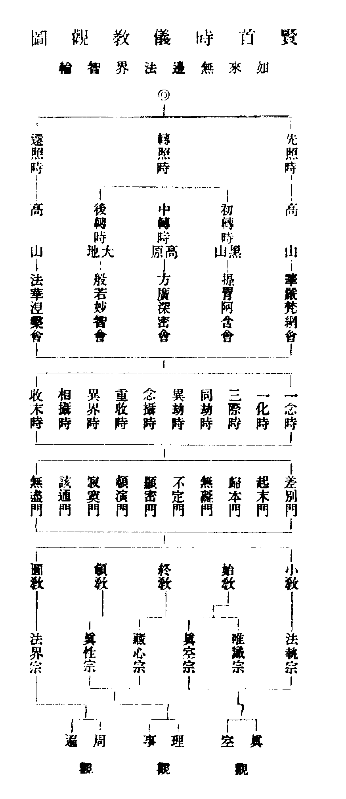
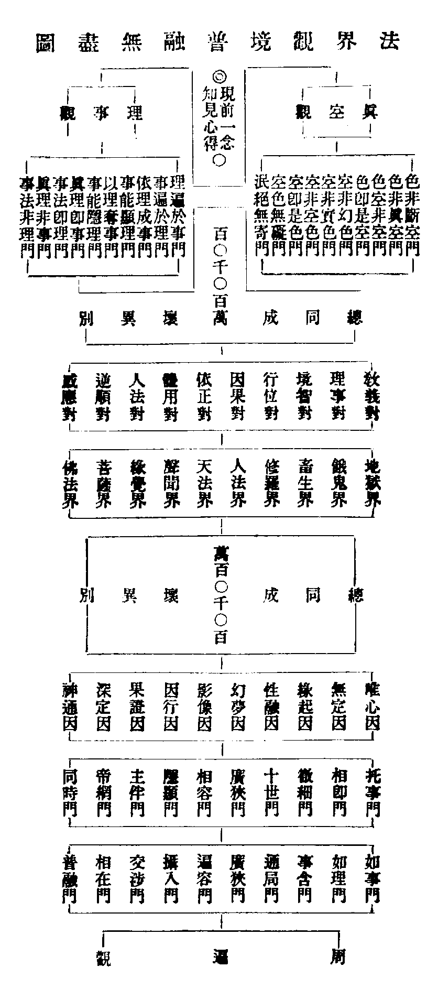

# 贤首五教仪



> **藏经**：卍新纂大日本续藏经（新纂卍续藏）　**册次** 第 58 册（X58）　**编号** X1024　**部类** 经疏部　**卷次** 6 卷　**篇幅** 100,354 字

> **作者（译者）**：清浙水慈云沙门　灌顶续法　集录

> **卷／品**：6 卷 · 2 品



---



## 目录



  - [No. 1024-B 贤首五教仪序](#no-1024-b-贤首五教仪序)

  - [No. 1024-C 序](#no-1024-c-序)

- [贤首五教仪卷第一](#贤首五教仪卷第一)

- [贤首五教仪卷第二](#贤首五教仪卷第二)

- [贤首五教仪卷第三](#贤首五教仪卷第三)

- [贤首五教仪卷第四](#贤首五教仪卷第四)

- [贤首五教仪卷第五](#贤首五教仪卷第五)

- [贤首五教仪卷第六](#贤首五教仪卷第六)



---



No. 1024-A 引



天台贤首随宜示法说。天台贤首法者，不自知也。后人起念，便隔作两截，重天台失天台，重贤首失贤首矣。执相泥名，分河立帜，此末法大弊，通人宜无所拣择，轩轾於其间也。贤首宗阙五教仪，百亭法师为补缀成之，以毒攻毒，以楔出楔，且凭楮墨施平等，莫向眉端安是非，殆不独为贤首宗之功臣矣。东南义虎，略见一斑，为两宗左右袒者，即勿寓目焉可也。



康熈庚申立秋日顺天府府丞钱唐戴京曾题



------



### No. 1024-B 贤首五教仪序



华严称根本法轮，不唯为开渐之本，亦且为摄末之本。竺乾、震旦，咸最尊尚。诸佛历祖，递代师承。自龙树依之判二种般若，天亲依之阐六相圆融，杜顺依之而演三观，云华依之而开十玄。至贤首大师，则依此而立宗判教，离台家之四以为五。复得清凉宪章，启十门而会性相二教；圭峰祖述，叙五义而拣空性两宗。此皆神明天纵，博赡旁通，故能各骋辩才，宏敷妙趣。或造论，或释经，法界宗旨，灿然明备，而一大时教，已罄无遗蕴矣。厥后继圭峰而起者，虽代有哲人，而兼综条贯，洵蔑以加，莫能更赞一词。乃味者不察，读一不读一，废目而任耳，伐异以党同。或讥其伏断皆无，或指为教观两失。在台衡从上诸师，或虑两家末裔，滥以贤首之旨，混入己宗，故弗惜晓晓而贬駮过当。何意曾玄辈，遂拾牙瀋，逞狂盲，妄肆诋诃，横起攻击，不至饮水分河不止。噫！畴复知固有大谬不然者哉？先师宝轮大师，博极诸宗，尤於华严宿有缘契，精研深入，心领神会。尝痛贤首未坠之绪，仅尔如线，誓愿振兴绝业，以继往开来。阐法后，力宏此宗，五教十玄，盖无时无处不高提圆唱也。著五教解诮论，论贤首宗未知圆义。解二篇大旨，谓贤首大师之离四以为五，非悖天台，实备天台之所未备，清凉绍隆之。即天台以清凉大师为大元勋，亦匪为过。中间晳两家之殊涂若镜悬，会两家之同归若璧合。且分铢不爽，纤累无偏，则又若衡平。向使悻悻者见此，应无从置喙矣。先师谓天台当以清凉大师为大元勋，(立)亦谓先师实天台元勋，不徒称清凉嫡裔也。(立)侍师有年，徒以脱臼也晚，尘封智锢，致望海惊心，入山空手。而慈云百兄法师，抱颕悟绝伦之资，亲承提命，往还咨决，遂得髓於言下。然深藏若良贾，年来杜门却埽，单与净满晨夕娱游。禅观之餘，则取是宗教部及诸祖著述，研磨对会，博观约取。先则支分条列而派析之，后则彻委穷源而汇聚之，录成一书。首分时，次叙仪，次立教，又次判宗，终以明观。时则有先后通别，仪有本末显密，教有始终顿圆，宗有小大性相。观则有方便，有因缘，有对法，有观门，有六相，有十玄。言简义详，理融旨显，信解行证，了然眉列。读之而犹谓之有教无观得乎？犹谓之伏断修证俱无指示得乎？今而后法界宗旨，将不终屈抑也已。然则是书也，法师固不负为先师嫡子。溯而上之，将为圭峰，为清凉，为贤首，以至龙树诸大师之元勋，亦并无歉於天台。彼悻悻寻贤首隙者，盖无容置喙，而平心以观可矣。乃命名曰贤首五教仪。法师自谓窃比於高丽师禀玄义而录出四教仪云尔，夫谁曰不然？兹将校梓，属(立)弁端。(立)甚喜华严根本法轮俨揭天日也，遂合掌赞叹，不顾鄙陋而为之辞如此。



梅坞兴福教院法弟　真立和南　撰



------



### No. 1024-C 序



孔子不可无思孟，老子不可无庄周，释尊不可无庆喜，为道之须传也。南岳不可无智者，戒贤不可无玄奘，达摩不可无慧可，为教之须人也。又智者不可无章安，玄奘不可无慈恩，慧可不可无僧璨，为其授受有源而不竭，奕叶相承而无尽也。迨於贤首大师，何独不然？以言乎师，则有杜顺、云华开其先；以言乎资，则有清凉、圭峰绍其后。其立教也，有始有终，有顿有圆。断则断其厚薄，证则正其浅深，位则品其高下，行则定其远近。显法相，若然烛之朗明；拣机益，比析薪之分剖。其判宗也，有小有大，有性有相。相则妄相为相，空则真空亦空。顿则无所不绝，似影离於天日；圆则无所不融，如像含於海空。其分时也，有先有后，有别有通。非先无以知其为开渐之顿，非后无以知其为摄末之本，非别无以见说法之次第，非通无以见教理之圆融。其叙仪也，有本有末，有显有密。非本无以了一乘之顿实，非末无以识三乘之权渐，非显无以决择其一定，非密无以测度其不定。其明观也，有方便，有因缘，有对法，有观门，有六相，有十玄。非方便无以辩修证，非因缘无以明德用，非对法无以解无尽，非观门无以入法界，非六相无以显圆通，非十玄无以彰无碍。何者？凡夫见色为实色，见空为断空，故开真空绝相门，使之观色非实色，举体是真空，观空非断空，举体是幻色。如是於理则见矣，於事犹未也。复开理事无碍门，使观不可分之理，皆圆摄於一尘，本分限之事，亦通遍於法界。如是以理望事则可矣，以事望事犹未也。又开周遍含容门，使观全事之理，随事而一一可见，全理之事，随理而一一可融，然后一多无碍，大小相含，则隐显施为，神用不测矣。教观既周，时仪已备，则判释诸佛说法仪式，至矣尽矣，无复加矣。以此自修，无法不通，以此教他，无机不被，是以三帝归崇，两朝悦服，李长者论赞於前，崔学士传美於后，至於海内海外，莫不扬其化，天上天下，靡不仰其徽，质诸千古以上之圣贤而无讹，俟诸百世以下之俊杰而不惑，遂令法门隆盛，代有哲人，长水流布於东吴，苍山崛起於西蜀，云捿敷演於南海，交光发明於北岭，猗欤休哉！奈何今义学家不得其门而入，见其教部广大，意旨幽深，即如贤首大师著述凡有一百餘卷，清凉国师现流传者约有四百餘卷，圭峰大师疏注总有九十餘卷，浮狂者诋为葛藤，愚钝者视为砂石，谁复能探其微、窥其奥哉？幸我乳峰得水大师自弘法以来，朝夕提撕，时为演唱，特未布诸方䇿，普令一切见闻耳。(续法)虽忝轮下，性极颛蒙，昼夜参随，日渐薰熟，窃谓此皆贤家所传心法，若不传於后叶，在己则有悋法之愆，在他安得正眼之益？爰将先师常所乐说者录之，复寻诸大部中所切要者集之，十餘年间考阅再三，穷思至四，始成六卷，名之曰五教仪，庶得华严宗旨弥播於尘寰，法界心印重光於昔日，灯灯相续，化化无穷矣。谨述颠末，冀见此衷，至於知我罪我，所不暇计焉。



时康熈十四年岁次乙卯秋仲望日



古杭慈云灌顶行者　续法　题



No. 1024-D



贤首时仪教观图







法界观境普融无尽图







贤首大师判释如来一代时教不出。右图三观初祖杜顺集成，五教二祖云华草创，仪等四祖清凉添足，宗等五祖圭峰加拣。今图标三祖贤首一师者，盖教观由三祖而圆备，宗仪由三祖而建兴，述作功德，推尊独在，故不举餘祖耳。后之学法者，务知开宗立教之主，餘祖自该显矣。



云山灌顶行者续法识。



贤首五教仪条个



卷第一



　序　时教图　法界观图



　别三时



> 先照　转照　还照



> 问答三时名义



　通三时



> 一念时　一化时(华严　阿含　方广　般若　法华　涅槃　通妨)



卷第二



> 三际时　同类时　异类时



> 念摄时　重収时　异界时



> 摄入时　収末时



> 通恒说妨　通涅槃妨　通诸教妨



> 通相遍妨　通餘佛妨　通诸教妨



　十仪



> 本末差别　依本起末　摄末归本



> 本末无碍　随机不定　显密同时



> 一时顿演　寂寞无言　该通三际



> 重重无尽



　五教名义



　五教所诠



> 小教十门　相十门空五门



> 始教十门　对相空十五门



> 顿教十门　圆教十门



　五教断证



> 小教谛障　小教行位　小教辟支佛果



> 小教佛果



卷第三



> 始教执障　始教断证　终教断证



> 顿教断证　圆教断证



　五教机益



> 小教机益　始教机益　终教机益



> 顿教机益　圆教机益



　五教通妨



> 五教妨难　释名义妨　释分判妨



> 立五所以　所以会通　会通诸教



> 会通相収　五教相収



卷第四



　六宗



> 法执　后五宗　拣性相滥



> 拣空性滥　拣空相性　拣空性相



> 拣性相空　拣始顿滥　拣终同滥



> 拣同别滥　总申开合　别通妨难



　三观方便



> 外缘内障　发大心　受佛戒



> 修胜行　明心镜



卷第五



> 拣观智　止观性缘　止观入住



> 止观渐顿　止观均齐　止观缘境　魔名



> 魔境　治魔觉悟　治魔识责



> 治魔止观　治魔经呪　治魔正念　病相



> 治病　显果善根　显果辨伪



> 显果长养　显果证境



　三观十对



> 教义　理事　境智　行位



> 因果　依正



卷第六



> 体用　人法　逆顺　感应



> 圆融无尽



　真空观(四句十门)　无碍观(理遍事十门)



　周遍观



> 十观　十玄相　十玄事



> 十玄喻次　十玄开立　十玄圆融



> 十因心法　十因缘起　十因缘性



> 十因法性



　修观益



> 拣修



　教观依持　结指



贤首五教仪条个(终)



No. 1024



------



## 贤首五教仪卷第一



**译者**：清浙水慈云沙门　灌顶续法　集录



贤首大师判释如来一代时教，不出三时、十仪、五教、六宗、三观。



言三时者，有别有通。



别三时者：一、日出先照时；二、日升转照时；三、日没还照时。



华严云：或日初分时入，或日中分时入，或日后分时入。法华谓初善、中善、后善是也。



第一，日出先照时者。



△华严经云：譬如日出，先照须弥山等诸大高山。如来、应、正等觉亦复如是，成就无边法界智轮，常放无碍智慧光明，先照菩萨摩诃萨等诸大山王。



△若约所说教相者。



△经云：尔时世尊於菩提树下初成正觉时。



△普见一切众生皆成正觉，乃至普见一切众生皆般涅槃。



△普见一切众生贪、瞋、痴、慢诸烦恼中，有如来身智，常无染污，德相备足。



△无一众生而不具有如来智慧，但以妄想执著而不证得。我欲教以圣道，令其永离妄想，於自身中得见如来广大智慧，如我无异。



△即於三七日中，遂为此等众生，於菩提场称於大方广法界，敷演万行因华，以严本性，令成万德佛果。



△其有往劫与我同种善根，曾得我於劫海之中，以四摄法而摄受者。



△始见我身，闻我所说，即皆信受，入如来慧。



△乃至逝多林内，我入师子频申三昧，大众皆证无尽法界。



△此一时中，为圆顿大根众生，转无上根本法轮，名为直显教。令彼同教一乘人等，转同成别，所谓初善，或日初分时入也。



△故法华方便偈云：我始坐道场，时即自思惟：若但赞佛乘，众生没在苦。不能信是法，破法不信故。信解偈云：尔时长者处师子座，眷属围绕，诸人侍卫，出内财产，注记券疏。穷子见父驰走而去，即勅使者追捉将来。穷子惊唤，迷闷躃地。



△其所说经，即华严、梵网等也。



第二日升转照时者，中有二义：先总、后别。



△先、总明者。华严经云：但以山地有高下，故照有先后。如来智轮亦复如是，随诸众生根欲不同，智慧光明种种有异。楞伽亦云：日出光等照，下中上众生。如来照世间，为分部诸法。



△若约所说教相者。



△经云：除先修习学小乘者，著相憍慢不信法者，及溺贪爱水著於五欲者，深入诸邪见生死险道者，如是等众生，诸根悉暗钝，著乐痴所盲，云何而可度？



△我於三七日，思惟如是事。若我遇众生，尽教以佛道，彼即没苦海。毁谤不信故，疾入於恶道。若以小乘化，乃至於一人，我则堕悭贪。此事为不可，进退难为遂。



△寻念过去佛，所行方便力，始知过去佛，皆以三乘引。然后令悟入，究竟一佛乘，故我所得道，亦应说三乘。作是思惟时，十方佛皆现，梵音慰喻我：善哉释迦文！第一之导师，得是无上法，随一切诸佛，而用方便力。我闻慰喻音，随顺诸佛意，始往波罗奈，转四谛法轮。赞示涅槃法，度陈如五人，渐渐诸处，乃至千万。亦为求缘觉者说十二因缘，亦为求大乘者说六波罗蜜，中间为说方广般若诸甚深法，淘汰如上声闻、缘觉，引进权乘诸小菩萨。



△此一时中，为下、中、上三类众生，转依本起末法轮，名为方便。教令彼三类人等，转三成一，所谓中善，或日中分时入也。



△故法华方便偈云：复作如是念，我出浊恶世，如诸佛所说，我亦随顺行。以方便力故，为五比丘说，为诸众生类，分别说三乘。虽复说三乘，但为教菩萨。



后别明者，於日中分照有三转，谓初转时、中转时、后转时也。



初转时者，华严云：次照黑山如来智轮，次照声闻缘觉。谓佛初於鹿苑为钝根下类众生转小乘法轮，说一切诸法皆因缘生，以破外道自然性等。又说缘生无我，翻彼外道实有我执。此一转时唯就境明实有依他，然犹未说大乘法空真如妙理，由是名之为隐实教，令彼凡夫外道转凡成圣也。



故法华云：长者知子愚痴狭劣，即以方便，更遣餘人，眇目矬陋，无威德者，汝可语之，云当相顾，除诸粪秽，倍与汝价。穷子闻之，欢喜随来，为除粪秽，净诸房舍。



其所说经，即提胃阿含等也。



中转时者，华严云：次照高原如来智轮，次照决定善根众生，随其心器示广大智。谓佛次於中时，为中根一类众生转三乘法轮，说一切诸法皆唯识现，以破小乘心外有法从因缘生。又说缘生假有，翻彼小乘实有法执。



此一转时，始约心说尽空遍计，然犹未说一乘真空法性妙理，由是名之为引摄教，令彼二乘人等转小成大也。故法华云：长者有智，渐令入出，经二十年，执作家事。其所说经，即方广深密等也。



后转时者，华严云：然后普照一切大地如来智轮，然后普照一切众生，乃至邪定亦皆普及，为作未来利益因缘令成熟故。谓佛又於后时为利根上类众生转一乘法轮，说一切诸法本如来藏妙真如性，以破权乘不了心境俱空无性。又说缘生即空，翻彼权乘二无我执。此一转时直据性显中归圆成，然犹未说一乘佛性生佛平等究竟真常实相妙理，由是名之为融通教，令彼三乘人等转权成实也。故法华云：尔时长者自知不久，示其金、银、真珠、玻瓈诸物出入皆使令知。



其所说经，即般若妙智等也。



第三、日没还照时者，此乃义取出现。经意说云：如日没时还照高山，如来智轮最后还照菩萨摩诃萨等诸大山王。



十定品云：譬如日天子，周行照曜，昼夜不住。日出名昼，日没名夜。菩萨亦复如是。



法界品云：譬如日轮，无有昼夜，但出时名昼，没时名夜。菩萨智轮亦复如是，无有分别，但随心现，教化众生。



△若约所说教相者。



△经云：过四十餘年，渐渐见其根熟，即中下机，成上上品。如是之人，我今亦令得闻是经，入於佛慧。遂於灵鹫山中，告大众云：世尊，法久后要，当说真实。汝等应当一心信解，无有餘乘，唯一佛乘。开示悟入佛之知见，普皆与授阿耨多罗三藐三菩提记。显示三五乘性，众生法身平等，入一乘道。乃至临欲灭度之时，在於拘尸那城娑罗双树间，作大师子吼。显常住法，决定说言：一切众生，皆有佛性。凡是有心，定当作佛。究竟涅槃，常乐我净，皆令安住秘密藏中。即与华严海会、师子频申、大众顿证，无有别异。



△此一时中，为上上根众生，转摄末归本法轮，名为开会教。令彼偏教五乘人等，转偏成圆，所谓后善，或日后分时入也。



△故法华方便偈云：我见佛子等，志求佛道者，我即作是念：如来所以出，为说佛慧故，今正是其时。正直舍方便，但说无上道，教化诸菩萨，无声闻弟子。信解偈云：父知子心，渐已旷大，即聚亲族，说是我子。凡我所有，舍宅人民，悉以付之，恣其所用。子念昔贫，今於父所，大获珍宝，甚大欢喜。



△其所说经，即法华、涅槃等也。



问：准上判释，则三时名义非凭一经论耶？



答：取众经论理究竟故。



△问：经中无有还照之语，今者何为而开判耶？



△答开有二义。



△一、取经意。葢日初出，先照高山。日若垂没，亦应还照诸山王故。如彼天台，亦开平地为三以成五，(食时、禺中、正午，三也。加幽谷、高山以对五味，五也。)取幽谷为二而合四。(晋华严云：譬如日出，先照诸大山王，次照一切大山，次照金刚宝山，然后普照一切大地，四也。而云为二合四者，如妙玄云：犹如日出，先照高山，次照幽谷，后照平地。故合四照成三照也。)故疏钞云：我佛本为一事，出现於世四十餘年，未显真实。今分一代时教，岂妨判有前后，分析权实、空有、取舍、偏圆、渐顿，方知佛法微妙深玄。譬犹不泛大海，岂识边涯？不谙木石，安知真宝？故智论释法施云：依随经论，广作义理，为立名字，皆名法施。



△二、约教理。华严依本起末，故有潜流而无后照。法华、涅槃摄末归本，故有会流而无先照。今双取之。本末无碍，先后圆足。非本无以垂末，故华严中影显法华、涅槃日出潜流义云：譬如日出，先照须弥山等诸大高山。又如大海，其水潜流四天下地及八十亿诸小洲中。非末无以归本，故涅槃、法华中影显华严日没会流义云：如阎浮提，日入之时，众生不见，以黑山障故。而是日性实无没入，众生不见，生没入想。声闻弟子亦复如是，为诸烦恼山所障故，不见我身。以不见故，便於如来生灭度想，而我实不毕竟永灭。又如日天子，能除诸暗。此经亦复如是，能破一切不善之暗。譬如四河出阿耨达池，若有天人诸佛说言：是河不入大海，当还本源。无有是处。菩提之心亦复如是，有佛性者，若闻不闻，若修不修，悉皆应得阿耨菩提。又加一切川流江河诸水之中，海为第一。此经亦复如是，於诸经中最为深大。若不尔者，则日唯有出，无没入故。普照地后诸大高山，不得还照益故。过中照已，应如昏暮，世间皆暗瞑故。何以经云：今复转最妙，无上大法轮，亦还令汝得闻是经，入於佛慧？又百川中无海潜流，从何本源出故？穿凿求者，终不能得益故。江河乾时，后应无水入中流故。何以经云：於一佛乘，分别说三？譬如从牛出乳，从乳出酪，



△故知不可偏执一文一义而自疑难也。



△但经论中成有名无义，或有义无名，或名义俱全，或名义皆阙。今於前三句中复开六句而料拣之：一、少分名。二、全分名。三、少分义。四、全分义。五、少分名义。六、全分名义。



△少分名者。如华严十定品云：日出名昼，日没名夜。涅槃初卷云：圣慧日明，从今永灭。无上法船，於斯沉没。



后分云：慧日灭没大涅槃山，一切众生丧真慈父。



四分律云：喻如日没时，世界皆暗暝。



△全分名者，如本起经云：菩萨处胎时，晨朝为色界诸天说法，日中欲界，日晡鬼神。华严十定品云：或日初分，或日中分，或日后分。



般若云：初日分以身布施，中日分、后日分亦以恒沙等身布施。



△少分义者，如华严五十世界初成喻云：譬如三千世界，初始成时，先色天，次欲天，次人处及餘众生。如来出现，先化菩萨，次化二乘，后及餘诸众生。



五十一法界出生喻云：譬如法界，常出一切声闻独觉菩萨解脱，而法界无增减。如来智慧，恒出一切世出世间种种智慧，而如来智无增减。皆明先顿后渐义也。



四十七云：或时为说差别三乘，或时为说圆满一乘，普皆济度，令出生死。此明先渐后顿义也。五十四、轮依起喻云：譬如树林依地轮，地依水轮，水依风轮，风依空轮，空无所依。一切佛法依慈悲，慈悲复依方便，方便依四大智，智依无碍慧，慧无所依。五十一、四宝出生喻云：譬如大海有四宝珠，具无量德，能生海内一切珍宝。如来大智慧海，於中有四大智宝珠，具足无量福智功德，由此能生一切众生、声闻、独觉、学、无学位及诸菩萨智慧之宝。此皆依本起末义也。五十二、文字摄入喻云：譬如书字普入一切事、一切语、一切算数、一切世间、出世间处，而无所住。如来音声普入一切处、一切众生、一切法、一切业、一切报中，而无所住。一切众生种种语言皆悉不离如来法轮。何以故？言音实相即法轮故。诸河入海喻云：一切智慧无量无边不可思议。佛子！此阎浮提有二千五百河流入大海，西拘耶尼有五千河流入大海，东弗婆提有七千五百河流入大海，北郁单越有一万河流入大海。佛子！此四天下如是二万五千河相续不绝，流入大海。此皆摄末归本义也。



法华药草喻品末云：因缘开示是我方便，今为汝等说最实事。是先权后实也。化城喻中东方诸梵请云：唯愿度脱开涅槃道。东南诸梵请云：唯愿转法轮显示诸法相。南方诸梵请云：愿转无上法轮。上方诸梵请云：愿示大涅槃道。是先半后满也。智胜威音之说，先三后一也。凿井髻珠之譬，先小后大也。



乃至王膳，显实也。良医，开权也。涅槃三云：譬如阿耨达池出四大河，如来亦尔，出一切命。起末也。八云：譬如众流皆归於海，一切契经皆归大乘。大涅槃经归本也。五云：譬如长者唯有一子，以爱念故，昼夜殷勤教其半字，而不教诲毗伽罗论。何以故？以其幼稚，力未堪故。子既长大，堪任读学，时彼长者教半字已，次为演说毗伽罗论。如来亦尔，以诸声闻无有慧力，是故如来为说半字九部经典，而不为说毗伽罗论方等大乘。若诸声闻有堪任力，我亦尔时，为诸弟子说於半字九部经已，次为演说毗伽罗论大乘经典，所谓如来常存不变，先半后满也。



七云：譬如女人生育一子，婴孩得病。是女愁恼，求觅医师。医师既来，合三种药：酥、乳、石蜜，与之令服。因告女人：且莫与乳，须药消已，尔乃与之。是时女人即以苦物用涂其乳。药至消已，母人以水净洗其乳，唤其子言：来与汝乳。是儿闻已，渐渐还饮。如来亦尔，为度一切，教诸众生修无我法。为修空故，说言诸法悉无有我。如是修空，永断我心。入涅槃已，我於尔时说如来藏。是故比丘不应生怖，应自分别如来秘藏，不得不有先权后实也。



△全分义者，华严五十一龙王降雨喻云：譬如阿那婆达多龙王，兴大密云，徧阎浮提，普霔甘雨，百谷苗稼皆得生长，江河泉池一切盈满。如来亦尔，兴大悲云，遍十方界，普雨无上甘露法雨，令一切众生皆生欢喜，增长善法，满足诸乘。又如摩那斯龙王，将欲降雨，先起大云，弥覆虗空，凝停七日，待诸众生作务究竟。过七日已，降微细雨，普润大地。如来亦尔，将降法雨，先兴法云，成熟众生，为欲令其心无惊怖。待其熟已，然后普降甘露法雨，演说甚深微妙善法，渐令满足一切智智无上法味。



婆达降雨，华严也。摩那兴云，转照三教，渐成熟也。后降法雨，法华涅槃也。又海宝饮缩喻云：譬如大海有四炽然光明大宝，布在其底，性极猛热，常能饮缩百川所注无量大水。一、日藏大宝光明，照触海水，悉变为乳。二、离润大宝光明，照触其乳，悉变为酪。三、火𦦨光大宝光明，照触其酪，悉变为酥。四、尽无餘大宝光明，照触其酥，变成醍醐，如火炽然，悉尽无餘。佛子！若大海中无此四宝，从四天下乃至有顶，其中所有悉被漂溺。如来大智慧海有四种大智慧宝，具足无量威德光明。此智宝光触诸菩萨，及至令得如来大智。佛子！诸菩萨修集一切助道法时，起无量散善波浪，一切世间天、人、阿修罗所不能坏。如来以灭一切散善波浪大智慧宝光明触彼菩萨，令舍一切散善波浪，持心一境，住於三昧。又以除一切法爱大智慧宝光明触彼菩萨，令舍离三昧味著，起广大神通。又以慧光普照大智慧宝光明触彼菩萨，令舍所起广大神通，住大明功用行。又以与如来平等无边无功用大智慧宝光明触彼菩萨，令舍所起大明功用行，乃至得如来平等地，息一切功用，令无有餘。佛子！若无如来此四智宝大光照触，乃至有一菩萨得如来地，无有是处。大智慧海，华严也。有四智宝，根本轮中具后二时，经教法也。饮缩百川大水，乾枯百界中性，修贪爱水也。日藏照触海水变为乳者，阿含教灭凡外戒、善人天、善禅及餘三途一切爱水，而转成我空也。离润照乳变为酪者，深密教灭一切二乘偏真三昧法爱，而入法空，起诸神通，化生严土也。火𦦨照酪悉为酥者，妙智教灭一切三乘著相修行、执著二空种种法爱，而成俱空，起大明行，入於实相般若也。无餘照酥成醍醐者，法华涅槃教灭一切权乘有修、有证、有佛、有生种种法爱，而得圆满菩提，归无所得，生佛平等，唯一乘性，入於第一义谛，法界空也。法华火宅喻中，若我但以智慧神力舍於方便，为诸众生赞如来知见、力、无所畏者，众生不能以是得度，如彼长者虽复身手有力而不用之，华严教也。但以智慧方便，於三界火宅拔济众生，为说三乘：声闻、辟支佛、佛乘。如来以是方便诱进众生，如彼长者为说羊车、鹿车、牛车，诸子即时争出火宅，转照中三教也。如来若见无量众生以佛教门出三界苦，便作是念：是诸众生皆是我子，等与大乘，不令有人独得灭度，皆以如来灭度而灭度之。如彼长者见诸子等安隐得出火宅，自惟财富无量，等以大车而赐诸子，即法华也。信解品、穷子喻、涌出品初后入佛慧、方便品始坐道场但赞佛乘无二无三，趣波罗奈於一佛乘分别说三，见求佛者为说佛慧，无有餘乘唯一佛乘，皆是三照义也。又受记品系珠喻中，以无价宝珠系其衣里，华严教也。游行求索得少便足，转照中教也。指示其珠贸易如意，法华教也。化城喻中，十六王子请大闻大覆说大经，一一所化六百万亿那由它恒河沙等众生，即说华严佛慧也。於今有住声闻地者，应以是法渐入佛道，所以者何？如来智慧难信难解，阿含方广般若教也。如来自知涅槃时到众又清净，便集诸菩萨及声闻众为说是经，世间无有二乘而得灭度，唯一佛乘得灭度耳，法华涅槃教也。譬喻品中，佛告舍利弗言：我昔教汝志愿佛道先照也，汝今悉忘而便自谓已得灭度转照也，还令汝念本行道故说大乘经还照也。涅槃八中一药流味喻云：譬如雪山有一味药名曰乐味，其味极甜，过去世中有转轮王造作木桶以接其药，是药热时从地流出集木桶中，其味真正，王既没已，其后是药或醋或醎或甜或苦或辛或淡，如是一味随其流处有种种异，是药真味停留在山犹如满月，凡夫薄福虽以掘凿加功苦至而不能得，复有圣王出现於世，以福因缘即得是药真正之味，轮王造桶接药，华严会也。王没之后随流成异，方便教也。圣王复出即得真味，法华涅槃会也。



九云：譬如大船从海此岸至於彼岸，复从彼还岸至此岸。如来正觉乘大涅槃大乘宝船，周旋往反济度众生，在在处处有应度者，悉令得见如来之身。从海此岸先照也，彼岸转照也，还至此岸还照也。又云：如庵罗树及阎浮树一年三变，有时生华光色敷荣，有时生叶滋茂蓊郁，有时凋落状似枯死。如来亦尔，於三界中示三种身，有时初生，有时长大，有时涅槃。而如来身实非无常，初时生华顿也，中时长叶渐也，后时凋枯圆也。十四中五味喻云：譬如从牛出乳，从乳出酪，从酪出生酥，从生酥出熟酥，从熟酥出醍醐。佛亦如是，从佛出於十二部经，从十二部经出修多罗，从修多罗出方等经，从方等经出般若波罗蜜，从般若波罗蜜出大涅槃，犹如醍醐。



从牛出乳，最初华严也。酪生熟酥，转照中阿含法相无相也。涅槃醍醐，还照法华涅槃也。



△少分名义者。华严五十云：譬如日出於阎浮提，无量众生皆得饶益。所谓破暗作明，变湿令燥，生长草木，成就糓稼，廓彻虗空，开敷莲华。行者见道，居者辨业。何以故？日轮普放无量光故。如来智日，以无量事普益众生。所谓灭恶生善，破愚为智，大慈救护，大悲度脱。令其增长根、力、觉分；令生深信，舍离浊心；令得见闻，不坏因果；令得天眼，见没生处；令心无碍，不坏善根；令智修明，开敷觉华；令其发心，成就本行。何以故？如来广大智慧日，身放无量光，普照耀故。此唯先照名义也。五十九云：菩萨正法日，出现於世间。戒品圆满轮，神足速疾行。照以智慧光，长诸根力药。灭除烦恼暗，消竭爱欲海。乃至五十中，先照山王，次照黑山高原，后照大地。法喻皆明先照、转照名义也。六十云：譬如空中日，运行无暂已。如来亦如是，神变恒相续。此喻转照名义也。



五十二云：如日舒光照法界，器坏水漏影随灭，最胜智日亦如是，众生无信见涅槃。此唯还照名义也。



涅槃十九云：佛日将没大涅槃山。大王！佛若去世，王之重恶更无治者，亦唯还照一也。



△全分名义者。华严五十云：譬如日月，随时出现，大山幽谷，普照无私。如来智慧，普照一切，无有分别。随诸众生根欲不同，智慧光明种种有异。出现普照者，月没日出，先照大山也。日没月出，还照大山也。随时普照，转照幽谷也。根欲不同，五会所被机也。光明有异，三时能被教也。又云：譬如日出，生盲众生虽未曾见，然为日光之所饶益。何以故？因此得知昼夜时节，受用调适，离众患故。如来智日亦复如是，毁戒毁见生盲众生，无信眼故，不见诸佛智慧日轮。虽不见佛，亦为智日之所饶益。何以故？以佛威力，令彼众生所有诸苦皆消灭故。昼夜时节者，初日分、中日分、后日分也。受用三时，饮食也。以佛威力者，因此如来智慧日轮，始得闻知初中后照时分所被一切声教，而亦令彼离苦得乐也。七十三云：譬如日轮，出时名昼，没时名夜。菩萨智轮亦复如是，教化众生，言其止住前劫后劫。华严直显教中开发众生宿世善根，未种者令种，即名过去前劫。如日初出，名之为昼也。转时行布教中，已种者令增长，即名现在中劫。如日升中，名为饷午也。法华开会教中，已增长者令成熟，念念令无量众生，於阿耨菩提，得不退转，即名当来后劫。如日入没，名之为夜也。则前后劫，是约现在三世明矣。四十六云：一切诸佛，於一时中，知一切时，具净善根，入於正位，无所住著，而能示现若昼若夜，初中后时，乃至尽於未来际劫，恒为众生转妙法轮，不断不退，无有休息。示现昼夜初中后者，别明如来一代教中三种时也。尽未来者，总结无尽化中三种时也。涅槃二云：譬如日初出，光明甚晖𦦨。既能还自照，亦灭一切暗。如来神通光，能除我苦恼。处在大众中，譬如须弥山。今闻入涅槃，佛日坠於地。法水悉枯涸，我等定当死。如来般涅槃，众生极苦恼。初出先照也，日坠还照也。转照自摄



二十四云：世尊！若因佛性发阿耨多罗三藐三菩提，何故如来广为众生说十二部经？世尊！如优陀延山，日从中出，至於正南。日若念言：我不至西。还东有者，无有是处。佛性亦尔，若不闻、不戒、不施、不修、不智、不得阿耨菩提者，无有是处。佛赞：善哉！善男子！世方二人：一、善问难，二、善能答。善问难者，汝身是也。善能答者，谓如来也。善男子！因是善问，即得转於无上法轮。若因佛性发菩提者，华严也，如日东出。说十二部者，方广等也，如日正南。不闻不修，悉皆应得菩提。转无上轮者，涅槃也，如日西没。



九云：譬如日出有三时异，谓春、夏、冬。冬日则短，春日处中，夏日极长。如来亦尔，於此三千大千世界，为短寿者及诸声闻示现短寿，譬如冬日。为诸菩萨示现中寿，若至一劫若减一劫，譬如春日。唯佛覩佛其寿无量，譬如夏日。善男子！如来所说方等大乘微密之教，示现世间雨大法雨。若有人能受持是典，开示分别利益众生，当知是辈真是菩萨，譬如盛夏天降甘雨。若有声闻缘觉之人，闻佛如来微密之教，譬如冬日多遇冷患。菩萨之人若闻如是微密教诲，如来常住性无变易，譬如春日萌芽开敷。而如来性实无长短，为世间故示现如是，即是诸佛真实法性。此则以一年分为三时也。短寿如冬，变化土中化身寿也。如今释迦八十唱灭，即是化身缘促同促寿量之义。劫寿如春，受用土中应身寿也。如彼弥陀阿僧祇劫，即是应身缘长同长寿量之义。无量如夏，法性土中法身寿也。犹如虗空无始无终，即是法身常住不变无量寿义。寿量既尔，说教亦然。方等大乘，即遮那在法界土说大方广华严教也，如盛夏日当初照义。如来密教，即释迦在变化土说阿含等权乘教也，如寒冬日当中照义。如是常住微密教诲，即如来在不毁净土中说法华涅槃一乘教也，如春阳日当后照义。



五云：如婆门罗所有语论，终不欲令刹利、毗舍、首陀等闻。何以故？以此论中有过恶故。如来正法则不如是，初、中、后善，是故不得名为秘藏。初善说顿也，中善开渐也，后善显实也。机理并契，故不覆藏。



三十一云：我於尔时告善星言：我所说法，初中后善，其语巧妙，字义真正，所说无杂，具足成就清净梵行。华严皆是称性善巧之说，故云巧妙，即名善语初善也。阿含谛缘之法，真实不虗，故云真正，即名真语。方广以逐机性，随计破著，应不失时，故云无杂，即名时语。般若权实双明，诸法如义，故云具足，即名义语中善也。法华等赐一乘大白牛车，涅槃纯谈佛性醍醐甘露法味，故云梵行，即名法语后善也。乃至法华序品三善，皆此三时之义，餘可例思。



△准知今家判释，统该一大藏矣。



问：既经论散说，何不合为一二，开为五六，而必欲立三时即？



答：有五所以：一、释尊说法用三时故，如因果三说、涅槃三教、法华三入、光明三轮、深密三为、楞伽三照。二、众经论中常明三故，如梵网、光明三请，法华、涅槃三善，金刚三分，华严三定，智论三觅，成论三年。三、诸佛化生多三会故，如毗婆尸、尸弃、声德、弥勒佛等。四、世、出世间恒重三故，世如三世、三际、三分、三周，出世如三时、三生、三祗、三益。五、折衷诸说，三为中故。若尽理言之，亦可合为一、二，开为九、十。今则总相会通，分为十重：一、总名为一音时，以如来一代时教不离一音故，如流支等。二、或分为二，此更有三：初一、本教时；二、末教时，如教章二：一、顿教时；二、渐教时，如护延诸德三：一、平道时；二、屈曲时，如印敏等师。上三说中，皆前属华严，后属鹿苑，终於双林一切经教。三、或分为三，此亦有二：初一、根本时；二、起末时；三、归本时，如吉藏法师。次一、圆说时；二、渐说时；三、顿说时，如光统律师。四、或分为四，此亦有二：初一、顿教时，亦名别教一乘时，华严也；二、小教时，亦名别教小乘时，阿含也；三、权教时，亦名同教三乘时，深密、妙智也；四、实教时，亦名同教一乘时，法华、涅槃也，则不违光宅云师。次一、圆满教时，华严也；二、有相教时，阿含也；三、无相教时，般若也；四、常住教时，涅槃也，如虎丘岌公。五、或分为五，此复有四：一初华严，二阿含，三般若，四深密，五法华涅槃，则不违相宗二：初华严，二阿含，三深密，四妙智，五法华涅槃，则不违性宗三：初称性教，二有相教，三无相教，四同归教，五常住教，如宋朝岌师四：初华严，二阿含，三方等，四般若，五法华涅槃，如智者大师。六或分为六，此亦有二：一初圆顿教时，二人天教时，三有相教时，四无相教时，五同归教时，六常住教时，如隐士刘公。次一圆顿教时，二有相教时，三无相教时，四抑扬教时，五同归教时，六常住教时，如道场慧观等。七或分为七，此亦有二：一初华严，二梵网，三阿含，四方广，五般若，六法华，七涅槃，则不违海东晓师二：初华严，二阿含，三大集，四深密，五妙智，六法华，七涅槃，则不违波颇三藏。八或分为八：一圆顿教时，二人天教时，三有相教时，四无相教时，五抑扬教时，六同归教时，七常住教时，八不定教时，如南北诸师。九或分为九：一华严，二提胃，三阿含，四方广，五般若，六深密，七妙智，八法华，九涅槃，则不违真谛唐三藏等。十或分为十：一华严，二梵网，三提胃，四阿含，五大集，六净名，七深密，八妙智，九法华，十涅槃，则不违大衍护身耆阇师等。然十重中，一则太简，十则太繁。繁则胶於名相，简则味其源流。是以今家遍收开合，判立三时，则与教理自不违也。



问：释尊时仪与一切诸佛为同耶？为异耶？



答：约教有同异，就理则无异。教异者，众生机有千差，如来化仪万别。故依华严根本轮中，或以音声为教、或以香饭为教、或以光明而作佛事、或以佛身而作佛事、或现异相、或复扬睂、或动睛、或不瞬、或忆念微笑、或謦欬嚬呻。就声名教中，或唯说三乘、或唯说一乘、或先大后小、或先小后大、或先一后三、或先三后一、或先大中小后大、或先一次三后一、或显密同时、或顿渐齐演。故华严云：今见一切佛土所有众事种种不同，所谓说法、调伏、教义、法住各有差别。教同者，此土以声名句文而为教体，十方诸佛土中亦有以音声语言文字而作佛事。此土如来先圆顿、次权渐、后圆顿，十方诸佛亦有以先一次三后一。故法华云：如三世诸佛，说法之仪式，我今亦如是，说无分别法。又云：舍利弗当知，诸佛法如是，以万亿方便，随宜而说法。理无异者，诸佛出世唯欲众生尽皆悟入一法界心，故我世尊初成正觉即说华严。其奈机有利钝，利者得入、钝者如盲，故不获已从一施三，复说阿含深密妙智，渐渐调伏至纯熟己，然后会三归一说法华涅槃。根最钝者具历五会，於阿含成小果益，深密但得始益、妙智得终顿益，直至法华涅槃方得圆益。又有根稍利者，不必具历五会，或但经四番、三番、二番，便得悟入一真法界。故法性论云：中下钝根菩萨三处入法界，初则般若，次则法华，后则涅槃。无量义经云：次说摩诃般若华严海空，宣说菩萨历劫修行。即是因般若入法界也。法华云：始见我身入如来慧，今闻是经入於佛慧。即是因法华入法界也。像法决疑经云：或见如来入涅槃，或见如来住世一劫若无量劫，或见报身莲华藏世界海为千百亿释迦牟尼佛说心地法门，或见法身同於虗空无相无碍遍同法界。即是因涅槃入法界也。时会虽殊，入理则一。法华云：十方三世一切诸佛，皆以无量无教方便、种种因缘譬喻言辞，而为众生演说诸法，是法皆为一佛乘故。是诸众生从佛闻法，究竟皆得一切种智。至於餘佛土中，或见色闻香而入法界，或觉触知味而入法界。如五十三知识解脱境界，三十二菩萨不二法门，二十五无学真实圆通，发觉虽不同，归元实无异也。若会融之，不唯理无优劣，教亦无别。如有国土唯说一乘，初时说大，犹今先照也；中时说大，犹今转照也；后时说大，犹今还照也。或有国土唯说三乘，宿必下种已闻大法，犹今说顿也。现在应以是法渐入，犹今开权也。当必熟脱还闻大法，犹今显实也。或先大后小，或先一后三，一大华严也，三小阿含等也。后必说一大，犹今法华谈也。或先小后大，或先三后一，三小阿含等也，一大法华等也。宿必说一大，犹今华严谈也。或显密同时，但从其显拣去其密。或顿渐齐演，但取其定舍其不定。则亦有三时次第相也。声教既尔，餘教亦然。如众香国，但以众香令诸天人得入律行，菩萨各各坐香树下，闻斯妙香即获一切德藏三昧。得是三昧者，菩萨所有功德皆悉具足，犹今说华严也。若声闻人是入正位食此饭者，得入正位然后乃消。已入正位食此饭者，得心解脱然后乃消，犹今说阿含也。若未发大乘意食此饭者，至发意乃消，犹今说深密也。已发意食此饭者，得无生忍然后乃消，犹今说妙智也。已得无生忍食此饭者，至一生补处然后乃消，犹今说法华涅槃也。香味如是，餘法例知。则十方无量百千万亿国土中，诸佛世尊说法仪式无不同也。故华严云：佛刹与佛身，众会及说法，但随众生心，如是见有殊，非一切如来，大仙之过咎。上且会通诸佛，别三时相如此，通相如下。



通三时者，开有十重：一、唯约一念时，二、尽该一化时，三、遍周三际时，四、摄同类劫时，五、收异类劫时，六、以念摄劫时，七、劫念重收时，八、异类界劫时，九、彼此摄入时，十、以本收末时。



第一、唯约一念时者，谓於一刹那中，即遍法界无尽之处，顿说无量诸法门海。



华严云：如来於一语言中，演说无边契经海。



净名云：佛以一音演说法，众生各各随所解。楞伽云：如日月轮一时遍照一切色像，诸佛如来净诸众生自心过习亦复如是，顿为示现不可思议诸佛如来智慧境界。法华云：如来说法常以一味，令诸世间普得具足，如大云起普遍世界，一时等澍其润普洽。



第二、尽该一化时者，谓从我佛初成道时，乃至如来般涅槃夜，於此一代时化之中，普遍重重法界之处，常说种种无尽经法。



△如华严教，别但在初。先照时分，通则至后。华严前八会中永无声闻，至第九会方有声闻。尔时五百在祗园中已证圣果，验知舍利弗等先已闻小乘教，方预入法界会。则华严说通於阿含后矣。楞伽颂云：真如空实际，涅槃及法界，种种意生身，我说皆异名。若不了无我，依教不依义，於诸经律论，而起净分别。



无量义云：次说般若历劫修行华严海空。



法华云：我今亦令得闻是经，入於佛慧。像法决疑云：今日坐中无央数众，各见不同：或见如来入涅槃；或见如来住世一劫，若减一劫，若无量劫；或见如来丈六之身；或见小身；或见大身；或见报身莲华藏世界海，为千百亿释迦牟尼佛说心地法门；或见法身同於虗空，无有分别，无相无碍，遍同法界；或见此处山林土沙；或见七宝；或见此处乃是三世诸佛所行之处；或见此处即是不可思议诸佛境界真实之法。



法性论云：钝根菩萨三处入法界：初则般若，次则法华，后则涅槃。故知华严之说直尔通至涅槃后也。



△若阿含教，别论在初转时，通论亦至前后。如华严中明小乘戒善四谛因缘，即四谛品明谛，十藏品明戒，六地明因缘，则阿含说通於前也。四分游行等说，十二年后方制广戒。楞伽明声闻乘差别相。涅槃明迦留陀夷入聚落被害，作结戒缘起。增一明身子五分法身不灭。



阿含说如来涅槃，有患背痛等相。遗教经云：初度陈如，后度须䟦。



释论云：从初鹿苑至涅槃夜，所说戒定慧，结为修妬路等藏。是知阿含亦通后也。



△若方广深密等教，别论在中转时，通论亦至初后。



初者，华严中明十地、十如、八识、四智等。楞伽颂云：甚深大方广，知诸刹自在，我为佛子说，非为诸声闻。



普曜经云：第二七日，提胃波利等五百贾人施佛𪎊蜜，佛与授记，当得作佛，号会密成。密迹力士经说：佛初成道，七日思惟已，即於鹿园中以众宝庄严法座，广集三乘众。梵王请佛为转法轮，广益三乘众，得大小果等。六年内即说鸯崛、胜鬘等经，后者方广抑扬。般若亦云：二乘智慧犹如萤火，菩萨一日学智如日之照。岂非抑扬？



法华云：我此九部法，随顺众生说，入大乘为本，以故说是经。方等陀罗尼经云：先於王城授声闻记，今於舍卫国复授声闻记，昔於波罗奈已授声闻记。身子云：世尊不虗所言真实，故能第二第三授我等记。光明经中分别三身、三乘、十地、十度，乃至人天因果法相。涅槃云：护大乘者受持九部。受决经中佛授园监阇王记等。楞伽颂云：象脇与大云，涅槃央掘摩，及此楞伽经，我皆制断肉。又云：真如空实际，涅槃及法界，种种意成身，我说是心量。



则方广谈直通初后也。



△若般若、妙智等教，别论在后转时，通论亦至初后。何者？如大智度论云：从得道夜乃至涅槃，常说般若。华严须弥顶上偈赞品云：法性本清净，如空无有相，一切无能说，智者如是观。凡夫见诸法，但随於相转，不了法无相，以是不见佛。忉利会尔夜摩兜率云集菩萨偈赞义。然大品经云：佛在鹿野转四谛法轮，无量菩萨得无生法忍，住初地、二地乃至十地。又云：不见一法出法性外者，法性即是法界。智论云：三藏中明法空为大空，摩诃衍中明十方空为大空。



楞伽云：此空无生、无自性、无二相，悉入一切修多罗中。佛所说经皆有是义。法华云：本声闻人在虗空中说声闻行，今皆修行大乘空义，究竟涅槃常寂灭相，终归於空。金光明云：无量餘经已广说空，是故此中略而解说。众生根钝，尠於智慧，不能广知无量空义，故此尊经略而说之。释论云：须菩提何故更问菩萨毕定不毕定？答云：须菩提於法华中闻诸菩萨受记作佛，今於般若中更问毕定不毕定，为未入者故。又会宗品举十大经：云经、大云经、法华经，般若最大。大明品云：诸餘善法入般若中。



涅槃说佛性，亦名般若。故知般若前至华严，后至涅槃也。



△若法华、涅槃等教，别论在后。还照时分，通则至前。华严问明品：觉首等菩萨问文殊言：云何佛境界知？文殊答云：非识所能识，亦非心境界，其性本清净，开示诸群生。圆觉弥勒问云：於诸轮回，有几种性修佛菩提？几等差别回入尘劳？当说几种教化方便度诸众生？惟愿不舍救世大悲，令诸修行一切菩萨及末世众生，慧目肃清，照曜心镜，圆悟如来无上知见。方等陀罗尼云：昔於波罗奈授声闻记，今於王舍城复授声闻记。楞伽云：大慧白言：如来何故授何罗汉阿耨多罗三藐三菩提记？如来答言：我为无餘涅槃界故，密劝令彼修菩萨行，授声闻记。



楞严中如来责云：如何世间三有众生，及出世间声闻、缘觉，以所知以测度如来无上菩提，用世语言入佛知见？阿处白言：惟愿如来示我在会诸蒙暗者，捐舍小乘，毕获如来无餘涅槃，令有学者从何摄伏畴昔攀缘，得陀罗尼，入佛知见？须菩提言：蒙如来发，性觉真空，空性圆明，得阿罗汉，顿入如来宝明空海，同佛知见。法华云：始见我身，闻我所说，即皆信受，入如来慧，於一佛乘分别说三。今见佛子，求佛道者，当为汝等赞一乘道。又云：虽示种种道，其实为佛乘。又身子云：我昔从佛闻如是法，见诸菩萨受记作佛，我等不预斯事，甚自感伤，失於如来无量知见。而今从佛闻所未闻未曾有法，断诸疑悔，身意泰然，快得安隐。此则法华通至於前。



△释论云：从初发心常观涅槃，行道提胃说泥洹道，阿含明涅槃相及二空等，央掘胜鬘明佛性常住。楞伽云：若如来是作，则是无常。若是无常，一切作法应是如来。我及诸佛皆不忍可，谓以现智证常法故。证智是常，如来亦常。大慧，诸佛如来所证法性、法住、法位，如来出世、若不出世，常住不易。在於一切二乘、外道所得法中，非是空无，然非凡愚之所能知。颂云：缘於本住法，我及诸如来，於三千经中，广说涅槃法。金刚云：若复有人得闻是经，信心清净，则生实相。当知是人成就第一希有功德。世尊，是实相者，即是非相。是故如来说名实相。法华寿量品云：成佛已来，甚大久远，寿命无量阿僧祇劫，常住不灭。安乐行品云：观一切法犹如虗空，不动不退，常住一相。涅槃三云：我坐道场菩提树下，初成正觉。尔时无量阿僧祇恒河沙等诸佛世界，有诸菩萨亦曾问我是甚深义。然其所问句义功德，亦皆如是。如是问者，则能利益无量众生。四云：善男子，大涅槃者，即是诸佛如来法界。涅槃义者，即是诸佛之法性也。五云：解脱者，名曰虗寂。又虗寂者，堕於法界。如法界性，即真解脱。二十八云：佛既成道已，梵天劝请：唯愿如来，当为众生，广开甘露，说无上法。佛言：梵王，一切众生，常为烦恼之所障覆，不能受我正法之言。梵王复言：世尊，一切众生，凡有三种，所谓利根、中根、钝根。利根能受，唯愿为说。佛言：梵王，我今当为一切众生，开甘露门。即於波罗奈国，转正法轮，宣说中道。一切众生，不破诸结，非不能破，非破非不破，故名中道。不度众生，非不能度，是名中道。非一切成，亦非不成，是名中道。二十二云：菩萨摩诃萨，修大涅槃，知见法界，解了实相，空无所有，无有和合觉知之相，得无漏相、无所作相、如幻化相、热时𦦨相、乾闼婆城空虗之相。又涅槃明空，与大品中说第一义空无异。明常，与净名中说离五非常得五常身无异。此则涅槃通至於前。故知法华涅槃之说，直尔通至华严前也。



△问：若尔，何有三时五会前后？



答：若就佛意，种熟脱三，时时不废，故一代时中，大小并陈，三一不定。约机意，各随己见，自有三时五会差别。又就如来说教，实大小顿演，时无前后，但所被机宜，悟解不同，自有顿受，或从渐入。若渐入者，则见如来三时五会说法次第；若顿受者，则见如来一代时中教法融通，故有通别二时相也。



音释



须弥



(唐言妙高山王也。)



菩萨摩诃萨



(菩萨，此云觉有情。摩诃萨，此云大道心众生。)



菩提



(此云觉道。)



般涅槃



(此云入灭度。)



污



(音乌，染也。)



逝多



(此云战胜匿，王太子名。)



券



(音劝，契约也。)



躃



(音碧，两足俱废不能行者。)



楞伽



(此云不可徃，山名。)



波罗奈



(此云江绕城，亦云鹿苑、仙苑。)



波罗蜜



(此云到彼岸。)



般若



(华言智慧。)



淘汰



(音陶，太淘去其沙泥，令水清汰也。)



比丘



(翻乞士。)



眇



(音藐，一目小也。)



矬



(坐平声，身短也。)



阿含



(此云无比法。)



玻𭹳



(水玉也。)



阿耨多罗三藐三菩提。



(华言无上正等正觉。)



拘尸那



(此云角城，城具三角故。亦云仙城，城住仙人故。)



娑罗



(此云坚固，冬夏不改故。亦云高远，高出餘树故。)



禺



(音鱼，日在巳曰禺中。)



析



(音息，分剖也。)



谙



(音暗，练历也，又识悉晓记忆也。)



阿耨达



(亦云阿那婆达多，此云无热恼，池名也。)



晡



(音逋，申时也。)



阎浮提



(此云胜金，此树果汁流下河中，染石成金，最为胜故。)



拘耶尼



(此云牛货，以牛为货故。)



弗婆提



(此云胜，胜南洲故。又翻为初，日初出处故。)



郁单越



(此云胜处，或翻胜生，於四洲中有情处货，皆胜餘三洲故。)



膳



(肴馔也。)



毗伽罗



(此云字本，世间文字之本也。)



摩那斯



(此云大身。)



阿修罗



(此云无端正，女端男丑故。亦云非天，有天福无天德故。)



辟支



(此云缘觉，亦云独觉。)



那由它



(此云万亿姟数也。)



贸



(音茂，市卖也。又以时物迁货曰贸，以有易无曰易。)



掘



(音橛，穿地也。)



庵罗



(此云奈，其果似桃而非桃，可以疗疾。)



蓊



(草木盛貌，音翁。)



修多罗



(亦云修妬路，此翻契经。)



优陀延



(亦云优陀夷，华言出现。山名日，从此山出现故。)



释迦



(此云能仁，姓也。)



弥陀



(此云无量，寿命光明皆无量故。)。



阿僧祗



(翻无数。)



遮那



(此云徧一切处。)



婆罗门



(此云净行。)



刹利



(此云田主王种也。)



毗舍



(此云商估。)



首陀



(此云农者。)



毗婆尸



(翻胜观，又徧见。)



尸弃



(翻火)。



弥勒



(此云慈氏。)



流支



(此云觉希，北印度人。)



岌



(音及，高貌，人名也。)



波颇



(此云智光，中印度人。)



謦欬



(轻曰謦，重曰欬。)



嚬呻



(张口貌，即欠呿也。)



舍利弗



(此云身子，亦云鹙子、珠子。)



迦留陀夷



(此云黑光，光色黑故。)



陈如



(此云火器，姓也。)



须䟦



(华言贤善聪明，多才智故。)



提胃



(会玄云：翻胡苽。)



波利



(会玄云翻金挺。)



鸯崛



(亦云央掘摩罗，唐言指鬘，杀人取指冠首为鬘故。)



陀罗尼



(此云总持，亦云遮持。)



舍卫



(此云闻物，或名丰德，或曰好道。)



忉利



(华言三十三，居须弥顶也。)



夜摩



(此翻时分，时时唱快乐故。)



兜率



(华言知足，於五欲知止足故。)



摩诃衍



(此翻大乘。)



尠



(音鲜，少也。)



须菩提



(此云空生，亦云善吉。)



泥洹



(即涅槃，梵音小转耳。华言圆寂，亦云寂灭。)



乾闼婆



(此云香阴，新云寻香，帝释之乐神也。)



(褚堂大檀护信士戴瑞麟，捐资拾贰两，刻贤首五教仪一卷。伏愿获金刚不坏之身，轮转三时而助化。延无量僧祗之寿，教开五会以接机。常为佛国干城，永作法王柱石。世出世间，皆得吉祥。亲与非亲，同沾利益。)



(慈云观堂识)



------



## 贤首五教仪卷第二



**译者**：清浙水慈云沙门　灌顶续法　集录



第三遍周三际时者，谓尽前后际各无边劫，恒常周遍演说诸经，初无暂息。华严云：不可说不可说佛刹微尘等劫，说异句身味身音声充满法界，一切众生无不闻者。尽一切未来际劫常转法轮，如来音声无异无断不可穷尽。餘如不思议品。梵网云：三世诸佛已说今说当说，我今亦如是说。四分律云：诸世尊大德，为我说是事。如过去诸佛，及以未来者，现在诸世尊，能胜一切忧，皆共尊敬戒，此是诸佛法。法华云：如诸佛所说，我亦随顺行，即趣波罗奈，为五比丘说。又云：善哉释迦文，得是无上法，随诸一切佛，而用方便力，我等亦皆得，最妙第一法，为诸众生类，分别说三乘，是故以方便，分别说诸果。弥陀云：无量寿佛威神无极，十方世界无量无边不可思议诸佛如来莫不称叹。



楞伽云：我念去来世，所有无量佛，菩萨共围绕，演说楞伽经。世尊亦应尔，住彼宝严山，菩萨众围绕，演说清净法。



维摩云：此经广说过去、未来、现在诸佛不可思议阿耨菩提。所以者何？诸佛菩提皆从此生，诸佛贤圣所共称叹，背生死苦，示涅槃乐，十方三世诸佛所说。



般若云：一切诸佛及诸佛阿耨菩提法，皆从此经出。



楞严云：此是微尘佛一路涅槃门，若我说是般怛罗呪，经恒沙劫终不能尽。又持地菩萨云：闻诸如来宣妙莲华佛知见地，我先证明而为上首。涅槃云：如来演说一偈之义，经无量劫义亦不尽，所谓若戒、若定、若慧、施等。



第四、摄同类劫时者，谓彼三际无边劫中，一一劫内各摄无量同类劫海，如长劫唯摄长劫，短劫唯摄短劫。然时与劫各有多相，如华严明时有八类，谓长、短、染、净、广、狭、多、少。劫有十二类，谓长、短、一、无数、有量、无量、有尽、无尽、一念、不可说、一切非。於中复有十类，谓成坏劫、染污劫、染净劫、净染劫、清净劫、无边庄严劫、无量大庄严劫、庄严灭劫、庄严成劫、普清净劫。於彼无量同类劫中，恒说一切权实教门。



华严云：一一地狱中，经於无量劫(根本狱长劫，唯摄根本狱长劫；眷属狱短劫，唯摄眷属狱短劫也)，为度众生故，而能忍是苦。不惜於身命，常护诸佛法，无我心调柔，能得如来道。



梵网云：吾今来此娑婆世界(此天多时唯摄彼天多时，彼洲少时亦唯摄此洲少时，餘例知)。八千返说心地法。楞伽云：住一切刹兜率陀宫(狭摄狭劫)色究竟天(广摄广劫)，成如来身。



楞严云：应以菩萨声闻身得度者，即现菩萨声闻身而为说法。(此证净摄净也。)应以人非人等身得度者，即皆现之而为说法。(此证染摄染也。)法华云：我说然灯佛等。(兴成也。)又复言：其入於涅槃。(灭坏也。)如是皆以方便分别。颂云：是诸罪众生，以恶业因缘，过阿僧祇劫，(有尽摄有尽劫。)不闻三宝名。诸有修功德，柔和质直者，则皆见我身，常在(无尽摄无尽劫。)此说法。我此土安隐，天人常充满，宝树多华果，散佛及大众。(庄严成劫相摄。)众生见劫尽，大火所烧时，忧怖诸苦恼，如是悉充满。(庄严灭劫相摄。)涅槃云：往昔众生寿百岁时，(有量劫摄有量。)恒沙众生受地狱报。我见是已，即发大愿受地狱身。我於尔时在地狱中经无量岁，(无量劫摄无量。)为诸罪人广开分别十二部经。诸人闻已，坏恶果报，令地狱空。



第五、收异类劫时者，谓彼无边一一劫中，各摄无量异类劫海，如长劫摄短劫，短劫摄长劫等。於彼一切异类劫内，恒说诸法。华严云：长劫与短劫平等，短劫与长劫平等，一劫与无数劫平等，无数劫与一劫平等，有量劫与无量劫平等，无量劫与有量劫平等，有尽劫与无尽劫平等，无尽劫与有尽劫平等，不可说劫与一念平等，一念与不可说劫平等，一切劫入非劫，非劫入一切劫。



净名云：即演七日以为一劫，即促一劫以为七日。(多少时相摄。)楞伽云：或有现变化，或有先时化。(染净劫相摄。)於彼说诸乘，皆是如来地。法华云：是诸菩萨种种赞法而赞於佛，如是时间经五十小劫，佛神力故，令诸大众谓如半日。又云：六十小劫身心不动，听佛所说，谓如食项。(长短劫相摄。)又云：以方便力故，现有灭不灭。(庄严灭劫与庄严成劫相摄也。)



第六、以念摄劫时者，谓於一念之中，即摄前后无量无边同异类劫。一念既尔，餘一切念，一一念中，皆各普摄尽前后际一切劫海。如是时劫，说无尽教。华严云：於一念中，尽知前际后际，及现在一切世界成坏劫故。发菩提心颂云：一念普观无量劫(同异类也)，无去无来亦无住，如是了知三世事，超诸方便成十力。楞伽云：譬如心意(一念也)，於无量百千由旬(无量同异劫也)之外，忆先所见种种诸物，念念相续(一切念也)，疾诣於彼(各摄无边同异劫也)，非是其身及山河石壁所能为碍。意生身者，亦复如是，如幻三昧，力通自在，诸相庄严，忆本成就众生愿故，犹如意去，生於一切诸圣众中。净名云：诸有众生类(同异劫也)，形声及威仪，无畏力菩萨，一时(一念也)能尽现，或现劫尽烧，天地皆洞然(坏劫)，或作日月天，梵王世界主(成劫)，或时作地水，或时作风火。法华云：我以如来知见力故，观彼久远，犹若今日(亦一念间摄多同异劫也)。



第七、劫念重收时者，谓一念中所摄劫内复有诸念，而彼诸念复摄诸劫。一念既尔，餘一切念劫内诸念摄劫亦然。是则念念既不尽，劫劫亦无穷。如因陀罗网重重无尽，於彼诸劫说诸经海。华严云：於一念顷能知东方阿僧祇世界(念摄劫也)，所有众生种种差别解(劫摄念也)。念念如是，尽阿僧祇劫(多念相收也)。南西北方、四维、上、下亦复如是(重收例东知之)。菩萨摩诃萨入可数劫即不可数劫(劫内诸念各摄多劫也)，入一切劫即一念(一念摄多劫念也)。颂云：不可说诸劫，即是须臾顷(亦明重收)。莫见修与短，究竟刹那法。



圆觉云：心中了知生住灭念分剂头数，如是周遍四威仪中分别念数(念摄劫)，无不了知。渐次增进，乃至得知百千世界一滴之雨(劫摄念)，犹如目覩所受用物。又云：如是初静，从於一身至一世界，觉亦如是(念摄劫)。善男子！若觉遍满一世界者，一世界中有一众生起一念者，皆悉能知。百千世界亦复如是(劫摄念)。楞伽云：诸菩萨以本愿方便，愿一切众生悉入涅槃(念收劫)。若一众生未涅槃者，我终不入(劫收念)。净名云：一切诸法(劫念也)，亦无在无不在(相收也)。楞严云：一为无量(一摄多也)，无量为一



(多入一也。)无量义云：佛一切时(念劫相摄入也。)说大小法。



第八、异类界劫时者，谓前之七重且约同类，如今娑婆一类界等。今辩树形、江河形等无量无边异类界刹，刹既同处而有不同时劫，亦有时劫相同而有长短各别分齐。



然世界形相，略开二十种。华严华藏世界品云：佛子！彼一切世界种，或有作须弥山形，或作江河形，或作回转形，或作旋流形，或作轮辋形，或作坛𫮃形，或作树林形，或作楼阁形，或作山幢形，或作普方形，或作胎藏形，或作莲华形，或作佉勒迦形，或作众生身形，或作云形，或作诸佛相好形，或作圆满光明形，或作种种珠网形，或作一切门闼形，或作诸庄严具形。如是等，若广说者，有世界海微尘数。又收彼界，总成八类，谓：秽世界、净世界、小世界、大世界、麤世界、妙世界、狭世界、广世界。



并尽彼界时劫，常说一切诸法。华严云：於一微细毛孔中，不可说刹次第入，毛孔能受彼诸刹，诸刹不能遍毛孔。入时劫数不可说，受时劫数不可说，於此行列安住时，一切诸劫无能说。又云：或有杂染或清净，受苦受乐各差别，斯由业海不思议，诸流转法恒如是。一毛孔内难思刹，等微尘数种种住，一一皆有遍照尊，在众会中宣妙法。於一尘中大小刹，种种差别如尘数，平坦高下各不同，佛悉往诣转法轮。一切尘中所现刹，皆是本愿神通力，随其心乐种种殊，於虗空中悉能作。一切国土所有尘，一一尘中佛皆入，普为众生起神变，毗卢遮那法如是。无量寿云罗网宝树，演发无量微妙法音，流布万种温雅德香，其有闻者，尘劳垢习自然不起。譬如比丘得灭尽三昧，随其时节，风吹散华。又宝莲华周满世界，一一宝花出三十六百千亿佛，一一诸佛又放百千光明，普为十方说微妙法。七宝池中八功德水，波扬无量自然妙声，随其所应莫不闻者。正法念云：诸天游乐，池中凫雁皆出音声，宣扬偈颂开示五欲，毕竟无常不可躭玩。大般若云：净土树林内外物中常有妙音，说一切法皆无自性。楞严云：林木池沼皆演法音。涅槃云：七宝林树华果茂盛，微风吹动出微妙音，一一园中有五泉池，是诸池中复有诸华，是诸华中一一各有师子之座，一一座上有一王坐，以大乘法教化众生。楞伽云：何故诸国土，犹如日月形，须弥及莲华，卍字师子像？何故诸国土，如因陀罗网，覆住或侧住，一切宝所成？何故诸国土，无垢日月光，或如华果形，箜篌细腰鼓？何因佛世尊，一切刹中现，异名诸色类，佛子众围绕？



法华云：自从是来，我常在此娑婆世界说法教化，亦於餘处百千万亿那由他阿僧祇国导利众生，处处自说名字不同、年纪大小，又以种种方便说微妙法，能令众生发欢喜心。



第九、彼此摄入时者，即彼异类界中所有时劫，亦复各别相收。或同异类界时，互相摄入，若念若劫，重重无尽。同前四五六七，悉於彼时恒说诸门。华严云：一毛端处(分正也)所有刹，其数无量不可说，尽虗空量诸毛端，一一处刹悉如是(上总下别)。彼毛端处诸国土，无量种类差别住，有不可说异类刹，有不可说同类刹，不可言说毛端处，皆有净刹不可说(此明刹界也)。或复於一毛端处，不可说劫常安住，如一毛端餘悉然，所住劫数皆如是(此明时劫也)。彼佛法身不可说，彼佛分身不可说，演说法门不可说，调伏众生不可说(此明佛法也。上毛端下微尘亦先总)。乃至法界悉周遍，其中所有诸微尘(分依也)，世界若成若住坏，其数无量不可说(次别)。一微尘处无边际，无量诸刹普来入，十方差别不可说，刹海分布不可说(界刹也)。一一刹中有如来，寿命劫数不可说(劫时也)，诸佛所行不可说，甚深妙法不可说(佛法也)。又云：我见十方世界海，劫数无量等众生(上总下别)，或长或短或无边，以佛音声今演说。我见十方诸刹海，或住国土微尘劫。或有一劫或无数，以愿种种各不同。或有纯净或纯染，或复染净二俱杂。或无量劫入一劫，或复一劫入多劫。或一切劫庄严事，於一劫中皆现覩。或一劫内所庄严，普入一切无边劫。始从一念终成劫，悉依众生心想生。一切刹海劫无边，以一方便皆清净。有清净劫一佛兴，或一劫中无量现。往昔修行刹尘劫，获大清净世界海。诸佛境界具庄严，永住无边广大劫。楞伽云：住色究竟天，於彼成正觉。具力通自在，现化於此成(上同类界劫，下异类界劫)。化身无量亿，遍游一切处。令愚夫得闻，如响难思法(此横遍界土也)。远离初(先照)中(转照)后(还照)，亦离於有(现劫有尽)无(过未劫无尽)。非多而现多，不动而普遍。说众生身中，所覆之真性(此竖穷时劫也)。化佛於诸刹，演三乘一乘。佛有三十六，复各有十种。随众生心器，而现诸刹土(此总明同异界劫相摄入也)。净名云：住不可思议解脱菩萨，断取三千大千世界，如陶家轮著右掌中，掷过恒沙世界之外(摄一入一切也)。又菩萨以一切佛土众生，置之右掌飞到十方，遍示一切而不动本处(摄一切入一切也)。又十方世界劫尽烧时，以一切火内於腹中，火事如故而不为害(摄一切入一也)。又於下方过恒河沙等诸佛世界，取一佛土举著上方过恒河沙无数世界，如持针锋举一枣叶而无所娆(摄一入一也)。时维摩诘入於三昧现神通力，以其右手断取妙喜世界置於此土，妙喜世界虽入此土而不增减，於是世界亦不迫隘如本无异(上明解脱境，此以实事证)。楞严云：一一同中显现群异，一一异相各各见同(界劫俱摄)。如是乃至十方虗空满足微尘，一一尘中现十方界，现尘现界不相留碍(尘界既尔，时劫例然)。不动道场遍十方界(此入彼也)，身含十方无尽虗空(彼入此也)，於一毛端现宝王刹(正摄依也)，坐微尘里转大法轮(依摄正也)。法华云：自我得佛来，所经诸劫数，无量百千万，亿载阿僧祇(总明同异类，界劫相摄入也)。常说法教化，无数亿众生，



第十以本收末时者，谓以非劫为劫故(非劫本劫未也)。如华藏界中以非劫为劫，劫即非劫。念等亦尔，以时无长短离分限故，以染时分说彼劫故。以时无别体依法上立，法既融通时亦随尔。故於此无量不可说劫，常说诸教初无休息。



华严云：菩萨摩诃萨知一切劫即是非劫，而真实说一切劫数。善男子！菩萨智轮远离一切分别境界，不可以生死中长短、染净、广狭、多少，如是诸劫分别显示(劫即非劫也)。何以故？菩萨智轮本性清净，离一切分别网，超一切障碍山，随所应化而普照故(非劫即劫也)。善男子！譬如日轮无有昼夜(本非劫也)，但出时名昼，没时名夜(末即劫也)。菩萨智轮亦复如是，无有分别亦无三世，但随心现教化众生，言其止住前劫后劫，以真如法身(本也)遍一切法(末也)，与一切法而共相应，遍一切处持诸世间，遍一切时遍在昼夜、半月、一月、年岁、成坏劫，尽未来际常住无尽，遍住一切众生界，安立一切众生，为众法眼无间无断。颂云：华藏世界海，法界等无别，庄严极清净，安住於虗空(劫即非劫)。此世界海中，刹种难思议，一一皆自在，各各无杂乱。一切刹种中，世界不思议，或成或有坏，或有已坏灭。有刹住一劫，或住於十劫，乃至过百千，国土微尘数。或於一劫中，见刹有成坏，或无量无数，乃至不思议(非劫即劫)。或有刹有佛，或有刹无佛，或有唯一佛，或有无量佛。国土若无佛，他方世界中，有佛变化来，为现诸佛事。一一佛刹中，一佛出兴世，经於亿千岁，演说无上法。众生非法器，不能见诸佛，若有心乐者，一切处皆见。一一刹土中，各有佛兴世，一切刹中佛，亿数不思议。此中一一佛，现无量神变，悉遍於法界，调伏众生海。佛身无有量，能示有量身，随其所应覩，导师如是现。佛身无处所，充满一切处，如空无边际，如是难思议。饶益众生故，如来出世间，众生见有出，而实无兴世。不可以国土，昼夜而见佛，岁月一刹那，当知悉如是。众生如是说，某日佛成道(末)，如来得菩提，实不系於日(本)。如来离分别，非世超诸数，三世诸导师，出现皆如是。譬如净日轮，不与昏夜合(本)，而说某日夜，诸佛法如是(末)。三世一切劫，不与如来合，而说三世佛，导师法如是。楞伽云：不生而现生，不灭而现灭，普於诸亿刹，顿现如水月。一身为多身，随机心中现，远离常无常，而现常无常。恒如是观物，不生於恶见，一切法无生，亦复无有灭。於彼诸缘中，分别生灭相。净名云：法不可住(本)，若住於法是则住法(末)，无住则无本(本)，从无住本立一切法(末)。楞严云：即一切法(劫)，离一切相(非劫)，唯即与离二无所著(本末即入圆融)，一切同异所不能至。



(同异界劫无碍)法华云：如来如实知见三界之相，无有生死若退若出，亦无在世及灭度者，非实非虗，非如非异(劫即非劫)，不如三界见於三界(非劫即劫)。常在耆阇崛山，共大菩萨诸声闻众围绕说法。颂云：是法住法位，世间相常住(劫即非劫)。道场证知已，於阿僧祇劫，常在灵鹫山，及餘诸住处(非劫即劫)。我常知众生，行道不行道，随所应可度，为说种种法。



问：依此说时则无始终，何容有此一代时中诸部经教？



答：一乘玄门诸佛齐证，故一切如来法尔皆於无边世界常转如是无尽法轮，令诸众生返本还源，穷未来际无有休息，但随见闻说有三时五会之别。诸慈悲者为下劣众生，於无尽说中略取此等结集流通，故有此等诸部教典，令寻於此见无边法，如观牗隙见无际空，而此时说即同无尽，以一时即一切时、一说即一切说。故华严云：恒以佛日普照法界，随本愿力常现不没，恒住法界无有变异。



问：若此多劫常恒说者，何故如来有涅槃耶？



答：一切诸佛本不涅槃。如华严？法界品中开旃檀塔，见三世佛无涅槃者。又复涅槃亦是说法摄生，与成道说法无差别故。法华？寿量品云：为度众生故，方便现涅槃，而实不灭度，常住此说法。华严？出现品云：若有众生应以涅槃而得度者，如来则为示现涅槃。而实如来无生无灭、无有灭度，是故说法总无休时。



问：智度论云：须扇多佛晨朝成道，日暮涅槃，唯留化佛度诸众生。则知佛土亦有不说华严教耶？



答：非一切佛土中皆用言语说法。如净名云：有以佛所化人而作佛事，乃至有以八万尘劳作佛事等。则知须扇多佛以所化身而为说法，正是华严无尽教相中之一教相耳，何云不说？



△问：据古德共云：如灯明佛，晨旦说法华，中夜便灭度。则法华之外，非有别时更说涅槃。谓人根利故，闻法华竟，不须复说涅槃。又迦叶佛时亦尔。则知涅槃或说不说。或有国土，唯说三乘，究竟不破，如多宝佛。或有国土，唯说一乘，无三可破，如胜云佛。则知法华亦有说不说。不同华严：我不见有一佛国土，其中如来不说此法。何云法华、涅槃之说，亦该通十方耶？



答：说法华即是说涅槃，以佛之知见不异佛性故。说三乘即是说一乘，诸有所作常为一事故。说一乘即是说法华，以顿圆别教与渐圆同教，仪法虽殊，而说一乘入佛慧无有别故。则知法华涅槃之说，亦恒遍法界也。



△问：称性本教可尔，逐机末教云何亦常演耶？



答：末不离本，故依本而成。故摄论云：无不从此法界流，无不还归此法界。本源既远，枝派自长。是故人天小教等说，亦无始终时也。



问：既诸经说皆悉常遍，则五会时处岂不杂乱？如菩提场说华严时，既遍虗空周於毛道尽未来际，未知鹿野苑等亦说华严不？设尔何失？二俱有过。若彼不说，即说处不遍、说时不常；若彼亦说，时处即成杂乱。何故以经唯云菩提场说华严、鹿野苑说阿含？今何鹿苑亦说华严，岂不成杂乱耶？



答：说华严菩提场处既遍十方一切尘道，即彼鹿野苑等皆有菩提场会，是故寂场无不常遍。说阿含鹿野苑处既遍法界乃至尘毛，即寂场等皆有鹿苑，是故鹿苑无不常遍。既为门不同，亦不成杂乱也。



△问：若约为门不同，为互相见不？若相见者，还成杂乱；若不相见，何以知遍？



答：若约华严与阿含等全教相摄，则彼此互无，各遍法界，而有隐显不同，不见也可。若约诸教相资，则彼此互有，同遍法界，而有主伴不同，相见也可。餘一一会，一一经处，皆亦如是，准以思之。



问：诸佛说教亦如是不？



答：此佛既尔，餘佛例然。经云：三世诸佛已说、今说、当说，我等诸佛亦如是说。



△问：餘佛说经时处，与遮那说经时处，为相见不？设尔何失？二俱有过。谓若相见，即乖相遍。若不相见，不成主伴。



答：见与不见，二义俱成。谓二互相见，主伴义成。见与不见，相遍义成。但见则同遍，不见各遍，以为异耳。文有四句：一、主主不相见。遮那为主时，十方餘佛但得为伴，不得为主。若餘佛为主，遮那亦即为伴，不得为主。二、伴伴不相见。如诸佛为遮那伴时，遮那更不得为伴。遮那为餘佛伴时，餘佛亦不得又为伴矣。三、主伴互相见。如遮那为主，见餘伴佛，伴佛亦见遮那。四、伴主互相见。如遮那为伴，餘佛为主，两得相见。若互不相见，即各遍法界，彼此相摄而互无故。若互得相见，即同遍法界，彼此相资而互有故。为门不同，亦无杂乱。常相融摄，亦无障碍。



问：餘教云何？



答：声教既尔，餘教例然。是故通论开为十例：或以音声，或现妙色，或以奇香，或以上味，或以妙触，或以法境，或内六根，或四威仪，或弟子人物，或一切所作，皆堪摄物。具如不思议品说。若别言声，亦有十例：一、如来语业圆音自说，二、如来毛孔出声说法，三、如来光明舒音演法，四、令菩萨口业说法，五、令菩萨毛孔亦出音声说法，六、令菩萨光明亦有音声说法，七、令诸刹海出声说法，八、令一切众生悉为说法，九、遍三世中皆以音声说法，十、以一切法中皆出声说法。故普贤行品云：佛说、菩萨说、刹说、众生说、三世一切说。如音声说法有此十种，餘色香等皆各具十，是则已为百门说法。准知内内、外外、根根、尘尘，无不恒常周遍而说一切无尽法矣。餘如指归、华玄等释。



言十义者：一、本末差别门；二、依本起末门；三、摄末归本门；四、本末无碍门；五、随机不定门；六、显密同时门；七、一时顿演门；八、寂寞无言门；九、该运三际门；十、重重无尽门。



第一、本末差别门者，谓本末同时，始终一类，各无异说。



△然有三位：一、若小乘中，则初度陈如，后度须䟦，中间亦唯说小益小，如四阿含经及五部律等。二、若约三乘，则始终说三，通益三机，如密迹经等。三、若约一乘，则始终唯为圆机，说於圆极，如华严经等。其中不通小乘，复摄九世，该於前后，更无异说。



△然此三类，依於此世根性定者，常开如上一类之法。故佛所演，各通始终，更无前后。



第二依本起末门者，此有五类，谓初为菩萨说大，二为缘觉，三为声闻，四为善根众生，五为邪定。如出现品日照高山及三千初成喻中广辨其相，皆明先大后小。



△约法名从本起末。以於一佛乘，分别说三故。十八本二，皆大乘出故。约机各是一类之机，非约一机前大后小。



第三、摄末归本门者，依无量义，初时说小，次说中乘，后时说大故也。法华亦云：昔於波罗奈，转四谛法轮，今复转最妙，无上大法轮。探密妙智说，皆先小后大。



△然此门中有二类人：一者，一人备历小大，如四大声闻等；二者，先禀小人，未必后时禀大，以小性定故，而闻后时说大，故异前始终俱小；后禀大人，未必要从小来，以有顿悟机故，而知先来说小，故非前始终俱大。



第四、本末无碍门者，谓初举照山王之极说，明非本无以垂末；后显归大海之异流，明非末无以归本。故本末交暎，与夺相资，方为摄生之善巧矣。是故通论总有五位：一、根本一乘，如华严经；二、密意小乘；三、密意大乘；四、显了三乘，上三如深密经；五、破异一乘，如法华经。



第五、随机不定门者，谓上之四门，初门明三类机，始终常定；次门明五类机，异时常定；三门明一类机，自浅之深；四门明二类机，初机闻顿，后机从浅至深。更有一类不定之机，或从小乘，次入三乘，后入一乘，亦有从小直入一乘；或多类机，随闻一句，异解不同。



第六、显密同时门者，谓同听异闻。若互相知者，是显不定；若互不相知者，即是秘密。显密同时，亦无前后。



第七、一时顿演门者，谓上来诸门一时顿演。华严云：如来一语中，演无边经海。无量义云：佛一切时说大小等。



第八、寂寞无言门者，谓从初得道乃至涅槃，不说一句。般若云：我从成道已来，不说一字，汝亦不闻。涅槃云：若知如来常不说法，是名具足多闻。楞伽云：我某夜成道，至某夜涅槃，於此二中间，我都无所说。缘自得本住，故我作是说，彼佛及与我，悉无有差别。



第九、该通三际门者，谓此上诸门尽通三际。经云：一法门中无量门，无量千劫如是说。



第十、重重无尽门者，谓前之九门，随时随处，重重无尽，皆无前后。经云：毗卢遮那佛，愿力周法界，一切国土中，恒转无上轮。



此上十门，圆通无碍，是则前后即无前后，无前后之前后耳。



言五教者，一、小乘教，二、大乘始教，三、终教，四、一乘顿教，五、圆教。



初小乘教者，即愚法二乘教，异大乘故、逐机设故、随他语故，以其明诸法数一向差别，所谓拣邪正、辨圣凡、分欣厌、析因果也。



二、大乘始教者，亦名分教。但明诸法皆空，未尽大乘法理，故名为始；但明一切法相，有成佛、不成佛，故名为分。



三、终教者，亦名实教。由明缘起无性一切皆如定性，二乘无性阐提悉当成佛，方尽大乘至极之说，故名为终。以称实理，故名为实。



上之二教，并依地位渐次修成，故总名渐。



四、一乘顿教者，但一念不生，即名为佛，不依地位渐次说。



故如思益云：得诸法正性者，不从一地至於一地。楞伽云：初地即为八，无所有何次？



不同於前渐次修行，不同於后圆融具德，故立名顿。



问：此若是教，更何是理？



答：顿诠此理，故名顿教。别为一类离念机故，亦为对治空、有、俱存三种著相人故，即顺禅宗。



五、圆教者，统该前四圆满具足，一位即一切位，一切位即一位，是故十信满心即摄五位成正觉等。依普贤法界，性相圆融，主伴无尽，身刹尘毛交遍互入，故名圆教。如华严云显现自在力，为说圆满经，无量诸众生，悉受菩提记等。



若广约所诠法相辨者。



初小教中说，有七十五法，



△唯明人空不明法空。纵说法空，少不明显。



△但依六识、三毒，建立染、净根本。故阿舍云贪、恚、愚痴，是世间根本等。



△未尽法源故多诤论。



总相如是。若别明者，略举十门法义差别。



说唯六识义，分为心意识，



△除佛一人有菩提性，餘诸众生无佛种性。



△方便资加，见修证中，修至忍位，得不退转。



△声闻下根，极疾三生，得罗汉果，最极迟者，经六十劫。独觉中根，极疾四生，迟经百劫。如来上根，定满三祇。



△但分段身至究竟位



△断烦恼障证我空理。



△既趣寂后皆无回心。



△佛果相好唯是无常。



△娑婆阎浮为佛报土，三千百亿即摄化境。



△此释迦身，乃是实报，非法非化。或立为二，即有生身、化身、佛别。



如是等义，广如小乘经论中说。



二、始教中广谈法相，少及法性，其所云性，亦是相数。



△说有百法决择分明故少诤论。



△又说诸法一切皆空。



△不说不空中道妙理。



总相如是。若别明者，开为二门：



△先且对他教辨异。於中分二：



初相宗法义，略举十门。



说有八识唯是生灭，依生灭识建立生死及涅槃因。



△法尔种子有无永别。是故五性三乘，决定不同。



△既所立识唯业惑生，故所立真如常恒不变，不许随缘。



△依他起性，似有不无。非即无性，真空圆成。经说空义，但约所执。



△既言三性、五性不同，故说一分众生决不成佛，名生界不减。



△真俗二谛，迢然不同，非断非常，果生因灭。



△同时四相灭表后无。



△根本后得，缘境断惑。义说双观，决定别照。以有为智，证无为理。义说不异，而实非一。



△既出世智依生灭识种，故四智心品为相所迁，佛果报身有为无漏。



如是义类广有众多，具如深密等经、瑜伽、杂集等论。



次空宗法义，略有五门：



说一切法皆无自性，即是真如，以此无性而为其名。凡愚不了，著於法相，故但标名而遮其非。



△能了此者即名真智



△所诠法义，不出二谛。差别法相，乃名为俗。无为义性，即名为真。



△有谓依计，空谓圆成。



△虽说佛身，五求不得。得即虗妄，无得乃真。离一切相，名佛功德。故以有我为妄，无我为真。



如是义类亦有众多，具如诸部般若等经、中观百门等论。



次正约当法广明，复有十门：



说赖耶识，为诸法依，从业种生，唯是生灭。



△就有为中立五种性。由法尔故，无始时来一切有情有无永别。



△资等五位，乾等十地，修至加行性地位中，得不退堕。



△成菩提道定满三祇。



△亦是分段至究竟果。



△声闻、缘觉断，烦恼种分断，所知菩萨俱断。



△决定性者趣寂不回，不定性者并回向大。



△三十二相是化身好，八万四千是报身德。但此修生及佛法身，俱常无常。



△以释迦身随他受用。实报净土在首罗天，化身充满百亿阎浮。



△如来法身，唯真境界。释迦佛身，化非法报。或分生身、法身二佛，或开三身，或立四佛。



如是等义，详如佛地、阿毗达磨、大品等经，显扬、智度、摄论中说。



二、终教中多谈法性，少及法相，其所云相，亦会归性。



△尽大乘说故无诤论。



△由明不空真如中道



△不但说空以为至极。



总相如是。若别明者，亦开二门：



△先且对他教辩异。於中亦二：



初对相宗拣显法义，亦有十门：



所说八识，通如来藏随缘成立，生灭与不生灭和合而成，非一非异。



△一切众生平等一性，皆同一乘，同一解脱。



△但是真如随缘成立。



△依他无性即是圆成。



△一理齐平故说生界佛界不增不减。



△第一义空该通真妄。真非俗外，即俗而真。故虽空不断，虽有不常。



△四相同时体性即灭。



△缘境断惑，不二而二，有能、所断。二而不二，说为内证。照惑无本，即是智体。照体无自，即是证如。非智外如为智所证，非如外智能证於如。



△既世、出世智，依如来藏，始本不二，则有为、无为，非一非异。故佛化身，即当即法，不堕诸数。况於报体，即体之智，非相所迁。



次对空宗拣显法义，亦有五门：



但明自性清净本然常住真心，方为实理。此真如体唯是一心，即以此心为其名目。权乘不了住平等空，非诸法性，故令认体而表其是。



△一心真实，本自能知。通於理智，彻於染净。



△所诠法义，具足三谛。色等即空，是为真谛。空即色等，乃为俗谛。一真心性，非色非空，能色能空，名为中道第一义谛。就二谛中，一真法性，目之为真。种种义相，称之为俗。



△遍计执性，情有理无。依他起性，相有性无。圆成实性，情无理有，相无性有。



△一切诸佛，自体皆具。常乐我净，真实功德。身智通光，一一无尽。性自本有，不待机缘。故以无我为妄，有我为真。



后正约当法广明，亦有十门。



说梨耶识乃是真如随缘合成，是故八识通如来藏，非唯生灭。



△就真如中立种性故，徧诸众生皆有佛性。



△信等五十二位之中修至初住即得不退



△行成佛果，不定三祗，亦无百劫修相好业。



△地前留惑受分段身。初地断种受变易身。



△於二障中，正使习气。三贤伏现，见道除种。地上侵习，佛位究净。



△一切二乘无不回心。



△报身相好八万四千。修生法身，亦常无常。



△所住依果在三界外，数世界种无量恒沙，为一佛界所摄化境。



△如来法身，唯以妙智，或以境智。释迦佛身，亦法、报、化。或开二佛、三身，或立四佛、五身。



如是等义，详如胜鬘、本业、仁王、璎珞等经，佛性、宝性、起信论等中说。



四顿教中，总不说法相，唯辩真性。



△一切所有，唯是妄想。一切法界，唯是绝言。五法与三自性俱空，八识及二无我尽遣。诃教劝离，毁相泯心。生心即妄，不生即佛。



△亦无佛无不佛无生无不生。



△如净名默住显不二等，是其意也。



总相如是。若别明者，亦有十门法义差别。



说一切法，唯一真如。



△离言说相名为种性。



△一念不生，即名为佛。有何行位，渐次差别？



△既唯一念，无时可说。



△所依身分亦不可说。



△一切烦恼本来自离。



△二乘声闻非回不回。



△一切佛身，唯一法身。相尽离念，平等平等。不可说有，功德差别。亦不可说，常与无常。



△依真而住非有国土。



△如来法身非智非境，释迦佛身法非报化，是故唯立一实性佛。



如是等义，广如净名、圆觉、楞伽、宝积等经，般若、涅槃论等中说。



五、圆教中所说唯是无尽法界。



△性海圆融，缘起无碍，相即相入，如因陀罗网，重重无际，微细相容，主伴无尽。



△十、十法门各摄法界。



总相如是。若别明者，亦有十门法义差别。



说一法界性起为心，或开十心以彰无量。



△菩萨种性，即因即果，尽三世间一切诸法，甚深广大，与法界等。



△摄前诸教所明行位，始从十信，乃至佛地，六位不同，随得一位，得一切位。



△一切时分，悉皆不定。念劫圆融，自在无碍。



△但分段身至於十地。



△断除惑障。一即一切。



△一切二乘并已回竟悉无所回。



△佛实相好有十。莲华藏世界海微尘数相，彼一一相皆遍法界。业用亦尔，然德用体通常无常。



△灵山净土。华藏世界，无量杂类诸国土海，皆是十佛摄化境界。



△如来法身，境智存泯，或具或绝。释迦佛身，非但三身，亦即十身。故立十佛，以显无尽。



如是等义，广如法华、涅槃、华严等经，十地不思议等论说。



以上诸教所指经论，然取多分，略出一二，实非局判，以一经一论中容有多教故。下俱倣此。



若别出断证分齐者。



初小教中，先明声闻依四谛教断烦恼障。



△言四谛者。一、苦谛。别明二十五有，总则六道生死。二十五有者，谓四洲、四恶趣、六欲并梵天、四禅、四空处、无想及那含也。六道者，谓地狱、畜生、饿鬼、修罗及人、天也。虽然苦乐不同，毕竟生死相续。



△二、集谛。即见思惑，亦云见修，又云四住，染污无知界内惑等。



△三、灭谛。灭前苦集，显偏真理，因灭会真，灭非真谛。



△四、道谛。略则戒、定、慧，广则三十七品。一、四念处，谓观身不净，观受是苦，观心无常，观法无我。二、四正勤，谓未生恶者令恶不生，已生恶者令恶消灭，未生善者令善发生，已生善者令善增长。三、四如意足，谓欲、念、进、慧。四、五根，谓信、进、念、定、慧。



五、五力，同上，信等根名。六、七觉支，谓念、择、进、喜、轻安、定、舍。七、八正道，谓正见、思惟、语业、进、定、念、命。



△然四谛中，前二为世间因果，谓苦果、集因；后二为出世因果，谓灭果、道因。声闻根钝，知苦断集，慕果修因，故世、出世皆前果、后因也。



△言烦恼者，即见、思、惑。见是分别，思是俱生。



△见有八十八使。谓贪、瞋、痴、慢、疑五钝使，身见、边见、邪见、见取、戒取五利使。历三界四谛下，增减不同，成八十八。谓欲界苦下十使具足，集、灭下各七使除身、边，戒、道下八使除身、边见，共为三十二。上二界四谛下，各除瞋使，餘皆如欲界，共为二十八。



二界合成五十六，并前欲界三十二，共有八十八也。



△思有八十一品



谓三界分为九地，欲界合为一地，四禅、四空为八。



欲界地中有九品贪、瞋、痴、慢，谓上上、上中、上下、中上、中中、中下、下上、下中、下下。上上一品独润二生，上中、上下二品共润二生，中上一品独润一生，中中、中下二品共润一生，下上一品独润半生，下中、下下二品共润半生，具不善性及有覆性故润七生。上八地中各有九品，唯除瞋使，以为定力所摄伏故，唯有覆性不多润生。三界共有八十一也。



△前分别惑，名之为麤，强思计度而生起故；亦名发业，烦恼能发业故。后俱生惑，名之为细，与身俱生，任运起故；亦名润生，烦恼能润生故。



△其间行位，略开为五：



△一、资粮位修三观行。



初、五停心观：一、多贪众生不净观；二、多瞋众生慈悲观；三、多散众生数息观；四、多痴众生因缘观；五、多障众生念佛观。二、别相念观，即上四念处是。



三总相念观，谓观身不净，受心法皆不净。乃至观法无我，身受心亦无我。但此位中，惟观苦谛，伏烦恼惑。



△二、加行位有四：一、煖位，剏观四谛，修十六行。二、顶位，用观同前，转更明朗。



三忍位有三：下忍遍观八谛，修三十二行；中忍缩观，渐减缘行，乃至一行二刹那在，名中忍满，即入上忍；上忍惟观欲界苦谛，但有一行二刹那在，前一刹那尽，名上忍满，即入世第一。



四世第一位，亦惟观欲界苦，即上忍位。二刹那中，后一刹那尽，名世第一满，引入无漏见道。此之四位，渐能伏除烦恼分别。



△三、通达位，即初果位。从世第一后心，生苦忍真明。次於八谛下，发八忍八智，总十六心。十六心中，前十五心无间道时，名预流向。至十六心解脱道时，名预流果。此位断三界八十八使分别见惑，见真谛故，又名见道。



△四、修习位。谓於欲界九品俱生思烦恼中，若断前六品，断至第五品解脱道时，名一来向。断至第六品解脱道时，名一来果。若断后三品，断至第二品解脱道时，名不还向。断至第三品解脱道时，名不还果。若断上八地七十二品俱生思烦恼中，断至第七十一品解脱道时，名罗汉向。自从预流正住果后，进断修惑已来，齐此解脱，皆修道摄。



△五、无学位。谓断至第七十二品解脱道时，证五分法身，名罗汉果。此位断分别俱生烦恼并尽，子缚已断，果缚犹存，名有餘涅槃。若灰身泯智，名无餘涅槃。



次明辟支，有二类别。



△一、缘觉值佛出世，禀十二因缘教。所谓一、无明，二、行，三、识，四、名色，五、六入，六、触，七、受，八、爱，九、取，十、有，十一、生，十二、老死。然此观境，与前四谛开合异耳。谓无明、行、爱、取、有五支，合为集谛。餘识、名色、入、触、受、生、老死七支，开为苦谛。观因缘智，即为道谛。十二支灭，即为灭谛。



但缘觉人先观集谛，若生起门观者，谓无明缘行乃至生缘老死。若还灭门观者，谓无明灭则行灭，乃至生灭则老死灭。由观因缘觉真谛理，故名缘觉。



△二、独觉。出无佛世，独宿孤峰，观物变易，自觉无生，故名独觉。



△虽名不同，行位无别。此人断三界分别俱生，与声闻同，更侵烦恼习气，故居其上。



后明佛。



△从本因地初发心时，缘四谛境，发四弘愿：一、未度者令度，即众生无边誓愿度，此缘苦谛境。二、未解者令解，即烦恼无尽誓愿断，此缘集谛境。三、未安者令安，即法门无量誓愿学，此缘道谛境。四、未得涅槃者令得涅槃，即佛道无上誓愿成，此缘灭谛境。



△既已发大心，须行行填愿。



於三祗劫，修六度行。



△言三祇者，且约我佛释迦修行菩萨道时论分限者。从古释迦至尸弃佛，值七万五千佛，名初一阿僧祇。从此常离女身及四恶趣，然不自知当来作佛。若望声闻位，即五停心总别念处。



△次从尸弃至然灯佛，值七万六千佛，名第二阿僧祇。



此时用七茎莲华供养，布发掩泥，得受记莂，号释迦文。尔时自知作佛，口未能说，若望声闻位即煖位。



△次从然灯至毗婆尸佛，值七万七千佛，名第三僧祇满。此时自知，亦向人说必当作佛，自他不疑。若望声闻位，即顶位。



△经如许时修行六度。然修六度，各有满时。如尸毗王代鸽檀满，普明王舍国尸满，羼提仙人为歌利王割截无恨忍满，大施太子抒海并七日翘足赞弗沙佛进满，尚阇黎鹊巢顶上禅满，劬嫔大臣分阎浮提七分息诤智满。



△修度满后，更住百劫种相好，因修百福成一相。如云大千盲人治，差为一福等。若望声闻，是下忍位。



△次入补处，生兜率，托胎，出胎，出家，降魔，安住不动，为中忍位。次一刹那，入上忍位。后一刹那，入世第一位，发真无漏三十四心，顿断分别俱生烦恼习气，在於染变化土，成劣应身。佛坐生草座，说小乘谛缘之法，令彼一类下下凡夫外道，转凡成圣也。



音释



维摩



(此云净名，亦云无垢。)



般怛罗



(唐言伞葢，用覆一切也。)



娑婆



(此云堪忍，众生能忍此上苦故。)



由旬



(此云限量，如此方驿也。小者四十里，中者六十里，大者八十里。)



因陀罗



(秦言能作天主，即帝释也。)



楞严



(涅槃云：首楞者，名一切事竟。严者，名固，即一切事究竟坚固也。)



辋



(音罔，车轮外围曰辋。)



𫮃



(音善。筑土为坛，除地为𫮃。)



佉勒迦



(唐言竹篅。盛糓，麦圆𥫱也。)



闼



(音塔，小门也。)



毗卢遮那



(唐言广大生息。圭山云：理智不分之真身也。)



卍



(音万，乃佛胸前吉祥海云相也，此是吉祥万德之所集耳。)



隘



(矮去声，狭陋险也。)



耆阇崛。



(此云灵鹫。)



须扇多



(佛名，此云甚净。)



迦叶



(此云饮光。)



阐提



(涅槃云：一阐云信，提云不具。信不具足，名曰阐提。)



瑜伽



(此翻相应。)



赖耶



(亦云阿梨耶，梁名无没识，唐翻为藏识。)。



首罗



(具云摩醯首罗，此翻大自在天。)



阿毗达磨



(此云无比法，新云对法，论名。)



那含



(此云不还。)



罗汉



(华言应供，谓应受人天供养也。)



莂



(音别。系草以记，谓之记莂。今授彼记，如草系比丘也。)



尸毗



(唐言与。)



檀



(具云檀那，秦言布施。)



尸



(具云尸罗，秦言持戒。)



羼提。



(秦言忍辱。)



歌利



(此云恶生，又云无道，唐言鬪诤。)



抒



(音汝，舒渫水也，挹也，酌取也。)



翘



(音乔，翘足举足望也。)



弗沙



(唐言增盛，明达胜义故。)



阇黎



(华言轨范，谓於众中作轨范故。)



(贤首五教仪第二卷：伏愿通三时十仪於法界，主伴重重；演四乘五教於刹尘，圆音落落。普度含灵，齐成正觉。)



(慈云观堂识)



------



## 贤首五教仪卷第三



**译者**：清浙水慈云沙门　灌顶续法　集录



二、始教中总诸大乘经论，所明修断不离二种执障，所示行证不出八重地位。



△二种执障者，谓执有二：一者我执，执蕴等法有实主宰，名为我执。二者法执，执蕴等法心外实有，名为法执。此由迷於二空而起，从境得名。封闭我法，坚执不舍，名为执故。



△障亦有二：一、烦恼障，谓执遍计所执实我萨迦耶见而为上首，百二十八根本烦恼，及彼等流诸随烦恼，此皆扰恼有情身心，能障涅槃，名烦恼障。二、所知障，谓执遍计所执实法萨迦耶见而为上首，见、疑、无明、爱、恚、慢等，覆所知境，无颠倒性，能障菩提，名所知障。又烦恼障亦名事障，续诸生死故。所知障亦名理障，碍正知见故。又事障亦名烦恼碍，能障真如根本智故。理障亦名智慧碍，能障世间自然业智故。此由惑於二智而起，从心得名。覆蔽真心，碍智不起，名为障故。



△二执障中复各有二。一者俱生，无始时来，虗妄熏习内因力故，恒与身俱，不待邪教及邪分别，任运而转，故名俱生。二者分别，亦由现在外缘力故，非与身俱，要待邪教及邪分别，然后方起，故名分别。



△此俱生分别中，又有三种：一者现行，麤中麤也。二者种子，麤中细，细中麤也。三者习气，细中细也。



△若断烦恼，觉人无我，离分段死，名为小乘。兼断所知，觉法无我，离变易死，名为大乘。



△八重地位者，谓从凡夫终大涅槃，中间经历正修行路，略分八重阶降，广有五十六位：一者十信，二者十住，三者十行，四者十向，五者四加，六者十地，七者等觉，八者妙觉。



△然其修行优劣，断证权实，前后四教，自有差别也。



今先，初教断证相者：一、十信初伏二障，与小教停心位齐。



二十住双伏二障中，少伏烦恼障分别现行。三十行双伏二障中，少伏所知障分别现行。四十向伏除二障分别现行麤分。



此四十位，即唯识资粮位，大品乾慧地，与小教别，总相念位齐。



五、四加行伏二障，分别种子除分别现行细分，少能伏除俱生现行麤分，此即唯识加行位，大品性地与小教加行位齐。



六十地中，初地始断二障分别种子，更断俱生现种一分，即唯识见道位。大品八人地见地，与小教通达位齐。



三地断二障，俱生现种三分，即大品薄欲地，与小教二果齐。



五地断二障，俱生现种五分，即大品离欲地，与小教三果修习位齐。



七地断二障，俱生现种七分，即大品已办地，与小教四果无学位齐。



八地断二障，俱生现种八分，即大品辟支佛地，与小教辟支位齐。



九地断二障俱生现种九分，与小教佛果位齐。十地已去，小教绝分。七等觉断二障俱生现种十一分，进断佛地一分，此三地即大品菩萨地。自二地至此，即唯识修习位。八妙觉断二障分别俱生现种习尽，即唯识究竟位。大品佛地在於净变化土成胜应身，佛坐天衣座，说大乘空相之法，令彼小乘及诸下根凡夫外道转小成大也。



三终教中所说断证行位，皆随一性而立，故开虽有八重地位，合则唯是三种觉性。



△如起信论明三觉心：一、本觉，即凡夫不觉位也。葢凡夫时，觉性本具，无明迷覆，成不觉故。二、始觉，从初发心直至等觉，菩萨位也，始能解、行、证故。於内复有三位觉异：一、名字觉，初心十信也。二、相似觉，三贤、四加也。三、随分觉，十地等觉也。三、究竟觉，即如来妙觉位也，唯佛如来能究竟故。



△又佛性论明三佛性：一、住性佛性，凡夫迷障时也。二、引出佛性，菩萨解行时也。三、至得佛性，如来证入时也。



△又法界论明三法界：一、众生法界，凡夫杂染位也。二、菩萨法界，菩萨染净位也。三、如来法界，佛果纯净位也。



△总之三相别异一性总同。若识三相，则有行位浅深高下，而不生於上慢。若明一性，则知理性地地是同，而不生於自屈。是故此教与后二教，渐顿圆虽异，所显理唯一也。餘如下释。



今先十信，初信中具三位：一、不觉，属本觉；二、发心；三、成信。此位即略伏二执，与小停心始十信齐。



七信具伏二执中，实伏分别俱生现行，麤分与小总相始，十向齐。



十信具伏二执中，实伏分别俱生现行细分，成始觉中名字觉也，与小加行始世第一齐。



二十住。



初住具伏二执中，实除我执分别俱生现行麤分，与小初果始初地齐。



五住具伏二执中，实除我执分别俱生现行细分，与小三果始五地齐。七住具伏二执中，实除我执分别俱生现尽，更除法执分别俱生现行麤分，与小四果始七地齐。十住具伏二执中，实除法执分别俱生现行细分，与始教十地齐。三十行：初行具伏二执中，实伏我执分别俱生种子麤分，与始教等觉齐。二行具伏二执中，实伏法执分别俱生种子麤分，与始教妙觉齐。三行具伏二执中，实伏我执分别俱生种子细分，自此已去始教绝分。十行具伏二执中，实伏法执分别俱生种子细分。四十向：初向具伏二执中，实除二执分别俱生种子麤分，



十向具伏二执中，实除二执分别俱生种子。细分五，四加行具伏二执习气，成始觉中相似觉也。六十地，初地断二执分别俱生现行种子尽，更断习气一分，十地断二执习气十分，七等觉断二执习气十一分，进断佛地习气一分，成始觉中随分觉也。从发心来，皆当始觉，上因圆竟。八妙觉断二执现种习气尽，得究竟觉，即果满也。在於受用土中，成受用身。佛坐金刚座，说大乘藏心之法，令彼权教菩萨，及二乘人，并一类中根凡夫外道，转权成实也。



四顿教中，就实言无断证，约妄说有惑位。又在当教，本无阶差，对前后论，便成高下也。



先明十信。初信中亦具三位：一、不觉，木觉住性性也；二、发心，此位即顿伏二执。先已伏分别俱生现行麤分，与小总相始十向终七信，齐三成信。顿伏二执中，先伏分别俱生现行细分，与小加行始世第一终十信，齐七信。顿伏二执中，先除我执分别俱生现行麤分，与小初果始初地终初住，齐十信。顿伏二执中，先除我执分别俱生现行细分，成始觉中凡夫名字觉也，与小三果始五地终五住，齐二十住。初住顿断二执中，先除我执分别俱生现尽，更除法执分别俱生现行，与小四果始七地终七住，齐七住。顿断二执中，先伏分别俱生种子麤分，与始妙觉终二行，齐十住。顿断二执中，先伏分别俱生种子细分，与终十行，齐三十行。



初行顿断二执中，先除分别俱生种子麤分，与终初向齐。



十行顿断二执中，先除分别俱生种子，细分兼伏习气，与终十向四加行齐。



四十向



初向顿断二执分别俱生现种，更断习气一分，与终初地齐。



十向顿断二执习气，十分与终十地齐。



五、四加行，断前习尽，进伏初地习气，成始觉，中地前相似觉也。六、十地，初地顿断习气十一分，与终等觉齐。



二地顿断习气十二分，与终妙觉齐。



三地已去，终教不知名目。十地顿断习气二十分，七等觉顿断习气二十一分，进断佛地习气一分，成始觉中入地随分觉，从发心来皆当始觉，引出性也，上因圆竟。八妙觉顿断二执，现种习尽，证如来究竟觉，至得性也，在於法性土中成法性身。佛坐虗空座，说一乘真性之法，令彼渐教菩萨及二乘人，并诸一类上根凡夫外道，转渐成顿也。



五、圆教中，行位因果，无非法界。法界圆融，行位无碍。今对终顿，明行布相，理实初后，尽圆融也。



先明十信。初信中亦三位：一、不觉，本觉众生杂染法界也。二、发心，此位即圆伏二执，究已伏分别俱生现行细分，与小加行始世第一，终十信顿。初信齐。



三、成信：圆伏二执中，究已除我执，分别俱生现，行麤分与小。初果始，初地终，初住顿，七信齐。



五信圆伏二执中，已除我执，分别俱生，现行细分与小。三果始，五地终，五住顿，十信齐。



七信圆伏二执中，已除我执分别俱生现尽，更除法执分别俱生现行，与小四果，始七地，终七住，顿初住齐。



九信圆伏二执中，已伏分别俱生种子麤分，与始妙觉终二行顿七住齐。



十信圆伏二执中，已伏分别俱生种子，细分成始觉中名字觉也，与终十行、顿十住齐。



二十住，初住圆断二执中，已除分别俱生种子麤分，与终初向顿初行齐。



十住圆断二执中，已除分别俱生种，子细分兼伏习气，与终四加顿十行齐。



三十行，初行圆断二执分别俱生现种，更断习气一分，与终初地、顿初向齐。



十行圆断，习气十分，与终十地，顿十向齐。



四十向初向，圆断习气十，一分与终等，觉顿初地齐。



二向圆断习气十二分，与终妙觉顿二地齐。



十向圆顿习气二十分，与顿十地齐。



五、四加行，断前习尽，进伏初地习气，成始觉中相似觉也。六、十地，初地圆断习气二十一分，与顿等觉齐。



二地圆断习气二十二分，与顿妙觉齐。



三地已去，顿教不知名目。十地圆断习气三十分，七等觉圆断习气三十一分，进断佛地习气一分，成始觉中随分觉也。从发心来，皆当始觉，菩萨染净法界也。上因圆竟，八妙觉圆断二执，现种习尽，得究竟觉，如来纯净法界也。在於无障碍法界土中，成无障碍法界身。佛坐师子座，说一乘法界之法，令彼偏教菩萨，及一切回心佛果二乘，并一类上上根凡夫外道，转偏成圆也。



若拣别前后随机摄益差别相者。



初小教中所益机宜有四种性：一、人种性中复二：一、阐提无善根种性者；二、凡外有善根种性者。但外道是邪善，凡夫是正善。二、天种性亦分邪正，邪中有二：一、外道天，无想等也；二、魔王天，即欲顶、色顶二自在也。正者，凡夫天也，欲界六天，色至广果及四空天。三、声闻种性；四、辟支种性。此二各有二种：一、回心，从人天来；二、直进，不由彼至。此四种根，同於提胃阿含会上，见劣应身佛，住染变化土，随短时分，隐实施权，闻说戒善，谛缘诸法。



然彼四类人中各有二种：一者钝根，若解若证止住自分更不前进，名为定性，秖成当教因果为当教摄；二者利根，若解若证超出自分往前增进，名不定性，即通餘教因果餘教来摄。又不定中复分三类：一者具超，具历五教后入法界故；二者不定超，於五教中阙而不定故；三者直超，随於一教得入法界故。



今先人天戒善论之。闻人天教，修诸戒善，起六行观，但求世乐，不慕涅槃，即名钝根人天乘摄。但成世间有漏戒善，得界内离苦解脱。此复有二：



一者、得乐已休，更不前进，是乃定性人天。钝中钝者，当教所摄，设遇始教，但为增润。



二者、厌三界苦，乐求涅槃，名不定性。人天钝中利者，后遇诸教，必被彼摄，转成餘果。若知戒善是因缘生，起我空观，求出生死，希涅槃乐，二乘来摄，即成出世。无漏中麤染戒善，得麤染解脱。



若识戒善，唯识所现，起唯识观，为诸众生经劫修行，始教相宗来摄。若悟戒善，真空无相，起真空观，为诸众生修无相行，始教空宗来摄。此二皆成出世中净妙戒，善得净妙解脱。若知戒善，藏心本具，作唯心观，为诸众生从性起修，终教来摄，即成无漏中亦麤亦妙戒，善得即麤即妙解脱。若解戒善，唯一真性，作真性观，为诸众生修无性行，顿教来摄，即成出世法中无麤无妙戒，善得非麤非妙解脱。



若了戒善法界缘起，作法界观，普为法界称性圆修圆教来摄，即成无漏界中普融无尽戒善，得一切无障碍解脱。自小乘来，皆名利根，具直等超，亦复不定。



次辩四谛十二因缘。闻二乘谛缘教，即解谛缘是因果法，起六行观，著我我所，求诸有乐，此则落前人天教乘，即成世间有漏谛缘，但灭界内诸恶道苦，不得出世涅槃真乐。是中机宜亦有二类：一者不回，即前一类定性人天；二者直往，自有一类如是种性。故此谛缘为彼助润，今后虽尔，终当转入。若知谛缘是因缘生，心外实有，起我空观，欲速出三界乐，求涅槃乐，此成声闻、辟支佛乘，对后诸教亦名钝根，但成小乘生灭有量有作谛缘，证入无餘涅槃。此亦有二：一者回心，即前人天不定性者；二者直进，法尔如是种性成者。二中又二：



一者居灭已休更不前进，名为定性。二乘钝中钝者，唯当教摄，即至始分亦但增润。二者自不满足更求上进，名不定性。二乘钝中利者，诸教来摄，转入受被始终不定。若识谛缘皆唯识现，作唯识观，普为自他三祇修行分教相宗来摄，即成大乘无量相谛缘，证入无住涅槃。若了谛缘皆如幻现，作即空观，虽众生空而修幻行始教空宗来摄，即成大乘无生相谛缘，证入真空涅槃。若知谛缘本如来藏，起唯心观，随顺法性作诸功德实教来摄，即成大乘无量性谛缘，入真常涅槃。



若悟谛缘唯真如性，起真如观，虽知寂灭，修自证行，顿教来摄，即成大乘无生性谛缘，入寂灭涅槃。若了谛缘是法界起，作法界观，徧十法界，修普贤行，圆教来摄，即成一乘无作不思议普融无尽谛缘，证入如来究竟无障碍大般涅槃。自分教来，皆名利根，具直等超，亦复不定。



问：何位转入被摄？何教摄授引进？



答：初所摄入人，先人天中，上根者闻法信解时，中根者修久得力时，下根者纯熟伏惑时，於此三位，随其发解起行小大，而得转入小始终顿圆也。次二乘中，上根者方便位时，中根者见修道时，下根者无学果时，亦随其解行浅深，而得回入始分终顿圆也。二能摄入教，先人天中，约教道似位小，世第一始十向终顿圆，十信已下者，约证道真位小，初果始初地终顿圆，初住已上者，皆能引摄人天不定性人，进於小始终顿圆也。次二乘中，似位始十向等，真位始初地等，有进小乘入於大也。



问：将何教理摄耶？



答：有就他教而为点示，如摄人天还用戒善，小乘还用谛缘，亦如上明。有依自教而为开悟，如人天求出世间决择偏真，即用四谛摄之。若觉苦空乐独善寂，即用因缘摄之。如二乘达诸法相舍离二执，即用分教相宗摄之。了诸法空得二无我，即用始教空宗摄之。并如下释。



问：具直不定，超相云何？



答：知诸戒善，本无有我，超小也；亦无有法，超始也；唯是藏心，超终也；性本离言，超顿也；缘起无尽，超圆也。此具超相。了戒善法，空无有相，超始也；唯一真性，超顿也；性起重重，超圆也。此不定相。悟戒善相，交彻融摄，离此法界，别无有法，此即人天戒善，直超圆教相也。谛缘准知。



二、始教中所益机宜，略分三类：一者、无性阐提一类；二者、定性；三、五乘类；三者、不定性，通前二类。此三性中，复各二种：一者、前来；二者、现进。同於深密般若会上，见胜应身佛，住净变化土，随长时分，权实双明，闻说法相真空诸法。



若闻大乘唯识法相，即识法相是三界有，起六行观，与烦恼杂，修诸禅善，此亦落前人天乘教，即成世间因果法相，但能伏业，不能断惑。若知法相是生灭法，依於六识三毒而有，起偏真观，乐求出世孤调解脱，此亦落前二乘小教，即成出世无漏法相。断界内烦恼障，是二机宜，亦有二类：一者、不回，即前教中定性人等；二者、直往，法尔有此一类种性，故此法相亦为助润。若悟法相依八识有，作唯识观，三祗百劫广修万行，此成大乘相宗分教，对后诸教亦名钝根，但成唯识法相。断界外所知障，此亦有二：一者、回心，即前教中不定性人；二者、直往，本来自有如是种性。二中又二：一者、经后三教，或历二教，始入法界，然后圆果，此等三乘钝中钝者，在终顿中，亦名定性，为今教摄；二者、闻后终教，即求上进，此不定性钝中利者，为彼教摄。若了法相一切皆空，作无生观，虽诸法空，不舍一切，始教空宗来摄，即成真空无相，亦但断所知障。若解法相唯心缘起，起藏心观，深达实相三无差别，性宗实教来摄，即成真如实相，渐断二障种子。若达法相是理实性，起真性观，了诸法相在在寂灭，性宗顿教来摄，即成常寂灭相，顿断二障习气。若明法相普融无尽，作圆融观，法法遍周，事事无碍，性宗圆教来摄，即成无尽法界相，圆断二障现种习气。自终教来，皆名利根，具直等超，亦复不定。



又闻大乘真空无相，即解其空，超诸有苦，起六行观，止恶行善，求现未乐，此亦落前人天乘教，即成世间有漏法空。但晓断空，不达理空，若知真空无我、我所，作苦空观，厌患无常，住於灭道，此亦落前二乘小教，即成出世无漏生空。灭界内分段死。



然此二根亦复有二：一、不回，即前定性等；二、直往，法尔有者，故此无相亦为增润。若悟真空，无诸法相，起三空观，亦为众生不著相施，此成大乘空宗始教，对后诸教亦名钝根，但成一味真空，灭界外变易死。此亦有二：一、回心，即前不定性人；二、直进，自有此类种性。二中又二：一、经后三教，二、教后得圆果，亦名定性，钝中钝者，为今教摄；二、遇后终教，即便转入，名不定性，钝中利者，彼教来摄。若识真空，唯遮境有，起八识观，舍二我执，自觉觉他，分教相宗来摄，即成二无我空，亦但断变易死。若达真空，但是一心，作一心观，随诸性起，成就自他，终教来摄，即成缘起性空，断亦分亦变生死。若悟真空，性本离言，作法性观，从无本处化诸众生，顿教来摄，即成无生性空，断非分非变生死。若了真空，理实法界，作无碍观，一多即入，同时具足，圆教来摄，即成第一义法界空，断界内、界外二种不思议无尽生死。自终教来，皆名利根，具直等超，亦复不定。



然始分中所摄入人，上根者十信三贤时，中根者四加见道时，下根者修道无学时，随其解行权实，转入后三教也。能摄入教，约似位终顿圆十信已，还真位终顿圆初住已上，皆能引进三乘，入於后三教也。餘准前知。



三、终教中所益机宜，亦不离乎五性。三乘中亦有二：一者前来，二者现进。



同於妙智涅槃会上，见受用身佛住受用土，随彼多少时分，废权立实，开说藏心缘起之法。



△若闻如来藏心即识藏心，体是六识，起六行观，背染向净，作有漏福，此亦落前人天乘教，犹称在缠性净藏心，不得出缠离垢净故。若知藏心唯一意识，作苦空观，永舍贪欲，除诸事障，此亦落前二乘小教，即入空如来藏，成无我无形觉知菩提。若达藏心乃阿赖耶，作唯识观，转染依净，成於四智，此亦落前相宗分教。若解藏心心如幻梦，作真空观，灭诸识想，断所知障，此亦落前空宗始教。是二教人，皆入不空如来藏，成无染无起正觉菩提。上四人中，皆有二类：一者回心，即前教内定不定性；二者直往，现在法尔有此四性，故此藏心为彼助润。若悟藏心随缘不变，作唯心观，体用常熏，法身显现，此成大乘性宗实教，对后顿、圆，亦名钝根，但入亦空亦不空如来藏，成无常亦无断正遍知菩提。此亦二种：一者回心，即前教中定不定人；二者直往，现入终教有如是人。二中又二：一者直至圆教，后入法界，即历顿教，亦终实摄，此则名为钝中钝者；二者遇后顿教，或回向顿，或转入圆，彼教来摄，此则名为钝中利者。若解藏心性本寂灭，起一性观，泯绝无寄，成自觉境，顿教来摄，即入非空非不空如来藏，成无作圣所行上妙正遍知菩提。若了藏心总该万有，起帝网观，该因彻果，证十玄门，圆教来摄，即入俱无障碍如来藏，成无尽法所依无上正遍知菩提。从顿教后，名为利根，具直等超，亦复不定。



△然终实中所摄入人，上根者十信时，中根者三贤时，下根者十圣时，随其解行胜劣，转入后二教也。能摄入教，约似位顿圆。十信已下，真位顿圆。初住已上，皆能引入於顿圆也。



四顿教中所益机宜，中有二类：一者前来五乘性也，二者现进有无性也。同於圆觉楞伽会上，见法性身佛，住法性土，随彼广狭时分，斥权赞实，闻说真性寂灭之法。



△若闻真如法性，即解真性是六识性，起欣厌观，改恶迁善，求人天报，此则落前人天乘教，还住本有真性，未成圆明性故。若悟真性是偏真性，起生空观，断见思惑，得人无我，此则落前二乘小教，即入我空真如法性，成小乘净智。若识真性是唯识性，作唯识观，远离遍计，入圆成实，此则落前相宗分教。若达真性是真空性，起无相观，灭一切有，入三无性，此则落前空宗始教。是二教人，皆入法空真如法性，成大乘一切智。若知真性是缘生性，起藏心观，背尘合觉，入如来藏，此则落前性宗终教，即入不空真如法性，成大乘正遍智。



上五人中，皆有二类：一者、回心，即前教中定、不定者；二者、直往，即现教中进此种性，故此真性为彼助润。若了真性是无生性，作法性观，离能所取，如实而住，此成一乘顿教，对后圆教，亦名钝根。但入离言真如法性，成一乘不动智，此亦二种：一者、回心，即前教内定、不定性；二者、直往，现进顿教。有如是者，二中又二：一者、闻后圆教，犹滞於顿，待行证尽，然后归圆，此则名为钝中钝者；二者、一闻圆教，即入於圆，此则名为钝中利者。若达真性是法界性，作十玄观，妄尽还源，性性无尽，圆教来摄，即入一法界大总相真如法性，成一乘不思议智，对本顿教，此名利根。



△然顿教内所摄入人，上根者十信时，中根者地前时，下根者地上时，并能回顿向圆也。能摄入教，似位圆信，真位圆住，皆能以圆引顿也。



五圆教中所益机宜，亦有二类：一者前来三五乘也，二者现进有无性也。同於法华华严会上，见无尽法界身佛，住无障碍法界土，随彼一切非一切时分，会权显实，闻说法界无尽之法。



△若闻圆融法界，即解法界是世间法，起欣厌观，舍诸恶业，快得善利，此则落前人天乘教，还住在缠性净法界，未得出障圆明故。若识法界是出世法，起谛缘观，厌老病死，尽诸苦际，此则落前二乘小教，即证无为法界，归清净无际性。若了法界是百法门，起法相观，专心佛道，修种种行，此则落前相宗分教。若悟法界是十八空，起破相观，心无所著，求无上慧，此则落前空宗始教，是二教人俱证有为法界，归无边不失性。若达法界是二门义，作缘性观，了诸缘起，求最上乘，此则落前性宗终教，即证亦有为亦无为法界，归无量随顺性。若了法界是一心性，作空性观，安住法性，犹如虗空，此则落前性宗顿教，即证非有为非无为法界，归一性无断性。上六人中，皆有二类：一者回心，即前教内定不定性。二者直往，即现教中进此种性。故此法界为彼助润。若知法界是十十门，起主伴观，尽无尽界，说法利生，此成圆教。若对前教，前皆名钝，唯此为利，能证无障碍法界，归无限庄严性。此亦二种：一者回心，即前教内定不定者。二者直往，现来圆教有如是者。



△问上之六人何时入圆。



答：迟速各异，终必归圆。所以者何？金刚种故，佛无舍故，终省悟故，皆住性故，圆为极故。其餘超相及摄入义，例前可知。



问：教中为何不立人天乘耶？



答：以无断证阶位等殊，故不别立为教，乃是渐入小乘方便，故在小教中收。



问：后机益中何又开耶？



答：世出世间法益不同，故於小前重明其教乘也。



△问：声闻四谛教行，立四向果，唯断正使。与缘觉因缘教行，不立分果，兼侵习气。行相各别，云何合为一教耶？



答：教行虽别，理果是同，同证生空理故，同得有餘无餘涅槃果故。断位虽殊，名智是一，并成尽智无生智故，并名为小乘故。去异取同，故合一也。又谛缘开合，教亦同也。同生空观，同断见思，同得小果，则行断果尽无别也。故佛在世，将缘觉乘摄属声闻，名声闻藏半字小乘，由此不别分也。



问：此与天台藏教何别？



答：彼藏教者，为有事六度菩萨故。今小教者不收菩萨，以事六度分教摄故。



问：何以疏家并云小教即是天台藏耶？



答：小教所摄法门，不异於彼，故指同也。



问：既不异彼，何无菩萨？



答：法相虽同，义意各别。何者？为欲引小，将大乘义复浅说之，似彼小乘理实二乘无分，唯始教有，故此小教无菩萨也。



问：小不收大可尔，小乘三藏则同，何又改藏转名小耶？



答：彼立藏名多招难故，今立小乘则无滥涉大乘失也。



△问：破相始教，说乾慧等十地。立相分教，明资粮等五位。空教，断见思证真空。相教，断二执证真如。如是等相皆别，何不分为二耶？



答：十五地位虽殊，见修道相是同，况皆许三乘共一，断证阶位亦无别故，何可分二？又见思执障似异见断，分别修断俱生不殊，就烦恼障即是界内见思，所知障即是界外见思，乃至真空真如无非二无我理，是等皆同，故合一也。



问：此始分教与性相二宗，同耶？异耶？



答：少有不同。彼也为二性中合空，今判为三性中开空。空与相宗同许定性、无性皆不成佛，故立为初教；性、定唯显一乘尽得成佛，故立为终教。问：云何判一性宗为始、终二耶？



答：义有权实故，经有正兼故。相则密意依性说相，空则密意依性说空，皆非了义，权也。性则直显中道法性，方名了义，实也。相则正深密兼方广，性则正妙智兼般若。深密说相，般若谈空，始分也。妙智显性，终实也。由此分二：



问：空性既别，云何彼宗合为一耶？



答：彼以般若妙智教部是一同故。况相宗立相，而彼宗谈空显性，皆不立相，故合一也。



问：相宗深密三时中，二时明空皆许成佛，三明不空有成不成。性宗妙智三时中，二明不空有成不成，三时明空皆许成佛。若尔，云何约义分教相耶？



答：约说经时，先般若明但空理，亦许定性俱不成佛，兼显真空、法性及一乘尽成佛义；次深密明法相理，说定性等俱不成佛；后妙智明真空、法性、中道，说无性等悉得成佛。般若、深密，即相、宗家二、三时也；深密、妙智，即性、宗家二、三时也。今依深密第二、三时及妙智第二时中，明但空、法相有不成义，判为始分；依妙智第三时中，明法性空尽成佛义，判为终实。况今家立教，正约法、义，不但据时。义则一经容有多教，权、实顿彰；时则前后有定、不定，始、终难辨。餘如别说。



△问：性宗、终教所立三时、五位等法，亦同相宗、分教，云何别开为一？



答：相宗时，教意以一乘为权，三乘为实；性宗时，教意以三乘为权，一乘为实。相宗五位，依诸法相，前后迢然；性宗五位，依一法性，而显阶降，乃至起行、伏惑、断障，皆异不同，故别立也。



△问：顿教唯辨一性，不立断证阶位，云何别分为一教耶？



答：以无位之位为此教之位，不同前渐，不同后圆，故别分也。



问：何前顿中亦明断证？



答：为对前后明优劣故，亦即显顿无位而位、位而无位，离言旨故。



问：天台四教皆有绝言，四教分之，故不立顿。今者别立，有何义意？



答：天台不立者，以彼四教中皆有一绝言，并令忘诠会旨故耳。今乃开者，为显前四绝言之外复有顿诠，言绝之理别为一类，离念之机不有此门，逗机不足故。又此顿教亦非天台圆即顿义。



△问：华严疏云：一乘有二：一、同教一乘，同顿同实故；二、别教一乘，唯圆融具德故。既同顿、实，何异顿、实而别立一圆教耶？



答：即此同中，必有别义。如事理无碍，必即事事无碍耳。犹彼江水，入海亦醎。以别异同，立圆教也。况前之四教，不摄於圆，圆必摄四。如百川不摄大海，大海必摄百川。斯则前四是局，圆教是通。通局相异，何可合耶？



问：既一圆教分同别者，应成二教而为六耶？



答：虽分同别但是一教，由拣收义有二门耳。由别教故逈异餘宗，由同教故普收一切，故成五也。



问：昔有说言，此之五教与天台四教，但开合有异，而大况是同。然欤？否欤？



答：既云大同，不无小异，理实无同无不同。以此五教所诠义理，不唯同於天台，亦且同於诸宗。此约总相会通也。若果尽同，何须更立？此约别相明也。细审可知。



问：五教名义，凭何圣典？



答：向引教证，即所凭也。今再陈之。小乘愚法教，如阿含、俱舍。大乘始终二教，如法鼓经中以空门为始，不空门为终。彼云：一切空经是有餘说，唯有此经是无上说。一乘顿教，如宝积经说为顿教修多罗，心地观经名为顿悟法门。又上始终二教通名为渐，所有解行并在言说因果阶位，从微至著，故此一乘教敌名为顿。言说顿绝，理性顿显，解行顿成，佛果顿证。故圆觉经云：是经名为顿教大乘，顿机众生从此开悟，亦摄渐修一切群品。楞伽云：渐者，如庵罗果，渐熟非顿。顿者，如镜中像，顿现非渐。一乘圆教，如华严云：为善伏太子所说，名为圆满修多罗等。故立此五名也。



问：散说可尔，一典是何？



答：采集众典，义理尽故。若欲指者，经论共五：一、楞伽颂出总名。魏云：迦叶拘留孙，拘那含及我，离於诸烦恼，一切名正时。过彼正法后，有佛名如意，於彼成正觉，为人说五法。唐云：迦叶拘留孙，拘那含牟尼，及我离尘垢，皆出纯善时。纯善渐减时，有导师名慧，成就大勇猛，觉悟於五法。二译皆云五法，即此五种教乘法也。五佛咸说，千佛亦然，三世既尔，十方皆然，则佛佛无不唱此五教法也。故今判立五教名义。二、起信论等出别义。初、起信论云：为二乘钝根故，如来但为说人无我。小教义也。论云：复次，真如依言说，分别有二种：一者、如实空，以能究竟显实故；二者、如实不空，以有自体具足无漏性功德故。如实空，始教义也；如实不空，终教义也。论云：从本以来，离言说相，离名字相，故名真如。以一切言说假名无实，但随妄念不可得故。上之二种依言真如，渐教义也；此之绝言真如，顿教义也。论云：心真如者，即是一法界大总相法门体。圆教义也。次华严？贤首品云：一切世界群生类，尠有欲求声闻乘，求缘觉者转复少，求大乘者甚希有，求大乘者犹为易，能信此法甚为难。又第九地偈云：若众生下劣，其心厌没者，示以声闻道，令出於众苦。若复有众生，诸根小明利，乐於因缘法，为说辟支佛。若人根明利，有大慈悲心，饶益诸众生，为说菩萨道。若有无上心，决定乐大事，为示於佛身，说无尽佛法。声闻、辟支，小教也；大乘、菩萨，始终顿也；此法无上佛乘，圆教也。三、法华，即火宅四乘、临门三车中，羊车、鹿车二乘，小也；第三、牛车大乘，始终顿也；四、衢等，赐大白牛车一乘，圆教也。四、大乘，同性经云：声闻法、辟支法、菩萨法、诸佛法，皆悉流入遮那智海。声闻、辟支，小教也；菩萨，始终也；佛法，顿也；智海，圆也。略引如斯，具如餘说。



问：古云不分教相，意略有五：一、理本一味，殊途同归故；二、一音普应，一雨普滋故；三、原圣本意，唯为一事故；四、随一一文，众解不同故；五、多种说法，即成枝流故。以斯五义，故不可分。分之乃令情搆异端，是非竞作，故以不分为得。若尔，云何分又分耶？



答：古分教者，亦有多义：一、理虽一味，诠有浅深，故须分之，使知权实故。二、约佛虽则一音一雨，就机差而教亦别故。三、本意未申，随他意语而有异故。四、言有通别，就显说故。五、由辨权实，不住枝流，善会佛意，有开显故。六、王之密语，所为别故。七、不识权实，以深为浅，失於大利；以浅为深，虗其功故。八、庄严圣教，令深广故。九、诸圣教中，自有分故。十、诸大菩萨，亦开教故。以斯多义，开则得多而失少，合则得少而失多。但能虗己求宗，不可分而分之，亦何爽於大旨？故今分之。



问：诸德立教，各自有据，或有合为二三，或有开为六七，今判为五，是何意耶？



△答：立五教者，有多义意：一、释尊说法，开五乘故。二、诸佛利生，多五行故。如涅槃经约教：病行，小也，现诸障相故；婴行，始也，示修善相故；圣行，终也，佛之所行故；梵行，顿也，修十一空故；天行，圆也，第一义天故。三、世、出世教，并用五故。世教如五常，出世如五戒。又父子有亲，君臣有义，夫妇有别，长幼有序，朋友有信，亦世间五教也。为毁说戒，为贪说施，为痴说慧，为疑说信，为懈说闻，亦出世五教也。四、众经论中，常明五故。如五语、五身、五眼、五根、五行、五法等。五、结集法藏，类成五故。谓小乘三藏之外，加一杂藏及菩萨藏也。六、乘教相摄，唯有五故。谓判五教中含二意：一、以乘摄教，谓小乘愚法教大乘，始教、终教一乘，顿教、圆教。二、以教摄乘，谓小教二乘，始教、终教三乘，顿教、圆教一乘。故教义云：初一即愚法二乘教，后一即别教一乘。中间三者，有其三义：一、或总为一，谓三乘教；二、或分为二，所谓渐、顿；三、或开为三，谓於渐中开出始终二教。若乘教相摄者亦二：先一乘：一、别教一乘，二、同教一乘，圆也；三、绝想一乘，如楞伽，顿也；四、佛性平等一乘，如涅槃，终也；五、密义意一乘，如摄论八意等，始也、小也。次三乘：一、小乘中三，谓始、别、终同，以俱成罗汉故；二、始教中三，始终俱别，以有入寂不入寂故；三、终教中三，始终俱同，并成佛故；四、顿教中三，始终俱离，无佛无不佛故；五、圆教中三，始终俱圆，汝等所行是菩萨道，同入一乘究竟故。七、行位理等，五无多故。谓五位中修真如观、证法界性，小则浅於大，大则胜於小；分则待於实，实则全於分；始则餘於终，终则尽於始；渐则历於顿，顿则泯於渐；偏则归於圆，圆则融於偏。是知断证唯此五耳，无剩义也。八、会通诸说，五为尽故。谓诸德分判或多或少，少则不足、多则枝蔓。今家取中会为五教，庶於教理不容餘议矣。



△然虽立五，若融通之，亦可合为一二，开为七八。葢由圣教意趣无边，不可局执而为其是。故今遍收诸释，且略勒为五重。



△初、或总合一名为一圆音教。谓圆教摄於前四，前四一一同圆，本末镕融，如海中百川。故一代之教，唯是如来一大善巧摄生方便一音所演，则不违流支、罗什二师立一音也。



△二、或别开二。此更有四：一、对小显大。初是半字，后四皆满，则不违昙牟、慧远二师声闻、菩萨藏也。二、对权显实。前二是三乘，后三为一乘，则不违信行禅师三、一也。三、对三显一。前三是渐，后二是顿，则不违护、延二师渐、顿也。四、对末显本。前四是曲巧顺机，后一乃直显本法，则不违印、敏二公屈曲平道教也。



△三、或分为三，此亦有四。



一、初一二乘教，次一三乘教，后三一乘教。三、四泯二，异前存三故，则不违戒、贤、深密三教，及真谛、玄奘三轮教也。



又可初一小乘教，次三大乘教，亦名共教，大品等经共二乘说故。亦名偏教，偏於渐顿故。后一一乘教，亦名不共教，华严等经不共二乘说故，如智论明。亦名圆教，圆融无碍故。梁论云：如来成立正法有三种：一、立小乘；二、立三乘；三、立一乘。第三为最胜故，名善成立，则不违智光、妙智三教也。二、初三名渐教，次一不定教，后一名顿教，则不违南北诸师。渐中诸教开合不同，或分为二：小即半字教，始终即满字教，此同菩提流支说也。或分为三：小即有相教，始即无相教，终即常住教，此同武丘岌师说也。或分为四：小即有相教，始即无相教，终即同归教、常住教，此同宗爱旻岌师说。或分为五：小即有相，始即无相，分即抑扬，终即同归，实即常住，此同定林、柔次、慧观等师说也。又小即人天，有相始即，无相终即，同归常住，此同刘公说也。三、初三名渐教，次一名顿教，后一名圆教，则不违光统三教。四、初四名枝末教，同教名摄末归本教，别教名根本教，则不违吉藏师立也。



△四、或分为四。此亦四门：一、初名别教小乘，如四阿含等。二、名同教三乘，如深密、般若等。三、四名同教一乘，如法华、圆觉等。五、名别教一乘，如华严经。中间三教，始分存三是同，终顿泯二是同，故各一也。则不违光宅、海东四乘矣。



二：初名小教，二三名渐教，四名顿教，五名圆教。此约历位无位，故开渐顿为四，则不违大衍四宗矣。三：初名小乘教，二中始名无相教，分名法相教，二四五名法性教，则不违天台四教矣。四：初名小教，二名权教，三四名实教，五名圆教，则不违生公四轮矣。



△五、或分为五。此有三门：



一、如前所立，以渐中有始终故，亦不违波颇三藏立五教也。二、初名小乘教，次名大乘法相教，三名大乘无相教，四名一乘真性教，五名一乘圆融教，则不违护身五宗教矣。三、若依五乘分教，亦可初名人天因果教，次名二乘断灭教，三名大乘法相教，四名大乘破相教，五名一乘显性教。此如圭山原人论说。



△又此五教随一相收，中有二门：一、以本收末门，谓於圆教内或唯一圆教，以餘相皆尽故；或具足五教，以摄彼方便故。顿教中或唯一顿教，亦以餘相尽故；或具足四教，亦以摄方便故。熟教中或一或三，初教中或一或二，小乘中唯一，皆准上知之。二、以末归本门，谓於小乘内或一，以据自宗故；或五，以后四教皆有为方便故。初教中或一，是自宗故；或四，谓於后三教皆有作方便故。熟教中或一或三，顿教中或一或二，圆教中唯一，皆准上知之。是则诸教本末句数，结成教网。大圣善巧，长养机缘，无不周尽。故华严云：张大教网，下生死海，漉人天鱼，置涅槃岸。此之谓也。



音释



萨迦耶



(此云身见，谓於五蕴执我我所起诸见故。)



逗



(音豆，投也，合也。)



拘留孙



(此云所应断，又翻作用庄严。)



拘那含牟尼



(此云金寂，秦言金仙。)



搆



(音姤，牵造作也。)



蔓



(延，长也，音慢。)



勒



(音肋，络也，络其头而引之也。)



罗什



(具云鸠摩罗什，秦言童寿。)



昙牟。



(具云昙牟谶，或云昙无谶，此云法丰，中印度人。)



旻



(音民。)



漉



(音六，捞也)。



(贤首五教仪第三卷：伏愿消二障於二空，一断一切断；摄五性於五位，一成一切成。有求必获，无愿不从。　慈云观堂识。)



------



## 贤首五教仪卷第四



**译者**：清浙水慈云沙门　灌顶续法　集录



言六宗者：一、随相法执宗，二、唯识法相宗，三、真空无相宗，四、藏心缘起宗，五、真性寂灭宗，六、法界圆融宗。



一、随相法执宗者，谓一切我法中起有无执故，即小乘诸师依阿含缘生等经，造婆沙俱舍诸部论等。



於中又六。



一、我法俱有宗。此中有二：一、人天乘；二、小乘。谓犊子、法上、贤胄、正量、密林、山部等。



彼立三聚法：一、有为聚法，二、无为聚法，三、非二聚法。初二是法，后一是我。



又立五法藏：一、过去，二、现在，三、未来，四、无为，五、不可说藏。此即是我，以不可说是有为、无为故。



然此一部，诸部论师共推不受，呼为附佛法外道，以诸外道所计虽殊，皆立我故。



二、法有我无宗，谓萨婆多、上座、多闻等。彼说诸法二种所摄：一、名，二、色。或四种所摄，谓三世及无为。



或五种所摄，谓：一、心，二、心所，三、色，四、不相应，五、无为。



故一切法皆悉实有。



於诸法中并不立我，以无我故异外道计。



又於有为之中立正因缘，以破外道邪因、无因。



然外道见虽有九十五种，或计二十五谛从冥生等，或计六句和合生等，或谓自在梵天等生，或谓微尘宿作等生，或执时方虗空等而为世间及涅槃本。统收所计不出四见，谓数论计一，胜论计异，勒沙婆计亦一亦异，若提子计非一非异。若计一者则谓因中有果，若计异者则谓因中无果，三则因中亦有无果，四则因中非有无果，餘诸异计皆不出此。虽多不同，就其结过不出二种，从虗空生即是无因，餘皆邪因。然无因邪因乃成大过，谓自然虗空等生应常生故。以不知三界由乎我心，从痴有爱流转无极，迷正因缘故异计纷然，安知因缘性空真如妙有耶？广明异计，如瑜伽、显扬、婆沙中百金、七十论等。



三、法无去来宗，谓大众说转鸡胤制多西山北山法。



藏饮光部等，唯说现在诸有为法及无为法耳，以过未之法体用俱无故。



四、现通假实宗。谓说假部，就前现在有为法中，在五蕴为实，在界处为假，随应诸法，假实不定。其成实论末经部师，即是此类。



五、俗妄真实宗，即说出世部等。谓世俗法皆假，以虗妄故；出世法皆实，非虗妄故。



六、诸法但名宗，即一说部等，谓一切我法但有假名，无实体故。



二、唯识法相宗者，谓一切诸法皆唯识现故，即无著天亲依方广深密等经，造瑜伽唯识论等。



三、真空无相宗者，谓一切诸法皆空无相故。即提婆清辩，依般若、妙智等经，造百论、掌珍论等。



四、藏心缘起宗者，谓一切诸法唯是真如，随缘具恒。



沙性德故，即坚慧、马鸣，依胜鬘、涅槃等经，造宝性起信论等。



五、真性寂灭宗者，谓相想俱绝，直显性体故。即马鸣、龙树依楞伽、般若等经，造真如三昧智度论等。



六、法界圆融宗者，谓无尽法界，如因陀罗网主伴重。



重圆融无碍故。即龙树天亲依华严等经，造不思议十地论等。



然此六宗，后后深於前前。初一唯小乘，后五唯大乘。次即相宗，三即空宗，四、五、六即性宗。初即小教，二、三即始教，四即终教，五即顿教，六即圆教。又第二亦名二谛俱有宗，谓胜义谛理真实故不无，世俗因果不失故是有，如深密、瑜伽等。第三亦名二谛俱空宗，谓无为胜义离相故非有，有为缘生如幻故是无，如掌珍颂云：真性有为空，如幻缘生故，无为无有实，不起似空华等。即般若三论中一分之义。



第四亦名二谛无碍宗，谓真是即俗之真，俗是即真之俗，如仁王等。第五亦名二谛泯绝宗，谓语真必摄俗故真绝，言俗必摄真故俗绝，如维摩等。第六亦名二谛无尽宗，谓真即俗而真空，重重无际，俗即真而俗有，历历不穷，如华严经等。



若恐混滥，逐为对拣，略开八重：



先料拣性相两宗滥中又五义：初、唯识半分具分别相宗：八识唯约生灭，即半分也。性宗：生灭与不生灭和合而成阿梨耶识，是具分也。又相宗云：影外有质，为半头唯识；质影俱影，为全头唯识。若望性宗如来藏心，则彼全头生灭八识，亦名为半头也。二、真如随缘凝然别相宗：唯识论释真如云：真无虗妄，如无变易。若随缘变，岂称真如？凝然义也。性宗：胜鬘经云：依如来藏有生死，依如来藏有涅槃。随缘义也。三、缘境断惑即离别相宗：谓根本智双观真俗，能断迷理迷事随眠；后得智唯观事境，但断迷事一种随眠。离也。性宗：谓智体、惑体无二体故。涅槃云：明与无明，其性无二。故能一断一切断，即也。四、证理能所即离别相宗：谓能证根本智是有为，所证真如理是无为。就能所证心境相对，是不即也。性宗：谓理智不分，能所混融。华严云：无有智外如为智所证，亦无如外智能证於如。二既不存，一亦奚立？故能一证一切证，是不离也。五、转智不转智别相宗：谓出世四智心品，依生灭识种转成，故为四相所迁。性宗：谓世出世智，依如来藏性，始本不二，何待转成？即体之智，非相所迁。



次料拣空性两宗滥中亦五义：一、我法有无。别空宗：有我为妄，无我为真。般若云：如来说有我者，即非有我，而凡夫之人以为有我。性宗：无我为妄，有我为真。涅槃云：无我者名为生死，有我者名为如来。二、法义真俗。别空宗：俗谛为法，真谛为义，如智论说。性宗：真谛为法，俗谛为义。华严云：法者知真谛，义者知俗谛。三、心性二名。别空宗：一向目诸法本源为性。智度论云：色色性空。掌珍论云：有为性空，缘生如幻。楞严云：识性虗妄，犹如空华。性宗：多分目诸法本源为心。胜鬘云：自性清净心。起信云：一切法唯是一心。楞严云：诸所缘法，唯心所现。四、真智真知。别空宗：以有分别为知，无分别为智，真智了空故，智深知浅。性宗：以证圣理为智，彻圣凡为知，灵知本有故，知通智局。起信云：真如自体，真实识知。五、佛德空有。别空宗：说佛以空为德。般若云：离一切相，即名诸佛，色见声求，皆为邪道。性宗：明诸佛富有万德，相好身智，神通光明，常乐我净，真实功德，於佛体中，一一无尽，性自本有，不待机缘，如起信涅槃中说。



三、料拣空、相两宗，与性宗滥，亦五义别。一、三乘：一、乘别空、相二宗，明有三乘。以深密第三时中具说三乘普为发趣一切乘者，第二时诸部般若亦同此说。性、宗明唯一乘。法华云：十方佛土中，唯有一乘法。妙智经及梁摄论皆同此说。二、五性：一、性别空、相两宗，明有五性。大般若云：於声闻乘性决定者，闻此法已，速能证得自无漏地；於独觉乘性决定者，闻此法已，速依自乘而得出离；於无上乘性决定者，闻此法已，速证无上正等菩提；於彼三乘性不定者，闻此法已，皆发无上正等觉心。深密有性者成，无性不成，意亦同此。性、宗明唯一性。涅槃云：一切众生同有佛性，皆同一乘。三、生、佛不增减。别空、相二宗皆云：五种性中，无种性人决不成佛，守众生界，名不增减。十轮云：三乘各定差别，皆以性定五故。善戒、地持说二种性，无种性人终不能得菩提，但以人天善根而成熟之。性宗谓一理齐平名不增减，是故不增不减。经云：愚痴凡夫不如实知一法界故，不能实见一法界故，起邪见心，谓众生界增众生界减。四、成佛不成佛别空相二宗，明有不成佛。深密云：一切趣寂声闻种性，虽蒙诸佛种种方便，终不能令证佛菩提。大般若五百九十三中说有五性，大意同此。性宗谓决定尽得成佛。密严云：二乘必无灰断涅槃。涅槃云：一切众生皆有佛性，凡是有心定当作佛。五、同位不同位别空相二宗，为引愚法二乘渐向大故，故位相与彼同。大品明三乘共，十地立乾慧等，唯识亦许三乘断证阶位大同，即资粮等。性宗约自教论深胜於彼，故断证位相与彼悬隔。故弥勒所问经论云：一切声闻辟支佛不能如实修四无量，不能究竟断诸烦恼，但能折伏一切烦恼等。断证既尔，地位准知。



四、料拣空性两宗，与相宗滥，亦五义别：一、立相显性别相宗，多谈法相，纵少说性，亦法相数，如无为有六种等，是立相也。空、性二宗，多明法性，纵少说相，亦会归性。但空宗空性、无性，性宗真性、实性，如金刚三昧及起信中说六度行即一法性等，是显性也。二、唯心真妄别相宗，依生灭八识，建立染净根本。唯识云：等流习气为因缘故，八识体相差别而生，名等流果，果似因故。异熟习气为增上缘，感第八识酬引业力，恒相续故，立异熟名。感前六识酬满业者，有间断故，名异熟生。从异熟起，不名异熟，即前异熟及异熟生，名异熟果，果异因故。摄论云：无始时来界，一切法等依，由此有诸趣，及涅槃证得。即唯心中妄也。空宗，般若云：色不异空，空不异色，受、想、行、识亦复如是。楞严云：如来藏中，性色真空，性空真色，水、火、风、识亦复如是。性宗，起信云：依如来藏，有生灭心。楞伽云：藏识海常住。既言常住，即藏心也，明非唯生灭矣，故通唯心中真也。三、二谛即离别相宗，明离瑜伽四重二谛中，初一世俗唯局世俗，后一胜义唯局胜义，中间六谛各通世俗、胜义。何者？望前为胜义，望后为世俗，一一差别，区分不同，故不即也。空、性二宗明即。中论云：定有则著常，定无则著断。掌珍论云：真性有为空，无为无起灭。有与有为，俗谛也；无与无为，真谛也。仁王云：於解常自一，於谛常自二，通达此无二，真入第一义。涅槃云：世谛者，即第一义谛。故不离也。四、四相一时前后别相宗，明前后。谓前生、住、异三相属现在，后一灭相属过去，先有后无，相差别故。空、性二宗显同时。般若云：过去不可得，现在不可得，未来不可得。既三世皆空，何有不即？起信云：四相俱时而有，皆无自立，本来平等，同一觉故。五、佛身有为无为别相宗，说佛身有为。佛地论云：大觉地中无边功德略有二种：一者无为功德，净法界摄；二者有为功德，四智所摄。唯识云：四智心品总摄佛地，一切有为功德皆尽。空、性二宗明无为。般若云：如来说三十二相，即是非相。须菩提言：如我解佛所说义，无有定法名阿耨菩提，亦无有定法如来可说。所以者何？一切贤圣皆以无为法而有差别。净名云：佛身无为，不堕诸数。涅槃云：如来真实是无为法。



五、料拣性相空三宗滥亦五差异。一、遮拣表显异。相宗唯表如深密等三种时教、五重观法、断二障、证二空、转八识、成四智、五位百法，皆依法相而示唯识，乃名方便密意依性说相教也。空宗唯遮如般若等破五蕴非四谛、空业空报、无证无修、生死涅槃犹昨梦、凡夫诸佛等空华八十一科，皆约破相而示空理，乃名方便密意破相显空教也。性宗有遮有表，说一切众生皆有寂灭灵知之心，以此一真心性对彼染净诸法，全拣全收。全拣之非生非佛、非性非相，但尅体直指寂灭灵知即是心性，餘皆虗妄。故华严云：非识所识，亦非心境，知性本净，开悟群生。楞伽云：寂灭者名为一心。全收之染净诸法无不是心，如镜现影，影影皆镜。故华严云：知一切法即心自性。起信云：三界虗伪，唯心所作。全拣门摄前破相，全收门摄前立相。如是收拣一切，并皆直指自心即是真性，不约事相而示，亦不约破相而谈，又非方便隐密之意，故此乃是正直显示真心即性教也。二、谛理多少异。相宗明八谛。瑜伽谓世俗有四：一世间，二道理，三证得，四安立。即假名无实，随事差别，方便安立假名，非安立四谛也。胜义有四：一世间，二道理，三证得，四胜义。即体用显现，因果差别，依真显实，废诠谈旨四谛也。空宗所说世出世间一切诸法不出二谛。仁王般若云：有无本自二，譬如牛二角，照解见无二，二谛常不即。餘如掌珍、中论等说。性宗明三谛，以缘起色等诸法为俗谛，缘无自性即空为真谛，一真心实相体非空非色、能空能色为中道第一义谛。仁王云：以三谛摄一切法，空谛、色谛、心谛，故我说一切法不出三谛。餘如缨络、大品、本业等经所说。或明一谛，如楞严云：故我今时为汝开示第一义谛。又云：大威德世尊，善为众生敷演如来第一义谛。仁王云：初住一心足德行，於第一义而不动，第一义谛常安隐，穷源尽性妙智存。金刚三昧云：大慈满足尊，智慧通无碍，广度众生故，说於一谛义，皆以一味道，终不以小乘。餘如涅槃等说。三、真妄空有异相宗，真有妄空。谓八谛中，初俗则空，遍计执故；后三世俗及四真谛皆有，依圆有故。空宗，真空妄有。仁王云：法性本无性，第一义空如，诸有本有法，三假集假有。性宗，真妄俱空，第一义空该通真妄。故涅槃云：第一义空者，不见空与不空。仁王云：般若无相，二谛虗空，或空有无碍，真非俗外，即俗而真。故仁王云：解心见不二，求二不可得，非谓二谛一，非二何可得？梁论亦云：智障甚盲瞑，为真俗别执。中论云：因缘生法，即空假中四三性。空有即离异相宗，遍计是空，依圆是有。唯识颂云：遍计所执，自性无有，依他起性，分别缘生，圆成於彼，常离前性。故此与依，非异不异。又明三法皆有性也。空宗：遍依是有，圆成是空。密严颂云：名为遍计性，相是依他起，名相二俱遣，是为第一义。又明三法皆无性也。性宗：谓遍计性，情有理无；依他性，相有性无；圆成性，情无理有，相无性有。则三法中，皆具空有也。教义云：三性各有二义。真中二义者：一、不变义，二、随缘义。依他二义者：一、似有义，二、无性义。所执中二义者：一、情有义，二、理无义。约真中、不变、依他、无性、所执、理无，由此三义故，三性一际，同无异也。此则不坏末而常本也。经云：众生即涅槃，不复更灭。又约真如、随缘、依他、似有、所执、情有，由此三义，亦无异也。此则不动本而常末也。经云：法身流转五道，名曰众生。又相宗：明依他外，别有圆成，是所显理离也。空、性二宗：依他、无性，即是圆成即也。又相宗有，空宗无，离也。性宗：空有无碍即也。五、心境存泯异。相宗：唯遮境有，识拣心空。解深密云：诸识所缘，唯识所现。瑜伽论云：菩萨於定位，观境唯是心。空宗：心境俱泯。中边论云：以尘无有故，本识即不生。般若谓五蕴皆空，三心不得。性宗：明存泯无碍。密严云：如来清净藏，世间阿赖耶，如金与指镮，展转无差别。华严云：法性不违法相，法相不违法性。楞严云：即一切法，离一切相，唯即与离，二无所著。



六、料拣空宗始教与性宗顿教滥，亦五差异：一、直指曲显异。空宗始教，密意破相显性，故拣却诸餘，是曲显也。如般若等所说真妙理性，每云不生不灭，非性非相等，是遮拣也。无我相，无法相，亦无非法相等，是专意破相也。性宗顿教，显说自心即性，故的示当体，是直指也。如圆觉等所说真妙理性，每云知见灵觉，寂空澄湛等，是表示也。自性清净，真实识知等，是专意显性也。



如说醎云不淡是曲明，云咸是直显；说水云不乾是巧示，云湿是的指也。二、谈空显性。异空宗，始教不说诸法相，唯谈但空理。般若云：是诸法空相，空中无色。仁王云：以众生空故，得置菩提空；以菩提空故，得置众生空；以一切法空，故空。空性宗，顿教总不说空相，唯辨真性理。圆觉云：知幻即离，离幻即觉，非作故无，本性无故。起信云：当知真如非有相非无相，非一相非异相。三、遣显存泯。异空宗，遣相明空，空存相泯。金刚云：凡所有相，皆是虗妄。若见诸相非相，即见如来。又云：应离一切相，发菩提心。大品云：诸法毕竟空，即是涅槃故。又云：以何义故，名为菩提？空义故是菩提。顿教，遣迹显性，空相俱泯。净名云：得是平等，无有餘病，唯有空病，空病亦空。楞严云：了知味性，非空非有。圆觉云：有无俱遣，是则名为净觉随顺。楞伽云：智者不分别，空及与不空，自性无自性，但唯是心量。五法二无我，自性心意识，於佛种性中，皆悉不可得。四、性体本无异。空宗以一切诸法无性为体。智论云：从因缘生，即无自性，无自性故，即毕竟空。中论云：以有空义故，一切法得成。涅槃云：因缘故有，无性故空。顿教以寂灭灵知本性为体。楞严云：真净妙心，本来遍圆，如是乃至大地草木，蝡动含灵，本元真如。楞伽云：云何本住法？谓法本性，如金等在鑛，若佛出世，若不出世，法界法性，皆悉常住。圆觉云：众幻灭无处，成道亦无得，本性圆满故。故知性字虽同，而其体各异也。五、认名认体异。谓一切法皆有名体。智度论云：地水火风，是四物名，坚湿煖动，是四物体。今且以水言之，水名也，湿体也，清浊凝流，氷波功能也。心性亦尔，心名也，知体也，善恶止修，迷悟功能也。然湿一字，贯彼清等万义之处，此之知体，亦贯善等万用之中。



空宗为对初学及浅机，恐随言生执，故但标心性之名而遮其非，或广以善等义用而引其意。如举水名，或说清浊等用，不指湿体。彼愚钝者，亦但认名而迷其体，例同楞严七处破心是也。楞伽云：如来、应、正等觉，以性空、实际、涅槃、不生、无相、无愿等诸句义，说如来藏。如来以种种智慧方便善巧，或说如来藏，或说为无我，种种名字各各差别。金刚三昧云：非义语者，皆悉空无。空无之言，无言於义。不言义者，皆是妄语。如义语者，实空不空，空实不实。顿教乃对久学及上根，令忘言认体，故以一言直指当人现前见闻觉知之体，令其认得体已，方於体上照察真妄染净义用，一旦豁然，莫不贯通。如指湿体，不举水名及清等用。彼利智者，亦但认体而舍名用，例同楞严十番显见是也。彼经须菩提言：初在母胎，即知空寂，蒙如来发，性觉真空，顿入如来宝明空海，同佛知见。楞伽云：大慧！空、无生、无二，离自性相，普入一切修多罗。凡所有经，悉说此义。诸修多罗，悉随众生希望心故，为分别说，显示其义，而非真实在於言说。如鹿渴想，诳惑群鹿，鹿於彼相，计著水性，而彼无水。如是一切修多罗所说诸法，为令愚夫发欢喜故，非实圣智在於言说。法华云：唯有一乘法，无二亦无三，除佛方便说，但以假名字，引导於众生，说佛智慧故。



七、料拣性宗。实教与一乘同，教滥亦五差异：一、但即不但即异。终教谈理事相即，顿教谈理事相泯。圆教不唯理事即泯自在，而且事事即泯无碍。法华云：如来如实知见三界之相，非实非虗，非如非异。故知实教但即无泯，顿教但泯无即，圆教泯即全具也。二、普融不普融异。终则空有相即，名为圆融。顿则空有相泯，亦名圆融。然融处狭小，犹未普遍。圆则不唯具前二融，亦且圆具。即泯双存，即泯互夺，存夺无碍，三种圆融。则此融处，方名为普遍也。故法华云：此经甚深微妙，诸经中宝，是法华经藏，深固幽远，无人能到。涅槃云：若苦非苦，若有若无，若实不实，若真不真，若灭不灭，若二不二，如是等种种法中，有所疑者，今应𧫎问，我当随顺，为汝断之。三、真中非真中异。空宗无，相宗有，终教存，顿教绝，皆偏於边而非中也。纵双存两绝名中，亦非究竟。后之圆教，即空即有，即存即绝，非空非有，非存非绝，如是遮照同时，方为纯真第一圆融中道。如楞严云：即以此心中，中流入圆妙，开敷从真妙，圆重发真妙，一切妄想灭尽无餘，中道纯真。法华云：疑悔永已尽，安住实智中。於诸佛所受持佛智，开示众生令入其中。涅槃云：非虗非实，断一切实而亦是实；非生非灭，永断生灭而亦是灭；非相非非相，断一切相而亦是相。四、渐历非渐历异。终教虽依如来藏性本觉大智名为相即，而有断证初后阶降，是渐历非圆超也。圆教依於诸法实相一切种智，一摄一切，一切入一，因该果海，果彻因源，是圆超非渐历也。楞严云：如是乃超信、住、行、向、加地、等觉，圆满菩提，归无所得。颂云：销我亿劫颠倒想，不历僧祇获法身。如龙女於须臾顷便成正觉。五、摄末不摄末异。终教依自一教义，立为圆教末。圆教摄前四教义，立为终教本。法华云：如佛为诸法王，此经亦复如是，诸经中王。涅槃云：譬如众流皆归於海，一切契经诸定三昧皆归大乘大涅槃经。何以故？究竟善说有佛性故。



八、料拣性宗。一乘同教与一乘别教滥，亦五差异：一、开显、直显异同教。开显，开前三乘之权，显今一乘之实。法华云：开方便门，示真实相。涅槃云：譬如耕田，秋耕为胜。此经亦尔，诸经中胜，如诸药中醍醐第一，善治众生热恼乱心。是大涅槃於诸经中为最第一。别教直显，直显一乘根本实义，无有昔权可对说故。华严云：此法门名为演说如来根本实性不思议究竟法。此法门唯为趣向大乘菩萨说，唯为乘不思义乘菩萨说。如日初出，先照须弥山等诸大山王。是则合共为同，不共名别也。二、会归、流出异同教。是会归，谓三乘咸会一乘，九界同归佛界。法华云：本声闻人在虗空中说声闻行，今皆修行大乘空义。涅槃云：迦叶白言：我今始知差别、无差别义。何以故？一切菩萨、声闻、缘觉皆当归於大般涅槃，譬如众流归於大海。别教是流出，谓若无一乘本法，何有三乘末教？如无海本不能流末。华严云：譬如大海潜流四天下地，有穿凿者无不得水。摄论云：无不从此法界流。涅槃云：譬如从牛出乳，从乳出酪。是则全收为同，普拣为别也。三、废立、普容异同教。废立者，废昔转照二三之麤味，成立还照纯一之妙味，犹百川水入海皆醎。法华云：正直舍方便，但说无上道，十方佛土中，唯有一乘法，无二亦无三。涅槃云：迦叶！是大涅槃即是诸佛甚深禅定，如是禅定非是声闻、缘觉行处。善男子！是诸大乘方等经典，虽复成就无量功德，欲比是经不得为喻。别教普容者，谓一乘义量无不含容，如海深广包含无外，故随一滴具百川味。如大乘同性经云：所有声闻法、辟支法、菩萨法、诸佛法，如是一切诸法，皆悉流入毗卢遮那智藏大海。华严普贤三昧品云：能令一切国土所有微尘，普能容受无边法界。妙严品云：譬如虗空具含众像。此喻佛身遍含诸法。颂云：或有国土说一乘，或二或三或四五，如是乃至无有量。此约说教该摄无尽，是则泯二为同，非泯为别也。四、圆融无尽异同。教明圆融，无常即常，无我即我，三一同源，权实不二。法华云：观一切法空如实相，又复不行上中下法、有为无为、实不实法，是法住位，世相常住。涅槃云：譬如一火，因所然故得种种名，所谓木火、草火、糠火、𪎈火、牛马粪火。善男子！佛道亦尔，一而无二，为众生故种种分别。颂云：诸佛常輭语，为众故说麤，麤语及輭语，皆归第一义。如来今所说，种种无量法，男女大小闻，同获第一义。别教明无尽，一一事义各各摄入十十法门，重重主伴。华严云：若有无上心，决定乐大事，为示於佛身，说无尽佛法。欲具演说一句法，阿僧祇劫无有尽。而令文义各不同等，是则类似名同，不类名别也。五、性具性起异。同教显性具，谓一切诸法，即是性中本具，非由外来。若色若香，无非中道。或佛或生，同一乘性。如盘中百味，藏内七宝，暗室什物，名园华果。法华云：无漏不思议，甚深微妙法，我今已具得，十方佛亦然。楞严云：我与如来，宝觉圆明，真妙净心，无二圆满。而我昔遭无始妄想，久在轮回。今得圣乘，犹未究竟。世尊！诸妄一切圆灭，独妙真常。佛告富楼那：汝与众生，亦复如是。宝觉真心，各各圆满。涅槃经云：一切众生即是佛，如穷子衣珠，贫女舍宝等。别教显性起，谓一切诸法，全是性之所起。法界性外，更无别法。故得尘尘交彻，刹刹融通，法法㸦收，事事即入。如彼水之变波，金之作器，风窍为响，彩𦘕成像。圆觉云：圆觉自性，非性性有，循诸性起。善男子！由彼妙觉性遍满故，根性尘性，无坏无杂。根尘无坏故，如是乃至陀罗尼门，无坏无杂。如百千灯，光照一室，其光遍满，无坏无杂。华严云：百千亿那由它不可说先住兜率宫诸菩萨众，以从超过三界法所生，离诸烦恼行所生，周遍无碍心所生，甚深方便法所生，无量广大智所生，坚固清净信所增长，不思议善根所生，起阿僧祇善巧变化所成就，供养佛心之所现，无作法门之所印，出过诸天诸供养具，供养於佛。以从波罗蜜所生一切宝葢，於一切佛境界清净解所生一切华帐，无生法忍所生一切衣，入金刚法无碍心所生一切铃纲，解一切法如幻心所生一切坚固香，周遍一切佛境界如来座心所生一切佛众宝妙座，供养佛不懈心所生一切宝幢，解诸法如梦欢喜心所生佛所住一切宝宫殿，无著善根、无生善根所生一切宝莲华云、一切坚固香云、一切无边色华云、一切种种色妙衣云、一切无边清净栴檀香云、一切妙庄严宝葢云、一切烧香云、一切妙鬘云、一切清净庄严具云，皆遍法界，出过诸天供养之具，供养於佛。颂云：心如工𦘕师，能𦘕诸世间，五蕴悉从生，无法而不造。如心佛亦尔，如佛众生然，应知佛与心，体性皆无尽。若人知心行，普造诸世间，是人则见佛，了佛真实性。若人欲了知，三世一切佛，应观法界性，一切唯心造。如金色世界即是本性，弥勒楼阁即是法门，胜热火聚即是妙智等。前性具中犹通理事，相本性具，性相融通故。后之性起唯局事事，全性成相，相如性融故。具是事，法即理，事皆理具故。起是事，事摄入，理随事变故。又具中无起，葢内虽全具，外犹未起故。起必含具，以外既全起，内岂不具故。则此三义，初二称理名同，称事名别。次一一性名同，异性名别。统则共具名同，性本同有，唯一理故。异起名别，性自繁兴，成事事故。餘如别说。



上约诸宗，各别所据，则互相违反。若会释者，亦不相违，谓一切诸法既皆真心缘起，会缘无性，还即凝然真心，始不异本，知外无智。就机则三，约法则一，新薰成五，本有无二。若入理双拂，则三一两亡；若依佛化仪，则能三能一。教有偏圆同别之殊，法无始终浅深之异，是故竞执是非，违无违诤。



又此六宗，可开可合，合唯二门。第一、合成五宗，又四：初义中，一、随相法执，二、真空无相，三、唯识法相，四、藏心缘起，五、圆融具德。此如起信、圆觉疏说。



二中：一、小乘法执，二、法相差别，三、相想俱绝，四、性相无碍，五、圆融具德。此如华玄钞说三义：一、小乘法执，二、空相差别，三、空相寂灭，四、缘起无碍，五、圆融无尽。此则不违护身法师立五宗矣。四中：一、随相法执，二、空有差别，三、空有无碍，四、相想俱绝，五、法界圆融。第二、合成四宗，亦二：初义：一、小乘因缘，二、大乘法相，三、大乘无相，四、一乘法性。则不违大衍立四宗矣。二中：一、随相法执，二、空有差别，三、性相无碍，四、圆融无尽。开有六门。第一、开成七宗：一、随相法执，宗阿含缘生经者，即小乘诸师；二、唯识法相，宗方广深密经者，即此方慈恩教等；三、真空无相，宗般若妙智经者，如此方肇论师等；四、藏心缘起，宗胜鬘璎珞经者，如此方南北诸师；五、真性寂灭，宗楞伽圆觉经者，如此方禅教；六、会归圆融，宗法华、涅槃经者，即此方天台教等；七、普融无尽，宗华严经者，如此方光统教等。此亦不违耆阇立六宗矣。第二、开成八宗：一、我、法俱有，二、无我因缘，三、因缘但名，四、唯识法相，五、真空无相，六、藏心缘起，七、真性寂灭，八、圆融无尽。此亦如圆觉疏钞说。第三、开成九宗，又二：初义：前七如上，八、会归圆融，九、法界无尽。二义：一、我、法俱有，二、法有我无，三、法无去、来，四、现通假、实，五、俗妄真实，六、诸法但名，七、真空无相，八、唯识法相，九、法性真实。此则不违慈恩立八宗矣。第四、开成十宗，亦三：初中，前六如上，七、一切皆空，八、真德不空，九、相、想俱绝，十、圆明具德。此如教义章说。二中，前六亦如上，七、三性空、有，八、真空绝相，九、空、有无碍，十、圆融具德。此如华玄疏说。



三中，前六亦如上，七空有差别，八性相无碍，九相想俱绝，十圆融无尽。第五开成十一宗，前六如上，七唯识法相，八真空无相，九藏心缘起，十真性寂灭，十一法界圆融。第六开成十二宗，前十如上，十一会归圆融，十二重重无尽。今取其中，故分为六宗也。



问：此之六宗，何异五教而重辩耶？



答：今此六宗，对前五教，㸦有宽狭。一宗容有多教，一教容具多宗。又宗则一宗容具多经，随何经中，皆此宗故。教则一经容有多教，若局判一经以为一教，则抑诸大乘矣。



问：若各有通局，何不得以宗为教、以教为宗耶？



答：立教、分宗，各有体式。教约佛在世时，说意权实有殊；宗就佛灭度后，人心崇重各别。又立教必须断、证阶位等异，分宗但明所尚旨趣不同。第二、第三执法有异，故开为二宗；断、证位次不离三道，故合为一教。又初宗内二十部别，宗可为六；而断、证位不离八辈，教则为一。餘诸宗义，如立教明。故宗与教，其旨自有别焉。



言三观者：一、真空绝相观，二、理事无碍观，三、周遍含容观。



於中，先方便开为十门：



一、具足外缘。谓：衣、食处。衣则蔽形，食则支命，处则捿。



身三缘不阙，修道无难。衣如粪扫三衣，或畜百一，及畜餘长。食如头陀行乞，檀那送供。处如兰若空闲，清净伽蓝等。



二、忏除内障。欲修观行，先当如法忏悔宿障。宿障若。



除，法界观行从是安立。如净器中以诸汤水并杂灰香，除去毒蜜后贮甘露。又如净衣污诸垢腻，必须浣净方可染色。然忏有二种：一事、二理。事如方等佛名经等通於万行，理如净名观罪性空不在内外等。普贤观经及随好品具二种忏：观经中明昼夜精勤礼十方佛，即是事忏；观心无心从颠倒想起，若欲忏悔者端坐念实相，即是理忏；随好品中等众生界数善身语意业悔除诸障，即是事忏；观诸业性非十方来止住於心，从颠倒生无有住处等，即是理忏。事忏除末，理忏拔根。



三发大心愿。经云：於佛法中有二徤儿：一者不作诸恶，二者作已能悔。又有二种白法灭除众障：一者惭自不作恶，二者愧不令他作。今既於三宝前生重惭愧，发露先罪断相续心。已作者消除，未起者不造。障心若灭，道心自发。故忏障后次明发心。发何等心？所谓不发人天心、声闻辟支心、权乘菩萨心。唯依最上佛乘发阿耨菩提心，愿与法界众生一时同得菩提。此菩提心即是佛心，若能发者定成种智，若不发者终不能成。譬如耕田不下种子，既无其芽何处求实？然发此心非止一遇，应当数发令续不断。或因慈心、或因恚心、或因施心、或因悭心、或因欢喜、或因烦恼、或因恩爱别离、或因怨憎会合、或因善知识、或因恶亲友、或因见佛、或因闻法、或由供养众僧、或以大悲救苦、或佛菩萨教令发心、或二乘人教令发心、或学他发心、或常自发心，是故发心名根名枝名叶名花，亦名果亦名子。若依经论明发心相广有多种：起信明三心四便，报恩明四心五事，梵网十愿十三誓，华严十七明十种发心，十八有十种清净愿，四十发十种无边心，五十三发十种普贤心，及十种发心因缘，行愿品十大愿王，净行品百四十愿，皆显发心相也。若发此心疾成佛道，故贤首品云：若有菩萨初发心，誓求当证佛菩提，彼之功德无边际，不可称量无与等。等



四、受持佛戒。谓既发大心，须修胜行。若不修行，愿为虗设。故愿之与行，如鸟翼车轮具足，方能翔空致远。然万行中，戒禁居先。成就定慧，律仪当首。经云：依因此戒律，得生诸定慧。尸罗不清净，三昧不现前。是故愿后应先净戒。戒有在家、出家。在家则三归、五戒、八关、十善。出家则声闻小戒、菩萨大戒。更有萨婆多说三戒，大智度列十戒，涅槃明五支，地持出三聚，华严显十无尽。戒藏广则三千威仪、八万细行，略唯行、止二门。故戒经云：一切恶莫作，当奉行诸善。自净其志意，是则诸佛教。能敬此者，佛法炽盛，结使灭除。能信此者，心地清净，法身显现。能受持者，即入佛位。能听诵者，福慧顿足。故四分云：有智勤护戒，便得第一道。华严云：戒是无上菩提本。梵网云：微尘菩萨众，由是成正觉。



五、造修胜行。修行有二：一、始；二、终。先始有三门：



初、舍缘门。义开为六：一、舍恶业。五根缘尘，生五欲身，作恶业也。意识乱想，起五葢心，作恶业也。今则外诃五欲，内弃五葢，名为舍作恶业。二、舍亲友。在家者亲戚朋友，出家者门徒知识，皆不追寻，往还断绝。眷属尚尔，况於恶律邪见人等，乐亲近耶？三、舍名利。贪名闻，则习学诗文，问答今古。贪利养，则资治生业，工巧技能。今也息学问事，弃生活缘，屏技术务，即名为舍名利事也。四、舍身命。大患莫若於有身，是故身为苦本。况此身中，一切皆是不净之物。口出唾，鼻出涕，眼出眵泪，耳出垢腻，大小便出屎尿。身臭如死尸袋，惟盛脓血，赤白痰癊，甚可厌恶。生熟二藏，杂秽充满。脾肾心肺，肝胆膓胃，一一皆有微细诸虫。所谓黑虫、毛虫、热虫、臭虫，乃至八万四千户虫。更有大蛲蛔虫，窟穴身中。谁有智慧者，而乐著此身？愚人不知，犹如厕虫，乐粪无异。是故当忘身以求道，莫为身而结业。五、舍心念。由汝念虑，使汝色身，种种取像，与念相应。故舍外身，不舍内念，未为舍也。昔来所有自他人法，是非好恶，种种乱识杂思，邪计妄想，皆悉遣除。以念遣念，念不可得。以心除心，心亦不生。无念无心，名舍心念。六、舍。此舍上五缘，所治妄病也。此舍法，能治真药也。五缘既绝，此舍亦忘。其犹病起药兴，病差药废，能所无寄，名舍舍也。



二、随缘门，义开为四：一、随舍缘，谓还随前六事而守，心不染著。



二、随作缘，谓凡所作所行，远离巧伪虗乏，乃至一念亦不令有对彼舍门。此作亦有六重：



一、具五法门，谓欲、进、念、定、慧。身口乐慕，精勤诵念，决志善得，於法界止观身行善业也。意识欣习，匪懈想念，一心巧便，於法界止观心行善业也。二、近善知识有三：一、外护善知识，经营供养，善能将护，不相恼乱。



二、同行善知识，共修一道，互相劝发，增进无退。三、教授善知识，能以禅观正助法门，示教利喜。三、求学佛法。求佛有七：一、恭敬求，三业虔恳也。二、无相求，离能所相也。三、起用求，身心遍求也。四、内观求，内求自佛也。五、实相求，内外一相也。六、大悲求，普为众生也。七、无尽求，帝网重重也。学法有五：一、读，二、诵，三、持，四、念，五、解也。若不求佛，多诸魔障，善根不发。若不学法，不明止观，道亦不进。四、调和身息。未坐禅前，先调食睡，调食不饥不饱，调睡不节不恣。既坐禅后，应调身息，调身不急不宽，调息不澁不滑。身息若调，次当闭口，唇齿相拄，舌向上腭，眼断外光，无令全开，正直端坐，切勿摇动。五、摄伏心意有二：一者、不令心意驰散。若驰散者，即当摄来住於正念。是正念者，当知唯心，无外境界。心散不正，得定无由，是故令观与理相应。二者、调令浮沉得所。若心沈时，举心向上，系念鼻端。若心浮时，安心放下，系缘脐中。若能调适，心自安静，障患不生，定道可尅。六、作。此作上五门所起行影也，此作法能起心镜也。五门既开，此作亦立，其犹镜去影藏，镜悬影现，能所全彰，名作作也。三、随顺缘。谓凡於顺情境，下至微少顺处，皆应觉知，不可染受。设有利、誉、称、乐境来，当观法本无生，唯心所现，自然忍而不喜。若此輭贼，不离三昧，亦不现前。四、随违缘。谓一切违情境，乃至断命等怨，皆应守心，欢喜忍受。设有衰、毁、讥、苦境来，当观三轮体空，唯一法界，自然忍而不瞋。若此强贼，不离圣智，何以现前？



三成行门，谓得前二门成万行也。一成普贤十大愿行，诸未起者䇿发令起，已起行者持令不退。二成六度四无量行，以前二门自度度他至无上觉也。



后终亦三门：初、舍缘门，即止行唯观诸法平等一相，诸缘皆绝也；二、随缘门，即观行还就事中起诸大悲、大愿等行也；三、成行门，即止观俱行，双融无碍，成无住行，真俗境不殊，悲智心不别，以法界门内无二相故，平等性中唯一味故。起信云：虽念诸法自性不生，而即复念因缘和合，业报不失；虽念因缘善恶业报，而复即念性不可得。以是义故，是止观门共相助成，不相舍离。若不双具，则无能入菩提之道。



六、详明心境方便。助行既成，应须拣正。修中若境若智，若止若观，若正若邪，若因若果。设不预知，修时错乱。砂馔金器，事可徵也。今先明境，即以一真法界心为境。但在缠时，名性净法界，为所信境。出缠时，名最净法界，为所证境。体即现前知见。虽非心非境，非佛非生，而心境佛生，一以贯之，法界究竟。是故此法界心，能摄一切世间出世间法。



若以义开，有三法界：一事，二理，三无碍。华严疏云：统唯一真法界，谓寂寥虗旷，冲深包博，总该万有，即是一心。体绝有无，相非生灭，莫寻其始，宁见中边？迷之则生死无穷，解之则廓尔大悟。诸佛证此妙觉圆明，现成菩提，为物开示。不知何以名目，强分理事二门，而理事浑融，无有障碍。略为三门：第一事法界，第二理法界，第三无障碍法界。第一事法界者，不出色心，万象森罗，依正境智，相用显然，皆曰事也。第二理法界者，体性空寂，顿绝百非。略有二门：一性净门，在缠不染，性恒清净，虽遍一切，不同一切。如湿之性，遍於动静，凝流不易，清净恒常。二离垢门，谓由对治，障尽净显，随位浅深，分十真如。体虽湛然，随缘有异，如陶冶尘滓，鍊磨真金。第三无障碍法界者，略有三门：



一、相即无碍门。二、形夺无寄门。三、双融俱离性相浑然门。



今初、相即无碍门者，一、法界心含，真如生灭二门，㸦相交彻，不坏性相，其犹摄水之波非静，摄波之水非动故。二、形夺无寄门者，谓无事非理，故事非事也；无理非事，故理非理也。三、融离浑然门者，曲有十门：



一由离相故，事坏而即理。二由离性故，理泯而即事。



三、由离相不坏相，故事即理而事存，以非事为事也。



四、由离性不泯性，故理即事而理存，以非理为理也。



五、由离相不异离性，故事理双夺，逈超言念。六、由不坏不异不泯，故有初事理二界俱存现前，烂然可见。七、由不坏不泯不异离相离性，故为一事理无碍法界，使超视听之妙法，无不恒通於见闻，绝思议之深义，未曾碍於言念。八、由以理融事，令无分齐，如理之遍一入一切，如理之包一切入一，故缘起之法，一一各摄法界无尽。九、由因果法界各全摄，故令普贤身中佛佛无尽，佛毛孔内菩萨重重。十、由因本法界差别之法，无不恒摄法界无遗，故随一一门一一行位各摄重重，故广刹大身轻尘毛孔皆无有尽。以其后一总融前九，为第三浑融门也，亦融前二不离此门。众生禀教者，根性有利钝，悟入有浅深，致令一心开为五种：一、人天二乘教中，假说一心实有外境。二、始教有二：初、相宗，以异熟赖耶为一心，遮无外境。然有三类：一、相见俱存名一心，二、摄相归见名一心，三、摄所归王名一心。此宗与前教俱唯事法界也。次、空宗，以无相为一心，不唯境空，内心亦空，以其照见五蕴皆空，无有界、处、入等法故。此则唯明理法界也。三、终教，即以如来藏藏识名为一心。此亦有二：一、摄七识浪归藏识海，故说一心；二、总摄染净归如来藏，故说一心。此则兼通无障碍法界中相即门，及浑然门内二、三、六门，并七分也。四、顿教，以泯绝染净、寂灭无寄性为一心。此则兼通无障碍法界中形夺门，及浑然门内一、四、五门，并七分也。五、圆教，总该万有，事事无碍，故说一心，即是无障碍法界心也。亦有三类：一、融事相入，故说一心；二、融事相即，故说一心；三、帝网无尽，故说一心。此即全通无障碍法界浑然中后三门也。



△将此五心，略为二境：一、倒境，谓凡愚情计之境，空有二相相违等，即人天二乘教事识心也。二、真境，谓圣智所得之境，有二：一、三乘境，谓空有不二融通等，即三乘始终顿教藏识心也。二、一乘境，谓无尽缘起具德圆融等，即一乘圆教法界心也。



△若舍末取本，唯观后境。若摄末归本，二境全观。若本末圆融，二三境中，随一即得。全收法界，具足无碍。楞伽云：真如空实际，涅槃及法界，种种意成身，我说是心量。



所以现前一念知见心中，当体具足百万性相，即空即即即遍，非一非多，而多而一。今依性有观境，起彼缘修观境，故即立此法界心，以为所缘境。华严七十一云：我以饶益一切众生，集诸善根助道法时，作十种观察法界。所谓：我知法界无量，获得广大智光明故；我知法界无边，见一切佛所知见故；我知法界无限，普入一切诸佛国土，恭敬供养诸如来故；我知法界无畔，普於一切法界海中，示现修行菩萨行故；我知法界无断，入於如来不断智故；我知法界一性，如来一音，一切众生无不了故；我知法界性净，了如来愿，普度一切诸众生故；我知法界遍众生，普贤妙行悉周遍故；我知法界一庄严，普贤妙行普庄严故；我知法界不可坏，一切智善根充满法界不可坏故。善男子！我作此十种观察法界时，了知诸佛广大威德，深入如来难思境界。五十九云：菩萨摩诃萨坐道场时，入三昧，名观察法界。此三昧力，能令菩萨一切诸行，悉得圆满。则知因地果位，皆用法界性也。



音释



婆沙



(此云广解，亦云种种说、分分说。)



俱舍



(此翻藏，即包含摄持义。)



犊



(音读小牛也)。



萨婆多



(此云说一切有。)



勒沙婆



(此云苦行，或翻无惭。)



若提子



(此翻邪命，亦云亲友，又云邪见。)



提婆



(此云天龙树弟子也。)



蝡



(音輭，虫动貌。)



𪎈



(音弋，麦𪎈。)



富楼那。



(此云满愿。)



㸦



(音护，与互同，交互也。)



肇



(音绍，僧肇论也。)



头陀



(此云抖擞，抖擞烦恼故。)



兰若



(翻闲静处，又云远离处。)



伽蓝



(译为众园。)



浣



(音缓，洗也。)



技



(音忌，艺也。)



眵



(音侈，目汁凝也。)



蛲



(音饶，腹中短虫。)



拄



(音主，牚也，支也。)



腭



(音鳄。寉，龂也，齿内上下肉也。)



滓



(音子，淀也，浊也。)



(贤首五教仪第四卷：伏愿开六宗不尽之教乘，融通二谛；鉴三观无边之理事，会入一真。现世之内，福寿齐增；他报之中，定慧均足。)



(慈云观堂识)



------



## 贤首五教仪卷第五



**译者**：清浙水慈云沙门　灌顶续法　集录



七、拣别观智。亦即以法界无障碍心为智，但迷时名本觉智，悟时名始觉智，证时名圆觉智。此三位中复有三智：察事名无量方便智，照理名一道真实智，理事浑融名权实无碍智。体亦现前知见，不离知见起观智故。



华严䟽云：所入者法界缘起，能入者有总有别。



总即普贤行愿。愿是大菩提心，为行本故。行是信解智等，随行起故。若别说者，略有五重：一身，二智，三存，四泯，五圆。入楼观而还合，身证也。鉴无边之理事，智证也。量同普贤而周遍，俱存也。身智相即而两亡，双泯也。一异存亡而无碍，自在圆融也。若以能对所，一身入法法界，二智入人法界，三身智俱存入人法相在法界，四身智双泯入人法两亡法界，五身智圆融入无障碍法界。然身由心证，次广辩心入。心入有三：一者正信，二者正解，三者正行。此三无碍，谓於此行门，深忍乐欲，净信不逾。於斯行门，晓了性相，依之起行。若能一一信实，解行相扶，则无分别智行，自然成就。今且略明无分别智证理法界，以为五门。一能所历然，谓以无分别智，证无差别理。心与境冥，智与神会，成能证智，证所证理。如日合空，虽不可分，而日光非空，空非日光。二能所无二，以知一切法，即心自性。以即体之智，还照心体。举一全收，无有二相。举理收智，智非理外。举智收理，智体即寂。如一明珠，珠自有光，还照珠矣。三能所俱泯，由智即理，故智非智。以全同理，无自体故。由理即智，故理非理。以全同智，无自立故。如波即水，动相便虗。水即波故，静相亦隐。动静两亡，性相齐离。



四、存泯无碍。以前三门说有前后，体无二故。离相离性，则能所双泯；不坏性相，则能所历然。正离性相，即不坏故。存亡无碍，如波与水，虽动静两亡，不坏波湿。五、举一全收。上列四门，欲彰义异。理既融摄，曾何二源？如海一滴，具百川味。上但约无分别智证於真理，有此五门。若以无障碍智证无障碍境，境智圆融，难可言尽。



△大经亦云：不起一切妄想分别，以清净智普入法界。又云：以无著无缚解脱心，入普贤菩萨行门，得无量法界甚微细智、演说一切法界甚微细智、入广大法界甚微细智、分别不思议法界甚微细智、分别一切法界甚微细智、一念遍一切法界甚微细智、普入一切法界甚微细智、知一切法界无所得甚微细智、观一切法界无所碍甚微细智、知一切法界无有生甚微细智、於一切法界现神变甚微细智。如是等一切法界甚微细，以广大智皆如实知。



△既智与境一多无碍，若对拣之，义有四句：一、一智证一切境，二、一切智证一境，三、一智证一境，四、一切智证一切境。智照境既尔，境发智亦然。



所以现前一念知见心中，亦具百万法界。性相即空，即即即遍。心中了无边之境，境上显难思之心。心境重重，帝网无尽。



此以修缘境观，契彼性有境观故，即立此法界智，以为能观心也。



问：此法界知见心与上有何拣别？



答：法界知见心，虽总是一，约能所境智，不无二别。上所观境中，是性起法界，灵知真见自心；或名理实法界，寂知静见本心。此能观智中，是缘起法界，了知明见妙心；或名离垢法界，照知观见觉心。开虽如此，合无二也。



问：为何不用六识观耶？



答：凡小用六识，权乘兼慧所，若圆顿实教，唯以智慧观。



问：智、识何别？



答：分别为识，无分别为智；生灭为识，不生灭为智；积集为识，无积集为智；著境为识，不著境为智；得相为识，无得相为智；



问：法界知见，心与智识，在当人观，如何分析？



答：心是名，知见是体，法界是总相。真如性，如来藏，真空性，唯识性，偏空理，是别相。智识是用，识则背觉合尘，弃净取染，分别妄想重故。智则舍妄求真，返迷归悟，觉照光明利故。法界知见心等，真妄染净俱通。



问：此之境智与下何别？



答：此通能所。境是所，如万象；智是能，如圆镜。两相对待下，唯局所以。境智等十对俱为所观照境，如人望当台镜中影象。又此别拣华严圆教一宗境智为初修入门方便，下则通明十界五教一切境智为正修所依事体。



八、辨析止观。境智若明，止观当悉。葢三门中，一一皆含止观。



如真空门，即名真空止、真空观。止则安住真空而不散乱，观则鉴察真空而不昏迷。次、无碍门，亦名无碍止、无碍观。止则停止无碍而离过恶，观则觉观无碍而成德善。三、周遍门，亦名周遍止、周遍观。止则止息周遍而空我法，观则观照周遍而证真俗。今不言止者，摄在於观。故华严云：如金翅鸟，以左右翅鼓扬海水，令其两辟，观诸龙众命将尽者而搏取之。如来出世亦复如是，以大止观鼓扬众生大爱水海，使其两辟，观诸众生根成熟者而度脱之。起信云：若修止者，对治凡夫住著世间，能舍二乘怯弱之见；若修观者，对治二乘不起大悲狭劣之过，远离凡夫不修善根。是故止观相成，不离



△又此三止观中，复分性起、缘起。一法界性，全体起为三重止观，名为性起。随诸净缘，互相发起三重止观，名为缘起。



修此止观，然有二时：一者、静坐一心，复有入、住、出三。



初入时，心则从麤至细，境则自动及静。当麤动间，应修三止以破除之。修真空止，心无心相，境无境相，心境相无，麤动缘息。初止不破，进无碍止，心境无性，依理成立，离真理外，无心境得。次止不破，进周遍止，一一心境，如性融通，遂令圆遍，无妄麤动。止若不破，即应修观。修真空观，麤动心境，悉因缘生，因缘无性，相即寂灭。初观不除，进无碍观，心境空无生性之理，即是真如平等法界。次观不除，进周遍观，全法界理，为心境事，法界无碍，心境亦融。修此三止观后，麤动心境，自然销灭矣。



中住时有二义：先明对治。麤动心境既息，细静心境自现。见此细净，生快乐想，尔时应修三止止之。虽修三止，犹起见爱，应当增上三观观之。止观方法，并同於前。此明对治细静心境法也。



△若坐久时，心或浮动，念外境界，身亦觉得轻躁不安，尔时应修三止止之。



心若沉暗昏瞢无记，头首亦觉低垂不起，尔时应修三观观之。



△设此相对用之，一一不得其利，亦当随便，不得凝滞。如为浮故，而修於止，心犹散乱，无有法利，当转修观。若於观中，觉心寂静，即宜用观安心。如为沉故，而修於观，心犹昏暗，无有法利，当转修止。若於止中，觉心明朗，即宜用止安心。止观方法，亦同於前。此明对治心浮沉病法也。



后辨修法，於中先辨渐顿不定，谓动静二相了然不。



生，浮沉二病，寂尔不起。当此之际，应观法界。法界境约心明，心之意言曰教，心之法相曰义，心之一如曰理，心之万别曰事，心之所缘曰境，心之能照曰智，心之游履曰行，心之阶级曰位，心之初作曰因，心之终成曰果，心之归托曰依，心之主持曰正，心之自性曰体，心之干能曰用，心之荷负曰人，心之轨则曰法，心之违背曰逆，心之和合曰顺，心之招致曰感，心之酬还曰应。心瞋恚是地狱，心悭贪是饿鬼，心愚痴是畜生，心贡高是修罗，心戒善是人道，心禅定是天道，心证灭是声闻，心独觉是辟支，心觉他是菩萨，心圆觉是如来。故修止观，但观自心，不须心外推穷寻逐。心内境若明，心外境尽彻。



△欲达此境，有二止观：一者行布，二者圆融。行布者，先真空，次无碍，后周遍。圆融者，三观一心中得十对境法，从缘所生，空无性相，名为真空观。空心不息，名真空观。妄想念不起，名真空止。缘起境法，无自性故，举体即真，名为无碍观。无碍显现，名无碍观。分别情歇灭，名无碍止。真理容遍，境如法界，亦相容遍，名为周遍观。周遍圆明，名周遍观。生灭心无生，名周遍止。一而常三，三而常一，一三即离，圆融自在。



△然此渐次一念观中，有定不定。定者，空即遍三，先后浅深，决定不移故。不定者，遍与即空，随便改转，初后不定故。



良以决定观中，不断见爱，不得法利，即转为不定观。不定观中，不成寂定，不发观慧，即转为决定观。皆随行者，宜便修之。



次辨止观均齐。谓因修三止故，而心寂然安静，禅定显现。若少观慧，心则昏沉，是为痴定，不能断诸结使，证诸法门。如覆盂水，光影不现。尔时应速修观破析，即发真慧，除烦恼，成菩提矣。如澄江水，则能载物，现诸影像。或因修三观故，而心豁然开悟，智慧分明。若无禅定，心则散动，是为狂慧，不能远离有为，安住寂灭。如风中灯，照物不了。尔时应速修止破析，即得大定，出生死，入涅槃矣。如室内灯，则能除暗，照物分明。后出时，心则从细至麤，境则自静及动，亦当随便修三止观。若善调治，必得心神明净，身体轻快，执著空，结业息也。



二者、历缘对境。缘有四：一、语，二、默，三、动，四、静，该通三业也。境有六：一、见，二、闻，三、齅，四、甞，五、觉，六、知，都摄六根也。



△若语言时，应作念言：由心觉观，鼓动气息，冲於咽喉唇舌齿㗁，故出一切音声语言，问答讯诰，略说广说，喻说直说。因此语故，则有赞毁善恶染净等法。此语语业，连带缘起，同时具足，互相摄入。(周遍止)即语显心，即心显语。(无碍止)理实语心，及语中一切烦恼功德等法，皆不可得。(真空止)则妄想息灭，正念停住。是名修法界止。又观未语欲语，正语已语，皆无有相。语心亦尔，不从内出，不从外来。既无内外，何有中间？处所尚无，体自空寂。乃至语者，及语中一切善不善法，皆从缘生，空无自性。(真空观)虽无自性，由心觉观因缘力故，而有语言。或为毁戒，或为诳他，或为眷属，或为胜彼，或为义让，或为善禅，或为涅槃，或为无生，或为慈悲，或为大觉。我今为何事故而语？若是烦恼所使，及为不善无记之事，即不应语。若非烦恼所使，及为善德如法之事，即应当语。一一语业，揽法界成。一一法界，依语业显。(无碍观)是故吐纳抑纵，高低清浊，触处遍周。真言俗语，显谈密说，随时无尽。(周遍观)则慧光贯穿，智心通达。是名修法界观。餘三止观，例语思之。此历四缘，修止观也。



若见色时，应作念言：由於见精发眼根中，名之为见。



因此见故，则有眼识意识心生。见识形已，即有明暗二种色相，对待眼根，令彼见识，趣外奔逸，吸习中归。以是缘故，根尘识三，同时具足，交涉无碍(周遍止)。葢此圆融，从法界得，离法界性，事事相碍，理能成事，事能显理(无碍止)。理真空故，事亦绝相，故见色时，如水月空华，如梦像镜影，无有定实(真空止)。若见顺情之色，不起贪爱；若见违情之色，不起瞋恼；若见非违非顺之色，不起无明及诸乱想，是名修法界止。又观未见、欲见、正见、已见，皆不可得，以根尘空明中，各无所见故。见识亦尔，不从内出，不从外来。设从内出，奚待因缘？设从外来，与我何涉？内外既无，中间亦空，处所莫寻，体相岂有？乃至见者，及见中一切善不善法，并属缘起，毕竟无性(真空观)。性虽空寂，因缘和会，不妨有生。由於眼根，发起见精，转生眼识意识，即能了别诸色，因此则有一切善恶染净等法。或见违情之色，起诸瞋恚，而造上恶。或见顺情之色，起诸贪爱，而造中恶。或见中庸之色，起诸痴迷，而造下恶。或见违情之色，不起瞋恚，生胜负心，而作下善。或见顺情之色，不起贪爱，生归戒心，而作中善。或见中庸之色，不起痴迷，生禅定心，而作上善。或见色尘能招苦集，而慕灭修道。或见色尘因缘流转，而观缘悟道。或见色尘能生业识无明烦恼，即起慈悲，而行六度。或见色尘唯自心现，不从外得，即转二依，而证二果。我今为何而见於色？若烦恼使不善之事，即不应见。非烦恼使利益之事，即应当见。如是缘起，体本自空。毕竟一空中，而具足十缘。具足十缘中，而毕竟一空。即空即有，非空非有。(无碍观)空有性缘，同时具足。眼眼色色，相即相入。识识见见，㸦容㸦遍。主伴交参，广狭自在。(周遍观)境既普融无尽，智亦周圆无碍，是名修法界观。



餘五止观，例见思之。此对六境修止观也。



△以此坐行二时，修缘止观，念念相续，心心无间，自然与彼一真法界性起止观，疾得相应。



△此名观察法界三昧，亦名知一切法界所安立悉住心念际三昧，亦名入一切法界无源底三昧。又依十界修三止观，亦名海印三昧。若依四大修三止观，亦名尘含三昧。若依十度修三止观，亦名华严三昧。若依四摄修三止观，亦名摄生三昧。如是名义，随德用立，非离法界别有体相。故此法界三昧，名为一行。以依是三时故，则知法界一相。谓诸佛身心，与众生身心，平等无二。又法界三昧，是一切三昧根本。若人修行，则能出生无量三昧。以此三昧，转化众生，即名之为普照法界修多罗教。若人於此止观，能如是一切时处中，自行化他，则於世出世间，最尊最上，无与等者。



九、识治魔病。止观境智虽知，仍须善识魔病。若不觉悟，被其恼乱。若不对治，无能破灭。魔病事销，止观道就。



於中，先辨魔，又三：初、举名数。魔有多种，法华明三：一、烦恼，二、五阴，三、生死。大论开四，於上三中加一天魔。骂意经出五名：一、天，二、罪，三、行，四、恼，五、死。华严分十类：一、蕴，二、烦恼，三、业，四、心，五、死，六、天，七、善根，八、三昧，九、善知识，十、菩提法智。楞严於五阴中各开十种，共有五十。色阴十者：一、出碍，二、内彻，三、离合，四、化佛，五、现土，六、暗见，七、无觉，八、遍观，九、遥闻，十、变形。



受阴十者，一悲愍，二狂妄，三沉忆，四下劣，五忧愁，六喜乐，七我慢，八轻清，九断空，十爱欲。想阴十者，一怪鬼，二魃鬼，三魑魅，四魇蛊，五疫厉，六大力，七神祇，八妖精，九灵物，十天眷。



行阴十者，一无因、二圆常、三二分、四四边、五矫乱、六有相、七无相、八俱非、九断灭、十涅槃。识阴十者，一冥谛、二慢天、三自在、四倒知、五事火、六无想、七长寿、八魔天、九趣寂、十独伦。具足论之，魔有八万四千，乃至恒沙无尽。今总束之，分为二类：一界内魔有十，一精灵、二恶鬼、三邪神、四老仙、五魔天、六阴处、七生死、八业障、九烦恼、十心念。二界外魔亦十，一三昧、二智慧、三师友、四化导、五修谛、六观缘、七行度、八报身、九依土、十果位。



次释魔境。先界内魔境。初精灵，即木石禽兽多年受天地日月精气所成者，或作美女，或变恶鬼，现种种形像，令可爱可畏，惑乱行人，退失定心。楞严云：山精、海精、风精、河精、土精、石精、一切草木积劫精魅，或复龙魅、金玉芝草、麟凤龟鶴，经千万年不死为灵，出生国土，年老成魔，恼乱是人。二三鬼神者，即大力鬼、堆剔鬼、蛊毒魇胜、魑魅魍魉诸鬼神等，或作虫蝎攒刺头面，或作怨贼捶击腰腋，或抱持，或喧怒，或现诸恶禽兽，或变众善天仙，令人迷惑，成其伴侣。楞严云：此名山林、土地、城隍、川岳鬼神，年老成魔。或有宣婬，破佛戒律；或有精进，纯食草木，无定行事，恼乱是人。四五仙天者，即九十五种外道所依婆罗门仙，及自在天、摩醯首罗、咤枳迦罗诸天仙等。或作违情境界，如夜叉、罗刹、师子、虎狼等，令人惊怖。或作顺情境界，如诸佛菩萨、美貌男女等，令人爱著。或作非违非顺境界，则平常情境，来破定心，令坏善法。又或化作三种五尘境相：一作违情事，是可畏五尘，令心恐惧。二作顺情事，是可爱五尘，令心贪恋。三作非违非顺事，是平等五尘，令心摇动。楞严云：此名住世自在天魔，使其眷属，如遮文茶及四天王、毗舍童子。未发心者，现美女身，盛行贪欲。或寿终仙，再活为魅。或仙期终，计年应死，其形不化，他怪所附，年老成魔，恼乱是人。起信云：或有众生，无善根力，则为诸魔、外道、鬼神之所惑乱。若於坐中，现形恐怖。或现端正男女等相。或现天像、菩萨像，亦作如来像，相好具足。若说陀罗尼，施、戒、忍、进、禅、智。或说平等，空、无相、无愿，无怨亲，无因果，毕竟寂灭，是真涅槃。或令人知过未之事，得他心智，辨才无碍，能令众生贪著世间名利之事。又令使人数瞋数喜，性无常准。或多慈爱，多睡多病，其心懈怠。或卒起精进，后便休废，生於不信，多疑多虑。或舍本胜行，更修杂业。若著世事，种种牵缠，亦能使人得诸三昧，少分相似，皆是外道所得，非真三昧。或复令人若一日、二日、三日，乃至七日，住於定中，得自然香美饮食，身心适悦，不饥不渴，使人爱著。或令人食无分齐，乍多乍少，颜色变异。六阴七死者，是生死果。八业九恼者，是生死因。十心魔者，随一念起，即一魔生，因果本也。



此五种皆是世间之常事，亦随人自心所生，今且置之不论，以易知故。



次界外魔境，三昧所缘，智慧能缘，中修也。师友，上求也。化导，下化也。此四凡圣因果俱通。谛是声闻境，缘是辟支境，度是菩萨境，三乘圣人所修因也。身土果，三乘圣人所得果也。



若尔，何为魔境？但於此贪爱不舍，功行不进，善根不增，法性不显，即名之为魔事。楞严云：不作圣心，名善境界；若作圣解，即受群邪。华严云：善根魔，恒执取故；三昧魔，久躭味故；菩提智魔，不愿舍故；善知识魔，起著心故。又云：自说为是，餘说悉非，或以妙义授非其人，是为魔业；乐求二乘，志尚涅槃，是为魔业；恶心布施，瞋心持戒，是为魔业；以懈怠故，志意狭劣，不求无上大菩提法，是为魔业。又云：少行生足，魔所摄持；受一非餘，魔所摄持；不发大愿，魔所摄持；乐处寂灭，魔所摄持。



后明识治，开为六门：一、觉悟无惑。谓知彼是魔事，不被其所惑也。楞严云：成就破乱，由汝心主。主人若迷，客得其便。当处禅那觉悟无惑，则彼魔事无奈汝何。若不明悟，被魔所迷，则为魔人破佛律仪。



问：如现佛菩萨像说甚深法，或是宿世善根所发，云何拣别定其邪正？答：应以三法验之：一、以定研磨。谓定中境相邪正难知者，当深入定心，於彼境中不取不舍，但平等住定。若是善根发者，定力逾深善根弥发。若是魔所为者，不久自坏。



二、依本修治。如本修不净观，今则还依本不净观。若如是修，境界增明者，则非伪也。若以本修治，渐渐灭去者，当知是邪也。三、智慧观察。观所发相，推验根源，不见生处，深知空寂，心不住著，邪当自灭，正当自现。如烧真金，益其光色；若是伪金，即自焦坏。



故经说言：欲知真金，三法试之，谓烧、打、磨。定譬於磨，本治犹打，观智类烧，以此三验，邪正自知也。二、善识诃责三：先、精灵二：初、约时识知。即十二时兽，变种种形，来恼行人，然亦各当其时而来。子时来者，多是鼠等；丑时来者，多是牛等；寅是虎豹，卯是兔鹿，辰是龙鼈，巳是蛇蟒，午是驴马，未是羝羊，申多猿猴，酉多鸡乌，戌多狗狼，亥多猪彘等。行者若见常用此时而来，即知其兽精，说其名字，而诃责之，自当谢灭也。



△二、约心识知，即十习因兽。此则随心乐欲而来。心爱怪异而来魔者，多是土枭破獍等类。心爱咎徵而来魔者，多是𪄲鶴鸠鹊等类。㳷合狐狸，降伏蛇蝎，冥感蛲蛔，食供鸡猪，服事牛马，显应鸿燕，休徵麟凤，传习猫犬。乃至心爱神通，种种变化而来魔者，多是山海风土精类。心爱断灭，种种空寂而来魔者，多是金玉草木精类。行者若见常因此心而来，即知彼精灵，称名诃责也。



次鬼神若见堆剔鬼等来恼乱者，应即闭目一心，阴而骂言：我今识汝，汝是阎浮提中食火齅香偷腊吉支，喜破戒律。我今持戒，终不畏汝。鬼便却行，匍匐而去。又三摩中，心爱圆明，贪求善巧，魔得其便，来说经法，此名怪鬼。心爱游荡，贪求经历，魔得其便，来说经法，此名魃鬼。心爱绵㳷，贪求契合，魔来说经，此名魅鬼。心爱悬应，贪求冥感，魔来说经，此名厉鬼。心爱根本，贪求辨析，魔来说法，此名蛊毒魇胜恶鬼。心爱知见，贪求宿命，魔来说法，此名山川林岳邪神。心爱深入，贪求静谧，魔现未然，说阴寂法，此名为大力鬼。心爱长寿，贪求永岁，魔现生年，说常住法，此名为自在天。行者若见现形说经，随我定心之所施设，禅观增胜，即名为正。非破律仪，即名为邪。便当举其名号，以诫劝焉。



后阴魔。心生怜愍，则有悲魔入其心腑。心生猛利，则有狂魔入其心腑。沉忆忆魔，忧愁愁魔，欢喜喜魔，我慢慢魔，少足知足魔，轻安轻清魔。心生断灭，则有空魔。心生贪爱，则有欲魔。此等阴魔起於自心，心念不起，魔事销歇。设有魔来，但当责心。如经颂云：欲是汝初军，忧愁为第二，饥渴第三军，渴爱为第四，睡眠第五军，怖畏为第六，疑悔第七军，瞋恚为第八，利养虗称九，自高慢人十。如是等众军，压没出家人。我以禅智力，破汝此诸军。得成佛道已，度脱一切人。阴魔若识，餘自易知。楞严云：此是先佛奢摩他中毗婆舍那，觉明分析微细魔事，魔境现前。汝能谙识，心垢洗除，不落邪见，阴魔销灭，天魔摧碎，大力鬼神褫魄逃逝，魑魅魍魉无复出生。



三、止观破除，谓於定中虽悟无迷，称名责之犹不隐灭，应修止观二法却之。



一、修止却者，凡见一切邪魔境界，悉知虗诳空无生性，定中所缘一真法界，方为真实，究竟坚固。是故一心停住法界，虽见魔境，不喜不怒，不取不舍，亦不分别，寂然不动，彼即自灭。二、修观却者，若见用止不去，即当反观，能见身心无体无处，清净本然，就我所缘一真法界，亦无形相，圆常周遍，彼向何者能为恼乱？如是观时，寻当谢绝。设或不去，切勿生惧，唯自深观法界而已。



故大品云：菩萨成就二法，魔不能坏：一者、观一切法空，二者、不舍诸众生。华严云：若具圣智无上道，则能超出四魔境。涅槃云：天魔波旬若更来者，当以五系系缚於汝。释曰：五系者，即五停心观，治彼五种魔。大集云：知苦坏阴魔，断集离恼魔，证灭坏死魔，修道离天魔。起信云：行者常应智慧观察，勿令此心堕於邪网。当念唯心，境界则灭，终不为恼。



四、经呪加持。谓见如上说诸魔境，虽用止观，迟迟不去，亦不须惊惶忧怖。若出家者，即当一心默诵诸大乘经，如华严梵行、行愿等品，法华安乐、嘱累等品；或诵诸般神呪，如楞严随求、尊胜、大悲等；或用瑜伽教中遣魔印呪；或但观想唵、哑、吽、𠶹哩等，字种加持，身心脱体，便成毗卢、弥陀、阿閦、观音等，身放赤色光，照触诸魔，如火焚草，灰烬无餘；或诵戒本；或念三宝。若在家者，随其常所诵习而默持之，如金刚、药师、观音、弥陀、心经、消灾、如意、准提、往生、六字、一字呪等；或诵三归、五戒、十善；或念诸佛菩萨名号，如弥陀、药师、释迦、弥勒、文殊、普贤、观音、地藏等，魔便隐去，恶境歇灭，以正能治邪，邪不干正故。若出禅观，亦当诵持经呪，自防慙愧忏悔。楞严云：末世众生乐修三昧，汝恐同邪，一心劝令持我佛顶陀罗尼呪。若未能诵，写於禅堂，或带身上，一切诸魔所不能动。



五、永固正念。谓虽默持经呪佛名，魔境不谢，亦不须忧，但当一心住於定中，正念不乱，令观增明，乃至经年累月不去。我亦端心正念坚固，动静不移，忆忘如一。古谓一念万年，万年一念是也。当知魔境皆是幻化。何者？未曾见有於坐禅中，魔来化作豺狼虎豹噉食人也，亦未曾见魔来化作男女为夫妇也。愚人不了，或喜或忧，因是心乱，失定发狂，皆自成患，非魔所为。今则不惜躯命，住於禅观，正念不动，当处湛然，如暗夜人处大明中，彼幽隐魔无奈我何。楞严云：然彼诸魔虽有大怒，彼尘劳内汝妙觉中，如风吹火，如刀断水，了不相触。汝如沸汤，彼如坚氷，煖气渐隣，不日销殒，徒恃神力，但为其客。明能破暗，近自销殒，如何敢留扰乱禅定？又经颂云：若分别忆想，即是魔罗网；不动不分别，是则为法印。起信云：当勤正念，不取不著，则能远离是诸业障。应知外道所有三昧，皆不能见爱我慢之心，贪著世间名利恭敬。故真如三昧者，不住见相，不住得相，乃至出定亦无懈慢，所有烦恼渐渐微薄。



六、增进功行。谓虽多时正念，魔境犹现。此由禅观不深，功行未至，应当奋身努力，加功用行。於止观中，研究至极，圆满妙明，逈无翳障。到此之际，唯是一片性天慧日，有何魔雾为迷漫耶？华严云：於佛深法，信解不谤，舍离魔业；未曾忘失一切智心，舍离魔业；勤修妙行，恒不放逸，舍离魔业；常求一切菩萨藏法，舍离魔业。楞严云：色受想破，天魔潜形；行识阴除，心见魔灭。况复魔界如即佛界如，无有二如。今则精进法界止观，於魔界无所取，佛界无所舍。无取无舍，魔境自然消灭，佛法自然现前。故释论云：除诸法实相，餘皆是魔事。



△以上六门，或渐次用而销，或一时用而灭，或少分用而止，或全分用而破。如是不遭邪虑，发明圆定，方名之为善修止观者矣。



次辩病，亦二：先心病，又二：初明病行相。病有二种：一、麤，谓巧伪修行。於中又二：一、内实破戒而外现威仪，求名利故，狡猾故，护短故；二、假全不破而多有阙漏，为他知故，伺狎故，不直故。二、细，谓存见趣理。於中亦二：一、虽具直心而执我修行，我见不破故；二、虽不执我而计有实法，法见不破故。



△二、治病药方，亦有二种：一、麤谓真实。修行亦二：一、於诸过非，并不覆藏，而深怀惭愧，忏悔往罪，不敢复作。二、於所修行，不杂巧伪，皆质直柔輭，作下下意，不显己德。



二、细谓不存执见亦二：一、修诸行时知无我人，尽未来际不计疲苦。二、观察诸法平等不二：一、相无相入理究竟。二、通说者，但住於法界深观诸法平等之时，於上诸病无不治尽。



后身病亦二：初、明病发相。病有三种：



一、四大五藏得病又二：先四大增损病相。若地大增者，则肿结沉重、身体枯瘠等百一患生。若水大增者，则痰癊胀满、腹痛下痢等百一患生。若火大增者，则煎寒壮热、支节皆痛、口气大小便利不通等百一患生。若风大增者，则身体虗悬、战掉疼痛、肺闷肚胀、呕逆气急等百一患生。故经云：一大不调，百一病起；四大不调，四百四病一时俱生。次五藏所生病相。从心生患者，身体寒热、头痛口燥等，心主口故。从肾生患者，咽喉噎塞、腹胀耳聋等，肾主耳故。从肺生患者，身体胀满、四肢烦痛、心闷鼻塞等，肺主鼻故。从肝生患者，多无喜心、悲思瞋恚、头痛眼昏等，肝主眼故。从脾生患者，身中面上游风遍体、㿇痒疼痛、舌甞饮食无有滋味等，脾主舌故。葢此二种病起，通因内外发动。若外感寒暑风雨湿热、饮食不消，而病从二处发者，当知因外发动。若由用心不善调适，身心息三内外有所违犯，或观行乖僻乃至劳伤而成病患，或因定法发时不知取与致此患生，当知因内发动。若四大有病因，由今用观心息鼓击发动本病，此则通因内外而有。二、鬼神所作得病。三、业报所感得病。如是等病，初起即治，甚易得差；经久结成，虽治难愈。



二、治病药方法有二种：



先、正治法三：初、治大藏病三：一、修止治病。有一师言：但安定心，止在病处，即能治病。所以者何？心是一期果报之主，譬如王所到处，群贼迸散。又有师言：脐下一寸，名忧陀那，此云丹田。若能止心，守此不散，经久即能多有所治。复有师言：常止心在足下，莫问行住坐卧，即能治病。所以者何？皆由心识上缘，故令四大不调，多诸疾患。今则安心在下，四大自调，众患除矣。更有师言：但知诸法空无所有，不取病相，寂然止住，多有所治。所以者何？由心忆想，鼓动四大，故有病生。息心法界，百骸适悦，众病即差。故净名：云何为病本？所谓攀缘。云何断攀缘？谓心无所得。如是等说，皆用止治。



二、作观治病。有一师言：但观心想，用六种气以治病者，即是观能治病。谓一、吹，二、呼，三、嘻，四、呵，五、嘘，六、呬。此六种息，皆於唇口之中，想心方便，转侧而作，绵微而用。颂曰：心配属呵肾属吹，脾呼肺呬圣皆知。肝藏热来嘘字至，三焦壅处但言嘻。次有师言：若能善用观想，运作十二种息，能治众患。一、上息，二、下息，三、满息，四、焦息，五、增长息，六、灭坏息，七、煖息，八、冷息，九、冲息，十、持息，十一、和息，十二、补息。此十二息，皆从观想心生。云何对治众患？上息治沉重，下息治虗悬，满息治枯瘠，焦息治肿满，增长息治羸损，灭坏息治增盛，煖息治寒，冷息治热，冲息治壅塞不通，持息治战动不安，和息通治四大不和，补息资补四大衰耗。善用此息，诸患遍治。又有师言：善用假想观，可以治众病。如人患冷，想身中火气起，即能治冷等。此如杂阿含经七十二种治病秘法中说。复有师言：但用真空法界观想，检析身中四大病不可得，心内五藏病亦非有，经久修持，众患自差。如是等说，皆用观治。



三、药石治病。谓上所说止观二法，若善其意，无病不治。若不得意，则草木金石之药，与病相应，亦可服饵，息诸患也。



△次治鬼神病。当用大强威德力心，加诸灵呪大经佛号，以助治之。



△后治业报病。当用惭愧大忏悔心，加诸念佛，发愿修福，以助治之。



二助治法，谓坐中用心治病，仍须兼具十法：一者信，谓信此法必能治病。二者用，谓随时常用。三者勤，勤用不息取差为度。四者常住缘中，谓细心念念依法而不异缘。五者别病因起，如上所说。六者方便，谓吐纳气中运心缘想，善巧成就不失其宜。七者久行，谓若用之未即有益，不计年月常习不废。八者知取舍，谓知益即勤、有损即舍，亦须微细转心调治。九者护持，谓善识异缘不令触犯。十者遮禁，谓得益不向外说、失损不生疑谤。若依此十法行，所治必有効也。



十、显示果相。谓止观中一切魔病所不能动，於大菩提涅槃妙果自可成证，有因有果法尔然故。略开二义：一、先示善根发相。於中，初明发相。谓能如是善修真空观者，则於坐中身心寂静，尔时当有无量善根开发。今略明之。相有二种：一者、外善根发相，所谓不杀、盗、婬、妄言、绮语，不贪色、声、香、味、触、法，不求三界报，不乐五欲乐，身口七支恒沙烦恼皆能止息。二者、内善根发相，所谓不贪、瞋、痴、慢、疑、恶见，不起喜、怒、哀、乐等心，不随六情根，不执七识我，意地一切见、爱、无明皆悉绝灭。华严云：以智神通现身清净，无所依止，无有攀缘，住奢摩他，最极寂静，恒住一相，所谓无相。又云：以心为本，心若清净，则能圆满一切善根，於佛菩提随意即成。



若能善修无碍观者，则於坐中身心通彻。尔时亦有诸善根相：一者、外善根开发，所谓放生布施、持戒、忍辱、精进、禅定，习学法门，供养诸三宝，孝敬於二尊，三千威仪、八万细行皆能具足。二者、内善根开发，所谓慈、悲、仁、让、柔顺、和雅、信、念、惭、愧、智慧等心，常修四无量，常怀於六念，无数恒河沙性功德悉愿圆成。华严云：菩萨勤求最胜道，动息不舍方便慧，一一回向佛菩提，念念成就波罗蜜。发心回向是布施，灭惑为戒不害忍，求善无厌斯进䇿，於道不动即修禅。忍受无生名般若，回向方便希求愿，无能摧力善了智，如是一切皆成满。



若能善修周遍观者，则於坐中身心遍融。尔时亦有诸善根相：一者、外善根开发，所谓四摄、十度、百万行中，随一一行具足众行，皆不取相，称性遍周，如离世间品说。五逆、十恶、百万业中，随一一断具足众断，亦不取相，称性遍周，如普贤行品说。二者、内善根开发，所谓三心、十念、百万德中，随一一德具足众德，皆不取相，称性圆融。二障、十恼、百万惑中，随一一治具足众治，亦不取相，称性圆融。华严云：观诸因缘实义空，不坏假名和合用，无作无受无思念，诸行如云遍兴起。不取众相而行施，本绝诸恶坚持戒，解法无碍常堪忍，知法性离具精进。已尽烦恼入诸禅，善达性空分别法，具足智力能博济，灭除众恶称大士。



问：何义证知？



答：不净因缘，慈心念佛，尚有无量善根开起，况观法界无发相耶？



二辩真伪。先明邪伪禅所发相。谓发如上诸境界时，随因所发之法，或身重如物镇压，或身轻如毛翻飞，或不定如束缚，如坐铁床，如饮毒药，或适悦如观妓，如游华园，如食珍馐，或搔动虗悬，或沉滞下坠，或煎寒，或壮热，或头疼，或脑闷，或如越牖透垣，或似火烧刀斫，或同虗空豁达，或像大地障碍，或睡或行，或进或懈，或不礼塔庙，摧毁经像，或手执刀剑，割裂自身，或路傍歌舞，或入山避人，或见日月莲华，或见山河深险，或鼻齅异香，或食噉酒肉，或得香美饮食，数日不饥不渴，或闻微妙法音，归向无因无果，或瞋或喜，或慧或痴，或生大枯渴，沉忆不散，或发无穷悲，流泪不休，或心意暗蔽，或动诸恶觉，或起大我慢，志齐诸佛，或生无尽忧，不耐见人，或忆恶触，身毛惊竖，或想乐境，昏醉不醒，或思内幽闲诸妙好事，或念外散乱诸杂恶事，或起轻安意，或生知足想，如是种种无量形境，与善俱发，皆名邪伪。此邪定法，若生爱著，即与天魔鬼神外道之法相应，由是失心，狂迷颠倒。



或时诸邪魔等知彼念著其法，即加势力令发邪境。



或发邪定，或得邪智，或辩才无碍，或相好端严，或说陀罗尼，或入三三昧，或令傍见佛土，或令远闻经声，或令知过去善恶，或令知未来祸福，或观天宫，或瞻地狱，或神力，或无畏，此皆魔力惑人，非有真实。行者愚迷，谓得道果，由是颠倒，惑乱世间。魔心生厌，离其身体，威德既无，陷於王难，命终之后，还堕魔道，轮转三途，永不值佛。



△是故行者若发善时，有此邪相，当即却之。



一者止却，谓此诸邪伪境虗诳不实，唯自正心住於法界，不受不著不忧不喜。二者观却，自以智慧明观诸法实相，离法界心外别无境可得。如是止观时，境自谢灭矣。



次明真正禅所发相。若於观中发诸善时，无有如上诸邪法相，一一皆与自定相应，定心显现，观智分明，身体轻利，安隐快乐，意地柔和，寂静明朗，自觉功德巍峩，法喜充满，无有覆葢，亦无障恼，破诸执见，得大解脱，厌患世间无常苦空，唯求出世佛涅槃乐，普度众生，同成正觉，是为正禅相也。譬与恶人共事，始美终恶，若与善人同谋，久则愈妙。邪正发相亦然，邪则正受渐失，妄想渐兴，正则烦恼渐灭，观智渐增也。



三、示长养。谓於定中，若有一切善根发时，应用止观二法，修令增长。若宜用止，则以止修之。若宜用观，则以观修之。善根得长，障葢自除矣。



次正显妙果成相二：先初心证境。谓能如是精进修时，即能证知一切诸法空无自性，皆从心生，离此心外，无一切法。然心无相，法亦无相，即有法相，亦如影响。以知心法皆空寂故，即不得一切名相，所谓非心非境，非色非空，非时非处，非身非方，无自无他，无一无多，无大无小，无染无净，离修离证，绝教绝理。由此断烦恼，灭生死，悟入理性无碍法界，是名真空止观证成境也。



又知心性虽然空寂，因缘和合亦能生法。以事无别体，要揽理成真理，随缘能成事法。是故色声香味发於性空，犹如空花起灭；见闻觉知生於觉心，宛同梦像隐现。以知心法皆无碍故，即得一切融通。所谓即真即俗，即性即相，即心即色，即一即异，亦常亦变，亦灭亦生，亦空亦有，亦智亦境，是实是权，而体而用。由此起万行，度众生，悟入理事无碍法界，是名无碍止观证成境也。



又知心性本来周遍法界，含吐十虗，随诸缘起成一切法，亦如心住遍容无碍。以诸大小法相无非一法界心，是故於一小器出生一切饮食资具，佛宫殿中顿现众生居处屋宅，毛端容刹，尘里转轮，一多即入广狭隐显。以知心法皆包遍故，即得一切周圆，所谓教义遍容、智断遍容、行位遍容、因果遍容、依正遍容、方隅遍容、时劫遍容、感应遍容、逆顺遍容、人法遍容。由此圆融，断普遍修，悟入事事无碍法界，是名周遍止观证成境也。



次后心证境，谓能如是证知一切诸法空即遍容，即是自心空即遍容，於止观中重加功行，修令满足，犹如鍊金，断惑证真，超凡入圣。由修止以成定，转生死依而证涅槃断果，号曰善逝，为福足尊。由修观以成慧，转烦恼依而证菩提智果，号正遍知，为慧足尊。故华严云：知一切法即心自性，成就慧身，不由他悟。法华云：定慧力庄严，以此度众生。



次正修中开为二门，先明所依事体，总为十对：一教义，二理事，三境智，四行位，五因果，六依正，七体用，八人法，九逆顺，十感应。



初教义者，教则地狱、畜生、饿鬼、修罗，四恶趣声，人乘、天乘，小乘声闻，中乘缘觉，大乘菩萨。初教、终教、一乘、顿教、圆教、最上佛教。义则三途，上、中、下，五逆、十恶，三道，下、中、上，五戒、十善，二乘七十五法。始教立相，八识、十如、五位，百法破相，四见、三空、八十一法。终教四位，六染、三大、九相。顿教一百八句，四十一门，一一离言，唯谈真性。圆教二智、十如、六相、十玄，如来三身、四智、五眼、十力法等。



二、理事者，理则六道本觉性，二乘偏空法性，始教二空法性，终教中道妙真如性，顿教离言真如第一义空真胜义性，圆教法界圆融无障碍性，佛界一乘佛性。事则六道有漏五蕴，四圣无漏五蕴，小教亦有漏亦无漏五蕴身土，始教有为无漏五蕴，终教无为无漏五蕴，顿教非有漏非无漏五蕴身土，圆教法界圆融无尽五蕴，如来报应法性身土。



三境智者，境则三途上中下恶逆果报逼迫之苦，三道下中上禅善果报适悦之乐，小教四谛偏真涅槃，始教二谛，终教三谛，顿教第一义谛，圆教圆融无尽法界，如来具四涅槃。智则三途恶业习心观，三道有漏善心观，声闻四谛观无漏慧，缘觉因缘观自然慧，始教二空观加行根本后得智，终教三谛观权实无障碍智，顿教真性观第一义空离言之智，圆教法界观十无尽智，如来二三四五智等。



四行位者，行则地狱作五逆，阿鼻纯情无想，无间九情一想，有间八情二想，饿鬼造十恶至七情三想，畜生起三毒至六情四想，人道修戒善至五情五想。想明斯聦，情幽斯钝。修罗行福施，地行罗刹等类。六想四情，飞行夜叉等类。七想三情，大力鬼王等类。八想二情仙天，修禅观仙，则休止山海，存想固形，超至九想一情。天则六事行观，四禅八定，直至纯想无情。二乘略则戒定慧，广则三十七品。始教六度万行，终教四信五行，顿教三自性俱空，二无我并遣，圆教无尽，一摄一切，一切入一如来觉。他位则地狱八寒八热，饿鬼三财三障，畜生四类四生，人道四洲四姓，夜叉品在三行，修罗阶摄四趣，仙列十种，天分三界。小始教历资加见修究竟五位，但有我空法空差别。终顿圆超信住行向地等六位，亦有渐顿圆融不同。佛唯妙觉



五、因果者，因则三途造上中下十习恶业，三道造下中上十习善业，二乘七方便始终顿圆，三贤四加佛界等觉已还，种种定慧福智庄严。果则地狱阿鼻无间受六交报，苦痛割锯冻冽煎烧，饿鬼遇虫畜等受蛊魅形，口中烟𦦨饥渴逼迫，畜生为服食类酬偿宿债，乘骑鞭杖刀砧烹煑，修罗等三道受下中上本爱习果酬善业报，小教见修证中须陀洹等四果始终顿圆，欢喜等十地如来即一念相应，大觉朗然无上菩提为习果，大般涅槃禅定三昧一切具足是报果也。



六、依正者，依则三途黑业变化土、三道白业变化土、二乘净变化土、始教劣受用土、终教胜受用土、顿教法性土、圆教无障碍法界土、如来五土。正则三途恶业变化身、三道善业变化身、二乘净变化身、始教劣受用身、终教胜受用身、顿教法性身、圆教无障碍法界身、如来四身。



音释



搏



(音卜，手击也。)



瞢



(音蒙，昏昧不明也。)



㗁



(音鄂，口中龂㗁。)



魃



(音㧞，旱神也。长二三尺，袒身，目在顶上，行走如风。)



魇



(音掩，睡中魇鬼也。)



蝎



(音歇，螫人毒虫也。)



咤枳迦罗。



(即大自在天类。)



夜叉



(此云勇徤，亦云暴恶。)



罗刹



(此云速疾，亦云可畏。)



遮文茶



(旧云嫉妬女，即役使鬼也。)



毗舍



(此云啖精气，梁言颠鬼。)



禅那



(此云静虑定慧均等也。)



羝



(音低，三岁壮羊也。)



彘



(音稚，豕也。)



獍



(音竟。孟康曰：枭鸟食母，獍兽食父。)



𪄲



(音商𪄲鴹，鸟舞则有大雨。)



㳷



(音泯，合也。)



吉支



(此云所作起尸鬼也。)



三摩



(华言正定。)



谧



(音密，静语也，安也。)



奢摩他



(翻止。)



毗婆舍那



(翻观。)



匍匐



(音蒲簿，伏地貌。)



唵哑吽𠶹哩



(音庵亚烘隔里，前三即加身口意成毗卢阿弥阿閦三佛，后二即加心成观音菩萨。)



閦



(音促，梵语阿閦，华言不动。)



烬



(音津火餘。)



魔罗



(此云杀者。)



狡猾



(音绞，滑奸诈也。)



狎



(玩，熟也，音洽。)



瘠



(音脊，瘦也。)



㿇



(音昔，小痛也。)



呬



(音戏，息也。)



搔



(音骚，手爬抓痒也。)



冽



(音列，寒气严也。)



砧



(音真，捣缯石也)。



(贤首五教仪第五卷：伏愿世世梵王，常请千佛而转轮；生生密迹，永伏群魔而护教。止观均齐，果因不昧。更新现在，灾病消除，善根增长。夫妇谐琴瑟之和於百年，子孙衍芝兰之秀於千载。财施无穷，家纳餘庆。)



(慈云观堂识)



------



## 贤首五教仪卷第六



**译者**：清浙水慈云沙门　灌顶续法　集录



七体用者，体则三途招上中下恶业苦报之身，三道招下中上善业乐报之身。二乘五分法身，始教有为无漏变易五蕴之身，终教无为无漏变易五蕴之身，顿教无生法性身，圆教圆融无尽身。如来三四十身，用则地狱登刀上剑，饿鬼吞铜噉铁，畜生鱼鳞相呾，强者伏弱，负重牵车，搆造诸恶，修罗我慢颠倒，与天争权，人持五戒，天修八定，二乘勤䇿，断烦恼障，证小涅槃。三明六通，应真无碍，始教发四弘誓，修六度行，乃至现起三十二相、八十种好；终教称性，建修六度，广兴万行，为化群生，运大慈悲，乃至现起八万四千诸妙相好；顿教离相，修一切行，无作妙力，起诸变化，力通自在，犹如虗空无有分齐；圆教一断一切断，一行一切行，乃至现十莲华藏世界海微尘数相，彼一一相皆遍法界。业用亦尔，如来三轮不思议化。



八、人法者，人则火途、血途、刀途，修罗、人道、天道，声闻、辟支，定、不定性，始、终、顿、圆，初心、后心，诸位菩萨、如来。法则三途上、中、下十恶，三道下、中、上十善。小教四谛、十二因缘。始教相宗五位百法，空宗八十一法，终教一心二门，顿教一真如性，圆教十不可说无尽法门，如来十力、四无所畏、十八不共法等。



九、逆顺者，逆则地狱䟦陀增慢婆薮罪者，畜生、无慈、鹿王、饿鬼、半偈、夜叉、修罗、婆稚、骞䭾、质多、罗睺，人有六师、十仙、央崛屠儿等，天有自在、无想、摩醯首罗二乘，六群比丘始终顿圆，梵志、尼犍卢、迦登伽、婆须无厌、胜热婆罗门等，佛如提婆达多。顺则地狱蒙光天子挽火车者，畜生、菩萨、鹿王、金狮、龙女、饿鬼说呪，罗刹启教，面然修罗幻术大力出现好声，人有四众法眷，天有护世释梵二乘，五百罗汉始终顿圆，维摩、大慧、地藏、弥勒、文殊、普贤、势至、观世音等，佛如药师、弥陀。



十感应者，感则六道同分类生，二乘同分初心有学，及异分六道凡夫始终顿圆，自类根熟初心有学，及他类二乘六道如来九界众生。应则六道同事之者，及四圣身二乘四果四向，菩萨如来始终顿圆，三贤十圣五智如来，佛有五眼十身。



此十对中，初一为总，后后渐略。初、谓如来说能诠之教，诠所诠之理，则无法不尽。法有教、理、行、果，行、果并在所诠义、理中故。二、就所诠中，虽复众多，不出事之与理，即性及相，无法不摄。三、理该下八，且置勿论，就其事中，不出境、智。四、智观於境，便有造修之行、所成之位。五、历位未极，总属因收，极则为果。六、果中多法，不出依、正。七、正中所有，不出体、用。体者，法、报；用者，应、化。八、用中自有人、法不同，以法成人，以人知法。九、就於法中，逆化、顺化。十、就顺化中，自有感应矣。若依后后开一成二，则法弥多。谓如果分依、正为二，因亦如之，则有四矣。随依、正中，皆有体、用。正中体者，法、报等身；用者，应、化随宜。依中体者，法、性等刹；用者，应、物随现。果门既尔，因门例然，则成八矣。正体、用中，自有人、法不同，依亦如之，即成十六矣。又於人中，逆化、顺化，法亦如之，便为三十二矣。人之逆、顺，必有感、应。宜逆化之感，则婆须等应之；宜顺化之感，则文殊等应之。人感应尔，法感应然，积为六十四矣。如是相望，展转成多。然犹约次第辩，若依圆融论开、合者，即成无尽。又此十对，不唯十界，於一界中，随一法上，即有此十。如一莲叶，或一微尘，皆具教等十对相也。



又将此能含十对法中，取一教义对具餘九对，餘理事等九对亦具餘教义等九对，则为百门。一一门中各有所含十法界，则为千门。千门中随取其一，亦具一千，则有百万。如一千钱共为缘起，一钱为首，则具一千。餘亦如是，即成千千。若以所具十对例能具十界，则十法界亦成百万法界。华严云：一念瞋心起，百万障门开；一念非瞋心，百万法门就。又此百万门中，一一皆有六相圆融。如理事对，一即具多，名理总；多即非一，名理别。互不相违，名理同；彼此不滥，名理异。共相成就，名理成；各住本性，名理坏。共为一法，名事总；诸法宛然，名事别。多种不异，名事同；各不相同，名事异。诸缘办就，名事成；不离自位，名事坏。餘教义等九对及十法界，具百、具千乃至百万，六相例知。如此无尽圆融法相，皆为三观所依事体。经云：若人欲了知，三世一切佛，应观法界性，一切唯心造。



次明能依观法门，有三重：



第一真空绝相观者，於中略开四句十门。



第一句会色归空观，复开四门。



一、色非断空门。色不即是断空，以色举体即是真空故。



二、色非真空门。青等非是真空之理，以青黄无体，莫不皆空故。



三、色空，非空门会色归空，空中必无色故。



上三门以法拣情讫。



四、色即是空门。凡是色法，必不异於真空，以无性故。如色空既尔，一切法亦然。



第二句明空即色观，亦有四门：



一空非幻色门，断空不即是色，以真空必不异色故。二空非实色门，真空理非青黄，以空必不异青黄故。三空非空色门，空是所依非能依，必与能依作所依故。



上三门亦以法拣情讫。



四空即是色门，凡是真空，必不异色，以是法无我，理非断灭故。



如空色既尔，一切法亦然，



第三句空色无碍观，谓色法举体全是真空，色即空而色不尽，真空举体不异色法，空即色而空不隐，无障无碍，为一味法。



第四句泯绝无寄观，谓此所观真空不可言，即色不即色，即空不即空，一切法皆不可。此不可语亦不容受，逈绝无寄，言解不及，以生心动念乖法体故。



前四句中，初二句八门，皆拣情显解；第三句一门，解终趣行；第四句一门，正成行体。由解成行，行起解绝。



将前所依十对中，取一理事对，具此能依观中十门。而彼理事对中，又具餘教义等九对，各有此十观门，则为百门。理事既尔，餘教义等九对，具百亦然，则为千门。千门之中，随取其一，亦具一千。餘亦如是，则有百万。一即具多，名总相。多即非一，名别相。彼此不违，名同相。互不相滥，名异相。共相成办，名成相。各居自位，名坏相。



此等六相，百万法门皆为真空绝相。观相经云：法性本空寂，无取亦无见，性空即是佛，不可得思量。



第二理事无碍观者，但理事镕融，存亡逆顺，通有十门。



一理遍於事门，谓无分限之理，全遍有分事中。以彼真理不可分故，故一一纤尘，理皆圆足。如一大海，全在一小波时，而海非小。又不妨举体全遍诸波，而海非异。故出现云：譬如法界遍一切，不可见取为一切。此明一性全在五性中也。又云：如来智慧，无处不至。此明一乘遍於三乘中也。又云：如来成正觉时，於其身中，普见一切众生成正觉，乃至普见一切众生入涅槃，皆同一性，所谓无性。此明理遍同於事，故一成一切成也。



二、事遍於理门。谓有分限之事，全同无分之理。以事无体，还如理故。故一一纤尘，皆遍法界。如一小波，全帀於大海时，而波非大。诸波亦各俱时全帀，而波非一。故出现云：声闻与独觉，及诸佛解脱，皆依於法界，法界无增减。此明五性全在一性中也。又云：无一众生不具如来智慧。此明五乘遍於一乘中也。又云：譬如虗空，无成无坏。菩提亦尔，无相非相，无一非一。此明事遍同於理，故说都无所成也。



三、依理成事门。谓事无别体，要因理成。以诸缘起皆无自性，由无性理，事方成故。如揽水体，成立波相。觉林菩萨偈云：心如工𦘕师，能𦘕诸世间。五阴悉从生，无法而不造。觉首菩萨偈云：法性本无生，示现而有生。



四、事能显理门。谓由事揽理成故，事虗而理实。以事虗故，能显实理，如波相虗，令水体现。夜摩偈云：分别此诸蕴，其性本空寂，空故不可灭，此是无生义。众生既如是，诸佛亦复然，佛及诸佛法，自性无所有。须弥顶偈云：了知一切法，自性无所有，如是解法性，即见卢舍那。



五、以理夺事门。谓事法既全揽理成，则理性现，而事相皆尽。以离真理外，无片事可得故。如水夺波，波相全尽。出现品云：设一切众生，於一念中，悉成正觉，与不成正觉，等无有异。何以故？菩提无相故。若无有相，则无增减。不增不减经云：一切愚痴，不如实知一法界故，起邪见心，谓众生界增，众生界减。皆显平等理性，无有高下法也。



六、事能隐理门。谓真理随缘而成事法，遂令事显理不显也。以诸事法违於理故，如水成波，动显静隐。财首偈云：世间所言论，一切是分别，未曾有一法，得入於法性。法身经云：法身流转五道，名曰众生。



七、真理即事门。谓凡是真理，必非事外，以是法无我，理不异色故，如水即波，举体皆动。须弥偈云：观察於诸法，自性无所有，如其生灭相，但是假名说。回向品云：法性不违法相。又云：无有智外，如为智所入。皆显理即事故，虽空不断也。



八、事法即理门。谓缘起事法，必无自性。无自性故，举体即真，如波即水，无动而非湿也。须弥偈云：一切凡夫行，莫不速归尽。其性如虗空，故说无有尽。回向品云：法相不违法性。又云：无有如外智，能证於如。皆显事即理故，虽有不常也。



九、真理非事门。谓即事之理而非是事，以真异於妄故，所依非能依故，实非虗故，如湿非动。真实慧偈云：於实见真实，非实见不实，如是究竟解，是故名为佛。第四回向云：於无为界示有为法，而不灭坏无为之性。



十、事法非理门。谓全理之事而恒非理，以相异於性故，能依非所依故，虗非实故，如动非湿。惭愧林偈云：如色与非色，此二不为一，如相与无相，生死及涅槃，分别各不同。回向品云：於有为界示无为法，而不灭坏有为之相。



上之十义，同一缘起。约理望事，有成坏即离；约事望理，有隐显一异。逆顺同时，无碍自在。一具十为总，十非一为别。互不违为同，各无滥为异。众成就为成，住本位为坏。



然上十对皆悉无碍，今且约理事以为之显耳。



又此能依观中十门取一，理遍事门具前所依体中十对，而此理遍事中又具餘之事遍理等九门，各有前十对法，则为百门。理遍於事既尔，餘之事遍理等九门具百亦然，即为千门。千中取一亦具一千，餘皆亦尔，则成百万。一含多是总相，多非一是别相，各无异是同相，不相同是异相，共成办是成相，不离位是坏相。此诸圆融无尽法门，皆为理事无碍观相。经云：如金与金色，其性无差别，法非法亦然，体性无有异。



第三、周遍含容观者，事如理融，遍摄无碍，交参自在。



略开十门：



一、理如事法门。谓事法既虗，相无不尽；理性真实，体无不现。此则事无别事，即全理为事。是故无尽事相，即是无尽法界理也。遂令法界全体，在於一切尘中，同时显现，周遍无碍。



二、事如真理门，谓诸事法与理非异，故事随理而圆遍，遂令一尘普遍法界。如一微尘既尔，一切事法亦然。



三、事含理事门，谓诸事法与理非一，故存本一事而能广容。如一微尘其相不大，而能容摄无边法界刹等诸法。如一尘尔，诸法亦然。



四、通局无碍门(重开第二)。谓事与理非一非异，令此事法不离一处，而全遍十方一切刹尘之内，全遍十方一切刹尘之内，而不动本位，即远即近，即遍即住，无障无碍。



五、广狭无碍门(重开第三)。谓事与理，非异非一，令此一尘之事，不坏一尘，而能广容十方刹海，广容十方法界，而微尘不大，即广即狭，即大即小，无障无碍。



六、遍容无碍门(合前二、三、四、五)，谓此一尘望彼一切，由普遍即是广容，故此一尘遍彼一切法时，还复摄彼一切诸法在一尘内。又由广容即是普遍，故此一尘摄彼一切法时，还即遍在自一尘内一切法中，同时无碍。七、摄入无碍门(翻第六门)，谓此一切望彼一法，由入他即是摄他，故此一切全入一法中时，还摄一法在一切内。由摄他即是入他，故彼一法摄在一切中时，还令一切恒入彼一法内，同时无碍。



八、交涉无碍门(兼前六七)。谓一法望一切有入有摄，通有四句：第一一摄一切、一入一切，第二一切摄一、一切入一，第三一摄一、一入一，第四一切摄一切、一切入一切。谓此一法正摄彼一切，令彼一切入一中时，还即令彼一切摄此一法，能令自一入一切中。又彼一切正摄此一，令此一法入彼一切中时，还即令此一法摄彼一切，能令彼一切法入此一中。初二句摄入隐显既尔，餘后二句摄入亦然，能所交涉同时无碍。九、相在无碍门(翻第八门)。谓一切望一法亦有摄有入，亦有四句：第一摄一入一，第二摄一切入一，第三摄一入一切，第四摄一切入一切。谓此一切法正摄餘一法时，还令摄餘一之一切入彼一中。又彼一法正摄餘一切时，还令摄餘一切之一入此一切法中。摄一入一、摄一切入一切二句既尔，餘二句亦然，摄入相在同时无碍。



十、普融无碍门(近收八九二门，远则通收前九)，谓一切及一普皆同时更互相望，一一具前两重四句：第一一摄一切、一入一切摄、一切入一切，第二一切摄一、一切入一、摄一入一，第三一摄一、一入一摄、一切入一，第四一切摄一切、一切入一切、摄一入一切。谓此一法正摄餘一切，餘一切入此一，将入彼一切时，还即令彼一切摄餘一，餘一入彼一切，将入此一法中。又此一切法正摄餘一，餘一入此一切，将入彼一中时，还即令彼一法摄餘一切，餘一切入彼一，将入此一切中。初二句既尔，后二句亦然，同时相应普融无尽。



然上十义展转相生而成十门。理为事本，理如事现，故有初门。事依理起，事如理遍，故有次门。不唯理、事相如，亦且理含事、理，事含理、事，故有三门。二中唯遍，故有第四，不动而遍。三中唯包，故有第五，不大而包。二、四唯遍，三、五唯容，故有第六，亦遍亦容。六但以一望多，故有第七，以多望一。六则一能入摄，七则多能摄入，故有第八。一、多俱为能入、能摄，八则俱能，故有第九。多、一俱为所摄、所入，六、七一、多互无，八、九能、所各阙，故有第十。一、多相即，能、所双融。初二门即为总意能成，后之八门犹兼理、事无碍。有此二故，得有事事无碍之义，属事事摄。



古德准此十义，重开为十玄门：一、同时具足相应门，二、广狭自在无碍门，三、一多相容不同门，四、诸法相即自在门，五、秘密隐显俱成门，六、微细相容安立门，七、因陀罗网境界门，八、托事显法生解门，九、十世隔法异成门，十、主伴圆明具德门。



第一、同时具足相应门者，教等十义，同时相应，成一缘起，无有前后始终等别，具足自在，参而不杂。故妙严品颂云：一切法门无尽海，同会一法道场中。



第二，广狭自在无碍门者。十对事体，或广或狭，於一句中演无边教，至大身刹涉入无内，极小尘毛包纳无外，如是遍容无碍自在。七十六、摩耶夫人云：我身形量虽不逾本，然其实已超诸世间，量同虗空悉能容受。七十七、善财叹楼阁云：不动本处而能普诣一切佛刹。十住品云：金刚围山数无量，悉能安置一毛端。又云：佛於一一句法中，经无量劫说不尽等。



第三、一多相容不同门者，此上诸义，随一门中即具摄前因、果、理、事一切法门。然此一中虽具有多，仍一非即是其多耳。多中一等，准上思之。由一与多互为缘起，力用交彻，递相涉入，故曰相容。不坏其相，故曰不同。餘一一门中皆悉如是。故经颂云：以一佛土满十方，十方入一亦无餘，世界本相亦不坏，无比功德故能尔。普贤行品云：一切世界入一毛道，一毛道入一切世界。十行品云：能於一一三昧中，普入无数诸三昧，无量无边诸国土，悉令共入一尘中。



第四、诸法相即自在门者，上十对事，一即一切，一切即一，圆融自在，故得十身历然而相作，六位不乱而更收。经云：初发心菩萨，一念之功德，深广无边际，如来分别说，穷劫不能尽，何况於无边，无量无数劫，具足修诸度，诸地功德行？又云：以众生身作刹身，而亦不坏众生身；以刹身作众生身，而亦不坏於刹身。不思议法品云：诸佛知一切佛语即一佛语。十住偈云：一即是多多即一，文随於义义随文，如是一切展转成，此不退人应为说。



第五、秘密隐显俱成门者，即上十义。此全摄彼，此显彼隐；彼全摄此，彼显此隐；以一摄多，一显多隐；以多摄一，多显一隐。如是彼此一多摄入，隐覆显了，俱时成就，不相妨碍。秘密自在，虽各不同，亦不杂乱，故云隐显。俱时而成，体无前后，故云俱成。各得其所，自在无碍，故云秘密。经云：此方入正受，他方三昧起；眼根入正受，色尘三昧起；男子身中入正受，女子身中三昧起；於一微尘入正受，一毛端头三昧起。又云：十方世界有缘故，往返出入度众生，或见菩萨入正受，或见菩萨从定起。又云：於彼十方世界中，念念示现成正觉，转正法轮入涅槃，现分舍利度众生。夜摩偈云：十方一切处，皆谓佛在此，或见在人间，或见住天宫。十定品云：或见佛身，其量七肘；或见佛身，其量八肘；或见佛身，其量九肘；乃至或见佛身，不可说不可说大千世界量。



第六、微细相容安立门者，如前十事，於一念中具足始终、同时、别时、前后、逆顺等一切法门，於一念中炳然同时齐头显现，无不明了，犹如束箭齐头显现耳。一能含多，法法皆尔，故曰相容。一多法相不坏不杂，故云安立。经云：菩萨於一念中从兜率天降神母胎，乃至流通舍利，法住久远，及所被益诸众生等皆悉显现。又云：一毛孔中无量佛刹旷然安住。又云：於一尘内微细国土悉於中住。



第七、因陀罗网境界门者。上诸义中，体相自在，隐显互现，重重无尽。如天帝殿，珠网覆上，一明珠内，万像俱现。珠珠皆尔，互相现影，影复现影，而无穷尽。十中唯此从喻受名，若就法立，应名重重映现无尽门。经云：一切世界，广大无量，麤细乱住、倒住、正住，若入、若行、若去，如帝网差别，十方无量种种不同，现前知见，智皆明了。第十云：诸佛知一切法界中，如因陀罗网，诸差别事，尽无有餘。阿僧祇品云：於一微细毛端处，有不可说诸普贤，一切毛端悉亦尔，如是乃至遍法界。一毛端处所有刹，其数无量不可说，尽虗空量诸毛端，一一处刹悉如是。又云：一尘中刹不可说，如一一切皆如是，此不可说诸佛刹，一念碎尘不可说，念念所碎悉亦然，此尘有刹不可说。普贤三昧品云：佛身所现一切国土，及此国土所有微尘，一一尘中有世界海微尘数佛刹，一一刹中有世界海微尘数诸佛，一一佛前有世界海微尘数普贤菩萨等。



第八、托事显法生解门者。前来诸事，随托一种，便显多法，即依、即正、即法、即人、即理事等一切法门。以随一事，即是见於无尽法界；法界无尽，法亦无尽。故随一事，名多法门。非是托此别有所表。经云：从超过三界法、甚深方便法、无作法门，出过诸天供具供佛。无著无生善根所生一切宝莲华云、一切坚固香云、一切清净庄严具云，皆遍法界，供养於佛。又云：弥勒菩萨前诣楼阁，弹指出声，其门即开，命善财入。善财入已，见其楼阁广博无量，同於虗空。又见其中有无量百千诸妙楼阁，一一严饰，皆同虗空，不相障碍，亦无杂乱。善财童子於一处中见一切处，一切诸处悉如是见等。



第九、十世隔法异成门者，此诸杂义，徧十世中，同时显现，具足别异，以法与时不相离故。言十世者，三世各有过、现、未来，名为九世。然此九世，迭相即入，摄为一念。前九为别，一念为总，总别合论，故云十世。十世区分，名为隔法，而互相在，即是异成。故晋经云：过去无量劫，安置未来今，未来无量劫，回置过去世。普贤行云：过去中未来，未来中现在，三世互相见，一一皆明了。又云：无量无数劫，解之即一念。发心功德品云：无量劫即一念，一念即无量劫。十地品云：一劫入多劫，多劫入一劫，长劫入短劫，短劫入长劫等。



等。十、主伴圆明具德门者。前之事体，随举其一，即便为主，而居其中；餘者为伴，周帀围绕。由其为唱为随，无杂无碍，故云主伴。彼此隐显，主伴交辉，故云圆明。一多摄入连带缘起，故云具德。如经中一方为主，十方为伴，餘方亦尔。又现相品佛眉间出胜音菩萨，与无量诸眷属俱出，即人眷属。遮那品明法界修多罗，以佛刹微尘数修多罗而为眷属，即法眷属。出现品中佛放眉间光明，无量百千亿光明以为眷属，即光明眷属。故随一一法中，皆有其眷属也。



今又於前十中取一事法，明具十门。



一、同时门者，如华严中一莲华叶或一微尘，即具教等十对同时相应具足圆满，亦具后之九门及彼门中所具教等。以是总故，华藏颂云：华藏世界所有尘，一一尘中见法界。一尘尚具，况一叶耶？



二、广狭门者，即彼华叶普周法界而不坏本位，以分即无分，无分即分，广狭自在，无障无碍。十定品云：有一莲华尽十方际，而又不妨外有可见。是故或唯广无际，或分限历然，或即广即狭，或广狭俱泯。或具前四，以是解境故；或绝前五，以是行境故。下皆准此。然此广狭亦名纯杂义，普周法界，故纯一无二；不坏本位，则不妨於杂。万行例然。



三、相容门者，即此华叶舒已，遍入一切法中，即摄一切令入已内。舒、摄同时，既无障碍，是故镕融。或有四句、六句，思之。十定品云：微尘数三千大千世界悉入是菩萨身，是菩萨身亦入是诸世界。离世间品云：以一切众生身入己身无碍用，以己身入一切众生身无碍用等。若一与一切对辨，则摄、入各具四句，谓一入一切、一入一、一切入一、一切入一切，互摄亦然。



四、相即门者，此一华叶，废己同他，举体全是彼一切法，而恒摄他同己，令彼一切即是己体，一多相即，混无障碍。解、行、境、别，六句同前。



五、隐显门者，华能摄彼，则一显多隐；一切摄华，则一隐多显。显显不俱，隐隐不并，隐显显隐，同时无碍。全摄俱泯，存忘俱成，句数同前。



六、微细门者，此华叶中微细刹等，一切诸法炳然齐现。



七、罗网门者，谓此华叶与一一微尘中各现无边刹海，刹海之中复有微尘，彼诸尘内复有刹海，如是重重不可穷尽，非是心识思量境界。



八、托事门者，见此华叶，即是见於无尽法界。经云：此花葢等，从无生法忍之所起等。



九、异成门者，即此一花既具遍一切处，亦复该一切时，谓三世各三摄为一念，故为十世。以时无别体依华以立，华既无碍时亦如是。



十、主伴门者，谓此华叶理无孤起，必摄无量眷属围绕。经云：此花有十世界微尘数花以为眷属。



举花既尔，一尘等事亦然。事法既尔，餘教义等亦然。



斯则十门，义极深远，若非譬喻，奚能了彻？炳然齐现，犹彼芥缾；具足同时，方之流滴。一多相入，等虗室之千光；隐显俱成，似秋空之片月。重重交暎，若帝网之垂珠；念念圆融，类夕梦之经世。法门层叠，如云起於长空；主伴遍周，例星围於北极。彼此相即，像百般之具，体依一金；广狭融通，比径尺之镜，影现千里。



所以次第者，一同时门，以是总故，冠於九门之初。二别中先辨广狭门者，此是别门之由。由前初二门事理相遍，故生餘八门。且约事如理遍故广，不坏事相故狭，故为事事无碍之始。三由广狭无碍所遍有多，以己一望彼多，故有一多相容，相容则二体俱存，但力用交彻耳。四由此容彼彼便即此，由此遍彼此便即彼等，故有相即门。五由互相摄则互有隐显，谓摄他他可见，故有相入门；摄他他无体，故有相即门；摄佛他虽存而不可见，故有隐显门。此三皆由相摄，而有为门别故。相入则如二境互照，相即则如波水相收，隐显则如片月相暎。六由此摄他一切齐摄，彼摄亦然，故有微细相容。七由互摄重重，故有帝网无尽。八由既如常网已，随一即是一切无尽，故有托事显法。九由上八门皆是所依，所依之法既融，次辨能依，能依之时亦尔，故有十世异成。十由法法皆然，故随举其一即便为主，连带缘起则有伴生，故有主伴



此十玄门，同一缘起，无碍圆融，随其一门，即具一切。



△又此十玄，准前开立，亦有三义：一、准前一门，圆开为十。且约事如理门，事如於理。同时具足多种义门，故开同时。如理遍应故广，住一故狭，开广狭门。一事普容一切，有相容门。如理废己同他，有相即门。事如於理。能所随缘，故理隐显。事如於理。一切齐摄，故开微细。事亦摄入重重，即帝网门。事亦具足无尽，即托事门。如理该彻十世，具十世门。如理带眷属生，具主伴门。事如於理。一门既尔，餘之九门，开玄亦然。此约十门中，义各全具，故圆开为十玄也。三、於前十门，或开或合，分立为十。谓由前三总成诸门，事理相如，故有广狭门。事如理遍故广，理如事小故狭，事含理事，故有微细门。第四不离一处即遍，有相即门。五即广狭门。六具相即、广狭二门。七开相即、相入二门。第八交涉互为能所，有隐显门。九即因陀罗网门。十即同时具足门。随为十首，有主伴门。显於时中，有十世门。诸法皆尔，故有托事门。此约十门中，义有兼具，故分立为十玄也。三、於前十中，各开为十。初则托事，二乃相即，三立微细，四分十世，五还广狭，六为相入，七成隐显，八开主伴，九属帝网，十是同时。此约十门中，义自别具，故各开为一玄也。



将前能起十观门中，取一理如事门，具后所起十重玄门，而此理如事中，又具餘之事如理等九种观门，每门各有十重玄门，则为百门。理如事门既尔，餘之事如理等九门，具百亦然，即为千门。千门之中，随取其一，亦具一千，餘皆例尔，即为百万。若以能显十重玄门，例前所显十种观门，亦成百万。又以能依十玄门中，取一同时门，具餘九门，餘广狭等九门，亦具餘同时等九门，则为百门。一一门中，各有所依教义等十对法，则为千法门。千中取一，亦具一千，餘皆亦尔，则为百万。若以能依门例所依法，亦成百万。又以十观门与十对法，互成百万，义例可知。一总该一切，是总相；各别从其类，是别相；据理皆同成，是同相；随缘各异体，是异相；众缘和合成，是成相；坏各归自位，是坏相。是故於此圆明显了，则常入法界重重之境。



问：有何因缘，令此诸法得有如是混融无碍？



答：因广难陈，略提十类：一、唯心所现故。二、法无定性故。三、缘起相由故。四、法性融通故。五、如幻梦事故。六、如影像现故。七、因无限量故。八、佛果证穷故。九、深定大用故。十、神通解脱故。



初、唯心所现者，一切诸法真心所现，如大海水举体成波，以一切法无非一心故。大小等相随心回转，即入无碍。



二、法无定性者，既唯心现，从缘而生，无有定性，性相俱离。小非定小，故能容太虗而有餘，以同大之无外故；大非定大，故能入小尘而无间，以同小之无内故。是则等太虗之微尘，含如尘之广刹，有何难哉？十住品云：金刚围山数无量，悉能安置一毛端，欲知至大有小相，菩萨以是初发心。



△一非定一，故能是一切。多非定多，故能是一。边非定边，故能即中。中非定中，故能即边。延促静乱等，一一皆然。



三、缘起相由者，谓大法界中，缘起法海，义门无量。就约圆宗，略举十门，以释前义。



一、诸缘各异义。谓大缘起中，诸缘相望，要须体用各别，不相杂乱，方成缘起。若杂乱者，失本缘起，缘起不成。此则诸缘各各守自一位。经云：多中无一性，一亦无有多。



二、互遍相资义。谓此诸缘要互相遍应，方成缘起。如一缘遍应多缘，各与彼多全为一故，此一即具多个一也。若此一缘不具多一，即资应不遍，不成缘起。此则一一各具一切。经云：知以一故众，知以众故一。



三、俱存无碍义。谓凡是一缘，要具前二，方成缘起。以要住自一，方能遍应；遍应多缘，方是一故。是故唯一、多一，自在无碍。镕融有其六句：一、或举体全住，是唯一也；二、或举体遍应，是多一也；三、或俱存；四、或双泯；五、或总合；六、或全离。皆思之可见。经云：诸法无所依，但从和合起。



△此上三门，总明缘起本法竟。



四、异体相入义。谓诸门力用，递相依持，互形夺故，各有全有力、全无力义，缘起方成。如地论云：因不生，从缘生故；缘不生，自因生故。



△若各唯有力无无力，则有多果过，一一各生故。若各唯无力无有力，即有无果过，以同非缘，俱不生故。



△是故缘起要互相依，具力无力。如阙一缘，一切不成。餘亦如是。



△是故一能持多。一是有力，能持於多。多依於一，多是无力，潜入一内。由一有力，必不与多有力俱，是故无有一而不摄多也。由多无力，必不与一无力俱，是故无有多而不入一也。



△如一持多依。既尔多持，一依亦然。反上思之。



△如一望多，有依有持，全力无力，常含多在己中，潜入己在多内，同时无碍。多望於一，当知亦尔。



△俱存双泯二句无碍，思之。



五、异体相即义，谓诸缘相望，全体形夺，有有体无体义，缘起方成。



△若阙一缘，餘不成起，故缘义则坏。



△得此一缘，令一切成起。所起成故，缘义方立。



△是故一缘是能起能成，故有体。多缘是所起所成，故无体。由一有体，不得与多有体俱。多无体，必不与一无体俱。是故无有不多之一，无有不一之多。



△一多既尔，多一亦然，反上思之。



△如一望多有有体无体，故能摄他同己，废己同他，同时无碍。多望於一，当知亦尔。准前思之。



△俱存、双泯二句无碍，亦思之可见。



六、体用双融义。谓诸缘法，要力用交涉，全体融合，方成缘起。是故圆通亦有六句：一、以体无不用故，举体全用，则唯有相入无相即义。二、以用无不体故，举用全体，则唯有相即无相入义。三、归体之用不碍用，全用之体不失体，是则无碍双存，亦入亦即，自在俱现。四、全用之体体泯，全体之用用亡，非即非入，圆融一味。五、合前四句，同一缘起，无碍俱存。六、泯前五句，绝待离言，冥同性海。



△此上三门，於初异体门中显义理竟。



七、同体相入义。谓前一缘所有多一，与彼一缘体无别故，名为同体。



△又由此一缘应多缘故，有此多一。所应多缘既相即入，令此多一亦有即入也。



△今且先明相入。谓一缘有力，能持多一；多一无力，依彼一缘。是故一能摄多，多便入一。



△一、入多摄，反上应知。



△餘义餘句准前思之。



八、同体相即义。谓前一缘所具多一，亦有有体无体之义，故亦相即。以多一无体，由本一成多即一也。由本一有体，能作多一，令一摄多。



△如一有多空。既尔多有，一空亦然。



△餘义餘句并准前思之。



九、俱融无碍义。谓亦同前体用双融，即入自在。亦有六句，准前应知。



△此上三门於前第二同体门中辨义理竟。



十、同异圆满义，谓以前九门总合为一大缘起，令多义门同时具足故，有同时门；由住一遍应故，有广狭自在门；由就体就用故，有相即相入门；由异体相容，具微细门；异体相即，具隐显门。又就用相入为显，令就体相即为隐，即显入隐亦然。又由异门即入为显，令同体即入为隐，同显异隐亦然。又由异体相入带同体相入，具帝网门；由此大缘起即无碍法界故，有托事显法门；显於时中故，有十世门；相关互摄故，有主伴门。



△此第十圆满一门。就前第三门中，以辨义理。



△故知缘起法要，具此十义，缘方起故，阙则不成。



△经云菩萨善观缘起法，於一法中解众多，众多法中解了一等，皆其义也。



四、法性融通者，谓若唯约事，则互相碍，不可即入；若唯约理，则唯一味，无可即入。今则理事融通，具斯无碍。谓不异理之一事，具摄理性时，令彼不异理之多事，随所依理，皆於一中现。若一中摄理不尽，则真理有分限失；若一中摄理尽，多事不随理现，则事在理外失。今既一事之中全摄理尽，多事岂不一中现也？华藏品云：华藏世界所有尘，一一尘中见法界。法界即事法界矣。



斯即总意别，亦具十玄门。



一、既真理与一切法而共相应，摄理无遗，即是诸门诸法同时具足。



二事既如理，能包亦如理，广遍而不坏，狭相故有广。狭纯杂无碍门。又性常平等故纯，普摄诸法故杂。



三、理既遍在一切多事，故令一事随理遍一切中。遍理全在一事，则一切随理在一事中，故有一多相容门。



四、真理既不离诸法，则一事即是真理，真理即是一切事故。是故此一即彼一切事，一切即一，反上可知，故有相即自在门。



五、由真理在事各全非分故，正在此时彼说为隐，正在彼时此即为隐，故有隐显门。



六、真理既普摄诸法，带彼能依之事，顿在一中，故有微细门。



七、此全摄理故能现一切，彼全摄理同此顿现，此现彼时彼能现所现俱现此中，彼现此时此能现所现亦现彼中，如是重重无尽故有帝网门，以真如毕竟无尽故。



八、即事即理故。随举一事，即真法门，故有托事门。



九、以真如遍在昼夜，日月年劫皆全在故。在日之时，不异在劫，故有十世异成门。况时因法，岂有法融时不融耶？



十、此事即理时不碍，与餘一切恒共相应，故有主伴门。



故一理融通，十门具矣。



五、如幻梦事者，犹如幻师能幻一物以为种种，幻种种物以为一物等。经云：或现须臾作百年等。一切诸法业幻所作，故一异无碍。



△言如梦者，如梦中所见广大，未移枕上，历时久远，未经斯须。故摄论云：处梦谓经年，觉乃须臾顷。故时虽无量，摄在一刹那。故知时处等，皆如梦自在。



六、如影像现者，一切万法略有二义：一、皆如明镜，含明了性，一心所成故；二、分别所现，如影像故。由初义故为能现，由后义故为所现。故一切法互为镜像，如镜互照而不坏本相。经云：远物近物虽皆影现，影不随物而有远近等。



七、因无限量者，谓诸佛菩萨昔在因中，常修缘起无性等观，大愿回向等称法界修，及餘无量殊胜因故，今如所起果具斯无碍。



八、佛果证穷者，由冥真性，得如性用，是故一即一切，无所障碍。经云：以一佛土满十方，十方入一亦无餘，世界本相亦不坏，无比功德故能尔。



九、深定大用者，谓彼海印定等诸大三昧力故，令於小处而现大法。无碍自在贤首品云：入微尘数诸三昧，一一出生尘等定，而彼微尘亦不增，於一普现难思刹。又云：众生形相各不同，行业音声亦无量，如是一切皆能现，海印三昧威神力等。



十神通解脱者，谓由十通及不思议等解脱力故，小处现大皆无障疑。不思议法品十种解脱中云：於一尘中建立三世一切佛法等。



故上十中，随举一因，即能令彼诸法混融，无碍自在。



△十中，前六通约法性，为德相因，法尔如是；后二皆是业用，义通因果；七、约起修，义通德相、业用；八、约果德，唯是德相故。



△问：前十玄门於德用中通耶？局耶？开耶？合耶？



答，前之十门，德相业用，通而不局，合而不开。约佛则用亦德相，德上用故。约机则相亦称用，令知相故。即用之相，染净双融。即相之用，能染能净。故相及用，不分两别。



由上十因，令前教义等十对，具前同时等十门，圆融无尽。



此等百万六相玄门，皆为周遍含容。观相经云：一中解无量，无量中解一，了彼互生起，当成无所畏。



然此三观，触处可修。如心之生住异灭，身之行住坐卧，正报生老病死，依报成住坏空，乃至二时衣食，六根缘境，一切法中，皆可成观，以本不离此法界故。



但渐教人作行布观，顿教人作圆融观，圆教人作无碍观。又初心者行布观，久修者圆融观，后心者无碍观。又根钝行布观，根利圆融观，根熟无碍观。皆随机异，非法有别。



真空观成，断现行障，成一切智，证泯相理实体法界。无碍观成，断种子障，成自然智，证融相缘起用法界。周遍观成，断习气障，成无碍智，证一真无障碍法界。



又依真空观义而得成立小始二教，依无碍观义而得成立终顿二教，依周遍观义而得成立同别圆教。又由小始二教方能诠显真空观中所具义理，由终顿二教方能诠显无碍观中所具义理，由同别圆教方能诠显周遍观中所具义理。是故教观并行不悖，如人目足，阙一不可，未有无观而有教者也。此如法界观门及华玄中释。



所以唯有此五门者，三时，能依时也；仪观，所说法也。又十仪，化仪也；教宗，化法也。又教宗，所禀教也；三观，能修观也。如是等义，散在藏文。今依贤宗诸大部典，略录纲要。若能知此，则贤家宗旨，思过半矣。



欲广明者，当考华严、圆觉、起信、玄谈疏钞及教章等，餘不繁赘。



音释



呾



(音睢，嚼也，含味也。)



䟦陀



(具云跋陀婆罗，华言贤护。)



婆薮



(此云天慧，亦云广通、高妙、断智、刚柔、慈悲。)



婆稚



(此云团圆，亦云被缚。)



骞䭾



(具云佉罗骞駄，此云恶阴，亦云广肩。)



质多



(具云毗摩质多罗，此云净心，亦云种种疑。)



罗睺



(此云障持，亦云覆碍。)



尼犍



(此翻离系出家外道总名。)



卢迦



(此云世论。)



登伽



(此云本性。)



婆须蜜



(此翻世友。)



提婆达多



(此云天热，亦云天授。)



摩耶



(唐言大术，或云大幻。)



舍利



(此云身骨坚固，亦云灵骨骨分。)。



肘



(音杻，臂节也。一肘，一曰一尺五寸，二曰一尺八寸，三曰二尺。)



迭



(音牒，递代互更也。)



舒



(音书，伸也，放也。)



悖



(音倍，违背逆也。)



赘



(音醉，附赘肬瘤也。)



(贤首五教仪第六卷，伏愿六相十玄门，一一开通而不尽。三观四法界，重重证入以圆融。过现未生生如意，已今当事事称心。)



(慈云观堂识)



No. 1024-E 集刻五教仪缘起



五教仪者，诸佛说法之规矩，历祖判释之权衡也。教理智断，皆出乎此。行位因果，亦不离此。一乘由之而成三觉，大乘由之而阶三道，三乘随之而超三界，人天仗之而越三途。是知舍此无以莹煜乎自体，去此无以化导乎众生，外此无以宏扬乎佛教，绝此无以传持乎祖印，远此无以津梁夫末世，背此无以救疗乎饥时。故此一书，诚法门中之要典也。噫，诸祖教部，卷多义广，末学惊心，罔知所适。予初参即以为虑，自庚子夏，蒙先师授清凉玄谈，遂录出贤首教仪诵之。辛丑春，偶於坊闲，得贤首五教仪，检之，乃西蜀道闲潜法师本也。亦全依华玄中教仪宗趣义理三门疏钞，录成八卷，持呈於先师。师曰，此乃清凉教仪，非贤首教仪也。现具华玄，何劳多此。乃复授以贤首教章，予即录出分教开宗所诠差别二门，到此始知有贤首宗清凉宗之别。壬寅闲，阅佛祖统纪，谓贤家有教无观，无断无证，遂以此说，请决先师。师以五教解诮，论贤宗未知圆义，解三章开示之。癸卯春，复将贤首清凉二祖判释时仪，及杜顺法界观，合录一帙，求证先师。师曰，观师集四教仪，录义也，非录文也。汝今集五教仪，文义双取，可谓得矣，非昔人单录华玄、单录教章之可比也。汝再研之，还有无尽妙意得焉。乙巳年，有一同学在莲居听唯识，语予清凉十宗似为错谬。予未之对，重为考华严、起信、般若、行愿诸疏及圭山圆觉广略钞、高原真唯识量等解，始知清凉立无差忒。但后学肤浅，读彼不读此，致多讥刺耳。丙午夏，重治教仪，将三宝章之方便会入观中，取禅源诠之辨异会入宗中，圆觉疏之空性、五门教义章之机益、会玄记之通妨并会教中，会玄记之出没、三照指归中之经时、禅源诠之说意并会时中，就正於先师。师首肯曰：贤家要旨今方备矣，较前觉得教观斗星、时宗眉目、断证位次犹如镜像，性相空义似为掌果。丁未，痛师逝，闭户数载，再四研磨，逐一对会，弗令要义有所遗漏，缺者增之，涩者润之，倒者次之，譌者正之，复删出五教仪开蒙一卷，日为常课。庚成春，排五教断证图一纸，便人观覧。壬子冬，天溪景湻和尚至，亦以五教仪并开蒙断证图请正。和尚合十称曰：贤首家之得人也，毗卢佛之遣使也。癸丑春至甲寅冬，棱伽圆谈十卷稿成。乙卯秋，脱五教仪六卷稿，兼讲一遍。乙卯冬至戊午夏，出五教仪科注四十八卷，书成矣，未梓。迨己未秋，欲论教仪，诸弟子苦录，不及改演。棱严因而请先募刻，予亦发心未果。偶见云栖集中有云：工大施微，心力多则功自不朽。遂於九月望旦立千佛愿单，一愿一钱，一单十愿。时岵曕戴先生并大公郎仁长并加赞善，愿领数单。继而髻中法师、同门诸兄及餘知识檀护各各乐助，即於庚申新正刻始。及门中月标指，又哲贤、启南、询三人，阅至八月告成。是则纂集此书也十五六年，募刻此书也三百餘日。所冀学者从凡入圣，回小向大，转权成实，自因至果，生生利生，世世救世，是所愿也。果能依此修持，不入毗卢性海，乃至读一言半句不解其教，不悟其理，我堕耕犁，受妄语报。倘有见闻，生疑起谤，所招罪报，缘佛法致，愿我代受其苦。所植善种，因自发心，愿彼早成其果。覧者鉴之，将欲流通。详记集刻之事如此。



时康熈庚申年仲秋下弦日灌顶行者续法识



No. 1024-F 刻贤首五教仪䟦



昔世尊正觉始成，十身初满，即叹曰：奇哉！一切众生具有如来智慧德相，但以妄想执著而不证得。由众生妄想执著故，如来於无言说中示其言说。一以畅自本怀，显人人有此德相；一以机之利钝不同，教设偏圆，接引有异。自大教东渐，此方分宗判教者不一。唯陈、隋时，智者大师以五时八教判释一代圣典，尚矣！洎乎有唐，贤首祖师起而以五教判释之，又尽善也。台、贤二宗，并辔海内。然习台者，或以贤家有教无观讥之；习贤宗者，以五教之名不滥而观义自彰，机收尽而理致圆备。吾慈云法主百亭兄喟然叹曰：台宗四教，原在大部，后人录而成集，曰四教仪，使人易晓。吾宗五教，亦在诸部，特未成录耳！於是味教观之神髓，脱筌蹄之陋习，集为五教仪。所谓五教之断证，三时之通别，六宗之拣滥，三观之圆渐，化仪井井，灿若日星，成一家言。善夫！天溪老人之言曰：毗卢佛之遣汝来者，贤首祖之功臣也。书既成，己未秋，过慈云，访百兄，出以相眎，一大藏教如指诸掌，余因兹有感焉。今海内习贤家之说少者，恨无全书，人难凑泊，纵读教义章、华严大钞，转增浩叹。此后吾知崇说如云，宗嗣如雨，端在是矣！何虑妄想不破，十身正觉之不成满哉？亟劝先以五教仪之六卷付梓，其注四十八卷以俟续刻。因领募愿单，请自隗始而为之䟦。



东皋月明宗弟清珠谨题

