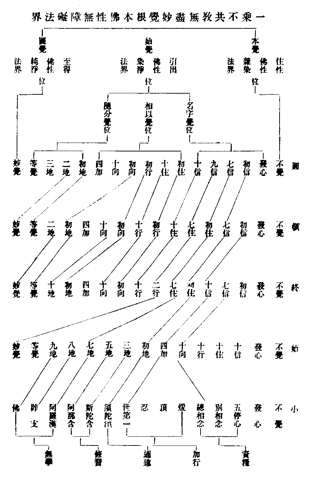

# 贤首五教断证三觉拣滥图



> **藏经**：卍新纂大日本续藏经（新纂卍续藏）　**册次** 第 58 册（X58）　**编号** No. 1026（X1026）　**部类** 经疏部　**卷次** 1 卷　**篇幅** 1,553 字

> **卷／品**：0 卷 · 0 品



---



贤首五教断证三觉拣滥图



清浙水慈云沙门续法集



门人严指较



东传三藏，迨唐始足。列祖判教，贤首方周。良由典诰既多，知见自广。约义判教，备所未备。是以后后胜於前前。贤首二十餘部，清凉五十餘部，圭山十餘部，皆详教观断证。况五教断证，原出经论。前尚未来，后尽流至。人未之察，反曰无断无证。岂不屈抑佛祖也欤。(续法)痛心，遂准贤宗诸大部中，录出断证，排图贯线。庶使学者於一家判释，明如指掌，无纤疑滞。果能从小发心，至圆妙觉。於中一一解行无谬，毕得断执障於莲华藏刹，证法界於毗卢性海。渐历顿超，又何难哉。此亦略示其梗槩耳。若欲委明宣阅教仪诸书，　三觉　三五位别，一觉性同。但能悟知顿圆妙觉，



本觉位，五教俱不觉。圆觉位小，则罗汉、辟支佛位，后四俱妙觉。始觉位，从发心极於等觉。此中复有三位：一、名字觉位小，发心至停心始等，俱十信。二、相似觉位小，别相至世第一，后四俱三贤、四加。三、随分觉位小，初果至三果始等，俱十地等觉。其间高下阶降不等，亦随当教断证以释。故此三觉五位，能判教相之权实也。



一乘不共教无尽妙觉根本佛性无障碍法界







○圆教(此教断证，如拆锦花，如镕金狮。)



(初住至妙，品数准终。但此三地，超顿妙觉，便有六十二品。)



〔本〕



不觉(谓不觉法界性也)



〔名字〕



发心(谓发普贤广大行愿心也)。  

初信(除我执分别俱生现，与小初果，始初地，终初住，顿七信齐)。  

七信(除法执分别俱生现，与小四果，始七地，终七住，顿初住齐)。  

九信(伏二执分别俱生麤种，与始妙觉、终二行、顿七住齐)。  

十信(伏二执分别俱生细种，与终十行、顿十住齐。上皆明圆伏，中伏断，下方圆断也)。



〔相似〕



初住(除二执分别俱生麤种，与终初向、顿初行齐)。  

十住(除二执分别俱生细种，与终十向、顿十行齐)。  

初行(圆断二执，分别俱生现种尽，更断习气一分，与终初地、顿初向齐)。  

初向(圆断二执习气十一分，与终等觉顿初地齐)。  

十向(圆断习气二十分，与顿十地齐)。  

四加(圆断十向习尽，进断初地习气)。



〔随分〕



初地(圆断习气二十一分，与顿等觉齐)。  

二地(圆断习气二十二分，与顿妙觉齐)。  

三地(圆断习气二十三分，顿教不知名目)。  

等觉(圆断习气三十一分，进断佛地习气一分)。



〔圆〕



妙觉(圆断二执无尽，现种习尽，在无障碍法界土，成无障碍法界佛，坐普融无尽师子座，说缘起法界法，令偏教三乘，并上上根凡夫外道，转偏成图也。)



○顿教(此教断证，如狂迷歇，如睡梦觉。)



(本品准前，此中三地亦超终妙，增成五十二品)。



〔本〕



不觉(谓不觉真如性也)。



〔名字〕



发心(谓发内证圣智心也)。  

初信(伏二执分别俱生现，与小加行始第一终十信齐)。  

七信(除我执分别俱生现，与小初果，始初地，终初住齐)。



(上皆顿伏，向下皆顿断，中明伏断也。)



〔相似〕



初住(除法执分别俱生现，与小四果，始七地，终七住齐)。  

七住(伏二执分别俱麤种，与始妙觉终二行齐)。  

十住(伏二执分别俱生细种与与终十行齐)。  

初行(除二执分别俱生麤种，与终初向齐)。  

十行(除二执分别俱生细种，与终十向齐)。  

初向(顿断二执分别俱生现种尽，更断习气一分与终初地尽)。  

十向(顿断二执，习气十分，与终十地齐)。  

四加(断前十向习尽，进伏初地习气)。



〔随分〕



初地(顿断断习气十一分，与终等觉齐)。  

二地(顿断习气十二分，与终妙觉齐。三地已去，终教不知名目)。  

等觉(顿断习气二十一分，进断佛地习气一分)。



〔圆〕



妙觉(顿断二执，现种习尽，在法性土，成法性佛。坐虗空座，说一乘真性法，令渐教三乘，并上根凡夫外道，转渐成顿也)。



○终教(此教断证，如器成金，如水即水。)



(谓初住至妙，每有四十二品，胜始教可知。)



〔本〕



不觉(谓不觉如来藏性也)。



〔名字〕



发心(谓发慈悲深直心也)。  

初信(即略伏二障)。  

七信(伏二障分别，俱生麤现，与小总相，始十向齐)。  

十信(伏二障分别，俱生细现，与小加行始第一齐)。



〔相似〕



初住(除烦恼分别俱生现，与小初果始初地齐)。  

七住(除所知、分别、俱生、现，与小四果始七地齐)。  

二行(伏二障，分别俱生麤种，与始妙觉齐。三行已去，始教人不知名目)。  

十行(伏二障分别俱生细种)。  

初向(除二障分别俱生麤种)。  

十向(除二障分别俱生细种)。  

四加(伏二障习气)。



(以上皆明具伏。二障中伏断如此，向下皆具断也。)



〔随分〕



初地(断二障分别俱生现种尽，更断习气一分)。  

十地(断二障习气十分)。  

等觉(断二障习气十一分，进断佛地习气一分)。



〔圆〕



妙觉(断二障，现种习尽，在受用土成受用。佛坐金刚座，说藏心法，令权教三乘，并中根凡夫外道，转权成实也。)



○始教(此教断证，如镜离垢，如月出云。)



(断事理二障，灭分变二死，显我法二空理，证智断二果德。初地至妙，每有十二品。)



〔本〕



不觉(谓不觉二空法性也)。



〔名字〕



发心(谓发行度利生心也)。  

十信(初伏二障)。



〔相似〕



十住(双伏二障中少伏烦恼分别现)。  

十行(双伏二障中，少伏所知分别现)。  

十向(伏除二障，分别现相资粮，空乾慧与小总相念齐)。  

四加(除二障分别，现伏分别种，及俱生现相，加行空性地，与小世第一齐)。



〔随分〕



初地(始断二障分别种，进断俱生种，现一分相，见道空，八人见地，与小初果齐)。  

三地(断二障俱生种，现三分空，薄欲地与小二果齐)。  

五地(断二障俱生种，现五分空，离欲地与小三果齐)。  

七地(断二障俱生种，现七分空已办，地与小四果齐)。  

八地(断二障俱生种，现八分空，辟支佛地与小支佛齐)。  

九地(断二障俱生，种现九分，与小佛果齐。十地已上，小教不知名目)。  

等觉(断二障俱生种，现十一分进，断佛地一分空，菩萨地相修习位)。



〔圆〕



妙觉(顿断二障，分别俱生种，现尽空佛地相，究竟位在净化土，成胜应佛。天衣座上说空相法，令小乘及下根凡夫外道，转小成大也。)



○小教(此教断证，如木作灰，如色归空。)



(断烦恼障，灭分段死，显生空理，证偏真果。)



〔本〕



不觉(凡夫地位，觉性本具。无明迷障，成不觉故。此则不觉偏真性也)。



〔名字〕



发心(谓发出界取灭心也)。  

五停心(多贪不净观，多瞋慈悲观，多痴因缘观，多散数息观，多障念佛观，此一位破障)。



〔相似〕



别相念(观身不净，观受是苦，观心无常，观法无我)。  

总相念(观身不净，受、心、法皆不净；乃至观法无我，身、受、心亦无我)。



(此上二位，唯观欲界苦谛，伏烦恼惑。)



(已上资粮位)。



煖(剏观欲界四谛，修十六行)。  

顶(用观同前，转更明朗)。  

忍。



(下忍遍观八谛，修三十二行)。



(中忍渐减缘行，乃至一行二刹那在)。



(上忍亦唯观欲界苦，於一行二刹那中，前一刹那尽。)



世第一(一行二刹那，中后一刹那，尽伏除分别烦恼)。



(已上加行位)



〔随分〕



须陀洹(断三界八十八使分别见烦恼)。



(通达位)



斯陀含(断欲界前六品俱生思)。  

阿那含(断欲界后三品，进断上二界七十二品俱生思烦恼)。



(已上修习位)。



〔圆〕



阿罗汉(断我执分别俱生烦恼尽，证生空理，住有餘无餘涅槃)。



(无学位)



〔圆〕



辟支(断见思烦恼障，与声闻同，更侵习气，故居其上。餘理果亦同)。



(无学位)



〔圆〕



佛(从初发心，发四弘愿，三祇百劫，修行种相。次入补处，托胎出家，安坐不动，发真无漏。顿断见思烦恼习气，在染化土，成劣应佛。生草座上，说谛缘法，令下下凡夫外道，转凡成圣也。)



(无学位)



庚戌春，竖录此图於单条纸上，缁素辈不粘之座侧，则易於遗失，重请方书。辛酉腊月八，再为横钞於册页，不唯令行坐可阅，而且流之远与久也。然观者须不凝滞於佛，若作迷本逐末看，竖则先上次下，横则先前次后；若作返妄归真看，竖则先下次上，横则先后次前。人但知小始终顿圆，不知圆顿终始小。今特图出之，令作两观，以见其行布中而实圆融无碍焉。



慈云灌顶行者续法题

