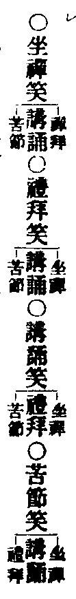

# 释门归敬仪通真记



> **藏经**：卍新纂大日本续藏经（新纂卍续藏）　**册次** 第 59 册（X59）　**编号** X1095　**部类** 经疏部　**卷次** 3 卷　**篇幅** 109,644 字

> **卷／品**：0 卷 · 2 品



---



## 目录



  - [No. 1095-A 夹注释门归敬仪序](#no-1095-a-夹注释门归敬仪序)

  - [No. 1095-B 新刻夹注释门归敬仪序](#no-1095-b-新刻夹注释门归敬仪序)



---



### No. 1095-A 夹注释门归敬仪序



释门归敬仪者，真俗归敬之洪范，事理观行之绳墨也。所以历代重之，以为龟鉴也。然今时不炽，行之何也？想其文义高奇，而消解尤难也。似蚊咬䥫牛，终无所得。故浅识庸流，不甚润如矣。在昔萧山然律师制科文竝通真记三卷，探赜显隐。然而其书也，传写误夥，文理纷焉。慕学之徒，莫不憾焉。兹有洛北朝日山比丘慧门光公者，是律苑之翘楚也。每见古典，尊唱往哲，补垂磨灭者非一二。荷法志愿，蔽乎尽际。适得通真记善本，跃然而芗拜，讐阅而纠谬。玩味往复，附记本文下。标科厥上，录为三卷。傍施和训，以便后学。杀青既竟，属余为序。余虽恐效颦之谤，不可不随喜焉。见善而不扬，吾佛之所制也。儒门之君子亦诫焉。繇旃率赘，鄙辞云尔。



旹元禄己巳觉皇成道日



於洛西密严道场不肖比丘玅辨雅谨识



------



### No. 1095-B 新刻夹注释门归敬仪序



释门归敬仪者，吾祖南山徵照大师之所制也。其为书也，文高而理渊，言简而义博，匪是所以浅学肤受之士可追精究者也。有永嘉起律师著护法记二卷，以辟其幽隐，惜乎学者欲覩其完书，未之得也，寔为缺典矣。不空然尊者所撰之通真记三卷竝科文，旧虽栞行，文句参差，写误络绎，读者病诸。予甞搜索数本，雠挍同异，其脱者补之，餘者芟之，譌者正之，疑者详之，槩归至当。而后阅之数过，掩卷熟思，隋珠赵璧为天下之至宝，苟韫匵而藏诸，则人孰得而共之？聿观诵之暇，自彊系科本文之上，会记厥下，逐章排布，萃作一书，析为三卷，颜曰夹注释门归敬仪，鸠工镂版，式布遐方。一日，有客谓余曰：了然律师撰述斯文，光显祖教，其弘宗扶教之意至矣尽矣。唯臻辨绕佛绕塔之方轨，禀承真悟之义，攘斥灵芝之说，尤其甚矣。然今公之汲汲焉弘扬斯文，讵不击其大节乎？余曰：吁！子之言实其尔。虽然，通真之为作也，其推徵解释，莫不提耳而告之，指掌而示之。若夫才观一件之麤谭，总掷三轴之全书，则焉异乎恶一茎之䆎莠，弃万把之稻䆏哉？矧又举小疵而害大醇，君子之所诫也。子岂不闻夏后氏之璜不能无考，明月之珠不能无类，然而天下宝之者，何也？其小恶不足妨大美也。后之览斯书者，不可不思书以为序。



旹元禄二禩龙辑己巳僧自恣日



芝苑后裔比丘慧门光熏盥题于朝日之华严丈室



No. 1095  

释门归敬仪通真记卷上(并序)



大宋萧山沙门释　了然　述



夫二谛同根，三宝一性，群有昧兹而逐妄，大雄由是以兴慈，开八正之玅门，示一直之平道，莫不静诸见本，显自心源，故前圣后贒，咸宗斯轨。



释门归敬仪者，吾祖澄照律师之作也。师穷三学之玅，弘一性之宗，审归敬为至道之良津，真俗乃观行之枢要，於是括三藏而广陈敬法，彰二空而圆显净心，事理该明，文义俱备。了然忝沾慈润，获奉遗言，审虑竭愚，辄申科释，文成三卷，题曰通真。庶乎通二谛之门，显一真之理，后之作者，无诮斐然云。



释门归敬仪



题中五字，通别简辨，凡有两重：一、道俗对简，敬仪乃通，释门则别。以礼敬仪轨，俗所常行，不标释门，则滥通无准。然归之一字，俗礼未闻。二、局就释教对简，餘文则释门是通，归敬为别。以净厨诰等，亦标释门。今题归敬，知下十篇，非餘法也。仪之一字，通则可知。释者，略梵语也。具云释迦，此云能仁。门者，限其内外，举物以喻宗也。归谓归依，敬即恭敬。回转等意，如下自明。仪者，法也。谓下十篇，引教立仪，楷模有则。然此敬法，通乎事理，义在下文，此宜先晓。



沙门释道宣，大唐龙朔元年於京师西明寺述。



述号中若据元本别有序题，次安述号，序文已后方是本题。今为蠧损缺於序分，故直显本题以冠于首，仍移述号以次安之。沙门释如常所闻道宣大师之法讳也，行业功勋备如僧传。大唐者，河东晋阳是唐虞旧封，至李氏高祖神尧初受周封为唐国公，至隋进爵为唐王，入隋受恭帝禅位始号唐国，臣庶尊之乃加大字。龙朔即第三帝高宗之年号也。京师者，即长安，是大唐所都之地。公羊传云：京师者何？即天子之居也。京大也，师众也，天子之居必以大众之词言之。西明寺者，长安两街有八寺，其一曰西明，显庆元年高宗为皇太子建也。二年敕授西明寺上座，大师恳辞不受，敕遣鸿胪卿刘审躬往终南礼拜迎请送上此寺，述作记处故此标之。寺者嗣也，谓治事者相嗣续於其内也。国家有九寺焉，因汉明帝永平十年佛法初到，有摩腾、法兰二尊者以白马駄经像届于洛阳，敕於鸿胪寺延礼之。至十一年敕於雍门外别建寺，以白马为名，即汉土佛寺之始，自此伽蓝因彰寺号。述者，刘勰云：作者曰圣，述者曰明。大师示谦故不言作也。



敬本教兴一(谓佛化厥初，礼仪莫识，圣法乘时，行斯谒敬。所以广引诫教，为信首之初宗，庶有不惑於教喻。)



列篇目中，前后注文不同者，以前显一篇大意，后释随篇别目，或可义同，但词有广略尔。初注中，初四句通明敬本教兴所，下三句别显今文引用之意。乘犹登也。机感相应，故曰乘时。谒者，请也。



济时护法二(谓季俗根钝，非敬不弘，故济时机，综习惟远，遂使相从奔竞，上下相遵，既不乱伦，二宝由盛。)



次二注中，初四句明济时，下四句显护法。综习惟远者，相承无替也。



因机立仪三(谓时涉浇淳，情分利钝，致立教者开抑殊途。或彼佛德高，灭罪称㝡。或此方本净，二业能明等。)



次三注中，初二句明机，致下二句立教，或下四句总显因机立教。所以浇淳乃时节之变，利钝乃机器之殊。钝者教以权方且修事业曰抑，利者令行理观直趣上乘曰开。抑，塞也。二业即真俗也。



乘心行事四(谓事在未亡，因心行用，约缘课业，条流须识。由心通三性，事染六尘，因福起罪，莫知道业。)



次四注中，初四句总显乘心行事，由下四句别示罪福之相。言事在者，烦恼现行也。因心行用者，具缚凡夫未开智解，随所造业必假行成也。



寄缘真俗五(谓法被权道，情投业理，心形两位，指月双筌。或以鄙俗浅度，不识分量，罔冐人真，实为沈俗。)



次五注中，初二句总明机教，以显事理。法者，能被之教；情者，所被之机。机分利钝，故教开权道。权以事摄，道以理济。心下二句，蹑显正行。形心属能行，事理是所行。身行事行，犹於指也；心通理观，犹於月也。身心事理，真俗竝驰，故曰双筌。或下，诫斥妄情。约篇有三：一、唯著身事，非於理解，则失在执局；二、唯著心理，废於身事，则失在罔冐；三、事理两分，真俗二路，则失在隔别。备见本篇。



引教徵迹六(谓末法根钝，多封性习，须引圣言以为教量。今以四依检行，四印徵明，无涉浮言，饰诈斯绝。)



次六注中，初四句明钝根难信，须引诚教以表非虗；今下四句，正显篇中引教徵事之理。



约时科节七(谓心行等级勤惰不恒，故立法捡心分时䇿行，是知克念修圣斯言有归，不尔流溺还同无始)。



次七注中，初四句示其篇意，正显约时；后四句引俗劝修，意存无间。



威仪有序八(谓敬相显心，䖍诚有被。今须引诚教，具列容仪，则容止若思，言词安定，不以法绳，则手足无所措矣。)



次八注中，初四句示威仪，次二句明有序，后二句结显容止。孝经云：容止可观。若下六字出曲礼，彼云：俨若思，安定词。



功用感通九(谓业假行成，功由心起，心怀染净，业亦真虗。此由想见未清，善恶交集，不示缘报，迷滞难明。)



次九注中，初竝功用，后二句示感通。



程器陈迹十(谓听言观行，时俗罕依，故立条例，以清心路。)



第十注中，听言观行，文出论语，借以显意。谓听其言而观其行，则少有如说而行者。故不获已，托事兴言，岂直自贻，将济来学也。



敬本教兴篇第一(谓兴立敬本，非正信而不弘。无信必不兴敬，有敬必先怀言。篇明信本，敬随后生故也。)



释敬本教兴篇。篇名中，敬即礼仪，必由心起。本字正诠於信，信即是心。由信为归敬之本，故云敬本。教者，贤圣被下之言。兴者，发起因由之谓。教兴之意，通别有殊，备载本篇，此不委示。篇者，戒疏云：章品之佳名，分段之别目，流类均等，义齐一也。第者，居也。一者，始也。此既居先，故称第一。(篇字已下，复可例释。)注中，初二句总明敬本教兴，次二句反覆推释，后二句结示篇意。以敬非信而不成，信非教而不立。若然，则信必因教而起，教实为信而兴。注云兴立敬本，则教兴之意可见也。



序曰：自法王之利见也，必以静见为先。故论云：何处何时谁起此见，一切诸见悉断。故文良证也。



本文初段中，序者叙也，叙述敬本之宗要，及教兴之因由。曰者辞也，将明教本，必假言通也。(下去例同此解。)初二句正叙，上句指人，下句示意。法王是佛，简异世主，故称法王。法华经云：我为法王，於法自在，乘机出世，故云利见。周易乾卦二五两爻，皆云利见大人。彼以圣君登宝，必合时心；此以能仁降灵，宜应机感。故待时而兴，适机而应，群生利见，不亦宜乎？故借儒经，以明垂应。言静见者，静属教主之心，见乃众生之病。然见病虽多，我见为本。由凡夫无始，依真起妄(无明)，由妄计我(人我法我)，由我起见(谓我见等五利使惑，及断常等六十二见)，由见发毒(谓贪慢等五钝使惑)，由毒造业，随业受报，轮转无休。是以世尊为静此见故，於最清净法界，流出正体智，从正体智，起后得智，从后得智，起大悲心，从大悲心，现应化身，从应化身，流出诸教，谓三归五戒谛缘度等种种法门。虽事理偏圆，任机而设，原其本意，皆为静见，同成佛道。由未出世，先建此心，及后立言，咸酬素愿，拔他病本，畅我己怀，故云必以静见为先也。故下，次引证，文出中论。彼偈具云：一切法空故，世间常等见，何处於何时，谁起此诸见？此偈显诸见本空也。又云：瞿昙大圣主，怜愍说是法，悉断一切见，我今稽首礼。此偈世尊设教，令人静见也。



然则习熏日久，取会无由。事须立敬设仪，开其信首之法；附情约相，显於成化之功。



教兴初科中，初二句叙机迷。习之一字即是无明，无明力故起念熏习，於本识藏成见慢种子。无始至今经流长劫，故云日久。未遇良师不反性觉，故曰取会。无由事下四句明设教。此即下文所立之法。立敬者，如本起初生竝三归等法，成立归敬之本也。设仪者，如佛见瓶沙王经等，示礼敬之正仪也。由此敬仪始开物信，故曰开信首也。附情约相者，如智论中位列敬相，附彼凡圣道俗之情，以教道初行事须立法，用成化导之功也。是知佛慈宏博法乳恩深，怜其著我之徒，开兹静见之法。母胎初降即显化仪，道果始成便立归法。今回邪见使住正流，初乃求他佛之冥加，终则归自心之本净，由斯引导毕至佛乘。故知归敬一法为入道之根本，趣涅槃之极致也。归敬兴意大略如斯。



然后肝胆涂地，形骸摧折。知宇宙之极尊，则敬逾天属。(以父母生身也，报施在於一生。佛起法身也，醻远终於累劫。或功高难赏，德深不谢，慧深益厚，非醻所及也。)晓教义之远大，则道越常途。(以七略被时，立身立国之政，沦历於三有也。八藏所宗，亡空绝有之法，毕超於九居也。)



次科初二句，显能敬诚慇。肝胆涂地，表情之切也。形骸摧折，节身之至也。知下四句，示所归道大。初二句，见佛起敬。次二句，闻法悟道。初中十方三世，唯佛特尊，故曰宇宙极尊。天属是父，以父比佛，佛德更高。既知境尊，敬宜倍父，故云敬逾天属。言宇宙者，郭象云：天地四方曰宇，往古来今由宙。注中前二句，明父母德浅。生我色身，功止一世。虽云恩重，而实可酬，故云报施等。佛下二句，显圣主德高。起我法身，功超累劫。其恩罔极，其德难酬，故云酬远等。或下四句，示佛德深之相。三祇积行谓之功，万行所成谓之德。慧深照理，玅尽觉源，故益厚。利物度生无极，故不赏。语出汉书蒯通说。韩信云：足下挟不赏之功等。次下晓谓开悟。教是能诠，义即所诠。文义所诠，意存出有，故曰远大。因闻开悟，道证无生，故云道越常途。道即三乘所证之道也。注中初三句，示世法常途。后三句，明佛教远大。初言七略者，辑略(辑音集，即诸书总要)、兵书略、六艺略(礼乐射御书数)、诸子略、诗赋略、术数略、方技略，斯竝立身立国之异谋。然非出有之至道，故曰沦历三有。次言八藏者，三藏加杂，大小各四也。亡空有者，显中道故。超九居者，出三界故。九居即三界，分九地也。问：所敬三宝，何不言僧？答：闻法开悟，谁曰非僧？



观斯以言，则识形心两途，事理双轨。



总陈教意举总要中，初科初句蹑上生起。观者详覧之谓，能观在於大师。斯者指法之辞，所观属乎圣教。此指前科见佛闻法，身心行事开悟正理，即本此教以述今文，故举大纲令知宗要。则下正举，初举形心示能敬也，次举事理明所行也。能行色心依正二位虽曰两途，所行事理真俗竝运，故曰双轨。双二合也，轨车迹也。此四者实一部之大宗，即唯识之正观也。然事理两行通能及所，若约所行，礼佛诵经等名事福也，观法无我等名理观也。若就能敬，色心二报一往配属身事心理，此乃常俗所谈，至理而求实乖圆观，略见下科，委如第五。



形则缚於俗习，苦阴常缠，故当折挫以归依剖㭊。剖㭊，观其慢惑也。



圆配中，初科。初二句示过患。形即是身，本唯识有，业惑所牵，故缚於俗习。报属苦果，故苦阴常缠，报此为实。计有我人，即遍计性。故下，次出对治。初以事治。折挫谓息於慢情，归依谓尊他胜境。故下文云：谓此形仪本唯识有，迷於本习，妄见我人，故须徵研，令行敬养，令见我身。俯仰上下，唯尘生灭，来往屈伸，此随俗也。剖下，次以理治。剖㭊二字，即是观法，观行修舍，故重言之。观慢惑者，以智破障，知身无我，即翻遍计，成无相性。下文云：重观此身，但尘非我，妄谓我所，能有行敬。据此一理，名通真也。



心则封於迷倒，倒在生常，故须镜生灭以惩之。追想。追想，知其妄著也。



次心中初二句示过，心即妄识体本真理，违真起念谓之迷，逐念攀缘谓之倒，迷倒所缠习俗难改，故曰生常亦遍计性。故下次出对治，初以事治，镜取照义，照察此心性本无念，念起成妄妄故生灭，欲止生灭无如息念，故曰惩之，惩即止也。故下文云真本非心，今随心起名随俗也。追下次以理治，追想二字即是观法，追即随也，想即念也，念起即知随念随觉随舍以至无念，故重言之。知妄著者，以智破惑惑亡念静，即翻遍计成无相性，故下文云知真非心名通真也。起信论云推求五阴色之与心，六尘境界毕竟无念，以心无相十方求之终不可得等。问：形心各有境智真俗两分，岂曰竝观同成唯识？答：行布四门圆融一观，善须思之。问：折色求空观法无我，教属小乘岂通圆观？答：如后正观委明。问：慢惑妄著同异如何？答：惑体是同无非集谛，但慢相高倨故就身论，究其集因实皆心惑。



深惟四山恒逼，非念念而莫知切於身也；八倒缠绵，非新新而不晓节於心也。



徵推中，初科初三句警身，八下三句警心。竝以初句示过患，次句劝对治，后句结嘱。四山即生老病死。涅槃经云：我昔告波斯匿王云：大王！有亲信人从四方来，各作是言：有四大山从四方来，欲害人民。王若闻者，当设何计？乃至我说。即是生老病死。常来切人等八倒，即凡夫二乘各具四倒，二四合言故曰八也。以凡夫外道於心计常、於受计乐、於法计我、於身计净，是谓无常计常等为四倒也。故佛以四念处观治之，谓观心无常、观受是苦、观法无我、观身不净。二乘之人执此为极，佛於最后了义教中显以四德令成佛道，则知法身不灭是为真常，涅槃寂静是为真乐，身心不二是为真我，本性无垢是为真净。方显二乘常计无常犹属四倒。非字义当为不，念念新新竝目观行。切谓激切，节谓诫励。



所以剖㭊静於慢惑，非爱断者所欣；追想厌於妄著，是异生者所背。



次中，初二句重示身观，显非外道所行；后二句重示心观，显非凡愚所乐。爱断乃外道之计，异生即凡夫之性。外道计於我宰多起憍慢，今既静慢故非所忻；凡夫封於情见多生妄著，今既厌著故是所背。又可凡夫外道映互其人，非忻是背左右其言。



固当抚揽诚教，以法𫄙徵，则生身不徒委於下尘，无识不徒生於上趣矣。



示劝揽教中，揽诚教者，发正解故。以法徵者，起正行故。𫄙，督责也。徵，证明也。则下，示功益。初句有智修敬，则不虗丧人身。次句无智不修，则不空生上界下尘恶道也。喻出涅槃，文如下引。无识，谓无出道之智识也。



敢序斯致，引文证之。



小乘论云：敬者，以惭为体也。由我德薄，前境尊高，故行敬也。今反无惭不耻，深可笑也。大乘论云：由信及智，故敬於彼。信故非邪，智故兴敬。



引文明敬，本初科初。小论通标，义该诸部。初句标定；由下，示意。然诸小论未见明出敬体之文，唯心所法中惭之一法。意云：於有德，其心谦下，崇重贤善为性。即是此中前境尊高之义。推敬由惭，惭即敬体。今下，反责。大乘论者，亦是通指，不具引文。准百法等论，善十一中有信一法，别境之五中则有胜解。胜解即智，二皆心所。彼疏释云：何者为信？谓於实德深忍乐欲，心净为性。信有三种：一、种实有，谓於诸法实事、理中深信、忍故；二、信有德，谓於三宝真净德中深信、乐故；三、信有能，谓於一切世、出世善深信有力，能得成就。又云：忍谓胜解。此即信因。信下，反释，如涅槃中信、智相资。文如下，引证。



故引诚教信智及惭敬之本矣。



本起经曰：佛初诞降，周行十方，举手指天地曰：天上天下，唯我独尊。(以时俗所重九十六部，号为大圣人天师也。为绝邪归正，故示此相。唯佛独尊，餘皆邪道。既曰尊严，归依弘护，非信敬之不成。)三界皆苦，无可乐者。(三界众生，三苦交集，无思厌背，贪附更深。故立此言，令兴厌离。有厌苦身，令思苦本。观达业惑，深是苦因。不没诸见，便得解脱。餘则以苦舍苦，长沦苦中。)



教兴。初段信首宗本中，初科初经中，文有两段，义如注显。初段注中，初示邪师。九十六部者，多论云：六师各有十五弟子，师资合论有九十六。为下，示正宝。既下，结显。次段注中，文有四节：初、示众生著苦。三界众生总该六趣三苦，谓苦苦(五阴有漏)、行苦(四相迁流)、坏苦(乐尽苦至)。故下，二、明佛示言教，即三界皆苦之语。有下，三、明因教。开悟苦身即是苦谛，苦本惑业即是集谛，厌思观达即修道谛，便得解脱即证灭谛。是则世尊为信而兴教，众生由信而致敬。信敬既成，诸见则息，静见之旨於兹显矣。餘下，四、示邪法增生。如诸外道炙身卧棘，苦行节修，虽受勤劳，终无出离。法华经云：深入诸邪见，以苦欲舍苦，乃坠於三恶道等。



此之一经，成归敬之本也，定信守之宗也。理须依凭托附，以登高原之趣也。



次科。初正结。由佛初生，示此胜相，故为敬本。决邪归正，故为信宗。有本作守，非。次理下，劝信。高远之趣，即三乘圣道也。



故论云：归依者，回转之语也。由昔背正从邪流荡生趣，今佛出世兴言极尊，遂即回彼邪心转从正道故也。



三中，初科。因上绝邪归正，故引多论以示归意。初举论文。由下，示意。初示随流义。弃舍三宝曰背正，随顺魔外曰从邪，由此沈迷还沦苦海，故曰流荡生趣也。今下，明回转义，反上可知。兴言极尊者，指上经中之语也。



於是乃立归法，有五等之差，始於背俗之初，终於入道之极，皆归三宝，以为心师之迹也。所归极矣，所为大矣(谓初以身从，终除心惑故也)。



次立法中言五等者，准母论云：翻邪三归、五戒三归、八戒三归、十戒三归、具戒三归。文举前后，意含中间。由八年已前三归言下，即发具戒，故得通言皆归三宝。心师。萨婆多云：我教谓心师也，他教谓师心也。所师极者，佛最尊故；所为大者，除心惑故。然经明胜相，乃初降诞之法仪；论示正归，即始成道之鸿范。无非本始，皆定信宗。



安得傲然，情无慑惮。况复加以谤讪，流言通俗，自沈苦海，出济无期。重使身心恶习，念念逾增；亦使威仪失节，时时结业。覆器之喻，尘露於目前；捕鼠之诬，频繁於胸臆。可不诫欤！可不诫欤！



三科中为三：初四句过通三业：初句身业，次句心业慑(之涉反，心伏也)，后二句口业，对其道俗自出过患污彼净心。自下次六句重资三道：初二句报道，次二句增长恶习即烦恼道，后二句破坏威仪即是业道。覆下三引喻伸诫。初喻智论第十五云：佛子罗云其年幼稚未知慎口，人来问之：世尊在否？诡言：不在。若不在时诡言：佛在。有人白佛，佛语罗云：澡盘取水与吾洗足。洗已语言：覆此澡盘。如勅即覆，佛言：以水注之。注已问言：水入中否？答言：不入。佛语罗云：无惭愧人妄语覆心，道法不入亦复如是。次喻佛藏经云：佛告舍利弗：譬如蝙蝠欲捕鸟时则入穴为鼠，欲捕鼠时则飞空为鸟，而实无有鸟鼠之用，其身臭秽但乐暗暝。破戒比丘亦复如是。论以覆器喻不纳法，合今憍慢不敬过，由不闻法故。经以鸟鼠喻破戒，合今三业失仪，义同破戒。尘露谓过状显也。频繁谓此徒多也。目前胸臆皆言可见。



又依佛见瓶沙王经曰：如来於伽耶山成道，度迦叶已，念瓶沙王昔有先请，将诸徒众往赴彼国。王及士众并沙门(或云桑门、沙门那者，竝是天竺道士之佳号，俗中之常目，亦是彼国修净行者。此云净志，以义目之)，初闻佛至，皆悉远迎，未知礼敬。或有礼足而坐者，或举手问讯而坐者，或称姓名，或叉手合掌，或默然而坐者，皆疑迦叶是宿旧师，今从佛来，未知谁为所依者。迦叶知已，欲决众疑，升空而下，礼敬佛足，以手摩扪，以口呜之，自云：佛是我师，我为佛之弟子。又持扇在佛后摇之。



敬仪萌兆中，初经示正仪，文有六节：初成道度人，二念下念赴王请，三王下王众远迎，四未下各伸礼敬，五皆下覩相生疑，六迦下决疑示敬。伽耶亦云耆阇崛，此云灵岳。迦叶此云饮光，即郁鞞罗等三迦叶也。瓶沙即频婆娑罗，此云最坚。由此国王先有期约，今既成佛故思往赴。注中沙门目於外道未知所依者，以迦叶兄弟佛未出时为众师傅，今从佛来师资未决，故众怀疑。



此第二经，明礼敬正仪之萌兆也。



结示中言萌兆者，谓此敬仪最初立故。



文中不足有者，言之手摩口呜者，爱重之极，不能已已也。远敬在於所卑，故始於足。自餘称名显相，使疑者决之，非正敬也。



点解中言不足者，正仪极多，非止手摩口呜而已，且据此经有者言之尔。称名即自言佛是我师，显相即摇扇等，此但决疑，义非正敬，则显礼足等相是正仪也。



智度论云：外道是他法故，来则自坐。白衣如客法故，命之令坐。一切出家五众，身心属佛，故立不坐。若得道罗汉，如舍利弗等，皆坐听法。三果已下，竝不听坐。以所作未办，结贼未破故。



位列敬相中，初引论文，其相有五：初、是外道；二、是白衣；三、即出家凡夫五众；四、是无学；五、是学人。坐立之相，在文易了。言外道者，俱舍云：学乖谛理，随自妄情，不反内觉，故称外道。所作未办者，谛理未精故。结贼未破者，细惑犹在故。



此第三文，明位列敬相也。



今有安坐像前，情无敬让，可谓无事受罪，枉坏身心。如上三果尚立，况下凡乎？像立而坐，弥是不敬，比今君父，可以例诸。故知遶旋行立，为敬故行，安得长傲，礼忏获罪？



诫劝。初科为四：初、正伸诫约；二、如下，以圣况凡；三、比下，以俗例道；四、故下，显正抑非。行字，音杭。



此言易矣，临机难哉！常志在心，努力制抑，方可改革。不尔，虽读不救。常习思之惟之。



劝行中，初二句言易行难常，下二句正劝。不下，有言无行，空说无益。



故增一阿含经云：无恭敬心於佛者，当生龙蛇中。以过去从中来，今犹无敬，多睡痴等，斯为良证。



引证中，初将因验果；合堕龙蛇以下，以果推因，犹承故习。



大悲经云：佛过去时，行菩萨道，见三宝、舍利、塔像、师僧、父母、耆年、善友、外道、诸仙、沙门、婆罗门，无不倾侧，谦下敬让。由是报故，成佛已来，山林人畜，无不倾侧，礼敬於佛。



致敬因本中，初科。初示因行。过去时则该摄三祇，菩萨道则统收万行。见下，局就敬论，是今本意。所敬之境，无论道俗，不简冤亲，如常不轻，其事可证。由下，次示果德。报即酬因义也。倾侧谓倾动侧让也。



此第四文，明致敬之因本也。



如俗礼云无不敬，俨若思，安定词傲不可长，欲不可纵，志不可满是也。



类显中文出礼记，初句正合今文，餘竝因引。俨若思，谓心有所主。安定词，谓口不妄言。傲不可长，则诫其憍倨。欲不可纵，则抑其耽荒。志不可满，则惩其自伐。



依经律论，明立敬仪。



因明相敬中，初科。经论未详何文，律即四分，存亡敬相，竝如下引。



佛告比丘：汝等共相恭敬迎逆问讯，从何为始？比丘白佛：各言其志，或云大姓贵族者，或云神智高达者，或云佛所宗亲者，或云道登圣果者，以事举之。佛言：汝等所言，皆是长慢无可观者，应随顺法训流布於世，於我法律更相恭敬，佛法可得流布。



别示中。初律示。初科中。四分房舍犍度云：佛从王舍城与诸比丘人间游行，诣毗舍离，而六群先往取房舍，与和尚亲厚等。时舍利弗、大目连后至，不得房，卧埵上，因集众诃诫已：汝谓谁当受第一房、第一水、第一食？弟子白佛，各言其志，如文所云。大姓贵族者，恃豪势故。神智高达者，矜智能故。佛所宗亲者，倚亲厚故。佛下，总责所答乖理。应下，佛示慈诲，令遵法则。礼让不亏，则三宝可久。



敬仪有四：道不礼俗，一也；僧不礼尼，二也；守戒者不礼犯戒者，三也；前受戒者不礼后受戒者，四也。自餘五众，存亡乃殊，皆约年夏次第而设敬也。



示敬仪中文列四种，其相可知。自餘等者，上通道俗，今据出家，故言五众。存则各相恭敬，亡则设礼塔像，具有法仪，竝如律钞。



因引古事，昔有鵽鸟、猕猴、大象，同在一林，以为朋友，乃相谓曰：先生宿旧，礼应供养，如何同住，不识礼敬？象云：我见此树，生齐吾腹。猴言：我曾蹲地，手挽树头。鸟言：我於远林，食此树子，堕出而生，我应最长。即时大象，背负猕猴，鸟在猴上，周徧而行。仍说偈云：有敬长老者，是人能护法，现世得名誉，将来生善道。於是人皆効之，悉行礼敬。诸有智人，以喻取解。



三科亦出四分，智论亦同。初示三畜共林，表同义聚。乃下，评章礼仪，合识尊卑。象下，各述元由，使知前后。诸下，结告。



经云：恭敬於塔庙，谦下诸比丘，远离自高心，常思惟智慧。又云：若有智慧，则无贪著。今贪慢而著随，则其愚不可及也。



二中，初引二经皆遣慢著。初是法华，初句奉佛塔庙，次句同辈相遵，三句以恭去慢，四句以智遣著。次即遗教。今下，伸诫。既有我慢，则贪著随之。愚不可及，文出论语，借责愚人不用彼意，谓愚而贪慢，诲不可及也。



济时护法篇第二(谓护持济物，非三宝而不隆)。



释济时护法篇。篇名中，济谓济慧，时谓时机。以三宝为能济，时机为所济，故曰济时。又以时机为能敬，三宝为所敬，能所相济，上下遵行，则法流长劫，故曰护法。注中，上句示篇名，下句显篇意。



序曰：夫以立像表真，恒俗𢑱训，寄指筌月，出道常规。



本文初科。此篇广明四种三宝，理体冥寂，非相莫显，故於篇首，略叙大猷。上二句，约儒教明。如国家宗庙，设像奉先，事载儒经，故云恒俗𢑱训。𢑱，常也。下二句，约释教明。圆觉经云：修多罗教，如标月指，喻出内典。故曰出道常规。



但以妄想倒情，相㳂固习，无思悛革，随业漂沦。是以经言：为善若登，清升若爪之土；为恶若崩，沈滞如下之地。此言在斯，诚为极诫。



发起元由中，初科。初四句将立后法，先叙迷情，欲显三宝为兹而设。妄想是惑，倒情是见，即是下文见爱烦恼。妄想绵续，谓之相㳂。我见铿然，谓之固习。无思悛革者，不能反流故。随业漂沦者，甘受轮回故。又初句起妄本，次句润妄业，三句执妄情，四句受妄果。是下，次引经伸诫。然为善若登之语，本出书传，加汉书张纮与子书云：从善若登，从恶若崩。今与经喻合而用之。喻文出涅槃，彼云：尔时世尊取地少土置之爪上，告迦叶言：是土多耶？十方世界土地多乎？迦叶菩萨白佛言：世尊！爪上土者，不比十方所有土也。善男子！有人舍身还得人身，舍三恶身得受人身，诸根完具生於中国，具足正信修习正道已得解脱，得解脱已能得涅槃，如爪上土。舍人身已得三恶身，乃至不得解脱常乐涅槃，如十方世界所有土也。此下，伸诫。



何以知耶？但以慢山上耸，俯视於人物；我室四蒙，包藏於见爱。慢无纳法之实，经明覆器之宾；我有怀著之功，论显纳烟之义。器仰无思不服，有服必拔慢根；室坏便归太虗，见爱安形无地。理例然也。背此非凡，所行情事得也；乖斯是圣，游履适化然也。



次中，初句徵。谓何以得知妄习难改耶？但下，释。文有三节：初八句，执妄致迷；器下五句，翻迷显悟；背下四句，总约迷悟以格凡情。初中，初四句示过本，即我慢、二惑。慢有三种：我慢、邪慢、增长慢，即五钝之一使也。由慢自大，故上耸如山；陵懱於他，故俯视人物。我有二种：人我、法我。主宰为义，即五利之总相也。能藏见爱，喻之於室；迷执不通，喻若四蒙。见谓见惑，八十八使见所断故；爱即修惑，八十一品修所断故。是则我室为能藏，见爱为所藏。故事钞云三毒所起，我心为本是也。后四句显过失。慢有自高之失，故不受道法，喻覆器也；我有怀著之失，能藏见爱，喻纳烟也。文言论显，未详所出。(旧记引智论云：牧牛人问佛：几法成就，能令牛群番息？佛言：有十一法。乃至第五云：知作烟者，除诸蚊䖟。牛遥见烟，则来趣向屋舍。比丘亦尔，如所闻而说，除诸结使蚊䖟，以说法烟引众生入无我实相空舍，恐不合文意)。又解：我有怀著，怀著有二：若著恶法能成妄业还资我本，此著有过意如前解；若著善法引生理观，观成遣著反能害我，此著有功分堪资道。若作此释，即此二句亦是显悟，却引智论烧烟之喻方顺文意。次中上二句翻慢山过，谓器仰有纳水之功，合显慢倾能受教法。下二句翻我室过，谓室坏有散烟之用，合显我空则见爱不存。理下一句结云理谓道理，文以喻显故曰例然。三中背与乖字皆目能治之观，即是器仰室坏也。此与斯字竝指所治之惑，即是我室慢山。以我慢顺迷、观智顺悟，以悟反迷，故曰背此乖斯。非凡所行是圣游履，文绮交映翻对可知。情事得者，情即凡夫之心，事谓所修之行。言此理观虽非凡行，今以凡心对事起修，冥符正观有所悟入，故曰得也。适化然者，受教法故。



然则封迷长劫，佛世有退席之人；不识分量，季俗丰轻生之士。此竝不思之徒也。



三中，然字印可上文，义当如是；则字评量后事，意谓未然。故引不思之徒，以彰难化之理。初示久迷。法华经云：汝既三请，岂得不说？汝今谛听，当为汝说。说是语时，会中五千人等，礼佛而退。此辈罪根深重等，岂非执著我慢，长劫难清？佛世尚然，况今末浊？不下，示轻信。大师云：冒染大度，罪福本空等。此竝不思之徒也。



当知我身属於他缘，冥冥不知来处。我神属於惑业，忽忽莫测何心。经云：命如风中灯，不知灭时节。今日复明日，不觉死时至。冥冥随业缘，不知生何道。此至言也。乾豆莫干其虑，吁可悲哉。



四中，初四句牒二报以示妄，令息妄以从理。当知二字，即警诫之辞。身是色阴，四大缘假，故属他缘；不了集因，故不知来处。圆觉经云：我今此身，四大和合，乃至四缘假合，妄有六根等。神即是识，识含种子。由种起毒，即烦恼道；由惑起业，即是业道。忽即是念，念通善恶。三性难均，故曰莫测。何心经下，次引文证，出坐禅三昧。经具云：今日营此业，明日造彼事，乐著不观苦，不觉死贼至。又云：谁能知死时，所趣从何道？譬如风中灯，不知灭时节。文究往因，云不知来；经推来报，云不知去。此下三句，指经伸诫。乾豆是喻，事出涅槃。彼云：譬如豌豆，乾时锥刺，终不可著。烦恼坚硬，亦复如是。莫于其虑是法说，于犹涉也，虑即是心。谓烦恼坚固，道化不入于心，合上乾豆，锥刺不入。



且自等智有三，我同牛羊之智，出道唯一。牛羊异我，非伦人道。道缘不行，还同畜兽。兽道报重，顽厚非其所闻。



五中初科。初二句总示。等智有三者，涅槃经云：一切众生於三法中皆有等智，谓婬欲、饮食、恐怖。次二句别示。人中有出道智，异於牛羊故曰非伦。人下责劝。初示人道是修道缘，今若不修自同畜兽。兽下次示畜生无出道智。受形鄙秽故云报重，烦恼浊钝故云顽厚。顽即痴也，痴因偏重多堕畜生。



今既形有轻清，识心机举，猒劳生於往劫，欣解网於将来。固当立像表仪，倾尘聚而顶礼；寄缘引领，荡烦累於新心。是则情异牛羊，乘明智而弘道；身如木石，假雕琢而成器。可不然乎！可不然乎！鼠入角而至穷，更知何趣；名引言而显实，理极於斯。况复五滓交横，四山常逼，而能安忍於时事，还是昏昏之所媚乎！



次中，初约报䇿修。形轻清者，异报重故。心机举者，异顽厚故。机谓圆转，举谓超越。慨昔轮回故须猒往，期后乐报故须修来。固下示其修法。立像谓陈其所敬，寄缘谓托其修法，倾尘谓折挫报形，荡累谓清澄心惑。是下结益。鼠下伸诫劝，有三：初约喻劝。事出谚语，事浅意深故引为诫。名下举文劝。引文用意志在遵行，名引写倒合作引名。况下举时劝。五滓即五浊也。四山如上所引。而下二句反责安忍时事。顺故业也。昏即迷时。媚犹惑也。



所以大圣知时，通化陶诱。立正三宝，导浊识之所归；开明四印，示迷生之不昧。固得住法万载，功由归敬之勋；神升四天，谅藉传扬之力。广如慈经所出，岂虗搆哉！



立宝彰益中，初科。初六句示佛立教法。大圣是佛，通合作适，谓顺机也。陶谓陶甄，诱即接诱。正三宝者，简邪师故。导浊识者，引初机故。四印即十诵四墨印。彼第五十八云：佛何故说四墨印？答：欲说真实法故，来世比丘当了了知是佛说、非佛说等。广文如彼。墨即文句，印谓证明。由教印心，不生谬解，故云不昧。固下，次示功益。初则住法益，神下得报益。归敬传扬，文虽单举，义实兼收。慈经即弥勒上生经，文如后引。



今此之述，本被后进之初心；曲授称功，体非前良之早虑。固须叮咛指掌，铺𫌨相状，识三宝有数种之权谋，解七众无贰师之希向。言唯质露，意在修行，想有识者，知无繁於翰墨。故佛言：吾言不在绮饰，令人受解为要。敢附斯辙，笔记序云。



述作中。初科欲立四种三宝，恐谓繁广，故先示之。既被初心，故须委曲。前良立教，多被利根，文体简约，故非所比。早犹先也。虑即是心。𫌨(落戈反，𫌨缕也)数种，如下所示四种之相。权谋谓权巧谋略。言七众者，通收道俗，同崇正宝，故无异向。而言解者，开导之谓。言下，示文体。故下，引文证。敢下，依法陈情，取信於后。



今於此篇显三宝相，相随见起，随机四位：初谓一体，二谓缘理，三谓化相，四谓住持，各有名相。



三宝相状中，初科初四句总叙，初下别列。言随见者，见即机见，机分大小迷悟之殊，见亦隐显有无之异，故此三宝随见而兴。约其性具，迷悟本然，故说一体。简迷存悟，独显法身，故有理体。众生有见，佛因佛即，随缘出现，故有化相。浊机障重，不及化源，薄有餘资，堪承遗像，故立住持。约时为言，一体、理体三时同有，化相唯局佛世，住持义通初后。就人为言，一体凡圣同具，理体唯在圣人，化相住持凡圣同见。据教为言，一体唯局大乘，餘三义通大小。随其经教所说异故，随机之义於焉著矣。



初言一体三宝者。



一，是非二之名。体，谓本识之谓。



一体释名中，一体之名，文虽自释，及解非二，古说多差。今释此文，略存三义：一、简相释。体虽是一，约相分三，恐谓随相亦有三体，故此简之，云非二也。戒本疏云：今了法本，理实无三(云云)。二、遣数释。随俗谈数，一是数始，从一至二，以及百千。今此一体，孤然独立，本无对待，强借一名，以诠自性。恐闻此一，谓同诸数，於一体外，有二可对，故此遣之，云非二也。故古德云：借一遣二，即其意也。三、显实释。一是心真，诸法中实，一实之外，餘则非真，故云非二。二既是非，即显一实。故大师云：诸法本无，实唯有识(云云)。言本识者，梵语阿棃耶，或云阿赖耶，此翻为藏，或翻无没，谓能藏种子，任持不失故。而言本者，本即体义，染净因果，依之生故。问：心体、本识，同异如何？答：心体就性而彰名，本识从相而立称，一理一事，其异可知。若尔，戒疏体是心体，此文体是本识，既曰妄真，文何偏举？答：名假言诠，言不竝立；名诠自性，表显不同。识既从相以得名，故须从相以解义。统论正理，则真俗圆收；言本识，则妄彻真源；举心体，则真该妄末。由兹圆具，故得互标。况下释文，明言心体，好思正理，切勿迷名。



但以无始心体，性净如空，妄想客尘，封迷随染，致使相从至于今日，经生历死，无由猒晓。



示体中，初科初二句示心体。心即八识，体是真如，即相之体。自性清净，故曰性净。不同餘空，治之令净。佛性论云：清净有二：一者因中无染清净，二者果上无垢清净。一体在因，即无染清净。虗空是喻，以具周遍不动等义，故此比焉。然空但顽虗，性有神解，故非喻所及。即戒疏云：本来无染。业疏云：要识心本是大乘理，其体清净，玅用虗通。正观文云：观察自心，自性清净，非空非有，非染非净等。是知心体本识，体相圆融。多见有人，才闻唯识，便云事观，辄随己见，排斥祖乘，引悮后昆，轻毁先德。勉咨来哲，熟览斯文。则知上以本识标名，下以净心释体。性相圆具，真俗无乖。良由雄文奥义，理须极思研精；玅观圆门，旨在深游善解。谀闻寡学，焉足言哉！妄下六句明识相，即真如随缘之义。初二句妄起。元因妄想，即是无明。其性不住，喻之如客；染污真性，名之曰尘。封迷谓妄起覆真，随染谓真随妄动。致下二句，随缘流转。即性之相，同一生灭，故曰相从。经下二句，著妄不反。问：心体既净，何容妄染？答：凡夫性体，真妄同源。染净未分，致容妄起。故无明起时，全真成妄。非谓真外别有妄法来染净心。水波金像，可以为喻。净心诫观云：生死烦恼，从真性起。喻如大水，本净湛然。为因风故，遂生波动。后因大寒，乃结成氷。众生佛性，本净如水。由觉观风，波浪生死。贪爱坚固，成烦恼冰。起信论云：依如来藏，故有生灭。所谓不生不灭，与生灭和合，非一非异，名阿棃耶识等。问：妄起遣真，妄自生灭。真源不变，何说随迷？答：随缘义故，真逐妄流。问：真既成迷，何云本净？答：不变义故，性自天真。问：真如凝然，法身生灭。教宗天别，性相岐分。今此仪文，为当何义？答：性宗教义，文旨焕然。问：相宗生法，则八识种子。性宗起妄，则真性随缘。今一体示名，但言本识。岂同法性，妄起由真？答：前已广明，可自思取。



故经云：诸法本来性相空寂，众生妄计彼此得失，轮回生死不得解脱。经云：一切众生竝有佛性，即我本识出障嘉名。迷故曰凡，悟便名圣。所以贫女宝藏、力士额珠，性常清净有而无用，为惑所覆无由光显。如经深丛覆宝移流杂味，然其本性光淳无玷。



次引证。初文出胆察经，初证性净如空，众生下证从真起妄。又经即涅槃如来性品，初二句正举经文，即下释示经意。经中佛性即我本识，佛翻为觉，即果德之嘉名；识属妄心，乃凡夫之因号。今居凡位即显觉名，则知烦恼心中佛性未尝不觉，迷凡悟圣但名移尔。宝藏额珠竝以喻显，事出涅槃。彼云：一切众生悉有佛性，常为无量烦恼所覆，是故众生不能得见。如贫女舍多有真金之藏，家人大小无有知者，而有异人善知方便，即於其家掘出金藏。善男子！我今普示一切众生所有佛性为诸烦恼之所覆蔽，如彼贫女有真金藏不能得见。等力士额珠者，涅槃经：譬如王家有大力士，其人眉间有金刚珠，与餘力士捔力相扑，而彼力士以头低触，其额上珠寻没肤中，都不自知是珠所在。其处有疮，即命良医欲自疗治。及至酱时，执镜以照，珠在镜中，明了显现。等性下二句，释上二喻。以宅宝额珠，性常不变，土肉障之，故无用也。为下二句，合上二喻。惑则双合土肉，光显别合珠藏。深丛覆宝等者，亦出涅槃。检经唯有药喻，彼云：善男子！譬如雪山有一味药，过去往世有转轮王，於此雪山为此药故，在在处处造作木筒，以接是药。是药熟时，从地流出，集木筒中，其味真正。王既没已，其后是药或酸、或醎、或苦、或辛、或甜、或淡，如是一味随其流处有种种味。是药真味留停在山，犹如满月。凡人薄福，虽以镢(居缚反，锄也)刘加功囷苦，而不能得。复有圣王出现於世，以福因缘，即得是药真正之味。善男子！如来秘藏其味亦尔，为诸烦恼丛林所覆，无明众生不能得见。一味药者，喻如佛性，以烦恼故，出种种味，所谓地狱、饿鬼、畜生(云云)。



所以前修闻此，励力勤观，日故劫新，遂证斯德。及成玅觉，转依法身，身非始生，寄缘修显。



反妄劝修中，初科，初示因修显证。初句闻法，次句起行，三句历时，四句显证。斯德，即本性光淳之德。及下，反显。初显修必依性。玅觉，极果圣人也。三祇行满，障尽觉圆，故言成也。法身，自性本具也。言转依者，即转杂染分，依清净分。故摄论云：对治起时离本识(八识)，杂染不净品(七识)，与净品相应(真识)，故云转依。身下，次显性假缘成。身虽本具，非缘不显，故凭三学以显玅心。



后进闻此，兴大志求：彼去已还，我云何住？遵途进德，还登位极。



次中，初二句蹑彼前修，示其后进。大志即菩提心。彼下经喻，总显前后二修发志所以。涅槃经云：譬如二人俱闻他方有七宝山，山有清泉，其味甘美。有能到者，永断贫穷；服其水者，增寿万岁。唯路悬远，崄阻多难。时彼二人俱欲共往，一人庄严种种行具，一则空手无所赍持。相与前进，路值一人，多赍宝货，七珍具足。二人便前问言：仁者！彼土实有七宝山耶？其人答言：实有不虗。我已获宝，饮服甘泉。唯患路崄，多有盗贼、沙卤、棘刺，乏於水草。往者千万，达者甚少。闻是语已，一人即悔，寻作是言：路既悬远，艰难非一。往者无量，达者无几。而我云何当能到彼？一人复言：有人能过，我亦能过。若得果达，则得如愿采取珍宝，饮服其水。如其不达，以死为期。是时二人一则悔还，一则前进到彼山所，多获珍宝，如愿服水，多赍所有，还其所止，奉养父母，供给宗亲。是悔还者见是事已，心复生热：彼去已还，我何为住？即便庄严，涉道而去。遵下二句合显。上句法喻双显，下句唯就法说。文中不具引经，但密用经意耳。



自昔已来，此乘无权，皆成正觉，逈出樊笼，俯应群心，兴悲赴感。我之与佛，无始实同，彼以先觉，故先出有。我独不悟，盘桓下凡，一思此事，悔热何及？今若不修，后生何据？



三中，初六句，示往佛因修已证。初四句，明法身。自昔两字，通指往佛。此乘即是一体，如大白牛，运载无尽，喻之如乘。纯圆独玅，不落诸数，名曰一乘。一乘自性，是真实道，故曰无权。此即自性法身。性既本真，凡修必证，故曰皆成正觉。此即自受用身。前明证德，此论断障。永超二死，永断二障，则三界系缚，无所拘留，故曰逈出樊笼。樊笼，囚众生之具也。木作曰樊，竹作曰笼。俯下二句，明应身。群心有感，佛身心应，故曰俯应等。此通报及变化身。我下十句，正约今机，激发进行。初二句，显性同。次四句，明位别。盘桓，谓怠而不进。后四句，感悟起修。一，犹忽也。我凡佛圣，佛觉我迷，事现动心，宁不愤发？



所以承遵梵网，以网鱼龙。(经喻内毒如龙难触，欲贪如鲸吞海。)揖佩三身，凭依三学。



示修法中，初科。初令依教。承遵谓依禀也。梵网即是圣教，网可捕於鱼龙，教能罗於惑业，故以为喻。注中以龙喻瞋，以鲸喻贪，痴毒不显，理亦须具。内宜作瞋，鲸是海族。崔豹古今注云：鲸大者长千里，小者数丈，鼓浪成雷，喷沫成雨，饮水如倾等。揖下，次教起行。揖谓恭敬推让，佩谓感服存诚。三身即法、应、化也，三学即戒、定、慧也。三身是果，三学是因，以果推因，果由因克，故提纲领，以示行宗。



爰初投足，先奉戒宗。戒本有三，三身之本。一律仪戒，谓断诸恶，即法身之因也。(由法身本净，恶覆不显。今修离恶，功成德现故。)二摄善法戒，谓修诸善，即报身之因也。(报以众善所成，成善无高止作。今修止作二善，用成报佛之缘。)三摄众生戒，即慈济有心，功成化佛之因也。(以化佛无心，随感便应。今大慈普济，意用则齐。)



显戒因中，初科初明七众以戒为因，戒下次明三身以戒为因。初总示，一下别配。言律仪者，篇聚重轻开遮持犯，楷模不乱也。戒以警训，如戒疏明。言断恶者，如善戒梵网大小律仪，篇聚所制婬盗等戒，起对治行作意防护，即止持行，是断德因将成法佛。注中初明性德，故云法身本净。今下示修显，故云离恶。摄善法者，谓六度万行事理诸善无所不修，即作持行，以此众善成就大智，是智德因将成报佛。注中报以善成，显果德也。今修止作，示因行也。若据止善属上律仪，由止成善还归次聚，不妨前聚自具作持，三聚圆修无乖前后，思之。文中示本故曰身因，注示能成故言缘也。摄众生者，前二自利，今此利他，即用二善遍摄众生，普运慈悲㧞苦与乐，即利他行，是恩德因将成化佛。注中初二句明果德。化佛无心者，谓无彼此爱憎之心，离於取著不见可度故。随感便应者，大悲愍物不舍众生故。今下明因行，因修慈行与果用同，故云意用齐也。



约佛有三，随义三别，境非心外，百虑咸归，理实如此，不可餘见。



次中，初科。因前三聚别配三身，悬恐后人实生三异，故约一心融通三法。初二句指上别分，次二句约心融会。境非心外，是唯识义，即戒所防尘沙等境，皆唯识变，故非心外。故业疏云：不妄缘境，但唯一识等。百虑。周易系词云：天下同归而殊途，一致而百虑。今借用之。后二句劝解正理。



或迷此及，试重广之。然则功德之本，非戒不弘。道初俗归，必先敬受，随境起心，无非三戒。如约一生，心不怀恶，摄律仪也；有慈起善，摄善法也；将济离苦，护众生也。内缘既尔，三佛皆然。



一戒圆具中，初二句示重广之意；然下，正明。初明一戒三聚，又二：初示受体；随下，示随行。初总明。境即万境，通情、非情。故大师云：动念有境，境必戒护。如下，别配。约一生者，举戒境也；不怀恶者，示戒相也。故业疏云：如杀一戒，具兼三位：息诸煞缘，摄律仪也；行其惠命，摄善法也；护前命故，摄众生也。此一既尔，餘者例然。与此大同。内下，次示一体三身。内即是心，缘即心用。戒既三聚一心，佛亦三身一体，摄体归心，无非唯识。



离合待时，不定三一。故经云：吾今此身，即是法身。斯本从迹也。又云：色声见我，名行邪道。此迹异本也。



离合教意中，初科初二句总举，故下引示。初经明合，文出涅槃。吾即释迦，自指释迦当体便是法身，故曰即是。斯下示意。若以事分本属真身、迹是化身，今以理求真化不二，故曰本从迹也。又下次经显离，文见金刚般若。此下示意。真体无相故非色声，则显化身有相非实，是则真化隔别、本迹岐分，故曰迹异本也。



故摩羯道成，高山先照；祇园开政，下乘后席。众说备之，可用通镜。



次科。初四句正明。初示顿教。摩竭此云善胜，即佛初成道，先在此国首唱华严圆顿一乘，如日初照也。所被上机闻法开悟，如高山也。祇下次示渐教。此由二乘不堪大法，故𥨊大施小示现受生，雪岭行成金台果满，始从鹿苑终至鶴林，四十九年三百餘会，随机开导广演群乘，然后但以一乘而为度脱，中间所说不无圆隔，其实一法随机故开。是知机钝则教浅，故空有不均，或不谈一体，或三学别踪，或三聚不具，或三身别立。机胜则教圆，故真俗不二，显谈一体圆修三学，圆具三聚圆显三身，离合待时於兹可见，比今文义圆别可知。异前摩竭故标祇园，具云祇树给孤独园。祇即祇駄，此云战胜，事如常引，即释迦最初施渐教处，被机设化故云开政，对彼上器故标下乘，对彼华严故云后席，席犹会也。后二句结显。总引诸教无非待时，故云众说备之等。



故先显由缘，后明性相。欲明性体，因言致理。不是餝非，终归显实。将使通明性体，解若心灯。后被以文筌，登岸舍筏可也。



显文意中，初二句蹑前生起。欲下，正示文意。初叙在迷，理须言显。如前所叙，意在明心。恐谓饰词，故此遮谤。将下，次明悟后，方可遣言，故云后被文筌等。通明是悟，解即悟相。心灯是喻，疑是世传无尽灯也。周围以镜，十界圜遶，中安一灯，表乎一心，故号心灯。镜光交彻，灯像互映，比夫悟性，体用昭然。登岸舍筏，法喻可晓。两言性体，皆目心源。问：性相之旨，可得闻乎？答：性相名通，古多异说。今详文旨，前后两科，皆明性相。约前科，明无染心体谓之性，随缘成识谓之相。故文云：无始心体，性净如空(性也)；妄想客尘，封迷随染(相也)。据下科，明心性本净谓之性，义分三用谓之相。故下三宝，皆言性净是也。论性则前后皆同(同心体故)，语相则假实分异(唯识假相，随缘似有；三宝德相，如实不空)。文指后明，正存次解。问：性相既明，识性义别。今论三宝，为约性具？为约识具？答：识相真性，体用不二，真俗圆具，何得偏言？



言一体三宝者。



释三宝标中一体之名两番标者，前明一体但显由缘未分三相，今明性相正示三宝故得重标，义如上释。



行者既知心性本净，悟解无邪，名为正觉。觉即佛也。性净无染，法也。性净无壅，僧也。今觉於本，名始觉也。本实体净，名先觉也。



释中，初科。初正明三相；今下，重示觉义。初中，三皆言性。性即心体，一体义故。知觉二字，是性家之德，为佛宝之用。觉为能照，性为所照，觉性不二，故名佛宝。般若德也。即体之用，性自神解。(若准相宗说，真如无知无觉，宗旨可知也。)戒本疏云：故照理边，即为觉义。住法图赞云：照无不周，照周等觉，谓之佛宝。性净无染者，不变义故。虽曰随缘，性常清净，具斯德故，名为法宝。法身德也。戒本疏云：体离名言，即是法义。住法图赞云：体无非法，谓之法宝。性净无壅者，壅即碍义。以此净心，本具？河沙功德，由迷致染，相似乖真。而此至德，与性常和，不为烦恼之所壅碍，故名僧宝。解脱德也。戒本疏云：至理无滞，和合僧义。住法图赞云：至德常和，谓之僧宝。是则於一性中分别三相，性、相之义显矣。相虽分三，性常自一；性虽是一，相常自三。三无别三，即一为三；一非自一，即三为一。三、一不二，性、相圆融；举一即三，全三是一。学者临文，宜知此意。次中，初了本性，故名始觉，即释上文知觉、解悟；性本自觉，故名先觉，即释上文心性本净。先觉即本觉也。若但从迷，一体性具，唯有本觉；今约修显，解心初发，即名始觉也。始觉即本，广如起信。问：一体在迷，今明悟者，答：悟有二义：一者、解悟，二者、证悟。解悟，即从迷忽觉，顿知己性，即是法身；证悟，则从凡至圣，证真断惑，必假渐修。圭峰觉钞广明此义，须者看之。今一体言悟，即是解悟，欲显理体，还依渐修。故下文云：如是敛念，会必精勤，积熏不已，自然清净。即其证也。



如此安心，如此练身，俯仰周循，无念不剋。俗云：惟狂克念作圣，惟圣罔念作狂。沈彼俗士，尚此放言，岂惟出道，翻无此致，都不可也。



次科。初正劝。如此二字，指上法也。安心，谓冥会性理。练身，谓不废事修。周循，谓不断绝也。无念不剋者，谓若无正念，不能克证。观兹严诫，志在劝思。次引俗书以彰摄念。文出尚书。彼下，以俗励释。放言，谓放猥之言也。



问曰：卿发斯言，欲何标据？念念总是识心，言言都非智略，如何依准得一举而腾九万耶？



问答中初问。因前一体但说识心不谈理智，教似不圆。心性本净即名为佛，教似太顿。不圆之教欲冀顿超，恐无是理故问显之。初二句诰其所出，念下二句责其理乖。识心即是一体。非智略者，谓不说圣智方略也。如下言其难信。一举九万事出庄子，比其顿超。



答曰：夫以圣道远而难希，净心近而易惑。为山基於一篑，为佛起於初念。故万里之剋，离初步而不登；三劫之功，非始心而罔就。是知行人发足，常步此心。开示不由外来，悟入诚因内起。迷时谓礼外境，悟已还礼自心。故经云：心想佛时，是心是佛。



答中，初科亦二意：初据始心宜观答。初二句正答。初句言佛法太高，初心非分；次句谓心法至近，晚学宜观。心性本净，即是净心；终日共行，宁非至近？瞥尔起妄，即堕凡夫；刹那不生，便成正觉。文言易惑，且据随迷；义准接凡，意彰易悟。故令发足，常步此心。为下六句，喻显。文分两对：初二句为一对：上句假事立例，文出论语；下句合法显理。为山比佛智，一篑比识心。后四句为一对：上二句以远途而推发足，下二句举大劫而究始心。万里比於大劫，初步比於始心。是下二句，结显。既近且易，发足宜修。开下，次引二经开示圆理。初约法华开佛智见。由法华已前诸三乘辈迷佛非心，故於佛道自甘绝分；执心生灭，故息心趣寂，自求涅槃。是故此经开方便门、示真实相，则三乘五性同入佛乘，现前一心即是如来无量知见，如付宅宝、如示衣珠，故曰不由外来等。次用观经观心即佛。上二句义立。故下，正引。彼十六行皆明事观多被钝机，然上士圆观本无彼此，不开圆解恐隔自他，故以圆音演兹玅观。彼经具云：诸佛如来是法界身，入一切众生心想中，是故汝等心想佛时，是心是佛等。以此文证，则知刹那想念是佛无疑，岂待高谈理智而独称圆玅乎？问：心想是佛，何佛何心耶？若是真心，彼言心想；若是己佛，彼观弥陀；若顺想心现他法体，则自他宛然。安引彼文以证圆义？



如是敛念，会必精勤，积熏不已，自然清净。忘此外求，甫当行道，徒役身心，终为世福。故身子不思，经劫而居退忘；难陀整虑，终朝而拔其神。



次科初四句劝修：初句修定慧，次句起精进，三句历长时，四句证圣果。忘下四句诫斥妄情。忘犹舍也。甫谓我也。意谓舍此心观别求行相，自言我当行道，既乖正行故徒役身心，事理不融故归世福。故下引事重诫。身子即舍利弗。言不思者，智论云：舍利弗六十劫修菩萨行，欲度布施河，而有乞人求乞其眼。舍利弗言：此无所任，何以索之？若须我身及财物者，当以相与。答言：不须汝身及以财物，唯欲得眼。若汝实行檀者，以眼见与。舍利弗出一眼与之。乞者得眼，於含利弗前𭊴之嫌臭，唾而投地便以脚踏。舍利弗思惟言：如此弊人难可度也。眼实无用而强索之，既得脚踏可恶之甚。如此人辈不可度也。不如自度早脱生死。思惟是已，於菩萨道退向小乘。难陀整虑者，贤愚经云：佛在舍卫，有女名难陀，乞丐自活。见诸国王人民供养佛僧，心自思惟：我之宿罪，生处贫贱。虽遇福田，无有种子。便行乞丐，以作微供。唯得一钱，持诣油家，具语所怀。油主怜愍，增倍与油。得以欢喜，足作一灯，奉上世尊。自立誓愿：我今贫穷，用是小灯供养於佛。以此功德，令我来世得智慧灯，除灭一切众生垢暗。作是语已，礼佛而去。乃至竟夜，诸灯尽灭，唯此独然。尔时目连次当直日，欲取灭之。即举手扇，复以衣扇，灯明不损。佛语目连：今此灯者，非汝声闻之所倾动。正使四大海水以用灌之，毗岚风吹之，亦不能灭。此是发大心人之所布施。佛说是已，难陀复来，头面作礼。佛即授记：於未来世过二阿僧祇劫，当得作佛，号曰灯光。是知身子失在於不思，难陀得在於专虑也。



上明一体三宝也。



二、明缘理三宝者。



二、理体标。云缘理者，缘属修门，必依三学以为能显；理是性门，正约一心以为所显。义通染、净。染如血、乳，属前一体；今依三学，称缘修显。垢尽心净，喻若醍醐。修性双标，故云缘理。即此文云今以三学克剪缠、结，惑、业既倾，心、性光显等，可为良证。问：戒疏四种，理体居先；今此仪文，一体冠首者，答：疏求加护，理体功强，故在初；一体在迷，不彰胜用，故居后。今约修显，从凡至圣，故一体居初。以障尽觉圆，便归理体。从体起用，故有化相；化相灭度，故有住持；生起相因，故兹行布。问：泛言理有大、小之殊，身分事、理之别，今如何分？答：法身性具曰理，五分修成曰事。若据小教，唯说修成，不妨当教自称理宝。(戒资别脱、定、慧、观。若缘修生、灭，断见、思为解脱，无生等智为知见，空、无我理为法身、佛性。论云：小乘无性德，佛性唯有修德等。)若约大乘，修性双具。(戒禀三聚，定、慧圆修，但观一识，断二障为解脱，一切智为智见，显本性为法身。)若尔，仪文、戒疏大、小如何？答：戒疏据教局小，约义则通。(义有分、通，祖意自别。故疏谈理体，亦说心源也。)此文直约大乘，显谈心本。



理谓至理，天真常住，还是心体。且从染说，无始有终，但为惑网，不能出障。今以三学，剋剪缠结，惑业既倾，心性光显，始终性净，无始无终。



释中明佛宝体相。初科，初约性具以释理字，又二：初三句明理体本净：初句标简，次句释义，下句决显。若约字书，理字训正、训治。今从释教克体以论，仍简偏真，故云至理。至即是极，诸法源底故；理即心体，天真常住故。不垢不净谓之天真，不生不灭谓之常住。复遮偏执，谓一体外别有理体以为法身，故即决云还是心体。且下，次四句示因妄致迷。从染说者，真妄和合如血乳故。然真妄二法本同一源，起无端由，皆云无始。问：从真可尔，今云从染，无明为初，安云无始？答：准起信疏云：更无染法始於无明，故云无始。此是染法最初生相，唯佛能知，餘安究始？用观治妄，妄法可尽，故曰有终。今下，次明修显以释缘字，又二：初二句正示。三学即能显之缘，缠结乃所治之障。惑下，四句显德。始终性净者，准义即是二种法身：约自性身，因中无染即是始净，果上无垢即是终净；约五分身，障尽始觉即是始净，悟后无迷即是终净。若从五分，则有始无终；今约自性，故无始无终。起信论云：染法从无始以来熏习不断，乃至得佛后则有断；净法熏习则无有断，尽於未来。此义云何？以真如法常熏习故，妄心即灭，法身显现；起用熏习，则无有断。



由法成立，随境分相，即号此相为五分法身，谓戒、定、慧、解脱、解脱知见也。前之三学，从因受名，由戒护助，果成法身，故云戒身。定慧准此，可以类知。后二从果，次第受名。解脱身者，由慧剋惑，惑无之处，名解脱身。解脱知见，以乃出缠破障，反照观心，故云知见身也。



示相中，初科。初句蹑前。法即法身，谓理体也。言成立者，缘成垢尽，性德圆满也。故摄论云：能成立者，谓真如有十种功德；所成立者，谓十种新生正行。广如彼论。是则性德假缘，故云成立。随下，正显，又二：初、总示。境即所度之机，谓三乘六道也。相即能应之佛，谓应、化二身也。法身既立，随类现形，故云随境分相等。问：应、化二身正属化相，何名理体？答：理是无为，非相不显。欲彰四八金容是五分修成法身之相，故云即号此相为五分等，不妨二身自属化相。若离此相别显法身，则真、俗两分正乖宗教。法华经云：微玅净法身，具相三十二。即为良证。前下，次分显。文出佛地论。三因二果，在文易见。戒即是因，法身是果，果从因号，故名戒身。智见属智，智是能照；心字属理，理是所显。今取能照名智见身，即知所显属自性身也。



唯佛法中三乘圣者具此五分，能为六道作大归依。



次科，初三句简异。外道三乘同具，理兼大小，名同证异，准上可知。能下，次二句显用。



故论云：归依於佛者，谓一切智五分法身也。归依於法者，谓灭谛涅槃也。归依於僧者，谓诸贤圣学无学功德，自身他身尽处也。即自他惑灭所无之处，故云尽处也。故经云：一切圣人皆以无为法得名。无为即无漏之别目也。



引论示中，初正引，文出多论。一切智者，即无分别智。慈恩云：一切智者，自能开智，如睡梦觉智、观於空智、理智、真智、无分别智，如所有也。问：一切智与五分法身还有异不？答：一切智即五分中解脱智见也。今重标者，显师资故(由三乘人皆具五分，今归佛宝，即一切智者之五分也。自餘三乘虽具五分，非一切智，即业疏中无师大智，大意同也)。灭谛者，谓灭大患，度四流，妄因妄果永尽无餘，审知所断决定如实，故名谛也。涅槃，此云圆寂，因灭苦故，即证此德也。贤圣，名通大小。据论，唯局声闻学、无学者，果位别故。功德，即所证之理。自他尽处者，理无彼此，皆可依故。故下，引证，即金刚般若，文见魏译。理相差别，如后正观。无为下，点释。问：就文谈理，既当大乘；示相引文，何依小论？答：圆教门中，无施不可；小文大用，如海纳流。问：法身所证，即大涅槃；自他尽处，亦即灭谛。三法相混，若为分之？答：理本是一，约相分三。故业疏云虽有一义，相有差别是也。多论云：以法而言，无师、无学法为佛宝(简异弟子，是有师故)，非学、非无学法为法宝(显是所证理故)，声闻学、无学法为僧宝(简异教主，故标声闻；佛唯无学，此通学人)。以义而推，佛与僧属能证人，法是所证理。又能证中，师资两异；别就资中，果位不同。准上论文，理体三宝还约化相以分三异，则知理体法身之相亦指化相明矣。



由此三宝常住於世，不为世法之所陵慢，故称宝也。如世珍宝为生所重，今此三宝为诸群生三乘七众之所归仰，故名正归。



示可归中，初科。初五句显尊特。此字正指理宝，由出障故，不为世慢。如下，显喻。上二句举喻，下五句合法。



若无专信，杂事邪神，虽受归戒，不得圣法。故经云：归依於佛者，真名清信士，终不妄归依，其餘诸天神。斯何故耶？以真三宝，性相常住，堪为物依。自餘天帝，身心苦恼，有为有漏，无力无能，自救无暇，何能救物？惟出世宝，有力能持。



专信成归中，初四句正明，一则专信，二乃简邪。故下，次引经双证简邪。专信之理，文出涅槃。斯下，徵显经意。初句徵，以下释。初三句，释正境可归。自下六句，释伪境无力。惟下二句，结归正理。



言归依者，如凭王力，得无侵害。今凭正宝，威福无涯，故使神龙免金翅之诛，信士超夜叉之难。五种三归，皆归此宝。



别解归意中，初句牒定，如下例释。凭王力者，多论云：以三宝为所归，所归以救护为义。如人获罪於王，投向他国，以求救护。彼王勅言：汝求无畏，以投我也。莫出我境，莫违我教，必当救护。众生亦尔，系属於魔，有生死过，归向三宝。魔无如之何。神龙事，见涅槃。金翅鸟能噉，龙唯不食。受三归者，信士事，出消灾经。彼云：主人问於客：我所事神，畏子而走，何耶？客曰：我犯酒戒，为亲所逐，尚餘四戒，故为天神所见营护。於是邪神不敢当也。主人求戒於客，问佛所在，遂往舍卫。见佛经历一亭，中有一女端正，是噉人鬼妇也，托宿於此。女人报言：慎勿留此，宜急前去。男子问言：用何等故，将有意乎？女人报言：吾以语卿，何用问为？男子自念：前舍卫国人完佛四戒，我神尚畏。我已受三，自归五戒，何畏惧乎？遂自留宿。噉人鬼见护戒神徘徊其傍，去亭四十里，一宿不归。明日男子进路，鬼见噉人骨狼藉，衣毛为起等。夜叉，此云捷疾。五下，结示。始自翻邪，终乎具戒，故云五种。



或即名之同相三宝，由理通三世，义尽十方，常住二宝，此为至极。



释异名中，初句标起，由下推释。三世约竖深，十方据横广。常下显胜。上句标举一理三宝，由同真理皆常住故。下句别显理宝，以纯净故故云至极。问：外宗以一体为同相，今以理体为同相者？答：他宗不明理体，但以一体为同相尔。今约迷悟用别圣凡，在凡则真性本同，在圣则法身无别，是则一体理体皆同相也。若尔，何故住法图赞指此理体为区别之门？



经云：若人得闻常住二字，是人生生不堕恶趣。斯何故耶？以知法佛本性常故。一时闻解，熏本识心，业种既成，净信无失。况能立愿归依，奉为师范，固当累劫清胜，义无陷没。如经有人受三归依，弥勒初会，解脱生死。此乃出苦海之良津，入佛法之阶位。



显功益中有四：初经示闻熏，二况下归依得报，三如下上生反证，四此下结益有归。初中初四句引经文出涅槃，斯下七句示意。法佛常住如上所明，解即是慧，由闻经中本性常住，解此正理以为能熏。识心二字是所熏，识即八识，心字属信，即本识中本有信种，今假闻熏则本识中信种成就，故云业种净信无失。次中清胜则超乎六道，无没则出乎恶趣。三中上生缘，如下引。四中此字正指理体，众生苦海假兹得度如得良津，三乘入道必先归戒，故云阶位。阶位犹渐次也。



但以罪多恶重，轻而慢者，虽曾受归，随缘还失。是故智人初受归时，专心缘此，得名归依，故感善神随逐护助。



诫轻慢中，初四句示慢机，虽受还失。是故下六句示信机：一、能成业，二、感胜用。



上明佛竟。



后之二宝，缘此而生。如前广叙，以开灵府。



略法僧中缘此而生者，由佛所证方显此理，则法由佛生。僧随修学得证灭谛，则僧因佛有。灵府即心性也。



此理三宝，能生化相，弘道利生，罪福通感。故调达出血，业成劫罪；耆域出血，业成梵福。以化佛无心，犹如光焰，仪像非情，体唯无记。所感罪福，还约法身，由显相状，法身依故。以法本非形，无漏无色，不以相显，群有何依？故立像表真，厥趣斯矣。是知化佛供毁，一自法身，无有兴亡，独称常住，言极繁矣，意在通之。



生化相中，初科有四：初、八句从真起用，弘道感通；二、以化下八句，摄用归真，推功有本；三、以法下六句，推从真起用所以；四、是下六句，显推功由本所以。初中，初二句明起用，次二句化相功能，后四句敬毁报应，即罪福感通之相。调达，即提婆达多，此云天热。生时诸天心热，知其出世必破法故。是佛堂弟，具三十相，出家之后，专学神通，广诵法聚，欲摄从众，为佛所呵而生忿恨，遂结阇王教、行二逆，自欲害佛以要名利，故举大山飞空压佛，随侍金刚杵拟山碎，迸石飞来出佛指血，故堕阿鼻一劫受罪，斯由恶心出血感罪也。耆域，或云耆婆，此云能活。初生之时，手持药囊及以针筒，善能医治，乃阇王之臣，曾为世尊针足出血，由此果报一劫生天，斯由善心出血获福也。次中，初二句化相；非真仪下二句，住持；无记所下二句，推用归体，功由法身；由下二句，反释。三中，初二句示法身之体。初曰非形，无分段故；次曰无漏，超诸有故；后曰无色，非质碍故。不下，示法身之相。以法身冥寂，虽无形色，而能示现三十二相、八十种好，色相炳然，故知化身即法身之相也。即依此相导利群生，出假化他，其旨在此，故云厥趣斯矣。厥即其也，趣即旨也。此言立像，即通化相。四中，初二句推本；无下，显用。若约小教，则有生灭；今约大教，故无兴亡。如法华经良医之喻，劫火焚世，灵山俨然，竝指化身，即称常住。言下，结嘱。



但以浇淳在数，倚伏赴机，故列三法，限於万载。所以金河西竭，玉关东骛，代出八九，年逾六百，三遭殄除，终还兴显，有何致斯？历数未也。万载已后，浇风不追，固无传授，天禄终也。由慈氏运开，缘生道会，淳源将发，交谢应期，不虗设也。



次科。前言化佛本无兴亡，今约赴机以示生灭。初二句，总约住劫千佛以明。以劫初则淳，劫尽则浇，故佛随机出於减劫。度人多少，住寿短长，莫不随机，故有出没。故曰倚伏。倚，随也。伏，潜也。故下，即彰今佛立法有数。正兼像末，故云三法。正像各千，末法一万。今举大数。尔所下，蹑显废兴以彰数定。又三：初八句，谓历数有在，虽废不亡。万下，次四句，谓天禄永终，慈光掩耀。三由下，五句，仍引后佛以显不亡。初中，初句教隐中天。金河，梵语跋提。世尊涅槃在此河侧，故云西竭。次句法流东夏。玉关，即夷夏接境之关名，所谓玉门关也。佛法东渐，迹由斯入。骛，(音务。)驰也。代下，四句，经时遭难，大法弥坚。代出八九者，自汉明丁卯迦竺初来，迄于唐朝九迁时代，计其甲子六百餘龄。三遭殄除者，住法图赞云：初夏，赫连㪍㪍，得三秦地。殊不信佛，绘像为衣披之，令人礼佛，即为礼我。后为天震而死。及塟，又震出之。其子曰冐袭位，破长安，灭佛法，逢僧斩戮。有沙门昙始，被刃不伤，因尔改心。次元魏大武，重道士𭁵谦之，为立道坛。司徒崔皓谗於佛法，帝然之。太平真君七年，遂灭佛法，逢僧枭斩。至十一年，昙始又谏，帝被厉疾，遂诛崔氏。其子文成，重立佛法，光显绍续。又次周武帝，纳道士张宾及前僧卫元嵩谗，遂毁二教。安法师著二教论以抗之。帝闻之，存废理乖，遂双除屏。建德三年，除荡关内。六年，除荡关东。自谓得志于天下也。未及一年，身丧国亡。有下推不灭之理。三中既释迦缘谢，则慈氏运开。运开宜兴，缘谢宜隐。一隐一显，莫不顺机。据本寻源，实唯一佛。故法华云：然灯佛等，皆是我身。出没随时，实无生灭。缘生谓机熟也。道会契机，说法易可化也。



此明理宝是归依所宗，故覆详之，令心有寄。故出耀云：道之在心，不问老少，惟在刚烈，乃名道耳。信心以存，何往不剋，文良证也，可不镜哉。



结中应先问云：此明理体，何得广谈化相？将文答之，欲显理体是三种之宗，以末显本令心有寄也。故下引经策劝，文有二意：一曰刚烈，意在劝修；二曰信心，意在劝信。



三、明化相三宝者。



三、标。言化相者，应机而现，有形状故。如佛与僧皆证灭理，心住无相而示此相，故云化相。



谓释迦如来为佛宝也，所说灭谛为法宝也，先智苦尽为僧宝也。此化相三宝，或名别相。



释中辨名体。初科释迦乃一佛之别号，如来是诸佛之通名。今标释迦葢彰别相，通别名义如常所闻。灭谛同前，但前约所证之理，今据所说之教。先智苦尽者，总收小乘贤圣五位。先智即是七方便人，僧祇律云：先法智，后比智。谓慧解脱人(云云如彼)。苦尽即四果人，证真断苦不入恶道。贤圣虽殊皆有所证，苦取所证属前理体，今取能证故云化相。问：若取仪相有滥住持？答：凡圣分之。问：凡通佛世，圣及未来。答：佛后之圣非化相，佛世之凡是住持。此下会释异名。问：外宗亦谈别相，同异如何？答：彼以佛有法报化三身不同，法有教理行果四种之别，僧有大小八辈五位之异，此则总约三身事理以论别相。若华严宗别约舍那，别说圆顿，别为上机，犹如王者异於群庶。今言别者，局就化相言之，则佛佛化身不同，如释迦、弥陀等，身量大小，寿命依正，说法被机，各各差别，故云别相。名同义异，如上可分。问：若将三身配今四宝，其理如何？答：三身约教，离分不同；约理究本，实唯一佛。从本垂迹，故有二身(真、应)；随机大小，则有三身(法、报、化)；分别理智，总有四身(凡圣同具，曰自性法身，理也；三祗修显，曰自受用身，圆镜智也；从体起用，别应上机，曰他受用身，平等智也；应三乘机，说半满教，曰变化身，成事智也)。今以自性因位法身配属一体，自受用身果上自性配於理体，他报化身竝属化相(由各对机有所说故)。住持假立，非此可配，且据事分，终归理一。



体是无常，四相所迁，灭过千载，但可追远，用增翘敬。



体状中。初正示。且据佛宝四相，即生、老、病、死，如佛有示生人灭之相等，他宗谓之有为无漏。色灭下。劝敬奉追远。文出论语，谓世尊入灭不覩慈容，但可追慕遐想圣恩起敬心尔。



以贤劫中，三佛已往，无我第四，群生何依，长沦苦海，解脱无路。是以能仁，膺期出世，说法度人。



显功益中，初科。初指前佛已往，显须出意。言贤劫者，谓此劫中有千圣现，故号为贤。三佛已往者：一、拘楼孙，二、拘那含，三、名迦叶。三圣既灭，则正化潜光；四佛不兴，则群生无怙。是下，显今应运，光绍圣踪。



开八正之玅门，示一直之平道，近出人天之欲泥，远登贤圣之津筏。将趣斯道，堦渐有由，说理三宝，令物归向。岂非真理常住，乘权御实，疎解形心，称为佛子。受道之宾，证澄无之本净；筌蹄之喻，显性空之玄理。事义光矣，神用明矣，群生依资，生灭尽矣。



次中，初正示，次受道下结益。初中，初二句总示所说法门。八正即见、思、语、业、命、进、念、定，此八总之即是三学。前二属慧，中三属戒，后三属定。正以简邪，门以入道，三乘圣者由此入故，一直平道即是一乘。近下二句，示设教之意。若约五乘拔三途苦与人天乐，即此人天亦是出处。今约本意，人天虽胜犹陷欲泥，故设三乘令超三界，故曰近出远登。然上言八正即所乘之筏，今云贤圣即能乘之人。八正则三乘共修，贤圣则大小别位，一直平道菩萨独游，究竟所归是佛本意。将下四句，蹑示化仪次第。斯道即理体三宝，舍名就理即是一乘。此乘深玅入须渐次，故设八正三乘以为阶渐。后说一乘显理三宝，众生闻解得证一乘，皆由所说真如理故。岂下四句，美其圣意。设化有仪，理体是实、化相是权，理体无形非权莫示，故乘化相之权以御理体之实，故曰乘权御实。众生形心缚於俗习，如枷鏁也。佛施玅教而解脱之，如疎解也。言佛子者，法华经云：真是佛子，从佛口生、从法化生，得佛法分。次中，初明得益。上二句机有所证，谓本净也。下二句教有所显，谓性空也。妄想本寂谓之澄无，法性天真谓之本净，性本净故谓之性空。事下，次结叹。初二句叹教。以教显理故曰事义，以智鉴机故曰神用。光谓光显，明谓无隐。后二句叹机。依资即师奉也，师教奉修皆证理体，故云生灭尽矣。



既而能事已隆，告以数终之运。非色现色，表法身之不亡；无形留骨，示化迹之无泯。所以碎身以生物信，全眼以导神功。斯道莫思，恩德非谢。



生起住持中，初科。初明化相示灭。能事隆者，释尊一代化事盛也。然而盛必有衰、生必有灭，所作既办须入涅槃，故云告以数终也。非下正明生起。初以化显真表其不灭。言既入灭复本法身，法身圆寂故云非色。仍出金棺重示相好，故云现色。既灭复现可验不亡。无下次用住持以显化相。化相已灭故云无形，舍利犹存故云留骨。碎身者，王㪍云：碎金刚之圣身，为舍利之遗骨。全眼者，释迦方志云：那伽罗城即古华氏城，城东南三十餘里有佛髑髅，状如荷叶其色黄白，有佛眼睛大如奈许青白映彻等。斯下结显化相功能。以上表真佛自能利生复生住持，此恩此德罔极难酬，故云非谢。



故当敬养塔像，兴起信根，先备此心，方知由委。



次中欲立住持，故先劝信，此心即信心也。



四、明住持三宝者。



四中，标。言住持者，住谓安住世间，持谓任持不绝。



人能弘道，万载之所流慈；道假人弘，三法於斯开位。遂使代代兴树，处处传弘，匪假僧扬，佛法潜没。至如汉武崇盛，初闻佛名，既绝僧传，开绪斯竭。及显宗开法，远访华胥，致有迦竺来仪，演布声教，开俗成务，发信归心，实假敷说之劳，诚资相状之力，名僧宝也。



释中正推僧宝中有三：初八句立理推功，至下十句约事反显，实下三句结判。初中前四句明人法相对，上二句约人弘法，下二句以法推人，三法即三宝也。后四句正显传法住持之功，代代约时节，处处据方所，兴树传扬义同流布。次中初二句非僧不弘。汉武即前汉武帝元狩中北伐凶奴王，获金人以为大神，列於甘泉宫而礼事之。后凿昆明池得黑灰，问东方朔，朔曰：此非臣所知，可问西域胡道人。准此，胡道人即指佛也。及下六句由僧开法。显宗即后汉第二主明帝也，谥曰显宗，即光武第四子。以永平三年夜梦金人，傅毅奏曰：臣闻西方有圣人，一千年后教流此土，陛下所梦其必是乎？至七年甲子遣蔡愔等将命求之，至大月氏国遇摩腾法兰白马駄经㲲绘圣像自西而来，至十年丁卯同还汉地。此即神州三宝之始，由二尊者首扬慈训悦服邪徒，现希有之通，开未萠之信，自此德化草偃风行，人到于今咸受其赐。



所说名句，表理为先，理非文言，无由取悟，故约名教说听之缘，名法宝也。



次法中，初正示。不出声、名、句、文，大小教文以之为体。名即名字，能诠自性；句谓句逗，能诠差别。此二同是非色非心，必假声传，故云所说。上竝能诠，理是所诠，故云表理。故下，结示。



此理幽奥，非圣不知，圣虽云亡，影像斯立，名佛宝也。



佛宝中，初二句以法推人，下三句正显佛宝。



但以群生福浅，不及化源，薄有餘资，犹逢遗法。



欣遇中，上二句自责不值化相，斯由障重；下二句自庆得逢遗像，良谢宿因。



此之三宝，体是有为，具足漏染，不足陈敬。然是理宝之所依持，有能遵重，相从出有。



约体推敬中，初科。初四句示体。佛是土木，法乃纸素，皆是有为。上指腾兰以为僧宝，岂称有漏？今据末代，多是凡夫，故有漏染，理非可敬。然下，推功须奉：一、能显理，二、能导物。



如俗王使巡历方隅，不以形徵，故敬齐一。经云：如世有银，金为上宝，无银有𨱎，亦称无价。故末三宝，敬亦齐真。



今不加敬，更无尊重之方，投心何所？起归何寄？故当形敬灵仪，心存真理，导缘设化，义极於斯。



责过劝行中，初四句示不敬之过，故下二句立敬法。形心属能敬，灵仪属所敬。以形敬像，以心缘理。若缘所敬，即是理体；若解唯识，即是净心。真俗圆修，义如下说。后二句结美化仪。



经云：造像如麦，获福无穷。以是法身之器也。论云：金木土石，体是非情。以造像故，敬毁之人，自获罪福。莫不表显法身，致令功用无极。



四中，初则无上依经，举极小以况其大；次即大智度论，举非情以推其理。经文如后具引，罪福同上所明。



故使有心行者，对此灵仪，莫不涕泣横流，不觉加敬。但以真形已谢，唯见遗踪，如临清庙，自然悲肃，举目摧感，如在不疑。今我亦尔，慈尊久谢，唯留影像，导我慢幢，是须倾屈接足，而行礼敬，如对真仪，为我说法。今不见闻，心由无信。何以知耶？但心用所拟，三界尚成，岂此一堂，顽痴不动？大论云：诸佛常放光说法，众生无始罪故，对面不见。



示敬法中，初事中，初科有二：初示敬情；如对下，责过。初中，初四句正示敬情；但下，推发敬所以。由不见化佛，但见住持，以斯感激，故兴悲仰。如下四句，举俗例显。清庙，即国家宗庙。图写祖考容仪，使子孙祀而敬之，以强祖先之德，故云清庙。今则比乎是也。今下四句，合法。是下二句，以事推情，理须加敬。次中又三：初四句，蹑事正责。以佛无私应，志诚感神，感而未通，由我无信。心由，合作由心。何下，次五句，徵显敬慢。初举事况。心用，即是意思。心造善恶，报分六道；业有定散，故分三界。岂下，以敬比量。谓一念妄心，尚成三界，岂可诚心坚信，不能感格一堂圣像，使放光现瑞，以彰灵感乎？顽痴上文云：仪像非情，体唯无记。大下，三、引论反证不信之失。



是须一像既尔，餘像例然。树石山林，随相标立，导我心路，无越圣仪。



次科有二：初则不专一像，故曰餘像例然；次则不专灵像，故通万境。以境显心，心通境遍，故树石等皆表圣仪。



又作是念：见虽是色，了色心生，心外无尘，名为真观。言从心起，实唯识有，名为俗观。



理中，初科即唯识玅观也。问：此明三宝，何言唯识？答：理合然也。初说一体，即是唯识：一、是非；二、遮无境故。体是本识，表理实故，修成理体，则转识以成智也。次依理体，现於化相，此从体以显用也。后依化相，生起住持，此从用以留迹也。虽迷悟体用之异，莫不皆是唯识所流，然今住持三宝，佛法非情，僧具漏染，还是一体，真妄同源，不以观融，无堪反净。故今蹑事，以理融之，则身对灵仪，心存真理。真理者，即唯识之本性，是诸佛之法身。故使修敬行人，对住持之仪相，达唯识之玅观，悟一体之真性，证理体之法身。是知吾祖约此礼敬一法，广显真俗，意在正明唯识真观也。又此且约所敬胜境，以明真俗。若能敬身心，所行事理，竝委真俗篇明之。就文为二：初三句蹑事总显，次五句正示真俗。初中，因事明理，故云又作此念。念是思慧，能观智也。色即灵像，所敬境也。约情妄见，谓有实体，故云见虽是色，遍计性也。今入正观，玅智圆解，即是自心妄现境界，故曰了色心生，依他性也。问：心通真妄，此言心生，为真为妄？答：若约从真起妄，唯一真心；今约返妄渐修，必须次第。准下俗观，应含二心：初曰言从心起，即是六心，意言分别，故有名相；次曰实唯识有，即是八心，妄现境界，故有影像。总包二义，故曰心生。次中，上二句明真观，下三句显俗观。初中，心外无尘者，由前了色既从心生，则能分遣外尘邪执，翻遍计性，证无相性，故名真观。行事钞云：诸法外尘本无。摄论云：知尘无所有，通达真(云云)。俗观中，即前真观会色归心。色相既空，心相须显。心有二相，言从心起，即是意言。若但唯意言，则滥而非实。虽空遍计，但遣妄尘；不了依他，终成偏计。故复遣滥，的示心源，故云实唯识有。二皆心相，故名俗观。须知前明真观离俗无真，后明俗观离真无俗。谛了竝观，莫疑前后。问：此何位人能住此观？答：行位不同，不可一槩。约行而言，初心凡夫便修此观，即名此人为大菩萨，即说此行为佛果证行。故文云：唯识四位，凡圣通学。起信疏云：十信之初，发心之时，即观本识自性、缘起、因果之体，得成正信。据位而言，约文准论，愿乐行人能证此理(即四十心并四加行)。问：诸家於此通收四位，今特异之，请言其致。答：不识观相，故有滥通。此观唯遣外尘，意言犹在，何得於此妄通高位？故摄论云：若至登地，故似唯识。意言分别，亦不得立。今观意言，岂通高位？文中明判，名愿乐地修道人也。问：既言修道，何得言非？答：此言独指愿乐地中修行道行之人，非修道位。文自释云：道为人修，人能修道等。何得不晓？



渐次增明，念念无绝，时功既积，熏习逾增，观道修明，不迷缘假，名愿乐位修道人焉。道为人修，人能修道，故称行者名为道人。



因修显位中，初六句历观起修，名下二句显其行位，道下四句返释观道，修明住真观也。不迷缘假住於俗观，不昧事仪也。又可观道即能观智，缘假即所观境。缘谓缘生诸法遍计性也，假谓假有识相依他性也。缘生本无即真谛境，唯识假有即俗谛境，观智明白真俗历然，故曰不迷等。愿乐地者，资粮加行同前所明。修道人者，文中自释，不同古人是修道位。



今则闻告怀嫌，诚当实录，日损之谓，於斯自明，可不诫哉！



结诫中，意谓有人闻此所告，或起嫌疑，但当以真言实录以自惊悟，庶令烦恼日损，观道日新矣。



释门归敬仪通真记卷上



释门归敬仪通真记卷中



大宋萧山沙门释　了然　述



随机立教篇第三(谓智有昏明，敬存理事)。



释随机立教篇。篇名中，机乃所被，教为能被。随立两字，属乎教主。若推藏教，远在世尊；若约今文，正由吾祖。注中，上句显机差，下句示教别。



序曰：礼者，履也，敬而已矣。经云恭敬塔庙，谦下比丘者是也。



本文初科。初正明。上句释训，下句示意，文出孝经。经下，引证，文出法华。儒释虽殊，敬义无别。



然则性涉昏明，推步通局，多㳂名相，少怀经远。所以随文综习，道听途传，曾不讨论，妄行章句。俗中尚云：学而不思则罔，思而不学则殆。况佛法玄奥，理事兼该，闻即依行，沈沦非一。



次明机教。初机中，初科初二句总明利钝；多下，别责钝根。初中，性即根器，根有利钝，故涉昏明。推步通局者，学习不同也。性利智敏，该博故通；性钝识昏，专门故局。次中又二：初、正责；二、俗下，引况。初中，上二句识见偏局。多㳂名相，学之陋也；少怀经远，见之局也。所下四句，讲传纰谬。道听途传，文出论语，彼云途说。次中，初正引，文出论语。唯学不思，义则罔然；唯思不学，功业不辨。况下，比诫。初句言其理深，次句谓其门广，闻下二句出其见狭。以浅狭之见，求深广之门，既无大观，反成异执，不唯自陷，悮人亦多，故曰沈沦非一。



至如经明净土，佛德无涯，寻声不敢移心，爱重不忘心口。乍闻秽土诸佛，情无一欣，便言无德可归，有罪未能消荡。何憎爱之若此？诚不足以详之。又闻论说多宝，别时引惰，自谓精进果决，便即礼念绝缘。浊下愚凡，行斯胶固。



次科初执两土而起爱憎。初四句著净，经即弥陀观经等。乍下四句贬秽，乍犹忽也。五浊恶世众苦不净，故曰秽土。何下责妄。次又下执不了义以为极教，文出摄论。彼论说经有四种意：平等意、别时意、别义意、众生乐欲意。今言别时即第二意，彼云：譬如经说：若人诵持多宝佛名，决定於无上菩提不更退堕。此但引其怠惰成在别时，不解如来随宜说故，便执此行能趣极果。浊下总责。



性习虽久，终须渐移，如不更新，凡无成圣。综执前迷，负愧弥重，以兹绍嗣，诚非遗寄。



劝诫中，初示可转。位居中人，性可上下，闻法改过，终须更始。如下，反责。执迷不悟，徒沾释种，遗教传持，无堪寄托。



是知教门善巧，随机浅深。深者行十使而无瑕，浅者示五烧而有净。



次示教正示。初科。初二句，美其立教。深下二句，正示两门。深行十使，观通理故。浅示五烧，事引心故。言十使者，谓贪、瞋、痴、慢、疑、身见、边见、邪见、见取见、戒禁取见。而言行者，䇿修之谓。三乘同断，皆须理观。观成使净，故曰无瑕。若依摄论，菩萨得无分别智，具行教等十恶，自无染过。此约深位，以彰化用。十使恐非十恶，宜更详之。言五烧者，支谦译阿弥陀经云：我今於此世间作佛，为於五恶、五痛、五烧之中，为最极苦。教语人民，令舍五恶，令去五痛，令去五烧，降伏其心，令持五善。然彼五烧等义，其文极广。今摘要义，以示未闻。第一恶者，以强伏弱，杀害众生，更相食噉。第二恶者，君臣失政，父子不和，乡党相陵，亲姻鬬讼。第三恶者，婬犯外色，不道取财，兴兵相攻，抄劫切盗。第四恶者，两舌恶口，谤欺良贤，不敬尊亲，轻㑥师长。第五恶者，父不念子，子不念父，饮酒嗜味，憍慢自高，不念父母师长恩德，常怀恶念，欲杀父母罗汉比丘。如是五种，名为五恶。此五恶集，能招苦果。生遭王法，死入恶道，名为五痛。苦痛切已，如火焚身，故云五烧。若息五恶，即名五善。恶因既息，苦果不受。故去五痛，五烧自灭。受持经戒，净行现前，即生净国，故曰有净。



净方不一，随意欲而受生；佛智莫穷，任时缘而冥会。



次科，初二句明净土不一以遮情执，佛下二句示佛智不二以显均融。净方有二：一者、理净，名常寂光遍在刹那及一切法；二者、事净，诸佛本愿各现不同。今言生净，且指西方即是事净，恐谓此净即同寂光不均西方而生通见，仍谓事净唯局在西餘方所无而生局见，通局双遮故云不一。则知诸佛皆有事净，随机接诱简在圣心，故云佛智莫穷等。



其犹朗月在空，流光小大之器；震雷云里，飞声显晦之间。闻在前缘，不可一其情道；器惟积习，诚难等其利钝。



次科初举二喻，唯就能应；闻下合法，唯约机论。初二句合雷喻。雷声喻於圆音，显晦喻於异解。情道即利钝两机，利者闻理而通道，钝者闻事而任情，故不可一也。后二句合月喻。月体喻於佛身，器影喻其见异。利者见於法佛常住寂光，钝士覩於化身随方各异。身有大小之量，土分净秽之殊，原其玅体圆音本无差别。经云：佛以一音演说法，众生随类各得解。行事钞云：鹿苑初唱本为声闻，八万诸天发大道意；双林告灭终显佛性，而有听众果成罗汉。斯即悟解在人，不由教旨。问：教但一音，闻者自异，既非对病，岂曰随机？



从此而观，方知螺髻身子，染净各封其心；忍土安乐，秽洁互陈其略。故文云：我净土不毁，而众见烧尽。即其证也。宁不知弥陀杂秽，复示此而通引乎？



三科为二：初、正明；二、故下，引示。初中，初明二机见异。螺髻事见维摩诘。彼因宝积问佛净土，佛言：宝积！众生之类是菩萨净土。乃至云：若菩萨欲得净土，当净其心；随其心净，则佛土净。尔时舍利弗承佛威神，作是念：若菩萨心净，则佛土净。我世尊本为菩萨时，意岂不净？而是佛土不净若此。尔时螺髻梵王语舍利弗：勿作是意，谓此佛土以为不净。所以者何？我见释迦牟尼佛土清净，譬如自在天宫。舍利弗言：我见此土丘陵、坈坎等。忍下，示两土本融。忍土即是娑婆，安乐即是西土。释迦隐净而彰秽，为折伏故；弥陀寝秽而现净，为摄受故。此折彼摄，方便若是。次中，初示释迦净土，文出法华。宁下，示弥陀秽土。如鼓音王经云：阿弥陀佛，婆罗门种，母名殊胜玅颜。亦有恶逆弟子，名曰调达。是知二佛净秽理均，隐显随机，乍分彼此。统论理净，但是自心；智士圆观，莫乖唯识。



岂不知六种震动，发蒙心之昼昏；三轮示现，统群情之夜朗，不虗设也。经云：吾从成佛已来，种种因缘，种种譬喻，广演言教，无数方便，引导众生，令离诸著。



三中初科约事有三：初示六动，次示三轮，三引法华三周示化。三轮六动属能化，蒙心群情是所化，发之与统竝警悟之意。众生心性本明，因迷忽暗喻若昼昏。今以三轮六动警发开悟，则从迷忽觉喻如夜朗。然则昼昏必兼夜朗，六动不出三轮，文绮互陈相翻可了。言六动者，般若经云：动极动等极动，踊极踊等极踊，乃至震击吼𪹼作相如上。三轮谓身轮现通、口轮说法、意轮鉴机。三中文出法华方便品，因缘譬喻说法名曰三周，莫不被机皆令离著。经家广有科释，须者阅之。



著是病本，随言即封，闻净著净，闻染著染。论云：如蝇无处不著，唯不著火焰。众生亦尔，善不善法中皆著，唯不著性空。



次科，初正示。著即我爱，诸见烦恼相因而生，故云病本。论下，次引证。文出智论。蝇喻爱著，火喻性空。善恶是事，性空是理。凡夫著事，不能通理，故云不著。



故佛说四依，依智不依识，若肉眼见闻，如牛羊无异。正教如此，何得致迷？固当杜五过於未然，祖四依而作则，斯言极矣，复欲何哉？



劝依中为三：初、示教意。四依即法四依：依法不依人，依义不依语，依智不依识，依了义经不依不了义经。今言依智，四中之一。智是慧解，照教合理，能知邪正，故是可依。识属妄情，牛羊无异，故不可依。固下，次、劝遵行。言五过者，成论云：迷名生法痴，随文增五失：一、不正信；二、退勇猛；三、诳人；四、谤法；五、轻圣法。此即依语之过也。未然，犹不是也。祖，本也，则法也。斯下，三、结诫。



恐好事者须禀教量，故出一二，用弘其道。



述事理。初科。好事，即乐法之人。禀教为量，有所本故。一二，即事理也。



道贵清通，义非壅结，仍须识分，以自揣摩，无容冐罔。自谓超挺，生报茫然，孰识夷险，必有斯人，则自溺苦海，谁能济拔？



次中，初二句诫其执有。道之为言，三乘所履也。清通无壅，古配三德，恐非文意。文明立教，意存遣著。清谓息其执情，离妄著故；通谓开其慧解，达正见故。正见既通，我人不执，故无壅结。仍下，诫其著空。如业疏云：深须识量是何位人，然后自高，可得度世。不然，纵毒，知何不经？与此大同。必下，结责。



今约两缘，立仪表行。入道多门，不过理事。理谓道理，通圣心之远怀；事谓事局，约凡情之延度。



正明中，初科，初标示。入道多门者，通彰万行也。不过事理者，总示要门也。理谓下，释显。然理兼大小(二空理、唯识理)，道通三乘，文宗极教正谈唯识，圣心是佛具缚在凡，虽观俗识以凡望圣，心期极果故曰远怀。言事局者，事通人天及以事净，下文所示且举西方，约相故事、随方故局，愚俗钝机未通理解，故权以事约彼凡情。然事非道行要必趣理，故云延度，延度亦远怀也。



圣非自圣，终假导而渐明；凡非定凡，亦因开而达解。是知愚智深浅，贤圣位阶，由解行之远近，致利钝之乖异。故论云：无分别智即是菩萨，菩萨即是无分别智。菩萨约位，且列五十餘阶，故知无分之智，念念利钝。此言有旨。



次科为三：初正明教意。圣昔为凡实因事而达理，今凡拟圣亦假俗而通真。开导事也，明解理也，既能相济故须立之。二是下结显。愚智通乎凡圣，贤圣别指果人。据下引证，唯明菩萨，是知以愚智之机对事理之教，起浅深之行证贤圣之果，前事后理深浅有阶。三故下引证。文出摄论，彼云菩萨以无分别智为体，无分别智与菩萨不异，无分别智自性即菩萨自性，乃至无分别智即是菩萨，菩萨即是无分别智。五十餘阶者，信住行向地合为五十，外兼等玅二觉。故知下结美论意。念念利钝未寻所出，约义显之，如愿乐地用加行求见道初见，修道分证无学全真，但据一乘浅深如是，其餘三乘人天凡圣事理可知。



然使钝士依事，引方土之欢娱，且以安身，身安而后道也。利人行理，剋正念而濯性灵，用以清心，心清而出有也。



引教对机中，初示钝机。历行既微，履道犹晦，故以事净，令彼寄心。示极乐之欢娱，使息肩之有地，故曰且以安身。且谓暂居，明非极果，幸无苦逼，故获身安。然而身安则道隆，善熏则智敏，进之以道，不亦易乎？次示利机。亦由积行，故雅性生知，密指玅传，冥扶玄契，故克正念以濯性灵。正念是智，性灵是理，即唯识性。智明垢尽，理显心清，则永脱九居，顿超二死，故云出有。



然利钝千差，昏明等级，薄知纲领，标控神解。故历诸篇，通斯一致，则披者不昧於由径，行者无滞於发足矣。



结示中，教有所示谓之标，心有所御谓之控。诸篇一致，不出随机。披者不昧，开正解故。行者无滞，得正行故。



乘心行事篇第四(谓识心迷倒，三毒常缠)。



释乘心行事，篇篇名中，乘谓运用，心即意思，对境起修，乃名行事，因行起染，反福成罪，故此注云迷倒三毒也。



序曰：上已显其机缘，心行备矣。识真俗之交务，鉴现事之相由。文明祖习之经，义晓疎通之理。至於附相行事，故习难倾。



本文总叙初科，初六句印可前法，至下生起今篇。初中，初二句总指。机即是人，缘即法行，如上三篇所立敬法，通被两机则心行俱备。识下四句，别彰通解以应前教。上二句晓正行。然真俗事理大旨虽同，约法对机深浅自异，以真俗乃圆修唯识独对利机，事理则别被两方通收利钝，如护法篇末陈理观，真俗竝修故言交务。第三篇中钝士依事虽指西方，利人行理通归唯识，故云事理相由。下二句领教理。经即能诠，义是所诠，如上二教各有所本。次中，故习即习气。



三贤犹染其尘，四果尚迷斯旨。是以迦叶起舞，舍利作瞋，难陀悦於练色，陵伽兴於慢相。斯竝正使虽尽，餘习未亡，犹增恼於六尘，自网弊於三受。况乃下凡烦惑，无始习熏，今生道种正论，伦而不忍。以斯昏浊，徒生徒死，甚可惜哉！



次科。初总标。三贤属大乘，四果是小乘。极圣是下，别引，但示小圣。迦叶四种，此即摩诃迦叶，华言大饮光。如智论云：甄陀罗王与八万四千众来到佛所，弹琴歌舞以供养佛。尔时须弥山王及诸山树木、人民、畜兽一切皆舞。佛边大众乃至大迦叶皆於座上不能自安。尔时天鬘菩萨问大迦叶：耆年行阿练若法第一，何以在座身不自安？大迦叶言：三界五欲不能动我，是菩萨神通果报力故，令我如是。非我有心不能自安。(尊者因中曾为乐人餘习所致，闻乐即舞。)舍利作瞋者，智论云：佛禅定起经行，罗睺从佛。佛问罗睺：何故羸瘦？罗睺说偈答佛：若人食油则得力，若食酥者得好色，食麻[泳-永+寄]菜无色力，大德世尊自当知。佛问罗睺：众中谁为上座？罗睺答言：和尚舍利弗。佛言：舍利弗！食不净食。舍利传闻是语，即时吐食，自作誓言：从今日不复受人请。尔时波斯匿王、长者须达多等来诣舍利弗所，语舍利弗：佛不以无事而受人请，大德舍利弗复不受请，我等白衣云何当得大信清净？舍利弗言：我大师佛言不净食不应食，今不得受人请。於是波斯匿王等至佛所，白佛言：佛不常受请，舍利弗复不受请，我等云何必得大信？愿佛勅舍利弗还受人请。佛言：此人心坚，不可移转。尔时引本生因缘：昔有国王为虵所啮，王时欲死，呼诸良医令治虵毒。时诸医言：还令虵嗽，毒气乃尽。尔时诸医各设呪术，所啮王虵即来王所。诸医然火勅虵：还嗽汝毒，若不尔者当入此火。毒虵思惟：我既吐毒云何还嗽？此宁剧死。思惟心定即时入火。尔时毒虵舍利弗是，世世心坚不可动也。难陀此云喜贤。悦练色者，智论云：难陀婬欲习故，虽得阿罗汉道，於男女大众中坐，先视女众而与言语说法等。练色即鲜白之色也。陵伽事者，智论云：长老毕陵伽婆蹉常患眼痛，是人乞食常度恒水，到恒水边弹指言：小婢住莫流。水即两断得过乞食。是恒水神到佛所白佛言：佛弟子毕陵伽婆蹉常骂我言：小婢莫流。佛言：陵伽！忏谢恒神。陵伽尔时合掌语恒神言：小婢莫瞋，今忏谢汝而众笑之，云何忏谢而复骂耶？佛言：恒神！汝见陵伽合掌忏谢否？忏谢无慢而有此言，当知非恶。此人五百世来生婆罗门家，常自憍贵轻贱餘人，本来所习口言而已，心无慢也。斯下示意。正使即见思二惑，三贤四圣皆悉已断，无明习气犹在不亡，六尘三受比对可知，如迦叶恼於声尘纲於乐受也。况下比诫。烦惑即是结使。习熏即习气也。道种即出家之人，正论是。法伦犹等也。意谓身虽出家心随妄习，谕以圣言一等不忍，忍即受也。以斯下结责。



良以界称忍土，经云强识念力。义当以正信而鞭后，以正解而导前。解则见理朗然，求邪倒而难获。(俗云：夫志士有所之，当口兴心誓。行人所不能行，谓仁义也。割人所不能割，谓情欲也。忍人所不能忍，谓苦乐也。彼沈俗士，心无法澄，尚有斯致。况出道者，正教满目，不能行之。临终方悔，自取沈溺。)信则识真仰止，知窳惰之易亡。



诫劝中，初科。初正明。初句，举依报以明忍。梵语娑婆，此云堪忍。土之与界，竝方域之佳名尔。释迦方志云：谓此土人，强识念力，能忍苦乐，堪任道器，故名堪忍。宝积悲华，文释甚广，避繁不引，须者看之。经下一句，举正报以彰胜。智论引经云：阎浮提人，有三事故，胜於诸天，北洲不及：一、能断婬欲，二、强识念力，三、精进勇猛等。上云堪忍，举三千之总名；经曰阎浮，示一洲之别目。以通显局，其胜可知。义下二句，正劝。信智二法，入道之门，故初篇中，指为敬本。涅槃玅门，非信不入；智度大海，非智莫穷。故云：信为道源功德母，智为出世解脱因。解而无信，则生邪见；信而无解，则失正归。故以解先而信后也。涅槃经云：若人有信心，无有智慧，是人则能增长无明；若有智慧，无有信心，是人则能增长邪见。解下，次覆释。解能见理，则邪正可分；信能识真，则身心有寄。毛诗云：高山仰止。北山云：手足窳惰窳(以主反，怠而不进㒵)。注文出净住子。初二句，立信志。行下六句，立解行。彼下八句，约俗诫道。



如此栖神，可谓乘心行事；如此整虑，可谓无蟥稻粱。



次科如此二字，指上信解。栖神整虑，义同寄心。此约善心以明行事，不虗信施，故曰无蝗稻粱。蝗，食稻虫也。刘子云不能毗赞明时，空蝗粱黍是也。



焉有他食在腹，而业系无知；他衣覆形，而行增愚惑？诚不可也。



三中，上二句以事推因，下二句以今显后。他食在腹，不耕而食也；他衣覆身，不蚕而衣也。业是过去集因，行即见行烦恼，无知愚惑，竝是痴心。须知果必该因，衣必兼食，文偏义具，读者善思。



若夫心尘使性，知谁不无？识则无邪，常须节约。若任而纵者，无解脱期。故经譬觉贼，论示御心，制之一处，无事不办，岂虗累哉？



广明约心中，初科初二句正示。心即六识，总收王数；尘是色法，总摄根境；使即结使，通於利钝；性谓三性，善、恶、无记。凡夫皆有，故曰不无。识下，劝防。若下，显过。故下，引证。经论喻多，未可弹举，且引遗教一文明之。文云：诸烦恼贼，常伺杀人。又云：五根贼祸，殃及累世。又云：心之可畏，甚於毒虵、恶兽、冤贼等。而言觉者，出对治也。如云安可睡眠，不可不慎，当急挫之等。觉有二义。大师云：觉察义者，四住如贼，唯圣独知；觉悟义者，无明如睡，唯圣独悟。今言觉贼，即觉察义。论如马鸣，正通遗教。彼五根贼，以不动念治之；烦恼贼，以净心、戒、禅定相应心治之；心贼，以无二念三昧治之。制下二句，正出遗教，即是治法。初句彼论云即无二念三昧相，次句即起多功德三昧相。岂下，美前经意，嘱累不虗。



下凡烦恼，微细难知，麤而易觉，勿过三毒，自毒毒他，深可猒患。贪瞋一发，业构三涂，痴慢为本，故增垢结。



次科初总明二障。微细难知属所知障，此是无明，至佛方断。三毒即烦恼障，此属正使。凡俗现行，其相显然，故曰麤而易觉。自下别示毒相。或起之以乱性，则曰自毒；或吐之以陵物，则曰毒他。为害既深，故须厌患贪瞋二毒，决业力胜，故能牵生。痴毒无明最为慢本，随境愚暗则发贪瞋，故云增垢结也。三途解脱经云：地狱火途，饿鬼刀途，畜生血途。



是故行人随有作业，先须执御，预知轻重。



三科中，作业通乎众行，必先执御，使知轻重。如五停心对治五障，重者先治也。



今约礼敬之仪，备条过状，如有失念，即知改革。且自识过寻悔，返净可期，昏昏任性，徒沾释种。



对敬明中，初科。失念即改，治现行也。识过寻悔，谢往业也。过净心清，即是反净。昏下，反责。



所以仰对尊容，贪拜广叹，求诸佛之护念，畏恶业之率挽，等羝羊之前却，同难陀之欣奉，虽为善兴，终归杂毒。是名因福起罪一也。



配毒中，初科。其相有四：一曰、贪拜，著色相也；二曰、广叹，爱文句故；三曰、求佛护念，希现乐故；四曰、畏恶牵挽，苟免罪故。竝乖净心，触事生著。如斯行敬，犹羝羊之相触，将前而却后。难陀为欲持戒，其事如是。例今行敬，法喻则齐。问：初心修行，心期灭罪；求佛护念，其理合然。今非此行，如何用意？答：但遣执情，何妨行愿？傥兴爱染，杂毒可知。故此文云：虽为善兴，终归杂毒。是下，结示。



或矜高自举，忌他名望，勤苦身心，恨恚陵物，外虽从税，内实腾骧。或依时位列，相从礼谒，目睐同徒，妄生嫌怪。见有接声承拜者，言其如碓上下；见有威容细行者，言其造事诈作；见有在地蹒跚者，言其大无筋骨；见有音声浊钝者，言其大不生善。如斯众也，通悉结收，业网所拘，报增鬼录。



瞋毒中，初六句总约餘事以明瞋心。内无实德人不推奉，强於人前自矜自伐，故曰矜高自举也。见有胜已便怀嫉妒，故曰忌他名望。勤苦下，欲显己德胜於他人，虽勉强勤劳而心存陵物，如今世人心怀强胜身示苦节，俭食枯瘦弊衣褴褛，不洗不卧诈寒诈暑，屏息少语状似道人，瞋恚自封不可触犯，少有违恼毒火炽然，嫌恨朋俦如同冤贼，或礼一佛或诵一经，憍倨执情计为己胜，忽他有德一等言非，唯恐傍人名位过我，是谓勤苦身心恨恚陵物也。外虽从税者，相似柔顺也。内实腾骧者，心多瞋忿也。税，顺也。骧音襄，马腾跃㒵。或下，别就礼敬以显瞋相。初四句总示。斜眼恶视谓之目睐。见下，别显。其相有四：初则鄙其虗行，次则以实为伪，三则嫌其大恭，四则以声废德。然此四行随事皆是，愤心既结丑状易成，故贻斯诮耳。如下，结示。报增鬼录者，若据瞋因合生修罗，然灵庙岳神恶鬼罗刹，亦由瞋使故得通言。



或高履长裙，剔削光洁，扬雕彩之华丽，曜龙凤之文绮。或磨刮骨肉，蓥饰面门，上高殿而扬声，处静众而长噫。山字在肩，有竦凌云之状；𭅕肘广脇，志逾鹏趐之形。棱层长慢，抵筑朋流，忽突增痴，处处呈拙。如此胥徒，名痴毒也。



痴中，初四句就服饰明。或磨下二句，就身相显。磨刮骨肉者，谓揩牙、样爪、刮舌、抹唇等。莹饰面门者，如耳佩宝环、面涂膏粉等。上下十句，就四仪显。噫(乌介反，叹息也)！山肩、鹏肘，以喻显形。忽突、棱层，约相显慢。如下，结示。胥徒，即贱吏也。胥字平呼。



故论云：三三合九种(谓身、口、意，此三能起业也；自作、教他、见作、随喜，此三能成业也；现报、生报、后报，此三名业果也)，从三烦恼起(从三毒起，受三恶道也；从三善起，受人天也。广如彼解之)。以此文证，故知起业必由毒生，常须观度，方识毒相。



因果初科。论即婆沙三三九种，如注所明。注中三段不分自别：初三能起，色、心体故；次三能成，心、境合故。业成感果，故有后三。然此九种起必有由，故推三毒为业因本。因有染、净故，果有善、恶故。此注分人、天恶道。以下结劝。度字入声。



故使行福而杂罪者，还承恶因，恶道杂受。



杂报示意中，上一句示因杂，行敬是福，起毒杂罪；下二句明报杂，事同下引。



故大丈夫论云：修行大布施，急性多瞋怒。不惟正忆念，后作大力龙。修施陵懱人，后生金翅鸟。施本舍悭，故感财报。瞋心行事，还兴毒害。故龙受形，见触伤等三种害物，竝由瞋生。



引证中，初正引。彼明行施多瞋，故受龙报；胜心陵物，故受鸟形。不著我人，但存济物，故名正念。今既不思，故生瞋恚。施下，释显论意。有财因施，龙报由瞋，文释龙报，义实兼鸟。由施感报，则力用自然；陵懱为因，则报居畜类。龙有三害，鸟能食龙，推果由因，故归瞋毒。



况今行敬，本为除慢，更增慢堕，已是业科，复起贪瞋，明招苦报。



例显中，初二句示敬意，更下四句示杂毒。以施比敬，因果不殊。上喻唯瞋，此通三毒，仍增三道，故有业报。



又如受形短陋，由嫌塔高；声驻军马，由兴铃供。罪福杂受，其相纷纶。略引数条，知非妄作。



次科。事出贤愚经。彼云：佛在世时，波斯匿王与诸兵众祇园边过。闻一比丘呗声雅好，军众立听，无有猒足。象马竖耳，立不肯行。王与兵众即入祇桓，见呗比丘形皃𥏧短，丑陋极盛。王不忍看，即问世尊：今此比丘宿作何业，得斯果报？佛告王言：乃往过去有佛出世，号曰迦叶。入涅槃后，机里毗王收舍利起塔。有四龙王化作人形，问起塔事：为用宝作？为用土作耶？王即答言：欲令塔大，无多宝物。今欲土作，令方五里，高二十五里。龙王曰：我是龙王，故来相问。若用宝作，我当佐助。王闻欢喜。龙复语王：四城门外有四泉水。东门泉水取用作堑，变成琉璃。南门泉水取用作堑，变成黄金。乃至西变白银，北成白玉。王闻欢喜。即立四监，各典一厢。其三监者，功作欲成。一监懈怠，功独不就。王见呵责。其人怀怨而白王言：此塔太高，当何时成？王勅作人昼夜勤作，一时俱讫。塔极高峻，众宝庄严。其监见已，欢喜踊跃，忏谢前过。持一金铃著塔幢头，即发愿言：令我所生音声极好，一切众生莫不乐闻。将来有佛，号释迦牟尼，使我得见，度脱生死。缘於往昔嫌塔大高，生极丑陋，由施金铃悬塔幢头，及愿见佛，从是已来五百世中极好音声。今复值佛，出家修道，得脱生死。罪下，示意。指略纷纭，言其多也。数条，即龙鸟形声等喻。



昔元魏时，勒那三藏见此敬养勤惰不伦，便出七种礼佛法，文极繁委，广如后明。



七礼中。元魏即后魏元氏，本姓柘䟦，太祖道武帝名珪，有天下，即号魏国。至第六帝，高祖下诏，以北人谓土为拓，后为䟦。魏之先出於皇帝，以土德王，故为拓跋氏。夫土者，黄中之色，万物之元也，宜改姓元氏。勒那本西竺人，未详所译。



然凡所作业，三性为宗。一俯一仰，非心不就。心必依缘，缘通内外。不起则已，起必性收。善恶两性，作业感生。无记之缘，多归痴种。种虽无记，亦有善恶。梦业受生，如论具引。是知舍受昏蒙，难为醒决。故当临事筹理，必不陷溺清心。



三性中，初二句标示。前明三毒即是起业之本，今明三性乃定业之宗。一下，引业归性。初则推业由心，究其因也；次则以心依缘，示其境也；三则业成归性，定其报也。缘通内外者，内谓行心，外通万境。善下，约性定报。初二句总明。善恶二性，感报可知。无下，别明无记。初正明。缘即是业，此业属痴。痴有自种，种虽无记，随痴成业。不无善恶，随业定报，亦可明矣。梦业受生，事见成论，报成蛐蚁。是下，䇿劝舍受，即是无记。既非明了，故曰昏蒙。临事起修，故宜醒决。



寄缘真俗篇第五(谓身心所行，功存真俗。前虽明於事理，亦是真俗所收。但被据於初心，此则正存终行)。



释寄缘真俗。篇篇名中，真俗二谛，唯识要门，名局当篇，义该一部。其门极广，其义甚深，故委释篇题，庶易寻文旨。寄者，托也。缘通能所，义束为三：一者能敬形心(初篇总举，此篇成观，法喻所诫，竝约形心)，二者所敬胜境(前篇三宝，及此篇云庄严道场，位置尊像等)，三者所行礼法(前后诸篇，盛明敬相，及此篇云三身方土，十佛光化等)。三事缘成，六时业就，业兼善恶，玅假观融，观有偏圆，终归唯识。唯识一观，真俗圆收。若随相定名，则真空俗有，名通诸教(小乘等论，亦说二谛故)。随名分观，则理专事局，观属相宗(以法相宗，真俗别观故)。文约竝观，宗归法性。圆修深旨，备见本篇。今试随名求体，且约三性，用分真俗。谓分别性(此性妄有，即是俗谛，依彼六识，执有我法)，依他性(此性假有，亦是俗谛，依被八识，似尘显现，为自体故也)，圆成性(此性真有，即第一义谛，体是真如，即真俗通相故)。若约圆修，则三性三谛，一念全收，圆证亦尔。今约进断，番彼三性，成三无性，则真俗深浅，约位不同。此行布门，莫疑隔别。且约地前，依依他性，遣分别性，即番分别，为无相性。分别空故，名为真谛；依他显故，名为俗谛。其圆成性，体通真俗，名随有无。若以分别望无相，则俗浅真深；若以无相望依他，则俗深真浅。若约登地，正依圆成遣依他性，求无性性，番彼依他为无生性，即说此性一分无生名为真谛，一分假有名为俗谛。由了无生知识空故，即显圆成。据理圆成，真空绝待，既非所执，本不须番。然既随迷，对假显实，故立此名。今约无生，空智现时，随显圆成一分真理，妄既无生，真复何立？即双遣有空，复本无性，故番圆成名无性性。若以无生望依他，则真深俗浅；若以圆成通望前二，则真俗皆浅，圆成独深。由第一义通为真俗所依体故，从凡至圣始终通观，圆修因果无差别故，后是玅觉所证果故。若准慈恩，二谛深浅各有四重。俗谛四者：一、假名无实谛，谓军、瓶、林等；二、随事差别谛，谓蕴、界、处等；三、方便安立谛，谓苦等四谛，即二乘所证人无我理；四、依门显实谛，谓菩萨所修二空观门。真谛四者：一、体用显现谛，第二俗是，过初俗故；二、因果差别谛，第三俗是；三、证得胜义谛，第四俗是；四、胜义胜义谛，谓一真法界。据法唯有五重，约义开为八谛，通大小乘，摄一百法。初一唯俗非真，后一唯真非俗，中间相望亦俗亦真，以后望前后真前俗，故广如彼说。若依义显相即是三谛(分别依他是俗谛，无相无生是真谛，圆成即是第一义谛)，若照后正观不出二空(依遍计性而生二执，今番无性即是二空)。若此以分名体颇显，故吾祖大师本兹圆旨立此一篇，欲使行人托礼敬行事之缘，运空有竝观之智，缘真俗不二之境，成事理圆融之观，显真如法界之理，故曰寄缘真俗也。须知此篇该前摄后，凡出行相真俗主之。问：篇名真俗则二谛可知，今通三谛宁非妄作？答：一境三谛经论广明，无以执文便乖义实，须知入道竝以二谛为门，若二谛条然则属麤浅(权教相宗)。今明真俗竝观则空有不二，不二之境即是中道第一义谛。净心诫观云：虽知三谛空，知谛义穷微，常依二谛说，与理不相违。祖训坦然诚非臆说。注中上二句正释篇名，即寄缘真俗之义，身心属能敬，所行属礼法，此释缘字，功即行业，行业属事，引事归理不出唯识，故存真俗。前下四句比会诸篇，上二句显义同，下二句彰意别，如第三篇所明事理，事即是俗、理即是真，故言事理真俗所收。然前分事理别对两方，则钝士慕西唯修事福，故曰彼据初心。此篇真俗通彼上机，则圆收事理同归唯识，故曰此存终行。



序曰：真俗二谛，由来尚矣。不由功用，任运现前。故论云：诸佛说法，常依二谛。



本文总叙中，初科初二句，标举。由来，则究其元始；尚矣，则示其所宗。以佛祖传持，皆依此二。不下二句，显意。由一切法动真成俗，故此俗法举体全真。既非造作，故不由功用；举一全具，故任运现前。即知此道，天性然也。故下，引证，即显扬圣教。论谓佛所设教，莫非顺理，无不适机，随发一言，不乖真俗。



今时行敬，亦准圣言，不虗设也。然须达解两谛所由。



准教行敬中，初科，初叙章；然下，生起。



故论云：知尘无所有，通达真；知唯有识，通达俗。若不达俗，无以通真；若不通真，无以遣俗。以俗无别体故也。正论成观，令人受行。



次科初正引，即摄大乘论真谛三藏，梁朝翻者是今所用，理须委明，故具引彼文随文开释，庶令初学无昧正修彼愿乐地。世第一后续云：菩萨如此得入初地，已得见道、得通达、入唯识。天亲释云：若菩萨於愿乐地中具修诸方便得入初地，由得见道故，见道即无分别智。所以得无分别智，由通达真如及俗谛故，知尘无所有是通达真，知唯有识是通达俗。复知此识无有生性是通达真，知此识是假有是通达俗。若不通达俗，无以能得见真，以离俗无真故。若不通达真，无以遣俗，以俗无别体故(已上论文)。论中知尘已下文有一十四句，初八句分示观门，后六句圆显观意。初段中，上四句观俗识以遣外尘，下四句观真理以遣俗识。上四句中，初二句真观，后二句俗观，则以知字为能观智，尘识二字为所观境。尘即色等诸法，皆阿棃耶似尘显现。后依意言分别而有名相，凡夫无知执为实有，即分别性。以理观照，尘即是识，即依他性。尘既是识，尘即无体，故无所有。即番分别成无相性，名通达真。显有依他，名通达俗。然前尘后识在言虽异，前真后俗观必同时，非谓识外有尘可空。但知尘无体即显唯识(如蛇无体因藤现故)，既知识有即显尘无(如了是藤则遣蛇执)。二谛一境真俗竝观，义见此也。后四句中，前二句分见真理，以明真观(证无生性)；后二句随遣识相，以显俗观(遣依他性)。识无生性者，论云：一切法由因缘生故，不由自能生，自他竝不成就，故名无生性。又不从有生，不从无生，不即有无生，不离有无生，离四谤，绝百非，本性如是，故曰无生。知识假有者，识是依他自无体性，依彼真妄和合而有，故云假有。今达此理，则即假显真。一分见性，即是通真；一分遣识，即是达俗。显观意中，此显前段两重真俗竝观之理。初三句即俗显真，如了依他是有，即知分别是空；复知依他是假，即了无生是真。非谓俗外有真可得，故曰离俗无真。后三句即真明俗，如了无相之真，则遣分别之俗；复知无生之真，则遣依他之俗。亦非真外有俗可遣，故曰俗无别体。须知三性即是三观：初了分别无体，此即空观，属真谛也；次了唯识所现，此即假观，属俗谛也；后了圆成是真，此即中观，属第一义谛也。三性一法，分别有三；三谛一境，圆融无二。举一即三，全三是一，一念全收，深思可见。如此相即，方契圆修。如或条然，非今宗意。正下，结指论意。详此观门，深通真理，约文准论，登地方知。篇目注云：此存终行，义见于此。然求祖意，旨在圆修，故下文云：唯识四位，凡圣通学也。



良以真俗修复，空有交津，迷想见则生途日增，悟形心则高轨潜起。



立理劝修中，初科。初示正意。真俗空有，语异意同。但上句牒所修，下句显修意。进修不住，故言修复。复即重也。空有双运，故曰交津。津，润也。迷下，分迷悟。迷想见者，顺凡俗心，乖真俗也。悟形心者，顺正观心，融事理也。由迷顺妄，所以生途日增。由悟背凡，所以高轨潜起。生途，六凡也。高轨，四圣也。



岂不以形缠桎梏，报果不可顿销，谓随俗也；心可名谈，披㭊莫知其趣，谓通真也。在言易净，真理可用心求；据行难明，无始习熏故尔。



责劝中，初科。初牒其所执。迷有三意：一、执心为理，说身为事。形心隔别，事理不融。二、执废於身事，唯谈心理。三、执昧於慧观，但营事福。如此三途，无非想见。此科所明，义当前二。上三句，执身唯事俗而非真。形缚苦果，如被桎桔(上音只，下音谷，即杻械也)，系属三界，故不可顿消。若知唯识，苦节起修，即是达俗。若了遍计，知无我人，即是通真。今执形缠，便云随俗。任缘放逸，怠而弗修，岂非迷想？下三句，执心唯理真而非俗。心无形段，唯可名谈。动虑起思，无常生灭。不了影缘，动成妄念，即是随俗。研穷妄习，契悟无生，方曰通真。今执披㭊无形，便称达理。顺情取著，自谓清升。如此任情，岂非迷想？在下，次反责。上二句，约言显易，纵彼凭虗。下二句，据行显难，责其无实。由上说心即是真理，一则易净，二则易解。今以修行责，则有二难：一则难净，心惑深故，等觉未穷；二则难解，心理玅故，玅觉方证。则显迷执，但信虗言。至理而求，终须实行。



是知心惑绵远，虽观而集起纷纷；身相事显，屈折而便倾高慢。慢为恒俗所耻，卑退有识同遵。既为道俗通嫌，故当行观猒，折挫摧拉，加功剥削，方核情根。



次科。初翻对前迷，应有二悟：一悟心惑集起，纷纷即是随俗，岂云无相，便谓通真；二悟身相曲折，便可倾慢，即是真谛，岂云报果未融，但谓随俗。即须以身起行，念念缘真；以心达观，新新鉴俗。身行成而慢遣，故即身以显真；心惑亡而性明，故即心而达俗。如此相济，方曰正修。下文具明，无劳妄解。慢下，蹑过劝发。折挫摧拉，䇿其身也。加功剥削，净於心也。摧拉乃倾屈之谓，剥削乃删略之词。情即六识，对上心也。根即六根，对上身也。



所以大圣垂训，法喻所归，止在诫约身心，无㳂逸欲。或比行厕畫瓶，或拟危城杯器。故有将崩朽宅，三火恒然；逃隐空聚，五刀恒逐。井河引喻，逼形器於刹那；屠肆牛羊，切性命於漏刻。



引喻中，初四句推佛意。或下，正引其喻，有九：初出光明，是身不净，犹若行厕等。次喻出大丈夫论，彼云：画瓶满粪秽，外饰若汝憎，此身臭秽满，云何汝不猒？此二唯喻於身。三、四二喻竝出涅槃，彼云：是身如城，血、肉、筋、骨、皮褁其上，乎足以为却敌楼橹，目为孔窍，头为殿堂，心王处中。如是身城，诸佛世尊之所弃舍，凡夫愚人之所味著，贪欲、瞋恚、愚痴罗刹止住其中。此总喻身心也。又云：譬如坏瓶，不耐风雨。一切众生心亦如是，不耐寒热、饥渴、风雨等。柸合作坯。此唯喻心也。第五喻出法华？火宅喻品。三火即三毒之火。第六亦出涅槃，彼云：菩萨摩诃萨常自思惟：往昔无量劫来，为是身心造种种恶，以是因缘，流转生死。乃至云：譬如有王，以四毒虵(四大)盛之一箧(身也)，令人赡养，𫗪饲卧起，摩洗其身。若令一虵生瞋恚者，我当准法戮之都市。尔时其人闻王切令，心生惶怖，舍箧逃走(修八正道，欲脱生死)。时王复遣五旃陀罗㧞刀随逐(五阴)，其人回顾，见后五人，遂疾舍去。尔时五人以恶方便，藏所持刀，蜜遣一人，诈为亲善(贪爱)，而语之言：汝可还来。其人不信，投一聚落(六入)，欲自隐匿。既入聚中，窥看诸舍，都不见人执捉𤬪器(𤬪，土江反，长项[爿*瓦]也)，悉空无物。求物不得，即便坐地(此喻二乘怖畏生死，取证人空，欲求自息)。闻空中声：咄哉男子！此聚空旷，无有居民。今夜当有六大贼来(六尘)。汝若遇者，命将不全。汝当云何而得免之？尔时其人恐怖遂增，复舍而去(弃声闻果，回心求大)。路值一河，其水漂急(无明)，无有船筏(未入大乘真实观行)。以怖畏故，即取种种草木为筏。后复思惟：我设住此，当为毒虵、五旃陀罗、一诈亲者及六大贼之所危害。若度此河，筏不可依，当没水死。宁没水死，不复为彼虵贼所害。即推草筏置之水中，身倚其上，手抱脚蹹，截流而去(勤修六度，得越生死)。既达彼岸，安隐无患等。第七喻出大集。经文云：昔有一人避二醉象(生死)，缘藤(命根)入井(无常)。有黑白二鼠(日月)啮藤将断，有四虵欲螫(四大)，下有三龙吐火张牙拒之(三毒)。其人仰望二象已临井上，忧恼无托。忽有蜜蜂遗蜜滴口(五欲)，是人唼蜜，全忘忧惧。第八河喻，亦出涅槃。彼云：譬如河岸临崄大树，若遇暴风，必当颠坠。善男子！人亦如是，临老崄岸，死风忽至，势不可住。第九喻出华严。彼云：譬如旃陀罗，牵牛入屠所，步步入死门，无常亦如是。已上皆总喻身心。



义当领斯监举，力励专征，割略科程，课时赋业。合掌翅跪，凛若临深；钦重仰止，悚犹乘薄。谛惟形聚，但见尘丛；举目澄睛，无非灵像。理须呜咽涕呬，慨我沈沦，圣容久谢，惟承餘迹，过由我生，何不悲悼？犹有微善，宅报在人，又瞩遗尘，亲尊影塔，脱生餘道，对目莫知，犹如我今不见真佛。由此悲庆交怀，无容怠惰，所以专志颙仰，夕死如生。故数数重述，意存常制。



劝修中有四：初、劝加功，二、合下示行相，三、理下怀感叹，四、故下示文意。初中，初一句领诲喻，次句奉教行，三、四两句行之轨度。割断决略，科约程限，剋日分时，敷布正业也。二中，上四句身心恭敬，临深仰止，竝约儒典以示严肃。下四句运想事理。观形唯尘，知无我理，明真观也。观境见像，不迷缘假，起事修也。三中，初六句自责而生悲鸣。噎即哀叹也。泗即是泪。如古德云：世尊出时我沈沦，今得人身佛灭度，懊恼此身多业障，不见如来金色身。犹下八句，自庆而生喜。初则庆生人道，又下庆奉住持，脱下庆离恶道。餘道义通三恶。若约对面不见，唯据畜生。畜虽有眼，不见住持；如人有目，不见理体。以劣比胜，故曰犹如。由下四句，结劝夕死。出论语朝闻道，夕死可矣。



今明真俗行敬，事理相由。



明修总标中，真俗二观，即是唯识，同诠一理。事理二行，义兼深浅，通被两方。今篇正意，圆收事理，同归唯识，故曰相由。略见篇题，广如后释。问：前科合掌翘勤，即是事敬，何得此科方曰正修？答：前但示教劝修，今此正明行法。



良以凡习寄缘，凭心舟济，形假澡沐，心便清远。是须庄严道场，位置尊像，斯即开神明之正路，亦乃通圣道之明津。



别显事中，初科，初四句示相须。初句托缘，缘通能所，见上篇题。次句显因，心即因也。因缘相济，事理得成，如济得舟。下二句以事例显。身浴神清，犹事成於理也。是下，次四句正明仪范。道场乃助道之胜缘，尊像乃所敬之胜境。然道场立法，诸宗备有，今唯略示，理在随时。斯下，示须立所以。神明圣道，理也；道场尊像，事也。事能引理，故曰开通。事理相成，则涅槃可到，犹行者得路，渡者得津，故以为喻。神明乃众生之识性，圣道即诸佛之法身。



初举三身之方土(普贤观云：法身毗卢遮那，徧一切处。其佛住处，名常寂光。餘应化身，以类标列也)，次显十佛之光化(如龙树十住论中，具列善德等相状)。称扬相量，各有戒仪。忏悔劝请，甄别位置(亦如彼论，解其除罪。方法大明，广如彼说)。



正修中，初举三身方土者，普礼三世依正也。言三身者，梵语毗卢遮那，此云遍寂，周遍寂静，法身佛也。梵语卢舍那，此云光明，遍照身智二光，内外俱照，报身佛也。梵语释迦，此云能仁，化身佛也。若约身配土，则法身寂光，如注所显。(成唯识云：自性身居法性上。佛地论云：唯以清净法界而为法身，亦以法性而为其土。性虽一味，随身土相而分二别。清凉大师释云：佛有觉义，名为佛土；无觉义，但持自性，名为法。亦如智论，在有情名佛性，在无情名法性也。他宗有非此说者，各其志也。)乃云应化，以类标列者，准大师内典录云：应身假相托质，形於藏海，此则报身，实报土也。(准唯识中，名受用土，此分二类：一、自受用身，依自受用土。彼云：谓圆镜智相应净识，由昔所修自利无漏纯净佛土因缘成熟，从初成佛尽未来际，相续变为纯净佛土，周圆无际，众宝庄严，自受用身常依而住等。二、他受用身，亦依自土。谓平等智大慈悲力，由昔所修利他无漏纯净佛土因缘成熟，随住十地菩萨所宜，变为净土，或小或大，或劣或胜，前后改变，他受用身依之而住。准知内典，但约他受用以明身土。若自受用身，理智冥合，义归法身。)又云化佛乘机而现者，则变化身同居土也。(唯识论云：若变化身依变化土，谓成事智大慈悲力，由昔所修利他无漏净秽佛土因缘成熟，随未登地所宜，化为佛土。或净秽、大小、前后改变，佛变化身依之而住，能依之身亦无定限等)。准义合说，方便有餘。然方便一土本居界外，正为成熟定性二乘。然则法相所无(彼以定性二乘不成佛故)，贤首不立(彼宗华严无三可会故)。唯天台智者大师准法华经(经云：我灭度后，声闻弟子於自所得功德生灭度想，我於餘国作佛等)、大智度论(论曰：阿罗汉先世因缘所受用身必应当灭，住於何处成就佛身？答：有净佛土出三界外，乃无烦恼之名，於是国土佛所闻法具足佛道)，立方便土。详今大师疏钞等文。约法华、涅槃圆旨，统会有心，皆成佛道。准义约宗，合明四土。但文中含畜，曾不显谈。今试论之，或存理当。文云：以类标列。内典录云：乘机而现。是知机分二类，土亦随分。若应一类纯杂之机，则化身同居土也；若应一类定性之机，则居界外方便土也。后贤更为详之。言常寂光者，常即常住，体不动故；寂谓寂静，事常理故；光谓明照，寂而通故。次言十佛光化者，别礼十方化身佛也。注指住论，彼中广明十佛依正功德，避繁不引。若准事钞，仍指佛名方等，竝是圣量也。称下，略示偈赞五悔等法。相谓相好，量即身量。忏悔等法，竝委论中。所以不广显者，葢吾祖六时礼法忏悔位次，竝准经论布置楷模。行者欲修，当准彼文，事仪自足。



斯竝性绝色心，形非识有。故经云：色声见求，名行邪道。



观行中，初科。初二句正示。上句双遣色、心，即明唯识；下句仍遣识相，以显性理。斯字指前所叙，竝字总上众缘。谓能敬身心、所敬尊像、所立事法，竝是归敬正缘，不出色、心二法。色、心无性，性即真理。凡夫不了，执为外物，即遍计性。遍计无体，故绝色、心，即真观也。遍计既空，即显唯识。据此合云形非识有，即是俗观。今言非识，即显真理。则知初句明真，蜜诠唯识；次句遣识，蜜显无生。文略义包，旨趣幽奥。故下，引证。文如前释。



但以无始倒凡，随情妄执，约相犹迷邪正，何能顿遣见闻？所以大圣观机，未得埀道，权说福业，用接愚心。故举净方之胜相，发动迷心之背向，且摄邪心，令从正法。渐渍既久，心性转明，方示非真，令行理观。据此修舍，实是知机。



别明事观中比前事敬教旨不同，先须简定：一、本教异，前出佛名方等普贤观经十住等论，此出弥陀称赞十六观经。二、被机异，前接利士，此被钝机。三、方土异，前是此方教行，此是西土行门。四、观行异，前是即事显理唯明理观，如普贤观广忏六根深思实相，故此文云性绝色心即本斯意，此则专修事福唯明事观，如观经中落日水冰宝池玉树等。五、趣果异，前则终期断惑直趣佛乘，此则求生事净得相似报。问：机教既殊，何劳竝示？答：欲彰两土同归唯识，故先牒示，后明唯识圆收统会，则知事通两土虽据初心，理会一门正存终行，故上文云真俗行敬事理相由，旨在於此。文中初科初四句示机，欲所下八句明教意。初明对说意，由此机缘猒於人天怯於理观，故佛方便别明事想令彼寄心，别指净方令其暂止，非佛本怀故是权说，非是理观故属福业，正被钝机故接愚心。净方胜相者，如观经中宝座玅华佛身相海依正庄严等。迷心向背者，舍秽求净也。渐下示引会意，渐渍久者习行深故，心性转明者惠解通故，示非真者决事仪故，令行理观者显唯心故。渐字平声，义亦渍也。据下结美圣意。



若彼下愚，未闻真道，即为化说，色声非真，心路苍茫，莫知投寄，福业不行，道心无涉，遂即双废，长处罪流。由此方便，引令出有，故示西方极乐世界，令心翘注，不得转移。



次科初十句，机劣教胜施之无益。由下次五句，重示方便正为接机。初中下愚有二：一者著相凡夫，二是初心菩萨。凡夫著相於理未闻，初心乍闻心犹怯弱，竝须事行引彼蒙心。第六篇云：谓此凡愚少猒欲苦，令修净观多生退没，故以方便说福为道。起信论云：众生初学是法(唯识)，欲求正信其心怯弱，以住於此娑婆世界，自畏不能常值诸佛亲承供养，惧谓信心难可成就。意欲退者，当知如来有胜方便摄护信心，谓以专意念佛因缘，随愿得生他方佛土，常见诸佛永离恶道。如修多罗说：若人专念西方极乐世界阿弥陀佛，所修善根回向愿求生彼世界即得往生，常见佛故终无有退。心苍茫者，无所晓故。莫投寄者，无所向故。既猒欲苦福业不行，怯於理观故道心无涉。次中即十六观等曲为此机，故云方便。故下正出观经第一日观。示西方者，有所向故。心翘注者，不散乱故。不转移者，终期归故。



但此下愚，贪滞难拔，纵任想像，何时通悟？故行事福，渐行理观。



唯识中，初科初四句责於滞事，或下二句引事归理。贪滞谓起於爱情，任想谓专於事境。专执不舍，故云难拔。事福即十六观等，能接初心，堪资理观，故须前行。理观即是唯识，真、俗竝观，是一理故；能通圣道，可会事仪，故须后设。问：十六观门若皆事者，切详经旨，事、理难明。据机，则提希闻道，即证无生；据教，则心想佛时，是心是佛。况智者大师判属顿教，以一心三观、一体三身释观佛二字。彼云：观虽十六，言佛便周；举一例诸，无非三观。然据今文，判为事观。后贤接迹，详议不无。在今一家，请陈与夺。答：理假言诠，言必有本。仰惟二祖，皆是四依；立义判文，各有其旨。虽云两是，理必一长。今略指陈，庶遮后执。夫净土一教，利、钝俱被，事、理兼明；虽曰双收，不无偏对。故二家所判，各本一文以为主意，即上所引是心是佛之文，即为智者所本。彼钞释云：一心修者，乃十六观之总相，一经玅旨。文出此中，义徧初、后。及提希闻经，逮无生忍，彼疏指为是大菩萨。今详佛意，正为凡夫业障深重，理观难成者，故示西方求佛护念。虽明观行，事想易成。故经云：佛告提希：汝是凡夫，未得天眼。斯一证也。纵使提希是大菩萨，隐圣示凡，正为未来浊恶凡夫发起申请。故云：若佛灭后，诸众生等浊恶不善、五苦所逼，云何当见极乐世界等？斯二证也。阿弥陀佛，身量无边，非是凡夫心力所及，令观丈六，意欲接机，斯三证也。下品下生，十恶五逆，临终十念；上品生辈，但发三心，祇修三福，竝得往生，斯四证也。然心佛之言，唯第八观前，略有此语，及正明观法，及前后诸观，皆显事相，略无理解。心境既现，观想易成，凡夫欲修，即堪造入(如日观等)。故吾祖大师，准此文义，判为事观。然法身相海，其量难穷；宝座玅华，其相叵测。凡夫□想，此观何修？须知此教，事理该明，行相既宽，摄机亦广。今详二祖所判，虽各有主意，而无不摄机。故顿其教者，有摄钝之文，则落日水冰，岂碍凡夫之想念？事其观者，有引理之议，则玅身心佛，何妨上士之圆观？天台疏云：下品三辈，即今攸攸凡夫，是则智者，未尝舍钝。即此文云：心性转明，令行理观，是则南山，岂外上机？问：渐行理观，为约即世？为在后生？答：统括前后，文旨不同。第三篇云：方土懽娱，且以安身，身安后道。第六篇云：观想念佛，得生善趣，事净佛土，后因前业，重更修明。此准经文，别被钝根，故待后生，方开理解。即此文云：故行事福，渐行理观。又云：心性转明，方行理观。此是今家圆修正意。既存终行，显是利机，则观彼弥陀，无非本性，想其极乐，即是唯心。是则事理圆修，是不拘方土，真俗竝运，何简自他？玅旨在斯，不宜不晓，是心是佛，可通鉴焉。



身本顽痴，不可绳持。心是道因，从缘便悟。



正明中，初科。前明理观，性绝色心，形非识有，即是唯识。今明真俗，仍示身心，统究观门，不出此四。教兴所谓形心两途，事理双轨，通前贯后，四法该收。初二句形质难融，次二句心因易悟。是则形托於心，心依於缘，缘即归敬。因缘既济，身心自融，竝归真俗二门，尽成唯识一观。



谓此形仪，本唯识有，迷於本习，妄见我人，故须徵研，令行敬养，令见我身，俯仰上下，唯尘生灭，来往屈申，此随俗也。重观此身，但尘非我，妄谓我所，能有行敬，据此一理，名通真也。



次科初形中为三：初二句示色本是心，形即色阴，识即棃耶。二迷下二句示迷心，戒色本习即是真如，随缘妄动背此玅明名迷本习，因迷成识致有色身，妄执五蕴各有体性则生法执，妄执蕴内别有神我则生人执，即此二执是遍计性。三故下历观起修，又二：初明俗观，重下次明真观。初中初二句捡过起修，令下五句正明观相。俯仰生灭来往屈伸，即是上文事敬之相，今见此相能所未亡，故名随俗。切详前后所立观相，色心二法同一真俗，遣色存心真前俗后，今此形心各具真俗，及论身观则以敬相名随俗，以无我名通真，异於常途俗先真后。然求祖意对前迷执，以身属事以心属理，且约敬相虽云随俗，今以理观即照此俗，不见我法即是通真，意在就身显於真观，即此真观便是前篇心外无尘。复准此文，形唯识有即是达俗，即知此俗同后心观，是则色心圆收还同二谛，前真后俗不异常途，随俗达俗迷悟两分，思之。真观中对事显理故曰重观，言虽曰重修无前后，但尘非我则遣人执，妄谓我所则遣法执，我法既空即番遍计成无相性，故曰通真，即摄论云知尘无所有通达真也。



真本非心，今随心起，名随俗也。知真非心，名道真也。



次心中，初明俗观。心通六八，体是真如，真本无念，故曰非心。由念动故，成於业识，业识缘起，事识随生，故使真如亦同生起，故云今随心起等。准此，随心应含两重：初则迷真，成於本识，是依他性，故云随心，此八识也；次迷本识，起於妄念，执有我法，属遍计性，故云随心，此六心也。知下，次明真观。对俗显真，亦含二观：初观妄念，本无我法，则空遍计，证无相性，故曰知真非心。此则依依他性，遣分别性，故曰通真。次观本识，性本真理，真理既明，识相随遣，故曰非心。此则分空依他，入无生性，故曰通真。即摄论云：知此识无有生性，通达真也。道真合作通真。



如是念念，以后夺前，渐渐增明，久而明利。若随故习，忽此不修，还同无始，生死轮转。是以力励，随念剋思，一一科程，令其升进。



三科为三：初四句，蹑示渐修，用显功益。次若下四句，明不修之失。随故习者，顺无明故。问：本习、故习，同异如何？答：前迷本习，乃从真起妄，则知本习是真性也。今随故习，乃逐妄漂沦，则知故习是无明也。三是下四句，反覆劝修，随念剋思，摄心成观也。一一科程，䇿身进行也。科谓决判，程谓期限。



然则圣凡之道，自古相传。凡非定凡，故有逆流返本之迹；圣非自圣，终因渐悟观达之功。故凡可为圣，以佛性为宗元；圣不为凡，以悟解为归敬。



四科中，初二句总评。凡下八句，分示为二：初四，初示意，后四句反显。初中，文同三篇，义如上释。次中，上二句反显前段上二句意，由性具故，凡必为圣；下二句反显前段下二句意，以出障故，圣不为凡。圆觉经云：金无重鑛，悟解逆流。即回转义，故为归敬。



是知理事行务，且隔形心，至於动用，真俗竝观。所以随其发足，毕约两缘，知无显真，知识是俗，种从缘起，方可有阶。若身心两分，真俗二路，三倒常行，革凡何日？



总结圆修中，初四句总结两土以显圆修，以钝士依事且以安身，利人行理圆显心性。又上明真俗身心别陈，恐有执文实生别见，故约正理会别从圆，则知事理两门随机乍别，真俗二观约教须分，故云且隔。今修圆观事理同归，真俗双融身心不二，故曰竝观。所以下四句，牒前圆观正被初心。随发足者，即初心也。知尘无有故曰知无，知唯有识故云知识，真空俗有遮照同时。种从缘起者，性假修成也。因修有证，方可论地位之差殊，定圣贤之阶渐耳。准知初学只合圆修，断证位阶非己智分也。种从缘起，文出法华，种即本习，缘即三学，阶即地位。若下四句，责其妄分，即前迷执三意之一。执别观者，见此可为一悟三倒。涅槃云：相颠倒、心颠倒、见颠倒。



有人心路慞惶，情投莫准，闻余此及，勃尔兴言，抚掌大笑曰：言何容易，一何虗诞！嗟乎不学，浪有涉言。吾闻真俗竝观，登住方修，如何下凡僭他上圣？理义不可，急须改之。



问答中因上发足竝观，故有此难。总有二意：初约宗以相难性(法相宗初心别观，登地方合。如慈恩云：五地已前真俗别观，至第五地方能合故。准今问意，正同相宗见解也)，后则答成性宗(法性宗发足竝观，真俗不二，以显中道第一义谛。准今答意，正同性宗见解也)；二约论以证难修(以诸论中说第五地名极难胜，由真俗二谛更互相违，至此地中方能合故)，后则答成修证两异(论中据实证为言，故第五地方能竝运。大师正意理在约修，故云在凡不学，焉有克圣之期等)。就初问中为二：初九句非其所立，不合教门。吾下，次六句立理正难，抑其改证。初中，上五句前人不服，慞惶谓心不自安，莫准谓情无所诣。闻予此及者，谓闻发足竝观之言。勃尔犹忽然也。下四句正责，初句谓语不三思，次句谓言多诳妄。诞犹欺也。后二句发言无归，过由不学。次中，初二句陈其自意，登住即是登地(如上慈恩所云)。后四句片非劝改，下凡即是初心(准法相宗自合别观)，上圣即是登地。今居凡位，苟使竝观，即是下凡滥同上圣。既违彼见，故劝改之。



余曰：不可改也。发心毕竟初后心齐，唯识四位凡圣通学，今则在凡不学，何有剋圣之期？故须发足竝修，修明自然位圣。



初答中，初科初句反拒，发下正通，为三：初四句立意，二今下二句反片，三故下二句夺归正理。初中，上二句示圆意。发心因也，毕竟果也。在果则真俗双游，在因则空有竝运，因果不异，故曰初后心齐。其或因地别观，安得果中双运？是则因果不等，非圆教意。是以圆教行人，圆发圆修，圆断圆证，修一行即摄诸行，证一位即摄诸位，念念圆融，非前非后。故贤首云：依圆教者，随得一位，得一切位，乃至因果无二，始终圆融等。华严经云：初发心时，便成正觉。准此圆修，即大菩萨佛果证行。有人不晓，妄片南山判位太高，或谓多约相宗，抑为事观，讹风相扇，延及后昆。寄此略陈，早宜改辙。下二句显圆修。若准诸论，皆明五位，今明四位，正依梁摄：一愿乐位(资粮加行)，二见道位(初地)，三修道位(二地至七地)，四无学位(八地至佛果)。论开四位，约证浅深，今虽在凡，理须通学。以此证知，凡夫初心，圆修四位，岂唯登地，方说竝观？三中，发足竝修，因也；修明位圣，果也。因修果行，故须真俗竝观；果满因心，自然事理双运。是则发心毕竟，因果义齐。



是知修道行人，常观正理，不可执文，便乖义实。故四依捡失，念念准承，当须依智，不依於识。识俗所习，智是道筌，圣立正仪，无容辄滥。



劝诫中初立理，正劝圣下约教伸诫。初中又二：初劝依义不依语。观正理者，发足竝观也，能如理行即是依义。言执文者，登住方修也，偏从此语即是执文。故下次劝依智不依识。初二句总举四依，当下正明依智，识下蹑释所以。



文明上地，止据阶缘；核其双游，终归玅觉。故经云：常在三昧，见诸佛土。不以二相，斯文可依。



次答中为二：初二句点文正答(即诸论中至第五地真俗竝观)，次核下举果类显。初中文字通指诸论，上地即第五地，此正答问中登住方修之言也。言阶缘者，即地位也。阶谓阶渐，位有次第故；缘即行法，所证有异故。如初地得自利功德，二地离犯戒垢，三地依大法光明，四地由助菩提法能烧诸障，五地真俗合观，乃至十地知一切法一切陀罗尼等，竝据当地所证位次为阶，所得法门为缘，各随所证以彰其胜。以此言之，在修则圆观诸行，在证则别示位阶，岂将所证之阶缘以难所修之圆行？次中初正明玅觉即法身极果，得无功用真俗双游，反验五地犹如功用。若以上地比於玅觉，正犹凡夫类於上地，以果类因竝观义立。故下引证。出维摩诘严净梵王问阿那律：天眼所见几何？答曰：吾见三千大千世界，如观掌中庵摩勒果。摩诘问言：汝天眼见为作相耶？假使作相，则与外道五通等；若不作相，即是无为，不应有见。乃至梵王问言：孰有真天眼者？维摩诘言：有佛世尊得真天眼，常在三昧(真谛)，见诸佛土(俗谛)，不以二相(真俗双游)。斯下结示。



如执未开，更为广引经论，明地行位殊途。初地施净，二地戒净，岂可经一僧祇，方行施戒。此亦示地位之浅深，开行相之阶渐，令诸修趣之士，践迹可期。若为说万行齐修，方衢同进，则心路茫然，不知踪绪，故有教迹殊异。如能一以贯之，则大观於日月矣。



引类中初二句生起。经下正引。经论通指唯据大乘，行约所修、位据所证，行随证别故曰殊途。初施二戒显正行也。岂下反质。意谓若见经论初地施净，便谓初地方行布施，从初发心经一大劫方登初地，却显地前一劫全无施戒耶？故华严经云：初地行施，餘非不修。以此徵之，十波罗蜜对地约证各各不同，不妨地地具修十法，比今初学岂碍竝观？此下示意。初示开列之益，由有阶渐可接机故。若下次示不开之失。万行不出六度，方衢即是大道，齐修同进皆是竝观。此谓但说齐修不分行位，则令修进心路忙然，故须方便示有教迹。反验唯执阶渐不契圆修者，得在执文失於圆旨。如下总括两门以通一贯，今家圆旨玅在斯焉。竝观，圆融门也。阶位，行布门也。行布非圆失在隔别，圆非行布失在笼通，故须行布不碍圆融，历位齐修万行一贯之旨释然大观，其犹日月丽天无不明矣。



引教徵事篇第六(教谓圣教，事即礼敬，故引四依以证三善)。



释引教徵事篇。篇名如注，其理自明。注中三善，即三业所行无漏因也。



序曰：有人言：上列机缘，文理备矣。深知信为道元功德母，智是出世解脱因。但以根钝时浇，信坚难具；行浅德劣，智正易迷。如何不知大圣立事理之教乎？乃欲统群机之大小，迷於五乘之化；遗随宜之方便，悟於一道之致。蒙又惑焉，未喻斯理。



文中，初科欲显上篇立法有据，故假设疑情，以生此篇引用之意。须知此篇所引，即是上篇所本之文。就分为四：初、四句领前诸篇，以彰明解。二、但下四句，自陈辞逊，生起问端。三、如下五句，立理正难。又二：上一句总举正教，诘其不知；下四句别举所立，责其迷教。又二：上三句牒所迷，下一句示所立。上三句中，初句迷理，理通三乘。性空、无我，是二乘理，此二属小；相空、唯识，是菩萨理，此二属大。下二句迷事，事通人、天及以事净。三归、十善，人、天之教，乃接俗之方；极乐、事净，西方之教，乃随宜之道。今统会一乘，同修唯识，则二乘偏小，观相不分，故混於大、小；人、天戒善，行果不显，则迷於五乘。虽彰事净，言非实果，则失於方便。四、蒙下二句，请问之词。欲知所立本何教意，既怀疑结，故请决之。



答曰：经教引心，意存怀远，取其大致，未可专文。故经云：虽诵千章，不义何益？是知深有所以凞何？未悉其致。致为指也，得月而指自忘。俗流常咏得意忘言，岂意道门犹行封滞？



答：释中略陈大意。初科。初总示大意。经教二字通乎权实，如人天事净虽是权教，究其深旨皆为引心，终期一乘故云怀远。取大致者，体化意也。未专文者，诫执局也。经下引证，文见出曜。是下结美经意。熈字句绝，责笑之词。致以指训，能标月故。法以喻显，达理忘诠、得意忘言，语出庄子，故曰俗流。常咏岂下将俗例道，何得自愚？



然则四坚果信，成行起於下凡。在凡不行，圣信无由而剋。义实如此，即须念念徵责，步步推绳，犹自迷妄丛生，岂类全无思择。如不思择，非行道人。故经云：虽诵千义，不行何益。文良证矣。



次中，初叙圣由凡起，必假修成。四坚信者，内凡已去，具有根力，其信坚固，亦名四不坏信，谓信佛、法、僧、戒也。义下一句，印可前言。即下，蹑理劝修。徵责谓䇿其进功，推绳谓合其法则。如斯䇿行，犹自堕迷，何况不思，岂能通悟？如下，反责。引证之经，同前出曜。



今立正仪行敬，须本教宗。教有权实不同，行亦昏明殊则，先须通其立本，然后附本兴怀可也。



引教区分中，初科初二句总标，教下蹑释。教即圣教，宗谓宗致。教则随机所演权实不同，宗则随人所崇性相有异。如贤首宗，约教有五，约宗有十等。准今文旨，但有权实二教，即下所引了不了经。问：上标宗教，今释教行，即行与宗为同为异？答：宗依见解，行约观慧，行起依宗，宗还本教，故宗与行义别旨同。问：教有权实，宗分性相，观随宗异，圆别不同，今文何本？答：了义实教，法性圆宗，是今所本。真俗竝观，圆修唯识，是今正行。先下劝令先识。初劝生解，则教有所承，故曰通其立本。次劝起行，则宗有所趣，故曰附本兴怀。



经说四依，区分三位，足为末代之龟镜，信是众行之宗师。大圣致词，终不徒设，准教行事，毕正无邪。



广显四依总明中标言经者，据下所引正出涅槃，亦即今家本所承用。四依三位皆出彼文，三位即人、法、行也。此三四依能分邪正，犹镜之鉴妍丑，如龟之决吉凶，大小教门取之为则，故曰众行。宗师大下劝依佛语。



初人四依。



谓从初贤至於极圣，人资无漏，法体性空，据此依承，理无邪倒。



别开三位释人依中初贤等者，住法图赞引涅槃云：有人出世具烦恼缚是名第一，即是内外二凡守戒定者须斯二果是名第二，阿那含人是名第三，阿罗汉人是名第四。此则大小二乘合明行位，故经云：第四依者，所谓如来(已上彼文)。若大乘中住行向人属三贤位，名须陀洹，属第一依；初地见道名斯陀含，属第二依；二地至七是修道位，名阿那含，属第三依；八地至佛名阿罗汉，属第四依。人约能证，法据所证，无漏性空即法依体。据下结示，舍人就理，理实无邪。问：既云大小合位，何得但体性空？答：性空正理，大小同观。肇论云：三乘等观性空而得道也。又可性空名通大小，不妨教理自殊，委如后说。



但以无相好佛，尚惑魔形，况有识凡夫，能无受乱？故立法依，显成楷定。



法四依中，初科。初示人不可依。无相好佛即是毱多。付法藏传云：第五、毱多度人既广，时号无相好佛(行化如佛，但无相好)。语魔王波旬言：我不见如来色身，汝昔曾覩，宜为我现。魔言：仁者！我现佛身，勿为我礼。魔即现佛三十二相、八十种好，四众围绕。毱多见已，观佛心至，不觉为礼。魔言：仁者！何故如此？答言：我知如来久已灭度，见此容皃若似覩佛，欢喜内发，故为礼尔。以此知之，彼无学人尚遭此惑，况凡夫位焉足可依？故下，次生起法依。楷定谓轨范也。



初明依法不依人者。



显相，初依标中，依即依准。



人惟情有，法乃轨模。性空正理，体离非妄。即用此法，为正法依。涅槃极教，盛明斯辙。



次释中，初科。初二句，总显人法。人随妄识，故云情有；法是教理，故曰轨模。轨则无邪，事同车迹；模则从正，喻等陶师。性下二句，正出法体。上句示体，下句显德。言性空者，名通大小。小乘性有二种：一者执性，谓五蕴内有我为主，即人我也；二者体性，谓执五蕴实有体性，即法我也。若空执性，名曰人空；若空五蕴，名曰法空。人法双遣，总曰性空。此约妄性尽处名空。大乘性者，即圆成实性。从本已来，自性清净，名之曰空，异於权小遣妄之空。由性本空，故离非妄。前文所谓性绝色心，后正观云心体本来自性清净，皆性空也。究竟言之，唯识极理，无越此也。内典录云：大乘义本性空，极於教宗。华严经云：性空即是佛。肇论云：性空者，谓诸法实相也。即下，结示。涅下，示所出。彼云：依法者，即是法性；不依人者，即是声闻。法者，即是如来；声闻者，即是有为等。此经是终穷至极之教，故云极教。彼明法是法性，今云法是性空，义见后解。



今行事者随情妄依，多弃法依人，起则致乖遗寄，陷溺身心。



次中，初三句示情执；起下，示过失。起，犹动也。



若能反彼俗心，凭准圣量，隐心行务，知非性空，乘持此心，以为道路。一分知非，明顺空理；一分观猒，明违有事。如此安心，分名修趣法性真道。



三中，初正明。反俗心者，舍依人也。凭圣量者，令依法也。专虑起修谓之隐心行务，此事行也。若著所行未免能所，既生我执即是非性，若了非性性即真理，则知所行不见行相，能所既亡我执自遣，故曰知非性空，此理观也。知字属能破之智，非性是所破之执，空字属所显之理也。乘取运用，持即轨持，此心即上不著事行不废正修之心，三乘道人竝由斯迹，故乘此心以为道路。一分等者，释前事理显竝修故。然则知非即是观猒，违有即是顺空，但上据达空属於真谛，下约背俗摄在俗门，言虽不同观无前后，真俗竝运理又明矣。如下，次结示。法前观智，故曰如此安心。行在初心未能全证，故云分趣法性。法性即唯识之正理也。起信论云：真体普遍之义，通与一切法为性。即显真如遍於染净，通情非情等。涅槃所示与此是同，此性绝非故名真道。问：上言性空，今言法性，皆是法体，同异如何？答：性空名通大小，如上所明。今言法性，即大乘之性空也。肇论云：性空故，故曰法性。是也。若尔，小乘性空为可依否？答：人虽不同理本无异，二皆无倒竝是可依，请考涅槃及后了义方能一贯。问：泛言依法必指能诠之文，今示正依多约所证之理，能所相滥孰是正依？答：法有四种：教、理、行、果。文虽谈理必为教诠，即知教理皆是正依。



二、明依义不依语者。



语是言说，止是张筌。义为达理，化物之道。证解已后，绝虑杜言。法尚应舍，何况非法。故经有舍筏之喻，人怀目击之谈。岂不以言诠意表，得意息言。月喻玅指，无宜不晓。



二依义不依语释中，初科有三：初语不可依义下，义是可依。依义发解，故云达理。物乃俗事，物为理化而至於道，故云化物之道。化犹变也。证下引证，约文有三：初约证理，非复假言，故引金刚舍筏之喻。次引道教，目击道存不在言议，故引庄子息言之谈。庄子云：目击而道存，亦不容声矣。岂下亦用庄子外篇之意，彼云：世之所责道者，书也。书不过语，语有责也。语之所责者，意也。意有所随者，不可以言传也。(圭峰云：所贵常在言意之表也。)三引圆觉修多罗藏，如标月指，竝证依义不可依语。



今谓得义，乃是言真。行道者常观常破，常观依语，常破随义，谓言随义，还是诵言。



次中，初正示双遣。谓得义忘言，仍须遣义；义若不遣，还是执言。故须常观依语，即依义以遣言也；常破依义，此依遣以遣义也。遣之又遣，方合正修。谓下，反显。谓宜作舍。问：若言遣义，依义焉存？答：不废正依，但令遣执。



但无始妄习，执见铿然，静退详研，方知此过。不尔奔飞，追声不及，又可思惟。



三中恐迷不悟，故又䇿之。初示俗习难改，静下明决择方知，不下谓舍理顺情徒劳无益。



三、言依智不依识者。



识谓现行，随尘分见，眼色耳声，躭迷不觉，与牛羊而等度，同邪凡而共行。



三、依智示法体。初科。初正示。贪、瞋、痴等攀缘乱起，故曰现行。根境相合，於中发生，故曰随尘。六识各缘，云分见。眼、色、耳、声，即随尘分见之义。牛下，示过患。牛、羊等度，义见初篇。邪即外道，凡即凡夫。凡外所执，皆依此识，故曰共行。



大圣示教，境是自心。下愚冰执，尘为识外。所以化导，无由舍之。是知滞归凡识，倒遣圣心。愚迷履历，常沦三倒。勇励特达，念动即知。知倒难清，名为依识。知流须返，名随分智。如是加功，渐增明大。后见尘境，知非外来。境非心外，是自心相。安有愚迷，生憎生爱。思择不已，解异牛羊。



次科初识智比量，次勇下修识成智。初中又三：初二句明智体，大圣是佛，教即是法，自心即唯识也。如楞伽中三界唯心万法唯识等，即是佛说了义教也。次四句示识相，邪凡所执故心境两分。三是下四句，总约迷悟校量，谓识智同体无他法也。但封滞妄情则归凡识，遣其我倒即是圣心，圣心即识体也。凡夫迷此故沦三倒，即滞归凡识之谓也。次中初明修法，初句勇猛精进，次句随念观察，知下四句发起正解。卒尔起心名之为念，念动即知，知有二相，知念驰逸纵而不摄，仍随妄倒倒则难清，此属妄情故名依识。知念能摄抑流返源，此属圣解故名依智。初修未证但见影像，属加行智故名随分。如下明悟相，初句加功，次句增智，后下四句正明悟相。昔以识见境是外物，今以智见境即自心。安下诫妄，思下显德。



有人问云：卿立此论，明智异愚，如何达观，犹称凡识？



次问答中，初问与前不立理智问似同而别，彼问但说识心不明理智，今问正明依智犹言唯识。



答：圣智无涯，积空显德。岂惟一述，即谓清升。此但得语，随言还执。深知此执，无始习熏。三祇无间，方能倾尽。杂血之乳，不可偏言。起伏之相，於是乎在。



答中，初科。初叙圣智高玅，非易言彰。此下，反责空言无益。深下，重示圣智难言。此执即是虗谈横计之情识也。由识生执，即烦恼障；无始习熏，即所知障。至佛方尽，要历三祇。杂下，重责在凡，未容偏说。杂血乳者，事出涅槃。乳譬真性，血喻烦恼，比同凡夫，真妄交杂。从智即圣，从识即凡，故不可偏言。须知真俗竝观，识智双运，将使识相渐伏，智相渐起。智相起故，可以通真；识相伏故，可以遣俗。今立唯识，且欲接凡，仍使竝观，不妨圆行。是则不滞凡识，渐合圣心，不偏之旨，於焉著矣！起伏之相，又焕然矣！



如经初地行施，餘随分修，高轨立仪，令人修学。何言一解剩能穷智？必智可穷，未曰高胜。



次中，初二句略举经意，如前所述。高下，约经伸诫。高轨是佛，立仪属法，即华严中所明地位。彼是圆顿上乘及论修证行布若是，岂得下凡妄自矜举？一言解理，便谓穷源。必下，反显。谓若圣智一见便穷，翻显佛道未为高胜，剩犹过分也。



今人口诵其空，心未忘有，腾空不起，入火逾难，俱是心相封迷故尔。后得通达，心随转用，岂不如鸟之游空，自当如布之火浣，不足怪也。



责迷显悟中，初科。初四句示迷情。梵网经云：口便说空，行在有中。俱下，正责。神通障碍，莫非心相。但圣悟则通，凡迷故塞。即前文云滞归凡识，倒遣圣心是也。后下五句显悟。初句实证，故云通达，反上诵空。次句用通，故云转用，反上心有。三四两句，神用自在，则腾空得起，入火不难。反上可知。如布火浣者，山海经云：扶南万里，有耆婆国。东去复千里许，有火山国。其山虽霖雨，其火常然。山中有鼠，时出在边捕之。以毛作布，名火浣布。布或垢腻，用火燔之，其垢即净，布体不损。



所以修道正士，念念分心，舍前详后，新新转玅，一俯一仰，恭敬尊重，竝足合掌，收摄怠惰，分分增明，仍犹过习，如何冰执，一观便休？此乃凡怀，遵承倒我，我我因循，何由见觉？



次科中，初十句，䇿行进修，犹随过习。如下，次六句，蹑前修舍，正诫执迷。初中，初明行法，又三：初四句示心观，次四句示身敬，后二句约行显过。次中，初二句片前问者，后四句蹑诫迷情。如问所执，乃是凡怀，苟不改迷，宁非我倒？因循，谓以妄熏妄，循环不断。



故当筹此，分有出期。还执出见，犹承爱种。载思载削，气味淳深。重徵此味，还由自起。知唯识有何日消亡，在凡道行域心齐此。



遣执示胜道中，初科相蹑有五：初二句，因修得悟；次二句，因悟生执；三、载下二句，因执载思，又得深悟；四、重下四句，恐因此悟，转执无穷，故复徵求，使合正理。如是展转，以后遣前，遣之又遣，以至无遣，则转识妄念，以成圣智。今居凡地，虽知此理，薄解唯心，无始执情，卒难除遣，故云何日消亡？五、在下二句，结人从法。未阶圣位，总称曰凡；非罪福业，故曰道行。



更有胜道，非复在言，言既莫存，焉资翰墨？此一途也。重惟翰墨，实是心相，如前开责，无非道缘，竝委登机，临阵交决(如论中欲是初军，忧愁第二，瞋恚第三，广如常途所引)。



次科为二：初五句深，道难言重；下次六句，还依言显。初段上四句，正遣言相，对前立法，故云更有胜道。道本绝言，思议匪及，况乎文墨，可得通乎？下一句夺归，以总持非文字，文字显总持。傥执非言，亦一途之局见也。次中谓道虽亡言，离言非道。若弃言求道，则心有拣择，去道转远。故须即文显道，当相求心。文字性离，心相平等。是则文字翰墨，皆自心相；文句无体，是我心现。莫不皆是实相真道，岂得去言绝议，方曰真空？故佛菩萨所证理智，虽曰不可思议，然犹可以如己所证，表显文句，开导於人。人复依言，还同圣证。是知文字语言，皆真道也。此乃大师显示自己所证法门，成诸篇行相，为圣道行，作增上缘，说付当机，令加胜进。注文出大论，具云：欲是汝初军，忧愁军第二，饥渴军第三，爱军为第四，第五睡眠军，怖畏军第六，疑为第七军，含毒军第八，第九利养军，著虗妄名闻，第十军自高，轻慢於他人。汝军等如是，一切世间人，及诸一切天，无能破之者。我以智慧箭，修定智慧力，摧破汝魔军等。



但出圣道，无始未经。今欲革凡理，变恒习，自揣形服，都非俗流，如何想观，全乖道望，诚可笑也。



第五中，初劝改习。以出世圣道背尘合觉，凡夫妄倒背觉合尘，故於此道未经染习，今求圣智理须改之。恒习即迷执也。自下，次劝自量。且偏竞执情凡愚所习，今居道位何得自愚？或尚己情诚乖道望。



四、依了义经不依不了义经者。



四、依了义标中，了不了义交杂难分，今准涅槃大小分之。故彼经云：了义者，名为菩萨真实智慧，随其自心无碍大智，犹如大人无所不知，是名了义。不了义者，谓声闻乘闻佛如来深密藏处，悉生疑恠，不知此藏出大智海，犹如婴儿无所别知，是则名为不了义也。若依慈恩义林，四种分别：初、以内外分之，外道典籍竝非了义；二、以大小分之，诸小乘教竝不了义；三、就大乘隐显分别，隐密言教竝不了义；四、亦大乘广略分别，文义略者竝不了义。若准清凉大师云：不了义经谓小乘教，了义经谓大乘经(此同涅槃)。大乘教中复有了不了义，谓有大乘虽六度悲智兼修，而定说三乘不一，亦非了义(相宗)。若有会归一极，以玄炉陶於群像，智海总乎万流，无二无三无不成佛，中道理观不共二乘，方为了义(性宗)。又佛性论说：阐提有性成佛，即是了义；无性不成，即不了义。详今文旨，前引楞伽，显谈唯识，以为了义；后举散善，说为成佛，为不了义。而不分大、小、偏、圆之别。然楞伽、唯识，观理极深；散善、人、天，教理至浅。况说不了，因、果有差。今举两极以摄中间，则事、理、偏、圆，可同诸教。切详祖意，正用极深摄於至浅。虽第五篇正立此意，教理未明，故於今篇首张问发。开决之义，至此方明。则知小理、偏、真，俱通唯识；人、天、事、净，同会一乘。主意在斯，不宜不晓。问：业疏圆体皆明唯识，何以彼用法华、涅槃，此依楞伽、阿跋？答：意用不同。彼用二经，意彰开显；后明唯识，还指楞伽。今说唯心，虽宗阿䟦；及论开会，还准二经。由此四依，正出涅槃了义极教。以深会浅，顺佛本怀，宜在大观，无拘名、相。



此之两经，竝圣言量，凡入道者，率先晓之，则无壅不通，有疑皆决。但为群生性识深浅利钝不同，致令大圣随情别说。



释中初科，初劝先解，竝圣言者皆佛说故。但下，次推说意。



然据至道，但是自心。故经云：三界上下法，我说惟是心。此就世界依报以明心也。又云：如如与真际，涅槃及法界，种种意生身，佛说唯心量。此据出世法体以明心也。



别示中实教初科。初二句示意。至道则是了义，极教自心即是唯识。故下正引，即楞伽阿䟦摩罗宝经。彼说三界唯心、万法唯识，究竟显谈诸法体性，故云了义。文有二段，即依正二报，竝以也字分之。初言三界，即欲色无色。唯言上下，义该八方。法即依报色非色法。我字属佛，假名流布，故云我说。唯遮外境，显真谛故。心是本识，显俗谛故。二谛一境，如前所明。然诸教谈心浅深异辙，若说此心但唯八识，真如凝然不能即理，此是权教非今所宗。今准此经深谈真识，真妄和合名阿棃耶，即如来藏。证知此心虽是八识，以性相双包即如来藏。由无始妄习所熏成阿棃耶，转成烦恼，随境造业、随业受报。报分六道，六道正报必有所依，故有三界器世间也。是知三界本非他法亦无自性，全是一心之所显现，故云唯是心也。此下结显。次正报中言如如者，一者真如，即一心真体；二者俗如，即随缘万法不变之性。二如不二，故曰如如。此则直就真如本性以明心也。(此准佛性论说。)言真际者，真是万法之体，万法是一真之相。穷万法以见真理，乃为际畔，故名真际。经作空际者，以真理无相故。此约穷事见真谛理以明心也。涅槃，梵语，此云圆寂。诸佛证此，名大法身。此就果德以明心也。言法界者，准法界观，具明四种。今此且约十界差别、凡圣同体以明心也。种种意生身者，彼经：大慧菩萨问佛：意生身者，何因缘故？佛言：譬如意去，速疾无碍。故云意生。准百法论疏钞广明，即是菩萨出假化他变易之身，属定果色。其名有四：一、名变易生死身。变谓改变，易谓转易。谓诸菩萨由悲愿力资其故业，故业被资重，感异熟种子，改麤身为细质，易知寿为长年。二、名不思议身。由无漏定愿之力所资感得，其体微细，玅用难测，非二乘等所知故。三、名意生身。由随菩萨大悲愿意而成此身。如楞伽等经三种意生身：一、得三昧乐三摩钵提意生身。言三昧者，此云等至，此即是因。初地已上菩萨得殊胜定为因，而起此身，从因得名。二、如实觉知诸法相意生身。诸法相者，依他等三性法也。菩萨於无漏观中，了遍计无体，依他如幻，圆成实有，故名觉法相意。即由此意，不舍大悲，起身教化众生。所起果身，从能起因为名，即六地已上。三、种类俱生无作意生身。种类有多般相似义，一时而起，名俱生；任运化生，名无作。菩萨於定位，能化出万亿种类之身，而无加行，故从彼为名，即九十二地(云云)。四、名变化身。麤浅分段，被无漏定愿资感之后，改转异本，如变化故。此约出假化他定果之色，以明心也。佛下，总前诸相，结示一体。量，即名数。此下，结示经意。上是依报，唯世间法；此属正报，通世、出世。正报心体，即是真如，随流不变，能为诸法所依之体，故云出世法体。问：如如、真际、涅槃、法界，皆是穷理尽性究竟之谈。今总会一心，孰为至极？答：真如是一法，佛说种种名，随其说处，即为至极。如圆觉经云：无上法王有大圆觉，流出一切清净真如、菩提、涅槃及波罗蜜。若准彼经，则真如、涅槃出於圆觉，即以圆觉为至极也。准知今经，即以一心究竟至极。真如等法，皆心相尔。



终穷至实，毕到斯源，随流赴感，还宗了义。



次中，初二句结前了义，的示所归；下二句统会餘经，令知宗本。若约随机，人天事净，教诱凡愚；四谛因缘，意存小道。今约佛意，开其权浅，同达化源；会彼五乘，同归实道。故曰：终穷至实，毕到斯源等。故业疏云：今识前缘，终归大乘。第五篇中，圆张玅观，旨在於此。



故佛以法约定权机。



不了义标中约定权机者，即是随流赴感所演之教，故大师云斯道被俗开诱实繁，非佛本怀乘机权设是也。



何以知然？且如欲有乱善(礼佛、诵经、观想、念佛等，竝是世善，不能出有)，体封下界，经中有说为不动业及以成佛，竝非了义。以此凡愚少猒欲苦，令修净观多生退没，故随意乐说为道业。



徵释中，初科初句徵，且下释，为三：初二句明决因果。乱善是因，下界是果，因果相等教理分明，下界即欲有也。次经下三句，示不了义。初说乱善为不动界，繁不了也。不动即四禅已上，不为三灾所动。次说世善为成佛理，事不了也。经字文通未可偏指，如弥陀经闻经受持及闻佛名，皆得不退阿耨菩提等，竝此意也。三、以下六句，示教意。初明机，欲故下正示。欲苦即欲界苦果，谓此机缘於欲界苦少分厌离，心虽慕道而怯於苦行，苟令修观药病不登，故於菩提多生退没。佛善诱人教开远意，故以世善而进其行，以佛果而动其心，所趣既高所行且易，彼则忻乐勤而行之，说福为道良在兹矣。



然其此业，因乱果定，核其修证，成相似报，得生善趣，事净国土，终非事业剋於佛果。后因前业，重更修明，静智澄清，方遂前愿。故论云：若有诵持多宝佛名，得生净土者，别时远意。



决示中，初示因果，决前不了。初二句总推因果。此业即礼佛等业，约相起修故云因乱，说为成佛故云果定。核下唯约果论，如生上界虽是善趣，未免轮转相似清外，或生西方但是事净，未即断惑相似出界，既云相似明非实果，故云终非事业等。次后下蹑示远因，决前说意。初句推远因，重下示后行。或约即世、或在后生、或即此方、或居西土，随其利钝前后不同，无非会理。静智澄清即是定慧，曩说成佛意在此时，昔愿求真今方得果，故云方遂前愿。以此决通不了事福终会一乘，何况偏真而不成佛果乎？故下引证，文出摄论，事同前述。前云不退菩提从正报说，此云得生净土从依报明，准此净土即是理净，若是事净容即生故。



且就一权，自分麤细，福道交加，纯杂备有。恐新闻者，有致烦昏，故且笔削。餘如凡圣行法，次第广解。



结意指略中，初句就权乘自分纯杂，且以净土观门分之。约教，则弥陀、称赞等经所诠行相，但示五烧，唯明念诵，此属散善，名曰杂修，可配文中麤福杂字。十六观经立观想念，此属道分，名曰纯修，可配文中细道纯字。约机，则有九品三辈，纯杂可知。而言交加备有者，则一一经中容有多教。且如观经三种福业是福分，十六行相是道分。又十六行相皆是事修，是心是佛等，又属理解。又乃一人具行众行，或行福而助道，或观相而加念。如斯之类，其相无穷，不可具书，故且存略。餘下，次总约权实二教以分纯杂。凡圣行法，随朝道整禅师所作，总分时教以为六行：一、凡罪行；二、凡福行；三、小乘行；四、小菩萨行；五、大菩萨行；六、佛果证行。初则凡圣一分，前二是凡，后四是圣。就凡行中罪福为二：初罪，二福。就圣道中初分大小，前一是小，后三是大。又大乘中权实分二：前一是权，后二是实。就后实教因果一分，菩萨是因，佛即是果。凡罪行者，所修善行本为福生，恶习所资反成罪累，如上文中因福起罪等。凡福行者，但求世报不思出有，即藏乘中人天等教，及三乘人散心所修，即上文中礼佛诵经观想念佛等，竝福分摄。小乘行者，唯观五阴证空无我，既不利他但求小果。小菩萨者，唯了境空不知心造，虽修二利事理未圆。大菩萨者，了境是心真俗双运，三祇未克位尚在因。佛果行者，二障永尽三德俱圆，究竟住持清净圆觉。如斯分位深浅有阶，权实偏圆不分自别，故云次第也。



此之一篇，分定邪正，不解不行，则非所述。



结篇意中，问：法依四种，俱是教相，如何取别？答：依经是教，依义是理，依法约前人以简境，依智约自见以简心。更有异论，避繁不述。



行四依者。



律中自明三乘行者通所资用，所谓纳衣、乞食、树下尘药，各有开制，如常共传。



行四依中指同律者，彼受戒后示为行本，律既广明故此存略。三乘通用者，释迦一化无菩萨僧，形服既同理须齐奉，纳衣开长、乞食开请、树下开房、尘药对病开酥密等，故云各有开制也。



餘有四种墨印，四种广说，如别显之，故不备载矣。



结略中，十诵墨印，四分广说，皆类四依，能分邪正，如常所问。



约时科节篇第七(谓六时礼敬，三业加勤)。



释约时科节篇，篇名如注所显。



序曰：夫为务学之士，无时不行，固得念念䇿心，新新习起，岂可前念背恶，遂剋苦而静尘，后念陵善，便纵意而扬怠？所以论美四修(谓长时无间，恭敬无餘也)，经叹一虑(谓行住食息，常尔一心也)，然后方能正想，革绝凡怀。



文中初段初四句示正意。务学有二，谓解与行。无时不行示不废也。念念新新明行相也。岂下四句责其不常。上二句示乍修，下二句明即废。陵善反上背恶所下，总引二文以成前意。论即净土论，彼云：一者恭敬修，谓恭敬彼佛必命为期。二者无餘修，谓专念彼佛乃至专赞不杂餘业。三者无间修，谓礼敬称赞乃至心心相续不以餘业间断。四者长时修，谓菩萨已免生死，所作善法回向佛果，乃至尽未来际等。经叹一虑者，如后引遗教昼则勤心，又云制之一处等，竝斯意也。然下结非从正。



但为倒想沸腾，难为执捉，教称野鹿，又等圆珠，不可徵治，无由待对。事须商量分次，以法筹之。是以论云：菩萨昼三夜三，礼念诸佛。



次科论意。初段，初叙因迷立法；是下，次约论正示。初中，上六句迷情难治。倒想即是妄心，追逐缘境，故曰沸腾。野鹿类其奔驰，圆珠方其走弄，教喻极多，不可定指。亦如经中猿猴恶马，其喻略同。又宁僧统物类相感志曰：有圆珠置之平地，终日不停。言其转走不止也。文中所用，即其事尔。不可徵治，由奔驰故；无由对待，以走弄故。下二句出对治分。次即六时也。次中即十住婆沙论。切详前篇约事起修，多依此论，则知今篇所立事法，即是前篇所明事行也。



致使宗文之士，崇遵此教。遂分六时，以净三业。餘时舍纵，且习由来。此则福浅罪深，无由拔本。又理都不然，情亦不可。



次科，初叙法执。宗文之士，即执语之徒，不悟论中接俗之意，专执六时以为定式，餘时舍弃，妄习世缘。此下，次伸诫责。善心薄故福浅，业障重故罪深，我执既坚，何由济㧞？若以教照，理实不然，人情推之，亦不可也。



何以知乎？夫以六时之候，接俗恒仪，类彼八斋，同於五戒，言虽有数，事义无穷。准此以论，故知择日分时，可以例准。



三科中，初句徵起，夫下推释。初二句蹑示分意，类下例显。圆修又三：初二句约数以类六时，次二句约义以比常修，后三句结显八斋五戒。如律所明，五外加三，故云八戒。(不著华鬘，不坐高床，及作伎乐，不非时食。)约相有数，推理无穷，以戒法类通，有境皆护。



经云：汝等昼则勤心修习善法，无令失时。初夜后夜，亦莫有废。(此谓昼夜一心，常行道观，捡据身心，无人无法故也。)中夜诵经，以自消息。(此谓日夜剋心，惑致昏昧，故以言诵经，用散情意。)以此文证，通日连夜，安有闲时？



四科中，初正举经文，即遗教经初段。注中一心，即上一虑。常行道观，即释经中修习善法。约注所示，即人法二空。引观对经，须知大小。次注惑宜作或，昏昧即睡眠也。前明道观，则治其散情；此曰诵经，则警其昏睡。文多言字以下，以经符论，义合常行。



然自末代下凡，烦恼浊重，约令恒作，退住俗流。或窃服疑阳，因循岁月，寄心无地，投形无所，连日通夜，一敬不行，任业流溺，知何不起？故设六时，以接愚惑，微得渐集，犹胜沈昏。



祖意中，初科，初示。初心障重，无任急制。制之太急，则反纵愚怀，故生多失。惧制休心，退道归俗，一失也。切食偷形，因急成诈，二失也。教急机慢，道业无成，疑谤反生，谓法无验，三失也。猒急逃闲，日夕俱废，四失也。既不修新，翻种苦业，互失也。疑阳以喻显法。阳即日轮，盲者不覩。然不自咎，疑日有私，喻显愚流谤法无验。因循(有作因修字，悮。)故下，次示因迷起教。如能渐进，犹胜不行。渐字上声，集即就也。



后渐明闲，连时接运，犹谓为好，好故须除。



次中，初示正行。心意旷达，故曰明闲。二、六时中，勤行无替，故曰连时。接运犹下，次遣执情。因前分次，故得常行；因行起著，故曰为好。好是执情，即须随遣。



凡夫起行，各有异伦，曾习便欣，未行便舍，致有去取，众务纷然。



起行差殊中，初科异伦，犹不等也。如好坐禅，随情忻习，於彼礼诵，曾未行之，合意即行，违情即舍，取舍无法，故曰纷然。



窃闻泥洹法域，入有多门，万行虽殊，宗归舍著。但以罪业违理，一向不行，福业顺生，观时修舍。出世道业，由来未经，故须专志，不容宁舍。经虽广说，不出此三，约理求文，斯皆统摄。



次科中，初举宗要。言多门者，总彰万行也。归舍著者，的示宗要也。然万行虽多，三行摄尽，谓罪、福、道也。罪即凡罪行，罪性垢浊，起必污心，故曰违理。此属全舍，故曰不行。福即凡福行，功非出界，故曰顺生。然则下根修之以遮罪路，上根慕道著则非宜，故曰观时修舍。道即圣道行，三乘圣贤假兹而出，故曰出世。道业即六行法后四行也。此道由来不曾修学，特须专虑以自䇿勤，岂容自宁舍而不学？经下，次结示。



然今随习，各有生心。或乐禅静，则以礼拜为麤疎；乐礼拜者，又以禅思为坐睡。读诵讲解，偏诮默念之徒；苦节独住，特忿清谈之叟。是则相从奔竞，莫委其情；朋腾任情，不可比拟。



三中，即示前科起行不伦之相，文中交映作句示之。







宗党相尚，故曰相从奔竞。封迷想见，故曰莫委其情。朋，谓朋党相从。腾，谓腾跃自大。恣其愚见，故曰任情。触事生痴，无堪比拟。



夫以大圣立教，卓出恒伦，序其指归，终为离著。至於随境流观，陶甄性灵，广张声教，都惟可学。学在三位，以摄教源。



会同三学中初科为二：初四句示立教之意，功存破惑故曰离著。至下次明教本，又二：初广显教门不出三藏。随境流观者，且举戒学，境即所防如婬盗等，观为能防如对婬修不净观等。或可境即五乘之机，观即三学之法，随机授法故云流观。淘甄性灵者，光显净心也。如是随机开导广布群诠，数量尘沙意存修学。学下的示教源。



祖，而修奉不越斯位。乃至分时督课，前修旧行，日夕三时，礼悔相续。可谓仪形有据，不坠彝伦。外摄群小，开俗信於未然；内敛恒情，增天龙之护助。若此行之，不徒设也。



明修奉中，初科。初二句总示，乃下别明。三时礼悔虽据归敬，前修旧行义通万行。可下结美行人，合教正修以彰功益。



且礼念之法，自有威仪，三学言归，俗多分异。



别就敬明。初科，初标敬法，次标三学。



元立三学，同倾一惑为宗，以三征之，不可分为三别。如论所云：戒如捉贼，定如缚贼，慧如杀贼。明喻即目，何用深思？寻喻乃三，约贼唯一，事分三义，宗成一灭，故重张之，意存通领。



正配初科。初显正意。如下，引文证出成实论。明下，结示。寻下，重显。喻三，谓捉、缚、杀也。贼一，即劫、使、烦恼也。事三，即戒、定、慧也。一灭，即涅槃尽谛也。



且如礼敬一法，用息慢高。如不屈躬，斯名犯戒；常念在心，斯学定也；常知无我，斯名慧也。一敬如此，餘行同然。是则万行殊途，三学摄尽。



约敬配中，初科。初约敬正配；一下，例通众行。



今学教者皆三别踪，又执自计以破他部，拟前喻说理不容非，固须一事㳂修随公三学。



次中初出妄情，不能圆修故分三别，执自计者尚己宗故，破他部者生异执故。拟下次显正意，指义如前，即喻三贼一也。



更为重显，如佛立戒，无境不修名作持，惰名止犯，犯从止起，畏犯修持，持名随戒，戒名警䇿，是为戒学。安心此学，非定不行，名定学也。深思此学，为灭倒情，纵而不学，还顺生死，为绝苦本，非学不明，力励徵责，名慧学也。



约戒配中，初句示重沓之意；如下，显相。初明戒学；安下，配定学；深下，示慧学。



如此渐境，渐境托心。凡倒渐轻，圣解渐厚。积功不已，无往不成。千里一步，如前具述。时序可惜，无容自欺。



五段中，初劝依教渐修。凡下，因修获益。执亡障遣，则凡倒渐轻；理显智明，则圣解渐厚。行之不已，圣果可成。千下，蹑事伸诫，事同上述。寸阴可惜，时不待人，努力勤修，勿自欺怠。



释门归敬仪通真记卷中



释门归敬仪通真记卷下



大宋萧山沙门释　了然　述



威容有仪篇第八(谓敛束形仪，敬道顺俗，内长信心，外生物善故)。



释威容有仪篇。篇名中，容止可观，谓之威容；轨度格物，谓之有仪。戒本疏云：威谓容仪可观，仪谓轨度格物。注中，上二句释篇名，下二句示篇意。



序曰：圣者立仪，同法齐观，道宗乃异，形敬毕通，备列群经，无宜不用。如有乖轨乱伦，自招殃咎，故违明诰，罪深难宥。



本文，立教劝行。初科。初六句，示意劝依。初圣者是佛，立仪是法，同法属僧。法通三藏，僧别三乘，各据宗门，观缘入道，故曰道宗乃异。至於䇿修归敬，敛束仪容，统会群诠，其相无别，故曰形敬毕通。如下四句，明不遵之失。上二句，乖仪招报，如初篇无敬於佛，生龙虵中。下二句，违教结罪，如律所制僧像等戒。难宥，犹言难恕。



今生居叔世，代称滓浊，烦惑日增，何时倾荡？如不笃课，於何成济？所以寄此形骸，澄练性识，屈折柔软，慢我将摧。必若纵缓憍高，弥增故习。此语繁矣，无奈患深，徒便攻击，膏肓难及。如不信此言，可试读此文，捡此心行，铿然不动，可谓上智下愚。中流之人，义有向背。



加劝中，初科为三：初六句约报加劝，次所下六句立理䇿修，三此下十二句以教捡行。初中，上四句对时示过。初示劫浊，烦下明障重，如下责劝笃课，谓勤修进业。次中，上二句总示托身修敬，用显心理。下四句反覆推捡，又二：上二句明功，下二句显过。三中，初四句责其不行。患深喻其惑重，攻击比其教多。膏肓(音荒)左传曰：晋景公有疾，求医於秦。秦伯使医缓为之。未至，景公梦疾为二竖子，曰：彼良医也，惧伤我，焉逃之？其一曰：居盲之上，膏之下，若我何？医至，曰：不可为也。如下七句以教自验。上智从善不为恶惑，下愚习恶难以善训，中流之士心随善恶，故言向背铿坚也。



故经云：今以若干苦切之言，乃可入律。此真用行供养佛人。经云：随顺我语，名供养佛。书云：闻谏如流，斯言可录。狠戾不信，恶马难调。命尽计穷，会思此告。抚膺多愧，常以自箴。庶有同伦，致序心曲。



次中初示释经以彰受教。经即维摩诘，彼云此土众生刚强难化，故佛为说刚强之语而调伏之，乃至云一切苦切之言乃可入律(律谓法也)。此下示经意。经下引律转释供养之语，文出四分而言经者，从教得名亦训法也。书下次引儒典以显纳谏，即汉书述高祖之德，证上顺语其理无乖。狠下反责狠戾，谓顽訔也。䇿之不进喻同恶马，临终方悔恐弗及也。常下生起后文，既不依行时以自惊，故曰常以自箴。箴规也。同伦即乐行。敬者心曲即仪文也。



今明诸经所叙威仪相状，中边时俗，各有异仪，随国行之，以敬为本。此乃初心，非学不解，故须委历，用晓未闻。久行硕德，固非所望。



方土异仪中，初段文举诸经，义通大小，中即五天，边收八表。据下所示，别指此方为边。此下示今文意。推德云：谦，硕，大也。固，实也。



然中天虔敬，震旦不同。彼则拜少而遶多，此则不遶而饶拜。彼则肉袒露足而为恭，此则巾屦备整而称敬。诚道俗之殊容，乃方土之异等。



次科，初二句总举。震旦，梵语，此曰神州。戒本疏云：昆仑东南方五千里，号曰神州，亦名赤县。彼下，示不同之相。屦，履也。诚下，结显不同。一、据道俗，二、约方土。



且自统详仪节，事有机缘。容预朝觐，则三业殷勤；时序忽切，则四支削略。斯竝行藏在要，智出不思，足使加敬尽衷，彼我通意可也。



三中，初四句教适时。缓则殷勤，急宜简略。斯下四句，美其通变。足下，示意。广略虽殊，心敬宜切。衷即心也。



故出曜经曰：有信士威仪，有出家威仪，大道人威仪。由是善行趣道之基，故生善处。以此文证明，知归信威仪入道之始，不可隐略，故叙以命之。



明道俗中，初科。初引经示相，有三：初即在家，简异外道，故云信士；次即沙弥，简异在俗，故云出家；三即比丘，简异沙弥，故云大道人也。各有法则，故曰威仪。善行是因，善处是果，近生人天，远通圣域。以下，示意。不下，生起后文。命即教也，引文用意以教人故。



俗中。周礼有九品之拜，出自太祝之官，斯非内教，然礼贵从俗故也。



据位明初，俗中初科，周公所制，故曰周礼太祝即掌祭之官。此是外书，故非内教。然则礼贵从俗，故先示之。



一曰稽首拜，谓臣拜君之拜也。稽训为稽(计奚反)，即久稽留停，头至地少久也。二曰顿首拜，谓平敌者，如诸候相拜也。即以头叩地，虗摇而不至地也。三曰空首拜，此君答臣下之一拜，即以头至手，所谓拜手者。四曰振动拜，谓敬重之，战栗动变之拜也。五曰吉拜者，谓拜而后稽颡，谓齐衰不杖以下也。言吉者，此殷之凶拜也。周以其与吉拜顿首相近，故谓之吉拜。即先作稽首拜，后作稽颡。颡是额也，以额触地，无容仪也。六曰凶拜者，稽颡而后顿首拜，谓三年服者拜也。七曰奇拜者，谓先屈一膝，即今时所谓雅拜也。一说奇拜但一拜，以答臣下之拜也。八曰褒拜者，褒读为报。报拜者，再拜是也。又云褒拜，今时持节之拜也，即再拜於神与尸也。九曰肃拜者，但俯下手，今时揖者是也。亦指妇人拜



示相中九品之相，大师随文约注，竝自委释，故但随难点示。齐音咨。衰音崔。礼记云：丧父斩衰，丧母齐衰。言不杖者，语云：执亲之丧，水浆不入其口者，三日杖而后起。(丧父竹杖，丧母桐杖。)今言不杖以下，非父母之丧也。吉凶二拜，随朝不同，故特点示。



又肃或至三也。空首奇拜唯一，餘则再拜之。



上竝俗礼正文，郑康成依位释之如此。



结指中郑康成，即郑玄之字也。



今据内教，以礼敬为初，大略为二，即身心也。



次内教能敬约义示中，初科。初标显宗本，大下总示要门。俗法修身故名外典，佛教治心故云内教。



佛法以心为其本，身为其末。故须菩提静观室内，如来叹为礼见法身；华色初至宝阶，如来毁为拜於化佛。故知静处思微，念念趣道；观形鉴貌，新新在俗。能所未免，想见齐生；我倒现前，即为障道。故佛约此而分身心敬也。



次科为三：初二句总示，故下次引事显相，又二：初正引事，出智论。彼第十二云：佛在三十三天夏安居受岁已，还下阎浮提，四部众集人天相见，龙天大众众会庄严先未曾有。须菩提在石室中自思惟：至佛所耶？不至佛所耶？今此大会虽复殊特势不久停，磨灭之法皆归无常，观之悉知诸法空无有实，作是观时即得证道。尔时众人皆欲求先见佛礼敬供养，有华色尼欲除女名之恶，便化为转轮圣王七宝千子，众人见之皆避座起去，到宝阶已还复本身最先礼佛。佛言：汝非先礼，不如须菩提观诸法空，是为见佛法身得真供养，非敬生身为供养也。故下蹑事褒贬，初二句美其达理，如空生石室观法空故即见法身，故言趣道。次观下六句贬其著事，如华色宝阶亲承色相但见化身，故云在俗。能所未免心境别故，想即是心、见即是执，依心起我、由我生见，见有颠倒故障圣道。故下三结判。



如能即色缘空，观境心造，纷纷集起，不无染净，知识妄念，未可清澄，想倒空时，缘念斯绝。今居凡地，力极制御，止得如斯，念念自然，渐能清净，常起两观，不得单行。谓知无境，是渐向真；谓知唯识，是渐背俗。如此䇿修，长时不已，分分增明，三祇方就。前已明讫，数数须知。



三中，初二句总示观门；次纷下一十七句，别明行相；三、如下六句，结示。初中，双遮二执，不滞有空；双照二门，圆观真俗，即是今家唯识玅观也。华尼以情想见，谓佛为色，执为外境，不达法空，故贪著俗谛。空生以空智见，谓佛为空，但知无境，未达唯识，故滞於真谛。今云即色缘空，则外尘本无，即是真观；观境心造，则实唯识有，即是俗观。是则均空有於一谛，融真化於一心，方契大乘至极之理。故大钞云钝见空时，不分别色；智知唯识，不分别空是也。次中，初六句蹑前正观，校量分齐，又三：初二句示识相。如论所说，集起名心，即是八识。由八识中集染净种子，起现行故，故曰染净纷纷。次二句初观解悟，故但识妄，历行既浅，故未可清澄，犹属下凡影像麤观。后二句观深见理，故想倒自空，意言不生，故缘念斯绝，此属上圣证真唯识。今下五句，且依凡位，加功进修。常下六句，重提圆观，以资凡行。知无境者，即色缘空故；知唯识者，观境心造故。境缘空故，真理渐明，故曰向真；识相遣故，烦恼渐净，故曰背俗。



经中明敬有众位之差，故先目录，后依具解(谓初识敬事之仪，然后依之而随接)。



南无　稽首，　敷坐具，　脱革屣，　褊袒　五轮著地，　头面礼足，　右膝著地，　胡跪　一心，合掌　右绕，　曲身胆仰。



显相，初经中初科。诸经所显仪相不同，今总示之，故言众位。



初言南无者，经中云那谟婆南等，传梵讹僻，正音槃淡，唐言我礼也。



列释中，初示南无翻名易了。



或云归礼，归亦我之本情，礼是敬之宗致也。或云归命者，此义立代於南无也。理事符同，表情得尽。



会异中，名虽不同，心敬唯一，故曰理同。



俗有重南无而轻敬礼者，不委唐梵之交译也。况复加以和南，诸佛迷生，弥复大笑。言和南者，谓度我也。今流溺生死河，念依拯济而得出也。准此以言，岂非和南？先在尊师，义通上圣，念救拔也。



三中，初斥迷名。况下，别示南无。俗谓和南但可敬人，故闻即大笑，由不解名义也。言下，翻显。今下，示意。准下，会释。尊师上圣人佛虽殊，约敬尽情和南不别。



故经中来至佛所云：南无无所著、至真、等正觉等，是名口业称赞如来德也。且夫贵贱不同，尊敬致异。天竺设敬，先以身礼，后以颂叹。如无量义经：八万菩萨来诣佛所，头面礼足，遶百千帀，散华烧香，以衣宝璎珞并钵器百味，充满盈溢，色香具足。又设幢幡轩葢，众玅妓乐，处处安置，鼓作众器，而供养佛。即前互跪，合掌一心，俱共同声，说颂赞曰：大哉大悟大圣主，无垢无染无所著，天人象马调御师，道风德香熏一切。如是等颂，有三十餘章，例诸大经，竝有赞颂。



四中，初科。初文出阿含。南无二字，正标所出。无所著者，妄念空故。言至真者，证理尽故。三世道齐，故言等觉。是下，结归。即知南无属口业也。且下，将引次文。礼有前后，故先叙之。贵贱言通，且约方土以分。贵对五天，彼称中故；贱对此土，属边方故。故上文云：中天䖍敬，震旦不同。此以拜赞前后，故云致异。如下，次文引证。前礼后赞，其相可知。如下，结略。例下，指广。



如唐境俗中，天子以下，美敦盛德，其流极广，或以声叹，或以文颂，时俗敬尚，其风弥远。



次中上至天子，下至庶民，各陈偈赞，歌咏佛德。四海之内，洋洋乎盈耳哉。此葢大师生处昌时，特彰盛事。



所以香口比丘报：由叹佛正业所感，为人所名。



三中事出智论。阿输伽王一日作八万佛图，虽未见道，於佛法中少有信乐，日日请诸比丘入宫供养，日日次第留法师说法。有一三藏年少法师，聪明端正，次应说法，在王边坐，口有异香，王甚疑恠，谓为不端，欲以香气熏王宫人，语比丘言：口中何等？开口看之。即为开口，了无所有，与水令漱，香气如故。王问：大德！新有此香，旧有之耶？比丘答言：如此久有，非适今也。又问：有此久如？比丘以偈答王：迦叶佛时，习此香法，如此久久，若常新出。王言：大德！略说未解，为我广说。答言：王当一心，善听我说。我昔於迦叶佛法中作说法比丘，在大众中欢喜演说迦叶世尊无量功德，乃至从是已来，常有玅香从口中出，为人所名，号香口也。



据其行事，应在拜后，因此称扬，遂及叹耳。



二、明稽首者，古文为稽，今则为稽，俗所常行，不必从古。白虎通云：稽者，至也。首者，头也。言下拜於前，头至地。即说文云：谓下首者为稽也。三苍云：稽首，顿首也。谓以头顿於地也。



释稽首中初科。白虎通，书名也。汉会群儒於白虎殿，通诸经义，故以名焉。说文，乃字书也。许慎所作三苍，亦古字书。苍颉一篇(七章，李斯造)埤苍三卷(张揖造)广苍三卷(樊恭造)彼明稽首与顿首不别。



然今行事，顿首为轻，谓长立顿首於空也。故晋时释慧远与俗士书，但云顿首而不揖也，谓非是曲身而但立也。故长揖司空，不必身曲。



次中，初约时评量轻重。故下，引证。晋朝慧远法师与秦主并卢循书皆言顿首，可验是轻。今时为重，故僧与俗书不可一槩。谓下，出古顿首之相。故下，引事转显。即后汉赵元叔，汉阳人，曾为穷鸟赋，见司空袁逢，但长揖而已。



然顿首、顿颡，俗中恒度。首，头之总名；颡，额之别目。然古仪有稽首、稽首、顿颡。顿颡，上敬天子，殷重之谓，故重言之。准此，顿颡，以额至地而拜也。



三中，总会异名，准义成重。然稽首之礼，道俗通有，相亦无别。今据内教，故重出之。如戒经序云稽首礼诸佛等。



二、明敷坐具，四、明脱革屣者，中梵极敬，合示三、四。初科中梵极敬者，蹑释第四，如上文云：彼则肉袒露足而为恭。



此土群臣朝谒之仪，皆在殿庭，故履屣不脱，有时上殿，则劒履皆舍，此古法也。



次科：此方朝仪，古今不定。在殿不脱，此约今制；劒履俱舍，此属古法。



天竺国中，地多湿热，以革为屣，制令服之。如见上尊，即令脱却。自餘寒国，随有履之。



次中重显天竺脱著所以。初明须用，由地湿故。如下明须脱，重尊长故。自下明方土有无。



行事之时，既脱足已，可践土地，应在坐具。寻讨经律，无敷坐具之文，但云脱屣礼足。



显第三中，初科。初约事须敷；寻下，捡文无据。



今据事用，理须坐具，故制坐具缘云：为身、为衣、为僧卧具？既为身衣，明知前设。



次中义约制缘为身衣故，准此礼拜理须敷展，故云前设。



又坐具之目，本是坐时之具，所以礼拜之中无文敷者，故如来将坐，如常自敷。准此，比丘自敷而坐，不合餘人为敷。



三中，引名从实，即坐时之具，由佛随坐常自敷故。准下，伸诫。



今见梵僧来至佛前礼者，必先褰裙，以膝拄地，合掌长跪，口赞於佛，然后顶礼。此乃遗风犹在，可准用之，无坐具明矣。



四中，重引现量，证前礼拜，无具可明。



比有行敬在佛僧前，仍令侍者为敷坐具，此乃行憍，未是致敬。又有要待设席方始礼者，亦不可也。如见尊长，即须下拜，安待覔席耶？以事详准，随时设礼，不可待席，有则从席，无则从地可也。如在清庙、阙庭、公衙之所，何有设席？以此准例，则敬慢两分。



五中，初诫慢。如下，例显。先引尊长，次引俗事。清庙即宗庙。阙庭即朝廷，庭合作廷。公衙即官府。以下，双结。



五、明褊袒右肩。或云褊露右肩，或褊露一膊者。所言袒者，谓肉袒也。示从依学，有执作之务。俗中短右袂，便於事是也。



褊袒中，初科。初句标。或下，会释异名。所下，示意。俗下，例显。事出论语。



今诸沙门通著衫襦，少袒三衣者，遂割破襦子以为两片，号为襦袒。此则名义俱失，不可寻之。故行事时，但出一肩，仍有衫襦，非袒露法。



次料襦(人朱反，短衣也)少袒三衣者，袒字恐悮，合作但字。谓今时少有但三衣者，既有衫襦，肉犹不露，遂即割破，以表其仪。比今襦衫，当背割开，虽分两片，肩还不出，是狼得褊袒之名，则名失也。肉既不露，又是义失。故下，显正仪。但字亦悮，却宜作袒。仍下，重示非法。



故大庄严论云：沙门释子者，右肩黑是也。外道通黑，沙门露右，故有不同。律中但有三衣通肩被服，如见长老乃褊袒之，安以衣遮名为褊袒，一何可叹也。故知肉袒肩露，乃是立敬之极也。



三科中，初引论示。有肩黑者，由袒露故，冲冐风日，皮肤[參*皮]黑；外道躶形，故两肩俱黑。律下，次引律明。初正示；安下，反责。准此，衣襦俱袒，方合正仪。



六、明五轮著地者，亦云五体投地者，地持亦云：当五轮著地而作礼也。阿含云：二肘、二膝并顶，名为五轮。轮为圆相，五处皆圆。今有梵僧礼拜者，多褰衣露膝，先下至地，然后以肘按地，两掌承空，示有接足之相。



五轮著地中初科。或云五体等者，会异名也。文引阿含显五轮义。轮下覆释。今下引事显相。



今时行礼，观时进退。若佛像尊师，却坐垂足，方可如上五轮接足；如其加坐，则随时而已。亦见有人闻有顶足之相，遂致就坐，拔他足出云：我欲顶戴。一何触恼？又是呈拙。故知折旋俯仰，意在设敬，如是例知。



次中，初教知时；亦下，正责；故下，显正。



七、明头面礼足者，正是拜首之正仪也。



礼足中，初科。对前诸相，此属正仪，故特标示。



经律文中，多云头面礼足，或云顶礼佛。足者，我所高者，顶也；彼所卑者，足也。以我所尊，敬彼所卑者，礼之极也。



释中，初科。初引文。我下，示义。智论：问：云何以头面礼足？答曰：人身中第一贵者头，五情所著而最在上故；第一贱者足，不净处最在下故。以所贵礼所贱，敬之极也。



如俗中重尊友者，不斥其名字，相名为足下者，义类同也。又如天子太子，有所称谓，不敢及形，或称乘轝车驾，或云陛下殿下，皆敬仪一也。



引俗事中，斥犹指也，言不敢正指其名，故但言足下等。又下类上可知。



然中边行敬，其家不同。此土设敬，远拜为重；天竺设敬，近形接足拜，乃为至极。



故经中陈如久不见佛，来礼佛已，以面掩佛足上，斯则头面礼足之相具也。



杂示中，次科经，即阿含取证中天，以近为敬。



善见云：辞佛法，遶佛三帀已，四方作礼而去，合十指爪掌，叉手顶上却行，绝不见佛，更作礼回前而去。



辞退法中，四方作礼，敬之切也。合十指掌，表摄心也。却行更礼，慕恋之极，不能已矣。



智度论：其礼有三：初谓口礼，二屈膝头不至地，三头至地是而上礼。



智论中，初科三礼不出身、口，后礼最重，故称为上。



若闻诸佛功德，心敬尊重恭敬赞叹，知一切众生中德无过上，故言尊也。敬畏之心过於父母师长君主，利益重故，故云重也。谦逊畏难，故云恭也。推其至德，故云敬也。美其功德为赞，赞之不足又称扬之为叹，随以一事至佛，其功不可尽也。



次中六名亦出智论。初三句总举，知下随明。即文为六，竝以也字分之：初以德高，二以恩重，餘四可知。随以一事者，六中之一也。至佛不尽者，谓以一敬直至成佛，论其功德不可尽也。



八、明右膝著地者，经中多明胡跪、互跪、长跪，斯竝天竺敬仪屈膝拄地之相也。如经中明俗多左道，所行皆左，故佛右手按地以降天魔，令诸弟子右膝著地。



右膝著地。初科中言互跪者，天竺敬相也。如下引经分示左右，以边夷时俗多尚左道，此方儒典亦且恶之，故礼记执左道以乱政等。道既反俗，故特异之。右手案地者，如无垢菩萨礼佛经云：世尊坐金刚座，右手指地，震动现瑞，证大菩提。



言互跪者，左右两膝，交互跪地。此谓有所启请，悔过授受之仪也。佛法顺右，即以右膝拄地，右𮪭(退罪反)在空，右指拄地。又左膝上戴，左指拄地。使三处翘翘，曲身前就。故得心有专志，请悔方极。此谓心随其身，行慢失矣。



别显明互跪中，初科。初示相，可知。此下，以相显心。慢则易失，故曰行慢失矣。



今行事者都无思审，径至佛前加趺坐地者、右𮪭著地者、两膝竝坐者，经中名为骆𫘞坐也。此竝身既慢惰心亦从之，来欲请福反收慢罪，既乖礼意又增慢习，一成苦业兽中报受，可不思哉！



次中，初示非相。加趺即是大坐。腿著地者，谓以两足交踏而跪坐也。两膝竝坐者，谓竖两膝以尻蹲坐，经中斥为骆𫘞坐也。此下，责慢情。来下，示业报。



故律中请悔，或蹲或跪，文自解云：跪者，谓尻(苦高反)不至地，斯量也。



三科中，引律重示正相，此出圣言，故云正量。



僧是丈夫，刚干事立，故制互跪。尼是女弱，翘苦易劳，故令长跪，两膝据地，两胫翘空，两足指指地，挺身而立者是也。



四科，初三句制僧互跪。刚干事立者，志力勇锐故。尼下，开尼长跪，以报弱故。



经中以行事经久苦弊，集身左右两膝交互而跪，经中比丘亦有两膝至地白佛者。



五中，初示开意。本唯一足，跷跪表勤，劳苦既生，故开互跪。经下，示不同。据理无开，必有事缘，义须通用。



言胡跪者，胡人敬相，此方所无，存其本缘，故云胡也。或作胡跽者，捡诸字书，跽即天竺国屈膝之相也。俗礼云：授立不跪。跪谓屈膝，俗所讳之。凡有所授，膝须起立。



明胡跪中胡者，大师云：杂戎之地也。跪相出於彼国，此方既无，不可示相，且依本缘，名胡跪也。问：礼本中天，胡非梵国，今明跪相，安用胡言？或下解字，跽(勤几反)授立不跪(渠委反)，文出曲礼，彼注云：恐烦尊长俛仰受之。俗所讳者，由是受刑之状故。



九、明一心合掌。律文或合十指爪掌供养释师子者，或云叉手白佛者，皆谓随前缘而行事也。莫不敛束其心不令驰散，然心使难防，故制掌合而心一也。



一心合掌，初显相中，其相易了，莫不以手束心，使心不散也。



今行事者掌合，不得以事校量，心坚硬而散乱也。将欲反源更始，须加功用，当开指而合掌修善行，不得合指而开掌从恶习也。



斥时中，以掌校心，掌开心散。将下，显正。不下，诫非。



又两足据地，多乖仪节，敬俗不立，况行道乎？亦须准前十倍努力，当敛指而开跟。如敬俗流，不得敛跟而开指，作八字立，令无识者笑也。



示立法中，初示非法。两脚据地者，八字开足，作奔腾之势。既非法轨，故曰乖仪。敬俗不立，立犹成也。亦下，明正行。敛指开跟，表心一故。如下，举例。敬俗不立，其相由此，令无字写倒，或可除去无字。



斯言苦楚，斯事现行，万失不觉，不狂滥也。有心行者，既覩斯文，抚臆论心，一何纵诞？固当如上准酌，渐渐依行，心性调柔，方可论道。道在清通，无系无我，如何存著，反立慢根？用此日生，深非生寄，门门指掌，庶或可观。



三中，初立理。斯言苦楚，谓文旨殷勤。斯事现行，谓礼节常用。行之非法故有失，心不缘事故不觉。如斯行事，岂非狂滥於诚诫耶？也宜作耶。有下，正劝。初劝以教照。心与教违，故多纵诞。固下，劝以事调。道下，劝以理遣。初正明文同三篇。彼云义无壅结，此曰无系无我，语异意同，莫非遣著。如下，反责。存著立慢，诚乖於道。用此以为日生之计，辜负己灵，虗生何托？门下，示重沓之意。



十、明右绕恭敬者，经律之中制令右遶，故左行绕塔为神所诃，左遶麦𧂐为俗所责，其徒众矣。且述知之。



右遶恭敬中，初科。言右遶者，由敬佛在左肩，欲卑己而尊像故。故人惑左右，习俗穿分。故大师於坛经惑通传等文，委明左右。今此更明，庶惩迷谬。初句标名，经下显相。言经律者，示所出也。制右遶者，出佛意也。故下引事伸诫。左行遶塔，事见本律众学篇。左遶麦𧂐，如杂宝藏经第六卷。摩诃罗事，如常所引。



今行事者顺於天时，面西而北转，右肩袒侍而为敬也。



分左右中，初科初句举人，即大师之世，常途所行，执左为右者。次四句出所执。顺天时者，年有四序二十四气，皆天之时候。如春时属木，起於东方，则正月建寅。夏时属火，历於南方，则四月建巳。秋金次西，则七月建申。冬水归北，则十月建亥。此约时节运造，顺天之道，皆是左行。古人顺此以为右转，故自南向西，从西向北，顺於四时东南西北而回转也。有将此科为正义者，执旧迷而自惑也。



比见有僧，非於此法，便面东而北转为右绕也。



次科所显，正与坛经传钞等处仪法大同。有将此科反为谬执，却引坛经东回左遶之文，证成自义。殊不知左遶之说，葢顺当时惑者所称，即是说左为右，又是天常，故言左遶。若合人常，顺今正义，本名右遶也。岂不见真懿律师答大师云：此不敢恠，吾见大德恭禅师若行道时，竝东回北转，此为右遶。以此验知，大师以东回左遶而告意，真懿以东回右遶而顺答，何固执而不悟乎？初二句斥非。言有僧者，托前人以彰自意也。非此法者，破昔迷也。下二句显正。便东回者，立正仪也。为右遶者，结名从实，使无滥也。



天竺梵僧，填聚京邑，经行旋绕，目阅其踪，竝从西回，而名右转，以顺天道，如日月焉。



三科中，欲彰西竺亦同此方，雷同取惑，故引异仪，以绝后议。天竺即五印度，真圣所都，故名为梵。皇唐御历，盛昌佛化，故西天三藏辐辏神京，故云填聚京邑。从西回者，自南向西而回北也。言天道者，即是天时，同前明也。如日月者，日月有二：若约缠度，西出东没，本是右行(今人反为左也)；若从风转，人间所见，东出西没，即是左行(今人反为右也)。今言如日月者，且约风转。从西没者，广如感通传天人答大师中说。问：梵僧行相，天竺正仪，既竝西回，可为现量。苟斥为非，则失於宗奉。或以西回还同东转，则文义交差。取舍两端，请垂一决。问：天时、天道、天轮、天常，同异如何？后贤更须详辩。



然捡经中帀数无定，或云一帀、三帀、七帀、百帀、千帀、无数帀者，斯何故耶？皆谓随务缓急，致有不同。



匝数中，初科。初准经示数，斯下徵释。竝由随事缓急，故致少多不同。



莫不身曲掌合，徘徊瞻仰，不能已已。周旋敬重，申己信重之心也。故内外清信，来至佛前，礼而后遶，遶已复礼，加敬重沓，无得恒准。总而言之，以敬为本。



推本中，初科。初正推。以事显心，心为敬本，贵在精诚，不贵多也。故下，引事。总下，结示。



故语曰：礼与其奢也宁俭，故知礼与其敬宁重。重则随心显晦，万途其致一矣。故孔门赞素王曰：仰之弥高，钻之弥坚，瞻之在前，忽焉在后是也。



次中语，即论语初句，举彼正文。礼谓仪节，意存乎敬。行之过仪名之为奢，失其本意则奢而非礼；行之简略名之为俭，得其本意则俭而为敬。君子务本，故奢不如俭。奢，侈也；俭，简也。故下，约义切比。俗虽推敬，义在节身；道则推心，意存通理。故云礼与其敬也，宁重。重则随心，贵通理也。如须菩提静室观空，为佛所赞，岂以身敬而为礼耶？显晦万途，此言身敬，如上奢俭，故曰万途。其致一者，谓通理也。如下，正观。注云万行虽殊，据理为一。故下，引证，即颜渊赞孔子之词。初句赞其德重，次句推其行坚，三四二句尊其道大。道无形状，不可言传，故曰忽焉等。渊，孔上贤，言几於理，故引为证。大哉吾道，直指心源，岂以忽焉能诠至理？素王，即孔子也。言其有王者之德，而无王者之位，故以名之。



已前约相，且列十条。餘有曲身低头，注目瞻仰，随心机用，何可备之。然一以贯之，多陷前列。



结束中，初总；餘下，指略；然下，约义收束。



至於律制，颇亦殊伦。故下座之礼，先备五法：一、褊袒，二、脱屣，三、礼足，四、互跪，五、合掌也。上座於下座前悔，则有四法。除其礼足，是知餘四通於尊卑。礼足一法，不行下位，此谓忏罪，故立四仪。自餘常时，四法都削。(下座、互跪，亦据请悔之仪。常途修承，理不行也。)



次律明中，初二句总示，故下引明。初明下礼上法其相有五，次示上敬下法其相唯四，此下评量。



上总明礼相，䇿捡心行，文事备矣，方便成矣。礼仪既具，引至像前，身不妄起，起必加敬；目不妄视，视必瞻颜；口不妄语，语必叹德。如前所显，甚易可知。若至临阵，多负重责。故论云：佛世尊前，无异言也。可不思哉！可不思哉！



起行中初科上列十条竝有法则，披文捡行意在正修，故初四句结方便也。仪轨既具事合遵行，故次礼下显正修也。正修从相三业须陈，敬本在心具兼身口，故身不下显敬相也。三业翘敬功用必成，脱坠慢情终归妄业，故若至下伸诫责也。责妄之意简在圣心，故引论文证无谬也。



今此之目，目彼初心，素未经怀，无由镜晓，勿怪𫌨缕，事义须之。谚云：教儿婴孩，教妇初来。言虽浅俗，其喻深远。故阿难白首，而迦叶呼为少年，非谓岁积而为老也，以不善教诲而非老也。理固隐审，观行如何？



次中因前诸相恐谓繁多，故先释疑令知本意。谚云者，出颜氏家训第三篇。阿难事，出四分律，彼云阿难白首，迦叶号为年少，诃云汝众欲失汝年少，都不善闭诸根，贪不知足等。非下，示律意。理下，结告劝行。意谓附文显理固以审详，观其所行未知何若。观字平呼，行字去呼。又可理唯智解隐密难知，但观事行方知何若。



然三宝为敬谒之尊，是以明其相状。



所敬境中，初科上明十条，即能敬之仪轨；此明三宝，乃所敬之胜缘。故次列之，彰其胜德。初总示，可了。



古德遗告云：行者云何至心归命常住法身？所谓如来成就十力、四无所畏、五眼、六通、十八不共法、大慈大悲、三念处等，一切种智无上调御，功德智慧微玅清净，广大如法界，究竟如虗空，安慰世间普覆一切，无障无碍无所分别，不可以智知，不可以识识，而能示现三十二相、八十种好，常举右手安接众生，放大光明除无明暗，百福庄严万德圆满，雨甘露雨转正法轮，济益众生出生死海，是故号佛众圣中尊无上法王。我今归命。



别显三相中初科。初示所出。古德未详何人，此指下文所列之相，是彼古德所作也。行下正明初二句能敬。身心奉上故云归命，即南无也。次常下明所敬，又三：初示理体。常住法身如前已示。如来即十号之一，如来名义诸教不同，今准贤首藏师约圆教释，本觉故如、始觉故来，本始不二故曰如来。言十力者，一知是处非处，谓总知一切诸法因缘果报，则降伏无因恶因，知人可度不可度。二知过现未等三种业报，知所度有障无障。三知诸禅解脱三昧垢净，及知依此所得诸果。四知信等五根上中下。五知种种欲乐令舍不净增净。六知一三五乘贪瞋痴等种种性欲，知即时异时谁可度不可度。七至处道力。八宿命力。九天眼力。十漏尽力。此十通名力者，能摧怨敌故、不可屈伏故。四无畏者，一智无畏、二漏尽无畏、三说障道无畏、四说尽苦道无畏。言无畏者，由障尽德圆如己所证，为大众说无所畏故。五眼者，谓肉眼、天眼、慧眼、法眼、佛眼，佛总具之故云五眼，菩萨已降次第减之。六通者，一天眼、二天耳、三他心、四宿命、五如意、六漏尽。总言通者，璎珞经云：神名天心，通名慧性。天然之慧，彻照无碍，故名神通。十八不共法者：一、二、三，身、口、意无失；四、无畏想；五、无不定心；六、无不知已舍；七、欲；八、精进；九、念；十、慧；十一、解脱；十二、解脱知见。上六皆云无减。十三、四、五，一切身、语、意业随智慧行。十六、七、八，以智慧知过、未、现在，通达无碍。此十八法，二乘无分，故言不共。大慈者，即无缘慈，能与乐故。大悲者，即同体大悲，能㧞苦故。三念处等者：一、不一心听法，不以为忧；二、一心听，不以为喜；三、常行舍心(不见可度)。一切种智，即后得智，能觉他故。无上调御十号之二：世、出世间无过上故，故名无上；适机施化，故名调御。万行所成曰功德，能照惑障曰智慧，等觉未穷曰微玅。清净广大如法界者，依正一如，称体周遍故。究竟如虗空者，无边无相，常不动故。安慰等者，正是众生所依处故。无明垢尽，故云无障。玅智圆明，故云无碍。得一切智，故无分别。如此玅理，三乘浅智尚不可知，何容识识？而下，二、明化相。从真起用，故云示现。三十二相、八十种好，委如别文。名相易晓，避繁不录，餘文可了。我下，三、示正礼。



次又归命十二部经上中下善，义味清净自然具足，开现梵行最上第一，度於彼岸甚深实相，平等大慧自性清净，心行处灭言语道断，而此正法境界无碍，为众生说不违实义，由是无上出世良药，破灭众生无始烦恼，故我今日至心顶礼。



次法宝中，初句能敬，十下所敬，又四：初二句能诠教。十二部经者，谓契经、重颂、授记、讽诵、无问、自说、因缘、譬喻、本事、本生、方广、论议，未曾有也。上中下善，即大小乘度缘谛也。义下，次、明所诠之理。义味属理，本来无染，故云清净。自然具足开现梵行者，一切功德由性本具，一切净业从此开发，故超出诸数，无可对待，故曰最上第一。依此法故，能越苦海，故度彼岸。甚深实相，性之体也。平等大慧，智之用也。性本天真，故曰自性清净。心灭言断，不可思议也。而下，三、明称理而说。初二句结前正理，为下正示所说，即音声所宣名句文等。不违实义者，真俗二门不相违故，能灭惑病，喻之如药。故下，四、示正礼。



次又归命三乘净僧，所行三慧是菩萨道，披弘誓铠䇿精进马，执忍辱弓放智慧箭，杀烦恼贼直心深心，决定正趣无上第一平等正道，不离念佛念法念僧，受行诸佛一切言教，常以六度度诸众生，常以四摄摄诸含识，为尊为导为依为救，定置众生佛菩提道，是故号僧明善友，常以方便利益世间，是良福田真供养者，故我顶礼清净僧海。



三、僧宝中，初句能敬，三下示所礼。初句标名。三乘僧者，总大小故。所下示体，又四：初、明所证功德，即是理体。言三慧者，谓闻、思、修。若对三乘各有观慧，然求总相不出此三，三乘虽殊终归佛道，故云是菩萨道。法华经云汝等所行是菩萨道是也。披下，二、明所行正行。初即自利。四弘誓愿坚密如铠，精进不息喻之䇿马，忍辱无诤柔顺如弓，智慧明利破惑如箭。离邪曲故曰直心，求大法故曰深心。决定正趣等者，发心毕竟求无上道故，不离三宝念依止故，受行言教弘正法故。常下，三、明度脱众生，即利他行。言六度者，即施、戒、忍、进、禅、慧。能越苦海故名为度，布施、爱语、利行、同事故名四摄。德行重故为人之尊，利用博故为人之导。是下，四、结名示礼。



今所撰集，为始行人，若不标显，起心无寄。若语令念佛，则落漠烦拏，故曲示相，起心标意。如此专注，永绝迟疑，心性醒悟，作业清白。不尔顺旧，痴钝无明，虽加箴艾，病深不觉。



约行挍量中，初科。初示文意。既被初心故须委曲，恐疑繁广又重言之。心神无托故云落漠，手足忙乱故曰烦拏。故下显委示之益，不下明不遵之过。痴钝无明即结使烦恼。



有人闻余此告，掉笑轻之。余云：不要，必捉探收束，闻名即礼，作意䇿御，方可及耳。现见俗人礼佛，拜拜不亏，道人在道，趂拜希有。其人闻此，犹故不信，及礼五十三佛，情露慢散，都不闻之，事竟乃悟，方始惭耻。余又告曰：止得自叩，努力裁割，酷当奈何！当复奈何！如怪此言，对阵方委。



次科初二句出谤词。掉即振动跳跃之状，谓见此文掉跃而轻笑也。余下遮约不字，上声句绝。要下劝以法自量，则谨身节意方及此诲。现下举事挍量。道不及俗，五十三佛如药王药，上经中明之。余下再伸勉励。割犹断也，酷犹甚也，勉励之极故重言之。



勒那三藏见此下凡，悲心内充，为出七种礼法，文极周委，钞略出之。



引古礼中，初科准华严？篡灵记云：三藏本是天竺人也。既至此土，华音又通，讲华严经，道、俗云集(云云)。准知三藏弘於华严。见此下，示述礼之意。由人分勤、墯，故礼有慢、恭。七礼之兴，良由於此。今所引示，意用不殊。然后之四礼，皆是理观，行、相幽奥，交杂难分。今详三藏既宗华严，则知观法符彼经旨，故圭峰禅师圆觉疏钞相承传用。今家虽引，钞略不全。若但用今宗释彼观相，则深、浅不分；若唯据彼宗通於教、理，则圆、别非会。今先以大师所本隋朝道整禅师凡、圣六种行法总配七礼，义束为三：初一、凡罪行，二、三凡福行，后四、圣道行中是大菩萨佛果证行。若准觉钞，第四、正属始教空宗，似通小菩萨行。以观中深了唯心，小菩萨唯知境空，未及此行。学者以意详之。但观相唯准大乘，不明小乘行尔。次准圭峰禅师圆觉疏钞，以三观、五教配明后四，仍用彼文交参释之。彼云：第四、空观礼真谛，佛入法之性无能、所相故，正属始教空宗中礼；第五、假观礼俗谛，佛从体起用故，属终教中从体起用礼；第六、中观礼第一义谛，佛不计色空，直见本觉真性故，属终教中显实宗礼；第七、三观一心礼三谛一境，佛不取真弃假，泯绝无寄故，即顿教礼也。问：若用今宗，唯识对三观、四礼，同、异如何？答：若据勒那，宗於华严；圭峰依宗，准用大师。为分勤、惰，故因引之。况礼分四门，唯识一观约宗对教，理实不同；若约性宗，圆修唯识对三观、四礼，其理颇同。故事钞云：诸法外尘本无等，名通达真，即是空观。又云：实唯有识等，名通达俗，即是假观。又云：此理深玅，即是中观。又下文云：观察自心非空非有，止、观双游，真、俗竝运等，即是三谛一境，三观一心。以此推之，唯识真观即是一心三观。用此配礼，四义无别。但四礼随相别观，唯识圆融一观摄别归总，不出唯识玅观也。



初名我慢礼者。



初礼中标言我慢礼者，我故尊己，慢故陵他，约相似恭，故名礼也。



谓依次位心无恭敬，高尊自德无师仰意，耻世下问諮受无所，心无法据如碓上下，一形所作无境住心，轻生薄道徒劳无益，外覩似礼内增慢惑，犹如木人情不殷重，手不至地五轮不具。



释中依次位者，身随集也。无恭敬者，心轻㑥也。高下四句，我慢心也。行实鄙俚无德可称，自伐其能人不推伏，故曰高尊自德。由自德故无师仰意，由慢他故諮受无所。心无法据者，愚暗自封故。如碓上下者，作业无记故。不贵人报故曰轻生，不重法仪故云薄道。外下示礼相。内下明我慢。犹下示慢相。



此是慢业，名我慢礼。



三、结中，正同上篇。因福起罪，三毒所收，故云慢业。



二、唱和礼者。



唱和礼中。初科，唱即举唱，和即相随。圆觉钞云：高声喧杂，词句混乱也。起伏相顺，故名为礼。



虽非慢高，心无净想，粗正威仪，身心虔敬，起伏相顺。



释中，初句简前法，心下示今礼。



片有相扶，其福薄少，非真供养。



结中片犹分也，扶即助也，或可作符合也。心不净故福薄，是世报故非真。若依觉钞，此属罪分。今据身心虔敬，福分所收。



三、身心恭敬礼者。



三、礼中，标云身、心恭敬。礼者，圆觉疏云：敬从心起，运於身、口，五轮著地。钞：释云：情发於中，而形於言，赞咏之不足，故恳到而礼拜之也。



闻唱佛名，便念佛身如在目前，相好具足庄严晃曜，心相成就实对三身，申手摩顶除我罪业，是以形心恭敬无有异念，供养恭敬情无猒足。



次释中，初示行相。念即是心，心念虽专，欲见未见，但存假想，故云如在。语云祭神如神在，护法篇云举目摧撼，如在不疑是也。心下四句，明感通。心即是念，相即佛身。念心既至，佛随心现，前但假想，今方实见，故云心想成就。异前如在，故云实对。三身等，此谓因缘契会，感应道交，故覩胜相。梵网经云佛来摩顶，见华见光，便得灭罪等。问：有相可见，即是化佛，何言三身者？答：一佛三身，莫生别见。然是取相，未入无生，故非理观尔(古云非外，事理不分)。是以下四句，明发敬所以。因感前相，弥加精笃，故情无猒。



是名境界礼佛，心眼现前，专注无昧。此人导利人天，为上为最，功德虽大，未是智心，后多退没。



三结中，初三句结观智，异后理观。此有胜相，故云境界；心存目见，故云心眼现前等(古云入佛境界，恐滥后礼)。此下结功益，未通正理报。但人天由心纯一，福中为胜，故称上最。既非理智，但事业收，故多退没。据此，可同凡福行也。准觉钞中，此上三礼，则通人天、二乘、菩萨散心修也。



四、发智清净解达佛境界礼佛者。



第四、礼标中，前之六字属能观，佛境界是所观。礼佛二字，能、所合示。智发于心，心本无念，念静则智明，故云发智清净。智净如镜，佛身影现。由智解了，心、境寂然，故云解达佛境界也。能观智清净，故所观境清净。智、境俱净，则能、所两亡，泯相绝心，深入法性。若准觉疏，名无相礼，深入法性，离能、所相故。引彼照此，清净即无相也，无相即所显理也，此理即佛境界也。故智论释般若云：清净即空义也。言礼者，翘勤三业，具足五轮，接足投诚，尽於敬奉也。问：观名无相，深入法性，今释礼义，仍约事者？答：显事、理故。若但从理释，失於事、义，则入道者迷於因、果。故觉钞释云：自此已下，皆述身、口恭敬礼时作此观智，非谓身、口都不礼敬，但将无相等以当礼佛。善须思之！准此下三，皆同此释。



行者慧心明利，深知法界本无有碍，由我无始顺於凡俗，非有有想，非碍碍想，今达自心虗通无碍。



释中，初科。初句示智。智是心用，故曰慧心。如理通达，故云明利。深下，明解达佛境，为三。初二句正明深知，即解达也。言法界者，有体有用。本字正诠心性，即法界之体。法界差别，即心性之用。若就事分相，则六凡四圣各有依正。以智达理，则本无差别，故云无碍。即此法界无碍之理，是佛境界。由下，次、示昔迷。从真起妄，故曰顺凡。法性本空，今作有想。法界无碍，今作碍想。今下，三、明今悟。既达自心，则了法界无差别相。反前妄有，故曰虗通。反前情碍，故曰无碍。虗通无碍，即清净相也。



故行礼佛随心现量，礼於一佛即一切佛，一切佛即一佛，以佛法身通同无碍，故礼一佛徧通一切。



次科佛宝体遍中，初二句总明。约事明礼，则心、境、能、所；以智显理，则佛即自心。故曰随心现量。量即心相，谓佛、菩萨等各有名、义、自性差别，皆是自心相分之识。故摄论云：名义互为客菩萨应寻思於二亦当推唯量及唯假等。问：若云佛随心现，与后起用何别？答：心体是同，智用有异。以智冥理，则心净境空；以智起用，则炽然缘起。冥理，则正属今礼，能、所两亡；起用，则次礼所收，真、俗双运。礼下，正示。初示玅境；以下，反释。法身既同，故一、多无碍。据此所明，则礼法身理体真佛，同前觉钞真谛佛也。



如是种种香华供养，例同於此。



次科所敬之佛，随心既遍，所奉之供，随佛亦遍。古德香华偈云：愿此香华云，遍满十方界等。



法僧加敬，义亦同之。以三宝同性，理无异故。三乘名异，解脱床同。故知一礼则一切礼，一切礼则一礼。



显法僧中，初二句例显，以下示意。又三：初示三宝性同。住法图赞云：何谓为佛？自觉觉彼，无师大智，五分法身也。何谓为法？能轨能正，灭谛涅槃，清净无相也。何谓为僧？能和合众，无学功德，自他灭处也。此则三宝区别之门。(古人以此为同性者，非。)若论极教，理唯一统。照无不周，照周等觉，谓之佛宝。体无非法，谓之法宝。至德常和，谓之僧宝。此乃体一义三，同体三宝。(已上正文。)三下，次示三乘理同。智度论云：三乘同坐一解脱床。涅槃经云：一切三乘同一佛性。所以者何？同尽漏故。故下，三显能敬礼同。上云礼一佛即一切佛，则局就佛明。今云一礼则一切礼，则总该三宝。三乘同一礼敬，



如是三宝，既能通达一切三界、六道、四生，同作佛想。



三中，初二句结上观智以四圣为境，一下四句以六凡为境。以凡望圣约位实殊，以智达理性本不二，故以六凡同作佛想。



供养礼拜，自净身心，荡荡无障。念佛境界，心相转明，一拜一起，为尊为胜。



结中，初科，初三句结智清净，次四句结佛境界。由智净故，身心清净；身心净故，佛境清净；俱清净故，荡荡无障。故觉钞云：荡荡无障，是离能所，合法性之相也。



是名真实果报殊大。由心无限，故使净业无穷。



次科由心清净，理非虗伪，故得真实果报殊大。由下，反释。



五、明徧入法界礼敬供养者。



第五、标云徧入法界礼者，一心真性乃法界之体，体本圆满，名之为遍。十法差别是法界之用，彼此交彻，犹如镜像，名之为入。即同觉钞起用礼也。



行者想观自己身心法，从本已来不在法界佛法身外，亦知诸佛身心法不在我身外，发解冠达自身，一切身徧满法界，是名法界不增不减清净法门。



释中，初科为三：初六句，示观法；发下三句，显智用；是下二句，结显。初中，初立理，即遍入之义。上四句，明我身心入佛法界。自己身心属能入，法界法身属所入。谓我身心从无始来本性平等，则与法界诸佛法身分毫无差。今虽在凡，亦与法界诸佛法身重重交彻，故云不在外也。下二句，示佛法界入我身心，反前可了。诸佛字下，合有法界二字。次中，由心解教，发於明智，故云发解。智光内照，圆悟无方，故云冠达。初了自身遍入法界，次一切身亦遍法界，则知十界交罗互入，犹如帝网。三中，我身入法界，而法界不增；法界入我身，而法界不减。皆由法界性平等故，常不动故，随缘起用无障碍故，故名不增不减清净法门。



如是解了，故知我今礼於一佛。一佛之身徧於法界，法界之中所有三界位地无漏法身皆有佛身。佛身既徧一切，我身随佛亦徧一切，所以礼敬供养，一切身中具足庄严。



次科中初二句蹑前观智印可正修。礼下正示，有四：初明礼一佛身圆遍法界，次法下一一法界皆有佛身。言三界者，举依报以摄。六凡地位者，举行位以收。三乘无漏法身别示佛界。三佛下示所礼佛身既遍法界，能礼身心随佛亦遍。四所下明所设供具随我亦遍。如是则礼供一佛，一佛身内具足一一佛身，一一法界我身供具，乃至一一法界一一佛身，彼彼互融重重交入，我身供具理亦如之，同时交参遍入无碍，故云一切身中具足庄严。



然此法界性常寂然随缘徧满，乃至行住坐卧因缘果报不离法界，身随於心故解无碍，法界缘起一切事成。



体、用中，初科初三句正示从体起用之相，则与觉钞允符玄旨。问：第四礼中亦云法界，与此何别？答：体同用别，如前已明。前但冥理，故云无碍；此明起用，故曰随缘。性字属法界之体。此体不变，名之曰常；其性不生，名之曰寂。不生不变，故曰然也。言随缘者，法界之用也。由法界真理不守自性，随染、净缘，起於凡、圣、染、净之果。从染说者，无明为缘，起於三细，三界、六道从此而生；从净说者，师教为缘，起於三学，三乘、十圣因兹而立。圣、凡虽异，事、理本同。故於一身圆收百界，故云随缘遍满。乃下三句摄用归体。真如法界，因也；无明师教，缘也；六凡、四圣，果也；所感苦、乐，报也。然则随缘之用，皆从体起；摄用归体，故曰不离法界。今约礼、敬而论缘起者，准圆觉疏，观身与佛，皆从缘起。如佛以大悲、大愿为因，众生善根为缘，起应化身遍满法界；我身以净信为因，诸佛胜相为缘，起修敬心、运心普遍诸佛法界也。身下二句潜通伏难。谓心、理冥通，可云无碍；身是色法，何得融通？将文答之，则知事随理遍，依、正互融。圆觉经云：觉性遍满，清净不动，圆无际故。当知六根遍满法界。又觉疏序云心通法遍是也。法下二句双结。法界是体，缘起是用。体、用无碍，故曰一切事成。



如一室中悬百千镜，有人独见镜镜之中皆有像现，佛身清净明逾彼镜，一切法界悉现身中。故我供养一切凡圣，凡圣之身皆同供养，有目者见，盲者不覩。



喻显中，初五句举喻；佛下，合法。喻有二相：一、镜，二、人。法有三相：一、佛身，二、法界，三、我身。佛合镜喻，我合有人，界喻不显。又我供中，初谓我供於彼；凡下，彼我互供；有下，简示迷悟。



如此行学法界法门大有利益，终至此解不学不知。是故行人常须缘观，所得功德不可校量。



结益中，初科，初三句正结。行谓修持，学即解理，解行双显，故云行学。终下，劝修。终至此解，圣所证故。不学不知，凡须学故。是下，正劝。所下，示益。



既知我身在佛身内，如何颠倒妄造业耶？



六、明正观礼自身佛，不外缘境他佛他身。



第六、礼中，初科初二句标示名义；不下，遮简。初中，自身佛者，谓自己色身之中有本觉之心，名为佛性。性具神解，故名为觉。即性之解，寂而能照，解从性起，还照於性，遮无外境，故名正观。礼自身佛，即觉疏云第一义谛佛也。次中，不缘外境，正简前礼。由前起用，自、他俱成；今但照心，故不缘外境。圆觉疏云不计色空，直见本觉真性故。



何以故？一切众生自有佛性平等满足，随顺法界缘起炽然，但为迷解有外可观，所以妄倒常沦生死。若能返照解脱有期，若向他境谓有可观，邪人邪行经教不许。



徵显中，初科初句徵起，一下释显，为二：初五句明性具。一切众生即十界凡圣，於自分中具有本觉寂知之心，故云自有佛性。然此佛性即是中道第一义谛无上涅槃，故涅槃经云佛性即第一义空，第一义空名为中道，中道者即名为佛，佛者名为涅槃是也。常此佛性在自分时，一时圆遍一切分中，彼我具足未尝增减，故云平等满足。随顺缘起义同前示，但前体用两成、心境交入，今直明自性随顺缘起，所起之用全是自心，故缘境时即缘自心，不作境解，故有异也。若尔，复与第四何殊？答：第四俱泯，今此存心。举要言之，第四自他俱空，第五自他俱有，第六存自简他，故有异也。但下示本迷。由如来藏心不守自性，举体随缘成诸染法，众生不了报为外境造业受报，故有彼此生死轮回。若下显今悟。初二句示正观。言返照者，照即是觉，觉有二义：性本寂知即本觉义，解心初发即始觉义。性是心体，觉即心用，用从性起还照自性，故云返照。即此两字是正观之玅旨也。如是通达则解脱可期。若下遮谬解。境实心有妄从外求，中道既乖故名邪行，故般若有色见声求之责，涅槃彰不观佛法之徵，故云经教不许。



故云：不观佛，不观法，不观僧，以见自己正法性故。又云：色声见我，名行邪道。



次科初即涅槃，彼云不观佛法僧者，以不取相能见真实性故，遮无外境故曰不观，显有自心故云见性。次文即金刚般若，如常所解。



是故行人常行礼拜，但见身心有礼有敬，未能通解常猒常行。后一通达知心无外，方识自心清净本性，此即自性住佛性也。随力修明，引出佛性也。三祇果圆，十地位极，至得果佛性也。



起正行中为三：初五句示凡行。但见身、心，虽知无外，有礼有敬，犹属事修。既於正理未有所悟，故曰未能通解。常下，次五句示圣解。初句明正修。道观虽行，须防取著，故须常厌；不取是理，须防癈事，故须常行。后下四句显悟。准摄论中，如理通达，即是见道。论云：菩萨如此得入初地，已得见道，得通达，入唯识等。准此，已前属寻思观，今得通达。实知无外，即如实观；清净本性，即真实性。准此，见道已去，入修道位，见真实性，故云方识自心清净本性。故论云：若至登地，故似唯识，意言分别亦不得立。又云：菩萨得无分别智，得证真如、法界，乃至得入真实性等。此下后七句蹑前观、智，以示差别。文出摄论。彼云：信实有者，谓实有自性住佛性也；信可得者，谓引出佛性也；信有无穷功德者，至得果佛性也。佛性论等，文同广引。文中三性，竝以也字分之：初是见道，名自性住；次即修道，故云引出；后属无学，故云得果觉。疏内观，即指自性。



此解微玅，唯圣达之，位在下凡，不宜不解，不修习也。



结判行位中，初明圣位方通，如上所明见道已去，皆是圣人同见性故。位下，明下凡须学，如前文云：在凡不学，焉有克圣之期？



七、明实相三宝自他平等礼者。



第七礼标中，言实相者，即是自心真实之相也。与夫法性法界，佛性法身，本无差别。然既随教所说，名字不同，随名定行，不妨观相，亦有深浅。如第四礼，深入法性，则穷事见理。第五遍入法界，则心境双存。第六礼自己佛，则遮无外境。莫不性起有相，则相俗性真。会俗归真，则相空性显。今言实相，则性相不分，真俗一体。即前所明法界三宝，自他凡圣，能所之相，当相寂然。不假会境归心，亦非取真弃假。事事无碍，法法皆如。故即诸法以明实相，非泯相而见性也。自他平等，非会境以归心也。涅槃经云：无相之相，名为实相。一切法无自相他相，及自他相，乃至广说。一切诸法，皆是处假。随其灭处，是名为实。是名实相，是名法界，名毕竟智，名第一义谛，名第一义空等。法华经云：诸法从本来，常自寂灭相。肇法师云：实相本无等。



大意同前。前犹有礼有观。自他两异。今此无自无他。佛凡一如。古今无别。见佛可礼。大邪见人。



释中，初科。初句示同。前正观礼所显中道即是实相，故曰意同。又可前之三礼约相虽异，莫不皆显法界、法性，故曰意同。前下，显异。初示前礼。或从理起事，或摄事归理，故有礼观。或起用，则自、他宛然；正观，则简他存自，故有自、他两异。今下，示今观。初三句明正义。以实相平等，故无自、他佛。凡古、今之相见下，遮谬解。圆觉钞云：见佛可礼者，双遮外境及自身内佛也。若尔，此礼以何为行相耶？答：无别行相，全用前三以成今观。初入法性，以空谛为境；次明起用，以俗谛为境；三、显自心，以第一义谛为境。今此竝观三谛唯一实相，真、俗俱遣，境、智一如，是今行相。问：前云无相亦泯自、他，若为取别？答：约觉钞意，无相之言通此四门，不妨随门权、实自异。第四、无相正属空宗，以无相为所显之理，不得无所观故。今云无相即是实相，实相本无，无所观故。问：四云深入法性，即是显性，何得言空？答：教、宗有异，不可混然。彼谈法性亦皆空故，如般若中一切智智皆清净故，又以无性为真如故。若尔，实相、本无亦皆空义，何得有异？答：前了诸法泯相见性，故名为空。今明诸法之相全是自心实相，实相平等，离言说相，离心缘相，离名字相，毕竟平等，故曰本无。非作故，元本性无故，不同空宗推之使无。且举大槩，非学不知。傥有餘力，别求详决。问：既云无礼、无观，而云平等礼者，答：此义同前第四中说。又下文云礼、不礼等。问：前云正观礼自身佛，不缘外境，岂有自、他？答：既云礼自，未免遮他。礼、观有、无，何得非异？



经云：观身实相，观佛亦然。以实相离念，不可以心取，不可以相求，不可以礼敬，不可不礼敬。礼不礼等，供不供等，安心寂灭，名平等礼。故文殊十礼云：不生不灭故，敬礼无所观。



引证中，初文即仁王般若。彼云：尔时，世尊告波斯匿王：汝以何相而观如来？王言：观身实相，观佛亦然。无前际，无后际，无中际；不住三际，不离三际；不住五蕴，不离五蕴；不住四大，不离四大；乃至非觉非知，心行处灭，言语道断，同真际，等法性。我以此相而观如来以下七句，覆释前经，以成观意。以实相玅理，自性清净，非妄所染，故云离念。起信论云：心体离念。离念相者，等虗空界，无所不遍。法界一相，即是如来平等法身。等不可等者，有心则念起，有相则非实；有礼则能所纷然，不礼则因果迷昧。今达实相，则心相一如，礼否不二。安下，结示。摄心圆照，妄念不动，谓之安心。寂灭寂灭，即实相也。次文即入佛境界经。彼有十偈，故云十礼。不生不灭，即实相体。有念则境生，心灭则法灭。若见生灭而行礼敬，则有所观。今达实相，即相常住，故无生灭；虽行礼敬，故无所观。自餘九偈，文广不引。



此后二礼，寂而能通，福而行道，故使止观双游，真俗竝运。心乃虗荡，身实累缘。在凡行学，其相齐此。过此不行，下愚妄习，不足问也。



示后二中，初科为二：初五句正示，二心下七句明分齐。初中，初句标指。寂下，示意，又二：上二句牒观理，下二句明观行。止寂是定，观通属惠，竝是能观。福是俗谛，道属真谛，竝是所观。能观定慧，一念圆收，则止观双游，所以寂而能通也。所观真俗，一法圆具，则真俗竝运，所以福而行道也。二中，上四句正示。如上结云：此解微玅，唯圣达之，位在下凡，不宜不学。故约圣解，通被下凡，示其分齐。以凡夫始行，事理未融，心虽解理，身属缘碍，意在舍身，进修道业。过下三句，斥非。舍此正观，向外别求，谓之过此。困於发足，怠而弗修，谓之不行。如此下愚，不足问道也。



然以随相者多，止得自解，故文云：凡夫浅识，深著五欲，计我见者，莫说此经。以闻不解，重增谤毁，不如不闻，行凡事福。



次中初句遮妄，世多著相不悟正修。次句索机，意欲后人览兹严诫，感激发志努力进修也。故下引证，文出法华，说法应机不可妄授。以下牒意伸诫，闻而增谤不若不闻，且修事福以遮罪路。



功用显迹篇第九(勤惰虽殊，无非功用。勤则圣美，惰则凡非。)



释功用显迹篇



篇名中，三业勤修，谓之功用；随业感通，谓之显迹。注中，初二句明功用，下二句示显迹。



上备明其勤惰，其相备矣。下浊迷凡，多怀曲见，未能行用，先出谤疑。故列群经，用杜冰执，庶有心行者，知予意之在斯焉。



本文中，初科。初二句指第八篇。下浊下，生起此篇。多曲见者，逐情想故。出谤疑者，非正行故。故列下，正显篇意。广引圣言，明显感通，用杜凡愚随惰之执。庶下，劝解正意，广显所由。



是知初心后进，必须凭师善友。今依止三宝，常乐亲近。



示所依中，初科初示意，今下显所依。师友之言即是三宝。问：前立观门正存终行，岂当卷末反为初心？答：约观求人实存终行，约文用意偏被初心。既令初心学他圣观，故须委示引入圆门，凡圣同修如前所示。



故大智度论云：若菩萨未入法位，远离诸佛，坏诸善根，没在烦恼，自不能度，安能度人？是故不应远离诸佛。譬如婴儿不离其母，行道不离粮食，热时不离凉风，寒时不欲离火，度水不离好船，病苦不离良医。是故菩萨常不离佛。何以故？父母、亲友、人、天王等，不能益我度诸苦海，唯佛世尊令我出苦。是故常念不离诸佛。



次中，初明下凡修行不依三宝，有多过失：一、坏善根，失法利故；二、没烦恼，增有漏故；三、自无力，失利人故。法位即十回向，观诸法空，得无生忍。今言未人，验是初心。譬下，引喻。是下，合法。何下，徵释所以。初以父等益微，不能度我。唯下，次显诸佛德深，堪为依止。



今欲亲觐诸佛，闻出世法，作何方便，修行正行？以凡无始约相修福，故还约相行远离法。论云：未位大清净已来，终无住故。所以先置道场，安设尊像，旛葢华香，随力供养。有十种相，见佛善根：一者礼拜；二者赞叹；三者发愿回向；四者观佛相好；五者专念修慈；六者三归十善；七者发菩提心；八者读诵经戒；九者供养舍利，造佛形像；十者修行正观(万行虽殊，据理唯一)。



广显中初科，初叙意，有下分章。初中初则寻求方便，以下立法顺机，凡下合有夫字，论下引示。须修大清净者，即佛位也。今言未位，则十地已还竝未全净，仍须无住以趣上阶，无住犹言不住也。所下庄严像设。次中正观下注会事归理也。



今以释尊遗法所修行者，竝付慈佛，令悟圣果，文相既广，理固难违。或愿生净土，例亦无壅，以正觉义齐，拯济情一，解脱便止，何有乖离？且以慈氏标宗，餘则十方准例。



次科中将修正行必约所归，故先示教主令心有寄。释尊法付慈佛者，以龙华三会先度释迦弟子，故梵音弥勒，此云慈氏，因修慈行故得是名。或下示任机所宜。问：上言生净乃属权方，今有愿生又言无壅者。答：上文显实故指净土为权方，今接初心故任机而无壅。问：护法篇中令归理体，今明依止何归化佛？答：上篇示本故依法身，今接初心故须约相，即末显本还依理体，即此文云正觉义齐(法身同故)，极济情一(化相均故)，但求解脱无劳强分，故云解脱便止等。



初、明礼拜得见佛者。



行者以至诚心、质直心、专注心、敬重心、深心、信心，如敬父母，礼拜弥勒等十方佛者，能除重障，生彼佛前。



依章别释。次释中初段，初教运心。至诚心者，离虗妄故。质直心者，离邪曲故。专注心者，不散乱故。敬重心者，不轻浮故。深心者，求法无猒故。信心者，崇重贤善故。如下，明正行。能下，结益，即感通义：一、能除障，二、能见佛。



故上生经云：若有敬礼弥勒佛者，除却百亿劫生死之罪，乃至来世龙华树下亦得见佛。又云：我灭度后，四众八部闻名礼拜，命终往生兜率天中。若有男女犯诸禁戒，造众恶业，闻是菩萨大悲名字，五体投地，诚心忏悔，一切恶业速得清净。若有归依弥勒菩萨，当知是人得不退转。弥勒成佛，见佛光明，即时授记。



次引证上生，文有多益，竝是感通显迹之相。初得灭罪，乃下得见佛，又下舍报生天。我即释迦自指，四众即僧尼士女，八部即天龙等，如常所知。兜率翻为知足，即四天内院，弥勒所居。若下离犯戒罪，若归依下获果得记。



增一云：礼佛有五功德：一者端正(以见相好生尊上故)，二得好声(以见佛时三自称曰南无如来真等正觉故)，三多饶财(以其花香灯明随力供养故)，四生处高贵(以见佛时心无染著，又能右膝著地长跪叉手礼故)，五生天上(以念佛功德法尔故)。



二、明赞叹佛德者。



以清净心口业加叹，如成佛经梵王赞曰：



> 正徧知者二足尊，天人世间无与等，  

> 十力世尊甚希有，无上最胜良福田，  

> 其供养者生天上，稽首无比大精进。



又如文殊问经赞佛曰：



> 我礼一切佛，调御无等双，丈六真法身，  

> 亦礼於佛塔，生处得道处，法轮涅槃处。  

> 行住坐卧处，一切皆悉礼，诸佛不思议。  

> 玅法亦如是，能信及果报，亦不可思议。  

> 能以此祇夜，赞叹如来者，於千万亿劫，  

> 不堕於恶趣。



赞叹佛德释中初科，初明能赞不出二业。清净心者，无贪著故。如下正引初文。二足尊者，福惠具故。胜良由者，超三乘故。次文殊偈中初二偈礼佛，道超十地故无等，位极三身故无双。丈六法身此通二释，丈六是化，法身属真。丈六非法身，体用别故，三乘隔别教也。丈六即法身，本迹同故，一乘圆融教也。今存后义，是所宗故。佛塔即是住持生处等者，先圣遗迹也。诸下一偈通赞法僧，初句蹑前佛德，次句以法化量，三句能信是僧，四句总彰胜德。能下一偈总结功益。



如菩萨本行经曰：正使无数亿计人成辟支佛，有人百岁四事供养功德甚多，不如有人以欢喜心一四句偈赞叹如来功德无量。又如善生经云：以四天下宝供养於佛，又以重心赞叹如来，是二福德等无差别。大悲经云：一称佛名南无佛者，以是善根入涅槃界不可尽也。



三、明发愿回回者。



三、发愿回向中，初、标。言发愿者，业由心起曰发，克志恳祈曰愿。回谓回己所作，向谓向佛菩提。



行者善根力劣，以愿扶持，如行无目，平地颠仆故。须愿行相须，如轮涉远，应作是言：愿我先世及以今身所修善根，施诸众生，皆共回向无上佛道，生弥勒前，闻清净法，悟无生忍。愿命终时，心无障恼，随善根力，自在往生一切佛前。



释中，初科。初叙相须。发愿如目，正行如足，亦如轮翅，相须无缺，无远弗届也。应下，正明行相。初明回向。文言过现，义兼未来，善根虽多，不出福道。二、行施众生者，回己向他也；回向佛道者，回迷向悟，回妄入真也。生下，次明发愿。初愿生弥勒前无生忍者，十向已去，知法无生也；次愿命终无恼；三、愿随乐往生。



故智度论云：有人修少福业，闻有乐处，常愿往生。及至命终，各生其中。又庄严佛国事大，独行功德不能成就，要须愿力。如牛虽力挽车，要须御者能有所至。净佛国土，由愿引成。以愿力故，福德增长，不失不坏，常见佛故。



引证中，初少福有愿随即生。又下，有行无愿不能至果。如下，喻显。净下，合法。牛力合行，御者合愿。



四、明修念佛相好者。



行者专心闲室端坐，正念如来身相，闭目开目，了了分明，罪业重者，多时乃见，以此想观，知恶重轻。



四、念佛相好释中，初科。初示能念。如下，示所念。閇下，能所合明。功行成就，方能明见。问：此言见佛，为见自佛？为见他佛？答：此教初心，又非理观，但顺想心见他佛也。



俱是妄想，而善恶天别，不可思议。生死切人，不容自怠。若素不作意，后遭重病，周慞困闷，寄心无地。一切恶业，自从心生，无善种子，如何排业？若素怀善，常念佛故，随其心相，须见即见。



举善劝修中，初三句蹑前心想，以示善恶俱妄。想者，见光影故。以心缘尘，积因成妄，故是恶也。以心念佛，息念成智，故是善也。善恶业理，唯佛穷源，故曰不可思议也。生下，立理加劝。业从心生，心即八识，种即思种，或通想念，皆有种故。问：思等本有自种，那云无者？答：本种无记，未成善恶，新种未熏，故云无也。今既怀善，即熏善种，故见相好，还随心现。



故观佛三昧经云：我灭度后，佛诸弟子舍恶去閙，少语省事，昼夜六时乃至须臾念佛白毫，了了不乱，注意不息。若见殊相或不见者，是人除却九十六亿那由他恒河沙微尘劫数生死之罪。设复有人但闻白毫，心不惊疑，欢喜信受，此人亦除八十亿劫生死之罪。佛言：如来相好八万四千，不及白毫少分功德。是故我今为来世人说白毫相大慧光明消恶观法。若有恶人闻此毫观生瞋恨者，白毫相光亦覆护之，除三劫罪，后生佛前。



示功益中，上言相好总该八万，今经所示单显白毫，相好虽同功有优劣。初明方便，念下示正想，若见下显功益。初是修观故除深罪。那由他者，千亿之数也。设下闻名灭罪。犹劣佛下重显胜功。大惠光明者，惠从心起，心净惠明。法华经云：智慧光明如日之照。言白毫者，智者观经疏云：如来眉间有白毫相，犹如珂雪长一丈五尺，毫有八楞周围五寸，其毫中空右旋宛转如琉璃筒，从此发光照无量国。以此言之，白毫相光能照十方，众生蒙光离苦得乐，其功最博故超众相。若下恶人瞋恨亦获除罪，斯由大悲平等故尔。



五、明专念佛德，修习慈悲，名真供养者。



第五、标云念佛德者思报恩故，修慈悲者济众生故，上求下化功行最深，故此标云真供养也。



行者以清净深心，於一切时念佛大恩，令出生死如念父母。此但生身一世之养，佛恩深重，为诸众生入三有狱，殷勤教诫令修正行，得出生死无数劫苦。故我今日常念佛恩，况念佛故生善种子，功德果报不可穷尽。



别释念德中，初科。初、能念推恩。清净深心，同前所示。令出生死者，推佛恩也。佛有是恩，故须念之。又可念佛恩故，使我得出生死也。如下，二、恩比校。初、示父母恩浅。佛下，示诸佛恩深。入三有狱者，法华经云：能於三界狱，勉出苦众生。慇懃教诫，亦法华中慇懃方便也。故下，结示。况下，获益。善种是因，果报是果。



故金光明经云：於佛起业，果报无边。



引证中，前科正意专念佛恩，今引诸文皆证得益竝感通义，文皆易晓随难释之。



又如观佛三昧经云：佛人中宝，祐利处多，闻名礼拜供养者，尚获重报，何况系念思佛正相？



又上生经曰：佛灭度后，若有精勤修诸功德，威仪不缺，扫塔涂地，华香供养，行诸三昧，读诵经典，如是等人，虽不断结，如得六通，应当系念，念佛形像，称弥勒名。若一念顷，受八戒斋，修诸净业，命终之时，即往生於兜率天上莲华台中，应时见佛白毫相光，超越九十亿劫生死之罪，随其宿缘，为说玅法，令得不退。



上生经中，念佛形像，正顺今意。扫塔涂地，受八斋等，竝是助修。



大悲经云：若志诫心，念佛功德，乃至一华散於空中，於未来世，诸天梵王，其福不尽。以其不尽，终至涅槃。



增一云：众生三业造恶，临终忆如来功德者，必离恶趣，得生天上。正使极恶之人，以念佛故，亦得生天。



又华严云：若能须臾念佛者，智慧光明灭痴暗也。



又智论云：菩萨常爱念佛故，舍身受身，恒值诸佛。



大悲经云：假使三千世界满中声闻、辟支佛，有人於一劫中一切乐具供养，乃至灭后起塔尽形供养，功德虽多，不如有人於如来所起一净信，思惟信解诸佛智慧不可思议，以此善根胜前无比。何以故？如来功德大慈大悲，五分法身无量无碍，由是境界不可思议。若有敬养亦不可思议，是故果报亦不可思议。



后段大悲经中举二圣挍量优劣：初供养二乘，不下思量，佛惠以下举功正挍，何下徵示。法身智慧即是境界不可思议，今能信解供养获果不可思议也。



次又依教修习慈悲四无量心。



次修慈标中四无量者，慈悲喜舍遍众生界也。此四以慈为首，故特言之，如后更述。



何故如是？以诸佛心所谓大慈，今不修习，行不同佛，无由得见，故念佛时行修慈观。



正明中，初科，初句徵，以下释。佛心即大慈者，佛无诸心，唯大慈悲以为心尔。华严经云：慈悲心者，即是佛心。今下反显劝修。



行者初心欲修慈时，闲处端坐，系念十方一切众生，皆如己亲，无恚碍想。以上玅具四事供给，或一念顷、一时、一日能生功德，随心分量，不可限故。



明修法生缘中，初科。初明方便。系下，教运心。己亲最切，故举为况。以冤如亲，故无恚碍，即悲能㧞苦也。四事供给，慈与乐也。此则以众生为缘，与世间之乐，名生缘慈。一念一时，举近况远，显功益也。随下，显无量义。



大集经云：若修慈者，当舍命时，见十方佛，手摩其顶，蒙手触故，心安快乐，寻得往生清净佛土。



感报初科中，文显四益：初、临终见佛；手下，次、蒙佛摩顶；蒙下，三、心安快乐；寻下，四、得生净土。



余见世间，性行柔软，临终安隐，如意自在。本性麤疎，临终荒忽，眼光先落，失音不语。虽有善教，不相领解，即事以求，行慈为极。今忽不行，止是恶业，无慈悲心，须投恶道。故经云：如是修慈，见无量佛。



次科初示慈顺善。终本下示麤疎恶死。荒忽犹忙乱也。即下蹑事劝行。今下示不修之失。故下引文重证修慈见佛，反验不修自沈恶道也。



若修法缘无缘慈者，具四无量获得佛道。



次明二慈者，观心论疏云：见六道生死苦，悲拔慈与即空涅槃之乐，名法缘慈；见二边分别苦，悲拔慈与如来中道法身之乐，名无缘慈。是则次第拔苦与乐，虽缘如来，非同体无缘，故是思议。今观九界即是佛界，观如来界不失九界，荣枯双照，即大涅槃真宝之聚。准此，法缘但得小果，今从究竟毕至佛道，故云得佛。



六、明受三自归拜十善戒者。



以诸道俗有识之徒，皆须归依三宝，请求加护，所得功德，无有限量。七众约戒，前已受归，不妨重受，重感无作。善恶既尔，戒亦通之。若未受戒，止得但受，飜邪三归，日别六时，随时便受，显归三宝，自誓不回。



三归十善别释。三归中，初科初四句，明须受。诸道俗者，收七众也。言有识者，傍摄四生，以五趣中皆容得法。所下二句，示功益。七众下，示重受义。约文据义，则含多相。如下文云日别六时，随时便受者，此约时时别受，以明重也。即此文云七众约戒，前已受归，不妨重受，重感无作，此约归戒次第，重受重发，以明重也。又坛经云戒有九品，下为上因，此约增下劣为上胜，以明重也。然此之法，广在圣言，有人欲废，述祖训也。善下，引例。作善感业，重作重生；作恶招报，重作重受。例今无作，其理昭然。若下，显任机。六时随受，重义弥显，立志克期，故云自誓。



其受法云：我某甲尽形寿归依佛、归依法、归依僧。(心生口言，一心向佛，如上三说，名得归法。)我某甲尽形寿归依佛竟、归依法竟、归依僧竟。(如此三说，自誓受讫。)



如善生经云：若人受三自归，所得果报，不可穷尽。如四大宝藏，举国人民，七年之中，运出不尽。受三归者，其福过彼，不可称计。



又挍量功德经云：四有州中满二乘果，有人尽形供养乃至起塔，不如男子女人作如是言：我某甲归依佛法僧，所得功德不可思议，以诸福中惟三宝胜故。若起谤毁获罪无边，以善恶例同故。耆域调达同出佛血，以心有善恶，致使劫寿获於苦乐。



引证中，次文初举喻。四有洲即四天下。不下，合法以显胜用。若下，善恶类明。耆域等事，见护法篇。



又杂含经云：与须达交者，令受三归，终生天上。有怀妊者，为其胎子受三自归，生已复受。后有知见，复教三归。设有奴婢客人怀妊生子，亦如是教。若买奴婢，受三归及以五戒，然后买之。不能不买，乃至乞贷举息，要受三归，然后与之。若有施三宝物者，从世尊闻，称名呪愿，乃得生天。佛言：善哉！如来有无上知见，审知方便，皆得生天。



杂含中，须达梵语，此云给孤独，亦名善施。由此长者内怀净信，外护三宝，凡与交游亲知借贷奴婢孕女，悉教受归。若有下，此亦须达劝人之语。佛下，明佛记长者所言不谬。



故处胎经云：佛告弥勒偈曰：汝所三会人，是吾先所化，九十六亿人，受我五戒者，次是三归人。九十二亿者，一称南无佛。餘广如正念经受归果报生天乐相。



次明受十善法者，谓身三、口四、意三善行。此之十业，戒善之宗。



十善标中，大圣轮王有所制约，无过三毒及与七支，大小二乘禁戒所制亦不出此，故云戒善之宗。



今多依相，罕有受者。比有愚夫不肯受之，云不作恶即名为善。今谓不然，先须愿祈不造众恶，依愿起行，有可承准。若不预作，輙然起善，内无轨辖，后遇罪缘，便造不止。由先无愿，故造众恶，大圣知机，故令受善。若谓我不作恶使是善者，汝不作善亦应是恶，如是牛马驴骡亦不杀生，岂是善耶？此乃心在无记，无罪福业，故须起念，专至深重，方成业道。



正明中，初科。初斥不受，仍示彼见。今谓下，显须受。初示意。大下，显出圣心，知非臆说。若下，反责愚迷，即端栱止持也。将恶例善，两各不成。如下，引畜例明。此下，不受无报。故下，夺归须受。



故未曾有经云：下品十善，谓一念顷；中品十善，谓一食顷；上品十善，谓旦至午。於此时中，心念十善，止於十恶。故野干心念十善，七日不食，生兜率天。又上生经云：我灭度后，四众八部欲生第四天，当於一日至第七日，系念彼天，持佛禁戒，思念十善，行十善道。以此功德，回向愿生弥勒佛前，随念往生。言七日者，且从近说，尚感彼天，何况一生而不尅获？



引问显功中，初未曾有善分三品，文相可知。野干应作豻，经音义云：其形如狗，七日念善，亦得生天。问：畜兽愚痴，安能念善？言下，点释经中七日之语。



问曰：天上胜报不可思议，如何七日便感大福？答：善因虽微，获果甚大。如小火所起，能烧大山；一善乃微，能破大恶。又一念邪见，诽谤大乘，时虽极短，长劫受苦。因果道理，业不思议，不可以凡情臆度。



问答中，将因质果，其问可知；以恶例善，其答可晓。



次明受法。有师从受，无师自誓，如上三归。三自归已，口自发言：我某甲尽形寿於一切众生起慈仁意，不起杀心。如后九善例此，而不复繁文。



受法中，先示归结者，出受体也。口下，示相。唯举不杀，餘九准知。



七、明发菩提心者。



菩提云觉，自觉觉他，故名佛也。



第七释中，初科，初句翻名，自下释义。觉有三义，今文唯二，佛之一字即觉满也。



行者既在佛法，即佛种子，须发觉求，作意观度。此乃趣佛果之津梁，成万行之根本，如空之含万像，若海之纳百川。若不先建此心，起行则便迷没。



叙意显德中，初叙意。佛种子者，绍圣裔故。既为佛种须发佛心，佛即觉也。此下显德。能度彼岸故如津梁，能生万行故为根本，广大含摄喻之空海。苦下示不发之失。建即立也。



是菩提者，其相如何？今欲发心，有理有行，在缘乃二，於义则通。不尔，真俗两乖，非正法义。



正明行相中，初科。初二句推核。今下，释显。其相有二，即理、行也。在下，会通。以理则契心，行须对事；以心融事，事必由心。心事圆融，方符正轨；如乖真俗，不合圆修。



言理发者即是自心，五阴诸法本性无我，深知此要名菩提心。



别明初理中，初科初句牒定。即下，正明。心即本识。五阴诸法缘生假有，是识相分，即依他性。众生迷倒，计此为实而生我见(人我、法我)，即遍计性。本性属理，即圆成性。今知诸法本来无我，即依遍计入无相性。复了诸法即是自心，实无缘生，即依依他入无生性。复了诸法本性天真，非染非净，即依圆成入无性性。深下，结示。此三无性是真实理，能知此要，故名菩提。



故净名云：寂灭是菩提，离诸相故；假名是菩提，名字空故。又如问菩提经云：菩提相者，出三界，过俗法，言语断灭，诸发无发，是名发菩提心。如是众经，例遣相心，故名发心。



引证中，初引净名。彼维摩诘语弥勒言：无以此法诱诸天子，实无发阿耨多罗三藐三菩提心者。所以者何？菩提者，不可以身得，不可以心得。寂灭即是菩提，灭诸相故；不观是菩提，离诸缘故；乃至假名是菩提，名字空故。彼文极广，取要引之。又下，次文具云文殊问菩提经。出三界者，离系缚故；过俗法者，非有相故；言语断者，名字空故。依境发心，故云诸发；不著发相，故云无发。如下，总结。



谓此心体本清净，究达此理，作业令净，故曰发心，即名行也。



三中，蹑前理体生起行门。初句总标理体。心即八识，体即真理。本性清净，通三无性，同上所明。究下，生起行发。所依之理，性既本净；所作之业，相亦清净。故下，双结。行依理起，理假行成，摄行从理，故云理即行也。



行者如上安止心已，生大欲心：我入佛道广度众生，所修善根皆悉回向无上正觉。



次行中，初科初二句本；於正理生下，发起正行。大欲心者，即菩提心本。涅槃经云：三十七品根本是欲，乃至善欲。即是初发道心，阿耨菩提之根本也。是故我说欲为根本。我入佛道，即自利行；广度众生，即利他行。所下，总回二利，向於菩提。据此行发，以理为本也。



故智论云：若人发心言：我定当作佛，已过诸世间，应受胜供养。



又十住论云：若人发心求佛，不休不息。有人以指举大千世界在空劫住，不足为难。若发愿言我当作佛，是人希有。何以故？世人心劣，无大志故。



发菩提心论云：有十大正愿，常志修行。



因明愿戒显大愿中，初科论有二卷，彼明十愿，皆为发菩提心也。



一、愿我先世及以今身所种善根，施与众生，回向佛道，令我此愿念念增长，生生所生终不忘失，为陀罗尼之所守护。



别明第一愿中，初明所修二利回向菩提；令下，正出愿言。陀罗尼，此云总持。



二愿以此善根，生处值佛，常得供养，不生无佛国中。



第二愿，生佛国。



三愿我亲近诸佛，随侍左右，如影随形。既得亲近，为我说法，成就五通。



第三愿得近佛闻法通悟(论示发心属乾惠地，但证五通)。



四愿通达世谛，假名流布，解第一义，得正法智。



第四、依世俗谛，流布真谛，真俗双流，获其正智。



五愿以无厌心，为众生说，示教利喜，皆令开解。



第五、说法无厌，令人开解。



六愿以佛神力，徧至十方一切世界，供养诸佛，听受正法，广摄众生。



第六、凭诸佛力，供养诸佛，闻法摄生。



七、愿我随顺清净法轮，一切众生听我法者，闻我名者，即得舍离一切烦恼。



第七、上顺诸佛清净法轮，下化众生令脱烦恼。



八愿随逐众生，将护与乐，舍身命财，荷负正法，除无利益。



第八，出假化他，拔苦与乐。



九愿我虽行正法，心无所行，亦无不行，为化众生，不舍正愿。



第九，以法利生，不求果报。



十愿：我此十大愿徧众生界，摄受一切恒沙诸愿。若众生界有尽，我愿乃尽。然众生界不可尽故，我此大愿亦不可尽。



第十、圆发十愿，遍众生界。以此十愿为愿中王，含摄无穷一切愿故。若下，示无尽。切详第十，行相不明。捡论对文，不无少异。论以近佛、闻法开为三、四，今文合之为三。依论开之，行相自显。



行者如是发正愿已，次受菩萨三聚净戒。其文易了，故不备之。须见者，如正行仪下卷。



明受戒中，其文亦指菩提心论。正行仪即大师所述，具云释门正行忏悔仪，惜乎此文今已亡矣。受戒大要，寂尔无闻，哀哉！



八、明读诵佛正经典者。



第八、标。言正经者，简外典故。



以此大乘了义经教。宣说甚深清净空法。由从如来法身所流。



释中，初科先示所诵正经，大乘简异，小乘了义简於不了，清净空法即是大乘第一义谛。一乘玅理法身所流者，推寄有本显能说故。



行者以清净心爱重大乘，受持读诵书写供养，乃至餘乘所有经典，皆是大乘之所流故，我亦受持无相违背，是故功德得见诸佛。



次能诵中，初则唯诵大乘，乃下总弘诸教。大乘所流者，为实施权也。受持无背者，解权即实故。



如大品说：若有受持般若文字，亲近读诵，忆念书持，种种供养，不堕恶趣，常见诸佛，从一佛国至一佛国，亦以供养诸佛。



引文中，初大品，即摩诃般若。彼明功益，约文有六：一、持名字，文合作名；二、近诵者；三、诵正文；四、忆义理；五、书写；六、供养。不下，结益。



涅槃云：若为恐怖故，利养及福德，书是经一偈，则生不动国。若为希福利，一日读诵经，或自身财宝，施於说法者。若能听书写，受持及读诵，诸佛之秘藏，则生不动国。



涅槃经中为怖、为利、为福，持经乃至一偈生不动国，餘文易了。



又金刚三昧经云：若有暂闻佛胜智慧，深心随喜，不起诽谤者，於百千劫不堕恶道，生处值佛，乃至念佛法身，功德无边。



九、明供养舍利造佛形像者。



第九、标。言舍利者，此云灵骨。



如大品云：佛见是利故，入金刚三昧，碎身如芥子。若有得佛舍利，随力供养者，是人天上人中受乐，乃至苦尽，福犹不尽。



释中，初科。初示佛本愿；若下，示行相；是下，结益。



又无上依经云：假使娑婆世界碎为微尘，皆是四果辟支佛等。有人尽形供养，乃至起塔。其福虽多，不如男子女人取佛舍利如芥子，造塔如阿摩勒大，戴刹如针大，露盘如枣叶大，造像如麦大。此之功德，胜前无量，不可思议。若不回向无上道者，以此功德聚，尽娑婆世界微尘数，作六欲天王、转轮圣王，不可说尽。



次科无上，依经文有二卷。阿摩勒，西天小果名，以小况大，显功益也。



又涅槃云：若於佛法僧，供养一香灯，乃至献一华，则生不动国。善守佛僧物，涂扫佛僧地，像塔如母指，常生欢喜心，亦生不动国。



此即净土常严，不为三灾所动。



三中，次科因唯世福，报免三灾，虽曰常严，实唯事净。



十、明修习正观者。



第十、标云修正观者，相对简辨，凡有三义：一、简事行。前九皆事，此唯属理。事但助修，理唯正行。故云正观总标。注云：万行虽殊，据理唯一。二、简邪解。如外道等，亦修邪定，实非正想。故下文云：唯佛道有，餘道则无。三、简偏权。虽佛法中三乘同修，至於祖意，正显心本。故下文云：观察自心自性清净，乃至今达本性，不见人、法。此是实观，餘名虗解。等闲七种礼中亦有正观，同、异如何？答：彼观自心唯宗圆教，此空、二执通被三乘。问：大钞指唯识为佛果证行业，疏显空、识为大乘极处。况今正明真、俗，用显一乘，那指二空以为真极耶？答：此观名通三行，理贯一乘。破执功强，摄机义胜，故立此法以备众缘。问：理通一乘，何异唯识？答：能、所分之，如下自显。问：空、识齐深，孰为真极？答：唯识理深，二空功大。以至大之功，显极深之理。理既无尽，功亦何穷？引至心源，即理、智二身也。若此以明，即与七礼、正观无异。如下具释。



至理真极，不越人法二空，唯佛道有，餘道则无。由人法二空，则二执斯断，一切烦恼，无因得生。



释义总举中为三：初、二句总示；二、唯下二句简显；三、由下四句明功。初中，上句显理深，下句明观玅。言至理真极者，准下三乘皆须二观，若在自乘皆称至理，无非真极。今据圆修，正用二空显唯识性，故直言至理即圆成实性，是诸佛之本源，乃众生之性体，穷理尽性故云至理。理本无妄名之曰真，三乘所归名之曰极，理虽真极妄覆不显，妄即人法，欲遣二执功由二空，二空成时即显至理，是知唯识非二空而不显，二空非唯识而不圆，舍此行门无足过者，故云不越二空。准此即是二种无我也。次中，凡夫外道背此二空，常执身心实有人法，故於空理无得而闻，纵修世禅但逐邪想。三中，初二句能破二执，下二句能断二障。



故金刚般若云：一切圣人皆以无为得名。此谓三乘圣贤深浅有异，至於入证唯在二空。



正明中，初科。初引经，文出魏译。此下，示意。机分大小，证有阶差，所以三乘深浅异也。行位虽殊，皆空人法，所以入证唯二空也。问：泛言小乘不达法空，今何通者？答：若约化仪，实如来问。由佛初开政，先对小乘，但说人空，不说法空，故人空一观是其当教。今准行事钞云：鹿苑唱本为声闻，八万诸天便发大道。是则圆音普被，利钝等闻，故得小乘通明二观。然小乘部分二十，计有六宗(六宗如别)，唯犊子道人亦说有我(即我法俱有宗)，其餘诸宗皆说无我。由佛未出世，有诸外道各计有我，或即五阴，或离五阴，或大或小，或白或黄，主寄此身，名为神我。佛既成道，为破此计，对小乘人说四谛法，言一切法无我。故诸小宗观於苦谛，唯见五阴和合成形，何有神我能为主宰？但是自心贪瞋痴等妄想缘气，虗妄搆划，积妄为因，故受苦果。今了集因，妄息自息，横计之我毕竟无主，知人无我，名曰人空。然各於法所执不同，或三世皆有，或过未是无，或麤细皆实，或麤细皆假，或麤假细实，或麤实细假。所执既异，观相亦乖。今且据此方假实二解以显不同。萨婆多部即实法宗，说三科法，三世皆有，麤细皆实，名法有我无宗。彼观法空，但空麤相。色心微细，观慧力劣，故又执之为胜义谛。由能破此麤实法故，亦名法空。然名色既在，伺为空法，不妨彼计自为真极。昙无德部，号假名宗(即诸法但名宗，或曰见通假实宗)。计三科法，在阴名实(一色四心，各有体性故)，界处名假(揽阴成形，自无体性故)。其立观也，准成论云：灭三种心，名为灭谛。谓假名心(假名有二：一者假人，二者假法。人即神我，法谓界处。人是虗计，法假阴成，二皆无体，总曰假名。执此名故，曰假名心)、实法心(即五阴自体。色是极微，心是刹那，能为诸法所依之体，故名实法。执此无实，故名实法心)、空心(谓以空智灭实法心。法心虽灭，空智犹在)。问：云何灭此三心？答：假名心，或以多闻因缘智灭，或以思惟因缘智灭。法心，在煖等法中，以空智灭。空心，入灭尽定时灭，苦入无餘涅槃断相续时灭。以此文证，行者初心双修二观，以生空智，於五阴中谛求假人，不见神我，唯有尘大六根假法(故业疏云：对我观析，唯见是尘。)以法空智观此尘大，揽阴成形，自无体性，但有假名。假法既空，假名何有？即能分破法执麤相。此从初心至别相念，即解此理。由能灭此假名心故，得入煗等加行位中。於此位中犹执五阴名色细法为真实有。(故业疏云：对阴求之，但唯名色。)准此，法空加行位中正以名色为所观境，即用空心为能观智。乃至圣位，色、心俱空，唯以空智缘二空理，法执细相究竟灭尽，法心即灭。法心灭故，我心不生，我执细相亦究竟灭。是知前资粮位虽得二空，亦未究竟。至此二执究竟灭处，方曰二空至理真极。(故业疏云：求人求法，了不可得，是为空也。)故论云：先以生空，於五阴中不见神我；后以法空，於五阴中不见色性，乃至不见识性。又云：有二种观：空观，无我观。空观者，不见假名众生，如人见瓶中无水，故空。若不见法，是名无我。又云：以法空故，见色体灭，乃至识体灭，是名空无我智。又云：诸阴相在，则我心不必竟断，以因缘不空故。若灭五阴，尔时乃名空相具足。乃至譬如有树，剪伐、焚烧、灰炭都尽，树想乃灭。已上二宗，假、实虽异，至於入证，唯在二空。(上是声闻乘。其缘觉乘，因缘虽异，究其所证，不出二空也。)问：疏钞小乘性空、无我，今云二空，为同？为异？答：性空、无我，即二空也。然性有二：一者、执性，(即是神我。)二者、体性。(即是五阴、名色二法。)若空执性，即是人空；若空体性，即是法空。故事钞云：诸法(所观境也)性(执性体性所破执也)空(人空)无我(法空)。广如上论，无足致疑。二小菩萨明二空者，人空同前。法空观者，直观诸法本相是空，唯情妄见，故有幻相。知幻无体，空色自融，不待宰割，然后空也。三大菩萨明二空者，略同前示。谓深观自性，本无人法，二执斯亡。三身圆证，如后更广。问：前二偏小，皆说二空，本何经教？答：小乘诸论，同宗阿含。大师内典录云：经部所摄，必祖四含是也。小菩萨者，理须详究。然法空之语，遍见大乘诸经，但空有偏圆，理分深浅。今引诸宗，以定其教。准此行人，位居偏小，则知诸部般若等经中，别被大乘初心，浅破诸法因缘之相，毕竟空寂，即是此宗所本经也。圭峰云：满净觉者，现相人中，先说生灭因缘，令悟苦集灭道。既除我执，未达法空，欲尽病源，方谈般若。慈恩云：佛说四谛，令知我空，唯有其法。憍陈那等，最初得道，彼闻法有，便执诸法究竟是有，执著小果，不求大位。佛为方便，复说法空，破除有执。故次时中，说般若等，言一切法本相皆空。须菩提等，回心向大，便拨诸法性相都无等。天台四教云：钝根菩萨，但见偏空，不见不空。乃至云：般若方等部，内共般若等。即此教也。(原人论云：龙树菩萨立二种般若：一、共，二、不共。共者，二乘同闻信解，破二乘法执故；不共者，唯菩萨解，密显佛性等。)准此诸文，合宗般若。谓此行人但解法空，未穷心本，劣於后大，故谓小名；道观双流，慈悲广运，胜前二乘，故称菩萨。问：有云四分空宗即小菩萨教，其义如何？答：四分约义、约宗，人虽通大；约时、约教，限局小乘。小菩萨者，全属大乘。疏钞明文，两乘天、别，经、论观、行，二理歧分。请究祖文，无劳妄判。又有人云：约教虽小，约人是大。此昙无德既解法空，复猒无学，运心向大，志慕佛乘。况钞文明判此宗大乘，心、观既通，宁非菩萨？是又不然。既慕佛乘，终期一实，即大菩萨佛果证行，那将小位以抑大心？亦有总指四十心人，亦有独指十信云云不少，未暇论之。若尔，小菩萨位，其相如何？答：大品经中始从乾慧，终至佛果，位通三乘九十二位，即小菩靡所证果位。广如大智度论、瑜伽论、声闻决择论明之。宗镜录云：诸圣所以垂言教者，普为生盲凡夫令不著生死(人、天)，眇目二乘令不住涅槃(三藏)，夜视小菩萨令舍於权乘(通教)，罗縠别菩萨令不执教道(别教)，但於人、法二执俱亡，一道常光自现(圆教)。



行者修学，当依地持论云：修行法者，托虗寂静，身不游行，口默少言，少睡多觉，常一坐食，不杂种食，思量如来所说诸法，知非有无，以其所知，徧通诸法，令得善解。



示正修中初科。上但约经分示大小，行相既通，欲成今文所立正意，故引圣论以示正修，足知二空正显唯识。初二句标显所宗。论下引文示观，为二：初明方便。思下示正观，又二：初三句依教生解。思量是智，准义即是闻思二慧。所说是教，即大乘了义十二部经。诸法是境，即经中所说世出世间、有漏无漏、依正等法，体通三性。知非有无者，正是经中所诠观相，由闻故思，因思故知。非有无义，具如下释。以下三句依解起行。上二句引智对境以成正行，下一句以智照教令离邪执。徧谓竝观三性，通谓解达有无。问：诸法是境，境通三性，如何用观知非有无？答：初观诸法妄计我人是遍计性(即人法麤相也)，此性实无，故曰非有(即二空初相)。次观诸法唯识所变，即依他性(即二执细相)。此性假有，故曰非无。后观诸法自性清净，即圆成性。此性真有，故双非有无(即二空正观所显真如)。初是真观，次即俗观，后即第一义观。若别观前二，不观后一，则但属事观，未契圆修。若唯观后一，不观前二，则单属理观。对名判位，恐隔初心。今观一法三性，即俗即真。一境三谛，非前非后。是则上通极圣，下接初心。如前已明，善宜取解。故中观论云：诸法不有不无者，第一真谛也。涅槃经云：诸佛菩萨显示中道，虽说诸法非有非无，而不决定。乃至从缘生故，名之为有。无自性故，名之为无。佛性论云：二谛不可说有，不可说无，非有非无故。真谛不可说有，不可说无者，无人法执故，不可说有。显二空故，不可说无。俗谛亦尔，分别性故，不可说有。依他性故，不可说无(云云)。



以此文证，行者须知，观察自心，从本已来，自性清净，非空非有，非染非净，离诸分别，但为妄想，致有是非，得失罪福，因之增长。今达本性，可谓还源。常作此观，不见人法，即是达空。空本无形，如何起妄？如是一切作业，动身运想，不得失念，如上已明。此是实观，餘名虗解。



约义立中，切详本论但观诸法，今观自心，似与论异。然大师欲显事理圆融，恐谓论云诸法但成事观，故直指真心以为观境，即显论中观诸法时即观自性。今观自性不离诸法，真俗互举，性相全收。文中，初二句约教警人。观下，正明行相，又五：初六句立观，又二：上一句示观境，下五句明观相。观察二字属能观智，自心二字属所观性，即圆成实性。此性随缘成诸法时(人法二执)，天真不变，不受妄染，故曰自性清净。问：自心之性，清净可知。欲谈诸法自性清净，其可得乎？答：诸法无性，性即自心。自心之性，全体成相。性既清净，相安有染？即知人法全相之性，染净不二，本来真寂，即说诸法自性清净。是知诸法自性，即心自性。切宜善解，莫乖真俗。问：前释论文，总约三性明非有无，其义已显。今直明自性非二之义，愿闻其旨。答：将成观行，须善教诠。今以义求，略存二释。圆成实性，真常具德，故曰非空(不空如来藏也)。性自天真，本无妄法，故曰非有(空如来藏也)。由非有故，即显非空。正由非空，即知非有。又解：前云非有，非有是空，遍计实无。故圆成自性是天真清净之空，非遍计无体之空，故曰非空。前云非空，非空是有，依他似有故。圆成自性是常住真实之有，非依他假相之有，故曰非有。由遮空有，故显有空。真俗竝观，圆融交贯，善须思之。又随缘成妄，其相似染，此心不染，故云非染。用观治妄，妄尽见空，是名为净。此性本净，不假修治，故曰非净。如是则知一切诸法离言说相、离名字相、离心缘相，毕竟平等，离诸名相种种分别。作此观时，则知人法本空、心性本净。人法空故，能显观圆；心性净故，所显理极。前云至理真极，义见于此。有抑大师立事，观者见此，好自求悔。故摄论云：云何应知真实性？由说四种清净法。应知此性：一、此法本来自性清净，谓如如、由空、实际、无相、真实、法界。释曰：由是自性本来清净，乃至一切众生平等有故，说一切法名如来藏。乃至四种云云，如论。又业疏云：要识心本是大乘理，从本以来自性清净。佛性论云：分别性体恒无所有，依他性体有而不实，真实性体有无皆真，如如之体非有非无。又云：佛性者，即是人法二空所显真如。又云：世间所知唯有二种：一人、二法。若能通达此二空者，则为永得应如实际，乃至自性清净心，名为道谛。惑本无生，净心不执，名为灭谛(云云)。已上诸论，皆是大乘究竟极谈，竝用二空显真如理。有执二空与唯识别者，见此好为一悟。次、但下四句，由妄致迷，故生二执。此中即是依计二性，即依此性显自心故。三、今下五句，修迷成悟，以遣二执。本性是源，从真起妄，即是随流。今既逆流返源，复本清净，故曰还源。此观即是正观，正观既成，二执斯断，故曰不见人、法。观成执尽，真理显现，故曰达空。空即第一义空，清净心体即为所显之至理。四、空下五句，显德诫妄。由了自心本来真净，故曰无形。真既无形，妄何由起？是则真心本无妄执。是故行人於一切时、一切处，一瞻、一礼，一华、一香，动身运想，常作此观，故云不得失念。五、如下三句，结示上字，即指至理真极，不越二空之文。问：若用二空破执显理，何须复明真、俗二观？答：真、俗二观不越二空，观法相须，不可相舍。真、俗所观，境也；人、法所破，执也；二空能显，智也；唯识真理所显，理也。是知用二空智观二谛境，破人、法执，显一真理，并唯识观中所用道理也。故上篇中观身无我、观心无著，竝以二空圆显唯识，玅在解通，非笔可述。



华严经云：观察诸法及众生，国土世间悉寂灭，心无所依无妄想，是名正念佛菩提。又云：若欲得佛智，当离诸妄想，有无俱通达，疾作天人师。



三中华严二偈，竝证二空。初偈初二句总示，第三句显理，第四句结成。次偈初句发心求道，次句劝离二执，三句圆显正观，四句圆证极果。人天师者，即是佛也。



行者修行此观，一时一念功德无边。



故迦叶经云：大千众生所有福德如弥尼王，不如有人修远离法，净心相应，解诸法空，无来无去。如是少忍功德，非譬喻所能及之。



示功益。引文中，初科。弥尼王者，未详何事。不下，合法。



又普贤观经云：若有昼夜六时礼十方佛，诵大乘经，思第一义甚深空法，一弹指顷，除百万亿那由他恒河沙劫生死之罪。行此法者，真是佛子，从诸佛生。十方诸佛及诸菩萨为其和尚，是名具足菩萨戒者。不须羯磨，自然成就，应受一切人天供养。



普贤观中礼佛诵经因引其事。思下正证今文。第一义者即是至理，此理幽奥故曰甚深，性本天真故云空法。一下结叹功益。问：上云发正愿已次受菩萨三聚净戒，今言不须羯磨自然成者。答：上据法仪约教须受，今明正观会理须通，如有高明别俟箴诲。



程器陈迹篇第十(谓表心因，观形沐道，内省自疾，托事兴词)。



释程器陈迹篇：



篇名中，程，示也。器，谓怀抱。欲显诸篇所述行相，莫非示我怀抱，陈述教迹，贻及未来，同弘佛道。故戒疏云：敢程器于将今等。又程，谓期限也。器，谓报形也。陈，谓叙述也。迹，谓教相也。以大师年侵晚景，方作此文，故立此篇，以记时序。章服亦云：记其程器时序。意谓天数将终，报缘有限，故曰程器。曲顺来情，仍陈教迹，故云陈迹也。注中，初二句，捡䇿形心，即程器义。下二句，托事立言，即陈迹义。



余年侵蒲柳，旦夕待尽，非业庄严，何假傍及。



本文初段初二句，报形有限，即期限义。蒲柳，草木之弱者，秋至先凋，喻其非久。次二句，惑业未净，意在䇿修，自行未圆，何暇陈述？故业疏云：余老矣，恐徒移日晷，妄损正功，耽滞无益之词，以送有涯之命，诚不可也。



又述撰行相，其徒寔繁，随时救急，总撮亦备。



陈迹中，初科。初明所述，即律部疏钞及诸传录等。随下，明功益。



今有观方志道，相从问津，季代常徒，礼敬为切。领余撰录，拟用箴铭，不堪苦及，遂复陈叙。



次科，初明伸请。初二句能请人。季下，示所请法，即是敬仪。领下，弟子受教，志愿流通。领犹受也。箴即诫也。铭即藏也。不下，允彼所乞，故作此文。



凡此十篇，止存三业，上弘佛道，下摄自他，词甚丁宁，义存遣著，庶其覧者，知其意焉。如或有亏，请俟箴诲。



总结中，此即第三流通分也。存三业者，示正行也。上弘佛道即自利行，下摄自他即利他行。词丁宁者，示文体也。存遣著者，示修意也。庶下劝信，如下示谦。



释门归敬仪通真记卷下(终)



吾祖南山圣师所制归敬仪，其来久矣。诚观行之宗归，显事理之臻极。古来虽有解释，於观理未明。



不空然律师撰记以辟之，文义焕然，理味深远。今门人欲锓板以广其传，命予挍勘，因纪其岁月，叙之云耳。



旹鉅宋开禧三年岁在大火五月望日



绍兴府管内都依止昭庆戒坛院住持传南山教观木庵(如皎)识

