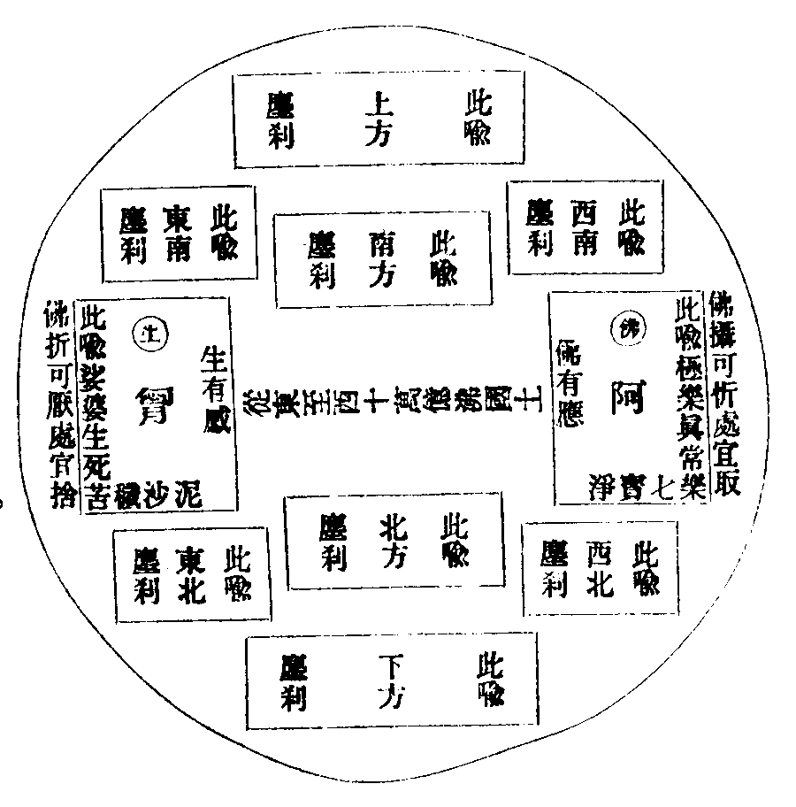
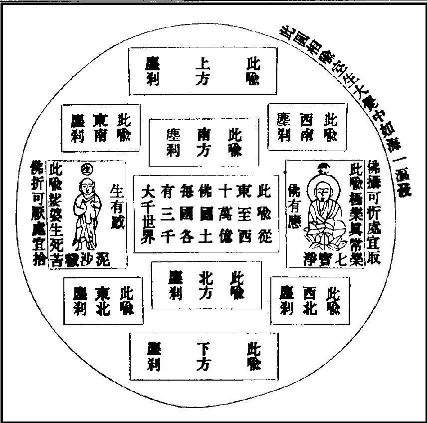

# 净土十要



> **藏经**：卍新纂大日本续藏经（新纂卍续藏）　**册次** 第 61 册（X61）　**编号** X1164　**部类** 经疏部　**卷次** 10 卷　**篇幅** 196,006 字

> **卷／品**：17 卷 · 9 品



---



## 目录



  - [No. 1164-A 灵峰蕅益大师选定净土十要重刻序](#no-1164-a-灵峰蕅益大师选定净土十要重刻序)

- [灵峰蕅益大师选定净土十要卷第一](#灵峰蕅益大师选定净土十要卷第一)

  - [No. 1164-1a 佛说阿弥陀经要解重刻序](#no-1164-1a-佛说阿弥陀经要解重刻序)

- [灵峰蕅益大师选定净土十要卷第二](#灵峰蕅益大师选定净土十要卷第二)

  - [时大中祥符八年太岁乙卯三月日后序](#时大中祥符八年太岁乙卯三月日后序)

- [灵峰大师选定净土十要卷第三](#灵峰大师选定净土十要卷第三)

- [灵峰蕅益大师选定净土十要卷第四](#灵峰蕅益大师选定净土十要卷第四)

  - [No. 1164-6a 净土十疑论序](#no-1164-6a-净土十疑论序)

  - [No. 1164-6b 后序](#no-1164-6b-后序)

- [灵峰蕅益大师选定净土十要卷第五](#灵峰蕅益大师选定净土十要卷第五)

- [上卷七](#上卷七)

- [中卷六](#中卷六)

- [下卷七](#下卷七)

- [净土十要卷第五](#净土十要卷第五)

- [灵峰蕅益大师选定净土十要卷第六](#灵峰蕅益大师选定净土十要卷第六)

  - [No. 1164-8b 净土或问序](#no-1164-8b-净土或问序)

- [灵峰蕅益大师选定净土十要卷第七](#灵峰蕅益大师选定净土十要卷第七)

  - [No. 1164-9a 重刻宝王三昧念佛直指序](#no-1164-9a-重刻宝王三昧念佛直指序)

  - [No. 1164-9b 刻宝王三昧念佛直指序](#no-1164-9b-刻宝王三昧念佛直指序)

- [灵峰蕅益大师选定净土十要卷第八](#灵峰蕅益大师选定净土十要卷第八)

- [西斋净土诗(卷二](#西斋净土诗卷二)

- [西斋净土诗(卷三](#西斋净土诗卷三)

- [净土十要卷第八](#净土十要卷第八)

- [灵峰蕅益大师选定净土十要卷第九](#灵峰蕅益大师选定净土十要卷第九)

- [灵峰蕅益大师选定净土十要卷第十](#灵峰蕅益大师选定净土十要卷第十)

  - [No. 1164-13a 评点西方合论序](#no-1164-13a-评点西方合论序)



---



### No. 1164-A 灵峰蕅益大师选定净土十要重刻序



(此序西蜀潘存评点)



净土法门者何？法界缘起也。何谓法界？吾人现前一念之心，不唯非块然，亦复非倐尔。才有能起，即属所缘，非能缘者，不得已强名之曰无相。然虗空兔角，亦受无相之名。而虗空有表显相，兔角有断无相，非真无相，又不得已强名此无相曰真。唯其无相而真，故十方三世、依正色心、自他凡圣等法，皆在我现前一念无相真心中，炳然齐现。而皆以自心为体，非别有物。心无相而真，从心所现一切诸法，莫不无相而真。是故於中随拈一毫末，一一皆具十方三世、依正色心、自他凡圣等法，而无餘欠。乃至一欬一掉、一名一字，罔非自心之全体大用。而欬掉名字之外，更无一法可得。此所谓法界也。何谓法界缘起？圣凡皆此法界，非麤妙、无减增，不涉生死、不干迷悟。而悟顺法界故，出生二种涅槃；迷逆法界故，妄现二种生死。迷逆生死，法界宛然。无奈众生从未悟故，终不能了。诸佛菩萨愍之，从一真法界，起种种因缘。世出世间，事类无算。一介蝼螘，万圣互援。神力既同，慈心亦等。而众生迷逆妄故，受化不齐。於诸佛菩萨平等光中，有有缘无缘，及缘中浅深久近之异。缘分差等，化辨从违。若或无缘，徒劳引领。此所谓法界缘起也。是故建化门中，只论系珠一义。如《法华》妙典，广谈宿因。先圣以四释阐明(因缘释、约教释、本迹释、观心释)，而必以因缘居首。由缘匪一，故教网弛张；由教无方，故恩德贯彻(指本迹)；由恩不可穷尽，故得消归自己，领纳家珍(指观心)。故知因缘即第一义。从上列祖，极重时节因缘。良以无法与人，亦无语句。情种熟处，假说心传。傥其不然，契理而不契机，有句尽成非量。空花界里，无自立宗。《华严》大经，王於三藏。末后一著，归重愿王。夫众生情爱牵连，幻成世界。妄执缘影，遂立前尘。触之则生死浩然，究竟皆归於业海。然而业系之内，尚且天经地义，万邦作孚。况诸佛菩萨，悲智无涯，色心俱寂。本真如以起用，称法性以垂机。触之则生死销亡，究竟皆同归秘藏。大事该乎九界，深恩施(音异)於尘年。无不从此法界流，无不还归此法界。此与六环业系为何如？而可反恣睽违，不从标准。是旨也，精研藏教，备考群宗。由忍土而遐揽十虗，从末流而旷观三际。则求生净土一法，诚法界第一缘起矣。说者谓阿弥愿胜，驾越诸方。然诸佛愿等、子等、心等，法性海中，那容优劣？而千经万论，极口指归乐邦；十方广长，同声劝赞光寿者，何哉？缘在故耳。缘何谓在？信也。何谓不在？不信也。信不在处，恶业障之。如夜行者，灭火而趋险道；如破浪者，卷帆而鼓横桡。事同背驰，宁止纡曲。又诸佛四土，上三土容有横义。至同居土，大都有竖无横。唯极乐同居，横具四土。是故有情，以凡夫而例一生补处；国土，即缘生而显称性五尘。佛身，因应化而见法身真常；说法，从众鸟而闻梵音深远。以要言之，法法圆融，尘尘究竟，教海无一名相可筌蹄，法门无一因果可比拟。然此等希有，十方罕闻，而唯在极乐者，何哉？缘深故耳。缘何谓深？信深也。何谓浅？信浅也。信根浅处，恒情域之，如朝廷之有资格，高才皓齿而不迁；如麟凤之於走飞，羽道毛群而一类。何由大方阔步，豁破无明？又诸佛度生，皆穷累劫，从凡阶圣，不退为难。今求生极乐，但七日竭诚，十念倾注，虽陷恶逆，悉记往生。才得往生，便圆踞三不退地。且见阿弥，即见十方诸佛；生极乐，即生一切刹海。乃至阿弥一光，极乐一尘，悉能於中顿证十方三世、依正色心、自他凡圣等法，而不出刹那际三昧。夫诸佛度生如彼难，阿弥度生如此易者，何哉？缘久故耳。缘何谓久？信久也。何谓近？信近也。信缘近处，时分限之，如舍调弓而引别弣，如放驯𩣝而服野𬳿，战胜之功，当在异日。如上所论，专重有缘。缘深则境界难思，非等觉十地所能测；缘久则神力迅速，非三祇百劫所可伦。要之，阿弥非有加於吾心也。吾心一念离绝，故圣凡无在；吾心万法顿融，故四土无在；吾心不属时劫，故十世刹那无在；吾心不属方隅，故微尘刹海无在。吾何歉乎哉？特仗增上因缘一显发之耳。曾有久习神呪者，一夜重魇，见狞物持之置巨石下。其人怖急，忆诵素所习呪，遂见狞物倒散裂石而醒。设素未习呪，或习未纯熟，缘种不深，斯时也，欲不寱死得乎？然梦中真言，复是何物？倒狞裂石，谁实使之？皆即我现前一念之心也。自心神呪，唤醒自心魇人。净土法门亦如是，自心之阿弥，还度自心之生死。故知因缘之义，甚深甚深。抑闻魇之重者，不许持光照，照即死；不许抱令起，抱多失心。唯就暗中，俾熟识者，大呼其名，连声呼之，无不解者。净土法门亦如是，劫浊盛时，众生魇重，毋以持名杂叅话，毋以麤心习胜观。杂叅话，则浊智腾波，定起邪见，所谓照之即死者也；习胜观，则非其境界，定起魔事，所谓抱多失心者也。唯以现前一念无明业识之心，令其专称阿弥陀佛名号，无间一心，未有不亲证亲到者。法门至此，愈卑而愈不胜仰，愈浅而愈不可俯，自呼自应，自魇自醒，一心之本元顿彰，法界之体用全揭，无庸钻仰，秖麼修行。傥未悟透根源，宁可颛蒙合妙？夫颛蒙念佛，至矣极矣，无复加矣。但恐法门之戏论难忘，生死之天怀不切，或执牟尼而视同瓦砾，或以指爪而撮摩虗空，或抉瞖而与眼以明，或传经而苦舌之鳺。如此，则扬之与抑，总莫畅乎本怀；而信之与疑，皆不成乎三昧。间有大智，知进知退，知存知亡，而未遘至人，未获圆悟，未穷极致，未学要诠，欲升永明之堂，入楚石之室，居五浊之世，阐难信之宗，殊非聊尔。呜呼！至人幽矣，圆悟皇哉，若无要诠，谁与穷极？昔　灵峰老人，以正法眼，选定净土十要一书，剞劂未全。乙未以后，梨枣四散，迄丁未年，焚失数种。成时窃念像季久转，唯此一门契理契机，而净土诸书唯此诸要尽美尽善，爰加点评，稍事节略。又倣慈云《忏仪》、《二门》合行之例，会幽谿二要为一要，而自以《观经初门》、《弥陀行仪》二种谬附之。其序首《要解》，尊经也，要之要也；次慈云，重行也；次新附二种，亦行经也；三者而后，则天台、紫阁、师子林、鄞江、西斋、幽谿以迄於袁，皆以时也。又天台以论主冠本宗，袁以白衣殿，不尽以时也。订讫，倡募流通，而大心缁白共成焉。修舍沙门成时合掌稽首，重为告曰：净土持名之法有三大要焉：一者、六字弘名，念念之间欣厌具足，如出幽狱，奔托王家。步步之间欣厌具足，是故万缘之唾不食，众苦之忍莫回，高置身於莲华，便订盟於芬利，蛆蝇粪壤，可煞惊慙。二者、叅禅必不可无净土，为防退堕，宁不寒心？净土必不可入禅机，意见稍乘，二门俱破。若夫餘宗，在昔之时不必改弦，但加善巧回向；在今之世秖可助行，必须净业专修。冷煖自知，何容强诤？三者、一句弥陀，非大彻不能全提，而最愚亦无少欠。傥有些子分别，便成大法魔殃，只贵一心受持，宁羡依稀解悟？乞儿若见小利，急须吐弃无餘，棒打石人头，嚗嚗论实事。已上三要，颇切今时，傥能真实指迷，我愿舍身供养，十方三世共闻此言。戊申端阳日，相似菩萨近住男成时稽首书于华阳度云精舍之云气楼。



灵峰蕅益大师选定净土十要总目



古歙后学　成时　评点节略



卷第一(总序　总目　述　序)佛说阿弥陀经要解



卷第二(述)往生净土忏愿仪  

往生净土决疑行愿二门



卷第三(述)观无量寿佛经初心三昧门  

受持佛说阿弥陀经行愿仪



卷第四(述　旧序　旧后序)净土十疑论



卷第五(述)念佛三昧宝王论(三卷)



卷第六(述　偈引)净土或问



卷第七(述　旧序)宝王三昧念佛直指(二卷)



卷第八(述　赞)西斋净土诗(三卷)



卷第九(述)净土生无生论  

净土法语



卷第十(述　旧序　原序)西方合论(十卷)



净土十要总目



------



## 灵峰蕅益大师选定净土十要卷第一



述曰：佛法之妙，莫要於净土。净土之妙，莫要於持名。持名之妙，莫要於小本《阿弥陀经》。小本之妙，莫要於灵峰《要解》。傥未读《要解》，或读未精详，或精详未贯彻，便谓於小本无不知，无不信，无不悟入，可乎？既於本经有未尽，一行三昧如何修行？既未善持名，净土玄关如何优入？既未阶净信净愿，十方三世佛祖大道如何荷担？然则《要解》之有关於十方三世佛祖大道也，甚矣。今定十要，以《要解》为上首。厥义有三，一祖佛经，以小本为净土诸经之最要故。二重持名，以末法修行，总以持名为行本故。三立本经之大宗，以今解精彻确正，堪为要中之要故。读十要者，请以《要解》为主，以餘九为伴。能令邪解莫入，能令意见不容，能令心宗圆明，能令美善双尽。夫然后不愧为真学佛者，夫然后不自误误人，夫然后必生净土，夫然后可学一切佛法，夫然后知十方三世佛祖之大道，举不外乎此矣



------



### No. 1164-1a 佛说阿弥陀经要解重刻序



净土深旨，滥始於《观经》之观佛，汇泽於小本之持名，二经盖不思议无上心要也。释妙观者，有天台圣祖大宗，称经发明要矣。释小本者，振古於斯，诸美毕备，以言心要，似有待焉。岁在丁亥，　灵峰大师述成《要解》，如灯照色而非光华，以义定名而非拟议，不过道屋里事而聆者若惊，不外布帛菽粟之谭而未曾有。诸凡横竖四土，事理一心，罔弗精义入神，要归允当，使学者了然知生信发愿，以起妙行无缛焉矣。尔小本得是疏，便觉一行三昧，横吞万派而卓立孤标，事出非常而道在伊迩，深固幽远之藏一旦尽开。吾闻善善之家，机理双契，是故矢必应弦，药必应病。今《要解》逗末世机，能提深警彻悟之人，俾其法界圆昭，尽杜虗解邪僻之习，又能使中下之辈信而有勇。至於正譌订误，纤巨不遗，浑然德音，方正不割，诚诸祖所密印，诸佛所共加，以为劫外优昙，掌中摩勒，匪阿也。癸巳岁，大师在歙浦演说释义，分科间有不同，尤觉闻所未闻，信所未信。华阳学人性且录出，名歙浦本。今重梓十要，遂以此本授锓，谨序而识之。



时戊申端阳后三日也。古歙学人成时和南书。



No. 1164-1 佛说阿弥陀经要解



三藏法师　鸠摩罗什　译



西有沙门　智旭　解



原夫诸佛悯念群迷，随机施化，虽归元无二，而方便多门。然於一切方便中，求其至直捷、至圆顿者，莫若念佛求生净土。又於一切念佛法门中，求其至简易、至稳当者，莫若信愿专持名号。是故净土三经竝行，古人独以《弥陀经》为日课，岂非持名一法，普被三根，摄事理无遗，统宗教无外，尤不可思议也哉。注疏代不乏人，世湮所存无几。云栖《疏钞》广大精微，幽谿《圆中钞》高深洪博，如二曜中天，有目皆覩。特以文富义繁，边涯莫测，致初机浅识，信愿难阶。故弗揣庸愚，再述《要解》，不敢与二翁竞异，亦不敢与二翁强同也。将释经文，五重玄义。



第一、释名



此经以能说所说人为名。佛者，此土能说之教主，即释迦牟尼，乘大悲愿力，生五浊恶世，以先觉觉后觉，无法不知，无法不见者也。说者，悦所怀也。佛以度生为怀，众生成佛机熟，为说难信法，令究竟脱，故悦也。阿弥陀所说，彼土之导师，以四十八愿接信愿念佛众生，生极乐世界，永阶不退者也。梵语阿弥陀，此云无量寿，亦云无量光。要之，功德智慧，神通道力，依正庄严，说法化度，一一无量也。一切金口，通名为经。对上五字，是通别合为题也。教行理三，各论通别，广如台藏所明。



第二、辨体



大乘经皆以实相为正体。吾人现前一念心性，不在内、不在外、不在中间，非过去、非现在、非未来，非青黄赤白、长短方圆，非香非味、非触非法，觅之了不可得，而不可言其无；具造百界千如，而不可言其有。离一切缘虑分别语言文字相，而缘虑分别语言文字非离此别有自性。要之，离一切相，即一切法。离故无相，即故无不相。不得已，强名实相。实相之体，非寂非照，而复寂而恒照，照而恒寂。照而寂，强名常寂光土。寂而照，强名清净法身。又照寂强名法身，寂照强名报身。又性德寂照名法身，修德寂照名报身。又修德照寂名受用身，修德寂照名应化身。寂照不二，性修不二，身土不二，无非实相。实相无二，亦无不二。是故举体作依作正、作法作报、作自作他，乃至能说所说、能度所度、能信所信、能愿所愿、能持所持、能生所生、能赞所赞，无非实相正印之所印也。



第三、明宗



宗是修行要径，会体枢机，而万行之纲领也。提纲则众目张，挈领则襟袖至，故体后应须辨宗。此经以信愿持名为修行之宗要，非信不足启愿，非愿不足导行，非持名妙行不足满所愿而证所信。经中先陈依正以生信，次劝发愿以导行，次示持名以径登不退。信则信自信他，信因信果，信事信理。愿则厌离娑婆，欣求极乐。行则执持名号，一心不乱。信自者，信我现前一念之心，本非肉团，亦非缘影，竖无初后，横绝边涯，终日随缘，终日不变，十方虗空微尘国土，元我一念心中所现物，我虽昏迷倒惑，苟一念回心，决定得生自心本具极乐，更无疑虑，是名信自。信他者，信释迦如来决无诳语，弥陀世尊决无虗愿，六方诸佛广长舌决无二言，随顺诸佛真实教诲，决志求生，更无疑惑，是名信他。信因者，深信散乱称名，犹为成佛种子，况一心不乱，安得不生净土？是名信因。信果者，深信净土诸善聚会，皆从念佛三昧得生，如种瓜得瓜、种豆得豆，亦如影必随形、响必应声，决无虗弃，是名信果。信事者，深信只今现前一念不可尽故，依心所现十方世界亦不可尽，实有极乐国在十万亿土外，最极清净庄严，不同庄生寓言，是名信事。信理者，深信十万亿土，实不出我今现前介尔一念心外，以吾现前一念心性实无外故。又深信西方依正主伴，皆吾现前一念心中所现影。全事即理，全妄即真，全修即性，全他即自。我心徧故，佛心亦徧，一切众生心性亦徧。譬一室千灯，光光互徧，重重交摄，不相妨碍，是名信理。如此信已，则娑婆即自心所感之薉，而自心薉理应厌离。极乐即自心所感之净，而自心净理应欣求。厌薉须舍至究竟，方无可舍。欣净须取至究竟，方无可取。故《妙宗》云：「取舍若极，与不取舍亦非异辙。」设不从事取舍，但尚不取不舍，即是执理废事。既废於事，理亦不圆。若达全事即理，则取亦即理，舍亦即理。一取一舍，无非法界。故次信而明愿也。言执持名号，一心不乱者，名以召德，德不可思议，故名号亦不可思议。名号功德不可思议，故使散称为佛种，执持登不退也。然诸经示净土行，万别千差。如观像观想，礼拜供养，五悔六念等，一一行成，皆生净土。唯持名一法，收机最广，下手最易。故释迦慈尊，无问自说，特向大智舍利弗拈出。可谓方便中第一方便，了义中无上了义，圆顿中最极圆顿。故云：明珠投於浊水，浊水不得不清。佛号投於乱心，乱心不得不佛也。信愿持名，以为一乘真因。四种净土，以为一乘妙果。举因则果必随之，故以信愿持名为经正宗。其四种净土之相，详在《妙宗钞》，及《梵网玄义》，兹不具述。俟后释依正文中，当略示耳。



第四、明力用



此经以往生不退为力用。往生有四土，各论九品，且略明得生四土之相。若执持名号，未断见思，随其或散或定，於同居土分三辈九品。若持至事一心不乱，见思任运先落，则生方便有餘净土。若至理一心不乱，豁破无明一品乃至四十一品，则生实报庄严净土，亦分证常寂光土。若无明断尽，则是上上实报究竟寂光也。不退有四义：一、念不退，破无明，显佛性，径生实报，分证寂光。二、行不退，见思既落，尘沙亦破，生方便土，进趋极果。三、位不退，带业往生，在同居土，莲华托质，永离退缘。四、毕竟不退，不论至心、散心，有心、无心，或解、不解，但弥陀名号，或六方佛名，此经名字，一经於耳，假使千万劫后，毕竟因斯度脱，如闻涂毒鼓，远近皆丧，食少金刚，决定不消也。复次，秪带业生同居净证位不退者，皆与补处俱，亦皆一生必补佛位。夫上善一处，是生同居，即已横生上三土；一生补佛，是位不退，即已圆证三不退。如斯力用，乃千经万论所未曾有，较彼顿悟正因，仅为出尘阶渐，生生不退，始可期於佛阶者，不可同日语矣。宗教之士，如何勿思？



第五、教相



此大乘菩萨藏摄，又是无问自说，彻底大慈之所加持，能令末法多障有情，依斯径登不退。故当来经法灭尽，特留此经，住世百年，广度含识。阿伽陀药，万病总持，绝待圆融，不可思议。《华严》奥藏，《法华》秘髓，一切诸佛之心要，菩萨万行之司南，皆不出於此矣。欲广叹述，穷劫莫尽，智者自当知之。



△入文为三：初、序分，二、正宗分，三、流通分。此三名初善、中善、后善。序如首，五官具存。正宗如身，脏腑无阙。流通如手足，运行不滞。故智者释《法华》，初一品皆为序，后十一品半皆为流通。又一时迹、本二门，各分三段，则〈法师〉等五品皆为迹门流通。盖序必提一经之纲，流通则法施不壅，关系非小。后人不达，见经文稍涉义理，便判入正宗，致序及流通仅存故套。安所称初语亦善，后语亦善也哉？



初、序，分二：初、通序，二、别序。初中二：初、标法会时处，二、引大众同闻。今初。



如是我闻：一时，佛在舍卫国祇树给孤独园。



如是标信顺，我闻标师承，一时标机感，佛标教主，舍卫等标说经处也。实相妙理，古今不变，名如。依实相理，念佛求生净土，决定无非曰是。实相非我非无我，阿难不坏假名，故仍称我。耳根发耳识，亲聆圆音，如空印空，名闻。时无实法，以师资道合，说听周足，名一时。自觉觉他，觉行圆满，人天大师，名佛。舍卫，此云闻物，中印度大国之名，波斯匿王所都也。匿王太子名祇陀，此云战胜。匿王大臣名须达多，此云给孤独。给孤长者布金买太子园，供佛及僧，祇陀感叹施餘未布少地，故竝名祇树给孤独园也。



△二、引大众同闻三：初、声闻众，二、菩萨众，三、天人众。声闻居首者，出世相故，常随从故，佛法赖僧传故。菩萨居中者，相不定故，不常随故，表中道义故。天人列后者，世间相故，凡圣品杂故，外护职故。



初、声闻众，又三：初、明类标数，二、表位叹德，三、列上首名。今初。



与大比丘僧千二百五十人俱。



大比丘，受具足戒出家人也。比丘，梵语含三义：一、乞士，只钵资身，无所蓄藏，专求出要。二、破恶，正慧观察，破烦恼恶，不堕爱见。三、怖魔，发心受戒，羯磨成就，魔即怖也。僧者，具云僧伽，此翻和合。众同证无为解脱，名理和。身同住、口无诤、意同悦、见同解、戒同修、利同均，名事和也。千二百五十人者，三叶波师资共千人，身子、目连师资二百人，耶舍子等五十人，皆佛成道，先得度脱，感佛深恩，常随从也。



△二、表位叹德



皆是大阿罗汉(之位，其德为)众所知识。



阿罗汉亦含三义：一、应供，即乞士果；二、杀贼，即破恶果；三、无生，即怖魔果。复有慧解脱、俱解脱、无疑解脱，三种不同。今是无疑解脱，故名大。又本是法身大士，示作声闻，证此净土不思议法，故名大也。从佛转轮，广利人天，故为众所知识。



△三、列上首名。



长老舍利弗(此云身子)、摩诃目犍连(大采菽氏)、摩诃迦叶(大饮光)、摩诃迦旃延(大文饰)、摩诃拘𫄨罗(大膝)、离婆多(星宿)、周利槃陀伽(继道)、难陀(喜)、阿难陀(庆喜)、罗睺罗(覆障)、憍梵波提(牛呞)、宾头卢颇罗堕(不动利根)、迦留陀夷(黑光)、摩诃劫宾那(房宿)、薄拘罗(善容)、阿㝹楼䭾(无贫)，如是等诸大弟子。



德腊俱尊，故名长老。身子尊者，声闻众中，智慧第一。目连尊者，神通第一。饮光尊者，身有金光，传佛心印，为初祖，头陀行第一。文饰尊者，婆罗门种，论议第一。大膝尊者，答问第一。星宿尊者，无倒乱第一。继道尊者，因根钝，仅持一偈，辩才无尽，义持第一。喜尊者，佛之亲弟，仪容第一。庆喜尊者，佛之堂弟，复为侍者，多闻第一。覆障尊者，佛之太子，密行第一。牛呞尊者，宿世恶口，感此餘报，受天供养第一。不动尊者，久住世间，应末世供，福田第一。黑光尊者，为佛使者，教化第一。房宿尊者，知星宿第一。善容尊者，寿命第一。无贫尊者，亦佛堂弟，天眼第一。此等常随众本，法身大士示作声闻，为影响众。今闻净土摄受功德，得第一义悉檀之益，增道损生，自净佛土，复名当机众矣。



△二、菩萨众。



并诸菩萨摩诃萨：文殊师利(此云妙德)法王子、阿逸多(此云无能胜，弥勒菩萨之名)菩萨、乾陀诃提(此云不休息)菩萨、常精进菩萨，与如是等诸大菩萨。



菩萨摩诃萨，此云大道心，成就有情，乃悲智双运，自他兼利之称。佛为法王，文殊绍佛家业，名法王子。菩萨众中，智慧第一，非勇猛实智，不能证解净土法门，故居初。弥勒当来成佛，现居等觉，以究竟严净佛国为要务故。次列不休息者，旷劫修行，不暂停故。常精进者，自利利他，无疲倦故。此等深位菩萨，必皆求生净土，以不离见佛，不离闻法，不离亲近供养众僧，乃能速疾圆满菩提故。



△三、天人众。



及释提桓因等，无量诸天大众俱。



释提桓因，此云能为主，即忉利天王。等者，下等四王，上等夜摩、兜率、化乐、他化、色、无色无量诸天也。大众俱，谓十方天人，八部修罗，人非人等，无不与会，无非净土法门所摄之机也。通序竟。



△二、别序。发起序也。净土妙门不可思议，无人能问，佛自倡依正名字为发起。又佛智鉴机无谬，见此大众应闻净土妙门而获四益，故不俟问，便自发起。如《梵网》下卷自倡位号云「我今卢舍那」等，智者判作发起序，例可知也。



尔时，佛告长老舍利弗：「从是(娑婆世界)西方过十万亿佛土，有世界名曰极乐，其土有佛，号阿弥陀，今现在说法。」



净土法门，三根普摄，绝待圆融，不可思议，圆收圆超一切法门，甚深难信。故特告大智慧者，非第一智慧，不能直下无疑也。西方者，横亘直西，标示现处也。十万亿者，千万曰亿，今积亿至十万也。佛土者，三千大千世界，通为一佛所化。且以此土言之，一须弥山，东西南北各一洲，同一日月所照，一铁围山所遶，名一四天下。千四天下名小千世界，千小千名中千世界，千中千名大千世界。过如此佛土十万亿之西，是极乐世界也。问：何故极乐在西方？答：此非善问。假使极乐在东，汝又问何故在东，岂非戏论？况自十一万亿佛土视之，又在东矣，何足致疑？有世界名曰极乐，序依报国土之名也。竖约三际以辨时劫，横约十方以定疆隅，故称世界。极乐国，梵语须摩提，亦云安养，安乐，清泰等，乃永离众苦，第一安隐之谓，如下广释。然佛土有四，各分净薉。凡圣同居土，五浊重者薉，五浊轻者净。方便有餘土，析空拙度证入者薉，体空巧度证入者净。实报无障碍土，次第三观证入者薉，一心三观证入者净。常寂光土，分证者薉，究竟满证者净。今云极乐世界，正指同居净土，亦即横具上三净土也。(此论修德，不论性德。性德则一切微尘，法尔具足四种净薉佛土。今约信、愿、行三，弥陀名号不思议，故能令凡夫所感同居极乐最极清净也。此则十方佛土所无，极乐同居独擅，方是极乐净土宗旨。下明义处皆然。)有佛号阿弥陀，序正报教主之名也。翻译如下广释。佛有三身，各论单、复。法身单指所证理性，报身单指能证功德智慧，化身单指所现相好色像。法身复者，自性清净法身、离垢妙极法身。报身复者，自受用报身、他受用报身。化身复者，示生化身、应现化身。又佛界化身、随类化身。虽辨单、复三身，实非一非三，而三而一，不纵横、不竝别，离过绝非，不可思议。今云阿弥陀佛，正指同居土中示生化身，仍复即报即法也。复次，世界及佛皆言有者，具四义：的标实境，令欣求故；诚语指示，令专一故。简非乾城阳𦦨，非权现曲示，非缘影虗妄，非保真偏，但破魔邪权小故(非权破《华严合论》之譌，非邪破末世积迷之习，此二料简尤大有关系)，圆彰性具令深证故。今现在说法者，简上依、正二有，非过去已灭，非未来未成，正应发愿往生，亲觐听法，速成正觉也。复次，二有现在，劝信序也；世界名极乐，劝愿序也；佛号阿弥陀，劝持名妙行序也。复次，阿弥陀序佛，说法序法，现在海会序僧。佛、法、僧同一实相序体；从此起信、愿、行，序宗；信、愿、行成，必得往生，见佛闻法，序用；唯一佛界为所缘境，不杂餘事，序教相也。言略意周矣。初序分竟。



△二、正宗分三：初、广陈彼土依正妙果以启信，二、特劝众生应求往生以发愿，三、正示行者执持名号以立行。信愿持名，一经要旨。信愿为慧行，持名为行行。得生与否，全由信愿之有无。品位高下，全由持名之深浅。故慧行为前导，行行为正修，如目足竝运也。初文为二：初、依报妙，二、正报妙。初又二：初、徵释，二、广释。初又二：初、徵，二、释。今初。



「舍利弗！彼土何故名为极乐？」



△二、释二：初、约能受用释，二、约所受用释。今初。



「其国众生无有众苦，但受诸乐，故名极乐。」



众生是能受用人，等觉以还皆可名。今且约人民言，以下下例上上也。娑婆苦乐杂，其实苦是苦苦，偪身心故；乐是坏苦，不久住故；非苦非乐是行苦，性迁流故。彼土永离三苦，不同此土对苦之乐，乃名极乐。一往分别同居五浊轻，无分段八苦，但受不病不老、自在游行、天食天衣、诸善聚会等乐；方便体观，巧无沈空滞寂之苦，但受游戏神通等乐；实报心观，圆无隔别不融之苦，但受无碍不思议乐；寂光究竟，等无法身渗漏、真常流注之苦，但受称性圆满究竟乐。然同居众生，以持名善根，福德同佛，故圆净四土，圆受诸乐也。复次，极乐最胜，不在上三土，而在同居。良以上之则十方同居逊其殊特，下又可与此土较量，所以凡夫优入而从容，横超而度越。佛说苦乐，意在於此。



△二、约所受用释(此亦转释上无有众苦，但受诸乐之故。下广释一科亦然)。



「又，舍利弗！极乐国土七重栏楯(以严际畔)、七重罗网(以严空界)、七重行树(以严露地)，皆是四宝周帀围绕，是故彼国名为极乐。」



七重，表七科道品。四宝，表常、乐、我、净四德。周帀围绕者，佛菩萨等无量住处也。皆四宝，则自功德深；周帀绕，则他贤圣徧。此极乐真因缘也。此等庄严，同居净土是增上善业所感，亦圆五品观所感，以缘生胜妙五尘为体；方便净土是即空观智所感，亦相似三观所感，以妙真谛无漏五尘为体；实报净土是妙假观智所感，亦分证三观所感，以妙俗谛无尽五尘为体；常寂光土是即中观智所感，亦究竟三观所感，以妙中谛称性五尘为体。欲令易解，作此分别。实四土庄严，无非因缘生法，无不即空、假、中，所以极乐同居净境，真俗圆融，不可限量。下皆倣此。问：寂光唯理性，何得有此庄严？答：一一庄严，全体理性；一一理性，具足庄严，方是诸佛究竟依果。若寂光不具胜妙五尘，何异偏真法性？



△二、广释二：初、别释所受，二、合释能受、所受。初又二：初、释生处，二、结示佛力。今初。



「又，舍利弗！极乐国土有七宝池，八功德水充满其中，池底纯以金沙布地，四边阶道金、银、瑠璃、玻瓈合成，上有楼阁亦以金、银、瑠璃、玻瓈、砗磲、赤珠、玛瑙而严饰之，池中莲华大如车轮，青色青光、黄色黄光、赤色赤光、白色白光，微妙香洁。」



上明住处，今明生处。宝池金银等所成，不同此方土石也。八功德者：一、澄清，异此方浑浊；二、清冷，异寒热；三、甘美，异醎淡劣味；四、轻輭，异沈重；五、润泽，异宿腐褪色；六、安和，异急暴；七、除饥渴，异生冷；八、长养诸根，异损坏诸根，及沴戾、增病、没溺等也。充满其中，异枯竭泛滥。底纯金沙，异污泥。阶道四宝，异砖石。陛级名阶，坦途名道，重屋名楼，岑楼名阁。七宝楼阁，异此方土木丹青也。楼阁是住处及法会处，但得宝池莲胞开敷，便可登四岸，入法会，见佛闻法也。华轮者，轮王金轮，大四十里，且举最小者言。若据《观经》及〈无量寿会〉，大小实不可量，由同居净土身相不等故也。青色名优钵罗，黄色名拘勿头，赤色名钵头摩，白色名芬陀利。由生身有光，故莲胞亦有光。然极乐莲华，光色无量，此亦略言耳。微妙香洁，略叹莲华四德。质而非形曰微，无碍曰妙，非形则非尘，故洁也。莲胞如此，生身可知。



△二、结示佛力。



「舍利弗！极乐国土成就如是功德庄严。」



明上住处生处种种庄严，皆阿弥陀佛大愿大行称性功德之所成就，故能徧严四种净土，普摄十方三世一切凡圣，令往生也。复次，佛以大愿作众生多善根之因，以大行作众生多福德之缘，令信愿持名者，念念成就如是功德，而皆是已成，非今非当。此则以阿弥种种庄严，作增上本质，带起众生自心种种庄严，全佛即生，全他即自，故曰成就如是功德庄严。



△二、合释能受、所受，又二：初、约五根、五尘明受用，次、约耳根、声尘明受用。初又二：初、正明，二、结示。今初。



「又，舍利弗！彼佛国土(空中)常作天乐，(下是)黄金为地，(中间)昼夜六时雨天曼陀罗华(上严空界，下严金地)。其土众生常以清旦，各以衣裓盛众妙华，供养他方十万亿佛，即以食时还到本国，饭食经行。」



乐是声尘，地是色尘，华是色、香二尘，食是味尘，盛华、散华、经行是触尘。众生五根对五尘可知。常作者，即六时也。黄金为地者，七宝所严地界，体是黄金也。日分初、中、后名昼三时，夜分初、中、后名夜三时，故云昼夜六时。然彼土依正各有光明，不假日月安分昼夜，且顺此方假说分际耳。曼陀罗，此云适意，又云白华。衣裓是盛华器，众妙华明非曼陀罗一种，应如《妙经》四华表四因位，供养他方佛表真因会趋极果，果德无不徧也。且据娑婆言十万亿佛，意显生极乐已，还供释迦、弥勒，皆不难耳。若阿弥神力所加，何远不到哉？食时即清旦，故云即，以明其神足不可思议，不离彼土，常徧十方，不假逾时回还也。此文显极乐一声、一尘、一刹那，乃至跨步、弹指，悉与十方三宝贯彻无碍。又显在娑婆则浊重恶障与极乐不隔而隔，生极乐则功德甚深与娑婆隔而不隔也。饭食、经行者，念食食至不假安排，食毕钵去不劳举拭，但经行金地、华乐娱乐，任运进修而已。



△二、结示。



「舍利弗！极乐国土成就如是功德庄严。」



△二、约耳根声尘明受用。以此方耳根最利，故别就法音广明。其实极乐摄法界机，五尘一一圆妙，出生一切法门也。又二：初、别明，二、总结。初中二：初、化有情声，二、化无情声。初又二：初、鸟音法利，二、徵释略显。今初。



「复次，舍利弗！彼国常有种种奇妙杂色之鸟，白鶴、孔雀、鹦鹉、舍利、迦陵频伽共命之鸟。是诸众鸟昼夜六时出和雅音，其音演畅五根、五力、七菩提分、八圣道分如是等法。其土众生闻是音已，皆悉念佛、念法、念僧。」



种种奇妙杂色，言多且美也。下略出六种。舍利，旧云鹙鹭，琦禅师云是春莺，或然。迦陵频伽，此云妙音，未出㲉时音超众鸟。共命，一身两头，识别报同。此二种西域雪山等处有之，皆寄此间。爱赏者，言其似而已。六时出音，则知净土不以鸟栖为夜，良以莲华托生之身，本无昏睡不假夜卧也。五根等者，三十七道品也。所谓四念处：一、身念处；二、受念处；三、心念处；四、法念处。四正勤：一、已生恶法令断；二、未生恶法不令生；三、未生善法令生；四、已生善法令增长。四如意足：一、欲如意足；二、进如意足；三、心如意足；四、思惟如意足。五根者，信正道及助道法，名信根；行正道及诸助道善法勤求不息，名精进根；念正道及诸助道善法更无他念，名念根；摄心在正道及诸助道善法中相应不散，名定根；为正道及诸助道善法观於苦等四谛，名慧根。五力者，信根增长能破疑惑，破诸邪信及破烦恼，名信力；精进根增长破种种身心懈怠，成办出世大事，名精进力；念根增长破诸邪念，成就一切出世正念功德，名念力；定根增长能破乱想，发诸事理禅定，名定力；慧根增长能遮通别诸惑，发真无漏，名慧力。七菩提分，亦名七觉分。智慧观诸法时，善能简别真伪，不谬取诸虗伪法，名择法觉分。精进修诸道法时，善能觉了不谬行於无益苦行，常勤心在真法中行，名精进觉分。若心得法喜，善能觉了此喜不依颠倒之法，而喜住真法喜，名喜觉分。若断除诸见烦恼之时，善能觉了除诸虗伪，不损真正善根，名除觉分。若舍所见念著境时，善能觉了所舍之境虗伪不实，永不追忆，名舍觉分。若发诸禅定之时，善能觉了诸禅虗假，不生爱见妄想，名定觉分。若修出世道时，善能觉了常使定慧均平，或心沈没，当念用择法、精进、喜三觉分以察起之，或心浮动，当念用除、舍、定三觉分以摄持之，调和适中，名念觉分。八圣道分，亦名八正道分。修无漏行，观见四谛分明，名正见。以无漏心相应思惟，动发觉知筹量，为令增长入大涅槃，名正思惟。以无漏慧除四邪命，摄诸口业，住一切正语中，名正语。以无漏慧除身一切邪业，住清净正身业中，名正业。以无漏慧通除三业中五种邪命，住清净正命中，名正命。(五邪命皆为利养：一、诈现异相奇特；二、自说功德；三、占相吉凶，为人说法；四、高声现威，令人敬畏；五、说所得供养，以动人心。)以无漏慧相应勤精进修涅槃道，名正精进。以无漏慧相应念正道及助道法，名正念。以无漏慧相应入定，名正定。此等道品，依生灭四谛而修，即藏教道品；依无生四谛而修，即通教道品；依无量四谛而修，即别教道品；依无作四谛而修，即圆教道品。藏道品名半字法门，净土浊轻，似不必用，为小种先熟者或暂用之。通道品名大乘初门，三乘共禀，同居净土多说之。别道品名独菩萨法，同居方便净土多说之。圆道品名无上佛法，有利根者，於四净土皆得闻也。如是等法者，等前念处、正勤、如意足，等餘四摄、六度、十力、无畏无量法门也。三十七品收法虽尽，而机缘不等，作种种开合，名义不同，随所欲闻，无不演畅，故令闻者念三宝，发菩提心，伏灭烦恼也。灼见慈威不可思议，故念佛。法喜入心，法味充足，故念法。同闻共禀，一心修证，故念僧。能念即是三观。所念三宝，有别相一体，及四教意义，三谛权实之不同，如上料简道品应知。



△二、徵释略显。



「舍利弗！汝勿谓此鸟实是罪报所生。所以者何？彼佛国土无三恶道。舍利弗！其佛国土尚无恶道之名，何况有实？是诸众鸟皆是阿弥陀佛欲令法音宣流变化所作。」



徵释可知。问：白鶴等非恶道名耶？答：既非罪报，则一一名字皆诠如来究竟功德。所谓究竟白鶴等，无非性德美称，岂恶名哉？问：化作众鸟何义？答：有四悉檀因缘。凡情喜此诸鸟，顺情而化，令欢喜故。鸟尚说法，令闻生善故。不於鸟起下劣想，对治分别心故。鸟即弥陀，令悟法身平等，无不具无不造故。此中显微风树网等音，及一切依正假实，当体即是阿弥陀佛三身四德毫无差别也。



△二、化无情声。



「舍利弗！彼佛国土微风吹动，诸宝行树及宝罗网出微妙音，譬如百千种乐同时俱作。闻是音者，自然皆生念佛、念法、念僧之心。」



情与无情，同宣妙法，四教道品，无量法门，同时演说，随类各解，能令闻者念三宝也。念三宝是从悉檀获益：凡夫创闻，大踊徧身，是欢喜益；与三宝气分交接，必能发菩提心，是生善益；由此伏灭烦恼，是破恶益；证悟一体三宝，是入理益也。初别明竟。



△二、总结。



「舍利弗！其佛国土成就如是功德庄严。」



重重结示，令深信一切庄严，皆导师愿行所成，种智所现。皆吾人净业所感，唯识所变。佛心生心，互为影质。如众灯明，各徧似一。全理成事，全事即理。全性起修，全修在性。亦可深长思矣。奈何离此净土，别谭唯心净土，甘堕鼠即鸟空之诮也哉。初依报妙竟。



△二、正报妙二：初、徵释名号，二、别释主伴。初中二：初、徵，二、释。今初。



「舍利弗！於汝意云何？彼佛何故号阿弥陀？」



此经的示持名妙行，故特徵释名号，欲人深信万德洪名不可思议，一心执持，无复疑贰也。



△二、释二：初、约光明释，二、约寿命释。阿弥陀正翻无量，本不可说。本师以光、寿二义，收尽一切无量。光则横徧十方，寿则竖穷三际。横竖交彻，即法界体。举此体作弥陀身土，亦即举此体作弥陀名号。是故弥陀名号，即众生本觉。理性持名，即始觉合本。始本不二，生佛不二。故一念相应一念佛，念念相应念念佛也。今初。



「舍利弗！彼佛光明无量，照十方国无所障碍，是故号为阿弥陀。」



心性寂而常照，故为光明。今彻证心性无量之体，故光明无量也。诸佛皆彻性体，皆照十方，皆可名无量光。而因中愿力不同，随因缘立别名。弥陀为法藏比丘，发四十八愿，有光明恒照十方之愿，今果成如愿也。法身光明无分际，报身光明称真性，此则佛佛道同。应身光明有照一由旬者，十百千由旬者，一世界十百千世界者，唯阿弥普照，故别名无量光。然三身不一不异，为令众生得四益，故作此分别耳。当知无障碍，约人民言。由众生与佛缘深，故佛光到处，一切世间无不圆见也。



△二、约寿命释。



「又，舍利弗！彼佛寿命及其人民(寿命，皆)无量无边阿僧祇劫，故名阿弥陀。」



心性照而常寂，故为寿命。今彻证心性无量之体，故寿命无量也。法身寿命无始无终，报身寿命有始无终，此亦佛佛道同，皆可名无量寿。应身随愿随机，延促不等。法藏愿王有佛及人寿命皆无量之愿，今果成如愿，别名无量寿也。阿僧祇、无边无量，皆算数名，实有量之无量。然三身不一异，应身亦可即是无量之无量矣。及者，超略之辞，谓等觉以还。其者，同体之辞，谓佛寿命即人民寿命。当知光寿名号，皆本众生建立，以生佛平等，能令持名者照与光融，寿同佛寂也。复次，由无量光义故，众生生极乐，即生十方；见阿弥陀佛，即见十方诸佛；能自度，即普利一切。由无量寿义故，极乐人民即是一生补处，皆定此生成佛，不至异生。当知离却现前一念无量光寿之心，何处有阿弥陀佛名号？而离却阿弥陀佛名号，何由彻证现前一念无量光寿之心？愿深思之！愿深思之！



△二、别释主伴二：初、别释，二、结示。初又二：初、主，二、伴。今初。此亦释别序中今现在说法句。



「舍利弗！阿弥陀佛成佛已来，於今十劫。」



此明极乐世界教主成就也。然法身无成不成，不应论劫。报身因圆果满名成，应身为物示生名成，皆可论劫。又法身因修德显，亦可论成论劫。报身别无新得，应身如月印川，亦无成不成，不应论劫。但诸佛成道，各有本迹本地，竝不可测。且约极乐示成之迹而言，即是三身一成一切成，亦是非成非不成而论成也。又佛寿无量，今仅十劫，则现在说法时正未央，普劝三世众生速求往生，同佛寿命一生成办也。又下文无数声闻、菩萨及与补处，皆十劫所成就，正显十方三世往生不退者，多且易也。



△二、伴。



「又，舍利弗！彼佛有无量无边声闻弟子，皆阿罗汉，非是算数之所能知，诸菩萨众亦复如是。」



他方定性二乘，不得生彼。若先习小行，临终回向菩提，发大誓愿者，生彼国已，佛顺机说法，令断见思，故名罗汉。如别教七住断见思之类，非实声闻也。盖藏、通二教，不闻他方佛名，今闻弥陀名号，信愿往生，总属别、圆二教所摄机矣。



△二、结示。



「舍利弗！彼佛国土成就如是功德庄严。」



佛及声闻、菩萨，竝是弥陀因中愿行所成，亦是果上一成一切成。是则佛、菩萨、声闻，各各非自非他，自他不二，故云成就。如是功德庄严，能令信愿持名者，念念亦如是成就也。初广陈彼土依正妙果以启信竟。



△二、特劝众生应求往生以发愿二：初、揭示无上因缘，二、特劝净土殊胜。谓带业往生，横出三界，同居横具四土，开显四教法轮，众生圆净，四土圆见，三身圆证，三不退人民皆一生成佛。如是等胜异超绝，全在此二科点示，须谛研之。今初。



「又，舍利弗！极乐国土众生(才)生(彼土)者，皆是(三种)阿鞞䟦致。其(三不退)中多有一生补处，其数甚多，非是算数所能知之，但可以无量无边阿僧祇说。」



阿鞞䟦致，此云不退：一、位不退，入圣流，不堕凡地；二、行不退，恒度生，不堕二乘地；三、念不退，心心流入萨婆若海。若约此土，藏初果，通见地，别七住，圆初信，名位不退；通菩萨，别十行，圆十信，名行不退；别初地，圆初住，名念不退。今净土五逆、十恶十念成就，带业往生，居下下品者，皆得三不退。然据教道，若是凡夫，则非初果等；若是二乘，则非菩萨等；若是异生，则非同生性等。又念不退，非复异生；行不退，非仅见道；位不退，非是人民。躐等则成大妄，进步则舍，故称唯极乐同居，一切俱非，一切俱是。十方佛土，无此名相，无此阶位，无此法门，非心性之极致，持名之奇勋，弥陀之大愿，何以有此一生补处者？此一生补佛位，如弥勒、观音等。极乐人民，普皆一生成佛，人人必实证补处，故其中多有此等上善，不可数知也。复次，释迦一代时教，唯《华严》明一生圆满。而一生圆满之因，则末后〈普贤行愿品〉中，十大愿王导归安养，且以此劝进华藏海众。嗟乎！凡夫例登补处，奇倡极谈，不可测度。「华严」所禀，却在此经。而天下古今，信尠疑多，辞繁义蚀，余唯有剖心沥血而已。



△二、特劝。



「舍利弗！(如上无上大事因缘)众生(幸得)闻者，应当发愿愿生彼国。所以者何？得与如是(不可算数一生补处)诸上善人俱会一处。」



前罗汉、菩萨，但可云善人。唯补处居因位之极，故云上。其数甚多，故云诸也。俱会一处，犹言凡圣同居。寻常由实圣过去有漏业，权圣大慈悲愿，故凡夫得与圣人同居。至实圣灰身，权圣机尽，便升沈硕异，苦乐悬殊，乃暂同，非究竟同也。又天壤之间，见闻者少。幸获见闻，亲近步趋者少。又佛世圣人纵多，如珍如瑞，不能徧满国土，如众星微尘。又居虽同，而所作所办，则回不同。今同以无漏不思议业，感生俱会一处为师友，如埙如篪，同尽无明，同登妙觉。是则下凡众生，於念不退中，超尽四十一因位。若谓是凡夫，却不历异生，必补佛职，与观音、势至无别。若谓是一生补处，却可名凡夫，不可名等觉菩萨。此皆教网所不能收，刹网所不能例。当知吾人大事因缘，同居一关，最难透脱。唯极乐同居，超出十方同居之外。了此，方能深信弥陀愿力。信佛力，方能深信名号功德。信持名，方能深信吾人心性本不可思议也。具此深信，方能发於大愿。文中应当二字，即指深信。深信发愿，即无上菩提。合此信愿，的为净土指南。由此而执持名号，乃为正行。若信愿坚固，临终十念一念，亦决得生。若无信愿，纵将名号持至风吹不入、雨打不湿，如银墙铁壁相似，亦无得生之理。修净业者，不可不知也。大本《阿弥陀经》，亦以发菩提愿为要，正与此同。



△三、正示行者执持名号以立行二：初、正示无上因果，二、重劝。今初。



「舍利弗！不可以少善根福德因缘得生彼国。舍利弗！若有善男子、善女人，闻说阿弥陀佛执持名号，若一日、若二日、若三日、若四日、若五日、若六日、若七日，一心不乱。其人临命终时，阿弥陀佛与诸圣众现在其前，是人终时心不颠倒，即得往生阿弥陀佛极乐国土。」



菩提正道名善根，即亲因；种种助道施戒禅等名福德，即助缘。声闻、独觉菩提善根少，人天有漏福业福德少，皆不可生净土。唯以信愿执持名号，则一一声悉具多善根福德，散心称名，福善亦不可量，况一心不乱哉！故使感应道交，文成印坏，弥陀圣众不来而来，亲垂接引；行人心识不往而往，托质宝莲也。善男女者，不论在家出家、贵贱老少、六趣四生，但闻佛名，即多劫善根成熟，五逆十恶皆名善也。阿弥陀佛是万德洪名，以名召德，罄无不尽，故即以执持名号为正行，不必更涉观想参究等行，至简易、至直捷也。闻而信，信而愿，乃肎执持不信不愿与不闻等，虽为远因，不名闻慧。执持则念念忆佛名号，故是思慧。然有事持、理持。事持者，信有西方阿弥陀佛，而未达是心作佛、是心是佛，但以决志愿求生故，如子忆母，无时暂忘。理持者，信西方阿弥陀佛是我心具、是我心造，即以自心所具所造洪名为系心之境，令不暂忘也。一日至七日者，尅期辨事也。利根一日即不乱，钝根七日方不乱，中根二三四五六日不定。又利根能七日不乱，钝根仅一日不乱，中根六五四三二日不定。一心亦二种：不论事持、理持，持至伏除烦恼，乃至见思先尽，皆事一心；不论事持、理持，持至心开见本性佛，皆理一心。事一心不为见思所乱，理一心不为二边所乱，即修慧也。不为见思乱故，感变化身佛及诸圣众现前，心不复起娑婆界中三有颠倒，往生同居、方便二种极乐世界。不为二边乱故，感受用身佛及诸圣众现前，心不复起生死、涅槃二见颠倒，往生实报、寂光二种极乐世界。当知执持名号既简易直捷，仍至顿至圆，以念念即佛，故不劳观想，不必参究。当下圆明，无餘无欠，上上根不能逾其阃，下下根亦可臻其域。其所感佛、所生土，往往胜进，亦不一概，可谓横该八教，竖彻五时。所以彻底悲心，无问自说，且深叹其难信也。问：《观经》专明作观，何谓不劳观想？答：此义即出《观经》。彼经因胜观非凡夫心力所及，故於第十三别开劣像之观；而障重者犹不能念彼佛，故於第十六大开称名之门。今经因末世障重者多，故专主第十六观。当知人根虽钝，而丈六八尺之像身，无量寿佛之名字，未尝不心作心。是故观劣者不劳胜观，而称名者竝不劳观想也。问：天奇、毒峰诸祖皆主参念佛者是谁，何谓不必参究？答：此义即出天奇诸祖。前祖因念佛人不契释迦彻底悲心，故傍不甘，直下诘问，一猛提醒，何止长夜复旦？我辈至今日犹不肎死心念佛，苦欲执敲门瓦子向屋里打亲生爷娘，则於诸祖成恶逆，非善顺也。进问：此在肎心者则可，未肎者何得相应？曰：噫！正唯未肎，所以要儞肎心相应。汝等正信未开，如生牛皮不可屈折。当知有目者固无日下然灯之理，而无目者亦何必於日中苦觅灯炬？大势至法王子云：「不假方便，自得心开。」此一行三昧中大火聚语也。敢有触者，宁不被烧？问：临终佛现，宁保非魔？答：修心人不作佛观，而佛忽现，非本所期，故名魔事。念佛见佛，已是相应，况临终非致魔时，何须疑虑？问：七日不乱，平时耶？临终耶？答：平时也。问：七日不乱之后，复起惑造业，亦得生耶？答：果得一心不乱之人，无更起惑造业之事。问：《大本》十念、《宝王》一念，平时耶？临终耶？答：十念通二时，晨朝十念属平时。十念得生，与《观经》十声称名，同属临终时。一念则但约临终时。问：十念、一念竝得生，何须七日？答：若无平时七日工夫，安有临终十念、一念？纵下下品逆恶之人，竝是夙因成熟，故感临终遇善友，闻便信愿。此事万中无一，岂可侥幸净土？《或问》斥此最详，今人不可不读。问：西方去此十万亿土，何得即生？答：十万亿土不出我现前一念心性之外，以心性本无外故，又仗自心之佛力接引，何难即生？如镜中照数十层山水楼阁，层数宛然，实无远近，一照俱了，见无先后。从是西方过十万亿佛土，有世界名曰极乐亦如是。其土有佛，号阿弥陀，今现在说法亦如是。其人临命终时，阿弥陀佛与诸圣众现在其前，是人终时，心不颠倒，即得往生阿弥陀佛极乐国土亦如是。当知字字皆海印三昧大圆镜智之灵文也。问：持名判行，行则是助行，何名正行？答：依一心说，信、愿、行，非先后，非定三。盖无愿、行，不名真信；无行、信，不名真愿；无信、愿，不名真行。今全由信、愿持名，故信、愿、行三声声圆具，所以名多善根、福德因缘。《观经》称佛名故，念念中除八十亿劫生死之罪，此之谓也。若福善不多，安能除罪如此之大？问：临终猛切，能除多罪；平日至心称名，亦除罪否？答：如日出，群暗消；称洪名，万罪灭。问：散心称名，亦除罪否？答：名号功德不思议，宁不除罪？但不定往生，以悠悠散善，难敌无始积罪故。当知积罪，假使有体相者，尽虗空界不能容受。虽百年昼夜，弥陀十万，一一声灭八十亿劫生死，然所灭罪如爪上土，未灭罪如大地土。唯念至一心不乱，则如健人突围而出，非复三军能制耳。然称名便为成佛种子，如金刚终不可坏。佛世一老人求出家，五百圣众皆谓无善根。佛言：「此人无量劫前为虎偪，失声称南无佛。今此善根成熟，值我得道，非二乘道眼所知也。」由此观之，《法华》明过去佛所散乱称名，皆已成佛，岂不信哉？伏愿缁素智愚，於此简易直捷无上圆顿法门，勿视为难而辄生退诿，勿视为易而漫不䇿勤，勿视为浅而妄致藐轻，勿视为深而弗敢承任。盖所持之名号，真实不可思议；能持之心性，亦真实不可思议。持一声，则一声不可思议；持十百千万无量无数声，声声皆不可思议也。



△二、重劝。



「舍利弗！我见是利故说此言。若有众生闻是说者，应当发愿生彼国土。」



我见者，佛眼所见，究尽明了也。是利者，横出五浊，圆净四土，直至不退位尽，是为不可思议功德之利也。复次，是利，约命终时，心不颠倒而言。盖薉土自力修行，生死关头，最难得力。无论顽修狂慧，懡㦬无功，即悟门深远，操履潜确之人，傥分毫习气未除，未免随强偏坠。永明祖师所谓十人九蹉路，阴境若现前，瞥尔随他去，此诚可寒心者也。初果昧於出胎，菩萨昏於隔阴，者里岂容强作主宰，侥幸瞒盰。唯有信愿持名，仗他力故，佛慈悲愿，定不唐捐。弥陀圣众，现前慰导，故得无倒，自在往生。佛见众生临终倒乱之苦，特为保任此事，所以殷勤再劝发愿，以愿能导行故也。问：佛既心作心是，何不竟言自佛，而必以他佛为胜，何也？答：此之法门，全在了他即自。若讳言他佛，则是他见未忘。若偏重自佛，却成我见颠倒。又悉檀四益，后三益，事不孤起。傥不从世界深发庆信，则欣厌二益，尚不能生，何况悟入理佛。唯即事持达理持，所以弥陀圣众现前，即是本性明显。往生彼土，见佛闻法，即是成就慧身，不由他悟。法门深妙，破尽一切戏论，斩尽一切意见，唯马鸣、龙树、智者、永明之流，彻底担荷得去。其餘世智辩聪，通儒禅客，尽思度量，愈推愈远。又不若愚夫妇老实念佛者，为能潜通佛智，暗合道妙也。我见是利，故说此言，分明以佛眼佛音，印定此事，岂可违抗，不善顺入也哉。二、正宗分竟。



△三、流通分。信、愿、持名一法，圆收、圆超一切法门。竖与一切法门浑同，横与一切法门迥异。(诸经论中亦有横义，乃随断惑浅深，即於同居见上三土。是则约证名横，约断仍竖也。)既无问自说，谁堪倡募流通？唯佛与佛，乃能究尽诸法实相。此经唯佛境界，唯佛佛可与流通耳。文为二：初、普劝，二、结劝。初中三：初、劝信流通，二、劝愿流通，三、劝行流通。初中二：初、略引标题，二、徵释经题。初中六：初、东方(至)六、上方。唐译十方，今略摄故。今初。



「舍利弗！如我今者赞叹阿弥陀佛不可思议功德之利，东方亦有阿閦鞞佛、须弥相佛、大须弥佛、须弥光佛、妙音佛，如是等恒河沙数诸佛，各於其国出广长舌相，徧覆三千大千世界，说诚实言：『汝等众生当信是称赞不可思议功德一切诸佛所护念经。』」



不可思议，略有五意：一、横超三界，不俟断惑；二、即西方横具四土，非由渐证；三、但持名号，不假禅观诸方便；四、一七为期，不藉多劫、多生、多年月；五、持一佛名，即为诸佛护念，不异持一切佛名。此皆导师大愿行之所成就，故曰阿弥陀佛不可思议功德之利。又行人信愿持名，全摄佛功德，成自功德，故亦曰阿弥陀佛不可思议功德之利。下又曰：诸佛不可思议功德，我不可思议功德。是诸佛释迦，皆以阿弥为自也。阿閦鞞，此云无动。佛有无量德，应有无量名，随机而立。或取因，或取果，或性，或相，或行愿等，虽举一隅，仍具四悉。随一一名，显所诠德，劫寿说之，不能悉也。东方虗空不可尽，世界亦不可尽，世界不可尽，住世诸佛亦不可尽，略举恒河沙耳。此等诸佛，各出广长舌，劝信此经，而众生犹不生信，顽冥极矣。常人三世不妄语，舌能至鼻藏头；果佛三大僧祇劫不妄语，舌薄广长可覆面。今证大乘净土妙门，所以徧覆大千，表理诚称真，事实非谬也。标出经题，流通之本，什师顺此，方好略译。今题巧合持名妙行，奘师译云《称赞净土摄受经》，文有详略，义无增减。



△二、南方。



「舍利弗！南方世界，有日月灯佛、名闻光佛、大𦦨肩佛、须弥灯佛、无量精进佛，如是等恒河沙数诸佛，各於其国，出广长舌相，徧覆三千大千世界，说诚实言：『汝等众生，当信是称赞不可思议功德一切诸佛所护念经。』」



△三、西方



「舍利弗！西方世界有无量寿佛、无量相佛、无量幢佛、大光佛、大明佛、宝相佛、净光佛，如是等恒河沙数诸佛，各於其国出广长舌相，徧覆三千大千世界，说诚实言：『汝等众生当信是称赞不可思议功德一切诸佛所护念经。』」



无量寿佛与弥陀同名十方，各方面同名诸佛无量也。然即是导师，亦可为度众生，不妨转赞释迦如来所说。



△四、北方。



「舍利弗！北方世界有𦦨肩佛、最胜音佛、难沮佛、日生佛、网明佛，如是等恒河沙数诸佛，各於其国出广长舌相，徧覆三千大千世界，说诚实言：『汝等众生，当信是称赞不可思议功德一切诸佛所护念经。』」



△五、下方。



「舍利弗！下方世界有师子佛、名闻佛、名光佛、达磨佛、法幢佛、持法佛，如是等恒河沙数诸佛，各於其国出广长舌相，徧覆三千大千世界，说诚实言：『汝等众生当信是称赞不可思议功德一切诸佛所护念经。』」



此界水轮、金轮、风轮之下，复有下界非非想天等，乃至重重无尽也。达磨，此云法。



△六、上方。



「舍利弗！上方世界有梵音佛、宿王佛、香上佛、香光佛、大𦦨肩佛、杂色宝华严身佛、娑罗树王佛、宝华德佛、见一切义佛、如须弥山佛，如是等恒河沙数诸佛，各於其国出广长舌相，徧覆三千大千世界，说诚实言：『汝等众生，当信是称赞不可思议功德一切诸佛所护念经。』」



此界非非想天之上，复有上界风轮、金轮及三界等，重重无尽也。问：诸方必有净土，何偏赞西方？答：此亦非善。问：假使赞阿閦佛国，汝又疑偏东方，展转戏论。问：何不徧缘法界？答：有三义：令初机易标心故，阿弥本愿胜故，佛与此土众生偏有缘故。盖佛度生、生受化，其间难易浅深，总在於缘。缘之所在，恩德弘深，种种教启，能令欢喜信入，能令触动宿种，能令魔障难遮，能令体性开发。诸佛本从法身垂迹，固结缘种。若世出世，悉不可思议。尊隆於教乘，举扬於海会，沁入於苦海，慈契於寂光。所以万德钦承，群灵拱极。当知佛种从缘起，缘即法界。一念一切念，一生一切生，一香一华，一声一色，乃至受忏授记，摩顶垂手，十方三世，莫不徧融。故此增上缘因，名法界缘起。此正所谓徧缘法界者也。浅位人便可决志专求，深位人亦不必舍西方而别求华藏。若谓西方是权，华藏是实，西方小，华藏大者，全堕众生徧计执情，以不达权实一体，大小无性故也。



△二、徵释经题。



「舍利弗！於汝意云何(称赞功德之名，上来已详言矣)？何故名为一切诸佛所护念经(耶)？舍利弗！若有善男子、善女人闻是经受持者，及闻诸佛名者，是诸善男子、善女人皆为一切诸佛之所护念，皆得不退转於阿耨多罗三藐三菩提。是故，舍利弗！汝等皆当信受我语及诸佛所说。」



此经独诠无上心要，诸佛名字竝诠无上圆满究竟万德，故闻者皆为诸佛护念。又闻经受持，即执持名号。阿弥名号，诸佛所护念故。问：但闻诸佛名而未持经，亦得护念不退耶？答：此义有局有通。《占察》谓杂乱垢心，虽诵我名而不为闻，以不能生决定信解，但获世间善报，不得广大深妙利益。若到一行三昧，则成广大微妙行心，名得相似无生法忍，乃为得闻十方佛名。此亦应尔，故须闻已执持至一心不乱，方为闻诸佛名，蒙诸佛护念。此局义也。通义者，诸佛慈悲不可思议，名号功德亦不可思议，故一闻佛名，不论有心无心，若信若否，皆成缘种。况佛度生，等怨亲、无疲倦，苟闻名必护念，何疑焉？然据金刚三论，根熟菩萨为佛护念，位在别地圆住。盖约自力，必入同生性，乃可护念。今仗他力，故相似位即蒙护念，乃至相似以还，亦皆有通护念之义。下至一闻佛名，於同体法性有资发力，亦得远因，终不退也。阿耨多罗，此云无上。三藐三菩提，此云正等正觉，即大乘果觉也。圆三不退，乃一生成佛异名，故劝身子等皆当信受。闻名功德如此，释迦及十方诸佛同所宣说，可不信乎？初劝信流通竟。



△二、劝愿流通。



「舍利弗！若有人已发愿、今发愿、当发愿，欲生阿弥陀佛国者，是诸人等皆得不退转於阿耨多罗三藐三菩提，於彼国土若已生、若今生、若当生。是故，舍利弗！诸善男子、善女人若有信者，应当发愿生彼国土。」



已愿已生，今愿今生，当愿当生。正显依信所发之愿无虗也。非信不能发愿，非愿信亦不生。故云：若有信者，应当发愿。又愿者，信之券，行之枢，尤为要务。举愿则信行在其中，所以殷勤三劝也。复次，愿生彼国，即欣厌二门。厌离娑婆，与依苦集二谛所发二种弘誓相应。欣求极乐，与依道灭二谛所发二种弘誓相应。故得不退转於大菩提道。问：今发愿，但可云当生，何名今生？答：此亦二义：一、约一期名今。现生发愿持名，临终定生净土。二、约刹那名今。一念相应一念生，念念相应念念生。妙因妙果，不离一心。如秤两头，低昂时等。何俟娑婆报尽，方育珍池。只今信愿持名，莲蕚光荣，金台影现，便非娑婆界内人矣。极圆极顿，难议难思。唯有大智，方能谛信。



△三、劝行流通二：初、诸佛转赞，二、教主结叹。今初。



「舍利弗！如我今者称赞诸佛不可思议功德，彼诸佛等亦称赞我不可思议功德，而作是言：『释迦牟尼佛能为甚难希有之事，能於娑婆国土五浊恶世劫浊、见浊、烦恼浊、众生浊、命浊中，得阿耨多罗三藐三菩提，为诸众生说是一切世间难信之法。』」



诸佛功德智慧，虽皆平等，而施化则有难易。净土成菩提易，浊世难；为净土众生说法易，为浊世众生难；为浊世众生说渐法犹易，说顿法难；为浊世众生说餘顿法犹易，说净土横超顿法尤难；为浊世众生说净土横超顿修顿证妙观，已自不易；说此无藉劬劳修证，但持名号，径登不退，奇特胜妙，超出思议第一方便，更为难中之难。故十方诸佛，无不推我释迦偏为勇猛也。劫浊者，浊法聚会之时。劫浊中，非带业横出之行，必不能度。见浊者，五利使邪见增盛，谓身见、边见、见取、戒取及诸邪见，昏昧汩没，故名为浊。见浊中，非不假方便之行，必不能度。烦恼浊者，五钝使烦惑增盛，谓贪、瞋、痴、慢、疑，烦动恼乱，故名为浊。烦恼浊中，非即凡心，是佛心之行，必不能度。众生浊者，见烦恼所感麤弊，五阴和合，假名众生，色心竝皆陋劣，故名浊。众生浊中，非欣厌之行，必不能度。命浊者，因果竝劣，寿命短促，乃至不满百岁，故名浊。命浊中，非不费时劫，不劳勤苦之行，必不能度。复次，秪此信愿庄严一声阿弥陀佛，转劫浊为清净海会，转见浊为无量光，转烦恼浊为常寂光，转众生浊为莲花化生，转命浊为无量寿。故一声阿弥陀佛，即释迦本师於五浊恶世所得之阿耨多罗三藐三菩提法。今以此果觉，全体授与浊恶众生，乃诸佛所行境界，唯佛与佛能究尽，非九界自力所能信解也。诸众生，别指五浊恶人。一切世间，通指四土器世间、九界有情世间也。



△二、教主结叹。前劝信流通，是诸佛付嘱。此本师付嘱，嘱语略别。从通但云一切世间，犹前诸佛所云汝等众生。当知文殊、迦叶等，皆在所嘱也。



「舍利弗当知，我於五浊恶世行此难事，得阿耨多罗三藐三菩提，为一切世间说此难信之法，是为甚难。」



信愿持名一行，不涉施为圆转五浊，唯信乃入非思议所行境界。设非本师来入恶世示得菩提，以大智大悲见此行此说此，众生何由禀此也哉。然吾人处劫浊中，决定为时所囿、为苦所偪。处见浊中，决定为邪智所缠。处烦恼浊中，决定为贪欲所陷、恶业所螫。处众生浊中，决定安於臭薉而不能洞觉，甘於劣弱而不能奋飞。处命浊中，决定为无常所吞，石火电光措手不及。若不深知其甚难，将谓更有别法可出五浊，烽㶿宅里戏论纷然。唯深知其甚难，方肎死尽偷心宝此一行。此本师所以极口说其难甚，而深嘱我等当知也。初普劝竟。



△二、结劝。



佛说此经已，舍利弗及诸比丘，一切世间天、人、阿修罗等，闻佛所说，欢喜信受，作礼而去。



法门不可思议，难信难知，无一人能发问者。佛智鉴机，知众生成佛缘熟，无问自说，令得四益，如时雨化。欢喜，从世界悉檀得益；毫无疑惑名信，领纳不忘名受，从为人、对治得益；投身归命，契入法界缘起，名作礼，从第一义得益。然一一益中，互具四益，姑作如此分别耳。上是自行四益，一往不退，报恩流通，名为而去。尽未来际，化他四益无尽也。



经云：末法亿亿人修行，罕一得道，唯依念佛得度。呜呼，今正是其时矣。舍此不思议法门，其何能淑。旭出家时，宗乘自负，藐视教典，妄谓持名，曲为中下。后因大病，发意西归。复研《妙宗》、《圆中》二钞，及云栖《疏钞》等书，始知念佛三昧，实无上宝王。方肎死心执持名号，万牛莫挽也。吾友去病，久事净业，欲令此经大旨，辞不繁而炳著，请余为述要解。余欲普与法界有情，同生极乐，理不可却。举笔於丁亥九月二十有七，脱藁於十月初五，凡九日告成。所愿一句一字，咸作资粮。一见一闻，同阶不退。信疑皆植道种，赞谤等归解脱。仰唯诸佛菩萨，摄受证明。同学友人，随喜加被。



西有道人蕅益智旭阁笔故䟦，时年四十有九。



佛说阿弥陀经要解



No. 1164-1b 原䟦



经云：三界唯心，万法唯识。古人云：念自性弥陀，生唯心净土。合观之，是心作佛，是心是佛，心外无佛，佛外无心之义明矣。后人不达，舍西方极乐，别言唯心净土；舍万德慈尊，别言自性弥陀。不几心外有佛，佛外有心耶？　灵峰大师深悟心性无外之体，特为此经拈出要解。一展读时，信愿持名人，可自操其券。不唯言简意周，且使希有甚难之宗，如声鼓铎，尽开经藏，无复匵藏，诚古今所未有也。名曰《要解》，其斯为无上心要矣乎！



古吴净业弟子正知去病氏谨识



No. 1164-1c 歙浦讲录䟦



此本系性旦癸巳岁在歙浦栖云院所听录者。於时随允持、循、苍、晖、晟、坚、密、时诸公之后，获闻法要，觉老人此翻，心胆尽吐。盖秘密之藏，会当大启於今时，非偶然也，因退而纪之。甲午冬，老人病中口授数处，令改正此本，遂称允当。及老人西逝，性旦以病拙薮逋，薄福多障，无缘流通阐播，聊识其后，以志不忘云。庚子夏，华阳学人性旦拭涕跋。



------



## 灵峰蕅益大师选定净土十要卷第二



述曰：闻夫有行无教，必有堕阬落壍之虞；有教无行，还同说食数宝之诮。是故教即行也，行即教也。教行无乖，至理乃显。故教行理三，皆名为经。三经具足，是为佛说。反是则波旬说，非佛说也。今禀斯义，谨奉慈云忏主遵式所制《往生净土忏愿仪》，及《决疑行愿二门》，继《弥陀要解》而列。行者得要之后，更能於此尽心焉。则不思议经王，不唯无剩语，亦复非义涂。而微妙要诠，不在佛，不在知识，却在当人自己矣。随自己教行所诣，分契理之浅深。随契理浅深，立果位之差别。而此差别果位，要皆圆证三不退，一生同趣萨婆若海。是故差即无差，位次即非位次。谁谓一行三昧之外，别有法身向上事哉！此行最广大，餘行则局。此行最神速，餘行则𣨼(𣨼，替腻二音，困滞也)。此行最不思议，餘行则可拟。其斯以为三昧宝王也欤。《行愿仪》，世传为大净土忏。二门中行法，世传为小净土忏。及晨朝十念，系缘众福二行，皆修净业者必不可离。声者作之於前，明者述之於后。我等如何肎自弃也



No. 1164-2 往生净土忏愿仪



(沙门遵式，辄采大本《无量寿经》，及《称赞净土》等诸大乘经，集此方法，流布诸后，普结净缘。)



原其诸佛悯物迷盲，设多方便而引取之，唯安养净业直捷可修，诸大乘经皆启斯要。比丘四众及善男女根缺具者，欲速破无明诸暗，欲求灭五逆十恶、犯禁重罪及餘轻过，欲复大小戒律，现前得念佛三昧及具足一切菩萨诸波罗密门，欲临终离诸怖畏，身心安快喜悦如归，光照室宅异香音乐，阿弥陀佛、观音、势至现在其前，送紫金台授手接引，五道横截、九品长骛，谢去热恼安息清凉，初离尘劳便至不退，不历长劫即得无生，欲修少法感妙报，十方佛俱时称赞现前授记，一念供养无央数佛，即还本国与弥陀坐食、观音议论、势至行步，洞视彻闻身量无际，飞空自在宿命了了，徧见五道如镜面像，念念证入无尽三昧，如是称述不可穷尽，应当修习此之胜法，如所说者皆实不虗。十方诸佛出广长舌，称美此事以示不妄，我等云何敢不信佛？今取净土众经立此行法，若欲广知寻经补益，且为十科说之。



第一、严净道场



选闲静堂室，去旧土，於净处取无瓦石新土，用填其地，以香和涂，极令清净。上悬新宝盖，盖中悬五杂旛，徧室悬诸缯彩旛华(别无戏具之供)。取好庄严，安佛像西坐东向，观音侍左，势至侍右，像前列众好华及莲华等。若安九往生像最好，无亦无妨，餘严事随力安之(须如法雅重)。周设荐席，虑地卑湿(无𣰽毺之文，以《佛顶经》遮止故也)。行人须新净衣，如无浣染身中上者，浴后披著，方入道场。从门颊左右出入，鞋履齐整，不得杂乱。其所往时，须换故衣浴，沐后著净衣(沐是浴后洗头面颈臂)。日日如是，当自倾竭种种供养三宝。若不尽其所有，行法不专，必无感降，绝无己物，方可外求(或果无己物，又果无可求，则乏种种供养，亦无过)。十人已还，多则不可，宜六斋日建首。



第二、方便法



入道场，身心散乱，须预行方便。当七日营别房，不得与道场同处，无别屋亦许共室。日夜调习案试，及诵五悔等文，极精熟，通染浣纫缝，及中办事。餘治生杂务，即时并息。但念不久生净土，一心求忏无留难。各自剋期，不惜身命，定取净业，即时成就。不得一念思忆五尘，诃去爱欲，勤息恚痴。行人各有无始恶习，速求舍离不为，正忏障碍。当观察何习偏重，诃弃调停，取令平复，勿使行法唐丧其功。



第三、正修意



《大集》七七日，《鼓音王》、《大弥陀》十日十夜，《十六观》、《小弥陀》七日七夜，取此三等为期，决不可减。正修意者，天亲论：「信心修五念门成就者，毕竟得生安乐国，见阿弥陀佛：一、礼拜门；二、赞叹门；三、作愿门；四、观察门；五、回向门。回向者，谓礼拜等所集功德善根，巧方便回向，得三种顺菩提门：一、无染清净心，不为自心求诸乐故；二、安清净心，以拔一切众生苦故；三、乐清净心，令一切众生得大菩提，以摄取众生生彼国故。」全用论文，为今正意，但加忏悔，灭往生障，为顺佛慈，速度生故。当一心一意，满七七日，乃至七日，昼夜六时，礼十方佛，及弥陀世尊，若坐若行，皆勿散乱，不得如弹指顷念世五欲，及接对外人，语论戏笑，托事延缓，放逸睡眠，当瞬息俯仰，系念不断，为求往生，一心精进。问：行法既多，云何一心？答：有理有事，谓道场涉事，皆是无性，不生不灭，法界一相，如法界缘，名理一心。礼佛时，不念餘事，但专礼佛，诵经行道，亦如是，名事一心也。



第四、烧香散华(亦名三业供养。已净三业，入道场。拈香讫，当正立，作如是思惟。)



(我为众生发菩提心，愿求净土，故总礼三宝，广修供养。三宝受供，必当念我，随我请求，证知我愿。　先当倡云：)



一切恭敬。



一心顶礼十方法界常住佛。(总礼，未须随方想念。拜下，作如是想云：己身及十方诸佛，实相理体，本无能所，故无能礼所礼。想无能所，名法界海。愿诸众生，同见同入。)  

一心顶礼，十方法界常住法(想同上)。  

一心顶礼，十方法界常住僧(想时改诸佛为贤圣)。



(礼已互跪，捧华首者白：)



> 是诸众等，各各互跪，严持香华，如法供养。



(各散华，和云：)供养十方法界三宝。(各执手炉，广运供养，想云：)



> 我此香华徧十方，以为微妙光明台，  

> 诸天音乐天宝香，诸天肴饍天宝衣，  

> 不可思议妙法尘，一一尘出一切尘，  

> 一一尘出一切法，旋转无碍互庄严，  

> 徧至十方三宝前，十方法界三宝前，  

> 悉有我身修供养，一一皆悉徧法界，  

> 彼彼无杂无障碍。尽未来际作佛事，  

> 普熏法界诸众生，蒙熏皆发菩提心，  

> 同入无生证佛智。



(想已，复发是言：)



> 愿此香华云，徧满十方界，供养一切佛，  

> 尊法诸菩萨，无量声闻众。以起光明台，  

> 过於无边界，无边佛土中，受用作佛事，  

> 普熏诸众生，皆发菩提心。



(起云：)



供养已，一切恭敬。



(拜如前，总礼作想。下赞叹、五悔、三归，共九拜，皆如前作想。)



第五、请礼法(如上供养毕，添香互跪，执炉端意，勤重徧请三宝入道场。不可轻率，延屈至尊。三业并切，一心奉请。若不尔者，虚请无益。想一一如来，随其方面，领诸眷属，入我道场。如住目前，畟塞虚空，不得刹那起於杂念。初入时迎请，餘时不用。倡云：)



一心奉请，南无本师释迦牟尼佛。(释迦是我等师，说诸大乘，令我修净土业，当运心感此恩德。)



(下去例为三请，每一请时，执炉拜下，想云：)



> 我三业性如虗空，释迦如来亦如是，  

> 不起真际为众生，与众俱来受供养。



一心奉请，南无过去久远劫中，定光佛、光远佛、龙音佛等五十三佛。(法藏未出世前，次第有此诸佛。五十四是世自在王。偈同前，但改名同下。)  

一心奉请南无过去久灭世自在王佛。(即法藏本师，依彼佛所发四十八愿，请时皆须知之。此上五十四佛，出大本《无量寿佛经》。)  

一心奉请南无十方现在不动佛等，尽十方河沙净土一切诸佛。(诸佛出广长舌，称赞极乐，须请求护念。出《称赞净土经》，应想从彼十方来。)  

一心奉请，南无往世七佛，未来贤劫千佛，三世一切诸佛。  

一心奉请南无极乐世界阿弥陀佛。(是忏愿主，应想领无边眷属，至我道场，摄受护念。各各雨泪，决定请来，正坐道场。餘佛菩萨，悉是证明。此最后请者，准普贤忏法。)  

一心奉请，南无大乘四十八愿无量寿经、称赞经等，及彼净土所有经法，十方一切尊经，十二部真净法宝。(想净土法时，徧想佛菩萨，水鸟乐树，皆说妙法，随我请来，显现道场，如彼净土无异。)



(想云：)



> 法性如空无所见，三处法宝难思议。  

> 我今三业如法请，俱时显现受供养。



一心奉请南无文殊师利菩萨、普贤菩萨、无能胜菩萨、不休息菩萨等一切菩萨摩诃萨。(偈同请佛，但改诸大菩萨亦如是请。时想文殊、普贤等皆在净土，如愿王经说。○此中一切二字该十方三世。)  

一心奉请南无极乐世界观世音菩萨摩诃萨。(想菩萨坐莲华台侍佛左，威德光明悉皆无量，偈改观音菩萨。)  

一心奉请南无极乐世界大势至菩萨摩诃萨。(想菩萨华台侍右，如观音不异，偈改势至菩萨。)  

一心奉请南无过去阿僧祇劫法藏比丘菩萨摩诃萨。(即弥陀因身，修行四十八大愿，摄化众生，当极念此恩德，偈改法藏比丘。)  

一心奉请南无极乐世界新发道意无生不退一生补处诸大菩萨摩诃萨。  

一心奉请南无此土舍利弗等，一切声闻缘觉得道贤圣僧。(想徧法界，请贤圣僧。○一切二字，亦该十方三世。下礼拜中亦同。)  

一心奉请此土梵释四王、一切天众、摩罗天主、龙鬼诸王、阎罗五道，主善罚恶，守护正法，护伽蓝神，一切贤圣。(例皆三请来此守护，唯除叩拜。)



上所奉请弥陀世尊、观世音菩萨、大势至菩萨、清净海众、一切贤圣，唯愿不舍大慈大悲，他心道眼，无碍见闻，身通自在，降来道场，安住法座，光明徧照，摄取我等，哀怜覆护，令得成就菩提愿行。释迦文佛、定光佛等，世自在王佛、十方三世一切正觉，及文殊师利菩萨、普贤菩萨、三乘圣众，唯愿悉来慈悲摄护。诸天、魔、梵、龙、鬼等众，护法诸神，一切贤圣，悉到道场，安慰坚守，同成净行。(三说)



第六、赞叹法(当起立恭敬合掌，想正对弥陀及一一佛前，说偈赞愿云：)



> 色如阎浮金，面如净满月，身光智慧明，  

> 所照无边际，降伏魔冤众，善化诸人天。  

> 乘彼八正船，能度难度者，闻名得不退。  

> 是故应顶礼。



(礼起复云：)



以此叹佛功德，修行大乘无上善根，奉福上界天龙八部、大梵天王、三十三天、阎罗五道、六斋八王、行病鬼王各及眷属、此土神祇、僧伽蓝内护正法者，又为国王帝主、土境万民、师僧父母、善恶知识、造寺檀越、十方信施广及法界众生，愿藉此善根平等熏修，功德智慧二种庄严，临命终时俱生乐国。



第七、礼佛法(次礼佛时，须想一切诸佛是我慈父，能令我生诸佛净土故。)



一心敬礼本师释迦牟尼佛。(此下要义，悉如礼请中说。想云：)



> 能礼所礼性空寂，感应道交难思议。  

> 我此道场如帝珠，释迦如来影现中，  

> 我身影现如来前，头面接足归命礼。



一心敬礼过去久远劫中，定光佛、光远佛、龙音佛等五十三佛。(当想身如幻化，自见对佛作礼。偈改五十三佛影现中。下去倣此改名。)  

一心敬礼过去久灭世自在王佛。  

一心敬礼东方不动佛等，尽东方河沙净土一切诸佛。  

一心敬礼东南方最上广大云雷音王佛等，尽东南方河沙净土一切诸佛。  

一心敬礼南方日月光佛等，尽南方河沙净土一切诸佛。  

一心敬礼西南方最上日光名称功德佛等，尽西南方河沙净土一切诸佛。  

一心敬礼西方放光佛等，尽西方河沙净土一切诸佛。  

一心敬礼西北方无量功德火王光明佛等，尽西北方河沙净土一切诸佛。  

一心敬礼北方无量光严通达觉慧佛等，尽北方河沙净土一切诸佛。  

一心敬礼东北方无数百千俱胝广慧佛等，尽东北方？河沙净土一切诸佛。  

一心敬礼上方梵音佛等，尽上方河沙净土一切诸佛。  

一心敬礼下方示现一切妙法正理常放火王胜德光明佛等，尽下方河沙净土一切诸佛。  

一心敬礼，往古来今，三世诸佛，七佛世尊，贤劫千佛。  

一心敬礼，极乐世界阿弥陀佛。(应三礼，改偈云：为求徃生接足礼。)  

一心敬礼极乐世界佛菩萨等所说经法，乃至水鸟乐树一切法音清净法藏。(偈云)



> 真空法性如虚空，常住法宝难思议。  

> 我身影现法宝前，一一皆悉归命礼。



一心敬礼，大乘四十八愿无量寿经、称赞经等，十方一切尊经，十二部真净法藏。(偈如前。)  

一心敬礼，极乐世界观世音菩萨摩诃萨。(偈同礼佛，但改菩萨。)  

一心敬礼极乐世界大势至菩萨摩诃萨。  

一心敬礼过去阿僧祗劫法藏比丘菩萨摩诃萨。  

一心敬礼极乐世界一生补处诸大菩萨摩诃萨。  

一心敬礼极乐世界无生不退诸大菩萨摩诃萨。  

一心敬礼极乐世界新发道意菩萨，及十方来生净土一切菩萨摩诃萨。  

一心敬礼文殊师利菩萨、普贤菩萨、弥勒菩萨、常精进菩萨等，尽十方一切诸大菩萨摩诃萨。  

一心敬礼大智舍利弗、阿难持法者、诸大声闻、缘觉、一切得道贤圣僧。(想偈已，不起於地，运下忏悔。)



第八、忏愿法(总有五法，今举初后，故明忏愿。)



一、明忏悔(悔有事、理、应竝运。事则竭三业，不惜身命，流血雨泪，披露罪根，不敢覆讳。理则观罪实相，能忏所忏，皆悉寂灭。如餘广说。知事理已，等心普为一切忏悔。想云：)



(我及众生，无始常为三业六根重罪所障，不见诸佛，不知出要，但顺生死，不知妙理。我今虽知，犹与一切众生同为一切重罪所障。今对弥陀十方佛前，普为众生归命忏悔，唯愿加护，令障消灭。　想已，云：)



普为法界一切众生，悉愿断除三障，至诚忏悔。



(执炉叩下，运逆顺十心。始背真逐妄，名顺十心。今背妄向真，名逆十心。有事有理，应细思之。从初至拨无因果是顺，下是逆。至正陈忏悔时，亦须扶此逆顺之意想云。)



(我与众生，无始来今，由爱见故，内计我人，　外加恶友，　不随喜他一毫之善，　唯徧三业，广造重罪。　事虽不广，恶心徧布，　昼夜相续，无有间断。　覆讳过失，不欲人知，　不畏恶道，　无惭无愧，　拨无因果。　故於今日，深信因果，　生重惭愧，　生大怖畏，　发露忏悔，　断相续心，　发菩提心，断恶修善，　勤䇿三业，翻昔重过，　随喜凡圣一毫之善。　念十方佛，有大福慧，能救㧞我及诸众生，从二死海，置三德岸。　从无始来，不知诸法本性空寂，广造众恶。今知空寂，为求菩提，为众生故，广修诸善，徧断众恶。唯愿十方诸佛、弥陀世尊，慈悲摄受，听我忏悔。想已云：)



我弟子(某甲)，至心忏悔。十方诸佛，真实见知，我及众生，本性清净。诸佛住处，名常寂光，徧在刹那，及一切法。而我不了，妄计我人，於平等法中，而起分别，於清净心中，而生染著。以是颠倒，五欲因缘，生死循环，经历三界，坐此相续，不念出期。而复於中，造极恶业，四重五逆，及一阐提，非毁大乘，谤破三宝，谤无诸佛，断学般若，用十方僧物，用佛塔物，污梵行人，习近恶法，於破戒者，更相赞护，三乘道人，种种毁骂，内覆过失，外现威仪，常以五邪，招纳四事，不净说法，非律教人，因佛出家，反破佛法，违逆师长，如法教诲，恣行贪恚，无惭耻心。以是因缘，诸恶业力，命终当堕，阿鼻地狱，猛火炽然，受无量苦，千万亿劫，无解脱期。今始觉知，生大惭愧，生大怖畏。　十方世尊，阿弥陀佛，久已於我，生大悲心，无数劫来，为度我故，修菩萨道，不惜身命。今已得佛，大悲满足，真实能为，一切救护。今我造恶，必堕三涂，愿起哀怜，受我忏悔，重罪得灭，诸恶消除，乃至娑婆，生因永尽，诸佛净土，如愿往生，当命终时，悉无障碍。(起云：)



忏悔已，归命礼阿弥陀佛及一切三宝。



(三叩，於地三处作礼：一、弥陀世尊，二、净土三宝，三、十方三宝。应三说忏悔等文。若时促，一说无妨。下四悔准此。)



二、明劝请(想对十方一切佛前，长跪劝请。请有二义：一、请说法，二、请久住世，意亦在说法。十方诸佛以道眼力，知我劝请。唯愿久住，转正法轮。所在生处，常能劝请。)



我弟子(某甲)至心劝请。十方所有世间灯，最初成就菩提者，我今一切皆劝请，转於无上妙法轮。诸佛若欲示涅槃，我悉至诚而劝请，唯愿久住刹尘劫，利乐一切诸众生。



劝请已，归命礼阿弥陀佛及一切三宝。



三、明髓喜(十方凡圣一毫之善，我亦随喜；善根福德能令见者生喜，我随彼喜。)



我弟子(某甲)至心随喜。十方一切诸众生，二乘有学及无学，一切如来与菩萨，所有功德皆随喜。



随喜已，归命礼阿弥陀佛一切三宝。



四、明回向(无始至今，一毫之善，𢌞向三有，故今悔之，誓求菩提。)



我弟子(某甲)至心回向：所有礼赞供养福，请佛住世转法轮，随喜忏悔诸善根，回向众生及佛道。



回向已，归命礼阿弥陀佛及一切三宝。



五、明发愿(大体须灭罪除障，扶四弘誓，随喜菩提，求生净土想的，对弥陀餘佛菩萨证明。)



我弟子(某甲)，至心发愿：愿共修净行人，三业所生一切诸善，庄严净愿，福智现前。愿得　弥陀世尊、观音、势至，慈悲摄受，为我现身，放净光明，照烛我等，诸根寂静，二障消除，乐修净行，身心润泽，念念不失净土善根。及於梦中，常见彼国，众妙庄严，慰悦我心，令生精进。愿得临命终时，预知时至，尽除障碍，慧念增明，身无病苦，心不颠倒，面奉　弥陀及诸眷属，欢喜快乐，於一刹那，即得往生极乐世界。到已，自见生莲华中，蒙佛授记。得授记已，自在化身微尘佛刹，随顺众生，而为利益，能令佛刹尘数众生，发菩提心，俱时离苦，皆共往生　阿弥陀佛极乐世界。如是行愿，念念现前，尽未来时，相续不断，身语意业，常作佛事。(发愿乃往生正行，须具足三说，不同前四悔，随时广略。)



发愿已，归命礼阿弥陀佛及一切三宝。



第九、旋遶诵经法(各整衣服，立定少顷，想三宝贤圣畟塞道场，各坐法座，见身一一遶法座，安详而转，然后称念云：)



南无佛  

南无法  

南无僧  

南无释迦牟尼佛  

南无世自在王佛  

南无阿弥陀佛  

南无观世音菩萨  

南无大势至菩萨  

南无文殊师利菩萨  

南无普贤菩萨  

南无清净大海众菩萨摩诃萨



(如是三称，诵《阿弥陀经》，或《十六观经》，诵毕复三称。当称诵时，声名句文，空无所得，犹空鸟迹，岂可取著？身语意三，如影响燄，虽皆不实，感应俱在。自见其身，各旋法座，或多或少，经毕为期。次云：)



自归於佛，　当愿众生：　体解大道，　发无上心。  

自归於法，　当愿众生：　深入经藏，　智慧如海。  

自归於僧，　当愿众生：　统理大众，　一切无碍。  

和南圣众。



(首者跪云：)



> 白众等听说，经中如来偈，何不力为善，  

> 念道之自然。宜各勤精进，努力自求之，  

> 必得超绝去，往生安养国。横截五恶道，  

> 恶趣自然闭，升道无穷极，易往而无人。  

> 何不弃世事，勤行求道德，各得极长生，  

> 寿乐无穷极。



第十、坐禅法



当於一处，绳床西向，易观想故，表正向故，跏趺端坐，项脊相对，不昂不伛，调和气息，定住其心。然观门虽多，今从要易想，略示二种，仍逐所宜，未必并用。有於餘观，熟者任便，但不离净土，皆应修习。所言二种：一、扶普观意想，即时所修，计功合生极乐世界，便起心生於彼想，於莲华中结加趺坐，作华合想，作华开想，华开时五百色光来照身想，作眼目开想，见佛菩萨及国土想，即於佛前坐听妙法，及闻一切音声，皆说所乐闻法，所闻要与十二部经合。作此想，大须坚固，令心不散，心想明了，如眼所见，经久乃起。二、直想阿弥丈六金躯坐华上，专系眉间白毫，毫长一丈五尺，周围五寸，八棱中空，右旋宛转，在眉中间，莹净明彻，不可具说，显映金颜，分齐分明，停心住想，坚固勿移。然复应观所见，若成未成，皆想念因缘，无实性相。一如镜中面像，如水中月影，如梦如幻，虽空而亦可见。二皆心性所现，所有即是心。心不自知心，心不自见心。心有想即痴，无想即泥洹。心有心无，皆名有想，尽名为痴，不见法性。三因缘生法，即空假中，不一异，非纵横，不可思议。心想寂静，则能成就念佛三昧，久而乃起，广如别说。问：念佛三昧，久习方成，十日七日，如何卒学？答：若过去曾习，及今生预修，至忏时薄修即得。若近忏方学，此必难成。然须依此系心，为坐禅观境。经云：「成不成，皆灭无量罪，生诸佛前。」又闻白毫名字，灭无量罪，何况系念？勿生疑怖，自谓无分。彼佛有宿愿力，令修者皆得成。《般舟》依三力成就：佛威力、三昧力、己功德力。《观经》闻无量寿佛及二菩萨名，能灭无量生死，况忆念乎？坐已起随意，佛事要修观，更坐无妨。若不惯坐，乃行道称念，亦得梦中见阿弥陀佛，具如经说。



往生净土忏愿仪



No. 1164-2a 自䟦



此法自撰集於今，凡二改治。前本越僧契凝已刊广行，其后序首云余自滥沾祖教是也。圣位既广，比见行者拜起易劳，忏悔禅法皆事攻削。今之广略既允，似可传行后贤，无惑其二三焉。刊详删补，何嫌精措？



------



### 时大中祥符八年太岁乙卯三月日后序



No. 1164-3 往生净土决疑行愿二门



宋耆山沙门　遵式　述



维，安养实刹，大觉攸赞，三辈高升。夕孕金华，列宿犹惭於海滴；晨游玉沼，世镫强喻於河沙。良以十方爰来，四生利往。虽腾光而普示，终稽首而偏求。故其竺国皇州，自今观古。彼则鉅贤至圣，咸舒藻以为盟(文殊、普贤、天亲、龙树等，或别译愿文，或著在经论)；此则觉德鸿儒，尽摛毫而作誓(且从晋世东林净社刘、雷等十八贤，泊百二十三人同誓，遗民属词。其后冠盖之士、德望之僧、洁志之俗，富於编简)。自兹回向绵续，倡和相寻。诚道德之通衢，常乐之直济也。但世多创染割截，未识方隅。忽遇问津，靡惭滥吹。或攘臂排为小教，或大笑斥作权乘。以其言既反经，人惑常典。遂辄述《往生净土决疑行愿二门》。词愧不文，理存或当。菽麦视而且辨，泾渭挹而永分。剪伊兰之臭林，植栴檀之香𠏉。信行愿原始要终，不数千言备举矣。



第一、决疑门(一、疑师，二、疑法，三、疑自。)  

第二、行愿门(一、礼忏门，二、十念门，三、系缘门，四、众福门。)



第一、决疑门者



疑为信障，世间小善尚不能成，况菩提大道乎？或曰：智者有《十疑论》，何须此文？然略由三意：一者、上为王臣，几务稍暇，难寻广文。今举大纲，略出行相，易披览，易修行故。二者、《十疑》随事释难，唯第二、三略附理立。且事无尽，疑亦叵穷。今直明一理为诸法源，指源则流可识矣。三者、正对说者反经乖理，自损损他，故於疑法中简小取大，明白权实，使来者不惑。至道安和尚《往生论》六卷、怀感法师《群疑论》七卷、道绰禅师《安乐》集三卷、慈敏三藏《净土慈悲集》三卷、源信禅师《净土集》二卷，古今诸师制疏解经，宗经造论，随情释难，伽陀赞扬，同归而各见，寻究良难。今以三疑收尽，文出天台止观，非敢臆说。



一、疑师者



师有二，邪外倒惑，化人非所承也。正法之师，复有凡圣因果，凡及因位，容有未了，犹清辩谓弥勒未是徧知，俟龙华道后问津也。今示西方令回向者，唯果佛圣师释迦及十方诸佛，出广长舌，说诚实言，赞劝往生，更何所惑？



二、疑法者



佛法有小乘不了义、大乘了义，大乘复有了、不了义，今净土唯大乘了义中了义也。且小乘经部无一字劝生他方净土，《天亲论》女人及二乘种不生，此即明据也。问：《小弥陀经》等皆说彼国有声闻，《鼓音王经》佛母名殊胜妙颜，亦复有女人。答：佛母恐指初降生时成正觉已，国土随净，必无女人，或转男如龙女，或命终如悉达母，声闻如《观经疏》及《十疑论》和会。今明大乘复有三种：一、三乘通教，门虽通大，类狎二乘。又当教菩萨虽化他净佛，国土化毕，还同二乘，归於永灭。净土深理，非彼所知，非了义也。二、大乘别教，明独菩萨法虽谈实理，道后方证，因果不融。净土则理外修成，万法乃不由心具，虽尘劫修道，广游佛刹，指彼净土因果，但是体外方便，斯亦未了。三、佛乘圆教，诠旨圆融，因果顿足。经曰：「十方谛求，更无餘乘，唯一佛乘。」是则大乘中大乘，了义中了义。十方净薉，卷怀同在於刹那；一念色心，罗列徧收於法界。竝天真本具，非缘起新成。一念既然，一尘亦尔。故能一一尘中一切刹，一一心中一切心。一一心尘复互周，重重无尽无障碍。一时顿现非隐显，一切圆成无胜劣。若神珠顿含众宝，犹帝网交映千光。我心既然，生佛体等。如此方了回神亿刹，实生自己心中。孕质九莲，岂逃刹那际内。苟事理攸隔，净薉相妨，安令五逆凡夫，十念便登实土？三乘贤辈，回心即达金池也哉？信此圆谈，事无不达。昧斯至理，触类皆迷。《华严》云：「心如工画师，造种种五阴。一切世间中，无不从心造。」(造通二种，一理具，十界依正，一念顿足。二变起，全理缘起，知无不为。)「如心佛亦尔，如佛众生然。心佛及众生，是三无差别。」(由三无差，方感应道交，悲愿相摄。共变各变，因果方成。若但一理无差，不晓诸法互具，未善圆旨。)《起信论》所言法者，谓众生心(直指凡心)，是心即摄一切世间(六凡法界)出世间法(四圣法界也。摄义亦二，一理具，二事造，竝摄十界。十界之内，身土净薉，何法不在)。依此示摩诃衍义。(摩诃衍，大乘也。若非此心，安堪乘运？)《十六观》诸佛是法界身，入一切众生心想中，乃至是心作佛，是心是佛；《般舟三昧》佛是我心，是我心见佛，是我心作佛等。谈斯旨者，大乘卷中，粲然可举。至若《法华》妙部，如来亲记往生；《华严》顿谈，普贤躳陈回向。是知弥陀因地，观此理而大誓普收；释迦果成，称此理而广舌深赞。十方三世，莫不咸然。问：妙理圆极，世人尽须观行始生耶？答：不然。今但直决疑情，令知净土百宝庄严，九品因果，竝在众生介尔心中，理性具足，方明往生事用，随愿自然。是则旁罗十方，不离当念；往来法界，正协唯心。免信常流，执此非彼。其九品生相，各有行类。上辈三品，须解须行。故云：汝行大乘，解第一义。学者见贤思齐，企金座而高升，当妙观之是托。若中下六品生因，只精持禁戒，行世仁慈。至下下品，本是恶逆，十念精诚，便生彼国。但知有净土，尽可回心也。(世人纵云净土出大乘，不能如上约教甄简，宁逃混滥，未足决疑。)



三、疑自者



博地凡夫，世缘缠盖，云何此身生净土，入贤圣海，同正定聚？释曰：若了如上法性虗通，及信弥陀本愿摄受，但勤功福，宁俟问津？况十念得生，唯除五逆及谤正法。又定心十念，逆谤亦生，正愿志求，夫复何惑？



第二、正修行愿门者



略开四门：一礼忏，二十念，三系缘，四众福。修行整足，唯须此四。先礼佛，净除业障，身心皎洁，如净良田。次十念，定心成行立愿，要期植往生正因，如下种子。次系心，爱护长养，滋发芽茎，如霪膏雨。次众福，助令繁茂，使速成华果，如灌肥腻。具修此四，最上最胜。或少暇随修三二一者，皆生彼国。以四门各有行愿，皆是正因故也。亦可六斋日修忏，日日中修十念。以十念是净因要切，必不可废。后二门，任力所能。若不然者，但随所欲，任意行之。



礼忏门者



日日早晨於常供道场中，冠带服饰端庄谨肃，佛像前手自烧香，合掌定心作是云：



一切恭敬，一心顶礼常住三宝。(存心徧礼十方三世一切佛法僧宝。拜起，两膝著地，手执香炉，烧众名香云：)



> 愿此香烟云，徧满十方界，无边佛土中，  

> 无量香庄严，具足菩萨道，成就如来香。



(冥心少顷，徧运香云，供养三宝，普熏众生，咸生净土。想已置炉，起作一礼。礼已合掌，曲躳恳切。想面对弥陀及一切佛，而赞叹曰：)



> 如来妙色身，世间无与等，无比不思议，  

> 是故今顶礼。如来色无尽，智慧亦复然，  

> 一切法常住，是故我归依。大智大愿力，  

> 普度於群生，令舍热恼身，生彼清凉国。  

> 我今净三业，归依及礼赞，愿共诸众生，  

> 同生安乐刹。



(赞愿已，即便礼佛，一一存心专对云：)



一心顶礼，常寂光净土，阿弥陀如来，清净妙法身，徧法界诸佛。  

一心顶礼，实报庄严土，阿弥陀如来，微尘相海身，徧法界诸佛。  

一心顶礼，方便圣居土，阿弥陀如来，解脱相严身，徧法果诸佛。  

一心顶礼，西方安乐土，阿弥陀如来，大乘根界身，徧法界诸佛。  

一心顶礼，西方安乐土，阿弥陀如来，十方化往身，徧法界诸佛。  

一心顶礼，西方安乐土，教行理三经，极依正宣扬，徧法界尊法。(灵峰大师注云：此礼旧本无，今依幽谿师添入，使三宝具足。)  

一心顶礼，西方安乐土，观世音菩萨，万亿紫金身，徧法界菩萨摩诃萨。  

一心顶礼，西方安乐土，大势至菩萨，无边光智身，徧法界菩萨摩诃萨。  

一心顶礼，西方安乐土，清净大海众，满分二严身，徧法界圣众。



(礼已，即两膝跪地，执手炉烧香，至诚而倡是言：)



我今普为四恩三有、法界众生，悉愿断除三障，归命忏悔。



(起礼复跪，执手炉云：)



至心忏悔[○@叩]我弟子(某甲)，及法界众生，从无始世来，无明所覆，颠倒迷惑，而由六根三业，习不善法，广造十恶，及五无间，一切众罪，无量无边，说不可尽。十方诸佛，常在世间，法音不绝，妙香充塞，法味盈空，放净光明，照触一切，常住妙理，徧满虗空。我无始来，六根内盲，三业昏暗，不见不闻，不觉不知，以是因缘，长流生死，经历恶道，百千万劫，永无出期。经云：毗卢遮那，徧一切处，其佛所住，名常寂光。是故当知，一切诸法，无非佛法。而我不了，随无明流，是则於菩提中，见不清净，於解脱中，而起缠缚。今始觉悟，今始改悔。奉对[○@叩]诸佛弥陀世尊，发露忏悔，当令我与法界众生，三业六根，无始所作，现作当作，自作教他，见闻随喜，若忆不忆，若识不识，若疑不疑，若覆若露，一切重罪，毕竟清净。我忏悔已，六根三业，净无瑕累，所修善根，悉亦清净，皆悉回向，庄严净土，普与众生，同生安养。愿[○@叩]阿弥陀佛，常来护持，令我善根，现前增进，不失净因。临命终时，身心正念，视听分明，面奉[○@叩]弥陀，与诸圣众，手执华台，接引於我，一刹那顷，生在佛前，具菩萨道，广度众生，同成种智。(应三说，若时促及事迫，一说亦得。起云：)



忏悔发愿已，归命礼阿弥陀佛及一切三宝。(一拜)



(次旋遶法，或三帀，或七帀，乃至多帀，如是称念，随意随帀，不拘遍数，称云：)



南无阿弥陀佛。　南无观世音菩萨。　南无大势至菩萨。　南无清净大海众菩萨摩诃萨。



自归於佛，　当愿众生：　体解大道，　发无上心。(拜)  

自归於法，　当愿众生：　深入经藏，　智慧如海。(拜)  

自归於僧，　当愿众生：　统理大众，　一切无碍。(拜)  

和南圣众。



(次至别座诵《弥陀经》，或《观经》。若不诵得经，一心称名，量时而止。更𢌞向结撮亦得。)



十念门者



每晨服饰已，面西正立，合掌连声，称阿弥陀佛。尽一气为一念，如是十气为十念，随气长短，不限佛数，气极为度，声不高低，不缓急，调停得中，十气连属，令心不散，专精为功。名十念者，是藉气束心也。作此念已，发愿回向云：



我弟子(某甲)一心归命极乐世界阿弥陀佛，愿以净光照我、慈誓摄我。我今正念称如来名，经十念顷为菩提道求生净土。佛昔本誓：若有众生欲生我国，至心信乐乃至十念，若不生者不取正觉，唯除五逆、诽谤正法。我今自忆此生已来，不造逆罪、不谤大乘，愿此十念得入如来大誓海中，乘佛慈力，众罪消灭、净因增长。若临欲命终，自知时至，身不病苦、心无贪恋、心不倒散如入禅定，佛及圣众手执金台来迎接我，如一念顷生极乐国，华开见佛即闻佛乘，顿开佛慧广度众生满菩提愿。



(作已便止，不必拜。要尽此生，不得一日暂废。唯将不废，自要其心得生彼国。)



系缘门者



凡公临私养，历涉缘务，虽造次，常不忘佛及忆净土。如切事系心，虽种种作务，不妨密忆前事。念佛亦如是，若失念，数数摄还，久久成性，任运常忆。《楞严经》：「譬如有人，一专为忆(譬佛念众生)，一人专忘(譬众生念佛)。如是二人，若逢不逢，或见非见，二人相忆，二忆念深。如是乃至从生至生，同於形影，不相乖异。十方如来，怜念众生，如母忆子。若子逃逝，虽忆何为？子若忆母，如母忆时，母子历生，不相违远。若众生心，忆佛念佛，现前当来，必定见佛，去佛不远，不假方便，自得心开。如染香人，身有香气。」如此系心，任运常遮一切恶念。设欲作恶，忆佛之故，恶不能成。纵随恶，作恶业时，心常下耎，如身有香，自然离臭。又复觉心，微起恶念，即便忆佛。以佛力故，恶念自息。如人遇难，求彼彊援，必得免脱。又见他受苦，以念佛心，怜愍於彼，愿其离苦。若断刑狱，以念佛故，生悯念心，愿生净土，誓相救济。凡历一切境界，若善若恶，由心忆佛，皆心念作愿。故普贤愿王云：「作一切恶，皆不成就。若作善业，皆悉和合。」即此意尔。如是相续，念佛在心，能办一切净因功德。恐烦披览，不复具说。诚哉此门，为益最大。



众福门者



《普贤观》国王大臣，欲忏重罪，当行五事：一、正心不谤三宝，不障出家，不为梵行人作恶留难。(於持戒四众，勿行污染。)二、孝养父母，奉事师长。三、正法治国，不邪枉人民。四、六斋日，敕境内力所及处，令行不杀。(严禁渔捕，及诫奸鬬。六斋日者，白月初八，四王使者巡世。十四，四王太子巡。十五，四王亲巡。黑月廿三、廿九、三十，巡世准上。若四王亲下，诸天星宿鬼神，俱时随从。遇修福斋戒者，诸天相庆，即注禄添算，护持福业，令其成就。)五、深信因果，信一实道，知佛不灭。此与《十六观》三福大同，但普贤正为王臣故引用。此亦是三世诸佛净业正因。若出家四众，应具依《观经》三福为行。随作一福，若心念，若口言，作意回向，方成净因。



此四法门，是念佛三昧往生正因，必须系日修习，方可自期定生净土。经云：「行此三昧，现得见阿弥陀佛及二菩萨。若闻佛及二菩萨名，除无量劫生死之罪，何况忆念。此是人中芬陀利华，观音、势至为其胜友，当坐道场，生诸佛家。此人现世，彼佛遣无数化佛，化观音、势至及娑婆二十五菩萨，昼夜拥护，行住坐卧，一切时处，不令恶鬼得便，不受一切灾难，常为国王大臣一切人民之所宗奉。所得功德，一念之间，不可算数，如佛之辩，不能称扬。」除彼不肖人，孰闻不信受。



往生净土决疑行愿二门



No. 1164-3a 旧䟦



慈云大师既集《往生净土忏愿仪》，复为在家人述《决疑行愿二门》，然出家人亦可修此行愿。幽溪大师暮年奉行愿为日课，临终趺坐，以指书空，作妙法莲华经五字而化。法门之妙，於斯验矣。



丁亥仲冬净土弟子正知谨识。



(菩萨戒弟子刘学志，捐资合刻往生净土忏愿仪、决疑行愿二门。愿求慧性开明，戒品坚固。严净三界弘范，证入一相总持。普与众生，同生净土。)



------



## 灵峰大师选定净土十要卷第三



述曰：《净要》一书，皆历代善知识吹大法螺，击大法鼓，摧邪显正之大闲也。灵峰铨衡，一字不滥，成时何物，敢浪参耶？窃以《十六观经》，净土胜典，以非凡夫境界，属想无从论者，非妄劝修持，便概杜措意。然妄修则堕落阬壍，概杜则壅塞源流，进退两乖，均失佛旨。不知经为利钝二性，平分胜劣两门，利者修前十二观，感三辈生，钝者唯修第十三一观，亦分三辈九品。是则人虽钝、观虽劣，而作是一心之宗，如来夙愿之力，原无钝劣。故名此为杂想观者，指杂乱垢心，即是阿弥陀佛不思议身土也。敬宗此义，述《观经》初心三昧门，既无妄修之虞，又免概杜之过。觉韦提哀请，再启今时，而王宫法流，重通末运，关系匪小，避忌未遑。又以《小本弥陀》，字字是行人真归，字字是行人妙观，归观会一，即是行经。谬辑受持行仪，自作往生左券，同学修之，佥谓有四利焉。持名、行人，二障均重，一行三昧，未可要期。今即持名，具破二障因缘，令其速成，一心不乱，一利也。人多谓《大本》是广文，《观经》是深境，不知《小本》文虽约而义甚广，境虽近而观甚深，深广秪在一心，以此弘通宝王，庶几允可，二利也。净土依正皆不思议境，慈云忏法略於观境，且宗唐译，未尽秦本之致，今宗秦本，专就观境具修事理二行，身居忍土而瞻依礼觐，如已生乐邦，法巧趣幽，人怀悦慕，尘尘皆趣阿弥法身真体，将见往生品位必高，而花开见佛亦易，三利也。六方诸佛恩德无涯，护念保绥神力莫测，二大士及海众皆我现在加持、临终救济、当来教授之师，今悉并切投诚，革除慢易，使无障碍而有感通，无忝受持之轨，四利也。四利匪虗，并出请益。已上二种初门，续《观经》已断之慧命行仪，立持名妙行之准绳，皆前古未扬，实叔季甘露，述而非作，附入《净要》，或者其有当乎？本拟寄西方，合论前以行，而二皆行经，与大小忏法同一部类，遂窃附慈云后为第三册，兼申法门旨趣，略阐刍言，而语涉游扬，倍增丑拙，前修同学其尚愍而教之也哉！成时和南识



No. 1164-4 观无量寿佛经初心三昧门



古歙后学沙门　成时　依经录辑



《观经》境胜，卒难受持。经谓：「若欲至心生西方者，先当观於一丈六像在池水上。」(先当二字对前胜观而言，非对后二侍。)如先所说：无量寿佛身量无边，非凡夫心力所及。然彼如来夙愿力故，有意想者，必得成就。则知舍胜观劣，正是佛力所加。纵根钝，修必成像；观若成具，相亦现故。《钞》谓观佛入门要术也。又经前明胜相毫量千六百五十万里，《疏》仅取一丈五尺。盖胜、劣佛观，皆发轫白毫故。《疏》胜相毫量，豫取后劣相文而释。良以忍界末流，纵大机胜种，皆当创归池像，决无顿契一切色身相者。韦提希等於前见佛经中盛明佛加，非通涂修证教意。复次虽观劣身，亦圆符胜观。钞云：「境有胜、劣，观皆顿照，即空、假、中胜身、心作。心是丈六，非作是耶？」经云：「阿弥陀佛神通如意，於十方国变现自在，或现大身满虗空中，或现小身丈六八尺。」明示人大身、小身无先无后，非所及，非所不及也。依第十三杂想观述初心三昧门，下笔，故序。



(行者面西，如三昧法治室，但供《观经》一卷，专令心想现像，称阿弥陀佛出入。入时投地，默白云：)



(南无释迦牟尼佛。无忧恼处，我当徃生，不乐阎浮提浊恶世也。此浊恶处，地狱、饿鬼、畜生盈满，多不善聚。愿我未来不闻恶声，不见恶人。○白已起，於问讯时，复想云：释迦牟尼佛，身紫金色，坐百宝莲华。佛顶有金台，状如须弥。极乐世界及十方净土主伴，悉於中现。　想已，次互跪拈香，复想云：)



(阿弥陀佛从金台出，住立空中。观音侍左，势至侍右，皆炽盛金色。佛相八尺，大士不及八尺。○起至心倡和云：)



一切恭敬，一心顶礼十方常住三宝。(想云：)



(三宝三德如虗空，众生三障亦如是。是故平等普归敬，愿速同入法界海。○应归命三处三宝，谓导师、本师，及金台中十方诸佛。下除别礼，餘通礼。供养、赞叹、忏悔、三归，共六拜。同此运想，同用上偈。想已起，主者白云：)



> 是诸众等，各各互跪，严持香华，如法供养。



(众散华，和云：)供养十方法界三宝。(执炉，想我此香华徧十方云云。想已，复云：)



> 愿此香华云，徧满十方界，供养无量寿，  

> 金台百宝莲。如是佛世尊，佛法及佛子，  

> 普熏诸众生，皆发菩提心。



(起倡和云：)



供养已，一切恭敬。(拜起置炉，合掌正立，赞云：)



诸佛如来是法界身，入一切众生心想中。心想佛时，是心即是三十二相、八十随形好。诸佛正徧知海从心想生，是故一心系念，谛观多陀阿伽度、阿罗诃、三藐三佛陀。(拜心想生之上，徧缘三三宝；是故下，偏缘阿弥陀佛。次起立，复云：)



以此叹佛功德，修行净业正因。奉感(拈香)释梵护世诸天，普雨天华，持供养者。又感(问讯)南无逆顺起教，五百思惟主伴，娑罗阇世、月光耆婆、天授恶友，及步虗以来，好持是语，无忘失者。咸降密室，大慈受熏。愿一切世间，增长增损。大兴末法，息诤扬宗。禅教律三，会归秘藏。(次拈香云：)



一心顶礼，身紫金色，坐百宝莲华本师释迦牟尼佛。(想云：能礼所礼性空寂，感应道交难思议。我此道场如帝珠，释迦如来影现中。我身影现如来前，头面接足归命礼。)  

一心顶礼，佛顶妙高台中，十方无量诸佛，净业正因，过去、未来、现在三世诸佛。(前偈改释迦为诸佛，此中应想无量主伴。次拈香云：)  

一心顶礼，住立空中，观世音、大势至二大士，侍立左右无量寿佛。(应极感切求哀救，接偈改阿弥陀佛影现中。想偈已，次即就地默想云：室内净池涌三金莲，佛同二侍下立华上，埀手接引。复对佛前涌一金华，自身住其上，对佛作礼。)  

一心顶礼，西方极乐世界，在池水上住宝莲华，现八尺身，形真金色，圆光映彻，圆光中无量化佛、菩萨，阿弥陀佛。(圆光化佛及宝莲华，悉从八尺像身而观。)  

一心顶礼，西方极乐世界，在池水上阿弥陀佛。  

一心顶礼，西方极乐世界，在池水上住宝莲华阿弥陀佛。  

一心顶礼，西方极乐世界，在池水上住宝莲华，现八尺身阿弥陀佛。(丈六之文，姑且莫礼，令八尺之观成就。)  

一心顶礼，西方极乐世界，在池水上住宝莲华，现八尺身形真金色阿弥陀佛。  

一心顶礼，西方极乐世界，在池水上住宝莲华，现八尺身形真金色，圆光映彻阿弥陀佛。  

一心顶礼，西方极乐世界，在池水上住宝莲华，现八尺身形真金色，圆光映彻，圆光中无量化佛菩萨，阿弥陀佛。(次拈香云：)  

一心顶礼，西方极乐世界，在池水上身同众生，观世音菩萨、大势至菩萨摩诃萨。(偈改二大菩萨影现中，我身影现菩萨前。)  

一心顶礼，西方极乐世界，在池水上天冠立佛观世音菩萨摩诃萨。(偈改二大为观音。)  

一心顶礼，西方极乐世界，在池水上肉髻宝瓶大势至菩萨摩诃萨。(偈改二大为势至。)  

一心顶礼，西方极乐世界，在池水上，於一切处，身同众生，助佛普化，观世音菩萨，大势至菩萨摩诃萨。(前身同众生，谓同凡夫人中之身，七尺有零。此身同众生，谓一切处身，乃九法界身也。次拈香云：)  

一心顶礼，观无量寿佛经。(想云：)(真空法性如虗空，常住法宝难思议，我皆影现法宝前，一心如法归命礼。)  

一心顶礼，净除业障得生佛前经。(偈如上，下同。)  

一心顶礼，第十三杂想观，及十方三世一切尊经。(若非此章，则忍界末流妙观绝分，故应顶礼。又此中重在顺扶观道，故法宝结归末位。次长跪叩云：)



南无极乐世界阿弥陀佛！无忧恼处，我当往生，不乐阎浮提浊恶世也。此浊恶处，地狱、饿鬼、畜生盈满，多不善聚。愿我未来不闻恶声，不见恶人。[○@叩]今向世尊五体投地，求哀忏悔。我等愚人，多造恶法，无有惭愧，毁犯五戒、八戒及具足戒，偷僧祇物、现前僧物，不净说法，以诸恶业而自庄严，乃至五逆、十恶，具诸不善，应堕恶道，受苦无穷。[○@叩]唯愿观世音及大势至，以大悲音声，为我广说诸法实相，除灭罪法，令我闻已，发菩提心。应时即见极乐世界广长之相，得见佛身及二菩萨，豁然大悟，逮无生忍。临命终时，[○@叩]阿弥陀佛授手迎接，不离金台，徧十方界，於诸佛前次第受记。还至本国，觐百宝莲，广为多众宣说佛语：僧那大悲，尽未来际。(三说。次起云：)



忏悔发愿已，归命礼三宝。



(拜次起，拈香执炉，如三昧法，至心行道。想降莲华，行池水面，举足下足，莲华出没，三像肩背，及天衣痕等，一一谛想，极令明了。称云：)



南无阿弥陀佛。　南无观世音菩萨。　南无大势至菩萨摩诃萨。(七称或多称，次诵杂观章七遍或多遍，次复如上三称想归本位华上结三归。)



自归於佛，　当愿众生：　体解大道，　发无上心。  

自归於法，　当愿众生：　深入经藏，　智慧如海。  

自归於僧，　当愿众生：　统理大众，　一切无碍。  

和南圣众。



次习坐，即观立佛白毫。毫中空，周围二寸五分，外八棱，右旋宛转在眉间，莹净明彻，显映金颜，分齐分明。复起舒毫下垂，长不及华台一尺，显映金躯及与华足，耀琉璃水，照触自身。此观久久坚住。



或将前行仪，端坐想礼一遍，亦妙。



问：所礼佛位，何故重繁？答：为鍊观道，令开目闭目，了了现前。当知习观，不出总别二法。初则总不如别，以总略别详故。久则别不如总，以别渐总顿故。问：入坛已白释迦，忏时何又白弥陀？答：欣厌绵切，方得往生。故意业白本师，又口业白导师，文以重而表专。能白之业，所白之佛，以不重而无过。问：何故亦观白毫？答：胜劣两观，皆以白毫为初步。所以智者於胜相毫中，详劣相毫状，疏意正在此章。后世慈云忏主等，皆扶此观，以妙契经旨故。又末世根钝，虽劣观，或有难习之者。故将本观事境，详在行仪，令行者不觉其难，而自纯熟。其白毫观，以经中前文义通，故专令坐时修习。且恐不善观白毫者，又令坐中默然想礼行仪。既甫行行仪，想礼尤易成就。是法也，动静绵拶，事理互研，仪观等熏，通别巧锻(白毫为通，本观为别)。以斯应末世，庶可称善顺机宜也欤。其一心三观，详在妙宗，兹不赘。



观无量寿佛经初心三昧门



No. 1164-5 受持佛说阿弥陀经行愿仪



古歙后学沙门　成时　依经录辑



(行者西向治室，称阿弥陀佛出入，入时想云：)



(佛告舍利弗：闻是经受持者，及闻诸佛名者，皆为一切诸佛之所护念，皆得不退转於阿耨多罗三藐三菩提。是故舍利弗！汝等皆当信受我语，及诸佛所说。○想已，即想对本师、导师、十方一切三宝，至心倡和云：)



一切恭敬，一心顶礼十方常住三宝。(想云：)



> 三宝三德如虗空，众生三障亦如是，  

> 是故平等普归敬，愿速同入法界海。



(次起，主者白云：)



> 是诸众等，各各互跪，严持香华，如法供养。



(众散华，和云：)供养十方法界三宝。(执炉，想我此香华徧十方云云。想已，复云：)



> 愿此香华云，徧满十方界，供养一切佛，  

> 世间难信法，及诸上善人，普熏诸众生，  

> 皆发菩提心。



(法宝、僧宝，语局义通。次起云：)



供养已，一切恭敬。(拜用前总观偈，下赞叹、忏悔、三归、拜处，皆用上偈。次起置炉，赞云：)



> 身光不思议，徧照於十方，无量光如来，  

> 西方大慈父。寿命不思议，无边阿僧祇，  

> 无量寿如来，西方大导首。国土纯清净，  

> 功德所庄严，一切诸群生，悉登不退地。  

> 十方恒沙佛，共赞於此邦，故我与众生，  

> 愿生极乐国。



(拜想已，次起拈香云：)



一心顶礼，娑婆世界，五浊恶世，本师释迦牟尼佛。(想身及众生，业重生恶世。本师大慈，入恶世中，说难信之法。应极愍伤，感此恩德。想云：)



> 能礼所礼性空寂，感应道交难思议。  

> 我此道场如帝珠，释迦如来影现中，  

> 我身影现如来前，为求往生接足礼。



一心顶礼，东方世界，阿閦鞞佛、须弥相佛、大须弥佛、须弥光佛、妙音佛，如是等恒河沙数诸佛。(下偈皆同上，但逐位改名号，想诸佛出广长舌，覆大千界，说诚实语，劝发徃生，应极信受，不散疑贰。下六拜悉同。)  

一心顶礼，南方世界，日月灯佛、名闻光佛、大𦦨肩佛、须弥灯佛、无量精进佛，如是等恒河沙数诸佛。  

一心顶礼，西方世界，无量寿佛、无量相佛、无量幢佛、大光佛、大明佛、宝相佛、净光佛，如是等恒河沙数诸佛。  

一心顶礼，北方世界，𦦨肩佛、最胜音佛、难沮佛、日生佛、网明佛，如是等恒河沙数诸佛。  

一心顶礼，四维世界，最上广大云雷音王佛、最上日光名称功德佛、无量功德火王光明佛、无数百千俱胝广慧佛，如是等恒河沙数诸佛。(略准唐译及净土忏总补一礼。)  

一心顶礼，下方世界，师子佛、名闻佛、名光佛、达磨佛、法幢佛、持法佛，如是等恒河沙数诸佛。  

一心顶礼，上方世界，梵音佛、宿王佛、香上佛、香光佛、大𦦨肩佛、杂色宝华严身佛、娑罗树王佛、宝华德佛、见一切义佛、如须弥山佛，如是等恒河沙数诸佛。  

一心顶礼，西方极乐世界，清旦所供十万亿佛，及一切时中所供十方三世一切诸佛。(想西方一切众生，竖穷横徧，而作佛事。如是重重无尽功德，我皆随喜，等修供养。次拈香云：)  

一心顶礼，西方极乐世界，寿命无量无边阿僧祇劫，阿弥陀佛。(一往作即报即法之想，我及众生心性，照而常寂，本与弥陀契同一体。)  

一心顶礼，西方极乐世界，光明无量照十方国，阿弥陀佛。(一徃作即法即报之想，普与众生㧞九界苦，得佛界乐，等蒙光照。)  

一心顶礼，西方极乐世界，临命终时，现前导引阿弥陀佛。(一徃作即真即应之想，愿一切处，乃至临终，分明覩见，亲聆法音，倍应雨泪哀切。又拈香云：)  

一心顶礼佛说阿弥陀经。(此一切世间难信之法，今得信受，应极敬重。想云：)



> 真空法性如虗空，常住法宝难思议，  

> 我皆影现法宝前，一心如法归命礼。



(下二拜同。)



一心顶礼，称赞不可思议功德一切诸佛所护念经。  

一心顶礼，西方极乐世界阿弥陀佛所说，及十方三世一切尊经。(想导师、本师，及诸佛法宝，炳现道场。)  

一心顶礼，西方极乐世界，光明众宝无量真净色尘。(应预观成，令礼想时顿现下五尘，皆阿弥陀佛从我净心中变化所作，一一即导师全体法性。想云：)



> 如来法身如虗空，化事住世难思议，  

> 我皆影现化事前，一心如法归命礼。



(下四拜偈同上。)



一心顶礼，西方极乐世界，和雅微妙无量真净声尘。(想天乐、众鸟、行树、罗网、无量妙音，及佛菩萨等所有一切法音，悉现道场。)  

一心顶礼，西方极乐世界，身云华雨，无量真净香尘。(想依报、正报，一切众香，悉现道场。)  

一心顶礼，西方极乐世界，饭食禅法，无量真净味尘。(想今道场，如在西方饭食行坐，念佛念法念僧时不异。)  

一心顶礼，西方极乐世界，德水微风，无量真净触尘。(想今道场如在西方澡浴、经行、盛华、衣、食、禅、触等时不异。次拈香云：)  

一心顶礼，西方极乐世界，同佛授手观世音菩萨、大势至菩萨，及诸圣众菩萨摩诃萨。(愿一切时及临命终，分明覩见。)  

一心顶礼，西方极乐世界，诸上善人，一生补处菩萨摩诃萨。(想无量无边阿僧祇等觉大士同时安慰授手。)  

一心顶礼，西方极乐世界，无量无边诸大菩萨摩诃萨。  

一心顶礼，西方极乐世界阿鞞䟦致，同佛寿命十方往生菩萨摩诃萨。  

一心顶礼，西方极乐世界，无量无边声闻弟子、诸大菩萨摩诃萨。(虽证小果，实似位菩萨。)  

一心顶礼，极乐世界，栏楯行树中诸菩萨摩诃萨。(想无量栏楯行树炳现道场，我同在其中顶礼受法。已下悉同此意。)  

一心顶礼，极乐世界，宝池莲华中诸菩萨摩诃萨。  

一心顶礼，极乐世界，阶道楼阁中诸菩萨摩诃萨。  

一心顶礼，极乐世界，黄金地上娱天华乐诸菩萨摩诃萨。  

一心顶礼，极乐世界，盛众妙华广修佛事诸菩萨摩诃萨。  

一心顶礼，极乐世界，饭食经行诸菩萨摩诃萨。  

一心顶礼，极乐世界，闻音正念诸菩萨摩诃萨。  

一心顶礼，极乐世界，无有众苦但受诸乐一切菩萨摩诃萨。  

一心顶礼，文殊师利法王子、阿逸多菩萨、乾陀诃提菩萨、常精进菩萨，如是等诸大菩萨，及十方三世一切菩萨摩诃萨。(诸菩萨同受佛语，同生西方，同垂接引，下同。)  

一心顶礼，舍利弗尊者、迦叶尊者、阿难陀尊者，如是等诸大弟子，及十方三世一切圣僧。(想偈已，复想云：)



(我及众生，无始常为三业六根重罪所障。不见诸佛，不知出要。但顺生死，不知妙理。我今虽知，犹与一切众生同为一切重罪所障。今对弥陀十方佛前，普为众生归命忏悔。唯愿加护，令障消灭。○想已，跪云：)



普为法界一切众生，悉愿断除三障，归命忏悔。(叩想云：)



(我与众生，无始来今，由爱见故，内计我人，　外加恶友，　不随喜他一毫之善，　唯徧三业，广造重罪。　事虽不广，恶心徧布，　昼夜相续，无有间断。　覆讳过失，不欲人知，　不畏恶道，　无慙无愧，　拨无因果。　故於今日，深信因果，　生重慙愧，　生大怖畏，　发露忏悔，　断相续心，　发菩提心，断恶修善，　勤策三业，飜昔重过，　随喜凡圣一毫之善。　念十方佛，有大福慧，能救㧞我及诸众生，从二死海，置三德岸。　从无始来，不知诸法本性空寂，广造众恶。今知空寂，为求菩提，为众生故，广修诸善，徧断众恶。唯愿十方诸佛、弥陀世尊，慈悲摄受，听我忏悔。　想已，仍跪於地，复叩云：)



至心忏悔。我弟子(某甲)及法界众生，从无始世来，无明所覆，颠倒迷惑，而由六根三业，习不善法，广造十恶，及五无间，一切众罪，无量无边，说不可尽。十方诸佛，常在世间，依正庄严，法音不绝，妙香充塞，法味盈空，放净光明，照触一切，常住妙理，徧满虗空。我无始来，六根内盲，三业昏暗，不见不闻，不觉不知，以是因缘，长流生死，经历恶道，百千万劫，永无出期。经云：毗卢遮那，徧一切处，其佛所住，名常寂光。是故当知，一切诸法，无非佛法，而我不了，随无明流。是则於菩提中，见不清净，於解脱中，而起缠缚，今始觉悟，今始改悔。奉对[○@叩]诸佛弥陀世尊，发露忏悔，当令我与法界众生，三业六根，无始所作，现作当作，自作教他，见闻随喜，若忆不忆，若识不识，若疑不疑，若覆若露，一切重罪，毕竟清净。我忏悔已，六根三业，净无瑕累，所修善根，悉亦清净，皆悉回向，庄严净土，普与众生，同生安养。[○@叩]愿阿弥陀佛，常来护持，令我善根，现前增进，不失净因。临舍命时，身心正念，视听分明。[○@叩]面奉弥陀，与诸圣众，手执华台，接引於我，一刹那顷，生在佛前，具菩萨道，广度众生，同成种智。(应三说。次起倡和云：)



忏悔发愿已，归命礼阿弥陀佛及一切三宝。



(想导师处中为我作忏悔主，一切三宝同为证明。想偈已，次起立执炉，想上三宝畟塞道场，我身语意如影响燄，若一若多，无杂无障，旋绕法座，安详而转，称云：)



南无十方佛。(悉称赞净土者。)  

南无十方法。(一切世间难信之法，即法界海。十方法门，无不从此法界流，无不还归此法界。)  

南无十方僧。(此土西方，十方一切僧宝，悉趋向净土者。)  

南无本师释迦牟尼佛  

南无极乐世界阿弥陀佛  

南无一切诸佛所护念经  

南无观世音菩萨  

南无大势至菩萨摩诃萨。(三称，诵《弥陀经》。诵毕，复三称。称诵时，随文入观，历历分明。然名句文，犹空鸟迹，不可思议。故能徧十方界，而作佛事。次归位置炉云：)



自归於佛，　当愿众生：　体解大道，　发无上心。  

自归於法，　当愿众生：　深入经藏，　智慧如海。  

自归於僧，　当愿众生：　统理大众，　一切无碍。  

和南圣众。(次别处西向，如法端坐，执持名号，一心不乱。其观道略引，要解於下。)



经云：不可以少善根福德因缘，得生彼国。(菩提正道名善根，即亲因。种种助道，施戒禅等名福德，即助缘。声闻、独觉菩提，名少善根。人天有漏福业，名少福德。唯以信愿持名，则一一声悉具多善因福缘也。)若有善男子善女人，闻说阿弥陀佛(闻慧)，执持名号(思慧)，若一日，若二日，若三日，若四日，若五日，若六日，若七日，一心不乱(修慧)，其人临命终时，阿弥陀佛与诸圣众，现在其前。是人终时，心不颠倒，即得往生阿弥陀佛极乐国土。《要解》云：阿弥陀佛，是万德洪名。以名召德，罄无不尽。故即以执持名号为正行，不必更涉观想参究等行，至简易，至直捷也。闻而信，信而愿，乃肎执持。不信不愿与不闻等，虽为远因，不名闻慧。执持则念念忆佛名号，故是思慧。然有事持理持。事持者，信有西方阿弥陀佛，而未达是心作佛，是心是佛。但以决志愿求生故，如子忆母，无时暂忘。理持者，信西方阿弥陀佛，是我心具，是我心造。即以自心所具所造洪名，为系心之境，令不暂忘也。利根一日，钝根七日，中根二三四五六日，而得不乱。(此初学要期法，亦是随乐剋期之法。)又利根七日，钝根一日，中根六五四三二日，而能不乱。(此久学鍊习法，上二种，若七日未办，乃至多七，一一七中，咸分利钝，此长期剋办之法。)一心亦二种，不论事持理持，持至伏除烦恼，乃至见思先尽，皆事一心。又不论事持理持，持至心开见本性佛，皆理一心。(一心是所显，非所生，盖不论杂乱垢心，从来是一心，本不可乱，但迷强不显耳。)事一心不为见思所乱，理一心不为二边所乱，即修慧也。不为见思乱故，感变化身佛，及诸圣众现前心，不复起娑婆界中三有颠倒，往生同居、方便二种极乐世界。不为二边乱故，感受用身佛，及诸圣众现前心，不复起生死涅槃二见颠倒，往生实报、寂光二种极乐世界。当知执持名号，既简易直捷，仍至顿至圆，以念念即佛故，不劳观想，不必参究，当下圆明，无餘无欠，上上根不能逾其阃，下下根亦可臻其阈，可谓横该八教，竖彻五时，所以彻底悲心，无问自说，且深叹其难信也。盖所持之名号，真实不可思议，能持之心性，亦真实不可思议，持一声，一声不可思议，持十百千万无量无数声，声声皆不可思议也。餘如《要解》所明，须悉研之。



受持佛说阿弥陀经行愿仪



No. 1164-5a 二行合䟦



余向於《观经》妙典，蕴四疑焉：机收三辈九品，逆恶不遮，而境细观深，唯收胜种，一疑也。经既有先当观之观，文解亦判为初入门之要术，而观道却在第十有三，二疑也。利人日观成就，仅齐下品，下生亦是凡夫，诸观中细境广高，凡夫如何注想？三疑也。利人已成十二胜想，复令作於杂想，何异压良为贱？虽为曲解，终未恰然。且本《观经》文，何又专属心劣凡夫？四疑也。　坚师初门一出，顿释四疑，而修此初门，胜观决可成就，然后妙典不付空言，如昏夜中落日重出，兴成破暗，有大功勋。至於弥陀行仪，只就小本具足，若观若行，随文入观，是真受持；随观归诚，是真信受。述而不作，厥旨愈彰，末世弘经，罕有其匹。因手录二行，为䟦其后云。



戊申夏同邑弟子胡净睿谨识



(菩萨戒弟子刘学志，捐资合刻观无量寿佛经、初心三昧门，及弥陀经受持行愿仪。为荐亡室杨氏、李氏，早生安养，广度众生，同登不退。)



------



## 灵峰蕅益大师选定净土十要卷第四



述曰：列次净土十要，以教经居初，以行经居次二次三，皆尊经以明道也。若夫作论通经，阐扬净土，则当以天台智者大师《十疑论》奉为𫠆弁。厥义有三：一、智者乃释迦后身，人是大圣故；二、陈隋之世接踵远祖，时亦在先故；三、此十问答统净宗一切疑问，振菩提大道之纲，断疑生信，厥功最巨。故虽后世种种异见像季未生，其间破立未能尽应末法邪僻之病，而纲宗所被，何疑不遣？故次教行二经列当论部之首。



------



### No. 1164-6a 净土十疑论序



宋无为子杨杰云：爱不重，不生娑婆；念不一，不生极乐。娑婆，秽土也；极乐，净土也。娑婆之寿有量，彼土则无量矣；娑婆备诸苦，彼土则无苦矣；娑婆随业轮转生死，彼土则永证无生法忍，若愿度生，任意自在，不为业缚矣。净秽、寿量、苦乐、生死，如是差别，而众生冥然不如，可不哀哉！阿弥陀佛，净土摄受之主也；释迦如来，指导净土之师也；观音．势至，助佛扬化者也。是以一代教典，处处叮咛，劝往生也。阿弥乘大愿船，泛生死海，不著此岸，不留彼岸，不止中流，唯以济度为佛事。经云：「闻阿弥陀佛，执持名号，一日至七日，一心不乱。临命终时，佛与圣众现在其前，是人心不颠倒，即得往生。」又经云：「十方众生，闻我名，忆念我国，植诸德本，至心回向，不果遂者，不取正觉。」祇洹精舍无常院，令病者面西，作往生净土想。盖弥陀光明，徧照法界，念佛众生，摄取不舍，圣凡一体，机感相应。诸佛心内众生，尘尘极乐；众生心中净土，念念弥陀。吾以是观之，智慧者易生，能断疑故；禅定者易生，不散乱故；持戒者易生，远诸染故；布施者易生，不我有故；忍辱者易生，不瞋恚故；精进者易生，不退转故；不造善、不作恶者易生，念能一故；诸恶已作、业报已现者易生，实惭惧故。虽有众善，若无诚心、深心、回向发愿心者，则不得上上品生矣。噫！弥陀甚易持，净土甚易往，众生不能持、不能往，佛如众生何？夫造恶业、入苦趣、念弥陀、生极乐，皆佛言也。世人忧堕狱而疑往生，不亦惑哉？晋远法师与高士刘遗民等结社庐山，盖致精於此。尔后七百年，僧俗修持，感应非一，见於传记，岂诬也哉？然赞辅弥陀教，观其书山积，唯智者《十疑论》最为首冠。引圣言，决群惑，万年暗室，日至顿有餘光；千里水程，舟具不劳自力，非法藏后身不能也。杰於都下获斯文，读示所知，无不生信。自遭酷罚，感寤益深，将广其传，因为序引



No. 1164-6 净土十疑论



隋　天台　智者大师　说



第一疑



问：诸佛菩萨，以大悲为业，秪应愿生三界，於五浊三涂中救苦，因何求生净土，自安其生，舍离众生，无大慈悲，专为自利，障菩提道？答：菩萨有二种，久行菩萨道，得无生忍者，实当所责。未得忍已还，及初发心凡夫，要须常不离佛，忍力成就，方堪处三界，於恶世中，救苦众生。《智度论》「具缚凡夫，有大悲心，愿生恶世，救苦众生，无有是处。何以故？恶世界，烦恼强，无忍力，随境转，声色所缚，自堕三涂，焉能救众生？」假令得生人中，圣道难得，或因施戒修福，得作国王大臣，富贵自在，纵遇善知识，不肎信用，贪迷放逸，广造众罪，乘此恶业，一入三涂，经无量劫，从地狱出，受贫贱身，若不逢善知识，还堕地狱，如此轮回，至於今日，人皆如是，此名难行道也。故《维摩经》「自疾不能救，而能救疾人？」《智度论》「如二人各有亲眷，为水所溺。一人情急，直入水救，无方便力，彼此俱没。一人有方便，取筏乘之，悉皆得脱。」新发意菩萨亦复如是，未得忍力，不能救生。为此当须近佛，得无生忍已，方能救生，如得船者。又论云：「婴儿不得离母，离母或堕阬井，渴乳而死。鸟子翅羽未成，依树傅枝，不能远去。翅翮成就，方能飞空，自在无碍。」凡夫无力，唯得专念阿弥陀佛，使成三昧。以业成故，临终敛念得生，决定不疑。见弥陀佛，证无生忍已，还来三界，乘无生忍船，救苦众生，广施佛事，任意自在。故论云：「游戏地狱行者，生彼国，得无生忍已，还入生死，教化地狱受苦众生。」以是因缘，求生净土，愿识其教。《十住婆沙论》名易行道也。



第二疑



问：诸法体空，本来无生，平等寂灭。今乃舍此求彼，岂不乖理？经云：「净土先净其心，心净即佛土净。」此云何通？答：释有二义：一、总答，二、别答。总答者，若言求生西方弥陀净土，是舍此求彼，不中理者；汝执住此，不求西方，是舍彼著此，此还成病，不中理也。又转计亦不求生彼，亦不求生此者，则断灭见。《金刚般若》云：「汝若作是念：发阿耨菩提者，说诸法断灭。莫作是念。发菩提心者，於法不说断灭相。」二、别答者，夫不生不灭者，於生缘中，诸法和合，不守自性，求於生体，亦不可得。此生生时，无所从来，故名不生。诸法散时，不守自性，言我散灭。此散灭时，去无所至，故言不灭。非谓因缘生外，别有不生不灭；亦非不求生净土，唤作无生。《中论》「因缘所生法，我说即是空，亦名为假名，亦名中道义。」又「诸法不自生，亦不从他生，不共不无因，是故知无生。」《维摩经》「虽知诸佛国，及与众生空，而常修净土，教化诸群生。」又云「造立宫室，若依空地，随意无碍；若依虗空，终不能成。」诸佛说法，常依二谛，不坏假名，而说诸法实相。智者炽然，求生净土，达生体不可得，即真无生。此谓心净，即佛土净。愚者为生所缚，闻生即作生解，闻无生即作无生解，不知生即无生、无生即生。不达此理，横相是非，瞋他求生净土，几许诬哉？此是谤法罪人，邪见外道也。



第三疑



问：十方一切净土，法性平等，功德亦等。行者普念一切功德，生一切净土。今偏求一佛净土，与平等性乖。答：一切诸佛土皆平等，但众生根钝，浊乱者多。若不系一境，三昧难成。专念阿弥陀佛，即是一相三昧。以心专至，得生彼国，随愿往生。经「普广菩萨问：『十方悉有净土，何故偏赞西方？』佛告普广：『阎浮提众生心多浊乱，偏赞一佛净土，使专心一境，即得往生。若总念一切佛，境宽则心散漫，三昧难成，故不得生。又求一佛功德，与一切佛功德无异，以同一佛法性故。』」为此念阿弥陀佛，即念一切佛；生一净土，即生一切净土。《华严经》「一切诸佛身，即是一佛身，一心一智慧，力无畏亦然。」又云「譬如净满月，普应一切水，影像虽无量，本月未曾二。如是无碍智，成就等正觉，应现一切刹，佛身无有二。」智者以譬喻得解，能达一切月影即一月影，一月影即一切月影，月体无二故。一佛即一切佛，一切佛即一佛，法身无二故。炽然念一佛说，即是念一切佛也。



第四疑



问：十方佛土，随念一土，随得往生，何偏念弥陀佛？答：凡夫无智，不敢自专，专用佛语。释迦一代说法，处处圣教，唯劝众生念阿弥陀佛，求生西方极乐世界。如《无量寿经》、《观经》、《往生论》数十餘部，殷勤指授，故偏念也。又弥陀别有大悲四十八愿，接引众生。又《观经》「阿弥陀佛有八万四千相，一一相有八万四千好，一一好放八万四千光明，徧照法界。念佛众生，摄取不舍。若有念者，机感相应，决定得生。」又《阿弥陀经》、《大无量寿经》、《鼓音王陀罗尼》经等云：「释迦佛说经时，皆有十方恒沙诸佛，舒舌相覆大千世界，证成一切众生念阿弥陀佛。乘佛大悲本愿力故，决定得生极乐世界。」当知阿弥陀佛与此世界偏有因缘。《无量寿经》法灭之时，特驻此经百年在世，接引众生往生彼国。故知阿弥陀佛与此世界极恶众生偏有因缘。其餘净土，虽一两经略劝，不如弥陀佛国处处经论殷勤劝往也。



第五疑



问：具缚凡夫，恶业厚重，一切烦恼，一毫未断。西方净土，出过三界，具缚云何得生？答：有二种缘：一、自力，二、他力。自力者，此世界修道，实未得生净土。《璎珞经》「凡夫未识三宝，不知善恶因之与果。初发菩提心，以信为本；住在佛家，以戒为本。受菩萨戒，身身相续，戒行不阙，经一、二、三劫，至初发心住。如是修行十信、十波罗密等无量行愿，相续无间，满一万劫，至第六正心住。若更增进，至第七不退住，即种性位。」此约自力，卒未得生净土。他力者，若信阿弥陀佛大悲愿力，摄取念佛众生，即能发菩提心，行念佛三昧，厌离三界，身起行施、戒、修福，於一一行中，回愿生彼弥陀净土。乘佛愿力，机感相应，即得往生。故《十住婆沙论》云：「此世界有难行道．易行道。难行者，五浊恶世，於无量佛时，求阿鞞䟦致，甚难可得。此难无数尘沙，说不可尽，略陈有五：一、外道相眩，乱菩萨法；二、无赖恶人，破他胜德；三、颠倒善果，能坏梵行；四、声闻自利，障於大慈；五、唯有自力，无他力持。如跛人步行，一日数里，极大辛苦，谓自力也。易行者，谓信佛语教，念佛三昧，愿生净土，乘弥陀佛愿力摄持，决定往生不疑。如水行藉船，须臾千里，谓他力也。劣夫从转轮王，一日夜行四天下，非自力，轮王力也。」若言有漏凡夫不得生净土，亦可有漏凡夫不得见佛身。然念佛三昧，竝无漏善根所起，有漏凡夫随分得见佛麤相，菩萨见微细相。净土亦尔，虽是无漏善根所起，有漏凡夫发无上菩提心，求生净土，常念佛故，伏灭烦恼，得生净土，随分得见麤相，菩萨见微妙相。此何所疑？《华严经》「一切诸佛刹，平等普严净，众生业行异，所见各不同。」即其义也。



第六疑



问：设令具缚凡夫得生彼国，邪见三毒等常起，云何生彼即得不退？答：彼有五因缘不退：一、阿弥陀佛大悲愿力摄持，故得不退；二、佛光常照，故菩提心常增进不退；三、水鸟树林风声乐响皆说苦空，闻者常起念佛念法念僧之心，故不退；四、彼国纯诸菩萨以为良友，无恶缘境，外无神鬼魔邪，内无三毒等烦恼，毕竟不起，故不退；五、生彼即寿命永劫，共菩萨佛齐，故不退也。在此恶世日月短促，经阿僧祇劫复不起烦恼，长时修道，云何不得无生忍也？此理显然，不须疑也。



第七疑



问：弥勒菩萨一生补处，上品十善得生彼处，见弥勒菩萨随从下生，三会之中自然而得圣果，何须求生西方？答：求生兜率，一日闻道见佛，势欲相似。若细比较，大有优劣。且论二种：一者、纵持十善，恐不得生。《弥勒上生经》「行众三昧，深入正定」，方始得生，更无方便接引之义。不如阿弥陀佛本愿力．光明力，但有念佛众生，摄取不舍。又释迦说九品教门，方便接引，殷勤发遣，生彼净土。但众生能念弥陀佛者，机感相应，必得生也。如世间慕人．能受慕者，机会相投，必成其事。二者、兜率天宫是欲界，退位者多，无水鸟、树林、风声、乐响，使闻者悉念佛，发菩提心，伏灭烦恼。又有女人，长诸天爱著五欲之心。又天女微妙，诸天耽玩，不能自勉。不如弥陀净土，水鸟树林，风声乐响，众生闻者，皆念佛发菩提心，伏灭烦恼。又无女人二乘，纯一大乘，清净良伴，为此烦恼恶业，毕竟不起，遂至无生之位。如此比较，优劣显然。释迦佛时，见佛不得圣果者如恒沙，弥勒出世亦尔，大有不得圣果者。未如弥陀净土，生彼国已，悉得无生法忍，未有一人退落三界，为生死业缚也。西国传有三菩萨：一无著，二世亲，三师子觉。三人契志生兜率，愿见弥勒。若先亡得见，誓来相报。师子觉亡，一去不来。后世亲临终，无著语云：「汝见弥勒，即来相报。」世亲去已，三年始来。云：「至彼听弥勒菩萨一坐说法，旋绕即来。彼天日长，此处已经三年。师子觉为受天乐，五欲自娱，在外眷属。从去已来，总不见弥勒。」诸小菩萨生彼，尚著五欲，何况凡夫？为此愿生西方，定得不退，不求生兜率也。



第八疑



问：众生无始以来，造无量业，今生一形，不逢善知识。又复无恶不造，云何临终十念成就，即得往生，出过三界结业之事？答：众生善恶业种，多少强弱，竝不得知。但能临终依善知识十念成者，皆是宿善业强，始得遇善知识，成就十念。若恶业多者，善知识尚不可逢，何论十念成就？又汝以无始恶业为重，临终十念为轻者，今三种较量，轻重不定，不在时节久近多少：一、在心，二、在缘，三、在决定。在心者，造罪时，从自虗妄颠倒生；念佛者，从善知识闻说阿弥陀佛真实功德名号生。一虗一实，岂得相比？如万年暗室，日光暂至，而暗顿灭，岂以久来之暗不肎灭耶？在缘者，造罪时，从虗妄痴暗心，缘虗妄境界颠倒生；念佛心，从闻佛清净真实功德名号，缘无上菩提心生。一真一伪，岂得相比？如被毒箭，箭深毒碜，伤肌破骨，一闻灭除药鼓，箭出毒除，岂以箭深毒碜不肎出也？决定者，造罪时，以有间心、有后心也。念佛时，以无间心、无后心，遂即舍命。善心猛利，是以即生。如十围之索，千夫不制；童子挥劒，须臾两分。又如千年积柴，一豆火焚，少时即尽。又如有人一生修十善，应生天，临终起一念决定邪见，即堕阿鼻地狱。恶业虗妄，以猛利故，能排一生善业，令堕恶道。况临终猛心念佛，真实无间善业，不能排无始恶业，得生净土。又云：一念念佛，灭八十亿劫生死之罪。为念佛时，心猛利故，伏灭恶业，决定得生，不须疑也。古判十念成就，作别时意。《摄论》「由唯发愿，全无有行。」《杂集论》「愿生安乐即得生，闻无垢佛名即得菩提。竝是别时之因，全无有行。」若将临终无间十念猛利善行，是别时意者，几许误哉？行者深思此理，自牢其心，莫信异见，自坠陷也。



第九疑



问：西方去此十万亿佛刹，凡夫劣弱，云何可到？又《往生论》云：「女人及根缺、二乘种不生。」答：为对凡夫肉眼生死心量说。去此十万亿佛刹，但使众生净土业成者，临终在定之心，即净土受生之心，动念即是生净土时。为此《观经》云：「弥陀佛国去此不远。」又业力不可思议，一念即得生彼，不须愁远。又如人梦身在床，而心意识徧至他方一切世界，如平生不异。生净土亦尔，动念即至，不须疑也。女人、根缺、二乘种不生者，韦提夫人是请生净土主，及五百侍女悉生彼国。但此处女人及盲聋瘖哑人，心念弥陀佛，生彼国已，更不受女身，亦不受根缺身。二乘人但回心愿生净土，至彼更无二乘执心。故云：女人及根缺、二乘种不生。非谓此处女人及根缺人不得生也。《无量寿经》四十八愿云：「设我得佛，十方世界一切女人，称我名号，厌恶女身，舍命之后，更受女身者，不取正觉。」况生彼国，更受女身？根缺亦尔。



第十疑



问：决定求生西方，未知作何行业，以何为种子，得生彼国？又俗人皆有妻子，不断淫欲，得生彼否？答：欲决定生西方者，具二种行，定得生彼：一、厌离行，二、欣愿行。厌离行者，凡夫无始已来，为五欲缠缚，轮回五道，备受众苦，不起心厌离五欲，未有出期。为此常观此身，脓血屎尿，一切恶露，不净臭薉。《涅槃经》「如是身城，愚痴罗刹，止住其中。谁有智者，当乐此身？」又经云：「此身众苦所集，一切皆不净，扼缚痈疮等，根本无义利。至诸天身，皆亦如是。」行者若行若坐，若睡若觉，常观此身，唯苦无乐，深生厌离。纵妻房不能顿断，渐渐生厌，作七种不净观：一、观此婬欲身，从贪爱烦恼生，是种子不净。二、父母交会时，赤白和合，是受生不净。三、胎中在生脏下，熟脏上，是住处不净。四、在胎唯食母血，是食噉不净。五、日月满足，头向产门，脓血俱出，臭薉狼籍，是初生不净。六、薄皮覆上，其内脓血，徧一切处，是举体不净。七、乃至死后，胮胀烂坏，骨肉纵横，狐狼食噉，是究竟不净。自身既尔，他身亦然，所爱境界男女身等，深生厌离，常观不净。能如此观者，婬欲烦恼渐渐减少。又十想等观，广如经说。又发愿：愿我永离三界杂食、臭薉、脓血不净，耽荒五欲男女等身，愿得净土法性生身。此为厌离行。欣愿行复二种：一、先明求往生之意，二、观彼净土庄严等事。欣心愿求明往生意者，所以求生净土，为欲救㧞一切众生苦，即自思忖：我今无力，若在恶世，烦恼境强，自为业缚，沦弱三涂，动经劫数，如此轮转，无始来未曾休息，何时得救苦众生？为此求生净土，亲近诸佛，若证无生忍，方能於恶世救苦众生。故《往生论》发菩提心者，正是愿作佛心，愿佛心则是度众生心，度生心则是摄众生生佛国心。又愿生净土，须具二行：一、须远离三种障菩提门法，二、须得三种顺菩提门法。何为(远离)三种障菩提法？一、依智慧门，不求自乐，远离我心贪著自身故；二、依慈悲门，拔一切众生苦，远离无安众生心故；三、依方便门，怜愍一切众生，欲与其乐，远离恭敬供养自身心故。若能远三种菩提障，则得三种顺菩提法：一、无染清净心，不为自身求诸乐故，菩提是无染清净处；若为自身求乐，即染身心障菩提门，故无染清净心是顺菩提门。二、安清净心，为拔众生苦故，菩提是安隐一切众生清净处；若不作心拔一切众生令离生死苦，即违菩提门，故安清净心是顺菩提门。三、乐清净心，欲令一切众生得大菩提、涅槃故，菩提、涅槃是毕竟常乐处；若不作心令一切众生得毕竟常乐，即遮菩提门。此菩提因何而得？要因生净土常不离佛，得无生忍已，於生死国中救苦众生，悲智内融，定而常用，自在无碍，即菩提心。此是愿生之意。二、明欣心愿求者，希心起想，缘弥陀佛若法身、若报身等金色光明八万四千相，一一相八万四千好，一一好放八万四千光明，常照法界，摄取念佛众生。又观彼土七宝庄严妙乐等，备如《无量寿经》、《观经》十六观等。常行念佛三昧，及施、戒、修等一切善行，悉以回施一切众生，同生彼国，决定得生。此欣愿门也。



净土十疑论



------



### No. 1164-6b 后序



宋左宣义郎陈瓘云：人心无常，法亦无定，心法万差，其本在此。信此则徧信，《华严》所以说十信；疑此则徧疑，智者所以说十疑。出疑入信，一入永入，不离於此，得究竟处。净土者，究竟处也。此处有说法之主，名无量寿。此佛说法，未尝间断。疑障其耳，聋而不闻；疑障其心，昧而不觉。不闻不觉，安住恶习，赞叹不念，随喜麤心，妄指莲胞，以为虗诞。不念此分段身，从何而得？自何而来？胎狱薉浊，真实安在？信凭业识，自隔真际，於一幻境，非彼执此，生生不灵，永绝圣路。释迦如来，起大慈愍，於生死中，为大船师，载以法船，令趋彼岸。然而弥陀之岸，本无彼此，释迦之船，实非往来。譬如一灯，分照八镜，镜有东西，光影无二。弥陀说法，徧光影中，而释迦方便，独指西镜。故已到彼岸者，乃可以忘彼此；未入法界者，何自而泯东西？於此法中，若未究竟，勿滞方隅，勿分彼此，但当正念谛信而已。此二圣之意，而智者之所以信也。信者，万善之母；疑者，众恶之根。能顺其母，能耡其根，障缘众生，聋可复闻，昧可复觉，未出生死，得出生死，未生净土，得生净土，顺释迦之诲，往面弥陀，随弥陀之愿，来助释迦，在此而徧历十方，即西而普入诸镜。自二圣建立以来，如是之人，如河沙数，云何不信？云何而疑？能自信已，又令未信无不信者，此智者之所以为悲也。明智大师中立印此论，冠以次公之序，予申广其说，以助其传。



(报恩三昧院比丘法朗，捐赀刻此净土十疑论。伏愿法界众生，断疑生信，同登不退之阶。慧净福圆，成就宝王三昧。尽未来际，利乐有情。)



------



## 灵峰蕅益大师选定净土十要卷第五



述曰：昔云栖宏祖在日，深慕飞锡法师《宝王论》及妙叶禅师《念佛直指》二书，往往博诹，未获遘止。神庙末年，古吴万融老宿某偶於乱楮中获一遗编，盖二书合刻也。磨灭之餘，仅存墨影。韩朝集居士正知与灵峰旭老人后先梓而行之。及老人流通《净要》时，遂将二书双珏竝荐，而《直指》前序略载此缘，且若深惜其未入宏祖之慧照也。今刻《十要》，奉《宝王》次《十疑》之后，其论所云念未来佛，即信、愿二种资粮，故最为得要云。



No. 1164-7 念佛三昧宝王论(卷上)



唐紫阁山草堂寺沙门　飞锡　撰



客有高信，至吾禅居前，礼致问曰：「成道捷径，法华三昧不轻之行，念佛三昧般舟之宗，佥为无上深妙禅门，愿闻其致。」对曰：「希高扣寂，未有若君之问者也。子将涉无生之龙津，欲图南以鹏举。吾不敏，尝试论之，略开二十门，以明斯旨。」



------



## 上卷七



嬖女群盗皆不可轻门(二)  

持戒破戒但生佛想门(三)  

现处汤狱不妨受记门(四)  

观空无我择善而从门(五)  

无善可择无恶可弃门(六)  

一切众生肉不可食门(七)



------



## 中卷六



此生他生一念十念门(九)  

是心是佛是心作佛门(十)  

高声念佛面向西方门(十一)  

梦觉一心以明三昧门(十二)  

念三身佛破三种障门(十三)



------



## 下卷七



无心念佛理事双修门(十五)  

了心境界妄想不生门(十六)  

诸佛解脱心行中求门(十七)  

三业供养真实表敬门(十八)  

无相献华信毁交报门(十九)  

万善同归皆成三昧门(二十)



念未来佛速成三昧门第一(速成念阿弥陀佛一行三昧)



心之二也，生於群妄。群妄虽虗，惑者犹滞。滞之不释，圣以之忧。(今夫)玄韵畅而无说，(皆不可得。是以)法身空而具相。(无不是佛。)相之不明，说之不圆。(则具相)一味之旨，(无说)绝言之路，讵可知其所归欤？夫帝网未张，千璎焉觌？(不念过现佛，岂知未来佛？)宏纲忽举，万目齐开。(既念过现佛，则知未来无不是佛矣。)浴大海者，已用於百川。念佛名者，必成於(一相之)三昧。一言以蔽，其在兹焉。亦犹清珠下於浊水，浊水不得不清。佛想投於乱心，乱心不得不佛。(何众生非佛耶？)而世人念过去释迦，想现在弥陀，独未闻念未来诸佛，何耶？盖不了如来对众生之麤，说诸佛之妙，遂隔生於佛外。《净名》有齅薝卜不齅餘香，花有著身不著身者，此抑扬大乘也。抑小则置钵茫然，扬大则(大小)同游(於)不二。《法华》决了声闻法是诸经之王，(则)一切(香皆)薝卜(大小俱)不著之旨明矣。苟非其人，以诸佛为至尊也，众生为至卑也。高下出焉，群妄兴矣。敬傲立焉，一真隐矣。夫如是，必草芥万有，锱铢天下，慢幢已设，高倨棱层，目送飞鸿，心游青汉，不可屈也。《维摩经》一切见敬，为供养中最。《楞伽经》如来藏自性清净，转三十二相，入一切众生心中，如大无价宝珠，垢衣所缠。又城中最下乞人，与难胜如来，等无有异。所以圆念三世佛，普观十方尊。《理趣般若》云：「一切有情，皆如来藏，普贤菩萨，自体徧故。」夫贫女怀王，米在穅𫞷，镜然可观，岂可罹八慢之责哉？人皆侮未来玉毫，不敢侮过现金色，起罪之源，在当来佛上，非已今佛上也。众生苟非，当佛焉在？若知母因子贵，米以穅全，有叶《法华》不轻之心，则念佛三昧，不速而成矣。法华念佛，元是一门，如芝术之药，列仙之子。昔各天涯，都无仙号，人服其药，羽化云行。故药受仙标，人得仙誉，人药异也，其仙一也。若无圣人，谁与道游？法无佛悟，岂令自悟？法非佛不悟，念佛三昧生焉；佛非法不明，法华三昧起矣。一仙两称，俱得仙名，念佛法华，同名佛慧。佛慧既同，则不轻般舟，无上深妙禅，於兹悟矣。



嬖女群盗皆不可轻门第二



问：嬖女群盗，恶之至者，安得敬如佛欤？对：如佛所演，有对待门、决了门。对女子虗伪说：如来至真，佛可尊崇，女可厌离。厌离有二：一、诃欲，二、放心。《菩萨诃色欲经》「女色者，世间枷锁，凡夫恋著，不能自㧞；世间重患，凡夫困之，至死不免；世间衰祸，凡夫遭之，无厄不至。行者既舍，若复顾念，是为从狱得出，还复思入；从狂得止，而复乐之；从病得瘥，复思得病。智者知其愚而颠蹶，死无日矣。凡夫重女，甘为仆使，终身驰骤，为之辛苦，虽铁锧千刃，锋镝交至，不以为患。行者若能弃之不顾，则破枷脱鎻，恶狂厌病，离於衰祸，既安且吉，得出牢狱，永无患难。女人之相，言如蜜，心如毒。停泉澄波，蛟龙居之；金山宝窟，师子处之。此害不可近也。室家不和，妇人之由；毁宗败族，妇人之酷。实为阴贼，灭人慧明。亦如猎围，鲜得出生；譬如高罗，群鸟落之，不能奋飞；又如密网，众鱼投之，刳肠爼肌；亦如暗阬，无目投之；如蛾赴火，奔竞求之。是以智者知而远之，不受其贼；恶而薉之，不为此物之所惑也。」《大宝积经》「锋刃、刀山、毒箭诸苦，女人能集众多苦事。假以香华为严好，愚人於此妄贪求。如海疲鸟，迷於彼岸，死必当堕阿鼻地狱。现见众苦，皆来集身，善友乖离，天宫永失。宁投铁狱，驰走刀山，眠卧炎炉，不亲女色。如鸟为求食，不知避网罗，贪爱於女人，被害亦如是。譬如水中鱼，游泳网者前，便为他所执，岂非自伤损？女若捕鱼人，谄诳犹如网，男子同於鱼，被网亦如是。」次放心者，《大宝积经》「若人一心专精自守，贪欲心发，即应觉知，方便散除，还令寂静。云何散除？应作是念：此是空，此是不净。求此欲心，生处灭处，从何所来？去至何所？是中谁染？谁受染者？谁为染法？如是观时，不见能染，不见所染，不见染事。以不见故，则无有取；以不取故，则无有舍；以不舍故，则无有爱。不舍不爱，名离欲寂静涅槃。」又恣入尘劳生死，而亦不患贪恚痴等，是谓放心。已上明对待门竟。决了门者，若究竟离诸妄，无染於虗空，则过现佛，非未来佛也。夫求无价宝，必下於沧溟；采智慧宝，必求於烦恼。五逆相，即解脱相；魔界如，即佛界如。若聆佛音而喜，闻魔声而恚，非觉於诸法者，北辕适越，安得与之论道哉？昔列仙鹿蹄呪令国旱，嬖女诱而得之。女者，耶输也，未来成佛，号具足千万光相如来。阿那律昔为盗首，入寺盗佛额珠，箭挑佛灯，令光不灭。阿那律此翻无灭，良在兹焉。当来作佛，号普明如来。未来两佛，犹如皎日。



持戒破戒但生佛想门第三



问：《梵网经》「若人受佛戒，即入诸佛位。」而缁服之流，佩明月之戒，悬璎珞之珠，参位三尊，范围七众。苟非精持，动行颠沛。斯人也，慢之何过焉？捶之何罪焉？对：《如来三昧海经》为父王说：「昔四比丘，犯律为耻，将无所怙。忽闻空中曰：『汝谓无救，不然也。空王如来虽涅槃，形像尚在。汝可入塔，一观宝像眉间白毫。』比丘随之，泣泪言曰：『佛像尚尔，况真容乎？』举身投地，如大(如字)山崩。今於四方，皆成正觉：东阿閦佛，南宝相佛，西无量寿佛，北微妙声佛。」四破戒比丘，一观宝像，佥为世雄。念佛之人，岂得自惑惑他欤？《大集经》「若诸王臣，打骂出家，持戒破戒，罪同出百亿佛身血。若见被袈裟者，无论持犯，但生佛想。佛想者，念佛三昧也。」斯金口明不轻之深旨，安得不惧哉？经云：「宁为心师，不师於心。」见悭贪人作施想，见破戒人作持戒想。夫然，则不为六蔽境界所缠，成六度彼岸观门焉。若分别心，自取冥罚。能翻此见，念佛三昧，如川之流矣。



现处汤狱不妨受记门第四



问：如现处汤狱婴鬼趣，菩提难发，河清未期，安得同於佛欤？对：采良药者，非华堂所出；集法药者，非无为自出。《首楞严》说四种记：一、未发心记，二、初发心记，三、密与授记，四、现前授记。今现处鬼狱，佛记当来，必发大志，遇真善友，行菩萨行，还成正觉，即是未发心记也。佛说四种记时，迦叶白佛：「我等从今当於一切众生生世尊想，若生轻心，则为自伤。」佛言：「善哉快论！人皆不应称量众生，唯有如来乃能量尔。我敕诸声闻及餘菩萨，於诸众生应生佛想。」《华严．普贤行愿品》破百万障门，亦用此想。夫宅宝未开，不妨宝在宅内；頞珠鬬没，何妨珠隐頞中？若不念众生为当来佛，必以六尘为寇贼，则防魔军(适)自坏其壁垒，(自)存敌国(使)常起於怨仇，金革所以未宁，鼙鼓於焉尚振，安得高枕於其间哉？能悟色声为佛，则众生皆当来佛，必不立心前之境也。或想自身为本尊也，瑜伽真言深妙观门不谋而会。



问：汤狱之子，殊未发心，如来法王，宥过与记。原夫未悟，从何得醒耶？对：长江之源，滥乎一觞；大迷之本，存乎二见。若念外立无念，生外立无生，则生死异於涅槃也。万佛洪音，莫能训矣。若了念而无念，生而不生，烦恼即菩提也。一相庄严，斯能悟矣。亦犹岩上群蜂，己房纯蜜；井中七宝，何废称珍？皆本有之，非适今也。吾放其心，徧一切所缘之处，皆见如来道从恚等生，於是乎在。《如来藏经》「我以佛眼观一切众生，贪欲恚痴诸烦恼中，有如来智、如来眼、如来身，结加趺坐，俨然不动，乃至德相备足，如我无异。」以九喻广说一切众生有如来藏。《宝性论》颂释：「萎华中诸佛，粪薉中真金，地中珍宝藏，诸果子中芽，朽故弊坏衣，缠裹真金像，贫贱丑陋女，怀转轮圣王，焦黑泥模中，有上妙宝像，众生贪瞋痴，妄想烦恼等，尘劳诸境中，皆有如来藏，下至阿鼻狱，皆有如来身，真如清净法，名为如来体。」以此文证，汤狱之记，顿觉明焉。



问：至人用心，攀缘永绝，今放心徧缘，教何在焉？对：教说起心徧缘六尘三业，仍发妙愿，入佛境界，一一缘起，不离如来，名为悉见。此是圆见，非由眼也。《涅槃经》「声闻天眼为肉眼，学大乘者肉眼为佛眼，晓了己身有佛性故。」《胜天王经》「菩萨摩诃萨以方便力行般若波罗蜜，於一切法，心缘自在。缘一切色，愿得佛色，无所得故；缘众声，愿得如来微妙音声；缘众香，愿得如来清净戒香；缘诸味，愿得如来味中第一大丈夫相；缘诸触，愿得如来柔輭手掌；缘诸法，愿得如来寂静之心；缘身，愿得佛身；缘口，愿得佛口；缘意，愿得如来平等之意。菩萨摩诃萨行般若波罗密，无一心一行空过不向萨婆若者，徧缘诸法而能不著，观见诸法，无不趣向菩提之道。」菩萨修习诸行，皆因外缘而得成立。又如大地，住在水上，若凿池井，即得水用，其不凿者，无由见之。如是圣智境界，徧一切法，若有勤修般若方便，则便得之，其不修者，云何能得？



观空无我择善而从门第五



问：即凡而圣，为无我也。三教无我，理既不殊，其义焉在？对：三教名未始异，理未始同。夫子四绝中无我者，谦光义也；道无我者，长而不宰也；佛无我者，观五蕴空也。二教都不明五蕴，孰辨其四谛、六度、万行？贤圣阶级，蔑然无闻，修心之士，择善而从可也。盖不善无益於至真，无记双亡於善恶，妨乱佛法，何莫由斯？故圣人简之而不取也。念佛三昧，善之最上，万行元首，故曰三昧王焉。



无善可择无恶可弃门第六



问：若择善而从，何不择诸佛之善，弃众生之恶耶？对：不易来问，自成我答。何者择善而从？盖即恶而善，即妄而真也。苟能念未来之佛，叶不轻之行，天地一指，万物一马，众生皆佛，此土常净，异鹙子之土石沙砾，同梵王之珍宝庄严，择善之至矣，无恶可弃矣。《法华》明绝待妙云：「众生见劫尽，大火所烧然，我此土安隐，天人常充满，园林诸堂阁，种种宝庄严。」《胜天王经》「佛所住处，实无薉土，众生薄福，而见不净。」夫然，则烈三昧之猛𦦨，不居於纤妄蚊蚋(谓不复存纤妄之见)；铿十念之洪钟，不间於散乱，称佛明矣。(谓散不异定，此四句约色心二法，明众生皆佛。)念弥陀通三世既尔，念诸佛菩萨亦然。《起信论》「依方故转，方实不转。」是则悟一方，群方自正；念一佛，诸佛现前。此为大乘法门要义也。



一切众生肉不可食门第七



问：肉者，人之所食，而念佛之家绝之，何耶？对：尸毗救鸽，上称方平。王禽异，保命一也。安得故食其肉，用资败躯而不知惧哉？苟悟为未来诸佛，孰肎飞白刃自取其毙欤？《楞伽》偈：「为利杀众生，以财网诸肉，二俱是恶业，死堕叫唤狱。」以斯圣旨，若不施(如字)此财，网屠自息矣。且龙树不轻鸽雀，高僧不跨虫蚁。或问其故，答曰：「斯之与吾，同在生死，彼或先成正觉，安可妄轻耶？」轻尚不可，岂得食其血肉哉？《宝性论》引《如来藏经》「众生者，即第一义谛，即如来藏，即法身，即菩提。」吾谓犬唯逐块，不知逐人，块终不息；唯念过现，不念未来，慢终不息。若师子逐人，其块自息。闻夫敬慢之道，一以贯之。移敬就慢，均父母於平人，逆之甚也；移慢就敬，均平人於父母，孝之大也。故《梵网经》「六道众生，皆我父母。」孝名为戒，良在兹焉。观六道为当来佛者，父母之谈犹近耳。若能等沙弥之救蚁，促寿更延；同流水之济鱼，天华雨𧂐。革旷劫众生之见，念未来善逝之身，粪薉知有真金，重云信有明月，则食肉昏雾，生死烟霾，慧风埽之，於三昧长空矣。《梵网经》「我是已成佛，汝是当成佛，常作如是信，戒品已具足。」岂得不念之哉？



问：肉不可食，信矣。五辛如何？对：《大佛顶经》「是五种辛，熟食发淫，生噉增恚。纵能宣说十二部经，十方天仙嫌其臭薉，咸皆远离。诸饿鬼等因彼食次，䑛其唇吻，常与鬼住，福德日消，长无利益。是人修三摩地，菩萨、天仙、十方善神不来守护，大力魔王得其方便。修菩提者永断五辛，是为第一增进修行渐次。」斯金口也，不亦诚哉？酒固不待言矣。《百喻经》「贫人在路，得一囊金，钱数未周，钱主忽至，尽夺去。其人悔不疾去，懊恼苦极。遇佛法者，不勤方便修行，而好多闻，忽尔命终，堕三恶道。如彼愚人，还为主夺。」偈曰：「今日营此事，明日营彼事。(此不但是世法，即泛泛营福慧业，无一相三昧妙观，以为锦密之修。皆所谓今日三，明日四，如隔日疟也。)乐著不观苦，不觉死贼至。悤悤营众务，凡人无不尔。(泛泛营福慧业，终归世谛流布，无益真修，凡人亦无不尔也。)如彼数钱人，其事亦如是。」已上七门，是念未来佛以通三世也。



宝王论上



念佛三昧宝王论(卷中)



念现在佛专注一境门第八



问：专西方念一佛以通三世，希沾九品，践不退地，不亦可乎？对：《十住婆沙论》并龙树菩萨造释《华严经论》，菩萨道有难行行，如陆地行舟；有易行行，如水路乘舟。阿弥陀佛本愿之力，若人闻名称念，自归彼国，如舟得水，又遇便风，一举千里。释迦如来父王眷属六万释种皆生极乐，盖佛与此界众生缘深也。专注一境，圆通三世，不亦良哉？



问：往生彼国，有为虗伪，风多浪鼓，曷若不驰想於外，但摄心於内，协无为之旨乎？对：有为虽伪，舍之则道业不成；无为虽实，取之则慧心不朗。经云：「厌离有为功德，是为魔业；乐著无为功德，亦为魔业。」又圣贤摄心谓之内，凡夫驰想谓之外。苟以驰外为乱，住内为定，复是内外所驰，非念佛三昧摄心之意也。《注维摩经》什师云：「外国一女，身金色。有长者子达暮多罗，以千两金邀入竹林。文殊变白衣士，宝衣严好。女人见之，贪心内发。文殊言：『欲得衣者，当发菩提心。』女曰：『何为菩提心？』言：『汝身是。』『云何是？』曰：『菩提性空，汝身亦空。』女於迦叶佛所多植善本，广修智慧，闻说即得无生法忍。将示欲之过，还与长者子入林，自现身死，䏺胀烂臭。长者子大怖，往诣佛所。佛为说法，亦得法忍。」如自观身实相，观佛亦然。是则一切有为即无为矣，一切内外非内外矣。在有未尝有，居无未尝无，何患佛有相、心有念哉？



此生他生一念十念门第九



问：人生石火电光，一念蹉跎，悔无所及。修道之人尚不亲心，况亲於身，况身外欤？常恐出息不还，属於后世，狂风飃蓬，茫茫何之？愿示一生之计。对：净土之会，功业之大者。二乘澄神虗无，耽空怖相，不念众生，故无净土，而大乘有之。《悲华经》「阿弥陀佛昔为转轮王，名无诤念，千子具足，於宝藏佛所发菩提心，取西方极乐净土。」诸经中知名佛、菩萨、声闻等，皆昔之千子也。太子不瞬，观音也；次摩尼，势至也；次王众，文殊也；次能伽奴，即金刚智慧光明菩萨；次无畏，即莲华尊如来；次庵婆罗，即虗空光明菩萨；次善臂，即师子香菩萨；次泯图，即普贤也；次密苏，阿閦佛也。密苏发心已来，行时步步心心数法，常念诸佛。今登正觉，生妙乐刹焉。吾谓经行广陌，徒步幽林，固当如密苏之见，即鸣珂入仗，动珮朝天，肃肃羽仪，骎骎车马，又安得不用心於步步间哉？夫含齿戴发，死生交际，未有无出入息者。世人多以宝玉、木槵等为数珠，吾以出入息为念珠焉。称佛名号，随之於息，有大恃怙，安惧一息不还，即属后世者哉？余行住坐卧，常用此珠，纵昏寐含佛而寝，觉即续之，必於梦中得见彼佛，如钻燧烟飞，火之前相，梦之不已，三昧成焉。面覩玉毫，亲蒙授记，万无一失也。子宜勉之。



又问：一念、十念往生净土，何者为正？对：一念往生，住不退地，此为正也。如佛说谤佛、毁经、打僧、骂尊、五逆、四重，皆一念恶业成，堕无间狱如箭射。今念佛生净土，亦一念善业成，登极乐土如臂屈。前一念五阴灭，后一念五阴生，如蜡印印泥，印坏文成，不须两念。爱酪沙弥生一念爱心，后生酪中作虫。大萨婆长者妻坐对明镜，自爱其身，海风破船生，故尸中作虫。斯皆一念也。《大无量寿经》明一念念佛，皆得往生。《观经》十念，为遘疾尫羸，力微心劣，故十称以助其一念。若心盛不昧，一念生焉，犹植丝发，其茂百围也。



是心是佛是心作佛门第十



问：经明是心是佛，是心作佛，何用远称弥陀，存想极乐，自外而求耶？对：子所引经，《观经》也，正明念阿弥陀佛。以念佛故，彼佛从想生，故云是心是佛。安得窃取弥陀之观，反噬弥陀之心？若都不念佛，而是心是佛，亦应不想恶，而是心是恶。彼既不然，此亦焉可？况极乐国弥陀至尊，十万亿之须弥山王，不与眼根为障碍(者，以)恒河沙之光明相好，由佛愿力而想成(故也。由佛愿力者，谓佛身是佛自愿力所成。而想成者，谓彼佛自愿力所成之身，由我现前，心想显现)，屈臂即得往生，宁计彼方之远近也？



问：魔光佛光，自观他观，邪正混杂，愿一一示之。对：依想而现，曰自曰正；不依想现，曰他曰邪。谓本想白毫，白毫不现；未想绀目，绀目现。乖其本心，况诸想欤？又魔火有影耀眼，佛光无影耀眼。《楞伽》云：「照耀如盛火，光明悉徧至，炽𦦨不坏目。」又真光令念佛人身心澄渟清净，伪光令念佛人躁动恍惚。《涅槃经》「澄渟清净，即真解脱。」



又问：至人无思，而今用想，岂不谬哉？对：《大威德陀罗尼经》「超过有结，应发欲心，想无欲事。」今例之，欲修念佛，应发想心，想无想事。《方等贤护经》「恶欲想女，梦见女；善欲想佛，梦见佛。」二想名同，善恶天隔。不可闻想，一槩厌之。若果厌之，必生无想天。若执无想谤想佛者，永入十方无择之囹圄，岂有天宫之望乎？况外道天非解脱路。《涅槃经》「随闻毒鼓，远近俱死。」此亦如是，随其拨想，远近俱堕。经云：「或时离地一尺二尺，往返游行。」斯之谓矣。夫覆舟载舟，水也；因倒因起，地也。想妄即众生，想真即诸佛。离想之外，更用何焉？《般舟》云：「心起想即痴，无想即涅槃。」当知存所想之佛、能想之心，及避想佛、以恶取空为无想者，皆痴也。今了佛从想生，无佛无想，何痴之有？此观空三昧无邪见也。夫至人冥真体寂，虗空其怀，万法竝照，心未尝有。是则真智无缘，可名无念；俗智有缘，想念以生。又想不异空，空不异想，第一义中道也。此显法身矣。空即是想，俗谛也；恒沙万德，皆依俗谛。此显报身矣。想即是空，真谛也；破二十五有，得二十五三昧，常空常化，和光利物。此显化身矣。是则以三观观三谛，证三德，成三身，乃至十种三法，有何不可？而欲摈清净之想，取无想之想耶？《楞伽》、《密严》皆曰：「宁起有见如须弥，不起空见如芥子。」谓信有因果，存想念佛，生极乐净土；拨无因果，谤於念佛，堕阿鼻狱也。吁，可畏哉！



高声念佛面向西方门第十一



问：方等经修无上深妙禅定，令继想白毫，兼称佛号，以祈胜定。然默念泉澄，三昧自至，何必声喧里巷，响震山林，然后为道哉？对：声亦无爽。夫辟散之要，要存於声。声之不厉，心窃无定。有五义焉：拔茅连茹，乘䇿其后，毕命一对，长谢百忧，一也；声光所及，万祸冰消，功德丛林，千山松茂，二也；金容荧煌以散彩，宝华淅沥而雨空，若指诸掌，皆声致焉，三也；如牵木石，重而不前，洪音发号，飘然轻举，四也；与魔军战，旗鼓相望，用声律於戎轩，以定破於强敌，五也。喧静两全，止观双运，叶夫佛意，不亦可乎？《念佛三昧．序》云：「功高易进，念佛为先。」夫玄音之扣，尘累每销，滞情融朗，非天下之至妙，其孰能与於此？《华严经》「宁受无量苦，得闻佛音声；不受一切乐，而不闻佛名。」然则佛声远震，开善萌芽，犹春雷之动百草，安得轻诬哉？



问：十方净土，皆有如来，面之西向，何滞甚耶？对：方等经作如是说，非人师意，岂可谤於方等欤？痴人见观音十一面，难云何不安十二面？及随其语，又难何不安十一面？将东难西，其谬若此。《胜天王经》明如来八十种好中，有随好光明功德，名一切向不背他。是知佛不可背，常面向於一切众生。行人一向一切向，无彼此之殊、向背之异。智者大师爰自抚尘，终於耳顺，卧必合掌，坐必面西。往生之际，令读四十八愿、九品观章，光明满山，天乐遰奏。面西之义，不亦弘哉！



问：般舟之义在何耶？对：梵语般舟，此云现前。谓思惟不已，佛现定中。九十日常行者，助般舟之缘，非正释其义也。



问：近代已来，谁登养国？既无相报，焉知所诣？对：晋庐山远法师，从佛陀跋陀罗三藏授念佛三昧。与弟慧持、高僧慧永，朝贤贵士隐逸清信、宗炳、张野、刘遗民、雷次宗、周续之、阙公则等一百二十三人，凿山铭誓，俱生净土。阙公则愿生而来报。后同誓友人，夜在东京白马寺，为公则追忌转经。於时林殿皆作金色，空中有声曰：「我阙公则也，祈生极乐。今果矣，故来相报。」言讫不现。支道林赞曰：大「哉阙公，歆虗纳灵。神化西域，迹验东京。徘徊霄虗，流响耀形。岂钦一赞，示以匪冥。」虞孝敬赞曰：「猗欤公则，先甘法味。知我者希，其道乃贵。金光夜朗，玉颜朝晬。不舍有缘，言告其类。」



梦觉一心以明三昧门第十二



问：佛说一切法如梦，未知所念之佛、所生净土亦如梦否？若非如梦，则佛在心外；若如梦者，梦中得金，觉无所获，诚恐虗念终归一妄。对：修念佛三昧之人，究竟因念佛而生净土，如习天眼法，先想珠火等光，想之不已，实发天眼，孰曰妄焉？《华严经》「心佛及众生，是三无差别。」心迷如梦，九法界众生是矣；心悟如觉，诸佛法界是也。迷悟秪在於一心，梦觉曾无於两辙。经谓：「了妄本自真，则见卢舍那。」纵梦妄亦何爽哉？



念三身佛破三种障门第十三



问：佛有三身，如何忆念？对：佛三身非一异，法身如月，报身如月光，化身如水中月影。不可言一，万水之月常差；不可言多，虗空之月常一。如伊字三点，摩醯三目，纵横竝别，皆不可议。经云：「或现小身丈六八尺，皆众生心水中佛也。」佛尚无形，岂有二哉？净国薉土，亦自彼耳。又佛身从止观生，止观不均，其障必起。念佛之人，修止心沈，昏暗障起，障化身佛，须以观心䇿之，念白毫火，破昏暗障也。修观心浮，无恶不造，障报身佛，还修於止，止一切恶，念诸佛昔因恒沙功德，智慧圆满，酬因曰报，破恶念障也。若二边障动，诡状殊形，万相纷纶，两贼强耎，障法身佛，以中道第一义空破之。偈曰：「无色无形相，无根无住处，不生不灭故，敬礼无所观。」所观之理，如毗岚猛风，吹散重云，显明法身清净宝月，破偪恼障也。应病与药，不其然欤？(自注：此智者所解，未曾见诸师有此妙释。)我既化人，人亦化物，物我俱成，三昧弥兴，众生无尽，三昧不绝也。已上六门，是念现在阿弥陀佛，以通三世之意。广如《安乐集》、《十疑论》，咸法师释《群疑论》、《往生传》，稠禅师《法宝义论》所解，亦如飞锡先撰《无上深妙禅门传集法宝》一卷广明。



宝王论中



念佛三昧宝王论(卷下)



念过去佛因果相同门第十四



问：所念之佛，穷玄极圣，尊号如来。而能念人，尚在凡位，安得窃同正觉哉？对：《三昧海经》所念之佛，如出胎师子王，喻佛果也。能念佛人，如在胎师子王，喻佛子也。威神相继，佛何异焉？《法鼓经》消毒王药涂鼓，以桴击之，能令毒箭声下跳出，平复如故。若闻释迦牟尼佛名，及闻信方广比丘名，能令身中三毒之箭，声下跳出。释迦即过去佛，果也。比丘即方广人，因也。灭罪相同，其义一也。《法华三昧师资传》五卷中说：「隋南岳思大禅师，有弟子大善。时衡阳内史郑僧杲，素非深信。尝会出猎，围鹿数十头。谓县令陈正业曰：『公常称大善禅师有慈悲力，其如此鹿何？』正业即率左右数人，齐称南无大善禅师。一声，群鹿飞空而出。」与观音神力，复何异哉？若不侮圣人之言，则念佛三昧，殄魔息灾，犹金之在冶矣。



无心念佛理事双修门第十五



问：专面一方而圆念三世，谨闻幽义矣。然有念则有生灭，安得与《胜天王》以无所念心而修念佛之旨同焉？对：无念之说，人多泣岐，不细精研，犹恐迷径，今以理事门辩之。理门者，谓真无念，即此念而本无。何者？佛从念生，心即是佛，如刀不自割，指不自触，佛不自佛，心不自心，安得佛外立心，心外立佛？佛既不有，心岂有哉？世人谓念佛有念也，吾则谓念佛无念也。又念即是空，焉得有？非念灭空，焉得无？念性自空，焉得生灭？又无所念心者，因无所住也，而修念佛者，而生其心也。无所念心者，从无住本也，而修念佛者，立一切法也。无所念心者，念即是空也，而修念佛者，空即是念也。此明中道双寂双照，照而常寂，无所念心矣，寂而常照，而修念佛焉。如来寂照三摩地，念佛三昧究竟之位也，故此三昧能生首楞严王师子吼定。《菩萨念佛三昧经》破相偈曰：「念佛真金色，安住无著心，观法何名佛？摄心恒相续。金色非如来，四阴亦如是，离色非如来，想色应当知。此是佛世尊，最胜寂静处，善能灭一切，外道诸邪见，如龙王降雨，泽及於一切。」此经明六度万行，未有一法不是念佛三昧也。上明即是之理，次明即理之事。《大品经》「佛为钝根人说诸法空寂，以其动生执见也；为利根人说诸佛相好，如其莲不染尘也。」须菩提解空第一，得记号名相如来。苟五尘得其便，方逃遁未暇，安敢盘游名相之苑欤？既达名相，故获佛记也。夫佛生於心，《般舟》无念而已。至境出於我，《法华》不速而自来。无所念心者，绝诸乱想也。而修念佛者，善想一佛也。《文殊般若经》「若人学射，久习则巧，后虽无心，箭发皆中。若入一行三昧，随佛方所，专称名字，念念相续，即於念中见三世佛。」如习射既熟，无心皆中，非无念而何？是以方等曰：「矻矻念，勿休息，佛当现也。」《坐禅三昧经》「菩萨坐禅，不念一切，唯念一佛。如清冷海中金须弥山，乃至功德法身亦如是念。」故知不得以不念为无念。《楞伽》用楔出楔，今则以念止念。念之熟，不谋而成，不用力也。劒客舞劒挥之，青云背鞘承之，未尝或失。庖丁解牛投刃皆虗，音合桑林之舞。此念之熟也。《起信论》「若知虽说无有能说可说，虽念亦无能念可念，名为随顺。若离於念，名为得入。得入者，无念之位。此位竟於妙觉，盖了心初生之相也。初相者，念即无念，非菩萨十地所知。」今人未阶十信，傥不依马鸣从说入於无说，从念入於无念，吾恐慕崇台而轻累土，倒裳索领，其可得哉？《大佛顶》明念佛三昧云：「若众生心忆佛念佛，现前当来必定见佛，去佛不远，不假方便，自得心开。」使众生心为有念，则去佛甚远，何谓不假方便耶？



了心境界妄想不生门第十六



问：不了心及缘，则有二妄想。今存所念之佛，能念之心，岂非二耶？对：《楞伽经》「了心及境界，妄想即不生。」不生心者，即种种远离能相所相。今念千轮、卐字、绀目、白毫，皆吾自心，无佛可得。缘既不有，心岂有哉？能相之念，所相之佛，本自远离，安得住於二妄想耶？前圣所知，转相传授，妄想无性，於兹悟矣。观佛实相，观身亦然，遇境皆真，无心不佛。中道徧於一切，岂存所缘之佛欤？又解云：鼻有墨点，对镜恶墨，但揩於镜，其可得耶？好恶(二皆如字)是非，对之前境，不了自心，但尤於境，其可得耶？洗分别之鼻墨，则一镜圆净矣，万境咸真矣，执石成宝矣，众生即佛矣。齐向居士致书慧可禅师曰：「影由形起，响逐声来。弄影劳形，不知形是影本；扬声止响，不识声是响根。除烦恼而求涅槃者，喻避形而觅影。离众生而求佛性者，喻默声而寻响。故知迷悟一途，愚智非别。无名作名，因其名是非生矣。无理作理，因其理诤论起矣。幻化非真，谁是谁非。虗妄无实，何空何有。将知得无所得，失无所失矣。」可禅师答曰：「说此真法皆如实，契真幽理竟不殊。本迷摩尼谓瓦砾，豁然自觉是真珠。无明智慧等无异，当知万法即皆如。破此二见之徒辈，申辞措意作斯书。观身与佛无差别，何须更觅彼无餘。」此二上士，依达摩大师称法行，用心皆念中道第一义法身佛也。必不离念存於无念，离生立於无生。若离而别立者，斯不了烦恼即涅槃，众生即诸佛，安得悟彼瓦砾如真珠哉。既离之不可，即念佛真无念也，即往生真无生也。其义焕然，若秋天澄霁，明月出云矣。岂同愚人观指而不观月哉。



诸佛解脱心行中求门第十七



问：《维摩经》「诸佛解脱，当於一切众生心行中求。」然则何不求於自心，乃求於外佛耶？对：一向说，非心外有法，非法外有心，极乐世界弥陀世尊，即汝自心，不离众生本切心想中，正是维摩之旨。又众生心行，行於三境：一、行善境，念佛三昧，善中之善，天中之天；二、行不善境，谓三毒诸恶；三、行无记境，其心不住，善恶不缘。若论理性，理徧前三，语其顺理，唯留至善。经云：「取我是垢，不取我是净。」谓不了法性，体无悭贪，违於法性，而不行施，纵施住施，不能舍施，非垢如何？若能了知随顺法性，行檀波罗密，无悭施相，善顺於理，非净如何？不善、无记，乖於法性，不可与至善联镳也。佛告胜天王：「菩萨摩诃萨学般若波罗密、行禅波罗密，当观此心行於何境？若行善境则勤修习，譬如莲花不停水滴，一不善法不得暂住。」是则顺理善心行於善境，炽然念佛解脱在心行中。如斯解脱，迷之则滞於浩劫，悟之则证如反掌，习禅明镜允兹在兹。如来考彼群定，以念佛三昧为禅中王，餘有对待者皆匹夫之定耳。然宝王三昧不住尊相卑相、邪相正相、生死涅槃、烦恼菩提、静乱，乃至成正觉、度众生、坐道场、无所得，如是等相皆悉不住，尚遣中道，岂住边徼哉？《诸法无行经》偈云：「譬如人於梦中，得佛道度众生，此无道无众生，佛法性亦复然。」坐道场无所得，若不得则不有，明无明同一相，知如是为世尊。众生性即菩提，菩提性即众生，菩萨众亦不二，知如是为世尊。



三业供养真实表敬门第十八



问：三昧观门，已闻奇倡三业供养，佛在灭后，献福何多？对：供养法界海者，万行之中，能净三业，皆供养也。况思真境，而非供养哉？《理趣》曰：「观一切法，若常若无常，皆不可得，於诸如来，广设供养。」又如来在世，严荐表诚，华云香海，徧微尘刹，犹恨其少。故焚金色之臂，献净明之塔，金身火𦦨，洞照十方，则喜见菩萨是矣。今人但推於自心，或遥指华树，乖奉献之仪，何慢之深也？佛虽示灭，而实不灭，如丁兰刻木於堂，温凊如在，名光青史，人到於今称之。夫如来在世，金山晃耀，严相赫然，谁有覩之，不发道意？世雄晦迹，月隐重山，不奉真仪，但传贝叶，对之形像，发无上意，能献一华，如是亦难。《涅槃》云：「乃至献一华，则生不动国。」是则一香一华，一灯一乐，及以饮食，尽心乐得，奉荐三世诸佛者，乃净土妙因，成圣元始，安得轻易其事？若听无稽之言，献心华，点心灯，焚心香，礼心佛，何异骋猿猴之巧，守梅林之望欤？及令彼衣心衣，饭心饭，则困拒不已，何独以六度万行，排於空见之心哉？指心望空之言，其过若此，不可不慎也。瑜伽观行，亦约事门表相，不一向推心，常严荐香，六时无废也。



无相献花信毁交报门第十九



问：华者事也，理何在焉？信之与毁，交报若何？对：华即理也。昔王子名无所畏，持莲上宝藏佛。佛言：「汝以莲华印於虗空，今与汝名虗空印。当来成佛，世界名莲华，佛号莲华尊。」华能印空，则华非华。华非华故，华即世界，华即佛也。《大方广总持经》说：「比丘净命，住於正见，持华供养。比丘法行，住於邪见，坐得四禅。常说空宗般若最胜，谤净命法师受华供养。坐此一言，六万世无舌，乃至成佛，犹居五浊。」彼何人？释迦是也。佛言：「少闻之人，於我法中作二说者，命终堕狱多百千劫。」若唯修般若波罗密得菩提者，迦尸迦王行菩萨行，舍所爱身头目髓脑。此王岂无智慧？六波罗密应具足修。执一非餘，是为魔业。安得以恶取空，僭易於般若真无相哉？无舌之报，自贻伊咎。如来自引昔非，欲众生不覆车於前辙耳。一华若此，一切土木形像、竹帛诸经、剃发僧尼，住持三宝戒定慧学，无论福田及非福田，悉可敬之，皆入三业供养法界海中。《法华》偈：「若人於塔庙，宝像及畫像，以华香幡盖，敬心而供养，乃至一小音，皆已成佛道。」



万善同归皆成三昧门第二十



问：施灯长明，生日月宫，华香幡盖，与灯未异，实生天之福也。而皆成佛，何哉？对：帝王行幸，万乘千官，步卒已来，皆带御字。若犯天仗，死在斯须。銮辂还宫，散卒归墅，苟称御字，亦死在斯须。步卒同而生死异，盖缘起殊也。华盖香灯，不遇法华经王命之天仗，实亦报在天宫。今逢三昧宝王，犹当扈从，乃至献一华，皆已成佛道。斯则佛种从缘起，理教然耳。鸟向须弥，皆同一色；川朝巨海，无复异名。故《大宝积经．文殊普门会》会天龙八部，地狱畜生，色声香等，一切法皆三昧者，亦犹毛容巨海，芥纳须弥。虽毛芥之神乎，亦神者神之尔。则知解目行足，解正即行正，解邪即行邪。魔佛浅深，俱凭於解。一行既尔，万行皆然。法华三昧，即念佛三昧也。如来名此胜定，为三昧宝王，为光明藏，为除罪珠。邪见灯，迷者导，为王子金印，贫夫宝藏。空三昧，圣三昧，陀罗尼，真思惟，最胜观，如意珠，佛性，法性，僧性，无尽藏，胜方便，大慧光明，消恶观，法三昧等，故知教行理果，八万四千波罗密门，皆念佛三昧之异名也。夫如是，则献一华，徧奉三世尘刹，念一佛，体通未来世雄，如大地为的，岂有箭发不中者哉？不然，则违《思益经》「畏空舍空，行空索空」之诮耳。



客曰：「医去留药，商行寄金，前贤所藏，非其人不可。弟子昧道懵学，辄窥三昧之门，每希一实之倡，如上奥旨，法之宝印，动寂双照，理事圆融，举心咸真，触类而长，一称南无，皆成佛道，散华弹指，尽超菩提，经王所在而自尊，目瞖金錍而抉膜，二十义门，未尝闻诸，欣澡雪轻众生之愆，得优游宝庄严之土，何者幸也？愿不易此身，获醍醐之妙记，悟当来诸佛，即众生是焉。」遂稽首多宝塔，对莲华僧，吾与之普观十方，圆念三世，长跪叉手，而说颂曰：



> 一心忆念过去佛，亦忆未来诸世尊，  

> 现世一切人中雄，亦学於其所说法。  

> 无有一佛在过去，亦无现世及当来，  

> 唯此清净微妙禅，彼不可言证能说。



念佛三昧宝王论



No. 1164-7a 旧䟦



比丘正知，向见　云栖大师净土代言有唐朝《宝王论》列在，名存书不存，中心甚慕之。生年三十，万融师得此古本相赠，喜出望外，梓板於姑苏慧庆寺。丙戌，重梓於祖堂幽栖寺。伏愿法界有情，同生极乐世界。



------



## 净土十要卷第五



(沙门知循　性泰各出资壹两，觉明　传辉　圆其　性真（为荐师）各出资伍钱，　华志　严德　严福各出资贰钱，　华岳出资壹钱，共刻此宝王论。伏愿　二十妙门，永照末法。见者闻者，慧悟开明。自他竝圆二利之休，解行俱蒙四悉之益。普与法界，等入珍池　。（又海昆五钱，澄贰钱陆分。　性。）)



------



## 灵峰蕅益大师选定净土十要卷第六



述曰：吾观古今法运盛衰之故，而后知禅净共为隆替者也。人唯未悟，故不了生死利害，岂有悟而犹轻一生不退者乎？人唯未悟，故不了诸佛甚深境界，岂有悟而犹见等流俗者乎？永明诸老料拣禅净，如道自家屋里事，由其彻悟自宗故耳。末世禅道大坏，食唾者多，於是净土一宗异见茁长，由唐至宋，荆棘丛生。天如为中峰最胜子，故能继永明诸老力扶净土之衰。今观《或问》一书，较诸天台、紫阁，其间邪帜徧树，见网交罗，作者推陷廓清，其劬劳亦未免倍甚。盖禅净俱衰使然，读者亦可以观时变矣。然诸老匡扶净土，实救本宗。《或问》开章谓永明深有功於宗教。此等语，偷心未尽者，未肎遽以为然。然使宗教上流能参破第一则淆譌公案，能讲透第一个差别名相，超然於凡外权小路岐，一去不复更入，又能普於十方，为诸迷者徧破、徧透、徧超，而谓宗教之能事不毕於此，吾不信也。序次《十要》，由《十疑》、《宝王》而至《或问》，深有感於法运盛衰之故，因为弄引，请益后贤。



No. 1164-8a 评点净土或问感赋(有小引)



余读《净土或问》，有怀於天如老人深有功於宗教一语，遂谬为评点。时度夏华阳度云精舍，谿楼山影，云物静好，漫赋古兴一篇。赋成，三叹而感之，谨录於首，聊当题词。



> 窻外青山如列屏，山下清流朱弦声，  

> 窻中有人拭几尘，熟读天如六字经。  

> 世人皆悟向上窍，又能悟得心王妙，  

> 须弥芥子都𨁝跳，露柱灯笼齐厮閙。  

> 独有一个佛名号，千悟万悟悟不到，  

> 天如两眼烁如火，淆譌公案直下剖。  

> 不从门外循墙走，恰恰自家屋里坐，  

> 愚夫愚妇闲活计，恰恰自家屋里事。  

> 恒沙沙数诸通明，恰恰自家屋里人，  

> 空中迅鸟迹如画，恰恰自家屋里话。  

> 窻外青山如镜里，山下清流镜中水，  

> 镜中有人逐云起，宝王三昧应如是。  

> 奇哉一句阿弥陀，勘破宗教诸禅和，  

> 就中也有无奈何，曾听边城霜月歌。



戊申仲夏白月孟斋日，私淑后学成时，题於度云庵云气楼之谿窻左个。



------



### No. 1164-8b 净土或问序



参禅余所不去，念佛亦非去者，禅主见性，佛念离尘。窃谓念佛一门，实为禅教共履之通途，亦士庶同游之捷径，可不信哉？世之学者，参禅有禅病，作佛有佛魔，秪缘去圣时远，源流异别，比比有之，孰能遏绝？而元之天如则禅师，宗说俱通，人天规则，可谓剑离宝匣为斩不平，药出金瓶以瘳沉疴，遂於无疑中巧设疑情，无问处而兴问目，目之曰《净土或问》，共二十六则，所谓拔本塞源，穷诸识念者也。若其信得及，净念相继，触目西方，归心净土，奚以为文哉？如或执妄谬解，妍丑不分，白日迷途，适越之北者取为司南，兹有门弟子洪慈募众流行，非独与世之修净业者共，亦足为不信者之一劝耳。



三宗讲主守愚悟勤识



No. 1164-8 师子林天如和尚净土或问



小师　善遇　编



天如老人宴默於卧云之室，有排闼而入者，禅上人也，命之坐。坐久，夕阳在窻，篆烟将灭，上人整衣起立，从容问曰：「窃闻永明寿和尚禀单传之学於韶国师，为法眼的孙，座下数千指，机辩才智，雷厉风飞，海内禅林，推为大匠。奈何自修净土，且以教人？复撰西方等文，广传於世。及四料拣偈曰：『有禅无净土，十人九蹉路；无禅有净土，万修万人去。』主张净土，无少宽容，无乃自屈其禅而过赞净土耶？此疑非小，为我辩之。」答曰：「大哉问也！永明深有功於宗教者也，惜举其纲，发明未尽，未能尽遣禅者之疑也。余忝学禅，未谙净土，然涉猎诸书，稍知其槩，本易行易入之方，亦难说难信之法。释迦预知末法众生少能信向，故引诸佛广长舌以破其疑，复自言：『我於五浊恶世，行此说此，是为甚难。』此皆苦口丁宁，劝人信向矣。且大悲世尊金口所宣，莫不信受，独於净土间有疑者，何哉？良由净土教门至广至大，净土修法至简至易。所谓广大者，一切机根摄收都尽，上至一生补处，亦生净土；下至五逆十恶，临终念佛悔过，归心净土者，悉往生也。所谓简易者，无艰难劳苦之行，无迷误差别之缘，但持弥陀名号，由此离娑婆，生极乐，不退转，直至成佛也。其广大如彼，其简易如此，故虽智者不能无疑焉。汝如知此，则知永明之赞深有意焉，非过也。」



问：「禅宗悟达之士，既见性成佛，肎复求净土之生乎？」



答：「悟达之士，政愿求生。古云：不生净土，何土可生？汝但未悟，使汝悟，则净土之趋，万牛不能挽矣。」(上二答皆略，详在下第三答。)



问：「学者但患大事不明，大事既明，当不避死生，广度生灵。今厌苦趋乐，非吾所愿也。」



答：「见卵求夜，何太早计也。汝将谓一悟之后，习漏永除，便不退转耶？更无徧学佛法，修行证果等事耶？便可上齐诸佛，入生入死，不受障缘所挠耶？审如是，诸大菩萨，修六度万行，动经恒河沙劫者，反愧於汝矣。教有声闻出胎之昧，菩萨隔阴之昏。况近时薄解浅悟，自救不了者乎！纵悟处深远，见地高明，行解相应。奈何未登不退，力用未充，居浊恶，化刚强，先圣未许。如未完不固之舟，济多人於恶海，自他俱溺，其理必然。故《往生论》，欲游戏地狱门者，必生彼土。得无生忍已，还入生死，救苦众生。以此因缘，求生净土。先圣云：未得不退转位，不可混俗度生。未得无生法忍，要须常不离佛。婴儿常不离母，弱羽只可傅枝。今释迦已灭，弥勒未生。四恶苦趣，因果牵缠。外道邪魔，是非扇乱。女色淫声之相惑，恶缘薉浊之交侵，无现佛可依，又境缘所挠，初心悟达之人，尠有不遭其败者。世尊殷勤指归极乐，良有以也。盖彼弥陀，现在说法。乐土境缘，种种清净。傥依彼佛，忍力易成，高证佛阶，亲蒙授记，然后出化众生，去来无碍。以是之故，上根利器，急愿托生。况中下之辈，初得发明者乎？岂不见《观佛三昧经》，文殊得念佛三昧，常生净土。世尊复曰：『汝当往生极乐世界。』《华严经》普贤劝进善财童子、海会大众，十大愿王导归极乐。其偈云：『愿我临欲命终时，尽除一切诸障碍，面见彼佛阿弥陀，即得往生安乐刹。乃至蒙彼如来授记已，化身无数百俱胝，智力广大徧十方，普利一切众生界。』《楞伽》记云：『大名德比丘，厥号为龙树，世间中显我，无上大乘法，得初欢喜地，往生安乐国。』又《起信论》『马鸣有求生之愿。』《无量寿论》『天亲有愿往之心。』《大宝积经》记：『净饭王及七万释种，同生安养。』《观经》『韦提夫人及五百侍女，同觐弥陀。』且净饭、韦提等，皆现得无生法忍。西竺似此之流，不可胜数。东土如庐山远公，合社高人，天台贤首，诸宗尊者，曰僧曰俗，同生净土者，又可胜数耶？只如文殊、普贤，大菩萨也。善财海众，徧参知识，悟同诸圣者也。马鸣、龙树等，菩萨也，亦禅宗以为大祖师也。此诸圣人，所悟所证，比今悟达之士何如？彼尚愿生乐国，亲近弥陀，而汝一悟之后，更不求生，则龙树、马鸣、普贤、文殊等，反不汝若。何不自揣其心，自量其力，所修所证，诚过二菩萨、二禅祖乎？所参知识，所悟佛性，过善财海众乎？所得无生法忍，受佛印证，过净饭、韦提乎？饭王，佛之父也。七万释种，佛亲属也。净土之生，傥无利益，佛忍自误其父与亲属乎？向谓得无生忍，可许混俗，今王属得忍，尚记往生，则如来保护之意，岂不深且远乎？多见今之禅者，不究如来之了义，不知达磨之玄机，空腹高心，习为狂妄，见修净土，则笑曰：『彼学愚夫愚妇之为，何鄙哉？』余尝论其非鄙愚夫妇，乃鄙文殊、普贤、龙树、马鸣等也。非特迷正道，失善根，丧慧身，亡佛种，且成谤法之业，鄙圣之殃，佛祖视为可哀怜者。於是永明和尚剖出心肝，主张净土，既自修，又化世，临终预知时至，种种殊胜相现，舍利鳞砌於身。抚州一僧，经年绕其塔，人问故，僧曰：『因病入冥，见殿左画僧一㡧，阎王礼拜殷勤。主吏曰：「此永明寿禅师也，修行精进，生极乐上品。」』夫永明悟达磨直指之禅，又致身极乐上品，以此解禅者之执情，为末法劝信。余谓其深有功於宗教者，此也，岂特永明为然？死心新禅师《劝修净土文》云：『弥陀甚易念，净土甚易生。』又云：『参禅人最好念佛，根机或钝，恐今生未能大悟，且假弥陀愿力，接引往生。』又云：『汝若念佛，不生净土，老僧当堕拔舌地狱。』真歇了禅师净土说云：『洞下一宗，皆悟密修。其故何哉？良以念佛法门，径路修行，正按大藏，接上上器，傍引中下之机。』又云：『宗门大匠，已悟不空不有之法，秉志孜孜於净业者，得非净业见佛，尤简易於宗门乎？』又云：『乃佛乃祖，在教在禅，皆修净业，同归一源。入得此门，无量法门，悉皆证入。』至如天衣怀、圆照本、慈受深、南岳思、法照、净霭、净慈、大通、天台怀玉、梁道珍、唐道绰、毗陵法真、姑苏守讷、北磵简、天目礼等诸大老，皆禅门宗匠，其密修显化，发扬净土之旨，不约而同，岂特诸老为然。尝闻老宿曰：『合五家宗派，尽天下禅僧，悟与未悟，无一不归净土。』百丈海禅师，马祖的子，天下丛林，从古至今，无一事敢违其法。看他为病僧念诵，举扬一偈，称赞弥陀，复同声念佛百千声，回向云：『诸缘未尽，早遂轻安。大命难逃，径归安养。』又津送亡僧云：『神超净域，业谢尘劳。莲开上品之花，佛授一生之记。』茶毗之际，但引声高倡南无西方极乐世界大慈大悲阿弥陀佛，如是十倡十和，回向云：『上来称扬十念，赞助往生。』此非净土之指归乎？百丈以来，皆依此法。然则禅僧无不归净土者，岂不然乎？余观老宿之言，诚有据而不容辩矣。因悟百丈立法之意，亦岂无据而然耶？汝在丛林津送，不知几矣。此等回向十念，口倡耳听，又不知几矣。汝既不会祖师意，又不发省觉心，妄谓悟达，不愿往生，则天下禅者之执，莫汝若矣。」



问：「尝闻惟心净土、本性弥陀之说，窃喜之。及观经论所谓净土者，十万亿土外之极乐也；弥陀者，极乐国中之教主也。彼我条然，远在惟心本性之外，果何谓耶？」



答：「汝言局矣，不识汝心广大而明妙者矣。《楞严》云：『身洎山河，虗空大地，咸是妙明真心中物。』又云：『诸法所生，唯心所现。』安有土而不心者哉？净土唯心，心外无土，如大海之现群沤，无沤能外海也。唯心净土，土外无心，犹众尘之依大地，无尘不名地也。当知惟此一心，具四种土：一、凡圣同居，二、方便有餘，三、实报无障碍，四、常寂光。一、凡圣同居土，分薉净同居。薉土，娑婆之类是也。其中凡居，即四趣人天也。圣居二：一、实圣，即四果辟支，通教六地，别十住，圆十信，后心通惑虽尽，报身犹在，皆名实也。二、权圣，谓方便、实报、寂光土中，菩萨及佛，为利有缘，应生同居，皆是权也。同居净土者，且如极乐，虽无六趣，而有凡夫，假名人天。经云：『犯重罪者，临终忏悔念佛，即得往生。』故知具惑染，亦得居也。圣居权实，类前可知，以无恶趣，故名为净。二、方便有餘土者，二乘三种菩萨，证方便道者所居，谓修二观，断通惑，尽尘沙别惑，无明未断，舍分段身，而生界外，受法性身，即有变易。名有餘者，无明未断也。《释论》『三界外有净土，声闻、辟支佛生其中，受法性身，非分段生也。』三、实报无障碍土者，纯法身菩萨所居，破无明，显法性，得真实果，而无明未尽，润无漏业，受法性报身，亦名果报国，《仁王经》『三贤十圣住果报』是也。以观实相，发真无漏，所得果报，故名为实。修因无定，色心无碍，故名无障碍，《华严》因陀罗网世界是也。四、常寂光土者，妙觉极智所照，如如法界之理，名之为国，亦名法性身。但真如佛性，非身非土，而说身土，离身无土，离土无身。名身土者，一法二义。《普贤观》毗卢遮那住处，名常寂光是也。前二土是应，应佛所居；第三亦应亦报，报佛所居；第四但是真净，非应非报，法身所居。常即法身，寂即解脱，光即般若。如世伊三点，不纵横竝别，名秘密藏。诸佛如来所游居处，真常究竟，极为净土。由上三身四土而观之，十方微尘国土，唯吾心之土也；三世恒沙诸佛，唯吾心之佛也。无土不依吾心建立，无佛不由吾性发现。岂十万亿外之极乐，独非唯心之净土乎？极乐国中之教主，独非本性之弥陀乎？又唯此一心，具含十界，身土融通，重重无碍。又心佛众生，三无差别，生佛互现，念念交参。所以云：诸佛心内众生，尘尘极乐；众生心中诸佛，念念弥陀。又云：十方净薉，卷怀同在於刹那；一念色心，罗列徧收於法界。竝天真本具，非缘起新成。一念既然，一尘亦尔。故能一一尘中一切刹，一一心中一切心，一一心尘复互周，重重无尽无障碍。一时顿现非隐显，一切圆成非胜劣。如此则迁神亿刹，实生自己心中；孕质九莲，岂逃刹那际内？又云：极乐徧在一切处，举一全收。如帝释殿上，千珠宝网，千珠光影入一珠，一珠光影徧千珠。虽珠珠互徧，此珠不可为彼，彼珠不可为此。参而不杂，离而不分，一一徧彰，亦无所在。极乐净土，即千珠之一；十万亿国，亦各千珠之一；三乘人天，下至地狱、鬼、畜、修罗，无非千珠之一；阿弥陀佛，亦千珠直示一珠。见一佛，即见十方诸佛，亦见十方九界众生。微尘刹海，十世古今，一印顿圆，无餘法矣。如此则不唯极乐，诸刹诸尘，尘尘皆唯心之极乐也；一尘一佛，佛佛皆本性之弥陀也。上皆佛祖圣贤递相发扬之明训，复何疑哉？」



问：「既净薉融通，尘尘极乐，何娑婆独薉耶？」



答：「凡夫业惑，即净而薉。佛眼所观，即薉皆净。岂释迦报境果薉哉？」



问：「含摄无餘，吾信唯心之大矣；圆融无碍，吾信唯心之妙矣。奈何尚滞迷情，未离薉业，唯心之土，何由净耶？」



答：「心垢土垢，心净土净。《维摩经》『欲得净土，当净其心。随其心净，则佛土净。』净其心者，舍净土之修，他何能焉？」



问：「净土修法，其详可得闻乎？」



答：「净土无修，修因迷有；法无高下，高下由根。根有多殊，修分多类。摄其多类，总有三门：一曰、观想，二曰、忆念，三曰、众行。皆依极乐、弥陀为之主也。观想者，《观经》谓诸佛是法界身，入一切众生心想中。是故心想佛时，是心即是三十二相、八十随形好。是心作佛，是心是佛，诸佛正徧知海从心想生。应当一心系念，谛观彼佛。天台疏曰：法界身者，报佛法性身也。众生心净，法身自在，故云入。如白日升天，影现百川，明佛身自在，能随物现也。又法界身是佛身，无所不徧，法界为体。得此观佛三昧，解入相应，故云入心想也。是心作佛者，佛本是无，心净故有。是心是佛者，闻佛本是无，心净故有，便谓条然，故云即是。始学名作，终成即是。《妙宗钞》曰：『欲想佛身，当明观体。体是本觉，起成能观。本觉乃诸佛法界之身，佛无别所证，全证众生本性也。若始觉有功，本觉乃显，故云法身从心想生。又弥陀与一切佛，一身一智，应用亦然。弥陀身显，即诸佛身；诸佛相明，即弥陀体。故泛明诸佛，以为弥陀观体。』从法界身下，约感、应道交释。从又法界身下，约解入相应释。《融心解》云：『若无初释，则观非观佛；若无次释，则生、佛体殊。』二释相成，是今观法。钞又曰：『今之心观，非直於阴心观本性佛，乃托他佛显乎本性。故先明应佛入我想心，次明佛身全是本觉。故应佛显，知本性明；托外义成，唯心观立。若论作是，即不思议三观也。以若破若立，名作空假二观也。不破不立，名是中道观也。全是而作，则三谛俱破俱立。全作而是，则三谛俱非破立。即中之空假名作，能破三惑，能立三法。故感他佛三身圆应，能成我心三身当果。即空假之中名是，则全惑即智，全障即德。故心是应佛，心是果佛。故知作是一心，修此三观，乃诸观之总体，一经之妙宗也。』又曰：『此观能令四佛土净，如是方为此经宗致。良由观妙能破三惑，不独净於同居。随其惑断浅深，自然感得有餘等三土。韦提本欲舍薉取净，佛示观法，舍薉必尽，显净无遗。其惑未破而生同居者，托胜增修，三净可待。且教云：「五浊轻重，同居净薉。」而圆观轻浊所感，同居依正最净。比餘善感土，其相天殊也。』二忆念者，或缘相好，或持名号，皆名忆念，而有理有事。《华严》解脱长者云：『欲见安乐世界无量寿如来，随意即见。我能了知一切如来国土庄严神通等事，无所从来，亦无所去。无有处所，亦无住处。亦如己身，无来无去，无行住处。然彼如来不来至此，我不往彼。知一切佛及与我心，皆如梦故。如梦所见，从分别生。见一切佛，从自心起。又知自心如器中水，诸法如水中影。自心如幻术，一切佛如幻所作。自心诸佛菩萨，悉皆如响。譬如空谷，随声发响。悟解自心，随念见佛。我如是知，如是忆念，所见诸佛，皆由自心。』《贞元疏》曰：『无所从来下，正辨唯心。即心无心，便入真如。了彼相虗，唯心现故。既了唯心，了心即佛。故随所念，无非佛矣。』《般舟经》教修佛立三昧，专念弥陀，如梦见金宝亲属相与娱乐等。永明曰：『此喻唯心所作，即有而空，如幻非实，则心佛两忘，而不无幻相，则不坏心佛。空有无碍，即无去来，不妨普见。见即无见，常契中道。』《弥陀经》执持名号至一心不乱，净觉曰：『一心不乱，有理、事。若达此念佛心，四性不生，是理一心。若用心存念，念念不间，名事一心。』真歇曰：『事一心，人皆可行。由持名号，心不乱故，如龙得水，似虎靠山。若理一心，亦非他法，但将阿弥陀佛四字，二六时中直下念去，了知能念之心，本不有念、不无念、不亦有亦无念、不非有非无念。能念既尔，所念亦然。』又诸经所说，或一生系念，三月系念，晨朝十念，七七日念，十日十夜六时中念，一日一夜不断专念，加以深信之力、净愿之力、佛加被力，皆生极乐。下至逆恶凡夫，临终十念，亦得生也。三、众行者，《华严》发十大愿，谓：礼敬诸佛、称赞如来、广修供养、忏悔业障、随喜功德、请转法轮、请佛住世、常随佛学、恒顺众生、普皆回向。一一愿皆云：『虗空界尽，众生界尽，众生业尽，众生烦恼尽，我愿乃尽。而虗空众生业、烦恼不可尽故，我此愿王无有穷尽。念念相续，无有间断，身、语、意业无有疲厌。至临命终时，最后刹那，一切诸根悉皆散坏，一切威势悉皆退失，辅相大臣、宫殿内外、象马车乘、珍宝伏藏无复相随，唯此愿王不相舍离，於一切时引导其前，一刹那间往生极乐世界，即见阿弥陀佛。其人自见生莲华中，蒙佛授记已经无数劫，普於十方世界以智慧力随众生心而为利益，乃至能於烦恼大苦海中㧞济众生令其出离，皆得往生极乐世界。』《大宝积》发十种心：一、於诸众生起於大慈无损害心；二、起於大悲无逼恼心；三、於佛正法不惜身命乐守护心；四、於一切法发生胜忍无执著心；五、不贪利养恭敬尊重净意乐心；六、求佛种智於一切时无忘失心；七、於诸众生尊重恭敬无下劣心；八、不著世论於菩提分生决定心；九、种诸善根无有杂染清净之心；十、於诸如来舍离诸相起随念心。此十心随成一心，欲生极乐世界，若不得生，无有是处。《观经》修三福：一、孝养父母，奉事师长，慈心不杀，修十善业；二、受持三归，具足众戒，不犯威仪；三、发菩提心，深信因果，读诵大乘，劝进行者。此三种业，过去、未来、现在诸佛净业正因。又《大本》三辈发菩提心，及诸经论所明诵经、持呪、建塔、造像、礼拜、赞颂、斋戒、烧香、散花、悬缯、幡盖，凡一行一事，资之以信愿回向之力，无不生也。然愿行大小不等，理事不同，其所感依正，所见之佛，所闻之法，应必悬异也。」



问：「善财童子一生取办，乃不生华藏，而劝生极乐，何耶？」



答：「《华严疏》有此问。彼答云：『有缘故，情一故，不离华藏故，即本师故。』又曰：『普贤为善财海众结归极乐者，盖为圆宗，入文殊智，修普贤行，福慧、事理，皆称法界。此大心人，虽妙悟本明，顿同诸圣，然力用未充，未及如来普利众生。所以依净土，近弥陀，直至成佛，意在此也。』」



问：「观想、忆念二门，修各不等，其所感相，同耶？异耶？」



答：「皆不同也。永明曰：『九品往生，事非一等。或游化国见佛应身，或生报土见佛真体，或一夕登上地，或经劫证小乘，或利钝根，或定散意，或道悟迟速而机不同，或花开早晚而时有异。』慈云曰：『九品犹略分，细分应无量。』」



问：「极乐只是同居，何谓或生报土，见佛真体？」



答：「将谓同居之外别有实报耶？当知三土不离同居，特身境受用递递不同耳。荆溪云：『直观此土，四土具足。如华严海会不离逝多林，而诸大声闻不知不见，即此类也。』」



问：「此土四土具足，只消就此展转修行。」



答：「奈薉业难除，欲除薉修净，势须彼国求生。四明云：『此土浊重，十信方出苦轮；彼土境胜，九品悉阶不退。岂不闻大通佛世，受教之徒，经尘点劫，尚在声闻地，皆因退转，故涉长时。身子证六心，犹退落五道，况悠悠者乎。盖由此土多值退缘，故云鱼子庵罗华，因多结果少。若生极乐，藉彼胜缘，博地凡夫，便阶不退，是故求生也。』」



问：「同居净土，其类甚多。今指极乐，又偏赞其境胜、缘胜，何耶？」



答：「正为境缘，故偏指也。经云：『彼国无众苦，但受诸乐。』今以娑婆对比之：此血肉形躯，有生皆苦；彼莲华化生，无生苦也；此时序代谢，衰老日侵；彼寒暑不选，无老苦也；此四大难调，多生病患；彼化体微妙，无病苦也；此七十者稀，无常迅速；彼寿命无量，无死苦也；此亲情爱恋，有爱必离；彼无父母妻子，无爱别离苦也；此仇敌怨讐，有冤必会；彼上善聚会，无冤憎会苦也；此困苦饥寒，贪求不足；彼衣食珍宝，皆受现成；此丑薉形骸，根多缺陋；彼端严相貌，皆有光明；此轮转生死，彼永证无生；此有四趣苦，彼无三恶名；此丘陵坑坎，荆棘为林，土石诸山，薉恶充满；彼黄金为地，宝树参天，楼耸七珍，花敷四色；此双林已灭，龙华未来；彼无量寿尊，现在说法；此观音、势至，徒仰嘉名；彼无边上人，亲为胜友；此群魔外道，恼乱正行；彼佛化一统，魔外绝踪；此媚色妖婬，迷惑行者；彼正报清净，实无女人；此恶兽魑魅，交扇邪声；彼水鸟树林，咸宣妙法。二土较量，境缘迥别，而乐邦之胜，未易悉举也。境胜可摄众生取净之情，缘胜可助生者修行之力。圆三不退，由此阶焉。较餘净居，升沉之异矣。」



问：「十方如来皆可亲近，独推弥陀何耶？」



答：「其故有三：一、誓愿深重，二、娑婆有缘，三、化道相关。弥陀因中发种种广大誓愿，略曰：若我成佛，众生愿生我国，或闻我名，修诸善本，称我名号，乃至十念。若不生者，誓不取正觉。既生我国，若有退转，不决定成佛者，誓不取正觉。故《华严钞》曰：『弥陀愿重，偏接娑婆众生也。释迦在时，闻佛教归向弥陀，固已多矣。末世众生，无问僧俗、男女、贵贱、贫富，无不信向。未闻佛教者，亦会称名。顽愚暴恶无信之徒，或遭厄难危险之处，或发赞叹怨嗟之声，不觉信口便叫阿弥陀佛。儿女戏弄之际，聚沙团泥，图墙畫壁，便作弥陀佛像。甚至学行未稳，学语未成者，自然能倡阿弥陀佛。此皆不劝而发，不教而能。』《无量寿经》云：『吾说此经，令见无量寿佛及其国土所当为者，皆可求之。无得以我灭后，复生疑惑。当来经道灭尽，我以慈愍，特留此经百岁。众生值此者，随意所愿，皆可得度。』又经云：『此经灭后，佛法全无，但留阿弥陀佛四字名号，救度众生。其有不信而谤毁者，当堕地狱，具受众苦。』故天台云：『彼佛於此恶世，偏有缘耳。』两土圣人，示居净薉，以折摄二门，调伏众生。此以薉、以苦、以促、以多魔恼而折之，俾知厌；彼以净、以乐、以延、以不退转而摄之，俾知欣。既厌且欣，化道行矣。又释迦三乘授道之外，度未尽者，度在弥陀。故诸大乘经，丁宁反覆劝往者，盖化道之相关也。」



问：「欣厌取舍，得无爱憎能所之过乎？」



答：「此非世间爱憎能所，乃十方如来转凡成圣之通法也。非厌舍何以转凡，非欣取何以成圣。凡夫预圣位，圣位至等觉。等而上之，无非欣厌。极乎妙觉，取舍始亡。故云取舍若极，与不取舍无有异也。况净土之法，只一化机。此指其往，万派声消；彼受其来，潮音倡起。故厌舍契乎真空，欣取建乎妙假。正欣厌而情泯，无取舍而行兴。合乎圆中，花开见佛。然则爱憎能所，过云乎哉？」



问：「往生不乖於无生乎？」



答：「天台云：『炽然求生净土，达生体不可得，即真无生，此谓心净故佛土净。愚者为生所缚，闻生即作生解，闻无生即作无生解，不知生即无生，无生即生。』长芦曰：『以生为生，常见也；以无生为无生，断见也；生而无生，无生生第一义也。』余复约性相义释之。妙真如性，本自无生，因缘和合，乃有生相。以其性能现相，故无生即生；以其相由性现，故生即无生。知此，则知净土之生，唯心所生，理何乖焉？」



问：「往生之说，其旨昭然。今之学者不能晓了，皆疑远隔十万亿国，临终恐难得到」。



答：「说了许多心外无土，土外无心，犹道不晓。此无他，只是妄认自心在色身之内，方寸之间。不知心量无相，元自广大。且十方虗空恒沙世界，无量无边，我之心量，一一周徧。如此看来，万国在我心中甚近，何远之有？命终生我心中甚易，何难之有？《十疑论》『十万亿刹，对凡夫肉眼生死心量说耳。但众生净土业成者，临终在定之心，即净土受生之心，动念即是生净土时。』为此《观经》云：『弥陀佛国，去此不远。』又业力不可思议，一念即生，不须愁远。如人梦身在床，而心意识徧至他方。生净土亦尔，不须疑也。经云：『一弹指顷，即得往生。』又谓：『屈伸臂顷。』又言：『顷刻之间。』故《自信录》『十万亿刹，顷刻至者，自心本妙耳。』此等重重喻说，只言生自己广大心中，甚近而甚易者也。譬如此方到天竺，十万餘里，一路多经国土。有人曾闻他说，记忆在心。后坐卧间，忽动一念，思量彼国。思千里，便到千里；思万里，便到万里；思量天竺，便到天竺。生净土，便是这个道理。不修净业，要到极难；净业若成，要到极易。但办肎心，决不相赚。」



问：「不修净业，要到极难。何故逆恶凡夫，临终亦生？」



答：「《观经》下品下生，作不善业，五逆十恶。如此愚人，应堕恶道，经历多劫，受苦无穷。临命终时，遇善知识，种种安慰，为说妙法，教令念佛。此人苦逼，不遑念佛。善友告言：『汝不能者，应称无量寿佛。』如是至心，令声不绝，具足十称：南无阿弥陀佛！於念念中，除八十亿劫生死之罪。见金莲华，犹如日轮，住其人前。如一念顷，往生极乐世界，满十二大劫，莲华方开。观音、势至以大悲音声，广说诸法实相，除灭罪法。闻已欢喜，即发菩提之心。《观经疏》以念佛除灭罪障故，即以念佛为胜缘也。更以疏论参而明之：一者、少时心力，能胜终身造恶。心虽少时，其力猛利，是心勇决，名为大心。以舍身事急故，如人入阵，不惜身命，名健人者。二者、此或戒缓乘急，临终劝念，定心易成。纵现世不修三昧，亦是宿种今熟。以宿善业强，故临终得遇知识，十念功成也。三者、念佛之时，必重悔悟。故永明曰：『善恶无定，因缘体空。迹有升沉，事有优劣。真金一两，胜百两叠华；爝火微光，𦶟万仞积草。』」



问：「五浊恶世，人皆有罪。纵未造五逆，其餘罪业，孰能无之。苟未忏悔消灭，临终念佛，能往生乎？」



答：「亦得生也。此全藉弥陀不思议之大愿力也。《那先经》百枚大石置船上，藉船力，石不没；水若无船，小石亦没。船喻佛力，石喻恶业，故有带业往生之说。具惑染者，得生同居净也。僧雄俊，并汾州人屠牛为业，临终见群牛逼触，苦痛切已，张鍾馗，杀鸡为业，临终见神人驱群鸡，啄破两目，流血盈床，称佛名号，俱生净土。此非佛力而何？复以喻明，如人犯法，应入官囚，投托国王，承王宣召，官不能拘，复达帝京。《西资钞》云：『得生净土，是假他力。弥陀愿摄，释迦劝赞，诸佛护念，如渡大海。既得巨舟，仍有良导，加以便风，必速到彼岸也。若不肎登舟，迟留恶国，谁之过欤？』」



问：「带业而生，能不退乎？」



答：「皆不退也。经云：『生者悉住正定之聚。』又『生者皆是阿鞞跋致。』《十疑论》五因缘不退：一、阿弥陀佛大悲愿力摄持；二、佛光常照，菩提心常增长；三、水鸟树林风声乐响皆说苦空，闻者常起念佛念法念僧之心；四、纯诸菩萨以为良友，无恶缘境，外无鬼神邪魔，内无三毒等烦恼，毕竟不起，又常亲近供养十方诸佛菩萨；五、寿命永劫共菩萨佛等，故不退也。」



问：「一生造恶，临终念佛，带业得生，又无退转。然则我且做世事，待临终念佛可乎？」



答：「苦哉！赚自己，又赚天下僧俗男女，皆此言也。逆恶凡夫临终念佛，是宿有善根，故遇知识而得念佛。此等侥幸，万中无一。《群疑论》有十种人临终不得念佛：一、善友未必相遇，无劝念理；二、业苦缠身，不遑念佛；三、偏风失语；四、狂乱失心；五、遭水火；六、遇豺狼；七、恶友坏彼信心；八、昏迷致死；九、阵亡；十、坠高岩。此皆寻常闻见，不论僧俗，人皆有之。宿业所招，现业所感，忽尔现前，不容回避，忽然遭著一种，便做手脚不得也，知识活佛救不得也，便随业向三涂八难中受苦，要闻佛名不闻了也。直饶无此恶缘好病而死，未免风刀解体，四大分离，如生龟脱筒，痛苦逼迫，怕怖慞惶，念佛不得也。更饶无病而死，世缘未了，世念未休，贪生怖死，扰乱胷怀，又兼家私未明，后事未办，妻啼子哭，百种忧煎，念佛不得也。更饶未死以前，只些少病痛在身，未免忍疼忍苦，叫唤呻吟，问药求医，祈祷忏悔，杂念纷飞，念佛不得也。更饶未病以前，只是年纪老大，衰相现出，困顿龙鍾，愁叹忧恼，向个衰老身上左安右排，念佛不得也。更饶未老以前，政是少壮，稍或狂心未歇，俗务相关，东攀西缘，胡思乱想，业识茫茫，念佛不得也。更饶清闲自在，有志修行，稍於世相照不破，放不下，把不定，坐不断，些子境界现前，一个主人随他颠倒，念佛不得也。你看老病之时，少壮清闲之日，稍有一事挂心，早是念佛不得，况临终时哉！更道且做世事，你真痴人说痴话，敢保错用心也。且世事如梦，那有实效，那一件替得生死。纵饶造伽蓝，增常住，攀名位，结官豪，将谓多做好事，殊不知犯了不体道本，广造伽蓝等戒，有为之功，多诸过咎，天堂未就，地狱先成，生死未明，皆成苦本。眼光落地，受苦之时，方知平生所作，尽是添枷添锁，镬汤下增柴炭，劒树上助刀鎗，袈裟下失却人身，万劫难复。铁汉闻之，也须泪落。祖师如此苦口，曾许且待临终念佛乎？死心禅师道：『世人财宝如山，妻妾满前，日夜欢乐，争奈前程窄，暗里催符到，行不容滞。阎罗老不顺情，无常王何面目。且据诸人眼里耳里，前街后巷，亲情眷属，朋友兄弟，强壮后生死却多少。世人多云：「老来念佛。」好教你知，黄泉路上无老少。古人云：莫待老来方念佛，孤坟多是少年人。』又云：『自从早年索妻养儿，经营家计，受尽万千辛苦，三寸气断，一旦皆休。若孝顺儿孙，春三秋九，做椀羮饭，哭几声，犹是记忆爷娘。若不肖子，父母骨头未冷，作挞财产，恣意作乐。以此较之，著甚麼急。古德云：富家翁，忙似箭，米生虫，钱烂贯，把秤称，点灯算，傀儡索，莫教断。』死心如此苦口，曾许且待临终念佛乎？人生能有几时，电光眨眼便过，趂未老未病，抖身心，拨世事，得一日光景，念一日佛名，得一时工夫，修一时净业，由他命终，我之盘缠预办，前程稳当了也。若不如此，后悔难追。」



问：「人心易进易退，一闻警䇿勇猛精勤，忽逢障难便转念头，都道净业是身后事，目前无所利济，亦无怪其然耶？」



答：「汝见未广也。受持佛名，获十胜利：一、昼夜，一切诸天、大力神将、河沙眷属，隐形守护；二、二十五大菩萨，如观世音等，及一切菩萨，常随守护；三、诸佛昼夜护念弥陀，常放光明摄受；四、一切恶鬼不能害，毒蛇、毒龙、毒药，悉不能中；五、火水冤贼，刀箭牢狱，枷锁横死，悉皆不受；六、先业消灭，冤命解脱，更无执对；七、夜梦正直，或见弥陀胜妙色像；八、心常欢喜，颜色光泽，气力充盛，所作吉利；九、常为一切世间人民，恭敬供养，欢喜礼拜，如敬佛；十、命终无怖畏，正念现前，得见弥陀圣众，持金莲华，接引往生，尽未来际，受胜妙乐。如上十利，经文具载，佛口所宣，现生来世，皆有利益，但当精进，不用怀疑。」



问：「抖身心，拨世事，必境缘顺，身意安闲者可行。傥世事不容拨弃，何以教之？」



答：「若是痛念无常，用心真切者，不论苦乐顺逆，静闹闲忙，一任公私干办，迎宾待客，万缘交扰，八面应酬，与他念佛，两不相妨。不见道：朝也阿弥陀，暮也阿弥陀，假饶忙似箭，不离阿弥陀。又云：竹密不妨流水过，山高岂碍白云飞。其有世缘重，力量轻者，亦须忙里偷闲，闹中取静，每日念三万一万三千一千声，定为课，不容一日放过。又冗极，顷刻无闲者，每晨必须十念，积久功成，亦不虗弃。念佛之外，念经礼佛，忏悔发愿，种种结缘作福，随力修诸善功以助之，一毫之善，皆回向西方。如此用功，非惟决定往生，亦增高品位矣。」



问：「泛言念佛，未有其方，且十念回向之法亦未喻，幸详示之。」



答：「念佛者，或专缘三十二相，系心得定，开目闭目，常得见佛。或但称名号，执持不散，亦於现身，而得见佛。此间现见，多是称佛名号为上。称佛之法，须制心不令散乱，念念相续，系缘佛号，以心缘历，字字分明。称名无管多少，竝须一心一意，心心相续，如此方得一念灭八十亿劫生死之罪。若不然者，灭罪良难。十念者，每晨面西，正立合掌，连称阿弥陀佛，尽一气为一念。如是十气为十念。随气长短，不限佛数，气极为度。声不高低，不缓急，调停得中。十气连属，令心不散，专精为功。名十念者，是藉气束心也。尽此一生，不得一日暂废。念毕即云：『我弟子(某)，一心皈命极乐世界阿弥陀佛，愿以净光照我，慈誓摄我。我今正念，称如来名，经十念顷，为菩提道，求生净土。佛昔本誓，若有众生，欲生我国，至心信乐，乃至十念。若不生者，不取正觉，唯除五逆，诽谤正法。我今自忆，此生已来，不造逆罪，不谤大乘。愿此十念，得入如来大誓海中，承佛慈力，众罪消灭，净因增长。若临欲命终，自知时至，身不病苦，心无贪恋，心不倒散，如入禅定。佛及圣众，手持金台，来迎接我。如一念顷，生极乐国，华开见佛，即闻佛乘，顿开佛慧，广度众生，满菩提愿。』念已便止。此先德垂训，切要之方，盛传久矣，当遵行之。」



问：「我辈世外当何以加其功焉？」



答：「前不云乎，修有多类，摄成三门，如是三门，门门可入，或单或兼，随意所取。」



问：「圆观之修，唯心之念，似上器之行门。《华严》十愿，《宝积》十心，亦大根之功用。根器不对，功行难成。今吾自揣，观吾自好，惟专持名号，加礼拜忏悔而已。师为如何？」



答：「善哉，汝知量矣。汝合善导专修无间之说矣。专修者，谓众生障重，境细心麤，识飏神飞，观难成就。大圣悲怜，直劝专称名号。称名易故，相续即生。念念相续，毕命为期。十即十生，百即百生。何故？无外杂缘，得正念故，与佛本愿相应故，不违教故，顺佛语故。若修杂业求生，百希一二，千希三四。由杂缘乱动，失正念故，与佛本愿不相应故，教相违故，不顺佛语故，系念不相续故，心不相续报佛恩故。虽有业行，常与名利相应故。乐近杂缘，自障障他生净土故。无间修者，身专礼阿弥陀佛，口专称阿弥陀佛，意专想阿弥陀佛。又贪瞋痴来，随犯随忏，不令隔日隔夜隔时，常使清净无间也。善导和尚，天竺传称为弥陀化身。今观其说，要紧在念念相续。永明云：『直须一心归命，尽报精修。坐卧之间，常面西向。当行道礼敬之际，念佛发愿之时，恳苦翘诚，无诸异念。如就刑戮，若在狴牢。怨贼所追，水火所逼。一心求救，愿脱苦轮。速证无生，广度含识。绍隆三宝，誓报四恩。如斯至诚，方不虗弃。如或言行不称，信愿轻微。无念念相续之心，有数数间断之意。恃其懈怠，临终望生。但为业障所遮，恐难值其善友。风火逼迫，正念不成。何以故？如今是因，临终是果。应须因实，果则不虗。声和则响顺，形直则影端也。』」



问：「念念相续，岂非所愿？奈定力未成，念头无主，或旧学未忘，或邪思乱起，或境缘相触，照顾不牢，或情想纷飞，遏捺不住，不觉念头东走西走，眨得眼来千里万里，又或惹著一毫世事，便五日十日、半月一月摆脱不去，岂特间断而已？言之可惭，思之可恸，又何以治之？」



答：「呜呼！此学者通病也。当间断时，若不痛鞭，则专修无间永无成就。古人有三痛䇿：一报恩，二决志，三求验。报恩者，既修净土，当念报恩。只如父母养育，岂非重恩？师长作成，岂非重德？你最初出家，便要报重恩，后来行脚，又要报重德。离乡别井二三十年，父母师长艰难困苦总不顾，老病又不看，死也不归。如今或在三途受苦，望你救他度他，你却念念间断，净土不成。净土不成，自救不了。既不能相救，是忘恩负义，大不孝人。经云：『不孝之罪，当堕地狱。』然则一念间断，便是地狱业也。又且不蚕而衣，不耕而食，僧房卧具，受用现成。祖师道：『施主妻子分上减刻，将来道眼未明，滴水寸丝，也须牵犁拽杷，偿他始得。』你却念念间断，净土不成。净土不成，酬偿有分。然则一念间断，便是畜生业也。决志者，若学专修，志须决定。你一生参禅，禅既不悟，及乎看教，教又不明。弄到如今，念头未死，又要说几句禅，又要说几句教，要写几个字，做几首诗，情挂两头，念分四路。祖师道：『毫厘系念，三涂业因。瞥尔情生，万劫羁锁。』你却志无决定，情念多端，因此多端，间断正念。然则一念间断，便是三涂羁锁业也。又护戒根，志不决定，或因身口，念念驰求。教中道：『宁以洋铜灌口，热铁缠身，不以破戒身口，受人饮食衣服。』你却因戒不严，邪心妄动，因此妄动，间断专修。然则一念间断，何止热铁洋铜业也？又断憎爱，志不决定，虗名浮利，自照不破。名利属我，便生贪爱；名利属他，便生憎妬。古人云：贪名贪利，同趋鬼类；逐爱逐憎，同入火阬。你却因此爱憎，间断净土。然则一念间断，便是饿鬼火阬业也。取验者，既学专修，当求灵验。你今发白面皱，死相现前，知道临终更有几日须在目前，便要见佛。庐山远法师三度蒙佛摩顶；怀感法师称佛，便得见佛；少康法师倡佛一声，一佛从口出，如贯珠焉。此等灵验，万万千千。你若心无间断，见佛不难；间断心生，决不见佛。既不见佛，与佛无缘，难生净土。净土不生，必堕恶道。然则一念间断，便是三涂恶道业也。如上三䇿，当自痛鞭，使念不离佛，佛不离念，感应道交，现前见佛。既见乐邦佛，即见十方佛，即见自性天真佛，即得大用现前。然后推其悲愿，广化一切，此名净土禅，亦名禅净土也。永明谓：『有禅有净土，犹如戴角虎，现世为人师，来生作佛祖。』岂不验於此哉？」



於是禅上人者，既喜且惊，矍然久之，如有所失。天如老人复告之曰：「禅与净土，了即俱了，心外无法，莫错会好。」上人稽颡再拜曰：「吾多幸矣，今知所归矣。」



谢而退。



净土或问



No. 1164-8c 䟦



天如则公以不求生净土为未悟，悟则净土之生，万牛莫挽。破的语精卓明快。且种种邪疑，肺肝尽烛，种种照烛，吐出肺肝，皆由彻悟故耳。埽尽门庭知见，阔步大方，此瞎驴队中人也。小师善遇集祖别录，不废此册，沙门时评点明妙，倾出一栲栳明珠，西蜀潘存录而跋之，皆非小缘也。戊申夏。



(弟子张廷爵，为亡父京杰，弟廷禄，弟妇王氏，刻净土或问，资荐冥福。愿惑业清净，苦果消除，速生乐邦，蒙佛救㧞。又愿现在母曹氏，并自身等，早发菩提之心，深培福寿之本，究竟普与众生，同生极乐世界。)



------



## 灵峰蕅益大师选定净土十要卷第七



述曰：闻夫法外之异见易除，法内之异见难涤，慈氏所谓谤菩萨藏说相似法也。净土法门，如大小权实诸疑，皆自外来者也。胥徒入境，望为敌国，壁垒虽坚，而亦可攻。唯认自性弥陀、唯心净土者，以虗妄识神为自性，以𮌎中缘影当唯心，痴守迷情，妄拨身土，此自内发者也。以法谤法，真似难明，袭我旌旟而来，人皆认贼为己。在昔像季，此说尚未炽然，末法渐深，毒气渐碜，古今师匠未有认定此病以为时证而专治之者也。妙喜者人，痛呵默照邪禅，埽清黑山鬼窟。妙叶禅师著《念佛直指》，暴斥土外立心之谬。二师所治者同一病，所投者同一药，所显示者同一不思议心性，而净土尤难。良以自性二语，乃诸祖诚言，天下古今所共据，奸生肘腋，多易忽难图，举国皆狂，每一呼众哗。余读《十疑》、《或问》以迄《直指》，深叹运愈移人根愈陋，时日降见网日张。所幸至人出兴，恰应时节，萧墙祸起，干蛊诞生，十方广长，无处不徧，诸佛恩德，其在兹乎！谨奉《直指》，次天如禅师《或问》而流通焉。至於此书显晦之缘，详在别序。



------



### No. 1164-9a 重刻宝王三昧念佛直指序



念佛三昧所以名为宝王者，如摩尼珠普雨一切诸三昧宝，如转轮王普统一切诸三昧王，盖是至圆至顿之法门也。始自《华严》，终至《法华》，一代时教无不赞扬此宝王三昧。始自文殊、普贤，乃至永明、楚石，一切菩萨圣祖无不修证弘通此宝王三昧。而世之昧者犹以为自性弥陀非即乐邦教主，惟心净土不在十万亿西，妄认六尘缘影为自心相，全不知十方法界一一无非即心自性也，可不哀哉。元末明初，鄞江有大善知识，厥名妙叶，深悯邪见，述为《念佛直指》二十二篇，世久失传，故云栖老人每欲见之而不可得。神庙年间，古吴万融禅伯偶于乱书中得此遗帙，与唐飞锡法师所撰《宝王论》同为一编，皆云栖老人所未见也。韩朝集居士先刻《宝王论》板置于云栖，予续刻此《直指》板留于佛日。客岁幻寓长干，有车蔤蕃居士秉受归戒，听讲唯识心要及南岳大乘止观，遂专心修净土行。今夏禁足九旬，执持名号，因念今时狂妄之徒薄视念佛法门，以大悲心手辑古今净土法语一册，名曰《念佛须知》，分为信解、发愿、修行、证验四门。盖信愿行三乃生西之要筏，而证验则举果以劝因也。节录甫成，适予应祖堂请重到长干，遂虗心乞予讐较可否。予曰：「居士之志则善矣，但净土法语，从古迄今，充楹积栋，曷择其简切精到者而流通之，不尤易取信乎？以予观居士命名立科之旨，则叶师《直指》最为相似。何以言之？彼第一极乐依正，第二斥妄显真，第三诃谬解，乃至第八示折摄，皆居士所谓信解门也。第九劝修，即居士所谓发愿门也。第十劝戒杀，乃至第十八罗显众义，皆居士所谓修行门也。第十九一愿四义，谓戒解行向，是重申以愿摄信行也。戒亦是行，解即是信，向仍是愿，一愿便具四义，四义乃满一愿，明信愿行本非条别，愿居於中而统前后，厥义彰矣。第二十示灭罪义，第二十一示列祖行，皆居士所谓证验门也。第二十二正示回向，普劝往生，例同经论，有流通分，从始至终，雅合居士之旨若此。居士何不舍己从人，乐取於人以为善乎？」於是居士踊跃欢喜，再拜稽首而谢曰：「某乃知妙叶大师先得我心之所同然，又能发我之所未发也。今得奉此遗编，誓当刊布流通，用荐先人早生净土。又愿普与法界有情，决定信入此门，永不退转。请更序厥缘，以为同志者告。」噫！如车居士，亦可谓勇於自利利他者矣。读是书者，慎勿负此苦心也哉。



庚寅冬十有一月之吉，古吴蕅益道人智旭，识於祖堂幽栖寺之大悲坛右。



------



### No. 1164-9b 刻宝王三昧念佛直指序



蕅益道人　智旭　著



夫念佛三昧，名为如来胜异方便，凡圣均收，利钝悉被，以一念顿归佛海，可谓至圆至顿，第一了义者也。而世之迷义徇名者，见有五逆众恶十念往生之说，反以为专摄凡劣，但化钝根，可谓昧佛妙旨，谤讟深经矣。予因慨末世行人，多疑多障，难悟难开，于此深妙法门，非著事而忘理，必执理而拨事，著事者犹堪作下品生因，执理者竟沦于恶取空见，盖至此而直指之道，翻成断灭深坑，非藉金錍，谁抉翳膜？爰有妙叶导师，法绍宗乘，教兴莲社，应永明角虎之记，畅宝王三昧之谈，境观并彰，纤疑悉破，阐惟心之致，依正宛然，示自性之源，感应不忒，俾达者以理融事，而理非事外，愚者亦因事入理，而事挟理功，诚除惑之前茅，生西之左券也。顾二百餘年，几成废典，流通机塞，莲大师尚欲见而未能，而愿力不磨，韩居士乃从万融禅师处遘得之。予既获借读，如饫醒醐，悲劫浊之方殷，喜津梁之有在，急谋付梓，以广厥传，普愿见闻随喜，种乐土之圆因，读诵思惟，证宝王之法印，转相晓悟，共脱沉沦，庶不负此希有良缘也已。



右序编录乎净信堂初集，今钞出冠于篇首也。



宝王三昧念佛直指总目



卷上极乐依正第一  

斥妄显真第二  

诃谬解第三  

正明心佛观慧第四  

道场尊像念佛正观第五  

辟断空邪说第六  

开示禅佛不二法门第七  

示诸佛二土折摄法门第八  

劝修第九



卷下劝戒杀第十  

劝持众戒第十一  

勉起精进力第十二  

正行第十三  

别明客途所修三昧第十四  

三昧仪式第十五  

扬佛下化之力第十六  

十大碍行第十七  

罗显众义第十八  

独示一愿四义之门第十九  

示念佛灭罪义门第二十  

略示列祖行门第二十一  

正示回向普劝往生第二十二  

附真妄心胜劣图说  

附破妄念佛说



No. 1164-9 宝王三昧念佛直指(卷上)



四明鄞江沙门　妙叶　集



念佛三昧者，三昧中最上三昧也。倡於庐山，流於天下。历代所修，往生非一。若禅若教，无不尊崇。是圣是凡，悉皆景仰。但末代浅根，因药致病。极乐净土，不求於西方而求之。分别缘影，多流此见，内怀痛伤。嗟彼唐丧其功，虽修无感。乃以净土诸经，及各宗疏钞，采其奥旨，述以成编。以《宝王三昧念佛直指》，定其名焉。



极乐依正第一



无上正徧知觉，普应机宜，说法三百餘会，皆令群有同证真常。求其机宜相感，生佛缘深，至简至易，而功高径捷者，无越求生净土一门也。首因法藏比丘，无量劫前，为大国王，闻世自在王佛说法，弃国出家。佛为广说佛刹庄严，即发四八大愿。愿成佛时，国无三途、三毒、八苦、八难、九恼、十缠等，一切障碍生者，皆住正定，乃至十念得生。若不尔者，不取正觉。时地动雨华，空乐自鸣，佛与其记。从是多劫，依愿修行，今已成佛。十劫功德、神通、光明、力、无畏等，超过十方，佛号阿弥陀国。从娑婆西过十万亿土，名曰极乐。以大愿神力说法，摄取十方念佛众生，得不退转。刹那尚莫胜数，何况历劫生者有何限，极微尘所不能喻。国土庄严，亦超十方。诸池皆七宝成。有大池，其量盈广，正住其中。底布金沙，边铺阶道。上有楼阁，千层万叠，广博妙好，光明赫奕。池内八功德水，香美清彻，盈溢充满，为十四支。於无量严具中，寻流上下，声演无量法门。水中六十亿七宝莲，团圆正等，三辈九品，行列次第，香洁微妙，映蔽其国。宝地平正，上有七重，栏楯行树，宝幢台榭，旛盖珠缨，各各无量，殊特妙好，周回间列，庄严其国。雨诸天衣，香花缯乐，缤纷散漫，徧虗空界。如是严具，皆金、银、瑠璃、毗楞伽、甄叔迦等金刚摩尼如意珠王不思议宝所成。众宝各放无量百千万亿光王，互映大千世界。其光交罗不相障碍，极虗空际不可穷尽。如是一一光明庄严，与天乐、香花、珍禽、铃网，其声雅正铿锵应节，流出无量微妙之音。其音徧满不间不断，悉演说苦、空、无我、诸波罗蜜，叹菩提道，赞佛、法、僧。或说念处、正勤、根、力、觉、道诸菩萨行，谛、缘、愿、度、力、无畏等十八不共，大慈、大悲、大喜、大舍，不可思议无量法门。其所说法，三世十方依正色心融通无碍。众生闻已，念念随其所乐，速证三乘胜行、一切道品、无量解脱。凡夫闻此，尚无一念倦心，云何更有退转？又无女人，莲华化生不处胎胞，妙服美味能成法喜，从其所欲悉随念至。无寒暑、昼夜、生老病死，无土石、诸山、三途恶道，往来虗空经行树下，欲作佛事示现神通，悉从心念。又复寿命无极，如是种种故名极乐。弥陀世尊功德光明威神相好各八万四千，如紫金山处大莲华，庄严赫奕超过虗空，大海弥卢所不能及。眉间白毫，功德增胜，如日舒光，众明悉绝。光中化佛、菩萨、声闻，各放光明，远照尘刹，摄受众生。彼二大士，亦复如是，一生补处，其数甚多。文殊、普贤诸大菩萨，皆住彼国，悉为良友，以佛为师，亲近慈容，闻第一义，念念中供养十方三宝，成就一切法门，游戏神通，净佛国土，三途六道，舒光破暗，救苦众生，尘刹分身，堕机化导，念念圆满普贤行愿，同证菩提，同佛所住。当知彼佛，过去行愿无边，庄严无尽，是故大愿圆满，宝土斯成，依正庄严，悉皆具足。假使十方各百恒沙微尘刹数菩萨、声闻，大辩称扬，尽未来时，不可穷极。若闻是说，至心信乐，欲生彼者，应圆发三心，具足众戒，不犯威仪，直心正向，观彼国土，及如来身，或取一相一境，乃至眉间白毫，远离虗妄，或一念至十念，或一日至七日，如壮士屈伸臂顷，即得往生。其直信有彼土，有彼如来，不生疑惑，一心不乱，执持名号者，不出所期，亦得生彼。阿弥陀佛，引生离苦，过彼慈亲。於先劫中，已立大誓，无苦不忍，无行不臻，无愿不立，无法不说，为度我故，方便百千。今正是时，目睛不瞬，垂臂待我，已历十劫，念念不舍，甚於剖心，其心激切，入生死中，地狱猛火，不辞劳倦。我若回心向佛，正慰所怀，不逾当念，便得往生，何必经十念，然后得生？



斥妄显真第二(附真妄心境图说，并破妄念佛说。)



欲生彼国，出离生死，当识求生彼土真妄之心。且如是极乐世界，为在境？为在心？在心但有虗想，无土可生；在境虽有生处，又复失心。若心境二俱求生，则我宁生两处？若心境是一，一心求生，则今心境宛尔。四句既不可求，或谓处处皆是西方，或谓心净则是，或云不离这个。若此皆名邪见，而余因不得以默矣。彼谓极乐在心，住我身中，岂世尊不知而说西方十万亿土之外耶？又岂不指说内心而但说外境耶？今西方极乐世界阿弥陀佛现在说法，实境宛然，正即是我真心。真心如大海，不增不减，而汝妄谓为境缘影；心如海一沤，生灭全妄，而汝妄谓为心缘影。心无体，不可求生。极乐虽在西方，即我真心。真心无性，即彼名体以显我心；名体本空，亦即我心而示其相。心境一体，生佛同源。求彼佛即求自心，非外求也；究自心须求彼佛，岂他惑哉？如是则取舍忻厌，炽然著相，岂复外心？心能具故，圆裹一切依正境界，色心净薉，生佛因果，三世十方，含摄无外，同一受用，求一外相，了不可得。当如是而求，岂可求之妄心也？如是愿求，佛所印可，与世之不识本心，愚痴无智，西方极乐之佛，向肉团缘影中求，谓是唯心净土、本性弥陀者，实辽远矣。极乐土、弥陀身，非同众生阴体，身心生灭，佛亦生灭，佛生灭故，三昧不成。纵求生灭佛，生生灭土，不成正行。以轮回心，生轮回见，彼圆觉性，亦同轮转，即此义也。若求西方十万亿土外极乐弥陀之佛，以称性妙观，如实观之，如来本觉，相好显现，众生始觉，真心发明，始本相冥，生佛互感，三昧乃成，正行斯立，不生灭土，始可生也。此心徧一切处，尚不间於地狱，何止极乐？但苦处顺性求离，乐品顺性求生，依修多罗教，求离苦得乐，而实不出吾之心性，故名惟心净土、本性弥陀。妄心无体，焉得为惟心本性耶？向缘影妄心求者，以色身及山河大地，十方刹海，为外境也。向不动真心求者，即十方刹海，大地山河，为内心也。知即内心，任意於中舍薉取净、厌东忻西，自心实有大愿，果佛能接引，故求无不得。若为外境，则打作两橛，才动念便乖法体，不得自心，但有性具因，佛无力用故，虽求无得。又妄心但是虗妄缘影，惑为色身之内，无土可生。真心含育一切尘刹，本具极乐依正，求之必生。妄心舍外趣内，真心即外为内。妄心心境宛然，真心即心即境。妄心生灭无据，真心不动不摇。妄心在因无果，始终生灭；真心因果一致，性修交彻。真妄心求，其别若是。论时何啻日劫相倍，论处何但天地悬殊。论体，真则裹十虗，妄则居身内。论用，真则截娑婆，直出生死；妄则煑砂饭，经劫难成。行人发菩提心，求生净土，妄求真佛，良可痛伤。如认贼为子，其家财宝必被消灭。四明大师有指妄即真，观佛观心之谈，不拨极乐依正实境。奈何后世邪见蜂起，魔侣炽然，灭正法眼，断佛种性，妄计缘影，不肎西求。闾巷之人未闻正说，以此邪见密相传授。倘真为生死，必以正说为是。若障重者，当更审缘影妄心境界。云何妄心无体？妄认住我色身之内，身住世界，世界住空，虗空广大，徧含尘刹。如是则空大界小，心劣於身，一念转微，不可举示，不可求而求，岂不甚惑？既了此义，则知空性无边，不出我大觉清净心中，况诸世界在虗空耶？况色身在世界耶？况妄心在色身耶？妄微身著，界大空圆，不出我心。我心广大，十方三世及一切众生色身妄念，欲求一法在心外，了不可得。经云：「认悟中迷，昏扰扰相，以为心性。一迷为心，决定惑为色身之内。不知色身外洎山河虗空大地，咸是妙明真心中物。如澄清百千大海，弃之唯认一浮沤体，目为全潮，穷尽瀛渤，即是迷中倍人。」又云：「妙觉明心徧十方界，含育如来十方国土，清净宝严妙觉王刹。」又云：「十方虗空生汝心内，犹如片云点太清里，况诸世界在虗空耶？」既十方空刹依正色心是我本有，我今求生本有之土，见本有之佛，正是翻破无始无明，不随颠倒。彼佛为我显现时，即我本有心佛显现；我心显时，即彼佛显。我心彼佛之心，彼佛我心之佛，一体无二，性本圆融。何可舍西方极乐内心之佛，妄计别有惟心佛也？或曰：妄心岂不亦具依正之法？答：妄心设具依正，岂不亦具极乐？若极乐如娑婆之实境，可求可说。心具若无实境，但是虗想，有何实焉而谓心具？当知即境之心名真，离境之心名妄。真妄虽同，即离为异。即得离失，其旨明矣。



附真妄心境图说



(左大方相，喻大觉不生灭心。心不可喻，姑以方相拟之。太圆相，喻十方无边虗空。十小方相，喻十方各微尘数世界。心字，喻胷中所蕴之六尘缘影。此妄影在我身内，身在世界，界在空，空在大觉心中。故知东薉西净，实境两形，远隔十万亿国。佛祖云：惟心净土、本性弥陀者，正在含裹十虗大觉心中。若谓在妄想缘影中，可谓惑甚。《楞严》「百千大海弃之，认一浮沤，目为全潮，此是迷中倍人。」即此义也。又「空生大觉中，如海一沤发，有漏微尘国，皆依空所生。」是则净薉等土，不离真心，了远即近，求即无求，自合理趣。)



真妄心境图







又附破妄念佛说(一名直指心要)



大雄氏观娑婆有生老病死，业系诸苦，教人念阿弥陀佛，求生极乐国土。去圣逾远，人世浇漓，错解诸法在心，便认胷中六尘缘影，谓乐土在内，不求生彼。此六缘影，皆属前尘，本无自体。前尘若无，此心即灭，云何有土在此内耶？或谓悟道便为佛土在心，既见性，岂有反执缘影之理？魔外恶贼，亦超此见。世无此见，最下劣矣。汝欲悟真实本心者，当观所认六尘缘影之心，本在汝𮌎。𮌎住於身，身居国土，土及一切净薉刹海，悉在虗空。虗空无际，十界依正，一切在中。此空虽大，我不动真实本心，非大极大。彼空在我真心，如小片云点太清里，云何净薉刹海，不在本心中耶？然则佛说诸法在心者，非在𮌎中妄想缘影心内，乃在现前一念本真心内也。此心离知觉、超闻见，永断一切生灭增减之相，非始非今，本真如，含众妙，乃十界迷悟之本，不可得而议其广大者。既一切身土，皆在大觉真心，与佛同证，则知极乐、娑婆等实境，乃全我心。任意於中，舍东取西，厌薉忻净，炽然著相而求，皆不离我心也。故极乐弥陀，相好现时，即自心显；自心显时，即彼佛现。我心彼佛心，彼佛我心佛，一体无二。故云惟心净土、本性弥陀。非谓西方无土无佛，不须求生，但在汝生灭缘影之中，名为惟心本性也。求彼佛即求自心，求自心须求彼佛。云何今时破法散僧、闲道游儒与泛参禅理者，不知即境即心、求不碍真之理，反於不二法中分内分外、辨境辨心，教人舍外取内、背境向心，使憎爱转多、分别更甚。一分其境，便以极乐为外，教人不必求生；一分其心，便妄指六尘缘影、虗伪妄想为心，谓极乐在内。又思此心无质，本无一切因果善恶修证之法，从是恣意妄涉世缘，教人不须礼佛、烧香然灯、诵经忏愿等，谓之著相。其上者使缚心不动，如顽石相似，坏乱禅法；甚者更令放旷自如，杀盗婬业悉是空华，无妨於道。因此邪见，直向阿鼻最下一层而住，直待此见悔时，彼狱随坏。又於身外依境，虽见实有，不敢说无，亦皆指为外物，打作两橛，不能心境一如，惟著衣吃饭，因贪口体，不敢叱之为外。而於天堂地狱及乐土尘刹，虽曾闻名，因不见故，直说为无，反言快乐便是天堂，苦楚便是地狱，其见卑哉！如来说为可怜愍者。是以我心实与佛心同一理故，弥陀顾力，威德光明在我心中，承我心愚痴之力，作一切佛事，无时不引导於我。我心亦於弥陀愿心之内，修念佛求生一切善行，无行不具含佛德，了彼佛德，成我三昧。故知弥陀愿力，始发心，终究竟，无一法不直趣我心，以我心即佛心故。我亦於无始至今，尽未来际，修一切三昧，无一法不摄归佛海，成本来佛，以佛心即我心故。如是依正色心，因果净薉，虽同一心，而实不妨一一自分，各住其位。以一心故，虽净薉不同，所求不出於真心；以自分故，虽一心而必舍薉取净也。舍薉取净，则感应道交，见彼本性弥陀；了悟一心，则净薉自分，可悟惟心净土。如是而修，如一滴投海，便同一味，方知大海即自己也。岂有一行虗弃，不成功德者哉？村愚夫妇，虽不识理，以信实有彼土，故於命终时，反得往生。畏有陷空之人，因认缘影为心，谓无外土，故虽修道行，还受生死。是故凡求生者，当深心起胜愿行，或称名持呪，或旋绕礼拜，烧香散华，六时忏悔，尽拨世缘，一心专注，观白毫相，心不懈废，命终便生。更能孝养父母，奉事师长，慈心不杀，修十善业，受持三归，具足众戒，不犯威仪，深信因果，不谤大乘。劝进行者，修如此法，亦生彼也。如此念念求生，正是无念、无求、无生。何故？即精修是无修，非不修是无修也。人命无常，转息来世，尘事连环，钩锁不断。若不能於尘劳郁结，及得志歇手不得处，一割割断，起愿立行，尽力一跳，焉得应念生彼？我今作礼，奉劝佛子，当一心而行也。(自注：因大方李居士作劝念佛国请著语，故述。洪武乙亥九月廿日。)



呵谬解第三(堪为前祖吐气)



念佛三昧，境界甚深，卒难究竟。古今师授，互有不同。至於天台，其说大备。慈恩、贤首，各引其长。企我禅宗，亦极明显。后学浅陋，莫得指归。异见多途，寻门未得。将《六祖坛经》说净土处，暗地抟量，随语生解，便谓本无净土，不必求生。不知大师所说，义符经旨。纵随其语，亦不说无净土。净土既有，生理昭然。何故初机执指为月？大师云：「东方人心净即无罪，西方人心不净亦有𠍴。东方人造罪念佛，求生西方；西方人造罪念佛，求生何国？」此极言当净其心，不可造罪。岂西方果有造罪不净之人耶？如云：心净，凡夫即佛；心不净，佛即凡夫。岂真有不净之佛，复为凡夫耶？故又言：净土远近，但随众生善根不同，而佛土焉有远近之异？要众生永断十恶八邪，具修十善八正。若悟，则能行慈悲喜舍，能净平直等善，即是观音、势至，释迦、弥陀。若迷，则分别人我邪心，虗妄尘劳，即是须弥海水、龙鬼地狱。今详师意，随其心净，即佛土净，岂不称可佛心？但圣人说法，遮表不同。遮诠一切非，表诠一切是。同出佛口，义无有殊。若果不必舍薉取净，但净其心，亦当净心而已，不必断恶修善。既於人断恶行善，必於土舍薉取净，其义益明。故佛说遮诠，正显表诠令求生；说表诠，正依遮诠知无生。曹溪令人因心先净，则报境自净，不令求生，遮诠也。庐山令入佛报境净，则因心自净，教必求生，表诠也。说法非前非后，二义未尝相离，奈何才闻遮诠谓是，便谓表诠为非，自生退障，良可悯伤。释尊一代圣教，诸部历谈，盖欲应机，使无犹豫。像季扶宗树教，岂无抑扬之时，正当圆摄无餘，岂可妄生二见。又大师云：「心平何劳持戒，行直何用修禅。」若依此语，不必持戒修禅矣。不知心平则不杀他自利、分男女相，真实戒行皆在其中，岂全不持戒与劫杀人等，而云心平，是知何劳持，正显大戒也。禅翻静虑，或翻正定，或翻一行三昧，岂有行直之人，虑不静，定不正，行不一者，是知何用修，正显深禅也。师恐后学著法泥迹，於戒体中说何劳持戒，禅境中说何用修禅，例此则知於净土法中说不必求生，后学转泥，谓实不必求生，愚之甚也。盖大师所说反劝也，诸祖所谈顺赞也，非顺无以启进修之路，非反无以示惕厉之严。反劝顺赞，悉应时机，无有实法。苟随古人语，不求古人心，醍醐上味，为世所珍，遇斯等人，翻成毒药矣。师称圆妙三谛，有生说无生，无证说修证，二边叵得，中道不存，合教乘圆顿法门，坦然明白，而谓禅宗於净土旨趣有所未尽，可乎？若夫河西绰公、长安善导、信源禅师、智觉、慈觉，岂非继其后者，皆能远禀遗音，力弘斯道，道珍怀玉，行业厥彰，圆照诸师，其验益著，餘风尚在，更奚惑焉。



正明心佛观慧第四(此净宗根本法轮，持名者亦须於此悟入理持。)



念佛三昧，自昔至今，有自来矣。独天台三观，理冠群经，超乎众说。三观者，一念即空、即假、即中也。空则一切皆空，假则一切皆假，中则一切皆中。俱破，俱立，俱非。破、立圆融绝待。四明大师发扬其旨，以圆妙三观释十六观。初观落日，先标送想之方。初心行人虽了根、尘皆法界，而心想羸劣，胜境难现。如来设异方便，即落日为想，令起观中之日。圆人妙解，知能想心本具一切依、正。今以具日之心缘於即心之日，令本性日显现其前。以法界心缘法界境，起法界日。既皆法界，岂不即空、假、中？又根、境空寂，则心、日无碍。缘起假立，故累想日生。心、日皆法界，故当体显现。日观既成，三观同在，非一三而一三，不可思议。日观既尔，餘观例然。又经题观无量寿佛者，举正报以收依果，述化主以包徒众，则但观彼佛也。观佛从一相好入，但观眉间白毫，极令明了，八万四千相好自然当现。见无量寿佛，即见十方诸佛，是为徧观一切色身相。毫相如五须弥。疏中令观劣应毫相，示初心可观。故慈云法师令直想阿弥陀佛丈六金躯坐於华上，专系眉间白毫一相。毫长一丈五尺，周围五寸，外有八棱，中表俱空，右旋宛转在眉中间，莹净明彻，不可具说，显映金颜，分齐分明。作此想时，坚固勿移。此想若成，三昧现前矣。经谓诸佛是法界身，入一切众生心想中。心想佛时，是心即是三十二相、八十随形好，是心作佛，是心是佛。诸佛正徧知海从心想生，是故应当谛观彼佛。夫法界身始本相冥，能起应用。然非生能感，佛岂能应？能感如水，能应如日。是故始觉合本，犹白日升天；应入净想，如影现百川。感应道交，为入众生心想。又佛身无所不徧，以法界为体。若得此观佛三昧，则观解心契入佛体，佛体入观解心，斯乃始觉解於本觉。是故本觉入於始觉，解入相应，为入众生心想也。当知今观非直於阴心观本性佛，乃托他佛以显本性。是故先明应佛入我想心，次明佛身全是本觉。故应佛显知本性，明托外义成，惟心观立，二义相成，是今观法。又经云是心作佛，是心是佛者，此明性修不二之旨。作佛二义：一者、净心能感他方应佛。谓诸佛法身本无色相，由众生净心依於业识，熏佛法身，故见佛胜应色相。二者、三昧能成自己果佛。谓众生以净心想成就观佛三昧，使自己终成作佛。此二义，初作他佛，次作己佛。当知果佛从证，非是自然，即是而作，全性成修，显非性德自然是佛也。是佛二义：一者、心即应佛。前言佛本无相，心感故有，则心佛有无，条然永异。今泯此见，故即众生心全是应佛，以离心外更无佛故。二者、心即果佛。以众生心中已有如来结加趺坐，岂待当来方成果佛？此二义，初是应佛，次是果佛。当知果佛本具，非从缘成，即作而是，全修成性，显非修德因缘成佛也。空破假立，皆名为作；不破不立，名之为是。全是而作，三谛俱破俱立；全作而是，三谛俱非破立。即中之空假名作，则能破三惑，立三法，故感他佛三身圆应，能成我心三身当果。即空假之中名是，则全惑即智，全障即德，故心是应佛，心是果佛。故知作是一心修者，乃不思议三观也。或曰：何不惟以事想乃显慧观，使初心难入？答：观慧事想，乃至微善，但得一心，皆生净土，而矗妙不同，良以圆解全异小乘。小昧惟心，佛从外有。大乘知我一心具诸佛性，观弥陀依正为缘，熏乎心性，心性所具极乐依正，由熏发生，心具而生，岂离心性？全心是佛，全佛是心，终日观心，终日观佛。又应了知法界圆融不思议体，作我一念之心，亦复举体作生、作佛、作依、作正、作根、作境，至一极微，无非法界全体而作，故趣举一，即是圆融法界全分。既全法界，有何一物不具诸法？又果佛圆明之体，是凡夫本具性德，故此观门，托彼安养依正，用微妙观，专就弥陀显真佛体。须知依正同居一心，心性周徧，无法不造，无法不具。若一法从心外生，不名大乘观也。又经云丈六八尺像者，随顺下凡，使观小见大也。矗妙异想，悉从性而起修；小大殊形，咸自本而垂迹。能观性初无差别，所观境宁可度量？圆顿之谈，一音普被，示次第而非渐，顺根器而非偏，竝启观门，全彰实相，像教之源，岂不在兹？



道场尊像念佛正观第五



夫观极乐依正，心境理一，道场圣像，庄严供具，即与极乐依正一体。而观行人，虽未离娑婆，如已生净土，於命终时，莫不感应。且忏悔行事，至一香一华，岂不即彼三谛之理？若不以此谛理，事事正念观察，则大乘圆顿之道不能开显。如佛土无量庄严，皆彼佛因行所感；道场庄严，等无差别，皆佛所感。亦即严具为妙身相，依正互融，显法界理，岂可视为土木所成境耶？故知心境身土，同一受用，自在无碍。经云：「波罗蜜生一切宝盖，於一切境界清净解生一切华帐，无生法忍生一切衣，入金刚法无碍心生一切铃网，解一切法如幻心生一切坚固香，周徧佛境界如来座心生一切宝众妙座，供养佛不懈心生一切宝幢，解诸法如梦欢喜心生一切佛所住处宝宫殿，无著善根生一切宝莲华云」等。因是义故，香华、灯烛、旛盖、一切供具，乃至衣服、卧具、饮食、医药，及一微尘，无非三昧，无非法门，皆能发人妙解，悟心证圣。亦即一切生佛之身，境智无碍，亦能与我同行，为真法侣，发妙悟，俱生彼国。经云：「禅定持心常一缘，智慧了境同三昧。」能作此观，则根境一致，何但我之三业为能修也？如地狱苦具，刀杖劒火，以彼恶因所使，皆能摇动，为蛇为狗，为虫为鸟，穿骨入髓，作诸苦事。况道场严具，不皆解脱，共成三昧？又况所奉尊像，恭敬供养，尽心竭志，如父如母，岂不能令我速生安养？且如一佛二菩萨像，神通愿力，同佛真身，扣则灵，求则应，有何差别？岂可作土木胶漆金彩之见，不作西方极乐大愿相好真佛观耶？若像不真，则心不一，三昧难成，失之甚矣。盖佛慈普徧，於无二身，随机应现，示真示化，或示形像。我眼障深，一法中见异於佛真身，而谓像耳。此像岂实像哉？如三辈接引之佛，随其品位胜劣不同，我所见像，实亦当我所见，岂佛慈不普示我以像？然见有不同，皆即弥陀一体。华严会上大菩萨众，见佛广大无量天冠庄严舍那之身，三乘见是王宫降生老比丘，我等凡夫故应见是土木所成。昔人刻木为母，人有借觅，能形喜愠。世孝所感，尚能若是，古今造像，徵验不一，光明瑞应，乃至舍利水火不坏，载之传记，不可具陈。经云：「佛清净身，徧一切处，一切诸法，无非佛法。」何特此像而非佛乎？问：离一切相即为佛，佛身尚非，何况此像？答：若一切非佛，即一切是佛，何非佛耶？若知此义，则悟尊像不离愿海，具大神力，能摄能受，所有一切力、无畏、不共、大慈大悲、常乐我净、相好光明，与弥陀全身等无差别。而我於中忏悔行事，当如乞人得近帝王，常怀惭战，畏爱兼抱，渴仰摄受，冀求出离。况复历劫难遇，今既遭逢，岂可轻易，使胜行不进，自作障难耶？又念彼佛哀悯我故，垂示像身，受我忏悔，一切重罪，定得消灭，必生净土，心得欢喜。忽如天廓地清，获得法眼，彼极乐国，可如目覩。故知真像一致之说，非不甚深，学者宜尽其诚，莫生异解。



辟断空邪说第六



一代圣教，一本於因缘正教。虽百非超脱之句，岂离因缘法哉？今时有一等断人善根、极恶阐提，不识佛祖破执除疑、解粘去缚之谈，随他脚跟，妄谓除此心外，诸行皆空，无佛无法、非善非恶。错认妄识是真，谓此心外无法可得，遂即拨无因果，排斥罪福。言诸佛菩萨形像，是土块木头；一大藏教，是揩不净故纸；一切善行功德，谓言著相。一路谈他之短，显己之长，或存所参话头。又谓不可固执索性，使人内外空，索索豁达地了，即乃潜行诸恶，反谓於道无碍，自赚赚他。此等见解，其类甚多。教律既不可容，一概滥入吾宗，必是波旬昔恨未消遣来，同我形服，坏我道法，而无遗餘。呜呼痛哉！经云：「诸佛说空法，为度於有故。若复著於空，诸佛所不化。」又云：「宁可说有如须弥山，不可说无如芥子许。」纵证小乘空见，是大乘菩萨所弃。况佛即有显空，空不离有，得名真空。今人说空，离有方空，空成断见，如陷阬穽，永不可出。永嘉云：「弃有著空病亦然，还如避溺而投火」也。善星妄说法空，宝莲私行婬欲，皆生陷泥犁。后人不戒，复蹈其辙，盲引盲众，师及弟子，自甘没溺，可悲甚矣！子闻父过，犹尚不忍，况我释子，负出世恩，反於形象法言，恣意轻毁。此人必向五无间狱，大热猛𦦨中，各各自受今日谬解之报，岂虗语哉！纵德山、丹霞，亦如文殊仗劒，一时为人破执耳。岂以此作话𣠽教授耶？佛法久住，全赖经像形服威仪，善行乘法而已。舍是何据，而得久住哉？佛说经像，敬之不至，尚获大罪。况更轻毁，罪逆可知。又佛说法空，欲人体空断恶。奈何不识佛意，而反滞空退善，岂不颠倒？又诸不善，尚说无碍。不知善法何碍，而欲不修？又将素食人比之牛羊，说法人叱为虗解。不知慧解如目，道行如足。无足虽见，而不能行；无目虽行，而不能见。以不见故，必堕阬壍；以不行故，奚到宝所？文殊解深，为诸佛之师；普贤行大，作群生之父。禅宗南岳，尚以不无修证，为悟道入门之要旨。今人邪见，若是之深，岂不速陷极苦之处？《楞严》云：「自谓已足，忽有无端大我慢起。心中尚轻十方如来，何况下位声闻、缘觉？」又云：「忽然归向永灭，拨无因果。一向入空，空心现前。乃至心生，长断灭解。不礼塔庙，摧毁经像。谓檀越言：『此是金铜，或是土木。经是树叶，或是叠华。肉身真常，不自恭敬。却崇土木，实为颠倒。』其深信者，从其毁碎。疑悮众生，入无间狱。失於正受，当从沦坠。」世尊於妄说法空，及未得谓得、未证谓证者，预已授其入狱之记。今人岂能逃佛所记哉？



禅佛不二法门第七



念佛法门，统法界群机而无外者也。实文殊、普贤所证大人境界，与《华严》、《法华》同部，味属醍醐。永明谓：「无禅有净土，万修万人去，但得见弥陀，何愁不开悟？」诚向上又向上一路也。今人因不遂志，乃噫云：我生平都罢了，参禅非所望，不如且念佛。於是反怠其身，曾未深省。傥遇些些得志，无量恶作依旧现前。念佛如此，何益之有？彼谓参禅妙而难，如造万间大厦；念佛麤且易，如作一隙草窟。见地若此，饥遇王膳，认作草茹；如意珠王，视为鱼目。可不哀哉！不知禅佛二门，发行虽异，到家是同。参禅拈来，即是不著佛求。若自不具正知见，又不遇正知见人，纵不退转，多入魔道，无佛力救护故也。念佛一切不取，惟念彼佛。纵无正解及师友开发，但直信有佛身土，发志即生。纵滞邪小，亦还於正，有弥陀愿力救护故也。是名发行有异。若论法门深浅，参禅即念佛，念佛即参禅。禅非佛不得往生，佛非禅不得观慧。念佛参禅，岂有二致？若知此义，当乘得志，一刀割断，猛发大心，力行斯道。於世所有妻子宝货、头目髓脑，乃至身命，不自悋惜，决志求生。岂可不得已，以最上法门，作草窟鱼目小道，苟且而修？可惜甚矣！若能从公放下，生大乘宝所之见，办决定不退转心，随风顺流，更加橹棹，何幸如之！问：「佛是乾屎橛，及一棒打杀，与念佛尊敬恋慕，如何同耶？」答：「洪名六字，端拱太平，稍涉思惟，未免劳他多口阿师种种淘汰。只如阿弥陀佛，身为土，土为身，身土无碍，心境圆通，或彼或此，同一受用，乃至蕴、入、界、处一切诸法，直至无上菩提，一切时、一切处无障无碍，非缚非脱，纵横逆顺，皆即弥陀清净色身，尚不间於婬怒痴是梵行，尘劳俦是法侣，何特乾屎橛耶？此既是佛，何须净地上挖肉做疮，起度生想，於无生灭平等法中倡生倡灭，弄千般、恼一切，使平地上死人无数。咦！到者里切忌错会，错会则吃我手中痛棒有分。若谓此是曹溪门下搕𢶍堆头触著得底，且未梦见在。」问：「恐不容如此计较。」答：「亦不外此计较。汝莫谓计较有心，计较无心，我几曾计较来？」问：「早是计较了。」答：「我适来说什麼底？」问者不会。良久，又问：「一切是佛，粪箕苕箒皆可酬，何以乾屎橛答耶？」答：「一切是佛，门窻户闼皆可问，何取佛问耶？故知问者太高，答欲破执耳。岂可谓语有不同，妄认禅佛异行哉？」问：「念佛法门如此，如何得相应去？」答：「一声佛一声相应，声声佛声声相应，古宿如上淘汰，更有何不了耶？但肎发行，何虑不成？如空谷间有声皆答，声大大鸣，声细细响。乐国以三辈九品摄受众生，随根而导，无遗机矣。能勤精进，必不唐捐。以是义故，岂特禅佛不二？举释迦一代化道，不出念佛一法门矣。奉劝后贤，莫生异见。」



诸佛折摄法门第八



行人闻上依正之境，了知此土实苦、彼土实乐，虽观慧法门圆融微妙，而直见二土俨然皆即实境，非如浅信谓彼土心有则有、心无则无，光影幻化虗妄不实。若具此智，不为邪解偏见诸恶知识之所回转，则当正观二土苦乐净薉，於其境上生二种心以为方便，非此二心不能生彼：一、於娑婆厌离，顺释迦所说折门；二、於极乐忻乐，顺弥陀所示摄门。以此二门精进修行，念佛三昧必定成就。何谓折门？娑婆苦无一乐，三涂日夜烧然不可堪忍，修罗忿战人处何安？根尘八苦交煎，因果四生升坠，时有寒暑境是沙泥，昼夜推迁无常不住。又受身臭薉男女异形，所需衣食艰难麤恶，寿命不永众苦相生，纵生天宫报尽还归极苦。又不知乐即是苦、亲正是冤，颠倒攀缘不求出路，从业致业展转不休，如是苦恼不可具陈，故当厌离也。何谓摄门？极乐宝地宝池，无三恶道，庄严妙过十方，无寒暑昼夜推迁，无生老病死结业，纯男无女莲华化生，衣食自然能成法喜，寿命无量身光莫穷，闻法音则应念知归，覩相好而刹那悟道，如是种种快乐无量，故当忻乐也。若能日夜不休随顺佛教，於此土声色诸境作地狱想、苦海想、火宅想，诸宝物作苦具想，饮食衣服如脓血铁皮想，诸眷属作夜叉罗刹噉人鬼想；於彼佛愿力国土庄严，念念称彼理趣，生安隐想、宝所想、家业想、解脱处想，弥陀如来菩萨僧众如慈父想、慈母想，生接引想、津梁想，怖畏急难称名即应速来救护想、应念出离想。若於折门厌离不深，则娑婆业系不脱；若於摄门忻乐不切，则极乐胜境难跻。无发行初步，虽了观慧之旨，但成虗解，纵欲生彼，以不忻厌，无因可得。若修此二门，不识观慧，但事想故，位非上辈。若能炽然忻厌圆修，观慧既生，而复上品矣。或曰：诸缘放下，心与理会，境与神融，自然合法，何必忻厌取舍若是？答：若谓诸缘放下是道，只起一念放下心，便与道反远。鹅湖云：「莫秪忘情与死心，此个难医病最深。若还默默恣如愚，知君未解做工夫。」且放下者，放下世间业缘耳，岂放下精进体道之心哉？坐在无事甲里，岂得心会境融，与道合耶？若知不放下是放下，炽然忻厌取舍，即不忻厌取舍。修无修，念无念，则名无功用行，无作妙心，奚难速证中道之理？又修故离断、无修离常，断常既离，则异乎所问，而直生安乐世界。以二大士为同修，与弥陀相对，何法不可问？何行不可学？何疑不除？何求不得？则此忻厌，岂不是成无上觉之大因行哉？



劝修第九



夫净薉同心，生佛一理，诸法本等，奚假劝修？其奈迷心作境，净薉斯分，对待相成，缚脱迥异，缠缚多劫，不易觉知，故须勤劝苦海众生，求生极乐世界。行人既深知净薉苦乐，真实不谬，便当如农趋利，止之不得。然农为一岁饥寒，日夜不休，经年不倦。行者超历劫之苦，何止一岁饥寒；登九品之安，何止一年温饱。折摄二门，如金玉砂石，虽三尺孺子，必弃石求金，不劝自取。此土苦，彼土乐，此生死沉溺，彼自在解脱，亦皆孺子所能辨者。亦必舍薉求净，如救头然，闻教便行，奚待更劝。苦乐二土，是佛所说，谛信不疑，修则自得。今人见𦳊尿，则搐鼻攒眉，嫌其臭薉，欲速去。见锦绮，则舒颜展笑，贪其莹洁，欲速得。暂时美恶幻境，尚不能一忍，而憎爱炽然。长劫极乐极苦而不速生忻厌，愚之甚，惑之深矣。又此界释迦已灭，弥勒未生，贤圣隐伏，众生奔波苦海，犹失父之儿。若不以极乐愿王为归，谁为救护？神仙未离空地，尚不易至三品十善之因，生三界天。自劣至优，各历多劫，尤难如愿。成小败广，如海如滴，中间或遇邪恶魔党，永退永失。敢言得出三界，望四果四向，况历信、住、行、向诸地，而超此耶？若修念佛法门，凡地不出一生，横截三界五道，蒙佛接引，得生安养，华开见佛，闻法悟道，不离当念，阔步大方，供养一切三宝，教化一切众生。弥勒生时，再来此地，所有历劫父母、妻子、兄弟、姊妹、冤亲等境，谕以道品，告以昔因，皆令证果，则其行愿岂不广大耶？如是功德，一念失修，便属后世，岂宜自缓？况世事千端，连环不断，心则念念不住，身则在在无休，役我升沉，障我本性，历劫至今，曾未休息，无常迁变，不可久留，纵寿百年，不逾弹指，今日明日，难保其存。忽然眼光落地，不觉刹那异生，随其业因，受形别类，披毛戴角，著地飞空，今日见解都忘，恍惚三涂六趣，飘零多劫，不自知归。纵弥勒出生，而我生处何定？尚不闻父母三宝名字，况经教圆谈。虽受异身，保惜深重，因业致业，从冥入冥，惧死贪生，不异今日。若非即於当念之间，效彼先觉丈夫，猛发大心，立决定志，奋扬举鼎拔山之力，一截截断，安能行业昭著，光动人天，群有蒙恩，诸佛护念，闭三恶趣，开总持门，不待娑婆报满，便得往生者也？若待处所稳便，衣食丰饶，充足香华，事事称意，思前算后，卜彼良时，报尽恩冤，圆成善事，然后发行，虗空界穷，无此日矣！



宝王三昧念佛直指上



宝王三昧念佛直指(卷下)



劝戒杀第十



《圆觉．序》曰：「血气之属必有知，凡有知者必同体。」以是观之，蜎飞蠕动与十方佛，圆觉妙心同一真净。生佛既同，人虽至灵，岂不亦等？共禀五行之质，同生天地之间，如虗鼠危燕之类，应乾象，肖日月，反能司人灾福，焉得不及人也？彼所以异於人者，因无始妄想恶业所牵，不觉不知，改头换面，人但业对未至耳，岂真优於彼哉？彼有报尽，当为人者，为天者，我障不识，忽尔人业报尽，反不及彼，奚谓是我食啖而定不及我乎？况昔同彼类，互为父母、兄弟、妻子、姊妹、诸亲眷属，今杀食之，即杀食先亲也。佛言：「一切众生皆有佛性，以未来必成佛故。」若杀之，是杀未来佛也，可不惧乎？嗟今伤杀之人，不识先因，为亲之时，多生违逆，从亲起冤，从冤结恨，冤恨连讐，世世不失，相生相杀，展转不已。故《梵网经》禁自杀，乃至教他、方便、赞叹、誓呪等杀，及因缘法业，皆制永断，此诚诫也。且彼物类，性具先知，避不择时，逃不择处，天地宽阔，尽可自养。今不能自生，两恰相值，必入人手者，盖先因不可逃耳。彼既不可逃，我当思痛。戒经云：「假使百千劫，所作业不亡，因缘会遇时，果报还自受。」故世尊示头痛金鎗之报，使人知佛尚尔，何况於人？世人平生友善，一言忤，一物负，尚结冤至死，况加白刃食其肉，可忘深恨乎？世典不合围，不揜群，钓不网，不射宿，及闻声不食，正与三藏教许食三净颇同，虽不如大乘方等尽止杀业，亦止杀之渐也。止杀之渐，尚有德及禽兽之誉，且枯骨无知，心犹不忍，况有命血肉同灵之物，可杀食耶？《老子》曰：「驰骋田猎，令人心发狂。」又射飞逐走，发蛰惊栖，纵暴杀伤，非理烹宰，空中司命，轻重悉记，使彼生则减纪，招不如意，死则堕狱，备受众苦。所有刀山劒树，斩剉煎煑，抽肠拔肺，剥皮啖肉，切骨削髓，缴首挑眼，焚脚烧手，诸大地狱，靡不经历，拂石尘沙，无可喻其寿命，报尽复堕饿鬼，於如是劫，又堕畜生，於畜生中，必杀一酬一，杀心若重，一报千万，乃至无尽，方与相杀之人，如前相值，杀食偿债，锱铢无差。如先有微善，得生人中，尚世世贫穷孤苦，多病短命，癫癎失志，盲聋瘖痖，疥癫痈疽，脓血诸衰，百千等苦，以自庄严，众怨境界，毕集其身，亲族弃舍，不可堪忍，此皆杀业既深，故受如是极苦也。又异类亦有仁心，理不可杀，羔跪乳，乌返哺，有行孝之礼，犬护主，豸不屈，有忠直之能，蜂蚁君臣，鸳鸯夫妇，鴈行兄弟，嘤鸣友朋，观彼群生，与人何异？人反不能推同体之慈，杀彼养己，可谓灵乎？世俗延宾，及行时祭，岂无苹藻瓜果，得全斋戒？昔有屠子不肎杀，父以刀羊并子闭密室，谓不杀羊，当杀汝。其子即自杀，缘是生天，於多劫中，受天快乐。是知不杀之人，既生善处，必善其身，世世得长寿之报，又必能以德远及子孙。今佛法欲灭，多有为佛弟子，不能体佛慈悲，饮啖自若，见素食人，反谤其心太毒，百般绮语，讦露其过。此等恶人，天神见而怒之，其如世人得彼类已，反谓之条直也。子产得其所哉，齐王无伤仁术，戴记杀兽不孝，况释氏四众乎。《楞严》云：「以人食羊，羊死为人，人死为羊，汝偿我命，我偿汝债，以是因缘，经百千劫，常在生死，生生死死，互来相啖，恶业俱生，穷未来际。」又偈云：「若欲杀生者，应作自身观，自身不可杀，物命无两般。」有邪人谓众生妄生妄死，罪福本空，杀之无报。何不道我亦妄求妄食，舌味本空，食之无益，既有贪心，岂无报境？以上所述，乃审己例彼，平等不杀，仁人合行之道，修念佛三昧，正欲清净三业，解冤结，生净土，岂可不断杀食，於临终时自障乎？大藏广有教旨，三教莫不皆然，片纸岂能备引。愿闻斯义趣，体道好生，同跻仁寿，俱尽天年，免诸冤结，更能如法化人，充圣人慈济之道，使彼己悉证慈心，必同造莲华之域，成正觉矣。



劝持众戒第十一(皆净业正因)



问：诸恶悉宜戒，何语之略也？答：经有具足众戒之说，奚独戒杀？先令断杀，庶可具众戒耳。戒德不修，凭何立行？器贮醍醐，先涤不净。修三昧亦如是，众戒清净，乃可得成。纵宿业深厚，不能顿断，当方便制抑，自劝自心，省身悔过，修四念处。了知世间乐少苦多，无常败坏，不久磨灭，一切诸法皆不清净。设诸方便而使必断，岂可随念失宰？又世间伎能杂术，乃至一切善恶能分念者，设不屏去，何能一心？三昧不一，往生何由？众生无明业识徧周法界，苟起一念世心，便被如是等尘劳魔党牵拽将去，全身陷没，求出无期。鱼虽逸，一丝可系，害非不大也。心念尚尔，况身行哉？修三昧如箭取的，不待报尽，便欲跳出稠林，决生净土。岂可失戒攀缘，志行因循，使更入恶道？若闻之不戒，临终无验，莫谓佛力无感应也。



勉起精进力第十二



精进者，不为世间八风所退，不为身心异见、大小病缘而怠其行也。行人欲入三昧，於中或被一切强輭二魔内外惑乱，当坚强其志，重加精进，如金刚幢不可摧毁，如须弥卢不可摇动，如大海众毒莫坏。假使佛云：「汝不得生。」即当答言：「我先受释迦佛记，一切众生皆当发愿，愿生彼国，尚不间於十恶五逆。我不造五逆，数过十念，必当得生。佛岂自诳，肎违本愿？况十方诸佛示广长舌，证明斯事，故必求生不退转也。」是为行人金刚延幢勇健之力。佛记尚不退其初志，况天魔恶党、水火盗贼、强邪境界及妻妾情爱，而能动我行愿哉？或曰：世人修而不得生，何耶？答：见异而行不庄也。然则虗丧其功耶？答：亦必承弥陀愿力，今世不生，二世必生；二世不生，三世必生；一念归向，当来定得往生，是名皆不退转。但枉受多劫轮回之苦，故须一生取决，岂可自二其志，堕在他世往生者乎？若宿业所使，愿行有亏，当一心诵㧞一切轻重业障得生净土陀罗尼。持一遍，即灭身中一切五逆十恶等罪；持十万，即得不废忘菩提心；持二十万，即感菩提芽生；持三十万，阿弥陀佛常住其顶，决生净土。此呪世本音声句读多讹，近代三藏法师沙罗巴所译最详要，故宜诵之为正行直指。呪曰：



奈麻辣怛纳　特啰耶也　奈麻阿哩也　阿弥打䟦也　怛达哿怛也　阿罗喝帝　三迷三不达也　怛的也挞　唵　阿弥哩帝　阿弥哩打　嗢巴伟　阿弥哩打　三巴伟　阿弥哩打　葛哩比　阿弥哩打　薛帝　阿弥哩打　帝际　阿弥哩打　韦羯兰帝　阿弥哩打　韦羯兰帝　哿弥你　阿弥哩打　哿哿奈　羯哩帝葛哩　阿弥哩打　顿度比　苏哇哩　萨哩哇　阿勒挞　萨怛你　萨哩哇　哿哩麻　吉哩舍　吉哩也　葛哩　莎喝(与奈同音)



亦名无量寿如来根本真言。诵得大精进，速生净土。



正行第十三



上皆圆妙求生之方，未为正行。行者发志，必使入於道场。先观我及尽虗空界一切众生，常在生死大海，历劫不休，飘零沉溺，於六道中，无归无救。若不令其普脱，何名正行？於是等观冤亲之境，起大悲心，如虗空量，广大普覆。又念我身疮疣，冤业苦聚，若不以此布施众生，等修三昧，令彼解脱，则违佛教诫，违我本愿。众生受苦，甚可悲愍。我今发心，如师王出窟，不求伴侣，不求护助，嚬呻哮吼，摧伏一切，定不为弊魔恶党退转。如是大心既立，然后审古贤念佛正行，择自然寂静，非曾薉染之地，所费尽己所有，乃可匃人。如法建立道场，极令严净，供事毕备，皆令莹净微妙。无始所有一切善根，普为众生，回向净土，庄严行愿。若不如是回向，生因奚得？於是三心圆发，五体投诚，观佛相好，胡跪合掌，运心普缘无边刹海一切众生，及我此身，自昔至今，流浪不返，深为可痛。涕泪悲泣，求佛垂慈，不觉身如大(如字)山崩，归命三宝，手擎香华，想徧法界，敬礼投诚，剖腹洗肠，发露过罪，昼夜六时，克期练行。或障深未感，至死为期，於中不得刹那念世五欲。如是，若不往生佛，是大妄语者。故此三昧，其神若是，诸佛所赞，诸圣同遵，三昧仪轨，惟慈云得中，宜熟味之。此是第一上行，境界甚深，学者於中，当竭其力，不可舍此趋彼也。若根机不等，胜行难全，亦必处於净室，使内外肃清，随意立行，礼佛忏悔，日定几陈，精进一心，誓不中悔，或专诵经，或专持呪，或但执持名号，若得见好相，即知罪灭缘深。经谓不可以少善根福德因缘，得生彼国，闻说阿弥陀佛，执持名号，一日乃至七日，一心不乱，即得往生。故知执持名号，即是多善根多福德之因缘也。又有未能尽断世缘，亦修世善，於极乐国，谛信不疑，念念恋慕不忘，於前行门，随意修习，四威仪内，以此为归，触境达彼渊源，临事力行方便，临命终时，必生彼也。然诸行不同，法力本等，但存心缓速，故佛应迟疾，学者不可不知。又有慈云十念法门，每晨盥漱静处，面西修行，此往生初因，必不可失。或曰：如何用心，得不散乱？答：能运身口之念，毋论其散，但不间断，自能一心，亦可即名一心，惟行之不休为度，固不必忧散乱矣。如母丧爱子，龙失命珠，不期心一而自一，岂制之令一也？心不可制，实在行人勤怠耳。



客途所修三昧第十四



有客作礼而问曰：「余生晚，机钝寡闻。自昔至今，竛竮湖海。处静进功，量力未得。若即旅次，不假道场。六时三业，皆可奉行。伏愿弘慈，曲垂方便。」答：「世人欲修三昧，必百事具足，然后发行。今子之志，㧞乎类矣。念佛三昧，普摄群机。四威仪中，皆为道用。子若力行最初，当立不欺心。藏德露玭，慎毋矜耀。从脚跟下，便内外稳当。熟读净土经呪忏法，极令通利。习所行威仪，使端庄雅重。乃如前说，起真信心，运大悲智。普为众生，如理观察二土净薉。苦乐两报，实可厌忻。清净身心，随分净服。於六斋日，具蕞尔香华，供三宝前。拜跪稽颡，立广大愿。在处生世，以此为归，更不中悔。是日为始，至形寿尽。每日六时，修行此法。香灯有无，毋固必矣。」问：「三昧一心，人事万绪。如何修行，不相妨碍？」答：「如鸟入笼，身在笼，心忆园林，两不妨碍。笼系身，不能系彼求出之心。事拘身，不能拘我愿往之志。三界如笼，此身如鸟，求出即愿往，园林乃净土也。故知妄缘万绪，不碍真心。日三夜三，若有像处，或自有像随身，当口诵身礼，或默诵身礼。如无佛像，或对经卷，或面西遥礼，或除东向，随方修礼。若在道登舟，及治身动用之事，不可拨置，则佛事世事同运。念此世务，本为养身，我身行道，世务即与三昧同体。」问：「心无二用，如何二事同运？」答：「一心不妨眼见耳闻，身作心忆，应用无尽，何止二事。便就动用中，一心诵《小弥陀经》一卷，或上品，或《楞严．势至章》，及诵净土呪，或三或七，至百多遍。又称佛号，或三五百至千。为入忏佛事，回向已，方入忏。随其文义节段，想我身恭对净土佛前，或形像佛前，跪拜瞻绕，一一明了，不使昏乱。礼毕，观白毫相等，量时而止。如前诵经呪佛号回向，此想礼与前道场行法同，但身礼异耳。其音随人境好恶而轻重之，当令声默相半，沉大雅重，俾两肩隐闻，切不可与人多语。先於佛前烧香一炷，或拈物为香，至时但运想耳。餘时宜独坐独行，远离喧杂，及聚首闲谈、戏谑侮弄、哂笑歌叹、吟咏笔砚，使人忘失正念等事。夜中人定境寂，用功正宜不同。生死事大，岂随懈怠而恣睡眠。纵寒暑之极，慎勿脱衣。法服数珠，宜置近处。手巾净水，不离坐隅。或有所需，皆应预备。又应观彼信根厚薄，不恼他人，不使人厌。於此无碍，则当微出其声，如琴如瑟，细而沉重，大而不雌。使天神欢喜，鬼畜闻声，其功弥深。或在船及他家卑隈处，皆当察境察人，一心精进，方便宛转，以竭其行。切不可於中起人之过、彰人之恶。又不可尽人之欢、倾人之美。时闲处便，而有他事、异人为碍者，亦当择僻处，端坐面西，合掌至膺，声嘿随宜，如前想礼。又作务时，一句一拜未圆，事讫身闲，当身礼圆满。佛前礼时，忽有他事急为，一句一拜未圆，当随作处，想礼圆满。切不可入忏未多，而重起忏又想礼。盖不得已，不可暇时亦想礼。又不可想礼於作务时，而闲时反虗掷也。浅信人不可遽然劝修，深信人不可不密启之，使其自肎。又不可使功归己，如春育物，不见其功。依道场修，顺中易行。从客中修，逆中易行。逆中易行，其功益著。」问：「想与身同否？」答：「意为身口之主。主既注想，焉得不及身口。如运香华，身心徧至，岂不亦但念想。」问：「若尔，可不运身口耶？」答：「意业虽胜，若全身口，名三业圆修。」问：「六时之外，如何用心？」答：「观佛相好、持呪、诵经、称名、顶礼等行，念念不舍，克期往生。如行路人，步紧到速，步缓到迟，当如是用心也。若身心力弱，不能具修六时，但克定每日若干时，虽不厌加多，亦不可一时增减，而改其所立之行。」问：「若尔，道场所修为不必耶？」答：「如人堕海，求船未得，忽遇横木，执之达岸，岂可有船必求其木？况客中去住，随主厌忻，得无𦊱碍，可不进功？如上为客途所修三昧，境界甚深，四三昧中名非行非坐三昧，亦名随顺四威仪三昧，正被大机，小智小根随分受益。余观世人，闻易即作易想，妄谓得证；闻难即生退屈，尽失其志。信心切者，又入邪见，密相传授，以悮多人。其传授之法，千形万状，有不可闻者，皆能罗罩人心，非行渐张，师徒俱陷。岂能若尔正心下问之切也。此既可修，则一切奔驰世务，流荡四方，邸店市鄽，百工伎艺，奴婢黄门，受人驱役，及被牢狱者，未有不可修时。况出家四众，在家四民，有居有暇，所欲皆具，得自在者，宁不进其行也？」客名行一，字志西，自言读智觉禅师《万善同归集》甚熟。后游庐山，见远公遗迹，因发愿念佛云。



三昧仪式第十五



道场法则，如慈云尊者《忏仪》等文，此不再具。必使身心静定，期於忏内障尽行圆。起首前三日或七日，香华净水等供，不宜不谨。有佛天先降，森严此处，辟除魔事薉恶等障，使行人三昧成就。故於道场，当作净土想、解脱处想、宝所想，定得往生，无轻视之。又当观世间无穷之苦，如得避冤，永不再入。不可将平日难割舍事，蕴之於心，存其餘念，与忏时作障，使胜行不进，虗丧其功，恐难再会。仪云：不得刹那念世五欲。



行者十人已还，多则不许。须审其人平日行止，无大麤过，信根淳厚，离诸卒暴，音声和雅，仪轨端庄，受人约束，为生死故，不生悔恼，肎存谦下，不贪名利。若无是人，四三亦善，一己尤妙，不可失察，使败坏轨则，恼乱清修。於中尊德重行熟者一人，或别请久为师范者，作方等道场之主，一众观仪，听其举扬，作大依止，或现逆顺，毋见过失。其人亦可审己谦辞，或赴或止，礼诵仪式，拜跪坐立，合掌旋绕，一一端庄雅重，收视隔听，摄境归心。未达者当问先觉，慎勿自恃其力，使身心摇动，或欹或倚。



隔宿沐浴、盥漱、换服履等，使道具如仪。忏首领众入道场，除内护二人，餘不许入。各周旋烧香，依位三礼，以祈感降。礼毕，环绕立定。主忏出众白文一篇，祈三宝加护证明，俾无体障，必生净土。就举过去正法明赞，念大悲呪、如意轮呪、毗卢灌顶呪，各七遍。主忏举呪，即执水盂，炉上请熏，约半卷许，方传与右边之人。次砂，次香，次华亦然。如是右旋，展转三帀。三呪毕，复举大悲呪，周围洒净各处。先明灯，最前挑灯照路。次执盂洒水，次捧盘撒砂，次提罏行香，后随处散华，从佛座后右绕三帀，使砂水边皆徧。次从道场外及施生所、禅悦堂，亦绕转一帀。次净厨，次东净浴室、脱著处、晏息处、闲处及要路，凡行人经过处，或绕彼屋，皆熏洒一帀，名为结界。界如金刚城墙。又撒砂结地界，洒水结方隅界，行香结空界，散华庄严法界也。如上一切法用，是大悲圣主及神呪加持，故砂水到处，为佛宝土，魔冤不能入，邪外不能坏，而三昧可成也。界相慎不可破，破界大为不祥，且使一众道行，难成多障。界相有内外，内界相即道场四方际畔，外界相即屋际外八方。砂水到处，内人至外界里止，越外为破；外人至内界外止，越内名破。办事人手指衣裾等入内界帘幕一分许，荤薉恶人入外界片时，皆为破界。当重建道场，乃远破界之相，可不畏哉。



其有身心之力不及，欲修五时，当止日中四时，又止夜中三时，再止日后二时，惟在早晚立定不易，但增不减，纵病缘官事，亦当想念，岂可随勤怠兴废，朝立暮改，使正行不纯。修此道者，再三审实，我能行不？如浮身渡水，察水远近，不致疲绝，乃渡之。行人亦尔，观自勤怠，观法广略，乃取之，不当趂一时立，即时而废。又不可别有诵持，心不专注，如人发箭，心一则中行纯，心一应念得生，於一念中，所获功德，岂易量哉。



扬佛下化之力第十六



已上所述，是众生上求之心。而世尊下化愿力，过於众生上求百千万倍，不得为喻。经谓：「阿弥陀佛，慈悲光明，徧照法界，普作救护，不令坠堕。慈悲愿力，徧周法界，普作摄受，不令漏失。阴入界身，徧同法界，普令了悟，不令退转。」是故十方一切众生，皆我弥陀愿力所持，世世不舍。以是义故，於我佛大愿之中，一称其名，能灭八十亿劫生死重罪。弥陀常在世间，救苦众生。众生能念，岂不速应？母救儿难，何待儿求？惟不逃逝，必得受救。纵五逆具造，十恶满心，命终阿鼻相现之人，若一念改悔，十称其名，皆能变地狱为净土，而得往生。问：「入地狱之人，蒙佛救脱，如经所明，因缘不少。然有终不能救者，何也？」答：「屠肆之内，聚生而杀，日夜不休。有能止其杀者，有终不能止其杀者。狱无能救，正复如是。」又如人知经义，合佛妙心。而身三口四等恶，承宿习故，不能灭除。故命终时，不遇善友提奖念佛，直入地狱。虽受诸苦，善因不灭。於诸苦事，触境知心。既知是心，亦知生佛一体。以一体故，即知正是如来微妙清净之身。由能觉了生佛一故，正受苦时悉如梦事，了彼苦相即是菩提。此心淳熟无错谬故，又能促多劫极苦之报一时轻受。其人虽受众苦，得无苦相，反起代受苦心。以此妙解合佛心故，昔曾所供养佛名像、所归敬佛经卷、所信解佛，及念弥陀机感相投之佛，如我解境，还现如是广大如虗空量威德炽盛光明，至彼地狱最上之顶，垂肩弹指，慈音告敕，於其支体放大光明。其音随光直至地狱渊源之底，所有铁城、铁门、铁网、铜柱，乃至刀山、劒树、镬汤、罏炭一切苦具，承光照者无不摧碎，如影如风，了无踪迹。一切鬼吏、狱卒、铜狗、铁蛇、铁嘴诸虫鸟等，承光照故，如菩萨相慈视爱念。其人忽得本心，增益善念，见彼光明，又闻告敕，如深井底仰望云汉，举眼上视，见佛胜身，踊跃欢喜，头面顶礼，悔过自责，与同苦者发菩提心。随光直上至佛所已，摩顶授记接足作礼，听佛说法应念悟道，即能净佛国土同佛生处。如大菩萨成无上道，教化众生难可穷极。如恶逆人罹官入狱，一恶为因众过俱生，展转累妻子父母亲戚知识人等同受苦果。善人出狱亦复如是，令同苦者展转生善，悉承佛力皆生乐处。若非佛光报尽自出者，於恶道生自重至微，展转历无量不思议劫方至人中，犹贫穷下贱癃残百疾受诸大苦。又因求不得苦，恶念转甚还堕地狱，盲入棘林何由能脱？若承光照威力，则能转重轻受、转长短受、转多少受，一出地狱便生佛土。又能感佛恩德，耑念罪苦众生悲誓深重。经云：「弥陀如来悲心激切，乃至於无间狱大火轮中，代诸众生受诸苦恼，方便救脱令生安养。」又云：「於彼佛身刀斫香涂，以慈力故不二摄受。」下化众生激切之心於兹可见，况种种身同众生界，於诸时处作化事者实难可测，若不谛信未可谓知。法者或谓众生全体是佛，谁是能救所救？只向他道：「汝欠悟在。」



十大碍行第十七



详夫一心平等，体性无亏，虽缠绵於业识之中，靡不有出尘之志。方欲究道，魔境先彰。一事亏心，万善俱失。成小败广，得者还稀。况乎物欲交倾，死生迁变，递相倣效，易地皆然。使如来三大阿僧祇劫，不惜身命，所得法门，因兹障碍，退其心故。一旦在我而灭，可不痛伤。既为释迦之子，不以力争，坐令法界群有永失慧目，甚於割切身肉也。今依经立十种大碍之行，名十不求行。或不得已，障碍现前，众魔诸恶，不能侵悉。如金火同炉，火虽欺金，金必成器。十大碍行者，一念身不求无病，二处世不求无难，三究心不求无障，四立行不求无魔，五谋事不求易成，六交情不求益我，七於人不求顺适，八施德不求望报，九见利不求沾分，十被抑不求申明。此十摄一切碍，惟上智堪任，中下之人，不敢希冀。若照察觉悟，省身体道，持之不失，则能入诸魔界，不为群魔沮伤。循诸色声，不为色声惑乱。乃至憎爱利名之境，人我得失之场，我心先居碍中，彼碍岂能为碍。碍若无碍，道行可以直进。若非以碍为通，则於非碍反成为碍。何以故？身无病，则贪欲乃生。世无难，则骄奢必起。心无障，则所学躐等。行无魔，则誓愿不坚。事易成，则志存轻慢。情益我，则亏失道义。人顺适，则内必自矜。德望报，则意有所图。利沾分，则痴心必动。抑申明，则人我未忘。十无碍道，能生是过，及成一切不吉祥事。何以故？贪欲生必破戒退道，骄奢起必欺压一切，学躐等必未得谓得，愿不坚必未证谓证，志轻慢必称我有能，亏道义必见人之非，内自矜必执我之是，意有图必华名欲扬，痴心动必恶利毁己，存人我必怨恨滋生。是十种过，从凡妄生，皆名邪见。展转生起无量恶法，徧虗空界，必令众生堕於地狱，岂可於此不生敬慎？若能体兹碍境，知病性空，病不能恼；体难本妄，难亦奚伤？解障无根，即障自寂；究魔无根，魔何能娆？成事随业，事不由能；察情有因，情乃依缘。悟人处世，人但酬报；明德无性，德亦非实。世利本空，利莫妄求；忍抑为谦，抑何伤我？是故大圣化人，以病苦为良药，以患难为解脱，以障碍为逍遥，以群魔为法侣，以事难为安乐，以弊交为资粮，以逆人为园林，以市德为弃屣，以疎利为富贵，以受抑为行门。如是则居碍反通，求通反碍，於此障碍，皆成妙境。得之与失，自不能知，人奚於中强生取舍？如来於障碍中得菩提道，半偈之罗刹，仙人之歌利，瓦石来击之比丘，木盂为孕之嬖女，及鸯屈提婆之徒，皆来作逆，而佛悉与其记，化令成佛。岂不以彼逆为吾之顺，以彼毁为吾之成也？况时薄世恶，人事异常，於学道人岂无障碍？若不先居於碍，莫能排遣，使法王大宝因兹而失，可不惜诸？



罗显众义第十八



念佛三昧名一行者，世出世间诸助道行，悉为净土而修，无别岐路。如众流入海，同得海名；万善同归，得名一行。是故一切念处、正勤、根、力、觉、道、四弘六度，皆净土行。乃至弹指之善，及散心念佛，一称名，一举手，礼诵瞻仰，一香一水，一华一灯，一供养具，或一念至十念，或一施一戒，一忍禅定智慧，一切善根回向极乐，愿力持故，虽有迟疾，皆得往生。如滴水寄海，虽经多劫，不坏不失，不异不竭。以小善根回向极乐，虽经异生，善根不失，亦不坏竭。惟除外道种性，及因心未起，善行未立，身心未屈，先期感应者，不可同语也。是故三昧解脱，行愿总持，无量法门，惟念佛一门，圆摄无外，悉皆具足。如大海吞纳众流，性无增减；如如意珠满一切愿，体无亏损。故又名为三昧宝王。世尊以此三昧，徧告众会大根之士，若文殊等三乘八部，无不倾心。法流东土，庐山阐扬，天下之望，咸美其教。自佛至今，圣贤之人，高僧巨儒，或自行而劝人，或著文而作誓，重法如宝，轻身若尘，挺身立行，力修此道者，列宿尘沙，莫况其多也。信不决人，尚生边地，况正行者哉！纵欲别修道品，但假自力，有退转著魔之患。此仗佛力，修则必成，无复魔业，永不退转。又此三昧，非但远魔，一切县官口舌，是非患难，水火盗贼，恶人凶事，乃至虎狼虫兽，鬼魅妖精，不吉祥事，不能侵害。亦不为一切疫痢伤寒，痈疥下贱，眼耳鼻舌诸病所恼，愿行无亏，皆能排遣。惟名闻利养，甜爱软贼，及嗔心嗔火，虽有佛力，不能救焉。行人当深加精进，以攘却之，一念因循，必为所夺。然软魔但害浅信贪怠失念之人，其精进者，如刚火得水反坚，焉敢小近而睥睨也？此身天人护助，临终正念往生，天乐盈空，异香满室，光明照体，宝座现前，弥陀臂迎，菩萨手接，预知时至，正念不谬，诸障忽空，沐浴加趺，会众说法，叉手告别。或更勉人进道，书偈掷笔，合掌而逝。临终之后，举体如生，齿骨数珠，烧之不坏，光𦦨异常，五色鲜明，祥物於空，盘旋不散，烟所至处，舍利流珠，此耳目所常有者也。非平日履践明白，精进力感，焉能若是？嗟今之人，修而无效，盖信根浅薄，因地不真，未会立行，先欲人知，内则自矜，外欲显曜，使人恭敬，冀有所得。甚至妄言，得覩净境，或见小境，及梦中善相，未识是非，先欲明说。此等卑下，必为魔惑，愿行退失，随生死趣，可不慎哉？虽有道场仪式，或被人知，盖不得已，岂可特露其迹，使观行倾败哉！还当审谛，密实自行，内怀惭愧，勿露其德。中有宿障欲灭，微见好相，如不蕴德，闻人之耳，其行必覆。远公三覩圣相，平日未尝言也，但除临终时耳。至祷！至祷！又此三昧，体性虽圆，宜尽微细条章，革诸猥弊，乃至小罪，犹怀大惧，解随大乘，行依小学，乃能合此三昧。小不自小，小随解圆，圆不离小，小即是大，小大解行，一理无分，即超世见。经云：「孝养父母，奉事师长，慈心不杀，修十善业，受持三归，具足众戒，不犯威仪，发菩提心，深信因果，不谤大乘，劝进行者。」上每句是一法行，古人各有法训一章。又复当护人心，勿使夸嫌，动用自若，诵大乘经，解第一义，亲近善友，请问先觉，不执己见，不引己长，志存忍辱，行当依经，听闻正法，不毁僧尼，息世杂善，不贪名利，远离邪恶，处事必忠，将过归己，深诫绮语，一心不乱，视人如佛，捐弃伎能，惟求往生，身必清净。如是等无量善行，悉宜修习，能助正道。更能割世染心，於憎爱境，无诸留难，凝心如一，必生净土，其功甚大，不可尽述。密修斯行，高而不名，得生彼者，何知其几？彼有名传记之人，如大海之滴耳。



人依教诫，尚能利益无量冤业众生，况父母师长，法门眷属，兄弟姊妹，及平日解我患难，提挈我者，不得其利。但修此行，恩无不报。阿弥陀佛及二大士，境界甚深，於苦海中，难得亲近，难得忆念，能忆念者，必解脱故。经云：「但闻佛名，二菩萨名，除无量劫生死之罪，何况忆念。此是人中芬陀利华，观音．势至为其胜友，当坐道场，生诸佛家。」是故十方如来，示大舌轮，殷勤劝励，娑婆教主，告诫叮咛，其辞激切。五浊众生，必修此道，乃得度世。盖彼五浊，身心俱苦，以苦为命，犹水火聚，而佛特於苦处，行悲最深。世尊自成正觉，至入涅槃，其音不二，有识之流，须铭肌骨。弥陀愿力，代不乏人，圣倡之前，贤继於后，廓然徧十方三世，霈然充六道四生，天神向化，鬼物顺之，载诸行事，具诸典章，盈溢乎海藏龙宫，徧布乎人间天上，皆我弥陀愿力致然也。佛言：「最后恶世，我法灭时，惟此教典，多留百年，以度群有。」然则此法，岂非我等殿后之至训也。飞禽八八，堕在愚痴，随人称名，莲生舌上，可以人而不如鸟乎？



余生末世，后五百岁，人根浅薄，疑惑不信，异见邪解，各执不同，正行之人，多被惑乱，伤感盈怀。是故集我禅教净土诸文，取其极深至要之义，述作此说，类以成编，流布世间，斥邪显正。普愿法界众生，於此说中，一见开解，了悟真心，知弥陀依正还在西方，达西方依正不离本性，但含识者，皆悉深阶。更愿先觉，不悋慈悲，见未悟人，如法教导。前人若昧，随根应病，剖析幽微，更为宣说。彼若一念信解，行愿必成，往生可期，功莫称述。纵异执牢固，信乐不深，一句染神，亦成缘种，展转利益，无尽无穷。若能不师於心，不欺不妄，随此正教，诲人不倦者，纵自不行，即为已行，纵自未学，即为已学。何以故？法界一相，无自他故。昔有人，二次倾已有建会，劝人念佛，命终往生，其事昭著。能发慈悲之心，示摄受之相，及能利彼劝人念者，所得弘多，法王所使，但不可执谓定不必自修耳。法门如海，岂能尽言？聊记所闻，为世劝发。



一愿四义之门第十九



此三昧说，既详且明，还可一句一言而尽。一言，愿也。一句，戒、解、行、向也。一部之义，不出戒、解、行、向。戒、解、行、向，必从愿起。行人既修三昧，若不持戒，虽有信心，为世间恶缘杂染侵夺，尘劳难遣，毁坏法身，令解入邪，不得往生。经云：「若一日夜持沙弥戒，持具足戒，即得往生。」故必当持戒也。戒根清净，若不以深慧妙解，知净薉两土，东西敌立，真实不谬，即此净薉两土全具，我心不离，当念从何法修，可得生彼。经云：「读诵大乘，解第一义，乃得往生。」故必当正解也。慧解既正，必依解立行，六时行道，三业无亏，直进不退，决期生彼。经云：「修行六念，回向发愿，一日至七日，即得往生。」故必当立行也。如是戒、解、行等所生功德，及一切时处，与无始来大小善根，一一回向净土，临终乃得决生。经云：「回向愿求生极乐国，如办事於家，归家得用。」故必当发回向也。此一句义，摄一切善法。如四时成实谷果，失一不成。此四法门，亦复如是。若失其一，三昧不成。当四义具修，乃满一愿也。问：「匹夫匹妇，一言四义，懵然无知。惟一心称名，或专勤礼拜，皆得往生。何也？」答：「既信有二土，发行称名，回向求生，岂更破乎？佛戒四义既具，遂得往生，成其初愿，岂无知者哉？」问：「若尔，但当一心，诸行自具。」答：「知四义而一心者，基地坚牢，永无退转。若一心具四义者，忽遇魔恶邪党，多退转也。」问：「净土之书，作者多矣。今更有作，愿闻其要。」答：「世去人逝，所解异端。虽决甲疑，复增乙病。乙病既复，丙疾又生。展转多岐，流於岐见。又今人之辟，古所未闻。古人之偏，今人莫至。去圣既远，故当依古，辨明今疑。如满室之药，若不诊疾，择其对者用之。非但弗瘳，命亦难保。经中一义，万解(如字)万明。何厌乎言之再闻？何惮乎言之未闻也？」



示念佛灭罪义门第二十



问：「称佛一声，能灭八十亿劫生死重罪，今观世人，未有不一称名者，依旧业识茫茫，如落汤螃蟹，灭罪之义何在？」答：「此佛真实之说，必不我欺。世尊成道，经尘点劫，我造结业，同佛至今，久远无异，假使称佛名，声声不绝，尽一生以及他生灭罪，劫数虽多，若比如是极大久远尘点之劫，正如指上土比大地土耳，炬火虽热，消大地雪，岂尽融泮，况与佛同为凡夫之前，劫数转倍，烦恼无始，发心在近，可不思之。夫一日七日，一心不乱，即得往生，及临命终时，一心不乱，称佛一声，灭八十亿劫生死重罪，乃至极恶逆人，临终狱火相现，十念生净土者，盖仗我称佛名号威神一隙之功，承佛速疾救护大愿之力，如壮士正战堕围，得一勇夫，与之强弓锐刀，良马善䇿，即便踊身突围而出，战胜获功，偃宼施恩，归奉其主，永享丰乐，故云称佛一声，灭八十亿劫生死重罪，非今日三，明朝四，且犹且豫，或见些儿声色境界，全无把捉，与不曾念一般，欲因灭罪，便不障生净土，其可得乎？故知散心念者，及虽志诚未离妄想者，被如是劫外之罪所障。若竭志者，既灭尔所劫罪，由勇疾力，餘劫罪不为障，便得成就往生净土。佛力广大，徧覆一切时处，能摄小善，入佛大愿，使同一味，一切劫罪，皆得消灭，何止八十亿耶？如是功德，实难可测，大乘圆顿，横超直截之旨，於斯可见。《十疑论》『十围之索，千夫莫制，童子挥刃，须臾两分。』此喻才念灭罪即生者也。又佛世有人，於无量劫前采薪，为虎逼上树，忽失声称南无佛，贤劫之中，得度会道，此明念佛於后世得生者也。又称佛属口，惟论其功，念佛在心，乃彰其德，论功则在我不倦，彰德乃见佛现前，二义不同，优劣可见。」



略示列祖行门第二十一



法门广大，徧摄群机。易进功高，众行莫及。鹫峰初演，大器所归。震旦流辉，三乘共证。法化益盛，振古绝今。东晋远祖匡庐倡教，继时和者百二十三人。祖师三覩圣相，如愿往生。朝士刘遗民作文立誓，见佛摩顶，衣覆其体。又与同志阙公则等，於命终时，悉从其行。晋翰林张抗，但持大悲呪十万遍。宋江陵僧昙鉴，以平日毫芒之善，悉回净土。南齐扬都僧慧进，愿诵《法华》为净土行。抗见净土在西屋间，良久而化。鉴覩弥陀，以水洒面曰：「涤汝尘垢，清汝心念。汝之身口，俱致严净。」又覩瓶中生花，定起与寺僧话别。进因诵经致病，愿造《法华》百部填所诵。造毕病愈，忽闻空中赞善，随即往生。后魏壁谷僧昙鸾，弃仙学佛。临终，令弟子高声念佛，向西叩头而亡。空中天乐，从西而去。隋僧道喻，以旃檀造三尺弥陀像，发愿求生。后死而复苏，冥中亲覩瑞应。见佛谓云：「明星现时，吾来接引。」及期果逝。唐京师善导和尚，台州怀玉、汾州芳果二师，真州自觉，睦州少康及并州惟岸等，皆不离大乘，建誓立愿。灵验昭著，感动天人。法云普覆，含摄无穷。陈隋天台智者国师，洎传法列祖法智、慈云等，国初永明智觉禅师、长芦慈觉禅师，此大圣师，行超人天，德临三有，揭昏衢之慧日，破苦处之导者，皆以此三昧，为自利利他，杰世化人之道，化仪既毕，皆生上品。又唐长安尼净真，诵《金刚经》十万遍，将终，五月内，十度见佛，两度神游极乐。唐房翥，劝一人念佛，感动幽冥。长安李知遥，五会念佛，见空中神僧来接，得生净土。上党姚婆，念佛立化。并州温静文妻，修行如愿。又张鍾馗、张善和，皆为杀业，狱相已现，十念便归。石晋凤翔僧智通、宋明州僧可久，观智者遗文，一心修习，神游净土，见标名华座者，出定之后，悉如其言。宋金太公、黄打铁、吴琼初，皆为恶业，改悔精修，於往生时，悉有瑞应。荆王夫人、观音县君冯氏夫人，虽在女流，其德反著。此胜法门，凡有心者，皆可修行，奚间缁白男女老幼愚智异流，极恶最逆阐提之辈。今依传记，聊述所闻。至若四海八极，古往今来，耳目不接，所闻未广，历时既久，亡失者多，岂能尽述。



回向普劝第二十二



祥夫邪见之源，由於师友之教。虽夙业所召，岂免自心见惑哉？惑既不离我心，报必难逃苦趣。一染於识，万化莫回。宝王三昧，念佛直指，由是而作也。余立斯志，缘娑婆业系之大苦，念极乐依正之逍遥。净薉交参，生佛互显。无量义海，聚之於心。我以如上功德，及未来际，观集发心，求生净土。一切善根，如法性理，展转无穷。自果从因，徧周尘刹。为行为愿，回施众生，一切圆成，同生净土。又愿承兹念力，十方刹海，并娑婆一切众生，若同若别，依正色心，一时趣入乐邦教主无量光明，一毫端中，皆为乐国。变现自在，游戏神通。如佛所住，永无遗餘。我愿方满。重复一心，摄我无始至今，尽未来际，若大若小，三业所修，一切善根，皆现在前。普与众生，於极乐国，一心回向。仰祈诸佛神力，弥陀愿力，及二大士功德之力。愿此法门，愿此善根，徧我六根，及诸支体。令我六根，境智自在。满虗空界，皆为色身。悉能宣说，如是法门。以此根身，即於一切众生之前，尽未来际，不生疲厌，供养恭敬，如事世尊。五体投地，胡跪合掌，志心劝以偈曰：



> 极乐世界最清净，庄严微妙超世间，  

> 弥陀愿力同虗空，相好光明亦如是。  

> 念念不离众生界，普度我等生其邦，  

> 我等自甘生死中，历劫沉沦莫超越。  

> 彼佛垂臂待已久，咨嗟弹指诚殷勤，  

> 光明欲发莲华开，今正是时愿生彼。  

> 身欲无常时欲过，众苦交煎应当离，  

> 愿速念佛同修行，尽此报身生极乐。



又愿此法门常在世间，如佛法身，作不请友，利乐一切，同生安养，天龙八部常来护持，於此法门不容毁灭，如法性理永远流通，与佛常住。



宝王三昧念佛直指



No. 1164-9c 附真妄心境图说



真妄心境胜劣之图



(此方相喻真心大方广)







此图所引，乃上卷第二篇斥妄显真之说中来，恐人观彼犹有昧者，故作此图，再述其旨，使后学易晓云。



此一大方相，喻大觉不生灭之真心也。心量不可为喻，今姑以方相拟之。此一圆相，喻十方无边虗空也。此十个小方相，喻十方各微尘数世界也。此人身中心字，喻汝今𮌎中所蕴六尘缘影之妄心也。此妄影心在我身中，身在世界，世界在空，空在大觉本然真心之中。故知此东秽西净二土，实境两形，远隔十万亿国土之外，岂在汝今虗妄缘影心中？佛祖有云：惟心净土，本性弥陀者，正在此以方相为喻，能含裹十虗大觉不生灭真心中。若谓在汝即今妄想缘影心中，可谓惑甚。《楞严》云：「譬如百千澄清大海，弃之惟认一浮沤体，目为全潮，穷尽瀛渤，此是迷中倍人。」即此义也。又云：「十方虗空生汝心内，如片云点空。」况世界在空，岂能离我本然真心也？又云：「空生大觉中，如海一沤发。有漏微尘国，皆依空所生。」如是则净秽等土不离真心，又何碍於著相求生耶？若能了远即近，求即无求，自合理趣。此真妄二心，古人广有妙释，不能具引，行者可不鉴乎



No. 1164-9d 附破妄念佛说(一名直指心要)



念佛三昧者，大雄氏观此娑婆有生老病死等业系诸苦，教人念彼阿弥陀佛，求生极乐国土之法也。以彼佛身及彼国土清净无比，庄严第一，依正极妙，故得名焉。彼佛众会所有大心菩萨，闻佛言教得生彼者，何止万亿。自是法流天下，东土西国自始至今，如教生者转多，不可以微尘恒沙比其数量也。去圣逾远，人世浇漓，不知西方极乐实境见存，乃错解诸法在心一句以为玄妙，便妄认胸中六尘缘影昏扰扰相为心，谓乐土在内，不求生彼，颠倒甚矣。此六尘缘影皆属前尘，本无自体。前尘若无，此心即灭，云何更有彼土在此心内耶？汝又谓心本在𮌎，心小在胸，焉可著此广大佛土耶？纵谓悟道便为佛土在心者，只可名为见性悟道，焉可谓之净土在心？若人作此见者，实名邪见，纵是天魔恶贼、外道种性，亦超此见。世间无有此见，最下劣矣，可怜悯哉！汝今若欲悟真实本然心者，先当观汝所认六尘缘影之心本在汝𮌎，𮌎住於身，身居国土，此土及一切净秽刹海悉在虗空之内。此虗空界无际无外，十界依正一切在中，广大难思。此空虽大，我之天然不动真实本心，非大极大，又能圆裹如上最大虗空。彼空在我真心，尚如小片之云，忽点太清之里。云何娑婆极乐一切净秽刹海，而不在我本然心中耶？然则佛说诸法在心者，实非在汝𮌎中妄想缘影心内也，乃在现前一念本真之心内也。此真实心，远离知觉，超诸闻见，永断一切生灭增减之相，非始非今，性本真如，具含众妙，乃十界迷悟之本实，不可得而思议。其广大者，既一切身土，皆在汝今大觉不动真心之中，与佛同证，则知极乐娑婆等土，虽是实境，乃全我心。既全我心，我今任意於中，舍东取西，厌秽忻净，恶娑婆，求极乐，乃至憎生爱佛，恣意炽然，著相而求，皆不离我心也。如是而求，不离心故。故彼极乐弥陀相好现时，即自心显；自心显时，即彼佛现。又我心即是彼佛之心，彼佛即是我心之佛，一体无二。故云：惟心净土，本性弥陀。非谓西方无土无佛，不须求生，但在汝生灭缘影之中，名为惟心本性也。又云：求彼佛即求自心，求自心须求彼佛。义意甚明。云何今时，有等破法散僧，间道游儒，与泛参禅理者，不知即境即心，求不碍真之理，反於不二法中，分内分外，辨境辨心。又教人舍外取内，背境向心，使憎爱转多，分别更甚，而深违理趣也。一分其境，便以极乐为外，教人不必求生。一分其心，便妄指六尘缘影，虗伪妄想为心，谓极乐在内。因思此心无质，又谓本无一切因果善恶修证之法。从是恣意妄涉世缘，教人不须礼佛、烧香、然灯、诵经、忏愿等种种善行，谓之著相。其上者，又使彼缚心不动，如顽石相似，坏乱禅法。甚者，更令其放旷自如，言杀盗婬业，悉是空华，无妨於道。因此邪见，堕落生死，直向阿鼻狱底最下一层而住，罪甚屠酤。直待此见悔时，彼狱亦随而坏，方乃得出。又於身外田屋、山河、大地所作之境，虽见实有，不敢说无，亦皆指为心外之物，打作两橛，不能得成片段。使心境一如，惟於著衣吃饭，因贪口体之重，不敢叱之为外。而於天堂、地狱及极乐土等尘刹，虽曾闻名，因不见故，直说为无。反言某人某处快乐，便是天堂；某人某处苦楚，便是地狱。曾不知彼真心非幻，而亦实具天堂、地狱、刹海也。以此教人不必求生，愚之甚矣。呜呼！汝既不识不生灭真心，含裹太虗，妄认身内方寸缘影为心，以贼为子，不求於佛，其见卑哉。经云：「譬如百千澄清大海，弃之惟认一浮沤体，目为全潮，穷尽瀛渤。」如来说为可哀怜者，正此辈也。是以我心实与佛心同一理故。故我弥陀愿力威德光明在我心中，承我心愚痴之力，作一切佛事，无时不引导於我。我心亦於弥陀愿力大心之内，修诸念佛，求生一切善行，无一善行而不具含佛德。了彼佛德，成我三昧。故知弥陀愿力，始於发心，终於究竟，无一法而不直趣我心，以我心即佛心故。我心亦於无始至今，尽未来际，修一切三昧，无一法而不摄归佛海，成本来佛，以佛心即我心故。如是依正色心、因果净秽，虽同一心，而实不妨一一自分，各住其位於一心内也。以一心故，虽净秽不同，所求不出於真心。以自分故，虽一心而必舍秽取净也。舍秽取净，则感应道交，见彼本性弥陀。了悟一心，则净秽自分，可悟惟心净土。如是而修，譬如一滴投海，便同一味，方知大海即自己也。岂有一行虗弃，不成功德者哉。今彼三家村里愚夫愚妇，虽不识理，以信实有彼土故，於命终时，反得往生。彼畏有陷空之人，因认缘影为心，谓无外土故，虽修道行，还受生死。如是则知弥陀光明威德愿力，常在世间，化事不息，尚欲摄取逃逝、专忘众生，况忆念佛者，岂不生也？又彼国土既胜，其求生者，亦必当深心起胜愿行，或单称名号，专持一呪，及但旋绕礼拜，乃至烧香散华，六时忏悔，尽拨世缘，一心专注，观佛形容，与白毫相，不不懈废，命终定生，更能孝养父母，奉事师长，慈心不杀，修十善业，受持三归，具足众戒，不犯威仪，深信因果，不谤大乘，劝进行者，修如此法，亦生彼也。若得生彼，非止得生，又能了知如上著实努力，念念求生之时，正是无念无求无生之理。何以故？即精修是无修，非谓不修是无修也。若果谓一切放下，善恶无著，坦荡无碍，为无修者，又何异断见外道，非愚痴而何？岂不闻古人以色相反为无相，以深修乃为无修，以彼例此，法法皆尔，可不审之？今念人命无常，转息来世，又况尘事连环，如钩锁不断，若不能於是事萦心，尘劳郁结时，及正当得志歇手不得处，一割割断，起愿立行，尽力一跳，焉得应念生彼？是故我今作礼，奉劝佛子，皆当一心精进而行也。



此说因吾卿大方李公居士作劝念佛图，请著语於中，故述此云。



时洪武乙亥九月二十日书附



No. 1164-9e 旧䟦



净直向读云捿大师法语，便知有净土法门。然犹谓净业与禅，正如春兰秋菊，不妨各擅其美。未知净业，即是无上深妙禅也。自丁亥冬，登祖堂，礼蕅益大师，闻禅净不二之谈，谓不惟不可分，亦且无待合，虽慕之而窃疑之。今读此《念佛直指》，方信蕅师实非臆说。兼信永明大师四料简语，直不我欺。故力募众缘，刻印流通，而众友亦各欢喜乐助。当知阿弥陀佛弘誓愿力，贯彻于人心久矣。刻既成，敬䟦数语，以识法喜。



辛卯中秋望日净业弟子车净直书于四莲居时年六十



(弟子邢时俊，捐资刻此念佛直指，奉荐先考邢艮，先妣潘氏。伏愿承斯胜利，净涤娑婆故业，早生极乐珍池，发菩提心，蒙佛记莂，普与众生，同归寂常觉海。)



------



## 灵峰蕅益大师选定净土十要卷第八



述曰：灵峰老人有怀於净土要典，随缘会取次流通，癸巳后尚名九要。成时白老人云：「西斋诗千古绝倡，请以十要行，庶可称观止矣。」老人抚掌称善。甲午，成时从金陵入山，老人曰：「西斋汤头而今亦有忌味，为作甲乙𪐴矣。」成时窃讶，老人笑而示曰：「者话最忌涉理，净土尘尘不思议，说净土须遮他本不思议，傥涉理稍未圆，一辈愚人遂谓别有。」成时闻之，瞠乎大骇，因思中峰怀净土诗非不入妙，然可置之禅宗，不可置诸净土，浅人爱其提掇，恐有欲立反破之弊。西斋一味阐扬不思议身土，而奇才妙悟字字与不思议之白毫赤珠相当，如兰亭字、少陵诗，人不能学，然后知别提掇者皆偏也，爱偏锋者皆浅也。此话甚难说得，西斋公案话乃大行。乙未，老人西逝，丁未，余适金陵，见九要板毁散，爰有重刻之举，谨奉灵峰《西斋诗选本》编为第八简，刻老人所制赞於简端，颜全书为十要原诗三卷，而中下两卷於七言气格稍不称，致使文人有英气者未免错过。希粟之谈，细玩之，天然五言本色也，遂以五言行识其缘起如右。



No. 1164-10a 灵峰蕅益大师西斋净土诗赞



> 稽首楚石大导师，即是阿弥陀正觉。(末法能如此高提祖印者，甚难甚难。)  

> 以兹微妙胜伽陀，  

> 令我读诵当参学。(此为后来读此诗者指示榜样，即二有参入，妙三观令四悉冷然。)  

> 一读二读尘念消，  

> 三读四读染情薄，读至十百千万遍，  

> 此身已向莲花托。亦愿后来读诵者，  

> 同予毕竟生极乐，(毕竟亦有事理，事则决定趣向，理则不在别处。)  

> 还摄无边念佛人，永破事理分张恶。(此楚石大师赋怀净土宗旨，亦是灵峰老人选诗本旨。)  

> 同居净故四俱净，  

> 圆融直捷超方略。(二句和盘托出，却深固幽远，无人能到。)



成时曰：事理分张恶者，谓舍西方功德庄严之阿弥陀佛，而别计自性弥陀，舍西方功德庄严之极乐世界，而别取唯心净土，此则事理乖张，成大邪见，自他俱贼，隳正法轮，的是恶见恶业，当来必受十方阿鼻大恶报也。同居净故四俱净者，谓西方极乐世界，超胜十方一切净土，然其故不在上三净土，而在同居，良以博地凡夫，圆证三不退，下品人民，与一生补处之上善人，俱会一处，正报既尔，依报亦然，缘生胜妙五尘，与妙中谛称性五尘，非一非异，非远非近，所以横竖俱超，横竖俱即，最为不可思议，信则当下便是，拟议则乖，乖则贤智不可以为道，是则愚夫愚妇，与知与能，故曰圆融直捷超方略也。



No. 1164-10 西斋净土诗(卷一)



四明沙门梵琦著



西有沙门智旭点定



怀净土诗(并序○七十七首)



诗云：「伐柯伐柯，其则不远。」说者曰：睨而视之，犹以为远。信斯言也。阿弥陀佛三十二相、八十种好，神通光明，华池宝座，琼楼玉宇，皆我自心发之，心不见心，无相可得。昔天衣怀禅师亲见明觉，尽佛祖不传之妙，常修净土，垂问学者曰：「若舍薉取净，则是取舍之情；若言无净土，又违佛语，当云何修？」自答云：「生则决定生，去则实不去。」余谢事闲居，作怀净土诗，劝同袍之士及同社之人，凡有心者，悉令念佛，夫何远之有？



我佛真身不可量，大人陪从有辉光。食时竝是天肴饍，行处无非圣道场。庭下碧流微吐韵，殿前瑶草细吹香。十方一等庄严刹，终说西方出异方。(此世界悉檀中之第一义也。)



万劫修行相好身，身光知是几由旬。消磨岁月无穷寿，含裹虗空不老春(此是主，下是伴)。四色蕅花香气远(诸天所居)，诸天童子性情真。况兼善友皆招我，来作逍遥快乐人。



要观无量寿慈容，只在而今心想中。坐断死生来去路，包含地水火风空。顶分肉髻光千道，座压莲华锦一丛(心容如此)。处处登临宝楼阁，真珠璀璨玉玲珑(根心容来)。每为娑婆苦所萦，谁闻净土不求生。天人皆是大乘器，草木亦称三宝名。处处园林如绣出，重重楼阁似生成(所闻净土如此)。诸贤莫怪归来晚，见说芙蕖始发荣(结归谁不求生)。



却望(二字贯下六句)金莲宝界遥，楼台一一倚云霄，黄莺韵美春长在，玉树枝柔岁不凋。流水有声随岸转，好花无数逐风飘，野人自选归来日，何待诸贤折简招(豪杰之士)？



此邦潇洒乐无厌，遥羡(二字贵到底)诸人智养恬。座用真珠为映饰，台将妙宝作庄严。纯金细砾铺渠底，软玉新梢出树尖。眉相古今描不尽，晚来天际月纤纤。(上皆智养恬也。)



参差宝搆倚层虗，纵有丹青畫不如。(为甚不如？)林影交飞金孔雀，水光倒浸玉芙蕖。分明池上佛身现，宛转眉间毫相舒。百亿三千大千界，尽令方寸摄无餘。(果然描不成，畫不就。)



放下身心佛现前(提起下七句，皆佛现前也)，寻常盈耳法音宣。风柯但奏无生曲，日观长开不夜天。行趂玉阶云冉冉，坐依珠树月娟娟。凡夫到此皆成圣，不历僧祗道果圆。



妙明觉体即如来，暂借莲花养圣胎。瑞相且分三十二，流光何止百千垓。(垓，借作数目字用。)庄严宝具相随到，细软天衣不假裁。(皆不离觉体。)上品上生生死绝，尘尘刹刹紫金台。



未归极乐尚阎浮，漂泊风尘更几秋(自痛餘生)。残梦频惊蕉叶雨，故乡只在蕅华洲(念佛三昧)。屈伸臂顷无多地，高占人群最上头(两联皆串)。二大士心怜老病，何妨𢹂手上层楼。



纸畫木雕泥塑成，现成真佛甚分明。(此圆妙观智，即地暖波清也。)皈依不是他家事，福德还从自己生。万树花开因地暖，千江月现为波清。朝参暮礼常如此，在处皆通极乐城。



念佛功深罪自除，(惑业净。)身归极乐国中居。(苦果亡。)丛林草木璚瑶接，大地山河锦绣舒。(承极乐国中来，映上身字，谓苦果亡而法身现。)香界来从移步后，(应第一句。)宝莲结自放华初。(应第二句。)玉毫炳焕黄金面，天上人间总不如。



天人莫不证神通，一一黄金色相同。散众妙花为佛事，尽尘沙界起香风。身光触体成柔软，乐具流音说苦空。(天人所闻。)却倚雕栏望宝树，无边佛国在其中。(天人所见。)经行地上尽奇珍，异草灵苗步步春。国界初无三恶道，庄严自有众天人。长空落日如悬鼓，大圣无时不现身。从旷劫来今始悟，(悟其常徧。)故乡曾不隔纤尘。



满目池台锦绣横，祥光瑞霭灭还生，了无酒色离烦恼，虽有天魔绝鬬争。渴饮醴泉多舞凤，高栖璚树足流莺，待吾托质莲花后，却向琉璃地上行。(观证前六句，涤尽影响之见。)



池上蕅花花上人，佛光来照紫金身。更闻妙法除心垢，尽救迷情出苦轮。举步徧游尘点国，利生终满涅槃因。娑婆界上光阴短，极乐知经几劫春。(上六事，一一尽未来际。)



净土真为不死乡，云霞影里望残阳。珠楼玉殿空为体，翠树金花密作行。款款好风摇菡萏，依依流水带鸳鸯。(四句皆残阳中所望。)分明记得无生曲，便请知音和一场。(赵州说的。)



一个浮泡梦幻身，如何只是纵贪瞋？好寻径直修行路，休学愚痴放逸人。护戒还合冰雪净，操心要与圣贤亲(净土真因)。明明指出西飞日，有识还令达本真。



几回梦到法王家，来去分明路不差。出水珠幢如日月，排空宝盖似云霞。鸳鸯对浴金池水，鹦鹉双衔玉树花(皆梦中景)。睡美不知谁唤醒，一炉香散夕阳斜。



风满瑶台水满池，花开菡萏一枝枝。细听凫鴈鸳鸯语，正是身心解脱时(不是文字阿师)。璎珞自然成宝玉，袈裟全不假机丝。如来相好瞻无尽，所得明门誓忆持(花开见佛)。



遥指家乡落日边，一条归路直如弦(看他彻悟人语)。空中韵奏般般乐，水上花开朵朵莲。杂树枝茎成百宝，群居服食胜诸天(皆归家真受用)。吾师有愿当垂接，不枉翘勤五十年。



一朵莲含一圣胎(托质)，一生功就一花开(花开)。称身璎珞随心现(莲花化生之身)，盈器酥酡逐念来(化身所受正昧)。金殿有光吞日月，玉楼无地著尘埃(化身所履道场)。法王为我谈真谛，直得虗空笑满腮(道场中所闻所证如此，又云何处得者一落索来)。



珠王宫殿玉园林，坐卧经行地是金。舍利时时宣妙响，频伽历历奏仙音。返闻顿悟无生理，常住周圆不动心。(上一根反元，下六根齐脱。)触目皆为清净土，来从旷劫到如今。



曾於净土结因缘，二六时中现在前(六时总)，每到黄昏增善念(后日分别)，遥随白日下长天。如来宝手亲摩顶，大士金躯拟拍肩，不借胞胎成幻质，吾家自有玉池莲。莲台得坐最高层，我许凡夫愿力能，顷刻人心翻作佛，斯须水观化为冰(能字注解)。玉抽玛瑙阶前树，金帀琉璃地上绳(即作佛化冰也)，无限天花满衣裓，十方佛国任飞腾。



浊恶众生也可怜，菩提道果几时圆。总云国土随心净，争奈形神被业牵。正劒挥来藤落树，迷云散尽日流天。虗空毕竟无遮障，净土滔滔在目前。



一国巍巍一宝王，无朝无暮起祥光(振起下六句)。尼拘律树真金果，优钵罗花软玉房。见体自明非日月，知春长在不冰霜。又游佛刹归来也(收放一时)，赢得天葩满袖香。



将参法会礼金仙(徃生)，渐逐香风出宝莲(花开)。红肉髻光流不尽，紫金身相照无边(见佛)。重重树网垂平地，一一花台接远天(见极乐世界广长之相)。诸佛界中希有事，了如明镜现吾前(见十方世界。○此指树网花台中所见)。



土净令人道果圆，娑婆性习一时迁。鱼离密网游沧海，鴈避虗弓入远天。(喻习不起，映结句。)来往轮回从此息，死生烦恼莫能缠。(迁习功能。)无心即是真清泰，有染如何望宝莲。



无限风光赋咏难(口门窄)，乐邦初不厌游观(眼界宽。○下两联皆不厌游观之旨)。十虗卷入秋毫末，一粟藏来天地宽。玛瑙殿中金钉钹(应第四句，谓殿中钉钹藏千界也)，珊瑚楼上玉阑干(应第三句，谓楼上栏干卷十虗也)。妙音(即频伽鸟)历历闻人耳，何处飞鸣五色鸾。



金银宫阙彩云端，念佛人居眼界宽。宝树交加非一色，灵禽倡和有千般。酥酡自注琉璃椀，甘露长凝翡翠盘。不似雪山多药味，众生无福变成酸。



不向娑婆界上行，要来安养国中生。(振起愿力二字。)此非念佛工夫到，安得超凡愿力成。(以行填愿。)香雾入天浮盖影，暖风吹树作琴声。分明识得真如意，肎认摩尼作水晶。



释迦设教在娑婆，无奈众生浊恶何。(非异方便不可。)欲向涅槃开秘藏，须从净土指弥陀。(异中之异。)白云半掩青山色，红日初生碧海波。旷大劫来曾未悟，东西谁道没淆譌。(结归起句，读此可悟大师末后一喝，儱侗者应夺魄矣。)



麤境现前犹未识，法身向上几曾知？可怜转脑回头处，错认拈香择火时。口耳相传六个字，圣凡不隔一条丝(拈出法身向上事)。堂堂日用天真佛(出口入耳)，火急回光也是迟(切忌回头转脑)。



念念念时无所念(念体本来如此)，廓如云散月流天。此人造罪令除罪，与佛无缘作有缘。仙乐送归清泰国，好风吹上紫金莲(念念念时)。遥闻妙偈琅琅说，不是声尘到耳边(无所念)。



日夜思归未得归，天涯客子梦魂飞；觉来何处鴈声过？望断故乡书信稀(斩尽娑婆根蒂)。几度开窻看落月，一生倚槛送斜晖；黄金沼内如船蕅，想见花开数十围。



曾闻白鶴是仙禽，日日飞来送好音。便欲寄书诸善友，定应知我一生心。长思乐土终归去，肎执莲台远访临(二句所寄书也)。百岁真成弹指顷，娑婆只恐世缘深(西来意)。



一寸光阴一寸金，劝君念佛早回心。直饶凤阁龙楼贵，难免鸡皮鶴发侵。(迟则不堪。)鼎内香烟初未散，空中法驾已遥临。(早则当下。)尘尘刹刹虽清净，独有弥陀愿力深。咫尺金容白玉毫，单称名号岂徒劳。(单传直指。)晨持万遍乌轮上，夜课千声兔魄高。岁阅炎凉终不倦，天真父子会相遭。如何说得娑婆苦，苦事纷纷等猬毛。(昧天真。)故乡别早话归迟，何待君言我自知。客路竛竮无一好，人生惆怅不多时。苍颜历历悲明镜，白发毶毶愧黑丝。(二句再写迟字)载读南屏安养赋，屋梁落月现丰姿。



娑婆苦海泛慈舟，此岸能超彼岸不？(问亲。)直指迷源须念佛，(答确。)横波径度免随流。千生万劫长安泰，五趣三涂尽罢休。纵使身沾下下品，也胜豪贵王阎浮。(尽偷心，免俗气。)



人生百岁七旬稀，往事回观尽觉非，每哭同流何处去？闲抛净土不思归(倒串)。香云玛瑙阶前结，灵鸟珊瑚树里飞，从证法身无病恼，况餐禅悦永忘饥？



人间苦乐事纵横，达者须寻径路行。福报天宫犹有死(应第一句)，神栖佛国永无生(应第二句)。风前鹦鹉琴三叠，水上芙蓉锦一絣(无生声色)。作计欲归归未遂，他乡又见物华更。



说著无常事事轻，饥餐渴饮懒经营，一心不退思安养，万善同修忆永明。净洗念珠重换线，坚持佛号莫停声，妄缘尽逐空花落(根起句来)，闲向风前月下行(结归正行)。



马鸣龙树是吾师，念佛参禅驾竝驰。(如何说竝驰的道理？)五色云横日没处，一枝花拆眼开时。(看他串对处，方知竝驰宗旨。)玉音了了流仙偈，金采煌煌发令姿。(收归上科。)旷劫相逢真父子，欲将何物报恩慈？(半边汉将谓有多少奇特。○此首应与后吾身念佛又修禅参看。)



即心即佛断千差，名教名禅共一家。果证无边身相好，光流不可说河沙。餘方妙丽终难竝，本愿精深岂易夸(果然同居第一)。大抵熏修须及早，临终免被业缘遮(鸟鸣哀)。



一自飃蓬赡部南，倚楼长叹月纤纤。遥知法会诸天绕，正想华台百宝严(欣极)。此界犹如鱼少水，微生只似燕巢檐(厌极)。同居善友应怀我(结归项联)，已筑浮图欠合尖。少年顷刻老还衰，须信无常日夜催。九十六家邪智慧，百千万劫受轮回。不存宝界花池想，争得刀山劒树摧(深为邪智者告)。但自净心生愿乐，此中贤圣许追陪(邪倒不能坏)。



西行三十二河沙，彼国庄严是我家。但用一真为种子，全将七宝作莲花(体用串)。娑婆极厌今生苦，懈慢无令后世差(勤怠串)。宝月顿从心水现，如今光影正交加。劳生能有几光阴，健只须臾病又侵。常恐浮云蔽西日，须营净舍学东林。可怜世上愚痴辈，不及花间智慧禽(悲愍懒愤)。宝树亦能谈妙法，何妨坐听罢参寻。



佛自凡夫到果头，亲曾历劫用功修。净邦岂是天然得，大道初非物外求(串对)。先悟色空离欲海，后严福慧泛慈舟。今来古往皆如此(应起句)，度尽众生愿未休(以佛为师)。



乱世人如虱在裈，炎炎火宅避无门。早知佛国相期处，别有仙家不死村。身相短长同父子(非同蠛虱)，莲花开合表晨昏(言无晨昏，应第四句)。赤真珠树黄金屋，每夜飞来入梦魂。



见说西方住处佳，凭高极目兴无涯。世情每逐炎凉改，人事多因治乱乖。白骨可怜萦野草(应第四句)，金台谁得挂庭槐(应第三句)。劝君早结宗雷社，坐看云端宝仗排。琉璃地列紫金幢，蜚翠楼开白玉窻。文字可夸才不称，肉身未到意先降。能言(四无碍辩)孔雀知多少，善语(初善、中善、后善)频伽定几双。清梦正贪归路直(从是西方)，夜阑无奈鼓逢逢(逢，叶符方切，音房)。



刹海森罗一念包(振起下七句)，於中不断圣贤交；倾身送想浮云外，极目斜阳挂树梢。潋滟金波随岸转，参差宝叶任风敲；诸天叹我骎骎老，早晚鸡栖彩凤巢(诸天慰语)。



赞佛言词贵直陈，攒花簇锦枉尖新。(丽句，禅机愧死。)自然润泽盈身器，无数光明涌舌轮。称性庄严依报土，(上三句，指三轮不思议化。下句，总承上三轮，机局巧异。)随机劝发信心人。(上皆直赞也。大宗匠拈动教义，直是家常茶饭而已。)愿求功德池中水，尽涤娑婆界上尘。(以陈情结。)



莫将胎狱比花池，早向池中占一枝。却坐大莲成佛子(承第二句)，何烦慈母浴婴儿(承第一句)。口餐法喜真肴饍，心得明门妙总持(串对)。般若台前回定日，令人长忆鴈门师。



百亿劫中生死罪，才称名号尽消除(若不了者，请看注脚)。迷时妄想同春梦(点雪)，我佛真身等太虗(洪炉○倒串)。宫殿水晶千柱帀，园林云锦万花舒(皆洪炉也)。痴心不是分高下(向道皆洪炉也)，上上金台始可居(九品亦约权实开显，妙极确极)。



八表同游只等闲，须臾飞去又飞还。玉楼冉冉红云里，珠树亭亭紫雾间。(元来只在者里。)不立君王唯有佛，平铺世界断无山。天人一样黄金色，尽未来时但少颜。(竖穷横徧，首尾相映。)



须摩提国赞何穷，不与他方佛境同。(全提。○此约十方同居而论，详在下两联。)百味酸甜长满钵，一身轻健任游空。初心便获无生忍，(圆三不退。)具缚能教宿命通。(任运而知，不比小乘作意。○此二句，下通凡地，上通圣地。一切教网，无此名相；一切佛刹，无此阶差。的确不与他方佛国同也。)今古往生留传记，尽尘沙界扇真风。(个个全提。)



五浊煎熬道未成，群贤修习誓非轻(珍重)。光中每出弥陀影，梦里亲书普慧名(二句根誓字来，行者深重誓愿，入佛菩萨大誓海中，故精通肳合也)。绣佛虽斋防退失(应道未成)，火车已现急求生(应煎熬)。临风莫洒杨朱泪，就我西方径路行(结归群贤修习)。



水若澄清月始临，金镕佛影现吾心。春风不易回枯木(惑障)，磁石应难受曲针(业障)。未得往生(报障)缘障重，必期成就用功深(机局巧妙)。譬如九转丹砂力，一点能令铁化金。



幽居悄悄栢森森，不遣红尘染素襟。一佛号收无量佛(解妙行妙)，后心功在最初心(因妙果妙)。云开白月毫光满，雨过青山髻色深。当念休生差别解，声声远唳尽玄音。



曾闻金鼎炼朱砂，一服飞惊玉帝家。轻风似举飘柳絮，美颜如日映桃花。况修净业身心妙(狮非狐类)，兼得慈尊愿力加(如日照昼)。此是长生无比法，仙经十卷不须夸(神鸾遗响)。



朝朝暮暮道心中，岁岁年年佛事同。一往进修安乐界，(应第一句。)六时朝礼法王宫。(应第二句。)方袍不厌香烟黑，坐具何妨手汗红。(承一徃六时四字来，明信愿行，三数十年家风不改也。)如此出家今有几，灼然认得主人公。(痴人犹自不肎。又云：随黄蘗脚跟，食大颠口唾，寻常粥饭僧耳。)



池中莲蕚大如车，据实犹为小小华，圣众略言千万亿，佛身知是几恒沙(隐言大华)？我闻妙德同慈氏，谁道弥陀异释迦？南北东西清净土，尽归方寸玉无瑕。



红莲常映白莲开，只有金莲不易栽。念念若能离溷浊，生生从此脱胞胎。(积薉不易舍。)且依彼国严新果，却徧他方发旧荄。(法界缘起不易信。)事与种莲无少异，根苗元向淤泥来。



莲宫只在舍西头，易往无人著意修。三圣共成悲愿海，一身孤倚夕阳楼(著意)。秋阶易落梧桐叶，夜壑难藏舴艋舟(速速著意)。幸有玉池凫鴈在，相呼相唤去来休(结归三圣)。



千经万论不虗标，共指西方路一条。念念刮磨心垢净，时时防护道芽焦。栖莲静觉身安稳(应第三句)，得果轰传地动摇(应第四句)。谩费工夫推甲子，娑婆大劫只崇朝。家在西头白玉京，老来难遣故乡情。每瞻云际初三月，先注花间第一名。密密疎疎琪树影，来来往往水禽声。红楼紫殿春长好，纵有丹青畫不成。



近有人从净土来，池心一朵玉莲开，正当蕚上标名字，已向身前结圣胎。极乐逍遥长不死，阎浮偪迫最堪哀，法王特地垂慈愍，同坐黄金百尺台。



吾身(方袍圆顶。)念佛又修禅，自喜方袍顶相圆。(下何故单承念佛，不承参禅？参。)曾向多生修福果，始依九品结香缘。(绝不似禅和口气。)名书某甲深花里，梦在长庚落月边。(两联：一顺串，一倒串。)浊恶凡夫清净佛，双珠黑白共丝穿。(且道：此是佛耶？禅耶？参。)



念极心开见佛时，自然身到碧莲池(乞儿见小利者，急须飘此)。火轮罪净千千劫(闭眼也著)，琼树光分万万枝(开眼也著)。善友深谈终不厌(广长舌)，灵禽妙语实难思(四六句)。功成果满须臾事，尚谓奔流闪电迟(钝乌逆风飞者，急须读此)。



无边大士与声闻，海众何妨逐品分(无为差别)。一会圣贤长在定，十方来去总乘云(差别无为)。谈玄树上摩尼水，念佛林间共命群。坐卧经行无𦊱碍，天花随处落缤纷。佛袈裟下失人身，重得人身有几人？万行不如修白业，一心何苦恋红尘。法王立誓丘山重，迷子思归涕泪频。若解返观观自性，明珠百八总家珍(昼夜一百八)。



西望红霞白日轮，仰观宝座紫金身。一方土净方方净，十念心真念念真。生极乐城终不退(驴前马后汉)，尽虗空界了无尘(撒沙坌土)。向来苦海浮还没，何幸今为彼岸人。



娑婆生者极愚痴，众苦萦缠不解思。在世更无清净业，临终那有出离时？(须要思量到此廼可。)百千经里寻常劝，(血滴满地。又云：而今鼓歇钟沉久矣。)万亿人中一二知。(上六句乃行者所缘境也，正为此等求生西方。)珍重大仙金色臂，早来𢹂我入华池。(大事因缘。)



评点定怀净土诗䟦



右灵峰老人选诗七十七首，其圈点皆在平实切要处点睛，其诗家名句、文身妙处，概不污一丝墨痕。此大人作略，堪使行者吃紧得力，无复问桥之误者也。读诵之士，须具择法眼以观之。至於成时评语，亦在宗旨上讨警䇿，无非欲读者以深信大愿而起妙行耳，不无小补，故不敢废。成时稽首谨识。



------



## 西斋净土诗(卷二



列名净土诗一百八首



予幼时便修十念，愿登净土，倐忽三纪，未尝废忘。闲居西斋，试笔一百八篇，劝人念佛，盖释子分内事也。凡僧俗之流，於山城船邨所居之地，春夏秋冬之境，自十岁至百二十，惟佛是念，必令心心无少间断，则净土可登矣。教中谓：随其心净，则佛土净。何疑哉？



僧



念佛正家风，方袍与佛同，见闻俱是善，根界尽成空。出入玄门里，游行净域中，此心无量寿，随处现神通。



儒



亦考性根源，先王典籍存。易初惟一畫，庸后不多言。必向禅门悟，须从慧业论。弥陀真面目，落月挂金盆。



道



清净佛因缘，无中出妙玄。不知谁氏子，何异小乘禅。念佛终成佛，求仙暂得仙。炼金金绝鑛，变海海为田。



俗



红尘俗士家，念佛最堪夸。石上珊瑚树，泥中菡萏花。万殊归一理，三宝破群邪。火宅抛离去，牛儿不驾车。



尼



嚬呻亦是尼，童子礼为师，尽有光明在，何曾顷刻离？云阶行道处，竹几坐禅时，莫遣袈裟下，尘缘犯一丝。



童



身心似水清，浊欲坏真情。初教弥陀号，终归净土生。褪残红结实，销半黑添明。又有蓬麻喻，何妨晚节成。



男



难得是男儿，人中几个知？恶因来世苦，佛号用心持。大士皆吾友，如来即我师，智从何处满？座上刹那时。



女



念佛莫因循，当来男子身，障除添福德，心净断埃尘。莲舌生甘露，高台会众真，拈珠成正觉，无垢界中人。



禅



只是自明心，何烦向外寻。西方真极乐，大士古观音。慧日三千界，慈光百万寻。修行须念佛，也要用功深。



教



禅心两不差，赤白总莲花。佛祖无文字，儿童算海沙。净邦明似鉴，得道数如麻。散在群经里，华严与法华。



律



标为净土因，冰雪照天人，即似鸟双翼，犹如车二轮。本缘从佛起，功德在心真，不复经霜死，莲花是此人。



密



何曾有异途，差别总毗卢。突出金刚杵，化为如意珠。游方皆见佛，缩地不须符。极乐红莲沼，娑婆劫海枯。



(云宗)



云宗是道流，耕食自为谋。可学神光悟，宜从善导修。为田忙过了，回首去来休。一片黄金地，经营定有秋。



(瑜珈)



弟子在行持，何尝不奉师。古今多不译，深远实难思。玉偈重宣处，金铃独响时。全身无量寿，大似不曾知。



(女冠)



长忆吕纯阳，深通十二章。女冠勤念佛，仙药更求方。总胜蓬莱岛，惟闻菡萏香。具严三十二，容貌佛威光。



(外宗)



城门辟四方，南北尽朝王，不出心清净，皆为佛道场。瓶盘金共造，枝叶树同芳，徧友诸知识，工夫不可量。



文



龙舒净土文，念佛甚精勤。博学通今古，雄谈饱见闻。争容邪语惑，更把定香熏。心佛无多字，倾肠说与君。



武



武人勇猛多，念佛离娑婆。直透涅槃路，能除生死魔。净邦安世界，苦海息风波。筑拜当时事，归来奏凯歌。



医



佛号大医王，人归不死乡。拈来皆妙药，托出尽奇方。橘内乾坤大，壶中岁月长。病缘无起处，热恼自清凉。



卜



仗佛作蓍龟，须臾不可离，莲花从口出，日影向西驰。座上安身处，林中听法时，君平休更卜，世出世间师。



士



未可笑兜鍪，无常老病不。临民须念佛，入海要乘舟。尽有黄金殿，非无白玉楼。觉皇谈妙法，沙界一毫收。



农



田园徧十方，耕耨莫教荒。得火水中异，栽花石上香。铁牛号落月，刍狗卧斜阳。念佛功成后，缲丝谷满场。



工



念佛智逾明，方圆物物精。璚林心画出，净土愿雕成。宝座流光聚，虗空奏乐声。挥斤师弟子，去垩任非轻。



商



商人念佛功，家舍与途中。为利心行善，贪财事埽空。彩云擎落日，花雨散香风。不被无常罩，金台礼觉雄。



琴



学道似调琴，高低在自心。促时弦又断，停处韵还沉。万籁山当户，俱消月满林。子期勤念佛，此必是知音。



棋



黑白未分时，神仙也不知。著中论胜负，奁畔辨雄雌。有限成虗掷，无穷费苦思。此生超净土，柯烂到家迟。



书



能书遗教经，自胜百兰亭。但倩人书壁，休躭酒满瓶。阵云垂大地，池水注沧溟。满写弥陀号，娑婆作典型。



画



丹青世所传，佛像与神仙。著意描山水，留心在圣贤。伯时工画马，灵运喜栽莲。变相能挥笔，华池总现前。



渔



丝纶放下休，不岸不中流。大海莲华国，众生藕叶舟。夕阳红似火，新月曲如钩。念佛皆真境，烟横古渡头。



樵



撒手向悬崖，藤枯是烂柴，山河归自己，风月付平怀。担有千钧重，脚无一线乖，如斯真念佛，不必预安排。



耕



帀地古田畴，泥人驾铁牛。著鞭无早晚，下种度春秋。成熟皆吾分，归来免外求。但将耕稼比，那有绝粮忧。



牧



牛儿养未驯，苗稼易生瞋。且把绳头掣，从教鼻息匀。夕阳千嶂晚，芳草四郊春。悟此天真佛，柴门月色新。



吏



须存念佛心，尘土丧光阴，点出光明藏，翻为福德林。垂帘人寂寂，隐几夜沉沉，总是修行地，杨公不受金。



卒



驱驰不少停，念佛暗持经。选佛标黄甲，居尘混白丁。月笼门外锁，风动阁前铃。便作莲池想，神游似梦醒。



巫



念佛有何疑，神衫取次披。净邦菩萨子，上品丈夫儿。鬼面从翻改，胡言任设施。当阳收酒盏，显示佛容仪。



匠



棺木好回头，人曾不死休。神奇为臭腐，幻质等浮沤。久视谁偏在，无还佛也愁。阿弥陀宝号，乐国是良谋。



屠



心是度生心，宗门理趣深。受身增恶报，趋死作哀吟。放下同成佛，拈来尽化金。千差一句子，谁屋没观音。



酤



酤人过失多，作紧念弥陀。流入苦空海，变成香水河。红尘俱埽荡，黑业顿消磨。管取游清泰，心空一刹那。



织



念如纺织时，经纬岂虗施。大地絣成绢，虗空撚作丝。云藏无缝袄，花绽不萌枝。掉臂还乡去，莲开白玉池。



染



何曾离染坊，佛说正琅琅。碧绿随深浅，绫罗任短长。般般呈彩色，种种放毫光。本性清无滓，金莲徧界香。



奴



人奴业所牵，念佛要精专。翁即弥陀是，身为净土缘。满腔流法水，随念发池莲。霭霭香云里，琅琅玉偈宣。



婢



侍婢莫愚痴，光阴有几时。人身容易老，难得更须知。自怨裙钗贱，人嫌齿发衰。去来勤念佛，五障一朝离。



娼



娼人到处家，恋酒更迷花，念佛除贪妒，回心息怨嗟。水渠清似镜，莲沼大如车，脱体为男子，无令一念差。



囚



无过杀盗淫，犴狱口呻吟。敲打能称佛，掀翻莫变心。从教神鬼啸，自有圣贤临。结果莲台上，弥陀不外寻。



金



精金出冶时，妙手用钳锤。铢两曾无损，瓶盘各有宜。祥光何闪烁，美韵实希奇。便作弥陀想，真身不暂离。



银



器皿打银成，拈来觌面呈。普贤同境界，香象比光明。巧制莲花样，终归极乐城。乌梅揩白雪，净业在专精。



珠



正好念弥陀，名随一颗过，线来真佛现，穿去积功多。甘露生㗋舌，狂心谢绮罗，低头如意宝，无奈喜欢何。



玉



工夫不偶然，且要用心坚。可诵弥陀号，须资净土缘。往生游宝界，开眼见金仙。泣血荆山事，光阴枉弃捐。



雕



雕栾属巧人，花草俨如春。君看优填像，谁挥匠石斤。功圆当此日，愿满在今身。八德池边去，芙蓉不染尘。



铸



扬夸孔铸颜，范合刹那间。模泻浑相似，镕成只等闲。自今专忆念，从此断轮环。炉鞴翻身去，花高不可攀。



塑



抟沙弄土呆，出我掌中来。面目由心作，规模放手开。不停持佛号，无间结莲胎。起倒皆因地，花中产玉孩。



粧



形骸金碧光，雕塑十分粧。自喜工奇妙，能令佛赞扬。山河并日月，赤白与青黄。但得金台好，功成任选将。



缝



念佛更奇哉，金刀巧剪裁。海从针孔沸，云入线蹊来。盖覆真空体，铺张杂宝台。工夫无间断，花合便花开。



绣



针线绣衣裳，弥陀念不妨。枝头栖孔雀，叶底睡鸳鸯。院落青春好，屏风白昼长。身心成一片，佛国任翱翔。



(梳剃)



梳剃甚风标，名低试手高，良田输薄艺，秋水见铦刀。赞佛无疑惑，持名勿惮劳，顿除烦恼发，光里覩明毫。



(粜籴)



心平粜籴家，便是好生涯。斗斛荒无减，钱刀熟有加。乐邦归路直，微利染缘差。坐卧弥陀号，莲台本不赊。



(伶官)



事业太风流，能消万种愁。王孙歌绮席，公子醉璚楼。忽过青难步，相寻白满头。能宣无我法，不必向他求。



(司庖)



不悮佛僧斋，精勤与愿谐。蕈姜微点缀，盘筯巧安排。清净除荤血，丰饶备海淮。弥陀须猛省，自此陟瑶阶。



山



念佛最幽深，澄潭鸟啭林，乐邦真境界，终日好身心。竞吐枝头玉，争垂叶底金，寿光尘刹现，何碍向西寻。



城



红尘没马高，念佛匪徒劳，烁破昏衢烛，挥开爱网刀。凡夫登觉地，长者诱儿曹，不得真公据，娑婆枉一遭。



船



念佛水为邻，长街短巷尘，慈容如月满，圣号把珠轮。蓉浦收帆速，杨堤拨櫂频，碧琉璃世界，圆证紫金身。



村



偏於念佛宜，茅舍竹为篱，简淡全然别，纯诚更不疑。乐邦清净境，须筑久长基，便是金刚座，毗岚八面吹。



春



林梢送落晖，日日劝人归。禽叫声流血，客闻泪滴衣。古今留不住，来往疾如飞。换却空腔子，莲台愿不违。



夏



入夏绽新荷，令人感慨多。幽花满衣袖，好鸟啭庭柯。碧落西沉日，沧江东逝波。皆归大圆镜，但莫恋娑婆。



秋



天宇展新秋，纤纤月一钩。主人全体现，国土此心周。峰雨堆青髻，海波拭绀眸。思惟亲见得，西去任遨游。



冬



景物报君知，全彰净土时。千山皆玉树，万壑尽瑶池。埽荡空无翳，分明不待思。天寒应念我，岁晚涕涟洏。



行



见佛在吾前，光超日月天，重重眸子净，叠叠髻螺旋。垂露珠璎满，空云伞盖圆，鸦鸣松柏里，心印是伊传。



住



还同珠走盘，佛相若为观。月满三千界，风清十二阑。返闻闻不及，离见见尤难。大士应微笑，平人被热瞒。



坐



人心湛不摇，念佛暮连朝。境界闲中现，光阴闹里消。象龙皆法侣，凫鴈各仙标。五十年归计，红抽碧玉条。



卧



林间梦到家，都是白莲花。广赞三乘法，横分五色霞。宝衣香惨淡，珠树影交加。恰恰晨钟动，䦨干河汉斜。



苦



无量苦萦缠，须归极乐天。敝逢珍御服，枵值绮罗筵。华座三时礼，明门一念圆。光辉超日月，甲子记流年。



乐



教人放逸增，净号口常称。佛土随心现，莲台作念登。犹如空印月，恰似火消冰。已住难思地，当来始化升。



逆



逆境勿求离，分明更是谁？全身无量寿，一等不思议。正念空诸妄，狂心任百为，目前荆棘过，红映碧琉璃。



顺



顺我意低昂，观时反不祥。佛名休放逸，随去便乖张。外合虗空体，中流日月光。岂闲修种得，正见作梯航。



喜



阵阵喜风吹，相牵未肎离。休教心放逸，便是佛慈悲。蝶舞花供吹，莺歌柳展眉。无忧妙三昧，安得不熙怡。



怒



初因气不平，逆境界中生。放下浑无事，思惟便有争。善人同聚会，菩萨共修行。著得贪嗔汉，柔和养性情。



衰



不觉泪沾巾，冤家作己亲。但随憎爱转，未出死生轮。净土离烦恼，长年脱苦辛。北邙山下路，鬼哭正愁人。



荣



富贵暂时间，须弥一座山，未闻登鬼录，有药驻童颜。佛国容归去，阎王肎放还，琼楼多少景，不死任跻攀。



贤



诸贤世所钦，念佛到如今。社里白太傅，山中苏翰林。无多真世味，未满是官龄。净土人何限，遗编仔细寻。



愚



须臾不可离，即是佛根基。耳目聪明外，乾坤混沌时。乐邦无别念，圣号勿他持。却笑惺惺汉，弥陀总不知。



好



大有好行藏，仁慈语不伤。化成金世界，流出玉毫光。佛授菩授记，风飘菡萏香。坐眠皆净域，何处觅西方。



丑



形丑此心真，华台宝树邻。西施蒙不洁，嫫母体无尘。落日如悬鼓，西方有美人。庄严三十二，出世丈夫身。



贫



身贫道不贫，念佛劝他人，但用不贪宝，难忘无价珍。国中长劫寿，界内暂时春，勿谓西方远，犹如臂屈伸。



富



虽云念佛难，衣食此身安。自可排金鼎，犹宜像紫檀。速於千里马，胜似九还丹。净土收功日，乾坤掌上观。



贵



闻法易心开，皆从念佛来。三千金世界，百万玉楼台。具足菩提种，庄严解脱胎。信根生定慧，圆满法王财。



贱



从来作罪轻，念佛易专精。印向无心坏，文从有想成。宝华铺地帀，天乐满空鸣。脱换何潇洒，金台上品生。



闲



独坐面西方，轮珠念不忘，佛令心地净，舌作藕花香。日到衔山处，金浮满室光，此时无别想，亲见鼓音王。



忙



偷闲亦在人，谁满百年春。毕竟无时了，交煎逐日新。功名惟念佛，道业勿忧贫。铁树花开也，如来转法轮。



老



念佛是常规，休寻别路岐。眼开无异见，身去有光仪。净土全由我，心王更问谁。名标莲萼上，参圣不须疑。



少



莫道尚青春，无常不贷人。花开逢驴雨，索断值奔轮。绿鬓堪留意，红颜正健身。后生须念佛，老钝少精神。



(致仕)



场中兴已䦨，致仕挂衣冠。不及归家好，何愁作佛难。路岐休洒泪，日月任跳丸。一颗珠相似，光明白玉盘。



(隐沦)



大小贵身安，都卢没两般。清泉居亦易，闹市住何难。得处无多子，狂来有若干。心心心是佛，默坐静中观。



(患难)



患难要扶持，弥陀作本师，毒蛇横路处，长劒逼身时。念佛休嫌早，回光莫待迟，虽云十万亿，举意佛先知。



(疾病)



明明为有身，疾病不饶人。妄想无非妄，真仙未是真。热来风扇火，抛去骨缠筋。念佛离生死，阎浮化作尘。



(流移)



何处不堪伤，东西失本乡，偶存穷性命，难复旧田庄。旦暮归依佛，身心极乐方，自然超薉浊，金殿玉为堂。



(危亡)



危亡泪便流，生死几时休。铁树花曾见，金轮位可留。同成虗妄体，正是结交头。本性弥陀佛，人间总自由。



(十岁)



虽云身幼小，念佛作资粮。尚恐青梅落，休夸白日长。沮洳成巨浸，培𪣻至高冈。八岁称龙女，巍巍坐道场。



(二十岁)



男儿当弱冠，百岁二分过。念佛非为早，行慈不厌多。气刚须检束，欲盗渐消磨。贵贱须降伏，身中烦恼魔。



(三十岁)



吾师成道岁，念佛效如来，忽覩明星现，方知正眼开。鸟吟花自笑，山画水如苔，拄地真男子，回光亦俊哉。



(四十岁)



无闻古所悲，念佛是便宜。明镜三分老，花枝一片飞。法轮生宝树，功德溢金池。甲子如流电，宽为净土期。



(五十岁)



骎骎作老翁，眼暗耳将聋。念佛修身后，临行出暗中。展开双眼碧，飞下一轮红。皎洁无餘想，金山满太空。



(六十岁)



龙鍾半百过，只好念弥陀。易尽风中烛，难回水上波。萏胎频梦想，瑚树好枝柯。不作西归计，霜毛满镜何。



(七十岁)



高年自古稀，念佛待西归。黑业除离尽，红轮去似飞。便当游净刹，何用制新衣。了了瞻毫相，精诚破铁围。



(八十岁)



康强有几人，念佛最为亲，白发浑成雪，澄空只见尘。磻溪逢圣主，净土近能仁，总在光明里，毫端万亿身。



(九十岁)



安排理去装，未审到何方。不老不死国，无边无量光。五云垂作帐，七树列成行。大士诸尊者，同居乐未央。



(一百岁)



光阴到尽头，界内片时留。快念弥陀号，同乘般若舟。产时分九品，光处豁双眸。老死无拘绊，纵横得自由。



(百一十岁)



百年逾可敬，念佛作前程。赛刹空无碍，瑶池梦亦清。树林皆演说，璎珞有光明。地上黄金屋，人心变化成。



(百二十岁)



百年逾上寿，修后念弥陀。身住涅槃界，岸非生死河。是心心即佛，问我我如何。径直西方去，山僧口太多。



------



## 西斋净土诗(卷三



十六观二十二首



(日观)



观门名日观，落日向西悬，了了同金鼓，团团挂碧天。去来心不昧，舒合眼常缘，与佛无差别，弥陀即现前。



(水观)



观门名水观，冰后作琉璃。照耀珠无数，分明事不疑。万千楼月朗，八种乐风吹。无我如何说，全心更是谁。



(地观)



地观观前地，观来了了知，须臾无不念，造次亦当思。略见庄严国，唯除饭食时，无边生死尽，净土复何疑？



(树观)



观门名树观，宝树列成行，尽覆真珠网，交辉七宝光。亿童花里住，千界果中藏，自种栽培得，撑天拄地长。



(池观)



观名池水观，皆是七珍成。如意珠中出，黄金㵎底明。莲花微妙响，宝鸟赞扬声。到此分涓滴，尘劳尽洗清。



(总观)



宝楼名总观，五百亿峥嵘。日夜诸天乐，宣扬三宝名。圣皆心本具，方不远初成。忍界人虽恶，功深定往生。



(华座观)



观名华座观，七宝地莲花。华叶乃无数，万千非强夸。宝珠虽似幻，面像未尝差。大道离真伪，通人辩正邪。



(像观)



观门名像观，生不异如来。金色相好具，莲花心眼开。鸳凫谈妙法，观势列华台。闻与真乘合，休将妄想猜。



(真身观)



真身观彼佛，高广世难量。海目笼千界，山毫照十方。士多为近侍，形化出圆光。心是慈悲体，弥陀见法王。



(观音观)



项辉观自在，肉髻紫金身。冠立一化佛，印成千辐轮。众随光不夜，华布色长春。久失慈悲父，临风泣涕频。



(势至观)



天冠大势至，五百宝华新。肉髻尤殊妙，金瓶绝比伦。庄严行布满，国界坐摇频。一佛二菩萨，众生数等身。



(普观)



观门名普观，趺坐大华中。照体光如日，开眸圣满空。鸟林谈法妙，言义与经同。彼此谁云隔，精诚一念通。



(杂观)



池上先观佛，端严丈六躯。观音华座近，势至宝光舒。小相流尘刹，全身满太虗。十方皆自在，无欠亦无餘。



上品观



(上品上生)



观门三品列，辈辈逐根差。具足心无间，兼修行不差。上生安养国，金地法王家。便得无生忍，宁忧作佛賖。



(上品中生)



中生尤直截，因果信无疑。口诵诸经典，身趣七宝池。圣临居止处，台接命终时。见佛亲称赞，何嫌受记迟。



(上品下生)



下生人易行，中辈不多争。无上道心发，金莲花内生。如来诸相好，妙法众音声。三劫登初地，不劳弹指成。



中品观



(中品上生)



观门三品列，辈辈巧安排。定满众生意，兼持八戒斋。逆愆无过患，恶趣出沉埋。即证阿罗汉，游行白玉阶。



(中品中生)



中生持戒法，具足一朝昏。检点心无悔，来迎佛有恩。金光登净域，莲萼赞慈尊。预果从中证，真心彻本源。



(中品下生)



下生男与女，孝养具仁慈，知识说净土，比丘真汝师。宝莲开合处，健臂屈伸时，观势亲开导，无生不厌迟。



下品观



(下品上生)



观门三品列，辈辈为君评。造恶愚无媿，垂慈友劝生。刹那心地领，十二部经名。口诵弥陀号，西来化佛迎。



(下品中生)



中生多犯戒，恶业自庄严，罪处神魂乱，终时气势熸。佛乘天荡荡，消狱火炎炎，佛众来迎汝，华池得例沾。



(下品下生)



下生须猛省，不善苦无穷。若听高贤语，当离恶趣中。魂飞心散乱，佛号罪消镕。莲烁如初日，西升极乐宫。



化生赞八首



(白鶴)



白鶴岂凡曹，玄裳格调高。仙人谩骐骥，海野啄腥臊。不隔云天路，何慙腹背毛。有闻无我法，因此断尘劳。



(舍利)



舍利是春莺，修眉漆点睛。黄金涂作翅，碧玉扣为声。上下七珍树，低昂三宝名。返闻闻自性，劳奏女娲笙。



(孔雀)



孔雀净无尘，如来一化身。尾开金殿晓，华动玉楼春。都护声休杂，弥陀语最真。灵禽知妙理，界上枉为人。



(鹦鹉)



鹦鹉信能言，茶毗舌竟存。自来多慧解，从本共根源。谩照寒潭影，空怀旧国冤。何由如此鸟，乐国任腾骞。



(频伽)



六十种音声，何由刻畫成。嚬呻空外吼，缭绕树间鸣。尽遣群雌伏，须教众鸟惊。心珠闻妙响，廓彻耳轮清。



(共命)



首殊一体同，共命佛园中。不异人头面，皆宣法苦空。娑罗朝饮露，菡萏昼吟风。互用根尘处，缘差性自通。



(水鸟)



凫鴈彩鸳鸯，同时赞吉祥。绿汀分个个，丹浦列行行。树里逍遥境，花间富贵乡。宝池亲拭目，如意大珠王。



(树林)



净土系吾心，重重覆树林，互成微妙色，同倡涅槃音。地下皆霜剑，人间尽棘针，坐思无限乐，楼阁未登临。



析善导和尚念佛偈八首(原偈：渐渐鸡皮鶴发，看看行步龙鍾。假饶金玉满堂，难免衰残老病。任你千般快乐，无常终是到来。唯有径路修行，但念阿弥陀佛。)



渐渐鸡皮鶴发，精神未免枯竭。可怜老眼昏花，恰似浮云笼月。妄想随时出生，贪心何日休歇。不如及早念佛，苦海从今超越。



看看行步龙鍾，首腹犹如簸舂。涉远奈何力倦，登高徒自情浓。出门途路千里，拄杖云山万重。不如及早念佛，速瞻宝座慈容。



假饶金玉满堂，珠翠绮罗艳粧。花下时时歌舞，樽前日日杯觞。寻思无限活计，毕竟难逃死王。不如及早念佛，临终定往西方。



难免衰残老病，休夸气力强盛。朱颜能得几时，白发忽然满镜。有限光阴尽来，无常杀鬼催并。不如及早念佛，悟取弥陀自性。



任你千般快乐，饶君万种方略。何由永固此身，谩说长生妙药。非久形神脱离，争容倾刻停泊。不如及早念佛，净土方为安乐。



无常终是到来，三界众生可哀，如入宝山相似，自甘空手而回。弥陀全体呈露，净土随方展开，不如及早念佛，转身得坐莲台。



唯有径路修行，实从自心发生。不离如今正念，顿除历劫无明。痴人尚自执著，浊染何由廓清。不如及早念佛，菩提道果圆成。



但念阿弥陀佛，此心念念是佛。佛外更无别心，心外更无别佛。吹开万里白云，涌出一转红日。宝树华池现前，语言文字难述。



怀净土百韵诗



欲生安养国，承事鼓音王。合掌须西向，低头礼彼方。观门诚易入，仪轨信难量。佛愿尤深广，人心要久长。婴儿思乳母，远客望家乡。郑重迎新月，殷勤送夕阳。分明蒙接引，造次莫遗忘。饮啄斋称首，熏修䇿最良。五辛全斩断，十恶永隄防。勿用求名利，毋劳论否臧。布裘遮幻质，藜糁塞空肠。摆拨多生债，枝梧九漏囊。精神才嬾慢，喜怒便抢攘。水滴俄盈器，江流始滥觞。积来功行满，趂取色身强。室置千华座，炉焚百种香。新衣经献著，美馔待呈甞。莫点残油炬，宣煎浴像汤。形骸同土木，戒检若冰霜。想念离诸妄，跏趺在一床。刹那登净域，方寸发幽光。骨肉都融化，乾坤极杳茫。太虗函表里，佛刹据中央。莲吐葳蕤萼，波翻潋滟塘。鲜飇须动荡，彩仗恣摇飏。灿烂黄金殿，参差白玉堂。楼随四宝合，台备七珍粧。镜面铺阶砌，荷心结洞房。珊瑚裁作槛，码碯制为梁。田地瑠璃展，园林锦绣张。内皆陈绮席，外尽绕银墙。覆有玲珑网，平无突兀冈。璚林连处处，琪树列行行。果大甜如蜜，音清妙似簧。乔柯元自对，茂弃正相当。一一吟鹦鹉，双双集凤凰。瑶池无昼夜，珠水自宫商。渠莹金沙底，风轻宝岸旁。高低敷菡萏，深浅戏鸳鸯。异形吞群鸟，奇葩掩众芳。千枝分赤白，万朵间青黄。暂挹身根爽，微通鼻观凉。频伽前皷舞，共命后飞翔。竟日莺调舌，冲霄鶴引吭。悟空宁有我，知苦悉无常。大士谈玄理，声闻会宝坊。经宣十二部，偈演百千章。直指菩提径，俱浮般若航。挽回寻剑客，唤醒失头狂。九品标麤妙，三乘互抑扬。鍊深终绝鑛，簸净岂存糠。示现真弥勒，咨参妙吉祥。圣贤云叆叇，天乐日铿锵。俊伟纯童子，伊优绝女郎。语言工问答，进退巧趋跄。火齐恒流𦦨，摩尼益耀芒。不须悬日月，何处限封疆。食是天肴饍，餐非世稻梁。挂肩如意服，擎钵自然浆。脱体殊清净，含晖更焜煌。袈裟笼瑞霭，璎珞衬仙裳。徧往微尘国，周游正觉场。慈颜容礼觐，供具任持将。侧听能仁教，还令所得亡。及归弹指顷，翻笑取涂忙。每受经行乐，谁云坐卧妨。普天除鬭诤，帀地息灾殃。南北威灵被，东西德化彰。几番经劫烧，四海变耕桑。此界无亏损，斯人但寿昌。户丁休点注，年甲罢推详。满耳唯闻法，充饥不假粮。永怀恩入髓，且免毒侵疮。试说娑婆苦，争禁涕泪滂。内宗谁复解，邪见转堪伤。忍被贪嗔缚，甘投利欲阬。君臣森虎豹，父子剧豺狼。尽爱钱堆屋，仍思米溢仓。山中接雉兔，野外牧牛羊。夺命他生报，衔冤累世偿。太平逢盗贼，离乱遇刀鎗。好饮躭杯酒，迷情恋市娼。心猿抛罥索，意马放垂缰。逸志摧中路，英魂赴北邙。干戈消礼乐，揖让去陶唐。战伐愁边鄙，焚烟彻上苍。连村遭杀戮，暴骨满城隍。鬼哭天阴雨，人悲国夭殇。岁凶多饿死，棺贵少埋藏。瓦砾堆禅刹，荆榛出教庠。征徭兼赋税，禾黍减丰穰。念佛缘犹阻，寻经事亦荒。素襟龙奋迅，高步鹄腾骧。载顾同群鴈，毋为独跳獐。圣胎吾已就，法侣尔相望。宝地同潇洒，金台共颉颃。翘勤山岌嶪，积德海汪洋。旷劫功弥著，纤毫过即禳。三心期远到，十念整遥装。必欲超魔界，从今奉觉皇。(应起句欲字)



娑婆苦渔家傲十六首



听说娑婆无量苦，能令智者增忧怖。寿命百年如晓露，君须悟，一般生死无穷富。　绿发红颜留不住，英雄尽向何方去。回首北邙山下路，斜阳暮，千千万万寒鸦度。



听说娑婆无量苦，风前陡觉双眉竖。贪欲如狼瞋猛虎，魔军主，张弓架箭痴男女。　日月往来寒又暑，乾坤开合晴还雨。白骨茫茫销作土，嗟今古，何人踏著无生路。



听说娑婆无量苦，千思万算劳肠肚。地水火风争胜负，何牢固，到头尽化微尘去。　一颗心珠离染污，声前色后常披露。打破髑髅无觅处，除非悟，如来金口亲分付。



听说娑婆无量苦，死王总作轮回主。六贼操刀为伴侣，同居住，何曾顷刻抛离去。　功德天和黑暗女，两人最是难相聚。有智主人俱不取，依吾语，从今更莫登门户。



听说娑婆无量苦，箧中四大蚖蛇聚。重者好沉轻好举，相凌侮，况兼合宅空无主。　早觉参差梁与柱，风飃雨打难撑拄。毕竟由他倾坏去，教人惧，不如觅个安身处。



听说娑婆无量苦，人皆染色贪樽爼。玉镂笙箫金贴鼓，长歌舞，梨园子弟邯郸女。　冬衣紫貂春白苎，凉亭暖阁消寒暑。一旦神魂归地府，应难取，空教泪点多如雨。



听说娑婆无量苦，为君一一分明举。风俗淫邪人跋扈，多囹圄，命终未免沉冥府。　检点恶名看罪簿，因兹惹起阎罗怒。炉炭镬汤烧又煑，争容汝，自家作业非人与。



听说娑婆无量苦，高夸富足慙贫窭。无食无衣无栋宇，悬空釜，举头又见红轮午。　只有磵边芹可煑，黄昏坐听饥肠语。多粟多金多子女，同欢聚，看来总是前生注。



听说娑婆无量苦，家家未免为商贾。出入江山多险阻，非吾土，磨牙噬肉遭人虎。　魂魄欲归迷去所，烟横北岭云南坞。一望连天皆莾卤，知何许，荒村飒飒风吹雨。



听说娑婆无量苦，人当乱世投军旅。宼至不分男与女，摧腰膂，鸣蝉竟断螳螂斧。　纵有才能超卒伍，几人衣锦还乡土。燕颔虎头封万户，虗相悮，奈何李广逢奇数。



听说娑婆无量苦，凶兵解散还屯聚。昨日为齐今日楚，更奴掳，乾坤毕竟归神武。　赵括才疎空自许，强秦用间欺其主。四十万军生入土，悲前古，至今鬼哭长平下。



听说娑婆无量苦，星分海角船居户。东望扶桑朝日吐，迷洲渚，砲车云起青天雨。　卸却云帆停却橹，打头风急鲸鱼舞。衮衮潮声喧万鼓，愁肝腑，遭逢患难谁依怙。



听说娑婆无量苦，茶盐阬冶仓场务。损折课程遭箠楚，赔官府，倾家卖产输儿女。　口体将何充粒缕，飘蓬未有栖迟所。苛政酷於蛇与虎，争容诉，劝君莫犯电霆怒。



听说娑婆无量苦，如今业债前来负。贼劫货财身被掳，逢狼虎，挑生呪死兼巫蛊。　奴婢辛勤依恶主，黑疮白癞聋和瞽。丑恶愚痴相与处，谁怜汝，发心归命慈悲父。



听说娑婆无量苦，横遭狱讼拘官府。大杖击身疮未愈，重鞭楚，血流满地青蝇聚。　牒诉纷纷皆妄语，无人敢打登闻鼓。天上群仙司下土，能轻举，何时一降幽囚所。



听说娑婆无量苦，三农望断梅天雨。车水种苗苗不举，难禁暑，被风扇作荒茅聚。　久旱掘泉唯见土，海潮又入蒹葭浦。南北东西皆斥卤，枯禾黍，官粮更要徵民尸。



西方乐渔家傲十六首



听说西方无量乐，三贤十圣同依托。稽首弥陀圆满觉，长参学，川流赴海尘成岳。　佛性在躳如玉璞，须凭巧匠勤雕琢。凡圣皆由心所作，难描邈，华堂宝座珠璎珞。



听说西方无量乐，庄严七宝为楼阁。玛瑙珊瑚兼琥珀，光堪摘，金绳界道何辉赫。　宝树灵禽皆化作，满池凫鴈鸳鸯鶴。鹦鹉频伽并孔雀，争鸣跃，更看朵朵金莲拆。



听说西方无量乐，琉璃田地金城郭，翡翠鲜明珠磊落，莲披蕚，几多青赤并黄白。　大士声闻随所适，天华烂熳沾衣裓，各各化身千百亿，神通力，须臾游徧微尘国。



听说西方无量乐，法王治化消诸恶。天上人间元不隔，相参错，圣凡平等同圆觉。　长见宝花空际落，朝朝暮暮闻音乐。衣食自然非造作，香台阁，徧周国界常宽廓。



听说西方无量乐，凡夫浅智难图度。随有愿求无不获，何劳索，珠衣绮馔黄金宅。　地似掌平尤广博，八功德水非穿凿。白藕花中胎可托，三生约，如今岂可轻抛却。



听说西方无量乐，君王便是如来作。不立三光并五岳，除沟壑，红霞紫雾长笼络。　四八仪容金闪烁，钵中美味随斟酌。发愿往生真上䇿，堪呵责，死生路上飘蓬客。



听说西方无量乐，风林水鸟声交作。法句时时相警觉，贪嗔薄，能教有学成无学。　不染六尘离五浊，如蝉脱去无明㲉。肎受涅槃生死缚，空捞摸，语言文字皆糟粕。



听说西方无量乐，一闻妙道忘知觉。𮌎次不留元字脚，真标格，光明徧界红轮赫。　鹏翅展开沧海窄，谁能更问篱边雀。多少凡毛并圣角，都拈却，尘尘刹刹归无著。



听说西方无量乐，长生不假神仙药。胎就眼开花正拆，心彰灼，永为自在逍遥客。　来度众生离火宅，命终免被阎王责。露地牛儿如雪白，无鞭索，黄金地上从跳跃。



听说西方无量乐，娑婆已悔从前错。佛号自呼还自诺，思量著，唯心净土谁云隔？　一贯由来双五百，婴儿谩把空拳吓。拟议不来遭一掴，诸禅客，凡情圣解曾销铄。



听说西方无量乐，四方上下天垂幕。不比娑婆田地恶，无垠堮，纯将一片琉璃作。　能埽爱河波浪涸，尽翻苦树枝条落。智𦦨争容蚊蚋泊，神超卓，径登广大毗卢阁。



听说西方无量乐，且教影与形商略。收拾神情归澹泊，重磨削，觚圆更复雕为朴。　世事休休还莫莫，谁将天爵并人爵。一念未生谁善恶，俄然觉，紫鳞掣断黄金索。



听说西方无量乐，未曾闻见须扬搉。异宝奇珍光间错，同栖泊，如来大士并缘觉。　诸上善人皆许诺，谈空说苦相酬酢。百鸷群中随一鹗，翔寥廓，从兹永断凡夫恶。



听说西方无量乐，乐邦是我心开拓。根缺女人皆不著，谁强弱，一人一朵金莲蕚。　行树七重珠网络，宝横风韵金铃铎。天上乐音相间作，须诚悫，返闻自性同先觉。



听说西方无量乐，娑婆自恨身飘泊。注想存心连晦朔，归皇觉，金台接引休忘约。　架厦区区同燕雀，成桥渺渺随乌鹊。早晚无常来逼迫，难推却，西游快展摩霄翮。



听说西方无量乐，弥陀圣主垂恩泽。洗我禅心清且白，难寻迹，月光倒射寒潭碧。　旧债新冤都解释，通身变作黄金色。一念须臾圆万德，真奇特，十方佛授如来职。



西斋净土诗



No. 1164-10b 题䟦一律



> 日日当阳话夕阳，金桴击鼓响逢逢(叶房)，  

> 觉翁解惑欣重解，则老扬宗幸载扬。  

> 法界千花开佛国，无生一曲演珠玉，  

> 临行喝死支离客，振古威名压野狂。



戊申七月私淑弟子古歙成时稽首赋时年五十有一



------



## 净土十要卷第八



(弟子程思训出资参两，　胡净睿　吴净廸　王净喻　许忠信　程净初　程传超　吴令琪　毕真圣　洪真慕　戴士骧各壹两，共刻西斋净土诗。伏愿各各自身与法界众生，净土妙境念念现前，净土法音时时盈耳，此生福慧增崇，当来往生得记　。（又江等光贰钱运壹钱参分　朱昌）)



------



## 灵峰蕅益大师选定净土十要卷第九



述曰：灵峰老人云：「昔人列莲宗七祖太局，只如天台教主，坐不背西，卧必合掌。其发明净土，如堂堂之阵，正正之旗，无敢与敌。又如法眼冢孙，昼夜弥陀十万声，万善庄严安养。其发明净土，如大将军令出如山，无敢动者。非皆莲宗列祖乎？天台幽溪无尽师，奉慈云行愿为日课，讲自所述《生无生论》，每一登座，天乐临虗。临终畫空，书妙经题，屹然而化。以为莲宗嫡裔，何媿焉？」《净要》中收幽溪两作，今会为一要。近代诸师公，其绝倡矣



No. 1164-11 净土生无生论



天台山幽溪沙门　传灯和南　撰



稽首能仁圆满智，无量寿觉大导师，所说安养大乘经，了义了义至圆顿。妙德普贤观自在，势至清净大海众，马鸣龙树及天亲，此土庐山莲社祖。天台智者并法智，古往今来弘法师，我今归命礼三宝，求乞冥加发神识。敬采经论秘密旨，阐明净土生无生，普使将来悟此门，断疑生信阶不退。　将造论，立十门：一、一真法界门，二、身土缘起门，三、心土相即门，四、生佛不二门，五、法界为念门，六、境观相吞门，七、三观法尔门，八、感应任运门，九、彼此恒一门，十、现未互在门。



初、一真法界门



一真法性中，具足十法界，依正本融通，生佛非殊致。论曰：一真法界即众生本有心性，心性具无量德、受无量名。云何具无量德？谓性体、性量、性具。性体者，此心性离四句、绝百非，体性坚凝、清净无染、不生不灭、常住无坏。性量者，此心性竖穷三世、横徧十方，世界有边、虗空无边，虗空有边、心性无边，现在有边、过未无边，过未有边、心性无边，无尽无尽、无量无量。性具者，此心性具十法界，谓佛法界、菩萨法界、缘觉法界、声闻法界、天法界、修罗法界、人法界、畜生法界、饿鬼法界、地狱法界。此是假名。复有正报，谓佛五阴乃至地狱五阴。此是实法。复有依报，谓佛国土乃至地狱国土。令易解故，作三分别。得意为言，即性具是性体、性量，性体离过绝非，即性具十界离过绝非。性体坚凝、清净无染、不生不灭、常住不坏，性具十界亦然。性量竖穷横徧，无尽无尽、无量无量，性具十界亦然。正报五阴同性体，性量清净周徧，依报国土亦然。此之三法亦名三谛，性体即中谛，性量即真谛，性具即俗谛。《楞严》云：「如来藏妙明元心，非心非空，非地水火风，非眼耳鼻舌身意，非色声香味触法，非眼界乃至非意识界，非无明乃至非老死，非无明尽乃至非老死尽，非苦集灭道，非智非得，非檀那乃至非般剌若，非怛答阿羯，非阿罗诃，非三藐三菩，非常乐我净。」此即性量无相，是为真谛。如来藏元明心妙，即心即空，即地水火风，即六凡，即二乘，乃至即如来常乐我净。此即性具十界，是为俗谛。如来藏妙明心元，离即离非，是即非即，此即性体统摄，是为中谛。又云：「如来藏性色真空，性空真色，清净本然，周徧法界，地水火风空见识莫不如是。」地水火风空见识即性具也，清净本然即性体也，周徧法界即性量也。又地水火风空清净本然，周徧法界，即依报国土性体性量也。见识清净本然，周徧法界，即正报五阴性体性量也。云何受无量名？此心性或名空如来藏，或名真如佛性，或名庵摩罗识，或名大圆镜智，或名菩提涅槃。性体性量名空如来藏，即性具十界五阴国土名空如来藏，乃至性体性量名菩提涅槃，即性具十界五阴国土名菩提涅槃。故曰：一真法性中，具足十法界，依正本融通，生佛非殊致。问：一真法界为初心是？后心是？若初心是，应无七名；若后心是，应无九界。初后俱堕，立义不成。答：此正显初心是，以初心是方有后心是。如果地依正融通，色心不二，垂形九界，方便度生，悉由证此因心所具，故曰诸佛果地融通。但证众生理本，故得称性施设，无谋而应。不然，何异小乘外道作意神通？故法智大师云：「六即之义不专在佛，一切假实三乘人天，下至蛣蜣地狱色心，皆须六即辩其初后，所谓理蛣蜣乃至究竟蛣蜣。以论十界皆理性故，无非法界，一不可改，故名字去。不唯显佛，九亦同彰，至於果成，十皆究竟。」又后心是方显初心是，由后心果地全证众生理本，故果地七种名目悉是众生性德美称。但众生在迷，性称不显，剋论性德，岂可言无？初后俱善，立义成矣。



二、身土缘起门



一真法界性，不变能随缘，三身及四土，悉由心变起。



论曰：一真法界性，即前文所明性体、性量、性具也。教中说真如不变随缘、随缘不变者，正由性体、性量即性具故。晋译《华严》云：「能随染净缘，具造十法界。」谓真如性中所具九法界，能随染缘造事中九法界；真如性中所具佛法界，能随净缘造事中佛法界。性若不具，何所称能？竝由理具，方有事用，此之谓也。是知事中十法界、三身、四土，悉由真如随缘变造。既曰真如不变随缘、随缘不变，则事中染净身土，当体即真，无丝毫可加损者。《楞严》见(八识见分)与见缘(八识相分、见相二分，皆依他起性)并所想相(此不了依他而起徧计)，如虗空华，本无所有。此见及缘，元是菩提妙净明体是也。若然，则娑婆极乐，此世众生当生；九品弥陀，已成吾心。当果悉由心性之所变造。心具而造，岂分能所？即心是佛，即佛是心；即心是土，即土是心；即心是果，即果是心。能造因缘及所造法，当处皆是心性。故明此宗而求生乐土者，乃生与无生两冥之至道也。



三、心土相即门



西方安乐土，去此十万亿，与我介尔心，初无彼此异。论曰：《弥陀经》「从是西方过十万亿佛土，有世界名曰极乐。」百亿日月须弥大海及铁围山，名一佛土。一土已自广大，况亿佛土乎？况十万亿乎？是则极乐去此甚远。博地凡夫念佛求生，弹指即到者，由生吾心所具之佛土也。凡夫念佛，刹那之心至微至劣，故称介尔。十万亿土居凡夫介尔之心，即心是土，即土是心，故曰初无彼此异。问：介尔之心居於方寸，何能包许远佛土？答：介尔之心，昧者谓内，达人大观，真妄无在。盖此妄心全性而起，性无在，心亦无在，性如大海，心似浮沤，全海为沤，沤还帀海。盖真如不变随缘，而随缘端即不变，既随缘不变，岂以真妄而分大小哉？



四、生佛不二门



阿弥与凡夫，迷悟虽有殊，佛心众生心，究竟无有二。论曰：阿弥陀佛，果人也，成就三身、四智、十力、四无所畏、十八不共等功德。凡夫，因人也，具无量恒沙烦恼，造无量恒沙业系，当受无量恒沙生死。迷悟之相，譬彼云泥。而言究竟无二者，谓据相则不二而二，约性则二而不二。盖诸佛乃悟众生心内诸佛，众生乃迷诸佛心内众生。悟者，悟众生本具性体、性量、性具也；迷者，迷诸佛所证性体、性量、性具也。心性之妙，岂受其迷？迷而不迷，斯言有在。故众生本有性体，即诸佛所证法身；性量，即报身；性具，即应身。四智、十力、四无所畏、十八不共等功德，会合可知。古德云：诸佛心内众生，尘尘极乐；众生心内诸佛，念念证真。故弥陀即我心，我心即弥陀。未举念时，早已成就；才举心念，即便圆成。感应道交，为有此理，故念佛人，功不唐捐。



五、法界为念门



法界圆融体，作我一念心，故我念佛心，全体是法界。



论曰：行者称佛名作佛，观行主、伴、依、正。餘观修三种净业：一心不乱，散心称名，以至见思浩浩恒沙烦恼。凡此有心，皆由真如不变，随缘而作，全体即法界。故法智大师云：「法界圆融不思议体，作我一念之心，亦复举体作生、作佛、作依、作正。」若然者，餘心尚是，况念佛心乎？是故念佛之时，此心便是圆融清净宝觉。以此妙心念彼阿弥，则彼三身何身不念？求彼四土何土不生？但随功行浅深、品位高下耳。问：餘心是法界，何必念佛？答：餘心是而逆，念佛是而顺。以顺翻逆，故须念佛，非法界有异也。



六、境观相吞门



十六等诸境，事理两种观，彼此互相吞，如因陀罗网。



论曰：境观相吞者，事事无碍也。事事所以无碍者，由法界圆融不思议体作我一念之心，亦复举体作生、作佛、作依、作正。既皆全体而作，有何一法不即法界？故曰：一尘法界不小，刹海法界不大，多亦法界，少亦法界。是以西方十六诸境，吾心事理二观，一一无非法界全体。如帝释宫中因陀罗网，虽彼此各是一珠，而影入众珠；虽影入众珠，而东西照用有别。境观亦然，以境为事，则观为理，理能包事，是为观吞境；以观为事，则境为理，理能包事，是为境吞观。若观若境，或一为事餘为理，或一为理餘为事，彼此互各相吞故，如因陀罗网。若然者，我作观时，西方依正已在我观内，我今身心已在依正之中，了此而求生安养，可谓鴈过长空，影沉寒水，鴈绝遗踪之意，水无留影之心。



七、三观法尔门



能观为三观，所观即三谛。全性以起修，故称为法尔。论曰：三谛者，真俗中也。三观者，空假中也。忘情绝解，莫尚乎真。随缘应用，莫尚乎俗。融通空有，莫尚乎中。虗灵不昧，吾心自空也。物来斯应，吾心自有也。空有相即，吾心自中也。此性也，非修也。三谛也，非三观也。修之者，称性照了也。体达此心，空洞无物，谓之空。照了此性，具足万法，谓之假。融通二边，不一不异，谓之中。然则即虗灵而应物也，即应物而虗灵也。空即假中也，假即空中也，中即空假也。是称性而修也，绝待而照也，不思议之三观也，首楞大定之司南也。别论如此。若总论者，或以吾心虗灵为空，以所观万物为假，以心境不二为中。物，吾心之物也，何假而不空？心，万物之心也，何空而不假？即心即物，即物即心，何中而不空假？是以观极乐依正，以吾心一观之三观，照彼一境之三谛，无不可者。以吾三观之一心，照彼三谛之一境，亦无不可者。虎溪大师云：「境为妙假观为空，境观双忘即是中。忘照何尝有先后，一心融绝了无踪。」尚何三观之不法尔乎？



八、感应任运门



我心感诸佛，弥陀即悬应。天性自相关，如磁石吸针。



论曰：诸佛众生同一觉源，迷悟虽殊理常平等，故曰诸佛是众生心内诸佛，众生是诸佛心内众生。迹此而言，诸佛众生心精无时而不通㳷，但诸佛无时不欲度生，众生念念与之迷背，故云一人专忆、一人专忘，若逢不逢、若见非见。然众生心忆佛念佛，现前当来必定见佛，去佛不远，正由一理平等、天性相关，故得任运㧞苦与乐。况无量寿佛因中所发四十八愿，誓取极乐摄受有情，今道果久成、僧那久满，凡百众生弗忧佛不来应，但当深信忆念，数数发愿愿生西方，如磁石与针任运吸取，然磁能吸铁不能吸铜，针能合磁不能合玉，犹佛能度有缘不能度无缘，众生易感弥陀不易感诸佛，岂非生佛誓愿相关者乎？求生净土者，信愿行缺一不可。



九、彼此恒一门



若人临终时，能不失正念，或见光见华，已受宝池生。



论曰：《往生传》「张抗为翰林学士，课大悲呪十万遍，愿生西方。一日寝疾，唯念佛号，忽谓家人曰：『西方净土秪在堂屋西边，阿弥陀佛坐莲花上，翁儿在花池金沙上礼拜嬉戏。』良久，念佛而化。」翁儿，抗之孙也。盖西方极乐世界乃吾心之一土耳，娑婆世界亦吾心之一土耳，约土有十万亿彼此之异，约心而观原无远近。众生自受生来，为五阴区局真性，不契心源。念佛之人果报成熟，将舍现阴趣生阴时，净土莲华忽然在前，唯心境界非有去来彼此之相。故《楞严》云：「临命终时未舍暖触，一生善恶俱时顿现，纯想即飞必生天上。」若飞心中兼福兼慧及与净愿，自然心开见十方佛，一切净土随愿往生。法智师云：「垂终自见坐金莲，身已是彼国生阴。」亦此意也。



十、现未互在门



行者今念佛，功德不唐捐，因中已有果，如莲华开敷。论曰：圆顿教人，顿悟心性，无修而修，修彼乐邦。性中所具极乐，由修显发，而此心性，竖贯三际，横裹十虗，佛法生法，正法依法，因法果法，一念圆成。是以念佛，名为全性起修，全修在性。全性起修，虽名为因，全修在性，因中有果。以所具因法，与所具果法，同居一性，心性融通，无法不摄，如莲花开敷，花中有果。况此心常住，无生灭去来，即今念佛之心，便是当来华池受生时。故初发心人，极乐宝池，已萌莲种。若精进不退，日益生长，华渐开敷，随其功德，大小炜烨。其或懈退悔杂，日渐憔顇；若能自新，华复鲜丽。其或不然，芽焦种败。且此莲华，人谁种植，现未互在，斯言有归也。



净土生无生论



No. 1164-11a 旧䟦



幽溪大师以性具圆理，阐净土法门，著为《生无生论》。初开演於新昌石城寺，每一登座，天乐盈空，大众同闻，事非虗诳，诚五浊之大津梁，登九莲之胜方便也。比丘正知识。



No. 1164-11b 䟦



此论以现前一念心，无法不具为本(初门)。具则必造(二门)。故佛土佛身，皆即我心(三门四门)。今即以此本不可思议之一念念佛(五门)。而西方依正圆妙三观，生佛感应，旷劫誓愿因缘，总不出我现前念佛之一念(六门七门八门)。如是则十方彼此，三世因果，凡小偏邪，种种诸疑，可以悉断矣(九门十门)。后学成时识。



No. 1164-12 幽溪无尽法师净土法语



门人　正知　较



夫修行法门，如来对证之良药也。药随病广，数逾恒沙，求其至捷迳最简要者，莫如念佛求生净土，可谓疾成觉道之秘诀也。盖出离生死，仗三种力：一、自力；二、他力；三、本有功德力。若惟务悟明心地，裂无明网，出爱欲河，成佛作祖，谓之自力，是为没量好汉，真大丈夫，佛世及正法中诸大菩萨、声闻及诸大祖师，是其人也。像末之世，根器谫劣，有虽修而不悟，悟而不精，内照似脱，对境仍迷，纵使不迷，犹然坏器。菩萨有隔阴之昏，初果有入胎之昧，方之博地，安免随流？此自力之无功，出尘之不效，一错百错，实可寒心。是以诸佛菩萨曲垂方便，有仗他之法门焉。此之法门，经论亦夥，求其苦口叮咛，极言称叹，列祖弘通，人心崇奉，惟极乐世界念佛一门为究竟，言言阐净土之惟心，句句演弥陀之本性。悟此者，达生心与佛心平等，心土与佛土无差；修此者，获妙观与妙境相符，自力与他力兼济。况本有功德之力，无始性具者因此全彰，旷劫积累者藉之顿发，故得娑婆报满，净土现前，莲华化生，不迷生阴，一入永入，更不退转。故生者皆是阿鞞䟦致，其数甚多，比在娑婆入道，尘境麤强，险难恶涂，无处不有者，固不侔矣。然而说之匪难，行之为难；行之匪难，心要为难。此昔人所诫，我辈当遵。杨次公云：「爱不重，不生娑婆；念不一，不生极乐。」夫念佛以一其心，恳切持名，专志不乱，尚矣。然或忘而不能念，念而不能一，无他，情爱之所牵也。夫轻爱以袪其妄，斩断情根，脱离爱网，尚矣。然或念而不能忘，忘而不能尽，无他，心之不能一也。娑婆有一爱之不轻，则临终为此爱所牵，矧多爱乎？极乐有一念之不一，则临终为此念所转，矧多念乎？夫爱有轻焉、重焉、厚焉、薄焉、正报焉、依报焉。历举其目，则父母、妻子、昆弟、朋友、功名、富贵、文章、诗赋、道术、技艺、衣服、饮食、屋室、田园、林泉、花卉、珍宝、玩物，不可枚尽。大而重於泰山，小而轻於鸿毛。有一物之不忘爱也，有一念之不遗爱也。有一爱存於怀，则念不一；有一念不归於一，则不得生。呜呼！爱不重，不生娑婆；念不一，不生极乐。此两语，刮瞖眼之金錍，治膏肓之圣药。凡有志於求生极乐者，宜书於屋壁，铭於肌肤，时时庄诵，念念提撕。於娑婆之爱，日求其轻；极乐之念，日求其一。轻之又轻之，以渐阶乎无；一之又一之，以渐邻乎极。果能如此，虽未脱薉邦，不是娑婆之久客；未生宝所，已是极乐之嘉宾。临终正念现前，往生极乐必矣。或问：「轻爱有道乎？」曰：「轻爱莫要乎一念。」「一念有道乎？」曰：「一念莫要乎轻爱。」或者筦尔谓曰：「师言首鼠两端，俾学者何从？」曰：「非两端也，欲明一念之所以也。盖念不一，由散心异缘使然。散心异缘，由逐境纷驰使然。娑婆有一境，则众生有一心。众生有一心，则娑婆有一境。聚缘内摇，趣外奔逸。心境交驰，爱若尘沙。故欲轻其爱者，莫若杜其境。众境皆空，万缘都寂。万缘都寂，一念自成。一念若成，则爱缘俱尽矣。故曰：欲一其念，莫若轻其爱。欲轻其爱，莫若一其念。爱之与念，势不两立，若明暗之相背也。」曰：「杜境有道乎？」曰：「余所谓杜境者，非屏除万有也，亦非闭目不观也。即境以了其虗，会本以空其末也。万法本自不有，有之者情。故情在物在，情空物空。万法空而本性现，本性现而情念息。自然而然，非加勉强。《楞严》所谓：『见与见缘，并所想相，如虗空花，本无所有。此见及缘，元是菩提妙净明体，云何於中有是非是？』是以欲杜其境，莫若体物虗。体物虗则情自绝，情绝则爱不生，而惟心现念一成。故《圆觉》云：『知幻即离，不作方便。离幻即觉，亦非渐次。』一去一留，不容转侧。功效之速，有若桴鼓。学道之士，於此宜尽心焉。」又曰：「轻爱与一念，同乎？异乎？」对曰：「能轻娑婆之爱，未必能一极乐之念。能一极乐之念，必能轻娑婆之爱。此约无志有志间说也。实则爱非念，一不忘。念非忘，爱不一。两者工夫，初无间然。」又曰：「轻爱既闻命矣，一念奈何？」对曰：「一念之道有三：曰信，曰行，曰愿。不疑谓之信，苟有疑焉，心不得一矣。是以求生极乐，以敦信为始，必须偏读大乘，广学祖教，凡是发明净土之书，皆须一一参求。悟极乐原是我惟心之净土，不是他土；了弥陀原是我本性之真佛，非是他佛。大要有二：悟妙有，徧周徧具，以为欣净之本；悟真空，圆离圆脱，以为舍薉之原。第二修行者，敦信如目视，修行如足行。信而不行，犹有目无足；行而不信，犹有足无目。是故信解既备，应当念佛；修行如目足兼备，能到凉池。行门有二：一正，二助。正行复二：一称名，二观想。称名如《小本弥陀经》七日持名，一心不乱。有事一心，理一心。若口称佛名，系心在缘，声声相续，心心不乱。设心缘外境，摄之令还，此须生决定心，断后际念，拨弃世事，放下缘心，使念心渐渐增长，从渐至久，自少至多，一日二日，乃至七日，毕竟要成一心不乱而后已。此事一心也。苟得此已，则极乐之净因，成就垂终之正念，必然身无病苦，不受恶缠，预知时至，身心欢喜，吉祥而逝，坐脱立亡，亲见弥陀，垂光接引，得生净土必矣。理一心亦无他，但於事一心中，念念了达能念之心，所念之佛，三际平等，十方互融，非空非有、非自非他，无去无来、不生不灭，现前一念之心，便是未来净土之际。念而不念、无念而念，无生而生、生而无生，於无可念中炽然而念，於无生中炽然求生，是为事一心中明理一心也。二、观想者，具如《观无量寿佛经》。境有十六，观佛最要。当观阿弥陀佛丈六之身，作紫磨黄金色像，立华池上，作垂手接引状。身有三十二种大人相，相有八十种随形好。作此想者，亦有事理。事则以心系佛，以佛系心。初观足下安平如奁底，次观具千辐轮相，如是次第逆缘至顶中肉髻，复从肉髻顺缘至足底，了了分明，无分散意。理一心者，经云：『诸佛如来是法界身，入一切众生心想中。是故心想佛时，是心即是三十二相、八十种好。是心作佛，是心是佛，诸佛正徧知海从心想生。』是故汝等应当系念彼佛。此义具明微妙三观，如《观经疏》、《妙宗钞》中说。然此二种正行，当相须而进。凡行、住、睡卧时，则一心称名；凡趺坐时，则心心作观。行倦则趺坐以观佛，坐出则经行以称名。苟於四威仪中修之不间，往生西方必矣。二、助行亦有二：一、世间之行，如孝顺父母，行世仁慈，慈心不杀，具诸戒律一切利益之事。若能回向西方，无非助道之行。二、出世之行，如六度万行种种功德，读诵大乘，修诸忏法，亦须以回向心而助修之，无非净土行也。更有一种微妙助行，当历缘境，处处用心。如见眷属，当作西方法眷想，以净土法门而开导之，令轻爱以一其念，永作将来无生眷属。若生恩爱时，当念净土眷属无有情爱，何当得生净土，远离此爱。若生瞋恚时，当念净土眷属无有触恼，何当往生净土，得离此瞋。若受苦时，当念净土无有众苦，但受诸乐。若受乐时，当念净土之乐，无央无待。凡历缘境，皆以此意而推广之，则一切时处，无非净土之助行也。第三愿者，夫净土舟航，要以信为柁，行为篙橹樯缆，愿为风帆。无柁则无所指南，无篙橹樯缆则不能运行，无风帆则不能破浪疾到，故次行以明愿也。第愿有通别，有广狭，有徧局。通如古德所立回向发愿文，别则各随己意。广谓四弘，上求下化；狭谓量力，决志往生。局如课诵，有时随众同发；徧则时时发愿，处处标心。但须体合四弘，不得师心妄立。大率所发之愿，别胜於通，通恐随人语转，别则自己标心。然随通文而生决志，虽通而别；若於别文而生滥漫，别亦成通。又广胜於狭，广则发心大，剋果胜；狭则悲愿浅，获果劣。又徧胜於局，局则数数间断，徧则念念圆成。如此三法，可以期生净土，速觊弥陀。一切净土法门，举不外乎是矣。」



净土法语



(弟子戴学修出资参两（荐母定莲）　吴书达贰两（荐夫陈黼箴）　刘氏　陈氏各壹两　刘学愿五钱。刻此净土生无生论及净土法语，伏愿□殁双超，自他竝利者。)



------



## 灵峰蕅益大师选定净土十要卷第十



述曰：世有两般人，於净土法门必不能入。禅者执悟门，矜自力，视念佛不啻依草附木，摇尾乞怜；儒者咀名理，艳清言，视念佛不啻臭腐残𩜯，食唾欲欧。此两者，一如长眙深瞫而不见𥅴毛，一如覔龙肝凤髓而厌弃本分茶汤也，何从接而入哉？傥冀其入，须向此人眼底盘踞鸱蹲，扬声大呼，使其睒䁑失据；或俟枵腹垂涎时，进以箪食豆羮，使其馋𩞉厌足。然非寻常禅者、儒者及念佛者可能也。禅能灭却正法眼藏，灼见永明、楚石用处；儒能裂断文字缚，彻悟君子之道。果造端乎夫妇之知能，然后从而发挥净土，庶可死两般人偷心耳。袁宏道身为横埽千军之儒英，又为跳踉井干之禅擘，乃能百尺竿头得一退步，合西方言教而论断之，使上两般人不能不屈骄折傲，俯从而窥。才一俯窥，心胆俱寒，肺腑尽夺，匪仗阿弥神力，未易有此也。嗟乎！《坛经》之警䇿既杳，世徒闻破斥安养之谭；龙谿之宗说双亡，世徒有寻僧说禅之号。西方丰蔀，日斗俱蔽矣。《合论》出於净宗弊极之年，阐教救时，於今为烈。灵峰收为一要，卷当第十志殿也



------



### No. 1164-13a 评点西方合论序



唯大彻大悟人，始可与谈念佛三昧。否则百姓之与知与能，犹远胜仁者见之谓之仁，智者见之谓之智也。达磨西来，事出非常，有大利必有大害。呜呼！先辈幸得大利，今徒有大害而已。谁能以悟道为先锋，以念佛为后劲，稳趋无上觉路者耶？袁中郎少年颖悟，坐断一时禅宿舌头，不知者以为慧业文人也。后复深入法界，归心乐国，述为《西方合论》十卷，字字从真实悟门流出，故绝无一字蹈袭，又无一字杜撰。虽台宗堂奥，尚未诣极，而透彻禅机，融贯方山清凉教理无餘矣。或疑佛祖宗教，名纳老宿，未易徧通，何少年科第，五欲未除，乃克臻此。不知多生熏习，非偶然也。传闻三袁，是宋三苏后身。噫，中郎果是东坡，佛法乃大进矣。予每谓明朝功业士，远不及汉唐宋，理学则大过之。阳明一人，直续孔颜心脉，佛门居士，唐梁肃、宋陈瓘、明袁宏道，盖未可轩轾也。忠肃初年，偶疑金刚为泥人揩背语，遂为禅者所笑，试读彼三千有门颂，可复笑乎。中郎少年，风流洒落，亦为缁素所忽，试读彼《西方合论》，可复忽乎。呜呼！今人不具看书眼，何怪乎以耳为目也哉。特集吴门所刻标注，并为评点以表彰之，重谋付梓，用广流通，普使法界有情，从此谛信念佛法门至圆至顿，高超一切禅教律，统摄一切禅教律，不复有泣岐之叹也。辛卯夏四月，北天目蕅益沙门智旭拜述。



曾有缁素，共阅此序，一人大拂，一人把玩不置，数人倾服。余谓数人曰：「大彻悟人，与与知与能之百姓，相去几何？」皆拟议。余又问：「设使未悟，以何为先锋？」复拟议。余为指大拂者曰：「此公若解倾服，定不类公等。」又为指把玩者曰：「此公得其毛，公等不属於毛。」时数公互相顾笑，而拂、玩两公默然。然则具择法眼，诚难乎哉！附记於此。(弟子成时)



No. 1164-13b 西方合论原序(此序亦灵峰大师评点)



香光子避嚣山刹修净业，一禅人阔视高步，过舍而谭，见案上「净土合论」，阅未终篇，抗声曰：「此之法门，原用接引中下，中下根智慧轻微，业力深重，以忆佛念佛，获生净土，如石附舟，可以到岸。吾辈洞了本源，此心是佛，何处觅佛？此心是土，何处见土？实际理中，觅生佛去来生死三世相，无一毛头可得。才说成佛，已是剩语，何得更有分净分薉，舍此生彼之事？但应於此悟去，作一自在闲人，淫怒痴皆平等道场，如如不动，何乃舍己佛，拜金铜？且谓悟与未悟，皆宜修习，无事生事，吾所不晓。」香光闻而太息曰：「若所言止图口角圆滑，不知一举足将坠火阬也。生死无常，转盻即至，如何熟记宗门见成相似语以为究竟，都云我已成佛，不必念佛？若约理言，一蚤一虱，皆具如来清净觉体，诸佛成正觉，众生堕三涂，本体未尝增减，生死涅槃，等是妄见。无诸佛，无众生，於此证入，亦无能证之人，所证之法，泯绝心量，超越情有，大地无寸土，佛之一字，向何处安？至於进修法门，於无修证中修证，无差等中差等，千差万别，虽位至等觉，尚不知如来举足下足处。从上祖师所以呵佛斥教，一切皆遮者，因人滞教相，随语生解，不悟言外之本体，漫执语中之方便，一向说心说性，说空说幻，顿渐因果，无不晓通。及问本命元辰，便将经论抵对，除却现成言语，依旧茫然。所谓数他家钱，己无亚分。或有真实修行之士，佛性不明，辛苦行持，如盲无导，止获人天之果，不生如来之家。诸祖知其弊端，遂用毒手，刬言语，塞解路，拶情识，令其苦参密究，逆生灭流。生灭情忘，取舍念寂，始识亲生父母，历劫衣珠。却来看论看经，一如道家中事。然后如说修进，以佛知见，净治情缘。拜空花如来，修水月梵行，登阳𦦨阶级，度谷响众生。不取寂证，是谓佛种。(悟后正好看经，正好修行。可见悟道是初步，看经修行是悟后功夫。不同流俗以看经修行为浅近，悟道为深远，成颠倒见。)正如杲日当空，行大王路，不同长夜趋走，攀棘堕荆。岂谓一悟以来，即同极果。岑大虫谓：『果上涅槃，天下善知识未证。以功未齐於诸圣，但明见佛性，亦得名善知识也。』弘辨禅师曰：『顿明自性，与佛同俦。然有无始染习，故假对治，令顺性起用。如人吃饭，不一口便饱。』沩山曰：『初心从缘，顿悟自理。犹有无始旷劫习气，未能顿净。须教渠净除现业流识，即修也。不可别有法修行趣向。』(看经修行，皆所以净除习气，皆非别法。)夫诸祖为人，壁立万仞，火聚触即烧，刀林动便创。未曾开口，已隔千山。至机缘之外，平实商量，未尝绝阶级，遮修行。《传灯录》中，分明详悉。大慧、中峰言教，尤为紧切。血诚勉旃，惟恐空解著人，堕落魔事，何曾悟后，不假修行？后世不识教意，不达祖机，取喝佛骂祖，破胆险句为行持。昔人为经论所障，是杂食米麦，不能运化。后人饱记禅宗语句，排因拨果，越分过头，是取大黄巴豆为茶饭也。自悮悮人，弊岂有极？是以才入此门，便轻十方如来。莫不云：无佛可成，无行可修。见人念佛，则曰：自性是佛。见修净土，则曰：即心是净。言参禅，尊之九天。言念佛，蹂之九地。全不思参禅念佛，总之为了生死。同是出苦海之宝筏，越界有之桥梁。事同一家，何胜何劣？参门所悟，亦有浅深。念佛所修，亦有高下。如何执定，参者即是上器，念者便为下根？达磨西来已云：『二百年后，明道者多，行道少。说理者多，通理少。』今《传灯录》中，如麻似粟，同云入悟，其实迥分。至如般若缘深，灵根夙植。伽陵破卵，香象截流。见根宗於片言，显威用於一喝。一闻千悟，得大总持。或有怀出世之心，具丈夫之志。舍尘情，究大事，不怙小解，惟求实知。甞胆卧薪，饮冰吞蘖，三四十年后，或遇明师，痛与针劄，偷心死尽，心华始开。此后又须潜行密修，销融餘习。法见尚舍，况非法耶？赵州除粥饭，是杂用心。涌泉四十年，尚有走作。香林四十年，打成一片。业业兢兢，如护头目。直至烟消灰灭，自然一念不起，业不能拘，生死之间，随意自在。诘其所证，恐亦未能超於上品上生之上。何以明之？龙树菩萨，宗门鼻祖也，大智慧，大辩才，住持佛法，世尊遥为授记，不过曰证初欢喜地，往生安乐国而已。而《观经》上品上生，刹那亦证初地。今宗门诸大祖师，纵见离盖缠，语出窠臼，岂能即过龙树？龙树悟无生无相之宗，具不堕阶级之见，而生於安养，与上上辈所证正等，则禅人所证，岂能独超？良以上下生解第一义，还同禅门之悟，深信因果，还同禅门之修，止念佛往生别耳。吾以为悟修之士，既不能取无餘涅槃同如来，又不肎取有餘涅槃同二乘，必入普贤行愿之海。若非舍一身受一身，济度众生，则从一刹至一刹，供养诸佛，既见诸佛，还同往生，究竟与上上生止在鴈行伯仲之间，何以高视祖师，轻言净侣？其或悟门已入，休歇太悤，智不入微，道难胜习，一念不尽，即生死之根，业风所牵，复入胎狱，如五祖戒为苏子，青草堂作鲁公，隔阴之后，随缘流转，道无长而有消，业有加而无减，纵般若缘深，不落三涂，而出房入房，亦太辛苦，还视中下往生辈，已天地不足喻其否泰矣。况后世宗风日下，人根日漓，发心既多不真，功夫又不纯一，偶於佛祖机锋，知识涎沫，悟得本来成佛处，当下即是处，意识行不到，语言说不及处，一切不可得，不可得亦不可得处，将古人语句和会，无不相似。即云驰求已歇，我是无事道人。识得烦恼如幻，则恣情以肆烦恼。识得修行本空，辄任意以坏修行。谓檀本空也，反舍檀取悭。忍本空也，反听随寘忍。言戒则曰本无持犯，何必轻犯重持。言禅则曰本无定乱，何必舍乱取定。听情顺意，踏有谭空。既云法尚应舍，何为复取非法。既云真亦不求，胡为舍之求妄。既云修观习定，皆属有为之功。何独贪利求名，偏合无为之道。爱憎毁誉之火，才触即高。生老病死之风，微吹已动。争人争我，说是说非。甚至以火性为气魄，以我慢为承当。以谲诈为机用，以诳语为方便。以放恣为游戏，以薉言为解黏。赞叹破律无行之人，侮弄绳趋尺步之士。偏显理路，故穷玄极妙，莫之踪由。尽刬行门，故纵意任心，无复规矩。口言往生，是小乘法。令人修习，己乃宴然。或至经年不拜一佛，不礼一忏，不转一经。反看世间不必有之书，行道人不宜行之事。使后生小子，惟寻见解，专逞聪明。才有所知，即为一超直入。轻狂傲慢，贡高恣睢。口无择言，身无择行。成群作队，舞弄猖狂。父既报讐，子遂行劫。写乌成马，展转差譌。不念世间情欲无涯，隄之尚溢，如何日以圆滑之语，共破因果之门？决其防藩，导以必流，自悮悮人，安免沦坠？若不为魔所摄，定当永陷三涂。剑树刀山，报其前慝；披毛戴角，酬还宿殃。莫云悟达之人，业不能系。夫业不能系，非谓有而不有，正以无而自无。生既随境即趋，死安得不随业攸往？眼前一念瞋相，即怪蟒之形；一念贪相，即饿鬼之种。无形之因念甚小，有形之果报甚奢。情念介然，识田持之，千万劫簸，终不遗失。如一比丘，以智慧故，身有光明；以妄语故，口流蛆虫。一言之微，得此恶果，虽有光智，终不能消。今烦恼无明，炽然不断，欲以相似见解，冀消恶业而出三涂，无有是处。向使此等不得少以为足，常如说以修行，终不自言已悟，即心是佛，岂可复同中下念佛求生？了达生本无生，不妨炽然求生，即心是土。莲邦不属心外，不释礼拜，不舍念诵，智力行力，双毂竝驱。方当踞上品莲台，坐空中宝阁，香积朝饭，满月夕游。回视胎生人民，彳亍宝地，不闻法语，不见法身，象马难群，鸡凤非类，何况人天小果，瓮中蚊虻者哉？而乃枵腹高心，著空破有，卒以偏执之妄解，撄非常之苦报。不与阿弥作子，却为阎罗之囚；不屑净众传镳，却受阿旁之指。弃宝林而行劒树，舍梵音而听叫号，尚不能与世间无知无见、行少善少德、生於人天者俦。毫𨤲有差，天地悬隔，可不哀欤？然则宗门中人，上未必能超上品，而下之已堕三途。故知此道险难，未易游履，成则为佛，败则为魔，王贼判於指弹，卿烹别於目𥆧，苦乐之分，宜早择矣。今代悟门一脉，不绝如线，鼓钟之下，寂寥无人，止有二三冠缨，路途端直。然既为俗士，不同释子戒律缚身，方寘身大火之中，浸心烦恼之海。虽戒营干世事内，依稀得一入门，而道力甚浅，业力甚深。极粗莫如淫杀之业，犹不能折身不行，何况其细？生死边际，安能脱然？徒见豪奢如于𬱖，奸恶如吕惠卿、夏竦，躁进如张天觉，风流艳冶如白乐天、苏子瞻等，皆列传灯，摩肩列祖，便谓一切无碍，别有源流。不知彼等诸人，虽具正见，若谓从此不受分段，业不能牵，吾未敢许，方当长夜受报，未有了期。故知念佛一门，於白衣尤为吃紧，业力重，仰仗佛力，获免长沦，如负债藏於王宫，得不抵索。既生佛土，生平悟解，皆不唐捐，生死催人出息，难保早寻归路，免致乱忙。纵使志在参禅，不妨兼以念佛，世间作官作家，犹云不碍，况早晚礼拜念诵，身心宴如者乎？且借念佛警绵，可提参禅之怠；借参门洞彻，可坚净土之归。适两相资，最为稳实，如此不信，真同下愚。石头居士，少志参禅，根性猛利，十年内洞有所入，机锋迅利，珠语走盘。寻常与人论及此事，下笔倾湫，不蹈祖师陈言，直从𮌎臆流出，活虎生龙，无一死语，遂谓了悟无所事事。虽世情减少，不入尘劳，然弄月嘲风，登山玩水，文酒苑，骚雅场，嬾慢疎狂，未免纵意，如前之病，未能全脱。所幸生死心切，不终陷溺，痛念触途成滞，见境生心，浮解实情，未能相胜。始约偏空之见，涉入普贤之门。又思行门端的，莫如念佛，而权引中下之疑，未之尽破。后博观经论，始知此门原摄一乘，悟与未悟，皆宜修习。於是采金口所宣，菩萨所阐，诸大善知识所挥，附以己意，千波兢起，万派横流，诘其汇归，皆同滥始。其论以不思议第一义为宗，以悟为导，以十二时中持佛名号、一心不乱、念念相续为行，以六度万行为助因，以深信因果为入门。甫成，而同参发心持戒念佛者五人，共欲流通，以解宗教之惑。香光根微识劣，久为空见所酖，肆志纵情，有若狂象。去年沉湎之夜，亲游鬲子地狱，烈火洞然，见所熟谭空破戒亡僧，形容尫羸，跛足而过，哭声震地，殆不忍闻。及寤，身毛为竖，遂亦发心归依净土。后读此论，宿疑冰释。所以今日不惮苦言，病夫知医，浪子怜客，汝宜尽刬旧日知见，虗心诵习，自当有入。生死事大，莫久迟疑。」於是禅人悲泪交集，自云：「若不遇子，几以空见赚过一生，子生我矣。」恳案集作礼而去。



时万历庚子仲春廿三日也。袁宗道伯修甫书於白苏斋。



No. 1164-13 西方合论



荷叶庵石头道人　袁宏道　撰述



上生居士　袁中道　参定



古郢门人　张五教　笔受



双径沙门　如奇　标旨



蕅益沙门　智旭　评点



夫滞相迷心，有为过出；著空破有，莽荡祸生。达摩救执相之者，说罪福皆虗；永明破狂慧之徒，言万善总是。灭火者水，水过有沉溺之灾；生物者日，日盛为枯焦之本。如来教法，亦复如是。五叶以来，单传斯盛，迨於今日，狂滥遂滋。谬引惟心，同无为之外道；执言皆是，趋五欲之魔城。不思阿难未得尽通，头陀摈斥；摩达微牵结使，尊者呵讥。蝉翅薄习，宝所斯远；丘山崇垢，净乐何从？《楞伽》传自达磨，悟修竝重；黄梅流通《般若》，空有双圆。未闻一乘纲宗，呵叱净戒；五灯嫡子，贪恋世缘。昔道士著鬼，田父以汤沃醒，士以辟鬼符为谢，闻者笑之。今之学者，贪瞋邪见，炽然如火，欲为人解缚，何其惑也！余十年学道，堕此狂病，后因触机，薄有省发，遂简尘劳，归心净土。礼诵之暇，取龙树、天台、长者、永明等论，细心披读，忽尔疑豁。既深信净土，复悟诸大菩萨差别之行，如贫儿得伏藏金，喜不自释。愚庵和尚、平倩居士谋余裒集西方诸论，乃宗古德要语，勒成一书，命曰《西方合论》。始於己亥十月廿三日，成於十二月廿二日。既寡检阅，多所脱漏，唯欲方便初心，尚期就正有道。略稽往哲，分叙十门：



第一、刹土门  

第二、缘起门  

第三、部类门  

第四、教相门  

第五、理谛门  

第六、称性门  

第七、往生门  

第八、见网门  

第九、修持门  

第十、释异门



第一、刹土门



夫一真法界，身土交参；十佛刹海，净薉无别。秪因众生行业有殊，诸佛化现亦异。或权或实，或偏或圆，或暂或常，或渐或顿。一月千江，波波具涵净月；万灯一室，光光各显全灯。理即一谛，相有千差。若非广引灵文，众生何所取则？爰取诸教，略叙十门。



一、毗卢遮那净土  

二、惟心净土  

三、恒真净土  

四、变现净土  

五、寄报净土  

六、分身净土  

七、依他净土  

八、诸方净土  

九、一心四种净土  

十、摄受十方有情不思议净土



一、毗卢遮那净土者



即诸佛本报国土，十莲华藏世界海。　一华藏最下世界，皆有十佛世界微尘数广大刹，清净庄严。一一广大刹，复有十佛世界微尘数小刹围遶，倍倍增广。一一华藏世界，皆满虗空，互相彻入，净薉总含，重重无尽。如法而论，一毛一尘，各皆具此无尽法界。佛及众生，无二无别。或曰：此众生实报庄严，不同权教。推净土於他方，是为实教。或曰：众生虽具此实报，争奈真如无性，不能自证，非假方便，由权入实，众生岂有证毗卢之日也？答：约诸佛化仪则可，实相土中，无此戏论。毗卢遮那，此云徧一切处。徧一切处，即无量寿表义，岂有胜劣？如来说阿弥在西方，亦如《大云经》阿弥陀佛言释迦在娑婆也。夫释迦为主，则释迦徧一切，而阿弥为所徧之一处。阿弥为主，则阿弥徧一切，而释迦为所徧之一处。如一人之身，自呼为自，他呼为他。故自自时，不妨为一切人之他。他他时，不妨为一切人之自。以是义故，自他不成，自他不成。自亦徧一切处，他亦徧一切处，岂定有他方可执？是故西方毗卢，非自他故。何以故？毗卢无不徧故。若言权，言方便，即有不徧。不徧者，毗卢之义不成。(可见西方即毗卢净土。毗卢是实，则西方决非权矣。)



二、惟心净土者



直下自证当体无心，即是净土。《维摩经》「直心是菩萨净土，菩萨成佛，不谄众生来生其国；深心是菩萨净土，菩萨成佛，具足功德众生来生其国；大乘心是菩萨净土，菩萨成佛，大乘众生来生其国。乃至欲得净土，当净其心，随其心净，则佛土净。」夫心是即土之心，土是即心之土，心净土净，法尔如故。此语岂非西方注脚？多有执心之士，卑西方法门为单接钝根者，由心外见土故也。夫念即是心，念佛岂非心净？心本含土，莲邦岂在心外？故知约相非乖惟心，称心实碍普度矣。



三、恒真净土者



即灵山会上所指净土，引三乘权教菩萨，令知此土即薉恒净，诸众信而未见。夫薉性本寂，俗相恒空，故菩萨居薉恒寂，入俗常空，正显净义。但众生执海难清，识绳易缚，言业本空，则恣情作业，言行无体，即肆意冥行，犯永嘉所呵，堕善星所坠，以致生遭王难，死为魔眷者，往往而是。嗟夫，使尽大地皆菩萨，斯言诚为利益，傥菩萨少而凡夫多，则斯言之利天下也少，而害天下多矣。(谁敢以恒真净土之言为利少害多，非大悟者不能有此胆识。)



四、变现净土者



《法华》三变净土，移人天於他方；《维摩》足指按地，即时大千世界若百千珍宝严饰。此是如来暂令显现，亦是法尔。然智如鹙子尚且如盲，劣根众生无由获见。且人天置诸方外，全无接引之缘，神力暂现还无，讵是恒常之土？岂若安养净邦尘劫常住，阿弥慈父十恶不遗者哉？国土胜劣居然可知。



五、寄报净土者



四禅地中摩醯首罗天，如来於彼成等正觉。《起信论》「菩萨功德成满，於色究竟处示一切世间最高大身。」藏和尚谓：别十地寄报十王，第十地寄当此天，王即於彼示成菩提。然彼天虽三灾不到，未若莲邦直出三界，以在色究竟故。



六、分身净土者



《涅槃经》「度三十二恒沙佛土，有世界名无胜，我於彼出现，为化众生於此界转法轮。」又佛谓央崛：「我住无生际，而汝不觉知东方有佛。」往问之，彼佛言：「释迦即是我身。」大意谓彼净土是佛实报，此是分身。虽彰一佛报境，未具摄化之义。佛分上即有，众生分上即无，未为殊胜。



七、依他净土者



《梵网经》「我今卢舍那，方坐莲华台，周帀千花上，复现千释迦。一花百亿国，一国一释迦」等者，以初地化百刹，有百叶之花；二地化千刹，则有千叶；三地万叶；四地亿叶。次第倍增，依他受用身，分示报境，入地乃见。非如莲池会上，十念众生，顿见净佛国土。



八、诸方净土者



如东方药师，南方日月灯，上方香积佛，佛各有净土，皆是实报庄严，或佛神力显现，或菩萨诣彼供养，缘彼佛未言摄生，故众生无缘生彼。即妙喜世界，虽有往生者，未闻无动有普引之言，且有须弥诸山，及鬼神妇女严净，不如安养也。又瑠璃世界，释迦亦劝往生，然《药师经》正旨，为助生极乐，劝人息灭惑业，成就念佛三昧，还同折门教意，非比阿弥如来，纯以念佛摄一切人往生彼土也。



九、一心四种净土者



一、凡圣同居土，分净薉二类。薉土之中，凡圣各二。凡二者：一、恶众生，即四趣也。二、善众生，即人天也。圣二者：一、实圣，即四果、辟支、通教六地、别十住、圆十信、后心通惑虽尽，报身犹在，皆名实也。二、权圣，谓方便、实报、寂光土中，法身菩萨及妙觉佛，为利有缘，应生同居，皆是权也。是等与四趣共住，故名薉土。净土者，如妙喜国，虽有铁围男女之类，以无四恶趣，故名净也。二、方便有餘土(下方便等三土，各分净薉。唯西方极乐，横具四土，而四土皆净，所以最妙，尚宜细细发挥)，谓二乘三种菩萨，破见思惑，证方便道，舍分段身，而生界外，故曰方便。而尘沙别惑，无明未断，故曰有餘。《释论》「出三界外有净土，声闻、辟支佛出生其中，受法性身，非分段也。」三、实报无障碍土，纯诸法身菩萨所居，尽尘沙惑，分破无明，得真实果。而无明未尽，润无漏业，受法性报身，亦名果报国。《仁王经》「三贤十圣住果报」，以观实相，发真无漏，感报殊胜，故名实。色心不二，毛刹相容，故名无障碍。《华严》因陀罗网世界是也。四常寂光土，妙觉极智所照，如如法界，名之为国，亦名法性身。但一真如佛性，非身非土，而说身土，离身无土，离土无身，诸佛如来所游居处。《妙宗》曰：「经论言寂光无相者，谓已尽染碍之相，非如太虗空无一物。良由三惑究竟清净，则依正色心究竟显明。」《大经》曰：「因灭是色，获得常色。受想行识，亦复如是。」《仁王》称为法性五阴，是为极果。已上四土，名义迥别。虽一切净薉佛土，各具此四，只在一心，而境界不同，非异成异。是故同居是退地，方便是亦退亦不退地，谓退堕二乘，不退堕凡夫。实报是不退地，寂光是非退非不退地。但有竖出义，无横具义。故最初同居一关，无不思议因果可论也。



十、摄受十方有情不思议净土者



即阿弥陀佛西方极乐净土，其中大功德海、大悲智海、大愿力海，若具说者，假使尽十方诸佛、菩萨、声闻、辟支，下至蜎飞蝡动、草木瓦砾、邻虗微尘之类，一一具无量口，口一一具无量舌，舌一一出无量声，常说、倍说、炽然说、无间说，经百万亿尘沙阿僧祇劫亦不能尽。且约五义释之：一谓阿弥身中有无量众生，众生身中有无量阿弥，国土亦然。是故一众生念阿弥，一阿弥见；众众生念阿弥，众阿弥见；众生念念阿弥，即念念阿弥见。若众生身中无阿弥者，阿弥不见，如阳燧中能得火、不能得水故；阿弥身中无众生者，阿弥亦不见，如胎中儿与母俱、不与石女俱故。是故身含身、身含身身，土含土、土含土土，身土交含，重重无尽，是身土不思议义。二谓若离性言土，土即心外，是幻化故，幻化即断灭相，众生不生；若即性言土，性是有形，是一定故，一定即无变易，众生亦不生。即性即相，非性非相，存非非亡，存即即坏，是性相不思议义。三谓即念佛，即见佛，即成佛，即度生，一时具足。如人三十至四十岁，无间断相。若离三十至四十者，中间即有分限，而我此身无分限故。若由三十至四十者，中间即有相续，而我此身乃至相续不可得故。念佛因果亦复如是，是因果不思议义。四谓若阿弥因念而来此，众生因忆佛而生彼，即有去来。有去来即有程途，有程途即有险易。《般舟三昧》曰：「不於是间终，生彼间佛刹。佛无所从来，我亦无所至。」先德云：「生则决定生，去则实不去。」如天鼓鸣，远近齐闻，非去来故。如水中月，东行则东，西行则西，非去来故。是去来不思议义。五谓如澄潭山影，如春旸百草，如众生业力，如日月光相，如胎中根，如身中我，如齿坚舌柔，如眉横发长，是毕竟不可思议不思议义。所以十方诸佛吐心吐胆，亦只道得希有难信而已。虽大千舌相，讵能分疏其万一哉？孔子曰：「夫妇之愚可与知，及其至也圣不知。」至哉言也！无量法门，一以贯之矣。



第二、缘起门



夫乐鲍肆者，不念檀栴。非实不念，以不厌故。乍使引之晤室，𦶟栴炙沉，不终日而悲其昔之薉，厌离之不早也。夫生死臭薉，愈於鲍肆。众生贪嗜，倍彼蝇蚋。诸佛为鬻香长者，愍一辈人天没溺浊海。是故阿弥导师，广开香严之肆；释迦慈父，确指净域之门。尽大地无非贫儿，一佛号便为资本。莫离十念，足验诚言。塞鼻臆腥，久当自厌。今约西方起教，略分十义。



一、一大事  

二、宿因深  

三、显果德  

四、依因性  

五、顺众生  

六、薉相空  

七、胜方便  

八、导二乘  

九、坚忍力  

十、示真法



一、一大事者



众生处五浊世，如囚处狱，等不等罸，未有一得免者，以入狱者皆罪人，处人天六道者皆业报分段之身故也。然人入狱，无刻不求出离，良由狱之煎苦难忍难堪，棘墙外更有许大安乐世界，此之苦乐，但入狱者无不知也。今众生以烦恼为家，以生死为囿，系心衣冠之囚长，适情金玉之桁杨，岂知大铁围山是我棘墙，三界法场之外各有家乡田地也？诸佛悯此，酸心痛骨，为分别净薉，指以脱归路程，而岁久抛业之人了无归处，又大建宅舍以安之，一则往来狱门为治道途，一则长伺狱外修饰旅馆，如是之恩，何由可报？嗟夫！烛长夜，揭覆盆，诸佛不惜垂手，众生何苦恋恋也？经云：「如来为一大事出现於世。」大事者，即此事也。众生反恋毛头许事，以小易大，甘心瘦死，何哉？(奇曰：囚以饥寒死曰瘦。)



二、宿因深者



一、正因，即三世诸佛与诸有情自清净体，如万象依空、山川依地、谷依种子、花果依仁。若无此因，佛果不成。一切悲智纯依此因而得建立。长者论：「如来藏身，诸佛智海莫不居中。若不见法身，一切福智、大慈大悲总属生灭。」法身者，即正因是。二、正愿，如本经法藏比丘於自在王如来所发四十八大愿，一愿不成，不取菩提。此依自性无量悲智发如是不可思议愿力，非心外见有众生，发愿欲度，以众生非心外故。三、正行，如本经法藏发愿已，如是安住种种功德，修如是菩萨行，经无数亿那由他百千劫。又《一向出生菩萨经》「阿弥昔为太子，闻此妙法，七千岁胁不至席，不念爱欲财宝、不问他事，常独处止，意不倾动。复化八千亿万那由他人，得不退转。」此自性行持、自性精进，非有作功德。虽历亿劫，不离一念，以微妙法门离一切行、一切劫故。是谓正因、正愿、正行。如伊三点，缺一不成，非作得、非不作得。先德云：「根深果茂，源远流长。宿因既深，教起亦大。」然乎哉！



三、显果德者



《华严．普贤行愿品》「诸佛如来因众生而起大悲，因大悲生菩提心，因菩提心成等正觉。如旷野有大树王，若根得水，枝叶华果悉皆繁茂。生死旷野菩提树王亦如是，一切众生而为树根，诸佛菩萨而为华果。」以大悲水饶益众生，则能成就诸佛菩萨智慧华果。是故诸佛取佛果者，依於众生。若无众生，佛果不成。如汉祖以救民故有百战，以百战故登宝位，登宝位故百姓乐业。若无百姓，即无如上等事。究而论之，凡行一德一事一利一名者，无众生皆悉不成。是故我无众生，即不成我。众生是依，我即正。众生是正，我即依。人我平等，依正无碍，是法尔故。法尔即自然果德故。向外建立不成果义(纵迷心性向外建立，亦不在心性外，以心性无外故)。



四、依因性者



一切众生皆有如是净性，譬一精金冶为钗钏溺器。金性是一，溺器者具薉，非金薉故。生佛亦然，同一净性，但以钗钏溺器而有差别，非是性异。是故博地凡夫十念即生者，以本净故。阿弥陀佛欲摄受是，众生即摄受者，以众生本净故。如镜中之光，非不磨得、非从磨得。生净土者，非是行愿及与念力所能成就。何以故？念行如𬬻锤等，但能销金，无别有金生故。



五、顺众生者



乐儿童者以竹马，乐老耄者以笻鸠。众生所重惟宝玉衣食，故有自然七宝楼阁妙丽衣服饮食等事。辟火宅诸儿，非羊鹿等车决不肎出，出已纯与大车。如来顺众生情说阿弥宝土，众生生已各各自见细妙净相无可比喻，方知琉璃砗磲犹如瓦砾。如达官贵人向田舍儿说王宫精丽，姑就彼极珍异者为拟向，非情量所及，如对生盲说色，无所用其方比矣。



六、薉相空者



《智论》「有一子，喜在不净中戏，聚土为谷，以草木为鸟兽。人有夺者，瞋恚啼哭。其父思惟：此事易离，小大自休。」众生爱著不净臭身及种种五欲，信等五根成就时，即能舍离。何以故？若小儿所著是真物，虽至百岁，著之转深；若众生所著物实有者，虽得五根，亦不能舍。以诸法空诳不实，众生所著即易为训化。如人少悦色、壮营官、老嗜利，若实可好者，不应年变月易；以变易故，但是情妄。如梦中人，唤之即醒；若梦实者，虽唤无益。以俱非实，是故佛为一切众生说净土法门。



七、胜方便者



此方便，非自力，亦非他力。自性海中，具有如是自在功德，一切现成。是故一句圣号，无复烦词。十念功成，顿超多劫。如万窍怒号，力在扶摇，因窍显故。幽谷洞明，功在晨曦，因谷见故。一线蚁孔，能穿连山之堤，是水力，因蚁透故。一叶苇席，能运万斛之舟，是风力，因苇张故。总皆法界性海，无作无为，不思议力所现。非自非他，自他具足，故有如是殊胜方便。是谓捷中之捷，径中之径。舍此不修，是真愚痴(千古不易之论)。



八、导二乘者



二乘避境趋寂，证假涅槃，不得如来法身，受业惑苦。一者无明住地，不得至见烦恼垢浊、习气臰薉、究竟灭尽净波罗蜜果。二者因无明住地，有虗妄行未除灭故，不得至见无作无行我波罗蜜果。三者因微细虗妄，起无漏业，意生诸阴未除尽故，不得至见极灭远离乐波罗蜜果。四者变易生死，断续流注，不得至见极无变易常波罗蜜果。以是四种业惑，未证真理，如来悯之，教令回断灭心，修净土行，令知即空不断，即有不常，乘大乘智，入涅槃海。



九、坚忍力者



龙树曰：「菩萨学般若波罗蜜，常欲不离诸佛。何故？未入菩萨位，未得阿鞞䟦致受记莂；若离佛，便坏诸善根，没在烦恼，自不能度，安能度人？如人乘船，中流坏败，欲度他人，反自没水。如少汤投大氷池，虽消少处，反更成氷。以少功德，无方便力，欲化众生，虽少利益，反更坠落。」声闻、辟支虽有涅槃利益，无一切智故，不能教导菩萨。如象没泥，非象不能出；菩萨若入非道，唯佛能救，同大道故。复次，菩萨作是念：我未得佛眼，如盲无异；若不为佛所导，则无所趣，错入餘道。设闻佛法异处行者，未知教化时节、行法多少。复次，菩萨见佛，或眼见心清净；若闻所说，心则乐法，得大智慧，随法修行而得解脱。如是等值佛无量益利，岂不一心常欲见佛？如婴儿不应离母，行道不离粮食，大热不离凉风、冷水，大寒不离火，度深水不离船，病人不离良医。菩萨不离诸佛，过於上事；父母、亲属、知识、人天王等，皆不能如佛益利。佛益利诸菩萨，离诸苦处，住世尊之地。问：云何得不离诸佛？答：众生有无量劫罪因缘，虽行福德，智慧薄少；虽行智慧，福德薄少。菩萨求佛道，要行生忍、法忍。行生忍故，一切众生中发慈悲心，灭无量劫罪，得无量福德；行法忍故，破诸法无明，得无量智慧。二行和合，须世世不离诸佛。复次，菩萨常爱乐念佛故，舍身受身，恒得值佛。如众生习欲重，受婬鸟身；瞋恚多，生毒虫中。菩萨不贵转轮圣王、人天福乐，但念诸佛故，随心所重而受身形。复次，菩萨常善修念佛三昧因缘故，所生常值诸佛。所以天如禅师《或问》谓：「悟达之士，政愿求生，汝但未悟，悟则净土之趋，万牛莫挽」者，此也。又云：「汝将谓一悟之后，习漏永除，便不退转耶？更无徧学佛法，修行证果等事耶？便上齐诸佛，入生入死，不受障缘所挠耶？审如是，诸大菩萨修六度万行，经恒沙劫者，是皆媿汝。教有声闻出胎之昧，菩萨隔阴之昏，况近时薄解浅悟，自救不了者乎？纵悟处深远，行解相应，奈何未登不退，力用未充，居浊恶，化刚强，先圣未许，如未完不固之舟，济多人於恶海，自他俱溺，其理必然。故《往生论》：『欲游戏地狱门者，必生彼土，得无生忍已，还入生死，救苦众生。』以此因缘，求生净土。先圣云：未得不退转位，不可混俗度生；未得无生法忍，要须常不离佛。譬如弱羽，只可傅枝。今释迦已灭，弥勒未去，四恶趣苦，因果牵缠，外道邪魔，是非扇乱，女色淫声之相惑，恶缘薉触之交侵，无现佛可依。又境缘所挠，初心悟达之人，尠不遭其败者。所以世尊殷勤指归极乐，良有以也。盖彼弥陀现在说法，乐土境缘，种种清净。傥依彼佛，忍力易成，高证佛阶，亲蒙授记，然后出化众生，去来无碍。多见今之禅者，不究如来之了义，不知达磨之玄机，空腹高心，习为狂妄。见修净土，则笑曰：彼学愚夫愚妇之为。余尝论其非鄙愚夫妇，乃鄙文殊、普贤、龙树、马鸣等也。非特自迷正道，失善根，丧慧身，亡佛种，且成谤法之业，鄙圣之殃，佛祖视为可哀怜者。於是永明和上，深怜痛哀，剖出心肝，主张净土。既自修，又化世，临终种种殊胜相现，径生极乐上品。夫永明悟达磨直指之禅，又致身极乐上品，以此解禅者之执情，为末法劝信。余谓其深有功於宗教者，此也。真歇了禅师云：『洞下一宗，皆务密修。其故何哉？良以念佛法门，径路修行，正按大藏，接上上器，傍引中下之机。』又云：『宗门大匠，已悟不空不有之法，秉志孜孜於净业者，非净业见佛，尤简易於宗门乎？』又云：『乃佛乃祖，在教在禅，皆修净业，同归一源。入得此门，无量法门，悉皆能入。』至如天衣怀、圆照本、北磵简、天目礼等诸大老，皆禅门宗匠，究其密修显化，发扬净土之旨，不约而同。」广如彼文，不能尽录。是故当知，禅宗密修，不离净土；初心顿悟，未出童真。入此者，方为坚固不退之门。



十、示真法者



一切法门，言空言有，未为究竟。此念佛三昧，即念而净，净非是无；即净而念，念非是有。达净无依，即是念体；了念本离，即是净用。是故非净外有念，能念於净，净外有念，念即有所，所非净故；非念外有净，能净於念，念外有净，净即有二，二非净故。当知诸佛顺寂灭心而严净土，念净土当入一切寂灭门；诸佛顺常乐我净心而严净土，念净土当入一切常乐我净门；诸佛顺平等众生心而严净土，念净土当入一切平等众生门；诸佛顺大悲智业而严净土，念净土当入一切大悲智业门；诸佛顺无作无为不可思议业而严净土，念净土当入一切无作无为不可思议门；诸佛顺尘劳烦恼性而严净土，念净土当入一切尘劳烦恼门；诸佛顺微尘芥子相而严净土，念净土当入一切微尘芥子门。以上诸大法门，但一声阿弥陀佛皆悉证入，亦无能证、所证之相。若不尔者，则是有餘之净，念佛三昧即不如是。



第三、部类门



夫如来说教，广有多门，或偶拈一题，或因缘举出，唯念佛一门，频形赞叹。如高峦之峙平原，跃空而出；金星之晃沙碛，映日即明。法门殊胜，未有逾此者也。今约诸经言西方大事者，一槩收入，分经纬二义。经非专谈安养者不收，纬则泛举念佛者亦入。登葱山而樵玉，首采羊脂；泛溟海而斮香，忍捐牛首。闻所未闻，望於来哲。



一、经中之经  

二、经中之纬  

三、纬中之经  

四、纬中之纬



一、经中之经者



《无量平等清净觉经》、《无量寿经》、《阿弥陀经》、《无量寿庄严经》、《大宝积》第十八〈无量寿如来会〉，五同一经，前四译稍不精。六、《大阿弥陀经》，龙舒居士将前四译和会者。然《宝积》一会，旨富词法，不知龙舒何以不见。又《佛说阿弥陀经》、《称赞净土佛摄受经》，二同一经，而初简净。又《观无量寿经》言十六观，修持法门备载此经。上三种经，专为西方起教，如天中天、人中王，不必排抑太虗空。一尚不得，岂有二哉？经中妙义，具见餘门。



二、经中之纬者



《鼓音声王经》持阿弥陀佛名，临命终时，佛与圣众接引往生。又后出《阿弥陀偈经》，共五十六句。二经亦专言净土，言义较前甚略。又《鼓音》重持呪，《偈经》伽陀部，皆非教本故。



三、纬中之经者



《华严经》「普贤菩萨发十大愿，临命终时，一切诸根散坏，一切威势退失，惟此愿王，不相舍离。於一切时，引导其前，一刹那间，往生极乐世界，即见阿弥陀佛。其人自见生莲华中，蒙佛授记，经无数劫，普於十方不可说不可说世界，以智慧力，随众生心，而为利益，乃至能於烦恼大苦海中，㧞济众生，令其得生极乐世界。」又解脱长者云：「我欲见安乐世界无量寿如来，随意即见。如是十方如来，欲见即见。我能了知如来国土庄严神通等事，无所从来，亦无所去，无有行处，亦无住处，亦如己身，无来无去，无行住处。」《法华经》「闻是经典，如说修行，命终即往阿弥陀佛，大菩萨众围绕住处，生莲华中宝座之上，得菩萨神通，无生法忍，眼根清净，见七百万二千亿那由他恒河沙等诸佛如来。」《楞严经》「大势至白佛：『超日月光佛，教我念佛三昧。譬如有人，一专为忆，一人专忘，如是二人，若逢不逢，或见非见，二人相忆，二忆念深，如是乃至从生至生，同於形影，不相乖异。十方如来，怜念众生，如母忆子，若子逃逝，虽忆何为？子若忆母，如母忆时，母子历生，不相违远。若众生心，忆佛念佛，现前当来，必定见佛，去佛不远，不假方便，自得心开。如染香人，身有香气，此则名为香光庄严。我本因地，以念佛心，入无生忍，今於此界，摄念佛人，归於净土。佛问圆通，我无选择，都摄六根，净念相继，得三摩地，斯为第一。』」《宝积经》「佛告父王：『一切众生皆即是佛，汝今当念西方世界阿弥陀佛，常勤精进，当得佛道。』王言：『众生云何是佛？』佛言：『一切法无生、无动摇、无取舍、无相貌、无自性，可於此法中安住其心，勿信於他。』尔时父王与七万释种，信解欢喜，悟无生忍。佛现微笑，而说偈曰：『释种决定智，是故於佛法，决信心安住，人中命终已，得生安乐国，面奉阿弥陀，无畏成菩提。』」又佛告弥勒：「发十种心，住生极乐：一、於众生起大慈，无损害心；二、起大悲，无逼恼心；三、於佛正法不惜身命，乐守护心；四、於一切法发生胜忍，无执著心；五、不贪利养，恭敬尊重，净意乐心；六、求佛种智，一切时无忘失心；七、於众生尊重恭敬，无下劣心；八、不著世论，於菩提分生决定心；九、种诸善根无有杂染，清净之心；十、於诸如来舍离诸相，起随念心。此十心随成一心，欲生彼佛世界，若不得生，无有是处。」《般舟三昧经》「若沙门白衣所，闻西方阿弥陀佛刹，常念彼方佛，不得缺戒。一心念，若一日昼夜，若七日七夜，过七日已，见阿弥陀佛，觉不见，梦见之。如梦中所见，不知昼夜，不知内外，不在冥故不见，不蔽碍故不见。菩萨心当作是念时，诸佛国境界，名大山须弥山，其有幽冥之处，悉为开辟，目亦不蔽，心亦不碍。是菩萨摩诃萨，不持天眼彻视，不持天耳彻听，不持神足到於佛刹，不是生彼刹乃见，便於是间坐，见阿弥陀佛，闻所说经，悉受得，从三昧中，能具足为人说之。」《观佛三昧经》文殊自叙宿因，谓得念佛三昧，当生净土。世尊复记之曰：「汝当往生极乐世界。」《大集经．贤护品》「求无上菩提，应修念佛禅三昧，若人称念弥陀佛，号曰无上深妙禅，至心想像见佛时，即是不生不灭法。」《十住断结经》「有四亿众，自知死此生彼，牵连不断，欲为之源，乐生无欲国土。佛言：『西方去此无数国土，有佛名无量寿，其土清净，无淫怒痴，莲花化生，不由父母，汝当生彼。』」《如来不思议境界经》「菩萨了知诸佛及一切法，皆惟心量，得随顺忍，或入初地，舍身速生妙喜世界，或生极乐净土。」《随愿往生经》「佛国无量，专求极乐者，以因胜，十念为因故；以缘胜，四十八愿，普度众生故。」《称扬诸佛功德经》「闻无量寿如来名，一心信乐，其人命终，佛与诸比丘住其前，魔不能坏彼正觉心，又持讽诵念，此人当得无量之福，永离三途，命终往生彼刹。」《大云经》「善男子，西方安乐土，佛号无量寿，告一菩萨：『娑婆世界释迦牟尼佛，为薄福钝根众生，说大云经，汝可往彼，至心听受。』彼菩萨欲来，汝观彼土诸菩萨身，满足五万六千由旬，是菩萨名无边光，通达方便，善能教导。」《入楞伽经》「善逝灭度后，南天竺国中，大名德比丘，厥号为龙树，能破有无宗，世间中显我，无上大乘法，得初欢喜地，往生安乐国。」《大悲经》「有比丘祈婆伽，修习无量最胜善根，命终生西方无量寿佛国，以后成佛，号无垢光如来。」



四、纬中之纬者



《华严．毗卢遮那品》「大威光童子得念佛三昧，名无边海藏门。」〈光明觉品〉「尔时，光明过千世界，一切处文殊菩萨各於佛所同时说言：『一切威仪中，常念佛功德，昼夜无间断，如是业应作。』」〈贤首品〉「见有临终劝念佛，又示尊像令瞻敬，俾於佛所深归仰，是故得成此光明。」〈十无尽藏品〉第八念藏：「此念有十种：寂静念、清净念、不浊念、明彻念、离尘念、离种种念、离垢念、光耀念、可爱乐念、无能障碍念。」〈兜率偈赞品〉「以佛为境界，专念而不舍，此人得见佛，其数与心等。」〈十回向品〉第十回向：「以法施回向，愿得忆念与法界等无量无边世界未来、现在一切诸佛。」〈十地品〉中，从初至末，地地皆云：「一切所作，不离念佛。」〈佛不思议法品〉「如来十种佛事，谓：若有众生专心忆念，则得现前；心不调顺，则为说法等。」〈入法界品〉「德云比丘得忆念一切诸佛境界智慧光明普见法门。所谓：智光普照念佛门，常见一切佛土种种宫殿严净故；令一切众生念佛门，随众生心乐，皆令见佛，得清净故；令安住力念佛门，令入如来十力中故；令安住法念佛门，见无量佛听法故；照曜诸方念佛门，悉见一切诸世界中等无差别诸佛海故；入不可见处念佛门，悉见一切微细境中诸佛自在神通事故；住诸劫念佛门，一切劫中常见如来诸所施为无暂舍故；住一切时念佛门，於一切时常见如来亲近同住不舍离故；住一切刹念佛门，一切土咸见佛身超过一切无与等故；住一切世念佛门，随自心乐普见三世如来故；住一切境念佛门，普於一切境界中见诸如来次第现故；住寂灭念佛门，於一念中见一切刹一切佛示涅槃故；住远离念佛门，於一念中见一切佛从其所住而出去故；住广大念佛门，常观察一一佛身充徧一切诸法界故；住微细念佛门，於一毛端有不可说如来出现，悉至其所而承事故；住庄严念佛门，於一念中见一切刹皆有诸佛成等正觉现神变故；住能事念佛门，见一切佛出现世间放智慧光转法轮故；住自在心念佛门，知随自心乐一切诸佛现其像故；住自业念佛门，知随众生所积集业现其影像令觉悟故；住神变念佛门，见佛所坐广大莲华周徧法界而开敷故；住虗空念佛门，观察如来所有身云庄严法界、虗空界故。」《法华经》「若有因缘独入他家，一心念佛；乞食无侣，一心念佛。」又「若人散乱心，入於塔庙中，一称南无佛，皆已成佛道。」《净名经》「直心是菩萨净土，菩萨成佛不谄众生来生其国；深心是菩萨净土，菩萨成佛具足功德众生来生其国；大乘心是菩萨净土，菩萨成佛大乘众生来生其国；布施是净土，一切能舍众生来生；持戒是净土，行十善道满愿众生来生；忍辱是净土，三十二相庄严众生来生；精进是净土，勤修一切功德众生来生；禅定是净土，摄心不乱众生来生；智慧是净土，正定众生来生；四无量心是净土，成就慈悲喜舍众生来生；四摄法是净土，解脱所摄众生来生；方便是净土，於一切法方便无碍众生来生；三十七品是净土，念处正勤神足根力觉道众生来生；回向心是净土，菩萨成佛得一切具足功德国土；说除八难是净土，菩萨成佛国土无有三恶八难；自守戒行不讥彼缺是净土，菩萨成佛国土无有犯禁之名；十善是菩萨净土，菩萨成佛命不中夭、大富梵行、所言诚谛、尝以软语、眷属不离、善和诤讼、言必饶益、不嫉不恚、正见众生来生其国。菩萨随其直心则能发行、随其发行则得深心、随其深心则意调伏、随意调伏则如说行、随如说行则能回向、随其回向则有方便、随其方便则成就众生、随成就众生则佛土净、随佛土净则说法净、随说法净则智慧净、随智慧净则其心净、随其心净则一切功德净。菩萨欲得净土当净其心、随其心净则佛土净。又菩萨成就八法，於此世界行无疮疣，生於净土。何等为八？饶益众生不望报代、一切众生受诸苦恼、所作功德尽施之、等心众生谦下无阂、於诸菩萨视如佛所、未闻经闻不疑、不与声闻违背、不嫉彼供、不高己利而於中调伏其心、常省己过、不讼彼短、恒以一心求诸功德。」《涅槃经》「菩萨六念，念佛第一。又系念思惟因缘力故，得断烦恼。」《大悲经》「一称佛名，以是善根，入涅槃界，不可穷尽。」《大般若经》「佛告曼殊室利：『菩萨能正修一相庄严三昧，疾证菩提。应离喧杂，不思众生相，专念一如来，审取名字，善想容仪，即为普观三世诸佛，即得诸佛一切智慧。』」《坐禅三昧经》「菩萨坐禅，不念一切，惟念一佛，即得三昧。」《增一阿含经》「四事供养阎浮提一切众生，若有称佛名，如𤛓乳顷，功德过上，不可思议。」《文殊般若经》「欲入一行三昧，应处空闲，舍诸乱意，不取相貌，系心一佛，专称名字，随彼方所，端身正向，能於一佛，念念相续，即是念中，能见过去未来见在诸佛，念一佛功德，与念无量佛无二。阿难闻法，犹住量数，若得一行三昧，诸经法门，一一分别，皆悉了知，昼夜宣说，智慧辩才，终不断绝。阿难多闻辩才，百千等分不及一。」《大集经》「若人专念一方佛，或行或坐，至七七日，现身见佛，即得往生。」《法华三昧观经》「众生一称南无佛者，皆作佛，惟一大乘无二，三一切法，一相一门，所谓无生无灭，毕竟空相，习如是观，五欲自断，五盖自除，五根增长，即得禅定。」《那先经》「人生造恶，临终念佛，得生佛国，如大石置船，得不没恶，因念佛不入泥犁，其小石没者，如作恶不知念佛，便入泥犁。」总前经纬作颂曰：



> 如来金口言，赞叹西方土，如入长安城，  

> 无别天子都。普贤佛长子，文殊七佛师，  

> 授记及回向，是果位往生。释种得法忍，  

> 善财证佛果，面奉阿弥陀，是菩萨往生。  

> 龙树破有无，祈婆最胜根，皆得佛授记，  

> 是禅师往生。闻佛心信乐，诵念与持讽，  

> 大石置船上，是下劣往生。阿难世多闻，  

> 佛子中第一，不如念一佛，顿了诸经法。  

> 云何义解家，得轻易念佛，诸正念法门？  

> 经中皆悉载，但一大乘法，无二亦无三。  

> 奉劝悟达士，趂时歇狂解，一心念阿弥，  

> 莲华念念生。此是常寂光，非报非方便，  

> 作是观为正，勿妄生分别。禅教律三乘，  

> 同归净土海，一切法皆入，是无上普门。  

> 教海义无量，瓮观拾少许，一脔徧鼎味，  

> 是中有全藏。



第四、教相门



夫一大藏教，如器衔空。空无相体，器有方圆。器尽空除，教忘教灭。是故随缘普应，则涅槃真如一器也；称智自在，则名相专持一空也。药无定方，定方以病。岂玉屑珊瑚，槩治四百四病哉？病除药贵，便溺即是醍醐。异证同方，参苓化为酖毒。何况无上医王，治三乘出世之药，疗人天凡小等疮者哉。先德约教，或一或多，名相虽别，理趣是同。道人不揣固陋，窃附先哲，分别诸句，用彰一乘。使知净土法门，摄一代时教。毋为儱侗禅宗，轻狂义学，诳惑云尔。



一、假有教(原名纯有)  

二、趋寂教  

三、有餘教  

四、无餘教  

五、顿悟教  

六、圆极教



(纯有即人天乘，趋寂等五，即小、始、终、顿、圆也。若论判教，须约化仪四教、化法四教、通别五时，方可全收一代所说法门。今仅依五教尚可商，惜中郎四十餘岁已弃世，未入台宗之室也。又纯有不能出世，不得立教，秪可附在三藏教耳。)



一、假有教者



凡夫耽爱，染造黑业，如来悲悯，为说地狱苦、饿鬼苦、畜生苦、无福德著我所苦，欲生人天，当修善根。佛初为提胃说世间因果，五百贾人同受五戒，先忏五逆、十恶、谤法等罪，是为有教。《观经》修三福，首言孝父母、奉师长、慈心不杀、修十善业。《无量寿经》极言五恶、五痛、五烧之苦，教化群生，令持五善。二经为求往生，遮诸不善，非忻人天小果，修持同，证果别。《楞严》、《华严》诸方等经亦兼带之，不名为有。《观经钞》曰：「圆顿行者，岂违小乘出家之式，三皈众戒威仪等事？」又曰：「得前前不得后后，得后后必得前前，何故？诸佛无不以十善得度。故《华严经》十不善业道是地狱、畜生、饿鬼受生因，十善业道是人天乃至有顶处受生因。又上品十善业道，以智慧修习，心狭劣，怖三界，阙大悲，从他闻声而了解故，成声闻乘。若修治清净，不从他教，大悲方便不具足，悟解甚深因缘法故，成独觉乘。若修治清净，心广无量，具足悲愍，方便所摄，发生大愿，不舍众生，希求诸佛大智，净治菩萨诸地，净修一切诸度故，成菩萨广大行。又上上品十善业道，一切种清净故，乃至证十力、无畏故，一切佛法皆得成就。是故我今等行十善，应令一切具足清净。乃至菩萨如是积集善根，成就善根，增长善根，思惟善根，系念善根，分别善根，爱乐善根，修习善根，安住善根，以此善根所得依果，修菩萨行，於念念中见无量佛，如其所应，承事供养。」又云：「虽无所作，而恒住善根。又虽知诸法无所依，而说依善法出离。」奉劝悟达之士，猛省永嘉豁达之言，早寻白社不请之友。勿轻戒律，无作业之佛；勿贪虗名，有对证之鬼。莲邦不远，请即加鞭。



二、趋寂教者



小乘寂灭趋向涅槃，严土利他不生喜乐，与净土大乘之教正反。然《无量寿》及《观经》，皆有须陀洹乃至阿罗汉。先德谓小乘定性不生，若先发大心熏成种子退心，小乘垂终回小向大则得生，以退大既久习小功深，彼佛称习说小且令证果，然不住小位还起大心进行弥速，或五劫或十劫得成初地，如是阶级犹是殊胜，是故不同。



三、有餘教者



了二空真理，修万行趣大乘佛果，唯不许阐提、二乘成佛。谓阐提无性，二乘定性决不可成，未尽大乘真理，故名有餘。此经五逆、二乘种不生，教义似同。然五逆不生，以谤法故，是无信心，非无性。《观经》毁戒众生临终恶现，闻赞佛功德，地狱猛火化清凉风，五逆十恶具足十念，见金莲如日轮，刹那顷得往生。此自性不思议功德，仗不思议佛力显现。若不具佛力，如顽石岂能透月？当知念能显性，如是往生是性力故，如日能显空，空非因日。是故一切众生皆成佛，不同有餘之教。



四、无餘教者



一切众生，平等一性，悉当成佛，为大乘极则之教。唯一自心为教体，故云无餘。净土法门，依正信愿等法，究极皆归一心，故言一心不乱，即得往生。又《大本》三辈生者，皆云发无上菩提心。菩提心，佛性是。《华严》曰：「菩提心如种子，生一切佛法故；如良田，长众生白净法故；如大地，持一切世间故；如净水，洗一切烦恼垢故；如大风，普於世间无所碍故；如盛火，烧一切诸见薪故。」广在彼经。当知菩提心是铁砲中利药，念佛是药线。《华严》初发心时，便成正觉，即是此义。菩萨五位加行，亦药中引线耳。无量妙行，讵有加一行三昧者哉？



五、顿悟教者



长者论「一念不生，即名为佛。不从地位渐次，故为顿教。」《思益经》「得诸法正性者，不从一地至一地。」《楞伽经》「十地则为初，初则为八地，乃至无所有，何次？当知顿者，谓阶级，即非阶级。如空中鸟迹，速而无痕。」由此出生一切阶级，而俱非阶级。故顿教者，教之纲领，亦名教外别传。本不可名别传，尤不可别立一教。若可别名别立，早已落阶级矣。然名别传立顿教者，如棋谱中谱活眼法耳。《观经钞》曰：「经於化法，以圆为顿。何故？无生忍位，别在初地，圆在初住。别教凡夫，经无数劫，方至此位。唯有圆教，即生可入。韦提及侍女，竝是凡夫，即身得忍。判为顿者，是圆顿故。」此经五逆十恶，持名即生，皆得不退，正合顿义。所谓是心作佛，是心是佛。直指心宗，更无迂回。且如阿弥一声，是非俱刬，何等直截。古人谓之头则公案。镬汤波底，岂贮寒冰。烈火𦦨中，讵容寸草。达磨复起，不易吾言。更或踟蹰，万年千里。



六、圆极教者



慈恩谓：「先德判经论有四宗：第四、显实宗。《涅槃》、《法华》、《华严》等显真实中道义，舍化城而归宝所，故知《弥陀经》乃第四宗也。」又谓：「以教准宗，宗有其八：一、我法俱有宗。此乃外道列於正宗，为不可晓。乃至八、应理圆实宗。如《华严》及《弥陀经》是第八宗，收」真歇了禅师等，以帝网千珠发明净土圆融之义，诸书具载。近有以《华严》配此经，谓圆全摄此，此分摄圆，得圆少分。但圆义无全无分，如月在川，川川皆有全月，乃至瓶池寸水亦是全月，无分月故。如风在树，树树皆有全风，乃至寸叶茎草亦是全风，无分风故。若圆有分，圆即有段；若分非全，圆即不徧。分全双乖，圆义不成。今约莲宗圆极，分五种义：一、刹海相含义。一切诸佛报化国土互相摄入，全他全此而无留碍。若计不相入者，此即情见。情见非实，如室中含空，其中若人、若畜、若鬼、若虫、若几、若瓶、若架之类，皆依空建立。空属人时，则鬼、畜、虫、几、瓶、架所依之空，一切摄入人中；空属畜时，则人、鬼、虫、几、瓶、架所依之空，一切摄入畜中。乃至鬼、虫、几、瓶、架等，一一皆然。参而不杂，离亦不分，非入非不入。是故经云：「国土光净，徧无与等，彻照无量无数不可思议世界，如明镜中现其形像。」当知一切净方浊土，交光相入，如千灯一室故。二、三世一时义。众生情见，执有时分，过见未来等事。实相中，无时体可得。何故？若计晦明是时，晦明是业相，如病眼见眚，非定相故。若计老少是时，老少是幻质，如敝网裹风，非定质故。云何是中而有实义？今约延促相入，以明时体。一、促中有延。如人假寐，梦经城邑聚落，及见故人，悲笑分明。经历时月，醒问几时，数千钱耳。其人自思：假寐无几，云何经历许事？了了记忆，非病非醉，展转追惟，终不可解。二、延中有促。如人暴死数日，忽起语人曰：「门外罗刹，捉我欲啖。裂袖得脱。」家人曰：「为汝烧银烛，已数十枝了也。」其人异曰：「适从门外一掣臂耳，何遽越几昼夜耶？」以是二喻，进退互观，毕竟无有三世可得。是故经云：「观彼久远，犹若今日，经须臾间，历事诸佛，徧十方界。」是谓三世无间。三世无间者，时体不可得故。三、无情作佛义。权教中，有情有佛性，无情无佛性，一切草木器界，不能成道转法轮。此执情强计，属意即有，属物即无，不了诸法皆住法位。何以故？意是色故，是空根故，是往古来今故，是无情故，一无一切无故。青黄是意故，风鸣谷响是意故，草木瓦砾是意故，是有情故，一有一切有故。故知情可说自，亦可说物，不应言谁无谁有。夫筋骨血肉亦无情虑，是众生耶？非众生耶？梦中见山见水见木见石亦是无情，是情想摄耶？非情想摄耶？是中尚无是我非我，云何更计有情无情？是故经中道场宝树能净诸根，风枝水响咸宣妙法，无一物非佛身，无一物不转法轮，岂情见妄知所能计度？四、依正无碍义。依是器界，正是身根。凡情横计有依有正，是义非实。何以故？若言虗空是依者，如人张口则虗空入，乃至毛孔骨节心腹之内皆有虗空，是依耶？是正耶？若言地水火风是依者，如涎液入器为水，发焦为土，两手相触成火，嘘气为风，是依耶？是正耶？是故经中无量宝华，一一华出三十六亿那由他百千光明，一一光明出三十六亿那由他百千佛，普为十方说一切法。以佛力故现有宝华，以宝华故复现诸佛。是故当知，尽一刹是佛身，刹刹皆然；无一身非佛刹，身身皆然。非佛神力变现，唯一真法界智为依正故。五、充徧不动义。众生妄计佛身即有去来，而实佛身无去无来，亦无不去不来。辟如鸟飞空中，一日千里，空非随鸟，鸟不离空。是故经言：「阿弥陀佛常在西方。」又言：「至一切行人之所。」《涅槃经》佛言：「波罗柰城有优婆夷，割髀肉为𦞦，送病比丘。优婆夷患疮苦恼，即发声言：『南无佛陀！南无佛陀！』我在舍卫城，闻其音声，起大慈心。是女寻见我持良药，涂其疮上，还合如本。我即为说种种法，闻法欢喜，发菩提心。我实不往波罗柰，持药涂优婆夷疮。慈善根力，令彼女人见如是事。调达多服酥，头痛腹满，受大苦恼，发如是言：『南无佛陀！南无佛陀！』我在优禅尼城，闻其音声，即生慈心。调达寻见我至其所，摩盐汤令服，服已平复。我实不往调达所，摩头腹，授汤令服。慈善根力，令调达见如是事。憍萨罗国有五百贼，王捕挑目，逐著黑林，受大苦恼，各作是言：『南无佛陀！南无佛陀！』啼哭号咷。我在祇桓精舍，闻其音声，即生慈心。时凉风吹香山，种种香药，满其眼眶，寻还得眼。诸贼开眼，即见如来立其前，而为说法。贼闻法已，发菩提心。我实不作风吹香山药，住其人前，而为说法。慈善根力，令彼群贼见如是事。」如上之法，岂容思议？皆是一真法界。不得言自心感见，亦不得言心佛和合。以佛地中，离自离他，离和合故。是故入此门者，莫同凡夫情见，分别计度。如清凉云：「阿弥陀佛，即本师卢舍那，犹属情量。何以故？十方世界，惟一智境，无别佛故。」



(奇问：慈善根力者，法性无人我众生受苦，皆如来性中境相耶。答：此说止得正因。佛性正因，宁独如来，众生亦尔。教中言：十地以上菩萨，一呼其名，即蒙利益，以分别业尽故。杜顺和尚，一履悬门，十年无人窃去。自云多生不作盗业。宋郑槖驼者，人一见其面，辄得祸。近时某妃子贫甚，凡手所触物，寻即废去，不能自存。非多生业力之故欤。佛善根力，合得如是报。)



第五、理谛门



夫即性即相，非有非空，理事之门不妨，遮表之诠互用。言无者，水月镜花，不同龟毛兔角；言有者，风行云起，不同石碍金坚。是故若滞名著相，即有漏凡夫；若拨果排因，即空见外道。梦中佛国，咸愿往生；泡影圣贤，誓同瞻仰。说真说相，似完肤加疮；道有道无，类洪罏点雪。爰约真谛，分别四门。



一、即相即心门  

二、即心即相门  

三、非心非相门  

四、离即离非门



一、即相即心门者



《净土境观要门》曰：「心包太虗，量周沙界。是故极乐国土、宝树、宝地、宝池、弥陀海众、正报之身、三十二相等，皆我心本具，皆我心造作，不从他得，不向外来。了此方可论即心观佛。」《观经》「诸佛如来是法界身，入一切众生心想中。」天台作二释：一约感应道交释，二约解入相应释。若无初释，则观非观佛。若无次释，则心外有佛。至释是心作佛，是心是佛，从修观边为心作，从本具边为心是。又曰：「观心观佛，皆属妄境。意在了妄即真，不须破妄显真。」故荆溪云：「唯心之言，岂惟真心？烦恼心徧。不知烦恼心徧，安知生死色徧。色何以徧？色即心故。」若尔，不须摄佛归心，方名约心观佛。如此非但深得佛意，亦乃逈出常情。《宗镜录》曰：「自心徧一切处，若见他佛，即是自佛。不坏自他之境，惟是一心。众生如像上之模，若除模，既见自佛，亦见他佛。何者？见他佛即是自佛，以自铸出故。亦不坏他佛，以於彼本质上变起他佛之形，是自相分故。」又曰：「自心感现，佛身来迎。佛身常寂，无有去来。众生识心，托本佛功德胜力，有来有去。如面镜像，似梦施为。镜中之形，非内非外。梦里之质，非有非无。但是自心，非关佛化。故知净业纯熟，目睹佛身；恶果将成，心现地狱。如福德执砾成金，贫人变金成砾。砾非金而金现，金非砾而砾生。金生但是心生，砾现唯从心现。转变是我，金砾何从？」《正法念处经》「善巧画师取种种彩色，取白作白，取赤作赤，取黄作黄，取鸽作鸽，取黑作黑。心业画师缘白取白，於天人成白色，欲等漏垢所不染污。取赤彩色，於天人作赤色，所谓爱声味触香色。取黄彩色，於畜生道作黄色，递互饮血噉肉，贪欲嗔痴更相害故。取鸽彩色，攀缘观察，於饿鬼道作鸽色身，犹火烧林树，饥渴所恼，种种苦逼。取黑彩色，於地狱作黑色，以黑业故，有黑铁壁，被燃被缚，得黑色身。乃至心业画师善治禅彩，攀缘明净。如彼画师善治彩色，画作好色，皆是自心，非他所作。心业画师以纯净色，画作净土，亦复如是。」《般舟三昧》「菩萨得是三昧，便於是间坐，见阿弥陀佛。如毗耶有婬女名婆利，舍卫婬女名曼那，王舍婬女名槃那。有三人各闻，昼夜专念，心著不舍，梦与从事。觉已心念：彼不来，我不往，而事得办。一切法皆如是耶？往告䟦陀惒菩萨，答言：『诸法实尔，皆从念生。』如是种种为三人说，得不退转地。菩萨於是间闻阿弥陀佛数数念，用是念故见阿弥陀佛。如人念乡里，梦归故乡，见家室亲属共语，觉为知识说之。菩萨如所向方闻佛名，常念所向方欲见佛，菩萨一切见。如比丘观死人骨著前，有观青时、观白时、观赤时、观黑时，其骨无持来者，亦无骨亦无所从来，是意所作。菩萨如是欲见何方佛即见？持佛威神力、持佛三昧力、持佛功德力，用是三事得见佛。如年少人端正姝好，以净器盛好麻油及净水，或新磨镜、或无瑕水精自照，以明净故自见其影，影不从中出、不从外入。菩萨以善清净心随意即见诸佛，见已欢喜作是念：佛从何来？我身不去。即时便知佛无所从来，我亦无所去。复作是念：三界所有皆心所作。何以故？随心所念悉皆得见。以心见佛、以心作佛，心即是佛、心即我身，心不自知亦不自见。若取心相悉皆无智，心亦虗诳从无明出，因是心相即入诸法实相。当知心外见佛即成魔境，以心外无一法可得故(以心性无外故，以一切十方三世诸法皆不在心外故。若达心外无法，则魔界即佛界，以一如无二如故)。」



二、即心即相门者



谓诸法毕竟空，故有诸法。若诸法有决定性，则一切不立。《般若经》「诸法不空，无道无果。」《法句经》「菩萨於毕竟空中，炽然建立。」《华严经》「菩萨摩诃萨了达身及众生本来寂灭，而勤修福智，无有厌足。於诸境界，永离贪欲，而常乐瞻奉诸佛色。知佛国土，皆如虗空，而常庄严佛刹。」以是义故，菩萨乐修净土。《群疑论》「问：佛土皆空，众生如第五大，何得取著有相，舍此生彼？答：佛说法不离二谛，成就一切法，而离诸法相。成就一切者，世谛诸法也。离诸法者，第一义谛无相也。虽知诸佛国，及与众生空，常修净土行，教化诸群生。汝但见圆成实教，破徧计所执，毕竟空无，而不信依他起性因缘之教，即是不信因果，说诸法断灭，为邪见外道。」《十疑论》「不生不灭者，於生缘中，诸法和合，不守自性，求於生体，亦不可得。此生生时，无所从来，故名不生。诸法散时，不守自性，此散灭时，去无所至，故言不灭。非因缘生灭外，别有不生不灭，亦非不求生净土，唤作无生。偈云：因缘所生法，我说即是空，亦名为假名，亦名中道义。又诸法不自生，亦不从他生，不共不无因，是故说无生。智者炽然求生净土，达生体不可得，即真无生，此谓心净，故佛土净。愚者为生所缚，闻生即作生解，闻无生即作无生解，不知生即无生，无生即生。不达此理，横相是非，瞋他求生净土，几许诬哉。」长芦曰：「以生为生者，常见也。以无生为无生者，断见也。生而无生，无生生者，第一义谛也。」永明曰：「即相之性，用不离体。即性之相，体不离用。赞性即是护相，毁相祗是毁性。」天如曰：「性能现相，无生即生。相由性现，生即无生。是则无声声中风枝水响，非色色里宝树栏干。岂同灰飞烟灭之顽空，与拨无因果之魔属哉。」



三、非心非相门者



《婆沙论》「新发意菩萨念实相佛，得上势力。不贪著色身，法身亦不著，善知一切法，永寂如虗空。」《实性论》「佛非可见法，眼识不得见；法非可说事，非耳识所闻。僧名无为，不可身心供养、礼拜、赞叹。」《摩诃般若经》「菩萨摩诃萨念佛，不以色、受、想、行、识念，以诸法自性空故。不应以三十二相、八十随形好念，不应以戒、定、慧、解脱、解脱知见念，不应以十力、四无所畏、四无碍智、十八不共法而念，是诸法自性空故。自性空则无所念，无所念是为念佛。」《智度论》「於过去诸佛取相分别回向，不名回向。有相是一边，无相是一边，离是二边行中道，是诸佛实相。若不取相数回向，是为不颠倒。」《佛藏经》「以是毕竟空无所有法念佛。念佛者，离诸想，诸想不生，心无分别，无名字，无障碍，无欲无得，不起觉观。随所念起一切诸想，皆是邪见。随无所有，无觉无观，无生无灭，通达是者，名为念佛。如是念中，无贪无著，无逆无顺，无名无想。舍利弗！无想无语乃名念佛，是中乃至无微细小念，何况麤身口意业？无身口意业处，无取无摄，无诤无讼，无念无分别，空寂无性灭诸觉观，是名念佛。若人成就如是念者，欲转四天下地随意能转，亦能降伏百千亿魔，况弊无明从虗诳缘起无决定相？是法如是，无想无戏论，无生无灭，不可说不可分别，无暗无明，魔若魔民所不能测，但以世俗言说有所教化，而作是言：『汝念佛时，莫取小想，莫生戏论，莫有分别。何以故？是法皆空无有体性，不可念一相所谓无相，是名真实念佛。』」又止观明念佛三昧：「佛不用心得，不用身得，不用心得佛色，不用色得佛心。心者佛无心，色者佛无色，故不用色心得三菩提。佛色已尽乃至识已尽，佛所说尽者，痴人不知，智者晓了，不用身口得佛，不用智慧得佛。何故？智慧索不可得，自索我了不可得亦无所见，一切法本无所有，坏本绝本。如是念者，名实相念佛门，亦名绝待门。」



四、离即离非门者



永明谓：「若言内力，是自性；若言他力，成他性；若云机感相投，是共性；若云非因非缘，即无因性。皆滞阂执，未入圆成。当知佛力难思，玄通罕测。如阿迦叔树，女人摩触，花为之出。是树无觉触，非无觉触。菩萨摩诃萨不思议念触亦如是。如象齿因雷生花，是齿无闻，花云何生？若雷能生花，诸物应有。菩萨摩诃萨不思议声尘亦如是。如勇士疑石为虎，箭至没镞，箭非尅石，石非受矢。菩萨摩诃萨不思议精进亦如是。如人宿空舍，有鬼担死人来，复一鬼争之。鬼言：『此中有人。』问：『是谁担来？』人言：『前鬼担来。』后鬼大瞋，捉此人手，㧞断前鬼，取死人臂附之。如是臂脚头胁，举身皆易。二鬼共食，拭口而去。其人思惟：我身被鬼食尽，此身尽是他肉。一切时作他身想，五欲亦不贪，是他身不应供养；妻子亦不染，是他身不应有染；种种苦辱皆顺受，是他身无复憍慢。后忽自计：若是他，不应有我；若非他，他身现在。是中非他非非他，非我非非我，我亦不可得，他亦不可得。从本已来，恒自如是。即知一切法是我非我，皆为妄计。菩萨摩诃萨不思议观力，见佛自他亦如是。如贫人商丘开信富者言，入火不烧、入水不溺、投高不折，随诸诳语皆得实宝物，而贫人无他术故；菩萨摩诃萨不思议贪，获佛宝王亦如是。如空谷随声发响，此响不从空、不从谷、不从声来，从空来空应有响，从谷来应时时响，从声来呼平地此响亦传，乃至非和合来、非因缘来、非自然来；菩萨摩诃萨不思议声相，非来非去亦如是。如幻人幻长者所爱马入瓶中，瓶不加大而马拂尾如常，长者为设食，马系柱如故；菩萨摩诃萨不思议幻法，变现佛刹亦如是。如阿宅迦药一两变千两铜成真金，非千两铜能变此药；菩萨摩诃萨不思议丹，点薉成净亦如是。如安缮那药涂目，行人中人所不见；菩萨摩诃萨不思议药力，於念念生中得无生身亦如是。如无能胜香涂鼓发声，一切敌军皆退散；又转轮王有香名海藏，若烧一丸，王及四军皆腾虗空；菩萨摩诃萨不思议正念香，伏魔军、越三界亦如是。当知念佛三昧不可思议。如普贤毛孔、摩耶夫人腹、净明丈室具足优婆夷小器。何以故？一切法皆不可思议故。若有毛头许可思议者，即非法界性海。」如上言心言境、有相无相，皆入此不思议解脱，即知一切分别念佛皆为戏论。



第六、称性门



夫一切贤圣，称性而行，法性无边，行海叵量。或刹那际，行满三祇；或恒沙劫，未成一念。飞空鸟迹，辨地位之疆隅；泪日风花，明过现之影像。无胫而走，舍阿弥以何之？不疾而速，识西方之非远。譬五色至玄而亡，万流以海为极者也。今约诸行入一行，略示五门：



一、信心行  

二、止观行  

三、六度行  

四、悲愿行  

五、称法门



一、信心行者



经云：「信为道元功德母。」一切诸行，信为正因。乃至菩提果满，亦只完此信根。如谷子堕地，迨於成实，不异初种。如稚笋参天，暨至丛叶，本是原竿。初心菩萨，无不依信力成就者。莲宗尤仗信为根本。一、信阿弥陀佛不动智、根本智与己无异。如大虗空，日映则明，云来则翳。虗空本无，是故又云日即虗空故。二、信阿弥陀佛那由他劫难行难忍种种修习之事，我亦能行。何以故？无始漂溺三途，生苦死苦，披毛带角，铁床铜柱，一切无益之苦，皆能受之。况今菩萨万行，济众生事，岂不能为？三、信阿弥陀佛无量智慧、无量神通及成就无量愿力等事，我亦当得。如来自性方便，具有如是不思议事，我与如来同一自体清净性故。四、信阿弥陀佛不去不来，我亦不去不来。西方此土，不隔毫端，欲见即见。何以故？一切诸佛皆以法性为身土故。五、信阿弥陀佛修行历劫，直至证果，不移刹那，我亦不移刹那，位齐诸佛。何以故？时分者是业，法界海中，业不可得故。如是信解，是入道初心，信一切诸佛净土之行。



二，止观行者



如《圆觉》、《楞严》、《华严》诸方等经，古今学者广设观门，唯台宗三观最为直捷，示一心之筌蹄，撮诸法之要领，修行径路无逾於此。西方十六观，一一具此三义。《妙宗钞》曰：「性中三德，体是诸佛三身。即此三德三身，是我一心三观。若不然者，则观外有佛，境不即心，何名圆宗绝待之观？亦可弥陀三身以为法身，我之三观以为般若，观成见佛即是解脱，举一具三，如新伊字。观佛既尔，观诸依、正，理非异涂。广如疏钞，不能具述。知此，则知念佛一声具足三观：了能念之心非肉团，非缘影，是空观；了所念之佛若依若正，各各主、伴圆融，竖穷横徧，是假观；了能、所绝待，双亡双照，是中观。又能念即一心三观，所念即一境三谛，能、所不二即谛、观不二，三谛即法身，三观即般若，谛、观不二，念佛相应即解脱，举一即三，如新伊字。是则念佛一声能净四土，如拈一微尘变大地作黄金，是谓法界圆融不可思议观门。」



三、六度行者



《起信论》「知法性体离悭贪，随顺行檀波罗密。知法性无染，离五欲过，随顺行戒波罗密。知法性无苦，离瞋恼，随顺行忍波罗密。知法性无身心相，离懈怠，随顺行进波罗密。知法性常定，体无乱故，随顺行禅波罗密。知法性体明，离无明，随顺行般若波罗密。」《智度论》「菩萨观一切法毕竟空，不生悭贪。毕竟空中无悭贪，悭贪根本断故。乃至般若波罗密毕竟空，常不生痴心。又菩萨虽不见施，以清净空心施，作是念：是施无所有，众生须故与。如小儿以土为金，长者不见是金，随意与，无所与。餘五法亦如是。是谓菩萨行於六度。」修净土者，不越一行。具此六义，念念离行於施，念念净行於戒，念念寂行於忍，念念续行於进，念念一行於定，念念佛行於智。当知离、净、寂、续、一，必有事相随缘而起，而皆从念佛流出。正助不二，事理不二。是故念佛一行，能该诸行。以念佛是一心法门，心外无诸行故。若废诸行，即是废心。



四、悲愿行者



诸佛菩萨性海无尽，供养无尽，戒施无尽，乃至饶益无尽。如普贤十大愿王，虗空界、众生界无尽，我愿无尽，身语意业无有疲厌。一切诸佛无不成就如是愿王，证涅槃果。故天亲菩萨净土五念门，以礼拜、赞叹、作愿、观察四种，为成就入功德门；回向一切烦恼众生，㧞世间苦，为成就出功德门。菩萨修五念门，速得阿耨菩提。难曰：《净名经》观众生如梦，所见已寤等，发愿利生，将无眼见空华耶？答：《智度论》引佛云：「无佛者，破著佛想，不言取无佛相。」当知无众生者，破众生想，不言取无众生相。故《净名》谓：「菩萨作是观已，自言：我当为众生说无众生法。」即真实慈也。又《般若经》「菩萨深入大悲，如慈父见子为无所值物故死，甚怜之，此儿虗诳死。诸佛亦如是，知诸法空，毕竟不可得。众生不知，於空法染著，著因缘故，堕大地狱，是故深入大悲。」是则诸佛慈悲，正以众生空故，众生诳入生死故，岂有反息悲愿之理？故知菩萨种种度生，是深达无众生义。若见有众生即有我，慈悲心劣，岂能行如是二种饶益之行？先德云：「未居究竟，全是自利。妙觉佛后，普贤方是利他之行。」佛告比丘：「功德果报甚深，无有如我知恩分者。我本以欲心无厌得佛，今虽更无功德可得，我欲亦不休。」当知行海无边，非丈竿尺木所能探其底里。痴儿见人，指门前竿云：在天半。即计量言：从地至天，止两竿许。佛法戏论，亦复如是。



五、称法行者



法界海无量无边，行海亦无量无边，虗空著彩粉墨徒劳，法界无方辙迹安用？是故菩萨一切行皆称自性，非有非无、非行非不行，称法自在，非初心得、非后心得。今当略出其相：一、菩萨度一切众生，究竟无餘涅槃而生界不减，如登场傀儡悲笑宛然，唯一土泥空无所有。二、菩萨行五无间而无恼恚，至地狱无罪垢，至畜生无无明憍慢等过，如女子离魂乃至生子而身常在母前。三、菩萨自身入定他身起，一身入定多身起，有情身入定无情身起，如猛虎起尸跪拜作舞，唯虎所欲而尸无知。四、菩萨於一小众生身中，转大法轮、燃大法炬、震大法雷，魔宫摧毁、大地震动，度无量无边众生，而此小众生不觉不知，如天帝乐人逃入小女子鼻孔而女不觉知。五、菩萨欲久住世，即以念顷衍无量无数百千亿那由他劫；欲少住世，即以无量无数百千亿那由他劫缩为念顷，如小儿看灯中走马，计其多寡首尾了不可得。若证如是不思议行者，一念中三世诸佛净土摄入无餘。是谓菩萨庄严净土之行，以无思智照之可见，非情量所能猜度。何以故？自性超一切量故。



第七、往生门



夫究竟涅槃，唯除如来。二乘破有执空，假名寂灭。菩萨发真无漏，分破无明。何况劣根浅解，大海一滴，辄逞狂慧，断无后有。以恣情为游戏，以修行为缠缚。自杀杀他，何异酖毒。佛世一比丘得四禅，生增上慢，谓得罗汉。命欲尽时，见四禅中阴相现，便生邪见，谓无涅槃。佛欺我。恶邪生故，四禅中阴灭，泥犁中阴生，即堕阿鼻。坐禅持戒之流，一念妄证，遂沉黑狱。而今禅人得少为足，荡心逸轨，其恶报又当如何也。古云：「不生净土，何土可生？」三祇途远，餘门多有退堕。古今圣流，皆主此门。今略示六种，以定指南。



一切菩萨生人中者  

二、菩萨生兜率天者  

三、菩萨生长寿天者  

四、菩萨生三界外者  

五、菩萨初发心时生如来家者  

六、菩萨三祇行满生十方世界利益一切众生者



一、菩萨生人中者



《般若经》「有菩萨人中命终，还生人中，除阿毗䟦致。是菩萨根钝，不能疾与般若波罗密相应；诸陀罗尼门、三昧门，不能疾现在前。」夫人中火宅，百苦相缠，唯大菩萨处之，则无染累；如鹅入水，水不令湿。诸小菩萨，非深种善根，尺进丈退，何由得诸三昧？舍利弗六十劫行菩萨道，有人乞眼，出一眼与之。乞者嚊唾弃地，脚蹹弗。思惟言：如此弊人，难可度也！不如自调，早脱生死。思惟是已，退回小乘。又飞行仙人，以王夫人手触，神通顿失；迦文往因，以欢喜丸媚药，䁥就婬女。贤圣犹尔，何况初心？岂若一念阿弥，三昧疾现，寄质莲邦，永离贪欲者哉？《智度论》「菩萨以不见现在佛故心钝。」即知菩萨常当近佛；以近佛利根，疾得般若故。



二、菩萨生兜率天者



一生补处，皆生兜率。菩萨欲随下生，亦生彼处。《十疑论》「兜率欲界，退位者多。天女微妙，诸天耽玩，自不能舍。不如阿弥净土，纯一大乘，清净良伴，烦恼恶业，毕竟不起，遂致无生之位。如师子觉，生彼为受天乐。从去已来，总不见弥勒。诸小菩萨，尚著五欲，何况凡夫。又《弥勒上生经》入正定，始得生，更无方便接引之义。是则兜率内院，尚不求生，何况欲界诸天，妙欲之薮。岂有需饮而入焦石，避溺而沉海底者哉？」



三、菩萨生长寿等天者



《智度论》「菩萨无方便入初禅，乃至行六波罗密无方便，谓入初禅时不念众生，住时、起时不念众生，但著禅味，不能与初禅和合。行般若波罗密，慈悲心薄故，功德薄少，为初禅果报所牵，生非有想非无想处，寿八万大劫。」或言：无色定通名长寿天，以无形不可化，不任得道，常是凡夫处。或说：无想天名长寿，是外道天，必从深坠。或说：从初禅至第四禅，除净居天，皆名长寿，以著味邪见，善心难生故。佛言：「天上命终生人中者，如甲头土；堕地狱者，如地上土。」非本发菩提心，曾於禅中集诸福德，不得还生人中闻佛法；若最初发心求生净土，常得闻法，直至不退，岂有是过？



四、菩萨生三界外者



二乘三种菩萨，折伏现行烦恼，舍分段而生界外，悲智狭劣，若不回心行六度等行，毕竟不入大乘智海。此非所论。《般若经》「有菩萨摩诃萨得六神通，不生欲界、色、无色界，从一佛国至一佛国，供养、恭敬、尊重、赞叹诸佛，所至处无声闻、辟支，乃至无二乘之名，其寿无量。」龙树释曰：「生身菩萨不断结使，或离欲得五神通。法身菩萨断结使，得六通，不生三界，所至世界，皆一乘清净，寿无量阿僧祇劫。菩萨生彼，为乐集诸佛功德故。」当知六通得生，甚为希有。凡夫往生者，以佛力故。又念力不可思议，以念念中具六神通故。



五、菩萨初发心时生如来家者



顿示本智，初心创发十住位，即与佛同。如《华严经》「一类菩萨，经百千亿那由他劫，行六波罗密，不生佛家，犹是假名菩萨。」以虽见佛性，未彰智业。长者《决疑论》：「从禅定显得根本空智慧门，初生如来智慧之家，名住佛所住。以此见道无古今中边等见，历五位，鍊习气，长慈悲，名修道。故言发心便成正觉，方可修道。如善财云：『我已发菩提心，云何学菩萨行，修菩萨道？』若不得正觉之体，诸行竝是无常，皆是人天，有生死业报也。」又云：「经此发心相应，得以正智，於分段身修观行，兼修善业，来生入变易身。以今生分段身是过去作业，今身以智修观行业，来生得神通变化生也。」《宗镜录》「初心成佛，非不具诸功德。如普庄严童子，一生闻善熏习，二生成解行，三生得入果海。同一缘起，而此三生只在一念。如远行到在初步，然初步之到，非无后步。童子得入果海，非不久植善根。」问：既久修，何言一念得耶？答：久修在三乘教，从三乘入一乘，即是一念始足。经云：「初发心便成正觉。」譬众川入海，才入一滴，即称周大海，无始无终。餘百川之极深，不及入大海之一滴。如三乘中修多劫，不及一乘之一念。又时劫不定，一念即无量劫。如十玄门，时处无碍。又大乘明一念成佛有二：一、会缘，以入实性无多少，故明一念成佛；二、行，行才满，取最后念为一念成佛。如人远行，以后步为到。若一乘明一念成佛者，如大乘取后一念成佛，即入一乘。以后即初，初念即是成，因果相即，同时相应故。然一念成者，未具究竟。如人始出门，比久游他土者，同在空中，远近有别。是故十信、十住等五位，各言成佛，而复辨其浅深，须善思之。若二大士言，即知禅门悟达之士，不得废一切行，销磨无始结习也。夫居此浊恶，进一退万，若不近佛，垢腻交集，行何由成？如善财初发心悟道时，德云比丘教以忆念一切诸佛法门。及入弥勒阁后，普贤菩萨为发十大愿王，导生极乐。此一切如来入道榜样，华严一真法界，不同餘教。是经不信，即真阐提。虽使释迦赞叹，普贤劝进，弥勒作证，亦未如何也已。



六、菩萨三祇行满，生十方世界，利益一切众生者



菩萨功德成满，自然有不思议业，能现十方，利益众生。马鸣《起信论》「菩萨种性根等、发心等、所证等，无有超过之法，以一切菩萨皆经三阿僧祇劫故。」龙树《智度论》「释迦从过去迦文至尸弃佛为初祇，从尸弃至然灯佛授记时为二祇，从然灯至毗婆尸佛为三祇。」《婆沙论》「三阿僧祇劫修六度行，百劫种相好因，然后获五分法身。」《唯识》谓：「地前历一僧祗，初地满二僧祇，八地至等觉是三僧祇，然后获究竟法身。」难曰：《合论》不离一念历阿僧祇，何得执定永劫，乖第一义？答：长者但言三祇本空时，体不可得，非是无时。如人眼、耳、鼻、舌、身，现在说六根本无，不是废却六根言无也。小儿见水中月，爱著欲取，智者教言：「是可见不可捉。」但破可取，不破可见。诸佛菩萨三世行业，虽一切不可得，而非无行。且龙树、马鸣二大菩萨，皆禅门传衣之祖，岂肎自诳诳他，误赚后来？当知生死事大，非一知半行所能躐出。然三祇行行，非近佛不可。《智度论》「有菩萨利根心坚，未发心前，久集无量福德智慧，得遇佛，闻大乘法，发菩提心，即时行六波罗密，入菩萨位，得阿鞞䟦致。所以者何？从佛闻法故。如远行，或乘羊，或乘马，或神通而去。羊车久久乃到，马差速；乘神通者，发意顷便到。彼菩萨亦如是，从佛闻法，发菩提时，即入菩萨位。有菩萨初虽心好，后杂诸恶，时时生念：我求佛道，以诸功德回向菩提。是人久久无量阿僧祇劫，或至、或不至；先世福德因缘薄，而复钝根，心不坚固，如乘羊者。有人前世少有福德，利根发心，渐渐行六波罗密，若三、若十、若百阿僧祇劫，得阿耨多罗三藐三菩提，如乘马者。是知成佛以智行为根本，智行以近佛为所依。」是故悟达之士，决当求生净土，如法修行，免致退堕；俟忍力坚固，入世利生，方为究竟佛果故。



第八、见网门



夫一切迷情，依诸见起。履之则为稠林，溺之则为热海。如蚕作茧，住处为受缚之因；似蛾赴灯，光明作丧生之本。先达云：行起解绝。将趋圣室，先入普贤之门；欲修正因，首割邪见之网。今约诸家负堕，略分十则。无法可舍，是见必诃。抛家荡子，惯怜羁旅之人；落第寒生，备识穷途之苦。幸顺佛言，莫依魔教。



一、断灭堕  

二、怯劣堕  

三、随语堕  

四、狂恣堕  

五、支离堕  

六、痴空堕  

七、随缘堕  

八、唯心堕  

九、顿悟堕  

十、圆实堕(唯心顿悟圆实皆名为堕，非真见理那有此胆识。)



一、断灭堕者



诸儒滞现在身，疑未来断灭。新发意学人执空相，疑一切断灭。此等尚不信有后世，云何信往生及净土等事？今为略释：一、释诸儒。《楞严经》「佛告匿王：『汝伤面皱，面必皱於童年。今观恒河与童时观河之见，有童耄否？』王言：『不也。』佛言：『汝面虽皱，而此见精性未曾皱。皱者为变，不皱非变。变者受灭，彼不变者元无生灭。云何於中受汝生死，而言此身死后全灭？』」《智度论》「问：人死但见其灭，不见更有出者受后身。答：若身灭便无，云何有先世所习忧喜怖畏等？小儿啼笑，无人教而忧喜续生。犊生趣乳，猪羊之生，便知牝牡之合，皆先习故。子同父母，而好丑贫富、聪明暗钝不同。若无先世因缘，不应有异。又世间有法可闻，有法可嗅，有法可味，有法可触，有法可知，而此等法皆不可见。然有生有死之法，亦可知，亦可见。可见者，汝肉眼不见，天眼了了见。如见人从一房出，入一房见。人舍此身，至后身亦如是。汝与畜生同见，何能见？可知者，如人死生，虽无来去，而烦恼不尽故。身情意相续，更生身情意。身情意造业，不至后世，而由是因缘，更生受后世果报。如乳中著毒，乳变为酪，酪变为酥，乳非酪酥，酪酥非乳，乳酪虽变，而皆有毒。身亦如是，今世五众因缘，更生后世五众行业，相续不异故，而受果报。如冬木未有华叶，果实时节，会则次第而出。复次，有知宿命者，如梦觉忆所经由。又一切圣人内外经书，皆说后世。复次，瞋恚、嫉妒、疑悔内恼，身则枯悴，颜色不悦。若净信业因缘，心清净，身得轻輭，颜色和悦，当知必有后世。但众生肉眼智慧薄，生邪疑，是以虽修福事，所作浅薄。如医师为王疗病，王为起宅，而医不知归，见之乃悔，不加意治王。复次，圣人说现在事实可信，说后世事亦可信。如夜行险道，导师授手，知可信故，则便随逐。」以上比智圣语，皆有后世。汝肉眼比智薄，又不信圣语，云何得知身后？如宣圣言费隐，则言鬼神德盛，明明说武周达孝，在识鬼神之情状，事死如事生处。而考亭先生曲为解说，归之二气，何敢於诬先圣、疑后来耶？稗官野史不足论，如彭生为豕，伯有为厉，刘聪为遮须国王，蒋济之子乞官於泰山令，则正史也。玄鸟生商，帝武肇周，正经也。雀化蛤，田鼠化𫛪，鹰化鸠，正令也。一微尘识，所知几何？拟欲蛙嫌海量，萤掩日光，侮圣亵天，当得何罪？不过谓非人所经历，及道理不可信者，即不足凭。日月度数，五星往来，非人所经历也，何以推测皆验？天何为高？地何为卑？风起云行，春生秋杀，有何道理？胎中之根，无知而转，字母之乳，无因而出，有何道理？至於一毛一尘，一草一木，若有毫头许道理，幸为指出。以常见故则常之，而此常见，乃复无理如此，是故不应以不见而疑往生。二、释学人执空相者。论曰：学人闻说空，於生死业因缘中生疑，谓一切法毕竟空，无来无去，无出无入，云何死而有生？现在眼前之法，尚不应有，况死后复生餘处？不知诸法毕竟空，而亦不断灭，生死相续，亦不是常，无量阿僧祇劫业因缘，虽过去亦能生果报而不灭，是为微妙难知。若诸法都空，佛不应说往生，何有智者前后相违？但为除诸法中爱著邪见颠倒，说毕竟空，不为破后身，又为遮罪业因缘故，说种种往生。佛法不著有，不著无，不著亦有无，不著非有无，亦不著不著，如是则不容难。如以刀斫空，则无所伤，是为毕竟空相。毕竟空不遮生死业因缘，是故说往生。此疑甚浅，以世人此见最多，故首破之，是求往生之第一障难故。



二、怯劣堕者



有三：一疑结习浓厚。凡夫但知业力，不知业性空。若业性实者，尽虗空界无容受处。如黑云障空，风至则灭。若云实者，吹亦不去。虗空喻性，黑云喻业，念佛喻风。又业性即法性。乌刍瑟摩闻多婬人成猛火聚，却后徧观四支百骸诸冷煖气，神光内凝，化多婬心成智慧火。夫同一热恼，方其婬，成大火聚；及其离，成大宝𦦨。若婬性实者，云何是中而得三昧？是故迷成则处胎狱，念成则入莲胞。以胎性即化性，非从外来。如浊水中清，非外来故。二疑念力轻微。众生信有形之行业大，不信无形之念力尤大。念力是行业根，一切事业非念不成。如人造罪，无心者重得轻报，有心者反是，以念力重故。如无记时，耳提面嘱亦不记。若心在者，一入耳根，虽终身不忘，以念力坚故。苏轼曰：「佛以大圆觉，充满十方界。我以颠倒想，出没生死中。云何以一念，得往生净土？我造无始业，本从一念生。既从一念生，还从一念灭。生灭灭尽处，则我与佛同。如投水海中，如风中鼓橐。虽有大圣智，亦不能分别。」《净土决》云：「念头所系最急，如水必赴海，火必炎上，刃必伤，毒必杀，无空过者。念佛之念亦如是。如婬男子婬念坚故，化为猛𦦨，延烧神庙。月光童子观水窥屋，唯见清水。僧清辩与无想外道论议，外道化为石，以证己见。清辩书於石上，明日亦有答辞。是等皆念力坚猛，无因变化，云何念佛而佛不现？当知念力是一切法中之王。如摩诃那伽大力勇士怒时，额必生疮。疮若未合，阎浮提人无与敌也。」三疑亿万刹远。凡夫执定十万亿刹，意谓快马疾帆，日不千里，云何刹那得生彼处？不思国土远近，从分段身计度生，从肉眼生。此往生者，为分段身耶？为是周徧含容之心耶？若分段身者，身是顽质，云何得生？若心生者，心周沙界，净土原在心中，焉有往来？如人在长安思乡，或闽或滇，随念即至，岂有程途？又如梦时，身在床而徧至他方。无功居士曰：「极乐去十万亿刹，凡夫命终顷刻至者，盖自心本妙耳。」《楞严》云：「一切浮尘，诸幻化相，当处出生，随处灭尽。因缘和合，虗妄有生；因缘别离，虗妄名灭。」以此推之，当命终时，染浊缘离故，娑婆当处幻灭；清净缘合故，极乐当处幻生。此灭彼生，间不容发，何顷刻之可论？余乡有客，能致乩仙，仙即其亲也。后赴京师，有所卜虞，地远不能赴，书符宣词，少顷即至。此是业系，尚如是疾，况不思议念力，仗阿弥陀本愿功德，顺水张帆，有何障难？念佛之人，当遣此三疑。若不遣者，真结习浓厚，真念力轻微，真十万程远。如出门而扄其钥，是不欲出，非无门过。



三、随语堕者



六祖言：「东方人造罪念佛，求生西方；西方人造罪念佛，求生何国？」庞居士云：「事上说佛国，此去十万里，大海渺无边，动即黑风起。」因此遂有一辈无知，传虗接响，谓净土不足修，自障障他，深可怜悯。若论宗门提倡，尚不有佛，何况佛国？为破相明心，是非俱刬。吹毛利刃，执则手伤；栗棘金刚，吞则噎咽。宗语此等甚多，若执之，释迦老子真以饲云门狗乎？又佛是乾𦳊橛，果尔，则粪车溷厕，应当礼拜供养。《疏钞》曰：「西方十万亿土，《坛经》言十万八千者，错以天竺为极乐也。六祖未阅藏，闻西方，以为西竺者有之。然教中明言：极乐三毒不生，得不退转。今言西方造罪，求生何土？此相打无好拳也。秪图著痛，岂料皮顽？然宗门一期之语，要不足辩。学人果能顿悟顿修，解行相应，如六祖投金汉水，游戏生死；如庞公虽不求生，亦何害於生哉？」(六祖、庞老亦何害生西方，千古至言。)



四、狂恣堕者



有等魔民，专逞狂慧，不肎持戒修行，妄引经论相似语言，如烦恼即菩提，婬怒痴即梵行之类，随语生解，随解发毒。果如彼说，迦文悟道，应亲宝女；阿难婬舍，何须提奖？六祖初随猎人，尚未受戒，何苦但食肉边菜也？经云：「尚无不杀、不盗、不婬，何况更有杀、盗、婬事？」岂有闻人呵甘松沉水，便谓应住溷圊者乎？昔达磨达有辩慧，师子尊者称其悟解，至传法则授婆舍斯多。达心恨，独行渡水。有女子浣露其胫，达念白皙乃尔者，忽在旁曰：今日之心，可授祖位乎？达摄念，礼足求哀。即一婬戒，餘行可例。《般若经》「罪不罪不可得，故应具足尸波罗密。」释云：「罪不罪不可得者，非邪见粗心言不可得，菩萨深入诸法相，慧眼观故，不可得罪；无故，不罪亦不可得。若著无罪，见破戒罪人则轻慢，见持戒善人则爱敬。如是持戒，名起罪因缘，不名具足。故知住戒尚破，何况弃毁？戒执亦戒，始名持戒。诸大经言梵行不可得等，皆此义。」永明曰：「带习尚被境牵，现行岂逃缘缚？犹醉象无钩，痴猿得树；奔波乍拥，生鸟被笼。是故菩萨禀戒为师，常怀大惧。」又曰：「末代宗门学大乘人，多轻戒律。所以《大涅槃》扶律谈常，乘戒俱急，号为续常住命宝。何以故？若无此教，但取口解脱，全不修行，则乘戒俱失。故乘谓悟第一义，戒谓止一切黑业。祖师分四料简：一、戒急乘缓。戒急生人天中，如箭射空，力尽还坠；乘缓虽闻大法，如聋若哑。二、乘急戒缓。戒缓生恶趣中；乘急常闻大法，华严会上八部鬼神是也。三、乘戒俱急，生人天，常闻大法。四、乘戒俱缓，堕恶道，永不闻法。是故乘戒如车二轮，废一不可。」龙树曰：「破戒之人，如清凉池有毒蛇，不中澡浴；其家如冢，人所不到，失诸功德；如枯树，如田被雹，不可依仰；如大病人，人不欲近；如吐食，不可更噉。」祖师如是苦口呵责，曾许人破戒不？千日学解，不如一日持戒。何得贪悟道之虗名，受泥犁之实祸？欺己诳人，枉遭王难。夫狂吠人无所不破，今独言戒者，以邪见恶火首烧戒宝故。又戒是净业之基，一切白法由戒生故。



五、支离堕者



多有法师，涉猎教典，记注章句，执法身假名，析名相分齐，东缉西补，竟月穷年，画面毗卢，排场法界，贡高我慢，得少为优。闻人念佛，则曰：此摄妄想之一法。或云：教海义深，尔辈钝根，念此亦可。或云：此三藏中为某藏摄。或云：此属何教？似坊上小儿鬬曲，以多为胜，各争己见，无实行履。长爪梵志以论议摧伏诸师，搪揬蹴蹋，无能制者。后至佛所，白佛：「我一切法不受。」佛问：「是见受不？」答：「亦不受。」佛言：「汝不受一切法，是见亦不受，则无所受，与众人无异，何由贡高而生憍慢？」梵不得答。当知饥儿过屠门大嚼，止益馋心，无救枵腹。曩有一灵俐座主，示余所得教中奥义，名流注疏，多肆评驳。余问：「是敌得生死不？」傲然曰：「有何生死可敌？」余曰：「是即是，但恐阎罗殿前无译字生，不会座主语言三昧也。」此亦大中讲席之病。奉劝少年开士，长篇短章，牵藤引蔓，口诵心忆，眼瞇脑昏，究其效验，不过上几回座，讲几期经，受几个瞎眼礼拜。若无真实功行，唯添业逋，何若一声阿弥，直登不退？事不迨半，功乃百千。昙谟最讲《涅槃》、《华严》，领众千人，阎罗呵云：「讲经怀彼我，以骄凌物，比丘中第一麤行。」即押付司，可为明戒。然有义解高流，因参教典，悟西方不思议大事，以此自利利他，转益未来，燃长夜炬，功德无量，又何必惩噎废食，见蹶停骖也哉？



六、痴空堕者



学道稍窥法空，闻人念佛，即曰：法离名字。若狥假名，转益虗妄。文言尚空，何况名号？答：《法句经》「汝观诸佛名字，若是有，说食与人应充饥。若无，定光如来不授我记。如无授者，我不应得佛。当知名字，其已久如。以我如故，备显诸法。名字性空，不在有无。」《华严经》「诸法不分别自性，不分别音声。而自性不舍，名字不灭。」《群疑论》「若言名字无用，不能诠法体，亦应唤水火来。故知筌蹄不空，鱼兔斯得。称斯弘名，生实净土，何得言虗？」天台智者曰：「行人执其痴空，不与修多罗合。言心是法身，应触处平等。何故经像生敬，纸木生慢？答：我以凡夫位中，观如是相耳。为欲开显此实相，恭敬经像，令慧不缚。使无量人，崇善去恶，令方便不缚。岂与汝同耶？」上都仪曰：「皈命三宝，要指方立相，住心取境，不明无相离念。凡夫系心尚不得，况离相耶？如无术通人，居空造舍也。」《法华经》「汝证一切智，十力等佛法。具三十二相，乃是真实灭。」南泉大师曰：「微妙净法身，具相三十二。秪不许分剂心量。若无是心，一切行处，乃至弹指合掌，皆是正因。」百丈和尚曰：「行道礼拜，慈悲喜舍。沙门本事，宛依佛敕。秪不许执著。」《净土指归》曰：「圆顿行人，语默动静皆遵圣教，尽合佛心。若以念佛生心动念成妄想者，息心无念亦成妄想。《楞严》云：『纵灭一切见闻觉知，内守幽闲，犹为法尘分别影事。』若以念佛著有为患者，执空之人其患尤甚。永嘉云：『豁达空，拨因果，漭漭荡荡招殃祸。』若以外求他佛为未达者，内执己心不达尤甚。长沙云：『学道之人不识真，只为从来认识神，无量劫来生死本，痴人唤作本来人。』若以别求净土为偏见者，执目前为净土，其失尤甚。《楞严经》：『落魔道者，都指现前为佛国，别无净居及金色相好，言眼耳鼻舌为净土，男女二根即菩提，弟子与师俱陷王难，迷惑无知堕无间狱。』若以执有修证为权说者，执无修证堕落外道，其祸尤甚。《楞严》曰：『自谓已足，则有大我慢魔入其心腑，谓三祇劫一念能越，尚轻十方如来，何况声闻缘觉？不礼塔庙摧毁经像，谓檀越言：「此是金铜土木树叶叠华，肉身真常不自恭敬，却崇土木实为颠倒。」疑误众生入无间狱。』是故当知，执空破相皆是魔属。」《智度论》「田舍人不识盐，见人以盐著食令诸味美，便钞盐满食醎苦伤口，人言：『痴人！当筹多少和之令美，云何纯食？』」无智人闻空解脱门断诸善根亦如是，思之思之，任尔一切空生死空，争奈阎罗大王空不得。



七、随缘堕者



有一等愚鄙邪人，取古人随缘消旧业，任运著衣裳，但顺天真，万行自圆等语，遂谓举足下足，谁非净业，何用种种作为？曾有人问：即心是佛，岂假修行？先德云：祇为是故，所以修行。如铁无金，虽经锻鍊，不成金用。《涅槃经》「众生皆有念心、慧心、发心、勤精进心、信心、定心，如是等法，虽念念灭，犹故相似，相续不断，故名修道。如灯虽念念灭，而有光明，除破暗冥。食虽念念灭，能令饥者饱满。药虽念念灭，亦能愈病。日月光明虽念念灭，能增长草木树林。」《宝积经》「若无正修，猫兔亦应成佛。」牛头融大师曰：「若言修生，则造作非真。若言本有，则万行虗设。」长者论：「若一槩皆平，则无心修道，应须䇿修，以至无修。」慈愍三藏录：「若言世尊说诸有为，定如空华，如何敕诸弟子修六度万行妙因，证菩提涅槃之果？岂有智者赞乾闼婆城，劝人以兔角为梯而登陟乎？」故有漏修习，是实是正。彼达磨之对梁武，雪峰、玄沙之对闽王，为贪著有漏，因病发圭，何得以一期之言废佛道业？且不住相戒施等者，谓有而不住耳。有而不住，故作而无作。今以本无为不住，如下里乞儿向人言：「吾不以富贵骄人。」岂非梦语？又执言无作者，将槁心枯体如像塑耶？抑犹酬酢应对如常人耶？若酬酢应对，应非无作。若言不乖无作，则观佛礼念本自天真，岂应独乖？二义不成，成大妄语。是故当知随缘任运，非是无作。若无作是随缘者，蚓壤蛙泥亦是随缘，何不成佛？错认祖机，执砾为玉，与市井儿所宗之无为教，何以异哉？



八、唯心堕者



有人谓：自性净土即俗恒真，七宝瓦砾一道平等，荆棘即为琼树，鸡鹜总是珍禽。称理而说，但净自心，何须分别？答：汝言心净土净不须分别者，引汝入厕能久住不？入死尸场薉气熏灼不掩鼻不？与疥癞脓血人能同应器床褥不？若不能者，此即厌五浊相。若居尚净室、游宜净侣者，此即忻净土相。忻厌炽然，何谓平等？纵能忍薉浊不求远离，则蜣蜋鸦犬亦能亲，此种种物岂皆得道？脱汝净薉俱离，依然取舍，於唯心义亦不相应。是故当知，诸佛以唯心故忻厌出生，以唯心故说名平等，以唯心故庄严佛土。若不唯心，岂能随念？若非平等，凡夫无分，薉尚不舍，何独舍净？舍既是心，取亦何乖？皆由不了佛旨致斯妄执，但识唯心，疑义斯遣。



九、顿悟堕者



今世禅人皆云：一超直入，不落功勋，尚不求作佛，何况往生？答：汝舍身之后，将灰断永灭耶？抑尚受后有耶？若受后有，为生净土耶？生三界耶？若居三界，即不如净土；若净土者，即同往生。先德云：「善知识，明见佛性，与佛同俦。若论其功，未齐诸圣，须从今日步步资熏。」又云：「未悟而修，非真修也。唯顿悟渐修，既合佛乘，不违圆旨。」彼顿悟顿修者，亦是多生渐修，今生顿熟，此在当人时中自验。若所言如行，所行如言，量穷法界之边，心合虗空之理，八风不动，三受寂然，种现双销，根随俱尽，譬诸无病，不应服药。如或现行未断，习气又浓，寓目生情，触尘成滞，虽了无生之义，其力未充，不可执云烦恼性空，修成颠倒。夫烦恼性空，能令受业；业果无性，亦作苦因。苦痛虽虗，秪麼难忍，如遭重病，病亦全空，何求医人徧服药饵？祖师云：「将虗空之心，合虗空之理，亦无虗空之量，始得报不相酬。」汾阳无业禅师云：「如今解禅解道，如恒河沙；说佛说心，有千万亿。纤尘不尽，未免轮回；丝念不忘，尽从沦坠。如斯之类，不能自识业果，妄言自利利他，自许上流，竝他先德，但言触目无非佛事，举足尽是道场。原其所习，不如五戒十善凡夫；观其发言，嫌他三乘十地菩萨。醍醐上味，为世所珍，遇斯等人，翻成毒药。假使才竝马鸣，解齐龙树，只是一生两生，不失人身。临命终时，圣凡情量不尽，纤尘思念未忘，随念受生，轻重五阴，向驴胎马腹托质，镬汤炉炭煑烧，从前记持忆想见解，一时失却，依旧再为蝼蚁，从头又作蚊虻，虽是善因，而招恶果。」圆悟和尚曰：「生死之际，处之良不易，唯大达超证之士，一径截断则无难。此虽由自己根力，亦假方便，於常时些小境界，转得行，打得彻，践履将去，养得纯熟，缘谢之时，自无怖畏。古德坐脱立亡，行化倒蜕，能得勇健，皆平昔淘汰得净。香林四十年得成片，涌泉四十年尚走作，石霜劝人休歇去古庙，香炉去。永嘉体即无生，了本无速。盖兢兢业业，念兹在兹，方得无碍自在。舍生之后，随自意趣后报，悉以理遣，不由业牵，所谓透脱生死者耶？当知诸大师密密履践，秪是图个生死好处，路虽不同，期於终净一也。」有狂僧自负见地，余问：「汝信得出家，身在长安不？」曰：「恶得不信？」「汝或梦见父母兄弟，梦为稚子嬉戏，是时知身在客不？」曰：「不知。」余曰：「论汝信得出家与行脚，见道明白，当不过此。然才到枕上，返僧为俗，易客为家，己自不知，况生死长夜，靠些子见地，能保其不颠倒也？」僧悚然。



十、圆实堕者



谓华藏世界，一刹一尘，具含无量国土，本无净薉，焉有往来？故长者言：西方净土，是权非实，以情存取舍，非法界如如之体。答：若约真论，华藏亦是权立，何独西方？论言：理智无边名普，知随根益曰贤，是普贤菩萨亦权也。文殊师利，是自心善简择妙慧，觉首、目首等，是随信心中理智现前，是亦权也。又谓尼父、颜渊等，皆是表法，本无是人，是一切皆权也。今试定量文殊、普贤，及此方贤圣，若言权，则现有其人，及遗言往行；若言实，则是长者诳凡灭圣，犯大妄语。於此辨得，西方亦入刹尘，刹尘亦含西方，岂有权实？论云：莲华藏体，是法身随行无依住智体之所报得；宫殿，总大悲含有之所报得；楼阁，是智照观根顺悲济物之所报得；其地金刚平等自性法身之所报得，摩尼庄严法身戒体随行报得，金刚轮围山大悲戒防护之业之所报得，众华庄严万行利生开敷之所报得，宝树建行利生覆荫含识之所报得。但业不相应者同居不见，犹神鬼与人同处人不能见。若尔，则所谓华藏世界与汝所见之刹尘同耶异耶？若同，目连、鹙子视听尚隔；若异，何名一真？僧灵干志奉华严，作华严观及弥勒天宫观，疾甚，目睛上视。童真问之，答曰：至兜率宫而天乐非久，终堕轮回，莲华藏是所图也。须臾复曰：见大水徧满，花如车轮而坐其上，所愿足矣。言终而逝。此与西方往生为同为别？当知漏巵勺海，萤火焚山，徒益疲劳，诸有智者不应如是分别。



第九、修持门



夫积劫情尘，多生爱海，似蚀劒之苔花，若吞珠之泥绣，无砺不吐，去垢方明，欲得心空，除非薉灭。悟者常须觉观，迷人勤加鍊磨，其或爱锁贪枷，亦当恸年惜月。孔子曰：「困而不学，民斯为下。」今欲一生超僧祇之果，十念摄亿万之程，岂麤见浮思、结心尘口所能超越？不𢬵一忍，空累多生，如法而修，免堕魔罥。



一、净悟门  

二、净信门  

三、净观门  

四、净念门  

五、净忏门  

六、净愿门  

七、净戒门  

八、净处门  

九、净侣门  

十、不定净门



一、净悟者



欲生净土，当如法了悟。悟是迷途导师，如入暗当燃灯炬；是净国图引，如行远当识邮程；是诸行领首，如冲坚当随将帅。一者、悟能了知，即薉恒净，不舍净故；二、闻净佛国土不可思议，不怯弱故；三、知毕竟空中因果不失，止一切恶，不更作故；四、知彼土不去、不来，此亦不去、不来故；五、悟佛身徧虗空，众生身亦徧虗空，如地狱业力，一人亦满，多人亦满故；六、闻阿僧祇劫无量诸行，如说弹指顷事，不惊怖故；七、修十善、三福，不住人、天故；八、如觉忆梦事，不作有、无解故；九、如眼见故乡，信、不信不可得故；十、知法无我，顺性利生，直至成佛，无疲厌故。菩萨入此门，成就白法，随意得生故。《观经》上品深解义趣，於第一义心不惊动，疏云：「第一义谓诸法实相，言语道断，心行处灭。又安心不动，名之为念。」钞曰：「第一义理，悉不为二边所动，通名为念。西域如韦提、善财、龙树等，以入地往生；此方如远公、智者、永明等，以证悟往生。」经、论广载，不能具录。论中或有言生彼求悟，此为中、下人说；至言悟自己佛，不必求生，此为十地菩萨以上说。若云悟第一义而结使未断者，亦不求生，则龙树、永明等为揑目生花，无事多事矣。



二、净信者



《智度论》「有信清净，能入佛法，无信不能入。如牛皮未柔，不可屈折。」又经说：「信为手入宝山，自在能取，无手不能取。」昔王仲回问无为子：「如何念佛，得无间断？」曰：「一信之后，更不再疑，即是不间断。」回欣跃而去。未几得生，还来致谢。是故若未能顿悟，当深植信根，不惊不动。一信金口诚言，决定当生。二信自心广大，具有如是清净功德。三信因果如形影，决定相随。四信此身形识，及一切世界，如阳𦦨空花无所有。五信五浊恶世，寒热苦恼，薉相熏炙，不容一刻居住。六信一切法唯心，如忆梅舌酸。七信念力不可思议，如业力。八信莲胞不可思议，如胞胎。九信佛无量身、无量寿、无量光不可思议，如蚁子身、蜉蝣岁、萤火光。十信此身决定当死。若具如是信根，举足下足，无非念佛。故知信之一字，通上中下。若无甚深信力，如无羽之鸟，定不得飞。



三、净观者



众生无始垢薉，徧一切法，如面入沙、金在鑛。修净业者，当加种种观行，磨鍊习气，为白法之坛壝，作往生之津梁。一净观，观佛相好，如《十六观经》说。二不净观，观身心不净，器世界不净，生厌离。三无定观，观一切法无定，如一美色，婬人为乐，妒妇为苦，观行人观之种种恶露异类，如土木。四和合观，观身及世界，并见闻觉知，如积木为屋，积土为垒，积杂彩为画，无实体。五对治观，观自身何结最重，当用何法对治，如药草等，於此病为药，餘病非药，如是观察对治。六惭悔观，观一切众生，无量劫来，互为父母兄弟姊妹男女，递相婬毒，曾不觉知，如枭獍杀父母，牛羊鸽雀配其亲，彼不自知，诸佛菩萨，见於我等亦如是，当生大愧恨。七念念观，观一切时中，几许忆念佛心，几许利生心，几许垢净沉掉心。八平等观，观一切色一色无好丑，一切声一声无誉毁，一切受一受无恩讐，一切义一义无浅深。九微细观，观佛念法念，起於何来，去於何往。十法界观，观一毛一尘，皆具无量净佛国土，行者以第一净观为主，餘九为伴，如石中觅珠，若不破石，无缘得珠。



四、净念者



一行三昧，惟在决定。若不得念，即有散漫，三昧不成。一、摄心念，一切处摄念不忘，纵昏寐亦系念而寝，不隔念，不异念。二、勇猛念，如好色人，闻婬女所在，燐途虎窟，必往不怯。三、深心念，如海深广，必穷其底，觉路遥遥，不竟不休。四、观想念，念念中见三十二相、八十随形好。五、息心念，息一切名心、宦心、欲心、世间心、贪恋心、贡高心、遮护心、人我是非心念佛。六、悲啼念，每一想佛，身毛竖，五内裂，如忆少背慈母及多慧亡儿。七、发愤念，如落第孤寒，负才寂寞，每念及，殆不欲生。八、一切念，见闻觉知及毛孔骨髓，无一处不念佛。九、参究念，念佛一声，不能晓了佛与念之分剂。十、实相念，了此一念，从本以来，不是有心，不是无心，不是亦有无心，不是非有无心，是为上品念佛门。如是念者，现生必得见佛。



五、净忏者



经云：「前心起罪，如云覆空；后心灭罪，如炬破暗。」又云：「百年垢衣，可於一日浣令鲜净。」是故欲除重障，当勤忏悔：一、内忏，忏心意识不净因。二、外忏，忏一切色声等不净法。三、事忏，忏十八界、二十五有、八万四千尘劳结使，障学阿僧祇劫见佛利生诸行业。四、理忏，忏入道以来所得狂解、所学经论、所闻奥义、作止任灭等病，障佛无漏智。五、过去忏，忏无始世界所作黑业。如今生纵不婬盗、不谤法妄语，但所求不如意，即盗业未尽；但值不随意眷属，即婬业未尽；但言出人疑信相半，即谤法妄语业未尽。於一切果中察一切因，当知前生无恶不造，一一当忏悔。六、未来忏，一切恶法即今便止，尽未来世永不相续。七、现在忏，忏现世所有生老病死种种苦业、种种烦恼业、举足下足业、起口动心业、一切微细不可称量业。八、刹那忏，一念中九十刹那，一刹那九百生灭，一生灭一忏。九、究竟忏，等觉位一分无明犹如微烟，誓究竟净。十、法界忏，法性无我无人、无今无古，普为十方三世一切众生平等忏悔。若能如是真实忏者，一切障碍悉得消灭，不离道场，得见诸佛。



六、净愿者



《智度论》「菩萨见诸佛世界无量严净，发种种愿：『有世界无众苦，乃至无三恶名。』菩萨见已，发愿言：『我作佛时，世界亦如是。』有世界七宝庄严，昼夜清净光明。有世界众生皆行十善，有大智慧，衣被饮食，应念而至。有世界纯诸菩萨，如佛色身，光明彻照，乃至无声闻、辟支佛名，亦无女人，皆行深妙佛道，游至十方，教化一切。如是种种严净，愿皆得之，故名愿受无量诸佛世界。」问：行业清净，自得净报。如田家得谷，岂复待愿？答：作福无愿，无所标立。如销金随师，作金无定也。佛说：有人不知禅法，修少施福、戒福，闻人中富乐，及欲天、色天心愿乐者，命终各生其中。菩萨亦如是，修净世界愿，然后得之。以是故知，因愿受胜果。复次，庄严佛界事甚大，独行功德不能成，要须愿力。如牛能挽车，要须御者。净世界愿亦如是，福德如牛，愿如御者。问：不作愿，不得福耶？答：无愿得，不如有愿得。愿能助福，常念所行，福德增长。以是义故，净佛国土当发大愿：一、不为福田故愿，愿为一切众生荫生净土故；二、不为眷属故愿，愿治一切如来家生净土故；三、不为病苦故愿，愿医一切世间无明等疮生净土故；四、不为转轮王故愿，愿转诸佛法轮作大法王生净土故；五、不为欲界故愿，愿离一切微妙五欲生净土故；六、不为色界故愿，愿离一切禅著生净土故；七、不为无色界故愿，愿尽种种微细流注，证无量相好身生净土故；八、不为声闻、辟支故愿，愿以福智饶益一切生净土故；九、不为若干世界众生故愿，愿代无央数世界众生苦，㧞一切世界众生生净土故；十、不为若干阿僧祗劫众生故愿，愿代无数阿僧祇劫众生苦，拔一切劫众生生净土故。如是发大愿最后刹那定，如普贤愿中所说。当知愿为截苦海之舟航，导极乐之明师故。



七、净戒者



一切净法，以戒为址。如作舍求平地，画先治素练。戒亦如是，为诸善法首，入净国之初门。若不持戒，决定障生净土。如恶露敝女，欲事帝释，无有是处。一悭贪戒，行财命二施，及与法施，无爱惜。二毁禁戒，五戒，律仪戒，乃至无漏戒，满足持。三瞋恚戒，以忍调心调身口，遇恶口刀杖，但自思惟业因缘法，作偿负想，导师想，风寒冷热想。四放逸戒，谓生死险道，无放身处。如人持满钵油，行悬缆上，不得左右顾视，及生第二念。五散乱戒，摄诸根，息诸缘影，如护风灯，如防生鸟。六愚痴戒，以智慧破诸迷闷，如作务常借日光，若长夜诸作皆废，如登覧当开目，若盲及睡眠，山河大地与无等。七憍慢戒，不以才辩贡高、以悟解贡高、以诤论贡高，乃至一切所得，如镜面垢，不以此垢骄彼垢。八覆藏戒，我心中一切处诸佛，一切处菩萨，一切处神明，无可覆。如日中逃影，无可逃。九无益戒，远离一切戏事，一切诗文，一切尘缘，一切口解脱等。十不住戒，谓持戒为生净土，饶益众生，不求闻誉，及人天二乘果。菩萨如是行於净戒，则能摄诸众生，生於净土。众生虽至冥顽，莫不钦仰戒德故。



八、净处者



有志出尘，当舍恶处。若不舍者，是厌离未极。厌未极，是忻净土未极。龙树曰：「菩萨心不贵转轮圣王人天福乐，但念诸佛，是故随心所重而生佛土。」今小适意处尚不能舍，何况轮王？是缚足欲行，系翅求飞也。一、繁华喧阗处当远；二、歌楼酒肆处当远；三、热𦦨熏约处当远；四、论除目及朝事处当远；五、恩爱缠缚及熟历处当远；六、诗坛文社、鬬章摘句处当远；七、讥刺古今、较长竞短处当远；八、讲无义味道学处当远；九、义解鬬名、相矜小智处当远；十、宗乘狂解、妄谈顿悟、轻视戒律处当远。是等挠道，与魔不异。若离是处，道业当办。



九、净侣者



真机非友不发，恶法非友不止。如车二轮，去一则蹶。世间文字，诸戏论法，尚须同心印正，何况无上大道。《因缘经》曰：「风由栴檀薝卜林来，有妙香。若经粪薉死尸，其风便臰。」如净衣，当置香箧。若处臰，衣亦臰。友亦如是，当严别净薉。一山林闲适之友当近，能止躁心。二严持戒律之友当近，能淡诸欲。三智慧广大之友当近，能出迷津。四总持文字之友当近，能决疑难。五寂寞枯槁之友当近，能恬进取。六谦卑忍辱之友当近，能消我慢。七直心忠告之友当近，能抑诸过。八勇猛精进之友当近，能速道果。九轻财好施之友当近，能破大悭。十仁慈覆物不惜身命之友当近，能摧人我。等执反上。当屏人独处，自办道业，以像设为师，经论为侣。其他游戏之徒，宁绝勿通。园无佳花，莫植臭草。无益赏心，徒增厌薉。



十、不定净者



众生根器利钝不同，如上诸法，上根利器，方得具足。如来有异方便，开九品之门，分上中下修习。今略开十种：一、解义谛，未全伏惑，或不深解，但能诵读诸经。二、但依语生信，或因他生信，或遇贫穷折辱生信。三、或观金像，或随意观一相。四、晨朝十念，乃至百念、千念。五、但忏麤重习气，及十不善业。六、为怖生死，发愿往生，或遇苦难，发愿往生，但不得作人天及诸福德愿。七、但持八戒、五戒，乃至但戒杀、盗、婬、妄。八、一切喧场不能卒离，但时时生厌离心。九、诸世法中人不能即断，但不随顺。十、或但临终十念。如上诸法，能至心受一法者，皆得往生，唯不得疑信相参。若有疑者，诸行悉不成就，如人夜中独趋道路，不得生疑。闻法疑者，不如不闻，彼无闻者，但不闻法，非有障难，此则自作障难故。



第十、释异门



夫西方大旨，经中自明；净土要门，诸论具释。如天亲、智者、海东、越溪等，皆抉发幽微，举扬宗趣。近则云栖和尚《小本疏钞》，条分类析，诸师所发，已无餘蕴。但诸经随时立教，逗根说义，时有差别，致生学者疑畏。今略拈出，博采诸论，附以管见，会归一处，以便参攷。



一、刹土远近释  

二、身城大小释  

三、寿量多少释  

四、花轮大小释  

五、日月有无释  

六、二乘有无释  

七、妇女有无释  

八、发心大小释  

九、疑城胎生释  

十、五逆往生释



一、刹土远近者



大小《弥陀经》「西方去此十万亿刹。」《观经》「阿弥陀佛去此不远。」二说谁正？释：以远近无定故。凡言某方者，某方至某方，几城几刹，是从色身建立，身相虗故。所计方向道里，亦皆不实。滇人言燕远，是从滇计，燕实无远。齐人言燕近，是从齐计，燕实无近。如十步之地，蚁即远，象即近。不应言远是实是地，不当从蚁计故。亦不应言近是实是地，不当从象计故。又十步亦非实是地，既不从蚁象，亦不当从人计故。蚁象人响，三根可知。《智度论》「随世俗故说有方，方实不可得。」问：经说日初出处是东方。答：不然。须弥山在四洲之中，日绕须弥，照四天下。北俱芦日中即东胜神日出，俱芦於胜神则是东方。东胜神日中即南赡部日出，胜神於赡部则是东方。如是展转，一切方皆东皆南，皆西皆北，而方实无初始之处。问：且说此国中方相，非无初东。答：若此国中日初东出，必北有断处，乃可为初。断则无常，不能徧运，是故但有方名而无实。是则方所尚不可得，岂有程途？然亦不废方所程途。何故？以但有名，亦可随情说故。



二、身城大小者



《声王经》「阿弥陀佛与声闻俱，其城纵广十千由旬。」观经「佛身高六十万亿那由他恒河沙由旬，眉间白毫如五须弥山，眼如四大海水。」不应身、城悬绝如是。海东疏释：「彼佛有众多城，随众大、小，城亦大、小。大城示大身，小城现小身。十千由旬是与声闻俱住之城，佛身相当而住。《观经》身高大，其城亦随广大。先德云：净光庄严土唯演顿众，香土纯菩萨故，二土佛但现高大之身。若安养土，顿、渐俱谈，声闻、菩萨共为僧故。佛示生身、法身三十二相，通乎生、法，大、小共见；若八万相，局在法身，大乘贤圣得见也。是故应以藏尘尊特相得四悉檀益者，应以八万尊特相得四益者，应以三十二尊特相得四益者，佛各为现三种尊特身，如毗卢遮那。声闻视、听隔於对颜，不妨菩萨更见大身。何故？佛身随所被机大、小，如日光随隙大、小，而是日光无大、小故。」



三、寿量多少者



经云：「彼佛寿命无量无边阿僧祇劫。」又云：「彼佛般泥洹，观世音菩萨作佛，既当入灭，即是有量。」释：阿弥寿量，元是有量之无量，故曰无量无边阿僧祇劫，是举其数也。先德云：藏、通补处，彰佛有量；别、圆补处，显佛无量。以十方三世一切如来同一法身、一智慧，菩萨机忘，如来应息，名补佛处。实异藏、通，前佛定灭，后佛定生。故《金光明》四佛降室，疏云：「若见四佛同尊特身、一身、一智慧，即是常身弟子，唯一乘众。若见四佛佛身不同，即是应化弟子，三乘众多。」故知全法界身非生非灭，岂得竖分当现，横论彼此？既非生灭，无量义成。且净佛刹中，尘刹水树皆是佛身。经云：「是诸众鸟皆阿弥变化所作。」若佛寿量有尽者，道场、国土及诸水鸟音声亦应有尽。若有尽者，不应有补；若无尽者，不广言灭。如虗空分齐，非有分齐，非无分齐，以不思议智照之可得。



四、花轮大小者



《小本》「池中莲华，大如车轮。」《观经》「一一池中有六十亿七宝莲华，团圆正等十二由旬。」《大本》「池中莲华，或一由旬，乃至百千由旬。」夫人世车轮，大不逾丈，轮王千辐，纵广不过一由旬，何得相悬乃尔？释：花轮大小，亦如身城，以众生机有大小故。身城水树，现有大小，莲华亦然。如初地见佛百叶花，二地见千叶，三地万叶，四地亿叶等，以自受用身有大小故。见花亦尔。如此方阿育王舍利塔，众生见者，有无大小，颜色处所，动定光明，及与异相，无量差别。同一肉眼，所见尚异，何况菩萨、声闻、人天等，功用悬绝，所感花轮，焉得不殊？如刹利贵种，飞楼杰阁，徧满城邑，寒微茕子，敝茅土窟，乃至不得，是自福德所招故。宝池花相，应亦如是。



五、日月有无者



诸本或言日月处空，或言处空而不运转，或不言有无，或直言无有。又经「彼佛光明普照佛刹，无量无数不可思议映蔽日月。诸声闻众皆有身光能照一寻，菩萨光照极百千寻，二菩萨光明常照三千大千世界。」如是虽有日月，如爝火之处太阳，岂有光照？若日月不能照者，应无昼夜。何故经言昼夜六时及清旦食时等事？释：此亦权说，借此昼夜喻彼时分。且昼夜往来者，是众生心明暗倾夺感有此相，净佛国土不应有此。忉利而上尚不假日月，何况极乐？纵令有者，亦是彼化国众生色空见未尽，现有如是日月相。当知极乐同居，圣凡境量绝异餘佛土，以是横超净土故。



六、二乘有无者



问：天亲菩萨《无量寿偈》曰：「大乘善根界，等无讥嫌名，乃至不闻二乘名，何况有实？」然诸经皆言国土声闻不可称量，何也？释：先德云：「二乘生者，皆是临终回小向大，以习小功深，闻佛所说暂证小果，渐次增进至菩萨位，非是住小，是故说无。」二乘有二义：一、决定二乘不生，是实无故；二、不住二乘，实是菩萨故。如二人同一官位，一人实受、一人兼摄，实受者是本职、兼摄者非本职，是故净土不得言有二乘，以实是菩萨故。



七、妇女有无者



《声王经》阿弥陀佛亦有父母，何得言无女人？释：本尊成佛，国土始严，未入妙时，相则不定。证妙觉已，母或转现，或示灭度，皆不可知。然海东疏曰：「声王说佛母者，是变化女，非实报女。又虽有父母，而非胎生。」或说《声王经》有父母，是显彼佛所住薉土。是义不然。当知彼经所说提婆达多及魔王等，悉於净士变化所作，不因有此，便非净土。如化畜生，非薉土故。



八、发心大小者



魏译三辈之中，皆有发菩提心。《观经》下品直言十念，诸经互异，何也？释：诸经皆发大菩提心以为因。若无大因，虽复经耳，亦生疑难，何得顿闻顿信？故知下品十念，是宿植大因，后生退堕。临终遇善知识，如旱苗得雨，萌芽顿发。若无因者，知识尚不得遇，何况信受聪慧贵游之士？有愈闻愈不信者，即知一闻顿念，非是小缘。且此人感佛深恩，多发悲愿，度恶众生。不应以一生作恶，便谓此人无大因也。经云：「世间人民，得闻弥陀名号，慈心喜悦，毛发耸然，泪即出者，皆是累世尝行佛道，或他方佛所尝为菩萨。」是故不论颛愚黠慧，凡至心念佛者，皆是多劫深植善根，发大菩提心故。当知所谓善根，不专言利慧。若复无根，如种焦谷，岂有芽出？世间奕棋小事，无知贱流，顿学顿精。智士终身居於末品，即知是因。小技无因，尚不得入，何况大法？是故若有信是希有难信之法者，是人即是大心菩萨。(十恶五逆，若信此净土法门，即不思议人，决得成佛。自负大彻大悟，若谤此净土法门，即最下贱人，决定堕落。)



九、疑城胎生者



元魏译：「众生(未悟自心)堕於疑悔，而积集善根(以此善根)，希求佛智、普徧智、不思议智、无等智、威德智、广大智，於自善根(以未悟故)不能生(真实之)信。由闻佛名起(求生净土之)信心故，於五百岁处花胎中，犹如苑观宫殿之想，不见佛，不闻法，是名胎生。」魏译：「不了佛智，犹信罪福，修习善本，愿生其国，是故胎生。」按上二译，以不信自性，不了佛智名胎生。尝考宋译，谓念佛人修善求生人天者为胎生，非极乐国中有胎生。王氏本以不信佛刹，不信罪福，暂信暂不信为胎生，异前译中闻名起信及修习善本二种往生。释净土，略言九品，广言千万品不能尽，是故后二译皆为实语。就中元魏译旨趣尤奥，以不信自善根故。依他起信，即是疑城。信自善根者，即顿了自心，不从他得，以入悟方能脱疑。未悟而修，终隔疑胎。胎以裹蔽为义，未悟之人，诸障未彻，合得是报。此等当在中下、下上品摄。何故？下品后二种，经六劫十二劫方得花开，此但五百岁故。若王本则信佛猛利，未若最后二种。又所生在其刹边地，不应五百岁得见佛故。



十、五逆往生者



《大经》往生，除造五无间恶业，诽谤正法，及诸圣人观经，五逆十恶，临终十念，皆得往生。何也？释：《大经》拣五逆者，以诽谤故。入净土以信为导，诽谤是信之贼。如水无所不容，但不容火，以火自不能容故。如风无所不入，但不入石，以石自不堪入故。诽谤之人，烧正法如猛𦦨，障佛智如铁壁，是故法海慧风，无因得受。是以《观经》拣诽谤，不拣五逆者，文异义同。以五逆虽至恶，尚无决定不信之见，不应拣故。然有大心之人，始或不信，后因启发，猛省前失。如韩昌黎始斥佛骨，后依大颠。张无尽初诋佛书，欲著无佛论，后观《净名经》，大有省发，卒为宗门龙象，尤是法中希有之事。是故儒林英特，或有谬听先入，误谤佛法，但速图改悔，即是盛事，不应以谤为障难故。



西方合论



No. 1164-13c 旧䟦



净土玄门，失阐久矣。云栖大师重揭义天，海内共仰。而曹鲁川辈，犹妄执方山《合论》，谬争权实。盖由未透圆宗，徒取圆融广大语声故也。《西方合论》一出，判之为圆实堕。然后知净土诸经，的与《华严》、《法华》不分优劣，可破千古群疑矣。伏愿见闻此论者，广破邪疑，直开正信。揭净土之心灯，照尘劫而无尽。



辛卯秋，业弟子明善、敬䟦。



No. 1164-13d 附纪梦(出珂雪斋外集)



公安凫隐　袁中道　纪



万历甲寅十月十五日，课毕趺坐，形神静爽，忽瞑去如得定。俄魂出屋上，月正明，不觉飘然轻举，疾如飞鸟。云中二童子驶呼予曰：「逐我来。」盖西行也。下视山泽平畴，城邑村落，若垤土杯水，蜂衙蚁穴，少坠薉不可闻，极力上振乃否。俄二童子下至地曰：「住。」予随下，见坦道如绳，平如掌。眎其地，非沙石，光耀滑腻。逐路有渠，文石为砌，宽十餘丈许，中五色莲，芬香非常。渠上树枝叶晃耀，好鸟和鸣。间有金桥界渠，栏楯交罗，树内楼阁，整丽无比。楼中人清美研好，宛若仙，皆睨予笑。童子行，予追不及，大呼曰：「可於金桥少待。」童子如言，始及之，共倚桥上宝栏少息。予揖问：「卿何人？此何处？幸为我言。」曰：「予灵和先生侍者也，先生与卿有所晤言。」予曰：「先生何人？」曰：「即令兄中郎。先生相见，自为卿言，可疾往。」复取道至一处，树千餘株，叶翠羽，花金瓣，树下池水汩汩，池上白玉扇。一童先入，一童导过，楼阁二十餘重，金色晃耀，灵花异草拂檐楹。至一楼下，一人下迎，神似中郎，而颜如玉，衣若云霞，长丈餘，见而喜曰：「弟至矣。」𢹂上楼设拜，有四五天人来共坐。中郎曰：「此西方边地也，信解未成，戒宝未全者，多生此，亦名懈慢国。上方有化佛楼台，前有大池，可百由旬，中有妙莲，众生托体，满则散处楼台，与有缘净友相聚，以无淫声美色，胜解易成，不久进为净土中人。」予私念：如此尚是边地耶？问：「兄生何处？」中郎曰：「我净愿虽深，情染未除，初生此少时，今居净域矣，终以乘急戒缓，仅地居，不得与大士升虗空宝阁，尚需进修耳。幸宿生智慧猛利，又曾作《西方论》，赞叹如来不可思议度生之力，感得飞行自在，游诸刹土，诸佛说法，皆得往听，此实为胜。」拉予行，冉冉上升，倐忽千万里，至一处，随中郎下，无日月，无昼夜，光耀无障蔽，皆以琉璃为地，内外映彻，以黄金绳杂厕间错，界以七宝，分剂分明，树皆栴檀吉祥，行行相值，茎茎相望，数万千重，一一叶出众妙花，作异宝色，下为宝池，波扬无量自然妙声，其底沙纯以金刚，池中众宝莲叶五色光，池上隐隐危楼迥带，阁道傍出，栋宇相承，宪阁交映，阶墀轩楹，种种满足，皆有无量乐器，演诸法音，大小《弥陀经》所载，十不得其杪忽耳。仰而睇之，空中楼阁，皆如云气。中郎曰：「汝所见净土，地行众生光景也，过此为法身大士住处，甚美妙，千倍万倍於此，神通亦百倍千倍於此。吾以慧力游其间，不得住也。过此为十地等觉所居，吾亦不得而知。过此为妙觉所居，惟佛与佛乃能知之。」语罢，复至一处，无墙垣，有栏楯院宇，光耀非常，不知何物为之。觉黄金白玉，皆如土色。共坐下一楼下，少谈。中郎曰：「吾不图乐之至此极也。使吾生时严持戒律，尚不止此。大都乘戒俱急，生品最高；次戒急，生最稳。若有乘无戒，多为业力所牵，流入八部鬼神众去，予亲见同人矣。弟般若气分颇深，戒定力甚少。夫悟理不能生戒定，亦狂慧也。归五浊，趂强健，实悟实修兼净愿，勤行方便，怜悯一切，不久自有良晤。一入他途，可怖可畏。如不能持戒，有龙树六斋法见存，遵而行之，杀戒尤急。寄语同学，未有日启鸾刀，口贪滋味，而能生清泰者也。虽说法如云如雨，何益於事？我与汝空王劫时，世为兄弟，乃至六道，莫不皆然。幸我已得善地，恐汝堕落，方便神力，摄汝至此。净薉相隔，不得久留。」予更问伯修诸人生处。曰：「生处皆佳，汝后自知。」忽凌空而逝。予起步池上如堕，一骇而醒，通身汗下。时残灯在篝，明月照窻，更四漏矣。



No. 1164-13e 旧䟦



成时曰：此金陵马太昭居士录出，余为评点附入。试观其中，字字与教乘相合，至警䇿处，尤非施设言辞者所能。如亲触寒威，身毛起粟，尚何有疑於咏觱发、歌栗烈者乎？且世世生生於六道中为兄弟，此岂人情所欲自道者耶？真语实语，允可流通。



甲午夏成时识

