# 四分律含注戒本疏行宗记(第3卷-第4卷)



> **藏经**：卍新纂大日本续藏经（新纂卍续藏）　**册次** 第 39 册（X39）　**编号** X0714　**部类** 律疏部　**卷次** 3 卷　**篇幅** 326,370 字

> **卷／品**：2 卷 · 10 品



---



## 目录



  - [No. 714-A 新刻排科夹注戒本疏记序](#no-714-a-新刻排科夹注戒本疏记序)

  - [卷一(一上之一)序](#卷一一上之一序)

  - [疏序](#疏序)

  - [戒序](#戒序)

  - [卷三(一下之一)广教发起序](#卷三一下之一广教发起序)

  - [卷四(一下之二)广教发起序](#卷四一下之二广教发起序)

  - [卷五(二上之一)广教发起序](#卷五二上之一广教发起序)

  - [戒经序](#戒经序)

  - [No. 714-E 四分律比丘含注戒本序](#no-714-e-四分律比丘含注戒本序)

  - [四分律含注戒本疏行宗记一上之一并序](#四分律含注戒本疏行宗记一上之一并序)

- [【疏】四分律含注戒本疏卷第三](#疏四分律含注戒本疏卷第三)

- [【疏】四分律含注戒本疏卷第四](#疏四分律含注戒本疏卷第四)



---



### No. 714-A 新刻排科夹注戒本疏记序



观夫太虗寥廓，既绝诸过於寂灭之津；真心灵鉴，固具众德於常乐之域。斯之谓法佛本性之尸罗，万德圆备，其至矣哉！虽然，境风震烈，心海鼓动，随缘流变，逐尘而封执，遂使戴角披毛，剧苦无尽期焉。怀此明珠，竛竮六趣，难辛疲乏，实可悲伤也！我大雄氏之出震于竺乾，远本渺茫焉。证道於寂光，垂影於心土。则於寂灭道场，初结菩萨戒，称法性之体而断恶修善，随真如之用而绝应无方。体用一源，显微潜通，谓之菩萨三聚净戒，万行悉备。呜呼，伟哉！然而人性不齐，气禀质殊，如何其堪于菩萨大行耶？



大觉慈父，於是乎分擘三聚戒，初授声闻众以摄律仪戒。是以《胜鬘经》曰：「受菩萨威仪戒，名出家受具足。」《瑜伽论》曰：「菩萨摄律仪戒，如诸部毗那耶者是也。」自其五梦呈妖，白毫潜光之后，尊者近执，蕴结戒藏，谓之根本大毗尼藏。圣圣相禀，未甞分岐路焉。洎至乎近护之道不继於三圣，大天之邪说兴诤於五缘，虽有二部、五部、十八、五百之异执，修证无二途，津梁其一揆，故折金杖、援白氎之兆，存于斯矣。在昔周星飞祲，千有餘岁，至道郁乎而其未开。汉日扬光，像教悬被东夏，以降二百年矣。天下僧侣，但知薙染，犹未受五八，何况具戒乎？逮于曹魏嘉平年中，尊者法时，抵于雒阳，乃依法藏部，行羯磨受戒。神州之传戒，肇于斯时矣。迨姚秦朝，觉明译语，竺念操觚，翻《四分律》。尔来撰疏凡二十家，虽曰各竞兰菊，而未得醇粹矣。暨夫大唐澂照大师，乃搜《法华》开显之秘妙，而荷《涅槃》扶律之顾命，钞疏图仪以被时众，岂非来蒙之方轨，秉持之龟镜乎？实自非揭於慧灯，授乎法筏，孰能辟黑暗、示通衢，拯沈溺达彼岸者与？声飞五天，泽流千岁，为四依使，维持一人耳矣。然辞深义隐，未易钩索。尚且祖述者凡六十家，各争锋於得失，交嶋鼓乎胜负，而雷同驾说，未足以为规准焉。其匡摄彝范、显扬行仪者，其惟有宋大智律师乎！覃于师之五百，杰出频音一倡，既绝唱於前达，谁欤继乎餘音者？我　扶桑国之传戒律也，滥觞于　招提鉴真大师，中兴于西大兴正菩萨，厥后传於明忍和尚。流派浩渺，溢於海内，精鍊乎毗尼，不羞前达矣。向者光公，始乃会《行事钞记》；次则融公，亦糅《羯磨疏记》。第所憾者，《戒本疏记》及与科文，四本别行，阅者病焉。余欲会之，再焉三焉，然禅诵无暇，加旃以病虗移盈昃，未遑及焉。粤有赞州东林灵芝即静律师者，磨以戒珠，凉以定水，孜孜法门，志存兼济，从事于斯，会入告成。而其为功，抽於前代。余闻之，乃叹曰：「师之有此举，末代餘曦，冥复充乎(余)宿愿者也。」因而远赞其功，贻厥遐代。於戏！三部大成，而慧曦扬辉，涅槃一路，灿然可见。乐学戒者，藉是以行，则依声闻戒，出三界门；因菩萨戒，过变易土。得如来无为戒蕴，乃遂心海反流，顿入常寂都矣。是为序。



维时明和元年，龙飞甲申冬安居日，苾刍即禅(实相)书于紫阳雷山千如律寺瑜祗室。



No. 714-B



余自少壮，负笈经历律肆，偏被佛祖之慈育，稍发五分之萌芽。聊存谢德，才揽斯一帙，夙读夜思，操觚模学，终为之会。阅者并云：「寿之於梓，流布宇内。」予亦所好乐也。雷山之相师，作为序引透起。然而时缘未熟，埋之於库中已二十餘年。所属之徒觉邦等，有与书肆相议之谓以告白之。余年并朽迈，桑榆迫於西山，不堪待时，再校讐之，更加凡例等，以寿梓焉云尔。



明和八年龙次辛卯仲冬哉生明比丘静莲合稽首题



No. 714-C



夫道化东渐，已六七百年。南北律匠，杰起於世者，大唐澂照大师其人也。所制毗尼三大部者，盖尽如来权巧之旨，且辟群生解脱之门。三宝住持之功，在于兹矣。次为注解，发明钞疏蕴奥者，其惟宋朝大智律师而可也。本朝天平年中，招提唐大和上传律已来，扶桑一统约受诵《四分》之文，及论随行，皆依南山部文者也。若依有部学者，可谓宗骨颠倒，理味差僻矣。今时通受摄律仪戒，亦依钞疏。於中此《戒本注》并《疏记》等，特别行于世焉。今此会本也，我师久用心之务也。其功既成，再三加校讐，而将寿梓矣。更令命弟子捡校写本。(不肖)虽识见荒芜，敢叵违师命。但以旧本对校新本，一览已毕，欢悦之餘不忍放卷。遂忘固陋，操觚稽首云尔。



安永二年龙次癸巳二月中澣於赞东大内郡如宝山圆通精舍阁毫



日内山门人比丘清月(宜顺)和南



No. 714-D



尸罗是诸佛之本原，万行之基趾，实为禅那、般若依因。近则人天之路，远则成道之正因。释门之淄素，预不可不知之矣。于兹终南鼻祖所撰三大钞疏，流行盛於世。就中为可务急者，偏唯《戒本注疏》肝要者欤。然而从异朝别行来，无奈之何。我师窃悲伤之，务之孜孜，五部具会为一本，欲令新学之徒易照校之也。且欲令苍生育人天之种，终致大道之权述者也。差功成之日，令(不侫)校阅之。今又刻镂流布，弘通宇内。同心随喜，塞塞胸中矣。未暇看他面，竭鄙词，聊赞之曰：



> 佛由戒证真，依行为真人。相续於慧命，  

> 佛日日日新。



安永二年仲秋之日法正庵比丘玉线谨题



凡例(三条)



题中四分律戒本出昙无德部，含注及疏南山所出，行宗记及科灵芝所著也。於中含注则合戒本，素为一本，而上、中、下。疏记及科，各别流行。言部五部，言卷则四本也。疏、记各八卷(约灵芝之所分)，科二卷，共戒本为二十有一卷，今亦合会为三七卷。一、二、三、四各有上下，据本存之。更加之一、之二等，成之分卷。此则余所定置也。  

戒本之注，古本并分行细书。今为易见，多则大书而以印分之。或不充行，或疏记共不科释者，直依旧本，分书本文之下，勿生怪矣。  

凡标科中以【律】印者戒本也，以【注】印者含注也，以【疏】印者疏也，低一字者记也，科排布疏文上。五部俱会，以成一览。犹恐有参差，后生订之，幸甚矣！



四分律含注戒本疏行宗记目录



------



### 卷一(一上之一)序



### 疏序



### 戒序



卷二(一上之二)戒序之餘  

皈敬偈  

本文  

序正流通大科



------



### 卷三(一下之一)广教发起序



### 卷四(一下之二)广教发起序



### 卷五(二上之一)广教发起序



大婬戒



卷六(二上之二)大婬戒之餘  

大盗戒



卷七(二上之三)大盗戒之餘



卷八(二下之一)大杀戒  

大妄语戒



卷九(二下之二)僧残(自初戒至第七有主房戒)



卷十(三上之一)僧残之餘(自第八至第十一)



卷十一(三上之二)僧残之餘(自第十二至第十三)  

二不定  

三十舍堕



卷十二(三上之三)长衣过限戒



卷十三(三下之一)离衣戒



卷十四(三下之二)月望戒已下



卷十五(三下之三)自贩卖戒至竟



卷十六(四上之一)九十单提(自一至十二)



卷十七(四上之二)九十单提之餘(自十三至三十二)



卷十八(四上之三)九十单提之餘(自三十三至四十七)



卷十九(四下之一)九十单提之餘(自四十八至七十四)



卷二十(四下之二)九十单提之餘(自七十五至九十)  

四提舍尼  

一百众学(自初至五十一)



卷二十一(四下之三)一百众学之餘(自五十二至一百)  

七灭诤法  

七佛略教  

广略二教总流通分  

疏家批文(并)䟦



四分律含注戒本疏行宗记目录(终)



含注戒本(并)疏记略条目



------



### 戒经序



○四波罗夷法第一大婬戒  

第二大盗戒  

第三大杀戒  

第四大妄语戒



○十三僧残法第一漏失戒  

第二摩触戒  

第三麤语戒  

第四叹身戒  

第五媒人戒  

第六无主房戒  

第七有主房戒  

第八无根谤戒  

第九假根谤戒  

第十破僧戒  

第十一助破僧戒  

第十二污家𢷤谤戒  

第十三拒僧谏戒



○二不定法第一屏处不定戒  

第二露处不定戒



○三十舍堕法一长衣戒  

二离衣戒  

三月望衣戒  

四取非亲尼衣戒  

五浣故衣戒  

六乞衣戒  

七过分取衣戒  

八劝增衣价戒  

九劝二家增价戒  

十忽切索衣戒  

十一蚕绵袈裟戒  

十二黑毛卧具戒  

十三白毛三衣戒  

十四六年三衣戒  

十五不贴坐具戒  

十六持羊毛戒  

十七浣染毛戒  

十八畜钱宝戒  

十九贸宝戒  

二十贩卖戒  

二十一长钵戒  

二十二乞钵戒  

二十三乞缕戒  

二十四劝织戒  

二十五夺衣戒  

二十六长药戒  

二十七雨浴戒  

二十八急施衣戒  

二十九兰若离衣戒  

三十回僧物戒



○九十单提法一小妄语戒  

二行骂戒  

三两舌戒  

四与女人宿戒  

五共未具宿戒  

六未具同诵戒  

七说麤罪戒  

八实得道戒  

九与女说法戒  

十掘地戒  

十一坏生戒  

十二餘语恼触戒  

十三嫌骂知事戒  

十四露敷僧物戒  

十五屏敷僧物戒  

十六强敷坐戒  

十七牵出房戒  

十八脱脚床戒  

十九用虫水戒  

二十覆屋过限戒  

二十一輙教尼戒  

二十二说法至暮戒  

二十三讥教尼人戒  

二十四与尼衣戒  

二十五为尼作衣戒  

二十六与尼坐戒  

二十七尼期行戒  

二十八尼同船戒  

二十九尼叹食戒  

三十与女期行戒  

三十一食过受戒  

三十二背请戒  

三十三别众食戒  

三十四归妇贾客食戒  

三十五足食戒  

三十六劝足食戒  

三十七非时食戒  

三十八残宿食戒  

三十九不受食戒  

四十索美食戒  

四十一与外道食戒  

四十二食前后入聚戒  

四十三食家强坐戒  

四十四屏与女坐戒  

四十五与女露坐戒  

四十六驱他出聚戒  

四十七过受乐戒  

四十八观军戒  

四十九军中过宿戒  

五十观军战戒  

五十一饮酒戒  

五十二水中戏戒  

五十三击攊他戒  

五十四不受谏戒  

五十五怖比丘戒  

五十六半月浴戒  

五十七露地然火戒  

五十八藏他衣物戒  

五十九真实净戒  

六十著新衣戒  

六十一夺畜生命戒  

六十二饮虫水戒  

六十三疑恼比丘戒  

六十四覆他麤罪戒  

六十五与年不满戒  

六十六发诤戒  

六十七与贼期行戒  

六十八恶见违谏戒  

六十九随举比丘戒  

七十随摈沙弥戒  

七十一拒劝学戒  

七十二毁毗尼戒  

七十三恐举先言戒  

七十四同羯磨后悔戒  

七十五不与欲戒  

七十六与欲后悔戒  

七十七屏听四诤戒  

七十八瞋打比丘戒  

七十九搏比丘戒  

八十残谤戒  

八十一突入王宫戒  

八十二捉宝戒  

八十三非时入聚戒  

八十四过量床足戒  

八十五兜罗绵褥戒  

八十六骨牙角针筒戒  

八十七过量坐具戒  

八十八过量覆疮衣戒  

八十九过量雨衣戒  

九十过量三衣戒



○四提舍尼法一从非亲尼取食戒  

二食尼指授食戒  

三学家受食戒  

四兰若受食戒



○百众学法一著内衣戒  

二著三衣戒  

三反抄衣戒  

四反抄衣坐戒  

五衣缠颈戒  

六衣缠颈坐戒  

七覆头戒  

八覆头坐戒  

九跳行戒  

十跳行坐戒  

十一蹲坐戒  

十二叉腰戒  

十三叉腰坐戒  

十四摇身戒  

十五摇身坐戒  

十六掉臂戒  

十七掉臂坐戒  

十八覆身戒  

十九覆身坐戒  

二十左右顾视戒  

二十一左右顾视坐戒  

二十二静默戒  

二十三静默坐戒  

二十四戏咲戒  

二十五戏咲坐戒  

二十六用意受食戒  

二十七溢钵受食戒  

二十八溢钵受羮戒  

二十九羮饭等食戒  

三十以次食戒  

三十一挑钵中食戒  

三十二索羮饭戒  

三十三饭覆羮戒  

三十四视比座钵戒  

三十五系钵想食戒  

三十六大揣食戒  

三十七张口待食戒  

三十八含食语戒  

三十九遥掷口中戒  

四十遗落食戒  

四十一颊食戒  

四十二嚼食作声戒  

四十三噏饭食戒  

四十四舌䑛食戒  

四十五振手食戒  

四十六把散饭戒  

四十七污手捉食器戒  

四十八弃洗钵水戒  

四十九生草上大小便戒  

五十水中大小便戒  

五十一立大小便戒  

五十二反抄衣说法戒  

五十三衣缠颈说法戒  

五十四覆头说法戒  

五十五裹头说法戒  

五十六叉腰说法戒  

五十七著革屣说法戒  

五十八著木屣说法戒  

五十九骑乘说法戒  

六十佛塔中宿戒  

六十一藏物塔中戒  

六十二著革履入塔戒  

六十三捉革履入塔戒  

六十四著革履绕塔戒  

六十五著富罗入塔戒  

六十六捉富罗入塔戒  

六十七塔下坐留食戒  

六十八塔下担死尸戒  

六十九塔下埋尸戒  

七十塔下烧尸戒  

七十一向塔烧尸戒  

七十二塔四边烧尸戒  

七十三持衣床塔下过戒  

七十四塔下大小便戒  

七十五向塔大小便戒  

七十六塔四边大小便戒  

七十七持佛像至大小便处戒  

七十八塔下嚼杨枝戒  

七十九向塔嚼杨枝戒  

八十塔四边嚼杨枝戒  

八十一塔下涕唾戒  

八十二向塔涕唾戒  

八十三塔四边涕唾戒  

八十四向塔舒脚坐戒  

八十五安佛下房戒  

八十六人坐己立说法戒  

八十七人卧己坐说法戒  

八十八人在坐己在非坐说法戒  

八十九人在高坐说法戒  

九十人在前行说法戒  

九十一人在高经行处说法戒  

九十二人在道说法戒  

九十三携手道行戒  

九十四上树戒  

九十五杖络囊戒  

九十六持杖人说法戒  

九十七持劒人说法戒  

九十八持矛人说法戒  

九十九持刀人说法戒  

百持盖人说法戒



○七灭诤法一现前毗尼  

二忆念毗尼  

三不痴毗尼  

四自言治  

五多人语  

六罪处所  

七草覆地



○七佛略戒  

○流通分



含注戒本(并)疏记略条目(终)



------



### No. 714-E 四分律比丘含注戒本序



太一山沙门释　道宣　述



《四分戒本》者，盖开万行之通衢，引三乘之正轨也。自法王利见，弘济在缘。程上圣之凄惶，悼小凡之沉溺。故能辟不讳之门，示秘密之深术；张无问之说，显初学之津涂。遂静处而兴教源，集众而宣玄范。前明由序，广陈发致之功；后列大宗，盛罗机欲所被。约时敷演，通行於是承遵；合洁等闻，正法由兹久住。但以时来不竞，情变所流。经陈梦氎之徵，律舒分杖之喻，致使教随文结，理任情移。云飞二部五部之殊，山张十八五百之异。取其元始所被，无非计情；穷其要会之心，俱通正业。逮乎曹魏之末，戒本创传；终於隋运之初，芟改者众。或依梵本，或写𨽻文，或以义求，或以缘据。雠校诸说，成务蒙然。滥罔前修，翳昏后学。梵本则文旨乖互，方言未融；准律则得在宗归，失於辨相。义求虽有深会，未静论端；缘据似是具周，止存别见。原夫正戒明禁，唯佛制开；贤圣缄默，但知祇奉。故律论所述，咸宗本经；自餘位班，曾未揣度。总叙诸见，师心者多；考定昔缘，良所未暇。今以《戒本》繁略，隐义局文，用则失仪，舍则非据。若不显相，人难具依。余少仰玄风，志隆清范。昔在帝京，周流讲肆，伏膺请业，载纪相寻，何甞不执卷临文，慨斯壅结。遂以贞观四年庚寅之岁，薄游岳渎，广评律宗。但见诵语纷纶，未思弘远。高谭有务，事用无施。才罗七五之名，妄居一字之首。但述行藏之要，宁开决正之心。问以戒律废兴，妙凭疏解。约之情通本据，无文可依。自有博学生知，行名双显，而神用莫准，情取天乖。余意之所未安。义当依法为定，则诤论自弭，何俟繁辞。今试敢依律本，具录正经，仍从佛解，即为注述。文唯一卷，同昔所传，持犯两明。今便异古，庶令初后兼学，愚智齐遵。麤知则具三种持律，精练则是一师大化。以斯用求，济成为极。又以戒各缘起，妄说非无，若不镜晓，终归虗托。故随戒类引，删要补之。俾夫显相通班，轻重昭现，足以润身光德，足以护法匡时。临文无取谬於文，思义则不资他义。岂直自贻无漏，亦将兼济有缘，故輙笔记序之云尔。



No. 714



------



### 四分律含注戒本疏行宗记一上之一并序



大宋餘杭郡沙门　元照　述



心随物转，故积动以成昏，业自惑生，故习恶而亡善。所以化分两学，将因静以旋明；制列二持，必先止而后作。故知止业，实乃行宗。



若夫翻畴昔之沉迷，御方今之狂逸，清澄根欲，荡涤心尘，平苦海之波涛，摧界系之笼槛者，唯斯《戒本》颇适机缘。



然而圣意包容，微言简要。爰自逍遥初译，代渐支离；洎乎太一重恢，理归淳正。仰规彝范，俯察颛蒙，摘广律以注本经，演义章而申厥旨。文凡两出，义复重修。逮此衰迟，罕闻传授。虽前修出於章记，而草剏未详；或时辈继以讲求，而相承莫委。



於是载思载览，随说随抄。弥历岁华，遽盈卷帙。考名责实，搜古评今。俾利钝以兼资，冀说行而两遂。尤惭寡薄，莫尽玄微，或所未安，以俟来裔。



时元祐三年夏安居竟，在东安碧沼兰若绝笔，因题序云。



【疏】四分律含注戒本疏序。



题中。上七字，即所解本文。加一「疏」字，即揽本题为疏别目。下著「序」字，后用疏目成今序题。言「含注」者，谓引《律》广解参注文中故也。



问：「《羯磨》亦注，而不标者？」



答：「大凡首题，为存简滥。今对古本，皆无注释，即下《序》云『岂非单写本文，通略正解』是也。《羯磨》一本，诸家多注，但以『删补随机』四字简别。」



问：「所以不云『删补』者？」



答：「此本全依律文，一无改作，即下云『敢依律部，具集正经』等。至后方有《删定戒本》，被世诵习，仍标『删定』，复简今文。」



「疏」以踈决为义，「序」乃端首之名。餘「四分」、「戒本」等字，下文委解，不复两繁矣。



【疏】终南太一山沙门释　道宣　撰。



撰号中。《汉书》云「太一山」，古文以为「终南」，是则二名并山之总号，或疑「太一」是其别峰。纵是通名，齐列何损？不可辄削。此即律师所居处也。「沙门」等号，如常所闻。《戒本》与《疏》，并经两出。初贞观八年，注《戒本》一卷，《疏》三卷；至永徽二年，重修《戒本》二卷(今分三卷)，《疏》为四卷(今分八卷)。今所传者，并后修本。



【疏】《四分戒本》者，斯乃统万行之关键，寔三乘之阶辙者也。



序文大略，叹教叙宗。传弘著撰，意令观序识其来缘。叹教体中，初句，标所释本文。「斯乃」下二句，正叹。言「万行」等者，谓此戒文通收善恶事法，对恶事恶法以明止行，对善事善法而成作行。止行断恶，作行修善，行虽多途，无出斯二。又解，约境而言，戒则无量，且列二百五十为持犯纲领，则知戒文摄一切相。又复通及化教诸行，若非此戒，行檀不净，进忍徒苦，禅智不生。万行不出六度，六度必戒为本。此文诠戒，故知总摄，下云「世出世行，并依承之」，《钞》云「发趣万行，戒为宗主」，并同此意。「关」即是门，「键」谓鏁钥，城邑宅舍，用此为要，可喻止作「统」收「万行」。言「三乘」者，一切圣人无不由戒以为初门，故喻「阶辙」。「阶」谓阶梯，「辙」谓车迹。



问：「此宗小教，那通佛乘？」



答：「若据菩萨，别有顿戒。今以二意通之：一者，出家菩萨，必须次第，先小后大；二者，《胜鬘》、《智论》谓毗尼藏即大乘学。由斯二途，故指今戒为佛阶梯，於义无失。又解，《梵网》大戒不兼於小，有部小乘不通於大，唯此四分兼前通后，故言『三乘』也。」



上句约行，下句举人，叹教功益，略指归趣耳。



【疏】昔梦氎告徵，机分利钝之本；喻金显道，教无离合之宗。然则二部、五部，随务或张；五百、十八，任缘时举。同孚声教，并会真空；导达化源，通明理性。故能乘津五众，覆焘群萌；开务摄持，允符玄旨。



次科，总明中，大为二段。初至「之宗」，明教本无分。「然则」下，次示诸宗派别。



初段「梦氎」者，下引《大集》，有一长者梦氎一段，后分为五，佛告长者「我灭度后有诸弟子，分五部」等。「告」，示。「徵」，验也。「喻金」者，《律》因拘睒弥比丘𩰖诤，来至舍卫，诸优婆塞问佛：「当云何布施？」佛言：「应分作二分，此亦是僧，彼亦是僧。如彼金杖，分为二分，二俱是金。」又《因缘经》云：「频毗娑罗王，梦一金杖斩十八段，怖而问佛，佛言：『我灭度后一百餘年，有阿输迦王威加瞻部。时苾刍众散分十八，趣解脱门，其致一也。』」上喻本同后别，下喻虽异还同。以金、㲲体同，裂析则异。故此二句，「机」、「教」互显。



次派别中，文又三段：初、列所分诸部；二、「同孚」下，叹能弘之人；三、「故能」下，显被物之益。



初段，四位分部，广如下疏。「随务」者，约所诠之事，闻见不同；「任缘」者，据派别之由，时缘不一。然此二途，皆通四位，文中各对，义必相收。宗部既殊，可明事异。言「任缘」者，二部因简众纯杂，五部由师无所判。其十八部，《异执论》中，育王集会，论法成乖。五百部者，有言无相，教虽不叙，起必从缘。



叹人中。「孚」，信也。教由声说，故云「声教」。「真空」者，即灭谛涅槃，非伪故「真」，离相故「空」。以诸部师多是无学，此二句明信教证空，叹其果德。「导」犹深也。「化源」者，即如来设化之本。「明理性」者，空有虽殊，无非化物，见理悟道。理性祇是真空，但上取自证，下明化物，餘如后辨。此二句明达化显理，叹其明解。



显益中，上二句明摄生益，下二句明住持益。「乘」能运载，「津」是水济。载出家众，度生死津，故曰「乘津」。「焘」亦训「覆」，今取「载」义，《礼》云「如天地，无不覆焘」是也。「萌」谓草木始芽，今取蒙昧，或复众多，以喻万类也。上句局出家，下句通道俗。或可「群萌」语通，义该六道。以众圣弘扬，无往不利，岂唯七众独受其赐？「开务」即各布行教，「摄持」谓匡正佛法。「允符玄旨」，二义释之：初约开教虽殊，皆契佛意，所被之众，无不悟道；又解，出世弘持，并合悬记。「允」，顺。「符」，合也。



【疏】至如《四分》肇兴，祖习緜远；正法初百，便列其宗。斯人博考三机，殷鉴两典；包括权实，统收名理；集结兹藏，通被时宾。故使韦编成规，钦承无绝。自诸部远流，咸开衢术；独斯一宗，未怀支派。良由师禀有踪，知时不坠故也。



别叹中，初至「其宗」，叙其时远。「肇」，始。「祖」，承。「绵」，长也。正法千年，一百年时分出，故云「初百」。佛灭千年，法流此土，至于唐朝，几六百载，大约而论，则一千五百许年矣。



「斯人」下，释久传之意，有二：初约人法以明；二、「自」下，约分部以显。初中，「三机」者，上机即四依、头陀等；中机谓百一供身、二房、二请等；下机如诸长、净地、钵器、皮革、诸重物等。自有通三机者，如三衣、钵具、篇聚等制。良以教本对机而设，约机考教，得其源矣。「殷」谓殷重，「鉴」即训视，「两典」谓大小二乘。此二句，美其深达也。「权实」者，一往且约大小而分，此明《四分》通大之意。心为业主，识对诸尘，沓婆回心，施生成佛。逈异有宗，深通实道。但教局小乘，未容直显故也。「名」谓能诠名句，「理」谓所诠义趣。「统收」之言，该乎一化。「时宾」谓当时学众。此四句，明所集教体。「韦」，熟皮也，古者用编简牍。如孔子读《易》，韦编三绝，今借彼意，以明古今披览无厌。此二句，释成久传之意。



次分部中，下引三藏所传。「萨婆多」出四，「迦叶遗」中分二，「弥沙塞」分一，「僧祇」中分六，故云「咸开」等。「衢」、「术」，皆路之别名。「独斯」下，彼云「唯昙无德部始终不分」，此且约一途以叹，餘如后辨。「良由」下，正叹，由集律者达教适机，故不分耳。上句明传受得旨，故曰「有踪」；下一句明立法悠永，故云「无坠」，此亦显上「緜远」义也。



【疏】蕴结西土，千有餘年；译传东夏，将四百载。诸有传授，同异非无。



叙古本中。已上通明一宗，此下正叙《戒本》。列示中，初觉明本者，文虽不指，义见次科。「蕴结」，即目结集。教流此土二百餘岁，至於姚秦，觉明始传，故曰「千餘」。梵云「佛陀耶舍」，此云「觉明」。自秦至唐，未满四百，故云「将」也。「诸有」下，正指此本，而意生下文，故语通上下。



【疏】元魏季历，慧光律师随义约文，重出一本，首题「归敬」者是也。此与姚秦觉明所出，颇得相符。



光师本中。「元魏」即东魏元氏，简曹魏、西魏。「季历」即末年也。光师撰广律疏，《羯磨》、《戒本》咸加删定。「题归敬」者，即「稽首」一偈。「此」下，举前比校，大同小异，故曰「相符」(有本作「扶近」也)。



【疏】高齐末祀，法愿律师诵律计文，又出一本，略於「归敬」，首题「戒德」者是也。



愿师本中。「高齐」即北齐高氏，简南齐故。「祀」亦年也。四律皆制义疏，至於《戒本》，复加纂集。「题戒德」者，直云「戒如海无涯」等。



二师德业，并见《僧传》。又唐怀素律师，亦出《戒本》，见存大藏。



【疏】斯则三木行世，弘魏者多。见心纷扰，于今未静。考核诸集，盖不足陈；经远大观，义无雠抗。



结显中。初明弘传多寡；「见心」下，示宗党诤竞；「考核」下，明雠校是非。「不足陈」者，言其所诤非要当也。「无雠抗」者，言其大槩无胜劣也。故《删定戒．序》云：「如光所诠『我今说戒』，愿之所出云『说木叉』，及披律解，『木叉戒』也。愿出初戒，则云『不还』，光所传词，便言『不舍』，捡律诚释，违愿附光。取意统文，莫非还净。如斯举例，其相可知。」举彼照此，文意可见。「盖」，略也。学久谓之「经远」。舍其小碎，求其梗槩，谓之「大观」。「雠抗」，犹对敌也。



【疏】余以暇日，徧览群篇。互击波澜，仅分其异；至於行事，盛结迟疑。岂非单写本文，通略正解，致令后锐，罔冐愈深。



今本，明注中，初科。初示诸本之失；「岂非」下，次明失之所以。「暇日」谓正业之餘。「群篇」即前列诸本。「波澜」喻彼此相攻，大波谓之「澜」。「仅」，犹略也。「至於」下，正陈失相。夫戒本列相，为指行途，使犯相精明，持心易就。岂得竞网目之大小，全迷得鱼；诤标指之短长，都忘视月？且学律而不明行事，犹穷《易》而未识阴阳，竭虑封文，毕身何益？寄言后学，宜自深思。此乃三行之宏纲，一宗之大要。苟明此意，方体教源，则展卷临文，涣然无滞矣！「事」有二种，止、作两殊。止则离非，作唯营善，行斯二者，即成二持。此中所云，即止持事也。明所以中，上二句，显古无注释，明自失也；下二句，明因上自失，而致迷他也。「通」犹俱也，或指诸本，或约一本始终为言。



问：「古师为有注否？」



答：「彼文已亡，未可定指。若据首题标简，又云『单写本文』，必应无注。」



「锐」，利也，后学之利智者。「罔冐」，谓迷暗也。「愈」，甚也(有本作「逾」)。



【疏】所以敢依律部，具集正经；仍随本律，即为注述。卷成流广，随务可归。至於义理，未遑修葺。



正明中，上二句明录本经，次二句明《含注》。「卷」下，结上成经。「至」下，发起撰疏。「敢」者，专辄之语。「具集」者，示无改作。「随本律」者，明非私意。「随务」者，显行事无疑。此翻对古师三意，寻之可领。「遑」，及也。「修葺」，即目制撰。



【疏】今有二三游学，共结山门。每以戒为入道之清途，出有之明略，讲通既寡，悟入何从？本律广而难求，斯经约而易授。故不获已，试复叙之。



撰疏中，初科。「共结山门」者，据下批文，初在沁部山中制，后於终南重出，下云「贞观二十年方得岩隐，有乐戒者，乃复相寻」等。「每以」下，次叙请者之情，又三。初二句明乐学也。「途」即是路，「略」谓智谋，「清」与「明」，皆美叹也。二、「讲通」下二句，明忻解也。三、「本律」下，明从要也。(文作「大律」，非也。)「故不」下，示允许之意。「试」者恐有所不知，未敢正言，述作之谦也。言「复叙」者，望初《注本》也。



【疏】博要适机，已绝唱于前达；舒演义类，敢程器于将今。且酬来贶，隐括详后。



次科。明「博要」则让之於他，「演义」则引之於己，谦之至也。「绝唱」谓后无继者。「程」即训示，「器」谓度量，「将今」即指后学。「且」下，明酬请。「来贶」，谓前所请命。「隐括」即目撰述，「隐」谓沈悉，「括」即搜罗。「详后」，指下疏文，词理备也。



已上叹教明宗，传授差互，考校集注等，皆所以叙《戒本》之源由，为今疏之来致，故云「序」也。



【疏】四分律含注戒本疏卷第一(始戒序，讫正宗初义)。



疏文中，题目。大略如前，委细如后。题下注字，要知起尽，不可除之。



【疏】将事释文，须知教本。略分为四：一、教兴所由，二、摄教分齐，三、解开名义，四、释今题目。



分章中。圣人垂教，义不徒然；苟不先明，莫知来意。虽教逐缘兴，而缘多教广，故须统摄，理有所归。既晓教旨，教总三名，戒、律、木叉，名义须示。通名已识，别目可陈。前二正叙毗尼，尚兼餘藏；第三唯律，望后犹通；第四释题，局今《戒本》。分章次第，大略如此。



【疏】初、教兴者。



【疏】斯乃大圣降临，创开化本；将欲拯拔诸有，同登彼岸。为道制戒，本非世福。



初文，明教本中。覆本示迹，故云「降临」。三归、五戒，善来、三语，鹿园初唱，故云「创开」。「为道」者，通而为语，即指三乘，推佛本意，下至翻邪，终为一实而作前引。况《经》开会，殊途同归；《涅槃》重扶，无非显性。今明「为道」，专指佛乘，止息化城，终非本意。故知「化本」尚非二乘，岂为「世福」而立斯戒？下文可明。「诸有」即三界，或为九有(欲界、色界四禅、无色四空)，或二十五有(四洲、四趣、六欲、梵天、四禅、四空、无想、那含)。三界则竖论依报，六道则横摄正报，皆是如来所化之境，故云「拯拔」。涅槃、生死，喻分彼此，《注羯磨》云「戒者生死之舟航」是也。



【疏】然烦惑难清，要由方便，致设三学，用为治元。故《成论》云：戒如捉贼，定缚，慧杀。三行相因，斯须摄济。



次相须中，初文。初、明立教；「故」下，二、引示次第。欲明三学开设之致，此略叙之，则文无所壅。夫一切众生，本来皆具真精妙性，性之为体，唯寂唯照。一迷此性，乃昏乃散，翻号无明，积成烦惑，计有人我，随境发毒，鼓身口意，造生死业，流转诸趣，亿劫无穷。大觉慈哀，将令离苦，察病设药，对分三种：内心昏动，对立定慧；身口非违，对立净戒。圣教虽多，不越三学，三学所立，唯依色心。论其起也，则从本以发枝；用其治也，则先麤而后细。首先制戒，意在於斯。譬夫浊水，风激波腾，风波未息，欲得清澄，无有是处。三学次第，理数必然，乖越常模，去道全远。「烦」即昏浊，「惑」谓乱动。三毒结使，劫掠善财，喻之如「贼」。「三行相因」，谓次第而生。「斯须摄济」，谓不可相离。



【疏】故身口事业，动与理违。若不先防，妄随尘欲，则心路躁扰，静定何因？定既不修，於诸我倒，无心思择，明慧自隐，无由会正。



次科，初反显者。此明无戒则不生定慧。「与理违」者，理本真净，体非善恶。但善行清净，可能趣理；恶业昏沉，故与理违。「躁扰」谓动乱也。「会」谓证入，「正」即圣道。



【疏】故初行者，务先学戒，捡䇿非违。三业清净，正定正慧自然而立。



劝依中。顺明相生，在文可了。言「初行」者，指初心入道人也。



【疏】故《经》云：「依因此戒，得生后二；若无此戒，诸善不生。」



双证者。上二句证后义，下二句证前文。



【疏】问：「以理推戒，为静三途，定除欲有，慧非界系，如何上言『为道非福』？」



释疑中。初难意者，凡业有动、不动。其动业者，局善而论，五戒十善，能障恶道，报齐欲界。不动业者，四禅、四空定也。修四禅者，生色界天；修四空定，生无色天。又业有二：漏与无漏。上明动、不动，并有漏业。若无漏智，观察业性，毕竟空寂，证无我理，此三乘所修，名无漏业。今此戒行，但是欲界动业，则与上文相违，故叙为难。



【疏】答：「须知远意。原佛降世，岂为增生？天主、人王，咸兴有教，佛还说有，则与凡同。以此测量，故悬殊异。」



答中，初科。上一句反责来难，次二句略示佛意。佛所立教，增道损生；若修世福，受人天报，轮转不息，是谓「增生」，非佛意也。「天」下，引凡比况。梵王色天主，说四无量化人，令生色界。帝释欲天主，说十善化人，令生欲界。「人王」即四轮王，亦以十善化人，令生人天。不能出离，故云「有教」。佛若同彼，即非「大圣」。



【疏】「任戒集业，但事乱收；体沈下界，判非色有。故《伽论》云：『戒是有为有漏世间法也。』」



次科，行体。已如上释。心无观智，随业牵生，故云「任戒」。是世间因，故云「集业」。



【疏】「若元制意，为道方便，三乘学人，必由斯迹。故《律》云『为调三毒令尽故，制增戒学』，又《多论》云『为开泥洹门故制戒』，下文云『戒净有智慧，便得第一道』，斯良证也。」



三中。初正示圣意。「故律」下，略引三文，证成上义，则前所谓「为道非福」深有据矣。云「三乘」者，通约出世圣道为言。前引《律》、《论》，皆言「为」者，即佛意也。次引后偈，必具三学，文无禅定，义必兼收，非禅不慧，义如上说。「迹」谓踪迹，即指戒法，前圣后贤，同履践故。戒德尊胜，出过众善，故云「增戒」。「泥洹」即涅槃，梵言异耳，同翻「寂灭」。圣证最上，故云「第一道」。「良」，善也。



【疏】问：「上通叙致，未知此经，别为谁兴？」



次别彰戒本，问中。「上通叙」者，一则机通，但云诸有；二者教通，唯言制戒。机分七众，教张四位，如向所论，未简别故(前虽论三学，正显於戒，故不取三学为通)。「未知」下，正问今经兴意。上句问教，下句问机。



【疏】答：「大圣垂教，通别乃殊；至於去滞，宗猷莫二。创随犯制，前后森罗；机教俱开，鲜能举要。穷神知化，唯佛一人；自餘凡小，卒未明达。故别随戒，单出本文，依月再说，用清非境。」



正答中，初总示。上二句明教别，次二句明意同。「去滞」即断惑。「猷」，法也。「创随」下，次别答，初明通制。「前后」者，通语制广，非止一时。「森罗」言其多貌，据本制戒，因缘闲起，篇聚不次，后集《戒本》，始成条类耳。「机」差「教」别，故曰「俱开」。然彼时众，但守广制，不达归趣，故「鲜举要」。「穷」下明别制，初叙教主适机。尽物之性，谓之「穷神」；随物所宜，谓之「知化」。「凡」通内外，「小」总三乘，等觉已还，未穷业理，不堪制置。「故」下，正彰兴意。「别随戒」者，异广制故。「单出」者，去缘起、广解故。「再说」者，黑白两半故。上二句答教别，下二句答机别。



问：「文中『单出本文』者，佛世应有文籍耶？」



答：「若约佛世，本无文字，但诸圣士闻持而已。或可佛在，非无典籍，后结集者，编缉成章，义亦无妨。」



问：「此中兴教，为取制戒，为取说戒？」



答：「若论制戒，属前『通』意。今明十二年后，别集戒心，令弟子说，独彰今本发起之致，故云『别』也。」



【疏】斯并如《论》，依大慈门，曲授秘方，偏赐内众。故《论》云：「三藏为言，律藏胜故、密故，唯佛独说，制必僧中。」不许餘众之所读诵，非所学故。餘如《钞．序》。



引证中。初即《十住婆沙》，彼云「从四无量心中，流出毗尼藏」。彼通说毗尼，不唯戒本，用彼证此，故云「斯并」。言「大慈」者，为浊钝众生故。「曲授」证教别，「偏赐」证机别。「曲」谓巧便接引。「内众」通五，此局大僧，三众未具，不预同闻。尼据本位，自有别教，不僭上尊，说时亦简故。次引《萨婆多论》，彼明先集律藏之意。「唯佛说」者，显胜义也。「制必僧」者，显密义也。「餘」下，指略，即十门第一「教兴意」中。



【疏】二、摄教分齐。



【疏】三藏毗尼，谁不分判？今叙昔传，各有其理。



次明摄教，叙昔中，初文。「三藏」总标，「毗尼」别举，谓三藏中毗尼藏也。



【疏】有人言：「如来化用，必约三轮。」



【疏】创通道务，要先神足，为无信也。由蒙俗愚识，未晓正邪，虽为阐扬，事如聋瞽。故须显异，骇动耳目，畏威拜手，信是圣人。



次科，三轮师，总叙中。以凡欲说法，现通在先，故云「创」也，即如诸经现瑞发起之类。「骇」，侯楷反，惊也。头至手名「拜手」，头至地为「稽首」。



【疏】身虽伏从，智开无路，故说法，为无解也。



【疏】神解乃明，烦惑犹结，非可口说，为得清除，义须依行，剋证在己。故须忆念，为无证也。



下二轮中，并上句蹑前，已下生后。



问：「经宗所论，身轮现通，口轮说法，意轮鉴机。上二同今，后轮异者？」答：「彼取佛意，授法无差；今约机心，奉持不忘。此据律中三事教化，所出不同，未须融会。」



「若尔，今明摄教，教须在佛，云何『忆念』乃在机耶？」答：「今取如来嘱累弟子忆持之语，名『忆念』耳。名似通机，语由佛口。是则三轮并归教主，如下可见。」



【疏】然证有二。



【疏】一者，事证。如戒所禁，缘境思过，警䇿身口，常志忆持，方能远离。故经云「佛所说禁戒，如猿猴著鏁，亦如利辔勒」，常当制之，无令放逸。由摄持威仪，正离非法也。



释二证中，事证为三。初、正明；「故」下，引证；「由」下，结示。「经云」者，他部戒经偈序并同，彼云「系心不放逸，亦如猿著锁，日夜常精进，求实智慧故」，又云「心马驰恶道，放逸难禁制，佛说一切戒，亦如利辔勒」。



【疏】二者，理证。圣所说教，同为断我。我难制故，先以事遮：随我欣乐，皆约不作；我所不欲，制必行之。故於修舍，渐得调伏。无奈我本，触境还生。故圣制言：三毒四倒，所不应念；三善四观，常须依行。穷检我源，推折不得；知唯妄谓，本来无我。此理明白，由忆念知，还由本说忆念轮故。



理证中，初通示教意，「我难」下，别释。初至「调伏」来，前叙事证，发起下文。「事遮」即戒。「欣乐皆约」，断恶止行也，「约」即是制。「不欲必行」，修善作行也。「修舍」即上止、作。「无奈」下，正明理证。初二句，明事伏力劣。「故圣」下，示立观。「三毒」等语，徧在诸经，不复别指，但云「圣制」耳。「三善」对破「三毒」，谓不贪、不瞋、不痴。「四观」破「四倒」，观身不净、观受是苦、观心无常、观法无我，即四念处。「穷检」下，显修证。「此理」者，即我空。内凡分见，初果真证，今从圣论，故云「明白」。



问：「上二证者，如何取异？」



答：「一、事理异，在文可见；二、前是戒学，后属定慧；三、前制后化；四、前通凡圣，后唯初果已去。如是知之。」



【疏】如《律本》中，三事教化，文同广引。



指出中。《受戒犍度》云「时世尊善来度三迦叶等千梵志已，将至象头山中，以三事教化。一者，神足。或化一作无数，或无数还为一。内外通达，石壁皆过，如游虗空，无所妨碍。於空中，结跏趺坐，亦如飞鸟周旋往来。入地如水，出没自在，履水如地，而不没溺。身放烟焰，如大火聚。有大神德，靡所不照，能以手扪摸日月。身至梵天，往来无碍。二、忆念教化者，教言『汝当思惟是，莫思惟是(住善离恶)；当念是，莫念是(住正离邪)；当灭是(知苦断集)；当成就是(修道证灭)』。三、说法教化者，一切炽然(此句通标，下列四释)。谓眼炽然，眼识炽然，眼触炽然(根、境、识三，此约界释)。若复眼触因缘生受，若苦、若乐、若不苦若不乐，亦名为炽然(此三受也，上二属业)。何等为炽然？欲火、恚火、痴火也(三毒属惑)。复云何名『炽然』？生老病死、忧悲苦恼炽然(四相属报)。我说此苦所生处(通结前四)，乃至意亦如是(准眼说之)。时千比丘受此三事故，即时无漏心解脱」等。据《律》但名「三事」，以能摧业惑，故名为「轮」。



【疏】今此戒学，是后轮收。何以知之？经中所序，前必现奇，如是同闻，本为无信。通理达致，要在一言，由无解故，广引譬法。故列二轮，通归两藏。



戒则不尔。约过即制，无待放光；奉信居怀，故亏六事；随相持犯，即事易明，不劳喻说。略分三异，如上所收。



别判中，初二句判定今宗，「何」下，徵释所以。初徵。「经」下，释，先叙餘二藏，初四句明神足轮。文收二序。「前必现奇」，即发起序，如诸经中放光、动地、雨花、变土之类。「如是同闻」，即证信序，经家名经前六事：如是，生物信也；我闻，阿难传也；一时，同集会也；佛，能说主也；在某国城，所住处也；与几比丘，同闻众也。文举初后，以摄中间。「为无信」者，非唯六事，发起现奇，正为生信，故以此句通结二序。「通」下四句，明说法轮。如理极致，非言不显。「譬」即举事比类，「法」乃据义直陈。佛所说法，无出斯二，如诸经论，或法譬各举，或先譬后法，或先法后譬，随宜不定。「故」下，总结。「戒」下，次、正判律藏。初句标异。「约过」下，对列三异。初二句，无发起也；「奉」下二句，无证信也；「随」下三句，无譬喻也。「略」下，结指。「如上」者，即前判云「后轮收」故。



【疏】有人言：「三轮所设，言通於理，今以化、行二教，用分诸藏。」



化行中，初文。「言通理」者，前明「忆念」，事理二证，事局戒律，理通定慧，岂得忆念偏判戒学？



【疏】「何名化教？如《阿含》等中，开演化导，令识邪正、因果、业性、界系诸法。言无所壅，义通道俗，意在静倒离著为先。教本化人令开慧解，本非对过而立斯教。」



次科，初明化教。且举「《阿含》」，餘经皆尔。「开」下，先示教体。初句总标。「邪正」等四，略举别相，且表不同。事随理融，故「云无壅」。普被思修，故兼二众。「教」下，结示名义。



【疏】「言行教者，起必因过，随过制约，言唯持犯，事通止作。故教所设，非为静倒，但随行科。戒律一宗，局斯教矣。」



次行教中，三。先出教体。上二句明非化导，反上「开演」等。次二句明持犯楷定，反上「无壅」。持犯中各具止作，故言「事通」。下云「非静倒」者，反上可知。「故」下，次、示名义。「随行科」者，随彼业行，科篇聚罪。「戒」下，三、正判。



【疏】有人言：「化行二教，言通非据。依观生解，非行不成，岂局出家？义兼道俗，故不可也。今立制、听两教，用摄斯尽。」



制听，引古中，初文。化教可尔。行教之名，滥於化教，故曰「言通」；既无局定，故曰「非据」。「依」下，释上言通。「今」下，标示所立。



【疏】「如诸性戒，体与理违，纵佛不制，世俗常禁。教由制兴，故名制教。」



次科，制教中，初示义。「与理违」者，谓戒所制过也。「教」下，结名。



【疏】「如诸遮戒，体是繁重，事乱妨道，理固难开。然是薄机假资得立，故圣随缘，任情通许，不可抑制，故名听教。」



听教中，初明本不宜开。饮食、衣服、房舍、四药，舍堕已下，多因起过，故云「繁重」。「事乱」即上诸缘。「道」在少欲，多务为「妨」。「然」下，明不已故开。上叙开意。「不」下结名。



【疏】若依此判，通在戒收，於彼定慧，无教可摄。



蹑破中。教有三藏，但收戒律，用此判教，则非通赡。



【疏】有人因此立化、制二教，「化」即如前，「制」唯戒律。律虽含「听」，於「听」有违，还复加制。约缘不无遮、性，约教皆制其罪。故虽开听，通归「制」摄。



化制中，初标所立。以见前师行教言通，后师局收戒律，乃独取前化，合后制、听，用摄三藏，意欲全美，故云「因此」。「化」下，正明。初句指略化教。下明制教。曲会开听，通归一制。



【疏】今解斯意，可为三门：一、叙教本；二、徵昔宗；三、立正义。



【疏】初、序教本。



次明取舍，初科，标中。「叙教本」者，显须有据，故取初师。



【疏】如上四宗，初约三轮，此有诚量；后三意言，但是义指。末代凡小，有所立言，须得本据，如《多论》说。若信虗想，立教判文，既无依承，斧自其口。



释中，初科。初通示诸判，「末」下，别斥后三。指「《多论》」者，彼云「若说法论义，一切莫自称为是，常令推寄有本，则无过也」。不尔，斧在口中(舌能成业，如斧伤口)。



【疏】经论广演，其量极多。如《涅槃》说「半」、「满」两字，用收大小。如餘经论，三藏摄文。或分大小，各立四藏，即三藏外加一杂藏。如大乘论，但立两藏，菩萨、声闻，摄教斯尽。



次科，初二句总示。诸经论中，既有多判，理须准用，不当自裁。「如」下，引示，有三。



初、引《涅槃》两字判。彼云：「『半』字义者，皆是烦恼言说之本(人天小乘、方便权说)；『满』字者，乃是一切善法之根本也(谈常显性，圆实了义)。」《涅槃论》云：「『半』字者渐教，『满』字者涅槃满足教。摄佛教果满功德尽故名『满』，声闻缘觉，教不满足，故名『半』也。」



「如」下，次、引经论诸藏判。「三藏」者，一、修多罗，二、阿毗昙，三、毗尼。「大、小各立四藏」，是为八藏。



「如」下，三、引大论两藏判，即指《智论》，彼云：佛口所说，以文字语言分为二种，三藏是声闻法，摩诃衍是大乘法，即菩萨藏也。



【疏】昔立化行及制听者，非无其言，言须凭据，本据莫从，故不可用。



三中。但斥前二，化制循昔，不攻自破矣。



【疏】二、徵昔宗者。



【疏】初明化、行。化通道俗，名理无乖；行但出家，此则有滥。大圣垂教，实在依持，何但虗谈，不存行用？故闻教悟道，无经不传，岂偏戒律，局推行摄？



次徵昔宗，化行中。初通示二教得失。「大」下，次别斥行教滥通。经论化教，亦明观行，非局律宗，故无所取。



【疏】二徵制、听。立教之本，义通为先，今唯在道，理如上责。就徵制教，唯约性罪，罪通道俗，不偏出家，如五、八戒，经论盛张。即遮通制，如俗戒相。此则虽弹前过，还漏昔非，如何分教混滥若此？



制听中，初斥所立偏局，如前蹑破。「就」下，次斥制名通滥。初难性戒滥俗，则制通经论。次难遮戒通制，则不当局性。「俗戒相」者，五戒后一，八戒后四。且举俗证，道中亦尔。故知制名，不独收性。「此」下，结斥。此师斥前行教通滥，自立制教，还复滥俗，故云「还漏」等。「漏」犹堕也。



【疏】三举化、制。因循昔言，联类已穷，未可徵核。



化制中。「循昔言」者，非自见故。以前二师展转致难，推讨已尽。彼乃去短取长，以立斯判，故云「联类」等。「可」，犹足也。



【疏】今叙正义，还顺初宗，但忆念轮徵言未尽，故须叙引，用分诸致。



三、立正义，明所取中，初科。「顺初宗」者，即三轮师。但后「忆念」立义未圆，故云「徵言未尽」。义见次科。



【疏】但初二轮，创开化本，至於受道，其义不无。如律文中现通说法，因见圣迹，其量不少，岂在后轮方悟正理？



次示今义，明通中，初科。即显本律通前二轮。下引律者，复见二轮非唯经论，用此两通，攻前二局，则知未尽矣。指「如律」者，「五十一」中，佛於腊月十五日，从初一日至十五日，日日现通说法，令得欢喜。座上无数百千人远尘离苦，得法眼净。又《受戒》中，化三迦叶二十餘番现神变，后得见道。如提婆破僧，将五百人去，目连往现神通，舍利弗说法，诸比丘得法眼净，同归佛所。又如阿那律现通，化婬女得初果等。且略引示，律文更广，故云「不少」。「见圣迹」者，获果证也。



【疏】夫解生由说，见理在心，故随说悟，不待加劝。且机通利钝，道假时来，泛说未明，故怀记忆，若不别示，情则浮疎。托境流言，乃存加念。念通事理，约行浅深，同遣缚缘，无非为道。



正叙中。初叙利机闻说获证。「且」下，正明钝根必用怀念，初叙须意。「托」下，正立。「境」即事、理，事即戒缘，理即谛理。「流言」者，如前云「思惟」是等。「念」下，释妨。前化行师即以二证别对三藏，故斥忆念言通於理。今明二证，专约律宗，行虽浅深，会归一致故。云「同遣」等，即前所谓「制戒为道」，意可见也。



【疏】问：「为道设教，乃是佛宗，斯通三轮，岂唯忆念？」



兼正中，问。意谓既顺初宗专用忆念，今言律藏通说三轮，义无所归，故须问决。



【疏】答：「教门不壅，故是所通。然忆念轮，偏怀内众。以俗居事乱，繁虑情多，何能静处，思择非业？但为说法，利者先开；於彼未悟，自为来习。不说忆念，以非学故。道则反俗，常有时功，近遣尘欲，远清诸惑，若不念持，何能通会？」



答中。初二句明通者。如经论中，岂无忆念？善思正观，徧见诸经。又上引律，具兼二轮，是则三轮徧该三藏，故云「不壅」。「然」下，显局，初二句立定。「以」下，释成。初叙经论局於二轮。「为来习」者，结因种也。「道」下，次明律藏唯在忆念。「尘欲」即业非，在因故「近」。「诸惑」即总五住，望果故远。



【疏】近复有人立三种教：一、唯制道教，即篇聚所列十、具戒等；二、唯制俗教，即五、八戒在家行宗；三、通道俗教，即四含、杂藏。



次引餘义，正明中。初列三种，前二皆制。「制」名虽通，机教两别，所以分之。后一是化，名及机教，一切俱通。「四含」为四，「杂藏」是一，名为五藏。据前化制，五、八二戒，摄局化中。今此所立，不异於前，但离「五」、「八」别为一教耳。



【疏】问：「如律所明，具通俗行，如何横判以为道教？」



释妨中。意以《律本》亦明观行及五八戒，是则律文兼通二教，不唯制道，则乖前判。



【疏】答：「须得宗意，不有斯疑。一部律文，知何不说！制局篇聚，出世所行；旁兼心观，徧被四部；时明餘戒，唯俗二众。以义判文，初是当宗；餘二随律，非本意也。如《涅槃》中『八秽』、『七治』、『十篇』、『五戒』，如《阿含》中『七灭』、『六报』、『犯聚』等相，岂是俗行？故名斯文『随经之律』。」



答中，初二句略止来问。「一」下，委释。初明道教兼餘二教。「篇聚」即本道教。「旁兼心观」即通道俗教。谓「五停」、「四念」、「五阴」等观，竝见律文。道俗各二众，是为「四部」。五八戒即唯制俗教。「以」下，总判兼正。律中说经名「随律之经」。「如」下，次明通道俗教，亦兼二教。「《涅槃》『八秽』」即八不净财，「七治」即七羯磨，「十篇」旧云即十戒，止是道教，「五戒」即俗教。「《阿含》中『七灭』」即七毗尼，「六报」谓六聚犯报，「犯聚」即六聚罪相。



【疏】若依此判，得在分途，规猷无本，故不可用。



指斥中。上二句纵与，下二句夺破。亦非所出，故言「无本」。



【疏】三、解开名义。就分为三：一、统叙众名，二、依名翻释，三、对名立教。



三、解名义。



【疏】初、立名者，或云「尸罗」，或云「波罗提木叉」，或云「毗尼」。皆本梵言，非此所有，故存本音，不越此也。



初门。且列梵号，因果教相立行摄修，三名收尽，故云「不越」。



【疏】二、依名分二，即翻、释也。



翻释中。标分二科，通贯三名，一一皆具「翻」名「释」义。



【疏】初、云「尸罗」，此翻为「戒」。



尸罗中，翻名。可解。



【疏】「戒」有何义？义训「警」也。由警䇿三业，远离缘非，明其因也。



释义中，初科。以理裁酌，故云「义训」。「戒」为能警，「三业」即所警。「警䇿」是作，「离非」即止。此约心用一持以显戒义，对下「木叉」，故言「因」也。



【疏】如古所传「防非禁恶」以解於「戒」。然「戒」通善恶，「律仪」亦然，不可偏举以释「戒」义。



斥古中。先出古解。「然」下，斥局。如屠杀者，受「恶律仪」，以杀为「戒」。但对境名「戒」，通禁名「律仪」，故云「亦然」。戒既通恶，古解局善，即是「偏举」。



【疏】如经论中，多从善戒约义得名。试为举之。如《智论》云「尸罗者，此云性善」，此从体说；如《心论》、《善生》云「别解脱调伏」及「学调诸根」，此就心说；如诸论中「作」、「无作戒」，此就业说；或名「清凉」、「迮隘」、「上天」，此举喻明，就能说也；或云「以戒自观，说是戒经」，此就教说也。诸如此相，其例不一，但偏善行，不通恶性。



显今中。初科为三，初标举。「如」下，列示五义。初「性善」者，离诸染恶法故，《论》自释云「好行善道，不自放逸。」「如心」下，即次义。「别解脱」者，随境清净故，此出「《心论》」；「学调诸根」者，对尘抑制故，此出「《善生》」。二释并据所治，故云从「心」。「如诸」下，是第三。指「诸论」者，《成》、《多》、《俱》、《杂》，非出一文，故通指之。



问：「『业』与『体』何别？」



答：「『体』取戒法，『业』据受体。」



「若尔，《钞》中何以指『作』、『无作』为体者？」



答：「彼约受体，与今『业』同，故不相违。」



「或名」下，即第四，亦《善生》文。遮烦恼热，故名「清凉」；性不容恶，故名「迮隘」；能上天堂，至无上道，故云「上」：此三皆喻。「能」即功能。(彼又云「制」，制诸恶法，并上「学调诸根」，总有五义。)「或云」下，未详何出，疑是《善生》，连上文故，不复别标。「以戒自观」，即指《戒经》，用捡三业。此约戒本，故言「就教」。「诸」下，结显，指上五义，皆偏举耳。



【疏】依如《成实》、《善生》所明善恶二戒，互受互亡，功用齐伦，名义无别。止得通解，戒为「禁」也，随用两得。何以知之？若解善戒，善法禁恶，警持不起。若解恶戒，恶法禁善，护摄不生。以斯义求，想无惑矣。



次两通中。初引示义同。「止」下，显今正解。「何」下，徵释通相。然文约善恶互禁释之。今是善戒，禁断诸恶，故前经论多从善义。如上训警，亦据善边。今从「禁」义，释戒弥亲，故《经》云「如来立禁戒」，斯可证矣。



【疏】二、云「波罗提木叉」，此翻「别解脱」也。



「木叉」中，翻名。可见。有云「别别」，或云「处处」。



【疏】如论所引，道戒名「解脱」也，事戒名「别脱」也。



随分果得，寄以明之。以道性虗通，举法类遣，不随缘别，但名解脱。



事戒不尔，缘别而生。缘通万境，行亦随徧，持行陵犯，则名得脱。餘非未行，不名解脱。



释义中。初文，诸论皆尔，故通指之。初总分。「道戒」即道俱七支，「事戒」谓从缘所受。「随」下，别释。前释道戒，初约位显体。斯据初果，断惑证真，方具此戒，而不从缘受，随得果处，附位明戒，四果方极。今望初果以去，故云「随分」等。「以」下，约义示名。「道」即空理，故言「虗通」。由入圣位，理观破惑，业根既除，岂容身口更有非、恶，故云「举法类遣」。「法」谓观智，「类」犹通也。此即八正中语、业、命三，四圣谛中「道谛」所摄，名「无漏戒」，亦名「胜义律仪」。具此戒者，即第一义真实僧也。「事」下，次释事戒，初标示相反。「缘」下，约相显名。境别行徧，反上「虗通」，持此非彼，反上「类遣」。「持行陵犯」，对治胜也。



【疏】或有解云：「戒障有二：一者，业非；二者，烦惑。戒净业非，惑待智亡。望分所除，故云『别脱』；后智除惑，乃称究竟，名『解脱』也。」



业惑分中。初文，前列二障。惑为业本，通障戒善。「戒」下，次明对治。初二句别对。「望」下，会名。上二句结上「戒净业非」。以业因惑起，持戒破业，惑亦随损，故名「分除」。望下「究竟」，故名「别」也。下三句结上「惑待智亡」。亦约初果已上，例受斯名，是知在圣，不彰别号。



【疏】问：「戒止业非，定伏事乱，慧净无明，如何云戒能除烦惑？」



答：「前已言之，戒为定、慧之基也，故《律》云『结使毗尼，缚著由解』。餘如文说。」



释疑中。问答语意，大略同前。但前明戒唯伏业，慧方破惑；今明戒行即分除惑，故重问之。答中。初指前者，即教兴中。「故」下，引证。彼具云「除结无罣碍，缚著由此解」，疏家变语。除结既由於律，故云「结使毗尼」等。



【疏】然诸经律互说木叉，不同上解，此随义说。



三、引经律中，初科。以「互说不同」，恐疑前释，故总引决之。



【疏】何以知之？如《律》云「木叉者，戒也」，据能克果，用目本因，因实是「戒」，非「木叉」也。故《经》云「戒是正顺解脱之本，故名木叉」，明知是果。如《五分》说「分别名句木叉」者，举果目教也。《僧祇》云「木叉者，十段修多罗」，即戒本文，同说为教。



次科，初句徵起。「如」下，次列三律，前明本宗，初约义正决。「故」下，引遗教转证。「正顺」者，因能克果故。「解脱本」者，果从因生故。后决二律。「名句」、「修多」，竝是能诠，亦由随顺解脱，故彰「果」号。「十段」者，八篇戒条，并前别序，及四重后四随顺法，或可指后略教。「修多罗」，此翻为「经」，经训常法，义通三藏，即如「戒序」称为「戒经」是也。



【疏】以此多证，文虽博现，随相得名，不妨据本，「木叉」为果。



三中。名虽多别，大约不出教行及果。但果是正名，餘并随义，故云「不妨」等。



【疏】三、云「毗尼」，亦「毗那邪」、「鼻奈邪」等，皆是传梵之讹替耳。



「毗尼」中，初文。且列三名。或云「毗尼斯」、「鞞尼迦」、「鼻那耶」、「比泥」，竝见经、律，故云「等」也。



【疏】自古缀疏，至翻名中，并云「胡音为彼，汉译为此」。智士立言，义不徒发，如斯释判，沉罔祖宗，全不可也。



次辨胡梵，初科。按祖师《内典录》，晋道安法师称「梵」为「胡」，如彼所破。后世述疏，承彼之风，故有斯滥。「智士」等者，责其不当也。「沉罔」者，反屈佛教出於边鄙也。



【疏】何者？胡本杂戎之地，梵唯真圣之都。雪山已南，三方距海，周轮九万，厥名「大夏」。金刚轮者，地之中心，凡圣大王，同居此土。若处边鄙，地为之倾。



次科，定梵国中。初二字徵问。「胡」下，正释，分二。上二句对明胜劣。「杂戎」者，若取《礼记》，东夷、西戒、南蛮、北狄；今此通指蕃胡边鄙，人物凶顽，以为「戎」耳。「真圣都」者，佛及圣贤弟子，皆出彼故。「雪山」下，二、别示梵土，初明境广。「雪山南」者，以山抵北，梵国背山面海，故但云「三方」。山后北际，亦临大海，今明国境，故所不论。「周九万」者，通指五印。《西域记》云：「五印度境周九万餘里，北广南狭，形如半月，𦘕野区分七十餘国。」今以总属中梵，故通举之。大国曰「夏」。「金刚」下，约事定中。一约轮座定，二约二王所居定。《释迦方志》云：「中天竺国如来成道树下有金刚座，用承佛焉。」「凡王」即轮王，「圣王」即如来。《方志》云「佛之威神，不生边地，为倾斜故」，文意同此。



【疏】此方中岳，亦号「中华」，且据轩辕，局谈中表。故《河图》云：「崐崘东南方五千里，号曰神州，亦称赤县。」



显此方中。此有五岳：东岳泰山(兖州)、南岳衡山(衡州)、西岳华山(华州)、北岳恒山(恒州。今为镇山定州)、中岳嵩山(洛州)。「轩辕」即古黄帝之号。《史记》云：「居轩辕之丘，故以名焉。」、「有土德之瑞，名黄帝(黄帝始分彊土，故偏举之)。」旧云轩辕以中岳嵩山为此国之中，或云且据轩辕所统为言耳。此说震旦一国言「中」，若望梵国还成边土，故云「且据」等。「中表」，「表」边也。「故」下，引证。在山「东南」，非中明矣。「神州」者，《物理论》云「地神曰祇。大曰黄地祇(统八方内地，黄即土色)，小曰神州(据王畿千里内地)」，是则神主其地，故得名也。「赤县」者，或云帝王南面，南方赤故；或云取中心之处，县即境邑之通名。然上所释，并据王者居处为言。今此通解，但是震旦异名，总目一国耳。



【疏】《尔雅》云「河出崐崘」，述其本也；《禹贡》云「导河积石」，传其未也；《汉书》云「张骞寻河至身毒」者，通其远途，未穷实也；寻佛经云「四河本源，香山所出，分流四海」，知始终也。俗云「崐崘」者，经谓「香山」，寻今行者，何从雪山？但雪山重沓，丛杂难分，冬夏积雪，路非人往故。郭璞云「河源灵府，出於天柱」是也。



示河源中，引文有五。



初、引《尔雅》，《释水》中文。此穷黄河之源，颇得其实。



二、引《禹贡》，即《尚书》中《夏书》第一篇。「导河」谓禹王凿山穿地以治水也。「积石」即山名。孔氏注云：「施功发於积石(禹谓河源，发功于此)。」又注云：「积石在金城(国名)西南。」此乃边国近山，未是河源，故云「末」也。



三、引《汉书》，彼云「张骞奉使大夏穷河源，十二年方还，武帝封为博望侯」。「身毒」即天竺，或云「贤豆」，皆音讹也，正云「印度」(即彼月名譬圣贤之照临故)。《史记》：「张骞云：身毒在大夏东南，可数千里。」然大夏即身毒而云「东南」，又「数千里」验知但至彼国之远路，不至身毒宁究河源，故云「未穷实也」。「通」，达。「途」，路也。



四、引佛经。《增一》、《华严》诸律竝同。「四河」者，一曰恒伽，二曰辛头，三曰婆叉，四曰私陀波。「香山」，《俱舍》云：「香醉山，在黑山雪山之北，山南有大池水，名『无热恼』。纵广正等，面各五十逾缮那，八功德水盈满其中。非得通人，无由能至。池水流出为四河，河流为四海。」始出香山，终流四海，故云「知始终也」。「俗」下，会名。「寻」下，明人所罕到。「行者」指西游之人。「何从」犹言不至，以香山在雪山之北，雪山尚无由至，则知香山必不可至矣。此明世人但传名而已，即《俱舍》云「非得通人无由能至」是也。「但」下，出不至所以。



五、引郭璞《图赞》，彼云「崐崘三层，号曰天柱，实惟河源，水之灵府(广大利物曰『灵』，深不可见为『府』)」。今䇿为二句，故语小差。



【疏】今详诸说，天柱其必地心：心高则四河分注，斯一证也；神州乃昆山东南，明知方维自别，斯二证也；大夏背山面海，神州东南海曲，西北无闻，斯三证也；凡圣大王，治必地心，此方未闻，斯四证也；此土黄帝神游华胥，王邵等解「即大夏国」，李聃、周穆皆登崐崘，明知超胜，贤圣同往，斯五证也。



研详中，初句通标。下有五证。一准《图赞》，二、三准《河图》。(二明神州在边，则证崐仑为中；三明大夏在中，则证四外为边。)「西北无闻」，言为山所背，不闻彼方地里，故无可叙。第四、第五准上地倾之义。(四证彼王同居，五证此贤多往。)《列子》云：黄帝梦游华胥国。王邵注云：即天竺也。「李聃」(吐蓝反)，即老子也，姓李名耳，字伯阳，或云号聃，为周柱下史。道家记传，皆云西升崐丘而上天矣。(《佛道论衡》云「死於槐里」，今且随俗之言)。「周穆」，昭王之子。《楼观本记》曰：「周穆王尚神仙，尝游崐崘，见西王母宴于瑶池。」



【疏】胡本山北，由来归汉，今属突厥，不𨽻华胥，何得称为「胡语『毗尼』，汉云『灭』」也？



次示胡国中。初二句指所在。「山北」谓雪山之北。言「归汉」者，示有所闻也。「汉」即对胡通召此国，如《唐书》云「高祖贞观八年，宴突厥使者於两仪殿」，即其事也。「今」下，明所属。《方志》云：「雪山以北，至于北海，地寒宜马，名马主也。其俗凶暴忍杀，毛衣。是突厥国。」是知「突厥」本胡之别国，其后胡皆属焉。「𨽻」犹系也，言不系五印。「何」下结斥。



【疏】又汉本姓刘，非今国号，当随代转，何得铿然？欲翻度者，应言「梵本『毗尼』，唐称为『律』」。



三、随世中。汉高祖姓刘名邦，都长安。「今国」即唐朝神尧皇帝受隋禅改号唐国。言「随代」者，如古翻译，秦翻为「秦言」，晋译为「晋言」等。「铿然」谓坚守一端，不能通变。「欲」下，教其法式。「梵」则定指中天，「唐」则随於朝代。



问：「《律》中『毗尼』与『律』二名不并，是则姚秦已翻为『律』，岂是唐翻耶？」



答：「实如来问。今此欲明随代之义，故言『唐称』。或可虽是秦翻，古多别立，方今准『律』对译斯名。餘如后述。」



【疏】又应须知梵字之本也。天地初辟，未有人物，色有梵王降生此土。仍传本习，书语於人。是则天语天书唯居大夏，自餘胡国所有书语互各不同。此土书本，但图鸟迹；方言雅郑，代别皆异。岂比华胥楷定常古？



四中。初二句劝知。「天地」下，正示，初明梵字。上二句叙器界初成，「色」下二句，明有情元始。「仍」下，显书语纯正。《慈恩传》云：文字始自劫初，梵王说五百万颂，旧云《毗佉论》，即《声明论》。「自」下，明蕃胡乖互。即如经律传梵讹僻是也。「此」下，明震旦变异。「鸟迹」者，明书异也。黄帝时史官苍颉，观鸟迹以成其文；后程邈变篆为𨽻，即今之字也。「方言」下，示语异。「雅」即是正，「郑」谓不正，即楚夏言音，随方呼召，多所异同也。「岂」下结异。



【疏】餘更未尽，非本疏意，故且削略。



显略中。今此正解「毗尼」之名，寄之辨示，故「非疏意」。



【疏】上来所谈，亦是浮说。但未学者须知本宗，於道乃闲，甚助世法，故为出耳。若复封滞，斯妄何穷？



示意中。上二句指前。「浮」即游闲。「但」下，正示。「本宗」，谓佛教之所出也。望於道观，且曰「游闲」；若据传通，无宜暗塞。此乃彰佛道之高胜，示教法之源流，指后学之归从，杜异宗之讥诮。苟迷胡梵，实罔祖宗。古今传通，曾未沾述，寄兹略示，委在别文(《方志》四卷)，犹恐疑繁，故此遮耳。「若」下，遣执。虽是正说，亦不可滞，或可再责，犹执旧者。



【疏】古译「毗尼」皆称为「灭」，以七毗尼用殄四诤，今以何义翻之为「律」？「律」者，法也。从教为名，断割重轻，开遮、持犯，非法不定。故正翻之。



三、翻名义，正翻中，初文，先引古译。盖准《母论》，彼云「毗尼名『灭』，灭诸恶法故」，此即就能以翻。「今」下，出正翻，初二句徵起。以前云唐称为「律」，故直徵其义。次一句训字。「从」下，释义。「断割」等者，一一戒下，皆具此义。且如婬戒，入如毛头犯夷，此名「重」也。半坏多分，方便非道，教他等皆兰，教而不作，三众同吉，此谓「轻」也。怨逼通境合，即是「开」也。受乐结重，「遮」也。离此诸过名「持」，反此名「犯」。举此例通一切诸戒及餘法聚，则以「法」为义，皎然可解。对古所译，故云「正翻」。



【疏】俗有九流，「法流」其一，故世付法皆约刑科。道与俗违，刑名乃异。至於处断，必依恒法。故使「律」字「彳」旁兼「聿」者，为取笔也。处劾决正，非笔不定。笔即法家之象，致唯律翻。



次科。初列示俗法。《汉书．艺文志》云：全身保国，凡有「九流」(谓国家文典不出九类，故曰「九流」。一、儒流，二、道流，三、阴阳流，四、法流，五、名流，六、墨流，七、纵横流，八、杂流，九、农流。具如《资持》下二委释)。「法流」第四，今疏所指。「付法」，「付」即与也。「约刑科」者，按其科条，不妄加减也。「道」下，会同道俗。上二句示制异。五篇七聚为「道刑」，古今五刑为「俗刑」，如后所列。「至」下二句，明义同。「故」下，指字体显义。「彳」，丑亦反，《说文》云：「少步也。象人胫三屈相连。」、「聿取笔」者，谓象人之执笔，《说文》云：「秦谓之笔，楚谓之聿，吴谓之律。」、「劾」，胡得反，推穷罪人也。「法家象」者，以法无象，假笔书示以成其形，故释名云。「笔」，述也，述事而言也。



【疏】如《增一》中七种律也，《四分》九法，亦有其证。



三中。「《增一》七种律」者，即灭诤「七毗尼」也。彼从华语，足证今译。「《四分》九法」者，调达九邪，破佛九正，名十八法，如「僧残」中具释。《律》中前后列名不定，第二一种，或云「律非律」，或言「毗尼非毗尼」，《钞》云「毗尼及律二名不竝」是也。



【疏】古同为「灭」，谓功用也。灭诤之能，非律不静，如水灭火，水非名灭。自餘云云，或曰称量轻重，或曰遮制流类，皆信意言，无有归据。故「律」文言，科约篇聚，并有轨辙，同收「法」义，餘复何论？



四中。初斥翻灭。名须剋体，不可从用，举喻比例，是非可见。「自」下，斥餘名。且列二家，餘应更有。上谓依凭断割，故曰「称量」；下谓罪聚楷定，故云「流类」。然此二名，颇近「法」义，但无所凭，故云「意言」等。「故」下，示今有据，初指文。「文言」，即能诠也。「科」下，示义。「科约篇聚」者，示有重轻也。「有轨辙」者，言其楷定也。「同」下，结示。上句示今有归，下句贬古无取。



【疏】问：「律以法训，施造有仪，与餘两藏，复有何别？」



简滥中。初问意者。以「经」训法、训常，「论」亦翻为「对法」，是则「法」义皆通三藏，不局律宗，故发是问。



【疏】答：「不同也。餘藏明理，理有虗通，随达一门，皆符道观，五百身因，无非正说，意在去滞，何局文言？律则不尔。轻重开遮，楷模永定；乱常败绩，必据科治。由此而言，『法』义弥显。」



答中。初文，上句通示。「餘」下，别释，先明餘藏。言「明理」者，指教宗也。言「虗通」者，示理体也。「随」下，明教门融也。「意」下，示不滞筌罤也。且理体湛寂，事相森罗。冥心湛寂者，则一以贯之；驻意森罗者，则纤毫不混。经开心地，得意忘言；律示行途，依持在教。三藏设致，大略可知。「道观」古作「贯」字(《论语》云：「吾道一以贯之。」宜从古本)。「五百身因」者，《涅槃》中五百比丘各说身因，有比丘言无明即是身因，或云无明行识乃至五欲是身因，时诸比丘共往白佛谁是正说，佛言：「善哉，一一比丘无非正说。」、「律」下，示今律藏。对翻经论，亦有四别。初云「律不尔」者，唯明事也；言「轻重」者，非虗通也；「楷模定」者，教相不滥也；「据科治」者，案能诠也。「乱常」谓矫异惑众(《礼记注》云「革服改制度」之类)，「败绩」谓费事无功(《春秋》云「王师败绩」是也)。此二，俗中犯者，必加之以罪，今此借用，可配止作。恶行违止为「乱常」，善事乖作名「败绩」。或可上约毁犯，随篇结罪；下据处断，违教有过。「由」下，结显。「弥」，甚也。



【疏】问：「律非类通，非律仪也，即戒与善，混然一乱。」



转难中。律仪之戒，通徧尘沙，化教十善，随境成行。上言理通事局，律唯据教，明非类通。则所修之行，不殊世善。故问决之，更彰法义。



【疏】答：「既训於法，各有指南，戒、善两分，何得相混？如彼受缘，条然天别，非法不分。故法又显。」



答中。初据义训以简。戒名法行，自异泛善，故云「各有」等。「如」下，举受法例显。律仪假缘受得，世善随意自修，故云「天别」。戒必假受，简别无滥，故言「非法」等。重前弥显，故云「又」也。



【疏】所以三藏同在梵言，此土木无，不可翻度。律虽义约，刑断全乖。科据有方，片涉相似。故且当译，见意便止。



示对翻中。初文，上通叙三藏。大论翻译，华梵同有，可得正翻；彼有此无，止可义译。三藏名字，通是义翻，故云「本无」。「度」即传也。「律」下，正示今名。文明同异，意如次释。「当」即是对。



【疏】何以知耶？律者，法也，终始有义，於佛教中，可成此义。故篇聚之设，三世同遵；适化乃殊，性戒常定。俗律不尔，代有沿革。古用肉刑：墨、劓、宫、割、刖。故俗律云「刑者，成也」，一毁其肉，终身永定，不可复也。今则笞、杖、徒、流、死，用代古法。至於大辟，亦有重轻，轘裂、磔尸、枭首、衅皷、夷及三族、戮通支党。斯例甚众，未可殚言。至於五刑，比拟常定，通名法也。



徵同异中。初徵。「律」下，释。又二，初明佛律。「终始有仪」，谓轨范一定，无改异故。「三世同」者，「众学」中云「佛观过去未来诸佛」，《婆论》解云「佛结五篇戒，皆观三世」等。「适化殊」者，随宜度物，非一概也。「戒常定」者，称业制教，无二途也。上云「篇聚」，则遮性皆同；而下但云「性戒」，此显遮戒随时，不无少异故。「俗」下，次显俗律。初二句标异。「古」下，引释。古刑中。「墨」谓刻额涅之以墨，「劓」即截鼻，「宫」谓男割其势、女幽闭之，「割」即截耳，「刖」谓断足。此五通名「肉刑」。「故」下，释名，可解。(此与《尚书》不同。彼云「墨、劓、荆、宫、大辟」，彼荆即此刖足。彼无割刑，此无大辟。旧云此是秦法。)今刑中。「笞」即鞭刑，「杖」即大笞，「徒」即徒役，「流」则移处，「死」即绞斩。上通列五刑。「至」下，别示死刑。「大辟」音辟，法也。「轘裂」，上音患，车裂尸也。「磔尸」谓张尸钉之。「枭首」，斩首悬之。「衅皷」，杀人以血涂鼓。「三族」，《庄子》云：父族、母族、妻族。(或云父子孙为三。)奏法一人有罪，夷及三族。「夷」、「戮」，并杀也。「支党」，内外亲属也。「斯」下，结上沿革，以显全乖。「殚」，尽也。「至」下，取古今皆五，以明片涉之义。



【疏】问：「佛教法定，可用律翻。括究教相，亦有不定。即四重罪，犯如斩首，何故开忏、得秉羯磨？诸部见解，轻重不伦，如何训法，天常永定？」



举俗难中。初二句牒前。「括」下，叙难。初约犯重开忏难。谓断头既死，应当永摈，开忏秉法，还预净僧，岂是常定？二、约诸都异同难。且如《四分》重犯，前后皆「夷」；佗部无重，同种但「吉」。既同律藏，轻重天乖，复非永定，餘事准说。天道四时行，万物生，不差其候，故曰「天常」。



【疏】答：「重罪忏、摈，覆、露两殊，法通开、闭，故有常准。断头喻无圣分，秉法据本戒仪。适机见有重、轻，当部规模不失。即斯量据，非法何邪？」



答有二。初六句答前难。「忏」、「𢷤」谓「露」者许忏，「覆」则灭摈，开制有仪，明非不定。「断头无圣」，喻体无功；「秉法据戒」，显体全在。「适」下二句，答次难。上句明互望不定，下句示各论还定。「适机」谓佛本设教。「见」即诸师计情。「即」下，通结两释，还归上义。



【疏】三、对名立教者。



【疏】问：「三藏得号偏从於『律』，餘二没名，斯有何意？」



对名立教，释中，初问。谓前有三名，独标「毗尼」而入三藏，餘二不列，故问以申之。



【疏】答：「律者，教也，能生行解。以大圣设教，具列行途，五众依资，奉持圆德，故名戒也。依戒剋翦，业惑斯亡，名解脱也。是则因、果两行，皆由教生，故偏举教，用摄斯二。若举戒藏，互不相收。又戒是行，於教不显故也。」



答中。先叙相生。初二句明毗尼在初。「以」下，明戒居其次。「圆德」即目具戒，名出《了论》。「依」下，明木叉最后。「是则」下，正答前问。初明偏从所以。「若」下，示餘二没名之意，有二：一、「不相收」，行果是别故；二、「不显教」，二皆所诠故。文且举戒，木叉例说。



【疏】问：「若如此言，则半月说，应云『律藏』，何云『戒经』及『木叉』耶？」



转难中。「戒经」之语，徧在《戒本》；「木叉」之名，标下「序」首。「律」既总收，何独不举？



【疏】答：「如上已解，须通玄意。三藏之说，经远大归。半月常闻，偏被时众；罗列罪目，即警行缘；何得举教，其义舒缓？依承脱缚，举果动心，并是教诠，故通归行。」



答中。初二句通示。指「如上」者，即教兴中。「玄」，犹深也。「三」下，正释。初明三藏从教意。谓令久学识其大趣，非同说戒即座警䇿，故云「经远」等。「半」下，正答说戒举二名意，初明举戒意。戒能成行，故云「行缘」。「依」下，次明木叉意。戒文「举果」，亦归「警行」耳。



问：「前序云『今演毗尼法』，后序云『亦善说毗尼』，岂非举教？」



答：「前序标教，以目《戒经》，后叙如来说广，付属流通，则非戒师警励之意。」



【疏】有人解云：「两举因、果，同目於教。」今解不尔，圣说不徒，终有远致，岂浮涉也？



指非中。先出古意。彼谓说戒，止是教诠，故以「因果」皆为「目教」。「今」下，显非。意在前答，故但略指。经举因果，警众奉持，意在成行，故云「圣说」等。「浮涉」者，谓游闲也。



【律】四分戒本。



【疏】四、解今题目，就分为四：初、部类不同，二、前后差异，三、正解名目，四、泛解诸本翻度所由。



解今题目，标列中。先明「部类」，乃彰此部之元由。次明「前后」，为显立题之来意。穷源体意，始可论「名」。不叙「翻传」，文从何得。四章次第，大略如斯。



【疏】就初，「四分」何时得名？乃是佛灭度后百年方有。因此须为三门分别：一、明教本无分，二、明分之时节，三、明见解有异。



初门，列章中。「百年有」者，五部同时，不唯「四分」，出《文殊问经》。



【疏】初门，明教本无分。



释中，初门。欲明弟子乖竞支分，先叙如来立教本意。



【疏】意以适缘授法，悟入为先，何有乖各轻重异见？故《论》云「牟尼大圣主，悉断一切见」等。



立教中，初正明。约义祥教，故云「意以」。「缘」即是机。此明教门轻重，全自机差；佛意常融，宁存「异见」；月临众水，可以喻焉。「故」下，引证，未详何论。「牟尼」此翻寂默，即释尊名。见惑通三界，故云「一切见」。如来无明究尽，岂有妄见乎？



【疏】虽复《涅槃》四重之法说为「偷兰」，於五部僧互生是非。又《方等》云「於五部中，学何毗尼」。斯但说有，不斥人法。《大集》方云「灭后分五」，斯乃悬记，亦非本意。如世父记子，后必分异。



次料。所引诸经明说，并佛在时说有五部，今言本无异见，显然相违，故须引决。初通二经。《涅槃》中，佛说比丘盗佛物犯偷兰，於五部僧不体佛意，互执轻重。今通言「四重」，或可盗是四重之一。《方等》中，语似问辞，捡文未获。「斯」下，正通，谓上二文但通言有五部，而不指斥人名及所分教。次《大集经》，委出六部人法执见，故曰「方云」，如后具引。「悬记」谓如来在日，记言后分，非教本异。举喻可解。



【疏】何以知邪？一者，教主是一，无可对诤；二、百年已来，师资传化；三、时接利机，各体权实，虽闻异制，不相是非。故但通为《八十诵律》大毗尼藏。



证成中。初句徵起。次列三义。上二约主，后一就机。五师虽异，皆是蹑迹相承，此亦「主一」义也。「体权实」者，知佛权方引入实道。既知所归，则於方便无所乖诤，故云「虽闻」等。《义钞》云：「彼各自念：『良由我等根器不同，致令圣制轻重异耳。』」、「故但」下，结成。非唯佛世，灭后百年，尚无乖异。「八十诵」者，即根本部。波离结集，一夏九旬，八十番诵，故以为号。



【疏】二、明分相者，其相有四。



【疏】一者，二部。如《四分》中，初结集时，选五百人，餘不在数，名为「大众」。如《文殊问经》「根本二部」，谓「上座部」及「大众部」。如《西域传》：二部所集，名有石窟，其所仍存。现今中梵二部俱盛。



次时节中，二部。所出有四。初、即本律五百结集文。初「五百人」即上座部，迦叶所撰耆年无学，故名「上座」。「餘不在数」，即拣出之者，自兴结集，人不计数，故以为名。二、《文殊问经》，下文自引。三、《西域传》，隋朝彦琮撰。彼云：「竹林精舍西南六里许，南山阴大竹林中大石室，是大迦叶结集处。又西行二十餘里，是诸无学结集处。」文指二处明有「二部」。四、约传闻以证。



【疏】二者，五部。



【疏】若据缘本，其流「上座」，何以知耶？大迦叶波初秉宗教，将事集法，简练通德故。五百无学，《智论》千人，并是释门达化之士，故号斯侣名为「上座」。如《律》中说：「结后召众重述前法。时大众曰：『佛是智人，立法须定，何得开制？』迦叶告曰：『由是智人，制已更开，开已还制。』」自非达化，何以明斯？故得任持三藏御世。如《部执》解，於佛灭后夏竟涅槃。《大悲》、《智论》咸陈灭相。如《付法藏传》说，付法与阿难等。



次明五部。先叙异世五师者，欲显派分有所因故。初师中，初二句示本部。「何」下，明缘相。又四，初叙选众。「摩诃迦叶波」，此云大饮光氏。「秉」即是持。「通」谓六通，「德」即学行。「《智论》千人」者，示不同故。言「达化」者，体佛意故。「如」下，次引缘释上达化。虽叹迦叶，意通大众。即五百结集中，迦叶结集三藏毕，有长老富那奢，与五百比丘，至王舍城诘问，迦叶再条所集一一答之，故云「结后」等。「时大众」者，即富那奢问俭开八事，迦叶答以丰时还制，乃发是问。「自非」等语，结叹智能。「任持」谓力行正教，「御世」谓摄化群生。「如《部执》」下，三、示灭相，即《十八部执论》。「佛灭夏竟涅槃」者，准《义钞》，五师住世各二十年，此即所见不同也。《大悲经》，彼云「迦叶入涅槃时而作誓曰：愿我灭后，以神力加，令身衣不变，诸根亦然，乃至弥勒出世，令我见彼共作三会(初会九十六亿，二会九十四亿，三会九十二亿)，乃至弥勒将所度众皆到其所。众念迦叶身卑，遂踊身虗空而作神变，现为大形充满世界。众见神力，除去憍慢，成阿罗汉。尊者以己身火阇维其身」等，《智论》大同。「如付」下，四、明传法。彼明迦叶结集三藏弘持法已，寻礼佛四塔(出家、成道、转法轮、入涅槃)，次入娑伽罗宫礼佛牙塔。忉利天礼佛发已，往别阇王。遇王昼𮄊，告阍者毕，向鸡足山。王与阿难追之，山自开辟，迦叶在中，全身不散。王哭投地𧂐香欲焚，阿难曰：「迦叶以定力持身，待於弥勒，不可阇维。」王遂回驾，其山复合。先「以法付阿难」等。



【疏】二师阿难，受法化世。如《付法藏传》，恒水中流而取灭度，分身四分，广相如彼。



第二阿难。指彼「《传》」者，彼明阿难闻竹林比丘诵法句偈云：「若人生百岁，不见水老鶴，不如生一日，而得覩见之。」阿难惨然云：「此非佛偈。佛偈云：『若人生百岁，不解生灭法，不如生一日，而得解了之。』」阿难还闻诵於前偈，叹曰：「我於世无用。」遂别阇王，亦值王𮄊，即度恒河。王觉追之，半河方及。王请住世，阿难默然。复度雪山五百仙人已。河变金地，即於此处入风奋迅三昧。分身四分：一与阇王，二与毗舍离王，三与婆竭龙王，四与帝释。四处建塔。先以法付商那。



【疏】三师末田提，四师商那和修，并是阿难亲承资奉。阿难将灭，以法通付二人。田提道洽罽宾，和修化在中国，是则同时分地而王也。



三四二师中。先列示二名。「末田提」，「提」或为「地」，或云「摩田底迦」，此翻「金地」，即恒河中度五百仙人，餘皆先入灭，唯末田地被留传法，往化罽宾国。「商那和修」，亦云「舍那婆斯」，此云「胎衣」，曾施辟支佛衣，五百世与衣俱生故。因至毱多所，坐其床。弟子不识，起慢。乃举手空中，便下香乳如高山泉流。乃至次现五百法门，毱多皆不识。自言：「我得七万七千本生诸经，八万毗尼，八万毗昙，汝皆不识。我若去者，法门随去。」诸弟子始知神异，悉得罗汉。法付毱多。「并」下，次正叙传法。「洽」犹徧也。「罽宾」即迦湿弥罗国，梵音之异。此二并出阿难门下，布化同时，故文合叙。



【疏】五师优波毱多，和修所度，缘如《智度》，声振遐迩，时人号为无相好佛。



第五师。「优波」，或云「邬波毱多」，或言「堀多」(毱，渠竹反)，此云「近护」。「缘」指《智论》，广在《传》文。所度夫妇得四果者，乃下一筹，筹长四寸，满丈六石室。人谓化行与佛无殊，但无三十二相，故以为号。



【疏】前之五师，蹑迹传化，体权通道，故不分教。



示不分中。上二句指前，下二句结叹。师资相承，谓之「蹑迹」。若据未地、商那，乃是横分并化。但由各王一处，且言「异世」。若取传法，唯是商那。据理但有二十三师，《付法藏传》委释缘相，须者捡看。「体权」者，达教所由生也；「通道」者，如教有所归也。



【疏】二者，同世五师。时既浇漓，情见互起；虽通小圣，不无利钝。毱多受法，渐劣於师；和修举手，莫委定相。致使此五皆资心见，何得开通？纵而不问，遂分五部。



同世中。初文先叙时浇。由诸无学理解无殊，事见尚异，故云「虽通」等。「毱」下，正明分派，又二。初叙师道劣。即《付法传》云：「和修现定，毱多不识。修云：『吾师阿难得定，我不能知；我得定，汝不能知。』」等，故云「渐劣」。「致」下，次明弟子乖竞。「资」犹生也。「纵不问」者，或师任弟子而不为决，或弟子自任而不启问。文通两释，随意采之。



【疏】如《涅槃》说：「由此异想，朋党相援，互相诤讼，皆悉悟道。」又《大集》文云：「五部虽各别，不妨诸佛法界涅槃。」



次文。两经竝约开会之意。《涅槃》，「异想」即是心见。「援」即训助。教行虽殊，理果不别，故云「悉悟」等。《大集》「涅槃」而言「诸佛」者，简二乘故；云「法界」者，简偏真故。虽履权乘，无非会大，涅槃一相，趣入万途，故云「不妨」。



【疏】三、明十八部。



【疏】如古三藏流傅云：「五部初分二百年后。何者是邪？萨婆多中出分四部，迦叶遗分出二部，弥沙塞中分出一部。四百年后，僧祇部中分出六部。唯昙无德部始终不分。」



十八部中。初「三藏傅」者，出首师《疏》。前明二百年於三部中分十二部，后明四百年僧祇始分，共为十八部。初云「五部」者，通举全数也。望后僧祇，故曰「初分」。「萨婆多中」出婆差部，婆差中又出三部：一、法上，二名贤胄，三名六城(合本成五)。「迦叶遗出二」者：一、僧伽提，二、浅摩提(本末合三)。「弥沙出一」者，名中间见(共本成二)。「僧祇出六」：一、遗迹，二、弥沙，三、施设，四、毗陀，五、施罗，六、上施罗(本末有七)。《四分》不分，文据在此。已上本末共十八部。此中无「婆麤」，仍以僧祇在五部数。故使古师以僧祇当婆麤。如《疏》后破。



【疏】又如《文殊问经》下卷《分别部品》云：「根本二部，从大乘出。摩诃僧祇部，分别说有七。二者体毗履，分别有十一。十八及本二，皆从大乘出，无是亦无非，我说未来起。」广如彼经，名相住处，不复引也。



《文殊问经》，初标示。「根本」下引经文，初二句引长行，明二部所出。「从大乘」者，於一实道施方便故。彼云：「文殊师利！根本二部从大乘出，从般若波罗蜜出。」「摩诃」下，次引偈，示十八部所出。文有二偈，初一偈示派别。「摩诃僧祇」，此云大众，老少同集故(此即窟外大众部也。「僧祇」名通两部，须约窟内、窟外以分)。「体毗履」，此云老宿，唯老宿人共出故(即窟内上座部)。次一偈显所出。「从大乘」者，以末从本，无别异故。「无是非」者，《经》云：「佛告文殊师利：『未来我弟子有二十部，能令住。二十部者，竝得四果。三藏平等，无下中上。譬如海水味无有异，如人有二十子。其实如来所说。』」悬记灭后，故云「未来起」。「广如」下，彼云「僧祇出七」者：一、执一语言(所执同僧祇故)，二、出世间语言(称赞词也)，三、高拘黎柯(人姓)，四、多闻(有多闻智)，五、只底舸(山名)，六、东山，七、北山(上三皆居处)。「体毗履出十一」者：一、一切语言(执三世有，可言说故)，二、雪山(居处)，三、犊子(人姓)，四、法胜(人名)，五、贤(人名)，六、一切所贵(人所重贵)，七、芿(而证反，山名也)，八、大不可弃(人名)，九、法护(人名)，十、迦叶毗(人姓)，十一、修妬路(所执计也)。「名相住处」者，如注可见。



【疏】又如《十八部执论》，真谛所翻，随出本疏三十餘帋，一百一十六年后方出异执。极广其致，闲暇可看。



《部执论》。「真谛」，陈时翻经三藏。所指「本疏」，其文已亡。唐玄弉重翻，名《宗轮论》。《论》云「一百年后十六年，有大国名波咤棃弗多罗，王名阿输柯(即阿育王)，王阎浮提。如是时中，大众破散」等。下文指广，今为略引。彼云：「初从大众部出七部：一、一说，二、出世说，三、灰山住，四、得多闻，五、分别说，六、支提山，七、北山。二从上座部出十一：一、说一切有，二、雪山住，三、可住子弟子，四、法上，五、贤乘，六、正量，七、密林住，八、正地，九、法护，十、善岁，十一、说度。」(与前并同，但名或异，对之可见。)



【疏】四者，五百部。《智论》云「佛灭度后，五百异部闻毕竟空，如刀伤心」等。



五百部。《智论》但有通数，不出人法名字。彼具云：「佛法过五百岁后，各各分别，有五百部。乃至坚著语言，闻说般若毕竟空，如刀伤心(不乐闻故)。」



【疏】问：「上列四种异执不同。既是一化所宗，俱会圣道，何得更执？岂曰达人？」



问中。初二句牒前。「既」下，立难。「一化宗」者，师禀同故。「俱会道」者，所证一故。「更」字平呼，互也。



【疏】答：「理本一也，悟有浅深，由机涉明昧，计有利钝。故入观也，人法俱亡，及其出也，不无缘习。教约相动，随义以张；道据正理，分通会契。」



答中二。初约理解正答。「理本一」者，答上「会圣」。「悟浅深」下，答上「更执」。「故」下，约观行证成。「人」谓体析所观，「法」即反照能观。病除药去，故云「俱亡」。「缘习」谓心缘旧习。入观照理，理空故同；缘习随事，事有故异。「教」下，申教道所以。「教约相」者，有所示故。「动」犹兴也。相必有别，不可一致，故「随义张」。「正理」即真空。离相无二，随门得入，故云「分通」。



【疏】「故《无量义》云：『法水一也，江河井池分其异耳。初说四谛，本为声闻，八万诸天，发大道意。』用斯文证，何得怀疑？」



引证中。「法水」喻理一，「江河」喻机差。「初说」等者，经中显示一异之相。彼续云「次说方等、摩诃般若、花严海空，而百千比丘，无量人天，得须陀洹，乃至辟支」等。「八万」，《经》作「八亿」。



【疏】三、明见解。



明见解中。次列六师，并《大集》文。



【疏】《大集》云：「梦㲲一段，后分为五。」



「佛告长者：我灭度后，有诸弟子，颠倒解义，及以说法，覆隐法藏，名『昙摩毱多』。」此云「法正」，律名《四分》。凡解行法，先果后因。此就化仪，说相明显，故倒解之。如四谛法，苦初道后，覆彼常途，因先义也。



初师中。初通叙诸计。「颠倒」下，正示初师。初总叙见解、人、法、名号。「倒解」约自见，「倒说」约化他。「凡」下，别释见解，初二句标示。且举「果因」，餘皆类此(有本作先因后果，误)。「此」下，正释。谓是此师「化」物「仪」式。先示果相，后推其因。苦集世间果因，灭道出世果因。若从次第，合云集苦道灭。欲使知苦断集，为灭修道，先解后修，教行易识。若据四谛，本是佛说，而言「昙摩」者，佛作倒说，本为随宜，昙摩计此，用为常度故也。由倒解故，即是「覆隐」。



【疏】二、彼《经》云：「受有三世及以内外，善能论议，破坏外道说一切性悉得受戒，凡所难问，善能答对，名『萨婆谛婆』。」此云「有」也，法名《十诵》。然异道所计「诛恶人畜、道路女人陵皆无罪」，此部难言：「但杀得罪，何简善恶？戒出离因，要身器净，非一切性悉得受故。」



次师中。先明见等，亦同上科。「受」即执计。「三世」约竖论。「内外」就横说，通收三界系法。该上三世，五尘四大，并有内外，即情非情二种世间。彼计诸法名字是空，法体皆实。「然」下，别释见解。引破外计，释上善能论议等。初破淫、杀拣境。外云：人畜善者，杀则有罪；居家妇女，陵方有过。「此」下，难破，但破杀义，婬戒类准。「戒」下，次破受戒不简。彼计有情皆可受戒，杂报净秽，俱无所择。前文已出外计，故此直破。



【疏】三者，《经》云：「说无有我及以受者，转诸烦恼犹如死尸，名『迦叶毗』。」此云重空观，法名「解脱」。此有《戒本》，相同《五分》。



第三中。「我」即所计倒本，「受」是能执妄情。凡谓实有，遂生执著；我既本无，执将何附？下翻「重空」，义在此也。「转诸烦恼」者，显观功深，断证易故，三界见思，故云「诸」也。是可猒弃，故如「死尸」。「法名解脱」，良由於此。下示「戒本」，广律未传。



【疏】四者，《经》云：「不作地相，水火风相，虗空识相，名『弥沙塞』。」此云不著有无观，法名《五分》。



第四中。「经」举六大，摄尽世间色心等法。上四大通内外色法，「识」即心法，「虗空」即非二法。不作六相者，「不著有」也；存此六故，「不著无」也。下翻人名，正从此义。



【疏】五者，「皆说有我，不说空相，犹如小儿，名『婆麤富罗』」。此云著有行，不传其法。



第五中。彼计「有我」，徧该五蕴等法，故云「皆说」。智非深远，故喻「小儿」。



问：「此与外道何别？」



答：「外道妄谓蕴中别有神我。此约观行，推㭊我蕴非一非异，知是虗妄，计妄为有，可得悟道，故不同也。」



问：「此与第二师所见何异？」



答：「引前比校，其异可见。」



已上五师，得名有三：初从解为名，下云「明慧卓朗，除邪倒」故；二从计得名；后三从观行为名。又小乘宗计不出四门：初是空门，二、五即有门，第三双亦，四即双非。或可总归二宗：一、四皆空宗，二、三、五并有宗。



【疏】又云：「广博徧覧五部经典，是故名曰『摩诃僧祇』。」此云大众，此有其律。



六、僧祇中。不偏一见，摄机斯足，故云「广博」。悬观五计，集法无遗，故云「徧览」。



【疏】问：「古师多谓『僧祗本律即婆麤富罗所执』，今如何分？」



答：「非敢苟分，《大集》明异。若合『婆麤』，文不应云『徧览五部』。」



初问中。「古师谓」者，如前已示。答中，初示所据。「若」下，显古违文。



【疏】问：「二部、五部同是后分，如何经赞唯在五部？」



答：「二部是本，义通五见，不虑后疑。五部支生，各怀异相，多起静竞，恐不传持，故偏牒五『不妨法界』。」



次问。经中但云「五部虽异，不妨诸佛法界涅槃」，不言僧祇，故有此问。据经止有僧祇，而言「二部」者，欲显本部亦分，经中合赞故也。答中。上明本部不须意，下示五部须意。



【疏】问：「如上所列，五部在初，僧祇应后，以徧览故。」



今解云：「僧祇实先，灭后便有，以广博故，通含五意，故是总也。如上《经》说。」



第三问。以僧祇根本，理合在前，而《经》云「徧览」，则显居后，故须通之。答中。古师执前三藏所传，以僧祇为五部，恐据「徧览」之语谓是后分，故须问决。此中不叙，故直标「今解」。初示次第。既云「广博」，显是根本。「通含」总摄，故是徧览。



【疏】二、明前后者。



【疏】问：「本文佛世所出，『四分』灭后方生，如何回互，致斯目也？」



前后中。叙问有二。据文但问现未回互，约义更兼师资颠倒。



【疏】答：「元佛制教，但云『戒本』，通被众计，名滥彼此，故别标『四分』，用约餘部。」



答中。以「戒本」名通，须用别目，简别今宗。



【疏】问：「如向所解，但先『戒本』，后自取分，故倒乖仪，义亦不可。」



难中。意谓必云「戒本四分」，自可拣故。



【疏】答：「开卷识宗，故须先示；『戒本』名通，义须后列。」



答意可解。



【疏】有解者云：「欲知戒本是何部律，故须题目，是《四分律》家之戒本也。有斯异故，标题不同。」



他解。意取戒本出於广部，故以部名标首，简别餘律。



【疏】三、正释名目。



三正释名。



【疏】言「四分」者，显宗目也。



法题，别目中，初文。「显宗目」者，五部、十八，并有戒律，由此别知是今宗故。



【疏】佛灭百年，兴斯名教。相传云：「於上座部搜括博要，契同己见者集为一部。四度传文，尽所诠相，故云『四分』。」



广释中，初科。上二句明时代，准《文殊问经》也。「相传」下，示所出。「四」下，显名义。



问：「他文皆言律藏残缺，今云『尽诠相』者？」



答：「二意通之：一据自宗已尽，二梵本元备，传度致缺，如《业疏》云『于阗有本，约可百卷』是也。」



【疏】此据说之所至，非义判也。故二十犍度离分三分，可是义开邪？



次科。恐谓同世章疏科释为四，故此遮之。由结集时，随至一节未终而罢，如是四番，一部方毕，故云「此据」等也。「故」下，引据。律中二十犍度，《受戒》、《说戒》二犍度，在第二分尼律后；《安居》下十六犍度，自为第三分；《房舍》、《杂法》二犍度，在第四分初。据此散落，无有分齐，验非义判，故云「可是」等。(有除「三分」及「是」字，非也。)



【疏】又如本结未分，为八十诵，一夏之功也。五分、十诵，其例众矣。



举例中。初根本部，波离一夏诵出，逐座为目，诵数仍多。《五》、《十》二律，亦据说所至处，皆约诵数为名，足成今例。



【疏】言「戒本」者，显教体也。



通目中。初云「教体」者，「戒」即所诠体，「本」乃能诠体。



【疏】戒者，禁也，警也，即众行之所因；本者，根也，从也，能生成於道务，此「戒为道本」也。又云「戒为行本」，世出世行并依承之。又云「戒为教本」，一部广律，止解戒行之文，计应名「律本」，今举行目教也。又云「戒为说本」，在座诫劝，有所依承，文云「半月说，戒经中来」也，岂不以所说为传者之本也？又云「听者以说为本」，耳听心纳，寻说生行。如是广之。



广释中。五义：前二约所诠法，后三就能诠文。初义以因望果，故言「道本」；次义唯就因论，故云「行本」；三约能诠对所诠；四即能说望所说；五即能听望能说。对文可见。「如」下结指。



【律】出昙无德(唐言「法护」)部律。



【疏】「出昙无德部律」者，举其人也。



次释人号。



【疏】前列「四分」，乃异他本。虽且分目，不无相滥，故重举人，永除疑执。



标意中。「不无相滥」者，犹虑他宗亦以「四分」为目故。



【疏】梵音「昙无德」、「昙摩德」与「毱多」，传有讹僻。唐言「度之」，同云「法正」，谓法正律主，明慧卓朗，除邪倒也。又言「法护」者，能兴建正法，不坠於时，即十八部中「法护部」是也。又言「法镜」者，能照达万法也。



翻名中。初列梵号。「唐」下，翻华言，三释如文。总诸梵号，故曰「同云」。次指「十八部」者，即上座部中第九部也。或云「法藏」、「法密」，随义不同。



【疏】古人依《大集》中「倒解义」翻，此述其见，非翻名也。



点古中。彼按经中「颠倒解义」，用翻彼名，故须指破。



【疏】四、解诸部东传所由。



四、解诸部中。正示今宗，因出他部，正显《戒本》，因叙广律。



【疏】此门据行，微似賖迟，而於教本，最是急要。若不标举，疑伪假生。戒行所诠，无宜不晓。纵是佛说，犹有宪章，况非究竟，岂妄承奉？读者得意，不用计文。今后所列，时代为次。



叙意中，四。初叙缓急。「賖迟」，犹缓慢也。在行虽缓，於教则急。「若不」下，次显须知。古藏录中，或无翻传朝代人名，则入「疑」、「伪」二录，意谓不示翻传，将令后世谓非正译。情由此起，教曰「假生」。教本诠行，行依教立，教源不晓，行亦浮滥，故云「戒行」等。「纵」下，举况。「宪章」，即律广文。虽并佛说，不无繁演，虽非究竟，义须承奉。「读」下，属付。「今」下，标举。



【疏】自汉明夜梦之始，迦竺传法已来，草创镃基，未遑具体，众分道俗，无受归戒。年过二百，至魏齐帝嘉平年中，有天竺沙门昙摩迦罗，魏言「法时」，出《僧祇戒心》，方立大僧羯磨受戒。至高贵乡公正元元年，有安息国沙门昙谛，出《昙无德部羯磨》。斯二部初在洛阳，是谓戒律之先也。餘如《钞》说。



列示中。初文先叙本缘。「汉明」即后汉第二主明帝。永平五年，夜梦金人项有光明，飞行而至，且问群臣，奏言「西竺佛法将流此土」，乃遣使往逆也。「迦」即迦叶摩腾，「竺」即竺法兰，竝中天竺人。同契游化，赍白㲲像及梵夹经至月支，与汉使相遇，同归汉地。「草创」言其初始，「镃基」取其未备。「镃」即耒耟(上卢对，下音似)，治田具也；「基」即田地(《孟子》云：「虽有滋基，不如待时。」)。「众分道俗」，释上「草创」；「无受归戒」，释上「未遑」。「年」下，正叙二部之始。初明《僧祇》。「魏」即曹魏，齐帝当第四主。「迦罗」或云柯罗。「戒心」即戒本，居中统要，故喻心焉。若据迦罗行受，初依《四分羯磨》，出《僧祇戒心》，是则兼通二律。但出《羯磨》在於昙谛，故以《四分》推於谛耳。「至」下，次明《四分》。「高贵乡公」即魏第五主废帝之号。「昙谛」未详华语，传云亦善律学，正元中来游洛阳，出《四分羯磨》。《迦罗传》云「请胡僧出羯磨」者，即指谛也。准知迦罗行受，昙谛译文。若据藏中，有《僧铠羯磨》，曹魏时翻，但时不见用，故所不明。「斯」下，结示二部。《僧祇》始有《戒心》，《四分》但传《羯磨》，未有广律。「洛阳」即今西京。下指「《事钞》」，见《释相篇》。



【疏】《十诵律》者，有天竺僧弗若多罗，秦言「功德华」，以秦弘始六年诵出本文，什公为译，三分获二，遇患而卒。晋庐山沙门释慧远致书罗什，令续其翻。时有西域僧昙摩流支，秦言「法乐」，什与通译，方讫其部。俄属什化，未获删定。至弘始八年，西域僧卑摩罗叉，晋言「无垢眼」，游至寿春石㵎寺，又续出受法，名为《善诵》，部文都讫。但其文繁重，颇怀疎质，故什公临终恨言遗世。



《十诵》。凡经三译，一部方全。先明初译。「多罗」，罽宾国人，姚秦时至此土。弘始六年十月七日，秦主请诵出梵本，什公译之。未终，多罗奄逝，故言「遇患卒」也。「晋」下，次明续翻。远师栖止庐岳三十餘年，《传》中多有同名，故以处简之。远闻多罗入灭，常慨未备，及流支入秦，乃遣弟子昙邕致书请什公更出餘分。「罗什」具云「鸠摩罗什」，此云「童寿」，天竺人，弘始三年至长安，秦主礼为国师，广有翻译，盛行于世。「流支」，西域人，以律学驰名。弘始七年至此土，远亦遣书辟请，遂与什共译。部文已毕，成五十七卷。「至」下，三、明后翻。「卑摩」，罽宾国人，先在龟兹(「龟」音丘，「兹」音兹)，弘阐律藏，后至长安，与什相遇，乃讲《十诵》，又出《善诵》四卷，共上成六十一卷。「寿春」，长安坊名。「石磵」乃坊中寺号。「但」下，示翻传文体。「什公恨言」者，临终告众曰：「自以昧暗，谬充传译，凡所出经论三百餘卷。唯《十诵》一部，未及芟夷，在其本旨，必无差。」(「芟夷」谓删治，「芟」音衫。)



【疏】《四分律》者，罽宾沙门佛陀耶舍，秦言「觉明」，以弘始十二年诵出本文，凉州沙门竺佛念译，释道含笔受，与《长含》同翻。其人乐广，故文辞颇富。



《四分》中。「耶舍」，罽宾人，后游化至姑臧，什师劝秦主迎之。及至长安，别立新省於逍遥园，四事丰待，并皆不受，时至分卫一食而已。为人髭赤，善解《婆沙》，时人号为「赤髭毗婆沙」。十二年共竺念译《四分律》、《长阿含经》。十五年解座，寻返西国。「竺佛念」，凉朝人，内外该博，当时译场，咸所推许。「道含」，传云亦学解有功，生年姓氏，莫得而知。「译」谓以华翻梵，「笔受」即录语成文。「其人」者，虽三人共翻，而文推笔受。本四十五卷，今为六十卷。



【疏】《僧祇律》者，有平阳沙门释法显，远游大夏，具写本文，赍还晋地。以安帝义熙十四年，就迦维那国僧佛陀䟦陀罗，晋言「觉贤」，於杨都道场寺，与《华严》同译。故要约精美，不负传通。



《僧祇》。「法显」，平阳人，东晋隆安中，往西国求经律。至中天竺，得《僧祇律》、《泥洹》等经。凡三年学胡书胡语，躬写还晋地。「安帝」即东晋第十主。「迦维那」，即中印国名。「䟦陀」以禅律驰名，附舶泛海，至长安，抵杨都(即今升州)，与法业、慧严译《华严经》。显获梵本，就请同译，成四十卷。



【疏】《五分律》者，梵本法显持来，有罽宾僧佛陀什，宋云「觉寿」，以景平元年，於杨州龙光寺译，沙门释道生、慧严等笔受。故四部之文，无越斯律，名不虗称，见重於今。但弘通盖寡，可用长叹！



《五分》，亦法显持还，未译而亡。京邑诸僧闻陀什善通此律，故请出之。「陀什」宋景平元年至杨州，即此年与于阗僧智胜共译。「生、严」二师，并罗什弟子。「故」下，示文。上四句推胜，下二句伤叹。此方四律，独《五分》罕传，故云「弘通寡」也。



四分律含注戒本疏行宗记一上之一



四分律含注戒本疏行宗记一上之二



【疏】自上已来，略於文前开示标相。今次就文，义张三位。



结前中。「标相」者，「标」即教诠，「相」即前四章「总别门」中所明之义。「今」下，标后。



【疏】初从「稽首礼诸佛」下一段偈，明法正无学，将传行教，光被於时。但为末代钝机，情多狡诈，谓是别怀，未能师奉；故先归敬，叹戒功能，劝以奉行，名广略二教总序。兴致已彰，正宗宜显，故次第二，从「和合僧集」下至「当於中学」来，名广略二教别序、正、流通，盛开持犯诸通塞行。别行已成，众德圆满，后当流演，显无穷之相，是以第三「明人能护戒」下，总举两教劝修弘益。



总判中，初明序分。「狡」，猾。「诈」，谄。谓多猜疑，无淳信也。「别怀」者，下释「归」意云：「谓妄意言，不承宗绪。」、「故先归敬」者，即初一偈。「叹戒功」者，即次一偈。「劝奉行」者，即「欲除」下诸偈也。正宗中，广、略二教各有序、正、流通，故云「别」也。合此二教，总为正宗。「序」与「流通」皆言「总」者，竝望二教各有三分为言。「通塞」即开遮。持犯开遮，通该广、略，总收诸戒。流通中，云「别行」者，蹑前正宗广略不同，又二教中行相各异故。遵奉二教，道业内著，美望外彰，故云「众德满」也。



【疏】就前二序，三种分别：一、名；二、意；三、前后也。



【疏】就初名分，有四种异。一、约人异：前偈法正所撰；「和合」已下，如来布教。二、对时异：前偈未来百年；正序如来初化。三、总别异：前偈法正一宗；「和合」通五百部。四、就义异：前是劝信；后是所传发起序也。



序分，初科，立名中。「四异」皆云「名」者：一、法正、如来，从人名也；二、未来、现在，对时名也；三、前别、后总，就宗名也；第四例同诸经，名义可解。



【疏】二、建意不同。若据当时敷化，各唯一意。如来正序，不虑不行，何有劝信？止是发起之由。



不妨劝信叙己集结，义兼发起。据后引成，非是臆说，是则发起亦通劝信。



建意中。初明别意。文中但叙佛不须劝，则显法正不劳发起，以教兴佛世，正但传弘，止须加劝。此彰二序各专一意。



「不妨」下，次示互通。前叙结集，意发正宗；后引佛序，意在证信。言「引成」者，谓引佛序成正宗故。



【疏】三、明前后者。



问：「发起之序，兴在於前，今何后列？」



答：「若致在初，有两非便：一、彰广序隔於正宗，不相隣接，发起非便；二、彰劝信本意不具，谓唯劝宗，不劝广序。今总居先，二种都便，反上解取。」



前后中。约时不次非理为问。答中，「两非便」者，初据发起非便，后即劝信非便。「反上解」者，一彰不隔，二得皆劝，故云「都便」。



【疏】就初序文，分为四节。



前有半偈，明将演正法，浊世障多，恐有留难，故归敬三宝，禀承加护；



二有半偈，归敬本意，令法久住；



三、「戒如海」下九偈，广列戒之体相，呈露时心，劝以奉持；



四、「世间」下，明教行摄持、功不虗义。



四节判中，总分。偈文，四句为「一偈」，二句为「半偈」，一句但云「句」耳。自下分文皆尔。



> 【律】稽首礼诸佛，及法比丘僧。



【疏】就初文中，义文分二：初释三宝，后解归意。



【疏】且夫三宝，三缘不同。初名义者，自可如常，不学不知，故须略引。



初半偈，略示中。初科为二。初示境别，「缘」，即境也。「初」下，次叙名义，显今须释。



【疏】言「佛」者，梵云「佛陀」，或云「浮陀」、「佛駄」、「步他」、「浮图」、「浮头」，盖传音之讹耳。此无其人，以义翻之，名为「觉者」。具二义故：言「觉察」者，对烦恼障，四住如贼，唯圣觉知；言「觉悟」者，对所知障，无明如睡，唯圣独悟。无明有二：一、迷事无明，善觉三趣；二、迷理无明，觉法实性。通而独悟，并名为「觉」。



释佛为二，初翻名。梵名有七，或云「没陀」，或下加「耶」字。「具」下，次释义。「觉察」义中，「烦恼障」不出十支，总为见思。三界见惑，麤故易断，合为一住；三界思惑，微细难破，离之为三：故为「四住」。此障凡夫不觉，二乘同断。「觉悟」义中，「无明」一住，通号无明，别分事理。初、「迷事」者，障俗谛故。世出世法，唯佛通达，名「如量智」，故能开觉一切众生。故云「三趣」，谓人、非人、畜，总收六道，竝是所觉，此谓「觉他」也。二、「迷理」者，障真谛故。法性真理，唯佛尽证，境智相冥，名「如理智」，此即「自觉」也。然此二觉，二乘不觉，菩萨分觉。后二句总结。「通而独悟」，唯局果人，此即觉行满足也。《佛地论》云：「具一切智、一切种智(二智对《疏》二觉)，离烦恼障及所知障(对《疏》二障)。於一切法，一切种相(真俗二谛)，能自开觉，亦能开觉一切有情(自他二利)，如梦睡觉，如莲花开(梦喻迷事，莲喻迷理)。故名为『佛』(拣因人也)。」更欲委辨，非宗且略。



【疏】所言「法」者，此土方言，大夏梵音即云「达磨」，或云「昙无」、「昙摩」之异传耳，未解「声明」，故言多僻。



「法」有二义：一、自体解「法」，如三聚等；二、轨模解「法」。今据后义。至圣演教，意在成行。如车从辙，如器从模，法非目覩，以喻成也。又如行必从道，道不从人。道即行之所依法式，无越此也。



释法中。初示华梵。西国有「声明论」，辨定语音讹正。今指翻传之人，未善彼论，故所出不同。「法」下，释义。初、言「三聚」者，一、色，二、心，三、非色非心。此三体性差别，不相混滥，故云「自体」。次义如文自显。初标示，「至」下，喻释。又二：初、约车器喻，二、取道路喻，释成「轨模」义也。并上二句立喻，下二句对合。



【疏】「僧」者天音，具云「僧伽」。此无其人，以相翻之，号为「众」也。或有旧解，言「和合众」，即体相为名。言斯等人同具六和，四人非一，崇成众法故也。然诸经中，但单「众」翻，不兼体说。广如《羯磨疏》解。



释僧中。初翻名。单就「相」翻，是今正译。「或」下，出古解。初翻名，和合是「体」，众即是「相」。「言」下，释义。「具六和」者，释上「体」也；「四人」者，释上「相」也；「成众法」者，辨一切羯磨也。「然」下，指归正义。「《羯磨疏》」中但取「众」翻，广有废立，不复繁引。



【疏】此三益世，近拔三有，远清二死。希世独达，可重名「宝」。



故《宝性论》喻分六义：



一、希有义，世宝贫穷所无，三宝薄福不遇；



二、离垢义，世宝体无瑕秽，三宝绝离诸漏；



三、势力义，世宝除贫去毒，三宝六通难思；



四、庄严义，世宝严身令好，三宝能严法身；



五、最胜义，世宝诸物中胜，三宝诸有无上；



六、不改义，世宝鍊磨不变，三宝八法不动。



上虽六解，同举喻成，核其「宝」字，同训珍美，如常所引。



通名中，二。初约义略释。上三句显益。「近远」二字，必对因果。「二死」者，一曰分段，三乘共亡；二曰变易，唯佛永尽。「希」下一句结名。「希世」者，世间无故。「独达」者，超诸有故。「故」下，引文广释。



今用四种三宝，对此六义。



初义通四。住持，无信不遇；化相，无缘不遇，舍卫三亿，可以明之；理体局圣，凡愚不遇；一体，二乘不遇。



第二义中，唯约理宝。《归敬仪》云：「住持三宝，体是有为，具足漏染。」又云：「化相体是无常，四相所迁，灭过千载，但可追远，用增翘敬。」据后一体，在迷随染。故此三种，皆无此义。



第三喻中，六通在人，唯对化相。神境、他心、天眼、天耳、宿命、漏尽，六皆明彻，总号为「通」。「毒」谓苦恼，下云宝能现除贫苦，与此颇同。



第四通四。住持、化相，能发信仰；理体、一体，可以修证：皆是「严身」。



第五亦通四。餘三易解。住持佛法，虽是世物，莫不表示法身功用无极。《仪》云：「金木石土，体是非情，以造像故，敬毁之人，自获罪福。」故知此宝，得名「无上」。法亦准同。剃染之僧，为世福田，人天中胜。破戒恶行，犹过外俗，况餘持奉，其胜可知。



第六唯局理宝。《仪》云：「此之三宝，常住於世，不为世法之所陵慢。」一体虽常，然就迷边，随缘流变；餘二无常，非所论矣。「八法」者，《智论》云：衰利毁誉，称讥苦乐，四违四顺，能动物情，名为「八风」。理宝人法，皆是出世无漏圣道，不为八法之所动故。



「上」下，总结。



【疏】就三宝中，重分四别：



一、举众相；二、明本末；三、分次第；四、叙功用。



重分中。前但释名，名通四位，故开义门，料简显别，故云「重」也。



【疏】初众相中，有四种三宝。



众相中。他宗皆阙理宝，四位分别，独出今疏。



【疏】一、理体者，如五分法身为佛宝，灭理无为是法宝，声闻学、无学功德是僧宝。



二、化相者，如释迦道王三千为佛宝，演布谛教为法宝，拘隣等五为僧宝。



三、住持者，形像塔庙为佛宝，纸素所传为法宝，戒法仪相为僧宝。



四、一体者，如常所论，唯约心体，义分三相，如《涅槃》说三宝同性等。



初明理宝，文出《多论》。「五分」者，戒、定、慧，从因受名，解脱、解脱知见，从果彰号。由慧断惑，惑无之处，名解脱。出缠破障，反照观心，名解脱知见。「灭理」，四谛、灭谛、涅槃。「学、无学」者，初果已去，同见真谛，名理和僧。然此理宝，亦即同体，但望佛、僧证理边为别。故《多论》云：「佛亦是法，法亦是佛，僧亦是法。止是一法，相有差别，故分三宝。」



化相中。「三千」者，所化之境。「谛教」即四谛，法门虽多，而以首者言之。又四谛统摄凡圣因果，大小教门，广略异宜，无出此四。「拘邻」此云「本际」，即鹿苑中初度五人：首曰拘隣，即憍陈如也，二曰頞陛，三曰䟦提，四曰十力迦叶，五曰摩诃拘利。



住持中。「戒法」是僧体。「仪相」即削染也。



一体中。「如常论」者，即指经论之宗。「三相」如后自委。



【疏】二、明本末者。



二明本末。



【疏】四种之中，初「理」为本，餘三从相，故为末也。如毁佛出血，据相无罪，化佛无心，非情无恼也；以损法身所依，故结重逆。法僧损益，本末例然。故《大集》云「若打破戒、无戒比丘，罪重出万亿佛身血」者，岂不以形服出世，为圣道标，若加轻毁，则三宝通坏故也。



总明中。初正示。「如」下，举事以显，先明佛宝。此明化相，以理为本，化相应身，故云「化佛」。《多论》：「问：『何以出色身血，得逆罪耶？』答：『以色身是法身器故，法身所依故。』」、「法」下，例餘二宝。如破法轮，正望真谛无证入故；如杀罗汉，亦望证理，福田极故。是则化相，皆望理宝以论罪福。「故」下，别证僧宝，即约住持以证化相。初引经文，破戒无戒，打业极重，故知不取仪相论僧。「岂」下，推经意。「形服」是住持僧。「圣道」即理宝僧。住持佛、法，由僧弘显，是故毁僧则兼佛、法，故云「通坏」。又《智论》云：如泥铜等，体是无记，非感罪福，以成法身相，随前敬慢有罪福也。(此住持佛，亦本於理，经卷准说。)一体在迷，迷从理起，悟还复理，本末可知。



【疏】问：「就当四相，亦有本末不？」



问答中。上是四位对论，今欲随位各说，故此请问。



【疏】答：「诸家都隐，今试举之。此由常怀，何得不识？且如住持三宝，图写佛形，峙然端拱，为佛宝之本也；自餘贤圣、八部周列，为佛宝之末也。故殿宇廊庙，神鬼禽兽，斯非宝尚，何得福生？但是庄严至圣，同崇尊德，所以若作若损，皆望本缘。法、僧住持，非无本末，例上说也。」



答中。初示意，「且」下，正明。「峙」即高耸之貌。「贤圣」即三乘弟子，「八部」即经中天龙夜叉等。「本缘」即佛。「法僧例上」者，法以经卷为本，函帙等物为末。僧以具戒为本，常住受用为末。



问：「住持可尔，餘三如何？」



答：「文虽不明，随义可说。



「化相佛、僧，亦取受用，以分本末。法中四谛，苦、集是所破，道是能显，此三皆末；灭理所显，名之为本。



「理宝中，五分事身应末，所证理身是本。法者，能诠之教，假名字说，为末；所显之理，体绝名言，是本。僧者，学人为末，无学是本。又学人未尽烦恼，无学尚存苦依，二皆为末；同证真理，通号理和，为本。



「一体中，众生本性，寂照自在，三皆是本；今既在迷，昏动拘缚，三皆为末。」



【疏】三、分次第者。



三明次第。



【疏】如理体三宝，同上次列。若核其本，证理方具，法宝为初；但理不自显，托行以彰，故先五分，佛宝居首。又解：理由人显，道假行成，释尊出世，方闻三宝，还依化相，故理无别。



理宝中。初二句指前众相。「若」下，进退以释。约证，法合居先；从行，佛当在首。「又」下，重解。比例化相，并佛为初。



【疏】二、明化相，佛先、法次、僧后者。以释迦初证，唯佛独尊，非尊不可在初，故为首也。大圣虽现，止得动其耳目，至於烦惑，要假法除，次演声教，用涤心恼。教之所及，行是所归，虽说无证，还同不说，故拘邻会正，方僧宝现。此则化仪次第，不可乖也。



化相中。初标示，「以」下，随释。初叙佛初；「大」下，明法次；「教」下，释僧末。「此」下，结示。



【疏】三、住持中，僧初、法次、佛后者。由道假人弘，世途法尔。故迦、竺初达，现僧仪也；述五乘为善因，明三途为恶果，现法仪也；斯法远大，非凡小之所开，故表畫像於凉台，推其所说，现佛仪也。



住持中。是约此方以论前后，准知西天佛灭已后，法委於僧，与此不别。初通列。「由」下，别释。初叙僧先；「述」下，释法次；「斯」下，明佛后。「开」谓开示。「凉台」者，即腾兰赍至白㲲释迦像及《四十二章经》，汉明帝遂於南宫清凉台，令畫工图佛立像，并写经缄於兰台石室。



【疏】四、一体者，法先、僧次、佛后。体是心体，本来无染；妄覆迷倒，故兴邪正。今了法本，理实无三；随相用分，一方行化。故照理边，即为「觉」义；体离名言，即「法」义；至理无滞，「和合僧」义。非法不知，故须在初；非佛不晓，故后说也；僧居中者，体未纯净，如杂血乳，分有所遣，岂喻醍醐？故不同佛也。



四、一体中。初标列。「体」下，随释又二。初示三相，前叙迷。「今」下，明悟。上二句悟实，体本一故；下二句悟权，知方便故。《涅槃》云：「善男子，汝今不应如诸声闻、凡夫之人，分别三宝。於此大乘，无有三归分别之相。所以者何？於佛性中，即有法僧。(示法本也。)为欲化度声闻、凡夫，故分别说三归异相。(明『随分』也。)」故知分三，暂被凡小，故云「一方行化」，即娑婆机宜也。「故」下，显一体义。「照」即能觉智，「理」谓所觉常住佛性。「离名言」者，体寂灭故。「理无滞」者，随染净缘故。「非法」下，二、显次第。初二句明法初。「知」即是悟。法体常住，随悟得入，故必居初。次二句明佛后。逮至极果，方究尽故。下明僧中。此据初心至於等觉，皆是「中」间。《涅槃．迦叶问品》云：「众生佛性，如杂血乳。『血』者，即是无明行等一切烦恼。『乳』者，即是善五阴也。乃至须陀洹人、斯陀含人，断少烦恼，佛性如乳；阿那含人，佛性如酪；阿罗汉人，犹如生酥；从辟支佛至十住菩萨，犹如熟酥(十行、十向、十地、等觉并同此喻)；如来佛性，犹如醍醐。」上列三乘，皆是「分遣」，未及果佛，故云「岂喻」等也。《疏》据四位，别论次第；今总四位，可例明之。理体、一体，二皆常住，则通三世；化相现在；住持灭后。此约如来从凡至圣，出世入灭，则一体居初。若从佛出，开演化导，则化相应初，理、一居次，住持最末。义可知也。



【疏】四、功用者。



【疏】四宝为言，理宝为胜，由常住故，为世所归；餘三随设，体是有法。



功用，正明中。云「理宝胜」者，理通大小：生空真如，是小乘理；清净心本，即大乘理。今须约大，以论胜劣。《归敬仪》云：「理谓至理，天真常住，还是心体。」



「若尔，与一体何异？」



答：「一体在迷，专据凡说；理宝约证，唯从圣论。故分二矣。」



是故理体独胜餘三。



【疏】问：「心本清净，非世所染，一体常住，何不为胜？」



问中。理、一两位，「净」、「常」不别，独推理胜，故须明之。



【疏】答：「就理为言，诚如所问。语相为论，秽杂非现，何得同佛所证心源？故《涅槃》云『或有佛性，二人俱无』，明知行果，异俱有也。」



答中，初文。上二句纵许来问。「语」下，夺归前解。上二句明一体劣，下二句显理宝胜。理体虽一，生、佛异故。「故」下，引证。《迦叶问品》云：「善男子，或有佛性，一阐提有，善根人无。(为胜他，为利养，为他所属，系念无色天，如是修善人也；『一阐提』此云无信。)或有佛性，善根人有，一阐提无。(邪见断善，障自性故。)或有佛性，二人俱有。(性平等故。)或有佛性，二人俱无。(二并凡夫，不同如来已证之性，故云『无』也。)善男子，我诸弟子若解如是四句义者，不应难言一阐提人定有佛性，定无佛性。若言众生悉有佛性，是名如来随自意语。」《经》明如来有三种语。前后三句，方便教中随他意语。(指前权数。)「俱有」一句，「一切悉有」，名随自意语。(今经实意。)又《经》云：「若说一切众生悉有佛性，烦恼覆故，不能得见。我说如是，汝说亦尔，是名『随自他意语』。」《经》明四句，此中略举二俱，以证生、佛之异。「二人」即阐提、善根也。望佛所证，则二人「俱无」；望凡皆具，则二人「俱有」。「明知行果」即指如来修证，《经》云「十住菩萨少分见性」，故知唯佛证性究竟。凡夫但具，何得相拟？



【疏】有人云：「住持三宝，末世为胜。理在冥通，但为玄德；世唯相有，假相开通，浊世钝情，非相不动。」约机接俗，信不虗也。



他答中。初二句标示。「住持胜」者，局据灭后。若就通论，化相现在为胜。一体常住，在迷无染，岂不为胜？随义虽通，理如上判。「理」下二句，显理非胜。体离言象，故云「冥通」。神用难思，故云「玄德」。「世」下，释住持胜。「约」下二句，似是疏家许与之词。



【疏】二、解归意。



若就后偈，为演律藏，令法久住。约义以论，六种差别。



一、荷恩故。佛说法药，僧是弘传，为拔毒箭，兴显於世，皆於我益，何得不敬？



二、加护故。浊世障深，将欲传通，多感魔业作诸留难，若不威加，无由远离。



三、生信故。谓妄意言，不承宗绪，故前列敬，知禀有由。



四、表敬仪。五众所归，并宗三宝，今欲通法，必先兴请，近行世供，远住法故。



五、显胜相。如《成论》云「三宝最吉祥，故我今初列」。



六、开众生佛法僧念故。以三宝大利，惠益无边，微沾希向，历劫不朽。故前列之，令兴敬念。



归意中。初指文以明。「约」下，就义别显。六种中，一、二及五，恩威胜相，皆属所敬；三、四与六，信敬存念，并属能敬。「毒箭」者，喻我倒三毒，能害净心，故以喻焉。四中，「世供」即然香稽首。六中，「不朽」谓善种不失。此约半月将演圣训，尽敬祈请，内诚所为，六意备焉。



【疏】就释文中，初「稽首礼」，是能敬仪也；后列三宝，是所敬境也。



就文释。



【疏】形表心敬，头顶至地，故曰「稽首」。「稽」者，下也。如经论中，敬有三品；据世俗礼，则有九品。稽首、稽颡、顿首、顿颡，并是一也。



能敬中，初科。上四句示名义。「稽」训「下」者，下至地故。「如」下，引二教以释。「三品」，出《智论》：一、口礼(言相问讯，名下礼)，二、屈膝(即跪立，名中礼)，三、头至地(即稽首，名上礼)。「九品」，出《周礼》：一、稽首(拜头至地)，顿首二(头叩地也)，三、空首(头至手，谓拜手)，四、振动(战栗而拜)，五、吉拜(拜而后稽颡，谓吉事而致拜)，六、凶拜(稽颡而后拜，谓三年服者)，七、奇拜(奇居宜反，谓一拜也，答臣下拜)，八、褒拜(音报，再拜也)，九、肃拜(但俯下手拜)。「稽」但著地，「顿」乃叩顿；「首」即是头，「颡」谓面额。名虽多别，事亦无殊，故云「一」也。



【疏】「礼」者，敬而已矣。由屈敬故，表情尽仪，故云「礼」也。礼者，理也，事行合於正理也。餘如郑玄注《周礼》说。古德相传，礼谓拜手；据俗中解，礼则通诸。不可广说，但知略也。



次文中。初示礼本。敬在於心，礼见於身。心敬不已，身乃致礼。是则礼者，唯主於敬，更无他意，故云「而已」。「礼者」下，次释礼义。《礼记》云：「礼也者，理也；乐也者，节也。君子无理不动，无乐不节。」又云：「礼者，体也。体不备，君子谓之不成人。设之不当，犹不备也。」、「餘」下，如上所引，皆彼文也。「古」下，三、斥局。言「通诸」者：一、礼训於理，不唯在拜；又，如上九礼，岂止拜手，知非局矣。「不」下，示略。广在《归敬仪》中。



【疏】众圣非一，谓「诸佛」也。致敬教主，所以通者，显道无二，齐须同敬，故兼诸佛也。又下列七佛，即通奉敬。若准流通，三世齐礼。



次释所敬，佛宝中，初文。上二句牒释。「致」下，释通敬意。餘宗戒本，但归释迦，独今《四分》，徧敬诸佛。「道无二」者，通而为语，自行修证，化他权实；别论今意，释尊制戒开遮重轻，并观三世无异辙故。「又」下，据前后序，释上诸义。



【疏】问：「教是小乘，无现在佛；文所列者，乃通过、未？」



答：「此宗大乘，如《羯磨疏》。光律师判非是小乘。故《戒》下云『现在诸世尊』，斯文良证也。」



释疑中。初问意者。以今小教，但明大千世界，释迦一佛，以为化主，无餘佛土；文通诸佛，义实乖宗。故须会释，即指前引。答中，初正答。「此宗大乘」者，即「分通」义。指「如《疏》」者，彼约五义，以显分通：一、沓婆回心，二、施生成佛，三、相召佛子，四、舍财用轻，五、识了尘境。如彼广之。「光师」下，据他判。「故」下，还引流通为据。



【疏】上以「稽首」通敬餘二，名为「及」也。



次释餘二。



【疏】「法」如上解。



法宝中。指「如上」者，见释名中。



【疏】「比丘僧」者，揽假成用也。「比丘」者，梵天本音名为「苾刍」，传之讹伪，故致斯耳。



僧宝，初科。先示僧体。人无自体，五阴合集，号假名人。阴本无用，假人有用，总四人假，以为僧体，故云「揽假」。四人和聚，能办前事，故曰「成用」。比丘是别，揽别成僧，故两列之。「比丘」下，标名。《业疏》云：「或云煏(音阙)刍。」



【疏】此方无人，以三义译。一曰「怖魔」，或令魔怖。遵修三行，出三有也，由此义故，名之为「僧」。故《五分》云「为解脱出家，名为僧也」。二曰「乞士」，有二义故。上则乞法以练心，下则乞食以资身。得法奉持，验以四教；受食观厌，须离五邪。广如常解。三曰「破烦恼者」，欲使依名思义，顾瞻有本，不至流俗，唯欣出要。故云「於我法中，怏修梵行，尽苦源」也。



义译中，初科。上二句标示。「一」下，别释，初义两别。「怖魔」者，明其本志；「魔怖」者，约其功行。「魔」有四种：天、阴、恼、死。「遵」下，通释二名。「三行」即戒、定、慧。「由」下，结名。「故」下，引证。此释「比丘」，皆云「僧」者，以众假别成，故别从众号。次义中。「乞」即求义。「法」是道因，「食」乃道缘，因正缘傍，故分「上下」。「得」下，明二皆从正，方成此目。「四教」，即《涅槃》四依：一、依法不依人(初令依法，谓不以人废教)，二、依义不依语(二拣依教，不以言害理)，三、依智不依识(三拣依义，不以情碍智)，四、依了义不依不了义(四拣依智，不以权妨实)。此四辨决邪正，行者依凭故。「五邪」者：一、为求利养，改常威仪，诈现异相；二、说己功德；三、高声现威；四、说己所得，激动令施；五、为求利养，强占吉凶。后义中，初句示名。「欲」下，显意。「依名」是闻，「思」义即思，「顾瞻」下是修：由此一名，克全三慧。「顾瞻」即观察，「有本」即烦恼。「不至流俗」者，弃舍世乐故。「欣出要」者，高慕圣道故。「故」下，引证，即佛以「善来」度人之词。初句生正信，次句修因，下句证果。「苦」是生死，「源」即烦恼。



【疏】又解：在因，名「怖魔」、「乞士」、「破烦恼」也；在果，名「杀贼」、「应供」及「无生」也。相对转胜，故殊绝也。



对果中，初文。果号阿罗汉，亦具三义，翻前三因。「杀贼」者，二惑尽故。「应供」者，是真福田，德堪物供故。「应」字平呼，谓相应也。「无生」者，苦报永亡故。因名己胜，果号复胜，故云「转」也。



【疏】问：「乞法练神，何不至果？」



答：「如筏喻者，渡已不乘；药为治病，病亡药遣，若不除药，又成深病。止得就因。形有资待，若从果德，应为物供。乃至因有惑可破，果无惑可生，例而知也。」



问中。以因分二义，果偏对食，故问释之。答中，初明法不至果。「筏、药」二喻，以显至果，因法无用。「形」下，重示餘三，因必至果。「乃至」者，略前「怖魔」。魔如怨贼，因中怖之，果上已杀。谓断尽烦恼，不受后阴，永无死苦，天魔反惧，义同杀也。



> 【律】今演毗尼法，令正法久住。



【疏】次解第二归敬本意，初句明意，后句明益。



次释半偈。



【疏】说非过未，传显当时，故曰「今演」。此谓能弘之缘也。



明意中。「能弘缘」者，今指说时，演属说人，二竝缘耳。



【疏】「毗尼法」者，谓所弘之教也。「毗尼」翻「律」，「律」训为「法」，转释取义，令易解也。



释毗尼中。「所弘教」者，即指《戒本》。名义齐列，故云「转释」。



【疏】如《母论》云：「毗尼名『灭』，灭诸恶法，故曰毗尼。」所灭有七，谓犯、诤、烦恼、比丘及尼、少分、一切处也。二百五十戒，为少分也；净戒、心、慧、微细戒者，是一切处也。



引文中。《母论》先示名。彼云：「毗尼能灭不善根(息诤)，能灭障法(三世三障)，能灭五盖恶行(见行惑业)，名为毗尼。」今以「诸恶」一句总之。「所灭」下，列相。初、言「犯」者，方便趣果，污体成罪故。《论》云「从犯毗尼，出罪毗尼」是也(由犯成罪故)。二、「诤」者，如四诤起，七毗尼灭，《论》云「能灭鬪诤故」。三、「烦恼」者，《论》云「能断烦恼故」(有本改为「毗尼」，误也)。四、「比丘」。五、「尼」者，即二众不同戒。六、「少分」。七、「一切处」。「二」下，别点后二，非出彼论。戒实无量，且据数作，为持犯蹊径，故云「少分」。「净戒」即别脱，「心」即定共，「慧」谓道俱。「微细戒」者，总上三种。别脱微细者，谓《戒本》之外，八万无量尘沙制也。



【疏】如上「灭」解，但是对治所除。至於相翻，如上解是。



会名中。上二句出《论》意。上之七种，总括为三，一诤，二惑，餘皆属业，竝是「所除」。此明论家随义释名，不当正译，暗点古师所据之失。下二句总归今译。「如上」即总义中。



【疏】又如《明了论》，毗尼有九义：



一者，比丘毗尼，如「故出不净」等；



二者，比丘尼毗尼，如「独行戒」等；



三者，二部毗尼，如所学婬、盗等；



四、罪毗尼，如八缘起所生，对治得灭；



五、惑毗尼，如三界五品惑也；



六者，有愿，如沙弥十种学处；



七者，无愿，如白四竟，诸戒并起；



八者，时处，如边地受五，得数澡浴，中国不得；昔用三归，今时不得；热时数洗，寒时不得等；



九、一切处毗尼，如杀、盗等，一切时处皆应共学等。



《了论》。初二即二众不同戒。三即同戒。



四中「八缘起」者：



一、有罪从身生，不从口意生(如不闭户，共非大戒眠等)；



二、有罪从口生，不从身意生(如善心为女人说法，过五六语等)；



三、有罪从意生，不从身口生(如心地诸罪)；



四、有从身口生，不从意生(如善心为男女作婬使等，谓媒嫁也)；



五、有从身意生，不从口生(如故出不净等)；



六、有从口意生，不从身生(如染污心对女人说婬欲语等，谓麤语也)；



七、有从身口意生(如有染污心，为男女作婬使等)；



八、有不从身口意生(如先对人说大妄语，彼人不解，此人已对治三方便，后时彼人若追解其语，此人即得波罗夷罪)。



五云「五品」者，《论》作「五部」。旧记准《发智论》云：「见苦所断结，集所断结，灭所断结，道所断结(别示见惑)，修所断结(总示思惑)。三界各有五部，成十五部惑。」、「有愿」者，具戒方便故；「无愿」者，已满足故。八中，《论》作一处，《疏》加「时」字。「如」下，明处；「昔」下，明时。此二并约「受」、「浴」显相，餘事准说。



【疏】据此九位，罪、惑两种「灭」义以明；餘有科条，并从「法」也。又解：「罪惑对治，事理多途，若非律教，何得诠别？故通归『法』，方显彼此也。」



示名中。先约两判。「又」下，指归一义。初示化制相滥。事行治「罪」，理观治「惑」。事则篇聚重轻，理有性相等别，故云「多途」。「若」下，明律能简别，故彰「法」义。



【疏】二、解演布益中，由上传持，正法兴显。



明益，略释中。蹑上显意。



【疏】问：「会正之极，勿过明慧，如何久住，偏约毗尼？」



问中。据论断证，慧学功高，文偏指戒，假问以释。



【疏】答：「明义不同，各有兼正。据理深浅、能治功用，戒律指事，伏业方便，故劣明慧；若就住持、建兴三宝，则律为胜。由世随相有，律附缘生，亲成大用，故文云『以众和合故，佛法得久住』也。又约根条，定慧不及，自不能起，必由戒生，如《经》『依因此戒生定慧』等。教据斯义，故弘演之。」



答中。初通示，「据」下，别释。先约断证，推慧为胜。「若」下，次约住持，以明戒胜。初正示。真理体寂，非证不知，外无表示，住持义劣；律相昭显，故独标胜。「由」下，释所以。初句示世谛随事，对理体空，故言「相有」。次句明教依事立。「缘」即事相；止作二行，竝假众缘以辨成否。下一句正显功用，谓众别两行，生善灭恶，内轨道众，外发俗信，维持光远，功由於此，故云「亲成大用」也。「故」下，引证，即「律序」偈。显示久住，全由众法，律藏独胜，文据甚明。「又」下，次约根条，义如卷首「教兴意」中。「教」下二句，总结二意，对合文旨。



【疏】所以《善见论》中佛告阿难，有五法令正法久住：一、毗尼者是汝大师；二、下至五人持律在世；三、中国十人、边方五人受具；四、乃至二十人得出罪；五、由律师持律故，佛法住世五千年。广文如彼。



引证中。《论》出五法，初是约教，后四从人。二、五相滥，约义两别。但二取知法之能，五约延时之久。三、四二种，受随分之。



问：「所以住法须『五人』者？」



答：「除出僧残，餘皆可秉。四人虽体，不辨边受。受法不行，僧宝永绝。道假人弘，由僧绝故，佛法无托。苟阙斯人，法皆覆坠。」



「五千年」者，有二：初五千年中，一千年得三达智(通三世故)，二千年得四果，三千年得三果，四千年得二果，五千年得初果；第二五千年，学不得道。万年经书灭尽，但剃发披袈裟而已。愿诸后学，竭力护持。但得五人，是名「法住」。末世虽多，但知剃染，戒德不修，律范安识？岂能令法光显於时？况二千年，尚得四果，去圣未远，但不䇿勤；必有勇进，何患不及？请观圣论，退而省之。



【疏】良由一闻行教，信而奉遵，业非外倾，定慧内发，远近两果，无不思怀。引生后进，永隆万载，故为久住也。



出所以中。初明修因慕果。下云「近获人天，远成五分」，此为「两果」。「引」下，明相传不绝，显「久住」义。



【疏】然此归敬一行偈文，戒本或无者，但是后人妄减，非是梵本略之。通捡诸部戒心卷首，皆明归敬。考文约义，理必具之。岂得径叹戒功，前没三宝？辄增劝信，谁能奉行？故知引者是也。昔人谓「同大律」，或且标异前弘，删略伤甚，为过久矣！



斥略中。即愿师集本。文相有四。初、明减略。「通」下，二、取他宗，例决《十诵》、《僧祇》、《五分》、《解脱》，四本皆然。「考」下，三、约义斥非。彼本卷首便云「戒如海无涯」，故云「岂得」等。不列三宝，无所禀承，故云「辄增」。「故知引是」者，取觉明、慧光二本也。「昔」下，四、出古除意。上句明简广律，下句明异他本。「前弘」即上二本。「删」下，结责。(有本「大同」字倒，又多「於」字，「或且」误作「戒」字。)



> 【律】戒如海无涯，如宝求无厌，欲护圣法财，  

> 众集听我说。欲除四弃法，及灭僧残法，  

> 障三十舍堕，众集听我说。毗婆尸、式弃，  

> 毗舍、拘留孙，拘那含牟尼，迦叶、释迦文，  

> 诸世尊大德，为我说是事，我今欲善说，  

> 诸贤咸共听。譬如人毁足，不堪有所涉，  

> 毁戒亦如是，不得生天人。欲得生天上，  

> 若生人中者，常当护戒足，勿令有毁损。  

> 如御入险道，失辖折轴忧，毁戒亦如是，  

> 死时怀恐惧。如人自照镜，好丑生欣戚，  

> 说戒亦如是，全毁生忧喜。如两阵共战，  

> 勇怯有进退，说戒亦如是，净秽生安畏。



【疏】就第三段「戒如海」已下，广陈体相。上演毗尼，虽久住益，未委住持有何体相，引文成证，深有远趣。



第三，释九偈，初科。蹑前生后，寻文可见。言「引文证」者，偈词始末，显相劝信，并依诚教故。



【疏】就分为三。



初一偈明戒德宗体，弘广引生，能为圣道之因基也。



虽列本基，业理微隐，自非假相，无由生解，是以第二「欲除四弃」下三偈，略举篇聚。结说有人，则表行相有承寄也。



上乃教明，未详持毁，纵欲承遵，恐徒疲顿，故次第三「如人毁足」下四喻五行，明持毁、得失、众别之行。



此之三位，统收义尽。何以知邪？前明戒德，宗体所归；次明戒相，生行缘境；后明戒用，结成本业。



科文中，初段。云「宗体」者，宗即戒法，体谓受体。此据已受之人，纳法成体，故云「圣道基」也。「弘广」即指海喻，「引生」即如宝喻。「虽」下，叙次段。初句蹑上，「业」下发后。「业」即戒体，造作成故，号为「无作」。非色心相，道理难见，故言「微隐」。「略举篇聚」，即「欲除」下一偈。「结说有人」者，即「毗婆」下一偈半。(有本「则表」下多「持」字。)「有承寄」者，即「我今」下半偈。「上」下，叙第三节。初二句蹑前，「纵」下，起后。「四喻五行」，前二行是一喻，后三行各一喻。又前二别行，后二众行，如下委释。「此」下，总示。初明「法」、「体」，次即「戒相」，后是「戒行」，则知此段备叙四戒。「宗体」是教行之本，故曰「所归」。「戒相」所列成犯「缘境」，为成二持，故云「生行」。「戒用」即目戒行。「用」谓功用，非行不彰，从功表行，故云「用」也。「结成」谓行心造作。「本业」即二持善因。因能感果，故云「本」也。或通持犯、善恶二业，彰戒功深，持益毁损。



【疏】就前体中。上半喻陈，明清恶生善之德也。下半举益劝听也。



牒释初偈。



【疏】就初喻意。戒旨深远，浅识未闲，故借近事以况斯理。



喻意中，初文。「近事」，即海、宝。「况」，比也。「斯理」即上「戒旨」。



【疏】有人云：「诸方类聚，各有偏习。故天竺恒言多涉譬喻，此方不尔。」



今解不同。《诗》有六义，比、兴存乎。睢鸠、葛藟，事微喻大。何得偏指，推委华胥？



次科。先出彼意。上二句叙人处不同。「诸方」且指华、梵。「类聚」谓人物同处。下二句示偏习之相。「今」下，显非。《毛诗序》云：「一曰风(刺上化下曰『风』)，二曰赋(布义曰『赋』)，三曰比(取类曰『比』)，四曰兴(感物曰『兴』)，五曰雅(政事曰『雅』)，六曰颂(成功曰『颂』)。」、「睢鸠」即鸟名(「睢」，匕余反)，会雄雌有时，不淫於色，诗者用比文王后妃之德。《诗》有五章，第一卷首，此不烦引。「葛藟」(力轨反)，菜也，生於水边，刺平王周室道衰，弃其亲族。葛藟生於河之厓，得其润泽，长大不绝。兴者喻王之同姓，得王之恩施，以生长其子孙，今乃不顾，反不如彼葛藟矣。《诗》有三章，出第四初。《关睢》正夫妇，《葛藟》正亲族。此二皆王者为国之本，故云「喻大」。「何」下，结责。



【疏】就喻有二：初明深广无涯、性不纳秽喻；次明能出众宝、使求无厌喻。



【疏】言「戒如海」者，海为众流所归，戒为众善所集。体周法界，故曰「无涯」。清澄离染，性不容秽。《律本》所明，意存后解。戒文所述，但举「无涯」，具兼之也。



次科，深广喻中，初文。二释：初、周徧义；二、离染义。「众善」即世出世间凡圣行业。「体周法界」者，就境示量也。「律」下，会释。初指「律序」，彼云：「譬如有死尸，大海不容受，为疾风所漂，弃之於岸上。诸作恶行者，犹如彼死尸，众所不容受，以是当持戒。」此即但有「清澄」一义。「戒」下，会今文，谓文偏而义具。



【疏】然「涯」之一字，世滥者多。或「山」下安「厓」，则山边险处；若「水」右安「厓」，则水边畔际。今喻海界，不可兼山。或名为「仪」，傍通非正；楚夏之异，何得妄言？应从改正，「五佳反」也。乃是世语，随俗无过；脱经学识，不涉上迷。



次科，初定字体。字、义两别，不可相滥。「或」下，正语音。「楚夏」，谓南北音异。「佳」字音「街」，则与山「崖」字别音同；今时略韵，亦通「厓」字。「乃」下，示意。上二句遮情，下二句劝学。「脱」，犹或也。



【疏】二、如宝喻中。「宝」为世重，「求」得「无厌」。欲明戒海非但清澄，兼生道品，三圣所重，故言「宝」也。常行志求，无时暂息，故去「无厌」也。



次出宝喻，正释中，初科。「道品」者，约行次第，三十七品(广如《事钞》)。约人进位，大小贤圣。



【疏】然戒宝丰积，赡周生类。故使前圣果圆，后贤因满。引生来业，展转住持，众生无尽，戒宝无竭也。据文，能求之怀也；从义，所求无限也。



次文。初句明体量之广，欲句显被物无遗。「故」下，示无穷之益。「前圣」、「后贤」，并通三乘。上是自行，「引」下，明化他。「来业」谓戒善功德。法体常住，在人所兴；人相继接，法何有尽？有同世宝，滋长无穷。「据」下，合文意。偈云「无厌」，正约「能求」；然由「无限」，故使不厌，以示此科「从义」释故。



【疏】又宝有二能：一、现除贫苦者，显戒现止业非，能感名利，交免三涂之贫苦也；二、资成形命者，显戒近获人天，远成五分。斯益既厚，故「求无厌」。



三中，二义。初句标喻，「显」下，法合。初除现生贫苦，止恶积善故「不贫」，人天圣道故「无苦」。「交」，俱也。次义中，标喻法合，亦如上分。凡圣两报，由戒资成，世出世别，故分「近远」。「斯」下，双结。



【疏】问：「如经论说，海喻多种，今此偈中止列二者？」



问中。「多种」者，海有八德：一、渐深渐入；二、潮不过限；三、不宿死尸；四、百川来会，无复本名；五、万派悉归，而无增减；六、出众珍宝；七、大身众生所居；八、同一醎味。《戒本》上句可配初德，次句对第六，旁兼「清澄」，即是第三。欲显戒文出二之意，故问申之。



【疏】答：「作者知时，明喻举要。初明深广清澄喻，显说戒仪专被行净，如有纤过，非听说之仪也。是以今初开宗，即明简众喻。众成由行，能怀圣宝，故次辨求无厌喻。此二摄化始终，餘非要务，故略不叙。」



答中。初叹美部主。「初」下，次正申所以。前明「无涯」喻，「深广」、「清澄」，兼含两义。「众成」下，次示「求宝」喻。「此二」下，正通来问。前喻众行，后喻自行；说戒摄僧，要唯此二故也。



【疏】就法说中。初举喻益，劝护圣财；后明体不虗圆，必假说听之力。方便摄持，名之为「欲」；对治行成，非缘不起，名之为「护」。戒德内充，资神养圣，目之为「财」。「财」即道品，恐滥於世，故云「圣法」。合上「宝」也。



次法说，劝护中，初文。「欲」、「护」二字，即是能持始终二心。「神」即心神，「圣」谓圣道。



【疏】所以不合初喻者，前显戒体，量周无际；后显多宝，充足所求。求在无限，终从戒海，故所出之宝无穷，则知能生之海无际。是则圣财通於三道，欲护听众，亦被三乘。若作此解，具兼两喻。



次科。初徵起。「前」下，正示。意以「所出」之多，足显「能生」之广，故但合「宝」，即兼「海」矣。「是」下，点前圣财不专戒学，方显出生无穷之义。「三道」约法，谛、缘、度也。「三乘」约人，可知。「若」下，结示文旨。



【疏】说戒明约，非别所弘；既同奉行，义无不集。故云「众集听我说」也。



说听中。别人对、念，无人曲开；文从本制，故云「非别」等。「约」，即制也。



【疏】上叹戒体，无际无厌。愚夫迷旨，非不迟疑。故次第二，列相显示。



次释三偈，初科。上二句结前。「无际」、「无厌」，即指二喻。



【疏】就分为三：初一偈，举列广教，劝信修舍；次一偈半，引佛成证，结说有由；后有半偈，显己承传，劝受听说。



次科，总分中。「修」谓履善，「舍」即离恶。「结说」者，「结」谓总括七佛，「说」即剏制广教。佛不说广，偈云「说」者，即是「制」耳。



【疏】就初文二：前之三句，广教戒相灭恶之功；下有一句，举功劝听。



【疏】「欲除四弃」者，举此教本，能防未非，应起不起，名之为「除」。非谓已犯，而说除摈。假名比丘，方便禁警，使初篇业，冥伏不起，名为「欲除」。所除是何？即「四弃」也。而言「法」者，法义极多，今取能成犯缘，故云「法」也。



释四弃中，初正释。「非」下，遮滥。「假」下，重释。内凡已还，未见真理，无实德故，通号「假名」。初果已去，名「真实僧」。「冥」犹潜也。「法义多」者，如「自体」、「轨持」之异。「今取」等者，谓诸戒相各列「犯缘」，具则成犯，揩式轨定，犯由缘辨，故曰「能成」。即二义中轨持解也。



【疏】若据义收，「灭」、「障」、「除」、「遣」，随言皆得，莫非离过而为本也。



总示中。以文列三篇，三名别对，恐生局计，故总示之。文无「遣」字，义类无异，故通举之。



【疏】初篇既离，行本得成，若不净捡二篇，众法难立，故名「灭」也。



【疏】上具戒行，不显威仪，则形心不净，众法无托，故当静缘，令非不起，是曰「障」也。



次释残、堕，皆蹑前义势，发起后文。并云「众法」者，对今说戒，当机要故。



【疏】既已识相，依说须行，故又劝听也。计初一劝，义则兼通。但以末世钝机，情多浮滥，圣所制禁，凡所常行，恐未志奉，妄有轻忽，故又重劝。



释劝听中。初牒释，「计」下，明重意。初二句指前偈，「但」下，申所以。专念曰「志」，遵行曰「奉」。说本为行，非闻不晓，惑重信轻，故频加劝。



【疏】问：「戒行之本，具通轻重，何故但举三篇？」



问中。以《戒本》五篇，不具列故。



【疏】答：「灭恶之戒，通摄五篇，且列上三，餘盖存略。又解：『初三「戒」摄，下是「威仪」，且举纲领，故不随事。』又云：『今列篇相，正存听说。序中所为凡有二人：专精不犯，非治所科；犯已从灭，法唯三别，初篇非数所摄，虽忏终不成僧，二篇唯是众除，三篇同对别舍。广教具含二净，义须列相示之。』」



答中三释。初文略释，可解。次、约提纲释。戒分列二，不明偷兰；威仪标一，不显餘三。故云「且举」等。三、对忏法释。初示列相；「序」下，约人释义。「序为二人」者，文云「犯者应忏，无犯默然」故。初专精人，因而先出；次犯忏人，正释今文。犯虽有五，忏但分三。提舍、吉罗，并对首悔，故同一位。若论初、二，同是众法，但初不复本，次局二十，故分二位。又据下三，约说，三、一有异；望人，对别是同。「二净」即前「二人」，初人持净，次人忏净。



【疏】第二，「毗婆尸」下，明能说教人。就文分二：初一行偈，列教主之名；后半偈，结人以成法，表无虗演意也。



释次偈半，教主名中。



【疏】若依《增一》，初佛百年前说略教，后方说广；如是后佛八十、七十、六十、四十、二十，及至释迦，十二年后，方制广教。



初文。七佛说略，年数第减者，以钝根渐多，禀略渐少故。释迦中，「制」合作「说」，五年已制故，或可制弟子说，义亦无妨。



【疏】问：「如《律》文云『第三、第五，二佛唯略』，《经》说何通？」



答：「适化无方，随机隐显。斯乃圣心布教盛衰，非凡所谋。《律》隐二佛之广，生请制之由；《经》陈七佛之通，表化仪之相。未可偏执，五过自生。」



问中。「律序」，舍利弗请佛制广，问言：「何佛法得久住？」佛言：「毗婆尸等四佛法得久住，以制广故；毗舍、那含二佛法不久住，以不说广故。」则与前经相违，故举问以会之。



答中，先叙难测。「无方」，犹言不定。「盛衰」谓律明住灭。「谋」谓图度。「《律》」下，显经律之意，各据一端，机见有异，未可和会。「五过」出《成论》，谓迷名生法痴，随文增五失：一、不正信；二、退勇猛；三、诳人；四、谤法；五、轻於圣法。



【疏】问：「文中唯引过去，不明现、未者？」



答：「往佛有教可传，师资成训，劝信易立，所以引之。现、未无教，无由生信。」



次问中。佛在六为过去，灭后七皆过去。答中，初答唯引过去，后答不明现、未。现佛化他方，教法不被此；未来同此土，教法复未设。望今现无，故云「无教」。



【疏】问：「序文阙於现、未，何故流通具明三世？」



答：「各有其致。『戒序』将弘圣教，恐时不奉，故引已起之教，成劝信之由。流通泛引戒益，必行会圣。圣不虗会，三佛皆行。因教圆德，无不果满也。」



第三问中。欲伸前后出没之意，故此问之。



答中。初句通示。「戒」下，别释。初明今阙。「时」谓时机。「流」下，次彰后具。「泛」，广也。意明序首劝信，过佛教成，有所信故；流通显益，可通三世，彰益大故。



【疏】释七佛名，如略教解。



【疏】就结人成法中。七佛非一曰「诸」，宇宙无上曰「世尊」，行满位高曰「大德」也。「为我说是事」者，引上广教，被下世机，定非私传，闻必至圣。此则显己承习有由，何得不奉！



结人中。「宇宙」者，俗典但指天地之中，今则必通大千境内。「行满」者，三祇累积；「位高」者，众圣中尊。「引上」释「是事」，「被下」释「为我」。「显已」即说戒师。



【疏】文中分二。初句，上有所承，今将绍续，如教而谈，云「善说」也。若为名利，无益而传，则是绮语，非义所摄。下句明说，说必被人，忍乖法仪，故又诫劝。赞美传习之宾，故曰「诸贤」。谛受无倒，故敕之云「咸共听」也。



三承传中，初科。文阙牒章，分句孤起，疑是写脱。上句前释「我今欲」。「如」下，释「善说」。下约「绮语」，反显「善」义。下句中。初叙重意，望前二劝，故云「又」也。「赞」下，牒释。「传习宾」者，即目听众。「敕」，诫也。



【疏】如经论中，大小两乘俱有贤圣，并约道业有显、晦也。据翻，从俗释训：「贤」者，多才行也；「圣」者，无不通也。斯并约事为言，全乖佛义。有暇广之。



次文，初约佛教。大乘十住、十行、十回向，名三贤；十地，名十圣。小乘外凡有三，内凡有四，名七贤；初果至无学，名四圣。「道业显、晦」者，一往以分，圣显贤晦；然贤圣中，次第浅深，自有显晦。「据」下，示俗训。谓翻译时，依此俗典。《礼记》中，才智倍人曰「茂」，倍十人曰「选」，倍百人曰「俊」，倍千人曰「英」，倍英曰「贤」。《白虎通》中明圣人者，谓「道无所不通，明无所不照，闻声知情，与天地合德」也。此二皆从世智为名，故云「约事」。异上佛教所明行位，故云「全乖」。「有」下，示略。此谓偈中「诸贤」之语，称美时众，必据佛教修行之人；名滥俗儒，故此简别。



【疏】第三段中，「如人毁足」下，广张随行。行法乃多，举要众、别。所以尔者？众无别众，揽别以成；别无恒别，行立成众。故托斯二以持正法。就文四喻，前两寄别行以生喻，明损益以诫持；后二寄众法以生喻，明净秽以诫说。此则初行、后教，生成义顺，一途之释也。



释后五偈，分科中。初叙立科意。「众」即四人已上作羯磨事，今指说戒；「别」即自行。随行虽多，众别收尽，故云「举要」。「所以」下，释须二之意。此明众必假别，能成众；二行相关，故须双举。「故」下，结成文意。「就」下，分文。初二喻并言毁戒，即是「别行诫持」；后二喻皆明说戒，故为「众行诫说」。「此」下，合示。若据常途，因教生行，则教先行后；此明行具方成众法，则行先教后，故云「一途」也。



【疏】就初两喻，即为二意。初以戒为身足，喻止持也。一形所托，必凭足而游涉；万行所资，要藉戒而成立。如《经》所明「若无此戒，功德不生」也。后以戒为车轴，喻作犯也。御者所持在轴，轴壮而辖坚；行人不坏於本，亦业全而戒具。反则违本，如文所诃。总解意也。



释前二喻，分示中。「身足喻止持」者，此约义科。据下附文，则前偈喻止犯，后偈喻作持耳。「车轴喻作犯」，就文判也。「业全」则受体无缺，对上「轴壮」；「戒具」谓随行不违，对上「辖坚」。「如文诃」者，即死时恐惧也。



【疏】次释前喻，喻分两偈。初约止犯之损，令观过生厌；后约作持之益，举乐果生欣。



身足喻中，初偈。



【疏】就初分二，上喻、下法。



【疏】释文云：「毁行之士，名曰『如人』；内无明略，外有愆失，名为『毁足』。戒品既坏，世乐尚亏，何况道果而有登趣？故曰『不堪有所涉』也。」



别释中，初科。「明略」谓智谋也。「世乐」即人天也。



【疏】就法合中。两对相晓，依文可解。



法合中。上喻已释，故但略指。据喻言通凡圣两果；法中举凡，意在况圣。



【疏】次解作持偈文。上半明人、天两果，举劝修因；下半明胜果所尅，必假良因，义须守护。文相甚易，未劳解也。



次作持中，初文。可解。



【疏】问：「上云『戒兴存道，本非为福』，今偈所劝反彼，何邪？」



问中。引前「教兴」作难。



【疏】答：「上已略开，今重广叙。元制为道，诚如圣言。但为闻教之机，时含利、钝。钝者引以世报，权示化城；利者以慧资成，便至宝所。斯并随机设化，当寻本据。若执戒为真道，道则戒结所收；唯戒极高，复是见取所摄。为乐持戒，翻成秽染。如《百论》中难陀之事，至时长引，取悟於心。」



答中。大论戒律，不出二义。一、本如来出世之意，三归五戒，下至微善，无非为道而作弄引；过分而谈，二乘圣果，尚非本怀，岂以世乐而评圣旨？此约教本也。二者，二乘圣道，必由戒剋；人天两报，戒、见二取，秽污谄诈，持奉多途。此约机缘也。若了斯意，则教门同异，无不会通。初二句指前标后。「元」下二句通前兴意。既云「元制」，即教本义。「圣言」者，即指前引「为调三毒」等文。「但」下，正释今文。而云「利钝」，即约机义。应知今序，且被钝根；下流通中，利钝双被。「化城」「宝所」，出《法华经》。彼明如来施权说小，如以化城暂令止息；至后显实，喻至宝所获珍奇。今借彼喻，会通今教。凡圣两报，言同意别，思之可见。「斯」下，双结。上句结成今意，下句指归前意。「若」下，明背道过失。初即二种利使。「为乐」下，即明污心。「《百论》」者，彼云「乐报有二，一者生天，二人中富贵。若持戒为求生天，与天女娱乐，若人中受五欲乐」，乃至引阿难语难陀偈云：「如羝羊相触，将前而更却。(羊鬪欲前而退。『羝』音低，牯羊也。)汝为欲持戒，其事亦如是。(持戒如将前，为欲如更却。)身随能持戒，心为欲所牵，斯业不清净，何用是戒为？」



【疏】上解止犯、作持竟。



结示中。欲发下问，故在此结，不当前后。



【疏】问：「上云『身之所假足喻止持』，及释文中乃论止犯。斯则持犯同门，如何分判？」



问中，初牒前相违。「斯」下，正难。持犯行别，善恶业殊，不宜同门，故以为难。



【疏】答：「持犯止作，事通前后。望戒全者名止持，无心摄护名止犯，励意防慎名作持，具缘造非名作犯。据此以论，随事始终皆二持犯，餘如后解。」



答中，初二句通标。若据持犯，心境体异，非可同时；但心起不常，善恶相闲，故约「前后」，可得兼明。「望」下，别示。随举一戒，并具四行，则持犯同门，於义无失。「据」下，结指。「随事」，「事」即戒也。「始终」即前后。「皆二持犯」，即止作四行。故知后从犯释，则贻毁戒之文；前约持科，欲示兼通之义。「餘」下，即指卷末持犯中。



问：「文既明犯，那用持科？」



答：「此由《序》中阙止持喻，故约义科，如下点示可见。」



【疏】次解作犯喻中，上喻下合。



【疏】假名行者，执持圆戒，学调伏心，名之为「御」。御摄三业，将游尘境，名之为「入」。五欲之贼，能劫善财，使沈恶趣，名为「险道」。纵放身口，随境不禁，名为「失辖」。辖在二轮之表，犯必两业之门故也。无作戒善，万行所凭，名之为「轴」。身口辖失，定慧轮摧，戒善便丧，故如轴「折」。如上诸损，智者怀悲，将趣三涂，义无欢泰，故云「忧」也。



作犯，明喻中。车喻多种：执御之人，喻能持心；两辖喻身口二业，即是随行；二轮喻定慧两学；横轴喻本受戒体。初配上句。「圆戒」者，具足体也。「沈恶趣」者，举果显因也。「纵」下，配下句。辖是括轮之物，在轴两头，括束於轮，故云「二轮表」也。「两业」即上身口。



【疏】次合喻中，上句合九字，下句合一字，可知也。



法合中，初科。分句对字，在文易解。



【疏】问：「毁戒业非，何人不畏？岂待终时，方生恐惧？」



次科，问中。欲彰部主知机之意，故特徵之。



【疏】答：「人怀愚智，持犯兼之。『律序』具彰，今更为引。智士觉过，寻知厌荡。愚夫纵罪，初无改悔，身心强健，放逸刑科，要至死时，方生怖畏。以色力痿顇，神虑无归，自知佛贼，赃状业现，苦具将临，何得不畏？是以律主悬知，浊世非死不忧，故举劝持，无令后悔，悔无及也。」



答中，初通标所被。即《律》文云：「有二智人，有罪能见，见罪能忏；有二愚人，有罪不见，见罪不忏。」愚智两机，俱通持犯，故云「兼之」也。指「《律》序」者，彼偈广列持毁得失，今略引云：「如师子虎吼，醉者不恐怖(醉喻愚人)；小兽声虽微，醒者闻即惧(醒喻有智)；如是三垢人，一切恶不惧(合上半偈，三垢即三毒)；智者於微恶，常怀於恐畏(合下半偈)。」、「智」下，二、正释。初叙智者知过必改，不待苦劝。下明愚人遭苦思悔，正显文意。初明生怖。「初」犹都也。「以」下，释所以。「痿」谓困顿，「顇」谓瘦顇。内无实德，假冐形仪，妄受信施，侵坏正法，故云「佛贼」。刑赃露则刑戮将加，恶业现则狱报即至矣。如《大论》云：「持戒之人，命终之时，风刀解身，筋脉断绝，心不怖畏。」反知毁盗，宁不怖耶！学者临文，宜应内省。其有死而无悔者，则教所不救矣！「是以」下，出制作之意。



【疏】准上据下，应有止持有益喻。翻犯明持，可以相领；有无互现，未可齐观。



辨阙中，初文。「准上」者，前二偈止犯作持；「据下」者，后两喻各具二行。上下既具，可验此阙。示意有二：上据相翻，下约隐显。



【疏】寻中梵偈文，法喻自足，彼叶一偈三十二字。唯此方言，多少无准，或三四字，或五六七，节以声言，用为偈句。



次科，示梵偈中，初文。彼用贝多树叶以书经教，故言「彼叶」。又不论长行与偈，例以四字为句，八句为偈。今文唯初喻八句，餘并四句，则明传译有所阙矣。「唯」下，示此土不定。如《文选》古诗，随人所撰，不拘章句。准知经律五七字偈，并随方俗，非本梵式也。



【疏】或寻「偈」字便训为「竭」，谓摄前散章，竭尽文义也。即反「偈」字，例「竭」音也。检诸字书，无可凭据，积习生常，何由顿晓？



二中，初斥释义。「即」下，斥反切。《字林》，作丘竭反；《毛诗》音义，去谒反；《汉书》音义，其逝反。故知音「竭」殊无所据。「捡」下，总责。



【疏】又寻翻经，古译则云「偈他颂」，今云「伽陀颂」。斯则「伽」「偈」两声相近，省略本故，后所出者，但云「偈言」。故知「偈他」翻为「颂」也。故今所翻无序之颂，则云「伽陀」，有序之文，便为「颂曰」，可以分也。



三中，先出古今不同。应法师云：「『偈』者，梵言也，正云『伽陀』，或云『室庐迦』，谓三十二字，此方当『颂』、『摄』。」、「斯」下，究存略所以。「故知」下，示华梵。「故今」下，明两分。「今翻」谓唐翻也。「无序」即孤起偈，「有序」谓牒前重颂。此约华梵以分，义无别也。



【疏】上所解文，别行喻竟。



【疏】就解「众法教行喻」中，亦有两行。初举教为明镜喻，显作犯止持之人，准教立行，要由说、听之功也。后举教为神解喻，显作持止犯之人，内省智略，殷鉴净秽也。又解云：「前喻戒体，若毁若护，其果两成；后喻戒缘，若纵若防，其因两就。故篇聚双列，因果具含，意可见也。」



次众法喻，初科。由偈文云「好丑」、「勇怯」，通含持、毁，故以两喻各对二人。据后从文，合云「兵战喻」，今取𩰖战必用智谋，故言「神解」耳。「又」下，复伸一判。「戒体」即五篇根本。「毁」约究竟，「护」取行成，故云「果」也。「戒缘」即「兰」、「吉」方便。「纵」谓起心，「防」据警察，故言「因」也。「故」下，双结如上。



【疏】次解前喻，分二如上。



【疏】奉教两众，依常集听；以行观说，「如人照镜」。「镜」即教也。止持行成，能丧作犯之丑，令戒威严，名为「好」也；作犯之恶，能摧止持之善，名为「丑」也。斯并两托教镜而「生」；「欣戚」、「好丑」，因说而现也。



随释中，初科。「两众」者，持及犯也。「依常」者，黑白两半也。



【疏】下法合中，随对可知。戒善具足，则名「全」，致怀「喜」，合上「好」而「生欣」。遇缘坏行，则名「毁」，故怀「忧」，合上「丑」而「生戚」也。



合喻，可解。



【疏】就解「教为神解喻」中，法喻为二。



【疏】如譬所明，作持戒者，妙在方便，约止非缘，对境相陵，同「两阵」也。强弱相倾，如「共战」也。正智达过，明白无违，如「勇」者「进」也。痴堕居怀，无心遮约，如「怯」者「退」也。



次科，喻中。「约止」即能持心，「非缘」是所防过。能持、所防，则为「两阵」。「正智」等者，谓心强过弱，持心胜也。「痴堕」等者，过强心弱，非境胜也。



【疏】下法合中，「说戒亦如是」合初句。何以知耶？由说、听交对，愚智、勤怠彼此相违，如阵合战也。下句中，覩己行净，由持故成名「净」，是则戒净心「安」趣道，合上「勇进」也。怠惰不学，心昏境慢，止犯「秽」心，将邻苦趣，故常「畏」，合上「怯退」也。



法合中，初句。以说戒师提示过境，同集听众，随事观缘，故如合战。「愚智」约性，「勤怠」据行，即净秽二机，净勇秽怯，故曰「相违」。下句，对喻可见。「心安」是成因，「趣道」即慕果。「止犯」即不学无知罪。



【疏】何以得知？前喻作犯，文彰全毁，故知已起重罪也。后彰净秽，故知将兴轻罪。既不违教，是非莫知，随作恐犯，故云「秽」、「畏」也。



对简中。两喻配犯，前重后轻；在文颇隐，故特点示。「将兴」谓止犯之人，既无所晓，微细威仪，必多陵犯故。



> 【律】世间王为最，众流海为最，众星月为最，  

> 众圣佛为最，一切众律中，《戒经》为上最；  

> 如来立禁戒，半月半月说。



【疏】次明第四「戒经弘益」中分二：初偈喻辞，后总法合、修说之仪。



第四显益，分文中。喻辞四句，是别列，「一切」下二句，即「总合」。「如来」一句，指人劝修；「半月」一句，至时合说，故云「修说仪」也。



【疏】就初四喻，即为四意。



【疏】「王」者尊胜，威德超众，喻戒住持，功高万善故也。然「世间」之王有三种异，谓梵、魔、轮。恐滥法王，故云「世」也。大「海」弘广，包括「众流」；戒善周通，德收众行也。朗「月」明空，除烦识妄；戒除业恼，见道知归。「佛」是法王，「众圣」师仰；戒是正行，九道崇之。



释喻中，列示有四。初、王喻又二。初、对合。「然」下，明简滥。「梵」王即色界初禅天主。「魔」王即六欲天主。「轮」王有四，金、银、铜、铁，金轮统四州，餘三第减可知。海取二喻，「弘广」、「包含」，即前所引八德中二。月喻亦二。《涅槃》云「能除热恼」，即除烦恼也。破暗见道，谓「识妄」也。「戒」下两句，即对二喻。「业」谓七支，「恼」谓烦恼；「道」即谛理。「佛」中，「九道」，谓三乘六趣。



【疏】斯等四喻，世所同高，借以晓之，通明戒法。



【疏】问：「四喻显戒，其德尽不？」



问中。由通两释，各有其理，故问以引之。



【疏】答：「如来说法，义周无滞，略举近事，何得摄尽？」



初答中。上二句通示。「说法」，别指制戒。制戒之意，非止一端，岂唯四喻，而能尽理。故经律中，广有譬喻，如《钞．标宗》，寻之可见。



【疏】又解：「假以世喻，略收皆尽；一往统举，空、有所收。有中极贵，勿过王也；包纳水陆，勿过海也；光凉明暗，勿过月也；出有大圣，勿过佛也。纵有餘类，窃比难矣。」



次答中，初总举。「空有」即真俗二谛，摄尽世出世法。今此四喻，不出二谛。前三并俗有，后一真空。故知喻戒，义无不尽。「有」下，别示。「明」犹照也。「出有唯佛」，此据理谛，化相、住持，则通世谛。「纵」下，结显。以超群独胜，无及於王；深广徧周，岂过於海；照迷济世，唯月难伦；凡圣尊崇，独佛无等。此外餘物不堪为喻，故云「窃比难」也。



【疏】就后偈中，文分为三：初有半偈，总合上喻；次有一句，举法属人，明无虗制；后有一句，说教之时，非合上喻。



【疏】就初文中。「一切众律中」者，合明三藏所明群行，并有调伏业非之功，义称为「律」，律即法也。「戒经为上最」者，指今所演如上四尊，既同倾仰，闻何不奉？并谓三乘之夷途也。



法合中，总合有三，初释。以经、论二藏，通有「法」义，故云「义称」，明非本翻也。下句中，即约行根住持，二藏不及，正宗行要，毗尼不如，故称「上最」。「四尊」即前四喻所显四义。「既同」等者，显示序中推胜之意。「夷途」，平路也。



【疏】又解：但餘二藏明律相处，皆名「众律」，故论云「随经律」是也。



次释。虽兼二藏，不取定慧。「论」者，未详何文。



【疏】又解：「一部律宗，虽明缘起、辨相、开遮、法聚等文，俱调身口，各有正仪，应同名『律』。但为非结正宗，不名为『最』；戒本一段，亲起行基，言约义周，摄僧斯要，故文所云『戒经最』也。」



后释中。「缘起」等者，即二部戒本，初明国土、犯人、起过、白佛，即「缘起」也；后有广解，即「辨相、开遮」也；戒本后有□十犍度等，即「法聚」也。「俱」下，释众律。「但」下，释戒经为最。



【疏】然末世钝机，虽闻法胜，若非至圣所立，恐生疑慢，故重举人，释成法胜，是以文云「如来立」也。乘如实道，来成正觉，故曰「如来」也。过犯既兴，随便制约，故曰「立」也。法教所诠，为存止善，曰「禁戒」也。



次句中，初示意。前列七佛，故云「重举」。「乘」下，牒释如来之名，文出《成论》。真理平等，体绝虗妄，故云「如实」；乘履此法，出现利生，故得斯号，即真、应二身也。「过」下，释制戒。「止善」即「禁戒」义。



【疏】但以三乘既摄，必藉教成。故约晦望，折中之宜，时便为说。故曰也。



释后句中。初二句述意。上句示众同之制，次句明制集之意。「故」下，贴释。「晦望」即黑白两半。促则废业，延则浮慢，故曰「折中」。



【疏】问：「但言半月即得被时，何须重者？」



【疏】答：「月含白、黑两半故也。又但至半月，即须说之，故重言也。」



问答中。初约两半释。「又」下，约单就一半释，意谓双牒乃是连累无穷之语。



【疏】上解劝信序。下明第二大段：序、正、流通。约文为二：



始於「和合僧集」，下至「已说七灭诤竟」、「戒经中来」，正明广教行法；



二、从「若更有餘佛法」下，至「有惭有愧」、「当於中学」来，明略教行法。



【疏】就此二教，诸门分别：一、解名门；二、定相门；三、所为门；四、前后门；五、相成门；六、时节门。



次释二教。



【疏】就初「解名」者。



【疏】何名「略教」？以佛初成道，将开化法。创起希仰，寄心无地。故先示行法，令依奉行。不待犯戒，未有罪故，不得怀疑起谤。略陈教法，故曰「略教」。



初章，略名中。初标徵。「以」下，正释。初二句示教兴之时。「创」下，明机缘已发。「故」下，明立教。「不」下，示名相。「不待犯」者，异广教故。「不得怀疑」者，谓若即制广，容生疑谤，知机制略，不得生故。



【疏】言「广教」者。由略名含，未晓前相，虽造诸非，不谓有犯。故须广张网目，收摄罪聚。钝根之流，闻便得解。因广说故，名为「广教」。



广名中。初标，「由」下，释。准前释略，亦应四节，但阙初时，广在略后，自可知故。初明违略，即广教机生。通禁三业，未列过相，故曰「名含」等。「故」下，明立教。「张网目」者，随事别制也。「收罪聚」者，科约篇聚也。「因」下，结名。



【疏】又此广名，略分三位，谓名、报、治也。



初、篇品等，以为名广，如初聚断头等。



二、狱苦相对，以为报广，如初罪生报九百二十一亿六十千岁等。



三、摈悔有别，以为治广，如犯初罪覆故永弃，有悔尽形。



略教所诠，但举其网，未张此目，不名为广。



广相中，初总示。「初」下，别释。此之三位，皆通六聚，文中且据「初篇」示相。「篇聚」名如后释。「报」中，文列四重岁数，即堕𦦨热地狱。僧残二百三十亿四十千岁，堕大叫狱；偷兰五十七亿六十千岁，堕嘷叫狱；波逸提十四亿四十千岁，堕众合狱；提舍尼三亿六十千岁，堕黑绳狱；吉罗九百千岁，堕等活狱。餘如《事钞》。治广中，「治」含罚忏，文举初篇，「永弃」即灭摈，「尽形」即学悔。七九治法，通该六聚，如《钞．僧网》中。僧残已下，众、别悔法，广如《忏篇》。「略」下，对略结显。但此三种，在乎略教，蕴而未彰，故皆名「略」。



【疏】问：「广略二教，通被时机，佛初成道，何不顿说？」



问中。略是顿说，但问於广，意谓二教何不俱顿。



【疏】答：「圣人布教，义不徒然，药病相投，是其宗趣，故初不说，止是无机。所以《善见论》云：『若满未起，辄先制者，生诽谤故。「我等出家，弃舍财色，於世名利无所希求，云何如来反以木叉系缚我等？岂谓善识世人心器？」又於佛说不生敬重，令法疾灭。故不先制，待犯便制，则知圣恩，如医破痈，待熟方举。』」



答中，初叙教主知机。时机多利，奉略无违，故云「无机」。「所」下，引证。《论》有二意，初明生谤，即止恶意。「我等」已下，出其谤词。「又」下，次明起敬住法，即生善意。「如」下，举喻，於义易晓。「举」谓以针刺也。



【疏】二、定相中。



【疏】略教有四：



初、彰过门略，如诃欲中如火如刀等；



二、止观门略，如劝修舍三善三毒等；



三、调伏门略，如下略偈，止唯三业；



四、发行门略，如经律中「诸恶莫作」，《阿含经》解，止在三学。



定相，明略中，初科。四略，前二举广及释。「呵欲」，文见「婬戒」。「劝修」亦初戒缘，云「当於如来清净法中，於欲无欲」等。「修舍」即是「止观」。「止」谓「舍」恶，对下「三毒」；「观」即「修」行，对下「三善」。后二引略顺释。三指释迦佛偈，四即迦叶佛偈。「《阿含》解」者，彼云：「『诸恶莫作』，净戒具足，清白之行(戒学)；『众善奉行』，心意清净(心净，定学)；『自净其意』，除邪颠倒；『是诸佛教』，去愚惑想(除倒去愚，即慧学)。」



【疏】上明四略，义通道俗。约教被人，第三略中，教设在道。取其行方，理通於俗，亦不可怪。如初篇戒，过体则通；取其声教，两分其位。各有理也。



总判中。初示四门俱通。「约」下，简第三通局。初明教局，本被道众。「取」下，次明行通。由无罪聚，同十业故。「方」，法也。「如」下，引例。过通教局，义无异故。「五」、「八」俗教，篇聚道教，故云「两分」。如前二判，义无去取，故云「各有理」也。



【疏】言广教相，亦有多种。



广相，三释，并约义门，总判大律。



【疏】一、止恶教，如篇聚等；二、生善教，如受、说等。



别释中。初云「篇聚」，即僧尼戒本，并摄止门。「受、说等」者，即诸犍度，皆归作门。



【疏】有人云：「一、遮未起教，如僧尼所制戒等。二、灭已起教，如诃人、覆、灭等。」



二中。「遮未起」者，通收止作，以受说等，虽是作善，还须离过故。「灭已起」者，唯局作持。「诃人」等者，即《诃责》、《覆藏》、《灭诤》、《俱睒弥》、《遮犍度》也。



【疏】有人云：「如上所说，非无其致。然教所被，止在根机。今分广律，不出三品。如受、说等法，为上人教；德衣、财食，为中人教；诃人、灭诤，为下人教。」据此为论，则此篇聚大归，不在上二也。



三中，初叙立。「如」下，列示。「受、说等」者，「等」取安居、自恣。「德衣」即《迦𫄨那犍度》，「财食」即《衣》、《药》、《皮革》等犍度也。「据」下，准判。上约三机，但对犍度。篇聚止恶，义是下人故也。



【疏】三、明两教所为，则有四别。



三、明所为。



【疏】初、根条异：略教不待犯制，根本法轮；广教略坏方有，则枝条也。二、为人异：略教利机，无过可起；广教待犯，犯必钝根。三、对过异：略教不因过制，无问自说；广教必待犯后，制通净秽。四、请不请异：广必待请，如补坏衣；略不待请，一往便说。



别释有四。初、后约教，中二在机。初云「根本」者，能生广故；「法轮」者，摧业惑故。三中「广通净秽」，即显略教纯被净也。四中，《律》明舍利弗请佛制广，故言「待请」。「补衣」之喻，即佛答词。



【疏】四、前后相反者。



有三义故，广教制虽在后，今说必应初明。



四、明前后三别。



【疏】一、以时机须尔：末代钝根，闻广如睡，故圣前演，望有钦承；若为说略，则用全疎，微被少机，不可不用。二、隐显故尔：广教相彰，化用形胜，故前；略题三业，义通须后。三、功强故尔：略教既坏，制广还兴，从兴摄护，功成先说；略教不尔，无补广之能，且顺别机，故须后说。



初约时机。则明佛世唯可用略。「闻广如睡」者，以广况略也。「若」下，明略不称机。「微」下，释兼略所以。次约教相。「隐」谓言通，「显」即相别。「形」谓相形。「故前」，句绝。后约功能。取其能补，唯广「功强」。「顺别机」者，不兼钝故。上云「少机」，末世稀故。



【疏】五、立两教相成者。



【疏】问：「略教所为，在彼利机，於此钝根，事同不说，故须制广。广则毁略而制，用略何为？」



五中。问意，欲明《戒本》存略之意。上叙略教不契时机，下叙广教已废前略。



【疏】答：「元制略教，虽为利机，言略义通，非不收钝。由钝不解，违略起非，是教行俱缺也。后遂制广，用充前略。何以知然？但略有包通之理，广无异略之能。钝士当机，先作无犯，广名虽异，还同略教之功。是名教行俱补。斯则两教相成，通无废立。约缘利钝，据实兼之。」



答中。初明违略制广。「言略」者，唯一偈半故。「义通」有二：一者，教通，三业明行，无不收故；二者，机通，利钝二根，无不被故。此明利根，了知所造本於三业，故能奉略；钝者不识能造，随缘坏行，故须示相以为广教。「充」，犹补也。「何」下，正显相成。初句徵。「但」下，释。上二句明补教。「略」中具广，故曰「包通」。广即略相，故不「异略」。「钝」下，明补行。违略无犯，开广续制，全彼行故。篇聚差别，故言「名异」。无非三业，故云「同略」。「斯」下，结显。上二句明不可去留，即彰《戒本》两存之意。下二句明所被通局。上句明二机局对两教，下句示两教各具二机。



【疏】六、说二教时节者。



六、明时节。



【疏】若依本部、《十诵》、《增一》，十二年前，略教所被，后付弟子，则通二教。



引示中。《善见》「二十年前说略」，今引三部皆「十二年」。《义钞》云：「随根所见异故。」



【疏】何以知然？略教通含，利钝俱摄，未张轻重，又总机缘。广教不尔，反前不说。故《善见》云：「一切诸佛，但说教授木叉，不说威德木义。」岂非直陈三业，通被群机？若具篇彰，便同广戒。故《律》文云「此是如来最后说戒」，是良证也。由佛自说，不容非滥。《十诵》、《五分》云：「若为犯说，头破七分。」弟子不尔，肉眼所见，天眼举罪违佛制故。



次所以中三，初约二教对明。上句推问。「略」下，正明。初明说略意。上二句通标，下二句配释。「广」下，次明不说广意。既张轻重，则非「通含」；但被钝机，故非「俱摄」。《义钞》云「若为五说，利益不普」是也。



「故」下，次引示。又二，初引《善见》。略教但指三业而直示，故云「教授」；广教追事有怖，故云「威德」。「岂」下，结显。后引本律《说戒犍度》云：「佛在瞻波国十五日说戒时，佛在众默不说戒。初夜已过，阿难请说。佛言：『欲令如来於不净众中说戒者，无此理也。』中夜后夜请答亦尔。时大目连即以天眼观犯戒者去佛不远，即以手牵出。佛言：『听作自言治。自今已去，汝等自作羯磨说戒。此是如来最后说戒。』」据此可验，佛不说广，明矣。



「由」下，三、正示所以。此明如来因前重犯不说之意，则知略教唯被净机，广制通及净秽。《五分》云：「诸佛常法，有五百金刚侍卫左右。若问三反不以实答，头破七分。」、「天眼违制」者，即上目连因缘。又《婆论》云：「不得用天眼知他恶法。」



【疏】问：「十二年前，已制广教；今言说略，其义何乖？」



问中。《僧祗》五年制婬，自后随制，显有不净之机。而十二年前佛犹说略，即对犯说，故曰「义乖」也。



【疏】答：「《律》中所列重犯故耳。自此已前，先作无罪，犹同无事。至於说戒仪轨，前说略已，及至广制，说不难知。故《增一》云：『因重犯戒，佛止不说，命上座持律能通利者说之。』故毗婆尸佛一百年前说『忍辱偈』，后付僧说；乃至尸弃、释迦，八十、十二，可以情求。」



答中，初释相违。「《律》所列」者，指前证文。以目连牵出犯者，因盗金莲花叶，望檀尼是第二犯，故云「重」也。「此前无罪」，以须提那等皆最初故，则显如来已前说略，皆非犯者。「同无事」者，略教云「为无事僧」，即清净僧也。「至」下，详究说广。初叙难定。前引诸文，但云十二年后付弟子说，不明尔前说不说故。若据如来，定不说广；此疑弟子，故须决之。「故」下，引示。《经》明如来因犯不说，始命弟子。可验尔前，定不说广。以文非显，故曰「可以情求」。七佛年次，如前委引。



【注】已前偈文，法护尊者所作，为广、略二教通序，前开持、毁之言，以成说、听之本也。



【疏】注中「已前偈文」下，结前生后意也。



第二牒释。



【疏】欲明律主将演正法，惠益时心，广张持毁之相，式表弘传之致也。即结前文矣。



结前文中。「时心」即通目后世同闻之众。「广张持毁」，前四喻。「式」即训用。



【疏】问：「如来说法，天眼常明；僧唯目覩，义通净秽。如何制约还同佛邪？」



答：「法利所先，务在通洽。有染闻戒，於道莫行。说必被机，非人不授。故《母论》云：『设僧百千，但一毁戒，则不合说。』明知圣制不欲徒然。」



问中。初二句示佛说唯须净，次二句明弟子通净秽。「目覩」谓肉眼也。「如」下，正难。以序文始末，无非简净，欲彰序意，故此问之。答中。初叙教意。教被两机，故云「通洽」。「洽」，犹徧也。「有」下，明序意。初正示。上二句明简秽，次二句明取净。「故」下，引证。初正引。「明」下，显意。持者於道有进，犯者闻之不行，意令说听成益，故云「不欲徒然」，则知序文深符佛意矣。



【注】「和合」已下，二教大宗，自分三分：序、正、流通。



【疏】注中「和合已下，二教大宗」，生后文也。



【疏】文分为二，已如上判。



生后文中，总分。「如上」者，即前已判广略二教。



【疏】就初段广，大分为三。



始於「和合」至序后「如是持」来，明将演篇聚，用晓时机，机通染净，义须和问。此则与后正说为兴教之由，名为「广教之端序」。



序中略明犯者必悔，无犯同闻。所以第二从「诸大德！是四弃法」下，至「已说七灭诤法」、「如是持」来，八篇行相，通明止作，准此承修，定慧因克，是则名「广教正宗」。



既识相护持，理非独善，将流圣化，广被未闻。所以第三「诸大德！我已说戒经序」、「四弃」下，明「广教流通分」也。



广教，三分中。「始」下，叙序分。「和」即白法。「问」即捡净。「序」下，明正宗。初蹑前生起。二人俱净，是合闻故。「所」下，正叙。「止作」二行，该乎八篇，故曰「通明」。「既」下，叙流通分。初蹑前生后。「所」下，正叙。



【疏】就初广序，又分为三。



从初至「白如是」已来，明集僧简众。同遵行法，表形心无二，与下所说作发起之由义也。



众虽和合，必有犯非，不应净法，何成说听之则？是以第二从「诸大德！我今欲说木叉」下，明诫勅时众，思省净秽，语默表情，虗实检行。如斯自审，则是闻广教之当机也。



说戒法重，事通迷悟，故须三覆，用表殷勤。知过必改，乃堪此众，是以第三「诸大德！我已说戒经序」下，正述三覆，捡问有无，劝持之相也。



广序，总分中。「从」下叙初段。「集僧简众」，总括前缘。「同遵法」者，别对作白。「表形心」者，通示缘法之意，「形心」即收三业。「众」下，科次段。「则」，谓仪则。「明诫」下四句，括略一序，文义始终，对之可见。「说戒」下，即第三段。住持功强，摄僧义胜，故云「法重」。由「法重」故，不容妄听，故加三问。「覆」，谓反覆。「正述」下二句，对三问。「劝持」一句，对总结。



【疏】就初别序，文分为二：



初、有七句，能成众法之缘也。



二、「大德僧听」下，所成说广之业也。



释中，初科，分文中。「业」，即羯磨。白法才成，所为即辨，望上「众缘」，故曰「所成」。若望说戒，即属能辨。



【疏】就初缘中。统明羯磨作业，僧宝成务。而事有因集，不可妄施，必具十缘方辨前业。



缘成中，标文。上二句明羯磨功用。言「统明」者，总一百八十餘件，众别皆然。「而事」下，明作法具缘。「因集」谓假缘成也。



【疏】何等为十？一、称量前事；二、托界成法；三、集僧方轨；四、以法成僧；五、和别相形；六、简众净秽；七、心欲表和；八、陈戒本事；九、提问所宗；十、举宗成答。



别列中。大约为言，一、八及十，缘通事别；餘之七种，缘相俱通。今文第八，随事显缘，故云「陈戒」，即行筹告令也。四中「以法成」者，谓自然、作法，各摄分齐，即《羯磨》云「约界明集」是也。



【疏】斯之十缘，即十门义。各有量据，不可卒施。具如所撰《删补羯磨》及彼疏中具辨。临机引用，广略随宜也。其中问答释疑，一同彼说。若欲写取，此复何难？以纸墨易繁，时功难驻。不获已者，时复疏之。此既大义，业相因由，理须遥指，何得复略？然有不见彼文者，此乃往缘，以业自责。余老矣，桑榆转迫，不暇重述也。



结略中二，初指广。《随机羯磨》有二卷，「十缘」见上卷之首。《疏》本四卷，今为八卷。「若欲」下，二、显略，有二：一虑文繁不逗机故，二恐费时妨自行故。「不」下，示下有所明。「此」下，显上须对指。「然」下，伤后世不遇。《羯磨疏》者，彼文委辨缘成，广明非相。作业成败，被事如非。示众别之行仪，显僧宗之纲要。维持修奉，不学焉知？故不见者则投心无所，举事成非。教既不通，行何所托？况疾灭三宝，无利群生！实由往世业缘，致使难遭正法。然今镂板，教府盛传，我辈获闻，实唯宿庆。然常情浅狭，贵少贱多，虽复听寻，尠能注意，寄言后学，勿事悠悠。「余」下，重示略意。日之西垂，影在树端，谓之「桑榆」。「迫」即训近，言居世不久，以重修时，七十许矣。



【疏】就前缘成，即文为七。有为六者，但意言也。



牒释，标中。「有为六」者，即以前二合为一缘，如下指斥。



【律】和合？



【疏】言「和合」者，将欲广说，情事相违，义须先和，方应后集，故言「和」也。



和合中，初科。「情事」，「情」即僧心，「事」即说戒。事涉是非，情容异见，故有「相违」。



【注】时，有与同师、知识别部说戒。法当尊重承事，恭敬布萨，一处住和合说戒；违者与罪。佛言，有三种和合：一、应来者来；二、应与欲者与欲；三、现前得诃者不诃。反此，别众也。



【疏】注中引「与师友别说戒」者，为表教法所被，元在机缘，缘有和、别。即界无二，远表无我之理，近成兼济之能。故须「尊重承事」，用开相利之道也。



释注中，初文。前释缘起。「教法」即和合之制。「在机缘」者，显教不孤起。「缘和别」者，「同师」是和，「别部」即别。「即」下，释制意。未证真理，即事表之，故云「远」也。「兼济」谓自他二利，「能」谓功德。



【疏】「有三种和」下，开其相也。初和，身集也；二、心；三、口也。「反成别众」者，以僧之为义，同具六和，三业片乖，不名僧务。广如彼说也。



次和别中，初释三和。上但通制，此分三相，故云「开」也。「反」下，释三别。谓应来者不来，是身别；应与欲者不与欲来，是心别；现前得诃者诃，是口别。「具六和」者，且通举之。此中但取相和，故下别指「三业」。餘三体和，属下「僧集」。下指「如彼」，即《羯磨疏》。



【律】僧集会？



【疏】二、「僧集会」者，广说和白，非僧不行。前虽送和，未显成僧之法。必须戒、见、利三，名表圆成之相，故言「僧集会」也。



僧集中，初叙广说须僧。「前」下，简前相滥。三业外相，犹非僧体，故云「未显」等。「必」下，正释今文。内外两和，体相俱备，故云「圆成相」也。



【疏】有人合之，两成一句。今言「僧会」，是和合也。如《律》「功德衣」中「僧集和合」，则前后不同。据理通得，分为二分，显义易见也。



指异中。初出异见。「今」下，显今释。「是和合」者，谓举三体，成前三相故。「如」下，举例。彼此二处，前后列异，可验非合。「据」下，纵夺显意。「分」即段也。



【注】时，有比丘说戒日，若在界内，若有戒场，不往说戒处。佛言：「应求，应唤，是我所教。若出界外，若往而不坐者，如法治之。」



【疏】注中引「说戒时，界之内外不集坐」者，为表法本为人，人通勤惰，理必相摄，故虽界外，亦须内集。



释注，约界集中，初科。「人通勤惰」者，勤者至期奔集，惰者不往须求。



【疏】问：「元结界法，为欲简人。通界无别，自得说戒，何须外集？若须集者，用结何为？」



答：「结界之意，为行僧法。法有通别，故制开遮。羯磨多为别兴，不集无过。说戒通收净秽，有背结罪。欲使净者行教，染者顺方，则机教两举，定慧斯剋，化流不绝，成护法也。」



问中，初叙结法本意。「通」下，难上外集，显界无用。答中，初示结界所为。「法」下，释通所以。初二句总标。「通」如说、恣，内外俱集，是「遮」；「别」即受、忏等法，不制外集，是「开」。「羯磨」下，别释。初释别开。「说」下，次释通遮。「欲」下，显通集之意。「净」、「染」是「机」，「教」、「方」皆「教」，故云「两举」。



【注】「自今已去，随所住处有一比丘，至说戒日，当先至布萨堂中，扫洒，敷座，具水、然灯并舍罗等。若有客来，四人若过，作白说戒。」



【疏】注中引《律》「随所住处必具说戒」者，住持相也。



次科。「住持相」者，万二千载之所赖故。今时僧舍虽多，行者无几，欲令法住，是可得乎？



【注】「乃至一人，心念清净。」



【疏】举「独住」者，少例多也。独则心念三说，对则彼此表净，成僧广张白相。违此「非法」，乖和「别众」。



三中，初句牒示。「独」下，次列三法。「违」下，对释注中「非法」、「别众」。「非法」言通，「别众」语局。或人不应净，或法有差讹，或供具不备，并名「非法」。「别众」一种，该上三位。「乘和」之言，须通三别。



【注】「若有非法别众说戒者，如法治之。」



【疏】言「如法治」者，不过人、法也。人则同住上座，法则对首吉罗。



四中。「人」谓能犯，「法」即所犯。



【疏】问：「恶作、恶说，同号『吉罗』。止不说者，犯何等邪？」



问有二意。一以注中但结非别，止而不说，未显罪相。又「吉罗」梵号，既翻「作」、「说」，今止不说，非一一所收。



【疏】答：「犯恶说也。说本口言，今默不说，应非恶说。但以吉罗为罪，望人作者为言，身口俱止，同犯吉罗。可以作、说为名，二止俱非罪摄？今以止口不说，非无动虑，虑动业成，还同恶说，义无妨也。」



答中，初句定罪。「说」下，释成。初徵其非理。「但」下，明比拟可结。「可以」等者，谓不可以名为妨也。「今」下，显示名义。「虑」即是思。虽不至口，思动似说，故曰「还同」，亦犹默妄判收口业也。



【疏】「如诸制戒，相是止善。房、衣、财、食，作法而生，近表作持，远防作犯。犯既不起，便是止善。可以类也。」



举例中。初示止持，通一切戒。「房」下，别举作持，例成上义。「作」是搆造，既成「止善」，口止无言，得成恶说。相翻取例，故云「可类」。「房」即二房，「衣」如「离」、「长」，「财」即「畜宝」，「食」如「足」、「别」等，凡此诸戒，并具双持。



【律】未受大戒者出？



【疏】三、明未受具戒者。上既击磬详集，五众同来。僧集说戒，四众俱出，但明「未具」，亦应兼尼。



遣未具中，初科，摄前文意。「僧」下，正明简众。「但明未具」者，点文之局，止收三众；「尼」虽已具，义须同遣。



【疏】所以遣者？以说戒众法，彼学未周，体不同流，故须遣去。



次科。初徵，「以」下，释。「学未周」者，即沙弥有愿。「不同流」者，即尼众报别。式叉、沙弥尼，具兼二句。



【疏】行事之家，务须周给。既听序偈，如法召下。上座约勅，无逸为先。广如所撰《删补事钞》。



三中。言「周给」者，事须有序，不可阙故。言「召下」者，准知尼等，得同听序。「约勅」之词，指「事钞」者，彼云：「此众僧布萨，汝未受具，不预闻之。各随本业诵习，谨慎莫放逸。」



【注】时，有比丘令餘人遮说戒事。



【疏】注中引「遮说戒事」者，表净法秽人不乐闻也。佛世尚尔，况末代乎？止得勤勤自励，一死知生何道也！



释注，初中。注云「令餘人」者，即三众及白衣。「遮」谓不令众僧作「说戒事」。初释遮意。「佛」下，嗟时。「止」下，诫众。「一死」之语，请为思之。经云：「从人身中得人身者，如爪上尘；失人身者，如大地土。」且现身微病，欲听无由，况当死去，前途未委。纵使即还人道，犹经二十餘年，脱於餘趣受生，何啻百千万劫！既沉戒障，永背真乘。其有卒世不闻，无非重障；其或始终无阙，须庆宿因。宜自深思，更增勇励。



【注】佛并令至不见闻处，餘人未受戒者。



【疏】注中「令至不见闻处」者，以六众下类，不令上僭。大僧净法，非彼见闻。



次安置中。「六众」，道四、俗二。「僭」谓滥上。《十诵》：「白衣前说戒，除为瓶沙王，令心清净。」



【疏】问：「闻非可行，故不合听；目对僧集，如何不许？」



答：「计理应尔。下众无知，多生慢习，制令耳目不瞩，则重法尊人，生其钦仰也。」



问中。难前「著不见处」。答文，初句纵前所问，目对不闻，义亦无过，故云「应尔」。「下」下，正释制意。慢业本有，转令增长，故云「慢习」。



【注】非人来者，听之。



【疏】所以注中「除人，开鬼」者，以非人具通，隐显彻见，自生深信，不劳事约也。人则反之。



三中。「非人具通」者，得通有二：一者修得，如诸圣人具六通者；二业报得，鬼神外道，亦具五通，但无漏尽耳。「彻见」即天眼通，明见善恶，众僧行净，必无轻易。



【注】又不应在尼前作也。



【疏】尼同僧法，应预同闻，莫非下类，慢习须尔。



四中。上二句明体无高下，下二句显位有阶差。



【律】不来诸比丘说欲及清净？



【疏】四、明不来说欲者。小学乖法，已出清众；同俦不来，恐生异结。或诸缘障，心达事壅，故听传情，应僧和义。自分为二，「欲」表成僧，「净」陈行具，可以知也。



四、明说欲。释文中，初蹑前起后。「异结」即各结别部，令僧破故。「或」下，明开意。「诸缘」，如下注释。「自」下，释欲法。初制欲、净各传，「欲」应羯磨，「净」应说戒。后废前教，例须合传，故从此释。



【注】时说戒日，有病比丘，若看病者，及三宝事，不来听戒。佛言：「应与欲及清净，随其广略。若不现身相、不口说者，不成。若病重者，舁至僧中；恐病增动，若出界作。以无方便可得别众羯磨说戒故也。」



【疏】注中引「病」等者，成欲缘也。言「广、略」者，缘奢、促也。「重者舁来」，以法济也；「恐增出界」，以事摄也。欲明众别两行互相资成，不可逼也。言「无方便别众」者，以大圣布教，意在清心。心浊之元，我倒为本。故无同界别我乖宗，但使一和，通成僧法，则我倒渐亡。定慧之力，功由於戒。故以事约之，可不然也？



注中。初释欲缘。注列五种，《钞》中更加作衣缘，竝名如法。「言」下，释欲法。「奢、促」者，「奢」谓缘缓，故须广说，对首陈词。「促」即缘急，乃听四略：一、云「我说欲」，二、「我与欲」，三、「为我说欲」，四、现相。准《钞》，约健、病以分，四略唯病，广通健、病。「重」下，释重病。云「事摄」者，且令身安，不闻法故。「欲」下，总释开意。「众」法多方，使私缘各遂。「别」人情顺，得众行功成，故云「相资」也。「不可逼」者，谓须开也。「言无」下，释制意。初叙教意。「故」下，明立制。「故无同界」者，「无」，犹不得也。所别望能别，故云「别我」；反增我倒，故曰「乖宗」。此明制意之急，以显注中「无方便」义。「则」下，显益。「事约」者，即别众之制。



【律】比丘尼众遣何人来耶？



【疏】五、明尼来请法者。已上四缘，止是一徒自行。今两众相摄，非法不可弘之。故因说戒，便有斯告，成外化也。



五、尼请法，初科，叙意中，初总结前缘。「徒」亦是众。「今」下，正示今意。「非法不弘」者，谓必假说戒缘也。



【疏】文云「尼众遣何人来」者，此问尼也。或云「尼遣何人传信从僧乞教授」者，即谓所告比丘也。以言中不了，故光师制戒序云：「谁遣尼来请邪？」此谓比丘受信者。得意忘言，任通无在。但知行德兼备，不可妄传，故须待请，方往教授也。



次科，文列三出。初云「此问尼」者，点「何人」字，指使尼也。次释「何人是所告」者，即尼遣僧，事仪不便。后约「受信」，释上「谁」字，即僧遣尼，语意无失。谓受嘱者令尼来问可否，即为「遣」也，《删定戒》中亦同此示。「得」下，遣执。「但」下，示意。「行德」即所请人，须具十德，如《钞》具引。



【注】佛言：「若有者，即应起白言：『比丘尼僧和合，礼比丘僧足。』」广如《删补羯磨》中。若无来者，答云：「无尼请教诫也。」



【疏】注中明广，具如《羯磨》。必「无来者」，如文可知。



注释。指「广」者，《事钞》亦同，大有四科：一、受嘱出众，三说告僧；二、展转次第，拣德求请；三、还白上座；四、上座诫勅。委亦如彼。



【律】今僧和合，何所作为？



【疏】六、明问发者，以众集约相，不举无由可知，故审事源，通问其集。



六、问缘中，初示问意。「约相」即三业和同。然未彰集意，故云「不举」等。「故」下，释问词。言非别指，故云「通问」。



【律】(彼应答言：)说戒羯磨。



【疏】七、答成法者，文分为二：



同住相进，非法不弘，故答所为，以表集意，云「说戒」也；



非作此白，无显僧心，心乐所表，非言不显，故曰「羯磨」。



七、答法中，初科。分句别释，初释说戒。「相进」是「同住」之本。「非法」下，示相进之方。「非作」下，次释羯磨。上二句明立意，下二句示法用。「乐」字去呼，谓同忍也。



【疏】有云或答「布萨说戒」者。「布萨」西音，「说戒」东语。乃知「布萨」名含，不妨「净住」义摄。二名体一，不可重言。欲显「羯磨」名通，「说戒」事别，故陈此二，则表众义尽。



指异中。初标异，即古戒本。「布萨」下，示二名。「东西」二音，非正翻度。「乃知」等者，出不标梵言之意。「含」谓通含，不专一相，故《钞》中或翻「长养」，或云「断增长」等，忏罪、八戒，皆号「布萨」。《三千威仪》，翻为「净住」，「净」身口意，「住」於戒故。虽具多翻，不出此义，故云「摄」也。「二名」下，指前非。「欲」下，明今意。「表众」者，即《律》文中「二种摄僧」，统收众行，故云「尽」也。



【注】佛言：「若说戒日，不得在房。」



【疏】注中引律「不得在房」者，表人能弘法也。



【注】「比座相检来不来者。」



【疏】「比座相检」者，是无乖别也。



【注】「应先白已，然后说戒。」



【疏】「先白后说」者，教法难闻，先令使知，不容自怠也。今行事者，上座於说戒日，令维那唱告，知僧说戒。及至戒本，复重举之。据事似繁，约义无爽：前是众法直告，后是僧义同遵也。



释注，白告中。初示白意。「今」下，明白法。初明告众。应云：「大德僧听！今某月某日众僧和合某时就某处说戒。」、「及」下，明单白。「据」下，出重意。「爽」，失也。「直告」者，简下羯磨问和忍故。



【注】「若痴比丘，言『先不诵』，或有忘者，不成说戒；当依能诵戒者。比丘五夏，当诵使利。若诣比近，当诵戒序乃至餘法。」



【疏】又云「依能诵戒者」，以行不顿成，必待教学。不诵恐忘，将何依据？故制五夏或尽形也。



制诵中。以道假行成，行由教立。若非教本，行成虗丧，将何依据？斯言有旨，焉得为僧弃而不顾？若论读经求利，则专忆忘劳，至於诵戒修身，而生平未瞩。轮回长劫，非此而何？《律》中：「愚痴比丘五夏不诵戒羯磨，尽形不得离依止。」



【注】「还至本处，次第说之，不应重诵。」



【疏】又云「不应重诵」者，正法轨模，理有常准。重诵倒说，则听者浮昧，故不许也。



五中，初叙正仪。「重」下，显制意。「倒说」即是重诵。



【注】「若不得者，但说法、诵经，从座而起。不者，如法治也。」



【疏】又云「若不解说戒，但诵经法」者，以三学资人，戒为教本，故前制之。必无能诵，方说经法。



六中，上明本制。「必」下，示缘开。



【疏】问：「既诵不得，白读何伤？」



答：「凡欲化物，必俟说听之功，安有读文而能附事？故世之论士，无见执文；佛之扬化，登机即演。说戒同然，事符圣制，故唯制诵，不可读也。自有读文而起诸行，不是常法，故不说也。」



问中。「白」谓公白。答中，初明乖理。「俟」即待也。「故」下，举事以质。自古高僧，多尚持论，随言对答，执卷非能。「登」犹对也。「自」下，遮疑。但人根各异，缘发不常；见闻触知，通皆入道。但此方耳利，偏尚音闻；诵持训诫，尤多行益。圣教苦制，终不徒然；自餘别途，不可为例。《事钞》举此，比拟羯磨，故知二法，白告义同。



问：「前云羯磨须假十缘，今《戒本》文但列七者？」



答：「四不须问，此七必问。又复七中，六种通诸法，教尼局说戒，十所不摄，则为十一矣。」



四分律含注戒本疏行宗记一上之二



四分律含注戒本疏行宗记一下之一



【疏】次明单白知众法者。



二、所成法。



【疏】何以须者？僧通凡圣，情见难谐，我虽欲说，未知许不？又说戒广略，则有五阶，圣制乃通，凡心须显。故须和默，即应缘同。



初叙意中。初徵问。「僧」下，释。有二义，初约僧情不同。「谐」，和也。「又」下，二约说戒差别。「五阶」者，《律》有三五十五种。初、说至「序」，餘者，应言「僧常闻」；二、诵至「四事」；三、诵至「十三」；四、至「二不定」；五、广说。(初五句也。)复有五事：一、说「序」至「四事」已，略；二、至「十三」已，略；三、至「二不定」；四、至「三十」；五、广说。(二五句也。)复有五事：一、说「序」至「十三」；二、至「二不定」；三、至「三十」；四、至「九十」；五、广说。(三五句也。)今且据一段，故云「五阶」。或可「五」合作「三」。「圣制通」者，但使有缘，并开诸略。「凡心须显」者，随缘缓急，令众同知。「故须」等者，情和缘合，法事可行也。



【疏】就制此白，如彼具详，恐不委见，故略分判。就文为三：初、叙告事情，二、忍同可不，三、举事成结也。



释文中，初。指「如彼」者，即《羯磨疏》。白法五句，总分三别。「初叙告」者，即初二句。次「忍同」者，即三、四二句。后「结成」者，即后一句。



【疏】约句有五。



【律】大德僧听！



【疏】初「大德僧听」者，警众情也。将欲表述，恐有异缘，故命章大告，不容耳识妄听也。



释初句，初中。「表述」，即次句缘本。「异缘」谓他想。首提美称，目彼同闻，故云「命章」。「大」，犹徧也。



【疏】有人言：「斯则赞美诫勅之辞也」。「大」者，「莫先」为义。明九十六道有师资之僧，佛道之僧，运广莫过，故云「大」也。



释大字中，初科。上二句通示。「大」下，别释。「九十六」者，外道六师，各有十五弟子，执见各异故。「僧」者众义，彼亦称之。上求下化，故云「运广」。



【疏】又云：「出家四果，乃是真僧，无学最高，故云『大』也。虽僧未阶，必得无障，以出家者必为解脱，因中谈果，亦云『大』也。」



次释中。内外两凡，皆假名僧，见道已去，号「真实僧」。「无学」，真僧中之极，独得「大」名。「虽」下，遮疑，可知。



【疏】又云：「三宝为言，僧田最胜，义通餘二。如爱道施缘，能生大福，故云『大』也。」



三中。若论功行，佛、法无伦，今约兼通，故推僧胜。「如」下，引证。《贤愚经》云：「姨母用金色㲲上佛。佛云：『可施与僧，我在僧中。』」佛同应供，僧为解脱，人能弘道，法在其中，故云「通二」。



【疏】有人言：「诸义不无，今所论僧，为简小学，但取无愿，故云『大』也。」



四中，对沙弥「有愿」。此义颇亲。



【疏】所言「德」者，有所得也；以得善居身，故名「有德」。出家舍著，福度含生，戒善自修，灭诸过业，修习定慧，断结成道。备此美称，乃称「有德之人」也。



次释德中。初、通释字义；「出」下，二、别列德相；「备」下，三、总结。德相中，六意释之。初句猒离行，次句慈愍行，「戒」下，修功德行。二、初句及下三学等，即自利行；「福度」一句，利他行。三、从初至「定慧」，即修因，「断结」一句是剋果。四、「舍著」、「灭过」及「断结」，是断恶；「度生」与「定慧」，即修善。五、即上断恶，摄律仪也；三学者，摄善法也；「福度」，饶益有情也。六、「福度」即誓度众生，「断恶」即誓断烦恼，「戒定慧」誓学法门，「成道」即誓成佛道。文中六句，出家法行，无不摄尽。以人通凡圣，行兼大小，故以因果、三聚、四弘释之无妨。



【疏】所言「僧」者，唐言「和合众」。和有二种，谓人、法也。言人和者，虽复殊方异质，品族不同，若至同聚，则𮌎襟莫二，事顺心同，如水乳合故也。言法和者，戒、见、行、命，说戒布萨，有必齐遵，无宜乖逆故也。



释僧中，初翻名。「和合」是用，「众」即是体。《羯磨疏》中，唯「众」单翻，今此存古，但知体、用有殊，不妨以义助显。「和」下，释义。人和中，先约俗论，依、正、姓氏三种皆异。「若」下，出和相，初二句通示，次句指事别释。「事」谓羯磨所被，后句喻显。法和中。「戒见」等是别法，「说戒」即众法，义收羯磨。「行」即威仪，合是「仪」字。「布萨」合作「羯磨」，疑是传误。



【疏】然「僧」义大约，六和为先：身、口、心和，所谓人也；戒、见、利和，所谓法也。人、法乃具，数须成四；三人已下，无用斯法。今此成僧，故有此白。



六和中。还收「人、法」，或约内、外，体相、德用分之。「斯法」即此单白也。



【疏】所言「听」者，专心静察，听我所陈。陈何相邪？意欲将说净戒，非杂染所闻，故有斯示。若素自明白，坚持无损；已有毁缺，忏说令净。脱不专听，便忘所犯，带罪终身，一何自累！故须静听也。



释听中，初通示。「陈」下，叙说戒意。「若」下，明须听意。「累」谓累缚。



【律】今僧十五日布萨说戒。



【疏】二、「今僧十五日布萨说戒」者，双牒缘、本，两告众也。标日是其「时缘」，说戒是其「宗本」。上令摄耳，止为此也。



第二句。准《删定戒》，改「布萨」为「众僧」，则无重言之过。



【律】若僧时到，僧忍听。



【疏】三、「若僧时到，僧忍听」者，谓心和事顺，理必承修也。「若」者，为语不定之辞，言由渐也。「僧时到」者，「到」即至也。一者人到，清净大沙门入也；二者时到，十五日布萨时至也。「僧忍听」者，责忍同也。今欲说戒，听许以不，同则默然，不同者便说也。



第三句，初通示。「若」下，牒解。据《业疏》云：「法事契会，谓『时到』也。」彼取合宜之时，则通一切羯磨。此约作法之时，唯局说、恣二法，以时有限定，故得此释。「责」，问也。



【疏】此「听」，心用和忍之听，异上初句耳识所得也。不解此二，「听」、「听」同声者，则言表不通，不成羯磨。前「听」即在去声，他径反；后「听」即是平声，他丁反。恐不解此，违损事多。自说戒时，罪福犹可；脱临受戒，恼害尤深。故须极诫也。



拣滥中。初分义异。「不解」下，示音别。「恐」下，显意。



【律】布萨说戒。



【疏】四、「布萨说戒」者，单牒宗本，劝速忍同也。「布萨」多翻，此应清净，餘如《事钞》所引也。



释第四句，指《钞》，即《说戒篇》，如前略引。



【疏】戒本不同，或云「众僧说戒」者，或云「和合说戒」者。任情两得，理通无妨也。



点异者。今本依《律》出之，至《删定戒》中，则前云「众僧」，后牒「和合」。



【律】白如是。



【疏】五、「白如是」者，详述前事，结告本情故也。



【疏】自餘成不等相，如《删补羯磨》、《钞》、《疏》中，须时抽取用之。



结示中。指在三部，历学方知。此据一白，略示而已。



【注】佛言：「当随王者，若十四日，若十五日。应作数法。」



【疏】注中「日月随王法」者，谓随俗也。



释注中。「随俗」，以年月日时闰餘大小，皆出俗中律历故。



【注】「若黑若白各有十五。随月称之。」



【疏】言「黑白」者，以道俗位殊，时数亦改故也。俗则年有四时，道则岁唯三位，略於秋分也。故三时之始，冬分在初，表无常也，令有慧者观时入道，不容非逸也。故冬四月，以八月十六日为初；春四月，以十二月十六日为初；夏四月者，以四月十六日为初也。



明黑白中，初科。前明异俗，「故」下，推教意。俗以春为始，取其发生；道以冬为初，则取凋落。出家厌世，非求荣故。「故冬」下，列时位。



【疏】且举一方，不可偏执。如今印度诸国，以五月十六为前夏。覩货罗国以春初为夏首。此则随方土之所宜，任机缘之取舍也。



次餘国中。「五月十六为前夏」，则九月十六为冬初，正月十六为春首，即《善见》中「六月十六为后安居」是也。「覩货罗」者，《西域记》云「此国地南北千餘里，东西三千餘里，东阨葱岭，西接波斯，南至雪山，北据铁门。其国冬末春初，霖雨相继，加以风土，率多瘟疾。而诸僧徒以十二月十六日入安居，三月十五日自恣」等。《业疏》云「余参传译，亲问来人」是也。「此」下，会通。



【疏】半黑白者，随月晦望也。闲以净法，随位说之。《律》文「日日说戒，妨废道业」，故限晦望，折中之宜也。



释两半中。初牒释。「闲」下，明说意。「《律》」下，示制缘。



【疏】先黑后白者，举三时三始，必十六日为初也。又云：「十六日已去，白亏黑生；月一日已去，白生黑亏。约相取分，故有斯召。」



先后中，初正示。文中不显所表，亦以「白亏黑生」表无常败坏，使观厌也。「又」下，示得名所以。



【注】「若得四人，应作此白；三人以下，当三语说戒也。」



【疏】「若得四人」下，文相可解。



【律】诸大德！我今欲说波罗提木叉。



【疏】次解第二发起序中。文分八段，《律》文具解。今且生起，后方释文。



次释诫勅，初分示中。「《律》具解」者，即注所引也。生起八段，次第相由，在文可见。



【疏】从初至「说木叉」已来，标举说宗，叹功劝信，有生善灭恶之义。



【疏】但斯正戒，乃是众同所闻，理宜崇遵，必无乖别。是以第二令「集一处」，显形心无异。



【疏】形心既和，事须详审，听若异闻，则乖说意。是以第三「谛听善思」，正明警勅，有开解之用。



【疏】凡欲闻戒，为被行净之人，必有违犯，便乖说听之法。是以第四「若自知有犯」已下，正劝时众，省己之违，见过寻悔，应法成行。



【疏】染者既诫，无过当机。自表已净，世号「伐德」。但止默然，闻成义显，即名答对，应上问意。是以第五「不犯者」下，省己之顺，默表已净。



【疏】上五通告，止在别缘。三根外彰，众网须正。必有他举，理须对实。是以第六「若有他问」下，诫劝时座，犯持之士，深怀二答。



六中云「别缘」者，即自行。「二答」者，下释云「有犯露答，无犯默答」。



【疏】若内实犯，而外表净，令僧妄解，罪障尤深。是以第七「如是比丘」下，明隐覆之瑕，不实之损，行秽自缠，特由抱过，劝发露也。



【疏】若顺教修，理有深益。是以第八「若彼比丘」下，知犯识忏，还净上起，三学增明，克成道业，不虗之益也。



八中。「上起」即忏悔，名出《了论》，谓翻前犯时居下，故名为「上」；戒法续生，称之为「起」。「克」，能也。



【疏】生起此文，非教本意，讲说之家，务传言相。西梵诸师凡欲敷演，但依文义，广说所由；至於科约，盖阙如也。纵有分判，大通无局，如龙树解《大品》以为二道，天亲释《涅槃》以为七分，须知意也。不可浪事悠悠，费於纸墨，大破正功，无任法利。顾诸学者，可不思哉！今欲消文，就义分之。更有科约，终非大济，故削略也。



结略中三，初示意。教本资行，非图多说，今此叙致，但利讲解，故「非本」也。「西梵」下，二、举中梵例显，初叙本无。如今藏中大小乘论，止是长途散释而已。「纵」下，遮妨。其间亦有科判之者，故须此示。「大通」者，谓以义总分；「无局」者，非随文细碎。「龙树」下，即《智度论》，释《大品般若》，彼分二道判尽一经：一、声闻道，二、菩提萨埵道。「天亲」造《涅槃论》，分经为七：一、不思议通反示分，二、成就种性遣执分，三、正法实义分，四、方便修成分，五、离诸放逸入证分，六、慈光善巧住持分，七、显相分。(用《论》配《经》，方知终始，此且略知七名而已。)据彼西梵敷演之式，则知科判本非急要，故云「须知意」也。「不可」下，三、显略。「浪」，横也。「费」，损也。「破正功」者，妨自行也。「无法利」者，无益他也。



【疏】初云「诸大德」下，举宗标示也。



释初段中，初。云「举宗」即木叉，「标示」谓告众。



【疏】「诸」是不一之名，显教正训，广必四人已上，故云「诸」也。「大德」不异前通。



释「诸大德」中，初文。「不异前通」者，指上单白已释故。



【疏】问：「广说戒法，其必在僧，如何今告，乃言别也？」



答：「戒法通收，何隔僧别。望法是僧，望机是别，法被在人，故须问别，不足怪也。」



问中。如羯磨告众，则云「大德僧听」；单对一人，则云「大德心念」。今此对僧，反彰别号，故须问释。答文，初二句通示戒法。以制总十方，法分三位，故曰「通收」。「望」下，正答来问。「望法是僧」者，单白广说故。「望机别」者，检问自行故。私释：若准羯磨，初令同听，乃是告僧；后责同忍，云「诸长老」，亦是问别。今此说戒，前陈单白，已是告僧，后文勅听，例皆召别。据斯比拟，义无异也。



【疏】文云「我今说木叉」者，正标宗也。「木叉」，果德之名。戒剋在因，今言果者，因中说也。



次释木叉，初中。上文标判。「木叉」下，考名会释。「剋」，定也。



【疏】光师《戒本》云「我今说戒」者，以名显时心，略隐果号。而今所引，乃是《律》文，不可全蔽，故须出也。



次科。先示古意。彼谓果号乍闻难晓，以文举梵言，义非现行，故云「以名」等。「而」下，指非。恐乖圣旨，不可改作。则古今两别，是非可见。「蔽」，覆也。



【注】佛言：「新受者未闻戒，不知何学，听集一处，和合说之。」



【疏】注中引「新受戒者，不知学方」，佛大慈念，故制斯教，同「集一处和合说之」。望欲近约身口，远倾我倒，同出三有，齐断四住，是佛意也。今时行者，但受福田之资，多无解脱之念，乖佛意也。但自踬顿神识耳。



释注中，初科。前明制说意。「身口」是业，「近约」在因。「我倒」是惑，「远倾」从果。「今」下，嗟时众。「受福田资」者，虗沾信施也。「无解脱念」者，行染尘俗也。「踬」，猪史反，困也。



【注】「波罗提木叉者，戒也。」



【疏】注中佛自解云：「木义者，戒也。」



解名中，初文。「佛自解」者，显示律文出自金口也。



【疏】有人言：「斯非佛解，乃法正之言。」今解不尔。五部十八，乃是人分。至於律教，无非佛旨，何得无学妄敢错辞！纵有披解，自为卷帙，可以寻也。所以斯戒，必有隐相，唯佛自通。下重有疑，如法聚条部，有问为解。岂非戒为众善之宗，非佛餘圣故不达也？



次科。初出古判。「今」下，正斥。初立理显非。谓部类虽分，教旨不易，即前序云「贤圣缄默，但知祗奉」是也。「错」音醋，置也。「自为卷」者，如《多》、《伽》、《见》、《母》诸戒论等。若许擅加，何须别解！於义自显，故曰「可寻」。「所」下，彰佛独说，上文证定。「岂」下，示意。私释：「大千界内，佛为法王，律是佛敕，唯圣制立。自餘下位，但可依承。良以如来行果极圆，穷尽众生重轻业性。等觉已下，犹非所堪，况餘小圣，輙敢拟议？有如国家，赏罚号令必从王出，臣下僭越，庶人失信，亡败无日。佛法亦尔，若容他说，群生不奉，法不久住故也。」



【疏】今又释云：「戒非木叉。木叉乃是绝缚之果，戒是正顺解脱之本。隐因彰果，故如上释。」



牒释中。前释文已解，故云「又释」。义意无异，故指同上。



【注】「自摄持威仪住处。」



【疏】注云「自摄持威仪住处」者，此叹木义能灭恶也。



灭恶中，总释。可解。



【疏】由斯戒法，能持七支，有过皆塞，名「自摄」也。身口既摄，光净如珠，顺本所受，故名「持」也。行善所及，各有宪章，名「威仪」也。「威」谓容仪可观，「仪」谓轨度格物，并由内怀正法，故使器宇超伦也。



别释，初科有三。初、释自摄，即含法体。「塞」，犹止也。次、释持字，即戒行。三、释威仪，即戒相。「宪章」指律教，行与教合，美德显故。「格」，正也。「器宇」，即目形仪。「伦」，犹群也。



【疏】言「住处」者，正行由教而成，教是行之所依，故名「住处」。如《经》「戒为功德住处」也。



次科。教、行对论，若约相成，则教能行所；若论相依，则行能教所。此释「住处」，正取於教，上举「能成」，显下「所依」。



【注】「行根、面首。」



【疏】注中「行根、面首」，此叹木叉生善相也。由戒能生成万「行」，喻若於「根」；如《经》云「若无戒者，诸善不生」，即其证也。又如《论》云「戒为众善之根，生善中胜，无过斯法」，喻同「面首」也。



生善中二喻，「根」喻出生，「面首」喻尊胜。初总判，「由」下，别释。初据《遗教》，但合「根」喻。「又」下，次引《多论》，双合二喻。「根」义同上。「首」居五体之尊，戒为万善中胜故也。



【注】「集众善法，三昧成就。」



【疏】注中「集众善法」者，能会正慧也；「三昧成就」者，能明正定也。此之两行，并藉戒因，成上「根」义。如《经》云「依因此戒，得生定慧」也。



三中。初别释二学。「集善配慧」者，历诸道品，无非观慧。「三昧」者，亦言三摩提，此云「等持」，亦云「正定」。「此」下，总显戒功，释上「能会」、「能明」之语。已上三引经文，并是《遗教》。



【疏】上来叹木叉恶灭善生，深有殊功。次叹木叉发引群心，能成法轨。



四中，初科。上是叹行，即结前也。「次」下叹教，即生后也。以教相条别，持犯揩定，能使行人举动有仪，故云「能成」等。



【注】「当结，当说，当发起，演布开现，反覆分别故也。」



【疏】言「当结」者，若於法有违，覆过显净，当如法治。治在说后，故言「当」也。交今未唱，望后许陈，言「当说」也。八段序分，与正宗为兴致之由，言「发起」也。



三分解中。初释「当结」，即默妄罪。「当」，犹将也。次释「当说」，即下序文召令忏露。「交」，犹对也。三释「当发起」。「八段」即序八章。



问：「此释初段，正说发起，云何都以八段为『当』？」



答：「初略标宗，望后多分，犹未陈说，故通指之。」



【疏】上有三当，总是缘渐。八篇正戒，轻重条然显示，故云「演布开现」也。



正宗中。上二句蹑前。「缘渐」即发起义。「八」下，正释。「现」即示也。



【疏】广教流通，篇别重举。恐有理坠，罔冐将来，故云「反覆分别」也。



流通中。初二句指文。「篇别重举」，谓牒前已说，即是反覆也。「恐」下，示意。诵有遗漏，则是「沉坠」。误於后传，故言「罔冐」。



【疏】有人云：「八篇正宗，各有三致，何得通收广教？如初篇中『诸大德四弃』即『当发起』；中开四相，列坐齐闻，即『布现』；后结三问，重条前章，即『反覆分别』。并是圣言引用，何得不依！」



他解中。初立义指斥。「如」下，举初篇别配。此则唯就正宗明之。然前列三当，此师但举发起一义，餘二文略，义必通含。「并」下二句，似是他师结责之词，又如疏家取用之语。上文配释，全据本经，故云「并是圣言」也。



【律】诸比丘共集在一处。



【疏】二、诸比丘集者，表法无乖，明人不别也。



第二段，释文中。「法」即指戒。谓法非偏被，人无独说，即明同界须集之意。



【注】佛言：「同羯磨者集在一处，乃至应诃者不诃，是名如法。」



【疏】注云「同羯磨者来」，名身集也；形碍法通，须陈欲法，名心集也；身虽赴座，容有「诃止」，默忍法圆，名口集也。以斯三业，共成一僧，故云「集一处」也。



释注，初科。注文「乃至」字，略其心集。《疏》中备约三业解之。「形碍」，身有缘故。「法通」，可传欲故。「法圆」，羯磨成辨故。「一僧」，「僧」即众故。



【疏】又解云：「『同羯磨』者，明说正戒，行净者同。自餘过犯不足数者，不同羯磨，不须集也。言『应与欲』者，谓此行教，不可自轻。大急要缘，事不获已，方开与欲；自餘轻小，则不须也。且如病缘，重者舆来，少者僧就，可以知也。言『应诃』者，谓四羯磨、诸杂治人，行法在身，无容秉法，身虽足数，口不陈非故也。若斯陶练，方得实人，可不然也！」



佗解中三节，并约拣众。一、简足数。「过犯」谓三举二灭人，更兼尼等四众，痖、聋、睡、狂等人。二、简欲缘。「大急」即三宝、疾病等。三、简合诃。「四羯磨」：一、诃责，二、摈出，三、依止，四、遮不至白衣家。此四，《律》名「得满不得诃」。「诸杂治」者，即收行覆藏等人。竝由夺其智能，不得诃法；必非此等，方名「应诃」。「若」下，总结。「陶练」，即是拣择。「实人」，谓合教者。



【注】「若众大声小，敷妙高座，立上而说。」



【疏】言「敷妙座」者，重正法也。开「立说」者，惠及人也。意在说听有功，道根无失，岂可无闻，徒劳彼此，何所益也！



次科。初释制意，次释开意。言「立说」者，《律》因众大声小，不得尽闻，佛开「立说」；犹故不闻，听作转轮高座，立上说之。「道根」即戒体。



【注】「八难、餘缘，随时略说。」



【疏】言「八难」者，谓王、贼、水、火、重病、恶虫等是也。言「餘缘」者，寒、热、雨、湿、人多坐迮等是也。广文如《钞》。



略说中，初文。「八难」文略人与非人。「餘缘」略众中多病，布萨多，夜已久，或鬪诤事，论毗昙、毗尼，说法夜久等。义加「寒、热」，不出《律》文。



【疏】「随时略说」者，圣教被机，时来不一。众首智人，商略事务，戒有十段，略说有九，斟酌用舍，故曰「随时」也。



次科。「时」谓时缘，如上多种，故言「不一」。十段戒文，初段必广，故但「略九」。然作白已，卒难排门，不可说序，但云「各正身口意」，则十皆可略。但白在序中，义同广诵，故云「九」耳。



【注】「若客旧外集，数有少多，说过此序，告净便听。」



【疏】言「客旧外集」者，法摄人也。如有违背，不无其罪，则人从法也。初来闻序，不劳告净，以闻三问也。八篇中来，必须告净，以不闻序。



四中。初释制集。「法摄人」者，望制众也。「人从法」者，望制别也。「初」下，释告净。「八篇中」者，才过三问，即须告净。



【注】餘广如《律》。



【疏】斯事众矣，不可即言，故指《律》也。



五中。言「事众」者，谓净者陈净，犯者发露，一人自告，多人别牒总告，客少不劳重说，等、多更说，事仪词句，并见《事钞．说戒篇》。「即」，犹「卒」也。



【律】汝等谛听，善思念之。



【疏】三、「汝等谛听」下，诫妄缘也。凡心难系，喻同野鹿；圣人体之，如锁猿猴也。摄耳寻声，名为「谛听」。以三藏教网，用虑业非，名「善思」也。



释第三，文中。初述意。「野鹿」喻驰散，即《遗教》云「亦如恶马不以辔制，狂象无钩，猿猴得树」等，皆喻识心刹那生灭。「锁」即对治门也。「摄」下，释文。今时坐听，心多别虑，或复睡眠，请细读此文，用䇿蒙昧。



【注】佛言：端意专心而听法也。



【疏】注中正心思择，名「端意」也；一心无倒，名「专听」也。



释注中。上简邪思，下简乱想。



【律】若自知有犯者，即应自忏悔。



【疏】四、「自知有犯」者，以说戒本意，唯在除犯；闻而即行，便同上起，故文云「即应忏悔」者是也。



第四，释文中，初科。叙说「本意」，以彰须忏。才闻序告，不容延久，故云「即行」。「上起」即忏悔，从喻为名，故云「同」也。



【疏】「悔」是此土之言。「忏」是西方略语，如梵本音「忏摩」也。「忏」字非《仓》、《雅》所陈，近俗相传故耳。



次科。「《仓》、《雅》」皆俗中字书名，如《三仓》、《尔雅》等。



【疏】忏悔义应此处道之，可妙同於《事钞》也。



指略。「同《钞》」，即《忏六聚篇》。



【注】佛言：「谓所犯事未忏悔也。有二种智人：有罪能见，见罪能如法忏悔。若欲悔者，当诣清净比丘，说犯名字，如法除已，方得闻戒。乃至於罪有疑亦如是说。若僧并犯，无人可忏，不问识、疑，白忏后说。」



【疏】注中「犯事未悔」者，释成有罪相也。但以无始无明想倒为本，动念缘境，何得萧然？唯有智人，能见能忏；自餘惑重，何由开悟？故《律》文云「无学果人不故犯戒」，三果同凡，未免缘缚，可不思哉！



释注中，初科。前牒示。「但」下，推释。初叙犯多，上二句示惑，下二句明业。「萧然」谓清静无系之貌。「唯」下，明忏少。「故」下，引圣诫凡。初、二两果，故心犯性(须、斯二尼，怨逼受乐)，三果故心犯遮，四果悮心犯遮。



【疏】注列「智人」以成行悔之法。「诣清净」者，用显托境明心。「说犯名字」，识相不虗也。「如法除」者，明依教起悔，非泛滥也。



次悔法中。初通示。「诣」下，牒释。「托境」，即所对人。「明心」者，决所犯罪。



【疏】「识疑同犯开白忏」者，罪据覆藏，对众陈情，白告悔断，同大忏也。



开白中，初科。「罪据覆藏」者，由覆成过，露则无故。「同大忏」者，不异上篇众法悔故。白文如《羯磨》，识罪白已即净，疑罪后决重忏。又偷兰已下诸篇皆灭，不开上二。



【疏】何以得知者？以凡造过，集谛所收；知苦断集，见道便剋。岂有自言，便静斯业？



次徵意中，初科，初句徵。「以」下，释。「集谛」，世间因也。「见道」即初果。此明至圣方断集业，凡夫口陈，岂能即断？意显律忏，不明业理，故可忏净。



【疏】今诸戒首令忏已闻者，既悔前罪，断后相续，露过现前，於心无隐，便同净用，得预闻持。不论往业招生增惑。



次科。初明忏净所以。律忏宗旨，此文极显。「不」下，示教分齐。「业」即业道，「招生」即苦道，「增惑」即烦恼道。此三心行，判归化教，律据违制，故非所论。



【疏】此但事悔，伏业而已。终须行净，深见我倒。知我倒本，相等虗空，但有妄缘，故缠三有。审见此理，明白无疑，分得正见，方倾苦趣。若此之悔，名为灭业。业何可灭？障不招生，故名灭矣。乃至无学尚酬往因，如身子婴病，目连遭苦。可以类通，想不迷矣！



三中。初二句蹑上律忏。「终」下，发后理忏。初示理观。且据小宗，性空观析，见无我理；相空、唯识，具在《事钞》。「我倒本」者，即是无我，故举「虗空」为喻。「审」下，判位。言「分得」者，即内凡以上不生恶道。「若此」下，结示，初明行胜。前但事伏，此理灭故。「业」下，转释灭义。「不招生」者，但无总报，不无别报，定业不转，至佛犹偿。是故学人好自观察，常以善缘熏练心识，勿谓无罪，业理灼然。《华严》偈云：「假使百千劫，所作业不忘，因缘遇会时，果报还自受。」佛言真实，无得自欺。「乃」下，引示。《大论》舍利弗患风疾，《增一》目连乞食，为梵士所打，骨肉烂尽，皆谓醻往业。据此可知，理忏不灭，故云「可以」等也。



【疏】问：「行净之士，应有二人，不犯应先，如何后问？」



答：「不犯者希，自然合教；犯者多数，覆过是恒。说本除罪为先，故先问於有罪。」



问答中。约行以论，净胜秽劣，持者合先，今乃反倒，欲彰圣制布措有旨。答文可见。「二人」，如下科。



【律】不犯者默然。默然者，知诸大德清净。



【疏】五、「不犯默然」者，不自伐德，默应答也。



第五，文中。有善自称，谓之「伐德」。



【注】佛言：「无犯者有二种：若本不犯，若犯已忏也。」



【疏】注中「不犯有二」，初则专精不犯，后则犯已能悔，第二白法。莫不於己无瑕，同成不犯之色也。



释注。「第二白法」者，且指忏残，通下诸聚，皆名能悔。以残毁体，忏复僧位，义同再受，对望初受，故云「第二」；戒善清净，故云「白法」。诸经论中黑白二业，即目善恶。初篇永无复本，下聚行缺体全，是以行忏，不彰此名。「色」，犹类也。



【律】若有他问者，亦如是答。(佛言：如二比丘相问答也。)



【疏】六、「若有他问」者，谓举罪比丘如法徵责，有犯露答，无犯默答。义同世语，故注「如二比丘相问答」也。



六中。此谓有犯同听，三根外彰，为他所举，勅令实答。初解约语、默二答以释。「如二比丘」者，举事以比也。



【疏】又解云：「三根不昧，五德有闻，对众举治，何得怀默？故须虗实自雪，彼我彰情。是故佛解『如相问答』者是也。」



他解中，二并语答。「三根」即见、闻、疑，举由此生，故云「根」也。「五德」，律制举罪必具五德，一、知时，二、如实，三、利益，四、柔软，五、慈心，如《钞．自恣》中解。「雪」谓分析。



【律】如是比丘在众中，乃至三问，忆念有罪不忏悔者，得故妄语。妄语者，佛说障道法。



【疏】七、「如是比丘在众」下，明不忏有损也。



第七文中。「不忏」，即覆过结业。「有损」，谓违制障道。



【疏】言「故妄语」者，既默表净，获何罪邪？古来诸师，亦有商略。此既一涂正义，不可不知。先以义开，后方消判。



牒释中。初文注明「吉罗」而问「何罪」者，以古谓方便，今为根本。后方定判，故作疑问，引起义章。



【疏】今释序中默妄，六门分别：初、定重轻，二、明通塞，三、对问缘，四、就罪辨，五、约人论，六、经处犯。



【疏】初、定罪者。



【疏】昔解云：「《序》中默妄，但是方便。何以知之？然罪表净，诳僧未彰，故是方便。」



定罪中。古解，立理可见。



【疏】问：「言未彰口，僧虽虗解，结方便者，如身造口业，默起表圣，虗解是同，何因究竟？以斯例默，应犯堕罪。」



解言：「不同。身业表圣，覩相无滥，故是重罪。今默表净，在众通含，不偏在己，故知方便。」



初难中。「身造口业」，相同默妄，彼得果罪，故取为难。「解」下，但以滥不滥分。不滥成诳，滥故未成。下文历句，委破此解。



【疏】问：「若言默妄，以默为体，餘之妄语，虗说为体。今以默妄为说方便，亦应以止为作方便。然止不得为作方便，默妄岂得为说方便？」



解云：「妄语为义，言章了了。今则默表，其相未形，前人非决，何成究竟？」



次难中。先定犯体，「今以」下，正难。作犯必以作为方便，例妄亦须说为方便，今何反之？解中，以默表语，为妄方便，即无所妨。



【疏】问：「默罪之人，私心决畅，止在三问；随问默然，诈净义毕，有何所少而是方便？若默表净，更须口言方究竟者，僧中羯磨默忍之时，亦应但是和家方便，所作之事，亦非究竟。今则不然，随作结成，何名方便？」



今解，立理中，初科，前难古非。凡言「方便」，有果可趣，事未究竟。今此默妄，无别果头，故非方便。「若」下，举例相并，益见彼非。「今」下，次显今判。



问：「此默妄罪，别有方便不？」



答：「未至召问，作意欲拒，例亦须结，无则单犯。」



【疏】但默妄吉罗，《律》文具有；古师立篇，义局三均，故以此罪入方便摄。今论篇者，别有意义，故所不论，可如下也。



出意中。「三均」如后，彼谓「具则名篇，不具号聚」。除众学外，恶作、恶说究竟不均，皆归聚摄。默妄在聚，故是「方便」。「今」下，彰异。指后立义，篇、聚二名，互彰无在，五、七两分，均、杂非滥(均唯根本，杂通本因)。今此默妄，杂中果罪。



【疏】又汝上言对众通问，身相不动，故是轻者，此亦不定。口造口业，但言章了，前人闻知，不问疑、识，俱结究竟。身造口业，无论多少，前不疑滥，则非方便。



难互造中，初文为二。先牒古解，即如向云「在众通含，不偏在己，故是方便」。「此」下，显非。初叙各造。「身」下，明互造。「无论多少」者，正用此句对破前说。



【疏】何以知之？以句义定。如多人坐，有问者言：「成圣者起。」一人独起，前人不疑，故结究竟；若多起者，前人生疑，故结方便。或多人立，问「圣者坐」，一坐犯重，多坐犯轻。以前诸句，动故生罪；今下诸句，不动亦犯。如有众中多人坐立，言「非圣者动身」，一动、多不动，轻；多动、一不动，重。於我圣相，明练无滥，故得重罪。如是例知句也。



历句中，初二句标。「如」下，先明动句。古谓「动身则重」，今约坐立二位，各有一多，共为四句，一重多轻，寻文可领。「以前」下，次明不动句。初结前生后。「如」下，列示。彼谓不动齐轻，今还以一多重轻以彰不定。「如是例」者，如云「是圣人者莫动身」，一动、多不动，轻；多动、一不动，重。



【疏】有人云：「三业互造，必无疑滥。纵独表圣，前人有疑，不可结重。或多人现，前谓非凡，可是轻也？以此例前，相收方得。」



古解中。此师不约一多以论，但取疑与不疑而分轻重。言「相收」者，谓一虽合重，疑必犯轻，多虽是轻，不疑亦重。



【疏】问：「有心欲诳人，合口成妄语；行心欲见色，合眼应成见。」



问答中，初举根境，难前互造。



【疏】答：「妄语含意根，见色由眼识。行心非眼识，云何名见色？」



答中。上二句对显，下二句反质。



【疏】「若尔，行心非眼识，故非见色者，意业非口业，不应成妄语？」



答：「三业得互造，意地成妄语；六识不互用，行心非见色。故《成论》云：口家四业，意亦可造。斯良证矣！」



转难中。蹑前非见，以难互造。答中，初约互与不互，释通前难。「故」下，引证互造。



【疏】问：「何故在凡三业互造，六识定用？」



答：「三业虽殊，同意为体；六识不然，各有体相。故《论》说云『根无互用过』也。」



次问中。圣人六根互用，故约在凡为问。《楞严》云「佛能诸根互用，及大菩萨等」，此据十信已去六根净位。答中，即《成论》云「离心无思，无身口业」，故知同以意思为体。「六识」下，见、闻、嗅、甞、触、知，根境各异。「故」下，引证，未详何论。



【疏】问：「三业同意体，如何以分互？」



答：「从具以论互，广如初篇竖义中说。」



第三问答。可解。下指「初篇义」门，即「第二、三业成犯」，备明单互。「竖」，即是立。



【疏】二、明通塞者。



【疏】如昔解云：「序中问者，问通篇聚，但有犯者，不合闻戒。故序中问，通令首露，知何不该？餘之三问，悉是别问当篇，於此篇罪有净不净。故知问前，不同於序通问於下。」



通塞中，昔解，初科。彼谓九处三问，前一属序，通问一切；后八随篇，各不相通。



【疏】问：「序通问下，可如前论。八篇问前，既有实犯，说已方问，岂非违教？」



答：「序中总问，显净默然。既无露罪，恐不忆识，妄谓净行，理不可然。故随篇示，令知罪相。虽先说戒，犹非覆罪，以心迷净，於行非过，如《人法》说。」



初问中。以问下则顺，问前有违，故叙为妨。答中为二。初约迷忘释通。「虽」下，二、据非覆遮难。「如人法」者，即《人犍度》，彼云：「有比丘犯僧残，一罪忆识，一不忆识，忆识而覆者名覆，不忆者非覆。」取此以证，迷犯开闻。



【疏】问：「若心迷净，有犯闻戒，心不迷者无义得开，何故《律》中对首、心念，得闻说戒？」



答：「此谓开缘，不容悔故，非谓通尔。『犯不闻戒』，大位约之。」



次问。约在众发露，以为难端。答中，初正释来问。「犯」下，潜通《律》意。《律》云「有犯者不得闻戒」，虽有此制，不无通许，故云「大约」。



【疏】今解：「上通义不容耳。随有九位，问皆通下，广如后说。」



今解中。初二句明引古之意。言「不容」者，显非所取。「容」或作「融」，言其滞塞，意在不存，故先出耳。「随」下，略示今解。言「问下」者，世多不晓，乃谓说初篇时，但问犯夷，乃至众学，亦问本篇。今应难云「犯下诸罪应闻上篇，则违律文『犯者不得闻戒』」，如何通耶？今言「问下」，谓将说下篇，通问众中，於七聚罪微犯宪章，不合同听，非谓但问本篇而已。下文当见。



【疏】三、对问缘得罪多少。



【疏】如昔解云：「虽经三问，共成一法，故今默者，但犯一罪。如诸乞辞，及以白四，言虽重彰，皆成一法。」



三、问缘中，昔解。初立义。「如」下，引例。「如诸乞辞」，即受忏等，前皆三乞。「白四」者，且如受戒，四番羯磨，共成一受，餘亦例尔。



【疏】今解不同：「既有三问，随问覆默，还得三罪。如白四谏，共成一法，随白羯磨，结四偷兰。莫不对问对谏，俱有拒心，故结多罪。」



今解中，初科。前立理。「如」下，举例。「白四谏法」，随徧结兰，例今三问，随问犯吉。



【疏】问：「以谏例问，故得多罪。违谏第四，便得僧残，亦可默妄加四犯堕？」



答：「谏对别人，违僧命重。说戒直问，前过未彰，故成僧法，三问便止。此在僧中默故犯吉。若据对首有罪陈净，具有三堕。心念例知。」



释妨中。约谏根本，相比为难。答中，考文凡有四异：一、别人僧法，二、违拒默覆，三、谏劝直问，四、过彰未彰。情事不同，未可比例。「此」下，辨异。对念口陈，二俱语妄。「心念例」者，说不对人，理得三吉。



【疏】四、约犯罪论者。



【疏】问：「今有犯多罪者，既违序问，为得几罪？」



四、约罪中，问词。且举「违序」，餘八皆尔。



【疏】答：「默净诳僧，但得一罪，以罪从问缘生，不由诳罪生。有问故违，无问不结，故知一罪。不同覆藏由覆罪生，但经明相，则随罪结。」



古答有二，初立义。问虽有三，共成一法，既从问生，故无多罪。「不」下，二、遮妨。由覆结犯，随罪少多，恐引为难，故预简之。



【疏】今解不同：「问缘、明相，俱得多罪。以此二缘结罪之位，覆藏既得从罪生罪，问缘岂非从罪生罪？问缘若不从罪生罪，同听之人悉应有犯，以有问缘之可违故。然今不尔，有罪违问，无罪不违。故知有罪，便怀默妄，何得上云『不从罪生』？」



今解，初中。前明默覆结犯，从罪义同。「问缘若不」下，次立理夺破，从问义失。



【疏】「故知默妄，亦是覆藏之别名也。但可经宿、经问不同，至於覆罪，一而无二。」



次科，初示名异。「但」下，会犯同。由默与覆，俱违发露故也。



【疏】「若犯十罪，随其三九皆有默净，则犯二百七十吉罗。又如一人而被三举，随受供给，皆获三罪。如是类之。」



三中。初正示。且约「十罪」，多少准知。「又」下，引类。此约一人具兼三罸者为言。



【疏】五、就人数结罪相者。



【疏】既犯十罪，欲令众人知我行净。我若露者，知我行非，不齿录我。故望多人，还得多罪。如妄语法，一言诳多，随人人闻，闻皆得罪。对首、心念，例如上分。



五、约人数，释中。初叙犯意。「齿录」谓人不称记也。「故」下，示罪数。「如」下，引例。「对」下，指同。



问：「对首可尔，心念独说，岂得例上？」



答：「若约《钞》文，令向四方僧发露，故知不露，则为诳僧。然境不现前，何由限约？但望独说，非仪犯吉，亦同随数，故得例指。」



【疏】六、明默罪经处多少者。



【疏】如昔解云：「七聚之罪，六罪三处犯，或云八罪者，谓婬、触、二麤，屏、露二处通尼及女。斯之八罪，各在当篇、二不定并初序三处犯。以不定中尼女合制，九十便离，各有其致。若欲发露，唯一处得。偷兰一品，但是序犯。唯恶灭诤，此一偷兰，序中、七毗尼中犯。」



六、明经处，昔解中。初总明诸聚，后别示偷兰。初中。「六罪」约屏、露，「八罪」分尼、女。「谓」下，列罪目。「斯」下，示犯处。古谓序中通问，当篇别问，通诸篇聚，并有二罪。唯二不定，含此八罪，故涉三处。「以」下，别简屏露离合之致，如后自辨。「若」下，示发露。一露俱无，不必三处。次偷兰中，初二句通示，「唯」下，别简。「恶灭诤」者，即多人语毗尼。调达破僧，辨定邪正，随邪破正，则有兰故。



【疏】斯古义也，今犹讲之。若不叙者，无由兴教，立破二能，於是在乎！



结斥中。初指斥。彼约所犯之罪，局就当篇以明默妄，故作此释。「若」下，明引意。因前古非，方见正义，立今破古，述作之能故也。



【疏】今解不然：「但有犯者，不合闻戒。何得犯夷不合三处，餘篇得闻？故知难也。随问九处，皆有隐心，则随犯罪。」



今解中。初指非。「难」犹妨也。「随」下，示正义。



【疏】「若尔立义，序问便足，何故勤勤九处别问？」



答：「序中问者，将说八篇，恐有犯者，乖於说听。四事中问，例亦如之。欲说后戒，故先陈问，恐有忘悮，谓言行净。随篇重问，为成正说，由有犯者，不合闻故。」



问答中。初问。蹑上所立，既不随篇，则序中已具，自餘八处，过在繁累，故须通之。答中。初明序问，「四」下，释后诸问。且举「四事」，残下准说。「后戒」者，通指七篇。十三中问，则指六篇。如是第论，义无别矣。「成正说」者，净行同闻，不乖法故。



考今所释，与昔天乖。「是中」则言属在僧，问「净」则罪通七聚。将说先问，故云问后。九处并尔，学者精详。



【疏】问：「七灭之后，无戒可说，何故复问？」



答：「罪相如尘，细看细见，忆识之心，前后纷扰。随有解悟，即须首露，静则对人，众则心念。尼律、法聚，七佛略教，其相如此，何得言无？故文云『更有餘佛法，应当学之』，知何不摄也？」



次问中。答文为三。初通叙重问。「静」谓人少，容可对首。「众」谓僧多，即座心念。「尼」下，别指所说。以广律中僧戒本后，次列尼戒，后列犍度即是法聚，皆有犯相。如言人、游行、五衣离宿等，僧结吉罗，并出「尼律」。「法聚」可知。「略教」亦吉，如后自明。「故」下，引证。「应当学」者，即罪名也。



问：「略教可尔，尼律、法聚，既不列相，有何所闻而须问净？请为通之。」



【疏】问：「露罪为义，不藏为先。但一序问，随问便露。何须郑重三说九反？」



第三问。似与前滥。前对序问，难后无用。此彰三九重叠之意。



【疏】答：「欲明戒诰，警敕行人。如谏一事，尚有僧屏七通。露罪多恼，何为不经九处？」



初答中。上二句正答。「如」下，举况。「七通」谓屏三僧四。「通」犹徧也。



【疏】「或可前问有拒，或致迷妄，忽闻后问，豁然披露，时来不一，故致多翻。圣说不徒，深有其旨，因言长理，须知发露。有罪皆藏，九处成默。序中一露，下问非罪，以无重隐之𠎝故也。若序中问，露已还覆，随经问处，还须露罪，以覆随心，不由言说。如《人法》中前露后藏，文证可解。」



次正答中。初明重问。「豁」即开发之貌。「圣」下，示制意。初通示。「有」下，别释。初明覆经多处。「序」下，明露唯一处。「若」下，明重覆重犯。初立义，「如」下，引证。「如人法」者，彼云「有比丘犯二残罪，覆一露一，彼罢道已，还受大戒已，先所覆后发露，先发露后覆藏，僧应与彼随所覆二罪与覆羯磨，随后所覆第二罪与覆羯磨」是也。



【疏】「若尔，露罪还成覆者，首陈何益？」



答：「披露肝胆，慎终如始。一露不覆，随问何𠎝，岂非益也！」



转难中。蹑前重覆，徵露无功。答中。显前律制，意令尽露。「肝胆」即目犯心。



【疏】上来随义略解默妄，今次消文。餘皆可解。



消判中，初科。「餘可解」者，下文但释「障道」，餘不解故。



【疏】言「障道」者，下注解云「障於禅果」，此成上文不实答损也。良由恶业习起，戒品不净，无由发生定慧，剋成禅果，故曰「障道」。此远资为言，亦如上说。所言「道」者，略说为二：梵天道者，八定为宗；圣人道者，四果为本。既染尘境，体沉下界，犯则三涂，持便欲有，如何默净以自陷乎！



释文中。初总示文意，「良」下，牒释文相。初通释。云「习起」者，相续不止也。「无定」不成「禅」，「无慧」不至「果」。「禅果」二字，即下「二道」。「此远资」者，以犯戒堕恶，但障欲有福报，文言「障道」，故是远资也。卷初已明，故指「如上」。「所」下，牒解。初释「道」字，通含「禅」、「果」，「禅」通凡圣，「果」唯局圣。「梵天道」者，且举初禅，通收上地色、无色报，凡唯漏业，圣即助道。天台云：「神通变化无漏观慧，悉从四禅出。」言「四禅」者，即色界四天所修之定。「禅」是梵语，此云弃恶，能弃欲界五盖等一切诸恶故。「四定」者，无色四天定：一、虗空处，二、识处，三、无所有处，四、非非想处。总上二界，故云「八定」。「圣道」可解。定慧是因，二道并果。由先毁戒，定慧不发；既无因行，宁有果剋？覆过默净，障道在兹。「既」下，次释障字。「持」合作「执」。



【注】佛言：「僧说戒时，默妄语故，犯突吉罗。」言「障道」者，障於四禅、三空、四果。告诸比丘：「如彼大海不受死尸，设有，漂出；我法亦尔，不受死尸。谓『死尸』者，非沙门梵行，自言沙门梵行，犯戒恶法不清净，秽污邪见覆藏，内怀腐烂，外现完净，如空中树；虽在众坐，常远离众，众亦远彼。」故知忏罪方成闻戒也。



【疏】注中「默妄但犯吉罗」者，有轻重也。望僧虗解，斯业重也；望非言述，重而制轻。勿谓为小，九百千岁亦难堪也。一犯尚尔，多犯如何？不可救也。故《论》说「言如小团铁，入水沈」也。又引海喻，文相可知。



释注为二。前释罪相。初通示，「望」下，别释。诳僧境胜故「业重」，即如《五分》「僧中妄语，重百罗汉前」是也。默表无言故「制轻」。「勿」下，指报诫劝。《目连问经》列六聚犯报，犯突吉罗，九百千岁堕泥黎中。准《杂心论》，即堕等活地狱一昼夜耳。委示岁数，具如《钞》中。「一」下，举况。「故」下，引证。《婆沙》云：「愚作小罪永堕恶，智为大罪亦脱苦；为团铁小亦沉水，为钵铁大亦能浮。」又《涅槃》云：「莫轻小罪，以为无殃，水滴虽微，渐盈大器。」有智思之。注中「三空」，谓空、无相、无愿三解脱也。「又」下，次点餘文。《疏》但略指，而文相难解，略为科释。从「告诸比丘」下，大分为二：初明覆过；「故知」下，结示。初中又二：前举喻，可解；「我」下，二、合法。初二句对合，「谓」下，委释。初释死尸，「虽」下，释不受。初中又二，初通标；「犯」下，别释。初至「覆藏」，释上「非沙门」句。「犯戒不净」，即身口业；「秽污邪见」等，即是意业。「内怀」下，次释上自言句。「空中树」，谓中心枯朽者。



【律】若彼比丘，忆念有罪，欲求清净者，应忏悔，忏悔得安乐。



【疏】八、「若彼比丘」下，由忆识罪，忏得禅果，成上发露有益也，亦就远资为言。



第八释文中。翻前「障道」，释成「安乐」。



【注】佛言：以清净戒学故，便得清净定慧，名得禅、果，为「安乐」也。



【疏】注中释相，文甚可解。



释注。「略指」，即是三学相生之义。



【律】诸大德！我已说「戒经序」。



今问诸大德：是中清净不？(三说。)



诸大德！是中清净，默然故。是事如是持。



(自此已前，「广教」之别序也；后说之文，即「广教」之正宗也。)



【疏】次解第三结序劝持相，就分为三：



「诸大德，我已说戒经序」者，结前生下问也；



二、「今问诸大德」下，正问众中，应后法也；



三、「诸大德是中清净」下，举默表净，应说劝持。



三释捡问，标分中。云「正问众中」者，《戒本》「是中」两字，世人不晓，谓指戒文，所以或谓问前，或云问后。准今科判，乃问「僧中」，则由来疑诤，涣然冰释。传迷斯久，学者须知。



【疏】问：「所以说戒须问，羯磨不须问者？」



释问净中，初问。以俱众法，有问不问，必有所以，故问以释之。



【疏】答：「解有多途。说戒为於行净，有犯不应说仪。羯磨别为前缘，缘成则合事辨，故随白问，终为成法，不别举也。」



答中。初句总示。下引五解，前四明异，后一显同。初约所为自他不同。「前缘」即法所被事。「缘成」即通十种方便。「随白问」者，谓单白羯磨并问忍可。意专被事，故云「终为成法」。无劳捡净，故云「不别举」也。



【疏】又解：「说戒僧别两举，说听必约清修。羯磨多为别缘，僧成即堪御法。」



次解。约众法、别行，单具往分。「别」即自行。说戒为僧，兼别须问；羯磨为别，单众不须。



【疏】又解：「两法在僧，俱须行净。说戒制问，为清行染之人；羯磨不制，法通纯杂之士。如僧残行法，开停为他，明知罪未出也。闻戒知犯，必开默露，明知说被净也。」



三约净秽，通局不同。初二句通示，「说」下，别分。「如」下，引证。初证羯磨通杂，「闻」下，证说戒局净。



【疏】又解：「羯磨所为在事也，说戒所为在犯也。『有犯不得闻戒』，斯明证也。故说戒之作，为两种人：持者为能清，犯者为所清。若知有犯，即须遮举忏洗令净，方闻后戒。乃至《律》文见犯不说，经二十年。羯磨不尔，标举时事。三根五法，相圆无染，即成僧用，故不制问。」



四明立教所为，罪事差别。初双标，「有」下，别释。初释为犯有四：初据圣制证；「故」下，约所为证；「若」下，引遮举证；「乃」下，引废说证，即《僧祇》比丘鬪诤缘也。「羯磨」下，次释为事。「相圆」对「五法」，「无染」对「三根」。「五法」即五现前。此谓说戒必取体净，有犯不开，故须责问；羯磨但取相净，便成僧法，故不劳问。



【疏】又人解云：「羯磨成不，问僧取晓，事同三问，则无妨也。」



第五。可解。



【疏】问：「须知净行，一告便足，有何义故，殷勤三反？」



答：「说听相应，可名传法，虽闻不识，容犯妄听，故须三问，郑重穷检。一则未呈昏忘，多则在众致繁，故限以三，法仪所致也。」



次问中。前文已明九处，今此更论三反。答中，初明须三之意，「一」下，示加减之过。



【疏】言「净故默」者，众非口呈行净，繁乱伐德成劳，但默便表答辞也。言「是事持」者，净行得闻正戒，机教相应，定慧由斯成剋，理须持奉故也。「事」即净行，如文可知。



释劝持中。初释默然。「繁乱」乖仪，「伐德」非理。默然自表，则离诸过。次释是事等。初叙劝持，「事」下，点文相。「事」即戒相。以人禀教，指教归人，故云「净行」。《经》中「如是」二字，指法之词，即指后文也。



【疏】上来所明，释广教之序竟。



【疏】第二大段次释广宗。



【疏】所以正宗广教何为兴者？良由五众不摄情根，於诸名利，无思检约，广生有漏。随尘起染，外缠邪慢，内增痴惑。是以如来随其所犯，略教既坏，制广补之。使夫持犯的明，愚智齐晓，戒禁时机，深有弘益。即斯言教，号曰「广宗」。



第二正宗，通叙中，初科。上二句徵问。「良」下，释通为四。初叙机生。「情」即是识，「根」即六根，识徧诸根，故云「情根」。内无治法，自恣放逸，故云「不摄」。此明起业之本。「於名利」者，即成业之缘。「广生」等者，明作业之相。初句通示，「随」下，别释。上二句明造业，下句明增惑。「起染」通三业，「邪慢」局意业。「邪」谓谄媚驰求，「慢」谓贡高陵物。此二对他，故云「外」也。「惑」通三毒，无明是本，故云「痴」也。此取「律序」舍利弗请佛制广，佛止之辞。彼云「如来未为诸比丘结戒，何以故？比丘未得利养，未生有漏」，又云「若比丘得名称，多财多业，便生有漏」云云。「是」下，叙立教。「使」下，显益。「即」下，结名。



【疏】初制广教，随犯便结，轻重前后，杂乱难分。至佛灭后，一夏结之。重者道源，轻止世谤，八篇以次，渐降不伦。欲使前识本基，后知随行，故有斯位。



次科。初明佛本随制，「至」下，示结集始分。「重」即四夷，故是「道源」。「轻」谓残下诸聚。虽体含遮性，而大约遮多，故云「止谤」。「欲」下，出集者之意。「本基」即四重。「随行」即餘篇。



【疏】将造文解，先以义通。正宗本体，止存持犯；犯相楷模，其唯篇聚。略以四门定其途路：初、明正果五篇，二、明重轻七聚，三、解方便罪相，四、解持犯方轨。



开章中，初科。上二句标示，「正」下，叙起。上二句示教体，次二句明教相。犯缘轨定，即是「楷模」。「略」下，分章。四门次第：初唯果本，二通因果，三局因罪，上三别相持犯；第四总义持犯。



【疏】就初门中，四种分别。一、位立五篇，并解篇义；二、置名不同，翻名显相；三、但置於五，不立四六；四、立篇次第，先后不同。



【疏】就初，复二。



【疏】言位立者，僧有四重，尼有八弃，以为初篇；僧有十三，尼有十七，为第二篇；僧有百二十，尼有二百八，为第三篇；僧四，尼八，为第四篇；僧尼同百，为第五篇。斯约《戒本》，故以数分。如《律》五犯，以名收罪，此则义通，诚有旨也。



初明正果，位立中。初通列二部显相同异，「斯」下结示通局。上二句示局，「如」下显通。《律》列五名，不限定数，摄一切罪，义无不尽。言「有旨」者，叹美律意也。



【疏】上位立竟，「篇」义如何？



【疏】如昔解云：「相形种重，阶降不类，故名『篇』也。何以知然？如初灭𢷤，二从僧悔，乃至第五，轻重有殊。」



次解篇义，昔解，初师中。初立理，即取偏颇不等之义。「何」下，证成。



【疏】有人言：「上立『篇』义，相形是难。二十法聚，前后列位，可亦轻重？然『篇』字有二：偏颇『偏』者，从人而立；篇章『篇』者，从草而立。盖不识字源，故有偏颇之义。」



次解，初科为三。初指前。「二十」下，引难。以诸犍度亦即篇章，何有相形轻重之义？故知非理。「然」下，指谬。分释字义，显无所取。



【疏】今解篇章之「篇」者，谓流类均等，与诸章品义齐一也。凡立篇者，必具三均，谓名、体、究竟，此是定义。初篇同号，即是名均；齐须摈治，即是体均；非方便，是究竟均。乃至第五，三均不无，故号「篇」也。



立义中。初引类示名。「凡」下，约三均显义。初通列三义。「均」即是等。「初」下，别配五篇。但出初篇，餘可准说，故云「乃至」。



【疏】有人言：「必具三均方名『篇』者，俗书、法聚，何必具三而得立篇？」



后解中，初科。俗书但分章节，法聚科约事类。此二既得「篇」名，何有三均之义？故知前解，未为尽理。



【疏】今言「篇」者，始於四弃，终於七灭，则为八篇。文义聚处，即名为篇，何必具三？如似「戒序」，亦应名「篇」，《经》云「序品」。即《十诵》云「五品罪」也。



次科中。初正立。此从《戒本》文相为名，全乖《律》中以名收罪。故下不破，亦非所取。「如」下，例同「戒序」。彼既不取三均之义，所以序文不妨篇号。「经云」者，引证。「即」下，会名。



【疏】今解，上释通有其致。



今解，总示中。以三家破立，不无所取，故云「通有其致」，即纵许之词。



【疏】初云「偏颇立篇」，但不体字，何妨罪义轻重不同？篇是法章，有所科约故也。



初解。字非义是，未为大失。「篇」下，以义助成不同之相。



【疏】第二解者从草释义，此亦自迷，如何悟彼？「篇」字从草，止是草名，边殄反之，世号「篇竹」，亦可人噉。「篇」字从竹，乃是简名。自汉已前，本无纸笔，例用竹木，兼之纨素，而用图录。后汉蔡伦，创造於纸，用易简素。古书简䇿，可有一章，以韦编之，号为一篇。故宣尼读《易》，韦编三绝者是也。



次解。但斥迷字，所立均义，下文正取。初指非，「篇」下，分示。前释从草。「篇竹」者，《尔雅注》云：「似小蔾，赤茎节，好生道旁，可食。」、「篇」字下，次释从竹。「竹木」者，竹名「简」，木名「椟」。「蔡伦」，汉桓帝时人，或云顺帝，捣鱼网为纸，用代简素，此为始矣。「韦」即熟皮。「宣尼」即孔丘，字仲尼，前汉平帝元始初，追谥褒成「宣尼公」，故以召之。



【疏】今定篇义，三均亦可。如似法聚，义类不差。受法、戒法，各别聚处，名为「犍度」。此亦如彼，名、体、究竟，同在一位，用「篇」名收，五种阶降，复何爽也！



今定中，初文。上二句正取，「如」下会同。前第三师举俗书、法聚难破三均，故此通之，於理无妨，应知俗书亦从义类耳。「受法」即《受戒犍度》，「戒法」即《说戒犍度》，且列初二，已下准犍同。「度」梵言，此云「法聚」。「爽」，失也。



【疏】问：「如上立义，罪位分五，各具三均。堕罪之中，僧、别两悔；第五一罪，对首、责心。既有二悔，明知轻重，何得均邪？」



问中。堕、吉二篇，各有两忏，体则不均，故以为难。



【疏】答：「今言均者，以义收罪。纵一篇中忏有轻重，至於名、种，一而不异。何以知之？初篇名『弃』，则不覆开悔，及不足数，相同弃也。二篇僧治，则行覆在别，至於本罪，出必在僧。三篇对首，而或兼众，财事难遣，对僧徵核，及论舍罪，与别何殊？第五一篇，虽有二忏，故、悮两心，双舍本罪，何妨义摄，以位通之？」



释中，初科为二。初二句标示。三均义立，随义可通，不必定约忏别为妨。「纵」下，正释。初总释。上二句纵於来难，下二句夺归今解。以乍观忏法，虽似不均；据论罪体，不妨「均」义。「名不异」者，皆提、吉故；「种不异」者，罪相等故。「何」下，别释。初二两篇，忏、犯皆同，但犯夷分於覆、露，忏残兼於僧、别，有斯少异，故先会之。提舍一向是同，故文不列。第三、第五，正㭊前难。堕分两忏，财事有、无，至於舍罪，无非对说。吉罗二悔，心分故、悮，及论所犯，名、种不殊。故知据罪还成「均」义。



【疏】「今立篇义，莫非章品之嘉名，分段之别号也。纵使聚从五位，义具三均；篇名在七，本因杂摄。故知篇、聚通於本枝，五七位罪，定其均、杂也。」



次科，初示名义。「纵」下，显互通。古立三均，专在於「篇」，不具号「聚」。然「篇」、「聚」义一，不可偏配，故约七五，用分均杂。则知古解，非今全用。「故」下，结示通局。



【疏】二、置名不同，翻名显义。



【疏】就初置名。



【疏】问：「有何义故置此五名？」



答：「大圣如来，深鉴物情，浊世根钝，须立麤刑，逗彼时机，闻名息过。如俗本禁，蒲鞭示耻；季世深酷，故有徒流。可以通望也。」



第二置名，明所以中。答文为二。初叙立意。以篇聚所立，指身口过恶以为别相，从治忏狱报而作通名，故言「麤」也。略教被利，相非麤显，「威德」、「教授」，由是而彰。「如」下，举类。「蒲鞭」喻略，「徒流」如广。古者以蒲杖辱之，则能改过。「酷」谓酷虐。以俗况道，教意可见，故云「通望」也。



【疏】「又此五名有通有别，别如下释，通须略知。如本《四分》，但云『五种犯，或五犯聚，或五种制』，《僧祇》云『篇』，《十诵》云『品』。名虽或异，摄罪义同。」



次科。初标指。「如本」下，正示。本律三名，上二约罪，下一从教。《僧祇》、《十诵》并从条类。《了论》为「部」，义亦同之。「名」下，会同。可解。



【疏】次解别名。



【疏】初「波罗夷」者，此无可译。如世五刑，今古乃异，西梵同此，可以相翻。初罪不尔，东土本无，不知以何罪同，止得事义相译。



别名中，夷罪，初科。初标「无译」，谓无正译。「如」下，次明义译。初示两土不同，意谓同者则容可对译，今此不同，故须从义。



【疏】故本律云：「波罗夷者，譬如断人头不可复起。」世之极法，勿过此刑，由犯斯罪，於彼圣果永不可克。又名「无餘」者，从众法绝分为名，故文云「恶行死尸，众所不受」。又名「不共住」者，亦同上解。



引示中，本律三段。初是约喻，后二从法。说戒、羯磨二种众法，皆不预数，故云「绝分」。下引文证，即「律序」偈，略其词耳。「不共住」义，《律》文还约二种众法释之，故云「同上」。



【疏】《僧祇》解云，此罪名堕，非唯失道、不入二种僧中，舍身便堕阿鼻地狱。生报不久，何得不畏？《十诵》、《多论》亦有明解，广如《事钞》，下名别著。



他部中。《僧祇》三义，二义同前。「失道」即「断头」，「不入」即「无餘」。后加「堕」义，故曰「非唯」。「报」有三种：一、现报；二、生报，谓后生即受；三、后报，谓生报已后，通及未来。下指「《十诵》」，彼亦翻「堕」。「《多论》」释云「由与魔鬪堕在负处，谓毁根本，无胜力故」，与今《僧祇》释义不同，故云「下名别著」。「著」，显也(有本輙除此句)。



【疏】二、名「僧伽婆尸沙」者，《善见论》云「『僧伽』为众，『婆』者为初，『尸沙』云残」。谓犯此罪，众僧前与覆藏，末后出罪。故本律云「僧残」是也。由罪缠行人，非全净用，僧作法除故也。《律》名此罪又云「有餘」，以行法不绝为称。《母论》云：「如人为他所斫，残有咽喉，故名残罪。」《明了论》解云：所言「残」者，僧中受房舍利养最在其外故也。



次篇，四节教文，「残」义皆异。《善见》，初翻梵名，云「众初残」。「谓」下，释义。云「众僧」者，即上「众」义；「前与覆」者，即「初」义；「后出罪」者，即「残」义。「众」义是通，「初」、「残」为别，以覆、出二法，皆众作故。「故」下，引《律》，初示名同。「由」下，释义，则与前别。「非全用」者，是「残」义；「僧作法」者，即「僧」义。「《律》」下，示异名。根本不坏，对前为目。



问：「前云众法绝分，行法绝不？」



答：「由行绝故，不堪预众；今行不绝，忏复本净，即堪同法。是则夷罪行法亦绝，僧残众亦不绝。」



《母论》喻释还对断头。《了论》约行别住治罚以释。「僧中」即「僧」义，「在外」即「残」义。



【疏】三、名「波逸提」者，《十诵》云：「此罪堕在烧煑覆障地狱，故云『堕』也。」《明了论》解本音为「波罗逸(羊达反)尼柯部」，此云「应功用」也。有三义故：一、罪名轻细，难识好毁；二、性遮两罪，其相交杂；三、人多轻陵，数犯其过。大须功用对治，勿令滋广。上座部云「波质胝柯」，翻「能烧热」。此罪报得大叫唤地狱，因时能燋热心，果时能烧然众生。



第三篇名。初《十诵》中，「烧煑覆障」，乃地狱通名。准《杂心论》中，堕众合地狱一昼夜，则夜摩天二千岁，人间十四亿四十千岁。《了论》中，初翻名，「有」下，释义。初、「轻细」者，入威仪分故；二、「性遮杂」者，三十并遮，九十中三十条属性，六十戒是遮，广如下释；三、「轻犯」者，谓非重故。「大」下，结名。「上座部」者，彼论自引。上约对治，此就因果。文中狱名，与上《杂心》所出不同。



【疏】四、「波罗提提舍尼」者，义当向彼悔也，故《戒本》云「我犯可诃法，今向悔过」。准此罪名「可诃」、「向彼悔」，何关罪相？



第四。初翻名；「故」下，引据；「准」下，点非正翻。



【疏】五、名「突吉罗」者，如《律本》云「恶作、恶说」也。分身口业，故有斯目。《明了论》中，二业一名，俱为「恶作」；身口为非，无非鼓动故也。



五中。本律从具有别，《了论》约造无殊。此但略释，具在《事钞》。



【疏】三、明但五，非四六者。



【疏】如昔解云：「药法有五，对此五药，故立五篇。」



三中，昔解。「五药」者，一、灭摈，二、僧法忏，三、对首三说，四、对首一说，五、责心悔。以此五法，能治五罪，从喻名「药」。



【疏】若尔，后明七聚，可有七药？名七毗尼，可有七诤？故知不尔。



今解中，初科。「七聚」则病多药少，「七灭」乃药多病少。举此二例，皆不相对，则显古师义未尽理。准似他师作难，后为释通，反成前义。



【疏】今更立义，盖是如来一方化仪对根之教，宜闻说五。



次科。义取机宜，足彰教旨。「一方」通指娑婆。「根」即是机。



【疏】前所难云「对药立诤」。法门多种，或病多而药少，如四轮摧八难；或药多而病少，如七灭殄四诤；或药病等，如今五篇。



释难中。初牒前难。「法」下，次释不定。「四轮」者，《成论》云：「一、住善处，二、依善人，三、发正愿，四、植善根。」初轮摧五难，三途、长寿、单；二摧佛前后；三摧世智辨；四摧聋盲痖。



【疏】问：「下四可救，可名为药；初则摈弃，则非药义？」



答：「药有二种，杀、活同名。如初则灭弃，其犹杀人药也。既犯极刑，无任僧务，随事不成，彼我负罪。今则加摈复无斯咎。彼则永绝财法，滥坌无缘；此则僧伦清穆，立法成济。若斯行事，药义存乎！」



初问中。悔法除罪，可得名「药」；灭摈不尔，故问通之。答中，初定药名。「既」下，释药义。初叙病。「今」下，示用药。谓药则杀恶存善，摈则除秽成净，故得名「药」。



【疏】问：「对药立刑，似有其致。今疑其药，不摄刑科。偷兰一法，何药所治？初篇覆、露，则兼二药。乃至第五，同上须多。如何对药以立篇目？故知非也。」



次难中。初二句许前义。「今」下，申疑。偷兰无药，夷、吉复多。「如」下，难破。



【疏】今重解云：「药病相对，大途为言；至於定罪，不无通塞。用药或通，皆不出五。偷兰聚摄，轻重不伦，至於用药，非无对首。初重两治，覆从初药，露从第二。第五两忏，故作第四，悮则第五。如斯处药，通别何疑？」



重解中，初科为三。初通示，「用」下，别收。「偷兰」三品，对众多少，通皆对首，摄属第三。夷、吉分对，在文可解。「如」下，结显。言「通别」者，一、「灭摈药」，局收初重；二、「僧忏药」，通二(学悔及忏残也，兰、堕兼僧，正悔在别，非此所通)；三、「对首三说药」，通二(提、兰)；四、「对首一说药」，通二(提舍、重吉)；五、「责心药」，唯局轻吉。初后皆局，中三并通。



【疏】如七灭药，「现前」则通，「忆念」唯局。三法、五法，通局又多。尚得名药，以殄四诤。



此亦同彼，病虽位五，药亦名同，至於对治，不无通局。故五药中或有舍堕，此僧中忏，但据乞钵为言，可即总对堕也。餘如《羯磨疏》中。



次科。初正引。「现前毗尼」，通治四诤，兼下六药。「忆念局」者，并不痴、罪处，唯灭觅诤，不通餘者；又「多人语」局言诤；自言、草覆局犯诤。又事诤中具上三诤，用药并同，则知六药兼通事诤。「三、五通局」者，重示「现前」也。四诤中，言、觅、犯各有三品，共为九品；事诤自有九品，共十八品。不秉羯磨，则三种现前，通治四品(下品言诤，下品犯诤，及事诤中下品言、犯，并用三法为通，自餘名局)；若作羯磨，五法现前，通十四品(十四是通，餘四名局)。上举现前麤对四诤，则一向俱通；下分三五细配诸品，则有通局，故云「又多」。餘广如后。



「此」下，会同。「故」下，别举舍堕，质成通塞不可局对。舍堕忏法，僧别三位，乞钵一种，偏制僧中。下文指广，彼明忏舍，两师各计，一云「舍财须僧，悔罪从别」，一云「舍财舍罪，并须僧中」等。



【疏】问：「药、病二种，是谁先后？」



答：「药先病后。」



第三，问答中。一句略答，欲发后难。



【疏】问：「凡言药者，为病设药。今未有病，何故先立？」



答：「立教不同，不可恒准。俗中治病，或有为病而处方，或有设药而待病。今明圣教化仪道同，五药对罪，岂局今代？是故律序『古昔常法』，可以知也。」



转难中。难意，可见。答中。初通示不定。如诸经律，随机立教，今此五篇，立教待机，方便权巧，故非一槩。「俗」下，就喻显别。「为病处方」如餘经律，「设药待病」如今五篇。「今」下，正通来难。三世承传，非今始制。下引序证，彼云：「所以立王者，由世诤讼故，众人之所举，古昔之常法。犯罪者知法，顺法者成就(上喻下合)，戒律亦如是，如王治正法。」



【疏】「若尔所论，佛初成道，何不设药，要待病起者？」



答：「无病辄治，人多诽谤，既不奉行，反种苦业，如上《善见》治痈喻也。」



转难中。药既在先，理应先设，此约渐制，以难常法。答中，显示不先之意。前辨二教，已引《善见》，故此指之。彼云「如世医师，未善治病，见人始欲生痈，未大成熟，辄为破之。病者曰：『我本无病，强为破之，受大痛苦！』声闻弟子，亦复如是」云云。



【疏】四、明篇部次第义者。



【疏】「就所防罪，随犯即结，如前所明。今之次第，意有何据？」



解云：「盖是大圣临灭度时，欲使教法传世有仪，故命持律广开斯要。所以《结集》文云『一切僧尼及诸犍度所有教法，聚在一处』，文诚验矣！」



四、明次第，安布中。初蹑前发问。「如前」即指「通叙教旨」中。「解」下，释通。初正释。以迦叶结集，禀佛嘱累，乃差波离先集律藏，故云「命持律」等。「所」下，引证。即《五百结集》文，彼云「比丘一切事在一处，为比丘律；比丘尼事在一处，为比丘尼律；一切受戒法集一处，为受戒犍度；乃至二十杂犍度」等，竝如上文中，简要总举而已。



【疏】於五篇中，正死之罪宜加先勒，有餘之罪其即第二，如是渐降乃至第五。欲使僧尼观过兴厌，先麤后细，断除业非，克出道益，理数然矣。



明先后中。二义并出《结集》排布之意。初科，前叙次第。「欲」下，显意。「勒」，约也。



【疏】又且上明位行，今据根条为言。何以明邪？



初篇之体，能治行本，入道正元。若坏初本，后四枝条无由生行。故知初篇行立，众行随生，最须奉修，故须先立。



第二众法，纲网须成，必事乖违，何能匡化？故须次立。



身口法式，行越威仪，自行不成，何能静业？故立第三。



上虽三业无瑕，深为行净，若染世讥，尘翳正法，未能荣显，故须第四。



自行外化，乃复须明。若不敬顺三宝，禁约四仪，说授乖方，便沈法网，故须第五，趣道正行。



根条中，初文为二。初指前生起，「何」下，徵释。若约通论，前一性重，及下诸篇违理之罪，并是性戒。后四遮恶，俱属讥嫌，不独提舍。又前二名「戒分」，后三「威仪分」。又复五篇通号威仪，岂唯堕罪？又前四篇皆持法网，竝是正行，岂止众学？今文且就别相以论。



初篇中。初示行体。「元」，始也。「若」下，显根本义。「故」下，明标首。



「第二众法」者，犯残坏行，不任秉御，则众法不成。



「身」下，叙第三。威仪分中，提为首故。



「上」下，明第四。提舍四戒，并因讥过故。



「自」下，明第五。初二句蹑上三四。「若下」，正叙众学。一百戒中，二十六戒敬佛，八戒敬法，五十一戒敬僧，十五戒四仪杂行。「说授乖方」者，别举敬法也。



【疏】问：「初篇过重，离则不难，理应是劣，何故说胜？」



问中。若据根条重轻，则初篇最重；若望对治难易，则第五至难。今以对治难前根条，欲彰教旨不必一向。



【疏】答：「义有多途，不可一槩。若就根条以判，初则行之所依，餘四枝条故劣。若就进趣修成，初篇过重易离，不假胜进修治，故名为劣。乃至第五，过微难护，必须专意，无由识相。是以《戒本》举『应当学』者，劝能治行也。若就纯净无染，名为最胜。」



答中。初二句通示。「若」下，别释。初重述前义。后「若就」下，正通来难。文中且示初劣后胜，中间相望，互兼胜劣，故云「乃至」。文举《戒本》「应当学」者，以上诸篇，并列罪目，唯此第五独立「学」名，足彰难护。



【疏】「又如罗汉驱龙，但以持戒之力，莫非轻重等护，故使功高五百。又如《律》文，畏慎轻戒，犹如金刚。又如菩萨浮囊等喻。可以通例。」



引证有三。



初引《百论》。昔有一毒龙，五百罗汉力不能降。有一罗汉至，告云「贤善远去」，龙即逃形。或人问之，答云：「但轻重等持故尔。」



次引「律序」，彼云「如飚(音标)火虽微，莫轻以为小，所经诸草火，烧尽无有餘。所造恶虽微，慎莫谓为轻，如破伊罗叶，常堕於龙中」等。(伊钵罗龙昔为比丘，曾损伊罗草叶，故受斯报。)文取其意，但云「金刚」，喻坚持也。



后引《涅槃》。彼明菩萨轻重等持，坚固不犯。「海」喻生死，「浮囊」喻戒，「罗刹从乞」喻三不善心。初全乞，喻四重；二乞半，喻十三；三乞手许，喻偷兰；四乞指许，喻提与提舍；五乞微尘许，喻吉罗。



「可以」一句，总结三文。



记一下之一



四分律含注戒本疏行宗记一下之二



【疏】大门第二，七聚重轻，四门分之：初、明位立七聚，并解聚义；二、明离分品位之意；三、解七聚得名不同；四、解诸罪隐显之相。



【疏】初门位立者。夷为第一，残为第二，兰为第三，提为第四，尼为第五，吉为第六，恶说第七。并如《律》文「增七」中说。



第二门，初科，位立中。且据一途以列。《律》中或以偷兰为五，第六或云「恶作」。



【疏】有人讲论作七聚义，素不读律，以意出之：「总取诸篇方便，以之为聚；成究竟者，以之为篇。」亦是一家《唯识普决》，不可依也。云何名聚？众罪非一，号之为「聚」。若如此释，五罪可尔；偷兰、恶说，聚在何处？



解义中，初科为二。初斥无稽。「讲论」，「论」即是说，谓诸传律者。或指他宗论师，故言「素不读律」等。此有二失：一者名局；二者罪局。《律》中七聚，通摄本、因，不唯方便故。「亦」下，斥非。「《唯识普决》」者，即人造伪论，如《钞．序》所列。谓古所出，同彼伪妄耳。「云何」下，次斥妄释。五罪在文，容可指处，偷兰、恶说，不入戒本，则非聚处。故举以攻之，足彰虗谬。



【疏】今解云：「古人以《戒本》罪相，文籍所收，云聚一处。今不存此，以名义收。但有罪相轻重不同，或七或五，统以收之，随名束罪，用通『篇』、『聚』。若以名聚，则止如文。夏不依人犯堕罪者，非《戒本》收，应不篇摄。乃至众学如法治处，其相无限。故不同昔。今但名收，无罪不尽，义可解。」



今解为二。初出古意。「今」下，次申正解。又三。初，立义。「名义收」者，如举吉名，则总摄尘沙无边轻罪，餘皆例之。「或七或五」者，言「七」通本因，言「五」唯果罪，「篇」、「聚」二名，任称无在。若作此解，通达无疑，与彼昔义，条然天别。「若」下，质非。上二句牒非，「夏」下，引难。特引《戒本》不摄之戒，难彼局文，理不可立。「故」下，结示。



【疏】二、明离分品位之意，即辨离分置七意者。



二、明离分，标。云「即辨」者，点上科语。



【疏】如昔解云：「语罪为言，体唯不善，理须就本，置不善聚。但以体含轻重，业相莫分，故不就体立一聚也。」



古解中，初文有二。初叙须立。一切业相，不过善与不善。制戒禁恶，故云「理须」等。「但」下，明不立。



【疏】「若尔，身口造业用收众罪，恶作、恶说应有二聚，何以无者？今解以此二业，体含轻重，相亦难分，故不置也。」



次科。初叙难。身口业别，应须立二。「今」下，明不立，即古师自释。



【疏】「是以随义离分，出於五聚。五所不摄，还复二位。以二配五，故有七聚生焉。」



三中。彼谓一切恶业，不出二聚；由相难分，故离五聚，谓夷、残、兰、提、提舍为五。自餘罪相，归本二位，足上成七。上约从通派别，故从一分二，就二分七。是知七祇是二，二还归一。



【疏】有人言：「如斯意言，出何圣量？若言造罪不出身口，恶作、恶说违略方有，何得辄言离出於五？若未制戒前，身口通中便有恶作，俗人所犯亦应入聚。若制后别中有恶作者，五年制婬，未有吉罗，无广教故，何得云离？故知是难。」



他难中，初难为二。初通斥，「若」下，二牒难。初难后分五聚。七聚并因违略而制，是则七聚俱从略出，那云五聚从二出耶？「若未」下，次难先有二聚。五从二出，二必在先，故约二教，两以徵之。初约略教难。略是通制，二聚别制，岂得通中先容有别？「身口通」者，即目略教。次约广教难。淫是制广之始，此时无吉，明非先有。「制后别中」者，即是广教。



【疏】有人解云：「未制广前，实无恶作；悬借后制，用拟前罪。」



此亦不然。七聚并在未来，俱借齐妙。何止身口二吉，用以离分？



斥曲救中。初出他义。谓作、说虽后，用后拟前，不妨前有，则成上义。「此」下，正斥。后既有七，何独借二？於理亦乖。



【疏】如此云云，并是古义。今人行诵，曾未思择。不叙谓言不知，若知复无所以。如世五尘，不无受用；若不述者，显相无由。不可著也。



结示中。初指古。「今」下，嗟时。「不」下，显意。「如」下，举类。谓五尘虽过，不述焉知？古义虽非，不叙宁辨？此显识非，方能离过。



【疏】今正解云：「大圣立教，为显时心。或立结业以收非，或立名相以束罪。随其所通，得解便止。如阴界入，随迷故分。可以例晓。」



今解，初科中。初叙随机不定。「结业」，谓十业七支。「名相」即五篇七聚。「如」下，举例。一切诸法，无出色、心。为迷心众生说五阴(分心为四，对色为五)；又为迷色众生说十二入(分色为十一，心但为二)；又为俱迷者说十八界(复分上心为七)。例今篇聚，七五离合，并随迷示，如下三阶。



【疏】罪虽丛聚，一位三阶。定其轻重，取究竟者，莫不齐五。故有五聚、五犯、五制、五品、五篇、五部等是也。定其来报年劫远近者，莫不齐六，故有六犯聚、六种犯是也。定其果由因成，自有因不感果者，莫不齐七，故有七犯聚、七种制、《母论》七篇等是也。



次科。初二句总举。「一位三阶」者，如五篇罪，通五六七，而无有别；唯偷兰罪，局下二阶。「定」下，列示。初阶，次牒六名者，上三本律，「品」是《十诵》，「篇」即《僧祇》，「部」乃《了论》。第二阶中，二名，如《律》，如《杂心论》，别对六天六狱。偷兰第三，且据上品，中下来报，可对堕吉。第三阶中，「不感果」者，谓拥住方便也。二名亦见本律，《母论》名「篇」，准知二名不局。



【疏】如斯位置，意在净行。䓕(于轨反)妄悠悠，费时损业，则无益也。



三中。初总示教意。「䓕」下，嗟古妄传。「䓕」者，草木丛杂貌。注字疑是后加。



【疏】三、明翻名得名者。



【疏】列名翻出，不异前篇。



第三解名，翻名中，初文。指「前」，即餘五聚，名义同「篇」，故不重出。



【疏】偷兰遮者。《善见》云「大障善道」也。能为上篇方便，又是二逆罪根，体是不善。



别示中，初科。「二逆」即出血、破僧。



【疏】恶作、恶说，从具标目。故《母论》云：「身名恶作，口名恶说。」、「作」义是长，通名身、口。故《律》下文无问身口，皆突吉罗；《善见》解云「即恶作者是也」。



次科又二。前明别分。「具」即身口。以吉罗无限，分之令易，故为七聚。「作义」下，次显通含。「作」通「说」局，故云「作义长」也。此就罪体，鼓动不异，故或为六聚。「《律》下文」者，即诸犍度。



【疏】言得名义者。



【疏】有人言：「聚虽有七，得名有五。初之二聚，从法立名，谓『无餘』、『有餘』也；第三偷兰，从过立名，言『障道』也；第四就恶果；第五从对治；六七从具也。」



得名中，初释。可解。



【疏】有人言：「聚虽有七，得名有六。波罗夷者，名为『极恶』，当体受名；僧残，体境合目，有残之罪，假僧除灭故也；偷兰，『障道』为称。」餘则还同前解。



次释中。「夷从体」者，即《僧祇》云「义当极恶」是也。「僧残从体境」者，「僧」是忏境，「残」即罪体。「偷兰」，前约能障，此据所障。



【疏】如律犬疏，更有诤名癈立。终非济人，神爽不常，何得及之。但如上解，足为道分蹊径也。



结告中。初示广。「终」下，显略。初句明无益。次二句明难晓。「神爽」，即指诸师心见。此谓他师情见各异，故云「不常」。无暇尽述，故云「何得及之」。「但」下，指前已备。「蹊」，小径也。



【疏】四、解篇部隐显相者。



【疏】问：「戒本立相，如篇所明，偷兰、恶说何为不叙？」



四、解隐显，即明戒本出没之意。辨兰吉中，叙问。可解。



【疏】答：「斯出圣心，非凡能决。律中所列，多云『二百五十戒』，为行正宗，故此戒本，成斯大数。至於餘罪，不入戒本，非余所解，不可情求。」



答中。初明圣意难裁。「律」下，依文示数。「多云」者，诸律并同故。「至於」下，谦己让他。



【疏】有人解云：「二百五十，且以数求。比丘感戒，量周法界，可不然也。偷兰一罪，不在戒本者，岂不以体相不伦，因果难定，故单抽出，用在聚收。所以前后通塞不定。」



古解中，初科。前示数量，「偷」下，明不入所以。「体相」约品位重轻，「因果」即从生、根本。「所」下，指证。《律》中或列第三，或在第五。「通」，谓三品皆名为「戒」，并号「威仪」；「塞」，即上品是戒，中下名威仪。



【疏】今就通论，俱名为「戒」，是故《律》云「最初犯戒」。若就相说，齐号「威仪」，故云「非威仪」也。又据轻重分之。前之三聚，过相麤著，能治名「戒」，偷兰则在第三。下四过轻，能治之行，名曰「威仪」。



释成中，初科。前约通论，「又」下，次就别辨。



问：「偷兰第三，但摄上品，餘二何收？」



答：「中下随重，亦在第三，约杂第五，亦总三品。但在前则上品为正，在后则下品为主，中品无位，但随上下。故知在前戒分，参有威仪；在后威仪，复杂戒分。不入之意，良由於此。」



问：「前问二聚，但答偷兰。恶说不入，复有何意？」



答：「据后问答，吉罗体同，文摄究竟。自餘因罪，故所不入。」



【疏】若据均杂往分，前四为均，后三为杂。偷兰杂中之重，故在第五。



次科。「均」唯果本，「杂」通本因。



问：「前明篇义，五具三均，今均杂中乃云『四』者？」



答：「此义如后。」



【疏】上来判约，并据《律》中，可以类解。因解偷兰，非篇是聚，有何义邪？



次非篇中，初文。上三句结前，即指戒仪均杂二义。「并据《律》」者，即诸《犍度》、《增一》等文，列名前后也。下三句生起。



问：「如上破古篇聚名局，今云兰罪『非篇是聚』者？」



答：「彼据二名，分定五七；但破彼执，随称无在。下文皆云五篇七聚，意亦如是。」



【疏】今释此义，如上已论。且以义约，言位五者，皆究竟罪，莫不三均。偷兰不尔，根本、从生，各有三品，随品三悔，如《钞》、《疏》中，故是聚摄。



次科，正释中，初文。指「上」，即前三阶。「且」下，示义。



【疏】「若尔，吉罗亦有因、果二品两忏，体相不均，何得名篇？」



【疏】如昔解云：「且据当律，或有小罪，不从人悔。吉罗重轻，非本律故。」



初难中，昔解。意谓本律吉罪，皆是责心，故云「不从人」也。既无两忏，则成「均」义。吉分轻重，出《明了论》，故云「非本律」也。



【疏】今解不然：「如《律》文云『故作犯二罪，悮作除非威仪』，二相历然，何得不有？且如堕罪，三十为重，罪对僧除，九十为轻，别人自灭，何为不疑同一篇摄？吉罗亦尔，重者对人陈过，轻者心念自责，相同无异，故得篇收。」



今解中，初斥非。《律》中故、悮二心，结犯单复，不独责心。「且」下，举类。堕分两忏，合作一篇；吉罗同尔，不足致疑。



【疏】问：「波逸提忏，三悔不殊，故同一篇。吉罗不尔，对独两异，何得相比？」



答：「僧、别有殊，三悔是一；对、独乃异，一说不差故也。」



释难中。以堕、吉悔别，不合相例。答中，据事各异，约说皆同。



【疏】问：「吉罗罪中，既通方便，如何在篇？」



【疏】答：「简究竟者，以入篇中，餘方便者，入聚所摄。」



次明通因难中，问答可知。



「若尔，与前古师所立何异？」



答：「古师篇局《戒本》文相，聚中不通究竟。今师不尔，以名摄罪。『篇』中吉罗，通收作、说果头之罪。『聚』分作、说，名含因果，非独摄因，故与昔异。所言『方便入聚』者，谓此聚中，通摄方便，非谓纯取方便一色。」



【疏】问：「偷兰罪中亦简从生，取究竟者用以入篇？」



答：「不同也。偷兰究竟，或均或杂，或前或后，难定其罪。大约分三，忏同堕位，故入聚收。如大疏中，偷兰灭摈、大小众悔。广有废立，无暇述之，又非时世所行务也。」



反难中。兰吉俱杂，吉得入篇，兰亦应尔。答文为二。初正答。以兰果罪，自分三品，当局名「均」，相收还「杂」，「前后」如上。吉罗究竟，体无轻重，故知不杂，定在末篇，故非前后。言「同堕」者，堕有三忏，大众、小众、一人对首，对兰亦尔。但兰分三体，互忏不成，堕唯一品，随界三别，故为异耳。「如」下，引证。逆兰灭摈，餘通三悔，故知体杂。下文指广，可解。



【疏】二不定中。举处录罪，罪唯疑似，同篇聚收。废罪论处，处非罪缘，篇聚不摄。



二不定中。「处」，即屏露二处。「同篇聚」者，即所疑罪。文列三、二，实通六聚。



【疏】七毗尼中，用法殄诤，诤通染净，持犯自明，故此不论。



七灭诤中。「通染净」者，谓所诤事，忆念、不痴是净；觅罪、草覆为染。若据下文，不定生疑，罪是吉罗；七药用差，亦应同吉。不定、灭净宜归第五。今云「篇聚不摄」、「此不论」者，未详何意。



【疏】七佛略教，广前无罪。制后犯者，但是吉罗同聚收故。何以知之？初未制广有犯过者，「最初犯戒」，戒是略教，所制有罪，心违三善。况制广后而无犯耶？若不立犯，略教不行，广何所补，用略何为？今则广略俱陈，明知两犯不惑。



略教中。初定犯，「何」下，二、释所以。前举初制以况。「三善」，即不贪、不瞋、不痴。「若」下，次约无用以质。



问：「此明『犯』者，犯在何时？」



有云：「随犯广制，更兼犯略。」



细寻诸部及悔法中，都无此说，未可准的。意详心违三善，未落广教，随七佛偈所诠行相，有违即结。学者宜更思之。



【疏】大门第三，诸篇方便。



【疏】《四分》、诸律，但言「方便」，不约篇聚位立多少。今依《明了论》，解律说罪，有五部者。



三、诸篇方便，今家中，初科。前明诸部名通。「今」下，示今所用。



【疏】彼疏释云：「此间为『篇』，今依本义，立名『部』也。」故知梵本各有所由，翻经之家，以意商度，以「篇」译之。何事纭纭，浪诤字也？故彼解云：「何故名『部』？有二义故：一、成就根本义；二、随顺根本义。」



引《疏》解中，初文分三。初引疏标文。言「本义」者，即下二种根本。「故知」下，因斥古非。以《疏》标「五部」，显是随义为名，不必三均，独得名「篇」。「纭纭」，杂乱之貌。「浪」，虗也。「故彼」下，引释「部」义。二种「根本」，如后结合。



【疏】初之二篇，立三方便；下诸篇聚，立二方便。



别配中，初科。所以多少者，示现戒仪不同、罪位轻重故。



【疏】故云：「第一波罗夷部有十六罪。一一各有四部，成十六罪。」



次科，总举。云「一一」者，即指四戒。言「四部」者，因本各有部类故。



【疏】一者，远方便。如行婬时，先起欲心，未动身口，便止不作，责心即灭。



远方便。「责心」者，且依《论》出，今须对首。《了论》宗正量部，大同空宗，故结意犯。若约有部，未入犯科。



【疏】二者，次方便。动身就彼，口陈欲作。此对人灭，通名吉罗。



次方便中，初文。言「对人」者，此明动色，业麤故重。



【疏】若准《十诵》、《多论》，此则初篇远方便「偷兰」。名虽有异，对人不殊也。故彼文中，初二两篇，各有远近方便，位分三阶。初篇近者，界内僧忏；初篇远者，二篇近者，合为一阶，界外四人边悔；二篇远者为第三阶，一人前悔。俱号偷兰，忏同堕罪。



次科，会通中分二。初准文会异。言「远方便」者，彼宗但立两方便。动色为始，故云「远」也。中兰与吉，并对首忏，故云「名异」等。若论词句，三、一实异，且就所对，故云「同」耳。「故」下，正引彼文。偷兰三品，分对两篇，上下各局，中品两通。



【疏】若依本律，初二两篇不成之罪，同号偷兰。至於定罪，不分轻重。可依上律，如法治之。广如《删补羯磨》、《疏》、《钞》。



取舍中。初示《律》文。初篇广解，皆云「成者波罗夷，不成者偷兰遮」，僧残亦尔。「可」下，取用《十诵》两兰，以替《了论》次吉，颇合今宗不成偷兰之义。「广」下，指略。《羯磨》及《疏》，即《忏法篇》。《事钞》，即在《篇聚》及《持犯》中。



【疏】三者，近方便。至彼人边，或欲摩触，身未交前，是偷兰遮。为行婬故触，不为戏乐故触，所以不成僧残。故此偷兰，对僧忏也。



近方便，分三。初示犯相；「为」下，简滥；「故」下，显罪体。



【疏】第四，身交，是根本也。



根本中。《四分》「入如毛头」，即为分齐。



【疏】前三方便，皆为成犯，故名「部」也。若根本未成，前三可忏；若已成就，则随根本，悉不可忏。



结部义中。果由因克，是「成就」义；揽因归果，即「随顺」义。以兰、吉别聚，由此二义总归初篇，同一部类。



【疏】餘篇方便，例此可知。



指例中。以下四篇，多少虽异，次第大同。



【疏】若讲至此，可引《钞》、《疏》，相润成宗。必观时宜，广略机变，不事诵文，彼此同恼。有人不解道理者，云：「为我尽底道。」余云：「底何可尽，至佛方知。」今且大略，识相奉持，勿乖正行，是则可矣。



结告中。初令援引；「必」下，教随宜；「有」下，杜非议。彼意嫌略，故持遮之。答云「至佛方知」者，即《智论》云：「智度大海，唯佛穷底。」、「今」下，示略意。



【疏】古德相传立四方便：一、远；二、近；三、进趣；四、阙缘。此之四位，通於篇聚。



次明古德所立。



【疏】所言「远」者，远资前境，借势成犯，事绝情殊，名体全隔，故名为「远」。及论成果，非不别因，即以此罪，名为「方便」。今於此过，位分有五。



远方便中，通示「远」义。彼谓果罪次第相因，名为「方便」。「非不别因」者，即下「近」中自有方便也。



【疏】言夷远者，自言感圣，声了成犯；后受名利，与盗作缘。



释中，初夷。且约因妄成盗，餘可准说。



【疏】言残远者，染心触、语，与婬作缘。同是残中，支类可比。



残中为二。初望根本，「同」下，就当篇。如先麤语，后得相触等。「支」，流也。



【疏】言提远者，取衣、作衣、染、浣、坐等，并与初、二而作犯缘。



提中。「取衣、染、浣」，即「三十」。「作衣、坐」等，即「九十」。「与初、二为缘」者，或因此过，而致淫、触等。



【疏】乃至四五，种类相收，缘成果剋，便成后犯。



四、提舍受尼受女食，众学入白衣舍等，并由先犯，后通上篇，种类摄戒，寻之可知。



【疏】如自覆露、教他行非，过状自成，体不相及，非不积习生於后犯。犯由缘成，故号「方便」。



举例中。「自覆」犯吉，「教他」随篇重轻。此二别犯，并容相续。「犯由缘」者，「缘」即前罪。



【疏】此方便者，但有异义，至结罪时，两不通涉。所以立者，欲令行人观犯兴厌，或因染习，便成大犯。故《律》文中，大妄语戒乃诃「大贼」，明知盗受远因妄语，文证可知。



立意中。初示义。谓假异罪相成之义，立此方便，故言「异义」。然各果罪，故「不相通」。「所」下，推益。「故」下，引证。



【疏】二者，近方便。揽体成果，情事相状如上《明了》三方便说。



近方便中。虽三方便，远近不同，相从根本，故并云「近」。



【疏】三者，进趣方便。心规前境，运用不息，或自造业，或设杀具，心虽剋漫，事无暂止，即号此缘名「进趣」也。



三、明进趣，初解中，初科。「规」，犹谋也。专心一境名「剋」，泛通多境名「漫」。



【疏】若事未差，念念增其不善，未结兰、吉之𠎝。若事毕心达，终成至果；中遭阻碍，初是阙缘。



次科。古谓未至止隔，但是违理，故「增不善」。若论违制，自归果罪，及以「阙缘」。故约制教，则无「进趣」。



【疏】问：「善本难生，《律》明步步有福；恶本易就，宁不步步有罪？」



答：「今言制教，必须心事止隔，方定其罪；步步进趣，非教所明。上问罪福，乃是理之违顺。如何将顺理福，难我违制罪也？」



问中。举《律》福文，比例罪相，可立进趣。答中，初正答，「上」下，反责来问。



【疏】「若此立义，何故诸谏白二舍者有三兰？故知有进趣也。」



答：「此亦以羯磨言教第三息处，故言三兰，非谓三罪。如世人言『堂中有三伯』、『门外有三兄』，但第三耳，非三人也。」



次难。「白二」者，一白二羯磨竟舍，故结三兰。答中，但作一罪通之。举事为比，在文可见。



【疏】有人言：「进趣方便，或有或无。若藉一世因成，中无隔绝，既因不定，如何结罪？或藉异世因成，如诸谏戒，中有法隔，乃至杀盗微涉迟疑，皆有其罪，如《律》文中，舍者三兰。」



次解中。初通标不定。「若」下，别释。初释或无。「一世」，谓同时无闲，对下「异世」可解。「或藉」下，释或有。「诸谏」羯磨，「杀盗迟疑」，皆谓心事相闲，不一时故。



【疏】有人解言：「一切造业，其必有因。业成当果，则篇聚所摄，如何此因乃名违理？若以违理恶因，而成违制罪者，则违制罪时，更无违理恶业。然违理违制，各有二业。故知其因，双分两缘，其义极矣。是以《十诵》、《多论》步步偷兰，文诚验也。」



第三，立义中，初科。初难破。彼谓因中违理，果方违制，因果不等，故云「如何」等。「若」下，正难。因既违理不违制，果应违制不违理。「然」下，立义。初明理制相兼。以违制其必违理，故云「各二业」也。「故」下，正立。前明因但违理，今须违制，故云「双分」等。「是」下，引证。



【疏】「据如此理，亦无同异两世。念念趣境，皆有违教之心。是以《律》云『发心作，心念作』，即其证也。」



次科中，初点破。上句承前义，下句显古非。「两世」，即上一世异世。「念念」下，立义。初正立。「是以」下，引证。《律》中「发心、心念」犯吉，明知违制。



【疏】问：「此之进趣，与近方便，复何殊邪？」



答：「言『进趣』者，心事不绝为名；言『近方便』者，从因至果，时分延促为义。何以分之？如前《了论》立三方便，此义合之，总名为『近』。」



初问，可解。答中。初示名义不同。远者名「延」，近则名「促」，次通「延」、「促」。「何」下，正分两别。但近方便，定约三时；进趣，念念随结。如起淫心，即远方便；后心思度，未动身口，念念吉罗，则是进趣。才动身口，即次方便；身未交前，步步偷兰，则是进趣。身分才交，即近方便；未至究竟，并是进趣。欲令易晓，不觉词繁。



【疏】问：「延促虽异，趣果不殊，即是进趣，何必有别？」



答：「息不息别。」



次难。以望趣果，则三方便俱名「进趣」，义无别故。答中，「息」即近方便，「不息」即进趣。



【疏】问：「不息名为进趣，有息必在阙缘，何须繁纸，横立斯位？」



答：「不息方便，如箭不停；近方便者，如行暂息。不妨意远，非是阙缘。」



第三难。以息不息各有所归，则「近方便」义成无用，故云「何须」等。答中，先约二喻，显二方便。「不妨」下，正通前难。谓近方便虽复暂息，而远期根本；阙缘不尔，事止不成故。



【疏】四者，阙缘方便。义分二门：初、列名显相；二、校量同异。



【疏】初列名者。



言「方便」者，乃是趣果之都名。业未成前，诸缘差脱，故令此罪壅住方便。



第四阙缘，列名中，初科。前示名，「业」下释义。言「诸缘」者，总下通别二种。



【疏】有人制疏，改曰「不成」，以《律》文云「不成，偷兰」。今解亦得，何须较执，即《律》文云「方便求盗不得，偷兰」，斯则明证。



斥古中。初引古。彼谓「方便」既是「趣果」之名，今不至果，岂名方便？止可名为「不成」罪耳。「今」下，斥局。「较」音觉，定也。然既各有诚据，义无不可，岂得专执一文邪？



【疏】今言「方便」，随相众多，且以事约，分为七种，所谓阙缘，乃至心息。此列名也。



正列。七缘，且举初后，略中间五种，如下牒释。



【疏】言显相者。



【疏】初、明阙缘，泛解有三：



【疏】一、通名阙缘。七方便者，阙不至果，并为缘来，岂非通也？



显相中。阙缘三种，「通」即总该篇聚。



【疏】二、别名阙缘。如诸戒下，各有阙缘，不可以盗而开杀戒，各不相通，故名别也。



「别」谓随相不同。



上二泛论，总收一切；第二两「亦」，正示初缘。



【疏】三者，亦通亦别。何者是邪？



凡是犯戒，体是比丘。



若造罪未果，或自命终、舍戒、邪见、二形生等，或未制广教，或病、狂、痴。



但有三缘，不名犯戒，俱为造因，未成至果，故名「阙比丘缘」。



望下六别，对戒并通，故兼二号。



三中。初标徵，「凡」下，示相。初标缘，「若」下，次明阙相。「罪未果」者，方便义也。列相有三：初列四舍，体坏无法；次「未制广」，最初不犯；后「病狂」等，自不了知。初则体相俱坏，次则体相俱如但无制法，后谓体具相乖。



问：「未制广教，那名阙比丘耶？」



答：「虽曾纳体，未辨法相，无教可犯，还同阙人。今已制广，则无此绿。所以《钞》中止存前后二种，仍加十三难受戒不得等。」



「但」下，总结。初结阙缘，「望」下，次结两亦。



问：「已下六缘可例此不？」



答：「亦可例也，以互望皆别，对戒并通。但『境强』一种，不必尽通，如是思之。」



【疏】二、境强者。



如欲行杀，前境及强，倒欲害我，差此进趣，壅住在因，故曰「方便」。然境强非偷兰，偷兰由强而生。餘之上下，类此可释。



次缘分二。初叙缘。「然」下，定罪。强非罪缘，故曰「非兰」。因强壅住，故云「由生」也。「餘」下，指例，如云「阙缘非偷兰，偷兰由阙缘而生」等。



问：「境差中亦有境强，与此何别？」



答：「此本境强，下异境强，故不同也。」



【疏】三者，缘差方便。



如欲杀盗，往逢异人，或恐有事，或刀杖毁坏，或要期未遂，总号「缘差」。就义通名，七缘皆是；随相取别，唯此第三。



第三分二。初列相有四：一、非本所期；二、虑他所获；三、杀具有阙；四、如不见前境等。「总」下，结名。以名通七缘，相局四位。



【疏】四、境差者。



随戒并有。且据大杀，四境来差，谓人、非人、畜生、杌木。



第四，境差，标中。初示缘通，「且」下，次标所出。「人」是同类，「非」、「畜」是异趣，「杌木」即无情。



【疏】如欲杀人，剋心在张，王人异境，而代张处。缘王张解，望人不殊，究竟成重。由异境来，张人不死，杀意又息，壅住方便，故曰「境差」。



人异境中，初科分二。初明差相。且举张王两姓，以分本异二境。「缘」下，结犯。初结异境，「由」下，结本境。罪是偷兰，号「阙缘方便」也。



【疏】问：「本杀王时，但作张解，无杀王心，何因得重？」



答：「张王非罪缘，人是杀境，虽无王心，然有人想，杀缘既具，何得非重？是故《律》云『男想杀女，佛言：波罗夷罪』，可以类之。」



初问。以心境既差，理非结重。答中，初正答。望张境差，望王心差，故云「非罪」。张、王是别，人趣是通，今就通结，故成「杀重」。「是故」下，例证。



【疏】问：「杀王重罪，乃取张因而成极果，为望张边，别有方便？」



次问。意谓果成因没，应无方便。古有异解，故问以决之。



【疏】解云：「张王姓别，人境不殊，重果位同，轻因相等。故揽张因，用成王重。如《律本》中，列『过五』因，用成『五』重。」



古解为二。初立理。谓本异并人，因果无别，故揽相成。「如」下，引例。如《律》盗戒有四句：「一、方便求过五钱，得过五钱，波罗夷；二、若方便求过五钱，得五钱，波罗夷；三、方便求过五钱，得减五钱，偷兰遮；四、方便求过五钱，不得，偷兰遮。」今引第二过五方便，能成五果。此亦因果两别，相揽而成，可为今例。



【疏】问：「既揽张因，成王果者，本立『境差方便』。今因成果，无境差矣？」



今解中，初科。以揽因成果，果成因灭，境差不立，故知非矣。



【疏】今正解云：「人趣乃同，形者有异，不揽相成。与王未交，属前张因。对王已去，别起方便，即揽王因，还成正果。本境张因，壅住方便，号此方便，名『王境差』。」



立义中。初通示因果各异。「与」下，释成。初明王果，「本」下，释张因。言「王境差」者，以张是本境，不得名「差」，故从异境，以彰「差」义。



【疏】问：「不揽张因，以成王果，何故律文揽『过五』因，成『五』重果？」



答：「彼以同损一主，元来有心，故得相成。张王既别，何得例也？」



释妨中。以向古师执此为例，须为通之，令无后惑。答中。显示境有一异，不例可知。



【疏】昔来诸师，於人异境，更立诸相。通列六缘，中加疑想，用分多句。事理境心，不无其致。此通戒本，无宜复广，若解本律，可更舒之。



指广中。初叙古所立。「诸相」，即下六缘及餘句法。一、是人，二、人想，三、有杀心，四、兴方便，五、命断，更加第六疑想。以杀但五缘，故言「中加」也。复於疑想，分出句法。且依首疏，三趣各有五句，杌木非情，无境强义，但有三句，总十八句。文中，但云「人异境」，至於作句，则通四境，今备列之：



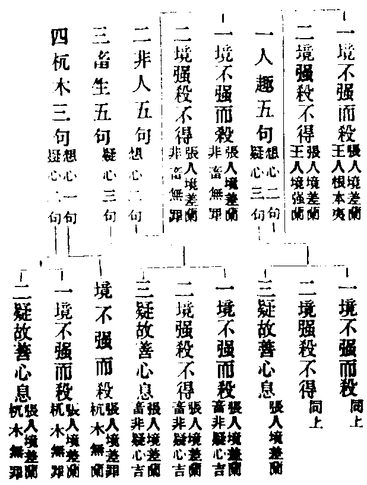



「事」即制罪，「理」谓业道，方便、究竟皆兼两业。「境」即四异，「心」谓想疑。已上并指诸师所立之义。「此」下，显今略意。



【疏】餘有非人、畜、杌来作异境，通望本境不死，偷兰；若望异境无心，无罪。



餘异境中，初文。可知。



【疏】问：「王人异境，亦是无心，何为结重？」



答：「人想而杀，境心相应，是故成重。不起非人想，故无罪也。」



释疑中。初蹑前人异境，相并为难。释中，以餘三境，趣类全乖，不可相例。



【疏】问：「若无罪者，云何《律》中『非人，人想，偷兰遮』者？」



次难中，初引《律》者，即「杀戒」境想第四句。



【疏】答：「此由境差，方便罪也。由非人来，人想不舍，杀张心成，而境乖异，望张方便。望非人边，本无罪也。具足五缘杀非人者，但偷兰遮，如何其因已是方便？义不然也。」



他师释中，初科。上二句定罪，「由」下，释所以。彼谓《律》结兰罪，还从本境，不望非人。「具」下，引杀非人罪，质成上义。「五缘」者：一是非人，二非人想，三有杀心，四兴方便，五命断。「如何」等者，以非人作人想，在人为境差，望非人为想差，故是杀非人「因」也。谓果罪但兰，岂得因罪即结方便兰耶？以非人方便但吉罗，故「方便」字合作「偷兰」。(或改「已是」作「不为」者，非。)此明《律》结兰罪，不望非人，斥他异解，故云「不然」也。



【疏】有人言：「上立异境，想疑心中，想则决彻，人差结重，餘则无心，但属本境。疑则不尔，缘两境生，故就两境双结二罪。」



斥疑心中，初文。彼谓想心同上，疑心不同，以未决彻，本异二境，并有心故。云「二罪」者，本境方便兰；人异境是夷，餘三异境，并疑心兰。



【疏】今解不然，但列本境。纵使四异来差本境，若强若疑，皆列本境。何以明之？畜是小𠎝，杌非生罪，如何来差，俱犯偷兰？岂不望人从本境结？



次科。还即古义，对破前解，故云「今」耳。下云「今明正解」，始是今义。文中，初判定。云「但列」者，即指《律》文境想句中。「何」下，徵释。且举畜、杌难破前义。据此破词，则知前解异境皆兰。



【疏】问：「异境有强，方便属何？」



答：「强想犹怀本境，故知此强，不望异结。如是类例，若疑若想，皆从本境。」



三、问中。据上已明强从本境，更欲别示，故问所属。答中。「强」是异境，「想」缘本境，故云「强想」。「如」下，例通。据此立义，不问疑想，异境之上，永无罪也。(前门境强，乃约本境，此明异强，须知两别。)



【疏】问：「异境若强，差我不杀，『强』是本境，『异』非罪者。异境忽弱，而被我害，未害之前，方便属谁？若见异已去，别有方便，此则本境方便自立。若见异已去，无别方便，害异果罪，因还本境，若此立义，则无境差。」



次、今释中，初文分三。初牒前义。「异」下，反以境弱为问。「若见」下，双难。初约有方便难，则本异两境，皆有罪故。次以无方便难，则异境果成，本境因没，故云「无境差」也。



【疏】今明正解。本境一品，齐是偷兰。异境来差，人境缘人，有强有疑，莫不杀心，皆结兰罪。若至非、畜，例有强、疑。以怀人想，强从本境，非、畜异境，一向无罪。若兼疑心，从两境生，本境疑兰，非、畜疑吉。若至杌木，并结本境，以杌异境，非生罪缘。



正解中。初明本境通结，「异」下明异境别结。又复为二，初明人异境，「若至」下，次明非、畜境。又二，初通标强疑，「以」下别释。初释境强，「若兼」下，释疑心。「非、畜」二异，正犯兰提，疑故并吉。「杌」非罪缘，故无所犯。



初师局就本境，异则不结。次师疑心两缘，异境皆兰，不简轻重。观今所判，文理精详，比前可鉴。



【疏】第五，想差方便，义张八位。



【疏】初、心差境方便，如《律》「人非人想」等。



二、境差心方便，如《律》「非人人想」等。



三、心差境究竟，如《律》婬、酒戒，若怀非道、非酒想、疑，但是正境，皆结究竟。



四、境差心究竟，如欲杀、诳张人，张去王来，缘王张解，若诳若杀，是境俱差，齐成究竟。



五、心境俱差成方便。



六、即此互差成究竟，以事思取。



七、心境不差成方便，如出佛身血、境强、缘差之类。



八、心境不差成究竟，诸戒并是。



五、想差中。此门八位，前四互历，后四具兼。一、三全是想差，五、六心境兼差。此门唯收四句。二、四属前境差，七、八即境想初句，故此四句皆非科意，句法相从，故为八位耳。五、六二句，令「以事思」者：五中，如欲杀张，王人替处，是境差，心复转想，谓为非人，即想差成方便；第六，如欲杀张，王人替处，心作李想，还成究竟。言「互差」者，「互」即是俱，承上第五，故云「即此」，或恐字误。七中，出血一罪，永无根本，境强、缘差，事不究竟，心境无改。



【疏】就此想中，或有从轻向重，如杀盗畜生，转想向人者是。或从重至轻，即反上句是。或互转者，如彼婬、酒、破僧，俱是正境，想、疑或生，无非究竟。



料简中三。初杀畜盗畜，方便但吉；转作人想，杀盗皆兰。二杀人盗人，转为非畜，后心并吉，故云「反上」。三互转俱重，如淫前作非道想，后作正道想，或前正后非，无非果本。私释：更立互转俱轻，如非人畜生，心想互差，可以明之。



【疏】第六，疑心方便者，相对义张八位方尽。



【疏】我疑他方便，人非人疑也。



他疑我方便，身现妄语相，前疑不了是。



他疑我究竟，我疑他究竟，如口造语业，但使言章了了，不问自他疑也。



【疏】上四句单疑也，今此双举，何者是邪？自他俱疑成方便，如身口互造也；即成究竟者，妄语言了也；自他俱不疑成方便，如出血在佛也；即成究竟者，一切戒是也。



六、疑心中，前四互句。初即境想中第二句。



问：「与前境差中疑心何别？」



答：「前对异境，此就本境。」



餘三俱约妄语配对。后四俱句。前二还约妄戒，但具两疑，与前为异。言「互造」者，亦即如上身造口业。后二亦是相从而出。



【疏】第七，善心息方便者。如欲造罪，身口虽发，未邻究竟，忽起善心，便止前业，壅碍不畅，但居方便。



七、善心息，初中。「邻」，近也。云「忽起」者，或因他勉，或遇胜缘，或思佛戒，或畏因果。若非此类，善心宁发？「居方便」者，前心偷兰。



【疏】问：「此乃善心生，今何言『息』？」



答：「实如来问。向若不生，恶必趣果，由此善心，能息恶想，即所息处，号为『方便』。又如《律》文『舍者，偷兰』，舍时非罪，由能舍故，前恶不至后果，故号前因为『方便』也。」



释难中。此即善生恶息，於义易知，欲生下答，故此为问。答文为二，初正答，「又」下引例。能舍则同善生，所舍可类恶息。



【疏】第二大门，校量同异者。



二、校量者。即总料简前七位也。



【疏】初、以自身造境，对置杀具，明方便多少者。



身自造境，具七方便。设置悬拟，既非自身，故阙想、疑，但五方便。



明多少中。初标示，「身自」下，别释。初明自造故多，「设」下，次释置具则少。以想差、疑心，必约到境，悬拟相成，不可论故。



【疏】剋心辨差，其境则宽。以元在张，王、非、畜、杌后来差故。漫心辨差，其境则狭。以通三趣，有境齐害，唯有杌境，用分轻相。乃至想、疑，剋漫可解。



次科。言「宽狭」者，谓异境多少也。初明剋心宽。「王、非、畜、杌」，即四异境。次明漫心狭。「杌境轻」者，非情无过，止有方便。上据大漫。若约小漫，如欲通害人趣，望剋为狭，对大犹宽。「乃至」下，此明境差，想疑二位，并通。剋漫二心，宽狭义同，故言「可解」。



【疏】二、心境分别。



境差、境强、缘差，据前境论。阙比丘缘、想、疑、心息，据自心辨。或阙恶心，如好心息；或阙有心，如狂心息。



心境中。三种属境，四种属心。「阙比丘缘」，或约四舍，或是狂痴，故属心也。「或」下，别示息心，则兼二义。



问：「狂心息者，与比丘缘何异？」



答：「此据止息，初缘不息，俱不至果。」



【疏】三、宗致分别。



问：「此七方便依何而述？」



答：「出在《律》文境想五句。以彼文言『人，非人想』、『人，非人疑』，即是向述想、疑二位。『非人，人想』，则是境差，如前所指。餘四方便，义通剋漫，境想无文。是故《律》云『不成，偷兰』，则摄四位，可以知也。」



宗致者，显示七缘，皆有诚据。「宗」，即文之所出，「致」，谓立之所以。问意可见。答中，初指三种所出。「《律》中境想五句」：初、人作人想，夷；二、人作非人疑，兰；三、人作非人想，兰(上三通名想、疑)；四、非人人想，兰；五、非人非人疑，兰(此二名境差，文略后句)。「餘」下，次明四种义立。「剋」、「漫」二位，本出境想，今此四缘，皆可具之，故云「义通」，则明境想有义无文也。「是」下，指通文以摄。由此四缘，皆不至果，故可通准「不成」之文。私谓「阙比丘缘」，准诸戒末并云「颠狂、心乱，痛恼所缠」，即其文矣。



【疏】大门第四，明持犯义。



略分四门：初、知名字；二、明体状；三、释成就；四、辨位致。



四、明持犯。《钞》具七门，此但明四，故云「略分」。名必召体，体成有处，心容明昧，四段辨相，大途已显。餘如对篇，逐位别配。



【疏】就初门中，言「名字」者，持有两种，犯亦同然，各有止作，例分为四。



名字中。「名」即是「字」，无别所以，不必强分。然须先了二名，并依受体而立。由本受时，不出二心，一者断恶，二者修善。所发业性，即本愿体。随中守护，对分两持，违反本受，即戒两犯。



【疏】先明二持。



【疏】所言「止」者，方便正念，护本所受，禁防身口，不造诸恶，目之为「止」。止而无违，戒体光洁，顺本所受，称之曰「持」。持由止成，号「止持戒」。如初篇等，可以自明。此对不作恶法为宗。



止持中二。初牒名，「方」下，释五节。初释止义。言「方便」者，或但摄心离过，或复修诸对治。「止而」下，明持义。「持由」下，总合。「如」下，举事以显。「此」下，指归行宗。所以尔者，欲使四行无滥故。



【疏】恶既已离，事须修善。必当勤䇿三业，修习戒行。有善斯护，名之为「持」。持由作成，故号「作持」。如衣食四缘，威仪杂行，作意防拟，方成戒净。此对修习善法为宗。



作持中，蹑前生起。「必」下，释义，亦五。初释作。「有」下，明持。「持由」下，合名。「如」下，指事。衣、食、药三，皆通受净，房有制量、乞法。或可粪衣、乞食、树下、腐药，《羯磨疏》中科为「根本作持」。修道假此，故名「四缘」。「杂行」，总收众共，皆作持摄。「此」下，示宗，可知。



【疏】所以前后不同者。《论》云「戒相止，行相作」也。又云「恶止善行，义之次第」。



次所以中。初徵意者。以修舍义顺，今相反故；又止作体同，今分异故。《论》下，次引释。《论》即《百论》，文有二段。初释不同。彼明佛说法有二种：一止相，二行相。谓息一切恶名止，修一切善名行。外道难曰：「已说善行，不应复说恶止，以恶止即善行故。」内曰：「止相息，行相作，性相违故。」今变其语，取其义耳。「又」下，次释前后。彼云：「外人又难曰：『善行应在初，以善法有妙果故。』内曰：『次第法故，先除麤垢，后染善法。』」



【疏】次明二犯。



【疏】言「作犯」者，出家五众，内具三毒，我倒自缠，不思对治，鼓动三业，违教造境，名之为「作」。作与持违，污本所受，名之为「犯」。犯由作成，故曰「作犯」。此对造作恶法为宗。



作犯中。初牒名，「出」下，释义有四。初释作。初句标能犯之人，次二句叙起业之本。「不」下，正明造业，释成「作」义。「作与」下，次释犯。「犯由」下，三、合名。「此」下，四、显宗。两犯并不指事者，翻持可知故。



【疏】恶既作矣，必不修善，是以第二即明「止犯」。良由痴心怠惰，不奉教法，行违本受，厌而不学，故名为「止」。止而有违，反彼愿本，故名为「犯」。犯由止成，故名「止犯」。此对不修善法为宗。



止犯中五。初蹑前生起。「良」下，四段，亦如上分。作犯造恶，则通三毒。止犯慢法，偏对「痴心」。



【疏】二、明体状者。



【疏】如昔解云：「离身三邪，离口四过，意地不起三不善根，名止持体。屈身礼拜，行檀放生，赞叹三宝，读诵经教，意修三善，对治三毒，各修诸观，乃至离染净行，慈悲四弘等，名作持体。起十不善，名作犯体。止不礼拜、布施修慈，乃至观行，名止犯体。」



二、明体状，「昔解」中。初明止持，通指十恶。「屈」下，明作持。初二句即身业；「赞」下，是口业；「意」下即意业。上明事行，「各」下，次列心观。初句即指五停心、总别相念等。「离染行」者，即十二头陀。「四弘」，即四无量心，文举「慈悲」，而略「喜舍」，如后对破。二犯，相反，可解。此师大要，不明化制两教业行不同。故下并约制教难破。



【疏】有人问曰：「止不行施、礼拜、读诵，悉为犯者，出在何律，何聚所收？如《律》文云『佛不制者，不应制』也。何以得知不施非犯？如《智论》中『兄弟二人，出家造业，各於施、戒，互不修行。弟为白象，以不持戒；兄获罗汉，乞食不得，由不行施』，如何而言不施犯罪？」



次引正解，斥破中。标「有人」者，即是首师。初难中四。初牒彼计。「出」下，责其无据。「如」下，引文显妄，即《律》中「非制不制，是制便行」文也。「何」下，举事证非。迦叶佛时，曾为兄弟，兄但持戒，弟专行施，故云「互不修」也。至释迦时，感报乃异。今谓兄「不行施」，乃名持戒，明知不施非破戒也。



【疏】「又且律中，但约身口。至於意地，未闻戒训。如何而言不修四弘，便是犯也？」



次难中。即《善见》云：「凡夫常缘欲境，圣人若制心犯，无有得脱之期。」



【疏】「又若犯者，何曾见悔不施等罪？故《智论》云『不行十二头陀、四无量心，不名犯戒，但是於戒阙庄严耳』。」



三难中。由律悔法，必据犯制。「不施等善」，律既不制，岂得有忏？「故」下，引《论》，可见。



【疏】故知上立违於律、论。若论自行，止可违理。若不修慈，何成道业？毒蛇未出，义不安眠，如救头然，名「有惭者」。



结显中。「律、论」即如上引。「若论」下，遮疑。非谓施慈等行，都不修之，但非持犯体耳。须知善行约教二别。如上所列，但属化教，道俗通修。如后制听所摄事法，局於制教，唯道行之。故云「止可违理」，则明非违制也。「若不」下，显示须修，可解。



问：「此中但破止犯，彼立作犯，有何过失？」



答：「前举十恶，还是化教。十中前七，乃入律制。本宗心犯，如别所论。」



【疏】今更依教，立持犯体，能所分别。



正立中，标。云「依教」者，「能所」二体，皆出本律。以《四分》结犯，并问何心。「律序」又云「当审观意」，虽兼身口，由是无记，非罪福性。今明「持犯」，必约成业，故专取心为能持体。



问：「受中作戒，色心为体。今此能持，即是随作，但云思心。受随应等，那不同者？」



答：「受取缘成，必须兼色。随取成业，但约心论。学者深思，方见远致。」



【疏】言能持者，即心为体。身口是具，不名为业。若不思虑，不成持犯。



能持体中，初科。虽通指心，正取思业。



【疏】故《成论》云：「是三种业，皆但是心。离心无思，无身口业。」又云：「身口者，乃是造善恶具，非善恶业体。」



次科。《成论》由是当宗，故可为证。「皆是心」者，此指意识，犹通四阴。若据成业，须至行心。「行」即意思。以思从心起，身口二业，复由思成。今从业本，故言「心」耳。



【疏】以此文证，故知意思为能持犯体。



三中，正显体状。体用齐举，故云「意思」。「意」即心也。



【疏】言「所持」者，收二种持，就制听两教，交络互明。



所持中。标示但云「持」者，下列四行，合须云「犯」。或是语略，或可翻「持」，自可明故。下约制听二门，止作互历，故言「交络」。



【疏】先出二教之意。



「先出二教」者。今明持犯，唯据律藏，文虽浩愽，不出制听。特异古师滥通餘行。故须先示二教大纲。



【疏】言「制教」者，禁诸出家，有恶皆断，名「制止」也。有善斯习，名「制作」也。若斯以明，是大略也。若违此二，双结两罪。并由制成，故号「制教」。



制教中。初示二持。未陈别相，退举总意，故云「大略」。「若」下，明两犯。制止反作，制作反止，皆名违教，一一结罪。



【疏】言「听教」者，作与不作，一切无罪。



听教中。如造房、畜长，必不俯从，乃成上行。依开而作，自摄下根。今望「作」、「不作」边，故言「无罪」。然至作时，还须依教，房舍尺量，长衣日限，违则有罪。



【疏】故《地持》云：「有罪，行者制；无罪，行者听。」文成证也。



引证中。「行」字平呼，谓造作也。



【疏】所以须二者。唯制不开，中下绝分，进道无由。唯开不制，则令上行慢求，息於自励。故立此二，摄机斯尽。



出意中。初句总徵。「唯」下，别释。初明须听。「唯开」下，次明须制。上行忻制，乃能勇进，唯开退屈，故云「慢求」。「故」下，通结。立斯二教，摄彼三根，故云「斯尽」。然上根禀制，未必从听。中下二根，制听齐奉。



上来诸文，且陈两教大体，未显持犯体状。有人即以二教为体。又复有立万境为体。并由错认前文，致斯妄立。委如《事钞》所破。



【疏】如昔解云：「二教摄法，各有分齐。止持作犯，唯对二教事相以明；作持止犯，通对二教法、事以辨。所以前段不通法者，法唯进修方知，事但离过自摄，故所以异。」



正明体中，初科，昔解。「止持作犯」，局事无法，与今少异。餘则大同。「所以」下，自释不通之意。以律制法，正在进修；止持离过，非进修故。又事通善恶，故该二持；法唯是善，故唯局作。



【疏】问：「如上立义，止持唯事，不通法者，如五邪、七非，并非正法，若作有违，义须止约。此法与事杀、盗不殊，有何等故不在止摄？如昔解止，但对事明，於义有乖。今不同彼。无论事、法，圣制止作，则通持犯。下以位分，体状无别。」



今义中。初牒彼解；「如五」下，举法比难；「如昔」下，斥非立义。此谓事法既有止作，则通四行。「下以位分」者，即后四门并举事法，对可学、不可学以明体状。方显止门与作齐等，故云「无别」。则异古师单复偏对也。



【疏】前就止持制教门中，有二种位。



止持。制门中。云「二种」者，即下制止制作，或是可不可学。



问：「今论所持体状，何者是耶？」



答：「如后所明善恶事法，即其体也。」



问：「何不直明事法，而先出二教者？」



答：「此有二意：一、为简化教，不使相滥故；二、由此二教各摄事法，体状各异，持犯不乱故。前标云『摄法分齐』，意可见也。」



问：「所以事法复论止作者？」



答：「由善恶不同，四行所摄，体相别故。」



问：「何故须分可不可学？」



答：「若在二教，一切心境，皆名可学。由心迷悟，犯不犯别，所以分之。」



问：「旧记何以立二教为体？」



答：「彼将前文，即为出体。正明体处，谓论四行。所以攻异，浪争不息。」



问：「立境为体，复有何过？」



答：「境是戒缘，体无持犯。坛场受戒，岂唯受境？随中持戒，岂但持境？应知於本受体，有护有毁，遂与教相，有顺有违，故有持犯耳。」



问：「如《母论》云『犯必托境』，又《事钞》云『森然万境，何事非持』，今不取境，则违彼文。」



答：「但由持犯，必对境缘。如犯淫戒，须托三境。如持杀戒，亦对三趣。至论持犯，自指淫杀。《论》云『托境』，岂不思之？又境是局狭，收缘不尽。如诸戒列缘，境唯一种；若言淫事，一切皆收。又复於一男境，自发五十六戒。若但言『境』，境即通漫；今言『事』者，即指别戒。」



大抵诸家所立，与今现文，略无关涉，不足为破。但恐新学致疑，故此略辨，委如《事钞》。



【疏】一者，可学事制止。何者是邪？如婬通三境，盗分四主，既是恶事，不可妄行，故须止也。



可学事中。「三境」者，人、非人、畜。非人摄四，天、修、鬼、狱。故知此三，总收六趣。三皆犯重，故云「通」也。言「四主」者，三趣之外，加三宝境。四犯各别，故云「分」也。



【疏】二者，可学法制止。如五邪、七非，体乖圣教，明了其相，必不得行，故同止也。



法中。「五邪」，即调达五法：一、乞食；二、粪衣；三、露坐；四、不食酥盐；五、不食鱼肉。五皆尽形，一制无开，故名「邪」也。「七非」者，谓所作羯磨违律制也：一、非法非毗尼；二、非法别众；三、非法和合；四、如法别众；五、法相似别众；六、法相似和合；七、呵不止。广如《业疏》。此二恶法，不殊淫盗，故云「同止」。



【疏】言不可学事者，由心迷倒，随境不了，於杀盗境，疑虑不分，望非犯位，故是「止持」。而心不了，是「不可学」。



不可学中。约迷忘者，谓临事造境忽起之迷，非可预学令知，故言「不可」(旧谓「心迷，学不得」者，非也)。



【疏】二者，不可学法。如四依、五邪，七非、三法，是非相滥，忘思不了，虽未依行，故名「止持」。非学所知，名「不可学」。



法中。云「四依」者，以调达倚傍四依，而立五法，邪正相滥，容有迷昧。「三法」者，即单白、白二、白四，或可心念、对首、众法。



【疏】问：「如此生迷，与愚教者，复有何异？」



答：「愚教之徒，生来不学，故随所坏，并结无知。今此不尔，素并明练，忽然迷忘，非学所知，故於教相，无罪可结。」



问答分示愚迷两相，在文可解。



【疏】二、就止持，对制门可学事中，制必作者，如衣钵体量也。言「可学法」者，制必须作，如三羯磨等。



制作门中。今明止持，不宜论作。为欲显示双持犯义，如后问答。「衣」以布绢为体，长五广三等为量；「钵」以泥铁为体，三斗斗半为量。「三羯磨」中，说、恣二法，必须常行，餘对别缘，有必依作。



【疏】问：「此止持中，但得守戒而已。若有作者，便同作持。今明作者，岂非合乱？」



答：「今言制作，即成止持。若不依行，则是作犯；今顺教作，便成止持。如三衣一钵，法须具有，故制畜之，岂非作也？望无犯故，名为止持；依教奉行，又是作持。」



初问答意。以佛制作，不作有罪。望不犯制，即成今止；若望依作，归后作持。方显止持离过，作持进修，於一事法，兼具二持。今取离过，收归止中，则非乱矣。



【疏】问：「与后作持，复何别邪？」



答：「义同意别。具二持犯，其致在兹。」



问后答中。「义同」者，无别事故。「意别」者，止中说作，但取无犯，还成於止；后作持门，正约造作。「具二」下，发起后文。



【疏】因此便明「双持」、「只犯」义，略分二意。初约心用，后约教行。



次双持犯，标中。语略，合云「双持双犯」、「单持只犯」。



【疏】若据心用，以明持犯，一切诸戒，并二持犯。何者是邪？且如婬戒，顺教禁防，即止持义；观厌现前，无思染秽，纵有境逼，三时不乐，名为作持。违作止犯，违止作犯。



心用中。通「诸戒」者，凡持一戒，必起护心，望离恶边，即成止持；望起护边，复是作持。两犯亦尔，违教作恶，必无对治。文约淫戒，示相可解。此谓二持两犯，各自相通。非谓持中有犯，以善恶行别，违顺心乖故也。



【疏】若据教行，必托境生，依教奉行，作而无犯。何者是邪？且如三衣，教遣备具，不敢违侮，名为「止持」；如教䇿修，顺行不犯，名为「作持」。违此二持，便成两犯。可同杀、盗，有教开作，名作持邪？



次教行者。此门须约有教令行，方具二持。如僧残二戒(二房有处分故)，「三十」中九戒(「长衣」、「月望」、「长钵」、「长药」、「急施」，此五佛令净施故。二离、「减六年」，此三有羯磨开。「畜宝」说付俗人)，「九十」中十二戒(「说麤罪」、「輙教尼」，有羯磨开。「背请」、「别众」，切德衣开。「食前后」，并「非时入聚」，有嘱法。「足食」、「劝足」，餘食法开。「残宿」、「不受」、「七日」、「尽形」，开口法故。「净施」问主，僧事「与欲」)，提舍二戒(「尼指授」，教令呵止。「兰若受食」，令语使知)，众学中一戒(「杖囊」，有法开)。此约《戒本》具双持者，餘皆单持。



是则一切作持，其必兼止；若但止持，未必有作。自餘羯磨衣钵等事，则见广律。文举「三衣」，其相甚显。「侮」，音武，慢也。「可同」下，对单持辨异。以杀盗等无教开作，则无双义。



【疏】问：「依教造境名作持者，如婬怨逼，禁心境合，岂非顺教，应具二持？」



答：「此以难缘，禁心名止，非谓恒尔。若无怨逼，对境有犯，况复合邪？」



若作此释，莫问事法，无圣教听，并是单持。广更如后。



引难中。初篇四戒，淫开怨逼，《律》令作蛇口、火中等想，教既开作，合成双持。答中，怨逼作想，岂与三衣等作同耶？「若作」下，总判。「广」下，指后诸篇。



【疏】二、明止持对听门中事法者，亦有可学及不可学。



【疏】言「可学事法」者，谓房舍尺量、长衣广狭、指授白二、加说净法是也。於此事法，亦听作听止。必有房财，理须加法，故「听作」也。若有妨难犯过衣财，不合加法，故「听止」也。



听门，释可学中。初标示。「谓」下，出体。「於」下，明止作。听中有违，还复令制，故得有止。



【疏】言「不可学事法」者，谓房财大小，迷忘互生，作法是非，昏昧杂起。望不违教，名为「止持」。迷非可学，故不制犯。



【疏】次对作持。亦就制听，以明持相。



次、作持中。标云「亦」者，亦前止持故。



【疏】先将作持，对制教中，明制作者，位通事法。



释中，依古者。昔谓作持无不可学。今且一向依彼出体。下文难破，方显今疏还通二位。



【疏】言「可学」者，并制修学。「事」谓衣钵行护也，「法」谓一切教行也。竝托事法，进用修成，而无违犯，名为「作持」。不敢违越，又是「止持」。



制门，通示中。初句牒示，次句明行相。对简止持，是离过故。「事」下，出所持体。「并」下，显示双持。



【疏】问：「此止持与前制门中止持，复有何异？」



答：「前对恶法无由可作，名为止持；此就善法必不违越，名为止持。各有意致，可通解不？」



问答，为简两门止别。



「若尔，前制作中止，与今何异？」



答：「与彼同也。今所简者，指制止中止耳。」



「若尔，今此明止，为属於何？」



答：「还属前门。」



由此而知止分二种：一、断恶门止，正摄止持；二、修善门止，旁收作持。作唯有一，但局修门。又复止恶局前，作善定后。作中之止，则通两门。在止则离过不殊，在作则同由善事。约此以分，止作无滥。



【疏】就听门中，亦对法事。「事」谓长财房舍，「法」谓处分说净。亦有听作听止，如前所言。



次、听门止作。



「还指止持，事法无别，何以分之？」



答：「听门事法，二俱是善，本属作门。但兼『止』义，故在前出。但前取听止，此明听作，故不同也。」



「若尔，所以前后俱明止作者？」



答：「为显双持义故。及论止作，各摄所归，不可混也。」



【疏】如昔解云「作持门中事法，唯可学，无不可学」者，非此所明。「以非进修，圣不制学。不同止持通不可学，以唯离过，故得明也。」



今破中，古解为二。初直判不通。「以」下，对止显意。彼谓「学」必造修，如四重等，非可为之，故有「不可学」。



【疏】今解不然：「不可学迷，非学能了。乃至四果，犹有事迷，何况下凡，而能通辨？故於事法，无问止作，皆有迷忘，而非罪摄。何以明之？如《律》长财开忘不染，房舍指授，亦开想疑。既不结正，明知不犯。」



今解中，初文。古师约事，所以不通，今立心迷，则该四行。「四果事迷」者，见思已破，理解虽穷，於事未达，故有忘认瓶、衣之类。「故」下，决通诸门。「何」下，引文以证。二戒想疑，文见《戒本》。



【疏】问：「若不结犯，何以《律》文结偷兰邪？」



答：「忘非偷兰，此结想、疑方便耳。前心欲作过量不处分房，后心转想，谓是应量处分之房。想差前因，不至后果，故结偷兰。可不解也？」



释疑中。此引房戒境想为难。彼结兰罪，今云「无犯」，则相违故。答约方便，文义易知。



【疏】若依此明，与昔持犯，通塞全异。诸有读者，任情两取。



显异中。「通塞」者，彼不可学，俱局止持，今通四行。「诸」下，劝令从长。非谓存古而言「任情」。欲明今古两解，是非已彰，特以此语，激励后学。



下明两犯对翻二持者。但望心违，无别体状。是故一一皆指事法，即其体矣。然止犯中，明云「所对」，世人不知事法是体，读至此文，如何消解？教旨极详，但未思审。或复情执，何足为论。



【疏】三、明作犯。其状如何？此犯所立，翻对「止持」。但不依戒行，事法有违，皆名「作犯」。



【疏】第四、止犯。以对「作持」。所对事法，怠而不修，皆名「止犯」。



【疏】此二犯中，亦有可学及不可学，类止持中。彼此交映，则衢术历然。为繁纸墨，故不疏出。



双结中。由不别陈，故须略点。制听止作，可不可学，一同二持，但「犯」为别。



【疏】三、明持犯成就处所。心、行、对业，三门分别。



三、成就门，标中。前虽明体，未识四行成在何时。故以三门辨明分齐。初、约三心，二、就行心，三、兼身口。



【疏】前将止持对心以明。



若无染污，以明止持，行前三心，得有持义。谓识、想、受，此之三心，非业非记，流入行心，方成别业，故分四阴，以为二分。岂非本有戒体，外无染污，光洁纯净，名之为「持」。三心非记，受体是记，故得「持」也。



初科。上句标举。「若」下，正释为三。初通示。据此非持，取本受体，说名为持，故云「有义」。古人目为「端拱止持」，以非造作，任运成故。「谓」下，别简四心，分二所以。统论四行，止持有二，餘之三种，并局行心故也。「岂」下，结显。「三心」下，释疑。



问：「三心何分？」



答：「了别所缘境名『识』(即通指六识)，取所领之相名『想』(谓取所领六尘之相，则为六想)，领纳所缘名『受』(谓六触因缘生六受，一一各有苦、乐、不苦不乐，三受之异，皆从违、顺、非违非顺而生)。造作之心，能趣於果，名为『行』(谓六受之后，各起善、不善、不动业等，亦名六思，思即是业)。若大乘经，则受、想、行、识，列次不同(由受生想，从想起行，由行成识)。今依小论，则识、想、受、行，以取最初一念了别之心名『识』，次起想像名『想』，复次领纳名『受』，后起业思造作名『行』。」



问：「破毁之人，有此持否？」



答：「据《篇聚》中，犯一重戒，餘戒常净俨然。是则持毁皆有持义。今文且从持说，故云『无染』耳。」



【疏】二、就治行明止持者，必入行心，方得成就。前之三心，不名为持。善性便有，恶无记无。如欲离过，作意遮约，或对境防，或起心护，岂彼无记而得成持？若据作持，例同后止。既就境论，三心非分。



次科，二持中。初明止持。以非思虑，不成事业，故云「必入」等。「前」下，拣三心。「善」下，拣二性。「如」下，举事显相。「若」下，二、明作持。「同后止」者，简前三心止故。



【疏】若据二犯，行心成就(前言持者，三善为行；今言犯者，三毒为行)，前三亦无(识想受等，通善恶行)。局不善性，善无记无。



二犯中。亦约四心三性，以定行体。寻文可了。注中，以行通善恶，故须简异。



【疏】若事前后，心则异生。别持别犯，则可知矣。



前后心者。即《钞》中「自作教人」、「自业相成」二种义门。广文如彼，今略举之。如前遣人漉水，即止持；令人送欲，即作持；教他杀生，即作犯；令他造房，不乞处分，是止犯。后修止持，彼四同辨。乃至前作四事，后作止犯，例上可知。虽心境不同，善恶闲杂，不妨前后行业自异，故云「别持犯」也。「自业相成」，亦类同上说，但望自作为异。



【疏】三、就业明持犯相者。



【疏】言身口者。离杀等过，名「身止持」；受食食等，名「身作持」。离语四过，名「口止持」；知净语等，名「口作持」。身口二犯，反上可知。



三中，初科。初句双标，「离」下列释。前释二持。「身」下，明两犯。言「反上」者：行杀盗等，名身作犯；不受食食，名身止犯；造口四过，名口作犯；不作知净，名口止犯。



【疏】单意业中，不名持犯。故《律》文云「单意者，不名犯」也。



单意者。若至身口，必兼意思，如上二业。未及身口，麤细心念，通名「单意」。初科，据文立义。然单意语通，此据瞥尔，制限大乘，故云「非犯」。



【疏】「若尔，何故《律》云『发心作、心念作，皆名犯』者？」



难通中。以二文相违，故须简辨。



问：「发心、心念，为同为异？」



答：「上是方便，期成彼事；下是果头，如『恶觉』、『默妄』、『染心看女』等。」



【疏】答：「此谓发心将由身口，虽未动相，即名为犯。」



答中，初释。通约远方便论。「将由身口」，故非单意。「未动身相」，即是发心。



【疏】有人言：「制声闻戒，於可制者言之。独头心念，忽起缘非，不名为犯。重缘向念，可得思觉，而不制约，故是犯科。所以文云『心念作』也。」



次释中。初约大乘，释前不犯。「独头」，即「瞥尔」异名。「重」下，次据本宗，决后犯文。谓后念还追前事，故云「重缘」。「向」即前也。



问：「意已成犯，何以前约身口明成就耶？」



答：「就意辨成，皆远方便。心念果罪，少分有之。大论趣果，须至身口。」



【疏】任情两取。后为正义。



结中。上句是纵，下句是夺。



问：「世云『小乘不制意地』，今那制耶？」



答：「此由不辨假实两宗制限深浅故也。小乘实宗，定不制意，动色成犯。假宗制意，但约重缘，简非瞥尔。是则三宗历然，大小无滥。学者至此，宜须精究。」



【疏】上明成就竟。餘有通塞诸门，增微杂相。量时须者，可寻《事钞》中卷《持犯》。两以相成，故斯略也。



指略中。初结前，「餘」下总指。《事钞》七门：三门同上；第四「通塞」，自分四位，故云「诸门」(一心门、将心望境门、自作教人门、自业相成门)；第五「渐顿」，文中不指；第六「优劣」，即是「增微」；七「杂料简」，即今「杂相」。「量」下，嘱后讲习辈也。



【疏】大门第四，位列持犯者。



第四门中。唯明不学无知，止犯罪相，有无轻重。随一事法，皆须二九，故云「位列」。



【疏】佛立教相，止为奉行，若但读诵，非本意也。



然受戒后，勤学教行，於诸事法，明若指掌，忽於境想，迷忘而造，律制非犯。此不可学迷也。



若由来不学，不思过犯，随所造作，不问事法，但作有违，皆犯根本。缘而不了，结无知。若於二持，虽不违负，望非明决，不名为福。若缘不解，但是无知。是以佛言「随作犯根本，更增无知罪」。



叙结分三。初明立教之旨，「然」下叙结之所以。初明学人开迷。文中明学，须具二义。言「学教」者，谓精穷三藏。「学行」者，谓专修对治。若此为学，方开迷忘，自餘泛尔，皆不学收。举世相传，才过学肆，便称「学人」，自谓无罪。观其所业，曾未勤劳；求其所行，略无奉慎。岂能全免不学无知！请详此文，足为龟镜。「律制」者，即诸戒后境想中开。「若由」下，次明不学须结。又三，先明迷犯。「若」下，次明昧持。故知不学，由不晓教，持亦成犯。「是」下，引证。即「不摄耳听戒」文。



【疏】今略标举，须配位法。此立两个九句，交络有无，为持犯方轨。



总标中。初句指前，「须」下生后。言「交络」者，即於事犯，各有识、疑、不识三心，互织作句，如图所显。言「方轨」者，若解二九，随一事法，无不该通，故《事钞》云「类通法界」是也。



【疏】先就止持，明罪有无轻重分齐。於可学事法，作九句，分三品。



止持，可学，标中。「有无」等者，「有」即疑及不识，「无」即是识，「轻」谓不学及疑，「重」即不识。立句之意，如作犯门，具明所以。



【疏】上品一句，识事识犯。「事」谓杀、盗、三衣一钵，「犯」谓夷、兰、提、吉。若能於此事法明了，无疑奉行，可谓上品持律之士。



上品。事中，「杀」、「盗」制止事，「衣」、「钵」制作事。犯中，夷、兰对杀盗，提罪对衣钵，吉罗通上止作二事。今略示图相，则依文易解。



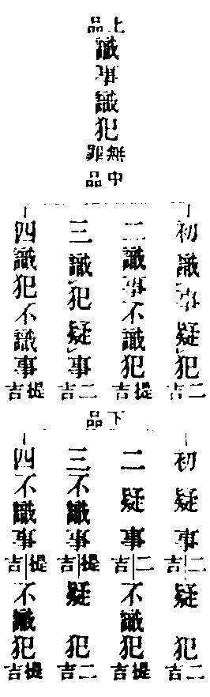



【疏】中下二品，各分四句。



初、识事疑犯；二、识事不识犯；三、识犯疑事；四、识犯不识事。



下品四句：初、疑事疑犯；二、疑事不识犯；三、不识事疑犯；四、事犯俱不识。



【疏】言「不识」者，犯谓不犯，迷轻谓重。



「疑」中亦尔，疑有疑无，疑轻疑重。



【疏】上品一句，事犯俱识，不可以结不学无知。



显数中，上品。可解。



【疏】中品事犯，句虽兼识，然於罪事，生疑不识。随有迷处，皆结两罪：一是不学，二是无知。四句单双，罪则有八。犹自名为「中品持律」，以句带识，非是全迷。



中品，前示罪数。「单双」者，下半事犯是单，皆有二罪名双。「犹」下，结品。



【疏】下品四句，罪事俱迷，随句有四，则十六罪。此则名为「下品持律」。然於末句最第九也：由涉疑故，是解家津；不识罪事，非智之甚，可不然也？



下品中。初示罪相，「然」下，别示第九。初指句，「由」下，对简前三句，「不」下，正显后句(「津」，合作「律」，又复写倒。「甚」，合作「堪」)。



【疏】此中计罪有二十四：六波逸提，十八吉罗。无知故重，则不识是也。有疑不学，但是轻收。



总合中。初合数；「无」下，示罪体。无知通轻重，不学一向轻。



【疏】问：「既名愚教，即是犯位，有何等义，名为止持？」



答：「不犯根本，故名止持。事犯有迷，自是愚教，止犯所摄。举宗判义，持犯何乖？」



门答中。根本名持，正在今位；枝条是犯，自摄后科。故云「举宗」等也。



【疏】次对不可学事法，以明止持。各分三品。



【疏】初三句中：一、识事识犯，二、识事疑犯，三、识事不识犯。



【疏】中品三句：一、疑事识犯，二、疑事疑犯，三、疑事不识犯。



【疏】下品三句：一、不识事识犯，二、不识事疑犯，三、不识事不识犯。



次不可学，列示中。即前九句，欲使结罪有无易见，故三三品列。



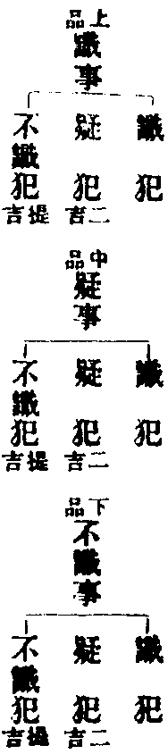



【疏】此三三句，各下二句，於犯带迷，有疑不识，各有不学、无知二罪，合十二也。亦望不犯根本，名为止持。



合数中。初正合。此三三句，并第一句，於犯俱识故，唯下二句有罪耳。「亦」下，结宗。



【疏】但事是可学，想疑忽生，缘而不了，圣不制罪。罪是可学，若有迷者，皆结其罪。



显意中。所以唯事开忘者，事是临境造修，有迷可恕；犯是教相，纵令先学后忘，还成懈惰，故不开也。



【疏】问：「於事有迷，故开不结。必於犯法亦有迷忘，如上引律过量不处分，想、疑皆开，何为於此而结不学无知？」



答：「计理成例，是所不惑。可如作持对法中说。此中交络，事法互有不学无知，故生此位。」



问答中。初难意者。以古师作持中，无不可学，故蹑事为难，意使例同。所以答中，但指如后，至作持门，还指同前。谓事既开迷，犯何结罪？「犯」既是法而不开者，则作持迷法亦应不开。答中，初承前难意。若迷法者，宜同事开，故云「成例」。「可如」下，指后作持不可学九句。「此」下，显今止持，就事立句，但可例同，未该后法。



问：「此止持门不明法位者？」



答：「影略互彰。止持就事，作持从法。至於四行，各具事法。故知止持一门，恶事恶法，各有可学及不可学，合四九句。餘三同此，总有十六九句。不学止犯，立一八句。此约四行，通数如上。若就别论，一一事法，皆通二九。是以《钞》云『类通法界』，义在於此。」



【疏】问：「如杀盗等，论罪有无，人非人想，主无主想，有何义故律判不定？」



答：「大有意也。或缘罪境，人非人想故，但结心罪。或缘非罪境，有主无想故。然彼迷心，并不结犯，皆约前心方便为言。」



第二难中。上云迷事圣不制犯，而律境想，结不结异，故引为问。答文，初句叹教通答。「或」下，别示有无。「然」下，结成开意。谓正迷时并无犯故，还归事开。



【疏】二、明作犯。



可学事法，如初九句；不可学者，如后九句。结罪多少、轻重皆同，但犯根本以为别耳。



作犯中，初科。可学则有九根本罪。不可学中，三识并至根本。三疑半涉本境，无不有罪，但重轻为别，如杀盗等，可以思之。三不识句，除「淫」、「酒」犯根本，餘戒转想并有方便，本迷一切无犯。



【疏】就此根本不识事中。始终无心，如悮杀人等，不结其罪。前则有心，中后无心，但转想疑，除婬、酒戒，餘结方便。若不差者，还结根本。若心了境，不造前事，则无罪也。



料简中，初科为二。初标品位。三识三疑，俱有罪故，不须辨之。唯三不识，有无不定，故此委示。「始」下，正简有四。初明本迷。「前」下，明转想。「除淫、酒」者，该上本迷(准下酒开方便)。「若不」下，於不可学，转为可学。「若心」下，如善心息也。



【疏】问：「有何等义，分二九句？」



答：「欲使持犯相易也。」



次科，问答。云「相易」者，谓阶品差降，则结罪有无多少可见，如次所显。



【疏】故前九中，上品一句，中下各四者，由缘一事，带疑不识，交络互明，出其犯相。九句就事，皆结究竟。缘而不了，愚教之罪，自结不学无知也。其愚教罪，亦是究竟，无果可趣。有识无疑，则非罪摄。



明前九中。初明立句。以识等三心历於事犯，上下不定，故云「交络」。「九句」下，明根本罪。「缘」下，示枝条罪。古师谓是方便，故特点之。



【疏】论后九句，三品各三。由不识事，境非可学。不妨於犯，是可学故。致列其相，事总而罪别也。



次明后九，初中。略举「不识」，必该疑心。是则三识非不可学，句法相因，故可知矣。此中立句，事但一心，且如上品上半，皆云「识事」，故云「事总」(中品疑事，下品不识事，皆然)。下半犯中，识、疑、不识，三心不同，故云「罪别」。



【疏】问：「若据此论，识、疑二事，分句为六，可是犯摄。不识等三，便是无犯。云何说言『作犯九句』？」



答：「若就本迷，实唯六句。然缘犯法，有疑不识，即是其犯。故说九句。」



次科。上中二品，有罪可知。此下唯明下品三句。初问中，以作犯门，必须有罪，下三非犯，故设此问。答中，初纵来问。「然」下，夺归须立。



【疏】「若尔，缘罪疑等，乃是止犯，何得说为作犯位也？」



答：「从根本边，说名『作犯』。」



次难中。以止、作犯别，不合同位故。答中，「从根本」者，三不识句，虽不犯罪，非不造境，故得归宗。



【疏】「若尔，不识事识犯，全是无罪，止应有八，何得有九？」



答：「如上已明相从句法。」



后难中。以此初句，本枝俱无，义不可立。答「如上」者，即指初答。



【疏】有人解云：「何须如此？今总为分。若可学事法，生可学迷。一向九句，莫不犯根本也。若可学事法，生不可学迷。则有八句，除不识事不识法也。以心迷故，学不可得。如有主无想，过量不过量，处分不成，羯磨不辨。若始终迷，除第七句。若转想迷，还有九句。后心无罪，结前心因也。」



次总分中。初三句标示。但随具阙，不必定九，故责云「何须」等。「若」下，示可学具九。「若可」下，明不可学不定。又三，初明六句。标简云「八」者，写误，准《钞》，并作「六」字。事法二位，皆无下品，故云「除不识」等。「以心」下，释除所以。「如」下，引事以显。上举盗房，释开事也，下举处分羯磨，释开法也。次明八句。「除第七」者，即下品初句。餘二句枝绦带罪，故得存之。后明九句，可知。



【疏】三、明作持，二九句。对於事法，立句辨相，如上止持可学法中。此但顺教作事而已，不同止持识相守持。今为略述。



三、作持中，初科为二，初指同。「此」下，简异。



【疏】上品一句，识法识犯。造房白二，是识法也；不乞犯残，是识犯也。



【疏】中品四句：识法疑犯，识法不识犯，疑法识犯，不识法识犯。



【疏】下品四句：疑法疑犯，疑法不识犯，不识法疑犯，不识法不识犯。



次科。以法立句，同前图样。中品三四二句，与前小异，合云：识犯疑法，识犯不识法。



【疏】结罪分齐，大分二位。顺教作事，不犯根本。愚教不学，则犯堕吉，如上例显。



三中，初标分。「顺」下，别显，初明持义。「愚」下，示犯相。还指止持，故云「如上」。



【疏】就不可学法，亦有九句，如前段后九句三品。法虽可学，迷倒忽生，佛开不犯。不同昔解。是以《律》中，不处分想疑，皆非残故。



不可学中三。初标指；「法」下，立理。「不同」下，斥古。前止持中问答指后作持者，即此文也。



【疏】四、明止犯，亦二九句。翻对作持，可以自明。



四、止犯中，指句。可知。



【疏】如昔解云：「止犯法中，无不可学。」今言迷倒，随位皆有。如不说净，见罪不露，即是可学；若迷若忘，即不可学。如是例知，通诸戒相。



引古中。初科为二：初，牒古；二，立今。说净覆藏，二俱开忘，故引为据。「如」下，例通一切。文言「诸戒」，举其大槩。须论戒下若事若法，皆具二九。「类通法界」，即其义焉。



【疏】有人解云：「止犯位中，对教不学，则唯八句，除法事俱识也。对事不学，九句通有。如造房舍衣钵，虽达相了知，何妨不乞处分受持加净，皆获残提等罪是也。」



次科。止犯一位，须分三种：一、不学止犯，即不学无知也；二、事法止犯，即於制听善事善法，故违不作也。如文两别。初止犯中除初句者，二种并识，非无知故。



问：「与下同异？」



答：「下有根本，故可存九；此则不尔，故但有八。」



问：「二持门中，亦无根本，何不除去二识句邪？」



答：「彼是持门，无罪可立；此是犯门，无罪何用。」



问：「二犯门中，如何列句？」



答：「应翻二持，下品为上；以犯门解义，罪多为胜。《钞》意如是。」



四分律含注戒本疏行宗记一下之二



四分律含注戒本疏行宗记二上之一



大宋餘杭沙门　元照　述



【疏】《四分律含注戒本疏》卷第二上(从正宗初，讫残第七。)



题中。上三字是《律》题，标所宗故。次四字是《戒本》题，示所解故。「疏」之一字，正目今文。若约人以简，「律」及「戒本」，二并佛言。上加「四分」，则起於部主。「含注」及「疏」，乃始於南山。餘如前卷。



【疏】终南太一山沙门释　道宣　撰



【疏】就正宗，初、约文分位，八段自别。



总举。云「自别」者，以《戒本》八篇，前标后结，文无指滥，不假分故。



【疏】餘七未解。且明初篇，十门分别。



前明戒犯，业必有因，故以四戒，配其三毒。



发虽由心，畅必在具，故次第二：起由身口。



业成彼我，非说不晓，故次第三：自作教他。



上明成业，未辨境缘，故次第四：犯分三趣。



犯境内外，义须分别，故次第五：境约自他。



前虽讫境，成其犯缘，未知心业交杂之相，故次第六：明心错误。



心境乃彰，通局须显，故次第七：明业剋漫。



业成乃具，须知制兴，故次第八：明其教意。



由致虽陈，前后未显，故次第九：明其颁位。



上来两众，诸相乃分，下类业非，理须明识，故最后「列成任运」。



释初篇，叙生起中。初句指后，「且」下，显今。上二句总标，「前」下，正叙。文为十段。初段创起，文不因前，后九皆有蹑前生后，就文寻之。



初言「戒犯」者，谓於戒有犯，或可写倒。言「有因」者，业依惑起，故指毒为因。



「发」下，叙第二。「具」即身口，准下通分止归二业，互造则兼三业，今云「身口」，且就通标。



「业」下，第三。事假他为，故云「彼我」；必涉言教，故云「非说」等。



「上」下，第四。初句通蹑上三。



「犯境」下，第五。云「内外」者，「内」即是己，「外」即目他，如「漏失戒」引《五分》文，以自他身，分内外色。



「前」下，第六。初二句，承上四五。



「心境」下，即第七。初句总蹑上六。「通」、「局」即对「剋」、「漫」。



「业成」下，第八。初句亦通总前门。言「教意」者，即明初篇对何而制。下对三毒，以立四戒。



「由」下，第九。初句蹑上兴意。言「前后」者，谓明四戒列次所以。「颁」字音误，义合作「斑」。



「上」下，第十。初一句通蹑前九。「两众」即具戒僧尼。「下类」，即餘三众。



上之十门，总束为六：初文是惑，二、三即业，四、五明境，六、七心境交互，八、九属教，第十约人。



【疏】先解初门。



【疏】婬之一戒，无始染本，起因三毒，成必在贪。故《善生》云：「若为自乐，是名从贪；婬怨眷属，是名从瞋；於所生母行非梵行，是名从痴。」境交内顺，非贪不辨。以痴不遂，瞋是相违，故两不成。



配毒中，婬戒分三。初明起成。「起」即据始，「成」即取终。「故」下，引经证起；「境」下，约义辨成。



【疏】杀盗二戒，犯通损、益，终因三事，互起相成。



杀盗中，标。云「损、益」者，谓损他益己。以婬唯适已，而非恼他，杀盗两兼，故云「通」也。



【疏】何以明之？即《善生》云：「若为己身，及诸眷属，而取他物，是名从贪；若盗怨物，是名从瞋；劫夺下姓，是名从痴。」如《律本》中「烧、埋、坏色」，不益己故，名瞋起成。如《僧祗》中「摩摩帝互用佛、僧之物，皆犯夷」者，痴心起成。三毒互成，可以显也。



盗中。初句徵起，「即」下引示。初引《善生》，备明三事。「下姓」，即简大姓，如婢仆之类。贱故不贪，非怨故不瞋，故是「痴」也。「如」下，引二律盗相，义判二毒。「摩摩帝」，即经营人，彼以塔无物，僧有物，即持僧物治塔，得重罪。「三毒」下，结示。盗本贪犯，餘亦能成，故云「互」也。或可上据三单始终为言，此示兼具，故云「互成」。应云：贪起瞋成，贪起痴成。餘二为头，亦各有二，则为六句。或复具三，如取怨美物，谓无因果之类。文不委出，故云「可显」。



【疏】因解杀戒论心。如《善生》云：「贪利害命，瞋杀怨家，痴谓有福杀老父母。」又《杂心》云：「如毒蛇等，於人有害；父母老病，谓杀无罪。皆是痴摄。」又《成论》中：「依王旧法，约罪杀人，自谓无罪，但是痴成。何以故？具足杀缘。」心依惑故，互起相成。



杀中，初标。云「因解」者，谓准盗明杀，次第相由，故云因解。后云「又依」，义亦同此。「如」下，先引《善生》，通明三事。「杀老父母」者，使其不受病苦，仍谓得福。「又」下，别引二论，义准为痴。蛇既害人，杀故无罪，今多此见，即是痴人。《成论》「依王法」者，如今官典，刑戮於人。言「旧法」者，谓是先王所制，依行无罪。言「痴成」者，是今所判，准《论》但云「亦应得罪」。「何」下，推释有二意。初约具缘释。《论》云：「以四缘得杀罪：一是众生，二知是，三有杀心，四断命。」、「心」下，次约依惑释。以烦恼未除，动必结业故。杀本由瞋，贪、痴能辨，故云「互起」也。



【疏】又依演出大妄语戒。本为利己，贪、痴起成，兼瞋何爽？故《善生》云：「若为财利，自受乐故名贪，怀怨名瞋，畏死名痴。」



妄语中，初科，标。云「依演出」者，倣前杀盗，通三心故。为利是「贪」，称圣是「痴」，「兼瞋」一句，对破他解。「故」下，引示可解。



【疏】有人言：「思贪名利，言了即结，畅思事竟，则无瞋、痴。又言章虽了，前闻不信，既无名利，反增瞋、恼，何得有贪？」



今解不然。夫言妄语，取其声相，言了即成，岂后得财方名成也？



次科。初引古。彼分两别：初约得利，唯局贪成；后约不得，容兼瞋毒。「今」下，正斥。妄取言了，不待得物；瞋在后起，不名成业。应如《善生》怀瞋而诳，则相兼明矣。



【疏】此之四戒，成犯之处，即结究竟，后之畅遂乃随喜业。如婬侵境，盗取离处，杀据命断，妄在言了，斯至果也。或有境交、离处，心无染、夺者，自在别开，非关大判也。



总判中三。初分前后业异。「如」下，示结犯分齐。「或」下，指境想差别。「境交」即婬，对下「染」字。「离处」是盗，对下「夺」字。文略杀妄，可例知故。



【疏】二、明三业业门者。



【疏】通约四戒，用分二业，前三身犯，第四口犯。



三业中，「通别」两分者，《义钞》名「麤细分」，亦可约单互分。通分，可解。



【疏】别就互造。婬戒成犯，事在形交，故唯在身。口非犯义，由无语故。



别中，婬戒。「由无语」者，非口能成故。《律》中教他作婬，佗作犯兰，不作但吉。



【疏】杀盗二戒，身口互造，两得相成。然身为根本，口为枝条。所以然者？损财害命，身自独成，不待语助，故知身本。口语教死，言了未成，待前命断，方得重罪。要由彼身助口成业，故知枝条。



杀盗，不互中，初科分二。初立义。上二句，明造成通互，容相助故。下二句，明结业不互，局本枝故。「本」即正位，「枝」谓旁兼。「所」下，徵释所以。初释根本，「口」下释枝条。



【疏】问：「口业不得独成杀盗。云何呪物过关、杀人，既得成重，曾未身助？」



答：「如论所陈，凡有呪法，皆使鬼神扶物过关，及以断命。假彼身助，方成业也。」



初难中。初牒前，「云」下，立难。「呪物过关」，即盗王税；「呪物杀人」，谓符祝厌祷。《律》皆结重。此并口作，俱不假身，故引为难。答中。「如论」，即指《多》、《杂》。既凭鬼神，还同身助。



【疏】「若尔，须身方成业者，如师子吼杀兽，壮夫咄杀人，岂有鬼神身业相助？」



解云：「亦由人畜身壮声大，不乖前义。」



次难中。「师子」，《尔雅》谓之「狻猊」，食虎豹，或一吼则令兽死。引畜类人，明无他助。解中。「身壮声大」，虽即自身，义同他助。



【疏】「若尔，深河诳浅，口造身业，彼依而死，何必身壮？无学著衣，身造口业，彼依其言，何有口助？」



「今释此义，亦由问答。身业渡河，死方成业。口业亦尔，亦须他助，无独成义。」



后难中。初约口成杀业，而无身助。「无学」下，约身造妄业，而无口助。或人施物问言「是圣人者，须著三衣」，贪施即著，则犯重罪。释中。并约所杀所诳，以明身口两助。此应古解，於义未显，疏家助成，故标「今释」。



【疏】若依《多》、《杂》等论，三业不互。所以者何？业性异故。事不究竟。言虽了了，未得成业，要由身助。又云：「如自在者语，仙人意嫌，必须人鬼，相助成业。」



次明互造。初文为三。初示宗。「《多》、《杂》等论」，皆有部所计。「所」下，出不互所以，则有二意。初约业异释。若约能造色，身是可见有对，口即不可见有对；若据所造过，身造婬、盗、杀，口作诳、妄；若约所发，业性不混；若取来报，感果不同。「事」下，次约事不竟释。初句立义；「言」下，释成。「又」下，引类。「自在者语」，如王大臣遣使杀戮，此证口互。「仙人意嫌」，如下所引，此明意互。身造口业，例亦如是。「是圣者起」，必假他语，即是口助。



【疏】若依本律，《成论》所通，三业互造，各自成业。故彼文云：「杀不善业，身亦可造，随以自身，杀害众生；口亦可造，或教人死，或以呪杀；心亦可造，有人发心，能令他死。」故彼论云：「如《和利经》说，外道神仙，起一瞋心，杀那罗国。如檀特等诸险难处，皆诸仙人瞋心所作。」



今宗中，初科为三。初示宗。「各自成」者，随约能造，结业成罪，不同《多》、《杂》从所作事判定身口。「故彼」下，引示。且明杀业，餘可准知。初通明三业。身口意三，如文次列，而身是正，口意为互。云「教死」者，《论》云「教勅」，即是遣使，文无叹死，义亦同之。「故」下，别示心造。《论》文二节，初引经证。「那罗国」者，具云那罗千陀罗国。「如」下，次举事证。言「檀特」者，即西土山名。《经音义》云，或言单多罗迦山，此云荫山。此明仙人心业强猛，证上起心即能害故。



【疏】因此义张三业互相。身造口业，著脱三衣；口造身业，教死诵呪；意造身业，仙人一瞋；意造口业，布萨默妄。如是例通，以类诸戒。



约义中。如前引《论》，但明杀业，口意造身；今总诸戒，通论交互。文中四位，身口各一，意则兼二。结云「通诸戒」者，上文且据杀妄为言，目餘诸戒，身业教人(如教人盗及咒物过关等)，口业现相(如二麤语等)，并摄诸句。



【疏】问：「意造二业得互起者，何故身口不造意业？」



答：「意是业本，二具由生，可以知也。」



问答中。本得兼枝，枝无造本。於义易知，恐疑故问。「二具」，即是身口。



【疏】妄语一戒，本希名利，非言不成。亦有身现，无疑成重。比前互造，可以类之。



妄中。初明正业。「亦」下，明互造。现相，必约前信，故须「无疑」。义句已明，故云「比前」等。



【疏】三、自作教他门，教遣分别。



【疏】先明教人。



【疏】言婬戒者，自作成重。教人为非，乐染前人，於我无预，不得同犯。



第三门，初婬中。「於我无预」，言能教人，不预其乐也。



【疏】杀盗二戒，过通损益。自作教人，损境畅思，期契相同，彼我同犯。或能教者剋，所使意异，或时节早晚，坐立乖契，或互颠狂、舍戒，缘阙，但有少差，於此犯法，教者不犯。漫心无寄，随作相应，皆名为犯。



杀盗中。初通明犯相。「损益」之言，不殊前释。「或能」下，二、别简剋、漫。初「剋」中，「或时等」者，且列五异。「时节」、「坐立」、「缘阙」此三竝约所教。「颠狂」、「舍戒」，则通能所，故云「互」也。



问：「如教杀坐人，彼立即害，云何非重？」



答：「既云剋心，能教应言『见坐可害，立不应害』，此则不犯。若不指定，同下漫心。」



「时节早晚」，亦同此释。



次明漫心者，即不定早晚等也。



【疏】大妄语者，自说成重。教人称圣，名利拥彼，於我无润，故不同犯。



妄语中。



问：「文云『教他不犯』者，如教他称己，自得名利，岂不犯重？」



答：「此落后遣，非此所明。」



【疏】教者离己义疎，遣者向己义亲。何以明之？且如戒中，遣人就己行婬，遣人说己得圣，利乐是我，犯齐究竟。杀盗两戒，无有遣义，故非所论。



次明遣中。初分示。「离」，合作「利」，写误。「何」下，推释。可解。



问：「『杀盗』何以『无遣义』耶？」



答：「遣人杀己，罪不至果。岂有令他盗取我物？是则婬、妄二戒，遣重教轻。杀、盗两戒，有教无遣。」



【疏】四、明三趣门，罪趣分别者。先以罪对趣，后以趣分罪。



第四门，标分中。初即以罪历趣，以辨重轻；后谓将趣历戒，以简通局。



【疏】初中。约人犯四，唯夷一品。对非人犯四，则夷兰二品。对畜生犯四，罪则四种。婬则犯夷，盗诳皆吉，杀则犯提。若知解人语，或能变化，杀诳皆兰。盗亦应同，而《律》不列。报异人故，杀但犯提。盗比外部，则得吉罗。解语变化，相滥於人，故盗犯兰。



初科。初人，可解。非人二品，淫戒犯夷，餘三竝兰。畜中四种。上列三品，「若」下，示兰一品，则为四矣。初指二戒。杀戒云「若畜生有智，解於人语，若能变形，杀者竝兰」，妄戒亦云「若不能变形，向说得吉」(反显能变须兰)。次例盗戒。初二句，例准。文出杀妄，盗戒无文，故言「不列」。「报」下，释所以。初明报异结轻。此本明盗，举杀助显，以杀戒简犯，文最明故。「比外部」者，《十诵》、《多论》「鸟兽食残，取者皆吉」。「解」下，明报滥须重。



【疏】次以趣分罪者。



【疏】婬之一戒，三趣同犯。良以烦情内逸，垢心厚重，不问境之美恶，但是正道，适畅不殊，故制同犯。又不就损境而制，故不得论趣优劣。何以知然？尸上行非，同犯重摄，知何所损？但是生死根源，故偏禁制。



次以趣分罪，淫中。初示犯。「良」下，显意有二：初约染心不异；「又」下，约前境无损。又三。初示义。「何」下，举证。《律》中「若死未坏，若多未坏，婬皆结重」。「但」下，显制意。欲为有本，婬染偏重，故推此业为「生死源」。



【疏】下之三戒，人重餘轻。



明餘三中。三戒大同，故先通示，不无少异，下复别论。



【疏】何以知然？良由人趣善因所招，生处报胜，知解者多。於此财物，恋著情重。及至盗夺，守护亦强。能令失者怀恼增苦，故有欺侵便得极重。非、畜两趣，一一反前，虽有盗取，但制轻罪。



盗中。初徵。「良」下，释。前明人重，凡有五义：初报胜；「知」下，强识；「於」下，系著重；「及」下，护心强；「能」下，恼多。「非」下，次释餘轻，异上五义，故云「一一」等。



【疏】问：「地居诸天，报胜解多，盗结轻者，岂不相违？」



答：「天报乃胜，趣别盗希。於财著少，纵盗恼微，故结非重。如盗北洲，但制轻罪，於物无我，无所著故。」



问中。「地居天」者，谓须弥已下，依地住者，简异空界。然盗空天物，结罪无殊，但取下地有可盗义，故偏举之。「报胜解多」，即上人中初二两义，而天又胜，故曰「相违」。答中。初二句，对上人中前二义。报解虽胜，盗取稀故。「於」下，反上后三义。著少、恼微，义兼护弱。「如」下，引例，可解。



【疏】杀相亦尔，人重餘轻。何以知者？亦由人趣报胜，根器有缘，能修诸善，出家成圣。然彼形心，俱是道器。今若加害，断彼相续，即是障道，为过情深，故制极重。餘趣反上，报微故轻。



杀戒，胜劣中，初科。上二句指同。「何以」下，释所以。初明人重。「亦由」者，亦前盗戒。「有缘」者，南洲具四缘，谓见佛、闻法、出家、成道；东西二洲，无见佛缘；北洲难地，故非所论。文中，且举下二缘耳。(或作「有仪」，非也。)「然彼」等者，示制重之意。「餘」下，次简非畜，以不具诸缘，故云「反上」。



【疏】是以《多》云：「三归五戒、木叉解脱，沙门四果、佛及辟支，必在人道，漏尽成圣。」故有损害，便得重罪。天虽报胜，不能出家以成僧宝。



引证中。彼论问曰「何以但害人得波罗夷」，答如文引。「木叉解脱」，即是具戒。上明三种因法，则在凡地；「沙门」下，三种果人，唯局圣位。修因剋果，俱在人中。「天虽」下，简餘趣。「不能出家」者，彼论帝释语目连云：「一天子、一天女，妓乐自娱，不能自割。况作天王，种种宫观，无数天女，天须陀食，自然百味，百千妓乐以自娱乐。虽知佛世难遇，正法难闻，而染乐缠缚，不得自在。善心力弱，何由出家？」然此，且据一相以论。至如诸经，帝释、梵王多临法会，诸天闻法，得道亦多，则非言限。



【疏】又复趣别，相杀义希，故就此义，害得轻罪。



次约义希。在文可解。



【疏】问：「趣远杀希，得轻罪者，共天行染，趣别应轻？」



答：「天位高远，理绝恒心。但婬欲炽盛，不择境之美恶，容有下赴。为之义数，过於杀盗，故制重罪。如《律》文中，天女事证。又如人道，下染畜趣，即此良证，何事疑？」



问中，以婬天亦重故引为难。答中。初承来问。「绝恒心」者，不同下地，欲心相续故。「但」下，正答。婬数餘疎，重轻乃异。「如」下，引证。《律》中，有比丘与天女行婬已疑，佛言「波罗夷」。「又」下，举例。即《律》中，有比丘与猕猴行婬，因制「共畜生」等。以人染畜，例天就人，於理明显，故云「良证」。



【疏】问：「盗天杀天，同得兰者，盗畜杀畜，如何轻重？」



答：「畜保命重，於财轻故。」



问非畜中。盗杀二戒，天同畜异。以杀畜犯提，盗犯吉故。答中，反彰天报财命俱重。



【疏】「若尔，何故《律》中『龙珠』、『鸟翅』，一去不还？」



答：「犹是借喻，以轻况重。」



引缘难中。「龙珠」者，昔有螺髻梵志，居恒水边，为龙所挠，佛令从彼乞颈下珠璎，龙即不来。「鸟翅」者，昔有比丘住林间，正患夜半众鸟悲鸣，佛教乞鸟两翅，即飞出林，不复还矣。引此二缘，则显畜类於财亦重，则违上义。答中。此出「房戒」，因诸比丘乞求多故，人皆逃避。佛将制戒，因说此喻。彼云：「佛告比丘，鸟兽尚不喜乞，况於人乎？」故云「借喻」等也。



【疏】问：「妄语论趣，人重餘轻者？」



「凡欲显招名利，人趣是长。发言诳彼，彼多信奉，故制与重。餘趣不尔，报别非解，纵有润微，故但轻罪。」



妄中，初解。人重二义，释文，上二句明招利义。偏在人中，故云「长」也。「发」下，即信奉义。人多识别，非人邪谄，畜类愚痴故。「餘」下，简非畜。言「非解」者，反「信奉」故。言「润微」者，反「名利」故。



【疏】有人解云：「道之修成，会在人趣。容有修成，剋在己用。今故诳他，自败其志，失利处深，岂不制重？餘道不尔，反前故轻。天趣虽胜，不能修善，又报得通心，诳无信义，但制轻罪。」



修道解中，初文亦二。先叙人重。以真实圣道，自他并有修成之义，若用诳人，反成两损。「自败」是损己，无正信故。「失利」即损他，令虗解故。「餘」下，简二趣。上二句通简非畜。言「反前」者，皆障道故。「天」下，别简天趣，二义释之。「通心」谓他心通。言「通」有二：圣人修道得，天、鬼业报得。



【疏】问：「天得通心，诳无信义得轻罪者，将佛以例，诳佛应轻？」



释难中。佛具神通，诳亦无信，合同天趣，不当重轻。



【疏】答：「天是异趣，不信故轻。佛虽无信，佛亦无怖，约制从人，言了即结。又且诳怖为义，不取元情，但使言了相现，不问信与不信，怖与不怖，皆结正罪。不同杀佛，命不可断。无学同人，义不待言。」



答中。初约所诳释，以显不同。不信虽同，准「恐怖比丘戒」，怖佛亦提。然佛无怖，制罪同人，可为今例。「又」下，次约能诳释。初正释。「不同」下，简异杀戒。「无学」下，例同罗汉。准佛可知，故云「不待言」也(有作「待信」，非也)。



【疏】五、明自他始终门。



第五，标中，即两门合明。



【疏】初明自他，则有三例：一、自造他境，二、他造自境，三、自造自境。三例既别，须配四戒。



【疏】婬约三例，犯同一夷。引文证成，历然可领。



初门，淫中。初例可解。次例，即怨逼受乐。三，即《律》中长根、輭脊，自淫皆重。令「引证」者，上二出《戒本》，后一见《调部》。



【疏】盗三例者，自盗他物，得重不疑；餘二无罪，故不论也。



盗中，初科。唯初例犯，「餘二无罪」，皆非盗故。



【疏】「若尔，自盗言无罪者，何故《律》中盗得己衣，犯偷兰邪？」



答：「此是境差方便罪也。前盗他物，错得己衣，望他物不得，结偷兰也。自得衣边，复有何罪？故知自盗不成盗，以无他境故；自悭则成悭，自物保惜故；自施不成施，自贪增自故。可以例知。」



释疑中。初牒前伸难。即《律．调部》，有比丘欲盗佗衣，错得己衣，佛言：「犯兰。」今言「无罪」，违彼文故。答中。初定罪；「前」下，释成；「故」下，例显。



【疏】杀三例者，自杀他，他杀自，此二可解。



杀中。初科二例。「杀他」夷重，「他杀」无过。



【疏】自杀自身，如《善生经》「无有罪失，不起他想，无瞋心故」。又《十诵》云：「颇有杀人不犯夷邪？谓自杀也。」



第三中，初科。《经》据无瞋，不结业故；《律》约无戒，不至果故。



【疏】有人解云：「不立进趣，自杀无罪，以命断时，无戒可犯。若依《五分》『结前方便，命断偷兰』，据此为言，进趣义显。」



引古中，初文。进趣方便，本律则无，《五分》则有。自古章疏，用舍不定，是以此师进退两判。《义钞》云：「《四分》不立进趣，自杀夷、兰并无，但得杀业不善道。」又云：「纵立进趣，何咎？」虽有两判，今须准犯。



问：「进趣与近方便何异？」



答：「如前已辨，寻之可知。」



【疏】问：「如《律》『自杀不死犯兰』，此何罪邪？」



答：「方便自杀，缘差不成，戒在故结。若死有因，同前进趣。」



次科。问中，文出《调部》，欲定罪体，故引为问。答中，初正答。由不至死，即是「缘差」。「若」下，简异。「死同进趣」，颇见昔非。



【疏】又以三例，通诸下篇，自打、自谤、自覆等戒，至时引用，成其说功。



三中。后篇不出，故此总示。又约随有自他可历者为言，不必一槩。「打、谤、覆」三戒，并初例成犯，第二不犯，第三打、谤无犯，唯自覆自犯吉。又如「摩触」，自触他，他触自，并残，自触自吉。「麤语」亦尔，《五分》互向说，亦犯残故，自语自应吉。如是类通，临文自历，故云「至时」等。



【疏】妄语三例，可以意辨。



妄戒。上二可解。自诳自吉，以乖言说之仪故。



【疏】次明始终所犯分齐。初戒据始，侵境即重，不待情乐。杀戒据终，要唯命断。盗、妄两戒，据中成犯：财虽离地，犹未得用；妄虽言了，未得名利。如是准知。



始终中。初戒且据造他；若约怨逼，须论情乐，才乐即犯，亦同於始。「盗妄据中」者，盗约正取为始，得用为终，故以离处为中；妄以正说为始，得利为终，言了为中。



【疏】六、明心有剋漫。



【疏】言其「剋」者，本情专注，唯在一境。若言「漫」者，通涉无准。



第六，示名中。剋唯有一，漫通大小。「剋」即训定，「漫」犹遍也。(准前「生起」，「剋漫」在七，述作随时，不必确定。)



【疏】审名既定，约婬为言，犯无剋心，同成极重。何以明之？但有染心，将欲成犯，初期在此，而后会彼。或男女境乱，张王者别，或人畜趣乖，境心双转。但使境交，无非大重。由出家所为，断爱为先。今既反染，违出家意，所以随境，制通犯重。



婬中。初判犯，「何」下释成。初句徵，「但」下，释，有二。初叙制犯。初四句通示。「染心将欲」，即起方便。「期此会彼」，即至果本。「或」下，别显。餘人非畜为「境转」，想疑名「心转」，或「境心俱转」。「由」下，次出制意。初叙出家本志，「今」下，次示制教所以。



【疏】盗、杀不尔。虽有犯者，犹自感圣；不同前戒，欲为障道。所以邪舍是凡，檀尼入圣。升沈既异，剋漫明分。是故盗、杀剋心相当，方成重罪；心境俱违，但结方便。



杀盗中，初科为二。初对简，又二。初示异。「所以」下，引证。「耶舍」，即须提那子，犹是内凡；「檀尼入圣」，缘如后引。「升」下，正立剋漫。初二句蹑前生起。「是」下，略示剋心。以剋有重轻，漫唯通犯，但明剋异，漫则可知。



【疏】有人解云：「盗、杀两戒，亦有作剋不成剋者。如害怨命，及坏怨财，与餘人、财，同室难别；放火烧时，知财及人，彼此同损。以此义约，虽剋同漫。前言成者，剋对财境可分者言。」



次科，他解中。初立义。「如」下，举事显相。期心在怨，理应是剋。餘人同处，还成於漫。「前」下，点前所立，义是可分。



【疏】如《十诵》中，有官逐贼，道逢比丘，问见贼不。有嫌示处，死者犯重。若唯瞋一，餘贼因死，瞋者犯重，非瞋死兰。据此文证，作剋成矣！然犯兰者，杀缘不具故也。



今义中。初引诚量。「有嫌示处」，此明漫犯。「若唯瞋一」，即是剋心。「据」下，准文以决。验前同室，怨重餘轻。上二句正决，下二句释兰所以。「缘不具」者，无杀心故。



【疏】妄语戒者。



【疏】有人解云：「本诳前人，望招名利，无心诳餘。餘虽闻圣，本非我境，何得犯重？如船济处，为人说法，尼听过暮，则同不犯。」



妄戒，他解中。初立义，「如」下，举例。即下「九十」教尼至暮「不犯」中文。正为之人，同上「所诳」；尼因预听，同上「餘闻」。



【疏】今解不同。说法远嫌，开为遮俗；此是性罪，不可通例。若三趣俱现，内知历然，犯无剋心，通境随犯。三趣不现，随剋随犯。



今解中。初斥非例。「若」下，立义。妄语论剋，不同杀、盗。但有多境，则不成剋。单对一境，方成剋义，如本期人，畜现非犯。



【疏】七、明错误门。



【疏】夫立错误义者，并是「不当本心」之谓也。逐事曲寻，相则难分。随名剋定，位容有别。「错」就现缘境差为义，「误」就不现缘境差，心谬忘为义。所以然者？现缘二境，相别显然，及至造趣，事容舛错，即名众境交涉为「错」。若论「误」者，心通前后，不可双缘，如前心谓此，后心谓彼，心想谬忘，故谓之「误」。



第七门，释名中。初通示，「遂」下，别释。初略分，上二句明随事寻名，名则有滥。如下诸部，互出不同。「随」下，次明以名定事，事则可分。如文所示。「所」下，委释。初释错义，「若」下，释误义。准文显相，不出境心。论境有二：一、现不现别；二、多与少别。心亦有二：一、忙乱迷谬；二、临机前后。如是寻之，不更繁释。



【疏】既分两相，须配四戒。



【疏】初之一戒，无论错、误，患起内心，通皆障道。但是正道，不问迷误，或此彼、男女、非畜诸境，缘此谓彼，误亦犯重。境虽交涉，错亦犯重。



婬中。初示不立，「但」下，显犯。初明误犯，「境」下，明错犯。



【疏】语盗而言，漫心无寄，三趣有物，皆欲盗夺为我所有。及至往趣，纵境差舛，心有迷忘。皆称欲心，错、误齐重。



盗戒，大漫。不论错、误，三趣随犯。



【疏】若先剋定，要取人物，不盗餘趣。及往盗时，境交想转，虽举离处，不成罪摄。不称本心，犹属本主，以於此物，元无盗心。心境既非，何过之有？故错与误俱不名犯。后知错、误，即应还主，不还起盗，后方成重。



小漫中。初示起心。「及」下，明造境，初判非犯。「境交」是错，「想转」即误。若得人物，犯重无疑；若非、畜物，则开无犯。「不称」下，次释所以，初句示心非。言「不称」者，本期在人故。「犹」下三句明境非。「属本主」者，犹是非、畜物故。「心」等四句双结。「后」下，明后犯。前开离处，「后知」「起盗」，则非所开。非畜兰吉，望盗云「重」。



【疏】二、对人趣辨错、误者，俱亦非犯。如欲盗张，忽得王物。既非所期，即是境差；物非本物，又是想差。据此为异，境不称心。后物无心，心不当境。故错与误，并同不犯。



对人中。初标示，「如」下，显相。初示心境俱差，「据」下，明开犯所以。初二句蹑上境差。「据此为异」者，本期张人故。「境不称」者，得王物故。次二句蹑上想差。「故」下，结示。



【疏】三、对同主辨错误者，俱非犯也，故《善生》云「盗金得银，还置本处，不得盗罪」。如《律》男想盗女物者犯，据漫心也。



同主中。初通标。「故」下，引示。得银许还，则知离处，不即成犯。知银不还，后心自结。「如」下，点异。《律》文「结夷」，似不开误，故须引决，与上无违。「据漫心」者，谓小漫也。前之三门，初是漫心，兼含大小，后二剋心，别开自他。又前对异趣，二对异人，三约异物。



【疏】论杀戒者，漫无所寄，三趣同害。及至行事，不称初期，虽有少乖，不妨本有害意。故使错误，同成一重。若论剋局，但是一缘，造趣行害，相应成重。若非本期，则非杀境。及往加害，境则交涉，或以迷忘。非、畜虽死，不称本期，又无杀心，错误不犯。



杀中，初科。前明大漫，同上无开。「若论」下，次明小漫。而云「剋」者，对大为言。初明本趣成犯，「若非」下，明异趣俱开。初示乖期，「及」下，明开犯。「交涉」是错，「迷忘」即误。



【疏】二、就人趣以论错误。如剋心害张，不欲害王。现境历然，心缘亦别。及以杀具害张之时，而彼王人，忽然与我刀轮相应。王命虽断，由非心故，错则不犯。若论其误，张去王来，缘王张解，加害者犯。若望后王，虽非本期，以心不了，缘此谓彼，既人想不差，杀缘具故，虽误犯重。如上「方便」，已为分别。



次人趣，正示中。初总标。「如」下，别释。前释开错为三，初明标心。「现」下，明对境。张、王并现，故云「历然」。期意在张，故云「心别」。「及」下，示错相，「若论」下，次释误犯。初文断犯，「若」下，释犯所以。「如」下，指广。即上卷「境差方便」中。



【疏】问：「如上解释误重错轻。何故《五分》，意欲杀彼，而误杀此，犯偷兰者？又如《僧祇》，多人同行，欲害前人，误伤中后，名不犯者？」



问中。初二句领前。「何」下，引难。《五分》、《僧祇》，并以误轻，与上相反，故须通决。



【疏】答：「此诸律名，不足以定持犯。取其事义，可分错、误。何以明邪？如上律云，多人相逐，害彼伤此，岂非境交犯轻，是其错义？又如《僧祇》，弟子偷师衣，误得己衣，不分与他，半满犯重。此据境殊，前后同制重者，即误义也。」



答中。初指二律名滥。「何」下，约义定文。初决上《僧祇》，误即是错。《五分》准同。「又」下，别引彼文，证成误重。故知彼律虽皆名「误」，轻重自分。彼云：「弟子共要，偷师衣共分，暗中误偷白衣。出外不分故，是中半衣边满者波罗夷。」



【疏】论妄语业，异趣通辨。错犯，误非。漫心无简，错、误随犯。



妄中，初科。上二句标。次一句即小漫。本欲诳人，非畜境交，错亦随犯。前后差互，境想开迷，故误非犯。下二句明大漫。



【疏】二、对人趣，错误俱犯。由诈显道德，谋诳在人，表圣招利，境损义一，但使言竟，错误同重。



次对人中。亦即小漫。准知大妄，不开剋心。



【疏】三、就所称凡圣二法。心欲说圣，口错称凡，既非圣法，前无所损，故错非重。又如增慢，迷凡说圣，既非情过，误亦非重。若就圣法，明於错误，如《善见》云「错说三、四禅，皆同一重」。



三中。初总标，「心」下，别释。初明从圣称凡。文唯明「错」，误亦应开。「又」下，明迷凡称圣。文举增慢，迷己所证，常人迷语，理准同开。若论错说，不犯明开，此不在言，故所不出。上约凡圣互论。「若」下，单就圣法以辨。心虽错误，说圣不殊，故无差降。



【疏】问：「盗戒定相，得有错、误，何为妄语，言了即结？」



答：「盗相为言，离处有损，必不损主，故有错、误。妄语不尔，言了诳成，故无错误。又云：『物还本主，心无恼故，本无盗心，错、误不犯。妄有心诳，前境相应，言声一吐，则无退悔，故不同盗。』」



问中。前明对人，剋心俱犯，与盗不同。又似即上错说圣法，比前盗戒，同主俱开。答中。初约前境释。盗容后还，故不损主；妄令虗解，无非欺诳。「又」下，次约本心释。盗本无心，於事可解。若据妄语，本亦无心，但望对境，非无心故。



【疏】八、明教兴门。



【疏】原圣制戒，本为止恶，业之所兴，要唯三毒。故《十住》云「三三九种，三烦恼生」是也。又《成论》云「前行后三，后行前七」。故制四戒，为对此三：对於贪故，立前二戒；瞋痴当分，故立三、四。



第八，正示中三。初示制意。「恶」通业惑，「止」分近远。今明教本，须对惑论。「业所兴」者，推示业本。「三毒」之言，大小两乘，并通惑业。业谓意地三业，即瞥尔、重缘以分相；惑谓性中三妄，即见、思、无明以为体。良以无始结晴，熏积日深，触境发情，徧造诸业。业虽无量，不出三毒，以为业本。然佛制戒，现止业非。究其远图，为清心惑。是则深穷制意，曲尽教源。四重既然，餘篇皆尔。「故」下，次引文证。《十住婆沙．除业品》文，「三三九种」：身、口、意为一三；自作、教他、见作随喜，为二三(上六业道)；现报、生报、后报，为三三(此三苦道)。「三烦恼」：欲、色、无色三界系(此三烦恼道)。然则界系，即毒为体，由毒起业，由业感苦，故云从三「生」也。次引《成论．业道品》。彼问曰：「何故名为业道？」答：「意即是业，於此中行，故名业道。(『此中』，即指十恶，谓心该徧也。)先行后三中(先发贪瞋痴)，后行前七中(后形身口七支。十恶中，七支在前，三心居后，故此分之)。」此明意思先起三毒，后至七业，则显七业发自三心。「故」下三，分戒配毒，以彰教意。



【疏】问：「毒发成业，势分相似，有何义故，双只对异？」



初问，蹑上分配，难其不等。



【疏】答：「贪心虽一，境殊内外；通须历止，故因立二。瞋境亦二，罪则有差。痴慢诳境，局唯在情。故有殊也。」



答中。初示前双对。「内外」，即情非情。然盗亦通人，且就多分为言耳。「瞋」下，明后只对。初二句明瞋毒。「境亦二」者，内境易解，外即草土，掘坏犯提，罪不同篇，故无双对。据论掘坏，未必由瞋，但俗计有命，讥责无慈，故望损伤，义同瞋杀故也。次二句明痴毒。非情无诳，唯只可知。下一句结异。



【疏】如《律》文云：「婆罗门问阿难：『汝世尊，何故为诸比丘制增戒学？』答：『为调贪欲瞋痴令尽。』」如此文证，故知不疑。



引证中。即孔雀冠婆罗门，请问阿难制戒之意。初引问词。但云「制戒」，不唯四重。然种类所收，皆归根本。虽明四戒，即见诸篇。下引答词，证前有据。



【疏】问：「戒防业非，不除性惑，何故对此立戒殄邪？」



答：「上以广明，可谓依因之所本也。」



次问。戒学防业，定慧除惑。如上所对，三学乱伦，故致此问。「殄」，灭也。答中。指「上」文见初卷「教兴门」，及「解开名义」中。「依因本」者，《遗教》意，如常所闻。



【疏】问：「僧四对三，尼八何对？」



答：「前半同僧，故无异释。后半枝条，还同前判。」



第三问。尼有八重，前四同僧，后四即摩触、八事、覆重、随举。答中。上指前四，下明后四。「触」、「八」及「随」，并是婬类，同对贪毒。「覆」是妄类，即对痴慢。故曰「同前」。



【疏】九、明先后，出对治门。



第九，标中。二义合为一门，「先后」即制教次第，「对治」即起行差别。



【疏】所以先后次第者。



【疏】有人言：「由爱染气分，无始故习，喜怀犯故，所以先明。如是次第，终於妄语。如诸篇首，漏失、长衣、妄语等类，可以求也。」



初门，人解中，初科。初句明现起婬心，「气分」，谓势力也。次句明积劫熏习，释上气分之盛，发下喜数之由。即下《论》云「心心系缚」，自可知矣。餘之三戒，次第渐稀，故云「如是」等。上正叙本篇，「如」下，举餘篇为例。



【疏】有人言：「对毒立戒，贪既在初，故婬第一。」



次释。同前配戒所说。贪对二境，内重外轻，故盗居次。



【疏】如《僧祇》中「佛成道后，五年冬分，第五半月十二日，中后一人半影，为邪舍犯，故制初戒」，则当此间十月二十七日也。第二戒者，「六年冬分，第二半月十日，食后二人半影制」，则当此间九月十日也。第三戒者，同是「六年冬分，第三半月九日，食前一人半影制」，则当此间九月二十四日也。第四戒者，「同年冬分，第四半月十三日，食后三人半影制」，则当此间十月十三日也。若如上制，从犯次第，文相甚明。



引教中，《僧祇》，初引文。彼宗戒本，四重戒后，各标时节。四戒间年，俱是「冬分」，即八月十六至十二月十五，共有八个半月，对数可见。言「人影」者，彼约人身，量日中影，以定早晚。晨朝西影，初长后短，午后东影，从短渐长。即以人身为度，计有几影；不及全半身者，则步之以脚；不及脚者，即加之以指。文中比对此方日月，并疏家之言，疑本是注。「若」下，示次第。



【疏】又《智论》云：「婬法不恼众生，心心系缚，故为大罪，律中初也。」



次《智论》中。彼列十业，杀恼众生，合标戒首，婬无所恼，不应在初，故《论》释之，方知有以。又云：「比丘之法，今世取涅槃故。」准前《僧祇》约制缘次第，《智论》据障道重轻，兼前人解，总为四释。《僧祇》从缘，事虽的实，不妨为表前后诸意，故使缘发次第冥符。



【疏】问：「同是出家，法不异故，有何三众，与僧不同？」



解云：「下众前五，犹本俗戒。后之五者，出家增之。」



问答中。初问。沙弥十戒，以杀戒居初，式叉虽加六法，还即十戒为体，所以问词通标「三众」。答中。即约先五次十相由之义，仍依前相，故云「后增」。非谓十戒，道俗两别。应知增五为十，并是「出家」。增十为具，俱成大戒。



【疏】问：「戒法是通，道俗无别，何义次第二种不同？」



次问。在家五、八，亦杀为初。据俗本异。欲彰二戒不同所以，故发斯问。



【疏】答：「出家所为，要断烦恼，道分所障，勿过於欲，故婬在初。俗不修道，断婬非分，畜妻行福，不妨世善。或求慈行，有怀杀害，故偏制约，以全断故。」



答中。大约道俗别修，僧修智分，俗修福分。婬欲障智妨道，故僧祇前标；杀害伤慈损福，故俗戒初列。文中，前明僧戒，后明俗戒。又二，初明婬后，「或」下，次明杀先。



【疏】「若尔，三众智分，应婬在初，亦全断故？」



难中。三众修智，与僧无别，不应立戒，反同彼俗。



【疏】有人解云：「人同方便，行道少分，似同而别。」



初释。上句，明同俗。五、十两戒，竝具戒「方便」故。下明异僧。才沾有愿，故云「少分」。



【疏】有人言：「年小惑微，婬恼未发，不妨无慈，故杀在初。」



次释。以沙弥七岁驱乌，十四应法，年在童稚，故婬未发。痴𫘤无知，故多好杀。翻名「息慈」，亦由於此。



【疏】有人言：「小学未通，教非极制，现所禁者，从俗无过。」



三中。心志蒙昧，故云「未通」。例同轻罪，故「非极制」。



【疏】言对治者。对婬，制学离染行、不净观等；对盗，制学少欲知足行；对杀，制修慈悲愍物；对妄，制修实语行等。



对治中。次列四行，翻破四过。临境观缘，以善夺恶，故云「对治」。离恶名止，起治名作；止作俱运，即成双持。



问：「持名奉戒，须约制科，心观化教，那得成持？」



答：「心用双持，义通化制；教行双持，唯局制教。如上已辨，何事犹疑？」



「若尔，『观行』属化，那云『制学』？」



答：「制名乃通，约罪可判。文中，或云『观』者，取其智照；或言『行』者，即是思心。前后互举，随召皆得。」



【疏】十、明沙弥任运义门。



第十，标中。谓沙弥时，先作破重方便，及后受具，正作法时，前事成遂，三性冥犯，故云「任运」。此即前门教他之义。三戒可犯，婬非所论。



【疏】言「任运」者，谓自造恶，方便未就，后更造善，由恶障福，不得成就。然经律中出相不定。



泛明中，且引经论，通明造业。初科。前释名义。造善感恶，即是「任运」。「障福」、「不成」者，此中且约前恶强长，立有任运，故云「障福」。至后正义，自有别判。「然」下，示不定，即如下引。



【疏】有立无者。如《善生》云：「先遣戮人，信迟未至。后受斋时，信至即杀。以戒力故，不得杀罪。」以此文证，知无任运。



引示中，初科。上句标计。「如」下，引据《善生》。初明起杀方便。「戮人」，即杀者。「后」下，明造善事成。「受斋」，即八戒。「以」下，结示。



【疏】若如此者，即《善生》云：「欲受戒者，先止诸恶；若不遮者，不名得戒。」



难中，还即彼经，不应相违。



【疏】解言：「此约贵人常勅杀戮，义同恶戒。以恶强时长，后受齐者虽曰善戒，时短弱故，为恶所障故不得齐。不同前段，暂恶短弱，不能遮斋。以此而推，恶强长者，则有任运，短者则无。」



释中，初义。先释通经意。「贵人」，谓国王、大臣。「恶戒」，即屠、猎者恶律仪戒。「不同」下，简前所引。「以」下，准经双立。



【疏】问：「若恶律仪强长障戒者，今善律仪形俱亦强，何故断善便失戒邪？」



转难中。「断善失戒」，四舍之一，即生邪见，远舍三宝。「善」、「恶」翻对，相违可知。



【疏】答：「障戒不成，已如上解。生大邪见，正是断善，与戒相违，恶强善故。依如《成论》、《善生经》说：『受恶律仪，即失善戒。』如《萨婆多》云：『善恶二戒，互受舍得。』」



答中。初指前义。「生」下，释来难。初正释。上二句示断善之相，下二句明失戒所以。私释：恶是顺惑，发必强盛，是以先恶能禁后善，后恶能断前戒。「依」下，引证。「受恶失善」者，若《义钞》中，准《心论》四舍，无恶戒舍，不取上文。彼云：「得形俱戒后，虽受恶律仪，必不失戒，非断善故。」故知断善恶戒，重轻自别。今引取例，於义不妨。次引《多论》，彼问曰：「善戒人作恶戒人，何时舍善戒得恶戒？」答：「若一说言『我即屠儿』，舍善戒；第二、三说，即得恶戒。」又云：「随时舍善，即得恶戒。」又问：「恶戒自得，从他受得？」答：「自誓便得。以顺生死，随心即得。」《论》中但明受恶舍善，受善舍恶翻对亦同，故云「互」也。



【疏】今正依门，明小学人任运义者。



【疏】有人不立。所以然者？若沙弥时，作罪成，名「吉罗」；若比丘时，作罪成，名「波罗夷」。今则不尔。本沙弥时，教人往盗杀，未离未命断。能教是沙弥，未得究竟罪。及受戒后，彼所教人，离处断命。我是比丘，而未教人，云何得重？



正释中，初师立理。初句标示，「所」下，引释。前明罪聚各异，「今」下，明因果俱差。上明沙弥因不至果，下明比丘事遂无因，人同位隔，故无有罪。



【疏】何以知之？佛言：「比丘教人杀者，波罗夷。」今则不尔，教时非比丘，杀时非沙弥，云何而得重？事义是难，乃可违理，至於制教，未闻驱摈之罪。



引证中。初引《律》文，即出杀戒。「今」下，准文决事，证上可知。



【疏】有人言：「任运业成，何得无罪？然彼沙弥受佛戒已，遣人行恶，即於制教正是相违，如何果成业推违理？又如沙弥犯重，障戒不发。据此论业，因果相由。何得同戒行因，后不受果？」



次解，立义中。初标所立，「然」下，次斥前解。彼云「违理」，未闻违制，故翻前义，责其非理。「又」下，引边罪例难。初举难，「据」下，比例。沙弥犯重，障比丘戒，明知业通於后，那得造因而不至果？「何」下，再责。「同戒」，谓同一戒，即知异戒，各不相成。



【疏】义立既圆，须配四戒。若沙弥时遣人盗、杀，称己感圣。后受具戒，所遣业成。三性之中，任运而犯三波罗夷。由彼异缘，成我身口无作业故。受戒未竟，所教事成，即是边罪，不感戒故。若受戒欲竟，所教事成，则罪戒俱得。以善恶二因，势力相资，俱得成故。



配戒中。初标示。「若」下，分配，有二。初定成犯。前明方便，「后」下，明至果。在文备举三重，临事同别不定。言「三性」者，若论受戒，多是善心，餘心不无，故此通举。「由」下，出犯所以。假他身口，故云「异缘」。「受」下，次简感戒。初明未竟。谓三羯磨未至竟处，事成犯吉。此犹沙弥，不在言限。「若」下，受事俱竟，方成夷重，即上所立任运之义。「二因」者，十戒为具因，教人是重因。



【疏】若准《善生》「受斋恶止」者，彼以本无其戒，故约遮制，不同此也。



简异中。如前引经，不先遮恶，则不得戒。恐疑彼文，故为点之。「本无戒」者，彼说受斋，显是俗士，纵先五戒，稀故不论。言「遮制」者，出经意也。「不同此」者，此有十戒少分法故。



【疏】上明义讫，今次释文。



【律】诸大德！是四波罗夷法，半月半月说，《戒经》中来。



【疏】初篇分二：初有一行，标章门也；中列四戒，释章门也；后已说者，结章门也。



初名「标」者，谓标举一章总意，略示众情，说之梗槩。虽复略举，未显名相，故次第二罗列四戒，成上标相，故曰「释章」。标释虽明，恐生疑滥，若非收解，将何会通？故末号曰「结章门」也。



此「标」、「释」、「结」通于八章，前一具解，后七不述，可例知也。



就文，释中。总分又二。初略分。言「章门」者，后结章中云「标释结中，罪四不别，共为一章，文分三故」。



「初名」下，次牒解。初解标章。「示」，告也。「梗槩」，犹言大略。「虽」下，解释章。「标」下，解结章。「恐生疑」者，准后释云「诸大德，我已说」等，是正结章。「若比丘」下，除两种疑。「不得共住」等，释同住疑，恐人不晓「不共住」是不住二种僧中故。「后犯亦尔」等，释重犯疑，恐谓后犯非重故。须此结文，方决前相，故云「若非」等。「收」即正结，「解」对释疑。



「此」下，指通下篇。



【疏】初标分四：



初云「诸大德」者，将说戒相，恐有异缘，不了净秽，仪乖说听，故命章大告，使思惟行捡也；



二、「是四弃法」者，此正提纲，诸篇极法，勿过此罪，故云「弃」也。



三、「半月」者，示法是时，非餘缘难也；



四、「戒经中来」者，明口所传有承据也。



释，标中。初、告众。「行检」，即戒相。二、示法。经标梵号，有翻为「弃」，《疏》中直以花言释之。三、彰时。「缘难」，谓八难、餘缘。四、显所据。「来」，谓从彼所出。



【疏】次释章门。文有四戒，不分自别。



【律】初、大婬戒。



【疏】初婬戒者，以义分之，门则有四，所谓制意、释名、犯缘、阙缘。



【疏】就初制意，则有通别。



【疏】言通意者，如上所引，为止毒源。又如《多论》有四义意：一、先作无罪，得除忧悔；二、灭将来非法不起；三、决疑网；四、有十利。



次释章门，婬戒，制意中。「通意」者，义该诸戒，不局婬故。文中二意。初止三毒，指上「教兴」。「又」下，次为四义。初义，如须提那最先犯已，常怀忧悔，由佛制戒，知先无犯。次义，即立戒正意。三「决疑」者，以佛制戒，得知轻重、残无残、可忏不可忏故。四「十利」者，如下戒缘广释。餘制皆尔，故云「通」也。



【疏】二、别意者。婬欲性者，体是恶法。既能为作，则生死苦增，炽然不绝，沈沦三有，莫能出离，障道中源，勿过於此。此过之甚，何容不救？是故大圣制戒防之，意在斯也。



别意中。初示过体。「既」下，明结业。「则」下，明感报。「沈」下，彰所损。「此」下，明须制。



【疏】二、释戒名。



次释名门。「相传二名」者，必应古师所立，用标戒首，故此引之。



【疏】言「不净行戒」者。爱染污心，名为「不净」。随染境界，污净戒品，故名为「行」。「行」，即业也，谓所防之罪。「戒」者，能治之行。能所通举，故曰「不净行戒」。



「不净」名中，初科。前释所防，即别名也。「不净」约心，「行」据动身造作。「戒」下，释能治，即通名也。「能」下，双合。



【疏】所以举此名者？戒相寄缘，托境以彰。欲使观过兴厌，修不净观，离染行成。则全正体，纯净无染也。



次科。初句推问。「戒」下，显意。「寄缘」者，通指心境。「托境」者，别召所防。「欲」下一句，即止持；「修」下二句，即作持。「则」下，明行成体净，功由於名。



【疏】问：「瞋痴犯者，不名『不净』，此标何邪？」



答：「此之贪爱，一能发业，二能润业，牵生感果，是黑黑业，俱是不净，故以标名。餘之瞋痴但能发业，不能润业，降此一边，故没名也。故《成论》云：『但爱能令诸有相续，邪见等中无如上义。』」



初问。意谓餘戒瞋痴成者，如杀、妄等，同是毒染，不立此名，故徵此戒独标所以。



答中，初简三毒重轻，前明贪毒。「发」，谓能造新业；「润」，谓滋长故业。「牵生」，谓引生诸趣；「感果」，谓成就异熟。言「黑黑」者，因黑果黑，故云「俱不净」。「不净」，即黑之异名也。《俱舍》云：「或有业黑黑异熟，或有业白白异熟。(上标下释。)诸不善业，一向名黑，染污性故(谓因黑也)；异熟亦黑，不可意故(曰果黑也。不可意，即苦果)。色界善业，一向名白，不杂恶故(即因白也。欲界善业杂恶，不名一向)；异熟亦白，是可意故(即果自也。可意，即乐果)。」据《论》「黑黑」，通诸不善，今取彼名，别证贪业。



「餘」下，次简瞋痴犯者不标之意。不兼「润」义，故云「降一边」也。「故」下，引证。「爱」即是贪。「诸有相续」，即前润业牵生。「邪见」是痴，「等」字收瞋。「无如上义」，谓无润也。彼论问曰：「欲界系烦恼，一切能使欲有相续。色无色界，系亦如是。是事云何？」答如《疏》引。问中通问一切，答中，唯推贪爱，则知餘业不能相续。《论》又云：「经中亦说慢因缘生，亦慢后爱故。瞋亦如是。故知皆以爱故，诸有相续。」



【疏】问：「若如此解，不净财食莫不由贪，俱有二能，应名不净？」



答：「所防诸恶，无非不净。此之染过，境偏鄙浊，有识同弊。若不显过，无由可离，故前彰过，举『不净』名。餘之贪过，於此犹轻，故从别相以树名也。」



次问。即引提中诸财食戒，比例为难。答中。初二句是纵，贪爱同故。「此」下，是夺，重轻别故。初明婬重。「有识」，通语群生。「弊」，谓耽著，亦可训恶，谓识者恶之。后明餘轻。「树」字上呼，立也。



【疏】又戒亦名「非梵行」也。「梵」者，天音，唐言为「净」，「净」者，圣也。出家所为，求圣兴行。今污净戒，退失圣法，故云「非梵行」也。此与前解，言同义异，文中自列。



次非梵中。初标名，「梵」下，释义。初示字训。《经音义》云：「梵言『梵摩』，此云『清净』。」转云「圣」者，约义训也，出有净行，是圣道故。「出」下，合名。「求圣」者，远期道果也；「兴行」者，近修三学也。「此」下，简异。前从过体，此据退圣，语滥义殊，故特点示。又复前名据《戒本》文，此从《律本》，《律》云「若有比丘不乐梵行，听舍戒」等。



【疏】上来相传，师资如此。今约经律，云「婬戒」。



今解中。初指前二名。「今」下，示今所立。



【疏】「婬」是耽滞专固为名。故俗中「婬」字，随相以释：水边䍃者，为邪咎过；女边䍃者，为邪私也。



故字两列，各有其义。滞雨多者，名为「雨淫」。滞书多者，名为「书淫」。故皇甫士安读书三年，经时不识春秋，乘马不知牝牡，即其证也。



故滞於色，名为「色婬」。即此婬者，亦名为「荒」。故《书》云「内作色荒，外作禽荒，有一于此，未或不亡」，又其证也。



委释中，初略示。「耽滞」，谓染著无猒。「专固」，谓系缚难舍。前定字体。「䍃」字音「婬」，又音「由」。「水边为邪咎」者，谓为非过甚也。《尚书．大禹谟》云：「罔淫于乐。」注云：「淫，过也。」、「女边为邪私」者，谓耽女色也。《说文》云：「私逸也，故字从女，䍃声也。」



「故」下，释字义。初释水淫字，随事虽别，义意颇同。《说文》云：「久雨为淫。」《晋书》云：「皇甫谧，字士安，号玄晏先生。读书著述，常患风疾，犹手不释卷，至忘寝食。时谓皇甫谧有书淫。」又《类林》云：「汉董仲舒，少小耽学，常下帷读书，弟子不见其面。在家七年，不窥后园(所谓不识春秋)。乘马三年，不知牝牡(雌雄)。」此亦淫书之过度。然「经时、乘马」等，非士安事，学者宜知。



「故滞」下，释女婬字。初示正名，「即」下，引异名。「《书》」，即《尚书．五子歌》，第二章有六句。上二句，谓在宫室则惑女色，出外则多游猎。注云：「迷乱曰『荒』。」文略中间二句：「酣酒嗜音，峻宇雕墙。」(「酣」、「嗜」，皆谓无猒。「音」即歌乐，「峻」谓高大，「雕」谓镂饰。「酣」，尸甘反。)下二句者，谓上六事，人君有一，必亡其国，况兼有乎。今但引证「荒」字，与「淫」义同。



【疏】言此比丘，性无正慧，随尘封附，迷著深结，名之为「婬」。圣知非法，制教防约，依教起行，无由可染，故名为「戒」。



贴释中。初句标机。「无慧」是惑，「随尘」是业，「迷著」是习。「圣」下，初句示教主。「制教」为开迷，「起行」令翻业，「无染」使断习。



【疏】若作此解，不律仪也。何以知之？既言「婬戒」、「盗戒」，明知非善法也。然随俗相，语法不同。西梵所传，前列其境，后以心缘，如「钟打」、「佛礼」之类也。故使经律有斯例矣。若据东夏，先能后所，故应号之为「戒婬」耳。若谓「婬戒」，从本从义也；若谓「戒婬」，从末从时也。两通俱得，慎勿迷名。



会通中。初示名滥。「不律仪」即恶律仪。如屠猎受杀戒，为行杀故；又如外道鸡狗等戒，为修鸡狗行。「然」下，会释。初明两土语异。上二句通标，「西」下，列释。前明西土。「境」即是所，「心」即是能。「如」下，指例。「钟、佛」是所，「打、礼」并能。又如「波罗蜜」，翻「彼岸到」，「折埵理」翻「分四」，「释迦」云「仁能」等。此皆西竺风俗所尚，今云「婬戒」，义亦同之。「若据」下，次「明此方」。反前可见。「若谓」下，会通无在。一以教从彼出，二以天音得正，故云「从本」。因过制教，故云「从义」。此方反上，故云「从末」。时俗所宜，故云「从时」。



【疏】三、缘成犯相，通别分之。



【疏】言通缘者，则徧诸戒：一、是比丘，简餘三众，虽同犯婬，但吉罗故；二、制广后，以未制广，但违业行故；三、无重病，以不自知，无负心故。



三、具缘中。「通缘」，即前义门「阙缘方便」七种通缘中第一缘也。初示通义。「一」下，列缘相。初简下位，二简最初，三简心迷。《律》云「颠狂、心乱、痛恼所缠」，此据自不了知是比丘者。「重病」言通，必须简别。「负」，背也。



【疏】言别缘者，据事有二。



若自造境，则有四缘：一、有正境，三趣通论，约报分二，男则二处，女则三处；二、内染心，昏睡无心，开不犯故；三、起方便；四、与境合。



若为怨逼，缘亦具四：一、是正境；二、为怨逼；三、开境合；四、受乐犯。



别缘中二。初自造缘。四种不出心、境。前二离明，后二合辨。三即心为境发，四谓境与心会。二中，「开睡」者，如《调部》「比丘睡中，想起。女见，於上淫已，舍去。及觉问佛，佛言『不犯』」是也。「若」下，怨逼缘。以开境合，约心明犯，缘相有别，所以两立。



【疏】四、明阙缘，亦有通别。



【疏】言通阙者，如前「方便不成」中说。



四、阙缘中。「通阙」即指义门七缘。



问：「具缘止同第一，阙缘通指七者？」



「必有所以，寻文可见。」



【疏】言别阙者，当戒为言。



一、阙初缘。非道道想及疑，得二偷兰。阙境还立，是正境界。



阙第二缘。无染心者，则无有犯，谓入无记及明观故。



阙第三缘。未起方便，威仪不破，但犯吉罗。若动身相，则有次近二方便耳。



阙第四缘。未与境合，有二偷兰：从破容仪，去至对境，犯轻偷兰，对小众悔；从境交对，毛分未侵，便止心者，得重偷兰，依大众忏。



别中，初示别义。「一」下，列释。初即境差，境想后二句。「非道」，如餘身分。「境还立」者，复造正道也。



二中。「无记」，开前自造，如睡眠是。「明观」，开后怨逼，如蛇口火中等。三四两阙，即三方便，随止之处，阙不成犯。



三中，初明犯远。「未起方便」，谓未动身，不妨心犯。「若」下，次明次近，以显所阙。



四中。但犯次近，阙不至果。「破容」，即动身。「小众」，谓界外四人，口和受忏。「大众」，即界内五人已上作白忏。「止心」，语通境强、疑心及善心息，并如前说。



【疏】诸篇方便，其例大同；唯罪重轻，忏法差降。并如《羯磨疏》、《钞》广之。



指通中。言「例同」者，谓阙义也。「罪重轻」者，残通兰、吉，下三皆吉。「忏法异」者，残中二兰：次方便下品，对一人悔；近方便中品，同前小众。餘篇吉罪，悔法无别。「并」下，指广。「《疏》、《钞》」并明忏法，《疏》见第四，《钞》在中卷。



【疏】就消文中。



次消文相。



【疏】标举戒名「大婬」。「婬」名是一，而有小大之殊。如「漏」、「触」「语」，同成婬行。此就触境有内外也，在内则夷，在外则残也。如尼两触，夷兰二结，相可知也。



释名中。初标示通别，「如」下，引戒显相。初明通滥，「此」下，明所简。「内」局三道，「外」通一身。下引「尼」例，《律》制「腋已下、膝已上、腕已后，身分犯夷，餘处犯兰。」以尼内外俱重，与僧不同。然於外触，自分重轻，颇同上义。



【注】佛在毗舍离国。时，须提那子，持信出家，后还本村，与其故二共行不净。诸比丘察知已，言：「当於如来清净法中，於欲无欲，能断渴爱，破坏巢窟，除众结缚，爱尽涅槃。云何乃作如是恶事？」以过白佛。即集众僧，知时义合，取自言已，佛诃责云：「汝所为非，非威仪，非沙门，非净行，非随顺行，所不应为。」告诸比丘：「我无数方便，说断欲法，越度爱结。」又说此欲如火如炬，乃至如刀如戟。如是诃已，「此为痴人，多种有漏，最初犯戒。今当结戒，集十句义：一、摄取於僧；二、令僧欢喜；三、令僧安乐；四、未信者令信；五、已信令增长；六、难调者调顺；七、惭愧者安乐；八、断现在有漏；九、断未来有漏；十、正法久住。」诸戒例尔，下并略之。欲说戒者，当如是说。



【疏】就戒缘中，大分为二：



从初至「正法久住，诸戒略之」已来，明结戒相，以显行法；



行虽成显，须有缘依，故次「欲说戒者，当如是说」，辨说教相，以成教益。



戒缘，初文，叙前段中。托缘制立，故云「结戒」。呵过立治，名为「行法」。对后说戒，即是众法。「行」下，明次段。「缘依」，即目说由，说戒警行故为缘，以行凭教故为依。前制治过，名「行益」；后说弘传，名「教益」。



【疏】就初行益，文复有三。



从初至「如是诃已」来，正明比丘不胜名利，兴漏造染，坏其略教，制戒缘起。



过状已彰，理须禁约，故次第二。「此为痴人，多种有漏」已下，明圣随犯，制广补之，使识相行护，发起正业。



然则制戒，岂唯止恶而已，元为集生众善，护持人法，故次第三。「集十句义」下，明若依教奉修，必能广兴出道，绍隆长世。



上来科约，下戒并同，若至彼文，更不解也。



初段，分文中。初云「不胜名利」者，「律序」：「身子请佛制戒。佛言：『未得利养，过漏未起』。」以初出世，法化未通。后渐弘广，信施充积，因兹生过。故知四事众恶之源。有智深思，特须远离。毛绳截骨，世喻昭然；肉骆驼山，昔缘显矣。请详缘本，宜用书绅。叙下二段，一一皆有蹑前生起，以文对注，总意可见。上下指略。观下诸戒，并委出本缘，略明呵制，至於十利，例皆不述。今此所指，但前两科，生起同耳。



【疏】就前戒缘，又三分之：



初、「佛在国」，明住处也；



二、「须提子」者，能犯人也；



三、「还本村」者，明犯相也。



如《律．结集》中，犯有戒相，恐涉妄列，必须三处审同所由。若乖其本，虽佛所说，亦不依用。故彼文云：「何处制？因谁制？何因故制？」如是诸戒，例此三徵。末代持律，亦准三责，如四广说，可以求之。



缘起中，初科。初分文。「如」下，引示。初叙本集意。言「三处」者，初即住处，二、三即目人、犯为处。「故」下，次引彼文，即《五百结集》中，始自初戒，终至众学。迦叶一一举此三事为问，波离随问答之，集成《律藏》。「末」下，明今准用。「四广说」，如别所引。《律》明四说，正为末世办定是非。举彼例此，令依处判。



【疏】就初住处，「毗舍离」者，《多论》云「广严城」也。



住处中。云「广严城」者，「广」谓土境之大，「严」即风物之美。昔波罗奈国王夫人，生一肉团，羞媿不已，封之金函，弃於江内。有一道人，见而取之。后生一儿一女，有大人相，乃立为王。子孙渐多，三展其国，故曰「广严」。



【疏】「须提那」者，《多》云：「聚落主名也，此云『求得』。」其子邪舍，此翻为「明」，如《僧祇》释「持信出家」。又《见论》云：「有财四十亿。深厌此财，生毒害善，便舍有为入无为，故曰也。」



犯人中。初示父名。注云「须提那子」，即子从父名，西竺多尔。翻为「求得」，未详何义。「其」下，出子名。初翻名。「如」下，释义。初引《僧祇》释。彼云「毗舍离城，有长者子，名曰『耶舍』。信家非家，舍家出家」等。「又」下，引《见论》释。以其持信厌财，舍家入道，故云「明」也。



【疏】三、就犯缘中，分二：



初「还本村行不净」者，是其犯相。



后「诸比丘」下，明诃责相。



【疏】就诃责中，初明比丘，后明佛者？欲显比丘同徒同住，过犯先知，故前列也。如来三达，知见常圆，示同化仪，位尊殊隔，义无先知，故在后列。又解，理越常情，绝於钻仰。今为同徒所诃，分当己位，容可励己，剋意不为。后明佛诃者，玄轨之教，出於高轨，切磋之益，义存我友。亦彰比丘言无虗设，互相敦崇，用成同济之道。餘语略之，下更不解。



犯相，呵意中。初牒问。「欲」下，释通，又二。初约察知前后释。「三达」等者，明佛非不先知。化物之相，示同后知。「三达」，《智论》云：「过去、未来、现在，此三种智，通达无碍故。」、「又」下，次约劝诫前后释。初示圣意难测。谓其坚不可钻研，其高不可仰视，故云「绝」也。(《论语》颜渊叹夫子云：「仰之弥高，钻之弥坚。」今用彼语。)「今」下，约义以求。初叙比丘呵。「后」下，明佛呵。「玄轨」，即所制戒法。「高范」，即佛之所行。「切磋」，喻规谏短失。(《诗》云：「如切如磋」。骨谓之「切」，象谓之「磋」。)此谓朋俦职在谏谕，师长主乎教诲。若不先呵，直尔白佛，显同友无相成之义。律缘世相，法尔须然。上约立教须后。「亦」下，次明彰前故后。「餘」下，略指。上句略去餘说，下句指后例同。以下诸戒，多有二呵，大同此释。



【疏】就前又二：初明诃辞，后举过达佛。



【疏】初中，「於如来清净法」者，略教法也。略教法意，总举行体，莫非丧苦集，求灭道也。言「於欲无欲」者，思前贪境，名之为「欲」，察知妄起，名「无欲」也。言「断渴爱」者，思后重贪，追境不舍如「渴」也。观如此渴，非由境生，但是自心，如犬咬骨，故能断也。此二集谛，世结之因。「破坏巢窟」者，世结果也。集因既倾，苦果自灭，故曰也。「除众结缚」者，修道法也。「爱尽涅槃」者，证灭谛也。「乃作恶事」者，总结前辞以用诃也。



弟子，呵词。初释总举者，总四谛故。略教一偈半，初一偈「丧苦集」，后半偈「求灭道」。「言」下，释别相，别配四谛故。文有五句。初释前二句。上句始起贪。「境」即五尘，「欲」即五识。下句相续贪。二皆有出过、对治二门，「欲」、「爱」是过，「无」、「断」即治。此中治法至要，用意深思。如何思邪？因言得理，以理观念。见念随尘，取尘为欲，欲炽为爱。谛观欲爱所生所在，然后可治。此乃心行，何由尽言？闻而不思，徒多何益？「世结」者，即三界系。「破」下，释第三句。「巢窟」，喻六道依正。苦不假断，故云「自灭」。《经》云「苦若灭者，即是因灭，因灭故果灭」是也。「除」下，释第四句。「众结」，总收业惑。「道法」，不出三学、八正。「爱」下，释第五句。「涅槃」，即众结尽处，所证空理。「乃」下，释总结。



【疏】二、明举过达佛者。《善见》云：「不欲令佛独誉於己，薄贱犯者遣出清众，又亦不以恶法相鬬乱故。」正以依实举罪，请圣制戒，禁防违失，令法久住故。



举过中。引《论》，先出非意，非为益己损他故。「正」下，示正意，专在灭恶生善故。



【疏】如来诃辞，文又分二：初、明教主以法不得信举，輙即诃责，恐生诤讼，故亲集僧问，取其自言；二、「佛诃」已下，方明其相。



【疏】就初「集僧」，《多论》五意：「一、现佛不自专輙故；二、众量结戒，犯者心伏故；三、凡事众和，令法久住故；四、为肃将来，倣佛成规，众量不专故；五、诸佛法尔，於法有仪故。」



释佛呵，集僧中。《论》约五义，求佛本怀，成济弘远，不专一事故也。



【疏】言「知时义合」者，量机教也。



次科，总释中。知时是「量机」，义合即「量教」。



【疏】问：「如来明见，知犯非虗，有何义故，不证他犯？」



《多论》解云：「有四种过：一、不顺诸佛常法；二、违自言治法；三、令众生怖，不安之相；四、逆说人过，非大人体。」是以商度，故名为「知」。



所言「时」者，《多论》解云：「要在比丘众集时问，二、结广时问。反此不问。」



别释，知时中。初立问徵意，佛既先知，不当取彼自言故。「多」下，次引论以释。初释「知」字。「四过」中：初谓佛佛皆尔；二谓如来於灭诤中，制取自言；三是安众；四现尊相。「所」下，次释「时」字。《论》解二义：「众集」，即约人明时；「结广」，即从教明时。



【疏】虽复机起，深应於时。若诃责制戒，不能灭恶生善，亦不宜问。以是次明「知时义合」。若非此义，不合故问。如《多论》解：「以制戒故，有四种益：一、先作无犯，得除忧恼；乃至第四，十利功德。」如上说也。



释义合中。初蹑前，「若」下，正释。初叙非义，「以」下，明是义。然制戒之义，有总有别。别即随戒，制意不同，总则无非灭恶生善。今释「义合」，且就总论。「合」，犹当也。「如」下，引证。文见制意，故略二、三。「除忧」，止非、决疑，并「灭恶」义。「十利」，即「生善」义。



【疏】光律师云：「『知』者，药病之差；『时』者，应机之趣；『义合』，修成契会为要。」大如上也。



古解中。「差」，谓差别。「趣」，即趣向。「修成契会」，谓令他获益。语异意同，故云「如上」。



【疏】三、「取自言」者。如《五分》云：「五百金刚常随侍卫，若佛三问，不如实答，便杵碎头以为七分。」情怖故答。



三中。「金刚」者，即侍从力士，手持金刚杵，因以为名。如《涅槃》中，迦叶白佛：「世尊！昔十五日僧布萨时，有一童子，不善修习身口意，盗听说戒。密迹力士，以金刚杵碎之如尘。云何如来视诸众生，同於子想？」乃至佛言：「童子、力士，皆是化人，非真实也。为欲驱遣破戒、毁谤正法一阐提故。」



【疏】次佛诃中，总别分之。



【疏】初总诃云「汝所为非」者，纵放身心，理违事恶，故曰也。「非威仪」者，乖法式也。「非沙门」者，绝胜士也。「非净行」者，业体秽也。「非随顺」者，违略起非，岂顺教者？上来诃责，通诸戒也。



次释呵相，总呵中，牒释五句。初中，「理违」对心，「事恶」对身。三中，「胜士」，即目四果。「上」下，结示总意。束五为三：初、四就造业，二、五约违教，三据障道。



【疏】次云「告诸比丘说断欲」者，止在此戒，故名别诃。举法引喻，文相极显，不复解也。



别呵中，初示别义。「举」下，指文相。注中「无数方便」等，即「举法」也；「如火炬」等，即「引喻」也。



【疏】文言「此为痴人」下，明举过制戒也。



【疏】《多论》：「问曰：『佛大慈悲，兼无恶口，云何记犯言「痴人」者？』答：『称实言之，非恶口也。此缚凡夫，具足愚痴。又大慈悲，诃责折伏，如今师资教诫之相也。』」



二、明制教。释初句中，初科。《论》约二义以徵呵意：一、违慈心，二、有口过。答亦有二：初约「称实」，答上口过；「又」下，次约「折伏」，答上慈心。以佛有三不护，故无恶口(身、口、意三，无过可护)。又折、摄二门，同为化物，故非无慈。



【疏】有人言：「但言其痴，不举贪恚，以痴通故。」



释偏举中，初科。痴是贪瞋之本，举本则餘二皆收，故言「通」也。《成论》云：「痴为二本。所以者何？若人无痴，则无贪瞋故。」



【疏】又解：「圣人制戒，非唯止恶，元为开道，是本意也。贪恚等恶，与福分相违。若论痴者，体是无明，正障於道，故今诃责，但举其痴。」



二中。初叙教本，「贪」下，二、示偏意。俗修福分，道修知分。今诃道人，故偏举耳。



【疏】「多种有漏」者，如婬所犯，堕於地狱，乃至人中依正恶报，至时广引，故言「多」也。



次句中。言「婬犯」者，示业因也。据通诸戒，且约婬论。「堕狱」，即总报。「乃」下，示别报。文略餘报，故云「乃至」。今「广引」者，《涅槃》云：「以贪欲习故，死入地狱、畜生、饿鬼。从彼得出，还为鸠、鸽、鸡、雀。后得为人，复受黄门、二形、无根等身。」习因滋长，恶果无穷。因增果倍，非「多」何谓？



【疏】「最初犯戒」者，《僧祇》云：「邪舍劫初，先甞地味，通退欲著，恶法由兴。」



第三中，引缘释义。彼云：「过去世时，此界劫尽，时诸众生，生光音天。后世界成，还从天降，身有妙光，神足自在。有自然地味，如天甘露。有一轻躁贪欲众生，甞此地味，即生著心。展转相倣，皆竞食之。食已光灭，退失神足等。尔时轻躁众生，即耶舍是，今日复於清净僧中，先起漏过。」



【疏】「今当结戒」者，是广教也。就此制广，有五种意：



一、定其广略，二教名体；



二、广教所禁，不出遮、性；



三、托缘兴广，不出三性；



四、广相所诠，不出四相；



五、制广教意，不出六位。



第四，分章。初、后皆约能诠，餘并所诠。二即简过，三是约缘，四即显行。初兼二教，餘局广教。



【疏】初、广略二教，定其名体。如上序初，已为分别。



释中，初科。指略，寻前可见。



【疏】二、明遮性者。由恶缘境，不可随说，以义收之，大分为二。



第二遮性，总示中。上明「境广」，别相难晓故；下约「义收」，总相从要故。



【疏】言「性恶」者，如十不善，体是违理。无论大圣制与不制，若作违行，感得苦果，故言「性恶」。是故如来制戒防约。若不制者，业结三涂，不在人道，何能修善？故因过制，从本恶以标名，禁性恶故，名为「性戒」。



性戒中。初释性义。「性」即是体。违理之恶，从心而起，不由制有，故云「无论」等。「是」下，合戒义。初叙须制，「放」下，明立制。於本业上，复增制罪，故云「因制」。应知「性戒」之言，即业、制双举也。



【疏】言「遮恶」者，如伐斫草木、垦掘土地，威仪麤丑，不光俗信。圣未制前，造作无罪，由非正业，无妨福善。自制已后，尘染更深，妨乱修道，招世讥谤，故名「遮」也。所言「遮」者，能遮正道，故言「遮恶」；前之「性恶」，能遮福故。亦可此恶为教遮而生，故名「遮」也。



遮戒中。初叙过明恶。「威仪麤」者，失自利故。「不光俗」者，失利他故。「圣」下，约制释遮。初示反前性恶，「自」下明因制成犯。「尘染更深」者，多违犯故。「妨道招机」，亦即自他两失。「所」下，转释名义，有二：「遮正道」者，约过释也；「教遮生」者，从制释也。



【疏】有人解云：若论性戒，舍罪以求福；若论遮戒，舍福以求道。



古解中。性戒障三涂苦，近获人天，故云「舍罪求福」。遮戒不专福善，远慕寂灭，故云「舍福求道」。此亦一往以判，不妨遮性福道兼资。



【疏】故《智论》云：「十善十恶，名为『旧戒』；五篇七聚，名为『客戒』。」前十善恶，不假制有；若论篇聚，必假圣制。又《涅槃》云：「菩萨持性重戒，与息世讥戒，等无差别。」文广如彼。



引示中。《智论》为二。初示名。纵佛未出，轮王亦制，由来恒有，如主常在，故名「旧戒」。佛出方有，法灭便无，去住不定，故云「客戒」。或可以上望下，合云「主戒」，以下对上，合云「新戒」。文中互举，义必两通。



问：「诸遮可尔。七支性恶，既是旧有，何以五篇七聚俱名『客戒』？」



答：「业虽旧有，制是新加，性涉二重，遮唯一制故也。」



「前」下，次释义。配上「旧」、「客」，二名可见。次《涅槃》中，初引经文。彼「性重戒」，即目十善；「息世戒」，通命篇聚。



【疏】明知篇聚，制约世讥。以义求之，如初篇「婬」、「杀」，名性重也，下篇所制，名性轻也。遮亦轻重，所以自明。



结显中。上二句通示广教，「以」下，义判重轻。「遮亦轻重」者，二房、媒嫁为遮重，「提」等下篇为遮轻。又复三篇迭望，重轻可知。



【疏】问：「遮、性两恶，皆有二能：一能违制，一能妨道。云何为遮？但以草木，由教而生，名之为『遮』。以性恶者，亦教遮故。」



问中。初牒二戒过齐。「二能」，即前释「遮」中二义。「云」下，难得名不等。此蹑后义为难。



【疏】答：「性罪三过：一、违理恶行，二、违佛广制，三、能妨道业。遮罪具二，体非违理，故名为『遮』。」



答中。二过虽齐，然今但约违理一义，以定二名。



【疏】如《三千威仪》，四句辨之：「或有犯佛法罪，非世界罪，如制戒后，畜财、离衣等；二、是世界罪，非佛法罪，谓未制前，行杀、盗等；三、俱是者，制广教后，犯婬、欺等；四、俱非者，未制广前，杀草木等。」



引证中，四句可解。「佛法罪」，即佛制教也。「世界罪」，即违理业道也。一、三明业制单复，二、四论业道有无。此中正用一、三两句，证前遮性违理有无，对文可见。



【疏】以此义推，未制广前，无问道俗，以无教违，随作性恶，但犯业行。故《经》云「是杀生，是杀生报」等，此岂唯俗，不摄道邪？而出家犯重，俗人者轻，由有无作戒可违故，又违略教。是以《律》文「最初犯戒」，明违略也。如《善生》云：「二人同罪，不受戒轻，受戒者重，违佛语故。」



义推中。即准第二一句，以明业道。初明道俗同犯，下引《净名》，证通两众。「而」下，次简重轻不同。此中乃据未制广前。若制广后，自可知故。僧有受体，略教可违，故重於俗。「是」下，引证。初引律本，证上违略；后引经文，证上违体。



【疏】三、明广缘，必托三性。



三、托缘中。教不孤起，必假缘兴。随戒别论，缘相非一，约义通摄，不出「三性」。故立此义，统该篇聚。



【疏】言托善缘以兴教者。如坐禅、读诵、讲导开悟，必以正命居怀，制伏烦恼，此名善法。方希名利，邪命自居，相虽是善，反成贪毒。坏心障道，勿过於此。是故大圣兴教防之。



善性中。初标示。「如」下，显相，有二。初叙过。「不受」、「残宿」等，因「坐禅」比丘为缘；「同诵戒」，以「读诵」为缘；「乞衣」、「过五六语」、「教尼日暮」，及众学中诸说法等，并因「讲导」为缘。「方」下，显过相。「是」下，明制教。此中但明遮戒。若准《钞》文，慈心杀人，互用三宝，则通性戒。



【疏】言不善缘以兴教者。如十恶等，体是不善，能广三涂，增恼障道，故圣因过，制教防之。



不善中。初标示，「如」下，示相。又二，初显过，「故」下，明制。



【疏】言托无记缘以兴教者。如草、土等，体虽无记，数作不已，外彰讥丑，内增心乱。故制防约，作者犯堕。



无记中，分科同上。缘虽无记，犯是有记，故结堕罪。若准《钞》云「如比丘方坐，高谈虗论，费时损业，痴狂睡眠」等，即约能犯之心，以明无记耳。



【疏】问：「若如此者，何故《成论》断草木等，名为『无记』？」



答：「此对俗说，无非佛制，不碍福分，无招恶业，故名『无记』。出家不尔，现大人相。若有作者，与理相违，招谤障道，说为记业。不妨就缘，性是无记。」



释疑中。初问。蹑上犯堕，引《论》为难，出《业相品》。答中，初约对俗，释通《论》意。「无非」字误，古本作「由非」。「恶业」合作「恶果」。「出」下，次约违制，释前结犯。



问：「前云遮戒，体非违理，今此那云『与理相违』？请为通之。」



【疏】四、明教相所诠，四字斯尽。



何者是邪？谓「犯」、「不犯」、「轻」与「重」也。若解四字，通决无疑，是则上品持律之最。



四、明所诠，总示中，初科。前示诠相。见翻能诠，总六十卷，所诠虽多，指归四字。准有五字，「不犯」二字，合一事故。「若」下，结显。



【疏】故《涅槃》云：「善解一字，名为律师。」有人解云，即「律」字也。「律」训为「法」，「法」谓轨模。必约四字，以定仪体，岂不然邪？何名为犯？境缘具也。



次科。初引经文。但云「一字」，与上不同，故须通会。「有」下，次引他释。一字是总，四字为别。总相通含，非别不显，须从别论，故云「必约」等。



【疏】何名不犯？起对治也。何名为轻？因果微也。何名为重？反上句也。



牒解中。「境缘」，即通别两缘。「对治」，谓通别二持。「轻重」二字，若望根条，即初篇为重，「残」下为轻；若约戒仪，则初二为重，「提」等为轻；若五篇迭论，则「夷」重「吉」轻，中间三篇，并通重轻。



【疏】就此四意，二门分之：初列名解，二以义分。



【疏】就初犯持，各有二义：一者犯法，二者犯行。何名犯法？作过缘具，现违圣教，如诸戒本，斯「犯法」也。有自坏行，污本所受，名「犯行」也。若与犯缘，而未相应，名为「犯法」。与犯相应，则名「犯行」。如此重解，极大繁矣。



次科别分，列名中。初通标。「犯持」，「持」即不犯。「何」下，别释，又二。初列示法、行。「法」即圣所制教，「行」谓身口造作。「若」下，约已未以分。「如」下，结示。此中据理，合解四名，前标犯持，则通两位。下释但解犯中二义。须知四门，并具法、行。「法」皆约教，「行」并从人。名义俱同，故所不出。



【疏】举犯法明，则有犯行、不犯行也。



次约义分，犯法中，初科。「犯法有犯行」，义见释名；「有不犯行」，在下问答。所以文中标而不释。



【疏】问：「与犯法相应，如上广引，得有犯行。云何犯法有不犯行？」



问中。初牒前「犯行」，比难「不犯」。



【疏】答：「圣制戒本，不欲顺过依行，正欲观犯兴厌，离过奉行。是故得明举此犯法，成不犯行。若就犯行，无不犯行者，以具过缘，何得非犯？由善恶不俱故。」



答中，又二。初明犯法可具。谓教相明犯，意在成持，即取成持以为不犯。「若」下，明犯行不具。以犯不兼持，业性异故。



【疏】二、明不犯法中，亦有犯不犯行。有三不犯法。



不犯法，总举中。「三不犯法」，初约犯中有开说不犯，后二约持明不犯。二是止持，三是作持。



【疏】一、开犯为不犯法。非是纯净名为不犯，以轻夺重，不违本制，名为「不犯」。如「大妄」开戏笑，「婬」、「摩」开净、授，「离衣」开念舍等。若忘、失念，皆有小犯，是名「犯行」；当自摄持，名「不犯行」。



别释，初中，又二。初标简。「如」下，示相。「『婬』、『摩』开净、授」者，「净」对淫戒，《律》中怨逼三时无染；「授」对「摩触」，《律》中若有所取与，相触不犯。「离衣念舍」者，《律》中明相未出，若舍衣，或心念舍，或对首舍。又如「毁呰」开慈救，「掘」「坏」开不故，「观军」开有缘之类。言「失念」者，非谓染著前事，但遇此缘，弥须谨护。忘念即犯，摄意成持，故通二行。



【疏】二、起对治行，明不犯法。如诸戒对治，依修成就，则据不犯法，起不犯行。若於此法，生情厌背，懈怠不修，即是托不犯法，以成犯行。



次科，正明中。初标示，「如」下，释相。即前四重，各有治法。即目此治，为不犯法。下约顺违，以分两行。



【疏】故《涅槃》云：「有四因缘，事虽似善，不得乐果。为胜他故，名利，眷属，及以世报，虽修行善，非佛意故。」



引证中。初标示，「为」下，列释。引此证上，不修成犯。



【疏】问：「戒又有言，『名誉利养，持戒所得』，如何《经》中乃诃非善？」



答：「深有旨也。若为钝根，无由离恶，且劝持戒，徙恶从善，故举世乐，以劝彼持，如文是也。若又乐福，无心涉道，非佛本意，故又诃毁。如上《涅槃》，即《戒本》末『戒净有智慧，便得第一道』。转钝为利，岂不然乎？依此修行，不名为利。是於二法，立不犯行。」



问中。引《戒本》偈，并上经文，呵、叹相违，故须通会。答中分三。初句总叹，「若」下，别释。初释戒文。「徙」，犹改也。「世乐」，即名、利、生天。「若又」下，次出《经》意。初正释。引《戒本》以合《经》文。准知《经》局利根，《戒》通利钝。利根舍福从道，故云「转钝」。非出离道，故「不为利」。「是」下，三、结示。「二法」，即以世乐、对治为不犯法。「钝」对世乐立不犯行，「利」就对治立不犯行。是知世乐，钝者成持，利者名犯。



【疏】三、明制不犯法，以明二行。如安居、说恣，并是圣制，依教而行，成不犯行。反说不依，即是犯行。



三中，标释同前。此中即约制作之法，违顺以分。然上下义门，文句交杂。欲令易晓，为图括之。



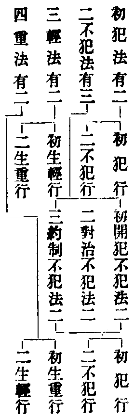



【疏】次将违顺、难易，用条前法。



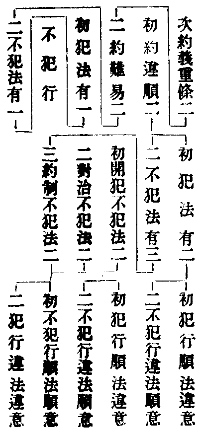



【疏】若举犯法，以明犯行，顺犯法成，违圣制意。(佛说戒本，但明犯相，依相而行，是顺戒本。圣制欲使违法。)



举彼犯法，明不犯行，违犯法成，顺圣制意。(文中虽列婬、盗犯夷，我不婬盗，岂非违法？)



违顺中，犯法为二。初约作犯，明犯行。注中。初示「顺法」，作犯之行，与教合故；「圣」下，明「违意」，戒本显犯，意在持故。「举」下，次约止持，明不犯行。注中。示上「违法」，止持之行，反犯相故。不释顺意。



【疏】二、举不犯法，明二行者。



【疏】先解开犯为不犯者。举此不犯法，明犯行者，顺不犯法成，违圣制意。二、不犯行者，佛意乃至戏笑，亦不许故。此不犯法，明不犯行，违不犯法成，顺圣制意。



「不犯法」中，三位同前。初中，又二。前明犯行。即诸戒「不犯」文中，或结小罪者，则有犯行，违顺同前。二中不犯行。即约摄念现前，不违小罪故。



【疏】二、就起对治行，明犯不犯。三、就前制不犯法，明犯不犯者。顺法即顺意，违法即违意，并可解耳。



次、合明中。前别列二位，后合示违顺。由此二不犯法，即是止作二持，是故顺则法意两顺，违则法意俱违。



【疏】上解违顺，次明难易。初举犯法，以明不犯。此行易成，离重过故。次举不犯法，明不犯行。此行难成，自非专至，何由不犯？如戏笑等，可以情求。



次、难易中。以顺法持戒，可有难易，是以但明不犯行耳。违法毁戒，本非所论，故无犯行。文中，初结前总标，「初」下，举法别释。初、明犯法。「易成」，可解。次、不犯法。「行难成」者，离轻过故。



【疏】三、明轻法生二行者。



或有轻法生轻行，如具缘杀草木，轻心卒尔作等。或轻法生重行，害心杀蚁子等。



三、轻中。初总标。「或」下，别释。坏生、杀畜，同是「提」篇，俱名「轻法」。「率尔」、「害心」，业有轻重，故分二行。《成论》云「害心杀蚁，重慈心杀人」是也。



【疏】四、就重法中生二行者。



具缘行四重，三时无悔心，是名重法生重行。或本无方便，后无随喜，事不得已，此重法生轻行。



四、明重中。标释同上。「四重」是重法，「三时」具缺，以明两行。「不得已」者，如慈心杀父母，互用佛僧之类。



已上四位。前二法行，并就制论。后二不尔。法依制罪，轻重齐均。行约业道，重轻乃异。



【疏】五、明制广，意唯六位，所谓深防、限分、约相、示过、心境、内外。各有通别，所引如后。



五、明制广，标中。「六位」各有通别。五、六二位，文虽不出，准前可说。



【疏】初解深防。



【疏】言通制者。元圣制戒，为止业因。造业已来，必由三毒。无以卒制，且约身口。二业既清，心自沈静，能见过本。望其本意，为防心也。未了心性，约相遣尘，故制四重，以为道体。对四制餘，并号「深防」，恐犯四本，制餘令护。何以知然？配篇种类，可以知也。



深防，通中，为二。前明四重，止得名防。「对」下，次明餘篇，始彰深义。初中，又二。初通示制意。动心结业，能感后果。业即是因，故云「业因」。「造」下，次明制教方便。初叙业从心起。「无」下，明制外防内。「过本」，即三毒。「未」下，明依境立制。毒心微细，钝士难知，随过禁制，故云「约相」。能清心本，故云「遣尘」。言「道体」者，道无别体，即本净心。心随染缘，与道相反，故禁重恶，还复本净，无漏圣道，由此而生，故云「体」也。次餘聚中。以下篇诸戒，近防四重，远禁本心，即深防义。「种类」收戒，如下「残」中。



【疏】有人别解，约戒以明。故云：「过犯未穷，预加重约，禁微防著，故曰深防。如触尼臂，犯夷等类，亦易解也。」



释别中。初标他解。「约戒明」者，示别相也。「故」下，引示。初释名义，「如」下，举戒显相。且明「尼触」，四戒俱尔。又如「用、饮虫水」，为防杀畜。「搏比丘」，防打之类。



【疏】言限分者，亦有通别。



【疏】通为防心。善恶之本，缘想辄起，无非我倒。因之结业，迷坠生死。故随限分，还制其心。故《律本》云：「心念作，发心作，皆名犯也。」



次明限分，明通中。谓教必被机，机分大小，教有浅深。大教被於上根，制其瞥念；假宗被其中品，但齐重缘；有部则被下流，须形身口。随其根器、力分堪任，故云「限分」。此中，且据本部假宗以明。初句标示。「通防心」者，指一切戒也。「善」下，委释为三。初叙起业。上三句明从心起。业通「善恶」，故两举之。此中论犯，唯明恶业。熏习力故，任缘而发，了无从始，故云「辄」也。「我倒」，即烦恼道。「因」下，明成业，即业道。「迷」下，明受报，即苦道。二、「故随」下，明立教。三、「故律」下，引《律》证。「发心」、「心念」，如上已释。



【疏】然有诸师，不立此义。戒约身口，何处明心？然身口具，非感善恶，终在思心，判成业道。如上「持犯成就门」说。



斥异中，初文。自昔传弘，不分宗旨。故执有部之义，以难假宗。「然身」下，还用假宗，反攻彼计。指「如前」者，以持犯成就，三机差别，即「限分」义故。



【疏】如《见论》中，「若制心戒，无得脱者」，据独头心。上明心念，据重缘心，即是下凡限分制也。



次科中。《见论》文意，但制身口，顺彼所执，故须通之。初牒论。「据」下，决通，又二。初释通《论》文。「独头念」，即瞥尔也。「上」下，次示前律意。是则假实两分，大小不滥矣。



【疏】若就相论，可有修学，并是限分。又如「漏失」，僧残尼堕，限分之相，於此弥彰。故光律师云：「制为当机，正存力分。若未能行，虽作无犯。」如斯等戒，其例是也。



明别中。初三句，约义总示。言「就相」者，即指戒条，正彰别义。「又」下，举相别显，又二。初约报以明。文中，且约「漏失」显异。又如「八事」、「四独」、「言人」、「纺绩」、「染心衣食」之类，尼限分也。漏失、二麤、二房、不定、提舍之类，僧限分也。即僧尼不同戒，如下随篇所明。「故」下，次引古解，就机以辨。三根强弱，不可一制，故云「存力分」也。无知之罪，对根三别(上根即结，中根五夏，下根不结)。四依、百一，二房、畜长，上士高逸，不乐从听，下流志弱，不能专制，教既开听，故云「作无犯」也。



【疏】三、言约相。



有通制者，心过难形，以境分相，诸篇聚者，约相可求。



别历约相，如盗五钱，度人问亲之例。故光师云：「过损理违，道俗俱禁。依王国法，准俗制道也。」



约相中。初标。「有」下，释。初明通相。即篇聚所列一切诸戒，条别显然，故总名「相」。次明别相。且举盗戒，如盗五盗四等。《律》因盗人令出家，故制问亲，并属盗相。「故」下，引示。亦且据盗，餘则例然。如「淫」则正道、毛头，「杀」则赞叹、教遣，「妄」则凡法、圣法。下篇诸戒，一一各辨，思之可知。



【疏】四、示过者。有戒斯是。别相示过，如戒缘中，佛重出过，婬如蛇口如火如刀，酒大不善，各有十过。故光师云「罪状未兴，预彰过兆，逆颁讥丑，使耳目闻见」等是也。



示过中。初标，「有」下，释。初句明通。以一切戒并是过相，《律》并呵云「非威仪、非净行」等。下明别过，且举婬、酒。「漏失戒」云：「云何不净手受人信施？」、「二房」引龙、鸟，「两舌」举野干，「畜宝」示四患等，皆谓显过相也。「佛重出」者，望前通呵，故云「重」也。「淫」中过相，如文所列。「酒十过」者：一、颜色恶，二、少力，三、眼视不明，四、现瞋恚相，五、坏业资生，六、增疾病，七、益鬪讼，八、无名称，九、智慧少，十、命终堕三恶道。「各」字恐误，合是「略」字。以酒过多，且明十故。「故」下，引古显意。无过先示，故云「逆颁」。「颁」合作「斑」。



问：「婬酒二戒，过起方制。那云『罪状未兴』？」



答：「虽托前缘，意绝后犯。故知前为起教，皆是最初。望后当机，故云『未兴』耳。」



【疏】五、心境者。有戒斯是。无有单心而犯戒者。有人云：「如不学等，可有境邪？」今解不然。同此学境，何得无邪？故光师云：「缘无定据，心相易流，境有美恶，心有浓淡。」或约心从境，如婬、酒戒；或制境从心，如盗、杀等；或以心境相应，方始成业。



心境中，初明通义。「无单心犯」者，即如《母论》：「犯必托境，关心成业。」心不孤起，境无独立，未有一法不由心、境，故言「通」也。下斥古解，彼谓不学之罪，起心即犯，不待造境。然不学有二：初起断心，若顿若渐，竝对前境；又随事无知，别结不学，亦即对境，但於学境，心有背耳。「故光师」下，次明别相。初总示差别。「缘」即是「境」。四句隔对，寻之可见。「或」下，别配戒相。文列三句。初句唯局淫、酒。二、三两句，则通诸戒。上二即境想后四句，下一即是初句。



「若尔，此即是通，何得云别？」



答：「随诸戒相，句法不同。如杀则人、非人别，盗约有主、无主等是。」



【疏】六、内外者。



犯不自成，成由缘集。因藉万差，要唯内外。如情道等为内，非情道等为外。就情中，食饮为内，衣服为外。如是例准。



内外中，标释可解。初明通者，一切诸戒，无出二境：性戒竝情，如七支等；遮多非情，掘地、房、酒等。「就」下，明别相。「衣」、「食」二种，计是非情，但随身用，故判属情。而约资用，以分内外，如「三十」、「九十」别相可知。(后二通别，文中隐略，约义分耳。)



六位中，初、二相对：深防约教，限分从机。三、四相对：约相，明篇聚重轻；示过，彰行业麤细。五、六相对：五则心境合论，六乃单明前境。



【疏】注中「集十句义」下，明结戒益义。就此十句，分二：



初有三利，明此戒法，生众功德；



次有六利，明生别人，灭恶成善；



次有一利，兴建正法行也。



三、修奉益中，即释十利。大圣立教，利益无边，取其简要，且列十种。标分为三。「戒」为能利，「众」、「别」、「兴建」，即为所利。



【疏】言「摄取於僧」者。由制广教，能治别人七支等过，故名为「摄」。自行既立，同和号「僧」也。



「令僧欢喜」者，半月一说，行净无违，故欢喜也。



「令僧安乐」者，依教修成，必感大果，用以适神故也。



僧利中。初摄僧者。制戒治别，别聚名僧，即是以戒摄别入僧。次释欢喜。云「半月」者，以说戒检行，净秽两明，能令众喜。三、释安乐。举后圣果，以显因心。「适」即是悦，「神」即识心。



问：「与第二何异？」



答：「『喜』谓现预净僧，『乐』乃后必剋果。二利同就因论，所对现当两别。」



【疏】就别利中，初有二利生善，后四灭恶。



【疏】「未信令信」者，由制此戒，威仪动人。《善见》云「诸未信者，作如是言『沙门释子，勤心精进，难作能作』」等。



「已信令增」者，谓先学戒，见后来者，生大信心，「云何是人尽形求法，一食修道」等。



次释别利，生善中。初释未信。约「威仪」者，世多取相，故能「动人」。下引《善见》，出彼信词，由观外相，而知内德故。「难作」，谓禁制情欲，修苦行故。次释已信。「先学」，即是已信。「生大信」者，即是增长。「云何」下，亦出彼词，偏举难事，以彰可信。



问：「今始制戒，那有『先学戒』者？」



答：「先有略教，禁三业故。或可制后，展转相望，而分先后。」



上二生善，初对在家，故叹「沙门」，次即出家，故指「先学」。



【疏】就灭恶中。



言「难调」者，《善见》云，破戒作恶，心性刚强，内无差耻，故曰「难调」。佛为制戒，诃责治罸，不得动转，改过悔伏，故曰「调顺」。



「惭愧」者，清净行者，制戒治恶，不入众数。布萨自恣，清净具足，故曰「安乐」。



「断现漏」者。由不覆情，随尘起染，若打若死，斯现有漏。制戒防止，无上诸过，故曰「断」也。



「断未漏」者。若不陈悔，生业无穷。由依广教，洗心悔过，尽形行学，障於来恶，故曰也。



灭恶中。初释难调，引《论》显相。文列三句，上句身口业，下二句意业。三业不善，则名「难调」。「佛」下，显益。七、九治罸，随犯治之。文中略举「呵责」，餘可准知。次释惭愧，谓恶者折辱，善人无恼故。文举「说、恣」，由此二法，必取行净；若羯磨僧，则通持毁。三、释「现漏」。言「不覆」者，「覆」犹护也。遭打横死，恶疾迍难，皆为现报。四、断未漏。「生业无穷」者，此通生、后二报。「尽形行学」者，且约上篇犯重为言。餘篇悔法，俱障来报，义可知也。



此四灭恶，前二止业，并据治罸，后二除报，必约忏悔。然止业除报，正在治、忏。莫不皆由制戒而生，故功推戒耳。



【疏】三、明「兴建正法」者。如《见论》云：「『法住』三种：一、学正法久住，由人奉修三藏教法，摄在己用，即行所依故也；二、信正法久住者，谓三藏中所说诸行，十二头陀、威仪、禅定是也；三、得道正法久住者，由依教行，得成四果及涅槃道，后有此益，并由制故。」



释兴建中，引《善见》三相。第一约教，非学不解；第二是行，非信不行。是以前二首标「学」、「信」。第三约果，则明教行，功不虗设。



【疏】就此三相，前后为言，初教次行，后明果也。人多读教，少有依行，以无信故。如《大论》云「信为道源功德母」也。若无信者，虽入佛法，都无所益，以不依行，无所得故。若依教修，必剋圣果。即是制戒，功德道兴，诚不虗设也。



明次第中。初、正指次第。「人多」下，释其所以。初句明教。「少」下，示行。「《大论》」，即《智论》。圣道从始，故喻如「源」。众善由生，故同於「母」。「若」下，明果。三法相须，一不可阙。今时学教，唯事讲说，身履非恶，略无惭愧。请详祖训，少警内怀。不尔，则妄认祖宗，实非苗裔矣。



四分律含注戒本疏行宗记二上之二



【疏】就释戒本，四种分别：一、释名；二、定句多少；三、决通诸戒；四、配人犯相。



次释戒本。



【疏】言「释名」者。何谓戒本？由犯制戒，戒为缘本也。又约缘虽制，文略未显，更以辨相，广张行体，略为广本。又云，即是半月说之所本，所以文云「欲说戒者，当如是说」。餘同前卷。



释名中。初标问，「由」下，释通，有三。初、约缘起释，「又」下，次、约广解释。《律》叙缘起，发后制戒，后列广相，释前戒文。故约前、后，以彰「本」义。即前五义中，「教本」一义。「又云」下，三、约说戒释。欲近取证，故重举耳。道、行、听三，前已广，故略指之。



【疏】二、定句，张、缩为二。



【疏】若依佛解，分为九句：



初、「若比丘」，总举受、随也；



二、「共比丘」者，离明受也；



三、「同戒」者，别明随也；



四、「不还」者，体净不舍也；



五、「戒羸」者，体微生厌也；



六、「不净」者，明业过也；



七、「畜生」者，列犯境也；



八、「波罗夷」者，结罪名也；



九、「不共住」者，治罸法也。



定句中，初张分九句。



【疏】二、以义缩，但有二意。初之五句，合之为一，成比丘体，有犯重义。下之四句，托缘分相。



若立略本，四句收尽：一、是犯人；二、所托相；三、犯法成；四、结罪目。



次、义缩，有二。初缩为二。言「托缘」者，即上「过」、「境」；言「分相」者，即上「罪」、「治」。「若」下，次收为四：初即总上五句；二即第七「犯境」；三即第六「过业」；四即收前八、九。前、后诸戒，句数虽多，不出此四，故云「略本」。上明「张、缩」，止就当戒。更立此四，该通一切。



【疏】三、「决通诸戒」者。



【疏】初句「比丘」，义该八篇，文局上六。「众学」、「七灭」单列持相。然非比丘，无由可犯。故《律》众学，广解辨相，明比丘义。但结集翻译，不欲繁文，故略不出，可以知也。



决通中。初句分二。前总示通、局，「众学」下，别显后二。上二句示文无，次二句显义有。「故」下，准《律》广解，可验文略，故知西土梵本必具。



【疏】第二、第三，「共」、「同」两句，释成得戒之人，成初「比丘」之义。通、局虽别，义该八篇，文局初戒。四、五两句，文义俱同。



次四句中。前释二、三。云「通、局」者，「通」谓初句，总举受、随；「局」则二、三，各明受、随。兼前释后，意显通该。次释四、五。亦是文局义通，故指同也。



【疏】昔解云：「此戒爱染久习，卒难舍离，不障初果，故开舍染。杀、盗不尔，违损事大，不开舍也。」



斥古中，初文。彼谓唯婬开舍，四、五二句，不通餘戒。初果见惑已破，思惑全在，虽起贪欲，非妇不婬。故在僧中，欲心设起，则舍戒还家，故有欲饱还来之事，故云「不障初果」也。



【疏】今解不同，强、羸二舍，义通诸戒。文约婬法，欲成极罪，故须「不舍」之言。如《律》云「若犯波罗夷，无覆开忏」，此则通也。诸篇不明者，略也。



正解中。初二句明义通；「文」下，示文局；「如」下，举例。「无覆开忏」，六聚皆然，岂得滞文，不通餘聚？故知不尔。



【疏】又解：「此之四句，并释比丘具戒成犯。初戒立法故有，餘篇准式故无。」亦有道理，智能解也。



他解中，初示。初有餘无，於义可见。「亦」下，叹美所解，於义可取。



【疏】六、七两句文义，当戒所收。



六、七。正明业境，戒戒不同，故文义两局。



【疏】八、九二句，义兼下篇，文列初四。以有微犯，不应说戒，则「不同住」，同如弃者。



八、九中。初示通局，「以」下示义通。



【疏】第四随结。



【疏】约人明之，无制戒时事义足者。既无后犯，一结便足。若文不具，生疑托缘，则更开结。或约一缘，或至七、八，如「为女说法」及「别众」等戒。



第四，通明中。初明制无顿足，以机起不时，故多重制。「既」下，明随犯单、重。初、明单结。「若」下，次、明重结。「为女说法」，初制不得，后开智男。「别众戒」，初制不得，次开病时、施衣、作衣、道行、船行、大会、沙门施等七缘，凡七番再制。文言「七、八」，且趣举之，寻《戒本》中，无至八者。



【疏】今约初戒，一人随结。配句属当，则有三位：



第一、第六、八、九，四句，则属本制邪舍故也；



第二至五，戒微故立；



第七畜生，心迷故有。



《律》中广相，故不叙之。



别明中。初总举。「一人随结」者，谓因人则制，此戒凡对三人，前后异时，则是各对一人耳。文列三位，属当显然。指《律》广相，备见注文。下疏自释，故不繁引。



【律】若比丘。



【疏】次就戒本。



【疏】「若比丘」者，如《善见》云：「『若』者总名，不属一人。」随有佛法，具戒之徒，皆持犯法，故云「若」也。如世律令条别，显诸犯者不一之谓也。



牒释，初句，释文中。「随有佛法」者，此约处也。「具戒之徒」，即就人也。「犯法」，即指《戒本》。依教守制，故云「持」也。「如」下，举俗律助显。



【注】佛言：「『若比丘』者。」



【疏】就注解中分三。「若比丘」者，标列释由也；「名字」已下，总列众名也；「是中」者，结定犯人也。



释注，总分中。谓上三字是标，下列释之由耳。



【注】「名字比丘、相似比丘、自称比丘、乞求比丘、著割截衣比丘、破结使比丘、善来比丘，受大戒白四如法成就得处所比丘。」



【疏】言「名字比丘」者，《善见》云：此是总名，通邪、正及未具也。「如请比丘，以设檀会，沙弥未具，入比丘数，是『名字比丘』也。」又如《涅槃》：「虽未受十戒，亦得受请。」故知通名。



列众名中。初文《善见》。初示名通。「如」下，举例。「又」下，引证。



【疏】言「相似」者，如《善见》云：「谓『犯重』者，内实破戒，威仪相貌，似持戒者，其实破戒，故名也。」



【疏】言「自称」者，《十诵》云：「有『贼住』者，剃发披衣，自言『我是比丘』也。」



【疏】言「乞求」者，如《善见》云：「既出家已，随须衣食，如法行乞，以四海为家居，离於邪命，故曰『求乞』。」



四正释中。「随须行乞」者，示无尽法故。「四海为家」，无亲疎故。



【疏】如《大论》云：「『邪命』者，略说有五：初求利养，改常威仪，诈现异相；二、自说於己所有功德；三、强占吉凶；四、高声现威，令人畏敬；五、说自得利，激动令施。非此邪心得利活命，故曰『正命』，如『八正』中。」



次引示中。「五邪」，初是身业，餘四口业，身、口现相，心规他物，故云「邪命」。八正道中，「正命」一种，为离邪命，故名「正道」。餘皆可解。



【疏】「著割截衣」者，有二利故：一毁全相，离自贪故；二既碎杂，不为王贼之所剥故，常得资身，有长道故。



【疏】「破结使」者，修道进德，惑尽解满，理解心明，永无业恶，即发具戒，从缘而感，故曰也。



【疏】言「善来」者，道成初果，亲感至圣金言命之，便得具戒，故曰也。



【疏】「受戒白四」者，即如今时感戒者也。



总论八种，前五约名相，后三据受体。又三中，前二唯局圣，白四通凡圣。又上二中，「破结」局四果，「善来」局初果。所以无「三语」者，或是趣举，故文略之，或是但据圣凡三位，或可凡中三语已废，故所不出。



【注】「是中『比丘』者，若受大戒白四如法成就得处所，住比丘法中，是『比丘』义也。」



【疏】次解第三。「是中比丘」者，明此婬戒犯重比丘也。



【疏】有人云，「是中」者，总举八种也；「若受大戒」者，别标定也。前列八种，或有名滥，如沙弥、外道，虽名「比丘」，不犯夷也。或有相滥，似「割截」等。或时行滥，如「乞求」、「破结」等。或言说滥，如「自称」也。或时体滥，如「善来」、「羯磨」也。上列诸位，不必犯重。或时少分，或复全非，皆非「共比丘」义。所以结中，偏牒第八，释成《戒本》「若比丘」也。



次科，简人中，他解，初文又三。初点文。「前」下，释总别所以。「行滥」中，「乞求」未必具戒，「破结」据是体滥。然有「破结不发戒」者，如「白衣罗汉」之例。「上」下，结合。「少分」，如行、体。「全非」，如名、相等。



【疏】所以然者。上八所列，但明三受，自餘五种，相因而立。若欲犯戒，终约受体。「破结」一受，乃是无学，「善来」初果，圣无犯法，皆不同也。今约比丘学戒，唯「羯磨」受，是末代法，故牒解之。



显意中。初、简非受。「破」下，次、简餘二受。



【疏】此中，须引《删补羯磨》。末代戒缘，具足五种，广分别说。缘成得戒，缘差不发。既是大事，无宜轻削。



嘱援引中。初指文。「五种」者，一、能受人；二、所对境；三、发心乞戒；四、心境相当；五、事成究竟。「既」下，正劝。结文。



【疏】次解结文。



【疏】「若受大戒」，简沙弥也。「白四如法」者，羯磨成就缘也。言「白四」者，简非羯磨受者，即如「破结」、「善来」之徒也。言「如法」者，除七非法，成前如相也。「得处所」者，僧数满足，结界成就缘也。「住比丘法」者，简定俗人、外道也。或虽比丘，心住无记，病缘等障，不守本性者，则不住比丘法也。「是比丘义」者，则是《戒本》犯法、犯行比丘义也。



牒释中，五节。初、约位简。二、约法简。三、约人界简。四、约众简，文中又二：一、对俗简；二、约缘简。上四简滥，第五显是。



【律】共比丘。



【疏】「共比丘」者，明犯重也。受戒法仪，共餘比丘，则无别也。所以出者，若所受体同，可有犯重；体或不同，则无有犯。故有此同，释诸疑网也。



次句中，初文为二。初正释，「所」下，示出意。



【注】佛言：若共餘比丘受大戒，白四羯磨，乃至住比丘法中者，是谓「共比丘」义也。



【疏】注中，「若共餘比丘」者，谓释迦一化，现、未两时，三天下内，所有僧尼，白四受者，同有犯也。若缘差互，少一非受。虽复犯过，不名夷重。以不「共戒」，无戒可犯也。



释注中，初、释同义。「释迦」等者，举一佛所化，简餘佛故。「现」、「未」约竖论。「现」即佛在，「未」则灭后，通於像末，尽六万年也。「三天下」据横说，且就一往，不被北洲故。「僧尼」位别，羯磨受同，故通举之。「若」下，次、释不同，即本受不得者。「缘差互」者，且论能、所。「能」即受者，身带遮难，无心乞受，衣、钵不具等；「所」对虽多，然亦不出人、法、事、处，四法有乖。准此而言，本受缘非，无犯明矣。



【律】同戒。



【疏】言「同戒」者，佛所制戒，随行通行。但受无随，亦无戒护，故虽犯违，法不同也。



第三句中，初文。依体起持，故名「随行」；一化齐奉，故曰「通行」。「无戒护」者，此谓受时不起持意，纳体不得，亦非同戒，如后问答。



【注】佛言：「我为诸弟子结此戒已，宁死不犯。是中共餘比丘一戒、同戒、等戒，是名『同戒』义也。」



【疏】注中释之，不过教、行。「我为结戒」，教法同也；「宁死不犯」，行法同也。今随教、行，两释其相。



【疏】先就教者。如佛制教，数虽极多，咸明止恶，名为「一戒」。对人共学，名为「同戒」。莫不数齐，名为「等戒」。如《十诵》云：「同入比丘学法者，百岁比丘与初受者同，初受戒者与百岁者同。又同心、同戒、同说波罗提木叉故。」



释注中，就教分二。初释。「止恶为一戒」者，戒虽无量，止恶不异故。「对人为同」者，三乘俱禀故。「数齐名」等者，皆纳具足故。「如」下，引证。前明新旧同者，标示同戒。「又」下，别举三同，释成同相。「同心」，收见、利二和；「同戒」，即戒和；「同说」，摄身、口、意三和。



【疏】次就行解。随体无殊，名为「一戒」。对人兴治，持义不异，名为「同戒」。齐防尘沙，名为「等戒」。



就行中。奉持万别，皆名「随行」，故为「一」也。后二同前，约行为别。



【疏】问：「斯之『随行』，据初受言，后行乖愿，可非犯者？」



问中。指上所解，并据初受行净，可有「同」义；后乖有犯，即不名「同」。



【疏】答：「此句来者，释成愿、行，有感戒也。前列『共』者，明同受愿也；后列『同』者，明同随行也。若受戒时，且论受愿，无思学行，则但虗愿，不感戒也。」



答中。初、明立句本意。「若」下，次、明二戒相须。



【疏】故《涅槃》云：「是人唯具作戒，不具无作戒，戒不具足。」如《萨婆多》：「无淳重心，不发无作。」



引证中。《经》、《论》二文，并证初受，无心持奉，不发戒体。「不同」无犯，文据甚明。



【疏】故《律》明此，恐人滥犯，文列「同戒」。愿行相投，白四受后，犯非则重；空愿无行，后虽行非，无戒可违，不入犯法也。



结意中。初标示《律》意，即指戒文也。准知发体则有戒可违，不发则无法可犯。



【律】若不还戒。



【疏】言「不还戒」者，释疑故也。「后戒羸」者，自生疑念：「前制犯重，心乐道法，有戒可违。今我於佛，生厌不乐，为有戒在，同前犯重？为无有戒，无重可犯？」故今佛释：「若不乐者，听舍还家，后欲修行，得度得受。」



第四，释文中，初科。上二句标示，「后」下，委释。初叙疑。「后戒羸」者，即欲犯过人，戒力微劣也。「故」下，释疑。若据戒文，但标不舍，注中乃以舍戒反释。



【疏】所以开者。凡夫退位，知何不为？带戒犯非，业则难拔。故开舍戒，往来无障。即是大圣善达机缘，任物垂教，号「法王」也。



次科，初叙机劣。内凡已上，不羸不舍，已前皆容有退，故云「退位」，即外凡也。「故」下，显开意。「往」谓开舍，「来」谓再受。善、恶两通，故云「无障」。「即」下，结叹权巧。「王」者，得其自在。於法自在，故称「法王」。



【疏】《增一》云：「僧伽摩比丘，七反降魔，后更受戒，得成罗汉。自今舍戒，听齐七反；若过，非法。」《十诵》云：「尼若舍戒，转为男者，亦得出家。」



三中。初引比丘开限。降魔不免破戒，故先舍之，极齐七反，已外不开，开中制也。次引《十诵》，明尼不开。转根方得，反知不转，即障出家。又《伽论》中「尼舍再受，即成贼住」是也。



【注】佛言：「若有比丘不乐梵行，听舍戒还家。复欲出家，於佛法中修梵行者，应度出家，得受大戒。云何不名舍戒？若自颠狂、心乱、痛恼、痖、聋，又向如是人前，及中、边人等互舍，不成。若戏，若眠，若无知人，若自不语，若前人不解，并不成舍。若言『我舍佛，舍法，舍僧、和尚、戒律』、『我受家法』等，是名『舍戒』也。」



【疏】注中，「云何不名舍戒」下，分二：初、「自颠狂」下，心境不了，虽舍不成；「若言舍佛」下，对境彰成，文相可解。



注文。前段即叙佛开，上科已示。故从「云何」下，分其文耳。



【疏】就舍戒中，义分四门：一、泛列经论舍相不同；二、渐顿异；三、舍善已未；四、具舍缘。



【疏】言「泛列」者。如《杂心》说：「若舍、命终、断善、二形生也。」《善生经》加「受恶戒时舍善戒。」《俱舍论》：「八戒期心，尽夜分终，故舍。」且列如此。



舍戒中，初科。若准注文，但明作法，统括诸文，则有六种，故云「泛列」。「《杂心》」四舍，言「若舍」者即「作法」，「断善」即起邪见。「《善生》恶戒」，即恶律仪。上五通五、八、十、具。《俱舍》「期心」唯局八戒，义兼五戒。言「且列」者，示未尽故。



【疏】二、渐顿者，即作法舍中。如《律》「我作沙弥、五戒」等，是渐也；「我作白衣、外道」等，为顿也。



渐顿中。初标简，「如」下，列示。随有退堕，渐、顿并开。



【疏】三、明舍善已未者。



问：「今舍戒者，为舍已生随行为因之业？为舍初愿本受无作体邪？」



答：「已生为因，不可舍也。得圣无漏，方倾善习。今所舍者，止是本体，更不相续。故《杂心》云：『言舍戒者，戒身种类灭也。』」



三中。初标科。「善」，谓随中二持之行。未舍之前，所有持行，名「已生善」；后未修者，名「未生善」。今明舍戒，为舍何者？



问中乃约「行」、「愿」两审。答文方见「已」、「未」存亡。



答中。初答因业不失。结业在心，行功不灭，故不可舍。及证初果，无漏智力，达罪福性，漏业方倾。(「习」合作「集」，谓集因也。)「今」下，次明无作体失。「本体」，即无作。「不相续」者，失未生善也。「故」下，引证。「戒身」，即受体无作。「种类」，即相续善行。二皆云「灭」，证上可知。



【疏】四、明具缘明舍，有五。



四中。戒假缘成，还从缘谢。受、舍各五，相反可寻。



【疏】初、体是比丘住自性者。



初、云「住自性」者，即具本受体也。



【疏】二、所对人境。如《多论》云：「若无出家人，随得白衣、外道，相解者成。」



二、明所对，开教从缓，不必本众。



【疏】三、有舍心。谓有欣猒心、作舍心、决定心、住自性心、久思心、欢喜心、自有心、寂静心。反上八心，则不成舍。



三中。「八心」，注云「意欲在家、念父母」等，又云「不乐梵行，猒比丘法」，即忻俗猒道。「作舍心」，谓欲弃舍也。「决定」者，非进退也。「住自性」者，自知是比丘，非狂乱也。「久思」者，非朝夕也。「欢喜」者，无所悔也。「自有」，非他逼也。「寂静」者，心专一也。



【疏】四、心境相当。如《律》：「中边不领，前人不解，并不成舍。」



四中。指《律》，即如注引。



【疏】五、一说便成。《多》云：「『受舍相对，理宜相准。何故难易不同者？』答：『相违对故。一、求增上法，如上高山，多缘多力；舍戒退道，如高坠下，故不须多。二、不生前恼，若制缘多，便言「佛多缘恼，受须多人，舍何须也？」三、受如入海采宝，舍如失财，王、贼、水、火，须臾荡尽。四、受容预心，舍对境情逼。喜带戒行非，一语开成舍，尚不依行，况多缘也？』」



五中。初标缘，「多」下，引示。初引问受舍缘相难易，可知。且取作法，受须白四，舍唯一说。答中。初句通答。善恶天别，故云「相违」。立法难易，故云「对」也。「一」下，别显四义相对。初、三约喻，二约立教，四就机宜。



【律】戒羸不自悔。



【疏】言「戒羸」者，对前强不舍，此明羸不舍也。谓乐俗缘、园田、家业，便於佛道生毁、生恼，持戒力劣，名之为「羸」。若犯则弃，由体不舍，对前强、弱同戒解，有戒成犯重也。



第五句，释文中，初牒示。「强不舍」者，谓非愁忧、思念也。「谓」下，释相。初释「羸」义，「若」下，显立所以。



【注】佛言：「云何戒羸不舍戒？若有比丘，常怀愁忧，不乐梵行，厌比丘法，意欲在家，便言『我念父母妇儿亲里、村落城邑、园田家业』、『我欲舍佛』乃至『学事』等是也。若作是思『我今舍戒』，是戒羸而舍也。」



【疏】注解中。前明戒羸不舍相，「若作是思」下，后明戒羸而舍相。文中可解耳。



释注中。「前明不舍」，正释本文。「后明舍相」，反释不舍。



【律】犯不净行。



【疏】六、明「不净行」者，正明《戒本》所防过也。



【注】佛言：「是婬欲法也。男则二道，女则三道。若从道入道，从道入非道，从非道入道，若限齐，若尽入，乃至入如毛头者，皆波罗夷。」



【疏】下注解中，约报分相，文易见也。「道入非道」，前后境差也。「限齐」以下，释行犯相，生疑故也。「毛头」之相，极微故犯，何况餘者？



六中，释注有三。初释犯境。男、女是「约报」；二道、三道，即「分相」。次、释境差。三、释限齐。配注释之。



【律】乃至共畜生。



【疏】七、言「乃至共畜生」者，举犯境也。《多论》云：「畜生是六道之边，偏举下类以况上，故云『乃至』也。」



第七，文中。初点示。「多」下，引释。「六道边」者，彼云「最在边鄙故」。



【注】佛言：「可得行婬处者是也。有三种行婬：人、非人、畜生趣。复有五种：妇、童女、二形、黄门、男子。比丘婬心，向前境三处、二处，初入便犯，有隔亦犯。若向睡眠，若死未坏，若多未坏，於三处、二处行婬，初入便犯，如是广说。若比丘为怨家将至前所，强持令入三处、二处：始入觉乐，犯；不乐，不犯；有隔、无隔亦同上。若为怨家强捉比丘行不净行，觉乐、不乐，有隔、无隔，亦如上也。」



【疏】注云所「可行处」者，谓婬戒言「畜」，举可行者为言；杀戒言「畜」，据有命者成犯。通塞相也。



释注，可行中，初科。举戒对显「通、塞」。「通」谓杀境，「塞」谓淫境。犯相各异，故须简之。



【疏】然趣有六位，半兼善、恶。皆据心行三种善、恶。故善门明趣，初天、次人、后修罗也；恶门明趣，地狱为初，次鬼、后畜也。



通明中，初科。上句通举，次句总摄。三善三恶，故云「半兼」。「皆」下，通示因相，又二。初摄六种，归於二门。「故」下，次就二门，各分次第。



【疏】天以受福自然，无贪所感；修罗受福怀疑，於见非正也；地狱所受非贪，多由贪故受苦，丸、浆之类是也；饿鬼所以情恼，盖由瞋毒所兴也；畜生愚𫘤受形，盖是痴心所结。大分次第，不爽业缘也。



次科。初历示五趣。「天受福」者，示果相也。「无贪感」者，出因相也，以行上品十善故。文缺人趣。下四因果，临文分对。大途为言，且据三品十善，配三善道。修罗下品，心怀犹预，故云「非正」。三毒配三恶道，如文自分。「地狱非贪」，谓所受苦事，非可爱故。「大」下，总结本因。观此善、恶，无非心行，故诸学者，当好制心，报应无差，有逾影、响。自非大智，熟能究之？



【疏】经中所明「四恶趣」者，皆非受道之器，故以修罗属之。



引经中，通指诸经。上以修罗，摄在善门，有云「四恶」，故引决之。「皆非」等者，出经意也。「属之」，谓摄属恶趣也。



【疏】注中「有三种」下，明成犯相：



初、列趣境；



二、「比丘婬心向前境」下，明自身造境也；



三、「为怨家将至」下，明非自心，外难所逼也。



释成犯相，列趣可解。



【疏】初文又二，前列三趣，后「五种」下，约趣明报也。



【疏】就中「三种行婬」，即「人、非、畜」也。



【疏】所以律合「三趣」，论开「六道」者？



离合中，初问。以六趣中，人、畜各位；餘四或合，通号「非人」故。言「论开」者，亦且通指，今据《智论》云「复次善恶故有六道：善中有上、中、下，故有三善道；恶中有上、中、下，故有三恶道」也。(十善、十恶，各分三品。)



【疏】论据善恶故分，律据通用故合。



答中，初文。「善恶」即业报。「通用」谓神通。



【疏】故《律》人、畜不异。由来解释「非人」，乃云「鬼」也。若论此戒，但说「非人」，天等不列，可非犯也？然下《律》中「天子、阿修罗子、饿鬼子」，地狱无文，义是鬼摄。此之四趣，通用是齐，故合为一「非人趣」也。



次科，指《律》广解。上明人、畜，同诸经论，故云「不异」。「由来」下，释非人，示其偏局。「若」下，点当戒义含。「然」下，引后文以证。即「同宿戒」及受戒问难中，彼云「非人难」者，谓「八部鬼神、天子」等，如文所引。而不出地狱，故云「无文」，义同饿鬼，故摄鬼趣。「此」下，结成上文合之所以。



【疏】二、「复有五」下，明以五报分三。离分三趣，有十五种，是所犯境也。



明报中。「五报离分三趣」者，谓以妇、女、形、黄、男子，别历人、非人、畜，故有十五。若开非人，则有三十。



【疏】就自趣境。初约觉境，以明犯相；二、「若向睡眠」已下，举后三境，以对觉境，同成犯相。



自造中。「三境」，并不觉境。「对觉境」者，此戒四境齐犯。又四境中，上二生境，下二死境。



【疏】就后怨逼，复分二缘：前明怨捉，将向前境；后明怨捉，就身行犯。



怨逼中，由开身合，故约心论。



【疏】问：「所以自身造境，但明侵境，不问其心；后怨家逼，乃问乐者？」



答：「适化无方，意在无逸。若俱禁者，事难常行。怨但逼身，心唯佛制，故开境合，无乐不犯。文相可解。」



问词，蹑前两判，欲彰开意。答中。初叙制必须开。以大圣设教，不定一端，故曰「无方」。「禁」即是制。谓若唯一制，不济机缘，故曰「难常」。「怨」下，明开中复制。



【律】是比丘波罗夷。



【疏】是「比丘波罗夷」者，引人依法科也。



第八，释文中。「引人」，即是比丘。「法科」，即波罗夷。



【注】佛言：「譬如断人头，不可复起，比丘亦如是，犯此法者不复成比丘，故名也。」



【疏】就注解中分二：初释罪名；后「方便欲行」下，释成不相。



【疏】就初所以将罪以况「断头」者，过之重也。如俗极刑，勿过「大辟」，谓斩首也。约刑制戒，两以通之。故《钞》引云，如人有头，受诸尘也，若不毁重，能有见谛，反此毁坏，永不能见，故以类也。



释注，罪名中，初文。前明举喻所以。「如」下，引俗刑比释。准俗制道，事义相类，故云「两通」。「故」下，引示。即《标宗篇》引《婆沙》文「人之头首，具纳六尘，戒法亦尔，能通诸法」，故以比之。故彼论云：「戒名为『头』，能见苦谛等色，闻名身等义，嗅觉意花，尝出离三菩提味，觉禅定解脱等触，知色阴等法。」广如《钞记》委释。



【疏】人又解云：「犯二篇罪，可有上起。若犯初篇，如人头断，不可复起。纵有开忏，障於地狱。然於僧用，则无成法。故文云：『若作法已，僧说戒时，来与不来，皆无犯矣。』」



他解中。即以初、二两篇，对显喻意。二篇有餘，忏已复本，如人被斫，残有咽喉。初篇永弃，众不容受，故如断头，不可复活。「故」下，引《律》证成无用。僧无别众，故云「无犯」。



【注】「若方便欲行不净，成者波罗夷，不成者偷兰遮。若教比丘行，若作，教者偷兰遮；不作，突吉罗。除比丘、比丘尼，餘众相教，作、不作尽突吉罗。若尸半坏，若一切坏，若骨间，若地孔、泥孔，行不净者，并偷兰。若道，作道想，若疑，若非道想，并波罗夷。若非道，道想，道疑，并偷兰遮。比丘尼波罗夷。式叉摩那、沙弥、沙弥尼，突吉罗，灭摈。是谓为犯。不犯者，若睡眠无所觉知，不受乐，一切无有婬意。不犯者，最初未制戒，痴狂、心乱、痛恼所缠。」



【疏】二、「若方便行不净」下，成犯相中，文分为二：初明成犯相；后明不犯者，开犯法也。初人分二：初明比丘犯相，后明四众犯相。诸戒同尔，下更不解。就前分二：前明自作、教他成犯相；二、「尸坏」已下，境想相对成犯相。就前又二：初、自作明轻重；二、「教比丘行」下，教作明轻重。文可解耳。



犯相中，总分。凡四重，初、约法简，二、就人分，三、心、境不同，四、自他两异。一一对注，分节文句。



【疏】问：「死尸半坏，行染何罪？」



答：「有二缘。若唯重婬意，入便偷兰，纵出不净，不犯僧残。若欲喜乐意者，如《十诵》、《五分》『乃至骨间，出不净，残；不出止，兰。』此是大婬戒，不就僧残结，以不作出意故。」



随释中，初科。「问何罪」者，若据注中，明结偷兰，由兼残境，欲分两犯，故发是问。答中，初句总示，「若」下，别释。又二：初约心分相，「此」下，结示今犯。



【疏】就境想中，前之三句，本境为言。后之两句，境差想也。



境想中，分句。前三皆重，不开迷故；后二并轻，由境非故。



【疏】义门分之，广如《事钞》，今略出之。



【疏】初、明制意，若无境想，不可定罪轻重。



义门中，制意。以心有是非，境有错误。「婬、酒」，前三句重，后二句轻。餘戒，初句相应故重，后四句乖差故轻。



【疏】二、明有无者。准《律》约戒，不必具有。今解「无」者，是略也，无别所以。



次门，正释中。据《律》戒本，二十六戒，具出境想句，餘并不出，故须辨之。



【疏】有人云：「一切过境皆重，则无境想，如漏失者。」今解不然。境虽通犯，染起由心。如《律．调部》，精出，约心明有、无想，即轻、重也。故知无者，但是略耳。



斥非中。初引彼解。以「漏失戒」，内色，外色水、风、空等，皆是犯境，随境犯残，不须简辨，故无句法。「今」下，正斥。初立理，「如」下，引据。彼云：「非道想不疑，残。」则明漏失，文略不出，非理无也。



【疏】三、定四、五句者。



三中。以《律》中列句，四、五不定。且如初篇，婬、杀、妄三戒并五句，盗戒四句。杀五句者：一、人作人想，夷；二、人作人疑，兰；三、人非人想，兰；四、非人人想，兰；五、非人非人疑，兰。盗四句者：一、有主有主想，夷；二、有主有主疑，兰；三、无主有主想，兰；四、无主无主疑，兰。餘如《钞记》具引。但由第三一句，结罪有、无，故句法不定。如「杀戒」，人非人想，转想兰，本迷吉(以作非人杀故)。盗戒无第三句者，以有主无主想，想转亦兰，本迷无罪(以无主物，非罪缘故)。若准《钞》中，则约「本迷」、「转想」对明。今此一门，唯约本迷，罪之有无，於义易解。



【疏】若轻、重相望，境是可学，生不可学迷，同是五句。如覆重谓轻等。



轻、重中。迷重为轻，如人作非、畜杀，有主作非、畜盗等，皆缘罪境，定有第三句，故同五句。「覆重」者，即「覆麤戒」。《律》出四句，今约罪缘，入五句中。谓覆藏初、二两篇麤罪，犯提；迷夷作提，迷残谓吉，覆则犯吉。此虽本迷，不妨结犯。《律》中不出，谓一向无罪而覆藏者。



【疏】若犯不犯相形，则四、则五。谓前后俱迷，非缘罪境。即定四句，除第三位。如处分想、无主想等。迷虽是定，而缘罪境，即定五句，如非道想、非人想、减五想等。



犯不犯中。初标举。「谓」下，别释。初明定四。「处分」，《律》出五句，今望本迷无罪，故入四中。「无主想」者，《律》无此句。「迷虽」下，次明定五。此即总放轻、重二位。「减五想」者，此谓盗戒，若作无主，则是四句；若盗满五，迷为减五，亦随结犯，故入五句。如前，或将本四入五，如「覆麤」是；或以本五为四，如「处分」是。意显随义不定，不必依文。



【疏】四、互四五者。由是可学，生不可学迷，即互轻、重。



【疏】或从四以至五。如实无主，体唯四句；后转为主，即为五也。



四中，初文。「从四至五」者，即约前心本迷，后心转入罪境故。



【疏】若缘罪境，人非人想，即五句也。若本缘人，转想当杌，约从后心，则唯四句。前心谓人，偷兰罪者，属於方便想差所摄。



次科，亦合标云「从五至四」。谓本是心境相当，后转缘非罪境，故云「转想」。「当杌」，即人作杌木想。「前心」下，简前兰罪。



【疏】五、轻、重者。



【疏】如文次第。前疑重，后疑轻，以境是异，轻本境故。前想重，结本方便，心境相当故。后想轻，以正犯时，有心无境。



五中，初文。前释两疑，后释两想。制教同罪，心业重轻，故分两异。「前疑重」下，准《钞》应云：「以本缘人，人境不舍，临杀有半缘人心故。」后疑双阙，故「轻」。后二想中，「有心无境」者，阙本境也。



【疏】又就本境中，疑重想轻。以疑半心，不舍本境，故重；想则舍本从异，故轻。就后异境，想重疑轻。以想缘本，但是境差，故重；以疑减半，缘於异境，故轻。



次科。初、明本境二句。次、明异境二句。「疑减半」者，以疑犹豫，半涉是非，是於异境，复减半心，故轻於想。



【疏】此判轻重，据本重异轻为言。若本轻异重，例之即是。如杀非、畜，人为异境，可以例诸。



三中，初、立义。「如」下，显相。又如非道漏失，道为异境等，是也。



【疏】言「不犯」者。



【疏】先总解不犯相，有五：



一、作事无违说不犯，如「痴、狂」等；



二、说犯为不犯，如最初人，违略起非，无广可犯；



三、说不犯为不犯，如《律》「一切无婬意」，正念摄心故；



四、开前禁后说不犯，如怨逼想；



五、当戒别开说不犯，如文「睡眠无觉」故。



不犯中，初科。注列五种，《疏》以五意，从后倒释。初释后二，即是通缘；后释前三，即是别缘。第四即释「不受乐」句，「开前」谓许身合，「禁后」谓制心乐。



【疏】又开大位，难、别、通三。



次科，总举。「难、别、通」者，即上五开，大分三位：「不乐、无意」，命难故开；「睡眠、不觉」，当戒别开；「最初、痴狂」，诸篇通开。



【疏】初、言难者，命、梵二也。



【疏】「梵行难」者，夷、残二位也。恐犯此故，已下开之。餘之三篇，有不开者，或是性恶，或由事重，或以重夺轻，故不开之。有开反前，可以例也。



释梵难中。「夷、残二位」，标行体也。「已下开」者，为护行也。「餘」下，简辨所开有差别也。文列三句：初句简性戒，「小妄」、「毁」、「两」、「杀」、「打」、「饮」、「用」之类；下二句简遮。「事重」，如「掘」、「坏」、「背」、「别」、「非」、「残」之类；「以重夺轻」者，如「牙角针筒」、「过量坐具」等，虽事是轻，须加重制故。「有开反前」者，亦有三句：或是遮恶，如「辄教尼」、「同坐」、「同行」、「乘船」等，遮机过故；或事是轻，「离衣」、「夺衣」、「餘语」、「二敷」、「兜罗绵」等；以轻遮重，「共女宿」、「藏衣、钵」、「非时入聚」等，为防「婬」、「盗」故。



【疏】言「命难」者，恐被夺命，故不名犯。「婬」开境合，教制约心。「盗」虽无文，约义许有，既不损境，暂移后还，不作永意，何过之有？「杀」、「妄」两戒，罪成无改，故并不开。



命难中。上二篇中，唯开婬戒。初、示难相。「婬」下，次简四戒。初、准文开「婬」；二、约义通「盗」；三、明不开「杀」、「妄」。



【疏】二、别开者。诸戒中各有别相，故其开通，类例不一。如「婬」开睡，「盗」开亲等。



别开中。初、叙诸戒相别。即就别缘，各明开义，故不一也。「如」下，略举二戒。「盗开亲」者，谓亲厚意取。又如「杀」开瓦、石误著，「妄」开增慢、戏笑等。



【疏】三、通开者。如文「最初」者，约初作人，有略可犯，故言「初」也。「未制戒」者，举时节也。初犯无过，何等之时？未制广前，故不说「犯」。言「痴狂」者，以不忆识是比丘故。此通诸戒。



通开中。前释最初，开未制也。次释痴狂，开无心也。



【疏】就前别开。言「睡眠」者，开怨来逼，「无所觉」故。「不受乐」者，开前怨家将向前境，禁无染故。「一切无有婬意」者，开身造境，既无有心，亦无境故。



覆释中。三种，并约怨逼释之。言「怨」有二：如王、大臣、恶贼，持刀陵逼，是名「强怨」；若亲里、故二，爱染缠扰，名「软怨」。「睡眠开」者，强、软俱开。「无乐无心」，唯开强逼。虽无文判，准理合然。「无心」、「无境」者，虽与境合，摄念当前，必无染著，故云「无境」。



【律】不共住。



【疏】九、言「不共住」者，「治摈」名也。



九中，释文。云「治摈名」者，若犯夷重，灭摈永弃，故「不共住」。



【注】佛言：「有二共住：同一羯磨、同一说戒。不得於此二事中住，故名『不共住』也。」



【疏】注解中，初列两同，后反释之。此律解中，但明「法不同住」，如《十诵》中，财、法两种，俱不同也。



释注中，初科。上二句点注文。「同羯磨」者，众法同也。「同说戒」者，自行同也。持奉无瑕，方应说戒故。「此」下，会释。本律「二同」，并据「法」说。法既加摈，义不同财。但无显文，故引《十诵》耳。



【疏】如《多论》中四解：「一、既坏道法，无所住用，摈出众外，生天龙鬼神信敬心故；二、现佛法无爱无憎，清净者共住，不净者摈出众故；三、为息外道诽谤故；四、为持戒者得安乐住，增善根故，又肃将来欲犯戒者，生惭愧心，不犯恶故。」



次科。《论》中四义，求佛𢷤意。初与四，并生善益，内外分之。二、表彰法胜。三、灭恶益，若不除恶，必遭外毁。



【疏】此戒是初，故繁解释。自此说文，多约略也。



显繁意中。上二句示当戒。下二句点后诸戒。



【律】二、大盗戒。



【疏】二、明大盗戒。



盗戒。对不满五，故云「大盗」。



【疏】前就内色起贪，此就外财生染，并由贪惑缠缚，故犯形於次第。



叙次中。初、明约境分异。「并」下，次、明就心是同。「故」下，正显列次，谓境异须分，心同故并，内重外轻，故有前后。「内色」，即有情。「形」，谓相形比义。



【疏】就戒四意。



【疏】言制意者。资财形命之本，非此不济。人情保重，恋著处深。然出家之士，理须舍己所珍，以济於物。今反侵夺，以自拥己，自坏恼他，过中之甚。是以圣制，意在於此。



释，制意中三。初叙财境。「然」下，次显过状，又二：上明为道专崇两利，下明违行反成两损。「舍已」除贪，是自利；「济物」成用，即利他。「己所珍」者，谓内外两财。「珍」谓珍惜，「物」即群生。「拥」，犹积也。「是」下，三、结制意。



【疏】二、释戒名者。



【疏】问：「盗、劫、偷窃、不与取等，无非损财，所以此戒标『盗』名者？」



释名，问中。通列四名，以徵别标之意。「偷窃」是一种。



【疏】答云：「文不可具，且列一名。」



初答可解。



【疏】有人言：「据俗，『大盗』谓窃神器。」今言「盗」者，对犯轻过，非此戒收，故言「大盗」。但世贼、盗，义通不别。



次答，初释名。前示俗名。「窃神器」者，谋篡国位也。《老子注》云：「大宝之位，是天下神明之器。」、「今」下，次显今名。「轻过」，即盗四已下，止得兰、吉，不至夷重，故标「大」字。「但」下，遮妨。谓虽有多名，皆归「盗」义，故云「义通不别」。



【疏】有人言：「『非理损』者，为盗；『公白取』者，为劫；『畏主觉知』，为偷；『不与取』者，明主不舍。」



后释中，初文。「非理」取者，因利求利，侵亏於人。「公白」谓强力直夺。



【疏】然则「偷」之与「劫」，名局义乖。「不与取」者，虽是名通，然於义中，有非盗滥。何者是邪？四句分之：初、与取不是盗；二、与取而是盗，如俭分食，错得二饼等；三、不与取是盗；四、不与取非盗，如亲友意、暂用等。是以众名，俱不标戒。若举「盗」者，名通彼此，损盗义尽，又无非盗之滥，故云「盗」也。



次科。初、简餘三名。上二句明「偷」、「劫」。「名局」，谓公私不同；「义乖」，谓两不相摄。下明「不与取」，名通义滥。四句中。初、三可解，故不显相。二约俭时，食有限量，错得不还，即成重盗。「若」下，正显今名。言「名通」者，反前「偷」「劫」也。由此「盗」名，该彼「偷」、「劫」，故云「通彼此」也。言「无滥」者，反上「不与取」也。



【疏】「戒」者，能治之行。能所通举，故云「盗戒」。



释戒中。「盗」是所观之境，「治」谓能观之智。境、智相合，思修业成，故名为「行」。



【疏】三、具缘成犯者。此戒五缘。



【疏】初、是人物。以盗餘趣，不成重故。



具缘中，初缘。虽通三宝，至於结重，多从主掌。是以初缘，通云「人物」，对简非、畜，如后自分。



【疏】物虽人主，及至盗损，还须人想。若生餘想，疑谓别境，则是轻犯，非此戒收。是以第二作人物想。



二中，初蹑前。「及」下，叙。文明「疑」、「想」，即境想中二、三两句。



【疏】问：「想、知二心，有差别不？」



答：「有同、异也。了境无疑曰『知』，当境意谓为『想』。俱能了境，『想』与『知』同。然『知』唯了境，『想』通迷悟，故与『知』异。若以此心，知是人物，於下『阙缘』，转想不便，谓实达境，非迷忘故。若谓人物想，即顺阙缘，不乖《律》文境想互义。」



问中。或有立云「知是人物」，故问决之。答中。初、答知想差别，上句通标；「了」下，分示；「俱」下，显同异。「若」下，次、明立缘是非。前叙立「知」有滥，意谓若具缘中标云「知者」，则人谓后「阙缘」中，转想皆是明了之心，故不可立。「若」下，次明立想顺教，以《律》但有「想差」，不言「知」故。「互」即差也。



【疏】想虽当境，若盗轻物，不成重罪。故次第三，明是重物。



【疏】财虽满五，若无盗心，本自无咎。故次第四，明有盗心。



【疏】心虽起盗，财未离处，损主未就，属己不显，亦未成重。故次第五，明举离处。



餘三，可解。



总五为三：初、三是境；二、四是心；五心境合。



【疏】问：「前后诸戒，缘具方便。今此盗缘，无方便者？」



答：「损财明盗，便成重罪。有盗成重，不假方便，恐涉滥故。纵有方便，亦俱不明，但知未离已前，并方便摄。」



初问，可见。若准《事钞》，须具六缘，「五、兴方便」。今此除之，故发是问。答中。初示成犯齐限。「有」下，次明避滥不出。如互用三宝，烧薶坏色，寄借抵拒之类，但使亏损，即成盗业，不必方便。然非一向都无，故云「纵有不明」等。



【疏】问：「经、论明盗，缘虽多少，皆无『重物』者何？」



答：「彼为成业，受苦招生，故无轻重。如牛呞比丘，但损一粟，五百生偿。今虽遇圣，口犹是牛。《律》明持犯，盗轻，开悔得住；盗五，制重摈出。故使法律轨仪，其相在此。」



次问中。「经、论」，即通指化教。「缘多少」者，谓所盗之物，多少不定，不约满五以定犯相。欲彰教意，故问示之。答中有二。初示化教，但论心业，故不简境。「如」下，引缘以示。梵云「憍梵波提」，此云「牛呞」(音诗，《尔雅注》云：「食之已久，复出嚼之。」)，亦云「牛迹」。《智论》云：「昔作比丘，摘他一穗谷，观其生熟。五百生作牛偿力。今遇佛出家得道，口有牛呞，足有牛蹄之相。」、「《律》」下，次、明制教。须分重、轻，由有忏摈、开制不同，故须轨定。化教不尔，所以不分。



【疏】四、阙缘者。



其相甚易。列句辨犯，讲者通诵。世相无几，时节可惜，故不出也。如其不解，试为略举。



阙缘中。反具成阙，故云「甚易」。学者皆能，故云「通诵」。「世」下，示不广所以。「如」下，生下所出。「无几」，谓非久也。「时可惜」者，恐虗度也。



【疏】若阙初境，得三偷兰。初、非人物，替人物处，作人想取。二、畜生物。三、无主物。俱作人想，望本人物不得，境差方便，兰。后之三物，本自无心，则非罪也。如前义门，可以通之。此据小漫，人物并取为言。若据剋心，王物替张，亦同前判，阙境还立。如此识相，举一千从，可谓达持犯者。



初缘中二。前约小漫，以大漫随犯，故非所论。上二句总标。「初」下，别示。三种异境替人物处，而非本境，故名「阙境」。「俱」下，示犯。「如」下，指广，即境差方便中。「此」下，次明剋心，蹑前以示。「同前判」者，张物不得，境差方便，兰；王物无心，则无所犯。对上小漫，人趣无阙，故云「还立」。「如」下，结叹。



【疏】阙第二缘，据小漫者，九句偷兰。谓转想、疑心、双阙各三，故有九也。亦不劳出。恐未达者，聊试举之。



阙第二中。即阙人想。「想、疑」，境定心差。「双阙」，心、境俱差。用此三种，各历三境，故成九句。「亦」下，示意同前。



【疏】言「转想」者。



【疏】初须人想，可得同境。临欲取时，乃作非人物想。据后心时，俱得吉罗。然《律》但结前心之罪，盗人方便。故云：「人物非人物想取，偷兰。」此句既尔，诸句诸戒，例同此解，后不言也。



转想三中，初句又三。初明心转。「须人想」者，示本想也。心境相当，故云「同」也。「临欲」等者，明后心也。「据」下，次辨罪相。「此下」，三、例通。「诸句」，即下八句。「诸戒」，指杀、妄等。若据杀戒，亦列句数，但不叙前后心相结罪之义，故云「不言」耳。



【疏】二、人物畜生物想。



【疏】三、人物无主物想，罪或有、无。若先知人物，后作无主想，则有前心罪。若本作无主，无心故无罪也。



三、无主想。「罪有、无」者，即约转想、本迷为言。今此正明转想，旁示本迷。



【疏】二、明「疑心」者。初是人物，对境生疑。为人、非人物？为人、畜生物？为人、无主物？



【疏】三、明「双阙」者。初、盗人物。非人物替，阙境缘也。就非人物，复生疑心。为人物？为非人物？阙心缘也。二、畜物来替。为阙为畜邪？三、无主物替。为主无主邪？并例准知。如此处解，餘戒不释。



疑及双阙，同是疑心。但前疑据境定，双阙约境转耳。作图示之。



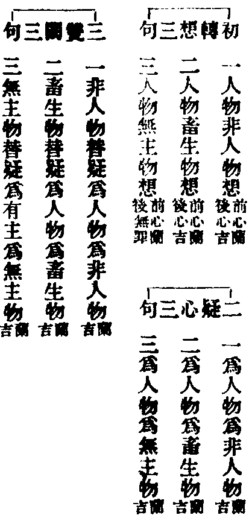



【疏】阙第三缘。重物作轻想，结前方便兰。



阙第三中。如取满五，意谓不满。



【疏】阙第四缘。有盗无盗心。前心，吉罗。本无，非罪。



四中有二。初约先有后无。「前心吉」者，远方便也。下句，次约始终无心。如开缘中，粪扫、亲厚等取也。



由前具缘，不列方便，故此阙中，须分二种：当知先有后无，即阙方便；始终无者，正是阙心。



问：「前心犯吉，那云『阙心』？」



答：「望未动身，犹非盗等，故名『阙心』。」



「若尔，至次方便，转入无心，名『阙心』否？」



答：「身色才动，盗业已彰，但物未离，未成根本。是以拥住次、近，并名阙第五耳。」



问：「前心后转，与阙想何异？」



答：「阙想有心，此据无心。又前约动身后转，此约初心即转。如是思之。」



【疏】阙第五缘。未离处，轻、重二兰，随相分别。



五中。「二兰」，未与物交，次方便也；相交未离，近方便也。或次、或近，有阻不成，拥在方便。次、近不定，故令「随分」。



【注】佛在罗阅城。有檀尼迦，在闲静处草屋坐禅，为人持去，乃作全成瓦屋，佛令打破。便诈宣王教，取彼要材，为王臣、人民诃责「无使入村，勿复安止」。比丘以过白佛，因斯如上制戒。



【疏】就戒缘中。初、明盗缘；二、「为王臣」下，诃犯之相。缘中又二：初、作瓦屋打破，盗戒远缘；二、「便诈宣教」下，正是所犯。



【疏】就远缘中。明「静居坐禅」者，欲显盗相动心，禅行尚尔，况餘滞境，其过弥繁。世俗常言：「顾雍拜万户封，家人不知；葛亮受三郡赏，库无石贮。」斯岂道邪？知足若此，可以自励。



戒缘中，远缘分二。初示托缘之意。「滞境」，谓贪吝之人。「世」下，引俗诫道。「顾雍」，《吴志》云：「吴郡人。孙权为王，累迁官，至尚书令，封阳遂卿候。还家，而家人不知，后闻乃惊。」此谓轻其势禄也。「葛亮」，姓诸葛。《蜀志》云：「瑯瑘阳都人。事蜀先主。后收江南，以亮督零陵、桂阳、长沙三郡，家无一石之粮。」此谓轻其财利也。



【疏】问：「『瓦舍打破』，不犯罪邪？」



答：「如《见论》解：『以损命、妨道，恶法相学，故勅打破，无损财咎。』」



问答中。佛令阿难打破瓦屋，恐疑损财，有所犯故。答中，引《论》出彼三过，示其可打，复禀佛勅，明非自为。



【疏】就犯相中。言「要材」者，《僧祇》云「取飞梯二枚」。故取重财，早觉急制，为开教主，岂是凡邪？故彼律明后得无学，说自庆颂：「欲得寂灭乐，当习沙门法。止财支身命，如蛇鼠入穴。」又云：「衣食系身命，精麤随众得。」餘注可解。



次科《僧祇》。初释要财。「飞梯」，亦曰「云梯」，即相战攻城之具，是国家要用之物，故云「要财」。瓶沙王木坊中有五枚，故言「取二」。



「故」下，出故盗之意。檀尼已证初果，故云「非凡」。此彰起教，非实行故。



「故彼」下，引证。亦即《僧祇》，彼云「达贰伽耶(梵言之异)即作念言：『我作第一房，上座次受，駈我令出。(因分房故。)第二、第三亦駈我出。(今注不出此缘。)后续作，烧成瓦屋，世尊复勅令坏。及取王材作舍，复见呵责。徒自辛苦，用多事为？自今已后，止此苦事，依随僧众，苦乐任时。』便习无事，昼夜精进，专修道业，得诸禅定，成就道果，遂说三偈以自庆」。



初偈如《疏》引。初句标所期道果。「寂灭」，即是涅槃。脱三界苦，故云「乐」也。次句示修因。「因」即是行，行依於教，即三学、八正，是「沙门法」。此上二句，三偈并同，各下二句有别，并是成道之缘。初即少欲行，上句法说，下句喻显。多欲多恼，损害形命，少欲无事，资养安适。「蛇鼠入穴」，相似法故。「支」，持也。即《经》云「多求利故苦恼亦多，少欲之人无求无欲，则无此患」是也。第二下半明随缘行。身名有待，必假资缘，非别所怀，系命而已，随得随受，不择美恶。即《经》云「於好於恶勿生增减，趣得支身以除饥渴」是也。第三下半明知足行。偈云「一切知止足，专修涅槃道」。上句谓随於四事，受用有餘。下句谓心存圣道，更无餘务。



此之三偈，即是颂前长行。初偈颂前止此苦事，次偈颂前依随众僧，后偈颂前专修道业。又此三偈，上二句并灭道二谛，各下二句总明苦集二谛。初是多欲苦，二即多食苦，三即无厌足苦。三行对治，如上所释，即知苦断集，修道证灭。尊者道成无学，说此自庆，以示未悟。故云「欲得」等。



【疏】就戒本中。约文求相，事在弘演。诸律明盗，其相极多，后学未周，何由总括？然余所撰《事钞》，随戒释相，文亦具矣。恐本未见，故略解之。然则盗相难分，要知足者，可有评判。自餘随境，何由通晓？



戒本中，叙意为四。初推讲演，「诸」下，叙相繁。「未周」谓未能徧览诸部律、论也。「然余」下，指广生起。「然则」下，示难劝学。「随境」，谓随逐尘缘者。



【律】若比丘(其义如上)。



【疏】就戒句中，文分为六。初句能犯人。「在村」、「若静」，明盗物处。「不与者」下，明其心业。「王臣」已下，为俗法诃。上三明其盗本，不通诸戒。下二罪摈，如上解也。



【律】在村落。



【注】村有四种：一者，四周墙；二者，栅篱；三者，篱、墙不周；四者，四周屋也。



【疏】言「村、静处」者，遮恶比丘心，出罪网也。彼生疑意，村中有主，摄护是强，静处犯盗，可亦制罪？故今张网纲维，广布罪目。但是有主，以我心盗，非理义立，何得无𠎝？故列空、有二处，用收罪人。



总释二处中，初科。上三句牒文略示。辟制造过，即「恶比丘心」。戒标二处，即「出罪网」。「彼」下，委释。初叙恶比丘心，「故今」下，释出罪网。「纲、维」，并网上绳。「故列」下，结显。「空」即闲静处，「有」即村落。



【疏】「村有四种」，假以事明，必过於此，理亦通摄。据文约相，五种围之。对五不周，则有十种。餘者不出，例此二缘。



释村中。初、示义通。但取有物周围，不必此四，故云「必过」等。如《僧祇》「渠、沟、壍等围，皆名聚落」。「据」下，点文相。言「五种」者：一、垣，二、墙，三、栅，四、篱，五、屋(屋必有壁，注中脱「垣」字，置令妄解)。此五相中，或容餘物闲接，皆名「不周」，则又为五。注中第三，且据墙有篱闲，餘者准知。或可五物，二对参闲，自有十种：一、垣墙；二、垣栅；三、垣篱；四、垣屋；五、墙栅；六、墙篱(注即此句)；七、墙屋；八、栅篱；九、栅屋；十、篱屋。(三对有六，四对有三，五对有一，准上作之。)「餘」下，指例。言「不出」者，即渠、壍等。「二缘」，谓周、不周也。



【律】若闲静处。



【注】即村外静地也。处者，若地中，若地上处，若乘，若担，若空，若架上，若村，若阿兰若，若田处，若处所，若船，若水，若私度关塞不输税，若取他寄信物，若取水，若杨枝，若园果、草木，若无足众生，若二足、四足、多足，若同财业，若共要，若伺候，若守护，若逻道，是名「处」也。



【疏】言「闲静处」者，注解「村外」也。就文明处，通村内、外者。总举盗相之缘位也。



释静中。「村外」，谓齐聚落行来处已外兰若地也。



【疏】就分为三。初、十三种，明物处差别；次、「取寄信物」下，八种，明物体差别；「若同财业」下五种，明契要差别。此之三位，随盗财物，皆据有主，以入盗科；若无主者，则不名犯。今总明主，后就文消。



别释中。总分为二。前分三位。「今」下，次列二科明主。



【疏】计主物者。於物自在，集散皆得，故曰「主」也。大约以分，不出三位。



总举中。初、示主义。「集」谓聚积，「散」谓费用。「大」下，分主相。



【疏】初明三宝；二、盗别人；三、明非畜。初明三宝。



【疏】谓知事者，掌用此物，罪福大深。如《大集》中，非圣非净，何能监护，无有疮疣？



三宝中，初科。上三句叙罪、福。二皆「深」者，由境胜故。「如」下，准教简人。彼经云：「僧物难掌，佛、法无主，我听二种人掌三宝物。一者阿罗汉，二者须陀洹。(此二圣人。)复有二种：一、能净持戒，识知业报；二、畏后世业，有诸惭愧，及以悔心。如是二人，自无疮疣。(此二清净人。『疮疣』喻破戒恶业。)」



【疏】初、盗三宝。



总而为言，有守护者，随盗满五，皆是极重。佛物无护，如《鼻柰邪》断施主故。餘广如《钞》。



次文两判。初望护主，「佛」下，二、断施福，并犯夷重。《鼻奈耶》云：「若盗佛塔、声闻塔等幡盖，皆望断施主福边，得弃捐不受(即波罗夷)。」若准《钞》中「佛无我所，例非人结兰」，今文不出，故指如彼。



【疏】言佛物中，有四差别。



【疏】初、佛受用物者。如堂宇、衣服，及以金石、泥土，曾为佛像之所受用者，不得差互，常拟供养，生世大福。故《律》云：「若是佛园、坐具等者，一切天、人供养，同塔事故。」所以不许者，莫不即体法身之相，表处是深，不得轻故。



佛物中，初科分三。初示物相。「故」下，引《律》证。「所」下，徵所以。法身无相，随物以彰，故此诸物，即法身体。



【疏】二、属佛物。所以得转者，由本施主，通拟佛用，故得货易。不同前者，曾为胜相，故唯一定也。



二中。初标示，即钱、宝、人、畜等物。「所」下，明开转所以。「不」下，对前简异。



【疏】三、供养物。以幡、华等，得货易者，事同属佛，可以义求。



三中，物别转易同上。



【疏】四、献佛物者。开侍卫者用之，义同佛家之所摄故。如《萨婆多》：「有施法者，法师说法、诵经者，亦取分故。」餘广如《钞》。



四中。初标示。「物」即饮食、果实等。次明用与。初判属侍人。今时掌佛庙人，义通道俗。《善见》云：「佛前献饭，侍佛比丘食之，白衣侍佛亦得食之。」、「如」下，引例。《论》云：「若施法者，分作二分。一分与经法，一分与诵经、说法人。」谓彼虽施法，而人获分，例今侍佛，得食无疑。



古记问云：「若用常住僧食供佛，通彼用否？」



答：「《法苑》云：『后还入常住。』」



【疏】言盗法物，亦有其四。



【疏】一、法所受用者。谓纸、素、竹、木上书经像，或箱、函、器、襆曾经盛贮，剋定永施，不许改转。此则一定，敬同圣教。皆是灭理之所依持，故有损益，并望涅槃，而生罪福。



法物中，初文。前出物体。「皆」下，示所以。「纸、素、函、器」，止是世物，但望所诠，至真无价故。



【疏】有人无识，烧毁破经，我今火净，谓言「得福」。此妄思度。半偈舍身，著在明典；两字除惑，亦列正经。何得焚除，失事在福也。



次科。前出谬见。(世中妄传「说偈得烧故经」，不见此疏，焉知误他！)「此」下，次据文斥。上引「半偈舍身」者，一、彰如来求法之勤，二、示如来重法，三、显正法难闻。下引经证，「两字除惑」，显佛法功深，举少况多，其过弥甚。傥畏来苦，勿逐魔徒。二缘并出《涅槃经》。彼云「佛告迦叶菩萨言：『过去之世佛日未出，我於尔时，住於雪山，唯食诸果。食已，系心思惟坐禅。经无数岁，不闻如来大乘经名。修是苦行时，释提桓因，自变其身作罗刹像，下至雪山，宣过去佛所说半偈云：「诸行无常，是生灭法。」乃至闻此半偈，心生警疑：「汝今幸可说竟此偈？」罗刹答言：「今我实为饥苦所逼，实不能说。」我即问言：「汝食何物？」罗刹言：「惟人煖肉，其所饮者，唯人热血。」我复语言：「且说半偈。我闻偈已，当以此身，奉施供养。」罗刹即说半偈云：「生灭灭已，寂灭为乐。」菩萨徧於石、壁、树、道，书写此偈已，即上高树，投身树下。身未至地，虗空之中，出种种声，乃至阿迦尼咤。尔时罗刹，还复帝释形，即於空中，接取菩萨，安置平地。』」云云。又《经》云「善男子！若复有人，不知如来甚深境界，乃至轮转生死，增长诸结，多受苦恼。若有能知如来常住，无有变易。或闻『常住』二字，若一经耳，即生天上。后解脱时，乃能证知如来常住无变易」等。言「事在福」者，如施主作桥、井等事。随在福生，缘坏则「失」，名「事在无作」。今烧故经，其事亦尔。



【疏】餘之三相，可以准前。



指餘三中。前二转易，后与侍人，并同前判。



四分律含注戒本疏行宗记二上之二



四分律含注戒本疏行宗记二上之三



【疏】就僧物中，则有四别。



僧物中。前二属处永定，通名「常住」。但前无分义，后是可分，故加「常住」、「十方」以简之。后二俱是即施，通名「现前」。但前局当处，后通内外，故加「现前」、「十方」以别之。



【疏】一、常住常住物。如堂宇、田园、人、畜、米面。属处已定，不可分割。必欲惠给餘寺，羯磨和与。若直送者，是名「盗损」。或有主掌自盗，不望十方不满，随取计五，便与极重。如《僧祇》中，纵集得僧，亦不可分故。



初中分四。初出物体。「属」下，示名义。「或」下，明结犯。餘盗望主，此义易知，故文但出「主自盗」耳。「如」下，引证。



【疏】二、十方常住物。如饭饼等，见熟之食。本拟十方闻声同饭。有盗此食，望护结重，望僧结轻，以僧分业，无满五故。



二中。初列物体。「本」下，示别名。通名同上，故不重出。「有」下，明犯相有二。「望主重」者，谓餘人盗。「望僧轻」者，即犯偷兰，或主客同盗，或主自盗。



问：「二种常住，并通十方，何以前不望僧，后望僧者？」



寻文可通。



【疏】问：「声钟告集，是僧皆饭。未知他寺奴、畜得否？」



答：「不合也。僧具六和，随处皆是。人、畜别属，义非通使，使既是局，食亦如之。」



问中，意谓他寺奴畜，彼此通僧，应得食故。答中。初句判定。「僧」下，释所以。初示僧通之义。「人」下，明「奴畜」不通。《钞》云：「行至外寺，私有人畜，用僧物犯重。以施主拟供当处僧，不供别类，非福田故。僧家人畜，犯吉。(今多私务，将带人仆，食彼僧食。明文犯重，之。)」



【疏】三、现前现前物。如今诸俗，以供养僧，无问衣、药、房、具，并同现前僧也。如《中含》，施招提僧房，所谓「别房施」是也。又如《经》中「僧鬘物」者，此梵本音。据唐言之，「对面物」也，即是现前对面之施耳。《钞》引昔解谓「花果」者，随字显相，乖其事义也。



三中。初示名体。「如」下，引证，《中阿含经》：「阿难受别房，用施招提僧。」、「所谓别房施」即翻名也，谓以「别房」施「现前僧」。「又如经」者即《涅槃》文。初翻名显相。「《钞》」下，点示昔非。谓《事钞》中误用昔解。彼云「房宇是招提物，华果是僧鬘物」，即取「华果结鬘」之义，故云「随字显相」。华梵不辨，即是「乖事义」也。



【疏】四、十方现前物。如僧得施，及五众亡物。以此物施，通拟十方，有僧皆得，故此福分，广大无边。及论立法，不可尽集。制作通法，用约十方，随现集者，皆有其分，故曰也。若未羯磨，盗者偷兰，以十方僧不满五故。若羯磨已而行盗者，随其轻重，据现结正。既定罪相，随务则多。讲至於此，引《钞》解也。



四中。初简物相。「以」下，示名义。「制通法」者，即白二羯磨。「若」下，定犯相。轻重两判，准《善生经》。初犯「兰」者，由未作法，人无限数，望「十方」结；后「随轻重」者，既作法已，人有数限，故随所盗，轻重两结。



【疏】二、盗人物。



就缘分三：初明掌护损失，后明被贼、盗相。



【疏】初中，妙同《钞》引。《善见论》中，若守护财物，谨慎不懈，而有盗者，私窃而取，或强逼取，皆望本主结者，以非护主能禁之限故也。若反此者，守物须偿，以本盗人欺守护故，是须还他。若不还，犯。



次、别人物，释中，初科。上句指广。彼约二主，分为七种：一、掌护损失主；二、寄附损失主；三、被盗物主；四、贼施比丘物主；五、枚囚缚贼主；六、狂人施物主；七、守视人作主。并广如彼，须者寻之。下引《善见》，即彼初位。《论》中。初明守护谨慎。「望本主」者，有二义故：一、非能禁，二、无填偿。本主索偿，反成盗故。「若」下，次明慢藏。反上二义，故从守护。



【疏】二、被贼夺者，如《钞》所引，义张二位，谓「现」、「不现」。结罪时，当随二主心绝已不。



若财主已绝，贼主得定，此不可夺，如《律》贼复夺贼。



二、财主虽定，贼主不定，此则可夺，以缘不具故。



三、财主迟疑，贼主已定，此不得夺，以缘成故，何问本主？



四、俱不定，此则收得，由心不定，业非通畅故也。



今以四句，可约判之。



次科，历句中。初总举。「现」、「不现」者，即对面现前盗及不现前盗。「二主」谓财主、贼主。「若」下，别列。初后，二俱可解。次句以贼心犹豫，盗业未成，故云「缘不具」也。第三反之，故「不得夺」。



【疏】问：「今有贼施，得取物不？」



答：「据理成也。以物非定属，随后作主。如似世钱，可定属也？随人随用，随处随定，随损随结，可例通之。」



问中，恐疑共盗，故问释之。答中，初判定；「以」下，释所以；「如」下，举事例通。



【疏】三、就所盗，略举通收。情、非情道，并摄尽矣。如《钞》所引《明了论》解。恐不见《钞》，故又引之。



三中，标文。初总示，「如」下，生起。



【疏】如彼解云，盗义极多。且约六根，起非法行，若偷六大，亦犯重罪。



释中，初科。「六根」，即约能盗，以摄所盗。「六大」即括所盗以显能盗。故知盗境，该通无穷。



【疏】何以明之？如诸仙人，是「𮌎行师」。有人蛇螫，作仙人书，见者皆愈，然须价直。比丘被害，偷看，不问损与不损，看时即犯。以此例诸秘方要术，不许人传，偷见违恼，何啻在五？所谓眼盗。下根例之。如诵呪治病，欲学须直，比丘密听，计直犯重。偷齅、甞、触，亦例此知。若要方术，病缘即差，得直方与，得直听写，比丘受学，心缘得差，不与价直，故犯重也。



六根中。初句徵起，「如」下，列释。初委释「眼根」。「𮌎行师」，准《论》合云「𮌎行蛇毒药师」(谓蛇以𮌎而行)。「螫」，施亦反，谓虫行毒也。「下」下，例餘五根。



【疏】次约六界。前地、水、火可知。如《律》中，有呪扇药涂，比丘偷摇，不与价直，是谓「盗风」。若起阁斜临，妨他起造，是名「盗空」。智者，识界也。人有伎俩，不空度他，得直方与，比丘方便，就他学得，不与价直，即「盗识」也。识不可盗，以无形故。但可从缘，盗其智用耳。



次六大中。「大」谓六皆广遍，「界」谓六相差别，体同名异，前后各标。就文，初略指前三。「如《律》」下，引释后三。初明「盗风」。「若」下，次明「盗空」。「智」下，后明「盗识」。「伎俩」谓艺能也。「识不可盗」者，谓不可盗去，但其机巧，为人所学，故云「盗」耳。



【疏】三、明非、畜物者。



如上立义已明，可寻《钞》中罪轻重也。



非、畜中。指「上立义」者，近指当戒具缘、阙缘，远指篇前境差方便。下指《钞》者，彼明盗非人物，有主，望主结夷；无主，望非人结兰；盗畜生物，古谓犯夷，今师准《十诵》、《多论》，但结吉罗。



【疏】文中。「处者」，总举，用收其相也。



【疏】初、「地中」者。恐人不了「处」之所在，故以相列，令知犯境，不得迷也。如《律》中解，即地中伏藏，有主守护，若盗此物，计五成重。今约《律》中，佛地、僧地，若有伏藏，随出随属佛僧二位，亦无还主及送与王，可如《钞》中「捉宝戒」说。



次物处。初释「地中」。初明列相所以。「如」下，引释。指「如《钞》」者，彼云：「地上属王，不论地中。如给孤独，圣人亦取此物，故知无罪。」



【疏】二、「地上处」者，如今道地所得物也。



【疏】三、言「乘」者，谓象、马等乘也。就此乘上，有财欲盗，离乘便重，即以乘为处也。若欲取财，无由得离，虽乘行百里、千里，但得偷兰，后离方重。若兼乘盗，心绝乘离即犯重罪。《僧祇》：「盗四足者，驱向所期，足徧犯重；不随所向者，轻。本期不定，举徧即重；本主来逐，心未得者，轻也。」



乘上。初示物。「就」下，辨盗。初明就乘盗物。「若兼」下，连乘俱盗，又二：初、正判；「僧」下，引类。



【疏】四、言「担」者，谓所有物，属於步担。义同前乘，可以两分。



「担」中。亦约担上盗物，及连担盗，判犯不同，故云「两分」。



【疏】五、言「空」者，《明了论》中，约有辨空，结罪如上。今《律》明空，谓有衣物、鸟等，从风所吹，有主之物，而加盗取。明「离处」者，即空异处，是名「离处」。故《善见》云：「盗空中鸟，左翅过右翅，尾处至头，上下亦尔，俱得重罪。杖遮不随者，兰。」《十诵》中，有主鸟衔重，无主鸟衔者兰。



「空」中。初标异。彼论约起阁侵他空处，故云「约有辨空」。「今」下，正释。初明空处。「故」下，引示。「左翅过右」，约横飞说；「尾至头」处，约直飞论；「上下」可解。以空无分齐，还约鸟之飞动，以明离处之相。《十诵》，彼具云：「诸有主鸟𠷢是物去，比丘以偷夺是鸟物，波罗夷；若野鸟𠷢是物去，比丘偷心夺是鸟物，偷兰遮。」此夺鸟物，望人结罪。亦应约空辨处，故此引之。



【疏】六、「架上」者，谓诸架、壁有财物也。若盗离者，即以为处。如《十诵》中：「取衣不取架，持架将去不得重。后离架时，方得重。」亦同上判，义相似也。故又出者，知无异也。



「架」中。初示处。「若」下，辨犯。「亦」下，指同。谓同前乘、担，离合两判。「故」下，显重意。「知无异」者，若不出相，不知同故。



【疏】七、言「村」者，谓托村为处。《律》中，初约盗物，后盗村体，或以机关攻击，强力水浇，言辞辨说，诳惑而取，皆重。



七中。初「盗物」者，《律》云「若村中有金银等，若牵、挽取，初离得夷」是也。「盗村体」者，即如所引。「攻击、水浇」，损坏也。「强力」者，《律》云「依亲厚强力而盗取」也。「言词辨说」者，诳诱取也。「说」，音税。



【疏】八、「阿练若」者，村外空地。二位同村，可知。



「兰若」，梵言，即翻「空处」。「二位同村」，即盗物及体，《律》云「空处有金银」等，又云「若以方便，坏他空」等，是也。



【疏】九、「田处」者，田有多种，百谷所生之处总名为「田」。《律》中两相，如上村解。《十诵》云：「若为田故相言，得胜者重，不胜者轻。若作异相，过分胜者重。僧房舍者亦尔。」不言理之曲直。如尼言犯残中，但得述理，官占无犯，不许横言。今以义约，若后主想决，则应属己。若不定者，应非重科。



田中。初示名相。「《律》」下，引释。初本律言「两相」，亦即物、体。《十诵》「相言」，谓诣官词讼。「得胜重」者，谓非理而得。「不如」字误，彼作「不胜」。「若作异相」者，彼云：「若不胜已，更作相，若所得地，乃至满五，得彼罗夷。」(谓作标相取也。)「房舍」准田以判，故云「亦尔」。「不言」下，决文不了，又二。初准例决。即约理之曲直，明犯、不犯。「尼」下，脱「相」字，即尼「相言戒」，开述理故。「今」下，次约义决。即就主心，定与不定，判犯轻重。纵是僧地，前主心决，夺亦成重。



【疏】十、「处所」者，或店肆作处，如是非一。亦有二位，如上列之。



十中。初示相。「处所」语通，故云「非一」。《律》云「若家、若市肆、果园、菜园、庭前舍后，若复有餘处」等。「亦」下，判犯。盗物、盗体，「二位」同前，故略指之。



【疏】十一、「船处」者，亦有二科。船中盗物，即船为处。若盗船体，如《僧祇》中「解船筏时，越；动时，偷兰；虽断绳未离者，兰；要断绳离处，方重」。《善生》：「流水中，解船离栓，即重。」



十一，初总示。「舟」下，别释。初明盗物。「若」下，明盗船。「《僧祇》中」，明因果、分齐、次第之相。「《善生》离栓」亦同。「栓」，巨月反，桩也。



【疏】十二、「盗水」者，律中但明所损，不出分齐。如《僧祇》中，溉灌流水，或一宿直一文，乃至四五，比丘为於佛僧，复自为，盗坏彼渠，得越；水入田，兰；满五者，夷。《摩得伽》云：「计彼塘工，过分而用，水满者结重。」



十二，初示本宗通漫。《律》中但云「盗水中金银、衣被、鱼鼈，及坏他水处」等。「如」下，引他部显相。《僧祇》，前明主者计价，下明比丘盗损。「为佛」者，他缘亦犯也。「渠」即水沟。《伽论》二义判犯：一、计塘工；二、用过分。



【疏】十三、「私度关塞」者。



【疏】如《律》，比丘无税，白衣应税，为彼过物，故制重。如《十诵》中：「比丘应税，不税亦重。虽不为过，而示餘道，以不被税，为他过物，故犯罪也。」如《多论》中，持国禁物出界，入死罪，故言重者，但违王教，故得吉罗。《萨遮经》云：「不输王课，非盗也。」又《僧祇》云：「一切出家人不税。若卖买人，应税。」



十三中，初科。本律「比丘无税」者，谓官不税比丘物，而为他过物也。《十诵》，初明自税，谓有国土，税比丘物。「虽」下，明为他免税。《多论》两断，《论》云：「若国禁物出王界者，入死罪。若比丘持出，律师初言得重。后云不入重，但有违王教，吉」。据此，纵令官税比丘物，而故不税者，止得吉耳。此则决前《十诵》结重之文。下引经律，文据益显。《萨遮尼犍子经》云：「何等不应税？世尊弟子、比丘、比丘尼、一切外道出家人物，是名不应税；若卖买者应输，是名税分齐。」、「课」，即税也。(准此不税无犯，但是随身道具。若为治生不税，则如《十诵》犯重。)《僧祇》同上。



【疏】若官税比丘，方便自免者，非犯：一、本不共要，二、非理税我。故上文云「比丘无税法」也。若成犯者，贼来劫我，方便隐物，亦应犯重？然有白衣，官税其物，比丘为隐，如《律》科重。



次中。初明不税无犯，又三。初约义定。「故」下，指文据，即《四分》、《多论》等文。「若」下，引事反质。「然」下，次明为俗故犯。「如《律》」，即上《四分》。



【疏】次明物体。



【疏】初云「取信物」者。《律》中，持人物在右手，随离结重。若本左手持物，盗心不还，须舍盗心，方移右手，不舍而移，是名重盗。如是类之。又《十诵》云：「若贷他物，抵言『不贷』，故妄，得提。」如《善见》中：「偷方便故吉罗。」《十》云：「若先用尽，后断当已，得重。先断当，后离处，方得夷。受他寄物亦尔。」《善见》云：「若负他债，比丘持去，无盗故无罪也。」



次物体中。初「信物」者，谓人寄附之物。前引本律，就身为处，文约「左右手」，以明犯相。餘身分亦然，故令准「类」，《律》云：「头上移肩上，肩上移头上；左肩移右肩，右肩移左肩。」下引诸部，初《十诵》明贷寄，前明抵拒犯提。《善见》结「吉」，示不同故。「十」下，次明犯重。「先用尽」者，谓己用过他所贷物。「后断当」者，谓主来求索，抵拒不还也。「先断当」者，谓贷物犹在，故约「离处」方犯。「受寄亦尔」者，抵拒断当，犯相并同。次引《善见》，谓负餘人债，比丘辄尔为他持还，但不成盗，义应有罪。



【疏】二、「取水」者。《律》中，离地水器盛而盗，随满结重。《僧祇》：「若以筒就孔中饮，满者重；若稍饮数止，咽咽偷兰。若器先塞，盗拔塞时，越；注入器中，兰；注满者，重；若注未满即悔，畏重，以倒本器中，偷兰。」虽绳断未离处，离处未断绳，俱兰。苏、油、蜜等，例同。



二中。《律》约「器盛」者，文云：「大小瓮及餘种种水器，若香水，若药水，若取者，夷。」《僧祇》，前明以筒盗饮。「稍」，即少也。「若」下，明持器盗取。「虽」下，约连器持去。下例苏、油，同上三判。



【疏】三、「杨枝」者，义同上相。《律》随有者，便随言之。



三中。「同上」者，亦为随盗满五成重，《律》云「若一、若两，若众多，若一把、一担」等。「律」下，通示律文列相之意，谓前后所出，随据有者为言，非止此数。



【疏】四、「园果草木」者，如上「僧物」中。《钞》中广引。



四中，初科。指上，即「常住常住物」。下又指《钞》，即「盗戒」中。彼引《大集》云「盗僧物者，罪同五逆」，随损一毫，则望十方凡圣一一结罪。又引《方等》云「五逆四重我亦能救，盗僧物者我所不救」等。彼又广引诸律，明用得否，捡彼看之。



【疏】僧园果木，比丘多犯，以我寺中，不谓有犯。然立寺者，以盛无我之僧，随有施为，无非为解脱故。今不思此，取他众人所有之物，以为自保，此罪大也。如《僧护》、《日藏分》中，特可畏也，故须深思。



次科。初叙喜犯。「然」下，次彰业重。初明立寺之本。「今」下，次明盗取之情。「如」下，指教劝思。《僧护经》，彼因耶舍游海边，见五十餘处地狱，多是侵盗僧物，现受苦报。《日藏》，具云《大乘方等日藏经》，佛对日藏菩萨说诸破戒受苦等事。《钞》云：「别人得用僧薪草者，此要具戒清净应僧法者。若行少缺，得罪无量。」



【疏】如《僧祇》中：「僧地种果有功，听与一熟，乃至菜瓜，例与一翦。」、「若於园中摇树，果落地，持云方重。若就园内食，满者结重。」《十诵》：「僧园树华，听供养佛。大木供僧，皮叶随比丘用。」《僧祇》：「院内树薪，供僧食用。若无定限。应取乾者。」



三中。《僧祇》，初明赏功。「一熟」，谓一番熟者与之。「一翦」，亦约一番采摘。「若」下，次明盗果。《十诵》，树华僧用、供佛，不成互用。「皮叶」及《僧祇》「树薪」，并开别人取用。准前明判，要须戒净。



【疏】五、「无足」者。《律》中，蛇、鱼为初，有主盗取故。《僧祇》云：「若以龙蛇等，盗取犯重。若瞋骂言『何以笼系』，即开放者，越。」《五分》：「若坏杀具，无犯；不应尔。」《十诵》、《摩得伽》中：「坏网，慈心吉罗。」



五中。《律》文先列蛇、鱼，续云「及餘无足众生」，故云「为初」。《僧祇》。初明盗取。彼云「无足者，所谓蛇蟒」，或蛇师比丘盗取蛇或筐，满五皆重。今云「龙」者，疑是文误。「若」下，次明解放。下引律论，坏具皆轻，以非盗故。



【疏】六、「二足」者，盗人为初。



六中。「人为初」者，《律》云：「人、非人、鸟，乃餘二足众生，有主者重。」



【疏】约《律》，盗人令出家去，如上可知。既非仆隷，则非别属，虽违王教，如上《多论》。



盗出家中。初明成重。「如上」，即约有主结也。「既」下，拣轻。谓「仆隷」等，损主故重，餘无所损，止可结吉，故指「如《论》」，即上「度关」等。《善见》亦云「盗人无罪者，谓主人儿落度，父母所遣等，将去无罪」是也。



【疏】义言：「若他儿子贼夺去将，便损父母依报力用，属贼是强。不得教走，若自走来，则不负贼。」故《十诵》中：「贼捉弟子将去，师还夺取，犯重。贼未决想，无犯。弟子自偷身来者，不犯。」如昔解云：「师不得夺，身自得走者：父母感子力强，贼夺得重，已属贼是强，师弱夺贼，故重；儿报正体是强，贼得力用则弱，走是强报相逐，弱用随来，不犯。」



夺贼中三。初以义判，前明贼夺成重。子是父母所依，假其力用，所损处重，故「属贼强」。「不」下，教比丘护盗。教走成重，以损贼故；自来无过，以非意故。「故」下，引证，可见。「如」下，引昔解。初牒前两判。「父」下，释出所以。初明师犯重意。「儿」下，次明自来无犯。「儿报强」者，自所有身，非他属故。「贼得弱」者，非所生亲，复非雇主故。「强报相逐」者，身随己意故。「弱用随来」者，贼无分故。



【疏】《十诵》云：「见他奴婢，语言：『辛苦！何不走去？』如语吉罗，举一足兰，举二足重。若奴已叛，催令驶去，随语得重。或言此俭彼丰，奴即叛去，不教故不犯。或问丰乐，逐比丘去，即驱使者，逢难唤走，皆不犯。」



三中，四段。前二教走成重，后二不教无犯。初明诱引。「若」下，次明催去。「驶」，疾也。「或言」下，三、约比丘语彼。「或问」下，四、据彼问比丘。



【疏】七、「四足、多足」，《律》约畜论，亦可准上。



七中。《律》云「象、马、牛、骆驼、驴、鹿、羊及餘四足」等。「多足」者，《律》云「若蜂，若百足，及餘多足」等。并约有主成重，故令「准上」。



【疏】「同财业」者，谓违契要，故此引也。据此同财，其相多种。或资生同，如今师资同活等。取五即犯，不假半分，以彼同财，全欺负故。或同活生，共营财业。若生心盗，则须计分，满十方重，五是我分，五欺彼故。



同契差别中，初科。前示犯意。以同财业，本无有犯；但望违契，有成盗义，故云在「此引也」。《律》云：「同事业得财物当共(此『契要』也)，以盗心取五若过，犯重(即违契也)。」、「据」下，辨犯相。初二句总标。「或」下，别释。初明「资生同」，谓彼此有财，无所简别，故取五即重。次明「同活生」者，谓共营生，得财各半，故取十成重(「活生」或是写倒)。



【疏】言「共要」者。



二中。「要」即约也。



【疏】《律》举行盗，先要共分。如上律中「弟子伦师衣，误得己衣」，须分一半与共要者，以同要时，但云得衣，不问自他，皆分半故。



初科。上二句示犯，《律》云：「共他作要，教言某时去，某时来，若穿墙取物，若道路劫取，若烧，从彼得财物来共分。」、「如上律」中，即前「错误」中《僧祇》文也。



【疏】如《僧祇》中：「两教作者，自共制言：『从今得衣，二人共分』。一人得衣，便自念言『后得不必及是』，便解制云：『从今各任相禄。』先得衣者，半满结夷。又得衣咒愿已，言『且置汝边』，便解制，兰。又闻欲施，便解要，越。



「有二粪扫衣者，要共觅衣，一得好衣解要，二得好衣草覆，三不覆解要。」



如上犯罪，三阶列之。后二句中不得重者，由初立要「入手共分」，以不捉衣解要故轻。



次科。《僧祇》二节。初约受施违要，前明共制。「两教」，谓两人互教。「一」下，次明各解，有三。初、贪好故解，入已故重。「相」谓福相，「禄」即禄分。二、隐藏后解，兰。三、闻施先解，吉。此二并未入手故轻，如后所决。



「有」下，次明粪衣违要。初明共要。「一」下，明各解，又三。初、列句。次句下，略「抟覆」字。第三句上，略「不取」字。「如」下，示犯。初句重，次句兰，后句吉，故云「如上」。「后」下，出后二句犯轻所以。



【疏】《善见》云：「期时共去，中前中后，今日明日，今年明年，相要不绝。相当者重，不如要者轻。」



三中《善见》。上明作要，下示犯相。言「相当」者，《论》云「时剋相应，俱得罪」。「不如轻」者，彼云：「若不从教，教中前取，而中后取；教初夜取，而后夜取；教白月取，而黑月取；教此年取，而后年取：教者小罪(偷兰)，取者波罗夷。」此据专剋为言，若本通漫，不定时日，随违成重。



【疏】言「伺候」者，规财便利，觇候处所，相期进不，得财必共故也。纵得不共，为候亦犯。



三中。初约共要犯。「觇」𠡠艳反，窥看也。《律》云「我为往观彼村，若城邑，船渡山谷，人所居处等，於彼得物一切共，盗取成重」等。「纵」下，次约受教犯。虽不共分，盗戒教他，能所同重，故云「亦犯」。



【疏】言「守护」者，为其掌录，所在追求，随得共之，故言此也。若先不要，但为守护，既不同心，义亦非犯。



四中。初明共盗犯。《律》云「从外得财，我当守护，若所得物，一切共」故。「若」下，次明不共非犯。



【疏】言「逻道」者，相望通塞，防虑外人，得财共之，故曰也。《僧祇》：「二人共盗，一人守门，一人入取；解时俱越，牵时俱兰，离时俱夷。」



五中。「逻」，郎佐反，游弈守路也。《律》中，或作「看道」。初示犯相。「通」谓无人为疑，「塞」则反之。《律》云「我当看道，若有王者军来，若贼军来，长者军来，当相语告，若有所得，一切共」是也。下引文证，同犯可知。必非同意，为守同上。



已上五种：前二则通盗者互违，后三但据共盗同别。



【律】不与。



【疏】文言「不与」者，明主不舍，心任私之，成我盗也。



第三句，释文中。「心任」，谓己得自在；「私之」，谓不与他共。



【注】他不舍也。若也物想、他所护想、有主想、非己物、非暂用、非同意故也。



【疏】注中。「他物想」者，「非己物」也。「他护想」者，「非暂用」也。「有主想」者，「非同意」也。物虽属主，同意破用，虽尽无过，故以此解，释成「有主」。



释注中。即用注文后三非句，配前三想，对之可见。



【疏】上虽约物明盗，然结正时，终须离处，因明十种。



离处中。以盗戒成犯，虽约「离处」，然其离相，不必物离，故以十门，括示差别。



【疏】一、文书成明离处者。如今持律，判亡僧物，重轻互断，下笔成犯。《善见》云：「书地作字，一头时轻，两头时重。」



二、言教立。《善见》云：「口断多端，偷夏唱大。」《律》中，言辞诳惑取是。



三、移标相者，《善见》：「盗心取地，移标得一发，亦重。」



四、堕筹，如《律》，随下犯。



五、异色，如《律》，坏本色故。



六、转齿，如《十诵》，蒲薄移棋子等。



七、离处非犯，如《祇》，驱牛马，心疑故非犯。



八、不离处明离处，如《见》，必得不疑，动即重也。



九、无离明离，《律》中，攻击破村，烧埋等。



十、杂明，如空中等相，广如《钞》引。



初中。凡判亡物，判重入轻夷，判轻归重兰。但取文成，不待物离。《善见》「书地」者，谓作契书，判断田地。「一头轻」者，是方便兰；「两头重」者，即究竟果。



二中。「口断多端」，谓强词巧辩，非理而断。「偷夏唱大」，如施十夏者物，贪心欲取，未满言满。「《律》中」，「诳惑」，即邪心劝诱。上之三相，竝望发言，决得无疑，皆成夷重。



三中。「标相」，即今丈尺度量之物。「一发重」者，《善见》云「地深无价」故。



四中。如《律．调部》云：「时有比丘，易他分物筹，佛言：『举筹波罗夷。』又有比丘，盗他分物筹，佛言：『直五钱波罗夷。』」



五中。并指《调部》文云：若破若烧若埋若坏色，佛言「皆波罗夷」。(上三，即如九中所引。)



六中。「转」，谓翻转。「齿」，即骰子、棋子，多用牙骨为之。「摴蒲」，即赌博之名。今谓先曾约物，而盗翻彼采，或转己负为胜，或转他胜为负，亏他满五，皆重。



七中。「如《祇》」，即《僧祇》，如前「乘」中具引。



八中。「如《见》」，即《善见》，彼云「空静处盗，决得无疑。如掷杖空中，必无不下。故动即成重」。



九中。「攻击」，如上「盗村体」。「烧埋等」，如「五」中引。



十「杂明」者，示不尽故。下指「《钞》」者，彼云如「空中吹物，盗鸟，曲弋，断流水注」等，即上「物处」中已明。



【律】盗心取。



【疏】文言「盗心取」者，明心应境也。欲明行盗，心业须具，必兼两缘，以成一盗。故注解云「贼心取」也。



盗心中，释文。初标示总意。「应」，犹称也。上云「不与」是境，此句即心。「欲」下，出立句所以。「两缘」，即心、境。



【注】贼心取也。有五种：黑暗心、邪心、曲戾心、恐怯心、常有盗他心。又五种取：决定取、恐怯取、寄物取、见便取、倚托取。或依亲友强力，若以言辞辩说，诳惑而取者是。



【疏】《律》中具出二五盗心。



【疏】初云「黑暗心」者，谓痴心也。愚於教行，不肯修学，故於盗境，生可学迷，《律》云「随作结根本」是也。即如上引知事比丘，互用佛僧物，随满犯重也。



言「邪心」者，谓邪命也。贪心规度，为财说法。即是以利求利，恶求多求。外现清白，内实邪浊。故《五分》云：「谄心取财，是盗也。」



言「曲戾心」者，即瞋心也。与少嫌恨，现相索多，或示威怒相是也。



言「恐怯」者，谓迫喝也。或说地狱恶报，或说王官势力而得财者。如《摩得伽》云「强夺取」是也。



言「常有盗心」者，恒怀规夺，得物乃休也。



五种心中，初文又二。初通示心相。引《律》「随作犯」者，则知此心通犯诸戒。又云「更增无知罪」，则不学无知，亦同此耳。「即」下，别指盗业。即前三宝境中已明。



二中，初示名。「邪命」，谓邪求养命。「贪」下，列相。「规」谓希求，「度」即筹虑。规度说法，事同治生贩易，故云「即是」等也。「故」下，引证。



三中，初释名。「曲」谓非理，「戾」即忿怒。「与」下，示相。「嫌恨」约内心。「威怒」约色相。



四中，示名。「迫」，谓以事逼切。「喝」，谓说时作其大声，或可作「遏」，谓抑遏也。「或」下，显相。「说地狱」，谓滥托圣法。「王官」，谓倚恃豪势。「如」下，引证。



第五，可解。



【疏】又变此心云「五种取」者，「取」是其业，对境行事也。



次释五取，标简中。前五约心，不出三毒。若就通说，莫非希物，五并贪心。若约别论，如文乃异：初二及四，并是痴心，三即瞋心，五是贪心。又前五种，外相非盗，故约心论；后之五种，内外俱盗，故从外事。



【疏】言「决定取」者，心虑已定，必得如期，故曰也。



言「恐怯取」者，示身口相，令生怖畏，故取彼财，如《十诵》中「轻慢、抵突而取他物」是也。



言「寄物取」者，或全抵债，或以少还他，是也。



言「见便取」者，伺他慢藏，阳作阴伏之类也。



言「倚托取」者，或假名闻威德，或恃亲友形胜也。



第二引《十诵》文。「轻慢」，谓倨傲；「抵突」，谓触犯。四中，「慢藏」，谓不勤收举；「阳作」，谓诈作餘事；「阴伏」，即潜藏他物。五中二相，「假名德」，则通自他；「恃亲友」，则唯在於他。「形胜」，谓位貌过人者，如王、臣、贵族等。



【疏】餘注云「或依亲友」下，《律》中，随诸相下，皆引此言。当今季世，多弊斯犯，故圣制有以也。文相易耳。



餘相中。初示律文。《律》列物处，十三种别，一一处后，皆出此二相。「当」下，显制意。「弊」，犹滞也。下句点文，以其事显，不劳释故。



【律】随不与取法。



【疏】文言「随不与取法」者，结罪分齐，释成重相也。「不与取」者，犯名也。「法」者，盗刑也。满五便入死位，故是「法」摄。谓比丘行盗，准此以判，故言「随」也。



三中，释文。初总示，「不」下，牒释。初释「不与取」，次释「法」义，「谓」下，释「随」义。「准此判」者，即准国家满五入死之法。



【注】以王立法「若取五钱，若直五钱物，罪应至死」，佛随王法，盗满制重也。



【疏】注中。依「王法」故，制有此位。「取钱」者，即五钱体也。「直五钱」者，财准钱法也。犹如唐律，随有犯者，皆约绢估，以从尺寸，方定刑名也。注云「盗五死罪」，准此行盗，驱摈不别，事同死也。



注中，初科又三。初释王法。「此位」，即盗戒。「取」下，次释满五。「财」即总於众物。「唐律」，如下自引，今时俗律，亦约绢估。「驱𢷤同死」者，道俗制别，片相似故。



【疏】如《多论》问：「盗何等钱，而成重罪？」解有三种。初云：「本依王舍国法，随彼用何等钱，准彼为限。」二云：「随国所用，有佛法处，即以为限。」后云：「佛依王法，盗五得死，依而结戒。今随有佛法处，依国断盗几物应死，即以为限。」如上三释，论师以后义为正。



次科，引《论》中。以钱体多别，故问定之。初解「依王舍」者，以佛在彼国制此戒故。彼是大铜钱，一当十六，则盗小钱，须满八十。次解「随国用」者，无论物体，但满五数。后解不约多少，但随国死刑为准。《论》取后义，今依次解耳。



【疏】然五钱义，互释不同。判罪观缘缓急者，如《母论》、《善见》所说「若约护行，草叶不取」者是也。



取舍中，初科。上二句标诸说，不出论家三解。「判」下，示教意。初明判罪。「《母论》」中，一切戒，皆有缓急二缘。《钞记》具引。如盗戒「乃至草木小叶，他物不得取」等名急，「若非他物想取」名缓。「《善见》」如下引。「若」下，次明护行。《母论》、《善见》、《四分．条部》，竝有此文。



【疏】今诸持律，多依《十诵》。故彼文云：「古大钱者，大铜钱也。据今小钱，即八十文。」



次科。「依《十诵》」者，即取《多论》初解。



【疏】如《多论》中，盗相通滥。初释本钱，何由可晓？后解随国，现断入死，言亦泛滥，难可依承。如此唐律，强盗满尺，则是极刑。窃盗五十匹，罪至伇流，纵多盗者，不加至死。《论》令准此，则刑无死名。比丘多窃，少有强者。纵有强夺计尺死刑，盗五十匹，又非死例。准俗制道，盗相叵论，如《僧祇》云「正无定法，断盗不定」。



三中。初二句通示，「初」下，别释。前破初解。但传闻彼钱，时賖处隔，莫知体相，故云「何由晓」也。「后」下，次斥第三解。初斥其通滥。「如」下，次引俗例。「强盗」如劫夺。「窃盗」即密取。「极刑」即死罪。「叵」，犹不可。「如」下，后引文证，明不可依。



【疏】若依《四分》，但云「五钱」。钱则八种，并同一制。可如《多论》中间一解，随国用钱，准五为限，则诤论自息也。



四中。初示本宗有准。「八种」：谓金、银、铜、铁、白镴、木、皮、胡胶。「可」下，次取《多论》会同。



【疏】就断盗相，结罪分齐，六门分之。《善见》云：「於戒律中，宜应从急。」又观五事：处、时、新、故等。



断盗中，初科。《善见》「宜从急」者，谓护行也。「观五事」者，谓判罪观缘也。「五事」，文略「随身用」。「处、时」如下引。「新、故」者，彼云「有物新贵后贱。如新铁钵，完净无穿则贵，后穿破便贱」。「随身用物」者，如刀斧，初贵后贱，若偷他斧，应问主几直买等。如《钞记》备引。



【疏】初、钱有贵贱时。如《十诵》，钱贵，盗一入重；贱时，百千入轻。



二、贵贱处者。如《律》，贵处盗物，贱处卖，还依本处定价。



三、《善见》云：「贵时盗，贱时卖，定罪还依本时。」如上三门，唐律明相亦同也。



四、取多非重，不得而重者。如《伽论》云：「数取四钱，数作断意，乃至五千，不犯重也。」又如《四分》，烧、埋、坏色，或教他不为己，亦犯重故。



五、不满五结重，过五但轻者。如《律》，众多人遣一人盗五钱，多人共分，随本一分，满五通犯。如《十诵》中，盗众多人未分物，虽多而轻，谓亡比丘轻物也。



六、盗一人一钱重。如《僧祇》，五人各以一钱，同遣一人掌之，若盗望护主结是也。又如《善见》，欲识盗相。如师徒四人，相教互盗一人六钱，各得一夷一兰。此义应知。如师语三弟子曰：「彼有六钱，大者取三，次小各取一，我自取一。」乃至小弟子亦作此言：「彼有六钱，和尚取三，同学各一，我自取一。」教人满「五」夷，自偷不入教人业故，但兰。可以类知。



初时中。「贵」谓以一当多，「贱」则虽多成少。



二中。但明「贵盗贱卖」。贱盗贵卖，亦从本断。



第三。「依本」，亦同约处。「如」下，合同俗律。



四中。初双标，「如」下，引释。初释上句，「又」下，次释下句。



第五。初标二句，「如」下对句次释，可见。



六中。初标句，「如」下，引释。《僧祇》中，且从本主，以立句义，然望护主成重，自是盗五耳。《善见》中。初立义。「如」下，示相。「四人互教」，乃约异时为言。若一时中，止可一人为能教，三为所教。能教「取一」，即是盗一成重之义。「自偷」即自业相成，「教人」即假异缘剋果。二业缘别，故「不相入」。



【律】若为王(得自在，不属人)、王大臣(种种大臣，辅佐王者)所捉，若杀，若缚，若驱出国，「汝是贼，汝痴，汝无所知」，是比丘波罗夷。



【疏】文中，「若为王」下，七相，治罚贼法，诃骂贼辞。



第四句，标中，点文可解。



【疏】所以列者？欲明盗损，道俗同弊，轻仁薄义，勿过於此。故列此相，用惩后犯。



显意中。初句徵问。「欲」下，引释。初约诫后释。「弊」，恶也。皆有此恶，故云「同弊」。「轻仁」，谓无济惠之心。「薄义」，谓非义而取。「惩」，音澄，诫也。



【疏】又人解云：「初篇四夷，餘三自犯，无多过失。显盗是公白，尚盗王材，况餘凡庶，而得免者？故举贵类贱，举难况易，意可见也。」



次科，约彰过释。「贵」则无过国王，「难」则无过王物，故举其极，以况其餘。



【疏】捉杀四相，轻重文乱。若欲纠正，应言捉、缚、驱、杀也。



牒释中，初科。以杀第二，治法不次，义须后列。「纠」，定也。



【疏】所言「捉」者，《僧祇》云：「瓶沙王远祖治贼，但令栴陀罗拍头捉手，便自愧耻，永不行盗。」所言「缚」者，世浊情浇，虽捉犹作，乃於多人之处，祖王使人以灰围之。及至父时，止故灰围，行「驱出」法。至瓶沙登位，七反驱出，还入为盗。乃截一指，愁悔无极。佛为王说过去为养千愚事。至阿阇世，乃行杀戮也。



释四相中，并引《僧祇》文。「旃陀罗」，此翻杀者。「浇」，薄也。「灰围」，即同「缚」也。「及」下，释第三。「驱出」，似今之配流。「至」下，释第四。「七反」者，彼云：「时有一贼，七反驱出，还来劫杀村城。尔时有人，捉缚与王，乞令苦治，王令将截去小指。王寻生悔念言：『夫为王者，爱念民物。何有人王，伤截人指？』即往问佛。佛言：『过去世时，有城名波罗奈，国名迦尸，王号名称。国民皆工巧伎，以自生活。若无伎术，及作贼者，皆付名愚痴。时有作贼，送至王所。王言：「始有一愚，若满千数，用作大会，方苦治之。」勅付大臣，令著无忧国，与五欲乐。后愚闻王赐乐，不久满千。臣即白王。王乃与食施宝。勅愚人言：「汝等还家，供养父母，勤修家业，勿复作贼。」尔时愚人，闻勅奉行。王即以位授太子，入山学仙人法。而说偈言：「本求千愚人，作会谓难得。如何未几时，千数忽已满。恶法日夜增，大会於是止。欲离世恶人，宜时当出家。」』佛言：『诸比丘，尔时国王，即瓶沙是。先世已来常畏罪报。今既为王，续亦畏罪，故生疑问佛也。』」准有五法。今既「截指」，合归后「杀」。



【疏】问：「如戒缘中，若盗五钱，罪应死者，云何乃指其后杀邪？」



答：「满五合死，古法常然。王欲轻刑，减死从𢷤。如今此国，窃满绞刑，政缓刑宽，减从加伇也。」



问中。意谓既有四治，不合戒缘独指后一。答中。初二句释戒缘明死。「王」下，示文列四治。



【疏】餘三骂辞，及后结罪，文相易解。



指餘中。初句指当句。「及」下，指后二句。



【注】「比丘」，如上。诸处得物，盗直五钱，若过五钱，波罗夷；方便，偷兰遮。若取减五钱，偷兰遮；不得者，突吉罗。教人盗取，彼若得物，俱波罗夷。若受教者自取异物，若异处取物，取者犯重，教者偷兰。若为取物，使无盗心，教者波罗夷，受使者不犯。若教人取物，谓遣盗取，受教者犯重，教者无犯。有主想，犯重；若疑，偷兰。无主物，有主想、疑，偷兰。比丘尼等四众，并如上戒。不犯者，与想取、己有想、粪扫想、暂取想、亲厚意想者是也。



【疏】就注辨相，犯不犯中，五众犯相，分文同上。下更不分，直随相释。



辨相中，初科。应先分二，即犯、不犯。犯中又二，即比丘及餘众。比丘又二，初自作教他，「有主」下，境想相对。初中又二，前明自作，「教」下，后明教他。前中又二，初明成重，「方便」下，犯轻。如是对之。



【疏】初明自作轻重相。



自作中。「重」即注中「满五究竟」，「轻」谓「方便」、「减五」等相。



【疏】就教人中，分二。初、心境相当同犯相。二、「若受教取异物」下，分二：初有二句，怀盗心同，物处有异，故重轻别；后有二句，取物是同，心有无异，故罪无罪别。



次释教人，分示中。「初二句」，即「自取异物」为一，「异处取物」为二。「后二句」，即从「若为取物」下，「为他取物」为一句，「教人取物」为一句。



【疏】就初「受教自取异物」者，主同物异也。后句，主异物同也。取离地时，专是所教，故重；能教乖境，故但结本方便。



释中，初科。前分句差别，「取」下，示犯重轻。



【疏】就后心有无中。初能教有心，所教无心。若得物时，须分半取，以本要期得物分故。后句所教有心，亦须分半。虽是我衣，以所教取时作他想故，盗缘成犯，何得不分？若不与者，贼复夺贼，义可见也。



次科，前释初句。注中，「教」字下脱「者」字。「须分半」者，即与所教。必能教者本无期心，不与无过。后句，「亦分半」者，此定须与，不与复成盗重。「作他想」者，以彼意谓为能教取故，虽误得己物，亦须分与。同上《僧祇》。



【疏】就境想中。《律》文具列轻重二位，今注略故，但举重者。



境想，标中。「轻重二位」者，《律》中盗戒，境想有二重：初满五有四句，如注所引；次减五四句亦同，但初句结兰，餘三并吉。



【疏】计应五句。「有主无主想」所以不出者，滥故不明。滥相如何？若始终无心，则不可学迷，故非罪摄。若前后想转，据后非罪，前心有主偷兰。若云「无罪」，则滥转想；若云「偷兰」，又滥本迷。是以相与不出。后诸例尔，可以通镜。



次科，示所以中。初标句徵意，「滥」下，约义申通。初句略示，「滥相」下委释。初重徵，「若」下，示相。前列二心，结犯有无。「若云」下，次叙两滥，明不可出。下指「例」者，即境想中，凡四句者，皆同此故。



【疏】问：「此由滥故，便隐没者，何为后戒得具五邪？」



初难中。「后戒」，即《律》「杀戒」，具列五句，是亦有滥，理不当列。



【疏】答：「罪有缘、非缘异故。以无主想，谓同粪扫，非生罪缘。人非人想，境虽重轻，同是制约，生罪缘故，所以有也。」



答中。初通答。「缘」，谓前境是生犯缘。「以」下，别释。初释盗戒非缘，「人」下，释杀戒有缘。



【疏】问：「若如此者，不处分、处分想，非生罪缘，何故具五？」



次难中。处分缘法，后心无罪，而列五句者，则乖前义。



【疏】答：「彼以事法俱可学故，虽有造作，有教可依，无容迷忘。纵迷非学，不结其罪。以事是难，容有大犯，故列第三。」



答中。初叙可学无迷。「事」即过量，「法」即处分。由教听作，各有制度，故不容迷。「纵」下，次明不可学，不出所以。既有教法，迷心非易，故云「事难」。若从迷忘无罪，而除此句，容有滥托而犯根本，故云「容大犯」也。



【疏】问：「若如此释，《律》中，地非地想，暮非暮想，亦迷非学，何故列之？」



三难中。「掘地」、「日暮」，并是对事，迷心无罪。止合四句，不应列五。



【疏】答：「同以转想，结前心罪。如前境想『互四五』中说。」



答中。言「同以」者，通前二房，竝同此义。「淫」中已释，故指如前。



【疏】问：「何名无主物？」



答：「如《钞》具引，读取通之。即《善见》中『子恶父逐，后亡』者是，如《僧祇》中『若失物时，作舍心者，是无主物』，如《多论》云『取计满犯』。」



明无主中，初问。次答。上二句指广。彼引《善见》，文同下引。又引《多论》：「二国中间，国破王走，后王未立，竝名『无主』。」、「即」下，略示。《善见》可解，若论此方，属官为主。《僧祇》舍心，理应得取。下引《多论》，显己非主，然己属他，故计成犯。彼云「若先心已舍，正使己物，亦不得取」，计非他属，取亦无过。



【疏】就不犯中。



【疏】「与想取」者，实是他物，意谓与我，故非犯也。



言「己有想」者，实是他物，意谓己物，无他想故。



言「粪扫想」者，实是有主，意谓无主。开境想中，初有主想句也。



言「暂取」者，既非永用，暂取借故。开上主不舍中非暂取也。



言「亲友意」者，情若琴瑟，财有何别？古有食必兼人，衣亦通被，故衣从二人，食字亦尔，如亲情故。开上非情友也。如《律》七法，可为亲友：难作能作、难与能与、难忍能忍、密事相告、互相覆藏、遭苦不舍、贫贱不轻是也。



不犯中五，前三约心明开，后二就事明开。三中，「境想初句」者，即取前不与下三非，配此三开也。五中，初约世俗释。「若琴瑟」者，喻其调和，不相乖也。「食兼人」者，谓同食也。「衣通被」者，谓同服也。「衣」字「从二人」者，据篆体，本作众，《说文》云：「象覆二人之形。」、「食」字本，从𠓛(音集)，从皂(音急)，《说文》云：「后𠓛，象三合之形。皂，即谷香也。」今取上「三合」之义，故云「亦尔」。「如」下，次引《律》解。顺此七法，方入开位。初三难事能为，四即切磋琢磨，五谓掩恶扬善，后二存始终。



【律】不共住(义如上解)。



【疏】此戒人多潜犯，不谓重罪，但是麤心。《钞》、《疏》虽繁，犹恐未悟，可例此斟酌犯罪相也。故《善见》云：「戒中宜从急护。此第二戒，事相难解，不得不曲碎解释。其义理分别，汝当善思。」《论》文如此，临事可不免邪？



结劝中。初叙数犯所以。「《钞》」下，指撰述劝修。「故」下，引《论》文勉学。前引《论》文，后二句指文以劝。



四分律含注戒本疏行宗记二上之三



四分律含注戒本疏行宗记二下之一



【律】三、大杀戒。



【疏】第三，大杀戒。



释杀戒。



【疏】经明性重，多以此戒为初。岂非身为业先，故杀业因首故也？言「性重」者，以性含轻重也，重则人道，轻则非、畜，约境分心，故罪阶三位。



明轻重中。初示经律不同，以彰过重。经明「十业」，并杀为初，菩萨《梵网》十重亦尔。



问：「其意云何？」



答：「化教明於业行，业中身杀居先。又复杀恼乖慈，大士特须偏禁，淫无违恼，故列于后。制教不尔，为道而制，障道中深，勿过淫欲，小机自利，不虑违慈，故与前反，各有其致。」



诸经皆尔，不可一指，是故文中但云「经明」。「岂」下，出意。三业之中，口、意二业，依身而成。身居其初，故云「先」也。又身三业中，杀为最重，如上所明。由此义故，经标在初，故云「因首」。次「言」下，转释重名。「性」名通含，对经云「重」。心无轻重，随境分差，教依心制，故罪亦别。



【疏】今就人趣，四句分业：一、非恩养，非福田；二、是恩养，非福田；三、是福田，非恩养；四、亦福田，亦恩养。



分句释中。即对常人、父母、无学、及佛，以为四句。虽同人道，业道、制教、重轻、单复、因果竝殊，故须标别，方无通滥。大约而分：前一唯凡，后二唯圣，第二父母，则通凡圣。广如后释。



【疏】先释初句。



【疏】言制戒意者。



以非父母，故非恩养；又非无学，故非福田。既非此二，则餘人道。所以不许加害者，人趣报胜，善因所招，形心俱是受道之器。出家之士，理应四等为怀，慈济物命。今反内怀瞋忿，断彼相续，违慈恼他，损害道器，过中之甚，故圣徧禁。



初句制意中。初对句拣境，「所以」下，正示制意。又二，初明所害境胜。文中三义：初、是现报胜，二、谓宿因胜，三、堪受道。六道之中，唯人一道，有缘可化，故云「道器」。「出家」下，次明能杀过深。初明顺行。「四等」，即慈、悲、喜、舍，於物无偏，故四皆名「等」。「今」下，明违行。上二句明结业，次二句显情过。色心报命，堪贮圣道，喻若「器」焉。下二句示制教。



【疏】二、释戒名。



【疏】古人云：「杀生戒者，无论人畜，约命是同。」今言「大杀」，对后小害；大则重夷，小则轻堕，故名也。



释大杀中，初科。又二，初标古通滥，「今」下，明今列意。据标「大杀」，亦简非人，但文见广解，无别戒条，且对「九十」，拣异畜趣。



【疏】故《善见》云：「生有二种，一者色生，二者无色生。色生可坏，无色生不可坏。然无色生，依於色生。色心相依行者，资禀成一假命。今以刀轮，坏彼色生，无色生者相与俱坏。使前不感后，后不赴前，断报相续，名之为『杀』。」



次科为二。初引示。「色」、「无色」者，即是五阴，四阴皆心，故言无色。「色」即凝滑，「心」谓业识，此二相依，乃成假命，故竝名「生」。「然」下，正释。初释生义。上二句，明心依於色。「色心」下二句，六字为句读之，此显相依而成报命(「依行」古本作「依住」)。「今」下，释坏义。以刀为轮，趣举杀具，如罽腻咤王，为千头鱼，劒轮遶身之类。



问：「上言无色生不可坏，此云『俱坏』者？」



答：「心依於色，以色坏故，识无所依，故言俱坏。不妨心识实无坏也。」



「前」即过去心色，既已断灭，故「不感后」；「后」谓未来心色，既不相续，故「不赴前」。



【疏】「戒」者，能治之行。能所通举，故曰「杀戒」。



释戒。同前。并以防过为「戒」，故举过相，揽成戒名。下皆同此，更不释也。



【疏】故《涅槃》云：「众生佛性，住色阴中。若坏五阴，名曰杀生。若有杀生，即堕恶道。」、「色有三种：过去现在，则不可杀，遮於未来，故名为杀。」、「夫众生者，名『出入息』。断出入息，故名为杀。我等诸佛，亦随俗说，说名为杀。」



引证中。彼经佛说「佛性常住，不可断坏」，故迦叶菩萨，乃举杀业以难，今《疏》但引佛答耳。但望坏五阴，而得名杀。亦由色阴灭故，餘四随灭，是以下文，正明三色。「过现不可杀」者，过去已往，现色迁灭，念念不停，未灭则是未来，已灭还成过去，现色不立，故不可杀。「遮未来」者，断相续故。「众生」无实，揽阴以成，但有名字。然识依息，随息断续以分存亡，故名众生为「出入息」。第一义中，实无众生，逐阴求之，尚无生相，何况有杀？但随世谛，说为业道，非唯释迦，故云「我等」。《经》文三段：初引《如来性品》，证前二生俱坏；「色」下，次引《梵行品》，简上所坏何色；「夫」下，复引《梵行品》后段，明上断报相续。



【疏】第三，成犯缘，具有五种：



一、是人道，以餘道非重罪故；二、作人想；三、有杀心；四、起方便；五、明命断。



成犯缘中。对下「阙缘」，辨释可解。



【疏】第四，阙缘义。



【疏】若阙初缘，小漫心起，但得三兰，以非人、畜、杌三境替故。大漫心起，但得一兰，三趣随犯，俱无差故。若对尅心，加王异境来替张处，则有四句，可准上思。



阙缘中。初阙三别，即大小二漫及剋心也。「大漫一兰」者，以三趣齐害，杌境来差，心期虽漫，望人从重，故得兰罪。必对杌木，起非畜想，理应得吉，非此所明，在文盖阙。此中结句，大漫一句，「杌」作人想。小漫三句：一、非人人想；二、畜生人想；三、杌木人想。剋心中，但加一句王作张想，杀则同重，餘三同前，故云「四句」。通前二漫，总有八句。



【疏】二、阙想缘。亦有小大两漫，及一剋心。



阙第二缘。初通举三位。一一位中，各有想疑、单双之别，如指略中。



【疏】且对剋心生想有四句，一夷、三兰也。剋心生疑有十句，一夷、九兰也，谓直疑有四，互疑有六，亦可准知也。



剋心中。句法交乱，须作图相。三位不同。



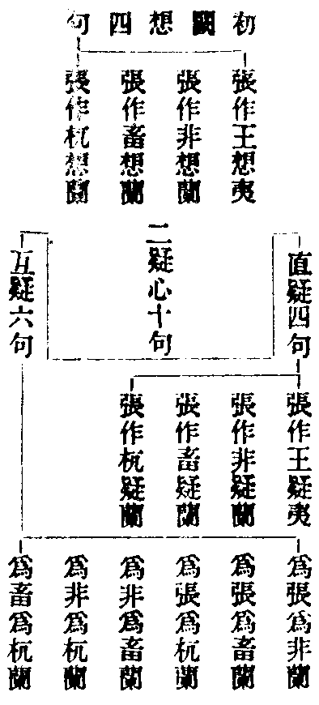



【疏】剋心双阙二缘四十句，如王境差心对有十，乃至杌木，例可解也。



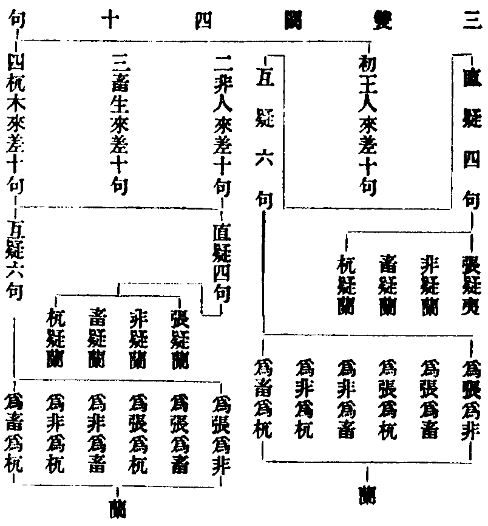



通前三心，总五十四句：三夷，五十一兰。图中可见。但知前二心差境定，后一复加境差，故号「双阙」耳。



【疏】餘大小漫，心境阙相，可以准知，事稀故不能具列。



指略中。小漫但除王人，则想有三句，疑但九句。双阙，除王境差，但存三境，亦各九句。总前三位，共有三十九句，大略同上图相。唯直疑中，各除第一句为异，又通改「张」字为「人」字读之，准前易见，不复重出。「大漫」三境通害，但有杌为异境，止有一十三句，复恐难晓，故须列示。



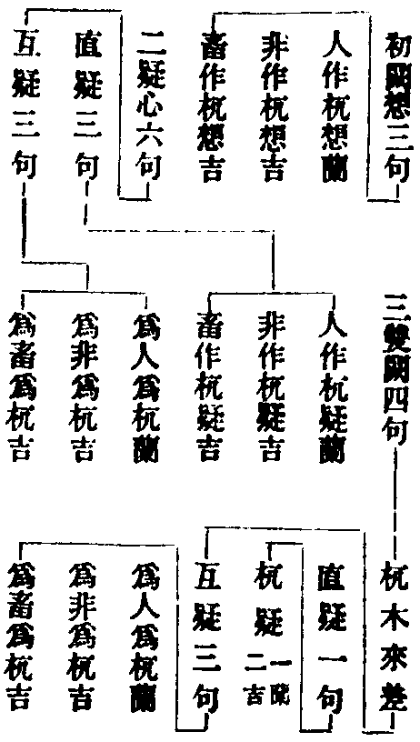



文中二意，故略：一、可准前；二、以事稀故。



【疏】三、阙杀心。或无罪，如开缘中。或得吉罗，如打下众，虽死无心。或得堕罪，如打全、破诸比丘等。或得功德，如看贫病，死而无赏。或得衣钵，如看富病，以劳赏故。或得偷兰，谓苦治人，过与病药，近死方便，但无杀心。



阙心中。六别，并以「或」字间之。初如戒本后注所列。二、三，打分大小。因打致死，故明「无心」。文言「全、破」，「全」即具戒，「破」即毁戒。四、五，「看病」分「贫、富」，此据如法看死，故非害心。六中，两相：「苦治」，即有过因罸而死；「与病药」，即不好心看，反令增病。



【疏】四、阙方便。由未起故，不制单心。或得吉罗，虽心缘杀，以未动身，寻悔故也。或得轻重二兰，如《十诵》中，病者多衣望死分得，或厌患懈怠不看致死，但结偷兰，以无方便故。



阙方便中三。初约无犯明阙。言「未起」者，未至重缘也。次约犯吉明阙。即约重缘远方便罪。三、约犯兰明阙。下引「《十诵》」以示犯相。望衣过轻，理得中兰，不看近杀，应犯上兰，故标云「轻重」也。「无方便」者，反有方便，即摄夷重。



【疏】阙第五缘。未断命，如上「七方便」，则具七兰。如《十诵》云：「杀人未死，则狂发戒舍，但结偷兰。」



阙命断中。指上七缘。下引「《十诵》」，略证初缘。



【疏】上明人趣。非人畜生，加害等同，但罪轻为别耳。



指例中。「非」、「畜」二杀，并五缘犯，具阙同之。



【疏】第二，非福田是恩养。



【疏】初、制意者。人非化生，业寄胎报，揽彼遗分，用成己身，兼复鞠育，其恩深重。理应敬养，报恩植福。今反瞋忿，乃如逆害。违背恩养，过咎极深，故制逆罪，又增夷重。餘非恩养，降阶非逆。



二非福是恩，制意中，初文。先叙合敬。若准《俱舍》，人通四生。今据多分，故云「非化」。「遗分」，谓精气也。上明二恩，一是成身，二即鞠养，备斯二种，故云「深重」。次明违反。初明加害，「违」下显过。言「背恩」者，反上二种。「又增夷」者，害人罪也。「餘」下，简异。



【疏】问：「今杀父母，为知得逆，为不知耶？」



答：「漫心无简。若对父母，心虽不知，以称本期，何无逆罪？如《善见》中，初有羺羊在於树下，后欲加害，心乃漫缘，随有父、人、鬼、畜来替羊处，以心漫故，亦结逆等。若对剋心，不知无罪。故《伽论》云『非父母想，若杀，得出家，不犯逆』。」



初问。由诸论中，所出各异，故问决之。答文。初约漫心成犯，谓不简亲疎，心通害故。「若对」下，次约剋心不犯。各引文证，二段显然。《论》明戒障，故约「出家」明之。



【疏】问：「父母出家，成罗汉道，若有杀者，为得几逆？」



次问。亦由教中，单重不定，故须详审。



【疏】答：「如《十诵》中，得一夷二逆。又《涅槃》云：『一杀父王，二杀须陀洹，罪兼二重。』以断父命，恩养福田，心怀二境，二俱损故。」



初答中。先引经律。「以」下，次显重意。《涅槃》三十三云：「罗阅耆王频婆娑罗，其王太子，名曰『善见』。业因缘故，生恶逆心，闭父城外，乃至遮断衣食汤药。过七日已，王命便终。太子生悔，大臣恶邪，谓言『无罪』。耆婆复言『大王当知，如是业者，罪兼二重』等。」频婆娑罗已证初果，故云「须陀洹」也。(若准《观经》，进成三果。此据尔前，故云初果耳。又据成逆，定约四果。经通四圣，与律不同。)



【疏】「如《俱舍论》，杀父、罗汉，得一无间，依止一故。」



次答中。《俱舍》名五逆为「无间业」，义如下释。「依止一」者，无别命故，但据杀父，止结一逆。



【疏】问：「如上《涅槃》，如何通耶？」



答：「为显无间，二因而成。命既是一，何得二罪？直以逆名，标此业重，故言『二逆』，其实无也。」



会通中，答文为二。初示《涅槃》之意。「命」下，次显无重之理。然别造多逆，则随业别受。准《俱舍》中，皆次生熟。《涅槃》中作一逆者，则便具足受一罪。若造二逆则二倍。五逆具者，罪亦五倍。



【疏】因斯明律，结罪多少，约缘业四位不同。



因明中。上明夷、逆双结，律中率多此例，故寄此以明。文约「缘」、「业」二种，俱互四句。一一句中，各有一多二位。「缘」即事缘，「业」指身、口。



【疏】初、业一缘异。结多罪，如二房、咽食等，谓妨、难、过量、不乞，残宿、恶触，总为缘也。身口二业，随作随咽，得多罪也。即结一罪者，如谤假妄，如盗掘地，无别提罪相从究竟。



初句。前明多罪，先明缘异。且举「房、食」，房具四缘，食容多犯。《钞》云：一咽七罪，非时、不受、残宿、内宿、内煑、自煑、恶触，并随有者言之。「身」下，明业一。然上房、食，并是身业，而云「二业」，意令例通，如谤清人，又欲诳僧之类。杀父罗汉，此句所收。「即」下，次明一罪。《善见》谤假妄成，无别妄罪。为盗掘地，方便兰罪。若准《五分》，掘地亦提。



【疏】二、缘一业异。结多罪者，如一人前后加打，随打随提。亦结一罪，如盗前后相假成也。



次句。初多罪中，一人是缘，随打是业。「亦」下，明一罪。前境是缘，前后盗业，是但前方便，终趣一果。



【疏】三、缘业俱异。结多罪者，如前后杀盗，人别罪异也。亦结一罪者，如尼八事，前后成重。



第三句。多罪中，人命、他物是缘，随作是业。一罪中，随对男子是缘，「八事」有别是业。



【疏】四、缘业俱一。结多罪者，如发一语，具口四过也。亦结一罪，此则竝易，不劳出也。



第四句。多罪者。即《多论》云：「传他此语向彼说，以不实，故是妄语；作分离心，故是两舌；非輭语，故是恶口。」《成论》云：「绮语一种，必不相离。」文中且举具者言之，三、二亦尔。「一罪」中，各戒各犯，故云「竝异」(或作「易」，亦通)。



【疏】餘有约缘具阙，竝可准前。



指略中。令「准前」者，亦具五缘：一、是父母；二、父母想；三、有杀心；四、兴方便；五、命断。阙缘亦同，寻上对之。



【疏】第三，杀罗汉者。末代所稀，理何须举？然经律中多有逆相，识知其事，用为后习，明觉开达，终因此缘。故略明之。



第三句中。先示须出之意：在事虽稀，於教须识。言「后习」者，由今学知，以为识种，后遇胜缘，夙智开发，故云「明觉」等。「此缘」，即今所示。



【疏】言制意者。是应供，故名福田；非怀育，故非恩养。欲明此人，断结成圣，八辈僧宝，第一福田，慈济物故，俯从供养，理须植因，用收圣果。反怀逆害，损丧圣身。自既失利，障他弘福，情过是重，故制逆罪。餘七辈僧，道非究竟，故感福微，杀同凡罪。自可圣行，约业非轻。



制意中。初示句。「欲」下，正叙。初叙境胜合敬。四果、四向为「八辈」。「俯」，犹下也。「反」下，次明损害制罪。自不加敬，是失自利；断他胜田，即失他利。「餘」下，简去餘圣。上四句正简。下二句释疑。上云「同凡」，且据制罪，凡圣位别，业必重轻。



【疏】问：「如《十轮经》，杀辟支佛，不同罗汉者？」



答：「以声闻人，因声入道，一、能说法，二、能现通，三、令他得道。益深利广，故结夷逆。辟支不尔，故杀同人。如《涅槃》云：『缘觉之人，志乐独处。若化众生，但现神通，终日默然，无所宣说，不能说法，令人得果。』以此文证，福田狭故。」



初问中。彼明「杀支佛」不障戒，今以断证是同，福田亦等，故须问决。答中。先明声闻具三能故重，下明支佛不具故轻。后引大经，证阙二能。然「支佛」有二：一者，出无佛世，则名「独觉」；二者，观十二因缘得道，则名「缘觉」。如上所释，且据大途，不妨缘觉善能化物，自有声闻不堪说法。



【疏】问：「杀下三果，何不犯逆？」



答：「惑未尽故，福田不满，故《善见》云『若杀白衣阿罗汉，不得出家；杀三果者，不障出家』。」



次问。立义引证，文甚易解。



【疏】「若尔，犯四果尼，可是障戒，下三果犯不应障？」



答：「杀望福田，故逆不逆异。犯尼，事通凡圣，坏净境故。」



转难中。污尼障戒，事实不同，欲辨杀、污两别，故立此难。但杀损福田，故不通下位；污取境净，而不局圣人。



【疏】问：「若杀辟支不入逆者，何故《涅槃》知杀有三：蚁子、畜生为下，凡夫、三果为中，罗汉、辟支、菩萨为上？」



答：「彼以约境分心，故分三位，不明逆夷轻重等相。若不尔者，即彼文云『阐提不堕三种杀』中，可无罪耶？约律中，从境，阐提人夷；约经论，阐提无性也。」



三难中。即据《涅槃》，转难初答。《经》明佛及菩萨，皆了知杀法，故云「知杀」。「罗汉」上，准《经》有「父母」二字，今此正问辟支，故略之耳。《经》文既以三乘同为上品，则知缘觉罪无差降。答中。初出《经》意。《经》分心业，不拣夷逆。准此，若杀辟支，虽非逆重，由境尊胜，业异常流。「若不」下，就经反质。初引示《经》文。梵云「一阐提」，此云「信不具」。「不堕三杀」者，由杀无罪，不入三品，故《经》云「譬如刈草、掘地等，无有罪报」。「约」下，比对律制。言「无性」者，准《经》，前明阐提无佛性。据后决前，此名「随他语」。一切有性，名「随自语」。



【疏】问：「若杀罗汉，为知得逆，为不知耶？」



答：「《俱舍》云：『若於非圣，而行杀害。后临杀时，成罗汉者，无无间业。以於罗汉，不起杀故。』若起漫心，具缘诸相，竝如前说。」



四问，可解。答中，先引论明剋心不成。「若」下，次约义立漫心成犯。大同父母，故并指前。



【疏】第四，恶心出佛身血者。



【疏】垂降生善，为世福田；慈济含识，亦是恩养。佛为法王，四弘开化，惠益群品，其恩无外，宜应敬养，植福清心。反加瞋忿，兴於逆害，命不可断，但出身血。损法身器，其过尤深！故制方便，业当逆罪。



第四句，制意中。初科为二。初示句。「佛」下，正叙。初明恩深合敬。「四弘」，即上「四等」，「弘」即训大，亦由普徧，故得名耳。「恩无外」者，所被无遗故。「反」下，次显过明制。「损法身器」者，《多论》云「色身是法身所依」。「故制方便」者，即偷兰也。佛不可杀，义无究竟，制轻业重，相别可知。



【疏】然出身血，其相是一，心怀善恶，同一业报。耆域出血，善心治病，一劫色有而受乐报。调达反此，故入地狱。恐滥善者，故标恶心。



次科。初明相滥。「同业报」者，此约时论，并一劫故。「耆」下，次引缘释。「耆域」，亦云耆婆，善医，世尊足疾，因针出血。「色有」，即梵天，此明善心也。调达以推山压佛，碎石伤佛指足，生陷阿鼻，此明恶心也。「恐」下，后示简意。



【疏】问：「不知是佛不得逆者，若供不知，不应得福？」



答：「供本漫心，生福皆敬。虽对佛身作树神想，以心通故，佛边得福。若本剋心，对佛神想，则无福也。」



问中。准前，合须先问约知不知。或可承前罗汉，义势是同，故直发此问。答中，亦约剋漫二心分之。



【疏】餘具缘等，同前准说。



指具缘中。亦同上五，故不繁文。



【疏】就阙缘中，有同有异。阙初境缘，四句俱同，皆异境来替佛本故。双阙亦尔。若阙想、疑，二句不同。以佛正命，必不断故，既明出血，本结偷兰，境虽极尊，约从人制，境强方便故也。



阙缘中。初总标。「阙」下，别释。初明同，有二。一、境差同：一、人作佛想，二、非人佛想，三、畜，四、杌。四句并兰。二、示双阙同。「若」下，次辨异。阙想四句、疑心十句，此二，初句前并犯夷，今同兰罪。「以」下，出异所以。



【疏】因即料简五逆之义，四门分之。初、列数显相，释名轻重；二、定体状，初二，忏不；三、约三业；四、明通塞。



【疏】初、列数者。父、母、罗汉、出血、坏僧，为五也。



明五逆中，初文可解。



【疏】显相者。要约亲生膝下，故恩养极也。如世律中，恶逆过者，通祖父母、世叔等亲，何况假父后母。姑姨之属，则并非逆。所以经律，据二惟亲。



二、显相中，又二。初简定。且约二逆，餘同前叙，或可餘三无滥，不须辨相。「膝下」者，语出《孝经》，谓孩幼之时也。「如」下，引俗示滥。「祖父母」即父之父母。世叔及伯，即诸父也。「假父后母」，皆本非亲，同名为「逆」。望上「祖」等，此二又亲，故云「何况」。「姑姨」非逆，族姓异故。「所」下，结前简意。



【疏】言释名者。何故名「逆」？以违恩养福田极故，亦违佛、世两王化故，名之为「逆」。如《论》所出，云「五无间」，谓常续有，无间隔故。



释名中，初科。逆有二义。初「违恩福」，父母违恩，罗汉、破僧违福，出血兼二。次「违王化」，「佛」是法王，「世」即人王，二教齐禁，犯则俱违。华梵虽殊，法律无异。然於五中，唯杀父母，道俗同重，餘三则别。



【疏】如《成实》云：「一、趣果无间，舍身生报故；二、受苦无间，中无乐故；三、时无间，定一劫故；四、命无间，中不绝故；五、形无间，如阿鼻相，纵广八万由旬，一人多人皆徧满故，不相障碍，业不可思。」



次科。「论」即《俱舍》，释义犹通。「《成论》」五义，示相甚显。三意束之：第一即间隔也，二及三四谓间绝也，第五即间缺也。然「形无间」，一多不碍，凡情难信，故云「业不可思」。



【疏】问：「三宝皆福田，损佛破僧得论逆者，何故不言破法逆耶？」



初问。三宝福田是同，成逆则异，故问释之。



【疏】答：「谤法重故，不入逆中。如今五逆，不入四重。广如《智论》及《法华》中。」



答中。初约业重释。「如」下，举例，「广」下，指证。《智论》云：「声闻道作五逆，受地狱一劫；菩萨道破佛法，此间劫尽，复至他泥犁中，受无量罪，如是乃至徧於十方地狱等。」《法华．譬喻品》后，广明谤经获罪之相，乃至云「其人命终，入阿鼻狱，具足一劫，劫尽更生。如是展转，至无数劫，从地狱出，当堕畜生」等。



【疏】有人言：「谤法重者，谓大乘也。对田论逆，即坏法轮，破法逆也。」



次他解中，初科，又二。初点前义；「对」下，示正解。就小论逆，指归破僧，则通三宝。



【疏】问：「若如此者，何故毁呰修多罗但吉？」



答：「前言『逆』者，谓破灭故；今言『犯吉』，但毁呰耳。」



次难中。「毁毗尼戒」，毁餘二藏皆同吉罗，上云「成逆」，义则相违。答释，可解。



【疏】若但破僧，不名为逆，如破羯磨，以损轻故。若杀罗汉，是损真僧，以违福极，故得逆也。



三中。初约破僧反显。若单破僧既不成逆，则显逆业，全由破法。「若」下，次引杀圣比例。由杀罗汉，亦望损彼真福田僧，故成逆罪。则知破僧一逆，法在其中，故不别标也。



【疏】次明重轻。如前列者，初轻后重。故《成论》云：「破僧最大恶，别离三宝故，离僧、坏佛、毁法宝故。又於佛所，起嫉妬心，违转正法，复恼大众，乃至三十界内禅诵不行故。」



轻重中。指前所列，且据麤分。细而明之，中间三逆，望前为「重」，望后名「轻」。所以害母重於父者，以佛教中，怀育恩多，偏尊母故；罗汉超凡，必重父母；出血极尊，义过小圣。下引《成论》，独证破僧，文有二义：初约坏灭损境明重，「又」下，次约起心违恼明重。「禅诵」，即诸观法。一化境中，道行退失，或复不进，故云「不行」。上约业理，不论制教。



【疏】二、定体状，初二，及忏相。



定体中，标列三科。次云「初二」，即明逆罪最初、第二。



【疏】言体状者。如五逆名，非佛所制，违恩福故，业理自重。有夷兰者，是佛制也。但约人相犯夷，不论恩福不具。得兰，从杀方便。若论破僧，应制极重，以事不独建，通摄三人故也。



初科。以业制相滥，故须拣定。初示业体。五逆之罪，但违业道，古法常有，故「非佛制」。「有」下，次定罪体，即约制教。初通示。「夷兰」二聚，统收五罪，三夷二兰。「但」下，别释，又二。初释三夷。「得」下，释二兰。「破僧摄三人」者，旧引《义钞》云：「破僧有三：一、王破；二、伴破；三、助破。」



【疏】言无初者。以逆犯相，无略可违。以外道杀父，佛言「灭摈」，可是违教？餘如后说。



次科。初约义以定，「以」下，举事释成。文出《受戒法》中。以凡开最初，必违略教，俗非禀略，亦令摈之，故知约行偏重，随作即成极业。「如后」，即「破僧戒」。



【疏】言可悔不者。如大乘中，开悔五逆。



「若尔，何故《经》中，令王重罪微薄耶？」



答：「罪无定也。即如彼经『有愧非有，无惭非无』。或可本定，故转轻耳。餘之三夷两兰，皆可灭除，学悔说故。《十诵》『九清净人』、『破僧偷兰罪从僧忏』，文自验矣。」



三中。初示忏业，上二句判定可忏。「大乘」即《佛名》、《方等》，通忏三世十恶五逆。又鸯掘摩罗作五逆，因值佛得灭等。「若」下，引难。「经」即《涅槃》。上据大乘立义，故还引大乘为难。阇王杀父，阿鼻一劫，佛令忏已，於黑绳地狱，七日受尽。既但转重令微，则显逆非可忏。答中二意。初引彼经。有无不定，约心明业，虽悔复受，理无所疑。「或」下，示次意。既转令轻，明开成悔。「餘」下，次明忏制。初判定，「学悔」下，引证。初证忏夷，《律》令「学悔」，开忏不疑。「《十》」下，次证悔兰。邪正各五，方成破僧，真佛位别，不入僧数，故云「九人」。邪徒破僧，皆犯兰罪，今既邪正通名「清净」，故知开悔。「从僧忏」者，上品罪故。



【疏】三、明业相者。



【疏】破僧是口业，餘四是身业。若互作者，有语助成。若论破僧，身现不得，必须言说，用化前人。能破是口不善业，所破是不和合性。



业相中，初科，又二。初明各造。《俱舍颂》云：「此五无间中，四身一语业；三杀一诳语，一杀生加行(加行即方便)。」「若」下，次明互造。上明口兼身四，「若论」下，次明身不兼口。文中「能」、「所」对明。「所」无别体，即是事、理二种不和，故指为「性」。「性」，即体也。



【疏】破僧瞋嫉心起，餘四分通三性。



二中。初明破僧。调达见佛人天奉敬，频婆国王日给千车，遂起嫉心。结连阇王，以谋害佛。又於佛所，乞请摄众，为佛所呵，即怀瞋恨。此明破僧，局不善性。「餘」下，示餘四。杀通三性，四逆同之。然本是不善性，旁兼善无记，故示「分通」也。



【疏】破僧虽口说，言了未结罪，要待前人忍，方成其破轮也。



三中。以餘口业，吐词即结，破僧特异，故别显之。出血不至果，餘三同杀，命断成犯，故不须论。



【疏】四、明通塞者。时、处、人分别。



通塞中，三科料简，有则名「通」，无者号「塞」。



【疏】佛在具五，灭后惟三，无法轮主故。



初中。佛在俱通，灭后三通二塞。法轮虽在，无主竞化，故二俱阙。



【疏】二、言处者。南洲具五，东西俱三，出血、破僧须佛身故。北洲俱无，《杂心》云「以命定，无相杀」故。



次科。若论有无，则三洲有，北洲无；若约具阙，则南洲具，东西阙。下引《心论》，引证北洲。言「命定」者，《长含》中：「修十善行，生郁单越，寿命千岁，不坏不灭，是故彼人寿命常定。」



【疏】三、言人者。俗人及四众，唯四逆，除破僧故。比丘具五可知。《俱舍》云：「北洲及餘道，皆无无间业，何况於餘界？解云：『人道男女，能作此业。黄门等不许，彼无戒因。父母於其恩少，由不具身分为增长故，爱念少故。又其於父母，不起重惭羞故。畜生、鬼神道，不许有无间业故。若智明了，如聪慧马，有五无间也。』」



三中，初正明。「俗人」无滥，下众未具，无破僧理，故但有四。亦通伴助，如后所明。「俱」下，引《论》。初引《论》偈。「餘界」，即色、无色天。次引《论》解，前简人道，别除黄门，文列三义。初「无戒因」者，以具戒者，方能具造，「黄门」当体，即戒障故。次「父母」下，明上恩疎。「增上」，谓身不具，形报非胜故。「又」下，显下敬薄。故有杀者，不成逆业，然文中但明父母二逆，餘不能作，於义可知。「畜」下，简餘趣。文约愚智，以明有无。据《论》「有」者，可对三逆。岂有非、畜而能破僧、出血耶？《论》无「五」字，必是传讹。



【注】佛在毗舍离，为诸比丘说不净观。



【疏】就戒缘中。说不净观，行不得方。



戒缘中，初标缘。「方」，即法也。



【疏】言「不净观」者，如来立药，对治心病。多贪不净，瞋以慈心，痴不觉了，阴、界分别。初对贪者，故云「不净」。



次科，总明中。初通示三种药病。「阴」即五阴，「界」即十八界，文略「十二入」，配对三迷，如前已示。若对五停，前二同此。三、愚痴多，观十二因缘；四、我慢多，观十八界(此二可对第三)；五、乱想多，数出入息(即当后观)。「初」下，别指今文。



【疏】如《智论》说，具有五种。



【疏】一、种子不净，揽父母形以为己有。故偈云：「是身种不净，非餘妙宝物，不由白净生，但从秽道出。」



引示中，初「不净」中。《论》云：「父母以妄想邪忆念风，婬欲火故，血髓膏流，热变成精。宿行因缘，识种子在赤白精中住，是名身种。」偈中，初句标示，下三句释成。上句明当体不净，下二句生出不净。「秽道」，即父母便利处也。



【疏】二、依处不净，谓在生熟两藏中间。故偈云：「是身为臭秽。不从华间生，亦不从薝卜，又不出宝山。」



第二。「依处」，亦名生处。人有生熟二藏，食在生藏，犹未变动，流入熟藏，即成粪秽，胎处于中，故云「不净」。偈中，初句标，下三句简非净处，以显不净。「薝卜」，亦花，而别举者，以花极好，彼国所贵，经论多引，盖此意也。此翻「黄花」。



【疏】三、当体不净，谓三十六物，成身十二，内外两相，各十二也。故偈云：「地水火风质，能变餘不净，倾海洗此身，不能令香洁！」



三。「当体」者，亦云自性。「三十六物」，《论》中备列，总判为三，而少不次。今以义分：发、毛、爪、齿、薄皮、厚皮、筋、肉、骨、髓、血、心(此名「成身十二」，如《论》云：「中有十二，通於内外」)；脾、肾、胆、肝、肺、小膓、大肠、胃、胞(匹交切，合作脬，水府也)、肪(音方，膓脂也)、𦚻(音珊，胃脂也)、脑膜(此内十二，《论》云：内有十二，名性不净)；屎、尿、垢、污、泪、涕、涎、唾、脓、黄、白痰、癊(此外十二，《论》云：外有十二，名相不净)。偈中上句示体，次句明流变，餘不净者总上诸物。下二句显示不净。



【疏】四、外相不净者，九孔常流，俱不可用。故偈言：「种种不净物，充满於身中；常流溢不止，如漏囊盛物。」



四中。「九孔」，眼、耳、鼻、口，及大、小道。偈中，上二句明内秽，下二句示外相。



【疏】五、究竟不净，终归死膖，不可忍见。故偈言：「审谛观此身，终归必死处。难御无反覆，背恩如小儿。」



第五。《论》云：「身若投火则为灰，若虫食则为屎，在地则腐烂，在水则膖胀。」偈中，上半标示，下半释成。时至莫留，故云「难御」。奄然长往，故「无反覆」。生存资养，一旦舍弃，故云「背恩」。「小儿」，相似法故。



【注】彼习定已，厌患身命，叹死，劝死。



【疏】注云「彼习定已，厌患身故，叹死，劝死」者，以修乖方，少於遣滞，故习此观，封著不舍，便灭其身，此非有智。



三中，初科。智能遣滞，有修无智，即是「乖方」。



【疏】《善见》云：「『佛是一切智人，何因说观乃令其死？』答：『深见往机曾作猎师，多杀群鹿，已堕地狱，餘报出家。若不说观，人杀生恼，恶心无已；由作此观，人杀生喜，得生天上，故无咎也。乃至说已，入静室中，五百人死，同世不知，知必制戒，息世机故。』」



引示中。如来大智，鉴机授法，药病不差，今此杀缘，全乖上义。《论》申佛意，以决群疑，相似差机，实唯应病。答中，初叙知机获益，「乃」下，明示现不知。佛自明鉴，示同凡人，故云「同世」。若不如此，必生外谤，故云「息讥」。



【注】难提比丘受雇杀人，居士警怖。



【疏】言「难提受雇」者，《善见》云：「是外道沙门也，头留少发，依比丘住，拾残食活。」



雇杀中。注称「比丘」，《疏》号「沙门」，由此二名，通邪正故。「留少发」者，表异内众，亦著坏色衣，一以覆身，一置肩上。



问：「此戒犯缘，为是何人？」



答：「据下呵责，乃斥相叹内众比丘。外道受雇，非缘起也。」



【注】佛知此事，便说禅法。



【疏】言「佛知此事，便说禅法」者，数息观也。



释改观中，初科。「禅法」亦即观门，故以「观」释。但止心名禅，照境为观，不净、数息，并具二门。而注文前后异者，以不净正取照境，数息偏在止心故也。



【疏】所以改观者。前对多贪，故说不净，思觉之人，本非彼治，故说数息。或前观色是麤，今观心是细也。



显意中，有二。初约机宜对病加药，「或」下，次就所观以分麤细。了色求心，先麤后细，自浅至深，故宜改也。



【疏】就明数息，如《论》广之，一数、二随、三止、四观、五还、六净。并息乱法，以渐调心。



示法中。大小乘论，并有观法，故今通指，但云「如论」。今依《成论》释，云「数」者，名出、入息，从一至十。数有三种：若等(十数为十)，若过若减(并乖数法)。「随」者，心随息出入。「止」，谓令心止住出入息也。「观」，谓见息系身，如珠中缕。「还」，亦云转，谓转身缘心，令心现前。「净」，谓离一切烦恼诸难，心得清净。「并」下，总结观意。



【注】比丘修习，并证上果。因诃上过，而制此戒。



【疏】言「修获上果」者，即圣无漏，在凡之上也。



获果中。「圣无漏」者，言通四圣。



【疏】问：「如来说法，比丘依行，深见不净，正是如说。有何等过，复见诃责？」



答：「佛说不净，令厌苦本，若欲修断，必识身因。如何未断集因，即除苦本？非唯果不可尽，乃使迷因转深。故使修行非道，大可诃也。如经说身有苦，不说厌离於身，斯良证矣。」



呵责中。问中，随顺无违，反遭呵责，义似非当，故问决之。答中，为四。初明教旨，「如何」下，显过。今亦有僧，不知所以，自投焚溺，欲冀超升。苦因未除，宁亡三有之报？死而无悔，实唯一勇之夫。将谓永灭不生，焉知此没彼出？固当勤修三学，广运四弘，诵持方等大乘，系念诸佛嘉号。冀龙花而得度，指安养为所归。深厌死生，善识因果，欲「除苦本」，其要在兹。「故使」下，明合呵。「如经」下，引证。通标「经」者，大小皆明，不可别指。《遗教》云「此是应舍罪恶之物」，乃至云「唯有智者得除灭」等。



问：「五百已死，谁当呵者？」



答：「受行观法，赞劝必多。《论》明五百，且据已死。为彼改观，即所呵者。」



【疏】二、就戒本中，文有六句：初句能犯过人；二、「故自手」者，明是自业；三、「人命」，所杀境界；四、「持刀」下，明教他业；「是比丘」下，将人附罪，入治摈相。



【律】若比丘，故自手断。



【疏】初句可解。



【疏】二、自杀中，而言「故」者，除有悮者，非犯法也。



次释戒本第二句。



【注】所谓行杀也。若自杀，若教杀，若遣使杀，若往来使杀，若重使杀，若展转便杀，若求男子杀，若教人求男子杀，若求持刀人杀，若教人求持刀人杀，若身现相，若口说，若身、口现相，若教使叹，若遣书，若教遣书，若坑陷，若倚拨，若与药，若安杀具，及餘方便杀者是也。



【疏】注中，广列所行杀相，相分为二。初、自杀有八：一、自杀；二、身相；三、口说；四、身口俱；五、坑陷；六、倚拨；七、与药；八、安杀具。就教他中有十一：初、遣使；二、往来使；三、重使；四、展转使；五、求人；六、教求人；七、求持刀；八、教求持刀；九、遣书；十、教遣书；十一、遣使叹也。



释注，总分中，不依文次，以类括之。



【疏】言「自杀」者，谓自行杀。若身，若杖，随死皆是。



自杀，可解。



【疏】言「教杀」者，或教人杀，或但教人死之方便。言「遣使杀」者，指示所杀在其方所，而往害也。言「往来使」者，受语往害，至彼还来，重复往者是也。言「重」者，随续使人，乃至百千，害一人者。言「展转使」者，初使往害，彼使不去更使人往，如是展转，乃至百千，最后一人断彼命者，随前而使，皆同一重。乃至上列往来重使，皆例同犯。餘有契要不同，心不如意，竝如前竖义中说。下有四求，皆教人相。



教人八种。据文似九，前总分中，不列教杀。则知注中，此句通标，下列别相耳。「展转」中，「乃至」下，决通前二，「例皆同犯」，遣使可知，故不点之。「餘」下，指餘不同。「如前」者，即「自作教人」门中，「或能教者剋，所使意异，或时节早晚、坐立乖契、颠狂舍戒等，教者不犯；漫心无寄，随作皆犯」。「下」下，略示「四求」。「求男子」者，谓欲得勇士，往害於他；「持刀人」者，即旃陀罗辈。两是自求，两令人求，并非自杀，故云「皆教人者」。



【疏】言「身现相」者，或令怖畏，坠堕沟壑，或示死相等。言「口」现相者，或以言说，叹劝其死，或以大声恐喝，令他死者。即如世中有厌身者，或投火坠岩，或刀解绳缢。不知教者，合掌唱善，或扶接登山，或为办绳具。斯即教、叹，正符犯法，「身口俱现」，即此之流。



现相中，身现二义。初示可畏之容，二作取死之状。口现亦二，如文自分。「即」下，后释俱现。初举现事决犯。「缢」，於计反。「扶接登山」者，助彼投岩也。「斯」下，结合文相。「教」，即「扶接办具」，对下「身现」；「叹」即「合掌唱善」，对下「口现」。



【疏】言「教使叹」者，遣人语彼人，令彼语所杀者「生多众罪，不如早死」之词。



教叹中。初示教相，「生」下，出其叹词。即《戒本》中「恶活」「宁死」二句耳。



【疏】言「遣书」者，身现其相，表於纸墨，令用死者。如《多论》中：「若优婆塞，及以比丘，知吉凶相，令破异国，随得财命，皆同杀盗重罪。」若作死书，教使送彼，使向亲说，使自得重，遣者犯轻；使自依死，犯轻亦尔。若作死经，有人偷读、遗失拾得，依经取死，造者犯重。言「教遣书」者，自不亲对，遣人作书，令彼受死，无问自他，若死俱重。《五分》：「作书时，字字兰。」



遣书中，前明死书。初示相。言「身现」者，谓书中所述也。「如」下，次引明。若据《论》中，未定「遣书」，然吉凶之相，容可书报，故引释之。「若」下，辨犯。「使向亲说」，不以书示也，及「使自害」，并由能教心克，乖本所期，但得兰罪，故云「犯轻」。「若作」下，次明死经。「偷读、拾得」，「死皆重」者，由本造时，漫心无简故。教遣书中。初明犯相。「《五分》」下，引示方便。彼立进趣，故约「字」论。



【疏】言「坑陷」者，知人游行必从此道，故设坑穽，令堕死也。《十诵》云：「为人作坑，人从死重，非留死兰。为畜造坑，畜死提，人死吉。若不定者，随人畜死，重轻如律。」言「倚拨」者，审知彼人倚拨其处，便施刀杖，彼依而死者。言「与药」者，文事可解。言「安杀具」者，即如世中行刑之所，比丘往看，施其绳索，令彼死者，同重。《多》云：「若为杀故，造刀杖者，吉罗；往趣彼人，步步轻兰；或著彼身，命未断，重兰。」



杀具中。坑陷又二。初示相。「穽」音静，亦坑也。「《十诵》」下，引释。初约三趣，互论轻重，即是小漫。合有为非人作坑，人畜死吉，稀故不明。下云「不定」，乃约大漫，随犯可会。「倚拨」者，谓潜安杀具，令彼触动也。「安杀具」者，置办器杖，令彼自用。「即」下，决其世事。「《多论》」下，示其方便。



【疏】文言「及餘方便」者，非谓如上所列而言相尽，更餘方便，律虽不载，但依而死，皆是重摄。



显略中，初文。「律不载」者，谓不尽也。



【疏】又欲遮恶比丘，避於佛制，如上网目所不摄者，欲加杀害。故又张网，总而收之，欲获罪人，实唯一目。故俗云「天网恢恢，疎而不漏」是也。



次科。「又张网」者，谓此一句，统收多相，犹如张网。后必有犯，止在一事，犹如得鱼，故云「一目」。下引俗证，出老子《道德经》。「恢」，大也。谓天道虽大，不容於恶，如网虽疎，不漏於物。



【疏】问：「如汝所释，浪作分疎，至如佛意，何必如此？」



答：「凡心度佛，诚非拟议。然佛立教，自有比量，如经比智，用拟上位。何以知然？如《律》文中，佛制比丘不得服用俗人外道衣服，遂即方便更作餘相，佛即诃言：『汝等痴人！避我所制，更作餘事。自今已后，一切俗人外道衣服竝不得著，著者如法治。』据此明证，岂非通约也？」



问中。欲引后量，假设来难。答中，初二句承意，「然」下，正答。西土论议，其量有三：一、现量(理义显然)；二、比量(举事相并，如今引例)；三、正教量(三藏明文)。《因明论》云：「藉众相而观於义，於所比义有正智生，故名『比量』。」言「比智」者，《成论》云：「知餘残法，思量比知，名为『比智』。」又云：「未得真智，以相比智。」经论皆说，故通指「如经」。「何」下，引量，即《衣犍度》文。「一切」之意，正符前释。



【律】人命。



【疏】言「人命」者，谓杀境也。



【疏】所言「人」者，仁也；仁者，忍也。俗中《释名》，大有意致，亦可寻也。谓人立志，存育为先，故云人「仁」也。若但言「人」，而人有无命者，害非重罪，故又重列言其「人命」也。



第三句释人中。初训字。「俗」下，示所出。《释名》，即刘熙撰，彼云「仁，忍也，好生恶杀，善恶含忍也」。「谓」下，释义。天阳之气，资始万物，人有推爱及物，博施济众，合天之道，得人之正，故云「存育」等。「若」下，明「重言」之意。



【疏】所言「命」者，谓此身报，假之维持，终於一形，寿所因本，故谓命根，以命持识，令依住故。如《杂心》中：「命根体者，非色非心。」良由众生往业所剋，期在此形，连持不绝。故今死者，气虽断绝，随有暖处，识在其中，即识住处，为命根摄。



释命中，初科为三。初释名。寿无别体，即命短长，以为人寿，故云「因本」。能持於识，为寿之本，故得名「根」。「如」下，示体。以无形段，复与识异，故二「非」摄。「良」下，显相，先叙业感，「故」下，正示命相。由煖、识、息三种相依，故有煖处，息识未舍，生分未绝，即为命矣。



【疏】然今杀者，命根非色，何由可杀？识本无形，杀亦不得。故随相说，断其依处，命根不续，识无所依，故云「杀」也。



次科。云「依处」者，即色生也。



【疏】《律经》约相，但言识者？以命根相，不可见闻，依圣言说，信而为有。若论识者，愚智齐知，但杀前生，无识能学，即为死人也。麤相易晓，持犯不难，随机之义，复现兹矣。



三中。初牒问。「《律经》」，即《律戒本》，如注所引。「以」下，释通。初明不约命根。「若」下，次明但言二识。「麤相」等者，正出《戒经》之意。去难取要，令物易解，故云「随机」。



【注】从初识至后识而断其命。



【疏】言「初识」者，谓初托阴，止是凝滑不净，故《经》中说为「迦罗之时」也。如《五分》云：「入胎四十九日，名日『似人』；过是以往，乃名是『人』。」即《五王经》云：「受胎一七日，如薄酪；二七日，如稠酪；三七日，如凝苏；四七日，如肉团；五七日，五胞成就；六七日已后，六情开张。」



初识中。「经」即《涅槃》，彼云「肉身处胎，歌罗逻时」，亦云「迦罗」，此云「薄酪」，《智论》云「受胎七日，赤、白精和合时也」。次引「《五分》」，「似」、「是」两分。续引「《五王》」，释上似相。「五胞」，头及手足也。不云「七七」者，即同上引，名「似人」故。



【疏】言「后识」者，即最终时，在后一念为后也。



后识中。云「一念」者，即前所谓「有煖处」也。



【疏】所以言此二识者，亦为遮恶比丘念也：「若杀人者，可得重罪，如胎分中迦罗逻者，即既非人，故不名犯。」所以张网，通收初后。若有胎人，识所依止，随有损害，无非极刑。即如《五分》，若人、似人，意亦可见。《四分》下文堕胎等相。



出所以中，先徵，次释。初略示。前用此义，释餘方便，故云「亦」也。「若」下，委释。初叙彼避制，「所」下，结显教意。《五分》两相皆重，正为通收，故云「可见」。「《四分》下文」，即《调部》云：「妇人他边得身，语大德言：『与我药堕之。』比丘即呪药与，令其胎堕。佛言：『波罗夷。』」及按腹堕胎亦夷，故云「等」也。



【律】持刀与人，叹举死，快劝死：「咄，男子！用此恶活为？宁死不生！」作如是心思惟，种种方便，叹誉死，快劝死。



【疏】言「持刀」下，此教杀相，就分为二：初、「持刀」者，教杀；「叹誉死」者，口业也。



第四句，初科。但分身口。《戒本》难晓，略为释之。文叙「杀相」，先持刀与，次乃口劝。「咄」下，出其劝词。欲警令悟，故先「咄」之。「恶活」者，或现不净，或能造恶也。「作如是」者，指上叹相也。「种种方便」者，总收餘叹也。



【疏】问：「身口杀相，《律》文非一，以何义故，独举口叹以入《戒本》？」



答：「据论《戒本》，不劳繁文，但云『杀人得重』，自应通摄。然毗尼者，以因缘求。此杀戒缘，由相叹故，即以此缘，入於《戒本》。前后诸戒，繁相并同。」



问中。蹑前十九杀相，以徵文局，故云「非一」。答中，初正通来难，「前」下，决通餘戒。



【律】是比丘波罗夷。



【疏】「是比丘」下，收入罪摈。



五六中。「罪摈」二字，别配二句。



【注】若作如上杀人方便，不死，偷兰。若杀非人，若畜生有智、解於人语，若能变形，方便杀者，并偷兰；不死者，突吉罗。畜生不能变形，若杀，波逸提。实人，人想，波罗夷；非人想、疑，偷兰。四众犯相如上。不犯者：掷刀杖、瓦石，误著而死；若营事作房，误堕木石而死；若扶将病人，入房往反，一切无害心而死者是。



【疏】就注解中，初、当趣明轻相；二、「非人」下，分异趣相。



释注，分文中。准前，亦应细分。初，犯、不犯为二。犯中又二，比丘餘众。比丘中复二，犯相及境想。前又约趣，如《疏》分之。凡至辨相，例须科约，「婬」中委示，餘使自求。但举一隅，三隅须反。



【疏】就畜分二。智变有胜，加害犯偷兰者，以相同人，心非重者何能害也？如世鹦鹉、鸜鹆，人有教其语者，杀未犯兰。此但为人所教，未教本非其智，故非重也。又如狐狸、虎、豹诸兽，《旌异》、《志怪》诸传记中，变为人相，往往非一。《律》中举龙为首，不言餘者，若知而害，义依法科，不知而害，亦从律结。竝如上解，具缘所列。



释畜中。初句分经，智愚两判。「智」下，别释「智变」。分四。初明犯意，「如」下，简滥，「又」下，示相。《旌异记》、《志怪录》，并俗中纪述怪事之书。《律》中以龙多能变化，故偏举之，虽略餘者，义可类同。「若」下，断犯，还约知论。「依法科」者，即结兰罪。「不知从律」，如常犯提。下文指略，即前义中三趣门已说，故云「如上」。又「阙缘」后，指非、畜缘同，罪轻重别，故云「具缘列」也。



【疏】就不犯中，文相极显。所以不犯者，如文云「一切无害」也。



释不犯文，略示大意。就注分二：初、「掷物营事」，并是误触，然此误者，由於他事，全无害心，不同前明错误之误，学者知之；二、「扶往返」，即是无心。



【律】不共住。



【律】四、大妄语戒。



【疏】第四，大妄语戒。



【疏】次明口业所犯法行。



大妄语戒，初标简中。前三身业，身为业本，并列於前。口业依身，故次于后。两业既异，故先点之。



【疏】古来翻经，约业显相，多云「身口」。今时正译，审定名体，不滥境心。故以声所从者，并为语业。故经云「正语」是也。所以然者？人之面门名之为「口」，口是顽色，但知吐纳，至於所损，约从身摄。论妄语四，出虽在口，必以声相用分业道。然其声发岂止於口，七处无壅，方成语言。餘且略之。



翻名中。初示古翻。汉、魏、秦、晋已来，所译皆尔。「今」下，次明唐翻，故云「今时」。文有二段。初显今两得。「语」即业体，则名体相符；「语」对耳根，故境心不滥。下引经证。古明三业，并标为「口」，及列八正，乃云「正语」，故还引八正，证今得实。「所」下，次叙古两失。先明口所属，「论」下，正陈失相。语既从声，为耳所得，口属身色，自为眼见，则心境滥矣。又依声发语，遂成业行，口是顽色，本非善恶，则名体乖矣。「然」下，潜通外难。恐谓声出於口，从具彰名，义有何失，而见指斥。故此防之，明非通摄。「七处」者，《智论》云：「如人欲语，口中风入至脐，触脐响出，响出之时，触七处退，是名『语言』。偈云：『风名忧陀那，触脐而上去，是风七处触，项及龂齿肩，舌咽及以𮌎，是中语言生。』」於此应辨语业体相。音曲名句，依止於声，即声为体。方彰古译，名义全乖。此不委明，故云「且略」。



【疏】所以语业具列有四，妄语居首者？由过数起，顺本惑业。无始无明，无非诳妄，非有谓有，诸例非一。今既出家，宜须体妄，澄汱成净，反本即真。如何不思，重增欺负，深可责也！故在重初，自餘骂赞，轻故后列。



前后中。初徵起，「由」下，释通，分二。初叙妄重。虗妄成「惑」，依惑起「业」，转更不实，故此妄语，与二相顺。「无明」即惑，「诳妄」即业。「非有」等者，示妄语相。如后列相，所称多种，故云「非一」。「今」下，彰过，上明所应作不作。「汱」名作「汰」，音太，淘洗也。「如」下，明不应作而作。「故」下，结合。初句明妄重，下显餘轻。「重」谓四夷之末，「初」即四业之首。或可「重」是大妄，「初」即小妄，由上文中大小通叙故也。「赞」，即两舌。绮语不相离，故不别指。



【疏】然斯妄相，人多弊之；吐言一返，追不可得。故以义张，识其非相，四门敝之：一、能妄在凡非圣意；二、明凡妄语五种别；三、立妄为言两分相；四、本诳令知不待信。



妄相，标中。「一反」，谓忽相违也。「追不得」者，言其疾也，即《论语》云「驷不及舌」。列示四门：初、简圣凡，二、简轻重，三、简虗实，四、简知信。



【疏】初门中，明能妄人在凡不在圣者。



【疏】由彼圣人，有二种实语：一者身证；二者想心。



【疏】言「身证」者，修道德满，证真斯极，除断虗伪，妄则斯尽。出观陈说，言必称实，义无欺负，起诳妄过。此身证也。



初门，身证实中。初叙身证。「修」等四句，即是四谛。「出观」下，明实语。据是心证，然兹圣道，非身不剋，心道幽隐，从相显彰。即「律序」云「餘身证者」，经律皆言「最后身得」是也。



问：「『出观陈说』，即实得道，将无犯邪？」



答：「戒制未具，不遮同意。」



【疏】然彼圣人，定前方便，理观事察，自然闻彼异域奇相。及出观后，如心陈告，我入空慧定中见也。餘人不解，便生疑怪，何有空慧得见奇相？此则目连虗称上法。如《僧祗》、《律本》，皆有是事。佛言：「实尔。定不清净，是前方便，谓言定体。」如斯事相，想心实语。



想心实中。且据《四分．调部》「目连入四空定」，以明其相。分文为四。初示想心。将欲入定，摄心正想，忽见异事，而非正定，故云「方便」。「理观」即空慧，「事察」即方便。「及」下，次引目连自述。《律》云：「目连告诸比丘：『我入空慧定，闻伊罗婆尼象，入难陀池水声。』」(《律》文广列多种，须者寻之。)「餘」下，三、引比丘疑怪。既见是相，则非空慧。《僧祇》同此，故下指之，《十诵》亦然。「佛」下，四、引佛决疑(识慧处，无所有慧处，非非想慧处，亦如是)。下二句，结示。



问：「如见而说，何但想实？」



答：「定前方便，彼谓定体，则同妄语。但由不识，作正定想，故无犯耳。」



【疏】问：「若如上引二种实者，举彼大圣，亦有二不？」



答：「如来照境斯尽，但唯身证实语。所以然者。声闻了境有碍，二者劣用不同，入则彻於视听，出则如凡闻见，有此义故，便有想心实语。佛则不尔，反前可知。故《净名》云：『常在三昧，悉见佛国。』又《无量义经》云『永断梦妄思想念』，故无想心实语。」



问中。由前二语，但约小圣，欲明极圣与彼异故。答中。初标异。智度大海，唯佛穷底，证理斯极，如理而说，故无异想。「所以」下，徵释。初叙小圣有想。言「有碍」者，即下「出同凡」故。言「劣用」者，即下「入」、「出」不等故。由证偏空，智非圆极，但除麤惑，犹有事迷故也。「佛」下，次明如来无想。言「反前」者，照境无碍，出入同等。下文引证。初证同等。彼经，诸梵志问云「世孰有天眼？」，维摩答言「佛世尊常在三昧，禅志不亏，悉见诸佛国，不自称说」等。「又」下，证无碍。良以想心所起，由不了境，佛既通达无碍，岂有想乎？文引诸菩萨赞佛偈，具云：「大哉大悟大圣主(此句总赞三身，已下别赞三身)，无垢无染无所著(法身)，天人象马调御师，道风德香熏一切(应身)。智恬情怕虑凝静，意灭识亡心亦寂，永断梦妄思想念，无复诸大阴界入(报身。妄无实故，喻之如『梦』，『思想』即『念』)。」



【疏】由彼下凡，无彼圣人二种实语，发言欺诳，令他虗解，故成妄过。



在凡中，正明，可解。



【疏】问：「凡夫身心，亦有事中身证实语，如向人说身证苦乐。不妨迷忘违境而说。想心实语，《律》不结犯。与彼圣人想实何异？」



答：「虽有非犯，然非理解缘念之想。由未断本伪妄之心，后时违心，背想而说，还成妄语。有斯别故，不同圣也。」



问中。先叙身证。简圣理解，故云「事中」。「不」下，正难想心。上标身证，理事自分，至论迷想，圣凡同事，既容通滥，义必须分。「《律》不结」者，大妄则开上慢，小妄唯结违想。答中。初示异。圣智达理，知心虗妄，而起缘念，故名「理解之想」；凡情计实，故不同之。「由」下，推异所以。良由下凡本妄未除，虽复开迷，后容违想。不同上圣结惑已亡，虽或想乖，必无虗妄故也。



【疏】次明凡夫妄语，随缘无量，以罪定名，不出五位，谓波罗夷、僧残、偷兰、波逸提、突吉罗也。



次明五别。



【疏】就此五位，约分为二。



【疏】夷、兰二妄同出世法，成诳重者。良以下凡於出世法，未实交证，假偷在己，惑诳於人，用谋名利，损重过深，故得极重。即以斯语，用诳非人，损过稍轻，故结兰罪。阶降乃殊，同非凡法。



前二中。初标示。「良」下，释成。初叙诳人，「即」下，次诳非人。此二语同境别，故分轻重。「交」，犹会也。「稍」，少也。「阶」下，总结。



【疏】餘三妄语，同以世法，用诳於人，罪便异者。良以瞋谤，凡情易起，实无三根，横搆虗状。以餘重罪，诳僧见犯，欲令治摈，永处众外。情状尤重，故得僧残。又以二篇所犯之罪，诳僧闻见，谤相既轻，故得提罪。戏笑不实，乖越威仪，情过为微，故得吉罗。三阶乃立，无服世法。



餘三中。初总示，「良」下，释成。初明大谤，「又」下，次释小谤。不约小妄为提者，自可知故。下明戏妄。此三语异境同，以明差别。「三」下，结示。「服」字误，合作「非」。



【疏】上以义约，大分凡圣，今用教徵，便有涂辙。自有说凡而得重，自有说圣而得轻。



次引教徵，生起中。「便」合作「更」。「途辙」，谓多别相也。「自有」等者，后引诸相，并约此二，随文分之。



【疏】何者？如《十诵》云：「我於那含果未得，或言失者，偷兰。若言有者，重。」



初文。「《十诵》」，彼因波离问佛大妄重轻，乃至下文并佛所答。「那含未得」者，彼具列四果，今文略之。已下并约人问答，以显言相，而多以「乃至」略其问辞。言「偷兰」者，此谓说圣得轻也。



【疏】或言「我今日不入世定」，前人言「昨日云何」，答言「亦尔不入」，兰。皆谓言近圣相，故结兰也。



次文。色、无色定，名为「世定」。「不入」犯者，以言「今不入」，则显餘时入故，文引犯轻。彼又云「若说禅法，得夷」，此即说凡得重。



【疏】或云「我是学」，前人问「云何名学」，便言「我是多闻利根、禅诵慧解」者，犯偷兰；若言「无漏学人」者，重。



三中，轻重可解。



【疏】或言「我是无学」，乃至答言「懈怠不学」。说圣无学者，重。



四中，「懈怠」者，彼亦结兰，言相滥故。



【疏】若言「我无所有，我无不活畏，及大众畏」，乃至答言「我无衣钵，名无所有」者，兰；言「无贪痴，断五畏」者，重。



五中。「无所有」者，滥空理故。「无不活」等者，滥圣德故。圣人无五种畏：文举初后；第二，恶名畏；三、死畏(上即畏不存活，此谓畏其死至)；四、恶趣畏。「答无衣钵」，亦由言滥，故结兰罪。答「无贪」等，即僭圣德，故结重也。



【疏】或言「我是尽结使人，我今是佛」。乃至答言「过去无故，所以结尽；觉一切不善法，名为佛」者，兰。言「断结使，说名佛」者，重。



六中。初标泛说。「乃」下，显妄相。初明犯轻。言「过去」者，从本已来，无诸结故。「觉不善」者，佛名觉者，心能觉了，即是佛故。「言」下，结重，可解。



【疏】《伽》云：「『我是佛』者，『我是天人师』者，并偷兰。以人不信故。若云『我於四沙门果退』者，夷，所言有涉也。」



《伽论》。称佛二号，「人不信」者，以无滥故。此即决上犯重之文。下称「四果退」亦重者，既言「我退」，则显己得故也。



【疏】《多论》：「若言不净观等，乃是凡法，亦得重罪。」



《多论》。「不净」者，五停之一。《论》云：「是甘露初门，一切圣人，由之入道故。」



【疏】《十诵》云：「若人作书，自云『初果』，以书示人，『书云得果，我实非得』，犯兰。」



《十诵》。意托书诳，以避口犯。



【疏】《僧祇》云：「若言『某处皆非凡夫』者，越毗尼。『我亦在中』者，兰，以非定指故。若言『我亦得此法』者，犯重。」



《僧祇》中三：初得越者，泛指他故；次犯兰者，沾己分故；三、「犯重」者，由的指也。



【疏】三、明圣法起妄，必以心境俱差；凡法明妄，但以心虗，不问境之虗实者。



两分相中，总标分二。即前五种，论犯两别。



【疏】凡论妄语，四句分之：初、心境俱虗；二、心境俱实；三、心虗境实；四、境虗心实。即以分之。初句犯夷。第二犯堕。第三境实，不名为犯，以心虗故。今解不尔。如后小妄，违想而说，即犯堕也。第四句者，增上慢也。由心实故，开前大妄；由境虗故，开后得道。



圣法中。前列四句，「即」下，举事配释。初句，正犯此戒。第二「堕」者，即实得道，向未具说。第三，上引他解，下示今解，即准「小妄」为例。言「境实」者，若实证圣，岂有心虗？然有下凡，得不净观，或感天供，想心谓非，违心而说，可例小妄，而结重夷。据此论犯，不必俱虗。第四，如文自显。「开后得道」，谓不犯提也。



【疏】后以世法诳者。以境虽是事，通於内外，加谤得残。自三根为内，他三根为外。亦可意有见想为内，见闻觉知为外。皆非圣法，不据前境，但使心虗，皆成妄语。故文云：「彼人不清净，不见彼犯，虽复著实，不那心虗，结残可知。」



凡法中。初通标，「以」下，别释，有二。前示二谤。言「境是事」者，对前圣法，境通理故。据论境事，止合局外，然今谤妄，「境通内外」。「自三根」者，亲见、闻、疑也。「他三根」者，从他传也，如后二谤注文所列。「亦可」等者，上解唯局二谤，此义兼通谤、妄。言「见想」者，谓内心虗起，非实见闻也。「见闻等为外」者，根尘触对也。「皆」下，总示成犯。前虽实犯，净想而谤，亦犯僧残。又如实见，作不见想，向人云「见」，亦成提罪。「故」下，引证可解。「那」字去呼。



【疏】四、明妄语，本欲诳人生信。今结正时，但言了结，不待信者。



第四标中。餘戒结正，多取迷心，妄戒独异，故须辨示。



【疏】如昔人解「知麤信细」，云云何极。



斥古中。《义钞》引古云：「知麤信细，止得从知后生信，不得从信后生知，故不待信。」更有难问，今并不引，故斥「云云」。



【疏】今言造业，各有所由。口造语业，言了前知，坏境既备，何得待信。以领达言竟，欺负即了，信疑两缘，坏后方起。语造身业，言了未坏，故未结重。餘如竖义。



立今中。即首师解。初、通标，「口」下，正释。前明正造，又二。初明成犯分齐，「以」下，释其所以。上二句，释上「坏备」。下二句，释「不待信」。次明互造。「语造身」者，如教杀、叹杀，深河诳浅之类。又身造语业，事容混滥，疑轻信重，文中不出，故指如前，即「三业门」也。



【疏】就解戒本，亦有四意。



【疏】所以约制者。然则无漏圣道，非凡所证，由未得故，冐假虗谈，自言己证。惑乱群心，欺负於世，希招名利，曀法罔时。过中之甚，故须极制。



牒释，制意中。叙过有四：初至「已证」，明窃法过；「惑」下，即诳人过；「希」下，邪求过；「曀」下，灭法过。「冐」，覆也，覆其所无，妄云已有。「曀」即昏暗。「罔」谓诬罔。「过」下，总结。



问：「四戒叙意，各自云重，毕究初篇，何戒最重？」



答：「四戒皆重，何有优降？但各专一义，互望为劣。如淫障道之极，餘三则轻。盗则违恼，杀损道器，妄取罔时。准上相比，义亦可解。」



【疏】二、释戒名者。体乖实录，名之为「妄」；过重欺深，名之为「大」；成业在口，名之为「语」；「戒」是能治之行，故曰「大妄语戒」。



释名中，初科，贴释戒本。



【疏】如昔解云：「言非称实，名之为妄。妄说圣德，事超凡境，故云『过人法』。言『过』有二：过凡至圣，过欲至色。以此二法，同诳於人。故曰『妄说过人法戒』。」



引古中。彼立戒名，云「妄说过人法戒」，故作此释。二义释过：上即据位，如说初、二果等；下乃约界，如说四禅、四空等。



【疏】问：「何以但言『过人法』，不云『过天』者？」



答：「如《多论》解，佛在人中结戒，故人中有木叉。多修善法，入道胜天。但云胜人，已过天故。又胜人以罪重，天故无所论。」



问答中，《多论》三义释之。初约制戒释。「多」下，次约人胜释。诸天著乐，多不修善，劣於人故，但言「过人」。「又」下，三、约比况释。谓过人已重，何况过天？理必可知，故云「无所论」也。



【疏】三、释成犯缘，具九：一、前境是人；二、作人想；三、诳境是虗；四、知已境虗；五、诳他心；六、说过人法；七、自言已证；八、言章明了；九、前人知解。



具缘中。初、后是境，二、五并心，餘皆妄法。



【疏】四、解阙缘。



【疏】若阙初缘，小漫三句，正剋四句，异境来替，相同前戒。



阙第二缘。漫心想转有三，剋心转想有四，加王人想故。漫心辨疑有六，剋心辨疑有十。双阙二缘有四十。作句并如上可解也。



阙第三缘「境虗」。今谓实者，全无罪。容犯提吉，如后得道戒。



阙第四缘「知己虗」。即增慢者，无罪。



阙第五缘「有诳心」。今不作究竟意，戏故吉罗。



阙第六缘「说过人法」。今说人法。如《多论》云：「自言持戒清净，婬欲不起。不诵四含、毗尼，不坐禅，非练若，而言我诵我是。竝偷兰。」



阙第七缘「自言已证」。今不言自证。或有功德，叹三宝故。或得吉罗，我师是故。或得偷兰，虗说他得，以谋名利，邪命活故。



阙第八缘。言不辨了，轻偷兰。



阙第九缘。前人不闻或不丁，但偷兰耳。



阙缘中。初缘，不明大漫。若对杌木，合有三句：即杌作人想，杌作非人想，杌作畜想。



二中有三。前明转想。「漫心三」句，即约小漫：一、人作非人想，二、作畜生想，三、作杌木想。「剋心四」句，加张作王想。次明疑心。「漫心有六」者，亦约小漫。直疑有三：一非人疑，二畜生疑，三杌木疑。互疑亦三：一为非为畜，二为非为杌，三为畜为杌。「剋心十句」，及下「双阙」，并同前戒。



阙第三中，实得道戒，向未具说提，戏笑说吉。



阙六中，「说人法」者，据是小妄，但虗称功行，即大妄阙缘，故结兰罪。



第七中。初示阙义。「或」下，明阙相。「叹三宝」者，即说僧宝，通圣贤故。称「师吉」者，但虗称美，不为利故，必谋名利，同下犯兰。



【注】佛在毗舍离。时世谷贵，乞食难得，婆求河边有安居者，便共称叹得上人法，信心居士减分施之。后往佛所，因问诃责，而制此戒。



【疏】就戒缘中。初明「谷贵」，遂行邪命者。《论语》云：「君子固穷□，小人穷斯滥矣。」斯言有由，以俗诫道，钝士所怀也。



戒缘中。引「《论语》」者，事相类故。彼因孔子在陈绝粮，子路问云：「君子亦有穷乎？」《疏》引彼答言。君子处於困穷，确然守志而不变，故云「固」也；小人当困，则无所不为，故云「滥」也。「斯」下，示引用之意。



【律】若比丘，实无所知。



【疏】戒本七句。初、出能犯戒者；二、「实无知」者，是妄语境也；三、「自称我得」下，正是犯过戒本也；四、「彼於异时」下，制疑网也；五、「除增上慢」，开心实也。下二可知，如上说也。



戒本，标列中。第四文明两种自言，恐疑自首不结正犯，故科云「制疑网」也。



【疏】第一如上。



【疏】言「实无所知」，於圣无漏，由来无得，可是虗耶？故曰也。



【注】谓实无知见法。



【疏】注解「实无知见」者，如《僧祇》云：「於四真谛名『知』，诸通名『见』。此二於身，空无知见，故曰也。」此是妄称之境也。



次句，释注。引《僧祇》者，彼有四句：一、知而非见(言我知苦、集、灭、道)，二、见而非知(言我得天眼、天耳、他心、神足、宿命、漏尽)，三、亦见亦知(知四谛、见六通)，四、非见非知。今引第四，故云「此二」等。「此」下，点示。即上「空无知见」，是为「妄境」。



【律】自称言「我得上人法」。



【疏】三、「自称我得上人法」者，是总举也；「我已入圣」者，别示相也。



【疏】就前总举言「人法」者，谓成人之缘，无越阴、界，故曰「法」也。所言「上」者，谓无漏信戒，凡法之表，故曰「上」也。



第三，总举，文中。「成人缘」者，以「阴、界、入」，各有别相，和合名人。今就别中，取能成边，得名为「法」。



【注】自称说有信、戒、施、闻、智慧、辩才过人。人法者，人阴、人界、人入也。上人法者，诸法能出要成就也。



【疏】就注解中。言「自称说有信」者，释上行妄语者言也。「信」，谓理解不坏之信；「戒」，谓八正、定道之戒；「施」，谓亡我之施；「闻」，谓道分无漏闻慧；「智慧」，谓思修坏正之「智」；「辩才」，谓四无碍辩，非凡所得也。此之六相，唯圣所感，在凡人上，故曰「上人法」故。



注中，初科。前总示注意。「信」下，别释言相。初明「信」者，准《业疏》云：「信有二种：一、事信，此有退失；二、理信，谓内凡分见真理，善根坚固，不可倾动，故云『不坏』。」释「戒」云「八正」者，初果已去，得无漏智，故彰「正」名，亦名「圣道」。初三「戒」摄：一、正语(除四邪命，住正语中)，二、正业(除身一切邪业，住清净正身业中)，三、正命(除五种邪命，住清净正命)。「定道」者，若得色无色定，及初果已上，得无漏道时，身口任运，离诸业非，与定、道同时，故二并名「共」，亦名为「俱」。文云「八正」即八中前三，「定道」即指二共，并圣戒耳。释「施」云「亡我」者，能施、所施，及中间物，三皆不可得，则心不望福求报，名不住相施。释「闻」及「智」，乃约「闻思修」三慧，配之可见。「怀」即思修，「正」即圣道。释「辩才」云「四辩」者，一义，二法，三辞，四乐说。四皆通达，俱名「无碍」。「此」下，探取下注，合释上《经》。



【疏】「人法」者，下列「阴界入」也。古翻经者，谓「积聚」是「阴」义。捡诸字书，无此训故。今世所翻，改「阴」为「蕴」，不可怪也。如古改「阴」为「众」，可以通之。



释人法，定名中。初牒示，「古」下，引释。古云「积聚」者，语出《杂心》。「字书无训」，点其非也。「今」下，即唐翻。「如」下，谓秦、晋所翻，多云「五众」。「蕴」、「众」二名，并符「聚」义。故《俱舍》云：「诸有为法和聚故是蕴义。」



【疏】如《论》中说，阴、界一也。论本成人，但色心耳。众生迷执，多不解悟，故随病设药治之，不须诤也。秪恐诵药，而迷愈疾，非圣意也。



次科，总标中。「如论」，即《成实》。「阴、界一」者，体不异也，义必兼「入」，文中语略。「论本」下，示同相。「众生」下，明别相。若准《杂心》，凡有三义：一、约欲(乐广说界，中者说入，乐略说阴)，二、约迷(如下引者是)，三、约根(上根说阴，中则说入，下则说界)。虽开多别，名别体同，则无所诤。「秖恐」下，以世学者，多诵少行，说食数宝，终成无益，故此责之。



【疏】故彼文云「迷於心者为说阴」。色相为一，分心为四。令知识、想、受三，犹未成业；若至行心，三毒三善随发成业，则不可治。故当「常尔一心，念除诸盖」，斯成药也。对病之时，并亡去矣。病成方忆，难可言也。



释阴中三。初明立法；「令」下，次显分心开迷之意；「故」下，三、劝对治。既识四心，知行成业，乃达生因，即穷苦本。体三毒源，息有漏业，缚著可解，出离有期矣。「常一心」者，即教药也。「诸盖」，即机病也。一、欲盖(贪也)，二、恚盖(瞋也)，三、睡眠，四、掉悔，五、疑(此三痴也)，由此五种，能覆真性，故通名「盖」。「对病」、「竝亡」者，药病俱除也。若存於药，还成其病，如船渡岸，似指标月，喻可晓也。「病成」「难言」，伤纵怠也。任毒不治，起行成业，后觉叵追，悠悠不觉，生死长矣。



【疏】迷於色者为说入。六尘五根俱是色。意根不分，非迷也。



次释入中。六根、六尘相入，名「十二入」，故亦名为「处」。然「色」名通，莫辨体相，故离根尘，以开迷者。



【疏】通迷色心，为说界分。色为十一分，心为七分。至於药治，可例上也。



后释界者。就上意根，更开六识，为十八界。「界」是别义，体相各异故，亦是因义，相假成用故。然法尘二界，兼通色心，故使经论开合不定：或摄在心，则色十心八；或分为二，则十色七心，各兼少分。今收於「色」，故云「十一」。「至於」下，示上入界通须劝治。良由根、境和合起用，造诸妄业，遂受轮转。今既了达，随境制根。然此诸根，心为其主，亦当「常尔一心」等。界中加「识」，对治亦尔，故云「例上」也。



【疏】此之人法，通凡及圣，观察识妄，斯唯圣证。谓我能观，此凡想倒，不可信也。



总结中。初明同异。「谓」下，破妄情。



【疏】就解「上人法」中，戒慧非一名「诸」，体唯缺有名「出」；离此法外，非餘法能名「要」；顺法治惑，故曰「成就」也。



释上人中。云「非一」者，指前六种。「缺有」者，「缺」，犹破也。下以「治惑」释「成就」者，圣果所剋，由惑断故。



【律】「我已入圣智胜法。」



【疏】二、别解中，「我已入圣智胜法」。谓得生空之智，故言「圣智」。会正名圣，由观无我，感於圣故。又法空解，达阴知无，故曰「胜法」。



次别解者，谓释上所称之相。初总牒，「谓」下，别解。上约人空解「圣智」，「又」下，次约法空释「胜法」。



【注】自言：有念在身，若正忆念，若坚持戒，若有欲，若不放逸，若精进，若得定，若正受，若有道，若有修，若有慧，若有见，若有得，若有果。



【疏】就注解中，此「胜法」之相耳。



【疏】有人依解，广竖义章，动经他日，意所异也。举宗以明，持犯为正，自餘随律之经，略知名相而已。诸经论师，自分宗体，彼尚不解律刑，此岂横知他学？纵有前闻，亦不得述，费时损日，徒张无益。自宗犹困於未闻，况餘经论，何由道尽？可谓不识分量也。须臾死去，莫浪多事。故今但释其名也。



释注，斥世中。初四句牒非显异。「他日」，即多日也。「意异」者，疏主自谓也。「举」下，明其异相。初指宗斥滥，「纵」下，遮其旧习。「费」下，彰过，「自」下，结责。未晓己宗，强知他学，劣识而欲博通，蠡杯而酌大海，故云「不识分」也。「须」下，诫劝。「故」下，标今。



【疏】言「有念在身」者，即身念处也。故《律》云「有念能令人出离，狎习亲附」，乃至「无复艰难，而得自在」也。



言「正忆念」者，谓受、心、法也。



言「坚持戒」者，八正道中，语、业、命也。



言「有欲」者，四如意足也。



言「不放逸」者，五根、力也。



言「精进」者，四正勤也。



若「得定」者，谓三空，即空、无相、无作也。



若「正受」者，四种：一、想正受，初禅觉观俱也；二、无想正受，二禅无觉观也；三、随法正受，三禅乐由随也；四、心想正受，四禅有无想，外人计为灭心，为除此计，故言「心想」也。



言「有道」者，《律》释十一支道，广如《舍利弗毗昙》所说。



「若修」、「若慧」、「若见」，即道分三慧也。



剋证在己为「得」，遂因为「果」，酬因为「报」。无漏是「果」，而非「报」摄。



略释中。初言「身念」(即观身不净也)。下引《律》释。初句标观功用。系念修学，故云「狎习」。「乃至」者，彼续云「修习增广，如调伏乘，守护观察，善得平等，已得决定」，方接下文。远离诸有，故「无艰难」。断贪绝缚，故「得自在」。「受心法」者(即观受是苦，观心无常，观法无我，并上即四念处)。「八正」(正语、正业、正命，此三属戒；正念、正定、正方便，此三属定；正思惟、正见，此二属慧。今取前三，即圣戒也)。「四如意足」(一、欲如意足，二、精进如意足，三、心如意足，四、思惟如意足，亦名四神足)。「五根、力」(一、信根，二、精进根，三、念根，四、定根，五、慧根；五力体同，但根取能生，力从功用)。「四正勤」(一、未生恶令不生，二、已生恶令速灭，三、未生善令生起，四、已生善令增长)。「三空」(即三解脱门。「无作」，亦名「无愿」)。「四正受」即四禅天定：初禅具五支(一、觉，二、观，三、喜，四、乐，五、一心。《成论》云：散心数起名「觉」，散心小微名「观」。今举前二。《涅槃》云：内有觉观，外有火灾)；二禅具四支(除觉、观二支，加一内净也。《大经》云：内有欢喜，外有水灾)；三禅五支(一、舍，二、念，三、慧，四、乐，五、一心；《大经》云：内有喘息，外有风灾)；四禅四支(一、不苦不乐，二、舍，三、念，四、一心。此有九天，第四名「无想」，外道所居。《涅槃》云：四禅无过，诸灾不及，谓无三灾，由内无患故)。「十一支道」者(「支」即分义，从一至十一，总摄诸法，皆能趣道。《律》但有总名，故指论释。彼「十一支」文甚广，今略引名数，须者寻之)：一支道(身念处)，二支道(定、慧)，三支道(有觉观定、无觉观定、三空定)，四支道(四念处、四正勤、四如意)，五支道(五根、五力)，六支道(六念，谓念佛、法等)，七支道(七觉支)，八支道(八正道)，九支道(九次第定)，十支道(十一切八)，十一支道(十一解脱入，准法界次第，名十一智)。「三慧」(《律》自委释)。「修」(戒、定、慧、解脱、解脱知见)，「慧」(法智、比智等、他心智)，「见」(见四谛得天眼等。此三并圣所证，故云「道分」)。



【律】「我知是，我见是。」



【疏】文言「我知是」者，释上「境虗」，知谛不妄也。「我见是」者，亦同也。



释我知中。前引《僧祇》，「知」对「四谛」，故云「知谛」。「见亦同」者，应云「见通不妄」。



【注】若言「天龙鬼神来供养我，若得不净观、四禅、四空定」等。



【疏】注中云「天龙来供」，《戒本》不引。今所有文，引受戒时，举重示相，义不乖也。



释注中，初科。「《戒本》不引」者，指《律》广解也。「今」下，指所出。即受法说相中，彼皆判重，犯相是齐，故云「不乖」。



【疏】问：「天龙来供，凡尚感发，有何罪故，乃入圣中？」



答：「相与圣通，故齐一重。又过常人之所有故。」



问中。由事非局圣，疑其同重故。答中两意：上约滥圣释，下约过凡释。



【疏】下列不净观、四禅、四空，例是凡法，有诳俱重者。《多论》答云：「是甘露初门，一切圣人由之而入，故言过人法也。」



次禅观中。初牒问，以疑凡法而得重故。下引《论》答，以决所疑。「甘露」者，味中最胜，以喻出世无漏圣道。入道之始，必由五停，「不净」居首，故云「初门」。



问：「前明『有念在身』即是观身不净，『四种正受』亦即四禅，今注复列何为？」



答：「由此禅观，凡圣通修，前约圣道，此据凡论。纵不称圣，但云得此，亦在重例。是以《疏》中判为『凡法』，意可见也。」



【律】彼於异时，若问若不问，欲自清净故，作是说「我实不知不见，言知言见」。



【疏】文云「彼於异时」下明犯过者，以后悔前相也。



【疏】问：「妄语之相，戒有五位。大妄大谤，《戒本》所列，自言引虗。小妄小谤，《戒本》不出者？」



第四句，明自言中。问意谓谤妄不殊，理当俱列，而出没不等，必有深意。



【疏】如昔解云：「上二罪重，有坏众义，须僧治罚，故安自言。餘过是轻，故不安著也。」



初解中。言「坏众」者，以犯二篇坌污清众，必加治𢷤，须取自言。餘但坏行，不必加治，故不须著。



【疏】「若尔须治，初二篇罪俱是坏众，餘何不著？」



答：「义应如问。但为相隐难知，非其自言，无由可识，故结集家取意集之。重著轻略，大覆小覆，大妄小妄，大谤小谤，例如此也。」



次难中。意云，二篇并是坏众，何独三戒列之？答中。初正答来问。言「相隐」者，三皆语业，语无形迹，不同餘戒麤相彰显故。「重」下，潜通来难。以「小妄」等亦是相隐，何不著耶？故此通云：轻者略耳。「大覆」，即尼八重之一，《戒本》亦列自言。僧戒虽无，意彰《律本》重者皆著，故随引之。



【疏】又人解云：「自言有二：若问自言，通一切戒；不问自言，如《戒本》列。初篇有者，以缘有，故列之；后篇无者，以缘无，故不出。如梦漏失，当时有故，即除。婬亦应开，当时无故，不列在《律》，下文开之。如是准知。上已解竟，可细寻取，岂非缘也？」



次解中分四。初示二种通塞。「问自言」者，如诸戒缘，如来并先审实，后方制戒，故云「通一切」也。「初」下，立义。「如梦」下，举例。「下文开」者，即《律．调部》，比丘睡中，为女就婬，佛判不犯是也。「如是」下，结指。「上已解」者，即杀戒云「毗尼以因缘求」，乃至云「前后诸戒，繁相并同」等。



【疏】问：「若如此者，文列若问自言，列来何为？」



解云：「类通诸戒，俱不须列。为除疑故，相与列之。若不彰者，见有不问自言，谓不须问自言也，故相对出。餘戒无不问自言故，问自言无对故不出。」大有理也。



难中。意谓不问自言，可从缘说，问自言者，既通一切，何须列之？释中。初正答三戒须列之意，「餘」下，点示诸戒不列所以。「大有理」者，疏家结叹。



【疏】「彼於异时」者，犯罪发露前后经夏，故言「异时」。



牒解中，初文。即婆裘河边诸比丘，夏初妄语，安居竟往佛所，方乃自陈，故云「经夏」。



【疏】「若问不问」者。当时如来以世疑，问「汝有实不」。惧犯过故，遂自陈首「我行妄圣」，即不问自言也。



次科。初句总牒。「当」下，别释。初叙问。诸比丘至佛所，自述称圣，遂招利养，佛问如《疏》。知而故问，示同常人，故同「世疑」。「惧」下，次释不问。



【疏】「欲自清净，故作是说」者，见世行恶，诣官首露，便原六罪。佛法不尔，业结在前，吐言招恶，成因已竟，苦果难除。



三中。世礼约刑，佛法论业，不可类同。「原」，谓取其本情而赦罪也。



【注】意欲以后悔前，用实转虗。由口造业，言了结重。



【疏】注中解，取意可通也。



点注中。以前后注文，并引《律》解，此取相传，故特点示。



【律】除增上慢。



【疏】「除增上慢」者，无漏正道，出过相有，名为「增上」。然於增上之法，未得谓得，名之为「慢」。



第五句，正释中。初释「增上」，即目圣道。「然」下，释「慢」，谓不进求。



【疏】《十诵》云：「久在山林，不覩妙色，暂伏烦恼，自谓永无，故生慢告。后近城傍，见色起染，知己是凡，更加精进，果成罗汉。佛言：『犯吉障道。』」



缘中。「妙」即好也。境虗心实，但乖言议，故得吉罪。



「既已证圣，那言『障道』？」



「此据罪体能障为言。圣人但不结业，非无违制，义须悔除。如摈阿难，结集之时，受责悔过之例。若据本律，则不结罪。」



【注】比丘慢心，自谓得道，后勤精进，证增上果，生疑，白佛，便言：「增上慢人为不犯。」



【疏】注中文相可解。云「生疑」者，解言：「准境虗边，应犯正罪。然我心迷，无有情过，故於持犯，不能自决。佛判『非犯』，止为心迷。」



注中。初句总指，「云」下，别释。初叙疑情，即於心境疑犯非犯。下二句明佛断。



【律】是比丘波罗夷。



【疏】「是比丘」下，引人入法也。



第六文中。「引人」即比丘，「入法」即罪名。



【注】若作是虗，而向人说，前人知者，波罗夷；不知者，偷兰。若遣手印，若遣使，若书，若作知相，若知者，其犯亦尔。若於不能变形畜生向说，得突吉罗。下四众如前说。不犯者，增上慢人，若业报得，若不言「我得」，或戏笑说、疾说、屏说，欲说此、错说彼是也。



【疏】初、自作轻重中。若「遣书印」者，西域人指并贯环印，见相知心，义应假语。



注文。科约同前，但无境想句。明犯中，初科。虽示印相，亦有语助，故云「假语」。



【疏】言「作相」者，现身口威仪，令异凡度也。



次科。「作相」，即身造口业。注中，作下有「知」字，谓现相示有所知也。



【疏】於不变畜向说何益者。以出家人言行相守，何得自轻，妄称不实也？



三中。云「不变」者，以对能变得兰故。初难结犯，畜既无知，何意须诳？「以」下，叙其犯意。



【疏】就「不犯」中，「若业报得」者，今有见鬼彻听，非是修得，恐同圣故。如世俗通，呪通、术通、幻通、药通、报通。如鸟飞空，报通也。人虽不得，亦不怪彼。



不犯中，初科。通力有二：圣人修得，则具六通；凡夫报得，但无漏尽。初正示。「恐同圣」者，显注简也，恐世有者疑谓犯重，故须出之。「如」下，引类。文列五种：上四，灵妙莫测；下一，去来无碍。故并名「通」。「如」下，别示报通，出不犯意。人见飞鸟，既不惊怪，则知报得，不足动人。



【疏】「戏笑」已下，以轻遮重，非谓全持。如上制戒，明违顺也。



次科。由制犯吉，故云「以轻遮重」。「如上」，即初戒教所诠中，彼云「顺不犯法成，违圣制意」是也(虽合开文，然非佛意)。



【律】不共住。



【律】诸大德！我已说四波罗夷法。若比丘犯一一波罗夷法，不得与诸比丘共住如前，后亦如是。是比丘得波罗夷，不应共住。



今问诸大德：是中清净不？(三说。)



【律】诸大德！是中清净，默然故。是事如是持。



【疏】上明四相，释标章门，众已委知，又除疑执，故又结也。



【疏】就结章门，又分为三。初、有一句，告众情也。「若比丘犯」下，除疑执也。「今问诸大德」下，欲说后篇，又静众也。



【疏】就初又二。「诸大德」者，举人叹德，动神府也。「已说四波罗夷法」者，正结章门也。



「标」、「释」、「结」中，罪四不别，共为一章，文分为三也。



结章，告情中。初正释。「神府」，即是心识也。「标」下，通示总别开合之意。



【疏】次除疑中分二。



【疏】初云「若比丘犯一一法，乃至不得共住如前」者，释同住疑也。时人疑意，但言「犯者不共住」，不知何等不共住。故今解云：「未犯已前，以人净故，得於二种法中同住。今既一犯，不得如昔同法共住，故言『不得共住如前』也。」



次科，今解中，初文又二。初标示；「时」下，叙疑；「故今」下，正释。「二种法」者：一、说戒，二、羯磨。



【疏】二、「后亦如是」者，释重疑也。时人意谓：初犯斩首，有戒可破，后虽犯过，谓非有罪。故今释言「后犯亦尔」。不预前共住之例，故曰「不应共住」也。



次疑中。初标示；「时」下，出疑意；「故」下，释通。「不预前」者，谓未犯时。



【疏】有人言：「白衣沙弥，不足僧数，一犯已后，如前无异，故言『不得共住如前』。疑无重犯，故云『后亦如是』。」



他解中。大同上解，唯「如前」义别。谓犯重非数，与本未具无异，故云「如前」。



【疏】问：「此律重犯，随作不轻，何故《僧祇》『学悔人犯，止但吉罗，亦应驱出』者？」



答：「义同文异也。《律》中犯重，有行悔者，犹在僧中，说戒、自恣异於沙弥，故同夷罪。如打犯重，还结波逸提。《僧祇》轻者，就不足为言。故《十诵》云：『与学悔沙弥尼安居中犯僧残，听比丘受日与摩那埵。若学悔沙弥，行婬、盗、杀、妄，还得波罗夷。』」



问异部中。《四分》、《僧祇》，重不重别，计非相比。欲显二宗之意，故此问之。答中。初句通示。学悔预众，而不足数，彼此皆尔，故曰「义同」。重犯结罪，夷吉重轻，故云「文异」。「律」下，别释。初明本部重结，别下众故，引例可知。次释《僧祇》犯轻，简堪足故。下引《十诵》示之。先明「不重」唯约初篇，僧残已下，例有重犯。「若」下，次显初篇亦有重义。谓同名之罪有重犯，如前婬后杀等；同种之罪不重犯，如前盗后复盗等。



【疏】问：「初篇、二篇，同坏众一，假僧治罸。何故初篇著『后亦如是』，二篇则无，意有何义？」



答：「初篇断头之罪，疑谓一犯后不重科，须安『后亦』。残是有餘，无疑不著。」



次问中。欲显重犯之疑，唯局初篇，故约二篇相比为问。答中，可解。



【疏】「若尔，初既重犯，不应断头。既喻断头，亦无重犯？」



答：「断头据果为譬，重犯据戒犹存。」



难中。「重犯」、「断头」，二义相夺，不可齐立，故引为难。答中，以各从一义，故不相妨。



四分律含注戒本疏行宗记二下之一



四分律含注戒本疏行宗记二下之二



【疏】就解《戒本》广宗八篇，次解第二。



【疏】义门分别，有八种意：



初明业不自成，必由惑发，虽众多，不出三毒，故以篇戒，配毒成相；



发虽在惑，畅必在具，所以第二，配属身口；



两业乃现，作必有由，故次第三，明自他义；



上显成业，由境而兴，故次第四，遮性相摄；



然初制意，为存道本，故次第五，配篇种类；



名相乃异，须定行基，故次第六，持犯方轨；



凡所禁制，约报彰持，故次第七，僧尼同异；



上虽张相，未辨小学，故最末论，沙弥任运。



释僧残篇，初总列。八段束之为四：初即是惑，二、三约业，四、五、六据教，七、八就人。从「二」已下，一一皆有结前生起。「遮、性」二位，或约情非情，或就事轻重，并从境分，故云「由境」也。八篇戒相，遮性统收，故云「相摄」也。「为存道本」者，下篇诸戒，为防四重，四重即是入道之基故。「持犯」总收四行，四行统一切行，故指持犯以为「行基」。



【疏】初明第一，配三毒者。



【疏】就此十三：初有七戒，因虽三毒，成必贪心；次二谤戒，因亦三毒，成在瞋嫉；二破两戒，亦因三事，痴慢心成；后有二戒，因瞋痴起，成亦同之。



配毒中。「因」即始起，「成」谓究竟，始终二心，同异不等，故须两列。然起不可定，今但取成。「初七贪成」者，漏失等五从内色起，二房由外事生。「二谤瞋嫉成」者，如《律》缘起，瞋恨沓婆，嫉他好请，嫉对违境，亦属瞋中。「二破痴慢」者，「痴」谓立邪破正，「慢」则称佛自尊，慢摄於痴。「后二瞋痴起成同」者，「瞋」谓遭摈被谏，「痴」谓谤僧抵拒。



【疏】若当讲解，须叙戒缘，用显三毒，成业相貌。



次广叙中。因佛制婬戒，迦留陀夷欲盛，次第起前四戒。迦罗旧知媒法，遂结第五。佛听造房，比丘广乞，因制六、七。故总归贪。餘略如上，至后注中，更自委释。



【疏】故《僧祇》云：「有戒从贪欲生，如弄身、婬触、染语、媒嫁也；有罪从瞋恚生，如无根谤、毁呰、驱出、打搏等；有罪从愚痴生，如边、邪等见；有罪非三毒生，如无学犯。」



引证中。《僧祇》通明诸罪，非止一篇。僧残篇中，止有七戒，「染语」即兼二麤，「邪见」即二破。「如无学犯」者，误心遮也。



【疏】第二，明身口相者。



【疏】漏失、摩触，唯身心犯。二房据本，由身成犯，亦有教人口业犯义。自餘九戒，口业成犯，亦有身业助成之义。如后四谏，纵设不言，随满便结，何待口也？意通前业，不可别配。



三业中，初配。漏、触但是身业，而云「心」者，以通从别，相带而言。次二房，「亦有口业犯」者，如下「教遣」是也。后「九」下，明互造。且举谏戒不必假言，而二麤、媒嫁、二谤，如后《戒本》，并通作相故。「意」下，若单意业，未必有身口，若身口业，其必兼意业，故云「通前」也。



【疏】故《僧祇》云：「有罪非身口，从心生。即应问言：『何心取物、杀人、触女、断草、掘地？』是名取心不取事也。有罪取事不取心者，不应问他：『汝以何心婬、饮酒、与未受人宿过限？』随有犯者，当如法治。」



引证中。除后三戒罪从境制(《四分》破僧从境，同宿约心)，自餘一切皆从心制，故知无心不犯，可证上文「意通」之义。



【疏】第三，教遣不同相者。



【疏】二麤、二房四戒，自作成重，故不须说。教人作者，於身无润，不同犯轻。



教遣中。通示四戒者，一往麤分，如下细简。



【疏】若二麤，能所互有染，随染而结重。



别释中，二麤。能所互染者重，不染者兰。《义钞》云：「能所互有染心，能所互轻重；能所俱有染心，能所同犯。」明有教人成重之义。



【疏】若论媒相，不问利非利，俱同犯残。



媒嫁中，初科。古约「得利」，今取染分，故云「不问」等。



【疏】昔人解云「自重教轻」者，便引《律》云「若我语僧，恩不在我」，故知有利方结残者。不如此也，斯引缘耳。必结成业，教他同犯。如「白二遣人媒，合众同犯」者，以染爱分故。



古解中。「引《律》」者，即《调部》文。彼因檀越凭求他女为妇，僧为白二差使往问。许已，作使比丘念言：「我今若还白僧，恩不在我。」即自往彼，语居士已，生疑，白佛。佛言：「众僧偷兰，使比丘僧残。」古谓僧犯偷兰，则是能教不得利耳。「不如此」者，斥其错解，以佛判僧兰，乃是方便，非约不得利也。「斯引缘」者，指彼误引。以彼使言「恩不在我」，乃叙本缘，非正判犯故。「必」下，示正判也。以僧犯兰，由不至果，若同往报，合众皆残，故云「必结」等也。「如」下，引证，亦出《调部》，缘起同前，但作使比丘问已，还伽蓝中白僧，僧即告彼居士令知，佛言「一切僧残」。「爱染分」者，「分」字去呼，谓皆沾染分故。



【疏】若如二房，亦有共作义，亦同犯也。



二房中。「共作同犯」者，虽是教他，由有己分，即如《善见》段段计人，过量亦犯。



【疏】二谤为言，教人起谤，损境畅思，不问为己不为己，皆同犯也。



二谤中，初文。诬污清人，损境情重，故不独为己。



【疏】有人云：「不同犯。所以然者？若教他言：『持我三根，往谤彼人。』僧若捡校，不问所教，故知是轻。故《善见》云：『慈地得残，能教人也；尼得吉罗，所教人也。』」



次科。初标所立。「所」下，释成。「故」下，引证。以慈地比丘教妹尼，对众僧前谤沓婆故。



【疏】任情所存。然作业是重，未可同於外部。



三中。初句纵古，「然」下，夺归今判。古据《善见》，乃执异部耳。



【疏】次有六戒，教人但轻，漏失、摩触及四谏戒。若僧未设谏，教者但吉；若僧设谏，教「莫舍」者兰，以有僧命众法可违故。漏、触教人，成者，犯兰，义不待言。



释后六戒，正示中。初总示。「若」下，别释，先释四谏。「漏」下，次释漏触。「不待言」者，以易知故。



【疏】问：「如漏、触，教若未成，但犯吉罗。如何四谏作未成犯，已结兰者？」



答：「不同也。彼但自坏损他，又无僧命可违，故待事成方兰。此谏教人，自他俱损，复有违於众法，反前故重。」



初问，以漏、触、四谏，教人未成，结犯轻、重，故问释之。答中，初句略示。「彼」下，正释。初明漏、触，反下二义。文多「自坏」二字，《义钞》云「彼教人者，但是损他」，可验传误。「此」下，次明四谏。相比可知。



【疏】问：「所谏之人违白未竟，但结吉罗。何以能教犯重，所教轻者？」



解云：「所谏结罪，因果分齐。违白若竟，其果是兰。故白未竟，其因但吉。又有僧残重果可趣。能教之人无果可趣，随语违命，故但偷兰。」



次问。所教拒众，应合犯重。能教语助，理合过轻。事乖常理，故须问释。解中。初明所谏犯轻，二义通之。初对前轻过释。此就一白，自分因果，果既是兰，因不当重。「又」下，望后重果释。由后有重，故结前轻。「能」下，次释能教重义。言「无果」者，无上二果，当体即果故。



【疏】次明遣人。谓九戒遣人为己作者，同於自犯，如漏、触於己身之类也。四谏无有教人为己违谏，故所不论。



遣人中。「教」谓令彼自为，「遣」即使他就己，如漏、触等，举事可为。众法行谏，必对犯人，止容自拒，故无「遣」义。



【疏】第四，明於遮性之义。



【疏】媒嫁、二房是恶，名「遮」。自餘十戒，体是不善，名「性恶」也。以媒、房等自损妨道，等同残业者，如《母论》云「结戒法异，轻制重名」，欲令行者稀而不为，令进道也。



遮性中。初总分诸戒。「以」下，别释媒、房。初约事轻，徵其所以。「如」下，引《论》释通。初正释，彼分四位：犯重报轻(如《疏》所引)，犯轻报重(如杀畜等)，犯报俱重(四夷等是)，犯报俱轻(误心吉等，广如《事钞．持犯篇》明)。「欲」下，显意。



【疏】第五，明戒皆初篇种者。



【疏】如《多论》云：「如初四戒，各有种类。」



种类中。《多论》云：「二百五十戒，以类而言有四种类，以罪而言有五差别。」即「四戒」为「种」，下篇为「类」。



【疏】何以知然？如十三中，初有五戒；三十中，尼衣、使浣、染毛三戒；九十中，与女人说法、同宿、安坐、强坐、露坐，教尼已下有十戒；悔过法中第四戒；於众学中，高眄视等，属婬种类。



初淫中。「十三有五」(漏、触、麤、叹、媒)。「三十有三」(如《疏》)。「九十」有十五戒。上列五戒，「露坐」即在「教尼下十」中，则有十四。准《论》后列「与女议共道行」，乃成十五，文中阙之。上四可知(同宿通道俗，餘三对俗女)。「教尼下十」(一、辄教，二、日没，讥三教，四、同道，五、同船，六、与衣，七、作衣，八、屏坐，九、与女露坐，十、尼赞食。第九对俗女，餘并对尼)。「悔过第四」，即兰若受女人食。「众学高眄视」，彼因佛入舍卫，人民於屋楼阁看佛及僧，六群仰视男女好丑，因制不得「眄视入白衣舍及坐」二戒，即《四分》「左右顾视」。（(已上二十六戒。)



【疏】二房，畜宝、𧵍宝、贩卖、乞缕、夺衣、回僧，藏衣、用净、贼期，四悔学家，覆食、污草水等，为盗种类。



盗中。十三有二(「二房」)。「畜」下，即三十，准《论》有七，文阙「劝织」。「藏」下，即九十，有三(「用净」，即真实净辄著戒)。「四悔」中「学家」盗摄者，以僧法制断，往受同盗故。「覆」下，众学中三(「覆食」，即以饭覆羮。「草水」，即生草、净水二戒。《十诵》，因六群从守园人索菜、令浣衣，彼不与菜及不浣衣，乃於菜、净水中大小便。由坏他物，故落盗中)。(已上十六戒。)



【疏】污家，憍奢，用虫、饮虫、杀畜、打、搏，尼食，大抟、便於草水，并杀种类。



杀中。「污家」，即十三中一，若取摈谤，合在妄中，今取污家，令他不得供给，故在杀中。(或取恶行种华溉灌，於义似疎。)「憍奢」，三十中一，即《四分》「蚕绵卧具」也。「用」下，九十中五。「尼食」，即四悔中初戒，因取尼食，令彼饥困故。「大抟」下，众学中三。「大抟」在杀者，或能令他不得食故。(或云容有食噎致死者，非。)「草水」，即上盗中二戒，望损物命，又在杀中，义通两用，故列前后。(已上十二戒。)



【疏】二谤、两破、戾语，一二居士、王臣，妄语次十，指授食，说法戒等，并妄种类。



妄中。初十三中五，「戾语」，即恶性不受语也。「一」下，三十中三。「妄」下，九十中十(一、妄语，二、毁呰，三、两舌，四、僧断事发起，五、为女说法，六、以偈句教未具，七、未具前说过人法，八、说麤罪，九、与欲后悔，十、毁毗尼)。「指授」，即四悔中第二，佛令呵止，不呵而食而食，故在妄摄。「说法等」者，即众学诸戒，《十诵》二十一条(一、骑乘，二、在前，三、在道，四、在座，五、人坐，六、人卧，七、覆头，八、褁头，九、叉腰，十、现𮌎，十一、现脇，十二、抄衣，十三、左右反抄，十四、放衣挑，十五、著屐，十六、著革屣，十七、捉杖，十八、捉盖，十九、捉五尺刀，二十、捉小刀，二十一、捉弓箭。《四分》但有二十)。(已上总四十戒。)



【疏】讲者不可单历，欲令他解，次第张相，结过属著，岂不然乎？疏者加之甚易，恐繁故也。



结示中。初令广示。「疏」下，次显文略。《疏》中，准《论》总配九十三戒，餘虽不出，大略可知。但不显摄属之意，故令讲者临文提示。然今记中，随有隐者已略明之。餘如图相，一一列示。



【疏】第六，明持犯方轨。唯有二房，具两持犯。餘名止持，造则作犯。



持犯中。标判者，前约心用、教行，以明双持，今就《戒本》，须从后义。



【疏】若为明者。



【疏】如昔解云：「止不作房名『止持』，从僧乞法名『作持』。言『二犯』者，止不乞法名『止犯』；作房成者名『作犯』。据犯，名体是一；据持，名体各异。」



释中，初科，引古又二。初列示四行。彼约守戒无污为止持，故云「止不造房」也。造房乞法，方有作持两犯。「据」下，次总判名体。「据犯名体一」者，文误，准《义钞》，合云「名异体一」。言「名异」者，止、作别故，言「体一」者，同造作故。「据持名体异」者，「名异」同上，言「体异」者，止持守戒不为，作持造房乞法。



今详古解，略指三失：



彼以「止不作房」而为止持，则全不晓「持」义。前约四心，分为二别：行前三心，体无污染，义名「止持」；行心思虑，业相显彰，方得名「持」。岂有不为而名持耶？又止持、作犯，须约一事相翻以明。若谓不作名止持，作成名作犯，则事非一体，义非相翻。



又若不作即名止持，则应不问量之如非，但使作房，即成作犯。又复依量而造，为属何持？若属止持，理应不可；若属作持，且非乞法。是则二持俱无所属。



又双持双犯，亦据一事而分止作。今既二持名体各别，则非双持之义，不可立矣。



略言三过，餘如正解。



【疏】今解持犯之生，皆从法起，违顺教相，故有犯持。据房为言，事、法分二，各具二持，名体须显。安有端坐不修为持？如杀盗等，随境制御，识达业相，方成前行，号曰「止持」。岂可卧地「我不杀生」，便於生境能发随戒？戒随三善，缘境而生。前立义中，约行明持，无问止作，前之三心，不名持犯。云何此中，「我不造房」，名为止持？义不可也。



今破中。初通示持犯之本。「法」即是教，未立教法，无持犯故。「据」下，别示房戒。初立正义，反古三失。「事」、「法」各具「止」、「作」，「名体」如下所显。「安」下，次斥古非。初举重戒例破。「御」谓正念离非，即能治之行。「识达」谓明辨行相，即解教之智。必须此二，方得成持，自餘悠悠，但名泛善，学者临文，细意详究。「戒随」下，次约随戒飜破。指「前立义」者，即「持犯成就」中。今师必据造房以明，与古全异，故此斥之。



【疏】故前义立，后以事法明持犯相，如此可识。



次科，生起中。上句结前，餘文生后。「事理」合作「事法」，写误。



【疏】就房事明持犯者，依教不越名「止持」，验教知量名「作持」，出於教量名「作犯」，不顺教故名「止犯」。此则约其度量，显其违顺，止作持犯，名体各别。



次分事法中，初科。四行举要为言：止取离过，望不犯罪，则名「止持」，反成「作犯」；作取修善，望依制法，名曰「作持」，反则「止犯」。方显四行，名体不滥。「验」，合作捡。「度量」，即长广制法。



【疏】次就法论，恐犯教制，如法无违名「止持」，从僧乞法名「作持」，故违不乞名「作犯」，即此违教名「止犯」。此亦名体各别。「止」据无违，「作」据顺教，极分明也。若有昧者，翻犯可知。



后法中，先列四行。「止据」下，重示二持。令「翻犯」者，古谓乞法，但有作持及以两犯。既存两犯，必具二持，以翻「作犯」即「止持」故。



【疏】问：「准此持犯，与前既乖。约事明作，身营可悉，故犯僧残。约法明作，其相如何？」



答：「此之过量及以不乞，缘虽两望，果由房结。对相思事，随有四违，才一举手，营搆土木，即有偷、吉四罪随生。安有过量，偏属作犯？若如此问，后戒无过，无作犯矣。准此成例，身业是过，约缘分罪，随多少也。」



问中意者，以不乞法，但是不为，何有作犯？故蹑前事，相比徵之。答中。初正答。「两望」，即过重、处分，此谓不乞，还望造房，得有作义。「对」下，次斥偏局，又二。初约多罪难。「对相」即房境。「思事」即行心筹度。事、法，各有止、作两犯，故云「四违」。「偷、吉」，此约方便，二作犯两兰，二止犯两吉。(或将妨难二处为二吉者，妨难之罪，但是离过，单持所摄，非此所明。)「若」下，次引后戒例难。此二重难，虽释前问，乃是对破古师耳。「准」下，结显。后戒无过，而有作犯，可例此戒，具二作犯。既有二作，则兼两止，并望身业造作过量，具兼四犯。又复乞、过有无不定，故云「约缘」等也。



【疏】今以句法，用收教相，意同持犯方轨中说。九人造房，中有迷悟。一人识达法犯无疑，故不结其不学无知；餘之八人，随相多少。



历句中，初科为二。初指前文，「九人」下，示立句。



【疏】初但一句，识法识犯。「法」谓白二，「犯」谓僧残。既随僧乞，名曰「作持」。於僧残罪，欲犯不得，名曰「止持」。如此约句，何有不解？



上品中。初标句。「法谓」下，释相。「既」下，判行。复示双持，於义益显，仍斥偏执。



【疏】中有四句：一、识法疑犯；二、识法不识犯；三、疑法识犯；四、不识法识犯。并乞造房，同号「作持」，由於法犯迷而不学，各有罪故。



中品，列句结行，在文易解。



【疏】问：「罪是止犯，作持何用？」



答：「就事作故，无犯名持，何妨於法无学故结。」



问答者，以持中说犯，理不当故。



【疏】下品四句：一、疑法疑犯；二、疑法不识犯；三、不识法疑犯；四、不识法不识犯。



【疏】所言「疑」者，疑法白二、白四，或用单白、直和，或须、不须，故曰「疑」也。言「不识」者，谓直单白，不须白二；或须白二，不识通塞，亦是「不识」。对法既尔，约犯僧残，迷、疑同此。



下品，释迷疑中。「迷」即不识。言「约犯」同者，「疑」谓为残、为兰、为无罪等，「迷」谓直犯兰、吉等。



【疏】既无识兼，不及中故，名为「下品」。若论法犯俱有迷者，最是下下之人。而名「持」者，由於僧残有乞无犯。



示品位中。初三句正示。「无识兼」者，异前中品半识相兼故。「若」下，别简末句。「而」下，结行。



【疏】问：「等同不学，疑、迷二相，结罪不同者？」



答：「『疑』两缘生，故是解律分有智性，故结吉罗。『不识』不尔，痴故昏迷同於黑业，故结提也。如上广之。」



门中，但问无知两结之意。答中。初明疑相。由半涉是非，故云「两缘生」也。(解「律」字，有改为「津」，非。)「不」下，释迷相。「黑业」，经论明白黑二业，即善恶也。此虽非恶，由痴暗心，纵毒成业，故云「同」也。



【疏】第七，僧尼不同门者，轻重分戒，有六不同。



僧尼中，尼十七戒，今约僧中十三，对明同异。



【疏】言漏失者，僧重尼轻。如《多论》解：「女人烦恼染重，难拘难制，若制与重罪，恼众生故也。」又云：「女作在屏，苦乃盈流，故轻。男子不尔，随事能出，故重。」



明异中，初科。言「尼轻」者，但犯提故。《多论》二义，初约染心，男轻女重，教必随教。「又」下，次约难易，则男易女难，教则缓急。



【疏】摩触一戒，尼重僧轻。所以然者？尼则烦惑情重，既受摩捉必为陵逼，成大过故，方便之内，制与重名。丈夫摩捉必无陵坏，不假深防，但就限分，故制轻也。又女人贪触情重，《律》有背夫从触之相，如彼《贤愚》，试蛇以㲲，女住男去，情有著故。



摩触中。初正示。「尼重」，即八夷之一。「所」下，显意，两义明之。初约陵坏有无。「又」下，次约触情轻重。「律」下，引证。《律》明女人有十种恶业，第六谓体背夫主，若见端正男，无羞追逐，下至从彼受於触乐。《贤愚》云：「时特叉尸梨、舍卫二国不和。特叉王欲试舍卫有圣智否，遣使送二蛇，麤细长短相似。能别雌雄，斯为大善。波斯匿王及诸群臣，无能识者。时梨耆弥归问儿妇，妇言：『以一端细㲲，敷置於地，取此二蛇著上。雌者静然，雄则搔扰。何以知之？女之为性，爱著细滑，得软生染，不欲动摇；男子性刚，转侧不安，故可别也。』」疏云「女住男去」，即雌者静然、雄者搔扰也。



【疏】言二麤语，僧重尼轻。男则刚犷无羞，为之事数，故重；女则輭弱多耻，为之义稀。又趣重果方便，纵造但结兰罪。



二麤，「尼轻」，但犯兰故。亦约二义释之，初约稀数，「又」下，次就趣果。



问：「比丘为婬故语，为得何罪？」



答：「亦方便兰。」



「若尔，与尼不异，何以尼众一向结兰？」



答：「女既耻为，自非交染，必无泛语。」



「若尔，必非期婬，为语何罪？」



答：「如文亦兰，但非因罪耳。」



【疏】二房亦尔。所以不同，僧是多利孤游，造房事数故重，尼则反前故轻。又如《多论》：「二人共造，不独宿故，人无房量。纵有过者，轻而不重。」



二房中。尼兰同上，故云「亦尔」。「所」下，徵示。初约稀数释。「尼反前」者，化缘微寡，则非「多利」，出处须伴，则非「孤游」。「又」下，次约共不共释。「人无房量」者，由是共造，各不满量也。



【疏】媒谤已下，同犯可知。



显同中。媒嫁、二谤、四谏，共七戒，二众不异。



【疏】第八，明方便任运义者。如沙弥时，遣人为己麤语、叹身、媒嫁、二房，及以二谤。进受戒已，前所遣人七事成就，三性之中任运成残。餘无遣人同犯义，故不说任运。



任运中。但使有遣人义，即有任运。初明有中，文列七戒。「餘」下，二、明无。谓漏、触乐在他，四谏须身现。



【律】诸大德！是十三僧伽婆尸沙法，半月半月说，《戒经》中来。



【疏】次消文中，标、释、结，并同须引。



牒释中，先示三章，八篇皆尔。



【疏】就释相中。



【律】初、故出不净戒。



【疏】第一，漏失戒。



【疏】此戒人多喜犯者，良由放逸心性，不思死至故也。若依《涅槃》「常思观察，我此生死，未有边际」，世之事者，无由造矣。《多论》云：「佛所以不听者，为令正法久住故，又止诽谤故，又欲生天龙善神信敬心故。又婬欲恶法，正是生死之源，障道根本，理宜制断，令梵行清净故。」



释初戒，制意中。初叙过本，引《涅槃》以证。次明制意，引《多论》委示，文列四义：初住持，二四灭恶，三是生善。《钞》云：「四律并言：『云何以不净手受人信施！』」



【疏】次释戒名者，方便动转，标心究竟，名之为「故」，体分盈流，故曰也。



释名中，「体分」，即不净。



【疏】言具缘者，但唯三缘：一、标心出不净意；二、方便动转；三、出便犯。



具缘有三，随境成犯，故不列境。



【注】佛游舍卫城。迦留陀夷欲意炽盛，身色瘦悴，独处一房，好床蓐被，地施敷具，饭食丰足，随念弄失，诸根悦豫，颜色光泽。诸比丘举过白佛，佛无数诃责已，而制此戒。



【疏】就戒缘中，明独处安敷，故起逸过，岂非不思世间不可乐想？故致斯过也。



戒缘，同上制意。「不可乐想」者，谓观世间无常不净，生厌离故。



【律】若比丘，故弄阴失精。



【疏】就《戒本》中四句。



【疏】初能犯人。



【疏】二、「故弄」下，明其过业。男阴女阳之相，无暇述之。生沈终浮，死则伏仰异也。



次句，释文中。男体是阳而用属阴，女体是阴其用属阳。凡人溺水，生则沉下死则浮上，男伏女仰，可验阴阳。今戒制僧，故目其根以为「阴」耳。



【疏】「精」者，持身之宝也，必徧身分中，如《善见》所释。《律》中分色轻重，乃至二果色如浆者，欲心薄也。



释精中。指《善见》者，彼云「举体有精，除发、爪及燥皮无」也。「律」下，彼云精有七种：一、青者，转轮圣王；二、黄者，轮王太子；三、赤者，犯女色多；四、白者，负重人；五、黑者，轮王第一大臣；六、酪色者，须陀洹；七、如疏引。



【注】实心故作出不净意。前境有六，若於内色、外色、内外色，若水，若风，若空，随作方便，若出，即犯。



【疏】注解云「实心故作」者，谓非心所行，不名犯也，解上「故」字也。



释注，初科。「非心不犯」者，反释实心故作成犯。



【疏】言「境有六」者，据戒无境也。何以知然？若空动身，亦名犯也。若不出境通收内外，恐漏罪网，故便列之。



境中，初。云「无境」者，以随缘可出非局一境，故引「空动」，证无可知。「若」下，次明律中列境之意。「内外」，如下所列。



【疏】言「内色」者，《律》中「受色」，谓心领纳名之为受，与受相应色名为「受色」，即是人身有识持者。二、「外色」者，谓非情色也。三、「内外色」者，两色中间也。《五分》云：「内色，己身；外色，他身也。」



四者，「水」中，逆顺而出也。五者，「风」中，相同於水，乃至口吹者。六者，动身也，文相可解。



别相中。初释三色。「内」即有情，通於自他(如自手，或他身分是)；「外」即非情(床、褥、壁、穴等处)；「两色中间」，即兼二色(如以手持物，他身衣障等)。前释「受色」，「受」即四阴之一，心依色阴和合成身，故云「相应色」也。「即人身」下，直指其相。「人身」即色，「识持」即心。(人多错解，故委示之。)次引《五分》示不同相，本宗自他并是内色。「四水」、「五风」，并谓「逆顺」，触根皆可出故。第六，即「空」为境。



【律】除梦中。



【疏】三、「除梦中」者，开缘也。



【注】佛言：「乱意睡眠有五过失：一者，恶梦；二者，诸天不护；三者，心不入法；四者，不思惟明相；五者，於梦中失精。」善意睡眠有五功德，即反上句也。



【疏】注解善恶两梦，其相可知。



【疏】《善见论》，梦有四种：「一、四大不和故梦，如见山崩地动，飞腾虗空，虎狼贼逐等。二、先见故梦，如昼见青黄男女，夜则梦见。三、天人与梦，或有善恶天子，为现善恶两梦。四、想心故梦，此人前身为福，则有善梦，诵经礼佛等；若为恶者，则见杀盗等。」前二不实，经云「如梦幻」等是也。后二为实，经云「但取梦相」，如《方等》、《佛名》所说。



第三句，释注，引教中，初科。前列四种，后总判虗实。「如梦」等者，经中多取喻，法不实故。「如《方等》」者，悔法有三：一、无生，二、作法，三、取相。彼明取相，故令求梦以表罪灭。此皆圣人所示，如上第三是也。



【疏】如《善见》云：「梦通三性。若见礼诵，是善性。乃至见青黄赤白，为无记也。」



次科，引示中。「乃至」者，文略「梦杀生、偷盗、姧婬，是不善性」。



【疏】「若尔，三性岂非罪耶？」



「如《成实》，梦中成业如蛐蚁等。是以《律》中五种过失，岂非罪也？如《五分》中『不摄而眠，五吉罗也』。此云『不犯』，开於残耳。」



徵释中。蹑上恶性，以难今开。「如」下，释通。初引《成论》，明结业。「如蛐蚁」者，示感报也。次引二律，明违制。「《律》中」者，如注所引。「过失」即罪，但无罪目，故引《五分》决之。《义钞》明梦业不感总报，不无别报。



【疏】如《僧祇》中云：「梦者，虗妄不实。若有实者，於我法中修梵行者无有解脱。以不实故，得尽苦际。」



三中。引《祇律》者，以修行者尚有梦中造罪，由无实故不能障道。



【律】僧伽婆尸沙。



【疏】「僧伽婆尸沙」下，结罪名。



【注】若方便弄不失，偷兰。比丘自相教，若失，犯偷兰；不失，突吉罗。尼，波逸提。下三众，吉罗。不犯者，一切不作出精意。



【疏】下注解辨相可知。



第四句，点注中。亦应科分犯与不犯。犯中分三。初明方便，次辨相教，后对餘众。



【律】二、触女人戒。



【疏】第二，触女戒。



【疏】佛所以制者。《多论》云：「有六义：一者，出家之人，飘然无所依止，今制此戒，与之作伴，有所依怙故；二者，息诤根本故；三、为息疑嫌心，不但为捉而已，言即作大恶故；四、为断大恶之源，禁微防著故；五、为护正念，若捉女人，失正念故；六、比丘出家，理应迹绝尘染，标心累外，为世轨则，若捉女人，则丧世人崇敬心故。」



二、摩触戒，制意中。一、五、六生善意，二、三、四灭恶意。「息诤」者，人多妬色故。「息疑心」者，疑谓作婬，故云「大恶」。「失正念」者，以著欲乐，不能摄故。



【疏】次辨释名者，轻重离合三意。



【疏】言释名者，身相摩对，名之为「触」，故曰也。



释名，可知。



【疏】言轻重者。



【疏】问：「僧尼俱触，而罪有轻重，二人俱宿，而罪无阶降者？」



答：「触对为言，陵不陵别，故夷、残。宿中悬对，讥义是同，故俱提也。」



轻重中。问意，以二众触、宿结犯不等故。答中，上明触别，下示宿同。未即有讥，先防而制，故云「悬对」。



【疏】「若尔，如尼受染心衣食、共男入室，讥义不殊，何为阶降？」答：「染心衣食，深防重罪，故重。共入暗室，当相讥疑，故轻。故非决也。」



转难中。「受染心衣食」犯残，「共男入暗室」结提。此引尼戒，难前同宿，讥同罪等。答中，初明染心，不就讥论，故异。次明入室从讥，故同。异上「悬对」，故云「当相」。制缘既异，不可相决，故云「非」也。或可「决」合作「例」。



【疏】言离合者，有人问曰：「九十制坐，则尼女分戒，十三明触，则道俗同罪者何？」



离合中，问意，可解。



【疏】昔齐大德隐律师曰：「结罪便故，所以合之。若对比丘，二女俱残，若对於尼，二男俱重，故不分戒。九十须离者，僧对二女俱提，理应须合，但结尼罪则道俗轻重不同，故使离之。」



释中，初科。初总示，即高齐昙隐，依光师学律，撰《钞》四卷，今用彼文。「若」下，别释。初明触合，僧尼二触，并合制故。「九」下，次明坐离，尼对比丘屏坐吉，俗男则提，此谓因尼犯不同，致僧戒两立。



【疏】「若尔者，尼离五衣俱提，如僧对二女坐提；僧则三重二轻，相同尼对二男坐也。此亦轻重不同，何为得合？」



答：「若就二、三结罪不同，实亦应离。俱对受法以明离，故合也。然前屏露，直是事中之讥，随义故别。不同衣有圣法，对法以明同离，故不分之。」



次难中。初引僧尼离衣相并。前既尼犯两别，僧坐因离，此亦僧制重轻，尼衣何合？答中，初纵夺释通，「然」下，事法对简。「事中讥」者，与尼坐戒，《律》因迦留陀夷与偷兰难陀尼共坐，居士讥嫌；与女露坐，亦因迦留与优婆私坐，乞食比丘嫌故白佛等。「随义别」者，即上对尼轻重之义。「不同衣」者，五衣加受，离失不异故。



【疏】又难：「若使结罪便故戒不分者，如下行戒，僧则二女俱提，尼则二男俱吉，此亦是便，何故分耶？」



答：「结便应合。开缘有异，故离。如尼女同行，尼则开僧将援，俗女则无。又尼行必假多伴，为除讥丑，俗女但有第三，便无滥过，所以分也。」



后难中。以同行戒彼此犯同，亦应须合。答中，初句纵，次句夺。「如」下，引缘以释。初约将护有无释。「又」下，次约伴行多少释。下云：「行途逈远，招讥过大。纵多比丘，一尼亦犯，要得多尼为伴方开。」



【疏】三、具缘成犯，有五：一、人女；二、人女想；三、有染心；四、二俱无衣；五、著便犯。



【疏】阙缘中，境心二阙，略同前篇，罪轻为别。



阙缘中，初二。指前非、畜等替，心定境差名「阙境」。前境不改，非畜疑想，则是「阙心」。历句辨犯，轻重有无，同故不出。



【疏】阙第三缘。无染心者无罪，或结非威仪。《十》云：「若女为水所没，开令接出。虽婬心起，但捉一处莫放。至岸更捉，僧残。」《僧祇》中：「若他女人没水，作地想者持出。不尔者，与竹木绳索等。」



阙第三中。初正明。「或结非威仪」者，《钞》引《僧祇》：「若共女人捉物呪愿，捉器行食等，皆非威仪，有欲心者吉。」、「十」下，引示。《十诵》「婬心」，由是开缘，故无所犯。「捉一处」者，开中制也。「至岸」无开，乘前欲心，再捉成重。《僧祇》「地想」，治胜故开；治力未充则不开捉，故云「不尔」等。《钞》云「《十诵》、《四分》开处犹多，《僧祇》水溺难缘，至死不开」是也。



【疏】阙第四缘。二俱有衣吉罗，互有衣偷兰。



阙第四中。通上「具缘」，二俱无衣，共为四句，结犯阶降。



【疏】阙第五缘。随有远近方便，二偷兰故。



阙五中。「远」合作「次」。远方便吉，具兰，并归第三缘明之。



【疏】不同昔人「受乐便犯」，但先有染，来触於女，著便是犯，何得论乐？故《十诵》云：「比丘触女，不问乐不乐皆残。若女来触比丘，要须动身受乐结残。」餘广如《钞》。



斥古中。初斥非，「故」下，引证。往来两分，据断有准。下指《钞》者，彼分三别：一、比丘往触，不问乐不乐；二、女触比丘，动身受乐，残(亦准《十诵》)；三、不动受乐，《律》但结吉。《钞》约先有染心，不动犯兰，动亦得残。



【疏】问：「婬触近重境，犯残非方便；盗四亦近重，而成方便者？」



问中，以隣重既同，而因果制别，故以为问。



【疏】答：「盗五必假四，故四而非重；大婬不假触，故触非方便。故《多论》云：『犯婬不假他，如己二处也。』」



初释，引《论》自婬以证。



【疏】又云：「盗有续成重，故作方便名，再触非大婬，如何结究竟？如《律》云：『再盗不满五，佛言相续夷。』」



次释，引《律》。此据初盗期心未遂，必作断心，多反亦兰。



【疏】「又内外起心异，故分因果别。」



后释中。婬为内触，心期婬事，触则因兰。摩是外触，即成残果，故云「因果别」。盗唯外起，无别因果。



【注】佛在舍卫国。迦留比丘，以佛前制，便在内外伺诸妇女，将至房中，手捉扪摸，乐者便笑；有不乐，瞋恚骂辱。诸比丘举过白佛，便集僧制戒。



【疏】就戒缘中，俗女讥笑有二相者，如《萨婆多》云：「诸女何以来者？一、以世俗怱务，出家住静安乐故；二、善友知识闻法故；三、僧房严饰可观故。何故入房者？谓出家人断欲清净，信无疑故。何为笑、骂者？一、有欲心多少故；二、为知识非知识故；三、乐覆乐露故；四、有亲有难，无者无故。」如是应知。



戒缘引《论》，次列三意。初女来意，复有三别。次入房意。言「无疑」者，信彼出家必无欲故。后笑骂意中，四句双列，分配笑、骂：上二可知；三中，乐覆则笑，乐露则骂；四中，有亲则畏难故骂，无亲则无畏难故笑。



【律】若比丘，婬欲意。



【疏】戒本五句：初犯人；二、染心；三、「女人」者，触境；四、「身相触」下，明过业；五、「若触」下，结罪。



【疏】就解文相。言「欲意」者，明本缘也。凡有触女，不必皆残，故出其心，用成业本。



戒本，第二句中。初释欲意。言「本缘」者，以爱染心是触之本。「凡」下，显示《戒本》须出之意。



【注】爱染污心。



【疏】注云「爱染心」者，心本性净，由爱染之，故曰也。然爱有二相：如子之爱二亲，如父之爱一子，斯则念之重也；今言爱者，谓婬欲染污之爱也，非净心故。



释注中。但云「爱染」，则知欲意非为期婬。「然」下，简辨爱心，明非通滥。



【律】与女人。



【疏】言「与女人」，明其触境。「女」名乃通，「人」趣别也。如下轻重，对趣分心。



第三中。「如轻重」者，指注辨相。若准下文，但明畜吉。《钞》引《僧祇》「非人女亦吉」，释云：「谓无婬心。意显有婬心，理应结兰罪。」



【注】谓境有四：觉、睡、新死及少分坏。



【疏】就境有四：「觉」、「睡」，生分；「新」、「少」，死分也。



释注中，总约生、死，用收四女。



【律】身。



【注】从发至足。



【疏】言「身相触」，约其业相也。「从发至足」者，括结两头，纲网徧也。



第四句，释身中。初点文。「从」下，释注。身相多别，触皆成犯，「发」、「足」二字，统摄一身，无不尽故。「纲网徧」者，教制无遗故。



【律】相触。



【注】若捉摩、重摩，或牵或推，逆摩、顺摩，或举或下，或捉或捺，若餘触方便。



【律】若捉手，若发。



【疏】言「相触」者，《律》明触相，乃有十种，易解。「若捉手、发」者，「手」谓犯起先由，「发」谓释除疑结也。时有疑云：「捉手身肉，则有适乐细滑。发是身分，何业之有，而结罪耶？」故今以「发」入於《戒本》，但著则犯，由染污心。



触相中，初科。前指《律》中十种者，如注所列。今引《律》释之：一、「捉摩」者，摩身前后；二、「重摩」(《律》文不释，相亦同上，但重为别)；三、「牵」者，牵前；四、「推」者，推后；五、「逆摩」者，从下至上；六、「顺摩」者，从上至下；七、「举」者，捉举上；八、「下」者，若立捉令坐；九、「捉」者，捉前捉后，捉乳捉䏶；十、「捺」者，以手按也(四处同上捉中)。「若」下，次点戒文二相。「时」下，别释除疑，初叙疑情。「故」下，示出意。



【疏】今《四分》中不分其相。应以四句，明其轻重，觉不觉境，如是分之。故《善见》云：「发发相著，爪爪相触，悉得偷兰，俱无觉故。」若互触者，理结僧残，同《戒本》也。



历句中。初指句。一、觉触不觉(手捉发爪)，二、不觉触觉(爪触女身)，三、觉触觉，(上三并残)四、不觉触不觉(偷兰，如下引)。「故」下，次引《善见》，别证第四句。「若互」下，后约义意，决前二互。《钞》引《十诵》，互触并兰；今据《戒本》，捉发成重，故云「理结僧残」等(旧云，此决初句，次句亦兰；然今文中但云互触，须通两句)。



【律】若触一一身分，僧伽婆尸沙。



【疏】「若触一一」下，引业成过也。



第五，文中。二句蹑前「触相」，结成罪名，故云「引业成过」。



【注】若触四女，著便僧残。女触比丘，动身同犯；若不动身，但犯吉罗；先有染心，偷兰。互触有依，偷兰；俱有衣者，吉罗。若与二形相触，偷兰。若以欲心触男子身，或衣、坐具，乃至自触及以畜生，一切突吉罗。尼，波罗夷。下三众，吉罗。不犯者，有所取与、戏笑相触是也。



【疏】就注解，人女中三位。初二俱无衣，分二。初明比丘触四女相，后明女来触比丘相。犯有轻重，可解耳。二、明互触有衣相。计应约身动不动、约心乐不乐分轻重，以偷兰含，故文中不分也。对后俱衣，例同下断。



释注，犯中，初科三位，初。对文可见。次互有衣中。言「计应」者，亦须同上，分二：比丘触女，并兰；女触比丘，动身受乐亦兰，不动但吉，先染亦兰。「偷兰含」者，由互触中多结偷兰，罪相通含，故不别举也。「对」下，即第三俱衣，亦应分二。往触来触，动及不动，无非吉罗，故云「例同下断」也。



【疏】「触衣钵」等，亦结罪者，并是禁约之极。心为罪本，故随境制，不令妄起故也。



次科。「触衣钵」者，即深防制，故云「禁约极」也。



【疏】「尼结夷」者，大分为言，约境有深浅义，非即重也。



三中。「境深浅」者，即分重轻。腋已下，膝已上，腕已后，名重境，餘名轻境。重轻二境，互触皆夷，俱重可知，俱轻得兰，故云「非即重」也。



【疏】言「戏非犯」者，不以婬心，则餘戏耳。为开残故，非不损威仪。



不犯中。虽内心无染，而外相乖仪，理须结吉，故云「非不」等。



【律】三、与人女麤语戒。



【疏】第三，共麤语戒。



【疏】下及「叹身」，制意同「触」。莫非欲染缠心，随境而避佛制，如缘可寻。



三、麤语戒，指制意中。探引后戒，双指同前。「莫非」下，略示大意。四戒并因迦留陀夷避制相由而结，如注委引。



【疏】释戒名者，婬欲鄙恶，极是不善，故名为「麤」。今说其状，表彰於口，故曰「语」也。



【疏】犯缘有七：一、女人；二、作人女想；三、有染心；四、麤恶语；五、麤语想；六、言章了；七、前人知解。



【注】佛在舍卫国。迦留陀夷闻佛已制前二戒故，便於女前，欲心向彼说麤语。比丘举过，佛因制戒。



【疏】就缘中，列「前二制」者，释成后犯缘也，如上解之。



释戒缘中。言「如上」者，即指制意避制之文。



【律】若比丘，婬欲意，与女人。



【疏】就《戒本》中，有五：初出犯人；二、明内染；三、出犯境；四、陈过相；五、「随说」下，结罪也。



【注】女人有智，命根不断。



【疏】三、出语境中。注解「人女有智，命根不断」者，异於「触」境。彼境通於死活，此则唯是其生，故云「命根不断」也。彼则通於昏睡、孩童，此则唯论有智，时可知言染净、迷悟，罪分轻重。故此戒「女」，异於前也。



戒本，第三中。初总示。以摩触境通，麤语境局，故对前「触」以显别相。「彼」下，别简。初简死坏，「彼则」下，次简昏小。「知言染净」，即辨麤非麤。「迷悟」，即知误非误。「罪轻重」者，《律》云：「情相领，结残。解语不解义，偷兰。」、「故」下，结显。



【律】麤恶婬欲语。



【疏】「麤恶婬欲」者，正是《戒本》所防业也。



【注】麤恶者，非梵行也。婬欲语者，称二道好恶也。若求，若教他求，若问，若答，若解，若说，若教，若骂。所言「求」者，「与我二道作如是事」，若复作餘语，如是解者是也。



【疏】注解中。「非梵行」者，释「麤恶」相也。说「二道好恶」，明其欲相。文须识者，恐未明了，妄为次死之罪，下有八相，律文具解。既离非相，故广列之。



第四，释注中。初分语相。「文」下，显示注中的指之意。下点「八相」，竝谓对女说上麤语，差别之事，且出八种，临事何穷？注中次列，但释第一，餘七略之。今为具引，《律》云「若教求者，若复作餘语教他求二道也；若问者，即问言『汝二道何似』；若答者，即云『汝二道如是』，若解若说亦如是；若教者，言『我教汝如是治二道，可令敬爱』；若骂者，即言『汝二道破坏腐烂』」等。「既」下，示注引意。



【疏】此律约缘，明比丘向女人说也。就后解中「若问若答」，明知女说，染心相领，亦同犯也。故《五分》中「彼此互说，皆犯残罪」，下戒亦同。



通互中。初示本律前后二文。「约缘」者，据本迦留，则无「互」义。「后解」，即八相中，既容问对，显通彼此，互说皆成。「故」下，次引他文为证。「下戒同」者，即指「叹身」互说同犯。



【疏】「若复作餘语」者，言极非染，表事是秽故也。广如《钞》中。



释餘语中。「言非染」者，《律》因消苏(女名)著赤衣，时女形露，便言「消苏好否」，若女情相领，僧残。指广如《钞》，故不尽录。



【律】随说麤恶婬欲语者，僧伽婆尸沙。



【疏】「随说」已下，引过结罪。



【注】若一反麤语，僧残。随语多少，说而了了者，一一僧残；不了了，偷兰。若与书、印，遣使，作相，令彼女知，僧残；不知，偷兰。除大小道，说餘处，偷兰。与非女人、黄门、二形麤语，知者，偷兰。畜生不能变形，若向男子麤语，一切吉罗。尼偷兰，下三众吉罗，乃至下戒亦尔。不犯者，为说不净观，若说毗尼、受经、问答，无欲意故。



【疏】注解，辨相中。「不知偷兰」者，以解语不解义，故结方便。餘可解。



五中，释注颇略，随与点之。



注云「除二道，说餘处，兰」，问：「女人婬通三道，此戒但云说二道者？」



答：「口虽通婬，本非婬处，故说非重。」



「非女」、「黄」、「形」，非全女相，适情义少，罪亦阶降。「畜」取不变，能变应兰。「不犯」中，并约说法教授，因而言及，故非犯科。



【律】四、叹人向人女索欲供养戒。



【疏】第四，叹人索供戒。



【疏】言多巧伪，美己之善。意专在欲，言现清净，荡逸其情，妄谓欢适，故言「叹身索供戒」也。



四、叹身戒，释名中。上二句叙叹身意，下四句明索供。



【疏】犯缘有七，准上可知。



【注】佛在舍卫国。因迦留陀夷闻佛已制前三戒故，伺诸妇女，将入房中，自赞叹身：「汝可持欲以供养我。」诸女诃恠，比丘举过，佛因制戒。



【疏】戒缘明起过者，释重犯相。更避造罪者，计义同犯，无非爱欲。托境少异，故分四相。欲约后犯，除疑妨故。



戒缘中。初通示。「更」下，委释。初示义同，谓同麁语。「托」下，明相异。前唯鄙语，此乃善言，故云「少异」。「欲」下，显重意，谓若不别立，恐疑无过故。



【律】若比丘婬欲意，於女人前。



【疏】就犯戒中，六句：一、是犯人；二、是欲意；三、过境；四、「自叹」下，正明犯法；五、「大妹」下，是其所称；六、「可持」下，结罪属彼。



【注】女人如上。



【疏】就注解，「人女」，言「如上」者，即麁语中女，不同触身也。



戒本，第三句。注释「如上」者，以上二戒女境不同，故须定指，不容相滥。



【律】自叹身。



【注】叹身「端正好颜色，我是刹帝利、长者居士、婆罗门大姓种」。



【疏】就叹身，注中。初「好颜色」者，叹其丰美，以调前女也。二、「我是刹帝利」下，明种族高贵。女人性弱，贪附此二者多，故以动之，令其心醉也。



第四句，前释色、族，「女」下，显意。「醉」谓迷著。



【律】言「大妹！我修梵行」。



【疏】「我修梵行」下，举善法以动也。



【疏】问：「既修梵行，义无行非，何用索欲供者？」



答：「必实行欲，索者偷兰，大婬方便也。今本不行，口言其相，妄开婬门，拟通适故耳。」



第五，梵行中。问答甚要，能破二疑：一、自称梵行，不当索欲；二、索欲婬因，理应兰罪。一披后答，顿释深疑。虽不期婬，发言求索，故云「婬门」。「通」即是畅，「适」即训悦。



【注】勤修离秽浊也。



【疏】注言「勤修离浊」者，「浊」谓欲染。所以污染离，由勤修也。释上「梵」字，当唐言「净行」也。



释注。「欲染」即五欲。「所以污染离」(句绝)。



【律】「持戒精进。」



【疏】言「持戒精进」者，明止作两持，无有缺也。



【注】不缺，不穿漏，无染污。



【疏】注解「不缺」，不犯第二篇；「不穿」，不犯三、四聚；「无染污」者，谓餘篇聚皆明净也。又解：「初持方便，言『不缺』也；中持正本，言『不穿』也；后奉持戒，随助之心，故云『无染污』也。」或以戒、见、威仪具持故，以三配之，可解。



持戒中，释注三义。初约篇聚释。文收下聚，不配初篇，是行本故。持则坚完，犯则丧失，故不论「穿」、「缺」也。「餘篇聚」者，谓下篇恶作、恶说。「又」下，次约三时释。初中后心，配「缺」、「穿」、「污」。「或」下，三、对四事释。「不缺」即「戒」，「不穿」是「见」，「无污」对「威仪」，「正命」即摄「戒」中。



【律】「修善法。」



【疏】「修善法」者，谓头陀等相，并生善道之法也。



【注】乐闲静处，时到乞食，著粪扫衣，作餘食法不食，一坐食，一揣食，冢间坐，树下坐，常坐，随坐，持三衣，呗匿，多闻，能说法，持毗尼，坐禅是也。



【疏】注解中，分六位：初举头陀，明节俭法；二举「呗匿」，明称赞法；三举「多闻」，明广见法；四举「说法」，明开智法；五举「持律」，明奉行法；六举「坐禅」，明剋道法。



修善，注中，初科。「六位」，统收善法。束六为二，不出解、行，或复为三，即是三学。



【疏】就前头陀，约相十二，以事束之，止唯四位，谓衣、食、处、仪也。於衣知足立二，谓「粪扫衣、一衣」也。於食知足立四，谓「乞食、不餘、一坐、一抟」也。於处知足立五，谓「静处、冢间、树下、露地、随坐」也。四仪唯一，即是「当坐」，系念现前，发智观察也。餘如《钞》中。



次科。「四位」总收，可解。「食」中，「不餘食」者，但能节后。「一坐食」者，前后俱节。「一抟食」者，不复受益。「处」中五种，注中缺「露坐」，后世写脱，《律本》具之。《事钞．头陀篇》中，一一具出制意、名体、行相、功益，此不繁引，故略指之。



【律】「可持是婬欲法供养我。如是供养第一最」，僧伽婆尸沙。



【疏】文中「可持是」下，引罪成也。



【注】若作如上誉已，「供养我来」，不说「婬欲」者，偷兰。餘境杂犯，如前戒说。不犯者：若比丘语女人言「此处妙尊最上，此比丘精进持戒、修善法，汝等应以身、口、意业等供养於彼」，若女意谓「为我叹身」；若说毗尼，言次及此，彼谓叹身；若错说者——并不犯。



【疏】就辨相中，若但说欲，如前戒；若但叹身，结偷兰；叹身索欲，方犯此戒罪。餘相状可解。



第六中，释注辨相。云「餘可解」者，注指「前戒」，谓遣、书、现相报□、别趣异等，并同故也。就不犯中，初如实叹他及说法等，彼谓「叹身」，非我心故。



【律】五、媒人戒。



【疏】第五，媒嫁戒。



【疏】制戒意者，然此婚娶礼法，乃是生死之结，障道之源，出家离著，弥须远彼。乃复往返言议，乖越威容，深是鄙耻，理须遮制。然复事务猥滥，妨修道业。迹涉讥丑，不免世诃。具斯诸过，故所以制。



五、媒嫁戒，制意中。叙过有四：初明障於圣道；「乃」下，二、明乖於僧仪；「然」下，三、废於进业，「猥」，鄙也；「迹」下，四、招於世谤。「具」下，总结。



【疏】释名者，为彼男女往返相谋，以成嫁娶，故曰「媒」也。「媒」者，谋也。计度二姓，用为好合。



释名中。初示名义。「计」下，显事相。「计度」，谓量其可否。「好」字，去呼。



【疏】论犯八缘：一、人男女；二、想实；三、为媒事；四、知是媒；五、言了；六、受语；七、往说；八、还报，犯。



【疏】阙缘可解。



【注】佛在罗阅祇。迦罗比丘，本是大臣，善知俗法，城中嫁娶尽往𧫎问。时婚娶者，逢对好、恶，便愿迦罗受於苦、乐。居士讥诃，比丘举过，佛因制戒。



【疏】就戒缘中，迦罗本知姻媾、相禄、休咎，故虽出家，还寻本业，斯积习生常，不言有过。如今屠贩之士，迷利故所以行，可不然哉？故《律》中「先客书者，不得畜笔；先客缝者，不得畜针；先客木者，不得畜斤斧」等，并制恶习也。又言「婚对好恶，愿受苦乐」者，俗人无识，不谓往缘，既得违顺，便言「媒人与我苦乐」。斯为过兆，故制在兹。由诸比丘与迦罗类，故彼言有涉也。



戒缘中。初明迦罗本缘。「姻、媾」，皆婚娶之名。「相禄」谓命分。「休咎」即吉凶。「如」下，举事为况。「故」下，引教以证，令知出家，必除俗习。「又」下，次释毁赞，《律》云「彼婚娶得适意者，便欢喜供养赞叹，言『令迦罗常得欢乐，及餘比丘亦得供养』。若彼不得适意者，便言『当令迦罗常受苦恼，及餘比丘亦受苦恼，不得供养』」等。然彼毁赞言及餘人，须出其致，故云「由诸比丘」等。由是同类，例遭讥毁。据此，《戒本》注中「愿迦罗」下，合有「及餘比丘」一句，恐是写脱。



【律】若比丘，往来彼此媒嫁。



【注】使所应可和合者是也。



【疏】戒本四句，第一可知。「往来媒」者，正是业本。「持男意」下，释前成相。「为成妇」下，是其罪也。



戒本分句，可解。



【疏】解媒业中，言「往来彼此」者，举其事相，显其媒也。注云「所应可和合」者，谓良贱贫富，於事所异，由开解故成也。



释次句中，「由开解」者，谓假媒者辩说成故。



【律】持男意语女，持女意语男。



【疏】三、「持男意」下，反释第二往来之相。男女两意，并据可娉之家：或鳏夫寡妇，则自言仇好；或童男处女，则伉俪在亲。故《律》通言「莫非男女」也。



第三，释文中。初点示。「男」下，牒释。「娉」即是娶，彼此意愿，故云「可娉」。无妻曰「鳏」，无夫曰「寡」，此等多无长上，故但「自言」。「仇」，对也；「好」，合也。「伉俪」谓敌偶，童男室女，必由二亲。「故」下，指成文通收前二。



【注】女人有二十种，母护、父护、父母护，兄护、姉护、兄姉护、自护、法护、姓护、宗亲护、自乐为婢、与衣婢、与财婢、同业婢、水所漂婢、不输税婢、放去婢、客作婢、他护婢、边方得婢是也。男子亦有二十种，并同上列。



【疏】注解中，女男两相，各二十种。先明女者，以好合之来，男多求女，故随求处，所以先明。



释注，初科。据能求，则男合在先，故约所求以通律意。



【疏】就女相中，良贱等论者，亦遣疑网也。但令婚娶，不简良贱，竝犯残也。



次总分，正明中。初示文意。「但」下，释疑相。恐谓「贱」者不成媒故，或疑「良贱」互不成故。



【疏】有人言：「母护男取母护女，故可和合。若母护男乃至取边方婢，无此理也，故文云『所应和』者。」今解如上。现见世间婚娶，何由可对？乃至有婢为赵夫人，渔师欲於王女，天人交会，可不然乎？



斥古中。先出彼见，古谓男女二十相对可媒耳，仍执上文以为证据。所云「应可和」者，但是二家好合，岂简良贱类殊？故知不尔。「今」下，斤非。略举三事，质其妄执。《汉书》云：「孝成帝赵皇后，本长安宫人(谓省中侍使官婢名『宫人』，非天子掖庭中者)，善能歌舞，号曰『飞燕』。成帝见而悦之，召入宫中，大幸之。」《智论》中，国王有女，名拘牟头。捕鱼师因见染著，不能饮食，以情告母。母送肥鱼遗王女，不取价。王女怪问，母以情告。王女许之，令月十五日，住某天祠像后。至时而往，王女到庙独入，而天神即厌此人令睡。女即脱璎珞，遗之而去。女去方觉，婬火自烧而死。《律》中：「比丘与天女行婬，犯重。」用此多缘，证知不简。



【疏】言「母护」者，父崩母养，恐有颠危，常自监守，故言「护」也。如世孟轲，母为三徙，故道成儒宗也。言「父护」者，其相如前，如世曾参，为子不娶故也。二亲俱在，其护自明，乃至「兄」、「姉」，例同上也。



初母护中。初释「护」义，「如」下，引示。言「父崩」者，天子曰「崩」，古语通用，故得称之。「孟轲」者，《史记》云：「字子舆，邹人也。轲少，与母偏孤居近墓，轲乃常戏为墓，母曰：『此非所居。』去居市傍，轲复戏为商贾，母又曰：『不可居。』又居学馆之傍，乃为揖让，进退有礼，母曰：『此真可以居。』轲遂为大儒。」《孟子．序》云「幻被慈母三迁之教」是也。「父护」中，「如前」，即反上文，母丧父养等。「曾参」者，孔子弟子。参为后母故，妻以蒸梨不熟因出，终身不娶。其子元请焉，告其子曰：「高宗以后妻而杀孝已，尹吉甫以后妻放伯奇。吾上不及高宗，中不比吉甫，庸知其得免於非乎？」文出《家语》，此明「父护子」也。



【疏】言「自护」者，本无师友，性与天成，虽遇尘染，涅而不缁也。如大迦叶、柳惠之伦也。



自护中。「天成」者，谓天然自立。《论语》云：「不曰坚乎，磨而不磷(磷，薄)；不曰白乎，涅而不缁。」(喻君子在浊而不染，同尘而内正。)《付法藏传》明，大迦叶年十五，父母欲与娉妻，闻之愁恼，白父母言：「我志清净，不须妻也。」后父母为娉得一金色女，乃至共要云：「我若眠息，汝当经行。汝睡，我行。」如是清净，不喜尘染。后白父母，求出家等。《孟子》云：「柳下惠(姓展名禽，『柳下惠』是号)，不羞污君，不辞小官。进不隐贤，必以其道。遗佚而不怨，阨穷而不悯。与卿人处，由由然不忍去。『尔为尔，我为我。虽袒裼裸裎於我侧，尔焉能浼我哉！』」(悯，懑也。裼、裎，皆衣。浼，污也。)



【疏】言「法护」者，或世法自防，不许荒逸。故俗云「三十之男，二十之女，待礼而行，过此已往，相奔不禁」之类。又如世律，非媒娉合，罪在徒刑，恐违此法故。



法护者，《律》云「修梵行」也。今约世法以释，故云「或」也。初明守礼，「世法」谓王教。「俗云」者，出《礼记．内则篇》，男取阳数，女取阴数，减则不得，过则许之，故云「不禁」。「相奔」，谓住为夫妇也。「又」下，次约惧刑，不敢非滥。



【疏】言「姓护」者，族望所重，海内称之，若滥染污，事则不可，要须媒媾，非此不得也。



姓护者，恐辱贵族，不敢为非故。「海内」，即指天下，在四海之中故。



【疏】言「宗亲护」者，姓虽高贵，至亲物故，若妄造非，宗亲所护，故曰也。



宗亲护中。「至亲」即父母。「物故」，谓死，如物柯故。



【疏】上十是良，其相自显。下明十婢，《律》有正消，文相可解，故不出也。



次明贱中。疏文示略，今引《律》释。云「自乐婢」者，乐为他作婢；二、「与衣」者，与衣为价；三、「与财」者，乃至与一钱为价；四、「同业」者，同共作业，若未成夫妇；五、「水所漂」者，水中救得；六、「不输税」者，若不取输；七、「放去」者，若买得，若家生；八、「客作」者，雇钱使作，如家使人；九、「他护」者，受他花鬘为要；十、「边方得」者，抄劫得也。



【疏】「男子二十种」，相同於女，改名便得，不复烦文，故《律》略示也。



男中。「二十」，良贱半分，良者云「男」，贱者名「奴」。别相同上。



【疏】就男女交络，互为句数，其相烦多。且如母护男取母护女，乃至下婢，一男娶二十女，二十男则四百句。如是指印、书、使、现相等，例之无量。



历句数中。初示互句之多。「且」下，略举直句。言「四百」者，且约语媒。「如是」下，例通餘四。五种总二千句，用此参互，则不可数，故云「无量」。但识下文受、说、报三，明犯分齐，无不通矣。



【律】若为成妇事，若为私通，乃至须臾顷，僧伽婆尸沙。



【疏】四、言「若为成妇事」下，除疑网也。世云「媒」者，为尽生也。「妇」是伏事之言，箕箒终於命报，可有重残；私通暂时，未必有犯。为除此妄，故结终始。从「妇」至於「须臾」，无非欲事，故并犯重，收纲摄网也。



释第四句，初文。前总示文意。「世」下，出疑情。「箕箒」者，即扫洒之具，明伏事之礼。俗书并谓扫洒是妇人之职。「为」下，明断疑。「始」谓妇事，「终」即须臾，「私通」居次，故云「至於」等。



【疏】言「须臾」者，时之异名也。《僧祇》云：「二十念为瞬，二十瞬为弹指，二十弹指为罗预，二十罗预为一须臾。日极长时，昼则十八须臾，夜则十二须臾。」若夜长日短，反上可知。此则西梵约日夜为度数法也。此方《漏刻经》中，不问冬夏两至，例分百刻，约箭在水，用刻分时。未遑广述，所谓「时节学」也。



次科，为三。初标示。由是时之别相，故云「异名」。「僧祇」下，次引释。「瞬」，谓目一开合也。「罗预」，亦是西梵时名，未详所释。(《俱舍》名「腊缚」，而云「三十腊缚为一须臾」，与是全别，不可和会。)「日极长」者，且举夏至。「夜长日短」，即谓冬至，昼则十二，夜则十八，故云「反上」。春秋二分，则昼夜半分焉。「此」下，三、明二土不同。《漏刻经》，梁朝出之，明置漏刻之法。「不问」下，冬至日四十刻夜六十刻，夏至反之，春秋二分亦各等半。「箭在水」者，刻漏制云：「箭长四尺五寸，分四面，每面三时二十五刻，四面共成百刻。其箭在水壶中，壶上安木莲华。作木人，高七寸，跪坐花心，两手捧盘。壶中浮箭，自盘心涌出，以验时刻之数。水漏下一刻，箭上涌一刻。每箭上壶二十五刻，一度放水，故四度而成昼夜。」、「未」下，显略。「遑」，及也。「时节学」者，谓知时刻，别是一家之学，非可於此具论。



【注】若初受语，吉罗。往说不报，偷兰。若还报者，僧残。若遣使，若书、指印、现相，随媒多少，说而了了，随其往反，一一僧残；若不了者，偷兰。除二道，说餘身支节而媒嫁者，偷兰。若媒非人、黄门、二根者，偷兰。若媒畜生及人男者，吉罗。若持他书往而不看，若为白衣作餘使者，吉罗。比丘尼同犯。不犯者：若男女先通，后离，还合；若为父母疾患、系闭，看书持往；信心精进俗人亦尔；若为佛、法、比丘使，亦同。



【疏】就注辨相，初自作轻重中，媒缘有五，先举语媒，后四例结。



【疏】就语媒中有三。



【疏】「受语吉罗」者，计应是兰，僧残方便而吉者，意不往说，对往轻也。



释注，受语中。「对往轻」者，谓受而不往，故结轻吉。



【疏】二、「往就说而不返报」，若报成重，故但偷兰。



往即犯兰，是残方便。



【疏】「若尔，初罪是兰而言吉者，则残罪方便唯是一兰？」



答：「所言吉者，望为作使，非是威仪，故犯一吉；又传情欲，更犯一吉。止为息心，故不行往。所以方便，罪同偷兰，如上『方便义』中，二篇则两兰也。」



问意，蹑上二罪，可解。答中。初释不往犯轻。文明二吉，由此篇犯相，故心双结：一者应忏，二则非仪。今「传情欲」，即是应忏也。「所以」下，次明往即结重。指「如上」者，谓作意欲往即吉，受语即下品兰，还报未及又中品兰，同上次第三方便矣。文中承前一吉，故云「两兰」。



【疏】三、就「还报」，故残何疑。



【疏】语既三时重轻，下四例此可悉。若「使」及「书」，言中自了，「指印、现相」，必假言通。故《僧祇》云：「作相者，当知『见我著垢衣、持空钵、坐卑床、说贱语』者，不得也。反上吉相。得与不得，还报者残。」



餘四中。初指例。四相虽殊，三时无异，故云「可悉」。「若」下，别简。以遣使遣书，有字语传情，故云「自了」。「指印、现相」，但是示信立约，相中不显，故云「必假言通」。「故」下，引示。语令覩相，证须言通。「反上吉相」者，应云：「见我著净衣，钵持好食，坐高床，说法语，即得相也。」



【疏】注中「随媒多少，随信往反，一一残」者。



【疏】有人解云：「上媒境既多，故通其相。若据结罪，如媒男女，一家好合以来，但一残耳。」



释多少中。他解「媒境」者，即上男女各二十及五相等。彼谓「一一」之言属上多境，非是一家容有多犯，又复结犯须据和合。



【疏】今言不尔。一家婚媾，何由即合？情虽相会，而事相须重。或经年纪，信使重沓，然后方许者，自有一发言情，宛同符契者。今判约罪，止可同律，附其三返即结僧残，不待二家和不和也。故《僧祇》中同此结也。



正义中。初约久近不定以斥。十二年曰「一纪」。「契」，合也。「今」下，准律判犯。反古二义，对上可知。下指《僧祇》，即上引云「得与不得，还报者残」，斯为明证。



【疏】就不犯中，「男女先通」者，非初情会，欲非我也。故《十诵》：「遣妇作书，虽未唱令，和者犯兰。出门者，重。」然其相状，意在本通。故《五分》中，「为男倩女、为女倩男长使者，兰」，明后有会故也。



不犯中，初科。前释开意。「故」下，引文以决。本律文漫，故取外部，示其分齐，据轻重两结。则知本律不犯，义同「未唱」，望非僧残，故在闻耳。「然」下，释犯意。以知彼先通，遂为和合，欲使复通，故云「意在」等。《十诵》就此而入犯科。「故」下，转证。本非媒事，恐后有通，亦制与罪。证上和合，知后必通，犯无疑矣。



【疏】「父母疾闭看书往」者，以媒为俗使故。开为父母，生身重故。又开「俗人」者，未受归戒，无法相收，故文约截「信心精进」也。良由内外两众，同法同俦，虽形参道俗，而法情无二，故开。餘文可解。



持书中。初释开亲。初明因制之意。以持书通使，未必为媒，因媒而制，故列开中。「开为」下，正示开缘。文中，但释开亲。「疾、闭」两难，易知不点。「又」下，次释信士，上明简信。「良」下，叙开意。「同法」者，五、八体通故。「同俦」者，皆禀正化故。「虽形参」者，遮疑妨，恐见形异而谓法别故。「餘」下，指略，即点注中「佛法僧」等。



【律】六、无主不处分过量房戒。



【疏】第六，无主不处分过量房戒。



【疏】就制意中。



【疏】初明开诸比丘自造房者。然上士之报，气刚方盛，堪忍寒暑，情非以恼，随受捿泊，即是修行长道之缘。是以如来听在冢间、树下、露地，静缘资业，无畜房宇。中下报类，形必萎顇，制同上士冢间修道，力分不堪，或随退没，则非随机达化之用。是以如来任其分量，但能弘道，则开资给。或小房石室，两房一户，起不碍头，坐趣容膝，足堪进业，意在於斯。



六、无主房戒，制意中，初科。文叙三根，以彰随缘用教须否。初明上行头陀不须之意。「泊」，止也。次明中下报劣，必须开立。「萎顇」，谓薄弱也。文明开意，皆云为道。若但养身，恣情取适，则非教意。「小房等」者，且依律受法，趣列其相。下约「起坐」，示低窄之极。末世奢纵，反竞豪雄。不论道业空虗，但务堂舍高广。乞法制量，举世无闻，树下塜间，斯踪久绝，仰追圣世，良用慨然！



【疏】何故不听过量不处分者？然则出家之士，理非滞著，随事将拟，即堪修道。若有信施，量时而受，纵有经营，容身使罢。今乃广作，烦劳不少：一、须人结搆，妨废正行；二、如《多》云「长己贪结，坏少欲知足」故；三、处处乞觅，恼乱二趣，不生信敬，坏灭正法，令不久住故；四、专任自由，不乞处分，容有障碍僧事，多恼乱故；五、或容自损，或违慈道，坏梵行故。以斯诸过，故制罪也。



次意中三。初双徵事法。「然」下，二、正明制意。初叙少欲顺教。「今」下，明违法多过。上二句，总标，「一」下，别列。五中，前三过量过，后二不乞过。前中，初过，多事长业，则反正行。第二，多贪增惑，则反少欲。第三，多乞恼他，则反自灭法。「二趣」者，如戒缘中人、非人也。四中，不乞处分，众法不行，故碍僧事。第五，若在难处，则有命、梵二难。「自损」即命难，「违慈」即梵难。「以」下，通结。



【疏】问：「四依须行，不行不制，四开有违，制轻重者？」



答：「四在少欲，依成上品，若使不行，便当中下。是故依而不行，圣不结犯。四开非胜，称缘而设，而於自分不行，故有轻重别制。但为房是疎缘，义不交急，营搆过多，具前五种，是故制残。餘三依开，资身正要，事不获已，必须服用，约情叙过，微故制堕。」



问中，含二意：一问违依无过，违开有罪；二问违开制罪，房重餘轻。答中，先答初意，前明违依。但由机劣，力所不堪，而非故违，故无所犯。下明违开，食依房药，四依之后，随列开法，故云「四开」。言「非胜」者，开对下机，教则缓故。「自分不行」，谓不守开中制法故。「但」下，次答后意。初明房重。「交」，犹至也，《义钞》作「要急」，或恐传误。下明餘轻，「三依开」者，粪衣中开畜长、取衣等，乞食中开受请，即有别众、展转、足食等，腐乐中开长药、请药等，并见堕中。



【疏】次释名辨离合。



【疏】初中。专任在己，故称「自为」。身独运造，故云「无主」。大非法限，故曰「过量」。餘同上也。



释名中。言「自为」者，《戒本》标名，则无此语，比下「有主」，亦云「为己」。况疏文牒释，犯缘明列，理必有之，但恐写脱耳。指「同上」者，亦应分对所防、能治，诸戒皆尔。



【疏】言离合者。



【疏】问：「初后皆房，何故分者？」



答：「同少异多，故不可合。何者？有主无主异，有量无量异，羯磨法中相翻是异。有三别故，所以分之。」



离合中，初问。答中，三异。上二易知。「羯磨相翻」者，前戒则牒「自乞无主」，后戒乃云「有主为己」。



【疏】「若尔，前房亦有不乞、过量，何为复合？」



答：「欲明房虽一口，罪则四含，过滥是多，惧非辄造故也。又显过量不过量，俱有不乞罪；处分不处分，俱有过量罪。」



转难中。由前二罪，合为一制，故举为难。答中。初多罪答。「四含」者，加妨、难二吉。「惧非」者，「非」，犹不也。「又」下，次约互显答。



【疏】问：「此罪混合，何以开於最初？」



答：「前初是『过量』，后初是『不处分』也。」



最初，问中。一戒两犯，何者初开？《律》无指的，故云「混合」。答文，易解。



【疏】「若尔，前已有不乞，则是后第二，何故前列？」



答：「结集者意，次文不同。何以知然？若同一戒，文义不同。约异戒相形，则不能比类。如前大杀，已结小杀，明知此列结集境通，非谓小提，迦留前制。若前已结，后犯非礼，不应诃言『最初犯戒』。以此挍量，同别类矣。」



再难中。既云「不乞」，是后戒最初，则前戒不乞反是第二。答中。初二句略示。「何」下，委释。前明二戒不可合制。「文义不同」者，如上三异故。「约」下，引类。「异戒不类」者，谓餘戒列相并无此例，虽例同杀戒，亦是广解，非关《戒本》，故知唯独此戒，次列不同耳。「如」下，正引。「同别类」者，「同」谓大杀合结，「别」谓小杀后制，义同二房，故云「类」也。



【疏】犯缘有六：一、无主；二、自为；三、专乞求；四、过量、不乞；五、具二想；六、房成犯。



列缘中，五、「具二想」，即过量、不乞。



【疏】阙缘相状大同。犯多悔少，故不广也。



阙缘。「大同」者，同上具缘，翻具成阙耳。「犯」下，示略意。



【疏】就阙第六缘，房未成。《多论》云：「末后二团泥，未竟已还，轻兰；餘一团泥在，重兰。」如《善见》云：「末后团泥在，留待当成兰；决心且罢，即残。」又如《僧祇》「最后不定，或瓦、木、版、石、灰、泥、草等，随作房法」也。



第六中。初引二论，并以「团泥」以分因果，拥住因兰，则名「阙」矣。次引《僧祇》，通指诸物，但取「末后」，不独团泥。



【疏】此非法房，自他两用，一入一吉。房主若死、休道及施僧者，乃可通用。据此悔残，理亦开受。



受用中。初明犯相。「房」下，次明通用。文列三缘。开「施僧」者，若据贩卖食，施僧不得受，或房用是疎，或用非入己，食则反此，故不同也。「据」下，疏家义断。亦不同食，纵忏不听。



问：「悔已开受，为自为他？」



答：「既无本过，义通自他。」



问：「为须除量外否？」



答：「文虽不显，义不须除。以房物重大，造立已定，不同衣量，容可截续。」



【注】佛在罗阅祇，听诸比丘作私房室。旷野比丘便作大房，乞求烦多，恼乱居士。乞既难得遂斫神树。神及比丘以事白佛。因往旷野诃责、引喻，便制此戒。



【疏】就犯缘中，初明随开造房，便乐大作，恼乱居士，遂斫神树，即是二趣俱恼之缘也。《多》、《见》二论云：「树神儿子，游戏上下，遂斫儿臂。神大瞋怒，将欲加害。夜往佛所，闻偈得初果。」言佛「诃责引喻」者，喻有二：初举龙、鸟，以下况上也；后举赖咤比丘，不往亲乞，以亲况疎也。讲时依《律》叙之，亦有助光行迹矣！



戒缘中。初释恼乱发起之由。「多」下，引论别证。非人「闻偈」者，佛言：「若人起瞋心，譬如车奔逸。车去虽能制，不足以为难，人能制瞋心，是乃说为难。」、「言佛」下，次释呵责。「龙」、「鸟」二缘，如前篇引。「赖咤比丘」者，《律》云「佛告诸比丘，昔有族姓子，名赖咤婆罗，出家为道，至父母家，终不乞求。时父语言：『汝是我子，何不从我乞耶？』赖咤说偈曰：『多求以不爱，不得怀怨恨，是故我不乞，恐生增减故。』当知赖咤於父尚不从乞，况汝等乃在诸居士家，多所求索，令彼不喜」等。文中两点喻意，然非假设，并是往昔实事。但彼引缘，欲彰人意不喜乞求，比类呵责，故云「况」也。下令详引，诫勗后进，必有高节，则美行外彰，故云「亦有」等。



【律】若比丘，自求。



【注】彼处处乞索也。



【疏】戒本分二，各有十句。



【疏】初立法中，明造房之缘务也。



【疏】初明「比丘」，谓造房者，非犯士也。



【疏】二、明乞求者，以有自物则无过量，非法乞求恼施之甚，故犯过量也。注云「处处乞」者，成前恼多相也。



立法十句中，第二。释注「成前」者，即指戒缘。



【律】作屋。



【注】屋者，房也。



【疏】三、「作屋」，显所为也。除作餘事，不须乞处分故。注以「房」解，用别开总也。《尔雅》释「室」，与「宫」不别。据俗《释名》，更有品类，如今宫、第、宅、宇异等，故无暇广也。



第三。释注云「别开总」者，「屋」是总名，「房」为别相故。下引俗书，释其名义。初《尔雅》者，示名通也，彼云「宫谓之室，室谓之宫」。次「据俗」下，彰名局也。言「释名」者，此即通指字书，非一文也。刘熙《释名》云：「宫，穹也，屋见於垣，上穹崇然，谓王者所居也。」、「第」者，《汉书》注云：「有甲乙次第故，谓公候之舍也。」、「宅」，《释名》云：「择也，令择吉处而营之。」、「宇」，《说文》云：「屋四边也。」此二贵人之居。通则无非屋舍之名，别则须分尊卑之异。今但识其通名，别相广亦非要，故云「无暇」。



【律】无主。



【注】彼无有主，若一，若二，若众多也。



【疏】四、「无主」者，对后「有主」，故无过量罪也。注中，似有主，「一」、「多」，及通「无主」义。故《僧祇》云「彼有男女，在家出家」，皆得为主，无如此主，故言「无主」。



四中，初云「对后」者，使结罪无滥故。注中，列主「一」、「二」「众多」，反明「无主」，故云「乃通」等。「及」字，传误。然本律中不明道俗，故引《僧祇》，显通七众。



【律】自为己。



【注】不为他作。



【疏】五、「自为己」者，除为他作，既不润己，则无犯故。



自为中。「为他无犯」者，据本罪为言。



【律】当应量作。是中量者，长十二佛磔手，内广七磔手。



【疏】六、「当应量」下，明分齐也。



【疏】所以用佛为量，不即身为量者，身不可约以小大故，佛则限其一化也。



第六，磔量中，初科。人身不定，佛则定故。然佛示身亦有大小，且取王宫丈六以为准约，故云「一化」。



【疏】「佛磔手」者，「磔」谓张磔，可从「石」也。今有从「手」从「足」，俗字耳。



次科，「张磔」者，谓以大母指与中指张开，相去之间。「今」下，点非，以《律本》中多从「手」作。



【疏】本律无文可依。《五分》，二尺为定。《僧祇》二尺四寸者，此律翻在宋朝，元魏所用一尺当於宋家一尺二，闻传佛教从北自南，则为魏尺当於佛磔。所以《五分》磔长二尺者，此律翻时，道生、智严等竝是名士，既明历纬，又善方志，所以通於东西，定於尺秤，诚有由矣。



三中，初科。上句明《律》缺。「五分」下，示所取。「僧」下，显不同所以。初明《僧祇》。宋受东晋禅，都建康为南朝，元魏都长安为朝。魏北用增尺，宋用周尺，译者不详，即用魏家二尺，於宋则多四寸。彼律是佛陀䟦陀罗译，中天竺僧，故不体此方时事，如以「果汁」为「木兰」之类。「闻」下，出译者之意。彼以教法既从北来，宜准於魏。「自」，犹至也。(若准初卷，《僧祇》乃在东晋义熙十四年译，今言在宋，必涉两朝，详之。)「所」下，次出《五分》。「历纬」，即阴阳书，明星辰缠度，则分寸可知。「方志」，即地里书，明南北时政，则是非可辨。「东西」，即南北二朝，或可花梵两土。



【疏】南尺本是姬周所用，从秦汉魏，并无改张，晋氏南迁，斯法永定。元魏拨乱，文籍焚除，无可依准，故随世立，用古尺一，今魏一尺。则唐《杂令》，还述如此。隋炀《博物》，还依古行。习俗生常，故古非用，今还用魏，以通时俗。至於分度星次，律量衡平，药石分铢，祠祭升合，无非准古。所以《律本》「大钵三斗，小者斗半」，姚秦时政，用古未讹，故此翻文，颇得通允。



次科。初明宋尺可准。「汉魏」者，「魏」即曹魏。「晋南迁」者，中原既乱，中宗度江南，镇建业，立社稷于建康，为东晋焉。「元」下，明讹变之始。「则」下，叙唐朝承用。《杂令》者，魏徵撰，彼云「以一尺二寸为尺」。「隋」下，明前代复古。「炀帝」，隋第二主，撰《博物志》，通明物理。「习」下，明后世不从。初明「用魏」，即前元魏。「至」下，次明用古，文明两用，显其无准。「星次」，谓众星周天而行，必约分数，以明行度。「律量」，谓俗律决犯，并准丈尺。「衡」，犹准也。上二辨尺。「药」下，明秤。二十四铢为两，合和两分，不可增减故。「祠」下，明升斗。已上四事，必须准定，故皆从古。「所」下，会同本律。



【疏】有人云：「何足如斯，但随国用。如今时节有四，尚不能回破为三。明知随国用尺，则比佛量自得。」斯非言也。若以随国即得，钵量三斗不胜。尺量诸说难一，何由定其持犯，未足开决深疑也。



斥妄中。先出彼见，引时例尺，西土三时，无秋分故。「斯」下，一句责非，「若」下，例难。「胜」，读为升，言「不胜」受唐三斗故。「尺」下，显滥。据文斥他，亦彰今意，委明尺量，使持犯揩定，令断割无滥。《事钞》所谓「古今诸师曾未沾述，故即补阙，反光九代」。故知决正尺斗，始出今宗。



【疏】今且准酌，意言为允，如有隐括，不畏纸贵也。所以如来常光一丈，常身丈六，《多论》以人长八尺也，即如文中二尺为卒。「率」，音「律」也。长二文四尺，广一丈四尺。既明「内广」，理除其外也。《僧祇》边壁丈二尺，若通其本，止一丈耳。



显今中。初明理当。教无明判，义例决通，故云「意言」。「如有」等者，示须广之意。晋左太冲作《三都赋》，豪贵传写，洛阳为之纸贵。「所」下，次引据。「常光」、「常身」，竝简现起则有不定。「一丈」，或云一寻。佛身倍半，则磔必倍尺，故云「即如」等。音「率」为「律」，有本细注，疑是后加。「率」，犹数也。「长」下，示量。上明纵广量，后引《僧祇》，出高下量。彼用魏朝一文，即是宋朝文二。今取姬周，应除二尺，故云「若通」等。



【律】当将诸比丘指授处所。



【疏】七、「当将比丘指授处所」下，文可解也。



【注】彼比丘看无难、无妨处己，到僧中，脱革屣，偏露右肩，礼上座足，右膝著地，合掌白言：「大德僧听！某甲比丘自乞作屋，无主，自为己。我今从众僧乞知无难处、无妨处。」如是再三也。



【疏】注中，广列作之方法。初「看无妨难」者，以羯磨所因，在于妨难，必有作法，得罪不成，故先定基址，后方从乞。六门分之：一、能处分人是非；二、僧私二地须处分不；三、有妨难作法成不；四、处分法，约作於人处；五、不处分，罪分有无；六、沙弥已乞，受竟须不。



指授，释注中，初科。前点注意。「六」下，列义章：初人；二、处；三、法；四、人法处三种合论；五、罪；六、下众。



【疏】初依律量观，信与不信，信即依作，不信往观。如《僧祇》中，「都无解羯磨者，一切往就作房处，一比丘唱云『僧为某比丘指授作房处』，三说亦得。若处远、隔水等缘，但差二三人亦得。」若越年、异界、作私房多、妨难处，皆不成也。



初中。前引本律量可。「如」下，次引《僧祇》往观。初明僧往，以无能秉，故开唱告。「若」下，次明别人往。「若越」下，显非。文列四种，竝约造房比丘为言。



【疏】二、僧私二地，须处分不者。皆须加法，以妨难是通。如《明了论》「树空、山岩、石阴等，得行住坐卧，如作房舍所摄」，若不尔者，自损恼他故也。



二中。初正示。「如」下，引证。以「树空」等，义非私处，同须乞法。难处「自损」，妨处「恼他」。



【疏】三、妨难若有，作法成不者。



【疏】昔解云成。



「若尔，何故《律》云『有妨难，不应与处分』？」



答：「乞处分者，制其专任之过，本不防於妨难。所防不同，故又得成。如《律》『有妨难处，不过，处分，但得二吉』，文诚验矣。」



三、昔解中。初句判定。「若」下，释难。前引《律》难，显是不成。答据所防，复有成义，故云「又」也。「如」下，引证。



【疏】今解不成。毗尼因缘，三求无过，则成持也。此戒缘者，正妨难也。《戒本》所列，还分妨难，及后广解，妨难愈彰。故《律》文中「互有不成」，何况俱者？必有作法，与法正违。眼看妨难，卓然而云「无有妨难」者，大可笑也。



今解中。初句义断。「毗」下，斥非。初约义斥。《戒本》广解，文现可知。若据戒缘，不明妨难，或指二戒斫伐神树，神欲加害，即为妨难。「故」下，次引文斥。《律》列四句：一、有妨有难，二、无难有妨，三、有难无妨，(三句皆不应与处分，)四、无难无妨(唯此句得成)。「必」下，三、约作法斥。



【疏】「若尔，前言二吉，此岂凡心？」



答：「此是处分先成，妨难后起。法成不坏，无残可结，妨生不合，强作故吉。此是缘外相违故生，不坏前法，如受戒后难生，不失前戒相似也。」



释古执中。初难，由前古师引此为据，故问通之。答中，初二句立理。「法」下，明开制。「此」下，释开成之意。羯磨后生，故云「缘外」，如乞法时本无妨难，得法已后恶兽始来等。下引「受戒难生」为例，具戒者，污尼、贼住，必无后生；二形、破内，永变非、畜，戒亦有失；边、黄、五逆，暂变二趣，则无有失。今云「不失」，盖据此耳。



【疏】「若尔，人病衣重，病差法在不？」



答：「不同也。以此要心有期，病差必违前法。如受戒后舍者，以遂要期便失。」



次难中。以羯磨离衣，病差法失，故引为并。意言，既许难生不坏，亦应病差法存。答中，初句直破前难，「以」下，释法失之义。「如」下，引例。「受戒后舍」，通指四舍。



【疏】「若尔，狂病既止，须解者何？」



答：「此由得法，本不由心，所以病差，法存须解。」



三中。颠狂羯磨，病差须解，例难自失。答中，文意易见。



【疏】故知有妨难，处分不成，同受重难，障戒不发。



次举例中，初例可解。



【疏】「若尔，百遮同难，应不成受？」



答：「房非道本，三义不成：一、妨难容可待无；二、可避餘处；三、不可避者，容全不作。故有不成。受则不尔，一、青黄三角，不可待无；二、即身自有，不可待避；三、若以小遮不开大受，未成通化，永乖出期。由此道本，故不类也。」



次难中。《律》有一百五十餘遮，今举大数，故云「百」耳。言「同难」者，谓同妨难。遮中，不称己名、不称师名、年岁不满，先三定不发戒，餘通得不。带遮为受，僧但犯吉，不妨得戒。今难意云：遮同妨难，何以有成？答中，初明处分三义不成。「受」下，次明受戒三义相反。百遮中，颜色太青太黄，眼生三角，并是戒遮。今略举此三，以彰不改。然年岁、衣钵、称名、疥癞，亦可待无，文据一往为语。



【疏】四、明人处者。



四中。以凡作羯磨，必有所被。今此处分，人、处两兼，情、非情合，义须定指，故有此科。



【疏】问：「处分法者，为与人相应，与处相应耶？」



答：「此羯磨者，与处相应。何以知之？《论》云：『处分地得，餘处不得也。』」



初问，可见。答，引《论》证，即《多论》也。



【疏】「若尔，与处相应者，餘人就此上应得作不？」答：「不得也。」



次难，答文不委，意在后通。



【疏】「若尔，结界法亦与处相应，餘人亦不得羯磨？」



答：「不同也。结界时无人别乞，复不制称人名，法无所局故得。此并反上不合。故《多论》云：『餘人就此房上作重屋，但问房主，无不处分罪。』」



第三难，答中。初示不同，二义相反，故有通局。「不称名」者，谓羯磨不别牒也。「故」下，引证。一、须问房主，二、唯作重屋，验知自乞不通餘人。



【疏】五、明不处分，罪有无者。



【疏】「若元不处分，此何所疑？今谓已得处分，依限而作过限，未知此过，得不处分罪不？」



五中，初问。若全不乞，定知有罪，故约已乞以为问端。



【疏】昔云：「此非全不处分，但得小罪，不犯残也。」



【疏】有人云：「虽本处分，处分不作，反出於外，理得残罪。故文云『僧不处分』，此言知何不该？」



【疏】有人言：「如昔是也。故《律》云『僧处分，过量，一残』，故无不处分罪别。」



三释中。后师引文，助成初义。既各有据，义难取舍。意以后师文义为允。



【疏】问：「处分羯磨，防妨难不？」答：「不防也。」



次科中，初问答，易解。



【疏】「若尔，说净法竟，应不防长？」



答：「本有妨难，则不听与处分，待无方得。说净不尔，悬防长故，有过不合。止由处分，不防妨难，处分竟便得生。说净正防长故，作法竟即无由起。」



次难中。立法是同，所防有异，故引徵之。答中，初约防不防，以分两异。「止」下，次约生不生，转释不同。



【疏】六、明对沙弥者。若彼沙弥时乞处分，后受具戒竟方作房者，更不须乞，人法不异故也。



沙弥中，恐疑大小位别，欲明前法存亡故也。



【律】彼比丘当指示处所。



【疏】八、「彼比丘」下，正明与法相。



【注】尔时众僧观此比丘，若可信者，即听使作；若不可信者，众僧往看。若僧不去，应遣僧中可信者看。若有妨、难，不应处分；无者，应与。众中应差堪能作羯磨者：若上座，若次座，若诵律，若不诵律。应作白言：「大德僧听！某甲比丘自乞作屋，无主，自为己，今从僧乞处分无难、无妨处。若僧时到，僧忍听，当与某甲比丘处分无难、无妨处。白如是。大德僧听！某甲比丘自求作屋，无主，自为己，从僧乞处分无难、无妨处。僧今与某甲比丘处分无难、无妨处。谁谓长老忍『僧与某甲比丘处分无难、无妨处』者默然，谁不忍者说。僧已忍『与某甲比丘处分无难、无妨处』竟，僧忍默然故，是事如是持。」彼作房者，应知初安石及土堑、泥团，乃至最后泥治讫者是也。



【疏】就注解中，分三：从初至「无者应与」来，商度彼人堪可进不；二、「众中应差」下，至「如是持」来，明与白二之相也；三、「彼作房」下，明作成分齐也。相中可解。



第八，释注。云「相中可解」，即指三科文相。然第二与白二中，先列四位，简能秉人。上二约腊次，下二取智能。「不诵律」者，但解义故。以举法被事，必晓如非，律择堪能，不容妄作。



【律】无难处。



【注】有虎、狼、师子诸兽者，下至蚁子。若不为此诸虫兽所恼，应治平地。若有石、树、株杌、荆棘，使人掘出。若有坑、沟、渠、陂池，当使填满。若畏水淹渍，当豫设堤防。若地为人所认，当共断，当无使他有语。是谓难处也。



【疏】九、言「无难」者，注中所列，命、梵而已。如「虎狼」等为命，「蚁子」等为梵。「若有石树，乃至水渍」，无非在后为命留难也。「为人认」者，计是「妨」缘，今入难位者，恐后诤竞起，非净行也。



九中。初通示二难。「若」下，别点餘相。诤竞相言，则违佛戒，故云「非净行」也。



【律】无妨处。



【注】谓通草车回转往来者。



【疏】十、「妨处」者，止存一缘，如诸部论中广引。必欲缔搆，理须精博，不尔陷非，良由不学故也。



十中。云「一缘」者，即如注引。「草车」，谓大车也。「如诸部」者，《十诵》「四周一寻，内有塔地、官地、居士、外道等地」，《善见》「是人田园、尸陀林、王志护」等，备如《钞》中。「必」下，恐专据本律，诫令通晓。



【律】若比丘有难处、妨处，自求作屋，无主，自为己，不将诸比丘指示处所，若过量作者，僧伽婆尸沙。



【疏】就后犯本，亦分十句。初犯人，二、难，三、妨。



「所以立法最末论，此中而先述者？」



答：「立法在后，行之次第，由僧处分，止为妨难也。此中论初作之次第，非所起也。」



餘句易识，可解耳。



后犯本中，初科。前标三句。「所」下，次明妨难前后不同。「非所起」者，「非」即是过。「餘」下，略指七句：四、自求，五、作屋，六、无主，七、自为，八、不乞处分，九、过量，十、结罪。



【注】若彼作房，於妨、难二处者，二突吉罗；不处分，过量，二僧残；互相有无者，随其所犯。若使他作，成犯亦尔。为他作，成者，二偷兰，二吉罗。若以绳絣地作，受教者过量作者，犯；残不还报，又不问彼，并犯吉罗。比丘尼偷兰。不犯者：如量作，减量作，僧处分，无难处，无妨处，如法絣作，若为僧，为佛图，讲堂，草庵，叶庵，小容身屋，若作多人住屋，如法者是。



【疏】就辨罪中，自他分别。



【疏】初自作中，二吉、二残，有无可解。



次科，自作中，初文。言「有无」者，注明具四，而互有不定，律约句数辨之。



初三罪四句。一、不处分过量无难有妨。二、不处分过量无难有妨。(此二句，二残一吉。)三、不处分不过量有难有妨。四、僧处分过量有难有妨。(此二句，并一残二吉。)



次明二罪，有六句。一、不处分不过量有难无妨。二、不处分不过量无难有妨。三、处分过量有难无妨。四、处分过量无难有妨。(此四句，并一残一吉。)五、处分不过量有难有妨(二吉)。(《律》止有五句，应加云)：）六、不处分过量无难无妨(二残)。(有妨难得乞法者，并约羯磨后生。)



三、一罪四句。一、处分不过量有难无妨。二、处分不过量无难有妨。(并一吉。)三、处分过量无难无妨。(《律》止三句，亦义加云：)四、不处分不过量无难无妨。(各得一残。)



【疏】问：「为互过结罪，俱过方结耶？」



答：「如《见论》云：『长中减一磔手，广中过一磔手，亦犯僧残。』然此『互过』是两口房，广长俱过是一口也。俱是一业，终是一残，可知。」



问俱互中。唯明过量一残。答中，先引论示犯。「然」下，对房显相。言「两口」者，一口则无广、长互义。「俱」下，明制业无差，恐谓俱互有重轻故。



【疏】二、教他作中，亦同犯罪。



教佗中，初文。「教」即是遣，故注云「使」耳。



【疏】为他造非法，故约缘分轻重也。



次科，轻重中。点注二兰二吉。



【疏】二、「以绳絣地」下，明房主、巧师过有无相。但云「受教者犯」，所以不定者？若作过者，房主则重，巧师则轻故也。又「不问彼」，或「不还报」，罪通自他也。



有无中。初示科意。「但」下，释不定罪名。注中多一「残」字，捡《律》亦无。只由注中通言「犯」故，乃有释文，若定犯残，此文何指？「若」下，释成，意谓罪该二人，重轻有别，故不可定。「又」下，释报问，对注不次。《律》制房主房成须问，不问吉罗。又制巧师作已还报，不报亦吉。故言「通自他」也。



【疏】上明身业，为他作非法中，但是劳务业，不问房主犯不犯，一向自得偷兰罪。不同口业教他作，前人残，教者兰；前无罪，教者吉。由无身造故。



次对简中。初明当戒教他犯相，受教营造，故是「身业」。「不」下，次明餘戒，结犯有异。如教他弄、触等，并据前作不作，辨犯轻重。四重亦尔，下篇无兰，应同结吉。



【疏】就不犯中。「如量」、「减量」，开前过量。「处分」及「无妨」，比上开之。「如法絣作」，开上过分齐，俱有残，简吉等。「若为僧」下，开二残相。「草庵」已下，小故非犯。



不犯中，初科。「如量」至「絣作」等，此并依教明开。「为僧」者，此对为己明开。



【疏】「多人住」者，以拟多人住故，非谓多人共造也，如畜长例。



释多人中。「非谓共造」者，容同犯故。「如畜长」者，多人未分物，过日不犯，则同「拟多人」也。分属已定，共处亦犯，如「共造」也。



【疏】有人云：「此由造作过量犯，非谓如量贮畜罪。如《见》云：『若沙弥、大僧，多人共作，不犯。段段计分一口，过故亦犯。』」



他解中。意谓房、长不可例同，长则共畜有犯，房则共造无过。「如」下，引证无犯。必约段段计过，方有犯义。



【律】七、有主为己不处分造房戒。



【疏】第七，有主为己不处分房戒。



【疏】制意犯缘竝同上，但无制量为别。



七有主房。指「缘同」者，今须辨异：一、有主；二、为己；三、长佛六磔广四磔，须乞；四、不乞；五、不乞想；六、房成。对前同别，可知。



【疏】如《见》云：「长佛六磔手，广四磔手已上者，须处分。」



乞法量者，此通二戒，减此则不须乞。



【注】佛在拘睒弥国。时，忧填王为阐陀造屋。便斫路中神树。路人诃已，比丘举过。佛诃责已，「若斫神树，吉罗」，便制此戒。



【疏】就戒缘中。



问：「既有主为辨，何须斫树？」



答：「为取下地，拟施基故。多人受用，被诃非一。」



戒缘，答中。去树为基，明非取树。「施」字平呼。「多受用」者，《律》云「尼拘律树，多人往返，象马车乘，止息其下」等。



【律】若比丘，欲作大房。



【注】大房者，多用财物也。



【律】有主。



【注】反上「无主」是也。



【律】为己作，当将餘比丘往指授处所。



【注】彼比丘如上知已，应至僧中，礼上座足等，从僧三乞，文同於上，以「有主」为异。



【律】彼比丘应指授处所。



【注】僧应观察，若有信者、有智慧，即信彼而与白二；若不信者，如上进止。



【律】无难处。



【注】谓师子、罢、熊等兽也。若不为彼而所娆者，应如上平治，乃至畏识认，应先断了。



【律】无妨处。



【注】中问容草车回转者。



【律】若比丘，有难处，有妨处，作大房，有主，为己作，不将餘比丘往指授处所者，僧伽婆尸沙。



【注】辨相、开通，如前房戒，唯无「过量」为异也。



【疏】就《戒本》中，先明立法，有八句，除自求及量限。后戒本中，除自求及过量，文相可解。餘如《钞》。



戒本中，立法、犯本，除句并同。下指《钞》者，彼云：「此房属於己，身若死，远去不还，随念分处。若与三宝、亲友、白衣，自卖取钱，随心自在。唯不得卖地，地是僧物，僧不许卖，房僧得罪。若房主不自处分者，属四方僧，次第住之。」



四分律含注戒本疏行宗记二下之二



No. 714  

四分律含注戒本疏行宗记三上之二



【律】十二、污家摈谤违谏戒。



【疏】第十二，污家摈谤违僧谏戒。



【疏】四意如前。



【疏】初明制意，有六：



【疏】初、听依聚者，有二种利：比丘出家，有待须立，若不供给，交阙正业，故听依聚乞食自资；二、令彼施主，僧田获益故。



二、不听污家行恶意。今依聚落，广兴过状，身口非仪，即名自损。四种污家，坏彼净信，则非利他。



三、解摈意。为过情深，内外俱损。若不治罸，永无改过入道之益。又增俗人以非为是。故须摈出，使是非两异。



四、解谤僧意。由僧治摈，迹涉爱憎，似有不平，致彼言谤。



五、解须谏意。由前摈时，六人同犯。二人逃走，身不现前，不得治摈，相似有怖；二人逆路，改过伏从，无罪可治，相似有爱；二人现在，非走非忏，僧作法摈，相似有恚。今反前意，非僧有怖、有爱、有恚。依法举治，何痴之有？若不谏喻，无由自晓，是故谏彼，表内无瑕。



六、结罪意。众僧慈悲，自理谏彼。是非既分，固执不舍，违法谏满，理与僧残。



十二，制意，有六。初中，「二利」，初即自利，二即利他。二中，翻上二利，即成两损。三中。初总示。「内外」，即道俗。「若」下，别释。初释损道，「又」下，次释损俗。四中，「迹涉爱憎」，缘见次意。五中。初叙𢷤谤。「二人逃走」，即三闻达及摩醯沙，走入王宫回避。「二人改过」，即迦留陀夷及阐陀。「逆」，迎也。「二人现在」，即阿湿卑与富那婆蹉。「今」下，正彰须谏。六中，「自理」者，明非憎爱。「谏彼」者，令止谤僧也。



【疏】第二，释名。坌污净士，名曰「污家」；过与理违，名为「恶行」；举过显众，名之为「𢷤」；无罪横加，名「谤」；以理喻彼，名「谏」。此是所防，「戒」是能治。如上可知。



释名中。「净士」，谓有信俗人。「无罪」，谓僧非爱恚。「污」、「恶」「谤」三属犯人，「摈谏」在僧。



【疏】第三，具缘有六：一、作污家恶行；二、心无改悔；三、作法治摈；四、非理谤僧；五、如法设谏；六、三法竟，罪至。



具缘中。「污家恶行」，乃是本缘。第四「谤僧」，正当所谏。「罪至」，谓刑及於身也。



【疏】阙缘，可知。



阙缘中。阙初缘，如以衣食与父母、病人，采华供三宝等，两不成故；阙第二，如逆路求悔，不须谏故；阙第三，举摈非法；阙第四，或不反谤；第五，谏不如法；六、中间舍悔，竝非正犯。



【注】佛在舍卫国。阿湿婆等，䩭连聚落行恶污家。比丘举过，令舍利弗等往彼摈举。当作法时，谤僧不受。以过白佛，诃谏制戒。



【疏】就戒缘中，分四：初明污家相；二、「比丘举过」下，明摈出相；三、「当作法时」下，明起谤缘，此正戒之过非也；四、「以过白佛」下，明制戒也。科约此四，入於戒本，须明识之。不尔，诵持一乱也。



戒缘中。初分节。「科」下，结告。令用此四，分节戒本，则持诵有序也。



【律】若比丘。



【疏】就戒本中，三对一只，不分自别。



【疏】初对谏所谏人，可解。



【律】依聚落(村有四种，如上)若城邑住(言属王也)，污他家。



【注】家者，有男有女。污家者，有四种。一，依家污家。一家得物，又与一家。所得物处闻之不喜，所与物处思当报恩，即作是言：「有与我者，我当报之；若不与我，我何故与？」二者，依利养污家。如法得利，及钵中餘，或与一居士，得者生念：「当报其恩。若不与我，我何故与？」三者，依亲友污家。若比丘依王、大臣，或为一居士，或不为一居士。便生念言：「其为我者，我当供养；不为我者，我不供养。」四者，依僧伽蓝污家。若比丘取僧华果与一居士，不与一居士。彼有得者思「当供养；若不与者，我不供养」也。



【律】行恶行。



【注】彼比丘作如是等非法行也。自种华树，自溉灌，自摘华，自作华鬘，以线贯系，自持与人，若复教人作如上事。村有妇女，同床坐，同器饮食，言语戏笑。或自歌舞倡伎，或佗作，已唱和。或作俳说，或弹、鼓簧、吹贝、作众鸟鸣。或走，或扬跛行，或啸，或自作弄身，或受雇戏笑是也。



【律】污他家亦见亦闻，行恶行亦见亦闻。



【注】时有比丘，於彼止宿，著衣持钵，入村乞食，法服齐整，行步庠序，低目直前，不左右顾视，以次行乞。居士见已，自相谓言：「此是何人？低目而行，既不顾视，亦不言笑，不相周接、善言问讯。我等不应与其饮食。不如阿湿婆等，与人周接——及上所言——应与供养。」时彼乞食，困乃得之。往至佛所，问言：「住止乐不？僧和合不？不以饮食为苦耶？」彼具白佛。便遥诃责，令往设摈。



【疏】二、「依聚落」下，谏所谏事也，就中分三：初明依聚落造过；二、「诸比丘语言」下，至「不须住此」，正明牒过治摈；三、「是比丘」下至「不驱者」，明非理谤僧，此正所为事也。



【疏】前明污家，后明恶行。言「聚、城」者，所在污家之处也。「污佗家」下，正显过相。《多论》云：「若作恶业，破他信心，名为『污家』。作不清净，秽污垢浊，得恶果故，名『恶行』也。」《僧祇》云：「若依聚落，得四事利，或免诸难，皆名『依』义。作非梵行、饮酒、非时食，不名『污家』。若先有信心，供养众僧，造立寺舍，令彼退减，是名『污家』。」当律相中，四污文显，广如《钞》说。



第一双，所谏事，牒释中，初科。初二句分示。「言」下，别释。初释聚城。「污」下，次释二事。《多论》、《僧祇》，并以坏俗信名「污家」，破戒为「恶行」，即失自他两利。《僧祇》先明依聚，而以得利避难，显示依义。「当律四污」，广在《钞》文，显注略引。四中，初是俗所惠物，二即受供所获，三谓假他势力，四即盗用僧物。皆谓随情厚薄，令失信心故也。「恶行」注中。初总标。「自」下，列示，有三：初鄙贱行；「村有」下，二、染污行；「或自」下，轻逸行。「鼓簧」谓吹笙笛等。《经》中「亦见亦闻」，谓为过公显，道俗共知也。注引缘示：初明比丘入聚；「居士」下，明俗士见轻；「彼」下，明白佛设摈。



【律】诸比丘当语是比丘言：「大德污他家，行恶行；污他家亦见亦闻，行恶行亦见亦闻。大德！汝污他家，行恶行，今可远此聚落去，不须住此。」



【注】时舍利弗为诸居士说法，令得信乐。食讫集僧，为彼比丘作举，作忆念，便与罪，如上作羯磨已，驱出聚落。当作法时，便起谤言：「餘同犯者不驱，而独驱我！」便作是言。



【疏】二、「诸比丘」下，过既彰显，愚俗昏心，致令贤善无由投造。故须摈出，白四作法。注中具解，不劳云云。



次科，经文。初牒过，「大德」下，加摈。《疏》中。初释牒过，意见上缘。「故」下，次释加摈。注中，先令俗士知非得信，次乃驱摈，因之起谤。



【律】是比丘语彼比丘，作如是语：「大德！诸比丘有爱，有恚，有怖，有痴；有如是同罪比丘，有驱者，有不驱者。」



【注】时舍利弗还白世尊，具陈谤事。佛便遥诃，令作诃谏。



【疏】三、「是比丘」下，明此比丘不思己过，乃言事迹相似爱怖，非理谤僧。



三中，「相似爱怖」，义在制意。



【疏】三段虽别，是所为事。



【律】诸比丘谏言：「大德！莫作是语『有爱，有怖，有恚，有痴；有如是同罪比丘，有驱者，有不驱者』。而诸比丘不爱，不恚，不怖，不痴。大德污他家，行恶行；污他家亦见亦闻，行恶行亦见亦闻。」是比丘如是谏时，坚持不舍，彼比丘应三谏，舍此事故。乃至三谏，舍者，善；不舍者，僧伽婆尸沙。



【注】若未白前言僧有爱、恚、怖、痴，若不看书持往，及为白衣信使，一切突吉罗。尼同僧犯。不犯者：初语时舍；非法诃谏；若得衣食，与父母，与病人，与小儿，与妊身人，与牢狱系人，与寺中客作者；若种华果、自取华乃至教人贯华，持供养佛、法、僧者——一切不犯。若人欲打，被贼、虎、狼恐怖难处，若担刺来，於中走避者，不犯。若渡河、沟、渠、坑，跳踯者，不犯。若同伴在后，还顾不见而啸唤者，不犯。若为父母若为病，人若系闭牢狱；若笃信优婆塞有病，若在狱，看书持往；若为塔、僧、病比丘事，持书往反——如是不犯。



【疏】就第二对中，初屏谏，分四：



「诸比丘谏言」下，至「有不驱者」来，一往牒其谤词也。



二、「而诸比丘」下，至「不痴」，正明自理喻彼。何者？佛法治人，为止憍逸，今既逆悔，义无妄治，是曰「不爱」。身不现前，作法不合，非怖不治。汝既退非逃避，进非逆悔，如法治摈，可是恚痴？此正谏词也。



三、「大德」下，重叙前过，见闻尤甚，义当从摈，如何反谤？



四、「是比丘」下，拒屏谏。



第二，对四段中。「逆悔」，即二人求忏者。「身不现前」，即二人逃避者。



【疏】餘文句可知，辨相开通，文极委碎，细读分别之。



指略中。「餘文句」即第三双并后一只。「辨相」，即注文。今略科分。初明犯。谏舍、不舍，同前不出，但明轻罪。文略污家恶行等相，直举最后「持书」而已。如下不犯所列一一事相，通结吉罗。二、「不犯」中三：初开残罪；「若得衣食」下，次开污家吉；「若种华果」下，后开恶行吉。



【律】十三、恶性拒僧违谏戒。



【疏】第十三，恶性拒僧违谏戒。



【疏】制意有三。



【疏】所以恶性反戾拒谏须制者。夫人性非生知，义无独善。要须善友互相匠导，方能离过修善，有出道之益。而今阐陀迷心造罪，不自见过。得他如法劝喻，理宜从顺。方复倚傍胜人，尊处其已，望人师敬，反欲匡众，非分自处，情过特深。圣制得罪，意在於此。



十三，制拒谏意中。初明须师友意。「生知」谓天生自然，不待学而后知。《论语》云：「生而知之者，上矣。」则知上智乃尔，非凡有之。至如孔子犹云：「我非生而知之者，好古，敏以求之者。」自餘何足道哉！「匠」谓琢磨，「导」谓开诱。「而」下，正叙拒意。「倚傍胜人」者，即是如来，缘见次科。《律》云：「阐陀告诸比丘：『我圣主得正觉故(此谓倚傍胜人)。譬如大水初来(阐陀自喻，即尊己也)，漂诸草木积在一处(喻众僧也)。诸大德亦尔，种种性名出家，集在一处，不应谏我，我当教汝(即望人师敬等)。』」、「处」字上声。谓以尊自处，而实非尊，故曰「非分」。



【疏】第二，须谏意。谏人四种：一者，年耆宿德；二者，久居众首；三、薄学浅识，谓智能过人；四、共胜人参居，陵傲世表。今此谏者，正当此人。



然则法由人兴，人能通法。德人怀道，明达取舍，理宜凭仗，请决进不。所以圣教劝依三藏，开导愚迷，以成资训。然今阐陀内实无德，闻谏不受，反傍胜人，恃己陵物。便言：「佛是我家佛，因释种故。法是我家法，因佛说故。汝今依我释种佛法出家，我是佛法根本，正应教诸大德，何用大德教我？」言说相似，愚丛谓是。须谏开示，是非路分。有德相诲，为除迷结，是以须谏。



二中。初通叙谏人。谓此四种多不从谏：初即恃老，二即恃长，三恃少能，四恃他势。用此自检，孰可逃乎？似此等人，并须设谏。今此阐陀即同第四，故云「正当」也。



「然」下，正叙今意。初通明依师学法。「圣教」即律文，如《受戒》中选师须通达三藏、勤教授者，当须依之。「资训」，谓资禀教训。「然今」下，正示须谏所以。初叙谏缘后。「阐陀」即车匿，本王宫侍人，为佛控马逾城入山，最先亲侍，故常以此自负，故云「我家」也。「言说」下，正明立谏。「迷结」，即上「愚丛谓是」。



【疏】三、结罪意。僧既详心，设谏救摄。三藏明告，义非沈伏。迷理开悟，故违僧命，情过尤重，所以残收。



三中。初明能谏。上二句示能谏人如，下二句明所持教显。「详心」，非麤暴故。「救摄」，非瞋怒故。「三藏」者，《律》云「如法、如律、如佛所教谏」故。「沉伏」，即隐覆也。「迷」下，明所谏故违。「迷理」，谓彼所执非理也。「开悟」，谓自知非也。



【疏】释名，可解。



释名不解，见上「制意」。初意即「恶性」，次意即「拒僧」，后意即「违谏」。



【疏】五缘成犯：一、身自不能离恶；二、贤达以法劝喻；三、拒劝反陵於人；四、众僧以法晓诲；五、三谏不舍，残。



具缘。五种，还即戒名三意而已，对之可见。



【注】佛在拘睒弥国。尊者阐陀恶性拒谏，反言：「我应教诸大德，何以故？我圣主得正觉故。」比丘举过白佛。便诃责已，而制此戒。



【疏】就戒缘中：从初至「我圣主得正觉」来，过起所由；二、「比丘举过」，明诃制戒。初中所以云「我圣主」者，本是佛家使人也。故《见》云：「佛是我家佛，我将佛入山学道，不见诸长老一人侍佛者，乃至得转法轮故，法是我家法。」与僧竞故，不云僧也。《僧祇》云：「我常随佛，佛唯教我，我当受持。」如是陵慢。



释戒缘中。初科分。「初」下，牒释。《善见》三宝中，独「不云僧」者，由「与僧竞」，显非「我家」故。《僧祇》「我常随佛」，恃其最久也。



【律】若比丘，恶性不受人语(不忍受人教诲也)，於戒法中。



【注】以戒律如法教授者，有七犯聚：波罗夷、僧伽婆尸沙、波逸提、波罗提提舍尼、偷兰遮、吉罗、恶说。



【疏】就戒本中，亦三对一只。



【疏】「若比丘」，所谏人也。



【疏】「恶性不受」下，谏所为事，自分为六：初、明恶性；二、明彼犯；三、「诸比丘」下，如法谏喻；四、「自身不受」下，正是拒谏；五、「言诸」下，出拒劝之相；六、「大德且止」下，明不受道理。



【疏】初「恶性」者，出其顽戾之本，无始强我之缘也。「不受人语」下，释前恃己愚鲁，闻谏若怨。如注可分也。



戒本，第一双，所谏事中。初释恶性。「顽」谓顽愚，「戾」谓曲戾。「无始」者，言其习久也。「强我」者，言其猛盛。由此为缘，致今凶恶也。「闻谏如怨」，不喜善言也。



【律】诸比丘如法谏己(如法、如律、如佛所教)。



【疏】三、「诸比丘如法谏」者，如上七聚，将犯相中，诲令不犯也。



次科，「如上七聚」，即指次句注文。



【律】自身不受谏语，言：「诸大德！莫向我说若好若恶，我亦不向诸大德说若好若恶。」



【疏】「莫向我说若好恶」者，二种持戒，顺理益物，名之为「好」；二种犯戒，违理起非，名之为「恶」也。



三中，「二种持犯」，即止作四行也。



【律】「诸大德且止，莫数谏我。」(此正谏戒所为事也。下二谏中，条而诲喻。)



【疏】「大德且止」者，出其理也。由倚傍故：一、傍略教「但自观身行，不须见他过」，故言「且止」；二者，傍人，如上四种，故言「且止」也；三、种姓，谓同释种故。



四中。「傍略教」者，即拘留孙偈。「傍人四种」，如上耆年、众首等。「三傍种姓」，谓「我家佛」等，准知阐陀亦释族耳。



【律】彼比丘谏是比丘言：「大德！莫自身不受谏语。大德自身当受谏语。大德如法谏诸比丘，诸比丘亦当如法谏大德。」



【疏】就第二对，屏谏中。



【疏】「莫不受谏」者，牒前拒词；「当受谏」下，顺理重诲。



第二对，释中，初科。言「顺理」者，释「当」义也。《经》中「如法谏」下，前拒僧云「莫向我说，我亦不向汝说」。故此谏令彼此相劝，硺磨成益。



【律】「如是佛弟子众得增益，展转相谏，展转相教，展转忏悔。」是比丘如是谏时，坚持不舍，彼比丘应三谏，舍是事故。乃至三谏，舍者，善；不舍者，僧伽婆尸沙。



【疏】云「如是佛弟子众得增益」者，道根日进也。



劝益中，初科。「道根」，即戒。



【疏】彼见我过，谏令不起。我见彼过，劝令不作。彼我迭为，故曰「展转相谏」也。此谓未起之非。



次文。「迭」，互也。「未起非」，对下已起令悔也。



【疏】我教彼修已、未之善，彼教我修曾、当两福。彼我互为，故曰「相教」也。



三中，「已未」、「曾当」，辞之互耳。



【疏】我教彼悔，彼教我忏，彼我迭为，故曰「展转忏悔」。对前为言，此除已起之恶也；对前修善，即是作持止行两善。所以成者，功由善友相导。故云「大德当谏比丘，比丘亦谏大德」也。



四中，初正明。「对」下，对简。初对相谏是未起，次对相教是福业。「所以」下，推所由。「故」下，引前通结。



【疏】餘文相，如上可解。



三、指文中，第三双、后一只，皆易了故。



【注】若未白前，恶性不受人语，一切吉罗。尼同僧犯。不犯者：若初谏便舍；非法诃谏，非法、非律、非佛所说者。若为无知人诃谏时，应语彼言「汝和尚、阿阇梨所行亦尔。汝当更学问诵经」，若其事如是，若错说者，皆不犯。



【疏】就辨相中，开「不犯」云「若其事如是」者，谓同《戒本》。道德胜缘，非可妄谏。



释注中。「同戒本」者，谓无所犯。或有妄谏，拒之无过。



【律】诸大德！我已说十三僧伽婆尸沙法。九戒初犯，四至三谏。若比丘犯一一法，知而覆藏，应强与波利婆沙。行波利婆沙竟，增上与六夜摩那埵。行摩那埵已，应与出罪。应二十僧中出是比丘罪。若少一人，不满二十众出，是比丘罪不得除，诸比丘亦可诃。此是时。



今问诸大德：是中清净不？(三说。)



诸大德！是中清净，默然故。是事如是持。



【疏】就结十三章门中，分三：初「已说十三」者，结前也文；「九初犯」下，至「此是时」，除疑执也；「今问诸大德」下，将说下篇，前更简众也。



【疏】中明疑者，时人意谓前九屏犯，有覆须治；后四犯时，要由僧谏，过显在众，无覆不治。是故举云「九戒初犯，四至三谏」，随一一犯，皆须治覆。以覆罪者，过由心生，纵在僧露，后便私覆，还成藏罪，何得不治？



结章，释疑中，初科。初叙疑。「是」下，释疑。「以」下，申所以。治覆为除心垢，不问他知不知。



【疏】问：「尼戒初篇，亦是前七初犯，第八三谏，何为不问？」



答：「无悔永摈，无疑不须。」



次尼戒中，初问。以尼初篇第八随举，亦制三谏，后无结释，故问通之。答中，「无悔永摈」，不论覆藏，故「不须」也。



「若尔，尼开学悔，岂得『无悔』？」



答：「虽开悔夷，止免狱报，不复本净。不同下篇，故云『无』也。」



【疏】「若尔，第二篇中有其悔法，何为不问『九初犯，八三谏』邪？」



解云：「僧治覆故，有疑须问。尼不治覆，通与半月，何劳疑问？」



次难。谓尼残篇结文不问。然今尼戒同僧有之，未详何意？阙疑不释，以埃后贤。



【疏】问：「如《律》中不得强逼令悔，而此云『强』者？」



答：「此望别人治令行净，故须强与。彼不逼者，众法心净，即堪说戒。若就强问，有所废故。待说戒竟，依法治之。」



次释治罸，初问中。《律》因佛不说戒，目连牵犯者出，佛言「须彼自言」，因制自言毗尼。今云「强与」，则违彼文。答中。初释此文。「彼」下，次通彼意。言「心净」者，开迷想故。若准《钞》中，二篇邻重，理宜早救，故须强与，不容缓也。



【疏】问：「初、二篇下安治罸法，下三不安，其义何邪？」



答：「上篇须者，一则坏众，二则悔必待众，故须安之。下三阙此，故不安也。如《律》偈『餘者不须救』，明非僧务也。」



次问，以八篇戒本，唯初、二两篇后结治故。答中。犯夷永不足，犯残少分不足，不成僧务，故云「坏众」。「悔必待众」，别人不成故。然重兰、舍堕亦制僧悔，但正出罪，皆别法故。「如」下，引证。即「律序」偈，彼云「四事不可治，可救有十三，餘者不须救」。此谓下三从别人悔，不假僧法，故下释云「明非僧务」也。



【疏】问：「初篇下云『后亦如是』，第二篇后，何故无邪？」



答：「如解同上。彼有不足疑，有断头疑。此非极罪，理有重犯，无疑可释。」



三问，答中。彼有二疑，此无疑故。「不足疑」，谓不足数。



【疏】文中「应与波利婆沙」者，西梵天音。东华人言，名为「覆藏」，或云「别住」。《母论》云：「何名别住？别在一房，不得与僧同处，虽入僧中，不得谈论，亦不得答，故曰也。」



若欲作法，随其覆日，从僧三乞，白四加法，夺行夺能，合三十五事，八缘失宿。行法满已，方名此法治覆情过。



二、犯覆藏罪。谓吉罗也。次对治忏。有人立在前忏，以后证前，不应尔也。



三、治僧残情过，须「与六夜摩那埵」法。此亦西语，《论》云「意喜」。前虽自意欢喜，亦生惭愧；又使众僧欢喜，与少日故。作此法者，前须三乞，白四与法。夺行、失宿，大同於前。六夜之中，界中有僧，不同覆藏，一人行法。



四、治僧残罪者，即如戒本「与出罪」是也。如《律本》名「阿浮诃那」，此名「唤入众」，或名「拔除罪根」也。若欲行悔，广如《钞》中。



次通释中，初文，三段。初翻名释义。「覆藏」是约过。「别住」即从治。



「若」下，次明作法。「随覆日」者，审其久近，与别住也。文中有四：初、乞忏，二、正加，三、夺行，四、失宿。



「夺行」，如不得授人大戒、作依止等。「夺能」，如不得说戒、羯磨等。「三十五事」，在《事钞．僧网》中。「八缘」见《忏篇》，须者寻之。「行法」下，结示。



二中，初示罪相。「次」下，定次第。初句立定当在次忏。「有」下，斥非。古谓先忏后治。「以后证前」，谓比下僧残先治后忏故。



三中，初翻名释义。「论」即《母论》。「前」字即指犯者。「少日」即六夜。「作此」下，明作法。四种亦如上分。「六夜」下，简别。制在僧中，与前为异。



四中，初标示。「如」下，引《律》翻名。「若」下，指作法。亦须三乞白四出之。



【疏】文中具列三相，不出悔覆。由是别人所除，非僧行故。



点阙中。如上所列，合具四法。文无第二，故须点之。



【疏】所以列「二十僧中出罪」者，以二篇次死，业障深重，故须多人强境，方发犯者胜心，息断相续故。云「若少一人」已下，减众轻法也。



次科，释众满中。初徵问。「以」下，答释。倍受加十，四位僧中用极位也。



【疏】闻制多人，谓言：「四僧秉法，无法不行，如何此悔独二十众？纵少一人，亦应得出。」为除此执，故举减诃。



次科。初出疑情。「为」下，示文意。令僧「呵」者，彰法不成，罪不出故。



【疏】今言「少」者，非僧数少，应作法者，不堪用故。如羯磨中，随秉一法，即以五十餘事简之。简不可得，方听秉法。故言「少」也。



三中，谓此中明「少」，非止约数，为简应法耳。「如羯磨」者，即《钞》所引《瞻波》、「舍戒」等文。「五十餘法」，并见《足数篇》。「简不可得」，谓解行两备，无可简故。



【疏】所以言「可诃」者，深可诃责。前悔大重，经搆极难。覆罪残情，并已陈露。唯一本残，须为拔出，方名「上起」，得预僧俦。轻罔教旨，亏倾僧法，致罪不出，自陷陷他。令彼负罪终身谓净故也。



释「可诃」中。初标示。「前」下，正明。初明犯者事重。「大重」即残。「经搆难」者，即见下句。「覆罪」谓行覆忏罪，「残情」即六夜。「上起」即忏悔异名。「轻」下，明能秉非法。「自陷陷他」，违制、业道，二俱有之。



【律】诸大德！是二不定法，半月半月说，《戒经》中来。屏处不定戒。



【疏】次明第三不定相者。



【疏】五门分之：一、来意所由；二、释名出体；三、最初同异；四、通塞诸相；五、僧尼有异。



【疏】初、不定来意。圣禁从缘，曲寻万绪。因人兴犯，制状尘沙。必欲随境，摄修难备。若不迭相鉴察，容无自励之心。故用屏露随信举发，以存相利之道也。



第三，二不定篇，来意中，初科。初至「尘沙」，明制教繁广。上二句，标示。「绪」，谓端绪。下二句，释广所以。配上二句，义自可见。「必」下，示机难摄修，上通叙机教。「若」下，别叙此篇。乃是托缘兴制，令道俗相检耳。「随信举发」，即优婆夷也。



【疏】所以置二篇下、三篇上者。若就通论，五篇治行有防非义，悉名为「戒」；各有法式，故名「威仪」。若就别判，如上分之。



次科，示戒仪中。有通别者，通则名义不局，别乃体相重轻。今就别论，故指「如上」，即前标分「上下」，令以戒、仪别配也。



【疏】今以犯相难知，生人疑似。若犯初篇，理宜永弃；二篇次死，须用僧治；若坏威仪，坌僧是滥。故须检问清净行业，因答差互，事须治罚。若置在初，戒法未显，依何等法以辨疑似？若举后说，殊乘势分。



次安立中，初文，又二。初叙戒本生疑所由。「答差互」者，谓比丘自言也，下云「交互明罪，有无不定」是也。「若置」下，正明前后安著非便。



【疏】就坏僧论，亦通篇聚。今约过重污染者，就此明之。上收婬触语叹，义势是便，下摄屏露同坐，文复相顺。词义合故，於中列之。



次科。初二句示犯本通，谓生疑坌僧，则通五篇，义应齐列。「今」下，显今文局，即彰安置在中所以。「过重」即上三篇，「污染」谓淫种类。



【疏】二、释名出体。



【疏】初名者。昔云屏、露两殊，名之为「二」。四法无准，故曰「不定」，谓犯、举、言、治各非定故。



释名中，昔解。「四法」，《义钞》引云：「一、犯不定，以夷、残、提，或单或竝，犯不定故。二、举不定，俗女举罪，不识罪名，称非法事，一二三举，如犯不定故。三、自言不定，举罪既多，自言何一？四、治不定，随犯三罪，三法治故。」



【疏】今言「不定」者，本无三四之名，浪立治举。但於二中，未定实犯。《律》云：「是中无定法，故云『不定』。」故《十诵》云：「於三篇中，趣说一事。可信女人不知犯，不知起，不知名字，但云『我见女人来去坐立。比丘亦尔，不见作婬相』等。不决定故，名『不定』也。」



今解中。初斥非。言「本无」者，非典据也。言「浪立」者，任𦙄臆也。此但略斥，餘如《义钞》。「但」下，显正。「二」字同前，故但释「不定」。谓俗女心疑，故云「若波罗夷」等。犯未定实，故云「不定」。次引《律》证。「无定法」，即目犯也。次《十诵》中，彼云「不知犯」(未定实也)，「不知何处起」(谓起因也)，「不知犯名字」(昧篇聚也)，餘同所引。



「若尔，与古『犯不定』何别？」



答：「彼谓二三、单并不定，此乃事未审实不定，所以异也。」



【疏】言出体者，亦有多师。



【疏】有人言：「如法自言能治行，非法自言所防罪。」



次出体中，古解。彼谓《戒本》中比丘言「我犯是罪」，二三不定，即「非法自言」，此即戒家「所防过」。制令「如法自言」，即「能治行」。



【疏】有人云：「屏录三罪，露收两罪，此即是罪为不定体。」



次师中。准《义钞》，先难初师云：「若尔，我亦七聚罪，皆有非法自言，何独此三，餘四不彰？又复尼亦有非法自言，何无不定？」次师乃以《戒》文所疑之罪即「不定体」。《义钞》甚广，且直示耳。



【疏】今解不然。二三罪体，名种各别，如何束之以为一戒？今云房室私礼，俗所常行。而比丘无侣，独一女人同处麤语，於三罪中令他疑怪，犯相难分，故言「不定」。



今解，初科，又二。初斥非。初师已如次师所破，今略不引，但斥次师耳。「今云」下，立义。准《义钞》，即首解也。



【疏】何须禁者？出家游栖，或入聚落，因事交涉，污辱彼此。所损非轻，故宜须制。



次科，「入聚交涉」者，则知此篇犯在俗舍，如戒缘说。



【疏】所以须取三罪疑事者，此之疑心，由来未制，故得从疑，以为戒本。若取三罪，诸篇已结，何假此中方言「最初」？



三中。「三罪」是所疑事，俗女即能疑人，由於屏露生彼疑心，故结为戒。「若下」，重点古非。



【疏】故《毗䟦律》云：「『如何此戒作不定说？』答云：『此未来中事，容有无实犯故。』」《四分》云：「坐既非处，生不信心。」故知疑定也。



四中。初引《毗䟦律》。「未来中事」，恐犯预制故。「容无实犯」，显示不定故。次《四分》中。「坐非处」者，谓屏、露也。「不信心」即是疑也。所疑虽不定，而生疑是定，即是戒家所防体也。



【疏】问：「既无实犯，何须制者？」



答：「三戒染分，外涉必多。故制生疑，即是违戒。令诸不犯，用清道俗。」



五中，初问。蹑前所引，以求制意。答中。初二句叙制缘。「故」下，次明正制。「令」下，显制意。



【疏】问：「不定不犯，文何说治？」



答：「文言『治』者，自依篇聚。此戒罪体，但取生疑。」



次难，以戒本云「我犯是罪，於三法中应一一治」，则知有犯。答中，「自依篇聚」者，《义钞》云「若实犯夷，自言犯者，落在前戒中治」是也。



【疏】问：「既生疑心，犯何篇摄？」



答：「犯吉罗也。」



三问。答中，定出罪名，即知不定，约所疑事，故列在前。若取所犯，即归下聚。



【疏】问：「七聚无不定名，如何犯吉？」



答：「七聚虽无，然『不应尔』、『如法治』，并吉罗摄故。」



四问。答中，《律》中凡言「不应尔」、「如法治」，虽非聚名，皆目吉罪。以戒本云「如优婆夷所说，应如法治」故也。



【疏】三、明最初同异者。



【疏】昔云「二不定」第二犯，以《戒本》列治故。虽列「最初」，此犯广初，以总制广，补别广故。



三、明最初，昔解中。初立义。「以」下，释所以，文既「列治」，非无犯故。「虽」下，遮难。以《律本》中二戒并列「最初不犯」，故曲释之。彼谓前制五篇为「别广」，此二不定名「总广」，以《戒本》中总诸戒故。初制五篇，即制广补略，故最初不犯。今制不定，乃「制总广」以「补别广」。望犯别广，故《律》列「最初」；然非不犯，故判为「第二」。准《义钞》，「总制」字写倒，回转读之。



【疏】今解有初。五犯初者，对犯得名。此犯昔来未制举疑致有罪相，故开不犯。《律》制举罪法有十利故。《见论》下文，具有初开。上言列治，如舍堕也。



今解中。初句立定。「五」下，申所以。初引五篇为比。由五篇中最初不犯，并谓对前犯相为言。此戒亦尔，对犯言初。由昔未制举疑罪相，故《律》开初，不殊五犯。「律」下，引证。《律》文既列十利，显是别制，必须有初。下引《见论》，彼具云：「无罪者，最初未制戒，痴狂心乱等不犯。」、「上」下，释疑。古计《戒本》列治，故无最初。如三十舍堕，戒戒列治，岂是无初？故知不尔。



【疏】问：「如何二处各得有初？」



答：「约处不同，如二坐戒是也。」



释疑中。《戒本》二戒，并列最初，恐谓后戒不当有初，须问释之。答文，可解。



【疏】四、通塞不同，有五：



【疏】初、篇聚同异，言缘通七聚，犯唯在吉。



二、犯处通局。论罪不离屏、露，故通；论疑取於染谤，结罪就处，唯二。



三、犯处俱通者。如《十诵》中「趣说一事」，故犯不出二处。又云「随所一犯，与觅羯磨」故。



四、对举亦通诸篇。



五、僧别通塞。此问别人以举罪故，下「毗尼」中举药问僧，以非别秉。此中有三毗尼：如比丘语治，自言毗尼也；如可信语治，罪处所也；要三法五法现故，即现前也。此无诤殄，与下不同。餘四毗尼，无义不有。



四、通塞中。



初科。「同异」，即是通塞。「缘」即所疑事，谓事通犯局也。



二中。初明通者，以造作七聚，不离二处故。「论」下，明局。「疑取染谤」，如戒所列，《义钞》作「染机」。「结罪就处」，「唯」得二吉。



三中，《十诵》二段。初「趣说一事」，不局篇聚故；「不出二处」，总归屏、露。故二皆通。「又」下，次段。但示犯通，义同上释。「与觅羯磨」，即下「罪处所毗尼」也。



四中，举通。前云「就坏僧论，亦通篇聚，且约过重收淫触」等是也。



五中。初明举罪通塞。此问「别人」是「塞」，下问「众僧」是「通」。「此中」下，明用治同异。「三毗尼」如文次列。「此无」下，显异。「餘」下，明无。七毗尼中，但有上三，不涉餘四。



【疏】五、僧尼不同。



【疏】昔云：「僧屏犯三，露则有二，故有不定。尼屏有二，露则犯一，一则是定，故无不定。」



五中，古解，初释。尼触同夷，故屏处但有夷提，露处唯有提罪耳。



【疏】又云：「佛制举罪，要僧尼两众。尼举违敬，故取信女替尼举罪，不识名种，故僧有之。尼犯须举，二众识相，不须俗男，故举是定，所以无也。」今言尼举，如「浣擗戒」。言「僧识犯」，亦有不识。何得辄言尼无不定？



次释，初叙僧有。「尼犯」下，次明尼无。「二众」即僧中二位。「今」下，蹑破。「三十」中「使非亲尼浣羊毛戒」，即爱道尼举过因制。上云「二众识相」，然有末学或复不学，岂容皆识？



【疏】又云：「尼无独行，行必有伴，故无屏露。」若尔，亦应二处不结坐戒。



三释。初引古，「若尔」下，难破。



【疏】今云尼所以无者。由比丘与女生讥处坐，夫主不信，或时驱出，为患处深，故制僧有。尼虽与男独坐生讥，夫无属妇之义，过微不结。



今解中。亦即首师义。初文。初明僧有。「或驱出」者，谓夫有驱妇之义。「尼虽」下，次明尼无。反上可知。



【疏】问：「何故俗女所举？」



答：「举罪之来，通於七众。但女情伪非实者多，故以『可信』，乃堪为证。」



释疑中。徵释可解。私释，本缘在女，不因餘众，故所不列也。



【疏】对文解释，标、释、结三，一同上出。



【疏】今云解意。《多》云所以制者：「一、为止诽谤故，二、为除鬬诤故，三、为增上佛法故。出家之人，理宜迹绝尘染，为人天所宗，以道化物。而与女人屏说非法，上违圣意，下失人天宗敬心故。四、为断恶业次第法故。」



第一中，制意有四。即断四过：初、人多嫌疑；二、夫多见嫉；三、污辱佛法；四、因成极重。由成四益，故圣制之。



【疏】论犯四缘：一、是屏处；二、女人；三、无第三人；四、随作，犯。



犯缘中。「第三人」者，比丘、女外，更有一人，名为第三。



【注】佛在舍卫国。迦留陀夷先俗友妇斋优婆私，形并端正，各有系意。时到诣彼，共屏覆坐，说非法语。毗舍佉母闚见起过，疾往白佛，因诃制戒。



【疏】就戒缘中。言「毗舍佉母」者，《多》云：「此人聪明，已入道迹。常闻佛说听法五利：一、得未闻法；二、清净坚固；三、除邪见；四、得正见；五、解深法。故来屏听，不以嫌疑。」《见》云：「毗舍佉母有十男十女，各有二十儿孙，合四百二十人，国中称之婚法准则。」



戒缘中。初引《多论》明彼听意。《论》先问云：「毗舍佉母聪明利根，大德重人，何故往听也？」《疏》引答词。「道迹」谓初果。「听法五利」：一、解，二、行，三、识非，四、达是，五、资深。彼持佛说，故来听法，不谓恶语故也。次引《见论》示其族望。一男一女，各生二十子，即有四百孙。「婚法准则」，谓有家丰，为人所法也。



【律】若比丘，共女人(人女有智，未命终也)独(一比丘，一女人)在屏处(屏有二种：一者，见屏，若尘，若雾，若黑暗中，不相见也；闻屏者，乃至常语不闻声处)、覆处(上物有作盖也)、障处(若树，若墙，若篱，若衣，及餘物障)可作婬处坐(得容行婬处也)，说非法语(说婬欲法)，有住信忧婆私(谓信佛、法、僧，归佛，归法，归僧，不杀、不盗、不邪婬、不妄语、不饮阙，善忆持事不错，所说实而不妄)於三法中以一一法说，若波罗夷，若僧伽婆尸沙，若波逸提；是坐比丘自言「我犯是罪」，於三法中应一一治，若波罗夷，若僧伽婆尸沙，若波逸提，如住信忧婆私所说，应如法治是比丘，是名不定法。



【疏】戒本十句。



【疏】一、人，可知。



二、「共」者，明近坐也。如「九十」中。



三、「女人」者，注解「有智」。「大」者，《僧祇》云：「母女姉妹，亲与非亲，老少道俗，同是一犯。」



四、言「独」者，注中易解。《僧祇》云：「若眠、若狂、婴儿等，不名为证。」



五、「屏处」，注分为二：初云「见屏」，中无隔障，但为缘来，两不相见也；二、言「闻屏」，目两见在，但不闻声故。如《见论》中，约对第三人，「若无眼，或聋，或眠，或女人多」者，随犯多堕。「覆障二处」，约缘相为言，屏处一种，约见闻根辨。



六、明「坐」处，文注可知。



七、「说非法语」，亦可知也。



八、「有信优婆私」下，明所举人也。注解中举「三归五戒」者，成上优婆私也。「善忆持」下，成有信也。「优婆私」、「尼」、「夷」等，名虽少异，传梵讹僻。如唐正翻「邬波私迦」，此云「清信女」也。《多》云：「此人终不为自身、财命乃至父母而作妄语，以深乐佛法故。」



「是坐比丘自言」下，第九句，明自言相也。



「如住信」下，第十，明罪处所治相也。



戒本。次句，指「九十」者，即屏坐戒，彼云「申手不及户坐，便犯」。三中，注文止简小、𫘤、已死，而不明亲非亲等，故引《僧祇》决之。文中「大」字误，古本作「女」。四中，《僧祇》所列，虽有此等，亦名为「独」。五中。初别释屏处。注云「三种」，写误。初释见屏，「缘来」，即尘雾等。次释闻屏，「目见不闻」，明其远也。《见论》所列，并非第三人，「无眼」即见屏，「聋」即闻屏，「睡」即兼二。虽有「多女」，还同屏处。准知，第三必约有智男子矣。「覆」下，通简三相。八中。初点文。二、释注。初牒释；次「优婆私」下，翻名。「私、尼、夷」者，并谓下一字，有三不同。「多」下，引示「有信」。凡作妄语，多因四缘：一、身，二、财，三、命，四、亲友等。九、十，二句，即二种毗尼。用此二法，即兼现前也。



【注】是中自言所趣向处、所到处，若坐若卧若作。若不自言，并如忧婆私所说治也。



【疏】就注解中。言「所趣向处」者，谓向彼女家道行也；「所到处」者，至女家也；「若坐若卧」，犯残、提也；「若作」者，犯夷罪也。交互明罪，有无不定。罪犯随篇，疑须举处。故言「并如可信语治」。



辨注中。初释自言相。「坐卧残提」，由兼触、语故。「交」下，释治罪。「罪犯随篇」，谓夷、残等。「疑须举处」，即当篇吉罪。



【律】露处不定戒。



【注】佛在舍卫国。迦留陀夷初犯此戒，缘如前戒，但以「露处」、「二罪」为异。



【律】若比丘，共女人在露现处(谓无墙壁及餘物障)不可作婬处坐(不容行婬处也)，作麤恶语(说婬欲不净行，赞叹二道好恶也)，有住信忧婆私於二法中以一一法说，若僧婆尸沙，若波逸提；是坐比丘自言「我犯是事」，於二法中应一一治，若僧伽婆尸沙，若波逸提，如住信忧婆私所说，应如法治是比丘，是名不定法。



【注】是中若自言所趣向处、所到处，若坐若卧。或不自言，并如忧婆私所说治。是中无定法，故言「不定」也。



【疏】露处不定，缘相同前，唯处及事少有异耳。



第二。但示「同异」，不复释也。「处异」即露处，「事异」谓两罪也。



【律】诸大德！我已说二不定法。



今问诸大德：是中清净不？(三说。)



诸大德！是中清净，默然故。是事如是持。



【律】后结章门，但分为二。初结前文，故云「已说」。「二不定」已下，但问众中，无疑可出。



结章中。「已下问众」，即三问也。「无疑出」者，异上二篇。



【律】诸大德！是三十尼萨耆波逸提法，半月半月说，《戒经》中来。



【疏】次解戒本第四篇义。



【疏】就此篇相，对后「九十」，三门料简：一、释名废立；二、先后所以；三、依位别解。



【疏】就初门中。「尼萨耆」者，西天梵言，东华人译，名之为「舍」。如《多论》云有三种：一、舍财，二、舍相续贪心，三、舍罪也。「波逸提」者，如上已翻，此名为「堕」。故曰「三十舍堕」。



第四篇，释名中，初科。初释尼萨耆。约义翻名，引论释相。次释波逸提。指「如上」者，即总义中。「故」下，合结。



【疏】问：「『三十』具三，故悉名『舍』；『九十』具二，亦应名『舍』？」



答：「不同。以对舍财，罪犹未舍，而得舍名。当知此舍，非舍罪、舍心。如《明了论》解：尼萨耆者，名为尽舍；如犯长等，犯舍忏时，必无留财还成染犯，故名尽也。『九十』不尔，或因财事，单悔本堕，不可对财。故知此名，唯在『三十』。」



次问中。「『九十』具二」，俱无舍财耳。答中。初正明。凡忏舍堕，先须舍财，后方舍罪。明知「舍」名正因财事，餘二兼带耳。「如」下，引《论》证。知舍义对财不疑。「九十」下，对简。「故」下，结示。



【疏】二、先后者。据其罪体，三悔义齐，故合本堕，入於篇聚。何以分者？



次先后中，初问，可解。



【疏】良由财事取纳乖方，生罪坏道。欲洗心悔，必须上境，方乃绝灭相续贪心。心、事既舍，障业须遣，故次明罪。作法是难，故须前列。「九十」因财，舍忏在别，但断后犯，即成洗悔。作法是易，故次说之。欲使先识於难，后及於易。行之次第，不足生疑。



释中。初明舍堕。「上境」，谓僧中。「心、事」，「事」即是财。兼下「障业」是罪，即三舍也。「九十」下，次明单提。「欲」下，合示离分先后之意。



【疏】第三，依位别解。就初「三十」，八门分之：初明「三十」、「九十」俱因财犯，有舍不舍别；二、同活及僧犯之多少；三、自作教人；四、重犯有无；五、舍忏方法；六、持犯方轨；七、僧尼不同；八、沙弥任运。



【疏】就初门中。由具三义，得入「三十」。何者为三？一、属己之财；二、财在生过；三、舍还用得故。「九十」之中二十七戒，虽因财食，不具三义。何者是邪？因食十四，因财十三。



别解八门，初门，初师，通列中。「三义」，上二可见，第三谓舍忏已，僧作法还，得受用故。



【疏】为举其相。如坐脱脚，屏、露敷，高脚床，此之四戒，阙初缘，非己物也。



初七戒中，前四双阙，可解。



【疏】又阙第三，舍还非用。又如辄用施、过三钵、与外道食，此三亦阙初缘。莫不已入他手，即是他物，共他食故。



【疏】问：「取过三钵，未食生罪，何不制舍？」



答：「财虽现在，佛制共分，不专己故。」



次三戒，问答中，初问。「未食生罪」，显是已食故。



【疏】「若尔，贩愽得食，亦是味通，何故制舍？」



答：「属己物故，不合同食，由有罪故。既是偏局，故得入舍。」



次难中。「贩愽食」即「三十」中贩卖得食，亦制舍故。答中，上三句明不开食，下二句明须入舍。



【疏】又就食中，有十二戒，如尼叹食、施一食、展转食、别众食、足食、劝足食、非时食、残宿、不受、索食、索药、饮酒，未食无罪，食已方生，体不现故，阙第二缘。



次十二戒中。「索食」即索美食。「索药」即四月过请。



【疏】财中有八，阙第三缘。如覆过三、百衣、兜罗、牙筒、尼坛、覆疮、雨衣等，舍竟过在故。



次八戒中。「覆过三」，即覆屋戒。「雨衣等」者，等取佛衣。



【疏】又如强敷、与衣、作衣、遗落、藏他物等，既非三缘，亦须分别。



后五戒中。第四「遗落」即捉宝。此五全是他物，无有停留还用之义，故「非三缘」所摄也。



【疏】问：「真净辄用，局主阙初缘者，三十戒中，并不说净邪？」



答：「然。何以知之？如浣打、二离、雨衣四戒，是受持故；长、月、钵、药，由不说故；五敷、担、避、乞缕等八，未成无量，故不合说，已成造作故成过。自餘领受过生，即不应净。」



释疑中，初科。问中，上二句牒前，下二句正难。若三十戒许有说净，则皆他物，并阙初缘。答云「然」者，承来问也。「何」下，列示。「四戒受持」，不入净故。长衣、月望、长钵、长药四戒，由不说犯。蚕绵、而黑、白毛、减六年、不揲坐具，名为「五敷」，担毛、擗毛、乞缕线，「未成无量」，「已成有过」，故并不入净。「自餘」下十四戒，如取非亲尼衣、乞衣、过受、劝增等，举体有过，不应净法。此明「三十」皆无说净，即显属己也。



【疏】问：「白色三衣，舍竟还主，由生罪故，染坏成悔，不须舍者，白毛卧具，类亦同然？」



答：「由造作生过，是故还主。不染得用，故得入舍。」



次问中。初叙前白衣不入舍意，白毛类同，如何入舍？答中，上二句明「还主」义同，下二句示「入舍」义别。



【疏】高床已下，舍竟还主，受用有罪，故不入舍。



三中。「高床下」者，即兜罗、覆疮、雨衣等。



【疏】牙筒打破，相同绵衣。然绵和泥，主有受用。针个一坏，更不许畜，由损功坏信，妨道过多。有人加云：「谓轻可随身，简屋子、床褥；举体有过，除诸量外也。」



四中。牙筒、蚕绵比校同异。初示同，「然」下，显别。「有」下，引别解。谓牙筩打破有二种义：一、以轻简重，即覆屋、绵褥，二皆重故；二、以全简分，谓坐具、雨衣，量内应法，但除量外故。



【疏】有人言：「三义难具，未可全依。且如乞钵一要还主，不许受用，餘入僧库，如何具三？七日三判，何名复用？至十四日，全是园人。『如夺衣者，或持说净，舍则失法。』四句为言，两是重摄，不论净法；餘则不定，不失净法，如何而言『舍与失法』？『取过三钵，与他同味，真实净施，属前施主。』若盗此物，望谁结罪？施主若死，入僧已不？又五敷具，妨业中制，使人非犯，虽杂亦犯？若体不如故制，虽舍不如，何得还主，言无犯也？又浣衣、二离、雨衣等四受持犯者，戒本何不『除不受持』？亦应餘衣是不犯。故以上讨核，三义难成也。」



次师，亦即首解。初二句通斥。「且」下别破为六段。



初明乞钵不具第三。「还主入库」，如下自释。



二、七日药阙亦如上。「三判」者，一正七日舍，与餘比丘食；过七日舍，与守园人；减七日舍，听自用。谓长药相染，乃至十二日舍者，犹通三判。若至十四日，一向舍与园人。如后广明。



三、夺衣阙初义。准《义钞》，前问答后，「即不应净」下，续云：「夺衣一戒，是受持衣，或可说净。舍与他时，失其净法，故夺得入舍。」准此破文，显前写脱。「四句」者：一、不定与，决定取，夺犯舍；二、不定与，不定取，夺犯吉；三、决定与，不定取，四、二俱决定，此二夺者犯重。



四、「取过」下，合明过受、实净，反非他物。



五、「又」下，明五敷阙第三缘。初难非妨业，五敷并自作教人同犯，又且举黑毛戒纯色方犯，故今难云：若是妨业，则应教人非犯，杂色亦应犯；若约体不如制者，则舍还亦不可用，则阙第三矣。



六、「又」下，明浣衣等四阙初义。二离局受，此则可知；浣、雨、二衣，不必局受。若谓须受，则应餘长无浣、畜耶？



「故」下，总结。



【疏】今用两意，以定前后。「三十」中犯，莫非贪心尤重，取物失方，妨道招讥。过重制舍，违本贪心故也。「九十」不尔。设因财犯，皆由造作，受用失方，不为贪贮，故不制舍。对於二离，虽非贪畜，轻慢圣教，违宿失法。制其舍忏，反净令持也。



今定中，初总标。三下，别释。初明舍堕，有四：一、贪心，二、取纳，三、妨道，四、招讥。次明「九十」，无上二义。妨道、招讥，不必齐具。「对」下，别示二离，以遮来难。



【疏】第二门，犯人同异者。



【疏】一人并犯，此何所疑？四方僧者，一向不犯。由情无主当，通拟一化，但得受用，不得属己。



第二，释中，初科。初明别犯。「四」下，次明僧不犯。以四方僧用常住物，无受畜义，故无所犯。



【疏】问：「僧不犯者，何故《律》云『何等人犯尼萨耆？答：若僧，若众多人，若一人』？此明僧犯，何言无耶？」



答：「僧有四位，盗戒已分。此言僧者，现前僧也。」



次科，初问答中。「四位」指「盗戒」者，即二种常住，二种现前。今唯现前现前有同犯义。



【疏】「若尔，与同活人何异？」



答：「同活则少多共同，现前则多同少别也。」



次问答中。以现前、同活二种滥故。答中，「少多共同」，不别分故；「多同少别」，各有分故。



【疏】今解同活，有五戒不共犯，二离、六年、不揲、雨衣。并是受持，无共奉义。岂有我离，令彼得罪？



次科，初师，同活中。「五戒不共」者，由加受法，无共义故。



【疏】有七戒不定其犯，如五长、浣、夺等。同住现在，何得不犯？必有他行，先要令说，不说者犯，何干餘者？夺、浣，受持，身现不犯。长等共使，亦得同犯。



次七戒中，文分二。初总示。「同」下，别释。初明五长，同别可解。言「五长」者，即十日、月望、急施，并钵、药也。后明夺、浣。受持无共。长物同分，共使共夺，则有同犯。



【疏】现前僧者，应犯有七：如共作绵衣，黑、白卧具，担毛，畜宝，贸宝，夺衣也。



次现前中，初七，可解。



【疏】餘有十八，若不同作，为作不犯。如行遇贼，夺衣过受，在者不知，何有同犯？今言「同」者，同行、同失、同计过受。且应「增三」。



十八中。初明不同。且举失衣过受，餘准说之。「今」下，示同义。「同计」，谓同谋也。「应增三」者，如前所引「若僧，若众多，若一人」，即「增三」中文。今明同犯，显有僧犯之义，故云「且应」也。



【疏】有人言：「何须云云？如许多述，终未穷本。今以一义，即定纲宗。若不叙昔言，则不钦后说。何者？三十之中有受持者，则不同犯。餘非受持，同心同犯，异心异犯。如使尼浣，有心使浣，后浣便犯。先本无心，尼辄自浣，佛不制犯。可以例诸。」



次师，初斥繁。「今」下，示要。初标示。「一义」，即下约心同异也。「若不叙」等，示前引古之意。「何」下，正明。「受持」，如上五戒。「同心异心」，则应「增三」三位犯也。「如」下，引例。显知判犯，约心有无。「诸」字语辞。



【疏】第三，教人多少者。



【疏】「三十」之中，教他不为己，能教之人但得吉罗，无财闰故。



第三门，初科。「吉罗」犯通「三十」。



【疏】就为己中，有十三戒，教人为己，作事成时，假彼身业异缘无作，成我口业。三性之中，任运成犯。《律》有五敷、夺衣、受宝七戒。《僧祇》使人取尼衣、浣故衣、擗毛、过限索、乞缕驱织五戒。《多》云：「赞织一戒，使人亦犯。」



次科，成重中。「十三戒」，本、异合论，如下自别。本律「七戒」可知。《僧祇》「过限索」，即急切索衣。「乞缕驱织」，即使非亲织师戒。《多论》「赞织」，即劝织师增价戒。



【疏】自餘十七戒，教人为己，未必称心，但得小罪。



犯轻中。或无「为己」义，如二离等；或有「为己」，如畜长之类。细寻诸戒，有无可知。



【疏】第四，重犯有无者。



【疏】三十之中，四戒得重犯，浣衣、担、擗、雨衣是也。此物现在数用，重犯。文云：「语使浣、染、打，三尼萨耆。」



第四门，初明重中。浣、擗各有三事，担毛随过限分，雨衣过前用，随用结犯。「文」下，引证。且据浣、染，餘三类通。



【疏】餘二十六戒，无重犯义。何以知无？一夺无重夺，二离无重离。五过，六成，谓五敷及乞缕，并无过成。十四领受无重领受，谓取尼、乞衣、过足、一居、二居、过索、受宝、贸宝、贩卖、乞钵、赞织、前受雨衣、前受急施、回僧物是也。通前「三十」，可以推之。



次无重中。「五过」即五长。「六成」即下五敷及乞缕。「并无过成」者，合云「五过无重过，六成无再成」，总上共十四戒。「十四领受」下，如文次列。「浴衣过前用」，落前重犯中；「急施过后畜」，摄后五过中。由此二戒各兼二制，故前标「二十六」，而有二十八，亦由此耳。「通」下，总示。有本作「三十二」者，颇应上数。



【疏】问：「一夺入手，更无重夺，何故《律》文『或藏诸处』者？」



答：「此谓不面、现前，故有二夺之异。立法须尔，犯事不然。」



问中。以《律》云「若自夺及教人夺而藏者，犯堕」，又云「若著树上等处，离处犯堕」。文似重犯，故问释之。答中，夺有二判：若对面夺，约藏论犯；若不面夺，约离处犯。文中「不面」即后判，「现前」即初判。《律》出犯相，故云「立法须尔」。而非重犯，故云「犯事不然」。



【疏】第五，明舍忏方法者。随其名相，乃有多种，束而会之，但有三舍：



一、明舍财，离罪缘也。若无其财，罪亦无起，故前明财。



二、明舍心，离罪因也。由贪慢故，致违圣教。



三、明舍罪，除障道业也。



第五门，标分中。财是生犯之境，故名「罪缘」。心是造业之本，故名「罪因」。罪即入道之障，故云「障业」。



【疏】就前明财。约就本律，随相五种，约境不同。



【疏】初、不对境舍。如绵衣非法，体是损生，若不斩坏，此贪何竭？二、对境中，道俗分别。如畜、贸二宝，体贵长贪，殊非出家之所畜用。令舍与俗，显非道习。自餘诸舍，并在道位，通别不同。广如《钞》也。



舍财有五，初科。初、不对境，唯一蚕绵，餘并对境。二、对境中，二宝对俗，餘并对僧。乞钵一戒，僧中行钵，不通别人。餘并通三，故云「通别不同」也。



【疏】二、就其财体，全、坏舍异。如绵坏舍，永息害故；餘则全舍，有事益故。



二中，唯对蚕绵，斩坏和泥。



【疏】三、就处论。或自然、作法，本住、异住，大界、戒场，各对戒引，共成显相也。



三中。唯除乞钵，由须羯磨，故局作法。又罚钵入厨，故局本住，不许戒场。餘戒并通。



【疏】四、集众不同。三戒不集，对俗、自坏故。



四中，「三戒」，同上境中。



【疏】五、还财不同，有五：一、转还；二、入俗变本还；三、入僧还主，不复本用，如乞钵是也；四、入僧入俗，还主不用，如七日药；五、并还主。



五中。初「转还」，即蚕绵斩坏也，《义钞》作「坏还」，恐此字误(旧作「展转还」，非。此开犯长，属后第五)。四中，「入僧入俗」，并「还主」，即三判也。五中。除上五种，餘「并还主」。其中长物，或隔宿还，或展转还，餘并即座直还。



【疏】上论当律五相不同。若依餘律，诸舍入僧非主用者，今有犯者，不思业重，便欲舍忏，作法而已。罪心不舍，何名清净佛子邪？今者不能广出他部。且据钱宝，世多獘之，看他异律如何断决。



他部中，初科。初二句结前文。「若」下，示他部，又三：初标示；「今」下，斥妄行；「今者」下，示所出。



【疏】故《十诵》中：「畜贸卖宝，少者永舍，多者舍与同心净人。净人，舍作四方僧卧具。」



《十诵》。次「净人」字上脱「无」字，彼云：「若不得净人，作四方僧卧具。」



【疏】《五分》中「宝等永舍与僧，僧差人永弃。不尔，令净人贸衣食与僧食用」，唯本主不合，恐还遂本心故。



《五分》。「本主不合」，谓不同食用。



【疏】《僧祇》中「宝舍入僧无尽财中，生利作僧房中衣，不得分用」，为折伏本主贪心故。



《僧祇》。「无尽财」，即常住长生库。「僧房衣」，谓帏帐等。



【疏】《善见》云：「金银等若无净人，可掷去。僧差一知五法者，使闭目掷之，莫记处所。」



《善见》，「五法」即不爱、恚等，第五知可舍不可舍。



【疏】以此诸文，故知诸部舍即全舍，非是自欺。《四分》亦尔。由全舍故，但知悔罪。僧自量宜，审知行道外求妨业，故特作法和还服用，事同新得，情无枉负。故《律》文中，若舍不还，或作餘用，但犯吉罗，而无大重。至文说之。



三中。初结示诸文。「四分」下，别示本部。初明舍意。既任僧量，明知「全舍」，义同群部，故云「亦尔」。「僧」下，示还意。恐求妨业，是教本意。「枉」，曲；「负」，违也。「故」下，引证。僧不还彼，违教犯吉而非重盗，则知前舍决心明矣。私释：「舍财悔罪，为断贪心。他宗永弃，反容不断。本部制还，反彰须断。且犯虽因物，染本由心。但舍罪心，物还成净。所以《四分》高出餘宗，良由於此。」、「至文说」者，即指后释也。



【疏】若立重犯还衣方法。三十戒中。绵衣、二宝，三不对僧。二十七戒对僧舍者。四戒即归，谓二离、二毛，非相染故。七日虽染，制身外用，亦即日还。四戒经宿，以畜续也。餘十八戒别别舍者，不须经宿，非贪贮故。



次重犯还法者，谓诸长舍己，容有相染再犯之义，故须简之。初科。「二离二毛」，慢教乖法，非贪畜故。「七日」与下四戒，即是五长。药唯外用，故不经宿。「餘十八戒，别舍不宿」，即明共舍容有经宿，如下辨也。



【疏】今以四戒历就相染明其相者。



【疏】若以二十三戒，共长衣、月望、急施过后合舍之时，六戒即还，二离、二毛、药、钵是也。餘者经宿，以取尼衣前虽别犯，及舍财已，通是长净。还财之时，以长未宿，染心还起，於新舍衣，更复相染。故令经宿，共长同还也。



次别配中，初科。二十七中除四长，故有「二十三」。此为所染，三种长衣，即为能染。「六戒」不染，上四如前，「药」即七日，「钵」谓乞钵，此二体别，故不相染。「餘」下，明十七戒忏净入长，容有相染。据本即还，止由随长，故同隔宿。



【疏】若以二十三戒，共长钵合舍。唯乞钵须宿，餘皆即还也。



次对长钵。唯一乞钵，染故经宿。钵不染衣，故并即还。



【疏】若以二十三戒，共长药合舍，一时并归。以其衣食内外资别，并不相染故。



三中。上标四长，对明相染经宿不宿，长药即在所染之中。今此所明，不论经宿。但药通三舍，二是与他，恐谓相染，随舍与他，故须辨示。药须与人，餘自还主，故云「并归」。「以」下，显示不染所以。标中合云「二十二戒」，以长药即在二十三中，摘出为能染故，思之。



第二，明舍心。



【疏】舍堕之中，断畜为本。忏罪甚易，清心者难。既有明文，正义不得辄隐。广如《删补羯磨》及《行事钞》中。恐不见彼文，故重疏出。



第二，舍心，生起中。初二句示忏本。次二句明舍心难。无始贪习，非有智对治，无由脱故。「既」下，示须出之意。「疏」字平呼，理也。



【疏】就五长戒，本由贪贮，故犯令舍，反彼贪心。不得即日还主，必有他缘，如文所开。如《多论》中「即日得受异财，不染长过，以心断故」。所以本财不得者，曾经畜过，须以宿隔其心。必若不断，多宿亦犯。不同过药，当日得还，制不服用。



正明中。初叙五长舍意。「他缘」即难集远行，开展转还。「如」下，引示舍心。初明得受异财，即下第三句。「所以」下，示不开本财。「不」下，简长药。以同贪贮，不隔宿故。



【疏】故《多论》中六句分别。



【疏】初、衣已舍，罪已悔，畜心未断，更受异衣，为前衣所染。二、衣舍罪悔，求心不断，乃至一月得所求衣及意外衣，皆染犯舍，心不断故。



次引句数中。前二中，有二别：一、畜求心别，二、久近时别。



【疏】下有四句，由心断故不染者，前缘无罪，后心吉罗。三、衣已舍，罪已悔，畜心断，即日得衣无犯，以心断故。四、衣已舍，罪已悔，畜心断，后日更求得衣不犯，中间心舍故。五、地了时，衣舍、罪悔、畜心断，向暮更求得衣，犯吉罗。六、衣已舍，罪未悔，畜心断，正使多日得衣，犯吉。



后四句中。初总示。「三」下，别列。二与六，并约得衣而悔罪已未别。「四」与「五」并约再求，而后日即日别。引此句数，则知舍心为悔本矣。



【疏】三、明舍罪法。



【疏】有师立义，三十舍罪，并皆集僧，以对众心重故，不集不成。



三、舍罪中，古解，初师。「三十」并须对僧，异单提故。蚕绵、二宝，舍虽非僧，单悔本罪，亦须尽集。



【疏】有师云：「舍财不得别众，故文云『不得别众舍，若舍，不成』。罪则别人所除，同堕，别众亦得。」



次师。「舍财」局僧，文证甚显。舍罪「同堕」，非别篇故。



【疏】有师云：「依《律》文好。如《律》绵衣、二宝舍不对僧，故文中不明僧悔。自餘并制在僧，或众多或一人也。」



后师。依《律》，餘并对僧，「绵、宝」对别。以三十中，独蚕绵、二宝，不出悔法故。



【疏】今解：「三十之戒，缘财故犯，故抽前者，舍悔难故。岂可财难对僧，除罪则别？随有所犯，舍财如《律》。舍罪必僧，纵是一人，界非别众，一人僧也。如《律本》中，三戒不列者，但由财是别舍，乘不明悔，非谓别除。《四分》无文。《十诵》、诸部云，此罪必僧中悔故。至文更出，餘如《钞》、《疏》。」



今解中。初叙悔法。「故抽前者」，别「九十」故。「岂可」等者，财罪两难，不可偏故。「随」下，出今判。初正示。「纵一人」者，悔通三位，以无僧处，故开别人，虽对一人，界须尽集，无非僧法。「如律」下，释妨。绵衣、二宝，《律》不明悔，后师执此以立依文，故须通决。初示《律》意。「财是别舍」者，绵则斩坏，二宝与俗，不对僧故。「乘」，犹因也。「四分」下，引据。《僧祇》云：「金银钱，一切不得捉，捉得提，应僧中悔。」《多论》云：「一切重宝，舍与同意净人，罪僧中悔。」、「至」下，指后。「餘」下，示略。



【疏】第六，持犯方轨者。



【疏】三十戒中，九是作持，止便成犯。



【疏】如长衣、月望、长钵、长药、急施过后。此五长戒，佛令净施如法受之。依教奉说名作持，不越佛制名止持。「作」谓䇿修奉行，「止」谓如教非越，此则名体各别。故违不说名止犯，越於期限名作犯，此亦名体各别，翻对自显。并如上卷「持犯」中说。



第六门，五长中。初别列诸戒。「此」下，总示双持。由有净施，故行分两别。「作谓」下，示名体。初示二持。「止作」是「名别」，「修奉非越」即「体别」。「故」下，明两犯。「止作名别」，「不说越期」即「体别」。翻持成犯，故云「自显」。以古师相传云：二持名体各异，两犯名异体一。上篇委斥，此复点示。「并」下，指广。或指初卷「总义」，或指第二僧残。



【疏】二离、减六，此之三戒，得羯磨故名作持，顺教不违名止持。违教反止名作犯，不肯依法名止犯。如此，易显甚矣。



【疏】畜宝一戒，说付俗主名作持，恐犯无违名止持。



下二科，列戒显教示行，大同前也。



【疏】餘诸戒。如取尼衣，将衣来施，自量量他，见无法利，止心不受，恐犯戒故名止持。不但无心缘念便名止也。此止无记，非随戒也。翻止受纳，名作犯也。犯必依记，成於业也。



次单持中。初句总示二十一戒。「如」下，别举示相，又二。初明止持。「自量」等者，谓先观察，即是智也。然后「不受」，即是行也。「不但」下，反古。彼谓任运不作即是止持，如前已破。「此」下，决破。因临此语，不觉喟然，嗟往者之不闻，喜来蒙之获遇。可谓毗尼教旨，皎在目前；万行修持，坦然有据。寄言学者，熟而思之。「翻」下，明作犯。



【疏】第七，僧尼不同者。



【疏】三十戒中，有十八戒僧尼同犯，至尼律中单列戒本。有十二戒三种不同。



第七门，总示中。初指同戒。「尼律」，即《尼犍度》，与僧同戒，不叙缘起、广解，但列戒相而已。「有」下，标异戒。然此且就僧戒对明不同。若尼三十，前列十八与僧并同，后列十二与僧全异。畜钵虽同僧，不开十日，亦为异戒。寻彼戒本，自可见也。



【疏】初、有无不同。如过前用雨衣、兰若六夜，二戒僧有，尼所以无者。浴衣常用，尼为佛开，既无时限，非制所及。尼是女弱，兰若不行，故无离犯。



别显中，初科。初举戒徵意。「浴」下，释通所以。初释雨衣；尼是下，次释兰若离衣。



【疏】二、有一戒，犯同缘异。长钵僧尼同堕，名曰犯同；僧限十日，尼制一夜，名为缘异。



次科，示相，可解。



【疏】何者？僧是多利，故开十日，拟於积散。



释所以中，初解。「拟积散」者，谓转施与人。



【疏】又僧不制伴，开日觅净，尼则反前故也。



次释，立义中。「覔净」谓择净境以作对首，或可觅人说净，故云「觅净」。尼制须伴，故云「反前」。



【疏】「若尔，尼畜长衣，有伴可说，不应同僧？」



答：「钵不同衣。未成非钵，无长可犯。若钵已成，须对说净。衣营未成，皆有长过。一日簪缝，不得成辨，故开十日。」



释难中。以尼长衣同开十日，若约有伴，义则不成。答中。钵取如法熏治都竟，乃有犯长。衣取财体过日成长，所以不同。



【疏】「若尔，长衣未成，有伴对说，与钵相似，何为不得？」



又解：「衣开十日，据但三衣者为言，以十日内开成，不须净施故。若说净者，亦制一日。」



后释中。初蹑破前解。上虽两分，未通伴义。「又」下，正立。「但三衣人」由不说净，故开十日。餘则不开。



【疏】「若尔，何以同开十日？」



答：「一开已后，同至十日。如病开粥，不病亦开，类知。」



释妨中。今畜长者则不应开。答中，如上所通，据本开耳，开已同开。举例可解。



【疏】三、轻重不同，谓五敷、取尼衣、浣故、担、擗，尼吉僧提故也。所以不同，至文更叙。



三、轻重中。初列名，总有九戒。「所以」下，指意。「至文叙」者，准下亦多不释。今详五敷，尼得施薄，希故俱轻。取尼衣者，下云僧是上尊，与希故轻。浣、擗则下无使上之义，担毛则女弱多耻为之，故与僧异也。



【疏】八、沙弥任运者。



第八门。「沙弥」有二：一、形同沙弥，纵受五戒，体犹同俗，非此所明；二者，法同沙弥，即受十戒者，前后所论，并据此耳。



【疏】未受具前，先教人作十五戒。



【疏】谓长衣、钵、月望、急过后。此四戒者，沙弥时受财属已，受具后数过十日，谓通受前，三性之中任运犯提。药法不尔，沙弥时作手、口二受竟，进具后即失受法，故无任运也。



初科，四长中。准《义钞》，此有二义。「受后数过」，即初义也。「谓通受前」，即是次义，《义钞》云「亦可通前日数，前后满十」，「谓」合作「或」。又详，彼存二义，此取后义，释上「数过十日」，故云「谓通受前」也。然须更简，犯有二别，一、正受日过，二、受竟限满，并三性犯。下简长药。虽是长数，由有受法，故异上四。「受法失」者，以位别故。



「若尔，沙弥时畜长，进具已后，亦是位别，何故通前数耶？请为通之。」



【疏】更有十一戒。沙弥时，教人作五敷具，持衣与尼浣、擗、过索、尼衣、织衣、夺衣，作方便已，受后任运成犯。



次教人中。文列十一戒。「持衣与尼浣」，即浣故衣。「擗」即擗手毛。「过索」即急切索衣。「尼衣」即取非亲尼衣。餘可解。



【疏】自餘诸戒，更须领受也。



次无任运中。有十五戒。若据二离，则无犯义。「餘须领受」者，则显自作成犯，故无任运。



四分律含注戒本疏行宗记三上之二



四分律含注戒本疏行宗记三上之三



【律】初、畜长衣过限戒。



【疏】第一，畜长戒。四意同前。



【疏】初制意者。良由众生根报不同，强弱不等，致令大圣方便开遮，始终将补，有六种之别。



第一，制意，总叙中，初科。「方便开遮」，「遮」即是制。初是本制，望次名听，第二是制，制必须开，下四并开，开皆有制。「始终」总下六种。随机开制，故云「将补」。「将」，犹助也。



【疏】上士面王，报力殊异，胎衣随长，未假资持。及将入法，誓不服餘。如来顺机，任听但一。便能自静，缘济修道。



次科，粪衣中。「面王」者，《贤愚经》云「面有王字」，若准《分别功德论》云：「此人生下，顶有天冠，请梵士为作字，名为『面王』。出家时披一白㲲，至世尊所，欲求为道，佛曰『善来』，即成沙门。直以所披白㲲染为袈裟，不用餘衣，白佛：『弟子正欲终身披此一衣，愿佛听之。』佛即默可。」据此似非「胎衣」。然准《章服仪》云「面王释子，报服随身」，即知「胎衣」明矣。若《付法藏传》，商那和须，亦是「胎衣」，此乃佛灭后事，引证制意，殊不相合。「资」谓外资，「持」即支持。「及」下二句，即上出家白佛也。「如来」下二句，即默可也。「便」下二句，出听意也。「自静」，无他求也。「缘济」，一衣已足也。



【疏】二者，根报次强，堪耐寒苦，随缘施造，不以为难。大圣量机，通堪行业，故制三衣。并须持奉，如有缺少，即须具之。



二中。初叙机缘。望前为劣，对下犹胜，故云「次强」。「施造」，即进修也。「大」下，次明制法。「即须具」者，不具，缺衣，日别犯罪。



【疏】三者，虽制畜三，首足犹露，力薄心羸，寒苦所逼，神情乱涉，无心存道。是以如来又量机性，故开百一，记识受持。《多论》云：「百一物中，三衣钵具必应受持，餘外若受则可，不受无过。」



三中。初叙机劣，二、明佛开。下三分文并同。初中，「力薄」故「寒苦所逼」，「心羸」故「神情乱涉」。次明开中，「记识」，谓不加法，记忆而已。「受持」即加法者，以对三衣，不必加故。如《论》可见。



【疏】第四人者，形报微弱，心用非利，待时待处，须暖须好。若得供给，便能进业，若制同上，退道为恶。故开畜长，随施而受，令彼获福，此得资道。



第四机中。初二句，色心俱劣。「须暖」对「待时」，谓不耐寒苦；「须好」对「待处」，谓不堪卑陋。「若得供给能进业」者，明开有益也；「若制同上」便「退道」者，示制有损也。「故」下，明开，即成二利。



【疏】第五人者，根力最弱，要假重物，方能济苦，宁身进道，可有阶渐。故开被褥、车轝重物依教而畜，以事重故，不令净施。



第五机中。「苦」谓有身。「宁」即安也。「故」下，显制，可解。



【疏】第六人者，须得众宝庄严房宇，方得安心。如《分别功德论》，天须菩提闻说麤衣，不肯入道，索诸宝舍。佛令借王一切供具，比丘受用，一宿得道。佛言：「当知悟道在心，不拘形服，自今已去，须者开之。」



六中，初科。初叙机宜。「如」下，引示佛制。彼云，佛弟子中有两须菩提，一王者种，一长者种(即空生也)。今此王种，故加「天」简之。以五百世中常生化应声天，下生王家。佛还本国时，真净王(即净饭也)劝五百释种出家，此比丘在数。出家时，佛勅诸比丘：「夫为道者，皆当约身守节，麤衣恶食，草耨为床，便利为药。」此比丘闻已，心自思惟：「吾生豪贵，衣食自然，宫殿服饰极妙庄严，犹不尽意，况当著五纳衣耶？且当还家，适我本意。」即往佛所辞退，阿难语曰(受佛教故)：「若且止一宿。」乃往王所，借种种坐具幡盖、花香灯油，事事严饰，令此比丘於中止宿。至於后夜，得罗汉果。阿难白佛，佛答如《疏》。



【疏】上虽通开，不为养报。



【疏】如来出世，为除我本。如《持世佛藏经》云：「若不为除我故，在我法中，不得受用一杯之水，一纳之衣。」为解脱烦恼者，如《涅槃》云：「虽复十万，不以为多。」行者自量，据位何在？如《母论》云：「若无戒行而受衣食，不向地狱者，衣即离身，食便破腹。」斯言甚矣，何得自欺？如《多论》云：「有三意故，便制此戒：一、因畜长故，贪於俗利，坏道功德财故；二、失於俗人信敬之心，比丘贮积，与俗无别；三、违佛四依，非节俭行故。」



次科，又二。初示开意。「如」下，引证，又二。初引《佛藏》明非开意。彼又云：「如析一发为千亿分，破戒比丘尚不能消一分供养，何况四事？」、「为解脱」下，次引《涅槃》显正开意。彼经云：「听诸比丘畜衣食卧具，其价各直十万两金，亦听畜之。」前举「一发」，以少况多，此明「十万」，以多况少。既为解脱，岂畜十万耶？或抑或扬，无非诱进。「行者」下，引诫。「自量」者，恐闻开许，不体佛意，妄自矝持，末世多然，皆由不揣故也。《母论》，「不向地狱」者，幸免来果也，「衣离腹破」者，须遭现苦也。次三意中：一、既贪俗利，必坏道财；二、既失俗信，必生讥毁；三、既违四依，必务奢纵。制成三利，以翻三过。



【疏】二、释名者。贮用属己名「畜」。限分之餘名「长」。越於期限，故曰「畜长过限戒」。



二、释名。「限分餘」者，或对三衣，或望百一外也。「越期限」者，出十日也。



【疏】所以在初者，解有三义。



二、列次中。标云「三」者，初师旁、竖通染为二，后师「喜犯」，共为三也。



【疏】初云长衣一罪，能傍通诸戒，皆染长过。唯九戒不污，谓二离、二毛、二宝、二钵及残药也。



旁通染中，古解，初科。「旁」，犹横也。准《义钞》，取尼衣等过日犯长，名「旁通」；先犯长衣，后取尼等，为长所染，名「旁染」。「九戒不污」，上四法持，下五体异。



【疏】问：「何以知然？」



答：「《律》云『尼萨耆衣不舍，更贸餘衣，一提一吉』，此岂非也？谓财虽有舍，畜心染犯。」



次科。问者，发下证文。答中，彼谓犯舍衣[卯/貝]易新衣，后衣即染犯。「一提」是长罪，「一吉」即著用罪。



【疏】若存此释，尼衣、贩卖，入手须说，不说过限，又犯长罪。今解不然，贩财体秽，不合说净作三衣故。《律》云「犯舍堕衣，不合净受」，据此非净何由有染？又财无两舍，罪不重结。净法简境，何得妄施？



今解中。初科为二。初指古非。「尼衣」、「贩卖」，且举二戒，餘戒例然。《义钞》云：「贩卖入手，要说净，作三衣。」又云：「既为长染，明知理合说净，作三衣开。」又难云：「若尔，何故《衣法》云『尼萨耆衣，不应说净作三衣？』」答：「得小罪故云『不应』，非谓不成等。」准知古师许有说净受持之义。「今」下，次立理破，又三。初约净法破，财体既秽，何由入净？文证可知。言「净受」者，「净」即说净，「受」即作三衣。「又」下，二、约舍财破，无两舍故。三、据结罪破，无重结故。「净」下，重举初义，以责非理。



【疏】「若尔，何故文云『不舍更[卯/貝]，得提、吉』者？」



次难中，即前所执，须为释通。



【疏】如昔解云：「自於五众边贸，及遣人二众边[卯/貝]，不犯贩博，故有染犯。若自俗交，则犯贩博，体染非净及著二罪。」



昔解中。初明体净染犯，止有二罪。「若」下，次明体秽染犯。此有三罪：「贩博」一提，「体染」一提，及「著」一吉。但由贩博，自是别犯，所以文中止明「染、著二罪」，合上《律》文。



【疏】今解不然。岂有财去，后来新物而得有染？引《多论》中，无如此义。纵在俗交，亦无有染。



今解中，初科。初释净者无染。「《多论》无此义」者，彼云「若先应量舍堕物，更[卯/貝]得衣财，即作二衣(谓应量、不应量)。此衣不忏，忏先提罪」，则知后衣无染明矣。餘广如《钞》。「纵」下，次释秽亦非染。由自有过，故无所染。



【疏】「若尔，上文何得有通者？」



次科，立难中。《律》文既结二罪，则通染犯，如何释之？



【疏】答：「昔解非也。今言『不舍更[卯/貝]』者，以体不净，须舍须悔，如何不舍违制？故一堕之罪，财去罪也；一吉之罪，违佛教也。」



答中，初科。初句指破前解。「今」下，次伸正释。初叙违制。以犯舍衣，制须忏净，可将餘用，纵直施人，亦制与罪。「故」下，示罪相。「一堕」即前衣本犯未悔之罪，「一吉」即违制。则显新衣都无过矣。



【疏】如此解时，全无「傍」义？今解得有。如先犯长，后博新衣，止犯减价之罪，不为长染。及舍还衣，为长所染，故义通也。



次科。初指上文，既翻古解，旁染不成。「今」下，示今别立。文中且明贩博，除前九戒，自餘皆有染犯之义。举一例诸，自可解也。



【疏】故知先长，后失三衣，揽长加持，得作三衣。何以得尔？对三名长，三失无长，即断续贪，何得不作？贩博不尔，本不对三，此是别犯，故非持说。



三中，初科。以前古师谓「贩卖入手，得说净作三衣」，为今所破。今明有犯得作三衣，唯据犯长，贩卖不得。初立义。「何」下，出得作所以。「贩博」下，反古。对前可知。



【疏】问：「卿何以知，又何以证？」



答：「夫欲谈吐，必以文义相包，乃名凭据。不尔，则同《多论》『斧在口中』。立义得作，如上可知。若须文者，如《伽论》云『颇有十日衣，即此经宿，有犯提邪？答：有，即取犯长加法而离宿』者，岂非证也？贩博不尔，无文义故。」



次科，初问。两句，上句问何义，下句问何文。「卿」者，假设来难相召之辞，在古言通，於今专制。答中，初通叙谈论。「斧在口中」，文在《智论》，广如《钞记》具引，谓发言有过，喻其自伤。「立」下，别释二：初二句，答何以知；「若须」下，答何以证。「贩」下，点古。生后难辞。



【疏】「若尔非持，何为过量衣房成持处分者？」



答：「贩财举体有过。上过量外是犯，量内无犯故得。」



初难。三衣过量成受，造房过量成处分。答文，可解。



【疏】「若尔，我亦多条大衣，条叶双增，通体俱过，何有成受？」



答：「虽通有犯，是佛制须，故成受而不用。贩财不尔，本制全约故也。」



次难。三品九种大衣，条数长短，并须应法。《律》云「若互增减成受持，著用得罪」，故引为难。答中。「佛制须」者，不得缺故。「而不用」者，不合法故。「贩财」，相反可知。



【疏】「若尔，白色三衣，正制法服，何故非持？」



答：「色别道标，讥多故也。」



后难中。下九十中白色三衣，亦是制须，亦应成法。答中。「别」，简也。「标」，谓外表。



【疏】上明长财虽通诸戒，体有长过，还能傍染。如取尼衣及以买财，入手犯舍，无由犯长。后舍忏已，则是长过。不同昔人入手犯长，一取尼衣，一是长染。今所不然，如上广叙。



结示中。初重示正解。犯财无染，忏净有染，竝如上立。「不同」下，重明异古，彼约犯财明傍染故。



【疏】既有傍通傍染，必有竖通竖染。



【疏】何名竖通？如初得净财，不说犯长，舍忏已后，是名「竖通」。



次竖通中。谓舍忏已又复畜过。文中写脱，准《义钞》云「舍忏已后，复过十日，后犯长罪」是也。



【疏】竖染者。如初一日得衣，二日又得，乃至十一日。初日犯舍，二日在限，为初衣犯相从俱染。故名「竖染」也。



竖染中。初日得衣为能染，二日至十日得者为所染，并随能染判犯。广如《钞》中。



【疏】此古师义，相扶立之。



结示中，「扶」犹助也。



【疏】有人言：「何须如此？人之喜犯，故在初明。」非不如斯。前义亦有。但为旧立通相，少乖《律》文。今改正之，颇同而别。



次喜犯中，二。初引他解。喜犯前标，诸篇皆尔。「非不」下，示今断。初句取后义，次句存前解。「但」下，点失。「今」下，显正。「傍通」则名同义别，「竖通」则名义俱同，故云「颇同而别」也。



【疏】三、具缘者，有六：



初、是长衣，对受持故。《十诵》云：「七种衣不作净施：三衣、坐具、雨衣、覆疮衣，及百一供身具。」如《善见》云：「百一供身，手巾得二条，餘并受持，以对长故。」《多论》：「三衣过限，无犯长过；加说净法，失本受持故。」餘广如《钞》。



二、虽是长，若有迷忘，或未知属己，亦无长罪，所以须知属己已定。



三、是应量财。



四、不说净。



五、无因缘，谓迦提一月、五月，及起夺等四想，留难等缘。



六、过限犯。



具缘中。初缘。《十诵》「七种」，由不入净，故无长过。《善见》「手巾二」者，一新一故；「餘并受持」者，彼云「三衣、雨衣、尼师坛等，皆须受持，不合说净」。《多论》「三衣过限」，谓不加受法过十日，一、本受持，二、非长义。「加说」等者，如先有受持衣，今又别加餘衣，前衣说净，纵不作法舍，受法自失，但违教耳。指「如《钞》」者，即《二衣》中，彼云「若本说净，今作三衣，即失本净」等。二、「迷忘」者，或不忆物体，或不记加说。三、「应量」者，满尺六也。已下但吉，昔谓不犯，如后所斥。五中，「夺等四想」，或实夺失而物尚存，或非夺失但起虗想。「留难」者，《律》云「付衣者远行，或水陆道断，不净施，不与人，皆不犯」。



【注】佛在舍卫国，听持三衣，不得有长。六群比丘，畜多长衣，或旦起衣，或中时衣，或晡时衣。彼常经营、庄严衣服，积而藏举。比丘举过，佛便诃已，因开重制。



【疏】就戒缘中。「六群比丘」者，以本六人同共朋游，即以为号。如「竹林七贤」之类也。《多论》云：「二人善解算数、阴阳，说法论议，而性多欲，难途、䟦难陀是也。二人深通射道，善解毗昙，而性多痴，迦留陀夷、阐陀是也。二人善於音乐，种种戏笑，说法论议，而性多瞋，马师、满宿是也。五是王种，迦留陀夷婆罗门种，俱是豪族。共相影响，宣通佛教。」



戒缘中，初科。初总示。「六人朋游」，由多作过，畏僧举罚，故常相追逐。「如」下，举类。「竹林七贤」者，史记云：「皆晋人也，阮籍、嵆康、刘灵、阮咸、向秀、山涛、王戎。」、「多论」下，别释。二人共一俗艺共一烦恼，皆彼本习；说法论议，六人竝能。上乃示其性情艺业，「五」下，明其族姓。「共」下，示其权化。有说即六方佛耳。



【疏】所以随时异色衣者，由是贵姓，多人识之，兼复多欲，爱乐服饰，虽复出家，以本习故。



次科。注明「畜三时衣」，故示「所以」。



【律】若比丘，衣已竟(三衣是也)。



【疏】戒本四句。



【疏】一、犯人，可知。



【疏】二、「衣竟」者，三衣具足竟，已外是长也。注中通相，未足以分。



戒本，第二句，正释中。初释文，二、点注。文中但云「三衣」，故云「通相」。而不辨三戒别，故下问分之。



【疏】问：「次第三戒，俱明『衣竟』，如何以分？」



答：「初言『衣竟』，三衣体足竟也；二云『衣竟』，三衣加持竟，方有离过也；三云『竟』者，三衣同体足竟。如此可以分也。」



三竟自异，如文可了。



【律】迦𫄨那衣已出。



【疏】三、「迦𫄨那出」者，开缘谢也。此是梵语，如《明了论》名为「坚实」，由受此衣，令诸比丘虽行五过而无其犯；又得多利，衣无速坏也。世云「功德衣」者，从所获为名。受此衣已，竟冬四月开於五戒，若不受衣，但是一月。略於本言，云「迦提月」。广如《钞》也。



三中，初翻名。「令比丘无犯」者，此望戒为名也。「又衣无速坏」，此从衣得名也。上出正翻，次引世传。「从所获」者，由受此衣，获得五利故。「受」下，示开限。「冬四月」者，从八月十六至十二月十五也。连前迦提，通五月也。「略本言」者，以前梵名，是具是正，则知「迦提」讹略语耳。指「如《钞》」者，见《自恣篇》，更有多名，自可寻也。



【疏】就此文中，三种料简：初、定缘前却；二、决餘有无；三、开缘入戒不入戒相。



料简，标中。「前却」，「却」即是「后」。



【疏】初中。问曰：「迦衣与长，何者为先？若迦先开，不应云『为长等五事受功德衣』；若长先制，不应此戒『迦衣已出』。进退大难，如何通者？」



初科，叙问中。若因长开迦，则迦不应先；若迦出犯长，则长不应先。「五事」即五利也：一、畜长，二、离衣，三、背请，四、别众，五、食前后至他家。



【疏】答：「义须博要，不足生疑。长戒实先，如《律》可证。但长衣戒限日促近，致文缺略，非无斯惑。」



答中。初二句，令通诸部。「长」下，正定先后，「如《律》证」者，六群初犯，制云「若比丘畜长衣，尼萨耆」等，未列迦𫄨，故知长在初矣。又如后注引阿难缘，次开十日，而迦𫄨缘开，《律》文不显。「但」下，示缺所以。「促近」即十日，谓结集家但欲示其促限，故致略耳。



【疏】如《五分》云：「因六群犯，制畜一宿，过则犯罪。后因那律得衣恐犯，一日不成，又因夏末持衣疲顿，乃开五事。更开第二『若衣已竟，舍迦𫄨那，畜过一宿者犯』。又因阿难非时得衣，复开十日，制第三戒。」今此戒中，三中少一，是以迷也。



次科。《五分》三缘。第一，「因六群犯制畜一宿」，同上《四分》。「后」下，第二缘，复有二缘。初「因那律」者，彼云：「诸比丘若须一一衣，众僧羯磨所应分物与之。时阿那律衣弊，诸比丘语曰：『何不从僧取，使一日成？』那律言：『我不敢取，恐一日不成，犯舍(以未开十日故)。』其次又因波利邑诸比丘，於鞞陀邑安居讫，十六日便进佛所，道经泥水，三衣麤重，极大疲极，到礼佛足，具陈向事。诸比丘以上二缘白佛，佛言：『从今听受迦𫄨那衣，听畜长衣五事。』」、「又因」下，第三缘。「开十日」，亦同《四分》。「制第三戒」者，谓此一戒，凡三番制耳。「今」下，点缺。「今此戒」即《四分》，缺中间缘，故惑先后。



【疏】二、决餘戒者。



「何故三戒独列迦开，餘则不列？」



答：「有两义故：此三皆是属己，开益无罪；二、不恼施主。自他无恼，餘则反前。」



二中，初科。问中，谓餘衣戒何意不开。答中二义，则显餘戒或非属己，或复恼他，故所不开。



【疏】「若尔，自作五敷，过旬，用雨，岂非属己？非恼施主，何不同开？」



答：「彼由作用，自损妨道，故诃制之。此虽长、离，讥诃是少，开则有益。」



次释难中。「过旬」即担羊毛。「旬」或是前字，连下雨衣。答中，言「作用」者，反前三故，由是作用，故有「损妨」。「故诃制」者，谓俗讥也。「此」下，遮妨。以畜长、离衣，亦招讥呵，故以多少通之。



【疏】三、开缘入不者。



问：「此三戒得时利，著『迦衣竟』，餘三食戒亦得利开，何为不著『迦衣已出』？」



答：「此三专得迦衣利故，不假餘缘，故戒本前著。餘食反前，更有餘开，故在戒末，所以文言『作衣时』是也。但为亲疎不同，故有前后。」



三、问中。三戒并衣，长、望合一即是二事，并下三食则为五事。若望同开，理须齐著。答中。初明此三前著。「专得利」者，无别开故。次明餘三后著。「有餘开」者，「背请」、「不白」，更开病及施衣，「别众」更开六缘。三戒竝「除作衣时」，即迦提也。「亲」故前安，「疎」故后著。



【注】谓出功德衣外持也。



【疏】下注解引《律》，出於限分之外方犯。据此得衣在七月十六日已后，无衣至八月十五日、有衣至十二月十五日，即须说净。不作明相出，俱犯舍也。若非急施衣者，七月十五日受，不得后开，数满十日便犯。餘如「急施衣戒」解之。



释注中，初点文。「据」下，明说净，又二。初明持衣。准此但开时内得者，时前急施，则更开十日。「若」下，次简非时。「非急施」者，不为赏夏劳故。「数满十日」者，时内犯也。



【疏】又《十诵》中，一月五月，四句简之：一、作衣月竟(谓至八月十六)，非迦𫄨月竟(谓未至十二月十五日也)；二、迦𫄨月竟，非作衣月竟(如受功德衣十日五日便舍，未至八月十五日也)；三、俱竟者(至八月十五日舍衣也)；四、俱不竟者(即作衣月内具兼二缘也)。



次《十诵》中。初句「作衣月」，即无衣一月。中间二句，但望舍迦𫄨衣，故云「竟」，非月满也。后句开「作衣月」复受迦衣，故云「具二缘」也。



问：「第二句中先『受迦𫄨十日五日便舍』，餘日得本五利否？」



答：「文云『非作衣月竟』，故知得也。」



【律】畜长衣。



【疏】四、「畜长衣」者，正是戒家所防过境也。



【注】衣有十种。长衣者，长如来八指，若广四指是。



【疏】注中「衣有十种」，《律》虽引出，多是西域之衣，此无所显，故不列之。今通出体，但是布、帛、绵、毛，量可限约者，则为衣相。自餘未成，尺寸不定。如毛束、绵屯，本非衣故，何得应量而有说也？



第四，明畜长，注中，初科又二。初点注文。十种衣体，略知其名：一、憍施耶，二、劫贝，三、钦婆罗，四、𫇴摩，五、谶摩，六、扇那，七、麻，八、翅夷罗，九、鸠夷，十、谶罗半尼。初是蚕口丝绵，二即木绵，七即是布，餘多是兽毛，名相不可识也。「今」下，出体量。「绵屯」，徒浑反，聚也。



【疏】如文中「长如来八指广四指」者，不可随国尺寸以定佛指长短也。如《多论》云「佛指面广二寸」者，亦同前姬周尺寸以定也。然闻尺二寸为尺，不审何尺。尺是姬周之尺，从忽丝已上率之。则唐国无用也。余游韩魏，见俗用尺极长，问其所由。云：「一尺二寸为尺，我今用之。」习俗生常，至今未改。斯则迷於周唐，道听途说也。



次衣量中，初科。初定尺量。「然」下，斥滥用，「从忽丝已上」者，明周尺有准也。《孙子算经》云：「数之始起於忽(蚕口初丝)，十忽为丝，十丝为毫，十毫为𨤲，十𨤲为分，十分为寸，十寸为尺，十尺为丈，十丈为引，四丈为疋，五丈为端。」皆应姬周度数也。「率」亦音律。「唐国无用」，言其无准，不足用也。「韩、魏」，皆古国名。「问其所由」，但云「我今用」者，明其无知也。「道听途说」，出《论语》，彼明为学不能蕴籍，此借喻随俗无所晓耳。



【疏】然诸部制量不定。《十诵》则佛四肘为限，不云广量。《僧祇》则长一肘广一肘。《五分》不出尺量。唯《四分》、《母论》，出其长广，则长周尺一尺六寸，广八寸。比今唐尺，长一尺三寸二分，广六寸六分强也。



次科。初引诸部，「唯」下，示本宗。「出长广」者，即八指四指。「比」下，校唐尺。彼以一寸二分为寸，数有不等，恐人妄用，故两出之。



【疏】若限内者，文不出相。如《多论》云：「不应量财，得须说之。不说过限，吉罗。」既言「不应」，若大若小，知何不该？有人不识，恐犯长过，取一疋绢，裂为三片，长虽应量，阔不入犯。亦是惧罪，终陷刑网。有人对说，无则心念。大有教开，无宜鲁塞也。



三中，初引文示犯。「知何不该」，言该通大小也。「有人」下，指非。与之则是「惧罪」。夺之则「陷刑网」，谓犯吉也。「有」下，劝依教。



【律】不净施，得畜。



【疏】文云「不净施」者，违佛开教也。



第二句，点文，可解。



【疏】《多论》问曰：「此施为实为假？」



答：「九十六外道无净施法。佛大慈悲，方便力故，教令净施，是假名也。令畜长财，不名犯戒。」



问：「何故不开直令畜长，而强与结戒，设此方便？」



答：「佛法以少欲为本，结戒不令畜长。而众生根性不同，或乐多积而后行道得证圣者。是故先制，后方开之。如昔一时开受宝舍，故无咎也。」



餘有施法差殊失不等相，广如《钞》中。



次科。《多论》两重问答，并欲显示开制之意。初问答中，但定假实，而未见须开所以，故复问之。答中，初示制，「而」下，明开。「受宝舍」者，即天须菩提。「餘」下，指略，即《二衣篇》「六门分别」。



【律】若过十日。



【疏】文言「若过十日」者，限有在也。



第三句，文中。「限有在」者，「在」犹定也。



【注】初制畜长。因阿难得一贵粪扫衣，欲奉迦叶，恐犯故，以迦叶十日当还，因听畜长齐十日。



【疏】注解所由，因「迦叶」故。《多》云：「迦叶为营五大精舍，时治竹林，身不在故。问：『罗汉已办，福业何为？』答：『有五义：一、为报佛恩；二、为长养法；三、为灭少修自高者；四、为折伏弟子憍心；五、起来世福业故。』」



注中，初科。引《论》。「迦叶」，同名者多，此即大迦叶也。「五大精舍」，「竹林」即其一焉，往营精舍，不在佛所。次问答中，五义：一、「报佛恩」者，并是如来栖止处故；二、「长养法」者，「法」上脱「佛」字；三、「少修」，谓不乐福业者；四、师犹营福，资不憍恣；五、「起来世」者，为导未来，令修福故。



【疏】何以开於「十日」？以佛知法相，不缓不急，止开十日。使筹量布施，缝治作衣及说净。故《毗尼母》云：「若放逸不说净者，以恶心故，不满十日，皆犯舍堕。」



次科。初叙开限得所。「缓」则心有纵慢，「急」则事容废缺。「故」下，引证慢教无开。



【律】尼萨耆波逸提。



【疏】「尼萨耆」者，制须舍也。「波逸提」者，所犯堕也。



【注】不犯有八：若不得衣，若净施，若遣与人，若失衣，若故坏，若作非衣，若亲友意，若忘去。反上并是尼萨耆。若舍堕衣不舍，更贸餘衣，一尼萨耆波逸提，一突吉罗。此舍堕衣应舍与僧，乃至一人，不得别众舍——不舍，突吉罗。比丘尼同犯。下三众，乃至下戒，并犯吉罗。不犯者，十日内，若转净施，若遣与人。若贼夺想；若失想；若烧想；漂想；若夺衣、失衣，取著；若他与作被；若付衣者远行，水陆道断——如是不净施，不与人，皆不犯。



【疏】就辨相中。初列八门，明持犯相。「若舍堕衣」，明除疑执。「此舍堕」下，正治罪也。



【疏】初中，得衣、不得衣以分相者。如何得衣？谓手领受，或心属己也。



第四，辨注，初明持犯有四，初科，正释中。但出「得相」，即「身」、「心」二受，异此则不得相也。



【疏】故《伽论》云：「若入手、膝上、肩上，作想我物，从是数十日也。」



引示中，《伽论》四相，上三是身，下一即心。



【疏】《四分》开文，边方入手，故数限满。若见比丘，未须捉也。



《四分》。「边方」开五事，长衣「入手」方犯，谓少僧处，但未手捉，容待人故。(餘四即五人受戒、数数洗浴、著重革屣、敷皮卧具，是为五事。)「若见比丘」者，以开未捉本为待人，今既有人，即须说净，不说即犯，故云「未须手捉」。



【疏】《了论》云：「有物眼至得、非身至得者，如人施衣、苏至比丘前，目见不触，作己意，不说净，随日算而取罪。二、有身至非眼，如暗中施者。三、二俱至得，可解。四、有非二至得入算者，如暗中施者。有即二至得不入算数：若不许受，虽见触而拟施三宝者。」



《了论》，四句。初及第四竝心受，二即身受，三即两兼。初句中，「苏」字合作「酥」，即长药也。「随日算」者，「算」犹数也。第四云「暗中施」，暗中非眼见，又不手触，但作意受也。「即二至不入筭」者，此即第四句相翻显异也。「不许受」者，如暂寄等，或施三宝，竝非属己故。



【疏】言「作非衣」者，昔云「如幡盖等」。此是佛物，有何长过？有云「革屣钵囊等」，此亦非也。如《律》文中「非衣者，不许餘用」。相传云「帽袜之类」。又云「听与尼非衣」，岂唯㡌袜邪？



二、非衣中。初出古解。「如」下，引文示。《律》云「时有将非衣作钵囊、革屣囊，佛言『不应作』」，此即「不许餘用」也。文既不许将作囊器，应是首饰，故以「帽𧙕」释之。「𧙕」音末。「又」下，《律》中「诸比丘畏慎，不敢与尼非衣，钵囊等。佛言『听与』」。据此文通，不专帽𧙕，则显上解亦非所取。然文但斥非，而不显正。《钞》云：「今但通而述之，何妨彼此俱摄。」古记解云：「但非所著用，皆名非衣，则通彼此两众矣。」



【疏】言「亲友意」者，谓非己物，故不犯也。



三、亲友意，谓作与彼想也。



【疏】言「忘去」者，谓忘财体及忘不加法，俱开十日。唯当律开忘。《僧祇》、《善见》都所不开。



四、忘去。初明二忘。「唯」下，简部别。《十诵》同开，如后所列。



【疏】「若舍堕衣」下，明疑决上。昔解云云，如上已判。今先张疑，然后决之。有人疑谓本犯由衣，舍与他人贸易，何罪之有？故非衣法。乃至施人亦须舍之，罪由心生，不在衣也。故须舍已，然后遣贸。新得之衣，体如不犯。如《多论》云：「先应量舍堕物，更[卯/貝]衣财，即作应量不应量衣。此衣不舍，忏先提罪。」上明舍财而有染犯，畜心不断，舍不成故。此则不尔，反上可知。



次除疑中。初牒释，「昔」下，指古解。「今」下，出正解。初二句标。「有」下，释。初叙疑；「故」下，次决破。「非衣法」者，佛制犯衣舍忏后用，今不舍輙贸，故云「非」也。「罪由心生」者，出制舍意。上明前衣不合。「新」下，次明后衣无犯。初正判。次引《多论》，文证甚明。「上」下，拣滥。恐谓前引《论》云衣舍罪悔，畜心不断，有相染犯，此何不尔，故特分之。前明舍财物在，此说贸易物去，不可混同，故云「反上」。



【疏】「一尼萨耆一突吉罗」，如上已判。昔人以为著不舍衣，如《见论》云：「得吉罗罪。若无比丘，得著无罪。若见比丘不舍悔故，亦一一吉。」三衣戒明不开餘者，如《僧祗》云：「受用不净衣，随一一越。」



释二罪中，初科。初指前判。「昔」下，次示昔解。《见论》无人对忏，故开暂著。有人须忏，不忏故犯。「三衣戒不开餘」者，谓犯舍物不得作三衣，著用有罪。故《僧祇》「随一一」者，谓著著犯也。因循昔解，乃引诸文。然文中吉罗，自犯輙贸违教之罪。新衣无过，岂有著用犯耶？



【疏】问：「何故衣中畜重著轻，食中畜轻食重？」



问中。衣食二制相反，故问通之。如食内宿、残宿，经宿但吉，食用方提。



【疏】答：「衣有净法，不施长贪，故随畜犯；随著非制，故但是轻。食中非制，无违畜轻；制不许服，故违得重。」



释中，初解。衣有净法，制不妄畜，与食制不服同也。「不施」谓不净施。「随著非制」者，由是犯衣不应故吉，而非正制，则与畜食同也。



【疏】又解：「衣有别属，畜则在己，是以罪重，著用罪轻。食是味通体在，不局故轻。若食交尽，无有所结，故随咽结。」



次解中。衣则畜重用轻，食则畜轻食重。酌情以论，理自可见。



【疏】「此舍堕衣」下，正明治罪舍忏相。其仪法用，具在《羯磨疏》及《钞》中，此但依文句解耳。不须复列，非宗本故不明也。



正治罪中。初牒释。「其」下，指广。《钞》与《羯磨》，并有《忏篇》，在彼合明。今释《戒本》，识相持奉，舍忏仪式，不当广述，故云「非宗」。



【疏】「不犯」中，「十日内」者，反前过限。「净施」、「遣人」，亦反「不净施」故，所以有犯。



不犯中，初科。谓限内作净与人故无犯。



【疏】言「夺想」者，财在想去，无畜心故，不犯长罪。如《十诵》中「后见本财，更得十日」。餘失例尔。



次科。此摄两种，一、是实失，二、起虗想。并约物在，无心故开。《十诵》止明夺想。餘三并同，故云「例尔」。



【疏】言「取著」者，由前受持三衣，谓贼夺失，既无三衣，有长衣在，即而奉持，故云「取著」。



三中，「取著」谓取长物作受持用，此即未舍忏者。



【疏】若「作与作被」者，以财是重物，不合加净，虽过日限，不入长犯。



四、是重物，本不开畜，故不入净。



【疏】若「付衣者远行」，以其缘差，故不得会，非心慢故，不名犯也。



五、「付衣远行」，谓所寄人远出外故。此中更摄「水、陆」等缘，对注可见。



四分律含注戒本疏行宗记三上之三



四分律含注戒本疏行宗记三下之一



【律】二、离衣宿戒。



【疏】第二，离衣宿戒。



【疏】所以不许离衣宿者。夫三衣盖是三世诸佛应法之衣，资身长道，最为要用。理宜随身，如鸟二翼，许无暂离，常愿持奉。今置衣在此，身在异处，寒暑卒起，急须难得。又阙守护，容有失夺，废资身用，事恼不轻。具斯诸过，故所以制。



第二，制意中。前叙法衣之功。「诸佛衣」者，示可尊也。「资身长道」，示不可舍也。「如鸟二翼」，对钵为言，一、喻要用，二、喻常随。「今」下，明离失之过。「急须难得」，是一过；「夺失废用」，是二过。



【疏】释名者。人衣异处名「离」。经夜曰「宿」。久慢促恼，限期一日，故曰「离衣宿」戒。



释名中，「久慢促恼」，言其开限一宿，不失机故。



【疏】论犯六缘成：



若离餘衣，但得小罪，是以第一「体是三衣」；



若元不持，亦无离犯，是以第二「作法持竟」；



人衣同界，本自无愆，故以第三明「身非衣所」；



若当顺教，亦不结愆，故以第四明「不舍会」；



若是时中，及餘缘开，亦不名犯，故第五「无因缘」；



必未经宿，圣未制罪，故次第六「明相出犯」。



此之生起言说之由，如上已论，下更不道。



列缘中，六段次第生起。初云「餘衣得小罪」，即坐具、百一等。四、「不舍会」：一、不遥舍，二、不归会。第五，「时中」，即一月、五月，「餘缘」谓羯磨诸难等开也。「此」下，结示。令通餘戒，倣之述之。



【注】佛在舍卫国。六群持衣嘱亲友，往人间行。彼为出衣晒之。比丘问言：「佛听畜三衣，不得有长。此是谁衣？」具答，被诃，白佛竟，因制此戒。



【疏】就戒缘中，文相可解。



【律】若比丘，衣已竟，迦𫄨那衣已出(并是上解)，三衣中(僧伽棃、郁多罗僧、安陀会。衣者，有十种也)。



【疏】戒本八句。



【疏】一、是犯人。二、受持竟。三、开缘谢。



【疏】四、所犯戒境。注解但列三名。「衣有十种」，谓衣财也。《羯磨疏》、《钞》广明衣法，具有十例及受持相。不可重出，可同彼也。



戒本，第四句中。「十种衣」名，已如前戒。下指《疏》、《钞》，彼并列十门：初、制意；二、财体；三、色；四、量；五、单重；六、条相多少；七、长短；八、作衣法；九、补治；十、敬护。「不」下，示略，可知。



【律】离一一衣异处宿。



【疏】五、「离一一衣异处宿」者，人衣异隔也。



【注】不失衣者，僧伽蓝里有一界；失衣者，僧伽蓝里有若子界。如是树、场、车、船、村、舍、堂、库、仓，界别亦尔。此僧伽蓝四种如上。树者，与人等量，足荫加坐。场者，治五谷处。车者，若回转处；船界亦尔。村者四种。堂者，相多敞露。库者，积藏诸物。仓者，储积米谷。阿兰若者，无界，八树中间，间别七弓，弓长中肘四肘量也。伽蓝界者，此伽蓝界，非彼伽蓝界，非彼树界，乃至库藏、仓界；餘者作句亦如是。僧伽蓝界者，在伽蓝边，中人用石若砖掷所及处，是名「衣界」；乃至库藏界亦尔。比丘置衣在伽蓝中，乃至在树下宿，明相未出，若舍衣，若手捉衣，若至掷石所及处；若不舍衣，若不手捉衣，若不至掷石所及处，明相出，随所离衣，尼萨耆波逸提也。



【疏】就义分异，乃有四碍，谓情、隔、染、界也。文中但列界碍，餘三不明，乃在开通。就界碍，注解中文相极显。然遗法所重，唯相及行。相则剃染以分，行则自他无著。然心行等级，事等面焉。未可诸说，故非宗主。染衣持奉，正是今论。持则具二善因，犯则双标恶果。教相不昧，何得不知？此戒所缘，正在人衣别界。界名虽易，界体是难。故今总叙，令识持犯，三意分之：



第五句，约义中，初科。初通示四碍。「餘三在开通」者，即下不犯中。「就」下，别释界碍。初略点。「然」下，叙意，为三。初通示行相。「遗法」通目灭后，正指像、末也。「相」、「行」皆事，彰显可见。住持之要，故云「所重」。「剃染分」者，为世异也。「自他无著」者，亡我我所也。此戒兼二，故特叙焉。「然」下，别叙今戒。初叙行相众多。言「等级」者，谓其多别，故喻人「面」。然释离衣，不可他述，故云「未可」等。「染」下，正示今戒。由具双持双犯，因果教相，不可不知，故云「持则具二善」等也。「此戒」下，开章。「界名易」者，谓作法、自然，名数易数也。「界体难」者，谓诸界体相，差别难分也。



【疏】初、标列界名；二、明制意；三、就宗分别。初列名者：一、摄僧界，二、摄衣界，三、摄食界。各有自然、作法，则有六也。



次列名中。三种各二者，大约分也。摄僧二者：作法有三，大界、戒扬、小界；自然有四，聚、兰、道、水。摄衣中二，如下广辨。摄食二者，四种净中，白二净是作法，处分、不周、檀越三种即自然也。



【疏】二、制意者。制摄僧界，摄人以同处，令无别众罪，必有乖别，不名为僧，僧具六和也；二、制摄衣界，摄衣以属人，令无离宿罪；三、制摄食界，摄食以障僧，令免宿煑罪。所言「界」者，彼此差别，互不相通，故曰「界」也。如文云「此僧伽蓝界，非彼僧伽蓝」也。



制意中。初别列三意，「所」下，总示界名。



【疏】三、就宗分别者。僧、食二界，作法分隔，行用羯磨，如彼宗明。



【疏】此中明衣，计须作法，然衣离相，自然界多。故从多论，戒本须引。若论作法摄衣界者，《羯磨疏》中具之。



三、就宗者。谓三种界各有所宗。若三界相望，则衣是今宗。又就衣中，二界相对，则自然为今宗矣。是以先以三科简之。



【疏】今论自然衣界相状。下诸义中特论「僧界」者，以衣须随身，身是僧界所属，若不并明，则彼此相乱，故须合论大小，叙其得不。如斯识缘种者，可谓如鸟知其雌雄矣。



略为十门：一、列数定体；二、空聚自然摄僧不同；三、空聚自然摄衣不同；四、单聚自然摄人衣不同；五、单空自然摄人衣不同；六、自然摄衣强弱不同；七、僧衣二界宽狭不同；八、多少不同；九、相可不同；十、势分不同。



三、明自然，叙意中。初二句标示。「下」下，明僧衣二界相参所以。「如鸟知雌雄」者，《诗》云：「具曰予圣，谁知乌之雌雄。」(君臣俱自谓圣，如鸟雌雄相似，谁能别异之乎？)彼刺周幽王昏乱，君臣上下不辨尊卑，今借彼意反而用之。「略」下，列章。科名难晓，如下随解。



【疏】初列自然界者。若依当律，自然衣界有十一种。他部相成道行、水界、空洲等相，各有小大，消文自显。



列数中。当律十一种，如注所列。他部有四。洲无四相，故曰「空洲」。「等」取井界，共十五种。



【疏】二、明空处聚落摄僧宽狭者，有四种。



二中，标云「空处」，即兰若。



【疏】聚落有二：可分别者，如《十诵》尽聚落集之；不可分者，如《僧祇》七弓之量，七树中间则六十三步。广如《羯磨疏》中。



聚落中。「可分别」者，处有分齐，人有限量。反此二种，名「不可分别」。由无限齐，故依「树量」合数。并如《钞记》。



【疏】二者，兰若，亦有两种：无难空地，可用《十诵》面俱庐舍五里集之；有难兰若，则如《善见》七槃陀量五十八步四尺八寸。所以有难、无难者。僧法同遵，义无乖竞，必有见异，多恐破僧，故须局狭。必若情通，自然广摄。



兰若中。初列示两相。《十诵》「俱卢」止是二里，今言「五里」，依《杂宝藏经》也。「七槃陀」，「槃陀」梵语，即彼量名。「所」下，推释分意。言「有难」者，即三小界。不同意人作难故开，故云「必有见异」等。「情通广摄」，即无难五里集也。



【疏】所以引僧成衣界义。有衣入此界中，两不相涉，如水之乳。



结示中。初徵前所列。「有」下，示意。「有衣入此」，谓持衣者入此界中。知「不相涉」，以衣界聚、兰，与上全别故也。



【疏】三者，空聚自然摄衣不同者。聚落多难，男女染谤，情隔诸障，讥过频繁，衣须近身。兰若少碍，反前故远。



三中。摄衣「聚落」，即是村界。但齐四相，故云「近」也。「多难」即是三碍，如文所叙。「兰若」七十餘步，故云「反前远」也。



【疏】上列二门，各有教相，僧、衣不同。今次第四，单就村落合辨人衣宽狭不同。所以同处人宽衣狭者。人为同法，事须通和，少一不成，前须济益，必约详御，用宽为善。三衣若离，多诸过咎，更无别辨，义在随身，故制须狭。



四中。初结前。二、三两门，并约僧衣二界空聚对论。「今」下，生后。「所以」下，徵释。初徵。「人宽」，即可不可分二种聚落。「衣狭」，即下「村界」，必有三碍，制随身故。「人为」下，次释。初释人宽。「三」下，释衣狭。



【疏】五、明兰若人衣不同。空逈少碍，僧游者希，事须作法，远摄方得。处非諠杂，过滥又希。若欲摄衣，同前空难，通其势分，七十步餘。



五中，初标。言「不同」者，远近异也。摄人五里，摄衣七十餘步。「空」下，次释，又二。初释人界。「过滥稀」者，无乖别也。「若」下，次释衣界。「同空难」者，即有难兰若。



【疏】六、明自然摄衣强弱不同。



【疏】就於自然，又分三等。且依《四分》十一自然。八界，望僧住、人住，八界是弱，蓝、村是强。八界自相望，如树、车等，不论强弱。兰若空界，不守自性，全是其弱。



第六，总论中。初标示。「八界」下，别释。初八望「蓝、村」为一等，「八界」即树、场、车、船、舍、堂、仓、库也。八自相望为一等。兰若自为一等。



【疏】僧村二界，互两相形，则俗强僧弱。何以知之？俗人入寺，别生村界，比丘入村，无别蓝界。



次僧村，强弱中，初科。「俗人入寺」既「别生村」，故知「俗强」。「比丘入村」既「无别蓝」，故知「僧弱」。



【疏】若准此说，恐理不然。若彼俗人将家男女入寺别院，有界亡言。若在露地却施障幕，是村以不？若言是村，村则有相，四种之中，何相所摄？若是有村，约何分齐，非时入相？结摄衣界，除斯村不？若不除此，文云「村所及处」，如其不除，应不失衣。若即失衣，成村义立。



次难破者。以上文但云「俗人入寺」，而不明成村相故。初二句通斥。「若彼」下，牒难，又二。初举别院，纵彼所立。「将家男女」者，以单俗人则非村故。「亡言」，「亡」，无也，谓不在致诘。「若在」下，次约施障，正难非村。初通问。「若言」下，别难，又三：初以四相不成难；「若是」下，次约非时入犯难；「结摄衣」下，三、约结法牒除难。



【疏】若如此徵，但是障碍二通，不名村界。以彼俗家未来之时，人衣往返，二通无壅。由其来故，是为情隔，不许往还，故是失衣。



三中。「二通」谓人、衣二种，本通俗来故碍也。



【疏】今通论之。无问道俗，互入僧、村有四相者，僧、村界起。此即相望，何论强弱？



次无强弱中。俗入僧中，则有村界，比丘入俗，则成僧界，二种竝约「别有院相」为言。两相各立，故无强弱。



【疏】「若尔，何故《多论》『王来入寺，不得安衣』？」



解云：「须识四碍，方知摄护。



「一者，染碍，明失。如《多论》中『所以除村，为护梵行，为止讥嫌』等五义。比丘与女，性非亲好，动即相染，讥过随生。故使戒中制约非少，『说法』、『取衣』、『同行』、『同坐』，无论屏、露，未约亲疎，但使与取，皆制其犯。若衣在此，往会是难，故名染碍。



「二者，隔碍。如《僧祇》中『人在门外，须捉户钥』等。



「三、情碍。如《僧祇》中『兄弟分齐』等。如《多论》中『王来入寺，取水处，大小便处，近王左右，尽非衣界。又有幻人、戏乐人入来亦尔』。



「四、就界碍。如《律》十一是。



「今依《四分》，具有此四。」



次释妨中。「《多论》王来不得安衣」，显是俗强，则违上义。「解」下，释通，初总示。



「一」下，别解「染碍」中。初明染相。《多论》「五义」，文略餘三，即村界不定，生疑，除诤。「故使」下，引类。「说法」即与女说法，取尼衣，与尼女同行，及与同坐。「若衣」下，次示碍义。



「隔碍」中。《僧祇》不立「势分」，故须门外捉钥及梯，则不失衣，反则成碍。



「情碍」中。「兄弟分齐」，谓同居别食之家。「取水」等处，竝众同处，恐往於彼遭隔绝故。「兄弟」则恐生嫌忌。「王」则畏其势力。「幻、乐」等人，则虑诱调。



「界碍」，可解。「今」下，会本宗。界碍出广解，三碍见不犯。



【疏】就餘树、车，八界相望。有师解云：「根本是强，寄来者弱，如场上有车，岂有别相？」今言无者，据有垣相为言，如库、堂中，有车轝等，何有别界？



餘八中，初出古解。「今」下，示今义。若有垣相，可有强弱，无垣各立，则非所论。



【疏】第七、第八，两门合论。义应相对，四句分别。



七八合论者，七是宽狭，八明多少，各兼四句，所以合之。



【疏】初自然摄僧与自然摄衣，宽狭、一多，各为四句，互显其相。



初句。标云「宽狭、一多」、「各四句」，而下但列六者，「宽狭」中止出二互，略二俱故。



【疏】初、摄僧宽摄衣狭。如兰若中，僧作法，必方五里；衣若远身，止七十步。故曰也。



二、摄僧狭摄衣宽。如不可分别聚落中有一家，方二百步内通摄衣，外兼势分；若论摄僧，则六十三步。



三、摄僧一摄衣多。如一小村，众多家住，可村僧集；家别摄衣。



四、摄衣一摄僧多。如不可分聚，方二百步为一家，衣虽通摄；僧则限约。



五、僧衣俱多。即此家中更加三碍等是也。



六、僧衣俱一。如一处伽蓝，正可五十步许；衣界随蓝，取其势分，与僧界等。



列释中。初二句，易会。今义加二句：言俱宽者，如可分聚，唯一家也；言俱狭，如兰若有难，与衣界同也。从三已下，即「一多」四句。三中，「可村」语略，即可分别聚落。四中，「僧限约」者，谓僧界各据六十三步故。五、「加三碍」者，来往不通，彼此各摄，则衣界多也。六中，伽蓝五十步，蓝外更取十三步，则六十三步。衣界依蓝外有十三步势分，故与集僧正等也。



【疏】第二，作法摄僧界对自然摄衣界，分相有六。



【疏】初明宽狭。



一、僧宽衣狭者。如结大界极大，伽蓝院小，出院不出界，成夏失衣，以依随院相故。



二、衣宽僧狭者。如齐伽蓝结大界，界外有势分，出界破夏不失衣，以界随相故。



三、僧衣二界俱等者。如结大界，可伽蓝衣势分上是也。



四、摄僧二摄衣一。如大界有戒场，两处集僧，自然衣界，通彼此故。



五、摄僧一摄衣多。结僧界大，中间多村，村别摄衣也。



六、僧衣一界两俱多者。大界安诸小别住，又有家村是。



第二句中。前是二种自然，此约作法僧界与自然衣界相对为句。此亦合有八句，文中宽狭、一多，各出三句，并第四句不可立故。初句，「以衣随院」者，释失衣所以。二中，「以界随相」者，释破夏意也。三中，「可」即相等，谓结大界出蓝相外一十三步，与衣势分正等。第四句下，即一多三句，举事可解。



【疏】三、作法摄衣与自然摄僧相对，据义则不可。



第三句。作法摄衣，依作法摄僧界起，与自然摄僧各不相涉，故云「义不可」也。



【疏】四、僧衣俱作法相对，两句不同。



【疏】一、摄僧二摄衣一，如大界安戒场，二处摄僧，衣界随大界，戒场则无是也。



二、僧衣两界俱一者，如大界上结摄衣界，无场不可别摄僧是也。



第四，列释。初句僧二衣一，次句即僧衣俱一。



【疏】此乃义尽。有人更立多句：「前句有场大界，戒场中护衣，可非僧衣俱多？后句上多有俗家，可非僧一衣多邪？」



答：「既言二俱『作法相对』，故分一多。今言有者，但是自然耳，非作法也。此则事有义无，不可复论也。」



结斥中。初句指前句数。「有」下，引古。「前句戒场」，后句俗家，竝是自然摄衣，非作法句，故须问破。答文，可解。非无此事，故云「事有」；不可交参，故云「义无」。



【疏】第九，相可不同者。



【疏】问：「自然摄衣，自然摄僧，宽狭内外，何故非可？」



答：「有四义也。一、自然摄衣，根本急制，以宽为缓，以狭为急；自然摄僧，根本急制，以近为缓，以远为急故。一不相可。二、自然摄衣当体随相，不假僧界而有。二不相可。三、自然摄衣，随界而作，小大不定；僧界不尔，随处一定。三不相可。四、衣有势分，僧无势分。四不相可。」



第九门中。问云「僧、衣非可」者，「可」犹等。答中，初义可解。二中，既不相假，故不相等。三中，「衣界不定」者，如树、场等随处广狭；「僧界一定」，如四处六相，各有限量。四、势分，可解。



【疏】有人不立。僧界、衣界，各随根本者，远集会夏，共衣齐等。



引他解中、初句标异，谓不立不相可义。「僧」下，牒难。前云衣界根本宽缓狭急，僧界近缓远急。今望僧界远来奔集，外归会夏，亦即界宽为缓，界狭为急，故云「共衣齐」也。



【疏】若言衣不定、僧界是定，此亦有餘。衣界，兰若是定，十界大小是不定。若僧界，兰若及大聚落则定，可分别聚落是不定。此则俱有定不定，不可得言僧定衣不定。若言衣界兰若至村即不定。若尔，僧界兰若至村亦不定，岂不相似？



次难第三。初牒斥。「此有餘」者，立义不尽也。「衣界」下，列示。初衣界，十一种中「兰若是定」，那云不定？次示僧界，六相之中，可分别聚随处宽狭，那云「一定」？「此」下，双结。「若」下，遮转计。恐云「兰若至聚，为聚所侵，容有不定」，故以僧界并之。



【疏】势分有无者，衣界定有，僧界定无。今准诸部，《十诵》「随聚落是僧房」，下文「齐行来处」，此则是有，不可言无。



难第四中。本律僧界虽无势分，《十诵》则有，那得云无？彼明「随聚落界」文，出第二十二卷。「齐行来处」，即是「势分」，此出第四十七，故云「下文」。若然，则僧、衣自然，反是相可，则前义不可立矣。



【疏】若论两个作法相可之义。若就枝条，开急就缓，比前四义，故是相可。



作法相可中。「若就枝条」者，僧、衣自然，并是根本，二种作法从本开出，竝是枝条，此一相可。两界相假，此二相可。二俱不定，此三相可。俱无势分，此四相可。故云「比前」等也。



【疏】十、明势分有无者。



【疏】问：「同是摄衣，何为作法无势分者？」



十中，初科。问意，可解。



【疏】一解云：「有法故无，无法故有，何可怪邪？以无教法，随相开有。」



答中，初解。「有法无」者，即作法也。「无法有」者，谓自然也。「以」下，释上无法有义，可反上句有法不开。



【疏】又解：「自然摄衣，界之内外，都非作法，故有势分。作法摄衣，内是作法，外是无法，何得摄衣，故无势分。」



次解，谓界体内外同不同故，所以有无。



【疏】三：「自然摄衣，是作法根本，复是正制，故开势分。作法反前，故无势分。又复开无重开，作法限约，何得有也？」



三中。自然「是作法根本」者，反显作法是自然枝条故。「复是正制」者，反显作法是后开故。作法中，二释。初反前释，比上二义可知。「又」下，约开制释。自然是制，故开势分；作法是开，不容再开，恐太缓故。



【疏】问：「僧、衣二界，同是自然，何故衣中独开势分？」



答：「衣本随身，复开远摄，犹恐不会，故开掷石所及。自然摄僧，就急制内更开势分，与本不殊，故不开也。」



次僧衣中，初科。答文为二。初明衣界虑失宜开。次示僧界恐别故闭。「与本不殊」者，谓同本统通无分齐故。



【疏】「若尔，前门『行来』势分者？」



解云：「是制非界。恐作法时忽入妨事，制远摄取。必知不入，亦无所苦。远近既乖，故有无异。」



释难中。上举《十诵》「齐行来处」，即是僧界势分，如何通之？答中。「是制」，谓恐有乖别，制远集之，而非界体。「恐」下，示制所以。「无所苦」者，「苦」犹患也。「远」下二句，双结僧衣。



【疏】就注解中，文分为五：



初明「不失衣」下，至「仓亦尔」来，则十界名也；



二、「此僧伽四种」下，乃至「兰若四肘量」来，明十界体别也；



三、「伽蓝界者，此非彼」下，至「库藏界亦如是」来，明诸界体别不相摄相；



四、「僧伽蓝界者，中人」已下，至「亦尔」来，明十界势分义；



五、「比丘置衣在伽蓝」下，明人衣两离，结罪相也。



【疏】就初离相，约界有十。



次牒释，分文中。初段界名，但列「十」者，此明诸界同别之相。兰若空处，无别界义，故所不列。次云「十界体」者，据有十一种。此段正明体相，而「舍界」《律》不出体，故但有十耳。



【疏】前明蓝中「有失」、「不失」。言「不离衣」、「蓝里一界」者，谓外院相成，内无四碍，是使人衣虽异，但不出界，则非犯位，故言「一界」。界是自然摄衣界，不是僧等餘三界也。



初段，明不失中。初牒释。言「一界」者，「一」即同也。「是自然」下，拣滥。恐谓「伽蓝」，将为作法人、衣、食三界故。



【疏】又言「失衣多界」者。如昔解云：「蓝院相缺，树、车界生，故曰『若干界』。」今谓不然，若缺非蓝，事同空野。



次释失衣。古解中，蓝摄相强，故约「相缺」，以释多义。「今」下，蹑破。



【疏】今言「蓝里若干界」生，明知院相不坏。而有众多界起者，树、车自然，无由得生。但为染、隔、情三，障碍不会，致有失衣，故曰「若干」。



今解中，初科。初反古解。「但」下，申今义。中有三碍，随处护衣，故有多界。「若干」，即数之通名。



【疏】或可作法摄衣，局在有处，不妨蓝院自办护衣。彼此诸碍，通成失相。何以知然？《僧祗》、《五分》中：「言『同界』者，僧羯磨作不失衣界，於中得自在往返者是；言『异界』者，不得自在往返也。乃至屋舍、车乘、道行等例同。」准此而明，与《四分》不异。



次科。初二句明一界。谓同一「作法摄衣局有处」者，谓有法处，则是衣界。「不妨」下，明多界。谓别别蓝院，各自「辨护」，即是「若干」。亦由诸碍不可通护，故云「彼此」等也。「何」下，引证。「同界」即一界，「异界」即若干界也。「乃至」下，自然例同。谓屋、舍等一一皆有同界、异界。「准」下，会异。



【疏】餘有九界，得失例同，故云「亦尔」。



次例同中。由列名中未出「兰若」，故但云「餘九」耳。一一皆有一界、若干，并以三碍有无，释之可见。「得失」，即衣有失不失也。



【疏】上已明其失相，未知约何明失。故次第二，列於界相，就明得离。



第二界体，生起中。云「就明得离」，谓限内无碍，趣得置衣皆无失故。



【疏】云「僧伽蓝四种如上」者。上来无文解「蓝」，何因妄指？《律》为繁文，相同村聚，故通例指，曰「如上」也。



本宗中，初科。注指「伽蓝四相如上」，即前「盗戒」明村、聚相，「蓝」、「村」不别，故得指同。



【疏】二、「树」相者，量文可知。谓假「树」为名，大小通得；人等衣界，减非所离也。即此界中，具有四碍。餘三可解。就界碍中，树下生树，及车场等，既无别院，异界丛起，故曰「若干界」。乃至「仓库」，例此明诸。



二中。初释树界，「乃至」下，指餘八界。初中有二。初牒文释。「即」下，明四碍。前明若干，止用三碍，故此复约「界碍」明之。「仓库例此」者，谓四碍相同。又堂、舍、库、仓据无垣者，则有界碍，如上明也。注中不释「舍界」，《钞》云《四分》无相，谓村外别舍。或准《僧祇》楼阁梯登外二十五肘，或准库、仓明内为言，随用并得。



【疏】十一、「阿兰若界」者，谓逈然空野，无别树、车，不知分齐。假用弓树，通计量数，七十餘步，如上计之。



三中。「假弓树」者，一弓四肘，一肘尺八，七弓共五丈四寸，六尺为步得八步，餘二尺四寸，八树有七间，共得五十八步四尺八寸，如十三步势分，故云「七十餘」也。「如上」，指前义门。



【疏】自餘道行、洲上、水、中并例。及上「蓝」、「树」，十五自然。诸相行护，其量非一，既是行事，广如《事钞》，故不繁出。临时引用，如织综也。



诸部中。「道行」出《十诵》，彼云「四十九寻内」(一寻八尺，计六十五步，餘二尺)。「洲界」出《善见》，彼云「十四肘内」(一肘尺八，计四步餘尺二)。「水」及「井」界两出《僧祇》，竝据「二十五肘内」(计七步半)。「及」下，通结。「诸」下，指广。「临」下，令引说。「综」，子宋反，线也，谓引用交互，犹如织线使成纹耳。



【疏】上虽列体足明得离，未显两界相接，通成护不。所以第三，明彼此不相收摄。



第三，释中。此彼不摄，即界义也。



【疏】文云「此蓝非彼蓝」。乃至「此树非彼树」等例之，故云「亦如是」也。



初举蓝示相，谓以「蓝」为头，乃至「非彼十一种」也。「乃至」下，例诸界。谓树、车等互举为显，历餘十一竝同蓝界，共有一百二十一句。更通他部四种，则有二百二十五句，思之。



【疏】上虽明相互不相摄，未知自然相外摄衣以不，是故第四，明势分义。



【疏】诸部明相，并无势分，唯此《四分》独开外护。



第四，示所出中，初科。上二句总示诸部，下二句别显本宗。



【疏】故《十诵》云：「僧坊聚落，齐墙、壁、堑、栅来，名『不离衣』。」若作羯磨，随意远近。故知无势分也。



次《十诵》中。初是自然，但「齐墙壁」，则无势分。「若」下，次示作法。



【疏】《僧祇》「寺门外手把户钥」、「船上晒衣风吹堕水，则明失」者，亦无势分。



《僧祇》，引示中。「手把户钩」，有可入义。「船上晒衣堕水失」者，界别故失；今引彼文，证无势分，未详何意。



【疏】「若尔无者，何故彼律车、树四周二十五步？」



答：「此是界体。若有势分，一切通给，何故寺外须捉户钩？」



释难中，初引难。以彼树、车、水、井等，并「二十五肘」故。「步」字写错。答中。初句释通。「若」下，反质。若是势分，不应有开不开。



【疏】《五分》无文，故知学者不可通用。



《五分》。无文开许，而彼宗学者滥用，故特点之。



【疏】自古相传，「中人掷石」取其下处，可有一十三步。例诸自然皆通，故云「亦尔」。



定远近中。「中人」者，《善见》云：「不健、不羸人，尽力掷至落处，不取转处。」



【疏】上明行护，次明犯相。



【疏】文云「比丘置衣在伽蓝中乃至树下宿」者，明身出界持犯相状。准此为言，人衣互出，护会义一。分文为四：上明离相也。二、「明相未出」下，教其行护也。三、「若不舍」下，明违法也。四、「明相出」下，结提重也。



第五，释中，初科。初牒文示意。「人衣互出」者，或衣在人出，或衣出人在。离护并同，故云「义一」。「分」下，约义分文。



【疏】云「舍衣」者，非谓舍衣全无罪也，若不舍时，则犯堕故。如《僧祇》中「宁无衣起越，以轻易重」也。广相如《钞》。



释舍衣中。不舍犯堕，为免舍忏，宁可但犯缺衣吉耳。下指《钞》者，彼云「或借尼衣，或借俗被。无者，乃至当后夜疾还门屋下，以手著门孔中」等，不然则须舍之。



【疏】若「手捉衣」者，人云同是不犯位故，如婬戒开无婬意也。今解不然，文非下开也。



次释手捉，古解，初科为二。初引古。彼谓舍衣及至势分，乃是急开。若论手捉，自是常持，本非缘开，以同是不犯，故此列之。「如婬开无意」，以本无犯，列为不犯，义相类也。「今」下，斥非。此乃广解犯相中文，故云「非下开」也。



【疏】有人解「我衣在势分边，故须手捉」，此未了也。衣在蓝内，外有势分。若树、车有，则分势分，多少不同，或全不立，如何云「衣在势分头」也？若衣出蓝外，有诸界，随界立相，自立势分。如衣树下，势分四围，似月之晕，如斯例也。



次解中。初牒斥。「衣在」下，委破，又二。初约衣在蓝内，势分不定故。「若树车有」者，谓蓝边有树、车也。「则分势分」，谓二界各半分也。「或全不立」，谓两界相逼也。「若衣」下，次约衣在蓝外，别有诸界。彼既「自立势分」，亦不得言「在势分边」也。「月晕」，即月四傍气也。



【疏】今言「捉」者，两界相接，中分势分一尺五寸，故须手捉。或树下车，情染交隔，必须捉取，不尔不会，故曰「手捉」。



今解中，初正释，有二：初约两界相近解；「或」下，次约别界三碍解。



【疏】《律》文错杂，不足伦理。若依义例，须有次第。前至掷石，次手捉衣，后明不得捉故而便舍也。如文从急以至缓也。通明会护，何妨如《律》。何以知邪？如人衣远隔，动经百里，夜忽忆之，何由往会？但舍更加，故理非犯。且休去，餘任通之。



次会释中。初约义次第从缓至急。「如文」下，次显《律》文从急至缓。下约「会护」以通《律》意，则非「错杂」也。「且」下，示略。不复委辨，故云「任之」。



【疏】犯相之中，「明相出」者，《律》中「华开鸟鸣」，此亦春冬不定。如《多论》云：「明相三种，日照阎浮树，即有黑色；若照树叶，即有青色；过树上表，照阎浮空界，即是白色。三色之中，白色为正。」



次释明相中，初科。初点《律》漫。「华开」则「春冬不定」，「鸟鸣」则昏晓不常，皆不可准。次引《论》定，「阎浮树」者，《俱舍》云：「此洲南边，有无热恼池，树在池畔，日出先照。」故用彼树，以分晓色。



【疏】诸部、当律，行护结罪，多约「明相」用分犯法。今须薄识，故为略引。



次科，叙起中。「诸部」即《僧祇》、《十诵》。然《十诵》与《四分》大同。故下但出《僧祇》校异耳。



【疏】如《僧祇律》约夜分三：食明内宿，初夜成犯；覆罪护夏，皆约明相；离衣持犯，通持在夜，结犯约明。何以知邪？四句分之：一、明去明来，日光未没去，明相出竟来，诸律同犯；二、暗去明来，《僧祇》不犯，开夜暂会，《四分》是犯；三、暗去暗来，四、明去暗来，诸部非犯。



次引《僧祇》，初通示三位：内宿约夜分；罪夏据明相；离衣一戒，持犯两兼。「何」下，别释离衣。四句中，唯第二异耳。



【疏】就《四分》中，衣、食、夏等，必约明出，人宿等戒，日光没后。准此定时，看西明相，一更已后，方始没灭。诸师行事，合瞑即犯，意不同也。与「同室宿」，必夜分齐。



《四分》中。初示异。前引《僧祇》三位差别。今此《四分》一向约明，文略覆罪，故云「夏等」。二同宿戒，并据初夜。「准」下，定夜分。「诸师」下，斥非。「合瞑」即昏黄时，未入夜分，乖彼制限。今须据夜，故云「意不同」等。



【疏】《僧祇》「初夜明内宿」者，亦是其理，谓夜与宿，贪附情多。约同《四分》，一夜与宿，明相暂离，名为不犯。此约情过则深，有犯事同《僧祇》。《律》据通缘，且依明相。餘且略之。



三中。但明内宿，彼此不同。初示《僧祇》，出彼制意。「约」下，次校《四分》。初明情过，则宜同《僧祇》。「明相暂离」，谓天欲明时，出外避之，则不违制。「律」下，示律缓急。食非别属，故云「通缘」。



【疏】四、明所离结罪相者。《律》下注中「除三，餘者吉罗」。今解：「如百一供具，有持可离，故结小罪。餘说净者，既指别主，何有离罪？如《五分》中：『应受持三衣、衬身衣、被衣、雨浴、覆疮、蚊厨、敷行、障虱、单敷，护䏶、踝、头，拭身、手、面巾及诸囊，若似衣，皆受持之。』餘畜广相，亦如《钞》说。」



犯相中。初牒注。「今」下，正释。古谓百一、诸长，离皆犯吉。此但直伸正解，以显古非。「如」下，引证。所列诸衣，皆是百一。下指「如《钞》」，见《二衣》中。



【律】除僧羯磨。



【疏】文中第六「除僧羯磨」者，明得法离也。



【注】时，比丘得乾痟病，粪扫僧伽棃极重，有因缘事人间游行，不堪持行，以事白佛。佛令三乞已，白二离。



【疏】注列病缘，后明乞法，总有五意。



【疏】一、解开缘。如文「得痟病人间游」。《多论》云：「所以尔者？四意：一、有缘众生应受化故；二、宜游病损故；三、求行道处故；四、降伏信悟故。」、「是舍利弗病故，何者？亦四义：一、先世恼人故；二、智深思法故；三、勤业不卧故；四、此后边身先业已尽。」、「若以神力转三千界，大悲心中请圣制故。」



二、法成不相者。要须人病衣重者成，餘人病互有，一向不成。所言「老」者，《多论》「七十已上，名为老者」。有前四益，乃至三宝求觅，亦得。



三、离多少相。此中唯是大衣。《五分》云：「留一并离，非羯磨故，皆犯离罪。得留中衣，上下不得留。有贼难处，随留好者。」《十诵》、《多论》，留一义同。



四、约日多少。《十诵》夏分不开，《五分》听前安居九月，后安居八月。《见论》云：「随病未差，若差即还，遇难不失。不作还意，失衣。」《多》云：「若得羯磨已，病重不行，后行，即先羯磨。若化未尽，衣药营求，三宝未辨，而月已尽，以事难故，缘讫无罪。若死，此衣得与看病人。」



五、得重加不？《多论》云：「本衣若施三宝，更求得衣，不问轻重，应加羯磨，乃至九月亦如是。」



第六，释注五意，初意又二。初牒文。次引释。初释游行。初四利他。初即可化，四是难化，故须降伏令生信悟；二、三皆自利。「病损」，即减损也。「是」下，次释得病。缘因身子，故须显意。初后约往业，中二据现修。彼论问曰：「舍利弗神通如意，能以三千世界手中回转，何以言僧伽黎重耶？」、「大悲」下，即彼答辞，为未来老病而作发起，故云「大悲」。



二中，初示成不。「人病衣重」，二缘具者，方堪与法。「所」下，释老相。《论》中正作「七十」，有本作「三十」者，误也。「四益」同前游行。「乃」下，示别缘。此开营事，不必老病也。



问：「年少有病，为开离否？」



答：「老、病两缘，自不相涉。」



有云：「病而不老，此犹可开；老而不病，义必不许。」今意不然，老据力衰，不必在病。



三中。「此中大衣」，即是本律，如注缘起。《五分》，初示数。「并离皆犯」者，彼云「尽离三衣」。「非羯磨」者，以非所开而妄加法，即是「事非」，法不成故。「得」下，定体。「上」即大衣，为入聚生善；「下」即五条，谓不许单著。故二「不得留」。「有」下，明难则无所拘，下指二文，同故不引。



四中，《十诵》、《五分》，同明不开时节。前安居人除三月，后安居人除四月。义准中安居随满即开，除则不定。次引《见论》，明开中病差未差。「遇难不失」者，彼云：「路险不得还，恒作还意，虽差不失。」后引《多论》，明餘杂相，有三。初明后用前法，不须再乞。「若化」下，次明事难不犯。「化未尽」者，往彼教化，或是人多，或约处远，故有「未尽」。「而月尽」者，九月八月满也。「缘讫」，谓取事办，出於月外，以事缘故，亦开夏限也。「若死」下，明亡过所属。随在外死，有看病者，索往赏之。



五中。「本衣」，即先得法离者。后衣「不问轻重」者，以缘开衣重，开已不简故。



【律】尼萨耆波逸提。



【疏】七八二句，舍、罪两相也。



七八二句，尼萨耆是「舍」，波逸提即「罪」。



【注】除三衣已，若离餘衣，吉罗。尼同僧犯。



【疏】注解，云「餘衣」结轻，如上所解。



释注，犯中。「餘衣如上」，即前释注第四科也。注云「尼同」，复加祇支、覆肩，五衣俱堕。



【注】不犯者：僧作羯磨；明相未出，若手捉衣，若舍衣，若至掷石所及处。若夺想，若水陆道断急难，若贼，恶兽，强者所执，或命、梵难——若不舍衣及不至掷石及处，不犯也。



【疏】「不犯」之中，通明不犯有七。一、别人作法离，或对首及心念。二、对僧作法离，有二：初有缘乞法，如上所明；二共作迦𫄨那法离。三者，对处作法离，即不失衣界，广如《羯磨疏》、《钞》中。四、兰若恐怖离。五、王路隔塞命梵等缘，如下开说。六、迦提赏劳离。七、如《五分》「僧塔胜缘」也。



次释不犯，七离中，初文。言「通明」者，统括诸缘，不专此故。第一，即注中「若舍衣」也。二、「对僧有二」，「乞法」即注「僧作羯磨」，「迦𫄨」即前开缘。三、「对处离」者，即结摄衣界也。未结之前，但依蓝院；加结已后，通蓝内外，彼此无失故也。今此不明，故指如别，《疏》在《结界》，《钞》见《二衣》。第四、第七，并出当篇第二十九戒，如后委释。第五如注。第六，出安居法。



【疏】就此七离有法无法者。前三得法离。后三无法离。中间兰若，六夜送村中，无法离；恐失遥舍者，是有法离。



料简中，初文。「前三有法」，须辨不同：别人作法，乃是舍衣失法，非是开离；迦𫄨自为受衣，对处自缘结界；唯乞法者，是作法许离耳。又「七离」名同，自有三别：第一即舍为离，第三以不失为离，餘五并约异处不失乃是开离。学者细详，无宜一混。



【疏】得罪有无者，第二、四、五、六、七，一向无罪，以有缘故。第五隔塞，或忘断故，失不如文中解。



次科，五种无罪。若辨失法，餘四定不失，第五通失否。指「如文中」，即见下科。「忘断」，准《钞》合作「望」字，谓想失也。第一有罪，失法可知。第三对处，或容三碍。离失得罪，应分三等：上五一向无，第一一向有，第三有无不定。



【疏】「僧作羯磨」者，此得法离，开前无法也。「明相未出」下「至掷石及处」，反解上开也。「若夺想」者，衣实现在，忘起夺想，经宿失受，约心无罪。决心谓失，即是舍心；无情过故，不犯舍也。「若水陆道断」者，乃至「强执」，并隔碍也。「或命梵难」下，此情染碍故不会，非是慢情故令隔绝。



牒释中。初科五段。初释羯磨。「开前无法」，即上犯位。二、释奔护。「反解上开」，即前注中已列三缘，开通覆示，故云「反解」。三、释夺想。失法无罪，亦同隔塞望断之义。「忘」合作妄，谓虗想也。四五二段，即约三碍，配之可见。



【疏】问：「此诸障碍，同在开中，失与犯者，若为处断？」



答：「此相极多。今以情过行相急缓。若恒谨摄，无思离犯，忽遇难缘人衣乃异，无心舍离但为事壅，据此论心则不名犯。若情慢惰，诸缘舍受，随衣所离有舍有犯。如上《母论》说净无限之科。」



问中。「失与犯者」，「失」谓失法，「犯」即犯罪。答中。初通示。「若」下，别释。初约行急通开。「壅」，即碍也。「若情」下，次约行缓还制。文中二「舍」字，即是「失」也。「如」下，引类。《母论》不行说净，不开十日。



【疏】问：「如戒开缘，何分『勤』、『惰』？」



答：「诸戒相开，并为奉者。必有惰学，随犯根本，非是通开。」



转难中。文中不说，何意强分？答中，因兹通决一切开文，非唯此也。



【疏】问：「长衣开忘，此离开不？」



答：「亦如两望。必勤奉持，忘非可学，夜忽忆得，取会无缘，明即求取，非舍非犯。若作失舍，则心隔境异，故失非犯，犯随情教，本忘非违。」



次问中。欲以长忘例开离衣，故申此问。答中，「亦两望」者，准前勤、墯也。此复有二。初明缘碍。心不断故，非失非犯。「若」下，次明想失。即前望断，失法非犯。准知堕者，亦失亦犯。



【疏】但衣、食两戒，疏者偏怀，末代相持，唯斯二矣。自餘诸戒，多或离之。衣食之间，无日不奉，奉者如法，盖不足言。莫怪多及。意所未尽，如所撰《事钞》及《羯磨疏》中，衣、食二缘，广有诚教。自餘约略，仅知而已。



结诰中。二，初明须广之意。「衣食戒」者，提下诸篇多由衣食，一则贪情因发，二乃日别常行。凡此等戒，委曲辨之，故云「偏怀」，言最留意也。「相持」，谓随事摄护，即前所谓「遗法所重，唯相及行」是也。「自餘诸戒」，即非衣食制者。「多或离之」，言其过境非数见故。「奉者如法不足言」者，反明少能如法，故须言也。「莫」下，二、显略。《事钞》离、长、别众等戒，并下卷《二衣》、《四药》、《赴请》等，《疏》即衣、食二界，并《衣药受净》等，文皆繁广。已听者可知，未听则自检。「仅」，才也



四分律含注戒本疏行宗记三下之一



四分律含注戒本疏行宗记三下之二



【律】三、月望衣过限戒。



【疏】第三，月望衣戒。



第三，名见制意。



【疏】制意者。凡为资身，随时受服。虽有故者，不堪著用，但止受持，故圣开畜，拟换故者，少而不足，为待满故，重开一月，足即成衣。既同衣足，理宜受替，乃畜过限，违反圣教，坏少欲法，所以制也。



制意中。初二句，通叙衣资。「随时」，谓寒暑也。「虽」下，别明今戒，又二：初叙开意；「既」下，次明制意。



【疏】五缘成：一、本有故烂三衣，若新好者，畜犯前戒；二、听畜餘财，拟替故者；三、同财已足，故不割截；四、无因缘；五、过限犯。



具缘中。初缘。此戒本由衣坏替换，故开一月。衣若新好，则非所开。又三衣中，随有一坏则开，不必俱坏。第三，「同财」，谓体、色同者。言「已足」者，准下三位。此据初、二两位。若第三位，无问同不同、足不足，皆犯也。餘并如下。



【注】佛在舍卫国。但三衣比丘有僧伽棃故烂，十日中间便不能辨，听畜长衣，为满足故。六群比丘取同衣不足者，浣染点净，寄人游行。比丘举过，佛诃制戒。



【疏】就缘起中。本是「但三衣」人，为衣破故，纵得衣财，十日之内不足不成，所以齐月来畜，「为满足故」。六群闻之，因遂起过，取「同衣不足者」。如《十诵》云「以色不同，体不相似，故犯」。今制但令得作，何待色、体俱同也？



释戒缘中。初叙本开。「但三衣人」不畜餘长，故特开之。畜长比丘，此教不被，则无有犯。「如」下，引释同衣。彼云「若得青衣，后得黄、赤衣」，是「色不同」，又「初得麻，乃至后得钦婆罗、劫贝」，即「体不相似」，皆犯。「今」下，准上《十诵》以决戒缘。



问：「前具缘中须同财足者？」



答：「前据初二两位，故取同足。此戒缘中，六群起过，正据后位，而云『同衣』，故须引决，明知不简也。」



【律】若比丘，衣已竟。



【疏】戒本九句。



【疏】一、犯人。



【疏】二、三衣同体足竟。若三衣俱坏，则三种别望。二月虽满，即须作受。下一不满，更待满故。



戒本，第二句。「三种别望」，谓各开一月。「二月满」者，谓上二衣月满即作，餘一可待。不作过月，例皆染犯。



【律】迦𫄨那衣已出。



【疏】三、「迦𫄨那出」者，开缘谢也。其人虽不受开，而是开故，不犯。



第三，云「其人不受开」者，由是但三衣人，不受五利故。



【律】若比丘得非时衣。



【注】时者，无迦𫄨那衣，自恣后一月；有迦𫄨那衣，自恣后五月。非时者，谓过此限。



【疏】四、「非时衣」者。注解约时，谓於时外，故曰「非时」。以时内通开，无论替故，今非时中，故限一月。



四中。注「约时」者，一月、五月也。「时外」曰「非时」，无衣十一月，有衣七月也。「以」下，明简时所以。



【律】欲须便受，受已疾成。若足者，善。



【注】若十日中同衣足者，裁割如上；不者，至十一日，随衣多少，并犯舍堕。



【疏】「欲须便受」下，显成衣相也。言「疾成」者，以初日得衣未足，十日得足，当日须成。不尔，明出便犯。故云「疾」也。约分三位。上解初位，此是通开，如注解者是也。



第五中。初总示。「言」下，别释。恐过十日，故令「疾成」。「约」下，示位。此即初位，餘二位见次科。「此通开」者，谓同长衣常开耳。



【律】若不足者，得畜一月，为满足故。



【注】若同衣不足者，至十一日同衣足者，即十一日应如上作，违者至十二日随衣并犯。乃至二十九日亦尔。至三十日，若足、不足，同衣、不同，即日并如上法。



【律】若过畜者，尼萨耆波逸提。



【注】比丘尼同犯。不犯者：若十日内同衣足作，乃至三十日即日作衣；餘有缘同「长衣戒」。



【疏】「若不足者得畜一月」，此第二位中，从十一日至二十九日来，得同相合，当日即作。不同，更开明日望。此则约日持犯，故又「疾成」，如注解「二十九日亦尔」者是也。第三位者，「至三十日」，无论得不，俱同说持。明日已去，更不开也。



第六中。以不足故，更开二十日，共为一月。初释第二位，总十九日。「得同相合」，即同衣足也。「当日即作」，不作，明日犯。「不同」，谓得不同衣。「更开明日望」，即后位三十日也。「约日持犯」，初位犹通十日内成，从十一日去，止限一日，故又「疾」也。或恐不成，则令麤行急竟，加受法已，更复细刺。「第三位者」，唯开一日。「得不」者，得则加持，不得则说净。不尔，明日齐犯。



「若尔，但三衣人，亦有畜长耶？」



答：「此既上行，必无容慢，纵有说净，不同常开，义亦无妨。学者更详。」



【疏】此戒如前长衣相似，为但衣故，所以立之。餘文可解。



显同异中。上二句示同，谓犯相与前无别。下二句显别，此被但三衣，前开畜长者。「餘可解」者，即「若过」下三句，注文辨相，皆易晓故。



【律】四、取非亲尼衣戒。



【疏】第四，取尼衣戒。



【疏】制有三过。凡为下敬上，仰奉情殷，有财思舍，计无匮惜；大僧以非亲故，不量便受，令他财物匮竭，致有贫苦之恼。二者，男女形别，理无参染；今财物既交，恩情偏亲，因交致染，容坏梵行，临危事险，可惧之甚。三、迹涉世讥，招致诽谤，清白难分，无由自拔。具斯诸过，故所以制。



第四，制意，有三：初是喜为，二即防染，三为遮讥。又初是损他，二即损自，三即自他两损。初中，「殷」即是重。「匮惜」，「匮」犹藏也。「匮竭」，「匮」即乏也。「具」下二句，总结。



【疏】五缘成犯：



【疏】一、是比丘尼。《五分》云：「取下二众，但吉罗故。」斯约位分。若取染污，同尼无别，故《多论》中浣衣、擗毛，一同犯堕。



二、非亲里。《十诵》以亲里故量取。《五分》虽亲，取亦犯吉。



三、应量衣。《四分》如缘起说。《僧祇》：「取钵、小物者不犯。」何故衣重者？以衣多喜与故重，钵唯有一，稀故犯轻。



四、虗心送与。乞得非犯。



五、领受便犯。《十诵》、《多论》：「十僧取尼一衣同堕。十尼持一衣与一僧，得十堕。」餘如《钞》。



具缘中。初引《五分》，简下二众，则同今宗。「斯」下，义决。初句点上文。「若」下，示别判。准《多论》，「浣、擗同犯」，足为明例。



二中。《十诵》「亲里量取」，谓必筹量有无，义无妄取，故非犯也。《五分》「虽亲亦吉」，终是招讥，意在俱绝。



三中。《四分》「缘起」，即贵价法衣。《僧祇》「钵」及「小物」，谓不犯提。「小物」，谓非应量者。「何」下，徵示衣钵重轻之意。



四、「虗心」，谓竭诚专意，非谓心不实也。



五中。「十僧取一同堕」，以情同故。「十尼与一十堕」，所对别故。下指「如《钞》」，随相甚广。



【注】佛在罗阅祇。莲华色尼持食往山，与诸上座。彼有比丘著弊故纳，尼脱所著贵价换之，后著弊衣。为佛怪问，诃彼比丘，因制此戒。



【疏】就缘起中，明「华色」因缘，《律》中母女同夫。《多》云：「远劫以华覆食施辟支故，愿常端正为人敬重，又得沙门功德。由不净愿，今得同夫。愿得功德，故今漏尽。」



戒缘中。初引本律，明人道缘。《律》云，父母初嫁与郁禅国人，后产一女。其夫与母私通，华色闻之，自责言「云何母女同夫」，遂至波罗奈城，嫁一长者。后长者往郁禅国，乃以百两金聚得一女，还波罗奈国，即华色之女。华色问其由，知是已女，又复自责，遂即舍去。至罗阅城，见佛闻法得果，遂求出家。次引《多论》，示往昔缘。发愿有二：一愿端正；二愿得沙门功德，即四沙门果。「由」下，感报亦二，因果不差故。



【律】若比丘，从非亲里比丘尼。



【注】非亲里者，非父母亲及非七世；反上是亲。若非亲里，亦不筹量可不；若是亲里，则便筹量，知有无，可取、不可取，若好若恶，若新若故等也。



【律】取衣。



【注】衣有十种。尼著弊衣，具白世尊，佛言：「不应如是。听畜五衣完坚者，餘衣随意净施，若与人。何以故？妇人著上衣服，犹尚不好，何况弊故也。」



【律】除贸易。



【注】时，二部僧得衣共分，二部错得，佛言：「听互贸衣。」言「贸易」者：以衣贸衣，若非衣；或以非衣[卯/貝]衣，若针，若筒，若刀，若线，若小段物，乃至一丸药贸衣者是。



【律】尼萨耆波逸提。



【注】比丘尼吉罗。不犯者，从亲尼边取衣，若贸易得，若为僧、为佛图取者，不犯。



【疏】戒本六句。



【疏】一、犯人。



二、「非亲里」。注中「父母七世」者，如《见论》中，已身已上四世至高祖，傍及从四姊妹等，下及儿孙；若据母亲，亦类说也。「若非亲」下，明筹度可不相也。



三、「取衣」者，是戒犯境也。注解中，「不应如是」者，女人形鄙，假饰通道，若著弊衣为人说法，如以秽器盛美食也。



四、「除贸易」者，《多论》云有二益：一、尼得所宜衣，无有驰求因缘，修道安乐故；二、既听贸易，离彼驰乱故。



五、制舍。六、结罪。注中「尼」取僧衣但「吉」者，僧是上尊，与希故轻。



「若尔，下『九十』中『僧与尼衣』，义亦非数，何以结堕？」



答：「彼由讥过，不可故制。」



戒本中，第二句。初释亲中，先示父亲。己身为一世，上取四世，一父、二祢祖(「祢」，始也)、三曾祖(「曾」，重也)、四高祖(「高」谓最在上也)，下取儿、孙二世，共为「七世」。「傍及从四」，即兄、弟、姉、妹。「从」字去呼。七世竖论，从四横说，故云「傍」也。以上七世，一一世中，皆有此四。「母亲类说」，竖七横四，并同父也。



第三中。初点文，前是人境，此即物境。释注中，「通道」，「通」犹弘也。此显注中佛呵之意。四中贸即交贸论出开意：一为修道，二即离过。注中，初引缘起，次明佛开。「非衣」，如上解。六中初释尼轻。「若尔」下，引后例难。「答」中取据希数，则僧数尼希，与约招讥，则僧多尼少，所以异也。



【律】五、使非亲尼浣故衣戒。



【疏】第五，使尼浣故衣戒。



【疏】所以制者。上尊使下，事顺而数，下情敬上，多不筹量有庸无庸，致恼废业，损处非轻。喜生染习，招世讥过。如前故制。约相浣、染、打，三戒合制，因使尼同一衣生，故不别制。



第五，制意，有二。初叙过，有三。一、损恼过：初明僧使尼事数，次则尼敬僧无简。「庸」犹能也。「有庸」者，则能离过。「无庸」则使不知时，故令「致恼」。「生染」，即第二过。「招讥」则第三过。同上「取衣」三意，故指「如前」。「约」下，次明离合。约事须离，据衣故合。



【疏】五缘成犯：一、是尼；二、非亲里；三、是故衣；四、自使，若使人，如《钞》广引《僧祇》四句等；五、浣染打竟，犯。



具缘，初科。第四指「《钞》四句」者：一、自与，使人受；二、使人与，自受；三、自与，自受；四、使与，使受。皆犯提罪。



【疏】问：「衣钵俱过，钵何不制？」



答：「浣染多闲，数故制之，钵非故不结也。」



释疑中。「过」字去呼。答中。「闲」谓尼多闲习。钵无此义，又复事有重轻，所以两别。



【注】佛在舍卫国。迦留陀夷及偷兰难陀尼，貌各端正，俱有系意，坐失不净，污安陀会，令尼浣之。比丘以过白佛，因诃而制。



【疏】就戒缘中，不净失污，故令浣之。



释戒缘中，出其过状，以彰须制。



【律】若比丘，令非亲里(如上说)比丘尼。



【注】若非亲式叉尼、沙弥尼浣、染、打故衣，突吉罗。



【律】浣故衣。



【注】故衣者，下至一经身著。新衣浣、染、打者，突吉罗。



【律】若染若打者，尼萨耆波逸提。



【注】若语使浣、染、打，若俱为者，三尼萨耆波逸提；互不为者，随有吉罗。不犯者，若病时使染浣、打。若为僧、佛图，若借他衣，浣、染、打者，不犯。



【疏】戒本六句：一、人；二、「非亲」；三、「浣故衣」，戒之境也；四、「染打」，正明业相，并如上解。注解中，三随语作犯，三不随但吉者，唯有口业，身不作故，壅住方便也。



戒本。四中，释文「指上」，即「上」具缘。释注中，「随语犯三」者，此据并使具犯为言。或前后使，则前重后轻，或不并使，则随结不定。「不随吉」者，此复有二：如并使作三，彼作一二，使二作一，使一不作，但依作犯提，不作则吉；又如使浣为染，使染为打等，心境不称，亦应得轻。「有口业」者，使他方便也。



【律】六、从非亲俗人乞衣戒。



【疏】第六，从非亲俗人乞衣戒。



【疏】凡出世之士，须遵少欲为怀。今三衣具足，堪得资身长道便止。方广乞求，增长贪结，恼乱施主，招过非轻。故《多论》云：「制不听乞，四种益：一、令增尚佛法故；二、为止诤讼故；三、为灭前人不善心故；四、为令众生於正法中生信乐故。」



第六，制意中。初叙过。「长贪」损己，「恼乱」损他。「故」下，引示，四意：初、以佛法尚少欲故；二、为俗舍有上下故；三、从彼乞求，必生轻慢故；四、由心轻慢，不信正法故。此下二意，即见戒缘。今制此戒，翻过成益。



【疏】六缘成犯：一、三衣具足；二、无因缘；三、非亲居士。



具缘，前三中。二、「无缘」者，谓无夺、失等缘。三中，《多论》：「从亲里乞好衣，若贫匮，若少与索多，一切吉罗。」



【疏】四、为己乞应量衣。《十诵》中：「作寒暑相，方便说法，得亦是犯。」



四中。「应量」者，《僧祇》乞得四肘已上者犯。准，已下应轻。「寒暑相」，「寒」现单薄，「暑」现厚重。



【疏】准此为言，今行道者，实无道可行，止存世福！口虽读经说法，身虽在座敛容，心路规度，常拟散席与我何物。如斯取者，同律邪命，何得不犯？故制正命。



斥非中，初科，又三。初标举。言「行道」而「无道」者，谓有名无实也。「无道可行」者，不省自心故。「止存世福」，但事外仪。「口」下，二、释成。初二句示存福，次三句明无道。「如」下，结过。



【疏】今世讲师，至此常不敢语。以亲行故，羞不语他。何以不行而隐不道？何妨有人行之？则此戒或末法一人持也。慎之哉！慎之哉！



次科。初明覆隐所以。「亲行」，谓自犯也。「羞不语」者，说行相反故。此指当时，犹能知愧，而今无耻，身犯口说，何足议也！「何」下，正斥。古本作「可以」。己虽不行，讲须明示，令他行之。则「末法或有一人」，不可期也。此言激励之切，末学听寻，当如何耶？下诫讲者，不可隐教。再言「慎之」，诫之极也。



【疏】《十诵》中：「但不作相，乞诸小小补衣物一条，及拭手面巾，不犯。若作念言『但乞小者，容施全者』，得，亦是犯。」先无心者不犯，可非心邪？



三中。《十诵》「不作相乞」，即非邪心，故得不犯。「若作念」下，即是邪心，故得皆犯。



【疏】五、彼与；六、领受，便犯。



【注】佛在舍卫国。时，䟦难陀为人说法，从索所著衣。俛仰与己，单衣入城，便云：「祇垣中被贼。」诸俗讥嫌。比丘举过，佛便制戒。



【疏】就缘起中。因说法取衣，致为过非。今诸难免，亦易检挍。但是一贪，既共俱生，可共灭邪？



戒缘中。注中「俛仰与」者，事不得已故。「单衣入城」，人问其故，云「被贼」者，即刺䟦难陀也。假法为由，公索他物，不殊白盗，宜与斯名。《疏》中蹑意，以申诫劝。「难免」即指著世之流，「易检」则勉有道之士。「但一贪」者，指出病根，令自明识。无始贪习，既与「俱生」，宜须抑制，如何反纵，与之同死耶？



【律】若比丘，从非亲里居士若居士妇乞衣(解文如上)，除餘时，尼萨耆波逸提。(比丘尼同犯。)



【疏】就戒本中，六句：一、犯人；二、非亲俗士女；三、乞衣；四、开缘；餘可解。



戒本，分句中。第三句下，注指「如上」，即非亲义。



【律】餘时者，若夺衣。



【注】时比丘被贼剥衣，裸形而行，佛言：「不尔，得突吉罗。若有此者，当以輭草、树叶覆形，应往寺边，若取长，若知友边取；若无者，僧中问取可分衣；若无者，问取僧衣、卧具；若不与者，自开库看，若褥、敷、毡、被，摘解取裁作衣，出外乞衣。若得衣已，还浣、染、缝治，安著本处；若不还本处，如法治。」



【律】失衣、烧衣、漂衣(缘同上也)，是谓餘时。



【注】不犯者：若夺、失等缘，从非亲乞；若从亲乞；若从出家人乞；或为他乞；他为己乞；或不求而得——并不名犯。



【疏】「餘时」者，重解前开。



【疏】言「夺衣」者，注解其相，甚明了也。《见论》云：「行路见贼，持衣钵与年少令走，因被贼剥。得白衣、五大色、不截及外道衣，得著无犯。」《十诵》：「若夺，著僧衣，后还本处。空无人者，近处有僧著之，若先寺还有人住，应取，还著本处。」据此属处已定，无有转改，非作僧法，无由輙出。



二、「失衣」者。《僧十祇》种失衣：「王、贼夺，女人欲心夺，父母令罢道夺，故夺有四。失有三：一、自藏后忘，二、藏衣腐坏，三、久朽故。风、火、水三。故有十也。」如《五分》衣坏，开乞。



言「烧衣」者，家火、野火、鬼火、天火，《十诵》：「日炙坏者，亦名烧衣。」



「漂衣」者，风之与水也。



次释开缘，列释有四。



夺衣中，初指注释。注中，初制裸形。「若有」下，次教方便。初取己物。次借别人物。后借僧物又二。初明开取。「可分物」是十方现前，「卧具」即常住常住。「若得」下，明还僧法。次引文示，有二。初引《善见》，明遇贼法。次引《十诵》，明还僧物法。由是常住常住，不可移易，如文可见。



二、释失中。《僧祇》十失：夺中分四，开「王、贼」为二；失中三；「风」、「水」及「火」，即漂、烧二缘。与今《四分》夺等四缘，离合异耳。《五分》「衣坏」，即同《僧祇》三失后二也。



烧、漂，可解。注云「缘同上」者，即取衣借衣等，并同夺衣中。



【律】律但明夺，餘诸类解。



结显中，对注可见。



【律】七、过分取衣戒。



【疏】第七，过分取衣戒。



【疏】所以制不许过者。出家比丘，遇四因缘，夺失三衣，无由进业。笃信闻之，竭贫而施，宜应称施而受，彰己内有廉节之心，外则不恼施主，理数明然。今三衣已足，过分而取，长贪坏信，殊所不应，故所以制。所以不定其犯，犯在时缘，但云「过分」，自束其犯。



第七，制意有二。初制戒意，又三：初叙夺失阙衣；「笃信」下，明理当减受；「今」下，显过受之过。「长贪坏信」，即失二利。「殊」，甚也。「所以」下，次结犯意。文不定言几衣成犯。「在时缘」者，夺失多少不可定故。「云过分」者，即文中「若过者，失一受一，乃至失三受三」，皆为过也。



【疏】六缘成犯：一、比丘失夺三衣；二、非亲居士；三、为失夺故施；若非，随受不犯；四、知为失夺故受。



【疏】五、过知足，谓失一受一之类，是过限也。



具缘，五中。由失一衣，即不得受，所以受一即为过分。



「若尔，三衣云何可具耶？」



答：「但不为夺施，别求皆得也。」



【疏】问：「衣制过限，钵不同者？」



答：「衣则三一不定，故失喜过受。钵唯有一，失一受二者希。纵有，轻也。」



问答，易解。



【疏】六、领受便犯。



【注】佛在舍卫国。多比丘遇贼失衣，来到祇桓。有信闻之，多送衣与，比丘言：「止，便为供养已。有三衣故，不须也。」六群令取，「持以与我」。遂更受之。比丘举过，佛因制戒。



【疏】就戒缘中。「六群令取」者，自既已足，因夺得多，更行人事以乖施意也。



释戒缘中。注明比丘三衣自足，为六群受，故云「行人事」也。



【律】若比丘，失衣、夺衣、烧衣、漂衣。



【注】若失一衣，不应取。若失二衣，餘一衣二重、三重、四重者，应摘作僧伽棃，若郁多罗僧，若安陀会。



【疏】戒本八句。



【疏】一、犯人。



【疏】二、「失夺」等四。注中「若失一衣不应取」者，《善见》云「都失三衣，但取上下，餘一外求」，以失衣处施主厚心，不可全取故也。注中止令摘解相兼作衣，都不可者，方听取耳。



【律】若非亲里居士、居士妇(并如上解)。



【律】自恣请多与衣。



【注】若自恣多与衣者，若细，若薄，若不牢，应取作二重、三重、四重，当安缘作，当肩上揲垢腻处，应安钩纽。若有餘残，语居士言：「此餘残衣，裁作何等？」若檀越言「我不以失衣故与，我曹自与大德耳」，若欲受者，便应受之。



【律】是比丘当知足受衣。



【注】若三衣都失，彼应知足受衣。知足有二种：在家人知足者，随白衣所与衣受之；出家人知足者，三衣也。



【律】若过者(谓失一受一，都失受三之例)，尼萨耆波逸提。



【注】比丘尼同犯。不犯者：若知足取衣；若减知足取；若多与衣，若细、薄、不牢，若二三重作，有餘，如上语知，不犯。



【疏】三、非亲；四、俗士女。



【疏】五、「自恣」者。明非为夺故施，故云「自恣」也。就注解中，进不相显。



戒本，第五句中，初科。若据此戒，为夺施犯，而言「自恣者」。今详文意，欲明非为夺施，尚当知足，况为夺而施耶？学者更详。



【疏】「是比丘当知足」者，谓失三受二也。注明道俗知足，释成两相：「在家知足」，不可自量，随彼所施；「出家知足」，止约三衣，佛已正制失二受一是也。



次科。初释文，次释注。在家行施，即是「知足」，不可自量，出於他故。此举在家，对显出家「知足」异耳。戒文「知足」，正约出家。



【疏】「若过」是业。餘文相可知。



【疏】前戒开彼此为乞。此自受衣，为他故犯，由情谄故。若直为他，无情好者，未必取衣。



对简中。前开己为他乞，此戒不开，故特示之。「由情谄」者，知不得过，代为他受，显是有情好故。



【律】八、劝居士增衣价戒。



【疏】第八，劝居士增衣价戒。



【疏】笃信居士，标心舍施，价限已定，无思增续。理宜随施而受，不亏道法。今乃嫌少劝增，过分更受，长己贪求，坏彼信敬。过中之甚，故制。



第八，制意中。初叙合宣，「今」下，次显过相。



【疏】论犯六缘：一、非亲居士虗心辨价；二、情有期限；三、知有期限；四、嫌少劝增；五、彼为增价缕；六、领受，犯。



【疏】问：「衣中劝增，钵无增者？」



答：「衣资身义宽，喜增故制；钵资食狭，希故不制。」



【疏】「若尔，乞钵之罪，不应同衣？」



答：「钵无多用，全乞恼深故制。此劝增中，非全一钵，纵犯但轻。」



犯缘中。问答转难，对钵辨异。文皆可见。



【注】佛在舍卫国。居士夫妇共议云：「䟦难陀是我知旧，持是衣价，买衣与之。」乞食比丘闻已告知。后往彼家，劝令当须广大新好坚致。俗人讥嫌，比丘举过。佛便制戒。



【疏】就戒缘中。从初至「坚致」来，过起之由。「俗人讥」下，不应之相。



戒缘中。「致」字音稚，密也。



【律】若比丘，居士、居士妇(如上说)为比丘辨衣价。



【注】谓以若钱，若金、银、真珠、琉璃，若玉石，若璎珞、生像，乃至十种衣。



【律】「具如是衣价，与某甲比丘」，是比丘先不受自恣请。



【注】若自恣问「须何等衣」，佛听比丘少欲知足索不如者。



【律】到居士家，作如是说「善哉，居士！为我买如是衣与我，为好故」。



【注】求有二种：言「求价」者，檀越与作大价衣，乃至求增一钱十六分之一分；言「求衣」者，语居士言「作广长衣」，乃至增一线者。



【律】若得衣者，尼萨耆波逸提。



【注】比丘尼同犯。不犯者：先受自恣请而往求索，知足，於求中减少作；从亲里求；从出家人求；或为他求；他为己求；若不求自得者。



【疏】戒本七句。



【疏】一、人。



【疏】二、俗人非亲。文中不明亲踈，开缘不犯，故知简亲也。



戒本，二中。「不明亲踈」者，不同前戒标「非亲」故。准下「开缘」，决知文略。



【疏】三、为辨衣价。注中列诸金宝，是本方所有。此土但钱帛耳，餘则稀也。



三中。注列众宝，「生」、「像」即「金」、「银」异名。「十衣」如前释。「本方」，即指西竺。此土非无，但多用钱帛，故曰「餘稀」也。



【疏】四、「是比丘」下，增价相也。



【疏】注中「听索不如」者，谓少欲、省功故也。若多功、劳俗，亦犯。如《僧祇》「有与细者，云『我是练若头陀林中住，须不如者』，麤亦同犯」。



四中，释注，前段。初牒释。「多功亦犯」，虽索不如，反有所费故。「如」下，引证。此证费功。《钞》云「以自述德」，故犯。



【疏】注中「求有二种」者，戒本虽无「求」字，而有「求」义故。文列「十六之一」，谓增价也。如是「广长」，谓增线也。今人亦有犯者，谓他俗人许与绢疋，令买好者，即同此戒。《十诵》有三，色、量、价增，皆犯堕也。



后段中，初科为三。初牒释。「有求义」者，文云「与我为好」，即是求也。「文」下，初释增价。注云「一钱」，即古大铜钱，一当十六。「十六之一」，即一小钱，亦为增价。「如」下，次释增衣。「今」下，决持事。「同此戒」者，即增价也。「十」下，示同异。本宗但无增色，文中二增，即是价、量。



【疏】此戒犯相，要在本绢於上劝增。若令买布，属前乞戒。



次科。以「劝增」论犯，局在本物。若易物体，即非增故。



【疏】问：「劝增戒中，一缕即犯。乞衣戒中，一条方犯，与此不同？」



答：「乞本施主无心，乞时任其多少，恼义是微，故约一条方犯。劝增之中，虗心限约已定，不荷嫌少索多，贪恼之情最重，故使不问多少，同犯罪也。」



问中。与前乞衣少多异故。言「一条」者，谓袈娑一相许也。答中，分示二戒情过不同，故制限两别。



【疏】诸餘可解耳。



结略中，即「若得衣」下三句。



【律】九、劝二家增衣价戒。



【疏】第九，劝二居士增衣僧戒。



【疏】制意、犯缘同前，但合二家共作一衣为异耳。



第九，通释中，初科。「犯缘同」者，唯加第一云「二非亲居士」耳。



【疏】问：「劝二居士共作一衣，价本不增，为有犯不？」



答：「如文云『增』，不增非犯。」



二中，初问。但劝二家合而不增，亦应犯劝。答中。犯必约增，不增非犯。文云「为好」，即是增故。



【疏】问：「劝二作一，有增不增，在何戒摄？」



答：「后戒所摄，虽不增非犯，增者合作故。」



次问。或一家不增，两戒何收？答中，既涉二家，故非前戒。



【疏】问：「但制合二，不云三者？」答：「举例可知。」



三问答中。但举二家，三四皆尔，但无缘起，故所不明。



【疏】问：「三家各欲作布，今令合细，可非损邪？何戒所摄？」



答：「合三作细，异於本体，前戒所摄。」



四问。合布为细，亦是增价，须定所属。答中，易体非增，义同前释。



【疏】《僧祇》中，「为僧、众多、若一人，合作，同犯堕罪」。如上僧犯。



三中。僧别三位，劝增齐犯，以长贪恼主，义无异故。下指「如上」，即前义门。



【注】佛在舍卫国。有二居士夫妇共议，欲与䟦难陀买衣。乞食比丘闻已具告。彼到　家，语令共作。居士讥嫌，比丘举过。佛因诃制戒。



【律】若比丘，二居士、居士妇与比丘辨衣价「买如是衣与某甲比丘」，是比丘先不受自恣请，到二居士家，作如是言「善哉，居士！辨如是衣价与我，共作一衣，为好故」，若得衣者，尼萨耆波逸提。(戒相成犯、开通并如前戒。)



【疏】戒本七句，如前无异。



【律】十、过限急索衣戒。



【疏】第十，过限索衣价戒。



【疏】然宝璧精华，世情所重，长贪妨道，生患处深，特非出道之所宜畜。然施主奉施，以为衣价，恐犯畜宝，无宜自受，故付俗掌，令知净物。寻索忽切，情无容豫，迭相催促，逼恼前人。故作制限，三语六默，必过索得，是轻禁网，过重障深，宁容不制？



第十，制意中四。初叙世宝生患。「然」下，次明净施俗人。由是实净，物过主边，故与此戒。「寻」下，三、明因索恼他。「忽」谓急速。「豫」犹缓也。「故」下，四、明过限制犯。「三语六默」，如下自明。



【疏】五缘成犯：一、施主送金银钱宝；二、为贸衣用；三、不受付人，拟知净物；四、过法分齐；五、得入手，犯。



犯缘中。初、二两缘，属前施主，下三并属犯人。「过法分齐」，即上「语默」也。



【疏】问：「衣价制过其限，钵价何为不制？」



答：「钵一便足，更无多用，故无过索之咎。若全无钵，极至百千无罪，有故更求，即落『乞钵』犯收，故所不制。」



问答中。初对衣显异。「若」下，约有无简别。无则多索无过，有则非此所收。



【注】佛在舍卫。罗阅城大臣与䟦难陀亲厚往来，遣送衣价。彼将衣价付净主已，因事急索，致令被罚。诸俗讥嫌，比丘举过。佛因制戒。



【疏】就戒缘中。初明大臣所厚。后明因索致罚，起过之缘，「诸俗讥」下，明诃制也。《僧祇》、《多论》云：「䟦难陀俗时知射法、兵法。瓶沙王二大臣遣五百人从学得通，多持财宝来报其恩。」、「以宝付优婆塞，家贫借用，诣官言之，索时牵挽，俗人共责。」



戒缘中。初点注。「大臣所厚」，「厚」犹重也。「因索致罚」者，《律》明净主为官罚五百钱故。「僧」下，次引缘。「射法」即善弓矢，「兵法」即知军旅鬪战之事。「从学得通」，「通」犹解也。



【疏】问：「忽切索衣，为损王臣，为损净主？」



答：「本虽王臣，后在净主，切恼故制，唯在后人。」



问答中，切恼遭罚，皆是「净主」，故损「后人」。



【疏】此戒应在畜宝戒后，以制净主故。结集者不次，或传受者失旨，故在前列。



三中。由畜宝中始听说净，因听说净，遂有过索。「结集不次」，乃指部主之差。「传受失旨」，即责翻译之过。



【律】若比丘，若王(得自在，无所属)，若大臣(在王左右)，若婆罗门(有生婆罗门)，若居士(除王、大臣、婆罗门，诸在家者是)、居士妇(在家妇人)，遣使为比丘送衣价(如上说)「持如是衣价与某甲比丘」；彼使至比丘所，语比丘言：「大德！今为汝故，送是衣价，受取。」是比丘语彼使如是言：「我不应受此衣价。我若须衣，合时清净当受。」彼使语比丘言：「大德！有执事人不？」比丘应语言：「有。若僧伽蓝民，若优婆塞，此是比丘执事人，常为诸比丘执事。」时彼使往执事人所，与衣价已，还到比丘所，如是言：「大德所示某甲执事人，我已与衣价。大德知时，往彼当得衣。」须衣比丘当往执事人所，若二反、三反，为作忆念，应语言：「我须衣。」



【注】忆念者，若执事人若在家，若在市肆，若在作处，应至彼处，一反、二反、三反，语言「我今须衣，与我作」者是也。



【律】若二反、三反，为作忆念，得衣者善。若不得衣，四反、五反、六反，在前默然立。



【注】彼执事人若在家、在市、作处，到彼前默然立。执事人问：「何缘此立？」比丘报言：「汝自知之。」若彼人言：「今我不知。」餘人知者，比丘当语：「彼人知之。」是默然相也。



【律】若四反、五反、六反，在前默然住，得衣者善。



【注】若作一反语，破二反默然，乃至三反语破六反默然也。



【律】若不得衣，过是求得衣者，尼萨耆波逸提。(比丘尼同僧犯。)



若不得衣，从所得衣价处，若自往，若遣使往，语言：「汝先遣使持衣价与某甲比丘，是比丘竟不得衣。汝还取，莫使失。」此是时。



【注】不犯者：若遣使告知，若彼言「我今不须，即相布施」，是比丘以时、輭语、方便索衣；若为作波利迦罗故与，以时、輭语索，若方便索得者。



【疏】戒本六句：一、犯人；二、「若王」以下，明宝主缘由；三、若过索成业结犯；四、舍；五、结罪；六、不得进不相。



【疏】就第二，立法相中，文有八句：



初有五位，但是财主遣使持宝将与比丘；



二、「彼使至比丘所」下，明使人受宝付彼之相；



三、「是比丘语彼使」下，明惧犯畜宝，不即受相；



四、「彼使语比丘」下，明使亦知比丘非受宝者，问执事人；



五、「比丘应语言」下，明示执事人所在；



六、「时彼使往」下，明与宝物付净主相；



七、「还到比丘所」下，既付宝竟，还返告知，世之信使，可复如此；



八、「须衣比丘」下，明立法度，索之往返。



戒本，释第二中，初科。「五位」，即王臣等五位人。「执事」者，即掌宝者。文云「若僧伽蓝民」，即守园人。「优婆塞」即在家俗士。「世信使」等者，言能往复，为使当然。



【疏】就索法度中。初明语索三反相；二、「若不得衣，四反五反」下，默然相。



【疏】《僧祇》云：「一反语索，净主一月来，即一月来，乃至三月，不得过。如是十日，四三二一日，乃至须臾，不得过三。」若一反默索，例上可知。



索法中。《僧祇》，彼具云：「若比丘至檀越所索衣时，语言『长寿！与我衣直』，若彼答言『尊者更一月来』，比丘满一月来，往复索。若彼言『尊者更一月来』，比丘满一月复往索。过三月不与，不得复索。若言『半月来』、『十日』乃至『须臾』，但使过三，不得复索。默索例上日月，但不语耳。」



【疏】《善见》云：「默然者，口不语，唤坐不坐，与食不受，说法、呪愿一切不得。若言：『何因至此？』答言：『居士自知。』」



《善见》示默，与注大同。



【疏】纯语往索，齐六不犯；纯默往索，十二反；语参默故，则九反。《律》文「四反」、「五反」者，承前语势接次四五。若行事时，始心一二，故成六默。



三、分齐中。初示三位。但一番语当二番默。「律」下，点戒文。以《戒本》中正约三语六默相参明犯。前二三反，即为语索。后四五六反，即借前一二三数，接下四五六以为六默，故云「承前语」等。「若行事」等者，译文虽省，至用默索，即从一至六。据义合云「若一反乃至若六反，在前默然立」，文相方显耳。



【疏】诸有畜受相，如宝戒说。



三、指畜受，此不当明。



【疏】「若不得衣」下，是戒本业也。自下戒相，易识耳。



点餘句中。初点第三句。「自下」指餘三句。四、舍。五、罪。「若不得衣」下，至末文，即第六句，由索不得，往告衣主之词。注中明「不犯」，即遣告衣主。衣主不领，自作方便，由非强索，故开不犯。



【律】十一、緜作卧具戒。



【疏】第十一，乞绵作三衣戒。



【疏】制意者。绵是生缘，得在损命，不怀慈道，方广乞求，外招讥丑，内丧善本，为过极深，故圣特制。餘虽缘财，舍忏物在；此则斩坏，永竭贪源。而世同尘，同恶相济，身所服用，无非损生，口说行慈，何人能奉？故《多论》云：「有四义故，一、止诽谤；二、长信敬；三、为行道得安乐故；四、为不害众生命故。」



十一，制意中，初科为三。初叙过明制。「生缘」者，有情所成故。「餘」下，示制舍不同。「而」下，斥世服用。「同尘」谓混在尘俗，不能超拔故。「同恶相济」，谓彼此共行，互不知非故。《多论》「四意」，初二即反戒缘，三无乞求，四成慈行。



【疏】毗尼教相，三处以求；少有乖者，开为不犯。今据戒缘，至养蚕家乞绵、看煑，俗人讥骂，以为生过之极也。戒本列「杂」及以「野蚕」，广解开通，俱令斩损。



次会通中。「戒缘」、「广解」，并见注中。「戒本列杂及野」，举微况重。此明前后三处皆急，则彰过重矣。



【疏】今人衣服皆犯通开，斯何故邪？迷名者也。文言「作卧具故」，谓如被也。今定其名，方知我犯。但以「三衣」总号，此土先无，但闻以绵作僧伽棃，此土本无，不知何物。而广张有相，同此被敷，故即相翻，或云「卧具」，或云「敷具」。



三、定名中，初科为二。初示犯。「皆犯通开」者，由是已成，合斩坏故。「今」下，正名。上标三衣，即今所定。「但」下，出本翻译。初叙此无正译。「而」下，次明从相以翻。「张」字误，合作「长」。



【疏】故《僧祇》云：「敷具者，三衣名也。」《多论》云：「六年卧具，正三衣也。」若非三衣，如何乞法？《僧祇》云「老病比丘持毡僧伽棃」，此云「卧具」，岂不同也？黑白卧具，并同此耳。



引证中。《僧祇》明文，岂非诚据？《多论》「六年卧具」，岂是被褥？又引《僧祇》，亦即六年乞法因缘。《论》云「卧具」，《律》作「伽棃」，显非异也。黑、白、二毛，前后四戒，并三衣耳。



【疏】如后坐具，此方有之，即物相翻，体相明了。三衣无故，所以有滥。世并迷名，都谓敷具，自非见此，何由辨之？



推滥中。尼师坛此翻「坐具」，此方床倚皆用藉坐，故有可翻。「三衣」不尔，故因「有滥」。「自非见此」，即指今文。



【疏】故《多论》云：「敷具者，衣名也。」外国以绵作衣，凡有二种，细擗如毡，作缕织成，故犯罪也。《五分》、《十诵》、《多论》、《涅槃》，并云「憍奢耶」也。《论》云：「此是绵名，养蚕所得，如秦地法。」



引示中。初引《多论》示名体。「细擗如毡」，似今衣絮；「作缕织成」，如今细绢。下引四文，但明体耳。「憍奢耶」此翻蚕口初丝。《多论》云「绵」，翻名异耳。「如秦地」者，指此方也。



【疏】五缘成犯：一、是蚕绵；二、自乞求；三、作法衣；四、为己；五、作便犯。



犯缘中，「作法衣」者，餘衣应轻。



【注】佛在旷野国。六群比丘至养蚕家，索未成緜及已成緜，并杂野蚕緜，以作卧具，又看暴蠒。居士讥嫌，言「害生命，无有正法」。比丘举过，佛因制戒。



【疏】戒缘，如上解。



戒缘如上，前三处中已提示故。



【律】若比丘，杂(若毳，若劫贝，若衣及餘缕杂也)野蚕緜作新卧具，尼萨耆(是中舍者，若斧，若斤，剉斩和泥，以涂壁也)波逸提。



【注】自作、教他，成者俱犯；不成者，吉罗。为他作，成者吉罗。尼突吉罗。不犯者，若得已成者，斧斩和泥以涂埵也。



【疏】戒本五句。



【疏】一、能犯人。



【疏】二、「杂野蚕绵」，此正戒家境也。杂作尚犯，何况纯者？野蚕尚犯，况复家蚕？以踈制亲也。所言「杂」者，如注具解。《僧祇》云：「经纬间穿，羊毛亦犯。」《见》云：「杂憍奢耶一毛亦犯。憍奢耶者，丝中极微者。」若准此方，名为「忽」也。



戒本，第二句。初通示。「杂」、「野」为「疎」，「纯」、「家」是「亲」，疎者尚犯，何况亲耶？「野蚕」，天然生者，依树作蠒，有取为绵。「所」下，牒释。指「如注」者，注中「毳」、「劫贝」等，与绵相杂也。《僧祇》「经纬间穿」者，彼云：「若经是憍奢耶，纬是羊毛，若经是羊毛，纬是憍奢耶，自作、使人作成，皆犯舍堕。」次《善见》中，「一毛」者，谓如一毛许也。下示梵名。「忽」即蚕口初出，名为忽，十忽为丝是也。



【疏】三、「作卧具」，是犯业也。



三中，「卧具」，即袈裟也。



【疏】四、「尼萨耆」，制舍也。注中舍相，文极明也。



四中。「舍相」不同餘戒。注中「斤」即是刀。「挫」，则卧反，字合作「剉」，麤卧反。



【疏】五、「波逸提」，犯法也。



【疏】不犯中。「若得已成」，亦须「斧斩」。此言切人也，如何可通？



第五，释注中，初文。「此言切人」，谓诫勒甚切。「如何可通」，言必无开许也。



【疏】如《五分》云：「他施已成，亦犯舍堕。」《十诵》：「若得已成者，受用不犯。」



二中，《五分》、《十诵》，二文不同，致有他解。



【疏】有人解云：「《四分》同《十诵》，不同《五分》。」而《律》文中，「若得已成」者下无开文，但道「斩坏」，如何舍制而用他开？所不同也。



三中，初科。古谓《四分》文列不犯，故云「同《十诵》」。「而」下，斥非。注中引《律》，明云斧斩，正符《五分》，那云不同？则知《十诵》文缓，不可依也。



【疏】余因参译，亲见梵僧。自唐国已西已南，至于大海，百餘国僧，现今所披，并非绵帛。非毡非布，无成法衣。问何所以，为断杀故。斯成现量，何用谩言？止可知披而谓非，不可迷非而谓是。



二中。初叙亲闻，玄奘西归，於慈恩寺选十僧翻译，祖师预焉，故云「参译」。「已西已南」，皆唐国外境。「毡」是兽毛，亦即生分，然是剪剃，非害命故，如下所明。「斯」下，责谬解。现行之事，故云「现量」。「谩」，犹妄也。「披而谓非」，此犹可恕，「迷非谓是」，岂免无知？



【疏】问：「既云非法，受持成不？」



答：「如律通制，但云五大上色，不成受持，至於财体，无文得不。若准《央掘》：『缯绵转来，施持戒人，不应受。若受，非悲，不破戒。』据此斟酌也。」



初问答中。初据律无断，「若」下，准经斟酌。《央掘摩罗》，即大乘经。「转来」，非蚕家者。「不应受」者，《经》中断也。「若受非悲」者，违化教也。「不破戒」者，不犯制教也。大乘菩萨悲行为先，若著蚕衣，沾杀生分，故是「非悲」。小教声闻，离过为本，但离杀手，犯缘不具，故「不破戒」。准此据律，如法得成，深取经意，终非应法，故令「斟酌」也。《章服仪》云：「且自『非悲』之语，终为永断之言。」祖师之意，自可见矣。



【疏】问：「绵衣、黑、白，同是犯缘。如何入舍全坏不等？」



答：「绵本损命，偏乖圣心，故斩绝源，永除后犯。黑、白不尔，身分餘毛，过浅障微，还听服用。」



次问。绵令斩坏，黑白二毛舍已还主，故问决之。答中，毛不损命，与绵不同，故分两舍。



【疏】「若尔，今有作绵，待虫飞出，计非损命，应无损也？」



答：「元缘有因，通为害本。纵绵不杀，少故不论。」



转难，答中。初二句示佛本制，意在永断。不问虫之有无，但是蚕绵，无非损害。下二句，明不简所以。



【疏】问：「绵、药、二宝四戒所开，何以牒舍？」



答：「舍竟复用，下不辨开。此四反前，故得牒也。」



三问。四戒「不犯」，并牒舍法，餘戒不尔，故问通之。答中。初二句答餘戒不辨。下二句答四戒须牒。言「反前」者，舍还差别如上具明，开通所牒如下各辨，且就此戒，如注所引「得已成者斧」。



【律】十二、黑毛卧具戒。



【疏】第十二，黑毛卧具戒。



十二，对后戒为名。



【疏】此毛体贵，无宜服用。虗损施物，增长贪结，又自营造，招讥障道，深妨本业。故所以制。



制意。总括有六：一、虗费，二、长贪，三、经营，四、招讥，五、障道，六、妨业。对文可见。言「体贵」者，如下《僧祇》明之。



【疏】四缘成：一、纯黑羊毛；二、作三衣，除作毡被、卧具，罪非此戒；三、为己；四、自作成犯。《僧祇》云：「诸比丘并作毡三衣、坐具，唯除漉水囊。乞毛众多，为人所厌。又毛大贵，一两须二三金钱。毛细輭，触人眼睛不泪出。为人求故，或还或死，破人家业。故舍入僧。」



犯缘。第二点古迷名，故简「毡被」。「非此戒」者，体是重物，理应得吉。《僧祇》下，引示制意，有二。初是自求，令俗生厌。「又」下，次倩他求，令彼破业。初明体贵，显其难得。「为人求」等者，彼律估客妇告舍利弗言「我夫主及诸亲属，为求是毛故，或时还家，或死不还」等。此彰过重，故佛制之。



【注】佛在毗舍离。诸棃车子多行邪行，作黑毛毡，披体夜行，使人不见。六群比丘见，便故作之，棃车讥嫌。比丘举过，佛因制戒。



缘起中。「棃车」，即外道名。「邪行」，即彼外道法。「棃车嫌」者，滥同己故。



【律】若比丘，以新纯黑(若生黑，或染黑)羺羊毛作新卧具者，尼萨耆波逸提。



【注】自作、教他、为他，犯相并如前戒。尼突吉罗。不犯者：若得已成者；若割裁坏；若细薄叠作两重；若小坐具；若作褥；若作帽；作𧙕；作摄热巾；或作裹革屣巾——一切不犯。



【疏】戒本五句。



【疏】一、人。



【疏】二、「以新纯黑羺羊毛」者，所制境也。「纯」则不杂，杂作非犯。「羺」，谓小羊羔也。



戒本中，第二句。「羺」字奴钩反，胡羊也。文云「小」者，毛又细故。



【疏】三、「作卧具」，正犯境也。即是法衣，若作餘衣，如上不犯。如戒缘中，衣用上披，拟夜行故，比丘効之。知非下裳，何况作褥，是犯戒也？故下开通，褥非是犯。



第三句，牒释中。初定名体。「如上」，即列缘中。「如」下，引缘证。既在外披，显是袈裟。俗中释名，上者曰「衣」，下者曰「裳」。今是上者，故非下裳。裳犹非犯，褥非著用，故云「何况」。



【疏】昔以此等为「五敷具」，故制戒云：「此毛贵物，无宜下用，作无用之费，此言是也。」今所不同。竝上义中时为敷具者，欲改恐迷，且存古耳。读者知非，则无大过。



点古中。初引示。四卧具并不揲坐具，总号「五敷」。「制戒」，即古疏中叙制戒之意。彼谓被褥，故云「下用」。「今」下，显非。初句标简。「然」下，点前文。准古本，多上「竝」字，或是「然」字，传文之误。谓前义门，多云「五敷」，乃是循古，示须知之。



【疏】四、五二句，如上解之。



四、五，如上，即舍与罪。



【疏】注释云「若得已成」者，是开文也。不同前戒，若得已成，即加斩坏，此戒是开，故无文斩。又云「若割截坏」者，谓本作时，拟后坏故；本不坏心，作成即犯。下诸戒中，细薄重披，例同两解。



释注中。初释已成。「又」下，次解割坏。约心有无以明两相。「下」下，探点后戒。



【律】十三、白毛卧具戒。



【疏】第十三，白毛作三衣戒。



【疏】制意同前。《五分》、《十诵》中，以见前戒不得黑故，便以小小白尨参之，遂制三毛参作。



十三，制意中。初句指同。体虽非贵，长贪营造，妨业不殊，故须制约。「五」下，示异。本宗缘於纯白，乃制相参，二律因彼微参，故制分齐。「小小白尨」，谓不多也。「尨」，莫江反，若依字书，则犬多毛。有云合作「牻」，训杂者，此乃杂色牛名，非训杂也。今准注中，头脚等处即是「麤毛」，仓黄色者谓之「尨毛」。



【疏】犯缘五成：一、三毛参作；二、为拟作三衣；三、为己；四、增好减恶，下至一两；五、成便犯。



犯缘。第四，「增好」即增黑毛，「减恶」即白尨毛。



【疏】问：「黑白同犯，何故前黑不制参邪？」



答：「两戒明参，文则繁复，以后例前，黑参非犯。」



初问。答中，白既减好成开，黑必参尨无过，故云「以后例前」也。



【疏】问：「三毛俱参，何故黑多而尨少？」



答：「就白制戒，故黑多耳；约前黑戒，白亦须多。」



又云：「黑色虽贵，顺法衣相；白是俗服，是以少也。」



次问。以戒文中黑毛二分，白、尨二毛各一分故。文中但云「尨少」，义必兼白。答中。初约制戒相翻释。「又」下，次约毛色顺违释。



【注】佛在舍卫国。六群比丘纯以白毛作新卧具，居士讥嫌「如王、大臣」。比丘举过，佛因诃制。



【疏】就戒缘中，由比丘著行，致有讥诃，故知上服。



戒缘中，「知上服」者，反古非也。



【律】若比丘，作新卧具，应用二分纯黑羊毛、三分白(或生白，或染白)、四分尨。



【注】头上毛，耳上毛，若脚上毛，若餘尨色毛也。欲作四十钵罗卧具者，二十钵罗黑，十钵罗白，十钵罗尨。乃至作二十钵罗卧具，准上可知也。



【律】若比丘，不用二分黑、三分白、四分尨，作新卧具者，尼萨耆波逸提。



【注】自作，教他，若为他作，并同上也。尼突吉罗。不犯者，若应量作，若得已成者，餘同前戒。



【疏】就戒本中分二。立法有三句，后制加二句。



戒本，释文中。「立法三句」：一、能造人，二、作法衣，三、用分齐。注中「生白」，谓天生者。「后制」有五句，多前二句，故云「加」也：一、犯人，二、违分齐，三、作法衣，四、舍，五、罪。



【疏】问：「约此文中，黑者二分，尨者四分，所以尨多者？」



答：「此翻律者不达故尔。如《五分》云：『第三分白，第四分尨。』」



问中。文实不尔，假设问之。一往观文，似如来问。答中。初斥翻译。「如」下，引证，可解。



【疏】就注解中，文相可了。言「钵罗」者，《多论》云：「婆罗，此云四两。」《立世》云「是南秤一两」，谓晋宋古秤，此唐药秤是也。



释注中。初通示。「言」下，牒释。「钵罗」、「波罗」，律论音互。《立世》即《立世阿毗昙》，彼云「郁单越人，劫波树子衣，长二十肘，广十肘，重一波罗」，注云「南秤一两」。则与上《多论》不同。有约秤有大小和会，准似不然。「谓」下，定秤，如上房戒具辨。



【疏】餘文注，可解。



后五句，易解，故无可释。



【律】十四、减六年卧具戒。



【疏】第十四，减六年作三衣戒。



【疏】所以制者。沙门出俗，知足为先。既有旧衣，即堪长道。方复恣情广畜多积，长贪坏道，勿过於此。俗士尚云：「积而能散，安而能迁。」况复高世，何迷至此？必欲造新，不可任意，制限六年，方开更造。而有重缘，取僧进止。餘则依制，以妨业故。



十四，制意中。初叙合行。「方」下，次明非法。引俗况道，文出《曲礼》，谓凡有所畜而能散施，居安虑危而能迁徙，斯乃不滞於物，不著其处故也。「必」下，示制限。「而」下，明缘开。「取僧进止」，谓从僧乞法也。



【疏】六缘成犯。一、有故三衣，减六年。二、不舍故者。餘之三律，舍与不舍，减六年与罪。若依《四分》，准文义意，必新造作，若为除故，应是不犯。以缘中，藏积求觅故也。三、僧不听。四、更作新。五、为己。六、成便犯。



犯缘中。第二，「餘三律」者，即《五》、《十》、《祇》，纵舍亦犯。「若」下，示本宗。「准文义意」，即《戒本》中「不舍故者作新」方犯，反明「除故」即是不犯，此显《四分》异上三律。「以」下，引据，即戒缘起，如注所引。三、「僧不听」，即不得法也。



【疏】《多论》云：「六年卧具者，正三衣也。若得羯磨，减六年作，其内更不得乞索作三衣。」反照前通，奄如合契。又《僧祇》云：「老病比丘，持毡僧伽棃未满六年，不得更作。」故知「卧具」之目，定是三衣总名，不须惑也。故开通中如三衣戒，若是卧物，本无离罪，何须僧法？



次定名中，有二。初引《多论》，名相两显，不容妄执。「其内」，谓六年限内，若非得法，不许作故。「反」下，准决。「前通」，即上三戒定名等文。「奄」，忽也。「如合契」者，谓如世中合同契书，喻其不差也。次引《僧祇》中，缘如前引。「故」下，准后开通，即「不犯」文。「如三衣戒」，谓同前「离衣」，并开僧听，显是三衣，审非被褥。此由当时坚执不从，故此诸文重重点示耳。



【注】佛在舍卫国。六群比丘嫌故卧具或重或轻，或厚或薄，不舍故者，而更作新，常营求，藏积众多。比丘举过，佛诃制戒。



【疏】就戒缘中。人情所同，无问边表，故今见者，藏覔非一。文相流世，将三百年，始於今日，闻有戒约，作三衣者，须过六载。可谓雷霆震地，自不闻耳。或是往业迷他，或是教授传暗，故有兹耳。



戒缘中。初示文意。「人情同」者，嫌故乐新，营求藏积，无始贪习，岂局中边？西土中国，此属「边表」。意诫此方，故云「无问」等。「文」下，重斥迷名。自姚秦翻译，至於唐朝，近三百年。已前皆迷，谓为卧物，则前四戒有犯不知。今疏约义准文，证定非谬，始知有戒，则斯四戒有同初制，故云「今日始闻」等。「可谓」下，伤叹。教文显白，如「雷霆」之响；从古迷暗，如聋者不闻。「霆」，《尔雅》云：「疾雷为霆。」、「往业迷他」，推愚暗之因；「教授传暗」，究坚执所以。



【律】若比丘作新卧具，持至六年。若减六年，不舍故而更作新(若自作、教他、为他，并同前戒)，除僧羯磨。



【注】有比丘得乾痟病，粪扫卧具重，不堪持行，佛言：从僧三乞更作新者，当白二与之也。



【律】尼萨耆波逸提。



【注】尼犯吉罗。不犯者：僧听；及满六年；减六年，舍故，更作新；若得已成者；若无；若他与作——俱不犯。



【疏】戒本六句：一、人；二、「作新卧具」下，立法也；三、「不舍故」者，犯本也。



【疏】四、「除僧羯磨」者，开缘也。故注中，以粪扫衣故，有病难持。



戒本，四中，初科。可解。



【疏】《僧祇》云：「若身不羸，颜色不恶，筋力不减，麤食能饱，白等不成。若如法者，先受故者，疏记日月，病差已还，受持故者。」《五分》云：「六年者，数日满也。」《十诵》：「若餘人作未成，后人足成者吉。随何岁作，二三五六岁作，时未成而且置，至第七年便竟无罪，但前者吉。故者与人，若作净也。」



次引示中。《僧祇》初示非法。文列四句，显示病相，非此滥托，故「白不成」。「若」下，次明如法。谓得羯磨，当记故衣离舍时日，受持新者。至后病差，复舍新衣还持故者，足满六年。方显缘开，无缘不许。《五分》，「六年数日满」者，谓数实日，不取年满。《十诵》，「餘人作未成」，谓他人未满六年而作新衣，未成未犯。「后人成」者，非先自作，故成犯吉。「随何岁」等者，谓未满六年，作衣未成，未至果本。七年方竟，此则有因无果，故云「但前吉」也。下明舍故，不出斯二。



【疏】就开缘中。言若「听」者，反解《戒本》僧不听也。「满六年」者，制限外也。「减六年」者，舍而作新，是无本衣，得造新也。岂舍受持，方复造衣？本造拟舍，故成不犯。成而不舍，罪则自科。「若得已成」下，既非本积，故非负罪。



三、释不犯，牒释有四。初释僧听。《戒本》明犯，由僧不听，故云「反解」。次释年满，即顺教也。三、释年减。初明「舍故」，不同诸部，如上说也。「岂」下，次示舍时。若先舍后作，即有缺衣，故约豫拟，即开不犯。「成而」等者，违上「拟心」，还归本犯。四、释「已成」下三句。「已成、他与」，并据外来，中云「若无」，先无故者。此之三开，通非本积。



【疏】由来长唱，谓是卧毡。故今重叙，定是三衣，不可疑也。



重斥中。三百年来讲说相传，故云「长唱」。「故」下，劝依。犹恐执旧，故诫勿疑。



【律】十五、不揲坐具戒。



【疏】第十五，不揲坐具作新戒者。



十五，戒名中。一是有故造新，二即不揲。合此二过共为一戒。



【疏】先有坐具，且得障身受用便足。今辄嫌故，更复造新，虗损信施，作无用之费，长贪妨业。是以制揲，欲制贪情，为长道法，兼有受用资身之益。今反造新不揲，违损教行故制。



制意中。初叙造新过。「是」下，次明不揲过。不顺佛制是「违教」，长贪妨道是「损行」。



【疏】论犯五缘：一、先有故坐具；二、更作新者；三、为己；四、无心故者揲；五、作成便犯。



犯缘，初科。「先有故」者，无故则开。



问：「嫌故造新，依法揲故，为有犯否？」



答：「正制不揲，揲则无犯。」



【疏】此戒人多喜犯。但知造新，务取青翠，多以布作，并不加持。长量则同彼䟦阇，不揲则符於舍法。知违犹是可救，迷犯未足谈之。故提举指掌，冀因斯一悟也。



次科。「青翠」同於正间，色不如也。「布」体虽如，但由慢易，多用麤踈，故此责之。复「不加持」、「过量」、「不揲」，皆非法也。「同䟦阇」者，本律《七百结集》中，䟦阇子比丘擅行十事，得畜不截坐具，谓长五广四，统体而作，不须截后更增，广如《钞记》所引。「知违犹可救」者，微有智故；「迷犯不足谈」者，一向愚故。「故提举」等，即明此科点示之意。「指掌」出《论语》，如指诸掌，言其易见也。



【注】佛在舍卫，遣人请食，常法请后徧行诸房。见故坐具，处处狼藉，无人收摄，由诸比丘嫌其厚薄轻重，更作新者。乃制故者揲新。六群违制，比丘举过，佛制此戒。



【疏】就犯缘中：初明大圣行房见过；二、立制加揲；三、六群起教；四、举犯制约。



【疏】所以如来不受请者，《多论》五意：「一、为入寂室故；二、为诸天说法故；三、看病比丘故；四、为结戒故；五、为看房舍卧具故。比丘行后，知佛行房，必自肃慎，不令非法。又欲断盗贼，知佛行房，不起恶故。」



戒缘中，佛不受请中。《多论》「五意」，且据大分为言，然经律中，如来亦多受请。「寂室」，即坐禅处，比丘俱出，宜入禅故。二中，比丘在寺，诸天不下故。三、佛亲看病，以福胜故。四、五二意，即今戒缘。五中复有两意：初令弟子肃慎，谓诸比丘知出行后，佛必行房，先自摒净故；「又」下，二令窃盗息念，以佛在寺，躬自巡行故。



【疏】《僧祇》云：「佛以五利，五日一行诸房：一、我诸弟子不著有为事不；二、不著世俗言论不；三、不著睡眠妨行道不；四、看诸病人不；五、为年少出家者，见佛威仪庠序，起欢喜心故。」



次科。《僧祇》五利，前四捡校徒众，并灭恶利也；后一令他欢喜，生善利也。初云「有为事」，即世间俗事。



【疏】二、明制揲者，以新故狼藉，受用致亏。以故揲新，息贪受用，俱有益故。



二、制揲中。初明因过。狼性躁急，食多遗籍，故云「狼藉」。「受用亏」者，不专持故。「以」下，次明立制。「息贪」即清心，「受用」即资身，故云「俱有益」也。



【疏】问：「此中明揲，『九十』制量，同是坐具，何不合明？」



答：「不同有四，故分二戒：一作新如量，不揲犯前；作故过量，犯后；作故如量，俱持；作新过量，俱犯。对此二戒，明其舍悔，先悔量外，然后舍悔。」



初问中。欲彰二戒不同之意，故发斯问。答中。初立句料简。「对」下，示俱犯悔法：不揲过量，罪兼二悔；初悔过量，截去量外，单悔提罪；次悔不揲，须将入舍，然后悔罪。



【疏】问：「准下『九十』，揲已同截，后何须舍？」



答：「不揲则举体有过，过在须舍，故不劳揲。过量则量内无过，无则非舍。亦可过量舍已，主无用义，故须截之。」



次问。意谓过量截己，单悔本罪；不揲揲已，与截不异，何须复舍？答中，有二。初答不揲须舍，次明过量不舍。「无则非舍」，谓内既无过，无可舍故。「亦」下，次答。过量不截，始终非法，故「主无用」，反明不揲还主有用，故须舍之。



【疏】「若尔，不揲舍已，还主犹好，亦应须揲？」



答：「不揲为好。今舍还我，义同新得，好非我过。过量他与，量非制故，犹是本业。故不须舍，但截即得。」



转难中。过量不截，过在无用，不揲亦尔，理应先揲。答中。不揲他与无犯，舍还事同外得，故不须揲。过量他与，亦非不截，始终无用，故须截去。



【律】若比丘，作新坐具，当取故者纵广一磔手，揲新者上，以坏色故。



【注】彼作新坐具时，若故者未坏、未有穿孔，当取浣染治之，牵挽令舒，裁取方一磔手，揲著新者上，若揲边、中央，以坏色故也。



【律】若作新坐具，不取故者纵广一磔手揲新者上用坏色者，尼萨耆波逸提。



【注】自作、教他、为他，成犯如上。尼犯吉罗。不犯者：裁取故者揲新者上；若彼自无，更作新者；若他为作；若得成者；若纯故者——并不犯。



【疏】戒本立法有三，违教有四。「若比丘」者，能造之人；二、「作新坐具」，是戒所缘境也；三、「当取」下，明立法相。言「坏色」者，即断著故也。就后犯相，可以情求。



戒本，点文中。初总分。「若」下，别释。初释立法。「纵广一磔」，即佛一搩，谓四方二尺。注中揲法，文相极委。言「断著」者，「著」即贪爱。「就」下，次释违教：一、「作新」者，即犯境；二、「不取」下，即违法；三、舍；四、罪。故有四句。



【疏】注中「裁取故」者，谓本未作即有揲心，故成不犯，若遂不揲，亦随结犯。



释注，初科。由新者先成，后方揲故，故约作心，释不犯相。「遂」亦成也。



【疏】此是圣法所加，常拟敷坐，不言毡布，随常用者加持。今有多畜不持，亦不知何者是犯。意谓如彼三衣一钵，性是本制，可以多积无结罪邪？随初一者，即是本畜，虽不受持，亦无长罪。若如法色，则可加持。或体非法，或色不如，或财是贩乞邪求得者，虽加不成。事同三衣畜服相似，至於受用，犯持同钵。餘如《钞》、《疏》，及「九十」中。



次科。初示须加法。「不言毡布」，谓不论其体之精麤，但取常所用者加法持之，餘则说净而畜。「今」下，斥非。「意」下，显正。「意谓」即祖师所怀。初责多畜，「如衣钵」者，以六物中坐具为一数故，既同衣钵，岂容多畜？「若如」下，次辨如非。初示成否。「事」下，次明受用。「同三衣畜服」者，谓制随身也。「犯持同钵」者，离宿亦吉，而不失法。「餘」下，指广，《事钞．二衣》、《业疏．衣药》，「九十」即过量戒。



【律】十六、持羊毛过限戒。



【疏】第十六，持羊毛过限戒。



【疏】然出家之士，躬自负毛，顺路而行，迹同凡碎，动越威仪，招讥自毁，殊所不应，故所以制。所以开者，资身助道，非不待之。若全禁约，有须无济，更别追求，劳扰又甚，故开至三由旬，过则违也。



十六，制意中。初叙制意。「凡碎」谓经求小人。「所以」下，明开意。「待」，犹须也。凡立制须开，有开必制，故限「由旬」，过则制犯也。



【疏】论犯四缘：



一、是贵羊毛。文除「贱」者，以开缘中「头脚毛」故。今若生讥，何论贵贱，担於毳等，亦越威仪。但缘在於毛，故制开外耳。《僧祗》云「成器者不犯」，「器」谓衣相也。此是通名，如今刀斧衣物通号。



二、是己物。



三、自持。



四、至三由旬。故《僧祇》云：「乃至羊毛著衣囊中，经行绕塔。或持一由旬半已，忘物返来。计过三由旬，故犯堕也。」



犯缘中。初缘简「贱」，据后开通。「今」下，义判。初约讥同判犯。「担毳」等者，总牒开文。「越威仪」者，即吉罪也，由是小贱，故不同重。「但」下，次明文列不犯之意。上叙本犯，具兼制开，故指不犯，在「制开」之外。次引《僧祇》。初决文相。「此」下，次释「器」名。如「刀斧」等诸餘受用，皆得名「器」，欲显「器」名不局，得目衣物也。「至三由旬」下，即第四缘，文脱标数。下引《僧祇》显示异相。初明经行绕塔，虽非道行，亦计里数。「或」下，次约在道。「一由旬半，忘物返来」，成三由旬，再行即犯。「一由旬」，计四十里。



【注】佛在舍卫国。时，䟦难陀得羊毛，贯杖头而行，居士讥言「贩卖羊毛」。比丘举过，佛因制戒。



【疏】就戒缘中，起过者，「言贩卖」也。



释戒缘中，特举诃词，欲明此戒为息讥故。



【律】若比丘，道路行得羊毛，若无人持，得自持，乃至三由旬。



【注】若道行，若住处，得羊毛，若须，应取，无人持，自持至三由旬。若有人者，语言：「我有此物，助我持，乃至彼处。」比丘於此中间，不得佐；持者，吉罗。若令尼四众持，过三由旬，吉罗。除羊毛，若持餘衣，若麻等，吉罗。若担餘物杖头者，吉罗。



【律】若无人持，自持过三由旬，尼萨耆波逸提。



【注】比丘尼吉罗。不犯者：若持至三由旬；若减三由旬；有人，语持，中间不助；使尼四众，齐三由旬；若担毳𮖢、毳绳；若担头上毛；作帽、巾者，得。



【疏】戒本五句：一、犯人；二、「道路行」下，立法，注解，文相可知；三、「若无人」下，明戒业也；下二，可知。



戒本中，初科。第二句指「注解」者。注中，初明得取自持限满。「若有人」下，次明倩他续持。「若令」下，三、明使餘众持。「除」下，四、明诸轻物。



【疏】开中「帽、巾」者，本未担前立意者耳。



次不犯中。已成帽巾，本无有犯。今此开者，谓担少毛意欲作耳。



【律】十七、使非亲尼浣羊毛戒。



【疏】第十七，使尼浣擗毛戒。



【疏】制戒意，成犯缘，同上浣衣戒。彼制故者，新是轻犯，此既劳功，新故同犯。



十七，名中。「擗」，合作「擘」，分也。「擗」本音「辟」，字之误也。



通释中。初指同。此亦三缘同制，犯相离合，并同上说。犯缘唯改第三，是「羊毛」耳。「彼」下，简异，可知。



【注】佛在迦维罗卫。六群比丘取羊毛使尼浣、染、擗之。时，姨母尼为染毛故，污色在手，往佛所，礼足而立。佛知故问，诃而制戒。



【疏】就戒缘中，「姨母为染」至「佛所礼足而立」者。《多论》云：「所以制者。与诸比丘增上法故，若诸尼众执作浣染，废修正业，则无威仪，破增上法。又止恶法次第因缘，各令清净故。」所以不坐者，女人敬难情多，又佛不广为女众说法，又尼至佛所，一切皆立，为止外道诽谤故，又女人鄙陋，多致讥疑，所以不坐。



戒缘中。初牒文徵意。《多论》下，引释，有二。初释制戒，有二意：初意「与比丘增上法」者，由尼执作废业乖仪，则是比丘破增上法；次意「止恶法次第」者，禁轻防重故。「所以」下，次明不坐，四意释之。第二说听非久，故不须坐，餘三可解。注中「姨母」，即大爱道尼。「污手见佛」，发请制戒也。



【律】若比丘，使非亲里比丘尼浣、染、擗羊毛者，尼萨耆波逸提。



【注】比丘尼吉罗。成犯、开通如「浣故衣戒」也。



【疏】餘文句可以寻知。



戒本同前，故略不释。文有六句：一、人；二、非亲；三、浣染擗，正业相；四、羊毛，即戒境；五、舍；六、罪。



【律】十八、畜钱宝戒。



【疏】第十八，畜钱宝戒。



【疏】宝是八秽之一，因明料简：一、列数显非；二、开制不同；三、轻重结罪；四、互贸得罪。



十八，料简中，分章。云「八秽」，或名「不净」，语别义同，或名「八毒蛇」，从喻为名。



【疏】初列数者。诸大小乘经，皆云「八不净物」。《涅槃经》中十餘处文，盛陈毁过，亦不列名。故彼文言：「若优婆塞，知比丘破戒，不净受畜八法，不应给施。又不应以袈裟因缘故，恭敬礼拜。若共僧事，死堕地狱。」广如彼说。



列数中，初科。初通示众典。次别引《涅槃》文中。初断俗恭敬，「若共」下，次遮道同法。



【疏】古来相传，既有八名，须知八相：一、田宅园林；二、种植生种；三、贮积谷帛；四、畜养人仆；五、养系禽兽；六、钱宝贵物；七、毡褥重财；八、佛不开物，如女人、器仗之属。



次科，八中，第六正当今戒。



【疏】所以云「不净」者，具有五意：一、由畜增贪，名不净心；二、体有污染，名不净戒；三、违圣明约，名不净教；四、过讥俗情，名不净信；五者，为业沉下，具缚三涂，名不净业。



三中。五意：心、戒、教、信、业。「业」即是行。此五并为八物所污，故皆名「不净」。又「贪」心是本，任运能生下之四种。又复总上四种，共成后「业」。然「教」非不净，但望贪畜污毁圣言，故得名耳。



【疏】自餘三门，具在《随戒释相》「畜宝戒」，《钞》中广说。



次指略中。第二「开制」，《钞》中极广。大略为言，众僧皆得，唯除女人。若论别人，有开不开，如房开应量，钱、帛说净等。第三「轻重」者，《钞》云：「六、七金钱绵褥得堕，以违净施故(绵褥说净，据小者耳)。餘六吉罗，畜者少故。」第四「互贸」者，《钞》云「若以此八贸衣犯舍。以衣得宝、緜毹亦舍，若得餘六，并吉罗」等。



【疏】所以上来连指《钞》者，彼具广陈，不劳费故也。



三、总示中。以前诸戒，并多指《钞》，故特示之，令知略意。



【疏】正解，制意者。夫出家为道，世财非意。俗士高节，顾若遗尘，况复情存出要，义乖常习。今辄贪畜，殊坏法仪，即非少欲知足之本。所以如来制戒，不约俗人，唯斯一戒，对俗而制。欲使息灭贪竞，兴道相师。若不从法，自陷坑穽，损丧道器，何恶过此？故所以制。《多论》云：「制有三益：一、为息诽谤故；为灭鬪诤故；为成四圣种节俭行故。」



正释今戒，制意中。初叙非宜。文举「俗士」者，如王衍、管宁视如瓦石，崔洪口不言贸财，手不执珠玉，及晋世诸贤，皆少私寡欲，高尚其事。出家为道，岂得反之？「义乖常习」，言须异於尘俗也。「今」下，次显过状。「所以」下，二、引证。初引本律对俗证，即下戒缘所引。「兴道」，谓令僧成德。「相师」，即使俗归心。次引《多论》三益证。初顺道行故，二、绝交贸故，三、成少欲故。



【疏】四缘成犯：一、是钱宝；二、为己；三、无说付意；四、领纳便犯。



犯缘。第三，以受财时未容即说，故约起意先受后说。



【注】佛在罗阅城。有一大臣，为䟦难陀留其食分，儿以五钱取食。䟦难陀来，取钱寄市肆上。居士共嫌，比丘诃责，王共臣论，佛广说喻，因诃制戒。



【疏】就戒缘中。初明取钱肆上，为过起所由。二、「居士共嫌」已下，明王臣共论，说喻诃制。故《律本》云：「佛告大臣：『若见沙门释子，以我为师而受金银钱宝者，则决定知非释子。』」又《杂含》云：「若有沙门受畜金宝，当知五欲悉是功德清净。」餘广亦同《钞》。又《涅槃》云「若能远离八毒蛇法，是名清净圣众福田，应为人天之所供养，清净果报非肉眼见」等。



戒缘中。初分文。「故」下，引释有三。初举本律。佛世国王、大臣集会，共作是言：「沙门释子，得捉金宝。」有一大臣，名曰珠髻，语诸臣言：「莫作是言。我从佛闻，沙门释子不得捉金银。」即往佛所，白佛：「向我所说，无有违失耶？」、「佛告」下，即佛答词。彼又云：「大臣当知，日月有四患故不明净，谓修罗、烟、云、尘雾也。沙门亦有四，故不明净等，谓不舍饮酒、婬欲、持金银、邪命也。」次引《杂含》。以沙门清净，五欲秽浊，「金宝」是色，即五欲之一，若许受畜，是则五欲反为清净耶？三、引《涅槃》。初劝远离。「是」下，叹德。上四句，叹因；下二句，叹果。无漏果报，故非凡夫「肉眼所见」。



【律】若比丘，自手捉钱(上有文像)若金银，若教人捉，若置地受，尼萨耆。



【注】是中舍者。彼有信乐守园人，若优婆塞，当语言：「此是我所不应，汝当知之。」若彼取，还与比丘者，当为彼人物故受，勅净人使掌之；若得净衣钵，应持贸易受持之。若彼优婆塞取已，与比丘净衣钵者，应取持之。



【律】波逸提。



【注】比丘尼同犯。若不语彼人「知是，看是」，突吉罗。不犯者：若语言「知是，看是」，如上舍法。若彼人不肯与衣者，餘比丘当语言：「佛有教，为净故与汝；应还他物。」若又不与，自往语言：「佛教比丘作净与汝，汝应与僧、塔、和尚、知识及本施主。」不欲令失彼信施故也。



【疏】戒本六句：一、人；二、「自手捉」者，戒之业也；三、「钱及金宝」，戒防境也；四、「教人受」下，同上业也；下二，可知。



戒本，释文中，初科。二是自作，四即教他，自他虽异，造作不殊，故指「同上」。「下二」，即舍与罪也。



【疏】此是畜宝戒，下「九十」是捉宝戒也。今文中不明畜者，略也。「自手」、「教人」，若可「置地」者，列彼受畜之相。受元为畜者，得捉、畜两罪，捉依后科，畜自依此。若捉不畜，不犯此戒，犯后「九十」。故《多论》云：「捉金薄、金像及他宝者，若自说净宝，俱得提罪。」《僧祇》亦尔：金银钱随国所用，相成就者，皆犯提罪。



简滥中。初分两戒。「今」下，通文相。以文言「自手捉」，昔人乃谓此制捉宝，下是拾遗，故特分示。初释文，「受」下判罪。准此应作四句：畜而不捉，如文「置地」，单犯此戒；二、捉而不畜，如下《多论》，单犯后戒；亦捉亦畜，如文「手捉」，二戒俱犯；四、俱非句，如指授捉金像等。「故」下，引证「九十」。《多论》「金薄」，即贴涂之物。《僧祗》钱宝，随国所用，金银铜铁但成钱相，捉者皆犯。



【疏】注解文中。「是中舍」者，牒前制过也。二、「彼有信乐」下，明舍钱方便，覔净主付也。三、「若彼取还与比丘」者，不达施意，佛为净故令彼受之，彼不解故不敢即受，乖净施法，故文云「即作彼人物受，后得衣钵，更转净贸，方可持之」。四、「若彼取」下，既悟解意，即取回净，故无转贸之文。



释注，舍法，正释有四。三中，「不达施意」，由不先语，不晓说净之意也。「作彼物受」，令净人赏，事同受寄也。「后易衣钵更转贸」者，由前净法不成，后得之物，还非净故。四中，即据解净法为言。



【疏】问：「等同施人，如何迷悟两异？」



答：「沙门达教，须语彼知。故《多论》云：『先求一知法白衣，令知比丘之法不畜钱宝。后若得者，於檀越作净也。』《四分》之中，前由迷故，所以不成。物既见在即作彼物，后若得财更须贸易，方得加受。文极显然，勿怪郑重。」



问中。牒上两段，以申教意。答中。初正答，由语不语，故有迷悟。「四分」下，重释前迷。「文」下二句，恐谓文繁，故此诫之。



【疏】下结罪，注解云「若不语看是知是」者，「看是」，谓看於钱宝，「知是」，谓非我所作。为净与尔，何得不道？失法故吉。「若彼」下，明索宝不得，进不之相，文极明据。



次释结罪，牒释中。注文「若不」下，明不教净语。「若语」下，明作已索相。疏中。初释前段。「看」是眼看，「知」即心知。「何得不道」，显示不作结罪之义。「若彼」下，次释后段。



【疏】此亦人所常犯，知犯即有息期也。



结诰中。人虽常犯，尠有知过。故今劝知，知则可息。犯而无知，贪婪鄙恡，何可穷也！



【律】十九、贸钱宝戒。



【疏】第十九，贸宝戒。



【疏】以其宝物更相贸易。长贪妨道，招世讥过，故所以制。



十九，制意，正明中。初示业相。「长」下，略示三过，总归两损。



【疏】此戒对后「贸衣戒」，五种不同：



初、对人不同，贸宝七众俱犯，贸衣唯二俗犯。



二、贸宝，自作、教人为己同犯，除为三宝；贸衣，使人不犯。



三、贸宝一制，不开自为；贸衣则开苏、油相易。



四、衣宝舍则道俗不同。



五、还财本、非本别故。



次简贸衣中。「五种」别者，一人，二业，三开，四舍，五还。总括二戒，始终皆备，寻下对之，不复引也。初云「赏衣唯俗」者，即在家二众。五、云「本非本」者，贸衣即还本衣，贸宝与俗易净，故非本也。又作四句以简二戒：一、以衣易宝，二、以宝易衣，三、以宝易宝，四、以衣易衣。一、三犯此戒，二、四犯后戒。准此，但约所贸以分两戒，不论能贸也。



【疏】又对畜宝四句分之：一、是畜非贸，俗施钱宝也；二、是贸非畜，用衣易钱宝也；三、俱是者，以钱买金畜之；四、俱非者，即衣物相易也。



次对畜宝四句：初句犯前；次句犯后；第三两犯；第四对俗，即犯贸衣。



【疏】昔人不立，以「财无两舍，罪不双结」。诵得此语，不敢漏失。今不同之，见今以钱买金而畜，初贸后畜，缘相是异，何不双结？



斥古中。初叙古意。彼谓第三句但犯贸宝，不犯前畜。「诵」下，正斥。「财无两舍」等语，乃谓犯过衣财，无再犯长。彼但承言妄举，而不知用处自别，故云「诵得语」等。「今」下，显正。理如上判，但将一舍牒悔两罪。「缘相异」者，谓二戒犯缘前后各异，故须别犯。



【疏】「若尔，贩卖衣财，亦合说净？」



答：「全不同也。净法简境，罪不约境故也。」



释难中。既立双结，则犯过之财容有犯长，义须说净。如上义门，古义还立。答文，显别以破来难。



【疏】《论》云：「此戒一往即犯，不同贩卖。舍与白衣，不得与沙弥，以彼畜宝亦须舍故。」



三、引证中。「论」即《多论》，对后贸衣，略示二别。初约犯相别。此戒即犯；后贩卖戒收时但轻，出卖方犯故。次明舍财别。贸衣不通俗；贸宝不通道，所以下众亦不与也。



【疏】论犯五缘成：一、是钱宝；二、互相贸；三、决价；四、为己；五、领取，犯。



【注】佛在罗阅祗。时，䟦难陀往市肆上，以钱易钱。居士讥嫌，言「善能卖买」。比丘闻告，佛诃制戒。



【疏】就戒缘中。「以钱易钱」者，且约缘起如此。世中不许恶钱，比丘以好钱易之，拟后用故。即「斯人也，而有斯疾矣」。



戒缘中。初牒释。「即」下，伤叹。文出《论语》：「伯牛有疾，子问之，自牖执其手，曰：『亡之，命矣夫！斯人也，而有斯疾也！』」(意伤善人不宜有斯恶疾。)今借用彼语，而喻意不同。



【律】若比丘，种种卖买者。



【注】若已成金、未成金、已成未成金，银亦三种，钱唯一种，交互相易。钱者八种，金、银、铜、铁、白镴、𫓪锡、木钱、胡胶八种钱也。



【律】尼萨耆波逸提。



【注】比丘尼同犯。餘舍法、开通、索宝方便，并如前戒。不犯者，若以钱宝贸璎珞具，以钱易钱，为佛、法、僧者是。



【疏】戒本四句。



【疏】一、人。



【疏】二、「种种」者，谓以钱宝七互转易，正是犯相。



戒本，第二句。点文略示，如下注显。



【疏】《戒本》但云「种种」而未分明，若不注解，知是何物？故大要也。就其相中，金银各三，钱唯一品。



释注，总示中。初叙注意，「就」下，列相。



【疏】如昔云「未成金」者，谓杂石矿也。安有块石，而明金相？如《僧祇》、《善见》释相，彼转「成」文以为「作」也。言「成」者，已成器也，华钗庄严具是也。「未成」者，即金铤也。「已成未成」者，镕潟作器而未铤治者。「银」例此三。「钱唯一种」，据理亦三，但未成就，文像不具，世所不行，则非贵物，故唯一也。



互络成句，有四十九。



别释中二。初释三相，又三。初释金中，先斥古非。彼迷「成」字，谓是金矿未经烹鍊者。故引《僧祇》、《善见》质之。彼名「已作金、未作金」，不同今文，故云「转成为作」也。既言「未作」，显是未成器者，非石矿也。「言」下，次示正解。「铤冶」，「铤」谓搥打，「冶」即揩磨。第二，释银。三种同上。第三，释钱。唯是已成，故但有一，如文可知。



「互」下，后示句数。即上七种，随一为头，如云「以已成金易已成金」，乃至钱等，则为七句。又以未成金为头，乃至以钱为头，作句亦尔，则有七七句也。注中「胡胶」，即此方蜡类。



【疏】餘之二句，可知。



【疏】下开「贸」者，捉属后戒，「贸为佛僧」，非犯此戒。



餘二句，释注中。「下开」，即不犯文，由非为己，在此为开。必贸时手捉，非不犯后，恐谓例开，故特点示。



四分律含注戒本疏行宗记三下之二



四分律含注戒本疏行宗记三下之三



【律】二十、贩卖戒。



【疏】第二十，贩卖戒。



【疏】据此戒中，须分三位，即贩、卖、买也。为利故收，为利故出，诤价而高，为「贩」也。为利而取，故减前价，名「买」。为利故出，强增其价，曰「卖」也。《戒本》中但明增减市易，《论》及餘律广出贩卖之相，如《钞》广分也。



二十，分位初中。初总示。「为」下，列释。「贩」、「卖」并是出物，但约先收、不收以分两异。「戒」下，指广。「但明增减」等者，如注止列卖、买之相，不言收贩。「论律出」者，即《多论》云「此贩卖堕，一切堕中最重，宁作屠儿止害一生，贩卖一切俱害」等，又《僧祇》云「储药草时作念『此后当贵』，乃至后卖，犯舍」。《钞》文甚广，不可具录。



【疏】何以制者？凡出家之人，理须息务静坐修道，何得躬自贩博，驰骋市肆，动越威仪，招世讥丑？又钱财既交，事容犯重，可惧之甚，义须早制。《多论》四义：「一、为佛法增上故；二、为止鬪诤故；三、为成四圣种故；四、为长信敬，不诽谤故。」



制意中。初约义明，有二：初约乖道意，次约防盗意。「多」下，二、引文示。《论》中四义，初即住持，二即灭恶，三、生善，四、两兼。



【疏】六缘成犯：一、在俗二众；二、相贸；三、决价；四、为己；五、自贸易；六、受，犯。



犯缘中，但反上六，即是阙缘，故不劳出。



【注】佛在舍卫国。时，䟦难陀往无住处村，以生姜易食，食已持去。舍利弗后至乞食，檀越以䟦难陀事徵之，惭愧无言。又共外道博衣，悔而不得。比丘举过，佛因制戒。



【疏】就戒缘起中，分二：初以衣食起过，后举过诃制。前又分二：初至「惭愧无言」已来，明䟦难陀生姜易食缘；二、「又共外道」，即明此人贸衣过起。前中，由䟦难陀易食，致比丘法猥滥不行，谓非乞食之士，及舍利弗后乞，即以前事徵之，致使尊者无言也。



戒缘中。初分文，「前」下，牒释。注中，初明贸食缘，「无住处村」，即无伽蓝也。「食已持去」，谓持餘食去。「猥滥」，「猥」即是杂。时至乞食，清净活命，是「比丘法」，彼以物易，令法杂滥。「以前事徵」者，索物易也。次明贸衣缘。《律》因外道将一好衣入祗桓求易，䟦难陀以故衣修治如新，与彼博之，外道寻悔，陀遂不还，呵骂而去。



【律】若比丘，种种。



【注】以时药易时、非时、七日、尽形、波利迦罗，如是互易，乃至以衣易衣。



【律】贩卖。



【注】谓价直一钱，数数上下。增卖者，价直一钱，言直三钱；重增卖者，价直一钱，言直五钱。买亦如是犯也。



【律】尼萨耆波逸提。



【注】比丘尼同犯。不犯者：听五众出家人共易，应自审定，不相高下如市道法，不得与餘人贸易；令净人贸；若悔，听还。若酥、油相易者，不犯。



【疏】戒本四句。



【疏】初一，可知。



【疏】二、「种种」者，文不显也。此与前戒言词不分，要须注解，方显两戒。此初译人之过也。纵佛本言，必不如此，结集传之，亦须从俗。故佛言令人易解为要，今多列「种种」，深叵知矣。



戒本，第二，释文中。初示翻文混漫。言「此初」者，谓当本翻译不详也。「纵」下，推本不然。一以佛语明显，二则结集随时，必无混滥。「故」下，引证。即如《母论》：「比丘说法，佛听引要言妙词直显其义。」故知但欲「令人易解」。今反难解，故云「深叵知」等。



【疏】注中所列，但以衣药互易，指缘起说。若以钱买衣，属此戒摄，反则前戒。



释注中。初示注意。「若」下，约衣宝互易以分两戒。前所谓但约所贸者，此明证矣。



【疏】言「贩卖」者，上已条理说其事相，广如《钞》引。



次释贩卖，点文中。「上条理」者，即前分三位也。餘指「如《钞》」，见《随相》中。



【疏】注解之中，初总明相，故云「一钱」。「数上下」者，此是「贩」之异耳。言「增卖」者，本贱索贵也。「买亦如是」者，本贵买贱也。本实直五钱，减买言直三钱。重减买者，本直五钱，言直一钱。



释注中。初释一钱，云「总明相」者，该下三位故。「数」下，次释三位。初释「贩」中，言「上下」者，或随时贵贱加减价直，或对人交贸进退论量。正是贩易，而言相不同，故云「异」也。次卖、后买，示相甚明。



【疏】《多论》云：「此贩卖物，若无同心净人，应作四方僧卧具。若入佛者，外道谤言『瞿昙沙门多贪利故，令弟子舍物持用自入』。又除佛福田，无过四方僧，不问邪正、持戒破戒，一切无遮。」



释第三中，初文。《多论》「永舍入僧」，如上已示，复申不入佛宝之意。初明杜绝讥谤，故不入佛。「瞿昙」，即召如来，过去师瞿昙仙，因此为氏。「又」下，次显僧福最胜，故舍入僧。



【疏】据此文相，《四分》所明，但有衣药。衣有同类，可如常舍。药则谷米，治生收利，如是不净，其相如《钞》。准《论》谷米，俗人为主。若无同心，可依《论》断。



次科，为二。初明犯物。《四分》「衣药」，即如注列。衣对僧舍，故云「同类」。「药」有四种，且论时药，「治生收利」，有犯贩卖，须明舍相。指「如《钞》」者，彼引《五百问》「治生道人得物犯舍」等。「准」下，二、正判。上约有净主。《多论》「谷米」，舍同钱宝。「若」下，次约无净主。「依《论》断」者，入四方僧也。



【疏】又如开缘，止餘同类「五众」，餘人则约。如《衣法》中，及如他律，并听比丘身自交贸，但不增减。《律》据有人可贸，理必不得自为，反上无人，可依他部。广如《钞》引。



第四中。初文为三。初开五众，即对贸人。「餘人约」者，即俗人也。「如衣」下，次开自贸。既「不增减」，故无有过。《衣法》，即本律《衣犍度》，彼云「有贵价衣，令净人贸，无净人者，乃至遣比丘贸」。「他律」者，《僧祇》云「若估客物直五十而索百钱，比丘以五十，知之如是求者，不名为下」，《十诵》「比丘三度语，索不得，覔净人使买」等。广如《钞》引。「律」下，三、释上制开之意。



【疏】「若悔听还」者，《十诵》：「七日者听，过则不应。」、「僧中买者，悔则不可。」



次科。「若悔听还」，《四分》文漫，故引《十诵》决之：一、有日限，二、简僧别。



【疏】又云「苏油相易是不犯」者，外用也。前言「七日是犯」者，据内资也。



三中。前云四药交贸是犯，此中乃开，故约内外会通相违。



【律】二十一、畜钵过限戒。



【疏】第二十一，畜长钵过限戒。



【疏】然钵为应供之器，得一资身长道便罢。今过畜盈长而非少欲，常又经营，废修正业，招机自坏。过是不轻，故所以制。所以开十日者，然物变无恒，容有失夺，身资要用，事不可废，施时不受，后须难得。所以开限十日，作法而畜，过则致犯故也。



二十一，制意中二。初明制意。叙过有三，「非少欲」，即乖行、废业、招讥；翻此三过，即成三益。「所以」下，次示开意。则知开畜用拟失坏，非为贪积。「开十日」者，即同长衣，从容处置，缓急得所。



【疏】六缘成犯。



【疏】一、先有受持钵。二、更得钵，若是如法，可得其罪。三、是如法钵，要具三如：一、体如，唯泥、铁二种，餘木等并非法故；二、色如，要须熏令坚固，若油若掍磨等，并非佛教；三、量如，诸部言虽有多，准《母论》「大钵受三斗，小者斗半，若过若减，不成受」说，餘如《钞》中。



四、不作净。五、无因缘，《多》云：「得钵五日，披摈、颠狂、心乱等，虽经多日无罪。后得止，取后五日续满者犯。」



六、过十日，便犯。《见》云：「若买他钵未还直，不成受。若主言『但受』，虽有此语，亦不成，过日非长。若度价竟，为熏报知，比丘不取，过日犯舍。餘人知报，非钵主者，不犯。」《僧祇》：「钵知友边作净。若十日内舍故受新，十日一易。」



犯缘，第二。「是如法」者，简贩搏得者，则无长过。



第三。体如中，木钵同外道，宝钵同俗流，石钵僭如来，皆不应法。色如中。「油」字去呼，谓以桐荏油涂已烧之。「掍」合作璭，谓揩磨出光也。量如中。「诸部言多」，谓出量不一而无分齐，唯《母论》同今《四分》，故引示之。「三斗」、「斗半」，并准姬周为定。五中，「披摈」即法隔，「颠狂、心乱」，即病缘。准例，长衣亦应同此。



六中。《善见》约直明犯。初据未还，由未属已，纵语非长。「若」下，次据已还，主报即犯，餘报不犯，未委实故。《僧祇》，「知友边」者，即净主也。「十日一易」，此据不畜长人，一受一舍，更互加用。今引此文，但取不得过十日耳。



【疏】《多论》问曰：「白色衣过限犯，白色钵过非犯？」



答：「衣染必成坏色，故贮义强；钵熏多坏，乖畜非犯。」



问：「衣若过减，皆成受持，钵反上者？」



《论》答云：「衣可截续，是以成受。钵无此义，成量成持。」



次料简中。《多论》，初问答中，衣染必成色，钵熏不必成。次问答中，衣过可截，衣减可续，钵则不尔，故成不成别。



【注】佛在舍卫。六群畜钵，恶者置之，常覔好钵，畜之遂多。居士游观，便讥似陶师瓦肆无异。比丘举过，佛便诃责，而制此戒。



【疏】就戒缘中，举「陶师」者，为讥过之本也。



戒缘中，但释讥词。注中，前云「恶者置之」，谓不好钵弃置不用。「陶师」借音，为姚范土工也。



【律】若比丘，畜长钵。



【注】有六种：铁钵、黑钵、赤钵、苏摩国钵、乌伽罗国钵、忧伽賖国钵。大要有二：铁钵、泥钵。大者三斗，小者一斗半，此是钵量。如是应持，应净施。



【律】不净施。



【注】净施、不净施相对八门，如「长衣戒」不异也。



【律】齐十日。



【注】时，阿难得贵价钵，欲奉迦叶，以常用故。十日当还，恐犯舍堕，以事白佛，便开制至於十日。



【律】过者，尼萨耆波逸提。



【注】尼同犯。辨相、开通如「长衣戒」。



【疏】戒本七句。



【疏】一、犯人。



【疏】二、「畜长钵」。



【疏】问：「长衣戒中，有『衣竟』语。钵、衣相似，所以无者？」



答：「衣有三种不同，对多以明长。钵则制一受持，餘则是长，非惑故不明本制。」



戒本，第二。问中，衣钵俱长，开制合同，故发诸问以彰两异。答中，「对多明」者，以竟即是足，多可论足，一不须论。「惑」，犹乱也。



【疏】问：「彼又开迦𫄨那衣，钵何不著者？」



答：「内外资身别，过益不相及，所以此戒无『迦衣出』也。」



次问，意亦同前。答中，「内外资别」者，若据衣钵，并是外资，由钵盛食，相从为内。「过不相及」，谓长不相染；「益不相及」，即迦𫄨不润。



【疏】「若尔，何不受迦钵？」



答：「衣有三领，为持重故，开功德衣得离衣宿。钵唯有一，常须受用，何得迦钵以癊持钵？事不可也。」



转难中。意谓益既不及，理宜各受。答中。「持重故开」，即本缘也。一钵非重，理不开离，故不相比。



【疏】问：「何故不开迦提一月？」



答：「钵未成无长过。若已成者，开限说净，何须一月？」



三问。衣开迦提，钵亦应尔。答中，「开限说净」，即十日也。



【疏】「若尔，衣开十日，亦同钵者，何须一月？」



答：「衣限时节，四序循环，既涉秋冬，事须补洗。钵无时限，何事相拟？」



转难，答释，可解。



【疏】就注，解钵相中，言「六种」者，随国随处黑、赤色也，文略不列国名，何所益也？「大者三斗」，《律》是姚秦所翻，从国而用，广如「房舍」中说。



释注中。初释钵体。六种中，初是约体，二、三从色，餘三随国。「黑、赤」二钵「不标国名」，故云「文略」等。次释钵量，指如「房戒」，谓姚秦时用姬周斗故。



【疏】三、「不净施」者，如长衣无异。四、「齐十日」，辨开缘也。五、「过者」，业也。下二，可知。



后五句，配释可见。



【律】二十二、非分乞钵戒。



【疏】第二十二，乞钵戒。



【疏】然钵减五缀不漏，堪可资身长道便罢。今乃处处随非亲乞，长贪妨道，恼乱施主，於理不可，故所以制。



二十二，制意中。初示所宜。「今」下，出过状。



【疏】论犯六缘：一、先有受持钵；二、减五缀不漏；三、更随非亲乞；四、为己；五、乞如法钵；六、领受，犯。《十诵》「若二人共乞一钵，吉罗」，量不如故。



犯缘。第五，须「如法」者，具上三如。下引《十诵》别示第五。



【注】佛在舍卫国。䟦难陀钵破，求多钵畜。居士计会，乃知多受，便讥嫌言：「受取无厌！」比丘以过白佛，因诃制戒。



【疏】就戒缘中。由破一乞多，故致讥毁耳。



戒缘。摘示讥毁之由，意令识过以自诫耳。



【律】若比丘，畜钵，减五缀不漏(相去两指间一缀也)，更求新钵，为好故(若满五缀不漏，更求新者，吉罗)，尼萨耆。



【注】是中舍者。於此住处僧中舍钵已，单白受忏，便说罪名、种、相，责心生厌离。钵若好者，应夺留置，取最下不如者与之：便作单白，以钵次第向上座易之，持上座钵与次座，若与彼比丘，如是展转乃至下座也。



【律】波逸提。(比丘尼同犯。)彼比丘应往僧中舍，展转取最下钵与之令持，乃至破，应持。此是时。



【注】僧以下钵白二与，彼应守护。不得著瓦石落处，倚杖、刀下，著悬物下、道中、石上、果树下及不平地，不得著户牖内、户扉下，若状下、状角，除暂著。不得著两床间，及立荡钵乃至足令破。彼不应故坏、故失、非钵用者，吉罗。不犯者：若五缀漏，若减漏，求新者；若从亲索；若从出家人索；若为他；他为己；不求而得；若施次得；若自有价买畜者——皆不犯。



【疏】戒本六句。



【疏】一、人。



【疏】二、本钵未满「五缀」相。《五分》云：「若本无缀，乃至四缀，更乞如上钵者，亦堕。若乞五缀，得吉。」注中「相去两指间一缀」，准此为量，纵未缀而量过，亦不名犯。



戒本，第二。《五分》中「更乞如上」，即「无缀乃至四缀」，此谓本有后求，皆不满五，故齐得堕。「若乞五缀吉」者，本有不满，后求满故。本若满五，则无有过。次释注中。「两指」，若据佛指面二寸，二指即四寸，五缀即二尺；若取人指面阔一寸，五缀止有一尺。文中不明。然前后多用如来磔指以为揩定。今言五缀，但取痕脉满二尺许，不必须缀，故云「准此为量」等。



【疏】三、「更求新」者，是犯法也。



【疏】四、制舍。注解云「於此住处僧中」者，以钵无多用，好者夺留入僧库中，为益本寺，故言「此住处」也。



第四，住处中。「为益本寺」，由本多求，损本寺故。



【疏】问：「乞衣恼多，亦损寺舍，何不同钵？」



答：「衣资用宽，故须还主，不夺入僧。钵无多用，得一便足，餘夺入僧。」



问中，乞衣不罚入库，故问所以。答中，「衣用宽」者，随时更易，用非一故。



【疏】「若尔，长钵无用，何不入僧？」



答：「或自贸得，或虗心施，既无外恼，故不同乞。」



转难中。既无多用，前戒长钵不合还主。答中。钵分长、乞，不乞属前，违说净犯，故复还主。乞则属后，恼施主犯，故罸入僧。又长不损僧，乞有损故。



【疏】《僧祇》：「若钵大贵，应卖取十钵，九者入僧厨，下者还主。乃至乞钵直入僧，一直买钵还此比丘。」



引示中。《僧祇》，初约乞钵卖易还。言「大贵」者，有所直也，由一贵钵不可两分，故令易贱，入僧、还主。言「十钵」者，趣举为言。「乃」下，次明乞直买钵还。「直」是钱宝，不可还故。准此，不行次第换法，同下《四分》，直尔和还。



【疏】就此舍忏，与餘不同：初、明「单白」，受忏悔本罪已；二、明「取最下」者，白二与之；三、明「单白」，与钵次第换；四、明「白二」，以此下钵令持。计有四法。



二、作法中。初受忏。白云：「大德僧听！此某甲比丘钵破，减五缀不漏，更求新钵，犯舍堕。今舍与僧。若僧时到，僧忍听。我受某甲比丘忏悔。白如是。」次与钵。「白二」：初白与上大同，但「僧忍听」后，改云「与此某甲比丘钵。白如是」；羯磨准白作之，但第二句双揲缘、本，第四句略缘牒本耳。(此法亦出广解。注中不列，意见下文。)三、次第换。白云：「大德僧听！若僧时到，僧忍听。以此钵次第问上座。白如是。」四、令持。「白二」：初白云「大德僧听！若僧时到，僧忍听。僧今以此最下钵与某甲比丘受持，乃至破。白如是」；羯磨准作。(此法见后注中。)



前二法义该诸舍，后二法唯局此戒。



【疏】「彼比丘应往僧舍，取最下者令持」，是次第最下法也。为折伏彼贪，故从上向下。



第五，释文中，初科。初点文相，具含二法：「取最下」者，单白次换也；言「令持」者，白二制持也。「为」下，示罚意也。



【疏】就中立法，随僧量宜。或和还彼，或次第易。《律》具二意，任时量据。



次科。初明立法不定。「或和还」者，据情可愍，同衣直还。「或次易」者，据宜折伏，依法须罚。「律」下，示其所据。《律》出还法，复示罚法，故云「具二意」也。若但和还，止用前二法。若次第易，则用三法，除前白二。戒文正明「次易」，所以注中但出三法。《疏》文备列，故有四耳。言「量据」者，须视犯者持护谨慢、贪情重轻也。



【疏】《僧祇》云：「行钵人白二差讫。唱言『诸大德！各持受钵来』。」《五分》云：「五事不应与：若无钵，太大，太小，穿缺，若㖞偏也。」《十诵》云：「钵满盛水，僧中行之。取竟不得悔，悔者吉罗。」



三中。《僧祇》，「行钵人」要具五法，即「不爱」至「知可与不可与」也。「白二差」者，彼云「大德僧听！某甲比丘五法成就。若僧时到，僧忍听。僧差某甲比丘作行钵人。白如是」；羯磨准作。差已唱告，如文所引。据此通前须行五法：二单白，三白二也。《五分》，「五事不与」，即僧中行时，有非法者不应与易。「大小」谓量非，「穿缺」无用，「㖞」谓偏斜。《十诵》，「盛水」，示无穿漏。「僧中行」者，五德应擎钵至上座所，问言「须是钵否」。若言「须」，应与。取上座钵行与次座，亦如上座法。若上座心悔，还索自钵者，佛言「不应与，得吉」。



【疏】注中「白二下钵令其守护」，恐瞋破故。《多》云：「前所受持钵，如法受持，后钵不受，常畜二钵。若食时当持二钵，终身如是，示多欲过，又断恶法因缘。」《僧祇》云：「以缀钵难洗，一日乃了，要当净洗。若辛苦者，知识师僧言『此贤善比丘以洗钵故，妨坐禅、诵经、行道』，打破、藏举者，无罪。」



释注中。初释僧作法意。「瞋破」，谓怀瞋打破。「多」下，次明罚持之相。「示多欲过」，露前犯也。「断恶法」者，绝后过也。「僧祇」下，三、明开止之缘。由本有僧法，准须和僧，又须观缘，不可倚滥。



【疏】诸文相，可解。亦事多忏少，末世稀见。



示略中。初指注文。注中，前示「护钵」，制彼故损。「非钵用吉」，谓将盛物餘用。不犯中，「自买畜」者，非乞得故。「亦」下，显略意。



【疏】此并止持戒行，知则是其行本，故为条叙，颇识舍忏。今学语者尚云「初地何心断惑」。非己分量，云云不少。况此是己分量，何得不知？不知由不学，不学则有罪。岂如初地断惑，非制而强知邪？故又诫也。



诫劝中。初示行相。「今」下，举疎况亲，又二。初约非分责。言「学语」者，无实行也。「初地断惑」，非凡所知，尚当虗诤。身所受戒，出家行本，岂　暗昧？「不知由不学」下，次以非制责。戒是制学，故违「有罪」。化教非制，故是「强知」。然此非谓地位不许凡知。但世多好大，轻略戒科，专逐语言，尠求实行。故此比斥，令知分量。将使陟遐自迩，因微知章，戒慧相资，言行两副故也。



【律】二十三、乞缕使非亲织师戒。



【疏】第二十三，使非亲织戒。



【疏】然三衣已具，且得资身，今乃自乞缕线，用凭织作。长贪损行，殊乖知足，既恼患他，又招讥谤，障道之甚，故须圣制。《多》云：「三义故制：一、为除恶法故；二、为止诽谤故；三、为成四圣种故。」



二十三，制意中。初以义求。「长贪」是惑，「损行」是业，此三背道，故「乖知足」，即损自也。「恼他」、「招谤」，即损他也。上并漏业，故能「障道」。次引论证。文列「三意」，证上可知。



【疏】四缘成犯：初、自乞缕线；二、织师非亲；三、不与价；四、织成，便犯。



【疏】问：「何以但有俗人织戒，无使尼织邪？」



答：「俗人属官，喜恃势织，尼无此义，故无使织。故《十诵》中『使五众织，但犯吉罗』。又尼制不织，使之义稀，纵有犯罪，非舍堕故。」



犯缘，问答中，初问。以讥过是同，制不制别，故须通之。答中，二：初约恃势，则俗有尼无，《十诵》明证，理无所疑；「又」下，次约制法，则尼稀俗数。



【疏】「若尔，浣衣应制在俗，何为在道者？」



答：「教听尼浣，大僧喜为，妨尼修道，所以须制。俗则反此，使浣不犯。不同织衣，费损功业，过深故重。」



次难中。以浣衣戒偏制尼故。答中。尼浣有二：一、僧喜为，二、妨尼道业。「俗反此」者，反上二义。「不」下，遮难。难云：「使浣无过，遣织何制耶？」以文通之。



【注】佛在舍卫国。䟦难陀缝僧伽棃，乞线遂多，持线使织，自作繀，看织。居士讥嫌，比丘举过。诃制此戒。



【疏】就戒缘中。初为成衣，乞缕遂多，雇织作繀，非出家仪，故为过始。佛制比丘随得而止，今违圣教贪积故制。《十诵》中「无衣乞缕作衣，犯吉」，岂非织作妨道也？



戒缘。初牒释。「繀」，苏内反，谓著丝於筟草。(「筟」音孚，谓织纬者。)「佛制随得而止」者，即少欲知足，四依行也。「十诵」下，引文显过。



【律】若比丘，自乞缕线(彼在处处乞。缕线者，十种衣缕)，使非亲里织师织作衣。



【注】若织师、与线者俱亲里，不犯。与线者非亲，吉罗。看织、自织、作繀，吉罗也。



【律】尼萨耆波逸提。



【注】比丘尼同犯。不犯者：二俱亲里；若自织作钵囊、革屣囊、针毡、禅带、腰带、帽、𧙕、摄热巾、裹革屣巾者，得也。



【疏】戒本六句：一、人；二、自乞；三、缕线；下三，可知。



【疏】注中开亲，以离损谤之缘故也。下开织中，但为小细，过非深故，至於妨道，非不是损。



戒本，释注中。初释开亲。次释开小。若准「妨道」，例应结吉。



【律】二十四、劝织师增缕戒。



【疏】第二十四，劝织增缕戒。



【疏】居士办线遣织成衣，比丘随受，情无差贰，彰於内怀廉节，外不恼人，理数然矣。今乃劝织增缕、加工、增价，自坏损他，彼此无益，故制。



二十四，制意中。初叙所应。「差贰」，即乖违也。「今」下，次明不应。「自坏」谓乖比丘行，「损他」即生俗人讥，失於二利，故云「彼此无益」。



【疏】犯缘有六：一、非亲办缕遣织，缘起戒本虽无，下开「亲非犯」故；二、本期有限；三、知有限；四、劝好增价；五、为增缕；六、领受，犯。



犯缘。第一，准下开通，以决戒本。一与二即属施主，五属织师，餘并比丘。



【疏】《多论》，前戒凭势遣织，作成即犯；此戒自求，领受便结。



次对简中。前是己物，故约「作成」；此由他施，故须「领受」。



【疏】问：「此戒损缕，与前一、二居士何异？」



答：「前面对缕主，此屏劝织师，故两制也。」



初问。以一、二居士，亦是劝增，故须显异。答中，可解。



【疏】问：「前后两戒，皆由织师，何以取分？」



答：「不同有四：一、前损织师，自得缕故，此损缕主；二、前损织师，不与价犯，此损缕主，与价便犯；三、前戒开亲，后戒俱犯，损义通也；四、前是己物，织成即犯，此本属他，要受方犯。」



次问。二戒不同，缘相可见，欲生料简，故发此问。答中。第三「后戒」亲、非亲「俱犯」者，谓织师也。上列缘中，明简亲者，据缕主也。



【注】佛在舍卫国。居士出线与织师为䟦难陀作衣，彼后至家，择取好线与织师织，又许与价。居士讥嫌，比丘举过。佛因诃制。



【疏】就戒缘中，「择取好线」，正是贪相，为起过源。



戒缘两过：一、择好线，二、许与价。业由斯起，教因此制。



【律】若比丘，居士、居士妇使织师为比丘织作衣，彼比丘先不受自恣请。



【注】若居士与比丘贵价衣，听少欲知足索不如者，随意也。



【律】便往织师所，语言：「此衣为我作，与我极好织，令广大坚致，我当多少与汝价。」是比丘与价，乃至一食直，若得衣者，尼萨耆波逸提。



【注】若求衣不得，突吉罗。尼同犯。不犯者，减少求，从亲里索、出家人索，他为己者是也。



【疏】戒本七句：一、犯人；二、衣主；三、令织；四、「彼比丘」下，犯相；五、「若得衣者」，结犯；下二，可知。



戒本，分句，自别。



【疏】注解「自恣请」者，谓许好取恶耳，非长贪坏信而索好也。《僧祇》云「若俗家兄弟令自往营，疾成，得好」，是自恣相。



释注中。初牒释。言「自恣」者，任比丘意也。「僧祗」下，引示。彼文约亲，本无所犯，且欲显示「自恣相」耳。



【律】二十五、夺比丘衣戒。



【疏】第二十五，夺比丘衣戒。



【疏】与衣规伴，已是邪源。后既不行，和取无犯。今瞋心强夺，逼恼情深，特乖仪节，故圣制止。光律师云「先与衣不分强夺戒」。



二十五，制意中。初二句，叙先与之由。「规」，求也。次二句，明理须和取。「今」下，显过兴故制。「乖仪节」者，「仪」即威仪，「节」谓节行。后引光师立名，以合制意。「不分明」者，与否未决故。



【疏】成犯五缘。



【疏】初是比丘。简下四众，本非伴类，假夺但吉。



「若尔轻者，不应随摈同僧犯堕。」



答：「僧法不殊，同违故也。」



二、本规同行。



三、不定与、决定取，生诤故犯。义加四句：初如向列；二、不定与、不定取，夺但犯吉；三、决定与、不定取，四、二俱决定与、取，若夺此二，则犯重罪。由初决舍，属他已定。故文云「施已还取，是重摄」也。



四、自夺使人。《祇》中，自与使夺，四句皆堕。衣谓三衣。若夺减量衣等，但犯吉罗。



五、得衣属己。《僧祇》四句，初「合与别夺者，一时与三衣，后随衣夺，犯三提罪」，餘句准知。



列缘。第一，唯局大僧。「若尔」下，例难。下「九十」中随顺被举，大小同堕故。答中，彼违僧法，故不简位。



三中。初示当戒犯缘。「义」下，立句简辨。次句取既不定，夺则恼微，故罪轻降。后二「犯重」，属前盗戒。「由」下，出犯重所以。由舍已决，非己物故。引证可知。



四中。引《僧祇》，初明自他四句：一、自与使人夺；二、使人与自夺；三、使人与使人夺；四、自与自夺。「衣」下，次简体。「减量吉」者，非三衣故。五中，《僧祇》与取离合，亦作四句：初句如文；二、别与合夺，三、合与合夺，此二并一罪；四、别与别夺，同上三罪。



【注】佛在舍卫国。难陀弟子善能劝化。䟦难陀意欲共游行，便先与衣。餘比丘言：「彼痴，不知诵戒、说戒、布萨、羯磨。」后去不随，彼即夺衣。比丘诃举，佛因制戒。



【疏】就戒缘中。所列「痴」相有四位者，初二防未起非，后二除已起罪也。就初中「不知诵戒」者，自行未闲也；不知「说戒」者，众法仪则迷也。就后中，不知「布萨」者，不识念对治罪也；不知「羯磨」者，不识从僧乞灭也。皆冥不知，故言「痴」矣。



戒缘中。显示痴相。初总分。「就」下，别释。「布萨」翻净住，故约忏罪释之。「布萨」对别人，悔下诸聚；「羯磨」对僧，悔上二篇。「皆」下，通结。



【律】若比丘，先与比丘衣，后瞋恚，若自夺，若教人夺，「还我衣来，不与汝」。



【注】若瞋，自夺，及教人夺而藏者，犯；夺，未藏者，吉罗。若著树上、架上、床上，及餘著处，离处犯堕；取不离处者，吉罗。



【律】彼若还衣，若取衣者，尼萨耆波逸提。



【注】尼同僧犯。不犯者：不瞋恚，言「我悔，不与汝，还我衣来」，彼知心悔，可即还衣；若餘人言「此比丘欲悔」，还他衣。若借他衣，著无道理，还夺，不犯。恐失，恐坏，若彼人破戒、破见、破威仪，若被举、灭摈、应摈，若为此事命、梵难，一切夺取不藏举者，皆不犯。



【疏】戒本五句：初、犯人；二、所与衣；三、「瞋恚」下，明夺相；下二，可知。



【疏】注中，「夺而藏」者，谓对面夺也。「未藏」情疑，属己不显，故约藏相结成堕罪。又云「若著树上」者，谓非对面，随举「离处」，则犯正罪，以无人可诤故结也，后时更藏，但犯吉耳。



戒本，牒释中。注明此戒成犯有二，故须通之。初释夺藏成犯。「又」下，次释举离成犯。各出所以，以彰两别。「后藏吉」者，前已结提，犹虑彼取，更藏故吉。



【律】二十六、畜七日药过限戒。



【疏】第二十六，畜七日药过限戒。



【疏】夫宅生在世，形命为重，必假衣食庄严内外。虽俱开制，药重衣轻，良以烦情所先，故随病约也。今更广其户牖，欲使行人随文见药，以徵举故也。



二十六，叙意中。初通叙两资。「宅」，居也。「形命重」者，保养繁累故。「庄严」即是资养，「食」充其「内」，「衣」饰其「外」，皆曰「庄严」。「俱开制」者，望本四依为开，即今立戒是制，或可衣食戒中各有开制。「药重衣轻」，谓残、触、宿、煑等制，急於衣故。「良以」等者，出药重所以。「烦情先」者，贪爱重故。「随病约」者，教随宜故。「今」下，别示今戒。「户牖」，即下诸门。「欲」下，彰意。「随文见药」者，知治法也。「以徵举」者，自检过也。



【疏】就此料简，总别为二。别如下释。总有三门：初列药相；二、明受法；三、服用违顺。



【疏】就初为四：一、列数释名；二、得名不同；三、立四所以；四、定药体状。



【疏】初中「列数」，可以情求。



初列药相四章，始列数者。即时、非时、七日、尽形，摄尽一切也。



【疏】言「释名」者，通、别为二。



【疏】《律》中三名：一、蒱阇尼，谓时药也；二、佉阇尼，谓非时药也；三、奢夜尼，谓七日药等。皆号为药者，无非疗患故也。



释名中，通释。但有三名。三中，云「等」，应摄尽形。上出别名。「皆」下，示通名。人有二患：饥渴为故患，初二药疗之；四大违反为新患，后二药疗之。



【疏】就别解中。名虽有四，约时往判，正有二药。如豆谷、乳酪、饼果、饭菜，从旦至中，圣教开服，事顺法应，名为「时药」。过中已去，明未出来，圣不听服，服则生过，名为「非时」。餘三种药，并犯在时，非时分中，听服无罪，应名为「时」。由对前故，名「非时药」，药体非非时。若从此解，正有二药，时及非时。所以四者，时药当分唯一不分，非时离三，故有四也。



次别解中。初科古解，又三。初总标。「约时有二」者，谓时与非时二种药也。「如」下，二、别释。初释时药，过时不得，故独名「时」。「餘」下，次释三药。「并犯在时」，彼谓时内不得服故。然此三药，非时中服，正是其时，故应名时，望前时药，故名「非时」。「若从」下，三、结示开合。



【疏】若作此解，恐非圣言。何以然者？时药、非时，名体是局，可如上论。餘之二药，一受已后，时及非时俱得噉服，岂约非时离分三也？



次科。初二句略斥。「何」下，徵示。初示前二可尔，「餘」下，次明后二不然。



【疏】今重释名，时药如上。欲明诸清果浆，明势功能，正通时饮，但以非时分中病起要须，若不曲开，道器不立，故约过午，即以为名。更无胜功，故守「非时」之目。苏、油、脂等，加法药势，唯在七日，故从日限为名。姜、椒辛苦，非人恒噉，疗患力微，要在久延，方能治病，故听作法，随形而受。形有三种：一、尽药形；二、尽病形；三、尽报形。所以可知。



今解中。时药指「上」，古今同故。「欲」下，次明非时。「道器」即目色心。「无胜功」者，限外无用，劣后二故。「苏」下，三、明七日。取「药势」者，凡药治病，七日见功，过则不疗。「姜」下，四、明尽形。「辛」、「苦」，即六味之二，餘四即甘、酸、咸、淡也。下列「三种」，正归尽报，所以《了论》名为「一期」，或曰「终身」，或名「尽寿」等也。



【疏】二、得名不同。时与非时，相待为名。七日约势，如《僧祇》说。尽形约报，亦可知之。



二、得名中。上二可知。「七日约势如《僧祇》」者。彼因佛问医师：「比丘欲使畜药，几日得安稳？」答曰：「药势相接，七日可知。」佛言：「听七日畜。」、「尽形可知」，上已明故。



【疏】三、立四所以。病有二种：一者，常病，易治数发；二、稀发，难治常差。对前常病，故立二药：饥病既动，一食饱足，通日兼夜，病得消殄，故立时药；渴病数发，随发随服，未局时节，故立非时。对后希病，故立二药。七日功强，尽形力劣，故约功用长短不同。时与非时，位定各一，七日、尽形，通时非时。二定两通，故立四药。



三、立四中，初科为三。初示二病。「常病」即是饥渴，「稀病」即四百四病。亦名新故，亦曰主客。常病非患故「易治」，日别常生故「数发」；稀病违反故「难治」，治已永无故「常差」。「对前」下，二、明四药。初明立前二药。「殄」即灭也。「对后」下，次明立后二药。「七日功强」，故限短；「尽形力劣」，故限长。「时与」下，三、结示通局。



【疏】若依《明了》，药则有五。一、依时量。二、依更量，即非时之异名。然彼论中，日夜分五时，随时受药，约至七时，如平旦至二更等轮转为时，故曰「更」也。三、依七日量。四、依一期量，即尽形也。五、依大开量，谓灰、土、水、屎、尿也。此五世人所弃，不须受取，故曰「大开」。准《四分律》，有通塞也。



次科。《了论》，五并名「量」，谓限齐也。「时量」，可知。「更量」者，即以五更为分齐更改也。「日分五时」者，寅、卯等时，乃是此方历数，不可对之，但约一日分为五分，以对五更。「约至七时，如平旦至二更」，日夜共七时，日高时受，至三更；日中时受，至四更；日斜时受，至五更；日落时受，至夜分尽。若准本宗，无论早晚，皆尽夜分。五、「大开」者，无所制也。《四分》灰、土，有人须受，无人别开，故云「有通塞」也。《论》结云：「此五摄一切皆尽。」



【疏】四、定药体者。《钞》中广叙，临时引用，故不繁文。今但约略，以为三门：初定药体；二、转变体；三、相和体。



四、定药体，标分中。初指广。《钞》中更有六味体，又转变、相和，文甚广故。「今」下，标略。



【疏】就初分二：前辨定体，二、出芜滥。



初门，通标分二。三药竝有二门，尽形止有定体。言「芜滥」者，谓如秽草混於嘉苗，以喻妄说杂乱正制也。



【疏】就定体中。言时药者，文有二种。一、蒲阇尼，谓饭、𪎊、乾饭、鱼及肉也。此之五种，若食一口，是「正」，是「足」，是「背」，是「别」也。二、佉阇尼，谓枝、叶、华、果、细末磨食也。此五反上，非「足」非「正」也。



定体中。初明正食。「是正」，即显体。「足、背、别」，即下篇三戒，局正食犯。次明不正。文令「反上」，合云非正、非足、非背、非别。



【疏】即就此药明芜滥者。如饭一种，名、体不变，世所常行。和粥相同，则非正矣。



次科，简滥中。以饭和粥，例从粥判。



【疏】世中有人用餻糜等，非是「饭」摄。如粥出釜畫成字者，则是足、正。准此以求，可以例矣。



斥滥中，初科。初出滥。「餻糜」，谓以饭为餻，蒸令糜烂者。「如」下，准决。粥分稠薄，文出《善见》，此同稠粥，义归「正」收。



【疏】又用餻饼，相同饭例。此是细末磨，不正所摄。



「若尔，𪎊浆细末，应非正收？」



答：「体本是正，从缘非正。如上粥例，义分两别。」



次科。初示非。「餻饼」，即粉餻、面饼之类。「此」下，指破。「若」下，释难。谓以乾𪎊和水为浆。答中，准粥厚薄两分。



【疏】鱼、肉二种，小教曲开。通明大小并严制矣。广如《钞》辨。



三中。初引所废。言「曲开」者，事不已也。又准《涅槃》，前听食者，非实众生，但化现耳。「通」下，次明能废。「大」如《棱伽》、《涅槃》，「小」即《僧祇》、《四分》。《僧祇》云：「若为比丘杀者，一切七众不应食。」《四分》：「持十善家得肉，乃得食之。」斯则小教，非一向开也。下指「如《钞》」，见《四药篇》。



【疏】二、明非时药体。《律》中八浆，古昔无欲仙人所饮故，有渴病者开之。若加口法，随何时受，至於昧爽。若不加法，随受随饮，限在须臾。《律》无定判，《僧祇》如此。



第二，非时，定体中，初科。初示体。「八浆」：一、棃，二、酸枣，三、甘蔗，四、𮒂果，五、蒲萄，六、舍楼伽，七、阎浮果，八、波楼伽果。「无欲仙」，谓无贪欲者。「若」下，明时限，又二。初明有法限。「昧」，暗也，「爽」，明也，谓夜分将尽，欲明未明之时。次明无法限。「律」下，示所出。《钞》引《僧祇》云：「非时受，不得置地停。」谓时中受者，则容停久；非时中受，即须加法，不可放地停过须臾。准明非时即受即服，不须加法，故云「《僧祇》如此」。



【疏】《十诵》，诸果火净，中汁水净。不者非法，不合饮。



次科。「中汁」字倒，准彼作「汁中」，不以水净，不得饮。《钞》云：「准此通四药，为坏味除贪故。」



【疏】《僧祇》中：「一切豆、谷、麦，头不破者，苏、油、蜜、生果汁，得作非时浆。」《善见》：「藕根捣破，澄清得作。诸叶得作，除菜不得。诸果得作，除瓜不合。」



三中。《僧祇》「豆等头不破」者，明须清澄，破即时浆，不得饮也。下「酥、油」等，例皆如之。《善见》诸物并须清澄。「菜」、「瓜」二物，必不能清，以所除之。(有云瓜、菜并时药故，今云豆、谷、藕、果，岂非时药耶？)



【疏】次明芜滥者，如枣汁、梨浆，稠浊未分，此与时浆不别，何得非时而饮？且诸果之中，自有清汁，此是净浆，斤有滓浊，即兼时药。故《十诵》云：「清浆无滓，病者得饮。」既无渴病，輙饮清浆尚犯非时，何况浊者？病亦成犯。



次简滥中。初示滥。「稠」，浓也。「且」下，显相。「故」下，引证。



【疏】京邑非时行杏人汤、茯苓末、诸美煎等，谓是开者。此无正文。《四分律》中，杏人生用，非是熟噉。故《律》正制不任食者，听为尽形。今生用非食，熟则是食，何得因本仍为尽形，同生姜也？



斥滥中，初科。初指非。「京邑」，即京兆。「煎」字去呼。「此」下，决破。「四分」下，释疑。彼执《律》文，通以杏人为尽形故，今约生熟两别以彰彼过。「《律》正制」者，《四分》云：「一切咸、苦、辛、甘不任为食，名尽形药体。」不同生姜，生熟皆尽形耳。



【疏】故《善见》中：「诸树木草不任为食，根、茎、华、果，得尽形药。或俱是时药；或果心时药，餘者尽形。」



次科，《善见》中。初通示。彼云「得尽形寿服」，文作「药」字，写错。「或」下，别简。彼具云：「有树草木举体时药；有树果心时药，餘者尽形；有树举体尽形。」此证尽形不可一判也。



【疏】准此为例，生熟不定。或生熟俱是，如米、麦、姜、椒等；或生是时药，熟为尽形；或生是尽形，熟为时药，如杏人、署预、芋子、葛根。故转变随时，不可一定。如甘蔗一色转通四药，岂成石蜜，唯许时中？斯滥极多，略举一二。



三中。初准上论，以例生熟。初句，「米、麦」俱时药，「姜、椒」俱尽形。第二句，如米、麦、甘蔗烧灰之类。第三，列相可见，文无俱非，不可立故。「故转变」下，显示不定。「甘蔗通四」，如下自引，以本是时药，若取清汁得非时服，若作石蜜得七日服，若烧作灰得终身服，故云「岂成」等。「斯」下，示略。



【疏】然口腹之累，道俗同弊。知教慎行，世中稀耳。故晋慧远至死不饮蜜浆。非律不开，以律文亲须目见，遂讨寻将及，奄从物故。斯人可叙。餘固亡言。乍可非时噉饭，知非其罪可涤；不可无病饮浆，迷教终难忏荡。故《涅槃》明罪，非有非无。良由惭愧之倚仗也。



四中。初示食过。「累」，患也。「知」下，次明多犯。「如教希」者，多不学故。「慎行希」者，鲜奉行故。「故」下，引事证。即庐山远法师。义熙十二年疾重。大德耆年劝饮鼓酒，不从。复请饮米汁，又不从。后请以蜜和水为浆，远令命律师请决，律师曰「可」。远曰：「须亲见律文。」律师检律，才及开卷，远已迁化。事出《僧传》。法师乃四依示迹，岂暗开遮？直欲示其慎护，为后世之轨范耳！今时宗师，知何不啖？尚未殊於流俗，况排毁於严科。覩此明规，宁不自省？「斯」下，指事申诫。初句美远师，次一句斥毁犯。「亡言」，谓不足称也。「乍」下，举况。「知非噉饭」，以其知非故，罪犹「可涤」。「无病饮浆」，以愚暗故，罪固难忏。「故」下，引证。彼因阇王求佛忏罪，佛即告云：「有愧非有(言知非则可忏)，无惭非无(言无知者难忏)。」、「良」下，出经意。



【疏】三、七日药体。《四分》五药，世人所识，故开七日。《僧祇》：「五药及脂，清净无食气，一时顿受，七日服之。」《了论》中，因病故开，随差为量，止於七日。若本无病，或限内差，又无饥渴，非时得罪。膏脂亦尔。



七日药中，初科。《四分》「五药」，如戒所列。《僧祇》「五药」，同《四分》。言「及脂」者，因舍利弗风病，医教服五脂，谓熊、罴、猪、驴、鱼也。《了论》中，初明开限，「若」下，示制约。「本无病」者，加法不成，同时药判。「限内差」等，虽先加法，无故而食，随得吉罪。「膏脂」亦属七日，例同上判，故云「亦尔」。



【疏】即明芜滥者。世中蜜煎、蜜姜，有病开服，无病贪噉，与犯法同。何况蜜、藕诸汤？为贪所使，则来报铁浆，亦是贪得。如是例诸。



次科。初指非滥。「蜜煎」，谓以药和蜜煎成膏者。「蜜姜」，谓以蜜煑姜。况「蜜、藕」是时药，愈不得故，无病辄服，并是非时。「为」下，示因果。「为贪使」者，业由惑发故。「铁浆亦贪得」者，果如因故。上且略举，餘并同此，故云「如是例」也。



【疏】四、尽形药者。如《律》中「咸、苦、辛、甘不任食者，为尽形也」。《僧祇》亦同，「无时食气者，病比丘终身服」。《见》云：「所以受者，有身必病。佛许服药，护果报身。病容暂止，必有起时，故法不失。」



四中。初示药体。本律约味，但「不任食」，无所不该。《僧祇》亦约离「时食气」，故云「同」也。「见」下，次明开意，即《善见》文。



【疏】二、明转变门。如《十诵》云：「甘蔗是时，清汁非时，石蜜七日，烧灰尽形。」如是例之。广如《钞》说。



二、转变中。《十诵》「甘蔗」转成四药，且据时药一物具四为言。自餘诸物，或三或二，转变不定。又复七日可转非时、尽形，如蜜为浆，石蜜烧灰之类；尽形可转为时，如前杏人、薯芋之类；唯非时浆体无转变。西土石蜜有二：黑石蜜似此砂糖，白石蜜如此米糖。



【疏】三、明相和门。《律》中，时药含四，作时服之，尽形唯一。不许非时随名而服。此则义乖。如《多论》云：「四药相和，从强而服。如苏煑肉汁，为七日药。苏、乳如葶苈子，作终身服。」亦如《钞》说。



三、相和中。初引本律《药犍度》中：「初约时药，用下三药相和，作时药受；二、非时药，用下二药相和，作非时受；三、七日用下一药相和，作七日受；四、尽形用尽形相和，作尽形受。」尽形下无可兼，故云「唯一」。文举初后，中二准知。「不」下，决文不了。谓初时药得兼下三，时中而服，下之三药不得兼时，非时中服，故云「不许」等。「如」下，引证。则明四药并许相和，随名而服。「酥煑肉汁」，则七日兼时，「酥、乳和葶苈」，则七日与时和尽形，岂非互通耶？下指四药，须者寻之。



【疏】第二，手口两受。十门不同：初制意；二、对药；三、授人；四、作法；五、净秽；六、长短；七、强弱；八、通塞；九、净不；十、单复。



【疏】初、二受意者。手受五意，如下戒说。口受多意。防护手受，过时不失，又防不受、残宿、恶触、内宿二提两吉，罪不得生。广说其相，不可诵也。



第二受法十门，初门二。初明手受五意。「如下」，即指不受食戒，下引《多论》云：「一、断盗窃因缘；二、为他证明；三、为止诽谤；四、为成少欲知足；五、为生他信敬心故。」次明口受，有二意：一、防手受；二、防诸罪，略分四罪，如后自明。「广下」二句，嘱令讲者引下说之。



【疏】二、对药辨者。手受通於四药，莫不为防盗相。若明口受，时药一种，手、口二受互不相通。如诸律中加口受者，即此律云「有时因缘，置地而受」，广如下戒。餘之三药，义加口法。



二中，初科又二。初明手受。「若」下，次明口受。时药不为延时，但有手受，若有因缘，口加三受，为代手受，故云「互不通」也。「如」下，引示口受。「如诸律」者，《僧祇》「邪见人与食」，并「俗人宝器盛食」，竝口加三受。《十诵》，不相解人。《五分》「火烧马屋」，送食置地竝口受。「即此律」者。《律》因神足比丘往外道国乞食，彼嫌比丘，以食置地舍去。佛言：「离手已，成与竟。」下明三药，并须口受，必先手受，则二受互通也。



【疏】如昔解云：时、非时药不须口法，时非近远故也。



次科。昔判「时药」可尔，「非时」不然，故须点破。「近」合作「延」，传写错也。彼谓非时不为延日，故不须加。



【疏】今解无文，不足依据。今所明者，时药分局，止在午前，无可加延，不劳口法。非时一药，若不加法，过午须臾，时时失受，故须立法加被，方得久延。故文云：「不应今日受浆，留置明日。」以受法有限，既具非时，不通时也。后之二药，患非卒除，功由渐降，故约药势远、近两缘加法被物，服用无咎。如《十诵》云：「是三种药，举宿、恶捉、不病，不手受、口受，并不得服。反上者得。」此良证也。



三中。初斥妄。「今」下，正明。初明时药不须。次明三药须加。初明非时。虽不延日，而须延时。「故」下，引证。初引文。「以」下，出文意。「既具非时」，谓加非时法故，不许明日时中服也。「后」下，次明七日、尽形。「功渐降」者，谓治病有强弱也。「药势」有「远近」者，七日势强故近，尽形势降故远。「咎」即是罪。「如」下，引文。通明三药，有过无过，则知非时须加明矣。「举宿」即残宿，并「恶捉」，并有过故。「不病」，非所开故。「不手口受」，以无法故。



【疏】三、论授人者，手受五义，除自同类，餘有六众三趣，皆成授也。口法不尔，必是同类，先手受讫，对法六和，方得加也。



三中。初明手受。七众「除同类」，「三趣」简不解，餘皆通也。次明口受。唯局「同类」，餘并不得。彼此体同，方可对加，故云「六和」等。



【疏】四、作法中。说药虽四，若作法时，须相领当。彼此错互，皆不成受。又如《羯磨疏》及《钞》中广引。



四中。初明相解。谓能授所受，各辨药体，不差谬也。「又」下，指广。



【疏】五、净秽不同。手受一法，防盗证明。净秽四药，俱须手受。口法不尔。圣教所被，非净不成，如上《十诵》，要净方得。



五、正明中。初明手受通净秽。「防盗、证明」，示所为别故。次明口受必须拣净。指「《十诵》」者，即上「举宿」等文。



【疏】问：「药现不净，口法不成。现有妨难，何开处分？」



答：「如此，亦遮处分。」



问答中，初问。答云「如此亦遮」，谓先有妨难，亦处分不成。



【疏】「若尔，何故文云『僧处分有妨难，一残二吉』者？」



答：「此是处分先成，妨难后起。」



转难中。若如上释，则违《律》文。「一残」即过量罪，「二吉」即妨难罪。答中，谓先处分已，妨难始生，非先有也。



【疏】「若尔，口法简境，非净不合，过量三衣，亦不成受？」



答：「衣制故开，药是听也。」



次三衣问中。以过量衣得加受法，故举例难。答中，衣制须开，药听必制，二教互立，其致在兹。



【疏】「若尔，白衣亦制，加法应成？」



答：「体相同俗，故非道服。」



初难中。以白色三衣加不成故。答文，可解。



【疏】「若尔，过量非法，亦乖道服，不在加受？」



答：「过量得者，白色殊乖。」



次难。以色、量俱非而成不成别。「在」，犹当也。答中，「者」字误，古本作「吉」，谓过量得著，但犯吉罪。白色外彰，全不许服，故曰「殊乖」。



【疏】六、长短者。手受约时，故名为「短」。口法加延，各有其远，号之为「长」。



六中。「手受约时」，谓止齐时中。「各有远」者，三药期限，各不同故。



【疏】七、强弱不同。若不手受，口法不成，故手强也。又若无口法加延，手受随失，故口强也。互说不定义也。



七中。若望相假，口必假手，「故手强」。若望相延，口必延手，「故口强」。各据一义，故「互不定」。



【疏】八、手口二受望餘比丘辨通塞者。



【疏】有人解云：「手受防盗，一人受竟，通诸比丘。口法不尔，自称名加，若舍与人，彼则无法，故不合食。」



八、他解中。初科立理，称名有无，故分通局。



【疏】「若尔，作餘法竟，何通餘僧？」



答：「彼但作法，不自称名，成残便止，如病人残，故是通也。药法不尔，自题名加，不得例也。」



次释难中。以餘食法，一人作已，得通多人，违上义故。答中。「不称名」者，餘食法但云「大德我足食已，知是看是」。又《律》云：「病人残，不作法，一切得食。」不同「药法」，牒名称病，专属己故。



【疏】又解：「药味是通，口法亦通。以其口法加二通药，舍与前人，不失口法。故《律》文：『药至七日，与诸比丘。』若不合者，佛不应劝。《僧祇律》中亦同其意，不复繁引。」



今解中。初立义。「药昧通」者，人皆可噉故。合云「手法亦通」，则与下文相贯，谓虽称名加法，而本具二通，故听他服。《事钞》释二通云：一、药味通，二、手受通。可验字误，不复疑矣。「故」下，引证。「《律》文」，即下舍法，至第七日，药舍与餘比丘服用，岂非通也？佛教令舍，即是「劝」也。「《僧祇》同」者，彼云：「比丘有第七日石蜜，语比丘言：『欲饮不？』答言：『欲饮。』是比丘得石蜜，不作净而受。」此又明证。



【疏】九、净法作不。七日一药，作口法意，偏心属己，须说净畜。以药贵长贪，味淳资重，对病制舍。但手受者，时非久延，亦不劳净。餘之三药，反上可知，不须说净。



九中。初明七日须净，谓七日限满，即说净畜。「以」下，申所以，一则体贵，二则味重。若「但手受」，谓非时暂服。「餘」下，次明三药。言「反上」者，阙二义故。若据时药，亦有贵重，但由通杂，复非延久，故不同之。



【疏】十、重加开不者。谓手受者，随触随失，随受随成，虽重无过。论其口受，《多论》两断：「五日已还，触，加七日，不加二日，正从法论；六日触者，不得重加，药将入净，从势力故。」《僧祇》云：「药势相接，七日可知。」



十、正明中。初明手受开重。「论」下，次明口受开制。「五日触」失，「从法论」者，以无二日法故。「六日不得」，至第七日即当说净，以从药势，不须更服。引证，可知。



【疏】问：「服过七日，不得重加，病复未差，现有新药，得加法不？」



答：「同药不得，异者应成。如《多论》中『六日触失，不许重作』。《僧祇》中『生熟二酥，展转加法』，易味故开。」



问中。以古师一向不得重加，故问决之。答中。「同药不得」，如先后俱蜜也。「异应成」者，如先蜜后酥等。「如」下，引证。初引《多论》，证同不得。次引《僧祇》，证异得加。如初受生酥，七日受已，煑为熟酥，复加七日。



【疏】三、明定罪差别者。四位论之：初明防罪；二、明生罪；三、畜用轻重；四、服罪多少。



【疏】初中，约时药者。手受防二罪，不受、恶触。纵开口受，亦防二罪也。



第三，违顺，防罪中，初科。时药本唯手受。缘开口法，以当手处，故所防不别。下之三药，手防并同，口防各异。



【疏】二、非时浆。手防二罪：一、防一往不受，二、防不受而捉恶触，同时食也。口防亦二：一、防过时失受不受；二、防过时失受恶触也。



非时中。「口防二」者，若不加法，「过时失受」，则有「不受」「恶触」二罪。



【疏】三、七日药中。手受防二，同前二药。口法防四：一、防过时失受不受；二、防失受恶触；三、防经夜无残宿罪；四、防经夜无内宿罪也。据《律》文中，内宿一罪尽形药开，七日不明。故知闭也。则口法防三，不防内宿。故《僧祇》中比丘七日药，与僧食同处者，是知净地摄也。



七日中。口法防四，且依昔判。彼谓七日得同内宿，初二同上非时，下二越宿，由加口法而无残、内。「据」下，次明今判。《律》中非时、七日限内，但开残宿、恶触、非时等罪；唯尽形药开内宿、内煑、自煑等。准此，照前不开七日，则知口法不防内宿，故但三罪。「故」下，引证。既安净地，决知不开。



【疏】四、尽形药者。手防同上。口防五罪，谓恶触、不受、残宿、内煑、自煑也。



尽形中。「口防五罪」，合云六罪，「残宿」下脱「内宿」字。上三通前，下三局此。



【疏】二、生罪者。本无二受，不生其罪，由加两受，故罪随生。



【疏】配药而论。时药手受，过午生恶触，夜尽生残宿也。口受生罪，相亦同之。



次明生罪，时药中。「过午」失受，故「生恶触」，由曾手受，故有「残宿」。此二罪亦通三药，下更不释。



【疏】非时手受，过午须臾生恶触，夜尽生残宿也。口生三罪，皆明相出，非时、残宿、恶触也，与手受少异。



非时中。「口三罪」者，明出限外，故犯「非时」，此即时中犯非时也；由曾加受，故有「残宿」；由失受法，即有「恶触」。但加非时，故云「与手少异」。若据手受过午，合有非时，那不明者？思之可解。



【疏】七日手受，生罪同前。口生四罪，皆过限生：一、非时；二、残宿；三、犯堕；四、恶触也。



七日，口受三罪同上，唯加一堕，是本犯耳。



【疏】有人立五，谓服此药。今解不然。服则有罪，不服无过，不同上四，不服罪生。有人复立生於不受。今解不受非是罪摄。



次科，有二。初斥五罪，彼谓服尼萨耆不舍药，更加一吉。「今」下，显非。



「若尔，上之四罪，不服亦犯耶？」



答：「本犯舍堕，此不待服。餘之三罪，兹因受生，未服先有其过，待服方结其犯。服犯过药，本非因受，纵服得罪，乃是别犯，不得云『生』。」



「有」下，次斥六罪。彼谓更有不受一提。「今」下，彰非。谓过限法失药体，任运自是不受，不同非时、残宿，当体是过，故云「非罪摄」也。纵不受服，亦非因受而生，此明生罪，故不可立。



【疏】尽形药者。手生二罪，同上可知。口不生罪，由圣开加，法不失故。



尽形中。「口法不生罪」者，由加口法为防诸过，法无限齐故不生罪。若据《钞》中，言生六罪，五同七日，更加不病而服，犹循古义。今此所明，乃为尽理。



【疏】「若尔，被触何不须受？」



答：「作法加持，虽触不失。如《僧祇》中：『石蜜与俗，又施比丘，本法不失。』诚知尽形无由失法。如《善见》中：『病虽暂止，本法不失。』故《律》中『无病因缘，服但吉罗』，以有法也。若不加法，还同堕矣。」



问中。疑有触失生恶触故。答中。初义判。「如」下，引证。《僧祇》，彼因比丘以第七日石蜜与优婆塞，彼乃持与餘比丘，即日得石蜜，不作净而取。(罪一日中服，更不说净畜也。)此准七日以例尽形。则知《僧祇》七日限内，例无触失，与上《多论》部计不同。次引《善见》，病止法存，何由生过？「故」下，后准本律，无病服轻，则知尽形口法一加，终身不失。



问：「《律》中无病辄服得吉，岂非因受生罪耶？」



答：「此由服犯，非是受生。如后第四『服用』所明。」



【疏】三、畜用轻重者。



【疏】四药之中，七日畜重，餘三并轻。所以然者？苏、油资重，体存贪贮，垢心重故；又由常存，说净离著，反违圣教，过期不说。所以制重。时药一种，虽资用强，体现交尽，多无久延，不制说净，无应说不说之过，故轻。非时浆者，时狭体微，情无久畜。尽形寿药，虽得久延，疗患义微，畜心皆薄，既无贪贮，不制说净，故轻。



三、明畜用。初明畜中，初科为二。初总示。「重」谓犯提，「轻」即结吉。「所以」下，别释，又二。初明七日畜重，有四义：一、资重，二、贪畜，三、常存，四、违教。「时」下，次明三药轻。时药但有初义，非时四义俱无，尽形止有第三一义。然非时一种，义无久畜，计非所论，所以文中不云轻也。或容暂畜，故例明之。



【疏】问：「畜长衣、药，同犯提者，乞於衣、药，亦应同犯？」



答：「药味体通，不同衣也。」



又解：「齐等，如乞美食制重，不应量衣亦轻。」



释难中。以畜则衣、药同重，乞则衣重药轻，故引并之。答中二释。初约异释。「不同衣」者，是别属故。「又」下，次约同释。乞常食虽轻，而索美食则犯提罪，前乞衣虽重，而乞不应量则犯吉罗，则知重轻不别，故云「齐等」。



【疏】次明用有轻重者，义则不定。或衣重药轻，如白衣、残药等。或药重衣轻，如残宿食、著犯舍衣。或俱重轻，比上例解。



次明用中。对衣作句，而正显於药。初句白色三衣，著则犯提；犯竟残药，服则犯吉。次句，重轻可解。「俱重」，如著白衣、食残宿食，「俱轻」，如著犯舍衣、食犯竟药，故云「比上解」也。



【疏】四、明服药得罪多少。



【疏】时药一咽得七罪：非时、残宿、不受、内宿、内煑、自煑、恶触，三提四吉。此对有者言之，不可通尔。



四、明服罪，初科，时药中。初列罪数，「此」下，示有无不定。



【疏】非时浆者。若是生浆，但有五罪，无内煑、自煑。转变为熟，具七如上。此据加法至明相出而辄噉者言之，则非时、残宿、恶触定有；餘宿、煑等，约缘不定。



非时中。初约生熟以示罪数。「此」下，示定不定。



【疏】七日过限，同上可知。加二犯舍、用者，则四提五吉也。



七日中。「加二」，「犯舍」是提，辄用即吉。加上成九罪也。



【疏】问：「上生罪中，不生不受，今此服中，何以有邪？」



答：「生防两缘，约口法而有。今据服者为言。如七日药加法有限，若不服者，但犯过限一提一吉，若又噉者，则非时、残宿、触等如上有也。」



次问答中。「生防约口法」者，谓口法能防不受，不能生不受，故防中具列，生中不论。此明服用，义门自别，不可滥通。「如」下，且举七日以明，服与不服结犯不同。「不服一提」，即本长罪，「一吉」即辄用罪，此即上文后加二罪。「如上有」者，即前七罪也。



【疏】尽形寿药。若加法者，无过形义，受法不失。无病而服，但犯吉罗。不作法者，具足七罪，三提四吉。餘如戒本中更广其相。



尽形中。初约有法无过。由期尽形，必无过形失法之义，故无诸罪，但有一吉。「不」下，次明无法有罪。下指「戒本」，即非时、不受、残宿等戒也。



【疏】又如乞四种美食，和五正残宿药，一咽九罪。若悔罪时，九堕一时提名则灭。



次科。「四种美食」，乳、酪、鱼、肉，并从他索。「五正食」，并经残宿。九物别犯，而用相和，一咽九堕。「若」下，明合忏。以同篇故，别别提名，一法悔灭。



【疏】如上所列，是曰繁碎。於中远离，末代全希。岂非贪著患重，良方之所不救？又嫌法药非妙，心希浆丸两治故耳！



结诰中。初示文繁。「於」下，次明持少。「岂」下，推不持所以。初明惑重。方虽甚良，而患不可救。「又」下，次斥慢教。药虽甚妙，弃而不服。而不畏来苦，即是「心希浆丸」，谓地狱中镕铜浆、热铁丸两种治罚也。



【疏】次约文相，开制意者。凡夫宅世四大为身，夏末秋初节气交竞，地风水火体用不同，一大不调诸病俱起，便废进修无任系业。圣愍开服，用疗形苦。因开广畜，长贪坏行，外违内负，情过特深，故制罪也。



第二，约文别释，制意中。初总标。「凡」下，别释。初释开意。「夏末秋初」，冷热不调，故云「交竞」。然病生四序，而二时偏多，又附戒缘，故举「秋夏」始终二时。「地水火风」，徧该万有，故并名「大」。地水沉重，风火轻浮，是「体不同」；地是所依，风以鼓动，水以滋润，火即任持，是「用不同」。「系业」，谓系心正业。「因」下，次明制意，即毕陵伽也。「外违」谓损他，「内负」谓损自。



【疏】五缘成犯：一、是七日药体，若不口受，亦无长罪；二、明作二受竟；三、不说净；四、过限或缘尽；五、无遮难，故犯。



犯缘中。四、「过限」是正犯，「缘尽」即病差，辄服准应犯吉。五、「无遮难」，《钞》作「无缘」，谓若失、若坏，作非药等，同上长衣八缘不犯。



【注】佛在舍卫。比丘秋月风病动，形枯生疮，佛言：「有酥、油、生酥、蜜、脂，听有病缘，时、非时服。」佛在罗阅祇，毕陵伽徒众大畜流漫。道俗讥责，白佛诃制。



【疏】就戒缘中，从初至「非时」来，听服药缘；二、「佛在罗阅」下，明过制结。就前药中，有人解云「脂」是时药，不同苏、油。今解是七日分，《僧祇》、《五分》同说「脂」也。



戒缘中。因开致滥，招讥故制。「毕陵伽婆蹉」，即佛上首弟子，人所知识，致令徒众多得多畜。故知信施生过之本，存心向道，慎勿近之。「有」下，斥妄判。「今解」引据，如前具引。言「同说」者，谓彼二律同今《四分》。



【律】若比丘有病(谓医教服尔所种药)，残药酥、油、生酥、蜜、石蜜，齐七日得服(八门句义，如前「衣戒」)。若过七日服者，尼萨耆。



【注】此应舍药与僧已，白治罪竟，还彼药法：至第七日，舍与比丘，彼应取食；若过七日，酥、油涂户向，蜜、石蜜与守园人；减七日者，白二还之，比丘当取涂脚、然灯用。



【律】波逸提。



【注】比丘尼同犯。不犯者，如上舍、用等差别也。



【疏】戒本七句。一、人。二、病缘。《僧祇》云「病有四百四也，水、火、风、杂，各有百一。风病用油，热病用苏，水病用蜜，杂病用三」，故云「医教服」也。三、「残药」者，列名相也。四、「齐七日服」，给其限也。五、「过七日服」，明乖法也。下二，可知。



戒本，分句中。第二引《僧祇》。初示病，「杂」病即三种互发。「风病」下，明对治。「医教」即医师知病，教令须服。四中，「给」犹与也。



【疏】问：「长衣明『迦𫄨那』，此戒何以无者？」



答：「用内外别，损益不相及也。」



初问答中，「损」不相染，「益」不相润。



【疏】问：「本受『𫄨那』益长衣，药中何故不听受邪？」



答：「衣本制持不许离，开受𫄨那得离宿，兼益於长衣。药无制离又资狭，岂开𫄨药离药宿？」



次问。意谓何不受「迦𫄨药」。答中，上三句明衣须受，下二句明药不开。止能治疾，故言「资狭」。



【疏】问：「何故迦提不通？」



答：「衣用四时有常度，秋凉补洗开迦提。药必待病而后营，来不难期故不用，所以文无迦提药月也。」



三问。不开迦提药月。答中，上二句明衣开，下二句明药不开。



【疏】问：「衣《戒本》云『畜长衣』，此何不言『畜长药』？」



答：「三衣制畜非长限，故对非长明『长衣』。药唯开畜无可对，所以文中不明长。」



又解云：「虽无『长』字有残药，故知义一而文异。」



四问。答中二义。初约不同释，谓衣可有长，药不名长。「又」下，次约义同释。「残」，即「长」义故。



【疏】「若尔，七日不食，八日犯长，可名『残』邪？」



答：「以四依望，俱名残也。故文云『若得长利苏、油』等。」



转难中。以食可名残，不食非残，故问通之。答中，四依上行，根本作持，四竝从开，通是餘长，则知「长」名不独衣矣。「故」下，引证，即《受戒》「说相」中文。



【疏】问：「衣戒云『畜』，此言『服』者？」



答：「畜者元为於服，不服则不畜，故取畜意列於戒中，然得罪时未待於服。若论贪衣，多为积贮，未待於著，故不列也。」



五问。衣药畜服互彰。答中，初示药戒言「服」所以。「若」下，次明衣戒标「畜」之意。



【疏】问：「药戒『过服』，衣不言『过著』？」



答：「衣无著之齐限，药唯七日，所以著『过』。」



六问。此戒文云「若过七日服」，准衣合云「过十日著」。答中，衣无著限，药有服限，不可一例。



【疏】问：「比於衣戒，应有净施，所以无者？」



答：「衣无滥故，药有外用，故著不著异也。或可略无，如注中八门句义净施差别等。」



七问。衣戒云「不净施畜，过十日」，药亦应同。答中，初约异答。「衣无滥」者，唯一用故，药兼两用，内用可说，「外用」不须，故「衣著药不著」也。「或」下，次约同答。「注中八门」，即是广解，「净施」不犯，八中之一，《戒本》不著，结集略耳。



【疏】「此应舍」下，明治罪相。就分为三：



初至「彼应取食」者，谓第二日药，至初日药家第八日时，正满七日，故云「至七日」。既无宿、触，口法尚存，听与僧食。



二、「若过七日」者，即初日限过，具兼诸失，主不合食，故与俗人。



三、「减七日」者，谓第三日药，限法不过，明日还主，理合说净；已越七日，无更服义，制身外用。



此中展转至十四日舍者，皆入园人；十二日舍，犹兼三用。可以思之，勿诵语也。



释注中，初科，二。初点总意。注云「白治罪」者，忏主作白和僧，犯者三说悔罪。「就」下，释三位。此约初日受药，乃至七日，日日受之。至第人日，初日限过，二日已下，并相染犯。舍已俱还，故分三判。文中，且据八日舍者为言。



初位「二日」得者，体非过限，由相染犯，故听僧食。



二中，「初日过限」，即是本犯。由具宿、触等过，不听僧服，故与守园入，即监护僧寺者。



三中，「三日」得者，亦即染犯。至第八日始得六日，故听还主。言「明日还」者，前云长药不必隔宿，今以意详，或是两通，或且循古。若据药体，正满七日，故云「理合说净」。但随能染越过七日，故令「外用」不得入净。乃至第七日受者，虽经一宿，亦同此判。



「此中展转」者，即约七日日日受药，至第八日并相染犯。或即日舍忏，或至十四日。舍还三判，具缺不定。是故受舍并约七日明之。古记错解，后学难晓，略为图示。



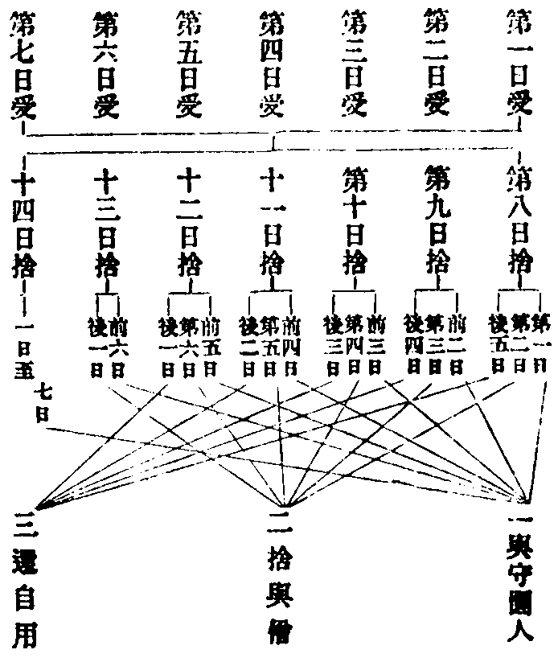



言「展转」者，即上七日受者，至下七日，舍时三用展转不定。如第三日受者，八日舍时，得还主用；若九日舍，即舍与僧；若十日舍，即与守园人；但过七日，与园人，即无展转矣。言「十二日兼三」，谓从第八日已来五日内舍，并兼三用，十三日但二用，十四日唯一用。如图可见。



问：「何以但至『十四日』耶？」



答：「已后舍者，并同一判，『皆入园人』，故不明餘日。」



「可思之」者，令属意也。「勿诵语」者，诫随言也。



【疏】问：「长衣还得服本著，长药所以非本服者？」



答：「衣唯防长过，舍则其过灭。药长乃同衣，别有宿、触过，故不得服用。」



广问答中，初问。引衣例药，亦合得服，何不同者？上「服」字，古本作「复」，音误。答中，初明长衣，次释长药。言「同衣」者，舍已过灭故，犹兼宿、触，故不同衣。



【疏】问：「染下六日药，有失口法不？」



答：「不失。何者？说净为防长，不说故染餘。口法防宿、触，本不防长过，故知不失受。所以通僧食，良由无过故。」



次问。以七日中日日受药，八日染犯，能染过限，所染未过，然既被染，即应失法。答中，初句判定。「何」下，徵释所以，为三。初明被染。若第七日都将说净，则无染犯，不说故染，则知净法本防长也。「口」下，次明不失受。所防既别，故法自存。「所」下，三、引证。即第七日药舍与僧服，由有口法，无宿、触过，故听僧服。



【疏】「若尔，不失法本，主应合食？」亦如上解。



转难中。指「如上」者，即上文云「已越七日，无更服义」等。



【疏】问：「药受过期限，不食是亦失；受日不出界，过限亦应失？」



答：「药服为於病，病转有期限。受日本为事，事在故法在。所以上明随病一二日，乃至七日转故也。」



三问。谓夏中受日未用，但使缘在，纵经多日，受法不失，药法不同，故引比难。答中，因病加药，病限即时，为事受日，事容延缓。「所」下，指前为证，即重受中《多论》、《僧祇》文也。



【疏】问：「药既说净，过限失受，净法在不？」



四问。谓至七日说净，八日失受，疑谓净法亦应随失。



【疏】答：「有人言『受法虽失，净法在故』。」



初师中，初文，可解。



【疏】「若尔，净依手、口受，本失末犹存；亦可约界结摄衣，解却大界衣界在？」



次科。净法是能依，故为「末」；受法是所依，故为「本」。本既已失，末不应存。故比结界，义则相反。



【疏】有人解云：「不同解界：一、僧约有心解，二、衣必假大界。净法不尔：受法任运失，故非作意舍；二、净法不假於受法，是故受失而净在。」



三中。初明解界，二义故失。次明净法，反界二义，不可比同。衣界非大界不成，净法无受法自立，故云「不假」等。



【疏】有人云：「若第八日，相与俱失。既不任用，加净免过。」



次师，立理中。谓第七日说净，至第八日净法与受同失。「既」下，释所以。上句明后失净，下句显前说净，止免长过，非为久畜。



【疏】「若尔，如犯舍戒犹须忏，比此口亡净法在？」



答：「受过俱无二法谢。此障犹存故须悔。又不同衣净法存，所防在故法不失也。」



释难中。谓如犯残下诸罪，舍戒还家，后复重受，须忏先罪，彼既戒失而罪尚在，今口法失，净法合存，如何随失耶？「比」，谓相并。答中，初二句释通，上句释净随受失。「受过」文误，古本作「彼过」，对下「此障」。由加净法，俱无长过，所以受、净二法俱谢。下句释舍戒罪在。罪是业障，障不可亡，不随戒失，故须后悔。「又」下，次遮妨。以前长衣净法不失，恐引为难，先此通之。「所防」即长过。



【疏】问：「净财加受净法谢，药加净法不失受者？」



答：「衣患无故净法亡，药患服故二法在。」



五问。谓说净财将作三衣，加受持法，即失本净，反例药说净已，受亦合失。答中，「患」谓病患，衣无药有，此则可知。



【疏】亦不欲广於问答，以费纸墨。欲开神慧，知持犯相。读者思之，慎莫诵语，大悮人也。



结告中，三：初叙非意；「欲」下，示广意；「读」下，诫封著。



【律】二十七、过前求雨衣、过前用戒。



【疏】第二十七，过前求雨衣、过前用戒。



【疏】此中两戒合制意者。本制雨衣，用有时限，预乞、先用，违反圣教，故制。



二十七，通释中，初科。「制用有时限」者，三月十六日后求，四月初一日后用。「预乞先用」，两并违制。



【疏】过前求五缘成：一、是雨衣；二、过前求；三、自为己；四、彼与；五、领受。



【疏】问：「与彼乞衣有何异邪？」



答：「三异：一、衣体不同；二、开缘别，此有时限，彼无时限，唯除四缘；三、亲非亲别，上则开亲，此二俱犯。」



初过求缘，问答中。「三异」，初体异者，彼是三衣，此是雨衣，餘二可解。



【疏】过前用四缘成：一、是己雨衣；二、时中得；三、过前持；四、过前用。



过用缘中。二、「时中得」者，准此不犯前求，方犯后用。准《多论》犯过求者，过用但吉。前总义云「雨衣重犯」者，谓过用中随用随犯。



【注】佛在舍卫。毗舍佉母请佛及僧。婢白时到，见诸比丘裸浴。因发八愿，为佛所赞。六群常求，比丘举过。佛因制戒。



【疏】就戒缘中，「因发八愿」，是开缘也。



戒缘中，「八愿」者：一、与客比丘食；二、与远行比丘食；三、与病比丘食；四、与随病药；五、与看病食；六、食粥；七、给比丘雨衣；八、给尼雨衣。



【律】若比丘，春残一月在，当求雨浴衣。



【注】雨衣者，比丘用雨中浴。衣有十种。彼应三月十六日求也。



【律】半月应用浴(四月一日应用)。若比丘，过一月前求雨浴衣(三月十六日前求雨衣)，过半月前用浴(谓四月一日前用也)，尼萨耆波逸提。



【注】比丘尼吉罗。不犯者，若舍作餘用，若着而浴，若浣，若举者，是不犯。



【疏】戒本分二。



【疏】立法中四句。一、人。二、「春残月」，求衣分齐。三、「浴衣」，制名相也。诸师解者多途，皆不可用。今西土来者，亲自对之，还同三衣可披著也。故《僧祇》云「雨时披浴」，餘如《钞》中。四、「半月」下，制用时节。《多论》云：「雨、热时障身浴，无雨时裹三衣。若闰三月者，后三月十六日求。闰四月者，前四月十六日用，同安居也。」此土僧用全希，故略言也。



戒本，立法中。三中。初点文。雨浴衣是名，注释其义。「十种」衣体，同上所明。「诸师」下，次显相。初斥非，《钞》云：「古谓如傀儡戏围之类。」、「今」下，示相，即亲问梵僧，则彰得实。「故」下，引证。指「如《钞》」者，彼云「常须大雨时披」「不得当三衣」，则其相可知矣。四中，初点文。「多论」下，引释。初明畜用，「若」下，示求用时限。「此」下，示略。



【疏】戒本五句：初犯人；二、「前求」；三、「前用」。下二，可知。餘文相，可解。



戒本。第二，「前求」犯前；第三，「前用」犯后。「下二」句，即舍堕。「餘文」，即后注。「不犯」中，雨衣不得餘用，舍已故得。又不用犯吉，著故不犯。浣、藏举有缘，开「不用吉」也。



【律】二十八、过前受急施衣、过后畜戒。



【疏】第二十八，过前受急施衣过后畜戒。



【疏】此亦两戒共制，非是一衣。不同雨衣一事生二也。制安居竟，开受夏衣。今为急缘，无暇待竟，逆前而施，故开受之。又恐滥逸，限前十日，与夏衣接，还同本施。今过前而受，后不说净，违反二教，故制犯舍。



二十八，通释中，初科。初对前戒明同异。「非一衣」者，前犯急施，后犯畜长。「不同雨衣」者，以过求、过用，同是雨衣，故「一事生二」。「制」下，正叙开制。初明开受，本须夏竟，缘开前受。「逆」，犹预也。「缘」如后引。「又」下，次明制意。「前十日」者，七月初六已后，至十五日。满十日，明日入时，故云「与夏衣接」。「同本施」者，还赏夏劳故。「过前而受」，是违急施限，「后不说净」，即违畜长限，故「违二教」也。



【疏】五缘成犯：初、是急施；二、知；三、七月六日前；四、无缘；五、受，犯。过后畜者，亦具五缘：一、是急施；二、知；三、七月六日后十日内；四、不作净；五、过限，犯。



列缘中。初过受五缘。次过畜中，第三须限内者，准知前后不重犯也。



【注】佛在毗兰若，听受夏衣。六群常乞衣，常受衣。䟦难陀异处安居，异处受衣。佛在舍卫安居中，大臣为安居施，佛因开而制戒。



【疏】就戒缘中，非时乞夏衣。《僧祇》、《五分》「安居未竟，受、乞衣者吉罗」。此唯为夏后是急施衣，今日不取，明日即无者开。



戒缘。注文，二段。初明听受夏衣，六群非时常乞，䟦难陀非分而受，因开过起，此叙兴制之由。二、因舍卫大臣施缘，方立斯教，即断非时先受夏衣，除急施缘；又须限内，无缘乖限，并非时施，不得时利也。注中「大臣」者，《律》因波斯匿王下臣，一名利师达多，二名富罗那，王勅使征，时二大臣作是念言：「我今当征，未知还否。我常夏竟为僧设食施衣，今者未竟欲施。」即往白佛，佛言：「若是急施，应受。」《僧祇》、《五分》时前犯吉，简无缘不开。「此」下，明有缘开受。「唯为夏后」者，明本施缘。「不取即无」，出其开意。



【律】若比丘，十日未竟夏三月。



【注】谓七月六日已后，十五日已前是也。



【律】诸比丘得急施衣。



【注】若受便得，不受便失，故名「急」也。衣者有十种。



【律】比丘知是急施衣，当受；受已，乃至衣时应畜。



【注】衣时者，自恣竟，不受迦𫄨那衣一月，受衣五月。若自恣十日在，得急施衣，受已，至一月、五月畜。乃至明日自恣应受，一月、五月外更增九日也。



【律】若过畜者，尼萨耆波逸提。



【注】谓急施衣，若过前，若过后，并犯堕。比丘尼同犯。不犯者，不过前，不过后，不犯。若夺衣、失衣，过前取，不犯。若寄衣比丘远行，水陆道断，过后，不犯。



【疏】戒本七句。一、人。二、「十日」下，明其时分。七月六日受，去十六日自恣满十日，此是受时。若在先受，是名过前犯也。若十日内受，与时分相接，至腊月十五日应说。不说，此但有过后犯。前是领受故生，后违说净故结。古德云：「举前以明非，举后以释疑，无重犯也。」三、明财体。四、「比丘知」下，立法也。互、「若过」下，明业。餘可知。



戒本，第二句中。初明前受时分。「若十日」下，次明后畜时分。「腊月」即八日，且据不受迦𫄨为言。上是别列。「前」下，总简。初正简。「古」下，引证。「举前明非」，正制领受故。「举后释疑」，重决畜长故。二不并有，故「无重犯」。三、财体中。注文先示「急施」名义，后示衣体。「十种」，同前。四、立法中。注文初释衣时。「若」下，二、明次第增。「自恣十日在」，即七月初六受，前满十日，后不更增。「乃至」者，谓初七受，前得九日，后增一日；初八已去，前次第减，后次第增。「明日自恣」，即七月十五日受，止得一日，故后加九日，续满十日开也。五中，「过畜」，即所造「业」。「餘可知」，即舍堕二句。



【疏】注解「衣时」下，明非时、时相。



【疏】问：「何以非时受衣，一月、五月外更增九日，时中受衣，所以不增者？」



答：「此本是时衣，急故非时受，所以时外开。餘本无时限，随受随时说。」



释注，问答中，初问。以十日常开，据须齐给，时中受者，何意不增。答中，初明急施须增。「餘」下，次明餘受不增。言「无时限」者，谓非急施缘所开者。若非时受则限十日，若入时中则一月、五月，故云「随受随说」也。



【疏】问：「长衣七月六日受，十五日前是开位，十六日接是时分，何为不同急施衣？」



答：「受长无时节，随受名非时。急施必接时，所以前后开。准此为言，七月十五受长衣，时内九日须说净。」



次问。非时受者入时不开。答中，初明餘长通餘时。次明急施局时。「准」下，重决长衣。「时内九日说」者，准知迦提开长，须约时内受者。应作句料简。初约时非时受为四句：一、非时受时衣(即今急施，时外加十日)；二、时内受非时衣(夏竟，不为安居施，此限时内畜)；三、时内受时衣(正为赏夏劳，同上齐时内)；四、非时受非时衣(但齐十日)。又约有犯作四句：一、时衣非时犯(急施过前受，或过后畜)；二、非时衣时中犯(即上七月十五受长衣)；三、非时衣非时犯(十日、月望过限)；四、时衣时中犯(如时内舍迦𫄨，不说净)。



【疏】问：「为夏而施是时衣，可得一月、五月开；餘非为夏而施者，应是时中判十日？」



答：「衣利宽多，故通开也。」



三问。时衣可开，非时不应开。答中，以五利中食利有时故狭，衣利常须故宽，如十日、月望、急施，时非时等，并开一月、五月是也。



【疏】有人准此，谓七月十五日离界，不破夏，非离衣。以明未出是不犯，明出开时复非制故。



次异解中，他解为二。初立义。「以」下，出所以。「明未出不犯」者，在夏限故。「明出」无过，入开限故。



【疏】今解不然。明未出时夏未竟，须在界内守地了，明出方名一期竟，方开外行及离衣。不同急施前后开，此但后开无前开，越於昧爽故是犯。



今解中。初斥古非。谓十六日明相未现，犹在夏限，出则破夏，故须在界。「地了」即明相。「一期」即三月夏限。「不」下，简滥。古师准此，故须分之。急施时前开十日，后入时中开一月，前后皆开，故可相接。坐夏护衣，开后迦提，时前不开，故非相例。「越昧爽」者，未明出界。破夏离衣，故云「是犯」。



【疏】问：「月望与长衣，同为一月衣；𫄨那与迦提，同为五月衣。何故迦提月，不摄十日衣？」



答：「各有其类，两不相摄。所以然者？一、时非时别；二、利有宽狭；三、本末不相收。不同𫄨那摄迦提月，同是时位，同得五利。一月初制，五月后开，以长收短，故得相摄。月望、十日，例此可知。」



四问。初举类。月望前十日，即本长衣开，后加二十日，通为一月望；又迦提本一月，迦𫄨但增四，相通为五月。此二皆相摄。十日与迦提，如何两各立，不从十日加，与上不同者？答中，初二句总答。上句通示三种，下句别显迦提。「所」下，别释为二。初释迦提不摄十日：初义可解；二、迦提五利故「宽」，十日唯长故「狭」；三、以迦提、十日，缘据各别，两不相因，则无「本末相收」之义。「不同」下，次释前二相摄。「𫄨那摄迦提」，反上三义，一、是时同，二、得五利即宽同，三、从本开末，故两相收。「月望例此」者，一、非时同，二、即狭同，三、十日不足，故加二十，以长收短，故通一月。



私释：准前《五分》，先开迦𫄨，后开十日，则有迦提时，未有十日，那得相收？



【疏】下开通中，具列两开，文相极显。



开通中。「具列两开」者，注文初二句两并顺教。「若夺」下，开过前，「若寄依」下，开过后，同长衣缘也。



【律】二十九、兰若有疑离衣过限戒。



【疏】第二十九，兰若离衣戒。



【疏】此戒与前离衣有二不同，故须更制：一、前在聚中一宿犯，此在兰若六宿犯；二、前无贼难德衣开，此则有难不成受。



二十九，对简中。初标示。「一」下，列释。初义自含二别：一、「聚」、「兰」处别，二、「一」、「六」时别。二中亦二：一、「有难」、「无难」，二、德衣开、不开。以德衣有王、贼等难，不成受故。更加一义：前通三时，此局冬分。



【疏】论犯六缘：一、是受持三衣；二、冬分非时；三、有疑怖畏；四、置衣村中；五、无因缘；六、过七夜，犯。



犯缘中。二、「冬分」者，八月十六至十二月十五也。五、「无缘」，谓有夺、失等想，水陆道断等缘，则开不犯。



【注】佛在舍卫。比丘兰若处为贼所打，并夺什物，佛令留一一衣置村舍内。六群寄衣游行。同徒举过，佛因制戒。



【疏】就戒缘中，「置衣村内」，开缘也，下明犯相。初明「打夺什物」者，有人数衣钵满十，非也。「什」谓物之总号，不局衣裳。文彰人物多者，积聚一处，并名为「什」。



戒缘中。初分文。「下明犯相」，即六群起过等。「初」下，牒释。注中「留衣村舍」者，谓兰若遭贼，故听寄衣村聚，身在兰若。文释「什物」。初引古非。六物之外，未详加何等物，数为十也？「什谓」下，今解，又二。初释名。「物总号」者，数该多少，岂唯在十？「不局衣裳」者，体通一切。「文」下，点示文意。



【律】若比丘，夏三月竟，后迦提一月满(谓八月半后)，在阿兰若。



【注】去村五百弓，遮摩罗国弓长四肘，用中肘量。



【律】若有疑(疑有贼盗)恐惧处(中有恐怖贼盗)，比丘在如是处住，三衣中欲留一一衣置村舍内(村者，聚也)，诸比丘有因缘离衣宿，乃至六夜。



【注】若彼有缘离衣宿，第七夜明相未出前，若舍，若捉衣，若至掷石所及处。反上成犯。



【律】若过者，尼萨耆波逸提。(开缘如前「离衣戒」。)



【疏】就《戒本》中，约文十句。



【疏】一、人。



【疏】二、时。列非时分。



戒本，第二，初科。初云「时」者，总标第二句也。「列非时」者，点文注也。



【疏】问：「戒本何为无『德衣开』？」



次科，问意，可解。



【疏】答：「上士翘勤，不受宽利。」



初答中。以德衣五利，随人受之，今是兰若比丘修头陀者，故云「上士翘勤」，谓翘企望上而进行功，唯务少欲，岂受宽利耶？



【疏】「若尔，应无迦提月？」



答：「德衣作法有，迦提任运受。亦可文列『迦提月』，谓是夏竟时，非受於五利。」



转难中。以文云「迦提月满」，既有迦提，亦受五利，那云无者？答中。初约同开释。迦提一月夏竟常开，上士同沾，文中故列。虽教所开，自不受利。「亦」下，次约标时释，谓文标时限，非是开利。



【疏】又解：「异界比丘不成受德衣。《律》云：『有难、无大衣。』今既贼难，故知不合受。无难亦应成。」



次答文，二。初约异界释。以兰若坐夏，往他寺受衣，即非同界，德衣简故。「律」下，次约难缘释。即王、贼等八难，不听受德衣。文举两缘，正用「有难」，因引无衣。



【疏】三、「兰若」者，注云「去村五百弓」、「弓长四肘」，肘长一尺八，以此为率，通计六尺为步，则二里也。此谓头陀兰若，「闲静处」如盗戒说，离衣，僧界，难事，总有五。



三中，释注。初示分齐。每一百弓，成一百二十步，五百弓共成六百步，三百步为里，故有「二里」。「此」下，简滥。「如盗戒」者，彼云若「闲静处」，即兰若也。三、「离衣」。四、「僧界」又二，即有难、无难。五、「难事」，即提舍兰若受食也。



【疏】四、「有疑」者，如注可解。《十诵》「乃至恶比丘畏」。



四中。初指注。「十」下，引示。「恶比丘畏」，谓恐相侵损，亦开留寄。



【疏】五、「比丘」下，明既有难，即离衣宿，不作日限。如《五分》：「上二衣，随所重者寄一。下衣随身。礼拜、入寺、乞食，不得单著。」



五中。初明无日限。以文中但云留衣，不言日数故。此即暗指古非，下文显斥。「如」下，示所离多少。一、唯开一衣，二、不开五条。



【疏】六、「置村舍内」。《僧祇》云：「还寄可疑俗人家，开留一衣，不作日限。」《五分》：「前后安居未满，无怖不得离衣。彼国八月贼发，杀人取肉祀天，诸人至期不出，遂至兰若害诸比丘。故开寄衣，不作日限，唯须十日一度往看，无有湿坏。免贼难故。」



六中。「《僧祇》可疑家」，即反委盗者，则无所虑。《五分》，初明夏分不开。「彼」下，次示本开缘。「祀」，即祭祀。「十日往看」，欲知湿坏，非是会衣。



【疏】七、「诸比丘」下，明有别缘至於七夜。此律文略其缘。古来诸师寻文不了，谓是恐怖，故开六夜。今约戒本，文相自分。前是难缘，如上已解。今是别缘，故须引证。如《僧祇》云：「何故唯开六宿？因往断事，为衣重故，时须六宿，故即舍衣六夜为戒。」《五分》：「有僧、塔事，和尚、阇棃及他事者，皆听六夜留衣俗家。若一、二、三，乃至五夜亦尔。」餘如《钞》。



七中。初点文，「别缘」，如下引示。「古」下，斥非。初叙古解。「今」下，示今判。「文相自分」，以前明「疑怖」，不云时限，后云「因缘」，乃云「六夜」。《僧祇》断诤，《五分》三宝等，即是「别缘」。「一、二、三」等，谓极至六夜已内随开。《四分》阙此诸缘，故令古来妄解。



问：「若云『有难无日限』者，前列缘云『有疑怖处过七夜犯』，如何通耶？」



「餘如《钞》」者，彼云「事若未竟，中间常许」等。



【疏】八、「若过」者，是业成故。



【疏】下二可知。餘同离衣戒。



后二句中。「餘同离衣」，点注「不犯」等文。



【律】三十、回僧物戒。



【疏】第三十，回僧物入己戒。



【疏】所以制者。出家高士，知足为怀。闻他施僧，方便回入，长己贪求，外恼施主，於僧失利，殊所不应，故制。



三十，制意。初示合行。「闻」下，次叙过恶，有三：「长贪」，一也；「恼施主」，二也；「失僧利」，三也。



【疏】论犯，四缘：一、是许僧物；二、知作许想；三、回入己；四、领受犯。



许僧物者，於己有滥，回容称心，喜为制重。佛、法之物，无滥义稀，虽回制轻。



犯缘中。初列示。「许」下，对三宝辨异。已在僧数，故云「有滥」。



【注】佛在舍卫。居士饭僧、施衣，䟦难陀闻，语言：「施僧者多，今可施我。」居士后见长老比丘威仪具足，便即悔叹。比丘举过，佛因制戒。



【疏】就戒缘中，文相易耳。



戒缘中，注文，初叙比丘回施，二明居士悔叹。



【律】若比丘，知(不知，非犯)是僧物。



【注】有三种：僧物者，已许僧；为僧者，为僧故作，未许僧；已与僧者，已许僧，已舍与僧。物者，下至饮水器也。



【律】自求入己者。



【注】若许僧，转与塔；若许四方僧，转与现在僧；若僧，尼；若异处；若反上交互；若疑、想——并突吉罗。



【律】尼萨耆波逸提。



【注】不犯者：若不知；若作不许想；若许少，劝令多；许少人，劝与多人；劝与好物；若言戏；若错说者——并不犯。



【律】诸大德！我已说三十尼萨耆波逸提法。



今问诸大德：是中清净不？(三说。)



【律】诸大德！是中清净，默然故。是事如是持。



【律】四分律比丘含注戒本(上)



【疏】戒本六句。



一、犯人。二、「知」。



【疏】三、「物已许僧」者：决非属己，定为僧作，众多别少心未决故，回，犯堕；（二）「为僧作未许僧」者，虽非属己，众别未分，若回，犯吉；（三）「已许僧」者，定属有主，回，犯重罪。



戒本，第三中。初句「决非属己」，舍心决也。「众多别少」，谓欲与众则恐人多，欲与别则复虑人少，即犹预未决之意。次句，由未决许，回则但轻。上二句并属当戒，重轻异耳。第三，落前盗戒。



【疏】四、「自求入己」，论业相也。注中四对：初、僧塔；二、现前四方；三、僧尼；四、同类。故曰「异处」也。



四中。初点文。次释注中，「四对」，合注可分。注中「说」字误，合作「许」字。「反上交互」，如许塔转与僧等。三、「僧尼」者，施尼回与僧也。四、「同类异处」，即许彼寺，回入此寺。



【疏】下二，可知。餘文相，引《钞》取释。



五六，即舍与罪。「餘」下，指略。注「不犯」中：初二开心差；「若许」下，开不入己；「若言」下，开非意。



------



## 【疏】四分律含注戒本疏卷第三



四分律含注戒本疏行宗记三下之三



四分律含注戒本疏行宗记四上之一



大宋餘杭沙门　元照　述



【疏】四分律含注戒本疏卷第四(上从「九十」初，终戒本末。)



【疏】终南太一山沙门释　道宣　撰



【疏】就「九十」中，先以义求，后随相解。



【疏】初别料简，七门分之：一、配三业；二、约自他；三、明遮性；四、论持犯；五、简僧尼；六、关诸部；七、辨任运。



【疏】初配三业者。「九十」一篇，三十一戒在身成犯，二十一戒在语成犯，三十八戒通於身语。



九十单提，义门有七，初门，总配中。标云「三业」，而但列「身」、「语」者，以意业通故。



【疏】就初三十一戒中，何者是邪？作偈记之，法事单历。「女未强脱覆，作屏施别过，非残不外坐，屏露四三军，酒水击半白，二随打搏宫。」



次科，身犯中。「法事单历」者，此句通指诸偈，以双持双犯，法事兼有，此下偈括不可双标故。女(与女宿)未(与未受宿)强(强敷卧具)脱(坐脱脚床)覆(覆屋过三)，作(与尼作衣)屏(与尼屏坐)施(施食处过受)别(别众)过(过三钵食)，非(非时食)残(残宿食)不(不受食)外(与外道食)坐(食家强坐)，屏(屏与女坐)露(与女露坐)四(过四月受药)三军(一、往观军陈，二、军中过限，三、观军合战)，酒(饮酒)水(水中戏)击(击枥他)半(半月洗浴)白(白色三衣)，二随(一、随举比丘，二、随摈沙弥)打(打比丘)搏(搏比丘)宫(突入王宫)。



【疏】有二十一戒，口业犯而非身。故偈记言：「故毁两同说，道女异嫌尼，讥法恐怖疑，发起欲拒毗，同欲无根谤，二十一语持。」



次语犯中，初科。故(故妄语)毁(毁些)两(两舌)同(与未具人同诵)说(说麤罪)，道(实道得)女(与女说法过限)异(妄作异语)嫌(嫌骂知事)尼(辄教尼)，讥(讥教尼人)法(与尼说法至暮)恐怖(怖比丘)疑(疑恼比丘)，发起(发举四诤)欲(说欲不障道)拒(拒劝学)毗(毁毗尼)，同(同羯磨后悔)欲(与欲已后悔)无根谤(僧残法谤)。「二」下，一句总结。



【疏】昔云：小年与受，是口业犯。今解不尔。《律》结和尚，不是戒师。当时和尚默坐众中，未曾有语。故知解非。《律》结僧吉、师提者，此在自身作业假他语也，如后为道。



次斥非中。初牒古解。「今」下，正斥。初约义斥非。「律」下，示今所判。指「如后」者，文见次科。



【疏】三、就通身语，又分为二：有三十一戒，语家作业共身心犯；后有七戒，语家止业共身心犯。



【疏】就前分三。



【疏】初有十九戒，自语作业假他身犯。偈云：「掘坏牵用劝，然藏饮杀驱，与衣捉落宝，高床七戒俱。」



三、通身语中，初段，十九戒中，初科。掘(掘地)坏(坏生)牵(牵他出房)用(用虫水)劝(劝足食)，然(露地然火)藏(藏他衣钵)饮(饮虫水)杀(杀畜生)驱(驱他出聚)，与衣(与尼衣)捉落宝(捉宝因拾遗故)，高床七戒俱(一、高脚，二、兜罗緜褥，三、牙角针筒，四、过量坐具，五、覆疮衣，六、雨浴衣，七、与佛衣等。「俱」，谓同也)。



【疏】此一段戒，若论自业唯身心犯，属初门中。今据教人成自犯义。如前教人掘地，言了未结，必假前身掘地、坏生，教者方犯，故云「自语作业假他身」也。不同「妄语」，无别事故，言了即结。餘者例知。



简辨中。由此诸戒，自作教他二俱成犯，故涉前后。初明属前。「今」下，次明属后。初引「掘」、「坏」以明。「不」下，简异单语。「餘」下，指例，即餘诸戒也。



【疏】「若尔，如诳他言了未结，要待前闻，闻即身业。」



答：「今取运为造作，别名身业，不取闻知通名身业。」



释难中。以妄语成犯，事同假他，故蹑为难。答中，造作事异，如掘、坏等，名「身家别业」；五根触对，事用未彰，名「身通业」。



【疏】中有七戒，自语作业假自他身。如与期行，要先共期，后身同路，越界方犯。偈言：「屏露二处敷，四期索美食。」



次七戒中。初示业相，后以偈束。「屏露二敷」，亦约先语教人，前人为敷，我身舍去。「四期」(一、期尼行，二、尼同船，三、期贼行，四、期女行)。「索美食」，先以语索，前人施与，我食方犯。



【疏】后有五戒，自身作业假他口成。如「噉叹食」，假尼口叹，身业咽犯，餘者例同。偈言：「赞谏及二听，与年不满五。」且如违谏亦有言拒，今就一相，知别有义。



后五戒中。初示相。次偈括。赞(食尼赞食，他叹我食故)谏(不受谏，他谏我拒故)二听(一、屏听四诤，二、不摄耳听戒，并由他说故)，与年不满(和尚默坐犯，假他羯磨成)。「且」下，别简谏戒。若取「言拒」，应在语业，今明不受，多就身论，故云「一相」。



【疏】大分第二，次有七戒，语家止业，共身心犯。偈言：「覆背足非时，家真不与欲。」



第二，语止七戒。并有教法，由口不作，身违成犯故也。偈中：覆(覆麤罪)背(展转食)足(足食)非时(非时入聚)，家(食前食后至他家)真(真实施)不与欲(不与欲起去)。



【疏】覆藏一戒，诸解不定。《伽》、《母》云「意业成犯」，此就本为言也。《善见》云「身心犯」者，由见闻他犯，怀覆不说，此通口业，未可取分。今云：闻过言陈，本自无罪，止口不露，意怀覆故，身为过本，故两取之。



别释中。先引诸解。《伽》、《母》就「意」，意即是通，犯相难显，不可全用。《见论》「身心」通别齐举，「见闻」是身，「怀覆」即心。据云「不说」即是口止，故「通口业」，但文不标显，故「未可分」。「今」下，判定，即通三业。舍通就别，指归身、语，结属当科，故云「两取」。意在其中，不言可鉴。



【疏】次解第二，自作教人，约犯差别。



【疏】有十二戒，教人同犯，餘即是轻。偈云：「掘坏牵用劝，恐然藏杀饮，无根捉落宝，自作教他同。」此十二戒，但使教人，纵不为己，作即同犯。



二、自作教人，初十二戒。「餘即轻」者，无教人同犯故。偈词对前，寻之可解。



【疏】更有十戒，教人不为己，无问心之轻重，但得小罪。其相如何？偈云：「屏露与尼衣，高床下七戒。」此之十戒，教比丘作，若为己者，能教犯提，受使犯吉。若不为己，受使犯提，能教犯吉。



次十戒中。互通轻重。所以前标「不为己」者，且欲对上示不同故。「其相」下，列示。「屏、露」即二敷也。「此」下，正明能所互犯轻重。



【疏】约义以求，统通「九十」，义犹不尽。如有打、搏，自他同恼，何不同犯，岂唯小谤、饮虫水等？但是文无，义决则齐，何得不有？故知未尽。



义求中。上是约文，文则局数，今此据义，义求则通，故云「不尽」。文举「打」、「搏」，餘可自寻。



【疏】次解第三，遮性义者。



【疏】有三十戒，性与理违，悔犯事净，集业未遣，要倾我倒，苦根方止。餘六十戒，但有事违，不无讥丑，故违教网。



三、明遮性，通简中。初明性戒。「性」通三性，善、恶、无记。今此局恶，故云「违理」。於此须明化、制两教犯忏不同。犯化违理，毁制违事，比丘犯性，理事俱违。依律行悔，但翻违事，故云「事净」。违理犹存，故云「集业未遣」。若准《忏篇》，修三种理观亦能破业。今从究竟而论，故云「要倾我倒」，即须破惑入圣已去。惑能起业，业能生报，故曰「苦根」。「餘」下，次明遮戒。此单犯制，於理无违，但依律忏，以事翻事，无不净矣。



【疏】广解遮、性，如上已陈。今直数之，知异便止。性恶，偈言：「故毁两说异，嫌强牵用讥，谏驱恐覆疑，畜饮发说随，随拒毁同欲，不屏打搏无。」



次括示中。初指广。「如上陈」者，即「僧残义门」。「今」下，正示。偈中：下说(说欲不障)、同(同羯磨后悔)、欲(与欲后悔)、不(不与欲去)、屏(屏听四诤)、无(无根僧残谤)。



【疏】次解第四，持犯方轨。



【疏】就有十二戒，具二持犯。何者是邪？例有七阶。



初、有羯磨故，得「说罪」、「教尼」。二、受功德衣故，得「背请」、「别食」。三、有嘱法故，得「非时」、「前后入他家」。四、作餘食故，无「足食」「劝足」。五、作口法故，七日尽形，无「残宿」、「不受」。上列五阶十罪也。十一、「净施问主著」。十二、「僧事与欲起」。



四、明持犯，双持中，初科。诸戒事别法同，故合为七。



问：「德衣开五利，何独『背』、『别』得为作持？」



答：「前篇『长』、『离』自有净施、羯磨，此中『入聚』别有白法。此三长开，德衣时短。舍短从长以明双持。『背』、『别』二戒，无别开法，故取德衣为作持也。」



「若尔，前三得用德衣为作持否？」



答：「若用德衣，则废本法，故知三戒并兼两法。就本从长，故所不列。」



【疏】此等诸戒，并有教开。顺作无违名作持。止口不作名止犯，身违事合名作犯，此止、作两犯，体一名异。古人云：「止法止事，名为止持。」故知二持，名体各别。



次科，古解中。前列三行，欲显同是造作所成。后独出止持，欲明守戒非造作故。「两犯体一名异」者，彼谓作犯，义兼止犯，止作名殊，业思体一，无别二犯。前亦古义，后方标者，欲彰止持最为非故。「止法止事」者，彼谓法、事都无所为，名止持行。作持是运造，止持即不为，故「名体别」也。



问：「如昔所明，义有何失？」



答：「彼但解止，都不识持。持既成善，善即是业，业不自有，必假行成。行即行心，无非造作，若都不作，但是无记，焉能成业？故知古解於理大乖，是以疏家篇篇提破。讲学临此，须善思之。」



【疏】今解不然。如上广列。持犯约教，随戒彰相，具二持犯。如有羯磨说麤罪是作持，不违教说名止持，无教輙说是作犯，抑教不求名止犯。据此为相，可不明邪？餘可例知。



今解中。四行并据造作为言。指「如上」者，即僧残中。「持犯约教」者，示其源也。「随戒彰相」者，双单别也。「如」下，略示名体。二持二犯，一一皆别，举一例诸，自餘准说。「抑」谓抑塞。「不求」，即不乞羯磨。



【疏】若忏罪时，但依戒悔。二犯据法，不在悔收。止学无知，别制别忏。



明忏中。上既异古，二犯体别，须明行忏开合之相。初明本犯，「二」下，次示止犯。言「二犯」者，谓双犯中止犯罪也。或可悔法中不收此罪。既是别制，故须别忏。言「别制」者，以更重增无知罪故。



【疏】如昔解云：「七日等药，加二受竟，防无非时名作持。」今解不然。七日无法，非时得食，本无限约。由作口法，过限故有非时。此乃口生非时，何得口防非时？故知无也。



斥七日中。初引古解。「七日等」者，「等」取尽形，彼谓加口法已，非时得服故。次示今解，又二。初明非时本开暂服，则知口法不防非时。「由」下，次明过限能生非时，则知口法非是能防。「故知无」者，谓无防义也。



【疏】「覆藏」昔解为作持，亦非义也。颇有顺教覆，得说无罪邪？如非时入村依教作，与本入村时无别，故说为作持。



斥「覆藏」中。初示非。彼谓发露即是作持。「颇」下，反诘。若许覆藏说而无罪，可名作持。然无此理，故不可立。「如」下，引前比显。前十二戒，若本无法则成於犯，由开作法，故名为持。覆藏不尔，相比可知。



【疏】问：「教人掘地，开知净语，岂非作持？」



答：「上之十二，顺教身作，故号作持。知净语者，但开教人，无有自作，不名作持。」



释妨中。知净开法，相似作持，故须简别。答文，易解。



【疏】次有二戒，作持止犯，「覆藏」、「不摄」是也。餘七十六，并是止持。



次单持中。初明二戒作持止犯。由不露、不听而成犯故。



问：「此明覆藏，与古何异？」



答：「古从法说，判在双持。今就事论，止在单摄。语同义别，文中自明。」



「餘」下，次指餘戒止持作犯，可知。



【疏】作便有犯。作持作犯，上篇广张。今明止犯止持。



三、广分品位，标中。指「上篇」者，即前「总义」及「僧残义门」中。



【疏】言止持者，谓佛制教，令学行之。我依修学，於境无犯。然根机利钝，不可齐准，至於万境，由迷疑网，故以诸九，定品优劣，且分三位。



止持，标叙中。初示立教之源。「我」下，明为学之本。「然」下，生起品位。言「诸九」者，据通为言，若法若事，不出可学、不可学二九句法。就戒别论，双持犯者，法事两别则有四九，单法单事但有二九。止犯加八，唯收不学教行之罪。言「优劣」者，持门则识优疑次，不识最劣，犯门反之。



【疏】上品一句，识法识犯。如德衣加受，功用须知，名识法也。如有违越，或吉或提，开合衣、药，定罪多少，名识犯也。餘相例解，不能具出。由本戒无失，复不愚学，识达皎然，名为上品持律。



上品中。初标句。「如德衣」下，举前「背」、「别」开法，委释其相。(有改作「得衣」，乃将白色三衣加法以释。且白色不得加受，又非双持。)言「加受」者，谓作羯磨，人别三受。「功用须知」者，《钞》云：「能感多衣，衣无败坏。」又云：「以众僧同受此衣，便招五利功德。」、「如有违越」者，谓受德衣有多制法：一、应时节，须安居竟；二、简衣体，制造合法；三、简受人，唯须当界前安居具三衣人；四、简持人，须具五德等。一事乖法，受则不成。既不成受，妄开背、别，一一戒下，各有「提、吉」之罪。重轻不定，故云「或」也。「开合衣、药」，谓背请戒，或单衣食请为开，或兼衣食请为合，有背不背，如后自明。「定罪多少」，谓二戒下有方便、根本、重轻等相，亦如后说。「餘」下，指十一戒。「由」下，结位。



【疏】中位有四：初识法疑犯；二、识法不识犯；三、疑法识犯；四、不识法识犯。识同前解。言疑法者，谓受德衣用法有四，疑一、二、三，不能通决。言不识法者，迷昏不学，任物牵行，是非由他，自无尺寸。於犯疑暗，例此可知。然於一事由带一识，故判以为中品持律。



中品，分三。初列句。「识同」下，牒解有三。初识指前。疑中，言「四法」者：一、和僧单白法；二、差持衣人白二法；三、正受衣法；四、出德衣单白法。不识中，「任物牵行」，如盲人也。「自无尺寸」，不能度量也。学者明教，教即目、尺。有目则能见险夷，有尺则不迷长短。后生闻此，犹不省耶？「於」下，次例迷犯。谓於犯上有「疑、不识」，准上释之。「暗」即不识。「然」下，三、结位。「一事」合云「一法」，或可事名是通，存亦无失。



【疏】下品四句：初疑法疑犯；二、疑法不识犯；三、不识法疑犯；四、法犯俱不识。此全昏学无境有识，故判以为下品持律。



下品，列句结位，可知。



【疏】问：「既愚不学，如何名『持』？」



答：「非犯本戒，名为止持。但於教相止心修学，望於过境，带不学迷。」



释疑中。「非犯本戒」，谓望根本无犯名「持」，不学无知枝条是「犯」。



又应问曰：「枝条有犯，岂合名『持』？」



答：「罪归教行，止犯所收，持门但据根本净耳。」



【疏】上品明人，故无罪失。中品有四，各带迷疑，即有八罪，罪名如上。下位四句，句别四罪，迷於法犯，具不学迷，即十六罪，亦如上解。



示罪中。两指「如上」，即前诸篇。上品，无罪。中品四句，不学四吉，无知二疑吉，二不识提，共八罪也。下品不学八吉，无知四疑吉，四不识提，即十六罪。此门总二十四罪，十八吉六提也。



【疏】次解止犯九句，谓於教行明昧，修学人根不同，得为九句。有立八句者。今解：翻解明止犯，唯八，不得立九。既迷教行，无法、犯两识也。翻修明止犯，托相具九。如「九十」中，不作教法，輙行、輙食、輙语、輙取，望不作法名止，随作即违名犯。



次明止犯，叙立中。初标叙立意。「有」下，次示古解。古师「八句」，除识法识犯，唯收不学止犯。今师八、九双立，则收两种止犯。「今」下，后出正解。「翻解」即不学无知罪，所谓教行止犯也。「翻修」即诸作持戒相翻罪，所谓事法止犯也。翻解中。初定句。「既」下，明无下品之意。约迷论犯，识则非迷。



「若尔，后九句中何得存之？」



答：「彼有根本，故不同也。」



翻修中。初定句。言「托相」者，即诸戒相。「如」下，举戒以示。四「辄」者，总前十二戒：「輙行」有三(二入村、不与欲)，「輙食」六(背、别、二足、残宿、不受)，「輙语」二(说罪、教尼)，「輙取」一(不问主)。「随作」谓造事，「即违」谓违法，此示二犯同时，不妨体别。



【疏】然识教相，无有愚迷，此下位一句。中品四句，如上所列，各有二罪，故合八也。上位有四：初不识法不识犯；二、不识法疑犯；三、疑法不识犯；四、法犯俱疑也。句各四罪，兼於学迷，故十六也。



正列中。三品可数而知。言「学迷」者，学即不学，迷即无知，通收疑、不识也。



【疏】犯门解义，罪多为上，翻持中可以知也。顺持解犯，何为不得？恐多诵文，自昏觉慧，故倒动之。心若明了，乱亦无苦，如鸟群飞，自分牝牡也。



明倒中。初正明。「翻持中」者，持门解义，无罪为上。又复犯门列句，从重至轻，故上品以二不识为初句，与持相反，对上可知。「顺」下，次出倒列之意。「牝牡」即雌雄。



【疏】次解第五，僧尼不同。



【疏】九十戒中，六十九戒僧尼同犯。故《尼律》中单列戒本，辨相同僧，文不繁也。



第五，僧尼，同犯中。初示数。尼有一百七十八提，今且约僧数对明同异。「故」下，引证。「尼律」即《尼戒本》。同僧犯者，缘起、广解，例皆略之，为省文故。



【疏】有二十一戒，与尼不同，有三种例。



【疏】初有无不同有三，谓「輙教诫尼」、「说法至暮」、「讥诃教诫」。尼非师位，次第即无。



次明不同，初有无中。此三僧中相因而制，尼是下位，无教僧义，后二因无，故云「次第无」也。



【疏】就中轻重不同，有十三戒，偈言：「作衣持屏坐，三期受赞食，劝足美牙角，过量覆三衣。」论其罪相，至文当解。



次轻重中。作衣(与尼作衣)持(持衣与尼。有云「兜罗緜」者，非，彼是同犯故)屏坐(与尼屏坐)，三期(一、期尼行，二、期同船，三、期女行)受赞食(食尼赞食)，劝足(可知)美(索美食。《疏》云：此吉罗者，结不同罪，实犯提舍)牙角(针简)，过量(尼师坛)覆(覆疮衣)三衣(佛衣等量)。已上，并僧提尼吉。



【疏】后有五戒，犯同缘异，偈云：「背请足外道，小年雨浴衣。」皆谓犯罪即齐，开缘有异，故《尼律》中别立戒本。至文更出。



三、缘异中。「背请、足食」，下《戒本》中并云「尼吉」，《疏》云「作不同戒耳」。尼中二戒合制，故《戒本》云：「先受请，若足食已后食者，提。」(此谓离合异。)「外道」者，尼中白衣男子亦犯，僧则开之。彼戒本云：「自手持食与白衣、外道者，提。」(此通局异。)「小年」者，尼中十八童女增二年学法，僧则不尔。《戒本》云：「不与二岁学戒，满二十，便与受具，提。」(此即有无不同。)「雨浴衣」，过量虽同，用则有别，僧开夏月，尼听常用。(开用长短不同。)



【疏】敢依律例，更有义求。如「牵出房」，春、冬僧尼同犯，若是夏房，尼提僧吉。二、「毁呰」中，尼通两众，僧即轻重。三、「覆藏」中，僧罪二阶，尼即三品。有此诸异，何得不知？



义求中。前是据文，此出自见，故云「敢依律例」。即上三别，「牵」即缘异，「毁」即轻重，「覆」即有无。「牵出」中，僧有三时分房，夏房入己定，不须避上座，牵稀故轻。「尼提」者，《尼律》云：「安居中受安居已，乃至随作方便，出门，一一提。」(应是女人报弱，依处须定，牵出恼重故也。)「毁呰」中，尼毁本众及僧并提，故云「通两众」；僧则同类提，四众吉，故云「轻重」。「覆藏」，僧覆上二篇提，下三吉，故云「二阶」；尼加一夷，故云「三品」。「有」下，结告。



【疏】次解第六，诸部不同。



【疏】《十诵》九十一堕，无此「不受谏戒」，别立「不敬说法人戒」、「说戒时轻僧浪语戒」。似此「触恼」，而彼自有「不随问答戒」。



六、诸部中。若论大数，《解脱》、《鼻奈》与《四分》同，《十诵》与《五分》同，《僧祇》独异。初《十诵》，无一有二异。「浪语」，谓谑浪也。「似」下，简辨。「不随问答」即是「触恼」，明知「浪语」别自立耳。



【疏】《五分》九十一堕中，无此「不受谏」，「用虫水」、「饮虫水」合为一戒，别立「入尼寺輙说法」，二、「轻三师」，三、「回僧物与别人」。



《五分》，少二有三别。「輙说法」者，简非教授。「回与别人」，简非入己。



【疏】《僧祇》九十二堕中，无此「不受谏」、「恐怖」二戒，别立「为尼说法」、「回僧物与别人」、「不舍净三衣」、「轻众僧」四戒。又离「餘语」，别立「触恼戒」。



《僧祇》中，无二有四别。上二同前《五分》。「不舍净」者，彼律凡物说净已，欲取用者，须作舍法云：「此衣净施与某甲，某甲於我不计意，今还舍。」不舍，作三衣提，入塔、僧用吉。「又离餘语」者，寻彼《戒本》及以广律，大同《四分》，止是一戒。若云「离」者，不合大数，则应九十三也(有本因改为「三」，误也)。此意末详，以俟来者。



【疏】《解脱》九十堕，无此「餘语」、「与尼屏坐」、「共羯磨后悔」三戒，别有「在尼寺輙说法」、「回僧物与别人」、「不敬」三戒也。



《解脱》有三别，同前《五分》。



【疏】《鼻奈耶》九十中，有五不同。因六群共十七群诤，故立戒本：「瞋恚者，提。」六群挠扰，故结戒云：「若击动使瞋者，提。」因俭请一二人，多往恼乱，戒本云：「不请强去者，提。」下开僧事、病及作衣。「若比丘先至请家，弄小儿者，提。」、「高声乱人者，提。」



《鼻奈》，五戒全异诸部，在文可见。「挠」，奴巧反，亦优乱也。前四名殊，实唯六别：一、不敬说法(《十诵》)；二、轻僧(《十诵》、《僧祇》)；三、入尼寺说法(《五分》、《僧祇》、《解脱》)；四、轻师(《五分》、《解脱》)；五、回僧物与别人(《五分》、《僧祇》、《解脱》)；六、不舍净(《僧祇》)。



【疏】此列非为繁文，欲显教有同异多少耳。岂唯上列，更应有在。



结略中。初明列意。「岂」下，示未尽。谓前所出，且据见者，律论浩博，疑有所遗，故云「更有」。



【疏】次解第七，沙弥任运。义如初篇。即上第二「教人门」中二十二戒。未受令作，受已犯者，三性之中，任运感业。



七、任运中。初指义。「即」下，配戒。「未」下，示相。羯磨未竟，事成但吉，法终缘辨，罪、戒俱成，小大虽殊，因果不别。



【疏】若依光师初作义疏九条，想料当时未必而别。据今托相，不无此义。



次引古中，标。云「当时」者，谓结集时也。「托相」者，即戒文也。



【疏】初、从「妄语」至「坏神村」，有十一戒，明守口意，摄身莫犯，善调三业行；



二、从「异语恼僧」下，尽「覆屋过量」，有九戒，明善将人心，随护众意，不相挠行；



三、从「輙教诫尼」至「与女同行」来十戒，明远避嫌疑，离染净行；



四、从「施一食」下，至「四月请」来，有十七戒，明内资节量，少欲知足行；



五、从「观军阵」下，至「三染衣色」来十三戒，系意住缘离逸，修道无著行；



六、从「故断畜生」下，至「与贼同行」来，有七戒，明常行远离，修慈愍物行；



七、从「说欲非障道」下，至「不摄耳听」来，有六戒，明深心信解，敬须教法行；



八、从「同法后悔」至「无根谤」来，有七戒，明同住安乐，详和无二，相遵奉行；



九、从「突入王宫门」下讫篇末，有十戒，明衣服外仪，节量谨摄，无违教行。



正引中。然此九行，一一行中各摄诸戒，且约大判，未必尽然，逐段对文寻之可见。



【律】四分律比丘含注戒本(中)



【律】诸大德！是九十波逸提法，半月半月说，《戒经》中来。



【律】初、故妄语戒。



【疏】故妄语戒第一。



【疏】言制意者。出家之士，言即称实，宁丧身命，许无虗谬。今违心背想，调诳於人，令他虗解，自失善利，过深恼重，故所以制。



第一，制意中。初叙所应为。「宁丧身命」，由是性业，宜急护故。「许」，犹使也。「今」下，次叙过相，以彰须制。



【疏】释名者，言非称实为「妄」，彰在於口为「语」，非心不犯名「故」。



释名中。「口」是造具，「心」即业本，欲彰成相，所以两标。



【疏】问：「故诳为重，戏即犯轻，何故『藏物』二俱犯堕？」



答：「妄语非恼重，约情故结堕，戏便结吉罪。论藏恼境深，望藏有轻重，望失情恼一，是故俱结堕。」



问中。谓「藏他衣钵」，故、戏一等，与「妄」不同，故问释之。答中，五言为句。妄语约情别，藏物据恼同。



问：「前叙妄语而云『恼重』，今言『非』者？」



答：「前取诳他是重，此对藏物犹轻。」



【疏】六缘成犯：一、是人类；二、作人想；三、违想说；四、自知违想；五、言了；六、前人解。



列缘有六。不出心、境、言相，共成妄业。



【疏】就语四业，皆是正罪。至於对境，即有轻重。



总辨中，标。云「是正罪」者，七支性业故。「对境轻重」者，谓前境有别，过亦差降，次科可见。



【疏】「妄语」一业，随人并堕。由是本妄，续流难断，故圣重制，欲使遮止。



「妄语」中。初示犯。言「随人」者，不简境也。「由」下，出所以。「是本妄」者，谓从根本我倒而起，顺惑增生，故「难断」也。立教称业，故云「重制」。



【疏】不同「毁」、「两」即有轻重。若是同类，受恼情重，能碍布萨，故得提罪。餘之六众，设有毁、破，情微诤薄，不碍於僧，故犯吉罪。



毁两中。初二句反前。「若」下，正示。初明境重。「碍布萨」者，众法贵和，违恼多诤，且举「布萨」统诸羯磨。「餘」下，次明境轻。「毁」即毁呰。「破」即两舌，坏二边故。



【疏】「绮语」一业，掉戏坏心，过非乖越，未得僧制，通皆小罪。《成实》云：「口之三业，或时离合，绮语一业，必不相离。」如《多论》中，可寻《钞》也。



绮语中。初明轻重。「掉」是心盖，故云「坏心」。对僧白法，境重故提；若对别人，或对僧未白，并境轻故吉。「成论」下，示离合。令「寻《钞》」者，彼以三业离合作句，不入绮语，故知餘三通离合，绮语一向合也。



【注】佛在释翅瘦。释子象力善能谈论，与外道论议不如时，便反前语；若僧中问，复违反语。梵志讥无正法，比丘举过白佛。因制此戒。



【疏】就戒缘中，因论善法，便行妄诳，以为因起，况餘杂事而得成信？《五分》亦云：「我实知非，耻堕负处。」是何言也！佛制戒者，为止我倒。今反助我，重加妄习，何由脱免？



戒缘中。初牒释，特举论法以况餘事。「五分」，亦即象力对僧之语。「是何言」者，疏家蹑责以训后来。「佛」下，叙制劝持。「反助我」者，即顺惑也。「何由脱免」者，无出期也。



【律】若比丘，知。



【注】谓见、闻、触、知，及不见、知八种。见者，眼识能见。乃至意识能知。不见者，除眼识，餘五识是。如是类反也。



【疏】戒本四句。



【疏】一、人。



【疏】二、知。注解「八种」，是正语境，先具解之，违即成妄。「见者眼识能见」，此律制义，识见非根，不同他部。即以此见为本，若诸根中所得尘境，以之为「见」，皆是妄语。「乃至意识能知」，例此可解。「不见者，除眼识餘五识是」，若眼见之尘，语他「不见」，即是妄语。「如是类反」，此一句中，具含八妄，如上例解。



戒本，次句中。初通示注意。「见者」下，次牒解，又二。初释有四境，但释见根，餘三例准。先点两宗不同。本宗识能生见，多宗根能生见，故云「不同」。上约直尔相反，如见言不见等。「即以」下，次约六根互违。谓随举一根为本，而说餘尘为妄，如闻、触、知而言见等。「不见」下，次释无四境。「除眼识餘五识」者，释成「不见」也。注文及疏，略举见根，合云：「不闻者，除耳识，餘五识是。乃至不知亦尔。」、「若眼」下，后释总结。先示初句相反之相，餘七准知。「如是」下，正点结文。上出八相，且列语境，此句总反方成妄语，故云「含八」也。



问：「根尘有六，何独列四？」



答：「触中通含鼻、舌、身三，则具六矣。就别相翻，成十二妄。」



【律】而妄语者。



【疏】三、「妄语」者，正是业相。



第三句，点文，可解。



【注】若境界是见、闻、触、知，若想，若疑，便言不见、闻、触、知，波逸提。乃至不见、闻等，亦类上也。若本作妄语念，及妄时不亿是妄语者，吉罗；若前后不亿，正妄语时知者，波逸提。若所见异、所忍异、所欲异、所触异、所想异、所心异，如此诸事，皆是妄语。说戒时乃至三问，忆念罪不说，突吉罗。



【疏】注解中，从初至「逸提」来，於六尘中行妄之相；二、「若所见异」下，行心思度违反而说，约意地也。



释注，总分中。



问：「前段意根行妄，与后行心何别？」



答：「约根则有无相反，在行则心语互违，故不同也。」



问：「注中八妄，如何取别？」



答：「前四以有为无，后四以无为有，心语相反，故成妄业。」



【疏】就前又二：初约八境违心而说；二、「本作妄语」下，前后方便具、阙之义。



对六尘中。初段如上。二中「方便具阙」者，《律》具四句：初本作是念「我当妄语」(初方便吉)，妄语时知是妄语(中根本提)，妄语已知是妄语(后方便吉)；二、初念，中知，后不亿(吉、提)；三、初不念，中知，后知(吉、提)；四、初不念，中知，后不亿(一提)。《律》文四句并犯根本，注中「正妄吉」者，准义结之。



【疏】就后违心中。「所见异」者，定行心中见诸恶像，言「见好相」也。及被人问，答他异本所见，故曰「所见异」也。「所忍异」者，纳违安苦，名之为忍，语他「乐受」；亦可同作羯磨，不忍而言「忍」也。「所欲异」者，财色经求，名之为欲，答异於本，云「乐正法」也。「所触异」者，得冷云热也。「所想异」者，怨想言亲也。「所心异」者，缘此说彼也。



次违心中。初科六节。初所见中，「定行」者，「定」谓禅定，「行」即事乱。次所忍中，两释。初约三受释。违情苦受，顺情乐受，不苦不乐名舍受，文明二受，义兼舍受。「纳」即领纳，「安」谓安存。「亦可」下，次约同法释。若口不言，即同默妄。



问：「《律》中心乖相顺，得成众法，成默妄否？」



答：「善众可说，不说成妄。恶人成难，默亦无过，如《僧祇》『作念失火烧舍』等。」



三、所欲中。「欲」谓希须，文举「财色」，义通五欲。「乐正法」者，假托胜事，以饰己非，人多此患，学者须慎。餘三，在文可解。



【疏】所以约心多列相者，明妄者多，须细张网目，不可輙动，动即入来也。



次结意中。微纵妄情，即违教制，犹如密网，鱼不可避，故云「动即入来」。



【律】波逸提。



【注】若说不了，吉罗。尼同犯，三众吉罗。不犯者，不见言不见，乃至知言知等八种。若意有见想便说者，不犯。



【疏】四、「波逸提」下，结罪相中。「说不了吉」者，自说不了，前人妄解，皆轻也。下开通中，初列「八种」，反上成持；「若意见」下，反上六缘所得也。餘相如《钞》。



四、结罪中。初释犯轻。「了」即明了。次释不犯，反前可见。下指「《钞》」者，《疏》附於文，理不可广，《钞》明行事，备列时须，可自寻之，此更不引。



【律】二、行骂戒。



【疏】行骂戒二。



【疏】为人士法，宜出善言，互相赞美，令彼心悦，勇进修道。反以鄙语形呰前人，令他惭耻，废修正业。又伤切人心，甚於劒割。恼处特深，何得不制？



第二，制意中。初叙合宜。「人士」者，谓人中之士，即目有道之流。《律》云：「佛告诸比丘：『凡人欲有所说，当说善语，不应说恶语。善语者善，恶语者自热恼。』」、「反」下，二、显过相。初约废业明过。「形呰」，谓相形比而作毁呰。「又」下，次约伤恼明过。「切」，谓逼切。「劒割」伤体，恶语伤心，故云「甚」也。



【疏】六缘成犯：一、是比丘，《十诵》、《五分》下四众吉；二、自出毁语，以传他骂但吉也；三、知是；四、折辱意；五、言了；六、闻知。



列缘。二中，「传他骂」，谓代传他语而骂。



【注】佛在舍卫。六群於断事人前种类骂，彼忘失前后，惭愧不语。比丘以过白佛。便引牯牛以譬，「畜生得毁，不堪进力」等，便制此戒。



【疏】就戒缘中。初缘，后「引牯牛为譬」，下类上也。《论》云：「畜生古时皆能语者，以世劫初，先有人天，未有三恶，并从人天中来，宿习故语。今多从三恶趣来，所不语。」



释缘起中。初分文。注「断事人」，即能断诤者。「牡牛譬」者，《律》因刹尸国婆罗门有牛，与国中长者牛鬪力，共驾百车，赌金千两。时婆罗门於众人前作毁呰云：「一角可牵。」牛即不肯出力，长者牛胜，输金千两。婆罗门责问，牛即答云：「汝於众人前毁我故尔。若改往言，当更与鬪，赌金二千两。」时婆罗门於众人前赞言「端正好角」，於是得胜。佛言：「畜生得毁，犹自惭愧，况复於人。」、「论」下，次引《多论》，决上畜生能语之意。



【律】若比丘，种类。



【注】有多种，卑姓家生，行业亦卑，伎术工巧亦卑，或言「汝犯过」，或言「多结使」，或言「盲」、「瞎」等语也。



【律】毁呰语者。



【注】如上六种骂餘比丘，若面骂、喻骂、自比骂者，堕；说不了，突吉罗。



【律】波逸提。



【注】若说善法而面骂者，言「汝是阿兰若」乃至「坐禅」；若喻骂者，言「汝似坐禅」也；若自比骂者，言「我非」也——说了、不了，并吉罗。尼堕，三众吉罗。不犯者，相利故说，为法、为律、为教授故，为亲厚故，或戏，或失口，或错误者是。



【疏】戒本三句。



【疏】言「种类」者，犯相非一也。约文分六，前三明其外相，就姓、业为言，后三明其内报，就身心为语也。



戒本，第二中，初科。「前三就姓业」者，「姓」即族姓，「业」谓生业，西天此土，姓有尊卑，卑是人之所讳，故用毁之。《律》中，种卑者云「汝是旃陀罗种、除粪种、竹师种」。「卑姓」有五：一、拘凑，二、拘尸婆苏昼，三、迦叶，四、阿提棃夜，五、婆罗墯。(未详梵语。)「行业卑」者，贩卖猪羊、杀牛、作贼等。「伎术工巧」，铁、木、瓦、皮作等。「行」字去呼，或音为杭，并通。「后三」中，「犯过」是业，「结使」是惑，「盲」等是报，总归「内报」。上二是「心」，下一即「身」。「言犯过」者，以六聚罪骂也。「多结使」者，如云「汝是多贪人」等也。「盲瞎等」者，「等」取秃、躄、跛、聋、痖及餘患也。



【疏】「毁呰」者，正行骂也。引上六相，分三品骂：言「面骂」者，目对而说也；言「喻骂」者，比类而毁也；言「比骂」者，「我非汝是」也。



次科。六相分三，则十八种。喻骂中，言「比类」者，《律》中皆云「汝似卑姓」等故。



【疏】就结罪，注中，「说善法骂」，亦有三品。



第三，善骂中，初科。注云「善法」，即十二头陀等十七种行，如「叹身」中委列。「亦有三」者，「面」、「喻」、「比」也。



【疏】问：「善法是好，骂者是恶，如何结罪？」



答：「以骂者心，欲相屠割，后微见小失，便张广大。『汝是谏若，如何犹著！』离著无学，尚摄缾衣。故以微缘潜相扇作也。过情非重，故结亦轻。」



次问。答中分四。初叙骂意。「屠割」，犹伤害也。「汝」下，二、示言相。「如何犹著」，句绝。「离著」下，三、举圣况凡。「摄」谓持护。《成论》云：「初得道时，已坏一切假名相故，但为事用，故说瓶等。」谓极果圣人，犹有苦身，未免受用瓶衣等物，岂况凡夫而能免之？彼即假此诽毁善人，谓言贪著。「潜」谓阴谋，「扇」即兴谤。「过」下，四、明罪相。



【疏】就此戒中，僧尼犯同缘异也。僧局同类，尼毁僧尼俱提。



「何故相谤，通两众者？」



「『谤』据治罚也，『毁』据尊卑，以违敬也，故轻重有异耳。」



简僧尼中，初科。初示同异。「何」下，释难。以大小二谤，僧尼并同，故须简辨。「谤」同「毁」异，如文可知。



【疏】就众为言，尼骂僧众吉者，稀也；骂尼众提者，数也。若然，谤大僧是稀应轻？以别人相恼数也。大僧知法，骂众是稀，故两众俱吉。



次科，二段。初明尼毁二众，僧轻尼重。「若」下，引后谤戒，显示不同。「大僧知法」下，次明僧毁二众，僧尼并轻。



【疏】不犯中，「相利故说」下，虽加形似，不名为犯。片涉讥嫌，即是正堕。勿谓浮小，斧在口中，如《钞》显也。



不犯中。初释开意。「片」下，次明制急。「勿」下，诫劝。「浮」即轻也。



【律】三、两舌语戒。



【疏】两舌语戒三。



【疏】夫同住和合，义无乖别。专搆私屏，传彼此语，致令僧诤无由得灭，坏乱至甚，何得不制？



第三，制意。「专」谓专辄，「构」即结构。「私屏」之处，听言求事以相鬬乱。



【疏】释戒名。二边传言，故为「两舌」。此本翻译，颇是质陋，故今现翻云「离间语」，斯为得矣。故虽两舌，不作分意，不犯此戒。



释名中。初正释。「二边」是「两」，「言」由「舌」吐，故以为名。「此」下，次评翻译。「此本」是秦译，「今现」即唐翻。「离间语」者，口意竝彰，名相两得。「两舌不作分意」，但犯吉故。



【疏】六缘成犯：一、是比丘；二、说鄙事；三、屏两传；四、作离间意；五、言了；六、闻知。



【注】佛在舍卫。六群传他彼此语，令众鬪诤，不能除灭。比丘以过白佛。便引「野干鬪乱二兽，况复於人」，便诃责已，而制此戒。



【疏】就戒缘中，初约人为缘；二、引畜形上，可解。



释戒缘中。初段可解。次引畜中，「形」即比况。《律》因善牙师子与善搏虎为伴，被野干鬪乱，相视不悦，后知野干，即被打杀。



【律】若比丘，两舌语。



【注】语谓鬪乱十众，欲离彼此等也。



【律】波逸提。



【注】不犯者，破恶知识、恶伴党。和尚、同师、知识、亲友、数数语者无义无利，欲方便作无利义，破如是人者，不犯。



【疏】戒本三句。就缘「鬪乱」有「十众」者，道俗各五，加王、臣、外道也。当类犯提，餘九皆吉。所以通列者，以鬪乱所兴，义通诸境，罪虽重轻，皆是恶法，深可厌也。



戒本，初科。初分文，一人，二业，三罪。「就」下，释注。「十众」，即所鬪境，七众之外，加王、臣、外道，故为「十」也。「当」下，明结罪重轻。



问：「当类、别类各鬪可尔，互鬪如何？」



答：「不碍僧事，义亦从轻。」



「所以」下，示合列之意。



【疏】然妄语业虗顺前情，不就恼境故，七众皆犯。「毁」、「两」违情恼重，唯比丘也。



次科，简境中。初明妄境通。事虽不实，义无违恼，故「顺前情」。次明「毁」、「两」境局。



【疏】善法面毁，怀恼重故，前戒须明。此是屏传，云善无隔，故不判也。



次简言中。初明毁通善恶。「此」下，次示两舌局恶。



【疏】餘如《钞》说。



指广，「如《钞》」，备见《释相》。



【律】四、共人女宿戒。



【疏】与女同室宿戒四。



【疏】男女位殊，义无同宿。境色既交，染习增长，又招讥丑，无由自拔，过患至深，故所以制。



第四戒，制意中。叙过有二：一、增染，二、招讥。纵不为恶，清浊难分，故云「无由自拔」。



【疏】五缘：一、人女；二、室相成；三、同宿；四、知同；五、随卧转侧，一一皆犯。



列缘中，「随卧转侧」，即业分齐。



【疏】因明男女僧尼戒离合义。



【疏】问：「此同宿戒，道俗通制，『坐』、『行』、『船』等，道俗别者？」



次明离合，问中，但叙「通别」。



【疏】答：「约义不同，则有八例。」



答中，广列八门。前之二门正酬来问。第三以下，因简同异。



【疏】「初、明此戒结尼，便故合。坐等诸戒，不便故离。



「二、开缘不同。僧对二女昼坐，有教、不教别；尼对二男俱无。论夜宿相，僧尼俱无教授义故。僧共二女同行相中，尼有二开：有难开往得安，二要多人大伴。俗女异此，故离。宿则义齐，故合。同船则道俗讥异，故离。同宿同讥，俱禁如上。



「三、亲非亲者。宿、行、坐等，同处患齐，故不开亲。作衣、与衣，暂来异处，故简亲也。



「四、道俗分别。宿等如上，故通道俗。与衣，同类喜为，禁道。



「五、上下众异者。宿过重故，制该上下。作衣、与衣，上众喜为，下类非分，故轻。



「六、坐卧分别。宿取俱卧，以相滥故。互有坐卧，但犯『屏戒』，虽夜非宿，文列『俱卧』也。若白日俱卧，但犯『屏』耳。故『宿』别『屏』通，日夕异故。



「七、坐立分别。若互坐立，日夕俱吉。有灯尼吉，无灯入暗，尼犯堕罪。



「八、知期分别。坐、宿取知，行船取期，乖则不犯。」



别释中。初例，僧对二女，尼对二男，竝同二堕，无别差降，故云「便」也。



二中，即以同宿历对三戒，正显通别不同之相。初对屏坐。先明坐异，后显宿同。尼禀教诫，或容同坐，女无此义，故云「别」也。「尼俱无」者，僧是上尊，俗非徒侣。「僧共」下，二、对同行。行别宿同，如文自显。尼具二开。「俗女异」者，止有初开，无次开故。尼有多伴，开与同行；俗女纵多，讥同亦犯。三、对同船。同上分二。言「讥异」者，谓尼轻女重，《义钞》云：「期同船者，招讥损重，不如俗女，故不相竝。」(准后「船戒」，乃云「同制」，寻对可知。)「同宿」合制，同前坐、行，故指「如上」。三、四二例，并以「宿」等四戒，对「作衣、与衣」比校同异。



三中。初明宿等不简。言「患齐」者，染习讥嫌，义无别故。「作」下，次明二戒须简。「暂来」反上长久，「异处」反上同处。



四中。初明宿等两通，无非讥染。次明二戒局道。文脱「作衣」字。言「同类」者，望报是别，望道为同。



五中，单约「同宿」，对下二衣以明通局。「坐」、「行」、「船」戒，上下同重，如后所明。



六中，止论「宿」、「坐」两戒。初正简。由「宿」与「坐」结犯相滥故，俱卧犯「宿」，互但犯「屏」。言「文列」者，《律》中女立比丘卧者吉。上约仪相简。「若」下，次约昼夜简。「宿」须局夜，故昼俱卧，亦归「屏坐」。「故」下，二、结示。「『宿』别」有二，一局俱卧，二须夜限。「屏」坐反之，故云「通」也。



七中，单论屏戒。初明坐立不简日夜，通结吉罪。「有」下，次约明暗辨尼轻重。「入暗堕」者，尼戒单提制故。



八中，四戒「知」、「期」两对，各如犯缘。



已上八门，前五明所对之境，第八辨能犯之心，六、七兼明能所，如是知之。



【注】佛在舍卫。阿那律行寄婬女舍宿，女裸身来娆，尊者升空，彼惭愧忏悔，说法得道。比丘举过，佛便诃制此戒也。



【疏】就戒缘中，「升空悔罪」者，明无学人与女同宿，尚有陵染，何况凡夫？《十诵》云：「佛告那律：『汝虽罗汉，应离女宿。如熟饮食，人之所贪；女人欲男，亦复尔也。』」



戒缘中。初明起教之意。「十」下，引佛诫圣，意在励凡。



【律】若比丘，与妇女。



【注】人女有知，命根不断。



【律】同室。



【注】四周墙障，上有覆也；或前敞无壁；或虽覆而不徧；或覆徧而有开处也。



【律】宿者。



【注】若前后至，或俱至，若亚若卧，随脇著地，随转侧，并犯也。



【律】波逸提。



【注】若非人女、畜生女、黄门，若二根人同宿，吉罗。昼日，女立比丘卧者，吉罗。不犯者：不知彼室内有女；若室无覆，若半障、少障，若尽障；若半覆障，作句准上；若病卧；被缚；命、梵难等——并开。



【疏】戒本分五：一、人；二、人女；三、室；四、知；五、结罪。



【疏】注解「人女有知」，即简死人、小类及畜生也。《十诵》、《僧祇》，大母畜生者，同人犯堕。《四分》，报境分齐，犯轻也。



戒本，释注中，初科。初牒文通释。「简死人」者，反有命也。「简小类」者，反有智也。「简畜生」者，反人女也。「十」下，别简畜类。他宗、本部重轻不同，他宗据欲染不殊，本部约报境差降，故《律》中黄门及非、畜女同宿并吉。



【疏】解「同室」中，《钞》文广叙。今时护戒者多迷室相，大须明晓。自有隔於分寸而是异室；不妨相离由旬，坐卧同犯。广如《钞》中《多论》所辨，不复繁文也。



二、室相中。初指如《钞》。今引释之，注中四相：一、四周有覆(即同在一堂内)；二、前敝(即长行房，簷下两头有障)；三、覆不徧(周帀同一院门，上通覆，开中央)；四、覆徧有开(谓通覆障，上少开明孔)。「今」下，次斥迷示相。指广如《钞》，彼引《多论》「衣缦作屋，壁者，乃至高一肘半，共宿皆犯。(《疏》明同处有隔，虽远分寸，即成异室而无犯也。)若大屋相接，乃至一由旬，同一户出入，皆犯」是也。



【疏】注解「宿」相，取其大意，但身「著地，或亚或侧」，有所凭倚，即名为宿，随其中转，一一皆堕。正坐异卧，可有阶级。



三、宿相中，初科。初明卧重。卧有多相，但言「著地」，则无不收，故云「大意」。「亚」即斜倚，「侧」是脇卧。「正」下，次示坐轻。《钞》引《十诵》「若室中通夜坐者不犯」，《钞》家决云：「必应多人共处，有明不睡者(不尔，即犯『屏坐』)。」彼云「不犯」，今云「阶级」，须结小罪。



【疏】有人依文「须脇著地」。我但在床，又不侧卧，非脇非地，如何结我？此不见意。地者据本，餘者是末，脇侧亦尔，义非越网。



次斥非中。初示执文。既云著地，故在床不犯；既云随脇，则仰覆不犯。「此」下，正斥。「地据本」者，地是物之所依，言「地」则通收床、机。「脇侧」是卧之常仪，言「脇」则必摄偃仰。诫令依教，不容「越网」。



【疏】就辨相中，「非人」已下，境分优劣，故结有差。事既数有，《钞》中广列，须相引之。



四、辨相中。注文辨犯，有三。初「非人」等即简境，「昼日」简时，「女立」下简仪，三相并轻。《疏》释初段，餘指《事钞》。注不犯中。初开迷忘。「若」下，次开非室，《律》有三段，今云「无覆」者，文脱，合云：「有覆无障，或尽覆半障(两边墙壁)，或尽覆少障(一边有壁)。(此初段三句。)或尽障不覆，或尽障半覆，或尽障少覆。(第二三句。)或半覆半障，或少覆少障，或不覆不障。(第三三句。)」注出初段，餘二例准，故云「若尽障，若半覆，作句如上」也。



【律】五、共未受具人宿过限戒。



【疏】与未受具者宿过限戒五。



【疏】道俗路乖，情事相反，始习未闲，事多相恼。近则生慢，乱道妨业，故制别处，存道增敬。所以开者。出家之人，捿泊无定，事有游行，投人止宿，故开投寄，存形济命。又以沙弥离俗，凭荫在此，更无所仗，事须慈接。是以开听，限其三宿。禁则防其过，开则通其益，开制之仪，理数在此。



第五，制意中，初科有三。初叙过明制。初二句明在家二众，次二句即出家小众。「近」下四句，正示制意。「所以」下，次示缘显开。初明同在家人意。谓僧有缘，寄止俗舍，下引《十诵》，即明白衣来僧坊住，此中且据一相为言。「泊」，止也。「又」下，次明同未具意。「凭荫在此」，即指师僧。「是以」下，双结二教之益。



【注】佛在旷野城。六群共长者讲堂宿，时乱心睡，形露，为彼调弄。白佛，因制。佛在拘睒弥，便开二三宿，重结此戒也。



【疏】就戒缘中，初同俗宿，过起令制。后在拘睒弥国，因罗睺遂开三宿。《十诵》：「告诸比丘：『沙弥可怜，既无父母，汝若不愍，何由得活？若遇苦恼，亲里亦瞋，云「但能畜，不能守护」。为二利故，得与同宿：一、为沙弥，二、为白衣来僧坊故。』」



次缘相中。初点文。「初同俗宿」，即六群缘。「后因罗睺」者，具云罗睺罗，此云障蔽，以障佛出家，犹修罗障蔽日月故。《律》因佛制戒已，诸比丘言「当遣罗云出」。时罗云无屋住，往厕上宿。佛知之，往厕所问已，便云：「愚痴比丘，无有慈心，乃驱小儿出！况是佛子，不护我意耶？」《十诵》下，次引示。前叙未具。下明二利，即通俗流。



【疏】《多论》制意：「为尊重佛法故，为息诽谤故。有失命、恼缘，得共二夜，护佛法故，不听三夜。」



三、引论中。前明制意。「有」下，次明开意。言「二夜」者，彼律制限也。「护佛法」者，开中制也。



【疏】五缘成犯。



一、是未受具人男女。昔云：「男犯非女犯，以制随宿罪，义无三夜开。」今解二俱犯，故《伽论》云：「曾前与男二夜，第三夜与女宿，随卧转侧犯二堕也。」



二、室相成。三、同宿。四、知同。五、过三夜犯。《多论》四句，人一室异，乃至人室俱异，皆犯。



犯缘，列示中。初缘通男女。昔谓女人自犯前戒，故局男犯。彼以意裁，今凭教断，《伽论》二堕，岂非明据？下引《多论》，四句并犯者，恐谓人室同犯，异不犯故。人一室异(如与一人移三处卧)，室一人异(日易一人，常在一处)，二俱，比上可会。



【疏】次解开合相。



【疏】问：「如此宿戒，初令禁宿，后开三夜，同制一戒。何故『观军』初制直见，后开三夜，别立戒本，直见还犯者何邪？」



答：「未受同宿戒，本犯由於宿，后开二、三夜，永无初宿犯。军本由观犯，后缘开三夜，别戒过三犯。观军不是宿，犹有观军犯。」



开合中，初问。「同宿」、「观军」二戒，先制后开既同，此合彼离何别？答中，初明同宿开中无犯，所以合制。「军」下，次显观军开中有犯，所以别立。



【疏】问：「三戒开三夜，两戒在文中，『屏敷』计非别，乃在开通者？」



答：「文列人处俱，去则无有犯，故两列在文。『屏敷』去故犯，以有暂、永不同，滥故不入。」



次问。「三戒」，即上二戒及后「屏敷」。开限既同，出没何异？答中，初明二戒，去则无犯，故列在文。次明「屏敷」，去则有犯。「暂」去即还，则开三夜；作意永去，出门即犯。文中若列，恐谓永去亦三夜犯，故云「滥」也。



【律】若比丘，与未受大戒人。



【注】除比丘、比丘尼，餘未受大戒人是也。



【律】共宿(同室宿，如前说)，过二宿至三宿。



【注】若共二宿，若三宿，明相未出，应起避去。至第四宿，若自去，若使未受者去。



【律】波逸提。



【注】若与非人、畜生男，共过三宿，一切突吉罗。开缘并同前戒。



【疏】戒本五句：一、犯人；二、未受具；三、室相成；四、知同室；五、结罪。



戒本，分文中。三四二句，合云「三、共宿，四、过夜」，疑是文误，详之。



【疏】就注解第二句，「除僧尼餘」者，并通三趣也。罪虽阶降，无不有犯。



释第二中。「通三趣」者，《律》列天、修、鬼、畜，皆同吉罪，故云「阶降」。



【疏】就「过宿」中，约戒本犯，「至三宿」者堕。剋相为言，入第三夜，卧即是犯。故《十诵戒本》「过二夜，提」。致使解者，依戒本文，有缓急也。



第四中，释文为三。初约戒定犯，谓入第三初夜即犯。「故」下，会同《十诵》。「致」下，斥异解。「有缓急」者，急则同上所释，缓谓执后广解，谓过三夜，第四夜犯。此由不晓二处文相不同，故成纷诤。今据戒本，仍会《十诵》，入三夜犯。《钞》依广解，同彼《善见》，并至四夜。《钞》、《疏》不同，下为会释。



【疏】注中「三夜明相未出，应起避去」，顺戒本犯，不去便堕。《母论》解云：「无去处，加坐至明。」、「第四宿」时，《律》、《论》俱明自他定离。诸制开相，《钞》中具之，大如前戒。



释注。「三夜明相不去堕」者，若准戒文，初夜即犯。然此犹在第三夜分，故云「顺戒本」也。《钞》文依古，第四夜犯，三夜不去，但结吉罪。下引《母论》，可决上文。今准明之，谓戒本、《十诵》至第三夜初夜犯者，即本制也。广解、《善见》明相犯者，谓前无去处，开尽夜分。此有三判：一、《疏》顺戒本，不去犯堕；二、《钞》准他部，不去但吉；三、《母论》加坐，都无有犯。至第四宿，一切无开，故云「自他定离」。「《律》、《论》俱明」者，《律》如注引，《论》即《母论》。「诸」下，指广。《钞》引《五分》「同宿不犯者，常坐不卧，或互坐卧(四夜通须不卧)」，又引《僧祇》「犯竟未忏复共宿者，无二夜开」。



【律】六、共未受具同诵戒。



【疏】与未受具同诵戒六。



【疏】凡理藉言通，教为表义。言辨理通，词乱义隐，通益智明，隐增情感。故《多论》中制有四意：「初为异外道；二、师资位别；三、为分别言章须了；四、依实义，不在音声。」具斯四益，所以一制。



第六，制意中。初叙教功。此言「理」者，须通二种，谓真如谛理、世俗道理。谛理绝相，道理微隐，非言不显，故「藉言通」。「教」即三藏，该乎大小。言以通理，教以彰义，此之二句，并显教功。「言辨」下，次明诵习损益，发起制意。《多论》「四意」，以翻四过：一、有法式，西竺外道多合诵故；二、有尊卑；三、能诠不乱；四、所诠不隐。教为显义，故不在声。若许同诵，但逐音声而不解义，深乖教意。



【疏】五缘成犯：一、是佛说法；二、字句味；三、未受具；四、齐声诵；五、言了结。



列缘，如后具释。



【注】佛在旷野城。六群比丘与诸长者讲堂诵经，语笑高大，乱坐禅者。比丘举过白佛，因制此戒。



【疏】戒缘中，同诵声高，言音一乱，唯增无义，知何诠辨。



戒缘叙过。特彰圣教解了为先，义无喧乱。



【律】若比丘，与未受大戒人(如上)共诵。



【注】谓诵句义、句味、字义也。非句义亦尔。言「句义」者，同诵不前不后也。非句义者，如一人说「诸恶莫作」未竟，第一人抄同。句味者，「眼无常」等。非句味者，抄前也。字义者，同诵「阿」字也。非字义者，抄前「阿」字也。



【律】法者。



【注】谓佛、声闻、仙人、诸天所说正法。



【律】波逸提。



【注】若共诵，一说、二三说，若口授、书授，若不了了；及非人、畜生——并突吉罗。若师不教言「我说竟，汝可说」，师吉罗。不犯者：「我说竟，汝说」；一人诵竟，一人书；若同业同诵。或戏笑语、独语、错说彼此，皆不犯也。



【疏】戒本五句：一、人；二、未具；三、共诵；四、经法；五、结罪相。



【疏】注解第三，约就「句义」，用显持犯。文相为六，是非相翻。言「句义」者，同诵偈也。虽同声齐诵，表理无殊，然於化导，师资义失，故犯堕也。同声表义，尚在宪章，何况抄前，全阙训礼。「句味、字义」，各有同、抄，罪皆一科，故不劳解。



戒本，第三。须明三相。言「句义」者，如诸经偈颂，一偈半偈，义意已足，同诵无差，故《律》举「诸恶莫作」一偈为例。「非句义」者，抄前辄诵，文义不辨，故云「非」也。二、「句味」者，一句之下，即见理味，《律》举「眼无常」等为例。「非句味」，同上。三、「字义」者，「字」即文字，字下有义，如训释等，《律》举「阿、那、波、遮、那」为例，今时所诵密语之类。「非」，亦如上。文中，初总示。三是三非，故「为六」矣。「言」下，别释。第一对中，初释「句义」，「同」、「抄」两犯。「宪章」即犯科。「句味」下，指餘两对，例同上解。



【疏】四、言「经法」，有戒阙文，注解正引，故绝疑网。但列凡圣所说，说通真俗，真有翳道之能，故是所制。《僧祇》中「纵餘人说，佛印可者，犯堕」，当文不了，可用决之。又《善见》云：「一切三藏，同诵得提。若自撰集，则无罪也。」



第四句。初点别本文阙。今《删定戒》，例亦除之，或恐彼文写脱。文牒「经法」，《戒本》亦无「经」字。「但」下，显制。「凡圣」者，即注中四人，前二是圣，后二即凡。「通真俗」者，若论二谛，佛亦通谈，今但通取出世理教为真。若佛所说，诠理化物，俱得名「真」。自餘三人，并通真俗，印可同真，不者皆俗。诠真之教，开物示道，同抄则不显，故云「翳」也。下引《律》、《论》决通，可知。准此二文，今世疏、论、传、集，多编入藏，并非正犯。



【疏】注解第五，辨相中，「一说」者，举前句义、非句义也；「二说」者，举前句味、非句味也；「三说」者，举前字义、非字义也。随字句多少，一一结堕。



五中，初科。释「一、二、三」，谓初后次第，非说之徧数。「随字句」等者，若据《十诵》，随一品一章一段各得堕。此中，前二随文句，后一唯随字，即如《钞》云「此律但云同诵，不简文句多少」是也。



【疏】就「不犯」中，开「同业」者，非师资位，故曲开耳。



不犯中。「同业」者，或同师受学，或同业一经，即如《多论》「二人俱经利，并诵无犯」。然约相非宜，故云「曲开」也。



【律】七、说麤罪戒。



【疏】说比丘麤罪戒七。



【疏】然出家僧众，理宜清显，美声外流，生人信敬。今说比丘麤恶罪事，令俗闻知，则於僧众情生薄淡，失彼敬信崇重之心，损坏不轻，故所以制。《多论》云：「为大护佛法故。向俗说罪，令於佛法无信敬心。宁破塔寺，不向未具说比丘恶，若说则破法身。」



第七，制意中。初叙合宜。「今」下，显过。「多论」下，引证。初示制意。「宁」下，举重以况。「破法身」者，彰过非轻。



【疏】七缘：一、是僧尼；二、初、二两篇罪；三、知犯；四、无僧法开；五、向未具人说；六、言章了了；七、前人解。



犯缘中。初局具戒。二、局二篇。四、有法开说。



【注】佛在罗阅城。有波利婆沙、摩那埵比丘在下行坐，六群比丘以所犯事向白衣说之，有过者及餘比丘皆惭。比丘举过，佛故诃制。



【疏】就戒缘中，以二篇相向俗说故，同类皆惭。故《僧祇》中，俗人讥偈：「出家已经久，宜应修梵行，童子戏不止，如何受人施？」



戒缘中。言「二篇」者，点注，行别住六夜人也。引《僧祇》偈，因说致讥，此为过本。其词切要，读者思之！



【律】若比丘，知他(不知者开)有麤恶罪(四波罗夷、僧伽婆尸沙也)，向未受大戒人说，除僧羯磨，波逸提。



【注】除麤罪，以餘罪说者；自说麤罪、餘人罪——一切吉罗。不犯者，若不知，若众曾差，若非麤想，若白衣先已闻者，不犯。



【疏】戒本五句：一、犯人；二、知犯；三、向未具；四、除僧法；五、结罪。



戒本，分文。第四「除僧法」者，《律》因舍利弗为众所差，於俗众中说调达过，舍利弗畏慎，佛言「众僧差，无犯」。



【疏】就解第二，罪相中，以初二篇同坏众一，「麤」故犯提。说下诸聚，不能破坏，但犯轻也。所以不列偷兰罪者，犹名含轻重，若列「兰」名，谓轻亦提，避滥不出，如《钞》也。



释第二，初科。初辨诸篇重轻。「所」下，次明不出偷兰之意。说上品兰，同上犯提，中下但吉。若依《多论》，「兰」同下聚。



【疏】「自说麤罪」犯轻者，希也。说他数故，自坏坏他，又坏俗信，故重制也。



次科。「自说希」者，反下二过。「说他」中，言「坏他」者，即犯过人。



【律】八、实得道向白衣说戒。



【疏】得道向未具说戒八。



【疏】《多论》二义：「大人法者，功德覆藏，诸恶发露。今称德匿过，是小人法。二、自显圣德，贤愚各异，若有闻者，偏心专敬，失本平等净善之心。」



第八，制意中。《多论》二义：初即自失，「匿」即隐也；二是损他，「贤愚异」者，相形比故。



【疏】五缘：一、内实得道，除增上慢人；二、自言已证；三、向未具人说；四、言了；五、闻解。



缘中。第二「自己证」者，此戒局制初果已去证真圣人，内凡已还，无非大妄。



【疏】问：「此戒凡夫不犯，圣人一制无染，此教便成无用？」



答：「制圣，为遮於凡。后更说者，定是凡夫故，为护大妄，不令重犯。」



问答中。由制此戒，凡圣显然，凡不敢说，故云「护大妄」也。



【注】佛在毗舍离，以前「大妄语」缘集僧诃责已，便制此戒。



戒缘。所叙，无别犯人，即大妄缘，别立此教。



【律】若比丘，向未受大戒人说过人法，言「我见是，我知是」，实者，波逸提。



【注】并如上初篇。若言业报，若戏、错，并不犯。



【疏】戒本五句：一、犯人；二、未具；三、说过人法；四、我见知明证得；五、结罪。餘可解。



释戒本文。所称圣法，犯不犯相，大同前戒，故云「可解」。



【律】九、独与女人说法戒。



【疏】独与女人说法戒九。



【疏】凡说法生善，事须应时。不请而说，理无强授。本无信敬，情怀奢慢，脱因斯次，致有过非，不免讥谤，清白难拔。又女人形碍，福缘难遇，一向不说，无由生善，於法永隔，长流苦海，故听限齐，过则便犯。



第九，制意中。初叙制意，有二：一、乖说法之仪；二、是生讥之本。「又」下，次叙开意。女人之报，系属於他，故云「形碍」。「听限齐」者，开中制也。



【疏】六缘成犯：一、是女人；二、知；三、不请；四、无有智俗人男子；五、言了；六、过限，犯。



具缘。第三，下「不犯」中开问义故。第四，即戒文所除故。



【注】佛在舍卫。迦留陀夷在姑前与儿妇耳语说法，因姑讥问，比丘举过，佛因制断。后开五、六语及有智男过限说等。



缘起。「姑讥问」者，《律》中「姑问妇言：『向比丘说何事耶？』妇言：『与我说法。』姑言：『若说法者，当高声说，令我等闻，云何耳中独言耶？』乞食比丘闻，举过等。由佛制故，诸女请说，比丘畏慎，佛开『说五六语』。又诸比丘复有畏慎心，以无智男子便休，不为女说。佛言：『若有智男，听过五六语说。』」



【律】若比丘，与女人(如上)说法，过五(色、受、想、行、识无我也)六语(眼、耳、鼻、舌、身、意无常也)，除有智男子(解麤恶、不麤恶事也)，波逸提。



【注】若说不了，吉罗；若向非人、畜生说，过亦尔。不犯者：若五、六语；有智男前过说；若无有智男前问，应答广说；若授优婆夷五戒，乃说五戒法；与受八关斋，说八关斋法、八圣道、十不善法；女人问义不解，广说并得。



【疏】戒本五句：一、人；二、女，除异趣；三、过语；四、有智男子；五、结罪。



【疏】就注解，女人「如上」，即「同宿」中「女未命终」者，不同「婬」「触」女也。



戒本，释女中。注文但云「如上」，恐人滥用，故须简别。以婬、触二戒，觉、睡、死、坏，并通犯故。



【疏】所言「说法」者，俱非世中一夜乐说也。谓所说法，除倒去执，所以解中「五阴无我」、「六根无常」也。若泛论世论，虽多无罪。故《僧祇》中：「说五语己，『愿速尽苦』者，提；『愿安乐住』，无罪。」据此可类知也。



释说法中。初简所说法。「非一夜说」者，如谢尚镇牛渚，乘月泛舟与袁宏谈论达旦，此皆世论，故曰「俱非」。「除倒去执」，即出世之教。「故」下，引证。「愿速尽苦犯提」者，证法语也。「愿安乐住无罪」者，证世论也。



【疏】注解「有智」者，解麤恶语也。如《僧祇》中：「互有盲聋，二人当一。若男眠。母女姊妹。男子七岁，若过七岁，不解好恶义味，皆名无智。」餘如《钞》说。



释智男中，初科。初示有智。「如」下，简无智。后指《钞》者，彼云「中边不同者不听」，又云「必是俗人，出家人不得，以事同故。正使僧集，若多女无俗男者，不得说之」。



【疏】问：「有请及男，俱不说犯。何故唯『除男』邪？」



答：「已言『除男子』，不劳更除请。若著『请』者，疑谓有男须请得说。」



次问中。以二俱是开，而除、不除别。答中，即约遮疑释之。亦可「除男」本有缘起，自餘开通，不可尽列。



【疏】开通云「受五戒」者，谓三归体也。「五戒法」者，谓说相也。「八关斋」者，八戒也，闭掩根门，如世关之拒防。餘可知耳。



释不犯中。初明五戒，即约体、相以分戒、法。「八戒」但释名义，体、相同上分也。



【律】十、掘地戒。



【疏】掘地戒十。



【疏】《多论》：「制掘地、坏生，有三益。一、不恼害众生故。出家修慈，宜愍物命，制不掘坏，离恼害故。二、为止诽谤故。三、大护佛法故。佛不制此二戒，一切国王当使比丘种种作役，事务纷动，废修正业。由佛制故，国王息心，不复驱役。」得使比丘息心修道，发智断惑，修成出益，岂非大护也？



第十，制意中。《多论》三意，通示二戒。初意谓草木、生地多物命故。次意正符缘起。三中，初叙损，「由」下，彰益。



【疏】论犯五缘：一、生地；二、作生想；三、自使掘；四、无净语；五、伤便犯。



具缘。第四，若作净语，则开无犯。



【注】佛在旷野城。六群为佛修治讲堂，周帀自掘地，长者讥嫌「不知正法，断他命根」。白佛，因制。后教人治讲堂，言「掘是，置是」。长者重讥，比丘举过，佛重制戒。



【疏】戒缘中，「治佛讲堂」尚被讥制，况复餘事？



戒缘中。特举胜缘以「况餘事」。注引讥云「断命根」者，俗谓地有生性，同有情故。



【律】若比丘，自手掘。



【注】若用锄、镢、椎打，乃至指爪掐伤，打杙入地，地上然火，及有地想。



【律】地。



【注】若未掘；若已掘地，若四月、被雨渍，还如本。



【律】若教人掘者(若不教言「看是，知是」，突吉罗也)，波逸提。



【注】下三众吉罗，下篇同此。不犯者，若语言「知是，看是」。若曳材木，若扶篱正，若反塼石，取牛屎，取崩岸土，若鼠壤土，除经行处土及屋内土，若来往经行、扫地，不故掘，一切不犯。



【疏】戒本五句：一、犯人；二、自业；三、损境；四、教人；五、结罪。



【疏】就解第三，「地」境中，文分为二。「未掘地」者，天然生地也。「已掘地」中，分二：若经「四月」，随触便犯；二、「被雨渍」，谓乍掘遇雨，即与本同。故《僧祇》中，「井、池、渎水，瓶、器著地，死土被雨，使净人知。自作取得，提」。「还如本」者，释上二句，四月约时，被雨约缘，地有生相，故曰「如本」。广如《钞》引。



戒本，第三。初分文示相。「未掘」可解。「已掘」、「四月」但取经时，不必待雨。久乍两掘，并据露处。「故」下，引《僧祇》文独证乍掘。「还」下，点文。下指《钞》者，彼引《十诵》「颓墙土、石底、蚁封土，掘，得吉罗；赭土、墡土、生石、黑砂、盐地，一切不犯」等。



【疏】注中，「看是，知是」，沙门净法。



第四中。若语令掘、坏，则成教他，名不净语。开作此法，使人无犯，故名「净」也。注文结「吉」，止口违教，及后掘时，正犯当戒。



【疏】就结罪相，《多论》云：「使僧尼令掘，作知净语，亦提。三众不作净语，吉罗。不为三宝利益缘，自掘坏者，亦吉。」



第五，初科犯中。《多论》初明大僧。「使僧尼提」者，法是人非，作法不成故。次明三众犯相，有二：初不作净语；「不」下，二、无缘辄掘。以下三众，有缘开故。



【疏】《四分》开中，「反塼石，曳材木，皆不犯」。《僧祇》犯者，俱有心也。然《律》开文缓而义急也，故一切通开「不故掘」也。



不犯中，初科。初牒文。「僧祇」下，示异。彼云「转石、扫地、曳木等，欲使地平意，伤如蚊脚，一切堕」。欲使意伤，即是「有心」，显上《四分》据「无心」耳。「然」下，会通。「一切通开」是「缓」，「不得故掘」即「急」。是则彼律无心不犯，今宗故心亦犯。



【疏】据此是知地在「屋内」。



有人不掘。何以文中列「屋内土」？即自解云：「此死浮土也。若使除屋内土，即得掘屋内地，文云『除崩岸土』，亦得掘崩岸地。」



准知《僧祇》，露处死土，屋中自掘藏物者得。



次科分三。初准文。言「据此」者，指「不犯」中「屋内」文也。「有」下，次引他解。初句示彼所行。「何」下，引彼所释。初徵释。「若」下，例难。「准」下，三、今师准决，此即《僧祇》「不犯」文也。



【律】十一、坏生种戒。



【疏】坏生种戒十一。



【疏】制意、犯缘，略同前戒。



十一。「坏」字，音怪，毁也。前引《多论》，合叙二戒「制意、犯缘」不别，故此指「同」。缘起，无别犯人，即前二房，因立此制。



【注】佛在旷野城，集僧告言：有一比丘修治屋舍而自斫树，非沙门法。诃责制戒。



【律】若比丘，坏(若斫、截、堕落，并名为坏也)鬼神(非人是也)村。



【注】一切草木，是鬼畜所依。村有五种：根种、枝种、节种、覆罗种、子子种。



【律】波逸提。



【注】若生生想，自断、教他断，自炒、煑，若教人，并堕；生疑者，吉罗。草木七种色，自坏、教他坏者，堕；生疑及想，吉罗。若钉杙著生草树上，若以火等，并堕。若断多分生草木者，堕。断半乾生者，及不言「知是，看是」，一切吉罗。不犯者：若言「看是，知是」；若断乾枯草木；若於生草木上曳材、曳竹，正篱障，拨堑石，取牛屎；若生草覆道以杖遮开；若以瓦石拄之而断伤草木。若除经行地土，若扫经行地，若以杖筑地，而误拨生草断者，无犯。



【疏】戒本五句：初、人；二、坏；三、鬼神；四、村境；五、结犯。



【疏】注解第三「非人」者，缘斫神树，即为戒本。



戒本，第三，即据「缘」释，如注可见。



【疏】所以名草木等以为「村」者。《十诵》「蚊蚁诸虫，以之为舍」，《四分》云「神所依止，如在聚落，故云村也」。「村有五种」，文中列之。言「覆罗」者，根假节生，如芹、竹等。



第四。初徵问。「十」下，引释。两文各解，《十诵》犹踈。释注「五村」。根种(如姜、芋之类)，枝种(如柳、榴类)，节种(如藕、蔗类)，子子种(如五谷等)，此四可识，文中不解。「覆罗」，梵语，翻为杂种。「芹」字音勤，即水菜也。「竹」亦同之。且举二物，以示杂相，故云「等」也。



【疏】就解辨相中，分二：初「生生想」下，谓五生种就地、离地皆堕；二、「草木七种色」下，谓五生想就地犯堕，离地色未改者，吉罗。



第五中，有二：初段「五生种」，即如上列；次段「七色」者，青、黄、赤、白、黑、紫、缥(浅青色也)。「五生想」者，对上「生种」，合云「生相」，传文误也。



【疏】餘事相繁閙，不可具显。寻《钞》比用，大助言语也。



指略中。令「寻《钞》」者，今略引之，彼云「《十诵》：『一时坏五种子，五提(谓五般种子，不随多少也)』。此律一业坏多种，随多少结(谓一作犯，同时坏多种)。乃至前戒，令净人掘，随掘随堕，不同《僧祇》取前事止」等。「助言语」者，资讲说也。



【律】十二、餘语恼触戒。



【疏】身口绮戒十二。



【疏】凡身口业绮，微而难制。虽过不至重，恼众不轻，事须众僧作法诃制。后仍不止，违法制罪。



十二，制意。初示业相。由心掉逸，事非损恼，故云「难制」。「虽」下，明立法。「后」下，明制犯。



【疏】论犯五缘：一、是身口绮；二、数作不止；三、僧白诃制；四、如法召问；五、更违便犯。



具缘中。身口别犯，两戒一制，缘相无异，所以合列。



【疏】口业绮者，名作「异语」。身业绮者，名作「触恼」。两缘未白，随作犯吉。白制后犯，违制故提。同违制故，两戒合制。《成实》云：「虽是实语，以非时故，无利益故，言义无本，烦恼心说，皆名『绮语』。」



释名中，初科。初释二名。「两」下，示犯相。「同」下，明合制。「成论」下，示同类。口绮言「非时」者，不宜说也。言「无利」者，不称机也，「无本」者，不稽实也。「烦恼心」者，非利他也。



【疏】问：「餘三口业直作即犯，不待僧制者？」



答：「彼之三过，一、正相违，二、损处重，所以随犯。绮语反前，要违僧制，方始制堕。」



问答中，初问。口四犯相不同。答中，初示餘三直犯，次明绮语须制。若论绮语，亦具违损两义，但不如餘三过状麤著，故云「反前」也。



【疏】问：「此戒白竟未犯，更作便犯。一切谏戒，谏竟即犯者何？」



答：「此谓恼僧，故作制约；白竟未违，要作违制，方结其犯。就结犯相，与谏不同。」



次问中。此与谏戒，违法是同，结犯两异故。答中，初明绮语。若不更作，即是顺制，故「白竟未违」。「就」下，次明谏戒。为谏作法，法竟不舍，即是相违，故不待更作。



【注】佛在拘睒毗国。阐陀比丘犯罪，餘比丘问，以餘事答。以过白佛，便诃已，作餘语白。后便恼僧，唤来不来，乃至不应语而语。以过白佛，诃已，作触恼白，因此故制也。



【疏】就戒缘中，初语违僧，后「来不来」，是触恼相也。文中列「语」，为表身乖也。



释缘中。初牒释。「文」下，简滥。以身绮中云「不应语而语」等故。



【律】若比丘，妄作餘语。



【注】僧未白前作餘语者——「汝向谁说？」、「为说何事？」、「为论何理？」、「为我说，为餘人说？」、「我不见此罪」者，一切吉罗。若作白已，如是语者，犯堕也。



【律】恼他者。



【注】如前缘中，乃至不应语而语，一切吉罗。白已，作者，波逸提也。



【律】波逸提。



【注】若上座唤，不来，吉罗。不犯者：重听不解，前语有参错，「汝向谁说」，乃至「我不见此罪」；若作非法、无利益羯磨，不与和合，唤来不来；若为作非法羯磨，若不欲知，教言「莫来」便来；若一坐食，若不作餘食法食，若病，唤起不起；命、梵等难，教「莫起」便起；若恶心问，不与说；若作非法事，便诃语者；若小语；若错说——一切不犯。



【疏】戒本四句，注解大分明。



戒本，示文中。一、人；二、餘语，即口绮；三、恼他，即身绮；四、结罪，可知。



【疏】就「不犯」中，「若一坐食」、「不作餘食法」者，以前境既足，起坏威仪，已食一口，无义辄起。起即两坐，又作餘食法，乖头陀相，故开合起，应「不起」也。



释不犯中，初科。以二种头陀相似身绮，故须显示。初示行相。「起即」下，次明开意。



问：「此二头陀何以分之？」



答：「『不作餘法』，犹噉小食。『一坐食』者，绝无餘噉。」



【疏】古师解「足食」，不用《僧祇》一坐食。正起随更食，不作餘食法，「我噉未足」。此非正量，出在意言。可依《四分》诚文，《僧祇》明决也。下更解也。



斥古中。初标口所执。《僧祇》明「足」，约一坐为言，彼取饱足，故云「不用《僧祇》」。「正起」等者，出彼所见。「此」下，斥非显正。「《四分》诚文」，即今「不犯」。下云《四分》有文，散在开通是也。「《僧祇》明决」，下云《僧祇》、《善见》护八遮相，极大分明等(八遮如后)。注云「无利益羯磨」，由是非法，不济前事故。



记四上之一



四分律含注戒本疏行宗记四上之二



【律】十三、嫌骂知事戒。



【疏】嫌骂知事戒十三。



【疏】凡僧事是难，分处非易，故简备德，如法经理。宜应赞美，令彼勤营。反怀忿恚，发言嫌骂，令彼生恼，废阙僧事，损坏不轻。



十三，制意中。初叙事重。「分处」，谓出纳、分物、差请等事。「备德」，谓不爱恚、知可不可等五种德也。「宜」下，明所应。「反」下，示非所应。



【疏】六缘：一、是羯磨僧差人；二、知是；三、如法经营，无恚痴意；四、说嫌骂语；五、言了；六、闻见互知。



列缘。第一，「羯磨差」者，今时口请，骂但犯吉。第三，即明知事须具实德。



【疏】问：「与前骂戒何异，而重明者？」



答：「有四异：一、前是泛僧，此僧知事；二、前戒不问虗实，此说缘不犯；三、骂词不同，如文所列；四、前非知事，见闻互离者轻，此敬护重，互离犯提。嫌、骂两戒，同恼知事不殊，故合制也。」



问答中。初辨异，有四。二云「此戒说实不犯」，如下开通。三指「如文」，前约族姓、行业、伎术等骂，今云「有爱」等骂。四中，「敬护重」者，由是僧差，不可轻慢。「嫌骂」下，次示单双。前唯制骂，此戒兼嫌，故云「合制」。



【注】佛在罗阅城。沓婆摩比丘僧差知事，慈地比丘齐眼见处讥嫌之。以过白佛，便诃制戒。后便於闻处骂，以过重白佛，便乘前重制。



【疏】就戒缘中，初就「见不闻处」起瞋，后就「闻不见处」起骂。以为戒本两字缘也。



戒缘中。初分示。「以」下，合文。「两字」，即「嫌」、「骂」也。



【律】若比丘，嫌(谓面见、不闻处，言「有爱、恚、怖、痴」也)骂(背面耳闻，於不见处而设骂也)，波逸提。



【注】若不受上座教，嫌骂，吉罗。不犯者：实有事，恐后悔恨，语令如法发露，便言「有爱」等；若戏、错说者——并不犯。



【疏】戒本四句：一、犯人；二、嫌；三、骂；四、犯。餘文相，引《钞》并可解。



戒本。初分文。「餘」下，指广辨相。注云「不受教吉」者，嫌骂事同，所对境别故。



【律】十四、露地敷僧物戒。



【疏】露地敷僧物戒十四。



【疏】凡僧物利重，宜应掌护。然人情智狭，度非弘远，私己专爱，众则惰慢。是故《多论》有三义故。四方僧物，笃信所舍，供僧受用，利益事广，理宜掌护，「使资身行道，得安乐故」；二、物是信施，同心爱惜，常有受用，「令长信敬故」；三、用竟即举，僧物不坏，令受用福反资施主，「善根成就故」。



十四，制意中。初叙所宜。十方受用，三世相续，故云「利重」。「然」下，二、出情过。「是」下，三、引文示。《论》中三义：初掌护意；二、爱惜意；三、藏举意。初是益己，后二利他。



【疏】六缘：一、常住敷具；二、知是僧物；三、露处；四、自使人敷；五、自使人不举；六、出门，犯。



列缘。第五，合云「不自举，不使人举」，对戒本文，则知语倒。



【注】佛在舍卫。长者请僧，十七群比丘取僧坐具露敷经行，望食时到，不收，往食，为风尘坌，虫鸟坏污。以过白佛，诃已制戒。



戒缘。云「露敷经行」者，即用敷具藉经行地。



【律】若比丘，取僧(众僧物、为僧、属僧三种也)绳床(有五种：旋脚、直脚、曲脚、入梐、无脚)、木床(亦如上说)，若卧具(或用坐，或用卧)、坐褥(拟常用坐)，露地敷，若教人敷，舍去，不自举，不教人举，波逸提。



【注】彼以僧物付知事云：「我今付授汝守护看。」若都无人，当举屏处。若无屏处，必知无坏，当持麤者覆好者上。若即时还，便应。随雨中疾及时还者，应往也。彼次第作如是方便，应去；若不作者，初出门，堕；若方便还悔，一切吉罗。若二人同坐，下座应収，不者犯二罪，上座犯一堕；若俱不收，二俱堕。餘床、踞床、机等不收，及卧具表里，一切吉罗。若露敷僧物而入房思惟，吉罗。不犯者，僧物露敷，去时语旧住人、摩摩帝、经营人令知，如上方便，一切不犯。



【疏】戒本四句：一、人；二、僧物；三、露地；四、「舍去」下，结犯。



【疏】解「僧物」中「三种」，如上「回僧物」中。但取已舍与僧者，餘但犯轻。



戒本。第二，注列三物，不分轻重，故须简之。第三，犯提，上二但吉。文中注释二床，各有五种。「旋脚」者，如世转关交床之类。「入梐」者，如脱脚床，随用即入。餘三，可解。经中床敷四物，随一成犯，非谓具四。



【疏】就辨相中。初明方便委嘱之相，即释戒本「自他举」文。「若不作」下，乖教故结。就「二人同坐，下座两罪」者：一、非威仪，令上座攻；二、当戒。餘可解耳。



第四句中。初分文。「就」下，释后段注中。上二句，上下互去，意拟他收。下座使上，故兼二罪，如《疏》示之。后「俱不收」者，谓不前不后，同时舍去，非相拟待，故各一罪。注云「雨中疾还」者，此约往时作意也。「摩摩帝」，梵语，即知事人。



【律】十五、覆处敷僧物戒。



【疏】覆处敷僧物戒十五。



【疏】制意，同前。



十五。僧物虽同，覆、露事别，故分两戒。



【疏】六缘成犯：一、僧物；二、知是；三、屏处；四、己受用；五、去不举；六、过限，犯。



犯缘。第六，「过限」有二，如下自明。



【疏】所以离者。一、屏露异。二、得罪时异。露则出门；屏则出界，决意绝还，如上出界，若暂非永，过三夜犯。三、开缘不同。露则两相缓急，屏则开於二夜。



辨离中，三别。二、「得罪」者，此由物坏迟疾不同，故分制限。「露」唯出门，「屏」分永、暂，如文可知。三中，「露开缓急」者，「缓」即嘱付等，「急」即雨中还。



【注】佛在舍卫。客比丘在边房敷卧具宿，不语便去，卧具烂坏，虫啮色变。见过白佛，因制此戒。



【律】若比丘，僧房中敷僧卧具(谓绳床、木床、卧褥、坐具、枕、地敷，下至卧毡)，若自敷，若教人敷，若坐若卧，去时不自举，不教人举。



【注】彼应语旧住比丘言：「与我牢举。」若无人，不畏失，当移床离壁，高榰床脚，持枕、褥、卧具置里，以餘麤者重覆；若恐坏败，取卧具等置衣架上，竖床而去。若不如是，出界，堕罪；欲去还悔，吉罗。若即还二宿在界外；第二宿明相未出，不自往，不遣使掌护者，犯堕。



【律】波逸提。



【注】不犯中，如上方便已，在界外水陆道断，命、梵等缘者开。



【疏】戒本四句同上。辨相文易明也。



别释中。初指戒文。「辨」下，点注。不犯，云「水陆道断」等，此通三夜返，故有难缘开。前戒出门犯，无故文不列。



【律】十六、强敷坐戒。



【疏】强敷坐戒十六。



【疏】凡物有限，事局彼此。情通则彼为我有，意隔则事论进不。然知他得住处，意不筹量，輙於中间强敷卧具，共相逼斥，非出家之仪，故制。



十六，制意中。初明物有所主。「情」下，明人心通塞。可者与之，故「进」；不可者拒之，故「否」。「然」下，正叙制意。「斥」，即训逐。



【疏】五缘成犯：一、先借住处，安止已定；二、知先住；三、作恼意；四、强於中敷；五、随所卧皆犯。



【注】佛在舍卫。六群、十七群同道行，至无住处，十七群自求住处，彼六群知求得宿处，强在中间敷卧具宿。比丘以过白佛，因制此戒。



戒缘。云「无住处」者，明无僧寺，寄止俗舍。



【律】若比丘，知(不知者开)先比丘住处，后来强於中间(若头边，若脚边，若两脇边)敷卧具(草敷、叶敷，下至地敷、卧毡)止宿，念言「彼若嫌迮者，自当避我去」，作如是因缘，非餘，非威仪，波逸提。



【注】谓随转侧，脇著床，结堕。不犯者：先不知；若语已住，先与开间；若间宽广，不相妨阂；若亲旧人教言「但敷，我自语主」；若倒地；若病，转侧堕上；若力势所持；若被系闭；命、梵二难——并不犯。



【疏】戒本五句：一、犯人；二、知；三、后来强敷；四、「念言」下，作恼意；五、结罪。



戒本，分文，可解。



【疏】「作是因缘非餘」者，非餘不犯。将不犯以望犯，不犯是犯义「餘」。但以不依不犯，故相逼恼，非是威仪，何得不犯？



释非餘中。「餘」即是外。不犯在於犯外，即「非不犯」，显是正犯。初牒示。「将」下，明「餘」义。「但」下，合文释。



【律】十七、牵他出房戒。



【疏】牵比丘出房戒十七。



【疏】然四方僧房，众人共有，理无偏局，义须通赡。虽先料理，安止已定，后来同徒，宜共受用。今乃内怀瞋恚，强牵他出，自坏恼他，诤竞之本，损处非轻，故制。



十七，制意中。初明众物理通，合与同住。「赡」，犹给也。「今」下，次叙过显制。文阙犯缘，或同前戒，或是写脱。今准《钞》云：「一、是僧春、冬房(夏房入已，牵出犯吉)；二、先安止定；三、作恼乱意；四、牵出犯。」



【注】佛在舍卫。六群、十七群同道行，至小住处。十七群於先入寺，扫洒令净。六群知得好处，驱起牵出。比丘以过白佛，便制此戒。



【疏】就戒缘中，因先强敷，佛制与罪，由是俗家。此僧寺中，理依位夏，所以牵出。



释缘起。云「僧寺」等者，即明六群恃己之意。「位夏」语倒。



【律】若比丘，瞋他比丘不喜，僧房舍中，若自牵出，教他牵出。



【注】若自作、教人牵，随所牵多少，随出房，随犯。若牵多人出一户，若牵一人出多户，皆犯多堕。若一人出一户，一堕。若持多物出，若掷著户外，闭他户外，皆突吉罗。



【律】波逸提。



【注】不犯者：无恚心，随次出；若遣未受具出；若破戒、见、威仪，及为举、𢷤；因此故命、梵难，驱出者——并开。



【疏】戒本四句：一、人；二、内瞋；三、是僧坊，私不犯；四、牵出，结罪。



戒本。第三，唯局众房，餘并不犯。



【疏】就解成犯相中，相从就「多」结者，欲止恶法令断也。今封著者，多守房锁户，本不许入，牵出希耳。



释犯中。初明结多罪之意。「今」下，次示末世稀犯。注中「持掷他物出户外」者，意使彼出故。



【疏】就开通中。



问：「前戒开亲，不简净秽；此局净行，不除亲者？」



答：「前戒俗家属先借者，亲友无强故开，非僧住处，不简染净。此是僧房，净有住义。恶戒之人无分，驱出，不犯戒也。」



不犯，问中。前戒开亲旧人，不列破戒、见等，此戒反前，故徵其意。答中，初释前戒，开亲通秽。「此」下，次释今戒，止明简净，不示开亲。今谓僧舍处非属己，复是亲友，必无牵义，故不在开。



【律】十八、坐脱脚床戒。



【疏】坐脱脚床戒十八。



【疏】凡事宜审谛，危崄须慎。重屋薄覆，床又脚脱，放身坐卧，容有坠堕，伤於下人，恼处不轻，故制。



十八，制意中。即据缘起以叙教制。「薄覆」，谓阁板不固。「放身」，谓肆意而坐。



【疏】四缘：一、重屋；二、又薄覆；三、床脚欲脱；四、坐卧便犯。



【注】佛在舍卫。比丘在重屋上住，坐脱脚床，脚脱堕比丘上。坏身出血，仰面恚骂。比丘举过，佛诃而制。



【律】若比丘，若房(谓僧房，若私房)若重阁上(谓立头不至上)，脱脚绳床，若木床(脱脚者，脚入梐)，若坐若卧者(随脇著床，随转侧也)，波逸提。



【注】除脱脚床已，若在独坐床，或一板床、俗床，一切吉罗。不犯者：若坐旋脚、直脚、曲脚、无脚；若床支大；若脱脚床安细腰；若重屋板覆，刻木作华覆，若厚覆；若板床坐；若脱床脚坐者——并开。



【疏】戒本四句：一、人；二、房重屋；三、是脚脱床；四、坐卧犯。



【疏】解「脚入䏶」者，明将脱不久也。



戒本，第三中。「将脱」者，谓脚动摇，故入於梐。



【疏】戒本通「坐」，广解唯「卧」。毗尼教相，三处观量。缘起但坐，戒本通卧，辨相唯制脇著床而脚脱。故知坐、卧皆有犯也。



第四中。初牒示。「毗」下，会通。「缘起」、「辨相」各一，「戒本」兼二。「故」下，准判。注「不犯」中，「床脚安细腰」者，即纽锁等。「若重屋板覆」，此句总标。「刻华」及「厚」，别显两相，即反戒文「薄覆」，故不犯也。



【律】十九、用虫水戒。



【疏】用虫水戒十九。



【疏】凡慈济物命，道之正要。知水有虫而故受用，特损物命，违其慈道，苟存自营，所存无理。光师所云「重己所轻，轻他所重」，深乖慈恻，故须急制。



十九，制意中。初明比丘行本。河沙诸佛，由慈成道，菩萨辍己利他，历劫忘倦。二乘非不兼济，望上不彰，故云「正要」也。至於儒宗君子，犹怀恻隐之心，博施济众，推爱及物。况出家胜士，反行杀害？实非所宜，闻者深诫！「知」下，叙过。初明自他两损。「苟存自营」，谓害他利己，是「无理」也。「光师」下，引示。「己所轻」者，谓身外受用。「他所重」者，即虫之性命。



【疏】四缘：一、是虫水；二、知有虫；三、不作漉法；四、随用犯。



列缘。第三，漉则非犯。



【疏】慈救之心，如来本意。损害为贵，凡俗所重。是以世尊随病设治。初约非情，则「掘」、「坏」通制。后约生育，随病多立，「人」、「畜」两戒，计摄已周，今之喜犯，就「饮」、「用」结。深见物机，是称大圣，如《多论》说故。今五众多无漉具，行住饮用，无思伤损。此而号道，未见其通。《钞》中广引。



叙诫中。初通叙圣凡心异。「是」下，别示机教不同，大分二别。初明非情，「掘」、「坏」二戒，还存护命。「后」下，次明有情，则有四戒：一、杀人，二、杀畜，三、用虫水，四、饮虫水。「深」下，叹教主。「如《多论》」者，彼云：「此杀生戒，凡有四戒，此最先结；既不得用虫水，便取饮之；由制不得，便故断畜命；既制不得，便夺人命。」由善知机，故彰「圣」号。「今」下，伤末学。既号「道人」，不置漉具，反无慈念，则非有道，故云「未通」。下指《钞》者，彼云「《僧祇》：『虫细者三重漉，犹有者，舍去。若用水者，日日谛视，无虫便用。』《五分》：『虫者，漉囊所得，肉眼所见。无漉囊不得行半由旬』」等。又《二衣》中云：「物虽轻小，所为极大，出家慈济，厥意在此。今上品高行，尚饮用虫水，况诸不肖，焉可言哉？」



【注】佛在拘睒毗。阐陀起屋，虫水和泥，教人和，长者见嫌：「无有正法，害众生命！」比丘举过，佛因制戒。



【律】若比丘，知(不知不犯)水有虫，若浇泥若草，若教人浇者。



【注】若以草、土掷虫水中，若虫酪浆、清酪浆、若酢以浇泥、草，一切皆堕。教人亦同。



【律】披逸提。



【注】不犯者：不知有虫，作无虫想；若虫大，以手动水令虫去；若漉水洒地；若教人漉者——一切无犯。



【疏】戒本四句：一、人；二、知；三、「有虫」，所损境；四、「若浇泥」下，明犯。



【疏】就辨相中，具二：或以草、土就虫水和，或以虫水浇於草、土。纵有池流大水，虽不作泥，而以草、土掷中。随以虫、鱼，皆犯堕罪。此不就损命中制，是深防制。若彼命断，自依「畜戒」，正得一堕。餘文相可知。



戒本，第四中。初明犯相，有二：前明因作，水土互投；「纵」下，次明非作，等闲掷物。「随」下，次明结犯：初明当戒随境多少；「此」下，次对后「杀畜」，结犯不同。「餘」下，三、示略。即「不犯」等文，寻之可见。



【律】二十、覆屋过限戒。



【疏】覆屋过限戒二十。



【疏】凡物有限，事成为要。贪不知量，重覆不已，令屋崩倒，损功费力，不长信施，故所以制。



二十，制意中。初明合宜。「贪」下，次叙过相，即本缘起，如注所引。



【疏】四缘成犯：一、自为己；二、使人覆；三、至三节未竟，不离见闻处；四、三节竟，犯。



列缘。第三，言「三节」者，或云「三重」，如世茆庵；或云「三行」，如盖瓦屋。未详西土覆屋之相，不可定约。



【疏】问：「何故有看覆，无自覆者？」



答：「不看房成，有受用义；自覆招讥重，故不许用也。或可从缘起说，由使人作，因即制戒。」



问中。此制指授，看覆成犯；不制自覆，故问通之。答有二意，文相可解。



【疏】《多论》：「此房是十三中大房，三十万钱作成即崩。施主生恼。比丘为说：『房虽崩坏，功德已成。未坏之时，佛到此房，即是无上福田之所受用。寻后有一新受戒比丘入中，若起房阁，严若须弥，持戒暂用，已毕施恩。以戒背世俗法，房舍四事是世间法故。』」



引缘中。初指本缘，房崩主恼。「十三中大房」，即有主房，若据《四分》，因斫神树为缘，与此不同。「三十万」者，十千为万，即三百千。「比丘」下，次明比丘开解之词。前明佛曾受用。「寻」下，后明新戒受用。「戒背世俗」者，无漏胜法，圣道本基，胜世法故。



【注】佛在拘睒毗。阐陀起房，重覆不止，屋便摧破，居士嫌言：「檀越虽与，受者应知足。」比丘举过，佛因制戒。



【律】若比丘，作大房舍(多用财物)，户扉、牕牖及餘庄饰具(刻镂彩书)，指授覆苫(有二种，纵覆、横覆也)，齐二、三节。若过者。



【注】彼比丘指授三节未竟，当至不见闻处。若不至不见闻处，三节竟，堕。



【律】波逸提。



【注】若互舍见、闻处，吉罗。不犯者，如上指授，离远者开。



【疏】戒本四句：一、人；二、「房舍」已下，作之方法；三、「指授」下，开成持相；四、「若过」下，违教结罪。



戒本。第三，「苫」字，失廉反，覆屋草也。



【疏】然「三节」相，律、论互谈，至於事实，亦可披据。故《多论》云：「作房三品，上、中、下覆各自有限。若中、下房，用上法覆，以镇重故，随用草作，一一皆提。」《五分》：「若以草、瓦、版覆。」《母论》：「泥故崩。」《伽论》「若以草、版、鸟翅覆者，过限不犯」，亦以轻耳。及作房时，商度基陛材具，方可覆之，如《多论》也。



三中。初生起。「故」下，引示。「《多论》三品」，随其房屋费用、厚薄以分阶位。「中、下上覆」，即为过限。「五分」已下，并出物体不同之相。《伽论》「草板不犯」，与上诸文相违，故以物「轻」通之。「及」下，次明筹量用与方便。下指《多论》，如「二房」中。



【律】二十一、辄教授尼戒。



【疏】僧不差辄教尼戒二十一。



【疏】制意有五：



【疏】初、尼来请法意。大爱道众为顺敬法，咨禀疑滞，如说奉行。然尼女弱，阙於游学，迷於理行，真为面墙，故须半月求师请法。



二、佛勅比丘听往意。如来大慈，简唯有德，慈悲训诲，开晓彼怀，令生解行，率成道益。所请别僧，前为尼众，若开强往，彼此寂静，无多劳动。若论受戒，反前是难，不开僧往。



三、制具德意。自非深闲戒律，行同水玉，词清理诣，备德兼物者，孰能化众匡道？有人专直浅识，不闲进不，自迷教旨，何能导物？或虽少知，行不依法，进止施为，动乖仪式，自溺长津，安能济拔？由斯诸缘，须具德行。



四、制僧差意。虽有德行，屏去有滥，任僧简遣，备德方进。藉众威严，通行风化，受者殷重，终获道益。



五、制戒意者。专任自由，不蒙僧命，輙往教授，滥行仪式。乖轨导方，失风靡化。轻法自尊，未成弘阐，损坏既重，何得不约？



二十一，制意中。



初意，为二。初叙尼希法。「大爱道」者，即佛姨母，起教之人。「顺敬法」者，即八敬中制依僧布萨。「然」下，次明须请之意。「迷理行」者，理是所证，行是所修，二并教诠非学不晓，故云「迷」也。「面墙」，出《论语》，喻无所见。



二、听往中。初正叙听意。「简有德」者，如后所列。「率」犹用也。「所」下，遮疑，有二。初疑尼须来学，何以令僧往教。「强」字上声。师训之仪，理非当往，故云「强」也。「若论」下，次疑受戒何不同之。以泛尔教授，别人可往，纳体事重，复须大众，故云「难」也。



三、意中。初示如法合往。「自非」下，四句，总后十德。初句摄二、三、四，次句摄初及九，第三句摄五及八，第四句摄六、七与十。「有」下，次简非法。初至「导物」，反上初句，即无解也。「或」下，至「济拔」，反前次句，谓无行也。既无解行，岂能说法备德者乎？文中不反，义可见矣。「由」下，三、结示。



四、制差中，二意。初为能教有滥。「藉」下，二、为所教易化。传训无壅，故曰「通行」。如风偃草，故云「风化」。



五中。「专」下四句，反前初意。「乖」下二句，反前次意。「靡」即顺也。「轻」下，结过显制。不取僧命，故云「轻法」。辄为师训，即是「自尊」。



【疏】论犯五缘：一、佛开说法、八教；二、制白二差；三、不蒙僧命往集尼众，即简别房别说不犯；四、说法、八敬；五、随说，堕。



列缘。第二，「制白二」者，文云：「大德僧听！若僧时到，僧忍听。差某甲比丘教授比丘尼。白如是。」(羯磨准知。)



【注】佛在舍卫。大爱道尼来请教授，佛令差往，僧次般陀往彼说法，六群次往，向说世论。爱道白佛，便羯磨差而制戒也。



【疏】就缘起中：初明尼请；二、令僧次差往；三、六群为说世论，过起之由；四、「白佛」下，羯磨备德。



戒缘中。「说世论」者，《律》明「但说王者论、人民论、军马等论」是也。



【疏】问：「爱道来请，止论比丘，何不请佛？」



答：「请佛教授，有二种过：一、违八敬教，教中令问僧故；二、违誓受心。若请僧者，翻前两失。」



初问答中。初明请佛二过，并是违敬，但上违敬法下违受心，以本从八敬而获体故。「若」下，次明请僧两得。有本作「请佛者」，文误。



【疏】「若尔，八敬之中，佛已制尼半月往僧，爱道何故乃求佛者？」



答：「尼虽蒙制，僧未奉勅，故来请佛勅僧往教。」



难中。由爱道尼从佛求请，既制依僧，不当求佛。释文，可解。



【疏】问：「佛不自教者？」



答：「有多过：一是狭过，不通三洲；二、少过，止佛一人；三是短过，不通万代。比丘作者，翻成三益。」



次问。答中，初明佛教之过，后明僧教之益。「翻三益」者，广、多、长也。



【疏】就「羯磨差」中，须具十德：一、具持戒行；二者，多闻；三、诵二部戒本利；四、决断无疑；五、善能说法；六、族姓出家；七、颜貌端正；八、堪为尼说法，令尼欢喜；九、非为佛出家被三法衣而犯重法；十、二十夏若过。不具斯十，皆不成差，故略分别也。



差人中。初列十德。「一」、「九」，「五」、「八」，名似相滥，并前通后别，分之可解。又「八」及「十」，局在教尼，名为别德，餘皆通德。「不」下，简非。此但依《律》单列名数，未暇广释，故云「略」也。



【律】若比丘，僧(一说戒，一羯磨)不差(不於僧中白二羯磨)，教授(八不可违法，《律》具出文)比丘尼者，波逸提。



【注】若於说戒时，座上问答已，若僧差，若随尼请，彼比丘剋时到，尼亦剋时迎；若违，俱犯吉罗。若闻来者，当出半由旬迎，供给所须，不者吉罗。若僧不差，非教授日，与说八不违法，吉罗；若不差，与说法者，堕。若僧病、不和合、众不满，应遣人礼拜问讯；尼众病等，亦遣礼拜问讯——若不，吉罗。比丘尼等二众吉罗。不犯者，比丘尼众如上方便已，而为水陆道断诸难不容礼拜问讯者，并开。



【疏】戒本五句：一、人；二、僧；三、不差；四、教授；五、结罪。



【疏】就解第四「八敬」之文，指於《律本》。恐好事者未见前后故，略为三门：初制意列相；二、敬之次第；三、得罪轻重。



戒本，第四，初标中。云「指《律本》」者，点注略也。「恐好事」者，乐法人也。



【疏】就初制者。凡体无贵贱，有道则尊，法式轨要，非僧不具。敬法重人，事须致敬。敬而为言，触途皆是。但此八种，摄尼偏要，故别制之，审能修行，戒净法住。故《善见》云：「由度尼故，正法减半；若行八敬，还满千年。」法由人弘，其义不昧矣。



制意中二。初通叙僧德，有道具法，故须致敬。「敬而」下，二、正显八敬，又为三节。初正明。「故」下，引证。此即阿难初请度尼，如来许度之语。「法」下，结告。



【疏】次列名中：初、百岁尼礼初夏僧；二、不得骂僧；三、不应举僧；四、受具僧中；五、忏残两众；六、半月请法；七、安居；八、自恣，并须依僧。



列名，可见。



【疏】二、明次第者。法不自显，开导在人，是以初三明遵僧也。人尊由法，故次四、五明所遵法。法由请得，是故下三明禀悔也。



明次第中，初科。三位次第相生，且约总分。随一位中，复有次第，如下别论。「悔」字误，合作「诲」，下同。



【疏】就初位中，身业慢麤，所以先明；口业过微，故须后说。说语二中，违法恼深，顺法举微，故列前后，或可希数而言也。



别示中，初科。分二：一、身，二、口。礼敬是身，骂举并口，身麤故先，口微故后。「说语」下，复简口二，有两释：初、恼分深浅，二、过有希数。



【疏】就遵法中，初受根本，次悔枝条。



遵法中，由受生犯，次第可知。



【疏】就禀悔中，泛明仪法，必由启请，故初明教诫也；依法起行，故有安居、自恣相次而来。至时加语闰色而道，助成光衍也。



禀诲中。初正明次第。请教在先，依行故后。又夏安居竟，乃行自恣，故云「相次来」也。「至」下，嘱后增加。「光」谓光扬，「衍」即流行。



【疏】次三明罪，就中一、四、六，三皆犯提罪，如尼戒中。第二敬中，骂、谤不定，或残、提、吉。第三举罪，说过犯提，遮举但吉。第五，残悔不来僧忏，止犯吉罗。餘可解也。



三、明罪中。初明三法犯提。第二，「骂」、「谤」义同，故参明之。《律》云「不得骂比丘，不得诽谤」等。文标三罪，谤通三篇，如前所配；骂止有二，恶法得提，善法但吉。第三，「举罪」中，「说过提」者，《律》出举相云「汝所作尔」、「汝所作不尔」及「不得作自言」。「遮举吉」者，《律》云「遮他覔罪」(谓他举罪，遮不令作)及「遮他说戒、自恣」。第五，「吉」者，应是事稀。「餘」下，即指安居、自恣，二并犯提。



【疏】就结罪中，初明广教授相，《律》、《论》大明。斯法灭矣。但行略者，犹无威仪。



第五句。初明广法。指如《律》、《论》，《论》即《善见》。总括《律》文，大要有五：一、尼众遣使；二、至寺凭僧；三、对众为请；四、僧作法差；五、至时当往。「但」下，次示略法者。由无德人，但传上座诫𠡠而已。委在《钞》中，须者寻取。「犹无仪」者，《业疏》云「以见不学识者，年高座首，动无法则，令空遣尼还，曾不对答，识者齐耻」等。注中「供给所须」者，《律》云「安置坐处，办洗浴具，办粥种种饮食」等。又「僧病」等缘，「礼拜问讯」，亦同略法。



【疏】文中「非教授日」者，《四分》无文。《僧祇》广列八法：一、「非时」，即日暮夜分也；二、「非处」，谓隐、露处也；三、「过时」，谓二十九、三十日，十四、十五日也；四、「时未至」，无问黑白，中间十日当往，餘者为非日。餘四，略之。



释日非中。《僧祇》八非，正取三、四以显非相。谓黑白两半，各有十日得往：白半，初四至十三；黑半，十九至二十八。并以后两日为「过时」，前三日为「时未至」，前后皆名「非时」也。「餘四略」者，今引续之：五、尼僧不和合，不应教诫；六、不得偏教，应一切和合已教；七、不应长句说法，如难陀说至日暮；八、须迎逆，不迎得吉。



【疏】如昔人解：「日非八敬，同犯吉罗，不差说法，俱犯堕罪，二提两吉也。」



斥古中。古师据文，如注所引，前是两吉，后即二提。



【疏】今解，说法、八敬，无别轻重。故《戒本》云「教授者，提」，广解「说法者，提」，故知义一也。结吉罗者，但日非耳；结堕罪者，但不差耳。说法、八敬，因之即列，文无言耳。结成之相，明知但指辄往不差也。



今解中。初定两相无别。「戒本教授」，即是八敬。「广解说法」，如注自引。「结吉」下，释通注中结犯之意。故知差已日非，则说法、八敬竝吉；不差辄往，二竝犯提。《律》文但结日非、不差二罪，因而互列，故令妄解。「文无言」者，谓《戒本》中不明说法、八敬故。「结成相」者，谓《戒本》结犯，承上「不差」而结，则知犯堕止由不差。今更作句以定罪相：一、不差，日如，单犯一提；二、受差，日非，唯犯一吉；不差，日非，双结提、吉。说法、八敬，教示不殊，有何义故而分轻重？决知非矣。



【疏】「尼结吉」者，非輙教僧罪也，盖是不被尼差輙教授耳。尼「二众」亦不蒙大尼差遣，輙往僧寺礼拜问讯故也。



释尼犯中。初明大尼。「輙教授」者，谓輙自往请。次下二众。义无不差輙请之义，故但有「輙礼拜」等。不犯中，但开尼众不请之罪。



【律】二十二、为尼说法至暮戒。



【疏】为尼说法至日暮戒二十二。



【疏】凡僧尼有别，居不同处，大士举动，须避讥涉，外生信敬，内增道望。今日暮同聚，致外情疑，容自坏行，过深则制。



二十二，制意中。初叙所应，依之则自他两益。「今」下，次明不应，违之则彼此俱损。反损成益，故所以制。



【疏】论犯六缘：一、是僧差；二、尼众来集；三、教授说法；四、至暮昏；五、自知；六、说不止犯。



犯缘中，初「是僧差」，若僧不差，自犯前戒。



【注】佛在舍卫。难陀僧差教授尼已，默然而住，爱道重请，说至日暮。尼出祇桓，城壍中宿，为俗所讥。比丘白佛，佛便诃制。



【疏】就戒缘中，初令尼来僧寺，说法因过而制。令往尼寺，《四分》无文，可寻诸部。余曾目见，老昏忘去。



缘起中。以西国僧居城外，尼依城内，日暮城闭，奔还不及，故宿壍中，诸俗讥云「沙门释子无有惭耻，无清净行，竟夜与尼共宿，昼便放还」等。指「诸部」者，即《善见》云：「初为女人根钝故，尽听往僧寺教授；为人讥故，次开五人往；犹讥，始听僧往尼寺。」若作此释，甚有相妨。前「輙教」中，备明差往，若是初开，不应后列，若在前者，复曾被差。进退难定，来学请详。下示遗忘，以警后来。



【律】若比丘，为僧差(一教授，一羯磨)，教授(众僧中差，白二羯磨)比丘尼，乃至日暮者。



【注】彼为僧差教授尼，日未暮当还。除教授，若受经，若诵经，若问，若以餘事，乃至日暮；除尼，若为妇女餘人受经等至暮——一切突吉罗也。



【律】波逸提。



【注】尼等吉罗。不犯者：教授尼至日未暮便休；除妇女已，为餘人；若船济处说法，尼自听者；若与估客夜说法；若尼寺中；若因人请，值说便听者，开。



【疏】戒本四句：一、人；二、僧差；三、教；四、「乃至日暮」下，结罪。



戒本。第二句，注云「一教授」等者，《律》云「众僧中差，白二羯磨」。然与前戒异者，前是不差，通指二法，此既已差，别据一法。



【疏】广释中，「除教授」已，「餘诵、受经至暮」同讥，如何轻者？以教授僧集尼众易，故重。自餘别请，尼之来去无摄法，故轻也。



第四中。初徵问。「以」下，释通。初明教授重，是众法故。「自」下，次明餘轻，别人请故。注不犯中，「未日暮」者，无犯明不犯。「除妇女」者，即餘男子，无讥疑也。「若船济」下，四种，三并因听，非专为尼。第三，「尼寺中」者，处无非故。「因人请」者，写倒，合作「因请人」，《律》云「说戒日来请教授人，值说便听」是也。



【律】二十三、讥诃教授者戒。



【疏】讥诃教尼人戒二十三。



【疏】然备德被差，慈心教授，情存为法，不希厚味。今见他获利，内生嫉妬，发言讥诃，恼乱贤善。脱由斯败，事绝兼济，损处非轻，故制。



二十三，制意中。初叙所差如法。「厚味」，即美食也。「今」下，次叙能谤起过。初明恼人。「嫉妬」心业，「讥呵」口业。「脱」下，次明坏事。「败」，犹废也。「绝兼济」者，失利他也。「损」下，双结。



【疏】论犯六缘：一、是僧差；二、情存为法；三、内生嫉妬；四、发言讥诃；五、言词了；六、闻知，犯。



列缘中，一、二、六是所讥，餘三并属能讥。



【注】佛在舍卫。尼闻教授师来，出迎供给，六群生嫉，云：「彼无实，但为食故教授尼也。」比丘以过白佛，因而制戒。



戒缘中，六群比丘因过被制，既不具德，差法绝分，内怀怨忿，故致讥呵。



【律】若比丘，语诸比丘作如是语——「诸比丘为饮食故，教授比丘尼」者，波逸提。



【注】若说不了了，吉罗。比丘尼等吉罗。不犯者：其事实尔，为饮食供养故教授，为饮食故教诵经、受经，若问；若戏，若错说者——一切不犯。



【疏】戒本三句，餘并可知。



戒本，三句：一、人；二、讥；三、罪。注不犯中，「其事实尔」，乃至「为食诵经」等，并谓讥诃非谬，故无犯也。



【律】二十四、与非亲尼衣戒。



【疏】与非亲尼衣戒二十四。



【疏】凡僧尼位殊，理无交涉。无缘取与，尚涉讥疑，况交致染，容坏梵行，诚为大损，故制。



二十四，制意中。初明类别。「无」下，次显招讥。「无缘取与」者，谓无取与之缘，徒与往还，犹不免讥，况持衣与而相交染耶？往往犯於大重，此显须制之意。



【疏】五缘成犯。一、是比丘尼。《多论》云「与尼三众同堕」，《律》虽无文，义亦应尔。「浣衣」中似是犯轻，随情急缓，义在於此。二、非亲里。三、作非亲想。四、虗心与衣。五、彼领受，犯。



犯缘。第一，初取《论》决《律》。「浣」下，次比校重轻。彼论使下众浣，同犯吉罗。若比「浣衣」，下众应轻，故云「似是」。然取情过，不可相例。以使浣情轻，与衣过重，轻宜从缓，重须从急，故云「随情」等。四、「虗心与」，谓专意也，或可准下缘起，比丘试与，即非实心也。



【注】佛在舍卫。乞食比丘威仪具足，尼见生善而数请，比丘不受。后僧分衣，便以衣与尼，尼輙受之。彼嫌责尼，数数向人说。比丘以过白佛。诃制此戒。



【疏】就戒缘中。初明尼与僧衣，推而不受。后僧试与，望同僧心，尼輙受之，大乖本望，故科为罪。多事多患，其相若此！



戒缘中。「推」谓辞让。言「试与」者，《律》云：「比丘念言：『尼数请我而我不受，我今与衣，彼必不取。』」、「多」下，指过诫𠡠，令无多事。



【律】若比丘，与非亲里(如上解)比丘尼衣(十种如上)，除贸易(以衣易衣，易非衣，易针，易刀，若缕线，下至药草一斤)，波逸提。



【注】比丘尼等吉罗。不犯者，与亲里尼衣，共相贸易，若与塔、与佛、与僧，无犯。



【疏】戒本六句：一、人；二、非亲；三、尼；四、衣物等，文中不明尺寸，而於过咎，大小俱提；五、除贸易；六、结罪。



戒本，第四句但指衣体，故知不局大小。



【疏】所以尼与大僧二众衣犯轻者。今不就希数而制戒也，就讥过故。僧是上尊，躬奉下众，招讥处深，故重；尼下奉上，讥疑是轻，可知。



释尼犯中。初徵异。大僧、沙弥，故云「二众」。「今」下，释通。上奉於下，情理不当，下奉於上，事成顺便，故不同也。



【律】二十五、为非亲尼作衣戒。



【疏】为非亲尼作衣戒二十五。



【疏】制意同前。



二十五，制意。「指前」，无非讥染。



【疏】论犯四缘：一、是比丘尼，《多论》三众同犯；二、非亲里；三、自送遣作；四、随作犯。



犯缘，前三属所对境，第四即能犯人。



【注】佛在舍卫。迦留陀夷为作大衣，便裁作婬像，成已付尼，令在众后著之，生俗讥笑。诸尼以过白佛，因制此戒。



【疏】就戒缘中，「作婬像」者，良由染患情重，寄物彰过，约境须断也。《五分》云：「爱道卷衣舒以示佛，视此所作也。」



戒缘中。初牒释。由为作衣，致有情染，故云「寄物彰过」。故知此戒虽制作衣，实为断欲。《五分》下，引示。「卷衣示佛」，显过宜制。



【律】若比丘，与非亲里比丘尼作衣者，波逸提。



【注】彼比丘随刀截多少，随一缝一针，皆堕。若复披看、牵挽、熨治，以手摩扪，若捉角头挽方正、安揲，若安缘，若索线，若续线，一切吉罗。尼等吉罗。不犯者：与亲里尼作；与僧作；若为塔；若借著，浣、染、治还主者——一切开。



【疏】戒本四句，寻文可知。



戒本，四句：一、人；二、非亲；三、尼；四、「作衣」下，结罪。



【疏】既作「针」、「刀」，故随运结堕。餘「熨」、「摩」等，方便但轻。



次释犯中。「刀」、「针」正作，「熨」等助成，故云「方便」。



【律】二十六、与尼坐戒。



【疏】与尼屏露坐戒二十六。



【疏】过与「女人同宿」无异。



二十六，初指制意。「同宿」不出有二：一者染习，二是招讥。



【注】佛在舍卫。迦留陀夷与偷兰难陀尼，俱貌端正，各有欲意，在门外坐。居士共嫌，鸳鸯为喻。比丘闻告，佛因制戒。



【疏】缘中「门外同坐」，止是露摄，戒本明「屏」，故知双结也。



次科。缘起、戒本，「屏」、「露」互明，对文可见。



【疏】论犯四缘：一、是尼三众，《五分》、《多论》「尼众俱犯提罪」，道、船行戒亦尔，除去俗女不犯此戒；二、是隐、露处；三、无第三人，人相如《钞》中；四、共坐便犯，《多论》：「比丘坐住，随尼起坐，一一结提。尼坐亦尔。两人同一坐，通日但一堕。」



犯缘。第一，《四分戒本》唯据大尼，故引他部。既云「尼众」，通三不疑，及后「道、船」例同此判。「除俗女」者，下有别制，故云「不犯此」也。第三，指《钞》，彼「与女坐戒」引《僧祇》云「若母、姉妹，若大小净人、睡眠、痴狂、婴儿，并非证人」。



【律】若比丘，与比丘尼(一处者，一是比丘，一是比丘尼)在屏。



【注】有二种：见屏处者，若尘雾烟云，黑暗不见也；闻屏处者，乃至不闻常语声。



【律】障(若树，若墙，若篱，若衣，若复以餘物障)处坐者。



【注】若第三人盲而不聋、聋而不盲，若立住者，一切吉罗。



【律】波逸提。



【注】尼等吉罗。不犯者：若比丘有伴；若有知人，有二，不盲不聋、不聋不盲；若行过倒地；若病；若力势所持；命、梵等难者——并开。



【疏】戒本四句。



【疏】一、人。



【疏】二、与尼。「作衣」、「与衣」，亲无染讥故开。「屏坐」、「同行」，不问亲疎，外人不练，招讥义一。



戒本，第二。但云「与尼」，而不简亲，故对前二戒以示教意。



【疏】三、屏处。如《律》中「见、闻两屏」，其相可解。「盲、聋」互有，不成全证，故吉。由是坐戒，「立」故是轻。



第三。初指二屏，注释颇详，委如「二不定」中。「盲」下，次释第三人。「由」下，三、释立住。上是根缺，下即缘乖，故并犯轻。



【疏】所以尼轻者，上尊共坐，志不自由，过微故也。



第四，初科。徵示尼轻，由非意故。或可上尊狎下则易，下位牒上则难，故虽同坐，情过自别。



【疏】开中「不盲、聋」者，开前「盲而不聋」句，下列亦尔。餘可解。



次科。释注「不盲」等，二句语同，互倒而列。对翻互缺二句，以开吉罗。「餘可解」者，行倒、病、势，皆非意故。



【律】二十七、与尼同行戒。



【疏】与尼同行戒二十七。



【疏】过制同前。



二十七。「制同前」者，事别意通，故不重举。宿、坐、船、行，离染无别，随境造作，事相不同。文多略指，其意若此。



【疏】六缘犯。《多论》云：一、尼家三众；二、共期，除偶相值，或期不许，不离闻处；三、同一道；四、不离见闻处；五、无缘；六、随度界犯。



犯缘。第二，「除偶值」者，即《多论》文。彼具云：「若不期而偶共道，当使相去语言不相闻处，若相闻者，吉。若彼此相期互不许者，若相闻语声者，吉。」文中「不离闻处」，总上两句，皆有吉罪，但不犯提，故简除也。



【注】佛在舍卫。六群比丘与六群尼人间游行，居士讥嫌，比丘举过，佛便诃制。



【律】若比丘，与比丘尼期(言共至某村、城、国土)，同一道行(村间有分齐行处是)，从一村乃至一村。



【注】随分齐众多界，一一堕。非村，若空处行，乃至十里，堕。若减一村，减十里，多村间同一界行，及方便共期，一切突吉罗。



【律】除异时，波逸提。异时者，与估客行，若疑(疑有贼劫盗)、畏怖(怖有贼劫盗)，是谓异时。



【注】尼等吉罗。不犯者，不共期，大伴行，疑恐怖处，若往彼得安稳，若力势所持，命、梵等难者，并开。



【疏】戒本五句：一、犯人；二、与尼期；三、同道行；四、除异时；五、结罪辨相。重释可知。



戒本，分文中。「重释」者，即指释「异时」文。《律》因僧尼皆欲往毗舍国，尼求僧伴，僧既不许，尼遂前往，为贼所劫，因开援护。文中两相：「估客」男伴，无难亦开；「疑怖」难缘，无伴亦许。



【疏】尼若凭僧为伴，援过是微故轻。



行途多难，故开疑怖，坐是安处，所以不开。坐容教授，下至第三，便开不犯。



释中，初科。「尼凭僧伴」，非疑怖缘，故结吉罪。



【疏】行途逈远，招讥过大，纵多比丘，一尼亦犯，要得多尼方开。坐处讥轻，有两比丘，即不犯位。



次科。对前坐戒，料简二重：初简恐怖缘，行开坐闭；「坐容」下，次简第三人，行闭坐开。



【律】二十八、与尼同乘舟戒。



【疏】与尼同船戒二十八。



【疏】讥过中制。



【疏】论犯六缘：一、是尼三众；二、共期；三、同一船；四、顺流上下意；五、无缘；六、双脚入船便犯。



二十八，犯缘。第四，「顺流上下」，明非直度也。



【注】佛在舍卫。六群比丘与六群尼同乘船上水下水，居士共嫌。比丘举过白佛，因制此戒。



【律】若比丘，与比丘尼共期，同乘一船上水下水(若入船里，堕。餘方便，吉罗)，除直渡，波逸提。



【注】尼等吉罗。不犯者：不期；若直渡彼岸；若入船，船师失济，上水下水；若往彼岸不得安稳；或为力势所持；命、梵难缘，无犯。



【疏】戒本四句：一、人；二、与尼期；三、同船；四、结犯。



戒本，分句，可解。



【疏】问：「所以不制俗女同船者？」



答：「必有船公为第三人，故不须制。亦可尼女同制，俱犯提罪。如《律．房法》中，时与俗女同船，佛言『除直渡』。故知不直渡者，是犯不疑。此戒略也。」



问答中，两释。初约通开释，常有第三人故。「亦」下，次约文略释，讥疑不异故。下引《律》证，既除直度，验知「上下」同尼制也。



【律】二十九、受尼赞食戒。



【疏】受尼赞食戒二十九。



【疏】制过有四。一、遣彼尼众叹己德行，相美求利，增长贪结，坏正命故。二、偏心曲叹，现情亲好，招致外讥，损害不轻。三、令他随言供奉无德，即是损施。於彼福田无行惠施，反报之福何由可获？四、毁呰好人赞叹鄙下，令於胜境不生敬重，即是恼乱一切贤圣。具斯诸过，故所以制。



二十九，四意中：初是长贪，二即招讥，三损施福，四恼僧众。又初损自，二损自他，三、四并损他。初云「遣尼」，且据缘起，约今成犯，不必须遣。三中，既奉无德，则於有道反不供奉，既失胜境，则无福报。「具」下，总结。



【疏】四缘成犯：一、是尼三众叹得食；二、知是非法；三、受得；四、噉之，咽咽结罪。



列缘，有四。初是能赞，下三并所赞，即犯戒人也。



【疏】自餘同坐不被叹者，随食无过，以屏叹非众中，无应诃不诃之过。不同「提舍」，对僧偏授，若不即诃，举众容隐，致不指授，亦不听食。



简「提舍」中。初明当戒犯唯别人。「不」下，次示「提舍」合众通制。据尼指授止在一人，若无人呵，则令同座非指授人亦不得食，故云「致不指授」等。



【疏】何不开病？但不曲叹，健、病无罪，故不须开。若叹病人为德，必有好人被毁，由是犯位。



简病中。亦对「提舍」以明不同。初徵，次释。释中又二。初明不开。「若」下，次明开则有过。言病有德，则显不病无德，故云「好人被毁」。



【疏】何故不开「别众」七缘？圣人制戒，开遮防过。此戒由叹无德，於法深损，通无所开。是以《多论》云「但偏叹德，不问凡圣，食者皆堕」。



简别众中。初徵。二、释，又二。初通示开遮。「别众」须开，遮则失利，此戒宜遮，开则有过，开遮随时，不可一槩。「此」下，正明当戒不开之意。供施有德，植福良田，是佛所教，今则反之，故云「探损」。「是」下，引示。若知彼赞，虽圣尚犯，况无德耶？圣必无犯，为约下凡极诫耳。



【注】佛在舍卫。有居士请舍利弗等，露敷好座；偷兰难陀尼见已，妄言「所请并是下贱。我若请者，则调达等龙中之龙」。食还具说，佛因诃制此戒。



【疏】就缘起，「龙中龙」下，过起所由。下明诃结。



戒缘中。难陀尼如是叹已，及舍利弗、目连至，尼语居士言「龙中之龙已至」，居士言「汝向者言『下贱人』，今云何言『龙中之龙』耶？自今已去，勿复来往我家」，故云「妄言」。「调达等」者，「等」餘四伴。



【疏】《多论》云：「以请舍利弗、迦叶等，能与现世福。一、入见谛；二、大尽智者；三、入灭定人；四、缘四无量；五、行无诤者。」各出其相，广如《论》引。



明请福中，初科。《多论》明所请之德，略提名数，指「广如《论》」，今撮注之。



一、入见谛。(「今证见谛，无始邪见皆悉无餘，不坏信见今始成就。」见有二种：邪见所断，此见即惑；信见所成，此见即智。谛谓真理，由智证真，故云见谛。「入」即是证，即初果也。)



二、大尽智。(「今得尽智，无始痴、爱、慢三垢永尽。」、「尽」即是灭，灭即灭谛涅槃。能证之智，名为「尽智」。此即断尽思惑无学果人。)



三、灭定人。(《论》出三意：「若出灭定，亦令众生得现世福」，又云「从灭定出，正似从泥洹中来故」，又云「若入灭定，必次第入无所有处，乃至初禅，徧游诸禅，功力深故」。)



四、缘四无量。(谓「心缘无边众生，拔苦与乐，益物深广故」，谓慈、悲、喜、舍也。)



五、行无诤。(「诤有三种：一、烦恼诤；二、五阴诤；三、鬪净。一切罗汉，烦恼诤尽。五阴有餘故未尽，有此五阴，能发人诤，唯无诤三昧，能灭此诤。餘圣但自无诤，若无诤罗汉，能令彼此无诤。」)



《论》文五种，并以生现世福别别结之。据《论》，前二诸圣通具，身子、目连必应高胜，后三别德，时或有之。



【疏】又《成论》云：「智田胜福田。乃至扫僧地如阎浮，不如佛塔一手许。佛以智故胜诸弟子，不以断故。供利根初果，胜钝根斯陀含。前言『百不如一』者，从多说，亦不了义。还即此经中云『施利根畜生，胜外道五通』者，又如『弥勒为罗汉所礼』。」



次《成论》中。初句立义。「乃」下，释成。初约佛与弟子对校。彼论问云：「为智福胜，为断福胜？」答：「智能达法相，谓毕竟空，此则胜断。何者？如佛以智故，於弟子中胜，不以断故(『断』谓自断结，亦断众生结，即以圣人『断、智』二德，比校胜劣也)。」、「供」下，次唯就弟子比校，文为三段。初示胜劣。「前言」下，《论》自释难。彼论前引《杂藏经》「供百初果，不如一二果」，与此相违故。「从」下，释通，有二。初云「从多说」者，谓前经且据多少相望，初果多故劣，二果少故胜，今此约智，与彼不同。「亦」下，次约不了释，谓彼经赴机一往权说，非究竟故。「还」下，还据彼经会同前义。初引畜生胜人道。「又」下，次引因人胜果人。彼云「弥勒菩萨虽未得佛，为罗汉所礼，由智大故」，又云「乃至沙弥发无上心，罗汉自取衣钵，担随后行，故知智慧福田为胜」。



【疏】《僧祇》，檀越别请舍利弗、目连。唯大迦叶不受宿请，明日时到，入檀越家乞食，在屏处坐。尼不见故，说龙中龙。迦叶大謦作声。尼闻即翻问迦叶：「行头陀乞食，如何受请？」答：「虽不面受，乞食为缘，不妨随食。」



次尼赞中。律文少略，故引示之。「謦」去挺反，彼作「謦欬」，谓𠻳声也。「尼翻问」者，既为尊者所闻，故作他辞，欲混前语。迦叶答者，准此行乞，因入施家，不为别请，斯为明证。



【律】若比丘，知(不知不犯)比丘尼赞叹教化。



【注】谓阿练若、乞食人，乃至持三衣、赞偈、多闻、法师、持律、坐禅也。



【律】因缘得食(从旦至中得食)食，除檀越先有意者，波逸提。



【注】谓咽咽结堕。除饮食，得𫎪身衣、灯油，吉罗。尼等吉罗。不犯者，若不知，若檀越先有意，若无教化想，若尼自作，若檀越令尼经营，若不故教化而乞食与者，无犯也。



【疏】戒本五句：一、人；二、知；三、尼教化；四、食缘；五、结罪。



戒本。第三句，注列赞词，即十二头陀等，如「叹身」中具之。



【疏】就辨相中，「除饮食」，然「灯」已，明知大、小两食皆犯，即文云「从旦至中得」也。所以「衣」轻者，财重难舍也。又财别属，义非通用，食无独噉，劝办是易，故制重也。尼轻僧者，叹尼是希也。



释第五中，三段。初明灯油。「已」字合作「犯」，复缺「轻」字。油既得轻，显上饮食通收「大小」，即正、不正也。「即」下，引证，文见注中。「所」下，次释衣财两意。「尼」下，三、显尼轻，希数异耳。



【律】三十、与女人同行戒。



【疏】与女同行戒三十。



【疏】制意，同前。



三十，与前尼戒大同，故略释耳。



【疏】论犯六缘：一、是人女；二、共期；三、同道；四、无伴；五、不离见闻；六、随越界，犯。



列缘，可解。



【注】佛在舍卫国。妇与姑诤，还毗舍离。时阿那律欲往彼国，此女为伴。夫便逐得，打阿那律几断命根。比丘以事白佛，便诃制此戒。



戒缘中，「几」字平呼，近也。



【律】若比丘，与妇女(如上)共期同一道行，乃至村间，波逸提。



【注】若村里一界行，及尼等四众，一切吉罗。不犯者，先不知，不共期，须往彼得安，若力势诸难者，开。



【疏】戒本五句，其相易了。



戒本，五句：一、人；二、与女期；三、同道行；四、至村间；五、结罪。



【疏】就开「不期」及「难」，故知共期多伴亦犯。不类尼中，以同法故。



释不犯中。初准开决犯。「多伴」谓一比丘多女。「不」下，对简前戒。多尼大伴，即无犯故。注中「须往得安」，此亦开难，《戒本》不列，恐无缘起。



【律】三十一、食处过受戒。



【疏】施一食过受戒三十一。



【疏】然笃信居士，割舍家珍，造立福舍，标心一食，拟施在僧。宜量力分，称施而受，即彰内有廉节，外不损物，理数宜尔。今久延不去，过受他食，长贪坏信，败善增恶，过是不轻，故制。



三十一，制意中三。初叙施意。「宜」下，叙兴制。初明合宜。「今」下，次显过患。「长贪」谓无廉节，即下「增恶」也。「坏信」谓损施物，即下「败善」也。



【疏】论犯五缘：一、非亲居士，限施一食；二、知；三、无病请缘；四、过受；五、咽，结。



列缘。第一，言「非亲」者，三处并无明判，义准亲缘，理通过受，故特标简亲无犯也。



【疏】别众七缘，唯开病者。人病苦恼，去损住益，施主体知，不生讥患，故开。自餘不开者，彼中自请，开称施心。此本无心，开成损坏，是以俱闭。



简开中。初叙开病所以。「自」下，次明餘六不开。上二句，明别众可开，是别请故。下三句，显当戒宜闭。由是通施，意非别指，故曰「无心」。



【注】佛在舍卫。时，拘萨罗国有无住村，居士作住处，常供一食。六群数受，居士言：「我本周给一宿住者。」比丘举过白佛，因而制戒。



【律】若比丘，施一处食(在中一宿也；食者，乃至时食)，无病(病者，离彼村增剧者)比丘应一食。若过受者。



【注】咽咽结堕。除食已，受餘𭣋身衣、灯油，尽突吉罗。



【律】波逸提。



【注】尼同犯。不犯者：一宿受；病，过受食；若居士请住，「我为沙门释子故设此食」；若檀越次第请食；若儿、女、妹、妇次第请；或今日受此人食，明日受彼人食；若道断等难者。



【疏】戒本三句：初施一食处，有比丘者，是人也；二、无病缘应受，此是犯人；三、过受，结犯。



戒本，分文。初句合「人、处」者，欲明是受施人，非犯人故。然前后分句开缘、结犯，或分不分，随时不定。述作之体，义非专固，抑恐封文，学者须晓。次句，注中，「剧」字训甚。



【疏】此中明正食与非正俱结。故文中明「除食已」，得「衣、油」犯轻者。食资身急，人并喜受，又受用交尽，损恼施主故重。餘之衣、油，得用，不得将去。纵有灯油，身外受用微少故轻。



牒释中。初二句标判。下「背」、「别」局正食犯，恐滥同故。「故」下，次准注以决。既通除食，不简正与不正，明知并犯。初牒注。「食」下释通。初叙二食重，两意通之。「餘」下，次释衣油轻。初二句通明二物，下三句别示灯油。由有喜受、用尽之义，故约外资通之。注不犯中，「居士请住」等者，施意通故。「檀越次第」请者，日别一食，非过受故。「儿女」已下，竝异主故，亦非过也。



【律】三十二、背请戒。



【疏】展转食戒三十二。



【疏】然信心俗士，供给美味，延请僧田，希存受用。今先许后违，是无信也，令他饮食徒设而已，无受用也。损恼之重，无过於此，故制。



三十二，制意中。初叙施意。「今」下，明过制。「无信」即是自失，「无用」即损供施。若据戒缘，应兼长贪、招讥之过。文从别相(目抑)，又易知，略不明耳。



【疏】释此戒名，诸部各异。《四分》，展前家食，转就后家，故名也。《僧祇》云「数数食」，亦言「处处食」。《十诵》、《五分》、《多》、《伽》，并同「数数食」。《注戒本》名「背请」者，随俗取解，亦无过也。



释名中。初总引诸部。本宗独异。《祇律》两名并约缘起重食为言，《十诵》等律同上《僧祇》初名，语意大同，译者随立。「注」下，正示今文。「背请」之名，非出诸部，《僧祇》六念，乃有是言。自昔相传，於义易显，故云「随俗」等。



问：「何不依《律》而从俗者？」



答：「若依《律》名，摄相不尽。如背前向后，更往前家，可如诸律。若直背前，亦成正犯，则非『展转』、『处处』等义。但云『背请』，理无不收。」



【疏】论犯五缘：一、受犯五正食请，不问道俗、亲非亲；二、食体堪饱足；三、无因缘，谓病、施衣、功德月等；四、更受后请；五、随咽即犯，不待饱也。



犯缘。第一，食局人通；二、食体堪饱，非喰饱故；三中，列示三开，并见下文。



【疏】此应料简，正、足、不定，各有四句。



【疏】初、前后俱正，提；二、前正后非正，吉；三、前不正后正，四、俱不正者，并不犯。故文云「或请与非食」也。



料简中，初科。列句可知。所以唯五正犯者，资强用数；不正反之，背则无过。「故」下，引《律》别证后二。「非食」谓非正食也。



【疏】足不足作四句，轻重同前。故文云「或不足」不犯也。



二、足不足。竝约正食多少以分。四句「同前」者。初、前后俱足，提。二、前足不后足，吉。三、前不足后足，四、俱不足，竝不犯。「故」下，引证三、四。上两引证，并「不犯」文。



【疏】净不净，作四句者，四句俱提，文无义立。



三、「不净」者，谓邪命、兴贩、宿、煑、残、触。以主通道俗，道则具有，俗入界煑，或为僧触，时或有之。然虽不净，无非正足，故四句皆重。上二并是据文，此准义立，欲反古耳。



【疏】不同昔解：不净食不成背、别，以体不净，不任共食。



引古中。「不任食」者，既是秽食，僧不合噉，故不成犯。



【疏】今解不然。罪不择境，随食皆犯。可以不净不犯非时？俱是罪故。如妨、难二处有不处分，故知不净亦成背、别。若言所防不同者，我不净食亦防不同，背请防不背请，不防不净食，别众亦然，故知齐也。若云不净食如法比丘不合食者，我非法房如法比丘亦不合造，以此例之，故知有罪。若言造房不合上事而成，有长道义，我亦不净食得资身长道。



立今中。初以义定。「可以」下，引非时反质。「如」下，举二房为例。「若言」下，遮妨，三节。初作妨，云处分防专辄，不防妨难，不可相并。「我不」下，比同，可解。别众防不别，不防不净，故云「亦然」。「若云」下，次段。初立妨。「我」下，显同。「例之有罪」者，如法比丘造非法房得罪，反例食不净食义须有犯。「若言」下，后段。初牒妨。「不合上事」，谓不可以房例食也。「我亦」下，例同。此恐执旧见者反谓今家引例不齐，故先遮约，不容妄解也。



【注】佛从罗阅祇人间游行，至阿那频陀国，因沙㝹施粥，便开食粥。因食浓粥，又因节会檀越送食，又后受请。俗讥道诃，佛因制戒。



【疏】就戒缘中，分三：初开食粥，遂成浓粥；二、节会送食；三、正违先请，故通一制。



戒缘中。注、疏抄引，在文颇略。《律》中，沙㝹婆罗门以五百乘车载满饮食，经涉冬夏随逐世尊，伺侯空缺欲设食供，无有空日。语阿难言：「欲以五百车食布在道中，令佛、僧蹈过，则为受我供养。」阿难白佛，佛言：「汝可往语沙㝹，明且以此饮食作粥与僧。」(此即开粥之缘。)后因大臣请僧食，诸比丘因前开粥，遂受诸居士浓粥。后至大臣家，不能多食，招讥。故制不得食稠粥然后受请。(此即初缘。言「受请」者，即是往赴，非始受也。)次因罗阅城乐师先请比丘食，明日值城中节会，诸居士持食来，诸比丘食已，然后赴乐师请，不能多食，乐师讥嫌，方制此戒。(此第二缘。)



《疏》分三段，前二别引两缘重受后食，后一总上两缘还赴先请，故云「通一制」也。



【疏】《僧祇》食粥说偈云：「持戒清净人所奉，恭敬随时以粥施。十利饶益於行者，色力寿乐词清辩，宿食风除饥渴消，是名为药佛所说。欲得人天长受乐，应当以粥施众僧。」今解之。初偈明田净。「色」等五利明所得，「宿食」等五明所除，略不明「大小便调适」也。「欲得」下偈，明来报也。欲不解之，常诵多迷故。



引偈中。初正引；「今」下，牒释；「欲不」下，示意。释中，「初偈」合云「初半偈」，即前二句。上句明所施之德，下句即能施之心。「色」等下，释中间四句。初句总标十利。「饶益」即是利义，「行者」即受施众僧。次二句别列十利。为成偈句，止有九种：一、色(颜色光泽)，二、力(气力康健)，三、寿(寿命延永)，四、乐(身支安适)，五、词清辩(言音清朗。有分为二，非也)，六、宿食，七、风(此二皆除)，八、饥，九、渴(此二得消)。十如疏点。下一句结说由人。资身除病，故「名为药」(有云「良药」者，非)。「欲」下，后半偈，上句示报，下句劝施。(有云「长寿乐」，非。)



【律】若比丘，展转(谓是请也。有二种，若僧次请、别请)食(饭、𪎊、乾饭等)，除餘时，波逸提。餘时者，病时(不能一坐食好食令足)、施衣时。



【注】自恣竟，无迦𫄨那衣一月，有衣五月，若复有餘施食及衣也。



【律】是谓时。



【注】若不舍前请，受后请，咽咽堕。若不舍后请，受前请，咽咽吉罗。不犯者：病时；施衣时；若一日之中有多请，自受一请，餘者当施与人，言「长老，我应往彼，今布施汝」。若与非食，或不足，或无请食者，或食已更得食，或一处有前食、后食，皆开。



【疏】戒本六句：一、人；二、展转；三、食；四、开缘；五、结罪；六、重解。



【疏】就解「展转」，但言「请」也。既列「二请」，俱有「背罪」。若受请已，自食浓粥，自食己食，或食僧食，彼生恼微，不犯「背罪」，先许后违，但犯吉罗。故《五分》云：「若食常食，食别房食，无犯。」



戒本，第二中。初点注释，但列二请，不明展转。「若」下，次简僧自两食，但得轻罪。必约两主，方入正犯。「故」下，引证。「常食」即僧食，「别房」即己食。



【疏】三、解五正中，《僧祇》云：「诸菜、饼、𪎊、果，非处处食。」



第三中。「《僧祇》𪎊」者，名通正食；今简不正，如麦、豆𪎊等。



【疏】所以开「病」者，病人苦恼，施主体知，若不开者，形命难济。既非情欣，不作时限。



开病中。初示开意。「既」下，显常开。「非情欣」者，意所不欲也。「不作时限」者，异下「施衣」一月、五月也。



【疏】「施衣」开者，有二义利：一、为济比丘，待形须立，施时不取后须难得，恐非理乞损业恼他；二、为益施主，衣食多利，俱得反报。



施衣中。二利：初是济己，二即益他。「得反报」者，衣食两施，感多福故。



【疏】文中「一月、五月若有餘」者。昔解：时中假施方开。今不存此，施衣所及，通时、非时。今言「餘」者，衣、食以望时，乃是时家餘。食中开背请，不开为衣施，非唯衣、食，有物并开，故云「餘」也。



次释餘施。初牒注。「昔」下，引古解。彼谓时内居常不开，待有衣施方开，故云「一月、五月有餘施」也。今解中，初斥非。以时内通开，不论衣施；若有衣施，不限时中，故云「通时非时」也。「今言」下，正解。初、以「衣食」对「时」释。谓时外所获，故云「餘」也。「食」下，二、以「衣物」望食解。本开背食，衣物在外，故云「餘」也。



【疏】《多论》云：「前家食请，后家衣食请，听背无罪。二、前家食请，后家衣请，取衣向前家，不犯；不向前家，竟日不食，违信吉罗。三、前后俱食请，背犯提罪。又有三句。前后衣食请，听背无罪。二、前家衣食请，后家单衣，如前二句中。三、前家衣食，后家单食，背犯提罪。」



料简中，两重。初三句并前家单食请，后三句竝前家衣食请。初后两段，后家并通单复。前次句云「不食吉」者，或食僧食，或己食也。后段初句前后既同，何得无罪？必应衣有美恶、多少异故。次句指「如前」者，即向不向也。背请结犯，成在后家。上六句中，四句衣请不犯，即是开缘；二句食请成重，正违本制。



【疏】别众七缘，唯二是开。餘不开者。道、船、大会，由食难得，施主请开；此既二家，开长贪结。为益外道，又无施主，故开受食；此若开之，背佛弟子，受外道请，坏信恼深，故闭之也。作衣时月，可以兼明。



对简中。初指同。「唯二开」者，病及施衣也。「餘」下，点异。初合示三种。彼是俭开，此非俭缘。「为」下，次明沙门施。彼为接於异道，此恐失於正信。「佛弟子」者，通召道俗。「作」下，三、明作衣义准同开。言「时月」者，后戒亦约一月、五月释之。前施衣时中，可收作衣，故曰「可以兼明」。是以《删定戒》中加「作衣」也。



【疏】就不犯中，有四：一、病；二、施衣；三、舍请；四、衣时，如上解也。若请「与非食」者，谓枝、叶、末磨佉阇尼也。「或不足」者，谓不充饱也。「或无请食者」，说不犯也。「或食已更得食」者，前家食已，更受餘家，乃可犯足，不犯背也；或不坏坐，亦得受之。「或一处有前后食」者，既同主异食，亦无背罪；必不坏仪，亦不犯足也。



不犯中。初科分前四。注中止列三相，「施衣」中兼含「衣时」，分出为四。以「施衣」通时、非时，「衣时」唯局时故。「若请」下，牒释后五，对文可解。三、云「无请说不犯」者，此非开缘，《律》文虗列。如前长衣，不得衣日，亦名不犯之类。四、五两种，并容犯足，须约坏仪，不坏不犯。



四分律含注戒本疏行宗记四上之二



四分律含注戒本疏行宗记四上之三



【律】三十三、别众食戒。



【疏】别众食戒三十三。



【疏】凡僧众在道，本怀慈育，内清我倒，外拔俗缠。然段食有限，事难普周，人少易供，多则倾竭。又损重利轻，非济俗故。二、若许同情别食，则自结别众，已恼於僧。为摄难调人故。有斯二益，者律制之。



三十三，制意中三。初通叙出家之志，明必和同。



「然」下，二、别彰两损，正申教意。



初明损俗，复有二意。上四句明损财。由食处成众，费用则多，据此明意，欲令人少，即如下引「汝等但请三人，我等不得别众」是也。言「段食」者，色香味触，有形段故。「又」下，二、明损福。能别乖和，所别失利，故云「损重」；施心不普，获福非胜，故云「利轻」。



二、明损道。即正戒缘，如注所引。提婆达等与佛竞化，性难调伏，故号「难调」。今制别众，令同僧海，即摄彼也。



「有」下，三、总结。由制此戒，翻损成盛，一者济俗，二谓僧和，即下所谓「慈愍白衣，摄难调人」也。



【疏】二、释名中。但以能别之人，食处成众，以众别他，不共同味，亦表法、食有隔，故众处得罪。所别之处，岂可非众？然《律》据能别之人，故文云「别众食者，四人，若过」也。若从语论，应云「众别食」也，取本意故云「别众」耳。三人已下，无上两损。故文云：「但请三人食，我等不得别众故。」



释名，分二。初正释；「三人已下」，简非。



初中，有三。初至「得罪」，从能别释名判犯。「不共同殊」是食别，即利不和。以事表法，法亦有乖，即戒、见不和，故云「法食隔」也。「所别」下，二、辨能所相滥，引证能别，文理显然。「若从」下，三、会言相。「从语论」者，能所便也。「取本意」者，调达本缘，别正众故。



次简非中。「两损」，见上制意。「故」下，引证非别，此即佛制戒已，施主来请，比丘答对之辞。



【疏】论犯七缘：一、有施主，简僧食、自食无别众故；二、别请、别乞；三、五正，时中；四、食处成众；五、知界内有善比丘；六、无诸缘；七、咽食犯。



列缘。第一，「简僧食」者，以十方共分，有人不集或不作相，并在盗收，不犯此戒。第三，合示两缘。五、「善比丘」，即不犯重人。下云「唯除恶戒」，《钞》云「别众，唯据清净一色」，又云「犯下四篇，亦成别众」。法、食罪异，简境大同。六、「无缘」者，即下九开。



【疏】释戒七缘，广分蹊径，极有由趣，可如《钞》中依缘点也。若又列来，徒为两费。恐不见《钞》，略举要节。



标指中。初指广。「蹊」、「径」并小路也。《钞》明行事，逐缘示相，今此附文，且宜略释。「若」下，示要。唯解第二，餘并略之。



【疏】今别众食，据食处成众为言，就分为三。



若僧次请来，家内不集故犯。初虽僧法，及至食时，界内有僧，别不同食，即此僧次还名别请也。若本别请，食时僧来，既无遮约，即此别请名僧次也。



自餘别请别众，别乞别众，不问界内有僧无僧，但使食处成众故犯。若鸣稚作相，若唱召一人，即非犯过。



必明此三缘，即当如镜也。



约三位中，分三。初总示。言「分三」者，即僧次、别请、别乞也。「若」下，别释。初明僧次，又二。先明初僧后别，则有别众；后明翻别成僧，则无别众。「自」下，次明二别，可解。言「无僧犯」者，由先遮他，及至食时，远去亦犯，如《钞》所明。言「唱召」者，以僧多食少，从六十腊以至沙弥，但得一人，即免别众。「必」下，三、结告。



【疏】据论法、食，妙约人论，人有精麤，教亦通塞。



法食简中。「法」即羯磨。由境通净秽，犯有成不。作法足数，受施来集，但无三根，通取相净。若判别众，必须勘核，不可枉滥，所以简之。



【疏】且如僧次一种，必以净戒为先。微犯宪章，不令受利。故文云：「犯吉罗故语令知，恐受信施、持戒礼拜。」又云：「为解脱生死出家，得受僧次，唯除恶戒。」故破戒者，不合受僧俗两供。若此简人，名为「精」也。



精简中三。初正明。「宪章」，即是篇聚。下至吉罗，故云「微犯」。「故」下，二、引证。初是本简疑恼戒文，则该六聚。「又」下，《五分》唯简初篇。「故破」下，三、结示。



【疏】又《贤愚》云：「正使将来为利出家、畜妻狭子，名字比丘，若有僧中请得此者，宜应供养，其福难量，如舍利弗、大目乾连等，胜别请得五百罗汉。」如此取人，名为「麤」也。故《多论》云「如僧海中，持戒破戒，若邪若正，一切无遮」故也。



麤简中。此因师子长者别请世尊、五百罗汉，故佛以此诫之。「挟」谓抱持。下引《多论》，更通邪道。



【疏】佛在人专，故又行实。末代人滥，形服为上，外生物信，於诸僧海，自感僧福。非谓行缺而消信施。故经云「桥度物」也。破戒之人，虽入地狱，口说善法，令生信故。



会通中。初二句，通前二律意。「末代」下，出后经论意。下引经证。法喻易解，未详何经。



【疏】至如羯磨，亦有精麤。微有少犯，亦不许秉。又不以通观彼持犯，但以肉眼知彼清浊，此为通也。准此以求，佛知末代具有精麤，但不见闻，即同本净。止自量耳。



约法中。初标示。「微」下，二、别简。「少犯不许」，谓精简故也，绝无能秉，方开学悔。「不以通观」，即容麤摄也。「通」即天眼，目连检众，佛呵制故。即如《钞》中，体非应法，约缘成足，故云「通」也。「准」下，三、示意。人虽谓净，不碍众法；已须自捡，忏净无瑕，故云「止自量」也。



【注】佛在罗阅祇。提婆达多教人害佛，复教阿阇世杀父，恶名流布，利养断绝，与五比丘乞食。比丘以过白佛，便诃已制戒。



【疏】就戒缘中，五人一家内食，异计故因而结。慈愍白衣，为摄难调也。



戒缘中，初牒释。提婆别食，为谋破僧，故云「异计」。「五人」名字，如「破僧」中。「慈」下，示意。



【律】若比丘，别众(若四人，若过四人也)食(饭、𪎊、乾饭等也)，除餘时，波逸提。餘时者，病时(下至脚跟劈也)、作衣时。



【注】自恣竟，无迦𫄨那衣一月，有衣五月，乃至衣上作马齿一缝。



【律】施衣时(同前戒也)、道行时(下至半由旬内有来有去)、乘船时(下至半由旬内乘船上下者)、大众集时。



【注】食足四人，长一人为患；五人、十人乃至百人，长一人为患也。



【律】沙门施衣时。



【注】在此沙门释子外诸出家者，及从外道出家者是。



【律】此是时。



【注】若无别众食缘，当起白言：「我於此别众食中无因缘，欲求出。」若餘人无缘，亦听使出。若二人、三人，随意食。四人若过，应分作二部，更互入食。若有别众因缘欲入，寻起白言：「我有别众食因缘，欲求入。」佛言：「当随上座次入。」有缘不说，吉。随别众食，咽咽结堕。尼同犯。不犯者：如上具列开缘；若二人、三人；更互食；若说有因缘去者，开。



【疏】戒本六句：一、犯人；二、别众；三、食体；四、开缘；五、结罪；六、逐缘重解。



戒本，六句，对文可解。



【疏】就释开缘。言开「病」者，身抱患恼，若不开别，无由济命，自救不闲，终无异计。「作衣」久延，恐废正业。「施衣」不受，后须难得，自济形苦，亦福施主。「道船」途路，多有留难。「大众」既集，村落又小，食少人多，不开送食。「沙门施」者，将化入道，故开受供。「衣时」通给，为补夏劳。「僧次」福大，道俗俱益。略叙大意，至时张展。



释九缘中，初标。「言」下，列释。次第九相，前七牒戒文，后二出他部。随相显意，细寻分取。「略」下，结示，嘱后广之。



【疏】律列七缘，衣、僧二开，《五分》、《多论》。



总示中。「衣、僧」即后二种，「衣时」出《五分》，「僧次」出《多论》。餘八易解。僧次开者，不简名行，作相无遮。及先别请，食时通召，纵界有僧，亦无别过。即《贤愚》云「僧次一人，福不可量，如饮大海，则饮众流」等。



【疏】问：「《律》明『作衣』已是时限，何用『衣时』？」



答：「据本受意，有长短也。文云『下至一缝』者，极短也。餘如《钞》解。」



问答中。言「长短」者，「衣时」则一月、五月，受利时长，「作衣」则随得衣财，受作时短。《义钞》答云：「此举受持之时是也。」故知《四分》唯据作时，时内不作，於义未显，故引《五分》别出此缘。《义钞》又云：「九中『作衣』、『衣时』，唯在时中，不通非时。餘七通时、非时。」又云：「施衣新得，彼此有益；作衣己物，更无胜利。是故不同。」(此明施衣通非时，作衣局时不同之意。)「餘」下，即指《义钞》。



【疏】又大众集中，「食足四人，长一人为患」者。



【疏】有人言：「谓食处四中，长一添众故，非谓外人，由是三人随意食也。『乃至百人长一人为患』者，应云『九十七人为患』，但以『长』名义同，故云『一』也。如和先六十，同名『一供养人』。」



释大众中，初解。即就能别明之，三人之外，加一成众，即容犯别，故此一人即为犯患。「乃至」下，防难。应先难云：「四人可尔，注中五十至百，三外则多，何名长一？」故此通之：「人数虽多，望长是一。」、「如」下，引证。佛安居竟，入室禅寂，𠡠诸弟子不得輙见，唯除一供养人。及和先比丘六十头陀至，世尊听见。此亦以「一」目多，故引为例。(此释不见大众开意，又安有多人而名一也？故所不取。)



【疏】有人言：「彼此八人，名为大众，食无陪供，又难得处，开别不犯。七人已下，名为小众，食虽难得，容有兼济，如《多论》中，故不开之，故云『长一为患』。」



次解中。初明大众开相。谓彼此成众，食难得处，开别无过。「七人」下，正释长患。谓此处成众，彼处三人已下，乃至一人，则不听别，故云「一人为患」。指《多论》者，即如后引。纵是大众，易得尚犯，则知小众有限可均，定不开别。(能别四人，所别一人，可云「长一」。若所别二、三，岂名「长一」耶？故亦不然。)



【疏】问：「此既是开，何故明患不明无患？」



答：「诚如所难。言为『患者』，将开大众集时不犯，先解小乘是犯。故云『食足四人，长一人为患』，以不开故，由此一人成四得罪，名之为『患』。五人、百人，皆以一人为患，约知四人已上无患。《律》文好略，一言两举，违顺普明，持犯双显，唯出於患，无患自彰。故《多论》云：『客主各四，名为大众。食不难得，亦不听别。』」



释难中。由释长患，违开文故。答中，初句承难。「言」下，释通，为三。初牒文释。彼谓注中先举小众成犯，反显大众不犯，故云「约知」等。「约」合作「明」。「律」下，二、出《律》文意。但明为患，即「一言」也，义兼无患，谓「两举」也。「违顺持犯」，示两举相。「普」合作「并」。「故」下，三、引证，有二：一、证前八人得名大众，二、反证大众难得方开。又大众易得，既不听别，小众纵难，亦不开矣。



【疏】有人释云：「四人已上，名为大众，不望彼四，《律》云『大众者，四人若过』也。『食足四人长一人为患』者，是两家会。东家四人，西家一人，施心各定，互不相容，乞复难得。若不开者，西家一人与四为患，故开非犯。『百人长一人』，食难得，开。牒本犯者，今开不犯也。」



第三，解中。初蹑破。「食」下，正释。谓两家作会，西家一人，本是东家四人之患，今为饮食难得，故开不犯。「牒」下，显律意。



【疏】妙如后解。故牒旧疏，须开解慧耳。



结示中。初句判定，下二句示繁。「妙」谓精要。(有本作「钞」字，非。)



【疏】就解辨相中，先教食法，后结罪法。



【疏】食中分四：初、无缘白出；二、人少随食；三、数满分部；四、有缘白入。初后相反，中二相对。



辨相，食法，总分中。初出后入，故云「相反」。二少三多，故云「相对」。



【疏】初「无缘」者，谓无上九中前六缘也。有缘之人，但能自益，不能益他；无缘之人，故须白出。



释中，初科。九中，前六私缘，不必该众，有无出入，须白除疑。后三通众，故非所论。(大众集开，义亦该众，今在六中，未详所以。学者寻之。)



【疏】「若二、三人随意食」者，反上九中第六「大众」也。



次科，二、三非众，故「反大众」。



【疏】「四人若过」者，举前大众，分破入食。



三中。言「分破」者，四人至六人可分二部，七人已上须分三部，如是知之。



【疏】言「有缘」者，有六缘故。无缘直出，所以须白者，护施主故。有缘直入而须白者，护内比丘故。身是有缘，入须仪式，故「依次入」。又《律》释疑也。若不白入，谓我僧次，无缘之徒，随我滥入，故白简之。无缘白出，释疑亦尔。



四中。初示有缘。「无」下，对上「无缘」，双出制白之意。初明无缘白出。「护施主」者，恐谓嫌弃故。次明有缘白入，又二。初「护比丘」者，恐疑成别故。「身有缘」等，释「注」中「依次入」也。「又」下，二、约「释疑」者，恐他疑己是无缘故。下云「无缘亦尔」者，若不白出，疑谓有缘，妄随他出故。



【疏】问：「此中有缘，不白但犯吉者；我三宝缘，不白入聚，亦应犯轻？」



答：「此白除疑，别有所防。白入聚者，正是防也。」



结罪中，初问。以不白是齐，结犯别故。答中，有缘白法，自防他疑，故云「别有所防」。入聚白法，为防不白，故云「正是防」也。



【疏】「若尔，覆藏治法，有缘出界，不白应轻，不应失宿？」



答：「不同。病等六缘，正治别众，不防於白。六夜出界，正防失宿，不防於白。何得将对治难不对治也？」



次难中。行覆出界，制须白舍，不白犯吉，与此有缘不白罪同，彼更失宿，重於此者。答中，初明此白对治别众。「六」下，次明六夜防於失宿。治防两别，义非例难，故云「何得」等，以责非难也。



【疏】问：「别众食，何不计所别境犯，而结咽罪者？」



答：「释疑之体，终须识本。制意有二，不恼所别，故不就别人以结於犯。但随业结，罪重自止也。」



次问。不从所别而随咽犯，须明教意。答中，初泛叙答意。「制」下，正释来问。初明不从境意。「制意二」者，即如上明损於道俗，「不恼所别」故。「但」下，次明随业意。咽属身业，随动即结，故云「罪重」。原圣制意，令惧不犯，故云「自止」。



【律】三十四、取归妇、估客食过限戒。



【疏】取归妇贾客食戒三十四。



【疏】然笃信士女，舍己途粮施诸比丘，理宜将护，依限而受。今取过分，令食竭尽，长贪坏信，又违圣教，过犯特隆，故制。



三十四，制意中。初叙合宜，「今」下，明过相。「令食尽」者，《律》明两缘，并云「比丘尽取食之，无有遗餘」。「又违教」者，由立制法，过限受故。「隆」，重也。



【疏】五缘：一、二缘路粮。二、知是。三、无病缘。四、过三钵。《多论》：「若上钵取一钵无罪，二钵是犯；中钵取二，下钵取三，各不犯，过则犯。」若一人取过三钵犯，谓下钵也。若四人过三钵，前三人不犯，后一人犯。以前人语云「己持三钵来，汝莫持来」，过在后人故。五、出门，便犯。



列缘中。言「二缘」者，即归妇及商客，计是两戒，由各犯故，缘相不殊，所以一制。第四，引论。初约三品钵明过限。「若」下，次约自共明受相，又二：初一人自受；二、四人共受，犯在后人。「以」下，释成犯意。「前人语」者，即「注」所引告语法也。



【注】佛在舍卫。妇人将还夫家，以其办食频施比丘，经时不返，夫还别取妇。又有商客食分数施，遂为贼劫。比丘以过白佛，因制戒。



【疏】就戒缘中，分二：初明频取妇食，致为女人所讳；后明商家过受，又被贼之所劫。



戒缘中，「女所讳」者，为夫辄弃，非女所宜。



【律】若比丘，至白衣家(有男有女)，请比丘与䴵、𪎊、饭，若比丘须者，当二三钵受，还至僧伽蓝中，应分与餘比丘食。



【注】若不持食还者，告诸比丘：「某家有归妇食，有贾客道路粮，若食者，食已应出；持还者，齐二三钵。」若持一钵、二钵来者，一一示告语，乃至「己持三钵来，慎勿持还」。



【律】若比丘，无病(谓不能一处坐食好食竟)，过两三钵受，持还僧伽蓝中(出彼门犯堕，方便悔者吉罗)，不分与餘比丘食者(而独食者，吉罗)，波逸提。



【注】若不问归妇、贾客路食，若不语餘比丘，吉罗。不犯者：两三钵受；若病，过受；问己，共分，使知村处；若自送僧寺中得受；若送尼寺中得受，无犯。



【疏】戒本分二。立法四句：一、能受比丘；二、与饭𪎊；三、取分齐；四、制共食之。戒本五句：一、犯人；二、无病；三、取过三；四、独自食；五、结罪。



戒本。立法四句。第二，略举三食，但是路粮，通正非正。第四，注中初至「应出」来，明就彼食，则无制限。「持还」下，二、明受食还寺，则有分齐。言「齐二三」者，中、下钵也。「若持」等者，明相语告，唯据下钵为言，上、中二钵准知。《律》中，持一钵还，告餘比丘言「我已持一钵还，应取两钵还」；先取二钵者，告云「可取一钵」；先取三钵者，如注所引，文不具引告词，故云「乃至」。戒本五句，从「持还」下，即第四句。注「方便悔」者，《律》云「一足在门内，一足在门外，欲去还住」也。



【疏】独食辨相者。谓不与餘人，故提也。今据过三，「出门」成犯。餘希故不解。



释第四中。初句牒注。「谓」下，出他疑。「谓」即疑谓，以戒本文连下结犯，恐谓犯提，故注节之，则无滥矣。「今」下，明正犯。「餘」下，示略。今须释之。初明犯中，言「不问」者，《律》制至请家当问主言「为归妇食？为贾客食？」，不问违制故。「若不语」者，违前相告也。不犯中，上二可知。「问已」反上「不问」。「共分」反上「独食」。「使知」反上「不语」。「送尼寺」者，从尼受也。《律》作「贾客」及「饼𪎊」，《戒》文作「估」「䴵」字，义通传误。



【律】三十五、足食戒。



【疏】足食戒三十五。



【疏】凡食以充躯为用，多则长贪，少则废道，事须量节。是以大圣审知凡报强弱不同，致有将补，五种位异：一、四分之一；二、一抟；三、一坐食；四、受小食；五、作餘食法。通须裁节，过则有损。今此比丘受正食已，须慎威仪，一坐饱足。为性轻懆，輙便后噉，长患废业，又违教戒，故制。



三十五，制意中三。初叙食利害。「是」下，二、泛叙开制。「将」谓开食使得资身，「补」谓制法令无缺行。「五」中，上三头陀报强，下二中下报弱。又三、二中，各自相望，前强后弱，次列可寻。初即乞食，四依本制。《宝云经》中，凡乞得食，分为四分：一、与同梵行，二、与乞人，三、与诸鬼，四、自供身。(此谓以己一饱之分，分为四耳，非谓多受。)「一抟」不益，「一坐」不再，「小食」即粥及餘不正。上四泛明，五即当戒。「今」下，三、正显今意，先明所应。「为」下，次显不应。「长患」谓多贪，「废业」由多事。「违教」因开法。



【疏】论犯五缘：一、是足食；二、足想；三、已食舍威仪；四、无因缘；五、更食犯。



列缘，第四，谓非病也。



【注】佛在舍卫，说一食法。五种食中令饱足。后犹憔悴，佛言「听瞻病者又食病人残食」。又开「作餘食法」。有贪餮者，不知食法，因制此戒。



【疏】就戒缘中，从初至「作餘食法」来，明佛开诸比丘食缘。二、「贪餮」下，明起过也。「不知食法」者，随不知足不足、正不正，具几成、餘不成等也。



释戒缘中，分二。初段，注文少暗，疑是脱字。今依《律》示，凡有七节：初说「一食法」(即一抟食)；二、由比丘形枯燥，听一坐食(上二正与不正，通有犯足)；三、犹枯燥故，听一坐食、五正食(此亦一坐，头陀但开非正不犯)；四、病比丘不堪一坐，犹枯燥，听数数食(此开餘时得食，非正及正不足，故云「数数」。注文至「听」字来，括上诸开。「听」下合有「数数食」字)；五、开「瞻病食病人残」(上二并无餘食法，对注可见。「又」字合在「瞻病者」上)；六、比丘以所举食与餘人，从此始开餘食法食(举，证藏举)；七、比丘以所餘食与餘人，亦听「作餘食法」食(此二对注「又开」一句)。第二段中，初总示。「餮」，音铁，贪食也。「不」下，牒释。「足正」二句，谓不知食境是非。「具几」等者，谓不知作法成否。法有十五，故云「几」也。



【律】若比丘，食竟，或时受请。



【注】食者，五种之中，若食一一食，若饭、𪎊、乾饭等，食饱足者。



【律】不作餘食法。



【注】彼持食还，作法言：「大德！我足食已，知是，看之，作餘食法。」彼应取少许食已，当语彼言：「我止。汝取食之。」彼不作者。



【律】而食者，波逸提。



【注】是中行、住、坐、卧，各作句数，犯足如《律》。佉阇尼食，有根、枝、叶、华、果、油、胡麻、黑石蜜、磨细末食。彼比丘足已，不作餘食法，得而食之，咽咽堕。若食已，为他作；若知他足食已，作；自手捉食作；持食置地作；使净人作；净人前作；以不好食覆上作；若持去——并不成餘食法，吉罗。尼等四众吉罗。不犯者：食作非食想；不受餘食法；并反上制文；若病不作法；病人残食不作餘食法；若已作餘食法，无犯。



【疏】戒本三句：初、人；二、明食相；三、结罪。



【疏】就相中，言「食竟」者，谓自食己食，或噉僧食也。「或受请」者，谓食檀越食。此二食足已后食，作「餘」方得食之。非谓作餘食法开无背请罪。



戒本，第二，释足食中，初科。初明二食。「已」、「僧」合一，「受请」为一，通收僧、别二请。「此」下，次明足相。「非」下，遮滥，以别请中容有背故。如背前向后，食五正已，复从前食，不作餘法，背、足俱犯；若作餘法，止犯背请。两缘自别，不可混同。



【疏】「食」有五种，即指五正为言。



释注中，初科。言「五正」者，此论前食，至后犯足，通正不正。



【疏】「食饱足」者，谓前境食体，堪我饱足。但为食一口已，便坏威仪，成犯之相。后坐不得，须作餘法方开食也。《四分》有文，散在开通，如下解也。《僧祗》、《善见》，护「八遮相」，极大分明，须相融会。



释足相中，初科。初明境足，即今正义。「但」下，次明犯相。「四分」下，引证。「文在开通」，即前「身绮」，如上已明，及尼不礼，文在后引，故指「如下」。次据他部，犹急本宗。言「八遮」者，亦名「八足」：一、自恣足(檀越恣与，比丘言「足」，离座不作餘法食犯提。止取答词为足而不待食，下皆同此)，二、少欲足(与食时现少欲相)，三、秽污足(行食人手污，恶，言不用)，四、杂足(时人持杂食来，恶，言「不用」)，五、不便足(见行动病物，作不食意)，六、谄曲足(摇头缩钵作不受相)，七、停住足(净人行食，比丘言「莫先行饭，先行羮菜」)，八、自己足(比丘有𪎊囊，从檀越索水，得水已，彼为取𪎊囊与之，比丘惜𪎊，云「我不食」)。此之八种，不依彼用，但取急义，证今境足，故云「相融会」也。



【疏】今有人解「堪饱足」者，谓我饱食足。我食未饱，虽起重坐得食无过。此非解也。



斥非中，出非，可见。



【疏】若尔，《四分》何须广列四种威仪？食无饱期，约仪定犯，是明教也。若准凡心，「待饱竟，破仪犯」者，知用何时成於饱相？纵云饱讫，更噉一粒，亦得入喉，何名约饱？故圣明见，但据四仪，随四有乖，后坐不食。岂非明决？



难破中。初指教明判，四种威仪，如下注引。「若」下，二、斥无限齐。应作彼执云：「《律》约四仪，据饱足已，有何过耶？」、「知」下，显非。「故」下，三、重示教意。



【疏】是知凡情，恒多泛滥，至於食饮不能自约，故出斯解。今定约仪，理绝浮执。



结示中。初指妄执元由。「今」下，结归今家正解。



【疏】就「作餘食」，注解乃明。须看《钞》中十五种法，并有明据也。



餘食法中，初科。令「看《钞》」者，今略引之。能作有三(一、是比丘；二、先足食，除不正不足；三、身康和，除病)，对法亦三(一、丰时，除俭；二、所对是比丘；三、彼未足食，若已足者，《僧祇》开成)，食体亦三(一、时食及清净，《多论》不净不成；二、非病人残；三、不覆藏食)，自作三法(一、自言现前从净人受，对僧陈词，如注所引；二、授与前人；三、舒手相及处作)，彼作三法(一、彼受为食，二、答词，如注，三、度与他)。此三五法，并《律》正文，故云「明据」。



【疏】问：「所以『足』、『劝』二戒有餘食开，餘九食戒，不开何邪？」



答：「此二曾前犯足，贪心更食，故须作『残』，息彼贪过，故是药病相当，所以开之。餘九戒者，谓『赞食』、『过一』、『背请』、『别众』、『三钵』、『索美』、『非时』、『不受』、『残宿』也。前六未足，一往即犯，非对治药，故不开之。后之三戒，亦未犯『足』，然是非时，食体不净。若开作法，前人得罪，己自招殃，复非对治，故亦不开。」



问答中，初明二戒开意。「餘」下，二、明九戒不开。又二，初列名。「前」下，示意，初明前六。次明后三。「体不净」者，非时，不受成恶触，残宿当体有过，二并不净。「若开」等者，出开作之过，自他得罪，能所两损。「复非对治」，意同上六。



【疏】「别众」六缘，此不开者。彼未犯足，所以下开，得食充身，有长道益。此戒曾前食五正足，堪可一日资身长道，更以六开，增贪非治。



对「别众」中。初明彼开。「此」下，次明当戒不开。文相易解。私解：彼开六缘，此开餘法，各据所开，故不相有，岂须相较？



【疏】就结罪辨相中，初成犯相。



【疏】前对缘结犯。九种佉尼，未食五正，得食无犯。曾食五正，犯足已，更食油蜜，一切皆堕。



次释第三，成犯相中，初科。言「对缘」者，通示四仪九食也。「九种」下，别释食相，但列不正，欲明前足唯局正，后食通两种，不正既犯，正则可知。



【疏】二、「若为他作餘食」下，明识教者少，故以诸相用显知法。就中八而四对：初、自足为他，二、知他食足，此愚、𨸎相对也；三、自持不与，四、持食置地，此恭、慢相对也；五、使净人，六、净人前作，道、俗相对也；七、恶食覆好，八、作而持去，悭、贪相对也。就中对俗而作，不妨两是比丘，非仪故吉，不妨成法。餘七不成，失法故，吉；若食噉，提。



注中「四仪各作句」者，《律》以五正别历四仪，各有五对十句，今略引之。《律》云，佛言有五种应足食。初对二句，第一云：比丘知行时(仪也)，知饭食(饭是正食)，知持来(为我持来)，知遮(食一口已必遮於后)，知威仪(四仪随坏，一一犯足)，知舍威仪(若坐床低头取物，坐处离床之类)，知足食(总上七知方成一犯)，舍威仪，不作残食法而食，咽咽波逸提。第二句亦如上，但改第二云「知𪎊、乾饭、鱼、肉」。(初句单饭，第二句四种杂，此为一对。)第二对亦二句，初句单𪎊，第二句餘四杂，即乾饭、鱼、肉及饭。(七知如上。)第三对亦二，初句乾饭，第二餘四杂。第四对亦二，初句单鱼，第二餘四杂。第五对二句，初句单肉，第二餘四杂。(一一并具七知，但第二知别，餘六并同。此「行」中十句。)《律》云「住、坐、卧如是」。共四十句。



释作法中。初点示文意。「就」下，牒释。八相四对，并以两字分之。初为他所对，不能自知，即是「愚」也。二、求他为对，不知简境，故云「暗」也。三、手持不放，故「恭」。四、懒持置地，故「慢」。五、使净人，即遣「俗」作。六、净人前，即对「道」作，但在俗前，故不合耳。七、以恶覆好，能作「悭」也。八、与彼持去，所对「贪」也。「就」下，总简，即《律》自判。「非仪吉」者，据论作法，众、别羯磨，通须远俗。所以俗听众法对、念，则成障戒，别法方开，制不使闻，於义明矣。况此餘法，事非少欲，若对俗前，必生忽易，故特别制，违则乖仪。



【疏】「尼同三众俱吉」者，作不同戒故。有人云：尼是女类，食不消化，故无食足犯。今不同之，尼律开通不礼戒中，有不受餘食法尼，故知有「足」明矣。



尼犯中。初正释。「作不同」者，凡尼与僧制缘别者，特标异罪，欲彰不同。今尼足食，彼实犯提，但缘起不同，「背」、「足」合制，故言犯轻，显与僧殊。下皆类此。「有」下，二、斥非。初出彼解。「今」下，显正说。下引文据，合云：「不礼戒开通中，尼不礼僧，违敬犯提；不受餘法，则开不犯。」



【疏】就开通中，「食作非食想」者，实是稠粥，谓经久想，虽食无心谓是「足」也。「非食不作法」者，审知佉尼，理须更食故也。餘开可解耳。



不犯中。初释想差。「稠粥」出釜𦘕成字者，意谓稀薄经久凝耳。「无心谓足」，故无犯也。注中，「不受餘法」，谓头陀上行无犯理也。《疏》牒「非食不作法」，注脱此句，谓先食不正，更食不犯，故云「审知」等也。「餘」下，略指。今为释之。注中「并反上」者，《律》有三句，并谓成餘食法，反上八相：一、自取作餘食法(反上使净人也)；二、置地作乃至手及处(反上置地手不及也)；三、若与他，他为己作(此谓能所如法，反上五非。唯净人前作法自成，无可反也)。



【律】三十六、劝犯足食戒。



【疏】劝足食戒三十六。



【疏】制有三意。



【疏】初不听劝意。然出家之士，理应益物，迭相匠导，劝修善行。今乃恶心劝彼，令他得罪，己自招殃。彼我俱损，理所不应，故制不听劝。



三十六，不听劝中。初叙二利。「迭」，互也。「今」下，明两损。



【疏】二、解同犯意。食中数戒，此彰同犯者。有人解言：「此戒餘食法开，容有不犯。日既未过，人多滞俗，『但食无犯』。轻侮圣教，不作餘法故犯。若据缘起，恶心相报。今时劝者，多是好心，随情逐世，违制辄噉。无问好恶，一切同犯。」



次意中。初标徵。「有」下，引释。初明劝意，以见时中，餘法开食，便谓不作得食无过，故多相劝。「人多滞俗」者，示其情状也。「但食无罪」，述彼劝词也。「轻侮」等者，显成他犯。「若」下，二、会释戒缘。言「同犯」者，能劝犯此，所劝犯前。



【疏】问：「如不受食戒，有受缘开，何不同犯？」



答：「但恶心劝足，令犯二罪。劝人不受，但有一罪。损有重轻，故不同犯。」



问中。「受缘开」者，即一人受已，通及餘人，既有此开，亦容倚滥而相劝犯，何以不同。「答」中，劝他足食，容兼不受，故「犯二罪」。若「劝不受」，不兼足食，故止「一罪」。



【疏】今解不然。如《十诵》中：「非时、杀生草木、然火、掘地、噉残宿等，劝他为己、不为己，但作俱堕。」



今解中。《十诵》「非时」等戒，劝他同犯，则知不受，劝亦应同，那云一罪？故知古非。(《义钞》犹存古解。)



【疏】三、离为二戒意。四义故分：一、足是身犯，劝足语犯；二、足食病开，劝足无病开；三、足是贪心犯，劝足通三性；四、足是已咽食犯，劝足他因已犯。



三、离意中：初即业异；二是教异，劝非资身，故不开病；三、心性异，「劝足」犯者，必待他食，故「通三性」；四即成犯异。



【疏】论犯五缘：一、他足食已；二、知他已足；三、发言劝食；四、不作残法；五、前食便犯。



犯缘，可知。



【注】佛在舍卫。兄弟同作比丘，其一贪餮嗜食，不知足食不足食，餘食不餘食，得而食之。彼以过责。此心怀恚，见彼食已，便强劝食，又以过责。比丘举过，佛因制戒。



【疏】就戒缘中，弟贪起过，兄以过责，而怀恚强劝，反更责兄。是知从谏如流不可得也。即以为法，不可妄言。



戒缘中。初分文。注中「不知足不足」，迷制教也。「不知餘不餘」，昧开法也。「是」下，结诰。「从谏如流」，言相顺之急也。「不可得」者，言人中少有也。(《文选》云「从谏如顺流」。)「即」下，示诫，令谏可谏。



【律】若比丘，知(不知不犯)他比丘足食已(食有五种如上)，若受请(亦有五种如上)，不作餘食法，殷勤请与食——「长老！取是食」，以是因缘，非餘。



【注】若先不知，不足食想；若与令弃；若与令举；若遣令与人；若未作法令作；若病人残食；若己作法食，不令他化。



【律】欲使他犯。



【注】若彼受食之，咽咽二俱堕。若与食，彼弃之，或受而举置，若受与餘人，若彼受己作法食；若病人食，欲令他犯；持病人残食与，若作餘食法己与，欲令他犯——如上缘，一切与者，吉罗。



【律】波逸提。(尼等四众突吉罗。)



【疏】戒本三句：一、人；二、若他二种足食已；三、「不作餘食法」下，明劝结罪。



戒本分句。二中，「二种足」者，即僧自食及他请食也。



【疏】言「非餘」者，非是注解不犯足餘。将不犯望於犯，不犯是犯家餘。



释非餘中。初释「非」字。「非注解不犯足」者，通指注中八种也。「将」下，释「餘」字。



【疏】就解「令他犯」中，与病人食，本不名犯，但能与者，心怀不善，实开谓闭，愚教故与。前噉不犯，能劝吉罗。



释令他中。注文，初明犯重。「若与」下，次示犯轻，又二。初三种所劝不食。「若彼」下，三种所劝虽食，於教无违，故能劝但吉。



【律】三十七、非时食戒。



【疏】非时食戒三十七。



【疏】凡食资身，事须节约，数则致患。故限之令定。始於清旦，终至中前，事顺应法，不生过罪，名之为「时」。过则非仪，长贪妨道，招机纳谤，事不应法，名之「非时」。故所以制。



三十七，制中。初叙食缘利害。「故」下，次示制法顺违。初明顺益。「事顺」，谓世俗常仪，皆多朝食。「应法」，谓三世诸佛，并不过中。「过则」下，次明违损，通及自他。言「招讥」者，如《律》缘起：「女人恚言：『沙门释子，宁自破腹，不应夜食。』」



【疏】据《阿含》中《时非时经》明，一年二十四半月，月十五日。准此俗中二十四气。故彼冬分四月，以八月十六日为始，终於腊月十五日。春分十六日为始，至四月十五日。夏分不言自晓。



引示中。《时非时经》出阿含部，今亦别行，在「竟」字函，文近两纸，广分三时步影之数，须者寻之。初引经以示。「月十五日」，白、黑分也。「准」下，次会同此方。「俗中二十四气」，一年十二月中，每一月有两节气，大约亦以十五日为一气。「故」下，三、引三时以证。既以黑月为三时之始，则知西竺月分黑、白，不同此方白、黑共为一月也。



【疏】然今此国三种日月：一、天上日月；二、人中日月；三、阴阳日月。上二不定，阴阳剋时，楷定无爽。至如佛法，春分以腊月十六日为始者：须准阴阳历家，大寒是十二月中气，如是类例，十六日便为立春，剋定步数，可知时分。故《僧祇》中「令作脚影」，此即是也。《多论》昼夜各分九时，《僧祇》日夕三十须臾，唐国晷漏，箭为百刻。



会通中。初示日月不同。「天上」者，《增辉》云「今所见者」。(日容出没，月有晦望，故下云不定。)「人中」者，即今几时为日，几日为月。(日有短长，月有大小，故亦不定。或可随方所立不同。)「阴阳」者，即历数之家剋定分抄以为算数，故云「无爽」。「爽」，差也。「至如」下，次明前经准俗之相。二气之间，名为「中气」。然其相准未必全同，但取一月两分之数耳。「故」下，引证。初证「脚影」同。「多」下，次证时刻同。《多论》「昼夜各分九时」，此据春、秋两分，昼夜相等，冬、夏两至，例有增减。《僧祇》「须臾」者，日极长十八，极短十二，昼夜等各十五。「唐国晷漏」者，「晷」即时刻，夏至日六十刻、夜四十，冬至日反上，春、秋分各五十刻。谓以竹箭竖於壶中，水漏箭浮，以分刻数。



【疏】出家时节，知何不须？然於一食，日别常法。但用步晷一法，足定方隅，纵在山泽，有迷依步，无不立晓。必时阴暗，以镜映之。宁早不晚，是持护法。



结告中。初示须知。「但」下，令准前经。「阴时以镜映」者，未详其事。「宁」下，次劝急护。古之高德，奉敬律仪，一食卯斋，用为常务。今时浊恶，噉食无时，设有营斋，迟留至暮，禅师讲匠，坐受安然。唯知取适於秽躯，岂念公违於圣教！粪虫饿鬼，即此心成；铜汁铁丸，岂从他得？有识高达，宜乎勉之。



【疏】论犯四缘：一、非时；二、非时想；三、时食；四、咽便犯。



犯缘。第三，时食，通正不正，下兼三药，并通一犯。



【注】佛在罗阅城。时人民节会，难陀、䟦难陀二释子共看伎，并受饮食，向暮还山。迦留陀夷夜入城乞食，女人雷电中见，称言：「鬼！鬼！」比丘以过白佛，诃制此戒。



【疏】就缘起中，初明看伎非时而食，二明夜乞起过，便制。



戒缘，两段，对文可知。



【律】若比丘，非时。



【注】时者，明相出乃至日中，按此时为法。四天下食亦尔。非时者，从日中乃至明未出也。



【律】受食。



【注】有二种，佉阇尼食如上，蒲阇尼五种食亦如上也。



【律】食者，波逸提。



【注】彼非时受食食，咽咽堕。若「非时」过非时，「七日」过七日，并堕。尽形寿药，无因缘服者，吉罗。不犯者：作黑石蜜法尔故；有病者服吐下药，日时过，煑麦令皮不破，漉汁饮。又喉中𠯟出咽者，无犯。



【疏】戒本四句：一、人；二、非时；三、是时食，纵餘三药，无病亦犯；四、食咽犯。



戒本。第二，注中，先明「时」限，以释「非时」。「四天亦尔」者，合云「皆尔」。虽四天下日夜不同，并取明相至中为时，已后为非时。南州日午，北州半夜，东没西出，如是轮转。若约比丘互相来往，还约本处以判持犯。如南人往北，半夜前食，不犯非时，餘方亦尔。如《拾义钞》据《伽论》说。



【疏】就解食中，但时中正不正，不明餘者。以餘三药有缘开故，若著在文，谓病不开，故不出也。



释第三中。三药不加，判同时食，加法过限，随结重轻。而文不出，故申其意。



【疏】就辨相中，三药解者。谓诸浆等，手、口二受，明相未出，受法不失，名之为「时」；明出法失，得罪，不应服，名「非时」也。苏油口法未失，名「时」；八日时过失法，名「非时」。尽形寿药有病加服，名为「时」；无病辄服，名「非时」。若非口法，从时食论。餘「残宿」、「不受」例之，至彼便略。



释第四中。三药次列，竝约加法分时、非时者。前二望限，尽形对病。故知若加口法，非时号时；限过病差，时名非时。



问：「尽形一药独犯轻者？」



答：「由法不失，但违教故。」



问：「何以病差法不失者？」



答：「一、资劣少贪，二、为防重发，故教许之。」



问：「病差法在，中前得服否？」



答：「但使无病，并是非时。」



「若非」下，简辨。「餘」下，指例。由下二戒，三药罪同，各如注解。是则加法「尽形」，无病輙服，咽咽三吉，更兼恶触。广如前篇。注不犯中，三节。初《律》云：「乞食比丘见作石蜜，中有罽尼(米也)，畏慎不敢非时噉。佛言：『听噉，无犯。作法应尔。』」、「吐下药」，即取食之药。「𠯟」，胡典反，不呕而吐也。若准《钞》中，不得复咽。此中开者，犹在喉中。



【律】三十八、食残宿食戒。



【疏】食残宿食戒三十八。



【疏】凡饮食繁秽，近则长贪，令人不节。又体现交尽，义无贮畜，故置异处，不得辄噉。然今行人，但存省事，随宜受纳，不思远大，致使教法日就崩离，称心之过，知何不犯？是以大圣，随事节约，若衣若食，并有轨仪。缘而不晓，即结无知；可学不涉，又结怠惰。意令割略我倒，专心思道，不令贮畜，用遗愚著，故制斯戒。



三十八，制意为三。初叙食过，文列二过：一、贪染不可近，二、现物不宜畜。「置异处」者，即净地中。「然」下，次叙违犯。此据缘起坐禅比丘，故言「省事」，今时贪恣，则非所叙。「不思」等者，已虽少欲，凡愚相倣，疾灭法故。「称心过」者，充其所欲，欲即妄情，必须制故。「是」下，三、彰圣制，又三。初明根本制，文通诸罪，意在今戒。「缘」下，次明重增制。即无知犯提，不学得吉，此二该通止、作两犯，如前所明。「意」下，显教益，即生善灭恶也。



【疏】论犯三缘：一、是残宿食；二、知是；三、咽，便犯。残、宿相对，四句分之。残宿、内宿，亦有四句。可如《钞》引。



犯缘中。初列示。「残」下，指句。两重料简，俱指如《钞》，今为引之。彼云：「一、残而非宿，吉(旦受四药，不加口法过中)；二、宿而非残，亦吉(未受之食与同宿故，即内宿罪)；三、亦残亦宿，提(义兼一吉)；四、非残非宿，无罪(谓净食也)。」次四句者：「一、是残宿，非内宿，得堕(今日受食安界外，不共宿故)；二、是内非残，吉(未受之食犯内宿故)；三、四俱句，与前无别。」



【注】佛在罗阅祇。迦罗坐禅，乞食疲苦，食先得者。比丘於小、大食上不见，觅之，具说所由。比丘白佛，佛便诃言：「汝虽少欲，后来众生相法而行。」因即制戒。



【疏】就缘起中，此戒不受，以「坐禅」人为缘起者。约情为论，轻戒而重观门，故佛言：「后来众生相法而行。」非法而行，何可妄也？



戒缘中。初牒文。「约」下，出意。「非」下，结劝。今时禅、讲各尚己宗，顿忘戒律。况加轻弄惑诳后生，谓持戒则徒自拘囚，学道则不劳把捉。岂念坛场立誓，尽寿坚持？非戒无以为僧，非戒将何受施？阿鼻苦楚，本为忘恩；瘖痖盲冥，良由谤法。金言呵制，明为将来，后学聪明，幸遵慈训。



【律】若比丘，残宿。



【注】今日受已，至明日，於一切沙门释子受大戒者皆不清净。



【律】食。



【注】有二种：非正食者，根食乃至细末食；正食者，饭、𪎊至肉也。



【律】而食者。



【注】举宿而食，咽咽堕。「非时」、「七日」过限，亦堕。尽形寿药，无病因缘而服者，吉罗。



【律】波逸提。



【注】不犯者：宿受食与父母；若塔、舍作人，计价与，后乞食比丘从作人边乞得者。若钵盂孔罅食入，如法洗之，餘不出者得。若宿食酥、油灌鼻，若随唾出弃，餘者得。



【疏】戒本三句，可解。



戒本，「三句」：一、人，二、残食，三、犯罪。



【疏】就第二句，注解中。《十诵》云：「此方残宿食，餘二方不得食。北方宿食，开三方食，以无我所故。」制不受食，意拔我根，著色味故。餘辨相中可解。《钞》中大分别也。



释第二中。引《十诵》明四州者，显示注中「一切」义故。「制」下，明通禁之意。「餘」下，指广，检《钞》对之。



问：「北方无佛法，何有残宿食？」



答：「北方无法，多分为言，不妨佛化通被四州。《业疏》云：『南州具四缘，且据一相耳。(一、见佛，二、闻法，三、出家，四、得道。)』如前非时，通四天下。《伽论》云『北郁单越法，不受食，不犯』是也。」



问：「三方残食，北方得食否？」



答：「文制三方不得互食，则知北方非残明矣。」



【律】三十九、不受食戒。



【疏】不受食戒三十九。



【疏】《多论》五义：「一、为断盗窃因缘；二、为作证明；三、为止诽谤故；四、为成少欲知足故；五、为生敬心，令外道得益故。」



三十九，《多论》五意。初、若令自捉，惯习成盗。二、若非他证，或容抂滥。三、如缘起，《五分》中白衣呵云「我不喜见著割截衣人不受食食」。四、成上行。五中，因外道摇果坠地令比丘捉，比丘言「佛不许自捉」，外道因发心出家，得漏尽。前三灭恶，后二生善。一、四自行，餘三化他。



【疏】如《钞》所列，十门成解：初制意门；二、能受人门；三、所受境门；四、所食门；五、受食处门；六、受食法门；七、须食观门；八、食食法门；九、失受法门；十、如次解。



指《钞》「十门」，略释名相：



第一门(即上五义)；



二、能受人(《了论》具戒比丘受食已，度与餘人，即此比丘名为能受。除别住、十三难、三举二灭、学悔等不成)；



三、所受境(即授食人，通三趣，并取解知)；



四、所受食(即《戒本》食药须受，除细尘、大小便、灰土、水、杨枝等不须)；



五、受食处(《了论》地及水中成受，空中不成)；



六、受食法(心境相当，比丘、净人心无异缘)；



七、须食观(如常五观，离三不善)；



八、食食法(如《戒本》注十种受相)；



九、失受法(一、决意弃，二、舍戒失，三、舍命失，四、任运失，五、转变失。并如《钞》)；



第十，即同今戒。



【疏】论犯三缘：一、是四药；二、辄自取；三、食咽犯。



【注】佛在舍卫。城人为父母等，於四衢道头乃至庙中祭祀供养，粪扫衣乞食比丘自取食之，居士共嫌。比丘以过白佛，便制此戒。



【疏】戒缘中，俗人为亡者设祭，头陀比丘辄自取噉，故制。



犯缘、戒缘，并可解。



【律】若比丘，不受。



【注】不与食者，未受者是。受有五种：手与，手受；手与，持物受；持物与，手受；若持物授，持物受；若遥过物，与者、受者俱知，中间无所触阂，得堕手中是也。复有五种：身、衣、曲肘、器与，还以上四受，若有因缘置地与，是为五种也。



【律】食。



【注】佉阇尼食：根至细末磨。又云：饭、𪎊、乾饭等。



【律】若药。



【注】奢耶尼食者，酥、油、生酥、蜜、石蜜。



【律】著口中。



【注】若不与食，自取著口中，咽咽堕。「非时」、「七日」若过限，亦堕。尽形药无因缘不受而食者，突吉罗。



【律】除水及杨枝，波逸提。



【注】若不犯者，取净水、杨枝。若不受酥、油灌鼻，与唾俱出，餘者不犯。若乞食比丘，乌㘅食若风吹堕钵中，除去此食，乃至一指爪可除去，餘者无犯也。



【疏】戒本五句：一、人；二、不受；三、药食；四、除水；五、结罪。



【疏】就「不受」中，将解不受，先解受相，十种不同。「有缘置地」，如《钞》、《祇》中，虽手不触，口加三受，方得食也。



戒本，释第二中。「先解」等者，谓反此十法，即是不受。「有缘置地」，指如《钞》者，彼引《僧祇》「外道不与比丘食，规地作相，安钵於中，下食时三徧言『受』」等。



【疏】食药在口，未咽结堕。文据将噉必经口耳，至论结罪，必在「咽」生。「口中」方便，但结吉罪。



第三中。初示文暗。由戒本中但云「著口」，似不待咽而成犯故。文下，释意，可解。



【疏】「除水、杨枝」说不犯者，一相为言。《明了》大开水土五种。杨枝诸律并无开文，任情所安。



第四中。初牒文。「一」下，别释。初三句释除水。言「一相」者，言其略也。故指《了论》，犹略大、小便、灰，皆大开也。下二句释杨枝。《僧祇》口气生疮，咽汁须受，误咽不犯，故云「无开」。今若咽汁，宜依他律，不咽，须准本宗，故云「任情」。



【律】四十、索美食戒。



【疏】索美食戒四十。



【疏】出家高士，特宜廉洁。今耽著美味，求索好食，长贪坏俗，招讥丧道，故制。



四十，制意中。初示行本。「今」下，显过相。「长贪」已下，即是两损。注戒缘中，云「杂食」者，用四美物和杂饭、𪎊，西土俗风以为厚味。



【疏】五缘犯：一、是美食；二、随非亲乞；三、自为己；四、无病缘；五、食咽犯。



列缘。第一，具含四种。二中，文不简亲，据理无过。



【注】佛在舍卫。䟦难陀以商贾为檀越，便语云：「欲得杂食。」彼商主问：「何患思此？」报言：「无患，但意欲耳。」商贾讥嫌。比丘以过白佛，便诃制戒。



【律】若比丘得好美食——乳、酪、鱼、肉，若比丘，如此美食，无病(病者，乃至一坐间不堪食竟)，自为身索者，波逸提。



【注】尼等吉罗。不犯者：病人自乞；为病人乞，得而食之；或己为他；他为己；若不乞而得者，不犯。



【疏】戒本四句：一、出四种美食，加「比丘」者，律本互现；二、「若比丘」，结犯人也；三、「如此」下，明无病缘；四、结罪。



戒本，分文中。初句明食而标「比丘」，即得食人，下云「比丘」，即犯过人，故云「互现」也。



【疏】《多》云：「所以名美食者，以价贵故，卒难得故，愈病疾故。美食非美药，乳、酪、苏是；美药非美食，生苏、油是；俱是者，苏鱼、肉脯是；俱非者，诃棃勒是。」



释第一中，《多论》二段。初示名，以下三句，三义释之。「美食」下，二、简辨，有四句。初句，「乳、酪」是时食，苏本是七日药，今望可充食边，亦名美食。次句，以「生酥、油」不可直服，故但名药。「俱是」句中，「鱼、肉」是食，复加酥煑，故兼二名。「俱非」中，据「诃棃勒」是尽形药，然望「七日」，非美物故。若据「药」、「食」名通，《论》中且约可常作食者名「食」，不可者号「药」。



【疏】尼结轻者，大僧丈夫身，报力强，喜乞美食，取资身故，所以重制。尼乞美食，女人所讳，为希故轻。此吉罪者，结不同罪，实犯提舍。



释尼犯中。初出重轻之意。「此」下，次示结犯不同。尼八提舍，即无病乞八种美食，谓酥、油、蜜、石蜜、乳、酪、鱼、肉也。僧尼各聚，故云「不同」。



【疏】问：「不同何罪而结於尼？」



答：「不同非罪，示不同戒。随结方便，使异二部。餘可解。」



问中。今此吉罗，既非实犯，应成虗结，故问何罪。答中，初明「非罪」，非正犯故。「随」下，次示罪体。「餘」下一句，语势两向，或似指例前后诸戒，或似指注不犯等文。



【律】四十一、与外道食戒。



【疏】与外道食戒四十一。



【疏】有三过故。一、异学情反，恒多疎外，难与理亲。虽复惠施，不荷其恩，反生讥谤。二、邪见乖宗，非真福田，以信心之食，授与外道，施主闻之，特生不忍。又损施福，不得功德，田中不获反报故。三、躬自奉食授与外道，容生外人愚倒己见，谓外道胜，比丘不如。以斯诸过，故制。



四十一，制意三。初招反谤，即如缘起。二、非福田，复有二意：一、恼施心；「又」下，二、损施福。三、罔时俗。「以」下，总结。



【疏】论犯六缘。一、是出家外道，以在家者但犯小罪。由出家名同，真伪难别，生人惑倒故重。二、知是。三、非亲里，开与父母。《僧祇》中：「父母、兄弟外道出家者，使净人与。无者，语令自取。若嫌者，答云：『汝出家不得处，佛制戒如是，不食者随意。』」四、是食，除与衣犯小罪。五、自手与。以食味是通，理无独食，置地使人，不生感倒故开。六、领受犯。



列缘中。初缘，「在家小罪」者，即污家犯吉。三、引《僧祇》，彼不开亲，还须遣置，今何引者？一、彰部别，二、令兼用，欲使暂加折辱，冀彼回邪。五中，「食味通」者，容兼济故。



【注】佛将弟子从拘萨罗游至舍卫。佛及众僧大得饼食，令阿难分与餘乞人。遂以黏饼与女人。又以外道得食，号「秃头居士得」。佛集僧以所闻告，因制此戒。



【疏】就戒缘起中，初与女人起过，后与男食反为讥弄，是以便制。



戒缘，有二。初缘「女」者，《律》云是「裸形外道家女，颜貌端正」。注云「黏饼」者，阿难分饼，人各与一，二饼相黏谓是一饼，与此女人。餘乞人云：「彼与女私通，何得不与二也！」



【律】若比丘，外道男、外道女。



【注】裸形异学人，波私波罗阇者，在此众外出家者是也。



【律】自手(欲与者，置地与，使人与之)与食者。



【注】佉阇尼食者，根食乃至果食，乃至磨细末食。食者五种，亦如上说。



【律】波逸提。



【注】尼等吉罗。不犯者，若舍著地与，若使人与，若与父母，与塔、别房作人计作食价与，若力势强夺去，无犯。



【疏】戒本四句：一、犯人；二、外道士女；三、自手与食；四、结犯。



【疏】《多论》云：「外道本唯六师，一师教十五弟子，各各受行异见。六师各别有法，与资不同。师及资通数九十六。如是相传，常有不绝。」



戒本，释第二中。引《论》示数。若准《僧祇》，但云「九十六道」，佛道在中，则九十五属外道。此则各从所出，不须和会。然今此方但约李张之徒，及南方多有未魔之家，即为犯境。注「裸形」者，且标一种，实有多类。「波私婆罗阇」，即外道通名，未详所译。第三句，注中，先列九种不正，同前「足食」，故略举之。「食者」下，即明五正。前犯缘中，唯衣犯吉，故知此戒制通四药。



【疏】尼犯亦提。今结吉罗，取方便耳。作异戒故。



尼犯中，尼戒兼制白衣男子，与僧不同，故云「异戒」。



【律】四十二、食前后至他家戒。



【疏】食前后至他家戒四十二。



【疏】有三过制。一、俗里多缘，为善事难，辍己家业，专崇福会。已许彼请，行至他家，脱有事差，恼处极重。二、既有食处，息缘修道，无事游散，妨废所习。三、共僧受请，背入聚落，令他施主见彼不集，竟不设食。稽留众僧，使不充足，恼处不轻，故制。



四十二，制意三中。初、恼俗过，二、多事过，三、恼僧过。「使不充足」，谓时促，食不饱也。此中后意，即本缘起。



【疏】论犯五缘：一、先受他请；二、不嘱授；三、往聚落中；四、无因缘，除病、衣时；五、入门便犯。



具缘。四中，三种开缘，如戒所列。



【注】佛在舍卫。长者为䟦难陀故饭僧，彼时欲过方来，比丘食竟不足。又罗阅城中大臣得果，令䟦难陀於僧中分；后食已，诣餘家。比丘告二过，佛双制此戒。



【疏】就缘中，初明食前游行，僧食不足。「罗阅」下，食后遵行，遂不得果，为犯之缘。



戒缘，二段。后云「不得果」者，大臣持果待䟦难陀归为僧分，而彼食已往至他家，归迟，遂致过时。此谓中前，若在中后，则犯后戒。



【律】若比丘，先受请已，前食(明相出至食时)后食(从食时至日中)诣餘家(有男女所居也)，不嘱授餘比丘。



【注】若独一房中，嘱授比近住者，同一界共住也。



【律】除餘时，波逸提。餘时者，病时(如上)，作衣时(亦如上)，施衣时。



【注】自恣后，无衣一月，有衣五月；除此已，餘时劝化作食并衣施者是也。



【律】是谓时。



【注】彼先受请已，前后食不嘱授，入门犯堕；餘方便，吉罗。不犯者：如上开缘；嘱授比丘；若无比丘，不嘱授，至库藏处、聚落边房，若至尼寺；至嘱家；若众多家敷坐具请比丘；若难缘者，开。



【疏】戒本六句：一、是比丘以前受请；二、食前后；三、不嘱授；四、除餘时；五、结罪；六、「餘时」下，逐开重显。



【疏】就解「食」中，分前后相。依如《时经》，正在时中，故是「食时」。



戒本，释第二中。文云「前食后食」，合云「食前食后」。「依《时经》」者，彼从明旦至中已前，中半折之，故云「时中」，谓时之中间也。若约此方，正当辰时，即如《经》云「食时著衣持钵」是也。



【疏】《律》「嘱授」中，文列「同界共住」。若无易覔，不得白非同受请者及容展转也。异非时白，取知而已。



第三中。初释当戒，定须同界。「若无易覔」，谓覔同请难得，则非同请者不得白之，亦不得嘱他展转白也。若独受请，无可对白，即落开通。「异」下，简后戒。非时入众聚，但取白知，无问界之内外、请之同别，随白得成。此局彼通，持犯两异。



【疏】就开缘中，列三加白为四。「衣时」文，明时外开故。若非时分，先有好心施衣及食，已是开讫。必未起心，比丘劝化作食、施衣，为僧者开，以利多故。自为不开，长贪败道，邪命所摄。



第六句中。初总示四开。「衣」下，别释施衣。初明檀越自施。「必」下，次明比丘劝化。开僧制别，在文可分。



【疏】不犯中，「多家敷具」者，谓多家同会处，处处待僧，随至何家，皆是请处。



不犯中。释多家请，但约「同会」，不同亦犯。注中，库藏、边房、尼寺，并非家故。《律》中，作嘱授已，至此等处，即失前法，再白听往。此不犯中，约无可嘱，家既非犯，餘开可知。



【律】四十三、食家强坐戒。



【疏】食家强坐戒四十三。



【疏】凡在俗常习，婚礼无时。出家学慧，须知俯仰。今不思缘，久住不去，妨彼怀求，迭相逼斥，理非所应，故制。



四十三，制意中。初叙俗多染习。「出」下，次明僧不知宜，因而起过。言「逼斥」者，如戒缘中，迦留强坐，其夫与食，累遣不去，夫瞋舍弃：「随汝所作！」



【疏】论是食家，如《钞》所解「是触食家，以眼对色故」；二、夫妇常居屏处；三、无第四人；四、申手不及户坐，犯。



犯缘中。「论」下，脱「犯四缘一」四字。「触食」者，根尘相遇，畅思资神，故云触食。第四，「手不及户」，据身在内为言。



【注】佛在舍卫。迦留陀夷本俗友妇斋优婆私，各端正，俱系意。后至其家，彼妇严身，夫主极爱。比丘食已坐住，其夫便瞋舍去。比丘以事白佛，佛因制戒。



【律】若比丘，在食(男以女为食，女以男为食)家(如上)中，有宝(砗磲、码碯、真珠、琥珀、金、银)，强安坐者(当舒手得及户，应坐)，波逸提。



【注】若盲、聋互有，吉罗。不犯者：若食家有宝，舒手及户处坐；若有二比丘为伴；有识别人，或客人在一处，若不盲聋；或从前过，不住；病发倒地；力势所持；或被系；命、梵难故——不犯也。



【疏】戒本三句。



戒本三句：一、人，二、食家，三、强坐犯。



【疏】释「食」，以男女情相领纳，故为食。言「有宝」者，如《多论》解，以著宝衣，轻明照内身，现发欲故。《僧祇》中「俱男、俱女亦不犯」，非食家故。



释中。初明食义。「言」下，次释有宝，即女人严身物也。「僧」下，引文简滥。辨相注中，「盲、聋互有」，即第四人，各缺一根，非全证故。不犯中，「识别人」者，谓旧相知，对下「客人」，即非旧识。



【律】四十四、食家屏坐戒。



【疏】屏处与女人坐戒四十四。



【疏】制意同前，无第四人为异。



四十四，指制意中。前对夫妇，故论第四，此不对夫，但无第三，故云异也。



问：「既不对夫，何名食家？」



答：「诚如来难。然据缘起，同前一家，相乘而制，如《疏》标名，是为得矣。」



【疏】论犯四缘：一、是俗女；二、屏处；三、无第三人；四、申手不及户坐，便犯。



列缘，可解。



【注】佛在舍卫。迦留陀夷以念前戒「应手及户处坐」，即在户扉后与斋优婆私坐共语。比丘闻语，讥嫌白佛，因诃制戒。



【律】若比丘，食家中有宝(并如前戒)，在屏处(若树、墙、壁、篱、棚，若衣及餘物障也)坐者，波逸提。



【注】若在食家舒手及户，令乞食比丘见。餘辨相、开缘同前戒。



【疏】诸相中，解如前戒。



次科指略。戒缘中，「户扉后」者，意谓手及，无所犯故。准上列缘，还同前戒，「申手不及户，犯」。必在户后，手虽相及，约本缘起，亦应同犯。



【律】四十五、独与女人露地坐戒。



【疏】与女人露坐戒四十五。



【疏】制意同前。



【疏】四缘：一、是俗女；二、露处；三、无第三人；四、在申手内坐便犯。餘如《钞》解。



四十五，列缘。第四，既在露处，但取彼此手相及内，明犯分齐。指「如《钞》」者，彼引《十诵》云：「与女露坐，随起还坐，随尔数堕。相去一寻内，堕(即同申手内也)；一寻半，吉；二寻若过，无犯。」



【注】佛在舍卫。迦留陀夷与斋优婆私露地共坐，乞食比丘见嫌之，具向诸比丘说。以过白佛，因而制戒。



【律】若比丘，独(一女人，一比丘)与女人(人女有智，命根不断)露地坐(谓在见、闻屏处)，波逸提。(辨相、开缘并如前戒。)



【疏】戒本句自分取。



戒本四句：一、人，二、独，三、境，四、露地下，结罪。



问：「此戒露坐，何以注中约二屏释？」



答：「由在空露，离他见、闻，方成过相。不同前戒，室中论屏。」



问：「无第三人，据何分齐？」



答：「必约前人见、闻俱离，是以《律》中『互盲聋，吉』，故知互离未可判重。」



【律】四十六、驱他出聚戒。



【疏】驱出聚落戒四十六。



【疏】出家之人，先许他食，而竟不与，恶心驱出。时限已过，使他一日不食虗斋，恼坏不轻，故所以制。



四十六，制意中。初叙能犯之非。「时」下，次明所驱之损。绝粮终日，故云「虗斋」。



【疏】论犯五缘：一、大比丘；二、先许食；三、不与食；四、恶心驱出；五、去离见闻，犯。



犯缘中，初简下众，止犯吉罪。



【注】佛在舍卫。䟦难陀与比丘鬪，结恨在心。便将至城中无食处，知至祇桓日时已过，便言：「汝大恶人，令我不得食！速去！」彼不得食，乏极。比丘举过，因诃责制戒也。



【疏】缘起中，与彼「鬪恨」者，犹是「三十」中夺衣比丘也。既不许行，又折辱令饿困，故制。



戒缘中。指同前篇。夺衣不往，何有驱还？必是后时，复酬宿恨耳。



【律】若比丘，语餘比丘如是语「大德！共至聚落(有四种村如上也)，当与汝食(是时食)」，彼比丘竟不教与是比丘食，语言「汝去！我与汝一处若坐若语不乐，我独坐独语乐」，以此因缘。



【注】若方便舍见处，至闻处，吉罗。互作亦尔。见、闻俱离，方犯堕罪也。



【律】非餘方便遣他去者，波逸提。



【注】不犯者：与食遣去；若病，若无威仪，人见不喜，自送食与；若破戒等；若命、梵难，方便遣；不以嫌恨故也。



【疏】戒本五句：一、人；二、许与食；三、将入村为辨食；四、「彼比丘」下，方便驱出；五、结罪。



戒本，分句中。「语餘」下，即第二句。「大德」下，即第三句。言「聚落」者，即白衣舍是。注中指「村同上」，但此戒判犯，约离见、闻，不论户限。



【疏】解「非餘」者，非不犯缘。如无威仪，人见不喜，遣出送食等。无此等缘，辄尔恶心故也。



释非餘相。指下诸不犯相，是犯家餘，大同前释。



【律】四十七、过限药请戒。



【疏】过限药请戒四十七。



【疏】然笃信居士，供办美药，延请众僧，虔心供养。施心有限，宜应将护，称施而受。今辄过取，长己贪心，恼乱施主，败其善信，损处不轻，故须制约。



四十七，制意中。初叙前施之意。「施」下，次明非理而取。自他两损，故是「不轻」。



【疏】论犯六缘：一、是药请；二、施主限时已定；三、知限；四、过受；五、无缘；六、受咽，犯。



犯缘。第二，「限时定」，即四月也。



【疏】初药请者，如《十诵》云：「过受四月时食者，提；索餘事，吉。四月过已，索七日、终身亦提；非时药，吉。」此亦同彼。如请一食处，过受尚重，岂况四月，宁不提邪？



释初缘中。欲释后文，须明来意。由《律本》中犯相不显，致令古判过药限提，过夜限吉。是以《钞》中犹存古义。今《疏》欲翻旧解，以立夜重药轻，故引明据会释相违。如是寻之。初定罪中，先引《十诵》。四药明犯，并据过限。初「时食」中，「餘事吉」者，衣等餘物也。下三药中，「非时吉」者，药味轻也。「此」下，会同。以今戒本不明时药，故引彼证。此乃举「施一食戒」，例成今犯通於四药。



【疏】「若尔，施一食处苏油轻者？」



答：「彼作身外用，义希故轻。此中内用，义数故重。」



初难，释中。约内外资，融会前后。故知前戒内资须重，此戒外用亦轻。



【疏】问：「如上所列『索药重』者，明知戒本非是过日？」



次问中。「如上列」者，即指《十诵》。若据上文，已明过犯。犹恐迷执，谓从索论，故蹑前文，徵今戒本，假设来难，意在答文。



【疏】答：「随义以彰。此戒索轻，过限重也。故《善见》云『施油索苏，但犯吉罗』，是知轻也。所以然者？先有好心四月与药，期限已满，供养心息，过受置恼，败处深损。又承前受请，人喜过日，故重。」



答中。初判定。戒本语暗，理须义决，故云「随义」。「索轻过重」，此翻古解，正示今判。「故」下，引文证上索轻。「所以」下，约义示过限重。上标随义，於此方彰。文列二过，显知须重。初约违施恼深；「又」下，二、即承势喜作。



【疏】「若尔，何故缘中索药故制？」



答：「亦可索、过俱提。然下辨相，过限结故，及戒本中亦言『过受』。既明四月止夜分齐，非索药相。」



初难。戒缘因索而制，那得过限判犯。答中，初句是纵，由本缘起实因索故。「然」下，即夺。三处求文，两处同故，不可执缘。「辨相」即是广解，如注引云「夜、药分齐，夏四月应受」等。「及戒本」者，即「四月与药」，乃至「若过」。「既」下，双结二文。



【疏】「若尔，夜无分齐药有分齐，何为列者？」



答：「同初药请，即明其相。过索之罪，止应吉罗。」



次难中。《律》分四句。一、夜有分齐药无分齐，二、夜有分齐药有分齐，此二应夏四月受。三、药有分齐夜无分齐(《疏》问此句，但列倒耳)，四、夜无分齐药无分齐，此二应随施时受。难意云：若言广解、戒本约夜成犯，非索犯者，则第三句不应列之。此由《律》文不定轻重，故生此难。答中，上二句明《律》列所以。因前过夜历句而来，故云「同初」等。「过」下，约义定犯，如上已明。今更总判：《律》中四句，前二犯提，第三句吉，第四无犯。



【注】佛在释翅瘦。时，摩诃男请僧给药，六群嫌故，求难得药，彼为市求，便诃骂之，而断僧药。比丘举过，佛因制戒。



【疏】就缘中，「摩诃男」者，《善见》云「是佛叔子，大佛一月生，得斯陀含也」。亦即是为释种故，沈水死者。



戒缘中。初引《见论》，示其宗族、生时、果位。「佛叔子」者，即斛饭王之子。「大一月生」，即佛之诸兄。「亦」下，次引本律，示其志行。《衣法》中云：「舍卫国琉璃王出兵，欲灭舍卫国诸释种，令凿坈齐腰埋之，令大象蹈杀。时摩诃男是琉璃王外祖，告王言：『愿听我入池，随入水时节，诸释种出，莫杀。』王念水中不久，遂听之。即便入池，以发系树根而死。臣取示王，即生慈心。王言：『摩诃男为亲里故，不惜身命。』即敕放诸释种。」



【律】若比丘，四月(夏四月也)与药(缘者，药请)，无病比丘(病者，医所教服药也)应受。若过受。



【注】若夜、药有分齐，夏四月应受。若夜无分齐，随施时应受，不论药分齐也。



【律】除常请(其人作是言「我常与药」也)、更请(断已，后复更请与之)、分请(持药至僧伽蓝中分与之)、尽形寿请(「我当尽形与药」)，波逸提。(不犯如前开也。)



【疏】戒本六句：一、人；二、四月，文列「夏」中，《僧祇》随三时中，或一月、半月，有过皆犯；三、「与药」，明其所请；四、「若过」下，辨违相也；五、明开缘；六、结罪。



戒本。第二句，《四分》从缘，故局夏分四月，《僧祇》明判，但约施限，通於三时，长短不定。第三句，注中，据《律》但云缘请，谓施主请缘；注简餘请，故云「药请」。第四，注中，即《律》四句，初句可收第二，次引后句，亦摄第三。「不论」下，决疑也。判上过受，论夜分齐，此即今义。注中略标，广在《疏》也。



【疏】就开缘中，「常」与「尽形」有何别者？就能、所以分也。



释开中。「常请」约能施之主，不限於时；「尽形」据所请之僧，除死而已。「更请」者，注中即摩诃男复作念言：「我宁以一人而断僧药？」断已重请，即非过受，故佛开之。「不犯如前」，即上四开也。



四分律含注戒本疏行宗记四上之三



四分律含注戒本疏行宗记四下之一



【律】四十八、观军戒。



【疏】观军阵戒四十八。



【疏】《多论》三义：「一、为佛法尊重故；二、为灭诽谤故；三、为息诸恶，增长善法故。」有此三益，故制。



四十八，制意中。一、比丘观军，薄滥佛法；二、招他讥毁；三、习起凶暴。故制此戒，反过成益。



【疏】论犯三缘：一、是军阵；二、故往观；三、见便犯。



犯缘。第二，「故往」者，开非意故。



【注】佛在舍卫。人民反叛，王领六军征伐，六群观阵。波斯匿见，不悦，以一褁石蜜奉佛，并持名礼拜。彼至佛所，具陈此缘，因诃制戒也。



【疏】缘中，始因看军，王使持名礼佛者，制戒之本也。



戒缘。匿王遣令奉蜜，意欲请佛制戒。六群不知，往遭诃制。注中，「六军」，二千五百人为一军，天子当用六军，即一万五千人。



【律】若比丘，往观军阵(若戏若鬪也。军者，乃至一马、一车、一步也)，除时因缘(若须有白，若有请唤)，波逸提。



【注】若不避者，吉罗。从下至高，道至非道，不见，吉罗；方便不见亦尔；若见，犯堕。不犯者：若有事往；若被请去；势力将去；若先前行，军在后至，便下道避。若水陆道断，恶兽、贼难，水大涨，若为力势所系缚，或命、梵等难，不下道，无犯。



【疏】戒本四句：一、人；二、观军，注中真、戏俱犯；三、除缘，如后；四、结罪，文相可解，不看即是，纵下道避，偷见亦犯。



戒本。第二句，「真」鬪、「戏」阵，情过同故。三、「除缘，如后」，即次戒也。四中，初指文，「不」下，示意。言「即是」者，谓顺教无犯也。《戒本》制观，偷目窃观，虽避何益。



【疏】此中五兵，不起则已，起必加身，王者不获已而设。比丘义无辄见。故刀兵之劫，起在此心。违顺之间，持犯立见。



劝持中。初叙兵意。「五兵」者，即军阵所执五种兵器。《周礼注》曰：「戈(平头戟也)、殳(音殊。无刃而用撞挃)、戟(三刃戟也)、酋矛(酋，自秋反。长矛也)、夷矛(应是短者)。步卒无夷矛而加弓失。」、「起必加身」，谓陵害於人身。家国置之以示威，用之以定乱，非所乐之，故云「不获已」也。



「比丘」下，诫往观。初示非宜。「故」下，明所感。「刀兵劫」者，准《俱舍论》，人年十岁时，人长尺五，短者一尺，有刀兵灾起，七日七夜，地多荆棘，皆如锋刃。手执草木，悉成劒戟，但欲相杀。若人曾持不杀戒，免逢此劫。《长阿含》云「斯由其人常怀嗔忿，害心相向，无慈心故，是为刀兵劫」，故曰「起在心」也。



「违」下，示持犯相。举心转眼，即「违」成「犯」，禀制低眸，即「顺」成「持」，故云「立见」。



结犯，注中二节。初明轻重。「不避吉」者，违制教也。「从下至高」，谓登高处。「道至非道」，谓选要便处。欲见「不见」，缘缺故轻，「见」则是重。不犯中，初开有缘。「若」下，次明顺教。「若水陆」等，后开急难。



【律】四十九、军中过宿戒。



【疏】在军过宿戒四十九。



【疏】论犯四缘：一、有请缘在军；二、曾经二夜；三、第三宿不离见闻处；四、明相出，便犯。



四十九及与后戒，制意同前，故不复出。犯缘中，初「有请」者，谓知识檀越请召。



【注】佛在舍卫。六群有缘至军中宿，居士言：「我等为爱欲故有此耳，沙门复此何为？」比丘举过白佛，因而制戒。



【律】若比丘，有因缘，听至军中二宿、三宿；过者，波逸提。



【注】不犯者，得二宿，至第三宿明相未出，离闻见处。若水陆道断，命、梵等难，不离，无犯。



【疏】《多论》：「若不开者，便诽谤云『比丘有求，不唤自来，无所求时，虽唤不来』。若往说法，令悟道果，故开往也。」



次明开中。初杜讥谤。「比丘有求」，谓求索利养。「若」下，次为利他。彼论又云：「又长信敬故，又道俗相须故。」注不犯中，初顺教，「若」下，开难缘。



【律】五十、观合战戒。



【疏】观军合战戒五十。



【疏】过不异前。既有缘至，应坐说法，后看合战，为刃所中，犯同於初。



五十，制意。初指过同前，同观军故。「既」下，正叙今戒。「为刃所中」，「中」字去呼。如戒缘起，亦由见犯，故曰「同初」。无缘见阵，即犯前戒；有缘观战，方犯此戒。



【疏】四缘成：一、先在军中；二、合战；三、方便看；四、见即犯。



犯缘。第三，言「方便」者，谓作意也。



【注】佛在舍卫。六群有缘在军，观诸鬬力，中有一人为箭所射，伴以衣舁，居士见恠。比丘闻告，佛因制戒。



【律】若比丘，二宿、三宿军中住，或时观阵，若观游军、象马力势者，波逸提。(餘如前戒明之。)



【疏】戒本，可解。



别释中，戒本。初犯人；二、在军中，即知此戒因前而制；三、观战；四、结犯。



【疏】《僧祇》云：「若在城住，贼来围城，王令比丘尽出上城，现多人相，不故看无犯，方便看见即提。」以此为持犯相，故知合眼乃为止持耳。



次科。初引文。「不故无犯」，「方便」犯者，因而故看，故是业本。「以」下，示持犯，如前说。



【律】五十一、饮酒戒。



【疏】饮酒戒五十一。



【疏】凡酒为毒水，饮则成患。令人志性猖狂，广起诸过，妨废正修，招致讥过。生患之本，宁容不禁？



五十一，制意中。初二句示酒体。以能害人，故云「毒水」，出《八师经》。「患」即过患。「令」下四句，具列四过，释上成患。一、「志性猖狂」，谓不能自守，有所妄为也。二、「广起诸过」，《菩萨戒》云「酒生过失无量」，且据《智论》，具列三十五失：一、现财物虗竭，二、众病之门，三、鬪诤之本，四、裸形无耻，五、丑名恶声，六、覆没智慧，七、所应得物不得，已得即失，八、伏匿之事，尽向人说，九、废业不成，十、醉为愁本，十一、身力转少，十二、身色坏，十三至二十，不敬父、母、沙门、婆罗门、尊长、佛、法、僧，二十一、朋党恶人，二十二、疎远贤善，二十三、作破戒人，二十四、无惭无愧，二十五、不守六情，二十六、纵色放逸，二十七、人所憎恶，二十八、亲眷摈弃，二十九、行不善法，三十、弃舍善法，三十一、人不信用，三十二、远离涅槃，三十三、种狂痴业，三十四、命终堕地狱，三十五、当来狂𫘤。过恶如是，今出家人尚当躭嗜，覩兹圣训，岂不自惭？三、「妨废正修」，心神昏倒故。四、「招致讥过」，非出家所宜故。「生」下二句，结示须制。



【疏】论犯三缘：一、是酒；二、无重病缘；三、饮咽便犯。



犯缘。第二，「重病缘」开，如后自判。三、「饮咽犯」，须论咽咽。



【注】佛在支陀国。娑伽陀为佛侍者，诣编发梵志龙室宿，於夜降龙。明且以示拘睒弥王。后游其国，值与黑酒，醉卧路中。佛说十过已，制戒。



【疏】就缘起中，以罗汉为缘起者，如此圣人降龙威德，尚为酒毒，招讥损道，况餘凡学，焉可妄沾？故制不以草滴口中，何论椀盏也！



戒缘。注中，初叙「降龙」，生过之由；「后游其国」，正明犯制。初释前段。特举圣德以为缘起，意令凡鄙知非远离，即举圣况凡也。「故」下，释次段。「草滴口中」，举少况多也，《律》云「若以我为师者，乃至不以草木内酒中滴口」是也。注中十过：一、颜色恶；二、少力；三、眼视不明；四、现嗔恚相；五、坏业资生；六、增疾病；七、益鬪讼；八、无名称；九、智慧少；十、命终堕三恶道。



【律】若比丘，饮酒者。



【注】木酒、粳米酒、餘米酒、大麦酒，若有餘法作酒者，皆是。



【律】波逸提。



【注】若是酒，非酒色、香、味；若非酒，而有酒色、香、味——并不得饮。若酒煑、和合，食饮，一切堕。若饮甜味酒、酢味酒，食曲、酒糟，一切吉罗。想、疑三句堕。不犯者：若有病，餘药治不差，以酒为药；若以酒涂疮——一切不犯。



【疏】戒本三句：一、能犯人；二、所犯境；三、结罪。



戒本。第二句，注中「木酒」，谓草木酿者。「有餘法」者，通收一切也。



【疏】就解酒相，无问药食相和成者，但饮便结。故《钞》中所引网目极多，疎而不漏，皆陷刑犯。



次科，初释酒相中。初通示。「故」下，指广。彼云「《四分》中但使是酒，乃至草木作者，皆犯」，又引《十诵》「若饮似酒、醋酒、甜酒、糟医、若曲，能醉人者，咽咽堕」，故云「皆陷刑犯」也。「疎而不漏」，出《老子》，如前已引。



【疏】境想三句皆重。诸师云：「约心从境制。」余意不同。圣制有以，文少不了。岂有智人由来不嗅，须浆悮饮，可结提邪？此谓重者，先有方便，欲饮此酒，及举向口，乃生非酒想、疑。约后心边，止吉罗耳；成前方便，非重如何？《十诵律》中有此诚致。



次科。境想中，初牒。《律》有五句。一、酒作酒想，二、非酒想，三、非酒疑，三句并提，不开迷、忘，故想、疑并重。四、非酒酒想，五、非酒酒疑，二句吉。「诸」下，古今两判。初示古判，彼据《律》文，「约心从境」，同婬不开。「余」下，出今解，又三。初句明圣制本通。次句点结集之缺。「岂」下，举事酌情不可如《律》。「由」，从也。「此」下，释通《律》意。下云「《十诵》有诚致」者，彼云为恐冷发，和酒与之，不看即饮，故制。(心境相当。)若看知非而是者开之。(境定心差。)准此开迷，颇符今判。「诚」，即实也。「致」谓理趣。



【疏】开中，「餘药不治，酒为药」者，非谓有病即得饮也，故须徧以餘药治之不差，方始服之。广如《钞》解。



三中。恐谓病开而辄尔妄饮，故示文意，不容倚滥。「广如《钞》」者，彼引《五百问》云「若医言必差，得和药服，不得空服」等。



【律】五十二、水中戏戒。



【疏】水中戏戒五十二。



【疏】《多论》四意。一、佛法尊重，理宜敬奉；今入水游戏，损坏不轻。二、理应威仪庠序，外长信敬；入水游戏，动越威容，招世讥过。三、比丘怀意，息缘修道；入水游戏，妨废正业。四、宜修正念；入水游戏，令心散乱，失正念故。光师云：「水性漂荡，不可常浅，在中戏笑，上流忽增，容损身命故。」



五十二，制意中。《多论》「四义」：初损辱佛法；二、乖越威仪；三、违道废业；四、掉散失念。下引「光师」，加损命义，通前为五。



【疏】论犯三缘：一、是水，不论深浅，如弄钵中，可是水内；二、无因缘；三、戏，便犯。



犯缘。第一，但体是水，不论在处。二、「无缘」者，下开度水等缘，则不犯故。



【注】佛在舍卫。十七群在阿耆罗婆提河中嬉戏浇𪷽，波斯匿王与末利夫人在楼上见，王言：「看汝所事者。」夫人言：「是始出家，或痴无知也。」即以石蜜奉佛，便诃责制戒。



【疏】戒缘中，如餘三律云，十七群并得无学，水中戏笑，生世讥过。何论下凡？故举上圣，以约凡下也。



戒缘中。「三律」，即《五》、《十》、《祇》也。注中，初明起过。年少新学十七人共为群党，事同六群，比上可解。「匿王」已下，次明制戒之由。王见讥嫌，夫人对王恐生轻易，又令奉蜜请佛立制。大权护法发起斯教，非凡所拟也。



【律】若比丘，水中嬉戏。



【注】放意自恣，从此至彼，逆流、顺流，此没彼出，手畫水，相𪷽，乃至以钵盛水戏者。



【律】波逸提。



【注】除水已，若酪浆、苦酒、麦汁，器中弄，一切吉罗。不犯者：若道行渡水；或从此岸至彼岸；或水牵竹木𥱼，顺流上下。若取石沙，若失物沈入水底，此没彼出；或学知浮法，而擢臂畫水、𪷽水者，无犯。



【疏】戒本三句，文相易耳。入中为洗，不戏难哉。



戒本。「三句」，大同前戒。「入」下，诫慎。此土南方入水者稀，然水性清冷，人多喜弄，准上钵中，弄者皆犯。注不犯中，「𥱼」音牌；「擢」合作；「掉」音调，振也。



【律】五十三、击攊他戒。



【疏】击攊戒五十三。



【疏】事虽是轻，过容至重。小人无志，多喜为之。极是鄙薄，大亏形望，损道伤风，勿过此失，故制。



五十三。「击攊」，谓以手捵弄腋下，令惧痒也。制意中，初二句标过重，次二句明喜为。「极」下，出过相。「鄙」即鄙恶，「薄」谓薄贱。「大戏形望」者，乖出家之胜仪，损尊高之令望。「损道」谓辱於佛法，「伤风」即坏於化导。事轻过重，故可见矣。



【疏】论犯四缘：一、是大比丘；二、作轻弄想；三、手脚十指；四、著便结犯。



犯缘。第一，简下众应吉。第二，简非意不犯。第三，简餘物得轻。



【注】佛在舍卫。六群中一人，击十七群中一人，几令命终。比丘以过白佛，因制此戒。



【疏】缘起中，相状可委。



缘起中，注云「几命终」者，「几」亦近也。



【律】若比丘，以指(手脚十指)相击攊者，波逸提。



【注】除手脚已，若杖，若拂柄、户钥、餘物击攊，吉罗。不犯者：若不故作；若眠，触令觉。若出入行来，若扫地，误以杖头触他者，无犯。



【疏】戒本辨相，亦可随知。



戒本，初科。文亦三句。「辨相」易解，故略示之。



【疏】所以「餘物」但犯「吉」者，为分情道，心重故堕。餘非情故，心当亦轻，未必至终也。



次科。注中，「拂柄、户钥」，但犯吉罪，故须明之。「情道」即有情。「心当亦轻」，「当」犹「受」也。



【律】五十四、不受谏戒。



【疏】不受谏戒五十四。



【疏】凡出家离恶，本是学宗，要由善友，迭相谏喻。然以情迷，将欲作罪，他以理谏，复不从顺，苟且为非，违损不轻，故制。



五十四，制意中。初叙为道假友琢磨。「迭」，互也。「然」下，次明执愚故违造过。知非故为，故云「苟且」。



【疏】五缘成：一、将欲作罪；二、他如法谏；三、知己所作非，前人谏者是；四、拒谏不受；五、随作犯根本，违谏故结提。



犯缘。第五，初违但吉，待作方提。



【注】佛在拘睒毗。阐陀欲犯戒，比丘谏言：「莫作此意，不应尔。」不从他谏，即犯诸罪。比丘以过白佛，因诃制戒。



戒缘。同前僧残，但前是在众拒僧，此是屏拒别人耳。



【律】若比丘，不受谏者，波逸提。



【注】若他遮言「莫作是，不应尔」，然故作，犯根本；以不从语故，突吉罗。若自知「我所作非」，然故作，犯根本；不从语者，波逸提。不犯者，若无智人来谏，报言：「可问汝师和尚，更学问诵经知谏法，若谏，当用。」若戏笑、独语、梦中语，欲说此，乃说彼者，不犯。



【疏】戒本三句。



戒本，「三句」同前。



【疏】就辨相中二句。初犯轻者，迷心为己是，前谏己为非，情微故犯吉。不妨随有作事，随犯轻重。后犯重者，谓知已犯非，前谏者是，违情过重，所以非轻。



辨相中，初科。「二句」，即注犯中轻重二段。初释犯轻。「不妨随作轻重」者，谓彼所作通七聚故。「后」下，次释犯重。



【疏】问：「文中列所作，明知谏作犯，若有止犯者，於何而设谏？」



答：「若拒劝学戒谏，违名止犯。诸戒制非，皆己作者，此之一戒，制欲犯者。但以业非不一，不可集僧一一而谏，故令一人处处行谏，知将欲犯，必须止约，有违结堕。故知要急，勿过此制。」



问答中。初问五言为句。欲示后戒，故发此问。答中，初举后戒正答。「拒劝学」，即下第七十一戒。「诸」下，对餘戒显要，又三。初明制别。「但」下，示立意，僧谏难成，别谏易遂。「故」下，结叹。



【疏】问：「违僧谏中，谏竟即犯，不待事成。此谏未犯，要待事成违谏犯者？」



答：「僧中谏者，众命是重，违情过深，随谏结犯。此一人谏，反上可知。要待成结，若不作事，便成受劝。故不同彼。」



次问中。对前僧谏结犯两异，故问通之。答中，初示僧谏即犯；「此」下，二、明别谏待成。



【疏】「若尔，下劝学中亦是一人，无僧法违，何为谏竟即犯者？」



答：「彼谏止犯，先是不学之人发言拒谏，道已不学即是止犯，违谏义成。此谏作犯，虽发言拒谏未是作犯，违谏未成，要待作事，违谏义足。故不相并也。」



转难中。由下劝学同是别人，谏竟即犯，则违上义。答中，谏止则因止故劝，故止在先。谏作则欲作便可，故作在后。是以谏止即结，谏作待成。



【疏】餘相可知。



指略中。「餘相」即不犯文，同上残中，不复更释。



【律】五十五、怖比丘戒。



【疏】恐怖戒五十五。



【疏】出家之士，理宜迭相将护，许无触恼。今以六尘等相，恐怖前人，令生惶悸，废修正业，恼深过重，故制。



五十五，制意中。初叙所宜。「今」下，显过状。「六尘」，如下释。「惶」，惧也。「悸」，其季反，心惊动貌。



【注】佛在波罗犁毗国。那迦波罗侍佛左右。诸佛常法，若经行时，供养人在经行道头立。彼初、中、后夜白佛令还，便反披拘执怖佛。明旦集僧，因制此戒。



【疏】戒缘，「怖佛」者，欲明轻怖，极圣尚遭，况餘下例，义须灭迹。又显佛无怖心，怖在能怖，约同人相，无论怖与不怖，皆结重提。



戒缘中二。初约举况释。「例」，犹类也。「灭迹」，谓须制断也。「又」下，次约判犯释。谓此戒中举佛为缘，欲明此犯不论所怖，以佛无怖故。



【疏】「若尔，亦可杀佛为缘，死与不死，俱得重罪？」



答：「不尔。杀凡人戒，以凡为缘。因明破僧，遂明杀佛，不即以此而为戒缘也。」



释难中。以怖例杀，不应别故。释中，缘起不同，故不可例。注中，「那迦波」即比丘名。「供养人」亦即侍者。「白佛令还」，谓请佛还卧室也。「拘执」即兽皮。



【律】若比丘，恐怖他比丘者，波逸提。



【注】若以色、声、香、味、触、法恐怖人，彼怖以不怖，皆一一堕；彼不知，吉罗。若说色、声等六尘恐怖，说而了了者，波逸提；不了了，突吉罗。不犯者：或暗无火，或大小便处，谓是恶兽便怖，乃至行声、咳声、触声而恐怖；若以色等示人，不作恐意；若实有是相，或梦见当死、罢道、失物，和尚、父母重病若死，语彼令知；若戏，若误——一切无犯。



【疏】戒本三句。



【疏】就犯相中，初以六尘示人结轻重。后说六尘语人，约闻知中结罪轻重。



戒本，辨相。犯中分二。初六尘示人者，《律》云：「色怖者，或作象、马、鬼形等；声怖者，或贝、鼓、啼声等；香怖者，树、叶、花、果香及臭气等；味怖者，醋、甜、苦、澁令彼甞怖；触怖者，热、冷、重、轻、麤、细、滑、澁令触怖；法怖者，语云『梦汝死』、『罢道』等。」、「结轻重」者，即知、不知也。次说六尘语人，即上六相，但说为别，「轻重」亦同。



【疏】不犯相中，具约尘境，开之可解。



不犯。注中，初即前人自疑，略举色、声二尘。「若以」下，次明非意。具示六尘，故云「色等」。「或梦死」等，别举法尘。



【律】五十六、半月浴过戒。



【疏】减半月浴戒五十六。



五十六。《戒本》标名云「半月浴过」，谓未满半月，过越制限。在言少暗，故《疏》易之，名相甚显。



【疏】欲界抟食，身多不净，事须澡浴，增道生善。但皎洁过常，身形光泽，玩著色相，无心压背，正违出离。故须限约半月一洗，减则致犯。



制意中。初叙开意。「抟食」亦名段食，由食此食，脂腻外流，积聚尘垢，故成「不净」。「澡」、「沐」者，并洗濯之异言，如俗字书「濯头曰沐」，今取通意，不局身、首。清身去患，故能「增道」；外无垢染，故能「生善」。「但」下，二、明制意。数洗有二过：一、「玩著色相」，即乐世也；二、「无心厌背」，即违道也。



【疏】论犯五缘：一、曾前浴竟；二、未满半月；无缘；更浴；五、沐过半身，便犯。



犯缘中。三、四两缘，文脱标数。三即「无缘」，如戒文中有缘开故。四是「更浴」。五、「过半身」，是犯分齐。



【注】佛在罗阅祇。竹园有池，瓶沙王听比丘常在中浴。六群后夜入池浴，王与婇女诣池相值，王竟不浴，大臣嫌恚。比丘白佛，因诃制戒。



戒缘中。「竹园池」者，应是近王宫庭之处。



【律】若比丘，半月洗浴，无病比丘应受，不得过(谓在半月内浴名「过」)，除餘时，波逸提。餘时者，热时(春后四十五日，夏初一月)，病时(下至身体臭秽)，作时(下至扫屋前地)，风雨时(下至一旋风、一渧雨著身)，道行时(下至半由旬若来若往者)，此是时。



【注】彼若过洗，徧身、半身皆堕；方便还悔，吉罗。不犯者，如上开缘数洗，若力势强令洗者。



【疏】戒本四句。一、人。二、半月一洗，不得过。若著文相，出半月外是犯。今据减犯，何意言「过」？以佛制戒，半月一浴，今减数受，过於圣制，故云「过」。「过」是违越教相之言也。三、结罪。四、开缘。



戒本，初科。第二句中，「过」字语滥，故委释之。



【疏】餘如《钞》中，具广披取。



次科。指广「如《钞》」，即开缘等。文中六缘。「热时」，注云「春后四十五日」，即三月一日至四月十五。「夏初一月」，即四月十六至五月十五。共七十五日，餘五并犯。不犯文，如注，易解。



【律】五十七、露地然火戒。



【疏】露地然火戒五十七。



【疏】凡火性焚炽，事变无恒，容有延烧，不可不禁。又然火相聚，多著世话，废业自轻，何得不制？



五十七，制意有二。初为防失。「延烧」谓旁延他处。「又」下，次恐废业。



【疏】论犯四缘：一、无缘；二、露地；三、草木有𦦨；四、然即犯。



犯缘。第二，局在「露地」，屋中非犯。三、须「有焰」，无焰则轻。若在生地，或生草木，则有掘、坏二罪生焉。



【注】佛在旷野城。六群相谓：「我等在上座前，不得随意语言。」即出露地，拾诸柴草，然火向之。株内毒蛇，火气逼出，遂惊掷火，烧佛讲堂。比丘举过，佛因诃制。



【疏】缘起中，由不得随意语故，出外聚向，遂烧讲堂，轻致重害，不可不慎。故世中所坏，多为火损，不尔久存。世界亦尔。火为凡贪，不可触也。此是观行，如何著之？



戒缘中。初牒文诫慎。「故」下，示过劝离。初指现事，故云「世中」等。次举灾劫，故云「世界亦尔」，如大三灾起时，火灾坏至初禅天。三、明性烈，寒月虽贪，触则烂体。「是观行」者，谓观火能变坏，了世无常而生猒舍。或可经论多举为喻，或以三界喻火宅，或以世间喻无常，或令远恶如避火坑，或云瞋心甚於猛火。斯等甚众，略举一二耳。



【律】若比丘，无病(病若者须火便身是)，自为炙故，在露地然火，若教人，除时同缘，波逸提。



【注】彼於露地，若草木、枝叶、纻麻、刍摩，若牛屎、糠、粪、𪎈中，一切然者，波逸提。若火置草木乃至𪎈中，亦堕。若被烧半焦，掷著火中，及然炭者，突吉罗。若不语前人「知是，看是」，亦吉罗。不犯者：语言「知是，看是」；若病人自然，教人然；有时因缘，看病人煑糜粥羮饭；若在厨屋中、浴室中；熏钵，煑染，然灯，烧香——一切无犯。



【疏】戒本辨相极分明，大可解耳。



戒本中。略指而已。辨相，注中分二，犯与不犯也。犯中又二，重与轻也。重中，初以物然火，二、以火投物。初中「刍摩」是梵语，亦即草名，未知所译。米糠、粪扫。麦䴰，音弋，麦皮也。次明轻中，「被半烧焦」，即上草木等曾经火者。「然炭」轻者，以无焰故。「不犯」中，「糜」，亦粥也。



【律】五十八、藏他衣物戒。



【疏】藏衣戒五十八。



【疏】出家达士，德类老成，随事运为，永绝尘戏。今调笑喧烦，触途恼患，藏他衣钵，觅不时得，令彼慞惶，恼深可厌。又既藏他物，容生盗心，临危事重，可惧至甚。又虽无盗，致被言谤，清白难分，如何自拔。具斯多过，故须一制。



五十八，制意有三。初、轻己恼他意。「尘」，合作「童」。「慞惶」谓惊惧也。「厌」犹恶也。二、深防重盗意。三、招谤难分意。「具」下，总结。



【疏】论犯三缘：一、是大比丘衣钵；二、作惊动意；三、取藏便犯。



犯缘。第一，简下众，轻。



【注】佛在舍卫国。居士请僧，十七群持衣、钵、坐具、针筒一面经行，彷徉而望。时，六群伺背，取衣物藏之。诸比丘察知，以过白佛，因诃制戒。



戒缘中。「彷」音傍，「徉」音羊，行步迟缓之皃。



【律】若比丘，藏比丘衣、钵、坐具、针筒，若自藏，若教人藏，下至戏笑者，波逸提。



【注】不犯者：若知彼物，相体而举；若在露地风雨漂渍，举之；若物主慢藏，衣物狼籍，为诫敕故藏之；若借他衣，而彼不收𫌇，恐失故举之；或以此衣钵诸物故，有命、梵等难故藏——一切无犯也。



【疏】戒本三句。二、出所藏物。言「下至戏笑」，上至生怖失意。三、结罪。餘如《钞》中所引。



戒本。初句犯人，易故不列。下指「如《钞》」，须者寻之。注不犯中，五别，前四并以「若」字分之。初、相体悉，二、恐损坏，三、为惊他，四、恐失脱。上三并他物，四即己物。「或」下，第五难缘，对文可见。



【律】五十九、真净施主不知辄取衣戒。



【疏】輙取净施衣戒五十九。



【疏】凡净施之法，为遣封著，事虽渐约，远同大行。衣既付彼，时取须问，不问辄须，还同不施，现违圣禁，未能割略。又物不在主，失相恼深，故结。



五十九，制意有二。初乖於净法。前叙施意。渐舍「封著」，终成檀度，故云「远同大行」。「衣」下，明辄取。取用自任，还同属己，故云「未能割略」，谓畜心不断也。「又」下，二、恼彼净主。由不语知，彼谓失故。



【疏】论犯四缘：一、是己物；二、作真实净；三、不语主；四、取便结犯。



犯缘。第二，净施有二：若物寄他边，令彼掌录，名真实净；若物在己边，但作他想，名展转净。今为「实净」而兴此制。



【注】佛在舍卫。六群真施亲厚比丘衣已，后不语主，取著。比丘以过白佛，因诃制戒。



【律】若比丘，与比丘、比丘尼、式叉摩那、沙弥、沙弥尼衣，后不语主，还取著，波逸提。



【注】不犯者：真实施，语主取；展转施者，随意取之。



【疏】戒本四句：一、人；二、施与五众；三、取用；四、结罪。



戒本，可解。



【疏】问：「如解义中，真净施法，两部不合更互而作，何以戒本通列者？」



答：「为明五众俱有犯相，虽轻重异，净施义同，故通列名。至於净法，自从律法。」



释疑，问中。「解义」中，即指广解。「两部」即僧、尼二众。《律》云：「真实，五众不得更互作，以非同类故。」答中，以净施法通制五众，但罪有别，故云「轻重异」也。及至净施各众相对，故云「自从律法」也。注不犯中，具列两净。「真实语主」，於教无违；「展转随意」，本无有犯。



【律】六十、著衣戒。



【疏】新衣戒六十。



【疏】凡坏色染衣，道服标式，内遣著情，外长信敬。今不染畜著，非圣道幢，长贪招讥，损坏故制。



六十，制意中。初叙色相。「内遣著」者，不贪好色故。「外长信敬」，知是解脱人故。「今」下，显过。比丘之身，圣法所聚，外披法服，内外相应，是「圣道幢」。表相既乖，故云「非」也。



【疏】论犯四缘：一、是三衣；二、是己物；三、不染坏；四、著即犯。



犯缘。第四，据著方犯，不著应轻。



【注】佛在舍卫。六群著白色衣行，居士讥嫌：「无有正法，如王、大臣！」比丘以过白佛，因制此戒。



【疏】缘起，明「白色衣」，戒本辨相中，云「新衣不坏」故。



戒缘中。总引三处，互显其相。「新衣不坏」，即是「白色」。



【律】若比丘，得新衣(若体是新衣，若初从人得者)，应作三种坏色，一一色中随意坏：若青，若黑，若木兰。



【注】《律》注云：「此言『净』者：若染作色言『净』；若已成色净衣，应以餘物异色趣揲一处，作标识故言『净』。自下若衣、非衣，是不用物，尽应点标帜净畜。言『重』者，氍氀毾㲪，谓是衣中之重者。」



【律】若比丘，不以三种坏色，若青，若黑，若木兰，著餘新衣者，波逸提。



【注】彼不作三种色便著者，堕。若重、轻衣不作点净而著者，吉罗。若非衣——钵囊、革屣囊、针线囊、禅带、腰带、帽韈、摄热巾、褁革屣巾，不作净畜者，吉罗。若以未染衣寄白衣家，吉罗。不犯者，得白衣染作三种色，餘轻、重乃至巾作净畜也。



【疏】戒本分二。先立法三句：一、比丘；二、得新衣；三、须三坏色成沙门相。正戒本三句：一、犯人；二、不以三色坏；三、结罪。



戒本，初科。立法句中，第二句，注约二种示「新衣」相。第三，注中复引「《律》注」，文为二段。初释作净，又二：初即染为净，二、已染揲净。「自」下，次释点净，亦二。初轻，二重，俱须净故。



【疏】成犯中，初「不以三色」坏新故重堕。「若轻重衣不作点」以坏色者，吉罗。餘小细物，并须点净。非谓巾、屣以三色染，更成惊俗，可笑至甚也。



戒本三句辨相，注中分三。初明正犯。「若重轻」下，二、明点净。「若以」下，三、明寄俗舍，由滥俗服，无所辨故。



疏文，释上二段。「餘小细」者，即诸囊、巾等。「非谓」下，遮滥。今时有人，闻《律》有言「一切染作袈裟色」，触衣、袜、履，一槩染之。未见此文，岂知过当？



【律】六十一、故杀畜生戒。



【疏】杀畜生戒六十一。



【疏】《多论》三义：出家之士，四等为怀，慈济物命，今故加害，违其慈道，非怜愍故；二、自坏恼他，正是生死之本，障道恶业，故制不杀，除恶业故；三、为长信敬，息诽谤故。



六十一，制意有三。初中，「四等」即慈、悲、喜、舍，普徧生境，故并云「等」。二中，杀业违慈，诸业之首，因兹流转，故云「生死本」等。三、如缘起，因讥而制。



【疏】五缘成犯：一、是畜生；二、作畜生想；三、有杀心；四、起方便；五、命断。



【注】佛在舍卫。迦留陀夷不喜见乌，竹弓射杀，遂成大𧂐。居士礼拜，见共嫌之。比丘举过，佛因制戒也。



戒缘中。「藉」字，子智反，聚也。



【律】若比丘，故。



【注】时，诸比丘坐起行来，多杀细小诸虫，或有作波逸提忏者，或有畏慎者，佛言：「不知，不犯。」



【律】杀(若自手断，若教他断)畜生(不能变化者是)命者，波逸提。(比丘尼同犯也。开缘如「杀人戒」。)



【疏】戒本四句：一、人；二、故；三、「杀」下，明业；四、结罪。



戒本。第二句，注引缘起，皆谓非意，故佛开之。第三，注中简畜，能变化兰。第四，注指大杀，但非故心，即在开例。



【律】六十二、饮虫水戒。



【疏】饮虫水戒六十二。



【疏】制意同前。前戒是限分中制，要须断命。此是深防中制，为养物命。但知有虫，饮用结罪，不待命断。断则属前戒。



六十二，制意。初句指同前。下显异，为防杀畜，故制此戒。



【疏】论犯五缘：一、是虫水；二、知；三、不作漉法；四、饮用；五、随因结。



犯缘。第三，「不作漉法」，漉则非犯，且据漉囊所得，肉眼所见者耳。



【疏】若就虫水是同，应合为一，如坏生种，内外合制。为重物命，随用故内外两结，离意可见也。



次科。对前「用虫水戒」，以辨离合。初明应合，理如坏生，食、用同制。「内」即内资，「外」即外用。「为」下，次明离意。若单制用，谓饮无过，故须别制，意在存生。生种无情，事轻故合。



【注】佛在舍卫。六群取杂虫水而饮用，居士讥嫌。比丘举过白佛，诃而制戒。



【律】若比丘，知(不如有虫，不犯)水。



【注】除水已，杂虫浆、苦酒、清酪浆、渍麦汁饮用，同犯之。



【律】有虫，饮用，波逸提。



【注】尼同犯。不犯者：先不知；若无虫想；若虫麤，触水使去；若漉水饮用者，无犯。



【疏】戒本五句：一、犯人；二、知；三、水有虫；四、饮用；五、结罪。餘诸相状，可捡《钞》中。



戒本分句。下文指《钞》，须者自寻。辨相，不犯有四，前二无心，后二顺教。



【律】六十三、疑恼比丘戒。



【疏】疑恼戒六十三。



【疏】出家所期，标心处远，尽形毕命，专心崇道。今以生年等六，恼他怀疑，废彼正修，损恼事甚，何得不制？



六十三，制意中。初叙出家本志。「今」下，次出疑恼过状。「生年等六」，如下自列。



【疏】论有五缘：一、是大比丘，《多论》「十三难，颠狂比丘，吉罗；学悔、六夜别住、四羯磨、僧尼互疑，并是提，具自性故」；二、作疑恼意；三、六事随说一相；四、言词了了；五、前人闻知。



犯缘。第一，简下三众。《多论》复简本众，「十三难人」无受体，「颠狂」人失正念，故此二并轻；「学悔」已下，反上故重。「学悔」即犯重人。「六夜别住」，即忏残人。「四羯磨」即呵责等人。「具自性」者，有戒体也。颠狂虽具，然由心乱，而不自知是比丘故。



【疏】问：「『闻知结罪』者，戒本何故云『少时不乐』邪？」



答：「非待不乐方犯。盖就恼者之意，下至欲令不乐。定罪初在闻知。」



问中，蹑上具缘判犯，违戒文故。答中，释通戒文，决犯分齐。



【注】佛在舍卫。十七群语六群言「云何入初禅？」乃至「云何得罗汉果？」报言：「汝说者，便已犯波罗夷。」彼往餘比丘问之，何呵责已，佛因制戒。



戒缘，但举犯法恼他，餘四并见广解。



【律】若比丘，故。



【注】时，众多比丘集一处，共论法律。有一比丘退去，心疑，「诸比丘与我作疑」。佛言：「不故作者，不犯。」



【律】恼他比丘。



【注】疑恼者，若为生、年岁，若受戒，若为羯磨，若为犯，若为法也。



【律】令须臾间不乐，波逸提。



【注】尼同犯。不犯者：其事实尔，不故作，彼非尔许时生，恐后疑悔，无故受他利养，受大比丘礼敬，便语言「汝非尔许时生；如餘人生，知汝非尔许时生」；其事实尔，彼无尔许岁，恐后疑悔，受他利养、敬奉，语言「汝无尔许岁；如餘比丘，知汝未尔许岁」；其事实尔，若年不满二十、界内别众，恐后疑悔，受利养、礼敬，语令知，还本处更受戒故；其事实尔，白不成、羯磨不成、非法别众，恐后疑悔，受利养、礼敬，语彼令知，还本处更受戒故；其事实尔，犯波罗夷乃至恶说，恐后疑悔，受人利养，受持戒比丘礼敬，欲令知如法忏悔，故语知犯乃至恶说；又为性麤踈，不知言语，便言「汝所说者，自称上人法」。若错，若戏笑者，无犯。



【疏】戒本三句：一、人；二、明犯相；三、结罪。



戒本。第二，注释「故」字，引示本缘，反上非犯。次释「恼他」，注列六事：一、「生年」，谓恼他云「汝非尔许时生」；二、云「岁」者，即是夏腊，如云「汝无尔许夏腊」；三、「受戒」者，如云「汝年未满，诸缘非法，受戒不得」；四、「羯磨」者，如云「汝受戒时白羯磨不成」等；五、「犯」者，如云「汝犯七聚罪」等；六、「法」者，如云「汝自称上人法」等。



【疏】就不犯中，次等开缘。「生」、「夏」两种，无本处文。若「受戒羯磨令本处」者，以受戒托缘，非相难识，必於事法有疑，还本受戒处，审详知过，方可受之，则於后无滥，故云尔也。餘可解耳。



释不犯中。初总示。「次第」六段，前五并以「其事实尔」为头，「又为性」下，即第六也。初云「如餘人生」，谓非同他人生年满也。「生」下，别示。初点前二。「若」下，次点中二。《律》文「令还本处更受」，故须示意。「事法有疑」，「事」即受戒，「法」即羯磨。「审详」谓穷问虗实，「知过」谓知是非法。「餘」下，指后二种，义无反问。



【律】六十四、覆藏比丘罪戒。



【疏】覆罪戒六十四。



【疏】出家同法，见有犯重宜即彰露，表己心净，亦使前人息於后犯，则彼我俱益，众法清净，道理法然。今故迭相容隐，无思露过，致前造者罪根滋漫，永不可息。又自坏心行，将欲造罪，自他俱损，败於众法，过是不轻，故制。



六十四，制意中。初叙三益：一、自，二、他，三、众法清净。言「犯重」者，通含夷、残两篇。「道理法然」，谓法尔当然。「今」下，次明三损，对反可知。「滋漫」，言其增广无涯畔也。



【疏】论犯六缘。一、是大比丘，除下三众。二、犯麤罪，除下三篇，非坏众故。三、知犯。《见论》云：「但知犯者，乃至百千，展转共覆，皆犯提罪。」若露罪已，彼闻便止，更不须露。若露，如上。四、作覆罪心。五、不发露。六、经明相便犯。餘如《钞》所引。



犯缘。第二，覆下三篇，但犯吉罪，所以除之。三中，引论。初明多人共覆同犯。「若」下，次示发露之法。「以」字，合作「已」。「若露如上」者，令依上法也。下指「如《钞》」，彼云「若犯者凶恶，不露不犯」、「若疑未了，不须说」等。



【注】佛在舍卫。䟦难陀与比丘亲友，数犯，向说「不语人知」。后䟦难陀共鬪，便言「犯罪」、「不忍便说」。比丘举过白佛，便诃而制。



【律】若比丘，知(若不知，无犯)他比丘犯麤罪(四波罗夷、僧伽婆尸沙)，覆藏者。



【注】若知他犯麤罪，小食知，食后说；食后知，至初夜说；初夜知，至中夜说——一切吉罗。若中夜知，至后夜欲说而未说，明相出，波逸提。除麤罪，覆餘罪；自覆罪；除比丘尼，覆餘人罪者——一切吉罗。



【律】波逸提。



【注】尼同犯。不犯者：先不知；不麤罪想；若向人说；无人向说；若发心向说，明相已出；若命、梵二难者，无犯。



【疏】戒本三句，可知。下辨相历然，不分自别。



别释中，初科。初示文。「下」下，点注。第二句，注文有四：初明结犯时分；二、覆餘罪；三、自覆；四、覆下众。故云「辨相历然」等。



【疏】所以覆他重，自覆轻者？覆他名重而治轻，自覆名轻而治重。又覆他有本，重制令露，以戒自净故；自覆本坏，不须重制。亦可覆他三损，自覆唯二故轻。如「十三」中，谤戒料简说。



次科，正解中。初徵。「覆他」下，释有三。初约罪治互重轻释。「覆他」犯提故「名重」，但三说悔故「治轻」。「自覆」得吉故「名轻」，随日行覆故「治重」。「又」下，次约戒体净秽释。「覆他有本」，谓本受无污，重制救之。「自覆本坏」，谓戒体已犯，不在急制。(有作「本怀」，字误。)「亦」下，三、约所损多少释。「覆他三损」，如制意中。「自覆」无损他，故但有「二」。「如」下，指前，寻对可见。



【疏】有人言：「造七犯七，覆七唯吉。」由有根本，故随七差；覆随造生，故同一过。



他解。但明自覆。初总标。「造七犯七」，谓犯别也。「覆七唯吉」，谓犯同也。「由」下，别释。上二句释造别，下二句释覆同。



【律】六十五、度减年受具戒。



【疏】年不满受具戒六十五。



【疏】凡年满二十者，志操成就，情标及远，堪耐缘恼，心安戒检，修道进位，剋济成功，理宜度受，用隆佛法。小年不满，志性燸弱，未忍诸苦，偏能犯戒，进道莫由，违反圣教，损坏不轻，故制。



六十五，制意中，初科为二。初叙年满之益，有三：一、立志慕远；二、耐苦守戒；三、进道成功。「耐」，忍也。「安」犹住也。「小年」下，二、明不满之损。反上三益，对文可见。



【疏】然遮难非一，悉不听受。但难之一色，无得戒义。自餘诸遮，体例不一。如青白等，形定难改；如衣钵等，为辨成法；如无十戒，得戒犯罪。年岁不尔，未满是遮，待满即得，理容消息，有何急事？而轻心慢法，故为非理，令他虗受，已得重提；徒众唱和，皆吉罗也。



次科，初二句总标。「但」下，别释，又二。初明难定不得。「自」下，次明遮通得不。初总示诸遮。「如青白」等，即《律》百遮中颜色太青、太白，皆入轻遮，乃至眼耳等病，皆是报法，故云「形定」。「衣钵」须办，「十戒」须受。二、别明年岁，反上诸遮，一、非形定，二、不须搆办，故云「不尔」等。「令他虗受」是陷他，和尚、众僧护罪即自陷。



【疏】论犯四缘：一、是未满二十；二、知不满；三、与受具；四、三羯磨竟，和尚犯提。



犯缘。第四，「和尚犯提」，即定此戒所犯人也。



【疏】《多论》限约：「六十已去，不得受具。」《僧祇》：「七十已上，不得。」律、论约其神智不堪行奉。戒约二十已上，同云「堪能」。然有不能者，数犯数忏。或全不忏，反说戒过繁累人情。如此之徒，亦准《僧祇》「年减七十，无所堪能」，不应为受。



次科。初引律论简衰老。「戒」下，次据戒文简堪能。「反说戒过」等，谓嫌弃戒律。「繁累」犹言拘系也。下准《僧祇》，年虽应法，亦须拣退。



【注】佛在罗阅城。有十七群童子，大者年十七，小者十一，以信出家。比丘即度受大戒。不堪一食，夜啼。佛觉问知，夜过集僧，便立法制戒。



【律】年满二十，应受大戒。



【注】佛言：「若年未满二十，不堪寒、热、饥、渴、风、雨、蚊䗈、毒虫，及以恶言；若身苦痛，不能堪忍；又不堪持戒及以一食。若满二十，堪忍如上众苦事。」



【律】若比丘，知(若不知，不犯也)年不满二十，受大戒者，此人不得戒。彼比丘可诃，痴故，波逸提。



【注】其受戒人知年不满，和尚及僧亦知，然众中问「汝年满不」，报言或满或不满，若疑，若不知，或默然，或僧不问，是中四种：若知，若疑，和尚波逸提，众僧突吉罗；若谓、不知，俱不犯。若受三羯磨竟，和尚犯堕。若中间，若白未竟，若为作方便，若剃发，若集僧，和尚一切吉罗，众僧亦尔。比丘尼波逸提。不犯者，先不知，信受人语，若傍人证，若信父母语。若受戒已，疑者，佛言：「当数胎中年月，数闰月，若数一切十四日说戒以为年数，满者开。」



【疏】戒本分二。初立法。二、正本，三句：一、人；二、知；三、「年不满」下，与受结提。



【疏】初中，年减二十，不堪忍苦，缘如文具列。



戒本，释立法中。「如文列」者，即指注中文。总有十事，「寒、热、饥、渴、风、雨」为六，「蚊、䗈」等为七，「恶言、痛苦」为八，「持戒」为九，「一食」为十。能忍此十，方堪受具。



【疏】就戒本中，所以「诃」者。本受者心，为欲感戒。师有授法之功，然知不满强受不得，故与受戒，劳扰僧徒，彼无得理。愚痴之甚，何有过者？故令诃之。



正本中，初文。初叙能受之诫。「师」下，次明师授之过。「何有过者」，「过」字平呼。



【疏】就辨相中，亦大明据，细读细分可知。



释注，犯中。略示而已，今为分之，初僧，二尼。僧中，初约问对，明犯不犯。「若受」下，次约作法明轻重。初中，僧问彼答，有四。「满」与「不满」即约知，「疑」与「不知」，共为「四种」。「默然不问」，则非对答。「是」下，判犯。二、作法中，初明和尚犯有重轻，「众」下，次明餘僧一向犯轻。



【疏】就不犯中，「信受戒人语」乃至「父母」者，《僧祇》云：「父母不知，看生年板。若无者，观其形貌。富乐家子，形大年小，当观手足成就。复不知者，当问何王，何岁，国土丰俭、旱涝时节。」



不犯中，初科。《僧祇》次第有四。一、问父母。二、看生年板。西土王法，凡生男女，即记其生年於板薄。此方古者亦尔，《周礼》：「司民掌万人之数，自生齿已上，皆书於板上。」男八月生齿，女七月生齿。今时须至成人，方系官籍。三、观形相。四、问时代。王名、岁号、丰俭、旱涝，皆可推筭故。「涝」亦作潦，郎到反，水淹浸也。



【疏】「若受后疑，当数胎中月」下，明开相也。



次释开筭。



【疏】如昔解云：「受时俗年日月俱少，不开胎、闰。本俗年满，日月不满方开。」今解云：「但数胎月，得满二十。俗年不满，开无所犯。」



斥古中，初科。古谓俗年满者，方开增筭。今师但约筭满皆开。



【疏】又云：「此国用历，三年一闰。以减小月成於闰故。减大、布萨，亦所不合。」并非正论。不入俗中勘餘历术。日餘、闰餘，别自推筭，三十二、三月，方有一闰，何限三年？如是云云，但意言耳。



二中。初引古，有四：一、谓「三年一闰」；二、谓「减小成闰」；三、「减大」，谓取频大；四、「布萨」法。彼谓后二「不合」抽减。「并」下，斥非。初句总斥。「不」下，别斥闰餘。「勘餘历」者，通指诸家阴阳历术。「日餘」等者，谓日别抽减，岂唯小月？「三十二、三月」等者，谓数月成闰，则有五年再闰，岂唯三年？下文备筭，方见昔非。



【疏】又云：「必是受后疑方开之，无容先开，以年小故。」今亦不同。此开得戒，非谓「筭出方得」。此戒体业，乃是坛上白四时生。故知胎、闰积成岁者，理是满位，故说得戒。今先筭出，深知能持，与戒无损。



三中。彼谓本受不知，后疑开筭，若先知不满，则不开之。「今」下，斥非。初明受已开筭，为决前疑。「今」下，次明未受先筭，据理同得。



【疏】故访诸部广明受相，然后为依《四分》开法。



今解中，标分。云「访诸部」者，「访」谓寻讨也。



【疏】《十诵》中：「若年不满二十，自想不满，或忘不知，僧问满不，答『满』得戒，『不满』不得戒。若年满二十，若知、不知或疑，答僧言『满』得戒，答『不满』不得。若答『不知』，若疑，皆得戒，僧犯吉罗，不审谛故。」



初《十诵》。初约不满，答僧有二。「若」下，次约年满，答僧有四。得否可见。



【疏】问：「知满二十，答『不满』者？」



《多论》解云：「不欲受戒，师强与受，故言『不满』。若不知若忘，纵答『不满』，亦得戒，以从实故。」



问中。以自知满岂答不满，又复实满云何不得？故引《多论》，决前《十诵》。



【疏】《僧祇》中：「若不满二十两，半谓满无犯，半谓不满者提，名受具足。俱谓不满，不名受具。虽满二十两，俱谓不满，不名受具。」



二、《僧祇》。「二十两」者，「两」即数也，或可彼取俗年满二十，又须僧腊满，故云「两」也。彼具云：「如冬时生冬时受(如八月十六已后生，至第二十年八月十六后受者)，春时生春时受(如十二月十六后生，至二十年十二月十六后受)，前安居生前安居受(如四月十六后生，至二十年四月十六后受者)，后安居生后安居受(如五月十六后生，至二十年五月十六后受)，此四皆未经安居竟，皆名不满。若冬时生，若春时生，若前安居生，并经前安居竟受(至七月十六后受者)，后安居生后安居竟受(八月十六后受)，皆名满二十(俗年满也)，满二十两(僧年满也)。」文中，初明不满得否。「半谓满不满」者，即十僧中，半僧不知而受，故无犯也，半僧知而为受，故犯提，不妨得戒。(准多人谓满，得戒不疑。少人谓满，义应不得。)「俱谓不满」，合众同知，则不得戒，师、僧有犯。「虽」下，次明满者容有不得，谓究勘不知，想谓不满，情虗强受，无戒得罪。



【疏】餘出《五分》、《母论》，同《四分》开三种次第也。



三中。言「餘」者，即胎、闰等。「同《四分》」者，《五分》有三，谓胎、闰、沙门果也(得罗汉果上法得戒，不约年故)。胎、闰则同，而无布萨。《母论》三位，全同本宗。《义钞》云「虽《五分》师不存十四日，《母论》别论」是也。



【疏】今就文中，初「数胎中月」，次「数闰月」，次数「一切十四日」为年月也。



次《四分》中，初科。点文，三位次列。「十四日」下，宜加「说戒」字读之。



【疏】今且约准极小沙弥腊月尽日生，年满二十，正朝受具。计取实年，始有十八年生受二日也。



古法中，初科。古师须约俗年满者，方开增筭，故且依彼出其筭法，后假彼筭即示今义。「腊月尽日」，即生一日当一年。「正朝」一日受，即受一日当一年。中间十八年，即俗年二十「极小」之者。依此起筭，犹自剩五月一日，况过此耶？



【疏】次计胎法。受气不定，如罗云六载，生死苦比丘六十年，亦有五月在胎便诞育者，不可依准。大分道俗典文，九月在胎。以胎中七日一转，如《五王经》七七日成人，如是总有三十八转，转有七日，总计二百六十六日。自此已前，与母同气；尔后四日，将欲趣产，与母别气。约准成月，则九月四日也。通前十八年九月六日。



次科，胎法中。初示不定。「罗云」，即罗睺罗，佛入山时托胎，成道时降生。「生死苦比丘」，即脇尊者，生时发已白。「大」下，二、大约以定，又三。初标示。「以」下，示数。《五王经》，佛为五王说故。「七七成人」者，初七日如薄酪，二七如稠酪，三七如凝酥，四七如软肉团，五七如坚肉团，六七五疱开张，七七日后，六情完具。如是至三十八个七日，每一七日，有一风吹，胎则渐变，故云「转」也。广如《道地经》中说。三十转计二百十日，八转计五十六日，兼下别气四日，共二百七十日，则成「九个月」。中有四小尽，故餘「四日」也。「通」下，三、总合上数。



【疏】次计闰法。俗中计闰，日别日餘。一千六百数外，出於闰餘。积三十二月、三十三月满，为一闰餘，不可说尽。大略为言，十九为章(谓十九年为一大段)，以七为闰(十九年中有七闰月)。三年一闰有三，五年再闰有四，故有七也。计前十八年九月六日，少两月二十四日不满十九年，应有六月二十七日闰。通前十九年四月三日也。《伽论》云：「从何处数成岁？从母胎数，一切闰月。」



次科，闰中。初叙闰法。言「俗中」者，即诸家阴阳历也。「日别日餘」，谓每一日有三十二分，前后两日常定，中间二十八日以日行疾故，每日餘半分，则一月餘二十八半分，成十四分，并小尽日，共合成闰。「千六百数外」者，未详，待问术士。「积三十二月」者，每一月得十四分，三十二月共得四百四十八分。用三百二十分为十日，用一百二十八分为四日，共得十四日。又三十二月有一半小尽，得十六日。合上为三十日，故得一闰。或三十三月，则复得半日，但由小尽中时有频大，故多少不定也。「大略」下，次示筭法。「三年一闰有三」，谓初、中、后九年。「五年再闰有二」，即两中间十年。计前不满一章，两月二十四日，合抽得三日。以日餘，共得四十分，得一日八分，有一小尽，得一日。准所退不得三日，而所抽六月二十七日有餘，故云「应有」也。「通」下，总合。「伽」下，引证。



【疏】次计频大。诸律无文，此间历有计也。若数出则小月逾增，则年有七小；如何减大、布萨，用以充年，不存应法？且顺所学，试略计之。



二、频大，初中。初示所出。「若」下，明非理。「年有七小」，但有五大，下科取六大布萨，有所不便。「且」下，出筭法。「顺所学」者，谓师授也。由此筭法，并出首疏，故《义钞》初标「首解」是也。



【疏】总张前年，成二百三十二月三日。频大之法，四十九月为一章，章有三频大，初两十七月各有一大，次十五月有一大。如是周而复始，则用前一百九十六月成四章，章有三日，总得十二日。餘三十六月得两频大，足成十四日。计通前十九年四月十七日也。



次科。初展年为月。「频大法」下，正示筭法。四十九月为章，一章有三频大月，一章满已，还复如初，展转相接，故云「周而复始」等。「计」下，总合。



【疏】次计通以十四日布萨为岁。一年无闰，半月小大，准得有十八大布萨，减得十八日。通计十九年四月，得三百四十八日。用二十八日为月，则三百三十六日为一年。餘十二日在，帖频大闰中残十七日，则成一月一日。通前数之，则为二十年五月一日。



三、布萨中。初明取法。「通计」下，次示筭数。通前抽减，一月止有二十八日，故今所筭出者，即以「二十八日」计之。「十二日」与「十七日」，共二十九日。用二十八日为一月，故「成一月一日」。「通前」下，总合。一年合上，成「二十年」。一月一日，合上四月，为「五月一日」。



【疏】计此极小满二十年长五月一日。



【疏】今有沙弥腊月尽日生，年十九至八月受戒者，将五月一日接之，成二十年亦得。



次今法中，初科。「腊月尽生，年十九」者，即年月俱不满者。「将五月一日接之」者，谓欲八月受戒，其实七月始满，故用筭长虗日相接，亦同十八年二日，故云「成二十年」。约此起筭，不必俗年须满，故云「亦得」。此乃借彼虗日以为计法。至下填补，约实退之耳。



【疏】然此五月，皆被抽减，积法成月，据实则虗。既欲八月受戒，前月未至，本非所开，何得辄略？今还填补。何以作之？就五月中，七大布萨，减取七日，又减闰餘，弱得五日，又减频大，弱得半日。总计所减，弱得十三日。减前五月一日，就实唯四月十八日在。



次科。初叙意。「前月未至」，即前沙弥，七月始满，未入八月故。月既未至，故云「本非所开」。义当足满，故云「何得辄略」。「今」下，明填补。以五月一日，实从四月十八日抽出十三日，今即以十三日填之，还成实数。初填「布萨」，以四月有二大二小，得六日，十八日中得一日，共还七日。次还「闰餘」，四月十八日，共餘六十五分，得二日一分，内有两个小尽，得二日。共四日一分，未成五日，故「弱得」。(古记云「一月中十四分便当一日，五月得五日」。皆是弱得者，且三十二分为日，尚不成半日，那得作一日？又五月自是虗月，那云五月得五日？)今云「弱得」者，将四日一分，开为一百二十九分，五分破之，成二十六分为一日，但少一分耳。三、还「频大」，以频大法一年半许，止得一日，七八月许，始得半日，今四月十八日，未成半日，故弱得也。「总计十三日」，即频大弱半日，亦当一日，据实止得十一日零十餘分耳。所以《钞》中但还十一日，至八月十日得受。今约弱得，多还所退，则令所增出得二日，筭数满足，是以依《钞》起筭犹少二日，如彼广之。「就实四月十八」者，既填还已，筭数已成，即须退减。举要为言，即是於前古师十八年二日中，约实退去四月十八日，约虗即是退五月一日耳。



【疏】准此年暮日生，满十九者，八月十二日应得预受。若却频大十四日者，则八月二十六日得受。



三中。初示今定限。「年暮日生」，即一日当一年。十九岁上八月受戒，中间实得十七年，前后合成七个月零十三日。约此实数，即用胎、闰等四位起算，正满二十年。然生日受月，不必一定，但约此为法，随人计满，即堪与受，不复疑矣。「若」下，次示频大。前云「不存应法」，以非正教所开，恐生疑虑，故两出之。若却不用，则於实年上更增十四日，故至二十六方得受耳。(古记云「於四月十八退频大十四日」。今谓频大出前大数中，那於四月十八日退耶？大有纰谬，避繁不举也。)



【疏】此中剋相仍挂疑者，《十诵》不满，足为诚例。



四中。犹恐执旧俗年未满，故云「仍挂疑者」。纵疑不满，亦有明例，故指《十诵》。文如前引。



【疏】有人依《多论》，数实月为十九年者。今准《四分》，与俗计同。如尼六法云：「十八童女二岁学戒，年满二十，与受具足。」据此十八，未必年尽为岁，满十八年朝即是十八，依教便受六法，明年十九方二岁学，后年正朝，岂非二十？如此例之，纵极小者，年暮受法，即此一日便当一年，明年具行，后年正月一日受戒，岂非二十也？若不尔者，要满十八，至十九年初，方受六法，明年二十，始学一年，年满学终，后年二十一方与受者。又无律文如此延引。故知剋定以俗年为定。餘文云云，何由可尽！



五中。初引彼妄执。《多论》云：「真实不满，乃至无十九故，所以不开也。」(谓不满十九。满则得受。)彼谓十九，乃约实月，则俗年二十也。「今」下，举例难破。成上俗年十九，八月得受之义。初二句，通示。「准《四分》」者，即如下引。「与俗同」者，谓俗中论年齿，亦取跨涉，不数实月。「如」下，引例，又二。初举文。「据」下，示年数。初约跨涉，合教以证今义。「若不尔」下，次约实月乖文，以显昔非。「故」下，准决。「餘」下，指广。



【律】六十六、发四诤戒。



【疏】发诤戒六十六。



【疏】凡四诤之兴，乖理违法，恼乱僧众，事必请殄。故须备德，量情安帖，僧众始静，方修道业。今辄发起，更增凶炽，助恶扬波，转成弥漫，坏众恼僧，过中之甚，故制。



六十六，制意中。初叙四诤已灭。「乖理」，即言诤，「违法」，即觅、犯、事三诤。「殄」即是灭。「备德」谓有德之人。「量情」，谓观察众心。「安帖」，谓和平令息，「帖」合作「帖」，训静也。「今」下，次明重更发起。「扬波」喻上「助恶」，如风波动荡，随更鼓之。「弥漫」谓泛广，「弥」合作「弥」，大水之貌。



【疏】论犯五缘：一、是四诤；二、僧如法灭；三、知如法灭；四、辄发起；五、言了结。



犯缘，可解。



【注】佛在舍卫。六群，鬬诤如法灭已，后更发起。比丘举过白佛，故制此戒。



【律】若比丘，知(若不知如法灭者，不犯)诤事(有四种，言诤、觅诤、犯诤、事诤也)，如法忏悔已(如法，如律，如佛所教)，后更发起者，波逸提。



【注】说不了了，突吉罗。除此诤，若餘鬬骂发者；若发已诤；除二众，若餘人诤，而发起者——一切吉罗。尼同犯。不犯者：若先不知；若观作不观想；若事实尔，语言「不善观」等。若戏，若错说者，不犯。



【疏】戒本四句：一、人；二、是四诤，简餘鬬诤不能陷僧；三、如法灭；四、发起结。



戒本。第二中，「餘诤不能陷僧」者，以四诤须僧法灭，若重发举，即是陷僧。四中，「发起」是过业，「结」即罪相。



【疏】言「如法忏悔」者，正是相谢之言，如草覆地，两朋面地相谢之例。亦未必有罪，言诤非罪。亦可有罪之诤，上品如草掩泥，罪、诤同灭，至后为解。



释中。初科二释。初约相谢释。「以草覆地」，两朋相争，经年难灭，德人作法，两众相对互相伏地。举此为例，自餘灭诤，义必相谢。此明文中忏悔之言，非谓忏罪，故云「未必有罪」。以四诤中，觅、犯二诤，则可有罪。「言诤」教理，事诤羯磨，故非有罪。「亦可」下，次约忏罪释。「有罪之诤」，即犯诤。上品犯诤，用草覆灭，毗尼如草，罪诤如泥，则有忏罪之义。后篇广释，故此指之。



【疏】就不犯中，若「观作不观想」者。「观」谓深达药病起灭之方。今发诤者，不知如法灭，谓非法灭，所以辄发之无犯也。餘希不释。



次科。注中，初列轻犯。「发已诤」者，因诤助发也。「餘人诤」，谓下三众。次不犯中，「先不知」者，开迷、忘也。「观不观」者，即想差也。《疏》中但释想差一句。初牒文。「观谓」下，释义。初释上「观」字，即能断之人如法灭也。「今」下，次释不观想者，谓发诤之人想实开也。「餘希不释」，即上下注文也。



【律】六十七、与贼期行戒。



【疏】期贼行戒六十七。



【疏】断奸禁非，王者之法，既知是贼，义须潜避。如何同行，迹同难异？招讥坏道，重故须制。



六十七，制意中。初叙所应。「奸」，诈也。「如」下，次显过相。「难异」，谓人不可辨。



【疏】六缘成犯：初是贼；二、知是；三、共期；四、同道；五、不离见闻；六、越界犯。



犯缘。「五、六」，并见经注。



【注】佛在舍卫。众多比丘至毗舍离。贾客私度关，不输王税，与比丘为伴。为守关人所捉，将去王所，罪应至死。王、俗讥诃。比丘举过白佛，因制此戒。



缘起中。「贾客度关，不输王税」，即同盗贼。准知违戒不必强寇。



【律】若比丘，知(若不知，不结要者，并不犯)贼伴(若作贼还，若方欲去)，结要共同道行(结要者，共要至城，若至村。道者，村间处处道)，乃至一村间，波逸提。



【注】若行至村间处处道，行至一道，犯。无村空旷无界处，共行十里者，犯。若共行村间半道，若减十里，若村内，若方便、共要，若不去，一切吉罗。尼同犯。不犯者，若逐行安稳有所至，若命、梵、力势，并不犯。



【疏】戒本五句：一、人；二、是贼；三、共要；四、同道；五、结罪。



辨相具解，可知。



别释中。第二句，注约「已还」、「欲去」，两相俱犯。三、「结要」，谓相约也。注「至城」者，所期处也。「若村道」者，所经之路，约此结犯也。「辨相具解」，即指下注。文中初明有「村处」，「一道犯」者，即约界分，故列缘云「越界犯」。准与尼期行戒，随分齐众多界，一一堕是也。次明「无村处」，由「无界」分，故以「十里」为限。餘文可知。



【律】六十八、说欲不障道违僧谏戒。



【疏】说欲非障道违僧谏戒六十八。



【疏】制意有三。



【疏】初解律不许者。欲之为患，正是生死之本，障道中源。既能口说，身必为之，沈溺欲海，永无出道，障碍之深，故制。



六十八，制意中，初意，又二。初示欲过。「生死本」者，因之轮转故。「障道源」者，出离无期故。「既」下，次明须制，翻彼二患：一、断生死；二、入圣道。



【疏】二、解谏意。由为俗说，自妻非障，邪行是防，倚傍此教，便谓出家行欲不障。言说相似，是非难分，须僧设谏，开晓其意。便体如来设教之意，冀彼改迷，弃恶就善，使邪正两分，是非皎异，故立谏法。



次须谏意。初释有二。初示倚滥。接俗之教，生福向善，故不断正。出家为道，发智断惑，理须齐断，何得一混？「言」下，次明立谏。「邪正两分」者，彼说为邪，佛说为正。



【疏】又解云，欲是非法，滥义安寄？然圣辨障道，结有强弱，上品障见道，下品障思惟，是以道成初果犹有欲事。执此教迹说言不障，言同意异，故须标列。圣言非障者，以治道品殊，敌对而遣，当分障除，异则非此所断故。有非我障，非谓不障於彼，若生深解，此惑思尽。而今偏执，通言欲性非障，邪正殊途，理在於此。须僧设谏，开示是非。



次释中。初二句徵起。由是麤恶，倚滥无从，故云「安寄」。「然」下，正示，又三：初出滥相；「圣言」下，二、明偏执所以；「须僧」下，三、结示须谏。初中，「圣辨障道」者，即就四果以论也。「结有强弱」等者，「结」即结使，不出有十：贪、瞋、痴、慢、疑(五钝使)；身见、边见、邪见、见取、戒取(五利使)。此十能「障见谛」，故名见惑，麤故名「强」，又为「上品」。贪等四使，能「障思惟」，故名思惑，细故名「弱」，又为「下品」。初果但破见惑，爱染未亡，故云「有欲」。二果已去，方断思惑，乃至四果，方能离欲。如《僧祗》中「须、斯二尼，被污受乐」，《律》中「见谛学家」，犹有夫妇，又有「初果欲心起故，舍戒还家，欲饱还来」等。彼谓得道圣人「犹作欲事」，显是不障，故兴妄说。「须标列」者，发下文也。二、明所以中。「圣言非障」，蹑上诸文。「治道殊」者，即断证之智有浅深故。浅断麤恶，深除细障，故云「敌对」。「当分除」者，如初果止能除见，未能断思，故云「异此非所断」也。「有非我障」，谓有作欲者，但能不障当分见道，「非不障彼」未证修道故。「若生深解」，方入修道，乃至无学，故云「惑思尽」也。反明染欲障道明矣。「而」下，正示倚滥。「通言非障」者，不如上简也。「邪」、「正」二说，因此而生，故云「理在此」也。三、结示，可知。



私释，大乘经论，多有斯语。如《无行经》云：「淫欲即是道，恚痴亦复然，如是三法中，具一切佛法。」此乃点妄即真，意令反本。世之讲者，谓小乘则作欲障道，大乘则一切不妨。文饰秽行，诳诱后生，误无量人，入阿鼻狱。谤经毁圣，永无出期。惑众罔时，义当此罚。



【疏】三、释结罪意。僧既设谏，法相显然，固执守迷，不肯从劝，现违僧命，宜结堕罪。



三、结罪中。「固执违僧」，即是情过，故须制罪。



【疏】论犯五缘：一、是恶见人；二、已屏谏；三、不受屏谏；四、僧如法羯磨；五、违三，便结。



犯缘。第一，以「邪见」名通，特以「恶」字标简此过。



【注】佛在舍卫。阿棃咤恶见生，言：「我知佛说行婬欲不障道。」比丘谏喻，而犹不舍，白佛。问自言已，令僧白四谏之，便诃而制戒。



【疏】《多论》：「利咤外道弟子，聪利故，遣入佛法，拟倒乱之。其人不久通达三藏，故倒说欲，尽其智辨不能令成。」



戒缘中。「遣倒乱」者，欲坏正法也。佛世法强，虽「尽智辨」，人不信受，故不能成。末世魔强，反多信用，毁灭正教。以今追古，可不哀哉！



【律】若比丘，作如是语：「我知佛所说法：行婬欲非障道法。」彼比丘谏此比丘言：「大德！莫作是语，莫谤世尊，谤世尊者不善。世尊不作是语，世尊无数方便说犯婬欲是障道法。」彼比丘谏此比丘时，坚持不舍，彼比丘乃至三谏，舍此事故。若再三谏，舍者，善；不舍者，波逸提。(尼犯同僧。餘如「谏戒」，唯罪名优降。)



【疏】戒本七句，如上残中，罪名为异。



戒本中。「七句」，指「如残」中，即三双一只。「若比丘」，所谏人。「作如是语」下，所谏事。即第一双也。「彼比丘谏言」下，别人屏谏。违反佛语，即「谤世尊」。业重障深，故是「不善」。「彼比丘谏时坚持不舍」，拒屏谏。第二双也。「彼比丘乃至」下，众僧作法谏。「不舍」者，拒僧谏。第三双也。结罪，为一只。注文，指前僧残。「优降」，即重轻也。



【律】六十九、随举比丘戒。



【疏】与恶见人同事戒六十九。



【疏】制意有三义。须举一：然此比丘，谬执圣教，说欲非障，违僧三谏，坚执不舍，邪心成就，障於学路，於佛法中无所长益，故须举弃；二、执见心成，若不举治，永无改过，忏悔从善，须僧同举，夺三十五事，苦法治罚，折勒形心，使思信改过，有入道益；三、欲顺人情，人多信受，举弃众外，不足僧数，息其化导。



六十九，初三意中：一、令长益佛法，二、令改过人道，三、为灭邪显正。



【疏】二、明不听顺，意有三过：若顺前人，谓己见是，转增炽盛，永无从道，即是损化；二、既顺前人，必同其见，染著欲事，坏心行尽；三、僧举众外，不听共语，今辄随顺，违僧命故，所以同犯。



次三意中。一、显增恶损他，「化」字写误。二、同染坏行。「夷」是无餘，故云「坏尽」。三、违僧障法。



【疏】三、解轻重。



「同举义齐，何为二轻一重者？」



答：「说欲非障，言说相似，滥於理教以灭正法。又自坏行，障学路。亦顺人情，多喜随顺故。餘二条然是非，无灭法过。虽有自坏，随顺者希，无坏人义，故结轻也。」



后轻重中。初标徵。不见、不忏，随顺并吉，恶见犯提，故云「二轻一重」。答中，初明恶见重意，有三义：初滥教；「又」下，二、坏己；「亦」下，三、损他。「餘」下，次明餘二轻意。上三义中，但具次义。



【疏】论犯四缘：一、是恶见举人；二、知是；三、随顺；四、随同一一事，结。



犯缘中。初是所随，下并能随。四中，「随同一事」，谓供给、羯磨等事，如文所列，随一成犯，不待具也。



【注】佛在舍卫。梨咤恶见生，僧谏不舍，佛令白四举之。六群供给所须，共同羯磨。比丘举过，佛因诃责，故制此戒。



【律】若比丘，知(若初不知，后不犯也)如是语人(作如是言「我闻世尊说法，行婬欲者非障道法」故)，未作法(若被举，未为解)，如是邪见(作如是见：知世尊所说法，非障道法)而不舍(众僧诃谏而不舍恶见)，供给所须。



【注】有二种，若法，若财。法者，教修习增上戒、意、智，学问诵经；财者，供给衣服、饮食、床褥、医药。



【律】共同羯磨(同说戒等)、止宿。



【注】屋有四壁，一切覆障；或一切覆，不一切障；或一切障，不一切覆；或不尽覆、不尽障。



【律】言语者。



【注】若比丘先入屋，彼人后入，若彼人先来，若俱入，随脇著地，一一堕。



【律】波逸提。



【注】尼同犯。不犯者：若不知；若屋一切覆，无四障，或半障，或少障；或一切障，无覆、半覆、少覆；或半覆障、少覆障、露地。若病，被系者，命、梵难，无犯。



【疏】戒本十句：一、人；二、知；三、如法语人；四、未作法；五、如是邪见；六、不舍；七、供给；八、同法；九、止宿；十、结罪。



戒本，初科。第三句「如法」字误，合云「如是」。七、「供给」中，注文，初总示，「法」下，别释。「意、智」即「心、慧」也。八、「同法」中，注云「说戒等」者，「等」餘一切羯磨众法。九、「止宿」中，注列四室：一、障覆俱徧；二、覆徧障不徧；三、障徧覆不徧；四、障覆俱不徧，如三边墙壁，上开明处。此言「不一切」、「不尽」等，「障」则唯缺一边，「覆」则唯开少许，室相成就，故有犯也。后不犯中，但据一半已下为言，两处列相，显然自别。但此中语少不明，故下点云「与开何别」耳。(古记云「前约知故犯，后约不知开」，谬矣。)经中「言语」下，注显前后入室宿相，必有彼此往返言论。



【疏】辨相随文，事希故不广引。就止宿显相，亦非善翻，与开何别？



次科。总示略意。「就」下，略点第九，译者之失，如上所明。注不犯中，有三。初「不知」者，开非意也。二、「若屋」下，室相不成也。初至「少障」，反前初二也。「或一切障」下，至「少覆」，反上第三也。「或半覆」下，至「露地」，反上第四也。三、「若病」等，并难缘也。



【律】七十、随𢷤沙弥戒。



【疏】随摈沙弥戒七十。



【疏】制意，有三。



七十，制意。「有三」，亦同前戒，但初意异耳。



【疏】入道已来，要由有信。然此沙弥，既未具戒，说欲非障，违僧三谏，邪见心成，於后受戒，事容难剋，故加重法，作彼𢷤名，怖以入道。大僧有戒，故直举之，何须重法改作摈也？此但口说，未作重事。若实犯重，即在灭摈，何须谏后方作摈名？故知非重。



初意，正明中，又三。初叙须摈。此灭摈法，十三难人、犯重不忏人故加此法，永弃海外，更无收录，诸治罚中此法极重。沙弥口说，便加此罚，欲使回心，成彼受戒故也。「大僧」下，二、对简前戒，以示不同。「此」下，三、释除疑滥。「若实犯重」，即边罪难，永无入道，直尔摈弃，不在先谏也。



【疏】「若尔，缘起如何共行不净？」



答：「第二篇罪也。」



释难中，初难。若云「非重」，则违戒缘。答中，「第二篇罪」，如漏失等。「不净」言通，非局淫故。



【疏】问：「餘之二举，何不设摈？」



答：「条然有异，不劳须𢷤，无顺化义，直作举名。说欲不障，一一反前，故须𢷤也。」



次问。三举，独摈恶见。答中，初明二举：一、无倚滥，故云「有异」；二、不惑他，故「无顺化」。下明恶见，反上二义。



【疏】二解不听顺意，三解结罪意，并同前戒。



二、三，「同前」，覆寻可见。



【疏】论犯四缘：一、是被𢷤沙弥；二、知是；三、同事止宿；四、随事同，结罪。



犯缘。第三，止出二事，与上大僧少异。



【注】佛在舍卫。䟦难陀二沙弥共行不净，自谓：「从佛闻法：行婬欲非障道。」比丘举过，佛令白四设谏，不舍，灭摈。六群诱将畜养。比丘举过，佛诃，因制戒。



【律】若比丘，知沙弥作如是语：「我从佛闻如是法：若行婬欲，非障道法。」彼比丘谏此沙弥如是言：「汝莫诽谤世尊，诽谤世尊者不善；世尊不作是语。沙弥！世尊无数方便说婬欲是障道法。」彼比丘谏此沙弥时，坚持不舍，彼比丘应至再三谏，令舍此事故。乃至三谏而舍者，善。不舍者，彼比丘应语此沙弥言：「汝自今已去，不得言『佛是我世尊』，不得随逐餘比丘。如诸沙弥得与比丘二三宿，汝今无是事。汝出去，灭去，不应住此。」若比丘，知(不知者不犯也)如是众中被摈沙弥(摈者，僧作灭摈白四羯磨)，而诱将畜养(若自畜，若与人畜。诱者，若自，若教他)，共止宿者(如上解也)，波逸提。(尼同犯。开缘并如上。)



【疏】戒本六句：一、随摈比丘；二、知；三、沙弥谏举事；四、「若比丘」下，明诱将畜养；五、共宿；六、结罪。



【疏】就第三中，分二：初明僧屏谏法六句；二、「彼比丘语」下，明摈出法。



戒本，释第三中。「初僧屏谏六句」者，但有三对，阙后一只，准上次第，对文可见。二、「摈出」中，但出呵黜之词，准须先作灭𢷤白四，文如《钞》引。《疏》文前后多作「殡」字，非，字合从手。



【疏】餘可解，亦希，不劳广也。



指略中，亦不须广，同上稀故。



【律】七十一、拒劝学戒。



【疏】拒劝学戒七十一。



【疏】凡行不自成，必须训导，方能䇿进修善，有趣道之益。善知识者，梵行正缘，若不依仰，无由自励。然含识有心，略分三位。上达不假缘成，堪为物轨；下流劝亦难从，为存俗习；中品之徒，事须友接，率则清升，任之鄙吝。然今痴心懒惰，不肯修学，闻他谏劝，拒而不受，内无自进之心，外无从善之志，故违圣教，过重故制。



七十一，制意中。初叙为行须假师友，又三。初叙依之成益。「善知」下，次明不依有损。「善知识」者，谓德业为人所知，容仪为人所识。「梵行」由立，故是「正缘」。「然」下，三、明根性不同。识依色中，故云「含识」，名通六道，且局人伦。「上达」、「下流」，禀性各定，「中人」不定，随缘善恶，故须假他。率而诱之则从善，故曰「清升」；任而纵之则为恶，故云「鄙吝」。即《论语》云「性相近也(言不异也)，习相远也(言不同也)。唯上智与下愚不移(习以成性，至不可改。则知中人之性，宜乎务学)」。「然」下，次明拒劝，以兴圣制。「内无自进心」者，谓不能自立；「外无从善志」者，谓不禀他教。



【疏】论犯五缘：一、作止不学教行意；二、前人如法劝学；三、知已所作非，前人谏者是；四、自心不受劝意；五、发言了，结。



犯缘。第一，「不学教行」者，《钞》云：「教谓律藏，行谓对治。」



【注】佛在拘睒毗。比丘如法谏阐陀时，作是言：「我今不学此戒，当问餘智慧持律者。」比丘举过，佛诃制戒。



【律】若比丘，餘比丘如法谏时(如法，如律，如佛所教)，如是语「我今不学此戒，当难问餘智慧持律比丘」者，波逸提。(若说而不了了，吉罗。比丘尼同僧犯。)若为学故，应当难问。



【律】不犯者，彼谏者痴不解语，言「汝还问和尚、阇梨，学问诵经」，若其事实尔者，不犯。



【疏】戒本三句：一、拒人；二、前人劝；三、「如是语」下，明不受语相，反欲难诘，违故结罪。



【疏】《十诵》云：「五种人不应为说毗尼：或试问，无疑问，不为悔所犯故问，不受语而问，或诘问。并不须答。」



戒本，第三句。后云「若为学」等，列开缘也，恐谓一向不得问故。疏引《十诵》五种不答，拟彼来难，答无益故。



【疏】不犯中，「其事实尔」者，由痴无解慧，强谏智人，故拒不受，为知难问。



不犯中。「事实」有二：初开拒劝，无知强劝故；「为」下，次开难问，为学求解故。



【律】七十二、毁毗尼戒。



【疏】毁毗尼戒七十二。



【疏】然戒为众善之本，灭恶之源，越生死之舟梁，趣涅槃之正路。理宜赞叹，令彼修学，使戒法兴显，万载不坠。今反毁呰，乖隔人心，使不诵习，致令正法，於兹覆灭，损坏极所以制。《多论》三意，如《钞》引之。



七十二，制意中。初四句叙戒德，即生善、灭恶、超凡、入圣。具此四义，住持不绝，比诸教门，功居第一。所以圣贤称誉，良在於兹。「理」下四句，显赞叹之益。「今」下，明毁呰之损。相反可知。「《多论》三意如《钞》」者：一、为尊重木叉故；二、为长养戒故；三、为灭恶法故。



【疏】论犯五缘：一、是毗尼，《十诵》云「若诵随经之律，亦提」；二、前比丘诵戒时，《僧祗》「未说戒时诃，越；说时，提；说已，越心悔」；三、作灭法意不令久住，《五分》「若令不读诵而毁者，提；若令木叉不得久住毁者，犯兰」；四、发言毁；五、言词了。



犯缘。第一，经中明律，名「随经律」，如《涅槃》、《遗教》等。二中，此戒唯取正诵时犯，所以《僧祇》三时轻重。三中，《五分》两判，初是本犯，下结「兰」者，近破法轮，理结中品。



【注】佛在舍卫。比丘共集，诵法、毗尼。六群相谓「比丘共集，诵律通利，必数举我」，言：「长老用学杂碎戒为？诵可至十三事。」比丘知灭法故，以过白佛，便诃制此戒。



【疏】缘起，如文可知。云「杂碎」者，从二不定至众学也。



缘起中。初叙六群畏举。「言」下，二、明因毁制戒。但令「诵至十三」，则显除上二篇，餘皆杂碎也。若准《多论》，以略教一偈为纯一，广教五篇为杂碎，与此不同，部见异故。



【律】若比丘，说戒时(若自说戒时，若他说戒时，若诵时故)，作是语「大德！何用说此杂碎戒为？」



【注】若欲诵者，当诵四事。若必欲诵者，当四事、十三事，餘者不须诵。何以故？



【律】「说是戒时，令人恼愧怀疑」，轻诃戒故，波逸提。



【注】若不了了，吉罗。毁呰毗尼者，波逸提。毁呰阿毗昙及餘契经者，吉罗。尼同犯。不犯者：若语言「先诵阿毗昙，然后诵律」，餘契经亦尔；若有病者，「须差已诵律」；「当勤求方便，於佛法中成四沙门果，后当诵律」，不欲灭法；若错说者——并开。



【疏】戒本三句：一、人；二、明说戒时；三、「作是语」下，明结罪相。



戒本，分句中。第三，初正毁词。注显「杂碎」，徵起下文。「说是」下，出所以。「轻诃」下，结犯相。



【疏】所以三藏毁戒重者。《多论》解云：「毗尼四义故重，餘经无故是轻：戒是佛法平地，万善由之生长；二、一切佛弟子，皆依戒住，若无戒者，则无所依，一切众生由戒而有；三、趣涅槃之初门，若无此戒，无由得入泥洹城也；四、是佛法璎珞，能庄严佛法。」具斯四义，功强於彼。



次科。下辨相中，毁餘二藏，但犯吉罪，故此通之。初徵起。「多」下，引释。《论》出四意：一、生善；二、所依；三、入道；四、住持。「一切众生依戒有」者，且据人道胜报，并由归戒为因。「涅槃」、「泥洹」，梵言之互，同翻「寂灭」。律具四义，毁则成重；餘藏不具，毁但犯轻。



【疏】辨相中，「毁毗昙、契经吉」者，据小乘为言。大乘罪重，非校量所辨。



释注中。小乘方便权教，毁但犯轻，大乘究竟实教，毁故得重。或可据制则大小齐轻，约业则小轻大重。不犯中，初开期后，二、开病缘，三、开进果，餘可知。



【律】七十三、恐举先言戒。



【疏】不摄耳听法戒七十三。



【疏】凡解不孤起，要藉说听。方能开晓心怀，识达邪正、持犯轻重，顺教奉修，有出道益。今痴心惰学，不肯听法。迷於理行，事等夜游，动成滞碍，进道无日。莫不由慢法轻心，自失道利，过患之深，何得不制！



七十三，制意中。初叙闻法之益。「开晓心怀」等，即开解也。「顺教奉修」等，即成行也。「今」下，明不听之过。反上二益。「夜游」喻其昏暗。



【疏】论犯四缘：一、是广诵戒时；二、在众中；三、不作听意；四、说过便言「我今始闻」，便犯。



犯缘中，必约「广诵」、「在众」、「不听」、「说过发言」，方成犯耳。



【疏】有师名为「诈惊张戒」。若是不摄耳者，何故云「我始知」等？又不摄耳在他内心，如何比丘证他曾闻？若是不摄耳，应开重听。



释名中，古解。即光师。彼实曾闻而云始知，故云「诈惊张」。於义虽然，在言颇质。「若」下，连以三义反质前非。「重听」，谓耳聋也。



【疏】今就诸律论，多约不摄结罪。若戒本及缘起中，应云「恐举先言戒」也。故缘起中，自知罪障，恐他举发，先诣求听。故戒本云「我今始知」，计我前作，颇入犯不？所以文中约法勘检，如下更解。



今判中。初示前标。「诸律论」者，《僧祗》云：「随中间一一戒不听，吉。一切不听，堕。」《多论》亦然，文如后引。「若」下，次明今定。初示名。「故」下，引据。「约法勘捡」，即餘比丘证彼二三说戒中坐等。



【注】佛在舍卫。六群中一人当说戒时，自知罪障，恐发举故，先诣清净比丘所言：「我今始知此法《戒经》所载，半月半月说，《戒经》中来。」比丘举过，佛制此戒。



【律】若比丘，说戒时(若自说，若他说，若诵戒时)，作如是语「我今始知此法《戒经》所载，半月半月说，《戒经》中来」；餘比丘知是比丘，若二若三说戒中坐，何况多；彼比丘无知无解，若犯罪，应如法治，更重增无知罪(重与波逸提；若不与者，突吉罗)，语言：「长老！汝无利，不善得。汝说戒时，不用心念(用意思惟)，不一心两耳听法。」彼无知故，波逸提。



【注】尼同犯。不犯者，若未曾闻广说，今始闻。若戏笑，若错说者，开。



【疏】戒本六句。



【疏】一、人。



【疏】二、他说戒时。《律》中「自他说诵时」，若据自说，无不摄耳，正有妄语，实久知之而言始知。



戒本。第二句，如注所引。《律》同前戒双列自他，今据此戒无自说理，故须决之，犯前小妄。



【疏】三、或迷教相，诵而不解，言「始知此法」。



三，云「迷教相」者，此可学迷，即愚教也。



【疏】四、「餘比丘」下，证久曾闻，如何始知，结罪属彼，「二三说戒，何况多」也。比中核据，逃罪无由。若曾闻戒，即是久知而言始知，结妄语提；若无知解，但有不摄罪。



四中。初释文。「结罪属彼」者，由先有犯，恐僧举罚，故言「始知」，意谓已前不知不犯。今僧共证屡闻说戒，那云「始知」？先犯之罪，结属彼时，何容饰诈乎？「此」下，示要。若实久知而言「始知」，即是妄语，自属前戒。虽经说戒，由不摄听，实无知解，而言「始知」，正犯当戒。两途俱犯，故云「逃罪无由」。准知此戒唯据无知。如下《多论》，判犯弥显。



【疏】《多论》云：「『我今始知是法』者，结吉。轻心、乱心听戒，犯吉；说竟，得提。实先知，言『始知』，犯妄语。戒本结不专心听法罪也。」



次引证中。《多论》，初口说「始知」，耳不摄听，而说戒未竟，故但犯吉，竟则犯提。「实」下，点示别犯。「戒本」下，简定当戒。此戒犯相，古今难判，据此以明，甚有分齐。学者思之。



【疏】五、「彼比丘」下，因重彰过。由不听故，不识戒相，故「无知解」。以不知故，遇缘起非，自坏心行，故曰「若犯罪如法治」。



五中。「重彰过」者，由彼先言，欲免前过，故须重示有犯皆治。



【疏】六、「更重增」下，结多罪相。不以不知得脱，以事可识故。应「更重增无知罪」者，根本罪上，缘而不了，后结无知，故曰「重增」。下诫约中，以「无知故，波逸提」罪。「不与」者，谓同听德人不与乱心人罪，得「吉罗」也。



第六，释重增中。初释文。「不以」等者，示重结意。「应更」等者，明重增义。「下」下，点注。「同听不与罪」，谓不加责罚也。



【疏】问：「戒本『一心两耳』者？」



答：「《毗昙》为庄严身。《俱舍》为助成识故，广如彼说。」



次科。问心意识是一，根何有两。答中二释。初引《毗昙》，即《杂心》文，具名《杂阿毗昙心论》。彼明十八界：「问曰：『应分二十一界(十八界中，六根眼、耳、鼻各分二故)。』偈答曰：『二共说一界，为令身端严。』释曰：『为庄严身故，生二眼二耳二鼻。以一眼者，人不爱敬故(耳鼻亦然)。』」次引《俱舍》，彼立二义。初义同上。次义斥云：「是义不然。若本来如此，及猫狸、鸜鹆等生二眼耳鼻，有何庄严？(上难破，下立义。)若尔，生二何为？为助成识故。如人闭一眼等，见色皆不了。(等取耳、鼻各对不了。)为庄严识，令成就故。」



【疏】问：「前解止犯，唯犯吉罗，今此无知，遂犯提者？」



答：「上已解之，汝何故忘？前岂不言『对事通四篇，对学唯第五』？」



三中，初问。「前解」即上总义，持犯句法中，不学皆吉。「今此无知」，即当戒不摄罪，重增无知，在下问中。答中，初反责重问。「前」下，正答。然前亦无此释，但云翻解明止犯，即不学也，翻修明止犯，即对事也。谓僧残已下，具双持犯，故有对事随篇止犯，但除四重，故云「通四篇」也。不学止犯，通是吉罗，故局「第五」。



【疏】问：「此中重增无知乃结堕者？」



答：「不学之罪唯吉罗。无知迷、疑则轻重，由学缘事有明暗也。故境、想中，疑则含轻，想则怀重。今迷不识，正是堕收，如文可知，就事结也。」



次问。谓重增罪不当同根本故。答中，初明不学唯局。次明无知两通，又三。初明分二所以。疑吉是轻，由学缘事少明也；迷堕是重，由不学缘事全暗也。「故」下，二、引例诸戒境想。想差则疑重想轻，境差则想重疑轻，今举后二为例。「今」下，三、正示今罪。此无知罪，亦是缘事不了，故云「就事结」也。



【疏】《律》中，二众俱吉者，彼自说戒，亦有不听之缘。



释注中，初科。注文「尼同」下，合有「三众犯吉」文，疑是写脱，或恐不引。悬举《律》文，故云「《律》中」。以下三众无同法义，故约彼众别法释之。广如《钞》说。



【疏】下开中，「未曾闻」者，以受戒来未经说戒也。「未曾闻广」者，或闻三语、心念等，及略说戒，不明戒相，故道「今闻」。餘可解。



次科。释开未闻，次列三义。初都未闻，二、闻别法，三、闻略法，皆未闻广故。下指「餘」者，即「戏笑」等，皆非意故。



【律】七十四、同羯磨后悔戒。



【疏】同法赏人后悔戒七十四。



【疏】凡众物共有，众情非一。既同和作法，赏他知事。辄便悔反，谤僧随爱。骇动群心，喜生鬬诤，迭相苦恼，不得安乐修道。《多论》三意如此，故制。



七十四，制意中。初叙同法。「辄」下，次明反谤。「骇」下，示过恶：一、生诤，二、相恼，三、废道业。「《多论》三意如此」者，彼云：「为灭鬪诤故，为灭苦恼故，为得安乐行道故。」



【疏】论犯四缘：一、是僧物，《十诵》、《五分》、《僧祇》云「施现前僧应分物」，故知非是常住物；二、同法赏知事已，《多》云「凡僧和合，不问羯磨不羯磨，若执苦人、大德、贫匮，和与物已，诃者亦提」；三、辄便悔反；四、言词了，犯。



犯缘，初科。第一合引三律，简所赏物，恐滥用故。四种僧物中，二种现前可赏知事。二中，《多论》但取僧和，不必羯磨。「执苦人」即营事执营苦者。



【疏】何为不谏者？已同僧法，若僧有爱，彼亦有爱，无滥不须。



次科。初徵，以是谤僧，据合加谏。「已」下，释通，不须可见。



【注】佛在罗阅祇。沓婆摩罗子知僧事，外施不赴，衣服破坏。后僧得贵衣，便白二与之，六群后悔。比丘白佛，便诃而制戒。



戒缘。「外施不赴」，谓不赴外请，阙衣替换故。



【律】若比丘，共同羯磨已，后如是言「诸比丘随亲友(同和尚、阇棃，坐起、言语亲厚者是也)，以众僧物(僧物如上。物者，衣、钵、针筒、尼师坛，下至饮水器)与」者，波逸提。



【注】若说不了，吉罗。尼同犯。不犯者，其事实尔，随亲友以僧物与。若戏笑，若错说，并开。



【疏】戒本五句：一、人；二、同法；三、后谤；四、「以僧物」下，明相；五、结罪。



别释，分文中。第三谤云「随亲友」者，言僧顺私情也。注文，可解。



【疏】「僧物」四种，约方就时。上「盗」已明，今重出也。



释僧物中，初科。「约方」即二种常住，「就时」即二种现前。



【疏】初、现前僧。如此戒中施池井等。就人而施，现前自属也。



二、十方现前。如亡僧物，上穷极圣，下至沙弥，悉有其分。要须作法遮断十方，结约当时故也。



三、常住者。以当局净住，通於三世，局定不动，亦不可分也。



四、现前常住。如造熟食，本拟寺僧，情通主客，不许出外故也。



列释中。初物得将赏人，故指「此戒」。「施池井」者，《律》云为造池造井等，因而施物。「就」下，示名义。二中，初明十方义。「极圣」即无学。「下至沙弥」，总收圣凡、大小之众。「作法」下，即现前义。三中，上三句局处定，下一句不同分。或处双叠为名，餘处亦名「四方僧物」。「净住」，即伽蓝之异名。四中，亦名「十方常住」。「不许出外」，即示名也。



【疏】四种之中，初物是和，可以赏也，第二义通，后两全闭。



简判中。前二并通，是可分故。后二全闭，是常住故。



四分律含注戒本疏行宗记四下之一



四分律含注戒本疏行宗记四下之二



【律】七十五、不与欲戒。



【疏】不与欲戒七十五。



【疏】凡如法事，理宜同遵，许无乖竞。今停僧作法，辄便舍者，心不和同，障碍僧事，恼众不轻，故制。



七十五，制意。初叙僧法。「今」下，明起过。「停」，止也。



【疏】论犯五缘：一、是如法僧事；二、知如法；三、不与欲；四、辄起去；五、双足出门犯。



犯缘。第一，「如法」，简非法无犯，准下又局断诤，简餘法但轻。



【注】佛在舍卫。多比丘集，论法毗尼。六群相谓「看诸比丘，似为我等作羯磨」，从座起去。比丘唤住而故去。以事白佛，便诃而制戒。



【律】若比丘，众僧(一说戒、一羯磨)断事未竟(有十八破僧事：法、非法，乃至说、不说)，不与欲(若营僧事、塔寺事，瞻视病人者，听与欲)而起去，波逸提。



【注】若断事未竟，动足出户外者，犯堕。一足在户内，方便欲去而不去，吉罗。尼波逸提。不犯者，若与欲，若口噤。若非法羯磨，若为僧、塔、寺、和尚、阇棃、同学作损减，不与欲而去者，得。



【疏】此唯断四诤事，不与欲者提。餘者吉罗。如《戒本》、《钞》说。



简判中。初正简。「如」下，示略。戒缘，注中，「论法毗尼」，即断诤事。「六群相谓」者，由多犯过，故自生疑，因兹起过。戒本六句，三、「断事」中，注云「十八法」，且举言诤，餘三例尔。四、「不与欲」，注中略出开与欲缘，准《钞》具开六缘，三宝、有病、看病、作衣并开与欲。后注辨相中，「出户外」者，据有堂宇为言，义详必无门户，须离见闻。「不犯」中，「噤」字因禁反，口闭也。



【律】七十六、与欲后悔戒。



【疏】与欲后悔戒七十六。



【疏】凡如法僧事，理须顺可。先已与欲，见治已伴，偏情相亲，辄便后悔，反说不成，相朋毁法，恼众是重，故制。



七十六，制意中。初叙欲法。「顺可」即与欲也。「先已」下，次明后悔。



【疏】论犯四缘：一、是如法羯磨；二、如法与欲；三、辄便悔反；四、言了便结。



犯缘，「一、二」并简非法。



【疏】《多论》：「除僧法，餘事和后悔者，吉罗。」



次科。《多论》「餘事」，如口和之类。



【注】佛在舍卫。六群恐举，六人相随，无由得作。后时作衣，僧唤受欲，即与比丘作举羯磨。后六群言：「我以彼事与欲。」比丘举过，佛因诃责制戒。



戒缘。「六群相随」，以成僧故，人不敢举。六群与欲，僧举同伴，故悔前欲。



【律】若比丘，与欲已，后悔者。



【注】作是言：「汝作羯磨非法，羯磨不成。我以彼事故与欲，不以此事。」



【律】波逸提。



【注】若说不了，吉罗。尼同犯。不犯者，其事实尔，作非法羯磨。若错说彼此者，开。



【疏】戒本三句。下三众有餘和，后悔吉。



别释中。初分句。二、略点下众。第二句，注中出彼后悔之词。餘辨相可解。



【律】七十七、屏听四诤戒。



【疏】屏听四诤戒七十七。



【疏】凡公言显理，屏说随情。今徐行盗听，传於彼此，情存坏乱，过甚不轻，故制。



七十七，制意中。初通叙言说。「今」下，正明屏听。



【疏】论犯五缘：一、是先起四诤，《十诵》「一切诤」，《多》云「往听者，以能破佛法，令僧为二部，是故重也」；二、他人屏处评量；三、作鬬乱意，为和自改，不用此律；四、往听不令觉知；五、闻语便犯。



犯缘。第一，《十诵》「一切诤」，即四诤。《多论》显过，通坏三宝故。三中，「为和自改」，即非鬪乱，开听无犯，故云「不用此律」。



【疏】「若尔，何故云『听，向彼说』者？」



答：「听者意如此。结罪但闻便犯，若待向说，落『两舌』中。」



问答中。初引戒文，难第五缘。答文，可解。



【疏】问：「此听即结，前『两舌』待传者？」



答：「前未有诤，听不必生，待说方有。此先有诤，往听必生，故深前制，岂待其说。」



次难。欲申两戒结犯之意。答中，初明「两舌」，必待传说。「此」下，次明此戒，听说即犯，故云「深前制」等。



【注】佛在舍卫。六群听诸比丘鬪已，而向彼说，令僧诤事不能除灭。比丘举过，佛因诃制。



【律】若比丘，餘比丘共𩰖诤已(𩰖诤有四，言、覔、犯、事也)，听此语，向彼说者。



【注】听者，屏听他语。若听彼语，从道至非道，从高至下，若反上句，往而闻者。



【律】波逸提。



【注】若不闻，吉罗。若方便欲去，共期，一切吉罗。若二人在暗地共语，隐处共语，在前行共语，若不弹指、謦咳惊者，一切吉罗。尼同僧犯。不犯者，若作无利、非法羯磨，欲知故听。



【疏】戒本三句：一、人；二、先共诤已；三、「听此语」下，结罪。



戒本。第三句，注示往「听」之相。「反上句」者，从非道至道，从下至高。三、结罪下注文，「不闻」即阙缘，「欲去」、「共期」并方便，「若二人」等，谓不惊他，违教故犯。



【疏】《僧祇》：「若闻他怨嫌，欲相杀害，或闻贼来欲偷僧物，知事白僧：『各自惊备，我闻恶声。』」



次科。《僧祇》命难住听不犯。「惊备」，谓先惊觉，预作备拟。



【律】七十八、打大比丘戒。



【疏】打比丘戒七十八。



【疏】出家修慈，堪耐辱恼。今反怀恚，加打前人，自坏恼他，为损不小，故制。



七十八，制意中。初叙行本。「今」下，次明违反。怀瞋薄德是「自坏」，遭打负痛即「恼他」。



【疏】论犯四缘：一、大比丘；二、生瞋心；三、作意打；四、著便犯。餘如随戒相中广引。



犯缘。第一，简下众吉。「餘」下，指广。



【注】佛在舍卫。六群一人瞋恚打十七群一人，被打大唤。比房闻之，具说。以过白佛，因诃制戒。



【律】若比丘，瞋恚故不喜，打比丘者(若以手、石、杖等打也)，波逸提。



【注】除杖、手、石，若以户钥、曲钩、拂柄、香驴柄挃者，一切吉罗。尼同犯。不犯者，有病须椎打，若食咽须椎脊，若共语不闻而触令闻。若睡时以身委他上，若来往经行时共相触，若扫地时杖头误触者，开。



戒文，三句：一、人；二、瞋；三、打，结罪。辨相中，「挃」字，陟栗反，撞也。不犯诸相，并非嗔恼故也。



【律】七十九、搏他比丘戒。



【疏】搏比丘戒七十九。



七十九。戒名云「搏」，即俗所谓斫手也。下引《僧祇》，示相甚显。



【疏】前是限分中制，打著方犯；此是深防中制，手拟便犯。



释中，初科。言「深防」者，为防前打，使无犯故。



【疏】须定犯相。本为打非搏，搏但打家方便，吉罗。本为搏非打，动心即搏方便。



次科。为打则搏为方便，打是根本。为搏则举心为方便，搏是根本。



【疏】《僧祇》云：「以侧掌为刀相，用拟於人，故号为搏。」《伽》云：「若举手刀向众多比丘，一一皆提。」



三中。《僧祇》，名相可见。《伽论》「手刀」，即以手为刀。「一一提」者，随境结也。



【注】佛在舍卫。六群以手搏十七群，其被搏者高声大唤。比丘举过白佛，因诃制戒。



【律】若比丘，瞋恚不喜，以手搏比丘者，波逸提。



【注】若以两手搏彼者，犯堕。若户钥等挃，一切吉罗。尼同僧犯。不犯者，若有缘事，须举手遮、招、触者。



列缘分句，并同前戒。辨相，注云「两手」者，谓随举一手也。不犯中，「举手遮、招」，或遮或招皆开。



【律】八十、残谤戒。



【注】佛在舍卫。六群瞋恚，以无根僧残谤十七群。比丘举过，佛便诃制此戒。



【律】若比丘，瞋恚故，以无根(如上类解)僧伽婆尸沙谤者，波逸提。



【注】尼同犯。不犯者：有三根，若说实令悔，不诽谤；若戏，若错说者。



【疏】无根残谤戒八十。



【疏】制犯与前谤戒无异，唯轻为别。



八十。大同残中，唯所谤所犯为别，故但略指而已。今引释之。制意者，《多论》云：「一、为护自行，令法久住；二、为止诽谤，令梵行者安乐修道，不妨正业，故制。」犯缘亦八：一、是比丘；二、作大比丘想；三、有瞋心；四、无根；五、乃至对一比丘前；六、以残罪加谤；七、言了；八、闻知。戒本五句：二犯人；二、瞋恚；三、无根，注文指前残中；四、谤相；五、结罪。辨相，比前可解。



【律】八十一、入王宫门戒。



【疏】突入王宫戒八十一。



【疏】王者自在，情多奢纵，染乐不期，义须观捡。今此比丘輙便突入，既相逼斥，彼此怀愧，深非所宜。又王宫艳逸，动乱凡心，容生染著，自坏乱道，过深故制。



八十一。「突入」，谓不告而入。制意有二。初约妨他释。「义须观捡」，谓比丘欲入，先须审察。「逼斥」，「斥」即训逐，如缘起也。「又」下，次约损己释。「艳」即华艳，「逸」即奢逸。凡愚所贵，故多「生著」。



【疏】论犯四缘：一、刹利王；以与夫人同一处；三、王未藏宝；四、入门限，犯。亦希犯耳。



犯缘。第二，「夫人同处」，单王不犯。「亦希犯」者，西土奉法，故容比丘出入宫庭，此方严卫，不容輙入。



【注】佛在舍卫。末利夫人供佛奉信，劝王信乐，听诸比丘入宫无障。迦留陀夷到时入宫，夫人拂床，失衣形露。比丘举过白佛，因诃制戒。



戒缘。「末利」，此翻为柰。



【律】若比丘，刹利水浇头王种。



【注】水浇者，取大海水、白牛左角，收拾种子，置金辇上，诸小王轝，大婆罗门以水灌王顶。是刹利种，如是立王，故得名也。若婆罗门、毗舍、首陀如是立者，亦名「灌顶」也。



【律】王未出(王未出，女未还本处也)、未藏宝。



【注】金、银、直珠、砗渠、码碯、水精、琉璃、贝玉，众宝璎珞而未藏举也。



【律】而入，若过宫门阈者，波逸提。



【注】若一足限外，一足限内，发意欲去，一切吉罗。除王，餘粟散小王、豪贵长者家，入门限者，一切吉罗。尼同犯。不犯者，若有奏白，被请唤，若命、梵难缘，并开。



【疏】戒本六句：一、人；二、刹利；三、王未出；四、宝未藏，《律》中列宝而不显相，如《多论》云「进御采女，令著宝衣，内身外现」，今此比丘突至此处；五、入宫门，深防而制，初入已结，何况见宝；六、结罪。



戒本。第二句，「刹利」王种，四姓之一。「水浇头」者，译语颇质，即灌顶王，如注所引。注中「婆罗门」等，虽非王姓，灌顶不殊，入亦同犯。三、「王未出」，谓未出寝宫。「女未还本处」，犹在王宫故。准本缘起，乃约寝宫，今但是王内庭，入门即结。四中，初点文暗，注中但列「众宝」，不明未藏之意。「如」下，引示，谓采女侍寝，皆著轻踈宝衣，犹未收藏，以彰逼恼成犯过意。辨相中，除四轮王，餘诸小国之主，名「粟散王」，言其众多不计数也。



【律】八十二、捉宝戒。



【疏】捉宝戒八十二。



【疏】宝物利重，人多贪附，沙门高世，事绝贪贮。「三十」戒中，直畜已结，况复身触，诚非道仪，故但执捉，便结堕罪。今此比丘不思圣制，辄捉遗宝，反被诬谤，清浊莫分，故约此缘而制斯戒。



八十二，制意中。初叙财宝过，直畜尚结，况更手捉。「今」下，次明执捉过。「捉遗被诬」者，据本缘起。



【疏】古师相传，以缘起为所犯。今约戒本，诸部明解，但捉即犯，何论拾遗。故初列戒本，捉宝则犯。但除两缘，下开収拾塔具，都无别开之相。如何乃云「捉宝犯吉，遗者提」乎？广如《钞》中《随相》所列，明白如镜，不蒙昧也。



斥非中。初引非。彼据「缘起」，捉但犯吉，拾遗方提。「今」下，正斥。初判犯。「故」下，引示。初示戒本。「除两缘」，即伽蓝、宿处。「下开塔具」，即不犯中。除此三缘，餘无别文开捉，那云捉但吉耶？「广」下，指《事钞》。彼据诸部，文相明显，故云「明白」等。彼引《多论》「若捉金薄、金像，若捉他宝，自说净宝，皆堕」，又引《僧祇》「知佛僧事人，有宝不得自取，乃至金银塔像，使净人捉」等，并非拾遗犯也。



【疏】论犯四缘：一、是宝物；二、非塔寺庄具；三、非餘缘；四、捉便犯。



犯缘。第二，准本宗开通「庄具」不犯，《僧祇》、《多论》亦不许捉，《钞》约净人有无以通两文。三、「非缘」者，即伽蓝、宿处。



【注】佛在舍卫。外道在道行，因止息，忘千两金而去。比丘见之，为持去，以金还之。便言金少，王断罚谪，夺金入官。比丘举过白佛，便诃制此戒。



【律】若比丘，宝。



【注】金、银、真珠、琥珀、砗磲、码碯、琉璃、贝玉、生像金银也。



【律】及宝庄饰(铜、铁、铅、锡、白蜡以诸宝庄饰也)，自捉，若教人捉，除僧伽蓝中。



【注】时，毗舍佉母脱宝衣，佛所听法，存法忘衣。比丘白佛，听为不失、坚牢故举之。



【律】及寄宿处。



【注】时，比丘道行，金师家宿，成金、未成金在前，竟夜不眠守之。白佛，佛言：「为牢故，应收举。」



【律】波逸提。(尼同僧犯。)若在僧伽蓝中及寄宿处，捉宝及宝庄饰，自捉，教人捉，当作是意：「若有主识者，当取。」



【注】若二处得宝，应捉之，识囊器相，数知多少。若有来者问，相应者与之；不相应者，言「我不见」。若不知囊器、褁、系相，不看方圆、新故者，一切吉罗。



【律】作如是因缘，非餘。



【注】不犯者：若僧伽蓝中、寄宿处，如上捉举方便；若是供养塔寺庄严具，为牢固收举——一切不犯。



【疏】戒本六句：一、人；二、宝者；三、自捉教人；四、开不犯；五、结罪；六、逐开重解。



戒本。第四，两缘如注，恐失他物，开为收举，非谓蓝中开餘捉宝。六、重解中，注中显示拾还之相。



【疏】问：「佛制宝物自捉不应，如何使人亦有犯者？」



今解：「不审非法，自他同犯。故《多论》中『使人亦犯』。必有所开，自执无罪，如戒所列。」



释第三中。初问，以戒文中自捉、使人皆犯，故问释之。「今」下，释通。此谓比丘使同类捉，是「不审非法」也。「故」下，指文证。《多论》云：「若使比丘捉宝，亦堕。」、「必」下，示缘开。「如戒列」者，即二处拾遗并收供具也。



【疏】所以开者。若不自执，脱餘将去，后来觅者，比丘同处，犹不免谤。是故听取，待主当还，为息讥过，岂不有益？



次科。初句徵文，何以二处开捉不犯。「若」下，示意。据文但示为拾息讥，约事亦能解诬远害，其益可知矣。



【疏】「作是因缘，非餘」者，非餘犯缘也。谓无心还主，自收藏之。将犯望不犯，犯是不犯餘。



三中。初牒释，谓如上拾还，顺教不犯，非是犯也。「谓」下，反释，可解。



【注】餘相可解。



指略中，即注不犯文，并如上解。



【律】八十三、非时入聚落戒。



【注】非时入聚戒八十三。



【注】凡出家修道，理绝游散，时为济命，事须往返。既是非时，无缘辄入，废道招讥，损败不少，故制。



八十三，制意。初叙合宜。「游散」荡逸，故宜「绝」之。「时」中须入，乞食「济命」。「既」下，出凭钵。



【注】论犯五缘：一、是非时；二、无启白唤缘；三、不嘱授；四、向俗舍；五、入门便犯。



犯缘。第二，「启白唤」召，入皆不犯。「不嘱」下三，即是违法。



【注】《明了论疏》云：「『我为如是缘，须至某处，白大德知。』答云『听』者，是名白法。有二义故：一、为不障僧事，恐作羯磨餘缘，须其共作，不知所至，则恼众僧；二、令不自在入白衣家。若五三人相逐入村，村侧复白。十夏白九夏，若小白大犯吉，欲示不自在故。大尚嘱小，岂小自在？本界之中，大小互白。」



《了论》。初示白法。「有」下，示须白意。一、障僧事。常途作法，但不同界，或有法事，须彼同作，容有稽留，白知所在，可令往唤故。二、「令不自在」者，检自行故。下出白相，初明村中制大白小。言「复白」者，本寺白已，至村重白。「若小白大」，违制故吉。从上白下，极下无对，应开白上。「本」下，次明在界则听互白。彼部如此。今宗但令须白，不分村中、本界之异，亦无至村复白之制。今若行事，但依本宗。



【注】佛在舍卫。䟦难陀非时入村，与居士摴蒱得胜。居士悭嫉，故讥嫌之。比丘举过白佛，诃制此戒。



【律】若比丘，非时。



【注】时者，从明相出至中时；非时者，从中后至明相未出也。



【律】入聚落(村聚有四种如上)，不嘱比丘者。



【注】时，有僧、塔、寺事，瞻病事，佛言：「当嘱比丘。若独处一房，当嘱授比房。」



【律】波逸提。



【注】若初入村门，犯堕。一足入内，及方便、共期，一切吉罗。尼同犯。不犯者，若营僧、塔、病事，嘱授比丘。若道由村过，启白，若唤请，命、梵等难缘，无犯。



【疏】戒本五句：一、人；二、非时；三、入聚；四、不嘱比丘；五、结罪，下具释。要白界内，若无比丘，净人亦得，知其去处，有可寻求。餘如《钞》说。



戒本。第三，注指「村聚」，即盗戒中。五、结罪，「下具释」者，即指注中辨相文也。「要」下，简所白。此谓寺内，或在村中，有缘白入，亦不须简。



【疏】若依《明了论》中，所以开白，谓於死人处观过失故，为护法故，为受依止故，为讲说听法故，为有食请故。并有利故，听往其处。须避天庙、店肆、婬女、外道、出家女处，观察远离。



次科《了论》。初明开往。次列五缘。初缘「死人过失」，即无常不净。二、「护法」者，三宝因缘。三、四本是僧寺，或恐彼宗据入城邑，即须告白，此宗但据俗舍成犯。五、为赴请，若在时中，即属前戒，或有远请，隔日先往，则属此戒。「须」下，明避非处。「出家女处」，即尼寺。



【律】八十四、过量床戒。



【疏】过量床足戒八十四。



【疏】凡高床长慢，非是道仪。事须依法，不容过限。越则长贪，违反圣教，故制。



八十四，制意中，初叙非宜。「事」下，明顺教。「越」下，显过相。



【疏】论犯五缘：一、是床；二、为己作；三、过量；四、自作使人；五、作成即犯，随坐一一提。



犯缘。第二，《钞》加僧床，乃据《僧祇》，如下所引。然此并据剙制为言，今坐已成，准应犯吉。五、「作成即犯」，此制造也。「随坐犯提」，据造者耳。



【疏】《多论》：「俗人八戒高床，亦同。八指，一指二寸。」则周尺为本，当今一尺三寸许。《僧祇》，僧床亦犯。广相如《钞》中。



定量中。「俗人八戒」，亦同僧制。「周尺」一尺六寸，「当今一尺三寸」，即唐尺也。以一尺二寸为唐一尺，以三寸六分为三寸，更餘四分，故云「许」也。下指《僧祇》，虽是「僧床」，亦兼己分，造者犯提，餘人应吉。



【注】佛在舍卫。迦留陀夷预知佛从此道来，即於道中敷高好床，白言：「看我床座！」佛言：「当知痴人内怀弊恶。」集僧诃责，因制此戒。



戒缘。初迦留请佛看，发起之由。次佛呵制，绝於后犯。



【律】若比丘，作绳床、木床(五种如上)，足高如来八指，除入陛孔上；截竟，若过者，波逸提。



【注】若自作、教他作，成，过，犯堕；若不成，若为他作，一切吉罗。尼同犯。不犯者：若作足高八指，若减；若他施，截而用之；若脱脚者。



【疏】戒本三句：一、比丘；二、教诸比丘作尺量法；三、「若过」下，结罪。



戒本。第二句，注「五种如上」，即前露敷戒中。「除入梐孔上」，谓入孔栒头，不在数也。「截竟」者，究竟成也。



【疏】所以不得约人用尺者，诸国法各不同，俗情又异。但准佛为定，以此定量，则之永无乖异。餘如「房戒」中。



释佛指中。「诸国不同」，谓尺寸有长短也。「俗情异」者，各执一端，容生诤也。「但准佛」者，佛唯有一，身量常定，可准的故。所以前后诸戒「搩指」并取佛也。



【律】八十五、兜罗贮蓐戒。



【疏】贮绵褥戒八十五。



【疏】以此褥具，多生小细诸虫，容损物命，违慈坏行，其过难量，故制。



八十五，制意中。因物生过，故须制断。《多论》四意：「一、贵人所畜；二、人所嫌；三、生虫；四、若卧软煖，后不堪麤硬故。」今附缘起，且举一意耳。



【疏】五缘：一、兜罗；二、贮褥；三、为己；四、自作使人；五、成便犯。



列缘。第一，「兜罗」，梵语，此翻霜绵。《多论》云：「兜罗者，草木花绵之总称。」如注所列是也。



【注】佛在舍卫。六群作兜罗贮蓐，居士讥以「杀生，无有慈心」。比丘举过，佛诃制戒。



【律】若比丘，兜罗(白杨树华、柳华、蒲台华是也)贮绳床、木床(俱有五种如上)大小蓐(为坐卧故)，成者，波逸提。(自作、教他，并如上。尼同犯。不犯者，并如上开缘所说。)



【疏】《僧祇》：「乃至挽却抖薮令尽。不尽者，以手沾水摩将令尽，然后悔过。乃至随坐，一一提。若道行，风吹著衣，含坐者越，应拂去之。」



戒本三句。二中，注云「蒲台」，即蒲花，状如台故。文举「床」者，谓用作此等床上「褥」也。「蓐」字合从衣。明犯忏中，初教忏法，先除后悔。「乃」下，示犯。初明本犯，谓作成已犯，后坐复犯，故云「乃至」。「若」下，明深防。「合」谓和衣坐也。



【律】八十六、作骨牙角针筒戒。



【疏】牙角针筒戒八十六。



【疏】事虽是小，用功极多，无益之费，岂复过此。加以损他家业，招世讥过，故制。



八十六，制意中。初叙无益。「加」下，次彰有损，如缘起说。



【疏】论犯五缘：一、是骨牙；二、作针筒；三、为己；四、作及自他；五、成便犯。



犯缘。第四，「作及自他」，即自作使他也。



【注】佛在罗阅祇。有信工师为比丘作骨、牙、角针筒，因废业，无衣食，世人讥言：「望其得福，而反得殃。」比丘举过白佛，因诃制戒。



【律】若比丘，作骨、牙、角针筒，刳刮成者，波逸提。



【注】若自作、教他作，成犯如上。比丘尼吉罗。不犯者，若铁、铜、铅、钖、白镴，若竹，若木，若苇，若舍罗草，用作针筒，不犯。若作钖杖头、镖𪷽，若作伞盖子及斗头镖，若缠盖斗，若作钩，若刮污刀，若如意，若玦纽，若匕，若杓，若钩衣鍸，若眼药𫔇，若刮舌刀、摘齿物、挑耳𫔇、禅镇、熏鼻筒，如是者并不犯。



【疏】尼多住寺，不喜游行，作希故轻。



戒本三句：一、犯人；二、「作」下，犯境；三、「成」下，结业。牒释中，注文「尼」但犯「吉」，故示轻意。「住」犹在也。注不犯中，初开体别。「若作」下，次开作餘物，次列十八物，名相如《钞记》委解。



【律】八十七、过量尼师坛戒。



【疏】过量坐具戒八十七。



【疏】自下四戒，不听过量者，并是信施，受用应法，则增本福，功德无限，比丘之法，趣得支身。今过量而作，长贪损施，无用之费，丧道增业，过患之甚，故制。



八十七，制意中。四戒并由过量，故总示之。初叙合宜，有二：一、受施须如法；二、为道合随缘。「今」下，显过患，违上两意。准《钞》具五缘：一、作坐具；二、过量；三、为己；四、自作使人；五、作成便犯。下四并同，但改初缘为异。



【注】佛在舍卫。诸佛常法，若不受请，徧行房舍，见僧卧具敷在露地，不净污之，告诸比丘：「外道仙人离欲者尚无此事。听为障衣、障卧具故，作尼师坛。」六群大作，比丘举过，佛因制戒。



【疏】缘起之中，初为染漏听作障之，后为大作，故因制限。



释缘起中。注文，初叙行房见过。「告」下，出佛呵词。「听」下，立制。「六群」下，起过，文释后二。「为染漏」者，即障衣障卧具也。



【律】若比丘，作尼师坛(敷下坐也)，当应量作；是中量者，长佛二磔手，广一磔手半。



【注】时，迦留陀夷身大，尼师坛小，对佛说之，便听更增也。



【律】更增广、长各半磔手；若过，裁竟，波逸提。



【注】若广长俱过、互过，自作、教他作，成，犯堕；不成，吉罗。为他作，成、不成，吉罗。尼吉罗。不犯者，若减，若叠，他得裁也。



【疏】戒本四句。



【疏】初、人。



【疏】二、「作尼师」下，教诸比丘作之限约。



戒本，第二。「长二搩」即四尺，「广一搩半」即三尺。



【疏】三、「更增」者，开缘也。还从本制，限外别增。若通取量，即䟦阇子非法之教，广流於世。



三中，初科。注引缘起「对佛说」者，即白佛也。「更增各半搩」者，长、广各一尺，则长五广四。自昔并於一边一头增之，《感通传》中天神所示，始增四面耳。文中，初牒释。「开缘、本制」，极分明也。(有谓「增」为制者，愚教故也。)谓先依本制，长四广三，截落缝缘竟，后於四向各裨五寸，故云「还从本制，限外别增」也。「若」下，显非。或有不截，直取长五广四之量，即䟦阇法，《七百结集》中已断也。今时皆尔，纵截其面，统其底者，亦同非法。



【疏】然即世为言，衣服坐具，皆乐广大，食饮受用，并乐华厚。至於切约形心，勘捡财食，事同河汉。岂能伏心行用，挫折人我？求他道过，用自徵治，如此知人，世中之宝。故使坐具俱非教法。



次诫约中，又四。初叙恣情。「至」下，次明昧教。「岂」下，三、明愚蔽。初明愚不知过。「求」下，叹智人难得。「求他道过」，谓师友之教。「用自徵治」，谓责己悔露。「知」字去呼。「故」下，四、明非法。今时任意广作，何论尺量，又不截增。见依法作，反生轻笑。祖师所谓「一生无如法坐处」。临此慈训，宜速改迷。



【疏】广如《钞》中。



下指《钞》者。即《二衣》中。彼令先依本制，截己安缘，以身坐试，或不容身，始依增法。如彼广之。



【律】八十八、过量覆疮衣戒。



【注】佛在舍卫。比丘患疮，脓血流出，污僧卧具。听以大价衣覆疮著涅槃僧。至白衣家，言「我有患」，当褰涅槃僧，以此覆疮坐。六群便大作，比丘举过，佛因制戒。



【律】若比丘，作覆疮衣(有种种疮病，持用覆身也)，当应量作；是中量者，长佛四磔手，广二磔手；裁竟，过者，波逸提。



【注】若俱过、互减，自作、教他，成者，犯堕；不成，吉罗。为他作，成、不成，吉罗。尼等吉罗。不犯者，应量，减量，得已成者裁割如量，叠作也。



【疏】过量覆疮衣戒八十八。



八十八。文中不释。制意、犯缘，并同上。缘起中，初叙开缘。「涅槃僧」，即内裙也。「至白衣家言」者，或往赴请，先白彼知。「六群」下，起过兴制。《戒本》四句，同上分之。长八尺，广四尺。辨相并同。



【律】八十九、过量雨衣戒。



【疏】雨浴衣过量戒八十九。



【注】佛在舍卫。毗舍佉母送雨浴衣，佛言：「不得分，随上座与。不足者，僧次续付。」六群大作，比丘举过，佛因制戒。



【律】若比丘，作雨浴衣(著在雨中洗浴故也)，当应量作；是中量者，长佛六磔手，广二磔手半；过者，裁竟，波逸提。



【注】若自作、教他、俱过、互减、比丘尼、开缘，一同前戒。



【疏】相状限约，可以自寻。



八十九，略指中。制缘亦同上。缘起，毗舍佉母发愿常供僧尼雨衣。「六群大作」者，谓以衣财令彼自作，不依量故。《戒本》亦四句，并同上分，长一丈二尺，广五尺。



【疏】「此中三戒，尼轻僧重；雨衣一戒，僧尼同制者？」



答：「女人身染外露，喜大雨衣，故犯同僧。餘三常资著用，尼好小衣，过量事少，是以轻僧。」



次僧尼中。总辨四戒，雨衣同堕，餘三并吉，须通教意，故总徵之。答中，初明雨衣重，次释餘三轻。



【律】九十、过量三衣戒。



【疏】等佛衣量戒九十。



【疏】《多论》：「佛身丈六，常人半之，故衣量皆半。难陀短佛无几，故衣减之，长中一尺，短中四寸。」《僧祇》：「难陀，爱道所生，有三十相。」衣色与佛异。诸比丘衣色与佛同。六群见已，谓量亦同，遂便等作。



九十，制缘中。初《多论》。佛与常人身与衣量，并见后释。难陀短佛四指，即是八寸，故云「无几」，言不多也。衣长一丈七尺，广一丈一尺六寸，一、身不胜，二、不僭圣。《僧祇》，难陀少佛二相，无见顶、千辐轮，唯佛有之。「衣色与佛异」者，佛制难陀著黑色衣，餘诸比丘无滥佛义，故「与佛同」。六群不知量别，便等量作，以为发起。



【注】佛在释翅瘦。难陀短佛四指，比丘遥见，谓佛奉迎，至乃知非，各怀惭愧。佛制难陀著黑衣。六群与佛等量或过量作，比丘举过，佛因制戒。



缘起中。初「难陀」相滥，次「六群」起过。



【律】若比丘，与如来等量作衣，或过量作衣者，波逸提。是中如来衣量者，长佛九磔手，广六磔手，是谓如来衣量。



【注】若广、长应量，互不应量，并犯。餘自作、教他，尼作，并如上。不犯者，从他得成衣裁割如量，若叠作两重者，无犯。



【疏】戒本四句：一、明人；二、明与佛衣等；三、结罪；四、更出佛衣定量。



戒本。第二句，「等量」已犯，何况「过量」。



【疏】问：「餘之三戒，依佛搩手，定出量限。『三衣』一戒，但随己身，不定出量者？」



答：「餘非沙门道服外仪，随其大小，皆得受用，故有定量。此三法衣，道服标式，若定出量，人有长短，不称威仪，外不生善，内无轨物，故随身分，不定出量。由不定故，得有与佛等、过作衣。」



问答中，初问。三戒并就比丘制量，此戒但制与佛等过，则比丘衣不出定量。答中，初示餘三定量。「此」下，次明法衣不定。「外不生善」，谓俗容生慢；「内无轨物」，谓令道无取则。「由」下，示后戒元因。若有定制，不容等佛。



「若尔，《钞．二衣》中引诸律文示三衣量，那云『不定』耶？」



答：「彼但出法以为标准，不同尼师坛等永不得过。」



私释：佛衣等戒，即是比丘三衣定制，已内皆通，等过不得，岂非定制？所以标云「过量三衣戒」也。



【疏】问：「戒本之中，或长十磔、九磔手者，何文定也？」



答：「九磔为衣，长周尺丈八，阔丈二，则今人九尺、六尺。故衣受用，疑谓偏狭，十磔为度，则二丈分半，当今八尺也。准五肘量，则七尺五寸。故为叙之，任情消息。」



次问。或有戒本作「十搩」，故问决之。答中，初示丸搩。佛身倍人，故半折之。「故」下，次明十搩。「疑偏狭」者，人情妄谓，故輙加之。周尺「二丈」，若「半」折者，常人一丈。「当今八尺」，即唐尺也。准有八尺四寸，且据全数。「准五肘」者，更引九尺，以挍唐尺。一肘尺八，五肘九尺，将周八尺四寸，为唐「七尺」，餘六寸作「五寸」。「故」下，结示。恐有执诤，故无定夺。



【疏】问：「衣制过量，钵不制者？」



答：「衣是法衣，不得定量，事须相称，故制不过。钵唯用食，无大小可对，故限定量。」



三问。衣钵事同，何得偏制。答中，初明衣须制，由许随身，故制过等。次明钵不须制，三品永定，不容有过。



【疏】「若尔，佛衣何定量？」



答：「弟子无限，不可定准。世唯一佛，故衣是定。」



又解：「衣过得截，喜过故制。钵过无截，希故不制。」



转难中，初难。答中两解。初约师徒一多释。「又」下，次约截除希数释。



【疏】「若尔，何不与佛等量为钵？」



答：「衣体同故，得有过、等。钵体别故，不得同佛。《智度论》云：『诸佛法畜天钵、人衣，为二道福田也。以天石细，堪受持。比丘不得者。人中石麤，不堪熏治，福德浅薄，不感天钵，体重力劣，不可随身，必有劳苦，悲愍比丘，故不听畜。不同於佛那罗延力，阿难力大，转四十里石，为佛侍者，不以为重。』」



次难。答中，初以义分。衣体既同，量容有滥，钵体既别，义无滥故。私释：衣不制体故制量，钵不制量故制体，比丘不得畜石钵，当知衣钵二并无滥。「智」下，引示体别。以佛畜石钵故。初明佛畜意。彼云四天王四山头自然生石故，石细不受腻。《本起经》云：「四王各取上佛，佛总受累左手中，右手按之，四际分明。」次明比丘不得意，有三：一、石麤；二、无感；三、体重。「不同」下，释疑。既云体重，佛何以持？假令佛有力者，阿难为佛侍者，亦能持之？故此释通，方显比丘不得畜意。「那罗延」，此云金刚，亦云钩鏁力士。



【律】诸大德！我已说九十波逸提法。



今问诸大德：是中清净不？(三说。)



诸大德！是中清净，默然故。是事如是持。



【律】四分律比丘含注戒本中



【律】四分律比丘含注戒本(下)



【律】诸大德！是四波罗提提舍尼法，半月半月说，《戒经》中来。



【疏】正宗第六，提舍尼篇。



【疏】先略序之，且作七意：一、解来意；二、置四所由；三、先后次第；四、持犯方轨；五、佛僧制异；六、约行分别；七、僧尼有异。



【疏】初来意者。上虽威仪行成，若更不修远避嫌疑，离诸讥过，则心怀染著，不外生善故。



第六提舍尼，七门，初门，制意中。初句蹑前篇。「若」下，生后篇。



【疏】次须明释其名号。如昔相承「向彼悔」也，如上说之。今云「可诃法」也。亦是对治以得名耳。《多》、《母》二论云：「此戒体无罪名，但一人边一说悔过。若自心念，皆能灭也。」



释名中。初指昔解，「如上」，即前总义，彼云从对治境立名是也。次出今译。「亦是对治」者，同上从「悔」为名。但昔云「向彼」，乃就所对，今云「可呵」，即据过体，虽同而别，仍合戒文，所以重出。「《多》、《母》二论」，从「悔」为名，斯为良证。彼开「心念」，不同今宗，定须对说。



【疏】第二，置四所由。凡讥过以来，不出内外眷属。



第二门，总示中。「内」即道众，「外」即俗众。



【疏】先就内中，不过私、众两所。初戒在屏者，比丘与尼，法服是同，男女位别，理须离染，躬在聚落，自手取食，容生染讥，对离此过，故在初制。又在众中，偏心指授，迹涉曲私，默受不诃，於众不显，对离此过，故制第二。



别释，初科为二：初标分；「初」下，列释初二两戒。



【疏】托外起非，不过聚落、兰若。聚落起者，学家过受，令他竭尽，招致讥过，故制第三。兰若起者，比丘懈惰，在於逈险，安坐受食，使贼娆触送食妇人，招致讥过，对离此失，故制第四。



次科，亦二：初标分；「聚落起」下，列释三、四二戒。



【疏】此则因於内外，有斯四别。



通结中。约众有二，就处分四，并如上也。



【疏】三、明次第者。据制以兴，何有次第？结集之时，方应列耳。



第三，初科。「据制兴」者，谓佛制时前后不定。



【疏】内众情亲，师义喜犯，故在前明，俗是外众，犯希在后。就内众中，私数众希，故有先后。聚落喜犯，兰若希造。



次文，又二：初明两众前后；「就」下，二、辨四处次第。



【疏】次比之义，数应尽此。



「比」字入呼，亦次也。



【疏】四、明持犯。二、四两戒，具二持犯。



【疏】言二持者。见尼指授，止而不食，身止持也；见过诃责，后食无罪，身作持也。此之名体各别，所以如上。又解：见尼指授，依法而诃，不越教约，语止持也；诃而不止，后食无过，身口作持。



第四门，初双持犯，二持中又二。初身二持。食属身业，呵属口业，故两分之。止、作是「名别」，食、不食即「体别」。言「如上」者，前诸篇中一一破古，故通指之。「又」下，次口二持，易解。



【疏】言二犯者。见尼指授，默然不诃，得便食之，罪由止生，故曰止犯；由身进食，名为作犯。



二犯中。准应身口各有二犯，翻上说之。



【疏】兰若亦然。语令莫送，是作持；不越佛约，名止持。不语令知，名止犯；食来咽之，名作犯。



第四戒中。二持、两犯，翻对可见。



【疏】自餘二戒，止持、作犯，可以知之。



单持犯中。初、三两戒，但直离过，无别教制，故无双持。唯有心用，非此所论。



【疏】五、明佛僧制者。通而为言，皆是佛制。约相为语，「学家」一戒，罪由僧制，未作法前，随人受用，作法已后，便得其罪。故知违僧制生。餘无僧约，故不论也。



第五中。初明佛制，竝出圣心，故云「通」也。「约」下，次明僧制。初明第三是僧制，违羯磨犯。「故餘」下，示餘三非僧制。



【疏】六、明约行者。前之三戒，自分离讥；后之一戒，就胜进说。



第六。「前三自分」者，谓令自行清净。「后一就胜进」者，励彼上行故。若就通论，四戒皆为离讥，无非「胜进」。



【疏】七、明僧尼不同。至文为解。



七、明僧尼。尼有八提舍，与僧不同，即无病索八种美食，即为八戒，即乳、酪、鱼、肉、酥、油、蜜、石蜜也。今此四戒，尼并犯吉。指下文者：初二竝云「大僧与尼食义稀」故；第三下文不出，应是外化，徵薄故轻；四云「尼无兰若，假有是轻」。



【律】一、村中取非亲尼食戒。



【疏】在俗从非亲尼取食戒。



【疏】大僧上尊，尼是下众，仰重情深，常思奉养。竟不筹量，得便纳受，致彼饥困，废修道业。又复非亲，容生染习，招致讥丑，损坏不轻，故制。



初戒，制意有二：初损他意；「又」下，损己意。初中又二：初叙尼多奉敬；「竟」下，明僧多不量。「饥困废业」，事见戒缘。



【疏】论犯五缘：一、是俗人舍；二、非亲尼；三、无缘；四、自手取；五、食方犯。



犯缘。第三，「无缘」，谓非病等。



【疏】所以开亲者。上「同坐」等，外相不练，亲踈同结，讥患齐故，此在俗家，人情相委，亲非讥过，故听。又病人苦恼，讥丑不生，济命亦开。置地、遣人，敬相无绝，所以后开。



次科三节。初开亲里。先举「同坐」，对彰此戒。「又」下，明病缘。「置地、遣人」，并见不犯。由尼知比丘不得自受，方便施与，故云「敬相无绝」。



【注】佛在舍卫。世俭谷贵，饿死无限。莲华色尼著衣持钵，入城乞食，乃至三日并与比丘，遂饿在道，面掩泥卧。俗人讥嫌，比丘举过白佛，诃制此戒。



【疏】缘起遭饿，乞与比丘，信重之深，三日失食。《僧祇》云：「尼大福德，日别乞食，供五百僧，失食倒地。小病不开。黄烂人贱，开尼乞食。」



缘起中。初牒释。「僧祇」下，引示。前明尼缘。「小」下，后简僧病，彼具云「疥、黄烂、疮、痍、㿈、疽，人所恶贱，是名为病」，故开。今云「开尼乞食」，谓从尼处乞得无犯也。



【律】若比丘，入村中，从非亲里(如上所说)比丘尼，若无病(亦如上)自手取食(二种食亦如上)食者，是比丘应向餘比丘悔过言：「大德！我犯可诃法，所不应为，今向大德悔过！」是名悔过法。



【注】若自手受，咽咽犯。比丘尼突吉罗。不犯者，受亲里尼食，若有病。若置地，若使人授，若僧伽蓝中与，若村外与，在尼寺中与，如是受取不犯。



【疏】戒本六句：一、人；二、村中；三、非亲尼；四、无病；五、自取食；六、咽犯。



戒本。第三，指「上」，文见舍堕。第四，「无病」，谓乃至不堪一坐食即开。五中，「二食」，即正、不正，此并见单提，故例指如上。六、咽犯，即从「是比丘」下，至末文也。



【疏】《僧祇》悔法，乃至问言：「汝见罪不？」答言：「见！」、「慎莫更作！」答云：「顶戴持！」



次示悔中。「《僧祇》乃至」者，彼云：「应向餘比丘悔过：『长老！我堕可呵法，此法悔过！』」此与今文大同，故但引问答耳。



【疏】尼所以轻者，大僧受食与尼义希，致受不数，故尼轻也。



尼犯，可解。



【律】二、食尼指授食戒。



【疏】食尼指授戒。



【疏】凡众贵清美，不容秽迹。今比丘尼以偏私曲情，公於众中越次指授，以成私染，污损处深。众既覩过，默受不诃，即表合众同情容恶，故制举众并不听食。食是俗许，本非道有，因诃不食容退俗信，故制对众以法诃止。闻诃不止，非众容恶，是故听食，成施主福。诃制令止，免於道讥也。



第二，制意中。初通叙众法。「今」下，别叙今戒，又三：初尼指授；「众」下，次明僧嘿受；「食是」下，三、明制呵听食。



【疏】论犯四缘：一、是白衣舍；二、偏心指授；三、大众默受不诃；四、食犯。既在众中，亲与病人皆须诃止，无别有开。



犯缘中。初列示。「既」下，明亲、病不开。



【注】佛在舍卫。众多比丘与六群，白衣家食。时六群尼索羮饭，越次与六群比丘，言：「与此羮，与此饭。」比丘与过白佛，因诃制戒。



【律】若比丘，至白衣家内(有男有女者是)食(如上说)，是中有比丘尼指示「与某甲羮，与某甲饭」，是比丘应语彼比丘尼如是言：「大姉且止，须诸比丘食竟。」若无一比丘语彼比丘尼言「大姉且止，须诸比丘食竟」者，是比丘应向餘比丘悔过言：「大德！我犯可诃法，所不应为，我今向大德悔过！」是名悔过法。



【注】若不诃而食，咽咽犯。尼吉罗。不犯者：若语言「大师且止，须诸比丘食竟」；若尼自为檀越；若檀越设食，令尼处分。若不故作偏为彼此者，不犯。



【疏】戒本四句：一、人；二、白衣舍尼越授；三、「比丘语言」下，作法诃；四、「若无一比丘」下，默受不诃，合众同罪。



戒本，分文。第二，「尼越授」者，偏情指授，不依次第也。



【疏】《五分》云：「第一上座应语。若不用语者，乃至新受戒者亦得。」《僧祇》：「三诃不止，食亦不犯。施主不知供养僧法，请尼指授。尔时教安置尊像，教行食次第，如是教已，应坐。」



次释中，初科。《五分》，「上座应语」，即呵止也。「不用语」者，或尼不受上座呵，则次座须语，「乃至新戒」。但令尼所禀伏者，一人呵已，众即得食，非谓合众齐呵。《僧祇》，初示呵分齐。「施主」下，次明别缘。此谓教俗安设，非偏指授。注不犯中，文亦同此。



【疏】尼所以轻者，大僧偏授义希，尼不敢受，下诃上难，希微故轻。



尼犯中。初大无授下，二、下难呵上，两并希故。



【律】三、受学家食戒。



【疏】学家受食戒。



第三，「学家」，即初果见谛，是有学之家。



【疏】凡受施之法，宜自限量，不容过分。今此学家见谛弟子，常思供奉，乃至身肉。比丘往取，不思损费，令彼贫匮，因福致困，生外不信。又见受者，贪取过度，心无慈愍，事是无理，故制可诃。



制意中。初叙受施。「今」下，显过须制。初损他生谤。「又」下，贪取违慈。



【疏】五缘：一、见谛学家；二、僧作法制；三、无因缘；四、自取，除置地使人；五、食方犯。



犯缘。第一，须「见谛家」，此局圣境，末世全无，但可知教，必无有犯。二、须「僧法」，白二羯磨，制不得往。



【注】佛在罗阅城。居士夫妇俱得见谛，无所爱惜，乃至身肉。供养既多，衣食乏尽。居士讥嫌，比丘举过。佛令白二制断比丘，后富更解，便制此戒。



戒缘中。初因施招讥。「佛」下，立法制断。违制更受，则犯此戒。



【律】若先作学家羯磨(僧与白二羯磨。家者，如上)，若比丘於如是学家，先不请(若先请者，听往)，无病(听病比丘取是家食)，自手受食(若置地与，若使人与者，听)食者，是比丘应向餘比丘悔过言：「大德！我犯可诃法，所不应为，我今向大德悔过！」是名悔过法。



【注】若自手受，咽咽犯。尼突吉罗。不犯者，若先请，若病，若置地取，若从人受，若白二解已受食，一切不犯。



【疏】戒本四句：一、先明学家作羯磨；二、「若比丘」，能犯人；三、「於如是」下，明其犯相；四、「是比丘」下，违教故结。事亦希耳，不能广引。



戒本。初分句。「事」下，显略。



【律】四、恐怖兰若受食戒。



【疏】兰若安坐受食戒。



【疏】凡在兰若，须自䇿励，乞食入聚，方行离著。乃复安坐受食，非进道仪。又在逈险，多有贼难，送食往返，致有陵辱，世讥起过，岂能过此，故制。



第四，制意中。初示所应为。「乃」下，叙过状。初损己过。「又」下，损他过。



【疏】五缘成：一、是兰若险处；二、先不语知；三、无病难缘；四、自手取；五、食便结。



列缘。第二，「语知」不犯。



【注】佛在释翅瘦尼拘律园。城中女人持食供养，贼於道路触娆。比丘以事白佛，佛言「应语令知」，便即制戒。



【律】若比丘，在阿兰若(去村五百弓，遮摩罗国肘量法故也)逈远有疑恐怖处(疑有贼盗恐怖)，若比丘在如是阿兰若处住，先不语檀越(佛言：应语诸妇女莫出，道路有贼恐怖也)，若僧伽蓝外不受食(若已出城，应语言：莫至僧伽蓝中，道路有贼恐怖故)，在僧伽蓝内，无病(若故持食来者，听病人受)，自手受食(若有施主以食置地，若教与人)食者，是比丘应向餘比丘悔过言：「大德！我犯可诃法，所不应为，我今向大德悔过！」是名悔过法。(尼吉罗。不犯者，若来受教𠡠听法，自食令授也。)



【疏】戒本四句：一、人；二、明兰若；三、「先不语」下，在险受食；四、「应向」下，结罪也。



戒本。第二句，注中示量，计有二里。第三句，注「无病」中，「若故持来」，以不语故，止听病人。



【疏】此戒依文，开相略尽：一、语知；二、有病；三、置地受；四、在房外；五、教人受。随以一缘，皆非犯相。餘可解耳。



随释，开相中。总括前后文注不出五缘，故云「略尽」，对寻可见。「坊外」，即「伽蓝外」。「餘可解」者，即「不犯」中「受教、听法」等。



【疏】尼无兰若，假有是轻。



尼犯中。尼制不得在兰若处，故云「尼无」也。



【律】诸大德！我已说四波罗提提舍尼法。



今问诸大德：是中清净不？(三说。)



【律】诸大德！是中清净，默然故。是事如是持。



【律】诸大德！是众式叉迦罗尼法，半月半月说，《戒经》中来。



【疏】正宗第七，众学篇中。



【疏】五门分之：一、列数释名；二、诸部同异；三、自他；四、持犯；五、僧尼。



【疏】就初，所以此篇不别显数者。但威仪微细，量等尘沙，何有约数，定其名目？故总目之为「众学篇」，故诸部中，名数不定。且约人之喜犯，举百列之，集在篇中，为罪纲纪。自餘杂位，随相、尼律，威仪法聚，四万二千，或八万种，或周法界。方便根本，动念有境，境必戒护，护有三时，前后方便，无非恶作。翻恶成善，即是二持，持须托境，故云「众学」。



第七篇，五门，初制意中。初徵起。「但」下，释通。初叙本无数。下举篇名及诸部差别，证成上义。「且」下，次示列数之意，又二。初正示当篇。「自」下，二、统收杂位。初句总标。「随」下，别列，有三。初约教示数。「随相」，即僧尼戒本。「尼律」，即《尼犍度》。「威仪法聚」，即二十犍度。「四万」已下，次即从境明数。《明了论》中，总括诸部重轻：「总四百二十戒，一一戒有十利，为四千二百。一一利有十种正行，谓信等五根，无贪等三善，及身口二护，则成四万二千，谓之『四万二千福河』。」言其功德深广常流，故喻如河。八万四千，《智度论》云「比丘二百五十，略说八万四千，广说则无量无边」，故出家人有无量无边功德，此即「周法界」也。「方便」已下，三、就业显数。念从境生，故云「动念有境」。戒随境制，故云「境必戒护」。随一一戒，复制「三时」，前心后心，通皆制罪。且夫境无有尽，念不暂停，是则戒制，岂容思议？所以持则生无边功德，直至菩提；毁则丧一切善根，永沉恶趣。且境无别境，全体自心，心无别心，全体本性。如何自屈，反受轮转耶？上来三种，约教则徧收律部，数已难量；从境则统摄尘沙，复非可数；就业则通指心念，转复无穷。然列三门，欲彰戒量，及成持犯，无非对境，故云「托境名众学」也。



【疏】言「式叉迦罗尼」者，《见》云：「『式沙』是学。『迦罗尼』者，云应当作。」语倒，故言「应学」也。《多论》：「问：『何故此篇独名「应当学」？』答：『餘戒易持而罪重，犯忏是难。此戒难持而易犯，常须念学，故不列罪名，但言「应当学」。』」



释名中，初科。《善见》但译其名。《多论》出其立意。初徵，次答。对上诸篇，以彰独异。



【疏】疏者言，若就所防彰名，应云「众突吉罗篇」。今隐其所防，就能治行以立目，故云「学」也。论其所学，实通上四，非局此篇。但人情薄淡，重罪多持，轻便不敬。若论成行，非勤摄护，终不可成。所以大圣观物机缘，特加劝勉，故与「学」名。又能持此戒，满足无缺，即名学行成就，行彰学功义显，故偏於此受於「学」称也。



次科。初对所防以明隐显。「突吉罗」，翻为「恶作」，即「所防过」也。「学」是解行对治，即「能治行」也。「论」下，次对诸篇以彰通局。初示通。「但」下，显局。上三句明常情慢易，次三句示细过难持。「所以」下，显对机立教，有二意。初为勉其慢易；「又」下，次为彰其学功。



【疏】二、诸部同异。《僧祇》六十六戒，有十八戒《四分》无；《十诵》中一百七戒，四十七戒《四分》无；《五分》一百戒，四十四戒《四分》无；《解脱》九十六戒，五十三戒《四分》无。通无录出，一家学也。



二、诸部中。初列示同异。彼此有者为「同」，无者为「异」。「通」下，嘱后录出。谓本宗无者，通令录示，虽是外宗，同归修奉，故云「一家学」也。今恐烦文，例亦不录，寻彼戒本，自可知之。



【疏】三、自作教人。此犯自作成，无教人义。纵有，不为己，前人作重，能教者轻。



三中。以威仪乖越，必由自犯，岂有教他代己为耶？「纵」下，许有教他义。如教人不齐整著衣之类，彼犯根本、非仪二吉，教者止得非仪一罪。



【疏】四、持犯者。若就心学，悉具二持二犯。起心修行名作持，不违制约名止持，违教成非名作犯，不从佛教名止犯。若寻法就事说二持，唯杖囊戒具二持，餘皆止持作犯。



四中。初明心用双持。「若对」下，次明教行双持。唯杖络囊一戒，具二持犯。《杂犍度》云：「时有比丘羸老，不能无络囊盛钵，无杖而行。白佛，佛言：『听与彼比丘杖、络囊白二羯磨。』」故知得法始得持之，俱制不得置肩行耳。依法而持是止持，从僧乞法即作持，不乞辄持是止犯，置肩乖越是作犯。此外竝单持犯，故云「餘皆」等。



【疏】五、僧尼者。「趋行」、「生草」，尼重僧轻，餘并同犯。



五中。僧尼同制百戒，唯除二戒重轻有异。「趍行」即摇身入白衣舍，「生草」上大小便，尼并犯提。



【疏】就此篇中，威仪杂乱，一往难观，以义分之，略为四节。



【疏】初从始，至「不得立便利」来，有五十一戒，明敬僧威仪行。所以前明者。然威仪服式，行坐进止，饮食便利，皆是僧之威容。若齐整端严，动静有法，则彰内有道行，外生信敬，光显佛法，利益含识。若僧众有违，则自坏心行，外长他恶，於此僧宝情生淡薄，污辱不轻。或延三宝，通不敬重。故前明僧，成住持故。



次随文释，总分中。初敬僧者，谓此诸戒，并僧威仪，遵承奉行，即是「敬僧」。分文为二。初判文。「所以」下，出意。初总示诸戒。「若」下，别显顺违。初叙顺益。「若僧」下，次明违损。「或延三宝」，谓因坏僧仪，延及佛法故。



【疏】二、从「不得与反抄者说法」至「骑乘人」来，有八戒，明敬法威仪行。所以次明者。然法是济生死之良药，开识性之眼目。必能敬而顺行，则超越众累，清升彼岸。若慢而轻毁，则永沈生死，长沦苦海，殃累之深，特宜须护。由僧行法，故次而制。



次敬法中。初判文。「所」下，显意。初叙法功用。「生死良药」，喻能脱苦。「识性眼目」，喻能发智。「必」下，明敬慢损益。「由」下，示次第。



【疏】三、从「不得佛塔中止宿」下，至「安佛在下房」来，有二十六戒，明敬佛威仪行。佛为法王，独拔世表，大悲愍世，开化无涯，利益群识，其恩深厚。事须遵敬，以求度世，故制尊塔庙，弘利人天。有心之徒宜应归向，夙夜展虔，洁净恭仰，表如在之敬。法是法王之所说，故次而制。



三、敬佛中。初判文。「佛为」下，示意。初叙德显制。於法自在，故号「法王」。「独拔世表」，谓上求究竟。「大悲愍世」，谓下化无穷。「有」下，劝依。「有心」，谓留意向道者。「如在」者，《论语》云：「祭如在，祭神如神在。」今借彼文，明须勤至。「法是」下，示列次。



【疏】四、从「人坐己立」下，十五戒，出能敬之人，於四仪中，杂明敬尚三宝行。虽三宝通列，而法多餘少者。明末代凡僧，内明道法，轻侮敬重，随缘辄说，既不利人，亦自亏戒。所以多置网目，庶使准绳无得漏越，致失大利。



四、杂敬中。初判文。前三纯一，下通三宝，故云「杂」也。「虽」下，示多少。初徵。敬法有十二戒，故云「法多餘少」。「明」下，释所以。「内明道法」，有所解也。「轻侮敬重随缘说」者，谓无所简也。「所」下，结示。能依佛制，自他两益，故不「失大利」。



【疏】所以僧前佛后者。有多三宝，位列不同，如初已解。一体三者，法须为先，佛师法也。别相为言，佛初成道，次转法轮，当机悟入，僧为第三。今住持，僧为初也。由僧行化，说法惠利，群生获益。法有大功，非是下凡，乃有大圣之所说也，故佛在后，依法奉敬，方有住持。



次推释中。初推徵。「有」下，正释。初指前。上卷「释归敬」中，彼明四种三宝，今此但出三位，一体、理体，合为一故。「一体」下，列示：初一体；二、别相；三、住持。各显次第，前后不同。今此戒文，正据住持，配文可见。



【疏】就初敬僧中，文又分四。



初有两戒，明教比丘著衣服饰，齐整应法。内外无失，能动物心。



二、从「不得反抄衣」下，讫「不得戏笑」来，二十三戒，明入聚落受请威仪、往行方法。必准修持，则光世生善，为利深远。



三、「不用意受食」，讫「钵水不弃白衣家」来，二十三戒，明取纳乖方，多长贪习。故约令断，示少欲知足，有正法相。



四、有三戒，既上有所纳，下必有流，如其乖隔，非为便利。故制依法，不宜妄行。



僧宝中，四节。三中，「取纳」语通，今此但据受用饮食耳。四中，「上有所纳」，即噉物已。疏解此篇，在文颇略，据下但释一十五戒，又唯委释初戒，餘皆略点。记文循疏，不可异途，或所未明，委在《事钞》，此彼互照，甚资行说矣。



【律】一、齐整著涅槃僧戒。



【注】佛在舍卫。六群著涅槃僧不齐整故，居士讥言：「如节会戏笑俳说人，亦如王、大臣。」比丘举过，佛因诃责制戒。



【律】当齐整。



【注】衣不齐相：言「衣下」者，系带在䐡下；高者，褰齐膝；象鼻者，垂前一角；多罗树叶者，垂前两角；细𫌇者，绕腰𫌇皱也。



【律】著涅槃僧。



【注】若不齐著者，故作，犯应忏突吉罗；以故作故，犯非威仪突吉罗。若不故作，突吉罗。比丘尼等四众并突吉罗。乃至下篇成犯相并准此。



【律】式叉迦罗尼。



【注】不犯者：或脐中生疮，下著；若膝䏝有疮，高著。若僧伽蓝内，若村外，若作时，若行道者，无犯。



【疏】今先释初齐整著内衣戒。



【疏】《四分》戒缘，略不委悉。如《十诵》中，佛观三世佛，净居天报「皆齐整著衣」，然后制戒。《多论》：「问曰：『何以内衣、三衣戒，独观三世佛，餘无者？』答：『佛制五篇，皆观诸佛。但年岁久远，文字漏落，餘篇尽无，此戒犹有。』又云：『本结五篇，此戒最初。后结集者，诠次在后。以初贯后，餘篇便略。』又云：『此戒於诸篇最轻，恐将来弟子，不生重心，是以如来故观三世、净居天，方后结也。』又解：『三世诸佛，结戒同异，於五篇聚，不必尽同。至於著内外衣，一切尽同。是故观於佛天，然后制也。』」



初戒，通释中，初科。初示本宗文略。后「三衣戒」，云「观三世」，初戒不叙，故云「不委悉」。「如」下，引他部以示。《十诵》，「净居天」，通指色界诸天。云「天报」者，即告佛也，《义钞》云「闻净居空言『齐著』，故制此戒」是也。《多论》初问，谓佛制戒，据合并观三世，何独此戒耶？「答」中，有四。初约漏落释。「又」下，次约先制释。「又」下，三、约遮慢释。古本「净居天」下有「答」字，即前天报也。「又」下，四、约尽同释。「观佛天」者，观佛取式，观天令报故。



问：「佛观三世，何须天报？」



答：「三世杳邈，凡情莫知，然彼诸天皆服袈裟，故《业疏》云『梵天行四等，恒服法衣。』彼知三世，又复亲行，足堪为证。欲令深信奉行，垂万代之正轨也。」



【疏】疏者言，此是轻小之戒。缘起、广辨，皆威仪违失之过。唯《戒本》中偏举能治行者举教劝学，不明所防。彼此互显，令寻条有据也。



次会不同中。「缘起、广辨」，并见注中。且如初戒，缘六群著衣不齐整，又如「广辨」，示高下不齐整之相，故云皆示过也。《戒本》但云「齐整」，即「能治行」，而不显过，故云「不明所防」。「彼」下，示不同意。



【疏】就辨相中，「涅槃僧」者，梵天语也，此云「内衣」，如世凡僧所著裙耳。



内衣中，翻名，可解。



【疏】然西土之僧，所有内衣，直将横㲲，皆后前遮，手张两角，左右掖掩，仍以长绳四帀缠腰，抽拔使正，安四𫌇而已。若绳断解，裙即在地。身子覆面，其事验乎？今此唐僧，例加腰襻，四带纽结，实有齐焉。而阔缘垂地，有乖法律。



正释中，初科。先示梵国著法。「安四𫌇」者，前后及两边。「身子覆面」者，舍利弗裙解，恐形露遂什于地，可验西土本无腰带。「今」下，次明唐土不同。腰襻应教，阔缘乖法。「四带」未详，今但两带耳。



【疏】《四分》辨相，唯明其非，诸部互说，各有高下。如《多论》、《十诵》，听至踝上一磔手，远行二磔手，上至膝。尼三众正使行来，止在踝上一磔手也。故《僧传》中「纳衣半胫」，诚有依矣。《母论》：「踝上三指。衣长四肘，广一肘半，是内衣量。」《五分》：「从跟上取一磔手，左掩其上，两边两叶，当后两叶。不解，不问，而作著者，吉。若解，不依著，吉。轻戒轻人，作此著者，提。」为通引文。《十诵》疑高，《母论》处中，又扶本律。



二、分齐中。初示本宗不定。「唯明非」者，即如注中不齐整相。「如」下，次引诸部以示。《多论》、《十诵》，同故合引。僧分两别，尼唯一制。「踝上一搩」，若取佛搩，则高二尺，「远行二搩」，则应四尺，无乃太高乎？若尺八人，下亭止有四尺。准下一搩至半胫，二搩膝上，似用中人搩量，止一尺耳。下指《僧传》，即「慧持法师，形长八尺，风神售爽，常蹑草履，纳衣半胫」。盖遵《十诵》，故云「有依」。《母论》，「踝上三指」，佛指即六寸。「四肘」，计七尺二寸；「肘半」，计二尺七寸。《五分》，初示著法。「一搩」同上《十诵》，取脚踉上，犹低少许。「左掩上」者，顺左衽故。(旧云「异俗」，彼俗皆左衽，岂得异耶？)两边等叶，即上「四𫌇」。「当」，犹前也。「不」下，次明违犯。「不解不问」，虽依教著，迷教故犯。「解不依」者，虽学不行，正犯此戒。「轻戒轻人作此著」者，谓见依法著，反生轻弄，同毁毗尼，故犯提罪。「为」下，总前取舍。「《十诵》疑高」，《多论》、《五分》亦尔，此即舍也。「《母论》处中」，即今取也。「扶本律」者，如注引《律》，褰高齐膝，犯不齐整，故知《母论》正合今宗。「扶」，合作「符」。



【疏】问：「如上明相，裙以绳束，如《律》文中，有带系者？」



答：「此以带系於绳也，《律》中具之。」



问中。《律》云「若衣物解露，应作带著。广三指，绕腰三周」等。答中，绳、带两用，则无所妨。「《律》中具」者，即上两文。



【疏】若依《鼻奈》，制著舍勒者，半泥洹僧也。《多论》又制著於小衣，不显其相。



次舍勒中。《经音义》翻云「内衣」，或是衬内短裙，或是狭幅帏襜之类，故云「半」也。《多论》「小衣」，虽不显相，义同半裙。



【疏】文中，「故作犯，应忏吉」者，根本吉也，对首一说悔。「以故作故」，又「犯非威仪吉」者，根本罪外，复加不应失仪之罪，此责心悔也。「若不故作」者，识事而作，非故违教，但犯根本，无失仪罪。此一既尔，诸戒例同。



释犯相中，初科。初明故心双结，所作之过是根本罪，更兼故心违教，故加一罪。若不故违，单犯根本。恐滥迷忘，故云「识事而作」。此谓明白直作前过，而无故违之心。「诸戒例同」者，通指一篇。



【疏】《多论》：「若犯五篇，随一犯三。如犯夷罪，违戒体夷，违佛教提，非威仪吉。乃至众学例尔。」忏时忏本，餘二同灭，由生同时故。不同覆罪，各有缘故。



引示中，《多论》。初明兼犯。「随一犯三」，应分三位：一、夷残两篇，如文所列；二、提罪已下，应云「违戒体提，违佛教吉，非威仪吉」；三、众学篇，三并是吉。准今《四分》，唯第五篇犯结二罪。「忏」下，次示行忏。《论》明三罪，不须别忏。今此二吉，重轻不同，别犯别悔，如《疏》两列。「不同覆罪」者，以覆藏罪，亦随根本而生，忏不随灭，故特简之。根本随事，覆藏因罪，故云「各有缘」也。



【律】二、齐整著三衣戒。



【注】佛在舍卫。六群不齐整著衣，长者见讥：「自言『我知正法』，如是有何正法！著衣不齐，如俗无异。」比丘以过白佛，因观三世而制此戒。



【律】当齐整著三衣，式叉迦罗尼。



【注】不齐中：下著者，下垂过肘露脇；高者，过脚𨄔上；象鼻者，垂前一角；多罗叶者，垂前两角，后褰高也；细𫌇者，𫌇已安缘。不犯者，肩臂疮，下著，同前开相。



【疏】二，《僧祇》：「齐整披衣，不得如缠轴。当通肩披著，纽齐两角。左手捉时，不得出角如羊耳。」



第二。戒缘中，「因观三世」，如上所释。文引《僧祇》，示著衣法。



【律】三、反抄白衣舍戒。



【注】佛在舍卫。六群反抄衣行入白衣舍，居士讥言：「无有惭愧，如王、臣、居士种。」比丘举过，佛诃制戒。



【律】不得反抄衣(或左右反抄衣著肩上也)行入白衣舍(村落)，式叉迦罗尼。



【注】不犯者，若脇肋边有疮病，若僧伽蓝内，若在道行，若作时者。



【疏】三，《祇》云：「反抄两边著肩上。若值风雨，得抄一边。偏袒右肩，得抄左边。通肩披者，得抄右边，不见肘也。见长老比丘，即还下之。」



第三，《僧祇》。初明非相。「若值」下，示开缘。「不见」等者，开中制也。



【律】四、不得反抄衣白衣舍坐，式叉迦罗尼。



【律】五、衣缠颈白衣舍戒。



【注】佛在舍卫。六群以衣缠颈入白衣舍，居士嫌言：「如居士长者种。」比丘举过，佛诃制戒。



【律】不得衣缠颈(摠捉衣角著肩上也)入白衣舍，式叉迦罗尼。



【注】不犯者，或有病，肩臂有疮，若僧寺中，若村外，若作时，或在道行者。



【律】六、不得衣缠颈白衣舍坐，式叉迦罗尼。



【律】七、覆头白衣舍戒。



【注】佛在舍卫。六群以衣覆头入白衣舍，居士讥言：「何有正法！覆头如盗贼。」比丘闻之举过，佛诃制戒。



【律】不得覆头(若以树叶，若碎段物，若以衣覆故也)入白衣舍，式叉迦罗尼。



【注】不犯者，或有病，若患寒，或头上疮，或命、梵二难覆头而走者。



【疏】七，光师云：「不得以妄想覆真如头，入三界白衣舍。」《僧祇》：「病及寒雪得覆半，见长老挽却。屏处，无犯。」



第七。初引光师，约理释。《刚定戒．序》云「光师所出，宗理爽文」，似此之类。《僧祇》，开制可解。



【律】八、不得覆头白衣舍坐，式叉迦罗尼。



【律】九、跳行白衣舍戒。



【注】佛在舍卫。六群跳行入白衣舍，居士讥言：「不惭！入室如似鸟雀。」比丘举过，佛因诃制。



【律】不得跳行(双脚跳行)入白衣舍，式叉迦罗尼。



【注】不犯者，有病，若为人打，若有贼，若恶兽，若有棘刺，度渠壍或度泥而跳过。



【律】十、不得跳行白衣舍坐，式叉迦罗尼。



【律】十一、蹲坐白衣舍戒。



【注】佛在舍卫。居士请僧就舍设食。六群蹲坐，比座手触，却倒露形。居士嫌言：「不惭！露形似婆罗门。」比丘举过，佛因诃制。



【律】不得白衣舍内蹲坐(若在地，若床上，尻不至地)，式叉迦罗尼。



【注】不犯者，或时有病，尻边生疮，若有所与，若礼，若忏悔，若受教诫者。



【律】十二、叉腰白衣舍戒。



【注】佛在舍卫。六群叉腰行入白衣舍，居士讥言：「沙门自称『我知正法』，以手叉腰，如人新婚得志憍放。」比丘举过，佛因诃制。



【律】不得叉腰(匡肘故也)行入白衣舍，式叉迦罗尼。



【注】不犯者，或有病，脇下生疮，若僧伽蓝内，若村外，若作时，若道路行者。



【律】十三、不得叉腰(以匡肘故，妨比座比丘也)白衣舍坐，式叉迦罗尼。



【律】十四、摇身白衣舍戒。



【注】佛在舍卫。六群摇身入白衣舍，居士讥言：「不惭！摇身如主、大臣。」比丘举过，佛因诃制。



【律】不得摇身行(左右戾身趋行也)入白衣舍，式叉迦罗尼。



【注】不犯者：或病；或为人打，戾身避杖；或恶兽触，或逢担刺，戾身避；或度坑摇身过；或著衣看齐整者。



【律】十五、不得摇身行白衣舍坐，式叉迦罗尼。



【律】十六、掉臂行白衣舍戒。



【注】佛在舍卫。六群掉臂入白衣舍，居士讥言：「不惭！掉臂如王、长者。」比丘举过，佛诃而制。



【律】不得掉臂行(垂臂前却而行)入白衣舍，式叉迦罗尼。



【注】不犯者：或有病；为人打，举手遮；或恶兽、担刺人来，举手遮；或浮渡渠；以手招唤伴。



【律】十七、不得掉臂行白衣舍坐，式叉迦罗尼。



【律】十八、露身白衣舍戒。



【注】佛在舍卫。六群不好覆身入白衣舍，居士讥言：「所著衣服不好覆身，如婆罗门。」比丘举告，佛因诃制。



【律】好覆身入白衣舍(若在村落，身处处露)，式叉迦罗尼。



【注】不犯者，或有病，若被系，若风吹衣离体者。



【律】十九、好覆身白衣舍坐，式叉迦罗尼。



【疏】十九，《祇》中：「若有露者，应作方便令取物。女人作者，起避去。」



十九。《僧祇》，谓在众中，见有露身，当令取物，欲令彼觉。「女人」，谓尼、女故意露体也。



【律】二十、顾视白衣舍戒。



【注】佛在舍卫。六群左右顾视入白衣舍，居士讥言：「如盗窃人。」比丘举过，佛因诃制。



【律】不得左右顾视(若在村落，处处看也)行入白衣舍，式叉迦罗尼。



【注】不犯者：或有病；或仰瞻日时节；或命、梵二难，左右处处伺求便道逃走者。



【律】二十一、不得左右顾视白衣舍坐，式叉迦罗尼。



【律】二十二、高声白衣舍戒。



【注】佛在舍卫。六群高声大唤入白衣舍，居士讥言：「如婆罗门，不知惭愧，无有正法。」比丘举过，佛因诃制。



【律】静默入白衣舍(是中不兽者，高声大唤，若嘱授，若高声施食)，式叉迦罗尼。



【注】不犯者：或有病；若聋不闻，须高声嘱授，若高声施食；若命、梵二难，高声而走者。



【律】二十三、静默白衣舍坐，式叉迦罗尼。



【律】二十四、戏笑白衣舍戒。



【注】佛在舍卫。六群戏笑行入白衣舍，居士讥言：「不惭！戏笑如猕猴，何有正法！」比丘举过，佛因诃制。



【律】不得戏笑(露齿而笑)行入白衣舍，式叉迦罗尼。



【注】不犯者，或有病，或唇痛不覆齿，或念法欢喜而笑者。



【律】二十五、不得戏笑白衣舍坐，式叉迦罗尼。



【疏】二十五，《祇》中：「可笑事逼，不得出龂呵呵而笑。当忍之，起无常死想。又不可忍，以衣遮口。」身不静者，动手足，折草木。



二十五。《僧祇》，「龂」即齿根肉。「当」下，教抑忍法。「又」下，教方便遮饰，为免俗讥。



【律】二十六、不用意受食戒。



【注】佛在舍卫。居士请僧设供。六群不用意受食，捐弃羮饭。居士讥言：「沙门无厌，贪心多受，如谷贵时。」比丘举过，佛因诃制。



【律】用意受食(不用意者，弃羮饭食)，式叉迦罗尼。



【注】不犯者，或时有如是病，或钵小故食时弃饭，或还堕案上者。



【疏】二十六，《五分》：「左手一心擎钵，右手扶缘。」



二十六。《五分》，示用意之相。



【律】二十七、溢钵受食戒。



【注】佛在舍卫。居士请僧，六群溢钵受食，捐弃羮饭。居士讥言：「无惭无厌，如饿贪多。」比丘举过，因诃制戒。



【律】当平钵(不平者，溢钵也)受食，式叉迦罗尼。(不犯者，或时有病，或钵小，或堕案上。)



【疏】二十七，《十诵》云：「不溢钵受食。」此则了於平钵之言。有师寻声，注戒云：「言『不平』者，谓离偏斜过也。」



二十七。《十诵》，名相显了。谓受食不许满溢，故云「平钵」。「有」下，斥非。彼谓持钵不平正，故云「离偏邪」。



【律】二十八、溢钵受羮戒。



【注】佛在舍卫。居士设供，六群取饭过多，不容受羮。居士讥言：「如饿贪食人。」比丘举过，佛因诃制。



【律】平钵受羮(溢出流污)，式叉迦罗尼。



【注】不犯者，或时有病，或钵小，堕食案上，平等受者。



【律】二十九、不等受食戒。



【注】佛在舍卫。居士设供，手自斟酌。自下饭已，入内取羮还，食饭已尽；时与羮已，复还取饭，饭还羮尽。讥似饿人。比丘举过，因诃制戒。



【律】当羮、饭等食(彼不等者，饭至羮尽也)，式叉迦罗尼。



【注】不犯者：或有病；若正须羮，不须饭，须饭亦尔；或日时欲过，或命、梵二难，疾食者。



【律】三十、不次受食戒。



【注】佛在舍卫。居士设供，手自斟酌，六群不次取食。居士讥言：「不厌足，譬如猪、狗、牛、驴、骆驼、乌鸟。」比丘举过，佛因诃制。



【律】当以次食(彼不次第食者，钵中处处取食食也)，式叉迦罗尼。



【注】不犯者：或有病；或患饭热，挑取冷处；若日时欲过，若命、梵二难，疾食也。



【律】三十一、挑钵中食戒。



【注】佛在舍卫。居士设供，手自下食。六群受食，当挑钵中令视空相。居士讥言：「不厌受食，如牛、驴马、骆驼、猪、狗。」比丘白佛，因诃制戒。



【律】不得挑钵中(置四边，挑钵中央至钵底)而食，式叉迦罗尼。



【注】不犯者：或有病；患食热，开中令冷；若日时欲过，若命、梵二难，疾刳中食者。



【注】三十二、为己索食戒。



【注】佛在舍卫。居士设供，六群自为索食，如饥饿时。居士讥言：「何有正法！受取无厌。」比丘举过，佛因诃制。



【律】无病(有病开自为己索食)不得自为己索羮饭，式叉迦罗尼。



【注】不犯者：若病；若为他；他为己；若不求而得者。



【律】三十三、饭覆羮戒。



【注】佛在舍卫。居士设供，六群受羮，居士识次取羮，比丘於后以饭覆羮。居士讥言：「受取无厌，如饥饿人，何有正法！」比丘举过，佛因诃责制戒。



【律】不得以饭覆羮更望得，式叉迦罗尼。



【注】不犯者：或有病；若请食；或正须羮，有时正须饭者。



【律】三十四、嫌视比座戒。



【注】佛在舍卫。居士设食。六群得少，比座分多，语居士言：「汝今请僧，自恣多少。居士有爱。」报言：「我等与。」比丘举过。佛因制戒。



【律】不得视比座钵中(是中视者，谁多谁少)食，式叉迦罗尼。



【注】不犯者，比座病，若眼暗，为看得食不得食、净不净、受未受者。若自有病，开。



【律】三十五、不系钵食戒。



【注】佛在舍卫。居士设食，六群受已，左右顾视，不觉比座取钵藏之。比丘白佛，因诃制戒。



【律】当系钵想食(谓非左右顾视也)，式叉迦罗尼。



【注】不犯者：或时有病；比座眼暗，如前方便；或看日时；或命、梵二难欲逃避，左右看视者。



【律】三十六、大揣食戒。



【注】佛在舍卫。居士设供，六群大揣，令口不受。居士讥言：「不知厌足，如猪、狗、骆驼、驴、牛、乌鸟。」比丘闻举，佛因制戒。



【律】不得大揣饭(口不容受)，式叉迦罗尼。



【注】不犯者：或有病；日时欲过，命、梵二难，疾疾食。



【律】三十七、大张口待食戒。



【注】佛在舍卫。居士设供，比丘食未至，先张口。居士讥言：「不惭，无厌！如猪、狗、骆驼、牛、驴。」比丘举过，佛因诃制。



【律】不得大张口待饭食(饭揣未至，先大张口)，式叉迦罗尼。



【注】不犯者：或时有如是病；或日欲过，命、梵等难，疾疾食者。



【律】三十八、含饭语戒。



【律】佛在舍卫。居士设食，六群含饭语。居士讥，以猪、狗、骆驼、乌鸟为譬。比丘举过，佛因诃制。



【律】不得含饭语(饭在口中，语不可了，令人不解也)，式叉迦罗尼。



【注】不犯者，或时有病，或噎而索水，或命、梵二难作声食者。



【疏】三十八，《僧祇》：「若僧问，使声不异者，答之。不尔，咽已答。」《五分》：「益食时，听须不须。」



三十八。「僧问声不异」者，口虽有食，语分明故。「不尔」，谓声异也。《五分》，行益至前，或须、不须，故开语之。



【律】三十九、揣饭掷口中戒。



【注】佛在舍卫。居士请僧，手自斟酌。六群揣饭遥掷口中。居士讥言：「不惭，无厌！如似幻师。」比丘举过，佛因制戒。



【律】不得揣饭遥掷口中，式叉迦罗尼。



【注】不犯者：有病；若被系缚，掷口中而食者。



【律】四十、遗落食戒。



【注】佛在舍卫。居士设食，六群手把饭揣，啮半食。居士讥言：「受无厌足，如猪、狗、骆驼、驴、牛、乌鸟。」比丘举过，佛因诃制。



【律】不得遗落饭食(半已入口，半在手中)，式叉迦罗尼。



【注】不犯者：有病；噉薄饼、焦饭，若瓜、甘蔗，噉菜、棃、果、蒲桃、蘂叶心者。



【疏】四十，《僧祇》：「𪎊、饼段段分齐，令可口。瓜果等不犯。」



四十。此戒人多不晓。谓手持物，啮半入口，手中有餘，故云「遗落」。文引《僧祇》，「段段」，谓手断成片，使与口相可。「瓜果等」开者，通而而为言，但使可断者犯，不可断者皆开。



【律】四十一、颊食戒。



【注】佛在舍卫。居士设供，六群颊食。居士嫌言：「沙门不知惭愧，如猕猴食。」比丘举过，佛因诃制。



【律】不得颊饭食(令两颊鼓起如猕猴状)，式叉迦罗尼。



【注】不犯者：病；日时欲过，或命、梵难，疾疾食者。



【律】四十二、嚼饭作声戒。



【注】佛在舍卫。居士饭僧，六群嚼饭作声。居士讥言：「如猪、狗、骆驼、牛、驴、乌鸟。」比丘举过，佛因诃制。



【律】不得嚼饭作声食，式叉迦罗尼。



【注】不犯者：有病；嚼乾饼及焦饭、甘蔗、瓜果、葡桃、胡桃、[楒-心+廾]、桃、棃、风棃者。



【律】四十三、噏食戒。



【注】佛在舍卫。居士设供，六群大噏食。居士嫌言：「无有惭愧！食如猪、狗、骆驼、牛、驴、乌鸟。」比丘白佛，因诃制戒。



【律】不得大噏食饭食(张口遥呼噏食)，式叉迦罗尼。



【注】不犯者：病；若口痛；若食羮；若食乳酪浆、酥毗罗浆，若苦酒者。



【律】四十四、䑛食戒。



【注】佛在舍卫。居士设供，六群吐舌食。居士嫌言：「无惭愧！如猪、狗、骆驼、牛、驴、乌鸟。」比丘举过，佛因诃制戒。



【律】不得舌䑛食(以舌䑛饭揣食)，式叉迦罗尼。



【注】不犯者：有病；或被缚；或手有泥及垢腻污，舌䑛而取。



【疏】四十四，《僧祇》：「月直、监食，欲知生熟咸酢，著掌中，舌䑛之。」



四十四。《僧祇》，以本制正受食时，故为缘开许。



【律】四十五、振手食戒。



【注】佛在舍卫。居士设供，手自斟酌，六群振手而食。居士讥言：「无有正法！如王、大臣。」比丘举过，佛诃制戒。



【律】不得振手食，式叉迦罗尼。



【注】不犯者：有病；或食中有草有虫，或手有不净，振去之；或有未受食，手触而污，手振去之。



【律】四十六、手把散食戒。



【注】佛在舍卫。居士设供，六群手把散饭食。居士嫌言：「食如鸡、鸟。」比丘举过，佛因诃制。



【律】不得手把散饭食(散弃饭也)，式叉迦罗尼。



【注】不犯者：有病；或食中有草、虫，或有不净污，或有未受食，舍弃之。



【律】四十七、腻手捉饮器戒。



【注】佛在舍卫。居士设供，六群以不净腻手捉器。居士嫌言：「无法！如王、大臣。」比丘举过，佛因诃制戒。



【律】不得污手捉饮器(有腻饭著手也)，式叉迦罗尼。



【注】不犯者，有病，或草上受、叶上受、洗手受者。



【疏】四十七，《祇》中：「受饮器，不得深含缘，触著额鼻。不得饮尽，留少许，当口处弃之，与下座。」



四十七。《僧祇》「饮器不触额鼻」，亦恐腻污。「留少弃之」，条其「口处」。



【律】四十八、弃洗钵水白衣家戒。



【注】佛在舍卫。六群在食家弃洗钵水，饭食狼藉。居士讥言：「多受如饿人。」比丘举过，佛因制戒。



【律】不得洗钵水(杂饭水也)弃白衣舍内，式叉迦罗尼。



【注】不犯者：有病；或时合器，若澡盘，承取水，持弃外者。



【律】四十九、大小便生草上戒。



【注】佛在舍卫。六群大小便、涕唾草叶上。居士见，讥无惭愧，如猪、狗、骆驼、牛、驴。比丘举过，佛因诃制。



【律】不得生草上大小便、涕唾，除病(以病故，不堪避，佛言「不犯」)，式叉迦罗尼。



【注】不犯者，流堕生草叶上，若鸟衔而堕者。



【律】五十、水中大小便涕唾戒。



【注】佛在舍卫。六群水中大小便、涕唾。居士讥言：「如猪、狗、牛、驴、骆驼。」比丘举过，佛因制戒。



【律】不得净水中大小便、涕唾，除病，式叉迦罗尼。



【注】不犯者：有病；或於岸上大小便，流堕水中；或风吹、鸟衔堕者。



【疏】五十，大小行处，下卷《钞》中广引。



五十。指「下卷《钞》」，即《杂行篇》。



【律】五十一、立大小便戒。



【注】佛在舍卫。六群起过，居士见嫌，言：「此沙门，无有正法！立大小便，如牛、马、猪、羊、骆驼。」比丘举过，佛因诃制戒。



【律】不得立大小便，除病(以病故，不堪蹲也)，式叉迦罗尼。



【注】不犯者：有病；被系；或脚𨄔有垢腻，若污泥者。



四分律含注戒本疏行宗记四下之三



【律】五十二、与不恭敬人说法戒。



【注】佛在舍卫。六群与不恭敬反抄衣人说法。时比丘闻之，少欲知惭者举过。佛因诃制戒。



【律】不得与反抄衣不恭敬人说法，除病，式叉迦罗尼。



【注】不犯者，或时有如是病，若为王、王大臣者。



【疏】五十二下有二十戒，皆是非仪輙为说法。如《涅槃经》云「非时非处」，例亦同矣。如《律》所开，唯王臣闻，岂非法由人弘，且悦形好？事通情服，自有恒准。



五十二。「下二十戒」者，从「五十二」至「五十九」有八戒，又从「八十六」至「九十二」有七戒，又从「九十六」至「一百」有五戒，共二十戒。「如」下，引证。「非时」，如反抄衣等，非所宜故。「非处」，如下经行处、在后行、非道等。「如《律》」下，示开意。以此诸戒，并开为王、大臣故。「且悦形好」，谓初弘法化，权暂引接。「事通情服」，谓后得信乐，不可自轻，还须从制，故云「自有恒准」也。



【律】五十三、不得为衣缠颈人说法，除病，式叉迦罗尼。(如上。)



【律】五十四、不得为覆头者说法，除病，式叉迦罗尼。(如上。)



【律】五十五、不得为褁头者说法，除病，式叉迦罗尼。(如上。)



【律】五十六、不得为叉腰者说法，除病，式叉迦罗尼。(如上。)



【律】五十七、不得为著革屐者说法，除病，式叉迦罗尼。(如上。)



【律】五十八、不得为著木屣者说法，除病，式叉迦罗尼。(如上。)



【律】五十九、不得为骑乘者说法，除病，式叉迦罗尼。(如上。)



【律】六十、佛塔中宿戒。



【注】佛在舍卫。六群宿佛塔中，有惭愧比丘举过白佛，因而诃制。



【律】不得佛塔中止宿，除为守护故，式叉迦罗尼。



【注】不犯者，或有病，若为守护故止宿，或为强力者所执，或命、梵难故止宿者。



【律】六十一、藏财物佛塔中戒。



【注】佛在舍卫。六群藏物置佛塔中，少欲比丘以过白佛，因诃制戒。



【律】不得藏财物置佛塔中，除为坚牢故，式叉迦罗尼。



【注】不犯者，或有病，若为坚牢故藏著佛塔中，或强者所执，命、梵二难者。



【律】六十二、著革屣入佛塔中戒。



【注】佛在舍卫。六群著革屣入佛塔中，有惭比丘以过白佛，因诃制戒。



【律】不得著革屣入佛塔中，式叉迦罗尼。



【注】不犯者：或有如是病；或为强者所执，唤入佛塔中。



【律】六十三、不得手捉革屣入塔中，式叉迦罗尼。(如上。)



【律】六十四、不得著革屣绕塔行，式叉迦罗尼。(如上。)



【律】六十五、不得著富罗入佛塔中，式叉迦罗尼。(如上。)



【律】六十六、不得手捉富罗入佛塔中，式叉迦罗尼。(如上。)



【律】六十七、塔下食污地戒。



【注】佛在舍卫。六群塔下坐食已，留食及草污地而去。以过白佛，因制不得坐食。又作塔、作房，若施池井，施食，众僧集坐迮，听塔下坐食，不应污地也。



【律】不得塔下坐食，留草及食污地，式叉迦罗尼。



【注】不犯者，一坐食及不作餘食法比丘、病比丘，听著脚边一处，出时持弃者。



【律】六十八、担尸佛塔下过戒。



【注】佛在舍卫。六群担尸从塔下过，护塔神瞋。乐学戒者以过白佛，因诃而制。



【律】不得担死尸从塔下过，式叉迦罗尼。



【注】不犯者，或有病，或须此道行，或为强力者所呼而去。



【律】六十九、不得塔下埋死尸，式叉迦罗尼。(如上。)



【律】七十、不得在塔下烧死尸，式叉迦罗尼。(如上。)



【律】七十一、不得向塔烧死尸，式叉迦罗尼。(如上。)



【律】七十二、不得佛塔四边烧死尸，使臭气来入，式叉迦罗尼。(如上。)



【律】七十三、持死人衣床塔下过戒。



【注】佛在舍卫。六群持死人衣及床从塔下过，住处神瞋。行头陀者以过白佛，因诃制戒。



【律】不得持死人衣及床从塔下过，除浣染香熏，式叉迦罗尼。



【注】不犯者：或时有如是病；若粪扫衣，比丘浣染香熏已持入者。



【律】七十四、不得佛塔下大小便，式叉迦罗尼。(如上。)



【律】七十五、不得向佛塔大小便，式叉迦罗尼。(如上。)



【律】七十六、不得绕佛塔四边大小便，使臭气来入，式叉迦罗尼。(如上。)



【律】七十七、不得持佛像至大小便处，式叉迦罗尼。



【注】如上有三事不犯：或时有如是病，或时道由中过，若为强力者所持去，并无犯。



【律】七十八、不得在佛塔下嚼杨枝，式叉迦罗尼。(如上。)



【律】七十九、不得向佛塔嚼杨枝，式叉迦罗尼。(如上。)



【律】八十、不得在佛塔四边嚼杨枝，式叉迦罗尼。(如上。)



【律】八十一、不得在佛塔下涕唾，式叉迦罗尼。(如上。)



【律】八十二、不得向佛塔涕唾，式叉迦罗尼。(如上。)



【律】八十三、涕唾佛塔边戒。



【注】佛在舍卫。六群佛塔四边涕唾，比丘举过，佛因诃制。



【律】不得佛塔四边涕唾，式叉迦罗尼。



【注】不犯者，有病，或鸟衔，或为风吹去者。



【律】八十四、向塔舒脚戒。



【注】佛在舍卫。六群向塔舒脚坐，乐学戒者举过白佛，因诃制戒。



【律】不得向塔舒脚坐，式叉迦罗尼。



【注】不犯者，或有病，若中间有隔，或为强力所持者。



【律】八十五、安佛下房戒。



【注】佛在拘罗国。六群安佛在下房，己在上房住。行头陀比丘举过白佛，因诃制戒。



【律】不得安佛像在下房，己在上房住，式叉迦罗尼。



【注】不犯者：或有如是病，持佛像在下房，己在上房住；或命、梵二难者。



【律】八十六、人坐己立，不得为说法，除病，式叉迦罗尼。(如上。)



【律】八十七、人卧己坐，不得为说法，除病，式叉迦罗尼。(如上。)



【律】八十八、人在座，己在非座，不得为说法，除病，式叉迦罗尼。(如上。)



【律】八十九、人在高座，己在下座，不得为说法，除病，式叉迦罗尼。(如上。)



【律】九十、人在前行，己在后行，不得为说法，除病，式叉迦罗尼。(如上。)



【律】九十一、人在高经行处，己在下经行处，不应为说法，除病，式叉迦罗尼。(如上。)



【律】九十二、人在道，己在非道，不应为说法，除病，式叉迦罗尼。(如上。)



【律】九十三、携手道行戒。



【注】佛在舍卫。六群携手在道，或遮他男女。居士讥言：「无有正法！如王、大臣、豪贵长者。」比丘举过，佛因制戒。



【律】不得携手在道行，式叉迦罗尼。



【注】不犯者：或时有病；或比丘患眼暗，须扶接者。



【律】九十四、上树过人戒。



【注】佛在舍卫。比丘在大树上受夏安居，於树上大小便。神瞋，伺便欲断命根。比丘以过白佛，因制不得树上安居，及绕树大小便。若先有大小便处，听。



【律】不得上树过人，除时因缘，式叉迦罗尼。(不犯者：或有病；或命、梵难，上过人者。)



【律】九十五、担杖络囊戒。



【注】佛在舍卫。䟦难陀络囊中盛钵贯杖头肩上担。居士谓是官人，皆下道避。比丘举过，佛因诃制。



【律】不得络囊盛钵贯杖头，著肩上而行，式叉迦罗尼。



【注】不犯者，或病，或为强力者所逼，若被缚，若命、梵二难者。



【疏】九十五，戒杖络囊中，开羯磨方得持也。此谓恒杖，非是时须，如打露、驱毒，可亦加法。



九十五。初示所开。「此」下，简滥。「恒杖」，谓恒所持者。朝行须打露，逈崄驱毒物。时暂用者，则不须法。



【律】九十六、为执杖不恭敬者说法戒。



【注】佛在舍卫。六群为不恭敬者说法，诸比丘举过，佛因诃制。



【律】人持杖，不恭敬，不应为说法，除病，式叉迦罗尼。



【注】不犯者，或时有病，或为王及大臣者。



【律】九十七、人持劒不应为说法，除病，式叉迦罗尼。(如上。)



【律】九十八、人持矛不应为说法，除病，式叉迦罗尼。(如上。)



【律】九十九、人持刀不应为说法，除病，式叉迦罗尼。(如上。)



【律】一百、人持盖不应为说法，除病，式叉迦罗尼。(如上。)



【律】诸大德！我已说众式叉迦罗尼法。



今问诸大德：是中清净不？(三说。)



【律】诸大德！是中清净，默然故。是事如是持。



【律】诸大德！是七灭诤法，半月半月说，《戒经》中来。若比丘，有诤事起，即应除灭。



【注】佛言：「诤有四种：言诤、觅诤、犯诤、事诤。」言诤者，以现前毗尼、多人语二种灭灭也。觅诤以现前、忆念、不痴、罪处所四灭灭也。犯诤以现前、自言治、草覆地三灭灭也。事诤者，以一切灭灭。其三种诤，各分上、中、下三品，合明九种。事诤一种，历上三诤，随分九品。应随现前中三种、五种，灭上、中、下品。对病说药，应善观、解也。



【疏】后解正宗第八，七灭诤法。



【疏】「七灭诤」者，病药观对，机用权仪，各有治方，未可备释。《律本》法聚，独据一篇。诸师疎略，相从而已，至於条贯，罕出宗途。良由文相具周，致令解释无异。今为略举其相，知其治灭之方。就分为二：初明四诤，即是病起之源；后列七药，除殄之法。



第八，七灭诤，叙意中。初二句叙篇意。四诤如「病」，七法能殄如「药」。「观」谓能断，当须审谛；「对」谓药病，不得有差。「机用」，即智谋；「权仪」，谓随宜用舍。谓此篇乃出观缘适变，用药殄诤，和众之权方耳。次二句彰事广。「律」下二句，指所出。「《律本》法聚」，即《灭诤犍度》。「诸师」下，叙今昔，初叙昔。初二句指所失。「踈略」，谓不详考。「相从」，谓无通变。「从」，循也。次二句彰所阙。「条」谓条理；「贯」谓贯摄。由本文中，药病参乱，当须条贯，使各有宗途。昔并未明，故云「罕出」。下二句示相循所以。「文相」即指《犍度》。二、叙今，反上二义，一、不专循旧，二、分示宗途。如下，示相分品，举药配病，并有条绪是也。



【疏】就初中，「若有诤起即除灭」者，以凡心受道，我倒未倾，至於同住，多生见过，过而不除，转增旧习。若就检勘，怀迷致诤，诤既纷然，僧和安在？故佛制约，即须除灭。纵而不思，遂覆大法，三宝没世，莫不由之。故拘睒弥国起诤之由，及后法灭，还於此国。先须识病，何者为诤？略分为三：初识名相；二、分品量；三、治灭法。



初明四诤，叙意中。初叙生诤之损，有二：初至「转增旧习」，即损自；次至「僧和安在」，即坏众法。「故」下，二、叙制灭之益。「纵不思」者，谓纵其迷执，而不思止。「覆大法」者，佛法二宝，赖僧而住，僧义既失，佛法岂存？下引拘睒弥缘为证，《律》明佛在彼国，诸比丘互相鬪诤，佛亲劝喻：「汝等出家为道，同一师学，如水乳合，莫共鬪诤。」如是三语，还复不止。佛不语众僧，自持衣钵，以神足力还舍卫国，此即如来在世之事，故云「起诤由」也。「及后灭法」者，《摩耶经》说：「千五百岁后，俱睒弥国三藏与罗汉弟子互杀。恶魔外道竞破塔寺，杀害比丘。一切经藏，阿耨达龙王悉持入海。於是佛法灭尽。」、「先」下，发起分章。



【疏】就初文中，佛言：「诤有四种。」



【疏】一、「言诤」者。谓评法相是非，须知邪正，各执己见而生其诤。诤由言起，故曰「言诤」。



二、「觅诤」者。比丘犯过，理须为除，制有三根五德，举来诣僧，伺觅前罪，令其除殄。因举评犯，遂生其诤。诤由觅生，故曰「觅诤」。



言「犯诤」者。有过在怀，宜须忏荡，罪相难识，各议纷纭，遂生诤竞。竞由犯起，故曰「犯诤」。



言「事诤」者。羯磨被事，义在顺明，片有乖违，未有成遂。然人情易忍，同和理难，各执一见，事法成坏，由斯致诤。诤起由事，故曰「事诤」。



识名中。「言诤者」，因评法相，如《律》诤十八事，餘诤例此。「觅诤」，因他举罪，诤其成否。「犯诤」，因有忏罪，诤其重轻。「事诤」，唯据羯磨僧事，若非羯磨，并归上三。「事法成坏」者，「事」即所加，「法」即能被，更兼能秉人及所托界，四法并有如非成坏。



【疏】上略释名相，次明分品。



【疏】用七药治四诤，诤分十八，则离於药亦有十八也。



第二，品量，示数中。七药四诤各有十八，即是总别开合异耳。



【疏】何者是邪？言、觅、犯诤，各分三品，则上中下，故分九种也。「事诤一种」，离为九品，约言、觅、犯，各生事诤。



分品中，初科。初明三诤共为九品。次明事诤，自分「九品」者，即上三诤涉羯磨者，皆归事摄。



【疏】如何识邪？谓言诤中，若评教理是非，犯相轻重，是名言诤；若评羯磨是非，迷悟不决，此名言诤中事诤。若评三根清浊，五德通塞，是名觅诤；若评用法治举，徵核虗实，则名觅诤中事诤。於五犯聚，忏评有滥，名犯诤；非法羯磨，定罪重轻，是名犯诤中事诤。随本诤分上中下异，故成九品。



次科。第列三诤，对显事诤，一一两分，方见四诤条然无滥。「随本诤分」者，谓此事诤，同前三诤为九品也。



【疏】三、明治灭方法者。



三、治灭法。此正对病用药，前后交参。世传灭诤难解，止是此科。今为图示，皎如指掌。若览此图，则从来之难，一朝忽易也。



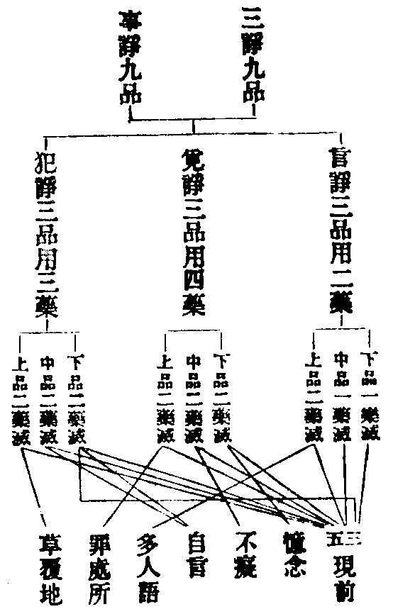



「现前」一种，通三诤该九品。除下品言犯不秉羯磨，但有三法；餘七并加羯磨，皆具五法。「自言」一种，局后犯诤，通治二品；自餘五种，单对一品。上云七药、四诤各分九品，诤如上分，药九品者：言诤二药，觅诤四药，犯诤三药，则为九也。



【疏】且就言诤分三品。



【疏】下品言诤，以三品现前毗尼灭：一、人现前，两家同聚，各说教理也；二、法现前，以三藏教判也；三、毗尼现前，教旨明白，疑暗自遣也。



言诤，下品中。三法现前，与后五法相滥。初简人者。三中能所合论，俱别人故；五中人者，但收所诤，能断属后「僧」中。二、简法者。前是教文，后即羯磨。三、简毗尼。前约开迷殄息，五据选德同评。是则此三，名通事局；僧、界二种，名体俱局。



【疏】中品言诤，以五品现前灭：一、人现前，须各陈诤意也；二、法现前，须僧作法详评也；三、毗尼现前，须用羯磨，有德同评，无德贬退也；四、僧现前，戒、见、利及三业，无乖同聚也；五、界现前，随约限内有僧皆集，无得隐也。



中品言诤。三、「毗尼」中，「须用羯磨」，谓作单白。拣集智人，不诵戒等人作白遣出，故云「无德贬退」。四、「僧现前」，须四人已上。五、「界现前」，局据作法分齐。



【疏】上品言诤，用现前、多人语灭。由前德人，屏处评理，依法断讫，能起诤人，身既不见，谓有欺隐。是以如来制令两众同聚，对面行筹，多者即是。法如药说。



上品中。「现前」如上。「多人语」者，初叙由。「屏处断讫」，蹑上毗尼现前也。「是」下，显制。捉筹多者为是，所谓「多人语」也。「法如药说」，指下解文中。



【疏】上解言诤竟。



【疏】次明觅诤三品，以四药灭者，觅分三品：以五法现前、忆念药，灭下品；五法现前、不痴药，灭中品；五法现前、罪处所药，灭上品觅诤。



【疏】次明犯诤三品：以三法现前、自言治，灭下品；以五法现前、自言治，灭中品；以五法现前、草覆地，灭上品犯诤。



觅犯。药病相配，寻图可知。



【疏】言事诤者，更无别药，即依三品。如上用药，各随同灭。是以文云：「以一切灭灭。」文中具三品诤，各分三品，下谓分诤设药治灭之相，如上解也。



事诤中。初示列诤同。谓三种事诤，随一种中分品同上，故云「即依三品」。「如」下，明用药同。「各随」，谓随诤不同。「同灭」，谓皆归殄息。下引文证。「一切」之言，总收七药。点文，可解(「具」对注合作「其」)。



【律】应与现前毗尼，当与现前毗尼。



【疏】次解第二药，初明，后释。



次列七药，牒章。云「第二药」者，牒前次科明「药」，即解文也。「初明」，即举戒文。「后释」，即下注解。



【疏】言「应与现前」者，谓法教托相，相须面现，屏量暗断，终未息情。此是意也。



释中，初科，可解。



【疏】言「毗尼」者，此云「律」也。「律」者，分也，笔也。谓须商度，据量有在，若律吕之分气故也。又如世法据刑约制，道法亦尔，依根附教，各有差降，不可乖越，故曰「法」也。「律」字安「聿」，「聿」者笔也。必审教验情，在笔投断，如斯面对，故曰「毗尼」。如初解也。



次科。翻名示义。「谓」下，别释。初释分义。一年十二月，奇月为「律」，偶月为「吕」。「律」为阳，「吕」为阴。一律一吕，各有二气，六律六吕，共二十四节气。故今喻「据量」，判断无滥。「又」下，次释笔义。初约俗律释，上卷云「笔即法家之象」是也。「据刑」，谓刑名；「约制」，即条制(有作「据形」约听，误也)。「依根」，即三根；「附教」，即律文。「律」下，正合笔义。从人从聿，象人执笔，《说文》曰「聿，所以书也。楚谓之『聿』，吴谓之『不律』(书君过故)，燕谓之『弗』，秦谓之『笔』」。「审教」，谓详法制重轻；「验情」，谓察用意深浅。俗中判断，落笔定刑，况今律乘，准判即决。举彼类此，故曰「如斯」。言「面对」者，即「现前」义。「如初解」者，指上三、五现前。



【疏】言「当与」者。既具三法、五法，明观灼然。须顺教行，以定纷诤，故曰也。



三中。初蹑前应与。「须」下，正释「当与」。「须」即当义。



【注】佛在舍卫国。时，迦留陀夷与六群在河浴，迦留陀夷误著彼衣而去。六群比丘后谓彼盗，便不现前与灭摈羯磨。迦留陀夷以缘白佛。便诃责已，因制此法。有三种现前，法、毗尼、人也。有五种现前，法、毗尼、人、僧、界也。云何法现前？所持法灭诤者是。云何毗尼现前？所持毗尼灭诤者是。云何人现前？言议往反者是。云何僧现前？应来者来，应与欲者与欲，得诃人不诃者是。云何界现前？唱羯磨作制限者是。此现前法，通一切羯磨。若别人对首、心念，三种现前即得。若四人、五人已上僧法，若作羯磨，必须五法现前。以羯磨所起，必在作法界故，唯除结界自然界中也。



【疏】就解分二：初缘，后相。就初，由在屏处作灭法，不召犯人问「何心取」，法是人非，何名实核？所以制约，须面对论。「三」、「五」两相，义如前解。又言「此现前法，通诸羯磨」，以类傍通，文相可解。



释注中。初二句分文。从初至「羯磨」是叙缘；「迦留白佛」下，即列相。「就」下，别释为二。初释缘。「灭法」，即是灭摈。心为业本，故必「问心」。「所」下，释相，指前可解。「又」下，点后文。本制灭诤，兼该一切众别羯磨，故云「傍通」等。



【律】应与忆念毗尼，当与忆念毗尼。



【注】佛在王舍城。时，沓婆摩罗子为僧知事。六群中得恶房卧具、恶请处，起瞋谤言「有爱、恚、怖、痴」，遂以婬事诬谤。亲於众中，佛问虗实，彼言：「我从生来，乃至梦中不婬，况於觉寤？」比丘以事诘问六群，便言：「沓婆清净，无如是事。」佛言：「沓婆无著人，不故犯戒，应白四羯磨与忆念法也。」



【疏】二、明「忆念」者，与法证明，忆记无犯也。无著罗汉，方行此法，自餘下凡，不可依据，不合行也。



第二。准前亦合分文为二，后五亦然。初略示。「无著」下，简滥。注中，初缘起，即上「二谤」戒缘，前云慈地嗔谤，即六群一数也。「亲」下，制法，又二。前对众捡勘，后与羯磨。



【律】应与不痴毗尼，当与不痴毗尼。



【注】佛在王舍城。时，难提比丘得癫狂病，行来出入，不顺威仪，多犯众罪。比丘诘问。便言：「痴时造罪，病差不作。」以事白佛，佛言：「三种狂痴：一者，常忆，说戒常来；二者，不忆，说戒不来；三者，或忆或来或不来。此人应白四与不痴羯磨，证知病时造过，差后不造，应僧清净，得足数。」故制。



【疏】三、明「不痴」者。以痴造罪，非心所怀，於教不制。痴解不作，未可徵治，不无前犯。故作白四，证痴不犯。与痴狂法，则行白二，由诤是非，稍难除殄，故此狂法，便行白四也。



第三，为二。初正释。「痴」，即颠狂心乱。「痴解」，谓狂病已止，得法解竟。「不无前犯」者，示有他疑，不与同法故。「与痴狂」下，简滥。颠狂羯磨，及与解法，并用「白二」。此有二意：一、为简二法，二、为彰别意。注中，初缘；「以事白佛」下，是相。文出三狂：初是下品，二即上品，此二不与法；三即中品，故须与法。



【律】应与自言治，当与自言治。



【注】佛在瞻波国。白月十五日僧说戒时，佛在众坐，默不说戒。初夜已过，阿难请说，佛言：「欲令如来於不净众中说戒者，无此理也。」中夜、后夜请，答亦尔。时大目连即以天眼观犯戒者去佛不远，内怀腐烂，外现完净，即手牵出，来白佛言：「众已清净，应得说戒。」佛言：「自今已后不应为。取自言治。」因制此戒。



【疏】四、「自言治」者。罪是自生，还须自露。对於人众，面陈其失，故曰「自言」，因言其罪，情无隐伏，则曰「治」也。缘中，由不取自言，恐后清人，滥被驱逐，因制斯药。亦有三法自言，五法自言，如上现前，可以知也。



第四，初释文。「缘」下，释注。初缘后相，寻文可解。



【律】应与多人语，当与多人语。



【注】佛在舍卫国。时，诸比丘於十八事诤不息，遂至僧中断，不了。以事白佛，佛言：「应与多觅罪相。法、非法语同一处，应差比丘令行舍罗。行有三种：一者，显露；二者，覆藏；三者，耳语。若上座标首智人、和尚、阇棃住如法地，应显露行舍罗；若住非法地者，作下二法行之；若非法语人多，彼应作乱起去故。」此律本云「求觅罪相」，意亦同之。



【疏】五、「多人语」者。由评法相，取解不同。故召两朋，同处面决。行筹五德具八法者，三种量度，详审众情，又知义理，邪正明决，依法行之。非法者多，且令散去，后当更断，待法语人。事希法隐，故略不述。



第五，初科。先叙缘，即注从初至「不了」也。「故」下，次示制法，即注「以事白佛」已下文也。「八法」者，《律》云：「不爱、不恚、不怖、不痴、知已行不行，有如是五法，应差行舍罗。」并解三种行筹法，共为「八」也。「三种」，如注所列。「舍罗」，即筹。筹有二别，一完，二破。从正者捉完筹，随邪者捉破筹，多者为是。细寻可解。注中，「此律」下，示别名。「事希」下，三、显略。



【疏】今亦有师共诤佛性，或道理有，或执行成，俱有俱无，不能自决。十住罗縠，凡下绝思。义须三藏，据理取断。是名事露法隐，谁有行之？



次科。「或理有」，谓理性本具，不假修证，此执有也。「或行成」者，谓行功所成，非性本有，此计无也。「俱有」，谓亦理具亦修成，此计两亦。「俱无」，如定性声闻、阐提无等，此执双非也。然彼佛性，不堕四句，凡计一竭，俱为戏论。「十住」字误，合云「十地」，或通指十圣，或但第十地及等觉人。彼见佛性，如隔罗縠观月，喻其末明。《涅槃经》云：「菩萨位阶十地，尚不了了知见佛性，何况声闻缘觉之人能得见耶？」文况下凡，非彼所测，则可知矣。「义」下，明合用此法。由是言诤，须教殄灭。「是」下，伤时不用。「露」，显也。法何所隐，由人不行耳。



【律】应与罪处所，当与罪处所。



【注】佛在释翅瘦国。时，象力释子善能论议，得外道切问，前后相违，僧中亦尔。比丘以事白佛，佛言：「僧应白四与彼羯磨，治取本罪，夺三十五事。若伏首本罪者，应白四羯磨如法为解。」故立此法。有本为「觅罪相」者，意同如上。而次第六，灭觅诤上品药故。



【疏】六、明「罪处所」者。由彼比丘多造罪故，辄便首重，及后举勘，便复引轻。僧量其情，亦可推核，未举自陈，多是其实，恐治引轻，定是虗枉。故重加法，夺其智能，伏首本罪，方为解救。故僧作法，徵其罪处，故曰也。



第六，初科。前叙缘起，即象力也。「故重」下，示制法。注文「有本」下，示异名。「而」下，示次第。由前名滥，恐倒乱故，仍定品位，决无相滥矣。



【疏】《律本》此名，或名「觅罪相」者，或「以多人为觅罪相」者。今诵戒人，不释药之上下，对病治灭，应先诵「多灭」，后诵「觅相」，此是好也。



次科。「或名觅罪相」，据《律本》也，今《删定戒》依《律》易之。「或以多人为觅罪」者，错用后名，召前法也，由《律》名同，致令滥用。「今」下，教依次诵。(「释」字误，合作「识」。)今《删定戒》，多觅是「多人语」，单觅即「罪处所」。名相既正，药病不差，故云「好」也。



【律】应与如草布地，当与如草布地。



【注】佛在舍卫国。比丘共诤，经年难灭。以事白佛，听彼此二众相对共灭。应一众中上座作白言：「我等行来出入，多犯诸罪，除『遮不至白衣家』，餘罪共长老作草覆地灭。」彼一众中上座亦如上作白已，彼此和合，罪诤俱灭，更不相问，如草覆地。



【疏】七、明「草覆地」者。两朋相诤，经年难灭，勘捡罪事，不知首尾，无由以教，取断是非。故直面对，各陈咎失，不须后说彼我是非，罪诤於此一时俱净。如草掩泥，事净便止，故曰也。



第七。初叙缘起，即拘睒弥诤，经涉六年。「故」下，示制法。「面对」、「各陈」等，即法仪也。「如」下，结名。法药如「草」，久诤如「泥」，从喻为名。注中，两众各一上座，先令彼众伏地，上座白忏，此众受之，然后此众对忏亦尔。「遮不至白衣家」，由对俗犯，所以除之。



【律】诸大德！我已说七灭诤法。



今问诸大德：是中清净不？(三说。)



【律】诸大德！是中清净，默然故。是事如是持。



【注】始从四重，终此七灭诤，八篇之文，广教正宗也。皆谓犯「略」制「广」，补其行教，有当机益。



【疏】结后释云，如注所引「当机益」者，明上八段广教正宗，惠利在机，必修於行，剋剪烦恼，深有成益也。



结章中。「结后释」者，即指注也。「八段」是教，教必利机，机必修行，行必破惑证果。为益之深，固可知矣。



【律】诸大德！我已说「戒经序」，已说四波罗夷法，已说十三僧伽婆尸沙法，已说二不定法，已说三十尼萨耆波逸提法，已说九十波逸提法，已说四波罗提提舍尼法，已说众学式叉迦罗尼法，已说七灭诤法。此是佛所说《戒经》，半月半月说，《戒经》中来。



【注】此即「广教」流通文也，恐情疎放，故总结以示之。



【疏】大段第三，言「诸大德，我已说《戒经．序》」下，广教别流通也。还牒九段，反束告知。举教所出，劝说流通也。



第三，广教别流通中。「还」下二句，释前牒名。「举」下二句，释后佛说等。通结。



【疏】自上，明广教三段竟。



三段，可解。



【疏】次释第二大段，略教行法，文分三段：第一，从初「若更有餘佛法」，至「应当学」来，明略教发起序；第二，从「忍辱第一道」下，至「广分别说」来，略教正宗；第三，「诸比丘」下，劝修流通也。



【律】若更有餘佛法，是中皆共和合，应当学。



【注】此谓「略教」之别序也。创佛利机，未劳麤显，直举纲要，闻皆会道。



【疏】就初略序，文云「若更有餘佛法」者。



【疏】一解：「据上释迦所说为本，望下六佛在释迦之前，谓之为『餘』，故曰『餘佛法』也。明此劝信修学，与下略说，作兴致之由，故名为『序』。」



第二，略教，亦分三分，序中三解，初解，正释中二。初释「餘」义。「据上释迦说」者，即广教。「六佛在释迦前」者，并过去佛也。「明」下，次释「序」义。



【疏】又解：「上章八篇广相，二机同感，『序』引七佛咸共说之。略教既被化初，多被摄心之士。恐於末法，无机不须。故列七法，同成一禁也。」



次列意中。对广明略。广教通被三时利钝二机，略教反上，一被化初，二唯利士。「恐」下，出疑情。「故」下，正列意。



【疏】问：「前解云『下有七佛说略』，何故偏指六佛为『餘』？」



答：「六佛摄义既宽，从多故也。」



问中。云「前解」者，即上卷明二教中，对前广教，七佛略偈并合为「餘」，文中「偏指」，故须问决。答中，释迦一偈，止明三业，总前广教更无别法。前六佛偈，各明一行，如「忍辱」等，广文不摄，故曰「义宽」。前可包后，后不摄前，故曰「从多」也。



【疏】又解：「据上广教，为当机之法，略教在广之外，谓之为『餘』。通有摄心之能，理须齐奉，故曰『是中和合，应当学』也。」



次解。前广为本，后略为餘。文理须便，此释可取。



【疏】或指偷兰之罪，八篇不列为「餘」。不成解也。



后解。全非略教序意，故所不取。



【疏】第二段，略正宗法，文分为七。



> 【律】「忍辱第一道，佛说无为最，出家恼他人，  

> 不名为沙门。」



【律】此是毗婆尸如来，无所著、等正觉，说是《戒经》。



【注】此贤劫前九十一劫出兴于世，一百年中常说此偈，后方广说。



【疏】初段又二。



【疏】初法体偈中，分二：上半明忍行之益，下半示不忍之损。



【疏】就初忍法有三：一、法思惟；二、他不益；三、安苦也。於辱生忍，故曰「忍辱」；行功既彊，入道最胜，故曰「第一道」。此明因行也。因不虗设，必能感果。是以次句明涅槃体寂，不为诸相所迁，故曰「无为」。出离中胜，故曰「最」也。



二、正宗分，第一佛，上半偈中，初科又二。初释上句。前通列三忍：「法思惟」者，谓於诸法，安忍思择，而不劳倦；二、「他不益」者，彼怨加害，而不反报；三、「安苦」者，众苦逼迫，安然忍受。今释「忍辱」，即当第二，梵语「羼提」，此翻「忍辱」。「行功强」者，《经》云：「忍之为德，持戒苦行，所不能及。」、「因不」下，次释下句。「无为」即目涅槃自体。「诸相」即生、住、异、灭四相，简诸有为，随相迁变，有坏灭故。



【疏】又释：「忍力最大，不为缘动，名曰『无为』。诸行中胜，故曰『最』也。」



次释。「忍力大」者，《经》云：「能行忍者，乃可名为有力大人。」、「不为缘动」，「缘」即恼辱等。



【疏】又释：「夫欲净澄戒行，必以忍法为先。既令戒净，故先叹忍也。忍成戒净，有相自亡，故次叹无为也。」



后释。欲附所宗，故兼「戒行」。以「戒净」故，业遣惑除，故云「有相自亡」。



【疏】下半诫劝中，「沙门」，名息恶之士。今内违外恼，便乖出俗形名也。「出家」异俗也，「沙门」异名也。



下半偈中。初示名义。「今」下，正释。起嗔是「内违」，害他为「外恼」。既不息恶，故乖「形名」。「出」下二句，举文配释形名，出世反俗，故并云「异」。「俗」字，合作「形」。



【疏】次释能说法人中，分三：初题名，二、举号，三、结法属人也。



次能说人中，分文为三。餘六并尔，下更不分。



【疏】「此是毗婆尸」者，显前所说有劫佛名也。此佛在贤劫前九十一劫出世。由中间劫空，故远取有劫佛，以成七世也。乃至后弥勒佛兴，即以尸弃为第七之祖也。如是广知。本曰「毗婆尸」，或曰「婆沙」、「钵沙」，此译同为广说也。



题名中。初总示。「毗婆尸」，如下自翻。「此」下，别释。初明劫数，此依《长阿含经》所列，下六并尔。此佛出世，三会说法，度三十四万八千人。「贤劫」者，慈恩《劫章》云：「即此住劫称贤劫，二十劫中第九劫。」此界成后，有千佛出世，既多贤圣，故名「贤劫」。「在前九十一劫」者，谓跨过空劫，逆数坏、住、成，更跨一空劫，复取坏为八十劫，即当前住劫第十劫，故云「远取有劫」等。欲顺世谛，以「七」为祖故也。弥勒兴时，除毗婆尸，故「以尸弃为第七」。若据相承，合云「第一」，此约从亲至踈，以释迦为始，远劫为第七也。乃至后佛出世，第减亦然。「本」下，翻名。梵言三别，「毗」字并同，故下二不举，《智论》亦云「鞞婆尸」，此翻种种具。



【疏】二、「如来、无所著、等正觉」者，佛德难穷，略陈三号，解释如常。



次举号中。《成论》云：「乘如实道，来成正觉，故名『如来』。」此谓从真垂应为名。结惑永尽，故名「无所著」。道同三世，故名「等正觉」。若对三身：初应，二报，三法。亦即解脱、般若、法身三种德也。若对十号，彼无第二，又「等正觉」即彼佛号，华、梵各举耳。



【疏】三、「说是戒经」者，明忍清戒之法，戒净由忍而成。既是正法，判非邪教，故陈圣量也。



三、结法中。初二句撮前略偈。「既」下，正释结文。指此略教，是彼佛说，故云「陈圣量」也。



【疏】下六佛，并同此解。



指例中。以下六段人法不同，餘皆无别，故通指之。意使学者临文准判。



> 【律】「譬如明眼人，能避险恶道，世有聪明人，  

> 能远离诸恶。」



【律】此是尸弃如来，无所著、等正觉，说是《戒经》。



【注】此贤劫前三十四劫出兴于世，八十年中常说此偈，后方广说。



【疏】第二段略如上分之。



【疏】就初偈中，但明离过行也。上半约譬明离险，下半约世明远恶也。俗世俱有远险避恶之能也，况出世缺有之士，而同尘随染乎？



第二，法偈中，初总示。「上」下，判释。初分偈句，上半约喻以明，下半即举世事为比。如俗中君子，怀仁抱义，迁善远恶，所谓「聪明人」也。「俗」下，通合。「缺」，即破也。



【疏】下明能说人中，言「尸弃」佛，与第三同在贤劫前三十四劫中出世。前后两分，空劫无佛也。



能说人中。「尸弃」此翻「云火」(能烧有明，可名佛德)，七万岁时出世，三会度二十五万人。「贤劫前三十四劫」，亦从空劫前坏劫逆数，即当住劫第七劫，此与下第三佛同劫同人寿时出世，但年有前后耳。(或云后佛八万岁者，非。)「前」下，通示七佛，谓空劫前取三佛，空劫后取四佛，故云「两分」等。



> 【律】「不谤亦不嫉，当奉行於戒，饮食知止足，  

> 常乐在空闲，心定乐精进，是名诸佛敬。」



【律】此是毗叶罗如来，无所著、等正觉，说是《戒经》。



【注】此佛出世与前同劫，人寿七万岁，七十年前说此略偈，后方广说。



【疏】第三段略偈，明止作二行，教化於时也。就初四句，明身口奉戒止行成就相，后有半偈，修善䇿勤作行成就也。



【疏】就初又二：初半偈，口无过也；次半偈，身离过也。



【疏】同住检行，称根而举，名「不谤」。又解，称法而谈，无颠倒过，不非圣说，故曰「不谤」。见他名利，口无讥毁，名「不嫉」也。二过既无，理资行本，故「当奉戒」也。



第三佛，初止行，上半中。初释「不谤」有二义。前约举罪释，后约说法释。「颠倒」、「非圣」，即名「谤法」，高座讲说，宁不慎乎？「见」下，次释「不嫉」。「行本」，即目「戒」也。



【疏】就身离中，受纳有方，不生内苦，故「知止」也。在喧乱道，处静同圣，故「乐空」也。



下半偈中，节食、处静，并道缘故。



【疏】上既身口据法，定慧必有日新，故曰「心定乐精进」。䇿修之慧，即四修也。法非餘人所传，深须谛受，故曰「是诸佛教」也。



作行中。蹑前生后，前是身口业，此即心业，又前是戒学，此即定慧二学。「日新」，日有进益也。「䇿修慧即四修」者，举四正勤，释上精进：一、已生恶令除断，二、未生恶不令生，三、未生善令生，四、已生善令增长。「法」下，释下句。此句文局在后，义总结前。能说人，前文已示，偈后不释。「毗叶罗」，亦云毗舍浮、鞞恕附、随叶等，皆音互耳。此翻「一切慈」，种姓同前，娑罗树下成佛，二会说法，度十三万人。



> 【律】「譬如蜂采华，不坏色与香，但取其味去；  

> 比丘出聚然，不违戾他事，不观作不作，  

> 但自观身行，若正若不正。」



【律】此是拘楼孙如来，无所著、等正觉，说是《戒经》。



【注】此佛贤劫初佛，人寿六万岁时，六十年常说此偈，后方广说。



【疏】第四段中，说自利利他行，或纯自利行。



【疏】初释分二，初偈明利他行法，下偈但明自利行也。



【疏】就前偈，初三句喻文，后「比丘」下合喻。



【疏】初中，假名行者，待食资身，如蜂在聚也，乞食如「采」。世华揽四尘以成，有感果之用，故名「华」也。施主亦以四事和合名施，必同感果之用，故如「华」也。又蜂之采华，非直取味，亦损色香，但取之至微，不损成华感果之用，故曰「不坏色香」也。比丘亦尔，终不多求坏俗之信，义同不坏色与香也。趣乞少许，资身长道，故曰「但取其味去」。



第四佛偈，初两利，释利他喻中。初释上句。「乞食如采」句绝。「世华」下，举喻。「四尘」，即香、色、味、触。「施主」下，合喻。「又」下，次释下句。初举喻，「比丘」下，合喻。



【疏】文中，「比丘」合上「蜂」也。「出聚」者，方欲乞食向俗，故云「出」向聚落。如蜂不异，故曰「然」也。又云「出聚」者，入聚落得食，出诣僧园将噉，无损俗怀。如蜂在林取味，出林还返，故云「出」也。又有戒文为「入聚」者，言比丘初入，必以蜂喻自观也。



合法中。初牒释，有二。前约初乞出去释；「又」下，次约乞已出还释。「又有」下，点异。「初入」、「自观」，同前初释。



【疏】下偈明自行中，上明不外违，下明唯内慎也。「不违戾」者，众行不乖也。「不观作不作」者，别人不预也。夫好恶由乎净秽，爱憎必因斯起；凡夫遂有去取，终恐涉於贪瞋。事须两遣，成於舍护也。下「自观」中，如常解。



自行中。初总分。「不违」下，别释。初释上半，众别两行，并属他故，众不可戾，别不须观。「戾」，乖也。「预」，犹辨也。「夫」下，显意。行「净」故「好」，行「秽」故「恶」，见「好」则「爱」而「取」之，见「恶」必「憎」而「去」之。既是凡夫，取舍不以道，往往爱起於「贪」，憎出乎「嗔」，反成自累。故须爱憎两遣，平一其心，故云「成舍护」也。「下」下，指略下半，谓须剋己，正则守之，不正则改之。斯乃为人为道，处众立身之要术矣！



【疏】又通作自行解。初三句喻文，下并法说。行者「如蜂」也。将入众中，学於行仪，为「采」也。清众法成，有感果用，为「华」也。依法而行，不乖众网，名「不坏」也。采取教法，有资神用，名「取味」也。「比丘」，合上「蜂」也。「入聚」，合上「采花」。「不违」等半偈，合上「不坏色香」也。「但自观」下，合上「取味」也。



次自行中，初释。初总分。「行」下，别释为二。初释喻，此约入众学法为「采」，依教奉行为「取味」。「比丘」下，释法说。「入聚」，谓预众也。餘合可解。



【疏】又解：「初偈明自行也，形报须资，依俗济道，受纳有仪，如初偈也。行假众成，力未兼济，随机处默，恐恼僧仪，故自外护，即后偈也。」



次释中。初偈「自行」资报，次偈「处众」护僧，大同初释，但从大判，不复碎分耳。



【疏】第二，结能说中。「拘楼孙」，贤劫成时，人寿六万岁。时六十年常说此偈，过此方说广也。上下并须比事，如此释之。



能说中。「拘留孙」，一云「迦罗鸠飡陀」，或云「迦那伽」，此翻「金仙人」，即贤劫第九减劫，一会说法，度四万人，从人寿八万岁减至六万岁时出世。「上下」，通指令同此释，然经注自显，不复引也。



【疏】问：「劫初人化，命限无量，佛何不出者？」



答：「无过放逸，虽出不受正化。故《论》云『劫减佛兴，劫增轮王』也。」



问中。言「人化」者，谓劫初时人，多从天化。答中，初约义释。下引论证，未详何论。言「轮王」者，《地持》云「初地菩萨作转轮王，王四天下，以十善化人，在於劫初」等。



> 【律】「心莫作放逸，圣法当勤学，如是无忧愁，  

> 心定入涅槃。」



【律】此是拘那含牟尼如来，无所著、等正觉，说是《戒经》。



【注】此贤劫中为第二佛，人寿四万岁，二十年前常说此偈，后方广说。



【疏】第五段，明轻纵放逸行。然放逸之相极多，莫非迹散流俗，心随苦乐，名「放逸」也。如《涅槃》说「最为善行之霜雹」。就偈分二：上半明因行，下半明果满也。



第五佛偈，标分中。初示放逸相。「迹散流俗」，谓行非洁白。「心随苦乐」，谓志不坚正。「如」下，引示。放逸能丧「善行」，「霜雹」能摧生物，故以喻焉。彼经第十三云：「诸善男子，因不放逸能生世出世法，若有欲得阿耨菩提，应当勤修不放逸法。夫放逸者，有十三果报：一、乐为世间作业，二、乐说无益之语，三、常乐久寝睡眠，四、乐说世间之事，五、常乐亲近恶友，六、懈怠懒惰，七、常为他人所轻，八、虽有所闻寻复忘失，九、乐处边地，十、不能调伏诸根，十一、食不知足，十二、不乐定寂，十三、所见不正。夫放逸者，虽得近佛及佛弟子，犹名为远。」



【疏】纵心尘境，随缘染著，方名「放逸」。若能摄心，与正观相应，离诸缘过，故曰「心莫作放逸」。然逸通身口，心为本业，故指「心」也。此明离过，进修会正，有解脱因，名为「圣法当勤学」。



上半偈中，初释上句。初牒释。「逸通身口」，言其末也；「心为本业」，穷其始也。「此」下，释下句。蹑前离过，生下学法。



【疏】「如是」者，牒上因成也。由行圣法，入增忍位，苦业永亡，故曰「无忧愁」也。心净慧明，诸有永绝，故曰「心定入涅槃」也。



次半偈中。初释上句。「增忍位」，即内凡第三位。「苦业永亡」者，且据三途因果为言，以忍位不退，不堕恶道故。「心」下，次释下句。「诸有永绝」，即无学极圣。上举深贤，永离三恶，下举极圣，永出三界。



【疏】贤劫初第二佛，四万岁时出世，三十年前恒说此偈。



能说人中。「拘那含牟尼」，此翻「金色仙」，一会说法，度三万人。



> 【律】「一切恶莫作，当奉行诸善，自净其志意，  

> 是则诸佛教。」



【律】此是迦叶如来，无所著、等正觉，说是《戒经》。



【注】此贤劫第三佛，人寿二万岁，二十年前说此偈，后方广说。



【疏】第六段，明三学行，轻过修善也。偈文为二：初三句明行教，下一句指非滥说也。



【疏】就初有二句：上明止恶，下明修善。次有一句，明止作二行本唯心起，当观志意也。心有所主名「意」，贞固难拔名「志」也。



第六佛偈，上三句中。初分句；「心」下，点文。「志」、「意」并心，从义两别。



【疏】斯之正戒，非餘邪术，故曰「是诸佛教」。



次释下句，可解。



【疏】贤劫第三佛，人寿二万岁时出世，二十年前常说此偈。



能说中。「迦叶」，此翻「饮光」，一会说法，度二万人。



> 【律】「善护於口言，自净其志意，身莫作诸恶，  

> 此三业道净，能得如是行，是大仙人道。」



【律】此是释迦牟尼如来，无所著、等正觉，於十二年中，为无事僧说是《戒经》；从此已后，广分别说。



【注】此佛「略教」，即是「略」之正宗也。时接利根，无再犯者。后因重过，佛止不说，即以广、略二教付弟子说也。



【疏】第七段，明调三业门，以化於时。偈分为二：初一行明三业行净，后明行成会正也。「是大仙人道」者，佛为世导，任物施名，仙为俗网所欣，故佛因之立教。小仙未免三恶，大仙永离九居，故曰也。



第七佛偈。初分文。「是」下，牒释。初示名所以。「小」下，次明简异凡仙。《萨婆多》云：「薄伽梵於世俗中，是尊胜故，又於声闻独觉之仙，是殊胜故，号『大仙』也。」此则二乘亦名「小仙」，今文且对凡仙，故云「未免三恶」。「九居」，即三界，欲界为一，色、无色各四，并众生居处，故曰「九居」。



【疏】能说人，此贤劫第四佛也。义当分三：「此是释迦」下，明能说之人；「於十二年」下，明略教所为也；「从此已后广说」者，明息略通广也。



能说中。「释迦」翻「能仁」，「牟尼」翻「寂默」。人寿一百岁时出世，说法不计会，度人不计数，十二年常说此偈。标分可解。



【疏】「为无事僧」者，如光师释：「由未最初犯，故曰『无事』。」又释：「容有初犯，但不在众，得行说戒，故曰『无事』。」今释云：「如《律》，五年制广教，便有犯人。但最初不犯，即名『无事』也。至十二年，方有重犯。如《律》，佛言『从今我不说戒，汝今自说』等。」



牒释中。初文三解。光师约未兴广释。次师，约屏犯不碍说戒释。彼谓因在众犯，佛始不说，则知已前不在众犯，皆名「无事」。今解中，「五年有犯」，即破初解。「最初不犯」，即破次师。至后「重犯」，方名有事。「如」下，引证，文见《灭诤》。



【疏】问：「佛何不为犯者说？」



答：「以无事不知，无时不练，犯人三问不答，必有碎首之苦。故不为也。」



次科，初问答中。「事」谓行业，「时」即三世，正徧知海，无不明练。「碎首苦」者，《五分》云：「五百金刚，常随佛后，三问不答，竞举金刚杵击碎其头。」如《涅槃》说，此亦化现，非实尔也。



【疏】问：「佛僧两说，俱为行净之士，如何一开一闭？」



答：「佛眼无不观了，唯行净者，方同。僧制取报，三根现净，得陈说戒。」



次问。僧中通秽是「一开」，佛唯净境是「一闭」。答文，可解。「报」，告也。



【疏】问：「俱有说能，开闭犹昧，请陈其旨？」



答：「佛说不应，则神杵坏之，僧说不应，则无神可损。故知末法，净秽同居。但说对净士，会机入正。秽虽在众，不坏僧法，但自坏行，远有出期也。」



三问。以前义未尽，故复徵之。答中，还用初义，两以释通。「故」下，显益。「会机入正」，「会」，合也，「正」，即正道。「远有出期」者，谓无近益，《业疏》云「自为来习」是也。



【律】诸比丘，自有乐法、乐沙门者，有惭、有愧、乐戒者，当於中学。(此谓「略教」之流通分。)



【疏】第三，「诸比丘」下，明略教流通也。「自为」者，独拔厌世也。「乐法」者，修善教也。「乐沙门」者，息恶士也。「有惭」者，隐不起过也。「有愧」者，外无非违也。「乐学戒」者，总摄上五，成斯行本也。「当於中学」者，明上略教，为行者所依，可受而从，必有成济也。



三、略教流通中。初总示。「自」下，牒释。列释简人。「隐不起过」，即屏处；「外无非违」，谓露处也。「总摄上五」者，由具上五，方能奉戒，故云「成行本」。「当」下，释劝学。「可受而从」者，教非虗授也。「必有成济」者，行不徒为也。



【疏】大段第三，明广略二教总流通，文分为五：初从「明人」下，至「诸佛法」来，明广教行益，劝信流通；第二，「若有自为身」下，至「入寂灭涅槃」来，明略教行益，开演信顺流通；第三，从「世尊涅槃时」下，至「得入涅槃」来，明戒为众行之师，善护行净之士，明付嘱久住，以辨流通；第四，「若不持此戒」下二偈，明违佛遗嘱，必有陷坠之咎，劝信奉顺流通；第五，「我已说《戒经》」下，结前回向以辨流通。



第三，二教流通，分文五段。须用科语，一一对《经》，方见《经》意。



> 【律】明人能护戒，能得三种乐：名誉及利养，  

> 死得生天上。当观如是处，有智应护戒，  

> 戒净有智慧，便得第一道。如过去诸佛，  

> 及以未来者，现在诸世尊，能胜一切忧，  

> 皆共尊敬戒，此是诸佛法。



【疏】就初段，分二：初有二偈，正彰戒益劝观；第二，「如过佛」下一偈半，引彼三世同遵行益也。



【疏】就前有二。初有偈半，明持之时，不期世报而冥感获。次有半偈，明持戒之善，与慧相资，道成远益。超出相有，名「第一道」也。释文可解。



初广教劝信，初中。初科分，末后一句示略。今略点之。初偈半中，初句标持人，必是智士，故曰「明人」。次三句，先举世报，以诱钝根。上句总标，下二句别示。「名利」是现报，「生天」是来报。下二句，上句劝观，下句劝持。「如是处」，即上三乐。「有智」，即召信奉之士。下半偈，次示出世果，通接利钝。谓因奉戒，发生定慧，破惑证圣，故云「第一道」也。上句明修因，下句显证果。



【疏】第二，引上广行之教，必有正说之人，故通明三佛，既并绝缚，俱遵戒法，若斯敬持，「是诸佛法」也。



次科，偈半中。前一偈，上三句别举，义通十方。下一句显德，圣智灭惑，生死苦尽，故云「能胜一切忧」。后半偈，谓既为三世尊敬，则显是「诸佛法」，既是佛法，同当奉持。



> 【律】若有自为身，欲求於佛道，当尊重正法，  

> 此是诸佛教。七佛为世尊，灭除诸结使，  

> 说是七戒经，诸缚得解脱，已入於涅槃，  

> 诸戏永灭尽。尊行大仙说，圣贤称誉戒，  

> 弟子之所行，入寂灭涅槃。



【疏】第二段，略教分三：初一行，明律主引略劝之文；次一行半，举七佛说略行之度世也；后「尊行」下一偈，明七佛诸子，承奉圣教，亦同度世。明信顺於略，既有功能，义非徒诫故也。



第二，略教信顺，有三偈半。初分文；「明」下，示意。初一行中，上二句召机。「自为身」者，厌生死苦也。「欲求佛道」，希涅槃乐也。下二句劝信，「正法」即略教，「是诸佛教」者，极圣同遵故。次行半中，前三句举七佛说略。上二句叹德，下句演法。后三句，明行之度世。上下二句，明破障；中间一句，明入道。破障中，上句「诸缚」，是烦恼障；下句「戏论」，即所知障。后一行，弟子奉行，初句遵师教，次句赞略法。「圣贤」，通目诸弟子。下二句彰益，上句成因，下句证果。



> 【律】世尊涅槃时，兴起於大悲，集诸比丘众，  

> 与如是教戒：「莫谓我涅槃，净行者无护；  

> 我今说《戒经》，亦善说毗尼，我虽般涅槃，  

> 当视如世尊。此经久住世，佛法得炽盛；  

> 以是炽盛故，得入於涅槃。」



【疏】第三，「世尊涅槃时」下，分三：初一行，引佛戒时，将传遗训之仪；第二，「莫谓我涅槃」下一行半，正明付嘱之法；后三，「此经久住世」，明依教修行，佛法增益广大。由依教行，如佛在日不殊，故「得入」灭也。



第三，付嘱流通，有三行半。初一行中，「涅槃时集众教戒」者，即《涅槃》重扶戒律，《遗教》珍敬木叉，今撮彼意，以为偈辞。次一行半中，初二句遮疑，恐谓佛在须护，灭后不护故。「我」下，示人法住持相似。上二句指所说法，则戒与律。下二句令观法如佛，即《遗教》云「当知此则是汝大师」，又《经》云「若见法者，即见我身」等，并同此意。后一行中，叹教功益。初二句，明住持益。教存人奉，匡僧导俗，修因剋果，三宝久住，莫不由斯。下二句，明得道益。



> 【律】若不持此戒，如所应布萨，喻如日没时，  

> 世界皆暗冥。当护持此戒，如牦牛爱尾；  

> 和合一处坐，如佛之所说。



【疏】第四，「若不持此戒」下，明违教有损，文分为二。初偈举损，令慧日沈，众行没也，故譬「日没」，则众「世」、「暗」矣。后偈覩损劝持，奉戒遮防。「牦牛爱尾」，成上持戒也。「和合如说」，成上「如所应」也。



第四，奉顺流通二偈。初偈，上半法说，「若不」字，贯下二句。「不持戒」丧自行，「不布萨」灭众法。此二既亡，群生愚冥，无所见故，「如日没」也。下二句举喻，如疏对合。后一偈，上半劝修自行，上法下喻。「牦牛」，《说文》云：「酉南夷长髦牛也(言出在夷国，髦即尾也)。」世传其牛尾长赤色，牛所护惜，故教中多举为喻。下半劝行众法。佛初亲说，令倣上圣，故云「如佛说」也。或可令遵佛制，半月复行，亦如疏配。



> 【律】我已说《戒经》，众僧布萨竟。我今说《戒经》，  

> 所说诸功德，施一切众生，皆共成佛道。



【疏】第五，「我已说」中，分二：初一偈，结前广略之文；后半偈，明说戒之益。岂唯即坐，亦回斯业，通被有心，故云「成佛道」也。



第五，回向流通一偈半。初一偈中，上二句结所说二教，下二句集始末行功。后半偈中，上句所施之境徧该法界，下句所期之益直至菩提。前序归敬诸佛，后偈三世同遵。「欲求佛道」、「施生成佛」等，独出今宗，高超群部。使夫行者学有所归，行无虗弃。《业疏》所谓「故须域心於处」者，旨在兹矣。文云「有心」，即目众生，《华严》云「凡有心者，皆当作佛」是也。



【注】斯文即法护尊者所撰，为广、略二教总流通也。今余所注，述而不作，将用尘露山海，昭扬远代，同舟所存，固其尔矣。



【律】四分律比丘含注戒本(下)



【疏】随义更消，亦得。但讲通将了，说导若流。众又久习，多生怠慢。故须约略指掌，接悟群情可矣。



------



## 【疏】四分律含注戒本疏卷第四



结略中。上句示不尽。「但」下，显略意。上二句，明说者意阑。「说导若流」，言其欲速竟故。次二句，明听众情慢。后二句，结前简略，颇适机宜。



四分律含注戒本疏行宗记四下之三(终)



【疏】余以轻生，簉筵正法。昔在童稚，即有信心，无缘携接，致及过学，年十有五，方得寻师。十六诵经，十七剃落，大业餘历，蒙受具戒。



于时佛法梗塞，寺门常闲，致於律教，无处师寻，但在守文，持犯不识。大唐御世，时遭俭约，乍欲投听，志不自由。武德四年，方得预听。才得一徧，便欲坐禅。和尚教曰：「戒净定明，慧方有据。始听未闲，持犯焉识？汝且专听，吾自为汝知僧役务。」又往听律十徧，心乐禅思，不忘昼夜，闻持犯处，多贯心怀，至於文句，并不寻究。又欲坐禅，和尚又曰：「更听十徧，可遂汝心。」又往律筵，依位伏业。时首律师亲命覆读，自顾愚暗，文句缺然，至於义理，依语谨诵，未是心证，何容覆讲？遂不敢受。听二十徧，时经六载。



贞观初年，周游讲肆，寻逐名师，若山若世。遂以所解，造《钞》三卷。未及覆治，人遂抄写。



贞观四年，远观化表，北游并晋，东达魏土。有厉律师，当时峰岫，远依寻读，始得一月，遂即物故。抚心之痛，何可言之。



乃返沁部山中，为择律师，又出《钞》三卷。乃以前本更加润色，筋脉相通。又出《删补羯磨》一卷、《疏》两卷，《含注戒本》一卷、《疏》三卷。



于时母氏尚存，屡遣追唤，顾怀不已，乃返隰列。同法相亲，追随极众，乃至三十达於河濵。一夏言说，又出《尼注戒本》一卷，遂尔分手。唯留钞本，餘并东流。巡涉稽湖，达於京邑。



十六年内，母氏云崩。性不狎喧，乐居山野，乃因事故，遂往南山。至二十年，方得岩隐。有乐戒者，乃复相寻，祈广其文。事不获已，又出《羯磨》，并《疏》四卷。永徽初年，又请《戒本》及注解疏。情不能已，又出《戒本含注》，并《疏》四卷。值患停废，心志辽落，昏忘非一。为求不已，至永徽二年九月十九日，方为疏讫。粗得开其大务，决事行用，颇有准承。余今暮年，旦夕为命，故以历之，亦绝笔有据耳。



No. 714-F 分会含注戒本疏记䟦



曾听天皷自然鸣，又闻钟皷俟桴方鸣矣，毗尼为言，亦复如是乎？性则无问而自说，遮则待机说之，是并正遍知者所以令然也。



于兹有岁，星宿戊午。孟冬之一日，有客调律吕，敲予蓬门。来者，启扉窥之，则断金臭兰之徒也。



问讯已竟。客叉手改端云：自佛法东渐，南山之正流溢於四海；律教隆盛，持犯开遮灿然维新矣。凡普天之下，释门之缁素，孰敢不祇奉乎？且终南之遗书，其大者三，所谓钞及二疏也。於中《戒》、《业》二疏本末异卷，后进之英达踟踌照校矣。于粤有律师字禅龙，固执一字权，普泛四等航。其慎独也，效乎艸系焉；其爱物也，比於鹅珠焉。将济学徒费劳，甞会《羯磨》、《疏》、《记》，以流行天下，云云。



予窃谓客云：汝与彼龙公分会之场耶？客云：尔也。复问：律师何为不会注羯磨耶？客云：未审何意。予谓：希冀本文俱会即可乎，将不可耶？客云：如我惟忖，芝祖《科文》正科《疏》文。不系本文焉，其为此耶。



余云：此何伤斯在。且举其例。如天台法华会本，依《文句》科以会《经本》，随荆溪科以分《文句》，今亦举一千从，依《疏》牒文以会注及《戒》，随《记》科释，分会《疏》文。且《钞》是宗钞，岂会《戒本》乎？《疏》是注疏，宜牒会本文。不可一准耳。客云：唯尔，一言以著书诸绅矣。客退暂时云：今《注戒》、《疏》、《记》阙之会入，须作此之分会注戒俱赋矣。



余云：原夫戒体玄微，德用难思，不曰高乎？越彼之太虗，不曰深乎？方之於沧溟，恢恢焉，晃晃焉，逈出言象之外也。今也将提短绠而临于深井，挑小管而窥於广天。吾恐不知量，招罪於大方，与厥贻讥乎后世。孰若其屏德，无声无臭。且夫小慧者德之贼也。名是实之宾，苟求虗誉，遂劳同志，言不得其门而臻彼奥，则无有是处。徒弄文章，终失醇粹。请勿受言矣。



客愤然进席。悱然抵掌云：《钞》、《记》既会，业疏亦成。第所残阙个书耳，汝今当仁岂让他。



起予鞭吾，恰急於魏帝之贵幼弟也。如予斗筲之器，虽不以足贵，而扬桴击皷，虽欲不鸣，其岂可得遂乃谩诺矣。退而倩想，自小学薙染志学入律以来，长被佛祖旷恩，夙浴三学法水，实知罔极矣，焉敢不谢之乎，是亦非宿因所令然耶。况复戒则定慧之本原，十方如来一门超出妙庄严路，戒足不全，若为发趣？欲全戒足，则岂舍之。



大哉戒德，方行资始。《百论》盲跛之譬，《牟子》之说行之解如之何乎？苟守一隅而固辞，则早晚使挑，慧矩苍生，照正行之路。因而利其器，从事於斯矣。而戒本注疏文段钩鏁，不唯一重。殆病符合，而赖绎文逐节排布。《疏》、《记》循科分会纶次，今将法彼曲成从，天地易简，五部俱会，一览使普矣。兹稔功成，更以异本校讐，犹恐爽灵鉴多矣。恭候后喆之琢磨，非敢功於比先辈，才酬佛恩，少答祖德矣。冀称性微勋，弥编法界，佛日增辉，法寿无穷矣，云尔。



赞阳日内山阴沙门释种莲合即静阁毫於灵芝寺遍照光院方丈于旹宽保二年星舍壬戌盂冬谷旦

