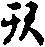
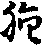
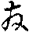
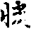
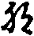
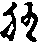
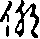

# 四分律疏



> **藏经**：卍新纂大日本续藏经（新纂卍续藏）　**册次** 第 41 册（X41）　**编号** X0731　**部类** 律疏部　**卷次** 10 卷　**篇幅** 558,626 字

> **作者（译者）**：沙门　法砺　撰、沙门　法砺　撰述、沙门　法励　撰述

> **卷／品**：10 卷 · 0 品



---



## 目录



- [四分律疏卷第一](#四分律疏卷第一)

- [四分律疏卷第二](#四分律疏卷第二)

- [四分律疏卷第三](#四分律疏卷第三)

- [四分律疏卷第四](#四分律疏卷第四)

- [四分律疏卷第五](#四分律疏卷第五)

- [四分律疏卷第六](#四分律疏卷第六)

- [四分律疏卷第七](#四分律疏卷第七)

- [四分律疏卷第八](#四分律疏卷第八)

- [四分律疏卷第九](#四分律疏卷第九)

- [四分律疏卷第十](#四分律疏卷第十)



---



四分律疏目次



卷第一本自开发经题至发戒缘竟



卷第一末自辩受体至正请竟



卷第二本自正宗分初至比丘四波罗夷法总释第十持犯  

对治



卷第二末释四波罗夷法别解中婬盗二戒



卷第三本自四波罗夷法中杀戒至十三僧残法第八戒缘



卷第三末自十三僧残法之餘至二不定法



卷第四本自三十尼萨耆法初戒至第四戒



卷第四末自三十尼萨耆法第五戒至竟



卷第五本自九十单波逸提法初戒至第二十六戒



卷第五末自九十单波逸提法第二十七戒至第五十八戒



卷第六本自九十单波逸提法之餘至第二分律比丘尼十  

七僧残法第七戒



卷第六末自比丘尼十七僧残法第八至一百七十八单波  

逸提法



卷第七本释受戒揵度第一



卷第七末自受戒揵度第一之餘至说戒揵度第二



卷第八本自安居揵度第三至第三分律衣揵度第六



卷第八末自药揵度第七至瞻波揵度第十



卷第九本自呵啧揵度第十一至遮揵度第十四



卷第九末自破僧揵度第十五至灭诤揵度第十六



卷第十本自尼揵度第十七至第四分律毗尼增一



卷第十末自毗尼增一之餘至竟



四分律疏目次(终)



No. 731



------



## 四分律疏卷第一



**译者**：沙门　法砺　撰



凡欲开发经题，须为三要。言三要者：第一、举宗摄教，第二、知教指归，第三、正释律初题目。言举宗摄教者，圣教虽众，略要三种。所言三者：第一、修多罗藏，第二、毗尼藏，第三、阿毗昙藏。言修多罗藏者，所谓经；言毗尼者，谓诸戒律；言阿毗昙者，即是诸论。今兹律典，三藏□中，乃是第二毗尼藏摄。



第二辨教宗者，此律所明，□义通论，兼诠定慧。故下文言：云何增戒学？所谓□□学、增心学、增慧学，是名增戒学。良以止作俱戒，故□以宗求。其唯戒学，分别戒学，两番料简。第一受戒法门，第二随戒行相。言受戒者，创发要期，断恶修善，建志成就，纳法在心，目之为受。言随戒者，受兴於前，持心后起，义顺受体，说之为随。就受随二门，各开为两。谓受门二者，为彰戒法有为，不能孤起，藉因托缘，然后方发，故明能发之缘。既有其缘，必所得故。次第二所发戒体。言受缘者，寔以位陛圣凡，报殊男女，托缘不同。案此律辨五种受戒：一曰善来，二称上法，三名三归，四曰八敬，五者羯磨。斯之五名，备如常释。第二言受体者，据要而论，不出二种：一者作戒，二无作戒。言作戒者，方便身口，造趣营为，称之为作。二无作者，一发续现，四心三性，始末恒有，不藉缘辨，号曰无作。斯之二种，□□悬防，同称为戒。若也作戒，以色为体。言无作者，非□□心。第二次辨随戒二门者，第一专精不犯，第二犯已能悔。言专精者，上行之流，一往顺教，恶离善行，称曰专精。但持有二种：一明止持，二明作持。言止持者，念智舍等，护防身口，不造诸恶，称之为止。止而无违，顺受光洁，故曰止持。言作持者，奉顺圣教，作法作事，对事作法，称之为作。作而顺受，故号作持。第二，犯能悔者。不谨之人，放纵身口，违禁兴过，不修善行，污本所受，名之为犯。惭愧追谢，还令复本，亦名为持。虽非一往善成，然亦毁而还复。第二，白法，故名犯已能悔持。然犯有二：一者作犯，现违圣教，广造诸过，称为作犯。二者止犯，不依教奉修，止而有违，故名止犯。对斯二犯，悔而还复，并称为持。上来已辨教之宗旨，其唯受随。第三，释经初题。言四分律藏者，是其总名。初分已下，别已标举。就总名中，□四分者，为异於餘部。异部餘故，乃是佛涅槃后，五部□一部之别名。言律藏者，为简於餘藏。简餘藏故，便是毗尼之都号。然大圣如来，从波罗柰，终讫泥洹，随根制戒，轻重差殊，缓急有异。佛涅槃后，优波离等撰佛遗言，载传竹帛，次第任持。乃至毱多一百餘年，并以秉宗无二，所化众生不相是非，但为一部大毗尼藏，备传於世。然优波毱多有五弟子，各执一见，以为揩准。至传圣教，不能均融齐一，於是离分遂为五典，各自相传，并流季世。究其宗旨，无非佛说，如破金杖为金用。总别之教，咸可受持。本一今别，义兴於此。据斯以论，明四分名者，於五部内一部之别名。若就能秉，应言昙无德律，此名法护。今约所诵彰名，故言四分。大僧戒本以为初分，尼律已下第二分，安居已下第三分，房舍已下第四分。言律者，行用差分，略论四种：一、能外防身口，称之为戒；内善调伏，名之为律；据果知因，字曰波罗提木叉，此言解脱。故遗教经，戒是正顺解脱之本。业结无处，逍然无为，目曰毗尼，此方称灭。但行不自宣，藉教以显。斯之律典，备有四名，不可并班，且标其律。一部之教，蕴积众旨，故称为藏。此释总名。



言初分等者，四章建首号之为初，共成一部所以称分，卷舒之义是故名卷，众轴之始故曰第一。解：前三门中第二宗归。昔解开宗五门分别，今以渐顿乃随中别义，故不别立义门。且就前四束为受随，方可就总开别。故今解者，戒宗有二：一曰受戒，二曰随戒。故地持云：一者受戒，二者随戒。此二当知摄受无量净戒。但受谓要期创发纳法在心，随据持心次起义顺於初。又受以创发故对法要期以成，随次起故对缘防护以立，故曰受随二门。若无其受则行无所起，以有受故众行得生。若无随行便有戒羸等失，以有随故令受光洁，是故须此受随二法。若释受随可为二门：第一约诠，二就行辨。言约诠者，受戒法聚尼聚少法，旨归彰受二部戒本及餘揵度，意辨其随。言就行者，两门料简：第一、总解缘体，第二、别解缘体。言总解者，若受、随相对，始从归礼讫至在前而去，是其受门；终尽一形所有二持，是其随门。若据辨体，第三羯磨一刹那前判之为受；在前而去已，故竟於一形，局以属随。说相等事，义通受、随。然就受中，作及无作是其受体，餘僧界等是其缘也。初五受说，可以准知。次论其随。随位有两：一、是专精，二、犯已能悔。专精复二，义分众、别。言众法者，所谓护体，是其因缘；众法、僧界等能生作行，是增上缘。若就别行，亦以护体为因缘；餘三藏、教法、善知识等所对违顺，是其增上缘也。所成二持、作、无作，正是随体。第二、若据犯已能悔，亦有众、别能生作行，谓永断相续、还受持清净、对治护者，是其因缘；僧别忏境及众法等，是增上缘；还成二戒，是随戒体。



第二别释。先解受门有二：第一受缘，第二受体。言受缘者，八门解义：第一释名通局同异，第二受缘总别，第三能秉教人师徒位别，第四教所备者圣凡不等，第五藉缘多少，第六辨此诸缘发戒时节，第七受舍渐顿，第八校量胜劣。八中初门曲复分四：第一列数释名，第二得名，第三通局，第四诸部同异。初门复三：一者先定受缘废立，第二缘义既定次释其名，三受缘开合。



言废立者，先列五名，方定废立，谓善来、上法、三归、八敬、羯磨等是。立义有三，谓或四、五、六。一人立义，但有四受，无其上法。所以然者，一、以义求，谓从他得。故心论云：别解脱调伏，当知从他教。若上法者，云何而言从他教得？二、以文证，以无上法人、无上法教。以斯二义，故但四受。若尔，何故成阿罗汉，即名受具足？答：此谓补替减年之处，羯磨开缘，本非上法。故律云：年不满者，受已生疑，听数胎闰。若修道成罗汉，即名受具。故知开缘，如似曾嫁，志性成立，开合受戒。论义沙弥勅听亦尔。据斯推验，故但四受。若尔，十诵沓婆十六成罗汉，何不开受，而要年满？答：此就开缘，彼据常行，故不相类。其犹胎闰，岂容逆数？又如数夏之类。又问：若十律常行要年满者，曾嫁十二，论义沙弥亦应待满，何以听受？答：女以仗人违志故，与共者同，故可亦尔。胎闰就年数以开，无别受缘。今此曾嫁，乃别立一受，故使不义。论类释妨，准此可知。问：若罗汉是开缘，非上法者，所以减年戒未开，通文无。答：胎闰等三，满则成开，减则制戒。若以罗汉法开，无有不满，阙於戒本，故不列来。若尔，罗汉亦有得不得，开文应有。答：此不定有，有即定满。胎等定有，而不定满，是故不类胎等俱列。然若有者，理是其满，故并开得戒。又问：若羯磨开者，何故母经是名第一不名羯磨？答：此谓羯磨开缘，不名如法羯磨，故言不名羯磨。问：罗汉满故，开文无者，如增上慢、痴、诳等开，何以文有？答：又解：或可略无。又复引证沓婆羯磨邪输善来。又经多说罗汉、沙弥及采华等，明无上法。又问：若得四果不得戒者，五分法身不具邪？答：以无漏戒为戒身故，具有五分法身。第二解者，立有上法。故母经云：比丘与尼各有五受，谓建立善根上受具足。故彼文言：有沙弥受戒后生疑，佛开胎闰十四日，并言不满。佛言：得罗汉不？答：得。佛言：是建立善根上受具足。多论自誓中，唯迦叶自誓，即上法一人也。又此律文，若修道成罗汉，即名出家受具足。以如此等文，明有上法。若尔，五分邪输重命善来，十诵沓婆更加羯磨，其义何也？一解：五分俗人道成罗汉，亦得具戒。有二义故，须唱善来：一、为除俗相；二、释疑入来。众善来言下，更不发戒。十诵沓婆，义亦应同。问：所以知须除疑者？母经说：六群比丘存静房中，评论迦叶：一、不如憍陈如善来受戒，又复不如毗舍离、䟦耆子三归受戒，又复不如婆卢波斯那羯磨受戒，云何而与诸比丘等布萨羯磨？迦叶答言：我在多子塔边，世尊与我建立善根，上受具足。为如此义，知有释疑除相故尔。既先得戒，明有上法，作此解者，非无有妨。如𫘞、骠子十六成道，岂可四年不犯群品？又复诸经罗汉、沙弥，如付法藏毱多为二虎呪：沙弥八岁成罗汉，采瞻菔华。又育王经：鸡头末寺罗汉、沙弥降伏外道。又贤愚经：专头沙弥本作饿狗，身子与食，出家成道，为报师恩，不受具足。准如斯义，似不得戒，故今更释。四分：摩夷先有方便发戒心，尽智现前，即发具足。五分、十诵先无方便受戒之心，但得其果，而不得戒，须加羯磨，命唱善来。及罗汉、沙弥等文，并是无心求戒故尔。是故上法三缘中，要假内生善心。据如是义，不如妨四分自有上法，故成五受也。又可部别，所以得知。若也人别，可使为妨。然此律：陈如得初果已，命唱善来。十诵之中，见谛得戒。又此邪输，善来度已，后获第四。及至五分中，俗人成罗汉，方命善来。此等人一，二律既殊，何者定是？以斯推之，故知宗别，未劳在妨。四分所明，意在存五戒。或言六者，取下八比丘中自称比丘，自誓受戒，不然之义，至文释也。



第二、释名。言善来者，此人宿植妙因，道根深厚，闻佛说法，契证初果，深厌生死，悕求出家。佛言：善来比丘！即发戒品，故曰善来。亦可此等诸人，深厌生死，悕求出家，佛命善来，即发具足，故曰善来。言上法者，性空之理，超出相有，物莫能加，故称上法。无欲迦叶，修道进得，或尽解满，会增上法，而发具戒，故曰上法。亦可尽无生智，超出学表，会而得戒，故曰上法。故母经中，建立善根，上受具足。言三归者，此等诸人，未感如来玄悟见者，但托小圣诸罗汉等，以为良缘，亦深厌三有，悕求出家。母云：诸罗汉等，教令剃发染衣，表凭仗三宝，归依心成，即发具足，故曰三归，或曰三语。言八敬者，佛抑女人，不听在道，波阇闻之，特生厌离，遂自剃发，倚立祇洹。阿难见已，为其三请，如来遥宣敬法，阿难传授爱道，爱道闻之，遵斯八法，作奉行之意，即发具足，故曰八敬。此八敬名，出在僧祇。五分名八不可越法，诵具二文，称为八重。母名师法了论，说瞿娄达磨，瞿娄曰尊，达磨是法，谓八尊法。此律所明八不可过法，今言八敬者，且依他律。言羯磨者，斯等人辈，要假强缘，映彼弱因，方能发戒。缘彼僧众，羯磨言下，而发戒品，隐其能秉，就所秉彰名，故曰羯磨受戒。



第三、受缘开合者。就羯磨受中随事别彰，或开为四，比丘与尼众各为两受。比丘二者：一谓十众，然以中国僧徒繁多求之易得，要假十僧内生善心即发具戒，故曰十众受戒。二谓五众，边地僧少求之难得，致使亿耳受戒三年始获，如来曲开五人听受，故曰五众受戒。十律：问曰：颇边地有十人，但取五人成受以不？答：得名受具，僧得可呵罪。伽论亦尔。准此似是约处定开，故尔计理亦合更问。白木调内假傥僧少不开成受，约处定制故，然文无者略。尼众二受者：一者二十众受具，为彰女人或重垢深善心难生，要假僧尼二十清众方发具足，故曰二十众受戒。二者遣信受具，此女人之中面貌殊常，若出塔寺诣僧受具，恐要人陵逼坏其梵行，圣开尼中作本法竟，差一比丘往大僧中代彼乞戒，大僧作法加被一如常则，使腾僧命诣寺传授，於使言下即发具足，故曰遣信。对此释名，因辨遣使得戒时节。问：遣信受者何时得戒？答：使报方得，故下文言已与汝受戒竟。又准媒业使报结罪故尔。又若不待报得戒得罪者，使义不具。若尔，何故教人杀盗事成得罪？答：受及媒业须知年夏和合二处，故报方成，不同盗杀。若尔，戒非羯磨缘生，既假缘生，何容使报方始得戒？故有异释，三羯磨竟即发戒品，不待使报，如教杀等事成得罪。若尔，何不类媒耶？答：如媒报所媒受戒，杀盗等乃报能教，何得以所类能？如此解时，无问媒杀俱不报能，能即得罪。故知受门义亦同彼，非谓报竟方始得戒。虽有此释，义未为尽，以此律文不了说故。如餘三律，并应似是使言下得。故五分中遣使受戒，婬女半迦尸尼欲往兰若住处受具，贼欲逆路伺取彼女，闻不敢去。佛听遥为受具尼众中作本法竟，置受戒人著一处，将十尼僧往兰若处，礼僧足已，尼羯磨师为从僧乞，乃至白四已，和上阇梨将十尼僧还至本处，呼受戒人令礼僧足，在羯磨师前互恐合掌，羯磨师为说僧所作白四令听已，然故如上具说。二八两四，谓八堕法、四喻法、八不可越、四依，乃至餘所未知者，和上当为汝说。祇十大同，不繁并录。准如是文，明因使得。此律文略，直言汝已受具足竟，应具六法：一、差使乃伴，二、使尼为乞，三、戒师作白，四、对众捡问。然文不具者略，五、正与羯磨，六、使还报知。问：随中诸业乃有遣使指印相尽，何为受门无尽等三耶？答：受有作法，故三不成。随无别法，四种皆得。故异缘无作，唯随非受。又可受随难易不同。问：受随遣使，似如义等，何因受中对难方开，随中诸业无问，难之有无遣使俱成？答：受据根本，总发假缘，有难始开。随中善恶，就事别起，易故恒得。问：受舍相对，得使舍不？答：若难易相望，理亦应得。今取面化，故无使舍。又复舍戒不假餘缘，故无违使。问：即此等人，可得开听遣使忏不？答：已起之恶难除，未生之善易就，故不相类。所以知者，十人、二十足为良验。又可受本不得清僧就己，故开使受。忏容得请，故不开使忏。上来所辨，羯磨离四。问：僧边开五，尼无边十邪？答：文对僧开，所以尼无。若尔，百一羯磨亦有，不对尼起，尼亦应无。然亦二众俱秉，边尼十众，理亦同开。又二十众者，即以僧十，故言尼有二十众受戒。今亦以大僧边五，故尼有边十。故今立义，边尼十众得受。问：十二得戒，何以不明？虽有多释，义未为可，以其文无定数故尔。若取下文，理亦应有，便成女、妇二受之别。即是羯磨离六，合则唯五，开便有十。今废别就通，且从五释。又伽论十受之中，亦云二部僧及有十人、五众遣信等，故知离成有四，并餘二受，故使离六。然此六受，莫不五人、十人二僧摄也。



第二、得名。得名有四：善、来、体、境。善谓行者求戒之心，来是圣教故。或可赞叹受名，有心受戒，佛言善来故尔。上法从境，罗汉所缘之理名为法，与上法相应得果得戒，故名从境。又可当体受名，建立善根，上受具足故。谓尽、无生智、归敬二受，约数就心，羯磨从教。亦可功能，谓名办事故。



第三、通局。通局有四：一者、约时，谓佛现在、未来；二、时，时必假处，谓三天下处；三、处中有人，谓报殊男女；四、人有位别。其唯凡圣，应作如此料简。但今解者，凡圣位别，第四门辨；时处二法，第八门明。今且就人对报以辨通局。若依多论，对七受以说。此约五受，但知七中有见谛无上法，律有上法无见谛。然唯多论局多通少，羯磨一通，餘四是局。局四之中，八敬专尼，餘三比丘。若依此律母经等说，通多局少，谓来上羯磨，此三说通，归敬二局，故八比丘尼中有善来破结使羯磨等故。问：多论三局，僧中何故善来不度女人者？答：为止诽谤故。若佛自度女人，外道当言：瞿昙本在王宫之中，今虽出家，还度女人以自娱乐。为息此谤故。若尔，何故此律母等善来度女？答：此谓宫外女人。若尔，宫外女人应无讥染。讥染义齐，何以经论有度不度？故今更解，不是专为止谤。但今解多论局者，偏就爱道等为言。今此律等通者，对餘女说。所以尔者，女性多慢，又是姨母，并是宫内，须以敬法往要，即为受法。既八敬得戒，何用善来？多论据如此义，故说不通。又此律母经，五百释女，咸八敬受。十诵、五分，敬局爱道，亦同此局，餘非尊重。又复宫外讥慢义微，敬为随行，餘受度之。如四分母经，明了贤愚摩登耆等，对餘女人，故言善来通被女。是故有人举此五受，受随分别，义正当此。问：所以得知此经等通者？答：此律八尼，母论五受，并有善来。贤愚经：叔𨤲尼者，此云自净，生便白㲲褁身，故言白净善来受戒。明了论中，尼有三受，谓善来羯磨、八尊法受。五百摩登耆女，亦并善来。据斯等文，故判为通。多论自誓，唯大迦叶即是上法，为局一多少为言。又可远表女人，依仗大僧，故无上法。母经据理，故通尼众。所以尔者，一、以女人有得果之义。又准下文，但言修道成罗汉，不别男女，其犹胎闰，不分两报。二众通被，故此亦尔。又八尼中，有破结使尼，故知上法通於二众。归敬二局，诸文大同。问：所以女人无三归受？答：以不及故，略有二义：一、准时以验。佛成道八年之后，已止三归，兴羯磨受。至十四年，女人方始有心出家，明知不及三归之教。故多论说：十四年前，八敬度女；十四年后，羯磨度之。二、以能清人证。五百结集毗尼序中，十力迦叶为阿难和上，明知阿难羯磨受戒。女人出家，阿难启请，将知所为。女众不及三归，故无此受。问曰：不及三归者可尔，若及三归，颇亦度否？答：及亦不度，为以八敬往要故尔。所以知者，当时有善来，不以秉度，故知假及三归，明亦不度。羯磨亦尔。所以尔者，一、为敬要；二、须和上。今且举彼不及，以彰不度。上来所辨，对具戒说，若五十八等三归，恒通女众。次解八敬局尼者，以僧无敬尼得戒义故。若尔，何故不敬僧以受者？答：女性多慢，情奢於道，三请方许，须以敬要。丈夫不尔，故阙斯受。计理推核，三归、八敬，始终俱局。善来、上法，初局以通，故使两论解义不定。若以此二羯磨亦然，对须以敬要等，义亦应同。善来始局终通，以爱道等专八敬故。如斯释者，便五俱局。若尔，所以多论判羯磨通？答：以对餘二受，善来唯佛秉故，上法执人局法，故一向判局。今羯磨者，仗大僧故，不同善来，非执人局法，复异上法，故且一相。四局一通，理非全通。上来所辨，约五受通局。若就十受，多论俱局，离羯磨故，是则二众数齐有五。若此律母等，善来、上法，此二说通。自餘八局，局中三僧，五专尼众。今且隐别就通，故言五受通局。



第四、诸部同异。同异为两：一、就诸律，二、约诸论。律为其三，先对十诵，受数为十。故彼文言：佛在王舍竹园中，告诸比丘：十种受具足，自然、见谛、自誓、论义、边五、受重法、遣信、善来、三归、羯磨等是。昔解：此十种中，六同四分，不须别论，为四不同。事须广彰，此义为餘。前言六同，但同四受，谓除上法。又善来是同，而有初果，不须善来，谓见谛是。八敬能秉，全同此律。餘二则异，谓所秉法，八数虽齐，彼无骂谤。离第六为二，谓半月、半月求说三藏人，令成八也。所被行者，亦狭於此。故十云：忧波问波阇：受八重法，即是出家戒，成比丘尼。餘尼云何？佛言：应现前白四。向判六同，此位言耳。



就四不同中二门分别：一、列数释名；二、得名隐显。言列数者，谓自誓、见谛、论义等是。第一、释自然中四句分别。第一、释名。性空之理不为因造，称为自然。故伽论云：非佛、声闻、缘觉、人、天所造，故曰自然。如来、辟支不假师咨，修道进德，惑尽解满，会自然理而发具足，故曰自然。第二、举四分以难十诵。问：所以佛作自然之名，四分等中弟子得戒名上法邪？答：一义释时，为分师徒故尔。又复更释佛具二义：一、因中不假师托教；二、会自然理，故称自然。弟子得戒，因中假师托教，不具二义，故名上法。是故多论辨佛、辟支佛得戒与见谛得戒有同有异：一、俱是具戒；二、同障身、口七支；三、同无漏心中得。是名为同。而佛、辟支是无师得，见谛受者是从佛得。又此二戒，大尽智现前得；见谛得戒，道未知智生得。又二戒，无学人得；见谛，是学人得。今以上法准於见谛，亦是假师、不假师别，故异自然。以此异故，分二受之名。问：佛与辟支不假他身教，斯义可尔，岂可不假自身、口教耶？答：多论言：假自身、口教得。佛在树下结跏趺坐，即身教成就。口自唱言：我要不解此坐而得漏尽。即口教成就。为得漏尽，戒亦俱得。问：佛得戒者，得何等戒？答：谓漏、无漏二种戒。又多论：问：木叉戒是无漏戒、禅戒不？答：非无漏等戒。一、木叉，佛在世有，不在世无；禅、无漏，若佛在、不在为。二、木叉，从教；禅、无漏，戒不从教。三、从他、不从他。四、木叉，通三性，餘二无漏心。禅心为餘心中无木叉，人中为餘二人天俱为木叉。欲界中有，餘二通二界。色界无色界，成就无漏戒木叉。佛弟子为禅戒，外道亦为。第三、举五分以问四分。问：四分摩夷道成罗汉，上法得戒，何故五分邪输俗人得成罗汉，更命善来？答：解义为二：一、释俗人得罗汉亦是得戒，为除俗相释疑入众，须命善来。又解：四分摩夷先为方便祈戒之心，上法得戒。五分所明先无方便纳戒之意，但得无漏，故不得戒。以不得故，理须更受，以其戒是从缘得故。广如废立说。问：得第四果得具戒者，下三如何？答：二律不同。若如十诵，证下三果亦得戒品，如见谛是。问：证下果时为一切得邪？答：得下果时为得不得？以下三果烦惑未尽、圣解未满为心方得，无心不得。若第四果虽惑尽解满，亦非一切得戒，如沓婆等是也。若依四分，下三不得。若第四果为心方得，无不心得。第四、举涅槃以问五分。问：俗人修道成阿罗汉者，何故涅槃亦令在家人得三道果，出家人方得四果？答：忧婆塞为二种：一者、在家，谓受五戒，闻佛说法得下二果，不证三、四；二者、出家，谓受八戒，自妻、邪行二俱舍离，闻佛说法得证三、四。经言不得三、四者，谓对在家；律言得三、四者，对出家者说。经律互彰，理实无妨。寻此解义，不释前妨。如涅槃言：令在家人得三道果，出家人得四道果。何得判言经中不得三、四者，是其在家？若在家者，以五戒人不断自妻，岂得三果？既言得三道果，明亦出家，如频婆娑罗自然增进，成阿那含等。寻此义时，经之与律，并就出家以说。问：若俱就出家者，亦得第四，何以言三？答：五分据理，故得第四。经就道俗多少为论，故言得三道果，非谓不得第四果耳。如斯释时，方无违失。言自誓受戒者，谓无欲迦叶立誓要期。多论云：佛为我师，我是弟子。修伽陀是我师，我是弟子。因斯立誓，即便修漏尽智现前，获得戒品。从远缘彰名，故称自誓受戒。而自誓言下，实未得戒。但此受戒，始终三名，性少烦恼，故称无欲。迦叶者，姓字毕波罗延，从初立名，名为教授。故善见论云：佛告迦叶：汝当发惭愧心，彻於骨髓，应如是学。故名教授。得佛教授已，立誓要期，就中受称，故云自誓。故遂修应证第四果，发於具足，就故为名，故云上法。若作此释，乃是十律，七同四分。言见谛得戒者，闻佛说法，得无漏解，明智现前，即发具足，故曰见谛受戒。言论义者，谓须陀邪沙弥，年始七岁，共佛对谈，称可圣心，因而𠡠听羯磨受戒。此从此立目，论义得戒。论义之相，如增一阿含广说，谓问色等。就中受称，或云𠡠听，究理而言，名为羯磨。故多论所辨，举一羯磨，摄十诵中三论义一。受即羯磨以收，即名羯磨。若从餘部，文为多名。伽云问答，见论答问，杂心十受，称为问兴。此等名殊，与论义一也。



第二得名隐显者，自然从境立目自誓，要期得名见谛体境，亦可境智论义远因作名。隐者为三，谓十二曾嫁、十众二十众，并摄在羯磨中不别彰名。显亦为三，以从胜义故所以耳。如论义一受智逾二十，五人遣信、二众开缘，为此殊别故离三受。其十二曾嫁劣於论义，十众二十僧尼遗行，故此等三合而不离，为斯合离故但十受。



第二，僧祇。成道五年，比丘清净，自是已故，渐渐为非，随事制立，说木叉法。四种受具足法：一、自觉具足者。世尊菩提树下最后心，廓然大悟，自觉妙证，善受具足。第二，善来。佛自觉已，在王舍竹园，告诸比丘：如来处处度人，汝等亦効如来广行度人。诸比丘等亦善来度人。彼律所明，二人共庚。四分餘部善来局佛。彼比丘虽秉善来，不能如法，为世所讥。身子默念，举以请佛，俱名善来。为如不如，云何令比丘善受具足，皆悉如法？广列佛与比丘善来度者，皆名受具足，即制十众。彼律羯磨本替善来第三十众受具足，然复彼律十一众受，故彼文言和上十人内不名受具，所以可知。此律但言十人，故通取和上，是以不同。第四五众受具，与此大同。八敬一受，悬指线经。然彼文中爱道言：佛为尼制法，我等得广闻不？佛即具说八数：一、礼拜；二、学人受戒；三、不得骂说比丘罪；四、不得先受衣食等，若受越；五、毗尼忏；六、请教授。七、八同此。准斯，亦为八敬。但上列数四种受具，为此且言祇律四受。



第三，次辨五分为五受具。一、自然受戒。唯佛世尊，故五分云：剃发已，作是念：我今已为出家，自然具足。若对祇律，因果不同，可知。二者、善来。能秉同此，所被即异，彼通凡故。三者、三归。此律度俗，似为二、三归法。如论具戒，专三归受，五分为一、二、三别。故彼律言：一、归比丘，二、归比丘，三、归比丘。第四、八不可越法。若论八法，与此无差，所被宽狭，彼局爱道，此兼五百。故下文言：我为汝制八不可过法，若能行者，即是受戒。又爱道言：若世尊说八不可过，我及五百当共顶受。又下，释疑。佛言：爱道及舍夷，诸尼亦得戒。此亦宗殊故尔。五者、羯磨。大位法同，曲细为异。谓彼尼受为十一众，以其八敬专度波阇，故须大僧十人，爱道为和上度；餘释女三人，一度不得过。僧、尼二众虽不相足，通相而论，故言十一众受。若据此律，敬通五百，故即二十众受。以斯推之，尼三品受，五分四语，善见八语，如餘三律，遣信十二语。此既人一而受差殊，义在难知，但应宗别也。



第二、诸论同异。第一、母论二众，各总即为十。比丘五者，善来、建立、善根、上受、具足、𠡠听、三语羯磨。尼五受者，善来、建立、善根、上受、具足、师法、遣使羯磨。此之十受，义摄唯七，谓来、上羯磨通二众故，餘四便局。三归、𠡠听唯在比丘，师法、遣信事专尼众。三归、师法如通局中辨，餘二须解。𠡠听为男报者，所谓丈夫智慧增强，对谈称惬，故为𠡠听。女人暗讷，何为问答称可圣心？二来、沙弥、丈夫与佛形同，进止俱游，得为论义𠡠听受戒。女人形碍，不得俱游，随便问答。为斯二义，阙无此受。遣信唯女者，计其二众犯行难齐，并为恶缘，理应通为。但沙弥受戒，当众进求，不远游诣，何劳遣使？尼经二众进造僧徒，路为难缘，故开使受。



第二伽论十受：一、无师，谓如来；二、见谛，谓五人；三、问答，谓须陀夷；四、三归；五、自誓，谓迦叶及三说；六、五众；七、十众；八、八重，谓波阇等；九、遣信，谓法与。十者，二部僧谓尼常行。十中分二：初一是师，餘九弟子。弟子报别，复分为两：前六唯僧，后三尼众。若举此十对四分辨异者，初三及第五此四为异，餘六义同。然此六度但同归敬，羯磨细论同异可知。比丘未制白四，三语三归善受具足，若制已不得具足。善来者，若前若后善得具足戒。观此文时，十中无善来者。略尼三种受中，八敬遣信已，后二部现前白四受得戒，以八敬遣信不得戒。若对十诵，此十但同十诵九受，以离羯磨为十，二十无善来故，所以同九。



第三，善见八受：一、善来；二、三归；三、教授；四、答问，谓须波迦佛听受具足；五、受重法；六、遣使，亦可义言十二语受；七、八语；八、白羯磨。於此八中，前四、第八，五局比丘；五、六与七，此三尼众。举此八受，与四分辨异。除其答问，自餘七受同。四分五受，比说可知。此即彼论明受宽多。



第四、多论七受，谓见谛、善来、三语、三归、自誓、八法、白四。然此七中，羯磨通被一切，自餘皆局。善来、三归、三语局时，自誓、见谛、八敬局人。此即离合十诵十受以为七受，所谓见谛摄自然，羯磨摄三，谓论义、五人、遣信，餘三还三，谓善来、自誓、八法，依本立一及以三归故六。上来摄十律十受为六，於三归中离出三语，故言七受。七受之中，一通六局，局五比丘、一比丘尼，不同四分及夷论等，已如前释。又对四分，此论明受宽多，以摄十中十受为七故尔。



第五、明了。论说：三乘人得戒，合有九种圆德。言圆德者，四万二千功德无不具满，称曰圆德。故彼偈说：於七依他得圆德择二圆德了别相。声闻人为七圆德，比丘为四，谓善来、三归、略羯磨、广羯磨等是。彼疏解云：略羯磨者，佛初缘时，闻白已得戒，故曰略羯磨。受尼为其三：一、善来；二、遣使者，谓瞿娄达磨，此言八尊法；三、广羯磨。上七，声闻得戒；第八，独觉为量功德至得；九、佛无量功德至得。辨其同异，义亦所知。



第六心。论云：律毗婆沙十种得戒：一、自起，谓佛初出家时，舍宝衣，货鹿皮衣，自发正愿得戒；二、超升离生，谓五比丘，即是见谛；三、善来，谓邪舍等；四、受师，谓迦叶初出家时，受佛为师；五、问乐；六、受重法；七、遣信；八、律师五人；九、十众；十、三归；三、说。此之十种，即同十诵。然束斯十，总为三受：一、若法、如来、五人、受师，此三不从他受，餘七从他中分二；二、若众摄四，十众边；五、遣信、问乐等；三、若人摄三，谓善来、三归、受重等。故广论为十，要摄唯三。此辨异可知。问：此见谛得戒与无漏戒为何差别？答：见谛得戒通三性心，尽於一形。无漏戒理观心为，餘心即无。无漏戒迳生不失，得果舍因中戒，为此别也。



第二、总别。如昔所论，善来羯磨说之为总，餘三是别者。今解：善来亦非是总，以呵欲等非受名故，即不成别。别义不成，总亦不立，故知非总。不同论义，为多受名。然人唯一，故得说为从远缘彰名。又若善来总者，应开合中分十二受。既不开十二，明知非总，即四受为别，羯磨一总。以从缘彰名，或四或六，而羯磨绕收，故说为总。问：羯磨是总，十五等别。若离成别受，即　羯磨名者，举七毗尼、七种非法总别为妨等释，不类之义可知。问：羯磨受戒既为四缘，何故独彰羯磨，餘不彰名者？何一释云：从餘缘彰名，乃为多种。今且隐别就通，以彰羯磨，何足为妨？又作所以解者，何以独彰羯磨？解为二义：一、定不定异，二、总别为殊。定不定者，餘三缘不定，如僧数满足，则为五十等。别如界内不别，众中亦为不定。现别三举，得戒、受戒。然体是比丘，远为别义，故知不定。身无遮障，复亦不定，仍为十二、七岁，斯乃遮位开合得戒。此三增减，故言不定。语其羯磨，要文句圆满，说无增减，方得成就，故说为定。定故标名。言总别者，如僧数满，但为十人、五众，非二十八等，即名数满。不假结界成就，住处尽集，身器清净，秉法圆具，方名僧数满。以不摄餘三，故知是别。餘二类然。若论羯磨，要具此四，方成办事。假餘故总，总故得名。具问两义，故标羯磨。



第三、秉人。多论判言：见谛自得，餘六从他。彼对七受释故。今类彼论以判此五。远而言之，尽从佛受，以佛出世为是法故。若以义推，上法得戒名为自受，餘之四种是从他得。云何上法名为自受？论云：以根本而言，由佛说法得证无漏，发於具戒，名从佛受。以义而推，自以尽智明照现前而得具戒，又名自得，不从他受。故心论云：若法者，佛、五比丘受师等。若尔，何故心论别解脱、调伏当知从他教？答：此据远因而说，即同多论远释故尔。此据具戒。若五戒、八戒不言自得，以志力弱故。就从他四中，善来八敬是佛所秉，名从佛受；三归羯磨弟子所秉，是从弟子言教下得。问：善来受戒唯佛得秉，非弟子者何？答：佛以二义善来度人：一、尘习双亡，威德力大，能令众生转缘入道，如僧祇说乃至如五岁知法比丘等；二、善识根性，应机授药，故十诵云诸佛法王自在义故。一唱善来无为学地而命终者，诸弟子等阙此二义：一、威德刀劣故尔，如祇比丘亦秉善来，不能如法。又付法藏经阿难尊者亦善来度人，但不比佛。第二、不善识根性，如涅槃云舍利弗，金师之子，教不净观等。以如斯义，弟子不秉。问：如来何故遥宣八敬而度女人？不对化者为二义：一、爱道等，缘在两人方始发戒；二、远表尼众，依丈夫僧众諮禀法训。具斯二义，阿难传授阙无亲化。问：既为传授，应名遣使受戒？答：八敬一受彰名不同，亦可名为遣使受戒。故明了论尼三受中遣使受者，谓八尊法受。以此文证故知俱得，但经论互明。又解：不尔。但女人出家，大圣抑止阿难为请，因宣敬法还授波阇，宁容得为对面亲度？非谓缘在二人不对面度。若尔，此受谁秉？答：为表来世弟子所秉。所以知者，以义而推，当时发戒乃在阿难言下，故弟子秉。如似羯磨言从佛出，弟子所秉，故此亦尔。多论言：见谛、善来、自誓，三是佛秉，餘四弟子秉。餘之二受弟子秉者，如来所以不秉三归等者，三归等人机根微劣，缘不在佛，如文可知。若语羯磨，多论十义故佛不秉：一、为平等故，与此作师不与彼为师，违平等化故；二、止鬪诤故，为为亲疎便生鬪诤；三、为止外道诽谤；四、为成三归，若秉羯磨即堕僧数，阙无佛归；五、为成四不坏信；六、为成六念；七、以七事瞻养弟子诸佛法王，不为众生所须故；八、不灭前人功德，如一整富罗等；九、不苦恼众生，不问遐迩咸就佛故；十、为通末代，若秉羯磨，如来涅槃谁复秉之？若言八敬是阿难秉者，上来三受弟子所秉。若以圣凡对能秉分别，唯羯磨通局可知。



第四所被分别。若此律辨善来受戒局在圣位，故下文言：见法得果证已，初果已去得无漏真解，猒世出家至顺之极，方应善来发具足戒。内凡已还於心所间，非至极之极，故阙不度。又善来言下正发具足，不证四果。若五分僧祇与此有异，五分善来通度凡圣，谓须提那善来受戒而犯初禁，故知通凡。若依祇律，善来言下果戒俱得，故与贼期。行戒中五百群贼，王欲刑之，化王令放，说法得道方命善来。善来言下如五岁旧比丘皆成罗汉，故不同此。亦可彼律出家经之，言此等人善来言下得戒得果者，盖始时得戒、终时得果，非谓言时得阿罗汉，此是总言。若作是释，亦但得戒。上法受者要第四果，以其或尽解满故尔。三归八敬一义判释内凡已上，是以多论此二受法不羸不舍，故知内凡已去。又以义推，三归受戒似通外凡，以羯磨无兴为起过人，此乃三归所度，即言羯磨始兴为凡，故为义通八敬一受。若依十诵、五分、多论等，专度波阇即是初果，此律通度五百波阇，初果亦同此律。如下文言：我出世故令摩诃波阇归依三宝，乃至知苦尽道，七生人天便尽苦际。故知圣位，不知五百位在何许。亦可既同一席，准同波阇义亦无妨。羯磨一受始兴为一，凡兴已后三人通被。如涅槃经净梵志得初果已羯磨为受，此律莲华色尼亦同此例。



第五、藉缘多少。善来受戒具四缘得：一、证初果，文言：见法、得法已。二、内为出家善心，文言：欲於如来法中出家修梵行。三、假对佛形，文云：前白佛言：四、假佛教，谓圣命、善来。上法受戒具三缘发：一、假佛教授，如见论说。二、为祈戒心，是以餘文罗汉、沙弥无出家意，故但得其果，明须为心。三、得无漏空解，谓尽智现前，即得具戒。三、语受戒亦具三缘：一、假弟子形，对诸罗汉；二、假弟子教，谓口授三归，言词无缺；三、归依心成，领前归仗，故能得戒。八、敬受戒，若佛秉传授，须具四缘：一、假佛八敬之教；二、假弟子形；三、假弟子教，谓口宣八敬、四奉行之意，故爱道自陈我等顶受。若据弟子秉者，具於四缘：一、假佛听许；二、假弟子形；三、须为言教，谓宣陈八敬、四遵受之意。羯磨受戒，昔来所辨具於四缘，如律所说者妙。八比丘中解：羯磨比丘若受大戒者，僧数满足缘；白四羯磨如法成就者，教法成就；依得处所者，结界成就，界内不别众缘；住比丘法中者，年岁满足，身无遮难缘。若具此四，是大比丘，得成戒本。犯戒之人四中若阙，非大比丘，非其所戒，故须此四方成比丘，即是灭诤。五、法现前中，除其灭诤别所为者，具四现前，谓：一、能秉僧；二、所秉法；三、秉法处，得界现前；四、所为事，谓人现前是。今此受戒得别所为，故具此四得能发戒。既具缘发戒，是若比丘义。若成所戒，便由具缘，故取此文解具缘义，不乖道理。此律成文不顺道理，不然之义至下当释。又破此四讫，引祇六缘者，然祇文解者，亦是释八比丘文，何意弃此解比丘义，复引彼说？又复抄引母论五缘：一、和上如法；二、阇梨如法；三、七僧清净；四、羯磨称文；五、界内和合不别众。此之五缘令不周悉。彼虽为五，举四缘往收，但三缘摄。上三是第一缘，次一教法缘，次一不别众缘。何须背斯正义，所不了说？又更有人立五缘得戒，言虽略，亦不离此四对辨是非，寄在禾茎粟柄更不别理。是非既显，还归初解，四缘者是。问：善来等受以心为缘，羯磨一受何故不尔？答：羯磨非不为心，以假外缘作法，从强以辨故没因名。又可羯磨四心俱得，恐滥不辨心缘。又准心论，前四以心为缘，羯磨一受虽文不列，要亦须心，故下文言眠醉狂等不得戒故。问：既言受缘，谓四缘中是何缘？答：谓从二缘生以为祈戒，心四大造及四相故，即是因缘。餘僧界等是增上缘。非二缘者，以非心法故。及二因所生，谓所作、共有、第二念、无作，应加自分令三因生。



第六、得戒时节，三门料简：一、得戒时节；二、辨重与不重；三、解此受缘作法差殊。



第一、先明时节。善来受者，唱善来竟，即发具足，故下文言乃至得尽苦。原上法受戒，尽智现前时得，以小乘分齐、罗汉梵行已立，自然戒净故，更不从他受戒。问：此上法得者，得作、无作不？答：以非作法，但得无作。问：既非作戒，何因能发无作戒者？答：以非营为，故无其作；以道力故，得无作戒。



次辨三归，自为四门：一明时节，二缘境宽狭，三检难以不，四辨五八二戒分不分。



第一、言时节者。问：同用三归，何故乃为五、八、十具戒等多少耶？又引母解：更为所加，谓说相是。以相多少故，得戒差别，或五、八、十具等。若尔，为说相竟，方得戒邪？答：为二解：一、释：说相竟方发。故下尼律度沙弥尼与三归竟，始云次与汝受戒故，谓相竟得。若尔，何故母论前三归依发戒方便，故三结竟，正发於戒？又心论言：三羯磨竟，作及无作根本业道。故知不是说相竟发。若待说相方得戒者，如受具中未为谓相之前，何时中得？故知此释定不合理。是故今解：三归结竟，即发五戒。故多论言：欲受五戒，先三归。三归竟，尔时已得五戒。师所以说五戒名者，欲使前人识五戒名字故。其犹白四竟已，为说持等，为知故说。五戒既尔，八戒、十戒义亦同然。故多论：若受八戒、十戒，如五戒说。若尔，何故下文次与汝受戒？答：谓领随行，故言受戒。非是受体，体已得竟。若尔，何故前言更为所加，为五、八、十具戒等？答：此谓心期，以说持多少故，令受者期五、期十等。随心所期，三归虽同，而戒多少如上所说。三归处齐，故言为同，而词句各别。别别持可知，及心期不等。以斯义故，何妨多少？



第二、缘境宽狭。言五戒者，心论云：於一切众生、一切众生、一切时戒不断，或十二种，或二十一种。故知五戒亦须普缘。故多论云：於众生上可杀、不可杀，乃至妄语，下至阿鼻，上至非想，及三千界，乃至如来为命之类，得前四戒。以初受时一切不杀等无为齐限，故於众生无不得戒，各得十二戒故。於非众生得不饮酒戒，以八戒、十戒，众生、非众生得戒类尔。故知八戒、十戒并是缘宽，谓生、非生数二时差别。十戒出家故，时长期尽；一戒、八戒接俗教所，以局日夜。故心论云：具足一日夜离严威仪。又一一戒末结沙弥罪，故须普缘，乃可为满、不满，具、不具异。若尔，何故但列十戒？答：以非具位，且就力分，故唯说十。复以恶、非义通，故戒戒结罪，不得以但说十即不令分学。其犹大僧，岂可尽说五篇？又如式叉，但六法仍一切应学。故此亦尔，位虽未满，然咸分学，故普缘也。又复此十即为具戒体故。



第三捡难以不者，问：五十等戒为遮难发不？答：不得戒。若尔，何不捡问？答：其义有二：若望障不障，但重难等悉碍诸戒。所以尔者，良以戒是胜法非净等对，五十具等义并同尔。如逆人等，受五八十等咸应不发。故母云：若破五中重戒，受八十具戒并皆不得。餘戒持望类亦如是。故知难等俱障诸戒。第二若望捡不捡，义即不等。然就五十与具并无难等，具戒制捡不同不得，故须捡问。五与十圣不制问，不捡得戒故不问难。其犹和上通具不具、为请不请。又如妨难，大小二房咸不听作，等就无妨。六搩手外要制处分，小容身屋直尔听造。说净财量类亦如是，故不问难。问：五十可尔。三归受具何为不问者，未为缘起无故不问。羯磨初缘南未须问，明知三障亦无捡问。



第四、分受不受分。就中为二：一、就戒数，二、就其时。言就数者，若十戒、具戒，悉须具受，方发律仪。诸论同尔。八戒、五戒，二论为异。多论所明，具受方得。若尔，何故经言一分、二分乃至满足优婆塞？答：此捡持为多少，故云一分、二分等，非谓受中一分等。若依成论，如八戒斋，受二、三等，皆得戒故。故彼论：问：八戒斋为具受得？分受得？答：随力、能力、能持。五戒亦尔。论：问曰：为人言五戒具受则得律仪，是事云何？答：随受多少，皆得律仪。但取要为五



第二、就时者，多论时定八局日夜，五十具等定尽形受。若依成实论，五戒、十戒、具戒尽形同尔。八戒随时长短，故文随受一月、二月等。又问：准十诵律，问：五人受中，如亿耳所见。曰：亦为分受昼戒、不受夜戒，受夜戒、不受昼戒等。八、敬受戒说第八讫时得戒品羯磨。一、受羯磨竟发，诸论大同。然以义说，得位为三：一、得；四、语时得，如沙弥受，及五分初缘诸释女；或八语得，如尼遣行；或十二语，如尼遣信。举斯三位，莫不皆以羯磨竟得。问：羯磨竟时得戒者，为善心得，为餘心、无心等亦得耶？答：依多论，一切尽得。问：云何善心发、善心得邪？论云：先以善心礼僧合掌，白四羯磨起。诸论教业相续善心，戒善成就，是名善心发、善心得。又言不善心得者，亦先善心礼僧等，乃至羯磨未竟，忽起瞋等诸心，以藉前方便善心、善教因缘力故，发生无作，任运而起，与不善心俱，是名善心发、不善心得，非不善心能发此戒。问：不善心得戒者，如杀、盗未成，善心息时，应结究竟。答：受戒作故善，虽为恶心违，善心外缘，犹善作故。藉前得戒，杀、盗作故恶，善心息时，身则成止，更无外缘恶作相助，故非究竟。言无记心得戒，亦先以善心，乃至羯磨未竟之间，忽尔睡眠，亦得戒品，是名无记心得。云何无心者？如那含沙弥，羯磨未竟，忽入灭定，亦藉方便善心教力，故发得戒，与灭定俱，是名善心发无心中得。问：无心定何用此戒？一解：为要期出故。又以戒是功德法故，相资故尔。问：餘三心中，何以但得无作，不得作邪？答：多论无作，望要期故得。从前发作，取当色为体，以从心故，不说为作体。又若德宗无作，非色心故得，藉前方便，说为无作。若言作戒以色为体，色唯无记，身动口业损益者，是作色。以其当时心既非善，遂无损益之作，故无其作戒。上来所释，依多故尔。若取此宗，唯善心发善心得，不须致难。故下文言：瞋恚人受眠、醉、狂等，不名受具足。又依餘三律，遣信受戒十二语故，亦具作、无作戒。



第二、重不重善来等五受。具戒、十戒各自当分，并不重受，咸以自分辨戒尽形故尔。是以多论木叉之戒无其重得，譬如富贵家子不须重著璎珞。若尔，如二年学戒，若缺戒已，何以得重？答：言二岁学者，是学法尽形，非谓别更辨戒体尽形，是故不类。问：若五戒当分不得重者，何故四分未利，私呵第二、第三受五戒邪？答：此人得法欢喜，善心增著，故重归依。据实而论，更不发戒。又更解时，凡受戒者，乃是身、口业善，何因初受即是善业，第二更受不成善业？既亦善业，故律云二、三重发无妨。若尔，出家等戒亦应重也。答：此乃化宜接俗，理随时心，故容重受。餘出家位定，理不合重，亦可宗别，故使四分得重受。若以具等三位次第相望，以十加五，以多摄少，舍俗趣道；以具加十，满摄不满，趣满足故。并以前二是俗及未满故，次第增受。问：三位互增受者，如杀戒等，为重发不？一解：依多亦不重发，谓五外方十、十外方具，如遣所辨。又依心论，一切因、一切支，谓三品心得三种戒，即似重发杀、盗等戒，以其三时并身、口善业故尔。又俱舍亦尔。若成论，约位相望，尽应重发。如一日之中受七善律仪，随得道处，无作更生，本受不失，胜者受名。以斯义故，岂非重发？



第三、作法差别，四门分别：一、起之次第，二、说结多少，三、对乞和上教授受名为无，四、说相为无。第一、言次第者，若具戒五受以彰次第，善来最初以陈如为首故。三语第二以百一十弟子游方度人，中道失信，遂听三语。羯磨第三以息三语兴羯磨故。上法第四如下文言年不满受，受已生疑，开以胎等，年犹不足，此沙弥修道成罗汉，即名出家受具足故知。第四、八敬最后，以多论云八年已后羯磨兴世，十四年后方八敬度女，故知最后亦可。上法非作法故，不须论其次第。餘四如前。若以羯磨对十戒、五戒彰先后者，五戒先制，次兴羯磨；十戒最后，以十戒文中已称和上某甲故尔，为羯磨初始制和上故。



第二、说结多少。除其上法，餘四受中，善来八敬一遍即得，三归三说，羯磨白四。何故如是？释言：善来缘强，八敬情重，故一遍得。三归心慢，故须三说。羯磨一受，秉通凡圣，故须白四。又复前二不结三归羯磨，此二须结，仍一三不同者。解言：前二结缘强心重，亦不须结。劝餘二遍多，故亦须结。三归相别，又人别秉，故加三结。羯磨一法，又是众秉，故但一结。上来所辨，或可如此。既为四别，宁容一准？若以一法而类餘者，如三归俱说，羯磨亦尔。然此不类，何须致妨？但作法不同，故为此别。



第三乞等为无差别者，羯磨对众所以须先容不和，可不许受故。类餘一切对众者，咸须乞法唯除受日，自餘受法既非对众故阙无乞。羯磨受中制持摄受须立和上，餘无可知。遮难缘兴方为教授捡问行者，故下文自今已去与汝竖立受具足戒，餘受亦尔。又羯磨受中言与汝受具足戒，三归但云出家者，此互彰名，故结受言汝始发心出家，明知是一善来。八敬虽无受具等名，义亦合为如善来中我欲修梵行等，即出家等名。八敬前后若能行者即是受戒，文虽少殊其义不别。



第四、说相。为无善来等法，初受之时，并未即说持，唯羯磨一种，因犯已后，方制别持。若五戒、十戒，受则说相，不同受具。以五戒者，对俗化宜，复无制罪名，故不待犯。言十戒者，是制羯磨，说持已后方为，故即说持。问：何以五戒持，一往即制，出家诸戒，要待犯者？解云：五戒接俗，无制罪名种，故得即制。比丘广教，制罪名种，故要待犯。请虽假请，但兴广教，又须第二犯广，方为说持。虽初犯略，未为犯广，不制说相，如文可知。



第七、受舍渐顿。先明受渐顿。如昔所判，羯磨一受亦渐亦顿，餘之四受顿而非渐。如何羯磨渐顿？先受五戒，次受十戒，后受具戒，是名为渐。若不受五十，直受具戒，得三种戒，说之为顿。问：若一时受得三种者，何须渐受？答：染习佛法，必须次第先受五戒，如是次第得佛法味，好乐坚固，难可退散，不失次第，不破威仪，如游大海，渐渐深入。一时受者，既失次第，又破威仪。又复众生得道时异，故须次第须受。是以多论云：七种受中，唯白四次第三时得戒，餘六种受但一时得，无三时次第。今准此律，其义稍异。若辨得不得，五种受戒俱为顿渐。若论犯不羯磨，制渐顿犯，渐不犯故。下文不与沙弥戒，佛言：得戒众僧为罪，餘四不制。故顿渐俱得。先解五通渐顿。善来渐者，如那罗陀。上法渐者，下文沙弥开胎闰等，不满成罗汉，得戒者是。三归无文，义亦无妨，如耶输伽文已为五戒，故知三归渐亦无妨。八、敬渐者，如文。波阇受三，自归后敬而得戒。以斯文证，故知五受俱渐皆顿。若存此释，与前立义正持翻对。问：一时顿受得三戒者，其无作体为一为三？答：但发具戒一无作体，更无餘二无作之体。若尔，便是一戒，如何言三？答：比丘受得防杀无作，与沙弥、俗人同戒者，其实体一。是以多论立义，据其体通望三人，始终位别，言得三戒，理实无三。问：所以得知但一无三？答：即此论文解次第受中，俗人下品心受得下品五戒，次中品心受沙弥戒，前五戒仍本下品五戒外发，方为中品。上心受具本前二品，仍犹下、中、五、十外发，始为上品。据斯以验，次第渐受三时心别，同戒先作尚不发三，岂况一时受者而得为三？故知渐制望位别作三，非体为三。亦可心论云：一切因、一切支得三戒者，三时渐受。受既时别，重发无作为三体故。若论顿受，受既一时，方可名为望位为三，非体为三。次解舍之。



渐顿，五问料简：一、泛列舍法；第二、就舍以明渐顿；三、约受以明渐顿；四、举受辨舍多少；五、出所舍法体。第一、列舍者。且依杂心论四舍，谓若舍及命终、断善、二形生等。作法舍者，违本要期故。命终舍者，所依不住故。断善根者，失本所依故。二形生者，依止别异故。犯重等舍，论主不存。又复涅槃比丘犯重，不能更生善牙种子，如断多罗，不解我意，说言失戒。又为纯陀说四种比丘，乃至第四污道比丘犯重者，是污道比丘闻我此说，不解我意，说言不失。准斯义故，不可定说。且依心论四种舍法，此应广解四舍义，偏解作法，二门分别：一、列舍法；十九、定其欣猒我舍；佛等十一、猒上舍；次八、受居家法等，欣下舍。第二、收舍尽不尽，对心论以挍宽狭。



第二、就舍辨渐顿者，为二：第一、定顿渐；二、对作法辨渐顿之方。第一、言渐顿者，作法舍含两，餘三顿失。作法、十九、沙弥、优婆，此二是渐，餘等说顿。第二、言舍方法者，问：受既得三种戒，舍时云何？答：义含渐顿。若也要心三戒俱舍，则顿失三，是名顿舍。若言：我作沙弥，但舍具戒。言作优婆塞者，又舍十戒。又言：我作三归人，方舍五戒。名为渐舍。问：受之与舍，俱顿并渐，或以渐受、顿舍，此三可尔。若本顿受，但得具戒，一无作体，云何渐舍？若得渐舍，便成三体，如何言一？答：比丘一时受防杀，无作通沙弥，俗人共为防非，是故舍时要心舍具，不舍十戒。若与沙弥戒同，随心则在，故律文言：我作沙弥。以十对五，义亦同尔，故文：我作优婆塞。是以论说：据体通三人，为共同义故。望位说三，非体为三。如此释时，顿受、渐舍，义亦无妨。故多云：譬如树叶，夏青、秋黄、冬时则白。岂体为殊？随时异故。树叶色异，而始终一叶。戒亦如是，当是一戒，随位异故。若尔，便不舍具。答：此亦望位名舍，而实不舍具。受亦如是，渐受、渐舍，义亦同前。若准心论，一切因、一切支言发戒者，渐受、渐舍各别舍体，不同前释。若顿受、渐舍，亦同前解，以三体别故。



第三、就受渐顿。若据昔解，四受受、舍俱顿，羯磨受、舍并含渐、顿。若如后释，论其四受，受通渐、顿，舍唯局顿，无作法舍。故羯磨一受，受制局渐，舍兼顿。



第四、以受对舍。具舍多少，二门分别：一、对受辨，二、约位圣凡。第一、对受者，四受为命终，以形俱故。无三可知，如多论说，无四灾患故。羯磨具四，然於作法具含二义，餘三局顿。言约位者，念处已前具足四舍，四现忍去是色界法，无二根故。然煗、顶之中无二形：一、忍心，二、除二形断善根。世第一法及见谛不舍，初果已去得戒不坏，唯虽为命终，若依多论，四现忍去亦唯命终。



第五、出所舍体。问：凡言舍戒，为舍已生戒善为因义边，为舍无作戒体？答：已生戒善为因，感果必然不舍。且舍无作戒体，本受要期一形，无作任运相续。今心猒舍，使无作戒不相续起，名为舍戒。以理而言，一者戒法，二者戒业。若论舍戒，舍法不舍业，为因义成故。若语得果，舍业不失法，果兴因谢故。问：不舍已生善者，忏悔解义，不应除彼已起之恶。答：善顺理生，恶违理起。顺理力强，已生不舍；违理力劣，故可悔除。又解：忏本别兴对治，抑伏恶业故。使殄舍者，直是厌退，绝彼相续，不欲别为对治，故言不舍。若依心论，初念作戒现在成，第二念过去成；初念无作现在成，第二念二世成。此无舍缘，故为得得。若遇舍缘，非但失体，亦无得得。虽可无得，亦不失因，义



第八、优劣。如多论说：若就灾患，为无四受是胜，羯磨为劣；若取任持佛法，利益宽长，羯磨一胜，餘四受劣。言四胜一劣者，羯磨受者，内实凡夫，福德浅薄，感得此戒，多诸灾患，容为厌上厌下，奉持心劣，令戒为羸；餘四受法，内凡已去，理解心中，受得斯戒，持心坚固，肥而不羸。二者、羯磨凡夫，容为不乐道法，舍本所受；餘四受法，乐道情慇，理无退舍。三者、羯磨容为转为二形；餘四受法，复无比变。四者、羯磨受人，或起邪见，断舍善根；餘四理解，不断善根。羯磨一受，或为上四，故称为劣；餘四受法，无前过非，是以名胜。此对为凡，若为圣人受，亦是其胜。言一胜四劣者，羯磨一受，乃具六义：一、是时长，谓通现未；二、处遍三方，除郁单越；三、报兼男女；四、位该凡圣；五、所被无数；六、多坐作法。以斯论义，佛法始终，以白四羯磨为宗本，能继续三宝，作无边利益，为任持之功，莫大羯磨故。说为餘四受中，善来一受，终尽双林，自外三受，中间即止。又局阎浮，不该餘二，凡圣位差，报局男女，对前六义，互各阙少，绍继功微，故称四劣。此发戒缘竟。



第二次辨受体，四门料简。第一释名出体，二戒先后。第二受随同异。第三辨发，戒缘三世，唯现在心得，防三世非。第四所发无作，头数多少。



第一门中复为三门：一列数释名，二次辨体，三明先后。初门复二：一列数释名者，戒相虽众，义要二种：一曰作戒，二无作。先释别名作与无作，次解通名所目之戒。言作者，谓方便身口起动造趣，称之为作。故心论言：作者，身动身方便。言无作者，身动灭已，与餘识俱，彼法随生，名为无作。如善受戒，秽污无记心现在前，善戒随生，恶戒亦尔。



次释通名戒者，此作无作俱为悬防，咸称为戒依善生。依善生经通为五名：一名为制，制断一切诸不善故，故名戒。又名迮隘，虽为诸恶性等容受，故名戒。又名清凉，遮烦恼热令不入故。又名为上，能上天堂至无上道。又名学，调伏心智故名为戒。此五咸是义用得名，是故从用立名称之为戒。然复五中迮溢清凉是义名，餘三用名。又依心论，波罗提木叉律仪作时，即彼刹那无作为七种名，彼一切恶戒对治名为律仪。二防护恶戒故、入七众故，名彼罗提木叉律仪。若言防护恶戒者，辨律仪义。入七众者，翻木叉义。义名解脱，以入七众数不为恶众缚，故名解脱。三於一生众生所得故、善作故，名为妙行。四得爱果故、思愿道故，名为业道。五最初随顺解脱故，名波罗提木叉。六作所起故名业。七名尸罗者，淳善不害心起故。后诸无作为五种名，除波罗提木叉，以非前故除业道，思故愿后。此七名中，第五从果立名，第六从因受称，餘五义用立名。此等诸名通作无作故，但今从用且名为戒。



第二、引证。问：所以知为作、无作者？心论云：第三羯磨一刹那，作及无作，根本业道。又根本业无作，或复说。又为作云：身、口作。前二为对，身、口、无作俱不可见。无对多云：初念戒为身、口教及无教，第二念唯为无教，无为为教。又十住毗婆沙云：律仪善根为二种：一者、为作；二者、无作。作者是色，无作非色非心。以斯文证，明知戒二。问：所以要须作、无作者？答：若无其作，无作无所从生；若无无作，不可一形防非，故须两戒。此位言耳。如上法得戒，以道力故，得无作戒。



第二、定二戒体。先依多论，并是色法为体。若解此义，可为六门：一、为无分别，二、为为中三聚分别，三、色聚中三色分别，四、就色声中报方便分别，五、三性分别，六、始终分别。



先解第一为无分别者，二戒俱是为为法聚，非三无为。



第二、为为法中三聚分别者，作、无作戒并色法为体，心及四相不相应法是其戒因。故论云：作及无作假色，是分别色阴。又涅槃经云：以是无作色因缘故，故知唯色。所以然者，良由声闻力劣，但防身、口，故发戒之时，还从身、口获无作色，以防七支。故作、无作并局是色。



第三、色聚之中，三色分别：一、可见有对色，谓色入；二、不可见有对色，谓五根、四尘；三、不见无对色，谓法入中无作。若言作戒，前二色收；无作戒者，第三色摄。故伽、心二论云：身作可见为对，口作不可见为对，身、口、无作俱不可见无对。非三为对，故名无对。以无作戒，法入、法界中摄，是故非三为对。三为对义，此应广说。但三色中，义犹宽通，故须局定。论：其身作，前二色中唯色入摄；口作戒者，是声入收，非餘八色。其二无作，并法入摄。此作、无作，俱是色阴。



第四、就色声等中报方便分别。色虽通报及方便，然身作是方便非报。故心论云：作者身动身方便，口作唯方便，以声非报法故。问：身作是方便非报者一，色者二，色何异？答：报与方便亦一亦异，鼓动报故而成方便，义言为一。如离水外无别为波，但报酬往因故是无记。方便现起体通三性，复是其异。如水湿为性，波以风动为性。以斯异故，唯取方便为作戒体。身口二无作，非报非方便。故涅槃经：非异色因不作异色因果。非异色因谓非报色，报色是方便色因，报非方便故言为异。非异色果谓非方便，方便是报色果，方便非报故称为异。故知无作非报非方便。又更一释：作既方便非报无作，异前明知非是报色及方便色，然经文未必证成非报非方便义。今解异色因等者，唯就方便色中辨之。如彼经说：菩提王子意疑比丘餘二性中所以不名失戒。佛即答言：非异色因非异色因果。其心虽在恶无记中，本所受戒不名漏失。言非异色因，谓非受中之作，以彼作者但一念故。不作异色因果者，谓非随行之中及以处中作与无作，以彼作无作短故。既非此二仍是比丘，明知为彼受中无作形俱长故，纵入餘心不名失戒，故言非异色因非异色因果。



第五、方便色声等三性分别者，身口色声是善，非餘两。故心论云以善清净心动於身口名善作等，即问初色为二十种，前十二唯无记，后八高下、长短、方圆、正不正通三性，局取善边身作戒体。三声之中谓除第二因不受四大声，如风铃等唯无记，故就初因受四大声，第三因俱声。此二通三性中，亦取善声边为口作体。泛论身口无作通於二性，今论戒故是善性摄。



第六、始终分别。此善作中通於始终，取终不取始。谓始从请师，终至羯磨未竟，要心未熟，善而非戒。第三羯磨一刹那顷，要期心满，思愿成就，善而是戒，故局取终。然为人立义，始终通取，为作戒体。若局第三一念者，前两不如，亦应发戒，故知通取。又身口之体俱色，然当时身止之色为眼所得，口止之业非耳所得。若局取第三，当时无声，可无口作戒体，故须通取方便淳熟至此。但诸论师剋取论文，第三刹那是作戒体，方便非者，令无口戒。亦可唯局第三，不妨而得口业之体。此即互造，谓因身作，得口作业。第二、德宗解二戒体。无作戒者，定用非色非心为体。是故论云：已知无作非心，为是色，为是心不相应行邪？答：是心不相应行阴所摄，以色等五法是无记性，无作非无记故。又色等是恼坏性，无作非恼坏故。故知无作定非色心。但作戒者，取文不定，或为取文色心为体。故论文言：口业者，非直音声，要以心力助成。故知身业亦以心力助成，明知二业色心为体。又引论文，以心为体。故论言：离心无思，无身口业。故知二业用心为体。又解：色为身口业体，故论云：身口业依止四大，意业依心。若身业非四大为体性者，意业依心，亦不应以心为体。然意业依心故，即说意业用心为体。故知身业以四大动为业，业无别体，即用四大作体。口业者，四大相击，於中出声，声成音曲，为所表彰，以为名字句。用此名字句为口作业，业无别体，用声作体。是以论云：是法名声性，法入所摄故。以远从四大生，故名依止。四大即声成，成故用声为体。身业近依四大故，即用所依止为体。问：若色为作业体者，何故论云：口业者，非直音声要力，以心助成。答：此以声为业体，以心助名成字句。用此名字句以为口业，心是助业之因，非是业体。问：论言：离心无思，无身口业。而心为思体，身口业亦不离心，亦应用心为身口业体邪？答：此破外人义。思与心同时别体，故言心即是思。然心不必思，思必是心，故亦破外道身口二业不假心助，故说离心无身口业。问：色即无记，色阴摄；作戒善恶性，行阴收。如何善恶用无记法为体？答：以不即不离故。不即故，作戒是善恶，色是无记，阴摄不同。以不离故，色动名业，动无别体，用色为体。声成名字句，此名字句以为口业，此名字句无别体，即用声为体。是以论云：是法名声性，法入所摄故。如似四相即於色心，用色心为体。色是色入等四相，及今根是法入摄，此亦同尔。问：色等是无记，无作是善恶性，是故不用色为体。作戒亦是善恶性，何因用色为体？答：无作。问：一在后作戒，所依色灭尽已，然始续生。若以色为体，则定是色；若是色者，则是无记，故不以色为体。作戒与所依色同时而生，体用相依，不即不离，故用无别体，故言作戒用色为体。问：第三羯磨竟时，身业为眼意所得，可使说有身作戒体。口业依声，名句之业既不为耳意所得，应无口作戒体。答：身业依色，然青黄等为眼所得故，即青黄长短等业亦为意所得，即是身作业体。口业依声，声虽无记，而是方便，不可当为，故不为耳得，以无即业之声故，此口业非意所得。虽可第三竟时，身业为眼意所得，而口业不为耳意所得，俱以远从要期生故，并有二业之体。亦可身能互造口业，或口作得身业等。



第三、二戒先后者，依心论说，似一时得，故文言：第三、一念作及无作根本业道。又多云：初念戒为教及为无教，后次第生戒但为无教。无为为教，故知一时。然无作三时为非戒者：一者、同时无作，但是作俱，非今戒体；二、是果时无作。无作为二：一、是作俱；二、是形俱。形俱一种，方是戒体。三、谓果后唯局形俱，此是戒体。以其果时为形俱故，明一时得。若依此宗，似先后故。成实云：问曰：云何名为无作？答：第二念须名为无作，以作戒为初念，故名无作。为第二念唯羯磨竟所为无作，是兹戒体。前二时中，位是作俱所摄。又善生经：方便心异，作时心异，众缘和合，得名为作。以作因缘发生无作，作已过去唯为无作。其心虽在恶、无记中，本所作业不名漏失。据斯以辨，明先后发。



第二、受随同异。昔解受随义一，譬如一楯能捍众敌。为破斯义，故立此门。受随二法，并作、无作。先解无作。无作多种，作俱、事在、从用、异缘、心俱、欲俱、要期、助缘、形俱等位，可为三形俱定受。前六局随，要期、助缘二通受随。助缘通受者，如遣信受，因使得故。亦为人解七种无作：二、定共无作；三、形俱；四、要期，如日夜及处中要期等；五、随业无作，如随戒无及作处中随作业发者是；六、事在，如塔、常、桥、船等事在时，念念发无作等；七、随用无作，即前事在，为人用时复发无作者是。或可更之助缘、互缘无作者，义推不异前七，故但为七。就此七中，形俱定受要期通二，餘五定随。



次辨同异。受、随、无作，同义为三，谓名、体、义。异便为六：第一、受中无作义均一品，随中无作乃为优劣；第二、总别；第三、悬对；第四、短长；第五、三性为无；第六、根条两别。言受中无作一品者，若本上品心受，所发无作心增上故，戒亦上品，或容犯罪，或终至罗汉，更无增减，以其酬本一品心故。中、下心受，义亦同然。三品为定，故言义均一品。问：所防五篇，轻重为殊，所以能防体均一品。答：受戒之时，一品心中总断一切恶意心因。既是一品，致所发无作酬一品心因，故无五品之别。然所防之罪，非是一心备犯五篇，盖是托事先后而犯。心为浓淡，境为优劣，犯为轻重，五品之别，故不相类。问：若言一品，何为肥羸？答：今言肥羸，乃至望随行，为随资受，说受作肥。若无随行，显受无力，名受为羸。为以肥羸望随为无，故戒体犹一品。故罗汉人成就下戒，云何优劣？随中无作，随事修成，所防罪事既为五篇之殊，致能治之行所发无作亦五品优劣。又后根本上品心受，得上品无作，还起上品心持，持亦上品。若次下心持，持还次下。中、下心受，持各为三，类亦如是。随中无作，多品不定，故为优劣。对五篇辨此优劣者，若就根条，初胜乃至五劣，若自分胜进，五胜乃至初劣，即应五篇次第之义。又可一一篇、一一戒，心为增微，事别不等，即有九品之持，故随、无作为斯阶降。



第二总别。受中无作，发心总断一切恶意，於生非生数顿得律仪，故称为总。随行无作，次第渐成，不可顿起，故名为别。第三悬对。受中无作，悬为防非，未即行。持中无作，对事防非，行成皎洁。问：悬未为非，对即随行，受为何用？答：若无其受，随不成随，以共成一治故。第四长短。受是形俱，说之为长。持行无作，从修行发，非形俱故，目之为短。第五有无者，受中无作通三性，体唯是善。随无作者，体非二性，亦不通两。此据剋性分别，受随俱善，便二并狭。今约有无，有通不通。受是形俱，通在餘二性中，故说为宽。随是作俱等，局善性中，所以言狭。此就一心自作为言。若先后心及以教人，餘二性中，随亦通为。如教相所诠，犯不犯中亦同此狭，故犯行中无不犯行。若通就先后心及教人，犯行中亦为不犯行，此即受随俱宽。作此解者，然须约以为三。若局善性俱狭，受随同善性故。若随中教人等俱宽，以通三性故。若以自作随行对受分别，方为宽狭。此准多论，有四五不同。若依实论，不别宽狭长短，然后受中无作定是长宽。随无作者，具於二种，以道无作宽长故尔。第六受是根本，随是枝条。第二次解二作同义有五，谓名、体、义、宽狭、长短等。不同为四：一一品多品，二总别，三亦悬对，四亦根条。比说可知。既有此殊，岂同昔解受随义一？



第三、缘境发戒。若萨婆多别解脱戒，唯缘现在，以过、未非众生故。若防通根本，眷属不同。禅、无漏通於三世，唯局根本。若也昙无德宗，发戒之时，不在过、未心得戒，以非众生数故；现在相续心中发戒，以是众生。然受戒时，要须三世境所为之恶皆作断，方能发戒，还防三世境上非。所以然者，过去之境能生恶心。故论云：如人供养过去所尊，是亦得福。律仪亦尔，未来之境亦生恶心。故须普缘总作断意，方能发戒。又若过、未不发戒者，三世诸佛戒不齐等，以其诸佛戒品齐等，故缘三世以发戒也。问：戒防未非，毗尼𣧩已起，何故得言缘三世境发，还防三世非也？答：境虽过去，非非过去，以斯义故，犹防未非。



第四、发戒多少。语戒虽众，不过二种，谓作、无作。作已过去，唯为无作一形相续。此无作戒乃为多品，以所防之恶既为无量，戒宁是一？故多论云：於一切众生数、非众生数而发律仪。言於众生数者，上至非想，下至阿鼻，可杀、不可杀，可诳、不可诳等，一一众生乃至如来。就根本而言，不过为身、口七恶三因缘故：一、贪故起七，二、瞋故起七，三、痴故起七，三七二十一恶。对防此恶，受戒之时，谓从无贪等三善根心，各得身、口七支，合二十一种戒善。乃至三千、大千一一众生，皆亦如是。若十戒、五戒，得十二种戒故。故心多二论，於一切众生一切时戒不断，或十二种，或二十一种。故经云：众生无边，戒亦无边。若非众生数，乃至草、草木生种，大地、非法、衣、食等，及一一罪处，本受戒时，要期不作，还得尔所戒善功德。故善生经云：大地等无边，戒亦无边。出家僧尼，佛圣弟子，位尊人天，寔由於此。又准了论，四万二千福河，谓四万二千学处，一切恒流，其犹河水，洒除破戒烦恼。言四万二千者，根本戒为四百二十。所以尔者，如婆薮此律，戒为二百，多明轻戒；优婆提舍戒为一百二十一，多明重戒；比丘尼别戒九十九，合成四百二十。是一一戒为摄僧等十功德，一一功德能生十种正行，谓信等五根，无贪等三善根，及身口二护。一戒即百，合戒为四百二十，岂非四万二千？又解：无愿毗尼者，谓第三羯磨竟时，四万二千学处，一时并起，无一戒不生，故称无愿。据斯以验，故知戒量不可称数。问：僧尼二众，戒数各别，何以无愿毗尼真言四万二千邪？一解：此据总二众以说，若取实理，各随本戒。又释：以转根义证，俱为四万二千。受戒法问门竟。自下随戒，寄文中说。



第三、解律题名。言四分者，盖是一百年后之名。百年已前，总为一部，大毗尼藏未有此名。若欲料简分、不分义，可为四门：第一、如来本制已有五意不分之义；二、解佛说法及以时节；三、解佛去世后，五师任持；四、解分为五部。



次解初门。佛从鹿苑，终讫双林，随根制戒，少有差殊。良由众生根器不同，乐闻有异，致圣制轻重缓急差。如祇父母夫主不听，輙度僧残，此律犯提。又涅槃云：或说偷兰以为四重，或说四重以为偷兰。何故世尊作不定说？如四钱三角，祇说兰为夷，此律说夷为兰。如此律谤，二众俱互，并得残罪。十律谤尼犯吉，此即说残为吉，吉为残也。乃至犯不犯等，皆有差降。制虽轻重，而各称根性奉行之益。以斯文证，明知圣制本有五意。所以不分者：一、教主是一，共谁诤竞而得分五？二者、所被众生不相是非，各目体解，随化差别。以斯二义，总为一部大毗尼藏。又遗教三昧经：佛因罗旬喻，比丘现在分僧五部服色者。此乃一部随机之说。然说未分处众，且依前文等。



次解第二如来在世但说略教不说广教。所以尔者，略教法轮言虽是略，理处包含通於轻重。是以如来说此总教，通被五种众生各称根性，皆为奉行之益，故但说略。广有五差轻重不等，若为说广益利不普。是以见云：一切诸佛但说教授波罗提木叉，不说威德波罗提木叉。略无名种但名教授，广有名种令怖而不造称为威德。又戒经云：为无事僧说是戒经。故知说略。然说之时节经论不定，依祇五年已前为无事僧说於略教，五年已后因犯制广行不清净不得闻戒，付诸弟子说广略二教。见论如来成道二十年前说教授木叉，二十年后付诸弟子说威德木叉。若此律十诵增一阿含，十二年前为无事僧说是略教，从是已后广分别说付诸弟子，盖随根同所见异故。亦可僧祇五年制广时节，餘文见论说之时分。所以见论不同者，或可十二二十此是言到，且从经律十二为正。问：五年制广便是有事，如何乃言十二年前为无事僧？答：广教虽兴最初无过，犹名无事。如下正说，文证可知。



第三、五师任持者。大圣化缘既周，众生感尽，将欲涅槃，以三藏法付大迦叶，於佛灭后，任持理行二教，具足无缺。将欲灭度，即以此法付属阿难，於鸡足山现十八变，立誓入灭尽定，待弥勒佛出世。阿难有二弟子：一名商那和修，二名末田地。阿难将欲灭度，付此二人。三藏教法付属已竟，在恒水中船上入灭。商那和修在中国教化，末田地在罽宾国流通。商那和修将欲灭度，复以此法付属忧波毱多。此人善能说法，度人无量，但无三十二相，时人号为无相好佛，传通圣教，具足无缺。然此五人，皆怀明内朗，体道殊方，任持圣教，秉宗被时，仍令一部大毗尼藏，号八十诵。



第四、分为五部者，依三藏传云：一百年后分五部，二百年后分为十二部，四百年后分十八部。分五部者，忧波毱多在世末后，育王、大集论师共论佛法。是时诸人各情见不同，为所偏执。毱多不能刊正，遂分此藏以为五典。如释论云：毱多即受持十诵，在罽宾国流通，故名罽宾律师。此亦一经所明。大集经云：佛告憍陈如：我涅槃后，我诸弟子颠倒解义，颠倒说法，名昙摩毱多。法名四分，受后三世及以内外，凡所问难悉能答对，是故名为萨婆帝婆，此名三世有。法名十诵，说无有我及以受者，转诸烦恼犹如死尸，是故名为迦叶毗部。此名解众生解脱，但有戒本，不作地相、水火风相、虗空识相，是故名弥沙塞部。此名广解义。法名五分，广博遍览五部经书，是故名为婆苏富罗，此名众首。法是摩诃僧祇，此名大所持。善男子！如是五部虽名有异，而皆不妨诸佛法界及大涅槃。四分之名，至此方生。分为十二部者，萨婆多部中分出婆蹉，婆蹉部中复出三部：一名法上，二名贤，三名六识。此本末合五。迦叶遗中分出二部：一僧伽提，二浅摩提。本末合三，以三配五合八。弥沙塞部分出一部，名中间见，以二配八合为十部。昙无德僧祇此二不分，通前合有十二部。分十八部者，但僧祇部中分出六部：一名唯迹，二名弥多，三名施设，四名毗陀，五施罗，六名止施罗，六兼十二合十八部。文殊问：经为二十部，云何分别部？云何根本部？佛言：根本部二：一摩诃僧祇，老少同会共集律故；二名体毗履，老宿共集此律，一百年后此二部起。於二百岁中僧祇出七部：一名执一切语言，二出世间语言，三高拘梨柯是律主姓，四多门多门智故，五只底柯，六东山，七北山，此三所居处。此七从祇展转相生非一时，俱从祇出。於百岁中从体毗履出十一部：一一切语言，二雪山律主所居之处，三名犊子是姓，四名法胜，五名名贤，此二是名，六一切所贵为人重故，七芿山是处，八大不可弃，律主初生母弃於井，父追寻之虽堕不死，九法护名也，十迦叶毗姓，十一修妬路，执此义故。此十一亦展转从生非一时，合二十部。偈言：摩诃僧祇部，分别出为七，体毗履十二，是谓二十部。十八及本二，悉从大乘出，无是亦无非，我说未来起。此经所明亦不杆五部辨别，故来



随文释中，文虽浩博，圣凡见异，分释多种，如增五文。毗尼五答：一、序，谓知时已前；二、制，谓僧戒本；三、重制，谓尼戒本；四、修多罗犍度下是；五、随顺修多罗，谓调部已下。又结集文亦以为五，谓比丘律、尼律犍度、条部毗尼。增一以为毗尼藏。今且分三，谓序、正、流通。定三文者：第一、从初至知时来，明其序分；第二、从毗舍离已下，是其正宗；第三、五百结集已下，是流通分。次释三名。显宗由致发起之端，称之为序、正。序、正明犯以不犯，轻重等相，被时之益，正当圣意，当於序兴，又当机感，故曰正宗。法传季世，目之为流，流而不拥，名之为通，故曰流通。次释所以者。说经制戒，必为由藉，故须序。序分既彰，宜宣宗本，故次正宗。正说之文，岂唯现在，亦欲开演大文，流传像季，末代等闻，企渴同悟，故须流通。



就前序中复分为二：初尽偈来，正明律主将欲流传圣教被及遐代，恐时不信归敬三宝，叹戒功能劝信奉修序。第二苏罗婆已下请制发起序。於斯二序六门解释：一明二序意，三义故尔：一人为师徒，谓昙无德如来之别；二时为现未；三经体不同。如来经者出於金口，昙无德经传於竹素，以斯三异得为三经，经故为二须立二序。第二序名不同，谓就法以辨劝信发起。若也约人，昙无如来虽名为殊，且约前说。第三总别，偈序是别、长行是总，总别可知。第四所明旨异，流演圣教非信不传，故此偈序寄叹戒功劝信奉修以明序义。苏罗婆下大圣制戒非请不陈，故须启请以彰发起。第五先后次第。问：发起前及在后，谓劝信偈后回在前明。所以尔者，人解：若发起序前二种不便：一彰身子请序隔於劝信发起不便，二显昙无劝信不具。若劝信前明顺前两义，故回发起次於后说。又可不劳为妨理而言之，劝信之偈乃在流通事后，何以不对正宗等以辨先后？故知不尔。但劝信虽后位须前明。



第六、随文释偈。文分三：初、稽首礼三字，是云何敬，敬之仪式；二、诸佛已下七字，是何所敬，显所敬境；三、今演已下，是何故敬，彰其敬意，所谓略广叹戒、劝信。欲解三文，先释其义。三门分别：一、能敬体，二、所敬体，三、辨敬意。



第一、能敬者，谓律主等行者，身、口、意业。身业恭敬，口业称扬赞叹，意业信敬尊重。此就业具成身、口、意，若局明敬体，其唯信数。



二所敬体者，即是三宝，谓佛、法、僧。佛者西音，此方称觉，具一切智通达诸法，自觉觉人故名为佛。法者为二义：一就体解法，法名目体；二就用名法，行者轨则。所言僧者亦是西音，此名和合众，谓四人已上於理於事绝去违诤名和合众。通名宝者，斯之三种世所珍贵咸称为宝。三宝不同，略为别相一体之异。今此小乘戒律未证真如法界，故不论一体。就别相中又分大小，且就小明，如萨婆多说成佛乃为四阶：第一三僧祇劫修为漏四波罗蜜，除禅定般若为种智因；第二百劫中修相好因；第三最后身出家已后修为漏四禅四无色定，断八地烦恼，始从欲界乃至无所为处，唯除非想所为漏行，欣上猒下方能断惑，非想地无上地可欣为漏行，於彼无能故不得断；第四菩提树下修三十四心次第成佛。三十四者，见谛为十六心，观欲界四谛法忍法智，观上二界比忍比智，先观欲界苦苦法忍苦法智，次观上二界苦苦比忍苦比智，此则苦下四心，乃至道谛亦四，是为十六。於此十六心中，四法忍、法智不断烦恼，以欲界烦恼修禅时已舍离故。四比忍、比智断非想地、一地见谛烦恼，四禅、三无色见谛烦恼，先已断故，不须更断。次断非想修道烦恼，凡为九品，断一一品皆为二心：一、无碍道，二、解脱道，故为十八。下之八地修道烦恼，修禅定时先已断故，不须更断。於此三十四心，前三十三是菩萨学心，最后一种佛无学心。随义以论，具为三佛：无漏五分法身以为法佛，父母生身及报生四阴以为报佛，化作佛身於餘方施化以为应佛。若据大乘，此之三种皆是化佛。言大乘三佛者，三僧祇劫满金刚心，后顿得当住五阴，是为报佛。真如法界第九净识，本隐今显，以为法身。慈悲大愿化作色身，生兜率天乃至涅槃，为化身佛。今律主所敬，且约小说。次明法宝，异论四种：一、是教法，所谓三藏十二部经。二、是理法，谓四谛，三乘圣人同观四谛入於圣道。三、是行法，谓戒、定、慧等。四、是果法，谓尽智、无生智二种涅槃。次明僧宝，谓四向、四果，诸声闻众、缘觉、菩萨不在僧数。缘觉出无佛世、无羯磨等法，菩萨独一，是故非僧，但是法宝所摄。若说为福田僧，义容可尔，非羯磨僧收



第三、敬意者。初先别明敬佛四意：一、佛是教主，将传圣教，宁不致虔，表师諮为在；二、报恩供养；三、开示僧尼遵奉之仪；四、请威加护。敬法三意：一、法是所传之旨，真益轨聚，故亦宜敬；二、示遵奉之仪；三、请威加护。敬僧三意：一、僧有传持之功，益利於我，报恩供养；二、示遵奉之仪；三、请威加护。次总敬三意。心论云：开发众生佛、法、僧念。成论云：三宝最吉祥，故我经初说。今律主敬者，为演毗尼，是其大意。



次释三文。头顶暨足，身业致䖍，故曰稽首礼。又稽者，屈也。首者，头也。故曰稽首也。所礼是何？所谓诸佛。众圣非一，称之曰诸。宜敬教主，而兼礼餘佛者，显教道理均，化仪无二，诸佛平等，故须齐敬。佛如前解。以上稽首，贯下通下，二目之为及。所及是何？谓是法僧。法如前解。比丘者，能成之因。僧者，所成之众。总别合举，故曰比丘僧。比丘，西音智论有多义：一名乞士，二意故乞。一为资身长道，离邪活命。邪命为四：一者下口，二者仰口，三者方口，四者维口。离此四邪，正命自活，故曰比丘。二为益施主。谓僧田行施，获反报之福，是故须乞。二名破烦恼。比名破，丘名烦恼。能破烦恼，故名比丘。三曰怖魔。能怖於魔，及魔人民，故名怖魔。解比丘竟。僧如前释。



次释何敬，文分为三：初、有两行半偈，略叹戒功，劝信奉修；二、今说十句义已下，广叹戒益，以彰劝信；三、末下半偈，正明律主叹劝意申，重更稽首，结竟止彰。就前略中，复分为四：初、为半行，总申敬意，为演毗尼，劝时生信，禀化相传，为久住之益；二、次为半行，显己所传，理非私谬，亲承我师毱多之训，远禀忧波离之遗诲，传持为由，证成可信；三、为半行，略叹戒要，劝时勅听；四、为一偈，但能顺教奉修，获益不虗，以成耆旧。



先解初文。於兹吐宣，故曰今演。所演是何？谓毗尼法。毗尼西音，此方称灭。剋灭由於行教，就功能彰名，故说此教为毗尼法。毗尼之名，乃为多义。如三藏义说：一、能引生是毗尼义，谓第三羯磨竟时，能引生四万二千功德，一时并起。二、能教身口清净及正直是毗尼义，谓离业浊、烦恼浊，故名身口清净；清净、正直，故向涅槃。三、为灭义是毗尼义，性离诸恶，业非不生，故名灭。四、引胜故名毗尼，谓引俗入道，引小入大，令凡入圣等。五、胜人所行是毗尼义，谓一切圣人同行此法。总摄律教，一切都尽。既为多义，今翻灭者，谓能得於灭，且当第二向涅槃。第三灭义，但经教广略。此律八毗尼，如增二说，祇五毗尼：一、略，谓五篇戒；二、谓广，谓二部戒；三、方面，如输奴国听五事；四、坚固，如受德衣舍五罪；五、应法，谓法和合羯磨。夷论五毗尼，谓忏悔、随顺、灭、断、舍毗尼等。明了论九毗尼：一、比丘毗尼，如故意出不净等；二、尼毗尼，如独行等；三、二部，如婬盗等；四、罪毗尼，谓八缘起所生，如法对治；五、惑毗尼，如三界五部惑；九、永断智及灭者，此约灭惑释毗尼；六、触毗尼，谓十种学处，即沙弥十戒，摄未来事，所以名欲。若受十戒，则不得具足此戒，是具足方便，能摄未来事，故名为。七、无触毗尼，正羯磨竟时，四万二千学处一时并起，无复一戒不生，故名无触。八、一处毗尼，如受戒洗浴等。处为二义：一、国土为处，如边方开等；十二、时即为处，如昔三归得戒，今即不得者，是中就时，谓中国热时便听等。九、一切处毗尼，如不杀等一切处。共学伽论为十毗尼，谓比丘、比丘尼、具分、少分处、一切处、灭三毒、灭罪、灭诤等。斯等名数，教门广略，摄此行教，义无不周。今解毗尼，随举一数，以消此文，故曰今演毗尼法。众行之执，称为正法。法由人弘，人能通法，法在人故，更兴不坠，故曰令正法久住。故祇律初云：欲建立佛法，当尽受持此律；二、令正法久住者；三、不欲为所疑悔，请问他人；四、为诸破戒僧尼犯罪恐怖，为作依怙；五、欲游化诸方而无碍者。为得此五事利故，笃信男子当尽受持此律。既获斯五，故得久住。又见论云：持律五事利：一、自能持戒，二、能断他疑，三、入众无畏，四、建立正法，五、正法久住。亦同此说。



第二忧波为首者，亲飡圣说传通之初称之曰首。及餘者，谓五师皆阿罗汉，具二解脱故。言身证者，问：五师传持中无忧波离名，今此并彰其义，何也？答曰：五师善解理行二教，故标其名。忧波但解行教不达理教，非是具足传通，故没名不彰。此律中直欲流通行教，故律主并引证传为由，显成可信义。问：何故此引忧波戒经云首举其七佛？答：此列忧波禀承次第故尔。以不亲奉佛说故不引七佛，但戒从此出不须重引，禀承通说略教故引七佛。



次第三於兹宣吐，故言今略说。叹戒功能灭恶生善，出离中胜称曰要义。咸，皆也。飡采之徒非一曰诸，并为和直之行称贤，冀仁者齐去详飡，故言咸共听。



次解第四深戒者，解为三种：一明戒善，体幽理玄，津润无涯，名之曰深。二者能发生定慧深解。三者能防三业深重之故，名为深。说必被物，非器不益。一为专精自利，故言为乐持戒者。二为禀行兼益，名曰讽诵。自行善成，剋用属己，名之曰利。开己所得，令他获润，目之为益。益利非一，曰诸二行具足，以成耆旧，名曰长老。



自下第二广叹戒益。上文虽言深要，其状未显难以寄意，故下广彰深要之相。就中为二。初为三。初为三偈法说戒利，举宗以劝修。法说相微理隐难识，自非喻况无由可晓，是以第二众山已下广明喻说戒益殊状。持则为益，十利功德剋之不虗；毁则为损，三涂火镬必趣不疑。汝等云何不弃损以就益、舍恶以行善？初法说为三：第一半偈总举利数结法属人，第二两偈广彰利体，第三半偈结成如来制戒本意原在斯益。然戒利尘沙何限斯十？且就一方化仪略标二五，故称为十。诠利之文表彰曰句，句下所诠功德曰义。



次明第二十利体相下为正文，不繁广释略属而已。令僧喜永安者，第二第三利摄取於僧。初利不信者令信，第四已信者增广，第五断不持戒者，第六令邪道入正，第八第九利惭媿者，第七久住，第十次第三。原制戒之意为在斯益，故今结言是以世最胜等。



释第二喻说。其文为四：初至罗云已来，喻叹戒法能生善灭恶，善调三业。生善灭恶，托教以立，是以第二从所以立王至龙中来，与五篇罪相轻重作喻。既识其相，必能奉持，使恶无不离，善无不积，是以第三师子已下至久住，正明戒能生成行益功能作喻。教行既宣，宜劝崇习，是以第四乳母已下，劝修劝说喻。就初中文三：初为二偈，喻戒能生善，众德之本；二、除结一偈，叹戒能灭恶。然生善灭恶，必由三业，行乃可就，是以第三从夫欲造善已下，正明善调三业，生善灭恶之本。初文为二：初一偈喻戒能生善，次一偈举前戒益以劝修。初偈上半喻说，下半合说。众山之中须弥最者，然须弥能持大地使不倾耶？一切百卉因之增长，持地中胜，勿过须弥，故称为最。喻万行之中戒行功德能持行者，身口大地离於七支倾邪之过，一切善法因之增长，集生中胜，义同须弥，故为最。故经云：依因此戒，得生诸禅定及灭苦智慧。大海渊廓，润泽无涯，逾於百川，目之为最。喻戒善理深，资润无穷，超於万行。喻若於海下，举教以合众。经合上众山流戒为第一，最合上须弥大海。若就行论之，定除细乱，慧断烦恼，所以是胜。根条往别，戒是根本，定慧从生，戒复是胜。约教辨为，餘诠定慧，故二藏胜。若诠本行，毗尼为胜。今言最者，根本故最。夷论云：最为四种：一、生善胜名最，二、灭恶中胜故最，三、依世间戒得出世戒故，四、依非心戒剋於心戒。行要既宣，宜务斯益。是以次偈举最以劝修。但能奉持，勿替於心，第一胜利，剋之不虗。然若欲求前行中第一最者，非持戒不剋。故言今世谓现在僧尼，后世谓未来僧尼，当持此禁戒，必获益不虗。过去僧尼无持戒义，故不劝也。



次释第二灭恶。解兴惑丧万累斯损，故曰除结无罣碍。凡欲遣缚信在明慧，但慧兴为本，由於净戒推功归本，故曰由此解。然解不虚剋，必须护持净戒，故宜省己之违顺，准教以自观。以此律教验一生已来行之净秽，了了斯现，目曰观察。犹若悬镜高堂好丑斯，故言如镜照面像。



次释第三备具三种业能生二善，如持犯所说，意成身口善恶之本，故劝审观。罗云为轻义婆罗门三业加恼，忍不反报，到愍前人，我痛须臾间，那汝长苦何？显持戒中胜，故引以之晓。



第二罪相轻重中文二：初为二偈能诠教兴作喻，第二次为十偈与所诠罪相作喻。初文中二：初一偈半喻说，下半合喻。喻中复二：初一行教兴所由喻，次半行教兴所为喻。此一部律教尊贵可重，为僧尼所钦喻。若於王责，此教兴所由，故言所以立王者。由世诤诏者，喻由诸比丘罪故。众人举者，喻诸比丘举过白佛请圣制戒。古昔当法，喻三世诸佛咸待犯请然后制广，古今恒式故曰当法。次教所为人者，所以立此广教戒律王者，为二种人：一为犯己能悔人，使识病知药忏除对治殄灭之方，故言犯罪者知法。二为专精不犯人，使顺教奉修对治行立，故曰须法者成就。合喻可知。



次第二罪相轻重中文二：初为二偈总喻五篇，第二次为八偈别喻五篇。总中二偈，前喻、后合。喻文中二：初句识病别药喻，下三句疗治得所喻。此一部律教能诠罪相轻重分明，故曰如医观众病。下三句中，初之一句立二章门，下二释成。下四须忏目之为进，初篇过重理不可悔称之曰止。但进为四义：一残等枝条，二不定障道，三为从缘殄灭，四现足僧数，是故称进。夷反前说亦具四义，是故名止。进否合仪，故曰得所。可治释上进，不可释上止。次合喻。初句合初句，下三合下三四事。一句合止得所，不可者舍可救。二句合进得所，可治即进药。又一义合者，初句合初三字四事十三，餘者合众病二字，不可治合止得所门，可救不须救合进得所门。此四事摄不可治尽不？答：一分剂尽，母经就性四不可治，今约教相故局此四，即简兰提吉等。举篇非聚亦是除於二逆，唯僧非尼则甄触等，故言四事不可治也。



次明别喻。初二偈初篇作喻，次为二偈第二篇喻，次为二偈与三四二篇何故合者。答：如四犯畏，为取畏故怖微者没名，以增四门故遂离三四。今明五篇而三四合者，对不对分第五之一对中僧别，三四对别故所以合，却就僧中救不救分故唯四喻。然初二篇异多故离：一可治不可治夷有覆不覆别，残罪覆不覆尽可忏除；二者忏残为限，忏夷学悔尽形；三者残罪覆忏中重犯，与本日治夷中重犯，更不听忏；四足数不足数别，虽俱对僧，为多异故须为两喻。三四二篇若据三说，一说之别应离为二，然同义多：一俱对别人，二同是可忏，三覆与不覆皆听忏，四并足数故合为一喻。次释初喻，前喻后合。初句自行绝分喻，次句众法绝分喻，次句作法除弃喻，次句秽不在净喻。若犯初篇，一形永障绝於慧命，名之曰死；不成治比丘用，名之为尸。尸为五义，如下所辨。为业既重，净众不纳，故言大海不容受。作白羯磨，駈殡治之，喻疾风所飘。永甄众外，故言弃之於岸。上合中，上二合初句，第三合下三，第四劝持。次第二喻，上半喻持，下半喻破。念舍智等，禁防六根，名曰守门。对治行成，毕竟清净，不为缘坏，称曰窂固。不惧外非，劫人善财，故言不忧失财物。第二篇行，众法纲网，义同垣墙。遇缘毁为缺坏，虑失戒财，故曰忧惧。合喻可知。次第三喻，上半喻破，下半喻持。三四两篇，威仪微细，易为坏，义同坏器。遇缘起过，字曰穿漏。覩己罪过，恐坠三涂，名曰忧愁。戒行善成，为资身之用，喻若完具。内心跃踊，度己所持，喻若眷属欢憙。此先破后持，前喻先后犯，绮文故尔。次第四喻，第五篇罪，恶中之微，喻若飚火。微恶易犯，持宜须禁，故曰慎莫谓为轻。相续善心，如似草木，一念微恶，性是违害。能开不善门，焚烧善心，使不现起，故曰烧尽无为。餘何等五不善门？一能烧人善根，二从恶起，三为圣所呵，四退失道果，五死堕恶趣。



第三段生成行益中文二：初为二偈愚智二人喻，第二和合下生成行益。初愚智喻者，为成上生下义。言成上者，明五篇罪过实是可畏。何人不惧？无恶不造，所谓愚夫。何人能畏？患无不离，所谓智人。即是成上畏不畏喻。言生下者，何人不能持？所谓愚夫。何人能持？所谓智人。即是生下作能持不能持喻也。初偈喻说，下偈合喻。上半偈与愚人不畏喻，下半偈与智人能畏喻。初篇重罪业障深厚，能丧法身绝於慧命，可畏之甚如师子虎吼。愚痴凡夫三毒迷醉不惧斯恶，故曰醉者不恐怖。此举重况轻，重既不畏轻则亡言。解下半偈，突吉罗罪恶中之微，故曰小兽声虽微。智人能畏情生战竞，故曰醒者闻则惧。此举轻以况重，轻既尚畏重则亡言。次合喻。如是三，活人合上醉者，一切恶合师子吼，不惧合上不恐怖，智者合上醒者，於微恶合上小兽声虽微，当怀於恐畏合上闻则惧。



第二生成行益中复分为二：初为十偈，与生成自行作喻；第二如先自窂众已下，正明能生撩理僧徒众法和合兴建正法行。就初中为五喻十偈：初为二偈，与受随相应对治修行，犹如良药能疗众患喻；第二次为两偈，叹戒如脚足能涉险道喻；第三次为两偈，明戒如浮囊体性上升，担负行人越度三为喻；第四次为二偈，戒如阶陛趣涅槃要路喻；第五次为二偈，正明戒如伎艺但能修学，感果毕然不坠恶趣喻。次解，初偈喻说，下偈合喻。就喻中为四句：初句名正念修戒喻，既正念现前无恶不离故；次第二句明对治伏业喻，既伏七非尸罗清净，能发生定慧断除烦恼惑；是故第三句明资成断结喻，业结既除逍然无累，剋证大果以自适神；是故第四次明因圆剋果喻，念智舍等护本所受，受随相应义同和合，对治之行非一称之曰众，治行既成能灭於恶目之曰药。释犹除也，良犹善也。正念行成必伏断七非，故曰除去不善者。九十八使诸结烦恼，婴缠行人𮄊卧生死，名曰病者。尸罗既净集生三昧，定心澄静剋理观在心，称之曰服。解兴惑丧，故曰除愈。业结既除，得涅槃道果以自适神，故曰身康得安乐。次合句别相当。次第二喻，初偈喻说，下偈合。上半喻持，下半喻破。涅槃净天，出生死之表，称曰远路。发意将趣，故曰若欲涉。意虽发趣，若无戒足，无由可阶，故曰当自护其足。下半偈可知。求天若涅槃，合上若欲涉远路。守护戒，合上护具足。下半偈破戒举持，反合第三喻假名。行者发心，欲越生死暴河，故曰如人能度河。受戒之善，体性上升，担负行人，使不沉没，喻若浮囊。护本所受，义同用乎？生死无涯，名曰虽深。受随相资，对治善成，不惧沦溺，故曰无没忧。达到涅槃彼岸之果，故言到彼岸。诸佛子，合如人欲度河。修行，合用乎。禁戒本，合浮囊。终不者，以一终不，括下二句，即合下二，亦可总合第四喻涅槃正法之堂。荫覆行人，免生死寒暑，喻若帝释堂。以三十七道品，莹镂涅槃正法之堂，故曰雕饰众宝城。趣果由戒，喻於阶陛。贤圣游履，故曰天人所行。下合可知。第五喻方便。正念修止，作二种持戒之善，名为善学世间也。持戒行成，内为干正之能，曰伎。外为妙用无穷，曰艺。众行非一，故曰一切。既持戒成，终必不堕下趣恶报，犹如世人为王所念，不堕贫贱。非但不堕三涂，复得道果，以自适神，故曰以是得安乐。合中上半到而别，下半顺而总。



第二生众法行中，文二：初偈能成众益，次偈圣所嘉美。前中上半喻说，下半法合。若欲秉御护持，必须善众相得，故曰如先。众既和密，资成僧用，不为恶众所坏，故曰窂自。恶在善外，名曰彼军。伏从正化，故称为破。下合可知。次偈上半圣所嘉赞，下半久住，释所以次解。



大段第四中为二：初八偈举上行益功能劝修，次二偈举上教益功能劝说。初二偈戒能养护行人喻。戒善资人，使法身成立曰养。防护行人，使外恶不忓曰护。下释护义。一切水火者，出所护事。三涂逼恼，如水火难。戒善功德，防护行者，使不坠三涂，故言护。使不伤害，合中上半合上半。次言终不堕，合上护。使不伤害畜生等三，合上水火难。次为二偈，戒能生成真实功德喻。内为刚决护戒之心曰勇，觉察外非罪相轻重曰猛，能破生死曰将。如增一阿含为五战夫：一、持伏入军，遥见风尘即怖；二、见高幢即怖；三、见飞箭即怖；四、见他所捉，或断命根。第五人者，至死不怖，能坏他军。比丘亦尔：一、为比丘覩见女人，舍戒还家；二、或与女调戏；三、或与女身手相加舍戒；四、或为触女起於欲想返戒；五、戒为比丘能观不净，便得解脱，四智究竟。今言勇猛，当第五人。善修止作二持之行，名曰善习。持犯相违，义同战鬪。对治行成，能丧犯戒等业，故曰降伏等。心怖真实功德，宁死不悔，故曰没死等。次合佛子，合上猛将。善学於戒，合二三两句。五荫散坏时，合上没死。终不等，合前不顾命。次第三崇真舍伪喻。前偈崇真，法生真实，资成慧命，故曰是真生。下半引成事为证。次偈舍伪，得戒真生。明知舍戒绝於慧命，故称为死。恐滥俗死，故言於佛法为死。下半举损劝持，如世人护命，故曰故如护命。次第四二偈除拥通物喻。上喻下合。上半喻持，下半喻犯。念舍智等，护本所受，故曰得印。行立清升，不为业羁，故曰无罣碍。犯下四篇，字曰毁缺。若犯初篇，义同全失。次合如文。



第二、举教益劝说中，初喻下，合。佛本制戒，为於二人：一、专精人；二、犯己能悔人。二人非一，故言为一切人。此之二人，为业烦恼，魔系羁系，三为不能出离。如来大悲，为制此戒，教修对治，断除恶业，故曰降伏诸魔鬼神仙。五通人，喻佛造。设於呪术，喻五篇戒。为彼慙媿者，合上一切人。不媿，合上魔鬼。如来，合第三。立禁戒，合第四。半月半月说，举益劝说，非合喻。修行之本，皆由慙媿，随行尘沙，今且论一二。慙者，先不作罪，即专精人。媿者，发露向人，即能悔人。耻己作恶曰慙，即无恶不离，止行成就。慨己善不满足，修令满足曰媿，即无善不修，作行成就。内自顾不作恶曰慙，外顾於人不作恶曰媿。慙者，羞天，屏不起恶。媿者，羞人，露不作罪。反上慙媿，即不媿慙。第三、半偈结竟。单意难明，寄意以彰，申坏赞美，立宗劝信。若久谈德，则废所通之法，宜奄己情，息叹归礼。



自下发起序。就中文二：第一、从初讫未来世，云何正明请制处所？所以先明者，但以启请之来，必托处由事，作请之端序。故见论云：尔时，身子请佛结戒。是时，佛在毗兰若国。第二、从舍利弗下，托处兴请，发起所说。就前段中，分文为五：第一、至树下已来，正明大圣游化，栖托处所；第二、从毗兰若已下，正明国主闻佛功德，信心庆遇；第三、从尔时，毗兰若已下，设敬请佛，福田行施；第四、从世尊已下，正彰佛趣彼请，而食马麦；第五、大目连下，请佛避麤，如来抑止。



就初段中，与者，俱义。大比丘者，见论云：一、功德大，二、果大，三、徒众大。故言为大。至毗兰若者，五分云：此是邑名，波斯匿王以邑封此波罗门故。佛至此国者，见论多义：一、为慈愍白衣故，二、为四大故，三、为制戒故，四、为说法度国主故。那隣罗者，见论云：夜叉鬼名。濵者，水涯。洲者，水中。可居曰洲。曼陀罗者，练木树。夜叉依此树故，佛在夜叉树下，故曰濵洲树下等。何以佛依树下？见论云：为人寂静故，为使弟子倣佛成规，住在树下，除房舍恶欲故，亦为安身故。专在此树下者，此树郁茂，兼复近城，往来便易。



就第二文三：一、从初至树下，正明闻佛游化，来至己国；二、此沙门已下，出所闻功德，十号响班，三轮化益；三、从善哉已下，信心庆遇。就第二文中，初明十号，后明三论。言此沙门为如是大名等者，总举其号。此者，其人；沙门者，息恶。举其种性，故曰瞿昙。比是如来名称功德，然为通利。释迦、弥勒、阿閦、善德等，是其别名；如来等十，是其通号。应相须分，故立别名；实德须显，故为通称。佛德无量，依德立名，岂局斯十？今据一数，且言十号，所谓如来乃至世尊。今经总举，言为如是大名称。凡召体曰名，表德为字，名实相应曰称，响班人天曰号。自下别列。十中，前五自利德号，后五利他自利。五中，分为两对：初二一对，前明道圆，后彰灭极。初、如来者，西音多陀阿伽度，此云如来。龙树论云：乘如实道，来成正觉。此据证通以解如来。地云：非不如说，故名如来。约教道释如来。灭经云：乘六波罗蜜、十一空来。就不住通以解如来。二、无所着者，地持云：何一切义故，所以应供。义者，大般涅槃，故言灭极。或云阿罗汉者，此言无生，或言无着。无着者，如下文我是世无着，绝二缚故，是故应供。言无所着者，内为大悲故，於空不取证；内智具足故，缘为而不染。空为两泯，故曰无所着。次三，一对前，二解行具，次一果满。於前二中，等正觉解圆，明行足行圆。等正觉者，契穷法性，平等真照，故曰等正觉，亦名正遍知。遍犹觉。明者三明，行者谓六波罗蜜。行由解立，故曰明行。足者圆果，酬於往因曰足。万善备修，趣证菩提，故曰善逝。善者好，逝者去，以如来好去，故曰善逝。故持论云：第一上升，永不复还，故曰善逝。下五利他。上四德能化物，下一为世钦敬。四中，初一化生之智，解了世间；次无上士调御丈夫，化生之能，能调物心；次天人师，化生之德，师德具足；次一佛者，化他之行，觉行穷满。善达众生世间根器利钝，故曰世间解。进达穷原，人天莫过，能调人天丈夫，伏后圣化，故曰无上士等。言天人师者，能教众生断恶修善，故名为师。如来实是六道之师，人天益多，故曰天人师。善达法界三聚之法，自觉觉人，觉行穷满，故名为佛。德为时钦，故曰世尊。



就第二三论中，初神足教化，谓神力善巧令人生信，於人既信事须修行故。次修习梵行者，彰其起行，梵名菩萨是道能到，故曰修习梵行。言彼於诸天谓天众，魔谓欲界魔，梵谓初禅已去，沙门是正众，波罗门谓俗众，於此诸众独证神通，故曰作证等。所说不改故曰常说，说理非邪称为正法。上善等者，见论多解，一谓初中后言悦契群心名之为善，二谓戒定慧等，三谓三种菩提等，并称当益物，故名上中下善。所诠之旨以之为义，能诠教者名之为味，理教相应故曰清净等。



第三善哉等者，此国主者庆遇之词，己及眷属故曰我等。言得见者，当为所见故曰得见。言无着人者，所闻德中且举一号具足应言，乃至三论化益人。我今宜往等者，自申己利，我若礼觐必闻法欢喜，敬养福田合时多益，故曰宜往问讯等。



第三设敬请佛中文五：初至一面坐来三业致敬，二时世尊已下称根说法，三闻佛已下信心请佛，四时世尊已下默许受请，五毗兰若下遂请欢喜致敬还归。释初句中到已共相问讯者亦应礼敬，又应口言起居轻利教化为劳等意业尊重，但此文含故总言问讯。言一面坐者，见论身体布地听法安故，至宿德所以避六法等可知。语言莫算故曰无数方便，令波罗门解心创启曰开，忽为名化称机[怡-台+遺]欲，故曰令得欢喜。第三子句闻法欢喜等者，经家序国主信敬之情。次即白佛已下彰其请词，谓请佛僧夏兴供养。第四受请。所以默受请者，见云佛已应世间人以身口益，今用忍心默然受请为愍众生，显佛三业俱益。见佛闻法是身口益，默许受请是其意益。譬如药树根茎枝叶俱能愈病，如来法王亦复如是三业俱益。多云止诽谤故不发言受。问：所以此中默然受请，涅槃经默然不受发言受供邪？答：此中以其佛是应供，请佛者少，故对国主默然受请。涅槃会上唱言涅槃，又请供者众，是以发言受纯陀供，寄兴常理为此不同。次第五文见世尊受请者，问：佛既默受非眼识得，所以言见。答：覩佛怡悦之色是故言见，敬恋不已请退还归，故曰绕已而去。



就第四文中为四：一、赴请安；二、时为波离国下，明得马麦之所；三、时世糓贵下，食麦之缘；四、尔时，比丘下，时食马麦。食麦缘中，一、时世乏食；二、毗兰虽请者，魔惑国主。为斯二缘，故食马麦。何以故者，若波罗门先不请佛，今不供养，未足为疑。然波罗门信心请佛，理应供养，何以今忽不供养故？答：为魔所惑，失本信心，故不供养。五分云：非我无物，亦非心悔，魔在我心，故不供养。如何在心？十云：魔惑国主，躭於五欲，内语不出，外语不入，我九十日五欲自娱。故曰：皆是魔波旬所作故。问：佛受请时，知魔惑不？见云：佛知。若知，何故受请？见云：一、夏安居竟，为度国主故；二、因受此请，请圣制戒故；三、设往餘方，亦不得免，唯此为麦，可依安居故。问：魔王所以不惑贩马人邪？见云：魔王已去，贩马人后至。问：何不更来？见论云：四事不可全弊：一、期中供养，二、汤药，三、光明，四、寿命。正食马麦，其文为四：一、往造求食，二、次生施念，三、如念行施。祗云五百延马，日给一斗，为一马王，日给二斗，各减其半，以奉佛僧，故曰乃至一斗。四、佛僧食异，完未不同，故曰所食各异。十中，佛以残食与阿难，天味加之，故言为异。问：佛所以食此马麦者？答：百缘经说：佛为宿因，如来过去作五百婆罗门主，游行见迦叶佛，众人供养，发言：如是好食，宜供养我。此沙门等，应与马麦。身子在中，不可此言。以斯口业本因，魔惑为缘，故食此麦。十云：当佛食此麦时，身子口业善因故，在不空道山中，受毗沙门天王释夫人供养。



第五，文四：初两一对直请纵答，次两一对兼请抑答。问：大目连者神足第一，何不輙以神力回反大地，取自然粳米供养众僧？而请佛者，见云輙作神通，则与如来并神力，乖弟子法，是以须请，除不在佛前，为利益故。问：如来何以止目连者，见论若听往者，现在为神力能尔，当来比丘无神力者，值俭乞食人生慢言：佛在世时弟子持戒具足神力，取彼粳米以供养众。今者比丘持戒不具内无神力，不能取米供养，於彼比丘更生轻薄复不少施，以倒见故死堕地狱。见此无益故不听往，遮之义永故重言止止。



第二、托处兴请。文四：从初、至不久住来，托处思详久、不久义。既为疑念在心，理须諮决，是以第二、从静处起下，如念请问何佛住、灭，如来略答久、不久人。虽知其人，未解所以，情疑未尽，理须重请，是故第三、从舍利弗下，问久、不久所由，广答所以。第四、舍利弗下，乘前答势，请圣结说，同於四佛久住之益，如来抑许。初文问：身子智惠，何不自观？而问者何？见云：身子自观，正可知佛久与不久，未知所以，故须请佛。又可身子神力观之，不离为依，止如来住，为显佛尊上，故请佛也。又解：所以请者，但舍利弗智拔群表，性乐推审，故思六佛住、灭久近，作兴请之端。



第二文二：初请，为三：一、至退坐经举请由；二、白佛言下，次申疑意；三、为开示，正显请词。谓请佛披演，使我解心启悟，名之为开。显在心首，故称为示。第二，佛答四佛久住，二不久住。十诵无此请文。五分，佛答惟卫、尸弃、随叶三不久住。拘留、拘那含、迦叶，此三人住，与此不同。见论住灭一同。五分祇：身子在舍卫国祇洹林，请问久不久事。佛直答言：说九部经，结说故久，不尔疾灭。不辨人之名号。身子即请。



说九部为声闻结说，准知此文似是并请化制二教。



第三文三：初、问住灭所由；二、佛告已下，广答住灭所以；三、以此因缘下，结成住。然此三文问中，先问其久，次问不久。答，先释不久，次答其久。结中，先结其久，后结不久。文次如是初门者，身子问言：以何因缘者，谓此六佛同常住等正觉，以何缘故而为住灭？



就第二答中，初答第二问不久所由义。二、文四。四者、初心说。



二、尔时，彼佛以下，但为说略；三、又舍利弗下，说略之益，现在流布；四、若彼佛灭度下，无广之损，故不久住。二者、初二一对，止广说略；次二一对，为略现益，无广后损。先释。初文为二：初、明无广教；二、故诸弟子下，彰无广机，释不说广意。先总举二佛化主无其广教，故曰乃至不广为弟子说法。次别明不说，文二：初、举其二佛所不说法体；第二、不为人广说已下，正彰无其广教。但正不说中具为化、制二教，明知所不说法体中但为十二，阙无制教，谓少结戒、讫戒之言。此十二部经者，以声为经体，佛语语性故，通为名、句。味谓色、行二阴中摄。翻名、释名者：一、修多罗，此言契经；二、祇夜，谓重诵偈；三、和伽罗那，此名授记；四、伽陀，此名不重诵偈，律名偈经；五、忧陀那，此云无问自说，谓不由諮请，如来自说，律曰句经；六、尼陀那，此名因缘经；七、阿波陀那，此云譬喻，律在第十一；八、伊帝曰多伽，此云本事，谓说他往古，如云拘留孙佛法名甘露皷等，律曰善道经；九、阇陀，此云本生，谓自陈己报；十、毗佛略，此云方广；十一、阿浮陀达摩，此云未曾有；十二、忧波提舍，此云论议。大小隐显，故说十二，谓方广部是菩萨藏，餘十一部是声闻藏。若大小有无互显，各有九部，故成十八。谓大乘中除因缘、譬喻、论义，小乘除方广、授记、无问、自说，故各九部大小具义。论云各具十二，今之所明，小乘十二。第二、不为人广说已下，正彰二佛不说化教，亦不结戒者，亦无制教。次明无广机文。言故诸弟子疲猒者，谓此等众生闻广嫌繁，佛知疲猒，不为说广，是其无广。所以义故，故言法不久住。



第二但说略中文，初明说略法体，二乃往已下说略处。言是应念者，见云：当念无常、苦、不净、无我。是不应念者，无常莫念为常、不净莫念为净。是应思惟者，三善根应思。是不应思惟者，三不善根莫思。次下一对总结修舍。是应断者，谓第四句识过须舍。是应具足住者，谓初句第三句须念思，故云具足住。此但出二佛化教之略，不辨制略。制略教者，不谤亦不嫉等是随叶佛略，心莫作放逸等是拘那含佛略。第二乃往昔时下举其二佛说略处所者，此恐畏林猒恶情猛入道则易，故依此处。



第三、说略益者，以有略教，佛僧在世，佛法流布，谓略教益。



第四无广故灭中有三：法、喻、合。法中有四：一灭法人；二出家，彰此等人入佛法中；三是故已下明灭法之损；四何以故下释疾灭意。种种名者，见云：惑名昙无德、萨婆多等。种种姓者，或姓目连、迦叶等。种种家者，贫贱富贵等家。然此众生亦剃发染衣入佛法中，故曰出家。虽染佛法无广可依，各自用意处当佛法不相承受。又复根钝於略，不摄法在己随缘坏行，是以疾灭不久。所灭法者，谓化制略教等。何以故者，然此等人信心出家，应合兴显，所以疾灭正法故。言何以故？以无广教线经任持行者故。问：此人出家何法？受戒人言：准义谓是羯磨，或可如是。喻中亦四：种种华者，喻初句；散置案上，喻第二出家；风吹则散，喻第三灭法法；何以故者，喻第四无广教线经。次合喻亦四，可知。



问：所以初欲举灭法之人，兼举第三、在世流布者？答：为彰以无广故，虽可现益，未来有损，故相对辨。答：四佛久住中亦四：一、有广教；二、弟子疲猒下，亦为说略；三、如是，舍利弗下，有略、广故，明其现益；四、若彼佛已下，以有广故，未来久住。第二、说略但应化宜之略。无制教中，略谓忍辱、第一道乃至一切恶莫作等，不同广中具有化、制，但应是略。言广、略二教者，多种差殊：一、定二教少多；二、根本支条；三、人有利钝；四、罪名轻重等，如下辨。但修多罗中，广、略二教先后不定，以其化生，遇感便宣，逢缘即阐，良以众生利、钝不定，故所以尔。毗尼教中，要先略后广，以其略是根本，被於利根，行净人等，一往即说；广是枝条，被於钝根，犯寄事，故须后制。又四佛先明说广，亦结亦说，后方说略者，谓对略辨广，为彰四佛非但说广，亦说略教，仍不是先广后略，及戒本中以广为宗，故七偈后说。终不得今说，在下谓后说。问：涅槃云：迦叶佛法住世七日。此云久住？答：经云七日，据利根者说；律彰久住，就钝根者论。又此住灭为明兴请，理齐广略，即如五分见论三住三灭。又增一阿含：阿难问：毗婆尼佛乃至迦叶，乃至几时生瑕秽？弟子多少？云何说戒？佛答：第一佛一百年前说略，百年已后付诸弟子说於广略。第二佛八十年，第三佛七十年，第四佛六十年，第五佛四十年，第六佛二十年，第七佛十二年。前乘明弥勒千年之前未有瑕秽，但说一偈：口意不行恶，身亦无所犯，当除此三行，速脱生死渊。以此验之，故知齐广俱略。



第四正请中文二：初请。就中先请威仪可知，次白佛已下正请。二佛无广未来不久，四佛有广乃得久住，欲同四佛久住之益，勿同二佛疾灭之损，故曰乃至久住等。今正是时者，谓其正是制广教时。唯者专独之义，故曰唯欲也。结戒说戒等者，二部戒本是其结戒，说戒揵度是说仪轨，餘受戒等是修梵行法，亦可戒戒之中各前结戒酬於此结，各后说戒及说戒揵度复答此请，餘受安等是修梵行法，请制斯广勿同二佛疾灭之损，同於四佛有久住之益，故曰久住。所以不请说化教者，梵王请讫但制教者，非俗分故，是以今请。若准祇文似如俱请。



第二、答请。文三：一、立二章门；二、释二门；三、结二门。言且止者，止谓抑在交顿，止而非永，故复言且，故是抑门。佛自知时者，许之賖渐，賖谓待犯，渐据随禁，故是许门。释此二门一解，句则有六，对便有三，释唯两，谓：初、三、五释抑门，二、四解六许意。於此三对释二门时，宛转相释可知，义少不便。今解初二句，释上抑许。第二、未得利养已下两对，近释生漏、不生漏，远释且止、知时意。舍利弗！如来未得结戒者，释上且止。所以未得结者，未犯有漏法故。若漏未起而先制者，见云二过：一、重诽谤想。如我等辈贵族出家，弃舍财色，奉持戒行，不惜身命，於世名利无所悕求，云何如来反以木叉系缚我等？即是如来不能善莂世人心器，反生诽谤，获大重罪。二者、於我所制亦复不生敬重之心，令法则灭。即见此无益，不得先制，故言且止。若犯有漏法者，释上智时。上言知时者，知何等时？谓知漏法起时。然后结戒者，见云二益：二者、赞叹是好医师，善治我病；二者、於我所制生敬重之心，令法久住。佛知此时结戒有益，故言知时。又复若犯有漏，即是生下论起过文，文皆应此。然后结戒者，即是诸戒制广之文，咸对斯说。欲断有漏者，便是招生十利。又复下文如来出世，见众过失，为诸比丘结戒，以一义利故，摄取於僧等也。此等正宗之文，并应賖渐之益。文言：若犯有漏者，教行俱缺，然后结戒，因犯制广，补前二缺。问：云何补教、补行？若如来成道，说於略教，利根之徒，奉教修行，无所缺犯，教禁群机，有被时之益。钝根之流，违教起非，又不奉修，令教毁坏，无禁时之用，是名教缺。即违教成，犯污本受，是名行缺。是以如来制彼广教，彰诸恶之名，诸善之体，二教相㥧相成，还令略教有被时之益，义同补教。既闻制广，呵责示过，悔己所犯，永断相续，已起恶业，不能为因，未来苦果，毕竟不受，还令戒净，名为补行。又以广故，行者识相，护本所受，专精皎洁，逾胜於前，资成不断，亦名补行。问：若漏未起，制广二过者，略教直陈所以，不待犯请。答：有二义：一、略教根本法轮，故得直制，仍不待犯。广是枝条法轮，若根本未坏，何用广为？是以要待根本既坏，须制枝条，以补墤轮。以此根条两异，制法不同。二、略教所被，机根淳熟，调柔易化，故不待犯。广教所被，根钝难犯，不得先制，要因有犯，寄事而结。以此利钝不同，制法有殊故尔。第二、生漏不生漏缘。舍利弗！比丘乃至未得利者，近释不生漏，远释且止。意乃者，越时节也。若得利养，便生有漏等者，近释生漏，远释知时。乃为结戒者，是乃厈之词。未有名称者，近释不生漏，远释且止。若得名称，乃至多财者，近释生漏，远释知时。此言乃者，越为人识等。



结二可知。



宝永七寅六月，冐暑自写。冀子子孙孙，令律法久住於世。往昔　鉴真过海大师，传法砺、南山二宗，恰如鸟两翼。今南山宗广行于世，法砺一宗传之者少，非我子孙，岂能流之？有志之徒，思之思之。



位山天安精舍，过海末叶，沙门慧晃山识之



------



## 四分律疏卷第二



**译者**：沙门　法砺　撰述



自下正宗所以得兴者，良由僧尼不胜名利，广生有漏，坏其略教，是以如来随其缺犯，制广补之。便犯相分班，轻重位别，教禁群机，有当时之益。原意在此，故号正宗。正宗之旨，不出身口止善，受之与持，犯相轻重。但人多释，不可具录。亦有说言，制在一代，人时处事，前后不同。一戒一经，合有六百餘段，次第解释，非无此义。今以宗求，且分为二：初、二部戒本，五篇罪辜，欲使僧尼善修对治，离过行或止持行相。第二、犍度已下，身口进止，修成众别，作持行相。先止后作，义次第故。亦可前略明二持，后广辨二持，且从初说。问：上戒宗中，其唯受随，何故判文专约止作二持？似当局辨随义。答：若望受随行之次第，实受法非随。今据能康人说，故使受法是作持收。初文复二：一、大僧止持；二、尼众止持。就此先须二门分明：一、僧尼离合；二、僧尼先后。先辨离合。问：大僧与尼，出家位同，齐悕出离，俱是具戒，篇目无殊，别立五篇者何？答：凡戒以防非为能，在数出於所防，非过无以取别。然过兴在人，患生不等，故二众五篇，多少差别，轻重不同，有无互缺，犯同缘异。以斯别状，不得合制。第二、次第者。问：大僧戒相所以先明？答：为表丈夫护持建立，功强於彼，兼是师从两异，又出家先后，故所以尔。就比丘中，复分为二：初、明五篇防未起之罪；二、七毗尼下，除殄罪诤，灭已起之业。已、未双亡，方或皎洁。又可前明止持，次辨作持。今解：七灭之中，以义推寻，亦防未非。以其应与现前，不与有罪，宁得判为殄已起行？殄已起者，乃是所为。又向释者，谓以七灭中，若也灭诤，一、有恶兰，二、有懈怠吉，故言殄已起行。今推此义，乃有多妨：一、二罪合妨，二、兰有三处之妨，三、兰有立教住处之妨，四、不摄百一兰妨，五、与尼律有唯吉之妨。为此今解，应与现前、不与现前等，唯犯吉罪。若作应与不与唯吉罗者，即是第五篇中少分，岂得总束学已上为一分，第五少分七灭为一？大僧戒本分二，以判宗文。既有此妨，比丘戒本且从八段文说。若总此八，即为五犯，谓二提合众、学，七灭合不定、未定，故但为五。即解：此五须为二门：第一、总解，第二、别释。



就总辨中四门解释：一、五篇；二、七聚；三、方便；四、持犯。此四位言五唯究竟，以其根本究竟业道，是以初明。虽知究竟，前后眷属相亦须识，故辨七聚义令轻重。五七之果或本由因，但造缘差互，不可尽畅思业，故次第三解。三方便既识过相阶差，理须护持，故次持犯。



若解五篇，四门解释：一、位立五篇，并解名义；二、释名得名；三、立五所以；四、明次第。



初门义者，既毗尼以止善为宗，故用能治戒行以为所明。若位立五者，此律名为五犯聚。依祇五篇科，以一名说之：大僧四戒、尼八戒以为初篇；僧十三戒、尼十七戒为第二篇；僧三十九、十一、百二十戒、尼三十尼萨耆及一百七十八单提，合二百八戒为第三篇；僧四戒、尼八戒为第四篇；僧百众学及以七灭为第五篇；尼百众学为第五篇。所言篇者，人释轻重相形，是故名篇，如常所破。今言篇者，流类均等。相似义者，说有五阶，故曰五篇。各具三齐：一、是名齐，二、体齐，三、究竟齐。如初篇四戒，俱名波罗夷。轻重义等，复都是畅思。有此相似，录为初篇。餘非类者，理不得同。如是展转，乃至第五。类亦同尔，故名为篇。篇之名者，出在僧祇。此律名为五种。违禁起非，故名为犯，亦名五犯聚。以其此犯各含多犯，故名犯聚。又须禁防，亦名五种。制十云五品。了论五部。部者，党类之别名。如夷罪十六部，残五十二部，提三百六十部，提舍十二部，非四部所摄。所餘诸罪，共学对及婆薮斗律所说罪，一切独柯多摄。此等犯及犯聚、篇、品、部、名，其类、义等，趣以一名说之。但祇律疏行此土，在四分之前，故使说者引祇篇名以解此义，义亦不爽。如斯解时，犯及篇、品贯通於五。五之别名，谓夷等是。问：戒行为宗，何故乃言波罗夷耶？答：行通於五，不能自分。举彼所防，以别能治，故名夷等。是即举所防名能治行，以所诠名能诠教，故此中亦名夷等篇、犯、品、部。



第二得名，得名还五夷。当体得名，祇云极恶，三义故恶：一者退没，谓退失道果；二不共住，非二僧摄故；三谓堕落，入恶趣故。即此极恶，名当罪人，故名当体。僧残者，境体受名。犯此罪已，垢缠行者，非全净用，故名为残。有残之罪，假僧除灭，故曰僧残，谓从体及忏境作名。亦可残者，境义作名。又见云：僧是忏境。婆是初，谓与覆藏。尸沙是残，谓末后出罪。此全从忏境。堕者，牵人坠义。罪有此能，谓从功能作名。提舍者，对治立目。文言：我今向大德悔过。亦可责过受称。文言：我犯可呵法。若言吉罗，从具义作名故。见云：吉罗名为恶作。若言式叉，劝学作名，谓应当学故。上来所明，但出罪之得名。若戒行得名，第五是吉罗者，五篇戒行，得名唯一，成就所防。若言式叉，得名有两：上四同前所防，名第五劝学。若能诠教，得名唯一，谓尽从所诠也。又复先来，以无餘反夷，有餘是残者，此等且以后言，不可即为翻名。如戒仪以为二者，岂可戒反夷残，威仪之名，翻於提等？故知不尔。



第三立五之意，或言药有五故立为五篇，义或可尔，亦可唯俗制道如五刑罪等，或可如来随根之教略标此五。



第四次第，先就所防罪解推寻，本制之兴随犯而禁，轻重事乱无定先后。今明次第何所依准？盖是大圣欲令斯法备传遐代，故今忧波离曲宣方轨，亦以重轻次比於后。故忧波离佛涅槃后，一依圣教集佛所制，正死之罪宜加先勒，故辨在初。餘次轻者依其阶位，乃至第五类以可知。所以然者，欲使僧尼观过兴厌，先识麤𠎝后知微过，善修对治除障道之业，资发出离有剋道之盖。如说戒三五十五，岂非是佛金口？故知次第。若据能防行次第者，初篇能治是行根本，是故先明所以得知。若初篇行坏，下四枝条焉能得生？故须初篇行立，便能发生众行之本，故知初行本胜。先明根本行立，若不修众法行者，众法不成、纲网不立，何能康法迬众之益？次明第二篇众法纲网行，众法虽或，若不修身口进止威仪，纲网难立。次明第三身口威仪，威仪既尔，若不离讥过行亦难就。次第四篇远离讥过，虽离讥过，若不敬顺三宝除𠎝𣧩诤，反成滞碍缚在三有，焉能出离？次第五篇敬顺三宝威仪淳熟，𣧩除过诤趣道之行，此据根本所以初胜。若据难离名胜，第五最胜乃至初劣。



第二七聚，五门分别：一、位置七聚，释聚名义。二、置七之意。三、辨得名。四、偷兰先后。五、入篇不入篇。



一位立七聚者，四夷、八夷为第一聚，十三、十七为第二聚，一切偷兰第三，百二、十二、百八第四，四、八第五，恶作第六，恶说第七。此之位七，诸律及论并同。所言聚者，众罪非一，聚在一处，名之为聚。若尔，兰无别文，何以言聚？答：聚在大教之中，或可集在一名之下。若举一名往命，无兰不尽，故亦名聚。依了论，七聚者：一、谓四夷，二、十三残，三、偷兰遮那，一切二聚不具分所生；四、谓尼萨耆波逸罗尼柯，五、九、十波逸罗尼柯；六、谓四波胒提舍尼；七、谓非六聚所摄罪，及六聚不具分所生及学。对如是一切，入过毗尼聚。此七聚次第，但第三偷兰。一切二聚不具分所生者，谓是初二聚近方便故。波逸罗尼柯中，舍、不舍异，分为两聚。第七聚云非所摄等者，谓唯取根本罪为前六聚，前二聚近方便为第三聚。初二聚前方便，及后四聚近远方便，悉入第七聚收。知此差殊，还就律释。



第二、立七意者，谓就所防罪性言之，体唯不善，何以故不就体立一，名不善聚？答：若约三聚总明业相，亦得名为一不善聚。然制戒本心，为欲广彰罪殊，分重轻位别。若就体置一，轻重通含，何由可识？以斯义故，不得立一。若就具往分，不过身、口，身犯恶作，口犯恶说，应立二聚。所以不者，此体含轻重，相亦难分，故不立二。是以逐义离广，立於五聚，五所不摄，还复二位，以五配二，故有七聚，罪相差分，麤以可识。问：据圣本制，随犯即禁分，何为而言逐义离广？岂可先有一法分为五也？故知不尔。答：逐义离广者，以身、口所造有五义边，即置前五，不同向五轻微相者，当位立二，即成七聚，何必要须先有今分，方明离广？又复就戒以立篇聚，离分之义，於理无爽。



第三、得名。得名有六：初聚当体。残谓境义。兰者，见云：偷兰名大，遮名障道。罪是大障，道是所障，谓是功能所障作名。提及可呵，如五篇说。六、七二聚既名恶作、恶说，谓并具义作名。所言恶作等者，作恶故恶，由作得恶，俱名恶作；说恶故恶，由说得恶，并名恶说。上来所辨，但是罪之得名。若行就所防，教从所诠，名并一



第四、偷兰先后。问：兰之一罪，或在第三、或在第五，其义者何？答：戒与威仪以分七聚，偷兰第三以兰过遮，故能治之行在戒门所摄。若以均杂往分，须在第五。所以尔者，体含方便究竟之异，杂门所收过复遮重，是故须在均下杂上，位当第五。又更一解：作因故三、为果故五，为辨成他、他成故尔。



第五、入不入义，二门分别：一、举七聚对五犯明入不入，第二、约戒本十修多罗辨入不入。解初门者，七聚罪中位以为三，上之四聚即为四犯。偷兰一聚一向不入，六、七二聚有入、不入，所以偷兰唯七聚中不入五犯。其义复何？答曰：凡入五犯皆具三义：一、名均，二、体均，三、究竟均。夷等四聚并具此义，故即为四。就兰中但有名均，谓是兰聚，阙餘二均，以通因果含重轻故，不入五中。何者是也？然谓兰聚是其名均，若据因果即二，谓方便、究竟。如破僧助伴皮钵、露形肉血等是究竟兰，夷论名独头偷兰。初二犯下诸重轻兰并名方便，亦名不成之罪。夷名浊重，此非究竟均。若於前二位名含重轻，即以为四：一、不可忏兰，如二逆是；二、大众兰，三、小众兰，四、对手兰。言不可忏兰者，文言如提婆达比应灭摈故。又母云：四事不可治中有於二逆，故不可忏。若尔，何故见云一罪不可悔？又十诵：问：谁破僧？谓九清净人得何罪？十伽：答云：偷兰遮。云何除？佛言：如偷兰遮悔耶？答：今解斯义，不同见十。如律中二逆名轻，故谤得兰。又云：如偷兰遮悔。故知彼律以理从教，以无夷名故尔。此律难谤，与夷罪齐，以逆与夷俱合摈治，故知忏门亦是从理，不随教也。故有第一、不可忏兰，第二、大众，第三、小众。兰者，十伽二文中云：佛言：四兰，谓夷边、重兰，界内一切僧中忏；轻者，出界四人中忏；残边、重兰，同夷生轻；残边、轻兰，一人中忏。多论：夷边、重兰，大众中谢；轻兰，出界四人悔。悔法如上。若依四分，四人已上是大众如不？曰大众者，四人若过。以此证明，知二、三人名小众。若言大众除者，如下对众自言毗尼忏法者是。言小众忏者，如下自言毗尼对二、三人忏者是。第四、对手者，自言中一人中忏者是。如不可忏等，既有四阶，非是体均。若尔，吉罗亦四，如下众灭摈，或破僧近远二因，当须大众、小众忏者，及有责心，亦是不均。所以吉罗有入五犯者何？答：本制五犯，对大比丘何处有灭摈吉罗？大众、小众复是方便，除斯已外，究竟吉者得入五中。若尔，偷兰亦尔，取究竟者以之为篇？答：吉罗之中，但使究竟悉具三均，兰除方便，就究竟之中犹含重轻，是故不类也。但突吉罗中有入、不入，故聚宽篇狭；入含身、口，故篇宽聚狭。



第二、戒本十文入不入者，初明戒序三门分别：一、定罪重轻入不入；二、辨罪多少；三、解生犯之缘。问：有通局总别。先定重轻者。问：序有何罪而重轻？答：谓泛论者对广说戒，默妄吉罗告净提罪，十五种说戒义亦同尔。若三人下唯提无吉，以除自言清净故。一人心念虽口言清净，𨷂於所对故但犯吉。今言序中谓实有犯，三问而不发露，得默妄吉罗。次言入不入者，则人行法且置不论，直就僧中提罪入篇，默妄不入，以是方便故尔。所以知是方便者，虽隐不说而言未彰口，故是方便，方便故不得入篇。若尔，下大妄语身现相等，前人虽解亦言未彰口，何以得犯究竟重罪？然彼成重，此亦同尔。答：大妄语中虽未彰口，表相义具。前人覩相，谓圣无滥，故得犯重。此默妄语，身相不动，又在众中滥於清净，即合问者不徧於我生清净之解，故但方便。问：若尔，如先作默意，后问还默，遂本期心，应是究竟。答：虽作默心，容有发言，[幸*　]是方便。若尔，本作触心，容有趣重之义，触应方便。答：但作取适之心，故触究竟。若后作重时，乃别更生心。若尔，虽作默意，不欲发言，假后言诳，即是别起，应非方便。答：自有造重，不假於触，故触究竟。无有妄语，不假虗心，故使默妄但是方便。方便故，不得入篇。又以列在小妄语文下，方便不成位中故尔。序默既尔，下八同然。而今解者，但对序定下之八句，其理同故，不繁更说，唯约夷等辨入不入。



二、次明多少，可为四门：一、就境辨问。如犯一罪，迳三问时，为从僧、众、人别结罪？为总从三问邪？答：默本诳问，随问得罪，不随人别结。以其问便有默，不问无默故尔。默吉既然，告净之提，亦不随人别得罪。二、约罪说问。如序中总问，有犯者发露。若犯十罪，默然诳僧，为从问得罪？为从所默而得多罪？答：但约问结默，不从於罪。以其默妄，僧问便有，不问即无。问缘既一，何得多默？不同覆藏，覆罪生罪，故随䨱多罪。又默妄诳问生罪，非诳罪生罪，是故约问。䨱本䨱罪，不䨱明相，故随䨱多罪。告净之提，亦从语结，不从其罪。



第三、约问者。问：既一问三唱，为总结一默？为结三默？答：虽迳三唱，默但一罪，以共成一法故，如一切三乞成一法故。若尔，如日二羯磨皆有违心，舍者三兰，何得不随一一唱问，皆有诳心而生三默耶？答：谏法即有重果，可使因中轻重阶降而得三罪。今此问者，直问众净秽既无，更作第四问而得重果，何须随唱阶降多犯邪？第四、约发露䨱罪以辨多多。昔解六罪三处犯默，谓婬、触二麤，屏、露二坐等。序及正篇二不定中，此三处犯，以各举此等问故。除偷兰遮，餘皆二处犯。序及正篇偷兰中，唯七灭一兰，序及七灭中二处默，妄也。餘一切兰，但序中一处犯。如向言六罪三处犯默者，此义不尔，但二处犯，以二不定中未有实犯，何犯默故？彼不定中问者，谓须问言：於屏、露二处，四威仪中无，应须捡校事不？非谓已有夷等定事可问而生此默。如是解时，其位有两，除兰一处，餘减二处。七灭唯吉无兰，已如前破。应与现前，当与现前，即是式叉之义，第五篇摄故，如尼律比丘吉罗。但以自行众法别故，须为两问，如五分众学为七问也。若尔，与七种、十五种说戒妨。答：亦不妨，以言众学僧常闻故，即摄七灭。为是不得作八说、六说，合成十八。一切诸罪，除兰已外，餘皆二处犯默。若欲发露，但一即得。若尔，序、默可犯，下八应不犯。答：默本对问，故约总、别二问，还二犯默。若尔，发露防默，对总别二问，还二发露？答：发露众已知，故一处即足。若尔，众已虗解，何以二处犯？答：发露得闻戒，又更无诳心，故不对问，皆须发露。如似无罪得闻戒，虽迳问缘，而不得罪，无诳心。今发露者，义同於彼，故一处得。又人言发露已，寻生隐心，随迳问处，更须发露。如人法中，先发露，后覆等。既言诳问生默，问既有二，宁不二犯？此戒不尔，与人法非类，还同初解，不须重发露。又问：言是中者，何等中？答：序谓是诸戒中。若餘八问，是夷等罪中二不？定是屏、露二处，四威仪中无，应须捡不？餘准可知。若据有犯，不合闻戒，与他同说，或可别结不应之罪。第三、辨其九问通局总别者。序问通七聚，以文有犯，不得闻戒。然今序言有犯发露，无犯默然，何所不该？故知是局。次其唯问，立教等中，问聚不尽故尔。又初问是总，以不列名总问故。下八是别，以举罪名及所捡校事而问。一一诸问，各不相通，谓问夷时，都不问残，残等类然。故知初总下别。又复序问为忆识不疑，下八别问为疑不忆不识。此据位言。若以义求，初问不通疑等，以疑无默故。下之八问，通忆识不疑等。故言诸罪之中，除兰一聚，餘并二处犯默。又序问通总故。问即问下，以将欲说审众净秽，故须逆问。下之八问，并是问前，一一列相，后方问众，谓向问夷中清净以不。上来戒序入不入竟。



二、不定中，未定得罪，故不入篇，非是阙均。七、毗尼者，吉中少分，第五篇摄，偈是略教，故亦不入。自餘皆入。



第三方便。重轻等罪，皆有三种。方便中，远者，有果而不成；进趣者，以因成果；阙缘者，无果而可成。言远者，如自覆藏罪，是非不藉此覆藏，生於后犯，名曰方便。终不揽此，以於成彼，故名为远。论其正体，其唯究竟。教人兰吉，类亦同尔。广论五犯，悉可为远。如自称得圣，远资犯盗。初五残不净行，缘提中故。取衣同行宿坐，资犯初戒。下二准说可知。举此五犯，与夷为缘。餘类相望，容有由藉。如斯等类，名远方便。



二、进趣方便者，心悕前事，身口运动，造境求成，故名进趣。心该剋漫，业通自他，对等但有斯求，咸成进趣。於中二门分别：一、定有无，二、成不成。言有无者，一解言无，以文言不成者兰，不言未成兰故。假使步步增其不善，而无步步兰吉之名。又如向佛步步有顺理之福，今假作过，有步步违理，亦无兰吉。又复白二羯磨舍者三兰者，此第三息处，亦无三罪。第二解亦有亦无，如违谏等，有法隔绝，不待心息，故言三兰。如杀盗等，本无法隔，故恶心息得罪，即无进趣。今解定有，文言舍者三兰故。若唯心息结者，违初结兰，不至二三；若至二三，言三兰者，故有进趣。是则前二进趣中结，第三兰缘中有。若望阙果，三皆阙缘。其犹去住二人，若人去时，名为去人；若碍而中住，即名住人。正是去者作此住人，岂可住时方便住人？去时即非去人，但是一人，而去、住即二，故知步步皆有兰、吉。又复何但因有进趣？即第三羯磨竟，得残之时，调达破僧，心犹未息，拒谏不从。然约事成而结残罪，故知因中随所起业，皆有方便，不要心息。又多论？盗戒云：欲取五钱发足，步步轻兰，乃至三钱轻兰，四钱重兰，得五夷。又明了论云：夷有十六罪，三种方便，心不息有。又八事成重，随前七事，一一事一一得兰，岂可心息？以期等义，知有进趣。次解成、不成位。言七聚上之四聚，不得自成，亦不成他。兰等下，三、作因成他。若望自成，兰、吉二罪有同、不同，谓以因兰以成果兰，非极不罪故。兰用吉成，此是不同。若因因相望兰、吉，即是初二以兰成提提舍尼，以吉成吉还吉，成极下罪故。



第三、兰缘方便，五门分别。第一、列数释名，次第辨相。第二、对不对剋，漫等分别。第三、对缘辨阙不同。第四、约戒辨方便多少，杂明同异。第五、略分部别。



先解初门，自为四门分别：第一、列七名。七名者：一、境强，二、缘差，三、境差，四、想差，五、疑心，六、漫咏，七、善心息。此等是七方便。



第二、定其废立。昔解：第六、漫咏方便。如人漫心杀三趣，造火坑於一切人边，得方便兰，餘趣吉罗。若众生堕中死者，得究竟罪。废其杀具，望餘不死者，始是漫咏𨷂缘方便。若好心坏煞具，善心息枚，如上所立。此义不然。若据得方便，宽多可使由漫；若成𨷂者，本不由漫。若入而不死，境强中收；若不堕中及煞具，坏缘差中摄。有心癈煞具，即善心息。既由强等，方成𨷂缘，即强等收，何有漫体？如三羯磨，岂随事百一之外别有三用？故此亦尔。假无餘缘，但漫心进趣。今辨𨷂缘，故无别漫。既癈，该更加一种，谓𨷂缘方便是。此对通、别二缘，𨷂通缘中大比丘及第三无重病、坏心缘等，合为此一。谓造境未果，或四舍等，生癈狂、病等，皆𨷂通中大比丘等缘故。如十律云：比丘煞心打人，是人未死顷，比丘若狂，若返戒，得兰。此狂及返戒，总𨷂通缘。又如五分：比丘自煞，偷兰。又多云：二人相判一时死，无犯戒罪，以受戒时毕一形故。故知有𨷂缘方便。



第三释名。言𨷂缘方便者，作过缘缺心境互差，或拥思不畅，或身迳病舍，虽违圣教名种未穷，如斯等例字曰𨷂缘。𨷂缘不同有其七种等：一𨷂缘，二境强，三缘差，四境差，五想心，六疑心，七善心息等，是名为𨷂缘也。



第四、次第辨相。一、𨷂缘者。𨷂缘之义，如向所论者是。若也通论，无非𨷂缘，唯取𨷂通缘者，从初受名，名为𨷂缘。二、境强。如欲煞人，前境入甚深禅定，或反害我，以彼缘强，差此进趣，拥思不或，故曰境强。如出佛身血，及为害兄弟，打舍利弗等是。三、缘差方便。欲害前人，更有异人突伏，恐事发觉，或有餘缘来差，此心不遂，煞事者是。通辨缘差，具七方便，今取别相，故此独名缘差。四、境差方便。如非人、人想、非人疑等是。解此境差，可为三门：一、定境差多少；二、本期之境方便；三、定异境有无。



初门定多少者，煞含四境：一、人境，二、非人境，三、畜生，四、非情杌木。此之四境俱有差，义旨未解。言人趣境差有五句：异境上生罪二句，究竟重罪非方便摄，餘三方便在此中收；本境五句，并在第四境差摄。言五句者：一、欲煞张王，人来替处，不强而煞；二、异境强不可煞；三、异境疑强；四、异境疑不强而煞。非、畜各五，杌木有三，除二强故，合成十八境差也。问：如人境差，五句中何故但有第三疑善心息，不言异境来替处，异境张想善心息？答：若言善心息，同第七故。若尔，异境第二强，同七中境强。解言：强据前境，境有本异故境强，不同七中本境强。论其善心息，望我自己心息，境虽本异，以非境故。若言张想善心息者，心唯在张，即同第七，故所以无。此解不然。如强中对异境，事成得究竟，强故事不成。望异结方便，我今对异境，若也心不息，事成得究竟。故今善心息，望异岂无罪？若望异境强，方便得与七中别。五中有二强，异境善心息，望异亦方便，不同於第七。何为不立不疑善心息，对疑为二善心息耶？又更依理问：五中上二单阙境，即是非人人想；下三双阙二，即是非人疑。何以非人疑，离为三方便，得有善心息？单阙唯分二，不得有善心息？两俱阙境，何因二三不同邪？此难难解，不免须立不疑善心息。心息既尔，餘亦类然，应成多句。谓以阙缘境，强缘差心息，各对不疑疑，说即成其八。断命不疑，疑复有二，即五对十句。二趣各尔，杌应有八，谓除二强。四境通论，总成三十八。此三十八皆能差张，故曰境差。定义既竟。



次解相别。先辨人中五对十句。上五者：一、异境不强而煞；二、异境阙缘；三、异境强；四、异境缘差；五、异境善心息。此非人人想离为五。下五者：六、异境疑善心息；七、异境疑缘差；八、异境疑强；九、异境疑阙缘；十、异境疑不强而煞。此非人疑离为五，故成此十异境。初十非此方便摄中，八方便收本境十句，并境差摄。第一句欲煞张王来替处，缘於王人恒作张想，煞王命断，得夷。由异境差故，煞张心息，故曰境差方便。问：但作张心，无害王意，何以得重？答：张王非煞缘，人是煞缘。当煞王时，虽无王心，而作人想，缘具故夷。问：杀王得夷，为以张方便成，为别者方便邪？解有二种：一解：以取张方便成类盗，说者不然。又解：人趣虽同，者有别故，宁得擥彼成此？两境既别，起心亦异，故知害王别有方便。谓与王境交对已来，虽无王心，而作人想往煞，王命断时，尚得损王，究竟重夷，岂况王命未断，宁不别有方便以成重罪？不类於盗，同是一主，故用过五方便成五重罪。若别主同煞，自餘九句类说可知。次非人境五对十句，数法同上，但单阙上五。非人境上一向无罪，以无心当非人故。不同张王，人趣是同，故下文言男想煞女，佛言夷，双阙下五。非人境有罪，以疑故，本境十句还在第四。第三畜生十句，一同非人。第四杌木八句，异境无罪，非生数故。本境方便亦第四收。第二、定本境方便者，此本境上三十八，兰志第四中摄，即境想四、五二句是。



第三、定异境有无轻重。第一、犯不分别二十有罪。二趣上五，杭境中八，是说无罪。以其二趣无心，杌非煞境，不同人中虽张、王别，莫不是人，故前五有犯。第二、犯中究竟方便分别。人趣初十，此是究竟中八，餘十并是方便者，三方便中重轻分别。人趣八重，谓是兰故；餘十是轻，谓吉罗故。二趣第十，此二吉重，餘八则轻，所以可知。问：二趣第十吉罗者，何以文言非人疑兰？答：此望本期之境故兰，即上本境三十八等是。此谓疑从二境结罪。第四、方便相摄。人中初十，此二非方便收。餘之十八，以位言之，阙缘境强，缘差心息。位各有四，四四十六，四方便摄。二趣两疑，疑心以收。问：三趣第十俱疑，乃有究竟方便邪？答：人中望本期故，说以为疑，煞缘具故，是以得夷。餘二望本期，犹豫故说疑，即以阙心故，但得是方便。是故人言自有疑不？或疑即人中第十是。第五、想差方便者，一切转想者是。第六、疑心方便，起心煞人，而生疑心：为人？为非人？而人虽死，缘於两境。疑心煞者，从二境结罪。第七、善心息，可知。



第二、对不对等，分别六门解释：第一、望境对不对；第二、尅漫；第三、错误；第四、作事不作事；第五、心息心不息；第六、并不并。此谓诸门未分别此七方便。



初门者，若身对前境诸自作业，傥遇缘不成，具七方便，即前七是。若设火坑倚拨身不对境，及诸教人不现前等，但五方便，谓无想疑。想疑二者，缘此谓彼。既不对境，何有想疑邪？若教人现前者，同自作说。



第二剋漫者，於向对不对门，若通二心，谓两剋七五不同，二漫齐四，以无境差想疑故尔。然若委细分别，略为二门：一剋漫相对，二就辨漫。言相对者，若也专剋，剋便七五，谓意在张境，如其大漫。二漫俱四，谓情无所局，是故漫四。所以无餘三者，以望本期，随境非境及境优劣，害心宽该，情无主当，说之为漫，以元心漫故。假使临事互缘彼此，莫不随境有犯非犯等，於心所缘，虽想虽疑，而是进趣，非阙缘收，故无餘三。不对及教，无亲缘境，可得言道，缘彼谓此，缘此谓彼，故两漫并无餘三。剋对张境，多少既尔，餘咸类然。若也广说，则有无量。二就剋辨漫者，剋之与漫，俱七并五，但有宽狭。然位有两：一者且就一趣以辨，谓自造缘，本意在人，而望餘趣，有境差想疑，所以并七。然於人趣，不择张王，情该彼此，故还是漫。漫即剋故，漫亦有七，谓剋简餘趣，漫通人境故尔。虽可剋漫名殊，具七义等，但对境差，狭於前剋，除当趣故，想疑即同。人趣既尔，餘境亦然。此应广说，乃至三趣，各作本期□之，并是剋漫俱七。不对及教，剋漫俱五，唯前以说，亦应广论，三趣各尔。第二情非情辨，亦二俱七，义如前说。想疑等三，次复是狭，除於犯境，以对犯境，各究竟故。不对及教，剋漫并王，境差一狭，亦同向说。



第三、错误分别。此等七种，皆据未成事罪中间以说。纵也对境无心成事，是错无罪，况辨方便而得有错？故七方便并不得论错。若论其误，於此七中就体而论，境差、想、疑，此三莫不心想迷谬，并说为误。境差一种，缘彼谓此误；想、疑等二，缘此谓彼误。餘非可知。若有、无分别，误中唯约境差通说，得有其五。即上境差五对十句者，是局唯异境。问：所以误中无境差、想差二者？境差位故，不得说有。论其想差，同趣上五阙境故，自是迷想心断，命落究竟。餘四断、不断虽是方便，复在张等收，以不由想故，所以无想差。异境上五无心害餘趣，莫问断、不断，重、轻不说犯，亦不得说想差，故无此二。假就五中，同趣但四，以除疑故。上来体是及有、无者，此等皆谓自身造境边说。若不对及教，假有境差，以不亲缘境故，不得说体是及有、无。所以可知。即此二无局在本境，餘五有故，便是义通本、异。即是举七方便，约本、异两境通、局分别。又复当趣单、双二阙俱辨有、无，餘趣唯就双、阙中辨。



第四、作事不作事者，七中位二，阙缘想、疑，此三事成。以其阙缘少，通缘想、疑；阙别二故，不废事成。望得罪时，未必待事成。餘四望本境，一向事不成而说方便。若论得罪，境差对异境。餘三待不成。不对中五：一、成；四、不成。准前说。



第五、心息不息。七中位四，想、疑二种，二心俱息，阙缘一种。人想、煞心，二俱不息，而得方便。强等餘三，止煞心、人想而不息，境差一种。若四境各下半，疑是双阙故，即是张心、人心有息义，而见王及非、畜等，即得张方便。四境各上半，同是单阙境，故并二心俱不息。同趣上五，见王即方便，故说心不息。餘境各上半，以餘境无罪，不分方便故。或待事成及强等方心住，亦可类如。同趣对异，即方便，不待心息也。



第六、并不并，有三：第一、对阙通缘、别缘，明并、不并。若有阙缘，即非比丘，判无餘六。若有餘六，便是比丘，谓对前事心、境等说，不阙於通明阙缘。二、直就本境，七种方便各各不并，容於二心有餘强等。三、就於境差，约心以辨并、不并。於中有二：一、专就异境，谓若人趣异境，想、疑二心各四方便，谓此二心与餘四一一有并，然是餘四摄，而此单、双二阙自不得并。若也餘趣疑心有五，如上十句中下五者，是便成疑心与四一一并。第二、若通本异说，举境差望二心，与八或五一一有并，此八、五二中自不得并。亦可通对异境有无、重轻说者，此境差与三十八一一并，三十八自不并。第三、对阙缘以辨，且对煞戒阙缘。阙通缘谓阙初三，境差阙於境，想、疑阙第二、二趣，两疑是双阙，餘三阙第五。问：二疑何别，而阙不同？答：人疑向外缘，对本故心差，心差阙第二、二趣，两疑向内缘，对异故双阙。即境想四、五二句者，缘彼谓此，二、三两句，缘此谓彼，故阙不同。问：以七阙通、别，然通一、别二，阙而不尽，而随戒释，具阙中通、别，尽阙者何？答：通中第二是圣制，后不论阙。阙别不尽者，别中阙重罪，纵使无罪，亦名阙缘，故得遍阙。此七所明，结方便𠎝。若阙心及方便，方便不起，则全无方便罪，故但阙三。此谓方便阙缘，亦一亦异。



第四、约戒通塞者，此可位二境差，想、疑等三。婬、酒无想、疑，但具於五；受戒无疑，疑得究竟故。谓心不犯者，是其迷想，故转想容犯。如斯解时，或可具六，亦可无境差也。餘心境制，应具此三。餘四方便，似通一切，随而准说。若以对不剋漫等四，约或辨者，或具、不具。如煞、盗可知，妄语设方便者，作尽置地者是，初戒则无。又如违、煞、漏、失等，并无不现设方便者，餘可比知。问：境、想、方便，同、异如何？答：互有宽、狭。境、想具因、果故宽，方便但因故狭。除婬、酒已，餘戒下四因中，境、想则狭，但三方便故，此对本境故尔。若本、异合说，宽、狭则同。如境、想四、五句，当趣境差四方便，趣境差五方便。犹有想、疑，即是具七，如前有、无中说者，是故无宽、狭。又问：文言不成者，兰与七同不？答：彼名狭体，宽含七种，故宽、狭一等。亦可不成者，望事不成，非望罪者。但摄不作事、境差等四、七，则是宽不成文。狭



第五，略分部别。祇律性恶，但五方便，谓从境制，阙无想疑。文言：黄门想疑摩触，女人亦残。故遮应具七，如生、非生想疑等，吉故知也。若依五分，不问遮性，一切俱六，谓无疑故。以疑是两缘，恒有缘本心，故便从境制其正罪。是以文言：是女疑残，虫水疑生，草木等疑，非时疑，年未满疑，皆得提罪故。想究彻故，不问性、遮、心、境，相应犯，不相应轻，或兰、吉故。人、非人想，煞兰；女、男想，黄门想，触兰。



第四、持犯即是随戒法门。但今对文说五门分别：第一、释持犯之名，第二、解体状成就通塞宽狭，第三、明渐顿，第四、明先后次第，第五、增微优劣。



初门有二：一、释名，二、得名。言释名，随戒虽众，不出持犯。广释其相，如开宗说。问：所以须明者，凡明随义，顺受故随；若也无随，便成羸过。根本前明，枝条后说，谓对法、对事故故尔。问：随有持犯，所以并二种？答：凡夫久在生死，漂溺四流，於涅槃道不剋会者，良以二犯顺情，恣盈身口；二持称理，不慕崇习故尔。言二犯者，即向广造诸恶，作而成犯，名为作犯；於善不条，止而有违，名曰止犯。对此二过，故立两持。若不作断一切恶意，离苦不究竟，为欲离苦究竟收，须明止持以发作犯。若复不兴修一切善心，得乐不满足，为欲得乐满足收，须辨作持以蠲止过。故俱二种。此等对文说可知。问：持随可尔，犯何以随？答：谓取能悔以为随戒。但持有两：一、根本持，谓专精二持是，二犯已能悔。第二、白法随，谓二犯是，如地持说可知。问：受有能所，缘体别解；随有持犯，何以合说？答：受中能所虽可相藉，缘体既殊，非正翻对，故须别明。今此持犯，义相反对，合明义便。第二、言得名者，若言二持，谓就数功能得名。言二犯者，数过受称，亦可从用。若取能悔，成随解义。二持两犯，俱是义用。望体不坏，故用；俱顺要期，故义。以名专精不犯，犯已能悔故尔。



第二门四：一、体状；二、成就；三、通塞；四、宽狭。言体状者，二持之体如戒释，二犯之中简误取故，以其非犯便不须悔。然就故中是佛所制，谓佛不制不应制中，若轻心作者无无作业，若盛洁重心者，随中有作无作。又此作无作通二持说者，若色等三聚心论俱色，成论作色无作、非色非心。又心论色通报方便，作是方便、无作非方便。方便作色通三性，二持是善非餘二，二犯是不善非餘两。若取或随义者，四法俱善，二种无作亦同此判。然昔解者，总就三业约相以说，谓读诵等业名为作持，及行檀等事以辨持犯体者，皆泛尔通说，如常所辨。若约制教辨身口二持犯者，离杀婬触等是身止持，如应来者来收摄卧具、然灯火具、舍罗、不安坐、受食及受食等类，是身作持。离口四过，如妄骂等，可是口作。犯者，咸悉止收，是口止持。如受持衣钵、处分说净、离衣六年、杖囊二年、六法作知净语、伤地坏生、二入聚洛及顺教修习等，是口作持。身口合者，准说可知。身口两犯，反前而说。上来所辨，亦望二犯得有止作。语成持者，举斯两犯，皆是作持。意成身口，故不须别说意有持犯。如下六犯所起中由身心，及当审观其意，汝以何心等，皆是助成身口论之。然独意无持犯，故文但意不犯，及六犯中由身口不思等。是故成论十不善业道品：问：一切业意业大，所以毗尼不结罪者，得罪福异，结戒法异故尔。昔来所解，唯宽狭门双对进趣及制教以说，餘门皆约泛尔进趣而辨。今下并就两教说之。



第二成就。若依心论，别解脱戒，初念作戒现在成，第二念过去成。若无作戒，初念现在成，第二念二世成。以色碍故，无未来成。此应望受以说。若随准说，作与无作俱应二世成，以随中作并应通长短故。若依德宗，约四心三性以辨成就。止持有二：一、无恶污以解止持。行前三心得有持义，以行前三心拟本所受，无恶来污，岂非是持？善、无记性俱有持义，不善性中通中通持别犯。问：行前三心既是无记，何以成业？答：行前三心中有本受体，光慇无违，说以为持，非修行持。问：行前三心是何识三心？答：望体不坏，三识三心一切得成。若对修行以明止持，作持行心成就前三，则无善性，便有恶、无记，无二犯。解义行心成就前三，亦无不善性有，餘二性无。此就一心。若先后心及以教人，餘二性中得有作犯，无其止犯亦可俱有。问：此言行心成者，是何行心？答：非五识行心，以其一向不能起业，要五意识行心方能起业。故论云：要以意识能成。然亦不定，或五意识，或第六意识成者也。问：所以止持，前三得有，止犯则无？答：先有受体，以此三心拟本所受，无恶来违，说之为持。止犯不先属己，不得以行前三心拟本所受之恶，无善来防，说为止犯。故行心不在前三。问：本意离恶修善，以本离恶故，今不作恶，说以为持。原欲修善，今不作善，岂不违本要期，止应是犯？答：不作意止故，所以非犯。若尔，不作意持故，应非止持。然说止持，何以非犯？答：今不作善，违本非持，不作心止故非犯。止持中亦不作意，故非修行持，是止故非犯。若作此释，俱顺要期，受体不坏，於前三心止作并持，非唯止持。若望俱不作意，并不说持，既不违修善要期，如何得类止持，欲使行前三心同有止犯？又复前言不善性中通持别犯者，别犯是作意犯，通持犹是说受不坏为持，非作意持。上来举二持对二犯说，故言二犯是不善行心中成。若悔以成，随持之与犯，咸善行心中成。



第三、通塞。谓举止持得有餘三，说之为通，无则称塞。餘三互对，通塞同尔。解此通塞，可为四门：一、一心门；二、一心望两境门；三、自业相成门；四、教人门。欲辨斯之四门，并约两教以说。第一、一心门，四行俱塞。谓以持望犯，善恶相违，持犯当分各有止作，故使四行并不得通。如人起心离煞盗等，可得更缘修善等三，以心不并虑，故所以塞。止持既尔，餘三亦然。既知俱塞，次约教辨。若进修三学辨者，作持、止犯等既相反对，故亦俱塞。若对制教五篇中四行塞者，就单持犯说。如不煞盗，即无作义。如摄耳听二岁、六法不请、不听教授、不安、不礼等，畜众摄受，便无止义。二犯反持，比说可知。故约一心，四并不通。第二、一心望两境。先约进趣辨者，二时相通，两犯亦尔。问：止持中有作持、不作持，有止持不？答：若望修行以解二持，止中有作，作中有止。如为止煞盗，修慈悲少欲，名之为作。望不起煞等，即是其止，故得止中有作。作持中亦有止义，如坐禅听诵，先止懈怠之过，方得修善，岂非作中有止？若止、作止二持，如何取别？解言：止中有作，举作成止；作中有止，举止成作。举宗往摄，止作仍别。又问：既言一心，宁得止中有作、作中有止？答：言一心者，剋取成止，成作边故塞。若望二境门者，取对治为言。止中有作者，作是对治离，止是果行离；作中有止者，止是对治离，作是果行离。第二、若对制教，一业望两境门，二持自相通，二犯亦俱尔。言二持通者，谓一切双持者是，即约处分说净等法。言犯通者，望不处分所以称止，身业造房即是其作，此则体一而名是别，岂非止中有作、作中有止？言两通者，持本反犯，类亦同尔。如处分法称之为作，以加此法虽可作房而无作犯，反却作犯可非止持，类亦体一而名是别，不同旧释唯言名体各别故。是以二持自通，二犯亦尔。第三、自业相成门。昔解：二止有二作，二作无二止，以作有先不成后成，止无斯义故所以尔。今释并通。如止持中有餘三行者，如前心杀等未成后成，却入止心前杀方成，即是作犯与止心俱。或复塔寺受用桥船等事，即是作持。或如畜长衣钵及离衣等，亦可要期不学，是止犯容有此三与止心俱，岂非餘三通於止持？止持既尔，餘三通有，义亦如前。但知止持餘三者，要期断恶处中无作与餘心俱者是。第二若准制教说者，人言二持有二犯，二犯无两持，两持是塞，二犯说通。通者如杀烧理等是作犯通，如畜长衣钵离衣等名止犯通，以此二事各通餘三心，所以可知。亦可四行俱通餘三，犯如前说。二持通者，如德衣月五利无罪，而於两犯心中得有作止二，离衣九月及杖囊等，岂非并通？第四教人门者，昔解二止有二作，二作无二止，以教人止即我作故，故不得有止。问：教人止者，为言即结？为止竟方结？答：义待他止。若尔，故知从他止说止，止即通餘。又复前人止者，望境说止而是其作，故名吉罗。既有恶作，何为教人不得止通？如此解时四行俱通，以其止等四行虽别，俱有作无作故尔。制教亦然。上来四门并举持犯相望，故有通塞。若取成随义边，义具通塞，谓专精二行如前所辨，能悔两行当篇即通，以其两犯总成持故，异篇说塞药不同故。若以能悔成作持行，今正举此作持对止等三行教人辨者，此作持中通有餘三。



第四宽狭者，先解二持，於中复二：一就进趣以辨止狭作宽，以其止持离过为宗，局在戒学故所以狭。言作持者，修通定慧讫之为宽。若就五篇对事以辨止宽作狭。问：所以五篇名为对事者？答：直止法不说为犯，要假作房畜长离衣等事，故制教辨者称为对事，不同进趣止法即犯。又制教中亦通进趣，以其非宗故从对事以说。言止宽作狭者，止持通五以之为宽，作局下四故所以狭。又就有作中於第二篇专在二房，餘十一止。又可止通十三，作局初房少分，有主房全，餘篇类然，但除不摄耳。戒尼中畜众摄受教授等十八专作不通，止持已外俱通，故知止宽。若尼作持虽可通初篇中，二篇及第四复无亦狭，可知亦可通於第二，如度贼解举是作持故而亦是狭，以其不通餘十五故，餘篇类然。次解二犯，对事辨者作宽止狭，作该於五、止局下四。又第二篇作篇十三，止局初房少分，谓除过量。第二房全，餘者类尔。准摄耳等十八，反前以说，作宽止狭可以类知。若也尼之止犯虽可通初，第二复无，等就有中而狭可知。亦可通於第二，而亦是狭，又第四无故。若就进趣明二犯者，昔解止犯境宽体狭，准犯第五不通上四，亦是真狭。作犯境体俱宽，罪该五聚。且据一相理而言之，反前止犯应言境狭体宽，谓唯戒学故。今更释论，其作犯境体俱狭而犯名宽，以境唯戒学而罪该五聚故。止犯解义境体俱宽而犯名狭，以境通定慧而名局第五。此等释义所以可知。上来所辨四行宽狭，若据成随宽狭者，专精二持与受体等，故所以宽。悔犯之中，两教之止一切成随，制教中作有不成随。如初篇无悔狭於二持，此对僧说，以犯望持止宽作狭。对尼说者，止作二犯望於二持，作通於五，止除第四。谓若成随，残下止作一切成随，初篇止作俱不成随，故使作并狭於持，不同比丘止宽作狭。



第三，渐、顿者。二作解义，唯渐非顿。论其二止，通含渐、顿。作持渐者，随事别修，次第渐成。以一行之中，不得备修诸行，纵有顿心，事要渐成，故言非顿。作犯亦尔，悉亦渐成。故多论云：一众生上，三缘故杀：一、瞋故杀，二、痴故杀，三、贪故杀。对斯三恶本，本受戒时，一众生上得三不杀戒。今若瞋心杀一人者，三不杀戒中单犯其一，不犯餘两。自餘一切众生上，三不杀戒咸悉不犯。以此义推，但可一时顿得诸戒，不可尽犯，明知是渐。言二、止通顿、渐者。若无恶污以解止持，但使不作诸恶，端拱而住，二百五十一切清净善、无记性并有顿，别犯通持。若对事行成以彰止持，亦唯是渐。如为止杀业，对境修慈，更无有心并修餘戒对治之行，故亦渐成。



次解止犯中自为四门：第一定止犯名，第二定其渐顿，第三结罪分齐，第四可忏不可忏。此之四门并对两教以说。一言定止犯名者，一先解进趣。其名有二：一者不学止犯，故受戒中汝可学问。又下文遣诵戒羯磨各言不诵，因制五夏诵戒羯磨，若不如法治。二者无知止犯，故下文言先诵，今者悉忘，制言如法治。又言不一心两耳听法，以无知故。问：本受之时令其学问，不学是止，受言得果。今既未得，何不是犯？答：学据自分故说止犯，得果力分未堪类似无知，故不名止犯。又问：二止吉罗此方恶作，既言言止犯而名恶作？答：若当无心不得称犯，但使起心不学不了是则名作，望境说止。又且无知不问心之善恶，但缘不了即结无知，即是前不学故，於今善心缘不了边亦结吉罗。如斯解时，结止犯罪有其二重：不学即不学，缘而不了复结无知，其犹默妄覆藏等类。问：应约身口以结犯，何以言不了心边以结吉罗？答：约心不了，以约身口止犯，此是结罪分齐故尔，如似默妄。问：边以结犯，二者制教。言止犯者，谓止法作事，或对事止法等，名为止犯。通望僧尼，止该五聚。第二、渐顿二者，先解进趣。不学止犯，义含渐顿；无知止犯，唯渐非顿。谓本受戒时，要期立意一切善修，还得尔所戒善，以防不学。今若息心总止不学，违本要期，宁不随境顿犯一切不学之罪？言渐犯者，起心偏学，望不学者犯，岂非是渐？故使不学义含渐顿。无知渐者，要是对境缘别不了，方结无知。然一心中不可备缘咸使不了，今随不了以结无知，明知渐犯。第二、制教渐顿者，若论起心，唯渐非顿。如欲造房，不得作心畜长离衣等。若约事成，有并不并，义含渐顿。第三、分齐。分齐有二：一、先进趣。进趣复两：一、约教位以辨。若论其学，通於始终，故但不学，皆得不学。如其知者，据终非始，故五岁已去方结无知。是其知位失依止故，得作作正行，故五岁已前未结无知，反说可知。二、就愚智实行以辨。不学一罪，愚智并有，以皆须学故。无知止犯，智慧人等应知不知，即结无知。愚痴比丘尽形依止，假缘不了，无无知罪。此谓学而未知。若全不学而知者，计其道理亦无知。第二、制教分齐者，约於前事分齐可知。第四、可忏不可忏者，昔解：不学可忏，以断相续义。无知不可忏者，虽作心欲知，缘境不了，无断续义，故不可忏。若后缘了，即是解或相除，复不须忏。此决不尔。若解或相除不须忏者，以解反或。理虽可尔，不了心边。已起恶作，可不须忏，故知不故。然今更解：无知止犯亦有断续，故得忏悔。所以尔者，若本不学而复不了，事仍相续。今趣心学，虽缘不了，不结无知。以未知故，假望不了。不了纵犹相续，但圣不结犯，犯不相续，故言断续。制教中止有忏不忏可知。上来所明渐顿义者，此亦就於二犯止作，得论渐顿。若取成随，当篇之中不简止作。顿成随义，如忏残中一名多种等类。进趣成随，亦同制教当篇中说。



第四、次第何以持先犯后？以本受时，创入情殷，专精在先；反参事慢，故悔犯在后。如说相中，一切不得犯婬、盗等，先明其持；若作者等，次明其犯。问：所以持中先止后作，犯内先作后止？答：修行之来，若不离过，无由作善。是故先止，离过为宗；次明於作，修善为义。故百论云：戒相立，行相作，先止后作，义次第故。亦可止持自行，理须先明；作持外化，故次后说。戒本文前，犍度次后。故所以知二犯之中先作后止者，一、望二持相翻对故；二、亦可作犯过麤，理宜先禁，正犯过后，应次后说。欲使僧尼麤细俱离，剋成道益，故先作犯，后列止犯。对文说者，类前持解。上来但辨持犯止作先后，若取成持义者，此之止作竟无先后。



第五持有增微，犯有优劣，自为二门：第一望义宗以辨，第二随文教相约事及罪增微优劣。先解初门，於中复二：一二持增微，二二犯优劣。言二持者，第一约位明，第二难易以辨。言约位者，但持戒之善方便习成，始微终著位别阶降，难以言尽。要分有四：一是威仪戒，二护根戒，三定共戒，四道共戒。初一外凡假名僧戒，次二内凡和合僧戒，后一圣人真实僧戒。据斯行位增微不等，标之於僧三品殊别。若萨婆多禅戒者，要根本四禅戒。言无漏戒，谓前二果依未来禅作无漏观，此约所依地定共是胜。又可以人凡圣，谓对五受以说。或可就大小，即是具不具别。又就具位中有贼分齐持戒，如贪名利，故经云四种不剋十利等是。二罪分齐持，如目连问经犯夷罪者，九百二十一亿六十千岁堕泥犁等等，信佛语持。三福分齐，如戒本首末欲得生天上，若生人中者，名誉及利养，死得生天上等。四道分齐，如戒本云戒净有智慧，便得第一道。第二难易相形辨。若轻重相对，止离重过故所以增，作离细罪故所以微。若难易分别，止防麤过易成故微，作离细罪难成故增。又对一事辨止持中有增微，如本专精晈然无缺，又如怨逼能禁自心不受乐等。如此止持岂非上品？或虽不作，惧恶名故事不获已，内无清净对治护意及病坏心等，为圣所开。此虽是持，说为不如以之为微。餘戒类尔，咸有上下作持阶降，准而可知。验如此理，持乃千差。



第二、二犯优劣者：一、约人凡圣。如圣人犯轻，凡人则重。如三果人，遇缘起烦恼薄故，以之为轻。无学圣人，无有故犯，但有误犯。是以律云：凡夫及三果，有故犯义。无著人者，有无记犯。凡人犯重，以具烦恼有，起破戒恶故。第二、约就戒相增数，以辨作止相对。作则过麤，止便罪细，二止咸然。而於止中，自有麤细。若通举作止，对篇聚说，各义兼麤细。其犯虽众，准教上下，始从二门，终尽於八。言二门者：一、故误分别。误全非犯，所以不论。言非故者，不作故，违圣教意。非，谓不高下著衣等，犯而是轻。以文云：以不故作故，直犯吉罗，无非威仪。若故作以，复犯非威仪。二、就故中遮性两业。三、遮性中成不成别故。文言：成者夷，不成者兰。四、通收遮性为五篇七聚。於此篇聚，教性分别。言教者，篇二聚三，教相为重；篇三聚四，位约为轻，或威仪故。言性分别者，母云：四不可治，说之为重，通於上下，餘则为轻。或餘无餘分别，或忏不忏分别。其中有二，谓各通教性也。又如增二、二十一等。三门者，如偈四事不可治等。又具云：五罪可忏悔，第六须羯磨，一罪不可悔。又了论偈云：解小非小随小戒等是。四门者，如偈死尸等四喻，遮法中四四犯畏，及四妄语、盗戒、境、想等。又母云：以性遮业，望报四句：一、犯重报轻，谓媒等数故；二、犯轻报重，谓打佛等希故。此三结戒法异，轻制重名，重制轻名，得罪福异，因果相当。三、俱重，如触、谤等是；四、俱轻，如下篇等是。此下二句，结戒法不异得罪法。五门者，谓五篇及境想五句等是。六门者，如佛为目连说犯罪轻，谓合六、七为众学戒，同四天王日月五百岁，乃至夷罪同第六天寿十六千岁等，堕泥梨等。七门谓七聚是。八门者，善生且对杀人，境虽是重，心浓淡故。优劣有八，约为四阶：初、三时俱重，作二句，谓方便重、根本重、成已重，重谓杀心尤害故。第二阶二重一轻，作三句，谓一、前二重成已轻，次、方便轻下二重，次、根本轻餘二重。第三阶二轻一重，作三句，一、根本重餘二轻，二、方便重餘二轻，三、成已重餘二轻。第四三时俱轻，轻谓心不殷笃。此之八句，据律往望，举境约心，违教处齐故。八阶重罪，若牵来报，即有八品之别。若以有心、无心，亦可为八。且约四夷以说：初、三时俱有心，谓方便、根本、成已四事，并犯重等。二、以二时有心、一时无心，作三句，初前二有心成，以已无心，亦四俱重；次根本无心，餘二有心，初戒重，餘三兰；次方便无心，餘二有心，四俱犯重。第三一时有心，作三句，第一句，初戒重，餘三轻；第二句，四俱犯重；第三句，初犯重，餘三轻。第四三时无心，俱不犯。此谓准小妄语中说，可知。



第二约事及罪以明增微优劣者，二门分别：一总对教事以辨，第二约事及罪不学无知定持犯品别。言总对者，教相虽众其唯制听。言制教者，要作不作，作则仰顺无𠎝。又有作而成罪者，如斯等例故曰制教。言听教者，若作不作咸悉无过，圣俱顺可故曰听教。故地持云：有罪者制，无罪者听。若指此律文者，如受说安恣七羯磨罪处所，受持衣钵及学所学等要也须作，如婬盗触等必不须作，此等并制教摄。斯谓一切单持犯者是，其如结净处分德衣诸长是其听门，一切双持犯者是。亦有通制听者，如离衣宿是。所以女须此两教者，若唯制无听，则次下绝分进道无由，故须听教。或但听无制，阙於自䇿於道成餘，故复须制。今此二门为该三品，随根有益所以故尔。此摄一切制听教门，便是大圣开遮之恒范也。即摄一切，故须约此以辨持犯。但止持作犯，专对两教中可学不可学事。然制教少分，谓除可学也，不望於法，法止则犯，法作则持故。今止持作犯，堂容对法。若作持止犯，局对两教中可学法。然制教少分，不望於事，以事作则犯故。亦有作法作事义。然宗明作法，上止持亦有望法义，以止事为宗故。问：所以止持等不通法者？答：法唯进修方知，故非止门所办。事俱离过，故该两教中事。问：所以作持止犯，不通不可学？答：法及可学，并是进修之境故。使者，作即是持，止则是犯。不可学事，非进修之法，简而不论。言止持约两教者：一、局取不可学，如人非人想等是，上制教中要不作者是。二、听门，谓唯可学，即上听中若作不作，谓房衣尺量等。於此二事，但使不作，悉名止持。作犯对治，违於两教，作事名犯。反前说可知。作持对两教者，谓制中可学事，如受说安恣受衣钵等，听中处分结净德衣诸长离衣等。於此二门，但使顺教，作法作事，皆名作持。若言止犯，反说可知。是则两教各通二持及以两犯，制则局单听双持犯。



第二、定品别者，三门分别：第一、序昔义；第二、广辨其非；第三、显是立义。



一、辨昔义者，二、持、作、犯，此三各九。止犯八句，亦不对学、不学分。然对初篇说作犯一九，约二篇作持一九，止持止犯寄九十。初明作此三九一八，如常所辨。复有说者，约可学事、不可学事，就此总明。今约此广说，足显前义。止持作犯对可学、不可学事，故各有持起，即是四个九句。作持止犯唯是可学，故作持有九，止犯或为八也。言止持无轻重，约事故可为二九。先约可学事为九者，上品一句中下各四。上品一者，谓识此识犯是。中品四者，谓以二识作头。初有二句：事上识、罪上疑不识；次有二句：罪上识、事疑不识。下品四者，多用二不识作头。初有二句：事止不识、罪上疑不识；次有二句：事上疑、罪上疑不识。上品事罪俱识，无不学罪。次品四不学，下品八不学。若对无知罪，下次两品各增倍说。问：既有二十四吉罗，止犯云何名持？答：俱不作根本，故是止持。约止犯有无多少，故有三位九品。次对不可学止持九者，但缘事有三心，谓识、疑、不识，缘罪亦尔。故今以缘事三心，各历罪上三心，即以为九，数之可知。此三三中各下二句，有不学、无知二罪，合十二罪。心缘虽尔，但望不犯根本，名为止持。次明作犯，先对可学九者，如初九说。次对不可学九者，如后九说。但以犯根本罪故，名为作犯。虽得根本罪，犹於可学处，若疑、不识，皆结其罪如上。唯除不可学事，虽疑、不识，一向不犯可知。次辨仰持九者，若从对法、对事，应为二九。但明差别，阶降不异，故合为一九。此对可学以辨如上。上持对可学明九，即是唯此中顺圣教作前事为异。次论止犯，或九或八。言九者，对可学事，上品四句，多用二不识作头，有四僧残、十六个吉罗可知。中品四句，多用二识作头，有四僧残、八个吉罗可知。下品一句，谓识事、识犯，而不乞处分作房者是可知。此以多罪是上品故。言八者，对教行不学明止犯，如次前九句，除下品前八句是，广说可知。此等说者，须作五个九句，一位或九或八，通有六九、一八。



第二、辨非者。问：对可学法作犯九者，与下止犯九句如何取别？然下止犯者，谓不得处分名为止犯，身业、作房即是作犯，体一名别，本无二罪，何得止犯九外别立作犯一九？岂非虗有相对之名，而无实体阶降？又若不如是者，前明可学作犯，就何事以辨？亦应不出双犯。既言双犯而分两九，故知不尔。又言可学事明作犯者，谓取过量境想，便是单作犯故尔。若作此解，纵单作犯，阶品次第不异杀戒境想上三，何须可学别为一九耶？问：对可学法说止持九者，与作持九句何别？谓作处分名为作持，即带止持，此不相离，何得则为二九？若就名体各别止持者，义容可尔。然亦不得即摄同体止持，以彼不离作持故。亦既不摄，明在双持中辨，所以但言作持为九，止持之名没而不彰。又云：若从对法、对事应为二九，但明阶降不异合为一九者，明知以作法故，虽作前事而无作犯，岂非止持？既有止持，即是双持，何以但言作持九耶？若言反过量境想是单止持，故约可学明止持九者，此义不然。论其阶品，还同杀等，反作犯以明止持，即彼中摄，有何异相？更须别为一九也。问：对事番行止犯，据何为九？上品四残，次品四残，下品一残耶？又且不可学作犯准境想上三，三三合九以为阶次者，计此止犯是不处分，止犯僧残，将知亦依二房境想上三以为阶级。若准房者，义乖文次。复似不然。所以知者，如境想上三：一、不处分，不处分想谓是识事；二、不处分疑谓是疑事；三、不处分，处分想是不识事。阶次如是向所立九，上品四句似收次下，以疑不识故；次品四句似总含三，以识事、疑不识故；下品一句反当初句，以识事故。何因三品如是翻到一不可也？又准文验，九者上品应是四阑，次品二残二阑，下品一残。文既僧残、偷阑，何以向九九皆犯残？此二不可也。纵九并残，似当初句分为此九。若如是者，对何辨识、疑不识等？以其疑等应是阑故，何以并残？此三不可。又言准唯识事以为九者，作犯准文，九准识事。然彼通三，此亦应尔。此四不可。若无文孤起，义成虗搆；若依境想，又乖文旨。进退穷审，似当穿凿。又问：作持上品为一，次下各四，准何文说？岂可不言反止犯故，须用无罪、罪少以为上次？此亦不尔。所论止犯既乖文次，将知作持漫相反对以为上下。作持既非可学，止持本不合别有，已如前破假入双持中明，理同此坏。



第三、显正义者，持犯阶降，可为五九，或成六九。若以犯持对事分别，作犯、止持对可学、不可学事，止犯、作持唯约可学。第一、先举作犯、止持对於二事，作则成犯，止则成持。故今还须约此二事合辨作犯、止持，以其同是只犯、单持故尔。问：何者是也？答：如杀戒境想，及大妄语、摩触、二麤语、媒等境想，此是不可学事。前房过量境想，是可学事也。先明作犯，谓於前可学、不可学等诸戒之中，各取境想，上三并历缘罪三心，合成一九。止持反作犯，还对二事，合为一九。次明止犯、作持对可学者，然有其三：一、就听教，两犯二持，如处分、说净、离衣、六年等是；二、约制教，只犯单持，如二岁、六法、受持衣钵等；三、就进趣修习，如学所学、习戒、诵羯磨等。此三位中，义束为两，前二合明，以其同有根本犯故。又复齐是止犯、作持为宗，是以此两合明品数。言两犯双持者，以义而论，应分四九。良以二犯名虽有别体，是故合为一九。持亦同尔，故使犯持各为一九。或可别体止持，谓上法止事者，是容可更为一九。第三、进趣修习，止犯、作持总为一九，是故得有五九，或复六九也。又言九者，且依上三，亦可以理言之。



准境想五句，即为十二、十五。言十二者，谓以第四非人人想，应言：一、异境本境想，识罪；二、异境本境想，疑罪；三、异境本境想，不识罪。言十五者，谓举非人疑，历罪上三心者是。数之可知。定数既尔，次随分别。初先对作犯止持，须约二事。言作犯者，约杀等及过量境，想上三缘事之心。文言人人想、过量、过量想等者，谓是识事；二、人疑、过量疑者，是其疑事；三、人非人想、过量、不过量想，是不识事。缘罪之心亦有其三：一、是识罪，故人法中言残，作残意覆者是；二、疑罪，谓疑为餘六，不须治覆者是；三、不识罪，如似犯残，谓为餘六等是。以事三心各历缘罪三心，即成九句。先以罪三对识事为三：一、识事识罪，二、识事疑罪，三、识事不识罪。次疑事为三，次不识事为三，准数可知。此识事三句，心境相对，得究竟重，判为上品。次二品缘事，并是方便故判。次下据转想故。若根本不识，便无下品作犯。问：次下俱阑，如何阶降？答：以缘人之心有长短故，得有轻重。此三三句中，若不可学事各下二句，句别有不学、无知二罪，合十二吉罗。若对可学缘事、疑、不识等两个三句，更加十二吉罗。又事上三识，识则罪重，以不听识事了心作事故。罪上三识，识便无罪，非不学等所以无罪。事上三疑三不识，谓是方便，以其识时有重果可趣故。罪上三疑三不识是究竟，以其识时无果故。若可学事三疑三不识十二愚痴，亦同究竟。次解止持九句者，如犯中九说，并以不犯根本故名为止持，随其重轻皆句别相及。缘罪有犯同前以说，合十二吉罗，以罪是可学故。缘事之心虽疑不识，以事是不可学故，圣不制罪。若过量事疑不识者，亦同犯吉。次就听制两教二犯两持及单犯只持合为二九者，先解止犯，即以房戒境想上三不处分不处分想等缘事之心，各历罪三以为九句，数法如前，皆不得处分而作前事。随缘事三心上品三残，次下各有三兰，名异体一止作二犯，合成九个根本之罪。於事罪二心各疑不识，并结止犯，故须倍加前二，合有二十四个止犯吉罗。谓上品缘罪四吉罗，次下二品缘事罪上各十吉罗。次解二持，谓取境想所不出处分处分想，不犯者以之为持。如下衣法分受成不成中具有六句，十诵境想多有第六不犯一句，今此境想直阶其犯，遂阙此文，据理合有，故以此句即是其持。又反犯即持，明是处分处分想，故二房下文不犯者僧处分作，还以心缘事罪，三三合九。作法如向二犯中说，但以得法、作事是其二持，故阙无根本之罪，合为一九。不学中犯同二十四。又缘事等心，谓对作法仪轨文等辨，不同犯中缘事三心对成不成说，遂合根本犯有差降也。别体止持亦九如前，但止法、止事为异。问：不可学止持准犯相翻，所以作持对於止犯，不望於犯句句相翻，乃取处分处分想一句离分为九，以翻止犯邪？答：前明止持，但不作根本即是其持，故准翻犯重轻以为上下。若以作持反止犯，须以作法成持为是，要举处分处分想以之为九，方除止犯。若直依前者，如言识法、识事、识犯等，为是其止？为是其作？故不类前。又复识疑不识，对犯上辨异，亦不类前，已如上说。次进修以辨犯持。犯有其八，谓同旧说，反下品作持以为上品止犯。初有两句：事上不识罪，上疑不识。次有二句：事上疑罪，上疑不识。次品有四：初二句者，事上识罪，上疑不识。次二句者，罪上识事，上疑不识。上品四中十六吉罗，次品八罪，此等无别，根本须用罪之多少以为上次，此义应尔。又此愚痴，总收前五九中，前二不可学事，上缘罪心及可学事，并后三事罪心以为此八，思而可知。次明作持。准有其一，谓识法、识事、识犯，反前不学犯等。问：前二持反犯，九九相对，何以进趣以一反八？答：前之二犯，根本差降，故须当品相对。今此止犯一品吉罗，识事作持，反无不尽，故一反八。如下文中，多以一如，反多非等，此亦如是。问：所以持犯各有止作，相对而论，并皆先犯后持者何？答：如论持行，不能自别，要举所防，以分能治。如下文中，但明犯法，谓诸境想、人作人想、不处分不处分想等，阶犯重轻，识犯相已，息过不为。或准教奉修，方可成持。持之体相，隐在犯文之下，即是举其犯法，生不犯行。故今解者，还准圣教，先约犯说，阶降之九，反犯成持，故各犯后以明持九。总解已竟。



次随八文，一一别释。先解初篇：第一、总辨，二、依文说。总解十门分别：一、业不孤起，要由惑发。惑虽无量，不出三毒，故以初四配於三毒。成犯之相，发虽由惑，畅必在具。具而论之，所谓身、口，是以第二解身、口成犯。身、口之业，不过自作、教人，故次第三自作、教人。业不自成，要由𫍡境，是以第四犯境宽狭。犯境虽众，莫过自、他，为是第五境有自、他。境缘虽具，无心不成。心有剋、漫，所期不同；对境差舛，犯、不犯异，故次第六辨其剋、漫不同。虽心有所标剋、漫之舛，及至造趣，境有差互、心有谬妄，有犯、不犯，故次第七错误同异。八、下众任运。九、立意。次第十、对治犯。



言起由三毒者，不净行戒，唯以己为患，故以三起，贪成盗故。二戒患通损益，故以三事起，还以三事成。妄语一戒，亦以利己为患，与诸不同。贪痴起成婬。三事起者，善生云：若自乐行非梵行，是名从贪。若婬怨家眷属，名从瞋。於所生母行非梵行，名从痴。而境悦畅思故，并贪心成盗。三事起成者，贪心起成可知。善生曰：盗怨及烧埋等，瞋起瞋成。若盗下姓，是名从痴。又祇摩摩帝互用佛僧等物，亦痴起成杀。三起成说可知。妄语规利，瞋非顺情，故无瞋心，发思成业。若小妄语，理即通三。故论家泛说妄语，通含轻重，三起三成。二身口者，位三婬戒，身犯非口，事决形交，非身不办故尔。盗杀二戒，身业正成，以盗举离处，杀断相续，故身业犯。自作遣使，彼此俱办，故口有犯。如呪物过开，教人盗杀等是。妄语口业正犯，显己得圣，悕招名利，非言不宣，故口正犯。然作书现相，亦在犯限，故身亦有成。此据成论，身口互造。又依多论，此四位二，前三身犯，第四唯口。三身犯中，婬戒身犯，非口可知。盗杀二戒，身业定犯。口有造义，如教人呪物等，亦成二罪。然是身业，以教人言了未犯，要藉他身故。心论：自在者口语，仙人意所嫌，谓是口意业。自性者不然，业性异故，事不究竟故。妄语口业，自称己圣，非言不宣故尔。然身有互造，如作书现相等，但属口犯。故心论云：口业或身动，或默然，如布萨事。若言身意业性者不然，业性异故。



三、自作教人位。三、婬戒自重教轻，教人为非，乐在前人适非我已，故能教之人不重。出家之人正应劝人修善，反更助恶，故能教兰。盗杀二戒患通损益，自作教人损境无殊，畅思亦齐，故自作教人彼我俱犯。妄语自作正犯，教人同不同。若遣人称己得圣名利，拥已与自作无殊，故得同犯，所教人犯轻。若直教人自称招利，拥彼於我无润，故但犯兰。此局初篇说。若因此泛论自重教轻，初戒是自轻教重，尼教僧漏失是自他俱重，盗杀损境及一切同犯者是自他俱轻，足劝足是若犯不犯说，亦为四句可知。若约能所以说，作两个四句亦可知。问：自他能所此义何异？答：自他者，不论所教七众之业，但取能教之业对自作辨。若言能所，以能教业与所教五众有罪者，对说挍量。



四、犯境宽狭位。二、婬戒该三趣境，是故名宽。餘三局在人境，故狭。良以婬欲之性，顺情内逸，垢心厚重，不择境之美恶，谁问人畜？但使正道畅思无殊，故三趣犯，以道相制故。又复不就损境而制，何容计境优劣阶差？以其死尸犯者，有何可损？下之三戒，事发於外，损在前境，趣别报殊，增微优劣，畅思阶降，故人犯夷，餘趣则轻。言盗重者，良以人趣善因报胜，恋护情强，心慇恼重，故盗犯夷。非畜报卑，不知守恋，心微恼浅，故犯兰吉。问：地居诸天，报胜於人，所以盗天，但得兰罪。答：天虽报胜，趣别路遥，文义稀。又复於物恋著情微，损恼不重。又复天物，人应无用，以斯诸义，故所以轻。故十云：盗三天下重，北方人物不犯重。以彼国人於物无我所心，故人异此，故制犯夷罪。杀戒人重餘轻者，人是道器，今若杀者，损害道器，故所以重。餘趣报卑，形非道器，损害轻微，故得轻罪。天虽报胜，以无木叉，即非道器。又杀义稀，故亦兰罪。问：趣别义稀，杀天轻者，何以共天女行，非与人趣俱重？答：天趣虽别，爱染无殊，不简境之美恶，容有下就为之，义数逾於盗杀，故与同。妄语人重餘趣轻者，凡论妄语，虗称己德，显名招利，欺罔同类，义数称心。非天异类，容不称心，为亦义稀，故但轻罪。又复道之修成正在人趣，若说实语容有阶渐剋成己用，今被诳或败乱其意，失利处深故成夷罪。非畜实语微益而已，今虽欺罔损而非重，故但兰吉。天虽报胜而非道器，报德他心复兼异趣，稀而无信故亦轻罪。问：天得他心诳无信义得罪轻者，佛得何等？答：诳佛夷罪。若尔，天亦应重。答：天无信义异趣义稀，故得轻罪。佛虽无信同趣义数，当时闻知故得夷重，不同杀佛，以命未断故。又释：佛无信义诳但得轻。若尔，佛无怖义理应犯轻，何以怖佛同得提罪？答：佛无怖义轻同於诳，但藉怖佛为制戒之缘。又可怖佛同凡齐结提罪。所以然者，为佛经时反生瞋即成事恼，乘恼怖数故得提罪，诳怖名利容预心起。又诳佛义稀故得轻罪。问：佛若无悕悕亦提者，圣僧不可破破亦成逆。答：圣不可破，故破凡使不得圣，以得逆罪。佛虽无悕，当时闻知故亦同提。若尔，圣尼境不可坏，坏应非难。答：境虽不坏，陵慢业成污辱不浅，论其破僧谓取归从，圣无归从故不相类。问：盗诳畜生并得吉罪，所以故杀畜便有兰提？答：上二多智财与命等，畜生少知恋报情重故得兰提，保财意轻故盗诳但吉。准此义时，人境四事罪阶俱夷，非天四事即有夷兰，畜生阶四谓夷兰提吉。



第五、自他位二不净行戒。自他境犯，如弱脊等是。下之三戒，要在他境盗，以损主所故。以重自盗，无别可损，故圣不制。问：何以盗得己衣兰？答：他衣、己衣共在一处，意取他衣，错得己衣。望他衣上境差得䦨阑，由己衣作境差而得，故言己衣阑。而己衣无罪，以自施、自悭等妨可知。杀他犯戒，故成犯境；自杀无戒，故非犯境。诳欲规利，何须自诳？



第六，剋漫分别。若望初戒，剋漫俱犯。下之三戒，如其大漫，随三趣境重轻结犯。若也专剋，此之三戒，各称境犯夷。或若境差，三戒境差阑。若论异境者，其同趣为异境，误犯错不犯。非畜为异境，单阙并无犯，双阙但犯轻。若非情无主物为异境，单双俱不犯。一境既尔，广说则无量。若其就剋辨漫，谓意在人趣，不简张王者是。若望同趣，剋漫俱犯夷。若非畜为异境，上本单阙境，剋漫俱无犯。下半双阙故，剋漫并犯轻。若非情无主物为异境，剋漫俱无犯。一趣既尔，餘非畜亦然。



第七、错误。凡言错误，皆是舛谬不当之谓。若逐事曲寻，相在难分；若随名剋定，位容有别。错就境差，误据心谬。凡现缘二境，相别历然；及至造趣，事成有舛。二境交涉，名之为借。若缘此谓彼，心想谬妄，称之为误。错误既分，须配四戒，位分为四：第一、以二对婬戒，错误俱犯。良以患起内情，但得正道，畅适不殊，不随餘想，是故误犯。文言：道疑、道非道想，亦夷。又不简三趣，纵有交涉，但当正道，错亦成重。第二、以误对三戒，三戒俱重。以其误无两并，不得云无心，故误俱犯。文言：男想盗、杀、诳女，佛言夷故。第三、以错对三戒，三戒俱不犯。以望餘境，本无心故，如堕胎类，故所以知。第四、以错误对妄语所称法，错误俱不犯。如欲称圣，而错言凡，错称非境；如增上慢人，迷凡谓圣，误心非巧，故并不犯。



第八，下众任运。如沙弥时教人杀盗及称己圣，教已受具，所教之人遂本言教，获财断命，欺前令解。能教沙弥三性之中，任运犯三波罗夷罪。若语自作不善性，有善无记，无前后自业，亦通三性。若受戒未竟，所教事成，即是边罪，不发戒品。若受欲竟，所教事成，罪戒俱得。以其善因圆满，恶业成就故。是以十律云：未受具时取，未受具人离处吉。次句未受具人取，受时离处吉。次句受具人离处夷。受具时作方便取有二句：一言一夷受具已盗，一夷受具人取，非具人离处阑。以此文故，知有任运。婬无可知。



第九、立意次第。问：戒相虽众，所以制四者何？答：为断三毒故。阿难语孔雀对言：世尊！为欲调伏贪欲瞋痴令尽故，为诸比丘说增戒学等。所以尔者，凡圣制之兴，为防患本。患本虽众，无过三毒。如人欲止长江，先塞泉源。此亦如是，贪心起於前两，谓殊内外故尔。瞋痴发於后二，瞋境虽二，得罪不等。诳要有心，故各立一。以斯义故，但制四戒。问：戒能防非，不断性结，何以而言对之制戒？答：据理对治，戒能防非。定除细乱，慧断结。或但慧不孤兴，必也因定。定生有本，功由净戒。此推功归本，故言制戒。为断三毒，尼后四戒，深防故制。即前四枝条，不劳别对。乃至下篇，用於此释。言次第者，憙为易犯，建在初明。故祇初戒，五年冬分第五半月十二日，即是十月二十七日制。餘三六年，并是冬分。盗第二半月十日，谓九月十日。杀第三半月九日，谓九月二十四日。妄语第四半月十三日，谓十月十三日。以此文验，足彰次第。又是障道，次第不同。五十二戒可知。



第十、持犯对治。比丘四戒，止持作犯。言对治者，有两：一、总对治，谓五支根本业清净等是。支者，条也。支者，因义。又可别义。於中，前四是行，后一是愿。行中，初三就所除辨行。初二是业，次一烦恼。第四、念者，能治辨行。谓念修持戒功德及三宝功德，以正念故，无恶觉观；无恶觉观故，不造二业。二、别对治，谓离染清净对初，少欲之行对盗，慈悲之行治杀，实语之行除妄等是。



●自下别解。初戒有四：一、制戒意，二、释名字，三、具缘成犯，四、阙缘义。此之四者，并有通别，诸戒例然。一、制戒意，一通，二别。言通意者，如多论云：以结戒灭将来非法，二灭将来疑网，知轻识重，忏除对治。故以善护偈中，不分轻重名种。三、招生十利功德，正当制意。故下文如来出世，见众过失，以一义利故，为诸比丘制戒，乃至正法久住。偈言：演布禁戒经。此是通意，义该诸戒。下文不更说二，等是制戒。不听婬者，婬欲之性，体是鄙秽，爱结缠心，躭或难舍。既能为之，则生死苦增，炽燃不绝，沉轮三有，莫能出离。障道之原，勿过於此，结患之深，宁客不禁。是故圣制。二、释名字，亦有通利。通者，戒是。别者，不净行等是。言不净行者，是婬欲法所防之过，戒是能治之行。但治行既通，戒相难分，寄缘以彰。欲使观过兴猒，修不净观，离染行戒，能所通举，故名不净行戒。三、具缘成犯，亦有通别。言通者，人解具缘，一切诸戒，咸具五缘，谓：一、是比丘，二、有所对，三、有心，四、心境相应，五、事成究竟。唯除婬酒，阙无相应，非无此义。太成漫该，不存此说。今者解释，自有通别。通缘有三：一、是大比丘，简非所被，文言若比丘故；二、制广教后，以其初人教未摄故；三、无量病、坏心，简痴、狂等。此之三义，该括上下。故明了论云：若人已受大比丘戒，若如来已制此戒，若人不至痴法，是人则犯僧伽婆尸沙。且约十三，餘类亦尔。乃至吉罗，皆同此说，下不更说。言别者，此具四缘：一、有正境，二、有染心，三、起方便，四、与境合。若为怨通，亦四缘成：一、正境，二、怨逼，三、与境合，四者、受乐。此戒通三、别四，七缘成犯。四、阙缘义。一解：阙通缘，全无罪，可知。亦可阙初及第三。或有罪，即方便中阙缘方便。或无罪，可知。阙第二，全无罪。次阙别缘。若阙初缘，非道、道想、疑，得二偷兰。亦可非道含六，如内色、外色、内外色等是。单、双各六，得十二兰。阙二、三两缘，无犯。阙第四缘，有二偷兰：从破威仪、身手未及、轻䦨、小众、对手，三说悔；从身手相及至未成、重来、重兰、大众，忏应三乞，乞已应一白，白已亦应三说忏。此多论说。依十律，大众八人，小众四人。此律四人为大众，二、三人为小众。准自言毗尼者，七聚中已说。怨逼阙缘，比说可知。阙通，但一方便。阙别有四，但五方便。



次释其文。摄论解毗那耶为四。明了论偈曰：解戒五相九毗尼。释曰：如诸佛所立戒，一一戒应了别五相：一、缘起，谓由饥饿难得为缘起；二、起缘起人，谓须提那；三、立戒，谓若比丘共餘比丘，乃至不共住；四、分别所立戒，谓此何者为比丘等是；五、决判是非者，三处已下是。或依增五毗尼五答：一、序，谓制广之由；二、制，谓初结戒者，禁防违失；三、重制，其相未圆，䟦阇随结；四、修多罗，略释戒本是；五、随顺修多罗，广分别是。依上三处，科释此文，义并无嫌。今且一解，就此婬戒分二：从初至正法久住，辨结戒相，以明行法，酬身子第一请；第二、欲说戒已下，辨说戒相，以明教法传持之益，酬身子第二请。此戒既尔，诸戒同然。就前文中有三：一、至呵责已来，正明比丘不胜名利，广兴有满，坏其略教制戒之缘。满过既兴，冥须圣禁，是以第二、告诸比丘已下，正明随其缺犯，制广补略，使识相护持，离过於前。大圣制戒，岂唯止恶，原欲集生利益之行，是以第三、集十句下，依教奉修，必招十益。此三义通，诸戒同尔。



就初缘中，文二：然大圣制戒，不得无事而兴，要因满过，是以第一、从初至种子已来，明其犯相。过状显彰，理令呵责，是以第二、时须提已下，广明呵责，示所不应。初文复二：初、至我能为之，出其犯缘；第二、未见已下，正明其犯。犯缘文三：初、如来住处，示犯制之方；第二、时迦兰陀下，出犯过人；第三、时世已下，还村受劝犯之缘。如来实於圣住、梵住、天住、中住，今示说有方，故言在此。毗舍离。毗舍离者，此云广愽严事。城鼻奈耶，秦言广愽，多云因龙名城。第二句云迦兰陀者，多云以鸟名村。见云小鼠名毗舍离，王将诸妓女眠一树下，有一毒虵从穴而出，欲螫於王，山鼠鸣鸣，唤王便得，不觉虵害。以鼠思故，即封此村，供奉此鼠。田鼠号村，故曰也。须提那文有钱四十亿，即赐封长者之位，因居此村，号曰迦兰陀长者，即是须提那文。须提那子者，多云：此名求得。又明了论名善与饶财等者，多云：一、众生数财，谓奴婢马牛等；二、非众生数财，谓金银七宝等。更无过者，故曰饶财多宝。闻佛说法，违世无常，观此财宝，多生三毒，害人善心，过世毒虵，王贼五家，理非定属。深思推己，举自战栗，毛为竖，猒心决定，故曰持信窂固。言出家者，谓形、法二同。言形同者，谓舍外财及以亲属，除饰好，剃去须发。故下律云：若多若少，皆悉舍离。故五分云：在家逼迫，犹如窂狱，故须舍弃。此出有为家。言法同者，得戒在己，断恶修善。五分云：出家宽廓，犹如虗空。此入无为。故曰出家为道。五分善来十中，似如羯磨文云：剃除须发，披著法服，餘悉不论。



就第三犯缘中二：第一、远缘；二、须提那母已下，设劝近缘。前文有三：初、生念之由；二、时须提那已下，生归缘。归缘之念，念者，欲弃二损而就两益；三、作是念下，如念还村也。近缘文二：初、举财以劝，拒而不从；三、劝三拒，一文广出，餘二略举。其母舍去已下，举色以劝，从而不拒，文二可知。五分云：父母共劝，此事甚易，我能为之，何故须提那作如是言？见论云：须提心乐道门，不欲还俗，即自心念：若不与种，终不置我，日夜相恼；若暂与子，令彼心息，不复娆我，我因是得安住道门。故作是言。第二犯中，不见欲秽者，未制广教，不见行欲，是出众之𠎝故也。既云三行，何以言初？以未制故。故十律、伽论并言：未制前，须提多犯。婬是犯不？答：最初不犯下戒。然因辨三人持戒：菩萨持戒，反而合契，到而成顺，行於非道，通达佛道；罗汉持戒，得与缘聚，无烦恼故，如那律是；凡夫持戒，要也离缘，缘会难护，故经与凡为喻，身口如釜，业思如水，色境如薪，内有烦恼火，与境薪相应，不能不沸，即须提那是。有鬼处胎等者，示欲之过，彰生生不绝。西音毗阇抲，此云种子，求种得故。五十、见论等文，并云绩种道成罗汉，与此文同。超过学表，胜出独绝，故名尊者。



就第二、呵责中，文二：初、比丘诃责，彰所不应；二、世尊！以此已下，如来教主亲自呵责。所以须比丘诃者，若理越时情，则绝於钻仰，既为同徒所诃，明知分在己位，理宜剋去，谨约不犯，故须比丘诃。所以须佛诃者，玄轨之教，出於高范，功瑳之益，义存我友，为彰比丘言不虚设，是以佛诃。问：事归教主，比丘所以呵者，欲明比丘是其同徒，进止俱游，宜应先知，故在前诃。又要因举过，方呵责故。但大圣道尊德高，位殊成隔，理无私察，义无先知，故须后呵。问：此戒但一有佛比丘诃，无俗人诃者，起过在屏，无俗人见故。若尔，比丘何因得诃？答：比丘同徒，虽不见作过，覩相捡实，故得有诃。俗道位殊，不得捡问。出家之人故，阙无俗呵。如盗三人呵煞，但佛俗无比丘呵。妄语佛诃，或不诃制，或外道减年等，是不同之义，随文释之。



比丘诃中文三：初至愁耳发觉所由为呵之缘，二诸比丘言已下切𡏦其人正明呵责，三诸比丘下举过白佛请圣制戒禁防违失。初文复三：一覩己过犯内心燋恼威仪改常，二诸同学下覩相捡挍，三寻便伏引。初文有二：一叹须提先有行解显昔异今，二时已下威仪改常彰今异昔。前文中谓善知识略教戒行故曰无事，不知并能奉修故曰皆行，亦堪导物故曰教人。今由耻己过非内怀惭负，故曰常怀愁忧。第二捡问中先问下句汝何愁耶，次问初句行解既备理合怡然，今何所忧？三执事以问，理是无忧而反惨结，当应是汝不乐梵行耶？第三自言我甚乐者，答下二问。二近在已下却答初问愁惨所由，所以诃人无少欲知足但言同学，答作在私屏故言同学，非不少欲，如漏失中诸亲友见等。第二正诃中总诃不应。二於如来已下举其所应显其不应。三汝今已下结成不应。第二言汝於如来清净法者，谓略教之法。汝应丧生死因，坏生死果，修出离因，证出离果，是汝所应。云何反与故二，行不净行？呵意既尔，次释名字。於欲者，此思前烦恼贪染之心，爱著前境，名之曰欲。佛所说法，广彰是过，令诸比丘戒防定伏，空慧正斩，逍然无累，称曰无欲。从此贪后，发不善业，默染净心，能招三涂生死秽果，曰垢。善修对治，离诸恶业，字曰无垢。思后重贪，思求前境，转增爱著，如渴思水，能畅思业，名曰渴爱。知其虗诈，妄见非实，正念现前，渴爱自除，故曰能断。人天生死在上喻巢，三涂生死在下喻窟。集因既亡，苦果随丧，故言破坏巢窟。除众结缚修道谛，爱尽涅槃证灭谛。第三结中，汝今云何者，为彰应行不行，反与故二，行不净行邪？经反为故，对偶为二，名曰故二。第三、白佛。见云：不欲令佛独誉於己，薄贱须提，遣出清众。又亦不以此恶法相阙乱故，依实白佛，请圣制戒，禁防违失。



第二、佛诃。文二：初、至不净行来，正明如来闻举即诃，恐生诤乱，躬在僧众，应机而问，取无其自言，使过有所归。二、尔时，无数时已下，既得自言，正明呵责。前文有三：一、集僧；二、应机而问；三、彰自言。以此因缘集僧，多论五义：一、现佛不自专故；二、共众量宜，然后结戒，令犯罪者心伏；三、凡有法事，集众共知，法久住故；四、为肃现在、将来微佛成规，諮众取足；五、诸佛法尔。僧有五种：一、群羊僧；二、无惭僧；三、别众僧；四、清净僧；五、第一义僧。今集僧者，但集后二，不集前三，以非法故，亦可都集。次第二句，於中文二：初、举问法；次、正举法以问。知而不问者，佛不以己知见，輙说罪过，证他犯问。佛若问者，多论四过：一、不顺诸佛常法；二、违自言治法；三、令众生怖惧不安之想；四、逆说人过，非大人仪礼。言知而问者，佛一切知见现同不知而作疑问。多论四益：一顺诸佛常法，二顺自言治法，三合众生安隐不生怖惧，四顺於大人圣主仪礼。虽复疑问，若不应时则不应问，是以次明时问不问。来时而疑问有二：一要在比丘众集时问，二是结广教时故问。时而不问者，亦有二意：一沙弥俗人前时不问，二非结戒时不问。虽复应时，若呵责制戒不能灭恶生等亦不疑问，是故次明义合不合。义合疑问者，多论四益：一知先作无罪得除忧悔，二因之结戒灭将来非法，三佛既结戒决将来疑网，四能生十利功德。有斯四益名为义令，无此四益义不合不问。但此三中知之与时通损益义合，唯益无损，故言义不合不问，不言义合不问。二知时义合下正问。三自言者，五云情惧金刚故。



第二、佛呵。文三：一、总明佛呵；二、汝所为非下，别列呵词；三、尔时下，总以结呵。无数方便呵责者，谓呵前过非，责息后犯。



别列。文四：初、行有违失呵；二、汝须提那下，举清净法，结彰所不应；三、告诸比丘下，举情事损益，略教以呵；四、汝须提下，举清净法，结彰不应。言所为非者，纵放身口，违理作恶，故言所为非。此句总呵。所作既非，乖身口法式，故曰非威仪。非息恶之士，名非沙门。所作垢秽，故言非净行。违略起非，即非如来顺教弟子，故言非随顺行。第二、结诃，可知。



次第三。文四：一、举情事损益，劝舍顺行违；二、何以故已下，释成劝义；三、何以故已下，举略转释；四、说欲如火已下，显欲多过。释略制断，亦应有一。何以故？何以略？教须断欲法故。言何以故？欲多过故，文无者略。先释初句。毒虵有三种害人：一、见害，二、触害，三、吞啮害。女人亦有三种害人善法：若见女人，心发欲想，灭人善法；若触女犯残，灭人善法；若共交会，犯於重罪，害人善法。此三义同，亦应无在，但有多异，故劝犯毒蛇。言多异者：一、为毒所害，但害一身，女害无数身；二、毒害报无记身，女害法身；三、毒害人形，女人害心；四、毒害足数，女害不足数；五、毒害得生人天，女人所害，随於地狱；六、毒害犹得圣果，女害不会圣果；七、毒害者，佛所怜愍，女人所害，为圣呵责。损益既殊，浮沉天隔，是故劝汝宁犯毒虵，莫犯女人。二、何以故者，此一何以故通释上二句。第一、何以故者，何以犯於毒虵现见蛆啮之苦，而我劝汝宁犯义故。然犯於毒，但有现在暂时之苦，无波地狱累劫之殊，是故释言：不以此缘堕三恶道。第二、何以故者，何以犯女人现有适乐，而我劝汝不听犯故。若犯女人，堕於恶道故。是故释言乃至恶道。此谓但举七中第五以释劝意，餘略可知。第三举略转释。何以故者，何以犯女堕地狱故。以我略教说断欲法，违教过重，故堕地狱。说欲多过，合诸比丘方便除弃，故曰说断欲法。断於欲想者，谓思想女人心也。灭欲念者，追求前色，守境不移，名欲念。欲势者，二身交会，转增著境，名为爱结。如来昔教广彰欲过，令诸比丘识相禁断，故曰说断欲法乃至越度爱结。下二转释，单释劝舍顺意。亦应言道。何以故？何以犯毒不堕恶道义故。释言不违教故。又应言何以不违教？以毒非过故。以释劝行，违意文略。第四释略教断意。欲多过故，欲性违害，故曰如火。婬欲草炬，烧人法身之手。婬欲果盛，害人法身树枝。欲乐不久，犹如假借。拈骨无腻，痴犬咬之，以涎唾为美。欲乐无味，凡夫妄著，以不净为实。欲集众或，犹如段肉。欲乐非实，故曰如梦。婬欲峰刃，伤人戒足。欲消众善，如凡器等。婬欲害人，如毒蛇头。婬欲伤人，遍於五道，如转轮乃。行欲之感，厄苦之果，如在尖标。欲重祸深，伤人迅速，如利乾刾。欲患至极，故曰甚可秽恶。如来说过，故曰呵责。第四结诃可知。



第二、制广补略。文二：初、牒前漏过为结之缘，即上若犯有漏法。二、自今已下，制广补略，即上然后结戒。告诸比丘者，以须提那比丘中一数故。须提者，宇其犯人。痴人者，多云彰是具缚，如师呵弟子，亦非恶口，见云慈悲心言也。多种有漏者，显造感生之业不绝。最初等者，违略。二、自今已去者，与广时分，如祇五年。与诸比丘者，教网普[雨/活]。结戒者，制广。准其犯相，重轻位定，各有分局，称为结戒。解此结戒，六门分别：一、制广补略；二、解本制之兴，为除鄣道等业；三、辨此教托缘不同；四、结戒具缘；五、教相所诠；六、解大圣制意，文别义殊。



初门有四：一、定广略两教，二、略广差别，三、辨制广略不同所以，四、制广补略。言定两教者，略且有四：一、止观门，如是应念等；二、进修三觉门，诸恶莫作等；三、善调三业门，善护口言等；四、随事彰过门，说欲如火等。此局释迦，若通六佛。略教者，如戒文说：广教或二或三。言二者，有三种二门：初、二者制听。听者，如房长等一切双持犯是。制者，如要作不作单持犯是。第二、二者已未分别，复为一对。离盗煞等受说安等，遮末起之恶，如诃人遮灭𣧩罪过诤，除已起之𠎝。第三、二者止作分别，复为一对，可知。或为三者，谓上中下。如离煞生等制离，学问诵经尼听教授等制修，此为上人，教判为上。房净德衣餘食法等，教则为中。七法治罸舍忏䨱藏，有过可治有罪可灭，此教为下。此据对人，故有此三也。所以名广者，三义故广：一、显罪名，如夷残等；二、彰果报，文云堕二道。又目连问经：若犯夷，人间日月九百二十一亿六十千岁堕泥黎中。三、具明忏除𣧩灭之方。以斯三义，故名为广略。无前三等，残二百三十亿四十千岁，提二十亿六十千岁，可呵法三亿六十千岁，吉九百千岁，兰五十亿六十千岁，堕所以称略。第二、广略差别者：一、根本枝条，二、所为利钝。钝人广教，利人略说，此就受法难易。若据受法多少，广利略钝。三、待犯不待犯。略被净人，故无犯说；广待犯故，答兼抑许，漏起方兴。四、请不请。略则直陈，广请方制。五、罪轻重。人言：略违一教故吉，广污两教。夷人言：利人故吉，钝根者夷。此未必然。以其吉名，广教方有，何得举后广名以名前略？今解：唯有业道，无别罪名。如出家人未制已前犯者，但业行罪。然出家人重於俗人，有无作戒可违？是以善生云：有二人作罪：一、受戒，二、不受戒。但受戒者重，不受戒者轻。何以故？违佛语故。若制广后犯，即有二罪：一、得业行罪，二、犯戒罪。此对性恶。若其遮恶，制后犯者，唯有犯戒罪。第三、判两教不同。第四、制广补略，并如上辨。



次解第二，凡障道之业，不出性遮。言性恶者，如煞、婬等，无问圣教禁以不禁，作则是违，体是不善，障道招报，损害深重，故曰性恶。言遮恶者，掘地、坏生、造房等类，佛未制前，造作此事，业性轻微，体非不善，但以事务纷动，妨修道业，与理静相违望，障於修道，名为遮恶。前煞、盗等，亦障修道，岂非是遮？体是不善，且从性说。此言遮性，就事以辨，遮性非就罪名种。若论罪名种，悉是遮恶，以未制前，作而无犯，由圣制后，方有罪名故。尔事虽遮性，一禁已后，违教处齐，下沉义一，俱称为恶。若尔，前性亦遮，何以言性者？以性强故。是以智论云：十善旧戒，五篇客戒。



次解第三，教不孤起，必托缘而制。境缘虽众，要唯三性，谓善、恶、无记。托善缘者，如掘地论义，女人说法，䨱头人等輙教诫尼实得道，向未受具人说，或心悕名利，读习受持。如斯等辈，事虽是善，亦乖圣意，则生过不轻，是以如来兴教防之。托不善缘兴教者，如煞盗等一切违缘，是不善法。托此违缘，亦能起作诸不善行。性是违害，障道处深，亦须圣禁，故曰也。托无记缘兴教者，谓掘地坏生等业，虽无记不招苦果，然亦事务纷多，障修道业。是以如来制不听为，息彼纷动，终获道益，故曰也。



次解第四结戒具缘者，必制托缘事假犯请，要因八义方兴圣结。言八缘者：一、比丘，谓被大僧非餘众故。二、漏过起，谓犯婬事等一一自分，以结初戒不防盗等。三、比丘举过，以须举觉圣方治故。四、佛在坐，以结是佛结故。五、集众，以因一犯教细通禁。六、对众捡问，若不自捡恐鬪乱阿滥。七、犯者自言，若不自言恐滥罸良善。八、犯局最初。此八具满圣方结戒，若缘少缺抑而未许，斯之八者位言兴结。



次解第五门。既托缘具义，教必有诠。所诠是何？谓一、犯，二、不犯，三、轻，四、事。指文可知。作过缘具，现违圣教，复自坏行，污本所受，名之为犯。善兴义顺，受体光辉，名为不犯。劣弱方便，以之为轻。增强究竟，说以为重。此四句中，各容二行。先明犯法生二行者，如五缘成煞等。未与犯缘相应，是其犯法。若与犯缘相应，名为犯行。犯行无不犯行，善恶不俱故。此据一心故尔。若举犯法，得生犯、不犯行，可解。云何犯法生不犯行？圣举犯法，欲使僧尼识而不违，离过行成，名不犯行。若生犯行，顺犯法成，违圣制意。生不犯行，违犯法成，顺圣制意。二、不犯法者，有三：一、止持以明不犯，一切无有婬意等是。或诸戒、诸开缘，如不受乐等。二、进趣作持以明不犯，如戒定慧等讽诵三藏是不犯法。若其懈怠即有不举无知，便成犯行。若䇿进身口习䇿行解，成不犯行。问：已有犯法成不犯行，何待不犯法成不犯行？答：犯法生不犯行，但是止持，复须不犯法以生作持。又问：已有不犯法得生犯行，何须犯法以生犯行耶？答：不犯生犯但是止犯，故须犯法以生作犯。三、就具二持以明不犯，如处分说净离衣六年等二行可知。三、轻法，如不成者兰吉，又下三篇等是。四、重法，谓成者夷残，又上二篇等是。若重成重行，三时俱重及但受乐，谓隐之在心不可从缘悔等是。重生轻行者，谓八业中下七等，及本无䨱心可有学悔，及媒等亦尔。轻生重者，打佛罗汉深厚缠等。轻生轻者，掘地坏生等。



次解第六三门分别：一、列数释名。语结而言，相非一揆，要而有六：一、日深防，二、限分，三、约相，四、示过，五、心境，六、内外等。是过犯未穷，预加重约，禁微防者，以护根本，如斯等例，故曰深防。制为当机，恒存为分，力未堪行，虽作不犯，此是限分。过损理违，道俗通禁，依王国法，准俗制道，此名约相。罪状未彰，预兴过地，逆班讥丑，使耳目闻见，此名示过犯。犯不孤起，托境关心，心想易流，缘无定据，境有优劣，心有浓淡，或制心从境，或制境从心，是名心境。犯不自成，成由缘集，因藉万差，要唯内外，名内外制。二、次辨相。深防相者，如尼䨱藏饮用虫水，搏比丘及二众初戒等。限分相者，如声闻不制三聚，又律议中除意地，又就身口除梦中等，就觉中故误故中二众漏失增上慢等，衣食将补疑想等。是约相者，谓报时处事等，就报中有约趣相，如煞盗等，又约形相，如初戒，餘可知。三、辨所以。良以过兴从缘，缘无定据，患生不等，理无齐抑，故致圣制有斯差别。其稀数讥过，或从境缘等，并六所收，不须别辨。



第三、益利之行。然行不自立，托教而成。教能出生众行之本，是其能集所生众善，何限斯筭？一方犯宜，略标二五，故称为十。能诠之教，表彰曰句。所诠之指，以之为义。此句总举，显成教益。通而论之，一切顺教，俱得十利。有四持戒，事虽似善，不得十利：一、为胜他故，二、为名利故，三、为眷属，四、为世报。



自下别明利体。就中文三：初有三利，戒法能生众生功德；二、次六利，明别行功德；三、次一利，兴建正法行。以有上二，众别善成，任持正法，千载不坠故尔。摄取僧者，广教线经。任持行者，离於身口七支等过，如线贯华，便不分散，故曰摄取。身口既摄，行合崇和，名之为僧。既制此戒，令诸比丘半月一说，相与同导，施去违净，故曰欢喜。依教奉修，必剋大果，以自适神，故曰安乐。自下别行利。初二生善，次四调伏灭恶。未信令信者，见云：由制此戒，令其随顺，威仪具足。未信见之，而作是言：沙门释子难作能作，所作极重。见如是已，便生信心。又复外道见佛有毗尼藏，而作是言：佛弟子等亦有围陀，如我无异。而生信心，故曰未信者令信。见云：若有信心出家修学禁戒，人见所行，甚为恭敬，云何尽寿一食而修梵行？见如是已，复生信心。已自有信，能生他信，故曰已信令增长。此二生善。自下调伏灭恶行。言难调者，见云：破戒比丘，三业不慎，心志刚强，内无羞耻，名曰难调。佛为制戒，教僧责罸，不得动转，改过忏悔，奉修圣法教，故曰令调顺。惭媿者，谓清净比丘得安乐者，见云：佛制此戒，治罸恶人，不同说恣，清净比丘，得安隐作法，不为恶娆，故曰安乐。断现在有漏者，见云：不善䨱五情，现作诸恶，为人捉打煞缚，名现在有漏。由佛制戒，教䨱五情，不起现恶，故名为断。断未来有漏，佛为结戒，禁守防护，现无恶因，未来漏果，毕竟不续，故名为断。自下兴建正法。正法久住者，见云：三种：一、学正法久住，谓三藏法，由人奉修，摄法在己，使不论坠，学之所依，正法兴显，故曰久住。二、信正法久住，谓三藏中十二头陀禅定三昧等是。三、得道正法久住，谓四沙门涅槃道果等。欲说戒者。



已下第二大段，辨教法传通之益，酬前说戒之请。就中文二：初明戒本说之仪则；第二若比丘者已下，正明戒本。文约相隐难识，自非广辨无由可时无，是以次明广解戒本犯等四句。此戒既尔，诸戒同然，下不繁说。



戒本文三：初、明略制，二、是随结，三、满足戒本。欲说戒者，当如是说者，正是如来欲显兹戒传益未伏，非教不宣，为制戒本，传之未闻，以自诫约，承旨遵奉，半月一说，故曰如是说等。如是之文在下者，是略制对缘，但有四句。



第二、随结。文二：初明䟦阇心异随结，次辨林中境殊随结。初总分别，可为六门：一、明随来意。大圣结戒，本为备防违失，开犯显然。若事周悉，一结即定。若其相未圆，更须随明，使教法坚固，具足流通，故所以尔。二、叠制明随犯及不犯。犯不犯者，以其防过未圆，故须随结。若前制理含，更须随开。言随结者，如此戒异语、食前、食后、嫌骂、掘地等。言随开者，如增上、梦中、别食、七缘、洒浴、五开等。三、随结戒本别不别。别如假根，餘皆合明。若对随开，一向无别。问：假根是随，何以别制？一解：防巧故尔。亦可离合，趣就一义。四、约人初二。若随开者，不论初二，叠而制犯。若离有别，最初所谓谤是。合则无初，如此戒二随死尸、异语、嫌骂等是。五、约违教不同。须提初故，单违一略；䟦阇随结，俱违广略等是。随结戒本别者，亦违一略；其随开者，不违广略。六、约正制及随得罪多少。林中三罪，以道相制故，亦有违教。䟦阇二罪，须提一罪，但有恶行自妻，故无业道初，故无违教。此准多论，若出家人一切邪者，须提但无违教。二、随具三也。前文七句：一、心异起犯。先叠前制。如是世尊与诸比丘结戒者，出其前制。明后之犯者，过同於初，已该禁限。但以缘异，故须更结。明非初犯，故重举之。心异者，谓己非比丘故。以上须提情乐道法，有戒可犯理在不疑，然我情猒道法、心悕俗网，异想之生不应是犯，遂便还家，为此过非。二彼作是念我当云何者，䨱生疑心：不知我本情背上法、心悕下趣，为当失戒无戒可犯？为当不失有戒可犯？於犯不犯情疑未决，故言我当云何。三即便已下𢪛托同徒，陈己疑状耻负真圣颜，阙无自请进否听佛，故曰随佛教勅我当奉行。四时诸比丘已下，愍彼情忧为申疑滞，亦同疑故所以不呵。五佛判是犯。六化仪从缘开令舍戒，因䟦阇无心存道虽羸不舍，带戒行非犹亦是犯，是故其餘羸而未犯者，听舍戒还家，故曰若有餘人乃至还家。为彰此人羸而舍者，即是去时如法后还，非彰复来时有益进退合理，故曰若复欲出家乃至受大戒。增一阿含僧伽摩比丘七返降魔然后得道，自今已后舍而更出家者听齐七返。七随结戒本加前四句。第二境殊随结，文七：一对异趣犯，二众多已下发觉生疑，三咸共已下伺获得实，四诸比丘下诘责辨违，五彼比丘下引制境非彰己下犯，六举以白佛，以此境非言或其情，故亦无呵。七佛判同犯。



第三、满足戒本。一、定戒。本文八句：若比丘者，总明受法行；二、共比丘离，明受法共；三、同戒离，明行法同；四、不还戒，明清净不舍，有戒可犯故；五、虽猒道欣俗，随行羸劣，而亦不舍，犹同犯位，故曰戒羸不自悔；六、犯不净行等，托境行非；第七结罪，第八治摈，故曰不共住。人言九句，谓离出乃至共畜生列境界，以林中生。此何以合辨？今解但八。所以得知？凡随者，绩结前制未圆，故绩举二结，尚共成一戒，岂况犯境阙少？绩辨林中，不入对境行犯文中。又此别出境界者，前言犯不净行，何境起犯？以此推思，为八者胜。二、次辨通塞。若比丘，一句义五文。四、共同，二句义五文。初不舍下，三文义局。此七、八义初篇。问：共同等四并在此戒，下三无者何？答：欲明此戒爱心久习，事难卒舍，是以佛听舍戒还家，以礼自处，欲使去时如法，来时有益。有舍可对，须彰不舍下之三戒。若舍戒为煞，犹亦是犯，舍而无益，故不开舍。既无舍可对，故不须不舍句来。共同理有，既兰不舍，相与俱无。若尔，对初开舍，岂不失下戒？答：一切皆失。若尔，何以下戒无此不舍？答：以不对之开舍戒故。



次广辨相，文二：初至灭濵来解其犯相，二不犯者下广解不犯相。前文复二：初大僧犯相，二比丘尼下四众犯相。此戒既尔，诸戒同然。就大僧中分二：初至不共住来略解八句成犯之相，彰犯相不尽故名为略。第二三种行不净下广解戒本。六七二句对三趣境犯之方法，略释八中即为八文。位言各三，谓举、释、结，或少者略也。先解。若比丘者，一举章门，次释。释比丘义七门：一列数释名，二总别，三受随，四圣凡，五假教不假教，六舍不舍，七偏解第八。先解七门内中间五门。第二总别分别。初一总，下七别，三受随位，四善来羯磨。此二唯受乞求割截，此两局随破结使，通两名为等三。一非受名亦非随名，昔解自称亦受者非也，十云贼住故。四圣凡位，三善来破结。此二是圣相似自称，位是其凡名为乞截，羯磨等四义兼凡圣。五假教不假教，善来等二羯磨等少分是圣人，故内有明慧不必要假教修，餘是凡故要假圣教曲宣方轨。六舍不舍，即向不假教等亦无羸舍，即前假教者容有羸舍。初七二门至文中释。问：所以无三归八敬者，一解羯磨替故，又明二众齐八种故，若加此二即数十各九，故不彰此局亦可是略。又既有乞求，餘头陀等类亦应然，略不说也。祇一比丘，十律四比丘，五分十一比丘，多云若比丘者，七种得戒尽在其中。见论名为比丘者，含下七种及与沙弥都是比丘，故曰名为比丘。此即总别之义。相似比丘者，谓犯重人内实破戒，威仪相貌似他持戒，故曰也。自称者，十云谓贼住人自言我是比丘，故曰也。若其自誓者，此有多妨，如来金口命之善来，故曰也。顺於圣教以乞资身，离五邪命正命自活，故曰乞求。言五邪者，论云：一为求利养故改常威仪诈现异相，二为求利故自说已得，三为求利养强占他吉凶，四为求利故高声现威合人畏敬，五为求利故称昔所得利养以动人心击发令施。离此五邪名如法乞。著割截衣有二利：一毁其细耎离自贪著，二不为王贼之所贪夺。常有资身受用之益，奉顺圣教恒者此衣，故曰也。破结使理解心中而发具戒，故曰也。第八可解。是中比丘者，还叠第八重更解释。问：何故偏叠第八不叠前二者？答：有二义：一者第八通於末代，故须更叠解具缘义。二者前列名中但有前三少第四缘，恐有疑滥故须更解，餘不类此故不重明。若受大戒僧数满缘，白四羯磨作法成就缘，得处所结界成就，界内不别众缘，住比丘法中身无诸遮难缘，此即四法现前，谓僧法界事。第三是谓比丘义，总结前八非局第八，以对上二总举列故。共者人殊报别假缘义，一切日共餘比丘。第三句释中先辨所同，我为弟子结戒彰教法同，宁死不犯持行同。是中已下解其同义，一戒者随戒体同，同戒者禁防义同，等戒者名数同。第四句有二：初正解不舍，二云何已下对上明舍。前约能所不成舍者，反即成舍，应下文辨。次就法成舍，反则不成，应上文说。绮文互显故不繁举。就不成舍中文七：初有三对，重病坏心故不成舍。二次三对，病坏根故。三次两句，中边相对不领解故，解则成舍类同於受。四次两句，境心不相应故。初句心不当境不当心，此中应有静静想不成，但滥此所对故，略如五十二律并有此文。第五一句，以无心故。第六天子已下七句，境非所对。上四异趣、下三人境，以前所辨并约人说。七二句，业不辨了故不成舍。若自不语不成舍者，即是作书舍，明亦不成。五见俱云遣使遣书作相等，咸不成舍。就成舍中，初明猒上欣下虑之在心为舍方便，二便作是语已下口陈舍戒。前文有二：初有二句立两章门，谓不乐修梵行者猒门，欲得还家者欣门。二猒比丘下释二门，初有二句释猒上门，贪乐下七句释欣下门。先辨义三门：一欣猒分别，前十一事猒上舍，受居家等八欣下舍。二顿渐分别，是欣下中优婆塞沙弥此二渐舍，餘等并顿。然猒上中渐舍亦得，谓言我舍具戒，言我言我舍十戒，岂非猒上渐舍？文中略无。三辨舍缘具有五：一有所对，谓同地人根具无病相解了者。二同地人想，以不静静想等不成舍故。三舍戒等心，谓有欣猒心、舍戒心、决定心。四言说分了。五前境领解异。此则不成，广说可知。所舍法体前已辨竟。次口陈正舍，文三：初猒上欣下辨其真舍，二若复已下无益有益舍，三若复已下毁叹舍。初直中先就十一猒上舍。言舍佛者，若舍过未佛不失戒，以不从过未佛边受得戒故。若总言舍佛亦得成舍，不同祇律文言舍同和上，此是同学亦不从得戒。何以成舍？以共依师得戒故。餘舍类尔。舍梵行者，总舍比丘所行故。舍戒者，舍受体作无作戒。舍律者，教舍。学事者，一切所防过等。欣下可知。次我止不须佛，但对上法等无益舍，略不明下趣有益舍。次若复下毁叹舍，可知。问：一切结解并是相对，何以故受戒极难、舍戒便易者何？多论云：受舍虽可相对，违顺路殊、难易事别。受顺难成如上高山，退返事易如从高坠。又受如集宝要假多缘，舍如散宝须臾败坏，故不相类。又不同安居成易破难者何？答：皆为益故。第五句文二：一举章开为二门，二依门广释。释中此二各三，谓举、释、结。就释不舍中分二：先彰猒欣虑之在心，文二如上。二便作是言下彰羸於口，文三：初举念所欣，谓居家法。二我欲已下土是所猒境。三便欲受持下彰欣於口，上来心虽欣猒、口亦陈彰，不决定故但成戒羸，故曰羸而不舍。第二羸舍可知。第六可解下至畜生者，越非人故。此约戒相以解畜生，除大小故，如似解病及树界等。第七自行绝分。第八众法绝分。所以不共住者，多云有四义：一既坏道法无所任用，殡出众外，生天龙等信敬心故。二现佛法无有爱憎，清净共住，犯者出众故。三为息外道诽谤故。四为持戒者安乐增上善根，为肃将欲破戒者生惭媿心，不犯诸恶故。



自下广解戒本六、七二句造境犯义。犯中文二：初、至偷兰成犯之相；二、方便已下，明轻重相。前文复二：初、犯不孤起，要由托境而成，是以第一。乃至界亦如是。犯家境虽有境界，若不设方便，亦不犯故。次第二、若比丘下，对境成犯。前文复三：初、总明境缘报殊异，类三趣之别；二、复有已下，离明三趣。有五种者，以五横配者，各有三作。十五种者，者虽十五，形躯体漫，未识重境，是以第三。人、妇三处下，离十五者，为三十九处。三妇、童女及三二形，处各有三，合二十七。男及黄门者，六处二，合成十二。彼此通收，故三十九。但列文中，为成亦如是，故九三、六二分为二亦。第二、正犯中四：一、先明自心起犯六百二十四句；二、若比丘为怨下，被怨逼造境，以彰开犯三千七百四十四句；三、怨捉比丘下，怨逼已境，以彰开犯四十八句；四、从道已下，结犯分齐。先解自心者，虽十五，随相而论，有其四义：一、觉境；二、睡不觉境。此二俱活，觉、不觉异。三、新死；四、少分坏。此二俱死，坏、不坏分。此四境上各一百五十六，但文好略，觉境广辨。下三合说。若比丘者，先对九、三造於觉境，人、妇处三，各有隔等四句，即十二句。下八类尔，合一百八句。次对六、二人、黄门处二，各有隔等四句，即八。下五类尔，即四十八句。通前合一百五十六句。次下三、境十五种者，随九三、六二各一合三，谓成三个一百五十六，并前觉境合六百二十四句。下文瞋恚、女醉、女狂等三女合五，此等上下文无者略。第二死逼造境，所以须明为怨逼者，一为释疑，若不出怨怨人情意，谓若先深心造境情过可是犯位，我先无心怨逼造境不应是犯。为遣此疑故须明来，但使受乐亦同是犯。二为开通，若先有心可使境交得重，如先无心为怨强逼，若不捡挍乐不乐相境合结犯，教法太急事难常行故开怨逼，虽与境交但不受乐开使不犯。先对觉境作九百三十六，次对不觉等合作三个九百三十六。先觉境中二：初对九三作六百四十八，次对六二作六句便成十八，此之十八各增隔等四句即七十二，下八类尔。六二中人、黄门、处二皆加乐等，故十二复各增隔等即四十八，下五类尔，故云乃至男亦如是，合成九百三十六。不觉境中先对九三作一千九百四十四句，次对六二作八百六十四句。九三中九先人妇有三，睡、新死、少分、坏等各有三处，处则有九，此九各加乐等即五十四句，句各增加隔等四句，合成二百十六句，餘八亦尔，即是一千九百四十四句。次对六二，先对人、黄门有三，各有二处，处即有六，六中各加乐等六句合三十六。



十六中又加隔等四句，合作一百四十四句。下五同尔，即八百六十四句。通前合二千八百八句，并前觉境九百三十六，合三千七百三十四句。第三、怨逼已境，应有四十八，但略明二十四。若具明九境逼已，即有九个四十八。又已造他境既分逼、不逼别，若他造已境亦应有逼、不逼异。文无自心作境者略，又自身为境文亦略无。第四、分齐可知。



第二，轻重。文四：一、明自作，二、就教人，三、死尸下坏境非境，四、境想应不应。此轻重文诸戒通有，除第四篇略。但文言成者，犯对坏略事；诸不成者，轻咸应相对，乘势故未，以未必有初犯不成。然如出血是初作不成，虽因而制，然不成兰名已先有故。自作文中不成者，兰含五方便。教人文三：一、比丘教比丘，二、尼教比丘，三、餘众相教。此等寄能，所以显教人之业。下盗、漏、失谏等亦尔。问：所以须明尼教比丘邪？答：此中为明五众自作、教他两业之别。上明比丘自作、教人，下四众犯尼之自作。此言教者，谓出尼众能教之业。所以须言餘比丘、比丘尼者，为结作、不作俱吉罗故。上四境坏，下三非境，并言兰者，若非道、非道想，识境得残。今为迷疑，故结兰罪。为斯下文即出犯主，若道想、若疑，一切兰罪。问：与下境想四、五何别？答：境事正一，但情望不同，其义即异。此中想、疑，谓不识境人，非此半坏。境谓为境，故言道想；疑为重境，故言道疑。佛言：此是僧残之境，汝谓为重境。疑为重境者，不得夷、残，但得偷兰遮。下境想四、五者，先识重、轻境界。本期重境，乃为轻境来差。迷为重境，疑为境，是境差兰。此戒及酒局境制，是故境想。上三究竟，下二方便，尼俱具戒，犯禁位同，故结尼夷罪。式叉是学法尼。沙弥者，息慈。此下三众，位非具足，故尼三对尼结僧二。诸同戒等，或局尼三，或唯僧二，或独结尼，或专二具，随义可知。是谓为犯。犯有六义：一、污受体，二、违随行，三、违略教，四、作过缘具，五、知是比丘，六、第二人具六方犯。所以可知。多云：犯一戒三罪：一、犯戒，夷；次、违佛教，提；次、失威仪，吉。一一戒中皆尔。若忏根本，枝条即灭。此律初三有文也。



不犯者，二门分别：一、不犯多少，二、不犯通局。多少有二：一、别缘不具。就中自三：一、眠者自分明不犯，开前逼已；二、不受乐胜进明不犯，开逼向他，为命难故，开非梵行难，谓此即是梵行难故，下三篇事轻故，俱开二难，此二并阙受乐缘；三、不作故不犯，一切无有婬意，是谓染心缘，阙反前自心造境。第二、阙通缘。於中有两：一、初故尔犯，二、病坏心尔犯，此二於通缘中阙；二、三两缘，通别并论。尔犯有五：第二、通局者，一、对广略通局。五中，最初唯开犯广，餘四开广略。二、对诸戒通局位，即为三病缘：一、开事义俱通，最初人一义通事局，餘三别开事义俱局。十云：一、失财故狂，二、失亲故狂，三、四大不调故，四、非人怖故。五业报：一、非人怖故心乱，二、非人打故，三、非人夺精气故，四、四大不调。五业报：一、风发故痛恼，二、冷发故，三、势发故，四、和合发故，五、时发故。此之病坏心故，不犯。要须於三时中，不忆是比丘者，开；若片心自忆，不在开限。如不痴狂，诈为狂者，是非法故。



●次明盗戒。前就内色起贪，制其婬戒。此就外财起贪，犹系生死，故须复制。解有四意：一、制戒，意通如前。言不听盗者，凡资财形命之本，非此尔济。人情宝重，恋著处深，出家所为，应惙己济物。今乃非理侵夺，损恼不轻，过中之重，是故圣禁。



二、释名者。非理损财，故名为盗。盗者非戒。戒是能治，盗是所防。举彼所防，以别能治，故曰盗戒。问：损财多名。公白强取，名之为劫。私自往取，畏主觉知，字之曰偷。不与取者，谓主不舍。此皆损财异名，所以独称盗者。一解：损财四名，不可并班，且以盗名往标，故名盗戒。又解：劫、偷名局，义不相摄，故不立名。不与取者，名虽是宽，通於上三，滥犯、不犯。谓言滥者，多论四句：或不与取非贼，谓有主物，无主想取；或是贼非不与取，如僧中行饼各二，盗心受他四、五者是，又无主物，有主想取亦是；或是贼亦是不与取，谓有主，有主想取；或非贼非不与取，谓无盗心，取无主物。为有非盗之滥，又摄损财义不尽，故亦没名。今言盗者，名通此、彼。既无非盗之滥，又含损义尽，宜就通称，故名盗戒。



第三、具缘。通缘如上。别缘具五：一、是有主物。盗以损主为宗，故须有主。物虽有主，转想及疑亦不成重，故须第二有主想。问：想之与知，有何差别？答：有同有异。了境之心曰知，当境穴彻名想。俱能了境，知想即同。然知唯了境，想通迷悟。了境穴彻名想，迷境穴彻亦名想。若作知是有主物，於阙缘不便。若有主想，依文合理。想虽当境，所盗非五，但得轻𠍴。是以第三次明重物。物虽满五，无心不犯。为是第四次明盗心。心虽念盗，物未离处。损主未成，属己不显，故须第五离处。经论辨盗，成业即足，不解轻重。但四缘成，不须重物。律定重轻，故要五钱。



第四阙缘。若阙初缘，得三偷兰。初句非人物人主物想，二畜生物人主物想，三无主物人主物想。阙第二，容有九兰。转想有三，疑心有三，双阙有三，三三合九。转想三者，初句作人主物取，临至境所转作非人物想取，隐其后心之罪，但结前心盗人方便，故云人主物非人物想兰。此句既尔，餘句同然。第二句人主物畜生物想取，第三人物无主物想取。疑心三者，实是人主物生疑，为人主物为非人物，第二为人主物为畜生物，第三为人主物为无主物，此三并兰。次双阙二缘三者，第一意欲盗人主物，而非人物替人主物处，是阙初缘。就非人物上复生疑心，即阙第二缘。为人物非人物，此第一句。畜生物替人物处复生疑心，为人物为畜生物，此第二句。无主物替人物处复生疑心，为人物无主物，第三句。并亦得兰。阙第三，重物作轻物亦兰。阙第四缘，无盗心全无罪。阙第五缘，轻兰重兰。是等阙缘具七方便，就盗戒科文悉同，可以比知。



就制戒缘起中文二：初起漏过，二大臣已下呵。前中文二：初至随喜意自取盗缘，二王所留下正盗。前盗缘文三：初如来住处，二时罗闻下出能犯人，三在闲静下正明盗缘。缘文有二：初明远离，文中十句：一覩己屋破默念造作，二时比丘下如念经营全成凡屋，五云色赤如火风吹作箜篌音，三尔时世尊已下如来检问，四诸比丘下报佛所由，五尔时下呵责结犯，五云作凡屋兰自现工巧吉，六尔时世尊下为断恶法，次第告令除毁见云无捐财之名，七时诸下顺行佛教，八明檀尼请已罪过徵破所由，九彰彼无过雪己推佛，十审教述成，五云檀尼言法王所破我复何言。二摩竭王守财人下明边缘执，王昔愿听随意用言以告守财，故曰汝知不等王与我材。正盗中言要材者，祇云此是公家飞梯之材。



呵责。文三，谓俗人、比丘、佛呵、俗呵。文三：一、臣，二、王，三、黎遮。初、大臣发觉呵责。文四：一、觉发得实；二、时大臣下，责过不应；三、举过启王，王言尔忆，即彰过在前人；四、摄守材下，合典材檀尼俱赴王命。二、王呵。文二：初、王自问取由，更彰发觉。文五：一、问与虗实，二、答王不虗，三、王索忆念。四、引王昔愿，以彰与以已。文三：初、明檀尼引王初登位时，举前国法，要与方取。二、从今日下，明王立愿听取，不同旧制。但愿有二：言听随意用无主物，不得不与而用有主物。三、王举前愿，班告施行。十云：摩竭国韦提希子阿阇世王与我材木也。问：引王初时与我材者，为先有此心？为临急语邪？多云：临急之词。第五、王言已下，王引昔言，陈己说异。第二、大德应死已下，王呵。文四，可知。十云：王言：我谓无主草木，汝今堕大罪中。达尼言：我出家人，寄居王国，云何煞我？王言：比丘去！勿复更取。如是大打。五云：我本所施，尔及有主。恠哉！比丘乃作此大方便而取人物。我是灌顶之王，如何㘝煞沙门？可速诣佛法王，自当以法治汝。祇云：达尼本乐闲静，造房多过。王呵放已，依众修道，昼夜精诚，遂剋道果，自知作证。说自庆三偈：第一、欲得寂灭乐，当习沙门法，止则支身命，如蛇入鼠穴。第二、偈上二句同：衣食系身命，精麤随众得。第三、上二句同：一切知止足，专修涅槃道。第三、佛呵。文二：初、捡问自言；次、第二呵。呵中文三：初、行有违失呵；二、我无数方便下，举略教呵；三、有一比丘下，准俗制道。此三各二：一、列呵词；二、云何已下，执所作事，不应以结呵。何以独问此戒，餘三不尔？一解：由盗王材故，须依王国法盗多少而制。餘三尔由，故不须依。又多云：此戒要依国法盗多少，得断命罪，则依而结戒。婬、煞二戒，事成则罪成，不问多少。妄国无此法，是以三戒不问。问：佛一切智，岂可不知？何尔直依国法而制，何须问也？答：止诽谤故，佛得自在，随意自制。若问而后结，随国成法；依而结戒，则众生心伏。若五钱者，现盗尔净物。五钱直者，净、不净物。见云：为遮恶比丘，故两言之。问：五钱者，是何等钱？答：随国所用。八种钱中，许五成重，理亦应是。又准十文，古大铜钱，当今小钱，钱别十六，八十成重，亦可如是。且从前解。成大集经云：佛告频婆娑罗王言：云何名大罪？王言：故断人命、偷至五钱、婬他妇女、自为己身、故作妄语，若犯此四罪者，是名不活。佛言：我今亦为诸比丘制四重罪。准如此经，俱问国法。



戒本八句：一、人；二、若在村落物之所在盗之处所；三、不与者主不舍；四、盗心取盗业盗心；五、随不与取者所盗重物；六、王大臣下，出俗治罸法。文二：一、能治人，次明治法。若捉是王祖治法，若缚父王治法，若駈频婆娑罗治法，若煞世王罸法。次呵责贼词。七、结罪。八、治殡。所以须举王治罚者，准俗制道。故下七八，即结夷罪。



广辨相中，科与上同。今且比丘犯中，文二：初、至如上说，略解戒本八句；二、从三种下，广解第二、第三、四三句，以彰犯相。俗人所居曰村，僧尼住处名僧伽蓝，其相一等。此但明俗人村，下离衣宿具辨。二、村闲静者，对此须知。六、兰若义随，谓他犯法，以戒犯行亦可。此是叠法，随取何等。



就广解中文二：初至偷兰广解三句成犯之相，二从方便下轻重相。但戒本文先列处，次物，后明心业。略释戒本，故次第如本。此就安物次第广辨，先业，次物，后处。从下向上，谓据行盗次第解此三中，要束为二：第一合解业心物等，第二处者已下释上处门。初中有四，谓增数为三、四、五、六等。增三中五，笥三分二：初二释心业，后三解不与。如斯分二，贯通下三。前中又二：初三解盗业，即上取字。取有三种：初句自盗业，下二教人业。所以二者，现前教人名为者取，教人不现称为遣取，自无尔现故但自手。次三反释盗心。若他物己想不成盗心，故须非己物想。虽非己物暂取不犯，故须非暂用。虽可永取同意想取，亦不成犯，故须非同意。此三展转反释盗心。



次解不与物有三，三句并是有主。欲解此主，可为二门：一、总解有主，诸部宽狭；二、别解有主，即是诸部轻重。先解初门。五分二主：若物属他，他所守护，不与而取，是名盗心。此律文三，位分为二：初三句者，如地中伏藏，主心尔知，故作他物之名；第二三者，主心知有属主义，显作有主之称，虽知不知，皆损正主；第三三者，谓守护主。又更一义，初三是总，凡非己物，皆是他物。然总相难知，复须离辨。他有二他：一、损正主，他有主，有主想是；二、损守护，他他护，他护想是。总别有三，其唯本主及以护主。十诵有四：一、有我所心有守护，二、有我所心无守护，此二本主；三、有我所心别守护，四、无我所心有守护，此二护主。诸律虽有二、三、四，别其唯主，一是本主，二是护主。护主边盗，有损守护义，理合徵偿，望护主结罪；若望此物，尔合责偿。无损护主义者，望本主结罪，尔得望於二主双结二罪，以其财无二属，义无并损。问：如何互损二主？答：如为别人三宝等守护此物，若谨摄赏护而致损失，不是护主能禁之限，不应责偿者，但损本主；若不谨护而致损失，理合徵偿者，但损护主。故十云：有一比丘寄一钵与六群，是钵中道便破。是比丘作是念：我若尔，先语六群，或多索偿。及告知讫，六群言：汝钵不破，而破我钵，偿我来。比丘曰：佛。佛言：好心捉破，不应责偿，恶心应偿。又一比丘寄居士物亦尔。



第二，别解。有主、人主得重。三宝如何？欲知三宝是主、非主，三门分别：一、辨盗，二、互用，三、出贷。先解初门。盗佛物得何等罪？此律无文，准祇犯重。故彼云：摩摩帝供养僧者，佛亦在中，便持塔物供养众僧。佛言：用者，夷。此作僧用，犹结夷罪。自为私取，宁容不重？又复餘趣报劣，盗得轻𠎝，不类人趣。佛境尊高，故同人重。十云：盗精舍中供养具，佛言：有守护者，计直犯重。此据不定，属佛之物，须言守护。问：盗佛舍利何罪？答：若尊敬心是我师故，清净无犯。多论：盗佛像为得钱，转卖阑为供养，无罪。舍利亦尔。言法物者，此律盗经，佛言：计直成重。五十伽多并同计直。故多云：盗经不问供养、不供养，计直得罪，以损主读习故。不同盗像，得有遥敬。亦可此文互举犯不，像、经俱等。若经、像主本心局，为不计通人，像同经判；若主本心兼，不专自己，经亦如像。言僧物者，此律但言有主，僧亦成重。下文兰者，此恶心兰，本非永损。祇云：僧物，佛用。佛言：夷。故盗明重。十云：盗僧物五钱已上，重兰；四钱下，轻兰。随根之教，不得和通。善生：盗亡人物，若未羯磨，从十方僧得罪；若羯磨已，从羯磨得罪。五分：戒场上分亡人物羯磨。佛言：不成分，犯吉。现前僧祇犯越毗尼。若戒场上作分亡人物法，定不成分，望十方得多兰罪。其大界内作，是则如法。设若不成，无心简别，无损物罪，但可不应。问：盗损可尔，典僧事人得用僧物以不？祇云：若损若益，应与。损者，如有贼来诣寺索物、饮食，若不与者，或能烧坏寺塔，虽不应与，恐损故与。益者，若作僧房舍及撩理事，应与。若王及大臣有势力者，亦与。十日，王、臣来索好食、薪、大等，若与畏犯，不与惧作恶，白佛。佛言：应立知事人。立知事人已，不日僧得用十九钱供给。若更须，白僧。又贼来到净人所索饮食，倚托不与，遂捉比丘手，脚截腰断。佛言：如是怖来，若索多与多，索少与少，都索都与，不应致大衰恼。十云：病比丘索僧贵价药，应与两钱、半价药。若多须者，应从索直。



二、互用者，若三宝相望，俱不得互用。如祗云寺主，以故塔物僧用、僧物塔用，佛言：夷。法亦应尔。又下文施竹园，佛言：施佛及四方僧。何以故？佛物皆是塔庙，僧不得用，故须及僧。故知若本施三宝，得有共用；若各不同，明无互用。若宝梁、宝印经，佛物餘二不得用，法物餘二不得用，以无能与佛、法二物作主故。僧物若僧和合作白羯磨，得与二用；不和不得二，当分互用。若施心局，一随施心，不得以此像物作餘像等。法、僧亦尔，皆不得互。或作佛、法等物，回作庄严龛凾等类，并不得互。除本心，通下文互用，尼提、僧吉。此类亦尔，皆违施心故。



三、出贷得否。宝梁、宝印等二经，佛、法二物不得出贷，以无可諮畴故。僧物，众和则得，不和不得。依祇，塔无物，僧有物，得如法贷用。但分明券记，某时贷，某时还。僧贷塔物亦尔。十云：比丘欲以塔物出息，得利供养塔。佛言：听令僧坊净人若优婆塞出息塔物，得利供养塔。伽云：毗舍离商主施偷婆物。佛言：是无尽物，应受。使优婆塞、净人知得利供养偷婆，或作偷婆。准此二文，法、僧亦应尔。问：盗业、盗心，文即结罪。下三物上，何不结罪？答：略而不结。增四中，初之两、三，各增离处，为成业心。次后三、三句，各增重物，为欲简轻。增五中，初之二、四，各加重物。次下三、四，为成正盗，各加盗心。但业心二、五，至於增六。问：物至增五，盗业、盗心至增六何？答：物至增五，具缘成盗，故不更增。业心五中，但有二缘，少故须增。问：若至增六，但有三缘，等俱不足，何须至六？答：若五中住，人疑业心五亦成盗，有此滥故，须至增六，知未足便罢，何故不至增八？具缘者略。又解：五中业上无盗心，不成盗业、盗心。上虽反解盗心，无盗心字，不成盗心，故至增六，并加盗心，始成盗业、盗心。所以不增八者，此中为解业心，不明具缘犯义，故不须更增。若更增者，与前何异？问：所以须言非己物者何？解言：若己物、非物、非己物想，纵有盗心，亦不成犯。故须非己物，复作非己物想，此二合为一句，更加盗心故尔。问：文言六种亦如是，所以得知加盗心者。答：下增六盗心中云：非己物想，不暂用相罪；亲友想重物，盗心移处。故知此文亦加盗心，即下文中更无增至七、八等，故今亦尔，但增六住。



次解第三处。文二：初、列二十六门。前十三、就处以明盗物；二、寄信下，八、就所取物以明盗；三、同财下，五、违要以明盗。又此等中，乘、担、村、兰若、□□所、水□、等八物及处体以明盗。自餘十八处中，约以彰离处，二次第辨。初文七句：初、列处物所在分剂；二、有主；三、明盗心；四、出所取重物；五、取方法；六、彰离处；七、结罪。举有主摄有主想，但有四缘，亦可略无。初门既尔，自下类然。设少者，文略。第五、取之方法。若牵、若埋、若举，是取之方法，如下田中若举、若埋。故知若举之言，不专属离处。第六、离处。离处多种，且为二门：一、辨盗离处；二、夺贼得不得。初门有三：一、离处多少。或离处以明离处。多云：若舍物不异，离地重罪；若曳而不离，出舍地分方重，未离兰罪。若舍物异主，离地重罪；若曳此物，离本处边际得重。如堽成、遗成，轻重如前，一切比知。二、文书成。三、言教成。四、移标相。五、异色离处，谓钱与氍毹异主故也；若同主牵离，氍毹得重。六、堕筹，谓付受等。七、转齿离处。又明了论约十二入，谓眼等六根，盗色等六尘，计尘计直得重。二、得罪□。此财物□□，乃是共业，所以得罪。如成论云：以彼功强故。三、得罪多少。多云：离处有二。离处已持去，有二种罪：一、得业道罪，以盗他故；二、得夷罪，以佛戒故。若举物已，还著本处，得一罪。举离处故，夷；不损他故，无业道罪。据此以论，有损须偿。二、夺贼得不得。於中复二：一、约自物，二、约僧物。自物中二：一、外物，二、正报。言外物者，入贼手已，得夺取不？答：诸文不同。如祇五多见：若失想舍心，后不得取。若未作失想，未有舍心，得取本物。故祇云：比丘失衣钵，夺得彼物。佛言：若未失想，还取本物，无罪。若作失想，便为贼，还却贼。次二句亦同。餘文可知。今依四分，不问心之断否，皆不得取。故下文言：他盗取物，夺彼所盗物。佛言：夷。若尔，鼠偷胡桃，六群作人物想取，所以犯夷。答：畜生无心盗，又未必离处，故不属畜生。若尔，乌鵄撮肉，所以无罪。答：此已离处，故不属女人。如是反覆相成，为彰入我□□□□。今若思文捡验，似同餘律。如文：去寺不远有村，或言林。鼠住彼林，取胡桃来至寺内，以为大聚。六群盗取，夷。观此文势，亦是离处。但人主不知，犹作己物，未有舍心，故不属鼠。撮肉在空，明作失心，故属乌鵄。明知亦取，舍及未舍。若尔，何故他盗取物，不曾问心？佛言：夷。答：此文不了。既佛判得夷，明据舍心。如斯推寻，诸文无别。第二，内报。若五众被掠，但走无犯。十云：除自脱身不犯，不得横将物来。祇云：弟子被掠，师应追赎，不尔者吉。类此餘亲，亦应如是。第二，若盗僧物，一切得夺，以其前人不成自入故。乘中，一乘上盗物，次盗乘体，是离本处犯。言从至道者，此是取前方便，如观军之类。又亦取者之意，非谓要待至道方犯。坏村体者，自设方便，损坏他村，如机关等。或假特他势，谓或依亲友等。巧言多端，互说好恶，得令损坏，谓如言词等。下损处体，多有此三。第十一，船。船若系著代上臣□□□□□□□若不流水，解离得兰。若先推船离处，然后解，即重文。言从此岸至彼岸者，同前道释。又输税者，谓白衣有输税法，而比丘为之隐匿，故所以犯。如是广说。若比丘为他税索，而自方便得脱，并不说有罪，以比丘无输税法故，又非理税故。若此有罪，不与贼物，亦应得犯。第十九，若盗奴仆，举两足犯。餘须类知。二十二，同财业者，但共财产，私心隐窃，或公强不均，满五得重。共要者，谓契要却偷，得财便共，而盗心损五，故共要犯。伺侯者，规财便利，观者处所，相其通否，得财契分，故曰伺侯。守者，为其赏物，在外推求，得财共分，私隐五钱，故曰守也。言看道者，相望通塞，防应外人，得财共分，故曰看道。



第二，轻重。文三：初、十二句，举上自手取，明重轻差别；二、方便教人下，十六句，举上遣取、看取、教人业，明重轻差别；三、有主有主想下，八句，举上物中三三句物，作有主想，重轻差别。盗心该通，随配此三，文不别举。自盗十二句□□□□□一求过五，二求五，三求减五，各为四句中，初句是则，下三通剋、漫。第一可知。第二句剋之漫，俱一夷罪。良以漫无所局，剋唯心局，具三同故，并得以过五方便，成五一重罪。第三句得减五，若本无剋心，今得减五，阙重物一阙。若剋求过五，今取减五，容有二兰：一取减五边，究竟偷兰，不得过五；一方便兰，不得相成。所以不成者，过五及减同一主，然阙下二，故不相成。言阙二者，一过五减五，果罪重轻二，此之两位，方便兰、吉。既阙此二，岂得相成？故得方便、究竟二兰。第四不得一方便兰。第二四句，第二向剋，餘通二心。第一句二心俱得一夷。第二可知。三、四同前。第三四句，第三句剋，餘通二心，求减过一夷。问：前求过五，得减五重，轻位别剋，结二罪。所以此中求减得过重，轻位剋得□减五方便，成过五重夷？答：前先取重心，后求减五，因果颠倒，故不相成。此取减五方便，吉罗；后取过五方便，重兰。临手轻成重，因果相顺，故但一罪。次句同前。次句称求□□□□□能、所中，同前十二，但教人为异。句不异前，唯求减五。四句中，初二句能教局剋，故但犯兰；所教通於二心，故一向夷。问：教求减五，得五过五，望能教人不得减五，何以亦兰？答：以五过五，含减五故。第三俱剋，第四俱通。自下四句，断简教人能、所差别。此之四句，唯对前八以简同别。以文言教人求五过五，不论减五故。又以减五能、所，前已别故。此前二句，料简轻重。次下二句，兰犯、不犯。初轻重者，前八之中，约物数增减，能、所同犯。今此数同而物体异，谓青、黄等。或物同而处异，此之二句，同上以不？答：此即不同，谓所重能轻故。如文说者是。次二句者，数物处同，而以能、所心互有无，同前八不？答：亦不同。如文说是。若定剋漫前二下一，能教局剋，所通二心。或可所漫第三，能通二心，所剋无心。见论就剋，有四比丘：一是师，三是弟子。欲益六钱，师语弟子：汝各偷一，我偷三。弟子言：和上偷三，我偷一，汝各偷一。下二人相教亦尔，而得六钱来。师自餘三犯兰，教弟子三亦兰。以自作业异，教人业异，各减五故。三弟子各一兰，自减五故。各一夷，教人满五故。第三境想两重，以辨前四重位。次四对轻，皆就本迷，阙第三句，故两位齐四。若对上数，上数境想有三，但今合五过五，咸是重位，故为两对。就重位中，初文一句夷者，当宗理尽。次有主疑，义合有六，直疑有三，横疑有三，亦可但三，餘无文故。次下二句，并各为一。问：所以不对重物，重物想作境想者，一解已合说竟，故文言有主，有主想五过五故。此决不尔，有主犯门五过五，重轻门岂容合说？但可文略。若准此略，言上阙缘中对重物，须有心差单双等也。减五准前不犯中，犯中与想□□总句，主不舍粪扫，想取合反三，主已有想等，三别反盗心。



------



## 四分律疏卷第三



●次释杀戒，四门分别。一广就三趣，以彰煞义。二人趣之中，明煞父母逆，背恩养义。三煞罗汉逆。四出佛身血逆。此二损害福田。



先解初门，广明人趣，自有其四：一、制戒意。人趣报胜，善因所招，形心俱是受道之器。但出家之人，应怀四等，今反瞋忿，断怀阴境，违慈恼他，损害道器，过中之甚，为斯圣禁。



二、释名者，五阴实法中，假立众生名，断於五阴，名为煞生。此是所防，戒是能治，谓能所通举，名煞生戒，此从境用作名也。若依多论，辨五阴中但煞色阴，以色是等受刀杖故。若就通相，以色坏故，四阴命根亦坏，如破瓶失乳。谓此别有非色心命根连持，色心今坏，五阴命根同坏。二、就色中，但煞未来，以过去已灭不得煞，现在一念不住不可煞，以现在受刀杖，使未来不续。三、就现在、未来中，但煞无记，无记受刀杖故，善恶是方便，不碍刀杖。四、就无记中，但煞报色，不害餘三，如破瓶失乳，通煞四种。五、就报色，但煞触尘，不煞餘八，通相辨煞，亦煞诸根三尘。六、就触中，唯断头、腰二处，触者即死。头是多入聚处，腰是出入息住处，故坏餘处触，不必定死。通论并煞诸触。若依成论，一念实法中无煞生，必以断相续假故，乃名为煞。故论云：五阴相续中有众生名，坏此相续，故名煞生。谓业、烦恼为命根，色心为命体，相续是命义，今断相续，故名煞生。



三、具缘。通缘如上。别缘有五：一者是人简，餘趣轻故；二是人想，想疑轻故；三者煞心，以其无心，全无犯故；四起方便，以无方便，境不可坏故。虽方便加害，若命未断，所顽未毕，思心不畅，亦不成重，故须第五断命。



四、阙缘义。若阙初缘，三句兰罪：一、非人人想；二、畜生人想；三、杌作人想。初缘阙竟还立。若𨷂第二人想，容有六兰：迷法想、阙当法想、转想三句。文虽是一，义含三句：一、人非人想煞。若根本迷人，作非人想，煞人无罪，非人有吉。今律文结兰者，据本作人想往煞，已得偷兰。临至人所，转作非人想煞，若结后心，应得吉罗。隐其后心之罪，结其前心，故得偷兰。问：若后心无兰者，何故律文人非人想兰？答：转想当非人时，实无偷兰。由想当非人故，令前心偷兰，不得揽因成果。举由转想，结前心兰，故言人非人想兰。如三谏舍者，三兰岂可舍？善心有兰，由其舍故，前心偷兰，住在因位。举后舍心，结前心之兰，故言舍者偷兰。此亦如是。二、人作畜生想；三、人作杌想。问：人非人想结前心兰者，向阙境缘，非人人想亦应举后结前心。古人解云：为成人家方便故，𨷂心结前，𨷂境结后，以文俱偷兰故。作此解时，非人人想有前心吉，此定不尔。今释：非人人想亦结前心。所以尔者，若本煞非人，后心当人，可言为成人方便，结后心兰，非人前吉，隐而不说。今文所辨，本意煞人，非人境差。若人想煞心，恒在本境，只以非人境差，𨷂前煞人之业，更不成重。即是煞人方便前生，非人之境后起，犹是举其后境，结前心方便。比於转想，本迷两殊，俱结前心。如本煞张，后对异境，张人方便，前已得竟。即此又是非人境上迷非转想，本无吉罗，即异趣上五是。此结死尔，一切类然。次疑心𨷂决正心，义亦含三，谓对人境向餘三疑是。次双𨷂两缘，义亦含三：一、非人𨲙人处复生疑：为人？为非人？二、畜生疑？三、杌木疑？问：境心已𨷂，何故复须双𨷂二缘？答：虽可同𨷂，境心异故须来。问：异相云何？答：异境上生疑，不同𨷂初缘。疑当於异境，别前𨷂第二。有斯别相，故须更𨷂。问：义虽小可异，莫不𨷂二，何须重𨷂？解言：若不出者，人情意谓疑对本境，不成人方便；疑当异境，不成人方便，故须双。问：此得何罪？答：非人疑兰。若尔，对本境疑，结前心兰；双阙对异疑，亦应结前心吉。解言：此之二疑，并结未疑前兰，疑缘异吉，非宗故不。论如上说。问：想疑二心，疑心辨双，想不尔者。解言：想一向故，不成双。如人非人想不𨷂境，非人人想不𨷂心故，何得成双？疑心缘两境，对非人故即𨷂境，犹预故便𨷂心，故得辨双𨷂。又此双𨷂，双在𨷂心中辨。若单双俱𨷂境一六，想疑并𨷂心一六，此亦无妨，诸戒类尔。又此言𨷂境等各六者，亦可单双二𨷂，广各十九。如境差说，餘戒亦然。此等二𨷂，下不后论。𨷂三全无罪，容得提吉；𨷂四无罪；𨷂五轻重二兰。此等通别，具七方便。人趣死尔，餘二类然，轻重为别。



次煞父母。然人非化生，业寄胎报，托父母之遗躯，以成己体，兼复鞠育，其恩深重，理应敬养，报恩殖福。今反内怀瞋忿，兴加逆害，违恩背养，为至情深，故制夷逆。煞义如前说。问：煞父母，为知得逆，不知得逆？答：本漫心无简。若对父母，虽可知，称本所期，煞亦逆罪。故见曰：实是父，作非父想煞，不得出家。若本剋心，不欲煞父，作贼想而煞，父境虽坏，恒作异想，不知是父，但得夷罪，不犯逆故。伽？曰：父非父想煞，得出家，不犯逆故。须知方成逆。问：若父出家成罗汉，煞父罗汉，为得一逆、二逆耶？经论不同，十缘忧波。问：煞父罗汉得几罪？佛答：得夷并二逆。又涅槃经：一者、煞父王；二、煞须陀洹。罪兼二重。又杂宝藏：忧婆羡王出家，立子为王，后成罗汉子。王欲煞父，父比丘言：汝得二罪。以等文断父命时，即损恩养，亦损福田。二境死别，心缘两害，故得两逆一夷。夷对人境制，故文人人想。以其缘异，心缘两害，故得二逆。又可一逆，虽可二缘，莫不同一。行者既无二命，何得二罪？但可业恩是重，无别二逆。问：若父出家竟，转根为尼，若煞此尼，得煞父逆不？答：伽？曰：若煞女，非母、非罗汉，而得逆罪，谓父变作女人者是。以斯文证，故知逆罪。所以尔者，根虽有异，人者不殊。若煞此尼，有背恩义故。问：若打此尼，得父罪？答：但得打尼之罪。若尔，煞此尼时，不得煞父之逆。解：打本就位结罪，不望违恩。打时是女，故结打尼之罪。煞就违恩，此父者损坏，故得逆罪。如似一父，若当打时，道俗位别，况转为女？故知就位得打尼之罪。问：父母变作畜生，煞得何罪？答：但得煞畜提罪。若尔，伽煞女人，不应得煞父之逆。解：父实变者，已命终竟，此谓刹那中阴，即受畜报，故得提罪。转扝为女，犹是人报，明有违恩，是以非类。若父报得通，惭变非畜，作父想煞者，亦得逆罪，以父境死故。若不知，无罪。若煞畜生父母，但亦犯提，以劳不满故，又报劣故。故十曰：颇有煞父母，诸比丘与受戒，是人得受戒耶？答：经谓煞畜生父母是。亦具五缘：一、父母；二、父母想；三、煞心；四、方便；五、断命。若𨷂初缘，四兰，谓餘人非畜，杭以𨲙父处，作父想煞。𨷂第二缘，易想四句，谓父作餘人想，父死犯夷。无逆，作餘三境想，得兰。疑亦四句，若向餘人疑，得夷。无逆，向餘三疑，得兰，双𨷂罪。若𨷂煞心，或有吉。阙第四，无罪。𨷂第五，或轻重兰。



次煞罗汉，制戒意。阿罗汉者，修道进德，惑尽解满，弟子之中，究竟福田，理应敬养，获反报之福。方乃瞋忿，兴加逆害，损丧圣躯，失利滋甚，为过尤深，故制逆罪。降斯已还，非其究竟真净福田，乃可业思。是重不与逆，名辟支佛，得夷无逆。故地藏经：煞辟支，得根本，不犯逆。问：为知得逆，不知得耶？答：本漫心，一切皆害，纵令不知，亦逆。故见论：若比丘教比丘煞，比丘教时未得道，临煞时，此人得罗汉，教者犯夷逆。若先剋心，不欲害圣，知方成逆，不知非逆。故见论：畜生想煞罗汉，不犯逆。若言具阙，一同父母。



次出佛身血。佛是究竟满足功德福田，四等开化，利益无崖，理应敬养，殖无尽之福。今反瞋忿，兴加逆害，侵出身血，损法身之器，过中最甚，故制逆罪。若本漫心，不问知与不知，但使出血，亦得逆罪。若本期心，不欲害佛，知方成逆。若餘人想，无其逆罪。若尔，不知是佛供养，何以佛边得福？答：价人漫心，一切福境，皆供养意。虽对於佛，作树神想，由心无简，於佛得福。若剋期局，佛边无福。亦可此律，树神告知，何以无福？



具缘亦五：一、是佛；二、佛想；三、煞心；四、方便；五、出血。若𨷂境、双𨷂，各四兰无逆。若也想、疑，亦同八兰。或𨷂煞心，得逆提罪；𨷂四，无罪；𨷂五，轻兰无逆。以其本心断佛命意，是故皆兰。若以父𨷂境及双𨷂对佛辨者，佛或𨷂二，谓理、教俱𨷂，望本期说故；或单𨷂理，望亦可坏，故不𨷂教名，以本兰、今兰故。父等唯一，理、教俱𨷂，不得单𨷂一也，以可断故。想、疑二中对佛想、疑，不简趣之同异，亦或二或一，如上辨，以不可断故。若其父等同趣想、疑唯一，𨷂理不𨷂教，以本夷、今夷故；异趣想、疑方是𨷂，以可断故𨷂。第三缘，彼若出家父，教名嫁三人，谓并堤罪，佛与罗汉别有违逆；若在家父，教名全异，皆无违理。第五缘，若望本心，佛上俱𨷂；若望不可断，单唯𨷂理，父等一向俱𨷂。就煞戒中科，文亦同然。



制缘起中分二：初、明其犯；二、诸居士下，啧。前文有二：初、其衣钵与汝犯缘；二、则受下，正明相煞。前文分二：初、如来住处；二、无数方便下，人、缘合辨。以相赞者，则是犯人故尔。缘中文二：初、说不净观，依教习成；二、诸比丘！婆求河边已下，举处取人，猒报求煞，为彰习成起过。前文有四：一、依病设药，叹教、行俱妙，劝令修行；二、诸比丘！念已下，嘿念大圣为己故说；三、诸比丘下，慎教剋获；四、便求刀下，方求舍命。先解初文。五停心中，多贪欲故，不净对治。但贪有五：一、财贪，少欲来治；二、色贪，说不净行；三、婬贪，舍无量治；四、名贪，示众生空；五、法贪，法空对治。色贪故，说色不净，谓是无贪、善根性贪对治故。於中有三：言说不净者，彰过；叹不净行者，叹其能治；叹思惟者，劝勉能行。如智论说：五种不净：一、生处，谓识种子，八月、九月常在生、熟二藏屎尿之中。偈言：是身为臰秽，不从究开生，亦不出薝卜，又不出宝山。二种子不净，谓业因缘风吹识种子，住在赤白精中托揽为身。偈言：是身种不净，非餘妙宝物，不由白净生，但从秽道出。三自性不净，谓以三十六物，䨱以薄皮大小不净充两其中。偈言：地水火风贺，能变除不净，倾海洗此身，不能令香洁。四自相不净，九孔常流，眼出𥄏泪，耳出结聍，鼻中涕流，口出唌唾，大小便道流出屎尿。偈曰：种种不净物，充满於中身，常流出不止，如漏囊盛物。五究竟不净，投火为灰或为粪土。偈曰：审谛观此身，终必归死处，难御无反䨱，背恩如小儿。二诸比丘念已下，嘿念大圣为己故说。三诸比丘下，慎教剋获。於中有三，谓法、喻、合。法中三：一诸比丘能习观人，二即以无数者方便习观，三从定觉已观成猒报。喻合二文并三可知。四便求已下，方求舍命。



第二、举处取人。何以独言婆求河边者？为□过非一切，故婆求河边。於中文四：初、举前四中第二；次以无数下，举前第三；求刀已下，举前第四；次物力伽下，能行煞者。言姓者，非出家人，前习观者故。五分中弥邻栴陀罗十云：庶杖梵志祇庶杖外道，见庶杖沙门作沙门形相故。



正行煞中，文四：一、受雇行煞；二、於彼江下，内心追变，以其江水能荡众秽，故就而洗刀；三、时有一天魔已下，恐其不为劝赞所作，欲令信故，水上而立；四、时难提下，受魔叹可，广行煞戮。观行未成，名未离欲等；不净观成，故曰爱尽者；身毛不竖等，曰煞。一、二、三等，广行煞事，谓为度人。



呵。文两：一、俗人呵；二、尔时，毗舍离下，佛呵。𨷂无比丘呵者，习观行成，方能猒报。或前谓是，为此无呵。就佛呵中，文三：一、发觉所由。文三：初、有缘集众。祇十并言众欲布廿，则知是小因缘。此律既无布女之言，谓不为说法集者，为小因缘。二、尔时，世尊下，因前致问。三、阿难已下，举事以答。



第二唯愿下请更改观。更说法中文两：一说法方便，第二尔时世尊已下更为说法方便。文二：初阿难请，二佛告下集僧。前请文中使永无疑，或者佛说不净为除贪患，贪患若尽遂不起业，集因既惩来苦不续，言祈如此，本不欲令彼猒其现报，但观成谬报交求害己，然餘比丘谓佛言如是，故称疑。或请更说法，令然解圣心，故曰永无。



正说法。文四：一、为说法；二、彼作是念下，嘿念许修；三、时诸比丘下，依教习成；四、从阿那觉已下，观成获果。次第反对前煞缘中四句之文。然说数息本为得果，明说不净亦是不欲，则猒现报，改说言尔。初说法中，文二：初、出所说法。然有法、喻、合。法中四句：一、阿那波那，举其定然。此名出入息观，以慧数为然。今言波那念者，从律作名。此数息有六，谓：一、数；二、随；三、止；四、观；五、还；六、净等。二、寂然快乐，叹定凝摄。三、诸不善法，谓觉观不善，是其所治。四、则能下，彰能治之功。喻中，秋天者，喻初定然；二、无复者，喻前寂然；三、又如大雨能止，喻第四功能；四、猛风，喻第三所治。合文可知。二、尔时，世尊下，正说数息观法，对治思觉众生。下之三文，次第可知。第三、以此因缘下，佛集僧以呵改观除疑。时遥事隔，故更须集众，呵前不应。



戒本六句：一、人；二、故自手自煞业；三、人命者，所害境；四、持刀下，教煞业。文二：初、举教煞。於中，持刀与人者，安煞、具煞、叹誉死、口赞煞、劝死下，是劝煞；二、作如是心下，总以结前三句；五、结罪；六、治摈。六中下，二、略而不释。释中，初三略而别解，二、四两句合而广辨。人者，一念识支，托父母胎，人报之始，名初识；垂终一运，是后识；中间连持，是命；坏此一报，名煞。祇云人者，有命，人报所摄。五分：若人，若似人。似人者，入胎四十九日，过是已后，尽名为人。



自下，合解。二、四文二：初、解犯相；二、若作如是比下，轻重相。前文初列两门，杂自业为四，教业十五，合十九门。准释文中，应有二十，彼有遣使书，故第二名举两释。若剋害张，受教煞张，三性之中俱犯重罪；受教然王，使者犯重，能教无咎，但得张边境差兰罪。若剋教煞生，立则莫煞；受教者立时乃煞，能亦无罪，於立人边无煞心故，得坐人边方便。若漫心同犯重，使者本未犯重，中间但轻。一、非能教，二、非所教业，约不作故，展转使者一切得重，并是能教、所教业成故。餘可类知。



二、轻重，又三：一、人报；二、天子下，果报；三、境想。境想之中，四门分别：第一、解须境想意；二、泛明境界；三、辨有无；四、定其多少。然犯不孤起，必也托境关心，以成其业。境有优劣、是非，心有浓淡、谬误。或心境相应，犯齐一品，而业有轻重；或心不当境，人、非人想、疑等；或境不称心，非人、人想、疑等；或境犯心，不犯有主、无主想等；心犯境，不犯无主、有主想等。有斯差除，明须境想定其业位。犯等四句，识想故尔。



第二、泛明境界位阶，且五：一、内报，二、外事，三、法，四、时，五、罪。言内报分别，谓人、天、非、畜。若四境齐犯，谓如初戒，或各升降，如盗、煞等。又就人中道、俗，俗者，如贩卖及食家有宝等；道者，如谤䨱说，打、搏、疑、藏等。通道、俗者，其如二宿，婬、触二麤等。然於道中内、外，外局衣、食，内如毁两。又内中小、大，大如谤、夺，小谓减年。又具中形、报，随慎之提，局是比丘同路乘船，作尼赞食，事专尼众，如谤䨱说，义该两众，餘通可知。又形、报中，色、心分别，如婬唯色，死尸犯故。文言：道，道想。此通四趣，漏失同然。境仍是宽，自有约心为境，如观、许等想，染心衣、食。第二、外事者，如振地草木，不受残宿，劝酒足等，亦可长衣、钵类。通内、外者，盗、夺、虫、水等。第三、法者，有四：一、自所称法，如媒、鹿语；二、妄毁呰。第二、他所作法，处分诸谋；三、治法，谓随举等；四、法相道理，谓十八法。第四、时者，如日暮、非时及残宿等。第五、罪者，䨱说之类。



第三、有无有者，僧五犯中合二十六戒中有，谓初、四、二、六、三十，有一、九、十、十五，对有三十五。如二房含七盗、鹿、媒、坏、生等，各有二重故尔。尼之五犯若论同戒，於僧二十六戒中除却十戒，谓婬、触、二房、两麤赞食、日暮两足等。已除十六戒，同谓三夷、媒回、僧说、麤捉坏、非残、不酒、二虫䨱、麤发诤等，略出戒本。岂非通有二不同？如摩触五句、染心四句，合十八戒对便二十一也。次言无者，通对前五。一、内报无者，或是理无，如漏失戒，触缘斯犯，何须境想以阶犯位？或可略无，以道想若疑，但得兰罪。故条部云：若非道想，不疑残。故知是略。二、定略无，如谤夺、两舌、毁呰、嫌骂，局此境犯，今无者略。二、事外略无者，如屏露、露敷、露燃、藏衣钵等。三、法中理无者，以无所对法故，如煞、盗等。言略无者，如大小妄及谋随举等，如祗二随，咸有境想故尔。媒等反此。故有法想时者，如洗浴、二入聚落，今应是略。罪略无此，如尼䨱戒。餘尽理无，不对罪故。



第四多小境想之文，或四或五者，但由第三人非人想，此一不定，故或四五。所以尔者，昔解：若重轻相对，定有第三，故则成五。如婬戒，转想及本迷，并得夷兰。若煞、妄、摩、触及二麤等，转想兰吉，本迷亦吉，故须第三以成五阶。若犯、不犯二境相对，处分盗等，盗戒则四，处分具五。五谓转想，有前心兰故；四约本迷，二境全无罪故。故犯、不犯，或四或五。问：重轻相对，定有第三，成五句者，何以䨱说第三落在开通？以彼二戒麤、非麤想故。为如此妨，故今更解。重轻之中，位有其三，若转想定五，迷或四五。云何或四五？若想对二趣，犯境起迷，犹吉罪故，为斯具五；想对无情，一切无犯，是以但四。如似䨱说，类前亦尔。若对下三，轻重应五，然落开通，此是全谓非罪，而䨱说者，无犯故然，是以本以迷或四五。若准此义，犯、不犯位又有其三，如上重轻，应本定五，进就不犯故，即成或四五者，今犯、不犯，如盗戒中，本是或四五，今退就犯中，对非、畜二物作想，转迷俱五，亦成三位，此则二对理齐。文中绮说，谓煞等就重轻，盗约犯不犯，故有多少。又复此谓犯中有轻重，如前所论。若处分、掘地、非时劝之，犯中无量轻，但有或四五，餘准可知也。又后上来如此释者，可此等通本异二境，故言定五及或四五。若据本境，四即齐四，谓本迷故；五则俱五，谓转想故。但文在说，用斯犯等，随据境想，可以准知。



次释文如常。此五则为五阶。又可一具四𨷂，相对为四：初句境心俱重，次二境重心轻，次一境轻心重，次一俱轻。又可下四束三人非人想疑心差境方便，次一境差心方便，次一心境俱差方便。



○妄称得过人法戒第四



一、总解妄语，二、别解大妄。总有五门：一、定能妄语人；二、凡夫妄语，有五阶差；三、境心虗实；四、结罪分齐；五、自言有无。



先解初门所言。圣人修道进德，契证真实，断除虗谬，巧伪斯尽。出观陈说，言则称实，何有妄语？若也大圣，则寂常用，理所不论。然声闻圣人，亦有定前理观方便心中，闻象王入池水声，向诸比丘说。比丘言：何有入空两定，闻象王入水声？目连虗称，同上人法。佛言：有。是定不清净，目连不犯。此谓理解方便想心实语，亦无妄过。以凡人无彼人二种实语，故发言成妄。凡夫亦有事中实语，如身证苦乐，但依实说，亦成实语。然非理解，未能断彼虗谁之心，违想背心，还成妄语。亦有缘事想心，若祥想心，若祥想说，亦无妄过。然非理解方便之想，不能断妄，违想而说，则成妄语。故此妄语，但是凡夫。又问：前之三戒，不定犯人者何？答：前之三戒，是凡不疑，故不须定。此所称法，乃举圣法以成其犯，是故须定，凡而非圣。又目连语滥，故须简定。



第二门，四门分别。第一、列数释名。得文以定，依下增四。但四妄语，𨷂无兰妄。若取诳、非人、变畜，及餘𨷂缘等，并是不具分，兰足别成五。若十律明了，具明五妄故。十曰不具足，夷、残是兰妄语。既准文有五，言五妄者：一、夷妄语，二、残妄语，三、兰，四、提，五、吉妄语。此言夷等妄语者，谓举所得之罪以标妄言，非谓举夷等五以谁前境。第二、约所称法。圣凡分别，位约为三。夷一妄语，以出世间法诳他得罪。然此凡夫於出世法未实交语，假偷在己，诳或人境，以谋名利，损重过深，故得夷罪。第二、残、提二罪同。以世间法欺诳遥人，实无三根，横搆虗状，以其重事诳僧见犯，欲令傧罸恼他一生，过中不轻，故得僧残。或以残谤治损轻微，或违见闻背想而说，此等结提。第三、兰、吉二妄。所称之法通世、出世，谓大妄下兰，即举圣法；二傍下兰，便称凡法。此中畜吉，便举圣法，餘吉是凡故尔。



第三、约所诳境。三趣宽狭位，二谓夷、残、提，三同诳人境，所称事殊，故三阶降。兰、吉二妄通诳三趣，以其所称及境别故。第四、约事细分，摄尽、不尽。问：若如向说，妄便多种，何以唯五？答：以名类往収，妄无不尽。如言兰如妄収，一切兰、吉亦同尔，故唯五妄。



第三，虗实者，位亦为三。夷妄一种，心境俱虗。残、提两妄，不问境之虗实，唯所心虗。兰、吉二妄，义同上二。先解夷妄。须俱虗者，若是境实，除断巧为，则无心虗。若境虗心实，增上慢人，圣开不犯。若心境俱实，不犯此戒，如实得道者。是故知要须心境俱虗，方犯此戒。言境虗者，实不得圣；心虗者，知不得圣。问：望何以说虗实者？谓举境心，不称口说，以为二虗也。残、提二妄，境唯是事，通於内外，非是圣法。无问境之虗实，但使心虗，皆成妄语。作四句者，沓婆俱虗，彼人不清净者，境实心虗，此二是犯。有於不妄心不得出者，是境虗心实。见根等三，境心俱实，便是举罪，此二不犯。此对四句，故前二犯，下两不犯。残、提义同。就上二句，犯中离为六心。对小妄同异者，小妄初、三、五俱虚，二、四、六境实心虚。谤中六心减，是境心俱到。境上虽有犯不犯事，望我无三根，并是境虚；知无三根，复是心虗，故使不同小妄语。兰、吉二妄，法通凡圣。故若圣法诳边，同夷俱虚；若称凡法，同於残、提。其唯心虚。



第四、结罪分齐。妄语本为诳人生信，所以但使知解即得罪，不待信方结罪。其义何也？答：信相难知。又结罪分齐，口业闻知，信在前境，非口业所为，何得待信？如六疑怖、两舌、毁呰，皆不待乖分恼怖。故此亦尔，不烦致难。



第五、自言有无。理而言之，通有自言，如自言毗尼。又一切戒皆问自言，所以此戒偏有自言，解有多说。今一义解，具二义者，须有自言：一、罪重坏众，须众治故，如僧尼二䨱，不同者是；二、虚实难知，以内证法故，若不自言，事亦难知。具斯两义，故有自言。自言众委治罸义易，下谤亦尔。自有难知，非坏众，如小妄是；自有坏众，非难知，餘夷残是；非难知，非怀众，餘提等是。唯此及谤具足此二，故有自言也。又一、释自言有二：一、因问自言诸夷有。今此戒中有不因问而自言犯，以缘有故，牒为戒本，如增上慢、大妄即有实。得道问此，彼遂文无。除梦亦尔，不同可尔。所以复言若问者，相对故举。然此等自言，令不欲明自言众知治罸故来。此文有者，以后飜前，望首其罪。谤中自言雪沓婆、清净尼，䨱藏中作发觉因，有斯义殊，故须自言。



第二、别解大妄制戒。无漏真道，圣所证法，非是凡夫障秽之所。然契以未得故，胃假虚谈，自言己证，或乱群心，欺诳於世，悕招名利，以自拥己，啧法𠕀时，□中之重，故须圣禁。二、释名者，言不称实，所以言妄。妄说圣德，事超凡境，故曰过人法。此是所防戒，是能治之行，能所通举，故曰妄说得通人法戒。问：何以不言通天法者？多论言：佛在人中结戒，人有木叉，人多入道，多修善法，胜於天故。但使胜人，己过於天。又言：但胜人得重罪天，故无所论。



第三具三，如上别缘有八：一、境界是人，二、人相，三、境虗，四、知境虗，五、说过人法，六、自言己得，七、言辞辨了，八、前人知解。或有更加诳他心者，义或可尔，前八亦足。



四、阙缘义者，若阙初缘，容有三兰，或言六兰，亦可单双二阙，各十九兰。𨷂第二六兰，疑相各三。故𨷂三境，虗作境实，或有提吉，或全无犯。𨷂四增上慢人，今是无犯。𨷂五作非通人，法容无罪，容得偷兰。𨷂六作不自言己证，或无犯，或得兰罪。𨷂七轻兰，𨷂八重兰。是中具七方便。



就前戒缘起中，文二：初、明起过；二、诸餘比丘六，呵责。前文复二：初、至不以饮食为苦，犯方便缘；二、尔时，婆求已下，如念妄语。前文复三：初、如来住处；二、时世下，分散从众妄语远缘。文三：一、时世声贵者，分众之缘；二、时世尊下，告众随缘。文言同和上者，盖应结集之家，反名前事。舍和上等，义亦同尔。三、时诸比丘下，如教分散。三、时有众多已下，嘿念计挍妄语近缘。文中二：初、设计方便；二、寻即念言下，正明设计。第二、正妄语。文四：一、彰己自得；二、麤显他得；三、则狡名利；四、受利资身，色力充悦。



第二、呵中，文二：初、至或无实来发觉所由；二、告诸比丘下，正彰呵责。前文中二：初、实语礼觐，以显发觉。文三，可知。二、妄语比丘，以彰发觉。文四：初、安居已，礼觐世尊。下有三文，各一问答。然第四文者，因言舍问，正彰得实，通有所归。二、正呵中，文二：初、以实况虗。呵说实遮轻，圣情犹禁断，岂况虗谈性重，而向人说？於二、以轻况一。举数二列，两名并是。虗情窃利，减称为贼。损有重轻，义分小大。内实破戒，无恶不造，为谋名利，自称净行，是第一贼。若以生、法二空已去，实未交证，假诳求利，是第二贼。三、次校量是中。是前二中，为口腹故，大於初贼，故名最上。四、何以故者，释何以初小后大故。此以出世间法，假偷诳人，盗受饮食，通实深重，圣结夷罪，故大於前贼。



说戒文二：初、一戒本，三、一略明戒本，二、蕂。前随开文。一、举昔虗今实生疑之境。无漏圣法出过相有，名为增上。然此比丘未得谓得，名之为慢。十律云：此人久在山林，不见妙色，𫏐伏烦恼，自谓永断，故生此慢。后近城傍，见净妙色，贪染还生，知己是凡，即便修道，成阿罗汉。二、彼作是念下，覩境生生者。佛说告罪，鄣碍圣道，我亦修行得道。准我境虗，违於圣教，似应是犯。若当犯者，不应得道。今既得道，复似不犯。於此犯不犯中，情疑未决，故曰云何。三、伏[冰-水+乇]除疑。若制我是犯，廿心傧罸。若言不犯，依众净心，进否听教，故曰乃至奉行。四、正为諮决。五、赞叹开通。唯其境虗，应在犯[阿-可+弓]。以谓己得，心实无巧，开其无犯。



第三、满足戒本。文七：一、人；二、境虗；三、自称言下，自称得圣。自称言者，总称圣法。二、我已入圣下，别举。言入圣者，谓得生空。知胜法者，得法空。我知是下，得初果已去。四、自言。彼於异时，非妄语时，望首前罪故。五、除开缘。六、七可知。问：所以实得道不？言除增上慢者，无别缘起故。四、五、七等三句，文略不释。释初可知。不知不见者，此解第二句。境虗自称已下，解第三句。初、释总句；二、自言。念在身等，解下别句。前文复二：初、解自称言。文云有信者，谓称得理解之信。有戒者，谓定、道、无作，非谓五篇不犯。若言持戒头陀等，多云犯兰。闻谓闻慧。智慧者，思、修二慧。辨才位，放说法。



第二人法者，下解上人法。先解人法，谓阴入界。次上人法者，总举圣法，故曰诸法无漏等法。然是离相，名为出要。



第二离明圣法。初列十四章门。念在身，身念处正忆念，餘三念处自言持戒，八正中正语等是。有欲者，四如言足。自言不放者，不放逸数。精进者，正懃。乃至十四。初门有三：初句从身念观发得生空解。有念者，谓身念处观。能令人出离者，谓发生空之解。超度生死，故言出离。心鉴於法得理治心，名曰洽习。转增近理心冥於法，故曰亲附此法。第二修习已下，谓发法空。务进所修理解转增，悟达法空逾胜於前，故曰修习增广。观用从心，故曰如调伏乘。第三守设已下，谓发无相真解。录解在心，名曰守设。照理分明，字曰观察。心冥无明解融莫二，故曰善得平等正观。无漏真解现前坚固不退，故曰已得决定。见或永移，故曰无后。艰难纵任之地，故曰自在。餘皆类然。据此消文，且依一相相传而释，究寻道理位应局定。若诸门通然，此亦难用。今取分义，如身念处有其出离乃至而得自在之能，或诸位中与念处相应故，故言乃至自在。横剋当位则不如是，诸门类然。自言得定有觉有观三昧初禅，无觉有观中间禅，无觉无观二禅已去。言空三昧者，谓苦下与空无我二行相应定数，若灭下四行相应定是无相三昧，苦下二行集道各四，此十行相应定是无愿三昧。自言正受者，八中前二想正受者，一切有心定对除色中乱故。无想者，谓二无心定对除心乱。次四正受是八背舍。背舍者，谓一内有色相外观色、二内无色相外观色、三净背舍、四空处、五识处、六不用处、七非想处、八灭尽定。前三背贪，次四背舍下地，谓空处背第四禅，识处背空乃至非想背不用处。第八背一切心心数法，故名背舍，亦名为八解脱。今四中随法者，是第八灭定，谓随灭二十一心数法，还得二十一非色非心法以补心处，故曰随法正受。二心想者，谓四空定，即四五六七四背舍也。三除色者，前二背者，谓以不净观除色贪故。四不除色者，谓第三净背舍。次一除入正受者，谓八除入。除犹舍入者，解则分前三背舍以为此八。初二各二，谓内有色相外观色若多若少，次内无色相外观色若多若少。第三为四，谓青黄赤白，亦名八胜处、八制入。次一切入正受者，是十一切入，则以第三背舍为四胜处，及观色本四大故八，并空处、识处故十。十一枝道者，人言：依成论，十一定具：一、清净持戒，二、得善知识，三、守护根门，四、饮食知量，五、初夜后夜损於睡眠，六、具足善觉，七、具行者分，八、具善信解，九、具解脱处，十、无载，十一、不著。若依舍利弗阿毗昙，解十一枝道。云何一支道？身念处，是名一枝道。云何二枝道？定慧是。云何三枝道？有觉有观定、无觉无观定、空无相无观等是。云何四枝道？四念处、四正懃、四神足、四禅、四无量、四无色定、四向道、四修道、四断等是。云何五枝道？五根、五力、五解脱入、五出界、五观定、五生解脱法等是。云何六枝道？六念、六向、六出界、六明分法、六悦因法、六无喜正觉等是。云何七枝道？七相、七定因缘法等是。云何八枝道？八圣道、八解脱、八胜入等是。云何九枝道？九灭、九次第定、九相等是。云何十枝道？十相、十直法等是。直者，正见、正觉、正语、正业、正命、正进、正念、正定、正解脱、正知也。十一枝道者，十一解脱入，是名十一枝道。修者，修五分法身，谓戒、定、慧、解脱、解脱知见。



次重轻如是。虗而不实下，解戒本第六句犯相轻重。於中文四：一、本境人报有，二、自作遣使以辨。此二之中各有书等四法，亦可五法结罪。初举口说，餘四合结。二、静处下，对本境有无以明称，此据暗处语故。第二、我对异报，自他各四，如上又可，或五可知。第三、若人实得道下，望所称说虗实、类非类以辨轻重。第四、合对二境在缘彼此，但列境想，略无法想。开文梦中说者，则是除梦中业，戒等多有此疑。



●第二篇僧残



九门分别：一、起由三毒，二、配於身口，三、自作教人，四、解遮性，五、初犯种类，六、持犯方轨，七、二部同异，八、违制不同，九、下众任运。



言起由三毒者，初有七戒，因三事起，贪、染心成；次有二戒，瞋心起成；次有二戒，因三事起，痴、慢心成；次有二戒，瞋、痴起成。



二、次身口者，位以为四：初二局身；次二麤语、二谤、四谋等八，口为正犯，身有助成；次二房戒，身为正犯，口是助业；次媒嫁一戒，身口正犯。



三、自作教人者，位分为三：一、有五戒，自作成重，教人同不同。谓二麤语、媒嫁二房，自作定残，教人或同不同。若教人作五，於己有润，故同犯残。若泛教人，於己无润，但可犯兰。二、次有二戒，自作教人，一向同犯。谓二谤戒，自作教人，为己不为己，恼坏处齐，畅思不殊，故彼我同犯。三、有六戒，自作犯残，教人但轻。谓漏失、摩触，自作犯残，人教偷兰，以无润己故。下谋戒，自违谋，亦得轻罪。若僧未谏，教言莫舍，但得吉罗，以无僧命，众法可违，过轻微故。若僧谏时，教言莫舍，则结兰罪，以违僧命，情过重故。周教人漏失，若作教者得兰，不作教者吉罗。何故？此中前人用我言教，违谏未成，已得兰者何？答：彼受教人，但有自坏损他，无僧命，众法可违，过义是少，故事成兰，不成但吉。此中教人违谏，一有自怀、二复损他、三有僧命众法可总，通义是多，故不待事成，教则结兰。问：若调达违白未竟，教言莫舍，亦得兰不？答：亦偷兰。若尔，所教之人违白未竟得吉罗，何以能教已得兰罪重於所教？其义何也？解言：调达正是所谏法可违结罪分齐，违白竟时果既偷兰，故违白未竟但犯小罪，又复更有僧残重果可趣，故中间犯轻。能教之人非谏之所为，无谏法可违结罪分齐，又复更无重果趣故，随教语语则结偷兰。如似违谏，有僧契结罪亦前却，若违屏谏事成结罪，若违僧谏得残提时不待事成，故今能教亦就众别以明前却，如触等二要待事成，教人违谏教则偷兰。问：教他谤等我亦犯残，则教他忏我罪应灭。答：缘具不具故。



四、性遮者，媒及二房是其遮恶，餘之十戒然是不善，故是性恶。



第五、种类者，见论分为四位：初有五戒，咸是爱染。初戒举分婬之种类，二、房两戒是盗种类，二、污家恶行是煞种类，四、餘之戒等妄语种类。



六、持犯。是中二房具二持犯，然前房半非，除通量故。自餘十一止持作犯，亦可止作犯通十三戒。作持止犯前房少分，第二房令品别阶降，已如上辨。



七、二部同异者。媒嫁、二谤、四违谏等。此七同犯，而四谏得罪虽齐，对境飜到，谓各违当众谏故。媒谤三戒，境罪俱等。自餘六戒，僧尼不同。漏失僧重尼提。多云：女人烦恼深重，难拘难制，若与前重，罪恼众生。又女人要在私屏，多缘多力，苦乃盈流，故轻。男子不尔，随事能出，故重。又可染患，内外不同，故有轻重。比丘摩触，力能自固，以限分前，但得僧残。尼则烦恼厚重，既受摩触，恐成陵逼，深防中前，故结夷罪。有四不同，故罪阶降：一、死活，二、大小，三、染心有无，四、身分轻重。尼惧陵逼，故须活及大等。僧据染患，不简死及大小等。二、麤恶语，僧重尼轻，以希数故。又尼有趣重方便，故得兰罪。僧无八事相资，故得僧残。二、房戒者。大僧犯残，尼作犯兰。若就过量，大僧得独行宿，善独造房，故制僧残。尼须伴护，若共造房，自无过量义。故律言：多人住屋不犯。见曰：二人造房不犯。设令独造，希兰罪。若尔，覆屋过三，何故同犯？答：此据尺量分齐，故二人不犯。下至三节，宜辨摧𢗞招讥，不简小大，故同僧提。问：尼就有伴，假独义希，则得兰者。尼是有伴，假独义希，屏露二坐，不应同犯？答：此就损业，损微则轻。又设独造，希而不数，故得轻罪。坐等就深，至虽希数，齐招讥至，僧尼同犯。若论不处分者，尼无兰若，前居聚落，僧傥无房，故宜须造。设不处分，情过轻微，但结兰罪。比丘丈夫，得在兰若树下露坐，安身进业。今在聚落，营搆私房，故须重遮，微其后犯。



八、违前不同者，前之九戒违佛制得罪，后四谏戒违僧制招𠎝。此僧前者则是佛前，但僧若不秉则无违谏之残，残由违僧，故此四戒违僧前犯。



九、任运。有无七戒，容有任运。二麤两房，二谤媒嫁，得有遣人为己作义，所教事成，三性之中，犯七僧残，餘无教人，故无任运。



就十三中，初之九戒，若持护众行法，违则坏众行法；后之四戒，若奉顺僧命，息过不为，显众法成就，有被时之益，名护众教法，违则坏众教法。前中复三：初五、内染，以明坏众行法；次二、两房事和，以明坏众行法；次二、两谤情和，以明坏众行法。前五得三：初一、坏众坏行法，不坏於时；次三、坏众坏行，坏行坏时；次一、坏行义微，坏众坏时。



○故漏失戒第一



佛前不听者多曰：为正法久住故，又欲止诽谤故，又欲生天龙善神信敬心故，又复欲是恶法正是生死之原、爱道之本，理应禁断令梵行清净故。



次释名。方便动转，标心究竟，名之为故。然分盈流名漏失，故曰也。



通缘有三，如上别缘。昔解三缘：一、作究竟，二、方便动转，三、失则犯。今释五缘：一、有境界六种非道，谓须除道，以道、非道想𨷂此境缘则得夷故。二、六种等非道、非道想，以非道、道想犯偷兰故。是以条部若非道想不疑，僧残。三、作究竟心，四、动转，五、失则犯。𨷂初缘得重，不得此残。𨷂二两兰，谓非道、道想、非道疑。𨷂三、四无犯。𨷂五或重轻兰。



缘起。文二：初、犯。於中文二：初、犯缘；二、随念下，正明其犯缘。文三：如常。第二、诸根悦豫下，呵。呵文中二：先比丘呵四：一、诸根者，发觉所由；二、诸亲友下，问答自言，有二问答；三、汝所为下，呵。於中文三：一、释非安乐。妄计为过，谓所为不善，於理实违，故曰甚苦。当咸色报，名为非因，反谓安耶？二、此正法已下，举清净愿所作不应；三、汝云何下，举所作集因以结呵；四、举以白佛。二、明佛呵。第一、先问自言。二、世尊下，呵，有三：初、行有违失呵；二、汝今已举清净法呵；三、汝今已下，虗损信施呵。



戒本文三：一、略，二、开。开中文五：一、梦中作事，二、覩事生疑，三、则具向已下仗托除疑，四、为申疑，五、集僧下说至开通。若取作事，应同犯[阿-可+弓]。据本无心，故除梦中。



三满足戒本四句：一人，二犯，三开，四结罪。下略不解开缘句。初句可知。挊者已下合解二四两句。於中文二：初犯相，二若比丘方便下重轻相。前文分六：初列精色有七，且对人嘱当下又一人有七，防巧可知，祇等亦同可知。二有一已下辨情期所为有十一事。三若忆念下举上所为错互前七□五十句，先一句漫，次对七色各为七句，但对青中一句剋心相应化，下六不想应犯，次黄亦同，餘五各尔，故曰亦如是，合成五十。第四欲为乐故下承上五十，配十一事作五百五十。第五若於内色下出其境界，先列六名，二次第解。内色者谓众生身，分心心法领纳苦乐，故名受色。外色谓非众生色，以无心心法领纳，名不受色。情非情合名受不受色。色次有其三，故六也。第六若於内色下举第四第五以防巧心，先对内色作五百五十。然内色中初举第三第四错互五十，文但八句，餘四十二略。次若为乐故下举第四第五为乐等五百五十作十一，今八餘十一人，四十二略无。内色既尔，餘五类然，则成三千三百句。二轻重中，一自作，二教人，三文可知。



○摩触戒第二



所以前者，多论六义：一、出家人飘然无所依止，令结此戒与之作伴，有依怙故。二、止鬪诤，竞根本故。三、息嫌疑，不但直捉而已，谓作大恶故。四、为断大恶故。四、为断大恶之原，禁微防著故。五、为护正念，若捉女人失正念故。六、为增上佛法故，比丘出家迹陀尘染，标心界外为世揩轨，若捉女人丧人宗敬心故。



释名：身相扪摸为摩，二境交对曰触，故曰摩触戒。



通缘如上。别缘有道俗亲疎，广说可知。二、人女想；三、染心；四、身相触；五、受乐，便犯。𨷂初缘，有十一兰。人境差中有三句：初句欲捉人女，前境变为人男，得前心兰；或人男来𨲙处，作人女想，亦兰。第二或变为二刑，或二刑𨲙处。三或变作男黄门，或黄门𨲙处。非、畜各四，类前可解，故合十一。𨷂第二缘，有三十三兰。亦可单双合为𨷂境各有十一，𨷂境二十二，心亦二十二。若准知方便说十一，各上半五十五兰，各下半五十五兰，想、疑各十一，合二十二兰。𨷂第三缘，无罪。𨷂第四二俱有衣，五十四吉。𨷂出互有无，九十偷兰。𨷂第五缘，兰。此戒上下具七方便。问曰：何以触隣重境，得究竟残，不名偷兰？若尔，盗四钱亦隣重境，得方便兰，不得究竟。答：盗五假四成为是，少一则方便，增一得究竟。行不净行，不假摩触，故下文言：我今不触彼身，可得无犯。佛言：夷。伽论亦尔，内外境别，起心亦异，故究竟残。又盗相假故，如再盗不满，相续成重，可得览二摩触，成一夷[涊-刃+(夫*夫)]，是故不类。



犯缘。文四：一、如来住处；二、明其犯人；三、门佛前戒，举其前前；四、便手执下，更设方便。下二戒同。次犯可知。乐者已下，呵责俗女。呵中文二：初、举折厌二人为能呵者；二、语诸比丘下，厌人呵辞。文二：一、彰所作非法呵。谓所作违理，故曰不善；不合出离真轨，故称非法；非比丘所作，故曰非宜；祈善得恶，不合来仪，故曰不得时。第二、我常谓已下，显己呵言，有法、喻、合。法中文二：我常谓者，彰己求善之心；二、今更已下，不惬来情，正是呵言。喻中，本谓者，喻初句；今更者，喻第二句。我谓出家有三善水，灭三毒火。今乃三毒之火，乃从三善水生，可恠之甚，殊非所望，故曰也。今迦留下，合。合中，先合下句，则出前火；夫主已下，举俗况道，反合初句。下僧、佛二呵如常。



戒本五句：一人，二内有染心，三境界，四身相触下正彰摩业，五若触一一下结犯。广辨中女人者，如上婬戒说，为欲通收觉与不觉等故，不以有智未命终释。女宜言如上身者，以下广解戒本第四句九种摩业。先解身业，身者从发至足，见云若发狐，发狐相触兰，以无觉故。摩业之中初举前业，下一一解释。若女女想已下解第五，文中二：初至突吉罗戒犯相，若比丘下轻重相。前文有三：初明二俱无衣情浓僧残，二女作女想下在则情谈得兰，三女作女想下二俱有衣情最轻微犯於吉罗。俱无衣中文二：初心境相应犯，二是女疑者心不当境轻，准此应有转想，今无者略。前中九业，就初捉中准下吉六句，三四交洛，五六双显。初句受乐，二不受乐，既五六双明，此二岂可彳得是双？故知初二立位以不过乐不乐，次二交二双则成六句。今解此中女触比丘，第一立位直言受乐，次句是双，动身受乐应有交句，谓不动身受乐则三，若往触女亦三，俱设亦三故九，若睡死少分但有往触，复九二九十八，此是残位，不须不受乐兰。捉业既然，下八亦尔，则一百六十二残心不相应疑想等，一百六十二兰。今文所明但有女来，餘并略无，等就女来𨷂无交句，故但有二二九十八，女疑不相应门十八兰罪。



次在有衣心境相应中，三门分别：一、定多少有无；第二、释文；第三、问答料简。



初门者，就捉一业比丘触女六二立位句，两交二双女来但设，复各有六则十八，睡死少分又有三六三十六。捉业既尔，餘八亦然，合三百二十四。若是女疑吉罗，具论应尔。今直就活女，但有互中各二立位，四各二交，四则八𨷂，於二双四俱设中略无立位，双头四但有二交，故但十句。对於九业九十句兰，餘皆略无心不相应疑等吉。



次释文者，身往触女衣，一受乐、二不受乐，此二立位句。次女衣触身，二立位句。五六二交还触女，七八二交衣触比丘，九十二交俱设方便。捉业既尔，乃至九同，故曰亦如是。



三、料简者。问：无衣中受乐，残不受兰，何以此中乐不乐俱兰？答：残名是均，故致阶降。兰含轻重，故俱得兰。问：不乐应吉，所以亦兰？答：此互有衣位，但使方便往触。必作受触言者，触境皆兰，不问乐不乐，以遂前心，故使文中咸结兰罪。人名本作重言，此三位俱兰，今直作触心，有残、兰、吉三也。如媒三位，亦分方便、究竟之别，故此亦尔。问：下文女人捉足礼，足礼觉乐，不动身，犯吉。此中第八句，女来触比丘，受乐不动身，而得偷兰者何？答：此有前方便心修，可当时不乐，故亦结兰。彼虽觉乘乐，以无前方便可称，故唯得吉。俱有衣中，一一如兰中说，可知。轻重文五。一、对上当趣辨。祇一时触多女，一残。一一触多残，比丘知法多诈，捉女共卜卧，竟夜不动者，一残。二、异趣轻重。问：前篇同犯，此阶降者？答：良以患兴於内，触境斯犯。正道畅思，躭著情深，不兰。彼此摩触，非无内染，情悦在境。境殊人畜，形别男女，情则浓淡，故有阶降。三、男子下，形报以辨。四、女人捉足下，境心有无。五、境相五句。



○麤语戒第三



自下二戒，前言同前。凡婬欲之事，皆极鄙秽，故名麤恶。今说其状，表彰在口，故曰麤恶语。



通缘如上。别缘有七：一、人女。二、人女想。三、有染心。四、麤恶语。五、麤恶语想。六、言语了了。七、前女知解。



𨷂：缘准前说。此中但明比丘染心向女麤语，若前女人向比丘麤语，若染心俱领，亦应犯残。类同前触，文略不辨。五分具有此彼互向麤语，同犯。



戒本五句：一、人；二、内有染心；三、人女出境界；四、对说麤恶语；五、随已下，结犯。前二可知。女人，如上缘中共麤语者是。



四、麤恶者已下，解第四。文三：一、总解麤恶语；二、列八门；三、一一别释第二门教化求者；五、云又从是愿：与我从事，一切天神证知我心。除二道已外，说餘处支节及得表麤恶之言，故曰若复非餘语，如消苏等类。五、若与女人已下，解第五句结罪轻重。文四：一、本境约业。业中，初说重境；二、除二道已下，所称轻境；二、天子已下，通就异趣、同趣、形报以辨；三、法想犯、不犯、本迷为四；四、境想轻重为五。



○叹身索供养戒第四



言多巧为，美己之善，招诱其情，说婬欲事，用以自适，故名叹身索供养戒。



别缘有七：一、人女。二、人女想。三、染心。四、叹身说麤恶语。五、麤恶语想。六、言辞了了。七、前女知解。



此戒𨷂缘，准触说。



戒本五句：一、犯人；二、染心；三、境界人女；四、自叹下，索供养，有两：一、自叹身，有五句；二、可持已下，索供养。言自叹五句者：一、自叹身；二、修梵行；三、持戒；四、精进；五、修善法；五、僧残已下，结犯。前三可知。第四句中二：初、先释自叹五句，为四：一、释叹身，有两：一、色身丰美；二、叹种姓；二、解梵行，以精进解梵行，故曰懃修离秽浊；三、解持戒，犯戒方便之心名不缺，治根本犯戒之罪名不穿，离后眷属曰不染污。一戒具三，诸戒同尔。四、释善法，谓十二头陀及诸善业等。二、作如是已下，解索供养，是第一之义。若在女人前已下，解第五、结罪句轻重。文三：一、对上业辨；二、异趣形趣；三、境相五句。



○媒嫁戒第五



婚𡣞之礼，和合生死，正违出离，出家所为，特乖法戒。又纷务妨修，相招讥丑，不免世呵。是以圣前为彼男女法，返计谋以成谋，以成婚礼，曰媒嫁戒。



别缘有六：一、人男女简非畜，而於人中贵贱亲疎并是犯。[阿-可+弓]伽论云：指腹媒嫁犯兰。二、人男女相。三、为媒嫁事。四、媒嫁相。五、显事了了。六、受彼语等还报。



𨷂缘比说。初至居士与作婚𡣞，明犯。二时诸男女意下呵，呵具三人。佛呵文两：一行违失呵，二无数方便下举略教呵。



戒本五句：一、犯人；二、往来者可得和合是；三、彼此，谓所媒境界；四、正作媒嫁事；五、僧伽下，结罪。媒业文二：初、明业。二、成妇等，是所传之言。乃至须申者，谓暂时交会，亦得僧残。二十念为一瞬倾，二十瞬倾为一弹指倾，二十弹指为一罗。预为一须臾，日极长时十八须臾，夜十二须臾，夜极长十八，昼十二须臾。或等或差，可知。五分：乃至一交会下，具解。五、上三别解。二、母护男下，合释四、五二句。上二可知。解第三句，男女互为彼此。先解女，有四：一、谓举数，二、列名，三、解释，四、总结。男亦类尔。合解文二：初、成犯相，二、若言嫁与他下，轻重相。前文有三：初、使义，具三犯残；二、从自受结法，彼不报下，具二𨷂一，犯兰；三、受语不往彼下，具一𨷂二，吉罗。前文复二：初、先解第四句中下句所传男女之言，故文言：母护男女，遣比丘为使，语彼言：汝与我作妇。一、私通，二、须臾，三、一念倾，四、谓今媒者，成前四事也。二、若比丘下，释第四句。上句持男言等，举上所成，正辨媒业。文二：初或一或二相参，作六十四句。次以三法相参，作四十八句。初文分四，谓语、书、指、印、现相，各作十六句。初语十六者，单语四句。次以书配语，作四句。次指印配语，作四句。次现相配语，作四句。餘二各尔。如是广说。五分：受男语吉，语彼父母，不许还报兰，许还报残。不同此解，但具三时残。次三法相参中亦四，谓语、书、指、印、现相，各作十二。先语十二者，语、书、指、印一四广文。次语、书、现相一四。次语、相、印、现相一四。此之二四，略亦则止。次书、指、印、现相，但父一四。下之二四，及餘二类，悉略不辨。略不辨□，前合一百一十二句对母。设男女既尔，乃至边方亦尔。各以一男，始终互对女种女，其文甚多。兰、吉二位，各三可知。此三兰、吉，於前一百一十二句，各带斯𨷂。乃至广句亦尔。



轻重。文四。一、人趣。文三。一、有无。虽可有病，犹有合义，故残。二、所媒重境。就业以辨，谓约语、书等。一、反一。残者就业，不约境说。三、言除二道下，所媒轻境。二、异趣形报。三、法相五句。此犯、不犯，约转相故。四、境相五句。略无人、男。人、男相五。



○僧不处分过量造房戒第六



开前言有四：一解，制言：然上行之报，报力资强，堪耐总缘，不废正修。是以大圣制衣，冢间树下，省缘修道，不畜房舍。二开言者，而中下之辈，资报力劣，不堪寒苦，制同上士，交妨正修，乃是彼人坏道之缘。故随分量，开畜小房、石室两房，言在斯趣。三解，又复制言：所以开房而不听过量、不处分妨难者何？然出家之人，理无带著，随缘栖洦，安身行道。若有信施，随时而受，从有经搆，容身长道。今乃广作，营豫妨修，长己贪结，坏知足行。又处处乞求，恼乱施主，不生敬信，坏灭正法，故制过量。又专住自由，不蒙指示，容鄣碍僧，事多恼乱，故是以不听妨处，僧不处分。又伤害物命，违其慈道，义自损复，不听有难。四结罪言：圣教况须，理应烦奉，故□违法造。今情过不轻，是故结与残吉四罪。问：四依中不行，四前圣未前犯，於开中有违，则前与罪而重轻不同？答：四前上品，若不能行，则当开[阿-可+弓]，宁容有犯？论其四开，乃随力分，理合应行。今者故违，明皆有犯，但属是疎缘，又兼多过，故得残罪。餘三衣食药等，资身要急，事不可𨷂，又情至亦少，故并得提。



次释名。专住自由，不蒙指示，名僧。不处分大依[阿-可+弓]，称为至量，故曰也。



次辨离合。先解离言。问：二今何以离者？一、主、无主异，二、制量、不制量，三、作处分法。牒事相违，故为二戒。次辨合言。就前今中，二戒合者何？答：生罪缘同，谓过量、不处分，并由一房而生，故须合前。如急施衣、雨衣、四独、二浣、异语、嫌骂等类。次定初二者，有人解：前房过量初，后房不处分初，而前房中得有不处分者，是第二，以不处分名种不别故。今解不尔。处分名虽是同，若用房分法，并有最初。前房无主，不处分初；后房有主，不处分初。其犹二不定，所捡之罪，并举残提，对於二处，屏露别故，各有最初犯戒之言，故知二房亦有最初。不处分更尔，妨难随房，类亦同然。



通缘如上。别缘六：一、无主。二、为己。三、自乞求。四、过量不处分。五、过量不处分想。六、房成便犯。若𨷂初缘，犯后戒，或三或二或一罪。若作如法房，令可无罪。若𨷂第二，为他作非房，或二兰二吉，或三二一，或可无罪。若𨷂第三，不自乞求，则无过量，容有餘三，乃至无罪。若𨷂第四，作不过量处分，则令无罪，容得四兰。谓实不过量，作过量想，偷兰，疑亦偷兰。实处分，作不处分想，兰，疑亦偷兰。上四一於竟还立。若阙第五，亦得四兰。实过量，作不过量想，兰，疑亦偷兰。不处分，处分想，兰，疑亦偷兰。又□此二准上所说者，若阙第四，但得二兰。若阙第五，应有六兰。今且从旧说，藏阙第六缘。末后二团埿未竟已，还尽结□偷兰。一团埿在重兰初，至自斫树，正明起过广大造房，恼乱二趣。二、时彼树神下，呵。呵中文二：初、明发觉。发觉文二：初、树神白佛：此比丘虽犯𢗞鬼神村提、吉，但威仪违失，是故佛言：乃至不打持戒比丘。亦可最初以下，㥩生。因此前故，亦可言对树神劝忍之辞。二、迦叶白佛：所以不呵，圣开造房，承教起非，故不得呵。又可善识人心，造房者多，呵而无益，将护故尔。又为嫌责，白已则去。第二、世尊！以此已下，呵。初、问自言。二、世尊！以此下，正呵。文三：一、执其作事，持势乞求呵。佛自开听比丘作房，而不以房故，广令乞求。然此比丘言：佛听我作房，与我竹草等来。是名非法乞求。二、告诸比丘下，举事以况呵。文三：上二可知。第三、尔时，世尊下，毁赞以明呵。为而乞，故曰非时；强求要得，故称不𣽈。五耶、四耶，是故不正。为衣食乞，名曰知时；须言信彼，故曰柔𣽈。乞食充驱，是正乞求。



戒本三句：一、犯人。二、自求已下，正教比丘房量大小指授方轨。三、若比丘下，若违教作者，结犯僧残。



第二、立法。文七：一、自乞求，有恼施主，得过量罪；若其自物，则无过量。二、作屋，除作，餘总无过量，不处分。五分房者，於中可得行、立、坐、卧、行四威仪。三、无主者，以其有主，无过量。四、自为己飘，为他作，於己无润，不犯残罪。五、辨房之尺量。佛𢷡手者，诸文不定。一、𢷡手，祇云：二尺四寸。五分二尺，且依五分。长十二𢷡手者，谓二丈四尺。广七𢷡手者，一丈四尺。此据屋内。祇亦云：纵广量屋内。六、当将已下，教房主比丘乞处分方法。问：作大小房，须乞处分。见论云：房六𢷡手，广四𢷡手。作如是房，不须处分。律亦成文。小客身屋不犯，非谓开无过重。后房本无过量，何以开中除小客身？若生四𢷡手、六𢷡手已上，无问过量，咸须处分。七、彼比丘下，教僧处分。



第三结罪中举四种罪以结犯，且结二残，故言僧伽婆尸沙。於二残中且释过量，应为三门：一、应量犯未犯；二、互过结未结；三、俱互罪多少。初门者。问：二丈四尺为应则犯、为为待过耶？答：过方犯。故此文言：若过量作者残。若尔，长中八指四指不应则犯。答：房是过中制，衣是满中制。以过中制故，房举未犯；作衣满中制故，须出犯位。所以然者，长衣内开外亦开，作法外开位，故须举犯以开不犯，此出外开极小量。房内开外不开，无有作法外开者，故举未犯位，则是内开极大量。问：房何不作法得过量耶？答：开过无益。总长贪衣虽贮畜，然先属己，无总故开。



二门者。问：为俱过结犯？为互过亦犯？答：见云：长中咸、广中过犯残戒，长过、广咸亦犯。互过尚犯，何况俱过？又如下文坐具、浴衣等，亦同互犯。今以长中过如咸对，广中过始咸三，三三合九，谓长中过。中过如减一三，餘二各尔。是中五句有罪，一俱四互，四句无罪。



第三门者，互过始终有其二罪。若也俱过，二罪以不？答：互据二房俱，两菓亦语故。先后二房各结一罪，俱过房一，后一业所作，故但一罪。若尔，不净食等咽业一故，亦应一罪。答：不同。结罪差殊可为四句：第一或业一缘业，或多或一；第二或缘一异，或多或一；第三缘业俱同，或多或一；第四缘业俱异，或多或一。若互过房者，缘一果异，从业二罪；不净食等，业一缘业，从缘多罪。今俱过房，缘业俱同中前，故但一罪。比丘义解第一句，次解第二。七句中上五可知。难处已下解第六乞之方法。於中欲知无妨无难故，先反解出妨难二处。然谓虎狼师子及不通草车回转是妨难，然无上诸事是无妨难。更处无妨等料理后竟，须乞指不见。论云：其处犹如皷面。是故从彼比丘下乞处分法。欲解此义略为二门：一须知处分，分齐如上辨。二正明乞法，先修威仪脱草屣等罪无礼足，后房则有表己懃懃，是故三说。对此须知不乞，如下辨。尔时众僧下解第七句教僧处分。於中文二：从初至如是持，明教作法；二彼作房下教其作事分齐，此谓作持、作法、作事故尔。前文有三：一称量作房人；二若彼处下称量事，谓拾妨难事；三应如是与下称量羯磨。於前人中此比丘为可信不立二至门：初若可信者释可信门，二若不可信下释不字。次事中四句，前三不应，第四应与。



次作法中，文二：先差秉法人。初言若上坐等，约位定人。五分则通谓在上无人，名为上坐。夷论则居作四位，不差耆羊，力不堪故。亦非下坐，以早约故，如说戒中云上坐应作故。是以但言若上坐，若次坐。言若诵律等者，对法简人。



第二正辨作法，对此料简应作二门：一泛尔分别、二正指处分。初泛明者，位为六门：一能秉法人，人位有三，谓一众多僧。若随事用分便有八，一人但一众多或二三四，就僧中四别故随用八。第二所秉法，法位亦三，心念三语及以羯磨，历别则五，谓羯磨离三故。若随事辨心念有七，谓说恣二种分，衣安居悔吉发露等类，是三语可知。羯磨彳多如七非义辨。第三秉法处，处中位二自然作法。若以类分事便有四，谓自然分空聚作法离大小，若随用开细分则九。或上言九者，如自然及大小，此三各三故。或十一者，大小二界各四故尔。但知自然中集专为结界，作法中集下为解界及餘一切。第四所为事，事便有三：一情，如受戒受日忆念不疑呵覆等；二非情，如结诸界中二界相接隔驶流道远等；三二事合，如离衣六年等类。此之三种称教者如，违教则非，寻事可知。上来四者各有躯状，则四法现前，及受戒者四缘是。第五以人秉法，就处分别还解上四，为识前四用有通塞故尔。若以人对法，人三法三可知。若以人法对处通塞分别，一与众多处通，二四随事十一，但通其八不在三小，局就结言故所以尔。若僧秉三法对自然作法二者，白二通而局可知。餘唯作法，以结界根本得自然中作，如受戒根本同法非难等。次作法中大小分别，日等三法望大小二界俱有局通，所以可知。且如白二还衣离衣，六年杖囊则通二界，受日处分结净摄衣，罚令用旧持新。白二痴狂学家，四月覆钵不礼分衣，八德等居处除疑，如痴狂等为众立前，前所常行故居大界，餘二准知。第六作法具缘，以其对事根𣔌众别极多具七，次六下五故尔。言七者，一须假界，界位有二等如上。第二能秉人，则上八等是。然有如非如义有三：一是然如，谓非二十三等。二集故如，谓一身心俱集，应来者来及不可者是。二唯心集，与欲者是，作法依界手。三然如和合如，谓僧治一二三等，反前则非，准说可知。第三兰众，人有类非类，法有分非分故，除受戒王贼天龙尼众等。第四与欲，欲义如下辨。第五因起有无，无者一切差人等。有中且位为六：一作举忆念，谓违而行罚等。二者须乞情如法别所为故，虽衣六年受戒畜众覆藏等，解七羯磨解痴狂忆念不痴等。三者为众前所常行，谓竖标唱相说恣分衣痴狂等。四者交治道俗及劝恶从善，如互治覆钵诸谏所为事等。五前防僧别，如学家异语等。六始信妇投白僧试验，如形法二同四月等。此之六义各不相假。又复断等互在众集前后，寻之可知。第六问答令知，若一坐多法须通问答随问答作，傥别问答一一更须别问答作，故下文言出功德衣名有简别故、方便缘具，故须第七正辨作法。对事辨七有具不具，位约为三，谓七六五。七者如一切治人处分离衣僧常行等。言六者，一切差人之类无因起故。言五者，如结界等无界欲。此第六门亦无殊然，还开上四。对事增减有七六五，如一假界则上处门，以次集僧简众与欲，此三合成能秉谓是上人，次因起问答则是上事，正作法者则第二法。



第二、正辨处分。四门：一、辨作法，二、对僧别二处，三、有妨等成不成，四、辨相应。初门人唯四人，僧非，餘可知。不同祇律路远，两等羯磨差一、二、三人往彼作故。又非客等，此律不同，法局白二，非餘祇口法处分。彼言一切都无诵羯磨者，一比丘直言僧今与某甲比丘指授无难妨处，三说亦未处，在大界可知。事应二合，故文言可信。不称量人有妨等不应者，称量事缘具有七



第二、对众别地者，本制处分，为检妨难。纵非僧他，义容妨碍，故但造房咸须处分。如后戒文：何处有好他堪起房舍？则伐大树亦制处分。五分：四衢道中，多人聚戏处、婬女市处等，是难处。又后戒亦云：求作屋地，见神树处好，则便代之。故但造房并须处分。



三、处分成不成。问：现有妨难，作处分法，得成以不？答：准祇律，有四不成：一、越年；二、异界；三、妨难；四、界内作房者多。然此律得成。若尔，文言不应处分，何以处而言得成？答：处分本防不处分僧，残不正防妨难死，所防不同。虽有妨难，从僧乞处分者，免彼不乞专住之过，故得成就。是故下文不过量僧，处分得妨难二告。此文良证。言不应者，得小罪故。问：处分不防妨难者，净施应不防长？答：防长。若处分应防妨难等？答：非类。如处分竟时，妨等犹起，故知现有而得成就。但为舍□故，须作此法，违而得残。净本悬防长过，若说净竟时，必无长过，故今现有不得成净。又彳？以正防故无净，长生亦应无处分时，妨等决起，故知不并。若尔，煑宿等药，口法亦成？答：处分法者，作处分竟，不能碍彼，令难等不生，故现有成。若论七日药，口迎手受，能令七日内宿触不生，故现有宿触，不成口法。又彳？口防宿触，则便有宿触时，正从不作法生，故不成就。房中既有处分，得难等生，则是妨等不由不处分起，故现有成就。



第四，处分法与何相应。此处分法与人处相应，谓此人此处得作房故，餘人餘处则不得作。不同作不同，大界为众，局与处相应。多论云：若餘人就此房上作重屋，房主听作，则得无不处分罪，以就私房上作非地故。



次就文释，初白，次作羯磨。凡言白者，事有繁重则四，若无因起但三，今以乞为因起故。曰中四句：一告众勅，二牒因起，三作法时至劝众详忍，四举其所作结成白辞。羯磨文三：一告众勅听，二正辨事。辨事中两：初举圣所作讠僧可否，二僧今已下决判是非。是则应嘿，非便说众罪和嘿，是以第三僧已忍下结成受持。



二、明作事。五分：发心至麤埿，告细兰成残。此文最后埿治讫者是。问：何以尼於僧寺造塔，转转得罪，作衣亦尔？答：房中自分，故待作成。塔据异类参涉。又可比丘致敬失仪，作衣容可生染招讥。此二专制，故随作提。不同此房如法则听，非法方制，故须待成。又可结法不同故尔。



自下第二、解戒本结罪。文二：初、几犯相；二、若比丘下，轻重相。就前文中，位有五人：三、一、二残，作头难妨，俱互作第一、三句；二、不处分残，第二、三句。次过量一残等三，三人无僧残，宜二吉罗，俱互作第四；三人无吉罗，直二僧残，俱互作第五、三。据理如此，有经文同。但今残中唯有过量，一残略无，无餘二故。十三句广说可知。问：不处分及妨咸是总僧，何以残吉？答：法总故残，事总故吉。又可妨者，直是事中想总。不处分残者，以妨等有碍，故前作法，今有妨过。又不作法，违二教故残。问：过量及难俱是长贪，所以重轻？答：过据总他，难是自总，故有残吉亦可希数。



次轻重相。於中文五：一、自作，二、使他作，三、为他作，四、房主、巧师彼此立违五境。於第四房主、巧师中，四句偏对过量。初句现前拼地应量，作者过，作者犯，房主得残，巧师兰罪。为欲一言总结二人，故直言犯。次句亦尔。教人案绳墨作，作者过，作者犯，如上。三、不报，四、不问。此二句者，亦通结两人。亦可四句者：初、自作，二、教人，三、不报，四、不同。欲一言聪摄成不成罪，故但言作者犯。此之一释，不如前解。第四境相中四重：一、初约处分成不成想疑以明法相，正是对事止阶汲五重。依此文是，则带作犯，然一名别故。二、约房尺量法大小，不决想疑，以明法於下二境想。此四各五，并犯不犯相，对转想故尔。



○有主不处分造房戒第七



以有主故，不辨尺量，与前有异，餘咸大同。



别缘六：一、有主。二、为己作。三、长。六、𢷡手。四、𢷡手已上房。四、不处分。五、不处分想。六、房朱。



戒本亦三，广解亦三，比前可知，唯少过量为异。



○无根谤戒第八



然出家同住，理应和容，造相将设，许不相总触。今乃怀瞋横搆，重事注人，自坏心行，增长生死，以灭正法。又后尘坌□良善，甄在众外，总他一生，废修正等，欺门事深，故须圣前。故多论云：为设自行正法久住故，为止谤毁，令梵行者安乐修道，不废正业故。



二、释名辨离合得罪多少。内无三实，称曰无根。重事加注，名之为谤。故曰无根谤戒。问：二俱是谤，分二戒何？答：若据无根处齐，横加不别，理亦合制。但者，前是无根，次是假根，是故须离。若一向无根，或见言闻疑等，并是无根，前戒中收。若异事，上见假言见，此闻疑亦然，此是假根，在后戒摄。



次解合言。问：三根谤人，各别得罪，何以合一？答：若望得罪，不必相假，亦应立三。但无根处齐，得罪义等。又后容有共证一犯，是以合制罪多少者。问：谤他犯重，实无三根。诳僧有三，僧虗解边，犯妄语提不？答：见云无别提罪，以谤一向假虗成故。若为我为欲损主，假煞畜生，不应损主重罪，害命得提。答：谤定假虗，无有是谤不虗解者，是以一罪。盗则不定，自有损主，不假煞畜。盗绢布是自有损主，须煞畜者，非一向相假损主害命。二境既别，故得二罪。若尔，谤相假故一罪者，七日药但使是长，其必非时，亦应二罪。解言：此非譬。所以尔者，长未必非时，非时不必是长，如净施者是。但可无长，不可无他。非时可为四句：一、是长非非时，如下六染犯是；二、是非时不是长，净施者是；三、俱是；四、俱非。有此差殊，故别得罪。妄中，一、是妄非谤，二、俱是，三、俱非。但有此二，无有是谤非妄，相假故一罪。又得罪不同，长七满则犯，非时七满。但罪缘假食方犯，不似谤妄同在一时，故但一罪。



次解具缘。别缘有八：一、大僧尼，二、僧尼想，三、内瞋心，四、无根，五、重事加誈，六、下至对一比丘，七、言辞了了，前人知解。初缘。大僧尼者，甄下三众：一、谤总义微，不废正修故；二、以下众罪名轻故。能谤之人，岂容得重？如似打夺，大僧便重，下众则轻。此亦同尔。若尔，随顺解义，何以随顺下众同比丘提？解言：同违僧命，众法处齐，故俱提罪。若尔，尼与大僧五相随顺，亦是同违众法，何以僧随顺尼吉，尼顺僧夷？答：虽同众法，尼傎敬教，随顺义数，故得夷罪。僧无倚傍，随顺尼希，希故吉罗。若尔，僧倚举尼，谤尼残罪；尼无举僧，谤僧应轻。何以在谤俱结残罪？以此类彼，随顺同重。一解：谤就所谤，罪名轻重；在谤俱残，下众吉罗。随顺约傍，希数中前，故有阶降。故伽十二文云：颇有是波罗夷，则此事突吉罗不？答：有。谓尼随顺不见摈比丘夷，比丘随顺吉。亦可违二重教故夷，违一重故吉。防不同此，故有轻重。但大比丘不问净秽，皆成谤罪。律自显班，以其众法。但



见闻中。净得作法事，今违其见净，横说见犯，自怀总他，不问净秽，俱成谤罪。如戒本言：净广中不净故尔。若尔，净不净尼境俱生难？答：此律下文与著袈裟者行婬，又言犯比丘尼者无所长益，亦但具境，俱成难过。若尔，数是解义，不净亦是数。答：足数就然，谤据废修，是故不同。若尔，犯罪之人亦成忏境？答：此律不求，如文至清净所故。五分下至不同犯，亦成忏境。若尔，足食主人对成除法？答：忏开不同犯，足无开业，足又餘食。然防西未犯足，如净施、防长口、防宿触等类，故不相并。二、具戒人想。境虽通两，想唯局净。以不净心对於二境，或可成举，或不成谤，故无不净想。第三瞋心，如文可知。问：飜举并谤，所以彼具五德，此但瞋心？解言：缘中具反。第三瞋心则二，谓麤、损、咸。文言欲坏彼清净行者，是损减之言。第四无三根，则彼虗妄。第五重事加讠要，说初篇则是麤鑛。第七言了非是应法，对众语时，则彼非时。但名增减，据理具有。问：所以举但其五，此则八缘者，彼以诸圣所举，所举通轻重，五德无量轻，是以唯一品。今飜举辨谤，所谤之罪通上下，能谤结犯，犯亦除降，为结僧残，故须八缘。第四、第五对文说。第六下至对一人，谓准祇说对面骂谤。五分若面谤解者残。今约义求，要应对僧以求治罸，是以文言则往僧中。如上所说，餘二易知。



次解缘义。若阙初缘，以餘五众：一、於境双阙，则有十兰；一、於第二疑想各五；阙瞋心，全无谤罪；若有三根，但非法举；若轻事加他，或有提、吉；阙餘缘等，轻兰、重兰。



前戒缘中文二：初至如上说重事加；注：第二、时尊者已下，发觉呵责。前文复二：初至便可作之谤方便缘；第二、时慈地尼下，正明其谤。前文有三：初、明如来栖托处所；二、尊者已下，请营僧事，为谤远缘；三、时有慈地下，因得弊房、恶食，共妹立计，为谤近缘。



就第二、请营僧中，文四：至饭食求，请营僧事；第二、从世尊告下，遂其请心，差遣经营；第三、时尊者下，既受差已，料理僧事；第四、时世尊下，称惬圣心，佛所喜美。初文分二：第一、托静生念，思欲营僧。於中文二：初、谓沓婆思彼欣厌，欲求舍会；二、复作念下，窂固之法，非行不办，用彼营僧以为妙因；五、十并十四出家；十六、成罗汉。见云：摩罗者，王名，此是王子，字沓婆。第二、从晡时起下，举二屏言，请营僧事。问：沓婆既是阿罗汉，而云此身不窂固，请营僧者何？答：沓婆自知有餘身智，然是生灭，非窂固法，未若营僧使多人修道，福利反资，窂固之法，剋之不难。见此益故，请营僧事，亦可供养佛僧。大菩萨尚行，声闻营僧理，何可恠见多？并言报昔愿，故请营僧事，与五分亦言报昔愿者稍异，可知。须差遣者，为应四方法故，还以僧法差遣。白二，如文。次第三、料理。文二：初、营旧比丘；二、罗阅已下，料理客僧。初中，总举所料理人及资缘，为使同行相得人□资缘备具。於中，先行同人；次呗匿下，明业同人。行同者，谓十二头陀。见云：四方料拣，料拣烦恼，离诸滞著。数虽十二，位分为二，谓随坐一，是人最胜，於餘所行，咸能同彼，故称随坐。餘十一人，是其偏能，未必通行。於十一中复分为二：常坐一人约行以辨，对三威仪。常坐是难，立一头陀。餘十就缘，缘虽不同，且要为三，谓者、食、处。衣中立二头陀，谓纳者、三衣。食中立四，谓乞食、一揣、一坐、不作餘食。法处中立四，兰若、冢间摄下露坐等。所以须者，食等者，资道之缘，济身最要，故先须衣。若於此衣求用失方，广生罪累，鄣碍出道，则非头陀。故教比丘於衣外资，受用得方，趣得资身，长道使罢，方成头陀知足之行。故今立二。言纳衣者，对著檀趣施衣等。言三衣者，对畜长等。虽得衣物以鄣形丑，若无食以充躯，内有饥虗等，总行亦难未。故须就食以明节量，趣充饥长道，以未头陀。言乞食者，对食二种食人，谓檀趣僧食。食有多过，故一揣食者对多食人，一坐食者对二食人，不作餘法者对作餘法人。衣既覆形，食[彳*　]充躯，修道缘备，必宜正修。修行之未，要托静处。愦两既无，心亦寂静，方朱头陀，故次明处。兰若、塜间对聚落居人，摄下露坐对受房舍。但此衣等当分，非无升降，对餘所简，通为头陀。缘行并论有斯十二，欲使同行相错，离於彼我，共相敦崇，进励有方，故曰共同等。若与四依辨宽狭者，四依名略而然宽，以明其药，又该三品。此中名宽而然略，此少药故，又专上行。若据缘行，分别此宽彼狭，以彼无常坐故。



自下第三、餘离行同人。二、经营客比丘中功德覆藏而手出父光者，何十五俱云入火光三昧？答曰：多论八义故手出光明：一、为止诽谤，显己无爱瞋故。如佛为婆罗门女谤，自说我有十力、四无所畏，以表清净故。二、息学问坐禅比丘，见营僧事者喜生轻毁，手出光明灭相轻毁故。三、为折伏山林比丘，常谓城傍比丘恒在乱心，是故沓婆罗虽立事乱，神力放光分僧卧具，伏彼高慢心故。四、为见精进果报，以励懈怠慢恣故。五、为增长施主善根故。六、为现被谤心不退故。七、欲现众僧有大威德，分一具比丘神力乃尔，诸大德等宁不高胜？八、为爱惜正业不令废缺故。问：何以处分事乱而得有光明者何？答：凡作事先心期所作已，从欲界善心入净定心，次入通慧心，次入欲界化心化作光明，还从化心却入通慧心，后却入净定心，后入欲界散善心已，随本所期化事远近，以是定外用事故尔。断理合法悦可群情，劝勉彼心明须赞美，故世尊赞言乃至第一第二近缘者则能犯。



戒人文二：初、至受请已来，因得弊房恶食瞋谤之由。二、罗阂尼已下，正兴谤计。有七子句：一、慈地致䖍，启问二乘前，悉言嘿元所说。三、请求己𠎝，问嘿所由。四、举事相击，以申嘿言。五、问其所欲，请设方便。六、示以谤仪，望遂本情。七、印述所言，彰己能作。祇中自谤，不云教妹。十五多见，并教妹谤，与此律同。



第二正谤自下辨呵，文二：初比丘呵，二世尊尔时已下佛呵。比丘呵中文三：初发觉所由，二比丘呵责，三举以白佛。发觉中两：初沓婆自言清净以明发觉，次捡挍慈地自言以彰发觉。沓婆中五：初明佛问，二彰己闻知请佛为证，三世尊不可，四自言清净，五为圣嘉赞。言未曾梦中者，若据凡望圣以昔说今，若约事辨以难况易，问佛是一切智人善知净秽，所以不证沓婆清净慈地是犯，而问自言者何？多云：若佛证一是一非，生人诽谤，论佛爱憎故，故今不证，止诽谤故。二若证沓婆是犯，现在不犯；若言不犯，以过去恶果果报熟故，又后不顺自言治法故也。捡挍慈地中文三：初佛告捡问，彰妄枝重𠎝比丘信顺佛教；二、诸比丘下，承教捡问；三、雪彼无犯，申己谤情，以彰自言捡挍。本者，比丘；末者，慈尼。次比丘呵，次白佛。第二，佛呵。文二：初行有违失呵，次得报毕定呵。故文言一向入地狱者，彰之过辞。餘之三律，沓婆自言清净故，与作忆念毗尼。比丘尼以身谤他故，则与灭摈。白四。但十律五分中，不言有恶，但以自言，则与摈治。五分：一比丘唱言：大德僧听！故问：下文不犯自言，犯不成自言，何故五分作自言𢷤？答：文言不成者，谓不识法人，此无情过故，不得依彼自言治之。五、云与摈者，谓是识法人故诳谤，情过不轻，故得与摈。亦可二律不同，未得消通。若依祇中，尼自言犯，则是实犯，故令与摈。以尼餘处犯戒，有身来至兄所，兄与谁恶，我为兄以身谤之。兄言：善好沓婆，恼我不少，可为我谤。故僧与摈。



戒本七句：一、犯人；二、瞋心；三、所谤境界是清净人，广解不净者，为显谤他秽，他净秽俱犯；四、无三根；五、以波罗已下重事加谨，显己情故，言欲堵等；六、自言非则谤时，故曰异时，彼彼清净，显己谤情故；七、若比丘，结犯。



三六二句，文略不释，餘咸具解。释第一句，可知。第二瞋者，有十恶法者，依祇三世九恼，通非情处起瞋，是名为十。恶法因缘，广说可知。解第四句，持解无根，先反解有根。若解此根，四门分别：一、列数释名，二、定根多少、虗实、并不并等，三、定得名有无，四、与小妄同。



根者，生后之名。根义不同，略标三别：谓见根、闻根、疑根。观示青等，称主为见；纳向飡声，名之为闻。故论言：眼识随生见，耳识随生闻。见闻之后，犹豫不决，心无定执，号之为疑。此之三种，咸生举语，故齐名根。问：此疑从何心起？答：五识后言识，生此疑心，以从见闻故。又多论：见者必使清净，审谛可依，唯听实眼，不得天眼。天眼说过，妨乱事多。故伽云：以天眼举比丘，不朱出罪，天眼非事故。问：何以但从见闻后生疑，而不从见疑后生闻？闻疑后生见者，解释可知。



第二门定多少者，寻文有四，谓自、他、想、疑等二，不生举语，但可通於见、闻、疑故，不得名根。今通说故，故言有四。言有虗、实者，以境而言，此四并虗。以清净者，不妨有根，犯者无根。是以文言：清净，清净相似，以此谤彼；不净，不净相似，以此谤彼故。然就四中，前二是实，后两说虗，以言横想、疑故。於前二中，各见、闻是实，疑又是虗，以不定见、闻故。虽有虗、实，但具此三，咸听举罪。言并、不并者，若有前二，则无后两，虗、实不俱故。若有第三，则无餘三；若有第四，亦无餘三。此谓前二容并，后之两种自不得并，所以可知。问：何以从他文中但有见、闻，无疑者何？一、释：亲强故有，疎弱故无。若尔，餘三有三，从他但应二。如此释时，略不出之。下小谤中，五同此文。言举谤朱、不朱者，自、他二种，有则朱举，无则朱谤。想、心三者，有不朱举，证正义弱故；亦不朱谤，以心实故。若无，或朱举谤、不朱举谤。疑、心三者，有不朱举谤，则朱谤。则朱谤，谓隐疑心，举实根往谤，非是此疑朱也。无同於想。



第三门得名有无者。问：无彻当境名见根，当闻故名闻根。然举见闻别二杛，从见闻后不决了犹豫名疑根，不以见闻名疑根耶？答：以事虽是有是实，然疑通见闻。又通有无故，则见闻时未定。若闻别疑，摄疑不审，故总言疑。此义通四可知。问：若言通有无等者，如小妄中疑见疑闻，何以得举见闻以别疑？又说戒中见疑亦如是，闻疑亦如是。答：若准此文，亦应得举见闻以别疑。今且就总。又问：想通见等三，以三门别三想，疑亦姣於三，何为不以见等别三疑，直言彼有疑耶？答：根中无想，名事无监泏，故得举三别三相。根中有疑，名若举见闻疑，以别二别三疑监彼三中疑，故不以见等别三疑，谓谤朱不朱故，又宽狭故。问：如何别相？答：根疑从见闻事生，不从前二根生，谓别有不了见闻生，而不疑见闻，但疑事犯不犯。下疑是横起，不因见等生，而疑见等三为见不见等，又宽狭异。又谤朱不朱，恐监根中疑，故但言有疑。若尔，想心三者亦是横起，所以不监。答：一想与实根同缘，故俱於犯起。又三中无想根，故使不同。又可想者类前二根，故以三名别三相。疑类第三疑，隐别而就通。



第四门者，问：小妄有八语，此无六语者何？答：下明妄故得有八语，此谤飜举，举但有三故谤还尔。所以举唯三者，以其发言但得言见闻疑三可朱证犯，若言不见等四但得是妄，若也对举便朱赞叹，故无餘四。又问：等就见等四中，独以见闻别根无餘触知二法者何？答：以其二境离中生知，前人作过不出身口，口所作业为我耳闻，身所造者为我眼见，因此见闻能生后举，故以见闻别根犯非触知之境，故今不以触知别根，从二生疑亦听举罪，故使根中但有三名，则飜举辨谤，故取见闻疑三以彰境无，无而言有所以名谤，为此但有无三举三谤，更不得有餘语。若言小妄违相转心则朱妄语，是故境语通有八法中，见根但约前三戒无其妄语，以是语以是声故非见境界，闻则通四。从见疑中略约前婬煞二戒，从闻生疑还具有四。次除此已下烦解无根，彼人不清净下合解。



五七二句谤之方法，文二：初其文烦来朱犯相，二若比丘下轻重相。初段文中有七章门：初实无三根，以三根往谤作六句；二无一见根，以闻疑从二根往谤作六句；三无一闻根，以见疑谤作六；四无一疑根，以见闻谤作六。下文烦中有三章门：第五无见闻二根，以一疑根谤作六；第六无见疑二根，一闻根谤作六；第七无闻疑二根，以一见根谤作六。六七四十二句，位约为三：初一以三根往谤，次三以二根往谤，次三以一根往谤。位虽如是，且从七说。



解：初章门六句，则是六心。对於此文，二门分别：一、解此六心；二、对小妄辨异。然此六心，人解不定。昔解具八，八有同异。一种人释：第一、有相不忘心；第二、有相忘相心；三、四有疑心忘不忘；五、六无疑忘不忘。问：初句但云不见闻疑，言见闻疑犯，本无有相之言，所以乃言有相心耶？解曰：以第二心验，三四心证，故所以知。问：所以无无相妄不妄者，略故但六。如此释者，以初句是有相不忘心，八心俱朱谤罪。又一人释：所以六心者，根对而言，不过有四心：一者、不生横相，名为无相；二、曾生横相，名为有相。相对为二心：一者、曾生横疑，名为有疑；二者、不生横疑，名为无疑。亦相对为二心，故有四心。所以六者，有疑分为二句：一、曾生横疑，及至谤时，便言无疑，我实见闻疑；二、曾生横疑，后忘疑，便言我见闻疑。就无疑中，亦分为二：一者、无疑言有疑，便言见闻疑；二者、无疑忘无疑，便言见闻疑。以四配前无想、有想，合有六心。问：有疑心中得作二句，第二有相中亦应二句，何以但出有相忘，不出有见闻疑相，及至谤时，便言我无见闻疑相，我实见闻疑犯起？答：昔解此实朱谤，前言无见闻疑相，后言我见闻疑犯，前后相违，监故不出，是以但有一句。若尔，第三句是中有疑，及至谤时，便言无疑，我实见闻疑。前言无疑，后言有疑，亦是相监，何故得出？答：第三句中，单於疑根前后相监，见闻不监，监不具足，是以得出。今有相中，三根前后具足俱监，故不得出。问：监具足不得出者，若尔下，第五章门无见闻二根，单举一疑根。往谤中，第三心不见闻彼犯，是中有疑。及至谤时，便言我无疑，我实疑犯，亦是具监，何以得出？彼此违负，实难消通。又解：实亦应有得失，具谤略故不出。若具足者，无相立二心，有想立二心，应有八心。上二家立义，并言理八，略故六也。今者正解，道理但六，并非二释等。就六中，单同后解，现六者是。谓：一者、无相不忘心；二、有相忘想心；三、有疑言无疑心；四、有疑忘；五、疑言有疑心；六、无疑忘。问：有想心中，但有忘想心，所以无有想不忘心。应作文言不见闻疑彼犯，是中有见相、闻相、疑相，便言我见闻疑彼犯起。答：略以五义来证，不成谤故，所以不出。一者、若不忘三相，而言见闻疑者，则是口说，称心实故，岂得朱谤？以其谤假，口违故尔。如小妄，第二心欲发，言道不见，要不忘见相，方朱违心，故此亦尔。第二、若有相心朱谤犯者，谤便不藉虗朱。既假虗朱，故知有相，理不合出。第三、朱上判五妄，下二妄语，不问境之虗实，唯取心虗结罪。若有相心理合有者，心实亦犯。第四、小忘六心，第二、有相不忘不朱俱违句。如彼见相，若还道见，便是实语，更不朱妄，故此亦尔，宁得成谤？第六、小妄开文，主有见想，便说尚不朱小妄，何得朱谤？据斯五义，明不朱谤。然言朱者，理在可恠。问：若尔，有疑言无疑，亦不朱谤？答：无却横疑，则是虗心，朱谤故来。是以文言是中有疑，便言我无疑，我实见闻疑。若尔，我亦无却横相，举实报朱谤。答：相犯上起，心是穴彻，一向是有，不知是非，故不得无之。以朱谤如人非人相等，岂可知是横起？故此亦然。疑是横起缘根，复是犹豫，通於有无。言我为见不见等，知其非实，故得无却举实根谤。为此得言有疑言无疑，我实见闻疑犯。如似人疑，有缘人心，故重於相。问：无想心中，但有无想，不无无相忘心者何？答：无想忘，则有想不忘。有想不忘，不朱谤故。此无相忘心，亦不得出。若尔，无疑忘，则有疑不忘，何以得出？答：无疑忘，虽则有疑不忘。有疑不忘，朱谤故。相对今有，以防巧故。问：初句是无相不忘者，所以文中不言无相等。答：不见则无相，何须言无相？若尔，不见则无疑，何用言无疑？解：言无疑中，得发言我有疑，故言先疑。不得发言我有想，何须言无想？所以然，若先有想，尚忘而朱谤，况今先无，而须言有？故不对有，以言无想，不同疑中得隐之朱谤。辨心差别，防巧故尔。想不得隐，是故非类。又可初句根本，不须言无想及忘不忘等。下五枝条，为别前故，以有想等别前。据此推思，故但故但六心。定心既尔，消文可知。无三、举三谤第一门竟。



第二无一见根，以闻疑谤，亦作六句。初不见彼犯，便言闻疑犯。问：闻疑为有无？若是有者，可得独言一不见，然不应朱谤。若无故朱谤者，亦应言道不闻疑，何以独举一不见？答：自下六门，并实无三根，与前无别。及至谤时，举根多少。前章举三谤，须有三章举二谤为别。次文烦中三异，单举一根谤为异，故有七门之殊。论其理实，并无三根。今律文所以乃云无一见根者，此据谤者情，不欲举见谤。欲以闻疑二根谤，故言无一见根。欲显己闻疑是异，望僧生信，治摈前人。是以律文就谤者情说，故言无一见根，不言无闻疑。然昔来有人更作难作解者，非以初心是无想不忘心，何处得有想心闻疑朱？故知不尔。自下同然。问：第二句不见彼犯，是中有见想、忘见想，以闻疑谤者，亦可无三。第二心为举三谤，不言举三想忘三想。解言：道理章门中三根俱无位立一不见，今亦三相俱有忘三相，如何不得立一有？见想忘见想俱言一不见，三根俱是无，且道有见相，将知有餘二？且忘二所以须忘者，若不忘二想不朱谤故。问：欠俱有并忘，何以但言一见想见者？答：以互横相背无起有，上立不见故对立有见相，既一相不闻疑故无闻疑相，忘闻疑相如似无三，中无三故还言有三相。若尔为举三谤，何以言有三相？答：彼据理说，今举谤情故立多少，防巧故尔。下句类然。如此解时但有四十二句，更不烦作多句。二对小妄同异者，此处六者并是境心俱虗，以三忘心入三不忘，作下小忘。初六中初三五而狭於彼，以无不触知故，望下此应广说。下六中初三五个是飜到二处，二四六境顺心违，与此个殊可知。



轻重文三：一、谤比丘，谤尼；三、谤下众。就比丘文三：初句以四重法谤比丘，但使内无三根，莫问实、自作、遣使，皆朱谤罪。则上四十二中，一一以语了了重残，不了了兰。



第二，以比丘法十三难事，内无三根，谤实比丘，了了重残，不了了兰。若实十三难人，虽无三根寘伏，说著比丘想故，但得兰罪，不同四重谤人，然是污戒比丘故也。若於十三中，比丘犯五逆边罪，谤亦僧残，以教从理，同合摈故。若十律云：出血、破僧，此二谤人得兰，餘者吉罗。以名轻故，则是彼律以理从教。



第三、除此比丘下，餘篇谤人以辨轻重。先解其义，三门分别：一、谤䨱说他；二、自谤䨱说；三、在谤䨱说。初门者。问：何以谤初二篇残、提两别，䨱之与说同结一提？答：谤据治罸，损境轻重，故有二阶。如谤初篇治摈出众，故得残罪；若谤人第二行阿浮呵那，故唯犯提。论□䨱说：初之二篇虽有轻重，同是坏众。䨱据内堵，故䨱俱提；说就外损，但闻麤罪皆生深嫌，故说初二亦二亦并提罪，亦可希数。初覆说希，第二䨱说数，故覆说上二文结提罪。问：若尔，何故下三谤䨱说者同得吉罗？答：谤初二篇治罚不等，故谤清降；译下三篇虽少不同，治罚轻微，故同得吉罗。若谤第五还得吉罗者，极下罪故。问：谤罪三阶，䨱说二品结罪不同，所以毁呰、疑总、不受谏等并通五罪，而得一品提罪者何？答：谤据治罚阶差，䨱说约堵不坏异，咸是就罪，故有差别。毁呰、疑总泛尔总境，不就阶差，又不专罪。如七法毁中犯但一门，岂得就就独为差降耶？不受谏者亦是不就治罚故尔。



第二门者，但前谤他，不前自谤。闻恶触讳，谁肯自谤？自说亦尔。若尔，自䨱义多，何以䨱七但一品吉？答：此不就。



希数须据堵有多少中结，䨱他堵多、自覆堵少故尔。第三门者，互谤䨱说，以文唯说一同当众。次辨谤尼，亦同前释。十中谤尼但得吉罗。五分：僧谤比丘残，谤尼四众吉；尼谤尼残，谤比丘提，谤餘众吉罗。理有境想，文无者略。不犯中说实者，谓说根实见言见等。



○假根谤戒第九



此戒要假实事，上有见根，取彼事见，以谤此人。见虽相当，事不相当，名为假。如见言闻等，则是无根，前戒中摄。前言犯缘，悉同前戒，唯以假根为异。文筿圣前，故曰我等。前闻以无根法谤，欲明今是有根，故作是言。



戒本七句：一、犯戒人。二、瞋心。三、假异分上根。四、所谤境界清净。五、以无根重谤。六、自言。七、结罪。



广解中上二可知，第四、第六略不释。异分者下，第三、第五、第七合解异分谤相文。初明异分谤之犯相，二若比丘下轻重相。前文之中五种分：一异趣异分如缘说，但假见根略无闻疑；二若不犯下异罪以解异分；第三不清净下异人以解异分；四见本在家下异时；五自语下假向。异罪中四旬一解，初二不犯夷谤言犯夷，次二犯残谤言犯夷，故有四句。亦可初四二句谓犯下六谤言犯夷，二三一对见犯下六谤言犯夷，假於餘六见，谓故言异分也。亦应类知闻犯下六、疑犯下六谤言犯夷，总为四六，文无者略。异人中四句，初二以不净上根谤不净净，次二句以清净上根谤不净净。又文直言以此人事谤彼，据理并得通举异分三根也。异时但举见闻，本在家时略不言疑。假向中局对闻根，以餘二根非所对故。



○破僧违谏戒第十



自下第二、护众教法。谏戒之初，四门分别：一、谏不谏别；二、谏所为事，谓破僧等；三、立戒多少；四、明违谏轻重，并解举不举义。



初门之中自有三门，第一总别谏戒多少，比丘有七，尼便十三，合二十谏戒。然此诸谏，比丘七谏，则婉二众，便成十四，尼别有六，故二十也。



第二，僧屏分别。大僧谏戒，僧五屏两，屏两通尼，餘之十一，尼违僧谏。若欲解释，僧屏二谏，六门差别：一、设谏人别，二、所秉法殊，三、谏处不同，四、谏事不等，五、得罪差殊，六、在戒多少。初门人位中有四：一、人有道俗异；二、具非具差；三、就具戒中形殊男女，谓僧尼二众也；四、约二报众数多少，谓一众多僧也。二、法位但一，谓语、法、羯磨。羯磨一法，唯僧谏中有。若也止语、法，该通僧、屏。三、处位有两：一、作法自然，二、小大差别，义可准知。四、所谏事殊者，僧谏中事，悉是作、犯。屏谏有两：一、谏作犯，犯成方得罪，故不受谏戒是；二、谏止犯，言了得罪，故拒劝学是。又更一解：不受谏戒，事通止、作，以所谏事婉七聚故；拒劝学一，专唯止、犯，以不肯学故。又可拒劝学者，轻人不受训导戒，本非拒谏，以至文中不约心虗，实结罪故。如是解时，屏谏唯一，谓不受谏，事通止、作，以所谏事通七聚故。则是比丘谏夷之中，除却此一，但有六夷。尼亦除一，故唯十二。两众令论十八谏戒。五、得罪差殊，於中有两：一、轻重多少，二、结罪前却。初、多少者，谓违谏之罪，若以名别，据究竟说者，但有夷、残、提、吉。若通方便，以名往收，便有其五，更加一兰也。若以种及因果，分此五名，便有十罪。如夷、残各不具，分兰故四；二提各不具，分吉则四。屏谏心实，及违六众，故合有十。於此十六僧四屏，屏有一提三吉。违僧谏中，夷、残、提二兰一吉等。然僧谏提、吉，心实结罪，餘就心虗以辨问。所以心虗而有重轻？一解深防，防限分故尔。又可违谏一二，故致夷、残。夷，残也。兰是戒残方便，故亦心虗。二、前却者，屏约事成，以无众命可违故尔，如屏谏戒说。僧谏为约作法分齐，故不就事。六、立戒多少者，屏谏就通，齐是须谏，无问倚不倚，总立一戒，事宽立戒少。僧谏随事，故有众多，事局立戒多也。上朱六别，细於十一，斯对二破，得具此等。下诸谏戒，於十一中，阙於初三，所以可知。



第三，正解谏不谏言。若语屏谏，一切皆须。故文展转相谏不受，谏中心虗，结提心实。第五，乃至此中违谏之事，亦须设谏。故文中言：莫为僧所呵，更犯重罪。故知语谏通於一切。言僧谏者，具四义者有，不具者无。言四义者：一、性恶，二、显露，三、总僧，四、傍伤。上三义可知。言倚傍者，前之九戒，条然是非，更无两监。傍伤圣教，是非先分，过显多识，何须设谏开示其人？此四戒等，皆有倚伤，言说相似。滥理行二教，是非交杂，真伪难分，须设谏开示是非，晓悟其怀。异彼愚迷，弃思就善，舍耶从正，故须设谏。如初二谏戒，倚伤如来四依之教。唱说相似，执乞食等名同，故曰倚伤。污家[殤-歹+言]僧者，执六人同作，而摈不摈监。第四戒，倚伤释种轻凌诸比丘。倚伤之义，此应广说。为如斯义，须僧设谏，阙者无谏。今问有无不同，九残所以不谏，盖同生罪之缘，所以僧残罪齐。下四因谏而生，前九作便则结。此谓一切事中，具四义者须谏，违而结残。餘无倚伤等，不假僧谏，但以事重，直作则犯。虽可谏不谏，实残位同故，是以共篇。



第二、谏所为事：一者、总解。凡言谏者：一、为人故兴谏，人有迷、悟二句；二、为事故谏，事有已、未，广说可知。二、别解所为，谓是破僧。下有正文，至彼当解。谤僧及恶性，易不烦释。



第三、立戒多少。问：前二违谏立於二戒，餘谤僧等但立一义耶？答：破僧事大非可独立，要假主伴影向方得成破，是以谏主不舍。违如结初，当谏主时四伴影助，僧则设谏开示是非，伴而不舍故制第二，餘则独成故但一也。亦可离合多少出在圣情，义非一准，如诵呪术及足食等自他立二，餘自他令涂摩身戒，自作教他立於七戒，比丘七或尼但一提，尼四可呵，僧一素美，故知不定今此主伴有无故尔。



第四门，同违僧谏。众法处齐，此四便重，而不须举。则咤违谏，所以则轻，而须治举。一解：前二破法轮僧，所为事大，僧谏心重，事谏俱重，故僧残。后二谏戒，事虽非重，皆犯二罪。如恶行污家，犯根本罪，或得僧残，乃至吉罗。复非理谤僧，犯突吉罗。过集积增，所为不轻，三谏不舍，亦结残罪。恶性拒僧，容犯下六，复违屏谏。恃己凌物，过集积增，三谏不舍，故亦残罪。下利咤说，欲不彰道，事非是重。又复口说，未犯根本，更无集积，所为轻微，故违谏提。若尔，调达是主，破僧得逆，事真是重，违谏僧残，理则可尔。然四伴小罪，然是可忏，违谏应轻，所以不舍，罪同调达。又尼立伴，影向破僧，但合尘垢，不能毕破，事真是经，违谏应轻，所以亦残。又一人谏中，所谏之事有七聚之差，所以违谏一品提罪。以斯文证，未必就事轻重结罪陟降，故今正解就心虗实故罪轻重。此之四戒，所谏之人了了知己所作事非僧谏者，是故违僧命，不言众法，情过是重，违谏谓残。利咤说欲迷情执实，谓己见为是僧谏者，非不作故，违僧谏之言，情过轻微，违谏提罪。又以所谏事证，如调达破僧非法相等，前三罪重，第四句轻，岂况违谏？宁不约就心虗便重，心实则轻？又一人谏中，心虗提罪，心实吉罗，岂况僧谏？不就心之虗实以明轻重。问：所以得知此虗彼实？答：此戒克言，我身灭后可得名称，故知此虗。下戒文言，唯是真实，餘皆虗妄，故知不同。



次言举不举者，解言：举法难成，准祇文说者不然。彼名谏为举，厚律下文亦言莫为僧所举，彼此俱同，本不须问。今所问者，谓问治举，举利咤说，欲有顺情义，恐多信受，举绝化道。今此二破，到说是耶？明亦须举。所以不举者何？答：若望应不应，如增二说；若据作法，如呵责辨。今此明谏，何次出举？若尔，利咤亦尔，何以出举？答：事相由故，以其言明随举。若不出所随之举，无以结能，故则出举，以其随及违谏俱提故尔。此假明随，唯吉非残，故不出举。此谓理合治举，不须此明。若尔，污家摈法，所以则辨？答：为彰摈时，谤故相由，故来不二，非取无顺情义，故不须举。今言无举者，对於利咤，无第三举，非谓无前二举。又更一解，举为治取前二破僧分众而去，若与举者非是对治，下二非眼何以须举？故四违谏并是理不须举。别解，初谏亦有四言。一制言者，有三：一不听破僧言，二须谏言，三结罪言。解初所以不听破僧者，僧众和同义无乖净，理应详遵犹如水乳，今反倚傍圣教说相似语，或乱群情堵僧断法，坠陷无辜为恶滋甚，是故圣制。次谏言者，然调达倚傍如来四依八正，然佛所说乞食等是生圣之缘，趣泥洹之远因说缘为圣种，八正道趣泥洹之近因是圣种，然称法如谈名为正见。而今调达说乞食等以为圣种泥洹近因，八正道然说为非种趣泥洹远因，颠倒说法是非支监真伪难分，执情为恶事是可愍，须僧设谏开示是非，冀彼改耶从正、弃恶就善，为是须谏。



次结罪言者，然彼僧众详心设谏明宣是非，晓喻其㥩开示令舍，而得固执己心不肯从劝，违众情重故结僧残。



二、释名耶法。改真分众□，称为破僧。固执不舍，名曰违谏。



三、次具缘。通缘如上，别缘如具五：一、立耶三宝，谓是谏所为事故。二、行化於时，若不行化，则无设谏、违谏等罪故尔。三、如法设谏，如法简非法，设谏简不设谏故。四、因执己心，不肯从劝，以若从谏，不成重故。五、三羯磨竟，以若未竟，但结轻罪，故须言竟。四、次阙缘。若阙初缘，亦是阙於第二，不行取化，则破僧心息。便□下。四、单有立取三宝、方便、小吉。若阙第三，若不设谏，则无违谏，容违屏谏，犯於小罪，复得前二缘破方便罪。若僧谏不成，知不成者，亦无违谏，正有破僧方便究竟之罪。若作如法之心，拒得兰罪。阙第四缘，若未白前舍，无违谏罪，有违屏谏。若白竟，舍一兰，乃至第三未竟，舍四兰。阙第五缘，类前可知。



自下释文，大段文二，同如初戒。然结戒中，文三亦同。就缘起中，文二：初、至呵责已来。谏不孤起，必有所为，是以第一、正明破僧等事是谏所为。□有破事，耶正难分，须僧设谏，开示是非，故须第二、从佛告已下，秉法设谏。违而未犯，起有漏过。初文复二：初、至不食鱼肉已来。正显破僧是谏所为。过状克显，具须呵责，是以第二、众多比丘辨其呵责。前文有五：初、至清净行来，出能破僧人；二、佛在罗阅下，教化世王以为外境佛徒众；三、以佛呵不付，乘此表心，从提婆达下，墓夺胜位，害佛煞异；四、恶名断利，别食同情，佛则制断，不听别众食；五、则生此念下，立耶三宝，破坏僧轮。



初人中文二：初、出家之缘；二、先度忧波离下，出家受戒修道剋获。前文复二：初、生念之由。大智云：父王见子朱道千梵志弟子外相不美，则令释种中家别一人出家侍卫，故曰诸释出家。第二、时有释子兄弟二人已下，慨无出家，欢师求度。於中文四：初、明那律、䟦提猒俗之首；二、时阿那律已下，正明译释受欢云集，方将诣诸圣；三、各净洗浴已下，进诣致；四、白佛言已下，正祈请度。前文有二：第一、那律出家主缘；二、䟦提之缘。那律文三：初、明在俗，俗礼自娱；二、摩诃男下，□己推让，人有所归。五分，那律是第也。三、辞母而去，文三：初、三请；三、抑。文言而况生别者，死则至贱，尚不欲离，况生可贵，何得听别？亦可死至难排，尚欲抑而不受，况生离我而听汝去？二、母思念下，设抑方便；三、念已已下，发言要抑。



第二䟦提中二：初共相要劝，显己由彼辞母出家。二时䟦提下请停出家，毕己俗言。前文有五：一对䟦提，三劝，三拒。二那律下以己要彼，则是释劝所由。三彼报言已下青要所以。四那律下申己劝情。五䟦提下受劝辞母。文三如前。第二诸释云集者，问那律䟦提相要可尔，餘六释子忽亦出家。五分：此七释子，䟦提、那律、阿难、难提、调达、婆婆、金鞞卢等，先立契要，若有所作誓不相违。那律隣心，䟦提不从，举要更语遂则相许。二人申契，六亦折然，故诸释子俱并出家。第三进诣，文四：一出城进诣，文言亦如亇日者，以昔比今。二猒舍车服以赏忧波已下不舍宝，寻从四时诸下俱往致散。第二白佛正情求度。



第二、出家。文三：一、出家受戒。佛度五人，餘三无缘故。餘上坐度□，又止诽谤故。五分八人，并佛自度。故彼文言：佛则先度，七人后乌。大庄严论：为佛强劝，先度忧波。时诸释子受劝先度，地为震动，憍慢山崩故。遣　波下，明道剋证。次拂疑通化。



第二、求外讠中。文四：第一、化王子生信，念畜徒众。文二，可知。第二、迦休已下，目连白佛，佛则不可为彰，是应非真。文五，可知。第三、尔时已下，重见神通，增信彼利。就中文四：一、现通生信。文五：一、改刑说法；二、王子怖惧；三、发言安慰；四、请后本刑；五、益增行敬；二、厚得利养；三、比丘白佛；四、佛告已下，制令拣心，有法、喻、令。第四、摩竭王下，嫉姤失通，求索僧徒，呵骂不付。文四：一、姤佛利重，退失神通。釜者，器名。六斗四舛曰釜。二、便作已下，念索从众。三、佛呵不付。四、生不忍心。前得利养，顺情之重；今失通呵骂，违心之极，故生不忍心。



第三、顽墓胜位中，文二：初、立二糸门；二、时提婆下，正作二事，则释上二。先释初门害佛，有二：初至不然害一人，就因辨权实。於中文六：一、三立斗害佛；二、佛念本缘，谓弥佉、摩纳等事；三、二人无因，念害不前，舍害见佛；四、世尊渐渐已下，圣慈说法，彼利悟道；五、教还复道，破前立计；六、到调达所已下，白知駈摈。六中，前二辨权，后四显害，以令此二人及多人入圣道故。五、多展转，乃至三十二人皆得初果。第二、乘此悉言下，就果以彰权实。初明调达有因出血彰权，论云佛有补鱼出血之因故尔。二、众多比丘下，显实。文四：一、比丘护佛；二、从窟下，问答所由；三、佛告比丘下，已胜诸怨，正明显实不须护；四、告诸比丘下，举五须护，显不须诸。以现作恶，后受苦报，故曰后自当知。戒据受体，见、慧就解，言说显教。命谓耶命。法、律外者，随行乖法。下五反说，可知。此就不可断以分因果，若取本期，咸是方便。



第二、可差舍利弗已下，差令说𠄎，释上第二门。於中文二：初、令说𠄎。文四：一、差令说𠄎。二、乘疑，请白佛，为除遣。三、奉差往说，为彰𠄎。是调达不忓佛僧，亦彰恶名，则是治罚远生。下文作得脱之缘。四、大众已下，忍不忍异。第二、受教害父。文六：一、受教害王；二、发觉得实；三、时守门下，详评治罚；四、则卫守已下，举以启王。有可不可，一切沙门不应尽煞者，上已唱剋过，非佛僧不悦。初言何以故者，是调达教王害父，正应合死，而言不应煞故。是提婆等作亦不应煞。佛法僧治，人唱如死，罪不重加，故曰不应。五、告诸臣下，𠡠令赦过。六、不平王言。



第四，别食。文四，谓举过呵制。



第五、立耶破僧，文三：初、始以方便；二、提婆达则往已下，共伴兴计立耶三宝；三、时提婆达则以五法下，以其耶化诱诳新学。初始心中有其二心：一、破僧心；二、顽名心。文有其四：一、生念之由，次、正兴破念，次、求名之心，次、得名之由。第二中文四：初、以名诱进，劝助己破；二、时伴；三、闻已下，将恐不果，拒而不从；三、提婆言下，正明设计立耶三宝；四、时；三、闻达下，谓必能破，发言向顺。第三、立计中文二：初、立耶三宝；第二、当语已下，示行方执。前文后有三：初、举正三宝；第二、我今已下，立邪三宝。我是邪，佛亦有者，是邪五法。乐出离者，三开达等是僧，佛僧已知，未识耶法，故须第二。尽形寿下，正五耶之法。别三相似，后二妄语，言同意别，故曰相似。佛宝不断，假说言断，故是妄语。亦可前三若出不受亦是妄语，以出所受故言相似。后二若出所受亦是相似，若不食肉可不食菜腐烂药等，以出不受故言妄语。苏盐著味故令一断，鱼肉害生复同为一。十律五法：尽形寿著著纳衣、受乞食、受一食、受露坐、受断肉法。若有比丘受是五法，疾得泥洹。五分五法：一、尽形寿乞食，二、裸形露坐，三、不食鱼肉，四、不食苏，五、不食盐。祇无五法，但改佛经律累字暴句第等。三、我今持此已下，结成然破。第二、当语诸比丘言：示行方轨，彰必能破。文三：一、示行方轨，还举前文对机而说。二、人有违顺。三、由此已下，结耶三之功。心洺二解：圣位已去，理解决定难可破堵，名为上坐。降斯已还，他分容破，故曰年少信受。又后一解：得忍凡夫永不可破，名为上坐。自斯已还，自分不破、他分可破，故曰年少。成论：得生空已去是上坐，于慧已前有可堵义是年少。



次第二呵中，文三：一、以□法之化，举以启佛；二、佛告已下，说正四依，显五法是耶，欲使比丘识达种正；三、时世尊下，先於呵无戒，正彰呵责。问：众多比丘不呵者何？答：言监相似，或彼所说未审是非，故阙无呵。知有法，故举白佛。次释第三：今日欲断我四圣种，说四依，显五法是耶。耶法曀真，故曰断圣种。问：上来诸戒，举过则呵。何故此戒先说四依，显五法是耶，后方呵责？答：上来犯者，皆𠄎显群心，於呵无或，是以则呵。此说五法，蓝佛四依，言同意异。若则呵者，或佛所说，持增迷倒，莫知所趣。故先说正，显五是耶，后方呵责。四圣种义，五门分别：一、先说众行；二、单律行法立；四、立四意；三、行法次第；四、行法开遮；五、以正显种，能断圣种。



初门。法虽众多，要唯众行。言行法者，谓四依八正，学之所依，生行轨则，故曰行法。言众法者，谓说戒羯磨，理顷详遵，同崇莫二，方能众法成就。网纳义立，轨朱僧益，故曰众法。所以须此二者，佛若尔说行法，无法可依，行何由朱？行真不朱，则迷坠生死，何然扝除恶业，终狭道益？虽有自行善朱，若无众法，何然拣受众徒朱僧宝之益？故须众法秉御辶化。今调达亦学如来说此二法：一、立。



五、以为行法，反破如来四依八正。二者、非法羯磨，以为众法，望反如来正众法处。若比丘信受，始是信邪具足，破正义备。



次第二门四：一、列。



数释名，谓衣、食、受、药等是。依者，冯也。此四非依，各为他托，故并称依。凭仗此四，资朱已行，故曰四依。又是生圣之缘，后并名种。二、次定体者，若约事辨，四尘、四大等是；若就行分，别顺本要。斯缘中节，偷作与无作，俱是圣种。心论唯取无作，盖望受中要期说之。谓无贪善㧈心中所教无作，是无贪善性。又无贪邪二，谓少欲、知足。今取知足为圣种，非少欲，以知足於现境起故。现在不取一钱，难非未成。转轮王知足胜，故知足为圣种。三、次立四意者，行藉资朱，事须将补。资缘虽众，略唯内事，各须两便。朱四依：乞食及药，此二内充；衣与摄下，此两外资。形须弊[(?*(乞-乙+一))/木]，明道藉学，故使外须衣、处两别。又以四大病尔病异，故於内资食、药不同。合以内、外通论，故曰四依。又后对治四种供养，故於此四修知足行，是以但四。第四与头陀辨异，可知。



次第三门，所言依者，无时不须，要故先明。是以第一依粪扫衣，衣死彰形，若无食充躯，乌然修道？故次乞食，资道缘备，宜托处修道，故次第三。依摄下坐，须药义希，故次第四。卄就行之次第，不同头陀，先后杂乱。



次第四门，良由如来善达根性称机授药，知足上行报为资强，前粪扫衣为分堪忍，不以为总资身离著，有长道之益故尔。何故开著檀越施衣？次下人辈报力微劣，若制同上行不称根性，无长道之功，是以圣者开著施衣，资身受用有长道之益。由佛开故三人通得，依而修道咸然会圣，故曰圣种。餘三制开类而可知。



次第五门，如来所说四义故正：一慈心所说原为益物，二善识根性称机长道，三由识根性故善解开遮。非但开於中下，若上行人无粪扫衣受听著施衣，由此开遮三品通行俱能会圣。下三开遮类以可知。四佛说乞食等四能生八正，故说缘为种，趣泥洹远因。八正道是圣种，然能趣泥洹近因，称法而谈故曰为正。调达不具四义以之为邪：一恶心所秉破僧求名以之为种，二不识根性无长道之益，三唯制无开上行难朱，岂讫中下宁不绝分？四多论云：调达说八正道是泥洹近因者，说为远因趣道反难。执乞食等法是泥洹远因者，说为近因逾於八正，入道最速倒说法故，所以是种。以此立起行化，於时死法兴显正法须论，故曰断四圣种。何等四圣出圣种？无数方便说衣服趣得知足者，谓叹上行著粪扫衣。此有二利，弃同粪扫然是贱物，毁其细软离自会著，故曰趣得知足。二不为王贼贪夺，资身长道有斯二益。佛所赞美我亦叹说等者，谓开中下著檀越施衣，亦有二益：一资身长道、二福利言。开遮通行皆然会圣，故佛并叹。下三合说。无数方便说饭食者，谓乞食。床具者，谓摄下资身具等。医药者，谓腐烂药。此三上土所行，然生知足俱然会圣，故为佛叹。我亦无数说饭食者，谓开中下僧及请食等。床卧具者，谓房石室中资具等物。药者，谓苏油等有疗患之功。依此四法然会於圣，故曰圣种。



第三呵责，文二：初问自言，文可知。二尔时下呵。呵中文三：初总举呵，二别列呵辞，三总以然呵。子中文三：初有四句呵其所行所断谏劝修舍。於中文二：初二句呵所行所断，故文言汝云何以五法教比丘如上，此呵所行。次提婆下是呵所断，故曰莫断等如上。第二有两句举前行断谏劝修舍，文言莫方便等者，举前所行谏令不行，即是断前所行。又言汝当与僧和合等者，举前所断劝令顺行共崇水乳，即是行人前所断。第二是故下然呵劝言：且对呵然，一是汝五非行化破和合僧故，即是初三句也。二是汝断我四依不同水乳义故，便是二四句也。以是义故当堕泥梨，故亦呵汝。若对劝然者，是汝断彼五非不破和合僧故，即是反前初三句。是汝修行四依共崇水乳义故，相反前二四句，便不堕泥梨得大功德，故我劝汝。文无者略。第三时世尊下呵谏之益。



大段第二秉法设谏违而朱犯中又三：一佛教比丘作白四谏法。二僧为已下奉命设拣得增残之所，代应广彰谏劝法用，显在辨相结罪势便故尔。三尔时诸比丘下举以白佛，因兹广辨谏法嫁通被於一切。问：比丘覩调达违谏，所以不呵。更有多解，上下有妨，但是文略。



自下第二、制广补略。问：何以无痴人，多种有漏等？答：以明谏法婉通，乘势亦略。上来结戒相竟。



自下说戒。初明戒本，第二广辨戒本。文五：初明谏所为事，二彼比丘诸善比丘屏处谏劝，三是比丘固执己心不肯从劝，四彼比丘下众僧设谏劝之令舍，五不舍者下朱违谏。初句文二：若比丘者出犯人，则是所谏之者。二欲诸已下正明破僧谏所为事。欲堵者牒前始心方便，方便已下牒前立死三宝坚持不舍。彼前行化屏谏文二：初举上呵谏中初三句劝舍，故曰彼比丘应谏乃莫方便等。二大德应与已下举上呵中二四劝同水乳等。然诸大德行虽有别，所禀师同学法无二，理应和同而无[葉-卄+日]相，犹如水乳和合相得，故曰同一师学如水乳合。亦可水与水合、乳与乳合，故曰如水乳合。第三句是比丘者，谓诸善比丘如是谏时，谓[哎-乂+又]诸善比丘屏谏之时。坚持不舍者，谓调达比丘执心拒劝。第四句三谏舍者善。闻则从顺止不破僧，一无违谏僧残，二无破僧兰罪。离斯二𠄎，故曰舍者善。问：其实白四而言应三谏，乃至三谏舍者善？答：谓取白及二羯磨故曰三，除第四谏。所以尔者，一犯不犯位分，前三未犯残，说第三竟犯残。二轻重别，前三犯兰、第三得残，故言三谏舍者善，以未犯重犯残故。据其道理实是白四。又尼殊文言犯三法应舍者，谓𠄎三法不舍者入犯重位故。第五句结罪。



自下广解戒本。就比丘犯相中具解上五：一解谏所为事，二若比丘解上屏谏方法，三若不用语者解上拒屏谏，四应作白下解上僧谏方轨，五从第三羯磨竟下解结罪轻重。第一文中比丘可知。二谏所为事但牒始心一句，欲㥩二字未释先解。和合僧以二法解，和合用四人等众义以释，谓僧正以众飜僧，故云僧者四比丘。若十乃至无数和合众以番僧。破者已下解前㥩字，一举破语数故言十八。



二、列名解释。三、是为者，结。四、住破僧者，嘱当能破行死法然。



第二、释中，法非者者，八正真直，然执生正解，是泥洹之近因，名法调达说为非法。五死不能执生真解，是非法说以为法。律非解者，在说亦尔。犯不犯者，夫言发抓，佛制势剃，而今调达谓发抓有命，若不剃前，说为不犯。如心念作恶，理虽有违，凡夫未制，名为不犯。调达说犯轻者，遮𠄎调达见堵树叶堕长寿龙中，便言煞一切草木，其罪最重。初篇业重，一形永鄣，以见须提初作不得重罪，则言一切盗婬悉皆是轻。有残者，犯下四篇，非是永鄣，是其有残，说为无残。无残者，谓犯初篇，永丧道牙，字曰无残，说为有残。母云麤恶者，初二篇方便，若身若口，无惭愧心，犯得重偷兰，名无麤恶，说为非麤恶。提罪已下及餘兰等，皆非麤恶，说为麤恶。常所行者，八正、五法互说。制者，谓五篇禁戒，金口吐宣，名之为制，说为非制。非制者，即五法非佛金口，名为非制戒，说以为制。说者，四禁是重，餘是轻，此是正教，名之为说。佛为非说，重轻倒说，此非佛教，名非说，而说以为说。若明了论释律中，佛说有十四，然破僧和合。此中非法者，五耶道分；法者，五正道分；毗尼者，三正道分；非毗尼者，三耶道分。罪者，𠄎如来所立前；非罪者，随顺如来所立制。重者有二：一、田罪重，二、田前重。轻者亦尔。各各学处，应知轻重。言有残者，僧残等；无残者，四夷；不可治者，四戒。十三中，随一一若已犯，二边不可知。僧所立最恶灭诤羯磨，如此等，飜此名可所治。麤者有二种：有由犯意，有一由罪，飜此名非麤。论云：非如来说，非如来教。彼说是如来说，是如来教。是如来说，是如来教。彼说非如来说，非如来教。三藏解言：如来说五阴、十二入、十八界、十二缘生、二十二根等八万法门，对治众生烦恼行。以此法门，今其观察，是如来教。十二部经，如此文句，是如来说。彼□反说之。论云：是如来所作及所习。彼说非如来所作及所习。非如来所作及所习。说是如来所作及所习。解云：利益众生事，是如来所作。入定现受法乐及常威仪，是如来所习。彼亦反说之。此下两双四句，出律阿毗达磨中，并律中十四，合有九对。若准彼文，以驱此律，如来教、如来说，似当此第九说。不说如来所作、所习，当此常所行、非常所行。以上十四中，无此二故，人言十八，亦似合说。



次第二屏谏，文举四众，理应通七，以不别秉法故。第三若不用语者，此拒屏谏，竟得何罪？答：此但吉罗，以无众法故。又所谏人，破事未成，违谏未满，要待事成，揽吉成提。问：若违尼等屏谏，为得何罪？答：文中虽无，义应吉罗。此中上下四重因果：一、破僧，二、违比丘屏谏，三、违六众屏谏，四、违僧谏。此之四重，起虽先后，四因具显，果但结残。餘之三重，文不在此。若以因望果，残之一种，四因中后，四果中前。餘兰、提、吉等，四因中前，四果中后，以约法事不同故。四因前后，其位还四，及论得果，阶级唯两，兰等三果，一时得故。其谤僧等因果，次比第四众谏，如文。



第五、若不舍者下，结罪中文二：初、自作违谏轻重；二、教人轻重。文有二：初、结违谏罪；二、一功未白下，谏所为事。未作谏前，但有逆方便吉罗。前文中两：第三羯磨竟残者，具缘朱重；若白二羯磨竟舍者，三兰。下𨷂义，诸谏同然。问：第三竟时得僧残者，为揽因朱果不？合如五分，但藉前方便叶思势分相资，令后心之业次第增著，得僧残时犹有兰吉，前须忏悔，以其业思轻重不同，感果有异，故不相朱。此律所明，但但使作恶生生有罪，如生福文证步步有福。又得多论，如欲盗煞，步步偷兰。此律亦言羯磨竟三偷兰，明因中为罪。然得果之时览因朱果，故下律文白未竟有吉罗，作白竟直结偷兰，不言别有吉罗可忏，乃至三羯磨竟朱僧残时，不言别有三兰须忏，故知因虽有罪，以因朱果。又祗云揽一切偷兰，以朱僧伽婆尸沙。又多论前突吉罗变灭以成后果，故知三羯磨竟揽四偷兰共前一僧残。问：文中但言二羯磨竟三兰，何故揽四共来犯？答：祇云揽四，准此亦尔。问：前三偷兰要违白羯磨竟方兰，未竟吉罗类於前文，第三未竟应吉非兰？答：兰用吉朱，违白竟得偷兰，其因宁重？是以作白未竟但得吉罗，第三竟时果是僧残，因宁得轻？又后隣近重境，藉势相资其业转重，为是第三未竟即得兰罪，不类於前。又欲为吉因，果同名过故。兰用吉朱不同吉罗，极下罪故还用吉朱。自有因吉罗、朱因吉罗，谓利咤白朱竟吉罗、朱白竟吉罗。自有因吉罗、不朱因吉罗，如白竟吉罗、不朱初羯磨吉罗，以法隔故。又后俱作波逸提因故尔。文言舍者三兰，非是舍心有是兰罪，申前方便违谏而起，以其后心名前心罪，故曰舍者兰。一切未白方便欲堵等乃至不舍，一切突吉罗，谓始心行化等俱吉，故言一切。亦可随时长短乃至未羯磨前，故曰一切。𠄎以氏文，故知收在伽论。教人文三：一、比丘教，二、尼教，三、下众教。应有谏作、谏相、法相五句，如祇文有诸谏类。然文无者略，餘众类说可知。



不犯中，初语、时、舍，通开三种，谓不犯吉、兰、残等三罪故。次非法、别等五，及非法、非律。犹七中，初非、六非等谏，法不朱开，无偷兰、僧残二也，亦可开三。若彼恶友等，为於益故，开无破罪，即无违谏。又六非开者，以诸谏等罪，属於别人，故用僧非，以开别不同，於下减耳。诸度人等戒罪，属於众僧，故用别事以开僧，如文信父母、诸皇大臣等。



○助破违谏戒第十一



众僧作法谏调达时，四伴别向助成破僧，僧寻设谏拒而不受，故曰助破违谏戒。



别缘有六：一、调达作破僧事；二、如法设谏；三、遮僧设谏，助朱破僧；四、僧众如法讠此



助；五、拒而不从；六、三羯磨竟。此等六缘，须意可知。𨷂缘比说可解，分文如前。今就缘起中，文二：初、至呵啧已来，助来破僧，谏所为事；二、告诸比丘下，秉法设谏，违而未犯。前文复二：初、至忍可，正明四伴影向提婆，助来破僧；二、诸比丘闻下，呵所不应。此戒既尔，诸谏悉同，下不复科。初文有三：一、牒调达作破僧事；二、时诸比丘下，牒前众僧谏劝调达；三、时提婆达下，伴党影向，助成破义，正谏所为事。问：前戒比丘不呵，此所以呵？答：前戒未达是非，故𨷂无呵，佛说四依。又谏调达讫，是非既分，呵亦何爽？违谏犯中，亦三如前。问：四伴助伴，僧位已上，如何后谏？答：如别人求僧，僧所酙量唯别作，故有八难，但至三人，不得至众。又众行治罸七羯磨等，理亦别行，故下文言僧举僧，是为非法，此等要别。又有容得为僧作者，如灭诤中，直据圣教刊定是非，众亦无如。又如此谏非治罸，又别不求僧，直是破僧事。大众详劝止修，为多人设，谏亦容得，或可如是。又可此是出其谋法，不分众别，据其道理，要必别谏。如祇十二律差人自恣文言某甲某甲比丘，岂即合差？此亦如是，任情所存。



戒本五句：一谏所为事，二彼比丘下屏谏方法，三是比丘下拒谏，四僧众设谏，五不舍者然罪。初谏所为事，文三：一总明其人助破僧者，二伴党党数，三正明助破。文两：一劝僧莫谏调达，二此比丘下释劝僧言。所以我今劝僧莫谏者，以人如法是故。初二句人如此。提婆达发言有轨故称法语，复能灭恶生善故曰律语。次二句法是故。然今我等庆遇所闻故曰喜乐，称合道理安心从顺是故忍可。二屏谏，文四：一领前谏辞遮其影助，二然此已下人法俱非显影助非理，三大德莫欲已下是非相对劝其舍弃，正是谏辞，所谓谏舍助顺劝崇水乳。四大德下明和有益释其劝言。广中具释初句三中，一人，二先解。第三助顺已上有顺从义故印可调达，岂非从二种顺从咸须设谏？三伴党下却解。第二伴党之数无共兴谋名为伴党，要四人已上始成耶？僧若佐成群侣名助伴党，若一二三若众多，此二伴党皆须设谏。祇中四句，见异说同、见说俱同，此二须谏；见同说异、见说俱异，此不须谏。餘文悉同。



○谤僧违谏戒第十二



制戒言有六：一、解所以听依聚落意。有其二意：一、有待之刑。假资方立，须衣鄣形，食以充躯，济身长道，为朱自利故。二、为益施主。僧田行施，获反报之福。二、不听污家恶行者。克依聚落，广兴诸过。身非威仪，即非自利。四、种污家堵。彼时人平等净善之心，亦非利物，故结其罪。三、须𢷤者。为过情深，内外俱堵。若不治罸，永无改𠎝入道之益。又增俗人以非为是，故须治摈，除其二堵。四、解谤僧言。倚傍六人同作。祇云：三、闻达多、摩醯沙达多走至王道聚落，迦留夷、阐陀逆路忏悔。此四不治，迹涉爱增故。五、须谏言。既有治不治，似有爱增，相监难分。须僧因理谏彼，显己内无怖瞋之言。六、解结罪言。众僧自理谏彼，是非理分。固执拒劝，三谏不舍，故结僧残。



释名可知。



别缘有七：一、作污家恶行，二、心无改悔，三、作法治摈，四、非理谤僧，五、如法设谏，六、拒而不从，七、三羯磨竟。𨷂缘谁说？若𨷂初缘，全无轻重；𨷂二，直有污家等罪；𨷂三、𨷂四，同於𨷂二；𨷂五，谓作七非，容得七位兰。结当位中未𨷂缘，或一、二、三兰，诸谏□𨷂。如法谏缘准此。𨷂六、七同五。餘谏𨷂缘准此。



制戒缘中，文二：初、至呵责来非理谤僧，谏所为事；二、告比丘下，秉法设谏，违而朱犯。前文复二：初、非理谤僧；二、时舍利下，正明呵责。前文有三：一、至呵责来污家恶行。谤之缘起，既自他两堵，须僧治摈，是以第二、告舍利下，作法治摈。三、阿泽彼下，倚傍谤僧。前文有二：初、至戏咲，正明作污家恶行；二、时有众多已下，呵责。以此四法，堵他俗人净善之心，故曰污家。种种不净之业，秽污恬浊，又得恶果，故曰恶行。为此二𠄎，近者目嘱，故言亦见。秽向盈流，遥者耳飡，故曰亦闻。但明恶行，略不列污家，在辨相中故。所以无比丘呵者，佛既听依聚落，今顺教起𠄎，若輙呵者，反生诤竞，见此无益，故𨷂无呵。佛何以遥呵者？将欲就彼聚落治摈，作俗生信。若唤来呵者，终归须请，为是遥呵。若尔，可摈竟谤僧，不须更治，何故且遥□答：远表谤有三时，脱若未摈谤僧，犹须彼治，故亦遥呵，亦可宜闻。



第二摈中文二：初讫三迊而去，佛立傧法以付身子；二时舍利下奉命行罸。前第二文六：一进诣䩭连将五百人者，五分为怖前人令调伏故，祗云阿难将六十比丘；二阿漯彼等求其外护诽谤二圣；三舍利弗下乞食充躯二轮教化；四居士见下承教诽谤未受训导；五即为已下调伏生信遂无影护；六尊者已下正行治摈。



第三、谤僧。如文身子亲为他谤，理不得呵，□但举破佛。



第二、设谏起过，亦三。如前文言若已摈者，作摈竟故，正与作摈法相应，故曰若摈时。始欲作法，谓摈家方便，故曰若未摈。於此三时谤僧者，莫问傧法竟，以未竟告，须设谏，是故列此三时谤僧。



戒本五句：一、非理谤僧，谏所为事；二、从诸比丘下，自理屏谏；三、是比丘下，拒屏谏；四、彼比丘下，僧谏；五、若不舍下，结违谏罪。初文有四：一、犯人；二、依聚落下，正明起过，自他俱堵；三、诸比丘下，牒过駈傧；四、是比丘下，非理谤僧。谤僧辞者，谓不治逆路者，名有爱。惧於走者，名有怖。谓僧瞋我二人，名有悉。此三皆非解心所为，不达治罸之方，名有痴。有如是同罪下，显己谤言。二、屏谏。文三：一、谏莫谤僧，故曰莫作是语等。二、而诸比丘下，明僧自雪己心，故曰而诸比丘不爱等。逆路忏已，无罪可治，名不爱。走人不现，后不得治，名不怖。汝等二人，进不忏悔，退不巡走，身过俱现，理合治罸，名不悉。善达治摈，故名不痴。三、大德已下，推过属彼，故曰大德污家等。下三可知。



广解五句。初句四文中俱解。初、二比丘，可知。污家文三：一、总举四数列名；二、云何已下，一一举释结三；三、是为已下，总结。开中，初、开无违谏轻重等罪；二、若与父母下，开无污家恶行罪。



○恶性拒僧违谏戒等十三



制意有三：一、制恶性不受谏意。人非性智，义无独善，要赖善友在相匠导，方能离过修善，有出道之益。而今阐陀迷心造非，不自见过，他如法谏，理宜从慎，方复倚傍胜人，尊处其己，□望人师敬，反欲迬众，非分自处，情过深厚，是故圣制。二、须谏意。有四种人，咸须设谏：一、年耆宿德；二、久居众首；三、薄学浅识，谓智能过人；四、共胜人参居。今此谏戒，正当第四人。然法由人弘，人能通法，德人怀道，明达取舍，理宜冯仗，请决进否，是以圣教劝依三藏，开导迷愚，以成諮训。而今阐陀内实无德，闻劝不受，反倚傍胜人，恃己陵物，言佛是我释种，法是我家佛所说，我是佛法根本，我应教诸大德，大德何用教我为？言说相似，愚迷谓是，须僧设谏，开示是非。有德相谏，理宜慎从，改迷从正，弃恶就善，是以须谏。三、结罪意。众僧详谏，劝依三藏，在相受语，是非见分，不肯从慎，故违僧法，情过是重，三谏不舍，故结僧残。



别缘有六：一、自□身不能离恶，将欲作罪；二、诸善比丘如法劝谏；三、不受劝导，恃己陵物，圣人师敬；四、如法设谏；五、拒而不舍；六、三羯磨竟。



制戒缘起文二：初、闻谏不受，恃己陵物，谏所为事；二、告比丘下，秉法设谏，违而成犯。前文后二：初、起过；二、呵责。过中文三：第一、先明不受语；二、举多喻；二、合；三、是故已下，结拒谏意。就初文，不受谏中，二种持戒，慎理若物，名好；二种犯戒，违理起非，名恶。大诸莫语我二种好恶，此明拒谏。我应教大德者，倚傍胜德，望人师敬。二、何以故者，释不受道理。次二喻者，水喻行教，有资润之能；风喻化教，有靡草草用。见论云：佛是我家佛，我将佛入山学道，不见长老一人侍从。佛得道已，说化、行二教。法是我家法，以佛所说理、行二法摄受汝等。庶姓之人依附我家佛法，如似风水吹飘草木，聚在一处。我是佛法根本，故我应教汝等。汝等依我佛法出家，何以反教我为？见云：为轻陵僧众，不受训导，不言僧是我家僧。结文可知。设谏文三，准前以说。



戒本五句：一、初至莫谏我来，明谏所为事；二、彼比丘下，比丘屏谏，劝相受语；三、是比丘下，拒谏；四、彼比丘下，僧谏；五、不舍下，结违谏罪。初谏所为事。文三：一、出能拒人恶性不受语；二、於戒律中下，诸善比丘如法呵谏；三、自身已下，不受训导，望人师敬。文四：一、不受劝导；二、言：诸大德下，汝莫语我；三、我亦不语汝；四、诸大诸下，出不受道理，谓恃己陵物。又引契经但自观身行等，故言且止也。屏谏。文二：一、先谏前人互相受语；二、如是已下，显谏利益。相受语故，道根日进，故称增益；将为前恶，谏令不作，故称相谏。未修善，方便令生；已兴诸善，修习增广，故曰相教；已起恶业，方便除遣，故曰忏悔。各彼此互为，咸称展转谏。言大德！前止作二持，所以成者，良由义知识等互相匠导，如何大德、不德受语？问：经中佛说但自观善、不善，云何此中展转相教等？多云：佛随时制教，言乖趣令不相违背。若见前人心有爱憎，发言有损，故云但自观身行；若见前人内有慈心，发言有益，故言展转相教。又见前人少闻无智，出言无补，故云但自观身行；若多闻有智，言前有益，故云展转相教。下三句可知。



广解戒本五，即为五文。其事如是者，实谓己所行是无其情过，亦可我实应教汝，故曰其事如是。



●二、不定义，五门分别：一、来意释名出体等。二、与诸篇罪初二同异。三、解二不定，不入篇聚。四、此中义有三毗尼，与七同异有无。五、增尼有无。



初门有四：一来意，二释名，三辨不定所防过□，四约就人处以辨通局。



初门来意者，若也通论五篇能治，皆有防非，齐称为戒，故下文并言最初犯戒，与比丘结戒等。若据身口进止，咸有法式，皆名威仪，故上文言非威仪等。今且位分为两：前二所防𠄎麤，能治称戒；下三犯细，能治威仪。今置在戒下、威仪上者，为彰可信女人，得通举七、五，上收於戒，下舍威仪故尔。是以十律忧彼问：所信举下四品罪，得在不定中治否？佛答言：得。



二、释名。释名有三：一、释二不定名义，二、彰以具多罪故成不定，三、对其篇聚摄罪尽不尽。言释名者，昔来解言：屏、露两殊，称之为二。是中四法有无揩准，字曰不定。言四法者：一、犯不定，谓或犯夷、或犯残、或犯提、或并犯三、或得犯二，多少差殊故。二、举不定，犯既不定，可信称事而举，故亦不定。三、自言不定，举既多少，自言引罪宁容一准？或可自言不犯。四、治罪不定，若自言夷，灭摈治之；若自言犯残，别住治之等；乃至若不自言引罪，罪处所治，故曰治罪不定也。今解二不定者，准明了论说：云何名不定？既对可信举来至僧，未定分别，僧亦未得定结其罪，故曰不定。所言二者，谓於屏、露且对二坐：一、威仪中，屏容犯七，露或犯六，今举者直言见与之坐。然僧虽得可信此言，於戒七罪、六罪名四无准中，未得定结，故对二坐言二不定。若也具约餘三威仪、二行、二卧等名，或七罪、六罪名四无准，又未审决便成八不定。五、可并言二不定，则是四对二不定。今据总语，但言二不定。此律文中，自言所趣处，则是行威仪，自言到处威仪，自言坐坐威仪，自言卧卧威仪等。又十律言：云何名不定？可信女人不知犯不犯，不知何处起，不知犯名字，但言我见女人是处来、去、坐、立，亦见比丘来、去、坐、立，不见作婬、夺人命、触女、煞草、过中食、饮酒，如是露事不决定，故名不定。如此二文，亦亦对四威仪说，云四威仪，七罪不定故。了论偈云：能善简择罪三角。释曰：此二或名三角，或名三道，此二是二不定，名诸罪三角、三道故。不定者，於此中诸罪不定，譬如不定聚，能通一切罪中，故说不定。三藏释言：言三角，角者，聚义。聚有其三：一、定聚；二、不定聚；三、定不定聚。言定聚者，若可信女见行婬事及摩触等，此是定聚。言不定聚者，谓可信女但见对坐，举以白𠄎，是不定。所以尔者，然此坐时，或已犯婬，后方𠄎坐，二𠄎是犯兰；或𠄎五、六语，取与左衣，𠄎是犯提；取尼食等，谓犯可呵，𠄎犯夷事；或己触等，𠄎是犯残；或方趣上，或不应坐，语犯突吉罗。既含此理，今但言坐，岂得定结？要须穷捡，方落篇治。是中未审，故称不定。捡问之治，须唤比丘及以女人各处问之，若语相应如比丘治之，若不相应罪处所治之。三定不定聚者，如见治病平脉针灸等事，事虽似定，谓但治病而罪亦容不定，以其未知意趣何事。此三聚中若罪在初聚，𠄎是其定本非不定，以后二聚未得定结其罪，故有不定。二坐克尔，餘三类然。𠄎是屏处，约四威仪二十八罪各四无准，露四威仪二十四各四无准，落餘二聚故，是诸罪中并未得定结，故曰四对二不定也。或言三道，道是通行之处，若罪行初角名为定道，罪行第二角𠄎不定道，若罪行第三角名定不定道，似如三聚中不定聚人，故论言譬如不定聚。第二以具多罪释成不定者，论云：后次此二不定是诸罪因，故一切罪彰，聚说缘起所生诸罪於中悉具足，故此重解二不定名。此之二处何因不定？以斯屏露具生多罪。既容多罪，则举之时有四无准，露下二聚未有决审，宁得定结故使不定。言罪部者，五部罪𰁣篇是。聚者，谓七聚。说，谓五种说戒所防之罪。缘起者，谓八缘起所生诸罪，如从身不从口意生等。谓此等罪於二处中并得具生，生既如是故容不定。



第三门者，问：此三二处既具生多罪，对於篇聚宽狭如何？答：罪虽七五非是数足，以其不通二百五十故尔。谓於爱染举分及对女境招外讥等为所信举者，落下二聚在此不定中拣。如违谏等长衣钵药别众食輙教授，不拣耳听减年受戒等事中不相开涉者，不定中无，是谓罪足非数足故。论言：有餘师说：此二不定似律本义，以数少不得如律本义，则是此略彼广。若人能引略入广，谓以不定中罪之篇聚相应。或谏广入略，谓举篇聚义中入不定相应。若能如是引略广、拣广从略，是人於律则明了。



第三、辨不定所防𠄎然者。昔解举、屏、录三罪。



初、不定体。若癈处论罪，罪则是定；癈罪论处，处亦是定。举处录罪，得言有不定之举。露、录二罪，为第二不定，义亦如前。所以知用三罪、二罪者，以三处求故。又云：准多论亦尔。同三罪举思，轻重各异，如何来三以为一戒，合二为一？若尔，岂所要待作夷、残、提，方妃初戒；作於残、提，始违后戒？若犯一即违，何待具三？又后上言收戒威仪，故安此者，为彰可信，得举五篇，克理通五。何如不言总以五罪为屏不定，以下四罪为露不定，但言三二耶？又引多论者，义后不尔。多论文言：佛坐道场已，决定五篇戒，轻虗通塞，无法不定。所以言不定者，直以可信，不识罪相轻重，不识犯名字，但见共女一处坐，不知为作婬事，为作摩触，为作麤恶语，为𠄎五六，故言不定。观此文意，亦不专以三罪以为所明，直解不得定结之义，与十律文同。又人言以非法自言为所明，又以众僧治罪不如，或言疑似。如□第义，咸是刀刀，非见正理人语，并不烦破之。今辨正义，论於二处四威仪中，为可信女人举事告僧，僧众既闻，应须穷捡。於屏二十八、露二十四罪中，未获实者，是所防之过，无别罪名。离染清净，不於二处行、住、坐、立，是能治行。若尔，三罪、二罪，岂非罪名耶？答：此是所捡之事。若未获实，摄在不定。定即篇聚，非此所收。今此所明，制令捡审。既言不定，何有罪名？若尔，如何是戒？答：戒经二种：一、随事立制，是故名戒。论篇聚等，是不定、未定，不立彼篇聚戒中故。自言是非中，无二不定，以彼约定罪，以辨自言是非故世。二、随事禁勒，不制罪名，亦名为戒。论二不定，亦在戒摄。问：所以是戒，而无罪名者何？答：既就所捡，犹未能定，何得於此不定中，复制定名？名即定故。然以戒故，广略十五，具有二不定。又云：最初犯戒，自今结戒，得十利故。又增二中，制戒之利，有二不定。又如五戒、十戒，未制罪名，岂非戒耶？今此不定，以能禁防，离此应须捡据事故，故得是戒。



次第四门处人通局，但处有其四，谓僧、尼、俗处及非上三，於离见闻屏等是。然就缘就俗处，未知餘处竟后如何，计其道理类亦应同。论僧尼住处中可信举告，亦应落在不定中治。今局执文但对俗处对人辨者，文唯俗人故得不定，比丘达名种故故无不定。约亦宗说，若就多少亦於不定，即是或有或无，此义不尔。若随事多少生不定者，此亦是定，以随前事多即举多、少便举小，故非不定，不得就此以解不定人。六解：言不定者，只以犯戒多少重轻无准，故於不定未达名种，未得定结何罪，故曰不定。尼及俗男亦或不定，未必专在俗女，且据缘说。



第二门辨甚初二者，僧屏三露二，还对篇中五罪以诤初二，不于餘罪。今释初二异於昔解。何者是也？若就所捡，三罪二罪是其第二，如二三篇与此不定，以其人是一故。然彼篇中已制初人明知不定，从若获实即当第二。初夷亦尔，若取应须捡穷使定，而未能定名不定者，此是初人对此已前未有犯故，故使文中最初犯戒。故此初二比於篇然见不同，条然有异。问：此初人所以无开？答：若就所捡辨者，真未定得其犯，开何所开？又约应须捡挍是其初者，亦要穷审捡挍便定，是故无开，以其所捡是第二故。



第三门，入篇不入者。真知体殊，无乳犯名，明不入篇聚。然是戒故，须问清净。谓须问言：於屏露处，四威仪中，无有可须捡问佛不？以若未定，须为定讫，得与同说，故问清净。问：所捡之罪，理通七五。今若嘿妄，为三罪二罪，举名捡问，有嘿妄去，餘亦有耶？答：嘿妄吉者，从问缘生。此处既[哎-乂+又]三二问者，可有嘿妄，餘不举名，明有毡无其嘿妄，以无问缘可违故。又此生嘿者，谓於三二，应须捡问，而生嘿妄。非此三二，自生嘿罪，生则定故。是以但有二处犯嘿，非三处犯。



第四门，毗尼同异者。二不定中，义言有三毗尼，谓如比丘治，即是自言毗尼；如忧婆私治，即是罪处所毗尼。此二毗尼，要假三五现前，故须有现前毗尼，所以无餘。四者，慢念不痴清人破谤，用二毗尼以灭於诤。可信女人举事告僧，本欲谤，亦不诤竞，何用忆念不痴多人语者定理耶？正以灭於诤。俗人举事，不详理之正眼，何用此为？草䨱地者，为诤轻重。此中举过，本不生诤，约不配引，何用草䨱？就此三中，但是通名毗尼，本无罪可灭，无诤可殄。如自言中，但引上三，不下二下。自言中曰：一引下三，不言上二。彼取自言忏悔，能殄於诤，故𠄎出药。若举上二，言未则殄，故且言三。下是非中，具引五篇，通俱相似。若罪处所，前引后违，故宜治罚。若令不引，亦罪处所。望女举罪，义同前引。一向不引，义同后违，故亦治罸。多论初言尔，后言不尔，或言不往不作，并实不见毗尼。故下文言：若不自言所趣向处，乃至不自言作，如忧婆私治。则是一向不引，亦须治之。下七毗尼，前引后违，作罪处所。若一向不引，大众后不知者，要待自言，方得治罸。以不前圣人，举通凡圣故，不得义同前引。一向不引，不得义同后违，故不相类。现前毗尼，随配此二，亦是通名。



第五门，僧尼有无。一释：比丘前三后二，故有不定。尼前戒二，后戒但一，故无不定。此未必尔，屏七露六，岂此但就三二以辨？可以当时事一日一，就三二以论，则使可信，举七如何治躯？又解：佛前举罪，男女二众造相监察，见𠄎须举，使无造作罪之地。如大僧有犯，同徒举𠄎，若女众见亦须举，自然尼弟子恐违敬，不得举师，是以可信。俗女倾尼举罪，由俗圣女多喜得实，又不识名种，致有差殊，故使比丘有二不定。尼若造之，出家男女二众得举，既举义备，何须俗男倾僧举尼？有不定义，故无不定，此或容尔。又有一义，尼无不定者，以前伴故论。若被举僧，问：有伴以不？若言无伴，先治独罪，恐治独故，便应引伴，伴则定故，亦或无犯，进退有妨，故无不定。



次释文。前戒意者，多论：一、为止诽谤故；二、为除鬪诤故；三、为增上佛法故。出家之人，理宜迹绝尘染，为人天所崇，以道化物，而与女人屏说非法，上违圣旨，下失人天敬之心；四、为断耶道恶法次第故。释名如上。



别缘有五：一、屏处；二、人女；三、无第三人；四、於四威仪说非法语，不见实事；五、所信告僧，事未决审。具此五者，入不定捡。下戒亦尔，但露处为异，阙缘比说。毗舍见𠄎，所以不呵者，既信乐之人敬护佛法，云何得呵？



戒本四句：一、其非法语犯不定，二、有住信下举不定，三、是坐比丘下自言不定，四、如住下治罪不定。此四无准中，各含四威仪二十八罪，为是此四成不定义。下戒亦尔，二十四罪各通其四。



广解戒本，则为四文。初文六句。一一。



释女人者，祇云：若母女、姉妹、亲疎、老少、在家、出家。二、住信乐下，解第二句。三、若比丘下一句，解第三自言不定。四、若比丘下五句，解治罪不定。此二不定，应对坐中七罪、六罪在引、不引，餘三威仪亦尔。然由可举信坐威仪，故还约此总举一一威仪在引、不引，理通七罪、六罪也。



释治罪中。昔解初句，不举上四。泿引前四，本举第五，不引第五，此不必然。今见与坐，举来白僧。餘三威仪，理亦同尔。故今总四威仪，并含七以说。虽文中别引不引，但使有不相当，未得天定者，如斯等类。𠄎须穷捡名种使定，非谓举一不举四等。餘句类尔，唯约不别多少，有无罪处所治法。文中自言作者，未必唯作夷事。此言作者，通四威仪中有作七罪。今总言作，下戒无夷。𠄎除作者，且约夷说，计理通七。十律：若比丘自说我有是罪而不比，随比丘语治。若言法不犯是罪，亦如比丘治。若言不治无罪，随可信语治。与作实不见白四，不应受依止等。若不如行者，尽寿不得出是羯磨。五分：若於三事一一法中，诸上坐应问是比丘：汝法彼家不？若言法未应治，得应𣽈语与女。



坐不？麤语不？行婬不？若言不，上坐、下坐应切问：汝实语，莫妄语，如忧婆夷说不？若言如忧婆夷说，然后乃可随说治。沙弥应犯，文无者略。当时迦留亦须捡审，故不开最初，以无最初。



等俱略，下戒并同，唯以露处六罪为异。



------



## 四分律疏卷第四



**译者**：沙门　法砺　撰述



●三十尼萨耆法



三十、九十虽复文别，先后舍不舍异，罪性均等三悔处齐，故百二十戒合作第三篇。所以先明三十后说九十者，良以三十於此财物取济失方广生罪累。若欲洗心忏悔，要须对僧舍彼财物相续贪心，心事既舍罪方除灭，作法是难。欲使僧尼先识於难次及於易，故列在初。九十事中虽有因财生罪皆不须舍，但断相续犯心即得忏悔，作法是易故须后说。尼萨耆者，西音此方名舍。舍有三种：一舍财物，二舍相续贪心，心事俱舍便能除罪，故次第三舍罪。波逸提者，此方名堕，故曰三十舍堕。就三十中，第一须总解，二随文别释。总中十门：一对下九十舍不舍异，二解三十中一人尽犯同活及僧犯之多少，三自作教人同不同义，四身口分别，五性遮不同，六重犯不重犯，七舍忏方法，八持犯方轨及解二问清净之意，九二部同异，十下众任运有犯不犯。



初门者，凡三十入舍咸具三义：一、是属己财物；二、财体现在生罪受用有过；三、舍己归主受用无𠎝。是以入舍须意可知。下九十中二十五戒亦因财事不入舍者，三义中阙不得入舍。位可有三：一、由食生罪有十四戒，除取过三钵，餘十三戒谓赞一、展别足、劝非残、受美药、须虫水等。未食无罪可舍，食方生罪复无可舍，阙第二义，故但九十收第二位。食中过三外财净施，此二阙於初义。如取过三钵，虽取过有罪，然是他食食味复通，是以佛制分而共食，即非己物故不入舍。若尔，三十之中生姜贸食亦是味通，何以入舍？答：自己生姜贸得此食，体是非法无同味义，即是属己为斯入舍。问：若取过三钵不入舍者，乞得多钵何以入舍？答：食味是通，佛制同食义无别属，故不入舍。钵本别属，即是推己义具故舍。真实施衣虽輙取有罪，不失净法犹属施主，即非己物故亦不舍。此三十中二离浣故过，前用雨衣是别受持衣，明非净财。长衣等五由不净故犯，明亦己物。五敷担擗及以乞缕，未成之时不应尺量、不合净施，若成应量即犯，复不得净。夺衣一我已受持衣或可净财，舍时失净故亦入舍。自餘领受等戒明非净施，俱不属施主，故并入舍。问：施衣輙取不失净者，离衣宿犯，受法应在？答：受许不离，离即违要，故失而得罪。净专离著，作净之时不道须问方取，取虽有罪净法不失。亦可净法离著无为受用，今还受用，輙虽有罪净法不失，可得言道本受持衣无为离宿，故非类也。第三位自餘十戒阙第三义，又可脱脚看。䨱。无其舍法，白色三衣舍已犹白不得著用，能胜染坏故亦不舍。若尔，白毛卧具何以入舍？答：白毛制作不制受用，舍已得用，义具故舍。高床下七舍已受用还有罪累，阙第三义。如床等须截牙角打破，贮床梚却故亦不舍。问：针筒打破不入舍者，绵褥斩坏何用入舍？答：即以斩为舍。若尔，即用打破为舍？答：绵褥斩已，听许涂壁等用，故得入舍。所破针筒损功甚大，若坏已听用，贪心叵息不得受用，故不入舍。下作如意等者，谓无非针筒者，得



第二门，一人遍犯四方僧物，令是不犯。此二可知。但同活人及现前僧，下文二且言有三人犯尼萨耆，谓众僧、多人、一人，不定头数，事亦难知。今以义推，同活人者，纵四人已上，并是同活人摄。现前僧者，四人已去，泛失受畜未分等物，须定此二色。若同活人，不共犯九戒。餘者共犯，谓二离衣：宿一月衣、六年不褋二钵、七日药、雨浴衣等。如二离衣，是别受持物，无共受义。何有我离，令彼得罪？钵无共用。多论：二人共乞一钵，吉罗。故无共。餘者可解。二十一戒共犯中，亦容不共犯者。如有长衣，同生俱现，而不净施，咸有情过，是即共犯。若有远行，令在家者说净，而在家者不作净法，行无情过，是以不犯。今就共边，故言同犯。如浣故衣，若同生人共，有一领长衣未说净，十日内曾迳身著，共使尼浣，二人共犯。多论：若二人共一衣，乃至多人共衣使浣等，吉罗。若同活人在道行，遇贼打剥，失夺三衣，居士为失故施，而过知足取受者，自犯。在家同生，不失不受，岂可同犯？今言同犯者，同失同受，俱有情过故尔。如此说时，更有六戒亦不同犯，谓浣故衣、过知足、绵褥、黑白二卧具、夺衣。兼前九戒，合十五戒，并不共犯。餘十五共犯。若现前僧，但犯二宝。如结集说，㥧增三文，餘无僧犯。问：共畜尺六，多人共犯。何以一人作净，尽不犯长？答：以属他故。若尔，一人忏竟，餘人罪灭？答：据净属他故。一人净竟，通益餘人，悔除业累，各自有罪故。一人忏竟，餘不即灭。若尔，受衣五利，餘亦得利？答：长一向共，故有兼益。德衣五利，利有共别。故使一受，不得兼餘。



第三门。若论自作，唯犯二十七，谓除二浣、乞缕。乞缕但吉，二浣无犯，以佛不制故。今言一人尽犯三十戒者，通自作、使人故尔。若泛教人，不为己者，尽不犯提。教人为恶，但犯吉罗，以其利损，不专己故。若为己作者，十一戒犯，谓二浣、乞缕，一向教人中犯，以假使尼及非亲织故。五敷、二宝、夺衣，为己犯故。自餘非不为己事，未必称唯可犯吉罗，此义亦难。如教人回僧贩卖，亦应遂情，何不同犯？且依前说。



第四门，身口分别。此三十中，担用二局身，餘通身口。於中义三：一、有五戒，口家止业共身犯，谓五长是；二、有两戒，身口止作业共身犯，谓二离衣宿是；三、餘二十三，口家作业共身犯。位复为三：二、浣乞缕，自口假他身；五、敷二宝、夺衣等；八、自作□身，若也教人，自口假他身；餘十二、领受，自身口假他身。



第五门，性遮者，回僧物性恶气分，餘悉是遮。



第六门重犯不重犯者，有四戒重犯，谓担用二浣，此物现在容可更作，故得重犯。如使尼二浣染等，雨衣数用、担毛数过，以其失不异前浣衣擗毛等浣。上犯染打，染打亦尔。故律文使浣染打三尼萨耆，此是异类重。比如担毛过过重犯，更非别毛。故知浣浣或复染染及打打等，同类亦重。自餘诸戒咸不得重，谓一夺、二离、五过、六作、十四领受等是。一夺文中现前不现，故有二句理实无重。二离者，初离失受，后离无受法可失。五过者，限内应法圣听说净，越限有过更不合净故。六作者，一作已竟无重作故。十四者，谓取尼衣乞衣过知足，一居士、二居士、王臣二宝、贩卖乞钵、劝织过前、求雨衣过前、受急施回僧等是。初受属己，更无第二领受故。此等诸戒并不重犯。所以须知重不重者，为识业累多少



第七门，舍忏方轨。二门解释：一、当宗以辨，二、诸部同异。当宗中四门分别，谓财罪、还衣、不还、结罪。此等须四，引文可知。



一、就舍财复四：一、所对境，境中位两：一、对、不对分别。绵褥独舍，餘咸有对。对中道俗，俗中唯二宝，道专餘戒。道中通局，局僧乞钵，餘通僧别。又宝等三听别众舍，不对道故。餘悉尽集，如文可知。二、所舍财，先简是非，谓衣、钵、药、宝。尼加十六，收此等入舍。舍有二别，谓全、坏、不同。绵褥坏舍，餘皆全舍。三、舍财处，界通二位，自然、作法但乞钵一，局唯作法，餘则通两。二、就作法中大小分别。乞钵准大界，餘通大小。三、住处、非住处，钵唯住处，胜钵夺留入僧库故，餘通一切。四、舍财法者，要有其二，谓羯磨、语法。羯磨一法，舍财中无，以别人行施，不由众和故尔。若论语法，唯除绵褥，以不对人故无其语法，餘悉通有。有中俗、道、僧、别，辨异可知。因此须知具法多少，或四法如对僧等三人；或三法如对二俗，无威仪故；或可无法，谓是绵褥位。为此三也。



第二、舍罪亦四：第一、舍罪境。若言舍财，有对、不对，俗、道、众别。论其舍罪，一切对道，以秉法故。道中僧别，乞钵害僧。宝等三戒，专唯对别。餘二十八事，亦说三境。此据假、不假说。若正望除罪，其唯别人、别众义者，谓宝等三，得别众故。二所忏罪，须知财事。现，即是有舍、无舍义；不现，虽无，无不可舍。然若业累，定是须除。要必具牒根本及著用等八，有无、多少、先后等，一一须知。此义下，当辨三舍罪处。宝等三戒，不简二界、大小等别。餘二十九中，若僧秉法，钵唯在大，餘通二作。二十八中，下之二境，同前宝等。又与舍财之处，差五亦得。谓此处舍财，餘处忏罪，亦应无失。上来所辨，位约为三也。第一、钵[宋-木+(白-日+口)]大界。第二、除宝等三，餘二十八。对僧舍边，专在二作。第三、宝等三戒及二十八，对三人已下，处通一切。四、舍罪法，法有其二，谓羯磨、语法。语法即通，以并对比丘忏故，不同舍财中法。若论羯磨，除宝等三，餘二十九。若对僧边，具有二法，谓有受忏、白故。二十八戒对三人下，及宝等三，亦但语法。问：所以舍罪、还衣有羯磨法，舍财中无？下自当辨。因明具法多少。对僧法六，三人下五，一人有四。四者，除乞钵一，餘通一切。言五者，除宝等三及乞钵，餘二十八戒等是。六法者，二十九对僧者是。然若约戒横分别者，位亦为三。宝等三[宋-木+(白-日+口)]唯四法，乞钵一戒专唯六法，餘通六、五、四也。



第三、还财差别。三门分别：一、约舍心差别；二、舍之离合；三、正辨还法。



初门者，谓约舍心差别，除宝等三不对道故。餘二十九中长等五戒，谓长衣一月衣、长钵七日药，急施过后𨒬宿方还，二十四等即坐听还。良以长等皆由𨒬曰相续储畜，长贪之过，若欲舍财断彼相续，非法畜心所舍，长等不得即日归主，容得小罪故要𨒬宿，若当有缘听即转付故。多论六句：第一衣已舍、罪已悔、畜心未断，若即日更受衣，於前衣边染更犯舍。第二句衣已舍、罪已悔，求衣心不断乃至一月，若所得衣及得意外衣皆染犯舍，此得罪由非法畜心不断故，下曰心断故不犯舍堕。第三句衣已舍、罪已悔、畜心断，即日得衣不犯。第四句衣已舍、罪已悔、畜心断，后日更求得衣亦不犯舍，以中间非法畜心断故无罪。第五句地了时舍衣、罪已悔、畜心断，向暮更求得衣小罪。第六句衣已舍、罪未悔、畜心断，使多日得衣小罪。自餘戒等非曰相续中犯，故即坐还主。



第二门者，别舍可知。傥或合舍，一二三等还法如何？若欲辨释，先束前五以为三位，三长为一、长钵为一、七日药一，以此三分用为能染，除宝等三。若二十四等共长衣戒一二三合舍者，有其五戒即坐归主，谓二离二毛乞钵、二离受持二毛，不应尺量钵衣性别，益不相及、过不相损，故即坐还。雨衣过前受者可尔，若过前用是受持衣。或与长衣合舍亦即还，以不染故，即六戒也。餘诸戒等若舍即还，容为长染相从迳宿。次一长钵与餘共舍，唯留乞钵。次长药共餘舍者，餘并即还，内外资别故。上来所辨据其重犯而说，谓贩卖等体有长过故须经宿。若作不重犯释者，如贩卖等体不如法，未合净施岂有长𠎝？若与长等合舍者亦须经宿，以贩卖衣等虽先无长，若舍即还者便是清净之财。或恐长衣即日畜心不断，未经事隔容染前所舍，故亦相从经宿还主，或还已亦染。而今行事多用此义，以其财物不可全别故。又人自作不重犯释者，唯五迳宿任情所安。又昔解言：除中间五日药即坐还主，以不作药服故。此应不尔，谓是下五日药非是中间。又亦迳宿若即还者，初日与守园人七日入僧，五复即日，何故乃言五长迳宿但是四长？故知此非



第三门者有四：一、能还之境，除绵褥一，自餘诸戒还通道俗及以僧别。一、准於舍似不得差互，别人中舍亦容差失，僧还不别，别人等还别众亦得。问：所以舍不听别还开别众者？答：详悉灭罪故不听别众，还财行施故容别众。若尔，僧还亦是行施。答：秉不秉异故尔。二、所还之财，绵褥不对不论还事，餘诸戒中二宝钵药不复旧用，餘同本舍。然此三十位约为四：二宝转体而尽还，药不转还不尽钵体，或转不转还法不尽，餘不转而尽还。三、还财处，义准舍财通於二处，钵准作法餘财通两，作法大小乞钵准大，餘通大小除宝等三。餘戒僧还要须秉法，必也假界界通二作，三人已下不害彼此。四、还财法，二十八戒三人已下亦无还法，二十九戒若对僧者有还财日。二、然钵不同，如文可知。但舍有离合，若合舍者还法或二一，若各各舍唯一白二。



第四门，不还罪者。除绵褥一，餘皆有还。还中俗道，众别有异。二俗不还，如文追索，不欲虗损信施故尔。餘若不还，且结失法，究竟损灭盗门所收。



次辨同异者，十律：畜贸二宝及贩卖得宝少者，永弃舍。若多者，舍与同意净人，净生当受。若无同意净人者，舍与僧作四方卧具。自餘绵褥、七日药等，悉对比丘僧舍已还主。乞钵一戒，是入僧还主。祇律有五种舍：一、舍入无尽物中，谓二宝若无尽中得生息利者，得作僧房用，谓五敷具及回僧物。入僧已，随僧折伏宝主贪心故。二、对僧舍僧用，谓五敷具及回僧物。入僧已，随僧作何等用。其中黑毛、憍奢耶卧具，此二僧不得著用，僧得作地敷及作向帘、帐幕等。减六年、不褋，此二僧不得作地敷，僧得著用，但不得𠋆身。黑白毛卧具中十种羊毛，谓相续羊、对羊、不具色羊、山羊，此四虽杂，以好多故舍入僧，如纯黑戒说。游行羊、𦏌羊、等羊、鸣羊、多耳羊、木莲羊，此六虽杂，以不好故舍入僧，僧得著用，如不褋戒说。餘三舍同此。五分亦五：一、入僧众永弃舍，谓二宝舍与僧，僧差人永弃。若僧不弃者，令净人为僧贸衣食用。唯宝比丘不得食，恐遂本心故。二、永舍入僧，谓五敷具因舍，永入常住僧作敷具，唯本主不得用坐卧。三、入僧俗舍，唯七日药舍入僧，与白衣、沙弥。若用燃灯涂足，唯舍药比丘不得用，一切比丘不得噉。餘二舍同。明了论中复有不同，不烦具录。且知如是行事忏洗，一依当部。



第八门有八戒具二持犯，自餘诸戒唯止持作犯。言八者，谓五过、二离、减六年等。其五过戒若不说净即是止犯，而言过限名曰作犯，体一名别。一向不畜是止持，说净属他是作持，名各别。亦可作净故作持，以作净故虽畜过限而不犯长，反劫作犯岂非止持？亦是体一名别。二、离衣、减六年。三、若解二犯体一名别，若论二持亦含两义，并如五过说，故此八戒具二持犯。畜宝一戒以不得自畜故阙而不论，三十九十虽同一篇，三十有财可舍不得别众，下九十不制舍财得别众悔，故分二问旨在於此。若尔，前篇谏不谏别亦应再问。一解，此别众不别众故为二问，前谏不谏唯不听别故一问也。又可前生罪缘别，罪唯一种故不别问，今舍罪缘殊故须二问。



第九门，二部同异。有十八戒，二人同犯，不烦解释。十二戒异：一、有九戒，轻重不同。谓取浣二毛、五敷具等，僧提尼吉。前之四戒，僧作数故重，尼为希故轻。下五比丘多利，喜作故提；尼是少利，为希故轻。二、有两戒，僧有尼无。雨浴衣者，僧有[宋-木+(白-日+口)]限，用定分齐，喜过求用。又听兰若，恐成失夺，因开六夜，故有过六。尼是浴衣，圣开常用，何有过前？人轻劣弱，不行兰若，亦无过六。三、有一戒，犯同缘异。谓长钵是僧尼俱提，名为犯同。僧开十日，尼无开限，名为缘异。所以尔者，一、尼是少利，既得一钵，宜即受持及以说净，何须开十布施人项？二、既是伴，即作净法，何须开日觅人作法？大僧多利开於十日，欲使寿量布施人项。二复不制有伴喜独修道，故开十日觅人说，是以不同。若尔，尼有二义不开十日者，尼畜长衣亦有二义，何故同开十日？答：钵是一用，理无多畜，未成无过，若成钵制犯。圣制有伴得即说净，故不开十，比丘无伴故开十日。论其长衣资用处宽，未成已来亦有长过，料理籫缝不可即成，以斯义故同开十日。问：即说净竟，然始作衣义亦无妨，何以要须同开十日？答：初缘开时对不说净尼，故开十日得待成须。一开已后益通餘品，故齐十日。又更一义，尼多共活、长衣同生，不得说净，以共用故，为须觅人齐开十日。钵虽同生亦得说净，即是有伴，故唯当曰以无共受用故。



第十门。沙弥时起心方便，进具已后，不须缘助，任运得犯一十四戒。五过除药，此之四戒，日任运数，满十日犯。餘五敷、受宝、夺衣、二浣、乞缕，此十但使事成，三性之中皆犯此十，餘无任运。此三十戒，戒别一文，随而解释，理亦周具。又可科分，义亦无妨。前二十九别人财犯下，一、僧物生过。前文复二。前二十八常流人犯下，一、胜行人违。前文且八：初十衣、财有犯；二、野蚕下，七、坐具、卧具等差而生过；三、畜宝等三，贮规畜利，同侣成𠎝；四、有二钵，器具不称；五、乞缕等二，营造过分；六、夺衣一戒，与受差信；七、畜药一戒，疗病失方；八、过前二戒，受用违时，以成妨道。初十分二：初有三戒，畜用时过，违开致犯；次有七戒，营求越理，长恶招讥。前三戒中，初三两戒，畜乖开法，物体有殊，故分二戒：离衣一戒，受用资身，违制开之道。后七之中分三：取衣、浣衣二戒，取受营理，同道招讥；过受一戒，有而更受，越二知足；餘之四戒，求烦恼境。



○先解长衣



一、制开意者，良由行者根不同，报有强弱，资须不等，致大圣开遮，始终将补，有四种之差，各有资身长道之益。若报力资强，堪耐寒苦，制畜三衣，称彼根性，凭之长道，能会於圣。故律云：来世善男子，畜此三衣，不得过第二人者，报力次劣。若制同上士，唯著三衣，力分未堪，非是此长道之缘。是以如来方便，听畜助身百一，记识受持，不须说净。此多论说：第三人者，报力次劣，百一物外，复听随施而受，说净畜之，欲便彼获施福，此资道缘，故所以尔。第四人者，报力最，虽开轻资，犹阙修道，要假重物，方能济身，进业有益。圣复开畜诸重物，谓被褥杖枕等。次明制者，一、因圣开听，广畜盈长，贪於俗利，则坏道利功德之财。二、又失俗人信敬之心，无猒贮聚，与俗不别。三、又违如来四依之教，即非节俭知足之行，故使不加净法，制与舍堕。此谓制下二人。



二、释名等。贮用属己名畜，张分之餘称长，越於期限故曰过十日，能所通举故曰畜长衣。过十日戒言离合者，十日、一月、急施、过后畜等俱是长衣，何以不合？答：十日、一月、一财体不同，二时有长短故。所以离急施衣者，两戒合制，假就过后要非时时接，与此不类故亦离明。问：长衣所以初者，人之喜为故在初明，非谓有染，如是一切岂可染故在初？如贩卖财等不合说净，长何故染？又复下文尼萨耆衣不应净施及作三衣，故知不染。若尔，何故文言尼萨耆衣不舍，更贸餘衣一尼萨耆？答：此言染者，谓五众边贸，或复遣人下二众边贸衣不犯，贩卖者染。问：若不听说净，说净不成，妨难之所何成处分？答：妨难二处无其舍法，复有不处分罪可防，是以得成。此贩卖衣有舍法可舍。何以不舍？已说净本自无𠎝，今故违不舍，为是不成。又体不净，无长可防。如是解时，长衣得作三衣，有长可防故。贩卖不得，以无长可防故。



三、解具缘。通三如上。别缘有六：一、己长衣，甄去三衣。以其三衣，三世诸佛应於之服，体无长过故尔。三衣若受，明不犯长。设若不受，多论亦无长过，无离宿罪。故多论云：有因缘得一端叠指作三衣，即不犯长。若尔，何故一月衣若不割截籫缝，过畜犯长？答：一月衣戒，先有故坏，任受持衣。是以要须作衣相已，方得免长。不尔，即犯。多论：捐叠作衣，虽未割截，不犯长者，谓先无三衣故尔。是故第一须明长衣。虽是己衣，若忘此财，亦复无罪。是故第二知属己物。物虽属己，不应尺量，畜过无犯。是故第三应量之财。财虽应量，说净无罪。故须第四不说净。若有一月及起四想，被举难因缘，亦是不犯。故须第五无因缘。多云：初日得衣，即被三摈。未解摈来，乃至命尽，不犯此戒。虽无因缘，畜未过限，亦不得罪。故须第六十一日明相出犯。若竖义者，自下诸义，并须摄在具缘中。解见论。西音云：阿留那，此名明相。多论云：日照树身，东方色黑，照叶明青，照空则白。三色并是明家之相，白色为正。



四阙缘比说，若自舍即是阙缘方便，若故坏及衣不应量是境差，若有因缘受奇远行是缘差，忽尔说净是善心息，或有想疑谓非己物等故，或有境强如被逼说净等是，文无者略。缘起之中三时衣者，以其随时厚薄不同。二比丘见下呵啧。



戒本文三：一、对缘略制；二、即往已下，陈疑启佛；三、佛问已下，问以还期；四、阿难已下，开以时限；五、世尊已下，赞叹少欲。依开十日，见论：此是遮戒，故依还期，开听十日。若言一月，佛亦开之。多论：不尔。佛知法相不缓不急，不增不损，正开十日，筹量施项，缝治说净。



三、满足戒本。三门分别：一、定戒本，二、开缘有无，三、餘利同异。言定戒本者，五句：一、犯人；二、衣已竟等，正明开时已谢，谓出犯时；三、畜长衣者，所畜财体等，正明开时体；四、圣开十日；五、若过已下，违教结犯。第二，衣已竟者。见论一解：三衣具足竟，以未足不犯故。又云：谓迦提月作三衣月竟，外方犯故。迦𫄨那衣已出者，出者舍也，舍方犯故。又此衣已竟等，谓除不犯时节。时节有四，谓十日、一月、五月等。前二非时开，后雨时分利，非时一月别生戒本，以财体别故。餘三非时时合在此戒，急施衣通遮非时时利，亦别立戒，一衣体别，又与过受合制一故。二、定缘有无。直就此戒，十日有缘可尔。迦𫄨那与长等五戒，何者为先？若迦𫄨前开，便不得言为长等五开受迦𫄨。若长等先制，后开迦𫄨，所以无缘，即言迦𫄨已出等。答：长等先制，𫄨后开故。下律言：为长等故，开受迦𫄨。此戒文无者略。五分：比丘畜衣过一宿，犯尼萨。又因那律衣坏，僧分物与之，使一日作，成何？那律言：我不敢取，恐一日不成，犯尼萨耆。又诸比丘安居讫，十六日便进诣佛所，道逢泥水，三衣麤重，甚大疲极，并以那律事白佛。佛言：开受迦𫄨不犯。五事如律说。第二，戒本：若比丘舍迦𫄨那衣已，长衣过一宿，犯。又因阿难得二张劫贝，为与身子，圣开十日故。第三，戒本云：若比丘三衣竟，舍迦𫄨那衣已，长衣乃至十日，若过犯尼萨耆迦提。月者共五月，前后亦说，不定可知。三对餘戒餘利同异者。问：一月五月所以此开得通三戒者。答：洗浣衣服开无长𠎝，故开初三。为欲经营僧伽梨，重复听离宿，故使一月遍开三戒。五月者，以功德衣守人不离，益我无𠎝，故第二戒有。又以德衣体无长过，润荫餘长，复通初三。问：自餘诸戒所以不论者。答：此之二戒皆是属己之财，令无长离之𠎝。又无施主可总开成有益，自餘戒等开则於己无益。又总施主开则有损，阙而不论。问：此三时利，戒本中除，下背别等三亦同时利。戒本不除迦𫄨那已出耶？人解多种，今释下三已有，故彼戒本云：除餘时者，餘时作衣、施衣时。问：既同一开，所以语异。答：此三专得时衣利故，先除不犯时，以取犯时。下三非是专得时衣利故，先出其犯。下除不犯，为对餘时假衣食故。亦可背别等三亦定得时利，为与泛尔施衣合明，对解义便，故使语异。问：急施衣亦得非时时利，何以不言衣已竟、衣已出等？答：彼戒亦是文中有，故彼文言：乃至衣时应畜。问：所以不言同者。答：彼是时衣，为急故开。时前非时，十日与时相接，言十日未竟乃至时畜。若言衣已竟、衣已出者，便非急施。



自下广解五句，初句可知。二衣已竟已下，解第二句。衣已竟者，见云三衣具足竟，以其未具足无长罪故。又言谓迦提月作三衣，日竟未竟不犯故。迦𫄨已出者，准下德衣八舍长短并是己出，出者舍也。祇中即出十舍。



法衣者已下，解第三。於中文二：一、辨十体，解上衣义；二、量分齐，释成其长。绝衣者，憍奢耶作。劫呗衣者，以华作。钦婆罗者，毛作。𬜮历者，纻麻作。忏摩者，野麻作。麻者，麻作。扇那者，白羊毛作。翅夷罗者，鸟毛作。鸠夷罗者，绛色羊毛。忏罗钵尼者，瓦色羊毛。次解长义，三门分别：一、定量分齐，二、应量犯、未犯，三、亦应结、未结。初门诸文不同。十律不辨尺量，祇长二肘，广一肘。五分：佛言：三衣应受持。𠋆身雨衣、被衣、覆创衣、蚊蟵敷经行处衣、障壁虱衣、单敷衣、坐具、护䏶衣、护𨄔衣、护头衣、拭体巾、拭手巾、针𫄧囊、革屣囊、濂水囊，如是诸衣，若似衣，皆应受持。针三、𫄧一，皆须说净，不作净吉。三肘、五肘，长三衣，不净犯提。见论：长二搩手，广一搩手，不净，过十日犯提。故律本说：我听诸比丘长佛八指，广四指，此是最下衣。此律尺六、八寸。十律：七种衣不须作净，得畜三衣：雨衣、覆创衣、坐具，及餘如法所用衣。又受助身衣者，佛言：是某助身衣受用，当於五众边受。第二门。问：为始应量，不净即犯、为待过邪？答：应即须净，不净即犯。故下文言：长衣者，八指、四指。若尔，房应即犯，不须待过。答：与房非类，上已释竟。若尔，但使说净，对作法故，应即须法。若不作法即犯者，处分解义，六搩、四搩不处分犯。答：衣举作法量，房举未作法量故尔。所以不同者，衣从内开、向外开，即防此过量，故出作法。房亦从内开、向外开，不即防过量，若出犯位，滥防过量。俱此举未须处分，分齐反显须法。第三门。问：量立应减，须作净不？答：未须作净。若尔，房五过减，何以处分？答：房妨难故须处分，其犹过量，恐恼施主。衣五无过故，要应量犯。又问：过减坐具等，所以亦犯。答：彼等并为长贪无用故。问：若减不须净亦不犯者，何以二毛转作净施？答：彼说应量，亦是非法，何须致妨？



若比丘一日得衣已下，合解四、五二句。文二：初、广解犯尼萨耆；二、此应舍已下，舍忏方法。前文复二：初、畜长过，染以明犯；二、若舍堕衣下，染用以明犯。初文八章门，如从得、不得，终尽忘、不忘，计理应有夺衣、㵱衣及四想等。文无者略，且依文说。初得、不得有十个十日，即是十章门得衣有多少，差互日数共相间错，有四十六句。第一门十日都得衣，至十日一切犯，初日衣体过故犯。下九日衣为初日衣染，相与犯长，故云尽尼萨耆。见论随财段数多少，一一得罪。第二门初十日中，九日得衣，一日不得，作九句。若作初句，一日得衣，二日不得，三日乃至十日得，此第一句。如是转降者，降空日向下，得日转使向上，九番转降，即成九句。第三门八日得，作八句。如是七日得、六日得、五日得、四日得、三日得、二日得，乃至一日得，作一句等。以第十门一日得对第二门九日得，即作一十九，三二门为二十八，四二门为三十七，五二门为四十，中间五日得通初十日得，一句为六，即为四十六句，餘文易知。唯第九门二日得，八日不得，但应两句。又有注文转降等者，有人存其到句，合为七十四者，此是文误，不烦更多。所以知非，以其注中头尾不似到故。



第二大门净不净，但有九门四十五句，阙无初门十日得衣并不净，与前同故。下六同然。所以尔者，以初对初所犯是同，故使有无不同齐少此一。以九对九，为其有无不同及法法差别，即是不犯不同，故下九俱有。净施之下对文说，若遣与人替前净施不得，故此单举一边，亦应言不遣与人，下皆类尔。故坏者，全不应量故。若作非衣者，谓作三宝等。用忘去者，忘此财体意谓实无，虽迳多日无彼畜心，是故不犯。若后忆时即得说净。次染用犯者，文言不舍更贸餘衣，后得衣犯舍堕者，此谓使人贸得戒，自五众边贸不犯贩卖，此是净财理合说净，由前畜心相续不断故染使犯长，故曰一尼萨耆，非谓染贩卖财也。言吉罗者，谓用不净财故著不净财，随著多少一一结罪，脱则无罪。



第二，舍忏方法。文四：一、舍财法，二、彼舍衣下舍罪法，三、若众僧多已下还财法，四、是比丘下不还结罪。所以尔者，本为因财生罪，若欲洗心先舍过财，过财已舍罪方除灭故。



次忏罪。财物已舍事便应法，罪复悔除堪消利养，为资道缘故须还物。圣教已颂理宜从慎，若当不还结受物者罪。此之四文贯通诸戒，讲及竖义并用此法，行事之大轨也。忏境虽三，且约说於此。四中初四、二六、三四各一，始终通收具十二法。舍财四者：一此舍堕衣应舍，财集制舍。二与僧等下所对境集。三舍与僧时下舍之威仪。四当作是语下正舍辞句。舍罪六者：一文言彼舍衣竟当忏下，义合有六：一乞忏悔，此文略无，准自言毗尼故知须乞。二请忏主。三受忏者作白和僧。四正舍罪。五当语彼人言下呵啧治之。六答言尔者领受立要。还衣不还二各一者，对文可知。此等十二须具意者言次说之。凡欲舍时先须知己财事现不现，覆及著用嘿妄等，或一或二乃至十罪。先忏𠎝然，次舍财，以轻重之罪既不合总忏，故致阶降。其位有四：一先忏著用嘿妄下覆随覆四吉。二次忏着嘿二吉。三次忏提罪下覆随覆二吉。此之三位忏并啧心。第四次方忏提，不同祇律。又凡欲忏者无问重轻，依明了论，提舍那者此云发露，先须了别罪因缘起体相过失等已，於可亲信人边如理求受对治护等，要作如是立心后方忏悔，如舍堕别抄所说。今解舍财文言：此舍堕衣者，财集应舍。所以制舍者，为以财能资道济要中强故，圣慈听受，欲使彼获施福此供受用，畜若无法於道成患，为斯方便制作净法。今以无惭轻蔑圣教，畜不应仪反招罪累。若不制舍，畜心难遣罪无灭义，是故须舍。除八不净及负债未入手，自餘等物及寄他等，悉尽集已方可得舍。若不集者，舍已归主还成相染。又但制加净法，而不净者皆入此舍。又如十六枚等贩卖五种，并入舍类。前言除八不净，此总言之。问：舍财谓集，谓集舍已方见餘物者，为得成不？答：所舍之物已说净竟，方见遗物。前舍已成，后见遗物续应舍之。若物在僧，成如前说，续舍所忘。若舍已未净，后见遗物即成相染，前后俱舍。问：舍财谓无得成舍者，有比丘无想法亦应成。答：物非情故不能碍舍，又说净竟是故得成。人俱有情，彼容碍此，是故不类。二、言与僧等者，须有所对，为受施之人受舍不易，故言与僧。事非常行，教法恐急，故开二三乃至一人。不得别众者，财物利重人之喜为，须僧尽集众覩详悉，欲使犯者对众慇愧，内心惭耻息过於后，非重之谓也。若不谦卑业难排抑，故须威仪，但使对僧不简长。虽者修五法，若对别人事分大小，小具四法阙无礼足，对众舍物理合宣情，若不自陈何成舍物？故须辞句文言尔。所长衣者，若忆知数称数作法，若不忆故应言众多，餘皆类然，如悔残中说可知。见论若一二三众多，乃至还道众多，若或差互容可不成，律但一说理亦应得。



次下忏罪。财物虽舍正𠎝未殄，但以恶业虽谢感果必然，内自思量表求除灭。若不仰凭清众，彼容不愍，故须乞忏。乞忏之文，人须一一牒事周足，准而可知。此文中略，但除𠎝藉境覩而生愧，若无所对情不愍重，僧众虽多漫无所局，宜应别请一人缘生己善，故请忏主。主要清净，若自有缚能解他缚，终无是处。文言：不得向有犯者解罪，犯者不得受他解罪。五分：除不同犯。又为病人同犯不得悔，遂便命终。佛开同得虽可别请，事既迳众无宜輙受，是以要须作自和僧。白文进否牒乞以成，随有称之。问：受他舍财不曾作法，受人忏罪作白者何？答：舍财现事非排往业，又作法非永总对非别，故不须白。忏除往业永非作法，又对别人故宜须白。因缘既备理宜灭罪，故须正忏。忏之辞句如下文说，不烦悬解。虽对陈说过，若不设治容可惭愧不慇，故须立治。是次文言啧汝心，谓彼自啧前𠎝断后相续。又准了论语言汝见知罪不者，见谓见罪因缘起体相等，知谓知罪有五种过失等。既有治於前，若不领纳事乖忏仪，故须自言立要，故云答言尔。具前十法，即悔犯清净自益，兼物须崇道，道籍资成𫍡缘以立，若不愍接阙修出离，故



次还衣。还衣之法，先列其缘。畜心若断，迳宿已，羯磨还之。若大众难集，或比丘远行，即日羯磨付亲友，迳宿还之，即得受还财。文中但是即坐转付。若即坐二还，但七中一法。若迳宿直还，自具七法。问：舍财不须作法，还作法何？答：舍是别人行施，出在彼心，非和能决，何须作法？今者僧众还彼，理无自专。若不作法，事难济彼故尔。问：所以舍罪、还衣，二法不同者？答：受忏白者，非正灭罪，更加餘缘，故单白得还衣。僧众作法即成，故要白二十二。圣教令还，违故结犯。今结不应。若究竟坏损，多论计直。此谓对僧舍忏，故十二法。若三、二人，其唯十一，谓无乞故，一人但十。若以此义通三十说者，位别五阶，除褥二宝，餘二十九。对僧十二法，二十八等众，多人十一法，一人并十法。二宝具九，谓有舍财三，还、不还各一。忏罪中四，略而不出。离野唯六，谓有舍财二，忏罪四亦略。上下收摄，不过此五。此约具法多少，以办别相。若据物类，舍、还不同。位约亦为五别：杂野一戒，坏舍而无还；二宝对俗全舍，转体而尽还；乞钵一戒，入僧还主舍；七日药，入僧入俗还主舍；餘二十七，唯还主舍。



次不还中，若作净施等，此应是受物人不还等类，而人言此谓物主净施受用等罪，此不应尔。若是本主受用罪者，绵缛不可受用，彼不判犯。良以彼不对境，即阙此文，故知此等并是受者。故取尼衣已下，次第五戒，并言若不还转作净施，若遣与人等。不犯中，十日内者，番前过限，亦可此举不犯。主谓十日，有下诸缘，可得不犯。若十日外，已是犯竟，何有缘开净施遣与人？反上中二门，略不举餘六。若失想等，此物实在，得财五日，横起四想，虽迳多日，更得五日，不犯。夺衣等四，谓实夺、失、烧、㵱，以对下三，故言取着，对初夺故。若他与著，他与作被，他与中差别，受付命过，下缘差等故，所以不犯。



○离衣宿戒第二



所以不听离衣宿者，言三衣者，乃是三世诸佛应法之服，资身长道，最为要用，理宜随身，如鸟二翼，许无𫏐离。今置衣在此，身居异处，寒暑卒起，急须难得，又阙守护，容成失夺，废资身用，事总不轻，是故圣制。



二、释名者，人衣异处名离，迳夜曰宿。久则事慢，促则致恼，限期一日，过则便犯，故曰离衣宿戒。问：下离衣六夜同是离衣，何故不合？答：多义故离。一、人有胜行、常流二处不同。此戒衣人互在十一界犯，下戒人要简，若衣必聚落。三、开缘异。此戒以病差为限，下是外难，定开六夜。



三、次具缘。别缘有六：一、是三衣，二、加受持法，三、人衣异界，四、不舍会，五、无因缘，六、明相出。此六须意可知解。初缘四门：一、列数释名，二、制三之意，第三、衣体财等如不如义，四、得罪轻重。



名者，谓僧伽梨等。所以作此三名差别者，多论欲现未曾有法九十六种无此三名，异外道故，此方无正。翻名僧伽利者，义名重衣，重数多故；或杂碎衣，条数多故；或从用故，名入王官聚落衣。郁多罗僧者，中价衣；从用，入众等衣。安陀会者，下着衣；从用，名院内道行衣。



第二门。智论：问曰：何故但有三衣？答：佛圣弟子住於中道不着二边，不同外道露形无耻，复异白衣贪过贮积处中之宜，故畜三衣。多论五意：一、一衣不能除寒，三衣能鄣寒故；二、一衣不能除惭愧，三衣能除惭愧故；三、一衣不中入聚落，制畜三衣，始从道行乃至得入聚落；四、一衣不能生善心，三衣能生前人欢喜之心故；五、一衣威仪不清净，三衣能令威仪清净故。尼制五衣者，若畜一衣威仪不清净，为令威仪清净。餘如前说。



第三门四：一、体如；二、作如；三、量如；四、色如。要四如法方可成受，有离宿过故，所以尔。



言体如者，於中自有四重料简：一者、唯十种衣，方成衣体。故离衣宿戒云：衣者，有十种如上，谓非外道皮衣，乃至马毛、人发等。故衣法云：若畜草衣、树皮衣、树叶衣、外道衣、珠璎珞衣、马毛、横牛尾、人发、钦婆罗等，此并外道法。若畜如法治人发，偷兰遮。五分云：树皮衣，外道仪式兰。祇云：䍧羊、钦婆罗、马毛、革衣、树皮衣、韦皮衣。佛言：如是等不得著。故此等类，明非衣体也。二者、虽十种衣，要必直文，如䌷、绢、绝布，乃至毡等，得作三衣也。即非罗、绫、绵、绮，一切有文之类。故此律云：不得着绣手衣。佛言：外道法。又云：不得畜锦衣，应染作袈裟色畜。五分：著斑𫄧、劫贝、白衣法，吉罗；斑𫄧织衣，吉罗。见论云：作袈裟，不得绣作文章，不得著斑𫄧织衣。准如此等文，并不成衣体也。三、虽是直文，必须密致，谓非细薄生踈。故祇律云：非生疎等故。维如此义，但是轻薄绢、纱、孝、布等类，亦不成衣体。四、假虽摩斑，要须清净，谓非犯舍。故衣法云：尼萨耆财不舍，而不应作三衣，即贩卖、回僧、取尼衣、赞叹等是。若如此类有过之物，亦不成衣体也。



第二，作如有四：一、截不截者，下衣俱成上二割截。若言褋叶，三衣俱得，故下文舒张伽梨，在地安褋，欲使表里相着，外有叶现。佛言：听。五分：哥休！比丘得一衣少，不足割截衣。佛言：上二割截，成漫作下衣。十云：比丘贫，衣少，不得割截衣。衣上安褋，若五，若七，若九，若十一，若十三，若过，若能得，应割截作三衣。二、横竖多少。此律云：不知当几条？佛言：应五不应六，乃至应十九不应二十。若过是，亦应畜。准如此文，似更得多，而不论横叶。祇律云：五条，一长一短；七至十三，二长一短；十五等三，三长一短。多论云：下大衣，二长一短；中大衣，三长一短；上大衣，四长一短。若此三位，各或增减，得成受持，着行来去，吉罗。祇云：比丘横叶相当。佛言：不应尔。又对头缝衣。佛言：不应。应作叶，极狭如䵃麦，极广如四指。五分：哥！休得衣财少。不知云何？佛言：听三长一短。若不足，二长一短。若不足，听一长一短。若不足，听褋作叶。又不得𫄧叶着衣。准此，似有四长一短等，三重数多少。此文新衣，一重安陀郁多，二重僧伽。若是故衣，下二二重，伽梨四重。若粪扫衣，随意多少。多论：伽梨极上三重，一重新，二重故。若纯新衣，伽梨二重。作尼师檀，亦如是作。下二衣，但得一重。若故极多，四重伽利，二重下二衣，四重尼师檀。四绛刾方法。四周安缘，褋、角、鸟足缝等，反钩却刾，不得直缝。祇律一月衣戒，却刾、缘、细等。又迦叶作衣，世尊自手捉，阿难为截。有比丘簪缝，有为刾短，有为刾长，有安细、褋等。又衣宣脱，听作马齿缝。上下破，听作缘。又如威仪经：要褋、角成。又与尼作衣戒文言：下至舒张角头、褋。故知须褋。



第三量如者，此文受小小衣便当三衣。佛言：听长四肘、广二肘作安多，三肘、五肘作二衣。祇三衣极足如法，正是三肘、五肘。多论正衣量三肘、五肘是。若极长六肘、广三肘半，若极下长四肘、广二肘半。若过若减成受持，以可延促故。不同於钵过减不成，以无截续故。



第四色如者，谓青黑木兰。



第四、得罪重轻者。问：三衣六物同是资身，所以离三衣失而犯提，离餘衣等轻？答：三衣正制，受通三品。今差离者，违制罪重，而失受法。餘衣物等开於中下，为资道不足。今若离者，对开有违，唯得吉罗，而不失受，以上品人无餘衣可离故。若尔，钵亦正制，离何以轻，不失受法？答：衣资用宽，许无惭离，故违得提，失受持法。钵但一月，月复时限有须，故轻而不失。解第二缘。受衣方法有四：一、须受意者。以其着不应法，即有无衣之咎，故要须受。问曰：不受衣罪轻，离衣便罪重者，亦可破夏罪重，不安居罪轻？答：安居有时限，受衣无分齐，故使不安罪重。不受但吉，破夏不废修道，故破夏轻。离则阙资守护，故使罪重。二、受之法式。此律有受舍之言，略无受舍辞句，祇有总别二受。总受言：大德一心念！我某甲僧伽梨等，是我三衣数尽，寿不离宿，受持三说。别受可知。五分受衣文：此僧伽梨若干条，受三说。下二亦尔。十律：受日，我某甲此衣僧伽梨若干条，受割截。若不割截，是衣持三说。下二亦尔。尼受餘二衣者。十律曰：此衣覆肩衣受，长四肘，广二肘半，是覆肩衣持，三说。此厥修罗衣受，长四肘，广二肘半，是厥修罗衣持，三说。五分：三衣应谨护如身，薄皮护钵如眼，应如衣钵法持用，不得以里诸物。母论曰：钵敬之如目，护僧伽利，如自护其皮。不得敷坐，不得𠋆身着。十律：不得着僧伽梨、辇石、草、泥等，不得脚蹑，不得敷坐，不得坐上，不得卧上，不得𠋆身着，应如着大衣法。餘二衣亦尔。三、破与失受不失见。论曰：上二衣，广边八指内穿，长边一搩手内穿，不失受。餘外穿，失受。安陀会：广边四指，长边一搩手内穿，不失。餘处穿，如小指甲，失受。过十日，犯舍。若一横缕不断，未失。多论：三衣破，不问孔之大小，但使缘不断绝，仍成受持。失色，不失受。复更上色，亦不失受。此律一月衣戒即同。多论第四：若更补染，须受以不？答：增色增缕，不须更受。祇云：补须却刾。十多亦尔。若净财补者，刾成衣体，净法即失。非净刾者，成衣类前，更不犯长。若但直缝，并不衣先净，不失。其未净者，过十日犯。十律：补须却刾。若直缝者，衣主命过，擿此衣入僧，餘衣与者。病人下四，缘至文解，阙缘比说。缘文有二：一、离衣起过；二、受付嘱下，发觉呵啧。



戒本。文三：一、略明戒本，二、举制随开。文五：一、身病衣重，所请之事须游行者。多论四义：一、有缘众生应受化故；二、宜於游行，令病损故；三、求行道所宜故；四、未降者降，已降者令发悟故；二、自思念言下，念开通之方；三、即语下，仗托陈疑；四、时诸比丘下，为申请决；五、世尊下，开不失法。法中三门分别：第一、解作法成否。若衣人互不如法，为成以不？一解：要须衣重人病方成。餘三句互有俱无，并法不成，不称法故。又多论：假使衣人互不如法，前人妄语罪，作法得成。以羯磨防离衣宿，不防病等故。第二、约时长短。五分：前安居人九月，后安居人八月。所以非夏分者，以夏分中别有受日分齐故。十律亦乃至九月。多论九月祇十两文，乞羯磨、离衣宿各限一月。然祗夏分得乞法，多论一羯磨得九月，此律无住。依一律三，留衣多少有三不同。此律留僧伽梨。若依祗五分，但留郁多罗僧，餘二不许。故五分留优多罗僧，不得羯磨留伽梨。安多有贼难处，三衣中割截衣最胜者，听随所留也。十多二文，三衣之中俱有离义。故十律云：如僧伽梨，次二衣重亦尔。多论云：如僧伽梨，餘二衣亦尔。又正离一衣，不得离二衣。文言结不失衣法者，谓得此法，赏受不失，而无离罪，故曰不失衣法。



三、满足戒本。此前长衣亦须三门：一、定戒本，二、定缘有无，三、餘戒餘利同异。比说可知。下一月戒本，初亦尔。言定戒本有六句：一、若比丘者，人分齐；二、衣已竟等，犯时分齐；三、三衣中者，所离衣分齐；四、离一一下，人衣互在分齐；五、除下，开法分齐。祇律除僧羯磨有两：一、乞一月法，二、结衣界不犯。故并言除。此律通说，亦除二法。六、尼萨下，结犯分齐。第二句，衣已竟等者，除不犯时节。时节泛五，谓一夜、六夜、一月、五月、九日。此五重中，六夜离明，除之四重，合开此戒。但一夜者，唯制非开。一月等三，事通开制，广中具解。但前三第五，略而别释。



不失者已下，合解四六。於中文二：初、明离宿成犯；二、此舍堕衣已下，舍忏方法。前文复二：初、就十界离而成犯；二、不失衣者下，明兰若处离而犯义。前文有五：第一、至仓有若干界，例十界名；二、伽蓝者已下，解十界体相；三、僧伽蓝已下，十界彼此不相収摄；四、僧伽蓝界已下，十界势分；五、伽僧蓝界已下，正明离宿结罪。



欲解此界两门分别：一、泛列诸界定别所释，二、正辨界相。言泛明者，谓衣食僧等三界之别，有待之形假资方立，衣是要用无时不须，但受畜有法须明衣界，摄衣属人令无离𠎝，衣既覆形内资须济，服用无法反招过咎，故结净地摄食别人使无二内，衣得覆身食复死躯，次宜正修，正修之来无过众行，故结僧界摄人同法。僧食二界宗此不明，下犍度广辨。今以衣界或假僧界而成，又相开洗故总对说。



第二、正解界相。於中有三：一、解僧界；二、释衣界；三、两界同异。



僧界三门：一、辨自然。自然有三，谓聚落、可分、不可分，及兰若等。二、解作法，谓大小八界等。三、挍量同异。同异具五：一、作法、不作法、不作法。二、多少不同。作法随事故多；自然唯为结界，事少应一，但空聚差殊，故有三别。三、宽狭同异。谓自然界，昔宽今狭，本该一化，故所以宽。以集难故，开境[宋-木+(白-日+口)]而结；若仍依旧集，恐不成结，故作空聚分齐，是以今狭。作法对本开结故狭，然望今集，互有宽狭。四者、强弱。若望初集，亦无强弱；对今集者，自然即弱。弱故僧法事等并狭，及无欲法，以其自然唯为结界，不得作餘故尔。作法集者，得作餘事，下至解界。然僧法事宽，该通欲等，故所以强。五、势分有无。自然或无，无则是开，有谓是制。作法僧界，开令[宋-木+(白-日+口)]结，岂得更宽？



第二、衣界。三门分别：一、解自然，二、解作法，三、挍验同异。自然中二门：一、列数解释。彼此差分，各有壃场，故称为界。界别不同，位且为四：一、就事相辨界，如蓝等十界。二、尺量为界，如依此律，兰若八树中间。五分：面去身七尺。三、空有分齐。空界者，十云：若衣在地，比丘在空；或衣在空，比丘在地。过明相犯，以空是有界外故。四、道行界。十多二文，与和上、阇梨担衣道行。若在前或后，四十九寻。多论亦可纵广，内不犯，外即犯。祇：师与诸伴共行，论义而去。弟子持衣后来，不及师。师至日没时，畏离宿故，出道外待弟子。弟子持衣直过，不见师，至晓相待。若是师待处，离道二十五肘内，与衣合者，不犯；外者，犯。弟子持衣在前行相待，问答亦如上。五分：道行同异者，同界者，面去身七弓；异界，七弓之外。明了论：比丘路四十九弓所度处，露地直身，申肾斜衣，各捉一角。若相及许，不离衣也。空有道行，此律无文。第二、强弱。十界是强，兰若是弱。十中，蓝、村二界强，自餘八弱。若在前二中，无别有八。故蓝、村两界，村强蓝弱。或可等力，以各对人辨，故不相収摄。



第二门者，作法唯一，以凭僧界不同，自然随事故多。释此作法两门分别：一、须结不须结，二、须除不须除。初门者，二界相望有三，谓蓝相狭、僧界宽者，此一须结，为可僧界使无破离之𠎝故尔。若蓝望僧界或等及宽，此二衣界即不须结，以其若结反成[宋-木+(白-日+口)]碍。非谓衣界一切须结，而对斯两忽有结者，不慎开意容得小罪。



第二门者，问：作羯磨法，为有村故须言除村，为当无村亦言除村？多论答：羯磨法尔，若有若无一切须除，以其村无衣界外方有界。今者为结除村村外方衣界故，是以一切咸须除村。村外既一切须除，然村或有或无。若准十诵羯磨文中，结不失衣界，除村村外界，取空地及住处故。白如是者，欲消此文，应言：若现无村，结是现结，除是悬除，取是现取，谓是现结悬除现取也。若即有村，村亦现结，除是现除，取是悬取，谓是现结现除悬取。村去得置衣，村在非无界。此二言除者，直是置衣得不得，故言除村。若依此律，但言除村，村外本无取空等之言，与彼似别。今若准说，若即无村，义令同十。言结不失衣者，结是现结，除是悬除，虽无取空之言，理亦现取。或现有村，即不同彼。所言结者，非是现结，谓除外方是衣界，即非现结，除是现除，亦不悬取。此即村在若去并无衣界，非但有碍，亦是无界。问：除以除皆不得置衣，何故结文要须言除？答：为遣疑故。由人碍，谓集僧时可界内村中比丘须集，既冯僧界，亦谓衣界里村同一衣界，即便置衣，因形露故。多论具五义，佛即制除。又可本未结衣界，可使蓝外之村非衣界摄。今衣界中村应得置衣送取起过，因制言除。又可异餘八界，故结法须道除村。问：僧衣二结，所以有除不除？答：俱禁缓从急，有除不除。衣以别为过故须除，村别而就急。僧以同界不集为𠎝故不除，村同而就急。又可僧界开重不开，所以不除。衣界亦是开不重开，是故须除。依明了论，通含自然作法等，故彼偈言：善解三衣六怜愍。释曰：律中说，佛许六种不离三衣利益：一僧和合同许羯磨所作，有二种：一得加𫄨那衣僧和合所作、二为行路人及病人僧和合所作。二依地所作，如布萨相应学处中说。三不离所作，如於皮阇延多楼及剡浮树等，所谓帝释楼高二千由旬、树高一百由旬，约此以明失不失义。四垣墙所作，谓蓝界是。五约露地所作，如比丘行路四十九弓度处相对，露地直身中臂斜衣各捉一角，若相及许离衣。六住处时节所作，於安居学处中广说应知。复次小便等所逼事中，由他加行难所作。是名三衣六怜愍。六中分三：初一约法，次四就分齐。四中第一作法摄衣界，餘三自然：一楼树界、二蓝界、三道行界。末一住处时节，谓在空处听六夜是。今准彼说，此律具五怜愍，随配应知。阙无道行，互有宽狭。



第三、自然作法同异：一、作法不作法。二、多少不同，自然多、作法少。三、宽狭有殊，作法宽故。四者、强弱强弱互，以除村故作法即弱，収餘八故便即是强。五、势分有无者，自然本故开，有势分作法更开，开不重开所以便无。又作法假僧界相从，无势分自然不假界，故不同也。又[宋-木+(白-日+口)]不[宋-木+(白-日+口)]故也。



第三、衣僧同异，三门分别：一、宽狭多少，二、可不可，三、势分有无。



第一多少等者，僧衣对辨约为三位：一以二自然五句不同，二以衣自然对僧作法有五差别，三二作法有三不同，三位通收有十三种异。初五异者，第一僧宽衣狭，具约二兰若，是谓拘卢舍八树中间。但兰若有六：一盗戒、二摄僧、三摄衣、四六夜、五安坐、六头陀。今约第二第三以辨僧衣二界。第二衣宽僧狭，如蓝相宽集僧八树等是。第三僧衣俱等，如蓝势分与八树齐。第四僧一衣多，如八树内有众多家。第五衣界一僧界多，如大伽蓝故衣一，有众多七十三步半集僧故多。第二位五者，一僧宽衣狭，如界宽蓝小等。二衣宽僧狭，蓝大界小等。三俱等，如可蓝势分结大界是。四僧二衣一，有戒场故。五僧一衣多，无戒场故。僧一蓝有若干，故衣多。第三位三者，一僧界宽衣界狭，除村村外故。二僧界二衣界，一有戒场故僧界，二结衣时无村故衣界。一三俱等，谓无戒场无村故。三僧宽衣狭，有村故，除村有无故。有人作十六句者，非不烦广破。



第二、可不可者，为释前门宽狭、多少二种自然，有四义故，不得相可：一、自然摄衣，是根本故，宜就急制，以宽为缓，以狭为急；自然摄僧，亦是作法根本，复须急制，以近为缓，以远为急。各就急制，缓急飜到，故不相可。二、不相假故。三、定不定异，衣就所依大小不定，僧界是定，故不相可。四、势分有无二种作法者，具四义故，为是相可：一、作法衣界，为乐静人开急，就缓可大界上结；二、要假大界，结方成就；三、二俱是定；四、并无势分，故得相可。



第三、势分有无。二作相对并无势分，两种自然衣有僧无。所以然者，咸是开急就缓故。所以尔，衣以远为缓故有势分，僧以近为缓故无势分。若僧从衣有反成难护，衣顺僧无衣成大急，故使此二有无理别。又准十诵五分，聚落亦有势分。若尔，所以有则僧宽衣便狭者。答：僧本急今急，有即须宽；衣本急今急，有而便狭。问：等是衣界作法，无势分者何？答：开不重开故。



次释其文。就十界中，初文中蓝里一界若干界者，若其衣身同在一蓝，是名一界。身衣别蓝，故名若干界。又蓝相周遍房势分相及，是名一界。或若大无㰚鄣，彼此房别各有势分，身衣互在迳宿失，故曰若干。又虽蓝相周迊，若无俗来但出家人者，遍蓝无别，是名一界。若有男女来入蓝住，即村界起，身衣互在迳宿失衣，便成若干。故多论云：王来入界内住，近王左右大小行来之处，尽非衣界也。又五分云：一界者，而於中得自在往反故尔。若干界者，於中不得自在往返故也。树有一界者，身衣同在一树之下，是名一界。身衣别树，名若干界。或若更无俗界女来同在树下，是名一界。若有俗男女来，是名若干界也。如场乃至仓等七界，比树而说之。



次解村界文。言村有一界者，谓如张家请我供养，即是情无阻碍，遍於一家，皆不失衣，是名一界。或若更有王家来住，彼此碍别，名若干界。故祇云：若一家中作兄分齐、弟分齐，若情㝵不许，互相来去者，身衣互在，名干界。若兄弟情通，任师住止，随意往来者，身衣互在，兄弟分齐，即不失衣，是名一界。故今亦尔，遍於一家，情无隔碍者，并名一界也。此解不然。所以尔者，祇取情碍，故如向辨。若据此律，就其染㝵讥过，即不同彼。故下文言：脱衣形露，佛言：除村，村外界。今准此理，纵令一家情甚相通，如似自己缘眷衣在母女姉妹之所，寒暑率起，夜或须衣，送取之间，恐相触[枴-刀+天]，如斯事㝵，心即致隔。若有如此阻难者，表不与衣合，即成若干。况餘疎人男女等类，名为家界，此即转成隔㝵，岂得遍家名为一界也？故今更解，村有一界者，比丘住处分齐中间，是名一界；比丘住处分齐外者，随房多少，是若干界也。问：所以不同蓝中一界者，谓无俗来遍其蓝内，名一界也？答：蓝是比丘住处，故若无俗，得名一界。家非我处，故不同蓝遍此一家，名为一界。要必比丘住处分齐内者，方名一界；住处势分外者，即若干界也。



第二界之体相，一一如文。



三、释界义。谓此蓝非彼蓝等计有句，广辨三十餘句类知。若不明如此文者，人情意谓此蓝置衣，餘蓝中宿，应当不犯，以同是蓝故。虽可蓝名是同，彼此处异，故须此文。餘亦同尔。



四、势分，如文。言中人者，非强非劣故。掷者，非太近故。



第五结犯，亦作百句，文有二十，但对初十中文五：一身衣互在，二明相已下教不犯法，三若不已下不行会舍，四明相出已下离三衣提，五离餘衣吉。於第二不犯法中开之次第，应言手捉，次至石处，次应舍衣。文中说次，故先明舍衣。言手捉者，以有若干界故，要须手捉方得不犯。至石处者，谓是一界入势无犯，此通诸界皆同此释。舍衣者，会而不逮即须舍衣，宁可无衣得吉不犯提罪，以轻夺重故。祇云：此僧伽梨是我三衣数，先受持今舍，舍下二亦尔，尼舍下四衣亦尔。五分舍文：此僧伽梨若干条受今舍。三说下二同此。次树十句，餘皆略无。又此二十中，准前第三此蓝非彼蓝时，应言乃在餘蓝宿。文中略无，故一门但九也。兰若文五：一、明界体八树间者，七七四十九弓，弓长四肘七尺二寸，计间有七弓，即是五十尺四寸，合三百五十二尺八寸，总有五十八步半、一尺八寸，并石及处是其界体，不同祇律五肘弓故。僧界七十三步半，二人衣互在。三、不行舍会，手捉石处，亦同前释。次结重提，次得轻吉。舍忏如上不犯中，别开五重：一、作羯磨摩赏度不失故不犯，二、会故不犯，三、舍故不犯，四、四想等失受故不犯，五、若水诸难故不失而不犯。文言明未通下，四、开并须明相。未出之前有此四故，方可不犯。水陆诸难不失受者，心知衣在，恒但领受之意，为是不失。如似受欲难缘出界，不失欲法，此亦同彼。二、通开可知。



○一月衣戒第三



制意者，衣为资身随时受用，虽先有衣故烂弊坏，但任受持不堪著用。今得少财为作三衣，以换故者而少不足，为待满故圣开一月，过畜长贪违教妨道，故以制随三衣不任拟须换。若衣财不同各得一月，若衣同者即须并作一衣，如不尔者随过限即犯。是以文言：若同衣足应割截，不者过犯。不问有望无望、断以不断，但同衣足犯，不足随开，不同餘律。



别缘有六：一、若是新衣现堪受用，餘财不开，故衣方开，故第一缘故坏三衣。衣虽故坏，得财若足，亦更不开，故第二缘得少财不足。若不拟作三衣，但犯初戒，不开一月，明须第三为作三衣，以𨲙故者。四、不说净作三衣。五、无因缘。六、过限便犯。缘起文二：初、至游行起有漏过；二、时受寄已下，发觉呵啧。前文复两：初、开至衣足；二、时六群下，因开起过。彼有粪扫衣者，无主物。餘种衣者，檀越施衣。不足者，谓是等衣中有未得足。言取中者，取向二中粪扫衣料理点净，为防吉罪。持此等衣寄亲友已，迳久起过。起过者，不足可尔，而有同衣足者，何不作衣？可得文言佛开满足，乘更久延耶？遂兴戒本，极开一月。若随足者，随过结犯。



戒本六句：一、犯人；二、除开缘，出犯长时节；三、若比丘下，所得衣𨲙；四、受已疾疾下，足则不开；五、若不足者已下，如其不足，开齐一月；六、若过已下，随违结犯。别解上三，文显易知。若十日中，同衣足者已下，合释下三。就一月中，位分为三：初十日，以同常流，令未犯；次十日已后，若不作衣，至三十日已来有犯，云何犯、不犯也？过三十日去，一向定犯。犯、不犯中分二：初、至二十九日亦如是，正明足则不开，不足便开；二、同衣不足，三十日已下，无问足以不足，限满不开。就初、第十日中分二：初、至波逸提来，足则不开，释四、六二句。於中文两：初、明教作五法，以免长罪，即解第四句；二、若不截割下，违而制犯，即解第六句；第二、若同衣不足，至十一日者，释第五句，不足𫏐开。问：若三衣俱故，而并不足，各开一月。若大衣足，犯染下二衣以不？答：下二衣财若无长，本得开一月，今为他染，相与同犯。问：三衣体自无长，何以得犯？答：以有故衣，犹是三外，要成衣相，始得不犯，不同令无。是故文言：随衣多少，尼萨耆。若染餘财，能染不共犯，所染同活容犯。次十一、对十二作法同前。自下诸句开犯位同，故言乃至二十九日亦如是。若同衣不足三十日，若足下，一向定犯。若同衣，谓十种衣中当分自同者，各异不同。亦可同衣谓三衣财，不同衣谓餘长财。此等限满，一向不开不犯。别开中文两：第一、举戒本第四句足则不开，并广中二十个足成衣，以为二十个不足𫏐开，以明不犯。第二、若截想已下，举戒本四、六两句，及广解中从十日同衣足已下，二十个足则不开等者，虽不成衣，若有四想及夺衣等四，并受寄命终等九个诸缘，各过二十个分齐，以开不犯。



○取尼衣戒第四



所以制者，有三种过：一者凡为下敬上仰奉情慇，所有财物思欲舍施许无遗怯，大僧非亲多不筹量得便受之，令他财物竭尽致贫遗之恼。二男女形别理无参涉，财物既交思情偏亲，因交致染容坏梵行，临危事崄可惧之甚。三迹涉世讥致招诽谤，清白难分莫能自拔。以斯诸过，是故圣制。



别缘有五：一、是比丘尼，除下二众。依祇，下二众衣不犯，故今亦应同。多论：下二与尼同犯。二、非亲里，甄去亲理，不犯。三、是应量五衣。多论：衣者是应量衣，除不应量衣，键镃等吉罗。四、灵心送与，谓乞得贸易，不犯。多论：多比丘取一尼衣，多人犯。一比丘多尼边取一衣，计尼犯。五、领受属已，犯。问：所以制取尼衣，不制取钵？答：尼衣有五，喜相施与，致受义数，故须圣制。钵唯有一，尼舍义希，受亦不数。设令受者，但得小罪。祇律有文，取尼钵不犯。多论：取钵亦犯舍堕。缘文有二：初、至取尼衣著之起过；二、后於异时下，呵啧。前文复二：一、明犯缘。文二：初、举住处及能与衣人出家得道；二、时有众多尼空处已下，辨其犯缘。犯缘中文三：一、因送食，是其远缘；二、时有比丘著弊故已下，能取衣者，谓犯人；二、莲华见已已下，是其近缘；第二、即脱已下，正犯。呵言：汝不应如是者，佛制畜五衣，本为资身。今以施人，即得无衣之罪。破戒行檀，事不应法，故曰不应。言餘衣听随意与人者，谓五衣外得施三众，不得与僧，施受俱犯。又解：若与者，谓五衣外长财，得与比丘。若僧得尼施时，应捡问前人，知彼五衣不具，则不得受。五衣具者，得受无罪。十律：若先请，若别房中住故与，若为说法故与，不犯。五分中：若无心求自布施，知彼有长乃取，不犯。



满足。戒本五句：一、犯人；二、非亲里尼；三、取衣；四、除贸易。多论：若听贸易，离彼驰求，得安乐故，又离苦恼故。五、结犯辨相。具解上五。二、亲里者，父母七世骨血之亲。了论解：四亲应取：一、父父亲；二、父母亲；三、母父亲；四、母母亲。此四亲尼，取之非犯。餘文解亲，皆准於此。问：尼取僧衣，但得吉罪者何？答：大僧上尊，与尼义希，尼受不讥，过中制生患义深，故得提罪。作此释者，二与解义，讥、无讥别。论其二取，希数不同，故使大僧取数，与讥俱提；其比丘尼希而无讥，取、与并吉。



宝永七年寅夷则晦日，大藏重修，比丘照山晃写於天安律寺方丈(俗五十五)。



○使尼浣故衣戒第五



所以制者，上尊使下事烦而数，下情敬上裁抑是难，多不筹量有容无容，总废业损处不轻，喜生染患招及世讥，如前无异，故所以制。问：浣染打等所以合制者何？答：一、使尼处同；二、俱由故衣；三、容一衣相由致犯。垢汗须浣，失色即染，申舒故打。



别缘有六：一、是比丘尼，二、非亲里，三、是故衣，四、使浣染打。多论：若使书印信，吉罗。祇有四句：自与使受等，二互二俱浣等，并犯。此中文无。五、无缘故下，开文。若病浣染打，若借他衣浣染打，不犯。除此等缘故。六、浣染打竟。问：所以不制使尼勋钵者？解云：故衣生患，如缘起说。又浣染义易，尼多闲解，数故犯制。钵无生患，又勋治事难，尼多不闲，希故不制。



满足戒本五句：一、人，二、非亲里尼，三、所浣故衣，四、使浣染打，五、结罪。上三别解，四、五合释。准其八业，应有八句：初三提合一句，次二提一吉作三句。应有三句：一提二吉为三，文略；次有一句三吉。下二众者，非是弟子，使希故轻；又非具戒，不废正修。多论下二，同尼犯提。新衣浣希，又无染患，故亦轻罪。



○从非亲里居士乞衣戒第六



凡出家人，宜应知足。今三衣具备，长道缘充，方广乞求，增贪恼物，招致讥过，损坏不轻，故所以制。多论云：一、令佛法增上故，二、为止诤讼故，三、为灭前人不善心故，四、为令众生於佛法中生信乐故。



别缘有六：一、三衣具足；二、无因缘；三、非亲里居士；四、为己乞应量衣；五、彼与；六、领受入手。犯缘又有二：初、至脱衣与䟦难陀起过；二、语言已下，呵啧。文言辨才智慧善能说法，偏解修多罗中布施福德果报之义，故言智慧。下夺衣中不达毗尼行教重轻，故曰废无所知。



戒本文三：一、略制戒本，二、牒制。随开文二：一、除亲里，二、除四缘，三、满足。戒本五句：一、人，二、非亲里居士，三、乞衣，四、除开缘，五、结犯。餘时者，已下诵前第四句，下解中但解四句，略不释餘缘。



○过知足受衣戒第七



所以制不听过知足取衣者，出家之人，遇四因缘，失夺三衣，笃信闻之，竭贫以施，理应称施而受，彰己内有廉节之心，外不恼物。今三衣已足，过分更受，内长贪结，外乖施心，殊所不应，是故圣制。



别缘有六：一、比丘失夺三衣；二、非亲里居士；三、为失故施，若不为失，随时受取无罪；四、知为失故施；五、过知足取应量衣；六、领受入手犯。问：衣有过知足罪，何不制过知足取钵？答：衣有三领，失则多少不定，失一受二犯，乃至失三受四亦。又复人多过受，故须圣制。钵唯有一失受，一本未有过，何须圣制？又复钵无多用，过受义希，故不制过受。文言取与六群等者，前戒先自无所违故，为他不犯。今此施主为失[(巨-匚)/(冗-几+(白-日+口))]定足而更受，转为餘人，亦乖本情，为他亦犯。问：既为餘人，有何可舍？答：此是制缘，为他尚过，况当自为？如论正理，要自受方舍。



戒本六句：一犯人；二遇四因缘，此谓施衣缘；三非亲里居士施衣人；四自恣请下为失故施；五是比丘下教知足受；六若过下过受结犯。六中第二略而不解，第一第三文显衣者已下合解四五，若比丘下释第六句，就合解四五二中文。二中文二：初解衣字，第二合释。文四：一明应取不应取，谓失二不应受，三衣都失应知足受。第二知足有二种不下足，分齐出前应知足受：一举数，二列名，三解释。在家人知足者，随白衣所与衣受之者，谓白衣为失故施，本为不足。若未足受者，谓失三受三，随他白衣无施之心，即是知足。然此知足顺在家人，故曰在家人知足也。言出家人知足者，三衣谓本失三亦是不足，今还受三即是知足。然此知足顺出家之轨，故曰三衣也。此谓失三受顺二知足。第三若居士自恣请已下开听增取，以衣细薄为成三衣故，亦非过受。第四若有餘残下不为失故施，得随受。若比丘下释第六句，过受结犯。失一失二乃至失三受四，此等并是足而更受，违二知足，故名过知足受。



○劝赞一居士增衣价戒第八



笃信居士树心舍施价限已定，理宜随施而受不亏道法，今反嫌少过分更索，长己贪求坏彼信敬，是故圣制。



别缘有六：一、非亲居士虗心辨衣价；二、情斯限定；三、知施心有限；四、嫌少劝增；五、彼为增价增缕；六、领受即犯。问：所以衣有劝增，钵无者何？答：衣资义宽，人喜劝增，故须制戒。钵唯一用，劝增义希，是故不制。若尔，何以乞钵同於乞衣？答：理实钵无多用，然令乞一，损恼非轻，是故犯舍。此中劝增非全得一，又无多用，故所以尔。缘中文二：初、至何用是为劝增起过；二、时彼已下，呵啧。



满足。戒本四句：一、犯人；二、施衣限定；三、是比丘嫌少劝增；四、若得衣下，得而结罪。具解此四。上二可知。求者已下，解第三。虽无求字，有其求义，故牒而解之。求价者，为作绢衣，今劝买细犯。前直乞，要本体上增，方落此戒。求衣亦尔。十诵劝增色亦犯。问：劝增一𫄧即即犯，何故乞衣得一条方犯？答：乞本无心，及至乞时，任彼筹量，恼义是微，故一条方犯。此中施主先有虗心，施限已定，不荷其恩，嫌少更索，恼情深，一𫄧即犯。



○劝二居士增价戒第九



制意犯缘如前无异，唯以二居士合作为别。问：劝使合作有增不增，为犯何戒？答：虽增者犯、不增无犯，犹是二人合作，故属此戒。问：所以无劝三居士者何？答：劝二容损、劝三恼微。若尔，劝居士弃布造䌷，岂无损义？答：此乞衣戒摄。今此劝增者，要就本体上增方犯戒故，所以无过。



○三反六嘿忩切索衣戒第十



然宝壁精华，世情所重，长贪妨道，生患处深，非是比丘之所宜畜。今施主信心奉施，以为衣价，惧犯畜宝，无宜自受，故付俗人，令贸净物。寻索忩切，情无容豫，迭相催伇，逼恼前人，故作制限，三索六嘿。然今过索，恼境结罪。



别缘有五：一、是五：一、是施主送宝；二、为贸衣受用；三、付彼净人转贸衣物；四、过分齐索；五、得衣犯提。问：衣有过，索钵所无？答：钵本用食，得一便足，更无多用，何须开听？三索六嘿，即无开索，何有过罪？若全无钵，多索无罪。若先有钵，一索即犯，落乞钵中，故无过索。问：此戒为损宝主？为损净主？答：由王臣心动，致索过分，损净主得罪。缘文有二：初、主罸钱五百，过索起过；二、时长者下，呵啧。



戒本。文二：初、过索结犯；二、若不得衣已下，明进否。前文有六：一、犯人；二、若王已下，正明施主遣使奉宝，为作衣价；三、是比丘应语已下，恐犯畜宝，自不敢受；四、彼使语比丘下，明使臣送宝付俗，令贸净；五、须衣比丘下，正开三语、六嘿索衣方法；六、若不得衣下，过索分齐，得衣结罪。然此六文，位束为三：一、犯人；二、有四文，圣者立法，谓送宝不受，付净生已，索之法式；三、得衣结罪。第四、付净生。文四：一、问净生；二、须衣比丘者，报净人处；三、送付；四、返报比丘。第五、索法。见论纯语往索，齐六不犯，过六方犯。纯嘿，十二未犯，十三反犯。语嘿相参，九反未犯，十反方犯，如是类知。五语，二嘿，七反未犯。四嘿，八反未犯。三语，六嘿，九反未犯。二语，八嘿，十反未犯。一语，十嘿，十一未犯。全已还从，一嘿至六，不同多论也。第二、不得中。文三：一、躬往遣使到施主所；二、陈己不恼；三、还本施主。广中但解得衣，於得衣中，唯解初二，下两中间二句，略而不解。忆念者下，解第五、索法。初三语，次六嘿，次语嘿强弱。问：嘿然可得几时？祗云：如人入库取物，著店上顷，又如裹襆物顷。不犯中即相布施，宝主永舍，不惧失故，容豫索取，不犯过罪。何以不犯？畜宝宝不现前，恒作取净物意，故为波利迦罗。故与谓是杂碎等物，得失事微，纵本主心变，索亦不犯。



○杂野蚕绵作卧具戒第十一



所以制者，良以贵物难得，损生招讥，长贪妨道，过中之甚。是以圣制十律，以此绵贵尔，贵多杀虫。故多论云：比丘结戒，有四义故：一、止诽谤故，二、长信敬故，三、行道得安乐故，四、为不害众生故。



缘五：一、是憍奢耶，二、自乞求，三、作卧具，四、为己，五、作成，犯。多论：憍奢耶者，绵名。又依祇律中：憍奢耶，此名茧。故律云：施憍奢耶汤已，热可著茧，即持茧内釜中，啾啾作声。但此未必以茧翻憍奢耶，但是绵名，或可如是。又以纯黑毛共憍奢，更五作经缕，或互作衣及缘，或纯作僧伽梨、郁多罗僧、安陀会。四、五二律名卧具，相亦难识。



戒本三句：一、人，三、杂作卧具，三、结罪。多论：或以布贮如作称法，或缕织成，俱犯舍堕。此由害命兼是贵物，故须斩坏以息后犯。餘不害生并皆全舍，但有舍财略无忏罪。



○黑羊毛作卧具戒第十二



此毛贵物，无宜下用，灵损施物，作无用之费，经营妨道，复招讥丑，是故须制。



四缘：一、纯黑羊毛，此毛贵好，出四大国，贵而难得；二、作卧具；三、为己；四、作成。多论二法：或布贮如[袘-也+凡]法，或缕织以成，此二俱犯。不犯中，若割截坏等二句，本心为坏重叠故，成时未犯；若作蓐等已下，并非披服之物，故开无过。



○白羊毛卧具戒第十三



十律：此非纯白，盖是三毛，参作不犯纯黑。三毛之中，增黑毛一两，犯堕，贵故。增白一两，犯小罪，贱故。尨增不犯。灭一两，犯堕。



五缘：一、三毛参作，二、作卧具，三、为己，四、增好毛一两，五、作成。缘中彰白，藉此为缘故。又唯此律，似应纯白，犯舍佛教。三毛参作，犯纯白之过。四缘成犯：一、纯白毛，二、作卧具，三、为己，四、作成，便犯。问：黑白同犯，白制参作，黑不制参，其义何故？答：但使参作，宝无两过，宜就白制参。类如前戒，明参不犯。问：三毛共作，何以黑多者？答：黑毛虽贵，出家服同，故所以多。白俗服，长慢招讥，是以须少。



戒本三句：一、犯人。二、教比丘三毛作法。三、若比丘下，不参结罪。下具解此。三钵罗者，此云四两，不犯中参故无过。若割截坏者，本心割截。若坏色者，非纯白故，无意许截，详坏成而未犯。若作枕等已下，并非披服之物，故开无犯。



○减六年作卧具戒第十四



先有故卧具未满六年，足得资身长道便罢，不舍故者更复造新，长贪妨道招世讥过，是故圣制。



六缘成犯：一、有故卧具减六年。二、不舍故者。三、僧听。四、更作新者。五、为己。六、作成。便犯。



戒本文三：一、略明戒本，二、[信*辛]制随开。文五如上。第五，开作法者。问：人与卧具互不如法，羯磨成不？答：多论释：准前离衣，类亦应成，亦可不成。如无德教授，不成差等。问：得羯磨竟，乃作黑白，为犯减六年不？答：不犯减六。以得法故，作黑白边，别犯前二。如被处分而过量作，房别残罪，不坏处分，无不处分罪。此亦如是。戒本文三：一、犯人；二、制限六年；三、若减已下，造新结犯。下广释中，但解初三，略不辨第二句。问：卧具制其年限，不令使褋，不制年限，所以不同？答：卧具为取𬥢气，资身受用。若六年已去，久故陈朽，资身义弱，故制以限，不须制褋。坐具但恐污僧卧具，鄣身受用，但使体在，不限年数。现有坐具，贪心更作，要制使褋，息著好之心故尔。



○不褋尼师坛戒第十五



己有故坐具，鄣身便罢。今嫌故造新，虗损信施，长贪妨道，是以制褋为令息。令长道：物有受用之益，今更造新，不以故褋，违犯圣教，故制提罪。



别缘有五：一、有故尼师坛，二、更作新者，三、为己，四、不以故褋，五、作成便犯。问：尼师不褋而复过量，得一罪、二罪？答：一解二罪，舍时先截去量外，然后忏悔。若尔，不褋者，褋已忏悔，何须入舍？答：不褋、尼师举体有过，今虽更褋，犹有本过，故须入舍。量过者，量外有过，若截去己，量内无过，何须入舍？又复还主，无受用义，故要须截。若故物作，但有过量，无不褋之𠎝。问：何以无过量钵，截去受持同坐具耶？答：坐具截可如法，钵若截却，则不似钵，是以多论。钵无延促，衣有截续。



缘中文二：初至坏色，不褋起过；二、诸比丘！不呵。初文复二：初至坏色，制以故褋新；二、六群已下，不褋起过。前文有三：一、坐具狼藉，无受用过。不受请者，五缘：一、为入寂静故；二、为诸天说法故；三、为看病；四、为结戒；五、看房舍卧具故。二、佛见已下，起意制褋。三、食讫已下，告众制褋。



戒本三句，一人三制。其褋法三：若比丘下，褋，结罪。五分：修伽陀一搩手二尺。多论：应以故敷具周匝修伽陀一搩手，坏色故。



○担羊毛过三由旬戒第十六



然出家之躬担羊毛，顺路而行，迹同凡碎，动越威仪，招讥损道，故制不听。所以复开三由旬者，有待之形，无以存济，故后开三过担结罪。



四缘：一、贵羊毛。二、己物。三、自持。四、过三由旬。戒本三句：一、人。二、开三由旬。三、持过。结犯。



广解中初句可知，次解第二句自持至三，三若有人持已下解第三结罪。於中五句分三：第一有人持者不得助持，持犯吉罗，以非全自持过三故。次二句令餘四众持过得吉罗。次除羊毛下二句，贱恶餘物自持过吉，略不正解。贵价羊毛自持过犯提。



○使尼浣擗羊毛戒第十七



制意犯缘同浣故衣，但此新故俱犯，以损功废业中制故尔。



○畜宝戒第十八



先总料简，后次别解。但此宝者，八不净中一不净数，故今总解八不净义，四门分别：一、列数释名，二、听畜不听畜，三、畜之得罪轻重，四、更互相贸得罪轻重。



初门者，一田宅，二种殖根𣖋，三贮聚槄粟居盐求利，四奴婢人民，五畜养群畜，六金银钱宝，七畜𪺏牙金银剋镂大床并绵褥氍，八一切铜铁釜镬。除十六枚器，不在此限。若畜此八，长人贪求污染梵行，故曰不净。此出善生经。此律衣杂二处有文，而不次比。



第二门者，第一中田及第二根𣖋长贪妨道，无开畜义。第一中宅舍有听不听，若广畜庄宅即不听许。一口小房虽是重物，有资道义，圣亦听畜，不须说净。第三不净中，祗律作是念：恐其时谷贵，我今籴谷当依是诵经坐福行道。到时谷大贵，若食长、若与和上阿阇梨、若作功德，餘者粜得利无罪。买药草亦尔，此即不犯。畜贩不尔不听。若病听畜尽形寿药盐，无病不许。第四及五，若不病一切俱禁，若老病开畜。六、金银钱宝等，不问病不病悉皆不开，以利患重故。然以资要得说净，付俗人作净而畜，恒作受取净物之意。七八二中，不问病不病、有开无开，如被褥氍数、三时五时得净施畜，及十六枚等，如是类说。



第三门。六七二种，体是贵物，长贪处深，有净施法，不净违教，过畜犯提。自餘不净，体非贵物，生患䖍微，兼无净法，无应说不说之咎，畜之但轻。



第四门。以八不净贸十种衣，舍堕。以十种衣贸八不净中，六、七二种犯舍，餘六不净但得吉罗。若以六、七贸八，有提、有吉。或以餘六贸八，亦有提、吉。别解宝戒。宝体利重，长贪妨道，喜生诤竞，招世讥嫌，是故圣制不听受畜。然由资要故，开付俗贸净物受之。故多论：与比丘结戒者，有三益故：一、为止诽谤；二、为灭鬪诤故；三、为成圣种知足行故。贮用属己，名之为畜。惜所珍玩，称之为宝。故曰畜宝戒。问：宝、衣、药三，名有畜贸。钵畜无而贸，食贸而无畜，其义他也？答：宝物利重，药得久延，衣资义宽，并违诤法，故畜有犯。对俗招讥，贸亦俱犯。故文有贸宝及以波利迦罗，以七日易七日等。食贮生过，故无畜食。与俗共易，故制贸罪。是以文言以时易时等。钵既有畜，贸亦应犯。文无者，略如长钵中不舍更贸。餘钵既有更贸之言，故知贸钵亦同犯限。若明立戒多少者，衣、宝等别，畜缘亦殊。始终六畜，谓衣有三，及钵、药、宝等是。然贸唯二贸，何者是也？如宝是体别，自立一畜。若贸，七众齐犯，不同餘贸，故别制一贸，谓贸宝是。自餘衣等，体殊缘异，须立五畜，同对二俗生讥处等，合制一贸，谓贩卖是。



别缘有四：一、是钱宝，二、知是钱宝，三、为己，四、受取，便犯。初缘宝者。谓金、银、钱，更分为七。如文餘是伪宝，畜犯小罪，钱亦不定。祇律：上有文像，国土所用，能生息利，长贪处深，犯提；上有文像，国土不用，犯小罪；上无文像，国土所用，起毗尼；无文不用，无罪。此律但言：上有文像，盖是国所用，犯舍。餘应不犯。十律：七宝皆堕，铜钱吉罗。第四，缘受取犯者。若作畜宝意。多论：作五种受，俱犯：一、以手捉取，二、以从他取，三、以器从他取，四、若著是中，五、答言与是净人。并成受宝也。



缘。文有两：初、至肆上起过；二、诸居士已下，三、人呵啧。俗呵文三：初、道俗讥嫌；二、时王及大臣已下，详评是非，举以启佛；三、佛告大臣已下，为彰大圣，叹而说过。於中文三：初、叹说是；二、我有如是言已下，说为房等，听受宝物，餘则不开；三、大臣当知已下，举其四过，彰非释子呵，显前呵意也。说过过文言决定知非沙门释子者，彰过之言，以我为师，不令捉宝也。开受文言我有如是言：若为作屋故，求材木、竹草、树皮得受者，此是资要无过，故听受宝。不应自为身受者，反前是犯故。日月四患者：一、修罗；二、烟云；三、尘；四、雾。沙门四患：酒为放逸本，婬是生死原，金银生患重，邪见坏善根。日月有四患，故无照用之能；沙门有四过，故法无光显之誉。今此畜宝，四患中一，故非释子。



戒本三句：一、人；二、所捉之宝；三、自他二业捉而结罪。



自下辨其舍法。大位应四，此中但三，良以忏罪不合对俗，恐滥故略。第一舍宝。文三。此物佛所不听，故曰我所不应。二若彼人取已下还法。文两。初不解事净主似宝还者，作彼意故受，更转净施得衣持之。二若彼优婆塞已下知法净主，得衣持之。三若彼取已不还者下还索进否，略无舍罪已如上辨，不同五分永弃舍也。不言看是吉罗者，此结失法之𠎝。



○贸宝戒第十九



以其宝物更互相贸，为求息利，长贪妨道，招世讥过，故须圣制。与下贸同异，有八不同：一、犯境宽狭，此七众犯，下唯二俗；二、所贸物殊，此但钱等，下有五物、三物；三、约业有异，此自、他俱犯，贩唯自犯，文言当令净人贸易；四、舍财中财，境、法等别；五、约除罪中法，谓贩通六、五、四等，以对三境故，又不得别，宝唯四法及得别忏；六、还物不同，谓转、不转及境及境、法等异；七、不还不同；八、开通有殊，宝开福用，贩开外须。此八位三，上三犯时，次四舍时，次一对开，有斯别状，离制二贸。



别缘有五：一、是宝物。二、互相贸易。三、决价。四、为己。五、领受。



戒本三句：一、人；二、互相贸易；三、结犯。初句可知。种种已下，解第二句。文二：初、解种种。金银各三，钱唯有一，合有七种，一一互易为七七句。二、偏举钱八种，以生利多故，非宝之钱亦宝所收。若比丘下，解第三、结罪。舍法同前畜宝。



○卖买戒第二十



凡出家之人，理息缘务静坐修道，何得躬自贩博驰骋市肆，动越威仪招世讥丑？财物既交或容犯重，临危事险行非高节，以斯诸过圣制不许。多论四义故：一、为佛法增上故；二、为止鬪诤故；三、为成圣种故；四、为长信敬不诽谤故。贩卖之人不如屠儿，屠儿之心欲令一切不作，我独为之。若贩卖之人随居多少，意即欲令天下大贵荒饿隔塞。如是广说，欺罔圣凡事多过故。此贩卖等物，作塔像不合礼、房不得住等，有多过故。



别缘有六：一、在家，二、众外道亦摄，二、共相贸易，三、决价，四、为己，五、自贸易，六、领受。祇律净语分别，不净语分别价等，互作四句，十多二文。因时有罪，果时无罪等，互为四句。此律虽作净语亦犯，不得同祇。但使卖买，卖买各提，不同多十。



缘起。文二：一、至共易之贸易起过；二、外道得衣已下，呵啧。前文复二：初、生姜贸食，谓以尽形寿易时；二、舍卫已下，外资贸易，谓以波利迦罗易波利迦罗。既以劣易胜，或容犯重，非此所明；亦可倍切，以酬价直，故不言犯重。此或可尔，同道无讥，故开五众。祇律唯白衣贸犯，外道虽邪，是出家人，故不犯。五律唯外道贸犯，以邪见不同，故白衣犯吉。十律七众尽犯，此唯二俗，外道俗限，故亦是犯。实言论直，故曰审定等。不得共二俗外道等贸，故曰不得与餘人贸易。既不得贸，应令净人。又已知不得自贸，亦不得为他比丘，故曰不得与餘人贸易，应令净人贸易。又出家法体，不爽物情，有悔须还。十律限七日内还。



戒本三句：一、人，二、明卖买，三、结犯。



广解还三：初句可知。解第二中，初总牒门；二、以时易时下，释云。释中文二：初解种种。对於五物有五，五句可知。十律：钵与钵相似，如是衣、澡盘、扇、时药、夜分药、七日终身药等，各自同类，是相似；若以钵买衣，是不相似；乃至终身买钵，是等皆犯贩卖。准此文时，餘杂物等，并应波利中收。二、卖者已下，解前卖买。先释其卖，文三：一、总言上下者，是卖；次增卖；次重增卖。此二谓是上价。后解买中，亦应三句：一、总言价直五钱，数数上下者，是减买也；次与三钱，增减买也；次与一钱，重增减买。此三正解下价，故曰买亦如是。祇律：若物直五十，而价容索百钱。今与五十，不名下价。解第三犯，可知。不犯中，为外用故，开使不犯。亦可前是自为，此开供养灯明。



○畜长钵戒第二十一



然钵为应供之器，一资身足，今过贮畜，长妨道招讥丑累，损坏不轻，是以圣制。然以物变无恒容有失，夺身要用事不可废，施时不受后须难得，故开十日说净而畜，违返圣教过则结犯。五分：有比丘得二钵，以佛不听长故，施他已钵破。佛问：几日后破？答：十日。因开十日，此律因请遂亦开十，故曰畜钵过十日戒。



别缘有五：一、先有受持钵；二、更得钵；三、如法钵，非法不犯。谓具三如：一、是体如，但唯泥铁；二、是量如，谓三斗已下、一斗半已上；三、是色如，见论钵五熏、瓦钵三熏已上，方是色如。问：白衣犯长，白钵不犯耶？答：多论云：衣染可令如意，故亦是犯。钵若烧熏，或令坏损，难可如意，是故不犯。问：衣若过减，皆成受持。钵何不尔，要须如量？答：衣有截续，钵无延促，故使过减，不成受持。四、不说净；五、过十日，犯。准下四想等，应加一缘。无因缘滥一月、五月，故阙不论。若得钵五日，三举被治；设迳多日，亦无长罪。若解举后，更得五日。



满足戒本四句：一、人；二、所畜长钵；三、开十日畜；四、违时结犯。问：衣有迦𫄨那已出，钵何故无？答：衣钵体别，益不及钵，故不得言衣已出。问：衣不益钵，义是可尔，何为不受迦𫄨那钵？答：衣有三领，为僧伽棃重开受德衣，离宿无罪。德衣非长，兼益长衣。钵唯畜一，随身受用，何得受迦𫄨那钵？既不开受，明不益长，故所以无。问：何故不开迦提作钵月者？答：钵未成，本未犯长，何假一月？其钵若成，已开十日，净施与人，故不须开。



广解四句。上二别解第二钵中文。四总举六钵，谓体、处、色。二大要下辨体唯两。三出量分齐。四以具三，如制令受持说净。十律受钵，此钵多罗应量受长用故。祇律此钵多罗应量受用乞食器受持。三说。若比丘下合解三四两句，论其犯相，舍及不犯一同长衣。其还钵法亦须迳宿，不尔转还，唯以钵为异。长衣钵药等解犯相八门。并言非衣非钵非药等者，谓当体本非故使不犯。各下不还中并言作非衣钵药等者，谓受舍已转前三体以为非也。



○乞钵戒第二十二



然钵减五缀不漏，堪资身用。今乃处处随非亲乞，长贪妨道，恼乱施主，於理不可，故须圣禁。



别缘有六：一、先有受持钵。二、减五缀不漏。三、更随非亲里居士乞。四、为己。五、乞如法钵。六、领受。犯。



戒本两句。初明戒本。文三：一犯人，二旧钵未漏，三更求结罪，二彼比丘下舍还方轨，异餘戒故。於中文二：初诵舍钵，二展转已下共为一句，总诵还钵文。言此是时者，谓是用旧持新时，乃至破未持。然下还中四段并应此文，忏及不还无别相故，阙而不论。解戒本可知。



次解舍忏，文四：一、舍钵，二、舍已当忏下忏罪，三、此比丘钵已下还钵，四、僧中下不还结罪。先解初舍，四法同上。初此尼萨者所舍钵，二是中下境，三应住下威仪，四正舍辞句。第二是中已下简异餘戒。言住处者简三，谓非戒场、小界及自然，非住处故。又甄无住处，无僧库故。言僧中舍者，简三人已下，餘二文可知。问：所以须住处等者。答：钵无多用，还恶留好入僧库故。若尔，乞得多衣亦恼施主兼损寺舍，何不一衣还主餘夺入僧？答：衣资义宽故并还主，钵无多用得一便足，餘无所用故须入僧。若尔，长钵亦无多用，何以尽得还主？答：长钵或己物贸得、或施主自送，无其损恼，虽无多用故悉归主。乞钵患多：一、长贪求，二、恼施主，三、钵无多用故但还一。此应上戒本诵舍之文。第二忏罪如常所辨。



第三还钵，文四应上展转取下钵令持等。文一就中有四：一贵者夺留宜还下钵；二彼比丘钵应作白已下，犹以为胜转取下钵；三若持此比丘钵已下，罸令持新用旧下钵；四彼比丘守护此钵已下，恐坏故用新护旧下钵。此之四文并是取下钵令持。初文分两：一处分留还，二应作白等羯磨还下。前长钵戒若独舍者，还位有两：有缘转还，无缘迳宿羯磨直还。文据后义，故但直还也。今此乞钵谓其转舍，或与衣药等合，故使文中即一坐上羯磨直还，以餘长等不相碍故。或与长钵一时合舍者，设长钵有缘，亦不得带此乞钵即坐转付，以要作白转取下钵，罚令持新用旧下钵。以此义故，非转付能了，必须从他长并迳宿还方作白等。祇律：若大贵者，应取十钵直、九钵直入僧净厨，一钵直还主。若乞得二钵直者，一钵入僧，一钵还主。如是随得多少，限一直还主，餘直悉入僧厨。二转取下钵中，初作白，次行钵。餘三律中并差行钵人。祇十具五法，不受等及应与不应与白。二差行钵人。五分：是比丘应唱：使诸比丘各持钵出。次第问：上坐须是钵不？若言：须。应取上坐钵看。若无钵，太大、太小、穿缺，若㖞取，不应与。若无五事，应与。乃至新受戒人祇：诸比丘钵尽满，盛水行之。此律若行，准彼三律计合差人。行钵之法，从上向下随僧量宜，或可取新，故言取上坐钵与次坐。或即与亦得，故言若与彼比丘此钵。又谓不应护次坐已下，僧意此是敬让之辞，故曰不应护等。又不应以此夺好与恶，瞋恨因缘要取下钵，故曰也。三、罸令持新用旧下钵者，初牒前二，下行不定故。二羯磨已下，罸令持新用旧下钵。昔解名为护钵，白二者非，此谓遣持两钵。白二文言：与某甲比丘受持乃至破。白如是者，非谓加其受法，直是罸令受行持此两钵，故曰受持。乃至破者，用旧持新时节，旧钵破来双持两钵。多论：仰令食时常持先受钵，乃乞得二钵上堂，终身如是。示多贪之过，断后恶法因缘故尔。四、护旧下钵者，恐坏故用新故尔。不得一手捉两钵等者，即被罸人餘亦不得。祇律：和上、阇梨以其持洗二钵，方便坏旧，方得用新。



○乞缕使非亲织戒第二十三



然三衣具足且得资身，今乃自乞缕𫄧，以凭势贵强逼织作三衣，长贪多欲损恼织师反招讥谤，是故圣制。



别缘有四：一、自乞缕𫄧；二、是非亲里俗人织师；三、恃势遣织，不与价直；四、成便犯。问：所以但有俗非亲织，无使尼织者何？答：尼不得自织，大僧知法使之义希，假有但轻，是以唯有使俗织罪。若尔，亦应但有使俗女浣衣。答：圣教听尼自浣无罪，僧使尼数妨修故重，俗非修道之人。又复浣染义易，更无多损，故浣不犯。织功费广，为过情深，故浣织不同，事在於此。



戒本四句：一、人；二、自乞缕𫄧，若居士缕犯后戒，故须自乞，设不乞自缕应轻；三、恃势逼织，以理求得无罪，与价亦不犯；四、结罪。



广解上二可知。织师非亲下，解第三句。多论织师非亲有三句，此戒正体正损织师犯舍，非亲乞缕吉。织师亲非亲合有三句，织师亲里有二句，阙第三俱亲无罪。是以但有八句，正损织师犯提，兼损缕主得吉。欲举一犯通收重轻，故但言犯。若比丘下，解第四结罪分齐。舍忏方轨，如文可知。



○劝赞织师增织衣戒二十四



笃信居士虗心办缕，为比丘故织作三衣，宜应称施而受，彰己内有廉节之心，外不恼施主。今乃劝赞织师，自与价直，损他缕主，自坏心行，彼我无益，故所以制。



别缘有六：一、居士自心办缕遣织师织；二、情期有限；三、知有限；四、与价劝织；五、彼为增缕；六、领受便犯。问：此损居士与劝一居士有何等异？前对缕主劝增，此中屏劝织师增织𫄧缕。问：前戒有劝一及二，此中何故无劝二织师？答：前对缕主得有合作，是以须制。此中若二居士各一织师，比丘屏劝二织师合织一衣，既非缕主，理无合义，故无劝二织师。若缕主一，织师有二，劝使好织，损缕是一，故不别立。若缕主二，织师一，损缕由织师，织师是一，复不得言劝二织师，故不同前。若对缕主劝，尽属前戒；若也屏劝，并此戒收。问：此与前戒织师何别？答：明四不同：一、前损缕主以乞得故，此损缕主不损织师；二、前戒由损织师不与价犯，此损缕主与价故犯；三、前非亲犯，亲则不犯，此亲犯；四、前是已缕织成即犯，此是他缕领受方犯。缘文二：初、至送与居士妇起过；二、时居士他处还下，呵啧。



戒本有三：一、略，二、开，三、满足。戒本四句：一、犯人，二、缕主遣织师为织作衣，三、彼比丘下乃至食直劝赞织师自雇价直，四、若得下结犯。下具解此四。



○先与他衣强夺戒第二十五



先与他衣规欲共行，彼若不去理应和豫，而索本自无过，嗔心强夺共相逼恼，持非所宜，故所以制。



别缘有五：一、大比丘甄沙弥不犯。问：若沙弥言不犯者，何故随顺被摈，与大僧同犯？答：衣共行，沙弥非类，与之义希，夺亦不数，随顺解义，同违僧法，损坏无殊，为是同犯。二、先与衣规欲共行。三、不定与前人决定取。十诵有四句：一、决定与决定取；二、决定与不定取。此二夺重，不犯此戒。若不定与不定取，夺犯小罪。不定与决定取，夺时喜诤，是以犯舍。四、嗔心强夺。五、得物属己。不知诵戒等者，前二，防未起非不知诵戒者，不识自行；防未起非不知说戒者，不解众法说之仪则。次二，除已起罪。不知布萨者，不识自行对首忏悔；不知布萨羯磨者，不违众法忏悔之方。於斯四法，事若面墙，故曰痴无所知。



戒本三句：一、犯人；二、先与衣；三、后嗔心夺而结罪。



广解中，夺而藏者，谓对面现在夺，若其未藏，事未分判，故未成犯。藏而方犯下，若著树上等者，谓不现前夺，离处则犯，无人共诤，故后藏无罪，此非重犯。下开中，若借他衣，乃至失坏文举，来借他衣，故夺而无罪。夺举人不犯，不同十诵也。四羯磨、别住等，悉犯夺灭摈人小罪。问：言破戒者，与灭摈何别？又破威仪下三篇是，岂可犯残之人及犯下三夺之不犯耶？今解：此三破者，是举家所治，非谓此三夺尽不犯，谓应与举、灭等开而非犯。



○畜药过七日戒二十六



七门解义。第一、列数释名辨体。第二、手口二受同异之物。三、作口法药与餘比丘通不通义。四、解畜四种药得罪轻重。五、解初日药畜过七日犯染，下六日失受不失受。六、犯舍堕药更贸餘药，有染不染。七、服不净药得罪多少。



初门有三：一、列数释名；二、辨药体；三、四药相和。从强服义，俱有疗患之能，称之为药。药义不同，略论有四，谓时、非时、七日、尽形等。言时药者，昔解：事顺应法，不生罪累，名为时者；义通一切，但使无罪，应法皆时。作是释者，四药皆时，并应法故。如似时中无过，午后有罪，即名非时。七日过服，尽形无病，如斯等类，名曰非时。时通反说，故知四药并有时、非时义。今解：约十二时辨，午前名时，过则非时，如非时戒说。问：所以午前说时，过则非时，而言此药就之以辨者，多论四义解时、非时。又毗罗三昧经：世尊为慧法菩萨说食明四种：旦天食时，午法食时，暮畜食时，夜鬼食时。后之二食多生病疾，其出家人应於天食、法食之时，故曰时食。过午已后，非上二食之时，故曰非时。对此时辨，药但有二：一者、时药；二者、非时。时药据体立一，下之三药总是非时。今言四者，於非时中如非时浆，对他时家非时听服者，名曰非时。餘之二药出於时家，非时规圆，故从受法，日限长短，故须立二。逐此离分，得明四药。若明了论，药有五量：一、时量；二、依更量；三、依七日量；四、依一期量；五、依大开量。此五摄一切物尽也。然此四名，时与非时相对得名，后之两种约法受称。



二辨体者，一总约三聚辨，体是色法，不出尘大八微为体，色中三色前二色收，四食之中若唯揣食，然八微中正取资义，药体但香味触三是，色等则非。二就事辨十五种食，五蒲阇尼、五佉阇尼、五奢耶尼，此三五药废法就体体义还两，前之二五其唯时药，谓豆鼓乳酪等。第三一五非时药体，今为四者，用法以取，义当非时即非时服，故文言得甘𬩦听时食，如八种浆等非时服，苏油五种脂等是七日药，一切辛咸等尽形药体，故虽位二而为四药。



第三相和者，四药相和从强而服，以时终身助成七日，如以苏煑宍此汁作七日药服。或以时七日药助成终身，如苏乳和亭历子。或以终身七日助成时药服。若势力等者随名作定，如石蜜丸。以名定故作七日药，如五石散作终身药。问：果体为时药、汁为非时者，亦应饭等是时药、浆是非时药？答：菓有义，汁故作非时药，浆杂时药故非非时。



第二门，二受同异。同异有三：一、释二受名，二、二受差别，三、料简宽狭长短等。言释名者，谓以衣器等摄领四药，故称手受。口加圣教，顺法畜服，号曰口受。



二、辨差别。差别六门：一、须受意。所以手受者，多论五义，故须受食。何以口受？为防失受。问：所以知有口受者，十律优波：问：非时分药、七日、终身药，不犯举宿恶捉，得手受不？佛言：得。若不病，得服不？答：不得。若病，得服不？佛言：得。据斯文验，明知为加法者，须净有病。若直手受食者，谁问病否？又十云：除独住等五人，得心念受七日药等七种心念法，餘人不得心念受。以斯义故，若不须加对人等法，何用彼言此之七事得心念、不得心念？又多论：若无净人，求请难得，自从人手受。从比丘受口已，随著一处，七日内自取而食。此谓无净人，须多时服者。若有净人，随便手受，不是要须口法。第二、所对境。三趣分别，手受通三，为防盗故。如呵梨勒树神，非人边受；身子、藕根，畜生边受。人境可知。如餘律：大迦叶受贫女食，是天授食。佛言：成受。口受局人。又复道俗、具非具、形报等，分别可知。第三、所受药。药虽有四，四皆手受，故不受戒言不受食时药。若药著口中，即餘三药除水等醎浊二水，亦须手受。若性醎白，不须受也。若论口法，时药定无，局下三药。时药无者，以其口法为防失受，唯听时服。时中是近，无失受义。过中已去，虽任运失，复不听食。以斯义故，不须口法。非时药者，圣听十二时中服用无罪。时中悬远，亦有任运失受之义，须作口法，如延手受，七日尽形，明不待言。故下三药咸须口法，以防失受。故十律优波举下三药，问成不成。又复口法防失受者，谓放之在地故尔。若虽在非时中，但使手执，亦不失受，如自己药是。但以不可常然，须作口法。第四、能受心业。业者，手受有十，如不受食戒说。口受差别，对三可知。心者有两：初、对心尅漫。尅漫复二：若对境以辨二受，尅漫俱成，其唯本境，不论交对。若就药者，口法局尅，尅但同药，手通二心，尅同口法，亦唯同药，漫兼异药。第二、错悮。於中复两：若二受之境，亦唯当分，悮有成义，错则不成。第二、若就药者，两受错悮，俱不成受。如文欲受油错，受苏不成受故。亦可悮则成受，错不成受，所以可知。第五、受方轨对。手、口二法，广说可知。第六、加二受竟，触失、不失。若净人触，即便失受。如下净菓已不受，佛言：更受。又多论云：设口受已，净人若触，更受。故知失受。问：触既失受，何故口法为防失受？答：口防任运，不防遇缘。净人触者，以缘强故，口法不防。又复若遣口法防遇缘失受者，遇缘该四，口受之法亦通时、药。然时无口法，明防任运。又有一义，遇缘无过，口法不防，故使论中触听更受。既随听服，何须口法以防遇缘任运时过？或有其触宿，明须口受，豫防任运。问：六日内触，更受得服者，七日过七，亦应更受。答：此难不然。六日内触，是我开服之限。若无触缘，犹自得服，故令虽触，开听更受。过七限满，出开分齐，不触自失，义何相并？即是六日内者，先本宿、触等，未成宿、触等缘；若过七日，先本触、宿等缘，故不相类。



第三、料简二受宽狭、长短、强弱。一、辨宽狭，有四，谓境、药、药、防生等。是言境者，手唯异类，异类故宽，以其不受恶触缘通，𨷂无同类。口局同类，同类故狭，以秉法故。若具受对境，辨境宽狭。口具二境，故所以宽；手唯餘众，说之为狭。二、约药者，有两：第一、手口相望，手宽口狭。以其手本口，未有口必手，故所以宽；手未必口，口所以狭。又手通净秽故宽，口专净药故狭。所以尔者，口是特开故。如本长财，舍作三衣；若功德衣，要不迳舍，故此亦尔。第二、以药对受，具受宽狭。时药一境，故唯手受，手受故狭。下之三药，具受境二，受还通两，通两故宽。三、防罪宽狭者，手防不受，义兼恶触，午后即失，不防二宿及以非时。若望二煑，复非对治，故唯防两，防两故狭。口通下三，对三以说。就七罪中，谓非时、不受、两宿、二煑、恶触等。若也非时，三皆不防，以无口法，亦听服故。即於六中，非时但防不受、恶触二罪，谓是任运异於手受，手受防其一往不受而捉等。此义通下二药。所以无餘四者，但至明相，故无二宿。又是熟药，不防二煑，七日防四。不受及触，同非时说，以迳七日，亦防两宿。若以义求，非时七日应防内煑，但以药法对尽形问，故𨷂而不论。不防自煑义同前说，尽形具六。於此三药极六下二，通说口法防罪为宽。四、生罪宽狭者，口受生宽、手受生狭、手正生残，义兼任运恶触。口受正生非时与长及无缘服吉，故文言非时过非时、七日过七日等。问：明相出后义生七罪，何以独生非时？答：以不加口法亦有餘罪故。虽七罪不说从口法生，此亦总说。细分别者，非时七日生非时长及用吉罗，尽形无缘吉。口法极三下一故宽，手正生一故狭。所以口法防宽生狭者，以其未加口法之前，手受亦成过缘，须加口法以防前𠎝，故使防多。然作口法故有分齐时限，今违此准，故若亲从口法生之即少，为是生狭。所以生罪不同者，手正生残、口生尼萨非时，若无二受即无此过，是以生罪缘异。此等引文可知。第二、长短对二受互说可知。第三、强弱者，亦望二受互说。手有二强：一、假不假别，二、根本枝条。口有二强：一、约时长短，二、防过多少。各有两弱，反说可知。



第三门。一、释。药味是通，手受亦通。以其口法加他通味之药，是以口法亦通故。一人受竟与餘人时，受法不失，前人食无罪。故文言：第七日药舍与诸比丘食。故知施人不失受法。失则不净，何故听食？又餘食法亦通餘人，故药亦尔。若尔，何故见论施与餘人失受？答：谓与沙弥俗人，故言失受，非谓同类。此解多妨。一、与上同生，不共犯妨。又三义不具，得入舍妨。又假缘作法，若其通者，不假病妨。又复衣钵等，以称名作故，无不局定。今此假病自作，何以即通？故未必然。又解：手防盗相，一人受竟得通餘人。论其口法，假病称名，望己有法，未与人时於我边服，可容无犯。若决心舍彼，口受即失，手受随亡，不合更食，彼此俱不犯长。以口法不通，畜心别故。是以见论口受之药舍与餘人，即失受法，不同餘食成残便罢。本不称名，故得通餘。如病人残食，岂可有法？是以非类。若尔，何故文言所有至七日药舍与诸比丘食？若失受法，如何得食？然佛听食，明口法是通。答：虽可不通，舍与僧时亦不失受。以其元为舍长作法，非永本不舍口法。口法期限未满，又复不成遇缘失受，是故不失。以不失故，下五日药听使还主，至七日药得与僧食。又复受他舍已，数数服吉。若舍无受，何以得食？故知不失。



第四门畜药轻重者，七日药重，餘三但吉。所以然者，有二义故：一七日药即用资强，体现常存有彼相续，贮畜心慇垢心厚重。二由体现常在畜心慇笃，听说净以防畜过，今不净施违返圣教，故得提罪。时药虽可资强，体现交尽无久延畜，垢心微薄，又心薄故不须说净。今若畜者，无应说不说之咎，是以但轻。非时久贮喜变成酒，亦无积续，畜心浅薄又不违净。尽形寿药资身最微，心亦不重，畜心薄故，无违说净之教。故下三药设畜并吉。



第五、第六，对文以解。



第七门。服不净药得罪多少？七日已且起服之，一咽七罪三提四吉，谓非时、不受、残宿、内宿、恶触、内煑食、舍堕药等吉。各不相假，业一缘异，故一咽七罪。亦有残而非触，谓遇缘触失受者，是非时药过服六罪。既是熟药无自煑之𠎝，时药一咽容得七罪。若是生物有自煑故，尽形寿药无过，尽形寿受法不失。若无病缘，但得小罪更无餘咎。若不作口法者，除无非时一罪，餘悉同有别解。七日药四门制戒意者，凡夫滓秽以四大为躯，夏末秋初节气交𥪰，四大转改诸病则生，既有疹恼废修道业。大圣愍念方便开听，畜服诸药以疗病苦，趣令安身进修道业。因圣开听广贮众药，长贪坏行违教招讥，过是不轻故制提罪。贮用属已名之为畜，疗患称药，越於期限名过七日，故曰畜药过七日戒。



别缘有四：一、是七日药初门、第四门义，摄此缘解；二、加手、口二受第二门义，此缘中说；三、不说净；四、畜过七日便犯下三门义，此缘中收。缘文有二：初、至臰秽，正辨畜药起过；二、时长者下，呵啧。初文复二：初、至听时食，开畜五药，齐七日服；二、世尊已下，因开起过。前文复二：初、至如法治，正明为病比丘开畜服药；二、尔时，尊已下，无病比丘亦听随时食药。前文有三：初、开服五药；二、时诸比丘得肥美已下，因明残食之法；三、舍利弗下，听服五脂。前文复两：初、对缘开服诸药；二、时诸比丘得肥美已下，了前时服之言。前文复二：初、明如来诧静生念；二、从静处已下，陈己屏念，开听服药。前中文四：一、念所为人，夏末秋初，节气交𥪰，四大转改，风患遂增，故曰秋月风病动。病增食弱，致身损瘦，故曰枯𤍜等。二、我今宁可已下，念药功能名体。有疗患之功，故曰当药。复有充躯之用，名为当食。而无非时之𠎝，不招讥丑，故曰不令麤现。三、复作是念下，正出所思药之名体，有前功能。四、听诸比丘服下，结成听服。次陈屏中三：初、举前所思念开等事；二、是故已下，正开畜服。以病为畜缘，故曰病因缘时应服。



第二、了教中，文四：一、谬解圣教，病未痊损，迷前时者，谓是中前故；二、时世尊下，如来捡问；三、阿难实答；四、佛告已下，了教之说。前言时者，谓是病时，然此非时药，故曰时非时服。



第二，残食。文二：初、病人残。体是可恶，不须残法，恐损信施，故开瞻病人食之。此谓因上病人美食，不能食尽，遂即弃之。文有四句，可知。二、明非病人餘者，须作残法。事有两：一、僧食。文四。二、更有已下，檀越食，指下文说。三、服五脂人，言非七日药，释疑故来，戒本无故。岂可佛思药体，缘本之中，忘而不说，故非七日？若尔，如实得道，戒本无除，增上亦应是犯。死尸犯者，义亦同然。如一月德衣，戒本中有，何以无缘起急施衣？缘无二罪，戒本有过后，无过前。广解具二，岂可不犯过前？如取过三钵，戒本云不分，所以不言出门犯等。此戒过犯，何以言服？并不了义故。现言时受，如服油等，明是七日药。亦可油类，缘本之中，即油中摄。但以对病殊功，缘不尽举。时受、时煑、时漉者，谓净人难得，使净人煑，变生作熟，从其受取，自在净地中煑。以变生故，无自煑过；以净地故，无内煑𠎝；即时中故，无任运失受漉取。以水渧作净，使汁滓相分，得如法服。若非时煑漉，迳时失受，即恶触生，服之得罪，故曰如法治。若使净人有容作者，不局时、非时。二、无病比丘随时食药。文言：一器行石蜜，与诸比丘，施彼乞儿。欲令象师悲敬二田，收反报益故。复欲说法度於象师，先亦奇变，怖之以入道，故曰石蜜难消，乃至毛竖恐怖故。问：前令与僧俗各三，何故复言不见诸天等消，唯除如来？答：前令平等获福，故须普与。今此所留残石蜜者，为怖象师，是佛神力，非餘能裁，故曰诸天世人不能消化，唯除如来也。此言残者，乃是所行一器之餘，故文言：象师欲供养比丘，人别一器石蜜。佛言：但一器，量与复与。送著水中，现声震裂，怖以入道故。次入村已下，释去疑情。



戒本五句：一、犯人；二、有病者畜药之缘；三、残药已下所畜药体；四、开齐七日；五、过限结罪。问：长衣中得有迦𫄨那衣已出，长药何故无？答：外内资别，体既不同，益不及药，是故此无。问：衣有德衣益於长衣，药中何故无开迦𫄨那药益於长药？答：衣有离过，为僧伽梨重故，听受德衣，使无离𠎝，兼益长衣。药共宿有罪，离则无过，须开受迦𫄨那药而兼长药。问：何故复无迦提月开？答：衣须营造，未成有过，故开一月。药营未成，本无长过，何须一月？又复五月、一月非是对病，开位是定，所以须除。药无对病，病时不定，有病时未至，时到复无病，岂有定时之开，而言已竟、已出等？问：十日衣言畜长衣，此药何故不言畜长药？答：二衣非长，故须对非长以明於长。药唯开畜，更无非长可对，何须言畜长？又解：彼戒畜长，此中畜残，残之与长，其义是一，趣互举之。问：所以定七日者。答：祇律有六十比丘病，有一医师比丘疗治诸病。佛不开亭药疾，疾已过而不得力。佛问医师比丘：欲得几时得安隐？答：药势相接，七日可知。佛言：已一日，更与六日。故知此随药势，故七日也。多论正从作法，兼随药势。随药势者，如初日是。若三、二日触，听更受七日者，即是从於作法。问：戒本应云畜得罪，而言过服？答：为服畜者，可有长罪。即甄不为服故畜者，无其长罪。故文言服，理实结罪，都不约服，亦可中是。到应道服，若过犯也。问：衣出尺量，药无多少，分齐者何？答：衣是常须，用无时节，故制量数。药须不定，故开时限，以凭口法。但过有餘，谁问多少？



戒本五句，上三别解，下两合释。释两句中，广解分齐，悉同长衣，唯句少为异。广则三十二，略则二十二。解初句。对此解第五门义，复为二门：一、犯长、不犯长，约此门解；二、须净、不须净，就第二文释。第一门，一日得药，乃至七日得药，至第八日，初日药过，染下六日，随药多少，相与俱犯，故言尽尼萨耆。问：下六日药被染犯时，失受以不？解有二种，今且一释。说净为防於长，但初日药不说净犯，下之六日亦未说净，同是长位，故为初染。口受之法，为防宿触，不防於长。既所防不同，日限未满，故初日药不能染，下并令失。是以律文至第七药与诸比丘食，若当失受，即有宿触等生，何故听食？故知不失。若尔，餘五日应还主食，所以还令涂足然灯。答：实不失受，但迳贮畜。有彼情过，药资义狭，罸不听服，以息情过。非药不净，不同於衣，资身义宽，得归本主，还作衣用。餘句类知。



第二净不净门已下，齐少一句，对此即解须净不须净。净法失不失义门有四：一须净不须净者，具四义故，所以须净：一口法拥已，异於时药；二内外两用，简别非时；三有限可过，不同尽形；四有长可防，通简三药。七日具故，须加净法，离著防长。第二净之时节，加口法竟，即得说净，义亦非妨。如第七章门，一日不净，下六日并净，不染下六，故知须净，不是要满六日始净施也。若尔，净财加受，应不失净。答：药据所防各异，谓长及残解等别，故使不失。净财加受，所防是同，二治不并，故失净法。



第三门失不失。问：八日明相出，口法失时净法失不？答：说净之药至第八日，受净二法相与俱失。所以尔者，说净假於二受，受法既失枝条焉在？又说净法为防於长，受法在时有长可防受法即失，体自无长焉用净为？如多论说：本说净财为防於长，若未作三衣有长可防净法便在，若作三衣衣体无长净法便失。以斯文证故知失净。问：未至八日无其长罪，若至八日受法失时净法复失，何用说为？答：若不说净越第七日，至八日时犯长，以说净故越此分齐，则无长过故尔。第四说净竟，药得服用不？答：不得服用。问：若俱不得，何用净为？答：若不加净染下长生，故必须净。若尔，衣作净竟应不得用？答：内外不同故。如衣本为著可得言药，加净法时本意为服，以有时过不得服故。若有六恐染故净，若但一日防长故净，若故坏者不成七日用故，若作非药者无法外用故。文言犯舍堕药更贸餘药得罪者，谓染有法药故，自於五众贸得不犯。贩卖加口法竟染令犯长，或於在家二众[卯/貝]犯，贩卖即不染犯。此解第六门义，舍忏位同。



第三，还药文。四、僧即应等者，对舍言还。二、彼比丘下，处分还否。文言所有过七日第三种处分，并据舍日反望以说。三、应作白下，作法付彼。四、此比丘取已已下，示用法式。下五日药虽得还主，以身外用故，无有过染，故言不犯。



○雨浴衣戒第二十七



此两戒合制。依多论，亦过前求、过前用，二俱尼萨耆。所以不听过前求用者，然此雨衣资身要用，是以开听时中乞用。今时既未至，豫乞失用，长己贪结，违反圣教，是以须制过前求犯。



别缘有五：一、是雨衣；二、是过前求；三、为己；四、彼与；五、领受。便犯。问：与乞衣何别？答：有二不同：一、衣体有异，此是雨衣、彼非雨衣；二、此戒听时中乞，过前即犯。彼戒不开时限，无过前义、过前用戒。



别缘有四：一、是己雨衣；二、非时中得；三、时前受持；四、过前用，犯。问：雨衣时前成受者，十五日前成结安居？答：不同。雨衣有求时故，贮用得前受安居，唯一时前不成安居。此二戒同是雨衣，义容相由生罪，是以合制。



缘起。文二：初、至与令遍，开畜雨衣；二、时六群下，过前乞用，起有漏过。前文有三：一、正发八愿，施雨衣缘；二、佛语毗舍已下，赞遂八愿，听诸比丘受雨衣施；三、从毗舍闻下，行其八愿，正施雨衣。前文复二：初、毗舍佉母见诸比丘雨中露身洗浴，发八愿缘。是春分未雨，故曰最后雨。二、食讫已下，正发八愿，许施雨衣。於中文五：一、启佛乞愿；二、佛答未许；三、自言清净；四、佛遂听可；五、毗舍已下，正列其八。前六内资，复雨外资。斯之八愿，发意弥廓，情无限局，僧田获福，非是别施。下为佛赞，良由於此。



第二、赞述中，文三：一、至觉意已来，正明如来返问愿意，答已愿期益利之相；二、世尊已下，佛赞八愿深胜精妙；三、尔时，世尊下，告僧令受，遂彼八愿。前文有二：初、明佛问，第二、次答。答中，假设反明问答：一、问八人所趣向果；二、问八人至国不；三、若我闻曾来等者，逆明后时以己八行资给僧田，心欢喜故，得根、力、觉意。我见此利，故兴斯。



第二明佛赞述。於中二文：一述可非灵，故言此事如实乃至檀越；二为偈赞令心庆悦。初一行偈赞八愿因深胜义，其因既胜感果精妙，故次一偈来果殊胜，果虽殊绝未必常有，故第三偈显果无穷。初行文二：上之半偈颂六内资，下之半偈颂二外资。言欢喜者，施前方便乃至施已无悔，三时心净离於悭垢，庆己所为故曰欢喜，此叹心净。心因虽净，非法之物获福微尠，故次施饮食者，应法之物施僧受用，即是财净。若破戒外道，福田浅薄殖福非胜，故言持戒佛弟子，便是境界田净。三事俱胜宁非精妙？以衣外资奉献二众，故曰布施於众人，此财田净。施虽不能究竟断结，而亦暂伏现在贪心，故曰降伏等，此是心净。



次释第二，上半叹感果精妙，下半嘱当处所。尅於乐因故曰依乐，此明因乐。言受乐报者，谓其延受天中乐果。言永得等者，远得无漏道果适神，故曰永得等。嘱当可知。



次释第三心乐於福德者，举前因胜显所得之果有无穷之益，谓得胜进无漏以自适神，故曰快乐。无漏之乐唯证乃知，不可世事能况，故曰无可喻。此颂无漏之果胜进无穷，下半世报无穷可知。



第三告众听受，可知。



戒本三句：一、犯人。二、求用时节。三、过前求用，违教结罪。



广解可知。多论：雨衣二益：若天雨时、若天热时，皆得鄣身洗浴。闰三月前三月十六日不应求，后三月十六日求，不知有闰者无罪。若闰四月前十六日安居者，即日受雨衣用，乃至七月十五日、百二十日用，以夏多雨湿热故求。有所恼故，不得含闰前求用；无贪恼故，听含闰前用。问：功德衣得含闰不？答：德衣利多，有长贪过故。但五月雨衣利少，用开含闰。祇中：从四月十六日乃至八月半，众中舍言：大德僧听！今日众僧舍雨衣。如是三说。餘用不犯，尼无过前用罪。今言吉罗者，结多罪少，利故轻。



○过前受急施衣过后畜戒二十八



此亦二戒，共为一戒。若过前受，过后畜，俱犯舍堕。同由急施衣生，是以须合。若非急施，安居未竟，佛不听受，受得吉罗。五分成文。佛既制竟，后因梨师大臣请僧安居，忽命征讨，舍物施僧，如安居法。诸比丘等以安居未竟，不敢輙受。佛为利益施主及闰比丘，开时前十日内受，不犯吉罗。因圣开受，故知是急施。过前而受，违返两教，长贪处深，故得舍堕。过前受



别缘具五：一、是急施，二、知是急施，三、过十日前，四、无因缘，五、领受，便犯。过后畜亦五缘成：一、是急施，二、知三十日内受，四、不作净，五、过限。缘起文三：初、至夏衣，开受夏衣；二、时六群下，因前开故，安居未竟，逆受夏衣，佛即呵制；三、尔时，世尊已下，若是急施，听受无罪。既开十日内受，应有过十前受，呵而制戒，文略故无。



戒本五句：一、犯人；二、受衣时限故曰未竟，夏三月非急不听故次第；三、诸比丘下是急听受；四、受衣已已下开时畜无罪；五、若过下结过后畜提。又於前缘起中并无两罪，戒本但有过后畜下，广解及开具有二罪。文言十日未竟者，谓举是以明非，以十日内受者为是，明知十日前受者有犯即非。文言乃至衣时应畜者，举后以释疑，但有过后畜即无过前受，二事不并故尔。



下广解中，昔言略不释第二，餘四悉解，今辨具释。初五别解中三：合、释。合释中三：一、先解第三急施衣；二、衣时者下，解第四衣时之言；三、自恣十日在下，举此三句合而广释。既言自恣十日在，岂可不是戒本第二句十日未竟夏三月耶？自恣十日在者，谓七月六日受者，去十六日自恣，非时分中慗有十日，在下十五日受衣。明日自恣者，谓去十六日自恣，非时分中但有一日，故言明日自恣。今是初句，故言不受德衣一月、受德衣五月。问：泛尔长衣十日不说，越十一日明相出便犯。此急施衣七月六日，受十日无罪，入十六日明相应犯，何故乃言一月五月应畜不犯？答：长衣不与时分接者，但有前开无其后开，是以便犯。此急施衣十日受者是其前开，入十六日复是后开，两开相接越此分齐，是以无罪。若尔，七月十五日离衣及安居，明相未出未成破离，入十六日复是合去之限，应无破离之罪。答：夏衣但有后开无其前听，以十五日夜犹须界内守夏护衣故，是故不类次第句。问：一月衣摄十日共为一月，德衣摄迦提月以为五月，何故此中迦提德衣不摄十日，过一月五月竟更增一日者何？答：一月摄十日者，一同非时位，二俱唯防长，功能处齐以长収短故得相摄。德衣摄迦提月者，一同时位，二俱得五利，功能处等亦以长収短故亦相摄。今德衣迦提不摄十日者，一十日衣是非时分，迦提月等是时分，但时非时别何容相摄？二来十日衣唯一长利，迦提等月得於五利，功力宽狭故不相摄，以不摄故更增一日乃至九日。若比丘下解第五结犯，双制二罪。若过前受即坐还之，若过后畜准十日衣说。此急施衣二事不并，但还衣言。若过前若过后者，出法之言，无有一衣具斯两犯也。下不犯中，初总开二犯，二别开两𠎝。先开过前，次过后。



○离衣六宿戒二十九



此戒同异，如前已辨。但前戒聚落清夷，一宿即犯；此兰若险怖，过六夜犯。前是常流人有德衣开，此是有难。又兼胜行不受德衣，但有迦提，以非作故，此亦开限。



别缘有七：一、受持三衣；二、冬分非时，故律云夏三月竟，迦提月满；三、有疑怖处；四、置衣聚落；五、不舍会；六、无因缘；七、第七日，明相出犯。缘起文二：初、至舍内。有贼难故，开置舍内。二、六群已下，因前起过。以其六群，一非久住兰若，又无恐怖，亦我前教寄衣离宿，故文言我听比丘在兰若乃至游行离衣宿。既因六群，设若兰若但开六夜，过则便犯。



戒本五句：一、犯人；二、明非时分，甄去时分不犯；三、在兰若已下，有疑怖处；四、在如是处下，开置舍内，六夜一会；五、若过下，结罪。多论有病得僧羯磨，亦无过六，文略不彰。问：外难何故定开六夜内病因缘，直作羯磨，不局日限者何？答：外难进否，不可得知，故须定言六。内病差否，义在易知，故以病差为期，不须定限。若尔，七日药亦应差否易知，而定言七？答：药之功能，七日一变。七日内来，有疗患之功，依药势力，故定七日。如祇律说广解。略不释二句，可知。兰若已下，解第三。舍内已下，释第四。祇律送寄可疑家。若比丘下，释第五句。文五如上。见论长在兰若，房舍坚牢，不听寄衣；不牢，听寄。二者，三月在兰若，不牢，亦听寄衣六夜也。有若干界，故须手捉。若但一界，石处无犯。



○回僧物戒第三十



所以不听者，出家之士理遵少欲知足为怀，闻他居士许施僧，方便劝化回来入己，内长贪结外恼施主，又复损僧殊所不应，是故圣制。



别缘有四：一、是许僧物。二、作许想。三、回入己。四、领受。便犯。



满足。戒本四句：一、人，二、知，三、许僧物，四、回向已犯。下文略不解第二句，亦可初、三别解，二、四合释。初句可知。僧物已下，解第三。三句之物，回有重轻。初物犯舍，第二物回之无罪。下文未许、许想吉，故知未许、未许想无罪。第三物定属僧物，回入犯重。此之三物相对，故来越次差会。定属之物，又复越差，事专由己，一向计直，犯重。若比丘下，解二、四两句，犯文有三：初、正解回入已提；二、若物许僧已下，四、对八句，明回不入己，所以犯轻：一、塔僧相对，二、四方现前，三、僧尼两众，四、料简上三同类。同类回此与彼，故言许异处与异处。三、境想四句：一、提，三、吉，据本迷故。又此境想，唯约初文回僧入己者说也，舍忏如常。但还物之中，四、五、十三律，舍竟自用，不须还僧，以不定属僧故。祇律：五敷具回僧，对僧舍入僧已，随僧作何等用。多见两论：舍竟还僧，不还犯重。了论：回僧所应得施入己，应舍还大众。



宝永七寅八月九日照山晃写



------



## 四分律疏卷第五



**译者**：沙门　法砺　撰述



●九十单波逸提法



祇中九十二提，五分九十，一十律九十，少有同异，可知。此律九十，总为七门料简：第一、身口；二、自他两业；第三、辨其遮性；四、持犯方轨；五、违制不同；六、二部同异；七、下众任运，有犯不犯。



初、身口者，位分为三。有二十戒，口业成犯；二、有三十一戒，身业致𠎝；三、有三十九戒，身口合犯。口二十者，谓妄语、毁呰、两舌、同诵说、麤□□□□□法过、五六嫌骂、輙教、讥教、一十日暮、恐怖、疑□□□□欲不鄣拒、劝学、毁毗尼、同羯磨、悔与欲已悔、无根、谤、二十辨相可知。此中亦有身业助成之义，且以宗判。身业三十一者，二宿强敷坐、脱[哭-犬+者]、覆作衣、尼坐过、受别众三钵(十)、非时残宿、不受外道食药请、三坐前二军阵(十)。如非时食，咽咽犯者，岂非通名身业？此一既尔，餘类可知。第三军阵饮滴水、戏过、洗击、历白色三衣、二随打博(十)、突入一，此等身犯，口身合犯。三十九者，位以为三。第一有两戒，身口止作业共身犯。谓屏露二敷具，若自敷身作业，若教人敷口作业，去时不自举身止业，不教人举口止业，出门出界犯，岂非共身犯？第二有七戒，口家止业共身犯。谓覆藏麤罪，见论身心犯，以见闻他犯，此是通名身业，未即成罪。若发露无过，由口止不发露故，心地覆藏，迳夜便犯，是名假口止业共身□□□□。六戒，皆有口业作法，本自无过。由口止故，身作前□□，得其罪，谓皆请足食。二、入聚落，輙著不与欲，是等假口止业共身犯。第三、有三十戒，口作共身犯。於中位四：一、有十九戒，自口作业假他身。是中若论自作，唯身心犯，且约教人边说。如教坏地，言虽了了，未即犯提。要假前人身业，坏他教者方犯，是名自口作业假他人。餘皆类然。教人坏生、掘地、牵他出房、用虫水劝足、无事燃火、藏他衣钵、煞畜生、駈他出聚、饮虫水、遣使持己衣与尼、捉宝高床下，次第七戒，此等戒是。第二、有四戒，自身假他口。谓赞食、减年、受戒、不摄、耳听、屏听，此等是如尼赞食戒。若尼不赞，但尔直食，本自无犯。假尼口赞，食方成犯。减年受戒，和上得提。假羯磨竟，餘者可知。第三、有五戒，自身口假他身。如四期索美食。第四、有两戒，自身口假他口。谓异语触恼身口两业，假僧作白，又须唤问，故假他□□□屏谏。所作之事，通於七聚，岂非身口要假他□□□□□犯故。



第二门，劝足一戒唯教他业，足食一戒唯自作业。自他两业分为二戒，有二十一戒，有教人同犯，而不别立自他之异。既知斯义，位约为四：一、唯教人，谓劝足是。第二、有十一戒自他俱犯，谓掘地、坏生、牵出二虫、水恐怖、然火、藏衣钵、煞畜生、无根、谤捉宝。於中掘、坏、捉宝，此三大护佛法故，餘总境重故，但使教人一切同犯。第三、有十戒教人同不同，谓屏露、二敷、持衣与尼、高林下。七、教人作此，於己有润，是以同犯。若直教人，於己无益，但得轻𠎝。第四、餘四有六十八中，六十七戒自重教轻，足食一但自作业。



第三门，三十是性，餘悉轻遮。其三十者，谓妄毁、两麤、异嫌、强牵、用讥、駈谏、恐煞、饮疑、覆起、说随、摈掘、毁同、欲悔、听打、博谤，此等性恶气分，餘并遮𠎝。



第四门，持犯之方。有十三戒，具二持犯，谓五双、三只。如得羯磨一只，说麤教戒尼受功德衣。复有一双，不犯背□□授一双。二、入聚落作餘食法，得无足食，劝足七日，尽形作口法受，不犯残宿，不受净施。问：主无其輙罪，知麤发露，僧事与欲。此复三只，合十三戒。由圣开听，作其口法。若顺圣教，作口法竟，作此十三，而无罪过，名为作持。止不作法，而身作事有违，名为止犯。据作事边，复名作犯。此止、作二犯，业、思体一，而名是别。若止法、止事，名为止持。作持、止持，名体各别。亦可作法、作事，望作法边，即是作持。以作法故，纵作前事而无犯，反却作犯，岂非止持？此亦体一名异。问：如功德衣，亦荫食前、食后，所以但言背别者，以彼时外对，非时入聚，俱开嘱授，故阙不论。又背请中，时非舍请，亦有作持。所以不论者，为对别众唯有时利，故且配彼，非谓非时无其作持。即背请食前、食后，此二十二月中，成咸作持。别众唯五月内是，餘时即非，餘七十单持犯中不摄耳。一、作持止犯，餘止持作犯，如此释时不摄耳。一、唯作持止犯，十三少分作持止犯，餘七十六及十三少分，通论八十九止持作犯。犯持品别，已如上辩。



第五门，异语论。欲反以二随此违僧制，餘违佛制，通而言之，并一是佛制。但诸羯磨要须僧秉，若不作此羯磨法，作无所违，故言违僧制得罪。



第六门，二部同异，三种不同。一、有三戒有无同。谓輙教日暮，讥教戒师，大僧则有，尼无可知。二、有十三戒轻重不同。谓食三、衣五、坐行三、牙角针筒，大僧便重，尼众咸轻，多以大僧数故便重，尼□故轻。谓赞食、劝足、索美是三，食与尼衣作及三过量是衣。五、有五戒犯同缘异。谓背请足食，犯同而开缘不同，亦可离合不同。与外道食，犯虽是同，与缘不同。减年一戒，受缘不同。过量浴衣，生犯缘同，用缘不同，亦可名字不同。此等俱得提罪，名为犯同，缘有异故。下尼别制不同之义，至文中解。餘以同故，至尼法中直列戒本。此是位言，於中细论。加覆藏僧宽尼狭，戒有境界，翻到随义有异。如两舌、毁呰、二宿、过五六语等，反说可知。



第七门前自他四位，第二第三教人犯中二十一戒，除屏露二敷，餘十九戒容有任运，餘无可知。



自下随文自有科分以解释者，今且随戒别论之。



○故妄语戒第一



所以制者，出家之人，理宜称实，宁丧身命，许无虗谬。今反违心背想，欺诳前人，令他虗解，自失圣利，过中之甚。是以圣制言，不称称实，所以名妄。彰之在口曰语，无心不犯，故曰故妄。语戒通缘如上。



别缘有六：一、人，二、作人想，三、违想说，四、知违想说，五、言了了，六、前人闻知。𨷂缘比具七方便多少。是中四句戒有：是妄语、非两舌、非恶口。传他语时，以不实故，是妄语；不分离心，非两舌；𣽈语说故，非恶口。第三是恶口，非两说。第四具有三下，毁呰两舌作法，亦有四句，类说可知。



戒本三句：一、犯人。二、故妄语。三、结犯。



下，具解三：初句可知；二、知而妄语已下，合解二、三两句。於中文二：初至皆是妄语，广解妄语方法差别之相；二、於大众中已下，辨轻重相。前文复二：初至逸提，对於六识违境转心，广释妄语；二、所见异已下，对於想、受、行、心所得之事以明妄语。前文有三：一、解八种不净语境界差殊离合之想；二、若不见不闻下，举前八种不净语境界诳人犯义；三、本作是念：不解妄语前后方便多少。前文又两：一、列八种不净语境界；二、见者已下，解此境界离合之相。列名中，先举不见等四，后列见、闻等四。第二释中，先解后四见、闻、触、知，却解前四不见、闻、触、知。言见者，眼识能见，解后四。初见字是不净语境。眼根五缘能通生识，了莂名见：一、眼根净，二、有色尘，三、假空，四、须明，五、作发识意，故名为见。耳识能闻者，有四缘故闻：一、耳根清净，二者、声尘，二、假空，四、作发识意。餘三三缘能触：一、二根不坏，二、有触尘到根，三、发识意。意知，一切俱能知故。辨离合者，三根性利，力用偏多，故还为三；三根性钝，力用处少，分为一觉。又复三根远取境界，离中生知，故名为一；三根近取境界，合中生知，故为觉。故心论云：二境不近受，远近境界一，餘一向近受故。又三根神通性故，虽餘非故。合不见已下，释前四境。言不见者，解初句不见字。除眼识者，除犹无，谓无眼谓，名为不见。后时言见，即是妄语。又言餘五识语是者，亦不见境，以五识所得诳他言见，即成妄语，亦是不见言见。下三类尔。如是解时，不见等四，以无为境所违境宽，如似直尔不见，是名不见。餘五识所得亦是不见，故文不见者，餘眼识、餘五识是。下三类然，所称体狭，谓对不见言见，见唯眼识，是故言狭。下三亦尔。类而可下，知四见等，以有为境所违境狭，谓唯眼识所称体宽，但言不见，即是违境。若实有见，举五识所得答他闻等，亦是妄语，故所以宽。若与八相违，故为非圣语。若慎八说，即是圣语也。下正辨妄中，但对不见举见，对见举不见，不广分拆。若依此上八文，应举不见并触，举闻、触、知，发言道见；次不闻并见、触、知，发言道闻；次不触并见、闻、知，发言道触；次不知并见、闻、触，发言道知。作文亦尔，但不见言含，故总说也。若举见等发言不见等，亦应并言闻等以成妄，谓语亦是总言。下对闻等三，义亦同尔。



第二、就辨妄语中，初不见等，约六心作二十四句，须作四门分别：一、定心多少；二、对谤六心以辨有无；三、就有中以解同异；四、随文辨相。



初门者，位有四心：一、无想心；二、有疑心；四、无疑心。今者言六者，初无想、有想当位立一，次有疑、无疑各生单违心句，故成六心。即是无想唯俱违，有想单违心。有疑中具二，无疑亦具二，是故初、三、五俱违句，二、四、六单违心也。问：所以初无想中不同无疑有单违心耶？答：无疑之中得称有疑成妄故来，无想心中不得称言有想不见等。若真言不见，便是是实语，不说心违，故所以无。问：有想心中有单违心句，不同有疑心立俱违者何？答：亦为疑隐成妄故来，想不得隐。若言见者，即称心实非妄故无。如此有想不成俱违妄语者，岂得成谤？故谤戒中亦无此句，句



第二门者，谤中初三五，即此初三五，心境俱违，位正是一。彼二四六，谓三忘心，义约不得来。问：所以有想妄忘，谤有此无者？答：彼举见闻往谤，若不言妄，见闻疑想，全称心实，故须著忘，成谤无滥。此戒本实不见，横生见想。若忘此见想，还语他不见，则是实语，不成虗诳，故无此忘。若尔，何以不著忘此见想，发言道见，应成妄语，所以不论？答：实成妄语，即是心境俱违，与初句无异。又生人疑，要谓心境俱虗，方成妄语，故不言妄见想也。有疑妄即是无疑中两句，故亦不有无疑妄即有疑中二句，此等皆就同相故无。问：有疑忘即无疑二者，无疑忘即有疑二者，此二即是相状云何？答：如有疑忘竟，即是无疑。若言疑见，即是初句心境俱到；若言疑不见，即是第二单违心也。无疑忘即有疑二者，若言见无疑，即疑中初句；若言不见无疑，即便是单违。为此同故，故所以无。今此直举不忘心中，生出单违故尔。以其小忘所称语体，通见不见，左右俱犯故。谤净所称语狭，唯有俱违，故出忘相，对坊巧故尔。又可谤中，为取俱违，等同俱违，坊巧情故，离忘为六全。今此小妄，对单违故，摄三忘心，入三不忘，故无三忘心也。



第三门同异者，谤中境唯不见闻等，言唯见闻疑妄。此小妄中，境界有八，语亦有八。又望初六对谤，初三五辨别可尔；若对后六，初三五俱虗，义同事全；翻到两处，二四六其相天殊。



第四、随文者，就不见境诳有六句：一、不见言见，此无想心心境俱违□。第二、不见谓见，诳言不见，此有想心中境顺心违句。第三、实不见内生疑心，不知为见为不见，诳言见无疑，心境俱违。第四、实不见疑心，同前诳他，不见无疑，此境顺心违。第五、实不见无横疑，发言疑见，此亦境违俱□。第六、实不见无横疑，发言我疑不见，境顺心违。下不闻、触、知等三境，各为六句。四境各六，故成二十。今律文好，略举不见等四境，一心上并作四句，历於六心，故成二十四句。次此应广说，谓举后四，就见、闻、触、知境妄语之比。前类知三前后多少者，正是八业差别。为取根本提罪，故但列四：初、三时有心。次有二句：二时有心，一时无心。末句：根本有心，前后无心。此四提罪，前后有心，根本无心；前一有心，后二无心；后一有心，前二无心。此三得吉，三时无心不犯。第二、明想、受、行等妄语者，唯所见异者。行心之中，见於虎狼，言见佛像。答：他异本所见，故所见异。领纳违境，安苦受名之为忍，对他言乐受，异本所忍，故曰所忍异。缘於财色，悕须名欲，即得闻法，故曰所欲异。坐禅行中，实得令触，言得热触，此所触异。无生怨想，言有亲想，故曰也。行心缘此，答言缘彼，故云所心异。



轻重相：一、当宗结提，二、嘿妄吉罗。如十律对此文中，即列五妄：不见等四开前六中，初、二、五；见等四开后广说六，初、三、五。此二并反妄语，意有见想，便说开前六第二句；理更须有，意有不见想，便说开后六第二句；复应言有疑，便说开前二、六各三、四句；复应言意无疑，便开说前二各五、六句也。亦可不见等四反前二十四，见等四反后二十四，意有见想，便说开所见异等。



○毁呰戒第二



夫人之法，宜出奉言迎相赞叹，令彼欢喜勇进修道，反以下贱之言形呰前人，令彼惭愧癈修正业，伤切人心甚於劒割，恼处不轻故所以制。



别缘有六：一、大比丘；二、是呰毁语；三、知是毁呰语；四、作折辱意；五、言彰了了；六、前人闻知。此毁呰亦有四句，此前而说。



戒本三句：一、犯人，二、毁呰，三、结犯。初句可知。释下两句，文二：第一、恶法毁呰，二、若说善法、不善法毁呰。就恶法骂中，文两：第一、恶法骂。於中文三：初列七恶法；次列三章门；次而面骂者下，行骂方法；第二、若比丘已下，结罪重轻。祇中有七事：种、性、业、相、根、病、罪骂、结使。初三各有三品：上、中、下。若以下，毁比丘及比丘父母，提；毁他和尚、阿阇梨，兰；毁他比丘知识、亲友，越毗尼。若中，毁比丘及父母，兰；和上等，越；亲友等，越心悔。已上，毁比丘及父母，越；和尚及知识等，越心悔。后四种悉下无中上，得罪阶降，如前下种姓说也。然此四分七种者，悉是下品，全无中上也。善法骂中亦二：一、解骂法，对前第二句；第二、若比丘下，结罪轻重，对前第三。解前句中，文三：一、先列三骂门；二、说善法者下，举其善法，十二头陀、杂行法等；三、说善面骂以下，行骂方便。此犯同缘异，尼骂尼提，骂比丘提。别制一戒，僧骂僧提，骂尼得吉。尊毁下人，总微故轻。



○两舌语戒第三



夫出家同住无心生别，专搆私屏传於彼此，令僧未有诤事而生，已有诤事不可除灭，鬬乱僧众恼坏虗重，是故圣制。



别缘为六：一、若大比丘，除餘众破僧助伴等；二、说鄙恶事；三、传於彼此；四、作离别意；五、言章了；六、前人知闻。论中鬪乱大比丘提，餘众罪轻。以鬪比丘容有别部破僧事起，为斯故重。亦有四句，比前以说。



戒本三句：一、犯人，二、两舌语，三、结罪。解初句可知。二、两舌者，释第二文二：第一、别出十众，是鬪乱境界。出家、在家、在众，各分五故。十比丘犯提，餘九悉轻。比丘作头，鬪乱有十，餘九各尔，合有百句。第二、鬪乱者下□，所传鄙恶之法，正是虗辞。又前妄语，事顺前情，故七众犯。毁呰、两舌，违情总重□，大比丘。第三、若比丘破已下，解结罪句。前戒善法毁人，对面怀恼，故所以列。此是屏传，全可无恼，故不列善法、两舌语。



○女人同室宿戒第四



男女形殊，理无同居，境界交涉，容生秽染，人致讥丑，真能自拔，患累不轻，是故须制。



缘五：一、是人女，二、室相成就，三、共同室宿，四、知共宿，五、随卧转侧结罪。言人女者，四、五二律局取人女，人简餘趣，女简异男等。但是人女，不问道俗、亲疎、大小。五分：乃至初生具非具，除死女也。祇十二律通三趣女，谓祇中云：母女、姉妹、大小、道俗，咸是犯境。十律云：三趣女共宿，并犯。若𫘞、马、牛、羊，若卧、若立等，鹅、鴈、孔雀、鸡等，若一脚立，头置顶上，即名宿犯。乃至他舍有女人容猫子处宿，亦犯。四、知共同宿者，但知宿即犯。不同二行，要须共期方犯。五分：若母女、姉妹近亲病，若有知男自伴不卧，皆不犯。此律下，开自病不犯。对此病开，亦应立缘，除因缘也。



缘起文二：初、至从坐而去，寄相起过；二、还僧伽蓝下，句呵啧。前中文二：初、至在前，寄相似犯；二、婬女室中然灯烛已下，彰实不犯。於中文三：初、不犯缘；二、彼婬女初夜已下，至本处坐来，明不犯行；三、那律即下已下，度令得道。鄣下，犯位。呵责制戒中无痴人多种处者，此大罗汉具二解脱，痴爱斯尽，是以阙无藉为缘故。



戒本四句：一、犯人犯。二、女人。三、同室宿。四、结犯。



广解释犯。於中文两：初、成犯相；二、若天女以下，异趣形报，以辨轻重。尽一曰：妇女立，比丘卧，吉者，非宿非坐故。



○与未受具人同宿过三夜戒第五



凡道俗路乖，情事相反，始习未闻，事多相总，近则生慢，乱道废业，故宜别处，存道益敬，为是须制。然出家之人，栖止无定，事有游行，投人宿止，存形清命。又沙弥离俗，凭荫在此，更无所伏，事须眷接，是以开听，限期二宿。然禁则防其过开，开则通其益，开制之宜，理所应然。



别缘具五：一、未受具人男子简去女人，所以女人无过三夜者。答：佛制不听与女人宿，随转侧犯。本不开二夜，何有过三之名？伽论与女相续过三夜，但有同室宿罪，无过三罪。若曾前与男子二夜竟，第三夜与女人同宿，随卧转侧，犯二提罪。又复下文天男、阿修罗男宿犯，明知甄去天女，故人知中亦简人女无过三夜罪。二、室相成就。三、共室宿。是中句人一室异，过三夜犯。或室一人异，戒人室俱一，或人室俱异，此等并犯。四、知共同宿。五、过三夜犯。十律过二夜提，第三夜随脇著地提，随卧犯。又比丘病，沙弥看病过夜不犯。四分下开自病不犯。五分不犯中同覆各有隔，若病不能起居，若有诸难，若常坐不卧，若更坐更卧，不犯。若开病者，立缘应言：除病缘。



戒本文三：一、略制，二、制牒。随开二夜、三夜，佛既不听与未具人宿，駈出罗云，应是顺教，何以呵言痴人无慈，不护我意？答：夫为弟子，有事之时，理须諮启。佛因事开，輙尔駈出，乖弟子之仪，无慈之甚。以佛呵痴人无慈，亲是佛子，尚不慈念，岂况餘人，宁有存愍？五分：佛呵责：汝愚痴人！云何野狐駈逐师子，赞叹持戒？亦听共未受具人宿。若过二宿，至后夜时，以脇著床及转侧，皆提。



三、满足戒本四句：一、犯人；二、未受具人；三、共宿过三；四、结罪。前开文中，若随第三宿，明相未出，应起避去。若至第四宿自去，若使未受人去者，若不避明相，似应越明相，至第四日旦，即犯一提。若避明相，旦时未犯，於第四夜，随宿转侧，一一提罪。今戒本中，直对不避明相为法，一边而结，故言过二宿至三宿提。若避明相，过三未犯，第四夜犯。祇：若三夜犯竟，若未忏悔，无二夜开，随宿宿结罪。若忏竟，得开二夜。问：此戒初禁其宿，后开二三夜即犯，无一夜犯。所以观军戒中，初制直见犯，后开二三宿别立戒，犹有直见戒耶？答：未具同室犯。由於宿后开二三宿，曰宿开宿永，无一宿犯。军中由观后藉缘，故开二三宿，别立过三戒。然观军非宿因缘，开见军不犯。若宿缘犹不听观，还犯观戒，是故不类。问：三戒俱开二三夜，何故斯二戒本中除，屏敷戒中亦开二三，而不在戒本？答：此二由住故犯，去则不犯，故列二三，开位定故。彼戒去有𫏐永犯，通𫏐永去，故不在戒本中除。



下辨相中具解四句。第四句中文两：第一、对宗结犯。此据第四宿，故言脇著地犯。小转犯，谓是避明相人，不同戒本。二、若天男下，餘趣结轻。



○与未受具诵戒第六



凡理藉言宣，教为表旨，言辨理通，辞乱隐，曀通益智，明曀增情。或故多论四种义故：一、为异外道故，二、为师与弟子位别故，三、为分别言语分了故，四、为依实义不贵音声故。为斯四益，是故须制。



别缘有五：一、是佛所说法。二、字句味。三、未具人。四、齐声同诵。五、言说了了。便犯。



戒本四句：一、犯人，二、未受具人，三、同诵，四、结罪。解上二别解句义，已下合解三、四二句。於中文二：初、至诸天所说，正明所诵之法，谓字、句、味；二、若比丘下，结犯轻。前文复二：一、出三句法体；二、佛所说下，是佛说等，谓非餘人。前文复二，列三种法，谓句、义等。是二句义者，已下解此三法。句义者，二人音声同句义，表三行理周，名为句义，犯提。论云：音声、句异，吉罗。非句义者，前人说诸恶莫作未竟，后人抄前言诸恶莫作，使前人言教表止行不圆，故曰非句义，亦犯提罪，以句同声相接故。又此正令前教表理不成，专是过体，何以非犯？音声同句，表无常理同，有资神之益，名曰句味；抄夺前言，表理不周，无资神之用，故曰非句味。音声同诵，表名体理圆，名为字义；抄夺前言，名体不圆，故曰非字义。二、佛所说法者，见论一切律藏、阿毗昙、修多罗是佛所说，后五百罗汉结集此法同诵，悉犯提罪。若自以己意撰集文字，此非佛说，无罪。若声闻、诸天佛力加说，或得佛述成，此犹佛法，同诵犯提；不得佛力及以述成，同诵非过。第二、结罪中，一、说者，举前句义；二、说者，举前句未；三、说者，举前字义。亦可随於句义中一、二、三说皆犯，故言一、二、三说。味字同尔。文且举三为法，餘亦同犯。若口提授，谓说而抄夺；若书授，谓写而截句。次异趣。次结失法之𠎝。



○向未受具人说他麤罪戒第七



出家僧众，理宜清显，美名外彰，生人信敬。以此比丘麤恶之事，向俗人说，前人闻之，於彼僧宝，情生薄淡，失其信敬崇重之意，损坏处深，故所以制。



具缘有七：一、是比丘。二、犯麤罪。三、知麤罪。四、向未受具人说。五、无因缘，除被著故。六、言辞了了。七、前人闻知。



满足。戒本五句：一、犯人；二、知犯麤罪，除犯下；三、说之过微。初二同麤，有坏众之义，过重故提。出血、破僧，此二偷兰，名虽是轻，其业深重，说亦坏众，同前犯随。若尔，何以辨相但彰初二，不列二兰？答：轻重。若列名者，监餘偷兰，为此但言除僧羯磨，已显不得羯磨。说出佛身血，明同是犯，不同十律。问：说初二篇，罪同得提，谤他初二，便有轻重？答：谤据治罚，损有浅深，故有阶降。说他麤罪，即无治罚，就怀众处音，同结提罪。三、向未受人说。四、除羯磨，不犯。五、结罪辨相。



具解此五，唯先解第三，却解第二为异。所以尔者，为将麤罪合除僧羯磨、偷兰说之，以但是麤罪故。解第五中，文四：一、说比丘罪。文二，谓麤别可知。二、自说麤。所以轻者，良由说他义数，故须重制；自说义希，故但犯轻。又说他过多：一、有自坏，二、有总他，三者坏俗。自说过少，𨷂无总无他，是以但吉。三、说下三众四境想四句，此望说他以阶重轻。第三麤非麤想，落在开中，以其全谓非罪故尔。若据转想，亦有吉罗。



○实得道向未受具人说戒第八



论云：有二义故所以制：一、为大人法，理宜功德䨱藏，诸恶发露。今自说德行，隐匿罪过，非大人之法。二、自显圣德，即贤愚有异。前人闻之，偏心专敬，失於平等净善之心，是故圣制。



缘五：一、有实德，蠲去增上慢人，境虗不犯；二、自言己有；三、向未受具人说；四、言辞了了；五、前人闻知。十、律比丘实是四果，得四向，或得四禅、四空，或成就慈、悲、喜、舍、不净、阿那波那等，说者皆犯提罪。或实见诸天、龙、鬼来至我所，说者亦提。问：说已得圣，罪别事提，所以现通但有去罪罪？答：若论口说，义通凡圣事。前简虗实，虗则过重，实者𠎝微，故别夷提。神通圣能，更无有滥，但得吉罗。问：夷境所对，婉七众犯，实除二具；现神足者，唯二俗犯，所以不同？答：咸据过有增微，故此阶降也。然复此戒不别有缘，举夫妄语中或有实者，以制斯戒。此圣人制竟，不复更犯，谓是制圣遮凡。



戒本四句：一、人。二、前境。三、说己所得。四、结罪。



下具解。四、上三可知。若彼真实下，解第四文。三、当宗以辨。二、天子下，异趣。三、若实得向非同意下，对前境非类非同意以辨轻重，更无别缘，故增上慢开通中说。



○与女人说法过五六语戒第九



凡说法生善，事须应时，不请而说，理无强授，本无信敬，情怀奢慢，脱因斯次，致与过非，不免世呵。又女人形碍，福缘难遇，若全不说，无由生善，於法长隔，永沦苦海。故复听说齐五六语，过则制犯。



缘六：一、是人女。二、知是人女。三、不请。四、无有智俗人。二、男子。五、言辞了了。六、过五六语便犯。若请随说多少，文言女人请故听。齐五六语者，谓缘起也。



满足。戒本五句：一、犯人，二、所为女人，三、说过，五、六见。论：若过已，外说己声相接不断，一罪，若句句提，四、除开，五、结罪。解文可知。五分：为说五、六竟，从坐起去，更有因缘，还坐为说，不犯。若五、六竟，为后女人说，如是相因，为无量女人说，不犯。



○掘地戒第十



制戒意。多论：有三种益故，不听掘地坏生：一、为不总众生故，出家修慈，宜愍物命，制不听掘，离恼害故；二、为止诽谤故；三、为大护佛法故。若佛不制此二戒者，一切国王当使比丘种种作役，事务纷动，遮鄣修道。以制此故，国王息意，不复䇿役，得令比丘息缘修道，终成出益。



缘五：一、是生地。二、作生地想。三、自掘。四、使人掘时不作知净语。五、随伤。便犯。



戒本文三：一、自掘故，略制戒本；二、教人掘时下，行净，前制未圆，更复绩结；三、满足。戒本五句：一、犯人，二、自作业，三、所伤地，四、教人业，五、结犯。初句，第三别释。若用锄下，二、四、五句，合而释之。第三句地者，见论：生地者，无有沙石、瓦砾，纯土，是名生地。若四分沙、一分土，此非生地，自坏无罪。祇：地有二种：生、作也。生者，大地。作者，有二种：一、基作者，露地壁；二、上作者，重阁屋上覆土，是悉犯提。五律：须泥，无净人净，复无𡶤坼土，听比丘水洗地，持草布上，逾使成泥，不犯。此□文二，就已掘。已掘中，或二、或三，可知。不问覆、露，但使是前二地坏，犯提罪；除土，不犯。正解第二、第四、第五句。坏地犯中，第一地坏，结犯。见论：教人二种：一、遥教净人，汝为众僧□某处掘地斫木，身不亲见，虽坏不犯。若身亲自现前指示，掘是、斫是，犯提。此律：教人不作净语，无问现、不现，悉皆犯提。若教大比丘，虽作净语，亦未免犯。祇律：掘地草竟，曰不止者，提。若中间息，一一提也。第二境想一句，第三结教人失法罪。



○坏生种戒第十一



制意如上，犯缘亦同。此戒不别有缘，举前房戒缘中斫树以为缘起。



戒本五句：一、人；二、坏业；三、鬼神村；四、所伤之境；五、结犯。初略释四句。初句可知，次解第三，次释第四，次解第二。村有五种已下，解前村坏之结犯。文两：初、广解所坏境界，谓一切村；二、若生生想下，自他坏之，以明结犯。前文中三：第一、举数；第二、列名；三、五村。生虽有五，义合有三：第一、种根生；二、种枝生；三、种子生。根种分二：不假节生者，作根种之名；根中假节者，作覆罗之称。枝种亦二：枝中不假节生者，作枝种之名；假节生，作节生之目。子子种中，当体立一，始未差分，虽成有五。第三、出其事相，见论。呵梨陀姜者，汉云黄姜，律文胡汉并彰故也。忧尸罗者，香菜。贸他致咤，汉云雀头香。芦揵者，黄连也。陀楼，外国草名。柳可知。舍摩者，菩提树。罗婆醯陀者，贝多树。苏摩那华与末利华相似，其华腾生，苏罗婆不得其名。𮑱醯那，外国草名。第二、坏之结犯中二：第一、五生种，就地、离地，俱犯提罪。於中约境想五句：一、境心相应提，餘四句吉。二、草木七种色已下，非是生种，就地坏提，亦五如前，离地无犯。问：打杙树上，随打多少，一一提罪。煞畜生，何不随斫得提，要待断命耶？答：草木有多生相，故随坏处，皆彰一分生不起，是以随坏得罪。畜生报者，一假名，要断方犯。



○异语恼僧戒第十二



凡身口业绮，微而难制，过不至重，恼众非轻。事须众僧作法呵制，仍作不止，违法恼僧，其过不浅，故随得罪。



缘。五、身口业绮。二、数作不止。三、作白呵制。四、僧如法唤问。五、更违犯。未作制前，未有僧命，众法可违，但犯小𠎝。制后违者，方犯提罪。口业绮者，作异语之名。身业绮者，作触恼之称。虽前后二结，违制处同，合为一戒。口餘三过，妄毁两恼，境事重，直作即提。此之绮者，事似轻微，恼众不少，故制方犯提。



戒亦三，谓略及随结。满足戒本，辨相可知。不犯中，初、开餘语；二、若欲作非法羯磨下，开前触恼。



○嫌骂戒第十三



凡僧务事广处之不易，故简备德之人如法断理，宜应赞叹令彼勤营，反怀恚忿发言嫌骂令彼生恼，废营僧事损坏不轻，故所以制。



缘六：一羯磨僧知事人，二知是，三如法经营无爱恚等，四说嫌骂语，五言彰了了，六前人见而不闻闻而不见便犯。与前骂戒何别？答：前非知事人，此是事人。又复前戒实不实犯，此实不犯，虗方结提。



次释名者，见而不闻处说有爱恚名嫌，闻不见处名骂。虽前后二结，同总知事合为一戒。问：上言面骂，此言面嫌也？答：此嫌骂之名文之倚说，对非知事人要见闻内方究竟提，若互虽见闻但犯轻𠎝。此是僧知事人，欲令尊敬见闻互离嫌骂亦提，不待但在见闻之内。



戒本三句，辨相具解。



○露处敷僧卧具第十四



多论三义，故制举卧具：一、四方僧物，皆是笃信檀越所舍，供僧受用，利益事廓，理宜赏护，资身行道，得安乐故；二、既是施主之物，详心爱惜，常存受用，为令增长信敬心故；三、触即收举，使僧物不坏，合受用功德，反资施主善根成就故。为兹三益，是以圣制。



别缘有六：一、四方僧卧具；二、知是僧物；三、露处；四、自敷、使人敷，为己受用；五、去时不自举，不教人举；六、出门便犯。十、律出门三十九，祇二十五肘。犯缘起文二：初、至不净已来，不举起过；二、诸比丘食还已下，呵责。



戒本四句：一、犯人；二、是僧物；三、露地已下，正明为己敷僧卧具，露地受用；四、舍去已下，结不举之罪。



辨相，具解初句。知二、僧物者下，解第二僧物等。前回僧物中，唯取以许僧，餘非彼境。今此二戒亦列三物，人言初物不举提，第二无罪。第三句物以入僧寄，当亦未定，入僧不举小罪。然细观此文，与初大监，亦可初物吉，第三物提，文势似到。三、若比丘下，解上自为己用。四、去时已下，解第四不举结犯。文二：初、至方便去已来，欲解不举之𠎝，先反解举之方法。二、若比丘不作上来如是举者，名此不举，出门犯提。五分：比丘见僧敷露地，以不自敷故，不收犯提。白衣来至僧坊，敷僧卧具，不举亦提。白衣请僧，借僧卧具，於家敷之，诸比丘坐去，不举亦提。僧尼坊中敷僧卧具，不举亦提。



○屏处敷僧卧具戒第十五



制意同前。



六缘成犯：一、是僧物。二、知是僧物。三、是屏处。四、为己敷开。五、去时不举。六、过限。便犯。犯。



戒本五句：一、犯人；二、於僧房者，谓屏处；三、敷僧卧具，谓所用僧物；四、若自敷下，为己受用；五、去时已下，结不举罪。



辨相具解。初句可知。僧物者下，解第三。彼比丘下，合解二、四两句。去时已下，解第五。下举结犯。於中文二：初、永去不犯犯。於中复二：第一、从初至作而去来，付嘱举赏，示不犯法；二、若比丘下，违而结犯。第二、若即还不久，二宿下，𫏐去不犯犯。谓开二宿，过二宿提。问：既开二宿，何故戒本不牒而除之？答：去有永、𫏐，违而并提。欲决一文收二犯尽，故不牒开也。不犯还两开：初、开先永；二、若时还不久已下，开后𫏐去。



○强敷卧具戒第十六



凡物有限，事局彼此，情同则我为彼有，意隔事须进否。然知他先得住处，意不筹量，輙便於中强敷卧具，共相逼恼，非出家之戒，故所以制。



别缘有六：一、先得住处安止已定。二、知先住。三、作总彼意。四、强敷卧具。五、无因缘，谓无亲旧人及病与二难等缘。六、随卧犯提。



满足戒本四句：一、犯人，二、知他先得住处，三、后来下强敷相恼，四、作是下结非威仪罪。作如是因缘者，谓作故恼因缘。非餘者，非病等诸缘故。非威仪者，彰显其过。昔言不解，第二今论具解。初三别解，若比丘下合辨二四两句。



○牵他出房戒第十七



然四方僧房，众人共有，理无偏属。先至断理，安止已定，后来之徒，宜共受用。瞋心牵出，自坏恼他，诤竞之本，损处不轻，是以须制。



六缘成四犯：一、方僧春冬房；二、先至安止已定；三、作恼乱彼意；四、瞋心牵出；五、无因缘，谓举等不犯故；六、随出门便犯。问：前房开亲，不简净秽。此戒局净，不除亲者？答：前是他物，属先借者。亲则无强，非僧住处，故不简净。此是僧房，净有共住，不净无共，駈出无犯。



戒本四句：一、犯人；二、内心瞋忿；三、是僧房，甄去私房，不犯；四、若自已下，牵出结罪。昔言辨相不解，第二，今释具辨。谓初、三别解，二、四合释。五分：若后屋牵至前屋，前屋牵至户外，户外牵至𨓍中，𨓍中牵至𨓍外，皆犯提罪。



○重屋上坐脱脚慎戒第十八



凡事宜审，危险须慎，重屋薄覆，脱脚之床，放身坐卧，容有坠堕，伤於下人，恼处不轻，是故圣制。



别缘有四：一、重屋。二、薄覆。三、脱脚床。四、放身坐卧。戒本四句：一、人。二、重屋。三、脱脚床。四、坐卧。结犯。下具解四句。



○用虫水和泥戒第十九



慈济物命，道之正要。知水有虫，而故受用将损。物命违其慈，道家存自营。所为无理，事是非轻，故所以制。



别缘有四：一、是虫水，二、知，三、不作法漉，四、随所浇犯。戒本三句可知。



辨相具解。境想四句。五分：内外二用，合制一戒。虫水者，漉囊所遮，肉眼所见。十律：眼所见，漉囊所遮，自浇草，及和泥，及使人和，随虫□，一一提。境想六句。祇：一息一提，随息多少，一一提。多论：若作住处，先应看水，用上细氎一肘作漉水囊，令持戒者审悉看。漉水竟，器中向日谛看。若故有虫者，应二重若三重作漉水囊；若故有虫，此处不中住。四分下，杂法，不得用虫水，听作漉水囊。佛言：如杓形，若三角，若作宏椁，若作漉瓶。若患细虫出，听安沙囊中，沙送水中。又比丘半由旬行，不应无漉囊；若无，以僧伽梨角漉水。五十同尔。



○看覆屋过三节戒第二十



凡物有限，事成为要。贪不知量，重覆不已，令屋崩倒，损丧功业，讥过不轻，是以圣制。



别缘具四：一、自为己作屋。二、使人覆。三、三即未竟不虽见闻处。四、第三节，竟。便犯。



戒本四句：一、人。二、作房法戒。三、指授已下，开音。三节未竟，指授无罪。四、过三节，犯。



辨相具解，上二可知。从覆者已下，至不闻处，解第三句。若比丘节已下，解第四句。见闻俱不离，提。见闻互离，吉。二节之相，事在难识。如缘起中，草三重覆。见论：若过三节竟，在边者，随用草把把，提。伽论：颇有过三覆不犯耶？答：有。谓用草覆者是。五分：愽系薄叠，作於四壁，极重覆之，覆重壁地。若至第四重，若草，若凡，若机，一一草凡板，皆提。准此等文，不问一切，似以三重为三节也。



○僧不差教授比丘尼第二十一



制意有三：一、尼须教授意者，尼是女弱，阙於游方，諮未闻，迷於理行。二、教宿若夜游，故须教授，曲示行仪。大僧丈夫，形无鄣碍，处处諮永，故不别教授。二、须差意者，教授事难，须备德行，故委任众量，简遣有德，慈心训诲，开晓心怀，令生解行，终登道益，故须差遣。三、结罪意者，今不被僧差，輙往教授，滥行风教，乖轨导之方，失於风靡之化，轻法自尊，损处不轻，故得提罪。专任自由，不蒙僧命，称之为輙。宣陈化行，开晓未闲，名为教授，故曰輙教授。尼戒通缘如上。



别缘有五：一、有少德，为简令无德者永无教授之义，理不合差，故无輙教尼罪。少谓极五，如增五说。有五法得教戒尼，谓十德中初、二、八、九等是。问：若也无德，佛不听差，而差不成者，如有难妨，不听处分。若也处分，亦应不成。然彼既成，此亦应尔。解：彼具二义故成：一、处分防不处分罪，不防难防，所防不同；二、难处造房，义容受用。为斯二义，处分得成。此戒僧差，亦防不差，不防无德。既所防不同，理合应成。然此无德，永无教授之益，所以不成。若竖义者，应解十德。虽备上德，若被僧差，本自无过，故须次第二僧不差。虽不被差，不作众法教诫，亦自无犯，故须第三集尼众。众虽已集，若说八敬，生过义微，但得小罪，故须第四说法。除八敬，第五随所说法，了了结罪。



缘起文二：初、至空而去，开听教授；二、时六群已下，因圣开听，輙教起过。前文有三：一、明尼众请教授师；二、时佛告阿难已下，差教授师。既被众差，须往教诫，是以第三、般陀已下，进诣王园，为尼教授。前文复二：初、至安居，正明尼众依僧安居；二、大爱道下，为尼众故，请教授师。前中，先列僧僧十二人名，等取五百，谓是尼众依凭之主；次列能依十五人名，等取餘者。所以须依比丘者，恐忧有疑滞，无諮决处，故制依安居。



第二、请中文三：初、进诣佛所，请僧教诫；二、佛告已下，遂请听许；三、尔时已下，既蒙佛许，致敬还寺。问：尼众所以但请比丘，不请佛者何？答：若当请佛，有二种违：一、违八敬之教；二、违本要期受诫之心。有斯二过，故不请佛。请比丘者，有二种烦：一、顺佛敬教；二、顺本受戒之心。若尔，八敬教中已遣半月请僧教授，爱道何不诣僧自请，而须白佛请听者何？答：尼虽蒙佛遣依大僧，然诸比丘未被佛遣教授尼众，爱道悬知请而不得，故更白佛，佛因差遣。文言教诫说法者，请说理、行二法。说其理相因果耶？正开晓心怀，令生信解，明其理法。虽於理信解，若无其行，不能前一，除恶业故，须说行法。行法有两：一者、教诫，说其罪相，禁勒离恶，是其止持；二者、教授，说其行善，授与前人，令如说行，是其作持。二行义成，方能进道。



次解第二、差教授人。文三：初、告令差遣。问：佛所以不自教授而遣差上坐者何？答：多有四义：一、现佛无恡法故；二、师与弟子知见同故；三、为显般陀有有功德故；四、为彰比丘於尼众有缘应受化故。第二、奉命差遣。初、再差再拒；二、言世尊差故，默然受差；第三、预生讥毁。所以然者，为明教授师难，要是具德方生信敬。今既呵毁，正彰般陀有宜闻之失。又复生下二种教化：为有信人说法教化、为预生讥人神足教化，故所以尔。



自下第三进诣教授。文二：初至一面坐来说法方便，二尔时爱道下正明说法。前文有四：一将伴诣尼，二尼众迎逆，三尊者就坐，四尼众赴集。祇律尼老病服药衣钵等，应言：我某甲与教诫欲。三说教授时应如女想，尼於教戒人如父想。此律尼法中三宝瞻病听嘱授。二正教授中文二：先为信人，次为无信现神足教化。前文有三，谓三请、三说。三中各四：一爱道请，二说法，三说法，三说已入禅，四尼众讥敬。唯第二说中𨷂无第四。就前初说偈者，此是般陀得道之偈。就中分二：上有半偈正明定慧是其能治有为解脱体，下一偈半正明所治三烦恼无处毕竟寂灭是无为解脱。略不明戒义，亦可通有也。心鉴於法，称之为入。与理静相应，绝去纷动，目之曰家。既得法沾心，内生勇悦，故曰欢喜。此说定法。心既澄静，能发於智，是以次明证理观在。心照法显，境智双举，故曰见法。理解沾心，泯然取适，名曰安乐。自下所治三烦恼：初瞋，次贪，次痴。解兴或丧，瞋结斯尽，名曰无恚。不为烦恼劳乱，名为最乐。瞋结既除，慈行成就，悲愍前生，永不加害，故曰不害於众生。解除贪患，名曰无欲。以法自娱，称之为乐。内贪既尽，虽缘尘境，永不生染，故曰离於爱欲。剪除无明痴心八使，故曰调伏我慢。痴慢既无，永离劳乱之苦，名曰第一乐。次说已入禅，次尼众讥敬。自下频烦重请说向者偈，正彰得法情慇，乐闻无猒故尔。自下为无信人神足教化，如文。十律云：诸比丘尼□闻般陀说法，或得须陀洹乃至罗汉，发声闻因缘、辟支佛因缘，又发无上道因缘。



第二、起过呵制中，文二：初、口差起过，如来呵责，制羯磨差；二、时六群作是言已下，界外自差起过，如来呵责，制具十法。此二文中各有三文，谓起过、呵责、立制。就前起过，文两：第一、非法教授方便。於中文三：初、告尼众知，当他问可不义；二、六群夜过已下，进诣尼所；三、集尼众。第二、六群比丘教戒已下，明非法教授。文四：一、明六群所不说者，且举三科法门，餘亦不说；二、但说王者下，出其所说之非，反前正法；三、或咲已下，非法威仪，反前神足；四、尼众忻敬不同，反上讥敬。次第二、爱道白佛，正彰呵责。次第三、制羯磨差。



第二过中三文者，第一起过文三：初輙自相差遣告尼众，二比丘闻知所不应，三六群尼下为告尼众当他报可否处。文无非法，教授者略，亦可尼众先和闻即告佛，故无教授等文。第二举过呵中文两：初时大爱道闻下二众白佛，二来呵责。第三制具十法。此十德中六门分别：一具德问所以须具十法等，若不闲三藏暗於所缘，自迷发足乌能导物？或虽少知行不依理，进止施言动乖法式，自没长津何能救溺？是故要须明经解律，行洁玉氷辞清辨理，德备兼物方堪教授，故须斯十。第二列数释名对文释。第三辨其德体位合为三：初及卒，此之三德身口业色为体。二三四五八，斯等五德以慧为体。六七二德，无记报五阴为体。第四自利利他报与修成分别，初一自利餘九利他，为教戒尼故须此等。若报与修成，六七报法。第三一德，若取善巧以慧为体，即是修成。若取音声感得清净四大，由施鍾零此是报法。若道声非报法，亦是修成。自餘七德并是修成。第五辨同异，谓初与九、第五与八，对说辨异义在可知。六有德无德成差以不，如上已说。次释名，具持二百五十戒，专精不犯犯已能悔，令戒行光洁皎，故曰具足。母云：善解修多罗阿含理教，有广见之长，字曰多闻。善诵二部行教，字句分明，音声流利，言辞辨了，令人乐闻，故曰诵二部戒利。匪直能诵，亦善解其义，犯相轻重，开晓人心，豁然生解，故曰决断无疑。为尼说法，初、中、后言，皆称法相，纯一清白，正见无耶，故曰善能说法。生处高明，人标望美，故曰族姓出家。颜貌端正，有其二义：一、诸根丰美，离於丑恶，名为端正；二、威颜肃物，不生物染，覩者发敬，故曰端正。善顺人情，称机授与，令生信解，故曰堪任与尼说法，劝令欢喜。前第五德善能说法，称法而谈，无颠倒过，未必称机，以此为异。论云：若行尼三众摩触二麤，犯此重法竟，虽忏悔清净，不得教授。尼若见者，不生敬重心故。是以次明第九终不为佛出家竟，披三法衣而犯此重法。以不犯故，堪能教授，生尼敬故尔。与初德何别者，解言：若曾污尼，信敬故尔。与初德何别者，解言：若曾污尼三众，悔已具初；𨷂无外化，不具第九；犯餘罪未悔，不具於初。故须明第九不犯重法，及餘戒不犯，犯已能悔。望於自行，即是具初；望於利他，亦具第九。自他两异，故分为二，即是第五同异义竟。虽具上九，若夏未满，年少轻躁，易可败退，不生人善。要二十夏持法坚固，多无□坏，方生物善故尔。



三、戒本四句：一、犯人；二、僧不差；三、輙往教授；四、结僧不差说法之罪。应言说法提，而言教授者，以教戒尼时，先说八敬，从初作名，故曰教授。而实教授，但得吉罪，下有正文也。若得僧差，即无所违，应如说麤罪戒僧羯磨，但举不差有犯。明知被差，反前不犯，互举言之。



辨相具解第一，可知。僧者已下，解第二句。戒本不差，今广释中反解僧差，应顺释言：不作如是差，故曰僧不差。文中略尔。教授者下，释第三句。文三：一、牒章举数，谓八不可违法、五分不可越法、十见重母经师法、了论八尊、法戒八敬等，诸文不同，有此差别。二、何等八者，假以徵问。三、若百岁下，广列八事。解此八敬，五门分别：一、释名辨敬意；二、立八所由；三、解次第；四、违之轻重；五、约人分别。



第一，释名辨敬意诸部同异者。此之八事，尼须钦重，不可过越，故曰不可违等。言须敬意者。体无贵贱，有道则尊。法戒轨要，出於大僧。敬法重人，事须致敬。敬而言之，斯事皆宜。但此八法，尼之偏要，故须别敬。诸部之中，八数大同。五分说法日暮戒云：尼曾闻八敬不？即列八敬。其数及事，全同此律，先后不次。初列，后三。四、式叉受戒。五、不骂。六、不举。七、悔。八、礼拜。十律：一、礼拜。二、受戒。三、悔残。四、安。五、次心。六、半月从僧受八敬法。七、请听问三藏义。八、不得说比丘三根罪。无此骂谤，谓彼虽六为二，故亦有八。祇八者：一、礼拜。若往僧处，一切应礼尼。若老者，听总礼僧，往尼处亦尔。二、文字人受戒。三、不得骂说比丘罪。四、不得先受衣、食、房、床、蓐等。若受，越毗尼。第五已下同此律。谓合二、三为一，更加先不受故，亦成八子。论八尊法。本音瞿娄达摩，此言尊法。一、受戒。二、礼。三、半月受尊法。四、随犯一尊法，二部中行摩捺多。五、不骂谤。六、不问难比丘及教文子。七、依僧安居。八、依自恐爱道比丘尼。经卷上说八敬，全有不同，可具解。



第二立八者，法由人弘，人能通法，理宜䖍仰。敬人之来，不出身口。初身二口。二口者，违法骂谤。当相而谈名骂，无而横加曰谤，故立第二。顺法举，故有第三。法是良药，故下须敬。敬法虽众，不过受随，亦可生善灭恶，故亦具两法。生生有由，必须承请。承请有三：初则生解，次两起行。一者生善，二者灭恶。亦可安恣，立二八之所由，旨在於斯。亦可化宜，故



有此八次第者，人能秉法，建初敬人。敬人三中，身敬麤著，相显初明。口敬相微，次宜后说。骂谤总故，所以前明。遮举损微，是以次辨。亦可骂谤不须具德，数故先彰。举须具德，义希后说。法由人通，故次敬法。受为根本，是以前明。随行中缺，故次后列。人法既具，必须请承。请承三中，教戒生解，次两兴行。安居时长，故在初辨。共住九旬，须表清美，故恣第八。此即位束为三，人法及请三事分别。



第四门，初一下，三、戒本结提。第三、四、五，此三吉罗。第二、一敬，义含残提。有此三别。问：所以得戒义齐，违便轻重？答：须敬义第等故，得戒无优劣；违之有希数，故致轻重殊。问：等是受法，何以违敬有其罪名？餘善来等受，不约有违结犯耶？答：即以八敬为随行故，餘受异此，为斯不同。



第五门者，若就根本爱道具八，即取所戒分别，并是具戒。如第四敬，以不与式叉诣僧受戒，故所以吉。若就所为分别，第四一敬为未具人，以戒具人，故下文言已学。於学式叉餘七大尼，故文即言若比丘尼。问：又复忏残爱道初受，本未有犯，如何逆制？答：以有同犯戒故，是以佛言二众中悔。



次释文者，敬别文三：一、百臈者，举能敬人；二、对境修教；三、尽形下，举前敬仪。约时要制，不皆类然，唯第四教中举所为人也。言百臈者，尊中之极，举尊况卑。初受戒人卑之下，举卑况尊。次於说戒时已下，解第四、结罪句。於中文二：初、满和无病广教授法；二、比丘僧病已下，减别多病问讯法。前文复二：初、欲结不差，先反解差；若僧不差下，正解结差不罪。前文有三：初、请及差时；二、比丘应刦时下，问可否时；三、若闻教授来下，迎逆教授时。定文既尔，须解其义。差法有四：一、约时分别；二、约处分别；三、约人分别；四、就法分别。一时者，虽时有多，总可为五：一、尼众差请人时；二、嘱授时；三、僧说代请，谓正说戒及为差时；四、问可否时；五、迎逆教授时，谓除前三及后二。祇律说：如白月十五日，一日至三日，是名时未至。十四日、十五日，是名时已过。中间十日，科取一日。要与此时相应，方免日非之罪。时必托处，处唯作法法界，非餘小界。斯之处定，通於五时。处中有人，故次辨人。人谓二众，迷须满五，俱是四人。僧於中分别：一、满不，二、和，三、病不病。复有所嘱人，谓非病、非远行、非容、非愚痴等。祇律：尼嘱授受，除五人，不得受尼欲：一、上坐，二、教戒尼人，三、谓木叉人。应各自说不应受。四、字房人，五、病人。此二自言：我不至僧中，更与餘人。若言：我是乞食等大德人。不受者，越毗尼。既满和、非病，理合差遣，故须第四作法。法位有三，但白二法，非餘可知。此彼二众，请差同尔。若准此义，文略不出与一之二。时谓在尼法中说。若欲释文，举上义门，对解可知。



二正解不差，谓不作与一来如是差遣，是名不差结罪轻重。一解：若僧不差者，举不差种，或非教授日举被差人。日非种说八教得吉罗者，双结两人不差日非，以同吉故。此谓不被差人无其日非，以无是日可对故尔。此义不然。此中文意，不差为戒本，何用差人结日非也？又复被差日非犹得吉罪，况不被差复非日往，过甚於他，宁无日非？如似非时食，岂无不受之𠎝？此亦同尔。故今正解，但约不差人说。若僧不差说八敬吉，以八敬文定生患义微，故犯轻罪。说法宽慢耶？正难分容说耶？法坏在心行，生患义多，故犯提罪。若日非说二，同犯吉罪。以俱日非，不听教授更无餘过，故同小罪。是日非日已如说通，对被差人可为四句。不差有二：若不差非日，即得四罪三吉一提，是日二罪一提一吉。若被差日非，犯二吉罪。是日往者，轻重无犯。若僧不差或非教授日说八敬吉者，一得不差说敬吉罪，二犯日此吉罗并得二罪，是故双结容是日往。所以言：或



次明不差说法提。问：所以说法但举不差，不牒日非耶？答：前说八敬不差日非，同犯吉罗，以一罪名括二罪种，故须并牒。此中不差说法罪重，日非便轻，非但种别罗，名亦异滥，故不牒非，谓说法日非吉。问：此戒差不差日非但犯吉罗，亦可差不差但有日暮提？答：僧差日暮，有法摄尼，尼不敢去，过在大僧，故得提罪。不被差者，无法摄尼，尼无罪，过由义微，是明犯轻。但波逸提不含轻重，故作异名。非之中亦被差者重，不差者轻，但吉罗通轻重，同结一名，理亦阶降。又解：不作日差不差，犯无重轻，不同日暮。所以尔者，日暮假僧差，不差结轻，日非不假差，不差但犯吉罪，无轻重一。问：云何日暮假僧差耶？答：以不被差言即犯，輙不待日暮，故知有日暮。罪者明差，故言假差。差者罪重，不差即轻。如以女宿，宿即随缘脇结罪，何须就之制过三夜？男开二三，故制过三。明假非是女人，故立缘言未具人男子也。其日非教授，发言即结不是，由无不差，后结日非，故知不假差不差，是以日非犯齐也。此律但有广教授法，无略教授。准餘律说，尼吉罗者，谓不被差尼輙来请教授师罪，尼下二众不蒙尼遣輙往大僧寺礼拜问讯罪，沙弥亦是无事住尼寺罪。



○说法至日暮戒第二十二



凡男女有别居不同处，僧众举动，须避讥涉，生人信敬，日详没聚，致外情疑，容自坏行，过损不轻，故所以制。



别缘有六：一、是僧差，甄去不差；二、集尼众；三、教授说法；四、日暮相；六、说法不止，便犯。五分：日没，语语提。多论：难陀好声者，别有难陀，非是佛弟。



戒本三句：一、犯人；二、为僧所差；三、教授下，正明为尼说法，日暮结解。上二可知。教授者下，解第三日暮结罪。



轻重文四：一、教授尼提。二、餘受经等吉。三、为餘女诵经众事吉。四、境想五句。尼日暮至大僧寺，犯吉罗。下三众亦然。开中。若至尼等寺中说法不犯者，谓因大会𠆩说法，非是僧差。亦可以是都教授处，非尼寺中故，如缘讥嫌。若当尼处，无上过故，所以不犯。五分：比丘语尼言：般陀次教授汝，汝当就彼听受般陀食。还自取绳床，於边坐禅。尼到般陀所听教已，日没舍去，不及城门。观此文时，似就僧寺教授。



○讥呵教授师戒第二十三



然备德之□人，蒙僧差遣，慈心教授，情存为法，不怖饮食，而见他得利，内生嫉姤，发言讥呵，恼乱贤善，事绝兼益，损处不轻。是故圣制：



别缘具六：一、是僧差；二、情存为法，不悕饮食；三、生嫉姤心；四、发言讥呵；五、言辞□；六、前人闻知犯文。言生嫉姤心者，若见他得利，心生热恼，秤之为嫉；忌他有德，耻彼胜己，字之为姤戒。



戒本二句可知。尼吉罗者，讥呵请教授师人得吉罗故，亦可大僧教授师希故吉罪。尼下二众讥请教授人，沙弥呵大僧教授师罪。



○与非亲里尼衣戒第二十四



凡男女形殊，理无交杂，无缘取与，事招外讥，因交致染，容坏梵行，损败不轻，为是圣制。



别缘具四：一、是比丘尼。论：与尼三众俱犯提罪。律虽无文，义亦应然，不同浣衣废业多少中制。又有希数，五分：与尼，提；与下二众，吉。作衣亦尔，任雀以说。二、非亲里。三、虗心与衣物，除贸易，不犯。四、彼尼领受，便犯。多非亲里，亲里想、疑，俱犯提罪。十律亦准彼，不须第三非亲里想。



满足戒本五：一、犯人。二、非亲里尼。三、所与衣体。四、除贸易。五、结罪。



具解五句，上二可知。第二衣者，有十种，如上竟，不出大小。多论：应量衣，提；不应量，吉罗。钵亦犯提；不应量钵、键𨩲等，吉罗。若二比丘共与一尼衣，或一衣与二尼，并犯吉罗。此律：不问大小，应尽犯提。尼与大僧吉罗者，若就布数，大僧与希，应犯轻罪；尼与义数，宜应犯提。然此戒者，诫无讥，无讥制大僧。上尊与尼讥重，故得提罪；尼是下众，奉於上尊，生讥义微，故所以轻。五分：若为断理功业事，若为说法，若为多诵经戒，与衣不犯。



○与非亲里尼作衣戒第二十五



制意同前，唯以作衣为异。



别缘具五：一、是比丘尼。二、非亲里。三、自送衣遣比丘作。四、无因缘，下文若借著浣染治还主无犯。五、随所作便犯。以不待作成而随针针得罪者何？答：是中多过故尔。大僧上尊为下人作衣多生染患，又招外讥癈修正业，容作非法之衣，具斯诸过故随作得罪。如尼造塔塼塼得罪，此并过多，遮之义永故尔。



满足戒本四句：一、人。二、非亲里尼。三、作衣。四、结罪。



○与尼屏露坐戒第二十六



过与女人同宿无异，屏坐为别。



别缘具四，一是尼三众。五分、多论三众俱犯，理亦应然，讥染不殊故尔。若也俗女不犯，此是屏露处因缘。露坐戒本明屏，故知俱犯。三、无第三人，四坐便犯。多论戒：比丘坐住，尼起已更坐，随坐多少，一一得提。比丘起而更坐，一一得罪。若二人俱坐，一日正犯一罪，祇屏坐。一比丘俱坐，一尼益食，益食去时，一一提。比丘应起，不得嘿起，使尼疑，应语言：我起。不尔，尼起也。若通料简，两门分别：一、离合差别，二、开亲非亲。离合有二：一、道俗离合，二、具非具。初门者。问：所以触通道俗二女，合而总制，此中坐戒道离禁，何意如是？答：触对结罪，义便故合；此对结罪，不便故离。以文言比丘触女，即通解道俗二女俱残。下云比丘□夷者，即亦通结二男，故随便合制。此坐之中，僧对二女坐，俱结提罪，实亦应合。但结尼罪不便，以尼共俗男坐提，共比丘坐。若合制者，正欲结尼僧边吉罗，谓俗亦犯吉；正欲结尼俗男坐提，谓僧边亦提。有斯不便，是以离制。若尔，尼制五衣，俱得提罪。如比丘对二女坐，大僧离三衣提；如尼对俗男坐提，大僧离餘二衣吉；如尼对僧坐吉，亦望比丘结罪不便。所以尼离衣宿戒，合制者何？答：若据三五结罪，非便实杂，莫不皆对受法，以辨离宿之义，是故合一。又对二女坐者，且就道俗，有宝无等宝，故须离制。又问：前同室宿，二女合制，坐及同行，所以道俗即杂？答：同室宿中，若俗别边，应立二戒，且就女境无殊，结尼罪便，故合为一。此屏坐中，若以女境处齐，亦应合一，且就异相，道俗两别，宝无宝异，结尼罪不同，是故别制。又开缘异，僧与二女坐，尽有教授，不教授别，尼对二男，并无教授，若论同宿，俱无义等。又行中开异不开，与女无开，尼有恐处，故道俗两别。问：所以与尼同坐，屏露合制，俗女之中，屏露两分，其义何也？答：今就尼境不别，无宝别处齐合一，就俗女境同，亦应合一，但屏露有异别，故屏露离制。问：所以俗女屏坐更分复两，尼中即无？答：俗女对夫，故有常处，可言强坐，尼无可知。坐开四人，屏开三人，有斯别状。道女一戒，俗女制三。第二、具非具触者及麤宿等，过缘如上，并婉二人与衣作衣，偏尼具戒，作与义数，故所以制。下之众异此不犯，亦可准多五二文，与衣亦同犯限。第二、开亲非亲者，与衣作作，直是营造中过，人不同处，所以开亲不犯。自餘触、宿、坐、行、乘船等戒，以是处同，外人但见宿坐等事，生讥义等，故不开亲。



戒本四句可知，辨相具释。尼所以轻者，上尊共坐尽容教授，志不自由情过是微，故所以轻。不盲不聋开前盲而不聋句，不聋不盲开前聋而不盲句，所对有异有故两句。自下诸戒有如此文，咸同此释。



○与尼期同道行戒第二十七



□□□□□。为别。



别缘有六：一□、尼三众□□□□□□□相逢者，不□□□□□□□□□□□□□□□□□甄去异□□□□□□□□□□□□□□□□□□□吉□□□□□□□□□□□□□□□□□□□□□□□□□□□□□□□□□□□□□□□□□□□□□□□□□□□□□□□□□□□□□□□□□□□□□□□□□□□□□□□□□□□□□□□□□□□□□□□□□□四、除□□□□□□□□□□□□□□□□具释上二可知者，疑已下□□□□□□□□□□释。第三，道界分齐。若比丘下，解□□□□□□□□女弱，要冯丈夫以为伴授，情过是微，所犯吉。五分：从此聚落到彼聚落，及无聚落处，番句，犯提。



○与尼期同乘船戒第二十八



讥过同前，止以船为异。别缘有六：一、是尼三众共期；三、同乘一船，除异船，不犯此戒；四、作㥧流上下之意，为□度船，失师济，不犯；五、无因缘，甄□命梵力势所□□□□不得□□多论，若船有多□，衣期无罪；六□□□□□□□□□□□□□、随境业多少犯尔□□□□□□□□□□□□□□□。处讥损非轻□□□□□□□□□□□□□□□。别船并去，及□□□□□□□□□□□□□□□期同乘船，双□□□言□□□者，举乘船之意，与俗女同船，亦□犯□。此略不彰。下房舍文，共女人上□□言佛言听直度，知上下，明亦同犯。若准此义，第一缘应言人女。



戒本五句：一、人；二、与尼共期，但同道船行，情各别趣，故开不期；坐无所为，同处讥重，故不假期；三、同船上下意；四、除直度者，以直度非久，故圣亦开；五、结罪。



辨相之中，别解上三，下两合释。祇律十多，并越界方犯，不同此律。



○食尼教化食戒第二十九



有四种过故：一者遣尼叹己德行，相美求利长己贪结，怀於正命知足心故。二偏心曲叹现情亲好，招致外讥损处不轻。三令施主随言供养无德之人，即是损恼主𨷂奉福田获反报之益。四毁呰好人，令他施主於胜福田不生敬重。又是总乱贤善，具斯多过，是故圣制。



别缘具四：一、是尼叹德教化食；二、知叹；三、受得；四、食之，咽咽犯提。不被叹者，听食无罪。以其屏叹，不对众前，无应呵不可之咎，是故听食，不同提舍。尼中对众指授，详心容隐，嘿不受呵，举众情过，咸犯可呵。祇尼言：某甲从众多闻精进，当须通请，一切是赞。若言：众主多闻，为是比丘通请二十人，一人是赞，餘人非赞。若有如是赞，食时展转相贸食，不得持去。若比坐不净，不喜贸者，当念：此钵中是某甲许我食。无罪。所以不开病者，俱但使不叹。病与无病，得食无罪，何须开病？若欲病者高德，必毁呰好人，犹是犯位，何有病开？所以不开别食七缘。凡圣人制戒，开则通其益，遮则防其过。彼施心欲令益彼，故开诸缘。此无施心，叹而求索，恼他招讥，故不开七。又未曾成足故不除，餘食法开。又开成损，故缘起二：初、至龙已来，毁叹求食，起有漏过；二、居士已下，呵



满足戒本六句：一、犯人，二、知，三、赞叹教化，四、得食，五、除开缘，六、结罪。此六句中第五除缘，略而不解，一、三、四句别解。彼比丘下，合释二、六两句。文三：一、正释犯提，二、外用犯轻，三、境想，四句差降。衣所以轻者，财物利重，情著难舍，又是别属，理无通用，劝舍义希，致受不数，是以犯轻。食无独食，劝辨义易，致受义数，是故制重。灯油外用，叹劝亦希，是以犯轻。大僧叹叹尼义，致受不数，故尼犯轻。



○与妇女期同道行戒第三十



制意同前，唯以俗女为异。



别缘具六：一、是人妇女。二、共期。三、同一道行。四、不离见闻处行。五、无难等缘。六、随所越界分齐便化，但使共期。问：第三人多少皆犯。以非同法，不类於尼，开多伴行。昔解：开第三人者，下文无故。十云：若与王夫人等期行，不犯。祇：与母姉妹行息，发去时呼言来，勿不及伴，犯提。若言去，勿伴，无罪。满足戒本五句：一、犯人。二、同行之境。三、共期。四、同道行。五、结罪。辨相具上五。



○施一食过受戒第三十一



笃信居士割舍家珍，造立住处，树心一食，俟他僧众，宜量其分，称总而受，即彰内有廉节之心，外不总施主。今久正不去，过受他食，长贪总物，败善增恶，过损不轻，故所以制。



别缘具五：一、非亲居士限施一食；二、知限一食；三、无病请住因缘受食；五、食则便犯。别食七缘独开病者，然病人苦恼去则成损、住则有益，施主体知不生讥总，是故圣开别众食中开。施主请与开六无损，此戒一食后无施心，若六缘开便成损恼，故无餘六。曾前一食更不听食，餘法不治故亦不除。



满足戒本五句：一、施一食处；二、无病者，反举开缘；三、比丘犯人；四、应一食者，食之分齐；五、若过下，结犯。



辨相之中，先解第三人，次解初句一食处。次食者已下，解初句。第四句中，食谓时食，除三药轻故。次病者已下，顺释开缘。次若无病比丘下，解第五、结犯所以食重衣轻。答：食资最急，人喜过受。又复受用体怀损恼，施主故所以重，施主故所以重。施主造立福舍，安𠋆身衣，听一夜受用，不听将去，过受义希。虽过受用，衣体不坏，犹属施主，损恼义微，故所以轻。灯油、涂足油等，虽体尽坏，身外受用，过受义希，是故犯轻。



○展转食戒第三十二



然笃信居士供辨美食，延请众僧怖存受用，而今许而后违，使他饮食徒设而已，无供僧之益，损恼施主其过非轻。是以圣制受前请已复受后请，互背彼此称为展转，故曰展转食戒。



别缘具五：一、先受前家五正食请；二、体清净堪饱足；三、更异处受五正食请；四、无因缘，谓除有病及施衣时舍请因缘不犯；五、随食即犯。以初二缘，前请对第三，后可为三。对四句：一、前后俱正提中二差五，次一俱不正下三背吉罗。次足不足为四：初前后俱足背犯提罪，次三差互等并得吉罗。次净不净为四：俱净前净，此二背提，餘二背吉罗。缘文二：初、至如法治在阿那频头食稠粥背请；二、尔时世尊已下在罗阅祇食五正背请。前犯文二：初、因沙㝹请故听食粥因缘；二、有少信大臣已下食稠粥背请。前文中三：初、至启尊已来明施粥缘；二、尔时世尊下闻听食粥，遂受三种药粥：一、是时药，谓胡麻乳；二、七日药，谓苏油；三、尽形受药，谓姜椒毕钵。佛叹食粥五利如文。祇有十利，如偈言：持戒清净人所奉等。三、时阿那已下，诸居士等，庆得修福。第二、背请起过中，文三：一、举二请以为犯缘。文二：初、受前请，谓是所背；二、时阿那已下，送稠粥，复受后请。第二、诸比丘先受下，正明食稠粥犯。三、少信大臣下，呵责。於中文三：初、至莫𪫦发觉所由；二、少信嫌之已下，呵以白佛，赞叹说法，别合悟道；三、以此因缘下，呵责立制。文言：若书不合，不得食。若食如法治者，若先无请及不更食，全自无犯。今言如法治者，或先受请，即犯背请；或后更食，但成足缘，名种未揩。欲以一文结前背足，但言如治。问：受他请已，请旦自食稠粥，粥或中时不去，白食己食，或食僧食等，犯背请不？答：应赴不赴，但犯非小，不犯背请。以尽非是请，故不名受。后背前恼，微小罪故。五分云：若食僧食、私食，不犯第二食。五、正背中，文三：一、是犯缘，谓前后二赞，如上；时诸比丘下，正彰背请；三、尔时乐师已下，呵呵中反三，如上。



满足戒本四句：一、人；二、展转食；三、除开缘不犯；四、结罪。时者已下，诵前第三问戒本所以不言衣已竟等。答：除餘时者，是以此文中先举其犯，后除不犯。前长衣等者，先除不犯以取犯时，以其专不专不故所以语异，亦可此等三戒时与施衣合故。对下解便所以语异。



辨相中，解第一，可知。二、从展转下，释第二。从病者已下，解第三。从若今日下，释第四，结罪轻重。所以开病者，病人苦恼，若不开所宜，形命难立。又施主体知，不讥恼故，背无罪，非情所忻。十二月常开，不局时限。施衣开者，有二义故：一、为益比丘有待之形，假衣资养，施则不受，后须难得，恐无理求，多生患。二者、为利后家施主，使衣、食二施，获得两种反报之福。为斯二益，故圣开许。衣利既重，或长贪结，故以时开之罪，非一切时。故文言一月、五月，若复有餘施食及衣者，前言一月、五月是时，捉时望衣食，衣食是时，家之餘□，单时无开，要假施食及衣，故言若复有餘施食及衣。依十律，若就时中，前家食请，作头三句：一、前家食请，后家衣食请，德背无罪。二、前家食请，后衣请，取衣无犯，还前家食。若取衣已，竟日不食，违信吉罗。三、前家食请，后亦食请，背之犯提。又若以前家衣食作头，有三句：一、前衣食请，后亦依衣食请，背之犯提。又若以前家衣食作头，有三句：一、前衣食请，后亦食衣请，听背无罪，以其后衣成可多及脚好故；二、前衣食请，后单衣请如前；三、前衣食请，后食唯请犯。依五分第三戒本言：若比丘数数食，除因缘，波逸提。□因缘者，病时、依时、施衣时。准此，即似施衣一切时。开衣时者，一月、五月。单时无衣，亦开无背，此不同彼。时假衣食，单时不开，外亦无开，亦可同彼。细解至下别众中释。问：别食七中开二，餘不开者何？解言：作衣行道，船行大会，彼以饮食难得，施主请食，比丘有益，复不恼施主，是以须开。此中既有两家，请食便丰，何容得因作衣等四开背取？后便生贪，结恼前主，损而无益，故此不开。沙门施食，彼戒为欲少益外道，复无施主可恼，由是听许。此中若开背佛弟子受沙门食者，损佛弟子，失利深重，开成大损，是以须禁。餘食法者，亦非对治。



次解第四，文二：先教舍请不犯；二、若比丘不舍前请已下，正结背请。先释前文。若得多请，自受一请，餘施与人，无背请罪。要须实舍，即使前人有得食之益，又念施主无徒设之恼，此理应尔。同五祇二律，作念而舍，方便开通，得防背罪。然前无实益，馔犹尘陈。五分：



阿难受长者食，忘先受请，垂食为忆，言：可摄食，我先受请。长者恨言：云何受已中悔？阿难驰往白佛言：若有是缘，应先心念施，作是念：我请分与某甲比丘，然后可食。因此遂解。僧祇六念，四门解释：一、列数释名作，二、念方法，三、辨对治所防，四、解妨难。



初门列名者，比丘当知日数，应施食，知臈数，忆所受持衣，别众病不病，於此六法系心不忘，称之为念。念体无六，随缘有别，於六生念。



第二门者，第一念，彼文言若人问今日几，不得逆问昨日是几日，当一日、二日乃至十四日及十五日，及月大小悉应知，故须月大日、大小日数，心念口言之。一说。第二念，比丘清且当作施食，念今日得食施某甲，某甲於我不计，我当食。三说。第三念，文言日日自忆若干臈数者，念已受戒，太岁所在，日月时节，夏臈分多少。一说。第四念，文言当忆受持三衣及不受作净者，应念我三衣受持，长则已说未说净旨，念当时说净。一说。第五念，不别众食。一说。第六念，文言若病不病作法，应言有病念当疗治，或若无病之时，冥念依众行道。一说。



第三门辨对治者，谓正以作念，法有对治。然念所为有两：一为生行，二为防𠎝。言生行者，念虽有六，义令为二：第一念者，知月日大小，为识说戒时节，念遵修清净行法。既识戒相，次须赴行。行要分二：初之三念，明修自行；次下二念，成众法行。自行复两：二、四两念，内外资缘节量之行。治义虽同，内异故，须分二念。第三一念，若慢高在心，法水不住，正忆年臈，离高慢行。众法行中，初一揣食不乖，修和合行，又表法食无隔；次明荣进趣道之行。言防过者，对於五篇，准说可知。



第四门，所以第二念偏须三说，餘五但一。解言：第二念，一、防不作念，吉；二、防背请，逸提。防二罪故，所以须三。餘之五念，但防不作念，吉。本不防根本之罪，𨷂此一义，故但一说。问：第四念，何以不作念竟，防不说净，长波逸提？解言：衣本别属，不得即当说净，是以不防。食味是通，是以得防。若尔，别众食亦是味，通作念竟时，应防别众之提。解：若当听者，致今乖破，为是不类。上来作此防二罪故须三说者，谓依祇说提、吉合忏，作念缘防，亦除提、吉，故须三说。又解：不尔。如第四念，作念虽竟，已外犹有根本可使，根本之外别有不作念罪。今第二念正防根本，作念竟时无别根本，何有犹不作念得提罪时，根本之外别有不作念罪？如似羯磨正防离宿，若无法离宿，犯尼萨时，舍堕之外无别不作法罪。此亦同彼。又如六年说麤䨱藏、处分说净等二持犯者，类亦皆然，是第二防根本无别不作念罪。问：但防根本，义容可尔，所以须三者。答：防根本故。根本提罪已起三悔，今防未非，故还须三。餘之五念，正防不作念故。已起之罪，一说责心，今防未非，故还一说。若尔，提宝掘地坏生，同诵中若不言者是知是是等得吉罗者，岂非根本之外别有不作法罪？答：不同。此约目背，故唯根本无别失法之罪。捉宝等类，并就教中人说，故使别有失法之罪。颇有作知净语，得目掘坏畜宝等以不？故知非类。既知三一，所以若准祗时，不问有请无请，成须三说防提，以彼名为处处食戒，岂可一日全无食处？但使标心定处，背皆有罪故尔。若此律十诵名背请戒，复存后释。一、三说者，若也无请，此第二念令不须。如其有请，或不作念、或可一说三说也，以对自起、或可互背前后二请故尔。所以独防根本者，以味通故。餘义如前。



自下正解背请结罪。旦如一日受十请，若食最后，犯一提八吉。以其初一是前，餘八是后。若背后九，得九罗。若食中间，比说可知。伽论：若受前请，往至请家，坐上未食，若更有后家送食，若食后家，犯背请罪。若先食前食已，即坐上更食后家食，不犯。开文：若请与非请处，随食不犯。或食已更得食者，受前家食已，更受后家食，或容犯足，不犯背请。或一处前食后食者，谓一施主，并设五正。食虽有二，施主一故，亦无背罪，或容犯足。



○别众食戒第三十三



制不听别众食者，有二义：一、慈愍白衣家故，然揣食有限事难普周、人劣易供，多则倾竭生总、损重利浅，故所以制。二、为摄难调人故，恐目结别众羯磨以总众僧。为斯二义故，制不听同情别食。



次第二、释名义并解。与别众羯磨并同异相。言别众食者，能别之人食处成众，以众别他不共同味处得罪，故曰别众食。所别之处岂可无众？然下律文别众食者，谓四人若过，故知就能受名，以所别中一人亦犯。若就所名，众者滥别，犯故。五分：若於众中别请四人已上，是名别请众食尼。如是若始受别请众食，既往而分受异请，不复成众，不犯。言其破僧，约就所者，以彼三人不犯故尔。



次辨同异，有七不同：一、诤名不同。所以别众食中不言别僧，破羯磨僧中不言破？答：人虽有四，不秉法故，但言别众。破僧彼此并有四人，俱秉众法，故与僧名。若互□名者，此彼各滥。若此名僧，谓待康法；若彼名众，谓不秉法犯。是以伽论：此众四人作羯磨时，所别之处，乃至百千，但不秉法，皆名别众，不名破僧。故知不秉法者，但得名众，即是僧名是局，众名是通。若尔，僧伽西音，此方名众，何得西音即局，汉名是通？故知不尔。今解：僧之与众，梵汉之别名，彼此互彰，斯皆无妨。此举名彼，从梵本细解，如破僧违谏中说。



二、能别不同。别食能别，要四人已上是犯位，三人不犯，文言但请三人故。所以尔者，四人已下，上有其两过：一、揣食有限，事难普周，人少易供，多则叵济，恐恼施主，故制四犯。二、来四人已上，同情别食，恐合计兴谋，破僧事起，为遮此二，是以制犯。三人已下，无上二损，故听无过。法食无限，理宜详遵，多则转妙，故能别处。不限人之多少，但使作法，皆应尽集，别则成犯。



三、所别不同。多论：食难得处，所别四人已上，开使不犯，以食无倍供故。若别三人已下，犯，以容兼济故。若食易，所别之处，莫问多少，能迷犯别。若依此律，村落既小，食复难得，彼此限局，各不相通。所别之处，不问多少，悉开不犯。法则不尔，所别之处，始於一人，乃至百千，斯皆是犯。以法食无限，理宜详遵，唯多为妙，为是成犯？



第四、得罪不同。又复食中别，若食、若不食，或食正、非正。能别之处，一品提罪法中，不问多少，但不秉法，能唯犯吉；设秉对手，亦但吉罗。四人已上，秉正众法，方妨破兰。为以食是事资，即恼情重故。一切犯提法，就正、非正别，所以阶降。又复此二能、所，各定、不定，可以思知。



五、约时不同。如别众食，时中成别，故立具缘。言须在时中，法则不尔，谓取秉法以辨时故。下文言：同一界内作羯磨时，有不来者。



六、就处不同食中，当时以无即秉法故。自然、作法二处俱成，法中能别。三人已上亦同於食，四人已上其唯作法，但除结界。



七、开缘。有异食开僧次，以是人不定故，表无同情。又兼益施主，故须僧次。但食资食方成益，故无与欲。设若与欲，犹望僧无福。既无僧次，不免同情，故无欲开。法食无限，多则转妙，何有难济？开僧次法，若当差往，不免乖别，理须尽集，故无僧次。如七百结集中，简众取欲，亦非僧次也。法食理资遥心，表和此彼。和此彼获益，故开与欲。



次解具缘。通缘如上。别缘有七：一、有施主。二、别请别乞。三、五正食体清净在时中。四、食处成众。五、知界内不尽集。六、无因缘。七、食。便犯。



先释初缘。所以须有施主者，甄去四方僧食，无别众罪故尔。多论：若遮护僧食，犯盗僧祇罪。故报恩经：知事人与容惜食，九十亿劫生屎尿之中，其形似人，多手足。若现前僧，各自出食，共一处食。虽别他不与，不犯别众，以各自食己食故。言施主者，论释不同。善见一解：要是俗人作施主，有别众罪。以其在家白衣，储畜食具，容有别请，受心供养。恐人多难济，损恼施主。为是圣制，不听别众。是以律言：慈愍白衣家故。出家之士，少欲自居，乞食济己，何有别请作施主之义？明知出家施主不犯。故论言：沙门施食不犯者，或同法沙门，或外道沙门。若依多论，道俗施主，皆犯别众。故论言：一比丘出食，三人无食，共一处食。餘三人犯提，食主无犯。以自食食，无所恼损故。又此律言：沙门施食者，在此沙门释子外诸出家者，及从外道出家者。是故知内道沙门，亦是犯限。前言慈愍白衣者，且就俗说。



次第二缘，虽有施主，若僧次请者，情无简别，本自无过，是故须明别请、别乞。但僧次请有二真言，僧次请者可知。或复若言次第上坐若干人，亦是僧次所摄，以人不定故。如五分说：上头无人，即是上坐。故知不定。别请亦两：一、若标名以请，故宜别请；二、以法取人，亦是别请。如或言禅师十人，即不摄法师、律师，即有甄简之异，明非僧次。故律：鹿子母白佛：及别请五百罗汉明日食。佛嘿然受请。阿难明日与佛请食分，庶子母先唤阿难入舍已，閇门往，日时到，五百时人各以神力，乃至坐上出者，然后行食。阿难先自食已，方送佛食分，到已授食。阿难白佛言：今日庶子母别请五百罗汉食。佛知故问：僧中请一比丘不？答曰：无。佛言：庶子母别请五百罗汉食。佛知故问：僧中请一比丘一？答曰：无。佛言：庶子母无智不善，不僧中请一人。佛语阿难：若僧中请一人者，因是后身大功德，得大果报，得大利益。佛语阿难：若僧中请一人，得大福德，胜别请五百罗汉，其福甚少。准斯文说，故知以法请人，明非僧次。假虽别请，若界内有僧次者，亦是不犯。故多论云：若大界内有檀越，别请四人与食，不请界内僧，不送一分食与，虽界外僧次来，犹犯别众。要请界内僧次一人，或送一分食，不犯。若去寺道远，不得送此一分食者，应即取此一分食次第行食，即是僧次食，亦表无过。既言要须界内僧次，是中别请、僧次相对，四句料简。或前僧次，后当处遮，约即成别请；或前后俱别，此二犯提。或前别请，当处无遮，后成僧次；或复前后俱是僧次，此二无犯。若比丘於其食处有餘比丘，教化勿遮。若不能不遮，应教施主次第唱臈而入，乃至一人入已，餘者纵遮，皆无别过。若长时请食，於初月唱已，乃至九、十日供养，皆不须唱。若初日不唱，须日日唱，方无别罪。若聚落中先无僧寺，有施主别请四人与食，应打揵推，表无情乖，不问男里比丘有无，一切无过也。言别乞者，或四人一时乞，或令别乞，各不相知，而同一主，但使食处众满而共食者，犯别众。故律文言：调达别将四人通己为五，家家乞食。佛即呵制，为二事利。故多论云：若四人各自乞食，於一处食，亦无别罪。若唯见论四句中，初及第四是犯可尔，第二句各去一时受食，各处食犯，以受食一时故。此义稍难，岂可受食时犯？不约咽业。故此两筒四句，义不须论。



次第三缘。若非正食，无有充躯长道之义，故须五正食。是以文言食者饭赴等。问：正食犯者者，法别众中，亦可众法方犯别众？答：法中无僧，即对手等法，岂可无僧？不成众时，唯食非正，故非类也。若食不净，不合与诸比丘同味，不犯别众，须言清净。若尔，非法羯磨不合同遵，应不犯别众。答：非法详聚，容可飜非，为如故制。有别众食已不净，设往不能回令作净，往而无益，是以不犯，故如文言非法别众。若尔，何故触恼戒、不与欲戒开中，若非法羯磨，唤来不来及否，与欲不犯？答：彼是事非，如破僧损减等，故所以开。此言非法，谓是七非，故亦有别也。食虽是净，若在非时，亦无同味，假别无𠎝，故在时中也。食虽五正，若食处非众，亦自无罪，故须第四缘。食处成众，谓同类好比丘，四人已上，一时受食，有异计义，方犯别众。故多论云：三比丘、一尼，三比丘、一沙弥，三比丘、一柱心，三比丘、一灭摈，三在地、一在空，三界内、一在界外。尼等狂摈不落僧数，在空界外复是异界，不相足数，并悉不犯。又善见云：若四人中一人覆钵不食，亦不成犯。是故要须是同类好比丘同界内一处食，方是食处成众。简上异类一人䨱钵等。是中多论四句：一、食主，一尽集一处食，大善无过。二、食一处异，彼此虽别，以食味同故，亦是不犯。若界内更有餘人，二众俱犯。三、食别处一，如僧尽集一处，未食僧食，有一施主就坐上次第别请四比丘与食，此四比丘犯别，以有僧食可食，不落大落大众。开缘。四、食别处别，彼此二众若不互请一人及送一分食，此彼俱犯。食虽成众，若界内集亦自无罪，故须第五界内不尽集。多论：界有二种，谓自然。复二，谓兰若、拘卢舍、聚落。自然方七十三少半。此等自然及布萨界内，若别一人不尽集，作有比丘想，犯提；疑心轻无想，不犯。若别狂摈及以沙弥不集，无罪。



第六、第七至文中解𨷂缘比说。



满足戒本四句：一、人。二、别众食。三、除开缘。四、结犯。下言餘时者，诵前第三，不属第四。



释开缘中六门分别：一、定开缘及释名；二、长短；三、共别；四、宽狭；五、相摄强弱；六、对餘同异。



先解初门，释名对文说。言定缘者，此开缘中，病及下四，此还为五。作衣、施，此二义含。作衣时者，谓一月、五月。为作衣故，求食作衣，事恐难成，佛开别请众食。言衣时者，一月、五月福饶时故，即得别食。施衣者，泛尔施食。并施食者，亦听别众。即可为三，谓作衣：一、直衣时；二、施衣时；三、通及前五，八种开缘。问：所以知者？答：五分数数食戒，第一随开，除病故文。若比丘，数数食，除因缘，波逸提。因缘者，谓病时。第二时世尊听诸比丘受迦𫄨衣，不犯五事：诸比丘念为是衣时不犯，数数食衣竟亦不犯。取白佛，佛言：衣时不犯，过衣时犯。若比丘，数数食，除因缘，波逸提。因缘者，谓病时、衣时。第三有诸白衣知比丘不得数食，念言：我当方便为诸比丘作衣来受，并得供养。即便作衣，往请比丘。比丘言：我不得食，但与我衣。白衣言：若食我食，乃当与。比丘念言：佛听我以施衣故，数数食者，可不乏衣。白佛，佛言：听为施衣数数食。应如是说。若比丘，数数食，除因缘者，病时、衣时。次至别众食戒，牒制随开中，第一除病。次言衣时、施时，如数数戒说。次作衣等，开。未下，满足戒本。言因缘者，病时、衣时、施衣时、作衣时、行路时、船上行时、大会时、沙门施食时，具列此八。今此律中，总言施衣时。下广解中，施衣时者，一月、五月，及餘所施食及衣，类彼五分，亦可为八。



二长短者，分二：病及施衣、道行等。四合有六，开病及道行等。五以前缘为时，缘既无准岂得定时？婉十二月有则便开。施衣一种虽情所贪，以衣利重故，一益施主得，二反报亦利。比丘施时不受后须难得，恐无理求索妨癈修道，随施听受故。亦时长衣一间受利时定，故限一月五月，不问有衣无衣，虽别不犯。作衣时一，亦唯一月五月，故律文自恐已迦提月中作衣，恐比丘不得食疲苦，故请比丘，佛言听受。文中不言及餘时作衣，故不通问，直就时中自得别众，何须言作衣耶？一解文言：乃至衣上作马齿一缝，故言作衣。又可是作衣月中，此举受衣时无竟，本计长时故，极至一月五月受时最少，下至作一继衣亦是时富饶，故曰乃至一继。



第三共别者，施衣、大众、沙门，此三共有。施衣沙门以据前境，又复相假为大众故。此三开但有必共，餘五不定，非无共义。



四宽狭者，以斯八开对於僧次，僧次缘宽益自他故。又福利施主故，餘但开缘无僧田益，故所以狭。八自相望，前三共缘不辨益及自他，以共有故。餘五俱狭，但能自益不能润他，故下文言无缘者白出，以餘有缘不益我故。



五、相摄强弱。若在施衣、大众、沙门此三开中，假有餘开，但大众等三缘中摄。以其不以餘缘故开，以无餘缘亦不犯故。餘五相望，纵令离缘，人、食各自缘摄，或同可知。



六、同异者，七、八局此水陆两行，通於洗浴，有同、不同。衣时等三，通在德衣利戒，病缘少宽，然有差别，随前所说。次对戒本唋释开意。病人苦恼，若不开者，无以存济。又无异计恼僧之义，是以开许。作衣久延，恐癈正业故。施衣者，益及道俗故。真言衣时，一月、五月是受利时故。道行、船行，此二多对。又复食难求故。大众集者，众多难济故。所以开沙门施食者，为少益外道故。问：如外道请等无意，如何乃言为益外道，听别请食益？此文不了。如五分：瓶沙王第名曰迦留，事一种道，而年年普诵九十六种沙门作一大会。释子不受别请众食，而力不能广及众僧，以是𨷂无佛道。沙门愁忧不乐，念言：云何致沙门释子？唯当委王，然后可果。便以皇皇，以第意白佛。佛因遂开沙门会时，受别请众食。此以准餘，并是不尽。故言但请三人，明有所别。又有人言：请者，作别请之心；受者，作别之意。四人食犯，不假所别者，深违经论。上来病等五个别缘，但能自益，不能润他。若及他者，令三人不犯。所以无缘者，白出。若尔者，何故见论病人足四，一切不犯？解：彼言：病人不谓痴狂等病，以足四，一切无过。此中病者，轻故自益，不能及他。彼论五种，足四不犯：一、不请；二、乞食；三、沙弥；四、钵盂；五、病人。故知彼病不同此轻。



下辨相中，前二可知。病者已下释第三开缘，餘如前。大众集者，五分：诸佛常法，岁二大会，春未月、夏未月，诸方问讯。以众多故，次请甚踈，乞求难得。比丘念言：若佛听我等大会时受别请众食者，不致此苦。白佛遂开。但大众集者，解有二义：一大众者，谓八人已上名为大众，食无信供，又是难得，开使不犯。七人已下名为小众，食虽难得，容有兼济，故亦不开。是以律文将开大众集时不犯，反解小众是犯，故言食足四人长一人为患。以不开故，由此一人令他四人得罪，名之为患。又更一解：大众者，四人已上名为大众。故下尼律不白大众，令知广解。文言大众者，谓四人若过。以斯文证，故知四人已上名为大众。又复此文大众集时者，食足四人长一人为患。此是两家聚落，东家限与四人食，西家限与一人，彼此二家施心限局各不相融。餘处乞食复是难得，若不开者，西家一人与东家四人作患，由是患故开使不犯。此谓举患以开不患。如是乃至百人长一人为患者，但使食难得，悉开不犯。是名大众集时。



次解第四结罪。文二：初、先教比丘食之方轨；二、若比丘下，违而结犯。前文四句，初四一对，初句无缘听白出，第四有缘听白入。中二一对，人少随意食，人多分众食。初四白入出者，谓有缘、无缘杂释，疑白入出。初句无缘须白出者，彰餘非僧次，但是有缘故，食不能益我，故须白而出。外人无缘不得入，此遣众外疑故尔。第四句有缘须白入者，为显我非僧次，但是有缘故，食不能益他。若其无缘者，须出去，此除众内疑。此二白入出者，谓对餘五说，不论三共缘白入出也。中二句者，初句众少随意食，次句分二众食。此两纯无缘，无疑可释，故不须白入出。但使众不成，故听随意。不明纯有缘者，谓三共缘及餘五有共义等，此亦不须白。第二、违教结罪。一、结别众提。问：别众食何不计境多少，而言咽咽从业者何？答：佛本制意，为慈愍白衣，恐恼众僧，制不听别。不是专为损於所别，何须偏约所别，随境结罪？又假众方犯贪心，故食但随业得罪。问：所以但结缘不白，不结无缘□不白耶？一解：得食、不得食别故尔，亦可文略。



○取归妇价客道粮过三钵戒三十四



然归妇价客，舍己涂粮，施诸比丘，理宜将护，依限而取。今乃过取三钵，令食磬竭，长贪违教，损恼不轻，故以制。



别缘具五：一、归妇食，价客道粮。二、知是。三、无因缘，除有病缘，不犯。四、取过三钵。多论：若上钵取一钵无罪，取二钵犯。中钵取二不犯，三则便犯。下钵取三不犯，四钵方犯。文言过三钵者，谓就下钵为言。若一人取一钵，前三人不犯，以不过限故。后一人犯，以前三语莫持来，而故往取，过在后人。又复过三，是以后犯。五、出门便犯。就缘二人二：初、取归妇食，起有漏过。伽若乖此，名瞎眼。十、名睐眼。如五分：不复须汝瞎女。祇中：此女端正，恐王强取，我当为作不吉之名。王果欲取，以名不吉，遂适餘人。二、波罗捺下，取价客食，犯。



满足。戒本三句：一、犯人。二、至白衣已下，开受分齐食之方轨。文三：初、施涂粮；二、若比丘下，教受分齐。所以开齐三者，为令施主获反报之福，亦令比丘资长道。三、还僧伽灆下，教食方法。第三、若比丘无病已下，正明过取，违教结犯。反上第二开受等文。此出门犯，不分小罪，文不了故。所以别众八缘，但开病者，病人苦恼；若不开者，无以齐命。又施主体知，不生讥恼，故所以开。餘缘若开，或有损恼。既出门犯，何假残法？



辨相，具解第一可。第二，白衣已下，乃至三钵来，正释第二教受分齐食之法□。於中文三：一、解白衣家与食。二、病者，戒本文略不解，今此解前除病。三、若比丘下，合解开受方法食之仪轨。文中食及持来告知等，文四可知。第三，若比丘下，解戒本第三结犯轻重四文：一、提，三、吉。五分：过受及不分比丘食，俱犯提罪。祗中亦尔。又言：若女及僧、客去后，不犯。



○足食戒第三十五



凡食以充躯为用，过则长贪，少复不足，事须节量。但四大身力，报有强弱，致圣将补，有四种之差。始於一揣，终至作餘食法，咸是节量随根之法。令第四人不作残法，再食五正，长贪妨道，违教𠎝深，故所以制。



别缘具五：一、是足食。二、足食想。三、舍威仪。四、无因缘，除有病及作残法因缘，不犯。五、更食随咽，犯提。



缘中有二：初、至得便食之下，明不作餘法起过；第二、呵责。前文复二：初、至法食，开作餘法；二、舍卫已下，不作起犯。初文有四：为上行人说一食法；二、时诸病比丘虽得已下病人苦恼，开听午前数食无罪；三、时诸病比丘若得已下病人残食，体是可恶，不须更作餘法，听食无罪；四、听食已下，正明非病人残，是其净食，作餘法而食。初文有三：一、说一食法；二、时比丘闻已下，说一坐上饱满，了前一食之制；三、诸比丘下，了前第饱满之教。初说。言一食法者，谓对上行说一食法。叹誉一食法者，叹一食功能省缘知足，亦可叹彼能行，依此圣教成知足行。第二文四：一、依前圣教，服不当法，致身损瘦；二、时世尊下，慈悲捡问；三、阿难已下，具以启和；四、佛告已下，了前一食，故曰於一坐上食饱满。第三文四：一、虽依饱满，通正、非正，故犹损瘦。下问等可知。即是了前饱满，故曰於五种食一一令饱满。



第二，开病。文四，如第三亦四。第四，开作餘法。因制一食故，弃餘圣者，为益施主，比丘无损，故开残法。於中文两：初、僧食作残法；二、复有长老下，因乞食餘，谓檀越衣，作残食法。此二文中，各四可知。昔解：凡作餘食法，应先净人边手受食已，对未足食比丘作之。列祇要具五法方成，谓五不离。如彼文说，有五非法，不名作残食法：一、离处，比丘行时，与敢住、坐、卧说残法，是不名作残法。餘三威仪亦多。论：若比丘行洗口时，有檀越与五种食，比丘应食，应行受残食法，不应住、坐、卧。若住、坐、卧，当知坏威仪，不名受。若以此为受食者，提。二、离食，不与噉作残法□，便说与，是名不如法。三、离境界者，放地作残法，非手中，不名作残法。四、离申手，申手外作残，非申手内，不名残法。五、离说口，不作是言：我手中、钵中食，我一切不须是残食。是不名残食法中，先辨非法，欲使识非。有五如法作残。注：谓反上离以为五：一、不离处，谓此处受食，还此处受食，还此处作法与。二、不离食，谓少许食食之。三、不离境界，谓自手捉食与他。四不离申手，谓申手内作成。五不离说，谓语言：大德！我已足食已。知是者，是彼人食已，复言：我已食，手中钵中一切不须作残法成。上来法者，但是仪式，然犹未具。若准此律，要具四如方成残法。一人如法，人有其两：一能作人，有三，谓是比丘，除餘众。又五处足，又身无病，反此名非名非法。二所对人，谓是比丘，非餘众。又未成五处足，故文言：足食已为作餘法，不成吉罗。此等五者，是人如法。二时如法，谓丰非俭，俭开无足故。又是时中除非时，非时不令更食，令前得罪，自己𠎝有故。三食如法：一谓时食，前二五是，除奢耶尼苦酢辛咸等。二是新食，除病人残。三是清净食，非残触见闻疑等。多论：残宿恶捉不净洁，不名受残食法。四威仪如法，又有二义：一能对威仪：一须并手受；二显露，谓不好䨱，好不成故；三自手捉，非遣净人及置地；四由手内；五说，谓言：我已足食已，长老看是，知我是作餘食法。若反上说，不成能对威仪。二、所对具六：一、不离处食。三、不离境界，谓自手捉。四、不离申手，谓须申手内。五、不离说，谓须言：我止，汝取食之。六、还本食主，谓非尽持去。具是等法，名成餘法。若一一互𨷂，或得失法，不免提罪。或但失法，无根本之𠎝，唯说可知。所以足及劝足，有餘食法。开餘之十二戒，不开餘食法何？答：此之二戒，曾前成足，贪心更食，须作残法，息彼贪情，是其对治，药病相当。此二有开自餘十二，谓赞叹二食、背请别众、过三钵、索美药、请非时、残宿、不受饮酒、饮虫水。前之七戒，除过三钵，餘之六戒，未曾成足，一往即犯，非彼对治，故不须开。非时等五，亦未成足，又是非时等过，体不清净。若开餘法，令前得罪，已自招殃，非对故无。取过三钵，出门即犯，餘法非治。别众八缘，所以开病，餘亦无者，别众食中，未曾成足，故以七缘开之，使充躯进业。此或曾前已足，堪得一日资身长道。若以七缘等开，令更转增贪心，非对治故。



次第二，起过。文言不知足食、不足食者，不知何是正食成足？何者非正食不成足？亦复不知具几因缘作餘食法成？𨷂几不成？故言不知餘、不餘。



戒本三句：一、人；二、正明曾前成足；三、不作餘食法下，违开结犯。第二句，食竟者，谓食私己、食僧食，五处成足。或时受请者，谓食檀、一越食，五处戒足。此二足竟，皆须除法。若不作，犯提。非谓作餘食法，开无背请。



下辨相中文二：初至波逸提略解戒本三句犯相，二尊者忧彼下广解戒本三句成犯之相。下文比丘知行时，岂可不是解第一若比丘句，故广释三。略中初句可知。食者已下解第二句，足食已舍威仪下释第三。就释第二但解食竟，即是同释受请。於食竟中文三：一食者解食字，二於五种食中已下释竟字，三有五种足已下辨成足之缘。食五者，见论谓粳米穄米粟麦等作粥，初出釜时尽不能合者，饭所摄日𭨃合燥名为乾饭。若豆作乾𪎊非正食，収餘粟等𪎊是正食。摄鱼之与肉将作粥，若相现如芥子大名为正食，以容命得故不同米粥。要书不合此五资，强名五正食。次解竟者，於五种食中，若食一一合饱足。饱足有两：一饱足足，谓自恣足；二境界足，若前境食多堪得足，我一日充躯，虽食一口舍威仪竟，亦名饱足。故触总开文，若不作餘食法，不起不犯，故知境多亦是其足。次解足缘有五：一知是饭者，善知五正食犯足，非正食不犯足。二如持来者，一解：知彼持来，若多成足，少不成足，故曰知持来。又解：谓他将来时，自心了知饭作饭想，名知持来。三知遮者，五正食圣教所制，一日不得二时饱食，故曰知遮。即知前坐食多堪饱，障於日中少食不彰，故曰知遮。祇中八遮自恣足一义，可得同此，餘不须护，𨷂而不论。四知威仪者，行住坐卧等。五知舍威仪者，制行至住等，故曰舍威仪。亦言足者，具向五处即成足缘，遂遮於后。



第三结犯，即是成犯缘。言足食已，即上二缘足食足食想，二舍威仪，三不作餘法，四食之咽咽犯，五自下广释，略相难知故。於中文二：初明五处足食成犯之相，二从足食已为他已下正解作法成以不成轻重之相。前又复二：初至亦如是正明五处足竟，舍威仪已食五正犯。二往𨷂尼食已下先食五正，五处足已食往阇尼。前文复二：初约行威仪广辨其相，二餘三略说。初文有一忧波请问。所以问者，以上略中但言知威仪、知舍威仪，未了其相，故寄行威仪以问成足。二佛告下总以酬答，有五处足食。所言处者，即上知是饭等成足之所，称之为处。三云何一句重以徵问。四忧波离下广彰其相。五忧波离是为下结。就第四广中，约五正食即可为五。初饭作头有两句：初食饭五处成足竟，舍行威仪更食犯，还解上三。言比丘者，是人次知行时下举五处足，即第二食竟。次足食已下即解结罪成犯缘。一句既尔，餘皆类然。二於一坐上杂食餘四，五处足已舍威仪更食犯。下四食各尔，即是五对十句。餘三威仪亦各有十，即四十句以彰犯相，其理亦足。然有人释举饭作须有十六句：单食饭一，以餘四食一一和饭作四句，又以餘四二二来和为六，二二来和为三，以四辨和为一，下以佉阇尼和为一，合十六句。餘四各尔，合成八十。餘三威仪亦各八十，合三百二十句。容可如此，今且依初说。二佉阇尼以彰犯中，九佉阇尼细未磨，谓面等是。十云磨稻、大麦等。所以须明者，此佉阇尼未食五正不成足，随意食无罪。若曾食五正成足，舍威仪已更欲食者，亦是犯位。油蜜等与时食杂故，须作餘法。若独食者，是非时药，故随无过。所以知者，如檀行十事中和。问言：云何和？答：谓足食已舍威仪，以苏、蜜、油、生苏、石蜜和酪，一处得食，不离波多。言不得。问言：何处制？答：舍卫国不作餘食法中制波，指此文故。知此中须作餘法，是杂时故。若此非杂，如何制波？而有人言：此油蜜等若加口法，得七日服。若无口法直尔服者，但得时服。是以此文不作餘法提者，此义非。若此非杂，所以和，指同於此。第二轻重文二：初至吉罗作法成不？二、足、足食、食想下境想重轻。前中八句对别有四：初二愚阇相对，次二恭慢，次二道俗，次二悭贪相对。若成不成分，但可为二。第六在净人前对大比丘作餘食法，成而有罪，以不应对俗故得小罪。餘七不成有罪，以失法故吉，不成故提。下境想四句，就正食上作二句，心境相当，情过故提。第二句且起食时实是稠粥而心疑，於中食上更食小罪，以心轻故，所以无。第三，足食非足想者。一解：情迷无罪故。即下开文，食作非食不犯。又可亦有转想，如前心作正食想，临食时转作非食想，吉罗。略故不彰。第三句，实是薄粥非正食，迳时稠故，作正食想，於中食上更犯食，以罪从心生，故犯小罪；实非正食，故不犯提。第四句，於非食生疑为异。多论：尼足食犯小罪，与比丘异。所以尔者，以无餘食法开故，所以轻。此文亦轻。五分：不作残食法，口口提。尼亦如是。观足戒亦云：尼亦如是。问：尼既同犯，所以吉罗？答：以离合不同，故结小罪，以彰别义。不犯中，食作非食想，如旦食稠粥，决作薄粥想。中食上不受，作餘食法，不犯。开前足食想，疑二句无犯。非食不作餘食法者，开非足食，足食想二句亦可。食作非食想者，如旦食稠粥，决作出釜时薄粥想。或可□中饥不堪耐，谓前不足故。言不受者，明一向不食故。作餘食法者，作餘法故。非食不作餘法者，谓前食薄粥故。自手取作餘食法，开前第五使净人持食句。若置地作餘法，此脱不字。反前置地者，二人风病，不得捉食故。听置地作餘法，即是开前置地，彼无病故，是以不成。作餘法乃至手乃处总开，不离境界等五具故成就，总反七不成。若与他，反前第三自捉；他与己，反前第八尽持去。一一别开中，但略反四，餘四句无。



○劝足食戒第三十六



制意有三：一、不听劝意；二、解同犯意；三、释合离意。所以不听劝他足者，出家之人理须益物，迎相匠导劝修众善。今乃恶心劝彼令他得罪，己自招𠎝人我俱损，理所不应，故所以制。次同犯意者。问：食有数戒，所以此戒劝同犯者？答：良由此戒有餘食法开，容可不犯。今不犯、今不作法，恶心劝他令他喜为。又复情侠隐没其事，同彼不周，䨱相令犯欺内过重，所以同犯。餘无开缘，人不喜为，故所以轻。如尼无餘法，劝人则轻，故此亦尔。若尔，劝人不受亦有受法开缘，人之喜为劝应同犯，何故得轻？答：劝足容不犯，是故即同犯，以违制及开故。不受无不犯，故劝不同犯。若尔，受法岂非是开缘？答：若受非不受，自有是劝而不犯劝，故使不类。若尔，漏心衣食亦是无不犯，何以同犯？答：彼就言中谤佛击刾必受，是以同。但同犯之义流类大多，趣约一义不须互决。次离合意同。所以足及劝足离为二者，多义差珠：一、起业不同，谓足食贪心起，劝足瞋心生。二、业具有异，足食口止共身犯，劝足口止作业假他身。三、开缘别，足食病缘开，劝足则无。四、食不异，足食要食犯，劝足自身不食犯。有斯别状，不得合



别缘具五：一、他足食竟；二、知食；三、恶心劝彼，欲合他犯；四、不作餘法；五、前人食犯。缘起文二：初、至食之劝足起过；二、从珍食已下，呵。



满足戒本四句：一、能劝犯人，二、知，三、明他食二种食成足己意，四、不作餘法。已下劝足结罪。以是因缘者，结能劝者，意欲使他犯故。非餘者，谓非不犯及供养意等。



下释中，一、三别解，二、四合释。文两：第一、举八句轻重：初句情重二俱，二俱犯提；下七并吉，以前人不犯故，是以能轻。第二、境想四句轻重：初重，三轻。尼无餘法，劝他义稀，人受不数；假令有者，何须重制？故犯吉罗。下开中，略不反前与病人，餘句悉反。



○非时食戒第三十七



凡食无时节，数则致患，事须限约，轨剋合定。是以始从平旦寅，终至日午，顺应法，名之为时。过则非宜，长贪妨道，招世机过，事不应法，广生罪累，名为非时。故所以制，多有四义：一、始从日出，乃至日中，其时转盛，名之为时，听食无过。从中后乃至后夜分，其时灭没，故曰非时。二、从旦至中，是作食时节，乞不生恼，是名为时。从中至后夜分，俗人醼会游戏，入村乞食，多所触恼，故名非时。三、从旦至中，俗人种种事务，婬恼不发，乞不生谤，故名为时。从中已后，事务休息，婬戏言□，入村乞食，或被诽谤，受诸恼辱，故名非时。四、从旦至中，是食乞时，为济身修道，事顺应法，故名为时。从中已后，宜应修道，端坐经禅，非是行来乞食时节，故名非时。又依毗罗王昧经：旦，天食时；中，法食时；午后，畜食时；夜，鬼食时。出家之人，同於天法二食，名之为时。过午已去，非上二食时节，名为非时，故曰非时。食戒十律：过日中至地了，是



别缘有四：一、非时，二、非时想，三、时食，四、食便化。缘中，䟦难陀观看伎乐，非时噉食，逼暮方还。迦留陀夷夜巡家乞，惊恐主人，以彰起过。



戒本四句：一、人。二、非时。三、食。四、结罪。



辨相具解。初句可知。总决释下三句，文二：初对时食以解；三、次非时过非时下，对餘三药以释下三。此谓约二受以分故，亦可为三：一、约时时以解非时；二、次两药失受以解非时；三、尽形已下，无病缘以解非时，以病为时故。或可为四，谓约四药，即为四文以下三。此之三释，并通残宿、不受，俱用斯等三法消文，迷背有理。今且存第二，分三为胜：一、就时药解三者：一、解非时，先反解时，却而顺释；二、食者已下，辨第三食，谓上二、五是；三、若比丘下，解结罪。第二、约失受以解三句者，谓八种将水迳明相已，失於二受，过开时分，即是非时。七日亦尔。第三、尽形寿药无过时故，不得约失受解，直以无缘名为非时。次、境想五句。五分：想、疑俱提。开文□麦，今皮不破，漉汁饮之。五分：病人不及食，腹中空闷，听以涂身。故不差，面涂身；犹故不差，苏和𪎊涂；又不差，以汤洗；若不差，瓫盛肉汁、坐中。如是等足以至晓，一切不得过食，唯中见出还咽。不犯者，开非时中，咽咽不犯。



○残宿食戒第三十八



凡饮食繁秽，近则长贪，合人不节。又体现交尽，义无储畜，故宜别处，理无共宿。是故圣制：



别缘有三：一、是残宿食，二、知是残，三、食，即犯。今日所食，是昨日之餘日残，迳夜日宿。五分：残者，已受之食，留之迳宿。十律：举宿者，大比丘今日手所受食，举至明日也。是中四句：一、是残是宿，得一提，内宿恶触二吉。二、残而非宿，谓以此餘食，置界外不共宿，无内宿，有餘二罪。三、宿非残，但犯吉罗。四、非残非宿，谓清净食。二、知是残宿食，便犯。祇：不待迳宿，但一日夜有三十须臾，但中后停食，迳须臾即犯。故彼言停食食。



戒本三句：一、人。二、残宿。三、食。结犯。



辨相。先总解初句，次合释下两。其文亦三：一、时食成残以解下；二、言宿食者已下至及肉，解第二句。且列二五，应有奢耶尼，文略。次解结罪，次二药失受以释残，三尽形药但结无缘罪。下境想四句。十云：道行食难得，听自持粮与他博，听噉。祇：净洗钵已，不听以手及物摩拭。比丘食当护净手，若摩顶、捉三衣、一切杂物、泥洹僧等，更以水洗。十律：沙弥持不净钵与师，师白佛。佛言：若无急事，不应使持钵。若使持，应从受。伽论：若钵缺食，餘着器极用意。三、洗腻时用食。



○不犯不受食戒第三十九



所以制者，多论五义故制：一、为断盗窃因缘故；二、为作证明故。从非人受食，得成受、不成受、不成证明。谓在旷野无人之所，为是开听。若在人中，非、畜、无知小儿，悉不成受。三、为止诽谤故；四、为成少欲知足故；五、为坐他信敬心故，为令外道得益故尔。



别缘。具四：一、是食。二、不受。三、知不受。四、食。即犯。



满足戒本五句：一、人；二、明不受；三、食体；四、除水等；五、食而结罪。



辨相。先总解。初句可知。二、不受者已下，解下四句。文三：一、就时药解下四句；上二、别解下，两、合释。别解中，先不受。文两：初、正解不受；二、受者已下，反解二、五受法，显前不受。凡受食法，举器离处，一切受意成受，不尔不成。置地者开。次佉阇尼已下，解第三食体。具列三、五食体。祇云：水浊者须受，性黄者饮无罪，雪雹亦受。若无净人，听食。五分：若水性醎不著，听不受饮。次若比丘已下，合释四、五两句。第二、约下二药失受，以彰不受。第三、尽形下，结无缘罪。次境想四句。五分：为人作食得甞，但不得咽。戒本云：若比丘，不受食著口中，除甞食扬枝水，波逸提。



○索美食戒第四十



出家之士，特宜廉洁。今耽著美味，求索好食，长己贪结，恼乱施主，招世讥过，所以须制。



别缘具五：一、是美食。二、随非亲居士乞。三、自为己乞。四、无因缘。五、食。即便犯。



满足戒本四句：一、出四种美食。二、若比丘出能犯人。三、如是美下无病。四、自为己索而结。犯。



辨相中，先解第二能犯。人食者已下，却解初句。病者已下，反解第三句。若比丘下，正释第四结犯。尼所以吉者，尼是女弱，求索美食，女人所讳，为之义希，故犯可呵。此云吉罗，结方便罪。大僧、大夫身报力强，喜乞美食，取资身之益数，故得重



○与外道食戒第四十一



与外道食有三种过：一、异学情反，恒怀疎外难与理亲，虽夏惠施不荷其恩反生讥谤。二、耶见乖宗非真福田，今以施主之食授与外道，损他施主不得胜田获反报之福。三、躬自持食授与外道，容生或倒谓外道是胜、比丘不如。以斯多过，故制不许。



别缘具六：一、是出家外道甄去，在家外道白衣犯轻故尔。所以然者，出家名同，真伪难分，容生惑，故制得重。在家白衣，道俗位别，不生人或，所以犯轻。二、知是出家外道。三、非亲理甄去，与父母外道恩重故听。四、是食甄去，衣犯小罪，食味大错，是是与之义数，故制以重。衣本别属，情著难舍，与希故轻。五、自手与，除置地，遣人与，不犯。以食味通，理无独食，又不生惑，倒开使，不犯。六、彼领受，即犯。五分：持己食分，一揣别著使自取，不得持僧食与。若乞儿、㺃鸟等，应量己多少，然后减与，不得持分外与。就缘中，明与外道女食起过，次与外道男犯。所以不呵者，以无情过，故𨷂无呵。



满足戒本四句：一、人；二、外道男女；三、自手与食；四、结罪。



辨相具解可知。尼亦犯提，但是犯同缘异戒，故结方便吉罗。



○先受请前食后食至他家戒四十二



三过故制：一、凡俗里多务为善事，难惙其家业，专崇福会，已许受请，行诣他家。脱若事差，恼处不轻。二、既有食处，宜息缘修道，无事游散，妨废所习。三、共众受请，背□入聚落，令他施主见僧不集，竟不设食，稽留大众，使不得饱满，恼众殊深。以斯过故，是以圣禁。



别缘具五：一、先受受他请。二、不属授。三、向白衣家，除向僧伽蓝，不犯故尔。四、无因缘，除病作衣施衣等缘，不犯。五、入门便犯。



戒本有三：一、略结前食，二、次明随。随有二种：初一牒制随结，谓制后食。次有四文，牒制随开：一、开嘱授，大有请处已有请故，又可大有餘事请唤故听嘱授；次开病；次开作衣；次开施衣；三、满足。戒本五句：一、正明是比丘先受他请，二、食前食后至他家，三、不嘱授，四、除开缘，五、结犯。餘时者已下，诵前第四。



辨相，具释第一，可知。前食者下，解第二。餘比丘者下，解第三嘱授，要嘱界内同受请者，容有不见义，不同非时得展转相白。病者已下，释第四开缘：一、病；二、作衣；三、衣时与施衣合。若衣时一月、五月，即是时开。除此已，餘时劝化等者，谓非时分施衣故。开已，如别众食戒说，即是互开，谓通前嘱授故。若施主先自有心辨食、施衣请我者，得輙去。若本无心比丘先住其家，劝化作食并施衣者，以利多益重故，亦听转去，故曰劝化等。若比丘不解第五，文二：初、失嘱分齐：一、中还失；二、更诣餘家失；三、更往库藏处等：一、库藏；二、聚落；三、边房，边房者，即界内边远零尼之所；四、往尼寺失；五、出本白衣家失。此是中，前时促存护众僧，故随白处直去，更餘迳过，即失嘱授，不同非时。入聚落时长，僧无交恼，故作白已，虽迳餘处不失，以波文无失故，亦可同此也。二、若比丘下，结犯。众多家敷坐具者，谓众多家共成一会，各敷坐待僧，随至何家，皆是请处，是故不犯。



○食家中有宝强安坐戒第四十三



凡在家俗人，婚会无时，久坐不去，妨彼耶心，遂𨓇相逼适厈，理非所宜。又复出家离秽，爱染之所，事须防违，容自怀心，行水涉丑，故所以制。



别缘有四：一、是食家，甄去断婬欲家，及二、俱受齐，不犯。十律：若断婬欲，若俱受齐，不犯。若互二句去，但不受文□，提。五分：若夫妇受八戒，不犯。二、夫妇常所居屏处，三、无第四人，四、申手不及户处坐，便犯。戒本三句：一、人，二、食家有宝，三、强坐，结犯。十律：随起随坐，随尔所提。辨相易知。



○与俗女屏处坐戒四十四



制意同前，唯以无第三人为异缘成犯：一、是俗女。二、屏处。三、无第三人。四、申手不及户处坐。戒本四句：一、人。二、食家有宝。三、屏处。四、结。犯。



○与俗女露坐戒第四十五



制意同前。四缘成犯：一、是俗女；二、是露处；三、无第三人，此是离见闻屏，而非重物，鄣故称露，故与前戒并开第三人；四、在申手内，若申手外犯轻，相去一寻已餘不犯；十、律相去一丈犯提，丈五犯吉，二丈不犯。又此戒中缘起，戒本彰露，广解称屏，真是离见闻屏相对受名，亦即屏、露合制，无宝立二，有宝立二。又此三戒，前二露屏，第三虽见闻对二不定，但初戒摄，以此三戒坐是屏故。



戒本四句：一、人。二、女。三、露处。四、结。犯。



辨相具解。



○駈他出聚落戒第四十六



凡出家人理怀实，忠信自居，先许他食而竟不与，恶心駈出，时限已过，使他一日不得食，以充躯恼处至重故。所以制六缘犯：一、是大比丘。二、先许。三、不与食。四、无因缘，谓有举摈命梵等难，不犯故尔。五、恶心駈出六相，虽见闻或彼去已去故。



戒本三句：一、人；二、语；餘下及至与汝食，正明将至聚落许与彼食；三、彼比丘竟不已下，不与彼食遣去结罪。以此因缘者，谓是恼乱因缘。非餘者，非餘不犯等缘，如无威仪等辨相具解。



○过受四月药请戒第四十七



然笃信居士供辨美药，延请僧众受心供养，施心有限宜应将护称施而受，令过受他药长贪恼物，败善增恶损处不轻，故今圣制。



别缘具六：一、是药请，二、施心限定，三、知期限定，四、过限而受，五、无因缘，六、食咽咽犯。先解。初缘。药请者，四药之中，过受三药，俱犯提罪。故伽论：过受时食，亦犯提罪。七日尽形此律，下文毉所教服药，故知是犯。如施一食，过受上犯，岂况过四月受，宁不犯提？十律：过四月已后，索苏等七日药，及终身中椒、毕钵、姜、盐等，犯提。若索毗醯勒等三吉罗，非时药贱，又疗患义微，过受义希，故犯小罪。问：施一食中，过受苏油犯轻，此受苏油，何以便重？答：彼据身外涂足燃灯，既是外用，过受义希，故彼犯轻。此施内过，受义数故，得问提罪。又见论：若檀越四月与油，索苏吉罗。故知索药罪轻，过受重。所以尔者，解□：施主先为好心，四月与药，期限已满，供养心息，过受致恼，损败处深。又复乘前供养人善过受，故过受重。若索药者，以其居士先无施心，乞任彼与，损恼义微。又以施主先无心故，乞希故轻。与衣不同，衣资义宽，与乞过受，二俱是数，故齐犯。尼萨缘中，彰索药过者，藉此为缘，制过四月受药之罪。餘缘可知。



满足戒本六句：一、人，二、药请四月，三、无病下教齐，四、明过四月受，五、除开无罪，六、过受结犯。



下辨相中释不次比，解二可知。从病者已下先解第五除开，从请者有四已下却解第三应齐四月受之方法，从彼比丘下合解四六二句过受结罪，就释第五开缘。言常请者，师可常来，以无定限故开无过。言尽形者，以二人形要故尔。解第三中文四：一者举数，二列四请之名，三云何已下别解四请各举释结，四是中已下断简四请。初三两请应四月受，二四两请应随施受。除开中摄药有分齐者分请是，俱无分齐者常请尽形是。



○观军陈戒第四十八



凡军阵凶险，兵刃交竞实则倾败，俄尔戏便令心获逸，招讥损道𠎝深过极，交违慈愍故不听观。多论三义故：一、为佛法尊重故；二、为灭诽谤；三、为灭诸恶增长善法。四缘故成犯：一、是军陈；二、故往观者；三、无因缘，谓被请及军陈后至水陆急难等不犯故；四、往见便犯。缘中六军者，天子六军，诸候大国三军。征犹行也，讨犹愸也。



满足戒本四句：一、人。二、观军阵。三、除开缘。四、结犯。



下，略不释除缘句。初句可知。二、解所观军。车幕七聚称军，行列相对名阵。於中文二：先解阵，次释其军。军中两：初、约本军数以列四军，故曰一、二、四军也。二、次第辨释，即为四段。一、军中两：初、举一军。谓今一军，祇书写力最大，四人从之，成一象军；马力次弱，八人从之，成一马军；车军次弱，十六人从，成一车军；三十二人带伎，成一步军。第二、解其纯义，以无杂故。下二军等中，纯、杂并有，而不解纯义。以讨军数，一军中纯四，二军中纯四、杂六，合十也；三军中纯四、杂三，合七；四军中纯四、杂一，合五部，合二十六军。若比丘下，解第三、结犯轻犯重。从道至道者，观之方便。



○有缘至军宿过三夜戒第四十九



制意同前。五缘成犯：一、有因缘至军中宿。二、曾迳二宿。三、第三宿不离见闻处。四、无因缘，谓二道断命梵等难，不去无罪。五、过三夜明相出犯。戒本三句，下释可知。



○有缘至军二宿往观军陈合战戒第五十



过不异前，既有因缘听至军中，宜应坐住，复方便往观，过同於初，故所以制。



五缘成犯：一、先至军中宿。二、军合战。三、方便往观。四、无因缘，谓有所白请唤二道诸难等，不犯故。五、往见。即犯。



戒本五句：一、人；二、有缘，先在军中；三、或时观者，正明观业；四、军陈已下，所观之境有四：一、军；二、阵；三、鬪；四、势力；五、结罪。



广释五中略不解第二有缘军中宿，谓是前戒所开。餘四具释，第一可知。二鬪者下解第四所观。於中文四少不次比：一释鬪，二解军，三辨势，四解陈之形相。彼比丘下合解三五结犯轻重。



○饮酒戒第五十一



酒为毒水，饮则成患，令人志性猖狂，广兴诸恶，妨修癈业，损道招讥，生患之本，宁容不禁？是故圣制：



别缘具三：一、是酒；二、无重病缘；三、饮之即犯。缘中文二：初、至饱满饮酒起过；二、娑竭陀从坐起下，发觉呵责。前文复二：初、至遶已而去，神力伏龙施酒因缘；二、明日清且已下，正明饮犯。佛呵文：一、失本了心呵，故曰况复大龙；二、告阿难下，酒有多过呵；三、告阿难下，弟子众所不摄呵。世间毒龙但害人无常身命，损处轻微，名为小龙。三毒烦恼能害人功德、善财、法身、慧命，毒中之毒，名为大龙。令裟伽痴人为酒所醉，失醒了心，不能入定发通，降此小龙，况能发知降彼三毒烦恼大龙？又可依祇为酒所怀，三不能降虾蟇小龙，况能降伏石室大龙？此律唯波以众鸟为小龙。五分：汝先能降伏恶龙，今能降伏虾蟇不？答言：不能。十失分五：初有三失，於根为损；次有四失，瞋增报亏，以癈产业；次一现招丑名；次一迷理彰解；次一𠎝招重报。



戒本三句：一、人。二、所饮之酒。三、饮而结。犯。



广解中，初句可知。酒者已下，释第二酒。於中文两：初、列五酒，如文可知。第二、木酒者已下，偏举木酒。料简疑滥中文两：第一、从初至不应饮，以是酒故，制不应饮。第二、从非酒酒色、香、味已下，以非酒故，所以应饮。前文有三：初、列木酒差别有六。二、梨汁酒已下，杂酝方法，释向六种成酒之义。第三、杂酒者已下四句，以无杂酝，则体是酒。或迳分变成，是酒所摄。假无似酒色、香，故不应饮。第二、应饮四句者，以斯等木汁元不杂酝，体则非酒。又复时促，未是变成。纵令色、香、味等有似酒之滥，但非时浆收，故并言应饮。良由木汁有兹滥故，所以偏餘之四种。是酒无滥，不须料简。第三、彼比丘已下，解结罪。五分：咽咽波逸提。此律文中略不言咽咽。十律：酒糟、甜酒、酢酒等饮，咽咽提。此律吉罗。食曲吉罗者，谓酒里之曲。境想：上三究竟提罪，下二方便。若下四酒境想一句，对初木酒，事有疑滥，故成五也。五分：若先习酒人不得者，气绝欲死，饮食不消，听𭊴酒器。若不差者，以酒著䴵，粥中令食。不差者，以酒与饮，渐渐断之。



○水中嬉戏戒第五十二



多论四义故制：一、佛法尊重，理宜奉敬，令入水游戏，损坏匪轻。二、理宜威仪庠序，外长信敬，入水游戏，动越威仪，招世讥过。三、宜息缘修道，入水游戏，妨癈正业。四、宜修正念，入水游，令心散失正念故。为斯等义，□以圣禁三缘成犯：一、是水。二、无因缘。三、入中游戏。即犯。大云经说：王见游戏，说偈向夫人言：吾闻诸比丘，久已离尘羁，戏暴泥水中，云何为人师？诸比丘游戏已，即入定知心，遂以神力鴈行而去。夫人见而向王说偈：吾家诸比丘，久已离尘羁，沙弥尚如是，何况释迦师？王因生信。



○击攊他比丘戒第五十三



事虽是轻，过容至重，人之喜为，特宜须禁。故所以制五缘成犯：一、天比丘。二、作恼乱意。三、手脚十指。四、无因缘，若服触令与一见，行来误触等不犯故。五、触著即犯。



○不受谏戒第五十四



凡出家之人，理宜离恶为宗，然己迷情将欲作过，他理谏复不从顺，苟且为非违损处，故须圣制。



别缘具五：一、己所作非法事。二、他如法谏。三、知己所作非前人谏者。四、谏不受。五、随所作，犯。根本不从语，波逸提。



戒本三句：一、人；二、不受谏；三、结罪。



下辨相具解。但使知已为非，知谏者是，故违情重，是以提罪。若谓己所作是，前谏者非，情过轻微，故得吉罗。随所作事边，以识事故作，不以不知，得犯根本罪。此违一人谏，不随前事结罪轻重，但就心辨，虗故罪重，心实故轻。文中先结心实之吉，次结心虗提。问：违僧谏中，谏竟即犯，不待作事。此中所以谏竟未犯，要待作事方犯违谏，其义何也？解言：僧谏中，有僧命众法可违，情过是重，故谏竟即犯，不犯待作事。此中既是一人谏，无僧命众法可违，是以谏竟未犯，要待作事方违谏义成，以是不类。若尔，下拒劝学戒，亦是一人谏，无众命可违，何以谏竟即犯，与此相违耶？解言：彼谏止犯，先是不学。止犯之人，发言拒谏，道已不学，即是止犯，表违成故，所以犯。此谏作犯，虽言拒谏，道我作者，仍犹未作，表违未就，要待作事违谏义成，亦非一类。更有一义，如下辨



○恐怖戒第五十五



凡出家人宜须将护不相恼触，令以六尘等事递相恐怖，令彼惶悸癈修正业，恼殊深故须制断。



别缘有五：一、大比丘，二、作恐怖彼意，三、以六尘等事一一说示，四、言辞了了，五、前人见闻触知便犯。不待前人怖以不怖，以怖是难知故，又是口业分齐故。缘起文二：初、至我是鬼，反披拘执，以色声怖佛起过。二、世尊已下，正明呵责。既对佛恐怖，为过公显，故无别举，人亦不问。自言前反披拘执，作其恶色，是身业不善；沙门我是鬼，是口业不善。非但二业是恶，心亦不善，使於身口，故言心亦是恶，正彰三业俱是过也。帝释常谓僧中纯善，而忽遇斯变，是故惊讶：众中亦有如此人耶？佛言：此人现报生身，道契无著，故言此生得清净法。帝释赞佛内心清净，离世八法：得利、誉、称、乐，不以为欢；逢衰、毁、讥、苦，未以为恼。不为此八，违慎所转，故曰毁誉不移动等。佛说偈者，对帝释原意，常谓佛有怖故尔。佛遂集僧呵制。



戒本三句：一、人；二、恐怖；三、结犯。



辨相。初句可知。若以色已下，合解二、三两句。文三：一、列六尘章门。二、云何已下，一一行怖成犯之法。若比丘下，结犯轻重分齐。欲怖之法，要先以言告，然后方用色等六事，一一不尔之。举其前言，以释犯相，故言若说而了了，提不犯。文三：一、举色、声二事无不欲示，所以不犯。二、若以色下，辨举五尘不无怖意，所以不犯。三、若有是事，不独举法尘，说无怖意。



○过半月洗浴戒第五十六



十律：洗浴有五利：一、除垢；二、身清净。事值澡除，但晈洁过常，令身光泽，玩著色身，无心猒背，正违出离。故须限约半月一洗，若过即犯。



则缘具五：一、曾前洗浴。二、未满半月。三、更洗浴。四、无因缘。五、浇身半。犯。



满足戒本四句：一、人。二、明半月一洗不得过。三、除开缘。四、结犯。



餘时者下，诵前第三。此言不得过者，非谓不得半月洗，谓於半月不得弄洗，故曰不得过。祇云：应随洛日数，要满十五日乃应更洗。辨相中略不解第二时。节势时已下，解第三，除缘不犯，天竺势早故。从三月初至五月十五日，此两月半听洗无罪。如此方势脕亦得用此两月半时，日满便足，是名热时。作时者，十律乃至扫僧坊内地五尺，多论五六尺，五分乃至扫屋内地。若比丘下，解第四，过洗结罪。



○无事然决戒五十七



凡火性焚炽，事变无恒，容有烧坏，不可不禁。又复然火详聚，多著俗活，癈修正业。是以，圣制！



别有四：一、是无因缘，甄去因缘不犯。虽无因缘，若在䨱鄣处生患义微，亦是不犯，故须第二□露地。三、然草木等，甄然炭生过义微，但犯小罪，烧便犯。此中但制无事然火罪，不言坏地伤。五、生种罪，上已制竟故尔。



戒本三句：一、人；二、明无病因缘，除有病，不犯；三、自为已然火，结，犯。



○藏他衣钵戒第五十八



所以须制者：一、调戏宣烦列因事相恼，藏他衣钵覔不得时，今彼惶怖恼处匪轻；二、容生盗心，临危事险可惧之甚；三、假无盗心致彼言谤，清白难分莫能自拔。以斯诸过故合圣制。



别缘具四：一、是大比丘衣钵事等。二、作惊动彼意。三、无因缘，或物主慢藏，为戒勅故、或借他故、或因此物有於二难等，不犯。四、取藏举，便犯。



戒本三句：一、人；二、出所藏衣钵；三、若自藏下，正明自他藏而结罪。上至故恼越取，戏犹尚犯，况为故恼？故曰下至戏咲下，辨相中略不解第二句，餘二具释。



------



## 四分律疏卷第六



○真实净施不问主取用戒第五十九



凡净施之法，为去封著之情远同大行，事既付彼，取用之时一须諮问，不问輙取，理违圣教。又复前人既不见物，谓成失夺，恼他不轻，故所以制舍与前人不虗，称为真实。此物不复染心，名为净施，故曰真净施輙取戒。



别缘具四：一、是己物。二、作真实净法。三、不諮主令知。四、取用。便犯。



戒本三句：一、人，二、正明作净施法，三、輙取结罪。



辨相具解。初句可知。衣者已下，解第二。文四：一、总解净施衣；二、列净法；三、解二净差别；四、是中已下，料简问否，彰輙有元。欲解净施，五门分别：一、须净意；二、对人分别；三、对物分别；四、约法分别；五、失净不失净。



初门言须作意者，凡净施法元去封滞，远同大士离著之行，虽复未能凡所受畜悉为成就，但大慈方便教作净法，常作属他之情，己无贮畜之过，福利施主饶益比丘，复无讥嫌故制净法。多论九十餘种中无假为此法，异外道故尔。作法付彼故曰真实，彼此传施递为物主故称展转，并是绝贪惠他字为净施，斯之二种皆是作法。若尔云何真实？答：一往直付物在彼边问方得用，故言真实，对展转故尔。



二门者，人有二别：一、能作净人，谓唯五众，内教摄故，佛教作净。二、所对人，人别复两：一、是净主，义通七众，於中二俗为宝施主，出家五众为衣等施主。见论：若展转施主，得五众立为，以其不对施主说净。又复物不付彼，不生讥过，为是大僧得以尼三众，尼以僧家二众，名为展转施主。真实净法，要僧尼当众三二不得立为，以其墨服是同，而男女相别，何有大僧得物对尼？又物付彼，容生染习，招致外讥故。若尔，何故多论云：若净主死，远出异国，应更求净主，除钱宝一切长财，尽五众边作净。又复祗律：忧波问：长衣何等人边作净？佛言：比丘等五众边作净。又何故此戒是真实净？文列五众者何？若准此等诸文，明知二净俱通五众。一、解：此是僧尼同戒故，通举五众，咏僧尼故。又解：下列二种净法，显有輙无輙，故使戒本通对二净，例其五众，理实不通。亦有人立义，执此文通，随见住情。祇律：又问：远近得从作净？佛言：至二由旬，知其存亡。又问：沙弥边作净，受具云何？佛言：称无岁。比丘若死，云何云言得停十日，於餘知识边作净？二、所对作法人，其唯具戒及当部，谓展转故尔。真实及宝，随所对净主共作法也。



第三门者，有两：第一、物体分别；二、物量分别。比丘四物，谓衣、药、钵、宝、尼，加十六牧器。比辨是非者，如似绫、罗、绮、绣、人发、马毛、皮、树皮、舍堕衣等，并不合作净。重物之中除十六牧，悉同於上。第二、尺量分别，衣尺六八寸，故文言长如来八指、广四指是。随何等衣类，但有应量即须说净，立及令减并悉不须。钵量可知。药无其量，谓取七日加口法者，餘悉非也。宝无多少，但金、银、钱。



第四、就法。一、是请施主法。若当众大者，须威仪等后方陈请。小及餘众，直申言请，𨷂无威仪。尼当同尔。若请大僧，亦有威仪。真实比说法。第二、是说净法。谓约物及境，作法有差，如常可知识。不对施主面现前净施，当餘人边作净。十律：有现前作净，与他已不肯还，遂生鬪诤。佛言：不应现前与。若与不还者，佛言：是名不真实，为清净故与。是人应还，索得者善，不得者应强夺，教作吉忏。此谓展转净也。又此净法，期唯对手之法不同。十律：独住人、阿兰若定禅人、长病人、饥饿时亲里问行人，此等听作。七种心念中，谓心念净施。五分：独房听遥净。应偏袒右肩，脱革屣，互跪捉衣，心念口言：我此长衣净施，某甲从彼受用。或有人即对人作。又展转法，问言：我持是衣与谁？答：於五众中随意与之。又不应语所称名比丘。



五、失净不失祇，至三由旬，知其存亡。十、多出国、休道、摈举、命终，咸失净法。此既无文，任依一部净法。若失祇真言，於餘知识边作净。多论：应求持戒多闻有德者而作施主。后设得物，於一比丘边说净主名而说净法。除不见摈、恶耶、不舍摈、六罪人，谓出佛身血、破僧、犯四重。但犯一事，不得作净主。请施主已，除三衣、五衣、受持钵等，皆须更说，以其不成真实展转故尔。以真实者，物须付彼。其展转者，迳历三人，有迊为之义。释此四文可知。其说净之法，依此文作三。



若比丘已下，解第三结犯。



○白色三衣戒六十



凡坏色染衣，道服标戒，内遣著情，外长信敬，令不染畜。著非是沙门，道服之标，内长贪著，外招讥损。过是弗轻，故须圣制。



别缘有四：一、是三衣；二者、是己物；三、不净坏；四、著。便犯。



戒本三句：一、人；二、得新衣已下，教法方法；三、若比丘下，以不坏故，违反圣教，畜著结罪。依十要，三色相现，坏色衣畜著无罪，纯色悉犯。祇：纯色不点坏，犯。著白色衣轻，点净不得并作。或一、三、五、七、九为点，大齐四指，小如豌豆故。此律：著白色便重，不点犯轻。三色之中，趣以一一色坏，则成沙门衣。辨相具解。重衣不作净，吉。谓妨长被褥等，不作点净法故。



○煞畜生戒第六十一



形命之重，事勿有过，贪生畏死，讵简人畜？今乃侵害前境，损恼事深，招讥坏道。是以圣制故多，论三义故制：一、出家之人，恒以四等为心，今反加害，违其慈道，非怜愍故。二、自坏恼他，正是生死根本，鄣道之原。三、为长信敬，息诽谤故。



别缘具五：一、是畜生，二、畜生想，三、有煞心，四、起方便，五、断命便犯。祇成就五法煞畜提，谓畜生、畜生想、煞心、赴身业、命断等是。



满足戒本四句：一、人；二、故煞者，自他煞业；三、畜生者，出所害境界；四、结犯。



下辨相中，初、三别解，二、四合释。初、列十九章门；二、作如是方便下，结罪轻重。



○饮虫水戒第六十二



制意同上。前戒是限分中制，要断命方犯。此戒为养护物命，深防中制。但使知水有虫，饮用结罪，不待命断为异，不同十律。



别缘具五：一、是虫水，二、虫水想，三、不作漉法，四、饮，五、随咽结，犯。若虫命断，属前戒。若就俱是虫水无殊，应为一戒，但以性恶故为重。物命外内两用，分为二戒。坏生种中，若约外内两分，亦应为二，以遮轻故。且就生种无别，生罪缘同，故但合为一戒。



戒本可知。



下辨相，初解犯轻重，次解境想四句。漉水之法，外用中解竟。祇云：比丘受具已，当畜漉囊，应法澡灌。伽论：畜便清净，听畜物䨱瓶口。下文半由旬行，不得无漉囊。五分：听半由旬内无水囊行，亦可以衣角漉。



○与他作疑恼戒六十三



凡出家所期标心处远，尽形毕命专志崇道，今以生年等六令他疑恼，内心坏惑癈其正修，事恼殊深是故圣制。



别缘具五：一、是大比丘。二、作疑恼意。三、於六事中一一说之。四、言辞了了。五、前人闻知不问恼不恼，但使闻便得罪。下戒本言少时不乐者，此就能恼之意，非谓要待前人少时不乐方始结罪。



戒本三句：一、人。二、故恼他。三、结犯。



下辨相中，初句可解。第二中，先列生年等六恼乱之法。次一一者，举章门彰恼方法。此六之中，初四举受为疑，下二据随为疑。疑若比丘已下，辨上第三结罪分齐。下不犯中，次第开前六事。其事实尔者，谓前人实有此事，复作实心利益彼意，不欲为疑，故五并言其事实尔。第三与四咸言还本处受戒者，谓复本沙弥未受之所，如法受戒，故言还本处也。开第六文。又复若彼为性麤疎，不知言语者，谓前问法人便言已下等者，以不知言语复麤疎故，妄引我言以彰恼彼，故曰如汝所说者等。非比丘行，或戏咲语等下，通开前六。



○覆藏麤罪戒第六十四



凡出家之人，见他犯麤，理须发露，彰己内心清净，亦令前人徵於后犯，彼我俱益，众法清显，理所宜然。今故相隐慝，致令前人造罪滋漫，永不可改，自坏心行，彼我无润，损败众轨，故所以制。前不听说，为护於外，恐生不信，辱损佛法，此为内护。制不听覆，洁净众心，防过不起。



别缘具七：一、是大比丘蠲去十三难沙弥等；二、犯麤罪，除於下三无坏众义，过复轻微，但犯小罪。初二过重，假僧治罸，若不发露，无以治罸，坏於众法，故所以重。若覆二逆，理亦应同，滥餘偷兰轻故，所以不同，义同於说。问：所以覆初二篇齐波逸提，不类於谤？答：谤中以重事诬人，治重永摈，恼处尤深，故初篇重。以残谤人可忏之事，非永甄众外，损徵故轻。此中覆藏，以不发露，众无治罸之义，同是麤罪，坏众义齐，故俱提罪，不类於谤。三、知麤罪。四、作覆藏以。五、不发露。六、无因缘，下文无人可说等，或说有命、梵难，不犯故。七、明相出，便犯。



满足戒本三句：一、人；二、知犯麤罪；三、覆藏结罪。



辨相。初二句可知。彼比丘下，释第三，文四：一、覆大比丘文；二、覆他，上二提，下三吉；二、自覆七罪，吉。前覆藏他麤罪，彼我俱损，故所以重；自覆麤罪，但有自损，阙无损他，故与下篇同吉。三、覆餘众四境想四句，还望初二覆他以辨境想。麤罪、非麤罪想，谓向非罪迷故，是以入开。



○与年满未受具戒第六十五



夫年满二十者，志干成立情标处远，堪能持戒及忍众苦，修道进德有功成之益，理宜济度。然年不满者，志性软弱不耐众苦，遇缘退败进道无由，违教受具损道不轻，故须禁断。是以大集经言：佛问王：王子年几不得入宫？王言：年满二十。佛言：我今亦为弟子制戒，年满二十受具足故。然遮难非一，斯皆不许。但难无得戒之义，自餘诸难遮戒复体足，非可进否。或即时方便容可如法，或难不应得戒得罪。年岁不尔，未满是遮待满即得，理宜消息。而轻心慢法故为非理，令不得戒故所以重，餘便犯轻。



别缘具五：一、年未满，二、知年未满，三、与受具戒，四、作和上简餘众轻，五、三羯磨竟。缘起文四：初、度未满人，二、诸童子已下索食发觉，三、如来捡校，四、世尊告阿难已下制不听度。此戒之中阙无呵责。所以尔者，从斯已前佛自听度，未禁年限，是以比丘度无情过，又不违略，故阙而无呵。既无呵责，亦无痴人多种有漏最初之言。



满足戒本三句：一、先出主满应与受具，二、出能犯人，三、知年已下未满受具违教犯。所以文言可呵痴故者，本受戒时为欲得戒，师僧有授法之益，然知彼年减不能发戒，知而故受从劳僧众，遇过之极事合可呵故也。不闲进否迷心慢法，名为痴故。



下辨相中，第一年满，略而不解；第二犯人，可知。其受戒人已下，解第三结犯。文二：初至无犯来，与减年受戒心境相应不相应、犯不犯相；二、彼比丘已下，辨轻重相。就初段中有十六句，以从和上四心位分故尔。如知谓疑、不知等，是四心也。和上了了知年不满，故名为知。未满作满想，但覩其相，作必满之意，名之为谓。犹豫不决，名疑。都无所了，称为不知。僧缘彼境，四心亦尔。以僧四心对和上知心作四句，下二、三四句对僧亦尔，故总十六。此十六中，初、三两四和上犯提，第二、第四和上不犯。僧十六中，各初、三吉罗，二、四无犯。初四句，和上正主，复知年减，情过不轻，故四皆提罪。僧非正主，情过稍微，知之与疑，犯二吉罗，谓及不知无犯。其受戒人或言满等六句者，对六人说之。问：和上知心，而受戒人言满，所以亦提？答：受戒人虽有此言，和上决知不满，故次和上谓心。和上无犯，僧二吉罪。次和上疑心四提，众僧二吉。问：和上疑心应轻，所以犯提？答：前受戒人有情可捡，何不安详细检取实，然后受戒？今怀疑慢法，而与受具，令不得戒，恼他处深，故制与知同。次和上不知，亦四无犯，僧二吉罗。问：其受戒人六答中言我不满，而和上无犯耶？答：前人虽如是答，和上都无所知，故无情过。二、结罪轻重可知，谓结知疑八心。和上不犯中听数胎等日月者，此谓和上生疑，要是受戒后疑，方开数前不正日月。故文言：若受戒已疑，佛言：听数胎中日月等。若逆数而受，非此开分，故定不受，以其明白心中知不满故。又此为知和上犯不犯。下受戒中明者，为明弟子得戒，文同义异。又此言开者，教其数闰等，验前成否为犯不犯，非是已犯数之方开。问：数之云何？一、释数法。若受戒时俗年不满，日月复少，一向不听数胎润等。若俗年满而日月少者，开数胎等足满二十。本受戒时三羯磨竟，弟子得戒，和上无罪。若日月少者，弟子不得戒，和上犯提。又和上四心开知疑二心，餘之二心本自无罪，不须论开也。但前知疑二心，文中约教，故随分结提。今开数胎等，反验知前为犯不犯。若验得满者，即是其开。若人於十二月三十日生者，至年二十已上入正月即受戒者，虽俗年二十，计日月年有十八岁，犹少二十四月不满二十。和上知日月年不满，佛听数在胎九月。据此国法，三年一润，十八年中，其六润配前胎月，合有十五月。下云数一切十四日布萨者，非是减十八大布萨作十四日布萨，二十八日为一月，取十八日计为年数，足为二十也。故依伽论，所以有润月者，由十四日布萨故，是以有润，不须更数十四，直以前十五月犹少九月，谓从正月至九月受戒者，弟子不得戒，和上犯提。若十月初已去受者，得戒无罪。如是随其生月，准说应知。今解润者，不是专由十四日故，数取非妨。以其日行周天，以十二月乘十一日，计於三年有三十三日餘，故使未至年则有一润。若真以十四为润，则三年不足故尔。若欲数取，减十八日大布萨尽为十四日，如一年中得十八日，谓十年中一百八十日，八年一百四十四日，合成三百二十四日，以三百日为十个月，以其九月足前十五月，已满二十岁，犹有五十四日。明知羯磨竟时，弟子得戒，和上无罪。五分随文言：听数胎中月年，又听以润月足。若复不满，又听以沙门年足。故知亦取十四日也。亦有用乘五十四日，更向前开，义则不尔，以俗年全不满故。问：受戒中亦言数胎等，与此何别耶？答：此验和上犯不犯，下彰弟子得或不得戒，文同义异也。



○知诤事灭已后更发起戒第六十六



凡四诤之兴，乖理违和恼乱僧众，备德断理消殄事怙，輙便发起更增凶炽，助恶扬波转成弥漫，恼众之深故所以制。



别缘具五：一、是四诤事；二、僧如法灭；三、知僧如法灭；四、輙使发起；五、言童了了。就缘起中二：从初至不除灭，发起四诤；二、时比丘不呵责。不善观者，道僧不识四诤体相起之因本，言彼暗心断理，故曰不善观。观谓观察，若作如是观者，不成正观。不善解者，道僧不达七药体相差别义，故曰不善解。解谓决了，若作如是解者，毕无终益，不成正解。不善灭者，道僧不识药病相对除灭之轨，违理判诤，故曰不善灭。作如是灭者，不能究竟消殄，故曰不成灭。此三句发起，皆犯提罪。未有诤事，非谓本来无诤，名为未盖。就如法灭竟，当时无诤，名为未有。而诤事起者，更发令生，不可消殄，故曰而不除灭。



满足戒本四句：一、人。二、是。四、诤事。三、如法灭已。四、发起结。犯。



辨相具释，初句可知。如法下先解第三，解诤者已下却解第二，彼比丘下辨上第四结犯轻重。文四：一起他诤，初结提罪非分，横起重诤故犯吉罪。二起已诤，事有相忓又可希故，所以吉罗。三除比丘下餘四众诤。四观观想下境轻重，令对四诤观等四句，观不观想据迷故无。若对七药及药病相对亦各四句，境想合有三种四句，文无者略。



○与贼期同道行戒第六十七



断姧禁非，王者之法。既知贼伴，与共同行，迹同贼相，清白难分，招世讥丑，过损非轻，故须圣制。



别缘具七：一、是贼。二、知是贼。三、共结要。四、同一道行。五、不离见闻处。六、无因缘，下文逐行安隐、命梵二难、力势所持等不犯。七、越界便犯。



满足戒本五句：一、人。二、知是贼。三、共结要。四、同道行。五、结犯。辨相具释，寻文可知。



○恶见违谏戒第六十八



制意有三：一、所以不听说欲不鄣道意。欲是生死根本，罪鄣道之原。既能口说身喜，为之永沦生死，鄣碍出道故尔。二、须谏意。有倚傍故，以见在家二果犹有欲事故。如五分：诸比丘问：汝云何是解？利咤答言：今有质多、须达多二长者及诸优婆塞，皆在五欲所吞，为欲所烧，令得须陀、斯陀。以是故，我作是解。然圣辨鄣道，结有强弱。上品鄣见谛，下品鄣思惟。以见须达等道成初果，犹有欲事。执如是义，说欲非鄣。言同意，理须标别。圣言非鄣者，以治道品殊，各敌对而遣，当分鄣除异，则非此断。故有非我鄣，非谓不鄣於彼。若生胜解，此或斯除，而令偏执，言欲非鄣。耶正殊途，理在於此。须僧设谏，开示是非。三、解结罪意。僧既设谏，欲使返迷从正，固执不舍，违法恼僧，是故制罪。违理灭善，称之曰恶；耶心□彻，目之为见。固执拒僧，故名违谏。



别缘具六：一、是恶见，二、屏谏，三、不受屏谏，四、僧如法谏，五、不肯从观，六、三羯磨竟。分释同上。利咤执见，审定而言：此是真实，餘皆虗妄。以心实故迷情，谓是违谏故轻。



○随顺恶见被举比丘戒第六十九



制意有三：一、须举意者，有三义故，所以须举：一、此人谬执，说欲不鄣，僧谏不舍，耶心成就，鄣於学路，於佛法中无长用故。二、来此人执见心成，若不治举，永无改𠎝，忏悔从善，须僧举罸，析勒身心，使思𠎝改过，有入道之益。三、来欲顺人情，或多信受，今以举治，绝化道故。第二解：不听顺意，亦有三事：一、若听随顺，前人谓己见为是，转增炽盛，即是损他。二、来既随顺彼，必同所见，染著欲事，便成自坏。三、来僧既举治，今輙顺违恼僧众，故不听随。第三解：随顺三举，结罪重轻意。三举义齐，所以此举随顺罪重，自餘二举但轻者何？解：言说欲不鄣，言说相似，滥於圣教，以灭正法，有坏他义。又自坏行，鄣於学路，亦是顺情，多喜随顺，故制提罪。餘二条然，是非更无两滥，灭法之过，坏他义微，随顺义齐，唯有自坏，是以犯轻。



别缘具五：一、是恶见举人；二、知是恶见举；三、随顺同事；四、无因缘，谓力势所持及二难等，不犯故；五、随所同事，一一结罪。就缘起文二：初、至止宿言语，随顺起过；二、时比丘开下，呵责。前文有四：一、违僧谏；三、配成就，是其情过；二、时诸比丘下，呵拒僧谏；三、耶见心成，无所长益，从佛告已下，作法治举；四、时阿利咤下，随顺起过。



满足戒本四句：一、能犯人；二、知如是下，正明恶见举人未舍未解；第三、共同事食宿；四、结罪。第二句中文四：一、如是语人，谓恶见语人；二、未作法，谓未为解；三、如是耶见，谓恶见说欲人；四、而不舍者，谓拒违僧谏。



辨相具解第一，可知。如是语者下，释第二、四句。供给所须下，解第三。若比丘下，解第四、结罪。就解第三中，初解法、财二事，次同羯磨止宿。屋有四壁：一切覆、一切鄣、一切覆、不一切鄣，或一切鄣、不一切覆，或不尽覆、不尽鄣。及不下开中九成室戒，并准此文说者善，餘文不具。



○随顺被摈沙弥戒第七十



制意有三：一、解须摈意。亦有三义，如前戒说。问：所以沙弥作摈名者，入道之来，恶由信心。沙弥既未受戒，说欲不鄣，违僧三谏，耶心成就，於后受戒，事容难剋，故须加其重法，与作摈名，怖以从道。大僧既先得戒，故真举治，不须摈怖。又但口说，未作重过，故今加摈，明为怖之。是以文言共行不净者，谓第二篇事。若实犯重，何须谏后方摈？又复多论：若解摈已，应与受戒。故知不是犯重。伽论：沙弥说欲，众僧和已，彼若忏悔，还当摄授。问：沙弥不见不忏，同是耶见，何不作摈而举称？此独鄣摈，其义何也？解言：不见不忏，条然是非，与教不滥。又无谏可违，情过轻微，后无顺情化人之义，作举名不加摈称。说欲不鄣，滥於圣教，又违僧谏，复顺情行化，故作摈名，与彼不类。第二、解不随顺意。第三、结罪意。同前戒说。



别缘具五：一、是被摈沙弥；二、知是；三、同事止宿；四、无因缘甄去二难力势等；五、随事缘起。文二：初、至止宿随顺起过；二、诸比丘下，呵责。前文有四：初、至不舍。违谏不舍，耶见心成，无所长用；二、时诸比丘，不呵所不应；三、告诸比丘下，作法治摈；四、时六群下，随顺起过。就初段中，复有四文：一、说欲不鄣谏所为事；二、时诸比丘下，呵责；三、告诸比丘下，秉法设谏；四、彼二沙弥下，说欲拒谏，坚执不舍。



满足。戒本五句：一、犯人；二、知沙弥下，正明说欲不鄣，违谏不舍。即□上谏五句来：一、说欲不鄣；二、彼比丘下，屏谏之轨。文二：初、谏莫说欲，故言莫谤等；二、世尊不作已下，显佛教说鄣，释成谏意；三、彼比丘下，拒屏谏；四、彼比丘下，僧谏；五、不舍者，执见心成。第三、彼比丘应语下，正明作法治摈，即牒上摈治。言三宿者，谓第三宿明相。未出已还，故曰三宿。无上二、三同宿事，故曰无是事。汝出去下，结成摈治。第四、若比丘下，随顺起过。文三：初、重举能犯人；二、知是摈治沙弥；三、而诱将已下，同事止宿。第五、结提。下辨相中，但解初句三、四、五等句。第二、略而不释，文显可知。亦可但解第一、第四、节五、三句。



○拒劝学戒第七十一



昔解：屏谏为两，谓不受谏，谏作犯人；拒劝学，谏止犯人。以其所谏，不过止作，故总立二戒。若也僧谏，多就作犯，唯就倚傍止犯之事，但可不学，更无僧谏。虽有此释，义未必尔。据理言之，拒非违谏。若是违谏，虽言了犯，何不同前？缘心虗实，罪有二阶，故知不尔。文言我今不学此戒者，非於法止，未必止犯。是故文言我当唯问餘持律比丘。故今更解：屏谏唯一，事该七聚，义通止作，虗重实轻。今此戒者，乃是轻人，不受训道，故结提罪。是以文言我今不学此戒，当唯问餘持律者。五分：比丘数数犯戒，诸比丘谏言：汝等数数犯戒，莫作此行。贞人信施六群，言：我不学是戒，我当先问持法持律智慧胜汝者。佛因结戒。准此文意，但数数犯戒，斯亦所学，义通止作。直言不学此戒，未必专止。若作此解，应名轻人。不受训导戒第七十一。上列二部谏戒义中，皆除此一。



次解制意。凡行不自成，必须训导，方能筞进，有趣道之益。故善知识者，入道之良缘。然以痴心，陵蔑胜德，如法谏劝，理应顺奉。假说异求，不肯承槀，即是内无进修之诚，复无从善之意，自坏招讥，是故圣制。



别缘具五：一、前人如法谏导；二、轻蔑谏者；三、发言不从训导；四、无因缘，谓为知为学，次难问无罪；五、言辞了了。



戒本四句：一、人；二、前人如法谏劝；三、不受结罪；四、开无不受之𠎝。为学为知故应反难审定辨相，略不解第四句，餘三具释。不犯中其事实尔者，谓前劝非理更諮胜德，所以无违。



○毁呰毗尼戒第七十二



然戒为众善之本，灭恶之原，超生死之舟，趣涅槃之正路，理宜赞叹，令人修学，使戒法兴显，千载不坠。令反毁呰，乖隔人心，使不诵习，致令正法於兹沦灭，败损非轻，所以须制。



别缘。具五：一、是毗尼前，比丘诵毗尼时甄去，未诵时呵，诵竟呵，皆犯小罪故尔；三、作灭法之意；四、发言毁呰；五、言辞了了，犯。便缘起。文二：初、至忧总毁呰起过；二、餘比丘已下，辨呵责文。言用此杂碎戒为者，多论：若诵初篇中一戒，呵言杂碎者，一提。如是一一戒，皆得一提。若通言何用此四戒为，正犯一提。若诵戒序，呵言杂碎，亦得提罪。多论：问曰：戒序非戒，何以得罪？答：戒序，序说二百五十戒义。若呵序者，即是通呵一切戒，是以得罪。



戒本三句：一、人；二、前人诵毗尼时；三、作是语下，毁呰结犯。於中文三：一、毁不诵习；二、说是戒时已下，释前毁意，谓令人恼，令人愧，令人怀疑故；三、轻呵已下，彰过结罪。



辨相中具解。彼比丘自说下，解第二句。言通四种，谓说有自他，诵亦自他，文中总言诵时。次作如是说语下，解第二结罪。一一结提，诸随经中有毗尼相，毁呰同犯。所以然者，多论有四义故重：一、戒是佛法平地，万善由之而生；二、一切佛弟子皆依戒而住；三、是趣涅槃之初门，若无戒则无由入涅槃城；四、是佛法璎珞，能庄严佛法。具斯四义，功强於彼，故毁罪重。轻无此义，故所以轻。此谓小乘契经，若毁大乘，其罪极重。



○不摄耳听戒第七十三



凡解不孤起恶，藉说假听，方能开晓心怀，识达耶正犯相轻重，顺教奉修，有出道之益。今反痴心怠堕，不肯听法，迷於圣教，事等面墙，动成滞碍，莫由进道，轻慢圣法，失利处深，故所以制。



别缘有四：一、是说广戒时；二、身在说戒众中坐；三、作不听之意；四、说过五篇，便犯提罪。随其中间，一一戒不听小罪。祇律中间不听小罪，故知。就缘起文二：初、至说戒经来，正明自知有罪，恐他发举，自言始知，望得无过；二、诸比丘察知已下，正鄣呵责。



戒本三句：一人，二说戒已下自言始知，三餘比丘下证其久知。结罪属彼，若二若三迳於说戒足应得知，何况多也。若实久知而言始知，犯妄语提。若也本来无知无解者，无妄语罪便有不摄耳听法罪，由不听故不识戒相，故曰无知无解。以不知故遇缘起过自坏心行，故曰若犯罪如法治，不以无知得脱。以识事故应更重增无知罪者，根本罪上缘而不了，复犯无知之罪，故曰重增。不能生善益己，故曰汝无利。重加无知，故曰不善得等。所以有此无知者，由不听而生。故下结根本不听之罪。



下辨相中具解上三，初句可知。彼比丘下释第二若自说时、若他说时、若自他诵时，对此四时发言始知，唯他说戒方有不摄耳。餘比丘下解第三说戒时不善用意一心听法，无知故重与。彼放逸提者，非但无知故犯根本罪，由先不听故，此二罪之外复有不摄耳罪，故言重与。不犯中初二句开无不摄耳，戏咲已下开无妄语，可亦通开不摄耳罪。本曾间说者，受戒已来未迳说戒。未曾闻广说者，或闻心念三语等，亦曾开略说故。



○同羯磨僧物与知事已后悔谤僧戒第七十四



物僧共有，众情非一，既详和作法，赏知事人已，輙便悔反谤僧，随爱而与，验动群情，喜生诤竞，递相苦恼，不得安乐修道，故制斯戒。



别缘具四：一、是僧物。谓僧得施物，非常住僧物。其常住僧物，衣裘、票帛、田地、园林，不得赏知事人。如其与者，与受俱获罪也。祇律：僧物者，若众中分物，僧伽梨等，如是一切应分故。十律：僧应分物。二、同作羯磨，赏知事已。三、輙便悔反，傍僧随爱。四、言辞了了，便犯。所以不谏者，已自共僧作法而与。若僧有爱，彼亦有爱，更无有滥，何须设谏？



戒本三句：一、人，二、同作羯磨赏知事人，三、后如是言下谤僧随爱结罪。文三：一、随亲友，二、以众僧物与，三、结罪。



辨相中，第二句略而不释，餘二具解。下三众犯者，口唱和同，后悔得罪，无同羯磨犯。



○不与欲起去戒第七十五



如法僧事，理宜详遵，许无乖隔。今隔僧作法，辄便舍去，心不和同，鄣碍僧事，恼众非轻，是以圣制。



别缘。具五：一、是如法僧事，简不犯中事，可知。二、知如法。三、不与欲。四、輙起去。祇：若大小行，须臾还，不废僧事，无罪。十云：若大小便，若不离见闻，不犯。伽论：起大小行，不舍见闻处，不名离众。舍见闻离众，准如斯文。若正作法，不得行来。有竟、未竟、中间𫏐往来者，可如上说。五、双脚出户，便犯。五分：屋下作法，随出提。若露处面去，僧一寻地去，多多逸提。神通去地，四提。



满足戒本三句：一、人，二、众僧作法，三、不与欲下去而结罪。



辨相，具解初句，可知。僧者已下，释第二句：一、解僧；二、释事，谓十八法。五分：作法，三羯磨提；若不作法，吉罗。若比丘下，辨第三句。



○与欲已还悔戒第七十六



凡如法僧，事理宜顺，可先与欲，已见治同，从以偏私之情，輙便悔反，说言不成，相朋毁法，恼众不轻，故所以制。



别缘具四：一、是如法羯磨；二、如法与欲；三、輙便后悔，说言不成；四、言章了了，便犯。缘起文二：初、至不与此事欲来，正明如法与欲，悔言不成；二、诸比丘闻已下，呵责。



戒本三句：一、人。二、如法与欲已。三、悔而结。犯。



辨相具解。下之三众，不得与羯磨，欲后悔罪亦得。餘事情和，后悔犯吉。



○屏听四诤戒第七十七



凡公言则理显，屏语喜随情。今徐行窃步，盗听彼语，传於彼此，情存鬪乱，过是不轻，是以圣制。



别缘具五：一、先起四诤事；二、前人评量；三、作鬬乱彼意；四、往波盗听不令觉知；五、闻语便犯。问：若闻语犯者，何故戒本听此语向彼说提？答：此就屏听者，意本屏听此语，为欲向彼说作鬪乱意，听时得罪，不待向彼说也。若向彼说得罪者，落在两舌戒，不在此摄。问：此戒所以听时即犯，前两舌戒待传彼此方犯者何？解言：前戒先未有诤，一往听时未必生诤，要说方犯。此戒先有诤事，若往听者必生其诤，过情深重，是以听时得罪。



戒本三句：一、人，二、先共鬪诤，三、听此已下屏听结罪。



辨相具解上三。



○瞋心打比丘戒第七十八



凡出家之人，理须居忍，堪耐恼缘。今乃内怀瞋忿，加打前人，自坏心行，忽逼前境，过损非轻，故须制也。



别缘具四：一、是大比丘。二、瞋心。三、作打，彼意谓有病等缘不犯。四、打著便犯。



○手抟他比丘戒第七十九



前戒限分中制，打著始犯。此戒深防中制，以手拟抟即犯，不待打著，著前戒摄。



○无根谤戒第八十



制意犯缘多少，与四重谤同，唯为轻别。



戒本五句：一、犯人。二、瞋心。三、无根。四、举残法诬人。五、结犯。



下辨相中略不解第二，餘者悉释。初二别解，四五合辨亦可具释，谓二四五句合而广解。准上亦应具约六心以防巧情，及举书使手印轻重相等易故不论，及对谤四众其文亦略，假根亦犯此等并略。



○突入王宫戒第八十一



凡王者自在，情多奢婚，纵礼无时，容相逼斥，彼此怀愧，理非所宜。又复王宫采女，艶色丰□，动乱人心，容生染著，自坏心行，过在匪轻。是故圣制：



别缘。具五：一、是刹利王。二、王与夫人同在一处。三、王未出未藏宝。四、无因缘，谓有奏白被请诸难等，不犯。五、突入宫门，便犯。五分：入王宫，双脚过，提。随入远近，多多提。



缘起。文二：初、至此事无苦，正明突入起过；二、迦留已下，发觉呵责。前文复二：初、至无有鄣碍，王与夫人信敬心故，听比丘入宫，突入缘起；二、迦留已下，入而起过。前文有三：初、至第一、夫人，正末利奉献佛食，现为夫人；二、既得现报，荷恩处深，是以从高楼已下，礼谒致问，说法生信；三、还至宫中已下，化生俱信，听诸比丘入出无碍。就第二、致问文中有三：初、报恩致敬，问佛因果四句疑事；二、尔时，佛告已下，广为解释，令生信解；后如是末利已下，一一结示；三、尔时，末利重白已下，正明末利心领发愿，受道获益。末利夫人虽第二、第三重受五戒，乃可增其善心，更不重发，犹本所受。此多论释。又如成论及心论说，悉重发戒，已如上说。



戒本四句：一、人；二、是刹利王甄去，其餘小王不犯；三、王未出下，正明王与未人同在一处；四、而入已下，突入，结犯。



辨相具解，初句可知。王刹利下至浇头种，解第二句。未出者下释第三句。若比丘下解第四结罪重轻。



○捉遗落宝戒第八十二



宝物利重，入情多贪，既落在地，事是难近。虽好心拾取，为欲还主，致彼诬谤，清浊难分，莫能自拔。又复既取此物，容生盗心，临危事崄，行非高节，败损不轻，故所以制。若非遗落，捉犯小罪。



别缘。具五：一、是遗落物；二、是宝及宝庄餝具；三、非僧伽蓝内及奇寄宿处；四、无盗心，为欲还主意甄去，有盗心，不犯此戒；五、捉取便犯。所以听僧伽蓝内及寄宿处取。不犯者，解言：若不取者，脱有异人将去，犹不免讥谤，是以听取。待主諮当还，以自心讥过故尔。



满足。戒本五句：一、人，二、所捉遗宝，三、自捉下能捉之业，四、除蓝等处不犯，五、结罪。若比丘下，诵前第四除蓝等句。辨相之中，略不释第三业、第五结罪句。餘三具解。初二句可知。若比丘在僧伽蓝下，正彰二处捉之方法。待主欲还，久久不来。祇言：金等无人来取，至三年，听随三宝分中得处，当界分用。十律：过五、六戒，四方僧用。五分：十二年不取者，集僧平价，作四方僧用。后来索者，出僧物偿之。



○非时入聚落第八十三



凡出家修道，理无游散，时为济命，事须往反。既是非时，无缘而入，妨废修道，招致讥丑，损处不轻，所以须制。



别缘。具五：一、是非时分，二、向白衣村，三、无启白请唤诸难等因缘，四、不嘱授，五、入门，便犯。若住处无比丘可嘱，有三宝缘听入，无罪。若行至夜，欲入村宿，祇律：应展转相自，无罪；不白，犯。依此律，容可不白，不犯。五分：若行经聚落，若暮往宿，及八难起，不犯。非时入村，此律不犯。中道由村过，不犯。



满足戒本五句：一、人；二、非时；三、入聚落；四、不嘱授，谓不行开法；五、结罪辨相具解。



○过量床戒第八十四



高床长慢，理非所宜，事须依法，不容过限。过则长贪，违反圣教，故制不听。



别缘。具五：一、是床。二、为己作。三、过量。四、自作使人作。五、作成。便犯。



戒本三句：一、人；二、立法限量；三、截竟已下，过而结罪。



辨相具解。祇律高床下戒，并言应先截坏，然后悔过。



○兜罗绵纻床戒第八十五



以其多生细小诸虫，用损物命，违於慈道，所以不听。亦五缘成：一、是兜罗绵。二、贮木床。三、为己。四、自作教人作。五、成。便犯。



戒本三句：一、人。二、贮木床。三、结罪。



辨相具释此上二戒。十、律随坐坐提罪。



○骨牙角作针筒戒第八十六



以其小物，用功甚重，事无多益，劳苦繁数，癈损家业，招致讥过，故须圣制。



戒缘别。具五：一、是牙角。二、作针筒。三、为己。四、自作、使人作。五、作成。便犯。尼多在等不喜游行，作之义齐，但犯小罪。



○过量尼师坛戒第八十七



自下四戒并不听量过者，信施之物理宜应法，趣得遮鄣资身便罢。今过量而作长己贪求，外损信物作无用之费，经求癈道患累处深。是以圣制尼师坛者，此方名覆卧衣，谓覆鄣眠处护卧具故。



别缘具五：一、作尼师坛。二、为己。三、自作使人作。四、过量。五、成。即犯。下之三戒，犯缘并同，唯以体殊为异。



缘起文二：初、至尼师坛过量起过；二、时诸比丘呵。前文复二：初、制畜坐具鄣身受用；二、六群已下，因圣听作过量起过。



满足戒本三句：一、人；二、出。量数之法，广狭长短三过作结罪。佛搩手，五分长二尺、长中长五尺、广中四尺，是名应量，过则是犯。五犹尚犯，何况俱过？计通明尺重，理应如是。但因迦留各增手搩，戒本别增，致人有或谓要须续，此义不尔。



○过量覆创衣戒八十八　过量雨浴衣八十九



此等二戒，其义并同，故不烦释。问：所以此中上二下一，尼但犯轻，过量雨衣，与僧同犯，其义何也？解言：雨衣外用，女人漏形，恐丑相外彰，喜广长作，故同犯提。餘之三戒，随身著用，尼好小作，过希故经。



○过量三衣戒第九十



问：上之三戒佛搩手定出量限，此三衣戒所以随身量不定者何？解言：餘之三戒非是沙门道服水仪，随其大小皆得受用，故定出量数。此三衣戒是三世诸佛道服之标。若依佛手定出量限者，人有小大皆不称体，威仪丑恶故、随己身量称形故尔。以衣不定故，得与佛等量戒。餘三定故，更无等过之义。所以缘起须制难陀着黑衣者，解言：难陀色身与佛相滥，诸比丘见谓之为佛，彼此怀惭制著黑衣，异佛衣色故所以尔。诸比丘衣色与佛同等，六群比丘见己衣色既与佛同，谓量亦应等，遂使与佛等过而作，故须明之。问：衣制过量戒，钵何不尔？解：衣若过量得截而用，人喜过作故所以制。钵若过量截无用义，人不喜过故不须制。又复衣体同佛谓量亦等，喜与等过故有斯戒。钵体异佛不喜等过，故不须制。问：佛之衣钵所以有同有异？答：一切诸佛法畜石钵，是以如来弃人中石钵，取天细腻石钵著人中衣，表人天师良厚福田。由著人中衣故，与比丘三衣体同，钵非人钵故使不同。问：比丘所以不畜石钵者，比丘福浅不能感物，又此难得恐癈正修，又担持重故，人中石者复不任用，故制不听畜，畜得兰罪。



●四波罗提提舍尼法



七门分别：一、解来意释名。二、解置。四、所由。三、次第之相。四、违制不同。五、持犯方轨。六、自分胜进。七、二部同异。



初门来意者，上篇虽明威仪，若离讥嫌进道莫由，是以次明离讥嫌进道莫由，是以次明离讥过行。西音波罗提提舍尼，此名向彼悔，故下文言我今向诸大德悔过，是名悔过法。又可名为可呵法，亦是文言我犯可呵法所不应为故。



第二门者，凡起讥过托二眷属：一、内眷属，二、外眷属。内中有二：谓若私屏及以众中。初戒私屏起过，比丘与尼黑服是同而男女相别，[彰-章+身]在聚落自手取食，容生染秽招讥损道，对离斯过故制。初戒若於众中偏心指授迹涉回私，嘿受不呵於众不显，对遣此过故制。第二外眷属中，就聚落兰若二处以兴过讥，谓学家过受令他罄竭招世讥嫌，对离此过故制。第三兰若起者，懈怠逈崄安坐受食，致贼触娆送食妇女招讥不轻，对离此过故制。第四始末差分有斯四益。



第三门者，内众情亲，又是师义，喜起此过，故在先明。俗人外众，致犯义希，故在后说。就内众中，私屏为数，众中是希，故有先后之别。外中聚落喜犯，兰若不数，次此之宜，理所然矣。



第四门者，就此四中，第三戒违僧制得罪。此学家羯磨，实是亦佛教诸比丘作此羯磨，然佛不自秉。若诸比丘未为作学家羯磨，无僧制可违，受食无罪。由僧作法制而生，故曰违僧制得罪。此制不异佛制，随人异故。自餘三戒，咸违佛制，无僧制可违。



第五门者，此四戒中，二四两戒，具二持犯。言二持者，若见尼指授，心而不食，即是上持。若见事时，即顺圣教，作法而呵：大姊！且止。身业食时，不生罪过，名曰作持。此之二持，名体俱别。二犯者，若见过不呵，食便得罪，由止而生，故曰止犯。虽止不呵，若身业不食，无此止犯。复由身业食食而生，乃名作犯。望前名止，望后为作，此罪体一，而名有别。又可二持，亦是体一名别。如作法呵，名为作持。以其呵故，虽食无过。反前作犯，岂非止持？第四兰若，止而不食，名为止持。若顺圣教，语言：檀越！莫送食来。而施主知，故复送来，虽食无罪，名为作持。二犯者，不语檀越，名为止犯。而受食食，即是作犯。餘之二戒，止则是持，作便是犯。



第六门前之三戒，自分行中以离讥过。第四一戒，胜进分中以离讥过。



第七门，二部同异，尼并吉罗，总是希故，随事论之，至文中释。



○在白衣舍从非亲里尼自手受食戒第一



大僧上尊，尼是下众，敬上情殷，所有饮食，皆悉舍施，竟不筹量，得便受之，致彼饥困，癈修道业。又复非亲，容生染患，招致讥丑，损坏非轻，所以须制。



别缘具五：一、在俗人舍；二、是非亲里尼；三、无因缘，除病缘故；四、自手取；五、食方。即犯。所以除亲者，上明共坐、同舟等，外相不练，讥患无殊，故亲亦犯。此中俗人家内，情相委练，实亲无讥，故所以开。病人苦恼，不容生过，为济命故，亦开无犯。四、直地遣人，表敬相不绝，无讥故听。



满足戒本四句：一、人；二、明在村中有非亲里尼；三、若无病下，正明自手取食食；四、是比丘下，违教结罪。隐其梵名，就汉称结罪，故曰悔过法。



辨相具解可知。尼得轻者，大僧上尊自手授食与尼义悕，致受非数，故但吉罗。



○在白衣舍偏心指授食戒第二



凡众贵清美，不容秽迹。然今此尼以偏私之情，公於众中越次指授，似成回私，污辱处深。大众既覩其过，嘿受不呵，即表众心不净，容隐恶人，故制举众并不得食。问：所以不开亲及病者何？答：既是众中偏心授食，招过无殊，故亲之与病，皆合可呵。今嘿受不呵，举众情过，故所以不开。



别缘具四：一、是白衣舍。二、偏心越次授食。三、大众嘿受不呵。四、食之。便犯。



戒本四句：一、人；二、正明白衣舍尼越次指授食；三、比丘应语言下，佛教比丘作法呵止；四、若无一比丘下，不呵结罪。



辨相具解可知。尼得轻者，大僧指授与尼义齐致受不数，又复下众呵上义难，情过是微故所以轻。



○学家受食戒第三



凡受施之法，宜自限量，不容过分。今此学家见谛弟子，於三宝所，乃至身肉不惜。然此比丘，竟不筹量前人有无，取索无节，令彼罄竭，因福致困，生外不信。又现受者，贪取过度，心无慈愍。今僧制遮护，知而故受，事是无理，所以制也。



别缘具五：一、是未妻俱得见谛。二、僧众与作学家羯磨，除未作故。祇律：夫妇互有凡圣，不得为作羯磨。若夫妇於三果中，或俱是，或互是，得与作羯磨。五分亦尔。三、无因缘，除病请等，不犯。四、自手取，除置地使人与，为表敬相不绝故尔。五、食之咽咽，犯。



缘起文三：初、至之尽，正明起过；二、比居诸人下，正辨呵责；三、告诸比丘下，慈愍学家，教僧立制，约勒四方，不听受食。此羯磨与人相应法，谓与比丘相应，四方僧制。故下学家乞解者，乞解僧制也。五分：若其家财物竭尽者，僧有园田，应与之使毕，常限餘以自供。若无僧，有异供养时，令其家作，使得遗餘。若复无者，乞得食时，就其家食，与其所餘。若不尔，父子安置比丘寺，妇女送置尼寺，给其房舍、卧具，乃可分衣物，悉皆与之。然今此律且立僧制。



满足戒本四句：一、先明学家僧作羯磨；二、若比丘，次出能犯人；三、作如是已下，正明无缘自手受食食；四、是比丘下，违教结罪。



下辨相中，先解第二能犯之人，却解初句学家犯之境缘，餘文可知。尼是下众，感彼情薄，必无倾竭之恼，故所以轻。不犯中，学家乞解者，此文但言财物还多，乞解僧制，佛即听解。十律：若学家财物减损不增者，若乞不乞不舍；若财物增多者，若乞不乞皆应舍。学家羯磨，若财物不增不减者，若乞应舍，不乞不应舍；若作法竟，五众俱不得取；若舍羯磨竟，五众随意取。



○兰若安坐受食戒第四



凡在兰若事须翘懃，方乃安坐受食，非进道之宜。又复逈崄多有贼难，送食往反因致困辱，恼坏其心招世讥累。是故圣制五分：若军行迳过与食，若贼来自持与受，不犯。若送食人忽至僧坊，比丘不知者，佛言：听一人受自出一分，餘行与僧以己食分，从僧中一人贸食，不犯。若送食是贼见不得去，应与袈裟著。若故不得去者，应获与剃发著法服送令去。



别缘具五：一、是兰若崄难处。二、先不语檀越。三、无病难因缘。四、自手食，除置地使人与不犯故。五、食之咽咽便犯。



满足。戒本四句：一、人；二、明在兰若险难处；三、先不语已下，在险难处安坐受食食；四、应向已下，违教结罪。第三句中，先不语檀越者，若语莫来，来而得受，故曰先不语。虽先不语，蓝外得受，故曰蓝外不受食。而在蓝内受食，虽可蓝内，病缘不犯，故言无病。置地亦开，故曰自手受食食。如此释时，唯在兰若、蓝内受犯，餘道路、蓝外、村中，并悉不犯。义似顺初戒本。又复一释：蓝外道路有难处，亦不得受，唯在聚落，受之无犯。故缘起文：语诸妇女，莫出道路，有贼恐怖。若已出城，应语言：莫至僧伽蓝中，路有贼恐怖。既二处俱犯，释此文时，若先不语檀越者，若语檀越莫送食来，蓝及道路，受俱无罪。以不约束，二处受犯。然文反学举不行约束法中，语檀越二处不受，但举蓝外道路不受，略无蓝内不受，故言先不语檀越，乃至不受食。次正举受犯，以不语故，二处受犯，但言蓝内受犯，略无道路受。此乃绮互。下无病等，餘缘可知。若如时立缘之中，应言兰若道路有崄难处。



辨相可知。尼无兰若，假有齐轻。



●第七段众式叉迦罗尼法



此言应当学，直言其众，不列数者，解言：此篇威仪违失，乃有无量，不可以限数往□，故但言众。若就所防彰目，应言众突吉罗篇。今隐其所防，治行受称，故名为学。式叉言学，迦罗尼名应，当以语例，故论其学也。实通上四，唯□此所以偏彰者，然此篇威仪微细，自非专玩在心，懃加护持，其行难成，故加劝学之目。又复能持，具足无缺，学行之络彰，学功义显，故独受学称。语其威仪，事乃众多，今且采要。百戒重而喜为，轻心易犯，集在此明。餘者杂威仪中辨。於中身口分别，有二十戒。自口作业，假他身犯，如持仗人说法等。餘应身犯，其相可知。



次持犯分别。若就应学以辨，并二持犯。谓起心修习名为作持，望不作高下著衣等事即是止持。无心崇习说为止犯，而作高下著衣等事名为作犯。若言作法得作前事名作持者，唯杖囊一戒容二持犯，餘咸止持作犯。若如前释，上之四篇亦应悉二持犯，何独於此？答：理实应然。不犯此中名应当学，故餘不类。



此且作是释，文分为四：初、有五十一戒敬僧威仪行；二、不恭敬人不得为说法下，有八戒敬法威仪行；三、不得止宿佛塔中下，有二十六戒敬佛威仪行；四、人坐已立下，有十五戒能敬之人。於四威仪，杂明敬上三宝之戒。先敬僧者，据住持三宝故尔。所以须明敬僧行者，然衣裳服餝、行坐进止、饮食出入，皆是僧之威仪，齐整端严，举动应轨。彰己内有道法之心，外覩信敬，生长世善，光显佛法，益利僧众。违则自坏心行，外长他恶，於彼僧宝，情生轻薄，污辱不少。故须制彼敬僧威仪。人不自成功，由於法故敬法。法者，疗生死之良药，展开道之眼目。若敬而顺行，则超越众累，清升彼岸；慢而轻毁，则永沉生死，长沦苦海。殃累之深，持宜须敬。法不自弘宣，由道主故须敬佛。佛为尊导，独拔累表，解超众圣，万德圆极，大悲开化，利益群品，其恩深厚，事须敬以求度世。是故须制尊塔灵庿，洁净安处，夙夜展虔敬之仪式。以上别收未尽，复须杂明四威仪中敬三之行。



就敬僧中分文有四：初有二戒，正明教诸比丘著衣裳法，使齐整端严应法无失，自行成立外生物喜，违则制罪。初戒著涅槃僧。次戒著三衣。第二从不得反抄衣已下，说不得戏咲，坐亦如是。有二十三戒，入村受请行来进止。从用意受食已下讫洗钵水，有二十三戒，食上方轨。第四生草上大小便下，有三戒，便利进止因缘。广辨皆彰威仪违失之过。唯戒本中偏彰能治之行，举以劝学不明所防，互举故尔。以故作者，故违圣教，作不齐整著衣，犯根本突吉。母经对手一说忏，此亦篇义妨。今解责心非威仪吉罗者，不应故违圣教，非但犯根本之罪，复得不应而作失威仪罪，此亦啧心悔。一切戒犯皆有二罪，非若此篇。如上好树不应故斫而斫，犯坏生种提，复非威仪吉。如语上生坐举卧具出门提，复得非威仪吉。类知一切若不故作者，此识事作故。然不作故违圣教之意，犹犯根本责心小𠎝无失威仪吉罗。斯之三吉，虽有根𣔌减责心悔篇中所摄。(此一既尔，下戒同然。)



●第八段七毗尼法



於中文三：一、至说戒经来，牒举章门。由言七悔过法除已起之诤，就所灭名之故尔。二、若有诤事下二句，劝学灭诤。三、应与已下，别列七戒。是中应与七灭而不与者，犯突吉罗，即上戒式叉迦罗尼应当学义。故尼律中尼不为他灭诤提，下文比丘吉。彼含此离，遂为七戒。上来百戒自行威仪以彰应学，此据众法除诤灭罪以显应学。二处戒本并不举所防，直言应当学、应与现前等，故知一类。但以众别有殊，故分为二。问：都收一百七戒，总成第五篇也。七灭道理，文义苞富，不可轻言，下当广说。



●第二分　比丘尼律



三门料简：一、僧尼离合；二、先后次第。此之二门已如上释。三、尼之同戒最初有无。一释虽可形别起患义等，但使大僧先犯禁该二众，设后犯者无别有初，广教颂故。尼若犯者即是第二。又复五分可是同戒。忧波问：为一部一部持？佛言：皆作二部持。十律：佛在僧前结同戒已，语诸比丘：汝等以是戒向比丘尼说。作是语已入室坐禅。尔时诸比丘遣䟦提比丘：汝今往诣王园精舍，为比丘尼说之。䟦提即承僧命往至尼所，令集一处语尼言：佛为我等制同戒，我及汝等应共受持。尔时长老比丘尼皆言：善好受持。时偷兰难陀尼在众中语䟦提言：汝愚痴不了不能定知，我等可以汝语故持不持耶？我等当问餘比丘持修多罗者，若应持者当持，不应持者不持。如来即制比丘尼轻呵比丘戒。以斯推验，明知同戒无别最初。问：若使同戒无别初者，减年受戒与外道食，长钵大僧犯，尼应第三，所以尼中别有最初？答：此就罪同应无别初，但有缘异，谓减年有学无学与外道食境缘宽狭，钵时有长短非类故。若尔，尼离五衣宿俱犯提罪，比丘离三衣宿提，餘二衣吉，亦是宽狭，理应别初，何以直列？答：若据不同，应别有初，莫不皆对受法明违，故无别初。又若尔，所以同戒要因大僧先犯以制尼众，无有一戒因尼制僧，尼不同戒因尼先犯以禁比丘。岂可当时先因比丘并犯同戒，禁尼众说，尼众方犯不同戒耶？此实难解。答：此等同不同戒，僧尼二众犯应杂乱，为分人别，是故同者列之在初，餘不同者并后列之。若尔，先后可尔，何同戒无有一戒因尼制僧？又更一释，大僧与尼男女位别，何得因此制彼？又复望尼偏过未起，如何逆制？谓二众同犯，皆别有最初。所以知者，如尼初戒与僧同犯，下开亦言最初不犯，故知别初。如斯解时，可同犯戒应更别出起过之人呵责制戒。但大僧中已明起过呵制，若更出者不异於前，为离繁文略而不出，直列戒本。餘二律中告尼众言二部持者，此谓告知同别共学不共学，非是由此制彼名共。以是义故，各别有初。



尼律六文，总为四门：一、五篇，二、七聚，三、方便，四、持犯。委释其义，如前已辨。



第二、别解，即为六段。先解初夷。於中亦两：一、总，二、别。总解十门：一、三毒起成，二、身口差别，三、自作教人，四、犯境宽狭，五、尅漫不同，六、餝悮不等，七、谏不谏别，八、僧尼同异，九、尼下二众任运有无，十、持犯轨。



初门者，位以为三，婬触八事，三起贪成。二有四戒，煞、盗、䨱，随三事起成。三妄语一戒，贪痴起成，所以可知。



第二门者，一义判时，位亦为三，谓婬、盗、煞、触。若身业犯，妄语七八，此三唯口，口有同异，八事一戒，通於身口。又更一判，婬触害身，盗煞二戒，身正口兼，妄语一戒，口正身助，八事一戒，身口通犯。䨱一口止共身犯，随举违谏，自口止业，假他口作业犯，有六差别。



第三门者，位可为三：初一下，四。此之五戒，自重教轻；煞、盗二戒，自作、教人，彼我俱犯；妄语一戒，自作、正犯，教同、不同。



第四门初戒境通三趣，餘七唯人婬触八事，此三男报䨱藏局女，餘之四戒义该男女，随举少异可知。七八局道，前六义通道俗，七八唯具，餘亦义通。



第五门，初戒漫、剋俱犯。下之七戒，盗、煞与妄，漫一切犯。尅心之中，有犯、不犯。触等下四，局在剋、犯，以取染心。知人名种，随顺违谏，岂可漫心而成此罪？故专在剋。第六门，前四同戒，若配错、悮位为四，定同比丘中说。下之四戒，摄同妄语。所称错之与悮，并悉不犯，亦可解八，容有悮犯，餘无可知。



第七门前之七戒，无倚傍可执，故不须谏。第八有倚傍故坚执，有滥故须设谏。



第八门。初之四戒，僧尼同有，而於四中，下盗、煞、妄全无有异。婬之一戒，境界飜到下四深防。尼有触等，位以为二。前之三戒，重轻不同。触戒有四差别，尼重僧轻。八事之中，僧犯三罪：捉手犯触残，共诸共期容犯麤语，捉衣犯兰，餘容小罪。覆藏一戒，境有宽狭。随顺一戒，有无不同。尼倚八敬，随顺须谏，故犯重夷；僧无倚不谏，故无



第九门。初一下。四、无教人为己，故无任运。盗、煞、妄等，有自作方便，或复教人为己，容任运犯。



第十门，䨱藏一戒具两持犯，以有作法发露义故，餘各止持作犯。



次下，别解不净行戒。一、制意、犯缘悉同，可知。文分二：初、至久住，明结戒相。略举三文：一、略举犯文；二、告言已下，还是制广补略；三、集十句下，招生十利。第二、欲说戒者已下，明说戒相，以彰教法。文亦有二：初、明戒本。但有四句，所以无共、同等者。答：祇五、二律，悉具八句，同於大僧。此律文略，十律尼戒本同者，文不别列，故知亦有共、同等四也。其比丘尼舍戒，为成来去无鄣故尔。尼中舍者，恐在俗污犯，所以须舍。如十律说，无重出家故。彼文问：颇有比丘尼舍戒，更与受戒，不犯耶？佛言：有。若比丘舍戒已，转根作男子，与受戒，不犯者是。



第二若比丘尼下广辨，於中文二：初解犯相，二不犯者下解不犯相。前文复二：初尼犯相，二解四众犯相。前文复二：初略解戒本四句成犯，二有三处已下广解二三两句对三趣行非成犯之相。就中复有二：初至亦如是犯差相别，二若比丘下明轻重相。前文复二：初举成犯境缘，二若比丘尼下广辨造境成犯方法境界。文二：先总举三趣，二复於三种已下望三趣横列，各三三合九，谓重非之境成犯。文三：一自发心犯，二若比丘尼下为怨贼逼己造境犯，三若比丘尼下为贼怨等逼尼身犯。自心犯中分二：先造觉境犯，后对不觉境犯。觉境分三：谓男子二形，次及黄门。男中复三：人、非人、畜生。初人中先以三处对人男子境作三句，次以隔等四望於三处有十二句，下二男亦尔，合三十六。黄门二形类亦同尔，便成一百八句。不觉境中分三：谓男二形，黄门等是。男中复三：人、非人、畜生。人男复三：谓睡眠、新死及少分坏等。尼自以三处对前作九，次加隔等四有成三十六，下二男亦尔，合一百八句。男中既尔，餘二形黄门类然，并成三百二十四，通前觉境都四百三十二句。



次怨逼中分二：先造觉境，后对不觉。觉分境，境分三，谓犯男及二形黄门。犯中男分三：先犯人男，谓以自身三处犯男作三句，次加乐等六，又加隔等四，合七十二句，下二男亦尔，合成二百一十六句，二形黄门亦然，合成六百四十八句。不觉境分三，谓男、二形黄门、男中复、中复三、人、非人、畜生。人男三，谓睡眠、新死、少分、坏等。尼以自身三处犯男即九，次加乐六句，合五十四句，又加隔等四句，合成二百一十六句，餘二男亦尔，合成六百四十八句。男中既尔，二形黄门亦然，令一千九百四十四句，此谓三个六百四十八，合以作法，通前觉境，合二千五百九十二句。



第二怨逼中境应通九，今且约人三逼已三处即九，又加乐等六、又加隔等四，合成二百一十六句。又前乐中文但有五，谓於二时不乐中少出时乐。前二时不乐句，准上僧中故言六乐。初自作轻重二教人，文三：一比丘教尼、二尼教尼、三餘众相教。问：䨱藏他夷还犯夷罪，所以教他而犯轻？解言：教人行非，前人未必定随我教。又复容有发露之理，故犯兰罪覆他。解义：前人先已作过恶心流利，但使䨱藏必作不疑。既是䨱藏，复无发露之义，故得夷𠎝。又且教人限分中制，所以犯兰。䨱是深防中制、为是结夷？二制既殊，所以非类。



○盗戒第二　煞戒第三　妄语第四



○摩触戒第五



凡女人之性，染爱情深，既受摩触，适悦处重。又人轻易陵，义无自固，容成大恶，临危事崄，可坏之甚。故方便之内，制以深防，但使受乐，即结夷罪。通结如上。



别缘具六：一、是人男子；二、人男子想；三、俱有染心；四、掖已下、膝已上、腕已后身分，甄去轻境，染微无逼，不须深防，但得轻罪。尼以轻触男重，男以轻境触尼重，亦犯，未必要取二俱重境。五、二身相触，除去衣互有无，不犯重故。六、受乐便犯。问：尼解男犯夷，名深防制者，如解衣互有男，何故僧尼俱犯兰罪？答：女人重境身分，生他染强，畏致陵逼，故方便之中制与重罪，名为深防。若衣互有无，境麤染微，陵逼义兰，故使僧尼俱齐限分。亦可兰名通含轻重，深防兰重，限分便轻，义何有妨？分文解释，如大僧无异，可以此知。



缘中文二：初、明起过；第二、守房小沙弥尼下，呵责。



戒本六句：一、犯人；二、明尼有染心；三、所摩境界染心男子；四、从掖已下，以其重境受他摩触。文三：一、出分齐；二、身相触者，谓俱无衣；三、若提下，摩业；五、是比丘尼下，违教结罪；六、是身相触者，制名尼摩角戒。对僧料简，有四不同：一、大僧解戒，不就陵逼，莫问前女，死治俱犯。尼据陵逼，简死取治。二、比丘不问女之小大，但使受乐，亦得残罪。尼取逼义，要大非小。三、比丘触女，但自有染，不假前染。尼约逼义，非但自染，要须俱染，故此文言受染污心男子。四、僧摩前境，重轻俱残，是故文言若捉手，若捉发。尼唯重境，以其得境处深，垢情厚重，容有陵逼，故制重罪。若得境处残，垢情微薄，复无凌义，但得轻𠎝，落在八事。



辨相，具释上五，略不解制名，下三戒同尔。文言掖已下者，解第四摩业。文三：一、解上定境深残；二、身者已下，解身相触俱无衣语；三、若提摩下，释上第三列其摩业次第。释初境浅深中，问：此据已下夷，明去掖已上兰，何以故八事中捉手者及至腕兰？解云：前就身中辨分齐，故言腋下、膝上。下捉手者，就据中以别分齐，故言腕已上夷、腕已下兰。五分：摩发际已下、膝已上、肘已□夷。男作男想已下，释第五结罪。文二：初、至突吉罗，解成犯相；二、若比丘尼已下，轻重相。前文有三：初、至偷兰遮；二、俱无衣，乐重犯夷；二、男作男想已下，互俱则情涉，得偷兰遮，咸是方便，有趣重势，故未必同僧；三、男作男想已下，俱则情薄，犯突吉罗，其间是非、癈立多少，一同比丘而可知，唯除死等三境不犯。俱无衣中，五及俱设有九，九业各尔，合八十一夷，是男疑八十一兰，餘之二位通不受乐，故并说合一百六十二也。重轻文五：一、当趣就业；二、异趣；三、女人已下，约其形报；四、男子提足礼下，境心有无；五、境想五句。



○八事成重戒第六



前戒得境处深，染情垢重，故制深防，一触成重。此戒亦是染心所为，触境处浅，染心微薄，要假八事相资，过集积增，垢情转著，趣重必然，故须抑制，满八成重。



别缘。具五：一、人男子。二、人男子想。三、俱有染心。四、犯前七事未忏悔。五、作第八事便犯。若八过捉手，不成重罪，以事是一故。或一男犯八，或八男犯八，若一时犯八，乃至八年犯八，亦无次第，但使满八，皆揽成重。



戒本六句：一、人，二、内有染心，三、犯之境界，四、受捉手已下正作八事，五、结罪，六、制名。



辨相，亦解上五。捉手者已下，释第四八事。上二触境，下六非触。入屏处下，四在屏处，餘非屏处。彼比丘尼下，解第五结罪。文言以为乐者，释成八事，并以染情著境，故言为乐。问：下入暗室、入屏障处犯提，何意此中犯兰？解：下对讥过，不待俱染，但犯提罪。此谓俱染，容成大恶，故悉犯兰。次天子已下，异趣。次女人者下，形报。以辨下不犯中，八事别开。问：下入暗室犯提，此开不犯？答：下下无所为，涉讥犯提。此有福缘，布施、求法、忏洗之流，故令无过。



○䨱比丘尼重罪戒第七



出家尼众，递相禁约，使离过行成，光显僧众。今知他犯重，故相容匿，致犯剧沦陷前人，白坏损僧，污辱不次，故加深防，制重夷罪。



别缘具六：一、是大尼，甄下二众，罪名轻故，䨱不成重。二、犯重，除犯下四，初篇罪重，一刑永鄣，故须深防，制䨱成重。下四可悔，不须深防，限分中制，䨱同大僧。三、知犯重，甄去不知、不识名种，不成䨱故。四、作䨱藏心，甄去入护心、无记心，不犯故。护心有两：一者、自护，虽䨱不犯。律之若说者，有命难、梵行难，不得说，不犯。祇律：若比丘尼见比丘尼犯重，应向人说。若犯罪人凶恶可畏、有势力，恐有命、梵难者，当作是念言：行业果报，彼自应知，自𠡠身心，宁死不犯。喻如失父烧舍，但当自救，焉知舍即为是？䨱车之诫，何有过哉？若不善心中，奄遏前罪，不令外闻，是名䨱藏心。五、不发露，甄去作法，发露不犯。若发露者，要对未知者成。若彼已知俱有遏，若对发露者，不须更别发露，有无穷过故。如尼犯第八谏竟，成犯。大众咸作䨱心，亦成䨱藏，不得亦向发露。若彼犯者，即向此众发露，不成，以俱有覆过故。若大众不作䨱心，向发露，得成。若犯人发露竟，餘人皆不成䨱，以根本发露故。六、明相出犯。



满足戒本六句：一、人。二、知他犯重。三、不自发露下，正明不发露。不自发露者，不对一人、不语众人，谓不对二、三人。不白大众者，不向僧发露。四、后於异时下，自言引䨱。五、是比丘尼下，违教结罪。六、䨱。藏重罪故者，制以立名。



辨相，解前五句。初句可知者已下，解第二。僧已下，解第三。言僧者，解不满戒本。大众者下，解满戒本。此正一义，梵汉别故。言休道者下，释第四自言。但文五句，此亦五，举前二戒本中释之，寻而可知。彼比丘尼是已下，释第五结罪。於中文三：一、䨱尼，有二：一、重；二、轻；二、自䨱重罪兰，以深防气分故。问：所以大僧自䨱夷罪犯吉，尼自覆兰？解言：比丘限分，故唯犯吉。尼自䨱兰，生他䨱夷，深防少分，故不相类。三、䨱餘下，众累无境想。五分：䨱从晨朝王初夜初分，时时皆吉。从初夜初分至明相未出时，皆兰。至明相出，夷。



○随顺被举比丘违尼僧三谏戒第八



不听随顺者，有三种过故：长彼耶见，永无忏悔，改过从善；二、同彼染著，自坏心行；三、大僧举竟，不听共语，輙便随顺，违法恼僧，犯突吉罗。二、解谏意。然此比丘尼，倚傍八敬，又倚佛教，开亲不犯。故文言：此是我兄，今不供养，更待何时？坚执此二，相滥难分，须僧说谏，开示是非。敬教及开亲者，谓是正见清净比丘，有法益尼，可须虔奉。虽可是亲，耶见心成，无法益尼，不得随顺，开晓心坏。识是须敬，非者不须，冀彼改迷从正，弃恶就善故也。祇律：我是其母，是我所生，是故随顺。五分：此是我弟。十律：此比丘姉妹七人，出家作尼，故或言兄。第等三僧既设谏，是非理分，固执己心，不肯从劝，违法恼僧，过是不轻，故结重夷。



别缘具六：一、是被举比丘；二、知被举不舍不忏；三、随顺；四、尼众如法设谏；五、拒而不从；六、三羯磨竟。问：所以随顺被举比丘须谏，随被举尼不须谏，何须？答：佛教制尼恭敬大僧，滥故须谏；同类无滥，故不须谏。料文分齐，如上可知。



戒本六句：一、谏所为事。文三：一、人；二、知。被举比丘四句：一、僧举如法；二、不顺从；三、未忏悔；四、未解，下文具解；三、而随顺者，正谏家所为；第二、诸比丘尼下，屏谏；第三、拒屏谏；四、彼比丘尼下，僧谏；五、若不舍者下，结违谏罪；六、制名。此等四戒并别制名者，释成结夷，但是深防故。



辨相具解，上五比丘说可知。若未白前随被举比丘一切突吉罗者，问：等是随顺，僧尼两众已有谏不谏别，何以随顺复提吉不同？答：尼是同类，假伴行宿，随顺义数，是故第三犯提，前二犯吉。比丘非类，为伴义绝，故随三举并得吉罗。此是总言，今随阐陀同尼犯吉，以前二举故。比丘突吉罗者，比丘於尼既无倚傍，为之义希，设若随尼犯吉，不谏尼



●十七僧残法



七门料简：一、例名数多沙，定能犯人；二、身口；三、自作教人；四、性遮；五、持犯；六、二部同异；七、下众任运。此律十七，祇律十九，谓此令独戒离二谤，违谏故。十七戒祇中，离三独戒，合二谤，加父母、夫主，不听輙度，故成十九也。人位有三，谓解举、助破。此二僧犯，不同可知。亦可助破，亦别可知。次有四戒，人通三位，谓媒、言二谤。次有十一，唯别人犯，谓独受等。



第二门。身口。身口位三：独受二戒，唯身业犯。二、有九戒是其口犯，谓劝受口作犯。八、谏口止违。三、有六戒该通两业。於中位四：度贼一戒，自身假他口。解举一戒，若秉法者，其唯口犯；餘僧同度贼，身假他口。若论二谤，口正身兼。媒言二戒，身口正犯。



第三门，自作教人位。约为四：劝受一戒，专教人业；二谤两戒，同比丘判；媒言两戒，自作正犯，教人同不同；餘之十二，自重教轻，即是五戒，有教人同犯。



第四门性遮，遮唯媒戒，餘并性恶。



第五门，度贼、解举。此之二戒，具两持犯。如度贼，若白王、大臣等，名为作持；若令不度，是其止持。不白王、大臣等，名为止犯；而度受具，是其作犯。解举亦尔，若白众僧，僧听解者，名为作持；或令不解，谓是止持。今不白僧，故说止犯；而复解举，岂非犯？自餘十五，心持作犯。



第六门，七戒同犯，餘十不同。十不同中，自习、近住、违尼三谏中，言比丘随所犯，谓䨱罪等故尔。自外九戒，比丘并吉，所以可知。是中轻重有无，推而可识。



第七门，即上教人五中，除劝受一，餘之四戒得教人作，容有任运劝受一者，文唯自教，言了犯故。前九初犯八，乃至三谏九。初犯中，前三同故，略出戒本；后六不同，一一别释。



言人戒四。所以不听言人者，有三过故：一、出家之人，应怀四等，陈辞举告，损恼前人，即非益物。二者、女人之性，理无外涉，是非难究，不闲进否，虽理灼然，言不自雪，丑累佛法，讥损处重。三、自坏心行，鄣道根本。具斯诸过，故所以制。通缘如上。



别缘有四：一、诣格人断事官所，二、言白衣居士，三、辞列其事，四、官人下手疏。犯缘起之中言他呵，制。



戒本文三：一、对言他，略制戒本；二、牒制随开，谓被他言，听往官所。於中文五：初、为他言，佛开对事；二、时彼尼已下，限陈其事；三、诸断事官下，断官错判；四、时诸比丘下，圣决是非，前施是施，后施非法，此谓如法人故；五、波斯王下，依佛判故，治断事官。女人少解，理不自申，诣官丑损，事在於此。三、满足戒本五句：一、人；二、诣官言；三、居士所言境界；四、出其时节；五、是比丘尼下，结犯。尼是少知，并言应舍。五分：若尼为人轻陵，应语父母或亲族者，或比丘、比丘尼、忧婆塞、忧婆夷有力势者。语时应言：彼经陵我，为呵我谏。不应言之。若诣官言，人一往反，一残



辨相具解。上三别释。若比丘尼下，合解。下二比丘讥损义微，故吉。不犯中更无餘开，明为三宝，亦在犯限。



○度贼女戒第五



出家尼众，理宜胜人崇集，光显僧众，外长信敬。今此女人，身行不端，过状外彰，既罗公网，輙度出家，招致讥丑，污辱处深，损坏不轻，故所以制。



别缘具六：一、是贼女罪应死者。二、知是。三、不问王大臣。四、度与受具。五、和上尼。六、三羯磨竟。



满足戒本五句：一、人，二、知是贼女，三、人所知，四、不白王等，五、便度已下违教结罪。



辨相中，多人知者下，解第三。不依人下，解第四。彼比丘尼下，释第五。和上主重，餘众犯轻。十律：和上残，餘师偷兰。五分：三羯磨未竟，一切吉。竟者，羯磨师一残，餘师偷兰。又此言三羯磨竟，和上残者，谓约比丘羯磨，应非本法，以彼未竟故。诸度人戒，咸准斯释。僧不须伴，度希故吉。人可即度此女，故言吉罗。



○界外輙解三举戒第六



輙解举者，有三种过：一、前比丘尼耶心成就，鄣於学路。僧既治罸，情见未舍，偏心輙解，长彼耶见，永无忏悔，改过从善。二、容同彼见，自坏心行。三、轻尼违法恼僧。具斯诸过，故制残罪。问：輙解成不？一解：有心乞领，是故成解。不同净地，无心领受羯磨法故，是以不成。问：若解举，须问有心领受輙成解者。三举治人，无心领受，治不成治。然治成治，不问心者，非法解举，何独问心？今释：但使如法僧秉，治解俱成；非法背僧，解治不成。若当背僧，作法成解，恶人无有可治之义，善人无有得食之理。故下文言：解者是不净，不解者净



别缘具六：一、前人有三举事。二、尼僧如法举。三、未随顺，未悔忏。四、輙与解，谓不白僧，僧不约束。五、无因缘，谓僧移或死，违行休道，贼将水漂等缘，亦不犯故。六、三羯磨竟。犯。



戒本四句：一、人；二、知。尼僧所举未随顺等四句：一、为僧举如法；二、不顺从；三、未忏悔；四、未为解；三、为爱已下不白众僧；四、出界外已下輙解结罪。



辨相。僧者已下，解二句。爱故不问下，释第三句。出界外下，解第四结罪句。但豫羯磨俱犯僧残，又不牒师名即无主伴，故同一残谓是僧犯，不同度贼有主伴别，故罪有阶降残兰之异。五分：未羯磨竟一切吉竟者，羯磨师一残，餘师偷兰。十律：和上残，餘师偷兰，比丘吉罗。以不须伴故，解举希吉。



○四独戒第七



凡女人志弱事无独立，人轻易陵容成大恶，假伴相授方能离过，故制不听。独水是难处、夜分姧非村、是俗男所居、旷野及道容有恶缘，故并皆制独犯僧残。



独度河别缘有四：一、是河水；二、独度。若前尼疾疾入水、兰，独越河过双脚上堓，犯僧残。后尼独入兰上堓时，前尼为伴，不犯僧残。若二人俱入水、俱上堓，无犯。或乘车畜等，无度河威仪，并是不犯。三、无因缘甄去，命梵难等伴，命终贼将去，等缘不犯故。四、独越河过，便无犯。伴既隔河，脱有难起，不能相救故尔。人言：水为难体，不对人陵故。文言：水者，独不能渡。此义不然，与缘起文违。



独行入村别缘具四：一、是俗人村落，无问大界里村及蓝内村，独入皆犯，生难处强故。二、独入甄共伴不犯。三、无因缘，除二难伴命终等不犯。四、越界便犯。若至村门，不待后伴䨱足入村门犯。若村中先有尼则不犯，以前尼为伴故。若入城门亦尔。若真直过者，随越村界分齐，无村十里犯戒。



独宿别缘。有三：一、离申手处宿，甄去申手内，不犯。尼寺及村，同床、别床，要申手内。如祇：互相捡挍，不问此律。若申手外，悉犯僧残。[宋-木+(白-日+口)]本相近，后若睡相远，无情过故，所以无犯。二、无因缘。谓二难伴、大小行来、乐静作业等，不犯。三、随脇转侧，一一残罪。



独在后行别缘有四：一、在道行。二、舍伴见闻，若见闻互离应轻。三、无因缘，谓二难伴命终，贼将水所漂等不犯。四、行便犯。



戒本三句：一、人；二、别；其四、独；三、是比丘尼下，结犯。



下辨相中解，三二两句还为四文。渡水中先出河水，但言独不能渡，不论广狭深浅，但使脱脚褰衣而渡，异陆行威仪，皆犯僧残，不须准五分解。又界及蓝里有河俱犯。彼比丘尼下辨犯。初明残法中，先教不犯法，后彰犯法。文言疾疾入水残者，此是渡过，非入即犯。次明兰法，先此堓不犯犯，后若至彼已下，彼堓不犯犯。此等以非令渡，故结兰罪。入村中先教不犯。若比丘尼下明其犯法，有二。先明残法二句，文言至村残者，谓入村残及越村残。言无道处行者，谓无道分齐，故取皷声，如上同行。无村道处十里，如摩登耆经七弓，弓长四肘，肘有二十四指，为一鼓声。间后兰法二句可知。宿文有二：先蓝中宿不犯犯法，次村中宿不犯犯法，独在后行亦有不犯犯法。不犯中具开上四，上二文显。三、若二尼共宿下，开蓝内宿，有此缘不犯。四、与二尼共行下，开前独行。五、若一尼大小行下，开村中宿。五分亦有四：独水者，广十肘，深半䏶，残。共伴行在后，老、病、疲不及伴，不犯。独行无聚落半由旬，若有聚落，从一聚落至一聚落，皆残。十律：独宿，从日没独至地了，残。如是从初、中、后外，各三时独宿，至地了，残。独行者，若夜若昼。夜者，从地了去，至日没时来，残。如是从日出时、食时、禺中、日中、日晡、日没时去，至日没已来还，皆残。独入村者，若昼若夜，有水道、陆道，独行往聚落，残。若无聚落，空地乃至一拘卢舍，残。独渡水者，有河水、池水渡，有脱衣渡、不脱衣渡。脱衣河水残，塞衣渡河水兰，脱衣渡池水兰，塞衣渡池水吉。祇：独行者，若舍伴下道出界，犯残。若道中垣在申手内，若离申手外，一足过，兰；二足过，残。若餘人中间过者，兰。独宿一夜三往，手相寻者，当初、中、后夜，虽一时顿三，不听。



○受漏心男食戒第八



凡结患之重，莫过情欲，束心谨意，犹恐不禁，岂况知他有染，纵心而受？既荷其恩，脱有陵逼，事成难免，损处非轻，故须圣制。



别缘。具六：一、男子。二、人男子想。三、染心与衣食。四、知染心与衣食。五、自有染心。六、领受入手。犯。



戒本五句：一、人，二、尼，有染心，三、谓前境界染心男子，四、从彼受下所受食等，五、结罪。



辨相具释。若比丘下，解第五结罪。於中四句：初、当趣重轻；二、天子已下，异趣；三、染心女人下，形报；四、境想四句。不染污心者，谓俱无染。染污心想者，尼谓彼男有染，心与横想，故吉。下疑亦尔。若作偷兰解时，不染污心，谓前境无染，尼自有染。染污心想者，谓男有染，施与衣食，心重故兰。下疑亦尔。略无人、男，人、男想等。比丘吉罗者，义能自故，得轻罪。十律：有尼上因是尼故，与尼僧作食，偏与所爱尼食，受者兰。五分：有一尼有染著心，从一染著心男子受饮食，受已生疑：我将无犯僧残？即持与餘尼。餘尼问：此美食何故不敢？具以事答。餘尼言：汝所畏，我亦应畏。白佛，佛言：有染心，受染心食，不食而与他食，皆不犯。下戒本言：自手受染心男子食，食僧残。准此文时，要食方犯。比丘受染心女食，不惧陵逼，故犯吉罗。



○劝受染心男子衣食戒第九



制意有三：所以不听劝者，凡圣人制戒有益无损，何得轻尔？不思劝人为恶令他得罪，己自招𠎝人我兼损，理所不许。二解同犯意，正由言中厉他劝彼为恶，复即谤佛不惧圣教，所为过重故亦犯残。三解杂为二意，前身业犯呰业违，又前得衣食此全不得，又谤不谤殊故为两戒。



别缘具五：一、人男子。二、染心与衣食。三、知彼染心与衣食。四、发言激切强劝合受。五、言章了了犯残，佛恐难固制而勿受，今击彼言：以时但受，能那汝何？此是劝彼谤圣之辞。



戒本二句，比丘解事，劝悕故吉。五分：劝受，语语僧残。十律：若俱染，劝受残；若尼无染，劝受兰。祇律：虽可教受染男衣食，未犯恶。更有善好尼劝谏：莫教他受染心男子衣食。不受此谏，方犯僧残。下有八、三谏戒，前四同僧，得罪处齐，直列戒本，各违当部。下四不同，一一别制。



○习近住违谏戒第十四



制意有三：一解不听。习□近意，制二人为伴，欲使递加禁勒断恶修善。今乃私情交密染心共住，互相䨱藏心无愧耻，内自坏行外累佛法，可患之染故制不听。二解谏意。倚傍圣教制二人为伴，何得大姉谏我使别？即是迷於佛教不晓制意，须僧说谏开示是非，欲使前人解制二之意便修其善。汝今二女返作恶行不应共住，令彼改迷舍配就正故尔。三解结罪意。僧既设谏是非灼然，固执己心不肯从劝，违法恼僧故结僧残。



别缘具六：一、是染心习近住。二、尼众劝使别住。三、倚傍圣教不肯别住。四、如法设谏。五、拒而不从。六、三羯磨竟。



戒本五句：一、谏所为事，谓习近住。文有五句，下文具释。二、是比丘尼屏谏方法。下三可知。



辨中略不结教人罪。



○谤僧劝习近住违谏戒第十五



制意有四：一、所以不听劝人竟。凡是非交滥，相则难分。愚者不究其言，谓之为是理相奖导，舍恶修善。今反助火益薪，更谓彼恶，复即谤僧。事恼非轻，故不听劝。二、解谏意。劝他别住，迹涉爱增，故致言谤相滥难分。须僧自理，谏彼鄣己，内无怖瞋，令彼体知，改迷从正故尔。三、结罪意。有三种过：一、劝他为恶；二、非理谤僧；三、固执违谏。总重情深，故制同犯。四、离为二意者，前戒谏自习近住，此戒谏谤僧劝习近住。又谏辞有殊，故为二戒。



别缘具六：一、前尼习近住。二、尼僧谏使别住。三、谤僧劝习近住。四、尼僧如法设谏。五、拒而不从。六、三羯磨竟。



戒本五句：一、谏所为事。二、屏谏。文三：一、谏莫谤僧，劝他习近；二、今正有已下，明推过属彼，显谤劝非；若此已下，别住有益，彰己谏意。下三句可知。



辨相具解。



○瞋心舍三宝违僧三谏戒十六



制意有三：一、凡出家之士，正以三宝为心，何乃因於小事，内怀瞋忿，輙欲弃舍真途，归投耶住？自坠义深，理所不许。二、谏意。但女近见，不及远闻，出家名同，谓梵行亦齐，迷心将趣，可愍之甚。须僧设谏，使耶正理分，改恶从善。三、结罪意。僧谏理分，耶正两别，仍守耶心，坚执不舍，故制残罪。



别缘具六：一、因事瞋恨。二、背此向彼。三、发言舍三宝。四、尼僧如法设谏。五、拒而不从。六、三羯磨竟。



○发起四诤谤僧违谏戒第十七



有三意：一、四诤之兴，乖理违和，备德断理，诤事消殄。女人见不及远，妄别引比类，谤僧发起，使鬪诤还生，过损非轻，故制吉罗。二、解谏意，但治罸之时，一作罪处所灭，一作忆念灭，迹涉僧爱，似有不平，须僧自理谏彼，彰己内无爱憎之意。三、结罪意，僧谏理分，宜自改自心，故违僧命，坚执不舍，故结僧残。



别缘具六：一、已四诤事。二、僧如法灭。三、谤僧发起。四、尼僧如法设谏。五、拒谏。六、三羯磨竟。戒本五句：一、谏所为事。四句：一、人。二、已诤事。三、所谤僧。四、有爱等谤僧之辞。二、是比丘尼下，屏谏。文三可知。餘三如常辨相具解。



●三十尼萨耆法



一百七十八波逸提，虽舍不舍异，罪性约等，故二百八戒合为第三篇。先解三十：一、总解，二、别释。总解中十门：一、与单提舍不舍异，二、犯人多少，三、自作教人，四、身口，五、性遮，六、重不重，七、舍忏方法，八、持犯方轨及二门之意，九、二部同异，十、尼下二众任运有无。



初门者，单提之中且据相显，而言有三十八戒，滥故须定。内资十一，谓僧十三食戒，如赞一背别二足，非残不美药酒虫水，於十三中除赞背足美四，复加二不同，谓背及食䔉，故成十一。外财二十七，同戒有七，谓僧十一，如脱着真自等四，高床下七，此十一中除三过量可角针筒，故但有七。不同二十，谓水扇生声，同床同被褥，作衣过五。五日不者，大衣著他衣，纺绩取衣不为受贮，跨衣十畜女严具持盖，不著祇支及七涂身。二十是中三钵真实净主，床被他作衣，衣过五日。此六阙初缘故。次十内资戒阙於第二，餘阙第三，或可阙初，推寻可识。



第二门，常住不犯现前僧者，唯犯二宝，一人尽犯。但同生人不共犯九，谓於十五之中同戒有六，如离衣、一月过、知足、乞钵、七日药、夺衣等是。不同有三，谓长钵、十六枚、病衣，此不共犯。餘客共犯，不共之义可知。



第三、自作教人。教人同戒有三：谓受宝、夺衣、乞缕。不同有一，贸衣还夺，合四教犯。餘无可知。然复位判：乞缕一戒，事专使人中犯；受宝二夺衣，事通於二；餘二十七，悉自作犯舍。



第四身口者，位二，谓四互用戒、病衣，此五身业犯，餘通身口。於中分三：离衣一戒，身口作业共身犯。第二六过、非时、摄施，此七口止共身犯。第三餘十八戒，口作业於身犯，分三：第一乞缕，一向假他身业犯。第二受宝、二夺，若语自作是身业，若教人自口假他身。第三餘十四领受不同戒，有三，谓五乞、重衣、轻衣，十一同戒，此等自口身作业假他身业犯。



第五门，全无重犯。如一离一作谓乞缕，一违开谓非时摄衣，一违要是病衣四个，一二夺无重，五六过无重过，十五领受三异，餘同此等无犯也。



若六门同戒，回僧及四五，同此之五戒，性恶气分，餘悉遮。



第七门舍忏方法位亦有四：一舍财唯无绵褥，其餘四舍约境物处法等四，准上可知。第二忏罪亦四如上，须知财物现不现，及忏䨱及著嘿等多少如上。第四不还结犯亦如上。但第三还中三门：一约舍心差别，除二宝不对道故。餘二十九长等六戒，谓长衣、一月衣、七日药，急施过后畜。长钵十六牧迳宿方还，餘二十三等即坐听付。良以长等咸胄相续贮畜方犯，若欲舍时要须迳宿，事隔表畜心断故，不得即日归主。若当大众难集远行缘等，听即日转付。二舍之离合别别舍者，还否如上。傥或合舍二三四五乃至多等，还法如何？若欲辨释，先束前六以为四位：三长为一、长钵为一、长药为一、十六为一。若餘二十三共长等，或一二三等合舍者，有其四戒即坐付主，谓离五衣乞钵、病衣亦乞等是。餘之十九相从迳宿。所以此四即还者，以病衣若说净物作不应入舍者，明长不染，以各别用故。五乞苏油外内资异，故亦即还。餘二可知。若以二十三长钵合舍，唯留乞钵。若与餘二位合舍，二位须留。餘二十三并即还主。三正辨还法，准大僧中说可知。



第八门，持犯。僧八戒中，除於二六长钵等三，但有五同。今加十六枚，及以长钵故过等七戒，具两持犯，餘但止持作犯。二问之义，如上所论。



第九门同异者，十二不同，位可分三：病衣有无，长钵缘异，餘十轻重。



第十门六过之中，除药但五及四，教人合有九戒，容任运犯，直列戒本，后十二戒，一一别列。



○五乞苏油戒第十九



凡物要用为贵，辨之不易，得已还弃，更索异物，志性无恒，长贪恼境，招讥不轻，故结其罪。



别缘具六，一是非亲里居士，二为己，三曾前索得苏油，四不用还主，五更索异物，六得物入手犯。若乞得苏，无提舍尼罪。□由食生，既不食还主，何得有罪过。若有病及因缘乞衣药，无直乞过，但有五乞之𠎝。若有直罪，乞时何须结彼五乞之犯。戒本三句可知，辨相具解。



○互用说戒堂物戒二十



自下戒皆是互用，总解制意。凡笃信舍施，情期有定，理宜称施而用，事须合当。今转为餘用，乖本施心，致招讥累。又长贪结，自坏处深，故所以制四缘成犯：一、施现前僧说戒堂直，甄去四方僧，堂直回用，犯重不犯。此戒若示，何故呵言施四方僧者？解言：下施别房，彼亦呵言施四方僧。以斯文证，故知居士过分呵责，非四方僧物。二、知施说戒堂直，除不知不犯。三、受得属己。四、转异用便犯。戒本三句，初句可知。二、施物作堂直。三、异用结罪。施堂直作五衣入舍，施作衣回作堂，不须入舍，泛举五义故尔。列三僧物，是此所回。次食及堂房物亦同。此下之三戒，悉具四缘，唯以事别为异。



○回现前僧食直用作五衣戒二十一



若居士灵心施作食，或自乞得食直回用，皆犯。



○五用别房戒二十二　互用现前僧堂戒二十三



居士好心施作堂直，及乞得堂直异用，皆犯。



○畜长钵戒二十四



制意同僧。别缘具五：一、先有受持钵，二、更得钵，三、如钵，四、不说净，五、过宿。明相出，犯。若解衣与大僧同，开十日钵。不同者，如前所说。戒本三句辨相，具释可知。五分：听畜七种麤钵：一、盛饮食，二、盛香，三、盛药残食，五、除唾，六、除粪扫，七、除小便。



○过畜十六枚器二十五



凡事用供身，得济便罢。今十六枚外，过畜盈长，长贪妨道，增结招讥，故所以制。



四缘成犯：一、先有十六枚器杖。二、更得器。三、不说净。四、过宿明相出。犯。十六枚者，二釜、二瓶及以四盖、四瓫、四拘。五分唯听畜盛苏、油、𥦨、香、药、酱、酢各一瓶，又听畜釜、铛、杓各一。



○许与他病衣后不与戒二十六



有漏之身，盈流无恒，须衣遮鄣，寔为要用。先许济他，后违然诺，言行乖爽，非出家法体。又阙彼人鄣身要用，事甚相恼，故所以制。



别缘具五：一、是病衣，简餘物轻。二、先许他。三、前人来取。四、无因缘，谓前尼破戒见等举𢷤，及由生二难等，不犯。五、不与，便犯。



○非时摄施戒二十七



此谓摄安居僧得施物。善见：要安居竟者，得摄此物，未竟不得。佛既赏前安居人得物，界内时中直尔摄取，事顺应法，不生罪过。若至非时分，直摄违教，事不应法，故须制犯舍。当摄此物时，界内尽集，无乖别之心，故不犯盗。五分：诸比丘尼非时衣作时衣受法，客尼便不能得衣，佛即呵责。故知非时作法摄衣。



犯四缘成：一、犯是安居僧得施物。二、入非时分。三、不作非时法分。四、直尔摄取。便犯。戒本三句可知。不犯中：非时受非作时衣，时衣受作时衣。十律双结：非时衣受非时衣主尼，过时衣受作非时衣客尼。犯。



○贸衣已后强夺戒二十八



凡价限已定，事决交判，瞋恨强夺，不以道理情相恼竞，非出家之戒，故今圣制。



别缘六：一、共相贸易。二、决价。三、价直相当。四、瞋心强夺，自作教人。五、无因缘，谓先借衣及举等缘。六、得物入手。戒本三句可知。



○乞重衣戒二十九



与前非亲理乞衣，有何殊状？



别制斯戒？答：有三异：一、前戒直乞犯，自恐请不犯，就此自恣请中过分索犯。二、前戒乞得一条犯，此十六条犯已上犯。三、前戒除亲，此戒亲非亲俱犯。有斯三异，故别缘。五、居士自恣请。二、乞重衣。三、过分索，谓过十六条。四、为己。五、得物入手犯。缘起文二：初、非亲自恣请，过分索犯。二、亲里自恣请，过分索犯。



戒本三句：一、人。二、明开乞。四、张叠，不犯。三、过分索，犯。



○乞轻衣戒三十



制意犯缘，悉同前戒，唯以轻衣为异。轻衣者，疎衣也。



●自下一百七十八单波逸提法，总为五门：一、自作教人。二、性遮。三、持犯。四、二部同异。五、下二众任运。



初门自作、教人，其位有四：第一、有二戒，专是教人业，谓教人诵呪术戒。第二、於僧二十二中除六，谓与尼衣、动足、针筒及三过量；餘十六中，但十一戒自作、教人，彼我同犯，谓教人掘坏等。第三、同戒有五，谓二卧具、高罗浴；不同有六，谓五涂身、安居中、牵他出房。此十一戒，自作、正犯、教人、同不同，都合三位。有二十四戒，有教人义。第四、一百五十四戒，自重教轻。



第二门性遮者，合三十六戒性恶气分，谓同戒二十九，除呵教授师一，不同有七，如洗净等，三夏中牵他出房，习近居士子，违谏，骂比丘，骂尼众等是，餘皆遮恶。



第三门持犯位可为三：第一有二十三戒，具二持犯。同戒有九，於十三中除教诫尼二足背等。四不同十四，谓輙有士，如坐去一对、宿去二对、开蓝门三对、著他衣破癕四对、突入僧寺问义五对、夜入聚落一三时游戒有一不摄耳。是不同十七。其受戒有五，谓取衣不与、受不与戒、又受二岁六法及本法迳宿等。违教有五，谓不请、不听、不恐、不依安居、不礼等、不为他灭净、不结安居、被摈不去、不以二法摄受、不看同活尼病、安居竟不去、不送婬女五六由旬等。作则是持，止则成犯。第三有一百三十七戒，止则成持，作便是犯。五十九同餘不同戒。



第四门同异。就不同戒中，洗净等三有无，与外道食等四犯同缘异，餘是尼重僧轻戒。重轻虽等，罪名有别，如剃毛戒，此等对文便释。



第五门，任运有无。谓於前二十四教人犯中，[宋-木+(白-日+口)]取十一一向犯者，及高罗洛安居中，牵他出房，合十五戒等，此有任运犯义。除二呪术、屏露，二卧具，五涂，此九即非，餘非可知。前六十九，与大僧同，直列戒本。餘不同者，次第而列。



○食䔉戒第七十



出家之士，宜断五辛，香洁修道。今贪味食䔉，使臰气外勋，招讥损道，过是不轻。是故圣制：



三缘成犯：一、是䔉，甄去餘辛。所以食䔉重者：一、有美味，尼吉[共-八+口]贪食；二、勋中之极，故所以重；二、无重病因缘；三、咽以结，提。五分：唯生䔉，提。



○别三处毛戒七十一



自下四戒，皆是长养爱欲方便，招世讥过，鄣道处深，故所以制。比丘患微，贪故结兰。



○洗净过分戒七十二　用胡胶作男根七十三　共相柏七十四。



五分：若出不净，兰。



○供大僧水扇戒七十五



大僧与尼男女相异，供给水扇生染秽迹，涉讥丑故制提罪。除瞻病僧供给尼希，故得小𠎝。



○乞生谷豆戒七十六



出家理宜乞食资身，无事修道。今乃乞生谷豆，事务纷多，废修道业，又长贪结，恼乱施主。是以圣制除亲里，或从出家人乞，或为他乞，或不乞自得，并无过。



○好生草上大小便七十七



一切草木，人及非人俱有受用，以不净污秽，招讥处深，故制不听，除病无犯。



○不看墙外弃不净七十八　观者伎乐七十九



观伎荡逸，妨修道业，动越威仪，污辱僧众。四缘：一、种种戏唤。二、方便往观。三、无诸难缘。四、见即成犯。



○共男子人屏鄣处立语戒八十



男女形别，理无参涉，共入屏鄣，容生染患，远成大恶，招讥丑累，清白难分。如斯流类，制意悉同。



五缘成一人男子，义应通道。五分：入屏处戒、入露处戒、遣伴耳语戒、对比丘立三、白衣外道立三，都有六戒。故知此言人男子者，明二道男等亦犯。餘屏等戒人男，并同此释。二、离见闻屏处。三、无第三。四、无因缘。病及力势、二难等，不犯。五、立语便犯。既离见闻，又无染心，立不语吉罗，假犯提。若有染心，落前八事。比丘吉罗者，既非处语，所以不犯。麤语残而言犯吉，前以染心恶语故残，此戒无染好语招讥故。告下比丘犯吉，类同此释。



○共男子人屏鄣处戒八十一



前戒离见闻复假语，犯。此䨱鄣屏不假语，犯五缘成：一、人男子；二、䨱鄣处；三、无第三人；四、无病诸难缘；五、共入。便犯。文言立住吉者，以不行故犯轻，若坐犯共坐提。



○遣伴远去与男子屏处立耳语戒八十二



此亦离见闻屏，唯以遣伴违去耳语为异。五缘成：一、人男子。二、离见闻屏。三、遣伴远去，谓离伴见闻处。四、无难等缘及伴举摈等。五、立耳语。便犯。



○入白衣家生坐已不辞主人去八十三



出家人者，三界之宾，不辞主人，迹同贼相，违於客礼，殊所不应。又不付嘱，失彼床坐，损恼主人故。五缘成犯：一、白衣舍。二、不语主人在好床座座。三、不辞主人。四、无因缘。五、出门。便犯。



○輙坐他床戒八十四



不语主人，輙生他床，特乖法戒，故所以制。五缘犯：一、是白衣舍。二、好床坐。三、不语主人。四、无因缘。五、坐。便犯。



○白衣舍輙宿戒八十五



不语輙宿，迹同贼相，致彼言谤，莫能自拔，故制不听。五缘成：一、白衣舍。二、不语主人。三、敷卧具。四、无因缘。五、随转侧。犯。



○共男子共入暗室戒八十六



前戒亦是䨱鄣屏有光明故，无第三人犯。此是暗室生患处重，虽可尽日有众多人犹犯，以斯为别。四缘犯：一、人男子；二、暗室无窓牖光明；三、无因缘；四、入。即犯。



○不审谛受师语语戒八十七



听若不审，必有谬闻之过，错传之失，即是内心麤禀，外恼於师，珠所不可。故四缘犯：一、师如法教。二、不审受。三、说言师教我偷。四、言章了了。



○瞋心呪咀戒八十八



然修道之人，宜发善愿，自度度彼，人我兼益。今呪堕三恶，不生佛法，垢鄣尤重深，以制三缘：一、有瞋心，二、呪咀，三、言了犯便。



○因诤瞋心推𮌎啼哭戒八十九



瞋忿结恨废修正业故。五缘犯：一、因诤不善忆持。二、瞋心。三、推𮌎啼哭。四、无因缘。五、随推及泪堕。犯。



○无衣同床卧戒九十



二人同床，容生染习，自坏心行，修道又难。故四缘成犯：一、同床卧。二、露身。三、无因缘，除病二难等。四、随卧。犯。



○同被褥戒九十一



制意同前。有同床不共被褥，前戒是。或同被褥不同床，在地敷上卧者是。有斯殊状故别制。此因缘同前戒，以被褥为别。



○口业恼他戒九十二



故相恼娆，彼我俱损，其过深厚故。所以制四缘：一、前知先住后至；二、作故恼意；三、在前诵经问义；四、言辞了了。知他先住，即便后至；知他后至，即便前住。为恼故，口业相恼。下不犯中，若先住者，从后至受经，开初句；若后至已下，开第二。



○同活尼病不看戒九十三



病人苦恼，若不瞻养，容坏善心，损害道器，又违慈行，无愍物心故。四缘成犯：一、是尼同活。三、无因缘，谓自病。二、难等缘，不犯。四、不看，便犯。五分：是同学，恨情重故，谓同和上、阇梨及常共伴。



○安居中牵他出房戒九十四



先听在房，后瞋駈出，自客独宿，恼彼还俗故。所以制五缘成：一、是僧房分得属己；二、先听房住；三、瞋心牵出；四、无因缘，谓破戒举摈等；五、出户犯。问：大僧轻者，比丘前牵得持，其故何也？若比丘前戒，谓春夏僧房俱有受用，牵出恼重，故犯提罪。尼亦同犯。此夏分属己，彼无房分，恼微故轻，与尼不同。若尔，尼房属己，何故偏重？僧有二义：□房分二，无独可犯，恼微故轻；尼据彼人，无分应轻，不那则有独可犯，致恼还俗，故得提罪。



○三时无事行戒九十五



出家修道息缘静虑，无事游行妨修正业，复断生命违其慈道，招讥自损所以圣制。昔解破安居行犯提，春冬无缘行吉罗。今解以缘本广解三处文验，皆云春夏冬游行犯提。若夏行便犯春冬轻者，广解应言夏行越界犯提。然言春夏冬游行随越界提，故知尼三时无缘行提。有春冬小罪者，如掘地坏生自作教他俱得提罪，唯教人中开知净语，岂可自坏不犯？故此亦尔，但破安居吉罗行则犯提，以其破过义微不癈修道故犯小罪，行中过闻故犯波逸提。问：尼不结后重，所以破中前后并吉？解云：不结前者犹有后结故轻，不结后者更无结法故重。若尔，破前有后可结，应破后安居轻；破安居后无后可结，亦应犯重。解云：结有时限故有轻重，破无时限乃至七月十六日亦有破义，故一品小罪。



别缘有三：一、春夏冬游行；二、无因缘，甄去受日乃春冬有益等缘及二难缘；三、随所越界。



○受请安居竟不去戒九十六



笃信檀越请僧供养，夏限已满，久延不去，过受他食，长贪恼主，败善增恶故。



别缘具四：一、受请安居；二、夏已满七月十六日，亦可随前后为准；三、无因缘，谓病、二难、无伴等；四、不去便犯，谓迳宿明相出。文中略无，亦可据心。若非受请处，不犯。祇十二律：不问请不请处住，俱犯提。



○边界恐怖处游行戒九十七



边界逈崄无故游行，容坏命行招讥累故。四缘：一、边界恐难处；二、无请难等缘；三、在中行；四、越界。犯。



○他境内恐怖处游行戒九十八



制意犯缘同上。



○居士子习近住违谏戒九十九



不听习近意。一、男女形殊，理无参涉，共相习近，客生染漏，远成大损，故制不许违结小罪。二、谏意。祗律与白衣及外道并沙弥习近住，或竟日，或迳须臾，犯提，而无羯磨谏法。此律今以倚傍圣教，有净施主檀越，又见俗人善言慰喻，坚执谓是不肯别住，将坠於恶，事是可愍，故须设谏，开示是非，欲令识是遵修，晓恶弃舍。三、结罪意。众僧设谏，是非既分，违反圣教，不肯顺从，故制提罪。问：前与女人习近，违陈罪重，此何以轻？解言：前有染情，又复心虗，故重；此无染心，谓已为是心实，故轻。



别缘。具六：一、与居士子习近住。二、尼僧劝别住。三、倚傍不肯别住。四、如法设谏。五、拒谏。六、三羯磨竟。提。分文如上。比丘知解为之，义希故吉。



○观王宫园林浴池戒一百



王宫绮丽精华，所纵观荡逸，废修正业，又容染著世事，自坏心行，故所以制。



四缘：一、王宫薗林浴池，二、方便往观，三、无因缘，四、见，即犯。五分：发心及方便，吉；行，步步提。下不犯中，先开观王宫：初、明心宿，或因请有难等，不犯；二、若为僧已下，开为取书堂模法，不犯；若至僧伽蓝已下，开观薗林等，不犯。亦二，可知。



○泉渠水中露身浴戒一百一



漏形须鄣，招讥损道故。四缘：一、河渠水。二、露身洗浴。三、无因缘，谓强力执，不犯。四、浇身，遍犯。



○过量洛衣戒一百二



制意犯缘，同僧唯名，浴衣为别，又用无限。



○时中缝僧伽梨过五日戒一百三



贪受五利，久延而俗。某急从奢，非是翘懃之行。又致衣财散失，恼损非轻。



五缘成犯：一、与他作衣。二、是时中。三、缝僧伽梨。四、无因缘。五、过五日不成。理应明相出时犯，文略满足。戒本：一、人。二、缝僧伽梨，除餘衣。三、过五日，除缘，言除求索僧伽梨。或作衣人无大衣不成，受德衣故无过罪。或衣主求未足故亦无过。餘可知。五、结犯。



○过五日不看僧伽梨一百四



僧伽梨价重，营求叵辨，久时不捡，事容损坏。僧伽梨阙资受用，事恼非轻。三缘成：一、大衣，除郁多等，轻；二、举处不坚牢；三、过五日不看，犯。亦应明相，出犯文略。十律：五夜不看五衣，提。



○与僧衣作留难戒一百五



修道立行无祈盖物，虔心奉献赞誉助喜，今反悭惜他物令不施衣，彼此俱损失利之重。是以圣制缘具四：一、施主施许衣食。二、知许施衣食。三、劝不施衣。四、施主受劝息心。便犯。



○輙著他衣戒一百六



輙著他衣，似同贼相，青自难分，致招嚣坌。前人谓失，恼主之重，圣所弗许，故制提罪。三缘：一、是他衣。二、不问前主。三、輙著。犯。文言入村乞食举著者，意不必要入。



○与白衣外道衣一百七



白衣外道，非真福田，躬持衣物，授与於彼。生人或倒，谓外道是胜，出家不如，损处不轻，故所以制。



四缘犯：一、非亲里白衣外道。二、是沙门衣。三、持与彼。四、前领。便犯。不开置地者，沙门衣体与外道别，若置地使人犹招讥损，又是别属理无通用，是以不开。食无别状，又是味通，故所以开。



○僧众如法分衣遮令不分戒一百八



如法分衣，理宜详遵，许无乖碍。为弟子故，遮僧分衣，僧贪恼众，非轻故制。



别缘具五：一、僧得施物；二、僧如法分；三、是时，谓比丘尼众集时；四、恐弟子不德，遮不听分；五、不分便犯。戒本四句：一、人；二、作遮意；三、僧如法分衣；四、遮分得罪。辨相具解。初三别释，二四令解下不犯。言或非时者，谓比丘尼未集时，有沙弥白衣时，非一月五月外。



○遮僧出功德衣戒一百九



详心和同出功德衣，修道急务理应欲填，为贪五利遮令不出，增结恼僧情过深重。今圣制：



四缘成犯：一、先受德衣。二、时中如法出。三、为利故遮。四、僧不出。犯。舍衣单白，但可三非，二似者误。若据五分，白二舍者，五非无妨。文言非时者，谓过五月竟故。



○众僧欲出功德衣遮令不出戒一百一十



制意犯缘同上。前戒现遮，僧不出犯，此戒当遮。言了了犯者，有斯异故，别制此戒。亦有人言：此口业遮，故了了犯。若是当遮者，何有五非？前戒身遮，谓身在申手水外相，故不言了了。可如是，今且从前说。



○不与他灭诤戒一百十一



凡修德之人，有诤须灭，使消殄和合，众法成立，竟不为灭，令诤增长，到恼还俗，损处非轻故。



别缘具五：一、是四诤□；二、前求请灭；三、有解堪灭；四、无因缘，若前人有举摈及二难等，不犯；五、不为灭，犯。戒本三句下解。第三有三：一、他尼诤；二、己身诤；三、下二众比丘吉罗。若言不行者，不行我言教故。



○与白衣道食戒一百一十二



制意：犯缘同大僧，此是犯同缘异戒；唯白衣亦同，犯提别故。



○与白衣作使一百一十三



出家尊贵为下人筞役，令彼轻薄污辱僧众，妨修癈业损处尤深。故四缘成犯：一、是白衣。二、非法作使。三、非父母及有信忧婆塞病等。或强力缘。四、随作。便犯。



○自纺绩戒一百一十四



躬自纺绩，道之大患。又招讥累，非出家法体故。四缘成犯：一、十种衣缕等。二、自纺绩。三、无因缘，谓自业𫄧，无犯。十律：若为缝衣绳𫄧，乃至六两，不犯。四、随引手，犯。



○著俗人衣輙坐卧他床戒一百一十五



在他夫妻常居之处，輙尔坐卧，容生染情，自坏心行，讥累不少，故四缘成：一、是白衣舍。二、是夫妻常居止床。三、无因缘，除病及二难等故。四、随坐卧。犯。



○迳宿不辞主人去戒一百一十六



前书日不辞，此迳宿輙去，制意同前。四缘犯：一、语白衣主人在舍内宿。二、不辞主人。三、无因缘，谓舍崩坏乃至二难等。四、出门。犯。



○自诵呪术戒一百一十七



修道立行，要假正法，轨生真解。今弃舍正典，诵世呪术，多喜染著，妨崇正道，三缘成犯：一、世间呪术；二、无因缘，谓自治病等；三、言章了了。



○教人诵呪术戒一百一十八



若诵法同，应合为一，今约自他业异。又复前自诵中，四□不犯：一、冶病，二、学书，三、析伏外道，四、护身。教人诵中，全是不开，故离为二。餘自他业，趣就一义，不须互决。



○度任身妇女戒一百一十九



出家僧众，须避嫌涉，长他信敬，理亦宜然。今知任身，度令受具，后方产乳，丑累三宝故。



别缘具五：一、是任身；二、知；三、为受具足；四、和上尼；五、三羯磨竟，餘非根本，故犯轻𠎝。此等三羯磨，谓大僧中三羯磨。比丘度此女为师，犯吉度乳。



○妇女戒一百二十



制意犯缘同前，唯以乳□为异。五分：白二羯磨差一尼伴母，不犯。十律：掘多尼生男，佛言：与独房白二。又听自触，餘尼不得。又听共宿。若更有者，亦应如是。



○度咸年童女戒一百二十一



制意犯缘，同大僧中无别，唯以童女有二岁学戒为异。问：女人所以有学戒法，丈夫无者，何也？一义：女有怀妊之过，故须二岁学戒，净其身器。丈夫不尔，故所以无。十律：因和罗尼失，夫失财故，其胎消瘦。受具已，欢乐肥故，腹遂渐大。白佛，佛言：应与二岁学戒，知身有无。又一义：为彰女人烦或垢重，入道则难。要知学法，进道有由。故丈夫因善既胜，堪即立行，不须加学。



制缘。文三：一、起过；二、呵责；三、告诸比丘下，正明受戒法□。中文三：初、度沙弥尼法；二、自今已去下，式叉法；三、彼二岁学戒已下，制年满受具。前文中三：初至三说，明受戒法；二、次与受戒已下，说相护持；三、是为己下，总以结劝。就初受中，文四义二。言文四者：初至白如是，形同单白；第二、作如是白已已下，制发与；第三、若欲出家下，法同单白；第四、作是白已已下，受戒与。前两一对为欲形同，次两一对为欲法同，是义二也。初欲同者，同点服改。依清净居士子度人经法，先请二师已下剃发处，七释置坛。又置三座，拟二师及出家者坐，鸣槌集众，著本俗服，拜辞父母，口中说偈言：流转三界中，恩爱不得脱，弃恩入无为，真实报恩者。乃脱俗服，著泥洹僧、僧祇支，未得著袈裟入檀。阇梨作形同单白，文中分二：若欲寺内等者，举其处事，制令作白。其作法方便，如常可知。白法如文。须白意者，如受戒中说。阇梨敬礼十方佛，复说偈言：归依大世尊，能度三有苦，亦愿诸众生，普入无为乐。令复坐已，以水灌顶，口说赞言：善哉大丈夫，能了世无常，舍俗趣泥洹，希有难思议。上来第一文竟。



自下第二、剃发。与傍人赞诵出家呗叹：毁形守志节，割爱无所亲。出家弘圣道，愿度一切人。五德超世务，是名福田。供养获永安，其福第一尊。阇梨不得剃尽。善见：留少许使和上剃，表为师义。故释论云：和上、阇梨如母。



第三、法同白法者，因□师子故，所以须为明此人割爱辞亲，绍继释种，内轨内飡，故曰法同。



第四、受戒与者，初结前生后；二、当作如是已下，次为正受。文言与剃发者，谓和上剃少许发也。著袈裟已者，见论在和上前，右膝著地，和上以袈裟授与，令顶戴供养。受已，还与和上，如是至三。然和上为著，不得自著。师与著时，口诵偈言：大哉解脱服，无相福田衣，披奉如戒行，广度诸天人。礼佛三拜，行道三匝，诵自度偈：遇哉值佛者，何人谁不喜？福愿与时会，我今获法利。次礼师及大众讫，在下坐，受六亲庆贺，出家离俗，摽心方外，父母尊卑咸应礼拜，敬悦其道意。中前剃发，即依僧法，受沙弥法，还诣和上前，互跪开晓心怀，并叹出家功德已，教其立心断恶修善，方为三归受沙弥戒。前三方便，后三结竟。正发戒品前三中一遍。文五：一、我某甲者，称厈己名；二、归仗三宝；三、我於如来下，彰己受出离之戒；四、和上某甲，别显教授之主；五、如来已下，举三号人，简异耶师。



第二、说相。次应与受戒者，谓受、随行、非受体。於中门：一、总解释。四门分别：一、发戒多少，二、对俗罪名有无，三、对具戒犯名宽狭，四、先后次第并可知。第二、别释。此之十戒，於中又两：第一、通解，第二、随戒别释。就通解中五门：一、身口分别，义可为四：婬、酒、香、床、非时食。此五局身。哥儛一戒，具含身、口。妄语，口正，身兼盗、煞；捉宝，口兼身正。二、自作教人。哥及身五，自重教轻。餘之四戒，彼我同犯。盗、煞二戒，一向同犯。餘二妄宝，戒同不同。三、性遮分别，四性餘遮。故多论云：五戒，四是实罪。酒一遮罪，能起四戒。如迦叶佛优婆塞，以饮酒故，耶婬他妻，盗他杂，煞他人故。又以酒故，能犯四逆，唯不能破僧，故与四性同结。四、持犯分别。捉宝一戒，具二持犯，餘唯止持。亦可捉宝，望不得自畜，亦唯止持。五、任运煞、盗、妄宝。此四容是，餘非可知。随别解中，一一有五：一、举时分。次彰戒所止，谓举所防与以彰止。三、结以属人，故曰是沙弥戒。四、审其能否。五、显己堪持。高床，就体说大，有四：金、银、象牙、琉离。约人说大，复四：佛、罗汉、辟支佛、和上、阇梨等床。此八无问大小，咸不得坐。祇律：若使沙弥捉金银，吉；若见已捉，复使从，无罪。



第三总结，举前十数结法以属人，故曰是为沙弥十戒。次举时分，次问审堪否，次自言能持。



第二，式叉五句：初、制令举学；二、当作如是下，教从僧乞；三、沙弥尼应往下，安置处所，谓离闻处；四、比丘尼众中下，堪能者作法；五、彼式反下，料简此人不同。上下一切应学者，异下餘者不同大尼。



第三、制满受具文。戒本三句可知。准大僧辨相中，具约知疑等四心为十六句者，是文略，不论比丘度此女故吉。



○不与二岁学戒羯磨一百二十二



若不与学戒，不识戒相，广兴诸过，随缘坏行，何成师训？摄受之益，违教非轻，所以制。



别缘具六：一、是十八已上童女；二、不与学戒羯磨；三、年满二十；四、为受具；五、和上尼；六、三羯磨竟。彼非十八者，谓不满者须。满者谓不须，故言彼非十八，遂不与二岁学法。



○不说六法名字戒一百二十三



不说六法犹不识相，坏行违教如前无别，故所以制。



别缘具七：一、是十八□童女，二、与学戒羯磨，三、不说六法，四、年满二十，五、为受具，六、和上尼，七、羯磨竟。戒本文。三、约人。二、不与六法。三、年满下，结犯。广解上三，第一可知。二、若式反下，反解六法。三、若比丘尼下，释结犯句。解第二中，此六法者，谓前四方便、后二根本是所学法，前四根本非所学法。未满二年更犯轻者，缺其学法，更与二岁。六外犯者，但缺行法，不缺学法。若满二年犯者，亦疑缺学法，更与二岁。若尔，行䨱藏竟，犯应坏法？答：䨱藏随日治法，非尽形行，故使日满，不坏前法。论其学法，尽形非害二岁，故犯即坏。所以但言二岁者，以逼受具故。祇八敬一法。第二、学人受戒。明尼受戒法，先作听及三乞，与作白三己，应顺行十八法：一、坐处异，谓大尼下，沙弥尼上。二、护净异，式叉不净，尼净；尼不净，式叉亦不净。三、宿处异，大尼与式叉有过三夜，学人望沙弥尼亦尔。四、受食异，得与尼授食，除火净。五、生种，取金银□，从沙弥尼受食。六、不得说篇聚等罪名。七、得说罪种。八、布萨、自恣，入僧中白礼足已，合掌言：阿梨耶僧听！我某甲清净，僧忆持。(三说)而去。次九、十、十一、十二，谓后四夷罪，若犯，更从始学。第十三，於十九残已下，有言犯，作吉罗忏。十四已下，若破五戒，应随犯日数更学，如非时食、停食、食、捉钱金银、饮酒、著华香等是。但四缺学，异於此律。於此四中，前一同此，下三不同。若衣，此文如前说。



○度诸遮童女戒一百二十四



僧众清显，要须胜人宗集，光益佛法。今此女人，诸根不具，輙度出家，污辱尼众，丑累不轻，故所以制。



别缘。具五：一、诸根不具，二、知不具，三、为受具，四、和上尼，五、羯磨竟。缘起。文三：一、起过，二、呵责，三、告诸比丘下广明受戒方轨。自前受戒未捡遮难，因此起过立威仪师，教捡遮难法与穷满，故称竖立受具戒，此即教授和上对过故立。然有已来之别，和上对二，以一形故对未起，非因不齐愸无人，教授瞻病亦对已起，教授师一□作故，但捡已起戒师对法以立。



释。文有三：初至如是持受戒方法；二、族姓女下，略说戒相，示以劝持；三、汝已受具足竟下，总结劝持。文复两：初至如是持，正明尼中本法之轨；二、时诸比丘尼僧已下，诣大僧中受具方法。前尼本法中具须九法，文中略无请和上尼文，应可为九：一、请和上者，和上根本不请，无本不成受法，复无教授，随缘坏行，是故须请。餘之二师非是正主，故无请法。又可和上容有转易，故须请之，表以为师。二、安受戒人下，置受人处，谓离闻处。三、是中戒师下，正明单白差教授师。问：戒师不差，教授所以独须差也？解言：教授师出家问难，若僧不差，无由輙问，故须差往。戒师在众，何须差往？问：戒师单白，教授捡问，何以无白？解言：戒师在众问难，有众可白，又不差故，所以须白。教授屏不对众。又僧差遣，亦何须白？四、彼人当往下，奉命捡问。问中文两：初、问衣钵外缘；二、妹听已下，捡其内难。文三：初、教如实答；二、汝字已下，正明捡核难遮。略无十三难，理应具问，不问不得戒故。餘遮不问，得而小罪。三、若言无，当复语言下，教授示知，答僧之轨。既捡清净，堪可受具。为是第五、时教授师问已下，教授师单白唤入众法。僧既和已，是以第六、彼即应语言来已下，唤入众。教授师代捉衣钵，教礼僧已，至戒师前。教授师教令乞戒，表己懃懃仰冯清众，求哀乞戒。第七、戒师应作白下，正明戒师对众捡问，不得輙示。须白和僧，諮众可否。第八、众既嘿可，彼当语言下，对众捡审，难遮有无。亦略无十三难问，理应具捡。身器既净，堪弘道法。第九、当作白已下，正作本法。与本法竟，虽未得戒，以其曾闻羯磨法故。置在大尼下坐，得听后人羯磨，不犯遮难，以不异本所闻故。若至大僧中□问羯磨，众法异故，不得在下坐听羯磨。应著见处，一一唤来，为其受戒。第二、诣僧受中，尼应结界。以摄尼僧见论比丘界，於尼非界。於尼界上得结僧界，尼界亦不失。尼亦尔，故须结界。於中文四：一、从僧乞戒，还是本教授师其乞戒。二、戒师应作白和僧，文中略无。三、彼当问下，对捡遮难。文亦略无，问十三难。身器既净，宜加具足。第四、彼戒师当作白下，正受戒法。上来至此，受得戒竟。



自下第二说其戒相，文二：初明五篇不可具彰，略说相篇；八禁止持行相；二族姓女下，四节俭行作持行相。前文有两：初总举摽宗，文四可知。二别列八戒，一一有五：初不得作不净行，举其止持；二若比丘尼下，彰作犯之过，显前止意。於中文三：初若比丘尼者，举能犯人；二正明作犯；三此非比丘尼已下，彰其过损；三是中下，持定时分；四不得作法持不者，审其持心；五能者下，自言堪持。下七同然，唯与别为异。第二知足行中亦二：初亦总举彰益，文四可知。二依粪扫下，别列四法。初依文两：初制上品一，文五：一依粪扫衣，举其所冯依体；二得出家等者，显其依益；三举时分；四问其持心；五领受能持。第二若得长利已下，开於中下，准其力分，不须问持。下三依同尔，与别为异。



第三、总以结劝中，初、结受缘具足；二、当善受已下，举益劝持。三文：第一、现付劝持。文三：一、劝使领前，止作教法；二、应劝化下，修福、智两业；三、於佛法中下，行成尅果。第二、餘所未知者，付和上、阇梨随时教授。第三、令受者前去，为防护故。戒本可知。



○度小年曾嫁妇女戒一百二十五



然十二曾嫁妇女，堪能一食，忍若持成，故佛听许。年不满者，不避嫌涉，容坏行故，制不听度。



别缘具五：一、年减十二妇女，二、知年减，三、为受具足，四、和上尼，五、羯磨竟。缘起法用与童女一种，广辨之中亦应具约和上四心为十六句，文略故无。问：此减十二人受戒已，疑为当开数胎润不？答：义同前女，故文中略无，亦可不开，谓十二受者已开八年故。



○度曾嫁百遮妇女戒一百二十六



制意具缘如前第四，亦应具有四戒，且略出初后，中二可知。亦可前制二十减年，不得因开曾嫁十二，先遮今得。意谓减十二者，及虽有遮曾嫁处不异，应是开受乘即起过，是故须制初后两戒中间二戒，以其作过由能授戒人故，不得乘因起过，故无此制。可得言道是曾嫁故，不须二岁学法及与六法名耶？故使不类。



○度婬女戒一百二十七



然此婬女，虽先𠎝违，理非正鄣，度受具已，令人嗤毁，丑累三宝，故须远去深藏。



别缘具五：一、婬女；二、知前是；三、为受具足；四、和上尼，文无和上者略；五、不深藏或不将远去。



○不以二法摄受弟子戒一百二十八



凡为师训，二法摄受，济给衣食，免其形苦。又悔以法开其心目，立行修道，终成出益。今不摄受，致令弟子形不免苦，心迷於法，随缘坏行，何成师训摄受之道？患累之重，勿过於斯。



别缘具五：一、是清净尼，甄去破戒举摈等不犯。二、恒随和上尼，除离去无犯。三、和上有法及衣食。四、无因缘，或以此故命梵难等不犯。五、不以二摄犯。



○不二岁随和上戒一百二十九



新受戒人创未閙晓，随师諮禀以成己盖，輙离师去不蒙训㢡，抱迷自滞违教𠎝深故。



别缘具六：一、和上尼；二、和上清净有德堪摄，谓有法有衣或有法无，此二离者得罪；三、师不听；四、未满六夏，依五分故，今言二岁者误，亦可不同；五、无因缘，谓由此住有二难等不犯；六、离去犯。



○不乞畜众羯磨度人戒一百三十



人不自审，须僧筹处，輙度违教，事或多损，轻蔑僧众，故制提罪。



别缘。具四：一、僧不听，二、为受具，三、和上尼，四、羯磨竟。自下三戒并略，不约羯磨竟结和上罪。缘起。文三：一、无德度人不教授过，二、时诸下呵责，三、告诸比丘已下制。畜众羯磨筹量堪否，能长道法羯磨听度。问：无德乞者，僧羯磨成不？解言：无德度人别可有罪，作法成就。若尔，无德教授亦应成就。解言：教师无德全无，教援尼义故不成。差无德和上令前得戒，故所以成。



○未满十二夏度人戒一百三十一



复未满者，怆入佛法未多闲晓，师德不成焉能摄训？故制不听与在於此。



别缘具四：一、夏未满，二、为受具，三、作和上，四、羯磨竟。二众和上夏有多少，而受戒男女虽齐二十，学、无学异，故亦不同。



○无德度人戒一百三十二



自行不立，焉能训导？彼我俱损，过鄣尤深。故。



别缘具四：一、无德；二、为受具；三、作和上；四、羯磨竟。此戒即是简愚取知。次前简小取大，不以二与摄受，简懈怠制摄受。尼损多故，此三俱提；僧𠎝微故，此三众自坏恼僧，过鄣深重。



别缘具四：一、实无德，二、僧不听，三、非理谤僧，四、言章了了犯。所以不课者，僧知无德，永不共受戒，无起恶之理，故不劳谏。



○父母夫主不听輙度人戒一百三十四　不听度人谤僧戒一百三十三。



既有所属恼境处深，复为牵捉辱累尼众故。



别缘具五：一、有所属。二、不属听。三、輙为受具。四、作和上。五、羯磨竟。



○度恶行喜瞋者戒一百三十五



恶行女人情多放逸，度令受具犹存不舍，行辱僧众怠性者，自恼恼人无趣道之益，故此二戒合制。前婬女戒公自为非，此中恶行偷身外逸，有斯别状故复制此。



别缘具五：一、是贼女喜瞋恚者；二、知是；三、为受具；四、作和上；五、羯磨竟。



○不与学戒尼受具足戒一百三十六



学戒成满，专心渴仰，悕欲受具，反贪供养，不时为受持，乖师训摄受之方，又恼前人不得正修，自坏损他，故须圣制。



别缘具五：一、学戒清净满二年。二、僧衣缘具。三、和上尼。四、无因缘，谓前人破戒举摈二难等不犯故。五、不为受犯。



○取他衣不为受具戒一百三十七



前制和上复不取衣，此制依止师许与他作和上受戒，不受得罪又取他衣。



别缘。具五：一、学戒清净满二年。二、取衣许为和上。三、僧衣缘备。四、无因缘。五、不为受。犯。五分：从白衣妇女欲出家者，索衣已，不为受。犯。



○多度弟子戒一百三十八



凡度弟子，宜有分限，多难教授，损坏不轻，故制一年限度其一，过则犯提。



别缘具五：一、曾前度人；二、未满十二月；三、更度人；四、作和上；五、三羯磨竟。文中亦略，不约羯磨结和上罪。



○作本法已迳宿往大僧中受具一百三十九



即日往者，善心相续发戒则易，迳宿已往遮难容生，善心喜退与戒留难，与恼非轻故所以制。



别缘具四：一、曾作本法竟，二、不即日往，三、无因缘，四、不往迳宿，犯。谓明出，文无者略。五分：明相出，和上尼提，餘师吉。



○教授日不往听戒一百四十



备德之人，慈心教受，理须敬法重人，躬往听禀，令反慢法轻人，不受训道，失於法利，自坠义故。缘四僧所差，二是教授日，三无因缘，四不往听。



○不半月请教授戒一百四十一



不请教授有三种过：一、违佛敬教；二、违自誓受戒之心；三、慢法轻人，失利鄣道。



四缘成：一、二部众满，谓下至五人已上，减犯小罪；二、请教授时，谓十四、五、六日说戒时；三、无因缘；四、不差往。犯向教授请来受戒，要往者何？解言：教授请别为僧，无多劳损，又是枝条。受戒僧众，为於别人，劳动不易，又是根本，重人故尔。若尔，半月忏悔，亦众为别人，何不就彼而请来耶？解言：受是根本，又即日时短，与无讥过，故须往彼。忏是枝条，久迳半月，若就僧处，招致讥嫌，故就尼处，通重结结罪，界别处行之。戒本三句：一、人；二、立法；三、若不者下，违教结罪。其辨相中，此及自恣，不释结罪句，但解上二。初句可知。二、世尊已下，解第二、立法句。文二：初、满和无病，广教授法；二、若比丘僧病已下，咸别多病问讯法。前文分四：第一、尼众差往，有三：一、圣可举制；二、而彼已下，制差之缘；三、佛言：不应一切往已下，制其差往。差往有二，可知。第二、彼当往大僧中下，请教授法，有三：一、制请辞；次、开嘱授法；三、简所嘱人。问：请教授师僧，嘱一人为尼，请来下，自恣法。对众自陈，不须嘱耶？解言：教授为欲取法为僧，故须请来自恣，请求举罪。请一人来举者，见闻不备，故对众说，方见闻具。第三、彼既已下，问取可否，尅期往法。第四、若比丘尼闻已下，教授迎逆法。第二、减别多病法，可知。比丘应往，违期故吉。



○不诣大僧自恣一百四十二



亦有三过：上二如前；三、既不自恣，人多迷己，不自见罪，恶业羁鄣，慢法轻人，过累情深，故制提罪。



四缘成：一、夏安居竟，二、两众俱满和无病，三、无因缘，四、不差人犯。戒本三句：一、人，二、立法，三、违教结犯。辨中，初句可知。二、时世尊下，解第二：初、广自恣法，二、减别多病法。前中文三：初、差法。文三如前戒。第二、至大僧中下，对僧恣法。大僧集众，不容乖别。初、列威仪，二、正自恣。文中五句：一、举尼安居竟，是自恣时故；二、举大僧安居竟，所以举二部僧者，尼对二部僧恣故；三、比丘尼僧下，正是纵宣己过，请见、闻、疑；四、大德已下，仰冯清众，垂慈诲示；五、我若见下，识过悔除，以成晈洁。第三、辨尼当部自恣时节。若不疲惓，同日无妨。其自恣法，一同比丘中法，还须差向往大僧中者，方行自恣，以或永比丘举故。第二、减别多病问讯法。以大僧不满多病者，尼须一部自恣。



○不依大僧安居戒一百四十三



亦具三过，上二如前。三既不依知法，脱有疑滞，无𧫎决定之所抱，迷阙失利之重故也。三缘成：一、在无比丘处。二、作不依意。三、结安居竟。犯。



○突入大僧寺戒一百四十四



不自而入，迹涉讥丑，容生大过，喜相触恼故。所以制四缘：一、有比丘伽蓝。二、不白。三、无因缘，谓礼佛塔等，及来受教授，若欲问法，被请诸难等，无犯。四、入门，犯。



○骂比丘戒一百四十五



大僧上尊，理宜祇奉，反以恶言呵骂折辱，慢法轻人，违反佛教。四缘成：一、大比丘。二、以恶言骂。三、在闻内。四、言辞了了。上尊骂下，受恼义微，故唯犯轻。



○骂尼众戒百四十六



因诤瞋忿，骂辱尼众，自怀恼他，理所弗可。



五缘成：一、是尼众，除别人不犯此戒；二、因诤瞋忿；三、恶言毁骂；四、在闻内；五、言辞了了。尼骂大僧别人犯重，喜恼触故。骂大僧众轻，以其众别无相治罸义希故轻，同众相治为数故重。若尔，大僧同众治数应重。解言：大僧敬众不数故轻，尼是少知骂尼众数故亦提罪。



○不白众使男子破癕戒一百四十七



男女形殊，理无交对，轻使治疗，容生秽染。



○尼背请戒一百四十八



尼背请之食，合制一戒，大僧离制。此谓离合不同，大僧异多同少。同少者，咸有病开。异多有三：一、背请有施衣，开足食即无；二、背请无餘法，开足食即有；三、背请要背正请，受正请犯，非正不犯，足食足竟，正非正俱犯。有斯别状，故分二戒。尼同多异少。异少者，背请有施衣，开足食便无，据是应离。同多有三：一、并有病缘开，二、俱无餘法开，三、俱食正方犯。同多故合。问：所以尼无餘法？解言：女人不食，九日命终，耐饥苦，故无餘开。丈夫不食，七日命尽，不堪，故开餘法。



戒本三句：一、人；二、举。犯缘：先受请者，背请缘；次若足食已，犯足缘；三、后食已下，双结两罪。缘起中，背请为缘戒，辨相及开，并双论二罪。亦可缘中受后节会食，谓背请方诣居士家食，即是足食。不犯中，合有五句：初、三、五开无背过，二、四两句不犯足食，不同五分尼有足食、劝足，悉有餘法。若准彼文，两同故合。若作尼无餘法，故足食，吉罗。今此单是背请者，理有多妨。



○家悭生嫉妬戒一百四十九



师得供养，弥应助喜，反生妬忌，轻心汝师，悭惜他物，垢鄣尤深。故须圣制四缘成：一、施主好心供养於师；二、内生嫉妬；三、发言汝师；四、言辞了了。



○以香涂身戒一百五十



出家修道，观身不净，特生猒离，反以香泽涂摩，令身香洁，躭着情深，意存放逸，患累之极，勿过於此。



○胡摩泽涂身戒一百五十一



自下教人涂身，立为五戒，一戒落后，今次第有四。



○使大尼涂身戒一百五十二　使式叉涂身戒一百五十三。使沙弥尼涂身戒一百五十四。　使白衣女涂身戒一百五十五。



若就教人业同边，应立一戒：若比丘尼，使女人涂身，波逸提。或就自作戒中合制，直言：若比丘尼，以香涂，若教女人涂者，提。唯立二戒：一、香涂身戒，二、泽涂摩戒，并通自作、教人类。如掘地坏生，义亦同足，今乃约境立多。



○着贮跨衣戒一百五十六



出家威仪，应生物善，著此丑鄣，持乖法式。



○畜著妇女严身具戒一百五十七



畜俗严具，多生染习，鄣道之深，故圣制。



○断著革屣擎盖一百五十八



革屣持盖，在道而行，长己慠情，招讥损道，而四缘可知。



○乘乘戒百五十九



苦恼前境，违於慈道故。遗教三昧经：骑乘车马，除五百日齐。一岁三百六十日，除十八万日齐。舍利弗白佛言：何故比丘乘骑，除五百日齐？佛言：比丘知禁律，诸人见生诽谤，令他罪故。四缘可知。



○不著僧祇支戒一百六十



丑相外鄣故：一、有祇支；二、不著；三、无因缘，谓病及二难、强力等；四、入村，便犯。



○夜入出白衣家戒百六十一



既是夜暮，容有损败，致贼偷劫，清浊难分，要白舍主，方无𠎝犯。今乃輙入輙出，患累之深，故所以制。此二戒合制入出俱犯。缘中彰入而还出，戒本制入，广解及开，双明入出。入具五缘：一、夜分；二、白衣舍；三、无三宝请唤等缘；四、不语主人；五、入内犯。问：此与非时何别？答：以从嘱来，不犯非时。若不语主人，即犯夜入。若不嘱来，但犯非时。语舍主故，不犯夜入。若嘱授来，语舍主入，俱无二过，即是嘱授不防夜入，故全不同。出具



五缘：一、夜分。二、先在白衣家。三、无三宝等及难缘。四、不语主人。五、出门。犯。比丘解了，多白故轻。



○向暮开僧伽蓝门戒百六十二



暮輙开门，喜增姧盗，入出无节，深违众轨。别缘五：一、向暮。二、蓝门已问。三、不嘱授。四、无因缘，谓火贼诸难等，不犯故。五、出门。犯。



○日没开僧伽蓝门戒百六十三



前戒日未没，故称向暮；此戒没后，故有差别。又对与不同，具缘同前，准日没为别一。



○不安居戒百六十四



夏中游行，不结安居，违教妨修，招讥污辱。从四月十六日讫五月十五日来，为前五月十六日，是后不结。前轻，有后可结故不结；后提，更无结日故。别缘具三：一、后安居日，二、不结，三、过后安居日。



○度大小便常满人戒一百六十五



带病度之，丑累三宝故。五缘成犯：一、病。二、知。三、为受具。四、和上。五、羯磨竟。自下度人，犯缘悉同。



○度二形人戒百六十六



形侠两境，鄣不发戒，无安置处，故制不听。



○度二道合人戒百六十七　度负债病人戒百六十八。



此二戒合制。



○诵呪为活命戒百六十九



前戒为弃舍正典，诵世呪术，不为活命。此戒为活命故，异四缘：一、世俗呪术，二、诵习为活命故，三、无因缘，四、言辞了了。



○以世俗伎术教授白衣戒百七十



前戒诵习呪术，以此阴阳吉凶教授白衣。又前开四种：一、治病，二、学言，三、降伏外道，四、护身。教授白衣全无。是开缘中，先教不应，谓向日月等。次又言已下，教其所应。



别缘具三：一、阴阳吉凶等与，二、教授白衣，三、言辞了了。戒本三句：一、人，二、教授白衣，三、结犯辨相。初句可知。伎术者下，释第二，文分为四：初、举缘中教不应作文，故日伎术者，如上说；二、欲若说下，列如来塔等不应向之，举是显非，反前第一；三、又言今日下，举前教授中应作之文；四、应语言宜入寺下，举是显非，反前所应。彼比丘尼下，解第三，结罪。



○被摈不去戒百七十一



既被摈治，祇命而出，仍故不去，违法恼僧。餘六羯磨治。又就寺折伏，不駈离处，故无不去之𠎝：一、被摈治；二、不下意求解；三、无因缘，如无伴，水陆道断二难等，不犯；四、作意不去。



○輙问大僧义戒百七十二



大僧上尊諮问先启，今不请輙问，輙慢法轻人，递相穷结令被增恼故。一、大僧。二、先不求听。三、非常听向及亲友被从此受等。四、问义，除戏㗛等。五、言辞了了。犯不犯中，若彼从此受者，此尼常从此比丘受法故。若二人俱从受法，以其同习故。若彼问此答者，谓同习人彼此问答。若共诵者，诵一部故。此等无輙问罪。



○身业恼他戒百七十三



制意、犯缘同上口恼，唯以身恼为别。



○在僧寺造尼塔戒百七十四



三相妨乱，废修正业，令客比丘致敬乖仪故。一有比丘伽蓝，二知有，三造尼塔，四随用愽等。犯遮之义永，故不待竟。



○百岁尼不礼敬戒百七十五



一、违敬教；二、违本心；三、慢法轻故。



○人摇身趍行戒百七十六　妇女庄严香涂身戒百七十七。　使外道女涂身戒百七十八



●八提舍尼法



别缘具五：一、从他乞苏。二、为己。三、无病缘。四、受得。五、食咽咽犯。下七同尔，与别为异。戒本四句：一、人。二、除病缘。三、乞苏食。四、结犯。上四比丘吉，下四比丘提。丈夫报强，受取资身，然苏等资微，不数故轻。尼多贪味，乞之慇懃，数故犯提。舍下四美食，资身力强，丈夫喜乞故提。乞美食者，女人之𫍴，乞希故轻。式叉迦罗尼法，一同大僧，更不重举。



其七灭尼得提罪，合在百七十八中。正宗文二中，上来略明止作二持竟。



------



## 四分律疏卷第七



●受戒揵度第一



自下第二广明二持，有二十揵度：先总料简，第二次第别释。总料简中三门分别：一解先后，二释名得名，三解结集次第之相。



言先后者，上来二部戒本，但说随相不明其受，显理未周名之为略。揵度已下受随双明，摄二持义尽称之为广，前略后广义次第故尔。亦可前明止持今辨作持，先止后作义次第故。问：行法次第先受后随，所以今者先随后受？答：若据行法次第，实也先受后随。今就化宜，先举随行后彰受法，以其随相广彰损益，能令行者忻厌，易成入道㝡要，故先明随受是根本，显损益义微，而欲识相护持忻厌不要，故回之后说。



第二、释名者，西音揵度，此方称聚。诸法之中，当分统论，故称为聚，而存本音，总名犍度。诸法是何？谓受、说、安、恣等。举受、说、安、恣等以标其聚，乃至於杂，故曰受戒、揵度等。所言得名者，通论尽从别义作名。别义不同，略有其十：受戒一法，从受法作名；第二、说、安、恣法，此四约随法受称□；第三、皮、迦、杂三，从所开事立目；第四、衣、药、房三，从知足、行、缘以得其名，谓四依是；第五、拘瞻，此二约处；第六、呵责一法，治过立字；第七、人、尼二法，就人以标；第八、覆破，此两从过；第九、遮之一法，举罪受名；第十、灭诤一法，功能作名。此等推寻，所以可知。



第三门者，据本制之兴，事乱无准，今弁结集。次此之意，揵度二十，位以为三：初八揵度，谓受、说、安恣、皮衣、药迦等，明别行法，以此等八资成别人行故。第二拘睒弥已下，次八犍度，彰其众轨，谓皆秉法成众纲网，治过除罪殄诤故尔。若无自行，谁秉众轨？故须先明别人行法。别行既成，纲网事建，故次举法。此二之中，前有众法为成自行，后有别法为成众轨，举宗往摄，众别恒殊。尼下四法，二行之餘，以前未尽，故须更弁。有自行边，前八所収；有众法义，后八中摄。就前八中分二：初四揵度，受随行法；二皮衣下，四彰行资缘。受是根本，众行所依，建首初明。既有受体，理须护持，治要由识相，故次说戒。识戒相已，须如说行，理宜息缘，故次第三弁安居法。虽可九旬精练身心，人多迷己，不自见过，未若僧众傍瞩者，明理须仰𠗦清众，纵宣己罪，见过悔除，方成晈洁，故次第四自恣方法。行方虽明，藉缘以立，故次下四修道资缘。自恣既竟，游行化物，皮革履屣，道行之具，资身㝡要，故次皮革。衣须蔽形，又是受畜时节，故次第六弁衣揵度应不应义。外资已具，无食充躯，废修道业，故次明药。或於衣食取济乖方，广生罪过，咎累其己，故次第八功德衣法。开上衣食资道两缘，别行已竟。



次弁众法。众法分三：初一、先弁能断理人；第二、瞻波弁所秉法；第三、呵责已下，正明所断理事以行僧法。所以须如此者，拘睒一法能秉人德行。上来别行既成，岂可独善必须断理？僧徒秉法匡化，人无具德，不能护法存道，故次拘睒护法德行。既有能秉，必须所行之法。法之要者，其唯羯磨，是以次弁瞻波揵度。羯磨如非，人法既兴，若不施行，则虗设无补，故下六法正行僧事。若众中有七种恶人，刚强难伏，若不断理，何成匡护？是以次明呵责揵度。折伏情过，形心虽调，有罪须悔，故次人法忏除业累。人既得法，事须顺行，是故次明行覆白法以彰发露。若行覆依教，是遣往𠎝。若仍覆不忏，事彰人知，理合遮举，教令悔除。然发举不易，宜审进否，是以须弁遮之仪式。或无具德，举不知时，乖𥪰相朋，事成破僧，是故次明破僧揵度。僧众不和，彼此乖碍，若不除殄，众法不成，是以次明灭诤方轨。此明众法竟，上二不尽，故次明餘事。僧尼同行，已如前说。尼等异法，事须别显，是以次明尼揵度法。二部正法已具显宣，然客旧进止、行来食请、威仪要法，事须备彰，为是次明法揵度。上来法式既周，资道缘中房舍㝡要，是以须明房舍揵度。但此房舍资缘强胜，事最麤著，故独标名。餘资非一，不可别件，是故统収，以之为杂。为斯未下，次明杂法。



自下别释。言受戒者，怆发要期建志成就，纳法在心称之为受，受者悬防目之为戒，集多受法录在一处，故曰受戒揵度。就此揵度分文有二：第一从初至解脱故已来，为彰受戒度人佛在方有，是以先明菩萨厌世出家修行成佛，既成道已化物为心，显示群品同结己益；是以第二尔时世尊已下，正明大圣度人受戒。初段文中复分为二：第一从初至众相具足，现托王宫内报殊胜；第二从适生已已下，正明菩萨相之所表、相之所为。前文复二：初明菩萨胄族高远，谓是种族深厚相；第二众相具足一句内报殊胜，谓是色身丰美相。托斯两相义有二表，故前文有四：初至真暗次第，有三十三粟散诸王；第二从伽㝹支已下列十轮王，此非次第，通前合数四十三王；第三伽㝹支次第五王已下，正明断简前十轮王隔几粟散轮王出世；第四北方国界已下，举前根胄结成深厚相。於第三文中，就前九轮王中间总数粟散诸王，有八万四千一百九王。亦有经文十王者，第十轮王有百粟散菩萨，罗云不绍王位是以但百，以此配前八万四千二百九王，复以此配前四十三王，合八万四千二百五十二帝。懿师摩后为取菩萨，举百中㝡后七王也。言菩萨者，此方名为道心众生，依本名说故曰菩萨，此悦头檀王所生。第四北方国界已下，举前根胄结成深厚相，如文可知。第二众相具足者，色身具足相好昞着，即下相师所列相好者是。上来现托二相竟。



自下第二相所表所为中，其文复二：初寄相师口叹，相有所表；第二瓶沙王备虑已下，相之所为。前文复二：初至终无差错，相师总叹，相有二表；第二若不出家已下，随别以叹。文言适生已者，如因果经说：菩萨四月八日右脇而生，相师共占阿私陀仙相而记言：此儿有三十二大人之相。所以但三十二者，对治众生，止此即足。譬如富贵家子，虽复财宝无量，不得重著珠玑故尔。文言必趣二道者，一谓轮王道，二谓佛道。相有二表，定故无错。就随别叹中，先表轮王道即世间极果；第二若当出家已下，次表佛道出世间果。就前轮王道中，胜报有三：第一位极轮王，正护殊胜；第二七宝已下，依报具足；第三王有千子已下，眷属无缺，威伏遐被。第二言七宝者，轮名胜自在，盖轮宝往处，莫不臣伏，为王所重，故称轮宝。象名青山精，马名[跳-兆+莮]疾风，珠名光藏云，玉女宝名净妙德主，藏臣宝名大财，典兵宝名离垢眼，并为王所重，齐称曰宝。於中位二：情、非情分。轮、珠非情，餘五情道。情道中位三：象、马是畜。藏臣，如智论。是夜叉者，谓非人也。女及典兵，此二人类，如萨遮尼乾经。轮王复有七种软宝，谓衣等，可知。第二明佛道中，谓十号响班，少如来一号。次三轮化益，向来所弁。寄相师口叹菩萨相，有其二表：



自下第二彰相之所为，即是相之功用。於中文二：初明菩萨在家时事闻名息慢，第二菩萨渐渐长大已下舍荣出家。对面息慢偏行佛道，然此二文我当为臣及为弟子两处息慢者，即是二道之用，并应相师总别口叹二表之言也。初在家事中文三：一边境备虑，第二逻人白王。於中文二：初王逻人闻上二表之事，言中是到，故言王闻逻人也。二时逻人已下请王除去，恐后侵吞，故言六国失土将由此起。第三时王已下闻名高伏不从劝意。初一往拒诸请，次若彼已下申己拒意。我当为臣应上轮王，当为弟子应前佛道。



第二出家中文三：第一正明不𮨇尊荣舍而出家；第二时有人名呵蓝已下，同於耶修化以道法反耶入正，若就自行名修世间善法；第三自念父王田上已下，舍耶修正，或尽解满道成号佛。前文复三：初明菩萨深观八苦弃荣出家；第二尔时菩萨已下，既出家已修知足行；第三在高楼上已下，正明瓶沙覩相生善，叹验真虗对面息慢。初文复三：初明菩萨作非常之观厌於世间，念同沙门悕求出世。



第二时菩萨年少已下，父王念恋恐舍俗荣。第三时菩萨强违已下，顿绝羇笼舍荣出家。渐渐长大者，五分年十四兴起行经，十九出家故言长大。五分因果经，现厌有三彰欣唯一。五分东门见老，问御者曰：此为何人？御者曰：年者根熟形变色衰，坐起苦极餘命无几，故谓之老。南门见病人，御者曰：四大增损饮食不能，气息羸微命在漏刻。西门见死，御者答曰：气绝魂逝无所复知，弃之空野长离亲戚。上来三门咸问御者：吾免之乎？答曰：回车不乐。北门见沙门，问曰：此为何人衣服异世？御者曰：善自调伏具诸威仪，常行忍辱怜愍众生，故谓出家。菩萨闻已三称：善哉！唯是为快。有一女人见菩萨便生欲爱心，即说偈言：母有此子乐，其父亦甚欢；女人有此聟，乐过於泥洹。菩萨闻说泥洹声，欢喜踊跃言：何当得此无上泥洹？又大集经所以现老者，为坏贪爱寿命故；所以现病者，为坏贪爱色身好；所以现死者，为坏於身贪爱欲故；所以现沙门者，为坏贪天王、梵王、人王身故。对前四相欣厌心成，自忖恃己身未免老病所侵，故曰作是念乃至死此生彼也。轮回生死犹若琁环，故曰如此身故不尽苦除。菩萨思念：我今当设何方得使生死因亡、苦果随丧？故曰如此苦身何可得尽。今此律文略不现相，直略举欣厌之念，故曰作是念今观世间乃至何可得尽。第二父王爱恋中，年壮盛时心不乐欲者，不恋世报轮王胜位，故言心不乐父王。贪国重位心悕嗣绍，故言愁忧不欲令学道。



第三、正舍荣禄者。顿绝爱网，舍而出家。如出曜经：四天王𠡠四神捧马足。若因果经：二月，八所诸天捧马足，门自然开，从城北门出，於是出家。又五分亦言：城门自开，既出门已，向阿㝹耶林。此律不蒙听许，故曰强违。恐损他故，须自剃发。五分：至须摩那树下，求除发人剃发也。著袈裟者。五分：见一猎师著袈裟衣，以所著衣，价直百千，贸而著之。智论云：以己大价衣，贸麤布僧伽梨。故曰著袈裟。在家迫迮，犹如窂狱。即前处俗老病轮王等报，羁累行人，名之为家。於此猒背，所以称舍，故曰舍家也。出家宽廓，事等虗空。即北门所见沙门者是。不能沦陷行人，名曰非家。发心趣求，故曰为人也。五分：剃发已，作是念：我今已为出家，自然具戒。祇律：佛在菩提树下，最后心廓然大悟，自觉妙证，善受具足。十诵但言自然得戒，但知文别。得戒时节，事在难晓。



第二知足中行乃无量，且修知足。於中文二：初彰菩萨弃国捐王远之罗阅。第二明日清旦已下，匪直徒然修知足行，威仪庠序不为𮨇眄，字摄诸根与王作生信之由。所以须乞食者，且论四意：一三世诸佛法尔乞食，二为充躯资身长道自行益故，三福利施主反报益故，四为声闻弟子放佛成规故。其文不列得钵之所。



第三对面息慢中，其文有三：初尽一偈半，正明瓶沙覩相生信赞叹菩萨；第二王即遣使问已下，有五偈半，王命使者寻知处所；第三闻彼使言已下，亲往觐谒对面息慢。前文复二：初至𮨇眄经家牒王所见；第二见已即白已下，王正赞美。初一句劝胜相，下有四句发言赞叹。王劝群臣同瞻异国之宾，故曰汝等观彼客。四句叹中，初句叹内有胜德，次叹外有胜相，次叹根曾深远，次有两句叹威仪折旋庠序可轨。此之四叹并举前所见，为彰内怀圣德，人尊道高超出世表，故言圣行为㝡胜。相谓三十二相，好谓八十种好，相好昞著俨仪殊特，故曰甚严好，即上颜貌端正事也。内外相备明非庶品，故曰非是下贱人也。君子俨然，故曰乃至而直进。



第二知处所中文三：初有半偈王令使者寻知栖托，二次三偈使奉王命寻知处所，未下二偈既知处已还而启王。第二文三：初偈奉命追问，第二次一偈见菩萨所作。初句平等行施等益无私故曰遍乞，善摄诸根对尘无染故曰寂然定，福人感利故曰速满，违顺增减不关其虑以道资心故曰常悦。三次一偈知处如文。第三文二：初偈白王之法，次偈启报王知。



第三亲往觐谒中文三：初一偈半礼谒问讯，谓须暄凉起居轻利等。第二共相问讯已下，问答舍位验真虚。第三尔时王即起已下，来意既周致敬辞退。第四二文一尽，偈末先相问答，申前遥叹心疑。第二时王语太子已下，舍位让彼验知虗实。第三时王前白已下，验己知真悬请於当。第四正明菩萨许之於后。此之四文正显二道之用，前请为臣应前轮王，次求先度应於佛道。初文有二：初王致问，次有国已下菩萨偈答。就前问中先结前生后，非但身礼又陈问答，故名为复。亦可王前遥相赞美，今重举胜相生疑致问，故曰复作如是说。问中有二：初偈问出家意，次偈问本生处所。问出家意者，谓举赞中初二汝等圣行句，我今观汝壮年丰亲内德晈洁，宜应匡国理民乘於大乘，群臣侍从是仁者相之所应，何故剃发出家乞食竟有何意？此问出家意，非是舍位及以象乘。次问本处者，谓举赞中三四句等，以问汝今颜貌端正将非下贱，必是刹利胜族苗裔，我今与汝共相对问，愿说本生居何国邑、姓讳何等。



次三偈答，文不次比。初一偈先答第二问，示已取居氏族名讳。次有二偈却答初问，我观世间王位等乐倾，俄尔增长五欲甚可患猒，未若出家标心至寂，是故须舍出家修道。答意既尔，次释其文。答第二中，上半答处，初句总处，次别指方所，下半答所生也。三父母名，四姓亦可俱姓，是我生处故。答初问中，初偈正明菩萨不𮨇财位，如视草土猒舍出家，是故乃至不乐处五欲。次句显己欣猒之怀，观欲者是集谛，多众恼者是苦谛，深观在家唯增苦集示其所猒。下有三句，显灭道清虗安隐快乐示其所欣，道性清升不为业结所羁故称出离，亦无苦果逼恼故曰永安，此明道谛。涅槃无为专心标诣，故曰要求等。此灭道二谛是我元求，故曰心所乐。



第二验真虗中文二：先舍半不受，次舍全不受。不受中法喻合三，第三请当许，后可知。



第三、顶敬还退。五分：王欲试菩萨，语言：比丘！族姓尊贵，世为王胄，圣德自然，应居四海。四海颙颙，莫不尔仰。若能降志，且当称蕃，北面相事。菩萨答曰：世间贵位，莫尊转轮王，吾已弃之，况四海乎？所以出家求道，欲度一切生死大苦，何不请我道成先度，及反区区以此相要？王言：善哉！斯语甚快。道成之日，愿先度我及此国人。菩萨许之，欢喜辞退。



第二同耶修中其文有二：初法同外道，第二摩竭已下行同外道。法同有二：初学不用，二郁头已下同习非想。如因果经具习诸定，今但举二者，此二空定微细沉隐喜堕耶倒，蓝等谬执谓是涅槃解脱之果，故须同其所习，为彰法非直道、人非至圣、果非究竟，以道化彼反耶入正，故就不用。处中文三：初至令其得证至耶师所諮访学方，答其所学之宗。第二菩萨已下次同耶修，情疑相得正明同事之益。第三时菩萨复作是念已下非集而去。修中文六：第一校量有无，二我今已下修令得证，三时菩萨得证已下更访学方，四报言已下答以无餘，五菩萨报言已下略以非之，六瞿昙！如我所知已下推之为返，情疑敬奉。初句有无者，据理，蓝无信等五根，尚证此法，况我具足，宁不得证？既从习定，不得苟云无念定二根，谓蓝谬计涅槃，无心趣求，即无精进明，无信慧等根。第三非夺去中有三：初有四句，法非真道，以耶法成人，人亦非正。次有二句，人非至圣，人法既非，不能除结，剋彼灭果，果非究竟。此不用处定，顺於三有生死之法，不能发彼假名空解息灭之处，故曰非息灭。非去欲者，非法空解。非灭尽者，非无相真解。非休息者，非无学果智。此四法非。言非成等正觉人，非种智，非沙门，非四圣果息恶之人。此二人非。非得涅槃，非是有餘也。非永寂之处，非无餘也。此二果非。既人法等非，何得谬计法、真人、圣果为究竟？



第二同习非想定中，类前可知，但少非成等正觉。言更求胜法者，谓执自饿是道故，以见事中俭节将为毕竟离欲，故曰无上休息法也。



次苦行同中，诣大将村与比丘六年苦行，苦行成道同於此处。如餘经说，王𠡠五大臣子令使侍卫太子，故有五人。五分佛成道已念言：谁应先闻？谓父王昔遣五人随侍劳苦，此功应报也。此律不弁，文言四女随逐者，彰菩萨无染行成，亦可当时有斯事故，乘即列之。虽可苦行未尅究竟，故曰虽尔犹不得等也。此律同苦行者，为欲化耶？归正故尔。依兴起行经，佛昔骂迦叶佛作秃头人，虽即悔过今受六年苦行。若依六度集云，佛昔为国王，令其太子禁一促饮水人，王事猥多忘之六日忆而流泪，是以成佛六年受苦。罗云忘道令饿六日、在胎六年，瞿夷咲之六年怀任。准如此说本非同耶？此善权方便未可一准。



次第三舍耶成佛中文三：初明菩萨意地嘿念校量得失，既达是非理宜简伪从直，是以第二尔时菩萨已下食食修禅，但定心澄静有所尅获，是以第三时菩萨得此定意已下发智断或道成号佛。挍量门中言欲不善法非是二定，谓是五欲等意舍自饿及欲修禅，故须思筹。其二空定前已弃舍，故此不论。合有九句，就中分三：初有四句对正思量；第二欲不善法已下三句，举禅所离欲恶不善，反䨱斟量知其得失；第三然我不由已下二句，正明应当舍伪行真。初中四句：一举前父王田上所得初禅之智；第二时菩萨已下审察此道尽苦原否；二一复作是念已下知有堪能；四时菩萨已下欲依修习。第二三句中初有二句举禅所除障：一思欲恶不善能得乐不？次句知其无力。第三一句䨱思欲恶依既无力，我今舍欲恶不善能得乐法不耶？计理应言舍而即得也。文言习无欲者除五欲，舍不善法者除五盖也。第三二句舍伪行真者，如上所思既除彰修正方尽苦原，明我不应习此自饿，应当食食修禅去来，是故文言然我不由此自苦身乃至得充气力也。但须此九，不劳广为十六，即初四修正，次三除彰方尽苦原，故知不须习此自饿。次下二句食食修正去来。第二行真。修正中文三：初食食行真。文三：一食食反前自饿。文言异时，谓非思量之时，食少饭𪎊因果等经，谓食牧牛乳糜。第二时菩萨已下正彰五人，不辨伪真同情舍去。三时菩萨气力已充者，受资之益



第二复诣已下，次明修禅。先明方便，有四：一洗除疾垢，见云入水洗时，凡夫时钵舍置水中，在龙王宫之所供养。次诣道树，次为草敷，表己少欲，为诸弟子放以成规。餘经或见天衣或金刚坐等，又此不同实行成道大宝莲华王坐等。次直身正意者，正明修行摄心系念，身端故直也。表心无耶，故曰正意也。住一缘中，故称系念。在前第二菩萨除欲恶已，不正辨修禅不同大乘实行，三僧祇劫依八定等，今依小乘分齐成佛。四阶前已明讫，今此是三四二阶，谓最后身修禅慧二波罗蜜，是第三阶。次后三明作佛，谓第四阶依禅发智断非想地见，修烦恼三十四心以成正觉。本音单那，此名思惟修，亦名功德聚林。若依数次地别，谓初禅二禅三禅四禅，体有其九，随事十一，枝有十八。言体九者，谓通大地四，念定慧受是也。善大地三，信猗舍等是。大地外二，谓觉等二，故体有九。随事十一者，觉观喜乐一心内净，舍念慧乐不苦不乐等是。此谓以地别受故尔者，谓前九遂成十八，於九法中，觉、观、信、慧四法不分，各当分为一，餘五离分，以成十四。定受各四，谓四禅一心，即是定数，初二禅喜，三禅乐，四禅不苦不乐，合是受数，故定受为八。餘三各二即六，谓猗通前二禅，乐是猗乐，故舍、念通三、四，以六配八，故有十四。餘四不分初三等五，二上齐四，故十八枝也。若依实论，初二禅乐是受乐，其义则别，谓觉、观在初禅，内净唯第二，安、慧局第三，不苦不乐唯第四，喜枝[言*步]初二，舍、念通三、四，乐枝遍前三心等诸地。今且依心，论如前说。初禅文三：一、除彰得禅；二、游戏已下，成就自在，约数次以结；三、何以故已下，释得所由。除去欲爱者，五欲：色、声、香、味、触。恶不善者，五盖：贪、瞋、睡眠、掉悔、疑也。此之欲盖是初禅障，故须远离。次下得禅。觉观者，是修行对治；喜乐，是修行利益。一心者，彼二依止三昧，谓对治利益皆依一心故尔。五枝者，麤心名为觉，细心为观，谓摄心在境，创察於法名觉，重审此法名观，内悦称喜，猗息名乐，凝然不易故曰一心。以有觉观故无内净，有喜故无舍念。慧及不苦不乐下二文可知。二禅三者，一除障得禅，除障者谓除觉观。二得内净已下得禅，内净者是对治，喜乐者是利益。一心者，彼二依止三昧觉观善心而娆乱二禅，譬如净水波动则无所见，有内净故治去觉观，餘如前说。下二文可知。三禅三者，一除鄣得禅，菩萨除喜者，离鄣观喜多过，如贫人得实故喜，一旦失之其忧剧深，是故除喜。二身受已下彰五支体身受快乐，先明利益，次圣智是慧，护者是舍及念，此等三是对治。念者追知喜过，慧分别喜，舍者弃喜，故中平略无一心，亦可乐是一心。下二文可知。四禅三者，一除鄣得禅，菩萨已舍乐即四禅，离三禅乐故苦对二禅，二禅灭苦根。先已除忧喜者，谓初三初禅灭忧根，三禅灭喜根，并初禅说，故言先已除，以第四禅绝四受故。二次得禅，无苦无乐谓利益，护念谓舍，念是对治，清净者是一心。餘二文可知。初三各五，以对二乱始故。二四各四，以对二乱终故。



自下第三、断或成佛。佛坐道场，诸功德门圆明洞朗。且辨三明：先宿命，次天眼，次漏尽。照於过去名宿命，照未来善恶名天眼，照现在事名漏尽。事谢於往名过，背今称去，曾迳日宿。过去色心俱知命为报主，是故但云过去宿命。智从境得名，事在於当，以之为未；必趣於现，目之为来。照未来善恶苦乐，犹如天眼约喻作名，亦可约报就根作名，故曰天眼。相彰於今，以之为现；住於现相，称之为在。五住烦恼默污净心名漏，漏亡之处称尽，故名漏尽。论其明体，其唯智性，三世境界无所不照为明，故曰三明。



初明文三：第一、牒前生后；第二、证宿命智已下，举境彰智；第三、何以故已下，释得所由。菩萨得此定意者，谓四禅诸结除尽者，离过行成，随心无㝵，故曰柔𣽈。住坚固处者，免三灾，绝四受故。以第四禅者，如来多住故。二、举境以彰智体；第三、时菩萨已下，得之时节，结成智明。第二中五：一、总就生数彰智；第二、劫成已下，约时彰智；第三、我曾生已下，就别报以显，谓知八种事、六种同行。地持说：八事者，如是名，如是生，如是种姓，如是食，如是苦乐，如是长寿，如是久住，如是寿限。六种同行者，俗姓、名字、刹利等色、父母、饮食、善恶、寿命。此应合八，中寿等二，故六八种。六种者，他及自身作如是说：此是我名，我为刹利等，是我父母，我食如是食，我作如是善恶。若少年、中年、长年，如是六同，宿命智知。今此文中，但举八事。我曾生某处，一向总举生处。次字某已下，列其八事，略无六种同行。第四、彼终已下，约处以说。第五、如是相貌已下，总结智境。第三、得之时节，无明尽明生，无碍道；暗尽光生者，解脱道。亦可无明尽等，除拥鄣；暗尽等，除性鄣。所谓者已下，结名也。第三、何以故以下，释所由，可知。



次天眼，文三，如上牒前，如文。第二知众生等者，举境彰知，亦三：第一能照之智；第二观见生老死者已下，举境彰智，亦三：先总举因果；第二即自已下，别举其境；第三如是已下，总结上二。初中善色，谓福人中阴细软清净，如明月光，故曰善色。薄福中阴身竖忽靳，犹如缕褐，名不善色。善趣是乐果，恶趣是不善果。所造业行，谓善恶两因俱能达，故曰悉知。次即自察知已下，别照中先知其因，却知其果异於前总，先果后因。先列不善因果，即是广上死恶色、恶趣贱。次复观众生已下，知善因果，即是广上生善色、善趣贵等。如是已下，结前总别。第三时节结名，如文。第三释得，可知。



次漏尽亦三。第二中三：初能照之智，二次举境以彰。於中文四：第一缘四谛：初一往缘谛，二以得已下重而审察。亦可前后谛断非想见，或次重审察断非想修，或第二如实知漏已下见谛故断漏，第三彼如是知已下断漏故得脱。彼作如是知牒前缘谛，如是观举向断漏。於欲漏等者，欲界烦恼除无明名欲漏，上二界烦恼除无明名有漏，三界无明无明漏不为三漏所漏故名解脱。此总说故，言於三漏得脱。据理而言，菩萨至此三十四心中，於见谛四比忍比智及非想修道十八心，唯断非想一地见修有漏无明漏，餘八地见修三漏前已断故，第四已解脱故。四智究竟依涅槃说，永断三世生因缘故，是故唱言我生已尽，此明因亡。亦复不受五阴身故，是故自说我生已尽，此明果丧。此是苦尽智，应言不受五阴身故。而言永断三世生因缘者，谓举因亡以显果尽。所修梵行毕竟故，故言梵行已立，此明因圆。又舍学道亦名已立，此彰果满。梵名涅槃，此是证灭智。何以须言所修梵行已毕竟者，此举因圆以显果满。如本所求今日已得，故曰所作已办，此明果满。修道得果亦名已办，此明因圆，谓修道智。何以须言如本所求今日已得者，此举果满以显因圆。获得尽智无生智故，故说不受后有，此断集智。但应言道获得尽智，而言无生智者，谓举果尽以显因亡。餘二文可知。上来至此化主成道。



自下第二、外化度人。就中文二：初、至龙王为首，六、七日中游诸法门，受解脱乐；二、归依法，度外眷属。



第二、尔时，世尊文隣水已下，度人受具，谓内眷属。五分八七：一、摩修罗山神奉呵梨勒；二、贾人；三、文鳞龙；四、斯那婆罗门女、须门女、须阇陀；五、斯那婆罗门；六、斯那妇；七、斯那姉妹；八、攒酪女人。今此六七日故，即为六文：一、贾人；二、树神；三、婆罗门；四、婆罗门男女；六、文鳞龙王。於此文中，五门分别：一、诸经时节不同因果，法华并言三七日，此律萨婆多六七日，兴起行经、出曜经七七日，智论佛成道五十七日，寂然五分八七日。为对见闻，故有斯别。



第二、所游法门分别。多论云：第一、七日入喜法门，以自误乐；第二、七日入乐法门；第三、七日入解脱法门；第四、七日入大舍法门；第五、七日入逆顺观十二因缘法门；第六、七日重复游尘前诸法门，以自误乐。此律真言受解脱乐，不分喜、舍等别道理，但应佛所证法，无出鄣离相，故言解脱。



第三、处会分别。处则有三，谓初三七日菩提树下，次二七日离波多树，次一七日文鳞龙王。会便有六，始从贾人，终尽文鳞，以其处本约事，事三还三，会断所化，故随境有六。



第四、所度境界趣分有四：初、会天人；第二、非人；次三、偏局度人；第六、是畜。此即人、天、龙、鬼四辈檀越。



第五、未说法意。多论：问曰：佛本为化众生，何故游诸法门不说法度人耶？答：有多义：一、既成道已，宜先安身然后度人，是故游诸法门以自娱乐，令身心调适后度众生。又为憍陈如等根未熟故。又为佛法尊重详而后说，令众渴仰生爱敬心故。又为满梵王本愿故，愿佛成道时要先请佛转於法轮，待彼梵王请而后说故。



次随释文。第一七日，文二：初受解脱乐，第二尔时世尊过七日已下以二归度人。文五：初树神笃信劝兴供养。於中文三：一者经家列未佛食，二贾人賷粮於佛边而过，三劝舍涂粮作见闻之缘。第二尔时兄弟已下受劝献奉。第三世尊复作是念已下正明如来悲心纳受。第四受彼𪎊蜜已下呪愿说法二归化度。第五尔时贾人已下礼献事毕敬而请退。



第三受施中，未成道钵舍置水中，今无器受食，故言何器受食。即知三世诸佛法畜石钵，不以手受食。四王知意，各奉石钵。佛受天钵，食人中食，表为人天受道缘故，作良厚福田。所以合为一者，若止受一，不可餘天之意，为彰等益无称。又复钵无多用，故合为一。五分：悉受四钵，垒左手中，右手按之，合成一钵。普曜经：四天王於波颇那山上得四石钵，欲於中食。时有天子名曰照明，语四天王曰：今有佛名释迦文，应用此钵，非人之器。今当受食，可往奉之。故请贾人以施𪎊蜜，当得作佛，号曰蜜成。



第四、法施中，文五：一、呪愿受施。如因果经呪愿，文不同此。又复五分，先受二归，后方呪愿两偈：二足汝安隐，四足亦安隐，去亦得安隐，还亦得安隐。如耕田有望，下种亦有望，汝今入海望，获果亦如彼。今先呪愿。第二、汝等已下，劝受二归，未有僧故。第三、时贾人已下，请祈福之方，与发抓敬养。第四、时贾人虽得已下，轻心慢弃。如来劝受，得大功德，不可胜筭。第五、贾人白佛已下，信心未决，请乞证验。如来广彰，福利不虗。我在因中为摩纳时，蒙定先佛受记，喜踊虗空，发犹委地，无量众生散华供养。我凡夫时发，我於尔时因中之发烦或未尽，果未究竟，时人供养故。若以道眼观之，悉入涅槃。况於今日烦恼已尽，万德圆备，功德勋修，所有发抓若能供养我之舍利，宁无福报？既得证验，敬心慇笃。又贾人当知已下，结会古今，益信敬故。



第五文可知。下之五会，文二如前：一、受解脱乐，二、过七日已下，二、归度之。



自下第二、度人受戒。其文有三：初、至龙王为首，善来度人；第二、我已脱一切已下，三归受法；第三、罗阅城已下，羯磨受法。所以此三次第如是，有二义故：一、以能秉人为次第故。上来世尊自行成道，既成道已，宜须化度，是以第一、先明善来。善来受者，成证无著，亦须化益，故次三归。上二受法，自行既立，须行众轨，摄利度人，故次羯磨法。此约能秉以彰次第。次第二、所化境界以彰次第。善来所被，利根淳熟，机感缘强，理宜先度；三归稍劣，羯磨最软，故次第三。譬如日出，光照高山，次及平地，后及幽谷；次第之仪，彼亦如是。



善来文二：初至响彻梵天说法。他世出家缘起，虽可言对陈如，然此请说一代之首，故成缘起；第二、既闻法生厌，希求出离，是以时陈如已下，善来度受。前文有五：初至不说法来，正明如来思已药妙，众生患重，说增迷倒息化之意，令众渴仰故；第二、时梵天已下，愍世故请，受而许说；第三、我今先当与谁已下，随遂有缘，起机说法；第四、尔时，世尊已下，承机有人受道获益；第五、地神已下，欢喜唱告响彻请主。初文有三：第一、至疲苦，正明如来思惟不说，虑之於心；第二、尔时，世尊说此二偈已下，显己不说之意，陈彰在口；第三、尔时，世尊已下，结成不说。



前思惟中文四：一思己药妙，二众生异见已下众生患重，三众生以是乐於樔窟已下以患重故说增迷倒，四我今欲说法已下结成唐劳虗化无益。前文复二：初先就体弁甚深药妙，二智者已下对人以弁甚深药妙。欲明一乘之理体唯自古，岂有得舍染净之殊？寄相而论，非不生死尽在於此、涅槃显在於彼，坐於道场解满或尽，故曰我今已获此法。所证之理乃是生死之本际、穷原之真旨，故曰甚深。理绝名相非寻教量境界之所能晓，故曰难解。体非分别离心所缘，故曰难知。自体无相生死纷荡所不能染，故曰永寂。体证圆学至果无为，故曰休息。穷原之旨精胜独绝物莫能加，故曰微妙最上。此释甚深。次就人辨。理虽甚深非一切不会，有大乘器者必能契证，故曰智者能知。非是二乘种姓境界，故曰非愚者所习。此明理深药妙竟。



第二彰患重，初因患重，次果患重。然此众生暗或羁缠迷於真旨，情随忘想取相明白，即如蓝等情取不用自饿等，名为异见。於此思惟安心忍可，谓情安不用等名为异忍，悕愿不用等称为异欲。以斯烦恼发起成业，耶命自资，故曰异命。次果患重，依因报果，谓三界果报。言依於异见者，迷著前因愿求生死永滞二有，故曰乐於樔窟。人天似樔、三涂如窟，谓异见等系在三有果报故。



第二中文二：初至难解，举前患重迷一乘因；第二复有甚深已下，举前患重迷一乘果。众生以是乐於樔窟者，略举果患。法性真旨起染净之本，故曰缘起法。然此众生执自饿等系在三有，於此诸缘实性不能晓察，谓不能成净分勋习，故曰甚深难解。前明因深，今就体显更明果深，故曰复有甚深难解处。离四住烦恼，故曰灭诸欲。无明永丧，故名爱尽。毕竟寂灭，称为涅槃。於此果处亦不能晓，以执二空即为涅槃，故曰是处亦难见故。



次第四、结成虗化。我今欲说者，谓说大乘因果二法。二乘近行，闻则迷闷，故曰餘人不知。对彼大根，指小根为餘。既不能解，虗化无补，故曰唐劳疲苦。



自下陈之在口。言二偈者，谓下二偈非先所闻者，大庄严论拂去疑情，谓非昔在蓝等边闻故也。亦未曾说者，从证来未说今始欲说，故曰亦未曾说。



次明偈诵。初偈诵已，出世之本意欲以因乘摄化众生，惑重无益。次偈为说果乘亦不能悟，嘿然息他过在众生咎，非我已显成如来无恡法之过，此是祇夜经。我成道极难，诵前我今已获此法乃至休息。为在樔窟说，诵前我今欲说法。贪欲愚痴者，诵前众生异见等。因果患重不能入此法，诵前非愚者所习，於缘起法难解及餘人不知也。逆流二句，诵前后有甚深乃至涅槃。次二句，诵是处亦难见故。



第三结文者，但此众生过无大根，现患复重闻说迷倒，不如嘿然息其他道，故曰作是思惟已，嘿然而不说法也。



第二请文有三：初明梵王愍世故请；第二尔时世尊受梵天请已下，观根受请许欲为说；第三尔时梵天已下遂请还宫。前文分二：初请之端序，第二白佛言已下正请。序中文三：初遥知佛念，以佛入世俗心故梵王得知。次念世间已下伤失法益，以有渐成之义，故曰乃至不闻耶。次明我念躬往致敬。



就正请文三：初、举根请；二、尔时，梵天复白已下，催请；第三、说是语已下，说难请，亦名讥请。初请文二：第一、直请；第二、尔时，世尊已下，如来述拒。白佛请中唯愿等者，略举二号直请。次世间已下，举彼众生有三乘根器，灭恶生善，有可化之义，故愿说法。结使轻微，故曰垢薄。於理不愚，名为智慧。事中捷疾，故曰聪明。闻则能解，称为易度。能灭不善法，谓断功德成就，善法智具足，有可化义，云何不说耶？次佛述拒中，第一、述可请辞，故曰乃至如汝所言等。若请有理，所以不说者，我别有意。是以第二、从初向者已下，申己不说之意，如文。乃至而不说法耶？如来答意：然我静念，正欲以彼一大乘法化诸众生，不欲以小乘济度，但彼众生惑重迷倒，是故嘿然。汝今云何请我说小？理无此事。



次催请中复举生有灭恶生善，云何不说令世间不闻？言大败坏者，此等众生曾得一乘想解，久迳生死变成小惑，名小败坏。今应闻小能灭恶生善，若佛不为说，复失小感永沦生死，不闻正法是大败坏。唯愿世尊时演正法，使始时解小终入於大，勿使败坏。亦可请辞懃懃，佛若不说大有所失，故言大败坏，如世人言大是异事等。



三，讥请。上半立难以反要，下半皈宗而顺请。若摩竭众生无可化义，佛不应随愿在此成道。既在中生，明此众生有可化之理。若可化者，愿开甘露门，为众生说法。请意如是。次释其文。摩竭众生，净秽俱有，故曰离垢秽。而佛从中生者，谓佛随念功德，修行成道，法身生处也。愿披演正法，使理显灼然名闻，得理资心，和神适志，义同甘露，理通神解，说之为门，故曰愿开等。五分白佛：唯愿世尊，哀愍众生，时为说法。自有众生，能受佛教，若不闻者，便当退落。如是三反。复以此义，说偈请佛：先此摩竭界，常说杂秽法，愿开甘露门，为演纯净义。自我在天宫，恒见古佛说，唯愿今普眼，亦煞法堂教。众生没忧恼，不离生老死，然多乐善者，愿说战胜法。世尊嘿然受。



第二观根受请中文二：初至成就善法，先嘿念受请观彼根器；第二尔时世尊已下，言彰於口许欲为说。前文有三，谓法、喻、合。文言受梵天请已者，谓嘿念忍可，遂观众生谁有根器应可受化。多论云：譬如大龙从大海出，欲布密云注於大雨，先观何国应可雨者，然后降雨。佛亦如是，从四无量海出布悲云欲雨法雨，故先观根器谁堪受化，然后说法。观彼众生有三乘根器，谓菩萨、缘觉、声闻，各有上中下，故合为九。如世间生钝根畏后世罪，声闻上中下；少垢多垢难度，缘觉上中下；长利根易度，菩萨上中下。又可声闻缘觉虽有利钝，同受小法合以为生，菩萨大士说以为长，斯二观人有其大小。所以有大小者，良由垢有厚薄、根有利钝、受道有难易故尔。少垢利根易度，此三是大乘根器；多垢钝根难度，此三谓小乘根畏。后世罪已下，虽可利钝难易，莫不皆悉畏恶就善，故曰乃至善法。



自下喻说，不取四作喻，直取池华水为喻。池喻感机，华喻解心，水喻於教。若以四谛教水注彼声闻，感机池中生声闻解心之华，声闻根软，假教始缘，故曰初出地未出水，此喻上生钝根畏后世罪。三、若以因缘教水注彼中示，感机池中生缘觉解心之华，终时称教生解，故云与水齐，此喻上少垢多垢难度。三、若以六度教水注彼大乘，感机池中能生菩萨解心之华，菩萨大士得旨舍诠，不为教相所局，故曰已出水尘水不著，此喻上长利根易度。三、若如后释，初出池华与水齐华，同喻上生多垢钝根难度等四声闻缘觉根也。已出水尘水不著华，喻上长少垢利根易度四大乘根也。



自下合喻。如来亦复如是者，如来观彼三乘根器了了分明，如似世间有目男子观池华三别，故言亦复如是。喻中少有目男子，合中有故。合文二说，准法可知。



二、次发言受请。言对请主，故曰梵天！我告汝今敷演三乘教门，故曰今开甘露门。所观根器三乘非一，曰诸咸有禀承足之益，决然秉纳，故曰闻者信受。次下三句释说小之意。若我说小即便正在於小，不令得大究竟永安者，有恡法之过，义同娆恼。我今说者，始时解小终获於大，同我所得微妙之法，故曰不为娆故说。乃至牟尼所得法亦可下二句释疑。佛前思惟药妙患重嘿不说法，今者请方许说，或可不是佛所得法，故须释言梵天！我所得中方便说三，故曰梵天！微妙法即是牟尼所得法。五分云：恐徒疲劳，不说甚深义，甘露今当开，一切皆应闻。



第三、辞退还宫。第三、既受请已，赴根说法。文二：第一、从初至涅槃行来，为彰五人执耶。既久现无受道之器，是以先须劝舍二边，令立根器。既有信器，堪受法药，是以第二、四圣谛已下，正明说法，没彼信器。前文复二：初、念二耶师不闻胜法，拂众情疑；第二、时世尊复作是念已下，劝五比丘，令生信器。先解前文。多论：问曰：若彼诸人必应入道，不应命终而得闻法。若不应入道，佛何以故念欲度之？答：有二义故：一、佛欲令众生不忘恩德，此先小恩，佛忆欲度脱，恐大恩不报；二、此异道诸师，时人宗仰，咸谓得道，佛念欲度，为灭一切耶忆想故。依十住毗婆娑释疑故来。彼论：问曰：汝云佛是一切智人，佛念迦兰时已先命终，迳於七日，佛竟不知迦兰已死，云何得名一切智也？论释：我世尊本出家时，曾从迦兰宿止同习，不用处定。诸天人民傥有疑心，谓佛从彼受法，餘处成道。今若说者，犹是蓝边所学得法，何处更有胜法？佛知迦兰命终七日，为断彼疑，故作是说：迦兰利根，我先为说。即自念知：终已七日，何其苦哉！如此妙法，如何不闻？尔时，人天疑心即尽，知佛更有胜法，非兰边得者，是故世尊是一切智。利根知佛非兰边得法，钝根之徒复谓如来郁头边法。今若说者，多是非想，何处别有胜法？为断此疑，复念蓝子，亦知蓝子昨日命终，故作是说：先与说法。即自念言：何其苦哉！不闻妙法。是故世尊是一切智。准此义，五比丘事亦复可知，并拂疑故。



就立根器中文三：从初至说法耶，念五比丘有机感故；第二、世尊复作是念已下，观五比丘，知其处所；第三、见已已下，随逐有缘，劝舍二边，令生信解。於中文二：第一、从初至更不受有，执昔疑今，立志拒劝。如来引证，就果以劝；第二、比丘出家者已下，劝舍二边，令立根器，就因以劝。若释，须就因果，劝意可知，谓对破所执果因故尔。前文复二：初至迷荒失志，立志拒劝；二、佛告五人已下，举昔言无二，彰今是实，以己四智劝令修学。前文之中四对八句：第一、往而立制；第二、时世尊渐渐已下，到以破制；第三、我今宁可已下，坐已汝佛；第四、时佛告五比丘已下，劝勿汝佛，立志拒劝。初对往中，欲往波罗柰，道逢忧陀耶者，显其法轮被於有缘，不度无缘。前二耶师一向无缘。忧陀耶者，有见佛缘，无得道之器。下五人者，全是缘感。忧陀梵志其性儒雅，既见如来诸根寂定，颜色怡悦，必有好师胜法。致问有三：第一、问出家师谁；二、问受学师谁；三、问为学何法。五分：见世尊姿容挺特，诸根寂，圆光一寻，犹若金山，即便问言：本事何师？行何道法？以致斯尊。佛说偈以答。依阿含，似为四问，谓加向何处。今且依此文，但为三问。佛答之中有其四偈：前之三偈答上三问，第四一偈拂疑故说。初偈答第二问，次偈答初问，第三偈还答第三问。



先解初偈，答第二问意。汝上问我为从谁学者，然我惑尽解满，众德普备，有何缺少而从师学？此答无受学师意。智之所照空有，万境非一，故曰一切。鉴达斯了，名之为智。智照穷圆，更无加过，目之为上。解兴惑丧，万累斯损，故言一切欲忧解。此明惑尽。第三句不藉师諮，豁然独达，故言自然得解悟。此明既智满。惑尽解满，不假师训，故曰云何从人学。



次解第二偈，答初问意。汝上问我，汝出家师是谁者，若我智德不圆，烦惑未尽，可假师僧諮禀法训。然我自德圆满，不假师诲，何用师为？此答无出家师意。次释文。非但无学师，亦无出家师，故言我亦无有师。亦复无等侣者，此以无等侣释上无师义。等侣尚无，何况有师？世间唯一佛，释无等义。一世界中一佛出世，更无第二佛出现於世，是故无等，故言世间唯一佛。众惑斯尽，证法清凉，无郁承之恼，故曰冷而常安隐。



次释第三答意。汝上问我为学何法者，然我智体圆满，众惑斯尽，空有两泯，更无法可学，故言我是世无著，乃至无与等。将解无著，先解有著。凡夫无智，在生死而染，名为著有。二乘无大悲故，於空取证，名为著无。如来自言有智故，缘有而不染，不同凡夫著有；有大悲故，於空不取证，不同二乘著无。有无两泯，故曰无所著。既内无所著，道迈人天，独尊第一，故言我为世间最。亦可我是世无著，丧生死因；我为世间最，离生死果。既无生死因果，人天莫过，故言诸天及世人，无有与我等，显己德满，无法可学。



第四偈释疑者，梵志闻佛自言德行满足，即生疑念：若是德满，应为人师，为他所皈，何故今日顺路而行？似有不足驰求之意。佛知彼心为拂此疑，故言欲於波罗柰转无上法轮，以为人师，不自求法。初句谓随逐有缘，施化处所，传授己证，称之为转。甚深莫过，故言无上法。摧辗结惑，目之为轮。世间众生为无明厚曀，暗於所缘，故曰皆盲冥。将欲为彼盲冥众生显宣真法，称之为当。教陈理旨，名之为击。理显沾神，使生死永隔，慧命长存，喻若甘露。理彰於外有，有缘斯闻，义同於皷，故曰当击甘露鼓。梵志复举第三答，重諮其义。佛答云：我胜一切结者，胜者，止也。因患斯尽，得尽於诸漏者，苦无不亡，因果殄灭，故曰我胜诸恶法。亦可胜者，过也。谓出过诸恶，故曰胜恶法。人天莫过，故曰我最胜。答意契宗领玄，言外五分。梵志不受，拍䏶而去。彼梵志宿世善神即於空中为说偈言：佛始出世间，天上天下尊，如何汝过之，而返弃舍去？梵志虽闻此偈，犹去不𮨇。第四对劝勿汝。佛立志拒劝者，执昔疑今，谓言如来舍於自饿，知足真道，行食食耶路，无真实之道，故言汝本所造。乃至况今迷荒失



第二、举昔无二彰今实中有三：初、以昔类今彰佛无二言；第二、佛言：汝等来已下，我本无二言。今已证获四智究竟，明实非虗。汝等若能禀承者，不久同得也。三、所以族姓子已下，正引己昔求今获四智，明汝禀行必同所得，果不虗剋，由因而获。



是以自下，就因以劝。於中文二：初、劝舍二边；第二、比丘已下，令立中道。前中四句：一、举二边之数。



二、乐习已下，列二边名。昔解云：乐习爱欲者，即不用非想，谓是法边；或自苦行，谓苦行边。此或不尔，五人不学不用等法，何劳劝舍？故今正解。但众生断见者习乐，常见者苦行。今言乐习爱欲者，举前断见太乐边；或自苦行者，举常见人太苦边。此二乖中，故称为边。五分亦尔：一者、贪著爱欲，说欲无过；二者、耶见苦形，无有道迹。故知爱欲非不用等。又复摄论解毗那耶中，为对治、受用二边故，立毗那耶。由佛遮有罪过受，立毗那耶对治乐行边；由佛随喜无罪过受用，立毗那耶对治苦行边。离乐离苦，意修中道。问：若对五人，但须离苦，何以遣乐者？答：独言离苦，恐成著乐，故并劝舍。



第三、非贤圣已下，彰二边过乐故奢诞，非贤圣法苦行疲懃，徒劳无益故曰劳疲等。



第四、不能有所辨者，结前二过中道。文四：一、简非显是，彰中道体。文言除此已乃至涅槃行，行是中道因体。第二、云何已下至涅槃行，假问微其中道。第三、此贤圣八正道已下，正出中道。第四、是谓已下乃至涅槃行，结其中道。先解初文。除此已者，简非，谓除乐苦二边故也。文言更有中道等者，谓涅槃等寂行，行是中道。眼明者，谓天眼明。智明者，宿命明。永寂者，谓漏尽明。成神通者，谓五通。得等觉者，智具足。成沙门，断具足。涅槃者，谓二涅槃。上来举果以取其因。言行者，是其中道。第三、出中道者，文二：初则总举此贤圣八正道，次正见已下别列其八。八中定体，谓语、业、命三是其色法，餘五心法。正见是慧，正行谓正思惟，是其觉数。正方便谓正精进，念是念数，定谓定数。此辨体竟，次释其相。言正见者，谓空观智慧心也。正业等三者，如智论云：以无漏慧所起身业是正业，起口是正语，离五耶命等是正命。如明了论：身业有四种：一、离煞生，二、离偷盗，三、离耶婬，四、离非摄。口业有四种：一、离妄语，二、离破语，三、离恶语，四、离不应语。若身四种耶业，若由无瞋、无痴善根所离成八，说名正业。口四耶业，若由无瞋、无痴所离成八，说名正语。身、口八耶业，若由无贪善根所离身、口成八，说名正命也。正行者，谓正思惟。今缘境曰行，行非耶心，故称正也。学心不堕，故曰方便，方便非耶正也。念、定可知。第四、结文可知。



自下正明三转法轮，投彼信器。就中文二：初、一一别转，劝令修习；第二、若我不修已下，正明总举三转十二行，劝令修学。别转文四：第一、举数；二、何谓已下，假微列名；三、何等为苦圣谛已下，正是说相；四、是谓已下，结论。谛虽四，位分为二：苦、集二谛，世间因果；灭、道二谛，出世因果。苦、集滓秽，广彰过缘，欲使生厌，是故前明；灭、道清升，欲使生欣，故宜后辨。厌、欣在怀，必有所尅故尔。又苦、集无始有之，是故先明；灭、道二谛会圣方有，故次后说。问：所以先苦次集者，因果次第必须先集后苦，今据观行次第，先麤后细，故苦先集后。出世因果亦果先者，因果次第先道后灭，亦就观行为次第，先标灭果，令物生欣，故所以尔。



次释名者，苦以逼迫为义，集谓聚积，灭谓寂泊，通物为道。名字既尔，体状须陈。苦谛体者，谓五受阴，色非恼性，判为苦具；心是虑知，正为苦体；体具通论，以为苦谛。其集谛体者，谓业以烦恼，业为正种，烦恼缘助，缘正虽殊，能搆当果，目之为集。灭谛体者，灭无异状，对事论三，谓灭假实空心：一、闻思二慧，灭假名心；𤏙等修慧，灭实法心；三、灭定𫏐灭，泥洹永移，遣相空心。三心虽殊，论灭一揆，故以三心尽处为灭谛正体。言道谛体者，谓戒、定、慧。慧为道体，我定道具，具及真道，皆能通人尅灭，俱称道谛。此之四种，并审尔不谬，咸称为谛。是故经言：苦不可令乐。乃至灭苦之道，实是真道，更无餘道，不同凡夫苦妄计乐，故微尘、世性、自在天等以之为因，二空为灭，乌鸡等戒计之为道，此即非谛。



次释其文。何谓为圣谛已下，假徵列名。谓苦圣谛等，厌苦修道，会谛生解名圣，故名苦圣谛。谛义不异前释，苦由因得，所谓集谛。除集生解称圣，复是招苦之集，故云苦集圣谛。会灭生解曰圣，此实三谛，无处从初作名，故名苦灭圣谛。灭不自有，尅必由因。其因是何？所谓道谛。八正真直，道及道具，并能除拥通物，出离中胜，故曰苦出要圣谛。



第三、辨相。其文有二：初、明三转十二法轮；第二、此苦圣谛本未闻法已下，举上下二转，一一转能尅六种功德，劝彼修学未实得益。四谛各三，合十二转。言三者：一、示相转；二、劝修转；三、引证转。



苦谛三者：初、引八苦以示前人，名示相；第二、复次已下，劝知；第三、我已知已下，引己证知。就前示相，其文有三，谓举、释、结。餘三谛示相亦尔。今解苦谛，所谓八苦，两门分别：一、辨相得名；二、三八相，摄八苦位；三、生、老、病、死等四苦，就时彰名；爱别离苦等三苦，因缘受称；五、盛阴苦，就数彰过受名。生时有苦，故曰生苦。言老苦者，发白、面皱、形衰，改变称老。老时有苦，故曰老苦。风大互增，一大不调，百一病生。病时有苦，故曰病苦。言死苦者，死者，尽也。死时有苦，故曰死苦。次三因缘受名。因是内心，谓爱、增、求等。缘是境界，所谓违、顺。顺境有二：若已受顺缘，分离生苦，爱别离苦摄；若未受顺缘，求而不得，求不得收。违境亦二：若未受恶法，缘交事会、怨憎会苦；若已受恶法，不能离者，求不得收。



次释名者，已受顺缘，凡情乐著称爱，本合今分，故曰别离，总由爱别离生，故曰爱别离苦。违缘损己称怨，有心同恶名增，缘交事合称会，总由怨增会生，故曰怨增会苦。情希顺缘称求，差本所求，名为不得苦，苦由不得而生，此即善法未得苦。情厌恶法，心悕舍离，亦名为求，求不免离，称为不得，苦由是生，此是恶法未离苦也。此之五阴，七苦并集，众苦炽盛，名五盛阴苦。



次相摄者，生老病死怨增会此等苦苦摄，爱别离者坏苦收。论云：爱别离时所有苦生，谓妻子等，是名坏苦。爱求不得苦有二：恶法未离者苦苦摄，善法未得坏苦收。五盛阴苦总收三苦，说八苦相令知生厌，名示相转。餘二可知。既知苦可厌，要修八正方能倾苦䨱集。故诸谛下咸须劝修中道，返前二边，故八正之义前已释竟。



次集谛三者，初列业烦恼，明集名示相。转十使烦恼能助业牵生，非是正种，说之为缘。略举一贪染著前境，能发业思，目之为爱。身口业思牵生正种，故曰本所生业。与临终妄爱相应，能润业招生，故曰与欲相应。於未来受生之处作华池等解，妄纳为适，故曰受乐。此是润业烦恼。第二复次已下劝灭，第三我已灭已下引灭。



次灭谛三者，初至苦尽，圣谛正灭三谛无处，寂泊无为是灭谛体，举彼灭状示彼生欣，名示相转；二复次已下劝证转；三我已作证已下引证转。先解初转，彼爱永尽烦恼无处，无欲灭业无处，此集谛无处，舍出要解脱空心无处，永尽已下苦谛无处，举此灭收示彼生欣，名示相转。下二转如文可知。



次道谛三者：初至是谓苦出要圣谛，举八正体示彼令修，名示相转；第二复次当修已下劝修转；第三我已修已下引修劝修转。示相即道，更无别修道。



第二举转益中，一一转下各彰六种功德，劝令修学苦谛。初转六者，若能厌苦修道必获六益，如何不修耶？言智生者谓宿命，眼生者谓天眼，言明生者谓漏尽，觉生者是他心，言通生者谓身通，言慧生者天耳通。此还是上中道因家之果，餘类亦尔。但此文中苦集俱结，灭道𨷂无。结文四，是谓四圣谛。说已总结。上来四文别转已竟。



第二、总转。文四：初至而无疑滞。引己证故，成无上道。汝何不修，同我所证。第二、如来已下，举彼众中有应教之机，劝以修学。第三、沙门已下，正彰世人所不能转，唯佛能转，显法深胜，劝彼修学。第四、是故已下，正明举前三益，劝修四谛。是故者，牒上三句，结成劝学。第一、是故者，是我於三转十二法轮，如实而知，成无上道故。第二、是故者，是佛法轮本不虗转，转必应机故。第三、是故者，是法轮世人所不能转，唯佛能转，深胜轮故。汝等何不对上三义，懃修习故。第四、获利悟道。以其佛转法轮，五比丘中，陈如先悟，故佛赞曰：无如憍陈如。阿之言无，若犹如也。五中独拔，故曰无憍陈如也。第五、展转唱告，响彻请王，故曰乃至梵天。上来缘起竟。



自下第二善来度人，大文有六：第一度五比丘，第二波罗柰已下度耶输伽，第三波罗柰已下度耶输伽同友四人，第四波罗柰已下度耶输伽同友五十人，第五波罗柰已下长者，第六波罗柰已下因龙王故度那罗陀。初文有三：初明五人受戒，第二世尊与三人说法已下正明如来说法教化增其行解，第三世尊说此法时已下解满惑尽道成无著。前文复三：初度陈如，次阿湿卑摩诃男，次婆提婆敷。陈如文三：第一请祈出家，第二佛言已下正为受戒。乃至尽苦原者，戒之功力结名最初。第三时尊者已下修知是行及前自饿，餘人亦三类而可知，然为餘人转名而说。言布施者，举善令修是作持。言持戒者，恶法能离是止持。既修善离恶，必能近剋胜报，故曰生天之法。呵欲不净者谓集谛，有漏系缚谓苦谛，赞叹出离为乐谓灭道二谛也。



次第二说法文中，初食前说法，为三人说法，二人乞食等，各异等侣。去住不同者，多论一解：三人是佛父亲而爱多，二人是佛母亲而见多，是故三二去住不同。又解：欲说彰法不空，乞食得办，故使三二去住不等。次食后说，破其我执。於中文四：第一破其执我，第二云何已下审比丘所解，第三是故诸比丘已下广类以破，第四比丘贤圣弟子已下修无我观。



先解初文。此等五人俱证初果，须陀洹人实无身见可破。今言破者，若见心说我，理无此执，犹有慢心我故，所以言破。文中先对色阴，於中有三：初比丘色无我，举宗立无我。第二立二章门，释前无我。一受苦苦故无我，故文言若色是我者，色应不增益，而我不受苦，而增益受苦，故知无我。二若色是我者已下，不自在故无我。凡言我者，乐及自在可得是我，而今观色不得自在，明知无我。第三以色无我故下，释前二门。初至受苦，释初苦门。亦不得随意已下，释第二不自在门。欲得便得者，谓少年盛壮之色。不用便不得者，谓老年衰变之色。既不随情欲，明知无我。观餘四阴无我义同，作文破执不异於前，故曰亦如是。



次审比丘中色阴广辨，一问常无常，二问苦乐，三问我执。既知无常苦变易法，问言为是我不者，自是己定性。我不是彼不者，是他人定性。我不是我所不者，是餘四阴。若色是我，受是僮仆等三，合十二句，即此中是我所，是彼所谓我所见也。五比丘并以己之解心对佛，故曰非约餘四阴。审解义同，故曰受想等亦如是。



第三、广类破中，对色以辨，广举诸色，类皆无我，故言是故一切色等。若内者，己身之色；若外者，他身之色；若麤，四大色、五根色；若细，谓无色界色及四尘色；好者，净妙色；丑者，鄙恶色；若远，谓鄣外色；若近，谓鄣内色。非我者，如汝所解，实非定性。我非彼者，非他人定性。我非彼所者，非他餘四阴我所见。非我所者，非我餘四阴我所见也。此四句，前二非我非彼者，破即阴是我；非彼所非我所者，破离阴是我见故。亦可前二非我见，后两非所见也。应作如是实正观智慧者，谓修无我正观，对餘阴同尔，故曰亦如是。



第四正修无我观，先对色辨中见执色之过，故曰厌患色阴。舍执故不著，不为我见羁系，故称得脱。四智究竟得解脱智，餘四同尔，故曰亦如是。五比丘！一切有漏心解脱者，心解脱谓得灭定故。得无碍解脱智者，慧解脱谓是俱解脱人。自下四文可知。



第六因龙王曾於佛边听得此偈，重法募解，梵志闻不能知，諮谤於佛方解偈，斯来为龙王重更敷释，寻诣佛所闻法得益善来受戒，故明斯偈。先列经本二偈，佛有三偈释，初一偈半次第解六句，次有一偈解第七句，末下两句释第八句。六识开导皆以为王，第六最强能生善恶之本，名之为上，故曰第六王为上。此答初句。染者与染等，即案文解，业与烦恼体是垢法名之为染，以染成者故曰染者，者不异染故曰与染等。此答第二句。行心无贪等烦恼故曰不染，既无烦恼业结不起故曰无垢，故言不染则无垢。此答第三句。起业烦恼垢缠行者名为染者，为烦恼迷醉暗於所缘谓之为愚，故曰染者谓之愚。此答第四句。凡夫无慧为四流所㵱，故言愚者流所㵱。此答第五句。解兴惑丧，故曰能灭者为智。此答第六句。四流非一，故言一切㵱溺故流。智解一兴四流斯丧，故曰能舍。此明因流尽。人天报亡，故言天及於世间。此明果流丧。不与流相应，举前因流尽处。不为死所惑，举前果流尽处。因果既无彰断具足，此答第七句。云何流不流也？慧由定发，故曰能以念为主。三昧澄静能发如实观智，智起惑亡不为四流所羁，故曰而名为解脱。此半偈答第八句。龙王往前轻心坏叶，长寿龙中非耶见，耶见者即堕地狱。传言此名树叶龙王，头上生一树甚大苦恼。失彼二边者，前佛时起过后佛灭，后脱此身迳於二佛虗无所益，故曰



自下第二、三皈度人。文三：初、三归受戒法；第二、尔时，世尊已下，还明善来。从初作名，故曰三归受法。亦可从此已后三归法起，与善来并故。第三、尔时，世尊已下，拂去讥嫌。



前文有四：一、佛叹弟子堪为师导；第二、佛告诸比丘已下，告令游化；第三、时诸比丘已下，以失信意三归之缘；第四、佛言已下，正辨三归受法。上半偈叹己德备，下半叹弟子德同己所证。我已脱一切因患尽，天及於世间果患亡。下半同上，唯叹弟子为别。魔来难者耶？人坏嫉难，佛及弟子福田不具，焉能外化？上半难佛福田不具，下半难弟子不备。汝为诸缚，缚因患未尽，天及於世间果患不亡。一切众缚，缚弟子因果二患未尽。沙门不得脱，总结二人俱不免过。我脱於诸缚，缘不能羁。因患尽，天及於世间果患亡。一切缚得脱，彰弟子因果俱亡。我今已胜汝，总以结胜。魔王不分，复更致难。外人情计，谓五尘性是能缚，内有五识复是性缚。汝若不缘则已，缘则被羁。汝内有结缚，谓五识心性是缚体，五识之心缘於五尘，故曰心在於中行。缘则被羁，为恶业追系，故言以是随逐汝。此难因患未亡。既有集因，必招来苦，缠缚沙门，故言不得脱。此难果患未丧。如来答意：外人情计，但知有五识，不见第六意识。是以如来言：凡夫第六意识尚不为五尘所染，况我断欲斯尽。内心清净，虽缘五尘，何得有染？故言世间有五欲，乃至我於中无欲，二患斯尽，超汝境界。故言我今得胜汝。辞辨难当耶？徒高伏心怀，不乐隐形如去耶？难既遣，举宗重告。餘三如文。多论：牛呞比丘兄弟将七万人诣比丘，比丘尽与三语受具。



次还明善来，文三：先度同友五十人，次度郁鞞罗一千人，次度舍利弗等二百五十人。就度迦叶，文三：初至受具足戒善来与千人受戒，第二时佛度千梵志已下诣象头山三事教化，第三尔时千比丘受此三事已下，如说修行道成无著，广现神变教化迦叶，令故耶从正。不如我等得阿罗汉者，谬执自谓得圣果胜，心欲调伏放果执因，谓己事大是趣泥洹正路，故云不如我道真。佛知将伏，即并非二计。非阿罗汉者，非是圣果也。非向阿罗汉道事大，非是趣圣之因。既闻因果俱非，便舍事大具出家受戒。次度二弟，次往象头山三事教化者，彰此等比丘假时处及伴而得漏尽故。一神足教化者，谓身通令广生信。二忆念教化者，谓以他心通知众生心欲应机授药。三说法教化者，谓以漏尽通正教起行断漏。先对眼根广明，於中初总举炽然，故言一切炽燃。



何等已下，别列炽燃。於中文二：第一、明因炽燃；复云何已下，明果炽燃。因中有四：一、先举炽燃。缘有三：眼炽燃者，谓增上缘以生炽燃；色炽燃者，谓缘缘中以生炽燃；眼识炽燃者，次第缘中以生炽燃。第二、眼触炽燃者，一释谓和合以生炽燃，其唯触数。又依实论，想是对假之初，名之为触。因於三想，远生三毒，故曰眼触炽燃。第三、若复已下三受报法，体是无记，非不因此三受生三烦恼，故曰亦名为炽燃。四、何等已下三烦恼火，谓行心中起三种烦恼，烧人善根，是炽燃火体。



次果炽燃，正明八苦焚烧乐受，故曰果炽燃。我说此苦所生处者，前因炽燃是八苦本生之处，为令断因，以其因亡果自丧故，故言我说此苦所生处。若对餘五，不异眼根相对，以明因果炽燃，故曰乃至。意亦如是。第三文可知。



次度舍利弗等。文二：初受竹园度之处。所缘中王本请佛，若成道已先受我请，所以淹文不赴王请，度千人已方念受请也。答：有二义故：一、众生机根未熟故；二、徒众未成故。今赴请者，一、王舍城人道根熟故；二、度千人已徒众既成，显佛德尊高故。佛与迦叶师徒相随，大众云集各怀疑念，不知谁是师首。既有此疑，师徒未分难以训导，故偈问答示有尊卑。汝见事大，有何变恠不祥之相而便弃之？故汝等见何变乃至舍大具。次以偈对佛。依此事火不能发智，断彼资道缘中贪味之过，故言饮食诸美味。亦复不能断彼色贪，故曰爱欲女及祀。我见如是垢者，谓业烦恼垢故舍事火具也。显己是弟子，彰佛是师。佛复问：汝既见非舍而不乐，汝心志求竟乐何处？故言饮食诸美味乃至乐何处。迦叶即答：情乐之所，业与烦恼能牵生死三有轮转，名之为迹。善修八正能除集因，令苦不续称为休息，故曰我见迹休息。此集谛无处是灭谛体，集因既亡不为三界生死果缚，故言三界无所碍。此是苦谛尽处是灭谛体，灭理一揆更无殊状，故云不异。证与理冥更无能所，故言不可异。亦可灭理无为异缘不能差脱，故曰不可异。如此灭理是我情欣，故不乐事火祀。上品疑除，下品之流犹疑未尽，故须就事以拂疑情。疑心既除，说法获利受请入城。尔时天主化作一异婆罗门，引道赞叹以显佛德。初一偈国人致问，上三句问能敬者谁，末下一句问所敬者，第二释提桓因答五偈。五偈之中各上三句，先答问中第四句所敬境界。谓是如来各下第四句，却答前问中上三出能敬者，就各上三叹所敬德。初一上三勇猛等者，显佛精进智德无贪善根。次上三世无与等者，彰佛真胜超伦。次一上三灭欲等者，烦毒既除断德穷圆。次一上三犹如度溺者，化生之能济及自他。次一上三已度四流际者，授生以法。次时世尊已下度舍利弗等，如普曜经身子问阿湿卑言：汝师是谁？即答谓说吾师天中天一偈。又问：有何道法？即说第二偈化训去五阴等。又请说法，阿湿卑言：我今年幼稚，学日又浅近，能宣正真如来广大义。身子言：不问广略。即说偈言：一切诸法本，因缘空无主，息心达本原，故号曰沙门。身子得道。此律三问，答亦合三。正说法中如来说因缘生法苦谛，亦说因缘灭法灭谛。若法所因生，如来说是因集谛，若法所因灭道谛。若如智论闻三谛以入道，诸法因缘生苦谛，是法说因缘集谛，诸缘及尽灭是灭谛。大师如是说得入无忧处者，谓解责故。今证圣解，故曰本所不见。



第三，拂去讥嫌易解。



自下羯摩度人。文三：初、明起过。过有二缘：一、无师教授，随缘兴犯。此是无师之过，不齐整来多罗叶等。乞食不如法，谓耶命等。受不净食者，谓残尊等及可恶宍。受不净钵食，不以澡豆洗等。二、病比丘已下，无弟子损。第二、诸比丘已下，举以白世尊。第三、世尊言已下，立有师徒，制羯磨、受戒、摄养之方。於中文四：第一、制立师及弟子羯磨、受法，即是所秉教法。第二、时诸比丘已下，讫尽同上能秉之师德行具满。第三、布萨已下，所被弟子身器秽。第四、授法为请法，求解生善行。三、报恩供养。此三顺摄受。四、呵责治罚，违而摄受。於中有三：一、有所呵之过，二、有能呵之药，三、如不如义。并如文辨，广说可知。



第五门，对文说。



自下第二、阇梨德行摄受方者，文二：初、至行和上法来，明依止师衣补和上处受之方；二、弟子於阇梨已下，正明依止弟子行法。此之二法如上，更不烦说。前文有三，同前和上。



自下第二呵责弟子，文三：初不承事和上起过，二举以白佛，三世尊言已下辨呵责法。於中文三：初至五事来呵责之药，第二世尊既听呵责已下出所应呵过，第三彼尽形寿已下二人违失之义。凡呵责之要大法具三：一弟子现前，二出过现前，三呵法现前。得名如法，反则非法。文中先明和上呵，文中三：总举其数，次别列五名，次复总结。呵责法者，准其所犯过重轻，若过浅重呵、过深轻责，此乃随心喜怒特秉法式，何成师训相利之道？宜自思省停息此坏。当复思已，所以呵者为利彼故，寔宜内怀慈愍外现威肃，准法以设不差所宜，虽加切勒理深津益，令彼改过从善，方成师训摄受之方。然后五法呵之：一汝去者，谓以过重駈摈永去。二莫入我房，过是次轻，得在寺住不入房，於外作使容可得作。三莫为我作使，谓一切执使皆不得作，容得入房。四莫至我所，外事虽少得劳，正不得至师左右。五不与汝语，其过最轻，得至师所，不得以言诲及。次依止呵，大同和上，唯换第四句言莫依止我住，餘是如前。此等并呵情过，不得准罪重轻，自有轻而须呵，或有重而不呵，落在七法故也。又此别人行罸之轨，如七羯磨罪处所等，不礼舍教恶马覆钵，斯乃得法折伏，不在此收。



次所呵过。二师合辨增数八五，究其不同，但有十五：作恶不耻，名无惭；见善不修学，无愧；不祖师训，如说修行，曰不受教；犯下三篇，名非威仪；懈怠自居，名不恭敬。若作斯五，情无耻愧，虽犯小罪，理合呵责。若情恒命终已下，阇梨行法。和上中二：初、至如法治和上七法摄养之方；二、和上於弟子所行和上法已下，弟子行法瞻供之轨。



前和上文三：初至十岁已来简小取大，第二诸比丘闻已下简愚取智，第三诸比丘闻已下简懈怠制摄受。此三文中并各有三，谓过、呵、制。第三中三：一起过，二呵责，第三告诸比丘已下立制。於中文三：初至应如是行对和上制法，第二若弟子已下列七行法，第三自今已去下违而结犯。列行法中，一先析伏其形，有二：初明弟子作过不从师教，僧设治法劝令如法。二明劝僧疾解。第二复次犯僧残已下除其业累，据可悔中重假僧故，举非谓下。三不须断理。第三复次弟子得病已下，瞻病人除其情恼。第四弟子若不乐已下，移閙就静以安其形。第五弟子有疑已下，诲以法律决去疑滞。第六若恶见生已下，诲以真法反耶入正。第七以二事已下，衣食摄受免形心二苦。第三结犯可知。



第二弟子行法中分文有三：第一起过，第二诸比丘闻已下呵，第三尔时世尊已下制法。制法中二：初对人制法，第二列共别两行。於中先明共行七法，文二：初列七法，第二行结犯。此律但言如法治，五分共别行中尽言若不行突吉罗。第二时弟子於和上所不行弟子法已下列其别行，亦二：初列别行，二不行结犯。别行中三：初至不得至他方白事方法，第二彼当清旦已下请诲禀承以资神解，第三彼当除去已下如说修行，亦名修敬报恩故也。初白事者，弟子年少未有闲晓，要须諮请白师取足，白之法式如常威仪，寄说可知。师既受白，因明师僧量宜。弟子法有八句，前七有过故不听为，第八无过方依所请。又有事须白，五分唯除大小便及用杨枝，餘皆须白。无事不须，祗出寺门二十五肘来不须白，已外须白。次请法者，为求解故清旦须请，报恩供养如文可知。所以须明弟子行者，良以师有训匠之能，为成师德故尔。



次辨阇梨行法，文三：初无师起过，第二诸比丘已下举以启佛，第三世尊言已下制者阇梨依止弟子。於中文二：初明制有阇梨弟子，第二诸比丘闻已下阇梨德行摄受之方。前文有三：第一立阇梨弟子，西音阇梨，此名正行，𨲙补和上之处，故曰如文等。第二展转已下有师徒之益，前立和上已有两益，今有阇梨还无二损，此乃重重，故言倍增益广大。第三有益须请，请之正文：一大德一心念言对正行，二我某甲自厈己名，三今求大德为依止请祈摄受，四愿与我依止，望师垂慈摄受於我，五我依止大德住，自彰依住表己懃懃。一言至三，依者冯也，止者住也，故言依止。欲正行发言许摄，有三可知。



辨依止五门分别：第一、定能依止人；第二、定所依止人，谓师德行；第三、请摄受之方；第四、弟子别行之法；第五、依止失不失。先解初门。所以须依止者，新受戒人暗於所缘，犹若婴儿，若不教授乳养，心神法身难以成立，须依有德冯人取训。故律言：新受戒比丘无人教授故，乃至婆罗门聚会也。无人教授略有五种：一、和上命终；二、和上休道；三、和上决意出界；四、和上舍於畜众；五、谓自身更求胜缘。以𨷂教授故须依止。然有六人听无依止：一、乐静比丘；二、守护住处；三、病人；四、瞻病比丘。此四四岁已下听无依止。五、满五岁已去；六、智无胜者。此二五夏已上辨之。此等人辈听无依止。须依止人者：一、未满五岁；二、愚痴比丘，尽形寿依止。



第二门，阇梨有五，除依止一，餘之四种不得趣尔摄受弟子。补依止师处、补和上处，要须加其请法方成依止，说意可知。论其德行，解慧一位须十夏，二有解慧，三能七法摄养弟子，广如增五。若反此者，皆不合摄受弟子。



第三门，欲请师时，祗律要有四心：一爱念，二恭敬，三惭愧，四乐住。具此心者，阇梨如文，请文如前。次师摄弟子，亦有四心：一慈念，二矜愍，三训诲，四匠成。具斯四心，看弟子如儿想。



第四门有其四法：一、白事法，谓离过行；二、请教，世尊有是教；一切污辱已下，正举第二师僧秉初段法被；第三、受戒行者，受戒方轨。初文有四：一、对上过故，立有师与弟子；展转已下，有二人之益；第三、当如是请已下，对益故请；第四、佛言：自今已下，止三语兴羯磨受。和上。西音善见云：知弟子有罪、无罪人，亦云力生。如明了论：西音优波陀呵，此正梵语，今翻为依学。谓依师主学解、学行，故称依学。言弟子者，学在我后，故名弟；解从我生，或戒从我生，曰子，故称弟子。祇律：和上有四心者弟子：一、慈念，二、矜愍，三、训诲，四、匠成。备此四心，故曰者，如儿想。弟子亦有四心：一、亲爱，二、尊重，三、畏难，四、敬顺。具四心瞻供师，故名者和上，如父想。



第二言展转已下有二人益，各兴四心更相供瞻，谓共行七法，以教戒故不坏法身，相瞻待故不损道器，故名久住增益广大。



第三、有益故请者，於中文两：一、请师法；二、和上报言已下，摄弟子法。问：沙弥受时，所以不请？答：人是未满，容有转易，故不须请。其具戒者，满足究竟，更无移转，故不同彼。又问：所以僧中请者，见闻具故。



第四止三语者，以三语中无相摄法，未有和上弟子别故，文略不言舍一人秉法也。自今已去已下，听满十人者替前一人，白四羯磨者替前三语。所以不言止善来等者，非弟子秉故，又与三语羯磨并行故。又复此对初缘，未有教授捡挍及说相等，但举白四非谓略无。



第二能秉人中文二：初至和上同下住二师之行，第二有五法已下明二师之德。问：行德何别耶？答：行谓始修方便，德据终成满足，要行德俱备方听度人。亦可德谓解慧识达法相，未必有行亦不听度人。或能如说修行，未必识达法相亦不听度，要具解行，故知行德有别。前文有三：初至文同不异，谓以七种行法更相瞻养摄弟子法；第二时诸弟子不恭敬已下，正明弟子不祖师命不受训导，教师呵责违而摄受；第三乐师静比丘已下，正明人有合呵不合呵。前文复二：初至如法治和上行法；第二和上谨摄失脱而已无其情过，方便开晓教令忏除，如前七法。此初五竟。难与语者，谓师教诲一向解拒。前不受教，谓受师语不如说行。与恶人为友，好往婬女家、妇女家、大童女家、黄门家、尼精舍、式叉等处者，龟𩻪此等恐生讥妨修正业，故随所作一一呵之，方能离恶行成有进修之益，不要待满。此十五过中对尼反说者，应云大童男家、比丘精舍、沙弥精舍等合呵，餘通二众。第三呵违失中，呵责已供给得罪者，谓本第三时故，今未施欢喜輙为作使，反增触恼故。下言不为和上执事得罪者，谓本作第二呵容得作使，恨心不作所以得罪。此弟子非次便受供给者，和上非次故。依止弟子非次与依止者，阇梨非当。下意随顺求方便解所犯者，谓初受师下四呵责时，全不得自理分雪，唯得日三时忏悔，后方濡言自雪其过，故言方便解其所犯。若懃求解犯，师当教赦过，不者得罪。



第三、合呵、不合呵人者。文二：初、杂明依止失、不失；第二、世尊游罗阅城已下，正明失依止法。前文有七：一、乐静等二人听无依止，以自行立故；第二、比丘决意出界已下两对四句，约心𫏐永失、不失；第三、将受戒者出界外已下四句，明须依止人合呵责者；第四、彼遣使受依止已下两句，师徒之失；第五、和上出界外已下两句，虽不永去，去迳宿意，故出界亦失，并辨相简；第六、病比丘已下二句，听无依止；第七、彼和上被羯磨已下五对，治罸失、不失。



第二，约心𫏐永。初之两句，决心出界，作不还意。虽即日还，出界之时，已失依止。若第五段两句者，文言：和上、阇梨行，不久当还，我即依止而住。便无依止而住。佛言：和上、阇梨出界行日，即应更依止，不受如法治。次弟子出界外远行，念言：我不久还。即以此依止和上、阇梨住。佛言：新受戒人须依止者，不得先饮水等，乃至先当受依止者。此之两句，虽不久还，然亦去迳宿意，同前两句，决意出界。但是去迳宿故，出界之时亦依止。此等四句，并是心隔故失。以其依止唯一，𨷂无摄受，两情相舍，不待事隔，故心隔为失分齐也。若无𫏐出之心，忽有迳宿事者，难缘不失，无难即失也。无有心、宿俱隔失，以作永去之意者，不待迳宿故尔。若𫏐出界，此亦不失，即此文中下两句是。衣、夏二事唯俱隔失，宿、隔同前依止说也。问：即日还失依止，凡言失依止者，失何等法耶？答：依止有三：第一、请依止师法；第二、相依住法；第三、请教授白事法。若据作法而请以成师者，前请为力生，后请为依止。若以下二法行轨相诲名依止者，则力生、正行俱名为依止。故律云：和上、阇梨决意出界外，佛言失依止。令立失者，失下二法，非谓失请师法也。如和上失者，岂可失和上耶？亦可言失者，以阙下二法，无作不相续起，故言失依止。后若还来，不须更作法请师，但作心依住、白事等，还有相依法，无作续起。若望衣、夏四句之中，心、宿俱隔失，不同依止直心隔及俱不隔，此二不失。



第三、宿隔有失不失，对难说故。问：所以心隔失依止衣不尔者何？答：依止情道彼此各作相舍，故出即失。若不作两舍意，迳宿方失。离衣及安居，正可我有舍彼心、彼无舍我意，故要须心宿俱隔失。问：依止若离失而无罪，衣夏离宿有罪者何？解：依止听离，至餘处已佛制更请，依止顺教而去失而无罪。离衣破夏佛教不听，是以失破有罪。问：所以衣失罪重、夏破罪轻？答：三衣道服正标资身要急，故所以重。安居虽破容不癈修，故破罪轻。



第三、四句，正明无师教授，不闲法相，制使依止，諮禀法事。见论：一和上、三羯磨师，为三人受具，一时得戒。戒臈同。无大小，祇一和上、一戒师、二人、三人一时受得，不言为难。但以忧婆离有二沙弥，若先后受，恐有恨心。不知得一和上、一戒师、一众、二人一时受不？佛言：得。十律亦言：忧婆离二沙弥，一陀萨，二波罗。当受戒时，陀萨言：汝先受，我供汝所须。次一人亦尔。忧婆白佛：得二沙弥一时受不？佛言：得。即出羯磨。此律八难，餘缘听二、三人一时作羯磨，不得过。准祇，一和上、一戒师、一众者善。受戒尚得，餘类皆成。五分：忧婆问：餘事亦得羯磨三人不？佛言：得。不同持欲使命法故，得过三人。第四可知。



第五，因制依止。乘明简释进否。五分：若无依止，不得乃至饮僧坊内衣，得吉罗。后为诸难，佛言：今听不受依止，乃至六夜。十律同尔，伽论三日。第七，师破七羯磨治。不失依止者，谓不失前二种法，应失请教诫法。以师有过被治，行法在己，弟子清净，若请白事，令师得罪。下三十五中，不得受依止者，谓不得请教授，亦可被治，不得受请作依止师。若弟子被治，三俱不失，须师教诫，顺行僧法，求僧疾解，故二人相望，无随举过。若摈、未摈，俱失依止。所以但举已摈者，谓对治前作法者，不失人情，意谓作摈，亦谓不失。为去此疑，故须偏举作法以彰失。亦可得摈法者，事既彰露，无有相依教授义故。文中言失，虽可犯重，但使未彰，犹成相依，故使不失。



第二、正明失依止者，文二：从初至具白世尊，举缘；第二、世尊告言已下，正辨失分齐。五岁智慧者，谓始入五夏，须从十岁依止；若愚痴无智者，尽形寿依止。文中增数有其八五，若专定不同，有九或八：一、上文得摈；二、死；三、去；四、休道五师呵责；六、入戒伤；七、五岁已上；八、见本和上；九、还在和上目下住。今此八五别相但八，谓加前得摈，故九也。言八者，初五中，四除第四，以不与依止同第一故；次五有二，谓死五岁；第三，五中有一；第八，五中一；中间四个五，全同无异也。九中，上四师徒二人有则俱失，下五唯约弟子。五师呵责者，谓五种非僧呵责也。六、入戒场失，既是别行法处，年小无知，容为他所悮，入时即失，不待迳宿，不同界外非别行法处故。若尔，𫏐出至他大界，亦是别行法处，何以不言入他界失？一、释：义同戒场，故不别论。亦可他大界者，亦是僧常住处，坏义是希，故使不失。其犹或场须唤，岂可他大界内制言须唤？故知不类。七、五岁已上者，自有知故，不假训导，是以言失。问：何故文言五岁比丘应求十岁智慧比丘为依止？答：此言须依止者，谓始入五夏，非谓五满不失。若不言此谓入五夏，即免依止故。此据有智者，若愚痴人，尽形寿依止。见本和上失者，本补和上空处，既见根本，无空可补，故所以失。和上目下住者，先舍畜众，见而不失，今还摄受，目下住失。亦可见本和上，师行还也。目下住者，弟子从他界还，初兴𫏐意，后至师所，乘作永心，故目下住失。十律：今饥世当死饿，何用依止？佛言：若不得日日见和上，若不尔，听五日。五日不得见者，听至布萨时来。布萨时来不得见者，乃至二由旬半，乃至自恣时来见和上。



自下第二、明二师之德。是非相对各有八五，初十唯圣，下之三十圣凡通有，穷其实体但三十九，以第六少一故。



自下第三教所被人，於中文二：初至价直总明遮难，第二黑暗何侧已下离明遮难。亦可前文略明遮难，黑暗已下广辨难遮，以周尽故。於前文中有十七事，第一第七是难，餘通名遮。先解第一破内外道难，於中文四：一明布萨出家已后作破内之业举以白佛，第二佛言已下教僧度法试验方轨，第三时布萨已下重来白佛，第四佛言已下彰难业成就。初文复四：一论义心伏四辨之体，其唯智慧於世谛诸法善达无碍名为法辨，深契第一义谛实相之义名为义辨，或善知世谛名为义辨，达第一义谛是为法辨，既识二谛必须称机授与深达根药而无滞碍名了了辨，亦名应辨，亦名乐说辨，善於方音言说流泽无所滞碍名为辞辨。具斯四辨外难不通，无此道理，故言无有是处。五分舍利弗共外道论义，始於一日至於六日，论说餘事皆使结舌不语。至第七日，舍利弗说言：世间诸欲本，皆从思想生，住世间欲本，而有染著心。外道难曰：欲若思想生，而有染著者，比丘恶觉观，便已失梵行。舍利反对曰：欲非思想生，从对而起者，汝师见众色，云何不受乐？布萨不解舍耶？出家此言迫难者，理逼切故。第二时彼即生念已下因信出家，第三后於异时已下作破内业，第四时诸比丘下举已启尊。



第二，因明试验方法。於中文四：一、制白，二、试验，二、先与沙弥。或欲使凭有所寄故，恐退反成难，故不与具戒。第三，正行四月试之。欲彰外道执耶来久，其信未著。若即受具，必不能深契玄宗。为审其信，故须调试。此云乞四月共住，为在界内故。餘之三律，母、伽二论，咸言别住。故祇、五二律：乞别住，与别住。十律：乞波利婆沙，与波利婆沙。谓应不得与此丘同居处故尔。母论：外道应与四月别住。伽论言：云何别住？若外道欲出家受具者，应四月在和上所住。第四，验知心喜，方进受具。若全得道，不待四月满，即为受具。不同此者，要四月相望。三、四二文可知。第二，度奴。祇律：奴有五种：买得、抄得、家生，斯三此处不听，餘处亦不听；他与、自来，此二餘处便听；三、度贼，四、度负债，五、减年，六、五病，七、边罪。文四：初、犯夷不覆。二、与学。或三、夺三十五。四、除疑进否。八、父母不听。九、制形同二白。十、度减十二者。因开度堪駈乌者。五分：駈乌沙弥八岁。祇：老极七十，小至七岁。若过减此，不得与出家。七岁至十三，是駈乌沙弥。十四至十九，是应法沙弥。二十至七十，是名字沙弥。伽论：七岁也。第十一、不听畜二沙弥。后开度二。第十二、受已生疑，听数胎等，以彰得戒。若得罗汉，名受具者，谓上法受。次结小界受戒。不言数人，但道众僧集故，不知界之大小，理亦难知。次无和上，或二、三、多等，不成故。五分：比丘以一人为和上，二、三、四、五，乃至十人为和上。佛言：一人为和上，不应二人乃至十人见。论：无和上，不得与受具。若与受具，僧犯吉罪，是人得戒。十多亦尔。多论：羯磨受具，和上不现前，以僧数不满，故不得戒。若满亦得。此律不尔。



次说四依前后四度官人。五分：王立制：若复度者，当折和上肋骨、截阇梨舌，餘僧生革沙鞭八下駈出。国祇：折和上三肋，戒师挽舌出，十众各八下鞭。断事官作是治罸，将见频婆王。王言：谁是王？答言：王是王。王言：放去，恣听出家。不白王而輙治罪，夺官及财。言官人者，有名无禄、有名有禄，此国、餘国皆不听度。餘二者，此国不听，餘国听度。次借三衣受戒。义容得戒，以弟子知不应借、不知不得戒，作得戒心是得戒。准如和上前三句者是。五分：应同弟子衣钵具未？若言：已具。应问：自有，从他借？若言：从人借。应语：可令主舍之。者。



第二、离明遮难。文二：初、至灭摈，局明其难；第二、尔时，将欲受戒者，不自称字已下，离明诸遮非人一难。落在下遮中十三难义，五门料简：第一、释名辨难义等；第二、诤名癈立；第三、收难尽、不尽；第四、与三鄣相收义；第五、得戒难生，戒失、不失。



初门有五：一、释名解难义，二、辨难相，三、彰难体，四、解得名，五、释通塞。然戒法清虗，出道良梯，法既精妙，致受之不易。论其受也，非身净不尅，是以身为受道之器，心为得法之主，身心圆净，得戒亡言。若内坏遮难，身器不净，虽备众缘，徒劳无益。一、生绝分，彰不发戒，名之为难。一、方化，宜标十三，始从边罪，终至二根，是其名也。言边罪者，曾受得戒，理应进奉，但捉心不固，毁犯四禁，为业既重，理在分外，故曰边罪。绝分鄣戒，称之为难，故曰边罪难。二、净具之境，生善福田，理宜虔敬，於中殖福。今反污辱，毁其梵行，慢业成就，为鄣处深，虽受无益，名之为难。难由坏尼而生，故曰犯比丘尼难。三、沙弥俗人，身非所应，法既非分，形假威仪，诈为具戒，盗窃法财，称之为贼。业重鄣戒，故曰贼心难。四、先是外道，心信佛法，舍耶从正，出家受具，虽居法式，其信未著，复舍真途，还受耶法，下至拔一发，是名破内外道难。简餘外道，归正非难，故言汝非破内之外道以不。五、黄门者，虽禀人类，形绝道器，性多烦恼，现不阶圣，以此垢心厚重，虽受不得，故言黄门难。六、七二难者，人非化生，业寄胎报，依父母之遗躯以为己体，其恩深厚，理应敬奉，方复违恩背养，兴加逆害，为业既重，设受不得，故言煞父母难。八、煞罗汉者，此人虽复现报未移，其功弥进，果超三有，为世良田，理宜敬奉諮承，殖福而坏，瞋丧圣躯，失利滋甚，业重鄣戒，故言煞罗汉难。九、然众和法同，入道之方，今以耶法改真，分众异轨，令正教隐晖，耶法兴世，应悟乖宗，失其理解，为业甚重，鄣不发戒，故言破和合僧难。十、然如来大师内坏四等，导化群品，使沦溺之徒冯之出世，此恩慈极，理宜导奉，而违恩逆害，出血便犯，此业尤深，鄣不得戒，故曰恶心出佛身血难。十一、十二非人畜生，报处卑微，形心俱非受道之器，身婴报鄣，永不得戒，故曰为难。十三、二形者，凡为道器，要是男女相别，今既形狭而境恼乱，二众先受得戒，转为二形，犹尚灭摈，况始发心，宁能得戒？故称为难。问：此十三并是受戒为难，瞻波所以第三独名贼心受戒难？答：此实不望今受作难，名受戒难，故不须为并。盖谓无是贼心，诈为受戒，此诈受者，与今为难，故独标之，餘非此类故。问：何以出血独言恶心者？答：为简好心不犯故尔。但是边等，谁问心之善恶？故无所简。



第二，辨相者。此有边名，其相不显。十律名先犯戒人。犯戒人者，多、母二论，犯通五、八，皆名先犯。故多论云：破五戒，不得受后三戒。破八立尔。母论：若忧婆塞戒毁一，又若八戒毁一，如此等人，后若出家，亦不得戒及作和上。餘污尼等十二亦尔。准此极急。今解：取出家十戒已去，犯者成难，以名边罪故。谓对内辨边，以五、八戒无非内故。言犯尼难者，局取具境。见论：坏尼净行，永摈，不得出家。下二众不鄣此律，且言犯比丘尼。五分：有破尼梵行。佛言：婬比丘尼，灭摈。又是婬非触等。十律：若一人八事污尼，尼得名污。是人非污，得受戒。祇律要取净尼。今此律唯具，同於祇律。见论：净秽俱成，异於祇见。以下文中但言与著袈裟者行婬，不论净行故也。贼心对文释。黄门有五，五皆成难。五分：不应度黄门，先问言：汝是丈夫不？准此，黄门谓不能行丈夫事，自然性多烦恼也。唯生身父母是难非养等，如十律说。言破僧者，谓是法轮主，而非伴主。又十二句中，谓六堕者是。餘相可知。问：所以边合逆离者？答：边从逆离，滥俗有边故。若逆从边，滥俗有破，故不一类。又问：逆即分五难，黄门立一者何？答：逆谓五逆，约境界事别故。黄门不对境等，故合为一。



第三、难体者，位可为三：第一、若三聚分别，总用三聚法为体。位约为二：黄门、非畜二形，总三聚为体，餘九唯色。第二、若随别出体，非畜报鄣，形非道器，心不受道，故总以报、色、心、命根四相等为体。餘二亦尔，以就偏强说故。黄门唯贪，使为难主。若据形残，谓身根少分不具，遂使贪增上也。二形身根增乘，即非道器。自餘九难者，身、口分别破僧，口业坏尼、破内，此两局身，餘通身、口。身、口之中，具作、无作。若定无作体，多论俱色，但是不善色、声。其无作者，法入中摄。成论：作者是色，无作非色、非心。既言色业为体，故比丘四逆，但以逆为难体，非夷及兰，以俗人作此，亦难摄故。如其破僧，容可逆、兰，通为难障，以俗无破僧难故。第三、若随法门辨者，此之十三，还用边等十三事为体。



第四得名者，直辨难总名，义用受称，以此十三等事，并能留难戒义故尔。其边罪等十三得名者，若据前二出体，并从别义作名。别义不同有五：第一边罪，一从义作名，以犯此罪，理在分外义故；第二犯尼等七，谓犯尼破内五逆，并境用作名，谓犯破煞等，即是用名，尼父母等，是其境故；第三贼心，一难远因受称；第四非人，一无他得名；第五黄门等，三报事立因。若依第三出体，此十三事，并当体受名。



第五、辨通塞。通塞有三：第一、形报分别，第二、就处分别，第二、约时分别。第一、就形法分别，有两：第一、三趣分别，第二、人中七众分别。言三趣者，非、畜各一，人有十一，此彼通收，故十三也。以人造业，故有九业，餘趣无造，此等九业阙而不论。又人受道，故非道器者，说之为鄣，得具有黄门二形。其非人、畜生既无受道之理，自体是鄣，纵有此二，然不由此二能障於戒，故不说难。犹如七日药，虽有多罪，从口法生者，但生二过，以餘不由口法生故。二、约七众说者，僧但十一，除二谓已分三趣故。尼又除破，故唯有十，下三各九，二俗唯八，此并总相说。若横剋起者，比丘就事但十，谓除贼心故，名正有六，谓除犯尼三煞，以其此四落边罪中摄故。尼事唯九，贼心同前。又除破僧，名五可知。式叉等三事九，谓有贼心，除二破故，名五可知。在家二俗，事名俱八。除边二破，以无总边故，事名并八。出血、黄门、二形，此三说通七众，餘八义局，位摄为五。边罪通上五，不及一俗。贼心下五，不通上两。破内上二，不括下五。犯尼等四二局俗，不在上五。破僧局唯大僧，不通六众。此等通局多少，约名说也。既定得难，约报通塞，何处得有？故须第二次就处辨。除北方无，无得戒义，故亦不须辨鄣戒之难。餘三方中，南𨷂其有，餘二天下，但有十一，除出血、破僧，故时中有。故次第三约时。假就南阎，若佛现在，具十三难，佛涅槃后，亦唯十一，除二如前。此上通塞，虽可就报约处及时增减，对体有无故尔。以其问难之时，虽可通塞有无，问无不问有，故圣教一制，对报男女，餘方未来等，并问十三也。



第二、诤名者，昔来立义，问：所以初难独受边名，餘之十二受戒不得，亦在分外，何不名边？人作具义以释者，此难解俱非，不烦广列。今解难者，乃是鄣戒通名边罪，犯尼等便是召难之别号，何因将他别名之边，亦令贯通十二，与难相类？一切诸法皆有别名、通名，且如阴、入、界六波罗蜜等，通名波罗蜜，该於其六，可得亦遣檀那通於下五，此亦如是，故知不尔。所以初难独名边者，如初一难乃十三中别事，假先受戒毁犯重禁，理在分外，是故名边。此望前说边，此边罪人后来鄣戒，称之为难，难便望后，何容准他望后之难该通十三，即令望前人边亦通十三也？如犯尼难，俗人时作，本不由犯佛戒故说障，岂可得名边也？乃至非畜二形等不对犯戒，是故但言非畜二形等难。若令尽名边者，举下十二反难可知，故此诤名本无可诤。



第三门，此十三难收鄣戒难尽。是中解难，要取有心出家，随僧乞戒，作法加被，而不得戒者，是此中难摄。然餘八难中，唯非人、畜生中少分，如龙王等，在此十三中收，餘六即非。所以然者，谓地狱、长寿天、世智、辨聪、北郁单、佛前、佛后诸根不具等，皆无求乞作法之义，故非此摄。被摈沙弥，多论、伽论出家受具竟，与解摈故，亦非难故。此十三摄义周尽。问：何以无煞辟支佛难者？答：煞辟支不在五逆中故。如十轮经煞辟支佛犯根本，非逆故。



第四门，黄门一难，爱欲滋多，以其拥思，烦恼障摄；非、畜二形三，是报鄣收；餘九业障，并碍戒故。若望鄣，闻、思、修边，唯五逆是，餘非障也。若辨宽狭，此十三中，业宽报次，烦恼最狭。若泛论宽狭，报鄣说於，五道说宽，烦恼次狭，业障最狭。



第五门，若永变作非人畜生或为二形，此三失戒破内外道，以耶见故理是失戒。若受戒已作五黄门亦不失戒，唯可有摈不摈异也。自餘诸事受已生者，减不失戒。问：所以十三俱障，失唯四失？答：此谓不得一切相反。所以然者，如二形生失可得，即遣一形生得戒，餘类可知。



次释文但言曾有白衣与著袈裟者共行婬，似不简净秽，不同祇律也。



贼住。文三：第一、举缘启佛，总判灭摈；第二、是中贼心入道者已下，列二重、四轻以为章门；第三、是中已下，断简轻重。先解四轻，却释二重。此之六句，昔言但以法从人秉，故人有一、二、三、四及羯磨等六句，明贼阶降。以众法如五钱，别法似方便，故偷别法，不成贼住。此上四句，至一、二、三、四处，非不秉法，佛判非贼。故伽论：迳二、三布萨者，不得受具；迳一布萨，若不迳者，得。又祇：弥盗听听，明觉初、中、后者，不得受；若初、中、后互不记者，得受。故知众法方成贼住。今释不尔，下众非应。法既非分，如对手、说、恣等，岂可下众是其应秉耶？又五、六二句，至一、比丘所，二、比丘所，三、比丘所，众僧所，至四境所，共羯磨等，佛判灭摈。以得法故，即具二偷。前四佛判成受具者，以是全不得法，但偷形故。是以上四，并言不共羯磨等。又若昔解，初句不共羯磨者，谓不共下三，非不共一人作法。即言亦是得法者，如往一人、二人处，偷对手法，可不成贼；至三人、四人处，并即四人已上，应偷众法，何以听受？故知文言不共作法者，谓不共所至处人也。又前三句对后以明不共，第四至众僧所，对何以名不共？故知并不得法，明盗别法，咸成贼住。又五、六二中，但盗对手已去，不得判言偷心念法。以往一比丘处，通己即二，岂得共秉心念法耶？见论三偷如常辨。此律五种，并应灭摈。姤黄门者，因他以发，他息还停，故曰始。言半月者，谓有时节故。增五云：五种黄门，不应与受戒故。皆不合也。祇六黄门：一、生，二、梌破，三、截却，四、因他，五、姤，六、半月。前三不得出家，后三若未出家不应，若已出家听。十律五种不能男：一、生，二、揵，三、半月，四、精，五、病。前四不得出家，第五听出家。五分直言黄门，不辨少多进否。见论龙王五相，不离本形：一、与同类行婬时，若与人行婬变为人；二、受生，三、脱骨，四、睡眠，五、死时。今律但彰二也。五分因度龙故，从今授戒，不相识者，应七日试者也。如调达比者，谓餘六堕中，一一破僧主。见论二形有三：一、能自受胎，能令他受胎；二、能自受胎，不能令他受胎；三、不能自受胎，能令他受胎。俱是难摄，意辨二形。



因彰转根六门分别：第一能防生不生，第二已起之罪灭不灭，第三同罪顺行法重须作不，第四违情治法解作以不，第五衣药净法等失不失义，第六受戒结界成与不成。众生殖业不定故有转变，此义可尔。所以比丘即得成尼、尼变即成比丘者，一解：僧尼有无不同戒，若当转根为女比丘，本受得防輙教授等戒即减，洗净过分等戒始生。所以然者，以本要期有恶当断，为因转根为缘具故，是以戒生。尼变亦然。问：若不同戒生，即是不受而得，又有渐受之过。又转根之业非发戒缘，又可五受之外更有转根受，以斯理验明知不生。又若不同戒失者，一非舍时舍，是即律仪便有增减；二有渐舍之过；二来转根非舍缘；四若舍戒者应有五舍。然若不尔，故知不失。今释能防受体不生不灭，虽僧尼互变，不得以本恶境无故，即使能防随舍之。又不可以所防恶起故，还使能防随生。所以尔者，以本要期一运有恶当断，致能防无作还总发得。虽可过境兴废，能防恒不随缘生灭。既酬本要，期总断恶意即发得，与尼不同无作戒善，是以大僧变根即得。是尼能防受体更无生灭，其犹器仗但可有用无用，不可即无器仗故。此亦如恶律仪要心煞羊，上至非想下至地狱，一切众生边皆悉发得。恶律仪无作，容有作羊理故。今善律仪类亦同尔，以业不定容有转变，有洗净过分可犯之义，是以尼不同戒并是总得，亦不生不灭。



问：若得尼不同戒者，何不名尼？答：虽可戒体无殊，随形有异，现是男报，故未得名尼。若约教辨戒者，缘犯俱同，或复缘异，但令犯同。如盗煞等，此教仍行。又如长钵、离衣、过量浴衣亦尔。自有犯同，而事中相反者，如诸谏戒、三宿、两舌、嫌骂、打搏、牵駈、俗女、露屏等，亦是同行，教亦不癈。或所禁事同，轻重差别者，如漏失、摩触、索美、七灭等类。此诸教中，有癈有兴，有无不同，一向全癈。僧变既尔，尼变亦然。



第二门，但使同犯已作，虽可变根，转而不灭，以所防境在，犹有续作义故。若犯同缘异，轻重有无等，已犯者灭，以其所防恶境既无，相续义断，故一向灭，以具三义故也。一、业转报异，不同休道，以彼自心背道故。二、不相续，为简同罪不灭。三、僧尼虽可报异，皆是具足修道人，异於命终，命终亦无相续，所以不灭，故须言道器也。故十律言：颇有比丘犯四种罪，不悔、不发露、不犯耶？佛言：有，谓转根者是。颇有比丘尼犯五种罪，不悔、不发露、不犯耶？佛言：有，谓转根者是。又言：颇有非比丘犯，而比丘得脱；颇有比丘犯罪，而非比丘得脱耶？佛言：有，谓转根者是。又五分言：比丘根灭为女。佛言：即以此受戒，即以此请师，即以此年岁法，往尼住处，依尼法住。若犯共尼戒，於尼中悔；先犯不共戒，不复悔。尼变根亦尔。



第三门，同罪治法。顺行法不同者，谓约忏残等说，但不同犯。无问行法足以不足、满与不满，如其互变皆清净人故，不须互有续作，由根本罪已灭故。是以多论：行六夜未竟变、行波利婆沙未竟变，并清净住尼变亦如是。若同犯者，多论云：若比丘犯僧残，乃至十年䨱藏，后变为尼，一种十五日除罪。若行六夜未竟变为尼者，更与半月法，行六夜竟变即出罪。次辨尼变为比丘，先未曾得法变，与六夜治。若得半月法，行未过六夜变者，更与六夜。若过六日竟变者，理亦不须更与六夜，即与出罪。此据无䨱者说，尼先有䨱应与䨱治。故多论：若比丘尼犯僧残，一念不䨱藏，乃至发露行十五日法中，一日、二日变为比丘，但作六夜法治。若先犯罪有䨱藏日，即变为比丘，随本䨱日行波利婆沙。善见：尼虽先䨱变为比丘，亦不行䨱，以冐涉义不具故。



第四门，谓约七羯磨治。若於不同罪有七情过、僧尼五变，未治不须治，若已治不问不调不劳更作法，虽调伏竟亦不须解，以根本事不同，於后不续起故。若以义说遮不至一，罪事虽灭犹须愧谢，白衣非直尔得了故。治法不谢，谓仍须解。或於同犯有七过者，未治须治，已被治者变为尼，后於尼众中顺行，若调伏者尼众为解，尼变亦尔。



第五门。见论：比丘变为尼，三衣及药失，受法说净亦失。以比丘受衣有过六夜罪，尼无此义，不同故失。比丘受药法与尼不通，是亦失净法，对人说异故失净法。又释：此并不失。所以尔者，如先安居亦是对人说异，何以乃言依本年岁往尼众中？尼变亦尔。如先受戒不坐不灭，僧即尼成，尼成比丘，何以衣等独言失法？以其转根非离宿失衣缘故，亦非失净缘故，变后之药亦应不成。遇缘作此释时，法先成者互变不失，若作未成变者容可不成。若对事势分欲成变者亦应成就，谓同受戒结界成就不成就说。而见论遣令更受持说净法者，似对作法未成变者以论，此或可尔。



第六门。如十律：比丘与沙弥受戒，僧忽变为尼，去竟势分远，此不得戒，尼无有与男子受戒义故。又法亦不满，若临竟变为尼者，沙弥得比丘戒，次弟子变。如比丘为他受戒，此沙弥变为女，不得戒，以少本法故。又法不满，若临竟变者，得尼戒。若十比丘与本法尼受戒，师徒互变，类前可知。又若十尼与式叉作本法，若论师变，成不成同上。弟子变者，一向不成，以丈夫身全不假本法故。是以十律：忧婆问：沙弥受戒羯磨，受戒竭磨时，男根变成女，为名比丘？名为尼也？佛答：是比丘式叉受具羯磨时，女变成男，曲睐眼、一臂偏长、一臂偏短、左手作哑聋盲𤴲、痟病癫狂、极老无威仪、极丑毁辱众僧者，如是比丘不应度。若已度，得名受具足戒，如上说。此律如文可知，阿修罗子等是非难。第六有三互，在空者或容见闻，但以空有异界故。第七有三互，不见故容可得闻。第八有三互，离见闻故。第九有三之，在界外故。第十不受沙弥戒法，得戒有罪，谓失入法次第故。在空已下四不得戒有罪，前或不定，亦可截手等中有得不得。第十不受沙弥者，一向得戒，餘悉不得。祇和上说羯磨，受具人说羯磨，尼说羯磨，不名受具。



自下第四、受戒方轨。文二：初、受戒方法；第二、众中被举已下，拂去疑情。前文有三：一、至如是持正受戒法；第二、比丘受戒已，众僧舍去已下，说持戒相；第三、汝已受具竟已下，结劝受持。受中文二：初、世尊有如是教已下，先制问十三难；第二、尔时，立欲受戒者已下，正明受戒。亦有九法，如尼律中说。亦少请和上文，行事须请。第八、戒师问难。初须知二事：一、检行者净秽资缘，次、教行者缘境立心。故多论：凡欲受戒，先与说法，引导开解，令於一切众生上起慈心。既得增上心，便得增上戒故。次、正行法白羯磨。牒前方便，収成此法，推寻可知。受既事重，要须称教师及众僧善识。如非专心恻听，不尔得罪。十、律分亡比丘物。有一沙弥受戒，众中有六群。六群言：新受戒人不应与大比丘分，应与沙弥分。师言：何以尔？彼言：受戒羯磨不满故。师疑，问佛。佛言：应问在羯磨众中比丘满不满。比丘言：我虽在众中，不忆不知。佛言：从今听羯磨时，当一心听，莫餘思，莫餘觉，当专心，当懃，当敬重，当思惟，心心等同忆念。应如是听羯磨。羯磨者应分别言：是第一、第二、第三。若不分别说，突吉罗。祇：戒师不四问四越毗尼，众僧不四答四越毗尼。说止持相。二、说相缘起。举过白佛。第二、世尊言已下，制说四相。初总，次别。别中各五。第二、作犯。文三，谓法、喻、合。此三各三，可知。餘文同前。



第二拂疑，文二：初至不名受具足拂去弟子上疑，第二阿难已下释和上疑事。前问弟子中文二：初诸比丘问，二身子问。被举比丘者，以见难提犯重灭摈，休道还来是边罪难不得戒，今被举比丘当时亦不足数，谓休道还来亦是障戒难摄，疑不敢度。白佛，佛言：难提犯重坏根本故，是边障戒。破举人者，对僧治重故不足数，然非违教重事，故不同边，听度无过。若言不见罪即是遮摄，勿得度之，为折伏恶人故。虽迳还俗，举法不谢罪是障道，为遮恶人要迳缘断，故亦不灭。不同夏非治罸，又非障道之业，是故戒失夏亦随亡。文言共住止不犯者，已迳解故不犯随举。若尔，前与受戒未迳解举，何不犯随？解言：本是大比丘被举，今非比丘故，得与受戒共语不犯。若尔，何以受戒已犹得问言：汝能忏不？解言：前人有折伏之意，僧遣忏悔，不同彼见，更何有过？解已忏悔，此文良证，亦可不尔。如增三中先忏悔后解，义俱无妨。五分不独问被举文言：复有诸犯麁罪别住比丘，猒别住便舍戒罢道。又行摩那埵、本日治、阿浮呵那、被呵责羯磨、躯出依止、举罪羯磨、下意羯磨，如是诸比丘皆猒罢道。复次出家受具，白佛，佛言：应先问：汝能还行先事、能随顺僧、求僧除灭先事不？若言不能，不应与出家受具。若能，应与出家受具。受具足已，若先别住便别住，乃至下意羯磨还与作下意羯磨。次拂制前年岁不满疑，次拂制前三结受戒疑，次拂制前不问十三难疑。此三舍利弗问，次阿难问和上疑事。以见身子举十三难问弟子得不得，即问和上：举体是十三，为得戒不？答：弟子正得戒人，要须清净，有不得戒。若无，问便得戒，不问不得戒。和上是辨戒缘故，未制已前众僧共作无犯。问：既言制者，是何等制？一解：未制五篇，如须提那犯不净行或作五逆等，此是一一难事，未有广教可违，体是清净。若作和上一向得戒，是名制前。自制后者，谓制广教后共十三难。和上受戒故众僧有罪，此义稍难。以其若已制初篇名者，制前羯磨受法全无是事，以八年兴故，何须反问五年时事？又可一释：制者，谓料简弟子十三难制故，从是制后与十三难。和上受戒众僧有罪，但言有罪，是以生下弟子疑心，不知为得戒有罪、为不得戒有罪？故须四句料简。言不持戒和上者，谓边罪等人，前三得戒要置十人之外，第四句不得戒。所以开和上，以是根本，恐留难故，是以佛开。餘师非根本，故不听开。



●说戒犍度第二



既受得戒，理须护持。持由识相，故次明之。辨宣五篇罪相轻重，彰於时听，称为说戒。广明十五种说戒非一，集在一处，故曰揵度。就中文二：初至全心不散，正明修道行净之人教所被者，行既清净，堪闻净法。是以第二、世尊在闲静处已下，说戒方轨。初文有四：一至远已而去，正明王请集会因缘；第二、尔时，世尊已下，告令集会是行财施；第三、长者白言已下，比丘法施；第四、夜集欲禅已下，自行修禅。就初文中五：一、王覩前事；二、即便已下，设问傍臣；三、答言已下，敬以实答；四、时瓶沙王已下，头面致请；五、时世尊嘿然已下，许而请退。第二文二：初至如是，世尊！佛听集会，比丘奉教；第二、时诸比丘已下，正明集会。第三中七：一、对请生疑，佛开为说；二、既听已下，问其所说，佛为示知；三、时诸比丘欲分别说义已下，有五句，正辨说法是非之仪；四、时二人共同声已下，赞说之声。於中文四：一、制不听同声，合呗伽论半呾吉罗。五分：佛听赞叹三宝，便合声。佛言：应请一人作。第二、说法之声。第三、去世尊不远已下，劝同上行处中之说。第四、诸比丘若过差已下，显其制意。第五、不知何日已下，彰说时节。第六、若说法人多已下，辨能说人。第七、坐卑已下，说法之坐，除疑通犯。五分：比丘以华散高座。佛言：不应尔。复有白衣为供养法故，华散高座。比丘不听，便悉言：不堪受供养。白佛，佛言：白衣散，随意修禅。如文。



第二说戒法中文分有三：第一至衣架来教诸比丘说之由序法用轨则；第二尔时诸比丘闻佛听诣罗阅城已下，至不得受欲结大小界说戒处所；第三说戒日閇户而眠已下，讫尽於末说戒法体如非等法。初文有二：第一至则安乐为制说戒由序；第二时比丘欲歌咏声已下说戒仪则。前由序文，第一至波罗提木叉戒悲心静念为结说戒方法；第二从静处出已下陈己屏念告众令知；第三以是故已下正明如其所念为诸比丘结说由序。



就初门中三：第一、先辨念所说法，故曰乃至木叉。问：所以结戒要待重请方制说戒法，不请自制？答：一、来结戒为有犯人，若无举过，輙以已知而制戒者，非大人法故。二、又为别人故，论其说戒被行净人，故不待重请。又复为众敬法重僧，故念为众结。第二、中有信心已下，念所为人。言中有者，谓前大众集会中故。第三、我今宁可已下，念说方法。



第二告众令知，还举屏三，以申念意。



第三文二：初至安乐列八章门说由序，第二波罗提者已下释前八句。前文八者：第一集僧，第二作如是说已下所说法体，第三汝等已下𠡠听，第四若自知有犯已下省己之违悔以清净，第五不犯者已下省己无违宜嘿表净令众详知，第六若有他问已下劝如实答，有犯发露答，自知无犯应嘿然答，是名如是答。若审知己犯不发露答者，必有大损。是以第七如是比丘在於众中已下正明嘿表己净，嘿妄有鄣道之失，若如实答必有大益。为是第八若彼比丘已下发露悔过实答之益。



释八门中，初二不次。先释第二，以是所说宗故，宜标在初，叹有功益，劝欣习故。於中文四：一、转名显义；二、叹木叉能生善灭恶，有大功益；三、我今当说已下，正为比丘结说方轨；四、是故已下，结说有益。波罗木叉者，此称处处解脱，而言戒者，戒非解脱，能剋解脱之果，就因彰果，故名戒为解脱。是以经言戒是正顺解脱之本，故名波罗提木叉。理不自彰，寄㝵宣时听故，能诠之教，半月说者，即名木叉，故曰我今欲说波罗提木叉戒。



叹中，初别灭恶。以此戒法任持行者，离七支恶，名为自摄。顺本所受，目之为持。对相彰戒，总称威仪。此行由法而成，是行之所依，名为住处。故经曰：戒为第一安隐功德住处。次明生善。论其戒体，集生万行，喻若於根。故经曰：若无净戒，诸善功德皆不得生。戒严法身，故称面首。集众善法，释上根义。三昧成就，出所集法体。亦可集众善法，谓成慧行。三昧成就，谓诸定行。尸罗净故，能生定慧。是以经言：依因此戒，得生诸禅定及灭苦智慧。上来并就行叹教。行诠此行，教有多益。



第三结说方轨。我今当说当结者，此二通括下三，以其下三是所说所结故。云何说结？当为比丘敷陈此轨，故言当说。又此所说之轨是佛局定，故曰当结。次辨所说所结三法。言当发起者，谓八句序分与下正说兴致之由，名为发起。演布开现者，谓从四弃终尽七灭，显宣五篇罪相轻重披陈分昞，故曰演布开现。反复分别者，谓从我已说戒序等已下，还重牒上宗结劝修学，故曰反复分别。亦可当篇之中一一有三：初言诸大德是四弃法等，总举说处，序下别说是当发起；二正说四戒显在群心，名演布开现；三言诸大德已下牒结违顺，是反复分别。餘亦类然。



四、是故已下，结说有益。共集一处者，却时初句，下当广释。



谛听者，解第三门端意，释上善心念之言。专心听法者，解前谛听，恐有谬闻之过，错传之失，故须谛听。有犯者已下，释第四句，者己之违。无犯者已下，解第五句，省己之顺。不犯者，专精。若犯已，忏悔第二白法。若有他问者已下，释第六句，劝如实答。故妄语已下，解第七句，不如实答，有障道之损。既尸罗不净，不能集生三昧，发智断惑，终获道益，故称障道法。此就远说障也。忏悔则安乐已下，解前第八实答之益。以能见过忏除，尸罗清净，发生定慧，终获圣果，以自适神，故曰忏悔则安乐。此忏悔业，有中之行，即未断，或交证圣果，亦约远资，彰其功益。



第二、说仪则中，文有其六：第一、说戒之声。五分：作歌咏声说戒。佛言：应直说之。第二、日日已下，辨其说时。於中文三：一、约日，二、约月，三、就时。第三、六群别房已下，制集一处。於中文二：先明六群心同形别。第二、迦宾㝹者，形心俱别。五分：劫宾那也。不应秉神足往者，是弟子为敬法重僧故。如来是师，僧是弟子，故神足往。亦可若听神足往者，滥无神足，恐不肯起听说戒故。第四、比丘在仙人住处已下，结说戒处所。恐疲众故，结定其处，此非结界。第五、时上座先至说戒处已下，断理布萨前后所须。於中文二：初、明下坐作非上座；二、六群白衣言语问讯作羯磨已下，是上座应作非下坐。言语问讯等者，总举诸事，上坐所作也。五分：因䟦难陀为上坐，唱言：今僧十五日布萨，说不来诸比丘说欲及清净，僧今何所作？为诸比丘欲作何事？诸比丘答言：某甲比丘应与作呵责等七法，某甲应与别住、摩那埵、本日治、阿浮那呵。䟦难陀言：我不如知羯磨。诸比丘问：若不知羯磨，何故问僧及诸比丘作何事？以此白佛，佛言：上坐应说戒，持律应羯磨。又布萨日，䟦难陀为上座，众僧请说戒。答曰：忘。比丘言：若忘，何以坐上坐处？白佛，佛言：应上坐说戒，不者吉罗。又不知齐几为上坐？白佛，佛言：若上无人，皆名上座。第六、白衣问有几人已下，行舍罗缘起。



第二结界，文二：初至如是持，自然界里集难损业，大圣知时开境，局结界作法缘起；第二佛言已下，正明结界。於中文三：初至如是持，结大小界法，摄人以同法；第二猒离比丘已下，至桥梁已来，结不失衣界，摄衣以属人；第三尔时有二住处已下，开结大小界法。初文复二：初至如是持，正明结大界。法界宽广，尽集又难，脱有受忏，恐劳僧众，是以第二时诸比丘有须四人众已下，开结戒场。



第三、时比丘意欲广作界者已下，明解界法，释结界义，四门分别：第一、开制结意，释名辨体；第二、集僧远近，不得与欲；第三、结之方法；第四、彰法有无。



初门自三：一、解开制结界意。羯磨说戒，任持正要，匡救纲统，法无过此，宜应同遵，理无乖隔。但以自然尽集，致众劳疲，妨修废业，特是可愍。大圣知时，听局境结界，当处同法，为斯益故，是以须开。一开已后，须秉众法，非界不成，复须制结。先开后制，事在於此。



二、次释名者，作法限约，为此斯同，曰之为结；彼此分隔，各有差分，名之为界，故曰结界。明了论：西音名为四摩室，此方翻名称为别住。彼疏释言：此云布萨界，或称戒坛者，非正翻名。谓此住处与餘住处各不相通，於此作法不须取餘处欲，故曰别住。别住不同有十七种，谓长圆别住、四角别住、水波别住乃至十七痴狂别住等。言水波者，界相如水波形故。



三、次辨体者，不过有两：一、名大界；二、名小戒场。问：所以小界独得场名者？解言：大界处所宽远，又是僧住处，本非专为灭恶生善，故从大受称，不与场名。结戒场意，本为别人生善灭恶，有简秽取精，如似世场就喻彰名。若尔，餘二小界亦是生善灭恶，何以不名为场？解言：竖标结者，久固作法之处可与场名，餘二无标，非是永久作法之所，且从数人坐处满以受其目。宽远名大界，大界体有几？如文有四：一、别说戒别利养，或名人法；二、同界；二、同说戒同利养，或名合二法食同；三、同说戒别利养，亦言合二唯法同；四、别说戒同利养，亦名合二单食同。此等义后当说。大界宽远，宽远齐几许？五分：若结界随远近，比丘后结十二由旬，说戒时往四五日行，或遭众难。佛言：如上结等不成，犯吉罗。今听极远三由旬。祇见二文，并亦三由旬。十律说戒结界极宽十拘卢舍，此律义准计应百里，故下律言二住处相去远。结同一说戒者，佛言：诸比丘十五日说戒，十四日先往；十四日说戒，十三日先往。既迳宿方达，故知百里许也。局狭名小界，小界体有几？大位有三：一、标相戒场；二、数人；三、坐处满。或可如受戒结小界，合有四别。小界处局狭，局狭齐几许者，见论戒塲极小容二十一人，亦不得大广，还成妨故。餘二分齐，随说可知。受戒中结小界者，但言众集结小界竟，不知界相小大，故亦难用是非，如常辨



第二门已去，竖义悬说，讲约文解。文分为二：初、至不听受欲结之由序，即解第二门义；二、是中旧住已下，正明结法，即解三、四二门。就初中，先解义，次释文。解义有二：先、集僧远近；第二、不听受欲。初门远近者，亦可为自然界大小也。集依自然，自然有几位？可为三：一、聚落界；二、兰若界；三、水处界。第一、聚落者，十律：忧波问：若比丘聚落中初造僧坊未结界，尔时界应几许？佛言：随聚落。聚落界分齐，是僧坊界。祇：忧婆问：城邑聚落相难分远近，无僧结界成就耶？佛言：七弓种一庵婆罗树，八树中间虽可异界，僧遥相见得成法事，合有四十九弓。弓长九尺，四百四十一尺成七十三步半，四面各尔。此二分齐，十律据可分别说，祇就不可分别而论。兰若界者，十律：比丘无聚落空处，初作僧坊未结界，尔时应几许？佛言：方拘卢舍。是中不得别，若别得罪。五分：练若比丘不知己界齐几？佛言：自然界，去身面二拘卢舍。伽论：练若面应一拘卢舍为界，但拘卢舍大小不定。祇律：二千弓，弓长九尺，合三千步。十律：五百弓，弓长四肘，计六百步。杂宝藏经：拘卢舍者，此言五里。见论：兰若界者，极小方圆七槃陀罗，一槃陀罗二十八肘。若不同意者，七个二十八肘外得作法事，计有一百九十六肘，肘各一尺八寸，合有三百五十二尺八寸，总成五十八步半一尺八寸。此与四分衣兰若同。水处者，五分：告诸比丘：一切江、一切湖池、一切海，皆不得结作界。若水中行，以众中有力人，水洒所及处，为自然界。见论：亦不尔，得结界。水中自然界者，若掷砂已，外有比丘不妨。若欲集僧，各依前分齐，此谓标狭界宽，或标宽界狭，亦依界集，以标未是界故。



第二门者，所以结界独不听与欲，餘法听欲者何？解：有三义故：一、结界羯磨是众同之本，理宜急制，不听与欲；自餘羯磨是众同之末，故开与欲。二、未有界故，自然中作，法弱故不摄欲；餘羯磨𠗦界而作，强故摄欲。三、为令识界分齐，不㝵僧事，又无破之难，餘法反此，故听有欲。祇律：自恣无欲，恐避举罪故。



次释文中言打揵槌者，如威仪经说。此云打磬，法则可知。五分：应打皷、打揵槌。若吹螺不知谁打，佛言：应使沙弥、守园人打。若无沙弥，比丘亦得打。彼便多打，佛言：应打三通，集僧远近不听受故。欲如上说。



第二、从是中旧住已下，结法文四。言文四者：一、差唱相人；第二、若东方已下，辨唱相；第三、众中应差堪能已下，差秉法人；第四、大德僧听已下，正明结法。文虽有四，其义具七，谓初文义四，下三各一故尔。将欲解文，先加三义：一者、先知安戒塲处。论：其戒场为以界内众大难集，开结此界，唯得在大界内竖三重标相，已结终不得界外作，若结容使不成。故文言：有四比丘众等事起，大众疲极，开结戒塲。即是结而后开。又下二界互相见、闻、疑，佛制须唤，岂可制唤界外？又复结文言：此住处比丘唱小界相。若界外者，何有住处？又复戒塲无不为住，今言住处者，良以在住处规圆内故。又五分：若先结大界者，舍已结戒塲竟，后更结大界。应一比丘唱四方相，又唱除内地，更一比丘白大德僧听等。又母论云：外更不结大界，直结小界，亦不得受具。以斯文义，明在界内置之。



第二、标相法式。此律十八、十二，如文可知。见论界相有八：一、山相，大如须弥，小如象。二、石相，大如牛，小者三十秤，除漫石，不得须别安石作界相。三、林相，大林乃至百由旬小，下至四树相接，除草林、竹林，以体灵不实故。四、树相，除枯树大，如阎浮树小，高八寸，形如针大。五、路相，除乃至向河水路、穷路等，谓是大路，或车步路，乃至迳三四村。六、蚁封相，大如山小，高八寸。七、江相，若四月不雨，常流不断，水深二尺者，得成相。八、池水界相，若自然池水得成相，若通水入田，若[(罩-卓+止)*瓦]成水，悉不得作相。十律八相，谓垣、林、树、山、石、道、河、池，似同见论。五分：以众生及烟火作相，或并界，或相入，皆不成结，犯吉罗。既知其相，科依一文三重，如常可知。见论界形有五，谓方、圆、皷形、半月、三角等。明子论水波别住等义，言自然界相，应是圆取七十三步等，餘自然相同尔。



第三、辨结先后。五分、母论皆先结戒塲竟，却结大界。此无正文，然应先大后小，以是大界内安场故。



第四差唱相人，依文谓旧住人，为取季练界相分齐故。傥非先住人，但知界相理亦应成。次若东方已下正明唱相，文中第二即义。



第五若无戒场，直唱大界外相，从东南角起，文言东方有山称山等故。若有戒场者，先唱大界外相，次唱内相讫，次总结言：此是大界内外相一周。如是至三五分，不唱四方相结界。佛言：不成。结得吉罗。次众中应差者，正差秉法人。文中第三即义。



第六唱相者，不合秉法，秉法人不得唱相，故各别差次，当作如是。自已下正辨结法，文中第四即义。



第七白中四句，第二牒因起。若十五二律牒唱相人名，为欲举人牒取所唱界相，五分如某甲比丘所唱故。此律及祇皆不称名，恐滥为别故。任依一文，义应不好。言同一住处者，是处所同。对二住处本别今同者，彼不得言同一住处。此是本同今同，故言一住处。言同一说戒者，谓是法同。问：所以不言同羯磨者？答：说戒具二同故，谓同界、异界，制同故也。羯磨但有同界同，不制异界唤故。为是非类，所以可知。若尔，自恣亦具二界同，所以不言同一自恣耶？答：一以希故，又滥常须恣故。又问：称事与欲，餘事不成。今此言说戒类似称事，应专得说戒？答：此先后不同故，使有成不成。次羯磨如常，即解第三门义竟。



乘释第四门彰法有无者，昔依见论似有法起，如水荡成坑有水流，知其处所竖住为阁，於上作法事得成故，知有法等。今解不尔，如行者造业发生无作，於行者心边有得，得故可言有无作法。此结界法不属别人，界处无情，此无作法𫏐在何许？故知但是唱制处所。如灭诤中界现前者，在内羯磨作制限者，是谓作法，结不同自然故也。如衣药钵处分离衣等，但是曾迳作法说为无罪，非有法起，类皆如是。见论山上结界水荡成坑窟树等，咸谓作法，标内高下浅深并同一界故。若论失不失者，论文不定。文殊问经：下至一五戒优婆塞宿，是名不失。界似如此，无人即失。十律：憍萨罗行有空精舍欲说戒，不知何者是内界是外界？佛言：弃舍精舍空，是名一切界外，是中随意说戒。又智论亦云：一宿无僧，是名弃舍僧伽蓝。上来诸文并似失法，若准见论即似不失。又此下文治故伽蓝疑有净，佛言：解已更结。净既不失，界类应然。



次戒场，文两：初、开结之缘，对缘开结；二、当作如是结已下，正辨结法。於中义门有二：一、解须结之意，即上缘是，泛举四僧事缘故；二、知处所，前已解竟。若论结法，文应还四：一、差唱相人，文中略无；二、称四方相已下，唱相之轨；三、众中已下，差作法人；四、正法作法。如文可知。问：何以不言同一住处者？答：戒塲元兴，不为无住处故结，是以不言同一住处。又问：所以不言同一说戒者？答：以其元不为说，说是制作，大界僧须，何恐劳疲往戒场说？但大界僧不要假羯磨别结戒场，拟受忏等本为羯磨。若尔，何以不言同一羯磨？释同大界。



次辨解界。准文言此解戒场，今释解大，非解戒场，以其结、解文不类故。结戒场时不言同住处等，何以今解时牒同住处等？故知不尔。准此，一结对之辨解，牒餘三及戒场，文并略无，悉是反结辨解。解戒场时应言：大德僧听！此住处比丘解戒塲。若僧时到，僧忍听，解戒场。白如是。如解大界，牒若僧时到，下文解之，此亦如是。羯磨，准白成，须解。



下瞻波中说，文二：先明解缘，次辨解法不失衣界。文初至如是持开结之缘，第二时诸比丘脱衣已下正辨满足结法，第三二界相接已下料简通塞。亦有人释：初无村结法，次除村结，三料简。今存初释，讲者对此方解作法。



摄衣界三门分别。第一、释名。言不失衣界者，以结界人无离衣之罪，故曰也。或言摄衣界者，加法结后，去之虽远，衣犹属人，故曰摄衣。二、须结不须结，三、须除不须除，并如离衣宿戒说。多论五义须除：一、聚落散乱不定，衣界是定；二、为止诽谤故；三、为除鬪诤故；四、为护梵行故；五、为除嫌疑故。此鬪解文两：一卷羯磨有者，反结、辨解；五分具有结、解两白二法。



第三、料简中四句，初三通对僧界。不隔驶流者，专约摄衣，亦可衣冯僧故。此四并通料简僧、衣两界。



次第三开结大小界者，於中文四：第一开结大界，第二二住处相去远已下对食料简，第三布萨日已下结解小界，第四天暴雨已下对法料简。初文有四：一结法食，二同界。须结意等，广说可知。文亦有四：第一举前昔为二别，第二诸比丘已下显欲今同，第三佛言已下解前昔别，第四应尽集已下开结今同。结法应四略无差，唱相人类前可知。第二同法别食界，同前以说。第三别法同食界，上文三，以无须解昔别界故。第四时二住处已下，举初二同解为二别。次下二结类亦应尔，文略不举。文亦有四：



第二、料简食者，对前同利养界，道远时过恐乖本结，口唱白知少食随食，除斯逼促咸须通食也。



三、结小界者。问：数人坐处满二种小界，如何集僧？一解：若欲集僧，依自然界。又解：脱为留难，不可和同，故从数人坐处满，即结此界，不得更依自然界集。以若依界，不可结成故。此或可尔。若作此释者，前明集僧分齐大小远近，应位分二，谓有难、无难别也。二、辨标相有无。永久作法，须识界相，故须竖标及唱相等。既数人及处满，明无标相。所以尔者，以𫏐作法，更无第二作法故。若有相者，恶比丘不可避故，恐彼得知界相外内类，如恶心触，不成髑等。三、辨解结同异。此为现在𫏐时作法，遮避恶人，故使结时与人处相应，还即此人解，无餘人解。解法相类，如文可知。不同竖标相等，为久作法，非专此人，故使解时直牒前界相解之，及餘人多少与结不类。位虽如是，若即解者，义亦不妨。结解之文可知。



四、对法料简：一、约河水；二、就道远。第三、说戒法中大判，文二：第一、从初讫餘者，听在前说戒，正明一和恒式时说戒法；第二、尔时，拘睒弥已下，破僧诤久，废替法事，非时和合说戒法，计理应有为诤减却说戒法，以其说戒大位有三故尔。但减却一法，寄下遮中明之，是故此文但有二说也。



时说文七：第一、从初至道，我所教法，无缘尽集，说戒如非法。第二、说戒日，病比丘不来已下讫亦如是。有病等缘，开欲清净，围遶出界法。第三、说戒日，闻有贼来已下，八难餘缘，广略说戒法。第四、那那由已下，说必被净治人灭罪，应净说戒法。第五、客比丘十四日已下讫亦如是。客旧杂住，恐替法事，广辨客旧应否法。第六、群比丘从有比丘住处已下，简餘羯磨，制叛说戒法。第七、六群比丘尼已下，为明众别形殊，不听对说，制简餘众法。



先解。初文有三：第一、制作单白，摄众成说；第二、有一比丘已下，正辨说戒法体；第三、若三人不得受第四人欲已下，是非之相解说戒；第三、第一时说戒；第二、减却；第三、非时。先辨时说戒。於中四门分别：一、约时者，如一年中二十三说。大小分别可知。第二、约月，谓黑、白月也。所以月尽者，喻闻戒相，为表恶法消除，止持行成。复言月半者，为彰功德渐增，作持行满故。如文复作二数法故。第三、约日，谓十四、十五、十六日。随其住处，自为恒式。第四、就时，谓昼、夜等时。此律多就夜说，以寂静故。又以赴说者集故，如文燃灯火等。故知夜集既无定制，早亦无伤。十律云：中前、中后，若昼若夜，说戒俱得。祇律：有比丘晨起布萨，客来答言：我已布萨竟。白佛，佛言：从今不得早作布萨。布萨日，应扫塔及僧坊内。若有香汁洒地，散华燃灯，待客来作布萨。若无者，心念、口言布萨。若晨朝布萨者，越毗尼。又以道崄，亦听昼日作。第二、就处分别者，义通二界：作法、自然作法、大小。小界者，谓局数人界也。第三、就人者，除下三众，非所秉故。具戒位三，三皆应作。僧中四别，四人僧摄，尼亦同然。第四、约法分别者，先辨时说戒法。於中具三，谓心念、三羯磨。羯磨之中，以制常行，故唯单白。又僧法中，义分广、略，具十五种。三人已下，体是略法，故更不辨略也。自恣亦尔。若第二、减却；第三、非时，多据僧秉。此二不依前准。



次释文。五分：比丘先说戒，后作诸羯磨。六群说戒竟便去，不与僧和合作诸羯磨。白佛，佛言：应先作诸羯磨，然后说戒。以是摄僧，令不得去。准此义时，未作说戒白前，作诸羯磨也。作白如文。五分：大德僧听！今十五日布萨说戒，僧一心作布萨说戒。若僧时到，僧忍听。白如是。第二，说戒法体。说戒位三，谓僧羯磨、说、对手、心念、对僧说戒。略辨断理，前事先办。净水、香汁、燃灯、舍罗。五分：筹极短，应齐并五指；极长，卷手一肘，麤不过小指，细不减𣚰。应打揵槌，众集。祇律：若欲说戒，应先净水洗手已，捉筹作香汁浴筹。餘人捉筹者，亦如是。复以香汁洒地。五分：应使下坐一人行筹，别使一人收筹。行筹者，初唱白法及行收法，一一如常可知。祇：先行具足人筹，然后行沙弥筹已，应白云：尔许具足人，尔许弥合有尔许人。五分：收已应数，数已应唱白：比丘若干，沙弥若干，出家和合若干。其中法式废立可知。三人已下，对手说戒。不广彰戒相，不得互问清净，但自言清净，表应他说故。一人心念口言清净，义同对首。祇律：行住等威仪，皆得布萨。行布萨者，若比丘行时，至布萨日，有恐怖难，不得住。作布萨者，先应筹量齐几许，诵戒竟，若山、若石、若标识，申手相及羯磨作布萨，然后作布萨。比丘水边布萨，水涨齐口，极苦乃竟，不知得立布萨不？佛言：得。生布萨者，多床一切申手相及作。卧布萨者，老病不能久生，床角相接，卧作布萨。十律：颇有比丘界内四处一时说戒，不得罪耶？佛言：展转与欲者是。是非相中文。二、对前三位，略辨其非。初句对前僧说。见论：三人非僧，不成与欲，即是别众。白说戒者，是四人行法，今三人秉故，是名非法，谓是非法别众。次下二句，是法别众。



第二，六群已下，广重料简。一、六群造非，次白佛，次佛判不得。次广说如非，有四：初举四数；次别三非，一如前；三、举非，欲使识非；次一、彰如，为令解如。言三非者，母论：一、白处作二白非法，毗尼说恐不成故。即是四人已上不尽集，作二白；或三人受第四人欲，白说戒，此二是名非法别众。若四人已上尽集，并作二白；或四人作三语说戒，是名非法和合。或四人已上不尽集，如白法作；或三人已下受欲，作对首，是名法别众。言一如者，若四人已上尽集，白说戒；或三人不受欲，各各三语；或一人心念等，是名法和合。次若彼比丘已下，彰三非不成，显一如是法。次下文言应如是说戒者，劝舍非行。如是我所教法者，双结如非。



第三、与欲清净法。於中文四：初、明与欲，表和应羯磨故；第二、尔时，说戒日已下，与清净，表己皎洁，为成说戒故；第三、尔时，六群与欲已下，总欲清净，为令法事无稽碍故；第四、时诸比丘受一人欲已下，广明应否。初文有四：一、至如是者善，病轻与欲法；第二、不能如是者已下，不堪与欲，收将赴集法；第三、若虑此病比丘已下，以病次重，僧众围遶法；第四、若病者多已下，病多出界法。四中，初一是欲法，下三教成无别法。下清净法亦尔。就解，初文有三：第一、至今僧有事，彰有事须集；第二、有异比丘已下，举缘启佛；第三、佛言：自今已下，开其欲法。先解义门，还以为三：一、所应之法，即是初文。所言欲者，怖须之名。故伽论云：欲者，所作事乐随喜。然所应法，其唯百一，以下二位无欲法故。百四十四位，三通皆有欲，除结界、白二。然复为三：如说戒一法，说及羯磨；如自恣一法，恣及羯磨；餘一切法，专秉羯磨，磨通三故。欲亦说彼此，而净、恣二局，所以可知。对应与中，自有此彼俱须斯法，谓前二僧所秉常行，制叛罪故。亦有僧须已、不须者，如十人、二十人、受忏等治人违顺等法，不制叛故。虽可望已须、不须别，应集义齐。傥有缘事，开单心集，亦得同法。随其前事，要有所须，为令彼此俱济，故使有缘皆听与欲。若对所应，有制、非制；以望欲法，若须、不须，并是义兼开、制。



第二定所为缘，即释第二文。初缘为病，或为瞻病三宝等，於戒无违，应开与欲，如不与欲戒。若为僧事、塔事、瞻病事，及后悔戒，说缘同前可知。若为破戒等事，咸悉不成，如受日、受戒、受药等类，非法不成等。



三开欲法，即释第三文。解义五门：一约时，二就处，三约人，四对法，五广辨应否。一时者，谓作羯磨等时。此谓约法以辨时，时义不定，故下文言作羯磨时应与欲而不与欲，乃可所应有恒无恒。又常行中如增减说恣及非时等，进退不定但是秉法，若有缘碍无不须欲。第二处者，专在作法，故结界中不得受欲。於作法中应通戒场，以其局狭故亦无欲。餘之小界明无欲法。下之三门对文中解，文有其三：第一至更与欲与成不成，第二若受欲比丘已下至亦如是持成不成，第三若受欲人睡已下说成不成。对与欲中即解第四门法，文中有三：初佛言至应如是与欲，开与欲法。第二若言已下列其五种，四略一广。略者唯开重病，若轻病堪言悉不得用，但广说者通病不病。五中四口一身。第三若不已下辨反上不成，若不现身相反上第四，若不口说反餘四种，此等不成应更与欲。欲法既尔，下清净法表己无累，应说戒与自恣法，纵宣己过应僧举罪。成不成义各对互说可知。次持欲中对此即解第三门义，人人位有三：第一能与欲人，要是上二非下三众，亦非二十三人，僧尼互说足不足故。但二十三除别住等五，体应足故。於中差别者，神足戒场以异界故，非体不应餘二乃可，不得逢足遥成与欲。别住不定，若申手外者，亦成与欲。若言界外者，亦同神足等。第二、纳欲人，唯僧非下二位，故文言：一、二、三人不得受欲。四、僧阶差相望，有摄、不摄，可知。第三、持欲人，文三：初对病人所失，次中道失，次至僧中失。初病人所失，一往列二十七人，不成持欲。下自恣二十五，阙无神足离见闻二者，略也。二十七中，位约为三，明相出：一、以人望时而说失，餘处行人、外道入别部戒场、神足离见闻等。六、以人望处说失，餘专约人。餘处行者，谓出界外，如自恣中云：若出界，十三难摈举等；若不自言，不欲失。若尔，不自言，十三难亦应足数。解言：与欲直通使命，故不自言，得表情和，故成与欲。足数约体，虽不自言，亦不足数也。离见闻者，如道远结大界，但言不得宿受欲，故知离见闻者，非谓离与欲人见闻。亦有人言：若作送欲之意，虽离见闻处亦不失。今言失者，谓受欲已，作不送欲意，而以离见闻为失欲分齐。若尔，神足在空，亦应同彼有心送欲，在空不失，无心方失。若但在空，即失不问心者，彼亦如是，故今正解。离见闻者，谓离常所行道见闻处行，即无事缘入餘房及迳过诸处等是。问：出界失竟，何须复有戒场失？解云：前言餘处行是出界失，今言戒场失者，实是出界。以其戒场是大界规圆，内复是作法之处，人情或谓不失，故复须言入戒场失。问：痴狂等三人成持欲不？答：此等三人无受欲不成，以不自忆识是比丘故，若受已病生。然有三种：一、成；二、不成。为以有成，滥故不论。问：下足数中二十八人，与此二十七同异如何？解言：有二十一人此彼俱同，此六彼无、彼七此无。此无者，谓尼等四别住隐没所为人等，但式叉等二无受欲，义不成故。无所为人者，成持欲故。无此三理，无别住等二，定是略无。尼及沙弥若无持义，即是所以，故无持已舍变。或可是略，以不定故，而此不彰也。言此六者，谓餘处行人但可失欲，不可即令体非。比丘命终者，此取往来容受已失，彼取身来在坐，死无集义，故鬪不论，罢道可知。入外道别部等二往来故有，彼不据来往故。无明相出者，失欲分齐，彼取在坐，岂可迳夜？便不足数，故所以无。第三若至僧中，云何得有离见闻失？一解：此谓䨱鄣处作法离僧见闻失，亦可还持欲出众离僧见闻故失。五分：病人不能与欲，白佛，佛言：应举众到病人所，使说戒比丘於中失说，令病比丘向说戒人。复有病人不能向说戒人背而坐卧，白佛，佛言：应出界外布萨，不得界内作别众布萨。第二清净，一准前说。



第三、总文中三：一、总与欲、清净。为离稽碍僧事故，欲与清净合，欲与自恣合。不同祇律：时集得两与，非时集但得与羯磨欲。二、不得称事。与欲者，亦恐劳众，为治恶比丘故。若尔，何故与欲、自恣？解言：不听称事者，谓羯磨所为。前事自恣者，说己心行，恣僧举罪，本非称事。若论说戒，即是僧家所作，故但言如法僧事，与欲、清净。三、受欲、清净。命终已下，牒制明开。略举前六，为开难事，听界外来，非餘处行失。



第四，广明应否。文六。一、广受欲法。多少尽得，十律亦尔。祇律：极至三人，不得取举众欲。又集者少，说欲人多，吉罗。五分：今听比丘持欲来。祗律：又病人言：风动，与清净欲。比丘不受，即往上坐前胡跪等，作是言：我某甲比丘，清净僧忆持。三说，心疑成不？白佛，佛言：善。已如法作竟，但不受欲，吉罗。第二，说戒声小。已下更明说戒之轨。听立说戒等，说戒座高下，表无别过。第三，转与欲清净法。前对病人强弱，与有五差，及此转辞，受此等欲，一切广而直说戒。祇云：转与失故。第四，料简说欲。一切法事，得称和上名字。第五，事讫须还。以先情和到僧，不犯别众。但本为事缘讫，应听往。若不往者，慢法，故如法治。类如受日，事讫未来，不即破夏。第六，明若僧说戒，必须往赴，坐听两对。四句如文。



第三、略说戒法，文三：先辨略缘。人难者，如住处有众多白衣，碍说戒故。病难者，说戒师病故，现碍说戒。此之八种，亲碍说故，称为八难。若说戒坐上有此天雨等事，说为餘缘。餘缘中文二：初、列七个餘缘；若多病者，餘僧等病。第二、自今已去已下，偏解下四，成略说缘义。第二、彼比丘作是念已下，量难远近，作根本七略。初句难犹未至，可广说戒者，此是说尽提舍尼，谓略中之广，非全说五。以其次句说至九十事，故知初句略中之广，所以无广说。众学七灭已下，僧常闻耶？答：戒有五篇，若说众学，即是已说第五篇中百戒，但有七灭少分在，不得名略故尔。上来七略未一直去，尼无不定，但有六略一直去句。第三、有五种已下，错互上七以为三五。前七根本从缘向急，今之三五从急向缓。初五单序作头为一五，以为难故，不得广说。所说不殊前闻，故曰僧常闻。广说第五者，广说三十事竟。已下僧常闻，还是略中之广。故增五云：有五种持律：诵戒序、四事、十三事、二不定。广诵三十事，是初持律；次诵戒序，乃至广说九十事；第二，次广诵戒，略尼；第三，持律不同。五分：五种说戒：一、说序，二、序及四堕法，三、至二不定，乃至第五，广说戒。明了论：有五布萨：一、诵波罗提木叉序，二、诵至四波罗夷，三、诵至十三，四、诵至二不定，五、广诵乃至戒尽。此等二文，即以广、略俱明也。次二五可知。谓言略者，略去广文，略取名数，如总称言四事、十三事等。是尼本六略，但有二五也。若贼来而不听比丘说戒中休者，当诵餘经。故祇律：说戒时，贼入，即应更诵餘经，若偈，若句。若贼知比丘法，作是言沙门，我已知，但说先所诵者，尔时比丘应急诵，使章句不辨，令不知初、中、后。若更诵本语，越毗尼。王来亦然。五分同尔。上来广、略，被行净人专精不犯。



自下第四为犯已能悔人，广辨治人灭罪应净说戒。於中文二：初至如法治治人之法，第二尔时有住处犯罪已下忏悔罪法。前文有五：第一与痴狂比丘作法除疑为成就说戒，第二世尊在瞻波已下制自言治法表众清净，第三尔时说戒日已下制诸比丘依能诵戒人安居诵戒明利成说戒法，第四难陀已下禁制弟子法，第五住处有众多痴比丘已下制令瞻奉德人祇仰三藏。痴狂文四：第一作法者，为净众故。第二有三种已下料简须否。初人须作羯磨，以或人故。次二不须，以无惑滥故。计理痛恼心乱愿狂，各三料简，文无者略。第三狂止为解，前僧作法立制除疑，故不须乞。后狂止为己求解，僧制须从僧乞，类餘一切。有心乞领者不解，无心者解。祇律作自三，若病差得本心即名舍，不须羯磨解。第四释疑重问。所以问者，类前难提故疑。佛言：不同，随病更作。



第二，自言。文五：一、阿难请说，佛止不说；第二、目连輙摈；第三、佛语目连已下，制取自言；第四、自今已去下，止而不说，付弟子说；第五、佛告已下，举八奇特，为彰不宿死尸，显不说之意。第二，文犯戒不净者，四重俱是。祇律：此比丘布萨堂，种种严餝，作金莲花鍱。比丘悉入，欲作布萨，有金鍱堕地。此恶比丘盗心，取侠腋下，故曰駈摈。第四，是名如来最后说戒。最后，伽论说略教。十二年前，未有最初犯广，故佛自说。今既犯广，故止不说，付诸弟子，说於广教。问：弟子亦不得为有犯者说，所以付弟子者？答：比丘取见闻中净，有得说义，故付弟子。第五，文两：一、列海八喻；二、如是目连已下，各各举喻，以法对帖。第三，文二：初、制五岁诵戒羯磨使利；第二、自今已去已下，因制须依能诵戒人安居。第四，文三：谓过、呵、制。制中，文二：初、告诸比丘诣何处，制师问三句；第二、若所营事非已下，教师斟量弟子之法，应有八句：三、非作一句；第二、第三、第五，二非一如；第四、第六，二如一非；略少一句处，非餘二如；第七，三如句也。前六须遮，后一听往。第五，文者。如十律：若客比丘知布萨羯磨，说木叉来者，应为种种供给供养。何以故？以无佛时，以是补佛处故。又云：大德！高明比丘不应使作知僧房事，应供给衣食，不令有乏。食及房舍，自恣与好者。五分：持律来，不迎逆，乃至前食怛钵那，次后食等者，突吉罗。



治罪有二：第一、至得闻戒别人犯罪悔灭方法；第二、尔时，一切僧尽犯下，僧犯除罪法。前文复二：初、至得闻戒、说戒前犯二罪，一识、一疑，忏悔发露法；第二、说戒时已下，说时犯二罪，心念发露法。释初句。识己有罪，不得闻戒，教悔清净，得听无过，故解其义。四门分别：第一、解忏悔对治灭恶方法；第二、解忏悔与解或对治同异之相；第三、解大小乘忏悔具缘多少；第四、解大乘灭重，小乘不灭。



初门者，凡罪业之生皆托因从缘而有，所作事业虽谢在於往，为因成就必招苦报，故从缘生理从缘灭，是以於恶生猒特加慇愧，立对治道洗心忏悔，用此精诚感於乐报，使恶业芸苦果不就，还令戒净如本所受，即是兴善代恶称之为忏，追变往𠎝名为悔，故言忏悔。虽有忏义，所造恶业要须现生，后三报业中时定感报不定，遇缘可转者尔乃相除。如造重恶定在生报中受，但是可转。今忏悔上善之业，必感善报亦在生时，但善业强故夺恶不受，以时定故，同是一时故得相排，以报不定一差永差终不受。中下相遣义亦如是，望报而言名为报除，语现忏善心能灭恶因名为行除。问：所造恶业谢在於往，既是无法何所忏也？答：若萨婆多三世有所作恶业，虽在於往性有成就，是故得忏。若昙无德宗，恶业虽往不无曾有，作业之时为因成就，故今忏本曾有为因之义。



第二门忏是有中之业，递相仰伏，要须敌对相当，方能除遣。若上品恶业、下品善心，忏非敌对，强者先牵，故不得灭，要还上善仰伏恶因，不招来报。中对中、下对下亦然。解则不尔，下解断上，或上解断下，或为其麤惑鄣理浅，还以鉴浅理之知能遣，故下解除上。或微或曀理深，自非胜智，无以排断，故上解断下。或言忏悔者，事中相违，要须敌对相当，是故不类。若就防未起之非类断结道，如初犯业麤，离之则易，微下善心，能防不起。如是乃至第五过相轻微，专加护持，方能离过，故知是胜。



第三门，若大乘忏者，要须深信大乘实相真旨，妙用虗通，染净无二。但知妄想是垢，无妄想是净。又罪性不在内外中间，得如是解，罪垢消除。或能决心发露，永断相续，碎身不犯。如是心心相次，念念相续，无量罪垢，从缘消殄。是以论云：此一念善，若有形色者，三千大千十方世界所不容受。以非形色故，所能容受。如十住论：五门善根，得生净国。谓礼拜、忏悔、劝请、随喜、回向等是。即今六时礼忏，即是除罪之方也。要具四缘：一、请佛菩萨为证；二、诵佛菩萨法药，如十方无量佛，所知无不尽等，或三十五、二十五佛忏等是；三、说罪名种，即忏文中有之；四、立誓永断，乃至菩提也。小乘忏法，要请大比丘为证。对大具五，对小阙无礼足。此直约威仪中说，亦不尽理。计有四法，下当具说。



第四门，大乘灭重者：一、理深药妙；二、对治行胜；三、果胜。故多身修道，非一形交证，缘於胜果，发心处妙，故所以灭。小乘理浅行劣，又一形交证，果非是妙，是以但灭轻业。



次释文二：初举缘启佛，第二佛言已下教其诲方。计义有四：一请忏主，故文言当诣清净比丘。二正忏悔，文二：初先辨威仪。二大德已下正忏辞句，所悔之罪三篇已下及以兰等咸同此法。文中八句：一言对前境，故曰大德听。二我某甲已下斥己名字。三犯某甲罪说罪名种。四今向已下显己无隐过之瑕。五忏悔则安乐，彰其损益，明己弃损就益。六忆念已下除不忆者，忆皆发露。七愿长老已下请证。八戒身已下还净如本，应有於净法。第三呵责治。第四自言领受。



第二、疑罪者，疑有二义：一、疑犯不犯，或疑重轻名种，故发露心净。次二、说戒时者，既临逼说戒，不容忏悔，恐妨乱故。虽识罪分明，但须心念发露，以表心净。疑亦同尔。



第二僧犯中文三：先说戒日识疑忏悔发露法差人往餘处忏者，五分白二差次，第二说戒时作白忏悔发露，第三说戒日一切僧犯不识名相。问：忏方法所以但有说戒日无说戒时者？答：前於罪有疑，定知己等有罪，故须白发露。今者不识名种事等无罪，以同心净故不须作白，故所以无。又解：若说戒时有者，亦应作白发露，文中略无也。不识名相者，如露地燃火生种而不知何罪，或有坏地等，故云不识名。又不识罪体多少差殊，故言不识相。此对执情恐致忿诤，故曰不得强逼令忏悔。彼据无诤自心，故曰强与。波利婆沙又可随䨱日治，不顺情故，故言强与，不类此也。



第五文中有四：初至偷兰遮，说日同不同，来有少等，多应不应三十六句；第二说戒日已下，僧伽蓝里互见闻疑，有四十句；第三有异住处已下，大界戒场互见闻疑，有二十四句；第四有异住处已下，界里蓝外互见闻疑，有二十四句。初文有二：初至亦如是二十六句，辨应不应；第二或言已下，应从不从，恶心秉法，违教结犯。初中有三个十二：初说日不同，来有少等，多有十二；第二从时说戒日已下，说戒日同，五不相知，来有少等，多作十二；第三有十二，正以知来为异。先解初文，十四、十五作一六。初三客十四、旧十五客来少等多，若旧十四、客十五客来少等多，复作三。次十五、十六作一六，但有下三客十六、主十五，略无前三客十五、旧十六也。问：所以旧说客来等，制客从旧，此中客说与旧等，不制旧□？客解言：旧强客弱，故使旧说制客从旧，客说不制旧从客也。若尔，下日同客来与旧等，何以更为客说？答：彼以即坐，无多劳动故。客旧等日不同者，多劳烦故。问曰：不同中所以无客客相望、旧旧相望等也？答：为辨强弱，客旧、客旧相望无强弱，故无此文也。亦可五分有文，此略。次十二：初三旧望客，次客望旧，次旧旧相望，次客客相望。次十二：初三客望旧，次旧望客，次客客，次旧旧。问：所以比丘外来得告清净，不犯别众者？答：直来向僧，无心乖背故。祇不听住处一日再说戒，亦不得频日说戒，要待隔日方听说戒。结罪中兰吉总结上三，但初四个三中具有兰吉，谓应出或虽不应出，以少等不从不集，秉法恶心故偷兰，懈怠故吉罗。第三以知故有兰吉。第二十二不知来故但懈怠吉罗。亦可三位之中齐有兰吉。



第二文四：一有十句，客见旧相作法成不成；二有住处已下十句，旧见客□；第三说戒日已下句，客闻旧声；第四有住处已下十句，旧闻客声。第一故有二五句：初见不疑有五，前四不成，第五句成。前四复二：初三不成有罪，第四不成无罪。不集故不成，谓无故非过，所以不犯。前三复二：初二句不成犯轻，以懈怠心故；第三不成偷兰，以恶心故。次见疑五者，见已生疑，为大比丘、为沙弥，五句同前，故曰亦如是。餘悉同此。第三有四，位如前判，唯以句少为别。初客见旧在戒场上有六：见不疑三，前二成而罪，有界别故成，应唤不唤故犯；第三唤集成而无罪，以是露现故无；第三唤不得呪咀句；第四谓无句。不疑亦三。此初六竟。已下三六可知。第四文亦可知。



第六，制判说戒法。文二：初明六群自审多过，恐僧治罸迯叛，说戒日为一九；下次为他一九。



第七，制兰餘众法。以治罸时，餘众影助，故制不听餘众前说。十律：□比丘在尼前说比丘戒，不听尼说。若比丘立，听尼口授，尼说尼戒。反上可知。



第二大段，非时和合。言非时者，谓非十四、十五、十六日故。先单白和尚，僧以鬪诤灭已，为解举已，故须非时作法表和，故作白羯磨及说戒。或被举人别久，不同僧法，既解举已，欲得同法，直为作白及说戒和故尔。但此意辨非时说戒，但是非时和故，并举二白也。若作此白非时说戒，即𨲙时说常行之白。若类前说，七文之中，应除客旧一文，餘皆具有。但今文中，唯出说戒法中摄众之白，为𨲙常白，故所以尔。餘法并同，不劳更举。



------



## 四分律疏卷第八



**译者**：沙门　法励　撰述



●安居犍度第三



善事，故言听也。



第二、白所依人已下，已列安居法。对前总文，先解义门：第一、约时，第二、约处，第三、就人，第四、对法。



先时分别，於中复四：一、结夏非春冬；第二、夏分四月，结三非四；第三、夏分有闰数；第四、结时不同。



初门者。问：若尼无益行，三时俱提，比丘并吉。有利益事，开行无犯。所以唯结其夏，不结春冬者何？答：夏中游散，坏行义多，招讥恼重，所以结夏。春冬行者，坏行义少，讥恼复微，故不结春冬。是以文言听诸比丘三月夏安居，即是夏中有法住去时，为益有法去；餘时无益无法住，有益无法去。



次第二门。问：夏分四月，但结其三，非尽结第四月耶？答：有二义。□□□开不逮之流，若无缘者结前，或有缘者结后。若尽结四月，唯四月十六日者成夏，十七日后不成。安居无四月□，教法太急，事难常行，开其一月，筹量进否。三、十日结夏，故律言：舍利弗、目连十七日到，佛言：听后安居。二、为赏劳。若定结四月者，有待之形，无以存济，是以但结其三，开后分一月。迦提五利，故律文：若前安居，住前三月，不受迦𫄨那衣一月。



第三、有闰数不数。解言：修道慕急，多日为善，不听数闰足满三月。多论云：若闰四月，前四月十六日安居，至七月十五日，於其中间百二十日亦得尔。所日畜两衣，两衣开畜，听含闰者，安居修道，故宜多日。若尔，既不听数闰，便非安居中日。闰中出界，得无破夏不？解言：本结要期，许不出界。今未满出者，即非相续界内，离要期处，故所以破。问：如含闰受日，亦得四十五日、六十日在界外不？解言：安居局处，修道慕多，故使摄闰受日出界。有缘故开，非正修道，故但一月十五日也。又复安居约三时辨，故使含闰受日。数日随日不定，故但称法。问：夏摄润者，五事赏劳，亦得两月六日利不？今且一释。此五利宽奢，俱不摄闰，数满一月，五月便舍，不同安居正是修故。既知含闰，闰五月六月百二十日住。闰四月者，结位有三，百则增减，前四月百二十日，后四月随多少，五月定九十日。是中或有安居隔一月去时降一日，谓一人前四月三十日结，一人五月一日结。若论去日，前人七月尽，后人八月一日。若闰中三十日结，并与五月一日同，但可结日有前却，去日同是八月一日。若对闰七月结位有三，五月一日已前十六人结但九十日，二日已后十四人结百二十日住。是中或有安居降一日去时隔一月，乃至安居隔十四日已后十四人结百二十日住。是中或有安居降一日去时隔乃一月，至安居隔十四日去时隔一月等可知。伽论安居有闰听数日满便去，今不同彼。



第四、结时不同。为以夏四结三故，使结时有二、三之别。若前后分别，十六日是前，十七日即后，文证可知。若三种分别，如增三说：有三安居，谓前、中、后。前者，十六日，若十七日已后是中；五月十六日，一日名后。此分相说。若通辨结时者，若当无闰，一月中结；若闰四月，六十日结；其餘合同闰前无闰，一月结也。所以尔许时中咸得结者，以三十日、六十日并是结时分故。不同祇律四月十六日、五月十六日，此之二日成结前后故。彼文行未至住处，路侧即依树、车等安居，至明相出，趣所住处，致后安居日，应三说安居。安日不受，一越毗尼；又不结后，二越毗尼破；亦不得衣利。又见论五月十六日为前安居，六月十六日后安居，为以王者改法故尔。问：此文何故一月六十日皆言得成结者？以其三月悉足故。下文言后安居者，住后三月，随前安居自恣，不得数岁住侍日满。



第二约处分别者，一释依房蓝等安居，故文言依某聚落某蓝房等。又解依界，所以知依界为护夏分齐者，下文言一脚入界受日出界外，又背请成不成中界外界内布萨，又移夏言此彼界僧破等。又十律有比丘以床置四界内往反不碍，后时不知何处取衣，佛言：四处各取一分。又云：众多僧房共结一界得安居，应住何僧房？答：随意住。祇律因身子为饶益亲里故，往那罗聚落安居，后不欲离世尊，因以白佛，佛言：从今听王舍、竹园精舍、那罗聚落共作一布萨界，令身子安乐住。白二法结。又身子那罗聚落安居，日日往竹薗不堪持衣。又有比丘祗桓精舍安居，食后欲诣开眼坐禅或於彼宿，佛言：从今祇桓精舍乃至婆罗门林精舍，悉同作不失衣界。竹园、那罗聚落同结不失衣界亦尔。令身子及诸比丘得安乐住，白二羯磨结。准斯等文，明知依界以为护夏限分齐。虽复名牒某甲蓝等，不即局此，谓举住处以取某界。然界有二，谓自然、作法，两处俱成。问：自然安居得结界不？答：不得结。文言安居竟应结界故。若尔，先在自然摄衣界里，忽尔结衣界，亦应失衣。答：不类，以本受衣不假自然衣界故。今虽结，不失受法。安居之法原来局界，入界成安居，故结即破。问：作法处安居得解界不？答：不得解，解即破故。文言安居竟应解界故。若尔，解不失衣界即应失衣，解言安居假界成。今若解者，失所依故，解而即破。受衣不假界，解不失受。又以局处故，入界园等成安居，但解即破。受衣不局界故，故使入界不成受衣，纵解衣界不失受法。



第三、人分别者。何等人安居？谓五众故。十律：优婆问：何等人安居？佛言：比丘乃至沙弥尼。故此律尼三时游行不安居戒，制五众罪，以其出家位同，咸废修道，招讥义等故。问：俱等安居，具戒有数岁，下三不尔者何？答：以有师徒位别，依止分齐，教戒尼等，下三无此，故不数岁。故房舍中下三众等，以生年为次第。又问：具戒数年，不同俗年者何？答：功德法故，取终不据始。故文言：听随前安居人一时自恣，不得数岁。



第四法分别者，泛论其义略为四门：第一列数辨释，第二教行分别，第三约就前后，第四与处相应文近分别。此四门中初门约文说，凡安居法或二或三或四亦可，四者为七。言二者，谓前后安居，四月十六日前十七日后故。文言安居有二种：有前安居、有后安居。此对赏罸，谓前安居人得五事名赏，后不得称罸。若就结罪轻重，五月十五日已上是前，十六一日是后，前吉后提。今此前后者，专约赏罸以定前后也。言三者，谓前中后，如增三说。此等通约三十六十以定前后者，方尽其理。四月十六日前十七日已去是中，五月十六日后六十日同尔。



或四者，即此文是。分文为四：初、对手安居；二、诸比丘住处无所依人已下，心念安居；三、尔时，诸比丘住处已下，忘成安居；四、时诸比丘往安居处，入界已下四句，总名及界安居。对手中两：一、前，二、后。言白所依人者，谓所对作法人，是故下文言：无所依人，听心念安居。五分具列威仪、偏袒等，此中文略。作法文五：一、言对前人，故言长老等；二、自斥己名；三、明所依处，故言依某甲聚落等。随事以称，不劳并牒。如下依山窟、空树、斫杖人等类，可知。四、正明要期。作法而结前者，为简於后。三月者，甄第四月。夏者，除春、冬安居，正出要期，离游行之损。五、房舍已下，断理资缘，令四方僧有受用之益，立要慰懃故。如是至三，除蓝内安居已外，聚落、山窟处等，皆不须第五断理句。五分：受安居者，答言：我知。十律：上座对下座三说竟，下座言：莫放逸。上座言：受持。下座作法亦尔。后三月亦尔。又须依持律，夏是正修，依第五持律。餘三时者，依於上四，僧尼同尔。后三月亦如是者，谓十七日已去，作法同前，唯称后三月为异。



第二心念者，以无所对，故与心念之名。准如说恣及分衣等，要须口言。口言之法，律无正文，准对手说。上五句中，除初句即是。但下四句中，或白衣等处，又除断理句也。问：心念成安居，受日亦应尔。十律：问：得心念受七日不？佛言：不得。除五人得，谓坐禅人、阿兰若独住人、远行人、长病人、饥饿时亲里边行人等。如布萨、自恣、受衣、受七日、七日药、与一请及净施衣，此等七事，心念得成。此律文於上七中，但有说恣，餘五无者，谓须牒事筹量，故无心念。受日安居局处，不牒事量宜，故有心念。心念舍请，无其实益，展转须对，真实付彼。受衣药等，受无时限，得待对人，故此诸事，并无心念。安居有限，恐越时𬿈，故开心念。



次第三、忘成安居。先在此界得客作法而忘结者，此不说忘成。今言成者，谓从外来要期求处，无人可白而忘不心念，但令与处相应，佛亦开成，是以文言为安故来便成。如说欲法，忘说亦成。若忘不成罪者，如忘不成覆及无长罪，似有忘成，但后随忆要须作法，不得即当发露说净，故不类此。如钵、衣、药、受日等，尚不开心念，何处责有忘成？故不同安居。若尔，如发露法既有心念，应有忘成。答：安居局处与作法同，忘不发露犹是覆藏，故无忘成也。餘心念、说、恣等，并以不局处故。又时已过，虽不更作法，不无有罪。分衣义通，局法为正，故无忘成。心念忏吉，既无时限，业累须排，亦忘不成也。五分：十五日为安居，受房舍、敷卧具。虽不发心，口言结之，亦得名安居。



次第四反界成安居者，凡言入界谓作法僧界，入园是自然僧界，此约位辨二界也。双脚界入两，一脚入园故。文列四者，即事别为四，今且从双只两位对疑以开成。先举双入二句解者，前忘成等入界经久事是宽容，但忘不心念，以先有求安居心故开成安居。今我入界园等心实不忘，直以时促未得作法，为成以不？佛以时中短促不同前二，又复不忘异於第三，汝既本有起此要期心故，入界园等及处相应亦成安居。次举只入解者，双入成安居者，义如前判，未详我今始一脚入未全相应，颇亦成不？佛以转成忩迫，遂本要心赴此亦成。如上所论四句悉成，故使文中并言为安居故来便成安居。问：双入成安居，俱出是破，此义可尔。既一脚入成一脚出界，是破以不？解言：为益利故，一入开成一出非破。若尔，如入净地亦应一出，勉宿一入是触以不？答：触唯双入方犯，出但一出勉宿，亦为益故成易破难。又如受舍亦益，行者受难舍易。上来总相辨法，或二或三四，但二三者是位，谓约时分位有二三别也。言其四者是安居法，约前二三时位中开制不同，故有此四位便隔碍。横局法者竖通二三，斯亦位言有不通义，可以思知。自下三门悬说。



次教行分别者，先就教辨。三藏之中毗尼教摄，教通制听，听而非制，文言听安居制故。若对过分别，离作过故，即名为制。今安居法对除心𠎝，何容非制？但据位判，煞等有罪者制，今安居本无罪者听。听中开制，前二是制，顺教作法故；后两开成，并以时短故尔。若正、非正分别，一制、三开。若作法、不作法辨异者，前两作法也。一、二行分别者，谓是随行之中其唯专精。专精有二，此是作持。持说身口，前二通两，后二局身。身口二业具作无作，论其体状，如戒体中说。餘说恣等，准同此解，故彼不更辨。三、前后分别。然以义求，四中初二通於二三，三十日、六十日并用斯法；后二局初，后不通二十八、五十八。以是开法，恐失前安居，虑不及后，故所以开。若至十七日，明不及前，犹有餘日，不惧失后，其间容豫，是故要须用前二法。既有位法横竖，须辨开合。或四或八，谓对前后故；或十，谓对三安居，以辨前四通局故。若离及界为四，即是七种，或七或十四、十六等，亦约三安居故。四、与处相应久近者，前二作法义通旧新，行住二人时中宽缓，并用前二。后之二开，谓局从外来，行没此界，不获作法者开，故言为安居故来便成。若先在此界，假有要心局，此即非为安居故来。前二中收，故无此开也。



第二、次分房法。文三：初、至上座付与已来分房舍法；第二、尔时，舍利弗、目连已下，至为未来故受时前后安居法受房舍人；第三、露处已下，明安居所依处随宜进否。前文分三：初、至然后方受，举分房缘，文言安居竟，此谓结竟；二、从今已去下，差分房人；三、差分房舍人竟已下，处分之轨。对差人之初义分别者：一、约分时。祇律：十二、十三日分；若处近，十四、十五日分。五分：佛言：应於春末布萨日分房舍、卧具，於夏初一日结安居。又云：听春末日、夏初日分卧具。第二、就处：一、是差人处，谓大界，非餘处；二、所分处，谓都集、温室等，处不应分。第三、人分别：一、所差人，须具五德；二、所为人，除恶人、沙弥等。房舍法中安隔著小，沙弥不能护，故不与房；受戒法中能护者与。祇律亦言：不得与沙弥房。第四、约法分别，白二差之。其处分之式如文。僧处无偏，虽言共用，不应法者，不合令住，故言恶比丘来不应与。言定卧具者，施心局定此住处故。言不定卧具者，施心总与，情无局碍此彼之异，故言不定。



第二，前后安居。文七：一者开后；二、列两安居；三、自恣前后；四、数岁不数岁；五、应遣不应遣；六、对物进否，后安未满，听受夏衣，义同急施故；七、卧具取否。



第三、随所宜处。文二：初、明随处；二、牧牛人已下，随人。随人有五，可知。此等并谓原作迳夏住心，有缘故移，听随彼去。然依人等，当所依之处，依二界护夏。若本不定心，许随移动，决无此理。十、律：船上安居者，不得随水上下，不得系在柱橛等。若泛石不移者，得。



第三、有缘出界法。文四：初、至尽同上受日出法；第二、拘睒弥已下至此事应去命梵二难听移夏法；第三、尔时住处见有比丘欲破僧已下，众有留难，为和故去，移夏彼成；第四、尔时有比丘受七日法已下，界外缘尽，不破安居。前文复二：初、受七日法；第二、尔时檀越请已下，羯磨受日法。对羯磨受文解义五门：第一、解受之方轨；第二、释缘如不如等；第三、受有餘日得互用不；第四、重受以不；第五、夏末日少受之方法。



初门有四：一、时分别，谓夏非餘。二、虽复夏分，结及开成者须受，为明有法住、有法去故。又假如缘若不成及无缘者，非也。此是须受之时。若作法时限诸部差别，七日一法应通诸部羯磨受法。五分所明，一同此律十五月，餘二少别，祇有事讫。十律三十九夜，所以三十九夜不增减者，以有利事听半夏去故。二、处分别者，二界可知。於作法中应非戒场及餘小界等，以非安居处故。故十律：问：何处受七日？佛言：界内受。盖应是本安居处故。三、人分别者，一、能受人，二、具非下，三、虽可修道，义通不数岁故。不论受日，去亦须白。若分相解者，七日通尼义在不？或尼羯磨受，如尼律说受七日法去，亦有立义。准比丘羯磨，义容可尔。但祇律言：尼无求，听羯磨受日出界。准此似无行事缘急，任依一文。二、所对境，义非下三。然十律言：何处受七日？佛言：界内。从谁文受？佛言：五众受。此文或可通说五众所对故尔。僧尼之中通於僧别，四人僧摄。又能受局此界僧，众通餘界，不同处分义局当界僧也。第四，法分别。七日文无，准羯磨说。羯磨法者，对文以辨。



第二门者，三门分别：一、缘如不如，要如法缘，无犯戒事等。事虽众多，要论为五：一、三宝境界缘，波斯匿王供佛及僧等。为受日者，佛僧二宝缘，伽论：或为偷婆、或和上阇梨病、或为法，如是等缘，听受七日出界。二、道俗病患缘；三、出家；五、众生善灭恶缘；四、俗人生福缘；五、为求衣钵乃至药草缘。广说是非可知。五众受戒等是生善缘，忏悔等名灭恶缘。俗人生福者，大臣父母等，不问有信无信，皆得受日去，以大臣能有损益故、父母恩重故。其餘俗人有信方往，不同前。二、诵六十种经，如梵动经者，如祇律：若於二部木叉及修妬路，若未学欲学，忘教我受学诵义，听去七夜。此等法缘，若比丘自身病重不堪受日，复须为病去者，听直去，不须受日。如病人不得随衣食药及看病人等说，此或可尔，要须实然。又为衣钵药草等缘必须，或为失夺等事更无可荣，或现无衣钵交全废阙者得。若少可方便，并不合为受，受定破夏。五分云：若有请，若无请，须出界外，一切皆听七日法。佛言：从今若为佛法僧事，若私事，於七日外无，更听白二受，十五若一月。第二、辨离合者。事别定成，或多如缘，并牒合受，得如法成。其犹悔残等类，得牒众多。一切治覆不同，为人对难方听，故不得多。如三举名同，又非僧位，故有合义。第三、受日悬不悬。若望用日，义得悬受。如三品受法，受已各未即用亦得，不妨不同。七日药以作法日为定，即有过生，故不从服日为准。若某前缘，要须现起。若未有缘，不成受日。如年未满，受不发戒，瞻波浪治，无三举病，而輙治举，无覆客呵等。又复假实事虗，陈餘事等，并不成受。若尔，无村衣界，何以言除？答：为彰衣界不摄於村，谓是除村及村外界法，故言除也。



第三门有二：初、互、不互；二、事讫，来、不来。初门者，如为佛受日，有残夜在，为法、僧等用，一向不得，以法、僧上先无受缘故。若尔，何故十律有残夜在，应白已餘用？答：谓同一事，有残夜在，白已得用，非谓餘事。若总有缘受者，得法、僧等用，以并有法故。十律：忧婆问：尼病，僧应与作忆念不？痴遣使请比丘，应去不？佛言：应去。中道闻是尼命终，反戒入外道，若八难起，应去不？佛言：不应去。本请忆念，死不应去，故无互用。第二、事讫，来、不来。若受日出界，事讫须还，不还有罪，未即破安居，以有法故。如与欲事讫不来之类，要即须作来之方便。或有诸难，不来无过。



第四门重不重。於中二门：一、重不重；二、先后次第。初门者，安居立行专修道业，何得重受？以十律听受一七夜，不得受二七夜，故知无重。又文言：先受七日去。若七日尽，应受三十九夜去。若三十九夜尽，应破安居去。准此文意，故知不重。若得重受，受日去是何因？答：言破安居去。若更引文多缘事别立有重受者，不然之义随时以破，不烦广说。羯磨受法如母论说，十五一月既有长短，得三品具受不名为重，但当品不重。二、先后次第者，人言：要先七日、次十五、次一月等。如此次第，若已受十五日，不得更受七日，以长摄短故，如功德衣五月即摄迦提。又一月衣开收於十日等。今解不尔，如功德衣就时定故。又俱五利一月衣者，取衣为准，俱开一长更无缘故，是以此二即为定开以长收短。今此受日约缘事缘，即长短先后不定，宁得定令先短后长？今解：受日三品遂缘长短前后所须，若有长缘先羯磨受，或先短缘先受七日，三品随事各先各后。若尔，何故文言过七日法？答：此谓前事不及七日还者，事过故过。又复羯磨法过故过，非谓已受用七日竟名过七日也。何以不言过十五日？一解：此二法对七并具二过故，若十五一月相望但有事过，故不言过十五日也。亦可相望长短言过十五日法，义亦无妨，且并举此二对七以说故尔。



第五门。夏末日少，纵无三品日在，但有三品之缘，并加三品受法，以法尔故。如七日尽形，但须共宿者，并加二法，何必要须七日尽形服者方成？二法亦同尔。若尔，何故十律七日在，受七日去，六、五、四、三、二、一亦如是？答：此言夏未极七，下一俱受七日，故云亦如是。若言受六日乃至一日者，长短既殊，何成亦如是？故知不尔。次释文。十律五种人得心念受七日，谓兰若、独住、坐禅、远行、病人、饥饿时、亲理行人。此律无文。若𫏐出界，不破安居，不劳受日，不及即日还者，听受。若路近须宿，亦听受日。羯磨受日，诸律皆无乞辞人者，有多释，不烦广破。今解：直依大律文诵，不得依羯磨本作，定谓不成。故瞻波言：白二羯磨，如白作白，如羯磨作羯磨，如法如毗尼。问：如处分、离衣、六年、杖、络囊等，受戒、忏悔，并皆须乞，此何独无？答：上所列者，竝是自为，假僧量宜，故咸须乞。论某受日，事非专己，三宝事缘，差我出界。假有别缘，缘不在我，设少为己，相从无乞。又复诸律尽无乞文，更无可准，直依文作，得失非我。问：若牒乞而作，恐成增减，故无乞者。杖、囊文前亦无乞辞，何以加乞？答：杖、囊羯磨中先含乞辞，故加乞无僧。今受日中先不含乞，乞则成增，故不同彼。



第二、有难移夏。无法直去，以命、梵二难无定期限，故听移夏。初五句，净行难。於中，前四约婬，第五就盗。次有鬼神同比丘已下六句，命难。



第三、为和僧故，亦无期限，佛听直去。文有八句：前四句明此界僧由我故破，为和故去，以见闻位别，各有僧尼，故合四句。此四移夏，彼成故。次四句者，为和他故去，以其闻异界僧欲破、已破，各对僧尼，合成四句。前二闻异界僧尼欲破，后二闻异界僧尼已破。此后四句，若中前了，中后须来；若暮讫，且还；若停不还，迳宿破夏。以其本处无非有难，为是不同前四移夏，彼成故。祇律：若二难并和僧前四句者，从初去日，即须懃懃觅安身处。若懃懃覔住处，未得已还，随所迳宿处，不破安居，以非心慢故。若反前说，安居即破。若得住处，夏法彼成。不得輙出界外，迳宿破夏。去后虽可本处难尽，亦不得直来。设来，必须受日。母论同此，移夏彼成。五分：有因缘听破安居，无罪。见论：若安居中有因缘移去，无罪，不成安居。



第四文二，但举作法出界法尽以明开成，文中略无不成，反说可知。又复对后诸难，傥无法出界，亦合料简成否，文略可知。



第四、大文背成、不成。於中文二：初、明背犯；二、尔时，有比丘受他前安居请已下，举前移夏，彰背而无罪。前文有三：初、背前起过；二、时王闻已已下，三人呵责；三、告诸比丘已下，对缘立制，背成、不成，夏破、不破。於中文二：初、对跋难陀不得前岁，违要得罪，故文言告诸比丘乃至违本要得罪。第二、若比丘已下，广明立法，辨背、非背。於中文二：初、对前安；二、后安居亦如是者，约后辨法。前之有二：初之六句，至界外布萨已去；次有五句，界内布萨已去。界外中，前四句成背是破，下二、非背不破。破中，初句不至请处，次三至请所。欲解此文，先知一义。言界外布萨者，谓四月十五日未至请处，彰背、不背，故言界外布萨。言界内布萨者，谓四月十五日已至请处，彰背、非背，故言界内布萨。先解初句。问：此句未至请处，何以文言破前安居？一、释：受请成安居故，故言破前。若尔，上列法中何故不出受请成安居？故知不尔。又解：背此就彼，即日后家结而不成，故说破前。自言以受衣为妨，又以背请受食为妨等，可知。若尔下，二、成安居。但望前家，所以不成，独望后家以说。又后五月十日已前背者，义客可尔。十六日背，迳宿方成结者，无后可结，对何以辨不成？故知不尔。今解：非受请成安居，非不得结，即是并非。二、解：今言破者，谓望前家请处应成、不成名破，故言破前安居。违本要得罪，非谓彼结不成。次下三句至而破者，悉是结竟。此三背前去者，破有二种：虽有心背，若未迳宿者，未是过限，故未说破；以违要未成，故要迳宿事隔，方破前安居。若此三人背前至后请处，但作法结，即破前安居，如受持衣，受后舍前故。今此三句并言破前安居者，即通收二义，或结即破，或经宿破也。今文直欲彰背前之过，故不须列其后成。次五、六二句反前两义，故所以成。次界内五句，三破二成，准说可知。后安居亦如是者，约界内外亦有十一，成否如前，故言亦如是。问：背前及后，如文可尔。中安居二十八人，五十八人岂无背、不背义耶？解：言并有背、不背义，同如文所说。但举前后，未知中间其相云何？答：文言后安居亦如是中，摄义尽故。如约布萨辨者，谓四月十五日未至请处，十六日彰背、不背，名界外有六。言界内者，谓十五日已至请处布萨，十六日辨背、不背有五。后安居亦尔。若中间二十八日等，如受十七日请者，皆约安居前一日未至，即是十六日未至请处，当他界外布萨，辨背、不背有六；十六日已至请处，当他界内布萨有五。次第相望，展转同尔。乃至五月十五日未至请处，十六日背，名界外有六；十五日已至请处，名界内布萨也。通论即有三十六个十一人辨背、不背，文对前安居广彰十一，十七已去亦各十一。解：背、不背以望前安居，总是其后。今此律文合而略捐，故曰后安居亦如是。



第二，非背文可知。



●自恣揵度第四



所以须者，九旬修道，精练身心，人多迷己，不自见过，理宜仰凭清众，垂慈诲示，成晈洁之美，故次明之。是中广明六种自恣非一，集在一处，故称揵度。就中文二：初至不应与他恶而去，正明非法举罪自恣之缘；第二、自今已去，乃至其未，广彰自恣如非等法。初文有二：第一、至为苦已来，正明六群受行痖法；第二、作如是制，安居自恣竟已下，因问自言，佛即呵制。於中文三：一、自恣竟已，礼觐世尊。文言自恣竟者，当时未有自恣之事，直是迳他自恣竟时，故经家以后名前，引证可知。第二、世尊慰劳已下，因问而自言。第三、佛告诸比丘：痴人已下，正明呵制。唐行哑法，不能生善灭恶，故实是苦；耶制禁勒，反增嫌嫉，故实为患。次立二喻：不相往复，故曰如怨；假不瞋怒，无言自雪，故如白羊。何以故者，何以如彼怨家白羊义故。谓不受行如来正教，展转觉悟，乃受哑法，而有苦患故，故言何以故。同於外道等者，合前怨家白羊，若受哑法，吉罗。十律犯兰，五分亦吉。第三、时六群已下，因佛制故，非法举罪。文四：一、非法举，佛制求听。所以须求者，若得听者，必有灭恶生善，无诤讼故。二、时六群已下，使恶求听，佛制五德。三、彼六群已下，为彰求听之人应受不受。四、从他求听已去已下，制立言要也。人言从他求听已去者，谓犯罪比丘从清净故，求举己罪。所以不屏处自忏而求举者何？为除大众三根见闻之咎故尔。



次解第二，大文有九：初至随身所安，明自恣方法；第二、尔时，异住处已下，至不得受第二人欲，心念自恣已来，广明自恣法体是非之相；第三、尔时，众僧集已下，至知识亦如是，与欲自恣法；第四、众僧自恣，闻有贼来已下，至此事去，广略自恣法；第五、尔时，异住处犯僧残已下，至不应以前求，听举他罪，正明遮自恣法；第六、尔时，自恣日下，客旧杂住，应、不应义；第七、尔时，六群已下，制叛自恣法；第八、尔时，六群比丘尼已下，众别形殊，制简餘众法；第九、彼自恣竟，说戒坐久已下，为彰自恣、说戒无并法。此九文中有三自恣：一、时，二、增上自恣，三、减却自恣。然增上、减却，寄在遮法中辨故也。以其恐反生诤，故无非时自恣，不同说戒时及非时在说戒中明。减却一种，落下遮法，谓说戒中具三种说也。



先解。初段。文四：一、制自恣时不须求听，自恣是听故；二、诸比丘已下，差人之缘；三、听差授自恣人已下，简德差人；四、诸比丘在坐上已下，自恣方法。初文。听安居竟。自恣者，如增一阿含：七月十五日，佛告阿难：集僧今是受岁之日。阿难叉手说偈：



> 净眼无与等，无事而不练，知慧无染著，  

> 何等名受岁？



佛以偈答：



> 受岁三业净，身口意所作，两两比丘对。  

> 自陈所作短，还自称名字。今日众受岁，  

> 我亦净意受，唯愿原其过。



阿难复问：



> 过去恒沙佛，辟支及声闻，尽是诸佛法，  

> 独是释迦文。



佛答三偈：



> 恒沙过去佛，弟子清净心，皆是诸佛法。  

> 非今释迦文。辟支无此法，无岁无弟子，  

> 独逝无等侣，不与他说法。当来佛世尊，  

> 恒沙不可计，彼亦受此岁，如今瞿昙法。



阿难集僧说二偈已，世尊坐於草坐，告诸比丘：汝等尽当坐於草坐。勅诸比丘：我今欲受岁，我无过咎於众人乎？又不犯身口意。如来说此语已，比丘不对。是时三告如上说。身子即便赞佛：度未度者等有何过咎？叹佛已，身子复如佛自说上语。佛赞身子，身子白佛：是五百比丘尽当受岁，今言安居竟听自恣者，当彼受岁之事。五分：日日自恣。佛言：应夏三月最后一日自恣。若夏初恣者，逆相举发妨修正业，夏未告离不制同修，理宜请悔除鄣道之业故也。母论六事益佛教自恣：一、展转相谏，二、各各相忆念，三、互相教授，四、彼我相恭敬，五、语皆相随，六、有依非无依。



第三，简德差人。差之多少，此文不论。餘之三律，并二人已上，故祇应拜。五法者，作自恣人，若一、若二，不得过多。多中离合，既不对难，一一差之。祇出法言：某甲、某甲比丘。五分：差自恣人，若二、若多。出法亦言：大德僧！此某甲、某甲比丘，能为僧作自恣人。十诵亦言：某甲、某甲比丘。



第四、自恣。於中文三：初、有三句自恣前后；第二、窃语已下，生之上事。於中分二：初、有四句是立制缘，即制徐了三说；二、反抄衣已下，彰某坐上威仪不如，即制威仪；三、说恣法。自恣文有五句：一、大德者，言对五德，不向大小咸称大德，此是褒赞之辞；二、举十方同遵，故言众僧今日自恣；三、仰则成规，依於僧法，故言我某甲比丘亦自恣；四、纵宣己过，请求举罪，愿垂诲示，故曰若见、闻、疑等既叹彼求，大德、长老并称无妨；五、彰见过悔除，令行晈洁，故曰我者见罪等，表己懃懃。如是至第三、未下一句，对病料简。五分：好泥涂地，布草於上自恣。



第二文九：初制白集众；第二六群已下自恣是非，一造三非；次白佛，次佛判不应；次四四种已下佛举如非，为令行如舍非故；第三自恣前后，祇律人前，安亦随前也；第四时诸比丘十四日已下辨自恣时，初则约日，二次定时；第五六群别房已下制集自恣；第六诸比丘复不知何处已下者出自恣处所；第七众多比丘非时已下对难听结小界自恣，小界之义已如前释；第八自恣日异住处已下自恣法体；第九若有五人已下对三位以辨如非。



第八、正辨自恣法体，四门分别。一、约时者，谓安居竟，非餘时，可知。位复有三：一、时自恣，二、增上，三、减却。时中复有十四、十五、十六。后安居者随日，若前后杂者随上座，上座亦不定随旧人，旧人复不定随多。以三义故，并前自恣，祇一人前者亦随前。又约日时者，可知。见论尼十四日、僧十五日，与律不同。第二、处者，四人已下通於二界，五人已上某唯作法。又通小界而非戒场。又说自界、他界，客来应不，故所以知。第三、人者，非下三众，虽安居义通，以非具修故。具中通三，谓一人、众多僧，僧是五人摄。又所差人德具、不具，差之多少、离合如上。辨增、减、却，此二自恣多约僧说。第四、法者，位分众别。法有二，谓白及白。此谓前三自恣，若下三略，但两白也。文中但举改众一白，随文释分。文为三：先、僧自恣法，如常所辨；二、三语；三、心念向。如对僧自恣言：我若见罪，当如法忏悔。而对人心念，皆言自恣清净者，何也？解言：僧自恣中，举治义具，故云忏悔。对人恣中，举虽义具，论治不足，为异前故，但言清净。谓举夷、残及大众、小众、兰现，无治义故。若望轻兰提等，亦应言悔，滥对僧故，但言清净。心念恣中既无举，又治罪不备，故言清净。谓唯得治心念之罪，可呵已去，即无治义故也。如别行羯磨，对人心念，并无清净之言，理甚不足，违律文故。若行事时，须依大本。



第九、如非。若五人、一人受欲自恣者，论云：此非法别众。四人不得受第五人欲，更互自恣，是法别众。下三亦是法别众。



第三与欲自恣法，於中文三：初与自恣法，𨲙说戒中清净故。欲法如前，此不更举。二尔时有比丘受嘱已下，牒制明开。三受一人已下，广明应不。比前说戒中与欲，阙少可知。分文解义一同与欲，然不成持。自恣人中但有二十五，略无神足。离见闻至僧如是事起者，前言举者，为先德三举治人。今言如是事起者，谓先有三举之病，未得行罸，因僧集次，寻为如治，故言如是事起。欲虽未说，以在此人心中故，复令举法得成。欲虽到僧处同然，以此人得举法故，无有传信之义，故使自恣不成，更须取自恣。前虽未说，以此人未得法故，无失自恣分齐，故不类此。又前说戒者被清净人，非行治法，故无如是事起。若或有者，释同於此。第三广明应否中，文五可知。但第五料简成不，文有六句三对：初不坐，次不说，各为自他，故有六句。



第四、略自恣法。文二：初、举八难餘缘为略之缘；第二、诸比丘！作是念已下，对缘彰其广略之法。文有七句：初一、广自恣难，由远故；次五、略恣难，由远故；次五、略恣难，渐逼促故。未句难至，全不得恣，直尔散去。就五略中，前二略恣，还对五德，不改众仪，不须作自，但任五德再一作法，此与说戒法同。后之三略，差人须改众法，如百人作五十对。若不作白，众则不委，故须上坐或秉法人作白令知。又应先作和众白讫，方作改众三略之白，此与说戒一向全异。



第五、遮法。问：说戒、遮说戒分二揵度，此自恣、遮自恣所以合辨？解言：说戒防未起非，遮说戒除已起罪，已、未不同，故分为二。又说戒防未起非，故无其求、听；遮说戒除已起罪，故有其求、听，两异故分。今自恣、遮自恣同除已起。又复遮法，当求、听时遮成，遮餘时不成。约此同相，故合而说。於中文四：初、至小停，明所遮之事；二、六群已下，至再一亦如是，遮之时节成不义；三、遮自恣人身业不清净已下，至然后自恣，治能遮、所遮灵实之义；四、病比丘已下，却遮方法。初文分二：一、为罪故遮，治罪己自恣。浅罪虽治，客有餘犯，故文言与覆己自恣二异。住处已下，为诤故遮。於中复二：初、犯波逸提提舍尼者，对某轻诤治已自恣，谓约赞食、指授食以兴诤故；二、对重诤，谓约盗四方现前可分物起诤，未可即殄，故小停自恣。第二、时节文二：先、约人及根遮成、不成；二、未说三语已下，正辨时节。前中，一、对人辨成、不成；二、若遮无根已下，对根明成、不成。此二文者，以不清净人及犯有根应遮故。说时下，正自恣。时者，应举之处，故名时也。约人如文。就约根中，文有六句：初、三、五不成遮，以无根故；二、四、六成遮，以有根故。初句不作故不成。但不作有两：一、不作有餘者，谓残等；二、不作无餘者，谓夷等，即是初、三、五。第二句但言作，作有某两：一、作有餘，谓残等；二、作无餘，谓夷等，即是二、四、六也。时节中再一亦如是者，下三无举，故言再一亦如是。第三治能所中文二：初至然后自恣，治能遮人谤罪；二、遮自恣人有知已下，治所遮实罪。前文有四：初至便应自恣，捡能遮人三业净秽；二、自恣人三业清净已下，捡所遮事灵实；三、复应更问已下，捡三根有无；四、不能答已下，正治谤罪。问：所治者为是五德、为餘僧耶？答：此多是餘僧告五德见闻，以不实故治。若所差已简德竟，何因於此方捡净秽耶？又若专五德者，何以病遮无病等？岂可差病五德？然虽餘人，要语五德令举，故下文五德语言待差各如法说。前所遮事中先知即治，今治所举，谓新举得罪。第四却中分四：初为病故却，文五三句。第二尔时有异住处已下增上自恣，以贪修道此彼相得故，以夏分为限故但一月。第三尔时有异住处已下咸却自恣，以避破僧恶比丘故，知有早脱或减或却，亦以夏分之未是自恣时，故唯二却。若更第三却者，入冬分故，说戒对此故亦二却。若或三者，恐滥自恣故。五分：大德僧听！今共布萨说戒，后四月黑十五日当自恣。白如是。客问：何故尔？旧比丘言：本不共安居，不应问我。若客复住，作第二白，问答如上。若不往，应如法和合。又前所遮事，谓於此界先起之诤，故唯有却。文言小停，此对当来餘界之诤，故有前却。第四尔时自恣不识罪不？不听以前要而举他罪。文互三句。



第六客旧。第七、第八，此三段文与说戒无殊，故不烦释。第九如文。



●皮革犍度第五



然自恣已讫，将行化物，皮革履屣是道行要用，故次明之。外肤为皮，筫𩊕为革，是鞹之异名，熟用称韦。此中广明皮革等事应不应义，故名皮革揵度。於中文六：第一、从初至得畜锥初缘，开著革屣。第二、大迦旃延已下，正开边地畜皮卧具重革屣，因明四事。第三、得皮补革屣已下，杂明应不应。第四、六群著钦婆罗跂已下，制不听畜跂。第五、六群著革屣共佛经行已下，相恭敬法。第六、六群著革屣入聚落已下，离明应不



初文有三：初、明守笼出家成道；第三、守笼那得阿罗汉已下，至礼已而去，自记得道，但说其义，不云已得；第三、从去未久已下，圣所赞述，开著革屣。前文复三：初、至不复为道，猒世出家，不得方；二、时佛知其心念已下，为说琴喻，教等诸根，称法而修；第三、尔时，守笼已下，闻佛略教，修行获证。初文有四：初、至不饮酒，值佛得道；二、尔时，长者会中已下，至出家受大戒，重法心成，猒世出家；三、父母两城已下，以食奉僧，自行知足；第四、往温泉水已下，修不得方，心则掉动。贤愚经：以过去世脱一钦婆罗衣，与辟支佛拭足，以是福报，常豪贵家生。足下生毛，状如空有色。五分文：与立字名为手楼那，以有二十亿钱故，时人号为二十亿。亦是过去毗婆尸佛时，会六万八千罗汉於家供养，人各一坐，种种饮食已，与劫具二张，革屣一量，是以九十一劫足下生毛，不曾蹑地，其身柔濡，不堪骑乘。祇律：二十亿足下生毛，金色四寸。过去毗婆尸佛时，以白叠敷地，供养八十千众，便致九十一劫足下生毛。十律：生时，耳上各有一金环，平直纯金，一亿号为亿耳。沙门先有二十亿金，故言二十亿。文言应等诸根者，前以偏苦其身，故致掉动。圣劝身心等筞，谓心思谛理，故曰等於诸根。



自记得道中，文二：初、至亦如是，正明自记得道；二、说是语已已下，正明偈诵。初文复三：初、乐六处之果；二、颇有不依於信已下，出六处之因；第三、彼尽欲、无欲已下，牒前二解脱资成六妙行。就六处果，文三：谓举、辨、结。随事彰六，语体唯四，谓二解脱及两涅槃。慧性清灵，能除迷遣，彰不为或[羈-馬+必]，名为出离；圣情所欣，称之为乐，故曰乐於出离，此是慧解脱。定心理静，绝去纷动，名为寂静；亦为物欣，名之为乐，此明定解脱。总二皆是有为解脱。三、烦恼尽处，寂伯无为，即二、四、六三句，名为有餘涅槃。其因既无，苦果亦丧。所言乐尽受阴者，无餘涅槃，斯二不为三相所还，是无为果。次辨三因者，谓信、持戒、断利养。信为行本，是故先明依信起行。次持净戒，戒之大妨，无过利养，须断利养。文中皆言不作是意者，以己所解自答前言，除疑倒故。次明妙行，文三：谓法、喻、合。法中，眼根广文，餘根类知。就眼中，初至心解脱有漏，举俱解脱人。於中，初至无痴，谓三烦恼无故，是慧解脱；如是比丘下，是心解脱。举斯二解脱以为能资。二、眼见多色者，根、尘相对。三、慧解脱已下，释不染义。於中分三：初至俱不染污，由有心、慧二解脱故。眼识之后，流至行心，不起烦恼，正是妙行，故曰不染污。二、识不与色杂，转释不染。若识取色相，次第缘生三受，可称为杂。今虽见色，不取色相，而生三受，故曰识不与色杂。三、住第四禅，转释不杂。所以为彰此人得第四禅，绝诸受，故所不杂。眼、色既尔，耳、声等亦然，故曰亦如是。次喻亦三：初至不漏，喻二解脱；二、东方已下，喻第二根、尘相对；三、此山不移已下，喻第三不染。具二解脱，彼此相资，平等无二，故曰一段等。言疾风、雨者，犹若色、尘得二解脱，烦惑则尽，前尘所不能倾，故曰不移等。东方风、雨来既不坏，餘三方风亦不能坏，故曰亦如是。略无餘根之喻。亦可南、西、北方者，即喻餘尘。合中三句：初至尽於有漏，合初喻。眼见多色，合上东方疾风等。慧解脱已下，合上此山不动等。耳、鼻、舌等，合上亦如是。



第二偈中文三：初一偈半诵六处果，少有半偈诵前三因。言当知不起者，谓信、持戒、断利养等，行成对治；不信、破戒、贪利养等，三垢不起。以不起故，便尅解脱，故言从是解脱。次下三偈诵六妙行。初一偈诵二解脱：上半心解脱，下半慧解脱。以见修俱尽，果成无著，故曰已得无观，更无有作。半偈诵喻。次半偈诵前法及合中根所对尘。次半诵前二解脱俱不染污，乃至不与色杂。次半诵法、合二中住第四禅也。



五象王者，见论一文。象领六母象，名为象王。守笼那自言：我家有五象王，尚舍出家，岂贪一重革履而独著也？佛因开比丘十六句义，谓四谛各有四行：苦四者，谓苦、无常、空、无我。集四者，因集有缘。灭四者，谓灭上妙离。道四者，道如迹乘。



此律亿耳三年，五分六年，祇迳七年，母论十二年。五事如文。第三，杂法。迦那富罗者，见论漫根革屣。鹿角者，剋作鹿角形也。阿罗梨者，以鸟毛安革屣边。富那䟦陀罗，以成绵及诸物，合皮缝作，使中央起。真逝梨者，谓编作之。编边者，以孔雀尾编边也。并见论。翻五阇梨，如文。祇律：新革屣，佛言：令净人知，著五、六步。若得，即著，吉罗。五分：令著七步。十律：得厚重革屣，不应坏作一重。即令主著，行二、三步，如是得畜。多论：令白衣著五、六、七步，即是净。五分：听著富罗𩍓，深至踝上。应开前



●衣揵度第六



於中大文分之为二：第一、至塔衣，为上品人畜粪扫衣；第二、庵婆罗女已下，为中下故，开受施衣。初文有二：第一、初缘五比丘请佛：持何等衣？答言：十种衣作袈裟色持。第二、冢间衣已下，明粪扫衣，谓是世人所弃，义同粪扫，故曰也。亦可从取处作名故尔。论言：体是贱物，离自贪著故。二、不为王贼所侵故，常资道缘，故制畜著也。五分：冢间得衣，即以冢间为界。虽得入手，但未出界，即共后来者文。故彼文：有比丘得冢间衣，后来者索分，佛言：应共分。分已各还，垂欲出界。复有比丘来索分，佛言：应分。出界已，不应与。此律：粪扫衣无主，属先取者。



第二大段受施衣中大文有三：第一从初至礼佛已下去耆婆奉佛衣已，因请开听比丘受施；第二世尊以此因缘已下佛许开受；第三尔时瓶沙王已下讫此揵度，广明顺教施受。前文又三：第一初至随意著，正明耆婆治术得衣奉佛致请，文中兼言重扫衣者，为随三品通行故；第二尔时世尊嘿可已下受衣许请；第三耆婆童子已下蒙佛遂可致敬而还。前文之中博学医道六种治病，为彰第五得贵价衣，第六治佛信敬淳崇奉衣致请，故有斯文。



大文第二告众开受中，遂前请故言亦两兼，但粪扫衣知足行胜利他义微，若论施衣利兼自他，是故世尊须并赞叹。



第三大文分之为六：第一、从初至爱护卧具非时施法；第二、尔时有比丘异住处安居已下，至不应得分时施之法；第三、诸比丘大得可分衣物破为二部已下，至应与分耶正二部分摄方法，亦名料简前两分受同异；第四、尔时有居士已下，总明摄施不过八种；第五、冬月已下，如法受用净施之轨；第六、尔时有比丘遣衣借他已下，取受成否。



初文有二：第一、至一切外道服不应作，正明非时现前法；二、尔时，现前僧已下，次明非时僧得法施。就现前复三：初、明受施听分；第二、世尊出王舍城已下，至蚊厨听畜，正制使如法受用，资益比丘，福利施主；第三、世尊在䟦耆国，菩提王子已下，圣制不听非法畜用，比丘招𠎝施，无福善故。初文听分者，名现前施，以人受为定，恐好恶不均，故掷筹分。



第二、如法用中，文三：初、至钓纫依方作法；第二、王舍城比丘多持衣已下，至更作餘衣，制衣头数；第三、波罗捺有檀越送食已下，制衣重数。初文有三：一、明作衣法；二、尔时，六群反摄涅槃僧已下，带衣之法；三、舍利弗已下，制钩纫法。作衣文五：初、教现放世因作衣法式。问：阿难等羯磨受戒，岂可未有三衣，乃言教放世事作衣者何？答：已前之衣圣变成，放习恐难，今放世因，为示易成故。二、尔时，阿难已下，奉旨教作。三、尔时，世尊！南方已下，佛叹阿难，举过未同，今令僧尊重故。四、力截已下，割截之意，示以法则。五、诸比丘！不知当於几条已下，条数之轨。三衣义者，前已解说，次二文易知。



第二、头数。文二：初、制头数；二、尔时，异住处四方僧得贵价僧伽梨已下，杂明应不。前文有三：初、见多持衣过，念许制限；第二、婆阇国游毗舍离已下，受庵罗园制衣处所；第三、世尊在静处思惟已下，正制数限。第二处中，明离车等来礼觐者，为明宾耆羊㝹偈诵佛德，离车欢喜，与五百领衣。彼得衣已，奉佛为受，彰得衣故来。



偈赞。文三：初至香洁一偈半，以佛出世，施主获利，美响外影。第二、今劝已下一行半，叹佛相好光曜绝伦，以薄皮子等现受天报，而於佛边犹如聚墨，显佛无比，故须赞叹。於中文三：初、今观一句法说；二、如日已下三句喻说；三、如是已下二句合。第三、一偈叹佛智德穷圆。文三：初一句法说，次一句喻，次二句举智用以合。前叹外相福德，次显内有智慧，具二庄严，是故无比。



第三、正制。文三：初、讫静生念；第二、夜过已下，陈已屏念，告众令知；三、自念已去已下，正禁限数。前念之中有二：初、至不得畜。自忆昔时，念制两意；二、时世尊初夜已下，准已御塞，许制比丘。第二、杂明应不。初之一句，不得用故，贸而用之。𫇴摩下八句，畜应不应，前三听畜。



第三、重数，文两：初、辨重数，五分衣坏听补，以复𫄧却刾亦得直缝；第二、善现下三句，畜应否应。



第三、得非法用中，文三：初、菩提王子已下，至覆上衣不得下用；二、裹头已下，有其十事，白衣法故，不同俗用；三、假作编发已下，有其十事，外道法故，不同用外。



自下第二僧得施法，文四：初至现前僧应分一部摄法；第二有二部僧多得可分衣物已下，至应取二部摄法；第三尔时佛不受请已下，至如法治者病比丘赏劳之法；第四病比丘身患疮已下，杂辨应否。就前一部摄法中文二：初檀越物以辨僧得；二舍卫国多知识比丘已下，亡比丘物，义同僧得。初檀越物文三：第一至应与分，初缘数人堕筹分法；二比丘分衣时，客比丘来已下，羯磨三语等法；三尔时有比丘已下，正明分受成不成。前文复三：第一受施听分；二复不知云何已下，如来教以堕筹分法；三时分物时，有客比丘来已下，应与不应与。文有八句，既言客来应与，故知僧物也。欲解此文，先须释义，泛明摄物，竖义分别。大位三门：第一定时非时，第二举时非时，各有现前僧得。第三分摄方轨。



初、时者。时有二义：一、佛以比丘受功德衣，五月不受一月，开诸比丘得五利时。但是得五利时，不必於此时中受者，即名时施，以受、施义通故。二、以安居劳说之为时，如施主请比丘夏中供养，即以此安居劳为时，如毗兰若请者，是故言为时。若为此时施，复在一月、五月时中者，是名时施。以此二事，元为安居故开。若反上说，不为夏劳者，并名非时施。故下文为施塔，乃至为云人会者，佛言：不应留过夏安居。此是非时衣现前僧分，故知不为夏劳，名为非时施也。



第二门者，时与非时，各有二种。言时施二者：一、时现前，谓本为夏安居故，而数人分者是。如毗兰若以三衣奉佛、比丘僧，人与两端叠，为夏安居故。明知为夏随人施者，是时现前。二、僧得者，施主本意，但安居等心奉献，而不局彼此，僧通一化，名时僧得。如下律文，来分夏衣便去，后分夏衣不取，去者分。佛言：成分，应相待。亦嘱授后人受夏衣分等三句者是。言非时二者：一、谓非时现前，施心限局，人物有定，随人而取者是。如上律文，受施初缘，现前僧太得可分衣物。佛言：听分。应数人多少，若十乃至百人为百分。若有好恶相参，乃至堕筹分。二、是非时僧得施者，谓其施主运心弥廓，时通十二月，人及一化奉施者是。即此律言：有住处现前僧大得可分衣物，比丘分衣时，客来数数分衣，疲极。佛言：应差一人令分，白二羯磨。此等位二事四，理通一部、二部，下当说。



第三门分摄方轨者，此四法中非时僧得须作法分，以不定故加法以定之。言不定者，一时不定除时施，二处不定异界得施，三人不定兰二现前，四法不定异同羯磨施。为斯不定故作法以定，餘二现前是人定故。若时僧得，以时劳定故并数人分。亦有人释时僧得者，以施心通普故亦须法定，故下文言：有一比丘安居，大得夏安居衣物。佛言：彼比丘应心念口言受。既有心念，明若有人对首羯磨故亦须法。问：若言须作法分者，所以得嘱授取耶？颇有要须作法而不及法得嘱取者，用此法何为？故定不尔。心虽普及，施主得僧因之福，为止贪故不听异处受衣，以佛定判局处取故不假作法，但须消去。一比丘心念受衣文者，非心念法，谓与念属己可知。然解此四，或一部摄四者，随其二众各有此四，即如上辨。或二部摄物四者，若二现前并数人分，二种僧得分为二分。非时僧得义如向辨，时僧得者义或不尔。若欲细解此四施分摄，即为四种三门。三门者，一一部分法、二二部分法、三耶正得否？其四种者，一时现前、二非时现前、三时僧得、四非时得。



先解二现前。此两种三门，或一部、或二部，并数人分。若耶、正分别，谓请耶、正二部对面行施，应问施主随所说受。若言不知、或言俱与，并数人分。



次第三时僧得三门者，第一一部摄法，如文三句。初句未分夏衣比丘去，后分不取去者，佛言：成分应嘱授取，嘱授取故明不作法。次句漫嘱，次句授嘱人忘，咸判成分。既听嘱取，明知餘界人假及分者不得其分，以圣定判局此界故。然有人消此言：不听异界取者，谓时现前。若时僧得，界外来人及法亦得。作此释者不然。若不听取是时现前者，属人既定，是人皆知，何须佛判？故知不尔。第二二部摄法分二：第一准此律说义，言分为二分故，以名二部僧施故亦可，以无作法可得言道。二众不合共作法故，须分二分，计亦数人以取，此处安居圣判定故。第二二部互摄，如五分说：非安居时施比丘僧，无比丘比丘尼应分；非安居时施比丘尼僧，无比丘尼比丘僧应分。又云：安居时得施皆亦如是。互属定讫，当部数人分之。第三耶正下文六句，初三对僧以辨，谓得夏衣已破、破已得物，或得已破、破已得，此三并数人分，以无作法但是约时局处受人为定故尔。次下三句约别人说，对物已得未得从正趣耶，并与去人分故，皆以约时局处受人为定故。此据正众领物，以义推准更应三句：耶众领物背耶归正，彼应与去者分；复应更六各望正耶，互不与来者分。此等并略。



第四非时僧得者，义分两位：第一檀越施物以明僧得，第二亡比丘物义同僧得故。此二门中先解施物三门者，第一一部者有其四种：一常住、二界得、三同羯磨、四僧得。此但僧施前三处法局定，随入三种唯僧得一种，须以法定。法位有三，谓心念、对首、羯磨、竖义者，事须广辨，今此寄文中说。二二部者亦有四种：一常住、二界得、三同羯磨、四僧得。第一常住属处定故，随二部僧分为二分。第四僧得须法，以其二部不共作法，亦分二分中二，谓界得、同羯磨，以处法定故数人分，亦可名二部故，并分二分义亦不妨。今且局辨僧得有二：第一本意对面施二部，文有七句，其中五句分为二分，四七二句互无一众摄，以其二众俱不尽集，不得计现人分，复无共作法义，故分二分，各当部加法摄之，如前一部法。第二互入二部摄五分，非安居时施比丘，无比丘，比丘尼应分；非安居时施比丘尼僧，无比丘尼，比丘僧应分。此文虽无，义亦应尔。上来所判五入既定各及法者，得第三耶正差互者，如文六句。初二对僧亦是约物，得未得异故分得三别。已破者应分二分，破已得物须向施主。第三一句得已破，破已得同上二句。初句分为二分者，既僧物耶正俱有其分，不局现在，宁得计现人分之正耶？四方俱不尽集，须加法以定正耶？复无共作法义，故为二分，彼此各自作法分之。下二句比说可知。次有三句，僧先已破，约物故三。此等别人从正趣耶，俱不为去人分，以其已分二分一属耶，到耶部中彼有分故，此不须与分。计理复应有三，从耶归正应与来人分，文无者略。此之六句，谓是正众领物。若耶众领物，正耶相望，反说六句。初有三句，如向初三说。次有三句，如后三说。



第二、云人衣物，义同非时。僧得总为二门料简：第一、依此律解，第二、通收。餘部不同，补此遗𨷂。



第一门者，依此律处分，义阶有五：一、负债摄法；二、被举摄法；三、耶正摄法；四、二部摄法；五、和合一部死。所以须回此义门先后者，以其一部摄中义广多故，对文解释义便故。第一、对负债者，依十诵出息物等死者，有七句佛判：或随入界书处僧，或入保处，或入捉质物处。得等者，广如彼说，以理推究，或不同彼。若白衣家出息物在彼人边未得者，容准十律，或依义等债之。若物在僧住处，比丘亡后，并应随物处所在僧得，恐不得依界等互摄。此初在容将此僧物以属於彼，既不依其此彼俱僧，故宁十律。若处分者，须为两门：第一、先明他负亡人债之法式，故文谁负汝。若佛、法、别人负病者物，俱应债取，以其此物合入僧故。若轻重相当，各随所入，互得轻重，并随其本。若常住重负，即入常住轻，须债取入现前僧。现前僧若负重轻，咸须债取，以其重入常住，轻须加法故尔。



第二，次明偿债之法。文言：汝负谁？谓若病人负三宝别人重轻物者，随有轻重各相当还，若无相当互还无妨。计其大理，有债先还益王者故，还已有餘方如常法。是以下文若有长衣应长偿，若无应卖三衣偿，有餘与瞻病人。十律：有比丘属塔物自贷私用，四方僧物自贷私用。佛言：财物还计直输塔及四方僧，餘残现前僧应分。又有比丘賖沽酒未偿便死，酒主从诸比丘债，诸比丘言：此比丘在时何以不债？酒主言：不偿者出汝恶名声。佛言：是比丘有衣钵物应用偿，若主无物应取僧物偿。何以故？出汝诸比丘恶名声故。然不别常住现前之异，计理应以现前者胜。第二，被举者。下文佛言：随所共同羯磨举僧应与。一释：谓同被举治人。所以尔者，治举已后财法不同，何因死后輙容摄物？故如法僧不合得取。若尔，一人被举死当入谁？又解：入赏劳僧亦名功能僧，以如法僧治罸功故，但令当时预举羯磨即有物分，故言随所共同羯磨举僧应与。祇律：被举比丘死，即以死衣物置床上，曳出弃野田中。若放牛羊人持此物与僧者，即作彼檀越物故受之。



第三，耶正明。如文二句，背正向耶，物入耶部。原其本心，耶正路乖，为是衣钵随意所往处得。亦应二句，从耶归正，物入正部。文无者略。又直据随身，如前所判。已外之物，或可不定。又十律云：受法中被殡，往不受法众中求忏悔清净，我当作不受法。若未除罪而死，衣钵还入受法众。若除罪已死，衣钵入不受法众。若不受法众比丘被殡，往受法众中求忏悔等，反说可知。殡谓举也。又受法比丘於不受法众中死，其衣钵物唤受法比丘还。若彼不来取者，即不受法众中作四方僧卧具。若不受法比丘於受法比丘中死，反说可知。此律及十律前一所明者，谓对耶正互背，互背互归说。第三一文者，据耶正互在死。既判定耶正，耶正当部还，如恒法也。



第四，二部摄法。下文拘萨罗国无住处村，到已命过，白佛。佛言：彼处若有信乐优婆塞，若守园人，彼应赏录。若出家五众前来者得，以物在俗处，恐用而获罪，故入五众。先来者得，无问重轻，悉入先来。但轻不待法，即入其人；重者非属人物，故随先来者处分，还入常住。以其先时依二部僧得施物故，身亡已后，还入二部。若无先来，送与近处。二众唯取近处，不简僧尼。若道路死、独住死、私㽵死，类如前判。若物互在僧尼二处，即同此故。十律：互寄死者，有住处一比丘死，是比丘衣钵物寄尼精舍。佛言：若比丘死时，寄比丘尼衣物，现前比丘僧应分。又一住处比丘尼死，是比丘尼衣钵物寄比丘精舍。佛言：若比丘尼死，所寄比丘衣物，现前比丘尼僧应分。以其二众并知法故，不同俗处，是以还依死处，是同类分之。又以死处有比丘故，复异於独住死者。互寄既尔，互债应同。



第五一部者，於中位二，谓具、非具别。沙弥死者，此律无文，祇入和上。五十律：同比丘法故。五分：沙弥命过，若生时已与人，应与之；若不已与人者，现前僧应分。十律：憍萨罗！沙弥死，所著内外衣白二与者，病人轻物僧应分，重物不应分。唯此三众，类皆同然。行事之时，住依一部，具中净、不净。不净有三，犯重死一。於中有三：第一、若未殡，多论云：同常判。第二、已作法殡，入亲近白衣。三、学沙弥。十律：入死时现前僧。第二、呵责等四罪，处所等别住之类，并同清净死判。第三、被举，已如前说。次辨清净死者，四门分别：一、辨同生共治成、不成义，二、解嘱授成、不成，三、定物轻、重，四、看病赏劳。摄方轨竖义者，此中悬解，讲随文释。



第二、通收餘部不同，补此遗𨷂者。此律分摄亡人衣物差别有五：第一、负债死，第二、被举死，第三、耶正二部死，第四、僧尼二部死，第五、一部众和合死。餘部不同，略论有四，加前合九。五分有一：若水所漂死，其衣钵物挂著界内树枝，诸比丘见入界内，谓应属僧。佛言：听行粪扫衣取。十律有二：一、学沙弥死，入当死处，现前僧分；二、二部互寄死，各还僧尼当部。餘三律中，沙弥命过，皆有处分，如上已说。此四不同，他律所辨，四分无故，准用无妨。自律有五，部辨九异，从亡人物义同。非时施者已来，讲时并随文中解。下次释文。



第三、分衣时，客来已下八句，明应与、不应与。前四句应与，以未分竟故；后四句不应与，摄物已定故。初四句中，二、三两句形前对后，故分二名也。若二人已上堕筹分，故言掷筹竟来。界内但一比丘领物，知复共谁堕筹分之？谓摄物属己，故作欢喜受分之名，非谓初缘心念受也。以摄物定故，客来不应与。又前二可尔。第三、有餘分竟不为者，若无餘可分，如上二竟；若有餘竟者不与，不竟者合与，即无前二。次句亦尔。又但是僧得物，下至使人亦得分，故於此四中一一不竟，即前四中收。今且出竟，故言不与。



第二、制以法定。於中文三：初、制分法，略举众法白二；第二、次有二句，婆输伽衣等，佛听畜著，略出所分物体；三、有异住处已下，正依法分。於中文三：初、对僧羯磨分，次、三语分，次、心念受。就僧法中，应须具有两白二法：一、差分衣人法，故文言应差一人令分。又如房舍法中，举差分粥人等中，分衣、分雨浴衣具五法，生天如前，躬如差沓婆、分卧具等。何独分衣？不曾差人，故定须差。十律：分衣人五德，知衣、财、色、价、头数，与未与者。白二差复有五法，谓不受等是。今此文无白二差者，略行事必须第二付衣白二，即前文中列者。是故文言僧今与某甲比丘，彼当与僧故。问：所以须付别人者，还通四方故。须付别人，所以还与僧者，若不与僧，不得分故。昔解：直以此法即成分法，故羯磨中直陈此白二者，不然，以少差人白二故。既付衣已，随彼处分，即是分之方轨，无别秉法。然文言持衣与一比丘，令白二羯磨分者，谓举前应差一人令分白二羯磨之言，如前付分，直尔处分，非谓此人更作分法也。若五人已上具此二法，或但四人不得差付，以所差所付人不满数故，僧应直作羯磨摄局，应言：大德僧听！此住处现前僧，大德可分衣物，现前僧应分。若僧时到，僧忍听，今现前僧分。白如是。羯磨准白辞说。所以知者，母论说：四人相应法者，五人共住，一人终亡，四人作羯磨分者，是名四人相应法，不言转施一人。又言五人相应法者，五人羯磨分亡人物，四人羯磨施一人，一人还施众，然后共分，是名五人相应法。至此始言转施，明知四人但得直分。此僧得物既因法定，须以四句料简：一、及施及法，二、及施不及法，三、及法不及施，四、俱不及。四中，初三得分，若全及差分二法，故宜名及。设但及分不及差者，义亦及法，亦可要是具及两法。二、四两句不得分，以不下及法故也。沙弥使人虽不共作法，但令作法时在界内者，即当及法之限。若举现前对显僧得，亦为四句：一、及施及分，二、及施不及分，三、及分不及施，四、俱不及。四中，前二得分，以及施为定故；下二不得，不及施故。次对手三语法，应言：长老忆念！此住处若衣若非衣，现前僧应分。此处无僧，此是我等分。三说。或有人引餘律：此物属我及长老受用。亦不异前。此文既不言各各三语受故，但一人作法时言此是我等分者，是共分，不劳互作，不同说，恐各表行净故。次一人心念，应言：此住处若衣若非衣，现前僧应分。此处无僧，此是我分。三说。或若僧得施物少者，五分。有住处僧分衣，客比丘来，比丘得分，少不欲分，白佛。佛言：乃至得一腰绳宜应分。若少不足，应白二与一无衣比丘：大德僧听！此僧得衣若非衣，今并与某甲比丘。白如是。羯磨准白成。问：此律心念可有几种？谓二种分衣说，恐悔、吉、发露、安居等七，所以可知。



第三、成不成，有十二句：初六对羯磨成否，下六对三语心念成否。亦可前六约羯磨对手分成、不成，次六约心念成、不成，以三人、二人亦有分故。於二、六中，各前三不成，下三成。又於四个三中，各前二犯，第三不犯。



第二、亡人物义，同非时僧得。其文有二：初至一切属僧，佛判属僧；第二、诸比丘已下，料简轻重。



前文略引十三：一僧伽蓝、二属僧伽蓝园田菓树、三别房、四属别房物、五铜瓶瓫斧凿燃台、六诸重物、七大小褥枕、八伊利延陀氍氀等、九守伽蓝人、十车轝、十一澡瀊锡杖扇、十二䥫木陶作皮竹等作器剃刀等、十三衣钵针筒等。言多知识者，䟦难陀。无知识者，陈如比丘祇律文。陈如比丘祗律文，陈如比丘入涅槃，持衣钵诣王平价，价直五钱，断言：还归比丘。佛言：应属僧。故曰：多知识、无知识，一切属僧。此言属僧，为对佛法及餘俗故。所以尔者，以出家人同遵出离身行所为，莫不皆是僧法所摄，本依僧得，故使终后还应入僧，施佛法比丘无分。为斯亡后不入佛法，王臣亲属并是道俗不同得物，不同彼故不合入彼。广如十律。



第二料简重轻者，亡人衣物一部摄法，须为四门：一定同主是非、二嘱授成否、三定轻重、四赏劳分法。第二第四二门义，至下文释。今解初门同生等者，若师元意终，弟子衣食已与竟者得。餘未与者，师亡后属僧，实非同生，假冐称同，计直犯罪。或师本情财物共有，若死还俗及以别活，计人等分，一分属僧乃至别活。若不依此契者，计直犯罪。今设言同活，物已分竟，餘属亡人。次解重轻有二：第一义门分别、第二依文料简。先义门者，位且为三：一佛制畜物，如六物之类；二不听畜物，如田宅园林奴婢六畜等；三听畜诸物，如长衣资物等。三物中第一入轻，资道要故；次物入重，以妨道故，即为轻重二门。第三物中复为三别：一、性轻重；二、事轻重；三、从用轻重。言性轻者，谓十种衣布绢细绵𫄧缕等是，以所成衣轻，能成丝缠亦入轻限。言性重者，一切宝物石木田宅瓫瓶釜镬奴婢畜生车轝五行，乃至一切妨道物等是，入重。言事轻者，如一切道身衣物衫裙毡坐具等是，此应入轻。言事重者，如大毡褥大小帐步彰枕扇被等是，此应入重。言从用轻者，盛钵函三衣箱及受用针剃刀等是，此应入轻。言从用重者，如户帘屋帐床帷轝案几车前后𢃍㡘轩幕等是，此应入重。今以性事从用三轻摄入初物，总收入以轻。以性事从用三重合入第二物，总束入重。听畜门中尼十六枚入重，如助身衣等入轻。餘准前说可知。



次依文料简者，於前十三中，初六合以为三，九与十合以为一，餘五还五，总作九门判之。第二门属别房物者，谓房中校具遮壁㡘鄣等。若以绢布为己造房，房主死者，未变入轻，已变成重。入重以皆属比丘，故以死时重轻为断，不同舍物为父母师僧塟埋等用，以别属故。又舍入佛法，类亦如是。今言不应分者，同前校具重物故。



第三门，瓫瓶不同。十诵：以量数为限。今此无问大小。牙角器等，十律：半斗已上重、已下轻。此虽无文，有皆入重。种种物中，几案、药草、石等，染汁、染具之类，并不应分。伽论：四方僧共染。第八门，伊梨𮞅陀传言：步鄣耄罗者，小帐；耄耄罗者，大帐。氍数容堪被著者，听分被毡类。然若应量及减入轻，若过量入重。漫单亦尔，不同。五分：旃判入重，被判可分。若毛过三指，杂色分明者入重。如绣手衣、锦衣，不应畜故。五分：若锦、若绮、若毛𣯟、若䨱创衣，是不可分物，属僧。第九门，奴婢、蓝民入重。所有私物，入彼私用，死人亲属。若无亲属，僧用无咎。十二、䥫作器等，谓以䥫竹皮等作器者入重。亦可造䥫作之器，如钳锤、鞴囊等入重。餘皆类知。剃刀是应法要用，从用为轻。其𣙥石等并随剃刀，刀子箭刀十律听分，五分截甲刀户钩针是可分物，此既无文，入重无妨。香𬬻十律听分，今此所论亦不定入，僧应与能供养者，所有帒属并随香𬬻。其经书章疏随能受持者与，不得定判。其藏道遗函箧札帙中幞亦随经疏，经架从经义亦无损。十三衣者，一切非是比丘所著之服咸皆入重，谓同白衣外道等服。若钵键𨩲锭匙箸等尽应听分，下文听分。俱夜罗器者，是五分铜多罗盛眼药物可分，若过量白钵入重，若尔过量白色衣亦应入重。解言：钵性重用轻，今既过量白色不任受用，即非是钵故须入重，衣体性轻故还入轻。餘或无文，任准他律。问：漉水囊云何？答：理定入轻，祇律名随物，十律赏看病人。五分是可分物，现前应分，祇律听分革履。故知靴履𩋧等并亦听分，不得定其多少。



次二部摄法，其文有三：初至送与近处伽蓝二部僧得法；第二，世尊舍卫国告三月静坐已下，听与尼非衣二部现前摄法，显前僧得；第三，诸比丘念行波利婆沙已下，料简前二僧得现前。初文复二，以前一部分摄二物。今二部中亦位有二：初檀越物，对前初文；次拘萨罗已下，亡比丘物，对前第二文。初文七句如上义中说，次文亦如上义门中辨。既言近处，不简僧尼，尼死无伴，亦然可知。若比丘寄物尼寺，十律应送与亡者本寺。若不知处，送与随近大僧，不得入尼寺及以私处。用尼寄比丘亦尔，不同聚落，恐白衣损用僧物，故互众互得。若比丘私㽵上死，有沙弥、净人守护此物，近处僧不得以有守护故，入亡者本寺。此母论说：若无本寺，复无守护，入近处大僧。尼死亦尔。



第二、现前中，文三：初、佛告静三月比丘立制；二、和先已下，至问讯世尊，识佛意故，礼觐赞可；三、尔时，诸比丘闻已下，至未为欲行，同舍衣行施，得与尼衣。即是二部现前施故，不得与白衣。是中亦施佛及塔，偏对僧言之。



第三料简，文中分二：初至借衣对於七众与应不应。第二舍利弗下明取他物应不应义。别住人等与清净同，七羯磨人应置地与，以不自与免随举故。白衣有功计直酬劳，听与此等料简现前施。言和合沙弥等与分等者，人齐一还。次与半者，比丘得全，沙弥得全中一半。言三分与一者，比丘得三，沙弥得三中之一。此对僧得，虽顺施主之心，既是僧得物，人别具不具异。若不和者，阶降多少不同现前，随施主心随人定与，故不论差降。僧伽蓝民虽可非僧，於僧有劳故亦须与，道俗差故复异沙弥，故四分与一，或都不与不应分。次父母恩重听与。次舍卫国已下听借俗人衣，对向现前不得与白衣之言。第二舍利弗已下上来正辨与他仪式，因辨取他物进否。亲友者得，非者不合亲友意。取波利迦罗者，谓取杂碎衣者，小亲友也。若取大价或瞋小，小衣不恡，非至亲友故不应取。若正须此波利迦罗，亦不应取，滥非亲友故。言若不足亦不应取。



第三、赏劳法中，文三：初、至易看。如来愍物，制看病法。第二、尔时，比丘拘萨罗已下，至供养我。顺教瞻病，圣所如赞。三、彼持六比丘衣钵已下，赏劳摄法。前文复二：初、至舍去。佛自瞻病，为立法故。祗律院已说法得道，唤比房比丘令看病人，更化作一病沙弥：汝当通看，此即福罸汝。十律：此病人即得罗汉。五分：病比丘，佛为说法，得法眼净。如法句经，佛为报前世五□行罸恩故，须著病人。第二、尔时，世尊已下，制看病法。更瞻视文三：初、制看病；第二、听彼比丘和上已下，辨瞻病人七众之著。第三、病人者，有五事已下，举难看之病，彰其德成。



第二看中文三：初举圣教，二彼即便已下顺教瞻病，三尔时持亡者衣钵已下举以白佛。佛即赞可是为供养我者，顺教看病是行供养故。又悲心看病与敬心等，故使前言若欲供养我者当供养病人。



次第三、僧行摄法。文四：初、讫应取病人衣物赏劳分法；二、若病人临终已下，嘱授成不成；三、尔时，舍卫负债已下，负债偿债法；四、听瞻病人问已下，制问委旨。前文分二：初、彼持亡比丘衣已下，至僧应分，总言僧摄；二、尔时，世尊告已下，教僧摄法。文三：初、讫子住赏劳分法；二、尔时，舍卫国有多三衣已下，对物料简；三、时有比丘小小已下，对德应否。就前文复三：第一、至如是与，佛听赏劳；第二、时瞻病人已下，至第三、说教瞻病人，对僧总舍，舍讫始可定其同生；次定嘱授；次定轻重；次至赏分，竖义总说；第三、僧中差已已下，教僧摄法。先明赏劳。次子注文者，正僧摄法。处分此物，须为五门：一、须赏意，二、所赏人，三、物分别，四、德分别，五、赏分之法。初门先解。须赏者，祇律：看病恨我，不避寒暑，求药除秽。其实如是，谁应得衣物，而言众僧得耶？佛言：应与三衣钵及所受残药。十律：衣钵僧分竟，僧问：谁看病？看病者言：我。僧言：担是尸去。此人言：我非旃陀罗、非白癞病者，衣钵物僧分尸令我担。此人活时恭敬爱念我，我已报竟。是死人谁欲得者，任意担去。比丘白佛，佛言：应先与六物，餘物僧应分，重不应分。第二门瞻病，通於七众。若比丘死二众得，若尼死三众得，以餘道俗及二众互各劳不满故故。五分：看病人多，不知几人应得衣？佛言：若比丘命过，应与二人衣。比丘、沙弥，虽父母兄弟亦不应与。若尼命过，应与三人衣。尼、式叉、沙弥尼，以义而论。餘三众死，准前而说。有比丘分看病物，与沙弥三分之一，此比丘谓准应分物故，佛言：应等分与。十律：沙弥看病，应等大僧与。次二门义，对文中说。第五门法者，复为四门：一、分衣时，谓非尸前。十律：憍萨罗国在死尸前分衣钵，死比丘起言：诸大德！莫分我衣钵。白佛，佛言：莫即於尸前分。若已去、若僧在异处，应分。祇律：比丘无常，不应即闭其户，共行依止持。或可信者付户钓，不可信者持与。知事已，供养舍利料理竟，然出衣物。作羯磨已，应量影容来。应知在羯磨前后，或值死、不值羯磨等四句。是中值羯磨或俱值应得，餘二不得。以斯文故，要殡舍利已，方作法分摄。二、分摄物处是大界，非戒场故。祇律：六比丘衣物戒场上作羯磨，犯越毗尼。十律：若持僧得物出界，犯吉，应与异比丘共分。五、分一住处僧得可分衣物，一比丘持至戒场上，独取受持。佛言：不应犯吉，现前僧应分。乃可通於自然，以对人多少故。三、约人多少，谓僧、众多人、一人。僧有二别，谓五人、四人异也。第四、约人用法不同。若五人已上，具用三法，谓赏劳白二、差分衣人白二、付衣摄物白二。文但有两。其四人者，直行一法，具如僧得中说。三人已下，对手心念可知。又若四人已下，随作三法竟，然以衣赏。次释文者。第一、赏劳白二。所牒衣钵，此出法语，随有称之，非恒具牒。所以作法赏者，劳有满，物有好恶，既是僧物，理无专转，故以僧法付之。第三次义加差人。第三次付摄法，如文可知。



第二，文对物者，於中五门：第一，定物。十律：应与六物，谓衣即三钵、坐具、漉水帒也。准此六者，但言衣、钵、坐具、针筒、盛衣𮖺器。若离三衣盛衣𮖺器，随衣钵故，此等是六。尼准此说，五衣八物，若合三衣盛衣𮖺器为一，亦得是六。此僧尼俱六者好。祇律：与衣钵所受残药。五分：赏看病人三衣钵。第二，有无分别，随有赏之，无不可赏。第三，有中现不现，现者须赏，或若餘处，即属彼僧。多论：二者，三衣先寄餘寺，命过亦得索取，赏瞻病人，餘处僧不得护。看病及德不具，不应取，随物在处，僧应分。第四，现中持不持，持者与之。五，不知持不持，量看病三品。第三，德者，五德：一、知可食不可食，可食能与；二、不恶贱病人大小便、咀唾；三、有慈愍心，不为衣食；四、能经理汤药，若差命终；五、若为病人说法，令病者欢喜，己身善法增长。具此应取衣物，反此不应取。祇律：看病人，若𫏐作，若僧差，若耶命悕圣作，若乐福德作，此四人不得看病者物，要是慈愍病者，得与赏劳物。若为病人求药，若为塔事、僧事，𫏐去应与。十律：实为病人故出，应与；若为餘事，不应与。五分：诸看病人，或为病人，或为称行去，后病人命终，餘人得其衣钵。佛言：不应趣与一人，应与究竟看病者。上言具五法者是。



第二、嘱授文者，三门分别：第一、嘱授差别：一、人物俱不现，二、人现，三、物现。此三不可交付，故准嘱知。若境物俱现，即有二别：其如衣钵、布绢等，堪即移转者，授而不须嘱；或奴婢、车轝、田宅、六畜之类，一以不可移转故，又无改变故，授而须嘱，即是亦嘱亦授。若以第二直授、不嘱，验知餘两并悉成就。第二、善、不善分别。嘱授有善、不善。若比丘自知生来贮积，临终惭愧，破悭种子，故嘱财物，随生福之所，嘱授是善。恐己此物死后僧德，即随亲近，决心嘱与，是名不善。不嘱授有善、不善。所有资生，佛有成判，入僧受用，益利无边。我今自理心行，念三宝功德，来生善处，是名不嘱授善。若从来贮积，未曾兴福，临终病苦，有心减惙，然前念欲舍，后心追恡，恐己还活，无物资身，如是相续，悭心舍命，是名不嘱非善。第三、成、不成分别。凡沦嘱授，正是舍财相应善心，无贪善根，以之为体，要须决意，定无变悔，斯皆成就。祇律：若决意嘱言：我若死、若活，其必与。如是决意者，应与。如言：以尔许物，或造经像，荣齐福，可速经始，令我及见。然财物未变，或未成讫，此皆成嘱授。若言：此等诸物，我死已后，造作经像，齐福与人等。此人终后，追取属僧。故下文言：病人临终时，作如是语：我此物与佛、与法、与僧、若与塔、与人。我终后与，若不死还我。佛言：不应如是与，应现前僧分。十律：若病人语看病者言：汝能好看受念我，若我命终，所有衣物尽当与汝。佛言：无有如是死当与法。若比丘终后，现前僧应分。五分：有诸比丘未命过处分衣物言：我死后以此衣物施某甲，以此衣物作如是如是用。以是白佛，佛言：犯吉罗。与不成与、用不成用。又复假就决定嘱者，祇律：初嘱未与者，病人语比丘言：看我当与长者衣钵。无常后集众欲分衣物，看病人言：是人存时言：与我衣钵。白佛，佛言：不应与。次句与，如未说净还置病人边，亦不应与。次句与已即净，佛言：应与。五分：若生时已与人而未将去者，僧应白二与之。此律不论，无问将不将及净不净，若成一向与，不同祇律，但成直付，又异五分。若解重嘱等成否者，祇律：若嘱与众多人，最后人得；若授与众多人，在前者得。计理而论，并最后者得，以皆违洁属病人故。既言死后与者不成，明作塜墓棺椁及衣衾等咸悉不得，除师徒等贸而䨱之者得。目连问经：和僧得用僧祇支䨱尸。五分：比丘命过露其身，突吉罗，应以衣䨱。然不知用何衣䨱之。次下三文：一、受不好三衣；二、送衣餘处。此二恶心嘱授不成之气分也。次多三衣者，重料简所赏物故。



第三、有负债比丘已下，明负者摈债，广如义辨。



第四、听瞻病人已下，制问委旨。文二：初、有五句制问之方；二、若不已下，违如结犯。



第四、杂明应不。虽无宗序，且分八文：初至如法治，明助身䨱创衣。第二、六群作怅已下，至听畜餘助身衣物如不如义。第三、时比丘不持三衣已下，至五细衣，听作制量及受著用。餘衣等反著僧伽梨者，五分：未入村、已出村，为护衣故，听反著衣。雨时不听到著衣，无雨随意到著，听两头安铜釰。五分：在路行，不少摄衣曳地。佛言：听作囊盛极长，使前至齐、后至要。第四、时诸比丘犯舍已下，至僧祇支，听作畜用如否？文言犯舍堕衣，谓贩卖、乞得、回僧等体。既有过制，不听净施著用，作三衣等得罪。不敢以舍堕衣与人作被者，谓犯长衣与人作被，即是断绩贪心，不犯小罪。若三衣失夺取著，即无长过，亦无小罪。贸易为利，是以不听。亦可前不听著用，是未舍衣；后听著用，是已舍衣也。又言波利迦罗不现前不犯者，同五事之疑，餘文可知。第五、异住处已下，界得施物，分之无法，故遣人未应与文。第六、转易卧具已下，爱护卧具。第七、有住处现前僧大得可分已下，结库藏赏物，着守物人及所断理事。第八、时比丘著僧䨱身衣已下，护僧䨱身衣。



第二，时施摄法。文五义四。言文五者。初至应与食，有两句明客。此对夏衣、食分摄得否。以是异处，听取夏衣，谓食亦尔。佛言：随施应食。此时僧得物，故言取半。若现前者，随施主心，俱取无过。第二，时世尊毗兰若已下，至如法治，开受夏衣，即是时现前。於中文四，谓开、过、呵、制。此文开受夏衣，应最在明。第三，尔时，有比丘未分夏衣已下，至随施食，明旧比丘摄夏安居衣、食成否。衣中三句。初未分夏衣去，后成分者，谓时僧得施物，施主听分，四方安居皆有其分，为止界外多贪过故，听明得物。界内安居人得，直尔而摄，不须作法，以佛定判异处安居不得受分故。然此比丘去后，界内尽集，彼不在界，是以成分。然此处安居，理合应摄，故言亦应待还，亦得嘱取。次句漫嘱，次句受嘱者忘，并判成分。若未摄身死，不合分与作亡人物入僧，以未定属，又复文无判与故也。此同祇律无常者不得安居。初释之。若准五分，应取一分作亡人物摄。若现前利物，要索分与之。或若身亡，亦应计人分一分入僧，以定属故也。上来以见留衣不与去人，佛判成故，谓留食亦得。佛言：不应留难，应随施食。第四、舍利弗已下二文，举非时僧得、不得时利，反上待还嘱取言也。第五、尔时，一比丘已下，明一比丘摄安居衣。此僧得物，非是心念法受，直是兴念摄物属己，本意施多，以无僧故，我今得已，故云心念言此是我物也。为对界外不合受分，故言若受、若不受，不应得分，必无作法。若法作者，如前待嘱，既不及法，何以得分？若得嘱取，用法何为？更作多解，直是刀刀也。言义应为四者，谓合初三客主相对，摄夏安居衣食之法。



第三、正耶摄法，亦是料简前两施法。文十六句，可分为四：初六对前非时僧得正耶摄法，次有三句对上亡人正耶差别二部摄法，次有一句请正耶二部就家摄施，次有六句对时僧得。此初及后两个六句，送物至僧施二部法。言初六者，若是一和僧得，已如前辨。或若正耶僧得，如何分摄？如文。六句是前三对僧，次约三别。次三句者，一和合及清净等死，已如前明。邪正被举死，颇得同前亡人衣物以不？答曰：不同。如文。说三句者，是此据一往判属正耶二部，其当部分摄，一同恒法，还亦如前。次就家行施，法则如何？次正耶夏衣，意亦可晓。此等具解，并如义说，讲者对此论之。



第四、八种施法三门解义：第一、摄施尽不尽，第二、列名解义。第三、施八位二：初门者，此之八种摄施不尽。若就舍财相应心，是无贪善根性，体唯是一，随施具彰，事乃众多。唯明外财，不论内施。施境唯僧，不通佛法。且随一方化宜，以境分心，略标八种。割已惠化，名之为施，故言八施。次第二门：一者、比丘僧含有四种：一、时现前，二、非时现前，三、时僧得罪。时僧得分摄，如上沙弥摄在其中。二、比丘尼僧亦含四种，及收下二众。三、二部僧亦含四种，后二僧得分为二分，前二数人义收下三。四、四方僧，谓常住。四方含有二义：一、部常住，二、部常住。若二部常住，若二部常住，应分为二分。五、界内僧，见论界有十五：一、戒场施，局施戒场僧得，餘界不得。二、同布萨界，施戒场不得，不失衣界得。三、施不失界，大界僧得，除一聚落内僧不得，餘者可知。或一部界得，及二部界得。六、与羯磨僧，要预羯磨者得，餘人不得。亦有一部、二部。七、称名字，提名别施。八、与一人，落手付与一人。第三、施八位二：前六是僧施，有是僧用，有非僧用。后二别施，是别人用。前六中第四一施，是僧施，是僧用。施主有二种福：一、得施僧功德，二、得通三世僧受用，无作反种。餘五僧施而非僧用，以有属己私受用故，得福处狭。



第五净法，如上輙著戒说。



第六，受取成不成。文二：初对比丘，次对白衣。前有二十四句，初十二句借人衣。初六成取不成取：初三句不成取，以作所借衣人亲友意故；下三成取，以作能借衣人亲友意故。次六句上三不成受，所与人虽命过，彼非衣主故；下三即成受，能借命过是主故。后十二遣衣乞人成不成：初六前三不成取，次三成取；次六句前三不成受，下三成受。二、对居士者，比丘虽无受衣之心，以随施主舍心决定故，佛听受用。



○药揵度第七



时等四别皆有疗患之能，咸称为药。隐别就通，故曰药揵度。五分乞食依药、依离二犍度，今此合辨，文分为二：初对上所明制，第二世尊在绳床已下。次明中下，前中文二：先明乞食，即第二依。俱䟦陀罗饭者，见论𬖴米饭。修步者，谓青豆。美吉吉罗者，是竹笋子。第二波罗捺已下服腐烂药，即第四依。



就第二开次下中，分文为四：初至众僧亦尔辨其四药；第二吐下比丘已下，结净地法置药之地；第三尔时不净地有树已下，护净之方；第四六群畜升斗已下，杂明应否。初文复二：第一从初至佛言听已来，辨四药体；第二毕陵伽婆得铫已下，彰营药器。具药中文五：第一至厨屋总明四药；第二私呵已下讫如法治，明三种净肉听食；第三居士旻茶已下讫随意索取檀越净法；第四阿牟多罗已下讫如法治，广离明八浆；第五世尊至摩罗已下，杂明应否。初文有六：初至为治明故尽形药法。娑梨沙婆者，见论言：介子陀婆阇那，谓是烟药；耆罗阇那，赤石也。第二尔时舍利弗已下，明时药法。於中文三：第一、作餘食法。於中有四：一、餘藕根，二、僧食，三、檀越食，四、无夷罗母□菓。第二、有癫狂病比丘已下，禁断五不净肉。第三、耶输伽已下，搆乳法、檀越请法。第三、秋月风动已下讫。佛言：听服已来七日药法。黑石蜜者，甘蔗糖竖䩕如石，故名石蜜也。伽尼，此云蜜。乌婆陀颇尼，谓薄甘蔗糖。一修事者，谓三种药粥也。第四、时药已下，至作尽形寿药服。四药相和，从强而服，即是略辨非时药法。第五、比丘患创唾涂已下，至角作已来，明其杂法。五分：比丘为虵螫死。佛言：汝不知八种虵名，不慈心向。又不说呪，为八虵螫。八虵者，提楼赖咤虵、怛车虵、伊罗漫虵、舍婆子虵、阿漫波虵、毗楼罗阿叉蛇、瞿昙虵、难陀虵也。呪曰：



> 我慈诸龙王，天上及世间，以我此慈心，  

> 得灭诸悉毒。我以智慧取，用心煞此毒，  

> 味毒无味毒，破灭入地去，



第六，世尊患风已下，禁二内，内煑内宿，略辨净处。第四，阿牟多罗已下，八浆中见。论云：舍楼伽者，是优钵罗拘物头华等根，舂取汁澄清，名舍楼浆。婆师者，此似庵罗菓，一切木果，得作非浆。第二，营药器具，如文可知。



第二、大文结净地置药处所者，其文分四：初、至白佛结净之缘；二、佛言下，对缘辨开；三、有四种净地已下，明净种差别；四、诸比丘念已下，释遣疑情。



第二对缘开中，文二：初则总明。听蓝内结者，指其处所；白二羯磨者，示以结法。第二应如是已下，别定上二：初应唱房等，至经行处，曲指规圆，以局食别僧故；次众中已下，正举结法。对第三文，先解其义，四门分别：第一先定二内处所；第二既知二内，须结净法；第三结净既竟，护净方轨；第四解结净地之意，防於二内。然宿即犯宿者，煑不犯内煑。



初门者，昔解大界有宿、伽蓝中无，以界久居生外讥故，是以文言不得界内宿、界内煑。又不听界内置食送外，后开结净，故知界有二内。若尔，何故上文僧伽蓝内结作净地，又言边房静室结作净厨？答：此谓界上僧伽蓝故。又释蓝中有宿、大界中无，以蓝有暎鄣故。如祇始时院内作食厨，䊩汁荡器恶水流出，致外护嫌，故知蓝中有宿等。又此文言蓝内结净地故。若尔，所以复言不听界内宿等？答：此是僧伽蓝界也。今所立义并非二解，以偏执故；双是两释，以俱有二过故。所以尔者，界是久居、蓝有蔽鄣故，单界单蓝并有二内。互有尚尔，何况俱者，引证可知。除自然露地，一者僧久居之处无储聚义，二来又无讥丑，故无二内。言然者，简别於界。言露地者，异於伽蓝。问：所以自然僧界不集成别，所以自然空地无二内耶？答：二内解义，就文居讥过中制故。自然中无论其法事，不约讥制理须详导，故一切成别也。



第二门既知二内之所以，须结净往防。於中五门分别：第一结净地意等，第二解净种差别，第三结之方轨，第四举此四净对上界蓝以辨有无，第五辨其宽狭。



初门所以须辨此净处者，寔由行者报力优劣。上根之徒，报力资强，受持乞食，知足修道，本不假净地开於储畜。但次下等辈，报力微劣，不堪乞食，是以随根开结净处，离於二内，资神长道。初缘开病，一听已后，三品通行。此是圣者诱恤从讥，故有斯法。准其规定，局食鄣僧伽以羯磨，故名为结。既人食有殊，无其宿煑，食不生罪，称之为净。中二自然，体无二内。此之四种，从处彰名，故曰净地。



第二门者，净种有四，於中须以三门分别：第一解净种差别，第二自他周不周，第三定处不定处。初门者，初四二种作法中净，二三两种自然中净。其自然中第二以他处故净，四句料简：一食已处他，即第二处已食他，如寄食等是。文言：作檀越物意受。祇律：白衣寄𪎊䴵等与比丘即名净，作意求者不净。三俱他，此三是净。四食处俱已有净不净，如送食等是。第三院相不周，无讥过故净。其犹同室宿中，室相不成则无宿过。此亦如是，所以言净。初四作法，作法何殊？第一宿不宿别处分净者，要未僧宿处分得成、宿已不成，以其别人口法弱故。是以此文作僧伽蓝时分处，如是言：某处为僧作净地。又祇律：支尼耶梵志作处请佛僧。佛言：先令优婆离为僧处分受食厨，勿使过初夜。若过者，即名住处，不得作净。其羯磨者，随结皆得。第二、能结人差别。谓道俗不同，众有多少，僧别有异，广说可知。第三、约所秉法。谓此二净，结、解各依本法。谓处分结者，处分解；羯磨结者，羯磨解。第二、料简自、他。周、不周者，第二净周而非自，第三而非周。初一俱是，第四不定，第三定处。不定处者，一、对人分别。如文比丘房等得作净，不等者是。二、定其局分净。初四作法，有此、彼之别。中二自然处而不定，遍皆是净，以其二是他物，三无讥嫌故。三、定其方所。如祇律南、西二方置僧食厨，以对北、东为下故；佛塔在北、东二方，以对南、西为上故。此通四净也。



第三、对二作法。结之方轨，三门分别：一、明结法，二、辨遥，三、总别成否。初门者有二：先解诸部及此律结法同异，第二、正辨结法。言诸部者，五分非但直有结净羯磨，又须臾结甄净地羯磨，祇母亦然。今约此三文以说。先解五分：今听以中房白二羯磨作安食净处。一比丘唱言：大德僧听！今以某房作安食净处。若僧时到僧忍白。听如是羯磨。准白成。又云：听羯磨一房、𡒅内一房、齐屋溜处、房一角或半房等作净地。此等谓净地法。又文言：有诸比丘欲通结僧坊内作净地，白佛。佛言：听。应白二羯磨：大德僧听！此一住处共住、共布萨、共得施。僧今结作净地，除某处。若僧时到僧忍听。白如是羯磨。准白可知。此应是其甄净地法。又言：新作住处应先指某处作净地，便可安净食置中。若未羯磨比丘不得入中，至明出。此言未羯磨者，谓未作共得施等，除净地羯磨，非谓未作净地羯磨。若净结竟，亦不得宿，何论未也？如此解时，净地与除净羯磨各有壃界，类似戒场。又即此文复似以羯磨甄处分也。第二、次辨祇律。若欲作新住处者，营事比丘应绳量度作分齐，尔许作僧净屋、尔许作僧净住处。应作如是说：尔许作僧净屋受。若不受者，至初夜过，即名不净。准此文说，尔许作僧净屋，即是安食处；尔许作僧净住处者，即是甄净法。便是处分亦有相除。若不须除，所以文言作僧净住处也。此谓净住处者，若不相除，虽处分净屋，但过初夜，即名不净。故知羯磨、处分，并有相甄。次第三。母论言：差人先结不净地，次结众僧房舍，次结大界，次结界也。当问：何处作僧厨？僧所可处结作净厨，次结布萨处，次结不失衣界。如此六种，若欲解，先解不失衣界，乃至后解不净地。又客比丘来，旧比丘应语：此是不净地，乃至不失衣等。准此文说，第四既结净厨，第一复云结不净地者，此应同五分共得施等除净地羯磨，结此以为安僧之处，故言结不净地。若尔，何故母论(卷二)言：比丘食在界内，无净厨不得食。若众僧初立寺齐集，先羯磨作法厨处，后羯磨僧坊处。若忘不羯磨净厨处者，后若忆，还解大界，后解小界。羯磨厨处结界法，先结小界，后结大界。既言解界已，先结净处，方结界，何以前言结界已，第四结净？答：此言忘不羯磨结净厨处者，应言忘不羯磨除净厨处(此少除字)，义是应然。如五分除某处也，谓是除净地法。以有此法，宿无宿过，故名净处。复以安僧处故，名为不净。净不净名，所望别故。但是一法，谓是除净地羯磨，本非安食净地。如此解时，除净地法在结界前结，结净厨结界后结，以六重中乃至第三结界后故。亦顺四分，不得界内宿煑也。听结净地，四分法中但结净厨，无甄净法，不须准餘三文。若尔，得免宿煑过不？答言：虽同僧界，以有净厨摄食，以鄣僧故，亦无宿煑。第二结法者，若据此律，无甄净故，随结多少及先后俱得。如餘三文，须作甄净者，若处分净，初作住处，僧未迳宿，先作除净，后方结净厨，后更不得随时数结。其羯磨净者，后或更结，应先解除净，随所作净，更结除净，然后结净厨。准於母论，似当如是。问：先除一处，今后除者，先已僧宿，如何得成？答：以前时除，有法处宿，犹得更立净厨，不同本来未有除净也。处分及结法，如文可知。第二遥不遥者，但得遥结，表人食有别故。不同衣界，制令同处，故在内结。故结文言：结某处作净地。第三多少总别者，脱多净地，得合秉一法结多净不？答：一一而结，以其各处别故。不同忏罪，罪业虽多，对一行者故。总牒而悔，及持欲使命故。随能多少，义不类此。



第四门者，问：界蓝二所俱有二内，今以净防为通，以不令解。若是净单蓝，唯有第三不周故净，其第二他物不似蓝上故净。初四作法故净，明知不是由蓝故有，故局第三。若当单界唯有第四，此谓全无院相尚有宿过，岂有不周净也？初二不假界成，故使单界专有第四。若通辨者，或界有蓝相者，具三除第三，所以如前辨。若蓝无界者，有三除第四，谓初二净地通两处故也。



第五门者，先对餘部祇有处分，十律但第二故。彼因利昌作供非时云起，阿难白佛，佛开房内结净，外道谤言：秃居士亦有库厨，与俗无别。佛即令僧坊外作食烟起，多人索食使僧食少，白佛，佛言：从今不听作净地羯磨，作者吉罗。又瓶沙王死，佛言：世王代处不名内宿。故知但有第二。五分初与第四分明似有第二他净，如於织师屋听置食，岂非他净？如是通论有三净也。此律四净所以须有结法净者，识知来世笃信难得，形命须存资身长道，故宜结之。第二当就四净以辨宽狭，初四局限有彼此之别故狭，中二自然无分限成，但不得恶触自煑，遍无二内明知是宽。问：依界结净不可界故，狭者依界以结摄衣，亦应不可僧界。答：衣界摄衣属人，开急就缓与大界相顺，是以相可，文称同一住处故。净地摄食鄣僧，界但摄僧，理则相违，为斯大小，是以文中不称同一住处故。即是以食望僧是摄是鄣，以僧望食非摄非障。又祇优婆问：净地得一䨱别隔不？佛言：得。如是通隔、别䨱、通䨱、通隔、别䨱、别隔等，佛皆言：得。或一边、二边、三边，一切尽得。五分一房半房齐衣溜处，佛言：得。明知不可大界故，所以狭。此言狭者，事有简异，食与人别，终不得净地中迳於明相。有人别祇律子注亦得住，言此谓得净地宿者，大成迷乱不达道理。彼文意言亦得住者，谓未处分前不得先住，若处分尔许住僧净屋，尔许作僧净住处竟时，於净地外僧净住处中得住，故言亦得住，非谓净地中住。下之二门随文以说。次文释第三净地亦如是者，谓举墙堑同前，院相不周故也。第四除疑，并对羯磨净说。除去比丘者，非谓去人方听作净，此是对前领解除比丘，我以知竟更问餘人房得不故耳。不知何处是净？佛言：解已得不？更结等者，谓羯磨法解已更结，随结尽得故。文中治故伽蓝，佛言：得。不论远近，若也处分即有时节，如祇聚落停癈二年得，处分限内不得。五分十二年空，听比丘随意受作净屋，未满不得，应羯磨结。



第三、护净方法。文六。第一、至佛言：净护内宿有无。第二、六群比丘不净菓已下，五生种，制令作净。第三、时诸比丘自种菜已下，至餘不犯恶触有无。第四、时诸比丘作是念已下，至洗手受食，明内宿内煑。第五、波罗奈已下，至如法治，举其八事，俭开丰禁。第六、食厨坏已下，至亦如是，明无内宿。科文既尔，先解其义。既结净竟，转易不净等物，言说如常。五分：无人行食，听比丘行。有诸木器食，犯腻不净。以瓦石楷，不应尔。应以佛灰洗。祇律：不受食戒中，若铜器者，当净洗用。若是木器，腻入当弃；若腻不入，得削用。於中解义，三门分别：一、列罪释名，二、辨体相，三、明通塞。



初门者。若据净地，但防二内。为彰净不净处，得造多过。又以罪名位等，故且举四：一、内宿，二、内煑，三、恶触，四、自煑。比丘与食同处迳夜，名曰内宿。故伽论言：不结净地食，在界内宿，名内宿也。在蓝及界内煑食，名为内煑。若如伽论，界内不结净熟食，名曰内熟。出家人等，不合劳作，自为故触，触不听食。此谓由触得恶，故曰恶触。又即不受而捉，称为恶触。所谓具戒，躬自变生，名为自煑。祇律：病无净人，净人煑，听自煑，令净人知。著米著已，比丘不复得燃火。净人煑沸已，净人欲去，得受已，自煑熟。慎勿令不受物落中。如是肉令脸，菜令萎。若乞食冷，得自煖，无罪。



第二辨体者，不辨煑触宿等身作业体及以食体。以其假论，定得身业及食体者，於护戒无用故。今直约人处四药生熟等，彰成过缘分齐之状，故言辨体。内宿体者，长足有宿，类触故尔。若护宿过，如菓菜五谷等，须知合结不结，时节可知。餘生熟食具等，俱有宿过。除长未足运运变改者，如此类等，无宿过也。内煑者，无问生熟长足未足，但在伽蓝大界无净处煑，悉成内煑。故文言：重煑粥，不听界内煑。依祇律，净菓四句：一菓在不净成不得食，二净者在不净成净得食，二俱不不净不得食，四俱净净得食。是中初三两句是内煑故。次恶触者，义可为二：一者定体，二料简成不成。体者位二，不受而捉及以失受。若细分别有三，谓不受但一，失受有二，手口不同。口受时中，失手局非时分，故有此二。次料简成否者，义为二门：第一对不受而捉辨其成否：一恶心触，二持戒悮触，三懈怠触。前二非触，第三是触。是以十律有二种不坏净：一、无著人、破戒人促；二、持戒人悮捉。俱净应食，非前二人，即是第三是触。此律准文，义亦应尔。恶人虽触，为遮恼乱善比丘故，望他非触。故文言：触者是不净，不触者净。好人悮触，无情过故。是以下文忘不受食，便持后忆。佛言：若见净人，应置地更受。第三、成触者，以非恶心，不同初人，复非谨护，有其情过。又异第二，故成触缘。因作四句分别：一、恶而非触，谓故触望他不成者是；二、触而非恶，谓持戒悮触，又如净人强多著食悬置等类；三、俱是，谓恶心自望及懈怠者是；四、俱非情净食是。第二、对上二解染不染义，即是对事分别。谓二具戒湿腻物等，不得入净厨处，用与净物交涉，广说可知。又对户、钩、鏁、[金*盎]、器、非器等，广说如常。次自煑。如自作教他，但具戒人煑，变生作熟，咸成自煑。



第三、通塞。通塞有四，谓药、时、人、处等。第一、药者有二：一、对四药以辨。唯时药始终具有四过，以资用中强，一切常须故。餘三但令为病受者，随三分齐，俱无四过。故文言七日过七日，非时过非时方犯，限内无𠎝故也。第二、生熟分别。自煑局生生相，生生、熟生俱成自煑，餘三通熟。所以尔者，变生作熟，纷杀妨修，故使局生犯於自煑。人食须分别，界非煑食之所，是以内宿煑不简生熟，俱犯宿煑。计触造作，应同自煑，但圣不开触，故亦通两，以其生熟咸须受故。是中内煑义通一切，其宿、触二不通生长，未足自煑一罪，局生生尽，不通於熟。第三、时分别者。若望食而生过，通时、非时，俱成四罪。今据成过缘时，其义即异，位可为三：第一、二煑说通。以其但非净处，身业自为，即便成彼两种过缘，不别时、非时也。第二、宿局时中，以明相约故。第三、触义不定。若不受捉触，类同二煑，通时、非时。若任运手口，口同於宿，唯在时中成，手局非时，故且总判宿、触、塞也。多论：直尔宿捉，即犯吉罗，未待服犯。第三、人分别。人谓具、不具也。宿自局具，具中说通，故残宿戒明相出时，一切释子悉不清净，他比丘煑亦成自煑，但是同类并不合煑，望应煑之人齐是自煑故尔。触内通两，内煑约处，谁简人之具否？触义不定，不受捉触，局具非小。相染解者，义通大小，故总判之。言解内是通第四处分别者，於中有二：一净不净相望，复分为二：第一真以两处相对，二内局不净，以非宿煑处故。解自通净不净，造作中生故尔。第二以人对药，就处以论，若人药俱不净，具成四过。若人药俱在二作净中，有三无内煑。言有内宿，可为四句：一俱在不净，二俱在净，三人在净、药在不净，此三成宿；四药在净、人在不净，此净所以。第三亦成宿者，以净不净俱界净地不摄，入食在不净，不为净摄，故亦成宿。若辨净地有宿无内煑，至文中释。第二却就四净以辨，若论自义通四净，皆成二过，以造作中生故，不为净防。若言二内四净俱无，以其无防二内，所以名净，说之为塞。然宿不定可知也。此三门义，讲者随文，一一罪中各以三门分别，亦得无妨。



次释文内宿有无。文有三对：初三更互相荫，次二更互相堕，次二更互相入。言相荫者，从根以判。言相随者，长未足菓在不净地运运变改，故无内宿得入净厨。祇有比丘不净地使人知菜竟，问佛：得入净厨不？佛言：若未迳初夜得入净厨，故知未足非宿。问：若生足犯宿者，何故文言不净地树菓堕净地？佛言：无人解自堕者净。答：此人常不作与熟菓同宿取食之意，以无情过故使自堕者净。以其义同，从他新得故不犯。内若作意欲食同宿熟菓，虽自堕，鸟解非净，不应食故。文言：若不作意欲堕而风雨吹打，鸟解堕者净。次句从根判净，生熟俱净，此二句佛俱言净。若反前说，俱成不净。言相入者，各随根处是净不净。初句据熟故是不净，次句熟生故是净。若反前说，前生后熟、前净后不净，此即二句各含净不净义。文中且举一边。



第二净五生种净法，二五如文。净菓四句如上说。五分：若食菓应作沙门五种净，谓火、刀、鸟净、伤净、未成种。若食根五种净，剥净、截净、破净、洗净、火净。若食茎三净，刀、火、洗等。又应总净，但净一即得。



第三、恶触有无。於中文八：一、有二文变故无解。二、小沙弥已下三句，扶佐净人意故无解。五分：无净人听御饮食船。十律亦尔，倾倒得佐正。第三、苏油瓶已下，虽有所解，为护僧故。五分：应用新物䨱令手近。第四、六群敢不净已下，遇缘非解。水洗连根菜净已，水洗意谓水灭火净。佛言：不失。故云此洗即是净。第五、先有嫌已下两句，故而非解。解者是不净。五分：一婆罗门以僧不净米一把投车中。白佛，佛言：若可，别除去；若不可，别趣去一把。又水漂鹿麞等死肉，无净人，比丘自入水取。白佛，佛言：至岸令净人截去。比丘手捉处得食，无犯。第六、净人强多已下，为受而捉食难得故，所以非解。第七、时诸居士已下，他物非解。五分：一婆罗门持𪎊寄比丘，比丘持着非净地经宿。明日来取分与比丘，比丘以己著不净地不敢受食。佛言：本是白衣𪎊，听受食无犯。第八、病比丘须粥已下，受故非解。



第四，文重煑粥，不得界内煑，听自煑。煑生犯，自煑就故不犯。既听自煑，应在净地中煑。问：结净本防二内，所以入宿即犯宿，煑便不犯？释有多种。今一解言：净人难信，若不开者，检守无以济命，是以开看不犯。内煑应避，明相慢故犯宿。又释：煑随处故，所以不犯。宿本随人，不问净地，但人食同处，即名共宿，是以文言共食宿故。煑本随处，不问比丘有无，但不净处即是其煑，净处非煑，此谓不净处无比丘宿过也。问：所以宿偏随人，成宿缘者何？解言：比丘难信，恐有讥嫌，不对造作，无证明故，所以成宿。煑随处故，对有营作，有证离讥，所以净地煑及看煑，不成煑缘。即解第四门义。次错受油等三句者，不成受故，所以有解。次忘不受食，无触情过故。此之二句，重料简解。



第五八事，事八种五，谓二内、自煑、不受，四餘食法，义兼恶触等，是名则有二，其唯提吉。所以开者，二内对外，外为持去失食、自煑、不受，四种餘法并是对他损食故尔。所以不开残宿者，内宿先净直宿故开残，先不净食咽咽犯故使不开，酒亦非法故亦不开。又可八事对外失食故开残，本对不残，不残者是清净食，清净食名者不是，恐他持去，云何须弃净噉残？故非开限。既听自煑明有坏生，恐滥外坏所以不说，但为内食煑并自煑中摄。



第六、彰无内宿，文有四句：一、木柱交入，佛言：非内。五分：净地取立，不净地起屋，佛言：不净。不净地取立，净地起屋，谓为不净，佛言：净。第二、次有夜移食等三句，无心非宿，堕净不净间者，似有甄净地法。三、次有嫌两句，移食解净，遮恶护善故。第四、客从外来，行求出界，亦非情过，俱开成净，故言欲远。行亦如是。



第四，杂辨应否可知。五分：告诸比丘：虽是我所制，而於餘方不以为清净者，比丘不应用。虽非我所制，而於餘方必应行者，皆不得不行。



●迦𫄨那衣犍度第八



迦𫄨那衣者，西音此名赏善罸恶衣。赏谓前安居人得五利为赏，罸谓后安居人不获五利称罸。又名坚实衣，多有施衣简牢胜者称成此衣，故曰坚实衣。亦名功德衣，若受此衣能生五利功德，从功能彰名故名功德衣。广明受舍之方，称为揵度。就中文三：第一至得作五事为五利故受衣之缘；第二从僧应如是已下至应如法受受衣方轨；第三彼六群已下舍之仪式缘。文复三：初至疲极僧伽梨，重辨其受缘。文二：第一拘萨罗国比丘，二寒雪国比丘；第二时世尊已下明安居竟四事应作，为明受衣同是夏后乘列餘三；第三有五事已下彰此衣功能必获五利。第二四事中，初一通十四、十五、十六三日俱得，餘之三事局十六日。第三文二：初为五故受，次受功德衣已已下受已得作五事。



第二、受衣。文二：先、明衣财体色；第二、若住处已下，正受衣法。前文故二：初、衣体如非；二、六群已下，衣色如非。衣体文三：第一、至受衣竟，衣财体如；第二、云何不成受已下，至不成受，衣财体不如，故不成受；第三、云何已下，举前体如，应法合受。欲解初文，先释其义，五门料简：一、时分别，二、处分别，三、人分别，四、衣分别，五、法分别。时者，有两：一、受衣时，二、得利时。初时者，此律专局十六，以十五日劳未满故，是以言安居竟应受。若十七日者，无五月故，是以下文听冬四月满应舍。设若向后取日足满五月者，侵他春分日故。其伽见二论后安居人不得受衣，故知受时亦同此律。若餘三律，并通一月受衣、一月舍衣故。十律：若月一日得衣，即日受；若二日、若三日乃至八月十五日得，亦如是。五分：受衣有三十日，舍衣亦三十日。若七月十六日受，至十一月十五日舍；若十七日乃至八月十五日受，至十一月十六日舍，乃至十二月十四日舍。若后安居，八月十六日受，至十二月十五日舍。第二得利时，若依四分，伽见二论，位定五月。然得利时，随八舍，长短不定。如餘三律，位定四月，以前后人俱听受衣故。得利之时，亦随舍长短。第二处者，唯在作法，是大非小。又局此界，若异界人，不得此处受衣也。见论：餘僧得成足数，不得受利。第三人分别有三：一、受衣人，二、持衣人，三、僧别人。受衣人者，第一五众分别，上二非，下三非，具足修道人劳不重故，又无僧伽梨可为故。见论：四比丘、一沙弥，安居欲竟，为沙弥受戒得足，成五人受功德衣，新受戒人亦成受衣。一比丘、四沙弥，如是明知沙弥无受衣法。第二上二具中安不安，不安不得受，以非安居竟故。见论：后安居破，安尚不成受故。第三安居中前后，第四前中破不成。第五成中，有僧伽梨衣。又在界内，在僧前者，方成受衣人。十律：行别住人不得受，不论餘羯磨人。又颇有僧受衣，僧中不得者不？佛言：有。谓餘处安居者是。二持衣人者，亦取同处安居，如法少游行人。十律：具五德，谓不爱等，知受不受者差持衣。此虽无文，义亦应然。第三僧别者，是僧非别，四人僧摄，然须五人。见论：问：几人得受衣？下至五人前，安居人得受故。其决妨义等，如四僧中说。祇律：若大众一万、二万和合难者，众多人亦得别受功德衣。一切如大众，但称众多为异，若一人得独受。第四、衣分别者，有五：一、求法得分别，如文。第二、上下分别，谓三衣非餘，祇支等文言十隔故。十律：若异於比丘等五众衣，不名受。又言：不割截僧伽梨下二衣等，亦不成受。反此成受。伽论：减量衣不成受德衣。第三、多少分，极至三衣。见论：若人持三衣来与僧，持作德衣，作是言：若持德衣者，三衣悉属。随施主语，悉与持衣人，餘僧不得。若多有人送衣，应受一衣，餘应分。若与衣坏者，衣坏者多与夏大者。第四、成之已，未分别、未成须作。此律但言：羯磨差人作。无差羯磨文。五分即出白二，差一、二、三乃至众多。祇亦白二，拜一、二、三人能断理者作。十律真言终。四、比丘能作者，令起浣、染、割、判、安、𥾠等六心，无差法也。第五、如非分别：一、体如，可知。二、作如，如文舒张等。六、第三量如。第四色如。第五、法分别，如文。



次随文解。初文有三：一、总举应法听受，故曰僧应如是受功德衣，如是之法在下；二、若得新衣已下，别彰如法之状；三、僧已受已下，总以结成。第二、文列七事：一、辨衣财断理；二、不以耶命等，显求如法；三、不迳宿，时称教故；四、不舍堕，衣体清净；五、即日来应法已下，明时中所造衣相；六、应自浣已下六事，作衣方法；七、辨僧前成受。初文有四，谓：初、得故，故曰若得新衣。新含有二，谓长利、粪扫故。次、列二衣。三、若新若故者，於前三种各有新、故。四、为离着好，示纳褋之方。第二、谓离五耶求衣故。言不以邪命，谓非夏着重裘等故。言不以相得，谓不击动人求，故曰不激发得。不迳宿者，领衣时非十五日受也。无过清净可知，以特开故。即日来应法四周已下，辨衣相作时，故曰即日来等。餘可知。第三、总结竟者，谓断理如法竟也。餘二可知。



色如者，谓袈裟色。



正受衣文四：一、得功德衣已，请佛持方，故文言不知云何举以启尊；二、佛言已下，正示受法；第三、优婆离已下，问去疑滞；第四、对衣成否料简。第二受中文四：初、明白僧知受不受；第二、如是白已下，差守衣人不简德者，以不别有损，故依十律简德；第三、大德僧听已下，为重此依羯磨付彼，於此住处持者，为彰此人不得衣利故；第四、彼比丘已下，正明受。问曰：自恣所以先差次白，此受衣中先白次差者何？答：自恣制作，先差后白，受衣是开，不受无过，不知受否，故须先白后差。正受法中文三：初、持衣人以衣横置两臂上，随诸比丘言得相了，三说受法；二、彼诸比丘已下，僧众领受，为彰持衣合法，故曰已善受也。功德名称属我者，谓五利功德既无过咎，美响外彰，故曰名称，令我获此，故曰称我；三、答言尔者，谓持衣人发言许顺，其不受利者嘿然，如是乃至下坐优婆，以见受衣九句当者，未来次句，今是现在，已是过去，三陈此句，岂非九也？三世各三，故问何世受功德衣，佛答可知。第四、料简已未，如文，略无羯磨差辞。



第三、舍衣。文二：初、至突吉罗舍衣之缘；二、有八因缘已下，广辨舍法。缘文有二：初、至五月，制限五月；二、彼六群已下，满不出，制单白舍。此二各三：一、谓不舍白佛；二、佛言已下，判言不应；三、白今已下，立制。第二、三中，第三、立制。复三：初、时满，制出；第二、应如是出已下，制其出法；第三、若不出已下，结罪。



第二法中文二：初僧集等作法，方便人言有六：一众集如应来来等；二和合嘿然说，有五法应和合者是；三简众故，未受戒者出；四不来者说欲；五问；六答。上来分六，此义不尔。谓言和合即是僧集，无别和合之体。如五法应和合者，一若如法应和合，谓法事称理故名如法，口劝助成故曰和合。二嘿然任之者，谓己心同现相表和。三与欲者，形虽不往遥表情和故。四从可信人闻者，上来三种心达是非所以成和，今虽不晓以从可信人闻，事如称惬理须和合，故亦起集。五先在众中嘿然而坐者，前所明四集众时和，今此第五先在众中嘿忍所作。然此五中第三情和，餘四身心俱和。亦可初四二法即是应来者，第二第五此之两嘿便成应呵者不呵。第三一法谓与欲者应与欲，此五成故所以名如。细观此五已，岂离僧集别有斯五？妄引正文用证邪义者，盖穿凿之说。今解方便但四法，第一僧集和合，和合故名为僧集，但成一义。如上文言欲坏和合僧者，和合者一羯磨，僧者若四若五，谓以和合成僧用故，无别无两法。何因此文独为二法耶？第二简示，以人有非类故。第三与欲，前僧集中非不摄欲，然有说欲事故，於二集之外须言不来者说欲也。亦可僧集谓是初三，今此与欲唯心集四问答令和知，以其共成知众所作故，类餘作法咸须此四也。第二正作白舍，五分白二法舍。



第二广明舍中文二：初至子注亦如是中间要心依众和合舍，第二有二种舍已下究竟出宿舍。此二文中位有三舍。前八分二：上六要心舍，次二作法舍。下二但一，谓持衣人出界宿是，以共出者同前义，总但三舍。若离而别说即十，又随事乃多。初门有二：初至八事根本八舍，第二复有六种已下错互上八，有一百一十八句。前文有四：一悉举八数，二衣竟不竟已下次列八名，三若比丘已下牒名解释，四是为已下结。八中前六论云要心失下二众法和合舍。德衣开法，受时至难，失时便易。第一句要心去舍，或受时要心，或可当出界时要心，但使决意去时即失德衣，是名去舍。二竟失者，本无去舍心故出界不舍，谓无下二衣求得衣财，本要心作衣竟舍，后作衣遂本要心，是名竟舍。三不竟失者，亦无去要故出界不舍，谓此人留下三衣财置界内，出界时要心。若言我息心不作衣亦不还衣所者，谓不来至留衣界内，衣虽不竟，我舍功德衣。后时出界，亦不作衣，亦不还衣所。无有此要，故不竟亦舍。四失者，受时要心，本为作衣故受。若失二衣，失无所为，我即舍衣。本无去竟要故去，及衣竟不舍，有失要故。今失遂本，故曰失舍。五望断舍，亦无去要。受时要心，若至望处不得衣，若更有望续，我不舍衣。前家断，后无望续，我当舍衣。后生望处，更无后家望续。遂本要心，故曰望断舍。六闻舍者，本无去竟要故，故去竟不舍，但无受衣已要心出界外。若我闻僧舍时，我亦舍衣。后闻僧舍，遂本要心，故曰闻舍。此闻通虗实。问：若闻僧舍名闻要者，僧若舍竟，何待要心？又若不作要，闻应不失。今解闻者，谓闻僧中别人不受衣利，故名闻僧出衣。言出者，舍失之别名。上来六事，若无心要，有六不失。第七受已出界，僧和合舍，彼在界外，寘然失衣。若不知舍，受利无罪。第八受已出界，作衣竟不竟，本无要心故去。竟不竟不舍，还在界内，共僧和合舍，故名共出。



第二文五：初有二六，第二有三个十五句，第三有两个十二句，第四有三个九句，第五二五句。先解初文，就未得衣作二六句。初六句除上失衣及望断二句，本无二要心故，是以不舍，事须除却。餘六同上释。前四要心舍，次二依众失。问：既未得衣，何有竟舍？解言：受衣时未得财下二衣，故言未得。后得作衣，故有竟舍。第二六句除去，及望断二句不失。餘六如上义准。若以竟不竟闻配於望断二二，除却复有三六，合五六句。餘二非要，阙而不论。既望断五六，将去作头，有於四六，但得以竟不竟失闻配去二二，除之以成四六。若以望断配去，则不异前故也。次竟有三六，不竟二六。次闻配失，故一六合成十五个六，谓九十句也。次问：对得衣及得衣、未得衣二门，亦应明此六舍以不？答：义似不通。谓言已得衣中，举望断一对，可有五六。若以去作头，但可成四五。以其已言得衣，何有望断？便是除三故也。餘竟不竟等，及得未得门亦尔。义中权故，不须更对二门辨也。故使文中但约未得，略明二六。若言三三除之，四四除之，并亦无妨，准说可知。未得衣有十五句，次已得衣有十五句，次已得未得衣，谓受时得少许未得者，谓受时餘所未得故，亦十五句。上八事中，第七唯有界外失，不得有界内句。以其若来界内共僧出，即是第八不共僧出，别众不成，故无界内失句。餘之七种，界外六要心、界内六要心。界内共出，谓本不出界故。若出界外还共僧出，是界外来共出句，即是十四。界外唯一，但十五也。初十二句，一家起望作三四句。初四句，得所望衣。次中四句，至望处不得衣，乃得非所望衣。末四句者，同是望处得一不得一，故曰得所望衣。不得所望衣各有竟不竟失，望断故有十二。此四之中餘三得衣，故於望断。据不得得不得合，故有此四。问：所以无餘者，去闻界外共出同不对衣，故所以无。次十二句同前，但对多家起望为异。次三九者，初得衣九、未得衣九，次得衣未得九。初九者，界内闻、道路闻、至彼闻各三，如文故九。此言闻众僧舍衣者，谓僧中别人不受衣利，故言闻众僧。岂有闻僧欲舍方始作衣，有三要心耶？故言闻者，谓闻僧中别人不受衣利也。所以但三者，以对作衣，衣上有竟不竟失三故。其本欲出界作衣，故无去失。不欲求衣，无望断。闻是位，又衣上无闻，餘二非要可知，故唯三三句。餘二类尔。次二五句者，初五至餘方，以在餘方要心，故无去舍。本不求衣，无望断。在餘方起要，故非共出，故但有五。次五以乐静为异。准此有界外者，十二中亦应有，但彼专约求衣故无。



自下第二、有八揵度，明其众法。



●拘睒弥揵度第九



五分：拘瞻呵人四法，合羯磨法。若就断理德行，应名护法揵度；若据所断理事，应是鬪诤揵度。今就鬪诤起处立目，故曰拘睒弥；广集护法德行，故称揵度。分文有三：初至隔一人坐，正明鬪诤所断理事；第二、世尊，往被举比丘已下，至和合布萨，佛自断理，谐合彼此灭诤方轨；第三、佛告优婆离已下，法用既兴，付属弟子，现放成规，传通末代。初文所以举此诤者，一义欲彰护法德行，故须先出所护之事；二、来缘中，比丘虽好心善念，以无善伴，反成破坏，因以广明护法德行，断理进否，故所以尔。文中分三：初至别部羯磨，先彰鬪诤之过；第二、时举罪比丘已下，举前诤事，具以启佛；第三、佛言已下，如来呵劝，示其过相。前文分三：初至不成对犯治举，即是僧与作不同住；二、彼即往已下，外求伴党，即是自作不同住；三、彼被举、随举已下，能所乖分鬪诤之损。第一文四句：一、比丘犯戒。犯戒者，科举一事，论之尽得。见论寄一律师、法师，法师入厕，不去洗水。律师言：汝犯吉罗。遂举治以起诤兆。今者且约不剃发、不揃抓，故言犯戒。二、是中已下，至非是不犯，详评是犯。三、彼即和合举罪者，谓以不见举治。四、犯罪比丘言已下，道僧无过治人，不肯伏罪，即下五德中鬪无利益故尔。此诤犯、不犯，事一见异，是言诤摄。反论羯磨成以不成言事作，以佛判诤现前毗尼验之，故知言诤中收。



第三佛呵劝中文四：第一至同住处如来呵劝；第二彼被举已下鬪诤增炽；第三时众多比丘已下至云何重以白佛；第四佛言已下教安置处所。初文有三：第一至亦成就不犯，通举呵劝立两章门；第二何以故已下双释前二。言两章门者，第一佛言此痴人破僧者，通呵能所：一谓所举不见犯比丘求伴别部，故言破僧；二谓能举见犯比丘无伴助举致成乖别，故言破僧。此是呵章二门。第若彼如我所说已下，通劝能所和合成就。文言若彼如我所说等者，是所举不见犯比丘。佛语被举比丘：汝须外求善伴顺从无违。第二汝若如我所说等者，是能举见犯比丘。佛语能举比丘：僧先行治罸者还为解举。若能如是彼此和合，羯磨说戒俱时成就。故佛劝言：彼汝若我所说并是成就不犯，汝等应尔。此是劝章门。何以故下释前二门。第一何以故者，何以我向呵汝破僧义故。有二不同住，释初能所破僧义故。文中有五：一举；二数；二何等者，假以微向；三彼比丘已下列二不同住；四云何已下解释二门，各三可知，前是所举、后是能举；五是为以已下结。第二何以故者，何以我向劝汝能所成就义故。有二同住，释后能所成就义故。文中有四，谓少假微微言，餘比前说。五分若僧已破，於界内别作羯磨如法如律者，亦名羯磨成就。恐不类此文，岂可如来破后劝诸比丘大好成就义故。第二鬪诤更增者，五分高声骂詈吉罗，更相行击兰遮。三二文可知。



第二、如来灭诤中文二：初、至尽偈，佛劝能所谐和彼此趣灭方便道；二、尔时，世尊已下，嘿偿舍去，正明灭诤。前文中二：初、明屏劝能所；二、尊夜过已下，集其二人，面劝能所。前文先劝不见犯被举比丘；二、时世尊已下，次劝见犯能举比丘。初文有五：一、至外道，劝犯罪者见罪忏悔。若言不见，彼众僧等咸是三藏国之所重，实是可惧。於中文二：初、令见罪求悔；二、何以故下，释劝所以；二、彼犯罪比丘已下，劝彼思念：僧有威势，乃必以三举治我。三、若彼比丘已下，至迎逆观。既作举治，复夺三十五事。四、若彼比丘已下，别异住。既不同事，必生鬪诤，令僧别异。五、若比丘重此破僧事已下，汝宜息诤，详崇无二。次劝能举，亦五，可知。



对二人劝中文二：初长行劝，次以偈劝。长行文三，谓三劝、三拒。初劝广文，谓引俗重事尚有舍而和合，况汝默服反计轻微。次汝等出家为道已下，结劝应舍。



偈中分二：初十二偈示其是非，晓喻息诤通劝能所；第二处处已下四偈半，论教能举比丘谐和进否去住之仪。前文复二：初有六偈举事劝和，二次六偈举损益之理劝以归和。初六：初一者偈彰其诤过必成破僧，二次一偈诵前长生王事，次有四偈正彰损益劝修忍行。奄鬪诤之尘秽响外充，故曰众恶声流布。忍辱上行名尊上法，於斯胜法无心欣习，故曰不求。因於小忿遂致破僧，故曰乃至。亦不以餘事，谓不由大重事也。第三文汝曹等者，彰不忍过更增不断。次种种偈者，彰忍能除怨。次以怨偈者，忍行多益。次亦不偈者，益及自他掩鬬诤六尘。第二六偈三对：初有二偈举善恶二理晓喻以劝，第二二偈行有违失劝。次有二偈服为道标，愚智二人有称不称。先解初二，先非后是。凶恶不忍正招生死危朽之法，名曰无坚，反谓胜健，故言说坚牢。忍辱柔和体是胜行，名曰坚窂，反谓[儜-心+必]劣，故言说不坚。心迷非之，是理不称圣教，故曰堕耶忆念中。此举令弃。次偈如是知非如见，故曰乃至。知不坚等称法而谈，故曰入於正念中。次二：初偈行有违失，识非须弃。上半喻说，下半法合。鬪诤比丘秉三毒在坏，能破三善，故曰犹如人执箭。放从身口恣意忿竞，义同执缓。意欲害彼垢从心出，反自缠缚受多苦楚，义同自伤手。沙门合上，犹如人不善良，合上箭执缓。增益於地狱，合上自伤手。次偈行无违失举是劝修。汝等比丘恒起三善之心能破三毒，故曰若能善执箭。内善调伏懃修三善，义同执急。善因既成反资身受乐，故曰不伤手。沙门合上，若能善自良，合上箭执急。便得生善道，合上不伤手。此举是劝修。次二：初偈举服尊而德卑。宜自愧耻德不称服，服是忍铠，故出家行道无欲之人而行瞋恚，甚不可也。譬如清令云中霹𮦷起火，非所应也，是故须弃。次偈若行忍嘿伏於怨诤，德服相称显益令修。第二劝能举中，初二偈半教众主比丘於己无损住，有损应去。二次两偈若得善伴众可断理应住，无伴不可断理应去。初偈虽无善伴然於己无损，理宜谨意勿与同见。次偈半既无良伴於己复损，事必难处宜舍去，如山顶野象。即上能举不得善伴，汝可舍去莫与之诤。二次二者，初偈得伴众可断，理宜应处众，故曰如偈说。次无良伴众难纲维，反生诽谤宜速舍去，故曰乃至无事如野象。言教比丘作下嘿摈舍去之由兆也。



第二灭诤文二：初至遂无有利养嘿摈舍去；第二作如是念伏罪解举正是灭诤。前文中二：先佛嘿一舍，因兹即作断利养方便；二拘睒弥已下诸人嘿摈鬪诤比丘伏罪方便也。正灭中文四：初至具白世尊被举比丘恩𠎝伏罪；第二世尊告比丘已下以其归伏佛为刊定；第三若彼比丘顺从已下以其伏罪教僧解举；第四佛言听作白羯磨下乖替既久制非时和合。此等四文反前缘说可知。前文分三：初至舍卫国由前断利请佛谓灭；第二舍利弗已下请佛瞻待恶比丘之法；第三尔时被举比丘道路已下自验己非，展转告知请求启佛。



第二请中，四众文四。比丘请有四：一、知是法非法，二、请安处所，三、请与利养，四、请坐起。第二，尼请。一、请知法非法，二、请教授。五分：从如法比丘求五事，半月教授；依安居请，自恣受大戒，行半月法。三、四俗众，於中文各二：知法非法。二、明利物非时和合。文三：初、作白和合；二、忧婆白佛已下，问其前后；三、佛言：自今已去已下，或可布萨。白及布萨，此之二法科行事。



第三付属中文三：初至五种犯罪人，教护法人所断理事有治不治。二长老忧婆已下，请断理人具几德行。佛言：五德方堪匡众。第三忧婆已下，更复重请：五德已知，未审有何胜美？佛为具答持戒净等。前文有三：第一举数，二徵数，三列五人。五中分二：初之三人，虽有实罪，或众不和，或僧数不满，若行治法，令僧鬪诤，反成破僧，不名护法。但可慇喻语言：汝若见罪，应当忏悔，不须断理。即成护法之德。此第一人，正当缘起，是不合治，治成破僧。欲令识知，因列餘四：初一是对别人罪，谓提罪已下；二是残罪，故僧中悔；三是乞钵，故於此僧中悔。后之二人，众和数满，要须治罸，方成护法。若置而不治，非迬众之德。初一恶马治者，以其此人作过无惭，轻僧解拒，理在难容。众并见闻，犯非虗谬，不待自言，即行治法。文中有三，谓法、喻、合。不应求听等者，屏处作过，若为举来，必须求听，假得自言，方行治罸。此既对众公作非虗，义同自言及求听，故曰不应求听。如是此即是听。次三举者，屏为实犯，为他所举，迷情谬执，故须举治。又恶马者，事罪俱不引故。次三举治者，引事不引罪故。



第二护法德中文五：一优婆离问，二佛言已下总以酬答，三何等五者假以徵举，四欲作事已下别列五法，优婆离已下结成断理。优婆离以见所断理事即有合否，未审能断理成就几法堪行迬救？故须设问。第二佛答五法者得。第四别列：一实不实，实谓犯，不实者清净无过，不应作者谓不须治。第二比丘已下事虽是实，明有利无利，利者谓因此举改恶从善，不利者谓前人拒违不忏反生情忿。三若知此事利益已下明时非时，时谓僧数满无沙弥俗人时事，顺应法故。言时非时者，谓众咸有沙弥等事，不应法故。四若知事时作已下明僧和破。五若比丘作事已下，良伴有无无不应作。此即对前缘起中事治罸鬪德，但有实犯无下四法，致僧令破故。



第三、文中，先问下答。问中，上半偈领佛上言叹说利益，下半偈问也。佛为僧说所断理事，能迬众德进否之语，故曰为僧说是语。此领前说益润无穷，可永为心轨，故曰义利决定故。又问：此人更须者何？胜美之相能持上法，处众断理，秉法窂固，难可阻伏，故言云何得知胜比丘得坚持。第二、答中文二：初、至若海众不駈，明持律功德，善达持犯，堪作断理，光道益时；第二、如是人应劝已下，备德之人详心推举，处众断理。前有十偈，善持律藏。



第二、五言偈已下，深识持犯。初之一偈，戒品坚窂；次怨家一偈，善胜诸怨；三、有二偈，决断无畏；四、次二偈，善能开解；五、次四偈，善持毗尼，令正法久住。此五之中，初一自行，次三迬众益物，末一自行众法，二行善成。秉法被时，常为网统。



次释文。善修对治离上二扁不善业思，故曰第一等持。下三篇威仪无有违失，故曰自端身等。持破相违义同怨家，内心清净独绝於彼，无能见过呵所不应，故言不能如法呵彼。能结得是者，谓持律人越逾彼故结得，离彼反呵之语故曰也。次二断决无畏者，既无瑕舋处，断理情无怯惮。初偈牒人立二门。彼住如是等者，牒持律人得无畏。说者，无畏门。无疑难者，决断门。次偈上句释无畏，次句解决断。次二善能开解者，初偈速捷之智，故曰九十答等。次偈非但速答亦能广解，故曰应答诸问心无异。第五初偈离慢。凡入众中须自卑下，故言恭敬。恭敬者，身口敬相。言长老已下，举所敬境。母论无夏至九夏是下坐，十夏至十九是中坐，二十至四十九夏是上坐，五十夏已下至是耆年长老。次一偈半知善所断理事能说因本者，谓识四诤根原故。善分别者，后解药病相对殄灭之轨故。次下二句对起诤人，以法决了解逾於彼，故曰乃至不能得其胜等。次下三句德堪众主。言初句调伏者，解能伏物故。次句师教不亏者，言必施用堪为训导不为缘故。次庄严等者，宰任玄强悦可众心故。次达持犯。若犯如是事，谓善识二种犯相。不犯者，谓专精不犯。得罪除者，谓能悔人。此垢牒前犯，二牒前不犯句。善识持犯了了分明，故曰俱知。次下三句亦是所断事。知垢句者，谓前三人直言应悔故。次句下二人作二治，罚出众故，故曰众所遗。次句是举，次反显其非。第二如是人已下劝僧许举。於中初五句劝当处众应如是知，次能作不自高已下三句彰能离慢，次下二句结成护法。



●瞻波揵度第十



既有护人，必须所秉，是故须明。就法应言羯磨揵度，今就说处以标其目，故曰瞻波。就中文二：初、尽呵责已来非法，举非以彰过缘；第二、告诸比丘已下，广明羯磨如非之相。



过缘。文二：初、至施行非法治，举情疑成否。疑念在心，理须諮决。是故第二、尔时，夺比丘持衣已下，举以启佛，发觉呵责。前文复三：初、止不供养；第二、从客比丘已下，至举此比丘者，无事被治；第三、彼比丘作是念已下，情疑成否，白佛。文二：第一、进诣佛所，启请上三，佛决是非；第二、时彼客比丘已下，对问自言，正辨呵责。第一、请中。文五：至住一面已来，进诣致䖍；第二、世尊慇劳客比丘已下，至道路不疲，慇问安不；第三、汝比丘！从何所来已下，乃至施行，问其来方。即陈上三，请决成否。第四、佛告比丘已下，至不成就，佛判是非；第五、汝比丘！可还去已下，佛与为伴。前揵度中，对诤执情，是故不得即定是非。要待伏罪首𠎝，方为刊正。今此文中，据本无诤，佛即判定主是客非，佛与之为伴。第二、客比丘。文五：一、明礼觐；二、问案否；三、问言：汝从何所来已下，问其来方；四、问言：彼颇有已下，因取自言；五、尔时已下，正明呵责。



就第二、广明如非相中者，昔来科释，文分为两：初则略明人法是非；第二、四满数已下，广辨人法是非。就广明中复分为二，谓四僧已前，广上人是非；第二、六群作非法非毗尼已下，广前法是非也。如此科释者，良谓不然。以四僧以前重秉叠法者，即是法非，何以判言广人是非？七非之中及下诸文亦有和别，第八、第九乃至解不解、駈不駈中，咸有人是非，宁得专说为法是非耶？故今解者随文义别，且从一相科约以为十一段文。此十一文者，或可当分自有略广本非，初略后广，所辨如非，更含多种如非，不得专云人是非、法是非。将欲释文，先小第四、辨定非之体状。



初门者，此中随文有其十一：第一、对缘，举其四非以为相个二法，结应不应，对白等三法以辨如非。第二、四满数已下，就满呵应不应，约对白等三法以辨如非。第三、时六群一人举一人已下，就体未成僧，或所为是僧，亦不应相秉治，约对白等三法单辨其非。第四、时六群重作羯磨已下，寄治人罪诤，不得重秉增加叠法，约白等三法单辨其非。第五、尔时，佛告比丘：四种僧已下，用僧分齐，对白等三法以辨如非。第六、尔时，六群作非法非毗尼已下，就事法与人呵不止等，约对白二、白四以辨如非。第七、优婆问下，寄问疑滞，傍秉餘法，药不当病，约对白等三法以辨如非。第八、异住处众僧已下，我曹解作及对众秉法，临事难成，约对白等三法单辨其非。第九、有住处众僧已下，寄众共诤非，约对白等三法为彰是非，微细识否如非。第十、优婆已下，问答疑滞，约人法解、不解以辨如非。第十一、忧波问已下，对，约对人法駈、不駈以辨如非。



第二门者，前科文名字即是当分之中所明宗意，辨不异前。然此十一文中除第三、第四、第八已，餘之八段具如非。谓初文中先列四非，束为二非不应作，二如应作。第二文中满数即如，不足者非，不应呵者呵不成非，应呵者呵成不止非。自外六文如非相显，可随义说之。凡举非者，识非须离；明如法者，解如遵行。故此八文并列如非，相对而辨。以斯义故，第三、第四、第八此三段中单出非法一边，略不举如者，理少不足也。亦须准餘八文双彰非如者，是谓第三中如者，即僧治一、二、三应秉故如；第四中如者，不重故如；第八文中不作问者，非法称法故如也。是即十一文中各具如非，便成二十二个法，相对辨之。为以略故，但有十九法也。今据宗科文，非如相对，故唯十一段也。是十一中第七、第十、第十一，此三寄优婆问答以显非如。第九众共诤非，七见不同，佛自刊正。二是法语，五非法语，为彰七见识否如非。餘之七文咸因比丘对事兴非，致令大圣广定如非。佛之在世犹尚如然者，斯亦远表季运众轨，或落非法之由兆也。



第三门如非多少者，上下捡勘有十四种非也。谓第二、满呵文中有其二非：一、不满数非；二、不满数非人，呵不止非；第三、体未成僧，或所为是僧不得，亦秉治非；第四、重秉垒法非；第五、非法非毗尼等，七非即是十一；第十一、傍秉餘法，药不当非；第十三、约对人法，解不解非；第十四、约对人法，駈不駈非也。问：七非之中已有呵不止非，何故初满呵中复明呵不止非也？答：七中呵不止者，谓善比丘等六番前二十八人，即此第二文中第四俱句是个。此第二文中第二句乃是不满数人，成呵不止非，不同於彼，故别为第二非也。问：下四僧中亦有不足人等，所以此中复有不满数非？答：下四僧中止取少灭不足，设明二十三人者，此中摄也。今此满呵文中专约二十八人体不足者，为此文中不言少一人，故不足也。以满对呵，应不应义说，故明亦异於下文也。问：来六文所列七种非，非法非毗尼等，七非中无，故知七非且从起说，收非不尽，具论上下十四种非。今此十四，然亦义中不尽。若以四法现前验之，此十四中但有僧、人、法三种现前，全无界现前，处如非故。谓隔河道远相接，错涉戒场上说恣分衣，或结界不成，落餘非等是。若以此一加文中十四，便成十五，谓第十五结界不成，错涉差互非，细论如非，不越斯也。此谓收问十一段中七段之文，以成十四种非，及加处之如非，故有十五也。以其第五段文直明用僧分齐。若也初文，第八、第九文意虽殊，论其非如，体不异七，遂不更别说为如非也。如问所论十五非，各异不同，即此揵度收罗非如，作法方轨略亦周具，秉众法者岂不须知？上代已来但说七非，不曾细寻此理者，斯亦失矣。然此十五应说一切诸法，科落一非，即所非限所收，秉法行事甚成难称，一切诸法可准而知之。又此五十种非，更作一法数之亦好。是中两个七非：第一七者：一、非法非毗尼；二、非法别；三、非法和；四、法别众；五、似法别众；六、似法和合众；七、呵不止也。第二七者：一、不满数非；二、不满数人呵不止非；三、体未成僧亦秉治非；四、不得重秉增加叠法非；五、傍秉餘法药不当病非；六、约对人法解不解非；七、约对人法駈不駈非也。更加结界不成错涉差互非，便成十五非如也。第四定非体者，第一七非，如下七非中辨。餘之八种，不满数人呵不止非者，虽能呵人具不具别，如论非类，同前七中说也。二者不满数非有二十八人，尼虽具戒形报异类，身口业殊故不满数，比丘对尼反说亦尔，式叉等三身口之业鬪不具足故。十三难者，即十三难体是灭应灭，以身口作止恶业为体。三举者，耶见人身口业，是神足等五身之业色为状也。所为人者，即所为人身口二业现前，是所斟量故不得满数。不满数人呵不止非，虽能呵人具不具别，非体同七非说也。体未成僧非者，即三人等已下身口业也。增加叠法药不当病，此之二非，口业声性名句味为体。解不解駈不駈总以论者，用口业声性名句味作止业为体，谓应解不解应駈不駈是口止业，不应解便解不应駈便駈是口作业也。结界不成错涉差互非者，以错涉相接故，或落餘非故，故不成结，即无作法限约分齐，假有作法限约复差互可应故非。



自下随文。昔来解释，从四满数已下，至四僧已来之四段，次第生起，相因而兴，或可如是。今之解者，具从十一段文释之。先解初文有三：第一、举数，故言告诸比丘四种羯磨；第二、次列四名。於此四中，初一、法非下，三、人法相参。言非法别者，人法俱非；次非法和者，法非人如；次法别众者，法如人非也。上来四句合有七个法也。第三、定是非应不应者，合上五非为人、法二非，故言是中二羯磨。言非法者，收上三句中三个非法。言别众者，举上二四句中两个别众，故言此二不应作。言法羯磨者，举第四中法。言和合者，举第三中和，故言此二应作也。中辨人、法二非，收非义不尽。其事非者，正当缘起，此全不明，故知略也。亦可初非直言非法者，亦含事非，但是总略也。释文虽尔，须以五门分别：第一、先定非如之体；二、约对白等三法辨相通塞；第三、对僧分别；第四、约处分别；第五、对事分别。



初门者，所列四非是其非体，第一非法或容更总餘非，故直言非法羯磨。下之三非，人、法互非者，以人秉法故，使互有如非，亦落非限。故斯四者，明知是其非体，相对而明，都有七个法也。下束其七中，三个法非，两个人非，名为二非；一个法如，一个人如，名为两如者，但是结示上四有应作、不应作，此便不是非如体也。所以然者，如文中言是中二羯磨不应作，非法羯磨、别众羯磨，岂可非法离人之所秉？若和人所秉，即当第三非法和；若别人所秉，便是第二非法别。宁容直言非法羯磨不应作等者，别成二非之体。为斯昔来说具非多少，皆云略二增四等。言者不然，以无二非别相故尔。二非既尔，两如应作者，义比亦然，但是合成如法也。



第二对白等三法辨者，此之四非贯通一切白等三法，谓百一或一百四十五法咸悉具有也。言白中四者，文句增减即是初非，一白处作二白别众而秉即第二非，一白处作二白人和秉故即第三非，如白法别众秉故是第四非也。白二白四四非者，增减及事非第一非也。为此作白为彼事羯磨名非法，别众秉故第二非也。非法同前人和秉故第三非也。如法作白作羯磨名之为法，别众秉故第四非也。对白等三法四非相别其理既然，一切诸法准而说之。



第三、约僧辨者，四僧所秉虽有宽、狭、白等三法，咸有四非，明此四僧亦通有四非也。



第四处者，谓自然作法及大小等，於此位二事四辨随事十一诸界等秉法处中，咸悉得有四非之义，即是遍在诸处也。以其所秉之法通一切白等，故使四非亦贯说诸处，乃可以法对处自有通局，如论四非贯通诸处。



第五事者，一为情道，如忆念、不痴、罪处所、受戒、七羯磨等。二为非情，如结诸界、结净地等。三情非情合，谓处分、离衣、六年等。斯之所为，对事举非，并得成此四非义也。



第二段文有三：第一、举数。言四满数者，非四皆满，从初受名，故曰四满数也。第二、次列四名。第三、牒名解释。四羯磨人，情过轻微，治法亦轻，故得满数。以行法在己，入不呵限。文但列三，无遮不至者，略而不举也。欲受戒人，以未有戒，故不得满数。根本事重，是以听呵。俱不得中，二十八人，广说可知。俱得之中有六：一、善比丘，反上二十二人。同一界住，反上二人。同一住，谓舒手内反别住。同一界，反戒场。次有三人，直相当反。六、乃至语傍人，反上所为人。若不自呵，或语傍人，此亦成呵。亦既成呵，明知非是所为之人。故五分云：若同界比丘呵，乃至使比坐闻，是为成呵。准此文时，虽不对秉法人语，直共比坐，评论成否，亦成呵限也。文虽如是，须以六门分别：第一、满呵相对分别；第二、就人多少尽否分别；第三、对白等三法宽狭通塞分别；第四、对僧分别；第五、就处分别；第六、对事分别。



初门者，满数故。如应呵故，有呵不止非。不满数非者，然不应呵呵不成呵非，此谓一往满不满相对如斯。若约此中四句者，初与第四此之两句并是满数，有应呵不应呵。二三两句俱不满数，有应呵不应呵。又以呵应不应对满不满者，谓应呵有不满及满，即二四两句是。不应呵有满不满者，初三两句是。若欲辨此四句非有无多少者，第四句唯有呵不止非，第三句单有不满数非，第二句中欲受戒人故有不满数非，佛听呵故有呵不止非，第一句满故无不满非，不应呵故亦无呵不止非也。问：此言呵应不应者，是何等呵耶？答：泛论呵者含有二义：一谓情乖故呵呵成别众，二情同故呵呵成呵不止。今此呵者但据情同呵不止非以说之。所以知者，如第二句不满得呵者，得成其呵不止非，岂有别众义耶？故知餘句并约呵不止说也。亦可双望二呵辨应不应。初句者，被治人故不成呵不止，得满数故呵成别众，是则应呵文对初义，故言不应呵。第二句不满数故呵不成别，事重听呵呵成呵不止。第三俱句不成二呵，不满数故呵不成别，不合呵故不成呵不止。第四俱句并成二呵，是满数人呵即成别，清净无过呵成不止。



第二、约人多少者，第三句不满数不得呵者二十八人，此据体不足数及治重者说之故尔。若以义求，谓更须取呵责等四、别住等四并罪处所，合有九人，以其并夺三十五事，故配二十八人，都有三十七人，还对作此九事之时，即成三十七人，不得满数，复不得呵。故覆藏犍度云：别住等四不得五足数也。明呵责等五人，类亦数然。除斯九事已外，诸事但有二十八人不满不得呵。今但据餘事，不望此九，故言二十八，以彼九人非体不足故尔。第四句对番二十八，故言若善比丘等六反，即是满而合呵。若对反三十七人者，应加第七，谓非被治等九人，即反三十七人也。初句应有九人，文但列三，少遮不至，及别住等四、罪处所等六人者，略也。第二句但有欲受戒者一人，最是狭少，以义而言，理通男女二报也。



第三、约法辨者，第三句通白等三位一百四十五法，并是不满数，不得呵。然三十七人俱句者，唯对呵责等九个白四。若取二十八人俱句，除前九已，即是通餘一切白等三法也。第四、俱句者，若以七反前七人者，唯九个白四。若以六句反前二十八人，即是通餘一切白等三法。第一句除九个白四，说餘白等三法。第二句者，专局受戒法中戒师之白及白四法，通男、女，不行餘法也。



第四、约僧分别者，第一句通五十两僧，四人僧中除八个白四及二十人僧已，餘四人僧中理亦通有。第二句者，十人僧全，五人僧中少分，餘二僧无。第三句，但据文中二十八人不满，不得呵者，即通四僧。若也立义，须加九人为三十七人俱句者，唯二十人僧及四人僧中八个白四不圣，餘法五十两僧之中全不说有。又若对除此之九事，局据二十八人俱句者，得通五十两僧及四人僧内，除八个白四已，得在其餘法中。第四、俱句者，若也依文，以六反前二十八人俱句者，通五十两僧及四人僧内，除八个白四已，得在其餘法中。第四、俱句者，若也依文，以反前二十八人俱句者，於四僧若加义被治等九人，以七反前三十七人俱句者，唯在二十人僧及四人僧中八个白四不忓，餘法五十两僧全不得有。若也对除此之九事，局据二十八人俱句，得通五十两僧，四人僧中除八个白四已，得在其餘法中。



第五、约处局作法说，於大小不在自然中，以其不对结界事故。餘之三句处说自然等一十一界，为其得对结界事故。



第六、约事者，亦通一切，准说可知。



第三体未成僧不得互秉治中文四：一六群起非，二比丘启佛，三佛言已下道不得作，四若一人一已下佛判不成也。造过之中十三句非，谓一二三人中各有四句，僧中但一故尔。餘之文二亦俱十三，除第二启佛之中略也。须以二门分别：一者约人，二者对法。言对人者，以体未成僧，若据第十三句，虽体是僧，若所为是僧，并名人非，谓一二三不得始举四境及僧，举僧等故十三句也。略不辨，如谓得治举一二三等是也。文寄违情治法，若也准说一切顺情及为众秉作等，如处分离衣六年杖囊结诸界等，一二三人等悉不合秉也。餘之三僧应不摄在僧，分齐中论之也。言约法者，文寄治人似专白四，准其道理，餘三僧所秉亦通一切白等三法。若此体未成僧，一二三人等秉如斯法，并悉成非故尔。五人等三僧所秉应否，亦在分齐中辨也。其处通局及所为事等，可准而知之，不更烦篌，下皆类然。



第四、重秉叠法非中，文三：初、明造过；次、举白佛；次、判不得略无；第四、判其不成也。造非中，谓七羯磨、别住等四，七毗尼等合有十八，谓约治人、治罪、弥诤等法论之。且举应与呵责，乃作十八重法也。一义释时，根本呵责法者得成，以药、病相当故。就上重作摈等十七者，并皆不成，以其药、病不相当故。乃至如单覆地亦各十八，合三百二十四番重秉叠法。於中十八者成，餘三百六咸不成就也。又复更解：根本十八并亦不成，以其本作呵责治之。何因呵责法上增加叠法重秉十七？岂可不是呵责治上乘增所作？故并非法。若此成者，如一白处作二白，亦应成就。然初白称法，不合重故，判以为非，故此亦尔。呵责既尔，餘法亦然，理通一切，不唯十八也。二门分别：一、先约法；第二、对僧。言约法者，文寄十八法辨之。计其道理，亦通白等三法，谓一百四十五中，除三僧所秉自恣等十三个法，餘一百三十二法科将一法作头，重秉餘法，乘加叠法，并是增非，即是菩萨。其根本合成一百三十二个重非，餘一百三十一法亦各具此尔许重非，便成一百三十二个一百三十二非。五人僧等三僧各於当分所秉以重非，准说可知。言对僧者，此之四僧皆有重义，但是垒法，咸悉不成。且四人僧中所秉多，重非亦多，五人等三所秉事狭，重非遂少，可准而说之。亦可既云重秉之非，但是重，有何宽狭？四僧齐一百四十五个一百四十五非也。



第五、用僧分齐。其文有四：一、举四数；二、列四名；三、是中已下，用僧分齐；四、若应四人已下，足数、不足数。四种僧义，四门分别：第一、列数解释；第二、立四所以；第三、解除妨难；第四、人法相对。



初门有三：第一、总明释名辨体；二、须四、五等所以；三、用僧分齐，论僧差别，略列四种：四人、五人、十二十等。所言僧者，西国云僧伽，此云和合众，但以众名正悉於僧，和是众家义用，故总言和合众。和合有二种：一者、理和，非此所明；二、是事和僧。事和有二种，谓羯磨、说戒，与此和法相应，同崇莫二，目之为僧，故曰四种僧。次辨体者，若依萨婆多宗，即以四比丘五阴为体。若成实论者，合用异本，谓四人和聚有其假用，然用无别体，还以实法五阴为假用之体。若出和合体者，俱舍论：问：僧和合有何性？答：不隐没无记行阴摄，僧破亦尔。



第二门须四人等。所以者，要四人已上作法方成，有阴罪灭诤，始名为僧。且如说戒，一人秉说，一人上座，一人唱白，三人秉众，下至一人听戒，四人和合，始可名僧。若三人已下，即𨷂此义，亦可法尔须四。故心论云：四人名僧，非三人。是故须四。言五人僧者，义通受随，随谓自恣、举罪、治罸。若但四人，不成差治，故要五人，方成僧用。若尔，受日、处分、离衣、六年等，亦须五人，应五人收。答：受日为别，不得五，皆受日故，所以非。若尔，功德衣为众，应是五人僧耶？答：有得利、不得利，故亦非类。今自恣者，一则为僧，异受日等；二、五皆自恣，不同德衣，故是五人僧。问：为差治故须五者，正差、正治是五以不？答：差治四人僧。问：何时五人僧用耶？答：正自恣是。所以尔者，本为举罪。若但四人，不成差、不成治，举义则𨷂，故始终须五方成恣举。正取白竟受自恣时是五人用，以其但明三非及遮时以说，故知专取自恣时为五人僧用也。边地受戒五人者，谓以中边折半，如受日三等羯磨，对事为三之类故尔。十人僧者，凡夫因善微浅，要假十众善心慇笃方发戒品，称彼情乐故制十人。问：边地出罪在十人摄不？解云：不开。所以尔者，欲明大圣见俗网羁缠生善极难，边僧悕甚，若不开五人永绝出路，开成得益。论忏不开者，佛法难逢秉心宜固，反以无惭违禁兴犯。若开十人忏者，增长诸恶故。是以文中不言十人僧者，在中国除出罪二十人僧者，为比丘以守悉不窂中间亏缺，为障处深垢缠弥厚，可悔中重救拔事难，自非强缘无以除弥，称彼事故制二十人也。



第三门对文说之。第二门僧四位二：前两法尔，后二遂情。法尔二者：四为成说，防未起之非；五为成恣，除已起之罪。遂情为十、二十者，言十人僧为欲生善，二十人僧无求灭恶，位事通论离，不成四僧。又约受随分别五十人，对受立二，边中别故；四人、二十随中立两，已、未不同，故但四僧。以一切法无过，受随摄法斯尽，故约受随立四僧也。问：忏重偷兰，境须八人，所以不立八人僧耶？答：言须八人，乃餘部所论。今此律所明大众者，若四若过，故知若忏偷兰之境，四人僧摄。又此文中四人僧者，但除餘三，不甄悔兰；五人除二，故知更无八人僧也。又五分言无量比丘僧者，彼直列名，更无别用。此虽不辨，义亦同有，是以下文况复过二十者，即是无量之一义也。第三门。所以四僧减则不成、过则成就，羯磨教法过成减不成？答：僧和详集许无乖别，若定制数必有乖别是以过成，不详辨事是以不成。法则不尔，无乖别之过，故使过减俱不成就。又羯磨教法要称圣教，佛说楷准，若过则增益凡语，若减缺於圣说，故无过减。然制僧数定岂非圣教？但今集者不是圣教，过则弥善与法非类。若依祇律，应二十众作羯磨，十众作不成，乃至应五人作四人不成，应作白二羯磨白一不成，乃至应单白而作求听羯磨不成，若应作求听作白成就，乃至应作白一乃作白三成就，应四众羯磨若五众作，乃至应十而二十众作成就，是名羯磨法，是即人法一类也。



第四门所以能秉有四所秉唯三者，解言：非是一僧不得秉其三法，四僧通用三法，但以受随情法故立四僧。法中立三旨，就所作事有上中下三品异故，对斯三义立三羯磨。戒、自恣，僧所常行，情和则易，单白量可即能辨事，故立单白羯磨。如受曰离衣杖囊处分，事非常行，情和次难，一白表宣一羯磨，量其可否方得辨事，故须白二羯磨。如受忏治人等，事当上品，情和最难，白非一白，牒事表宣三羯磨，量其可否何能辨事？故须白四。若尔，忆念等三亦者，为三品俱同白四者何？答：以细分有九故，於上品中复分三品俱白四也。



次释文。是中已下彰用僧分齐，於中须以两门分别：第一约人，第二约人。复三：一对比丘，第二对尼，第三二众对否。初门对比丘者，位三，谓一众多僧有四别，众多一人局在四五。所以尔者，十人二十人者必专僧秉，无下二用以为别人，遂情故尔。四人五人此之二僧，以通常行制令作故。法即有三，谓心念、三语、羯磨，对此三法人有三用。四有两众多，五有三众多，一人随前二也。於中位二，第一望三位各局者，於中自三，第一自有局一人，如忏吉罗者是一人法也。第二局对众多人，如受衣钵药净施忏三四篇等是。若此律大众悔兰三阶中亦有三人也。除安居，此等法尔须一人二人。第三事专局僧，如结诸界处分离衣六年痴狂七羯磨罪处所等。第二用通三位，谓僧众多一人，如说戒自恣二种分衣及以舍堕。有人对多无便对少，而对一人舍者，谓以僧众多一人为忏罪境，不同说恣等。四中一人者，须秉心念法也。若论别众，对餘得否亦可知。又复对法，各作、不作亦可知。虽可四、五所为通、别，今局明僧。僧位已上是僧秉法，众多已下𨷂而不论。问：如说、恣等通僧众多一人，所为事同，有何异相？专此明僧众多一人，简而不摄。答：异相众故尔。一、秉人多、少；二、法不同；三、处有通、局；四、欲、无欲异；五、别众多、少，谓或三、二、一。为斯异故，且局诸僧。问：四人唯四，为过得耶？餘三亦尔。答：对此四僧少，非僧用故。文言四人少一人者，非法多则成就故。文言况复过二十。问：相状如何？答：如虽五人、十人、二十、百、千人等，但除四事，减四人，僧摄。文言一切应作，除於二事，但为恣，并五人收。餘二可知。此据约事取人，以明分齐。问：何以不言二十除说、恣等？答：在上通下，得为多；用下辨上，故有相望。说除四人用宽，餘次第渐狭。第二、对尼通、塞，唯比丘说。第三、二众对否，以彰分齐。受等三法得为尼作，故教授、自恣各行僧法，片有交涉，餘法皆无。准此行、法，二部四僧俱有交涉，用之分齐。十律：佛言：受戒等三比丘得与尼作，餘不得作。不礼、不共语、不供养尼，为僧作。



第二、就法辨分齐者，前言对说立四乃至二十，对出罪等为四，但说戒乃至二十唯得出罪，为此四僧并得通秉三法？答：此通秉一切，如四人尚秉，何况餘三？此总相说。其别相者，唯四人僧所秉说三，体成僧故。如说等单白、差人等白二、呵责等白四，以其所秉不过有二，谓说戒及羯磨故尔。如上立四，且对一法，非谓四人不秉三也。问：若通秉三者，何以除恣、受等者？答：此谓除事，不是除法。此谓约事，除一单白及三白四等，餘皆秉之，故言一切羯磨应作五人。就通亦秉三法，约事辨用，唯有一白白四是五人，除二白四。若有秉者，而四人中收十人。唯一白四等，除一单白、一四白四。若有秉三法者，亦并四人中摄。二十人者，但秉出罪，除五人、十人所秉，设作诸法，餘皆四收。四人用宽，体成僧故，餘三便狭，以就僧位中约事须立故尔。文如义说者，应四人羯磨已下，明不足数义，谓四人少一人，非法毗尼故。文言少一人不得作法，便以餘二十三人为第四人，作是不足。不足者，尼是异众故。下三众等及十三难，非具戒故，举摈等五不清净故。所为人者，是所斟量故不足。若以足数反前，应有其两：一、善比丘反二十二，乃至语谤人反所为人。此文略而不反，亦可但简不足故尔。其不足中十三难者，本受不得故灭。应灭者，今犯重故。问：前四满数中二十八人，今此所以无餘五者？答：此取在坐不足者说，别住等五来即数故，所以不说。若尔，身若在坐，即成呵满，何故彼有？答：欲明遥呵不成呵故。若尔，为显不成遥足。解言：此举四种僧等故，对少一人中摄。上不举四僧等，对何辨少？所以尔者，此处专解不足数义。何故不足？少故不足。何处去少？谓别住、神足故少。但言少一，隐餘名字，故唯列二十三人。前文通解呵满。若言少人者，对满可尔，呵义不顺，正是少人，岂可由少呵不成呵？如四人、三人、二人，亦有应呵别故，故彼不得举少一人摄别住等，以无可摄故，广列二十八也。四人僧中广解不足，餘三类尔，故言五十人。二十人僧亦如是。



第六、就事法与人呵不止等以辨如非者，於中文四：一、六群造非；二、举以启尊；三、佛判不应；四、云何已下，举章广释非如之相。将欲解文，先料简义，七非五门分别：第一、举所依三法生非多少；第二、列数释名，辨其体相；第三、名体有无；第四、总别；第五、摄非尽否。若讲文者，第二、第三对此文解，第一下两义须悬说。先解初门，谓此七法总而言之，不离三法故尔。言三法者，如白羯磨、白二、白四，此三须意可知。次释具非，昔来释云：单白一法，略二增三，次四广五；白二、白四，略二增四，次五广七也。如上解初文中说。其二非者，无别二非别体，即四非者是。既有此理，故今不应更言略为二非之言，但可言道略三、次四、广五。若白二、白四，略四、次五，广至七非也。亦可白二、白四，始从一非，终尽其七。问：言略三等者，且约文说，并引文可知。今所论七，谓从白二、白四两法中来也。若欲略辨同异者，问：三非中非法别等三，与七中非法别等三，有何异耶？答：白中非法，如为说戒，乃作自恣之白，餘二比说可知。亦可一白处作二白，名为非法，餘二此说亦尔。七中非法别者，为此事作白，为彼羯磨，餘二比说可知。问：白二、白四中，略四初非，与七初中非，并言非法，此有何异？答：四初非法，不摄下三，白此事等。又可不摄下三，一白处作两白，餘之非等，容可初非中收，七初便狭，以其离出下餘六非，故使七初狭於四初也。自餘非等，互相比挍，可类而说之。若举白等三法，约十五非说者，如论单白四十三法中，二众戒师一个单白，始生一非，极至一十三非，以无二似非故。餘四十白，始起一非，终具十二。又除下满数人呵不止，非故尔。若白二、白四一百二法中，除二众受具白四、本法白四，此三白四，始从一非，终具十五，餘之九十九法，但可乃至一十四非。又除不满数人呵不止，非故尔。若三法生非，多少极至，如是不得直约一个七非说者，餘尔许非，欲置何处？秉法行事，可审思之。



第二门三：第一、举列七非之名。非出妄情，事乃众多，或从起说，或可约略。且辨七非，谓非法、非毗尼、羯磨，乃至第七、呵不止羯磨。羯磨通名，谓是办事。其别名者，作无轨则，名为非法。不能灭恶生善，是非毗尼，故言非法、非毗尼、羯磨。此实不能辨事，所以言羯磨。以其非法、非毗尼，作他辨事，故言辨事。餘皆类然。第二、辨体有两：一、就事、法与人相对辨体；二、约业性办体。言就事等者，其唯人、法与事呵不止等，以成七非。位以为三：初一、法、事辨非；次五、人、法相参辨非；未一、不止以辨非。第二、人、法五中，非似二别，人、法俱非；非似二和，法、非人如；法别众一，法、如人非。问：若以义求，法位有五，谓非法、非毗尼：一、非法；二、似法；三、法；四、呵不止；五、以此五法对人和、别，应各为两，便可为十，所以但七耶？解言：法和是如，故所以无。言呵者，不呵是非，因呵以生非。既不是非，何须对呵以分和、别？又所呵通如非，即呵前六。若对和、别，与前异摄，非不周故，直言不止。初非一法，且对法、事，故但七非。第二、就业性者，不离身、口二业及以事、处为体。然言非法，局身、口二业。二业之体，若如受、随二种戒，体作、无作，唯局善色、声以说。今此七非，亦以方便身、口、色、声为体而可，义通三性及非色、非心、名、句、味等是也，以皆得成非法故尔。如非法别众，别众者不善色声，非法和者是善色声，然以非法及似法故名非法，即此非法似法或亦是其善色声而成非故。餘非亦尔，纵善心作法，但不应法并落非限，故此非体义通善恶等性也。第三辨相对文解。第四总别者，若就体以望，各不相摄咸是其别，非三总故。以义而论，初非或容是总，以下六非并是不能灭恶生善故。第五尽否者，且从起说摄非不尽。所以知者，凡法皆具四法现前，谓僧、法、处、事并有如非也。一僧如非，谓和别等。言僧非者，一体非，谓二十三人等；二体如，别故非；三体如，和合非，谓僧治僧等。僧如反上说。一者体如，谓善比丘等；二体如，和故如；三应秉故如，谓僧秉治等。二法如非者，有四：一增减差互故非，谓不如白法作白等及七十八非等；二倒作故非，如二似等；三重秉重作，如垒法治人；四施不相，当知三百六等。第三处如非者，谓隔驶流等二界错涉相接，戒场在界外故结法不成，及以秉法对处差互，如戒场说恣分衣处分等，此谓处非也。如反非说可知。第四事如非者，言事非者，如初缘治人、无事或无病、衣轻差人、阙德覆钵、学家难遮受等，如是一切也。事如反上可知。以斯四义观验七非，明知不尽且从起说也。又可更说如上所辨，推文及义理合有彼十五非如，今但论七明从起说，文亦不论单白中非不尽之事，斯亦何疑？



次下释文，即为七段。先解初非，於中复两：初至非毗尼羯磨，举非令弃；二、云何已下，明是劝修。此二并三，各举、释、结。就前释中复二：初至不应尔，法体以明非；二、是中已下二十一句，无事治人以明非法。前非中有二：第一、就白二辨非。次约白四，所以不明单白非者：一、以白中无七非故；二、以白非，说恣法中已明竟故。就白二有两：初有十九句，先白后羯磨，纯白无羯磨，作四句。次有十五句，初一百有三，谓羯磨僧，若一白一羯磨，如故不来。次二白下，有十二句，两俱增，合十九句竟。次有十九句，先羯磨后白为异，即是初四句纯羯磨无白。次有十五句，初三句羯磨一，而白增一，羯磨一白落在似法，故此不明。次十二句，两俱增。次有一句，就增减以明非，都合三十九句。下白四亦三十九，类而可知。第二、无事治人，有三七句。初七句者，语实无罪，浪答他不见等，寻声行罸，三单、三双、一合，故成七非。第二七句亦实无犯，答言：见等为异。第三七句实有罪，答言：见等无耶？见过治则非法。三举既非，类餘羯磨，无病皆非，略而不说。第二、如法中，初就法体明，如白二、白四各有一句，反前两个三十九。次就事辨，有过合治。次以明如法，但有七句，各反三非，谓有罪等番前二，不见等番后两，即反二十一非。问：所以如少非多，乃至呵责等七法中，如非各有九个三耶？一、释趣，以一义故尔，可为三位：第一、或非多如少，如此中约事及人灭中所明等，是谓据教体中；或法体增减，如此文中白二、白四非等；或随位增减，如人揵度中非如等；或互列增减，如自言非如等。以其体无二故，如便一准，非出妄情故，非或众多也。第二、或如多非少，谓嘿然等，约心以辨，不随境故。第三、或如非等者，谓就作法仪式，互相反对，故齐九三也。又解不尔。此作法如非九个三者，上言如非等者，今释亦如是，非多如少也。若以如随非，句别相反，以二十七对二十七。若寻究竟推审，以体及体，七如反九非，以其餘非并九中差别故。若就成法，以如反非，一如反九非，亦是一如反二十七非。所以尔者，如以具缘一揆故，总收七体以成一如，缺一即非。随彼九体，一一缺故，便成九非。若据随用差互，乃至得成二十七非，岂可不是如少非多？第二、非法别者，文中先解别众，以其集众在前故。昔解但有二别：一、应来不来；二、应与欲不与欲；三、应呵者呵呵。前二别故。今释亦是别众。依十律句，三别一和：第一别者，所须比丘不和合一处；二、可与欲者不与欲；三、现前比丘遮成遮。是名别众。第二句𨷂初一句，是名别众。第三句云：所须比丘和合一处；二、可与欲者与欲；三、现前比丘遮成遮。是名别众。第四并𨷂上三，是名和合。又复五分云：何谓别众羯磨？应来不来，应嘱授不嘱授，羯磨时呵人不同，而强作羯磨，是名别众羯磨。准此二文，明知第三应呵是别也。若尔，与第七何异？答：全大不同。此情乖故，呵呵成别众；下情同故，呵呵成呵不止也。应与欲者，如何名应？所谓网欲人如、处同、事如、体如、缘合持人如等是也。应呵者，谓体如处同故。此三别中，第一别众局申手外，和通内外，以后来人告净成和故。第二应与欲者，别之与和并申手外，为其在内，即是初人成和中收故。第三一种成别、成和俱申手内。问：若使前二要申手外是别众者，所以不定远近，但言不来不与欲耶？答：以有成和义故，不得定言。餘四非法，准说可知。第七文四：一、举章假问；二、或有已下，列成、不成章门；三、解不成□两门之别。於中，先解不成，有举辨、结；解成章门，亦举辨、结。即依此文，要是如人呵非，及如成呵不止，故文中言二十八不成呵。即知非法人等，纵或是呵，本不就之以明非；以其无不合呵，何须约之以定呵、非？是以列七非名中，直言呵不止也。又上止呵满文中，第三句二十八不得呵，故知即同此也。唯除第二不满人得呵者，此一不满人呵呵成呵不止，明餘非法人本不合呵，何劳就之以辨非也？或有就之说非者，不然也。四、是谓已下，结成章门。对此须解名、体有无者，此呵不止，有名、有体。谓前六非未呵，是前呵不止，收如似非法别、非法和、用人和别，以分二非等，类而可知。及六非外，呵而不止，故知第七具有名、体，不同昔解有名、无体也。



第七、药不当病中，初忧波问药不当病三百六非；二、佛语已下，对辨其如为十八也。前明非中有十八头，先以呵责作头，两个十七。先举作不相当，佛言不如法。次不应与作呵责已下，又有十七，佛判不应。餘之十七同尔，故曰展转乃至草覆也。次辨如中，唯一十八二门分别：一者、约法；二者、就僧。言约法者，文中且对十八法论之，各有十七个非。药不相当，即是十八个十七非也。以义推之，餘亦如然。谓对一百四十五法各互为头，头别具有一百四十四个药不当病，遂成一百四十五个法，成有一百四十四个不当病非。文且略举三百六个非也。若对非辨如者，文中对前略辨，即言十八个如。若反后说者，谓是一个一百四十五种如法也。言对僧者，此之一百四十五法，总而论之，是四僧所秉。然四人僧中所为事多，傍非亦多；五人等三所为事少，傍非亦少。义准可知。



第八、临事难成中，二门分别：一者、约法；二者、对僧。言约法者，昔来所说，还寄十八法论之。先对呵责，作互非请佛，佛判不成，故言诸如是不如法不成就。下十七头类亦同尔，故曰如是一切亦不成就。其中现前、自言、草覆三各三非，餘之十五各具五非，故合八十四非也。或可约七非说者，十五个七非即成一百五，餘自言等三各五，通收十八，法有一百二十非也。若更广辨者，法有一百四十五法，非有一十五非。若白二、白四等一百二法中，除受戒三个白四具十五非，餘九十九法各但十四非，即是一千四百三十一非。若四十三单白者，除二部戒师三单白各有十三非，除二似故，餘四十一个白各但十二非也。又无不满数人呵不止非，故遂成五百一十九非，并前总有一千九百五十非。若临事难成，多落尔许非也。对僧说者，亦是四人僧所为事多，临事难成，落非亦多；餘三僧等所为事少，其非亦少。



第九段文。诤非之中，为比丘作非法别众羯磨，七人共诤。佛言：非法别众者，是法语也。如五分说，应言：二人如法语，谓非法别众，及言不成者，是餘五非法语。此亦应然。乃至已下，类诤餘四非，一人是法语，故曰乃至法相似和合是法语。於中二门分别：一、约法；二、对僧。言约法者，除二部受戒，三法具十五非，起十七种诤。餘九十九法，白二、白四，咸有十四非义科举。一法作头，寄诤一非，谓非法别众一个非法，即与一十六种诤论，谓彼各执十四种非，及言成、不成者是。佛若刊正，判言是中二人如法语，谓道非法别，及言不成者是。餘之十四种说，并非法语。一非即尔，诤餘十三，义亦同尔。一法既尔，餘九十八法等，类亦如是。单白之中，无二似故，除二部戒师，三白有十三非，起十五种诤。餘之白等，又无不满数人，呵不止非，故但十二，唯与十四种诤。比说可知，广说应然，今文中略也。言对僧者，亦是四人僧中，所为事多，诤非亦多；餘之三僧，所为事少，诤非亦少也。



第十、疑解不解中，三门分别：一、约人；二、约法；三、对四僧。言约人者，唯十三种人永摈无解，解不成解，即是解而成非。餘假为人，解即成解，不是永故。若不为解，是不解非也。是故文言：或成不成。云何不成？佛言：十三种人不成解，除十三人已，餘人成解也。以义而言，诸顺情乞领，为人作等，亦不须解，解即非也。问：十三人者，何等是也？言僧尼四重、八重，下众灭摈是也。问：若上二众离四、八为十二，下众四重，何不加上为十六人耶？若更随事十三难等，何但十三人也？今解言十三人者，谓十三人者，谓十三难人，以问所立十三者，并边罪摄故。若尔，十三难中并可尽羯磨摈耶？而言羯磨已不成解。答：如文。外道故煞文等，并言应灭摈故也。餘悉成解。言约法者，昔解无心乞领，并是须解；有心乞领，便不须解。今解此二，各解不解。有心领中，二同行钵、受忏、僧忏、发露、离衣、六年处分、差人受日、四月还衣、罸令用旧、持新杖囊、解七羯磨、学悔等，并不须除。受戒一法，恐犯戒故，所以听舍。舍功德衣，宽賖故解也。无心乞领中，不问僧别，亦解不解。如摈治者，永弃无解。阐陀两白，虽名治罸，立制预防，亦不须解。诣谏戒等，谏劝非治，故使此等并不须解。自餘须解，谓解界等十一，众须改作，故有解法。约人十三，谓七法治人、罪处所、痴狂、覆钵、学家、不礼舍、教授，此俱解。所以尔者，一、并无心乞领，不同离衣等。二、俱无曰限，失法分齐，后异受日。三、交相治罸，除疑立制，不同差人。阇陀二白，二同四月及诗谏等。四、为欲治取，又殊永摈、学悔等，故使此等并须解法。此须等总有二十六法，如受戒须舍，舍功德衣一个单白，谓解诸界及人等十六个日白二，七羯磨、罪处所等八个白四，此等诸法，圣制须解。自餘一切白等三法，并不须解。今文中直言十三种人摈弃白四，是不须解，餘者成解。如斯说者，是总言耳。第三、对僧者，上来所列，理合须解及不须解等，并四人僧所为之事，除受戒一法也。若餘三僧，为众遂情，咸在不须解中。



第十一段文，駈不駈中亦以三门：一、约人；二、约法；三、约僧。言约人者，局十三人是其駈限，不駈即非；餘不合駈，駈即非。故使文言：或成駈，或不成駈。若为十三种人作羯磨已，駈出成駈；除十三人已，为餘人作羯磨后，解羯磨得解，若駈出不成駈出。言对法者，唯一个灭摈白四是永駈之法，自餘一百四十四法本非駈法也。言对僧者，秉法四人，僧家所为之事，非餘三僧。自餘法等，义通四僧，如用僧分齐中弃亦可。此白四亦通四僧所秉，亦如分齐说也。谓五人等秉此駈者，四人僧摄故。



------



## 四分律疏卷第九



**译者**：沙门　法砺　撰述



●呵啧揵度第十一



上品专精无过可罸，次品自悔不劳折伏。此七种恶人有过相续，理须调御顺行道法，方成护众生救之益，故次明之。寺内两舌须呵啧治人之喜，为从初彰名，故曰呵啧。七法非一集在一处，故曰揵度。



先释其义，八门分别：第一列数释名，第二置七所以，第三轻重次第，第四离合，第五足数不足数，第六随顺有无，第七解忏先后，第八谏不谏异。



初门有二：第一、释名，第二、得名。言释呵啧名者，此人轻蔑僧众，情存鬪乱，对僧倒说，破坏彼此，不受训导，为过处深，须加治罸□□□，故曰呵责。作羯磨法，呵责前人，故曰呵责羯磨。五分亦尔。祇律名折伏。言摈者，此人於白衣处，倒说佛法，污家恶行，坏彼信心，以非为是，作法加罸，遣出本处，为使折伏，改悔从善，还生俗信，故曰摈羯磨。涅槃名为駈遣羯磨。十律名駈出。言依止者，此人在道虽久，自无解慧，与白衣杂住，倒说四事，随缘起过，行不自立，须僧治罸，依伏明德，请禀法训，以成己益，故曰依止羯磨。涅槃名为置羯磨，谓置在有德人所，故曰也。言遮不至白衣家者，谓於有信白衣前，倒说佛法，谤毁三宝，骂辱白衣，损坏俗信，而便舍去，名为不至。作法加罸，差八德送忏，为使申谢，还生俗信，遮其不至，要令自往，故曰遮不至白衣家羯磨。涅槃名为举罪羯磨，彰过於外，俗人前悔，故曰举罪十五。二律称为下意。祇律发喜，谓发白衣欢喜。言不见举者，不信善恶二因，得苦乐两报，耶心在怀，彰於学路，宜加折伏，举弃众外，目之为举。作斯举法，治不见人，故曰不见举。涅槃名为未可见羯磨。言不忏举者，然罪无定性，既从缘而生，理有悔除，从缘而灭。今耶见在心，不信缘能感业，垢鄣尤深，进道无由，须僧折伏，令信忏灭罪，故曰不忏。释举同前。涅槃名为灭羯磨，治罸前人，使信忏灭罪故。恶见不舍者，见欲不鄣，耶心穴彻，名之为见。见心违理，目之为恶。治举恶见之人，甄在众外，不任僧用，故曰恶见不舍。举涅槃名为未舍恶。具举依明了论，合三举为不共住羯磨。故彼偈曰：及五依羯磨，所依事有五，能依羯磨亦有五。若比丘高心不敬非他大众，为此人作怖畏羯磨，即此可责也。若比丘未明了律中罪非罪，阿毗达磨中灭非灭，或离依止，或受沙弥依止，及作大戒依学，於明了人所作练磨羯磨，犹此依止也。上言罪者恶业，非罪者戒；灭者涅槃，非灭者生死。不了此者，须行练磨。若比丘於俗住处起恶污行，作駈出羯磨，即此摈也。若比丘於在家人边谤毁佛法，作拭除辞谢羯磨。言谤三宝者，言佛无一切智法，不能尽苦，僧无清净行等，须加此罸，即此遮不至也。若比丘不见自有罪，若见不肯行对治法，或不舍耶见，作不共住羯磨。第二，次辨得名。於中位二：前四从治作名，以治人名别故；后三约过立目，以治人名同故。若辨举名，从喻受称。



第二门。三门料简。第一、应治不应治。第二、摄治尽不尽。第三、立七之意。初门。凡行七法，谓起过犯。若对僧前，或对比丘到说十八、二处、二事等，恼乱大众，与作呵责。若说前十八等，令他白衣失平等善心，作摈出治。若与白衣杂住，共相亲附，数作数忏，因前到说而生过者，与依止治。或因到说前事，恼谤白衣，遮不至治。若因前事有不见病生，与不见举。又因生不信忏悔，与不忏举治。因到说言欲不鄣道，与不舍举治。故增二文言：有二比丘应与作呵责羯磨，非法说法，法说非法，乃至说不说。如是𢷤依止、遮不至、举羯磨亦如是。二处、二事、二见亦如是。又增三文中，有三法僧应与呵责羯磨，破戒、破见、破威仪，如是乃至举羯磨亦如是。虽可实犯，要须有根，故增四文有四法作羯磨等，非法非毗尼，不成不得处所，谓无根破戒、破见、破威仪、破正命。有根成得处所，反上是。又得作须应法，如九三说。第二、尽不尽者。凡治罸法多，且彰斯七，以六义故，摄治不尽。一、局在治人，不论治罪，即甄覆等四法。第二、秉行众法，异於恶马。第三、为欲治取，不同灭摈。第四、专是治人，不为灭诤异罪处所。第五、但为治道，亦甄覆钵□。第六、僧尼二部当众行罸，即别於不礼等立治之法。据此道理，岂可不是治法众多摄而未尽？第三门等不摄餘。所以七者，七中位二：前四坏行不坏於信，后三信行俱坏。四坏行中行虽无量，略明二种：一内护行，谓出家人顺教修行众法成立，摄法在己千载不坠，名为内护佛法行；二外护行，谓在家俗人敬信三宝，授护佛法使不坠没，名为外护。内护有二：谓众法内护、自行内护。若坏众法内护行者，作呵责治；若坏自行内护者，作依止治。外护亦二：谓有违顺。若顺情生过，不问总别多家一家并须摈治，即是护令生於正信；若违情恼物，不问多一皆不至治，便是护令无恼。以骂生恼故，随事差分立四治法。就后三俱坏中，行虽无量不出二种：一者信善恶二因、感苦乐两报，是入道之初门；二依信起行。今要而言亦唯有两：一是止持行，谓信罪忏灭者是；二作持行，谓见欲是，鄣修离染清净行是。此是三修，反此三修即成三耶，对此三耶故立三举。又更一义，言此三法并是不信耶见之人，见不孤起托境而生，境略药病，不忏一种对药起耶？自餘二见皆从病起，谓不善业有於二能：一能感苦，不信此者即初举治；二能障道，言不障者第三举治。彼此合论故有三举。问：增三云不信举者，何举所收？答：凡言到说十八，并是须举。今言不信者，不信善招胜报、不信圣教是非者，不过十八，咸初举中摄，以第三举局故。



第三门，前四坏行，不坏信故，过微治浅，判之为轻。后三俱坏，鄣於进道，自非重治，无以息过，举无僧用，名之为重。问：所以五篇先重后轻，此七先轻后重者。解言：五篇犯相次第，重过先勒，故在初明。此就治人次第，先轻后重。若尔，呵弟子中何以先重？答：此等亦是说之次第。问：若此轻重者，何以行法同夺七五？答：莫不皆是治人之法，俱非胜次故尔。如罪处所、覆藏等法，学悔之类，岂不轻重？直以并夺胜次，治人义齐，故同七五。



第四门，前四唯离，后三离合俱成。所以尔者，前四治人名别理无，并牒四过合加治罸，唯离方成三举。事虽是别，治人名同，故得并牒三过。一时举罸离合并成，一人三过合在可知。假使三人各过，合亦应得一，以人不满众故；二、治人名处同故。是以律文三单、三双、一合，事在於斯。



第五门，前四治轻，得足僧数；后三耶故，治罸法重，不满僧数。



第六门随顺有无者，后三有随，以其耶见坏人心行故尔。前四足数，无随顺罪。二、就有罪中，除师徒尼伴，亦无随罪。所以尔者，师徒以其共行七法，互相劝匠，早随顺故，尼被差故。如五分：忧蹉尼僧与作不见摈，啼泣言：愿为我解，我愚痴，或可更犯麤罪。佛言：应白二差：一、尼为伴，共行止住。三、就餘人有罪中，重轻分别：前二犯吉，后一得提。四、多少分别，亦可知。若据自违行法者，一、有罪无罪者，七皆有罪，以并违行法故。二、有罪中，重轻分别：七俱吉罗，以不就希数等故。三、亦多少可知。



第七门前四无随顺过，故得无忏。后解如遮，不至先忏白衣竟然后方解。此七羯磨但治其人不治其罪，为是忏竟治法不谢，故要须解。以治人时不牒罪名，作法故尔。三举过重，恐犯随故，是以先解后忏。如受戒中说：解举已，若忏悔者善，若不悔者更为作举。以斯文证，先后自明。又释：如增三文，有三种人应为解举：应见、见应忏、忏应舍。如应见、应见已为解，故知应忏、应忏己解，义亦不妨。若为忏悔除耶？乃是正见，何有随举？故使三举先后俱得。



第八门，前六羯磨无倚傍，无倚傍故，不须设谏。后一倚傍，倚傍圣教，言说相似，是非难分，须僧设谏，开亦是非，改过从善。



次下释文。七种治法，即为七文。就呵责中，分文有四：第一、从初至不除灭，先明过状；第二、诸比丘已下，发觉呵责；第三、告诸比丘已下，作法治罸，调伏摄取；第四、若众僧在小食上已下，随顺为解。下六分文，咸同三十四。



就第三收中，分文有二：第一至应如是作，教诸比丘作治罸之方。第二众僧为智慧已下，奉教治罸。举以白佛，广辨三法、五法是非之相。作法文二：第一至如是持，作羯磨之轨。文言与智慧、卢醯那二比丘作呵责者，出法之辞，理合一一别治，不合治也。下摈阿湿波等亦尔。又云增罪治者，谓作恶马治之。十律：随此比丘几时作不清净行，恶口不止，随尔前时与作苦切羯磨。七法并尔。又言增罪治者，若不调伏，增其日月，令行三十五事，未得为解故。十律：若不如是法行者，尽寿不得离此苦切羯磨。第二僧为作呵责已下，教夺七五：初五夺其眷属，二五夺其智能，三五制令随顺，四五息相续。后犯自是非人，一不应更犯此罪，餘亦不应犯。如本为残罪呵责者，谓提罪为餘。若为提罪呵责，以可呵为餘也。二若相似，若从此生。言相似者，与本罪种类故。若从此生者，谓从根本前方便之罪。三、若复重於此者，谓提以残为重，类说可知。四、不应嫌羯磨呵法。五、及羯磨人，谓呵人。五、五不得受他供给。六、五不得受他恭敬。七、五不得举罪，輙忤他事。第二、奉教行罸中，一、正作法治罸；二、举以白佛；三、佛言已下，广彰如非。如非分二：初就三法辨如非。次约五法三中，先非二十七，初有两个三，举列章门下有六个三，一一举前皆加非法别众以成六三，未有一三举不现前，对非法别通收九三。次如二十七，九三反前而说，此是以少番多，如瞻波义中已说五非。五如准三而辨，多少如前治文。四、至白佛已来，伺众集时，改过求忏。二、佛言已下，应解教僧以彼七五量应解否。三、应如是解已下，自表慇懃求僧三乞。四、众中已下，正明为解。依止治法中，以餘所称方、国、土等五皆不定，故不得称之。俱语言应受依止，以表系心凭法故。



就遮不至中，文四：初、至胡麻滓，骂谤起过；第二、彼质多罗已下，呵责；第三、告诸比丘已下，治罸；第四、佛言：听差使已下，正彰忏解。第三、治法。文三，谓三称量：先以五法称量白衣，次以十法称量比丘，随犯一一。第三、应如是集僧已下，称量羯磨。解中，文二：初、至即共忏悔，先谢白衣；第二、时善法比丘已下，随顺为解。前文有四：一、称量使人之德；二、佛言：听僧差阿难已下，明差使白；二、三僧差使竟，至自往忏悔已来，教其悔谢进否之式；四、如是阿难已下，正明忏谢。十律：若居士不受忏悔者，是居士有多知识，有大力势，有官力、贼力，能自作恶事，恼乱僧众。若令人作，僧应语是比丘言：是居士有如是损力，汝当离是住处去。若比丘强住不去，众僧无罪。次解如常。不见举解。文略无乞辞，不忏举可知。恶见不舍。文四如前。初文复四：一、欲说不彰谏所为事；二、诸比丘闻已下，呵；三、告诸比丘已下，秉法设谏；四、波阿利咤已下，违僧三谏。耶心成就。正是举家所治情过。十律：三、举人皆不共中食。怛钵那。



●人揵度第十二



释此揵度治残方法者，前七羯磨折伏形心，虽已调柔犹有罪在，事须悔除故次明之。若就行法应名忏悔揵度，今约能忏行者以标其目，故名为人度。明人忏集在一处，故称人揵度。



先解义门，后随文释。初义门者，依明了论，偈曰：及上起罪五种方。释曰：五方者，如人犯残求得出离，若人欲为彼作提舍那羯磨，此人定应先忆持五种上起方，后作羯磨：一观僧残罪相；二为简择人知藏罪不藏罪相；三观业聚学处，为简择四部等众；四观业相应学处，为行白四等羯磨；五观於十三残罪中，一日夜等藏不藏，为显有藏无藏等，地立宿住摩捺多等。斯之五方僧须观察，始可为人上起罪也。方犹法也，释此五法即为五门。所以名上起者，往前堕在犯罪处故名为下，罪相续故遮随，或无作不生。今若忏悔约遮相续，还受持清净对治护故，或法续生称之为起。第二白法番前犯罪时下，故名为止。是以忏悔总名上起法也。知提舍那者，此名发露，谓此忏悔是发露法故，欲行上起须知五方。



第一方者，谓须捡定是残非残，即知具𨷂之义。具缘成重，𨷂缘便轻。故论立：一、观僧残罪相者，於故意出不净罪中根本相，若人已受大比丘戒，若如来已制此戒，若人不废法，若人有欲心出不净，若不净已出等，此人则犯僧残。於餘略说，相亦如是。广说如波罗提木叉论说。准论解律，上来即是通别二缘，谓不至痴法已前是通缘，若人有欲心已下是别缘。具便犯残，𨷂或犯兰，乃尽十三，一一别缘。以验前犯究竟方便及以不犯，恐无过加，罸成非法故。又祇律：持律比丘与他出罪时，有罪亦知。谓广知五众罪，无罪亦知。



第二方者。论曰：覆藏相者，若人於僧残罪中起僧残罪见，不欲从彼上起，由无发露心覆一夜，於此人此罪已被藏，此谓忆识不疑不发露故。若人不知不忆或疑，或起非罪见故藏，此罪不被藏。准识解律，须以二门分别：第一解等就成残恼，约位法心等定覆非覆；第二唯就道分位中简覆非覆。



初门者，若定不覆有五：一、如四能道沙弥形老非覆；二、痴狂等；三、重病缘差；三、三举等，治法差故；四、发露法者，谓作法差故；五、不忆、疑、不识等，谓心差故。此等五者，不合治覆，故容呵文。忆者，与覆藏善、不善。忆者，与覆藏不善，应与摩那埵，僧作突吉罗忏。覆成反前，非此五差，是覆须治。又此五者，位、法、心合也。若细分别，前三是位，次一是法，次一心迷。言定位者，即八缘，若位非比丘故。谓初二体非，次三体是，病坏心故，落在非覆。次三治重，僧数不收故。言次一法者，谓发露法，正反覆藏故也。言次一心迷者，谓不忆等，无覆残情过故。此之五位，若具如向辨细分说者，便十三种非覆不须治。十律：独住比丘，无人可向发露，虽覆不成覆。祇律：覆亦知，谓知罪作覆藏心，不覆亦知。不覆者，不作覆心，未得发露，若忘、若罢道、若入定、若命终，是名不覆。又言：知是罪不作覆心，作是念：待时、待方、待人，当如法作。是名非覆非发露。此二律仪，於此有同有异。异者，或可无用可知。



第二门道分位中简覆非覆，谓取前五中下二离为五对：一、覆不覆；二、忆不忆；三、疑不疑；四、识；五、乞不乞。所以须此等者，如发露者即不成覆、隐即成覆，故须覆不覆来。除发露者，却就覆中自有忆不忆、不忆非覆，却就忆中有忆而生疑、有忆而不疑、疑者非覆。又就不疑中有识不识、不识非覆，然就识中有乞不乞、不乞成覆、乞不成覆，故须展转简取覆忆不疑。识不乞者是覆，须治故尔。问：忆识不疑但是一法，何须辨三者。答：理实是一，所对有异，故须辨三，谓不识非疑、疑非不忆故也。问：忆不忆等名义如何？答：凡言忆者不妄，妄故不忆。疑者疑其轻重，谓实残罪向餘六疑，故不犹预故非疑。识者谓作残意，不识者残谓餘六故。问：所以疑罪鄣说此不成覆？答：重轻七聚俱鄣说，或虽疑轻重非全无犯，故亦鄣说。唯残治覆，餘不治覆，故疑非覆。问：所以简覆非覆须前五对，但便覆中是餘文或四或三者何？答：皆以当处文意不同故。其竖义者悬举以释，讲对文辨。



第三方者，论曰：观业聚学处为简择四部等众者，四部谓四僧。僧虽位四，今此忏境，前二四人僧，后一二十众，异此则不成。若行时假境说者，前一下至有一人，此一局对僧出罪一席法。



第四方者，论曰：观业相应学处为行白四等羯磨者，以其法位虽三，此治残法事并上品，故齐白四。就此用法位极有四，谓波利婆沙、摩那埵、本日治、何得呵那等。欲解此四，须以六门分别。竖义者，此中悬解，讲者对文以释。问：所以第三方名业聚、第四方名业相应，并称学处耶？答：西音羯磨，此方或称辨事、或名所作、或名为业。业者，谓羯磨也。此指瞻波法中辨羯磨之处，明四种僧，故曰业聚。正辨如非等者，是羯磨法体，故曰业相应。然后佛制令其诵习，不习获罪。是故此两并名学处，谓举瞻波中辨能秉僧及所秉法故尔。



第五方者，论曰：观於十三残罪中，一日夜等藏不藏，为显有藏无藏等地，立宿住摩㮈多。等地者处所之名，谓波利婆沙等四位。於此四位中，若有藏即行宿住地，谓别住法要须经宿行别住法，故曰宿住。若无藏直行摩捺多，故言有藏无藏等地，立宿住摩捺多等。即是有覆行三法、无覆行二法，用药分齐病药相对法也。但所治之罪藏不藏别，对病设药位亦有两，谓一者治覆、二治不覆。於此二中复俱有二，各不坏法及坏法药，故成四别。谓覆有不坏坏，不覆亦有不坏坏。先辨覆中不坏及坏法者，不坏法三、坏法位五，以其别住六夜各带本日故。此谓新罪与本日，准异种合行重治本日中说。若取约时，重犯法中新旧似别，即成七法也。谓本覆法一、新犯覆法二、旧犯本日治三次、六夜亦三次，合出罪故言或七。故文言：若行覆比丘中间犯罪，知日数覆藏，僧应随中间犯罪与覆藏羯磨，与覆藏羯磨竟与本日治，行覆本日治竟与摩那埵，与摩那埵竟应为出罪。五分：有比丘故出不净犯残不覆，从僧乞六夜，於六夜中复犯不覆。白佛，佛告比丘：今听彼比丘更从僧乞行摩那埵。僧应与六夜白四。彼比丘行摩那埵竟，应复更从僧乞行本摩那埵，僧应白四与之。作法云何？谓彼比丘更从僧乞言：我某甲比丘，先故出不净，犯残不覆藏，从僧乞行摩那埵，僧与我行摩那埵。我於六夜中更犯不覆藏，今从僧乞行摩那埵，愿更与我摩那埵。如是三乞，应一比丘如乞辞白四与之。彼六夜行竟，复更从僧乞行本六夜摩那埵言：我某甲比丘，先故出不净，犯僧残不覆藏，从僧乞行摩那埵，僧与我行摩那埵。我於六夜中更犯不覆藏，复僧乞行六夜摩那埵。我已六夜行摩那埵竟，今从僧乞行六夜摩那埵，愿僧与我行本六夜摩那埵。如是三乞，与法如前。彼行六夜竟，应与阿将呵那。若犯覆，作法亦如上。准四分、五分，此之二文，新旧罪别，行事须知。然覆不坏中，得法差殊，位言且四。第一一罪一得法，即建首文是。第二多罪一得覆，共行三法，如犯僧残，覆藏一夜、二夜乃至十夜，合乞行者是。又祇律云：忆夜不忆罪者，与无量罪别住。第三多罪多得覆，共行三法，如第一七句中前四句是。第四一罪辨得法，如犯僧残，覆藏两月文是。亦可或二、三、四、五、六多得法也。且举再得，亦其轨模，广如下辨。於此四位，位各通三，谓所治之罪，有知日数、不知日数，或知数、不知数，以三对四，合十二头异。今者但约得法往收，且从四位以说。第二坏覆中，位行五法或七法，即上四位及十二头具有此坏五法等。然重犯行中义有四时，先约对行覆时重犯辨坏治救方法，於四位三头即成四个，各二十七人以彰种异，即约时重犯中总略说者是。又此三头头下九人者，谓法同故言三头，即各九人别也。或有第二重坏，当位各更倍成二十七，各加旧新或离合法，或第三重四五重犯亦可知。今且言第一而说，於下三时中重犯坏者亦然，故下文言行覆竟亦如是，乃至行六夜竟亦如是，便十六个二十七人，合四百三十二人起犯不同，即四百三十二个头种别法异，或二三重等作法皆别也。问：如一罪中品，知数不知数此二门可尔，既言一罪何处得，亦知不和合也。解言：得有如犯一罪或一年覆，但百日已来分明记忆，百日已前数不能定，若欲治罸，虽可记忆少时，以有不知定数，义亦治长，故有此门，理亦非妨。此四得法位各合多义，广如文中。五门四门等分别者，是竖义对此中说。上来十二者，对识不识，若用忆不忆门、疑不疑门，义常无别，是故治法长短中通约忆疑识等三门说也。岂可知不知得有本日，餘忆疑等无其重犯，故使得法位亦各四，约法长短门四各有三，故并十二也。若约坏法者，於前十六二十七忆等三门具有斯法，据此以说法乃无穷，如羯磨本但举三番，依此即欲明治周尽者，如大海一渧、须弥一尘也。



第二、治不覆中，不坏、坏者、不坏位三，一一罪、一得法，即略中三番，是二多罪、一得法、三多罪法，此二准覆以说。但无一罪再得法者，以其六夜不随长短故尔。於三位中有有知、不知等三，三三合九。又且得法位三，同上覆法。若约知、不知作法者，牒辞异故，三各有三，而不欲分长短之别。第二、坏法中，谓有二时，各有三个二十七人起犯治救，餘准覆说。上来所以须约五方解者，以下文中一一治法咸须此五，谓皆知具𨷂成覆、不成覆、能秉僧、所秉法及用药分齐，是故此中总解。若对下文，应须举斯五方，约法一一作心加被之，即知成否之状。次下分文。昔解分三：初明其药；次所治之病；三、等覆已下，药病相对。即自释言：前药有病，举病为成其药；病中明药，举药为明其病。此义不尔。此等上下，一一举病，随以药治，一文即是一事，当分设治，治无不周，何有初文独举其药，次专彰病？又第三文颇有举第二中病，乃取初文一一设治之处以不？故知此文与灭诤非类，不得妄准彼文以定斯旨。但列法略广，虽可俱用白四，牒事差殊，终不得以此中法初至识、不识亦如是为简。是覆须治广前初覆，第二时有互治餘病，若如所辨，皆不成故。



今解此揵度，大文有二：初至如是持，略治僧残；第二时有比丘犯众多残罪，或有覆藏一夜乃至十夜已下，广治僧残。於此二中文各有二。略文二者，前明治覆，次治不覆藏，以其僧残不过但有覆异，故所以尔。广文亦二：第一从初至识不识亦如是，为简是覆须治，广前初覆；第二时有比丘犯戒残不覆藏已下讫揵度，未明本无覆治之方轨，广后不覆。此即义二文四，所以得知诸略后广。举上五种方中第五方义，验此前后足知初略后广。就前略中先解初覆，於中四法文还为四，谓覆：一本日治，二六夜，三出罪，四也。先解义门，此四羯磨六门分别：第一列名番名释义，二所治分别，三有无长短，四先后次第，五诸部同异，六僧尼不同。



初门者，谓波利婆沙等乃至阿将呵那。言波利婆沙者，此方名为覆藏，就所治情过受称故尔。此律多言覆藏，故文佛言：听僧随覆藏。曰：与覆藏羯磨。亦名别住，如祇五十等三律及以伽论并名别住，明了论名宿住，就行悔行法得名。以其同聚妨循废业制令别住，思𠎝改过深自悔责，因行方成有殄业之义。言摩那埵者，明了论名摩捺多，言此名悦众意。或名发喜，由作此庆己罪累将得除殄，内心忻跃故称发喜。亦名下意，由作此法折伏贡高卑心柔软，故曰下意羯磨。问：覆藏、摩那俱不同宿，所以彼称别住、此名下意？解：言覆藏非僧中宿，又不日日白彰、下意不显，故与别住之名。此摩那埵是僧中宿，复日日白彰、下意义显，故存具目。本日治者，复本日行罸，故曰本日治，不知西音字何许。阿浮呵那，明了论名阿也悔。此方或名唤入众法，以六夜前未清净、今清净已，故名唤入。亦摄拔除罪法，此律文言出罪，以作此法人从罪出故，或由作法罪得除灭故，此四齐名羯磨。羯磨非出罪等，以因作此羯磨故行别住，乃至出罪故曰也。



第二门者，覆藏一法所治有二：一治覆藏情过不治其罪，以不忆疑不识等不治覆故。是以下文言：先忏覆藏突吉罗，然后与覆藏羯磨。二治冐涉清众之过，若在道分即治其覆，如罢道等不须治故。摩那埵者，正治造残情过，兼是治残方便。本日治者，此治自违行法及违僧命罸令复本，其新犯随覆不覆治得本日，已后行法同前二伽。论言：本日治者，调伏故，使诸比丘知是长老如是烦恼炽盛，犯罪惭愧更不作故。阿得呵那者，是摩那埵功德利，以下意调伏求清净自求出罪故，诸比丘愍而为出罪，便得清净正治僧残。又云：有二本日治，罸令戒具故。



第三门有无长短。言有无者，谓有覆无覆，先对餘篇以辨有无。问：所以上一下三不治覆冐，僧残一罪独治者何？解言：初篇过重理不可悔，何须治彼枝条之过？下之三篇根本既轻不假僧悔，直忏覆吉不治枝条。此篇可悔中重假僧而灭，覆冐之𠎝宜加苦罸，身心折伏因行成就故。次就四法以解有无，覆及本日不正治罪。有无不定，有则具四或五，无或三二也。谓两个三，唯一个二。言长短者，覆随曰治，本以经宿成覆过故。摩那定六夜，以其造残情过不假日成故也。本日随前雨



第四门先后者，十律：何以行别住？为六夜故。何以本曰治？为折伏心故。若还从本，日行是事令心折伏。何以出罪？为戒清净故。比丘为作，当令此人得从罪出故。问：覆治情过而吉罗，先忏次罸。情过出罪，正治僧残，所以先治情过却方治罪？答：以其各就先轻后重故。又若忏吉犹有残在，若先治残即名清净，何须六夜？故使不类。



第五门。四分五十。斯之三律，若当重犯，并治本日。祇不坏本法，但随日补之。就此三律，四分具行覆等，乃至出罪二如法，罪方得出，反此不成。故文言：如法中，覆藏如法，彼比丘行覆藏竟，与六夜如法，行六夜竟，与出罪如法，清净罪得出。既言行覆竟、六夜竟，故知具行也。十五。二律设覆不具满，亦容成就。故十律言：犯残覆藏，不行别住、六夜，但与出罪。佛言：得名出罪，诸比丘犯吉罗。次不行六夜，行餘二法，次不行别住，行餘二法，俱名出罪，诸比丘犯吉罗。若覆具行三法，不覆二法，得名出罪，诸比丘无罪。准如是文，覆若不满，或容成就。十律：又有六人忏悔残者，彼言：一、上座比丘；二、大德多知识比丘；三、有比丘犯残，行别住等，彼言：我宁反戒，以羞愧故；四、重病不堪胡跪。此等四人，佛言：若一心生念，从今日后，更不复作，是时即得清净；五、有比丘外求满二十众，中道自死；六、此众不清净，外求清净，僧遇贼煞。死此二人，佛言：若一心生念，如法忏悔，是清净，不堕恶道，得生天上。彼律子注：此人者，不得妄用，及有侥幸，罪亦不灭。五分：诸比丘或行别住，摩那埵时、阿得呵那时命过，白佛：为是具，或命遇，为破戒命过？佛言：皆是具戒。祇律不坏本法，但随犯夺夜故。彼文行别住人语比丘言：我犯。问言：本罪中间罪？答：中间罪。问：何时犯？答：别住中犯。问：覆不覆？答：覆。语长老！先行别住已如法行，但少一夜令覆者，应更乞别住合行。是名别乞波利共行、波利共行、六夜共行、出罪。次六夜中犯覆，语言：长老！先别住已如法行，六夜已如法行，但六夜少一夜令覆者，应更乞别住，行已更乞六夜应合行。是名别乞别行、别住别乞、六夜共、六夜共行、出罪。次句行乃至出罪竟言：犯。问：何时犯？答言：别住中犯。问：覆不覆？答：覆。应语言：先别住已如法行，但少一夜六夜出罪不成就，今罪更乞覆。是名别乞别行、别住合乞、合行六夜、出罪。次句行乃至出罪竟言：有犯何处？答：六夜中间犯覆，乃至语言出罪不成就。准此行覆，要须日满方成也。又祇言：或罪长非夜长，如竟日犯残知足罪向人说者是。或夜长非罪长者，犯一残知覆不向人说者是。三俱长者，竟日犯残知罪覆半说半应是，合前二句。四俱非长者，犯知罪不覆心向人说。是中初三两句，行别住时当少与食、多与作务。若故不止者，当使净人缚手脚著床，应语言：若更犯者，僧复重治汝。是名比舍遮脚，以数量犯不能行法满故。



第六门者：一、有无分别。尼无别住，为遮罪续故，亦可相番。谓由聚而生犯，令行别住；由别而致犯者，故不行覆。二、有中长短。尼行半月，以其女弱，因行难成故。三、行之法则，如常所说。五分：尼犯媒，佛言：听二部僧白四与半月。即具出半月羯磨已，尼中顺行。又将一伴往比丘住处，可作者作文。日欲暮，还尼住处。此律无文，但尼中行之。问：半月所以不同受戒，作其本法，方大僧作法也？答：受须和上，故须本法，属和上尼。此无斯义，故半月出罪，直大僧秉之。



次随文解释。覆中文五：第一比丘犯残举以启佛。文言不知云何者，以见初篇不治覆过，下三亦尔。第二篇罪未解法式，故曰不知云何。佛下答言乞而行覆。第二佛言听僧已下随病施药。第三应如是已下对众陈情以明乞法。第四众中已下正与作法。第五应列七五行折伏等法，六夜亦尔。但今行法总回在下覆法中，明为离繁文故也。下诸羯磨分齐皆同。文言随覆藏者，出法之言若忆数须称日数，若不忆覆日数者，乞清净已来覆藏，十律伽论从受大戒来为清净也。又复要必须言乞清净已来百日一年二年乃至十年覆藏，不得直言乞清净已来覆藏。不称日数者，不知竟之分齐故尔。僧与法中亦有二法，准乞而作。本日治中但言重犯，不举罪种及覆不覆，并以文略不尽理故，又摄药病不同故。餘文及治不覆等，准说可知。



上来略文已竟。自下第二广辨治残文，二如前判。就初广明治覆中略为三门：第一断判经文，第二定文宗意，第三释文。



初门者，就此治覆中，文分十段：第一、至如是持多罪，一得法人短长合行法。第二、时有比丘，二僧残二俱覆藏已下七句，多罪多得法人离合共别是非相显法。第三、时有比丘犯僧残罪，覆藏两月已下七句，一罪多得法人离合共别是非相显法。第四、时有比丘，二僧残已下至亦如是，约时缘差重不重人治旧新法。第五、时有行覆藏比丘，中间重犯下讫，不覆藏亦如是，约时重犯坏不坏人治旧新法。第六、尔时有比丘犯僧残，知日数不知日数已下至如是出罪异种，合行重坏本日人治旧新法。第七、若众僧为彼出罪不如法已下讫亦如是，为明成覆合治人，众僧设药如非法。第八、个时有异住处已下讫，是为不覆藏，以人对人简覆非覆法。第九、时比丘犯僧残，谓是波罗夷已下讫亦如是，通约六聚广释忆寸三法覆不覆相设药次第法。第十、异时住处已下，局简覆藏羯磨治有长短法，亦名料简有覆人治有长短法。若作如此科。



释文者，谓此揵度略广分二，若据两中各有覆不覆别，即可二往分为四文。又可长通细分十三段，如略中第一谓是一罪一得法人治旧新法，第二不覆已下根本无覆过重坏六夜人治旧新法，第三已下十文名字，如前所判即成十二。第十三广辨无覆重犯坏法人治救方。此十三文中，初一第三已下十段合十一分，略广治救有覆人。第二第十三此之两段，略广治救无覆人。此中上下种类事别犯状治救，不过有此十三之差。然十三中各自含多，义不可穷。言或可分文以为十二，谓束前十三中初两为一，即是十二。第一根本覆不覆一罪一得法人重坏治救法，第二犯众多僧残罪已下多罪一得覆法人长短合行法，第三时有比丘犯二僧残罪已下多罪多得覆法人长短合行法，第三时有比丘犯二僧残罪已下多罪多得覆法人离合共别是非相显法，第四时有比丘犯僧残僧罪覆藏两月已下一罪多得覆法人离合共别是非相显法，下八名字如前所论。此十二中第一文者，略治有覆无覆人，餘下十一广治有覆无覆人故。今若欲通科以为十三者，或为十二者，义亦无嫌，任从一法以释之，皆合道理。谓令略广为两，或可为四，或分三，或十二等。今者且从略广分二以说之。



第二门者，此十文中须为门四分别定其宗意。就十文中，第一为论简覆不覆，二成不成分别，三坏不坏分别，四通局分别。初门者，位可为两，第二第三四第八及九，此五段文简覆不覆治救之方。自餘五文，第一第五第六直是对病设药总别治坏法，第七专辨如非法，第十已知是覆直是长短法，此等不论覆成不成义也。第二又约成不成说者亦两，第七是非等及前五简覆不覆，令此六文解其治罸成不成法，如文可知。自餘四文直辨设治之轨，文中不举成不成也。第三坏不坏分别，四五六七，此之四文寄坏论之，为摄多法故，上三下三俱明不坏。第四通局分别，第七第九第十，此之三文文相虽在，七九与十义通餘七，以其第七广辨如非，一切如非并摄其中，以餘诸文或直设治，或虽简覆局是事非，今此如非摄四法现前，故知通餘。第九广解覆不覆相，即释一切覆不覆义，以餘诸文并皆不出识不识等相别故，今此广彰明通释餘也。第十长短亦是彰前行覆长短，以餘诸文但总出法，随覆藏日治不定长短，然论治覆莫长短，将知此文通了前义，以餘七文文局事别各不相须。



第三随释中，先解初文，即是多罪一得法。第一明覆，文四如前，以短从长。次六夜，次出罪，合行三法，此并如文。对此须作五门分别：第一约种约罪，第二约时长短，第三覆日等不对等，第四等不等覆日各有离合分别，第五示秉法之方。



初门者，文中但言众多残罪，不称种之同异。此十罪者，或种一十罪，或种二十罪，或种三、四、五、六，乃至种十十罪等，义实不定。为对第六异种合行，并列十三，故说此文。以为同种、同名、共行三法，理应非局，可随前事称之，以其文无同种故尔。次约罪者，十罪为法，或二、三、四、五，乃至过十等，亦并随事，不得执文以限其心也。



第二门者，文中且寄十夜作法。以理论之，始从一夜二夜乃至一年二年多年等，皆同此法。及不忆日数，或疑或不知数等，可通随忆不忆等三门，各有三句：一短二长以为分齐，须准第十段文治有长短中说。



第三门文中，据覆日不等，从长十日治。又复先举短日，却举长日，故言或有一夜乃至十夜，似如先短后长。理而言之，覆十夜者，最先犯残，覆藏十夜；第二、九夜乃至第十犯者，覆藏一夜。此谓先长后短，从先长十日治。或可日有隔绝，如犯一残一夜，覆已发露，迳多日已，复犯一残；覆二夜已发露，迳多日已，复犯一覆三夜；乃至迳多日已，犯一覆十夜。此便先短后长，从后十日治。故祇律：参差覆者，月一日犯一残，知是罪，作覆心；迳二日向他说已，复犯一；乃至十日向他说已，复犯一，知是罪，作覆心；至十一日向他说是已，十残。如是各一夜参差覆，应作十别住等三法，亦得作一别住等三法。是即先后俱短，合为一治。明知文言一夜乃至十夜，亦得先短后长也。事既不定，可随事以说之。又可十罪等覆，谓犯十残，齐十夜覆，亦复共行三法，此文中无。又复此等不等，寄十夜以说。出法之辞，可随忆、不忆等三门，各有三句：一、短，二、长，以为分齐，准第十长短中说。



第四门，此第不第，各通离合。其不等者，此律合治十夜别住，便是治短。或若积日累舒，离成五十五夜别住，治覆遂长。故祇律：别覆者，月一日犯一残，知罪覆心，不向人说；二日复犯一，乃十日复犯一残，知罪覆心，不向他说。是十罪各别覆，取最后罪一夜覆，乃至初罪有十夜覆，应与作十别住等三法，亦得作一别住等三法。若言十别住等三法，即是一罪一得法，累日长舒以治之。若言作一别住等三法者，即多罪一得法，斯义正当此文也。祇律：复有别覆，月一日犯一残，知是罪覆心，不向人说；乃至十日犯十残，知是罪覆心，不向人说。是五十五残各别覆，取最后一夜覆，如是乃至初罪十夜覆。有五十五夜覆，应与五十五别住等三法，亦得作一别住等三法也。亦是一罪一得法，及多罪一得法。祇此二文，约罪别覆殊，以辨说治离合义。准此律，十罪覆日不等，就覆日卷舒，以彰离合。合故，总为十夜一别住等三法。或各累日离故，总作五十五夜一别住等三法治之。次等覆离合者，祇律：或罪合非夜合，谓犯十残，一切十夜覆，僧合与百夜别住。比丘言：长老！我羸病，不堪与我略行波利婆沙不？僧应语言：得。然此百夜，合作十夜别住。或夜合非罪合者，犯十残罪，一切十夜覆，僧合与十夜别住。比丘言：长老！惭愧，欲广行别住。广语言：得。即与百夜别住。或俱合者，犯十十夜，合与十夜别住。或俱非合者，十罪各各十夜别住。以斯文证，故知覆日等不等，并有卷舒长短。然此文中，且举不等，合为十日一别住等三法治，餘略不说行，事准祇也。



第五门者，文中出法，直言犯众多残，或一夜乃至十夜。若秉法行时，咸须具牒种名，随各覆日短长称之，不得专执其文，还言众多，及或一夜乃至十夜之言。亦有人言：一罪一夜覆者，第二日已去白者，应除初罪，三日除二，以其行覆竟故也。今解不尔，以其总牒所乞十罪白故，还须具牒白之。问：所以须立义门以说者，显兹揵度，文约辞功，理义苞富，诠不尽言，言不穷旨。故今解者，凡诸上下，咸寄义门以通之，述诠相所不尽，申文意之届滞，匪唯恢廓学者之心，拂遣封文，局伇之见，冀令思搆者深达於此方，讽习者洞晓於文旨故也。



次释第二多罪多得法人。於中文二：初至与覆藏羯磨已来，离合共别，当分成就，所谓彰是。第二汝曹善听已下，根本非覆，作法不成，举非显是。前文复二：初有三句，当此人成，但言中有餘不了义说，生下三非句。次有一句，作法成就，了教而说，不生下非句。问：所以但四无覆不覆者？解言：为欲简是覆者不覆非覆，何须相对出覆不覆？若尔，忆非覆何以对来？答：乞时忆不忆并覆故来。若尔，乞时覆不覆示俱或覆，何以不来？答：即是乞不乞故，故但四对也。初九文五：一彰犯二残罪。二二俱覆藏者，犯已俱覆。三忆一不忆一者，临乞时对众惶惧故，亦可临乞，意谓一罪本来不忆。四彼比丘随所忆已下，随忆乞得覆法。五彼比丘行覆藏时已下，续忆第二犯。佛言：随忆与覆。此是不了说，生下初句。所以然者，若言乞覆藏时忆一不忆，不即是了教，不生下非。以其文中不著乞覆藏时，直言忆一不忆一，后随忆第二犯。佛言：听随忆第二犯与覆藏。由此言滥，容有犯竟。忆一不忆一亦俱从僧乞故，生下非中初句。次释下二句。不了滥相，离合共别，准说可知。释文杂竟，且对忆不忆门加以义说，可为五门料简：第一定此二僧残种同异分别；第二、忆不忆短长分别；第三、约罪多少分别；第四、约得法重数离合分别；第五、对约前罪七时随忆离合分别。初门者，文言犯二残罪竟，复不辨种之同异。以理言之，或一种两罪，或二种两罪，乃至或容对三、四、多罪等，种或同异，并随种名，事别而称，不得直言二残也。第二门者，文中但言忆一、不忆一、随所忆、从僧乞行覆藏时随忆。第二、犯，佛言：听僧随所忆罪、随覆藏日、从僧乞覆藏羯磨。都不定二罪成覆时之长短，总言随覆藏日。以理而言，斯之两罪，或可等覆，俱长并短；或不等覆，前长后短，前短后长。但随忆与覆，义非一准。第三门者，文举二罪为法，若其广说，或三、四、五、六，乃至多罪，谓或忆二、三、四、五、不忆一，或忆一、不忆二、三、四、五等，或忆二、三、四、五、不忆二、三、四、五等，参差交络相当之类，四句并辨得法离合，俱应非妨。种或同异，如前所说，此咸不得执文为楷。故祇律初约一罪离合共别，次约二罪一覆一不覆，次约三罪一覆一覆一疑，以辨共别等。此谓先罪已外，或一、或二、或三，故知非必定二也。第四门者，如忆、不忆，虽可多罪，但两得覆法，以辨离合共别。颇从多罪一一随忆，或三、四、五、六等重别，别得覆共行三法以不？答：多亦无妨，文中略举再得为法。若论别得覆法合行，无问三、四、五、六多等，应亦不简重数多少，但须作法序牒周悉，各各不同也。以其第二续得，既不碍前佛言许别得共行，非妨明三、四重续，理复何殊故也。第五门文言：行覆藏时，随忆第二罪。佛言：听随忆第二罪。覆藏日与覆藏，即是别得覆藏共行、覆藏共得、六夜共行、六夜出罪。文以此为法。次应有行覆竟忆，亦随与覆，即别是得别行覆藏、共得共行、六夜行出罪。次应六夜中忆，六夜且置，随忆与覆，便是别得别行覆藏、别得六夜共行、六夜共行出罪。次应六夜竟忆，谓别得别行覆、别得别行、六夜共行出。次出罪竟，即是别得别行覆藏、六夜出罪等。文中行覆藏时，略举一偶。以尔之故，祇律言：本罪者覆藏，乞别住已，语比丘言：长老！我更有僧残。问言：本罪、中间罪？答：本罪。复问：覆、不覆？答：覆。语言：长老！先别住者已如法行，今所论覆者，当更乞别住已。两罪合行，是名别乞波利婆沙、共行婆利婆沙、共行摩那埵、共行阿得呵那。次索别住行半，更言：本罪作法。别共如上。次行别住竟亦如是。次乞六夜已亦如是。次六夜行半，中间语言：先波利婆沙六夜已如法行，今所覆者，更乞波利婆沙。行竟，更乞六夜。二罪合行，是名别得别行别住、别乞六夜共行、六夜共行出罪。以六夜竟亦如是。次行乃至出罪竟，复言有犯，乃至应语言：先波利婆沙六夜出罪已如法行，今覆者更别乞别行三法等。次乞别住已，言有二罪：一覆、一不覆。应语言：不覆者停，覆者别乞别住等。乃至出罪竟，次乞别住已，言有三罪：一覆、一不覆、一疑。应语言：不覆者停，疑者当决了，覆者乞别住合行等。乃至出罪竟亦尔。此两位七时共别同前说。准约彼文，七时忆犯以彰共别离合。此律文势虽可略举，行时理亦无殊，莫非咸是多罪多得法离合共别行事，须知不得专执也。亦可约自律辨如前四时，或准祇说七时随忆。一门既尔，次二疑不疑、识不识准知。第四了教之文说一覆一者，唯有一人，不得更有第二人，以言乞覆藏时覆藏一罪。说一罪者，随僧乞知，明根本二俱覆，以无根本乞故，不得有根本乞一不乞一，以生下之非滥。又复以其故心隐犯，是故文言惭愧心生。上忆等三句，心迷谬故不言惭愧。五分犯二僧残同覆一夜，向僧说一覆一与别住一夜。行别住竟，心生悔言：我实犯二，云何说一？白佛言：更与一夜别住。此即约竟方乞第二犯，谓是别乞、别行、别住。下六夜出罪二法应共，但文略不说。此第四门亦须五门通之，准前而说也，不劳更列。次不成中三句如文。



忆中文五：第一彰犯二罪执相似文迷心乞法；第二僧与彼二罪已下，僧同谬执，故俱与覆；第三行覆藏时已下，客三藏师因白检问；第四旧比丘言已下，答前乞法及与行覆之状；第五彼客比丘言已下，判非结犯，教僧正轨也。初犯二罪俱覆藏者，约情说，即犯日作隐心迳宿，俱无发露法，故曰二俱覆藏。言忆不忆一者，就理说，谓即犯日后时一忘不忘故。虽同迳宿，忆者成覆，不忆者非覆，故言忆一不忆一。问：文中但言忆一不忆一，所以得知犯竟忆一不忆一？答：二义故知。一以其二俱从僧乞，若乞时不忆一，如何得言二俱从僧乞？二以容呵，不忆者不成覆故。次彼比丘已下，初执相似文迷情乞法。问：执相云何耶？答：以上文中佛言听与彼比丘随忆第二犯与覆藏羯磨，前忆一不忆一，后乞得俱与覆藏。我今亦是忆一不忆一，随忆第二犯不异，何为不得？是故二俱从僧乞。第二僧同谬见，故二俱与覆。第三问中有二：先问其犯，故言此比丘何所犯。此问含二，谓问犯何罪，成覆不成覆。次问何故行覆藏者，谓问乞与及行。此问含三，谓言云何乞、云何与、云何行耶？第四答中，初至不忆一罪，答酬初问；二、二俱从僧已下，答第二问。第五判不成中四：一、判言不成；二、何以故已下，释其所以，谓本不忆故。问：不忆者可尔，一忆者为成以不？答：二俱不成，以文句增减故。若尔，所以言忆者善？答：此谓设药当病，名应故善，非谓成就故善。若此成者，如一白处作二白，初句应成，不名非也。故今亦尔。三、结犯。四、示僧作法也。释文虽尔，须以五门分别：一者、约种分别，二、约时长短，三、约罪多少，四、约得法重数多小，五、随忆，七、时分别。初门者，文中圣者假出法言：汝曹善听！犯二残罪，不列种之同异。以理言之，或种一两罪，或两种二罪，可随种十三称之，并得生非也。第二门文中，但言忆者与覆藏者善、不忆不善，不知善者忆时长短。然长短之式，不过忆、不忆等三门，如治法长短中说。可随长短与覆者善，非覆与覆者不善。第三门者，文约两罪，对前成中两罪，故今辨非，还寄二罪以出非。若以理说，乃至三、四、五、六等论之，亦得辨非。如似忆、不忆二、三、四、五、六、七，或忆二、三、四、五、六、七不忆一，或忆二、三、四、五、六、七不忆二、三、四、五、六、七，并亦非法，不得执文唯局两罪。或若多罪即言无文者，不然。第四门文言随忆、不忆，二俱从僧乞，众僧二俱与者，此约一得法以辨非。若乞、忆者得法已，方忆第二后与法者，可不成非法。岂独一时得法，佛判言非前后与法，即不成非法耶？纵二、三、四、五等随忆、随与，覆者皆非。此谓反前如中重得者，今非中亦尔，重以生非也。第五门者，直约乞时随忆文中是共得法，或乞已别得法者，此亦成非法。若行时已下六时，随忆、续乞、续与等者，并成非法，不得局文唯言乞时随忆也。但第四门中，依文共乞、共得法者，两俱不成，以增减故。设成覆者，作法不成。若或别乞、别得法者，后不忆者自不成就，前忆而别得法者成。乃至行时已后，随忆、随得法者自不得成就，前所忆者皆成，以其忆者得法无增减故。次疑、不疑，识、不识，准说可知。下一罪多得法。三非之中，忆、不忆门，义准此说。小小同异，思而可解，不能烦笔也。



第三、一罪多得法中，七句分二：初、对根本成覆，迳於两月，以明四句；二、佛告已下，本复一月，不覆一月，以辨三非。前四句中，三句成覆，有餘滥故，生下三非；第四成覆，了教无滥。先对初句处分，文相准可知。然须五门料简：一、约种分别，二、约时长短分别，三、忆不忆，五、有长短，四、约法重数多少，五、约前忆罪，七、时随忆分别。初门者，文中直言犯残，略不举种，理而言之，种该十三也。第二门者，文以两月为法，类餘三、四、五、六，乃至多月，及二年、多年，及以减等，不问多小，并同此法。五分但约二日论之。第三门者，如文中说，忆与不忆，各对一月为法，然互短长，或忆长不忆短，或不忆长忆短等，交络相望，不劳一均。第四门者，文彰一罪，再得覆法，共行下两，以治情过，随时短长故，又无相染妨故。以义而言，或可三、四、五、六、七、八，忆乃至多，随忆皆同，事并非妨，以后续得与前续无殊故。若三四得法即谓不成，第二续得何独成耶？即是一罪多得法离合共别也。第五门者，文举行覆藏时，广说乃至七时时中随忆随与覆治，莫非一罪多得覆法离合共别，但前三时随别与覆行，或共别六夜出罪，定共乞共与共行等。若下四时随忆覆之一法，定是别得别行者，若六夜出罪定一切共，以前六夜出罪二法竟方忆一月者，前亦不成，以覆未竟故，要须更行六夜出罪故。如祇律不同多罪离合共别通於七时也。具辨应尔，但此文中略举一隅也。疑识等三并约义门准前以说，次举非三句，此前不成，类而说之。又此等三皆须先不忆疑不识一月，后忆不疑识一月随行，此不忆等反忆不疑及识一月也。言忆一月不忆一月中，忆一月与覆藏者善，谓药病相称故；不忆者不善，谓无病浪设药故。



第四、缘差重不重人。文三：初、双覆双发露；第二、只覆只发露；第三、明其二续等。初段双中但有四句，前后道分作隐过之心，有冐涉之𠎝，成覆须治；中间还俗，无其冐涉，覆不成覆，故不须治。准下只覆，从覆不覆乃至乞不乞，各作四句，便有二十句。初句虽同，对下三异得作多句，此是覆藏前二十句。如是五时各作二十，故有百句，乃至八种缘差各百，合八百。问：如何初句虽同，对下三异？答：如覆不覆乃至乞不乞，此五四句各初句同，各下三异。谓五个初句前后道分俱同，此是头同；谓五个第二前同后异；谓五个第三前异后同；谓五个第四前后但异，异故成多。是即成覆一向同，非覆一向异。所以尔者，以忆不忆从覆中来，今忘故非覆，宁得同发露？疑不疑者，忆中以辨犹豫，不成覆非忘，宁得同不忆？识不识者，不疑中辨不识，故不成覆非犹豫，何得同於疑？乞不乞者，就识以明，乞是发露，无隐过故，体是其识，宁得同不？以识下三异，得成二十乃至一百。前二十句二罪得，下八十句义须三罪，下七缘差各百亦尔。或若执文局二罪辨义者，对於八人各作行，前二十句合成一百六十句，今以文略，故四句也。问：何以唯言双等，而不言三覆、四五覆等？答：如所责，实得非妨。乃可罪数虽多，约前后道分，治法无殊，故不论之。问：所以不约一罪以释？答：就二罪者，为与覆作根本，故五分似就一罪论之。第二双覆之中，八种缘差人各为百句。第一罢道形差自有五位：一、覆藏前；二、行覆时；三、行覆竟；四、行六夜时；五、六夜竟位。各二十句，故合有百句。先就行前，后有五对。初覆不覆四句如文，随治前后说之。但文言先发露后成覆者，昔言心念发露后覆成覆者，不然，理准说。或坐上恐成丙众，故开心念；若对餘时，无心念之处故也。今若正解，或有对人或对众二种发露，覆还成覆，以第五四句乞不乞文中亦言治后不治前故。此义决尔，不劳致或也。次忆不忆门，次疑不疑门，次识不识门，次乞不乞门，各有四句，总为二十句。释文可知。问：所以不言覆一，不识二三四等，或覆二三四等不覆一，或覆二三四等不覆二三四五等耶？答：皆得不妨，以其难可约罪多少差互及以俱多苦。若对前后道分，治法无异，故亦不须此等文也。又对此文解其五对简覆方法，前义中释讫。或讲者对此文解，义亦无嫌。释文虽竟，须以二门料简：第一、初五同异；第二、解发露覆藏两对八句，忆疑等三但一四句。初门者，问：第五乞覆藏时，发露一罪、覆藏一罪，与初四句发露、覆藏有何别相？答：相有二：第一、时异。初四者，本覆；今第五、四者，乞时覆、不覆。第二、法体有异。若据五对，是覆同边，全不得五分。今此五对者，乃以非覆异故，谓不覆乃至乞等差别者是也。中三异相，义显可知。然初五须别者，初句云发露一者，或对一人、二人、三人僧发露；第五、乞者，谓从僧乞覆藏之法。既法体不同，明是时异。有斯二别得者，为两个四句。问：若言时异者，至下八十中已是行时，何须更有乞覆藏时？既同是行时，并是覆一发一，但有十六，何故亦亦有二十句耶？答：此据了罪相望以辨乞、不乞，不望所行故尔。若唯取前乞，至行覆中言不须乞，更不对新罪说者，其义即局，摄法不周，但寄此五时以彰事别。此八百句即八百人别，终不得以所乞之罪傍说，下时说也。又昔解：彼发露一者，谓随僧乞覆法；覆藏一者，谓不随僧乞罢道。后二俱不乞，先所乞者，后难不乞，不成覆过。从前乞已来，不须计曰治之；未乞已前，隐覆须治。今言随后治者，谓治未乞已前情过，行覆在后故。下句类尔。此解有妨。所以尔者，如准覆、不覆四句，初句先发露者，随后覆曰治后，今乃治前；第二句发露者，前后俱不治，今亦知前；第三句先覆治前，先发治后，今俱治前；第四句一罪治前，一罪不治，今并治前。有斯别状，即此第五、四句与前十六治法不等，何以文言亦如是故？今正解两种发露，对人、对众，缘差已后，覆还成覆，以其文亦如是故。但今乞要须但举乞覆藏时已下等言，以成双覆双发，决定得更加九字。若增九字文者，即双覆故。既不得加文，与前了教双只有殊，行、不行别，明前了教本不同此，何因谬称此乞、不乞即了教文也？第四、了教亦既不来忆等之言，如徵责此无乞时忆、不忆等，故知四句并异於此，不得妄称异同，浪相比决。但知双行覆者，前文中义别有乞一，而未行覆一。不乞覆约缘差前后论者，此文中摄明四、五对，并是只覆只发露也。求理行者，细检二文，其相自显。若尔，言乞一者，乞前之覆岂不须治，而言不得加九字耶？答：乞前覆者，明并须治，乃可作法之时，通计乞前覆日长短治之。今彰乞后只覆只发，若即现论乞前覆者，便成双发覆，故不须辨。是以此文但言乞覆藏时覆一发一者，正合道理，岂经文错耶？若言了义，即此文是须加九字言者，反成错说。问：餘文并无覆、不覆门，此独有者何？答：此不覆者，以缘差后还成覆过，故不类餘也。自下诸二十句，例须以此二门通之。上来行前二十句竟。



次下四时有八十句，先以二门料简，第一二罪三罪分别，第二定覆发之罪旧新分别。初门者，上二十句人未被治罪、未得法两罪足，今八十句人则被治罪有得法未得法者，要须三罪作之者好。若两罪者，第二第四句亦好，谓且约行覆时二十句中初四句第二第四以辨其妨，此是破他昔义，故作是言。其昔解者，如初覆不覆四句，若但二罪者，二四句好。初三句妨，妨者，初句覆一不覆一，后俱覆一罪，治前后明非行覆者，一罪先发后覆亦非行覆者，以行覆者覆不成覆，故知一罪已得法行，名行发后覆亦非行覆者，以行覆者覆不成覆，故知一罪已得法行。若行覆时覆有二罪，覆一发一故合须三，若当两罪明知是妨。次第三句妨同此说。言二四得者，第二句覆一发一罢道，后一罪先覆后覆，治前后明非行覆者，一罪先后俱发露，俱发露者先后俱不治，此即是所行之罪，以无覆义同故，即以行者为发露一，配前后俱覆一，故言两罪得。第四句得同此说也。若尔，如望覆乞二门，容以彼不覆及乞者即是所行之罪，如不忆疑不识等皆不成覆，岂得义同所行？即以此行者替之，以者不忆一疑一不识一等，故知此义拥而不通。是以今解非但初三妨，二四亦妨，故此八十齐须三罪也。非谓以行覆六夜第二第四妨，若二行既妨，二竟之言对何辨竟？故亦是妨，此定谬说。第二门者，问：下四时中覆一发一者为旧新？答：此谓四时中重更犯新，为彰此新成覆不成覆、须治不须治故尔。问：此何所疑者，以行法中夺三十五事应无冐涉，岂可成覆耶？答：以其一有隐覆情过二来，或舍行法非无冐涉，理亦合治，故须此文治前治后也。是故旧人言此覆一发一者，是非根本犯亦非本日治，直明犯新成覆不成覆、须治不须治。若坏本法者，生下二续作本日治也。或不犯新无坏本者，生下文中二续行也。诸下八十类，须以此二门通之。此第一缘差竟，下七类尔。第三以明续故，但约四时以辨。八人各五，义应有六，以文本日治含故。五中初与第四续行，餘三续作，谓乘接前日行故名续行，更假作法者称为续作。五八四十此等皆谓接前行作，虽有缘差不坏前法不须发始，为遣此疑须明斯法除本日治，坏覆法者须发首行之。五分八时：一新别住、二本别住、三新六夜、四本六夜、五新别住竟、六本别住竟、七新六夜竟、八本六夜竟。此约坏法以辨缘四行四竟故八。四行是续行，四竟是续作，八人各尔，合六十四。



第五重犯坏不坏人治救方法者，既言坏法，还约四时二行两竟，先就行覆时准下治。根本不覆中位应三人：一知日数覆藏，二不知日数覆藏，三知日数覆藏，此三皆是根本得覆法行。文中但言时有行覆藏比丘，明知义通三人。且对初人行中，重犯复有三人：一重犯覆藏，二人重犯不覆藏，三重犯覆不覆。对重犯覆藏中位复三人：一重犯数知作四番羯磨，一新犯与覆藏治，二与旧罪本日治。如此中律文及以五分，新旧决须别与。然五分似亦别行，如彼文言：彼比丘六夜行竟，应复更从僧乞本应摩那埵。据此律文别与羯磨，应得合行。祇律无坏法义，但乞新罪覆已，与本罪合行也。三两罪摩那埵，四两罪出罪，此文中略辨竟。次重犯不知数覆作四番羯磨，次重犯知数不知数覆作四如初，故使合有十二番也。下异种合行及如非中出法家语，新旧罪合作一者，以治覆同故。亦可异种合行中，十三多小并得合治，今新旧类同，合亦无妨。据此律辨，似如合离俱得，虽有斯义，今存前解。第二重犯不覆中但作九：初重犯知数不覆作三，次不知数不覆作三，次知数不知数不覆作三。第三重犯覆不覆作十二：初一知数覆不覆作四，次不知数覆不覆作四，次知数不知数覆不覆作。此四子罪，三头合有三十三，对餘两头亦各有三十三，合成九十九番羯磨。若作旧新罪合解者，但八十一。今存前释，总收始终有二十七人。此据行覆中起犯既尔，下三时中犯新亦然。又复此四时非但位局，罪各不通，谓出起犯之所。如但於行覆重犯二十七人，并治旧新，各穷出罪，不於餘时中重犯。或有覆竟中重犯，亦不通餘，当分治救，亦穷出罪。餘二时亦然，故使当分咸具覆等三法。此对一重犯说，若各第二重犯，即行覆等四位各倍二十七人，故下文第二重犯亦如是，乃至三、四、五等可知。又复四时二十七人，若以得法四头来乘之，即是十六个二十七人。若第重犯等，类知以说，具辨应然。但今文中略总举故，直言行覆藏比丘，新犯唯有覆藏三人，餘皆不说。又犯罪不覆藏等文者，应是错来，不烦多释。次辨覆藏竟亦如是第二时，次行摩那埵比丘下至亦如是第三时，次行摩那埵竟下第四时等，广说如前。此约时重犯中总计具法多小者，且举一罪一得法三头。若二行中犯二十七人，并有九十九番羯磨。若二竟中犯，并七十二番，以少二十七个本日治，不坏二竟法故也。餘三得法，数亦同然。



第六异种合行中文四：初与覆法，二与本日治，三摩那埵，四出罪。前三广列法，末一略举覆，中四如前。初犯白佛中不覆藏者，谓缘著后还成覆故。等不等覆者，曰长短故。一名者，同僧残故。多种者，谓十三之别。自性非自性者，谓十性三遮故。住别异者，谓种类有四气分不同，故言住别异也。次本日治中，两番同是本日治，故合以为一。次六夜、次出罪可知。但上下诸文一事各各设药治救即了，乃可列法广略为终，不得至此方谬称言。举第二段病，将初十文治之，名为药病相对者，义全不然。所以尔者，如初文中病、第二文中药，欲将何用？直言互显者，此无义语也。对此须为五门分别：第一约种，第二重坏多少，第三约时重坏多少，第四约人多少，第五示僧作法之轨。初门者，文中出法并列十三种别合治，以此为法欲彰药妙，但能立心厌恶称教具缘，不简多少总别俱殄，譬如霜露见阳即晞，故此亦尔。以理推之未必要然，或五六七八等并悉不妨，但随前事多少称之。问：既随多少所以并举者？答：以前诸文或一二多离合共别，收法周故须总列，以彰摄治尽故。第二门者，文彰第二重犯坏本日法治者，以前文本日未论重坏，或若本日治中犯新重坏，治救如何？佛言：听更与本日治。谓此不同学悔坏根本，故彼无量与。问：所以不言第三重坏者？答：初犯是根本坏前，故须明本日治。若不言第二重犯者，谓更重坏，不得更与本日治，故言第二重犯。若或第三、第四等者，既听重治，理亦无异，故不须更说。第三门者，文中但约覆中重坏，如下三时，第二重犯新罪，亦得重与本日治不？答：计理而言，二行两竟，随於四时，并有犯之义。於四时中，傥坏本日，重治亦得。如上约四时坏中法及缘差中，并约四时以彰重犯，故知第二重坏亦通四时以明重犯，但於二行坏本日治。若其二竟，唯须新犯一重本日治，以无坏於二竟法故。文据出法，且约覆时坏以说之，不得执之局义。第四门人多少者，略为五重多少：第一、据出法中言，但举新犯知数、覆藏一人为法。第二、次准如非辨者，总举十三，对新犯知数、不知数等三，各覆、不覆等三，俱带三非，即是九人。第三、若以知数等三头往分此九，即应二十七人。第四、又以得法四头乘之，即成四个二十七人。第五、以此四傍该约於四时，各有重坏，即是十六个二十七人。此十六个二十七人皆有第二重坏。第五门文中总举异种合行，故言等覆、不等覆，覆藏、不覆藏，乃至住、别异等。若行法者，并须具显种名，覆等长短，短从长等，随僧乞若干日覆法等，方得成就，反此则不成，谓乃至住、别异等。已上文者，行事须除僧与及行白等，一准於此。



第七、成覆合治人，众僧设药如非法。所以须此文者，前专约罪简是覆合治，无覆非法。今此所明虽可是覆，设药若非，病亦不遣，须辨如非，谓约僧、界、法等说也。於中文二：初至亦如是，举非合识；第二、是中有比丘已下，显是劝知。就前非中，应列本罪三头，但今还寄异种合行为法，即合多义，为彰摄非尽故。今且依文中间重犯三头：一、重犯知日数九；二、不知数九；三、知日数不知数九。初九中复有三头：一、知数覆；二、知日数不覆；三、知日数覆不覆。就覆藏中三句：初三法俱非；二覆如下二非；三覆如六夜，如出罪非。初言三非者，先明覆非，文有三番：先列根本罪非；次彼行覆藏，中间重犯已下，列一重犯覆本日治；次彼比丘行覆时，中间第二重犯已下，举第二重犯覆本日治。此虽有三，合是覆藏非。次覆如下二非；次覆如六夜，如出罪非。比说可知。问：但言非法，是何等非耶？答：不离前文两个七非故，纵有时节，长短不称，总是事非故。问：非中何以无覆非下二亦如等？答：后非不癈前如，后如必无前非，以牒前起后故。第二三句、第三三句亦如是，合是初九。第二不知数九，第三知数、不知数九，可知。若以三头，即二十七句合八十一非。第二如中有九：初知数，次不知数，於不知数各三故。九知数三者，初子犯覆三如，次覆不覆三如，次覆不覆三如。初三如者，谓覆及六夜、出罪如。文中还举异种合行本，覆及二本日合是覆藏如也。次两个三亦尔，合为九句。若以三头往说，亦有二十七句，即二十七如也。又若句望句，一句反一句，以如反非，一如反三非，即是九句反九句如，反二十七非。若以三头说者，二十七句反二十七句，二十七如反八十一非。但今文略也，若以得法四头往乘之，即成四个二十七如，反四个八十一非，文中略尔。



第八以人治不治法者，上来就罪及药以明应否，未对人辨，今以二人辨治不治。是中四向二人俱覆，见异比丘便覆藏者，谓见清净比丘惭者覆，此俱成覆，然有治不治。次下三句对人料简，一人忆而无疑，迳夜故是以成覆；一人当日即不忆疑，虽同无发露，以无隐心故不成覆。次疑不疑可知。次知不知者，即是识不识也。所以但三者，以对二人情有迷了故，以餘二对不约心故，是以但三。



第九中以理而言，忆疑亦应辨别，略对第三知不知说。向言不知不成覆者，如何不知？故解不知。不知者犹是迷相之异名。是中正简僧残有六，残谓餘六故，除夷可知。兼辨餘五各六，六六三十六也。前言知故成覆，如何是知？故次时有犯僧残下，解知而成覆之状，通论故。六设药次第者，谓先忏覆吉，后为羯磨乃至恶说，先悔覆，后念除吉。



第十局，简覆。羯磨长短者，以随日故，覆本日治，亦同覆说。文中分二：初、同名同种罪，辨覆长短；二、彼或忆一罪已下，对同名异种罪，辨覆长短。初同名种，文有三句。忆中，前二以不忆日数故，与清净已来覆，是名治长；第三数日故，治短。次二亦尔。祇律四句：一、忆罪不忆夜，二、忆夜不忆罪，三、俱忆，四、俱不忆。初句、第四治长，第二、第三治短。此律三句者，略此中已成覆竟，直彰长短，故有此三。覆、乞二门，唯简罪体，不得就之以辨长短，故阙不论。次同名异种，亦三类知。上来且明治有覆残，广前略中初四竟。



自下第二治，先无覆残，广前、略中、后三。是中根本有三人：一知数不覆藏、二不知数不覆藏、三知数不知数不覆藏，各作六句。初根本中重犯有三：一知数覆、二不知数覆、三知数不知数覆，各作二种羯磨。初知数覆中分二：初至与此比丘摩那埵本日治，明新旧摩那埵；二行摩那埵本日治已已下，俱与出罪。初文有二：第一至更行摩那埵，明根本摩那埵，以其即得法日重犯，但坏前法，未有日可夺故，但并牒旧新与摩那埵；二若行一夜已下，以本摩那埵曾迳宿已，有本日治义，新犯摩那埵，旧罪本日治，此文即是新旧不合。第二次与出罪，合行二法。问：新罪覆者，何不治覆？答：此言覆者，隐不发露，以不迳宿故，不言治覆。若尔，何故文言一夜乃至六夜？答：此言中间，谓六日中间起犯故，各不迳夜。若迳夜者，故宜治覆。此六夜行中犯新成覆者，如只覆中说。第二重犯不知数覆，亦行二法。第三知数不知数覆，亦二如前，合是初六。第二本犯不知数不覆亦六，第三知数不数不覆亦六，故并言亦如是。若以中间覆不覆亦各三六，文略准上，覆文应有，如非亦略。



●覆藏犍度第十三



前既得法，若不顺行，因行不成，宁能灭除往业？是以次明夺三十五事，卑心软意，折伏真高，故所以来。从后彰名，应名摩那埵揵度。今就初受称，故曰覆藏。五分名别住法，十律顺行法也。於中文三：初、讫亦如是，正明四种人不得更互作法足数；第二、彼行覆藏者已下，覆藏行法进否之式；第三、佛言：听行摩那埵比丘已下，六夜行法。



初文有二：初至出罪有十六句，明四种人自过未除，不得亦为秉法。第二彼行覆藏者已下有十六句，四种人不亦足数。秉法中分四：一自行覆、二自行本日治、三自行摩那埵、四自行出罪。各互秉四句，故成十六。次足数中亦有十六，比说可知。正以自己有缚兼在行法，不能缘生物善解於他缚，故制不听更互足数，不得别之，别则犯别。以斯义故，四僧中明不足数，以其非是坏根本故，彼文不列。



覆藏行法文三。第一至不应尔夺其七，五行折伏法。第二彼行覆藏者共清净比丘已下，至佛言得受，谓恭敬随顺法。第三彼行覆藏者不白已下，白等八事。发露悔法三十五事，前已略解。



第二恭敬中文。初制敬上。第二彼行覆藏者念言：我曹已下，开受同类及餘众等共相致敬执事供给。前恭敬给事中文二：初恭敬给事已在未行，第二众僧衣物者听随次第取。五分别住比丘有三：最下、最大。比丘下行，与最下卧具、最下房舍。有三事随本次，谓得施物时、自恣时、行钵时。十诵：若僧差会满钵水受雨衣自恣，此等并随上坐次第受，应与最下房舍、下卧具、卑下坐处等。



发露文三：初、制白法。第二、若大众难集，听白停事法。若欲料简，六门分别：一、定舍缘，二、舍辞句，三、舍境多少，四、停时长短，五、重舍得否，六、舍及行处。初门者。为何等缘得停事耶？答：此律云：若大众难集，若不欲行，若行人软弱，多有差愧，应白停之。十律云：行别住人、六夜人，若有缘不及行，佛言：应停。五分云：别住比丘欲远行，白佛。佛言：应舍竟去。见论：若行别住人，若有人请，或与人受戒，得停行法，复还续行。准如是文，事亦不定，住随一缘。若行事，须依此律。傥依餘文，义亦不爽。第二门，舍辞句者。五分：佛言：应舍竟去。应作如是舍，向一如法比丘言：大德听！我今舍别住法，复更行之。如是三说。若不舍而去，路上见比丘，应自说别住。若舍别住，到餘处，应求彼僧更行别住，彼僧应听行。若不听者，突吉。见论云：舍行法者，当作如是言：我今舍，波利婆沙。如是三说。此律云：应至清净比丘所，白言：大德上坐！我今舍，教𠡠不作。若欲作时，应至清净比丘所，白言：我今随所教𠡠当作。若欲行事，须依自律。设用餘文，义亦应成也。第三门，舍境多少者。五分云：应向一如法比丘所舍，行法已，然后行。故知一人、二人、三人等亦得，不必要须对僧舍之。又复见论：留一人对，舍已入界，明一人舍成。第四，长短者。十律：忧波问：行别住人、六夜人，若有缘不及行，是事应舍，听几夜？佛言：应听二十五应。餘文不论。设若过减，乃至当日舍，当日还行等，并应不越道理。第五门，为但得一舍，为随有缘便随舍耶？答：文虽不论，若随缘便舍，理亦不妨。别住等法，一切听续，岂况行中数舍数行，何容不得？如见论云：将四人出界外，行已，舍而入界。至明相欲出，复与四人出，赴彼迳。明相已白：行已，留一人少时，复舍已入界。如是满六夜竟，得出罪。准如此理，岂可不是重舍重行？第六门，舍行处者。此处舍，还此处行，或餘处行，或餘处舍，餘处行，此处行，并皆不妨，但续计日满。故五分云：若舍别住，到餘处，求彼僧更行别住，彼僧应听行。若不听行者，吉罗。故知舍已，不必要须本处行之。



第三、彼行覆藏者，至餘处下，明失宿差别。文三：初、至吉罗，先明举过；二、有八事已下，正彰失宿之损；三、佛听半月半月下，复重举发露白法。凡论行法，祇律：行别住人得法竟，欲於此僧中行者，即日应白僧言：大德僧听！乃至言：我今合行别住法，僧忆念持。三说。白言：我随行七事，此人应忆。数满竟，应白僧言：大德僧听等！乃至：我已行十夜别住竟，僧忆念持。三说。六夜亦尔。此律直有行时白等，无向二法，行事须知。依彼文者，善就八事，三门分别：一、定其治意；第二、随事辨释，定其广略；第三、对前七、五，坏、不坏，殊失、不失，异言治意。六、七二事，悔法须然。餘之六事，是发露法，故旧人名为白等八事发露悔法。悔法不得同宿者，遮违治法，以违别住名故。又制别宿，令思愆改过故。七、言不得无比丘处者，遮其专任，令行调伏。若更无人，何所敬给？又复对谁行三最下、四次第等？又与僧残名乖，谓受三品上、中、下僧等残房舍、卧具，名为僧残。若犯此罪，须行此残，独即非残故。是以二事是其悔法。言餘六发露者，反前覆冐故。亦可前六、七二反冐，餘六反覆。第二、随事解者，文三：谓举、释、结。若未白已前，无宿可失，要须白行，行后方有宿可失。既是治过、不治罪，但一白便罢，不须日日白。不同六夜过犯两，兼须日日白。一、往餘寺不白，谓不白餘寺僧，失此一夜不得入数。二、客比丘来，谓来此处。若白客时，不须更集主人，以是发露白故。问：先此界人或界外客数来往者，更不须白不？答：不须白，以彼已知故。不同布萨白旧僧者，须发露故。有缘出界不白者，谓不白二界中间道路上僧，是以五分於路上见比丘须白故也。寺内徐行者，不白寺内简，寺外徐行简。疾行者，谓迳过此界故。病不遣信白。十律：行别住人布萨时，应入僧中三白说罪。若病，应遣使到僧中白言：其别住人病不得来，僧当知。第八半月时白可知。若广略分别三五二略，病略已说。路上略去。五分：不舍行法，於路上见比丘广说。别住白衣见言：此比丘有何罪而悔过？佛言：路上不应广说，但言：大德！我某甲比丘别住法已若干日，餘若干日，大德忆持也。餘四广白。第三、对七五料简者，七五中重，於此更犯本事。若相似，全坏本法，餘但有罪。非正相反，不坏本法，复不失夜。今此八事轻故，不坏本法，但违忏仪故，失宿得罪。问：若一日并犯八事，为并失八夜，唯失一夜耶？答：初违一事，即失此一夜。后更重犯，无夜可失，但可得罪。虽犯多事，不得并夺八夜，以其同日故。若八日犯八，一一失无夜。



第三，六夜法。初至如上。诸事举同如前，谓前三法及白停事法含在其中。二、行摩那埵者已下，显异於后，过犯两兼故。三、应如是白下，尔。一、不同之法。此白非八事之限，此据本无覆人六夜白辞。若行覆竟人六夜白者，须牒行覆等白之。见论：若行六夜，寺中多有比丘来去难白者，听昼日舍行法。明相未出前，应将四比丘出界。自行竟，若还者，应留一比丘明相出，舍行法竟，共还入寺。如是满六夜竟，得出罪。尼行半月法，要在二部中行之。五分具出尼羯磨法。



●遮楗度第十四



若内坏惭耻，随僧乞法，顺行七五，悔除愆犯者，应於净法，不须遮举。若情无愧者，不肯悔过，行有违失，不应净法，事须遮举，令悔清净。是以须明遮之仪式，广辨遮法如非之相，集在一处，故曰遮楗度。



於中文二：初、至不应尔，举前自恣缘；非法，举罪以作遮缘。第二、佛言：听布萨时已下，正制遮法。前文有四：一、以其圣教更相受语，便举无罪，佛制求听；二、六群使恶求听，制须五德；三、时六群已下，明具五应受；四、时六群已下，听立要自言。二、制遮中，文二：初、虽可对众，还举清净；重非法举，佛制不应。第二、汝曹已下，广辨遮之。如非为使识，非令弃晓，是遵修故。



自下文二：初至便可随时正辨遮法如非；第二、异住处布萨时已下，正行遮法。前文有三：第一至是为十如法，辨遮法用如非之相；第二、若比丘欲举他内有五法已下，辨呵责慰喻是非两人；第三、遮说戒比丘至上坐前已下，正能秉五法慰喻可责之人，佛教检问求听之法。



如非文二：初、相对合列。如非各有十门。二、何等？一、非法已下，依名次释。释中九非门，若作者，谓实犯、若不犯。若作、不作者，谓合举二事：破戒、破见、破威仪。各作此三，合有九句。若无根遮，此九即如。言十非法者，一、非夷，二、不入夷说中，三、非舍戒，四、不入舍或四不入舍或说中，五、随如法僧要，六、如法僧要不违逆，七、不入违逆说中，八、破戒无见闻等，九、破见，十、破威仪，以无三根故。此之十事，以不应遮，名十非法。如法者，一、犯夷，二、入夷说中，三、舍或四入舍或说中，五、不随如法僧要，六、如法僧呵说，七、入呵说法中，八、九、十谓破戒、破见、破威仪等，各有三根。此等十事，体非合遮，故言十如。如中第五及后三少入说中者，略且以十门说之。所言入说者，谓举至僧未及处，断八难事起，名为入说。第八破戒，谓犯残事，不同初句。



第二慰喻呵责七个五德，分二：初之二五立如非章门，释十如十非。初五法具德举他，能生善灭恶，成上十如法。言五者，谓无非具人及众满故名时实，犯有根名真实，欲令此人离罪得善名流布、名利益，软言安慰名𣽈软，善心愍彼名慈心。第二五何以故下即彰不具德者不能生善灭恶之过，释须具德意成上十非。不具五德反前已说，可知。下五五门释前如非二门。初有三五慰喻呵责，先释非法。於中前之二五慰喻所举：初彼餘比丘已下劝除瞋恨，对刚强恶人故；二若比丘被他不实举已下劝勿愁忧，对善濡人故。第二彼不实举他者已下呵责能举，先彰不具五德以呵；二何以故已下释呵所以。第二次下二五呵责赞美，释第一如法。初五呵责所举，先呵，次如法治；二真实举他者已下赞美能举，以具德故；二何以故已下释赞美意。第三文者，初缘求听但求所举人听，今者通令求僧听许，以拘睒弥中无其善伴，僧众不和故致成乖破。为是虽得举人听，若不得上中下坐听人及善伴授护，恐成破僧，故须此求明法周具，要依斯理方成举罪。



第二、正遮。文四：初、至不应此日说戒，所遮之事不出罪诤。第二、佛言：听说戒时遮已下，遮法时节。第三、若遮说或比丘已下，治能遮所虗实之义。第四、尔时，异住处已下，却遮方法。第二文二：初、辨成、不成；二、若五种说戒已下，遮之时节。成、不成中，一、就人辨；二、汝曹善听已下，约犯根有、无，明成、不成。先出法，有六句：一、作，三、不作，五、作不作。此三以无根即不成。二、作，四、不作，六、作不作。有根故成。第二、无根有餘已下，有二、六句，举七聚事，对前法六句解成、不成。初六对残下六聚，故言有餘：一、作，二、不作，三、作不作。此三无根故不成，即前法中初、三、五。次一、作，二、不作，三、作不作。有根故成，即前法中二、四、六。是故文言无根有餘。作、不作亦如是。文言无餘者，或夷罪等，是亦为一、六辨成、不成。准前而说，故言无根无餘。作、不作亦如是。时节可知。第三文二：一、治能遮人谤罪。於中中四：一、捡三乘净、秽，二、事之虗、实，三、三根有、无，四、不能答已下，治谤罪。第二、若遮说戒比丘能答已下，治所遮实罪。第四、却遮方法。分二：一、对病、不病辨却。文亦三句。二、有异住处已下，为鬪诤故，减却说戒。先减作若二、三布萨等。若不能已下，对事进，不可为二，却更不得。第三、恐滥自恣故。



> 依此书写功，愿於命终时，得见弥勒佛。  

> 无边功德身。



正德元辛卯年林钟仲五日书写终。　沙弥照南。



●破僧楗度第十五



若内无五德，举不知时，致有忿诤，事成破僧，故明之。分众异轨，别行法事，名之为破。广彰其相，故曰僧楗度。



大文分三：初、至将五百比丘众来，现在破和；第二、佛告比丘：舍利弗已下，举过去事，会其古今；第三、尔时，忧婆离已下，问现在破僧方轨，破和未来二果。前文分二：初、至一劫不救，调达破僧；二、尔时，舍利弗已下，现在和僧。破中文三：初、至羯磨说戒，正明提婆达破僧；二、尔时，众多比丘已下，举以启佛；三、佛言已下，呵责彰过。破文分三：初、至捉筹等。王舍城中破僧行法，十律提婆达对众唱说四依非五法，是初一唱。时唯四伴捉五法筹等。复第二唱，始有二百五十比丘捉五法筹。复第二唱，复有三百五十比丘捉筹。故合五百，不同此文。第二、尔时，阿难已下，六十比丘不禀，即化五百取筹，唯除阿难及一须陀洹比丘。时舍利弗、目连诸大罗汉皆不在彼布萨会中。第三、时提婆达已下，往伽耶山破僧众法，至此如是信耶具足，破正义备。第二、诸比丘还，举前三具以白佛。第三、呵中，痴人破僧者，是佛呵辞。二、有八非正法已下，彰过。分文为二：初、至一劫不救，举破僧发业之缘。二若我见已下所为业重，彰无救方。前文有三：一先总举彰过。此八之事非出离真轨，故曰非正法。为彰调达违顺缘转，遇利誉称乐不能不贪，逢衰毁讥苦不能不恶。情取不舍名为缠缚，能彰未生之善故曰䨱曀。又令已起善业为因不成，称为消灭善心。永捉三涂，故曰趣於非道。简餘轻处，故曰在泥梨中。显受报时，故称一劫。彰无救方，故言不救。第二何等八已下别列八法。得养曰利，无养曰衰，故名无利。过德而谈名誉，过分毁呰名无誉，餘文多名为毁誉。形心极顺悦可其意，目之曰称，律就前境名为恭敬。见过嫌呵心不祈顺，说之为讥，律名不恭敬。怨家违境能生内恼名苦，此就内心，律据前故曰恶知识。情乐恶友妄以为适名乐。一切众生咸不离此八，调达偏甚。第三有如是八已下结成业缘。为此缘转而作破僧，故曰业缘也。第二业重无救中文三，谓法、喻、合。法说文二，谓逆、顺、反、覆，彰无救方。救方，初先反举，若见少善不尽，不记无救；二次顺说，以我但见善尽恶成，故记不救。文中各三：一、人；二、善尽不尽；三、结。记下喻合，亦三：譬如前人，喻初逆顺中；人没在屎中者，喻第二善尽恶成；三、有人欲出已下，喻第三无救疗之方；第三今观已下合喻。初调达者，破僧人合上譬如人；二、不见已下，合前没屎中；三、是故已下，合前欲出无方。次现在和僧，如文。依五分三：闻达多以足指蹴调达骂：释奴起！舍利弗、目连以餘方便将诸比丘去矣。调达惊起骂言：是恶欲比丘有善意，如何忽生恶心，以方便将我比丘去？便大惊惧，热血从面孔出，即以生身堕大地狱。十律：调达见舍利弗、目连来，即駈迦留罗提舍安目连，舍利弗、目连化徒众去。调达觉已，见讲堂空，作是念：我是释种，姓瞿昙大人，不可屈下从他。语四弟子言：先有外道法隐没不了，我今当发起明了是法。汝等当知，我今不复属沙门瞿昙。当作是语时，即名舍戒。



第二、举过去事会古今中，文三：初、举身子过去破，以对今和；二、目连白佛下，举过去法像，对今法学；三、诸比丘已下，举过去违恩，以会今背。



初文。问：说戒中小罪鄣道，何故此中犯偷兰而得初果？答：第二、故鄣初，故不碍文。作偷兰忏者，谓此五百仗成群党，是破僧家之伴类故，是初无过。为彰轨则，故言令忏也。



第二法像中四偈，文四：初一行诵前过去法像已致苦恼，二次一行彰因不息故曰乃至长夜气不灭等，三次三句以有因故显今学苦恼，四有五句广举其类喻自毁伤。昔以恶教破故堕事海没死，故曰没海而死；今以耶方便故堕生死之海。



第三，文二：初、问破僧方法；二、忧波问已下，问破和果报。破僧义八门分别：第一、列名释名；第二、辨能所体性；第三、得名；第四、具缘成犯；第五、辨破时处，亦名方便根本相别；第六、对出血辨其先后方便究竟。初第七、舍戒堕地狱时处；第八、对破羯磨僧以辨同异。



第一门者，名有二种：一者破僧、二者破轮。言僧者，一界之内别行法事。言破轮者，谓舍八正住於五法。故四分文言：我今宁可破僧轮。十律云：汝当共破沙门瞿昙和合僧坏破法轮。又伽论：或轮坏非僧坏，舍於八正更说餘道是轮坏，一界之内尽集无别非僧坏。二或有僧坏非轮坏者，不舍八正不说餘道非轮坏，一界之内各自恣羯磨不成是僧坏。三或俱非坏。四或亦轮坏。故知有僧轮两别。释名者，若就僧解破，有其二义：一就本一今别故名为破僧，谓本一和合众，今提婆达自称为佛，违心背想倒说耶法，诱惑愚痴比丘分僧耶正，故名破僧。二约从耶以解破，唯邪部是破。故心论答：凡夫坏非圣人。若坏法轮以破者，亦有二义：一就因缘以解坏，谓以耶众行两法破如来正众行法。故此律言：提婆达！今日欲断我四圣种。提婆达！汝莫断我四圣种。此且约行法以彰破众。正法者，以信受五法故众异轨，即破众法。二就行体所损以解坏，谓应得不得故名坏。是以心论言：若未超升离生、不超升离生，亦无得果、亦无禅学问思惟乐生，由大千世界法轮不转。俱舍论曰：是时佛世尊法轮已破，能鄣碍圣道生起，故名破轮。



第二、辨能所能者，还约前二以说：一、破僧能所，二、坏轮能所。若破僧根本业道，妄语以作、无作色为能。若依实论，无作以非色、色心为能。若通方便，亦有身、意业。故善见论：此戒具三事：身、口、意业。若论僧坏，无处能心。论俱舍，谓不和合性、不隐没、无记，是不相应行。若坏法轮能者，能破因、众行二法之教，以色及非色、非心、名、句、味、对为能所。破因、众行二法及教能亦同。论其行者，以无贪善根为能。若就行法辨所损四依，法亦同前。约人彰损，令其应得、不得，以非数灭为能。



第三、得名者，从所功能得名，僧法轮是其所破。是功能亦可境用受名，僧法轮是境破坏者用。



第四、具缘成犯，谓望逆兰以解具义。通缘有三：一、是大比丘，以共佛竞化故。又已犯逆兰，餘众即非故。律言：亦非比丘尼等，四众破故。二、违佛僧。三、谏当他餘戒，制广教后，以其破僧事是最初，得罪同第二故。三、无重病坏心。若解丈比丘者，丈夫见行清净，多闻辨才，谓简餘众受行破戒，寡闻讷等故。十、律九清净人非餘众。心论见行增上者，见行人坏僧，恶悕望故；爱行者，轻动故；及多闻辨才等人，方能破僧。第二、别缘有十：一、已结界故。心论未结界，不成破僧故。文言：若於一住处界内，二部各作布萨羯磨，方成破故。二、佛在世。心论言：亦非大师般涅槃，无异师故。三、非初后故。心论亦非前亦非后，以此二分中僧一味故。俱舍论亦尔。四、已立第一双故。心论亦非未立第一双，以僧坏不迳宿，即日还和合故。五、起恶欲立耶三宝，谓未起恶戒、恶见，息言无破故。心论息言未生时，无破法轮故。六、佛不在众故。心论谓大师在众，彼无威光故。七、伴具数满，是凡非圣故。律言：此众一比丘，彼众一比丘，行破僧舍罗作羯磨，如是不能破，但令僧尘垢。二人、三人亦如是。忧婆离！若此众四人若过，彼众四人若过，行破僧舍罗作羯磨。忧婆离！齐是名为破僧，是为破和合僧故。又复此律，年少比丘必当信受。又萨婆诸论，破法轮是破俗谛，以圣人不可破故。此律亦言：上坐比丘恐不信受。八、异见异忍，说於五法。甄餘下。六、破僧主等。九、行非法筹，诸比丘忍，可捉筹。十、界内别作布萨羯磨。此未下。二缘，谓坏行二法故。此律言：忧婆离！有二事破僧：妄语、相似语。复有二事破僧：作羯磨、取舍罗。辨𨷂可知。



第五门。问：依此律文，王舍城说五法，五百比丘捉筹，即往伽耶山，自作羯磨说戒。僧祇亦然。此二处内，於何处时中成根本业道？答：谓在伽耶羯磨说戒竟时，究竟成破。所以尔者，调达破僧，放习如来，立二种法：一、立其耶以为行法，𨲙佛八正处；二、立非法羯磨说戒御众之轨，𨲙佛正羯磨说戒众法之处。是以王舍城时，五百捉筹，忍可五法，始信调达耶行法，反破如来正行法竟，但是方便。后至伽耶山中，自作羯磨说戒，五百复信耶众法，反破如来正众法处，始是信耶具足，破正义备故，在伽耶山究竟成破。故上律文，若一切未谏前，欲坏和合僧，方便受坏和合僧法，坚持不舍，一切突吉罗。若立邪说五即成破者，应犯逆兰故。又复祇律，方便亦在王舍。后提婆达远向伽耶城，佛语阿难：汝去语提婆达来，今日僧作布萨羯磨。阿难即承教，往唤提婆达言：我不去，从今日后不共佛法僧、不共布萨羯磨。今日波罗提木叉，欲学不学从我意。阿难闻是语已，作是念：此是奇事，出是恶声，将无坏僧耶？阿难具以白佛，佛第二语阿难往唤，乃至汝便去，广说上事如前，将无坏僧耶？阿难还后，六群比丘自相诸言：沙门瞿昙必当三遣使来，我等各正意共作布萨事，我等作后世名誉。佛在世时，提婆达多、六群比丘共破僧，即布萨竟。佛复第三告阿难往唤，答言：我等已作布萨竟。阿难闻已，作是念：奇哉！已坏僧竟。即以白佛，佛言：非法人已作布萨竟，如法应作布萨。以斯等文证故，知破在伽耶，不在王舍。



第六门、对出血辨先后方便究竟。初二分别。言先后者，四分、五分及以十律并破僧方便在前，次出佛身血，次更起破僧方便究竟。智论所明，先破僧轮，次出佛身血。故彼文云：提婆达多大得供养，而徒众尠少，自念：我有三十相，减佛未几，直以弟子未集，若大众围遶，与何异？如是思已，心生破僧，得五百弟子。舍利、目连说法教化，僧还和合。尔时提婆达便生恶心，推山𰏳佛。金刚力士以金刚杵而遥掷之，破石迸来，伤佛足指。莲华色比丘尼呵之，以𢮙打尼，尼即时眼出而死，谓犯三逆罪。鼻捺耶亦尔。又又出血偷兰是方便。所以尔者，然调达本心断佛命意，今但出血，本情不畅，所规未毕拥思之业，故是方便。又是最初，以无逆偷兰，广教可违故。问：出佛身血，为是制煞人戒前，为后耶？答：调达出佛身血，去双林九年，明知是制煞戒之后。若尔，煞戒之中已言成者夷，不成者兰，广教已彰。今出佛身血是第二，如何最初？答：煞戒不成兰者，与出血兰有二种不同，故别有初：一、可忏、不可忏，二、逆、非逆异故尔。问：若煞凡人，方便非逆，出血是逆，逆、非逆异，别有初者，餘人对父亦是逆、非逆别，煞父之时应别有初。答：但有逆、非逆异，同不可悔，故无别初。此义稍难。凡言初者，约於广教，本无今有，方辨初、二。今此逆者，佛制、不制俱有逆故，不得就之以明初、二。若是兰名，即是第二。若尔，何故十律九清净人破僧？又心论犯戒者非增上故。答：言清净者，谓不犯夷事故。又可更释，纵是第二人，亦不妨破僧。经论不同，如智论鼻捺耶先破僧，后出血，四、五、十等三律先出血，后破僧，何者为定？然十律自言九清净人复先出血，后破僧，岂不相违？故知不得以一论言若犯餘无简，不得破文以妨诸经也。破僧偷兰是究竟，非方便。调达本心规夺佛位，坏僧断法，今既破得僧，徒归从己，见所规事毕，思心得畅，更无进趣，故是究竟。又复过状既彰，违教作破，故是第二人也。是故见论破僧无最初，以违僧三谏故。又此言第二者，破僧是最初，以其未有故，得罪同第二，故言第二，非谓调达前已有破僧故。问：若调达破僧是第二者，违谏僧残亦应第二？答：破僧是所谏事，谏时谏破僧，违谏作破僧故。调达是第二，谏时不谏，於违谏僧残是最初。



第七门，舍戒等时者，十律：调达讲堂空，唯有四伴。时迦留罗提舍以右脚蹴调达，令觉已，见堂空，迷闷堕床。四伴以水洒之，得醒。作是念：我是释种，姓瞿昙大人，不可屈下。乃至言：我从今不复属沙门瞿昙。作是语时，即名舍戒，无入地狱时。五分三：闻达多以足指蹴言：释奴！乃至热血从血孔出，即生身堕大地狱，无舍戒语。智论：初破僧，次出血，又打莲华色尼死，与恶耶、富兰耶外道等为亲厚，断善根，无愧悔，此是舍戒时。复以恶毒药著抓中，欲中伤佛。欲去，未到王舍城中，地自然破裂，火车来迎，生入地狱。四分但言热血从面孔出等，并无舍戒入地狱时。



第八门，对破羯磨僧以辨同异。多论九门：第一、人不同破法轮僧，是比丘见行等，非餘众爱行。若破羯磨，通咏二众，以其二众俱秉羯磨故。



第二、假佛不假佛。法轮僧须假一人自称作佛，佛是法轮主故，放如来是法轮主故。其破羯磨不假称佛，以佛不秉羯磨故尔。



第三、就数多少破羯磨僧下至八人，一界内此彼各四别行法事，彼此羯磨不成，僧不得益，故下至八人即成破僧，语破法轮下至九人。所以尔者，然调达将欲破正三宝，先立耶三宝，调达称佛，𨲙正佛宝，所说五耶，𨲙正法宝，三闻达多等成耶僧宝，𨲙正僧宝。能破之中要假一人为佛、四人成僧，下至五人方成能破，减则不成。所破之中下至五人成佛僧二宝，耶正两分别行法事方成破僧，彼此通收应是十人。但说九人者，如来化主不在僧数，既言破僧，佛非是僧，故唯取四，彼此九人别行法事名之为破。此就破僧因中，耶正相望两众合九，若就究竟成破，要假化得如来徒众下至四人，禀从耶见化方成破僧，故言须九。若尔，何故下文此众四若过、彼众四若过？又五分要於界内八比丘分作二部别行僧事，乃名为破耶？答：此等文者，癈主论伴，故但言八。



第四、就界内外破羯磨僧。要一界内众各秉羯磨众法，方成破僧，不通界外破法轮僧。能破之人须秉羯磨，要在界内；所破之人通界内外，但受耶化，俱有破义。故心论言：调达唱五法，为是四依非时，乃至尽佛化境，但随其声受从耶化，如五百之徒不得圣解，故损通内外。此二皆就所王之中以辨其破故尔。问：究竟成破，作羯磨竟，所以论言唱五法，为是即言破僧耶？答：此二相假。今论但奉行法者，为彰失解边故尔，非谓不须羯磨。



第五、凡圣破。羯磨僧、俗谛僧、第一义谛二俱有破，圣人容有事或故尔。破法轮僧唯凡非圣，以其圣人不从耶化故尔。就凡夫有二：一、有感凡夫而机是定，於此时中定闻如来法轮得益，获闻思之解。虽以五法诱化，必不可破，以感机定故。二、有感凡夫而机不定，若无耶化，即於如来法轮得益。今为调达五法，诱引令生异见，致此凡夫应悟理解，鄣使不得暂差，此时名之为破。



第六、就方宽狭。破羯磨僧通三天下，除北方，以其三方有佛弟子秉羯磨故，是以心论三方羯磨坏。破法轮僧局在阎浮，不通餘三，以佛不在餘三方成道，彼方比丘自称为佛，欲破僧轮，人无信受，故不得破。又共谁竞化？是以心论言：阎浮提至九，是则法轮坏。



第七、就时破羯磨，现在、未来俱有破义。破法轮僧，佛现在有，涅槃后无。故心论言：未结界前后，牟尼已涅槃，息宍未出时，及无第一双，於此六时中，不名破法轮。俱舍论言：初者，转法轮。言初者，转法轮未久；后者，世尊般涅槃。此二时中，大众恭敬，修同一味，是故无破。心论但言：亦非前，亦非后，以此二分中，俱僧一味故。餘四易知。即案此文有重破义，以餘二分中间长远故。是以律言：若更有餘比丘欲破和合僧者，亦当如此白四羯磨呵谏。又言：如提婆达，此若未出家，不应与出家；若已出家，应灭摈故。明佛现在亦有重破也。



第八、得罪轻重。於中有三：一、逆异；二、结逆。总别三教名轻重。初门者，破羯磨僧，但破同徒言教，又失事中之益，唯局界内以正破正等，情过轻微，犯偷兰遮，非逆可忏。破法轮僧，调达是其弟子，秉於五耶破师法轮，失於理解之益，损义宽多，犯逆偷兰，不可忏悔。第二门者。问：调达破师法轮，复损前人，不得闻思之解。今结罪时，为望断佛法轮边得罪？为望损僧结逆？答：此二相假，若无其僧，法轮不转；若无法轮，僧不得益。调达今乃以乞食等诱导五百归从己法，即断法轮，亦失理解，故即碍法损僧，合结一逆，无别二罪，而名破僧逆也。问：调达以其五耶破於别人，不得理解之益，应就损别以得罪，而就损僧结罪者何？答：据其本心，欲破僧轮，若破得三人已下，非其僧位，不称所期，思心不遂，不成逆罪。要破四人已上，是其僧位，称本所期，思心得畅。又复若本不破四，别人皆得闻思，揽四理解，共成僧宝，益利世间。令由破此四人，不悟理解，即无所揽，不成僧益。是故损四人别，即是损僧。为斯但望损僧结罪。第三门者。问：调达破僧，得逆灭摈，所以不据主故，波罗夷。伴者罪轻，与偷兰遮。而主伴同名偷兰者何？答：破僧事大，非可独成，要假主伴，方能成破。主虽业重，伴便是轻。然破僧事一，复齐究竟，何得主伴结其异名？宜同偷兰，以其兰名通含轻重故尔。问：若事是一，主伴同名者，如减年受戒，亦假主伴。受戒事一，何不同名？而和上结提，众僧吉罗。答：斯亦不类。以作受戒羯磨时，别称主名，即有甄简之异。事虽是一，得结两名。调达破僧作法之时，不别称主名，无甄简之别。事复是一，故主伴同兰。问：相假破僧，伴非逆者，违谏何以俱得僧残？答：秉法假伴主故，结逆俱违。僧谏并是心虗，违谏得残。



第九、得报不同。破羯磨僧，不堕阿鼻一劫受苦；破法轮僧，得无间狱受罪一劫。



次释文，初问，次答。忧婆离问有三：初云何破僧者，问於调达行何等法，断佛法轮分众异轨，弟子未委，故言云何破僧。二齐几者，问数多少。三谁破和合僧者，问能破僧人，故曰谁破和合僧。次佛告已下答。於中初至行舍罗，先答初问。就中有三：先以五耶破正行法，就五法中前三相似语，后二妄语，以五耶法诳戒群心令受耶化，故破法轮，谓断四依行法。次作非法别众羯磨，行耶众法破正众法，如文。行斯两法以破众行，故名破僧也。次忧婆离一比丘下有二释：一解总答下二问，谓数者至八，言人者非餘众等。又释唯答第二数，略不答第三问，故五分问是中谁破僧，佛言作主者是。此不如前解，以但问人未问主伴故。



第二文中分三：第一、问破僧果；第二、问和僧果；第三、重问一切破僧主堕不堕义。和僧偈中，初一偈彰和有益，下有半偈以有益故，能和报重。第三问者，如五分泛问一切破僧主堕不堕义，不问四伴及以五百也。今文中三句：一、领佛前言，泛兴后问；二、佛语已下，佛具总答；三、忧婆离已下，重更料简有堕不堕。从法非法乃至说下，说是九对中，於非法等一边作头，各作十二句。若欲知僧，先以初句法破第二句非法，改耶从正，即是和僧，不名为破。今解破僧故，就第二句非法作头，行化於时，破初句法，说以为非，使耶法兴头，正法隐曀，方成破僧。此九对上，咸就第二句上作此十二，合有一百八句，非谓法上别有十二句也。就第二非法作头十二句者，初四句中，前三破主堕於一劫，后一破主迷非，谓是情过轻微，不堕一劫。初句非法想破，非法想说；第二句非法想破，法想说；第三句法想破，非法想说；第四句法想破，法想说。



先解初句。其文有七：一、若比丘者，谓能破主。二、辨以非法破正文。言非法者，谓五法不能灭恶生善，故言非法。执耶说是，故曰言法。坚持此法者，谓行化於时，破和合僧，通坏二法。三、彼自知已下，彰心知为非。言非法想破者，谓前方便心了了知非故。法想说者，谓以五法行化时了了知非故。四、如是言下，然口说为是。执此五法能资人心轨，故言是法。又能灭恶之功是毗尼，妄指佛说，欲规他信受，故曰是佛所教。五、异见已下，结彰前二心见。知非口说，为是口说，乖心所见，故言异见。亦心安於非口说，言是口说，乖心所安，故曰异忍。六、行破僧舍罗者，略恼、损二法并行舍罗，略不举行、众两法。七、忧婆离已下，结堕一劫。



第二句非法想破，法想说中但有六句，除第五句异见异忍，释文如前。以其前方便心知己五法为非，故言非法想破。至於说时，迷五法为是，故言法想说也。亦堕泥梨，一劫受苦。问：第二句前心知非，后心迷是，其过轻微，而犯逆罪。一劫苦者，如人非人想，亦应犯重。一解：言煞人者，前境是事，不可学法。又无其谏，尔语是非，迷心犯轻，此法可学。又复设谏，开示是非，离复转想，犹犯正罪。又可破僧事大，虽以心不称境，以前方便心当於境，故亦一劫。不同人作非人想者，以事轻故，从心结兰，不从境结。如娮酒戒等，亦以境上过多，不从餘想结罪。若尔，第四句亦应犯逆，堕於一劫。解言：第四句法虽可学，亦有谏法，然始从心迷，是以不堕。不同二、三方便，内心知是，其非恶心，故破治心尤重，复是可学，故不相类。问：所以无第五异见等者。解言：此第二句以其口说，望前方便心，名为异见；望后说时心，名不异见。若言异见不摄异见，不异见异复不收异见，故二、三两句阙而不论。



次第三句，正以前方便心迷己五法为是，故言法想破。后心说时知非，故言非法想说。广出其文，如前无异，故言亦如是。



第四句前后方便心，迷己五法，一向谓是口说，不乖心见，故言不异见；亦不违心所安，故不异忍。情过轻微，不堕一劫，作第二四句，非法想上置不疑，法想上安不疑。初句非法不疑说，第二句非法不疑破法疑说为异，第三句法疑破非法不疑说，第四法疑破法疑说。消文轻重，准如前说。亦前三逆重，第四句轻，是以文言疑、不疑作。四句亦如是。若作第三四句者，非法想上安疑，法想置不疑。初句非法疑破非法疑说，以其俱疑，无非法想兼，是以不堕第二句，非法疑破法不疑说为异。由非法起疑，无非法想兼，过轻不堕第三句，法不疑破非法疑说为异。此亦不堕第四句，法不疑破法不疑说为异，是以文言非法想疑。四句亦如是。问：第二四初句与前句同，何以别来？答：不三异故。又问：第三四中第四与初第四同，亦何以来？答：以上三异故。然知第二四非法同前而异后，以不疑故；法异於上下，以法上疑故。第三四非法异前两，以疑故；法同初而异中，以不疑故。此就初对非法上作十二句破初句法竟，自下各就第二句上作十二句破於初句，故言亦如是。又解：增二文举十八法，法言非法，非法言法，乃至说不说，倒说成耶？又增四：忧婆问：齐几名为破僧？谁破和合僧？佛言：若比丘犯说不犯，不犯说犯，轻言重，重轻齐，是名为破僧，和僧反说。故知不得专取此文。若比丘非法说法，即以第二非法说以为法，方名破僧。若说佛四依以为非法，岂不是倒说成耶？是破。若作是说，於法上亦有十二句，合论更有一百八对法十二句者，如前三个四句各以尾为头，次第倒说即是，更不须广作。然直言各以尾为头者，滥计理应。云倒说第一四为初四者，是倒说第三四为第二四，以法上不疑非法疑故。然说是为非，故上三堕，第四不堕。到说第二四为第三四，以法上疑非法上不疑，迷是为非，故四俱不堕。乃至第九对各作两个十二，合二百一十六句。



●灭诤楗度第十六



凡鬪诤之兴，乖理违和，恼乱僧众，事成破僧，宜须殄灭，息彼不肖，方成护法匡众之化，故须次明也。七种毗尼能除殄罪诤，名之为灭。所灭是何？所谓四诤。两情乖背，彼此纷纭，名之为诤。能所通举，故言灭诤。广彰其相，集在一处，目曰楗度，故言灭诤楗度。



就中文三：第一、至草䨱地毗尼，明能治药。既有能治之药，必有所对，故次第二。尔时，拘睒弥已下，讫事诤亦如是，正明四诤是所治之病。既有药病，若不相对，药无能治之功，诤无可殄之义，故次第三。若一比丘已下，广明药病相对灭之方轨。



第一、先解七毗尼义，九门料简。第一、列数释名。第二、辨体。第三、得名。第四、总别通塞。第五、法体出不出。第六、用药对人，圣凡分别。第七、次第。第八、能灭人多少。第九、治人灭罪，殄诤分别。



第一门者，始从现前，终至草覆，中间有五，此是七药之名。先释其名。言现前者，三法五法，体非过未，集而相对，名为现前。诤情消殄，故曰毗尼。言忆念者，清人被谤，丑向外领，为他所举，而致忿竞。僧众思审，知其不犯，为作羯磨，证彼清净，故言忆念。忆念灭诤，故曰毗尼。言不痴者，此人病时，实作不痴来不为，亦被他举，而致不知。僧知此人病时，虽作不痴不犯，为作羯磨，证其不痴，无有实犯，故名不痴。作此法时，能殄於诤，故曰毗尼。次自言者，前人隐过，虽有三根，不取伏罪，而行駈殡，滥治清人，圣制安令自说名种，方行治法。既引伏罪，必无忿竞，故曰自言。又横诤他犯，以生忿竞，要得前人引过忏悔，定罪轻重，方能殄息，名曰自言毗尼。言多人语者，谓有往䨱论义，诤理耶正，别人现前，而未消殄，要须尽集，详心捉筹，表多人语，故曰多人语毗尼。罪处所者，此人实犯，为他举觉，前引后违，而致不和。僧与作法，微其前言，责罪之实处，故曰罪处所毗尼。草覆地者，或众僧共犯，因评致诤，或横评他犯，自言不灭，时已淹久，纷纭难息。若寻究善恶，恐诤事深重，故听二众直乞欢喜，不说名种，迭相忏谢，如草掩泥，诤情消灭，故称草覆。母论：如似以草覆泥，令人得过，不污其足，名为草覆毗尼。



第二门，定体者。若据七法，能令诤无之处名毗尼者，毗尼名灭，谓以非数灭以之为体。若就此七，能得前灭为此七毗尼者，谓五法、三法为七之体状。所言五者，谓法、毗尼、人、僧、界。言三者，谓前五中，除僧、界二，餘三即是。总言五法、三法，即不离五种现前，谓僧、人、界、法、毗尼。此等僧众和聚体，如瞻波说。言人者，起诤人在现前，言义往返，身口二业作无作为体。界者，文言在内制限者是，无别行者可属，故无别法。若据缘成假教，是声性等为体。若就所依规圆分局相者，是无记色法，然是生善境界。法、毗尼二，执正道理，谐和刊定，亦以声性等为体。今若随相指事以定七体者，先解现前，须为四门：一、解五法；二、解三法；三、五；三、同异；四、乘明一切具法多少。先解五法：一、列数释名；二、定体及有无；三、辨广略。初门者，谓法、毗尼、人、僧、界等是。此之五法，各体非过未，对而殄诤，故曰五法现前。如下名为五种现前。次定体等。言法者，谓定诤是非道理，谐调进否者，故文言：好言教语，如法，如毗尼，如佛所教。又言：云何法现前所持？法灭诤者是。持，谓持前定诤，是非道理也。言毗尼者，谓持前道理，劝受息诤者是。以下文言此是法，是毗尼，是佛所教，汝当受是忍是。下文云何毗尼现前？所持毗尼灭诤者是。谓持此道理，劝受息诤故。五分：云何谓毗尼现前？应以何法，以何律，以何佛教，得灭而以灭之，是毗尼现前。言人者，谓一比丘在一比丘前者是。又文云何人现前？言义往反者是。此能、所合名为人。若就别名，唯起诤行者为人，唯就所为故，或约能名人故。文言受忏者是。言僧者，能断事秉法者是。文言云何僧现前？同羯磨和合集一处，不来者嘱授在前，应呵者不呵者是。言界者，谓摄僧分齐作法之所者是。文言云何界现前？在内羯磨作制限者是。此谓无结在标内，作法结成限约故。上来所辨说之次第，若行之次第，应言僧、人、界、法、毗尼也。次辨有无者。首解毗尼无故，无别軆。或言以法为軆，谓持此进不是非道理，令诤灭故。又言用上四法能得於灭，谓以四法为軆，此尽不然。若此毗尼是无，斯义可尔。今此毗尼是有，谓以道理正劝受息诤故。文言所持毗尼灭诤者是。但此五法，并是能得毗尼，是以七中第一通名现前毗尼。然此第五者，据终得灭之处，偏名毗尼，非谓即以无法为体也。问：如有法时未有毗尼，牒有毗尼时已是无法，如何现前？答：一义以相续在现故。又可以餘四法对起诤人，一一皆现，故言五现，实不并起故现。第三、广略者。准於三法，此五法中亦要为三，谓僧与人同是人，法与毗尼同是法摄，加界故三。但今法分始终，人殊能所，故广为五法，与三法不类也。第二、解三法，谓法、毗尼、人。解义准前，亦有释名、定、軆等。第三、有无同异者。别人灭中，不秉众法，所以非僧，亦不假界，但有餘三，餘三何异？五法中人定是所为，三法中人能所合名为人，以不秉众法故。五中法通语、羯磨，三中法者定是语、法。五中毗尼通羯磨、语、法，判诤无处以为毗尼。三中毗尼亦定语、法，判灭第四门。僧秉具五，三人下三，此亦位言。就僧秉法中，若为殄诤，具五可知。非灭诤者，或四、或三、或二。言二者，如结大小界等。言三者，僧常行等。言四者，道俗位分。道者，如受忏处分、离衣、六年、杖囊等，并须人现前，故具四法。为俗但三，如学家覆钵，以不对作故。二众互治，义亦同此。次忆念别相者。能举者执前三根，恐有谤𠎝；所举者自准己心，惧被治罸，是故乖违。能举者忆念，执其闻根，证前犯故。所举忆念，思已清净，僧与忆念，寻思此人是清净故，证其不犯。僧语能举人言：彼先被谤，为是外有闻根，我等共住，知实清净，此彼无过。是以文言云何忆念毗尼？谓此罪更不须作、举、作、忆念者是。次不痴者，以病时作事，能举者执三根，所举人准已，不痴来不作，彼此乖竞。僧知清净，不痴来不作故。僧语举者：此人我等共住，病时作事，不痴已来，实是清净，此彼无过。是以下文云何不痴毗尼？谓此罪更不须作、举、作、忆念者是。次自言者，前人实犯，为他所举，但使不引，即未得治，恐滥罸清人故。是以要待自言，方得治之。故下文云何自言？谓说罪名、罪种、忏悔者是。又目连观察，见彼比丘去佛不远，语言：世尊已知，汝便捉臂牵著门外。佛言：不应如是。若於异时，亦不应如是。令彼伏罪，然后与罪，不应不自伏罪而与罪。自今已去，为诸比丘结自言治灭诤，应如是说自言治。又容二人横诤，他犯轻重未定，僧今欲灭，要取根本犯者，引过忏悔，定罪轻重，以灭於诤。犯者非诤，自言能殄，他诤者，自言治。是故文言自说罪名、罪种、忏悔者是。次多人语者，以前别人现前未肯伏理，僧为差白行筹，以灭筹多表语故，名多人语。是以文言：云何多人语？若用多人说持法、持毗尼、持摩夷故。见论：多觅毗尼者，处处多觅，知法比丘判故，名多觅毗尼。言知摩夷者，是二部波罗提木叉。次罪处所者。为他所举，初引后违，而生忿竞，僧与作法，微责前时所引罪覆处，故曰罪处所。凡言前引后违者，前言犯，后言不犯，或前言重，后言轻者，彼此忿诤。僧今作法，微其犯处、重处，是故总言罪处所也。问：同自言，何以偏须责同前引，而不信后语者何？答：前引同举者之言，是故信前，后言违举，是故不信。以其此人若无实犯，初应相违。既前言同举，明知□违者不实，故下文言：云何罪处所？彼比丘此罪与作举、作忆念者是。次草覆。此诸比丘皆共犯戒，或横评他犯，现欲忏悔，执见相违，半见提舍尼，半见波逸提。正欲轻忏，见重者谓不灭；正欲重悔，见轻者复不从。即诤轻重，碍於忏悔，故听不说罪名种，直相悔谢。如草掩泥，不简纵横，故称草覆。五分：作白二羯磨，草布地悔过，彼诤比丘应尽来僧中三乞。如是三说已，皆舒手脚伏，向羯磨师一心听受，羯磨师唱言大德僧听等，白二灭也。此等七法，虽通用五法、三法，而有斯别状。



第三、得名。若毗尼总名，当体受称，以其体是非数灭故。若就七法能得他灭名为灭者，从所尅立目，亦可功能得名若也。七之别名，得名有四：现前一种，世局得名不痴。罪处所从境立目，不痴本对於痴本，痴不在僧，约於前境。又复文言我今不痴，从僧乞不痴故也。罪处所者，罪在前境，过不在僧，为他所举，前引后违，作法治罸，微责罪实，名当前人故。亦从境念、忆自言、多人语，此三功能立目。如沓婆被谤，闻根外彰，为他举发，而致不和。僧知清净，举者非谬，作法忆念，证彼清净，情诤即灭，灭功由僧作忆念故。故下文言我今不忆，从僧乞忆念，明知功能。自言者，引过忏悔，能灭诤故。多人语者，广集智人捉筹，表多人语，定理耶正，能殄於诤故。草覆者，就喻受称。



第四、总别通塞者。於此七中，名有总别，谓毗尼是总，现前等七是别，各不相收故。若其据体，体有通塞，谓现前一法体义通六，体状有通塞，下六体状塞而不通。问：云何现前体义通六，体有通塞？答：五法、三法，义实该下，以名摄用，含收五十八现前故。然即於中有别现前，专对言诤，故复体塞。问：相、状如何？答：现前五、三二法可知。如忆念中，白及二羯磨皆言：诸长老！不须难诘问我。乃至第三羯磨，谁诸长老忍已前，此是出不犯道理，谐调进不？谓是法现前。第三羯磨，谁诸长老忍僧与某甲作忆念者嘿然，谁不忍者说，乃尽结竟，此是劝受息诤，即是毗尼现前，即假僧、人、界。岂非五法义通於下？不痴五法，准忆念以说。自言五者。云何自言？谓说罪名、说罪种、忏悔，谓是法现前。云何治自责？汝心生猒离，正是诤灭之处，即是毗尼现前，亦假餘三故。五祇律：取自言者，恐未来世恶比丘诽谤清净，不得自言，治便駈出故。罪处所五法者。如白及二羯磨，乃至第三羯磨。谁诸长老忍已，前尽是微，寻前言责罪处所，此是法现前。谁诸长老忍已，后乃尽结竟，是诤灭之所，即是毗尼现前。餘三可知。多人语五者。文言作如是语者，捉不破舍罗；作如是语者，捉破舍罗，乃至十三种行舍罗，此是法现前。别处数筹已，若如法语比丘多者，彼应白如法比丘多，是毗尼现前。餘三可知。草覆五法。如二众各言共相諮禀，乃至和众白等，谓是谐调进，不法现前。二众各言长老我今已下，乃至作草覆忏悔，是毗尼现前，亦假餘三法。即是五法，义通下六。下六事别，各不相通。为是僧、法、毗尼及人，对下六灭，非无有异。寻相似说，可以思知。



第五、法体出不出者。先明出法不出法。谓忆念、不痴、罪处所、作法竟时，诤情消殄，即出法体。餘四毗尼作羯磨竟时，诤事未除，但是方便，灭未究竟，故但列名。如现前中虽作简众白等，本未灭诤。自言中受忏白、多人语中差行舍罗人白、二草覆和众白等，谓作此法，灭未究竟，故不出法。次出体不出体不出体者。问：如现前等四，不须出法，义或可尔。此四毗尼可无诤灭之处，而并不辨灭体者何？答：以定不定故。忆念等三，无三品流转。如忆念者，不作不犯；不痴者，作而不犯人；罪处所者，亦作亦犯人。用药揩准，即出灭体，谓即法以辨灭体故。餘四毗尼流转不定，如现前中三法、五法、五法、三法，乃至用多人语等。若欲具彰，滥於并用；若复随分少列，又谓恒定。是故总言应用现前。自言忏中，或对一、二、三、四，又就所引犯等轻重，亦是不定。多人语中，三种行舍罗都辨十三，故亦无准。草覆地中，用法应定。然所诤不定，或从自言流来，或经行草覆，故亦不彰灭处之体。此言体者，谓责灭之究竟处所。



第六、所为人圣凡者。阿含经要罗汉被举，得作忆念，凡夫不得。何以故？凡夫有故犯戒，罗汉无故犯，但有误犯故。见论忆念毗尼者，为爱尽比丘，下至舥含人，不为凡夫。诸律不分圣凡，似得清净者通行，自餘或通不定。



第七、次第者，此七位二，凡灭之来，从下至上，是以初四毗尼拟灭四诤中轻微诤者，作一憣列，即是对所餘除有一竟。第二、下三毗尼拟灭上品难除之诤，作一番而列，即是对所除二竟。现前所以先者，以其现前众药之本。又复言诤四中之初，先明现前拟灭言诤。轻微易殄者，觅诤第二，是以次明忆念不痴拟灭觅诤。易除灭者，犯诤据三，故次第四明自言毗尼据灭轻犯之药。事诤通用，即以此四拟灭事诤易除之病。对上品中多人语所以先者，对言诤故。罪处所以者，对觅诤故。草覆次者，除犯诤故。即用此三对事诤难除，故次第如此。因辨总别离合戒，以二分毗尼，如向所列二者，是对事即四也。文中随名，随名有七，以名摄用故。又言一切灭灭即十四毗尼，或用相假即十三毗尼，以其下六各带现前故，对事即二十六。又可四十四、八十八离言诤为三十四毗尼，谓独现前有八十三种，多人语各带现前故即二十六，并前八故三十四，餘五毗尼各带现前即十，通前以为四十四也。又对事八十八，又可为五十毗尼及一百毗尼，谓离犯诤中四种自言及草覆假用即十，通论觅六及言中三十四，合五十毗尼。对事诤一切灭灭一百毗尼，此谓随用离，明以药殄诤，有尔许种法。今但言七者，举名摄用尽故。如一现前，即摄五十八现前，更无不尽，餘摄可知，故总言七灭随用一百也。



第八能灭人者，现前自言能灭之人义通三位，餘之五灭局僧方秉，所以可知。人通塞故法亦宽狭，此谓具法多少说者，即上二灭人有三故法通三法五法，餘五局僧故法唯五法。若用三法五法相对说者，五法通七故所以宽，三但二中不通故狭。



第九，治人、灭罪、殄诤分别者。通而言之，七俱殄诤。言灭罪者，自言草覆，罪诤俱灭。罪处所有罪而不灭，餘无罪可灭。治人不者，餘之六种，但使灭诤，而不治人，以人无过故。诤是鬪乱，故须消殄。罪处所者，将治人法以灭於诤，以人有违罪过故，亦治人，亦灭诤。以治人故，作法竟时，夺三十五具行折伏，令其引罪已，方得为解。餘非治人故，不论须解。祇：与作觅罪已，是比丘应尽寿行八事：一、不得度人，二、不得受具戒，三、不得受依止，四、不得受僧次请，五、不得作僧使，六、不得作僧说戒人，七、不得与僧答说毗尼，八、不得与僧作羯磨人。十律：作实觅羯磨，亦夺三十五。五分本言：治有二种：一、可悔，二、不可悔。不可悔者，与作尽寿不可悔白四羯磨。餘六无斯过故，不是治人。



次释其文，即为七段：现前、自言、多人语、草覆。此四不出法体，故但有列缘、结名，餘三定故。出法药体其文各三，谓列缘、辨体、结名，俱不痴中略无结名也。文中自言、总言、应不应，理通七聚，下是非亦然。药病相对中唯就可忏者说，如对僧忏应摄残罪，以见文如此，是以立义专言二人，横诤自言灭之，理引通七但为初二，非可即了故𨷂而不论。



第二、次解所治之病。於中文二：初、至呵责已，先举诤过，白佛呵责；二、告诸比丘已下，广辨四诤体相差别。初中文二：第一、起过。文言比丘共比丘尼诤者，不在四诤之限。所以然者，若比丘尼论义，二众既别，复无破僧，不在言摄，又无共用药灭故。或比丘举尼，尼举比丘，亦非觅收。或比丘与尼诤，二众犯；或二比丘诤，尼犯；或二诤，比丘犯：皆非犯诤中摄。或比丘与尼诤，二众羯磨亦非事收。或二比丘诤，尼羯磨成以不成，此在言摄，以得破僧、共用药故。二尼诤，僧羯磨亦尔。互诤虽非四诤之限，今文列者，彰诤过故。第二、时比丘闻已下，如来呵责。



第二正辨诤中，文分为三：第一举数，第二列四诤名，第三云何已下广彰其相。广中文四：初至是为事诤，明诤境体。第二言诤以何为根已下，至是为事诤根，解其四诤起之因本。第三言诤是善不善已下，至事诤无记，约对三性通局差别。第四言言诤已下，简定是非。所以须此四文次第者，初举所诤之法即是境体，既识所诤因何而起，故须第二明其诤根。虽知境因，但诤是乖背，为唯不善、为说餘二，故须第三义通三性。三性之诤无不乖竞，恐成破损，理齐须灭，故并诤摄。但三性之诤义含是非，恐滥行法药，故须第四举是简非。是者须灭，非者不须。判文虽尔，先择其义，六门分别：一列数释名，二辨体，三得名，四所以，五次第，六辨诤根三性是非。诤有四种，谓言诤、觅诤、犯诤。事言诤者，理不自斑，藉言以显，详评是非，定理耶正。彼此诤言，遂成乖忿，名之为诤。诤由言起，故曰言诤。觅诤者，内有三根，伺觅前罪，因举诣僧，遂生其诤。诤由觅起，故曰觅诤。犯诤，缘具作过，称之为犯。评犯生评，故名犯诤。事诤者，已起百四十五羯磨，相别称事。评事致忿，名为事。第二体者，其义有两：一者诤体，二者所诤境体。若论诤体，谓往复评理举罪轻重，乃至评事以成此诤，正以色法声性及非色非心名句味以为诤体。其三性心者，助业之因，非正业体也。若举十八所诤之法谓境体者，对文以释。第三得名者，诤虽有四，得名有二：言觅二诤约因受名，犯事二诤从境立目。前二约因者，谓由言觅而生此二，故曰约因。次二从境者，谓评犯事以生后两故。第四立四者，释有二义：一解，凡生诤之境不出众行二法。就行法中有二：一犯不犯行，二轻重行。若评此二行理相是非，犯以不犯轻重等理而生诤者，立为言诤。若三根举觅，犯以不犯举来诣僧不诤理相而生诤者，判为觅诤。若共评犯作事不同罪之轻重而生诤者，名曰犯罪诤。就众法中亦二：若未作百四十五理相是非，立为言诤；若诤已起事而生诤者，名为事诤；若评餘六对事已未，故俱为言诤。以斯义故，故立斯四收诤斯尽，亦可一方化相故立四诤。第五次第但理显由言，故圣听论义因评佛法遂生其诤，是以言诤最在初诤，评犯义希故在第三，事从三起故在第四。第六门中若竖义者，四文之中先解定体，体中四谛即为四段，下三各四类亦同然。就初言诤有三，谓举、释、结，餘三类尔。



正辨言诤体中文四：一起净人文言：若比丘共比丘诤言，简餘众故。二引十八事已下，举所诤境界。三若以如是已下，往复觅理是非。四遂彼此共鬪者，因而致诤。对第二文，即辨境体之义。若泛评十八理相是非而生诤者，并是言诤摄。若诤已起十八，方生四诤。於九对中可为三分：一谓犯不犯轻重两对，约行法以辨。二约说不说众法以明。三约餘六对以说。行法复二：若诤犯不犯，正生觅诤，或生言诤。若诤轻重，正生犯诤，或生言觅。众法中诤说不说，但起事诤。其餘六对，多生言诤。先解第一诤犯不犯。若事一而见异者，即生言诤。如或为他举，或二人横评，言不剃发翦抓者有犯。一人言：发抓有命，不须剃除。不犯而生诤者，谓迷圣教，要现前多人语灭，以药来验，故知言诤。如是一切戒，但是引所作事同，而诤犯不犯理者，咸在言诤中摄。云何生觅？若有三根举彼前犯，或复清净言已不犯，即含前两戒。可前已引犯引重，后还拒讳而生诤者，此是正生觅诤。谓须忆念等三灭故，方是觅摄。次诤轻重生三诤者。云何生言？若评前人所作事同，而见有轻重者，是知如人横诤掘地之罪，一言得提，一言犯吉，而生诤者，是言诤摄，谓须现前等灭故。云何生觅？若前人实不犯重，能举有根证前犯重，所举自言我不犯重，但犯轻重罪，而生诤者，用忆念灭。或痴时犯重，不痴犯轻，即不痴灭。或前引重，后言犯轻，用罪处所除。此诤轻重，觅诤中摄。云何正生犯诤？若二人横评前犯，如见掘地，一人言某甲地地想掘，犯提，一人言前人想疑，犯吉，而生诤者，用自言灭。或众共作罪，相朋致诤，各执轻重，或可自言不能得灭。若深重不可寻究名种者，草覆忏悔。如斯执轻重者，正生犯诤。众法成否，事诤可知。餘六对者，谓法、非法，毗尼、非毗尼，有餘、无餘，麤恶、非麤恶，制、非制，常所行、非常所行等，咸是事一见异，故多生言诤。若依明了论定，此十八法与此少异。彼论言：常行、非常行，说、不说，此之二对，是阿毗达摩教中所明，细解其相，前破僧违谏戒已广说。若准斯理，全不得以说为事诤境。又人以常行、非常行，制、非制为事诤境，此亦违论文。今依论解，觅、犯二境如前判。事诤境者，取毗尼、非毗尼为事诤境，以众法为毗尼故。释义如前。其说、不说，回入作餘六中，合为言诤境。觅诤



第二辨中文三：一先明起诤人，二以三举事已下辨所觅境界，三作如是已下正明举罪。𨷂少第四句相违。第二境中文三：一以三举事者总彰所举，二破戒已下别列所举境，三见闻疑者能举人所依三根。第三正举中依如是相觅罪共语者，正出举语不妄。求伴势力者，求伴助己，谓举者有称己伴故。安慰其意者，以方便𣽈言慰喻开晓。若举作忆念者，引证。安此事者，安有根作事。不安此事者，不安无根不作事。不痴者，彰举者内有解慧。不脱者，为显举者劝辞。汝若从我忏悔，清净得脱。若不从我举忏，恶业所羁。故曰不脱。犯诤但有第二所评境界，𨷂有无餘三句之文。事诤亦但有第二，𨷂无餘三也。言诤中事作等。一释：谓断言诤时用现前多人语灭，於中有简众单白差人白二即诤，此二成不成义者，是中诤言事作。即断觅诤时有三白四即诤，此三是觅诤中事作。断犯诤时有受忏悔单白及和众白即诤，此二而生诤者，是犯诤中事作。此释者匪直理不相当，亦是收诤不尽。又释：於百四十五已起羯磨，但使诤成不成理而生诤者，用现前多人语灭，是谓言诤中事作。如似一白处作二白，为他所举道此不成。所举之人自言：初白自成，后白浪作。而生诤者，亦在言诤中事作。如瞻波作非法别众羯磨，七人共诤，佛判二人是法语，餘非法语等类，咸是言诤中事作摄。若有三根举彼非法羯磨，不成有罪。所举之人或言：不作非法，被谤有根。或痴狂时作、或前引后违而生诤者，须用忆念等三以灭故类诤。百四十五羯磨等，并是觅诤中事作。若二人横评他非法别众等羯磨，一人言：彼恶心兰。一人言：懈怠犯吉。事同而见异者，亦是言诤中事作。二人横评他作非法别众等羯磨，一人言：此人恶心作犯兰。一人言：此懈怠心犯吉。或一人言：彼作非法和合羯磨。一人言：彼作法别众羯磨。或作羯磨已众共相朋而生诤者，此是事见俱不同，须用自言草覆灭故类餘。一切羯磨如此起诤者，并是犯诤中事作。



次辨诤根。根者生义，四诤之兴由斯起故，所以名根。言诤中三不善心，三善心为根者，谓内因为根故，评四种僧义而生此诤。诤由僧起，故曰僧为根，此就境缘说故。诤由人起，故曰人为根。六诤所起为根者，就业说根故。如中阿含说：一浑戾不语、二恶性憙鬪、三谄曲、四贪嫉、五无惭愧、六邪见、十八破僧事者，以所诤法为根。觅诤根初贪无贪等，谓此等心中举而生诤也。举僧犯故僧为根，僧犯由界故，就生诤远缘说根。举人犯故人为根。三举事者，谓是所犯事，以其不诤理相是非，故无十八法。此觅诤者，但是犯不犯一对故也。犯诤根但有贪等，据犯因故。若就起诤行者，亦应有三善心。僧等如前说，三举事亦如前。六犯所起为根，约业具说，如僧六辨。事诤从三，准前以说。



第三三性者，言觅事三，得通三性，犯无善犯，故唯通二。若就诤行者，应通三性。言诤三性者，若为名利或折辱他心胜负之情，论理诤者，是其不善。为欲显扬佛法，情存觅理，不於利誉者，是言诤善。非前二心，即是无记。觅净文二：初总举通三，第二别释通三。即以为三：先解善觅，於中文三：第一总举人善心伺觅，二以三举事已下别彰觅事，三以如是已下正明其举。言别彰者，以三举事等者，广前伺觅。第二内有五法已下，广前善心也。伺觅有三：一三举者总彰，二列破戒等是别列所觅事，三见闻疑见觅所依根。第二内有五法广前善心者，有二种：一出善心，前言善心如何是善？谓内有五法。第二以何知有此五法者，即出其相。以二义故，所以知善：一为令前人自行清净，文言无犯等；二欲令於众清净外无见闻之讥，故文言莫令此人有恶名流布。第三正举，文义如上。次不善分三：初总举不善心伺觅，二以三举事已下别彰释前，三以如是已下彰非法。举别中文二：初释伺觅，文三：初以三举事总彰所举，二破戒等别列所举事，三及所依根。二、内无五法，释不善心。有两：一、内无五法，正解不善心。二、明不善心相，有两：第一、欲令前人自行不清净，故文言欲令此人有犯垢秽不清净罪不出；二、欲令前人於众法不清净，外彰见闻之丑，故文言乃至流布。第三、正非法举中。不妄求伴者，亦随妄情，非法求助。不安慰者，内无五法，麤言呵责。作举忆念者，妄引证明。安此事者，安无根不犯事，不安有根他事，内无明慧故。痴不脱者，非法举罪，俱不免羁累故。无记，比说可知。犯诤文二：初、总举章门，不通善性。二、别释，有两：初、不善者，凡夫人、学人。学人者，下三果人，或以遮过故。或凡夫人犯通略、广，学人犯略也。无记犯者，谓凡人、学人不故犯，及无着人犯。十律：凡夫人三性俱犯。善心犯者，如新受戒比丘不知戒相，自手拔佛塔边草等，又慈心煞人等。不善心，谓故犯戒。无记心犯者，非上二种者是。文中，不论学人。忧婆问：罗汉三性，心何心犯？佛言：所有犯者，皆是无记心。如罗汉不忆有长衣，忘不嘱授，非时入聚落，是事诤。随三，准说可知。



第四文，简定是非。是非者，静理之言，是其言诤，餘言餘诤，则非言诤。伺觅他罪，因生忿竞，是其觅诤，餘觅餘诤，则非觅。评犯致忿，是其犯诤，餘犯餘诤，则非犯诤。共诤百四十五羯磨之事，已起成否，是其事诤，餘事餘诤，则非事诤。是非如此，先约言诤料简是非，餘类可知。



就言诤中，文分为三：初、言言诤等者，第一、先以诤言互对，总为四句；第二、或有言即是言诤已下，对是简非，开分七门；第三、云何已下，广释定是简非之相。初文者，是中四门：一、言言诤，二、言诤言，三、言诤，四、诤言。定文虽尔，然有人说：此四句中，为简餘言，第一、第三以言即诤；为简餘诤，第二、第四以诤即言。然此四中，初二以为一对，后二复为一对。此二对中，所以前对言即言诤，言诤即言，为别后故。何故后对言即单诤，单诤即言，为别前故。实理相似，为别二对，故有单复。莫不初与第三同简餘言，第二、第四同简餘诤。此义不尔。所以然者，如第二句，言诤言假简非者，即应文云：或有言诤非言。既云非言，若对此文，如何得称为简餘诤？若简诤者，直应言道：或有诤非言也。所以将言乃至简非，即弃言而独简简诤。又复问云：前对何以言即言诤，言诤即言？如何简非直云诤非言也？故今更解此四。前二一对以言即言诤，以言诤即言者，谓以通言、别诤递相即异，为简餘言。次二一对以言即诤，以诤即言者，谓以通言、通递相即异，为简餘言，亦简餘诤。云何此诤及言通别相耶？如第一言字通是非义故。别诤者，举四中言诤故。第二对通言，如前云通诤者，直举其诤，诤通於四。今不以言等别之，故名通诤。问：此二对何异？异相有二：一者、语异，如向所定；二、对之别者，是二所简异。此二对中各以言对诤，同简餘言；各以诤则对言，所简即异故。谓第二句以别诤对言，使简餘言；第四以通诤对言，方简餘诤故。问：若据后对，已是具足简言、简诤，何劳初对？答：若唯有下对，但得通言、通诤简异餘言，餘未诤未有通、别诤专简餘言。谓以通诤对言简诤，以别诤对言简言，故须两对方可尽理。若但一对，简异不周故尔，本非对诤始终难易及云定诤多少等也。



第二、对是简非，开上四章为七门者，若据前门，当相正解，但应有四，各举非显是，具应成八。谓上四句各举一非，故人云：第二句举非，一门同第四门举非，文略不彰，故但有七。今解不尔，初一下二，此之三句并有举非显是，即成六门。第二句者，但出其是，亦应举非。道云：或有言诤非言，非言者非餘，不生诤言，即为八门。已云言诤，复云非言，恐滥不出，故但七门。所简既异，本不同第八。若此同故不出者，初句、第二举非，义同第三简非。何以初句亦同举非？文共儿语等二处同有。若此非妨者，第二举非亦何独略？故知不尔。其七门者，第一、或有言即是言，诤即是初句，为简餘言故，以言即诤。第二、或有言非言诤，举非显是，举彼妨言非是言诤，显前执言是其言诤。第三、有言诤即是言，即上第二句，彰其即是，应亦举非。或有言诤非言，简去餘言，滥故不举，或可理不得举。第四、或有言即诤者，正解第三门。或有言即上言字即是诤者，即第三句中下诤字，为简餘言故，将言即诤。第五、或有言非诤者，举非显是，还举好言是其诤，显向恶言即是其诤。第六、有诤即言，正解第四门。有诤即是第四句中上诤字，即是言第四句未言字，为简餘诤故，将诤即言。第七、有诤非言者，举非显是，谓举餘诤不即是言，显示前诤即是其言。



第三广辨定是简非之相，依向七门次第辨释。云何有言即是言诤，牒问初问，次广释之。若比丘等者，举起诤人简餘众故，异类相诤非四摄故。比丘既尔，对尼亦然，谓尼共尼诤，谓今且寄比丘以说之。云诤言者，简餘三诤。以十八事者，总举所诤境界。法非法等，别列所诤。以如是相共诤者，总显诤相互相鬪。彼此不和，总彰诤过。各执己见不从他语，彼此相非共相破毁，故曰乃至不和。是为下结。云何有言非言诤者，牒问第二。若文共见语等，举世间善言类，比丘善言非是言诤。是为下结。云何言诤即是言者，牒问第三，释结同前。云何言即诤，牒问第四，释结亦同。云何言非诤，牒问第五，释结准前。云何诤即是言，牒释第六。云何诤非言，牒释第七。



次解觅诤，亦应三门：一、先以诤觅互对，总为四句；二、对是简非，开分七门；三、广辨释简非之相。今此文中但有初总为四句：一、觅觅诤；二、觅诤觅；三、觅诤；四、诤觅。初两一对，通觅、别诤，递相即异，为简餘觅。次两一对，通觅、通诤，递相即异，为简餘觅，亦简餘诤。所以须简者，餘觅不生诤理，不须灭餘诤，以餘药灭故，非此所收。若是觅是诤者，可须忆念等灭，故须简之。次开七门。次释比前犯事二诤，类释理同，故言亦如上。



自下第三病药相对殄灭方法，分文有三：第一至僧亦如是，泛明现前是非；第二阿难已下讫一切灭灭，正明药病相对灭诤方法；第三忧婆离已下泛问自言如非，以现前众药之本故。先料简是非，非者弃舍，是者随用，至於对诤不复应彰，悬指上文省而义要故尔。又下须问自言是非者，以上未料简故。初现前中分文有二：初至僧亦如是，泛明其非彰过使弃；二若比丘已下正明如法，识是遵修言诤及言诤中事。作此二由评理是非而生其诤，理为教显，是以三藏法师依教而判定理是非，诤情遂息，故触现前即能得灭。餘之二诤不评理相是非，为是现前不能独灭，要随配方殄。此中现前泛明是非未有□当，今欲解者且拟一法以释此文，非谓正灭言诤下品也。如一白处作，二白即坐，众僧诤此羯磨，一人言初白自成，后白浪作，此法成就，一人言作法不成，彼此忿诤，迳人取判，定其是非。非中十六句，位分为二：初十二句，三、法非，次有四句，五、法非，三、法非。十二者，一、比丘，二、比丘，三、比丘，作头各四句，如文故。文言若一比丘者，谓断诤人。次言在一比丘前者，谓起诤人，能所言义，往反合是一人现前。好言教语者，谓妄定道理，谐和彼此，总举欲作，说非为是故。若缤者，略举所诤之事，非谓已治能断事人，非法乃至非佛教，此出所断事，前法理实，不成非法故也。彼作如是言已下，说非为是，故曰如是言。乃至是佛所教，此是非法，法现前。当受行是妄劝忍领，此是非法，非毗尼现前。如是诤事灭已下，结其非法，谓前实不成，妄判为成，不合圣教，正灭法轨，故曰非法。亦具三法，故称相似。次有十一，类亦同然。次四、五法非，亦比前说。



次辨如中，亦十六句。初十二句，三法如次，四、五法如。一比丘为一比丘中，文四：一、举；三、现前；二、若作如是已下，结成如故；三、是中已下，牒名解释；四、若比丘已下，结发起人罪。初文。三法现前者，若一比丘断诤人在一比丘前者，起诤人以须人现前故。此能、所合，成人现前。二、好言教语已下，且约一事论之。如一人持欲，忘而不说，便作羯磨。彼人言：既不说欲，别众不成。此人言：既至众中，虽不说成，寄诤此法。文言好言教语，先说是道理者，谐和彼此，故言如彼此，故言如法。乃至如佛教者，此举所诤羯磨实成，故曰如法；能灭恶生善，故如毗尼；称於圣教，故如佛教。彼如是言已下，谓断诤者亦印可前法为是，故曰乃至如佛所教，此是法现前。汝当受是忍，可劝受持流通，是毗尼现前。次结成现前。次释现前，如文可知。四、结发起之𠎝。三人发起：一、即坐断事人，二、后来人，三、新受戒。谓是初诤者，初者，新也。谓对我、后来等二人，我不在坐，望我应同未灭之诤，故言谓是初诤。佛判但使灭竟，皆是已灭，非谓望已不灭，故说为初，俱得提罪。次十一，同前可知。僧为一比丘，分为四：一、五法现前；二、若如是已下，结名成就；三、牒名解释；四、彰发起之罪。初五现前中，略无其界。三、解现前者。言所持法者，持前是非道理故。持毗尼者，持此道理，劝受息诤，故义往反。以辨人者，容通能、所，合以明之。僧现前者，谓和合者，是在内羯磨。作制限者，谓作法界，简自然界，故发起人。四、谓加与欲、后悔。下三类尔。



次释第二灭诤方法，对殄四诤即为四文。言诤有三：初总问答用药多少，简餘五药故。次阿难已下别问别答，彰弥灭方法。三五种平党人下断诤人优劣。前总问答者，问意既有七药，未知言诤用药多少，故曰几灭灭。佛亦总答，此七药中但用二种，谓现前多人语，故言二灭灭。所以尔者，解曰：言诤由评理邪正、法相是非，各言己是不能刊定，遂生其诤。然法相道理为教所载，是以三藏法师依圣教道理刊正判决，用现前多人语定理是非。耶正既分诤情殄息，病药相当故用斯两，餘五非此对治。如觅中三毗尼，诤由人起清浊未分，是以生诤须用忆念。不痴定人清，罪处所定人浊，清浊既分诤遂消殄，是彼对治，故言诤评理而生。若用忆念等三，虽可定人清浊，理相不分犹自生诤，非此对治故不须用。又犯诤之生为诤前人犯之轻重，又由执犯輙治生诤，故须自言引过定罪轻重。若或相朋迳历年月，自言不灭须用草覆。言诤评理不诤，罪事不同，犯有轻重，何用自言草覆？又复理本清净，何用自言揽过归己？理须显彰，焉用草覆？今此二灭但是灭诤，不治人灭罪



次下释文如昔解，文三：初至僧亦如是以单现前灭言诤下品第二，彼诤比丘不忍第一僧已下，次以现前灭言诤中品第三，尔时舍卫国已下总用二药灭言诤上品也。此未必然，以其细论品数，从一次第乃至多人语九重流转，此九之中若也理清当处除灭，即为九处灭，如其不定终讫多人语，三种互有流转义故。彼言行筹已自收取於屏处，若数不如法筹多，应更令起相远坐人人窃语：此是法语律语佛之所教，大德当舍非法非律非佛教。如是语已复更行筹。故今解者不须约上中下三品局释也。



大文分二：初、明独现前灭；第二、尔时，舍卫已下，用二毗尼灭。前文分二：初一问答。以上虽言用二，颇得独用现前，不用多人语不？是其别问。佛言：有。即别问答。何以不更问佛？颇有言诤用一多人，不用现前耶？解曰：阿难已知现前是众药之本，故问单用。其多人语不离现前，故不须问。但多人语者，唯是能断诤僧有差别故。现前中，僧谓界内不尽集，唯白简智慧者断。多人语者，是僧皆集，不须简别。可界尽集，唯除与欲者已外断理，是非与现前大同，故多人语不得别行。二、问言何者是已下，次一问答。佛生灭之法体，随能灭人，即可为八：初、一比丘灭；二、二比丘；三、三比丘灭；四、僧为比丘讫是中现前义，如上此处僧灭；五、若彼诤比丘道路不得如法已下，讫波逸提，如上异界僧灭；六、若彼诤比丘不能中道已下，讫波逸提，如上异界众多三藏灭；七、往二比丘已下，至二三藏灭；八、往一比丘已下，异界一三藏灭。此八能灭人中，若以界分别，前四同界人，后四异界人。若约现前三、五者，初三、后三用三法现前灭，四、五二僧用五法现前灭。若人多少者，初四从一至僧，后四从僧至一。今八分上下者，不约法之三、五，不专约数多少及界同异，但约三藏断诤之人行解胜劣以为次第也。第一、明一比丘灭，亦为四文：一、三宝现前灭；二、是为阿难已下，结名成灭；三、解现前义；四、应有发起之罪。文略。若一比丘等人现前好言已下，至是佛教法现前，既欲刊定，先其出诤。为诤何等，如下增十二中文同、义异、义同等四句，刊定尽得。今且寄遮性以论。如竖义者，言麤等性恶重，媒、房等遮恶轻。论义者，言既同一篇，何有轻重？是非未分而生其诤，迳於三藏判定是非。好言教语者，谓依教判是非之语。是法是毗尼者，谓泛举竖义者，称理合当，能灭恶生善，故言是法是毗尼。不乖圣说，故曰是佛所教。彼作如是言等者，谓断诤者印可竖义，法师为是惬顺佛意，故言如法如毗尼，是佛教上来法现前。受是忍是者，劝彼秉纳，安心勿舍，此是毗尼现前。餘义如上。二比丘灭、三比丘灭如上。故并言亦如是。第四、僧灭，分二：初、说僧亦如是，对僧判灭；二、佛语阿难已下，道路不对僧前灭。前三处灭，略无道路灭。对僧前灭中，约所为境四，有先对一人，文四如上。二、三僧亦尔。道路灭中，文有前三，略无发起。此虽去诣餘处，今若消殄，犹是前僧力故。第五、僧中文二：初、讫波逸提，如上僧而灭；二、彼诤比丘已下，道路思量，非对僧灭。前文有三：初、讫舍此诤事，付诤方法；第二、此僧应语彼比丘已讫下，应作如是受诤，教僧受诤仪轨；第三、受已下，示僧灭诤之法。付中有四：初、至舍此诤事，说已诤起因本，总由来意，请求灭舍；第二、若长老不能如法已下，正明非法灭诤，令诤深重怖，令如法灭；第三、不如法下，欲明匪直生诤，容成破僧，住止不乐；第四、彼诤比丘已下，结劝舍法。初文有三：第一、从初至长老所，申己来意。於中五子句：我此诤事，总举次说其因本，故曰如是起等；次僧作如是灭，申前僧灭；次我不忍可者，申己不受，诤未能息；次是故等者，结其来意；第二、善哉！长老已下，请求如法灭法，望反前灭；第三、若长老能为我等已下，彰已能舍。受诤四句：第一、至灭此诤事，不正明劝如实说，我当量宜评其如法灭。於中文四：一、长老诤事者，对起诤人，总举其诤事；若如是已下，责诤因本；三、如彼僧灭诤者，责前僧灭法；四、若能如实说已下，劝依实说，量宜评灭；第二、若长老诤事已下，正明说不称实，不审得意，判诤令净深重怖，令如法说；第三、非法非毗尼已下，为彰匪唯生诤，亦容破僧恼众之损，释须实意。第四、结劝受诤方法。断诤文两：一、结前□第二、正断。文四：初至当作是灭诤，辨正灭诤；第二、若作如是已下，彰结名灭；第三、现前义已下，释现前义，如上。第四、明发起人罪。如上前灭中，文四：初、说如佛所教，安诤比丘处；二、若众僧作如是念已下，讫佐助此比丘，简能断事人；三、若彼诤事僧不如法灭已下，至亦忍可此事，教僧进不；四、僧即应语彼诤比丘已下，正明断灭。初安置诤人，如文。第二、简人。文五：一者，明僧念评简择；二、佛告阿难已下，制白简集智慧比丘；三、若比丘有十法已下，制具德人。五分：二语众中，各须出四断诤事比丘，皆二差。此律七百事，亦同彼祇。律：当先自思量身力、福德力、辨才力、无畏力、事知缘起，有如是等力，前心识鬪，诤事可灭。四、断事比丘中已下，作白駈遣三人。三人如文。五、若断事比丘坐中已下，具足德人顺正义者，佐成善伴。前为白駈者，虽为简遣，不入断事人限。若在界内，咸须取欲，如七百中说。道路不在僧前灭中亦四，如上第六众多比丘灭中广明，法式如上。七、八二所灭者，准第六中说，故并云亦如是。又以六望七，七望於八，略无道路灭也。



自下第二、用二灭灭。文二：初至呵责已，举彰过状；第二、告诸比丘已下，制用多人语。前中文三：初讫如上，彰诤比丘不忍八灭。於中，初至不忍可僧灭诤事，谓比丘不可前四能灭；次闻彼住处已下，不可以四能灭；第二、彼诤比丘已下，举以白佛；三、世尊已下，呵。



第二、正教灭中，文二：初、举宗制用多人语，立二章门：一、应用多人语门；二、差行舍罗人者差人章门。



第二、有五法已下，广辨法式。於中文二：初、灭方轨；二、有十不如法已下，辨捉筹是非。前中文二：第一、简德差人，广第二、差人门；二、有三种已下，广前用多人语门。於中文三：一、举数；二、依数列其三名；三、云何已下，广辨三相，即为三文：第一、显露；第二、覆藏；第三、耳语。初显露中文四：初至如是诤事灭，正彰灭诤；第二、是为阿难已下，总结其名；第三、云何已下，牒名解释；第四、若作如是已下，结发起之𠎝。灭中分二：初至诤事灭，当处众为灭；第二、若如法比丘少已下，外求他众灭。前文有四：一、明行舍罗五种；二、应作二种已下，制作二种舍罗，为表是非二法故；十律二种筹，一长一短，一黑一白，祇律亦尔；五分如法筹、不如法筹、不如法筹；三、作舍罗已已下，行筹白法，上来法现前；四、行舍罗已巳已下，如法唱灭，此毗尼现前。餘三现前可知。外求他灭中，作乱已便起去，任五德人相，其进不科，作一种而去。下三段如文。



次覆藏，次耳语，此二种中准无显露中第五句，以众中非法者多是全非故。耳语正灭中文应有五，加一耳语行法，餘准前说。



次明如非。先非以如非中，一列十门，二云何已下释也。白二白四异。羯磨异者，谓是全非，不得行筹刊定。小犯者，或念犯罪，谓第五犯戒不故作，容对手罪；或发心作，谓起心欲犯，此全非犯。若评此等，不合行筹，行即非故。又言：若评小罪，或言对首忏，或云何念忏，二俱是法。若行舍罗定，一是一非，名为小犯。行舍罗如法，反非可知。



第三断事人如非。文五：一举数，二列名，三云何已下牒名解释。四句身不作口作等者，如增四四断事人。第四俱句身现恶，口语指授与同见，此言身口现恶，谓与非法人同见，或身表同或口表同非好断事人。餘句俱互准而可知。四是中已下校量胜劣令处众断理。五是为下结。



第二、觅诤。文二：先、总问答用药多少，简餘三故。问：所以但用此四，不须餘三者何？解：所论觅诤，诤从人起，须用现前、忆念、不痴、罪处所等，定人清浊，诤情遂息，药病相当，故觅不评理。非此对治，何用多人语？又复不诤，前犯重轻，焉须自言草覆？故但用四。二、别问别答用药法式。随用分三：初、现前忆念；次、现前处所。问：所以不问，颇有独用忆念，不用现前者？以要假现前，是众药之本，故无此问。忆念等三，不并可知。



忆念中，先别问答，辨用之法式多少分齐；二、又问已下，正示法体。於中文四：第一、正灭；第二、若如是已下，总结其名；第三、是中已下，举名解释；第四、结发起人罪。正灭文三：初至难诘不止，彰其诤过；第二、阿难！僧应与已下，听与忆念毗尼，如上；第三、有三非法已下，辨其如非。先明三法非如，次辨五法非如。如文可知，牒名解释。此罪不作举、忆念等，亦是毗尼。现前不痴，准忆念说。次现前罪处所中，亦四如上。初正灭中，三亦如上。第三是非中，先就三法非如。先非后如，各有九三，如文。若定如非，多少相对，如瞻波中说。次五法如非。五非中，若本不自言，即无可缘微青，故须自言。若得自言，何得与罪处所也？答：由前自言好解讳故，文言不清净，谓实犯夷，前已引故，不合治取。若文清净者好，不合治故，治是非法。以讳罪故，故言此罪更须作举、忆念者，是



第三、犯诤。文二：初总问答。对餘诤故，辨用药多少，但用现前、自言、草覆等三。所以不用餘者，此中众共犯罪，诤其轻重，或横评他犯，缘纭长诤。僧若欲灭，要取自言，引过即非，滥治清人。又知轻重，诤情息灭。若相朋难灭，须作草覆，药病相当，故用此三。既不许理，焉用多人语？又已言评犯轻重，不诤清浊，何用忆念等三？第二、阿难已下，别问别答。文有其二：先问现前自言，次问现前草覆。前中文二：初一问答，辨用药多少分齐；次何者是已下，彰用药法能。於中，约法分齐分二：先对三境、三法现前自言；二、若欲在僧中已下，五法现前自言。今对能灭人，分以为四，如文可知。先对一人，文亦有四：一、现前自言灭；第二、若作如是已下，结名二灭；第三、是中已下，解释。第四、发起罪正灭中，此对首忏故，但得忏从残轻兰及人皮等兰、提提舍尼，餘非此对一人悔法。四、如常辨能所相，对人现前。二、从始至如是三说竟，是法现前，彼应语自责汝心等二，是毗尼现前。次对二比丘，次对三比丘，定文如前，各具五法。其所忏罪，但得悔从事轻、从残重兰、尼萨耆、破僧、违方便吉罗等，餘非此除。次对僧忏，唯除夷边、重兰、四伴及破羯磨僧等兰，及尼萨耆、破僧、逆近方便吉罗等，餘非此对。文位有四，如上。但正忏中五法：一、乞忏，二、受忏者白，三、正忏，四、呵责治，五、领受。𨷂无第二请忏主文，计理应六。於此四位，类皆未二、毗尼现餘是法现前。第二、现前草覆。文二：初一、问答知用多少；二、又问已下，用之法。然文亦有四：一、正灭，二、结名灭，三、解释四支起罪。正忏文四：初、讫不安乐，彰其神诤过。第二、阿难！彼一众中已下，正两众递相量可，求作草覆。第三、阿难！彼比丘已下，制白羯磨，和其二众。第四、阿难！是一众中已下，正制二众各作草覆忏悔，以灭罪诤。母言：灭诤不灭罪所忏者，即前自言中罪，自言不灭，相朋难定者是，而非一切。且约如众共食尼、赞叹食、半见波逸提、半见指授食提舍尼，如是各执名、种不定，不得忏者，故听不说名、种作草覆忏。第一、众首应起，作如是说：诸长老！我今此诤事，谓牒前诤；己所犯罪，谓所诤罪；牒重罪，谓夷、残等，屏不可忏。又非对手灭法，遮不至白衣家，要须忏悔。白衣非谢，僧得了故，草覆不灭，亦须除之。亦可重罪上诤，草覆不灭，故须除也。作草覆忏者，迭相辞谢，自此已外，并草覆除。



第四事诤，以位别故须举总问。此以然从三诤原无别状，故总答言一切灭灭。若更别问不殊前三，随种类所对故不劳别问。又恐滥俱用，故言随所犯因辨诸部同异。五分四诤：一言诤、二教诫诤、三犯罪诤。若比丘犯夷乃至恶说，又若鬪诤相骂起身口意恶，是名犯罪诤。四事诤，其次列药现前为初，乃至本言治为第七。十律四诤：一鬪诤事、二无根事、三犯罪事、四常所行事。祇律四诤：一相言诤、二诽谤、三罪诤、四常所行诤。若辨药病相对者，五分言诤以二灭灭：现前、多人、多人语。行筹已，若如法多用白二羯磨正灭。教诫诤以四灭灭：现前、忆念、不痴、本言治。本言治有二种：可悔、不可悔。不可悔者，应与作尽寿不可悔白四羯磨。犯罪三灭灭：现前、自言、草布地。草布地者，鬪诤。此比丘胡跪白僧言：大德僧听！我等共鬪诤相骂作身口意恶业。复作是念：我等共鬪诤相骂作身口意恶业，今宁可於僧中除罪作草覆地悔过，不今从僧乞草布地悔过。如是三说已，皆舒手脚伏，向羯磨师一心听受。羯磨师唱言大德僧听等，白二正灭。何谓草布地？彼诸比丘不复说鬪，原僧亦不更问事。根本事诤者，僧常所行事一切羯磨及诸有所作，以此致诤，故用七灭随事灭。十律鬪诤二灭灭：现前及多觅无根诤。四灭灭：现前、忆念、不痴、实觅犯罪诤。三灭灭：谓现前、自言、草布、常所行诤，以一切灭灭。祇律：相言诤用三灭灭，现前、多觅、草布。多觅草布中，诤通道俗共灭，不诤事唯道分灭灭。自言觅罪相，觅罪相与羯磨竟，夺八事不得作。常所行事者，若僧所作事，如法、如律辨、如法结集、如法舍、如法与，如世尊弟子比丘众所行之事，皆於七灭诤，正一一事灭。相言诤中，拘睒弥比丘先诤水有无虫、草净不净、人有羞无羞等，因诤是法非法乃至律非律，先以多人论戒不止，次以草布地灭此诤事。若下坐有过失，应诣上坐所，头面礼足言：长老，我所作非法，侵犯过罪，我今忏悔，不复作。上坐应以手摩头，扶起手抱，语言：慧命，我亦有过於汝，当见怒。若是上坐有过，应至下坐所，捉手言：我所作非法，有过於汝，我忏悔，不复作。下坐应起礼上坐，如上忏悔。佛告阿难：此一切诤事，如相打搏、牵出房、种类两舌、无根谤，如是等皆应如草布地灭也。此应草布灭诤，似有罪不灭也。明了论偈言：了四羯磨，及寂静衣。释曰：律中说羯磨依有四种：一、依诤羯磨，二、依善教羯磨，三、依罪失羯磨，四、依所作事羯磨。此四依羯磨，由七种依寂静所灭：一、现前毗尼，二、忆念毗尼，三、不痴毗尼，四、随誓言毗尼，五、罪恶毗尼，六、随多毗尼，七、堕草毗尼。由七依寂静，云何能灭四依羯磨？若依诤羯磨，此以於罪不同执为相，为二依寂静所灭，谓由现前毗尼、随多毗尼。若依善教羯磨，此以问难为相，为四依寂静所灭，谓由现前最恶忆念、不痴等毗尼。若依罪失羯磨起，此以牵出事次第为相，为三依寂静所灭，谓现前随誓言、堕草等毗尼。若所作事羯磨起，此以一切所作事羯磨为相，如应道理，为七依寂静所灭。广说如律应知。此文初列四诤，次七药，次以药对病也。第三、自言是非。问：餘六不问，独问自言者何？答：自餘毗尼是非俱明，如草覆中除重罪等，自言之中但举其是。忧波致疑，为如法故，不明其非，为无非故，所以不辨。佛答：非一切如法，亦有非法。於中分三：先明非法自言；二、忧婆离已下，明如法自言；三、时有比丘已下，正明忧婆识自言得失。亦可对餘比丘，即出自言不成之事。非法中分二：先对不犯非法；二、忧婆离，是中比丘犯已下，对犯辨非法。不犯中二：初、不作忆念，作四十九句；二、作举、作忆念，四十九句。以对七聚，各作头有七，故有七七。以实不犯而自言犯，故说非。对犯分二：初、实犯，不作举、不作忆念，作四十二句；次、实犯，作举、作忆念，作四十二句。亦对七聚，虽可实犯，以各引不相当，故亦非法。各作头有六，故成七六。如法中有二七句，皆实犯。初七不作举、不作忆念，反前各初四十二；次七作举、作忆念，反前各第二、四十九、四十二。以其各引过状相当，故曰如法自言。对忧婆离出自言不成之事，如文可知。



------



## 四分律疏卷第十



**译者**：沙门　法砺　撰述



●尼楗度第十七



次四楗度，众行之餘收上示尽者，与大僧同已如上辨，不同之法更须别件，是故次明。若就法为名应言受戒法，今隐法从人故言尼楗度。於中分二：第一至受二根者戒，明受戒法；第二诸比丘尼聚在一处已下，尼之杂行。



受文分二：初至即是受戒，正明启请受戒方便；二、何等八已下，正明受戒。前文分二：初至遶已而去，自请不许；二、尔时，释翅瘦已下，阿难为请。前文分三：先、头面致请；二、佛言：且止已下，抑而弗许；三、尔时，摩诃已下，不蒙允许，致敬而退。



次阿难请中文二：初讫为往佛所求请请之端序。於中文二：初明爱道涕泣流泪阿难请由；二、尔时，阿难已下，许欲为请。第二、正为祈请。於中分三：初至则令佛不久举事直请，圣彰女人有过，抑而不许；二、阿难白佛言讫入正道亦如是，举思养请，佛言：报竟；三、阿难白佛言已下，举因齐果等请。就第一、请中分三：先明直请；二、佛告阿难已下，抑止不听；三、何以故已下，释不许意。有其两喻：前喻为彰女人自行不立，故言女多，其家衰微；后喻显能坏他不轻，故如霜雹。次举思请。先请，次答。答有四种：一、因我故，知有三宝；二、因我故，於三宝生信；三、因我故，得受三归、五戒；四、因我故，所以得道。此非世间思养衣食能报，彰己报竟。次因齐果等请中，先请；次佛言已下，如来许可。以其功齐证等，理在难违，义无不许故也。



第二、正受。文二：初、至遶已而去，以敬度女；二、时有餘女人已下，羯磨受戒八敬。文四：初、至如上说，正是受戒。於中有二：先、明如来说八敬及喻，以付阿难；二、尔时，阿难已下，传授爱道。八敬之义，前已解竟。二、摩诃言已下，欢憘顶受。说喻自庆，不同五十，唯爱道一人得戒。祇律：爱道五百，并羯磨受。三、时阿难已下，传授使了，还来启佛。四、佛告已下，彰度女之损。五分：爱道复白阿难：愿更为我入白世尊云：我今已顶受八法，於八法中欲乞一愿，愿听比丘尼随大小礼比丘。如何百岁尼礼新受戒比丘？阿难复为白佛。佛告阿难：若我听尼随大小礼比丘者，无有是处。女人五碍，不得作天帝释、魔王、梵天王、转轮圣王、三界法王。若不听女人出家，佛之正法住世千年，今听出家，减五百岁。若女人不於我法中出家受具戒者，我涅槃后，诸忧婆塞，当持四供，随比丘后，愍我故受。若出门见，当牵臂言：大德於我有恩，乞𫏐过坐，使我获安。若道路相逢，解发比丘足，布令蹈上，今听出家，此事殆尽。阿难悲恨：我先不闻不知，若我先知，岂当三请？佛告阿难：勿复啼哭，魔蔽汝心，是故尔也。母论：迦叶因请度女人，罸摘阿难十事：一、女人不出家者，檀越器盛食，路侧胡跪，授与沙门。二、以衣卧具，求沙门受用。三、傥应乘车马，以五体投地，求沙门蹈上。四、常於路中，以发布地，求沙门蹈上。五、敬心请至家供养。六、脱衣布地，令沙门坐。七、脱体上衣，拂比丘足上尘。八、常舒发拂比丘足。九、沙门威德，外道不能正观。十、不度女人，正法千年，今减五百年。



羯磨受戒二文：初、餘女受法；二、舍夷、拘梨已下，颜貌端正，开遣信受。前文复二：初、明受戒。前文复二：初、明受戒；二、拂去疑事。初文有三：第一、至不应犯度沙弥尼法；第二、听童女十八已下，至除为比丘尼过食，受二岁六法；第三、应求和上已下，进以道法，受具足戒。於中有三：第一、至如是持，正辨受体；二、善女人！谛听已下，为说於戒行相；第三、汝已受戒竟已下，结劝受持。初文复二：初、明尼中作其本法；二、诣大僧，正明受法。於本法中，亦有九文：第一、先请和上；二、次安离闻处中，及前二岁，并牒二女，谓十八、十二，此谓出法家语故。下问遮难中，父母、夫主听汝不者，对前二女。若行事时，应局随所问，不得一切总问。从度沙弥尼至此受具，委细法式，如尼律中释。若至此中具解，理亦无嫌。佛为除疑、爱道及舍夷，诸尼亦得戒，故通五百也。



遣信文三：初、遣信受；二、世尊！有如是教已下，料简进否。初文有三：第一、至白佛举事启尊；二、佛言已下，为避难故，开为遣使；三、听一已下，正为遣使本法中事，如恒既异，故不烦举。直明诣大僧中法，事应有七：一、量前净秽；二、众中应差下，白二差使，口为差体；三、受使比丘尼下，为彼三乞；四、应戒师作白，文略不辨；五、对众检校，文中但问字及和上、尼学戒等，餘亦皆略；六、正为受戒，文但白四，说相下事，皆略不明；七、彼使已下，直报令知，不同三律。计准餘律，要须具说大僧羯磨，方发得戒。



次辨杂行等法。兰若住处，听与白衣贸。聚落住处者，为僧故听。若房舍中不听卖买等者，非为僧故。尼以不礼羯磨治比丘者，不违八敬，以佛听故。若过不豫尼者，义则不合。文言打骂及诡语，此诡者，违也，谓违理恶语。十律：尼得与比丘作四羯磨：不礼拜、不共语、不供养、不问讯。比丘得与尼作三羯磨：受戒、半月出罪也。或尼有过，为舍教授羯磨者，谓不教授故，不待更作羯磨舍之。今解不尔。又言：应与作舍教授羯磨。既称应作，明须白二立制治尼。若言不须更作，直舍而不教授名舍者，众犯可尔，或治一、二、三人，岂可餘尼全不听教授？岂因一、二、三等造过，乘治他众耶？故应作法治之。若沙弥、沙弥尼等互过，恼乱二众者，直治不改者，尊亦与二师互治如上。十律：尼不得骂谤比丘及出比丘罪，得语言：莫近恶知识、恶伴类等。又言：有比丘、比丘尼二人共戏咲，言语恼乱诸比丘。佛言：僧与是二人作恼乱僧不清净白二羯磨。与作羯磨已，是比丘有所噉食，如偷盗。若是二人向僧忏悔乞解者，从僧三乞，僧与白四解。舍不清净羯磨，所噉食莫如偷盗。五分：尼从受经，经中有麤恶语，听书授。若不知书，听隔鄣授。若无鄣，听相背授。不应共比丘布萨，应半月请一比丘，令从乞教戒人。诸比丘不肯为乞。佛言：听尼为作供养钵囊、腰带、香油、前后食。或未布萨为白，或已布萨乃白。佛言：不应尔，应於唱说不来。诸比丘欲清净时，从起立僧前立，白言：大德僧听！其精舍和合比丘尼僧，顶礼和合比丘僧足，乞教戒人。若僧已差教戒人上坐，应答：从某甲比丘受。若无所差人，有能说者，应答：往某甲边受。若复无者，应答言：此无教戒人，又无能说法者，汝等莫放逸。明日尼问可否，还以此言答之。又尼聚落无比丘，阿兰若处有比丘、比丘尼，或道远诸难不造，或彼比丘不为和合，遂不得请自恣者。佛言：听练若比丘为比丘尼来聚落中和合自恣，后比丘尼请自恣也。又受戒中为尼说八相竟，总说四喻，次说八不可越法，次说四依法。尼厕极深，卷手一肘，小作口。尼沽酒，偷兰遮。尼出息，兰。押油卖，兰。尼不唱，随意食食者，口口犯提。



●法楗度第十八



然威仪轨则，行之正要，能内摄心行，外生物善，因之为法。此中广明七种行法非一，集在一处，故称法。楗度通相而言，无非是法。所以此得法名，餘不称法者，解言：为彰法相差别，故餘楗度隐其通名，随事立称。此中隐别就通，故名为法。就中文七：初、至如法治，正明客比丘法。所以先明者，然出家之士，是三界之宾，宜闲容礼，称法而行，使内心清净，外长信敬，行之要胜，故须先明。第二、自今已去，为旧比丘已下，教旧比丘瞻客之方。第三、佛在王舍城已下，正明大小便利仪式。祇厕不得在东方、北方，应作而孔，三孔广一，舒手长一肘半。第四、尔时，佛在舍卫已下，亦诸比丘乞食之轨。第五、佛在王舍城已下，兰若之法。第六、佛在王舍城已下，受请行来，进止威仪，食上轨则。此律：应唱等得，然后食。祇律：上坐不得随食，应待遍唱等得已食。五十伽论并言：行食已，高声唱僧。䟦十律又言：待得遍闻等，共声乃食。第七、佛在王舍城已下，染衣等法。



自下第四分。



房舍楗度第十九



前明威仪法式造趣之行，行不自成假资以立，资道要用勿过房舍，故次辨之。於中文二：初至畜枕已来，为上行人说树下露坐等法，称彼性根冯而修道生圣之缘，名为圣之缘，名为圣种。第二尔时世尊在王舍城已下，为次下人开畜房舍阴覆所居，即四依中若得长利小房石室得受等。



第二段中文分为六：第一至随意正明开受长利房舍之法；第二尔时世尊在王舍城已下之相珍敬推年长宿，应受上好房舍卧具等人；第三时有居士已下至听畜来杂明房等诸法；第四罗睺罗已下前施是施后施非法；第五佛在迦尸已下四方僧物不应分等；第六佛在舍卫已下赏营事者房分之法。



初文分四：初、讫礼佛而去，瓶沙王竹园施佛及四方僧；二、时诸比丘清且已下讫作种种房，佛言：听作正明檀，趣作别房施诸比丘；三、时诸比丘欲作房已下至听与水器共安一处，广时因房所须诸事；四、尔时世尊在王舍城，舍卫须达长者已下给孤独食，为佛营构精舍。第二文，受长者房施，以偈劝喻。初一偈半，房之功能弊洁总缘；二、持戒已下一行，显房所资行者成三学行；三、有半偈，圣所嘉赞校量彰胜。五分：诸白衣以田宅店肆布施，比丘不受，讥呵言：此诸比丘不堪受供养。佛言：听僧受，使净人知。第三文，房中安隔著小沙弥，佛言：听。以斯文故，似如同宿多房一户无犯。彼共女人上船，疑，佛言：除直度，若坐立若卧。准此文说，上同船戒似当尼女合制。第四文，所以布施之福不向佛听法，一步之福十六不及一者何？答：布施之业是福分善，诣佛听法开晓心坏令生第一解，断除生死是道分之善，理不相并，故言十六不及一分。发心将听犹生此福，何况闻而信解如说修行？对须达长者偈分三：初、有二句，修道证灭故得安眠；次、有四句，断集除苦故得安眠；三、有二句，结成安眠。以此义故，我则异於是。



第二、互相珍敬。文四：初、至白佛，举过缘启佛；二、尔时，世尊以此因缘已下，审比丘意解；三、佛告比丘已下，讫可得流布，举下况上，似如□况呵；四、自今已下，辨应彰、不应彰。文二：先、举其缘；二、汝等已下，明应礼、不礼。於中，先明不应礼，有四：白衣、女人，道、俗位别故；二、后受戒者，大、小异故；三、犯边罪等，净、秽殊故；四、一切非法语耶，正不同故。次何等已下，次明应礼。文有五：头少沙弥尼，礼人、塔各六，故十二种应礼。次小沙弥尼，次少式叉，应礼有八，谓人、塔各四。次小比丘尼作头，应礼有六，谓人、塔各三故。少比丘，应礼有四，人、塔各二故。次亦应有五：大者，各作头辨，应礼皆除，当作小故。所礼境狭，文略不辨。如大比丘，应礼人、塔有二，谓佛及佛塔。乃至大沙弥尼，应礼有十，谓人、塔各五，除当类故。餘可准此知。



第三，杂明房事。文三：初、羯磨檀越房，与比丘断理；二、比丘作房讫，一切所须之具，明为房所须一切法事；三、尔时，世尊从毗舍离已下，明给孤长者以园施佛及僧，并伽蓝中诸所须资具。五分：不应温室、讲堂中剃发，除老病，听温室中剃发。



第四、前施是施中，初至若身污，举缘；二、世尊！以此因缘已下，正辨前施是施。言非法施者，然旧信居士割舍房舍，施僧受用，要须三业清净，如法受畜。若三业不净，见有可呵，转施於后，不名非法；若不见可呵，转施於后，即是非法。是以佛不定判，要遣罗侯间前施主，不见罗侯三业可呵，佛方始判，名为非法。是中先立非，如二章门。二、云何已下，先释非法。文三：谓举、释、结。释中有五章门：一、一人，二、众多人，三、僧，四、己所同部立异部。此五若依文，一门下各作四句，合二十句；若以义求，一门之下各五句，合二十五句。始施一人，后施一人，乃至第五亦尔，但文略无。次释如法施受住门，如文亦三。释中五句可知。



第五、四方僧物不应分等者，於中三：初、至具白世尊，举过白佛；二、世尊！以此已下，总言僧物，广制不应；三、何等四已下，举上四分，料简不应。第二又四：初、总举四方僧物不应为四种事，谓不应分、不应自入、不应置、不应卖。以向但言不应作四种事，为是谁耶，故次第二。非僧乃至一人，此三种人皆不应作四。又未知成否，故次第三。此三种人若各作此分，自入等皆不成，此谓不成分买等，故言不应。以不成故，次第四者，结罪，谓是恶心碍僧受故，犯偷兰。通结三人，此但𫏐分故，求则得重。若尔分，𫏐尔卖买，岂𫏐亦言得简？答：此等谓是恶比丘辈假作四法，碍客受用，故此卖岂并亦非永定成重也。第三、料简中，别举四分，各对前四文，以料简不成而结犯，可知。十律：畏客比丘来，以僧房、卧具、园林、华分作四分羯磨，与四比丘，乃至与一人。佛言：不成分，不成与，突吉罗。



第六文二：初、至佛言听移，正彰营事人有劳须赏；二、有五法已下，约德以辨应否。若无营构之功，又无德行可嘉，不合赏劳。有比丘僧地中造私房，护不与僧，应索取地。应语言：还僧地。更无有理，以僧地入己。准此，於僧地中私种所得，是非可知。祇：比丘僧地中作草屋时，上坐来，次第付房，此比丘不与。诸比丘白佛言：吉罗。若不尔者，应持草木业，更餘处去。又营事人甚苦，先作求听，次白三与之，得五年住。自所作房，复应次第得僧房。若上坐来，次得者与羯磨，得者不应与。若远行俱付僧，若还当取，足前日满。五分经：营主言：我断理，反不得住。佛言：应量功多少，极多听至十二年，随意乐住，白二与之。十律：若治坏房舍者，六年住。若作新房舍，十二岁母伽。二论：俱十二年住，后随僧处分。伽乞物不作房，兰。从僧乞已，不作，兰。成他房，自住，兰。若作未成，自煞。若自言我沙弥、黄门、二根，广说如舍戒兰。就德中二：初、至亦如是。应差、不应差，文列分粥：一、小食，二、法阇尼，三、差请会，四、敷卧具，五、分俗衣，六、分，七、可取，八、可与，九、差比丘使，十、差沙弥使，十一、既言分衣具五法应差，明须差法也。十、律：分衣人具五德知衣财：一、色，二、价，三、头数，四、与未与，五者、白二差。复有五法，谓不爱等，乃至知已分、未分。又祇：林中无比丘知时限，唱时打楗，推扫地，洒涂，治讲堂、食处，既人次第相续敷床，榆无人教净，菓菜无人者，苦酒中虫，饮食时无人行水，众散乱时无人弹指。白佛，佛言：具五法，不爱等应立，维那、白二差之。随有大德高明比丘，不应作使。第二、有五法。分粥入地狱已下，约德有无以彰损益，释前须差具德人故。



●杂揵度第二十



资道之缘，乃有无量，不可别彰，统名为杂，故曰杂法。就中文二：第一、至藏举已来，正明杂法应畜用、不应畜用；第二、尔时，佛在拘时睒弥已下，正明大小持戒行法。於前文中，杂无宗绪，具约为二：初、至应以腰带系龙牙材上，宗明钵法，兼明餘物；第二、世尊！王舍城庵罗薗已下，杂明诸事。前中文四：初、至听洗已用食，辨其钵法；五、比丘问佛，听持迦罗钵者，黑色钵；舍罗钵者，赤色钵。第二、时诸比丘发长已下，至彼著指印不应尔，杂明资具。言长一违应剪者，非谓齐一麦得留此，听长一麦一剪故。如发长极至两指，一剃时至两月。第三、尔时，世尊！王舍城外道六师已下，还明钵法。於中文二：初、讫作眼药已来，为宾头卢现神通力，取木钵故，如来制犯，不得輙现也。木钵非法，外道仪式，现通取者，无益故制。十律：佛呵啧已，语言：尽形摈汝，不应住阎浮提，乃往西瞿耶尼，又作佛事。因即制戒，不畜八种钵：金、银、瑠璃、摩尼、铜、白臈、木、石钵，畜者吉罗。五分：木钵畜，偷兰遮。餘同十律。第二、时诸外道闻已下，田制宾头卢故。外道请捔神力，正明如来广示神变化度之事，以有益故，及前立制。於中文四：初、至转增一倍，明说外道执制具念，请佛捔试；二、时王舍城，其地广博已下，讫从坐起去，正明外道檀越调伏受记；三、尔时，诸外道已下，讫从一日至十五日，遍六大城，度集外道王及广众所度之境；四、尔时，世尊东面者已下，广现化度，正反前制。第四日，据佛水一把，弃之前地，即成大池。其水清冷，无诸尘秽，饮之无患者，谓现八功德水。言八者，谓轻、冷、𣽈、美、清净、不臰，饮之无患，饮已调适。八中，前六是其水体，以不过四尘故，谓初三触尘。美者是味，清净是色，不臰谓香。七、八二德水功能文中，但四请：一、冷，二、无尘秽，三、无患者，四门餘四也。第十一日，神足教化。十二日，心念说法，是应念等。十三日，教授说法，一切炽燃等，即是三轮。第四、世尊！王舍城瓶沙王听比丘入宫已下，还辨钵如非。尼揵始𦿔恶骂梨奢，被石打煞。佛言：有五法摄。言：得自申理，不被若责：一、善说，二、法说，三、爱言，四、实言，五、利益言。说偈有五：初一偈总诵五法，次下四行释上总门。初行释善言，次行释忧言，次行释实言，次半说言，次半利益言。



第二、自下杂明应不不应。无漉水囊，行半由旬。若无，以僧伽冠角漉水，应如句形，若三角，若作客墎，若作漉瓶。若患细虫，应安沙囊中。彼以杂虫水弃陆地，佛言：听还著水中。祇：燃[虫*然]，不得九十燃持入。当唱言：诸大德！灯欲入。唱已燃，唱已入。灭灯亦如是。若灭者，不得口吹，当以手扇、衣扇。其佛前灯者，如目连五百问中说。五分：不听以佛语作外书语，犯兰。十律：作尽声诵经，犯吉罗。母论：比丘白佛：比丘种种姓、种种国土出家，用不正音，坏佛经义。愿佛听我用阐提之论，正佛经义。佛言：我法中不贵浮华之言，语虽朴质，不失其义，令人受解为要。十律：六群贷白衣债时，要索倍者，突吉罗。若生物令投最，若自投窜，吉罗。尼僧不听债僧房，若尼债私房舍，吉罗。尼自作酒，吉罗。供养舍利。目连塔食，不知谁应食。佛言：比丘，若沙弥，若优婆塞，若经营者，应食。次佛塔食。佛言：塔作者，应食。覆钵、治



白衣。文四：初、如上说已，受教行谤；二、时沓婆已下，如来呵责；第三、佛告诸比丘已下，作法治俗。於中有二：初、明作法治罸。有三称量：一、有五法者，称量白衣；次、有十法已下，称量犯事；第三、如是作已下，称量羯磨；第二、差使告知；第四、彼即言：大得阿难！如是便为煞我已下，随顺为解十律治时。覆钵白二。解时，名乞仰钵白四羯磨。伽论：覆、仰俱单白法。母论：白四。祇律：法豫优婆塞以解法故，数共比丘论义，得胜轻咲诸比丘。佛言：与作覆钵白四羯磨。佛遣问一比丘：盐义不解轻咲，此是罗汉。更问一比丘：甚解名义，而是凡夫。佛言：是故不解义者，不得轻咲。法豫忏悔。佛言：与白四羯磨。解杖囊羯磨。三律并有乞诃所词。所以须此嘿然者，凡论众法，任持之本。僧法既行，和合为先。若僧作非，或如僧非等，理宜呵诘。但能呵者，亦须进否？若言不鉴物，或无善伴，虽见其非，义应寝嘿。是以文言：舍利见众僧非法羯磨无同意者，欲嘿然任之。佛言：听。何以故？恐僧别异故。又有应呵，以言鉴物，又有善伴，理必须呵。故下文言：阿泥楼䭾弟子众中断事，舍不教呵。佛言：阿泥楼駄何能教呵？岂非汝等舍利弗、目连事耶？今此三五，前十嘿然，次五和合。所以然者，心见是非，寝不彰口，故曰嘿然。境心相称，可之崇忍，故称和合。母论：诸比丘集，作法事不如法。众中有见众僧作法不成，此人若有二三伴，可得谏之。若独不须谏。何以故？大众力大，或能摈出，於法无益，自得苦恼。以是义嘿。



次随文释者，若嘿非嘿，别前十。嘿然下，五、和合。若如非，简异初五。非法下，二、五如法。此明非法，就心以辨，不约於境。所以知者，以其初五作法成就，中三非法，境有是非，而名为五非，故知就心也。初句见他如法，宜嘿情和，而心不同，自己得罪，名为非法。次句是他非法，有同意伴，宜呵改非，嘿任为非。第三句偷兰小罪，不合羯磨忏除，嘿任不呵，故说为非。第四句人不尽集，隐嘿不呵，故非。第五句说戒自恣，戒塲不集，独知不告成，而说非。次五境有是非，而心如故。初句客有善伴，但言不鉴物，呵成乖破，为和故嘿，是以心如。次句言堪鉴物，但无良伴，呵亦无益，故亦听嘿。下三准说，如故可知。次五和合。初句如法应和合者，法事称理故曰如法，口劝助成故曰和合。二嘿然住之者，谓己心同现相表和。三与欲者，形虽不往遥表请和故。四若从可信人闻者，上来三种心达是非所以成和合，此第四心虽不晓以从可信人闻，事如称惬理须和合故亦趣集。第五先无在众中嘿然而坐者，前所明四集众时和合，此第五先在众嘿忍僧所作故尔。然此五中第三情和，餘四身心俱和。亦可初曰即是应来者来，二五两嘿便成应呵不呵。第三应与欲者与欲，此五成故所以名如。第二五者心和，故如前境有成不成。检此和合正是僧集，更无别状，不得妄引正文以证耶。义增三中三种嘿然：一如而嘿然，二不知而嘿然，三痴而嘿然。对此宽狭者，此之三十五并三中初摄，故知彼宽此狭，广说可知。



自下第二人解不同。又说上来僧尼二部戒本明止持行，受戒已下至此明作持行，止作行成必咸其果，是以自下明大小二果，谓尅三明五种胜法等。今解不然，此中不欲明果报为宗，以文不言果报揵度，正明大小持戒为旨，是以文中为诸比丘说大小持戒楗度故尔。上二部戒本举十利果报劝修止持，此中虽明其果，亦举以劝修作持戒也。分文有二：初至诸比丘白佛已来，先明不受八不净财，展转白佛，彰少欲行成持戒缘起；第二佛尔时以此因缘已下，因前乘说大小持戒行法。缘中文五：初失王位因缘，就中有二：第一至沙门语虗，王受比丘迎逆失位之因；第二便与诸婇女已下，至往前取象失位之缘；第二、时守象人已下，失王位已，至拘睒弥，难中析愿；第三、即至夫人已下，申者愿情，筹量许请；第四、时优陀王已下，正明请而许受，然不受八物；第五、还至寺内已下，举以启佛。第二文二：初、先制名为大小持戒；二、如来出世已下，正明大小行法。言制名者，受无优劣，持有增微，说为大小也。亦可位别圣凡，具不具异，故言大小。若就相无相分，相心持戒，解未圆满，行未究竟清净，名之为小；无相已去，得真空无漏理解资成，戒品窂固，名之为大。若就内外二凡，外凡未有理解资成，行体未固，称之为小；内凡已去，片有理解资成，戒品次胜，名之为大。若约人辨具不具别，沙弥怆入佛法，受体未圆，行未满足者，名小；比丘受体既圆，持行亦满，故称为大。故曰大小持戒。揵度



自下广辨。於中文三：初至行大旷野，正明大小持戒法；行尸罗既净，集生三昧，是以第二、自见未断已下，正明修禅；第三、彼得定意已下，正明定有作用；三、明五通。前文复二：初至妨道法来，先明凡夫小持戒法；第二、彼於此事中已下，圣人大持戒法。前文又二：初至诸不善事，沙弥小持戒法；第二、行则知时已下，明大比丘大持戒法。



沙弥中三：初讫开现净行，先明教主德备十号三轮生信之境；二若居士居士子闻已下讫入非家道，明得信之士念欲出家；三彼於异时已下，如前所念行出家之事。第二念中其文有四：第一先举人生信敬因而起念；二我令在居家已下念彼所厌；三我今宁可已下显念所忻；四以信已下总结前三。若居士居士子等者，谓泛举能信之人，欲明此等诸人闻佛说法，崇心钦重渴法情愍，故曰彼闻正法而生信乐。体佛说意，深知在家迫迮犹如窂狱，出家宽廓事等虗空，故曰以信乐心而作是念。念虽如是，次彰其事。故我今在家等者，谓前所猒。又言我今宁可已下等者，出前所忻。下结中以信结前初句，舍家结前猒文，入非家结前欣文。



次行出家事中，文二：初至入非家道与出家人同，除舍錺好，形同出家；二、与诸比丘同戒已下，法同出家。就前文中，谓非生念时故，故曰彼於异时。其文分三：初至皆亦舍离，举念中第二、所猒以舍。舍有二种：一、舍珍赂无常散境，三毒因之以生，担累行人，理宜轻弃；二、眷属已下，舍其眷属，非良伴故，羁系行者，故须舍割；第二、剃除已下，举念中第三、所忻，谓剃须毁其形好，应法眼故，以彰形同，如文；第三、舍家已下，结。结中三句：言舍家，结前行；猒言入非家道，结前行故；欣言与出家同已下，总结上两。自下法同，略不显受法，直列随行。其文有二：初、列十戒，明不得作，谓止持之行；第二、不取妻妾已下，远离嫌，不听畜贮诸物。十中，前种姓恶，后六遮𠎝。初戒文中，一往举制，故曰不煞生。此不煞者，要离煞因，故曰放舍刀杖，谓离受畜田。又起对治离，故曰常有慈心等。言慈念者，嗔善根。言𫏐愧者，无瞋相应数故。由此不煞，故曰不煞生略，无果行离。盗中，初不与不取等果行离，其心清净已下对治离。婬中，舍婬不净行果行离，修梵行已下对治离。此二三对治皆是无贪。第四戒中有四，谓具离口四过，故来必具有七支之戒。今文列者，为成离妄语，是以人解此等十戒。已下通具，非具说故。口中具四，或可如此。今且存初解，成离妄语，故但无七支。餘文可知。大比丘持戒者，若事顺应法，不生罪累，名之为时，故曰行则知时。若事不应法，多生𠎝各者，故曰非时不行。衣之与食，是资道之缘。俭则形苦，丰则长贪，理宜节量，趣得资身，充躯长道，故曰量腹而食，度身而衣。资道要故，外内须充，许无𫏐离，称曰随身。若有贮积，则妨修替业。言如餘沙门者，谓外道沙门，虽饱食终日，无所用心，广费信施，竟何所补？为彰比丘有法自居，心悕出离。若有为作，如前便成，无异於彼。故下十七事者，广彰过缘，以明离行。



次释第二大持戒法，告为七文者，非。今分为五，寻文可悉。言文五者，初讫善学止息，守摄根门行；第二彼有如是圣戒已下，讫亦复如是，内资知足行；第三比丘有如是圣戒已下，讫念除诸盖，精进觉悟行；第四比丘有如是圣戒已下，讫常尔一心修，由念止观行；第五比丘有如是圣戒已下，断除五盖行。所以知为五文者，咸以牒前起后故，如文可知。又此五行，当分成就，渐次未穷，故下文自见未断诸盖，令心染污，慧力不明。又前断盖，示断方法，自见已下，正明断盖得禅。又可断故，次下得禅。



初文分三：初总举宗，彰心之所忻；二眼虽视色已下，对根别释；三於如是已下，总结对根善学成就止观而行。初文四句。彼於此事中者，谓能守摄根门人於根尘事中。二修集圣戒者，明心忻习，谓於根尘事中方便守护，不合有染，故称修集。三彰心离染，达空无性，不取前相，故曰内无所著。四行成资适，故曰安乐。第二别对六根。先约眼说，於中分四：初眼对於色，故曰眼虽视色，释前初句。此事中二：而不取相已下，释前第三内无所著，谓念、舍、智等禁守根门。虽缘尘境，不别违顺，境之义恶，故称而不取相。不为彼染，故名不为眼色所染。究竟对治，不为缘坏，故曰坚固而住。第三无所贪欲已下，明行成资益。此第四安乐句，於顺缘不生乐爱，故无贪欲；於违境不生苦受，故曰而无忧患。烦恼既无，业身不生，故曰不漏等。第四竖持戒品已下，正指护眼行体，释前第二修集圣戒对下五根。文列四句，释上不异，类前略举，故曰耳鼻等亦如是。总结对根中分文有三，谓法、喻、合。法中四句：第一於如是六触入中，举根尘相对，内外二法通名为入。然内六根，心心法等托根而生，名入处，亦触入处。外六尘者，心、心法等，虽缘尘而起，不托彼尘，故外入处，非触入处。今据总故，言六触入，举此六根识缘於六尘，名之为中。第二句、正明假名行者，谓是初文中彼也。能秉六根之识，不起染业，名为善学。第三、护持调伏，正明所学止行。外防身口七支，曰护。既离七非，顺本所受，名持。复离意地三不善根，名曰调伏。虽复离恶，若不修善，无以趣道，是第四、正明止息修禅习慧。第一、明其观行。次解喻，文有四：初、至象马车，与上六触入根尘相对喻；二、善调御者，与上善学作喻；三、左执控，与上护持调伏止行为喻；四、右持鞕，与上止息观行为喻。次释文，平地交道，喻於六尘，不取四为喻。世间交道，象马所游之处，喻於六尘，是六根识所游之处，如似交道。假名行者，秉於六根识等六尘境界，中行义同。驾象马车，假名行人，能调根识象马，如似御者。念、舍、智等，控制六根，不起诸恶，离驰骋餘道，破轮析轴，修禅慧等，观行资止，能有所成。如右持鞕至所趣，指下合中，初、至亦复如是，总以合前二，次第别合。言於六触入中，合前初句。三个善学，合前第二善调御者。护持调伏，合上第三左执控也。合得止息，合第四右持鞕也。



第二行门。先牒前行成，故曰彼有如是乃至诸根。二食知止足已下，正彰行体。於中分二：初法说，次喻说。法说中二：初举其行体，谓知足行，故曰食知止足；二亦不已下，彰受资人食时观行方轨。於中文二：初至净行，教欲食兴观；第二故苦消灭下，释立观。三中，下之二门，就明观中，凡行者欲受食，先起三种观门：第一应离观者，於中一离贪味，二离令身充壮，三离贡高憍慢。谓意直身力强悦，陵蔑他人故。凡欲食时，先须离如是意，故曰应离观。二正事观者，思己所以须食食者，为除饥渴，趣得充躯。僧离太少太多，以降饥渴故不少，趣得充身故不多。第三正事功德观者，思己食食：一为令身久住，以揣食身无食，支持散坏故；二以身存故，得修清净梵行。此是受资之益。次持此法，科释下文。文中还三：第一亦不贪味至憍慢来，是初应离观门；第二取自支身，令无苦患，谓离多少苦患，即第二观门；第三明修净行者，即第三观门。观法如上说。次故苦已下，第二总摄上受资等意。舍利弗阿毗昙：云何断故受不生新受？若人饥渴能生身心苦受，是名故受。若食过度即生身心苦受，是名新受。若知足而食得免旧饥，名断故受。无过分苦，名不生新受。今此文言故苦消灭者，是断故受。新苦不生，谓不生新受。既不多少，故言无有增减。言有力者，谓以自支身故。言无事者，谓无增减多少苦事故。言令身安乐者，谓身不坏散得修清净梵行故。第三喻中分二：先与第二观门得自支身合无苦患作喻，二与第三观门得修净行作喻。但顺此二门，即总释初门彰有所离。初文中先喻四句：一男子女人喻僧尼行者，二喻饥渴故名身患疮，三以食资养故喻以药之涂，四除饥渴故喻疮差。次法合可知。第二喻文先喻四句：一喻僧尼受资行人故曰譬如有人，二喻内资之食故曰膏油，三喻报身故说为车，四喻为求大果积行方臻故称为财物。故从凡入圣，故言欲令转载有所至到。法合可知。



第三行门，先牒前二行，如文。二、初夜已下，彰第三行体。初举四时分齐，以明䇿进，略无昼日中二时。二、若於昼日已下，次第牒其四时，以释精进，文相可知。



第四行门。先牒举前三，如文所列。次常尔一心已下，正彰第四行体。於中先开二门：一、明动静常摄，故曰一心门；二、修四念处观与法无差，故称心无错乱门；二、云何已下，牒门解释。先解第二四念处门，谓身、受、心、法。此是四念处观，观五阴故，观身不净、观受是苦、观心无常、观法无我。遣四到故，慧为正体。从境受名，故有此四。又言念者，从伴念数受称，故曰四念处身。念，广文。言内身者，自身也。自观此身三十六物，九孔常流，甚可厌患，净相不可得，故举身念处。自非精进善修对治，无由能成，故曰精进不懈。正观既成，离於净倒，故曰念无错乱。贪欲对治，故偏彰名，调伏悭贪世间忧恼。若观己身不净，或著他身，又须俱观内外，皆令不净，观行方成。观身既有内外等别，餘三类然，故曰亦如是。二、却释初门常示一心。於中文三：先法；次譬如已下，喻说；次比丘亦复如是已下，合喻。



第五行门。先牒举前四，如文。二、乐在已下，彰第五行体。於中文二：初至水堓间，先出修道处所；二、彼乞食还已下，托处断盖。其文复二：初至系念在前，断盖方便；二、断除已下，正彰断盖。文有其三：初法，次喻，后合。法中五盖者，谓贪盖：一、瞋，二、睡眠，三、掉悔，四、疑五。一、先辨离合。贪、瞋、疑三是使性，故独为盖。餘二是缠，轻微故二。二合亦以对治同故。次辨体性。合用三十烦恼以盖体，谓总有七烦恼：贪、嗔、睡眠、掉。此五通五种，谓见谛、修道，即成二十五。疑唯见谛故四，悔局修道故一。此之四一，复是其五。以五并前，岂非三十？次辨所盖。此五覆彰，故名为盖。谓三行：贪、瞋鄣戒，掉、悔障定，睡眠鄣慧，疑一通盖，三学行。次释其文。对色贪故，修不净观；对财贪故，修少欲知足行。此行既成，不为贪盖所缚，故曰断除悭贪。能治之行，不与所治同体，故曰不与俱。慈悲观成，断除嗔恚等。餘次可知。次喻，亦五。初喻贪盖。假名行者，为贪心䇿伇，不得自在，义同於奴。贪能駈驰，行人有自在之义，如似大叶。厌贪修道，断盖斯尽，不为贪心䇿伇，义同与姓。对治之行，由厌贪而生，如以大家与姓，安隐脱奴。彼作是念者，出观之心，尘已得度，不复从彼贪欲。第二喻瞋。瞋心劫人善财，如以债主，又如有人。喻假名行者，厌嗔修道，义同举他财物。精进道，故曰而行治生。善根增长，故曰能得息利。无得道，正除瞋盖，不复劫人善财，故曰还本既毕。解脱道，累外而起，故曰复有餘在。假名行者，以法自娱，故曰足以养活妻子。下出观自庆，其文可知。第三喻者，定除掉悔，故曰从病得差。定味资神，内心怡悦，如似食饮消汜。心悦形晖，故曰身有色力。第四喻者，眠盖所缠，如窂狱。慧解一兴，断睡盖斯尽，故曰从狱得出。第五喻疑。假名行者，修三学，行善财，以自资养，义同多持财宝。生死无岸，称为旷野。慧解一兴，断疑盖斯盖，故曰不遭贼劫。



第二、修禅。初文三：一、除鄣得禅，有三，谓法、喻、合；第二、此是最初已下，约数次以结；第三、何以故已下，释得所由；餘三应、三应亦名尔，但二、三两文少释得所由。又第四禅中，二喻、二合、二别也。



第三五种胜法及以三明。五胜法者，身通分三：第一从实报四大色身化作化身四大，以定心清净见能所四大各异。次辨化色无化心。次广明身通轻举自在。次天耳。次他心。此五文中初胜法有三：一牒前定心依定得法，文三：谓法、喻、合。喻中有三：鞘、箧、廉，喻实报身；刀、虵及衣，喻於化身。第二是名已下约数。次以结。第三何以故释得所由。次无化心，文三：如前化色无别心，依於实报色心，以定心见彼化身四大殊，依於实报心诞，了了分明此心在此身。依身此者，谓在依於实报故。系此身者，谓化身四大系心诞。次下三胜法，文亦应三，略无第三释得所由。第三胜法，喻有四重，同喻自在。次辨三明，文三：如五胜法、五百结集法、毗尼



自下第三、流通分。所以知者，如来出世，随根施化，利润尘沙。今感尽应迁，将归泥越，委嘱迦叶、忧婆、阿难，欲使采佛成言，载传竹帛，利益末代元付之意，为其流通，故所以知。於中文二：初、五百、七百，后代结集以明流通；条部已下，佛现在时付嘱流通。所以后代之事反在前明，佛现在事回於后说耶？盖是集法者，意、情、见不同，如五分说。此五百者，律未而明，为表末代方有此故。十请名之为序，为表由结集故，三分之文於兹流演，有发起义，故称之为序。本此律置在正宗之下、佛流通上，为表结法，上收正宗，下摄流通，义势之便，故在此说。前中，先明五百，次辨七百。此二何殊？略有六异：一者、意别，五百为止谤等，七百为檀行灭净。二、所集之法宽狭，五百通集三藏，七百局集毗尼。三、时节有异，五百佛去世后当年结集，论其七百，佛去世后一百年后，为䟦阇子弥诤方兴。四、处所复殊，五百在王舍城、迦兰陀、竹薗、宾钵罗窟。其七百者，在毗舍。五、集人不同，数有多少。五百者，大迦叶、忧婆、阿难等。七百一劫，去离波等。六、重不重异，五百重集，故前后合有一千人，七百无重也。先解五百结集。法毗尼者，能集人数，集佛所结载之竹帛，故称结集。理、行二教，俱是行之轨则，灭恶之能，是故总称名法毗尼。所以须此结集者，略有五义：一、顺舍利弗请故；二、不违佛酬请故；三、顺佛付嘱意故；四、为止谤故。是以下文句，令外道以致餘言沙门释子法律若烟。五、为遮恶比丘，以成善故。如文。为䟦难故，可知。文中分二：初至不烧自然，正明俗人殡塟、阇维、崇修福业，是结集缘起。第二、时大迦叶已下，恐法隐没，结集法藏，修行智业。次释初文。诸善比丘闻佛涅槃，伤失法益，諮参靡所，念法情慇，不觉自投於地。恶比丘辈闻佛涅槃，转生欢喜，庆己得脱，无人遮制。彼佛在时，制御我等，是应尔谓止，持戒当修；是不应谓止，犯戒应弃；是应作谓作，持戒当修；是不应作谓作，犯戒莫犯也。今既去世，任我所作，何斯快哉！起下结集之缘。迦叶至世尊舍利所，棺椁自开现足者，如付法藏云：迦叶说四偈：超哉三界乘，永渡生死海，寂然无相愿，微妙难思议。佛日甚明净，能除痴暗冥，积劫修苦行，誓渡诸苦人。云何於今日，弃舍本慈悲，全身处金棺，寂然安不动？唯愿天人尊，显现金色身，普令一切众，兴起无量愿。迦叶请已，方现双足者，为今五百比丘覩变致敬，以得道故，又今依足迹寻求故也。女人污足者，为表灭法之相也。佛事已讫，迦叶又说三偈：如来足踝满，千辐相轮现，指纤长柔輭，合网缦成就。大悲济众生，断世众疑结，是故於今日，顶礼最胜足。我证四真谛，说佛功德聚，已赞叹供养，宜还𣫍足入。说如是已，然始阇维。十律举佛舍利入拘尸城新论义堂上，诸八国王集兵围遶，夺取舍利。姓烟婆罗门语诸王言：如来大悲，何有战鬪诤佛舍利？因分八分与八国王，即为八塔，盛舍利金瓶九为瓶塔，阇维之炭十为炭塔。



第二文三：第一至令在数中恐法将灭，兰集智慧结集人数；第二诸比丘皆作是念已下，料理房舍资道之缘；第三时大迦叶已下正明结集。第三文中䟦阇子比丘说偈，生阿难厌离心。上三句示所应求，有三：初句所托静缘，次句示所求灭果，次依禅获道。第四一句讥其所作，次因生厌离，头未至枕证第四果。复说一偈：上半自言证果非难，为给侍佛故寄居觉地；下半绝离生死得安隐眠。



第三、结集。文三：第一、至白如是，单白和僧；第二、时阿难已下，刊定是非，灭诤除罪；第三、时大迦叶已下，正明结集。五分：大迦叶为第六上坐。



第二，文二：初、灭诤。诤者，谓诤杂碎戒。然诸比丘言各不定，迦叶秉宗之人，将欲结集，恐废大事，理须刊正。故曰：自今已后，共立如是制限。佛所制者集，佛所不制者不集。如眼輙入见佛，波逸提者是。问：何等是杂碎戒耶？答：大迦叶犹作如前立制，不曾刊正。今所请立，恐不当理。第二，次、除罪者。母论：若外道闻诸比丘舍杂碎戒，便谓已制微细戒，相与俱舍，谤言：如来弟子悉舍微细戒，但学四重，犹如火烟，忽生已灭，何名沙门？以是义故，尊者迦叶罸阿难七突吉罗，为显不舍微细，息谤故尔。问：五篇之内，不具此七，何名已制？答：篇自虽无，事己有故。又问：迦叶立制，佛所不制，共不应制。今者七罪，岂非擅行耶？答：一、以事先有故，不名擅制。又可二大士共为影响，为示不舍离，碎而不集。在篇限故，不乖前制。大德迦叶总据教相，威仪违失，结过遣忏。阿难实自不犯，以得果故。为是常就内心，自省无过，信於迦叶教相有违，寻即悔过，为显不舍杂碎故尔。七事如文。祇先结集，次罸七越毗尼，并是忧婆离罚：一、请佛度女人；二、不请佛住世；三、脚𨅛佛僧伽梨；四、佛索水不与；五、不请微细戒；六、以阴藏示比丘尼；七、诸力士母啼哭，泪堕佛足不遮。尔时，阿难不受二罪：一、请度女人，三世诸佛皆有四众故；二、不请佛住世者，我是学人，为魔所蔽故。是中五罪，长老如法作。五分：先集三藏竟。次迦叶罸阿难六吉：一、不问小小戒；二、脚指押佛僧伽梨；三、请度女人；四、不请佛住世，佛索水不与；六、女人先礼佛舍利，恐其日暮不得入城故。十律六吉：一、不请微细戒；二、不请佛住世；三、足蹑佛足衣，以大风卒起，更无人，是故蹑；四、佛索水不与；五、请度女人，言三世诸佛皆有四众，何独今无；六、以阴藏相示女人，令女人厌女身，后得男子故。大智论：迦叶言：汝更有六罪：一、请佛度女人，灭正法五百年；二、佛索水不与；三、不请佛住世，令法灭度；四、足蹑佛僧伽梨，阿难言尔时大风吹来，堕我脚所，非不恭敬法故；五、佛阴藏示女人而不遮者，欲令女耻女人形修佛相故。而总言：汝自六吉罪，今当忏悔。且就四律。若据四分，七罪之中，五罪贯通四部，谓除侍者，一罪不同三律，三律无故；女人污足，不同十五。二律五分於五同罪上加一听女人先礼舍利，十亦五同；第六加一以阴藏示女人，祇则六同；唯无侍者，加一以佛阴藏示比丘尼，故成五、七同异。如是



正结集中，文二：初大迦叶五百人先对忧婆离集毗尼藏，次对阿难集餘二藏。十律集一法竟，迦叶次第问，五百比丘言：尔。答言：尔。文言如初分说等者，非谓佛现在等时有是分名可指，盖应律主，译律之家不能繁文，略指之。毗尼有五：一、比丘律；二、比丘尼律；三、一切揵度；四、条部；五、毗尼僧。一、故曰都，曰都为毗尼藏。修多罗藏五者，谓四阿含并杂藏，合为修多罗藏。阿毗昙有五：一、有难；二、无难；三、系；四、相应；五、作处。合为五，是阿毗昙藏。



第二更为富罗那等五百人重集，前后千人七百结集。於中文三：第一至分之正，明㕹阇耶说十事言是清净。第二时有耶舍伽那子下，为欲刊正是非，久招治罚广生诤讼。第三伽那子作是念已下，简集智慧详定是非，断灭诤事刊定律教，正是结集使正法久住。



第二被治中，初作遮不至治，差八德送忏谢白衣，因令彼信，谓引受宝戒缘，佛说四过四喻等。若持金银，决定知非沙门法耶？我作是说，听为行第草木故求乞金银，终不应自受取金银。此是为餘众事营福得求，故言我作是说等五分。我虽常说须车求车、须人求人，随所须物皆听求之，而终不得受畜金银珠宝。下有五偈诵前过喻等，於中分三：初两行三句诵沙门四过，於中分二：初两行诵前沙门作前二过；二、次三句诵耶命一过；第二、次有三句，如是已下诵前日月为四事所曀喻；第三、一行半举前法中鄣过，於中分三：初三句具痴贪所伇造上四业，次有一句非但造业亦不能进道，末下二句𠎝招来报。



次复重被不见举治断诤。文二：初至不得和合。佛法事重，广集智人刊定是非，使耶法不行、正法兴显，就此门方解十非。三门分别，一定十非，倚傍之相制成非故。此之十非皆倚傍圣教，说相似文句，言佛听可故。一言二指抄食者，谓己是其少欲，非是一揣食等四种多食，言不犯之足，以其文无制二指故也。制言亦犯。所以尔者，凡食制后坐，若欲更食开餘食法，即是餘法本为对治再食之贪，今既再食不加餘法，明是犯限，谁问多少？是以文言：足食已舍威仪不作餘食法提。故言乃至不作餘食法，以是故制。二村间者，本制僧食及以聚落须作餘法，村间非是得食之处，文中不对村间合制，我今村间食者应不犯足。制言亦犯。以是后坐亦开餘法，餘法对治再食之贪，但是再食，谁问村之内外？是以文言：足食已舍威仪不作餘食法，咽咽犯提。故曰乃至以是故制。三寺内者，以见僧破已后，耶正既分各作法成，类如灭言诤中駈出三人，不足断净人数，应同破僧。现简数外别此三人，应不犯别，故言寺内。答：不同正耶？今此犯别。所以尔者，以阙德故，不在断诤人数，是比丘故别之犯别。前灭诤中略故不言取欲，今此七百文言：应羯磨差二三比丘取诸比丘欲。又以说欲文中不除被简人故。又言：六群别房说戒。佛言：不应，应和合一处说戒。故曰乃至如布萨中制。四、后听可者，执前与欲后作羯磨得成。我今先作羯磨后与欲者，为表於和先后何殊？明知亦成，故曰后听可。制言：前和合后作法，义顺无疑。前作后和者，以作法时情隔，是故不成。是以文言：寂静众僧有事异。比丘白佛：病比丘不来。佛言：应与欲。以彼先与欲故，故曰如布萨中制。五、常法者，如俭开八事，此非常开，计以为恒，故曰常法。制言：非恒应观修多罗，检校法律知应不应。是以文言：佛告阿难：我以糓贵时，慈愍诸比丘故，听内宿等八事，今故食耶？答言：故食。佛言：不应食，若食如法治。此义如药法中制。六、得和者，以见苏油得食不犯足，谓其酪者是苏苏种类，和苏而食应不犯足。亦可见罽尼和成石蜜体坏不犯，谓酪和苏亦应不犯足。答言：如不作餘食法中制。此既指彼文，将知法阇尼等须作，餘法中油苏等与时食杂故，即是此和也。七、共宿盐得食者，以见尽故，形寿药於盐不犯宿触故。制不得者，如文。时六群以共宿盐合食食，佛言：不应共宿塔食合食。故曰如药揵度中制。又复文中唯开尽形寿药，故五分云：盐姜合共宿。八饮阇罗酒者，五分谓之未热酒也。今言得饮者，以见木汁元无不酝酿，又时伇未变浆故听饮。即说元酝时久变成等者，还是木汁不异，何不得饮？故曰得饮阇楼酒。制言：不得饮，若浆所摄圣者听饮食。若也元酝或得变成，是酒所摄圣不听饮。是以上文八中，前四假无似酒之状，并不听饮，故曰乃至如婆伽制。如杂揵度得奄婆罗菓浆，佛言：听饮。若未成酒听非时饮，成酒不应饮，若饮如法治。十律：贫住处净，我等住处贫作酒饮。九得畜不截坐具者，准益缕之相不截不犯，过量坐具不截而畜亦应无罪。若准不褋亦得起非，制言不得畜，要须截令应量。是以文中量者，长佛二搩手、广一搩手半，更增广长各半搩手，以佛言制量故，故曰乃至六群比丘制。十得畜金银，执受宝已舍而付俗，俗还付我，听为彼故掌，我令虽受一法，即作彼人物意受，明知不犯。制言：若宝在彼边，可容不犯。一往即作彼人物意受者，宝在我边，与䟦难自受置肆上何殊？故曰也。第二须知摄诤，谓二指等八诤犯不犯、寺内后听可二诤成不成，并是事同见异故。又下灭中简集智人，五法现前灭，故知并是言诤所摄。假许被治羯磨者，言诤中事作也。



第三、定其名种。是中事十种七，犯名有二，谓唯逸提、吉罗。言种七者，初二及第六和，此三是足食种，三四两事别众种福，是内宿、过量、坐具、饮酒、受宝、常法一事。若言常法，执俗时所作者，駈教是非，不验得吉，还是种七。故今解常法，谓令开八事。种自四，谓不受恶触。自内二煑，合前便有十也。



第二正灭中分三：初讫诸上坐皆集，明作自简人取欲。第二时一切去上坐至令众人皆知，明在那梨林中屏处断理灭之方法。第三彼诸长老皆往已下，对大众及诤比丘前五法现前灭，欲令大众咸知其非辨非从。是故五分离波多：问：一切去上坐言：盐姜合共宿净。答：不净。问：何处制？答：王舍城因练若比丘制。问：犯何等？答：犯宿食提。又问：两指抄食食净？答：不净。乃至犯不作餘食法提。后坐食净、越聚落食净亦如是。又苏油蜜石蜜和酪净不？答：不净。问：云何？答：非时饮之。答：不净。乃至犯何事？犯非时食提。又问：餘阇楼罗酒净不？上坐问：云何？答言：酿酒未熟者。答：不净。乃至犯饮酒提。又问：作坐具随大小净不？答：不净。乃至言：犯提。又问：习先所习净不？上坐问言：云何？答：习白衣时所作。上坐言：或有可习，或不可习。又问：求听净不？上坐云何？答：别作羯磨，然后来求餘人听。答：不净。乃至言：犯何随羯磨事？又问：受金银及钱净不？答：乃至犯尼萨耆，谓下十非筹。问竟，共还都集。后於大众中，更一一如上问答。下一筹已，作是离波多唱言：我等已论毗尼竟。若佛所不制，不应妄制。若已制，不得违。尔时众中，一切去上坐百三十臈，离波多第二百二十臈，三浮陀第三百一十臈，合有七百。祇律单污一非。谓布萨时，教化金银宝物，受已各分。耶舍共之起诤，得举羯磨已，求众多圣德，集结毗尼藏，已验已验。无斯理，方制受金银。



为非。条部已下明佛现在时流通。於中分二：初条部者，正明忧婆是传持之主，諮问犯等决疑却滞。第二增一已下，就数限约迭相属著以明流通。言条部者，条牒上部所有疑事，一一諮决使识相传持，故曰条部。问：诸经之中皆问名已然后流通，此律所以不问名者何？答：修多罗化相之教明理浅深，得名不同乃有无量，故须问名定其宗方。此律行教局毗尼藏，更无诸名之滥，故不须问。於中广问初四戒，第二篇中但问其六，自餘悉略。不净行戒有乌鵄揄完女人索而不还不犯者，主作舍心成属飞禽，复无盗人物心，是以不犯。不同鼠盗胡桃，主既不知无舍心故，后作人桃想取，是以犯重。又解：他脇子、独子等皆无盗损之意，唯有慈愍之心，故亦不犯。后有心故，是以后犯盗戒。第二若作女想取男物等犯者，此於男女上心差，恒有盗人物心不差，故所以犯。此女作彼女想等，此亦缘女名想差，人心不差故。佛言：遮者偷兰。遮谓善心息偷兰。虽此不直五，以本损处满五故成重夷。至此直五者，亦以本损减五故兰。至此分之，人不满五，通作一分者，以教他叶中满五故。又但损主满五故，不须约人得满不满，如烧埋等，但成损五故。盗轻重者，义如上释。欲盗他衣，错得己衣兰者，谓是境差兰也。己衣全无罪，以非生罪，境无别损故。并得己衣兰者，谓欲取他二衣，但得一衣犯重，并错得己衣，由己衣故，不得他衣，亦是境差兰也。再盗不满五者，以前后合制犯重，谓是一主。又又心续不断，故合成重。如其异主，或可心断，但犯轻兰，以二业各不满五故。时有比丘犯盗取物，而夺彼盗者物，疑。佛言：波罗夷。执此文四分制义，一入贼手，并不得夺贼。此义料简，如前盗戒中说。盗心倒易他外分筹。佛言：举筹下三句，须定便波罗夷。如分物共他记，数物先我边，若盗取讫，数筹欺他，取物故夷，非谓堕筹。分物举，分物举，则未犯也。又言倒易者，若受犯物，移已得入，未得数；若付他物，移未得入，已得数。坎次盗他分物筹者，如记数多，取令使少者是。转侧他筹者，即上二事未离故兰。守视及则与比食得受者，自盗属己便是己物，是故比丘取之无犯，但莫教他。无根取他食疑。佛言夷者，师不遣取故曰无根，檀越边作盗心故犯重。亦可师不遣取故曰无根，檀越施与师竟，於师处心取以犯重。无根取他食得提者，他不遣取是曰无根，所称人边作亲友意故不犯重。诳檀越取妄语故提，以慈心怜愍小儿意，无盗损之心是故不犯。凡人或难高胜比丘者，为彰无盗损意故。五分：阿难迳六年不共布萨。祇律：七年。妄语戒第四。时有檀越比丘语言常为汝说法者，阿罗汉已下有二十句，并结兰偷。前之十句称阿罗汉，后之十句称佛弟子，𥹢闻为异。前十句中初四句，比丘语檀越言为汝说法是罗汉，次数至汝家，次数坐汝坐，次数受汝食，不了了故得偷兰。次有六句，檀越语比丘是罗汉者，脱衣著衣坐起上下等，比丘即现相不语，疑偷兰。次后十句颜亦如前。此二十中各前四句，阙了了知解二缘，比丘疑犯不犯，佛言偷兰。各下六句现相不语，前人生疑：未知比丘为我故现相？为当不尔？同阙二缘亦得偷兰。无皮宍骨血是女不产者，谓是化人



第二篇漏失，若乳间、腋下，乃至若持口中，如是一切，若道想，若疑，偷兰；若非道想，不疑，僧残。验斯文说，亦须境想以阶轻重。此中四句，如上麤语说者，第一句不能一切供养，不了了，兰。第二句女人知意，云一切能供养僧残。第三句汝一切能供养，唯此不能供养，女人不解，故兰。第四句女人解意，答言此亦能供养僧残。毗尼增一。言毗尼者，谓举一部之都名，欲该收大教，约数法连持，使法相无遗，以彰付属。以一为本，一上加一，故云增一。如是乃至二十二。然文中越十四、十五、十六、十八、十九、二十二等七门，不能烦多，故所以略。谓以一接一切一法，二接一切二法，三法已下乃至二十二类亦同。然有人亦有科文生起者，此是数法，与一法门相当者，集在一处，岂有次第？故知此难。今就大文，约增数制，为十五段。先就增一中分文解释。於中文二：第一、初至给孤独薗，正明其序；第二、世尊告诸比丘已下，指出所闻耶正之法，汝等应信，舍恶行善，此即是所信如是之法。前中文二：初、如是我闻，证信别序；第二、一时已下，发起通序。所以如是名别，一时下通，以其如是唯望弟子称说，但是证信经后事故。一时已下，经前事故。若望当时，即有发起之义。今传法者引来，复成证信，义有两兼，故名通序。



先解如是等言五门分别：第一、有之所由；第二、须有之意；第三、置之广略；第四、置之处所；第五、正释文。



一、有所由者，何缘得有此言？大智论云：佛是一切智人，自然而出，不随他语、不从他闻而说法。何故言如是我闻？答曰：是阿难等诸大弟子辈说。何缘说者？以佛教故。佛何由教？阿难请故。复何缘请？由阿泥楼駄教故。彼何缘教？由见阿难心忧恼故。阿难比丘何故忧恼？由见如来般涅槃故。佛将涅槃，在双树间北首而卧。是时阿难亲属恩爱未除，心没忧海，不能自胜。阿泥楼駄遂开觉阿难：汝是守佛法藏人，不应如凡夫人自没忧海。一切有为法是无常相，汝莫愁忧。又佛互付汝法，汝今愁闷，失所受事。汝当问佛涅槃后事：我曹云何行道？谁当作师？恶口车匿云何共住？佛经初首作何等语？如是未来世事，应问於佛。闻斯语已，闷心小醒，得念道力助，於佛末后床边以事问佛。佛言：我过去后自依止法，谓四念处，莫依止餘。从今已去，解脱戒经即是汝大师车匿比丘，如梵檀治。若心𣽈善，复应为说法，即可得道。我三僧祇劫所集法藏，是法门初，云如是我闻。故今相传将宣佛经，同有如是我闻。



二、须有意者，佛本何缘教置此言为生物信？如是等言云何生信？阿难等自己信顺佛语、道佛语、是佛语，是故令他众生同己生信。我闻之言云生信，阿难等自是不足之人，若言此生是己所说，人多不信，由言此法从佛闻故，人皆同信。生信如是，信有何义而为生信？信者乃是入佛法初门、接法上首，凡入佛法要先起信，故经论中说为信手。如人有手至宝聚所随意采取，若当无手空无所获。如是入佛法者有信心手，随意采取道法之宝，若当无信空无所得，故为生信。此谓信正，恐是传者之言，故今置如是等言为此人说。若也信耶不信正者，以如是言劝信不足，要须广现神通为说因果道理方可生信。



三、广略者。问：一切经首有一如是以证一部，以人、时、处、事但是一故。或一部中置多如是，如人、时、处、事各各异故，如阿含经等。今此律禁婉於一代，复人、处、事别，所以不说。随戒立多如是，但有一者何？一义解言：凡言如是，证信为趣。若多如是者，谓表方不等，故但立一。若以人、时、处、事别故立多者，即有前滥，故又可依。如大毗尼藏及以别传，皆戒戒有如是之证，但恐文烦，后代略去。



第四、问：所以至此方言如是言者。答：以增一初摄法斯尽，劝信义具，文则省要，大化得通，如是故略。问：所以得在增一摄义方具者。答：增一中云见众过失者，总收一部，乃至二十戒行所防违相斯尽。以一义故者，亦总举一部。制戒之意元为十益，功德亦同，以此一言该收一部。但增一是佛所说，即信一部，文省劝要，是以在此置之。



次释语辞。忧婆离云：佛语为如是，指出所闻之法，说当宗方，无颠倒过。曰：如如说者，是故曰如是。此约法释。若就传持解者，忧婆离所传不异佛说。曰：如如说者，是故曰如是。此如是之教，亲飡圣说，故曰我闻。问：佛法中一切法空，无有吾我，云何而言我闻耶？答：佛弟子辈深知无我，随俗法说，我非实也。如以金钱贸易餘物，人无咄𢗞，法应尔故。我亦如是，於无我法中而说於我。所言闻者，从缘和合故闻，谓耳根清净等闻。而言我闻者，由假名行者康耳根等能闻，故云我闻。



自下通序有三：一时、二化主、三处所。言一时者，之尔时之别，反指往昔说闻之时，故曰尔时。次佛者，化主能说法者，亦是能付法人，佛义如前说。次列处所，故曰舍卫乃至独园。准下文中为诸比丘说耶正法，亦有从众略而不集。



自下正出所闻法体。於中文二：初、先𠡠听审思。听若不审，心有谬闻之失，错传之过。是以将说，故先约𠡠端意。专心听法，故曰谛听。言善思者，𠡠其意地。以其学而不思，则同知为使思量简择故也。言念之者，劝愠古知新，令玩习在心，使不忘失，如说修行故。第二、比丘已下，正辨耶之法。分文有三：第一、至受持，正明耶正之法。欲使识耶合弃，晓是使修故。第二、告诸比丘已下，明佛说法元为十益。汝等但能背耶修正，必获十利，持者之益。若不能背耶修正，唐损道法，不如舍戒还家，以礼自处。是以第三、告诸比丘已下，舍戒之相。初文分二：第一、至受持，总说耶正，劝修劝舍；第二、佛言：若比丘已下，离明法、毗尼等非之相。就总明法、毗尼中，文有其四：第一、至以灭正法，倒说者非，彰过劝舍；第二、若比丘随顺已下，至正法久住，顺说者是，令法兴显，举是合欣；第三、是故已下，举益劝修；第四、佛说如是已下，闻法欣庆，顶载奉行。



先释。初文四句：一、举耶说主，谓若比丘。二、明说耶乖正，故曰说相似文句，谓言同意异等，如调达五法，人法中容可忆、不忆等，如二、三众多，和上七非羯磨，七百中十事之类等是。三、彰邪法碍正，故曰遮法毗尼。法毗尼者，义有多种，所谓修多罗、理、教为法，行善为毗尼。二、就行善中，自行有轨名法，众法灭恶称为毗尼。三、就众中，法所秉羯磨不为除罪灭诤，判以为法，能除罪灭诤者，字曰毗尼。今且寄第二对论之。调达五非耶法兴显，令四依正法隐曀不行，名为遮法。七非羯磨不能灭恶生善，执以为是，令法和合不行，名遮毗尼。四、此比丘已下，彰耶说之损。损中有二：一者、损人，谓耶说人搆己耶心，外化群品，故曰令多人不得利益。人我俱坏，迷坠生死，故曰作诸苦业。二、障灭法。谓耶法曀真，隐没不行，故曰以灭正法。二、顺说者是。亦有四句，如上。谓说四依为是？五耶为非？称法如谈，无颠倒过，故曰随顺文句。以顺说四依，故曰同一和合。不乖众行法相，故曰不违法毗尼。第四、彰正说者益。益有二种：一者、益人。以己所得益润群品，故曰利益多人。同登出离，故曰不作苦业。二、能显正法。使正教被时，光显於世，千载不坠，称为久住。是故已下，结劝。是其上来耶说者有损，顺说者有益，故汝等冥各称法如非，勿令增减，举益劝修。就第二、离明耶正中有三：第一、至受持，离明法、非法耶正；第二、佛告已下，离明毗尼、非毗尼如非；第三、佛告已下，离明制、非制。於此三中各四，如前类而说之，不烦更辨。



就第二大段中，文二：第一、先举制戒之意，一一举未，即是十个一。第二、尔时，佛告已下，将斯制意，约戒别以辨。次将其父出家僧尼，起业自缠，流转生死，故称过去。上违略作罪者，是自类制戒之意，故曰以一义故，制戒戒者。如下所辨，即是上文然后为诸比丘结戒，欲令断彼有漏法故。次约戒历明事实无量，如一部重轻众行之法，咸招十利。今且略举，事未必尽，谓呵责羯磨已下，至出罪有三十，杂明众行二。次四波罗夷已下，即是大僧戒本，并前合彰二百八十戒，举前十利，一一各有十个一法。然呵责一法，广说其相，故曰乃至受持。第二、乃至已下，并是略举，亦上如己。言捡挍法律所制者，谓闻他说，己寻捡三藏教法，验其是非故也。言制梵罸者，谓梵檀治人嘿摈也。言制戒者，谓一卷戒。制说戒者，谓是众法说之。识则布萨者，谓二、三人说也。制布萨羯磨者，谓僧说戒也。自恣亦尔。制白白羯磨者，谓单白法也。所以重言白白者，为简白而非羯磨。今此单白，即表宣边，称之为白，能有成办之功，复名羯磨，故曰白白羯磨也。



次辨舍戒有十九个一法也。亦可十九事中各有十个一法，谓由教比丘舍戒之方，得使去来有益，亦招十利，故文无者略。增一之中大文有九：第一至受持耶正之解；第二佛告比丘破戒堕二道已下，耶正果报；第三告诸比丘有二种谤如来已下，明谤非谤；第四有二众已下，是非二众；第五有二法疾灭正法已下，明正法住灭；第六比丘有二法举已下，明上来耶解之人作法举治；第七有二法增长有漏已下，辨有增不增；第八有二语已下，舍戒之相；第九如来出世见众已下，正明制戒持戒等益。



初文有六：第一至得作羯磨，总明邪正之境，即是二处；第二、复有二事已下，离明邪正之境，谓是二事；第三、佛告比丘：有二见已下，正明倒说上二，以成其邪，起於罪诤；第四、有二毗尼已下，灭上罪诤对治之药；第五、告诸比丘：有二种人已下，杂烦恼人彼此想恼；第六、有学比丘已下，正明三学进修之方。先释初文。犯有众多，以轻重往摄，无不统故。举一轻二重，谓夷罪为重，残等为轻；或究竟是重，方便为轻；或约性遮。若顺说此二，名为正见；倒说斯两，即成其邪。以其缘生邪正之解，故说为境也。下言二处者，谓指此文举其轻重，为彰屏、露二处。其轻重不出屏、露，屏多生重，露多生轻，但举二处之是重轻故尔。亦可指此轻重二法，生轻重二行之所，故曰二处也。轻而有餘者，谓自行中非一，生永彰故。其中有二：一、得善果有餘；二、离恶果有餘。由非彰故，复应众法，故言轻者得作羯磨相对。应言复有二事：一、重而无餘；二、重者不得作羯磨。但文略。次二事中，夷二事相对有六句，残有五句。次下各渐少，一汁有二，十一对二也。既多少不约，何故言亦如是者？解言：非谓数齐，盖是二二相对不殊，故言亦如是。次二见者到说上二，以成耶见。见心乖理，障道之重，故言有二见，不应行也。可为三分：初约十八法以起见释，不异上旧法非旧法者，犹是常行非常行也。次酒见非酒已下十七对以起二见，八浆停留迳久饮则醉人名酒，未变是非酒，今说已变为非酒，说初未变以为酒，故曰酒见非非见。酒浆未变时非时受用得饮说为非饮，已变故不得非得受用是非饮说为得饮。食者，饭等五正佉阇尼等是，非正之说可知。圣教开听虽作无罪故名为时，如功德衣俭开八事等是。圣教不听作则有罪名非时，如过五月及丰时等是，即说可知。衣药等物应法受畜不生罪过，名之为净见。作非净畜不应法理，是不净见以为净，亡人物重轻之说故。难见非难者，八难事起能损身害命，於道有碍名之为难，无因缘故名为非难，有说可知。破见不破者，谓不见罪人。不破见破者，谓不识罪人。种见非种五生种等，有说故。已解义见未解等者，此明前人实未解义而言以解，前人未解言已解竟。亲非亲者，七世是亲理，今说七世为非亲，非七世以为亲也。世间五欲能羁缠行人永沦生死，实是可怖，反生欣乐不以为怖，故怖见不怖。精进修道有出世之益，名不可怖，反生畏忘，故言不怖见怖。八正是道、五邪非道，互说可知。行不行亦对道非道互说，道慧性情升有资成之益名为出离，烦恼沈弱是非出离亦互说之。难彰处深实是可弃，遮容得戒实不可弃，互说可知。次约断常以辨。见世间光者，是离阴计我，阴我存，是名常见也。即阴计我，阴灭我云，故曰世间无有，是断见。此据现在世见。世界有际，是断见；无际，是常见。此二据未来。是身是命，名断见；身异命异，名光见。此二是断常之本。有如来灭度，是断见；无如来灭度，是常见。此就过去为言。有无如来灭度者，断常今计，麤我自灭，细我常存，非有无如来灭度，是其空见。次二毗尼者，犯诤等毗尼。就所灭以标其因，故曰犯毗尼、诤毗尼。下之三对，约就烦恼人毗尼等，类说可知。次杂烦恼人，有十二对。触缘易忿，名曰喜瞋。含毒畜怒，执根在心，因曰怀怨。有斯二法，自坏恼他，人我俱损，故曰住不安乐。所为卒暴，名为急性。执见自固，名曰难舍。恡护财法，名之为悭。见他得利，心生热恼，曰嫉。耻彼内德胜己，曰妬。意在害彼，而口悦物情，名为欺诈。心存名利，而身相附人，名诤曲。情慠陵物，名为自高。数起𫓴楯，称为憙净。染著色身，营以华彩，名为好饰。纵诞六情，驰荡诸缘，故云放逸。於等计增，名慢。於胜境上，起陵越之心，曰增上慢。多欲无厌，曰贪。匿怨而发其人，名恚。过分赞己，称曰自举。讥他过短，名曰毁他。谤无三宝四谛，故言邪见。断常差中，称曰边见。虽闻教戒，妄相解捍，故曰难教。闻诲不行，称为不受训道。次辨三学：初明戒学二法利益，次明修定二法，后明慧学二法。戒学有三：第一至善能除犯，正彰二法利益之相；第二如是已下，举益劝修；第三佛说已下，顶戴受持。有学比丘者，三果已还，乃至凡夫未至。无学者，未得第四果故，但能修习二法，令戒品清净，发生三昧，尅理观在心，故云未得令得，谓得生空解也。悟达法空，理解转深，故曰未入令入。心冥无相，乃至具二解脱，故曰未证令证。此先彰二法之远益。何等二法者？出二法体。言善犯者，善识犯相，轻重分明，方能弃非从是，如人识怨，不为怨害。此明有解，解而不行，无以尅益，故次明行。善行除犯者，是行也，一防未起之非，二除已起恶业。离此二过，令戒清净，故曰善能除犯。次下结益等，可知。如释定学，善人定者，从麤至细；善出定者，从细至麤。亦如是者，谓善修斯二，亦护三益，文不异前，故曰亦如是。以慧学一法，苦集二谛，体是滓秽，障道根本，名为可厌处。观过兴厌，故曰生厌。已厌修道，解兴惑丧，故曰正念。断偈中，前偈诵前，可厌处生厌，彰人是圣。下偈诵上，能会圣故，尅灭道二谛，显法是圣法。假名行者，伯有智慧，名曰明者。在厌处者，谓在过地之时，觉过情背，故曰能生厌离心。觉已须断，能无集因，名无畏。苦果不续，名不恐怖。既无苦集，明是圣人，故曰能断者得圣。次一行偈，上半修道，下半证灭。



第二大文果报，於中文四：一总举善恶因果，二有二法已下法明善果得不得，三缚不缚已下明因果成不成，四二种清净已下偏举如人得脱。初文有三：一时破二果，二以持破对屏露彰其二果，三邪正二果。第二文言佛圣弟子者，现得圣法谓戒法是，修行圣法故、法在己故，位尊人天而烦或未尽，遇缘起业犯不能见、见不忏洗，由斯羁系故不得脱，及前以说即便得脱，各二法如文。第三文言缚不缚者，因累成故名为被缚，若除因累便不被缚。三文同前，故言缚亦如是。第四文偏举清净二法者，谓举前脱不缚一边以彰清净，略不举不脱被缚一边以解二种不净也。



大文第三、谤不谤者，文有七对：一、谤不谤；二、不受善教；三、违如来；四、坚持与如来净；五、不奉如来；六、不值如来；七、於如来所麤𨱑无慈心。谤不谤中有五：一、总明谤不谤，彰谤佛罪重；二、约十八法；三、约二处；四、约二事；五、约二见。此后四对，各举初文以说。一、不信乐谓增嫉，谓搆己耶心，专执自见，说不称法，故名为谤。二、信乐不解受持，故为曰为谤者，然佛法理深，非情所测，解若豪露，自谓穷尽，情无分齐，谈於圣说，故名为谤。若也自识分齐，解唯及此，且依情量，随分而说，诸餘深义，唯圣乃知，反增福慧，何有过哉？今言谤者，自谓穷极故，是故告汝谤如来得大重罪等者，为彰谤佛罪重，餘不得比。第二、十八法中分二：初举增一，三对六。次举增二中，九对十八法，合名十八法。次二处，次二事，次二见。此等若总说者，谓到说增一、三对六，增二、四对八，名为谤。顺说增一、三对六，增二、四对八，名不谤。今言增二、四对八者，谓法、非法等，即二见。初十八法者，是二处增二：初、轻、重二是也。二事者，波罗夷等二十一对是也。二见者，酒见、非酒等是。作文不异前，故曰亦如是。初文又总解二谤下之判说，即前二谤，谓执己耶解，诬圣说故。第二门，执己耶心，拒违圣说，故曰不受善教。第三门，见乖圣方，故曰违如来。第四门，执见为是，难可晓示，故曰坚持与如来诤。第五门，自师己心，不依圣教禀，故曰不奉如来。第六门，耶解差修，去圣弥隔，故曰不值如来。第七门，执见既成，慢瞋自恃，故曰於如来麤错无慈心。此六门各有总别，三对六、四对八等，作文广说，不异於前，故并云亦如是。



大文第四二众，文四：先列二众。第二佛告已下，能举所举各自观过净得消殄，是名如法众；不自观过净转增炽，是名非法众。第三二种痴已下，二种痴故是名非法众，二种智故是名如法众。第四佛告已下，能灭诤是如来不灭为非。二众中二：初就法明二众，第二国法已下对法喻以明二众。前二众分三：初明等众，次明不等众，末明等不等众。此言等者，纯如非故也。等众五句：第一举数，二列两众名，三何等已下释，四此二众中已下赞叹，五奉行。第三释二众中不用法毗尼者，说乖行众二轨故，使犯下四篇应教忏悔不教忏悔而便共住，若犯夷罪应灭不灭而住，是非法众，反说即是如法众。不等众中亦五，如前列名解释交络。如前释中先非后如。非法众中初有两对，彰人力不等；次有三对，举前非法人所行之法兴耶隐正；次释如法众处分亦尔。三等不等众中，人言有六种等不等：一头数齐名等，力伴有无名为不齐名不等；四数力俱有名等，对伴有无名不等；五数伴俱齐对力有无；六力伴俱齐对数多少。各对三句法有行灭，故得别其是非二众也。解其如非同前，故曰亦如是。喻中有二：初与非法比丘强盛喻，次如法比丘有力喻。有五子句：第一法王力弱，如法比丘无力喻。二众贼炽盛，与非法比丘有力自在喻。三法王不得安乐出入者，与如法比丘为破戒所娆入出不安喻。四边国小王不顺教令者，与诸小比丘不顺如法比丘教令如说修行喻。五国界人民产业休废者，与优婆塞等不得纯修五戒十善产业休废喻。次合非法有力者，合上第二众贼炽盛喻。是法比丘无力，反合初句法王力弱喻。如法比丘不得安乐者，合上第三法王不得安乐喻。若在众中不得语，合上入。若在空处已下至是法不行，合上出。彼不懃行已下，合上第四边国小王喻。则合诸天人民已下，合第五喻。第二喻中亦五：第一王力强，与如法比丘有力喻。二众贼力弱已下乃至迯窜，非法比丘力强喻。三时法王已下与如法比丘出入安乐喻。四边国小王已下诸小比丘顺从教令如说修行喻。五境内已下与诸俗人得修三归五戒十善自恣喻。次合如法比丘有力，合上第一王力强。非法比丘已下乃至众恶，合上第二喻。於中言非法无力者，合上合贼力弱人。前非法比丘来随教令者，合上皆来归伏。言若当迯窜不作恶者，合上迯窜。尔时如法比丘已下至非法不行，合上第三法王安乐喻。懃行已下，合上第四。则令诸天人已下，合第五。此如非两喻，总喻於上一切二众。第二观过文三：初至不得安乐，两竞故损；第二若比丘共诤，举他比丘已下，各观过益；第三佛说已下，欢喜受持。各观中文三：初总能所二人各观过益；第二诸比丘云何已下，别教能所观过之方。被举人自观过者，应作是念：由我犯非，故致来他举。若我不犯，使不见举。彼深愍我，我应忏洗。去来能举人自观过者，以彼犯非，致我见举。若瞋心举他，过逾於彼，何能济他？为是应起好心善意，必令罪除诤息。第三若比丘有诤已下，总结观益。第三愚智二人者，即举脱不脱文，准前已说。第四制断诤法文三：举制断诤之利，且彰一门，餘利略无。二鄣能所，内须具德，亦略举一门。



第五正法住灭者，上来是非相番合说，今此文中如非离辨光明，先明疾灭，二辨正法久住。初文七门：一疾灭正法，二不能生善，三自破坏，四犯罪，五智者呵，六多得众罪，七堕地狱如箭射。此七位分为三：初之一门所明其疾灭正法，次有五门彰於人有损，末下一门以前因成𠎝招重根。第二人损五中不生善法者，以到说八故见不依理，即便未生善法不能得生。言自破坏者，已生之善不复续起，故曰破坏。言犯罪者，随见起非故也。圣说其过，故曰智者所呵。触缘起犯，故曰多得众罪。此之七门各是对说。增二中，二法、二处、二事、二犯、四对、八有，上七损磨别应七，但今文中初二第七各各别明，餘四合辨。此云二犯犹上二见，犯据境说，见谓解心。次辨久住亦有七门，各有四对，反说即是六



第六、作法治举是非中，文三：初、明合遮举等是，谓对所举彰是过合举，故名为应；二、如法举已下，对事明遮举如法，谓对能信法人施药当病，故曰如法；三、复有二法应与呵责已下，有病药正行治罸。初中有六种：一、举；二、忆念；三、自言；四、遮阿㝹波陀；五、遮说戒；六、遮自恣。初就举中，到说二法，忆念等五义同，故曰亦如是。次以第二二处、三二事、四二犯俱通前六，故曰亦如是。次如法遮举中，六门各有四对。文中，先彰其举，有其四对；次作忆念已下，餘五门各有四对也。又此二文前应举等者，彰四到说是过合治，故以四过为位，各应须加举等六治，即是四个六也。今如法举中，僧秉称法，故以举等六治为位，各治四过，即成六个四也。次七羯磨治中，呵责四对，广列其相。次摈已下，略而亦前。谓若对众僧前到，说此四功，然无惭鬪乱上下，与作呵责。若对俗前到，说此四坏时人之信，须与摈治。若到说此四，数作不止，志无因立，与依止治。若到说此四，骂谤违恼白衣者，理须悔谢，与遮不至治。因到说此四，有罪问言不见，或见而不忏，或说欲不鄣等患生者，与三众治。



第七、漏增不增中，且约七对略明。谓惭、无惭，净、不净，犹二见文。犯、不犯，重、轻，餘、无餘，犹是残、无残也。法、非法，制、非制也。广举二见等文，乃至有多种。



第八舍戒，二二为法，可知。



第九、戒利，文二：先举其利，有九个二：初、四二可知。於二世漏中，离为五对之怨者，对境逼恼为言。下言怖者，据情惧境为因。言漏者，义通因果故。言不善法者，现在业因。言重罪者，未来恶果。第二、次举戒，谓约二百八十戒法，各九个二法。於中呵责广文，餘皆略指也。



增三已下，戒之利益各含多，三、四、五等咸准斯说。增三中文五：第一、至破威仪羯磨，明三羯磨除罪、灭诤、调伏之法；第二、有三学已下，正明三学进修功德；第三、复有三聚已下，离明众行违顺之相；第四、舍戒；第五、持益。



初文有二：第一、辨羯磨如非，并明师德；第二、有三事挊失已下，广约诸戒犯不犯差。前文复二：初、以三羯磨者，以体摄用，随用差分，百一之殊。依此律一百四十五等，三体往收，无不统摄，故言摄一切也。二、广就遂事随用，以辨如非。如法忆念中，彼广忆念者，谓被举受能气者，言广寻自己有犯事以不，故言广忆念也。言犯小罪，如法忏悔，从僧乞忆念，名如法者，此诤轻重，生觅诤也。三种调法者，谓是治人调伏之法，三三法故。七中，略举前三治法也。三种灭法者，谓弥四诤究竟处故也。有三法作羯磨者：一、唤比丘现前，二、作白，三、作三羯磨故也。比丘憙鬪诤，与作三羯磨，以鬪乱僧众，故与呵责。於聚落中，鬪乱俗人，令他失信，故与摈治。即以鬪乱憙诤者，便是无知，数犯过故，与依止治之。次、辨受戒师德，可知。言破戒作呵责者，谓犯残罪，以此重事，互相加诬，鬪乱僧众，犯第二篇，是名破戒，合与呵责。若犯夷戒，覆藏之人，理须𢷤治，若不覆者，自可学悔，非此所明也。若在聚落，与女人同床坐起，说麤恶语，犯残，与摈治之。若以犯残事故，骂谤白衣，遮不至治。以破戒故，志不自立，须与依止。破戒故言不见，或言不忏，或因犯残故，说欲不鄣等，须以三举治之。破见、破威仪，咸须七法治罸，类说可知。有三法应为解举：应见而见，应忏而忏，应舍而舍。既言应见见，见已为解，故知应忏忏，忏已为解，理亦非妨。以其教忏，正违本见，何有随𠎝故也。文言应信不信与举治者，谓到说十八等故。此亦是耶？宽通诸法，然非第三举中。设或随此举者，理同前二，以其不局顺情数作事故。言称量比丘者，若是好人，忽尔骂谤白衣，寻生惭愧，不应为治。若无愧耻，自不治罸，无由息过，故曰称量比丘。称量白衣者，若笃信隆愍，具於五法，合治比丘。若五法有鬪，不须为治。称量事者，若为利益故呵骂，此不合治。若作损减意，是则须治。故法和合应作，故言称量羯磨。称量犯者，若犯初篇，治则无益，即有不须治。若犯下四，即须治故。实不实，辨三根有无。作不作，谓犯之虗实。第三称量白衣，同上。



次释第二就戒相辨中三：初略就残夷二相；第二有三种人犯已下，寄人能所如不如；第三有三种正语已下，约举罪根境以明如非。初中约大妄语辨不得。言得者，谓出妄语所摄圣法境界，犯不孤起要藉身口，是以次下有五个三句，正辨身口犯之差别。业不自成由或而发，故次三句明三烦恼也。身欲害已下有三，正明畅思成业。一身犯者，谓身业作书表已得圣，口业可解，身口犯者两业并为。第二句三种相者，身现者，如脱著僧伽梨等。口现相者，谓语白衣言：明日至汝家说法，是圣人也。明曰：造彼为其说法，令他知解者，是身口俱易知。第三句三种呪者，一身光者，一身呪，谓作符书厌祷，表己得圣令他知解。口况者，谓口说呪辞呪令变动，显己得圣。身口俱者，两业并为也。第四句三非威仪，身非威仪者，谓千针投体服气断谷等，表己得圣。口非威仪者，谓口诵自然经书，言从佛出。身口非威仪者，两业并为也。第五句三耶命者，一身耶命，谓现佛相端坐不动作为圣也。口耶命者，说己在崄难处，师子虎狼所不能害，及诸神亦恒来供养我，表己有圣也。身口俱者，二业并为也。自下约人，初有三，三对单提已下明之。次有三犯者，对尼萨耆说。三嘿然者，约人有愚智等故。知而嘿者，谓善解是非，嘿然忍述。不知嘿者，谓未学比丘不达如非，嘿然忍可。痴而嘿然者，谓学而不解，愚心嘿可也。语生空已去，资成戒品，不为缘坏，故曰戒住。得真空无漏，圆解明白，坚固不退，名为见住。善解诸法，称教而作，呵不能坏，故曰羯磨住。离下三篇微细之过，名威仪住。绝去五耶，正命自居，名为命住。有三种人诤已下，有七个三句，位以为四：初三三句，对能诤人说；次第四一三，能所相对；次有二三，对能断诤人说；末下一三，举上起诤三人，令得除殄。委细如文。四诤三人起，但覔诤局对僧灭，餘之三诤通三人殄，差别思知。若据秉药七中，现前自言通三人秉，餘之五药局在僧用，差别可以思而准说。次下第三，初一三正语，谓所觅之境；次有一三，觅所依根；次有三，将破戒等对覆露如非；次有一三，若不发露，自心忏除者，正行治罸。谓作三羯磨，治三种放逸人，故名三种放逸。羯磨三法门故，且言三放逸也。



大段第二、三学进修。其文有四：第一、至学此三学，略辨除得；第二、阿难已下，为三人别说三学；第三、尔时，佛告诸比丘：有三学已下，广明三学除得；第四、复有三学已下，三学体相。初文有二：第二、举三学体，谓所学法；二、尔时，众多比丘已下，寄兴问答，彰学除得。前中复二：初、彰三学体；次、复有三学。於戒学中，约行以辨。初、就体者，始於外凡，专加护持，悟达生空，资成窂固，逾胜於前，故曰增戒学；四、现理静，绝去纷动，定品成就之始，故曰增心学；入无相已去，证真空无漏，决定明白，故曰增慧学。次、行辨者，习下三篇对治之行，身、口进止，各有法式，故曰增威仪学；善修上二对治行成，绝去违染，名增净行学；善识戒相，轻重分明，故曰增波罗提木叉学。第二文二：初比丘请佛，佛答比丘，略彰所除。第二佛审比丘，比丘对佛，略显所得。前比丘问中三：初比丘问佛，故言云何为学。二佛告已下，佛答所学，明其所除。初至是故言学，教修三学。三学是学戒者，为彰二学不出止作，并戒门收故。二彼增戒学、增心学，彰有所初除。至愚痴尽者，谓除烦恼。次彼得贪等尽已下，不造不善，明不起业。不作，谓诸恶苦果。随己第三，欢喜受持。第二佛审比丘，初为二问：一云何学者，问诸比丘学之方轨。言何为学者，问汝比丘为求何等果报。先对初问：如世尊所说，我等如说修行，是名为学。此答修学方法。复有三学已下，对第二问：我等为祈四果，学此三学，不求世报。



第二、别为三人者：初、明阿难为波罗门举行三学，显如来制意；二、为迦叶忏人赞毁，以明明三体；三、为䟦阇略说三学也。第二、迦叶文四：初、至数恐我等愚痴不信，谤而获罪；二、於是世尊移住王舍已下，求哀悔谢；第三、佛告比丘言：汝自忏悔已下，佛受忏悔；第四、时迦叶礼佛足已下，对比丘赞毁，以彰损益。是中约人如非两个，三谓各上、中、下坐也。次约喻以彰三学如非。对前人说破戒比丘，比丘威仪不同，行步亦异，故喻如驴。持戒比丘进止应法，出言成轨，喻牛也。二种众法俱集一所，故称共行。自言我是比丘者，谓我是好比丘。毛喻於戒，净秽两殊，全不相似，故毛不似牛。脚喻於定，静乱不同，故脚不似牛。音声喻慧，愚智有异，故声不似牛。如是痴人合驴随逐，如法比丘合上共行，自言我是比丘合上自言是牛，无有僧戒合毛，增心合脚，增慧合声。



第三文二：初明纯修满学除得，第二复有三学已下兼修满学除得。前文有三：初佛告诸比丘有三学者，举所学法体；第一何等已下别列三人以彰除得；第三满足行者已下结前纯满。第二别明三人者，初人纯修戒，第二人修戒兼定，第三人具修三学。初人五句：一微问，二举其心求不修餘二以随力故，三彼於此戒已下正明学戒，四彼断下五使者显所除，五於上涅槃已下彰其所得。第三学戒若犯轻者，谓下四篇以非一生永鄣故曰为轻，得有从缘除遣故言忏悔，文喻可知。若是重戒，谓是夷罪犯则永鄣，如破器破石故称为重，理合专精故曰竖持。文言善住於戒者，凡言戒法是起定慧之根跱、趣菩提之正路，是以论言道品楼观以戒为柱，禅定心城以戒为墎，入善人众要佩戒印，是以持须尊重勿赞於心，称法而修与五支相，可名为善持於戒。言五支者：一、根本业清净戒，二、前后眷属餘清净戒，三、非诸恶觉觉清净戒，四、护持正念念清净戒，五、回向阿耨菩提戒。支者，因也，别也。五中位二：前四是行，后一发心回向。就前四中，初三是止恶，第四生善。前止中复二：初二止业恶，第三折伏烦恼恶。就前业：一、离根本业道恶，如离煞生断命恶、盗举离处恶等。二、离方便业恶，如煞生时牵来系缚，一打二打等，是前方便；於后彼皮剥切割等，是后方便。此二成前根本，故名餘。今持戒善业道，舍前根本，有根本净；舍前后方便，有方便净。此之业所以得成，由无恶觉折伏烦恼。或本既无，故不起业。云何离觉？功由正念，谓念戒体功能及三宝生善境界功德以为对治，故无恶觉。上来行成，若不回向，或招三有，是以第五回向菩提。是以心论：根本眷属净，不为觉所坏，摄受於正念，随顺涅槃道。一一诸戒咸具斯五。今此律文略举前二。言应亲近行者，方便持戒之善，治彼业道前方便恶；不染污行，谓善随喜心，治彼后方便恶业。此二合是眷属餘清净戒。第二不毁𨷂行，正舍根本业道之恶，即是善业道根本，故曰不毁𨷂行。餘三略无，总结学戒，故曰常修如是。此次第四，断彼下五使者，是所除。问：戒但伏业，何以今言断下五使耶？答：据本说故，理实不断。言五下使者，谓身见、戒取、疑、贪、瞋是也。言下使者，三义故下：一、下人心中起，谓前三是三界见谛；或凡夫心中起贪、瞋二结，是欲界修道；或故下二果心中起二润下，生前三闰，三界凡夫生后二闰。下二果欲界下生三鄣下果，前三鄣初果，后二鄣斯陀、阿那二果，故言下使。若得那含，必须除此，故言断下五使。五、於上等者，明其所得。既断下使，谓证那含，不还欲界，故第二人如上。第三人三句：一、具修三学；二、彼得漏尽，是其所除；三、得无漏心解脱已下，明其所得。结中，满足行者，结第三人；不满足行者，结前二人。为彰行因，必也感果。但随因具否，果有胜劣，必不虗设，故曰无有虗指。



上来所明纯修满学随分所行不了教说，自下兼修满学了教之唱。於中文二：第一先举所学法体，故曰乃至增慧学。第二何等已下别列三人。初人中三句即是三重，谓约三果果说，力分不堪故，以行不满故不得第四果也。先望那含有三：一列戒具兼修二行，二彼断下五使彰其所除，便於上涅槃下辨有所得。二却望斯陀含，文亦应三，略不举行但彰除得，以力分劣故，故曰若不能等。谓薄三结等是所除得，斯陀含是所得。三却望初果，能断三结是所除得，须陀洹是所得也。问：三结是何？谓身见、戒取、疑等是。问：须陀洹人断八十八结，何故但言断三结也？答：以十使为根本，十中六使唯见道断三转随转。三三转者，谓向三者是三随转，谓身见断、边见随、戒取断、见取随、疑断耶？见随己说转，当知已说随转也，即是八十八也。论云：又一种二种四种，故此三使亦摄尽也。一种者谓身见，唯在下故；二种谓戒取，通苦道故；四种者随疑，通四谛故。第二人如上者，如前两处各如初人。第三人如上者，如上第三人。



第四、文二：初、明三学体；二、复有三学已下，偏广慧学。前文复二：初、举三学名数；二、何等已下，次第广辨。具持木叉者，正彰戒行，举果名因，是初二篇能治行也。成就威仪者，不犯下三故也。持轻若重，故曰乃至金刚。将轻齐重，故言等学也。定、慧二学，如文可知。偏明慧学，文三：初对五盖，次对六根，次七觉意。就五盖中，先约贪盖，有六句三对：第一、对观贪欲有无；次、对观贪生不生；三、对修；二、正勤。下四同然，合成三十，故曰亦如是。次对根者，文中但举贪、恚二盖，对根各六，一根有十二，合总作两个三十六句。餘三盖中，悔、疑、眠三局在意地，恐滥故不举。若以睡、掉比贪，俱通六识，亦有二、三十六，为与悔眼合故，所以不说也。次七觉意者，略无憙觉意，文但有六。六中，初念觉意但五句，略无第五，应云未生念，当令早生也。第三、大毗尼有三答者，未必有言即相答对，但迷於律藏，恒欲求解，义同於闻。因见此文，豁然生解，除疑却滞，名为见答。从闻生解，故名闻答。静心思量，忽尔生解，能决疑情，名为忍答。三使，谓传师、化行、教法。三子者，辨行优劣也。偈诵中初半偈劝求二子，下半偈劝舍不等子，次一偈半显劝求二子意。初病或重垢深，若得教授不得教授俱堕生死，其若福命俱尽人。第二病者，积行曩久患累轻微，教戒教授若得不得俱能出离。第三人事是不定，得蒙教授便即出离、不得便堕，必须得法方能补闰，以合前机不可识故。此三种人并须教授，故说三病也。知而作布萨者，谓善明说戒事故。不知而作者，谓学而未善了故。见而作者，谓先自无心见他布萨始学他作，故通知不知也。痴而作者，一向不学人等，愚於布萨事亦作说戒，故曰痴而作也。身作者，谓身现相，表己清净戒说戒事故。或口者，谓口唱和及与欲等，身口可知。评断事者，序谓随戒中序，制谓戒本重，制谓随结等。凡断事人应捡此三处，宜善知之。若违此三制之入犯，如其不违开令清净。三种净不净者，谓行有违顺，若与前三犯法相应名三不净，与前不犯法相应名为三净也。若顺三善法无过者听，故曰三听。若顺三不善法有过者制，故曰三不听。



次释其文。或有犯序、不犯制、重制，谓与尼露坐是。或有犯制、重制、不犯序者，如过后畜戒是。或有犯、重制、不犯前二，谓死尸上行悲也。言比丘辨者，外凡夫比丘净持戒行，事中无违，未有胜行可彰，就人受称故。言不放逸者，内凡已去，理解资成，禁守根门，离诸染著，故曰不放逸辨。得道共无作，名清净行辨。自恣知不知等，准同说戒。



第四舍戒，第五持益，含有多三，准说可知。



增四文五：第一、明四大教验说耶正；第二、众僧四种断事人已下，明断事人德优劣差殊；第三、此中䩭连有四，比丘已下，杂明众行，即所断事；第四、四语已下，舍戒；第五、以四义已下，明制戒、持戒等益。然初文有五：一、举数勅听，比丘乐闻；二、何等为四者，假间微数；第三、若比丘已下，列四说之别；四、是为下，结五欢喜受持。先解初文。此四广者，为彰验人耶正，和法是非故。十律：问：何故佛说是四嘿印？答：欲说真实佛法故，未来比丘当了了知是佛说，是非佛说，是故说四嘿印。何故说四大印？为成就大事，不令诸比丘错谬故。母论：四大广说者，所说事多故。若广说我今教授大法，故名大也。我今说大法、大毗尼，故名大。广说亦言大人，所说名之为大。言大人者，谓佛世尊。次释此文中者，教亦无二，随人分四：一、是其师，三、是弟子。此四人所说，成其教诠，故言四种广说也。然理不自斑，藉教以显教诠。理本是契方之要文，持须善达诠，方明闲取舍。虽闻此说，皆须广寻三藏，验人所说。若不与三藏相应，不成教诠，速舍勿行，过愚之甚。若与三藏相应，方成教诠，宜叹所说受持忽忘也。然此四非广，以闻斯四，广寻三藏，故曰四广说。第二次明微数，故言何等四。三若比丘已下，随人分教，即以为四，谓初从佛闻，次从和合僧闻，次从众多大德闻，次从一三藏闻。从佛闻中分四：初亲从佛闻，流通传授；二若闻比丘说已下，具须禀领；三应寻究下，正是广说，验知耶正是非；四是为下，结。寻究中二：初总彰所准三藏应验；二若听彼比丘说已下，推究知其是非。於中分二：第一验己知非，劝舍勿行，有五：初推寻究验；二若不已下，验己知非；三语彼比丘言已下，告彼彰过；四何以故下，释说过所以；五长老！不须以下，劝须自舍，亦勿行化，自他有损故。次若彼比丘说已下，验己知是，劝使同修，亦有五句：一推寻究验；二若与已下，验己知是；三语彼比丘已下，告彼显是；四何以故下，释显是所以；五劝令自行，化物第四数。次结者，可知。次三准说下，结及受持，如文可知。



第二、断事人，其位有五，但初位有两四句：初四句辨德优劣，次四句为彰失之多少。内无惭耻，情过须呵，不阇经文；非己力分，无其情过，故不言可。次以破戒、不破戒配暗经文、不暗经文，四句类前，下三同尔，故有五个四也。



第三、杂明众行。文四：一、杂明众行；二、有四四受戒师德；三、次四四持律诤已下，还是杂明。先解初文。前非法起事者，谓举罪虽有三根，内不备德，举不知时，生忿诤故，曰前非法起事。后非法作者，谓众僧见他举得，犯下四篇，不教呵忏，悔而共住；或举夷罪，不摈而住，故曰后非法作。下三、准说四种利法。先列四章，次依章释。初章门中分二：初至利养，明非法求；二、有所偏为已下，明非法与。求不应轨，广生罪累，故言非法求。匪直求时乖法，施时复生𠎝咎，是故次明非法。而就中分二：初、有所偏为者，总明施主屏处情，逐意量筹人物；三、取是已下，别明非法与。初至莫与尔许，简好恶多少；二、彼可与已下一句，量人好恶合不合义。前中有三对六句：初至莫取尔许，一对两句，屏简好恶多少；二、取是来已下，一对两句，正明索将诣僧时，简好恶多少；三、与此已下，一对两句，正行施时，简物好恶多少。餘句类说，可知。次第二、有四个四受戒师德，可知。次第三、四、四持律，如文。自下杂辨。四、犯畏中分四：初、犯畏中文三：初、明犯；二、智人已下，喻能畏人；三、此是下，结。犯中文三：初、玉持力，与犯作喻；二、玉大众中等者，自言引罗为喻；三、时诸大众已下，治罸为喻。犯中，言男子，喻犯戒人。被拔著黑衣者，喻三根外，彰众法中不净故也。持刀者，喻犯夷罪。能丧法身，绝於慧命，故喻如刀也。至大众中，喻至众僧中也。正明白言，故曰乃至断显罪。受僧殡默，故曰随汝所喜，我当作正。治罸中，取彼自言，坚执不舍，如似提缚。详声唱殡，故喻打恶声鼓也。结过属彼，故曰为现死相。秽向盈流，咸知其恶，故喻顺路唱令。将指治罸门，故曰从右出。右者是阴，阴其煞，故曰右门。至秉法净众人，喻至煞处。正与摈法，故喻煞之。喻能畏中分二：初、喻说彰畏；二、如是比丘下，合也。喻中分三：先、明智人有能畏者；二、见已下，举前犯是所畏事；我今已下，正喻畏；自禁劝人终已下，不犯法。合中三：初、比丘、比丘尼者，合别知人。二、前波罗夷法者，合前所畏。生大已下，合前畏：一、专精不作，二、犯无覆心。次结中，是名第一犯畏。言犯者，结初段。言畏者，结第二段。下三犯畏，准斯以释。但第二次死，即未伤人，如合鞘刀打，喻覆藏罸。第三轻微，如杖打人。第四物一柱，如似合掌也。清净布萨者，心念说戒。波罗提木者，谓僧广说自恣之法，亦显心净，故赞布萨。阿毗波罗妄语者，谓是轻心、杂碎、戏咲、不实语也。四损法者，由内有明慧，能分别是非，名之为智。能唯是一，随位分四：忍是闻慧，亲者思慧，能解者修慧，能断者无相无漏慧。以此法能除烦果，故曰四损。言四信者：初至令信，正明息教他令信；二、彼比丘语言已下，一比丘劝令教他生信；三、汝若不能随顺已下，众多人劝令教他生信，若复不能已下，僧劝教他生信。亦可又释，前二如向能。三、汝若不能已下，对住处与夺怖，令教他生信。四、对三十五事与夺怖，令教化生信。下之二种，同是僧劝。第四、舍戒。第五、利益。



增五文四：初、明三师德行、弟子净秽、随行如非；第二、五种与欲已下，杂明众行违顺之相；第三、有五语已下，辨舍戒法；第四、如来出世已下，彰其利益。就初文中，有五十九个五法，位以为二；第三、十一个五，对师弟子，约受门以说；第二、有五法与人依止已下，有二十八个五，约就随行如非以辨。前文复二：初、有二十六五，正明和上，兼餘二师，谓依止、教诫、尼人也。是中第二十一五：一、不持戒；二、不多闻；三、不能教弟子增戒学；四、弟子有疑，不能解释；五、不能决定诤事。如是增心已下，更有五个五，於前五中，餘四恒定，常援第三，谓以增心等五顿增戒学，广说可知，故曰如是五五为句。如上是中不教僧戒学者，对增心、增惠，总言增戒学，又可通学漏、无漏戒。不增威仪者，不教习下三篇行也。不增净行者，谓不教修上二对治行也。不增木叉者，谓不识轻重等相也。上来所辨增数，故有一百三十。究其正体，人言三十二，依者不然，细检比校，应有五十七也。又且十四、十七、十八、十九，及与未下增心等五，略合九个五全同，餘寻可知。备上众德，其心柔輭，故调顺也；情无怯惮，故无畏也；能有宣吐，故曰堪能语言也；自有此事者，谓内具斯德也；复能诱导，故得摄受二众也。第二、有五种人不得受戒下，五个弟子净秽，如文可知。



第二、随行中二：初、有十八个五，依止如非；第二、有十个五，二师对过呵责之方。初、依止中三：初、有二五，摄受弟子法也；次、有五法，不得无依止而住；下、有十个五，明依止须不须增数。五、十体有二十七，寻文可知。毗尼、阿毗昙恒为二法也。第八、文少一法，谓少：一、不知诤者，谓不识四诤体相，简定是非等；二、不知诤起者，谓不了知诤根三性等由；三、不知诤灭者，谓不善知药病相对正灭之方，如七药中毗尼现前是；四、不知向灭诤道，谓不知趣灭方便，如谐和进否等法是；五、不满五岁；三、有六五，失依止义。於前受戒法八五中，除弟子命终，休道二五，故但六五。第三、二师呵责摄受中二：初、有二五，能呵之药；次、有八五，所呵之病。体数可知。



第二，杂染法。五法失欲中，乘别六法，为彰更有多五故。四种和上中，二种和上应以五法忏谢而去。所以尔者，凡出家人无心为法，不悕衣食，师既无德，不能悔以道法，乳养心神，令生解行，虗明摄受，𨷂於匠益，故须辞谢已去，受学请有德，諮禀流训故也。如法不知者，谓请教白事等法，不解悔乡师弟子之方。不如法不知者，谓不行上法，不知以时教示。三、若我犯戒，舍不教呵，谓任行非法。四、若犯亦不知者，谓不识犯相重轻，亦不知除罪之法故也。毗尼有五答者，或先自恒有求解之心，未得决了，义同於问，寻斯五处，豁然生解，以释己心，故名为答。或对事须决，义亦同问，亦准此五处，称彼决了，亦名为答。何等是五？如如发起大律，名序；大僧戒本，禁止违缘，名制；比丘尼伴，名为重制；受戒已下，尽七百来，受随二行，是戒之宗本，名修多罗；条部已下，解释修多罗中犯相轻重，名随顺修多罗。若就一戒，亦有五答，谓须提那犯戒缘起，是制戒由致，名之为序，结戒禁防，称之为制，前制未圆，防过不用，故须随结，是以跋阇下文是其重制，满足我本，名摄多罗。广分别者，随顺修多罗，谓寻此五，决了疑情，故曰毗尼五答也。有五法名为持律，有五个五，合二十五，体但十一，谓上一有五，次三各一，下五上三，故十一也。是五五中，前对四者，康宗律师下之一五格文。律师观此文时，广诵三十事者，即似略中之广大僧。春、秋、冬不依文中上四持律，吉罗；夏不依第五，犯提。若论尼者，不简前五，但使忧中不依比丘，皆无犯提罪。持律五功德，数离有五，义分为三：初一自行，次三匡众之行。二、行善成，便能秉法被时，千载不堕，是故未一是兴建正法行也。念、舍、智等，令戒清净，不为缘坏，故曰坚牢。破戒之人与持者相违，义同於怨，内心清净，超胜於彼，故曰善胜诸怨。既无瑕舋，处众断理，情无惧惮，故曰决断无畏。晓了持犯，能决人疑滞，故称善能开能。第五可知。业、烦恼等，能劫人善财，害法身慧命，名之为贼。随缘彰五，故曰五种贼心。前三烦恼贼，后二业灭。无明迷理，愚於所缘，故曰黑暗心。贪心违理，随尘妾，名为耶心。志火烧心，能丧慈善，名曲戾心。从此三根发生思业，名为不善心。思心筹虑，复畅身口，假斯他物，故曰常有盗他物心。言五犯者，缘具违教，坏行行受，名之为犯。重轻之差，故言五犯。一犯合多种类，皆称名五犯。聚禁勤离犯，名五种制举。人对前缘而不了，故曰愚痴五犯等。次以愚於前三，因兴七患，理须治罚，略举呵责也。



自下对药以辨。或有犯心念忏者，谓第五篇。或有犯小罪，从犯忏者，谓第四篇也。具有犯中罪，亦从他忏者，谓第三。有犯重罪，从他忏者，谓第二。有犯不可悔者，谓初篇。有五法作七羯磨者，谓以重有相诬谤，鬪乱众僧，犯於僧残，故曰破戒，与呵责。若在聚落，麤语摩触，破戒与领。若数作不止，作依止治。因斯骂谤，恼乱白衣，遮不至治。若以破戒不见，不肯忏悔，说欲不彰，三举治之。下破见等四，类亦同尔。被举人有五法，不应为解：一、骂谤比丘。二、千比丘作损减者，谓先有之利，合损秏故。三、无别者，谓未得之闰，应得不得故，又可於比丘作恶名闻故。四、无住处者，破坏处所故。五、若在界外已下，总名界外，违於七五中事故。有五应解，反上说。被举人五法自观者：一、不共说戒、自恣，明法事不同；三、不一房宿；三、不同床坐起；四、不随大小次第；五、不得礼拜。亦可一、不羯磨，二、不说戒，此三不自恣。四门一房已下，合名不同事。五、不执手迎逆已下，明不共言语也。事通三举，举他比丘。以此五观察，可知。初一五者，称量白衣。次有四个五句，并是称量比丘。犯戒人有五事损：一、未得物不得；二、已得不能护；三、若随所在众已下，於诸众中惭者；四、无数由旬内称说其恶；五、犯死随恶道。五事留僧伽梨：一、恐怖，二、两，三、作未成，四、说染，五、深藏举也。五事留两衣：一、受界外清渡水，二、若病饱食，三、未成，四、院染，五、深藏也。五法差教授尼。於十中，初二来三也。五种灭法分二：上三法主有过，下二受学者不是。法主三者：一、不谛受忘语，教人不具，谓粗略学问人，学不师受等故；二、虽可文义具足，放舍戒行；三、恡己所得故。受学过者：一、不受学善言；二、喜鬬诤，亦求长短故。



自下有六、五损益相对。言损灭者，有五恶法，能损灭善法故：一、有犯者，恶业起时，烧人善根，使不现起，名为损减；二、为圣呵责，彰无益之失；三、门得罪无量已下，从罪生罪，染污於人，不作无犯；四、受彼自言已下，正明不如自言法治，故罪不得脱，善互不生；五、不知言说远近损减，谓应见不见等，名不知言说也。作法治罸，折勤形心，名近损减。未复有三涂之恼，名远损减。下二、五可知。下言六经如上说，谓损此文。但此对自行，下约众法，以此为别也。下坐对上坐。忏具五法：初列五法，可知，谓悔前方便法；次应说罪名种已下，正是忏法，非五法之理也。礼上坐有五法，如文。五分：佛塔前礼比丘，犯堕。世贼有五长：一、寿住无定处；二、有好伴党；三、若大富已下，行货求故；四、若有大人已下，胜人为友；五、远处作贼。恶比丘亦五长寿：一、无寺舍，难可治罸；二、有伴已下，有好伴党，多闻有智；三、若能得已下，多以衣物货贿智人；四、若有大人已下，胜人为友；五、若在空处已下，明处远难知故也。内有五法得举他者：一、身不清净，不得举他，要身净听举，生他善故；二、言不清净；三、命不清净，此二句若作经文，如身口无异，故言亦如是；四、不知修多罗，不得举，解修多罗应举；五、不知毗尼，不应举，善解毗尼应举。有五灭法，分二：初一是灭，下四弟子灭也。然法之兴癈，寔在於人，是以弘法之士，特须敦崇，善住威仪，敬法传通，情存为法，勿怖名利，即是行绍圣踪，有嗣隆之益，是名至心说法也。若轻心薄法，专祈名利，不敬而说者，故曰不能心说法。法不在心，名之为灭也。且彰其一。善生经十六者，如彼文具说，二经者亦尔。三、设后竖持已下，明不能内心思量，简择是非，迷於耶正故也。四、不能如说修行已下，既不知义，何能如说修行？谓无自利行也。第五、以前行不立，焉能化物？故曰亦不利人，明无利他行也。受学之人，有斯四损，名为咸法。此且彰四也。善生经弟子听法，亦有十六事，谓时听等，如彼具说也。时有异比丘已下，请知是非，教诫修舍，分二：初明出离行，对业名为；次明离过行，对三根烦恼名为。初言出离行，谓善修对治，离於财色，断除三受。就中有三：初至不放逸，正明清法；二、佛告已下，正说五种法相是非；三、时彼比丘已下，如说修行，获其果证。



王说文中先明五非彰过令弃，次明五如显是令修。五非者，一汝知世法不能出离者，谓世财色能羁碍行人缚在三有，故曰非出离。此就境缘说过。二汝知有受不能越度者，谓趣於识想取第三心，缘於财色起於三想，因於三想而生三受，妄纳违顺系在三有，故曰非越度。三从乐受后起於重贪缠累行人，故曰有欲非无欲也。四因餘二受起瞋痴二使拘系行者，故曰是有结非无结。此二因於财色起烦恼染也。五正明因前三根发生思业，业是牵生正种，故曰是亲近生死不得无亲近。若行此之五非，不合出世真轨，故曰非法。亦不能灭恶生善，名非毗尼。不称圣说，故非佛教。五如者，一道性清升不为五尘所羁，故曰是出离非世法。二离於三受忘纳违顺超升彼岸，故曰是越度非受法。三真慧既兴贪结斯亡，故曰是离欲非有欲。四解丧嗔痴逍然无碍，故曰是无结非有结。五患或既己业种，自然不能牵起来报，故曰不近生死非亲近。次令出离真执名法，能灭恶生善名毗尼，称圣说故名如佛教。次离过行，文三，如上第二教授中先非后如也。五非者，欲明因於财色起三相烦恼以为过也。贪中分二，瞋亦分二，痴一故致为五：一、於未得之财广生驰之心，故言多欲，言多欲非少欲；二、於已得之财受用无能，故曰令无厌不知足。又云：於外资生贪名多欲，於内资多求名不知足也。於众生起瞋名难护，於非众生起瞋名难养。又可缘於外资违境行心起瞋，烧人善心使不现起，名难护不易护；於内资违境行心起瞋，丧人善财无资身义，故曰令难养。五、从第三受复起无明八使，暗於所缘，故曰愚痴无智慧也。五如法者，於未得之财不生驰求，故曰是少欲；於已得物节量自济，故曰是知足非无欲，反第二解可知。三、於众生处所违瞋不瞋，故曰易护；於非众生不起不忍，故曰易养，反第二解可知。五种观分明绝於暗障，故曰是智慧非愚痴。次有四个五句，正明说法教相是非违顺之义。第一五句，正说无过者听；第二五句，正明有过者制；第三五句，於上制法有违，事须遮止；第四五句，於上听法，慎而行之，无过不遮。初四相对明是，二三相对显非也。初五顺善法，得句字说，成其教诠，此是善法，汝等应行，说以为体听。第一句，总举法体，是善无过，故曰是我所听。次有三句，离明所听。第二句波陀舍者，此是偈也，谓谈善法偈。何㝹波陀舍者，顺善法偈说也。第三便暗那者，谓谈善法句也。阿㝹便阇那者，谓顺善法句说也。第四句恶叉罗者，谓谈善法字。阿㝹恶叉罗者，谓惧善法字说。五应如是作者，劝如说行也。第二五初句，总举不善法，此是恶法，有过须制，故曰如我所不听。下三离明。第二波陀舍者，谓谈不善法偈。阿㝹波陀舍者，顺不善法偈说。第三便阇那，谓谈不善法句。阿㝹便阇那者，谓顺不善法句说。第四恶叉罗者，谈不法字。阿㝹等者，谓慎不善法字说。五应呵已下，劝恶法应，故曰应可不应随顺。次下二五，准说可知。



入众五法者，凡欲入众之法要备五法者，善调心志动成物轨，和合相得犹若水乳，出离之要勿过於此。一修慈愍物离於瞋垢故，二卑下意折伏贡高故，三善知坐起离於谄慢故，四说於法言离无义语，五见过修嘿息诤讼。次释文。凡欲入众先修慈愍物与乐，故曰应以慈心也。然拭尘巾体揽秽归己显物令净，入众之心亦宜収过向己推直於人，故曰如拭尘巾也。见上坐不应安坐，谓离慢也。见下坐不应起立，谓离谄也。然众法事重持宜谨意，何得杂说世言自坏恼众？宜法宣言以晓群心，故曰不得杂说世言乃至为人说法也。然众无容秽见过须呵，所以嘿者，或是非时、或言不鉴物，若当断理必成败损，宜须忍嘿以息诤讼，故曰应作嘿。然此中有六种，如上自损灭中说，谓损增五中文不异前，故言如上。以此文言五法在僧中应语，故知此中对僧中明也。文言如上自损减说，明知上文对自行辨，有斯别状故此复明。初五：一有犯，二智者呵责，三得罪无量乃至不作无犯，四取彼自言不如自言法治，五不知言说远近有损减。此五僧中不应语，反上应语是非相反二经竟。第一不解所此可言，二不善识彼语，三应难不难，四有难不能解，五不持木叉。有此五非不应，反上是如应语四经竟。一喜瞋恚，二不放舍，三增益他语，四受不善语，五离善语。有此五非不应语，反上应语六经竟。



应举德中，初有二五：一、具持二百五十二多闻；三、善於言语；四、有忆念；五、有智慧。第二五者：一、有意愍心；二、有欲利益；三、令增长；四、忏悔；五、清净。次欲举他罪已下，指遮中七种五法：慰、喻、呵、责。次有五法，非法举已下有五德。五德举非彰过，不应举是则应举。初五广辨。次不善、善等四，常换第五。以不善显前第五瞋恚，不以慈心为五不应举；以善𨲙前慈心，不以瞋恚为五应举。



自下非毗尼、是毗尼，乃至损减、利益，恒次第展转，显第五句是非相反以为五，对类说可知。第三、损减，据前所举人；此第五、损减，对能举人说也。若作此解，合十四个五文释尔。谓不善、善等，释前五德损益。若使不具德而举他者，违理损物，名不善；具德举者，顺理益物，名之为善。不具德举者，不能灭恶生善，名非毗尼；具德举他，能灭恶生善，称为毗尼。次以世间损减释不具德，以出世间利益释前具德，类亦同尔，故曰亦如是。若如此者，但有十个五法也。问：举罪之德，通论上下，或有十一个五，及下增十及十七，有何异状耶？解：言位为三：一、上文身清净五，及此初五、二五，专望能举，远离嫌呵，须此二五。於中，身清净一五是本。此中，初五谓前五中差别，如初五。持戒即身净，善言即口净，多闻即知二藏智慧、知毗昙藏多闻之类，忆念者谓慧之伴数也。第二有慈悲心下，有其九五，并望所举损益，故须此等。但时非时一五是本，餘尽是时非时五中差别。初一五者，一慈悲心即五中慈心，下之四法总是利益，不以损减中收故也。第三增十及七十二门，通望僧别能所，以离故也。时与非时此句无第三者，谓无利益不以损减，则不应举。实不实无第三者，谓无柔濡不以麤鑛，下三作头展转除三，皆不冷举。且言无第三，若约二四五等除之，类亦俱得。作此解者，单释阙德不成举也。又可更释时与非时无第三者，谓但得有时非时相对，更无第三亦时亦非时句，故云无第三。下皆类然。此义合理，斯谓释如，非谓时等一边具德应举，非时一边阙不应举，更无亦应不应，是故须称无第三句言等以简之。



第三、舍戒；第四、持益。此三四中，义合多五，准前以说。



增六之中，文有七六，分文为三：初有一六，辨遮如非；次有一六，教诫尼德；下有五六，约业具境缘所称法等。六、犯所起者，如明了论八缘所生诸罪，令具约彼以定此文。一、由身非心口者，如不明户卧及共非大戒眠等。二、起口不以身心，如善心为女人说法，过五六语。三、从身口不以心者，如善心为男女行媒便等。四、从身心非口者，如故心出不净等。五、口心非身者，如染污心对女人说，显示婬欲语等。六、从身口心，如有染污心为男女行媒使等。盗业一六，次盗心一六，须准此文以释。盗戒者善，略无舍戒、持益二门。



增七合有十四个七，於中分五：初、有四七杂明众行；二、有七持律秉宗之德，十律有七大律师，谓七佛是；三、有一七离慢如非行；四、有一位舍戒；五、有一位持益。四、五二门，义合多七也。



增八之中有其八个八位，分为五：初有一八辨遮如非，次有一八教诫尼德，次有一八尼之受缘，次有四八互治如非使伴之德。次瞻波城已下，教僧捡校罪实，有八马、八人及损益八喻。若离此总，合有十个八也。就捡罪实中分三：初至信乐受持制举罪，返增瞋恚；第二、尔时，佛告比丘已下，因前瞋故，遂举八种恶人，如八恶马；第三、尔时，世尊在拘萨罗已下，对前恶人彰其损益，劝弃损就益。前文有三：一、明其德人依根举罪；二、当举罪时，彼比丘已下，讳犯瞋恚；三、佛告已下，教僧观察。於中有二：初、即对此人以彰捡审，故言应审定问此人无狂也；二、譬如已下，教以四亲近行久时观察。於中分二：初、长行喻；三、即为三文：初、农夫与共住久处二行作喻；次、当凤竹从扬与智慧作喻；第三、井兰与深观察作喻。初喻文二：先喻，后合。喻中有四：一、譬如农夫者，与众主比丘能断理人作喻。二田苗已下至而为妨害，与所断理众持破相似不可别喻。三乃至秀实已下，正明共住久处验得罪实过彰露喻。过既彰显宜治罸，是以第四既知非谷已下灭摈除弃喻。第二难分中言田苗稊稗参生者，谓持破共住苗叶。相类不别者，善恶相滥也。而为妨害者，彰恶能损善故。次合中比丘亦复如是，合上农夫有恶。比丘已下乃至不出罪时，合上第二相似难分喻。既出其罪已下，合上第三方知非谷喻。四既知其异一为作灭摈已下，合上既知非谷芸除根本喻。第二喻四：一农夫喻众主，二治谷喻所断理僧众净秽相滥犹若谷粃难分喻。二当风一从扬，正明与智慧风验其罪实善恶两分喻。四好谷已下灭摈除弃喻。下合中略不合初喻，餘三比说。第三喻亦四：譬如有人与众主作喻。二从须木已下至如贞实者不异，正明虽须好木而净秽相似难分喻。三至於叩时已下，明深观察验得罪实喻。四既知内空已下，与治罸为喻。第二喻中清净众有律润之义，如似於井。治罸简取，共授佛法，故曰须木作井兰。戒法防非，如似於城。举罪善心，从律内而起，义同从城中出。秉明慧在心，名手执利斧。往彼林中，喻入僧众井中。遍叩诸树者，喻与智慧深观察之，人人各取自言。若是实中者，喻持戒比丘言行相覆。空中虗犀者，喻破戒比丘言行相反。而彼空树乃至不异者，明恶人监善，难可分别。第三喻中，至於叩时，方知内空者，因捡自言，虗实殊分也。第四喻中，既知内空，总举其过。即便已下，正明行治。若获夷罪，理合灭摈，故曰斫伐。如大虗犀，不任用故，僧残可救。与波利阿浮呵那，故曰截落枝、落枝叶。第三次轻，三说而遣，故曰先去麤朴。提舍尼罪，一说忏洗，义同𬬱刬。麤重既无吉罪，心悔称细治。自离罪垢，名为内净。除见闻之丑，字为外净。既是第二白法，堪为僧用，共护佛法，故曰以作井兰。下合中略，不合初句，餘可准知。



就偈中有三：初、有一偈半，总诵上合喻中第三段以四亲近行验得罪实文；二、次有半偈，总诵上喻说中第四段治罸文；第三、有二偈，总诵上合中第四段治罸经文。就初段中，初一偈诵共住久处二亲近行验得罪实文，次半偈诵上智慧观察验得罪实义也。



第二恶马，文三：初先总举二恶八数，举汝曹谛听；二何等八已下别，别列八马八人；三我已说八种已下总以结劝。第二文二：第一先列八种恶马，第二法喻相对明恶人恶马也。两文之中各有其三：一者假徵，故曰何等八；二各别列八相；三是为下结。列中恶马者，喻恶比丘难可禁制故也。此是因前被举增瞋恚故，果别餘七并合有八。谓第五恶马者，𠄎是初缘被举解推增瞋恚人故也。以䩛切勒控制恶马不得动转，喻以三根证彼前犯不得违返，义同授勒也。言与鞭者，喻与彼罪远情□，总义言与鞭也。欲令其去者，谓怖令忏悔有长道之益故也。觝踬不去者，喻恶比丘不肯引过忏悔灭也。下列八人中一一有三：初举法说，二犹如已下以喻况显，三我说此人者合。就初法中言或有恶比丘者，似恶马也。见闻疑者，如控勒也。罪者，如与鞭令去也。而彼言我不忆者，状似觝踬，不知去也。次犹如已下，喻。言恶马者，喻恶比丘。授勒者，喻举三根。言与鞭者，喻前言罪。言欲令去者，喻令忏清净。言而更等者，喻合不须也。我说此人亦如是者，亦如恶马也。自下同者不须释，随异者须解也。二恶马中，倚傍犯不犯两辕。三恶中，颠厥足者，喻自坏。及折辕轴，喻恼他。四恶中，而更却行者，喻恶比丘反呵五德，不受教训。长老亦自痴者，合却行也。五恶中，趣非道者，喻恶比丘作餘语答僧，不引本罪也。折轴者，喻恶比丘反生嗔恚，恼乱众僧。合喻可知。六中，不畏御者，喻恶比丘不畏众僧也。亦不畏鞭，喻不畏所犯罪也。啮衔不可制者，喻不受五德语，以座具肩上而去。七恶中，双脚人立坐吐沫者，喻恶比丘反抄衣举手大语，不可制也。八恶中，蹲卧者，喻恶比丘得他举故，反舍戒休道也。



第三、彰损益中文二：初、审诸比丘，彰其损益；二、世尊说时已下，人有利钝，获益不同，进退四阶也。前文损益，事虽有八，义约为三：初一、火聚举违顺；二、忆以彰损益，劝舍顺行违；第二、次有二文，热戟及斧破戒人，受人恭敬，以明违顺，举益劝持；第三、以铁衣已下五事，对衣、食、粥、房、床，受人供给，以辨损益劝持。亦略无舍戒持益多八之文。



增九四位：初一九法，对白衣家信有淳微；次一九法，辨遮如非；次舍戒；次位持益下；二、得有多九，谓十。



十中有二十个十法，位分为三：初有十二个十，就资缘、众行杂明应、不应；第二、有十法不应授大戒已下五个十，就受戒师德断诤应否；第三、阿难！从座起已下有三个十，生诤、不生诤，诤根、非诤根，破、不破义。初文十二中分之为七：初有两个十，衣物资缘；次有两个十，辨遮如非；次有一十，教戒尼德；次一举德；次捉筹如非；次一戒宗之利；次不应犯已下四个十法杂明。就第四举德中，如上五五法中说者，解有二种：一、释。此中更有三个增十。今依文者：一、身清净；二、口清净；三、命清净；四、不多闻不应举，多闻应举；五、不诵二部毗尼不应举，诵应举。此一五竟。又第二五、十一四常定，以广诵毗尼显前第五有第二五，复以坚住毗尼显前第五为第三五，复以善能灭诤显前第五为第四五，故言如上五五法中说。下复以常五德配前四五，有四个增十。又解：不尔。上增五中但有初五，餘者悉无，何容谬指下三五如上？今言此中总指料简五德应举不应义，如前增五无异，故言如上五五法中说也。非别更有三、五，下以常五德配，故但成一个十也。准此文时，凡言举罪，自须远离嫌呵，复利益所举，言具十应举也。第二、师德等中，初有两个十受戒师德。第二十法：一、不持戒；二、不多闻；三、不教毗昙；四、不教毗尼；五、不能教舍恶见；六、不知木叉者，谓不能戒相轻重、持犯等相；七、不知木叉说者，谓不能众法说之仪则；不知布萨者，不知自行除罪；不知布萨羯磨者，不识众法除罪也；十、不满十岁。次三、断诤之德。有十法不应断事者：一、不持戒；二、不多闻；三、不广诵毗尼；四、不善巧言语，令人易解；五、不能问答教呵，令彼欢喜；六、有诤不善灭者，谓不解四诤用药多少、进否之仪；七、不知木叉；八、不知木叉说；九、不知布萨；十、不知布萨羯磨。又作第二十时，前六常定，更以四句配之：一、不解断了鬪诤事；二、不知诤起；三、不知诤灭；四、不知趣灭诤道。是为十。又以不爱等四显前四，即第三十。第三、生诤、不生诤等，如文。



增十一但有舍戒，如文。



增十二，有二：初就觅诤有两增十二；或可有三下，就言诤有一个十二。觅诤中，初十二者，初诤根有三，灭中有四，以身清净等五德配之，是为十二。初诤根非诤根中，先总举列数；二、何等已下，依数辨相；三、是故已下，结。辨中，先非后如。言三法疾灭者，谓三善根疾灭也。言三法增长者，谓三不善根增长也。三疾灭中，念出离者，无贪善根清净无染，故曰念出离也。念无嫉姤者，是无痴善根也。三法增长，反前可知。总结中二：初是已下者，谓举诤过以结损；第二是故已下者，总结应知。三法疾灭，三法增长，损益义也。次若比丘已下，以如反非，三不善根灭，三善根增，即是和合。次灭诤四者，一一是非，合说四对。初彼此不忍，诤唯增炽，各怀忍嘿，诤则消殄。二、不以七灭，一一而灭，故增用则除灭。三、三不共上中下坐评，宜不可除殄，共评则灭。四、不与持法摩夷共评为异。下以五德配之：一、身不清净；二、口不清净，此合明；三、命不清净；四、寡闻，此二合辨；五、不知毗尼，言不辨了。此五不应举，反前应举。此五足前七法，合有十二。又有说者，上来事诤，以其文言以七灭诤，一一灭之，故知也。若尔，以用七故，是事诤者，理即谤三，不专觅中事作，何须五德身清净等？今言以七灭灭者，此谓总举七药。若当灭者，十灭之中，随灭灭之，意取忆念等也。



次第二十二。第一若此比丘有爱恭敬已下至信乐受持，有六句量宜，应举不应举合以为一。第一有爱恭敬，二无爱有恭敬，三有恭敬无爱。此句文错，应言无恭敬有爱，乃言有恭敬无爱，此是到言也。四无爱无恭敬，能令舍恶行善，应举。五若无爱恭敬，然常中有所重比丘，应举。第六全𨷂无益，正明舍弃恶马治之。次忧波问已下有三，谓初一问答，破戒见、破威仪是所举事。复一问答有三，谓举所依根。次一问答，谓以利益所举五德，合成十二也。此二中五德，前配远离嫌呵五，此配灭成善五也。次下文者，有说但是量宜应举，是非不是增十二数。或若作劝学我法者，莫数数举他以明十二，义亦不妨。次定文者，从䟦阇已下至而为说法，审捡比丘使体解说意，即是一句。二佛言汝等已下至和合修学，既详说意，於我所说劝应修学，有第二句。三若欢喜和合已下乃至住於善法，劝莫数举。或若举者，制汝能举罪人，观察应不？有其七句：一不合自恼，二亦不害他，三彼犯罪者不善瞋恚，四不结怨嫌，五不难觉悟，六自能除罪，七能舍不善住於善法。并前成九。次若作如是已下，对前七种观察，具者大善，傥或不具，量宜应不。有其三句：第一、从初至则应举罪，对前七阙第一、第五，具餘五故，益物应举。於中文二：初对制法以明阙两；第一、彼比丘应作是念已下，量应否；第二、比丘作是念已下，至餘如上说，阙第一、第三，然具餘五，益物听举；第三、比丘复念已下，阙一、二、三及以五、六，虽有餘二，谓是四、七，以损物故，故不应举，故使言於我得恼害，彼喜瞋恚，难可解悟，不疾舍罪。若我举者，多生瞋恚，不须复举，以三足九，岂非十二也？前应举中，具作两句，若更以一法作头，以餘相配，二二阙之，便成多句，为成十二，文不绮该也。次如是比丘和合欢喜已下，明言诤十二句也。此文意势还是传从前佛说意来，谓汝比丘若和合学我所说，前劝莫举，今劝评理，莫生𫓴盾，故文言：如是比丘和合欢喜，於阿毗昙中种种诤语，若作是说，於僧十二中分。文又为二：初两个十二，直就举罪；第二、跋阇已下，劝学以明两个增十二：一、劝勿疾举。次前文十二者，是二勿生诤，此文是也。



次解文，初说若作如是和合，评四种法而生其诤；第二众僧有僧事起已下，明观过三句；第三若作如是诤事灭已下，明灭诤五句，合成十二。初四句者，一初至如是语，评文义相应法，如僧尼二部各有五篇。竖义者，言文义相应。论义言者，既分二说，文义俱不相应而生言诤也。第二句复作是言已下至如是言，其竖义者，言文虽少异而义是同，如用饮虫水、二敷卧具、打抟等类。论义者，言文既是异，何得义同而生诤也？第三复作如是言，竖义者，文同义异，如前胎润等月及人法了不了中忆一不忆一等，如增十七利益损减等。论义者，言文既是同，何得义异而生诤也？第四其竖义者，言文义俱异至论义者，料以一文漫相比决而生诤也。次观过三者，初至留难，观诤是留难；二复问言已下，彰是可呵；三复问已下，明不能进善。次灭诤五者，初至灭此诤事付诤祈灭；二彼比丘应答言已下，受诤为判；三若彼比丘闻已下，明舍诤消灭；四比丘作如是说已下，众主比丘谦卑下意离於慢高；五如是餘比丘已下，正明断理应法无可呵之失。



增十三，文易知。十四、五、六法门，此三阙次，略而不举。增十七者：一、身不清净，文中广辨；二、口不清净；三、命不清净；四、不多闻；五、不诵毗尼；六、不观修多罗；七、言不辨了；八、於善比丘无慈心，作破坏意，不应举，反非𠄎应举，广文同前，故言亦如是；九、复次已下，明有实犯应举；十、取彼自言，如自言治；十一、善能言泥辨了；十二、有利益。复以常者五德配之，便成十七也。问：第四不多闻与第六不观修多罗何异耶？答：第四不多闻者，谓不解二藏法相因果耶，正不应举，反前应举。不观修多罗者，谓不能观经中合举不合举，如各自观身行等，即不合举。多闻有智，慈心愍物，发言有益，有是合举。问：第七与十一俱言辨了，此有何异？答：第七辨了，谓直言词流泽，音声清妙，但可悦可，未必当机。十一者，善巧方便，称机授与，契快群心，故曰辨了。又问：第八慈心与五德中慈复有何别？前八慈心於善众有慈，德中慈心愍所举人故。又问：第九实不实与德中真实竟复何殊？前实望犯罪虗实，德中实者谓三根有无。又问：十二利益德中利益如何取别？望自身於己无恼，德中利益於所举无恼故也。



增十八。九。二十。二十一。此门亦略。



增二十二中，初是师德，生善以说；后是断事人德，灭恶以明。师德中，初十八法有成十八：十九、不知可忏者，谓不识下四篇是可悔法；二十、不知不可忏者，谓不识夷等罪是不可忏故；十一、不知忏悔者，谓不识能治之药成不之义；二十二、不知忏悔清净者，不识药病相对，灭恶生善也。若不具此，师训不成，焉能摄受？制不听度人，反则为如，生善灭恶，故听度人。灭诤德中有二：初有十一，自行善成，是其德能；下有十一，违离嫌涉。初十一者：一、持戒；二、多闻；三、知阿毗昙因果耶正；四、知毗尼善解行教相差殊；五、既是众生为前灭诤，何有反生他忿？故曰不与人诤。亦不坚住此事者，谓不受偏辞，执以为是；六、犯下四篇，应教呵，然后共住；七、若犯夷等，应灭便灭。次不爱等四，故有十一。远嫌十一者：一、饮食；二、衣钵；三、供养；四、入村；五、期要。以此五事对此彼二众说，即成其十，并后来以坐，故复十一，合二十二也。

