# 四分律行事钞简正记



> **藏经**：卍新纂大日本续藏经（新纂卍续藏）　**册次** 第 43 册（X43）　**编号** X0737　**部类** 律疏部　**卷次** 17 卷　**篇幅** 845,165 字

> **作者（译者）**：吴越国天长寺长讲律临坛崇福普济戒光大德赐紫(志贞)写此一部，丁巳岁记

> **卷／品**：14 卷 · 0 品



---



## 目录



- [四分律钞简正记卷第一](#四分律钞简正记卷第一)

- [四分律钞简正记卷第二](#四分律钞简正记卷第二)

- [四分律钞简正记卷第四](#四分律钞简正记卷第四)

- [四分律钞简正记卷第五](#四分律钞简正记卷第五)

- [四分律钞简正记卷第六](#四分律钞简正记卷第六)

- [四分律钞简正记卷第七](#四分律钞简正记卷第七)

- [四分律钞简正记卷第八](#四分律钞简正记卷第八)

- [四分律钞简正记卷第九](#四分律钞简正记卷第九)

- [四分律钞简正记卷第十一](#四分律钞简正记卷第十一)

- [四分律钞简正记卷第十二](#四分律钞简正记卷第十二)

- [四分律钞简正记卷第十三](#四分律钞简正记卷第十三)

- [分律钞简正记卷第十四](#分律钞简正记卷第十四)

- [四分律钞简正记卷第十五](#四分律钞简正记卷第十五)

- [四分律钞简正记卷第十六](#四分律钞简正记卷第十六)



---



四分律行事钞简正记目次



卷第一初立章料简



卷第二次判释科条  

释钞显目一十一字



卷第三释钞总序毕别序第一门



卷第四释别序第二门毕第十门



卷第五从标宗篇毕受欲篇



卷第六从羯磨篇毕结界篇



卷第七从僧纲篇毕师资篇



卷第八从说戒篇毕自恣篇



卷第九从名报篇毕释相篇六趣音



卷第十从七众发戒章毕二不定戒



卷第十一从三十戒毕九十戒中三十戒



卷第十二从九十戒中三十一戒毕随戒篇



卷第十三从持犯篇首至第六优劣毕



卷第十四从第七杂料简门毕持犯篇



卷第十五从忏六聚篇毕二之篇



卷第十六从四药篇毕诸杂要行篇



卷第十七从沙弥篇毕传通分



四分律行事钞简正记目次(终)



No. 737



------



## 四分律钞简正记卷第一



吴越国长讲律临坛赐紫清凉大师景霄纂



盖闻事钞玄䆳，功用寔深，是律府之枢开，乃行持之钳键。爰自巨唐贞观之后，制造章记四十餘家，而条贯极繁，篇轴兼盛，欲遍披讨，难究源流。但景肖夙饮化缘，功承禀训，輙简诸多正义，编集成之，庶后学徒，俾其福用云尔。



将解一部钞文，大分为二：初且立章料简，略知教之所归；次乃判释科条，广辨教之文义。两段。就初四又分四别：初明能说教主依大小乘以辨三身，二明所说教藏即经律论之差别，第三结集住持离分部别，第四翻译时代制作之由。四段。



今初。且能说教主者，谓我本师释迦佛也。於中分二：初释总名，次解别名。两文初也。具足梵语释迦牟尼佛陀耶，此翻为能仁寂默觉。释迦两字是姓，此翻能仁，起自尼楼，因父王之三叹，从德立姓，下文广述也。悉达多是名，梵音讹也。具足，应云萨缚曷剌他。悉陀，唐言一切义成，谓成就有为无为之义故，亦可成就三乘圣道，故曰义成也。牟尼，或云文尼。是字，此云寂嘿。对暄争以明，谓诸有情身中各有根本十惑，所谓贪、嗔、痴、慢、疑、身见、边见、见取、邪见、戒禁取，此十烦恼体性乖违，故称为争。且如贪缘顺情境起，嗔向违情境生，痴谓不了因果，慢则高举为性，疑则犹预不决，身见执我我所，边见执断执常，邪见拨无因果，见取执劣为胜，戒禁取非因计因。此十烦恼在有情身中，触动善品，恼害自他，闰业招生，常为喧诤。今佛不同，我辈有之。后於金刚座上，以三十四心并皆断尽，故云寂嘿。又於三十四心中，前三十三心未沾此号，至第三十四心方得此名。故俱舍论云：无学身语业，即意三牛尼(云云)。佛陀者，号也。号有十种，今且论一，即於十中当其第九。觉悟，圆明号也，此翻为觉。故摄论云：觉谓觉察，觉察烦恼，彰如睡梦觉；觉谓觉悟所知，彰如莲华开。又觉具三义：一、自觉，觉心简凡夫，凡夫未能自觉故；二、觉他，谓觉他异二乘，二乘但能自觉是觉心，既不觉他，即未觉他；三、觉满，色心俱泯，对菩萨，次菩萨虽觉色觉心，然色心未能双泯，唯佛三义足故，犹彰於觉也。故多论云：觉了一切法相故。复次，一切众生长泯三界，道眼既开，自觉觉他觉行圆满，故名佛也(上来解总名竟)。



次别名者，谓佛有三身，法、报、化别故。今且依小乘辨者，即分三也(云云)。初言五分法身者，五者举数，分者分段，法者轨持，身者体依聚也。以五分之法蕴，积在於无学身中，故云五分也。一戒蕴，防非止恶曰戒。故婆沙云：无学身语律仪，及以正命，名为戒蕴。谓无学身业为正业，无学口业为正语，无学乞求为正命。离四邪五邪等八支圣道中，此三名戒蕴，即道俱无表戒。谓无漏净慧，与同时思现行，有防发之功能，故名戒也。二定蕴，息虑外缘名定。故婆沙云：无愿三摩地为定蕴。即三解脱中，有无愿解脱。此依八地无漏定上发生，即於定位，作无愿行相，对治前境，名无愿三摩地。躰即是定，故取为定蕴。此亦无漏慧，与同时思现行，有防发之功能也。三慧蕴，观达有无名慧也。故婆沙云：正见正智名慧蕴。推求名见，决断名智。见智虽殊，体皆是别。境中无漏慧，故取为慧蕴也。四解脱蕴，累尽清净，不滞有无，名为解脱。故婆沙云：尽智无生智相应胜解，名解脱蕴。即通大地中胜解。此之胜解，能即持四真谛境。如苦我已知，集我已断，灭我已证，道我已修。於无学位中，即持得自在，故名为解脱也。问：解脱与胜解何别？答：因中即境，强名胜解。果中断烦恼，名解脱(准此因果有异也)。五解脱知见蕴，谓於自他解脱，并皆显了，名解脱知见。故婆沙云：尽无生智相应现前，名解脱知见蕴。即约金刚心后，解脱道中，慧作是解：我已知苦，不复更知。我已断集，不复更断。我已证灭，不复更证。我已修道，不复更修。此之二智，总名解脱知见。问：解脱与解脱知见何别？答：胜劣有异。解脱起胜解，缘四谛。解脱知见，缘涅槃也。已上五分之法，蕴积在身，复有普熏之义，亦号五分法身香也(上解五分法身竟)。



第二、报身者，果起酬因曰报也。身义如前，谓酬昔因，故招今果。感巍巍之相好紫磨金躯，住世方八十，广演三乘教法。释此不同，略以六门分别：初、明三阿僧祇所逢佛；二、明六波罗蜜修习圆满时分；三、於百劫修妙相因；四、生处人中成佛意；五、㝡后身出家修有漏道断惑；六、菩提树下修无漏观断惑六段。今初也。具足梵语阿僧企耶劫洛波，此翻为无数时分。今略云阿僧祇，翻为无数。问：既云无数，何故言三？答：俱舍云：此谓劫名，非是不知数量也。又问：未审积何数量为一无数劫？答：准婆沙论云：时中极少莫越刹那，极长即阿僧祇。谓一百二十刹那为怛刹那，六十怛刹那为臈缚，三十臈缚为一须臾，三十须臾为一昼夜，三十昼夜为一月，十二月为年。积此年至八万四千岁后，经百年减一秊。如是减到十岁已，又百年增一秊，还到八万四千岁，此名一增减。如是二十增减，名一住劫。住既二十劫，成、坏、空各二十，共成八十劫。如是八十劫，始为一大劫。从此至一十，一十为百，十百为千，十千为万，十万为洛叉，十洛叉为一度洛叉，十度洛叉为一俱胝，十俱胝为一末陀，十末陀为阿庾多，十阿庾多为一大阿庾多，十大阿庾多为一𰤶那庾，乃至第五十二数名阿僧祇，引云无数。如是至三，故曰无数劫也。所逢佛者，谓明三僧祇劫中未审值遇多少佛故。俱舍颂曰：於三无数劫，各供养七万，又如次供养，五六七千佛。所言各供养七万者，第一二三各是七万，又如次供养五六七千佛。如第一劫供养七万佛，又供养五千。第二劫中供养七万了，又供养七千。第三劫中供养七万了，又供养七千。若计数者，三七成二十一万，又五六七千复成一万八千，并上都二十二万八千佛也。此亦且约小乘宗旨以言。若据大乘，四依供养二十六恒河沙佛。如涅槃经说：六度乱修是地前为初依，供养五恒河沙佛。初地至七地为第二依，供养六恒河沙佛；八、九二地为第三依，供养七恒河沙佛；十地等觉已去为第四依，供养八恒河沙佛。又准金刚经云：我於燃灯佛所，得值八百四千万亿那由他诸佛，悉皆供养，无空过者。问：三祇劫内所逢诸佛，供养数量已知，然未审其间佛名何？答：佛数既多，不可具述。今依论文，但举初后。故俱舍颂曰：三无数劫满，逆次逢胜观，燃灯宝髻佛，初释迦牟尼。谓总举三劫满时㝡后佛，故云三无数劫满。逆次者，显非顺也。如第三无数劫供养七万七千佛，最劫末时，佛名胜观；第二无数劫供养七万六千佛，最劫末时，佛名燃灯；第一无数劫供养七万五千佛，最劫末时，佛名宝髻也。初释迦牟尼者，谓第一劫初所逢佛，名释迦牟尼，即古释迦佛也。谓菩萨因中曾作窰师之子，遇此释迦如来，遂发善心，要期弘愿：愿我当来成佛，一似如今世尊。是以现在所度有情等，皆同往圣(云云。上来明三僧祇劫所逢佛已竟也)。



第二、明六波罗蜜修习圆满时分者，故俱舍云：但由悲普施，披桁身无忿，赞叹底沙佛，次无上菩提。(已上颂文)



且第一布施波罗蜜者，谓佛因中常以金银等外财惠施，又复舍头目髓脑等内财，如求偈舍身悲心饲虎等。故婆沙云：若时菩萨但以悲心能施一切身命，乃至都无少许恋着之心，非谓怖求胜生差别，齐此名布施波罗蜜多修习圆满时分。第二时戒忍辱者，谓菩萨因中曾为仙人，独处山间修道，时世有王名为哥利，新云羯利，唐言鬪争。时王与嫔妃等入山游戏，王少有疲倦暂时憩息，时诸女等遂乃前行，偶到仙人止住之处，仙人广与说法，彼贪闻法遂乃忘归。王后觉时令推觅故，既知彼等在仙者龛中，王生忿怒之心，谓是仙人诱引我之眷属，即以利刀割截仙者支节分散，作斯事与乃却还宫。到中行逢，忽覩天地黑暗，走石飞沙前进不得。王自念言：此必是仙人所为，宜令忏悔。乃回到彼求哀悔过，忽闻空中告曰：大王当知，我是求大菩提之人，王椎割截我身，我都无一念怨恨。王又白言：谁当信汝此语？仙人告王曰：王若不信我言，听立誓愿，我若有心嫌恨，我之故体永不完全，我必无怨恨之心，愿此故身平复如本。言讫其身仍旧。此名持戒忍辱二波罗蜜多，以无嗔忿之心，又不思其加报也。故婆沙云：若时菩萨，彼解支节，乃至无少许，虽未离欲贪，然心无忿恚。齐此名持戒、忍辱二波罗蜜多。修习圆满时分第三。精进者。婆沙云：若时菩萨勇猛精进时，底沙如来有二弟子：一名释迦，二名慈氏。谓此二弟子中，慈氏理合先成佛，但为释迦是悲增菩萨，乐修利他行，所化机先熟；慈氏是智增菩萨，乐修自利行，所化机未熟。彼佛思惟：释迦虽成佛，合在后，争奈所化境已熟，不可抑遏令向后耶？慈氏虽成佛，合在先，然所化境未熟，纵成道何益？今宁可回又就多人，不可回多就一也。遂设方便，告释迦菩萨曰：吾欲入山，汝亦应去。尔时菩萨奉命，乃持彼佛尼师坛安肩上，从随而往。时佛既到山中，忽然示现，遂隐其身，於吠瑠璃宝龛之中入定，跏趺而坐，入火界三昧。其释迦菩萨忽失本师，处处求觅，并皆不得。后忽见在宝龛之中入定，威光炽盛，更异於常。遂翘足经七日七夜，起无怠之净心，以妙伽陀赞彼佛曰：旧云天上天下无如佛等。新俱舍颂云：天地此界多闻室，逝宫天处十方无，丈夫牛王大沙门，寻地山林边无等。解云：天地者，天上地下。此界者，此三千也。北方毗沙门宫，此云多闻室，以信敬名闻满彼十方故。逝宫即大梵王宫，外道执彼为常，佛为破之为逝宫故(逝由往也)。天处非但逝宫等无似佛，十方世界亦无似佛也。有智慧相好庄严名为丈夫，行步端祥有大力故号曰牛王，息恶义边名沙门也。寻山林遍，无与佛齐等也。论中问曰：近佛菩萨名句巧妙，何故七日七夜但念一偈？答：思愿胜故。若假名句，恐心不专故，故唯一偈也。尔时菩萨说此偈已，顿起九劫先成佛道，齐此名为精进波罗蜜多修习圆满时分第四位。婆沙云：若时菩萨处金刚座，住金刚喻定，齐此名为定慧二波罗蜜多修习圆满时分。此六波罗蜜四位修成，故俱舍云：六波罗蜜多於是四位，一二又一二，如是修圆满。又准诸经中明此六波罗蜜，为对治六相违障故：一多贪令修布施，二毁禁令持戒，三多贪嗔令忍辱，四懈怠令精进，五多思令禅定，六愚痴令修智慧，故六立也。又此六种所以先后次第何耶？答：准大乘论六，由於前前引发后后，及由后后持净前前，前前麤、后后细，易难修习。次第如是，广解如是(或有广述大乘六度章门，一非宗承，二繁新觅)。



第三百劫修妙相因者，谓上三祇劫满六度修圆，正觉将登须凭妙相，若斯之义故次明之。所言百劫者，一解云是辘轳劫，二云是水火劫也。谓菩萨三僧祇祇劫修行圆满足，据理须臾经於百劫修妙相因，但为前来翘足赞叹底沙如来七日精勤超於九劫，今但九十一劫相好即圆也。此亦且据小乘以言，若准大乘说超四十劫也，布发掩泥超八劫(缘起如四分律中)，翘足赞佛超九劫(如俱舍论中述)，萨埵王子舍身超十一劫(缘如金光明述)，雪山求半偈超十二劫(如涅槃经说也)，已上通大小乘都计四十劫也。问：大乘说超四十劫，未审更用几劫修妙相因？答：有解云，若但约俱舍超九劫，即须九十一劫修成，若通诸教文既四十劫超，今但要六十劫修相也。今谓不然，纵所说超四十劫者，亦须臾经九十一劫修妙相也。所以尔者，翘足赞佛九劫，大小二乘同许是百劫内超餘之苦行三十一劫，大乘之中元约僧祇劫中超水火劫，不合将他三祇劫外百劫内数以共增添。引据慈恩基法师解思之。问：其妙相相状云何？答：俱舍云：佛思之所成，各百福庄严饰。所言百福者，百人善思号为百福，即身三、口四、意三十业道也。今於身三、口四且约煞犮说者，便是五也。唯如自行不杀思，不但自行兼劝他人合行不杀，名劝导思。见他不杀发随喜心，名随喜思。见他不杀发言赞叹，名赞叹思。将此四种回向菩提，名回向思。一业道上既具五思，十业道上合成五十也。如修眉间白毫一相之时，先起五十思净治身器，次起一思引彼妙相，后起五十思用以庄严。实而言之，百一思也。一相既尔，餘例可知。喻如农夫先治畦垅，次下种子，后以水溉灌。又经言：诸佛身金色，百福相庄严。尔时菩萨既修相已，次入修道位，名为住定菩萨。舍六劣事，号得六胜事，号为六等至也。一、舍诸恶趣，常生人天善趣；若未修相，或生不善趣等(云云)。二、舍下劣家，常生贵族家；若未修相，或生下贱家；今修相已，常生刹利、婆罗门家。三、舍不具根，常得具足根；若未得修相前，或六根有缺；今修相已，决定不缺也。四、舍非男身，常得男身；未修相前，或作女根及二根等；今修相已，决定常得男根。五、舍忘失念，常得自性念；未修相前，所作之事容多忘失；今修相已，决定无忘。六、舍诸退屈，常得坚固定；未修相前，凡修善事容退屈故；今修相已，决定坚固(前四离四恶，后二得二功德也)。故俱舍云：从修妙相业，菩萨得定名，生善趣贵家，具男念坚固(此颂文反收前义)。由兹六种之定，故得真实住定之名。若未修相好，与定相违，故不得名为住定菩萨。问：相是何义，菩萨所修？答曰：相，标帜义、祥瑞义。问：何故佛身须得相好？答：欲与无上菩提作所依器殊胜功德，决定依止殊胜之身，故须三十二相具足圆满也(上来第三门竟)。



第四生处人中成佛意者，谓菩萨既修相已，应须示现人天成等正觉，故有门来。婆沙云：尔时菩萨当贤劫初人寿二万岁时，号曰护明菩萨，於波罗奈国鹿野苑中得迦叶如来，受于记莂：汝於来世当得作佛，号释迦牟尼。既授记已，乃生覩史陀天，为一生补处菩萨也。彼天具寿四千岁，将人间四百年为彼天一昼夜，计此州五十七亿八万岁，在彼天说法教化。后於贤劫中当第九减劫人寿百岁时，从彼天下降现白象瑞相，降生中印土境迦维卫国迦毗罗城净饭王宫，记质於摩耶夫人胎，即当此土周朝第四主招王二十三年七月十五日夜。既托胎已，亦同我辈凡夫十月满足而生，即当此昭王二十四年甲寅岁四月八日，於岚毗园内无忧树下右脇而生。生已，梵释雨香，九龙吐水，沐浴其身。地涌七茎莲华，乘足以表七觉支花，而於四方各行七步。为除外道自尊，必堕恶道。觉手现相，指於天地，以表独尊。父王爱之，群臣皆敬。即为太子，以嗣东宫。游四门，悟老病死。后覩沙门仪相，忻仰情浓，即当此昭王四十二秊太子时秊(十九)。遂於二月八日夜半逾城出家，往伽耶山中，精勤苦行，誓求佛道(已上正门本意竟)。次下问答除妨。问：补处菩萨何故於欲界六天之中，准生覩史陀天，不生上二菩萨、下三天？答：婆沙云：若上若下俱亦生疑，然生彼天不违法相。所言若上若下，上谓乐变化及他化自在也，下谓夜摩忉利及四天王天也。言俱亦生疑者，谓若上生二天者，人生疑云：菩萨何不向下三天中生？若生下三天者，人又疑云：菩萨何不生上二天耶？如是上下并未免人生疑。然生覩史陀天，且不违诸佛常法，以过去诸佛常法为补处尊，皆生覩史陀天也。又说彼天是小千界，天趣之中犹如脐法，以正处中故。又上天根钝、下三天放逸，唯覩史陀天离二过失故。又说彼天名为知足，昼夜时中知欲乐足故。又若生乐变化具寿一万六千岁，他化自在天具寿八千岁，若待此天寿尽时下生人间，众生根熟之时已过，无人教化却堕三途。若生下三天，天寿尽时下降人间，众生根机未熟空出无益。唯覩史陀天，天寿尽时下生人中，众生根机正熟猒苦心切，生死苦乐是已知故。具上多义，是以唯生覩史陀天。又问：何故不生色无色界？答：无色无形不得说法，色界虽有形而贪着禅味，不利益众生，故不生上二界。问：何故菩萨唯从天没不从人来？婆沙云：於诸趣中天趣胜故。又从天而来，人所重故；从天而来，有神变故。从人趣来无如是事，是以菩萨从天而来。若尔，何不便向天中成道而来人间？答：婆沙云：随诸佛常法故，谓过去殑伽沙数诸佛世尊皆於人中而成正觉，现在亦然。又复次天身非无上菩提所依止器，人趣根性猛利，多分堪受如来教法。又乃人趣有二事故有佛出世：一、有猒离心；二、有猛利心。诸天虽有猛利心而无猒离心，谓染着乐故；三途虽有猒离心，且无猛利心。唯人趣有兹二事，所以有佛出世也。问：人趣有四洲，何故菩萨但生南洲？答：以南洲人觉慧利故，餘洲不尔。问：人通四生，化生趣胜，何故菩萨唯受胎生？答：以俱舍云：见受胎生有大利益故：一、为引导诸大释种亲属相因令入正法；二、欲引诸类令知菩萨是轮王种，因得舍邪而归正法；三、为令所化者生增上心，彼既是人能成大事，我曹亦尔，何不为之因发正勤专修正法？若不尔者，族姓难知；四、为遮疑谤，恐疑幻化为天为鬼。又外道谤曰：过百劫后当有大幻出现世间，故受胎生息诸疑谤。或可为留身界故受胎生，令无量人及诸异类一兴供养，千返生天及证解脱。若受生无外种故，身才殒逝无复遗餘，如灭灯光即无所见也(上来第四门竟)。



第五、最后身出家修有漏道断惑者，俱舍云：王宫所生，住最后有。又经云：我生胎分尽，名最末后身(云云)。有漏道者，简无漏也。断惑者，谓伏断下八地惑也。尔菩萨年登十九，当此周昭王四十二年二月八日夜，逾城出家，入伽耶山苦行林中而修佛道。净居天子奉刀落发，授与法衣。父王既知，深当不悦。遂召内族三人：一、阿湿婆，二、摩诃(并解饭王太子)，三、䟦提(甘露饭王太子)。又召外族二人：一、憍陈那，二、十力迦叶(并是佛〔两〕姨阿舅)。王告此五人言：我子舍家修道，处在深山，今汝曹常相随逐。五人衔命，不敢拒违，乃入山中侍奉太子(云云)。与彼五人同诸外道，日飡麻麦，以近身命。於是五人自商议曰：道为乐证？为由苦证？内族三人曰：我久处深山宫，恒受快乐。若道由乐证，故知快乐用为真道，不须执苦也。此依基法师解。若准后代制记，诸家相承云：内族执乐，外族执苦者，悮也。谓此五人见解自有参差，所计不同，致生乖诤。尔时外族二人既执乐是道，见太子曰飡麻麦，计为非道，遂舍而去往鹿苑中。是时太子初往阿蓝伽蓝处习无所有处定，次往郁头子蓝处学非非相处定，以有漏道断下八地见修二惑，既是凡夫不分理事，但一时合断也。夫有漏道断惑者，作六行事观也。六者数也，行诸行相，事谓麤浅，观谓观察，即忻上净妙离、猒下苦麤鄣。又忻猒时每一品下有一无间一解脱，诸无间道缘下地诸有漏法，作麤苦鄣三行相也。麤者不寂静故，苦者非妙美故，鄣者非出离故。诸解脱道缘上地诸有漏法，作净妙离三行相也。净者以寂静故，妙者以美妙故，离者是出离故。作此行相时必须上下相对，如猒下界作麤行相，时解脱道忻上界即作净行相，时忻上界须作妙行相，若猒下作障行相，时欣上界须作离行相，劣不可杂乱。如是忻上猒下，次第橙梯断下八地烦恼，乃至非非想处唯有顶一地，有漏力劣不能断故。是以论云：有顶唯无漏，不通有漏。至此地时以无上地可欣，故下地可猒也(上来第五门已竟)。



第六、菩提树下修无漏观断惑者，谓上明菩萨虽以世道断下八地烦恼，犹是凡夫，未免轮回，岂能证圣？故须第六、起无漏观也。所言菩提树下者，西域记云：中印土境摩竭陀国王舍城西二百餘里，有毕钵罗树，一切诸佛皆於此处证大菩提，故曰菩提树也。无漏观者，简有漏也。断惑者，永断一切烦恼也。婆沙论云：尔时菩萨苦行已满，形貌燋悴，恐同自饿外道，招彼谤词，欲验苦非真，遂受乳糜，表非饿故。准大庄严经说：净居天子报牧牛家姉妹二人，一名难陀，二名䟦罗，曰：悉达太子将欲成道，汝何不熟香蜜乳糜而供养之？时女闻之，心生欢喜，遂熟香乳煑糜，以其金钵盛之，躬将往诣菩萨之所，跪而献之。菩萨受已，持往尼连河侧软艸处，结跏趺坐，思惟过去诸佛受食常法，净衣裙坐而食也。餘如彼说(云云)。尔时内族三人，从前执苦为道，今见菩萨受乳糜飡，心生退屈，自相谓曰：此乃失意猖狂，非真正道。遂舍太子去也。还至鹿林，见外族二人，共谈太子之失，乃相契约：悉达今既贩道亏志，后必此来，若见彼我五人，并不要迎奉也。尔时菩萨广因既修，大果必祈，遂往尼连河中洗浴，感得宝树低枝，菩萨觉枝上岸，地乃倾摇。时净居天子，指亦菩萨成道之处。此去不远，有一宝座，金刚所成，周百餘步，上穷地际，下及金轮。世界初成，与天地俱起，贤劫千佛皆登此座成道。菩萨往彼，又及思惟：过去诸佛成道法尔，净香茆今何处得？时有吉祥长者施香茆草。有处说：净居诸天应菩萨念，化作负草人，从菩萨前过。菩萨就彼求乞，彼以净茆躬送上於菩萨。既受草已，敷安坐下，以三十四心成等正觉。先断见惑，有十六心、八忍、八智；次起修道，十八心、九无间、九解脱，通前三十四心也。且见惑十六者，心据谛现观中说。若约见位，但十五心、八忍、七智，至第十六刹那属修道故。今且辨见道谛现观中一十六心。断惑行者，俱舍颂云：世第一无间，即缘欲界苦，生无漏法忍，次往法智。谓从加行第四善根位。离同类因者，谓世第一善根是有漏，若有漏同类因，能感有漏等流果。今既入无漏谛理，故须离前有漏刹那也。作等无间缘者，谓心法四缘生，色法二缘起也。等谓齐等，间谓间隔。谓前六识等无间缘通三世，前念无漏心心所齐等，与后念心心所为缘。若前念为过去，后念为未来，中间为现在。前念不灭，现在不起；现在不灭，未来不生。如是三世更无间隔，但离有漏因入於见道(故云世第一无间也)。即缘欲界苦者，谓起能缘缘於欲界苦圣谛境，有无漏法生，名苦法忍。所以颂云：生无漏法忍。言苦法忍者，苦法即苦谛家法，三苦、五苦等是。忍谓忍许，谓无始时来被身见等诸烦恼盖覆此四真谛理，不了是苦，妄计为乐。今既修行功成，引得见道无漏智起现前，许断此苦，计下十个烦恼(此第一刹那心，名无间道，断烦恼故)。忍次生法智者，谓从法忍后还缘欲苦，有无漏法生，名苦法智。谓起智缘於苦法，名苦法智，证下真如之理(此第二刹那心，名解脱道，证〔释〕灭故也)。次缘上界，有无漏法生，名类(第三刹那心也，顿断上界苦谛下烦恼故也)。次一刹那，名苦类智(第四刹那心，证苦下真如之理故)。又却观欲界集谛，有无漏法生，名集法忍(第五刹那心，断此谛下烦恼故)。次一刹那，名集法智(第六刹那心，证择灭真如理也)。次观上界集谛，有无漏法生，名集类忍(第七刹那心，断此谛下烦恼故)。次一刹那，名集类智(第八心也，证真如理故)。又却观欲界灭谛，有无漏法生，名灭法忍(第九刹那心，断此谛下烦恼也)。次一刹那，名灭法(第十心，证此谛下真如理故)。次观上界灭谛，有无漏法，名灭法忍(第十一刹那，断此谛下烦恼故)。次一刹那，名灭智(第十二心，证真如理故)。又却观欲界道谛，有无漏法生，名道法忍(第十三刹那心断此谛下烦恼)。次一刹那名道法智(第十四谛真如理故)。次观上界道有无漏法生，名道类忍(第十五刹那心也，至此心时一切分别迷理无不尽)。次一刹那名道类智(第十六心当此心时证第三果也)。已上都十六心，八忍名无间，皆断惑故。八智名解脱，皆证理故。广在论中释也。问：菩萨至第十六心时，何故不证初二果，直证第三果耶？答：欲界迷事惑有九品，前六品障第二果，七八九三品能障三果。今缘菩萨於凡位时起有漏道，今断下八地迷理迷事皆尽，於二三果不能为障，所以真证第三果故。又须知此十六心八智本不断惑，一向证灭，但八忍断惑。又向八忍中四个法忍亦无惑可断，以凡位时曾起世道以断故。今唯重起印证道，再游历过，唯四个类忍断惑。此四类忍据理通断八地烦恼，今剋体说，唯断非非想处一地见惑，下之七地亦曾断讫。今且通而言之，八忍断惑也(上明见道断证行相竟)。次辨修惑十八心者，准萨婆多云：至道类智时，既证第三果已，不出观门一坐。又断非非想处一地修惑有三：贪、痴、慢。将此三惑分之九品，即上上品乃至下下等(云云)。每断一品时，有一无间、一解脱。先起下下品心，断无始时来上上品惑。无间道断，解脱道证。如是乃至第九，起上上品心，断无始时来下下品惑。至无间道时，当第十七心。此时与金刚喻定相应，一切微细烦恼悉皆断尽，是第四果。向次一刹那解脱道时，与尽智相应，证佛果也，即第十八心。并前十六，成三十三心，是有学心。第三十四心，是佛无学初心也。已上十九出家，三十成道，即当此立周穆王即位二年二月八日矣。尔时地神报空神，空神报天神，须臾三界悉知如来成道。世尊是时遂观三界众苦所逼，难可久住，便拟涅槃。尔时梵王下，请佛转法轮，而说偈曰：摩竭杂垢秽，而佛从中生。愿开甘露门，为众生说法。如来嘿然许之。遂观一切有情，何者根熟可度，遂作念言：我昔曾於郁头蓝子处学非想处定，彼既於我有恩，可先往度也。净居天子空中报云：彼命终经来于七日。如来叹之，薄福不遇。又念曰：阿蓝迦蓝，我曾於彼学无有处定，今可往度之。空天报曰：死经五日。佛又深叹也。又乃思惟：内族外族五人，昔曾侍於我，我今可往度之。遂从觉树而起，趣鹿苑中，威仪寂静，神光晃耀，毫含玉彩，身莹金也，安祥前进。时彼五人遥见佛已，互相谓曰：一切义成，彼来者是。岁月淹久，都无果证，心思屡及，故寻我曹。宜共嘿然，不须迎奉。如来渐近，威光所逼，五人不觉，趣迎世尊。世尊告曰：汝等痴人，自立其制，不能坚守，还自破之。五人问云：悉达何处成道？佛答云：我於菩提树下，金刚座上，成等正觉，已得甘露法味，为度汝故，是以此来。五人心中，犹未生信，遂经一夏调根，先为陈如三转、四谛、十二行转。言三转者，谓三周转也。一、示相转，云：此是苦，三界逼迫，为果义边，名之为苦。三苦、五苦、八苦，直至诸天快乐，五衰相现，亦是坏苦。此是集，招生死因，名之为集。此是灭，烦恼尽处，所证涅槃，名灭。此是道，圣智之因，名道。(当此转时，陈如入见道。)第二、劝修转者，语云：此是苦，汝应知；此是集，汝应断；此是灭，汝应证；此是道，汝应修。(当此转时，陈如入修道。)第三、引证转者，语云：此是苦，我已知；引是集，我已断；此是灭，我已证；此是道，我已修。(当此转时，陈如入无学道故。)如是三周所转，故云三转四谛也。言十二行轮者，十二者，数也。每一转时，皆具四法，即眼、智、明、觉。故婆沙云：於见道中，法忍名眼，法智名智，类忍为明，类智为觉。々一可观见，明眼决断名智，照了为明，警䇿名觉。又复苦下，自有三转，示相、劝修、引证，即是十二。餘集、灭、道亦尔。理实言之，三十八行。今约数同，且标十二，非谓三转四谛，都唯十二也。轮者，若准有宗所计，唯此四谛教法，便是真轮。今依经部，四谛非真轮，但是家方便。今取八支圣道是真法轮也。言八圣道者，正语、正业、正命、正见、正思惟、正念、正勤、正定为八也。问：何故将此八支圣道为轮？答：从喻立也。世间车轮具糓、辐、辋三，有摧转义。初㝡里轴为糓，次外十八条凑轮上者名辐。㝡外遶轮转者，辋六片能收十八辐，每片管三条，三六十八。若无辋收糓，辐无由成轮。糓有所依义，辐有能依义，辋有收摄义，此三是全方能转载。今此八支圣道亦复如然。语、业、命三为糓，是所依。尸罗不清净，三昧不现前，万行皆依止戒故。见、思、勤、念是慧为辐，即能依。谓依戒生故，正定为轮。辋有收摄义，能采乱妇真也。此八支圣道，陈如身中本有，犹似大乘说真如，以不从外来，但被烦恼盖覆不显现故。今既蒙如来宣四谛法，闻法已后自能起智，摧辗身中烦恼证得圣果，名转法轮。轮有三义：一、圆满义，具糓、辐、辋三。二、不定义，从见道转至修道，从修道转至无学道，自得此已转为他说，安布圣道於他身中(此依经部也)。若准有部所计，法轮唯局见道。彼云：宁知法轮唯局见道？答：陈如等见道生时，地空天神唱云：如来已转法轮。既云已转，明知唯约见道(经部不然，三道皆通於他相续，见道生时已至转初，故名已转也)。三、摧辗义，如螗螂拒辙，轮能摧之，圣道在怀，能摧烦恼等(云云)。转者，动也，显也，运也，起也。基法师云：动宣言教，显扬妙理，运圣道於前声，起真智於言后，圆摧障恼，名转法轮(若依大乘，辨轮、自性轮、因轮、果轮、方便眷属，如彼说)。尔时世尊既为陈如转四谛法已，乃问陈如解未？陈如㝡初答解，於是地神亦证陈如已解，是以名曰解憍陈如。㝡先悟道，莫越此也。是时陈如既证果已，求佛出家，佛以金口亲名云：盖来比丘，於我法中快修梵行，速尽苦原。於此言下，感戒在身，须发自落，袈裟擐体，犹如五夏比丘无别。既具僧仪，乃辞佛入城乞食。餘之四人，其时由在四善根位，次为阿湿卑、摩诃男二人说布施、生天、福乐等事，二人即证初果。后为婆提、婆敷二人说法，证初果。善来告召，各得戒品在身，成其僧相，入城乞食。今铭此五人为五俱轮。轮者，伦也，谓约五人伦次得道故。或俱隣，以邻者，亲也，五人皆是王亲故。尔时如来既转正法轮已，地神报空神，空神报天神，乃至梵宫，悉知如来法轮已转故。上来菩提树下成等正觉，是佛宝之初；鹿苑轮四谛，是法宝之首；度五比丘，僧宝之始。於是化相三宝已周圆，即当周第五主穆王即位二年八月八日转法轮矣。上来第六门竟。前来有六收科(云云)。是第二、辨报身竟。



第三、化身者，化谓变化，转换本质名变，无而欻有、有已还无曰化。唯此南洲王宫所生三十四心成道是实身，十方诸立示形说法至於六趣或小皆变化故。问：今律藏三身之中是何身说？答：是报身说也。



上来有三(云云)，总是依小乘宗辨三身竟。从此依大乘略辨者，若依唯识百法等，多以十二门分别，如彼自明。今此非宗，但要知同异，粗分三别：一释名，二出体，三说法不说法。三门初也。言清净法身毗卢遮那佛者，清净法身是唐言，毗卢舍那是梵语。清净者，不为二彰所染也。法身者，法谓轨持义。轨谓轨则，令物生解，即法身是所缘之境，令根本智生证之解。持谓任持，不舍自体，即当体能持，凝然不动，是寂静义。身者，体依积聚义。用无垢真如为体，是体义；与尘沙万德及报化二身为依止，故依义；具常乐我净及名句文，是聚义。虽非体积聚，还有义积聚也。言毗卢遮那是梵语，此云遍一切寂。遍谓周遍，简异有为诸法自相，非如地水火风等，各附本体，不名为遍。寂谓寂静，简异有为诸法共相，非如生住异灭，其相烦喧。法身虽则昔周常住，湛然寂静。佛者觉也，如前广释(云云)。约释分别，身是无垢真如为体，法是轨生物解之用。今言法身，无用后体，摄用归体，法即身(持业释)。二圆满报身卢舍那佛，圆满报身是唐言，卢舍那是梵语。圆者遍也，於一切法已遍修习故，为简二业之人未遍修也。满者足也，已修足故，为简菩萨虽则遍修未足故。报者酬因之称也。一自受报即酬三无数劫，自利利他万德俱圆二障永尽。有妙净云：逈出世间住止其中，现大法乐恒自受用也。身者亦是体依聚义，以实无漏五蕴为体是体义，以不共尘沙功德为依止是义。依义既具五蕴是体聚义，约释分别自受用报即身。或自受用报之身，通持业依主二释。二他受用者，应十地菩萨故名他，为彼说法断疑名为受用也。身如前解，既以化五蕴为体是体聚义，约释分别他受即身(持业收)。言卢舍那是梵语，此云光明遍照。遍照有二，若自受用身上起根本智时内照真理名内遍照，苦后得智起三种化身并十重他受用身名外遍照也。三千百亿化身释迦牟尼佛者，千百亿化身是唐言，释迦牟尼是梵语。言百千亿者举数也，即所化之境也。佛即能化之身，应物之摧本无今有。身者亦体依聚义也，以化五蕴中实五尘为体义，与资加二乘为依止故。依义，假相好实五尘是聚义。问：前他受用身以化五蕴为体，今化身亦以化五蕴为体，若为取别？答：三义别故：一、麤细别，化身麤，他受用身细。二、居立别，他受用身居纯净土，为登地菩萨现大神通，示乐相说法。若化身居秽土，为化二乘异生等，示有妻奴苦乐之事。三、所变别，他受用第七识平等性智上变，若化身前五识成所作智上变。由兹三义有异也。然变化身有三种：一、大化身，身长千丈，示化身释迦身长丈六，当来慈氏身长千尺。三、随类即不定，如瞿师长者三尺以发心，五百婆罗门见灰身而起信，无边身菩萨穷上界有餘，诸小位之凡夫观丈六而无尽等。已上三种虽别，并化身所收。约释分别云：处化即身持业释，释迦牟尼是梵语，如前广解(云云)。三、明三身说法不说法者，有两宗不同：初、依龙军无性三身，但不说。彼云：佛身无为，不堕三边，非蕴界处所摄。又云：久离戏论，曾不说法。从今间者，是佛利他本愿缘力。众生识上文义相，生此文义，聚集之时，假名佛说。又涅槃经云：我於金刚座上乃至鶴林，於其中间不说一字。又金刚经云：若人言如来有所说法，即为谤佛。又净名云：夫说法者无说无示，其听法者无闻无得。二、依护法光宗，三身俱说法。且法身说法者，取生解义边名说法，谓根本智证真如时，作不生不灭之解，即名身说法，其间心所便为听众。又如四知证涅槃理时，能令三智所管心所会解之时，六十心所如同听众。约此道理即法身说法也。若自受用身对诸佛说法，他受用身对十地菩萨说十波罗蜜法。若论化身者，大化身为四加行菩萨说大乘法，若小化身说三乘法，随类化身说随根法。故契经中世尊入身手林中，取少树叶问迦叶云：手中叶多？林中多？迦叶云：手中叶少，林中叶多。佛言：我已说法如手中叶，未说之法如林中叶等。又经云：寻念过去佛，所行方便力，我今所得道，亦虽应说三乘。问：今此律藏三身之中何身所说？答：小化身说大小二乘，宗计虽别，然皆取王宫丈六之身为说律藏教主也。上来有二：初、依小乘，二、依大乘。两文总是第一能说教主竟。



第二所说教藏者，谓上既有能说之人降世，不可徒然必有所说教主，故次辨也。於中分二：初通举三藏，二就教别释两文。今初，又分为二：初辨三藏名体，二明三藏次第。初中又分二：初释名，二出体。初分二：初释三种别名，二辨藏之通号两文。今初，且释名者，原佛出世，虽物随机，说八万餘法门，对烦恼之障染，总撮大趣，莫越三名，即毗尼等是。初言毗尼者，或云毗奈耶，云毗那耶，并梵音不定，此总番之为律。戒疏云：律者，法也。诠量轻重，处判是非，持犯皎然，必无疑滥故。二笔义，凡言决断，非笔不定，笔即法家之象也(云云)。三分义，似於阴阳分其律吕等，今顺违持犯亦然，广如疏述。第二素呾览，旧云修多罗，或云修妬露，此翻为线。线者，贯串采持义，如线贯华，使不散失。今以佛圣教贯所诠理，摄持不散，亦复如然。若旧翻为经，经者，经(去呼)也，如经纬之经，此亦取贯摄义也。或可迳路之遥，能示人要道等。又是常义，舌古共尊百王不易曰常。又杂心论五义解经，即涌泉等，如常可委(云云)。若素呾览是新语，此翻契经，语谓契合，即能诠教，契可诠理，合有情机，故名为契。贯串摄持所应知义，目之为迳也。第三、阿毗达摩者，旧云毗昙，此云无比法。谓慧中胜故，更无有法胜此於法，故云比法。今新云阿毗达磨，此云对法。对有二义：一者、对向，谓无漏慧对向涅槃；二者、对观，谓无漏慧对观四谛。前言观向，以因对果。因即净慧，果是涅槃。后言对观，以心对境。心谓净慧，境即四谛。具兹二故，目之曰对也。轨持义故，名之为法。轨谓轨则，令物生解。如色法可轨可则，能生质碍之解。受、想等例之也(云云)。二、能持自性故。如色法以变碍为性，能持此性，故名为法。餘亦例之。然法有二种：一、胜义法，二、法相法。胜义法者，诸即涅槃，是善是常，故名为胜。有实体，故名义。胜义即法(持业释也)。二、法相法，通四圣谛。相者，性也。望自体说，即名为性。望他缘边，名之曰相。此四谛法，是法相故，名法相法。法相即法(亦持业释也)。更有六种对即自性等，广如别说。问：既翻对法，今何标论？答：随方之号也。梵云奢萨哩罗，此云论。梵语摩哩理迦，此云本母。母谓能生妙慧，妙慧依论而生。故摩哩理迦，义称为论也。斯之对法，论藏差别不同。依俱舍论，有於二种：一、胜义，二、世俗。言胜义对法者，无漏名胜，实体称义，有深远殊胜义故，名胜义也。即无漏净慧，是胜义对法。离缚名净，简择名慧。更麤净慧眷属，即慧相应心，及受想等诸心所法，乃至道共无表，此等是慧眷属。如是净慧及眷属，通摄五蕴，名胜义对法。言世俗者，一则诸慧，二则诸论。言诸慧者，即有漏四慧也：一、生得慧，生便得故；二、闻慧，三、思慧，四、修慧，如常解也。言诸论者，六足论也：一、集异门足论，二、法蕴足论，三、施设足论(此三是佛在日诸大阿罗汉造)，四、品类足论，五、界身足论，六、发智论(此三论是佛涅槃后请罗汉所造)。此之慧论，是有漏法，其理麤浅，易可知故，名为世俗。前无漏净慧，依此论诸诸慧而得也。对法既尔，餘之两藏亦然。谓无定能契实理，是胜胜义契经；有漏定及诸经教，是世俗经；无漏律仪真实调伏藏，名胜义毗尼；诸律教并有漏尸罗，是世俗毗尼也(已上惣解三种别名竟)。次总释藏号。梵云比摘迦惑咤迦，此翻藏也。谓取包摄持业义故，犹如库柜等，能包含摄持及所依故。又摄论云：何缘名藏？犹能摄持一切所应如义，不令散失尊(对三藏摄持，并依主释)。上来右二收科(云云)。



第二出体者，上既释名以召体，故次辨也。於中例上释名，亦分为二：一胜义，二世俗。初胜义出体者，分三：初胜义毗尼剋性而论，从苦忍初心已去，齐金刚喻定已来，便有七支无漏色为体，八圣道中语、业、命三所标，五蕴中色蕴收，十二处中法处摄，十八界中法界收。若兼眷属，一聚善心、心所同时相应，亦通五蕴，十二处中通法、意，十八界中意识界收也。二胜义契经剋性，是无漏定，即心所中，通大地中三摩地为体，五蕴中行蕴收，十二入中法入摄，十八界中法界收。若并眷属，大同前说。三胜义阿毗达磨尅性，以无漏慧为体，即心所法，通大地中慧，唯是行蕴、法处、法界摄。若兼眷属，与前无别(已上胜义出体竟)。第二世俗出体，於中分二：初约能诠，二就所诠。初中能诠之体，小乘二十部不同，搜其大纲，莫越六般执计。今於六内，餘五如别所明。今且依婆沙正义，有两师所说：一语业师，以声为体；二名句师，以名句文为体。故婆沙问云：如是佛教以何为体？为是语业？为是名句？答：应作是说，有以语业为体，语即声也。论文既着有以二字，明知未便归取。二、名句师难。彼语业师云：若尔，复说名句文，长行偈颂，次第行列，乃至次第连合，当云何通？语业师答云：后文为显佛之作用，名句师不许此说。所以尔者，声是无说，无可诠表，如何为体？须假名句，义理方显。问：上二师何者为正？答：今按顺正理论宗，两师并取。故正理抄云：今详二释，各有旨归。诸论皆有两师，未闻决判。若望以诠求旨，非名句文无以表彰；若望以教合机，非声无以表彰；若望以教合机，非声无以可听。两天传法，本有两师，具乃亐亏，少则不足。所以尔者，声为业体，名句是用，体用双存，教体方备。如或阙一，诠表不成。是以此中总以声、名、文、句四法为体。(上辨能诠教体竟。)次辨所诠理体有三(云云。)一、别解脱戒，有两宗不同：有部表、无表，俱以色为体。若经部作戒，色、心为体；无作，非心为体。若静虑戒，以色为体也。二、有漏定，三摩地为体。三、有漏慧，以四慧为体。(已上所诠理体竟。前来有二云云，总当解三藏名体已竟。)



第二、辨三藏次第，分二：初、正明次第，二、释所以。初中有三(云云)。初、约常途辨者，先经，次律，后论。所以尔者，有四义故：一、依说以明次第者，谓佛成道后，便往鹿苑，为陈那宣四谛法，此则契经为初；既闻法已，善来召命，须发自落，纳戒在身，顺处中行，即毗尼为第二；既越起行已，广为分别五蕴无我，是阿毗达磨最居后也。二、约化辨次第者，婆沙云：未种善根者，令种善根，是契经；已种善根者，令成就，即毗尼；已成就，令得解脱，是阿毗达磨也。三、据结集辨次第者，准教有两说，四分律、善见论如别所明。今此且依大乘出耀经，知论当初屈内，先经集素怛览藏也。四、约根本辨次第者，经是本故，先明戒从此生，慧方起故，具兹四义，是以契经藏最在初也。第二、举律以明者，先经后论，亦具四义：一、约法住者，毗尼是佛法寿命，毗尼藏经佛法方住，是以律最在初也。二、约起行者，凡是起行之源，戒最为首，依教起行，律藏在初，故经云：戒者，行根面首，集众善法等。三、据制者，毗尼藏胜，佛亲例之，餘二无能，故在后也。又律云：毁毗犯提，毁餘二犯吉。四、约所被内众，是以先明，餘二不然，故在后也。第三、就胜劣以辨次第者，谓先论，次经，后律，谓阿毗达磨诠於慧学，种智之原，定能澄心，因慧而起，戒伏身口，由定能防，胜劣既殊，故在初也(上来有三云云，惣当是第一、明三藏次第已竟)。



次辨三藏所以，於中分二：初正明所以，二问答分别。两文初也。诸佛出皆说三藏而不增减者，於此此中便分三别，谓对所化生信起行，见法不同故立三也。谓未入法者引令入法，不令於彼种法中起犹预故，为对治此立契经藏。已入法者劝拨二边，谓在家人贪爱欲乐，外道徒自苦形，二边乖中不能起圣，为离二边故立毗奈耶藏。道迹既现诸见永士，即除邪人六十二见，为除二见，为除二见立阿毗达磨藏。故摄论云：复由何缘建立三藏？为对疑惑心立契经藏？为对治二边五毗尼？为对自见取执立阿毗达磨？(已上已辨所云云)次问答分别。问：如此三藏有差别？答：婆沙云：或有差别，或无差别。且无差别者，谓佛观机演教教乃极多，若以三藏收之不尽也。故彼论云：诸佛出世皆说三藏等无差别。所以然者，谓一切法从一切智海之所生故，从一觉他之所流出，十力四无畏摄故，同从大悲起故，以斯文证故无差别也。次有差别者，随义虽三有四不同：一能诠名有差别，谓素呾览等三名不同；二、所诠有差别，谓素呾览诠增上心学，毗奈耶诠增上戒学，阿毗达磨诠增上慧学也；三、所显有差别，素呾览中显次第求故，谓此品无间宣说彼品，彼品无间宣说此品等；毗尼中缘起所显，谓佛於何缘起制立学处等；阿毗达磨中性相所显，谓求诸法真实相故；四、等流有差别，素呾览依力等流，毗尼依大悲等流，阿毗达磨依无畏等流也。问：准此，三藏能诠、所诠既异，即三藏互不相摄。今诸律中杂诠定、慧，岂非餘二藏故耶？又经中中一杂诠戒、慧，论中中一杂诠戒、定，如何前言有差别耶？答：约宗所诠，唯局於戒，定、慧二种相从故明。婆沙云：从增胜说毗尼，诠戒增胜。纵明定、慧，劣而非胜。经、论二藏，例此可知。又问：既云三摄义皆尽，云何诸文说有杂藏？故分别功德论云：或佛说，或弟子说，或非人说，或诸天赞颂，或说宿世因缘。文义非一，说兼理、事，故曰杂藏。又僧祇云：或辟支佛说，或阿罗汉说，自说本行因缘，是名杂藏。斯之杂藏，未审三藏摄不？若言即层三藏所摄，即不合更有杂藏之名。若言藏此杂，不层前之三藏，何以前言三藏义皆尽？答：局约所诠，不得名藏，理实三藏不摄杂藏。若也通说，何得不收？但为理事兼明，得彰为杂，据实以说，不离三藏。又问：既不离三藏，未审何藏收？答：故婆沙云：种种杂说，名素呾览。又律云：四含并杂藏，是素呾覧摄。言四含者，长含、增一、中阿含、杂阿含，故云四含也。杂藏者，杂餘经等，名为杂藏。故摄入三中，但明三藏而已。或更泛论，依诸经论，亦说三藏：一、声闻，二、菩萨。又分别功德经说有四藏：一、素呾览，二、毗奈耶，三、阿毗达磨，四、杂藏。又成论有五藏，四种如前，又加菩萨藏。又杂集论有六藏，就前声闻、菩萨二藏中，各经、律、论成六也。又胎藏经有八藏，亦就声闻、菩萨藏中，有经、律、论，更各添杂藏成八也。又普耀经有九藏，谓於三藏之中，各有经、律、论也。已上通约诸教，或少或多，究竟而论，并不出三藏，但开合有异耳。(上来有二云云，惣当通举三藏已竟。)



第二、就教别释者。谓前来通举，盖一期佛法。今於上三之中，除却餘二，唯就律教别释。於此文中，文分二别：初、明藏摄，二、辨乘收。两文就初，又分二：初、明律本兴由，二、约藏所摄。初、律本兴由者。谓佛成道已后，十二年前，未说深因，唯谈略教。十二年后，方兴广教。言略教者，戒经云善护於口言等一偈是也。言广教者，四分律云：尔时世尊在俱苏摩国毗兰若处。时舍利弗於静处作念：何佛等正觉修梵行法得久住？何佛等正觉修梵行法不久住？作是念已，从静处起，整衣服，至世尊所，头面礼足，而白如来：静处所思之事，乃至愿为开示。佛告舍利弗：毗婆尸式弃、拘留孙、迦叶，此四佛法得久住。毗叶罗、拘那含，此二佛法不久住。舍利白言：何故？佛言：此二佛外，为弟子谈广教，但说略教。彼佛在世，法乃留行。涅槃已后，种种过起，疾灭正法。喻如种种好华，散置案上，风吹便散，以无线贯串。上之四佛，反此可知。舍利寻请，如来便为诸比丘制於广教。佛言：且止！我自知时。谓诸比丘未获利养名闻，未生漏过。若得利养名称，即有漏过。既生漏过，方为结戒。尔时世尊在毗舍离国。须提那子归本村，与故二行不净行。时有行头陀，乐学戒，知惭愧者，白佛。佛集诸比丘已，种种呵责何故最初犯等(云云)。乃立十句义，制第一戒，次檀尼迦盗王材木，又制第二戒，乃至随犯随制，满足毗尼。喻如衣全未纳，药待病施，漏过聿兴，篇聚方著。轻重因兹而定位，持犯藉此已成科，故有大藏毗尼教文兴起也(上明律本兴由已竟)。次约藏所摄者，藏有三别，如上已明，更不重述。今此所宗，是毗奈那藏摄。次辨乘收者，乘有三乘，今且通明，次辨收摄。初中，先解三种别名，次释乘之总号。初言声闻者，声谓音声，闻谓听闻，即所化有情，发识听受。由闻佛教，信受奉行，出离三有，即世尊初转四谛法时，陈如等於四谛声下，便证胜果。此谓因声悟道，故号声闻。此约初缘立名。若对今时，但依声教修行，证四沙门果，亦号声闻也。二、缘觉者，梵云辟支迦，此云缘觉。缘谓所缘，即所观之境，谓十二因缘。觉即能观之智，此人能体缘悟道，故曰缘觉。今存略梵，但言辟支。此有二种：一者、独觉。辟支出无佛世，但见世间草木，春生夏长，秋雕冬落，自然悟道，不假於教。故瑜伽论云：常乐寂静，不欲杂居，但修加行满足，无佛自悟，故名独觉。或名麟角，谓如麟一角，无二并生，依喻彰也。今若呼为独觉，即觉悟之觉；若呼麟角，即头角之角也。二者、部行。辟支有多部党，或三十、五十，一时出现，出有佛世，闻佛说十二因缘，修行证得缘觉果。三、菩提者，具足梵云菩提萨埵。菩提云觉，萨埵云有情。故摄论云：菩提是所缘境，即所求果；萨埵是能求人。其人广发誓愿，求大菩提，故曰菩提萨埵。约释分别，菩提之萨埵(依主释也)。又云：菩提是所求果，萨埵是所化有情。谓起大智故，上求菩提；起大悲故，下化有情。若如此说，即全不闻修行人事，但是全取他名(有财释也)。若约行位，大乘五十二位，从十信、十住、十行、十回向，初地至十地，并等妙二觉，皆名菩萨。若小乘三祇劫满百劫，修妙相，名住定菩萨；得前佛授记，生覩史陀天，名补处菩萨；从天下降於人间，未成佛前，名最后身菩萨也。若约形相，身严璎珞，头载花冠等(上释三种别名竟)。次解乘之通号。多解：一、华严疏云：乘者，教也，谓三种之教。又青龙疏云：性也，三性之人。又涅槃疏云：乘者，运载之义也，运三种之也，至三种果故。若论大小，唯有二别：一、大乘，二、小乘。收前三乘皆尽。今之律藏，三乘之内声闻乘，收二乘之中小乘(此旦通大毗尼教以论之)。若唯约四分别论，即分通大乘等(上来辨乘〔收〕竟，前竟所说教藏已竟)。二、(云云)，总当



第三结集任持离分部别者，谓上广辨三藏名义等，皆约世尊在日金口宣扬，既示灭提，何掩归圆寂？未委已后何人结集，诠上具业得对今时？夜是何人弘持嗣续？又因何事乖诤纷然？五部二部之殊，至于二十部别，前未既委，故次明之。就此之中便分三段：初结集三藏，二五师任持，三离分部别。初中结集三藏者，结谓撰结，撰佛遗言。集谓聚集，谓随事类各聚一处，故云结集。於中分二：初明结集意，二正明结集。初明意者，谓如来成道已后，住世四十九年，所度有情皆已度讫，遂受魔王所请入般涅槃。即当此周穆王五十二年二月十五日入灭，春秋七十有九。莫不世间眼灭，不善增长，圣凡嗟叹，愚恶餘言。迦叶思念，当何报恩？应须结集如来法眼。总有三意：一为令正法久住故，二为止恶比丘自度得脱，三为息外道如烟之谤，所以兴於结集(上略明意也)。



二正明结集，於中分二：初明结集时处，二明结集轨仪两文。今初又分为二：初明时，二明处。初言时者，准付法藏传云：世尊化缘将毕，欲入涅槃受持正法，委付迦叶。汝今当知，我於无量阿僧祇劫，为众生故勤行苦行，一心专求无上菩提，如我昔愿今已满足，涅槃时对此深妙法用嘱累汝，汝当於后广宣流布莫令断绝。迦叶答云：善哉！受持正法，唯愿如来不以为虑。於是迦叶即辞如来，膝行百迊往祇阇堀山宾钵罗窟，经行禅寂宣扬妙法度诸众生。佛后垂涅槃时，放大光明大地振动，迦叶念言：将知如来欲入涅槃，故现斯相。即入三昧，天眼观见如来在尼连河娑罗林间全身舍寿。作是观已惨然不悦，乃将徒众来至佛所，欲诣佛所行经道中，逢一外道名忧波柯，手持一枝天华(中含云：天花者，曼陀罗花也。今多云莲花，盖是错悮)，歌舞而行。迦叶问云：汝从何来？彼云：从𤘽尸那城来。又问：汝见吾师世尊在否？答：灭度已经七日，人天供养，欲拟阇维。我所持花，从彼而得。迦叶闻之不悦。时诸比丘皆大啼泣，泪流如雨。律云：时䟦难陀恶释子在众中语诸比丘言：长老且止，莫大啼泣。我於摩诃罗边已得解脱。彼人在日，戒法严峻，禁制我等不得自由。今既涅槃，并皆自在。此自庆之词也。复有外道谤言：瞿量沙门在日，教法如火。今既入灭，教法如烟。薪尽火灭，煗能几时？迦叶闻之，倍生不悦。遂诸徒众共住𤘽尸那城双林间，遶棺三迊，稽首作礼。是时如来於金棺后现双足轮，意令履践如来所行之迹。尔时迦叶尔以千里白㲲、万片兜罗、香木、苏油阇维供养，收其碎身舍利八斛四斗。国王大臣各自收之。我今宜应结集教法。作是念已，乃告众曰：我先在道行时，逢外道及恶比丘，餘言自庆等。彼既怀於异术，今此可共论法毗尼，勿令外道致餘言也。即涅槃后七日而兴结集。此且据四分五百罗汉结集之文，或更通诸教文，即所说不定，恐繁不述也(上来正明结集时竟)。次明时处者，准育王经云：尊者将诸徒众往见阇王，而白王言：我今拟集如来法眼，唯愿大王为我檀越。王言：愿尊者及诸比丘终身受我四事供养。尔时尊者初往大竹林中欲兴结集，后嫌妨閙，却往宾钵罗窟结集。若准四分结集文中，当於何处论法毗尼，饮食无乏？后云：准王舍城，房舍众具可得无乏。尔时大迦叶便作单白。律云：大德僧听！引处比丘为僧所差。若僧时到，僧忍听。僧今往王舍城论法毗尼。白如是。问：上引育王经在宾钵罗窟结集，下又引四分律在王舍城，何故相违？答：城是总号，窟是别名。律据总以论，经据别以说，亦不相违也。故西域记云：摩竭陀国正中，古先王所都之处。地多泉湿，出胜上香茆。崇山四周以为外郭，西通峡迳，北关山门，东西长而南北狭。外城周一百五十里，内城周四十里餘。羯尼迦树处处成林，花[品/ㄘ]开荣，四时不绝。山成北门，更行一里餘，至迦兰陀竹林。林中有大石室，即迦叶结集处也。(引此证前不相违义。结集处竟。上来二收科云云。惣当结集时处已竟。)



次辨结集轨仪者，西域记云：尔时迦叶即往须弥山顶，鐹铜揵槌，唱如是言：今王舍城将有法事，诸证果人宜时速集。而说偈言：佛诸弟子，若念於佛恩，当报佛恩，莫入涅槃，当得吉罗罪也。时楗槌声传迦叶语，遍三千界诸得神通并未得者，并皆云集。犹是四方轮凑，万里星驰，莫贤必萃，督圣成集。诸来大众皆随教住，集王舍城中。此时迦叶告大众曰：如来入灭，世界虗空，当集法藏，用报恩也。既将集法，务从寂静，岂得群居不成胜业？乃以三法简之：第一、简去凡夫，唯留圣众，圣众由多。第二、於圣众中简去有学、三果、四向，唯留无学，无学尚多。第三、度简须是三明、六通，具八解脱，内闲三藏，外达五明。如此之流，方堪集会。其时选留五百人，阿难且在数内。又准南山戒坛经说：迦叶临欲结集，先於戒坛上集僧，白四羯磨，罸宾头卢，次又罸阿难七。显有七吉，今忏悔之。言七事者：一、不食，请佛度女人；二、为佛作僧伽梨，足蹑而缝；三、不请佛住世；四、不与佛水；五、不问杂碎戒；六、如来三请汝作供养人，不肯作；七、不遮女人泪，令污佛足。阿难言：此七非我故作，今且分疎。第一、请佛度女人者，谓姨母於佛有恩，又过去诸佛皆有四众故，又女人亦有得果之分故。二、足蹑佛衣者，其时无人佐助我故。三、不请佛住者，魔蔽我心故。四、不与水者，谓有五百乘车，又大龙从恒河水中度，挠水浊故，恐损如来，所以不与。五、不问碎杂戒者，将涅槃，我心忧闷故。六、不肯作供养者，谓供养者，谓供养人难作有名利故，恐涉讥嫌也。七、不遮女人泪令污佛足者，女人心软发狂，泣泪而礼，手污佛足，非我不能遮故。如我意中，於此七事并不见犯，合依大德语，不散拒违，悉皆忏悔也。又准智论云：迦叶定观於大众，谁未漏尽？唯见阿难由居学地。迦叶语彼：汝可出去，汝未尽结，不应住此。若得漏尽，然后入来。既駈出已，尔时迦叶将诸徒众住宾钵罗窟。阿难深生惭耻，自作念言：我二十五年侍佛左右，不曾受若此耻，非我懈怠，不耻果证。我缘侍佛，故留残结，不取无学。遂乃精勤断残结，少有疲倦，欲以亚卧，头未至枕，廓然大悟，如日破暗，三明六通，具八解脱。今准大乘论说，阿难此时起上品心，顿断三界俱生惑也(却之)。付法藏传云：阿难得道已，飞至宾钵罗窟，在门外立，而说偈言：多闻辨才，给侍正觉，瞿昙阿难，今在门外。说偈已，良久未开，又再说偈曰：多闻具辨才，给侍世尊者，已舍诸重担，今在门外立。迦叶窟内闻已，说偈答曰：汝若尽众苦，弃舍烦恼担，宜应现神力，令众咸证知。尔时阿难即运神通，从石壁中入。若准唐三藏别传云：从户钥中入，入已遍礼僧足已，随次而坐，满五百人。善见云：时大迦叶问诸大众：今当先结集何藏？诸罗汉咸皆答言：先结集毗尼。谓毗尼是佛、法、寿命，毗尼藏住，故法方住，故须先结。又准南山西明住法图赞云：当初窟内立三高座：一、迦叶问，二、波离、阿难答，三、抄上贝叶。准四分下文云：时大迦叶先秉单白和僧，然后令波离结集律藏。见论云：波离亦秉单白已，整衣向大德僧作礼已，登座坐已，取象扇执之。迦叶问：第一戒何处制？如是乃至调部增一毗尼。波离随问，一一而答。便抄上贝叶已，放扇下座，向大德比丘作礼，却复本位。(今时说法，准此轨仪。)又四分云：迦叶次秉单白和僧已，令阿难结集餘之两藏。阿难亦秉单白竟，礼僧已，登座取象扇执之。迦叶问梵网经增一世界成败，乃至法花、维摩等，集为一修多藏。次问诸论等，集为一阿毗达磨藏。若依宗轮论疏，并长耳。三藏传所说，与上不同，恐繁不录也。又准唐三藏别传云：王舍城西二十里大竹林中，一千无学结集者，即是当初三遍简退者，共在竹林中，自相谓曰：佛在之日，同一师学；佛才入灭，简弃我曾。彼既结集教文，我曹不可拱手，亦须撰集报深恩。莫不凡圣同会，结集教文，次第详论，以成五藏：一、素呾覧，二、毗奈耶，三、阿毗达磨，四、杂藏，五、禁呪藏。凡圣同集，故名大众。若窟内五百罗汉结集三藏，是上座部、西天二部，至今俱盛。(上来结集轨仪竟。上来二收科云云，惣是第一段结集三义已竟。)



第二、五师任持者，来意如常(云云)。於此五师便分为五：一、迦叶，二、阿难，三、末田地，四、商那和修，五、优波鞠多，五段。今初。言迦叶者，梵音略也。具足应云摩诃迦叶，彼此翻为大饮光。准俱舍云：大者具二义：一、种性大，婆罗门种；二、富大，其家巨富更无过彼也。饮光亦具二义：一、从祖立名，二、从己彰号。初从祖者，谓成劫之初有一仙人在山修道，经无量时不吃饮食，身真金色吞饮众光，今尊者是彼苗𧜟也。二、从己立名者，准付法藏传云：昔过去九十一劫毗婆尸佛入灭之后，四部弟子咸生悲恋，各起塔供养。时代既久，形像金色多分剥落。时有一贫女游行乞得一颗金珠，见像面怀欲薄像面。迦叶尔时作锻金师，女即持往请令修造。金师闻福生欢喜心，遂作治之用补像面，因共立愿：愿我二人常为夫妇，世世之中身真金色，恒受快乐常修梵行。从是已来九十一劫身真金色，生人天中快乐无极。最后在生第七梵天时中，印土摩竭陀国有婆罗门名尼俱律陀，过去修福，聪明多智巨富无量，金银七宝出宅，牛羊奴婢车乘金犁有千具，恐与萍沙王齐，复除一具有六十篇金粟，每篅有二百三十斛金氎，最下者犹直百千两金，以钉钉之，入地七尺，㲲不穿破，如本不异。以福德力，财富如是，且无子息。於其舍侧，有一福神树，夫妇遂往，祈请祭祀，求乞有子。两年无应，嗔忿语曰：今更七日，尽心奉事，若后无验，必当烧剪。神树愁怖，乃告四王，王又为转告帝释。帝释遍观阎浮提人，无堪彼子，转告梵王如斯之事。梵王以天眼观，见一梵王天子，将欲命终，欢往生梵。彼天王告曰：婆罗门法，多恶邪见，我今不敢为其作子。梵王语彼曰：此婆罗门，有大威德，南剡部州之人，薄福无堪为彼子也。汝必须生彼，吾相拥护，终不令汝生邪见也。梵天曰：尔敬承圣旨，不敢违越。於是梵王，语帝释知。帝释具向树神说如斯事，树神欢喜，便往其家，语婆罗门：汝更莫复起恨於我，却后七日，当满卿愿。至七日外，妇觉有身，满足十月，生一男儿，覩㒵端正，身真金色，光明赫奕，四十里相。师占曰：此儿宿福深厚，必当出家。父母闻之，恳坏忧恼。夫妇相语曰：当设何计，断绝其意？复自思惟：世所躭著，唯有美色，当为娉其端正好女，用断其情。至年十五，欲为娶妻，彼既知之，深生不悦，语父母言：我志净，不须也。父母不听，儿知难免，遂设方计，白父母曰：若世有女，身紫金色，还如我者，我须之。父母即置筵会，广召诸亲婆罗门等，遍行求娉。诸婆罗门共设方计，铸金神端正奇异，举行聚落，高声唱告：若有女子得见金神礼拜之者，后出娉时，必获好夫身金色者。诸女闻之，并奔出舍。唯有一女，身体金色，端正殊特，即是因中贫女之身。以昔胜缘，感此身体，志乐清净，独不肯出。诸女强将共见金神。其女既至，金色光明，照夺朗练，婆罗门即为娉之。既至夫家，夫妇相对，各皆清洁，了无染心，共立要契，各住一房。父母知之，毁除一房，令其同舍安置一床。夫语妇曰：我若睡时，汝则经行；汝若睡时，我便行道。后时妻卧，垂手床前，毒虵入室，取螫其手。其夫见已，将衣褁手，举安床上。妻便睡觉，而责夫曰：云何丈夫无其志操，窃举我臂？夫指床前毒虵之事，妻始悟也。夫妇二人各自厌世，遂求出家。父母听许，便作沙门，清真守素，无为无欲，在於空闲，勤修苦行。於是迦叶作是誓言：世界所有成阿罗汉者，我悉归依。作是语已，出家威仪，所有诸戒，悉皆具足(准此自誓，上法得戒)。世尊即为说法，得三明六通，具八解脱。其妻金色女，后时礼见如来，亦成圣果。又迦叶常共如来对坐说法，未来成佛，号曰光明。法华经中，佛为受记。佛欲涅槃之时，所有教法悉付迦叶。佛涅槃后结集三藏竟，遂入愿智三昧观无阙少，乃将徒众往谢阇王。阇王告尊者曰：如来入灭我不获见，尊者已后若入涅槃，愿垂相告。迦曰：善哉！遂於王舍城广宣流布，化度有情大作佛事。化缘将毕乃自思惟：今我年迈身为老朽，谁乐是身？我今涅槃时至。便诣阿难所作是言：长老当知，昔佛世尊以法付我，我今年迈将欲涅槃，世间胜眼今将付汝，汝可精勤守护。又恐阿难后无付法处，乃记之曰：王舍城中有一长者名商那和修，汝可度之付彼法眼。阿难言：尔。迦叶遂遍礼如来舍利乃塔，又如鴈王飞到大海婆伽罗龙宫礼敬佛牙，又如壮士屈申臂顷至忉利天供养佛发。从彼天下还至王城，阿难恒相随逐未曾舍离，恐涅槃不见。复后於一朝迦叶语阿难曰：汝先入城乞食，我亦当往。阿难奉教先往。迦叶念云：阇王与我有要。遂乃辞王至门下。守门人云：王今正睡，若惊王睡国法非轻，不敢启白也。迦叶语守门人曰：王若睡觉，为白王言：迦叶欲入涅槃时来。辞王不见。尔时尊者著佛圣衣持自己钵乞食，食已入鸡足山。梵语屈咤盘陀，唐言鸡足，谓其山有三峰如仰鸡足。尊者入中结跏趺坐三誓愿：一愿我身并及衣钵久住不坏，直至慈氏下生，大作佛事；二愿此山三峰合一，掩蔽我身；三愿阿难共阇王若来，其山自开，令彼得入，去后还合。发愿既了，三峰合一，掩蔽尊者，大地振动，诸天感恋。尔时阇王於睡中梦屋梁折，表佛法梁栋折也。王便惊竟，遍体汗流，深生怖惧。守门人云：迦叶涅槃适来，辞王不见。王闻语已，闷绝良久乃苏，遂到阿难所，悲号涕泣，乃共阿难同赴鸡足。王既到山，其山开辟，王与阿难入中，见迦叶跏趺而坐，全身不散，又见天华覆身。王礼拜已，举声号哭，种种供养，却还本国。山合如初。西域记云：其山在摩竭陀国。多论云：迦叶非直入灭，但入灭尽定，定力任持於身，待慈氏下降。若准婆沙，餘师云：留骨璅或身。依俱舍宗，直入灭也，但以愿力持身耳。今详教旨，前文既发誓愿，后入寂定，不妨应是定愿二力所共住持。待慈氏下生，从此山过，见於迦叶说少欲结集灭法藏。时诸弟子念其迦叶卑陋，若是释迦如来，身量如何？弥勒言：迦叶僧伽梨是释迦佛姨母，织成金缕袈裟，今付於我，今度四部遗法弟子。弥勒即就彼取之。尔时迦叶既付衣已，踊身空中，作十八变，悉除慢心，佛为说法，并成圣果。迦叶其时化分段身，示相火焚，入无餘依界，见者莫不咸生悲变也。(上来第一师竟)



第二阿难，此云庆喜。智论云：佛成道夜生，尔时魔王见佛成道，心憎嫉来娆恼之，皆被佛神用变化，不如遂来。王曰：悉达作夜於金刚座上已死。大王闻之，忧愁不已。须臾魔退，净居天空中报曰：悉达太子於金刚座上成等正觉。大王闻之，顿生喜悦，庆慰无已。又王弟白饭同於此朝奉，白王曰：臣於昨夜生一男儿。王曰：贵弟生子，我心欢喜。今日大吉，所生之子应字阿难(即庆喜也)，或名欢喜。谓其人世世修於忍辱，复生身端正，父王欢喜，因此立字也。又观佛三昧经云：佛告阿难：汝名欢喜，依不定实。又增一经云：阿难有四希有：一、嘿然至大众中人见欢喜；二、若有所说，闻者欢喜；三者、四众之人兴敬仰心，观之无猒；四、若有所说，听亦无厌。以是因缘，号为欢喜也。后年渐长大，随佛出家而为侍者。其人聪慧，多闻第一，总持法藏，诵八万四千及诸罗汉所说，悉能受持，无忘失故。更有乞食缘起，数数闻之，恐繁不叙。佛涅槃后结集之时，戒坛经云：迦叶作三千八百问，一一答之，与佛无异。又付法藏传云：受迦叶付嘱已，礼谢受法竟，往见阇王。阇王告阿难曰：长老及迦叶入灭，我皆不覩。长老已后入若夷，愿垂相告。阿难答云：尔。於是宣扬妙法，化度有情，为世间凡二十年。后於一日，林中见一比丘，闻彼念法句曰：若人生百年，不见水老鸖，不如生一日，而覩得见之。(搜玄云：不见水涝涸者，非也。今准住法图赞，是鶴字，即水中老白鶴也。思之。)阿难闻之不悦，喟然叹曰：世间眼灭，何其速哉！违返圣言，无有智慧。乃语彼曰：汝所念者，非佛说也，不可修行。又准付法藏传云：阿难复告彼曰：有二恶人，名为谤法：一、虽多闻，而生邪见；二、不解深义，颠倒妄说。有此二法，为自毁伤，不能令他离三恶道。汝今当听我演佛偈：若人生百年，百解生灭法，不如生一日，而得解了之。此比丘乃依而诵，后向本师说。本师言：阿难老朽，智慧衰劣，言多错谬，不可信也。汝今仍旧但念前偈。阿难后闻林中比丘还念前偈，乃问因由。彼答阿难本师之语。阿难已，乃自思念：彼轻我耶？遂入三昧，推永圣德，未见更有一人能回彼比丘本师之意。便作是念：异哉无常，甚大雄猛，邪见炽盛，不盖增长，诽谤如来，断饱正法。念：今此比丘，我为说法，反纳邪言。世间众苦，难可久住。我於今日，宜速涅槃。又准育王经说：阿难先往商那和修处，告之曰：佛以法付迦叶，迦叶付我。我欲涅槃，今将付汝。汝可守护。又恐和修已后，无人白法，遂告彼云：世尊昔游摩突罗国，说彼国中有长者子，名优波鞠多，於禅法中最为第一。虽无相好，化度如我。可以度之，付於法藏。和修言：尔。又付法藏传云：阿难欲入涅槃，自念阇王与我有要，遂往辞王。守门人云：王今正睡，不敢惊觉。阿难曰：若觉时为？报曰：阿难入般涅槃，特来辞王不见。时王於睡中，梦见伞盖柄折，而尔不坠，遂乃惊觉。守门人具陈上事。王闻已闷绝，良久乃苏，而自叹曰：如来入灭之后，上足弟子迦叶有大名称，以补佛处。又乃入灭，法渐衰弱。次有阿难总持法藏，瞻仰尊重，犹如日月。今又涅槃，更何恃怙？盖法渐尽，诸恶炽盛。即问守门人云：阿难今在何处？宗轮疏云：时有国神白王言：阿难已往毗舍离国入灭。王遂严驾四兵，往恒河侧。见阿难乘船在恒河中流。王稽首白言：三界明灯，已弃我去。今相凭仗，勿入涅槃。纵入涅槃，颠归我国。时毗舍离城复有天神报王：阿难在恒河中流而欲涅槃。王复严驾四兵往恒河侧，复请阿难向我国中入般涅槃。忉利诸天又请归於帝释宫，入城灭娑伽罗龙。龙王又请归龙宫入灭。既四处皆请，不可偏向一处，遂於恒河中流而取灭度。是时大地振动。时雪山中有五百仙人，覩斯相已，乃自思惟：如来出世，我等贪著禅味，不求解脱。迦叶入灭，我又不知。今阿难入灭，曹若更不求解脱，无有是处。遂相劝励，请求度脱。既乃一时飞空到阿难所，固请求哀出家。阿难默许之，即化恒河水为金地，为仙人说法。准付藏传云：阿难为彼如应说法，鬓发自落，成罗汉。不言感戒。若依育王经：阿难秉羯磨为受戒，单白时得初果，白二得二果，白三得三果，白四时得第四果。既得果已，悉欲涅槃。最后一人名末田地，阿难独不许入涅槃，令持法藏往罽宾国流通教化。彼答云：尔。阿难即踊身虗空，作十八变，入奋迅三昧，分身作四分：一分与忉利天，一分与大海娑伽罗龙王，一分与毗舍离王，一分与阿阇世王。四处各起塔供养。(上来第二师竟)



第三、末田地。或云末田底迦，亦云金他，即是前来五百仙人中最末后者，受阿难付法也。传记云：其时阿难告彼曰：昔佛游乌长那国，降恶神回，从彼国龙池上过，回顾语我云：我涅槃后，有末田底伽於此池上建立伽蓝，大作佛事。尔时末田闻佛悬记，心生欢喜，遂往地印土。罽宾国杂云：迦湿弥罗国初往彼国，并无人民，唯有一大龙池。西域记云：其池周迊七千餘里，四境负山，山极消峻。末田到彼，初往大山顶上宴坐，作大神变，振动龙池。龙王深信，化作人作，须发皓首，容色慈悲。尊者亦知是龙，而为说法等。后感法味，思报其恩，遂问末田：欲须何事？末田答曰：我唯要一住持之处。龙王又问：未委住持要几多地？末田曰：唯悕须一坐具地。龙王言：多即不可一坐具地。阿难大德！见我此池否？是我所居住处。尔时龙王遂以业通之力，缩此池水与末田地。龙王渐缩水，末田渐展坐具，如是缩一千里，坐具未遍直到七千里，缩水离尽坐具未周。自龙念言：我实许他一坐具地，岂得返悔？於是龙属皆上岸上。龙王返来就末田乞地，末田遂於西比角留一小池，周一百里与彼居止。龙王又告尊者言：今虽且施池，法灭还收也。尔时末田既得地已，遂运神力造五百伽蓝，於诸异国买粥鬲贱人供僧，使从如是广兴化等导流行教法。其末田之化缘既毕，终於此国不别付法，谓商那在世故。尊者灭已，诸多贱人自立君长，隣国鄙其贱种不与交通。梵云乞栗多，此云置得，亦云贱人国。唐三藏贞观中往彼，见水多陆地少，将知教法衰劣不久也。问：阿难先付法与和修，后付末田地，今何以末田却在前？答：准育王经，和修在第三，末田居第四。今缘取和修传法与鞠多，故抽末田居第三也。若据行化文，同时亦无先后，以末田在灭度不别传法故也。(上来第三师竟)



第四、商那和修者，训也。若正，梵音商诺迦缚縒，此翻草衣，或云胎衣。谓此尊者往昔曾为商人，逢一辟支迦佛，身著草衣，商人遂将一端白㲲奉施。以是因缘，感五百生中衣与俱生，冬为狐裘，夏为𫄨縒。最后出家，变成法服。受阿难付嘱已，遂乃广宣流布，化度有情，为世间眼。后时化缘将毕，遂付法与鞠多，而告彼曰：昔佛世尊以法付迦叶，迦叶付五师阿难，阿难以法付我。我欲涅槃世间圣眼，今将付汝，汝可精勤守护。又恐鞠多已后无人付法，遂告云：摩偷罗国有人当生，名𫄨徵柯，汝可度之，以法付彼。鞠多云：尔。商那既付法已，遂入山中，不久入灭。一万八千罗汉弟子收其舍利，起塔供养。(上来第四师竟)



第五优波鞠多，或云乌波堀多，此云近护，谓亲近守护法藏故。其时商那和修虽受阿难付嘱令度鞠多，此时但有鞠多之父，未有优波鞠多之身，遂顾往摩突罗国访其父舍。初将百人、十五人往，次将三十、二十人往，乃至最后单己而往。长者恠问之曰：尊者初来从弟𫃠多，今何单己更无给侍？和修答云：僧家以义聚也，所以多少有无不定。长者言：我若后时有子，必相舍与。尊者言：尔。不经岁餘，果生一子，名阿失波鞠多。时和修知已，遂往求乞。长者云：我始有子，要绍家业，不可舍之。后更有时，必能相奉。后经岁餘，又生一子，名为难陀鞠多。和修又往教化。长者云：家有二子，一绍内，一绍外，正处其中。后更有时，必定舍之。后又产一子，即优波鞠多，智慧聪明，颜㒵端正。和修观前二子非其法器亦不苦求，此之一子真成法器，遂往求乞。长者此云：此子聪利，内外双绍。前之二子容可舍之，若此一子决定不可。和修知根机未熟，亦恳求。后时鞠多年渐长大，遂令市肆之内经求。和修遂往，渐渐化导。遂问鞠多云：汝在此何为？鞠多云：我经纪。和修问曰：汝净心不净心？多云：我不解之，请为分别。修云：若利他损己，名曰净心。若损他益己，即名不净心。多云：我经求覔利，本贵益身。皆是损他，有何净也？修曰：从今日后，自调练心，立两頞石子，一黑百。若损他时，下一自里。若损己时，一白子。多依此教，初唯黑，次半白，后纯白。修知根熟，乃为说法，言下便证初果。后於城中，见女人犯王法，被断支体。因往看之，作无常观成，又证第三果。遂自求出家，不由父母。修为剃发受戒，白四竟时，证罗汉果。教化有情，度人无数。醍醐山有一石室，高一丈六，纵广亦尔。(此依付法藏传辨。)若准唐三藏别传云：高二十餘尺。释迦方志云：高二丈，广二丈三尺。或有说云：长十八肘，广十二肘。所辨数量，各不定也。发愿：凡所度人，若夫妻二人，舍家入道，俱证罗汉。当下一筹，筹长四寸，安其室内。此室筹满，我即涅槃。若一得一不得，并前三果四向，及童男童女，出家证罗汉，并不在数。如斯立愿，遂得石室筹盈。时人号为先无相好佛。鞠多念曰：未委如来在日化度，与今何殊？时有一老比丘尼，是波斯匿王姉，名莲华色，年百二十岁，在醍醐山间，唯有此尼。见佛在时化度之事，当往问尼。遂先令人报尼。尼入定观之：鞠多此来，所为何事？乃见欲问佛行化之事。从定出已，即满钵盛油，安门扇后。尊者虽是罗汉，若不定观察，散心不知。遂即推门，不觉倾油数渧。尼问讯请坐已，问云：佛在日教化有情，何似我之今日？尼曰：大德！曾闻佛在之日，有六群比丘不？多云：此人最暴，何足为言？尼曰：修虽麤暴，佛在之日，数入此房，不倾油一渧。明知今日无学成仪，不及佛在日麤暴之辈。鞠多闻言，深生慙耻。尼安慰：何用感伤？世尊初日入灭，二日不如，三日已后，转复卑劣。况乎今日百有餘年，去圣时遥，何足为？鞠多於后度弟子，名𫄨徵柯(亦名提多迦也)。羯磨言下，证罗汉果。多将入灭，遂往告云：佛以法付迦叶，迦叶付阿难，阿难付吾师和修，和修以法付我。我今付汝，汝当守护。彼答言：尔。鞠多却后七日，踊身虗空，作大神变，入般涅槃。以石室筹，用为阇维。人天悲泣，收其舍利，起塔供养(已上第五师竟)。



上来始从迦叶，终至鞠多，名竖五师，通传三藏，更无替癈，一百年内如水传器。若准西明图赞，更有一十九师，并上都二十四。其第二十四师子比丘往罽宾国，国王不敬，遂损师子之命，因绝付法也，即当一千五百中。今但州前五师者，据未分部略明，从第五师后分宗，即成异见，故不叙也。(上来第二明五师任持已竟。)



第三横论五师离分部别者，谓佛在同，对机设教本是一文，涅槃已后波离结集名八十诵，与佛在时无别。但以鞠多末化僧怀异见，悟解不同各为楷则，人以情竞法逐时移，遂分散文以为多别。毗尼母云：一百年后分为五部，二白年后分十二部，文殊问经有二十部，二舍利弗问经二十部，谓窟内外室，重添经集时根本也。今总会之莫过三别：初明分五部，二明分二部，三明分二十部。故注戒本及羯磨序云：经分梦㲲之殊，律有折金之明喻，初则五部二部之殊，中则五百十八之异。所言经分梦㲲者，一即阇王梦见白㲲从天降下分为五段，王忧问佛，佛言：非阇王事，此是我涅槃后诸弟子分毗尼为五部也。二即吉栗枳王十梦经也，故婆沙云：人寿二万岁时有佛出世名为迦叶，其佛父王名吉栗枳(或云讫利巳，此翻作事也)。其王夜得十梦谓是不祥，旦集群臣共占十梦。言十梦者，俱舍颂云：大象(一)，及井(二)，𪎊(三)，栴檀(四)，妙园林(五)，小象(六)，二猕猴(七八)，广𣻹衣(九)，鬪诤(十)。是时无有一人能以王解，王遂诣等问佛，具述上缘。佛言：非关於王，此是未来百岁之时，释迦牟尼佛出化於世，涅槃已后，诸弟子所作事也。一、梦见大象被关在一室，更无门户，唯有一窓，其象方便将身於牖内出，其尾被碍，却不得出。佛言：此表释迦遗法弟子舍家出家，如象方便将身於牖中出，出家之后，却被名利所拘，如尾出不得也。二、梦渴人并一口井，其中有水，具八功德，此中遂渴人，是渴人终不饮之。人问其故，答云：水是好水，其井不堪，所以不堪，所以不饮。言此表释迦遗法弟子将其教法与道俗说，令不信受。人问其故，答云：法是好法，说人恶弱，我不听也。三、梦见一人将真珠愽一升𪎊，佛言：此表释迦遗法弟子将佛教法为道俗说，而博衣食故。四、梦一人将栴檀香木博於瓦木，佛言：此表释迦遗法弟子将佛真净之教，博外道典籍也。五、梦一园林华果茂盛，而被杉风忽然坏尽，佛言：此表释迦遗法弟子广灭如来正法园林。六、梦诸小象駈逐大象，殡令出群，佛言：此表释迦遗法弟子结搆恶党，殡弃有德比丘。七、梦一猕猴身涂粪秽，冲突众人，众人见来，悉皆回避，佛言：此表释迦遗法弟子自无戒德，以诸恶事谤贤贤、毁良良，见之悉皆回避。八、梦一猕猴身无威德，众共状捧，以海水灌顶，立之为王。佛言：此表释迦遗法弟子，结搆恶党，举破之人，以为僧肯。九、梦一张白㲲，坚而又广，有二十人，各执少分刘挽，㲲终不破。佛言：此表释迦遗法弟子，分佛教法为二十部，虽分多别，然皆佛法，终不破坏。十、梦多人共聚，而相残害，死亡者多。佛言：此表释迦遗法弟子，各有门徒，所执不同，牙相鬪诤。善法灭已，前云梦㲲者，当断第九也。言杖金者，谓百载之后，虽分五部，乃至四百年初，分二十部，犹若分於金杖，而作五段二十段，故虽无杖相，段段皆是真金也。初则五部二部之殊者，五部谓昙无德等，二部即上座大天也(有云二部五部之殊，恐似例也)。中则十八五百之异者，谓於二十部内，除根本二，餘枝条有十八也。五百者，智论云：佛灭度后，五百异部，王毕竟空，如刀伤心，故分。初明分五部者，一、昙无德(云云)。然就如来本一毗尼教中，元来通含五部，故今五部，轻重持犯有别，未分之前，总含在一藏内，故舍利弗问经：罗旬乞食不得，佛令以五种律衣，更互著之，便大得饮食。明知圣制，本有五意。若尔，佛在之日，何不便分？答：谓能化主，是所被根器，未有五般见解，所以不分。故基法师异部宗轮疏云：佛有五德，任持故，所以不分。一、不可化者，皆能化之，故人无异执，如那提、三迦叶等(云云)。二、能断疑网，有疑皆决。故经云：诸求三乘人，若有疑悔者，佛当为除断，令尽无有餘。故法无异执。三、人天崇敬，众德所导，宁生异执？四、说法必益，但便闻法，尽出尘劳，故无别执。五、能伏邪论，天魔外道悉能伏之。故人无异见，法无异执。广而彼说，一百年内诸圣弟子任持，故人无异见，法无异执也。一百年后有此五种根机，故於圣教之中有斯五见起也。今释此五部有两说：一、依大集经，本有六二派；约诸传记，但有五部。初中依大集经六部者：一、昙无德部，经云：我涅槃后，有诸弟子受持如来十二部经，书写读诵，颠倒解义，颠倒说法。以倒说故，覆阴法藏，人名昙摩鞠多，此云法密，亦云法藏。(言倒说者，取化仪次第。又说无第，皆先星后日。又欲说有名，倒也。)从法立名，即四分律也。二、萨婆多者，经云：虽复读诵书写外典，受有三世，及以内外。破坏外道，善能论义，说一切性，悉得受戒。凡所问难，悉能答对，是故名为婆帝婆。(言受有三世者，谓执三世皆有实体，即名一切有。说一切性者，善、恶、无记皆许得戒。故餘文可委云云。)从法立名，即十诵律也。三、弥沙塞者，经云：不作相，地、水、火、风相，虗空、识相，是故名弥沙塞(地、水、火、风、空、识，此之六界皆是空，故云不作。地、水等，此云不着有无观也)。从法立名，即五分律也。四、迦叶遗部者，经云：说无有我及以受者，转诸烦恼，由如死尸，是故名为迦叶遗，或名迦叶毗也(谓外道执有实我，受用尘境，名为受者。今此师说无有我并及尘境，即简〔也〕人所执非也。转者，舍也，舍烦恼如死尸故。此举喻显，此翻为重空观也云云〔也〕)。从法立名，即解脱律也。五、婆麤富罗部者，经云：皆说有我，不说空相，由如小儿，是故名婆麤富罗，亦云婆结富罗(此师说一切有情实体与五蕴不一不异，非断非常也。若言蕴一，蕴若灭，我亦随灭，便成断见。若言蕴异，蕴若灭，我合在，即成常见。故知此我与五蕴法不一不异，非断非常，故曰皆说有我，不说空相也。如小儿者，愚痴之㒵也，此云犊子。古有外道染牛而生，部主是彼苗𧜟。律本未到，未知法名云云)。已上杖条五部竟。六、根本摩诃僧祇者，经云：广博通览五部经书，是故名为摩诃僧祇，此云大众(已上经也)。次劝结云：善男子！如是五部虽异，而不妨诸佛法界及大涅槃(云云)。问：经文列六部，何故结劝但云五部？首疏云：总、别有六。僧祇是总，以引部众僧行解虗通，不生偏执，遍照五见。以通行故，明知前五是别，各坏异见，从彼流出。若僧祇是根本部，人皆奉信；后五是别，恐人不信，故偏劝之。故下别序中，钞自注解云：僧祇是根本，餘是五部。此正依大集分别也。又问：僧祇既是根本，卷轴今多，因何但四十卷耶？答：五师捃拾情见之文，各为一见；餘外事、法攒聚，一处不多，故但四十卷也。虽尔，且是根本故。譬如一树，傍出五枝，中间虽小，犹名身也；四面纵大，亦号枝条。又此四十卷僧祇无归，应序证知是根本。又钞主释云：僧祇是根本，大众所传，非是百载五家生也。斯为正义。或依狭言，将此四十卷僧祇为大天部者，非也。广如别破(云云)。次依佛本行，集僧及僧祇。后译私记，但有五部。彼云：如来灭后一百年满，第五祖师鞠多之后，五人於上座部中一时顿起，但分五部。餘四如前。第五婆麤富罗是祇律，今如何分？答：非敢苟分，大集明异。若今婆麤经，不应言遍览五部(已上疏文。今但依大集分别，以为正义。今犹有人妄执，盖不究〔厚〕故也)。已上分五部竟。



次明分二部者，即大众、上座也。问：夫论分部，理合从少至多，今何从多却少耶？答：前虽分五部，似多犹是圣人，理和同是上座一宗之内。今即对大天、凡众、人、法、处，三一时分，故致有二焉。若前但有五部，亦名未显上座之号，至二部时，始有上座部也。问：何因缘故，分其二部？答：由其摩诃提婆，此云大天，未出家时，造其三逆，出家已后，又造五缘，有此乖张，故分二也。今依宗轮论疏，略述缘起。昔末土罗国，有一商主，娉少妻室，生一男子，颜容端正，字曰大天。不经多时，其父广将财物，经营他国，因缘阻碍，经久不还。於是大天，年渐长大，遂染其母。后闻父还，心生怖惧，与母设计，遂煞其父。既造一无间业已，事渐彰露，住止不安，乃将其母，展转逃隐，至波咤厘城。到彼又忽遇见本所供养无学苾刍，又恐事彰，遂设方计，煞彼无学。既造第二无间业已，转怀忧怖，后复见母，共餘人有通，心生嗔忿云：我为此故，造二重罪，流移他国，跉[跳-兆+甹]不安。今复我更共他人，如此椙秽，何堪容忍？於是方便，复煞其母。既造第三无间业已，由不断善根，深生忧悔，即自思惟：作何方计，命灭此罪？我曾传闻，沙门释子，有灭罪法。遂诣鸡园，於其门外，见一苾刍，徐步经行，诵伽陀曰：若人造重罪，修善以灭除，彼能照世间，如日出雪翳。时大天闻已，欢喜踊跃，知归佛教，必当灭罪。乃往一苾刍处，本是窟外僧，投彼出家，不审捡问，遂便与度。受戒之后，还名大天聪明，未久之间，便能诵持三藏文义，言辞清切，善能说法，波咤厘城，无不归仰。时无忧王闻已，数请入宫供养，请令说法。乃诳王曰：我是罗汉，入王宫，多见嫔妃，夜出僧坊，梦遗不净，而令弟子浣所污衣。弟子白言：我闻罗汉诸漏已尽，师何更有斯事？大天答云：天魔所为，非我故作，汝不应恠。然则漏失，略有二也：一者烦恼漏失，二者不净漏失。若烦恼漏失，罗汉已无；若不净漏失，罗汉由有。且如佛在日，诸罗汉等，烦恼虽尽，岂无便痢涕唾耶？又诸天魔，常於佛法中，而生憎嫉，见修善者，便生坏之，纵阿罗汉，亦为彼娆。问：如此说有何过？答：漏失实有二种：若烦恼漏失，即是五部下烦恼贪爱等；不净漏失，与便痢一般。今大天梦失不净，正见烦恼。弟子本意问之，反将不净漏失而答，斯成诳惑(结第一妄语缘也)。又彼大天，欲命弟子，欢喜附近，矫方计次第，授四沙门果。后时弟子，看诸圣教，说云：罗汉应自知，如何我等都不自知？大天告曰：然所洪亦有无知，汝不应恠。然诸无知，略有二种：一染污无知，二净不染污无知。若染污无知，罗汉即无；不净染污无知，罗汉犹有。是以汝辈不自证知。问：如此说有何过？答：然则无知实有二种，染污无知即四谛不烦恼也。不净染污无知以劣慧为体，未成佛前据理皆有。然今弟子所问之者，正是染污无知，反将不净无知而答，斯谓诳也(结第二缘)。后时弟子於四谛中有怀疑惑，遂白师言：我闻罗汉已断烦恼，疑由分别入见即除，如何我等於四谛中甚怀疑惑？大天告曰：疑有二种：一随眠疑、二处疑。若随眠疑，罗汉实无；处非处疑，罗汉由有也。问：如此说有何过？答：然疑实有二，若於四谛中不了知苦集等是随眠疑，言不称理名非处、称理名非处，於此二处不了名之为疑。今弟子意正问随眠疑，却反将处非处疑而答，斯成诳也(又结第三缘)。后诸弟子因披读圣教，说阿罗汉应自证知，如我等但由师语不自觉悟。大天告曰：然有罗汉亦由他悟不自证知，汝岂不见经中说舍利弗目连等，佛若未授记当来作佛等，彼且不自知，由记莂后方自知也。汝今不应於此穷诘。问：此说何过？答：弟子正问无漏圣法都不自知，今却反将他身上功能行解而答，斯为诳妄(又结第四妄语缘)。然彼大天虽造诸恶，而且不断善根，於中夜时忽自思惟：我未出家时曾造三逆，本授佛法贵在灭除，今出家后又造妄缘违於教网，不知死后何处受报？忧惶所逼数唱苦哉。时近弟子闻之深生惊谏，晨起问讯云：师夜来安乐否？大天云：吾甚安也。弟子白师云：昨夜何故数唱於苦？大天告曰：我呼圣道，汝不应恠，谓苦圣谛。若不殷勤唤召，终不生起，犹如孩子不号，母终不抱也。问：此说何过？答：凡言证圣谛，须自修行，持戒修慧，入於加行，渐观谛理，乃至见修，断惑证灭，方见谛故。今此大天，烦恼具足，都未断除，岂可称苦，便得圣道生起？斯成诳妄。(又结第五妄语缘。)后时大天，将斯之习，见成颂曰：餘所诱无知，犹预他令入，圣道不起假声呼，此是如来真净教。(文词似异，义意无殊。)於鸡园寺中，上座苾𫇴，多皆灭度，半月念戒。次当大天，遂将自撰偈词，安七灭诤之后。时彼座下，无学多闻修静虑者，闻此偈词，无不惊恠，遂即呵止：咄哉愚人！宁作是说？此於三藏，曾所未闻。或即对之，翻彼颂曰：前三句如上(云云)段，最后句云：此言非佛教。於是竟夜，鬪诤纷然，乃至终朝，朋党转盛。时王闻已，亦自生疑，寻白大天：就是非我，今当据何朋？大天告王曰：教有明文，若欲殄诤，依多人语。(此僻用律文，文中三种行筹：若和上老宿在如法朋中，即显露行；若和上老宿在非法朋中，即耳语行；若非法人多，即须作乱起之法。今既非法人多，合作乱起去，今令依多人语行筹，岂非僻用律〔故〕。)尔时无忧王，令僧两朋，别住行筹。於是圣众朋中，耆宿虽多，僧数稍少。大天朋内，耆年虽少，人数犹多。执非法筹既多，王遂从多，依大天语，呵伏餘众，事讫还宫。尔时鸡园诤由未息，后随异见，便分二部：一、上座(婆沙云：是窟内五百结集者，取迦叶上座立部名)，二、大天部(谓大天本师是窟外僧人，留𧜟大林中结集。凡圣共集，名大众。今取兹三部名故)。其时虽分二部，亦且同在鸡园。时诸圣众欲舍鸡园，趣於他国。时无忧王闻已，遂生嗔忿，载以破般，赴殑伽河，拟溺诸圣众。圣聚窃知，遽相告报：此是命难，宜各运通。摄未得通，亦令自在。犹如鴈王凌空西地而去，至迦湿弥罗国，栖山隐谷。王闻已，深生慙恨，遣人召之，令归本国。诸圣众𥗫，不从命也。后於彼国广造五百所伽蓝，种种供养。王勅大天段经，不复如本，而不离鸡寺。其大天后遇一相师云：此释子却后七日，必当命终。弟子告师，师云：我知分矣。遂令遍告王臣：过七日后，入般涅槃。闻者悲恋。过七日外，果遂命终。士庶备辨香油柴薪，欲共阇维供养。以火𦶟，随至随灭。又遇此相者到来，语诸人曰：此不胜消。此香油之类，宜用粪秽之物涵之。乃用其语。当时炎炽，焚烧并尽。暴风随起，飘散无餘。分部之由，因兹叙述。西天二部，至今俱盛(上来明分二部已竟)。



第三分二十部者，谓就前二部中分也。大众部中曲分九部，上座部内分十一部。又於二十中皆含五部名，或偏执等不定。今欲分之，先勒成颂曰：佛灭百年餘(真部云一百一十年也)，二部本初破(谓上座、大众二部)。奉经侵四百，分二十部终(大众部二百年间，上座三百年初分，真侵到四百年，二十部皆竟)。於中初大众(於二部中大众初分)，四破从成八(大众部前后四度，都分成八部枝条)。初后各三宗(第一为初，第四度为后，如是初后各分出三部三部也)，二三皆唯一(第二度、第三度皆但分出一部，故云)。第本部成九(谓根本、大众部并八枝条，合成九也)，分从二百年(谓二百年末，三百年初也)。上座时分七(前后部七遍分)，从三四部分(谓从第三犊子部中分中，四部一时顿分也)。餘单五六宗(除第三犊子部顿分四部外，前后六遍破，每遍但分出一部，故云餘单也)，本末成十一(上座部是根本，其餘枝条名末都十一，如下云云)。初分破已，各擅一方行(已上略引偈文竟)。又宗轮疏云：如是传闻，佛薄伽梵般涅槃后百有餘年(即真谛云一百千年后分云也)，去圣时淹，如日久没(佛在日如太阳赫日，无幽不烛。既入般涅槃，如日隐西山，故云也)。摩竭陀国拘苏摩城，王号无忧，才摄剡部，感一白盖，化合人神(亦有作治字也)。是时佛法，大众初破。谓佛灭后一百年中，王号无忧，力䣫铁轮，虽无轮现，感一白盖，常在於空，以表王之治化德也。当此之时，最初分部。问：何故大众先分？答：基法师云：大众部中，凡多圣少；上座部内，凡少圣多。所以二中，大众先破也。论云：至二百年初，大众部初破，流出三部，一一说部(此部主说一切法皆无实体，但有假名。名即是说，亦不简有漏等。皆无实体，唯有能诠假名。於能诠不无，两诠实体。既乖本有，故忘此名)。二、说出世部(此部主说世间有漏法，皆从颠倒起。颠倒不实，但有假名。若出世法非颠起，则有实体。故云说出世部也)。三、鸡胤部(婆罗门姓也。梵语矫短胠，此云鸡胤。上祖是仙人，染鸡而生。部主是彼苗裔，唯弘论，不传经律也。前颂云：初后各三宗，此是初三宿也)。次二百年中，从大众部中，复出一部，名多闻部(谓此部主，广闲三藏，深悟佛言，从德立称。又佛在世时，直无学，名祀皮衣。未出家前，曾作仙人，在山苦行，常披树皮，祭祀天神。故出家已后，闻佛所说深法，记持不妄，乃於雪山入定，不觉佛入涅槃。从定而出，已是二百年。见大众部中，唯弘浅法，此师乃诵出佛在日深法。中有同处，因乖诤，故分也)。次二百年中，从大众部中，分出一部，名说假部(此部主所说世出世法，皆遍假实，故三名也)。次二百年满，有一外道，舍邪归正，亦字大天，於大众部中出家，名闻精进，住制多山。与彼部师，重详五事，因有乖诤，分出三部：一制多山部，(此云灵庙处，此山多有灵迹塔庙，部主先住此处，便以为部名也。)二西山住部，(在制多山西也。)三北山住部。(制多山北。)已上是后三宗。如是四破成九部，初分三宗，后分三宗，二三两宗，(成八。)并根本九也。(上分大众部已竟。)其上座部，圣多凡小，二百年内，和合一味。至三百年初，有小乖诤，分为二部：一说一切有部，(谓部主不简有漏无漏，世出世，过现未来三世，皆有实体。至於龟毛兔角，亦是实有。此傍执前十诵宗。)二上座部，转名雪山部。(谓有部起时，多弘论藏，能伏上座。上座劣弱，移入雪山。杂尔无是根本，不可言分。今且据移入雪山，义用分故，是以为二也。)次三百二十年，从一切有部，分出一部，名犊子部。(此云律主，姓也。上古有仙，染牛而生，故今是彼苗裔，因立名也。)次三百三十年后，从犊子部中，分出四部：一法上部，(即部主名也。有法可超众法之上故也。)二贤胄部，(贤谓贤和，胄者胄族，苗裔之称故也。)三正量部，(谓权卫刊定名量，量无疑谬名正。部主自言我法无邪谬，此明了论宗也。)四蜜林山部。(部主住近山林郁密，故从居处立名。)次三百八十年，从化地部中，流出一部，名法藏部，或云法蜜。(部谓生含容正法，如藏之密。此师自言我袭采菽氏为师，谓日连也。采，拾也。菽者，众苢也。上古有仙，拾众苢而飡得道，目连是苗裔也。此傍执前四分宗因。有人云：四分从五分中流出也。谓前法藏部是四分，元从化地部流来，以化地部是五分律故。今详斯解，未究根由。前化地部但是偏执五分之宗，非是五分律。法藏亦然，名同〔发〕别。四分一律，始终不分，可以思之也)。次三百年末，从一切有部分出一部，名饮光部，或名善岁(言饮光是迦叶波姓，上古〔有〕身真金色，部主是彼裔。言善岁者，部主小名岁，便有贤德故，德以彰名故也。此傍执前解脱律宗)。次四百年初，从一切有部分出一部，名经量部，亦云说转部(部主依经为量，自言：我以庆喜为师。今小乘中经部是此也。言说转者，部主说一种子，现在相续，转至后世。此成论宗。四分依此假名，许有种子义也)。如是上座七破或八破，本末别说，成十一也。今四分律五部之内，昙无德部所收；二部之中，上座部摄。二十部内，与法藏部名同，即非二十中律也。又准续高僧传云：上座大众剏分结集之场，五部十八流宗。百载之后，僧祇是根本大众所传，非是百载五宗生也。统叙五部支分，此方已获其四。若据摄末从本，此方获其一。自餘群部，多是西土贤圣赞述行事。其中聚类，自有区分辨扸，不可备述(上来收科云云，总是分部竟)。



第四、译翻时代制作之由者，谓前之三段，多约以明。未审教传此方，初是何人？翻其𱑅字，译彼梵音？初以弘扬是谁为首？制撰义疏起自何时？造钞兴由复为何事？如斯道理，全未论量，故作此门，略中解判。於中分二：初、明翻译年代，次、辨制作之由。两段，初也。若据通论，自汉永平十一年佛法东传，腾兰初译四十二章经、佛本行经、十地断经等，直至巨唐乾宁二载乙卯，凡经八百五十四年。中间缁素翻传圣教二百九十餘，或是西土贤圣传至此方，或是土高人往彼求请。所译教文五千四十餘卷，不可具叙。今且据四分一律以明翻译者，若据饰宗及搜玄，并云：四分有两译，广引传记。盖是不究根原，览即知非，不劳具录(云云如彼)。今依正解，准高僧传并诸经目录，但云：觉明三藏，后秦弘始十二年，岁在丁未，即当东晋义熈五年。时有佛陀耶舍，此云觉明，是罽宾国人，婆罗门种也。来到长安，先诵昙无德律。校尉姚爽，闻秦请诵梵本。秦主姚兴亲迎，别立新省於逍遥园内，四事供养，悉皆不受。至时分卫，一食而已。耶舍髭赤，善毗婆沙，时人号为赤髭论主。口诵梵本，到於秦地，与冻明沙门竺佛念对译秦言，沙门道含笔授。至弘始十五年壬戌，毕轴三十五卷，后分成六十卷。秦主赐绢万疋，悉皆不受。道含、佛念各千疋。其三藏资具，满三间屋，并不关心。秦主乃为货之，於城南造寺一所(即今草堂寺)。后辞还西国，至罽宾国，附得虗空藏经一卷，与凉明诸僧。后不知所终。文只如此，并无两译之说(从姚秦弘始十二年丁卯岁，至今乾宁二年乙卯，凡四百八十八年矣)。



次制之由者，谓此律本，虽已翻译，全未流行。时有元魏法聪律师，本讲僧祇，后自考身中，得戒本因四分，遂罢唱僧祇，剏弘四分，手披讲解，未有文疏。后因北齐道覆律师，即聪之门人，随听随记，乃纂疏六卷(即四分律疏之始也)。乃至隋末唐初，近十八家，其间卷轴，多小不定，莫非并依律文，次第消释也(云云)。问：前代既有疏抄，不小南山，何故更制钞文？莫是政乎异端，强生穿凿否？答：但为古来疏抄，文繁隐略，未可逗机，致使今师斐然起意，贵临机有用，行事无疑。卷约行分，篇随类聚，言过二十餘万，随捡依行，广在下文总序中。述时即唐高祖武德九年丙戌六日起手，入十年正月一日，改贞观元年。处即终南山丰德精舍苎麻兰若也。再修时处者，大宗贞观八年甲午岁，何中府隰州益词谷，因游虗迹，暂道幽岩，栖禅寂定，观前述作，审定文辞，遂乃重修，并出注戒本羯磨迹等。今所讲解者，是后修之本也。从贞观八载，至今乾宁二年乙卯，凡二百六十二年矣(上来辨制作之由，竟上来二𠬧科云云，惣当三章，料简玄谈，竟开平五年辛未，凡二百七十四年矣)。



------



## 四分律钞简正记卷第二



吴越国长讲律临坛赐紫清凉大师景霄纂



第二、判释科条，广辨教之文义。於中分二：初、略辨科分，二、依文广解。初中，大凡一切圣教，大科有三，谓序、正、流通。诸餘小科，皆从此出。若据西域，亲光菩萨造佛地论，解佛地经，已科三分。若论此土，从后汉佛法初来，未有科要。因秦王请讲楞伽经义，诸德促平甲解判。王乃问言：朕闻佛教幽微，至理玄奥。适观所讲，科目全无者何？诸德遭问，各鄙耻龙颜。时东晋道安法师遥闻此言，愤悱心口，遂科一切教文，总为三段，即序、正、流通也。其时虽即悬科，未有凭准。后因佛地论流至此方，彼论之中，果有斯说。故彼云：於此经中，总有三分：一者、教起因缘分(即序分也)，二、圣教所说分(御正宗也)，三、依教奉行分(即流通也)。语别意同，故知安法师冥状圣旨。故青龙疏叹云：妙理潜通，慧心悬合。弥天之构，岂虗言哉！所言教起因缘分者，谓明教起及教起处，说教因由，即是教起所因、所缘。二、正显圣教所说法门，品类差别，名圣教所说分。三者、显彼时众闻法获益，欢喜奉行，名依教奉行分。自后凡是教文，皆依此判也(已上略述科判因由)。今则正明科判者，先科律本，后科钞文。就律本中，初圣科，后凡科。且圣科者，谓部主分宗时，科有四大段，即大僧戒本为初分，尼律下为第二分，安居犍度下为第三分，房舍犍度下为第四分(此且据四分所宗律本以科分。若约大藏，毗尼佛在日及结集时所非承也)。二、约凡判者，谓安法师科也。先科律文，后科钞文。且律本者，初从稽首乃至知时已来为序分，二从世尊在毗舍离一为正宗，三从五百结集下至末文为流通分。所言序分者，显宗由致发起之端，称为序分也。正宗者，正明犯不犯轻重等相被时之益救。流通者，法传季世，流而不壅故(科律文○)。次科钞文者。右今章记所判不同。若准后堂顺正等记，以总别两序为序分，标宗已下二十九篇为正宗，诸部别行一篇为劝学流通。其理不然，广如别破。或依搜玄，将三十篇为正宗，即无流通。今依显正，科为三段，前二与玄同，第三将后批文为付嘱流通分。此准法华慈恩玄赞，亦将后批文为流通也。故彼云：基以谭游之际，途次博陵，道俗课灵，命讲斯曲等，足为高例(云云)。问：此后批如何得流通？答：夫流通有二：一者劝学流通，隐在诸篇之中，不别科出，促随明行事之处，䇿励后人，令其习学，如下文方幸敬而行之。或云：违法毗尼，当如是学。又云：不知镜，不思之等。此皆劝学之意也。二、付属流通者，述其制作时处因由，令后人披览，时代显然。今此流通，乃当付嘱也。问：总序自题云序，此则有凭。十问：既不题序名，阿得亦科为序？答：前是别题，通收两序，故皆得名序分(不同显正解所)。问：律教唯被具戒，是其正修。沙弥既非具位，何故沙弥篇在正宗中摄？答：有说：一者、如来所制皆通五众戒，下文皆结三众罪，又沙弥得闻吉罗之名。二者、此篇广明大僧摄受方法，是以亦得在正宗中摄也。问：道俗一篇所明既非内众，如何得入正宗？答：若望所化，境非正宗。然僧为能化之人，故得入正宗摄。故下文云幸细览而告传等(云云)。问：诸部别行篇既与四分全别，如何得在正宗所收？答：虽不同於四分，乃是他部正宗。彼此虽殊，行事正宗是一。或有他宗事起，请我四分律师处判，须善他宗。故下文云博学为济贫，此言诚验等。又别序第三门中，不得輙将己所学者判他持犯。又轻重仪云约之受体，纷诤自销。今既判三十篇齐号正宗，须分两意：前二十九篇是四分律师行四分之事正宗，第三十篇是四分律师行他部之事正宗。宾主二途，条然分晓也。问：夫讲解者，先合释於名题，然后科判。今题名未解，何故直尔分科？答：科之由著，前著述文势。若著述是通题，下自注云并序。此通一部之文，便须先释题，后科判。今缘此钞是别题，准收二序，故先分科，后向序中始释题目。又於正宗之首更有名题，故此先科，然后解释(上来略辨科分，因便问答分别)。



次依文广解，即分为三(云云)。就序中分二：初释序之通题，二依序别释。前二：初正释所撰之法题，二京地下辨能作人之名号。前二：初正释法题，二注简异。初法题有十一字，分二：初解四分律三字，举本宗之都目；次解删繁下八字，标今作者之别名。今且解都目三字者，以三问料简：初总别相对与科简，二离开别释，三结归，六释初门。总别料简者，四分二字是别五部中之一名也，律之一字是总五部之都目，如是两名不可阙一。若无四分别名，难以显其通科，故初开标四分。开卷识宗，便知是四分家之律，非餘五分十诵等。若阙律之总号，无以收其别名，故后标律字。若促云四分，即四分之名随转不定，为四分经论纪传等。令向下标其律字，即简非餘也。又若据次第先后，律合居先，佛在之时便有四分；理合居后，百载方兴。今回四分在先，唯为简异他部也(上来惣别料简竟)。二离开别，分二：初解四分二字，次解律之一字。初言四分者，梵语折埵理，或云只埵理，此云四者分。四者数也，分者段也，因也。因部主支离大藏毗尼以为四段，故云四分。即大僧戒本二十卷为初分，尼律下十五卷为第二分，安居下一十四卷为第三分，房舍下一十一卷为第四分。问：此之四分名目起自何时？答：有两解：一、正释，二、辨非。且正释者，远自如来金口悬记，近因部主分宗。且远自如来金口者，准大集经？声闻品：佛告憍陈如：我灭度后，有诸弟子受持如来十二部经，书写读诵，颠倒解义，颠倒说法。以倒说故，覆隐法藏，名昙摩鞠多。(已上经文。)此是佛在日悬记，已后合有此律流行於世。佛既灭后，迦叶结集，五圣任持，如水传器。过百年末，第五师鞠多传法之日，正当育王化世大集，商量佛法。因有乖诤，遂分大藏毗尼为五典，其中一部名昙摩鞠多。远想如来悬记之言，乃执四分之号。部主自言：我欲说无，先说有；欲谈有先，即是颠倒解义。况我复号昙摩鞠多，名字既同，我所执法合明四分。遂即四度传文尽所诠相，念出四段之文，应彼四分之说。(已上略申正解。)次叙非者，按南海寄归内法传义静三藏作如是说：四分之名，因梵䇲立号。谓梵䇲有四，每䇲翻出一分，四䇲翻成四分。彼却难前解云：若言因诵立名者，其理不然。且波离大罗汉当初结集，尚八十度升座诵终，不可昙无德四度传文念终律藏。今依发正记破云：纵使梵䇲有四，每䇲翻云一分，因得四分之名。若尔，四分之秤，无来起自此方。未审在西土之时，一千年中，以何标目？次夺破者，谓此律文，元无梵䇲至此。其时觉明三藏，促口诵䇲文。秦主恐诵文讹滥，遂将羗(於羊反)籍药五万餘言以诚之。二日念终，执文覆之，不遗一字。秦主深信，方许翻初。当既梵䇲到於此方，何故解云因䇲立号？(前言差藉者，秦主姚苌，本是西羗人。领军降前符坚，为龙袭将军。后都长安，为后秦。其部类多是羗人，故云籍也。药方即易知云云。)彼适难云：波离尚八十度诵昙无德，岂四度念终者？初结集时，文句散落，故难致。八十度分部时，已诠上文墨竟，易故。所以四度诵也。故智论云：摩偷罗国毗尼，有八十部。罽宾毗尼，促取要用者，作十部。言八十部者，彼自解云：八十诵也。十部者，谓十诵也。至於五分亦然。引此证之，故知因䇲立名，全成灵委。(上来四分两字竟。)次释律之一字，分二：初翻名，次释义。且翻名者，戒疏云：据其能所，都有三名：一、梵语毗奈耶、毗那耶、鞞泥迦，并翻为律，即能诠教也。二、梵语尸罗，此翻为戒，谓所诠行也。三、梵语波罗提木叉，此云别解脱，所感果也。因教起行，行不徒然，必有感果。故解脱绝缚，最在其终。戒疏又问：既有三名，何故前标律秤？答：律则据教，能生行解。五众依兹奉持德，故名为戒。因戒尅剪，业或斯亡，故名解脱。是则果两行，皆由教生。故先举教，用摄斯二。或可三皆一化，始终不可具须，故具标律。今云四分律，不云四分戒、解脱也。问：毗尼翻律，为正翻，义翻耶？答：乃是义翻，非正译故。诸家相承，引唐三藏译经，有翻者，有不翻者。且不翻有五：一、生善故不翻，如佛陀云觉菩提萨埵，此云道有情等。今皆存梵名，意在生善故。二、秘密不翻，如陀罗尼等总持之教。若依梵语，讽念加持，即有感微；若翻此土之言，全无灵验故。三、含多义故不翻，如薄伽梵一名，具含六义：一、自在，(不永系属二种生死故。)二、炽盛，(智火猛熖，烧烦恼薪。)三、端严，(相好具足，所庄严故。)四、名称，(有大名闻，遍十方故。)五、吉祥，(一切时中常吉利故。如二龙主水，七步生莲也。)六、尊贵，(出世间所尊重故。)今若翻一，便失餘五，故存梵名。四、顺古不翻，如阿耨菩提，从汉至唐，例皆不译。五、无故不翻，如阎浮树影透月中，生子八斛瓮大。此间既无，不可翻也。除兹已外，并皆翻译。就翻译中，复有二种：一、正翻，二、义翻。若东、西两土俱有促呼唤不同，即将此言用翻彼语。梵如梵语莽茶利迦，此云白莲华；又如梵语斫抠，此翻为眼等，皆号正翻也。若有一物，西土即有，此土全无。然有一类之物，微似彼物，即将此者，用译彼言。如梵云尼拘律陀树。此树西土，其形绝大，能荫五百乘车。其子如油麻四分之一。此间虽无其树，然柳树稍积似，故以翻之。又如三衣翻卧具等，并是(云云)。今此毗尼翻彼律，盖是义翻。以佛在西土出兴，说此毗尼之典。此方本无佛化世，故无正翻。然后彼佛说毗尼，诠五犯聚禁，约五众不许有违。此方俗诠於五形，亦为制御万民，令无全起过。义类相似，防非又同。故将此土律名，翻彼毗尼之号。古来更有多般，虑烦不叙(上翻名竟)。次释义者，分三：初律，二戒，三解脱令。初释律义，如下文。律者，法也。诠量轻重，犯不犯法，并律所明，即律诠也。又戒疏云：律者，法也。从教立名，断割轻重，开遮持犯，非法不定。故俗有九添，法居其一。故世付法，皆约形科。道与俗违，形名乃异。至於处断，并依常法(已上疏文)。谓道俗居处，刑法相貌，各各不同。然其有犯之徒，处形法断，须依常法。又律者，笔也。此律字，彳旁从聿。聿者，取笔声，亦训於笔也。如此方本是秦𫎇恬所造，说文中用以文也。楚时谓之聿，吴时谓之律，燕时谓之弗，秦时谓之笔。令律害训。笔者，取割裁量之义也。戒疏云：处効(胡德反，唐韵云：推勘罪人之㒵也)决正，非笔不定。笔不定笔，即法家之众也。又律者，分也，如律吕之分气。又俗中有三种律：一者阴律，二应律，三格律。后一如下自明。今且明上二者，谓十二月中只为律，属阳；偶为吕，属阴。正月姑洗、太蔟，三月姑洗(苏曲反)，五月𮒂宾，七月夷则，九月无射，十一月黄(此六名律也)，二月夹钟，四月仲吕，六月林钟，八月南吕，十月应钟，十二月大吕(此六名吕也)，即阴阳吕之二。应律者，月令云：用斤为律管，其管各有寸数，恐繁不引(云云)，即用葭(音加)灰(即虑花灰)实之於管。十二月中气至灰动，应於节候，轨尅不改，故云应律。故戒疏云：阴阳虽无形，假以律管籚灰，用分节候，藉此分之。令内教亦然，顺体分成二持，违体分成二犯，非律不明，亦同律吕之气也。戒疏又问：律以法训，施造有仪，与餘两藏复有何别？答：不同也。餘藏明理之在灵通，随达一门皆符道观，五百身因无非正说。商那定现，鞠多不测其涯，意在去滞，何局文言？律则不尔，轻重开遮，楷摸不定，乱常败续(功业也)，必据科治。由此而言，法义弥显(已上疏文)。



准斯意道，律教偏有裁断揩定之功，餘二无功能，故偏训法也。疏又云：律虽义约，形断全乖，科据有方，吕斥相似，故且当译，见意便上。(已上疏文)言吕斥相似者，约五种治罸，阶降不殊，重者重治，轻者轻罸，即无别也。疏又云：律者法也，始终有仪，於佛教可成此义，故篇聚之设，三世同遵，乃适化殊，性戒常定。律则不尔，代有㳂革，古用肉形，形者戒也，一毁其肉，终身永定，不可复也。准斯意者，如俗格律，有其新旧，准或有於格品故也。旧五刑者，是秦相公孙鞅(於两反)封为商君所制也。一墨，谓以刀凿额作贼字，后以墨染使青也。二劓(鱼器反)，截鼻也。三躬，男女不以礼交者，男则去势分，女则填宫也。四割，谓耳也。五则，则足也。其过最重，盖随前犯，准上治定。后汉相萧何，尅为䣠(昨何反)信，制新五形，以定三千。金科玉条，代於古法。一笞(刃之反)者，小杖曰笞。笞，耻也。如𮑱鞭等耻，此有五等(一十、二十、三十、四十、五十)。笞令青色，以像东方甲乙木，属青。二杖者，大笞曰杖。杖者，长木也。亦五等(六十、七十、八十、九十、一百)。杖令见面，其色赤，以像南方丙丁火，属赤。三徒者，奴也。苦处駈使，夜即禁白日。徒有日暮之功，其色白，以像西方庚辛金，属白。四流者，散也。三等(二千里、二千五百里、三千里)。似水之东流，更无西返，其色黑，以像北方壬癸水，属黑。五死者，尽也。二等(一绞、二斩)。人死魂魄归於上天，骨肉下埋於土，以像中方戊己土，属黄已。新旧五刑虽别，莫不背为控制万民，不令起过，惧於刑罸也。西土法王之律，亦复如然。常作堤防，令非不起故(已上释律义竟)。



二、释戒义者，戒疏云：戒，警也。警䇿三业，远离缘非，明其因也。又戒者，禁也。以善禁恶等(云云)。三、释解脱义者，已离障染，永出尘劳，业惑期云，故云解脱。解脱不同，有二种：一、因时解脱，二、果时解脱。言因时解脱者，对境防恶，暂伏过非，望不起染边得解脱。二、果时解脱，亦有二：一、别解脱，二、究竟解脱。言别解脱者，人天果是。若约人天果，未免轮回，未令得彰解脱。今且望不入三途中，得名解脱也。二、究竟解脱者，因谓或净，定慧发生。故经云：或净有智慧，便得第一道。又或疏云：道或名解脱，事戒名别解脱。又云：或鄣有二：初则业非，二则烦。或净鄣业，或待智云，分望断除，故名解脱。后智除或，乃称究竟(上解脱义竟)。



上来正辨能诠律义，因便明所诠戒及解脱义，总是翻释义竟。上来有二：收、科(云云)。第三、结归唯释者。问：何故有此问来？答：上之所明，四分是四段之文，律是仪从四段文下而出。於中体用、能依、所依、胜劣、异同，无想滥故须简，异是以须明也。又西天凡是文字，有两字已上有体用者，皆须约释简之。时或虽有两字，且无体用，不可一例也。就引文中便分为二：初、泛明，二、结归所属。初中梵语沙咤多(此云六)、煞三摩娑(此云离合释)，六谓举数，先离后合，释者解释(已上通名)。次别列者，颂曰：持业依主并有财，隣近相违及带数。初持业者，宝法师云：持谓任持，业谓业用，体能持用故。如云：眼根是清净四大所造之色，是体；根者有增上发识之能，名用。此眼即根。又如藏识，识即是体，藏即含藏，是用。先用后体，摄用归体，此藏即识。所以不云识藏者，恐滥前诸识，不能含藏故(上且约单持业)。更有同依持业，谓约多用，同一体故。如言：分段生死身，生与死是二，同依一体。又如变化身，身是体，变化是用。於此身上，有能转换，本质并无，而歘有之用故。变化即身，亦有四用，同依一体。如云变易生死身，变麤身为细色，易短命为长年。无漏力初资曰生，势分将尽时名死。此之四用，俱依一身也。二依主释者，依谓凭依，主谓主宰。宝法师云：能依所依俱，於中有二：一依主，二依士。若举胜显劣，名依主。如云眼识，眼谓眼根，是所依胜；识谓了别，是能依即劣。今云眼之识(依主也)。或举劣显胜，如云择灭无为，本是有为，因此择所证故。今云择灭之无为，是依士释(又云倒令依主者，非也)。三有财者，谓对无立名。财谓世间财宝，有故曰有财。宝法师云：能有所有俱，於中有二：一全有财，如呼护法神为金刚。金刚本是杵号，梵语䟦折罗，此云金刚。状有三陵，如乔麦子，能摧万物。取此杵名，以彰神号。又如菩提萨埵，上求菩提，下化萨埵。故离此圣人体外，有彼菩提萨埵也。二分有财者，如云金神，或云富儿，半月於人名故。四隣近者，宝法师云：竖隣横并俱，以多法相近一处，促举一近者立名。如云：四、念住，谓观身受心法时，虽是慧力简择，又须假念力明记。今慧隣近於念，故云念住也。五、相违者，宝法师云：诸法名等殊。如云：持犯上作大小等(云云)。六、带数者，宝法师云：谓诸法名等数。如云：一、乘，二、谛，三、身，四、智，五、眼，六、通，七、觉，八、正道，九、有情居，十、遍一切处等(上来泛相王竟)。次、结所属者。问：今四分律之三字，於上只释中具几释？答：若依诸记具二释：一、带数持业，二、带数依主。今准承禀云具三释：一、带数，谓律是法，法上有四分之数，岂非带数(有云若准明四分二字即成带数者，未详也)？二、持业，谓四分是四段能证诠之文，以声闻句文为体，即是体。律是律仪，即所诠之行，有断割持犯、揩摸轻重之功用。今四分之体能持此用，摄体归用，四分即律。三、依主，律是能依，四分是所依。四段能诠文是色，唯有漏即劣；所诠律仪通漏，无即胜。今举上劣四分显下之胜，律即四分之律，依士释(不湏云倒合依主)。已上三门总是释。初、三字都目竟。



二、删繁下八字，标今作者之别名之，此对昔来未曾有也。释此八字分五：初、释删繁二字，二、辨补阙二字，三、明行事二字，四、辨钞之一字，五、解序之一字。今且释删繁二字者。删者，声类云：定也。广雅云：削也。三苍云：除也。仲尼删诗定礼，今师删定或律。此之删字册旁刀，乃会意字也。如俗中通明文字有六：一、像形，像物之形，如日月等字。二、会意，如止戈为武，人言为信等。三、形声，或左形右声，或如补阙律等字。四、指事，如上下字等。五、假借，如长乞乐(皆去声呼)。六、转注，如老可叵孝等。今删字上六中，是会意字也。良以古来无纸，凡缀文章，皆书简牍，以熟韦编之。故夫子读易，韦编三绝，即其意也。故删字坚之四尽，表於简牍；横之两尽，以像熟韦。古来刀笔，当者留之，不当以刀削去。故删字安刀，即除段之㒵也。后汉蔡伦造纸，以替简牍之文。亦今者从册安刀，犹是会古之意也。长也，滥也，恶也，敏下安系(覔音)，亦会意也。字上略训释，今广解者，东吴所立，非正不叙。西明新规，有其四种，唯据当宗以说。一、繁、广繁。如律中僧、尼二部戒本缘起六百餘条，广明国土犯、有人呵责等事，皆是当初一期制戒，□□翻译。依其本有六，录在文中。至于末代所准，要知其持、犯。故於释相篇中，唯明满足戒本尺持、犯两相，其餘闲后，皆悉不明。故下文云贵在得其本诠，诚难窍其条绪等。又如长衣戒，得、不得章，都有八门，各有转降，十章四十六句，甚为繁广。今钞侣云：一日得衣，二日不得，乃至十一日，通皆不犯。唯有一行来钞文，摄得数行律文也。又如灭诤事，律自一犍度。今钞但云：七灭诤中，罪亦灭有。但为竟於四诤，彼此未知，乃至徒劳宣释，终未穷尽，故略不述等。律文既繁，古人章疏亦广。今於此中，一时删削。故下文云常恨前代诸师所留遗记等。二、繁、长繁者，此全非今所要名长。如律明善来等四受，并是往前之事，钞中皆略不明，唯存羯磨一途，当世盛行之法。更有破僧和僧等事，悉是剩长之文。兼章疏解律繁辞，亦同删削。三、繁滥。繁者，是非相混曰滥。如律结界法中，东方有山称山等，是一期出法之语。今若立标相，须知限齐。又须委标相及体三种分齐分明，方可加法。不同一席之法，聊知空碍两分等。又古人见律有知净之言，滥引向打钟上用。又古见律结界云：各一拘卢舍字，便执自然界体。定方七十三步集僧，一夏唯开三度受日等。皆是芜秽滥於真宗，纯金杂於砂砾。今并删之。故下文云：滥述必剪，用成通意等。四、繁恶。繁此非律，有促从滥中流出。如古人见律文治罸，弟子断食夺衣，日中五等倣此。遂行鞭杖，以作训治。委引伪经三百福罸，及真经三字之喻。或立非法制限，罸钱及米，伏地吹灰。有过之徒，罸令除草等，悉为鄙恶。恶并删之。故下文云：今故删其繁恶等。除此四繁之外，其餘要当皆列。文中如下诸篇所引律云，四分文云等，并是(上释删繁)二字竟。



二辨补阙者，补谓裨补，左形右声也。阙者谓欠阙，阙少上形下声。谓全约佗部三藏之文以说，谓上既於四分删除四繁，餘有的当之文，其文绝少，对教行事，实未周旋，故引佗部流类之文，鸿稗未足，故云补阙。於中有二：若事法全无名阙，分无名缺。今举全无之阙，以摄分无之缺。下诸部别行篇云：若四分缺於事法等，即举分无之缺，摄金全无之阙也。今依西明，大要有二，谓文补及义补也。展闻即成五补，经律论记传并义补也。若处中唯三，三合为一补，记传为义补为三。今引且明三补：初三藏补，就三中从亲至疎，且引佗部律流类相似者，如下所引僧祇、十诵、五分等。若律部无文，即大小乘经有者须引，如下引华严、涅槃、楞伽、思益、阿含、遗教、目连、善生等。或经中无文，论中有者，亦须引用，即下引瑜伽、唯识、智证论、庄严、成实、婆沙、明了、多新等是(已上三藏为一补竟)。若三中有阙，记传有文，流类相当，亦须引用，如下引高僧、名僧、僧史录、凡圣行集、布萨轨仪、法苑、未林、师资传等(为第二文记补也。若作玄记，将古人章疏意文补者，非也)。已上诸文，有则可引，或时有事，复是现世恶行，三藏记传之中，全无说处，不可无文便止。今师以义决通，如下第五门中四句，以为唯的。若文义俱阙，举一例诸等知(上来解阙补二字已竟)。



三明行事二字者，行者，左彳(刃戟反)右于(玉刃反)左右足递进之貌，今促取流行义也。事者，一云人法事也，二云众自共三行之事也。於三中自有人法事三故(此释胜前)。谓上既已删补钞体周圆究竟理之由，但为流行律文三行之事，故云行事，即钞文之用也。



四、辨钞之一字。此有二种：若从手作，但训略，即文约义丰。今从金者，便具三义：略义如前，准下文云固令撮略正文，包括诸意也。二、久固义，如世真金，促革不改，百练不变，久埋不生。又如世中於国有功之臣，赐以铁券，以表其人子子孙孙荣不绝。此钞亦尔，永用无其废时也。三、利用义，如金有济贫之用。此钞亦然，对事施行，济机斯是。故下文云庶令临机有用，即事即行等是。



五、解序之一字。考功记云：舒也，舒展一部文之大意。又毛诗云：述一部之由致。广雅云：次明一部文之次第。又礼云：东庠西序。郭璞云：注序别内外，即东西墙谓之序。此墙居中门内，客欲入时，先於此处整𣫍冠排地，仪礼后方入见尊主，故詺此墙为序。今於卷首置序，意在披寻者，不失文中之意故，故序也。又序者，绪也，即头绪，如答然。头曰绪，今此在一部文之首故。又序者，叙也，叙一部之文由致发起之端，名序也(上来三字都目，八字别名，惣是正释法题竟)。



次注文简异，云：作者无标名显别，有两释，此一一简上法题。欲释此文，应先问：我起今师依於所学，撰四分律钞即得，何要标那补之名？所以注文答云作者(云云)，意道於所学自宗古制作。钞：疏盖多，故云作者非无。今标删补之名简异，古来未曾有也，故云标名显别。中卷注云：著述者，名立多名，立名标异。下卷云：注撰非少，立名标显。三卷之昔，注语虽殊，义意无别。(据斯处解，即三卷之首注文，并是今师自注。)第二解云：简异名题，是相部疏赞述之语也。此钞初时著述，并不显制作人名。后有一本流到相□，疏主得之，实惜用为的当，促不委谁人所造。至贞观年中，钞主四出求异，行到相□。疏主相见，因叙问律宗之事，乃云：近收得本一行事钞，甚被时机，即未审何人制作。南山云：餘之所作。疏主惊异，遂请题名。钞主乃於三卷首皆书京兆崇义寺等(云云)。疏主遂於法题之下，名题之上，中间空处背洷八字，赞美之词。三卷之初，并如是也。上之两释，各是一途。今据禀承，决取初[米*　]解。纵蒿本无作者名，亦未可为良证。(思之。)



次辨能作人号名。言京兆至述者，初略明，次广解。初中。京兆者，天子所部之处也。崇义寺，乃僧坊之别名。沙门者，出家人之通秤。释者，能人之性族。某甲者，钞之别法名。撰即撰古遗文，述谓述而不作。



次广解，分六：初言京兆者，京者，大也；兆者，城也。又积数之多，十亿曰兆，十兆曰京，数之名也。今云京兆者，乃天子所都之地也。亦云京师，师者，众也。白虎通云：千里之色，四方千里。如是众名，不出天子所都，大众所聚之处。史记云：汉祖都於长安，人民众多。秦地广远，乃立三部，以辅京师，名扶风(即凤朝，在长安城西也)，右[(冰-水+王)/鳥]翊即同氵，在长安城东，中京兆(即雍洲。今云长安者，取地名也)。问：今云府字，题中何无？答：史记云：开元元年，改雍州为京兆府，洛州为河南府。开元十一年，改并州为太原府。钞：夫是武德年中制，故不合有府字也。



二、崇义寺者，钞主本住旦日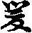



寺，隋朝改观为玄坛，改寺为道场。故钞主神州记自序云：余本住日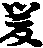



道场，此是炀帝取长于瑞像及育王舍利，入京造此寺，安置舍利。钞主初在此寺，依慧顾和尚出家。至唐初武德七年，高祖废之，僧徒散乱，配餘寺。钞主与师徺七人，同[(匕/示)*余]崇义寺。此寺在左卫长寿坊。又准西京塔寺记云：此寺本隋朝延寿公子诠宅。唐武德二秊，高祖赐与桂阳公主驸马赵慈景为宅。赵景已后，公主舍宅为寺，以妻为夫造，恩深义重，𠡠名崇义。钞主七年配住，九秊入终南制作。今取本系名寺以标名，故云崇义也。寺者，梵云僧伽摩蓝，略云言伽蓝，此翻众园，五众所居之园也，义云精舍。新梵云毗诃罗，此云游止，或云游履处也。今云寺者，乃此方之号也。寺者，司也，司由嗣读不绝之义。寺下安寸，即士人方寸之理也。如国家九司名九寺：一、太常(主礼乐郊广也)，二、光禄(主御厨)，三、卫尉(主器械惟幕也)，四、宗正(主皇家枝叶九挨也)，五、太仆(主马驾监收等)，六、太理(主天下利法)，七、鸿胪(主外国宾客)，八、司农(主食肴斛斗也)，九、太府(主贡员献两市也)。后汉腾膝兰到此，既是外国之僧，且今在鸿胪寺安下。后於壅门外别造僧坊，取駄经白马名，从鸿胪司分出，故云白马寺，即汉地寺之祖也。故今僧尼住处皆名为寺。



三、辨沙门二字者，亦云桑门，皆存略也。具合沙门那，此云息心。故瑞应经云：三等介号扰，六趣号昏息，心达本原故，号为沙弥门。或云息恶，能息生空智，所息是烦恼。故论云：福积聚，舍诸非，此世他世智无恼，一切生死除灭故，证得此者名沙门。释曰：生空理智，名为福德。此之理智，非少时之间，极速三生，迟即六十劫，彼名积聚也。舍者，弃背义。诸非，即根随烦恼也。此世者，即分段生死身。他世者，变易生死身也。一切生死除灭者，且约分段中一切，未论变易。证得此者名沙门者，结示也(上略释名字已竟)。问：未审沙门以何为性？果体是何？果位差别复有几种？答：俱舍颂：净道沙门性，有为无为果，此有八十九，解脱道及灭。释曰：诸无漏道，生空理智，离染烦恼，名为净道。此之净道，是沙门之体性。怀此道者，名曰沙门。有为无为果者，谓有为无为是沙门果体，有为即解脱，无为即择灭。此有八十九解脱道及灭者，斯约断惑品位以列数也。此有八十九解脱道是有为果，复有八十九品所证择灭是无为果，谓断见惑有八无间(即八思)、八解脱(即八智)，断九地修惑有八十一无间道、八十一解脱道，见修合说有八十九。又无间道唯沙门性，解脱道亦性亦果。息恶义边是沙门性，与无间道为等流果边是沙门果。一择灭唯是无为沙门果体，谓无道是沙门性，择灭是彼证，名沙门果。离系士用果(外主士用也)，若准斯解，理实证圣号曰沙门。今唐凡位烦恼具全，未合标沙门字，然具约因中谈果，故亦得也。又古来更有通相(通凡人也)，今此是通相沙门也。



四、辨释。释一字具足，合云释迦出家人性族也。今存略故，但释标字。问：上言沙门，下复拣释，岂不重耶？答：为简滥故。亦有出家人性是沙门，非释种，故以性简之。唯大乘基法师以四句料简：一、是沙门非释，谓西域外道是，律云沙门施食时等；二、是释非沙门，即西域诸释种是；三、亦沙门亦释，即今出家者是；四、俱非，即俗流是。又仙教传此之后，过秦晋之前，皆称俗姓，或依师姓。如生法师本姓魏，出家后随师性；竺法护本姓支木，竺法师乃依师姓等。从东晋安大师，方可改辙也。安云：我曾无尊释氏，皆合与释姓命之。后增一阿含经西来，果然契合。故彼云：四河归海，无复本名；四姓出家，咸称释氏。又四分说戒揵度云：犹如四河悉归於海，如是目连於我法中出家学道，咸称释子。此皆今从佛姓也。我今僧尼既尊释氏，须知得性无由。若不委之，如孙不识祖名，似子不知讳，此亦道俗同耻。此约此方，南朝四姓，未、张、顾、陆；北朝四姓，季、郑、崔、卢。更有诸多，或因处，或因封爵等得姓。广开元定谱录中，虑繁不引也。今准西土，四姓亦殊。故西域记云：夫种族殊异，有四流焉：一、刹那帝利，即王种，弈世君临，仁恕为志；二、婆罗门，此云净志，守道坚呗，洁白其操；三、吠舍，此云商贾，贸迁有无，逐利远近；四、首陀，或云戍达，此云农夫，肆力畴陇，勤劳稼穑。斯之四姓，清浊殊途，婚娶不通，飞伏异路。餘之三姓，如别所论。今但叙刹帝利性者，以释迦姓从其流出，是故此姓最为高贵。故俱舍论云：劫初如色天，后渐增贪味，犹惰贮贼起，雇之令守田。释论曰：劫初时，此南剡部洲人民，皆如色界诸天缺，形色端严，身带光明，腾空自在，饮食喜乐，长命久住。如是类地味倮，便生甘美，其香郁馥。时有一人，禀性躭味，遂取食之。诸人効彼，竟皆取食(此名劫初段食)。既食其故，身遂坚重，光明隐没，黑暗便生，日月众星，从兹出现。由渐躭味，地味便隐没，从兹便有地饼而生，竞躭食之。地饼又隐，遂有林腾。林腾又隐，香稻自生。众共取之，以竟取食。前三是细段食，遍入支体，如油沃沙，但有垢汗。第四麤故，残秽在身，意欲蠲除，便分二道，因兹便有男女根生。由二根殊，形相亦别，宿习力故，便相瞻视，因此遂生非理作意，欲贪鬼魅，惑乱身心，失意猖狂，行非梵行(人中欲见，初发此时)。尔时诸人，遂取香稻，初无贮积。后有一人，禀性懒惰，长(去声)取香稻，贮拟后食。餘人効之，渐多停贮。由斯稻生我所心，多收无厌。后随收处，不复再出。遂共分田，虑防远畫，各自兴功，耕犁种殖。於己田分，生护惜心；於他田分，有怀侵夺(劫盗过，始於此时)。为欲遮妨，共取详议，佥置□内。一有德人，各以所收六分之一，雇令防护，封为田主。由斯故立刹帝利名。大众钦□，恩流率土，故复名为大三末多，此云共许。自后诸王，此王为首。后时有王，贪恡财宝，不能均给国土人民。贫有乏者，多行贼盗。王为禁止，行轻重罸(杀害之业，起自此时)。后有罪人，心怖形，隐藏其罪，勘穷取实，异想发言(卢诳之词，此时为首)。其大三末多王，子孙相承，有十九转轮王。最后名大须弥王，此王子孙相承，有一十七万三千二百八十四小转轮王。其中粟散王，不知数也。最后名鱼王，此王子孙相承，一百四十三粟散王。最后名大茆草王，其王无子，乃将国位委付大臣。西国之法，继於二种，二者仙种。此王念曰：我既无子，乍令王种断，不令佛种绝。逐入山修道。时有侍者，从王到山，欲求所学，要恐吉后有人侵陵，乃以竹笼盛之，挂於树上。有猎者观之，见笼谓菓，见王顿，见王头白在中谓鶴，遂弯弧审射，箭中王心，命从兹殒。射时有二渧血随地生，二茎甘蔗日炙割开，左生同童男，右生童女，男名善生，女名善贤。耆旧大臣乃立善生为王，善贤为妃，却治国位(西土不昏异姓也)。善生王有子名郁摩王(五分云皷摩王也)，有二夫人：第一夫人有一子，名曰长生，顽愚丑陋，人皆恶(污音)之；第二夫人有四子：一名照目，二名听目，三名调伏象，四名尼楼。此四子聪明神武，有大威德。其夫人窃作是念：我子虽长，大不及物，承继大业，必为陵夺。彼之四子，并有威德，国祚所归，必种彼子。当设何计，固子基业？遂初以情求，次理感。於后一时，王至夫人处，夫人白王：我有除爱等(云云)，愿王殡黜，我情乃安。王曰：四子孝友，於国无𠎝，云何殡弃？夫人情求既不遂，以次理感(有作感字呼，即或乱也亦得)。夫人曰：我今除爱，实兼家国，非为此子。彼之四子，悉皆神武，民各怀归。王万岁之后，皆欲为君，谁肯为臣？必互相殄灭，大国所归，飜为佗有。愿今从之，勿思一子。徵言：若元戒有餘欢，如不见从，今当尽矣。王曰：汝言是也，我自知时。后於一日，𠡠四子曰：汝得罪於吾，不忍汝死，今可出国，尅己图生，慎勿窥瑜，难惩后悔。四子自知无咎，遂结束行装，与所生母、同生姉妹、耆旧大臣，咸愿随从，王悉听之。於是出城北门而去，路径险阻，度婆耆河，至雪山北，近念舍夷林，乃见其地，东西遐迫，南北广长，众鸟名云，地多全壤，遂止息其中。即於此处，筑营城邑，归者如云，从者如市，不久之间，郁为大国。立最小尼楼为王，三兄为臣，佐元追念，问诸大臣，有知者奏王，具陈上事。王召彼子归宫，四子确不从命，父王遂遥三叹曰：我子释迦，我子释迦。因立释姓(此翻能人)。尼楼有子，名为马头罗。马头罗有子，名名尼休罗。尼休罗有四子：一名净饭，二名白饭，三名斛饭，四名甘露饭。净饭王有一子，名悉达。白饭王有二子：一名阿难，二名调达。斛饭王有二子：一名摩诃男，二名阿那律。甘露饭王有二子：一名䟦提，二名婆敷。悉达有子，名罗云。从尼楼王至佛身，得引姓来，凡经六代。今之僧尼，是罗云同学，尼当楼王第七代孙也(已上解释字已竟)。



五、解名讳者，讲解相承，有释不释。若依俗礼讳之，然亦有开处，临文不讳，诗书不讳，庙中不讳等。若准内教，过去诸佛名字，劝人称念，今须効之。钞主法名道宣也。道者法也，宣者遍也，显扬弘演，遍示有情也。大师三生持律，第一生在齐朝，法名僧护，住越洲剡悬石城山隐乐寺。其山石壁峭峻，高数十丈，中有似佛焰光之形。每於经行，常闻天乐异香之瑞，遂发愿造十丈弥勒，以拟当来千尺之身，使凡厥有缘，并愿同登三会。建武年中起手，仅至一年方成，向获过疾而终，春秋一百二十。临终誓曰：本不期一生，愿第二生必就。至梁天监六年，有台洲始丰县令(今改为唐兴也)陆咸，罢邑皈京，路经剡汉止宿，夜梦见三梵僧语云：建安殿下感患未瘳，若能修圣，石城圣像成就，□获痊差。陆令归京，并忘此事。后经岁年，有一僧来宅寄宿，因话云：剡后所嘱，何不施行？陆令既恋前梦，此僧去后思审，方乃语之：此僧正是梦处中见第三之者。即以事启建安王，以事闻奏，勅下修之，谄僧祐律师，专任修像也。天监十二年兴功，过十五年毕，坐躯高五丈，立形十丈，改为石城寺也。僧祐律师即第二生身，俗姓俞氏，其先祖彭城下[邱-丘+匠]人也(皮音)。又因官唐於建业，祐年七岁，因入建初寺，不肯还家。至年长大，欲为婚娶，遂即回避，投钟山定林寺法达和尚，求受具戒，学精律部。祐为姓巧丽，国内凡有修饰，皆蒙𠡠委王持。梁天监十七年，终於本寺。广如僧传中(云云)。第三生，即今身也，生隋朝俗始。钱氏诸记中，皆云胡州长城人(行状、碑文亦同)。表云：准钱氏谱说，祖父即长城人，大师在京兆生也。彼云：曾祖是陈朝驸马都尉，祖为陈留太守，父名士申(有作由字者，错也)，即吏部尚书。陈被隋所收，其钱申此时与陈后主一时收获入长安。陈王后遭隋贼车，却免伤害。过隋开皇十六年，方产大师。大师即申二息之长(据此所说，即大师是京兆生长明矣)。母性姚氏，梦见有月贯怀，又梦梵僧语云：仁者所怀，即梁朝僧祐律师，宜纵出家，大弘佛教。凡在胎十二月，隋开皇十六年丙辰四月八日诞生。龆生之日，使异常童。十岁遍览群书，十二善闲文藻，十五喟然叹曰：世间荣禄，难可常保。於是弃竹马，卧竜釰，归心於释门，事日严寺慧𫖳法师。十六念经，两旬之间，念花经部。一十七落鬘。至大业十一年，年满二十，天降鸿恩，依首和尚受具。顶戴宝函，遶塔行道，感舍利降函，方崇法事。受具已后，依首律大师听习律藏一遍，入神俗，便欲归山宴寂。被受业师呵曰：夫适遐自尔，因徵知章，修舍有期，功□须满，不宜去律，抑令更听。其间僧事，自代为之。依位披寻，满二十遍。时值隋唐交禅，讲归权停。武德四年，方遂再听。首大师令命覆讲，自知文句缺然，未是心证，遂不取受。辞不获已，方乃覆文。至武德九年，过唐高祖沙汰僧尼，遂遁迹终南，制此事钞。贞观八年，显於洲益词谷重修，并制羯磨、戒心两疏。莫不龙天归敬，奉献香花。或缁素諮词，皆蒙预记。三衣准布，缯纩不兼。常坐一食，始终无改。行□促涉，蚤虱任游。德望既高，名振天竺。故得宾头罗汉语话周施，长眉梵僧赞述增坛事。唐朝三藏翻译众经，即命大师亲同典教，而著迷法门文记，凡二百三十餘卷，并行於代。至高宗乾封二年仲春月，冥感天人，与师言论云：今岁当迁神生弥勒宫。并留香一褁，云是棘林香，天众常烧者。言说而去。至十月三日，设无遮大会。午时，道俗咸闻天乐异香，於是𣫍容而化。春秋七十二，僧臈五十二。初定於擅谷，至三年，勅问所右。时有丰德寺寺主僧正伦具事奏闻，请依西国法，荼毗得舍利，立塔三所：一在丰德寺，一在安丰坊，一在灵感寺。咸通四年，并安丰坊舍利入灵感寺，同起一塔。虽年代迁移，而遗风不坠。去咸通十五年，諮宗皇帝思諮下临，追曩日之嘉猷，谥名澄照；记平生之德行，塔号净光。澄照彰律镜不昏，净光显戒殊不耀。教宗兴盛，良在於兹。(上解名讳二字已竟。)



六、解撰述二字者，诸释盖多，今存正解。撰者，录也。即撰云遗文，属於布置二序、三十篇行事次第国文等。述者，属在引用三藏教文，非师心自说。如夫子述而不作，但述古事。今此亦然，但述古来文章及诸圣教等。问：述与作何别？答：真谛云：如佛经是作，菩萨造论，直述佛意，但得称述。若尔，何故前来注云作者非无？答：菩萨造论，解释佛语，次比成於论文，亦得称作。今古疏钞，撰录圣教，次比成文，例此何妨亦得称作？问：何故撰述双标？答：若述而不撰，谓钞无才；若撰而不述，即类师心，无於稽古。故仲尼云：太夫则史，太质则野，文质彬彬，然后君子。准此意云：著述若绝文笔，即同史体，饰说事意；若太质，又成朴野，不堪披寻。今则半质半文彬，和畅不史，君子之风。是以撰述质标，阙一不可。上辨能作人名号竟。上来收科(云云)。总释序通题已竟。



吴越真身寺传律沙门　靖安照远丁巳岁重终



天福三年岁次戊戌四月二十八日於湖洲资圣寺听过比丘[邁-禺+(口/口)]故记



吴越国长讲律临坛赐紫清凉大师景霄纂



第二、依文别收，即分两序也。大科恐繁，不引(云云)。夫两序者，准诸圣教，或具、不具。且如多论，佛涅槃后，造发智论，二序全无。又阿毗昙心论但有发起，无证信。又杂心论唯有证信，无发起。今四分律，二序具全。钞：既宗四分，二序亦具。然则安布与律不同。若约总、别以说，即同。谓律文五字偈为总序；从尔时，世尊在俱苏摩国下，为别序。今钞亦然。前明总序，后明十门，各别也。若就证信、发教起说，钞与律则异。律虽先明总序，总序却名证。谓部主分宗之时，先归敬三宝，证之令信；后明别序，别序却名发起。今钞不然。先明总序，名为发起；后十门别序，名为证信。所以有此不同者，谓部主将弘律本意，令久远流行，必先证之而令信也，然后方甲发起。今师制钞，先辨发起之由，恐行事有妨；后作十门证信，为有由致(云云)。从此依文叙诸小科，不具列(云云)。



初、言夫至像者，法、喻、总叹也。问：古今制作，虽弘圣教，恐有魔事，皆先归依三宝，请求加护，欲令其教久永流行。如唯识云：稽首唯识性满分清净者。又俱舍云：敬礼如是如理师等。又百法疏云：粤惟至理杳冥。又慈恩疏云：盖闻至觉权真等。皆是归敬之词。今钞何不归依，而直叹戒德？答：多解。初云：夫归敬有二：一、冥，二、显。今钞欲著述时，已冥心归敬，了不更显归敬也。次搜玄云：钞宗四分律，律本之中云：稽首礼诸佛等。既安归敬，是以钞文承律文，更不重述。或有释云：但随著述人怀，有无总得。(已上并非能繁云云)。今依顺正说云：夫归依者，三业为体。如跪礼，是身业归依佛，有天眼能见；发言赞叹，是口业佛，有天耳遥闻；意中归依佛，有他心遥知。今既入文叹戒，乃是口业归命法身，法身自食三宝。广引下□事证，对讲明之。(此解雅当)。次、销文。夫者，两解：一云、发端之语，如云窃闻、恭闻等例(云云)；二云、蕴深旨曰夫，谓此戒德难思，是深旨也。今欲仰叹，故称曰夫。世单言戒者，简於定、慧，乃是遮诠；合言戒德难思，即是持体德，复是表诠。今此戒字，儒、释两解。初、儒解者，周易云：以此斋戒。韩康伯注云：洗心曰斋，防患曰戒。斋者，齐也，齐整身心，令不放恣。如国家欲差官寮祭祀天神、地祇，先七日致斋，三日不行鞭杖，清洁身心，以祭神祇，用希福祐。今释教不过中食为斋，取一分清身之义，故曰洗心曰斋也。戒谓警也，警察五常恭之在心，恐患身故恒须防拟，故口防患云戒，此谓儒道立身之本也。次依内教解者，诸释盖多，莫先禁义之中，但取善禁恶令不起过，名为善戒。又於善戒中有定散差别，今此乃是有漏散善，非定善无漏也。故下文云：依因此戒德，有定慧等德者，亦两解。初依老子音义云：德者得也，谓有所得。又字统云：内德於己，外德於人，常无所失。此则内有德可以闻己，外有德可以五人，如颜回有德，故居四科之首等(云云)。次内依教者，德谓功德，且戒因名，德是果称。一有漏德，人天果是，故戒经云：明人能护戒等。二无漏德，即菩提涅槃，故戒经云：戒净有智慧等(云云)。斯之二德之果，皆藉戒因而生，故是戒家之德，约释分别戒之德(依主)。难思者，难者不易之谈，思谓思量测度，谓此戒之胜得，非口所宣、非心测度，超不思议之境，故曰难思。故下文云：下为六道福田，上作三田种，乃至功德不可思议，岂准言论能尽？今显斯相略分四称，故俱舍颂云：离犯戒及遮，名戒各有二，非犯戒因坏，依治灭诤等。故曰：谓身口四诸不善色，是名性罪，故言犯戒。言遮罪者，非时食等离犯及遮，俱说名戒也。为有二者，此遮性二，为有表无表也(上且云释名)。次明四德：一非犯戒坏，即离犯难思；二不为犯戒因坏，因即贪等烦恼，即离烦恼难思；三依治者，四念住等对持，前犯彼因故，即对治难思；四灭净者，回向菩提非胜生故，即涅槃难思也。又颂中言净者，谓具上四德戒名清净，与此相违名不净也。颂中等字者，有师说：故知戒净由具五因：一根本净，离恶根本；二眷属净，离方便；三非寻害，离恶也；四念拣受，念三宝也；五回向寂灭，求涅槃也(上且依俱舍明之，或依扶主记中别引六种，恐繁此不叙也)。冠超众像者，冠者慧地，超者过越也，众者诸也，像者物像也(上略别叙)。次广解者，周礼云：未在首曰冠(平声)，在首曰冠者(去声)。礼记云：男子二十四冠之，父母为立名而召体，朋友为作字以彰德。又庄因云：冠圆以像天，天能覆於万物，冠持发以为首饰，自后不改其制也。又仪服记云：冠者蝉冠，古来皆戴之，谓蝉虫饮吸於露而体清，今戴此冠，表男子有清恒之得，后制𧭎头用褁冠上，唐朝高祖赐巾子用替其冠，迄今不改，更有武士冠、学冠等。又易云：冠虽贱而不可以处下，屦虽贵不可以居上，此既最尊高，超过诸服之上，故曰冠超众像(上喻竟)。次下法合，别腕之戒最为高贵，犹若於冠为万善之因基，一切定慧从兹立故，所以超也。古云：严色身之仪服，冠最居首，饰法身之功德，戒最为先，二种相当故将譬(収科云云)。



言为至唱者，举迅事别叹也。钞文都有四段：一、轨导五业，方运载三宝、功德、定、慧；四、住持息唱。初言五乘之轨导者，此唯叹所诠行也，为由作也。五者，数也。智论云：一、人，二、天，三、声闻，四、缘觉，五、菩萨也。乘者，涅槃远疏云：运载义，运障令尽，运理令显，运行令满，运心令圆。之者，助语之词也。轨谓轨则，导谓引导。左传云：引物令通曰导。以表此戒能作五乘轨则导引，故曰为(云云)。上来略消，今更广辨。如一类有情，受戒之后，严洁护持，从始至终，不令毁犯，为求当来生於人中，后必依愿，即此戒能为人乘之轨导。又有一类众生，亦持此戒，愿生诸天，亦随其意，即能为天乘之轨导。复有一类众生，坚持此戒不犯，观四谛理，伏断烦恼，证四沙门果，即此戒能为声闻之轨导。复有一类人，坚持不犯，观十二缘，证辟支迦果，此戒即为缘觉乘之轨导。复有人，坚持此戒无犯，修六波罗蜜，誓求涅槃之果，此戒即能为菩萨乘之轨导。上之五种果报，皆以别解脱戒为因，方能运载行人到於前所，故曰为五乘导也。(已上举僧尼所受别脱戒以论，但为持人心边有五差别，已外五、八、十二，亦二背能为五乘之因，例此列妄。若依诸家记中，使持五、八乃至三聚净，别夕配句，五乘果上却成绞局，不为雅当也)。寔三宝之舟航者，运戴三宝得也。寔，由寔也。三宝如下明。舟航者，字[紵-丁+死]云：单船曰舟，双船曰航。又解：渡水曰航，不渡水曰舟。舟是体，航是用。今钞文体双彰也。又周易云：刳木曰舟，割木曰檝。内空曰刳，外削曰刮。置舟檝有济凡之用，此是喻况。今法合者，谓今僧尼剃发染衣，受持禁戒，入僧之位，即住持僧宝。又能书写十二分教，即住持法宝。又能建立形像塔庙，即是住持佛宝。岂非住持三宝之舟航？又地持云：三十二相无差别因，皆由持戒所感，即是佛宝。既成佛已，演四谛教，即是法宝。度五比丘，即是僧宝。此则戒为化相三宝之舟航。又智论云：先持净戒，后证五分法身，是佛宝。又得择灭无为，是法宝。复得无学功德，是僧宝。此则戒为理体三宝之舟航。已上三种，三宝虽殊，皆用戒能运载，故曰寔(云云)。古今相承，以义门料，简略四别：一、释名，二、差别，三、辨体，四、所以先后。初释名中，复先辨三种别名，次释宝之通局。初中，梵语佛陀，即此翻为觉，谓觉察、觉悟也。又自觉、觉佗、觉行圆满等(云云)。今但云佛，存其略梵，以生善也。二、梵语达摩耶，此翻为法。法有二义：一、轨生物解，如言无常，则令人生无常之解故。二、住持自性，谓能持色二十等当体故。三、梵语僧伽耶，此翻为众。约体四人，同六和义。次辨宝之通号者，宝性论云：真宝世希有，明净及势力，能能庄严世，间㝡胜不变等。所言希有者，世宝贫穷，且无三宝，福薄不遇。故经云：诸佛兴出世，悬远值遇难。二、明净义，世宝体无瑕垢，三宝绝离诸漏。三、威势义，世宝除贫去毒，三宝六通难思。四、庄严义，世宝能庄严色身，三宝能庄严法身。五、最胜义，世宝诸物中胜，三宝得无过上。六、不变义，世宝练磨不练变，三宝八法不倾。(谓利、誉、称、乐，四顺也；衰、毁、讥、苦，四违也。)已上六义虽殊，莫不同训珍美。约释分别，即带数。第二、差别者，准诸经论，总有六种：小乘三种。大乘三种者：一、理体三宝，戒疏云：五分法身为佛宝，灭理无为是法宝，声闻学无学功德为僧宝。二、化相三宝者，释迦道王三千界为佛宝，演四谛教为法宝，度五比丘为僧宝。三、住持者，形像塔庙为佛宝，(旧云泥合龙塑像也。)纸素竹帛有漏卷轴为法宝，(旧云黄卷赤轴。)受持禁戒剃发染衣为僧宝。次大乘三种者：一、同一体三宝，并於真如建立。真如身上有觉义为佛宝，真如身上有轨持义为法宝，真如上有和合义为僧宝。故涅槃云：若能觉三宝，常住同真性，此则佛是佛，㝡上之誓愿。二、真实三宝者，唯佛二空真如无漏法为真宝故，谓取法身并自受用报身为佛宝(下取他化)，无漏本质教为法宝，十地菩萨为僧宝(戒疏中无真实三宝，今依诸经论叙录之)。二、别相三宝者，三身如来为佛宝，大乘教、理、行、果为法宝，地前、地上为僧宝。三、辨体者，例上分二，别明小乘者，理三宝并为五分法身为体。二、化相者，佛宝有两宗，初萨婆多唯取佛身中无漏法为体，即心所法也。通大地有十：受、想、思、触、欲、念、慧、作意、胜解、三摩地、大善、十地、信、不放逸、轻安、舍、慙、愧、无贪、无嗔、不害、勤及同时心王、生、住、异、灭、无表，已上诸法具五蕴性。次经部宗无漏法如前，并取佛色身通漏、无漏也。法宝以本、后二智为体，或可以声、名、句、文；僧宝用五蕴为体；三住持、三僧宝并以真如为体。故唐三藏云：三宝之体不离真如。二、真实三宝，类前差别中可解，莫非俱是无漏法也。三、列相者，佛宝中法身以无垢真如为体，自受用报身以无漏寔智为体，他、化二身以化五蕴为体；二、法宝以教、理、行、果为体；三、僧宝以出家真行人五蕴为体(已上大乘出体竟)。四、所已先后者，且明所以不多不少，正立三宝者何？答：有三义故：一、则三世诸佛常法须三；二、对部三宝以立，而翻彼故。是以经言：归依佛，更不归依大自在天故(云云)。三、约喻立三，如世间人有四大病，欲治此病，先求医人，次须良药，后须看病之人。要具此三，方得除愈。今一切有情烦恼之病，亦复如是。故智论云：佛如医王，法如良药，僧如看病之人。要具此三，即有情烦恼病也。多则无用，少则不足。今五三种，正处其中(并所已竟)。次、先后者，若论一一体，亦无先后，随所总得。今总义分三种先后：初、约胜劣者，佛是能觉之人，为方有所觉之法，随觉修学名为僧。故律受戒法文云：如来成道号佛，佛演四谛名法，后度五比丘名僧。化仪次第，不可乖矣。二、约师资明者，法㝡居先。故涅槃云：诸佛所师，所谓法也。以法常故，诸佛亦常。即法先也。次、佛后僧先者，三、约信已明者，僧㝡居先。如舍利弗见阿鞞比丘容心寂静，乃生善心，次为说法，后当见佛。故戒疏云：所以僧初佛后者，道假人弘，世途法尔。故迦竺初达现僧仪相，述五乘为善因，明三途为恶果，现法仪也。斯法远大，非凡小之所开，故表𦘕像於凉台，推其所说，现佛仪也(上来有四云云，惣当明三宝章也)。



依教建修定慧之功莫等者，此明行胜也。依谓依凭，教谓律教(亦云约三藏也)。建，建立。修谓进修。定则经之所诠，慧论之诠旨。功谓功能。莫由无等者，觉等意。显出家僧尼依凭律教建立修行，则功高定慧，故云莫等。问：何故不等？答：据胜劣以说，定能证心、慧能断惑，㝡为殊胜。故俱舍云：若离择法定无为，能灭诸惑胜方便。准此即戒不如慧。今言莫等，且约始入佛法依法修行，三学之中戒居其首，断惑证理由戒慧如缚而生。故戒经云：戒净有智慧，便得第一道。又尸罗清净三昧现前。又成实云：戒如捉贼，定慧如杀贼。戒且不如今，元由须戒捉。此中捋弘律教故偏欢尸罗，欲使行人遵崇此教。上言依教即举律能诠，下言定慧举二所诠，盖是影略之意(不同诸家温乱慧云)。



住持佛群籍，於兹息唱者，此明教胜也。众法住持於群籍也。谓住持由行，此行教诠，行既住持中强，诠文自然殊胜。前则举教显教下所诠，今则举行显诠行之教，二处互举能所自分也。教钞文，住谓久住也，持谓任持，久住任持世尊教法，故曰住持佛法也。群籍息唱者，群者众也，籍谓典籍，经论既多故云群籍。息者休也，唱者说也。律久住持，一明佛法於像季之中，伽蓝置设训导俗四僧，羯磨治罸摈駈轻重七非，万二千年真规不坠，此皆假律所施行；餘二於此之时且须休说，故云於兹息唱(双科云云)。



次约法就时辨其兴替。上既叹所诠戒得，显能诠文优强，未翻此文弘演，是以约斯教法而就於时用辨其兴隆，兼明替癈生制作之远意，故就中分二开科(云云)。言自至典者，此文二意：一为戒有胜德故佛偏弘，二又须知教典即是佛之亲说也。自大师在世者，自由从也，大者简小也。三界中尊德无过上，故论中具四义：一者因大誓度群生，二果大证大菩提，三所证理大真如廓周沙界，四能证智大圆镜等四智。三界二果受名之曰师。在者住也，世者间也。俗云世世代，子继父为一代，三十年为世。内教云：世为谓世间，杀那无常非久固义名世，住其中故名间。世间有二：一以极微为体，可迁流被坏故云世，住中故间也。二有情世间，以五蕴为体，亦可迁流名世，住其中故名间也(释名字竟)。今更略明行相者，且器世间成住坏空轮环不尽，成了即住，住了又坏，坏讫复空，如是经二十劫，共成八十劫也。有多种，如别处明。今此所论是增减劫，谓此世间被三灾所坏，火灾欲界并初禅，水坏二禅，风坏三禅，若四禅不为灾坏，餘二灾如别所明。今且说火坏欲界初禅者，委何时坏耶？且如今是住劫，二十中当第九减劫，人寿百岁时牟尼出现，入灭已后百年减一年，如是减至十岁，有一小三灾起，即刀兵、疾伇、饥馑，损害众生。从十岁后，却入增劫，百年一增一年。劫章云：子年倍父增(阿舍经亦)。如是增至八万四千岁，即当第九减劫。又减到八万岁时，慈氏出世。又减又增，至第十五减劫时，九十五佛相次而出。如是至第二十劫，唯增不减。此增八万四千岁时，住劫已满。於此之中，须以三句料简：初一劫唯减不增，后一劫唯不增，后一劫唯增不减，中间十八劫一增一减。今时世界将坏，坏法有二：初一十九劫坏有情，次一劫坏非情。於有情中，先坏下三趣，后坏人天。就下三中，先坏地狱。故论云：坏从狱不生。谓此世界将坏之时，阿鼻等狱更无新生有情，便当坏劫始也。若受罪业满之者，转趣二禅。若受业未圆，并新受业者，且移向他方世界地狱内也(准此，先坏阿鼻地狱，次坏上七热地狱，又坏八寒诸有情也)。次坏修罗、饿鬼、畜生等，皆生人中。次又坏人天。於人四洲，先坏南洲。欲坏之时，有百亿飞行夜叉巡空唱云：此劫将时。有百亿人闻此声，心生猒怖。初有一人无师，法尔坐得禅定。从定起出已，唱言：定！喜乐甚静。餘皆効之，坐得初禅定。从此命终，皆初禅也。东西洲亦尔。北洲先生欲天(此坏人趣)，后坏六欲天，其中天子皆生初禅(坏欲界有情竟)。次坏初禅。初禅有一有情，无师尔坐，得二禅定。从定起已，唱言：定生喜乐，甚乐甚静。餘皆効之。从定出已，唱言：定生喜乐，乐静。餘皆効之。从定出已，命终皆生二禅也。已上且据大灾从欲界坏至色界初禅以说。若论水坏二禅，风坏三禅，一切有情皆生四禅。四禅不为三灾所坏，故佛说四禅名不动地，喻密室灯(广如论述)。已上从地狱有情坏至初禅有情，如是凡经一十九劫，名坏有情世间也。次一劫坏器者，谓虽坏有情，无人空有，有止住处所，如同空宅一般。今欲坏此之时，日加四倍之位，河池之内乾枯，草木樵坏。次有二三日出，诸江河等悉皆枯竭，大海水三分减一。又四五日出，海众顿竭。㝡后六七日现，一切山石皆融，大海须弥一时火起，如燃苏木，无有遗餘。婆沙论师有两解：一云：於此世界成时，有七日轮持双山下，且放一出，照灯世间，令至劫坏时，更放餘六出。二云：唯此一日倍常，七日之极，江海乾竭，众山洞燃，洲诸三轮悉皆焚𦶟。所以论云：坏从狱不生，至器都尽。问：一等是坏，何故有情用十九劫，非情但要一劫？答：论云：有情是别业，难转故多；非情是共业，易转故少(已上火灾二十劫，坏六种世间也)。次经二十劫，上下犹如黑(此空二十劫)。次辨二十劫，初一劫成器世间，次十九劫成有情世间。初一劫成器世间者，故俱舍云：成劫从风起。谓从二禅下有微风起，经下初禅旧时梵王住处，遂立梵王宫殿并梵辅众天等(此成初禅三天竟也)。又微风至欲界，置空居四天住处。次有猛风盘旋至欲界下本着风轮处，结成风轮为世界底。其轮四面量合六千界，上下百六十亿由旬，形盘缘仰周旁布，持水不散。其轮坚硬，纵使诺健那神执金刚杵击之，亦无损也。风轮既成，第二禅有光音天布金藏云(其云密如藏色金，故云金藏也)。既布云遍三千界，乃降其雨，滴沥如车轴，住风轮上而成水轮，厚十一亿二万由旬。又於此水轮数内取三亿二万由旬，如享乳一盘凝为金轮，餘八亿由旬是水轮。既金轮已，光音天又布雨向金轮上以为海水。有情业减，感巧风皷击成妙高山，以四密处成，故云(东白银、西牛颇胝、南瑠璃、北黄金也。出水八万由旬，入水亦尔也)。於山顶置三十三天宫殿，又於半腹四层级间置四天王居处。又於妙高山外置七重金山：一、持双山(双留泷通，故云)，二、若持轴山(山有诸峰，形如车轴)，三、担木山(山有穴树，形如檐木)，四、善见山(山松秀异，见者生喜)，五、马耳山(山形如马耳)，六、象鼻山(有神，形如人，头如象，其山似彼神鼻故)，七、鱼觜山(山形如鱼觜)。又此七山之内，各有香海。又於七金山外，置大䥫围山遶之。䥫围山有醎海，於醎海中，置四大洲人趣居处。有情业感土石而成：一、南剡部(因树立名)，二、西瞿陀尼(此翻牛货，彼处以牛为货)，三、东弗婆提(此翻婆胜身，身形胜南洲故也)，四、北郁单越(此翻处，或云胜生)。已上成人趣四洲竟。又於大海边，置修罗、饿鬼、傍生居处。又於南洲地下，安置炎魔王宫，并二八地狱住处。如是一劫，成器世间。虽有处门，未有情喻。似今时造宅虽成，无人居住。如此经一增一减劫也(上明器世间已竟)。次一十九劫，成有情世间者。论云：尔时二禅，有一天子，顺后业故，生向初禅，作大梵王。虽为梵王，而无眷属，但独住故。经云：一增一减，遂生念曰：无有一人与我同分。梵王才作念，上界之中，有诸天子，顺后报业，来生初禅，为其眷属，即梵辅、梵众。王曰：我始生念，汝便生来，是我之子。彼亦云：我因梵王念，故得来此，是我之父。又渐生六欲，四洲渐渐多故。或人中造业之者，生修罗、鬼。於趣畜生后，有一有情，造无间业，堕地狱。当知



尔时成劫已满，故论云：成从风起，至地狱初生(已上都二十劫，成二种世间竟也)。成后又住，后又坏，竟复空，如似辘轳，终无穷尽。今则正当住劫来，明第九减中牟尼出兴世间，为化有情，故曰大师在世也(有於此八相成道全不当，文意知之)。偏弘斯典者，偏谓偏颇不平也，弘为扬也。斯此典谓教典，谓佛在日，偏颇弘杨。此律教典，具五义故，所以偏弘：一、金口亲说，二、同界尽集，三、准半月，四、须法界，五、准具戒得闻。经论反之，故偏弘矣(收科云云)。



二、约时辨典，赞中开科(云云)。言爰替者，此及反意。道上明佛在之日，偏自弘持。既受请涅槃，金河息唱，未知后更须谁人弘宣教文。疏之末代，故有四依菩萨。继迹犹典，故有此段也。爰者，尔雅云：于也。今借训及。及者，於四依，盖取相接之义也。四者，数也。依者，依止。谓有三种四依，能与世人作於凭止住故。言三种者：一、人，二、行，三、法。初人四依者，准涅槃经云：善男子！有四种人，能护正法，建立正法，能多利益怜愍世间，为世间依止安乐。何等为四？有人出家，具烦恼性，奉持禁戒，威仪具足，能为他人分别宣说。八大人觉为初依(准此，是外凡位也。八大人觉，即二十故：寂静、正念、正定、精进、曾媿、正思是也)，斯须二果为第二依，阿那含果为第三依，阿罗汉果为第四依。问：四依菩萨，为约大乘？约小乘？若是小乘，不能弘持；若是大乘，何故上来将小乘四果等配属？答：夫降世弘扬，摧邪显正，必是大权菩萨传演流通；若实声闻，不能摄化。文虽举四果，且等相为言，如迦叶、阿难当成佛位。故经云：内秘菩萨行，外现是声闻。若将大乘行位配之，即地前三十心为初依，登地至七地为第二依，八、九二地为第三依，十地已去为第四依(已上辨人四依竟，不同诸家所释杂乱，又不同搜玄取五师中前四师为人四依也)。二、行四依行者，夫四依出世，须行四依正行，故次辨行四依。故律云：三乘行者，通所资用：一者、粪扫衣(以蔽形故)，二、长乞食故(以无饥故)，三、树下坐(以形覆故)，四、腐药(以治患故)。此亦且约制论，然各有开通，不类提婆所立也。三、法四依者，准归敬仪云：始终初贤，终乎极圣，人资无漏，法体性空。据此依永，理无邪倒，故立法依，显成揩定。一、依法不依人(谓法性涅槃之法，不依声闻之法)，二、依义不依语(谓依觉了之义，不依倚饰〔名二之々〕语也)，三、依智不依识者(谓识智性灭，智当住也)，四、依了义经不依不了义经(谓无上大乘之典是了义，二乘教文名不了义也)。已上三种四依虽别，皆是一人所行，必具此三方堪弘教。今二十四员菩萨一一是之，相续传灯明明不绝，故曰爰及四依。遗风无替者，遗餘也，风教也。无者对有彰名，替者癈。问：所以将风训教者？答：如世风有美靡草之能也。故儒书云：风者是阴阳之器，相击相而成。又云：因虎啸而有东风谓之谷风(春风也，谷者养也，谷养万物故)，南风谓之凯风(夏风也，凯者长也，长养万物成〔五〕故)，西风谓之凉风(秋风也，凉者薄也，衰薄万物故也)，北风谓之风(冬风，卷者终也，万物成熟曰终)。所以此四方风各异者，东即喧气初生，南即皷万物而成，西则金颫熟物，北即阴气凉别万物凋枯。四时既殊，是以春生夏长秋凋冬落。世间风由尔，教亦如斯，能令行人五五五分法身初生，次长述华结果不？夫於时皆从教而生，故谓佛在日其风广扇。涅槃之后，四依菩萨副续典纵分五部等殊，亦名未名为讹替。以有四依为住持，与佛在时更无差别，故云遗风无替也(收科云云)。



二像末住持讹替中分三：初通明时移教替，二所以下别明此土传持有失。言逮于至事者，此段文通西土像末之时，教法讹替偏说此方，故移在三失之前。(与显正有异也。)逮，由及也。于，由於也。像，似也。季者，末谓通明佛法，总有三时：一正法，时有一千年。正者圣也，具有教、理、行、果四法，即真如之体，凡圣所依。从兹流出十二分教，皆有所诠之行，依教修行必获果证，与佛在日不别，故云正法也。二像法，时亦有一千年。但有上三，少有果证，似像择正，故云像法也。三末法，有一万年。去圣时遥，众生无智，有教典不肯修行，望於正像将为渐未。但有上二，全无行果，故云末法。又於第二像法一千年中，前五百犹有果证，后五百年但有上三。今钞制作，去佛灭后已一千五百七十四年，即像中之末，故云像季也。(古来多约末法以释者，非也。)时转浇讹者，时谓时代，转谓移转。像不如正时，像末不如像初，故云时转者。浇者，薄也。讹者，谬滥也。如世有物，不方不圆，又无棱角，曰讹。今人弘法，不如正及像初，故云讹也。争锋唇舌之间者，争者，竞也。锋者，刃也。说文云：刀端。谓世有三端：辨士舌端，文士笔端，武士刀端。上之三端，甚利如锋。刀笔二锋，但损生身。若论舌锋生法，二身俱损，谓出言害物，故如锋也。刘子云：口含锋刃，动则伤人。今此争锋，是舌锋也。又所之事浅近，故云唇舌之间也。皷论不形之事者，皷谓皷动，论谓量。皷动论量，皆非典据。形者，成也。凡是论量，皆是胸臆所谈，不成典据(上且一解)。又解：形者，身形。谓毗尼轨事，是比丘身之所行，名为形事。今非法自立条制，无其典章，不是比丘身所行事，故曰不形之事。故下文凡厥化止，出应於彼正教，都无诠述，事起非法，言成讹滥等(此搜玄解亦通，更有别解非正)。此于文约一五百年后，西土不依教相，但自凭虗大小二乘牙相，非斥之例(云云)。



二别明，此云传持有失开科(云云)。言所以至而已者，所以两字𧿟上词，谓上明西土像季阙，四依菩萨典隆继嗣，方当讹替之时，若约此方闻之久矣，故标所以字也。震者国名，岭者山号，梵云震旦，或云真丹、栴丹、指那、指难，皆梵音轻重，此总翻为汉地。若依婆沙论立二音：一云指那，此云闻物国(谓此国多出异物，为诸国之所闻也。或作天字者，或云武国，恐非也)，即赞叹之词。二云指难，此云边鄙国，即毁呰之词也。又西域记云：摩诃指那，此云大汉国。今言震者，是略梵也。古记皆云：震是东震，以西国望此为震宫。旦谓朝旦，以日初出照於东隅。其如丹亦云其丹等，此非故也。盖为震声与此方震宫音同，既翻未名，不合就梵音释义也。岭者葱岭，以岭多葱故。所以岭国双标者，为简滥也。葱岭已东六精胡国，佛曾行有法流通，今此所传皆岭西土境，佛法从彼而来过此岭故，简非六精胡国法也。传教者，传谓流传，教谓教法。后汉第二明帝即位，永平五年感梦金人(缘起四十卷中也，此来劳叙说知也)，七秊发使，十秊即腾兰入洛阳，十一年造寺，十四觉诚佛法。其时释教大行，出家之甚众，故云传教也。九代闻之者，九者数也，代谓帝代。若约此方帝代，从开辟之后三皇五帝直至闰秦前汉，自此以已前佛法未行，此土并皆不论，但从后汉明帝已后，至今九代也。一、后汉(刘代都洛，十四主，凡一百十五年)，二、魏(曹代都洛阳，五主，共四十五年)，三、西晋(司马代都洛阳，四主，共五十二年，被前赵灭，有五子渡江，南於灵地，瑯瑘王秉制，立为东晋土主，都建业，共得一百三十年也)，四、宋(刘代都业，八主，共五十九年)，五、齐(萧代都业，七主，共二百十三年也)，六、梁(萧代亦都业，四主，共得五十四年)，七、陈(陈亦都建业，四主，共三十三年)，八、隋(扬代三主，効文帝者长安，次扬帝都准南，后恭帝亦都长安，共得三十八年)，九、巨唐(秊代经今一十九业，从武得初，至景福初年，凡一百七十餘年也)。然於九代之中，亦有不定，南取陈元数，北取周为数，即后周宇文觉等四大，受元魏位(魏即枯䟦代后，从性为元也)，陈、梁位。今此九代，必须数陈，谓周与陈同时，南北有别，然周起陈二年，既陈起在先，即合数之，不取周也(有周为释者，盖未究其内，思之)。夫九疋绕，不过五法：一、五行相生，如汉火、魏土、晋金、宋水、齐木、梁火(已上相生)，陈后归隋，隋是大德王(主呼)，土不生大隋，后周禅是木，木生火，周受元魏位，魏是水，水能生木故，唐受隋禅位，唐是土德王(去呼)，火生土故。二、传国王[采-木+(同-(一/口)+蟲)](音从)，此秦始皇取蓝田譬，方四寸，小缺一角，蛟螭为细，上有盘龙隐凤，求相李斯。小菉两面各有八字，面文曰：受命于天，既寿永昌。又上面盘处文曰：受天之命，皇帝寿昌。秦传汉，汉传魏、晋、宋、齐。至梁为侯景作乱，窃之於栖霞寺，为僧永收得。永已后付弟子，并曰智。智遂献陈，陈传于唐也。三、相禅(去呼)位，与也，让也。如唐受隋禅位等。四、居中土，如洛阳九洲之中。五、童谣，如晋时云：五马浮渡江，小者化成龙。又唐时云：密密作，唐唐得。皆是也。又於此五中，亦未必总具，或四、三、二皆降兹已外，更有旁统不收。如曹魏时有南吴、西蜀，西晋有前赵、后蜀、前梁，东晋时有后赵、前秦、后秦、后凉等诸国，同时不永甲子，并名覇主。广如别说，此不繁云也。拔萃出类者，拔萃者，是拔谓逈。拔萃(病醉反)者，聚集也。穴草藂生曰萃。中有一茎，逈出於上，故云拔萃。出类者，人也。出者，超也。类者，流类。人藂曰类。众人之中，一人智德过於众者，故云出类。此中人草对论也。智述而已者，情智法述也。此段明汉地九代之中，古人不依律文，但准典俗行持，住於情智法术，皆是臆见凭虗。如有过犯之徒，罸外及米，锄于收刈，苦使周年，并是师心行斯法术(故云智述而已也)。更有释云：术者，神术。谓大智闲闲，小智艰艰。大智若道，小智若术。如古来有吞针、噉䥫、上釰树、登刀梯，皆是一期约化。若将此艺轨事化人，即[非/(合-口+(百-日))](此淮南记解也)。



言欲至评之者，都有六句。上五是别，下一句是通。解释之时，将欲之一字，遍向五句之首。又将者之一字，通遍着五句之下。又将可得详而评之一句，各向五句下结之(云云)。初、言欲明杨显行仪者，可得详而评之。欲者，希须也。明者，显也，彰也。杨者，弘也。行谓众自共三世行也。仪者，仪轨也。意道若欲显彰杨其三行轨横仪范者，须是明律闲相者，即可得详而评(支抦反)之。显上来拔萃智术之人，不在中论说(可得者，是明律也。详者，审评。评者，论也。下四句皆尔，反显智术不可得)。二、欲匡摄像教者。匡者，正也。摄持像是法，教谓诠意道。像法将末之时，须人匡正摄持。若是精明律相者，即可得详而评之。若智术之流，即不可得在此中之数也。三、欲埀寻范训未学。垂者，从上覆下之貌也。故经叆叇(二十去呼也)埀布等。寻由常也，毗尼常典千佛传。范者，法也。毗尼之法，是其诸佛所常法故。训者，诲也。从言作川，即言如大川有国济义。后进之徒，名为未学意道。今欲将其教法，下训末流者，须明闲教相即，可得详而评之。若如上来智术之徒，在评论之限。四、欲纽既绝之玄纲者。纽，续也。既，已也。绝者，断也。玄者，妙也。纲，网也。毗尼是玄妙之纲，今已断绝，像末之隆，谁更续之？若明解者，可得详而评之。若上智述之流，不在此言限也。五、欲树已颠之大表者。树，立也。颠者，坠也，倒也。大表是喻也。如世津浦、山川、崄径，树立表刹者，欲令陆行人见表，知有桥道等；水行见表，知有是浦济驻泊处所等。今诏此律，以为大表，意显能示五业之正路。修行之者，望表不迷。今像末时，其表已倒，未审谁人再树立之？若明解，即可评之。拔萃之流，不在详审之限。已上五句，一一皆是，及显凭虗之类，不可(云云)。



言，岂非至矣。岂，可也。非，不也。凭虗者，不依教也。易以形声者，形者，身也。声者，教不论量足别，是以形不辨七非之相，是易以声。轨事难为，为露洁者矣者，轨则事者，事相难为，非易也。露洁者，在天日雾露，在地日泉源，谓露从天降，可不清洁尔。轨范毗尼事相，以六十法简人於羯磨，缘本则骨，初三后五，二四中间，头尾一言，不许增略。如是轨事，如彼露珠之清，实不易也。故战国䇿云：如世人尽鬼魅者易为巧(合上钞文凭虗易)，写犬马难为工(合上钞文[跳-兆+生]轨事难文)。



次明晋宋已后七代之犯执有失(开科云云)。言然至滥者，此文约东晋后秦，虽律本来古德，听习不精，致愚教有失，并未论章疏也。然则二字，蹑上生下之词。然，是也。前修者，一释云：南山已前，依律进修诸古德也。此解恐稍通漫也。今但取北齐末制疏一类古德，名前修也。挓於律藏者，此类古人确执律文，不许加减。指事披文而用用之者，谓指前事披读律文。如作看病人赏劳羯磨，不问前三衣六物具报，皆牒六物之词。在文信於实录者，古师道：此羯磨法，是文金口亲言，固非滥说。传到此土是正翻，但依文诵之，信为实录，不可增略也。而寄缘者，今行非也。寄，托也。缘，即所为之缘，二三中间是也。良，多也。依文谨诵曰繁，被事不成为滥(上且举此释，诣例所可知也)。



第二段，言加以至多者，谓僧迦也。者，由也。由前托执，自是一重之非。今复有添臆说，故云加以也。学者习学，非由不也。精为精通，博者广博。故轻重仪云：博通诸部，精练是非。於当部不能精，於他宗不能博。即古人矣，并开二缘能也。臆谓音臆。古德不精不博，凡论说二事，断割是非，并是师心，不开典据。虽则未制疏抄，依律用错，引不少欲，故云尤多(尤，甚也)。如律云：三衣须受持。若疑，应舍已更受。有而不受，吉罗。应合加法词句之文。但翻译家欠少古德，不体此意，便云：不离身宿，即名受持。何劳词句，并不用也。又一夏唯许三度受日，不得重受。又云：自然界体，定方等例。皆成臆说(云云)。言类至集者，明取文下类非也。此文大意，前来古人不解引用他部，唯执四分一文；此虽解用外宗，又乃引文下类，亦成非也。取谓采取，类者流类。寡，少也，薄也。讨谓寻，论谓量也。即采取事、法之文，缓、急、重、轻，与我四分并非流类也。举事释者，如古人见四分无持衣文，遂引僧祇文来补之。以僧祇是通夜护衣，与四分明相流类，宽、急不等。故羯磨疏云：有人用僧祇受衣，此迷教也。彼律通夜，此护明相缓、急不等，何得妄行？今用十诵持衣，可为相类。(上也，疏文)。生常、异计、斯集者，谓受戒后，於佛法中名真生也。常者，上、下安力，训恒也。如俗云：六尺为寻曰常。即习俗生常，不思㳂革故。异计者，文外之意曰计，计与文差为异。斯者，此也；集者，聚也。其人一生已来，虽未著述钞疏行，及至被事之时，常习异计之谈，不解取同计之说，故云斯集。



集第二，辨所诠轻重有失。言致全至别者，致令两字蹑上之词，由上来不晓能诠之文，是以於所诠决判有失，故云致令也。辨，别也。折，如挊也。重罪衅轻罪曰戾，轻翻成重，重翻为轻，故云倍分也。衅戾是罪，轻重是事，名有倍分。初约罪者，如盗僧物合犯夷，夷重古师云得兰(此判重为轻之失也)。如盗无主物佛物但得兰，及盗畜物合结吉，古来并判重(此判轻为重失也)。次约事者，如亡五众物中，古人见律不许看五大色衣，乃判其绯等入重，黄白入轻。如下二衣篇，白色佛制不著扁，判布绢入轻，例於黄清赤等亦应分也(古判入重，即约轻入重之失也)。又古人见律判氍氀长五肘黄三肘相同三衣者入轻，遂判被亦入轻摄，以同三衣量故。今云被是重物，不可例之，必在重摄，以不合畜故(古判入轻，即时重入轻之失也)。如是罪之与事，轻重一倍而分(故曰轻重倍分)。众网维持者，谓受说安恣等，并是僧维持法网也。同异区别者，但由古得於教不明，所以於众网维持之中，将异作同作异，一倍区分差别也。今举事解，如兰若处有僧坊，僧坊蓝墙既周，但可准聚落依院相集僧，古人亦依五里集(此即灯同作异之失也)。又古人结受戒小界外一边留相，遂引僧祇舍衣小界，彼亦立相。今云此迷教矣，僧祇不为留难，但众多难集，佛令往界外作小界舍之，元无界场之法，为詺小界。犹如四分界塲法中，亦呼为小界立相耶？许留一面相者，则网呵今人，即并无外相。(古人准祇文立相者，此将异作周之失也。)已上准搜玄所教释，甚为雅当。(思之。)若继宗记，蹑前段及释也。如第一段，托执律文，非中举举赏劳一事，东寺解称缘而牒是同；西寺依文谨诵，不取加减是异。第二段，臆非中举持衣事，东寺僧当部无持衣文，见即解取他十诵来补受持，三衣得成是同；西寺不解引文，直尔手持而已，落非名异。第三段，取文不类中，东寺解取十诵同计持衣，与四分相类，持衣得成是同；西寺比丘不解取文，輙引僧祇异计流类不等，落非中名异。但称教为同，不称教边，即是区别名异。如云：君子千里同风，小人隣墙有异。即思义也。(已上记之。)虽有此解，其理不然。今应曰难：此段钞意，唯辨所诠决断行事有乖。若还将前之三段文及释之，犹是能诠。有已说了，何假重明？可谓能所不分，昏迷后学，决不取也。玄记难云：前三既能诠之文，与适来所诠决断有失，举事解释，似有相滥，如何分之？若前则用文被事有失，故约能诠；后则行事违文，故约所说。以未有教而无行，未有行而无教，教行虽则相修，能所条然自别也。(若明得此意，能所同分，益为阐述，致发妄释也。)



第二、广学云：非彰是宀言自至欤者，自，从也；非，不也。意道自非此人，若不是此，争能洞晓统(他宗反)？由，通也，总也。教是能诠，意即所旨也。癈典者，总说。如诸律中，将鱼肉为正，意接小机。况此鱼肉，复是化权，非实四生之肉(此明典意也)。涅槃、楞伽经文，皆令癈除，意遮未来恶比丘杀害有情之命，故不许食。如下文云：夫食肉者，断大慈种，水陆空行，有命者怨(此癈亦有意也)。次别有者，只於律文中，自有典癈。如四分：许謌声念戒，贵在生善，以南洲音声为佛事(此典意也)。五分：不许歌咏，但直音念之，恐比缘着声，尘起躭染故(此癈亦九意)。又四分：开净地为救命难是典，十诵为恐讥嫌故癈。如是典之与癈，各有意旨分明。若非统教意，癈典之人，争能晓会(已上准披前所解，甚为正义)？若准继宗云：此段既是结文，不可别说事意，还须向前三段文中以释。但称教即名典，不称教处即癈，例前可知(云云)。今恐不然。此文本说三藏教中，於一事上，典之与癈，有何意旨？若广见之者，可以洞明。寡学之人，焉能寻究？据上所释，却将古人行持落非之处，以辨癈典者，殊乖文旨也。考诸说之虗实者，考谓穷考也，研核之意。教文不少名为诸，其中不了处为虗，谓翻译家传来失圣意故。若文义周备，审的无疑，名实。实即文中具引依用，虗即不可准行。自非广学之人，争能𦒱其虗实？(搜玄所教，今依此也。)继宗亦据上来以辨。虗谓古人凭虗也。实者，托执律文，并取文不类，落在非中。若望教文，是且正翻实录，故名实也。(此全元意不取。)孰能辟重疑者，孰字有二：若单作，但训谁；若不安火，训成也。今钞单作也。准有四句：第一，辟重疑。辟者，开也。重者，於一事上，二意不决，故号重疑。玄云：能诠教上，重重生疑；所诠轻上，重重疑。且能诠也者，如四分辟道行集僧之多论，文中即有。有彼云：比丘游行时，随所住处，纵广有拘卢舍界，而不辨拘庐舍。云：大小诸部中，各有其文。了论云：一皷声闻。十诵云：六一日步。各有其量，何故或大或小不同？此非於一事上，致此二疑。今若辟之，乃云：大小难虽殊，约用有别。了论兰若集僧，事用极远，不过一皷声间，更远难集。十诵约事轻少，不劳远集，促六百步，即据教相应。今师云：多论解十诵文，必取六百步为物卢舍量也。更举赏劳羯磨说，亦通卢繁不叙。(上约能诠释辨已竟。)次对所诠辨者，如己五众，有多代力笔，为重摄？为在轻收？於一事上，有此轻重，疑情不决也。今若辟者，今师云：若本为利贮畜，即在重收；若断在轻，即成也。若本畜抄鴈，圣教记录等，合在轻取；若断入重，又成非也。(已上正解已竟也。)若继宗记，一解云：谓能诠教文不了，是一重疑；次所诠行事不了，须是一重疑。有此二疑，故曰重疑。又解：或可是上托执律文，宽学臆说，取文文类，有此三疑，故曰重疑。更有多释皆非，意并不也。第二遗累者，遣除也，通总也，累罪也。谓古来於能诠诠生疑，又於所诠行事上重生疑。唯律於一事上皆结，不文无知。此罪遍通法界境上，名为通累。若非统教意，癈典考，诸说虗实之人，即不能遣此通累。解者通而际之，不解通而结也。三括部执者，括者搜也，捡也。部谓诸部，执谓计。若搜捡与与四分同者，如十诵文持之父，流类相应。若不同者，即如僧祇通夜护衣之例。若明解之，搜捡即委。若别异同，非是此人，无由辨别也。四诠行相者欤，诠谓能之文，行即所诠之行。若欲向能诠教典，晓明兼辨所诠行事大意者，亦须是前二种之人。若非此人，必不可也。者欤两字，送句人词(云云)。



第三、制造章疏非(开秘云云)。言常恨至本者，愥在坏长时不已，故云常恨也。前代者，即元魏已后至隋朝已来章疏。诸师者，覆律师云：辉影等古德不少也。虽已住制作文卷，在世流行，名所留遗记。遗者，餘也。诸师是能遗人，章疏是所遗之者(表云：章疏通乎为记，亦名代。新疏题云：开四分律宗我等有人不冻忌趣疑情也)。止论文疏等者，此明所根之事也。止者，只也。论量，谓量也。文者，倚饰词业。疏者，夸多卷轴也。立者，癈立五受、立十受等。又如安居八十、一百二十种皆是也。问答者，广典宾主问答多重，如古疏中问：二不定戒谁有谁无？答云：有僧尼无(新章亦尔)。如此闲繁问答便有数重，不济机宜徒盈卷抽。要抄者，皆云所述并是要妙的当之抄，此盖是古德各自夸陈之意也。更有释云：古来章疏多将句法勒为偈颂，撮要省略后学难明，故立抄也(恐未及前解也)。至於等者，至於两字指此及彼也。显，明也。行，用也。即当今时要也。事谓三行之行事，方曰法也。轨者则来者，后来朦学此文道。若将此显行律宗三行之事，以追后来学根机者，下句斥云百无一本，举多况少也。若据疏抄，从首疏也。前但有一十四本，今云百本中无一本者，且约大盖之言文家属对，如云西土有千部论师，此方有百本疏主之例(云云)。



第二、别明失之相中(开科也)。言时至义集者，有二解：一云约九代中有修撰羯磨者，在义加门中故(此释踈也)。今依第二释，但是钞主同时制作诸师也。与章疏并皆相见，即简前代古人。但都疏文不见，能遗一人故，所以标有两字也。锐，利也，聪也。怀者，情怀也。文在义集者，正行文隐也。如相部疏集僧行事之文，隐在房戒义门之下。又如受欲结界事，亦隐在说戒义门之中。忽有事难为，寻讨太稳故也。言或复多列游辞等者，行文繁失也。或显不定之谈。列者，行列。游者，浮游。字今从水，即浮游之辞。准周易中不善之所述，曰游辞字。凡在声说所称，即云言词。若浅简，即云文词。总合从言而作司也。今钞从受新者，曹娥碑文有用此辤字。按会稽内典云：古有孝女名曹娥，上虞人也。父为巫税，能[耳*玄]歌。汉元嘉二年五月五日，溺江而卒，不获其尸。娥其时年十二，乃向江边号泣七日七夜，而声不绝，遂投江而死。经三日后，娥乃抱父尸而俱出岸旁。众人悲感收葬。时县宰度尚为立碑於江上。𡻰邑闻之，来看此碑。值夜，乃以手摸之，便知文章华丽。明日命笔，书八字於碑上，赞之云：黄绢约妇，外孙虀臼。(此是谜，其语不胰也。)后有一人，性扬名修。修是魏王曹操主薄，共题俱至江南，共看碑上八字。曹操不练其语，乃曰：扬修，卿会不？修云：会也。操又告云：卿是具说，待我思之。行经三十里，便悟却。修曰：卿先。修云：所言黄绢者，色丝傍丝，即绝字。幻妇者，少女也。女边作少，妙字。外孙者，是女之子也。从女作子，即好字。[共-八+(企-止+韭)]臼者，是受辛之处，即辤字。意赞碑文，是绝辤妙好也。操闻之大灾，告云：卿说实如系意，所以文中用兹辤字。若尔，古来文疏，莫应是绝好妙辤不？答：既游辤，即反显非其绝妙故。逗机未足者，羯磨疏云：依本缀疏，广列游舜。至於行事，未见其妇。抚事坏人，实劳相。如斯之类，何足逗机？章言或至事者，文略失也。单题者，谓依律直尔单书一百三十四番羯磨也。成相莫宣者，谓不辨集僧缘成之相，并七非缘兆成败[們@(并-廾+止)]骨等相。莫者，不也。宣者，语也。如此相状，并皆不说。(相部疏同此，非。)若依此古文行用之时，即不能辨得受说当今现行之事也。(故曰：依文用也，不辨前事。)



言并至悉者，结上三失也。隐繁略三日，并言词章句碎，𬍽碎杂乱，未可於中枝寻捡括也。问：虽然碎乱，亦可细意搜求，何得行他为失？钞：正释云所以下是也。若非积年习学，久置功劳者，元因得知。非精通博练者，难领会学意。即如自首穷一经业，积年已老，方究体也(云云)。又此结文，但据结前三段，如上所释。有人将此通结前文所留遗记者，全乖意也。前已自结云百无一本等，不可重结。思之(收科云云)。



言余至优劣者，重审前非也。此文大意，欲依今制作，再观览古来章疏。若堪济世行持，亦不更典者述，只为逗机不可，是以更制钞文，故科为重审前非也。余者，我也。我约字说人下安，未自谦意也。耳飡芳音曰听，心取妙义为采，此二𨵗时曰暇也。回视曰顾，斜瞻曰眄(音面，去呼之。今多有缅昔非之也)。古来章疏不少，故曰群篇也。通者，总也。非，由不也。属者，当也。意，指也。今师云：所不当佛意，二又不当我意。且佛本观机演教，除病为先，如愚、根、乐三，故谈蕴、处、界义等。我意欲令出处处者，自行速成，法秉施行，无其滞结。古来章疏即非，要当阙在随机，违佛在本怀，又乖我意，故曰通非属意也。下句正明所以，云俱怀优劣。俱，皆也，尽也。优，强也。劣，弱也。如前代止论文疏等是优，百无一本是劣。又近代锐坏行事似优，文在义集为劣；或多列游辤似优，逗机未足为劣；或单题羯磨是优，成相莫宣为劣。以此因故，生制述之心也。(继宗记云：优，长也。短，古人章疏中有长处堪行事，有短不堪行事。今师意云：若一本之中始终俱长，即可依用，亦不更造此钞，召为於中有短有长，始终不等。前发百无一一本，谓无一本始终诸长，故曰坏优劣是以生，以生起制作之意故也。)言斐然作命，直笔具录者，先案本宗也。斐然者，分别文章之㒵也。儒书云：夫子在鲁，鲁人不敬。遂过卫，卫人恶(首污)之，乃削迹。又过宋，宋恶之，代树。后游陈，至彼又绝根。如是跉、跰七十餘国。在陈既被绝根，却思归鲁，无由得去，遂假托事端也。故言云：归欤！归欤！吾党之小子狂简，斐然成章，不知所以裁之矣。别言归欤者，谓归去也。吾，我也。党者，乡党也。小子者，呼诸弟子也。意道鲁国有小子作文草，不当集取大道，我今拟移彼裁刺之。此则夫子分别弟子文章㒵也。今师之意，前来再审古人章抄，无要当行。持云：所以顾眄群篇，不当其意，自然癈我制作之心。此则今师分别古人文章也(躬云：心愤愤、口悱悱故。若尔，不合作此文字，宠盖不完理也)。作命者，作者，作口起也。命者，意也。谓因分别古来文章，即起章故。又释：作命者，谓无人命作，斐然便即作命也。如相疏斐令为诸主，新章是正，挍书为主也。又如贾侍郎请圆晖座主制俱舍略疏等，此莫非皆中里全人起请不？今钞不然，俱是斐然作命也。直笔具舒者，一解云：於当律之中，除却四繁之外，唯存的当，云文具足，舒张安布二十九篇之内也。又释：不事乱文，名为直笔。谓文言医理，不显事宗，故此不论，故云直笔也。



次补阙中(立记科两对，初涅槃部众经对也)。言苞至说者，即律经也。谓依四分行事未圆，须引外部文补也。苞者，苞罗与四分有殊，故云异部，诚由实也。正翻实录的当之文，虽是外宗，然其行事流类，且与四分后急轻重相似者，即引用也。如下引十诵僧祇五分等是。括众经随说者，括，捡也。众，诸也。大小乘经不一，随此大小乘经中，凡有说戒律处，与四分相应，亦乃则用。如下引华严涅槃楞伽善生阿含遗教并等是也。及西土贤圣所遗者，及者，连带之词也(有作相违意释者非也)。西土者，五天之通号也。贤圣者，儒书云：应五百年间气曰贤，应一千正气曰圣。圣即君，贤即臣。今内教者，贤谓贤和，圣者正也。大小二乘各有贤圣，且小乘俱舍去贤，加行七位俗修名贤；见道已去，四向四果八人真修为圣也。若大乘地前菩萨为三贤，登地至十地为十圣也。所遗者，谓上诸大小乘贤圣所著述论文是也。不引婆沙成实智度唯识等(云云)。此方先德文记者，此方，方即九洲之统也。先德者，从汉至唐缁素不同也。文纪，即不是古人章疏，但不正解经律者，总芳为纪录也。如下所引普照安二大师出家布萨仪、道整正禅师凡圣行集、梁武帝出要律仪等(云云)。已上四段，都引一百七十本教文，皆补阙摄也。问：如五百问论并真谛疏，是何补中收？答：是第三论补中摄。若尔，五百问法并及真谛疏并此方造，何得在论补西土贤圣所遗中收？答：能造之人是西土故。如卑摩罗叉三藏是西域人，已证初果，到於此土。答：慧观法师五百条问，集为两卷。又真谛三藏是优禅国人，已证三果，到此造疏。罗明了论虽著述之教在於此方，今但约能遗之人是西国故，所以在第三西土贤圣遗中收也。上之四句，於五补中已收四补，於三补中收二补，於二补中但明文补。其义补别序，方明此中本出钞体，须有正文可凭。必三藏等俱无，今师以义决，故此未出也。思之。次结上文那补意。言搜至意者，此文大意，谓上所说用教多少不同。第一段云：斐然作命，直笔具舒。意显二十九篇之内具立四那。下之四句，明诸篇中引用补阙。如是先那后补，钞体已圆。今须结上二文，共成一意也。搜駮。搜即谓搜求。駮者，班駮也。(古记云：㬵者，除也。不取引用乃除之。若尔，应合用此制。)今钞文用此駮字者，说云：六駮，兽也。形如马，头有一角，食虎狗，身有六般色，故从上立名。今师意显搜求捡括三藏不一，例次比取。文若义势相当，即班駮而取众。向下到文自见(云云)。同异者，诸解盖多。今先由正释，谓於诸部文中搜於班駮，所取事法与四分流类明当者为同也。即如下篇之内，四分但言三衣应持，且无加法词句。今十诵持衣文来与四分相当，同护明相，故此例甚多，不能遍举，如此总名搜駮同入二十九篇中行用也。次搜駮异者，有二类也：一者、虽与四分殊异，然且见解须长，不可抑之，亦须引用。即如下篇之内，四分判澡[米*兄]，不论大小大，一向入重。若准十诵，便分斗量，若过量、减量，即在重收。若应重者，堪𬽵道故，宜从轻摄。今师取此，全准他文，虽异本宗，然且见解长故。又如四分判被单入重，若准五分，凡在单毁衣者，总入轻收。今师云：被单虽是从被，可准他部单毁入轻。此岂不而四分有殊？然且是长见，故亦依例用。其例类多，不能遍举，此是搜駮异亦入二十九中也。二者、与四分全异，又非长见，不可准行，但是他宗自所执计。今师云：虽与我本宗有异，然亦要广旨襟，博学济贫，不可委遂引安诸部篇内，以被外宗所贵。上之所引，或异或同，欲取之时，不便麤心书安钞内，一一老核研核故云云。长见必录者，谓於同中见解长处，必录安二十九篇之中，如下十诵持衣文。若非长，即不叙录，即如僧祇通衣之说也。又异中长见，亦必录安二十九篇之中，如十诵应量净地[身*瓦]入轻，五分被单亦在轻摄等例。若一向全异，又非长见者，虽不入二十九篇之内，亦录安第三十篇中。向下对文，一一分别也。问：未审如此搜駮同异，录安三十篇中。如是安排，意为何事？钞自释曰：以辅博知。以者，用也。辅，谓辅弼。博者，广也。谓用辅弼后来行事之者。依於本宗，兼明他部，广博委知，无於疑滞故。(已上结补问文竟也。)滥述必剪，用成通意者，结繁也。滥，讹滥也。如律东方有山称山等四繁之说。恐滥后来，是以钞不录之，故云必剪。总成四分一宗行事通问意，故曰用成必剪。(此段钞文，古今诸记并隢了，皆是虗谈。今纲群论，俱依此释，即文生疑滞也。思之。)已上虽中正义，足可依永。今因便叙诸家所解，不无杂乱。然要通知，所贵取舍有凭，足非条别一宗。继记有两释：初云搜駮同者，谓是四分本宗也。异者，谓多外部也。谓先向本宗之内搜研，研核今时要用事法。见解长处，必抄录安三十篇为行事本宗。若阙少之时，即任引他部流类相似文说而成补阙，以辅助此钞广博而知也。滥述必剪，用成通意者，此双上同异也。同即那繁，累即补阙。今引用云：时本宗中，滥述必剪。若宗不足，引用他部时，但取流类相应之者。若不相应，即不取。亦是滥必剪，而成通同行事矣。(已上记文。)今详此释有二失：一则不合将滥述必剪两句，双结删补钞意，唯结删繁耳。若论补阙，钞从搜駮同异至直以辅博知，已自结竟。此盖不体钞文宾主结合文势也。二者不合於补阙结文中，将搜駮同约四分本宗说。若约本宗，除却四繁，留其要当事法，为行事体骨。前文已释了，即斐然作命，直笔具舒是也。不可於补阙中更结删繁，岂非混乱？(已上叙破第一释非也)第二释分此段为三节：初从搜駮同异至以辅博知已来，结补阙也；二滥述必剪一句，结删繁；二用成通意一句，都结删补。今祥此科文，一科结补阙即可尔，第三都结删补者，殊无理也。钞意将滥述必剪，用成通意，唯结删繁，不合輙分出删繁一句结文，重结补之意。又於释义之内，违於钞文，广在彼中，虑繁不述。(已上略叙破第二解)近又一家释云：他部律文，同中长见，必录在前二十九篇之中，补四分行事；异中长见，亦录在三十篇中，虽非四分本宗，且是他部行事。(已上记文)今恐不然。若言异中长见，录安第三十篇中？即前二十九篇中，岂无异中长？若言无者，如应法净瓶及卧，单置判入轻，此全准他部处量。既与四分轻重不同，因何得入二十九篇，以被四分律师行事？此释未可依也。(云云)若准主记，将二十六篇由途相摄为同，别类统收三篇为异，又将同异合为诸杂一篇。(已上记文)



今破云：钞文本为明所取事法，据体内以言。若向三十篇中如此判，全约外面以说，即眇同河汉矣(云云)。次辨钞用中分二：初正用，次四兼用。初正用中(玄记科为对。初繁文指略对，二义连徵问对也)。言或至问者，一繁显事用者，或者不定之词也。繁文者，多也，广也。如受戒法中三处引遮难相，第一节文依律先释相白答，彼此无疑。二教授师出众同时，依於仪式，或又列一遍。三引入众戒师对众，又依文列一遍。此皆是繁文。又如盗戒、别众、食戒等，各有多纸，释此亦是繁文。如此文为显今时事用，如受戒大事，为世良田。若带难及遮，即空无所获。故须广引，方委无由。又盗戒非今损财，难已防遏，亦须一一委细而论。餘可解。已上虽繁，为显行事之大用，即不同古人多列游辤逗机未足之繁也。二或略指以类相从，类者例也。相从者，如云从龙等，各有其类。如集僧篇但明两界僧来处分齐，不辨此二界元由。指在下文结界中说，此是将前指后。乃至结界篇中但明结界之事，不知欲结时如何集劫。指云：约处有四种不同，定量分六相差别。如集僧中，此乃相将后指前也。如离衣戒，但明十五种自然护衣，并不说作法界分齐。指云：若论作法，下卷明然之，乃将前指后也。乃至二衣篇中，但明作法成衣界，又不说然自如随相中，即将后指前也。又只向当篇之内，亦有如羯磨篇辨七非义，但束百八十四法为八位，每一法上皆有七非。初就但心念法上辨七非，至下七法但解三单非。其三双、八位、一合，例前可委，不在重述也。又如僧法羯磨文中，但约说戒单白及受戒白四具解四文，餘则例尔(其例他多，恐繁不述)。三、或文断而以义连者，古今多释。初、搜玄云：三藏教中，令无事法名文断，今师义决为义连。二、衣顺正记，但据当部律中，虽有事法，其文不续为文断，今约义攒聚一处为义连。且如律本受戒法处三段之文，皆但论难事，并不说诸遮，此则问遮文断。及至教授，乃戒师正法时，但问诸遮，不可明难事，此则问难文断。今师准上律本三重之义，律云：先问难事。疏云：先问，即将十三难向十六遮。前教授师屏处问时，及戒师对众问时，皆须先问十三难，后问十六遮。故下文云：今就义准着向遮之前等(此是上卷文断义连也)。中卷者，如忏舍堕法在律文三十戒条中，忏僧残法在人犍度中，是文断。今师约六聚次第文义以连，乃作忏六聚一篇也。下卷者，如三衣在律文衣法中，漉水帒在大僧戒本九十中，坐具亦在九十中，是断。今师约制教次第作二衣篇，先明制衣三衣六物等，是义连也。三准显正，但取八今法付以释也。如足数篇下有别众法文，足数者须足人四僧数，别众乃不足僧，数足文断。然因足数方论别众，即是义连，不可别立一篇，但带附此篇之末，名附法也。餘七例之(云云)。上叙三家所释义意各殊，然今诸讲人互取不定，或但取后解，或约依搜玄，今意通三取释所归，莫不俱成一义，若坏取舍即偏执隅，细而详之各有理也。四或徵词而假来问者，谓凡欲释通义理，准论有六问、二答、三徵、四释、五难、六通，故下问有答，徵下释，难下有通。徵因问起，为显行事周圆，不同古来止论问答。如受欲篇后问云：与欲已事讫，不来化别否？问：不犯以情和倒僧，而不将欲缘为羯磨事。文云：若事休应往，不往如法治，不云法不成就。次徵云：若尔，受日出界，事休法谢者。答：受日文中牒事，故前缘癈法谢。受欲法不牒事，故缘谢法成也。(此是钞文。此微词，前问词，问而起也。但谨依此说，不得更解释知。)又如持犯篇中，历位分别问止时不可学九句，后问云：如杀盗等，人非人想，有主无主想，律结无罪，亦有判化者多何？答：或缘罪境，人非人故，便结心犯。或缘非罪境，主无主故，然彼迷心，不结正罪。莫非缘罪，故有无不同。又不同前，此前叟，此事法俱识，故是可学。有不识，皆制罪也。(上是钞文。)因徵云：若尔，后缘法中，亦有相转，如不处处分想及疑，亦是不犯重，何为制罪？(已上各钞文也。)此如徵同。前问词而起者，显义理幽玄，皆是阙疑情，免生滞结故。(已上正明四用竟。)第二结前四。言如是至出如是始终交映者，如者法之词，是者是即可之义。始者初也，终末也，交者互也，映照也。或将终映，或将始映终。隐显互出者，前隐后显，或后隐前显，与始终交映亦同，盖文家嘱对耳。繁文显事用中始终交映者，如受戒法中解遮相处，释非畜难中云此上二难，若依本形是人皆识，恐变形而来，故须问云脱有高达俗士来此受戒，问云汝非畜生否者，忽闻此言一可恠应，方便转问如下所陈，此即将终映始，亦是前隐而后显也。至下正问中方出方便问词云汝非诸龙畜等能变为人来受戒否，要由前释方解后问，此即将始映终，亦是后隐释词而前显也(结初用竟)。次略指相从中始终交映者，如集僧篇中但明来处远近，不论界起之由，遂指下云如结界中说，此即将始映终，亦是前隐后显也。至结界法中但明界之来意、结之元本，若集僧远近却指在集僧中，此即将终映始也，又是后隐而前显也(诸如此例第二用竟)。次文断义连中始终交映者，且约八今法附以结，如受戒篇中但明受戒事，不辨随中六念及舍戒法，即将始映终前隐后显也。至法附中但明随六念不明受体，但明舍戒之义不明初受之法，即将终映始后隐前显(餘皆例结第三用竟)。次徵词假来问中始终交映等者，问词中但申问意不显徵词，即将映终前隐后显，至徵中但显徵词不言因问而起，即将终映始后隐前显也(结第四五问文已竟也)。



言并至杂法者，谓此约前四正用之外，更加此四句，故曰兼并。举例，如三藏亦有麤诠、正诠。又僧俗所为，皆有正麤等(云云)。现行羯磨者，谓下诸篇中要秉羯磨处，即写羯磨文安其钞内。如结界篇写结羯磨安文内，僧网篇写七九羯磨安文中，受戒篇写受戒羯磨，说戒篇写说戒羯磨，安居篇写受日羯磨，自恣篇写自恣羯磨安文内也(中下二卷准下)。已上皆是今时当用之者，即书向文中，便可依行。若诸谏、二房、结集等，不当今现行者，必不录。问：羯磨本是律宗合明之事，何名兼并？答：谓文中已有第五羯磨篇，且述一百八十四番成败如非之相，诸篇不合更明。今重向诸篇书出羯磨平文，不辨缘成之相，为接初机现可行用，所以却成兼并用也。诸务是非者，有解多引诸部别行篇者(恐不理当)，玄记约诸杂要行篇十问安设，皆为僧尼要行，故知更作一篇兼并而用也(此解为正)。或有约诸篇对辨古合今处，名诸务也。今释为是，古解即非(云云)。广述(亦自是一途之意)。导俗正仪者，即道俗化方篇。道者，引俗纯事，为六尘所得，於理全乖。今与受五、八戒，及教其入寺轨仪，去是非之心，不见僧过等，是佛正教，名曰正仪。此虽非五众所行，然假僧尼为能化之人，一一明闲，方能化引所化之境。故下文云幸细覧而得传告等，是并用也。出家杂法者，即沙弥篇发心离烦恼火宅，名为出家。广引度人经等，明出家仪，或名为杂法。若欲度人出家，须以七门明出家本意。次置道场，诸师剃发，受十戒、六念、五德、十数之仪。此亦须众一一明闲，乃可化度，故须兼济也(已上尺四并用竟)。次结。言并至焉者，通收上四曰并也。皆，俱也，尽也。揽者，束也。总束前四用，为此四分。钞：宗分一见。问：揽并本意为何？钞：答云：用济新学之费功焉。谓忽有事生，可准行用，免更向文讨寻，徒费功也。



从此第三释繁略之过，分四(云云)。初、言然同至获已者，此文大意，恐后有人斥非云：题中那繁？钞：又不许古来疏多游辞，及自著述又更繁多，岂不相违？恐有斯言，故预分疎道理也。然其我击其大节者，然者，纵夺之词；同者，和同；击者，扬也；节，解也。大谓简小为义，即知音唱和之词。如巳㚶弹弦，汉女击节。又如百乐弹琴，唯鍾子期善知音韵。后子期身亡，牙遂罢於琴，谓无知音唱和也。钞：主意云：与我情和同之者，即唱和云：此钞三十篇，文堪行用，甚被时机，终无泛滥。闲词始终，并皆如法也。盖此是击大节。(继宗记中举相副暓当词者，盖忰非来例，良不可也。)异说则斥其文繁者，情见不同，名为异说非斥。嫌此钞文太成繁广，如遮难、小事三处出文，盗戒、离衣等各是数帒。此非知音，故相非斥。犹如阳春、白雪之歌，和者甚稀。若也㚶下，理之词，和者数万，良犹曲高而和寡，上非斥者亦复如然，盖不委其由而非节击也。文繁谁所乐之下，示不欲繁意也。钞意实不乐繁，盖为要今行事周足，故云事不获已。获者得也，已者止也，说谓未了不得止住，不类古来繁也。言何至讳者二字，是徵意道有何事不获已须繁耶？若略下四句，释也。前二句释事不获已不得略所以，后之二句释不乐繁所以。略者，约略也，减省也。梗概即粗鲁之言，意道若约略减少粗鲁而书，即被今时人行事未足，如受戒大事盗戒难明等，故必广也。必横下，明不乐繁之意也。横(去声)，傍求也。评者论量(评者通平去二音也)，意道如受戒法横论五受之文，四受非今所要，今既录此繁词，即乖於撮略之义，便成所讳也。



次开省约三文。言今至三卷者，标今异昔也。𠷰者，谋也，又思也。度(音铎)，比度。有钞中作图书，从□(音寿)解云：笔𦘕曰图，疋量曰度。此非释也。但依上解，𠷰谋比度也。取中著(去呼)，即中当也。於同文同同义之中，不多少也。广处虽广，亦不绝广。略虽略，各亦不令略。或作中(去呼)字解亦通。(继宗记中不许此释。彼云：钞文以显事用，或指略以类相从。此既有繁有略，何得言不广不略？今之繁繁即中略，如受戒遮难，并一日得衣等。己意谓不然，却成别序〔第问〕门竟。)兼省约者，谓心营曰务。钞玄以心营运所取事法，故省少要。约凡明事，或教中多处有文，今但取一本的当之文，於中又更削除困餘文字。释急备卒者，一、[米*殳]新本学急知，谓作入法流，未明得广律事相，且依此钞学知，足得准永行用。二、备旧人之卒要，谓先日虽曾学知，多时或可癈忘，忽有事起，不可更广捡律之文，但将此钞展开，便可行事也。勒成三卷者，勒者，束也。为上二缘，束为三轴。此但明所为之意，未说分三卷，所以意问古来卷多少也。(继宗记云：三卷束成上中下报，新学急知成中卷，备砚潓卒要成上下𲀥，共二行者。此释非之甚也。)



言若思至后者，此段文有科，为对事谦词。若第十内中，即对教谦陈。今云别序中谦词，即可尔。若将此钞主自谦者，恐无理也。此但恐新学未瞻前谋指事，恐广陈於后。(此显正科。)若者，如也。思(去呼)者，神思也。赡者，赒赡也。时事者，即今时所行因缘不急之事也。如毗尼殄四诤事，又十三章内判重事又非之事。如是等事，律本广明。今师意恐初学之人情思未能周赡。(故云若恶不赡云也。)固有阙於行诠者，固者，实也；阙者，欠少也。实有阙於能诠文并所诠行，即显下篇文中不录。若汝即是随时所行事，钞不明之，莫逗机不足否？答：略标括趣，以广舍后意。道若有兹欠少处，钞且略标，待后别制戒本、羯磨两疏及轻重仪广述也。如羯磨篇中辨法分齐后，便合明其七非，遂指云义钞。意如学人令文显而易见，故不事义章一一分对进否。(此略，犹略标起也。)必欲通明，须看义钞。(此是广於后也。)又如二衣篇中判轻重物科中，但约现畜多者且作七内，餘者指云且如判诠重中，亦须类知而解也，即指在轻重仪说。又如随相中略标二百五十戒，辨成持犯之相。若缘起及诸义等，即指在戒疏中明之。但是下文中指如戒疏、义钞等。总之，此云意也。已上正解竟。或依继宗，更有一释，谓约新学之剏今法事中，且先学钞中三行急要之事，待精磪会解已后，更须广说诸文，故云广[拶-夕+兄]於后。(今恐不然。此文本向制作文书，上次详后。据所释，全约习学之人身上明，以殊卒文势也。)



次释分卷所以。言然至位者，标也。谓上制作钞文，救急备卒，勒成三卷。未委据何理不二否耶？钞释云：然一部之文，义张三位。张，展也。约诠众行义故，展成上卷位；约诠自行义故，展成中卷位；约诠共行义成故，展成下卷位也。即显约义分成三文，非是就师心纸黑说。言上卷至起者，正列三卷位也。摄者，収摄也。众者，四人已上僧。法务者，事务。谓大欲秉法，先须有能秉僧。以戒为体，以和为义。依体起用，即须集僧。简众与欲，乃至恣之事。如是轨义，皆是上卷文中辨也。中卷导於戒体者，导，仰也，承也。出家僧尼，须护本受体。知持识犯，有过忏除，皆是导於戒体，中卷明也。下卷随机要行者，谓随前机宜，上中下别。上行唯三衣一钵，中则百一资持。下类之徒，长衣重物，乃至诸部一文，皆是随机之事，具在下卷明也。言并，如文具委。想无紊乱者，结也。诸多众自共行，曰并也。如是三卷中，悉周备故。学(音门)者，乱曰紊，即蚕口初出之丝。未条理者，为紊丝也。今此三卷文中，所明三行之义，二有绪，条理分明。后学依行想，计必杂乱(故曰想无紊乱)。



次立篇目意。言但至名首者，此文大意，谓前虽约分文，然於三行文中，事境由多文杂，更须五篇目收之，则讨寻者易显，故有此文也。都有四句，上二句辨难，下二句正约类分篇目。初言但境事寔者，但者偏局之词，境者即所对事也，即情非情等，其类甚众，故曰寔繁。良难科拟者，良者实也，科合比拟也，意通三行。事境既繁，今欲作篇名，分科比拟，极不易故。(上述意难竟)



次取类分判。今取物类相从以标名首者，物者谓诸事法也，类者流类也。可便相从聚於一处，如世之物类亦尔。故易云：水从湿，火从燥，云从龙，风从虎，圣人作而万物覩。必如要揽十篇，亦以物类相从标名首。彼曰：同声相召，同气相求，物以群分，亦以类聚。幸立篇而命旨，应聚类以从篇。故如钞文以类分篇者，准正易文傍凭要揽。如欲作标篇目，谓比丘所宗莫过净戒，戒有多别不可尽颂，但作一标宗篇标名首，亦自収摄一切戒也。又如集僧篇，如打相铺疑座席，四处六相自然作法，总是集僧。今但以集僧篇以标名首，乃至自恣亦尔(其中下两卷四篇十四篇类此可委，恐繁不具)。问：依但上文作，约行分成三轴已自分明，何要逐卷更立题目，不用得否？答：不得举例。如俗中切韵虽有四声，然只平声，意中自有多平声字，餘三亦然，犹难披捡。今更倾别立韵头，则易为寻捡。今钞亦尔，虽义分成上中下三别，然於其内事法尤多。今立篇名临机易委，意在兹矣。



次生起十门意，言至於至诠。此文意谓上约物类相从以标名目，即二三卷文内更立三十篇以収之，即许五篇，即合平列於此。然三十篇内有十条大意，名曰十门别序。别序述十种大纲未曾生起，且南山著述文同钩鏁结引万端，义若连环始终不断，必须於此生起下文。若也孤然，即文势有绝势，所以未列篇名，且作一段生后之文意也。至於统其大纲，此文多释。一云：至字属此序，於字偏属，属三十篇也。(今恐不然，此本为生起十门之由，若将於字属三十篇，却成生下三十篇意也。)次准继宗记，初解云：至於统其大纲，是结前总序也。谓上总序至极者，明得著述大纲。次下恐条流未委，即生起十门也。(若作法上生下意释，即合言上也。统其大〔润〕，既之至於，恐乖文意，殊无理。)今依表云：此文全是生下别序意，不说结前也。至於两字以彼及此，至属此、於属彼，此属总序、彼属别序，统由通也。纲谓纲宗，是喻三十篇事法如网，十条大意似纲。且夫教典必有所为，合有三种五种等。如此十条大纲，前来未说，若便作诸篇对文行事，未免生疑，故曰恐条流未委。既恐未委，便须条流。若欲条，如何即得？下句云更以十门等(云云)。更者，重也。以由用也。十门即下，别序例类。例括者，捡方由始也，镜由明也，晓会也。远诠即三十篇也。谓以十门类例捡括，始明得三十篇文行事大意。问：此有四名为异？答：有二说。初云大纲十门，此二属别序。条流、远诠二种，属三十篇。谓三十篇是三十条流，谓所条流也。远诠即三十篇中行持事法，故云二。解云：四名虽殊，皆目别序也(二释俱通，随情任得)。上来释科(云云)。次列三十篇名目，出当部二十犍度及诸部文等。但平列篇，未要约行分别，思之(古来多於别序之前列篇目者，全非文旨，故合於此列云云)。上来总序竟。



从此第二十门别序陈纲要分二(开科不及具列)。今当第一门分二：初标，二释。言第至意者，此门来意谓明三种五种教兴。三种者：一如来在日慈心兴教，二涅槃后对餘言之说立结集教兴，三百年将末对五师异执有分宗教兴。若未兴起者，诸门无以从生，所以先序教兴，引下九门故在初也。次释名者，第者居也，如王侯之第宅曰居。一者数之始也。序者述也。教者能诠。兴者起也。意谓意旨。谓三种之教兴起，乃至五种皆有所因，近则因事而兴，远则为求泥曰。今此门序述斯意旨(故云第一序教兴意)。问：前总序后生起云更以十门例括，今引但云意，何无门字耶？答：有二解：一云据理合云序教兴意门。夫门者通物为义，凡所游履非门不通，今之十条皆履其门，此不言者盖存略也。二云或是影略互举，前约能诠教故立门名，今约教下所诠但标其意，意亦不离门也。



释中言夫至授者，夫字如常说。至人者，至极也，人者仁也。依字而解，二人同处能忍名人，又能慈育於物名人。今准内教释，是六趣中一数也。如来理实非人非天，但约在人中成道且呼为人也。兴世者，兴起也，谓从法身不动之地宿悲愿力，为地前菩萨及二乘异生而起化用，王宫现生故云兴也。世者，若依俗解即代也。孔安国注尚书云：子继父为一代。约字解，三十云为一世。今准内教释，俱舍云：世者世间，一器世间，即山河大地；二有情世间，一切有情是即刹那无常，非久固义名世，住其中故名间。又涅槃经远疏云：世者时也，间者中也，所化有情不出时中。今佛出兴世间，为化有情世间，故云至人(云云)。益物有方者，益者利益，物即所化之机，方由法也，即三乘教法。又方者方便也，如来说法方便多方便，故经云：寻念过去佛，所行方便力，我今所得道，亦应说三乘等。(已上正解)或云：方者方所，谓佛出世有於方处，三界之中唯欲界，六趣中唯人趣，四洲中准南洲，於南洲唯中印土，以其处有金刚座等。(今详此释，与文似违。下之句既云随机设教，即不合是方处也，未取依所也。)随机设教，理无虗授者，随者随逐，机谓根机，设施谓施设，教谓教法。随逐所化之机，大小根性不同，施设三乘教法，咸皆获益。故经云：为求声闻者，说应四谛法；为求辟支佛者，说应十二因缘；为求菩萨者，说六波罗蜜。此即随三乘根性不同，施设三乘教法。已上通明如来出世一期说法，教化有情，理无虗授。若局就律教明者，谓随六群、十七群等根机，施设八十诵毗尼法药。凡欲说法逗机，须离三过：一、识机不识法过，谓虽解观机，不知所授法药。如世医人，善闲脉候，不识药性。二、识法不识机过，但闲教法，不解观机。如识药人，不闲脉候。三、机法俱不识过，可知。今佛说法，离兹三过，知其根性，多种不同。如大医王，善疗众病，应病与药，令得服行，其所见闻，无不蒙益。此唯佛方能为之。若小圣之从，容有虗授。如涅槃经说：舍利弗畜二弟子：一、锻金子，令修不净观；二、浣衣子，令作数息观。修行经久，都无果证。后时佛为改之，便速证果。故知佛所说法，深逗根机，即无虗授故(云云)。次引证。言论至尼者，证上无虗受也。论者，一云是十住婆沙，龙树造，罗什译；二云是毗婆沙论，僧伽难提造。今恐二论各有其文，故不定标名目也。今且依十住论释，故云佛於四无量心中，以大慈心曲授，秘授秘方，赐诸内众。如修多罗依力等流故说，毗尼依大慈等流故说，阿毗达磨依无畏等流故说。餘二如别所明。今且约毗尼依大慈等流者，论云：谓佛具四无量心，即慈、悲、喜、舍也。慈谓慈善，悲谓悲慜，喜谓喜悦，舍谓平等。此四并以慧为体。所以名无量者，瑜伽论云：此四无量，於诸有情为所所缘故。境既无边，心缘彼起，故名无量。又俱舍云：能引无量禅，福感无量果。问：四为佛独有，二乘亦有。故显扬论云：二乘所得，但名无量，不亲能拔苦与乐。唯佛所得，名大慈、大悲等。即简二乘也。所以名大者，俱舍云：一、资粮大，福德智慧所成辨故；二、行相大，能於三苦境作行相故；三、缘境大，三界有情为所缘境；四、平等大，普利乐有情；五、上品大，更无餘慈能齐此故。二乘交之，故不名大也。慈有三种：一、缘众生慈，愿与其乐；二、法缘慈，诸生见父母、妻子、亲属，以见一切法所缘故；三、无缘慈，谓於如来不住法相及众生想，非如二乘缘法起缚，名不住法相，非如外道众生起结，名不住众生相，是无缘慈。今云依大慈门者，三种之中，即当第一缘众生慈也。又论中通明三藏，今但略引一节，偏证毗尼，说在慈心，不论别义。言故律云等者，引四分律增一文也。彼云：时在䟦阇国池水边，告诸比丘：汝谓我为衣服、饮食、医药、床敷、卧具而说法耶？诸比丘言：我等不敢作如是意。佛言：汝以何心而为说法？诸比丘言：世尊！慈念众生故，而为说法。佛言：汝等若实有如是心，我所觉悟证知之法，四念、四勤、神足、根、力、觉、道，应勤修觉。诸记之中，皆云引此文，亦为转证前来大慈心中而兴律藏。(准此，即引律文证上论文也。)今更一释：前引论藏，为证律教，说在慈门；后引律文，欲明内众之心，知佛慈而兴此教。(细观文旨，其理皎然，思之。)



次辨结集教兴。言二至戒者，此文来意，谓佛在日，随机说法，益物为怀。既受请入般涅槃，未审教文何得流传今日？故有此文。若准结集，通含三藏。今钞所宗，唯局律藏也(知之)。言二为对外道无法自居者，谓见解乖真名外，冥心空闲曰道，即西土诸外道五师、三计等。无法者，约外道谤讟之说，即沙门法律。如烟自居者，约恶比丘自庆得脱，欲作便作等。广如玄谭中。今亦略叙。准四分下文云：如来入灭七日，迦叶不知，偶将徒众，欲礼观佛。行经中路，逢一外道，执持天华而来。迦遂问彼云：汝从何来？答：从拘尸那城来入。又问佛在等(云云)。又䟦难陀自庆(云云)。又外道谤法如烟等(上是下居之庆，下即无法之言)。迦叶之倍加不悦，乃将从众往到拘尸，冠殓如来。阇维既毕，乃告众人，说上无法自居之事：如来舍利，自有王臣、长者、乐福者为之，非干我事。我曹宜应结集法藏，报佛深恩。莫令外人以致餘言之谤等。引乃结集之由也(或有非解，恐繁不叙)。显佛法人尊道高者，钞虽一句，今分为六：一、显佛尊者，凡结一戒，诸罗汉等虽具三明、六通及八解脱，不敢自裁。递而相问：为是佛制？为非佛制？又为谁制？在何处制等？一一揩定，方可录上。贝叶若有一人不许，须再详论。(为显佛尊也。)二、显法尊者，迦叶秉一番单白，差往王城。诸圣众虽具通明，皆不敢违越。三、显人尊者，迦叶欲拟集法，阿难虽则多闻，然且未证无学，被遭贬黜。(为显人尊。)四、显佛道高者，烦恼、所知，二障俱尽，积功累德，证大菩提。若不因结集，无由知委。五、显法道高者，戒、定、慧三法，一切贤圣无不因此而生。依此三法修行，方获圣道。不因结集，如何得知？六、显人高者，凡出家人，皆以禁戒为性。戒德在身，位高人天。下为六道福田，上则三乘因种。不因结集，无由委知。今为息前二谤，显佛法人尊道高，而兴结集也。故制斯戒者，斯，此也；戒，律也。今不言律，即隐能诠，但显所诠。谓八十诵大毗尼，佛在之时，随事而制。但波离记忆不忘，未诠具文。今涅槃后，五百圣人同共次比，轻重持犯，聚於一处。僧尼二部戒本，二十揵度上於贝叶。今指此律之所诠，故云斯戒。若具足，应合云故制斯戒律。(不同顺正，将迦叶罸阿难七事，名制戒律也。)



次结成上意。言观至术者，观者，察也，揽也。下律即第四分五百结集文也。钞主即能观人，下律是所观教。凡者，诸也。并怀异术者，并怀两字属五百罗汉之心怀(不取诸家悮解也)，异术两字属彼外道及恶比丘自庆如烟之术。当初迦叶闻斯异术，遂兴结集之心。今师观览下久五百圣人情怀，莫非并为对上二谤之词而兴兴教矣。故五百结集文云：我今可共论法、毗尼，勿令外道以致餘言，讥嫌沙门瞿昙法、律如烟。(上是本文)今钞引文，回互名言，意在易解也。(上申正释竟)搜玄记云：迦叶结集竟，有富那罗比丘将五百徒众到，白迦叶言：我闻已结集法藏，当时不预斯会，今欲闻之。迦叶遂命波离重为念。彼云：诸皆忍可，唯其八事，佛已曾开，今不合制。我亲记持，至今不忘。然富那罗但见前开，不闻后制，名为异术。因兹迦叶立制云：若佛先所不制，不应制等。以其异术，故立斯制，证须结集。(已上记文)今依京承破云：此文本为证结集教兴，若约不忍可八事为异术者，结集后事也。全成颠倒，证义不成也。



三分宗教兴言三至别者异宗者，谓前明佛在日慈心兴教，涅槃后结集教兴，百载之内五圣任持，百载之餘因有乖诤，五部聿盛宗计各殊，五分十诵等文故云异宗也。宗则有其多别者，显正云藁本，初云宗则有其十八，后段为多别，意唯五部也。



言且至准者，且者，约略之词。就五部内，四部已到，此方除婆麤富罗，律本未至。又於四内，解脱律但有戒本，餘三有广律文。就五部中，僧祇是根本，遍顺五见，不生偏执，又须除之。又於二部之中，五分当世少见行，若论盛行，不越十诵。今将此部对我四以辨优劣，意在归宗也。萨婆多者，举部主之名字也。戒本繁略者，谓十诵著三衣内，衣戒各有六条，不得太高、太下、象鼻、多罗、参差、复皱等，其文太便。唯一戒但云不得立大小便。至於塔庙形仪，理须虔敬，彼宗全无塔戒也。并是太略，此是一劣。指体未圆者，准南记云：指谓意指，即教体也。以声、名、句、文为体。前文戒本既有繁略，即是教体未得周圆也。(已上申正释。)搜玄记约戒体未圆，以彼二戒俱以色为体。(广如彼述。)或有约果体未圆，以萨婆以多宗是执计小乘极位，但证阿罗汉故。(已上解览即知，非不能繁破也。)又此三段之劣，番於四分亦有三段。若将戒本繁略，自作段释者，便成四段。至下将四分翻时，即全成剩长矣。思之。接俗揩定於时数者，接，引也，诱也。俗，谓在家二众尘聋滞事之者。揩者，准也，决定也。如为俗人受五戒，须尽形八戒，唯一日夜清足而受。纵有缘碍，虽开齐后，至明晨即谢。此并是揩定时也。又五八之戒，俱须具受，即揩定数。彼云：以佛制定故，又五戒感人身故。若尔，何故经中有一分二分乃至满分优婆塞耶？答曰：此约此随中，或持一分二分等，不论受时。若有人於彼宗求受一二等戒，不开，则於接俗走之益(是二劣故)。御法例通於无准者，御，谓秉御。法，即羯磨。将所秉法，例同能秉僧也。谓彼意道：如能秉僧，结界说戒，但要四人。今集僧或有百千万人，唯多无过。若减四人，即不得也。今法亦尔，本秉单白，今作白二，本作白四，乃至剩十番。唯多即善，减即不许。又开黄门为和尚，和尚或在千人数外等(此三劣也)。



二、述赞当部之优。言今至约者，翻前三劣成三优也。昙无德是部主之名，举人收法也。人法有序者，此正翻前句御法例，通於无准。且人有序者，四人、五人、十人、二十人，更加一人、二人、三人，皆能辨事，并须清净，乃至百千人说戒等，犯者不许听戒，故瞻波中一一简择等。又於受戒时，和尚在十人内，不类彼将破戒人为师，又在十人之外(此皆有序也)。又单白、白二、白四等，皆不许增减。故文云：如白作白，如羯磨法作羯磨。又下钞云：羯磨亦漏是非而乖违，号为非法。又心念不许作对首，对首不得作心，此皆法有序也。轨用多方者，轨仪用解多般方法，如能秉僧七种，随事用时各有区别，是人轨用多方。所秉法八般，但心念至白四所办事各别，是法轨用多方。此段共翻前文第三劣(为一优也)。提诱唯存生善者，提谓携，诱谓接，唯者专也，存在也。诱接俗人，意在生善，不可限局。如有求受一分二分，或尽形，或一年半秊、五月三月，或一日半日，皆随他心，并听受也。故经云：半分满分等，皆约受得故。如薄俱罗受持一不煞戒，感五不死果。故知随其多少，皆得利益。此段翻前第二劣(为二优也)。立教意居显约者，教谓能诠也，意即意旨也，显者多也。四分敬塔，制於多戒。谓佛塔圣境，理合导仰，一兴供养，千返生天。故有二十六条戒，不同彼宗全无，即太成疎略也。约者，要即少也。如四分著衣小事，但言齐整著内衣。以齐整之言，通收诸戒，不同彼宗列十二条，极成繁也。此翻前第一劣(为三优也)。故戒疏云：四部之文，无越斯律，名不虗称，见重於今也。



次别明当部教兴者，结上也。谓通明一大律藏三种教兴，下句生后局辨四分一律教兴之意。谓前文中明佛随机说法，杂通该三藏，及至引论但明律藏，说在慈门也。又於结集教兴之中云故制斯戒，亦是偏明律藏。又於第三分宗教兴中唯明各律部，亦是偏明律藏。又将四分一律对十诵辨优劣，意在归宗唯明四分一律，是据当宗以辨。若准古记之中相承云永通明，即约三藏教兴，下云当宗即律藏八十诵也(此非解)。问：若言当宗唯约四分者，何以向下开制例中引五分律文？又下云五部异执，岂不然耶？此岂非通明五部教兴？答：不然。若引五分，但为证於当部随方教兴，非说五分教兴。又引五部异执者，但即成机悟不同之例，亦非通说五部教兴。今钞意归宗唯明四分一律教文兴也。



言夫不孤起者，谓教不独兴要因缘感，如舍利弗唯先请制广教，佛但许之未肯便制，谓未有起过之人也。起必因人者，后有须提那、檀尼迦、六群、十七群等相次而起漏洹，因兹制戒防过也。人既不同同等者，六群、十七群等起过既各不同，立教亦有多别，喻似病多故药众，便有一人犯多戒，谓跋难陀、迦留陀夷；或多人犯一戒，谓助破僧违谏是；或一人犯一戒，即须提那是；或多人犯多戒，六群、十七群等是。因兹遂有僧尼二部戒本，安恐二十楗度等广教兴焉。言故摄下，释成多义也。谓摄受、诱进、弘扬、济拔、轨仪、用解，其数非一故曰实多。今未说诸餘，且举制戒一事释者，皆先有能犯过人，次俗呵、僧呵白佛，佛问彼，取其自言的实已，乃呵：汝非沙门、非释种子，何故最初犯乃以十句义为诸比丘结戒？又须心境相当方犯，若心不当境、境不称心亦不犯，因兹便有通别二称种阙缘，更有初制、重制。又对五众犯有轻重，所对之机既多，佛所立戒亦广也。二、明今略不多中，初言贵至绪者，通标贵得本诠也。谓若据教兴所为本意为人，今但约教本诠为人之意，即得如律遮性开制机报事法之本，各诠缓急之义。今但要如此本诠大意，於制戒缘由国主犯人亲厚等，并是枝条头绪，不用一一研核考穷，如得鱼忘筌、得兔忘罤、得忘言之喻，故曰诚难核其条绪也。言所以至过者，验教兴所为也。所以两字蹑上而生，谓上明起过之人既多，对机设教非少，穷其本诠之意，开之与制皆是为人。如俭开八事为存色身，丰时还制为葢法身，成就并是为人。又如断草无缘则制止，俗免谤僧之过，僧复免违制之𠎝。若野火烧寺，则开意据护於住处，亦是为人也。显持犯谅者，云亮者信也，信持一戒能招生十利，近得人天之果、远证三乘，并令人厌犯忻持，意在无过。信知犯一一戒为因，如目连问罪经因六欲天岁数於地狱受报，今其厌怖不造恶因，亦意在无无过也。或有解云：谅者相也，即一部文中显持犯两相人离犯成持，若此驰知亦可求其兴意(此解亦通)。言今束至也者，标也。今者指法之谈，束者收束，束略也。一律藏者，四分律也，以由用也。例者类例也，谓对机所说能证之教文相虽多，下所诠意旨不过於五也。用兹五例往律藏中徵求教兴之意，可得是一见也。



二别释中言一以遮性往分者，谓一部律中僧尼二部戒本三十卷文，对境制戒虽多，不离遮性二种。凡对有情境上制者名性，对非情境上制者名遮。今以此例往律藏中分别遮性，以一性字例收一切遮，明其兴意。释中言性恶至起者，且释性遮二字。性遮恶者，体性是恶，故十恶业道不由佛制。而有佛未出时，轮王化世之日，以将十善化人，不令作此十恶。若作有违，得业道罪，此通化教。佛成道后日，诸比丘起过，於此十中重䇿前七名戒。僧尼若犯，更加违制之罪，此通制教。故戒疏云：如十不善体是违理，无论大圣制。若作违行，感得恶果，故言性恶。是故如来制戒防约。又智论云：十善十恶名为旧戒，亦云主戒。五篇七聚名为客戒，亦云新戒。今僧尼於此前七若犯，得两重罪：一业道道，二违制。设依篇聚忏除违制之𠎝，犹有业道之罪。后三意业，小乘不制，以佛慈悲接外凡夫，恐举心动念皆成犯戒也。遮戒因过便起者，解遮名也。此戒佛未出世时及初成道后未制戒，昨并无此戒目。俗流外道见草木等春生夏长，执有命根，沙门行慈不合断命，有此谤僧，故招当来恶果。佛为遮彼人情，制令不断草木堀地等。若作有违，但有一重违制之罪，欲云因过(云云)。



言然至急急者，释性戒例也。文中许得作，为文缓；开中更有一重制限，名急。如作前事时，狂乱无心，许作无罪，是文缓；若一念心了知，是比丘即犯，是义急。怨逼之缘，许与境合，是文缓；三时须无深心，是义急。(请戒例此云)或有记中，将违戒通别二缘於此释者，恐乖文势也。言谓至逸者，释成缓急义也。随诸重戒者，指二百五十中所有性戒，名为重戒也。(非谓独称初篇四戒)并有开文者，谓戒戒之下，皆有通开、别开。如颠犯心乱，痛恼所缠，是通开；怨逼及睡眠，无所觉知，是别。如盗戒开作无主想，煞戒开作杭木想，忘语开作非圣法想，及戏笑错悮等。戒戒各有别开，例此委知。云文虽是开者，纵也。谓律中虽有开文，然於开作事时，心与教不相应，不免放逸，故云开实结犯。设使成顺教无违，实当不易，故云纵成持也。持之寔难下，举戒条释。云如婬则三时无乐者，如初戒怨逼己身，虽许与境合，应须三时中无一念深乐方开也。毁呰慈投者，举骂戒也。毁，骂也；呰，呵也。初骂曰始，骂了曰终，如文中开慈心。毁呰弟子不犯者，约有慈济人之心念，改恶从善，内坏慈育，外现成威严，方名不犯也。既是等者，释成难持也，相也。谓初戒三时不能制染乐心，是根本贪；毁呰始终无慈救心，是根本嗔。谓诸有情无始时来，惯习已久，遇境相应，发言才呵，必先嗔恨。故下文云：火内发，先自焚身。如此贪嗔对境之时，何能楚心令无逸也？如毗尼母云：凡夫著水益薪，足火全筌不沸者，无是处也。身如筌，烦恼如火，外境如薪。今若能灭烦恼火，去外境薪，即心水不沸也。言故至也者，结也。如律云下，至草叶不盗，又云过死不犯，证知护持须急也。所以偏举此二戒者，谓此二戒别约三时以明，但举斯二，收诸性戒俱尽矣。



言遮至失者，辨遮戒例也。此遮开制以性不同，性戒开迷忘制明白，遮戒迷忘本分是开，兼开明白。又性戒制定，遮戒开制不定(云云)。一往制止者，一往谓已前也。谓俗人计草木有根，见比丘斫伐，谓有损命之致，此讥呵一往且制。若坏生者，结提也。有益便开者，谓若有野火烧寺等缘开，断草斫伐护守任处，是昔制今开也。开后若讥毁过兴无缘，依前又制，即昔开今制也。后忽更有缘事，又更重开，即昔制今开。如是重重重制(云云)。言岂非下，释成也。岂，可也。非，不也。存，在也。观其开制不定者，可不是佛为存教化俗人分，无谤僧之言，陷坠抂坑之过。抂抗即地狱也。草木实无命，彼言有命，谤云损生，名抂。因此堕地狱，名曰抂坑也。故摄论云：由诽谤正法，无底抂坑故。次一段。故大慈设教意唯捡失者，专也。谓佛施设其教意，专捡校俗人谤僧之罪失故。



言故毗尼至也者。引证也。论第七云：犯罪有三：一、缘，须提那等；二、制，谓用犯也；三、重制，初唯制人，后目林中与畜生行，非重制，云乃至共畜生，皆犯是急。若餘厌戒心生，欲舍戒还家，后若重来，许其七返，名缓。又三处各有缓急：一、缘中，最初未制戒前作者，不犯；二、制者，最初作人，不犯；三、重制中，若强力逼迫，缘不受乐，不受犯，皆名缓。反上是急也。今寻之等者。寻此缓急二仪，通望一切戒，皆有缓急也。如盗戒，作无相亲友想，不犯是缓；若心境相当，下至草叶，不盗是急。煞戒，作杌木想，不犯缓；若明白心，了知初识是人有杀心，皆犯是急。忘忌语戒，向同意比丘说，或戏笑等，不是缓；若为名利，自称得圣，皆犯是急也。遮中，若有野火烧寺，缘许断草掘地等，可知(云云)。



二、开制例中言二以至也者，谓前约遮性已明，然佛立教对机更有开遮两别，今更以此例往律藏中徵求教兴之意。问：上遮性例中云随诸重戒并有阙文是开也，开实结犯是制也。又云遮戒一性，制止是制，有益便开。既前科已明，今何重述？答：前约性缓急以辨开制，今据教文非但佛在世，开制亦通未来，皆有开制与前别也。教则通於二世者，谓现在及未来也。约斯二世开制即是本诠，谓佛在日同是一事，又同时此处则制，或彼处开此处制，名现在世教也。或同一处今秊制，或明秊开后秊制，此名未来教也。故知律中开制之教，不唯西国及诸方不准，佛在世时柔通末代，今以此例往律中徵求教兴意也。



言故文至也者。引五百结文集，明未来世教也。文当第四分，故曰下文。彼云：迦叶结集竟，有长老富那罗共五百比丘，至王舍城迦叶所，白云：我闻大德与诸罗汉集法毗尼，我亦欲开。时迦叶遂今波离登座，为彼重念。富那比丘言：若前后诸事皆悉可，唯除事，我亲从佛忆持不忘，俭开八事，悉皆得食。迦叶告曰：诚如所说。以糓贵时，人民相食，佛慈愍暂开，后丰熟时，又却制故。长老唯见前开，不闻后制。富那罗曰：佛是一切智人，何得制已更开，开已还制？迦叶云：只缘佛是一切智人，故制已更开，开已还制。今文中是迦叶答词。今引其文，证佛在日立教，不唯现在比丘，至於像末已来，亦同开制，故曰未来教也。此是上下竖说，名时毗尼教。於此时中，亦有方毗尼教，谓今秊此处丰制八事，明秊彼若丰还制，此若俭还开，名方毗尼教也。四分虽有，文非巧胜，故引五分证之。



言如五分至也者，明现在此教也。此但引五分证成方毗尼教，非谓说五分教兴，故著如字也。准五分二十六卷食犍度文云虽我所制等者，五分律疏云：虽我所制手揣食，若至餘方不生善，则不应用也。今云手揣食，是西土风俗如然，不由佛制，不可依也。更有解，约大揣小揣等分别，亦不用也。今且举三时分房以释，谓佛理平等，无有主客，三时分房本是佛制。若此土依王法，永系名额住持，不依三时分，即不应制。虽非我所制者，如用匙筯著袜等，本非佛制，今顺此方须行，故云不得不行(诸如此例)。斯乃约时无别，处所不同，傍去横论，名方毗尼教，亦名现在世教也。此言现在者，但通约现在论，亦不局佛在日也。谓通万二千年中，同一日一时，皆名现在。次会通彼此



言二教相融，互兼彼此者，方毗尼、时毗尼为二，非谓四分、五分也。相融者，谓相和融会也。今时中有方，方中有时也。且时中有方者，诸解虽多，不无杂乱。今依镜云：如俭开八事，本是竖说，为时毗尼。今将横论，随方开制。如同是今日，西土典即制八事，东土俭便开八事，东西不同，岂非时中有方？二、方中有时，反上可解。随举一事，餘皆例之。



言三以至同者，第三例也。上虽知开制之教被於未来世，然於所被之机报有男女差别，对其设教亦有多般，前既未明故次当辨也。释名者，酬因曰报，男报优强、女报劣弱，男即志性坚强、女即禀性惋顺，所以强弱不定也。教亦重(上君呼)听者，谓佛随机说教，女报弱故能诠之教即重，如舍戒不许重来，夏中有缘但开受七日，十六牧器须说畜等。僧报强故，清净舍戒开七返重来，夏中有缘皆开三种受日，十六牧器大须说净等。教意即开听也。文中重字或平声呼亦通，僧即约重重开听以强故，尼不许重重以弱故(上申正解竟)。显正集中约僧报强故制四重，尼弱故制八重。又上根人果报强，中下根人即报强，意恐不然。若约僧尼制戒是约制说，与此文不相应。若约上中下根以解，又是机悟不同科中意也(不取)。就制深防限分者，玄云：如摩触戒，尼深防中制与夷罪，以顺烦恼重故。既受触身，恐成大恶。僧但得残限分中制，以大夫纲强，未必成大恶故。尼八事亦深防中制，僧或提吉限分中制也。或有释约饮用虫水并打抟戒为深防限分者，非也。约行山世不同者，玄云：此约所行之行也。山谓山问兰若，世则聚落城湟。僧许居兰若，有六夜离衣，及不作日限离衣，及过量不乞造方残等。尼不许居兰若，无前诸戒。设作有违，但得兰吉，犹其报有不同故(已上正释竟)。若准继宗记云：上根之人居兰若，佛为说冢间树下头陀等。下根居聚落，佛说造房舍等(已上记文)。乍观所尔，细观文势，却落第二制教轻重门，第七约行彰异喧静科中，非此段文意也。



四以机悟为先者，标机悟为本诠也。谓前虽以男女强弱例往收，然於律中约所被机根有利乐钝，对其立教亦有不同，前所未明故次辨也。机者根机，悟者悟入也。为先者，佛先观机后方称机说法故。教门轻重致隔者，由前所被之机多别，故能诠之教亦轻重多般。如律中问：是事有轻重差殊，且就资身具中便有六别。故戒疏云：如上士面王比丘胎衣随身，及将入法誓不服餘衣，如来随机教门制一也。二者堪耐寒苦，大圣量机故制三衣。三者虽制畜三手足犹露，如来量机故开百一记识受持也。第四心用非利待时待处，须烟须如方能进业，故开畜长随施而受也。五者要假重物安身进道，故开被褥不令净施。六须众实方字方遂心安，佛开受用一宿得道(已上疏文)。於此六中前前重后后轻，只向资身具上既有六般，岂非轻重致隔？佛先观机而制，教或有机，闻说重则厌离心生悟入道门，佛为说重。重或有机，闻说轻则生厌，佛则为说轻。由机有殊故教多别也。五部异执等者，引证即成上义也。然是也。意道佛涅槃后百岁之餘分成异部，亦是根机悟解不同。如昙无德部师执结净地歌声念戒五钱成重，护明相三品受日等。弥沙塞部师执直声念戒，萨婆多师执癈净地八十小钱成重等，皆由机悟不同。以此证前四分机悟亦别，非谓通明五部教兴也。



言五至失者，谓前虽四例以辨教兴，然於律中有羯磨法并所被事，是比丘之叶，前既未说，故此明焉。言事者，即所被事也。法者，能被之法。今以事对法，并於通局也。法唯楷式者，如单白三句大德僧听！若僧时到，僧忍听。白如是十四字，羯磨五句大德僧听！谁诸长老忍者默然，不忍者说等三十一字，如是十四字并须楷定，缺剩不成。若乖文意指，即中间所被之事亦不成也。事通情性者，即二、四、三中间所被之事，通情、非情，并一合事。忏、治、举、受日等是情事，二房、结诸界等是非情事，离衣、杖等是合事。随境制得失者，但随前境，应教如法。如沙弥无遮难，结界、唱相、标限，明二房无妨难，衣重、人病等，为如法名，反得上名失也。或记三性之缘者，就有情事中，更约三性分别，如受戒、忏罪、受日等是善性，治、举、呵、谏等是不善性，颠狂羯磨是无记性也。或随世讥而起者，起如学家羯磨，目比丘往学家受施，令他竭尽，招世讥嫌，乃作羯磨，遮令不往。此法因世人讥嫌而起也，遮不至白衣家法。然今明此一例者，下文云头尾一言，不得增减，故衣教秉法，披事方成，准此以为大纲也。



言且略引等者，结前五例也。且者，未尽之词，束五略例名诸条。薄知者，粗鲁之意。方者，所也。诣，至也。且约大途引斯五例教兴之意，亦得薄知总撮包举，即为求菩提也(上申正解也)。或有记中释云：且将此五向律藏中收教兴意，然於五中皆有轻重。此由未明至等二所，方作七例辨释。今且约五例明之，故薄知方诸也。今意不然。若作此解，似生下第二轻重门意念，抛却三种五种兴意，为求泥曰之门去而不取。言总撮至矣者，谓上明三种五种教兴，未审兴此教文究竟怖求何事，故立此门通明兴意。总者，通也。撮，略也。包者，包罗。举者，起也。览上三种五种教兴，名为总撮。莫由，无也。非由，不也。极，济也。接，引也。凡，即凡夫。庸者，常也。今包罗举起教兴之意，皆为极济，接诱凡夫庸常之流，令依教进修断惑证理，是本意也。泥曰，泥洹、涅槃。梵，皆是梵语，此云不去不来、不生不灭也。新云波利泥嚩喃，此云圆寂。圆者，周遍义，简异有为诸法自相，非如地水火风各附本体。寂者，寂静，简异有为法共相，非如生住异灭虽遍不寂。对此作四料简：一、圆而不寂，即细四相；二、寂而不圆，即前五无为；三、亦圆亦寂，即此涅槃；四、非圆非寂，即因位色心。今钞存旧语，但云泥曰也。释此不同，三门分别：一、列数释名，二、出体，三、辨得人。初列数有四：一、自性清净，二、有餘依，三、无餘依，四、无住处。释名者，一、自性清净涅槃。自性者，本体义也。清净者，不染义也。谓此涅槃本性已来，二障不染。一切有皆有一云之性，如云中月，无诸染污，故云清净。有圆常寂静之用，名为涅槃。摄用归体，自性清净即涅槃持业释。二、有餘依涅槃，有即对无立名。餘依即二乘无学五蕴身是，谓无始已来被烦恼障於餘残所依。今二乘无学能依烦恼，虽无所依之身，且在於此身上证得涅槃，故名有餘依涅槃。有即餘涅槃。有是体，体上有所餘之用。有餘依即涅槃持业释。有餘依之涅槃依士释。问：无色界第四果人，无色身何名有餘依？答：虽无色身而有四蕴在，亦得名有餘。更有三餘、八依等，广如论述。三、无餘依涅槃者，无者对有彰名。谓无学人化火焚身已后，无此五蕴餘依，向此餘残依灭尽处显得此涅槃，故号无餘依。无餘即依持业释。无餘之依依士释。四、无住处涅槃，谓菩提证法空理时，不住生死及涅槃故。凡夫无智，乐住涅槃。菩提证法空理时，有大智故，简异凡夫不住生死；有悲故，简异二乘不住涅槃。由斯二利，悲、智两槃无其定止，故名无住处涅槃。无住处即涅槃持业释(上例数释名竟)。二、出体者，初、自性清净涅槃，真如为体。六真如中即实相真如也。有十义解真如，非此求述，广在论说也。二、有餘涅槃，用出烦恼障真如为体。故论云：谓即真如出烦恼障。问：前三果人所证真如亦出烦恼障，应名有餘依涅槃否？答：出尽故，彼所依身不号餘依。问：苦依身在，餘依未灭，何故证得涅槃？答：苦依身虽在而烦恼并无，所证真如得名涅槃。故论云：虽有微苦未灭而彰永寂，故号涅槃也。第三、无餘依涅槃，用出生死苦真如为体。故论云：谓即真如出生死苦。烦恼既尽，餘依亦无，众苦永寂，故名涅槃。第四、无住处涅槃，用出所知障真如为体。谓因证法空真如故，令根本智断障不住生死，后得智起悲利生不住涅槃。故论云：谓即真如出所知障。大悲般若之所辅翼，由斯不住生死涅槃，尽未来际用而常寂(出界竟)。三、辨得人者，意道凡圣之中为复尽具、为有不具者？故论云：一切有情皆有初一，二乘无学容有前三，唯我如来可言具四。言一切有情皆有初一者，谓一切三乘五性，见道前、见道后，前三果人皆但有自性清净涅槃。二乘无学容有前三者，容有是不定义，就此便分二类：一、定性，二、不定性。定性者，有前三，除无住处。不定性有二，自性及有餘依也。问：定性之人身智既在，云何证得无餘依耶？答：证有餘依也。体无差别，俱是一生空真如故。若尔，此二涅槃既同一体，云何简异？答：体虽是一，约显有殊。望出烦恼障显，即号有餘；望出生死苦显，即名无餘。问：不定性证有餘依时，亦得无餘依，何得不具三？答：若定性后时化大焚身，决定显得故。其不定性虽证得无餘涅槃，而回心入变易，不化火故，所以不显，但具二也。声闻既尔，缘觉例之，可知。次约大乘者，地前顿悟，菩萨但初一。若渐悟者，有学回心加有餘依；若登地已上顿悟，有三际无餘依。渐悟者，若有学回心有二，加有餘依；若无学回心有三，加无住处也。唯我如来可言具四者，当体是自性清净，得自受用心，是有餘依；舍变易生死，得无餘依；断所知障，得无住处。问：云何善逝得有餘依涅槃？此问意道：若佛位得有餘依涅槃，涅槃可如来得有分段苦依身也。答：有两说：一、约变化身解，二、约实报身解。初约化身者，论云：虽无实依，而示现有，不同二乘有苦依身。苦身若说佛位实分段身，名有餘依，理实即无。若约示现边说，何如亦有示同二乘苦谛之身，断烦恼障，证有餘依涅槃故。次约实报身辨者，论云：或苦依尽，说有餘依；非苦依在，说有餘依。谓触脱道时，舍有漏五蕴变易苦依，得无漏五蕴实报乐依。故经云：舍无常色，获得常也。受、想、行、识亦复如是，即餘乐依，名有餘依涅槃也。更有多义，广在论文。若也繁云，恐非急要。今钞意者，上诸兴意虽即三、五不同，无只为行人心坏此果，即是教起之事意也。



次下，引证。言故文至故者，是律增三文也。彼云：佛语诸比丘：增戒学、增心学、增慧学。学此三学，得须陀洹、斯陀含、阿罗汉。是故当学。尔时阿难在波罗奈城鸡园中，有孔雀冠。波罗门至阿难所，问：瞿沙门！何故为诸比丘制增戒学？阿难答曰：为调入贪欲、嗔恚、愚痴令尽，故制增戒学。又问：云何为学？答：为求须陀洹等四果故。今钞中回改律文词句也。问：断惑由慧，云何言戒？答：能为远因，故先须戒为首，定、慧方生。故论云：戒防麤非，定除细乱，慧剪性结。慧不孤起，必依於定。定生有原，功由净戒。从本立称，言戒能调也。钞文之中有四果字，虽是引证，然属小乘。次渐修行，必略不明，却成疎脱。广如义图，寄在临文，别抄解释(云云)。



言下诸门中至焉者，玄云：诸门者，指下九门也。所述制意者，即所叙述制於九门之意也。止随前事者，谓随轻重等九条之事，更不重述涅槃之果，令后进修之人寻下九条，皆知不离，为求泥曰是其意。(此解解局不取。)今依显正云：指三十篇门，本意在此。应先难曰：此门明下诸篇兴意为尽未？若尽，不得名大纲；若总尽，何故下篇更别有来意？可引钞答下诸门中寺(云云)。诸门者，三十篇也。谓下篇维明来意，但各叙本篇之意，不通明一切教兴。如标宗但述标宗来意，集僧但述集僧来，故曰止随前事。今此一门通明一切兴教，令后学人寻此一门之条，知下诸篇教兴之本皆在此门之内，即本也。(上来第一门竟)



吴越国长讲律临坛赐紫清凉大师景霄纂



第二门，分二：初标名释。言第至意者，标门名也。先辨来意。上以遮性五例，辨其教兴。夫教不孤然，必有轻重。故前文云：教不孤起，起必因人。人既不同，教亦非一。随机有於多种，宁无轻重者乎？今若不明，凭何处判？故次辨也。释名者，第者居也，二者增数。制谓所制，教谓能诠。轻者轻微，重谓麤重。即此四分所制之教，有於轻重。意谓意旨，故云第二(云云)。



释中之轻重至难者。裁，裁量。断，谓割。谓所制教文，文中轻重难以裁断量断割。所以然者，唯似五篇升降前重后轻。又於一事之上，或制教意轻而罪重，或制教意重而罪轻，或俱重俱轻不定。且如性戒煞人得夷最重，非人得兰渐轻，畜生得提最轻，遮中𫲃房得残即重，断草掘地得提渐轻，此皆是佛在日应病施张。今以凡情不易裁量断割，故云难也。言何至方者，两字徵也。谓上已叹轻重之教难以裁量，然且未述难之道理，欲释下文故先难徵起，故言何者。原彼能施之教，原，本也。又心怒於总曰原彼者，宗记云：此方望西土。谓佛在日制教在於西国也。夷可将人望教以释彼，此亦得人为此教为彼也。能施之教者，施谓施设。若据理，佛能为设教，人教却是所施。今云能施者，但对所教之机说也(云云)。教主穷机之人者，教主是佛，佛在人中或道后得智中，能见一切根机者悉基，故曰穷机(云云)。推此又此所为之人者，又，重也。推者，寻也。所为，即六群十群等是也。人惟应药之器者，玄云：推者，想也。想於六群等缘起之人，并是应如来教药之器。或可惟字惜训，是亦得(云云)。所以药病相扣，所以两字，蹑上而生。由前教主穷达物机，故无虗受之损。药即教，病即机。相者，相当。扣谓扣击，如洪钟之待扣。义类相常，随彼病缘者，差别也。利闰无方者，谓利益闰及方，由比也，更无比故。如前六群等类，从制已后，奉於教药，不敢有违。利闰之门，不可比喻。故经云：应病与药，令得服行，乃至见闻，无不蒙益。此段钞文，都有六句。上二句原教穷机，下四句推机应教。言岂可至也者，结归难断意也。谓上重轻之意，皆是大圣在日，观机援法，或重轻佛智所宣。岂可以凡夫情怀言论，测度得知当初所制之教？故云岂可(云云)。言虽至成者，虽然两字，纵夺之词。若纵之，则重轻教旨难知。若夺之，亦有得知之理。问：据何教有得知之理？钞自释云：重覆核，共远标，实被於来𧜟。重，爯也。核者，研核，又实也。远谓远，谓远诠。标者，表也。毗尼之教，轨范僧尼，万二千年，咸皆有分。钞主披览研核，寻求文意，故云重核等(云云)。(上依文记解)。又宗云：标者，示也。意道此之律教，不局佛在且期之间，实亦有心标示此教至于今日也。实被裔者，被由及也。来者，后来。裔者，苗裔。又云：衣襟下垂训裔也。又云：子孙相继曰苗裔。今师既乃推求文意，即知此教被及未来，所以亦有得知制教重轻之道理。若尔，便请引教证之。可引钞答云：在文自显，何假证成知制教重轻之道理？若尔，便请引教证之。故律序云：时世饥馑，乞求难得。目连纵运，通往北洲，取自然粳米。佛呵云：汝有神通可尔，诸神通足又复如何？目连曰：我以神力接之令往。佛言：汝若在世可然，未来比丘自无神通，又无他接，招世讥嫌。便云：不如佛在世时比丘等(云云)。又律文列十利，最末后云：令正法久住等。此皆是在当部律文中自显所劳，更引别教证成也。二、依位证明中，言今至七者，谓上再核、覆核前文，通被末代。今日僧尼既皆有分，亦可序述裁量。又云：今序斯大略。大以简小为义，略谓纲格之谈，不越七般轻重，收之皆尽也。



一、兴厌渐顿者，此有多种：一、约受舍以明。兴心受中渐顿，但受五戒十戒名渐，一切皆受为类。又厌心舍中有渐有顿，舍具戒作沙弥是渐，舍具戒为白衣为顿。次就持犯四行，约起心明者，兴心成二持，厌心成两犯人。众恶皆断，诸善咸修，名二持心顿；少分断恶修善，是二持心渐。众恶皆作，诸善悉止，名二犯心顿；少分作恶止善，名二犯心渐。渐即教意轻，顿即教意重。一切兴厌渐顿，皆在此明(上依复云所解，甚为雅当)。若依继宗记中，将制戒以辨，据喜犯者为兴，希作者为厌，罪重处名顿，罪轻处名渐等，广释如彼(云云)。今详此说，却成第二结正业，文意与此稍乖也。二、结正业科者，谓僧尼各有五篇，名为正业，简於因业，前前重，后后轻。如杀人结夷正业，杀非人结兰五业，此兰虽非开五篇数，且是根本罪也。杀畜结提正业。又如一女境上，自有五种轻重正业科，如与其行婬结夷正业，摩触结残正业，同行同坐结提正业，兰若难处受食结提舍尼正业，共作务非仪减结吉罗正业，皆前重后轻也。三、报果不同者。谓过去修因，感过去因，名为报果。约男女报既不同，为僧为尼亦有差别，立教致有轻重。如僧报强故，但一部中受戒、忏罪、舍戒后，许七返重来。夏中有缘，开三法受日，教意即轻。尼报弱故，须二部僧中受戒、忏罪、舍戒后，不许重来。夏中有缘，但开清七日，教意即重。又如僧漏失得残，意教重；尼得提，教意轻。僧摩触得残，教意轻；尼得提，教意重(云云)。四、摄趣优劣者。约所对境，明轻重也。如人趣优，杀盗皆夷，教意即重也。非人次劣，杀盗皆兰，教意次轻。畜趣最劣，杀提盗舌，教意最轻也。五、起情虗实者。此对所为之机，情之虗实也。实即轻，虗即重。如自知得圣是实，许向同意比丘说不犯，若向未受具人得提，教意即轻。若实无所得，自称得过，人法诳他，是心虗故，结夷，教意重。又调达五邪三宝，心虗故，违谏得残，即重。利咤比丘说欲不障道，以心实故，违谏结提，即轻故。六、开制互立者。此所为之据，起四迷与不迷，立教亦有轻重。如境想五句，初句心境相当，结五篇根本即重。下四句心不当境，境不称心，但结方便，教意即轻。就后四句中，且约杀戒说。如人非人疑想二句，是[利-禾+湆]境非人疑想是开心。后二句非人人想疑，非人是开境，人想是制心。一切境想句，皆如此例(云云)。及如坏生戒，无净人时得自净菓，是开即不制。有净人即不许，是制不开。又如离衣戒，从外妇会衣，入界不得听舍衣，是开轻无制重。入界得即不许遥舍，是制重无开轻(一切开制并在此例)。互立者，遽互而立也。开轻中无制重(云云)。中无开轻等，是互立也。七、约行彰异者，前六皆约一事对教，以明今所被机所为之行有异，辨轻重也。如諠静一仪者，气事解也。諠谓聚落，静即兰若。如上行居兰若，许六夜离衣，教意即轻。中下之流居聚落，聚落无难一宿离衣即犯，教意即重。又如上行人制在冢间树下，三衣一益，教意亦重。中下根久许住房舍，畜百一诸长，开结净厨等，教意即轻。若对犯以明，上行人罪轻，中下人违教罪重(已上七例湏有轻重意知之)。



第三结云：凡此诸例，凡者不一，牒上七例。怀者情怀，即佛情怀之中本制。教有轻重者，莫越斯七也。据断之宗体者，宗谓宗主，体谓纲骨。今师既披寻律藏，知此教被於未来，遂作七例[打-丁+(耜-耒)]之，得知佛制之本怀。今时处量，依此以为宗主。恐条流未委，特立此开门为大纲也。



第三门，初标，次释。初言第言至意者，先辨来意，谓上明轻重两意为四分处判之宗，然须识宗归宗判处，故以辨也。释名者，对谓能对之人，即处判之主，事即所对随行之事，众自共能所双彰，故云对事也(诸记之中皆对前七例轻重之事，此释恐成局也)。约教者有两释，搜玄约当宗之律教，宗记中约五部不同之教，今意取前解为正。所以尔者，前来第一门中云唯就当宗以辨，又第二门七例亦但据当宗，此门虽通辨五部辨不同，究理寻文亦据四分律教受随相类，纵明外部亦是傍兼，故知唯局本宗处量断割。思之。



释中言自佛法东流几六百载者，自，从也。几，(音祈。)近也。后汉永平十年丁卯，至唐武德九年，已经五百五十九年，近於六百，此以甲子排之。(有处说云：五百六十四年，欠三十六年，不满六百。未详也。)载者，唐虞曰载。唐是陶唐尧氏，虞是有虞舜氏。又时之终，皆载於简𠕋，故又释十数之终曰载，则显数有始终也。又周时曰年。年者，禾下千。千，犯也，谓禾犯於一熟。故夏时岁。岁者，星名也。故儒书云：东方甲乙木，岁星十二月一度转；南方丙丁火，[(火*火)/　]或星六十日一转；西方庚辛金，太白星三十日一转；北方辰星不转；中央戊己土，镇星三年一转。谓夏时取其岁星周天一匝，气候改节，故云岁也。高时日𣏌。𣏌者，取其祭祀时候一改，子孙追其先祖，以为祭祀之节。今文中云载者，随言取便，亦无别理也。言诸师至说者。此明四分律流行时，古德迷宗判处之失也。故羯磨疏云：自金河已后，名教互张。然诸讲士，偏竞不伦，各尚季宗，尠怀通量。僧祇大兴关内，十诵江表流行。虽有沙门昙谛，念得四分羯磨、本来律本，来至江表关内，康四分羯磨，各用僧祇十诵以为随行。非准宗骨颠倒，亦乃缘急随情，使受随相乖，名为穿凿。名谓已判为是，化斥为非，故云判是非也。竞封同异者。竞者，争竞。封者，执也。竞执依四分羯磨得戒是同，名执小诵或僧祇以为随行是异。其数颇多，故云不可称说。言良至趣者。出异执之所以也。谓前来判割是非，竞封同异，为於何取？可引钞文，通云良由已下(云云)。



良者，多也，实也。由谓因由，寻谓讨寻，宗谓宗途，旨谓意旨。玄云：不识五部之意旨，致使随行行事，昏暗乖受体。依四分，得戒随中。依僧祇，通衣、护衣，不许转敬。受事讫，日出界，四钱三角成重。或依十诵，癈净地八十小钱成重。受七夜并三十九夜受戒时，和尚破戒，或不现前，黄门为和尚(云云)，在十人之外并得。或依五分，直声念戒等，总是昏於本趣也。(有解云：不识成论是四分宗旨，多论是十诵家宗旨，致行事昏於本趣者，非也。)



言故至责者，劝季师承也。由前昏暗不依宗途，今须明闲方识本趣，故须两字蹑上生下。学谓习学，师谓师承。故儒书说：古有董遇，字学真，好学，常言三餘之意：冬是岁餘，夜是日餘，雨是政餘。此之三途可以为学。又易：星而知之者上矣，学而知之者次矣。又云：玉不琢而不成器，人不学而不知道。终日不食，终夜不𮄊，以思无益，不如学也。又如项托七岁为孔子之师，曾兴洙四三学士以师夫子等(云云)。必约经远者，谓非一时半日乡(音钓，二十时也)而已，须积日追功。所以儒有三冬，佛开五夏。如汉时有东方朔，字梦蔓倩，三冬而学，学通万卷之书，五音六律阴阳异术悉皆周备。佛教之内五夏依师，如南山大师听首疏二十遍，五部律教及诸经论凡不精通，方能执持律典，佩带真正之文。既如本异，宗计不同，依宗行事方无疑滞。毁，呵也。讥，嫌也。岂，可也。沦，没也。小笑曰嗤，形言曰责。免遭呵毁讥嫌，亦不伦没於嗤笑责及之地也。



言今判至随者，正辨依宗判处也。还约其受体者，须依本受以明随行也。言体既四分而受等者，谓且此约此土僧尼於曹魏之时，因昙谛三藏念出四分羯磨纳戒在身，随行之中只合依承四分，不合以十诵僧祇五分判四分宗之持犯，故曰岂得明随(此且约一面说)。若更通释，如依十诵得戒，亦须自依十诵以判随行。若依祇五亦然，但名归宗途，莫令混乱即得(云云)。



言犹恐至痴者。犹，尚也。谓前约事通说，须依本受明随，犹恐后来学者未能晓明，故更再垂指示也。言大纲者。即处判之大意也。谓輙将下。正示分齐也。輙者，专擅也。古人以僧祇十诵为己所学者，判他四分受体持犯。葢是曹魏之时，僧尼虽依昙谛念出四分羯磨得戒，未有广律本流行。至东晋时，后秦弘始六年，弗多罗初翻十诵，盛行江表。至十二年，方译四分律，其时全未有人流传。至东晋熈年中，又翻僧祇□□□。关内古德，皆学十诵僧祇为己所学者，依僧祇判四钱三角结重，许其通夜护衣，斥夏中受事，说日出界。或依十诵，七夜、三十九夜断盗，约八十文。元魏以前，例皆如是。后因法聪律师忽考戒体元兴，知从四分得戒，方改前迷，如归本趣南山。或恐今时犹有类，所以重更示也(云云)。脱罹𠎝失，其唯不学愚痴者。脱者，忽也。罹，遭也。𠎝，罪也。意云：傥有如斯错判，皆由於教未明，不晓本异二宗缓急是非意旨，所遭罪失，皆是不学无知等。问：或有学十诵者，判他四分铜器入轻，望损常住义边，莫不犯重不？答：有两解：一云不犯重，谓无儒偏心判与，还准律教为凭，但得不学无知枝条罪也(上依搜玄解也)。二云犯根本说，更加不学无知。今详二解之中，初释为胜，后义违钞不取。



言今至观者，结成通格也。标今异昔。通者，总也。格，正也。於此一部文中，立二般定格：前二十九篇，四分律师行四分事之定格；第三十篇，四分律师行他部事之定格。较，由明也。宝云：车后横木名较。较，正也。准者，准则均平，又准的也。通明五部学人，以此判处，一门共成明则，须依本受明，随以判持犯也。一披者，显不再展。此门即条即领，披此一门之条，知下诸篇行事，本异宗别，如裘之毛，此门如裘之领。释者，解也，散也，然是也。大观者，由明也。易有观对大明之象。寻此一门之条，见下诸篇行事大意，如悬明镜在於高台，似登高山望见万物，无不分晓也。宝又释云：观者，按观如道流住处曰观，亦取登升著望之[菧-氐+里]，如彼述之(云云)。



第四门，文二：初标以释。言第五意者，标也。谓前门已明处判须依本受为宗，今或本受宗中文义未周，须准用於他部。然其引用取舍有准凭，故立此门以为轨范，故以辨也。问：前既斥古迷宗，判处将异部明随，今此　立此门以为轧范，故以辨也。复用外宗与昔何别？答：不然。前是弃本从末，当律自有不依，此先准当宗足为处判。若宗中欠少方引他宗，亦取义势相关缓急相类者，以为补益故也。释名者，诸者不一也，部者类也。除四分外，五分十祇并大小乘随经随论记传，凡有说律之处与律相应，皆含在诸字中收，部类均等通引用也。



释中言统至文者，统由通也，通明一大毗尼教藏。佛在日对机所制，虽未诠上文墨，且是一藏毗尼。佛灭后结集之时，诠上具文，亦是大教藏之教。结集已后，百载之中，五圣任持，与上不异，故云本实一文也。言但至立者，但者，专局之词也。悟者，悟入也。根机既殊，悟入亦别，是不同也。诸计即五师惜计，因鞠多下有五弟子，情见不同，所以分或五部也。岳立者，山岳也。约字释，山下安狱，管摄鬼神之所，有一百二十川原，才岩峭峻者，封为岳也。即此方有五岳：东岳泰山在兖州，南岳衡山在衡州，西岳华山在华州，北岳洹山在洹州(今改为镇、幽、定州以避国〔译〕)，中岳嵩山在洛州。宝云：有人难云：五岳在此方，五师分部在西土，彼无五岳，何故言岳立耶？今云不然，分部虽在彼制，钞且在此土时，举此方五狱，类彼西国五师，或可五数是齐，故举为喻。谓彼五师顿起各竞，情见不同，如此方五山，争高兢耸故(云云)。



言所以至典者，释成别之所以也。乐欲者，即五师受乐悕须之心也。成立己宗者，成五师自己之宗也。问：既随乐欲成立己宗，未审向何处取文？钞答云：竞秤大众之文等(云云)。竞者，争也，采拾也，览也。摩诃僧祇，此云大众，即八十诵，约法为名(非谓大乘之大众也)。用集一家之典者，如萨婆多於大藏内取情见之文，用集为十诵一家之典，餘皆此例(云云，未要举事辨)。



言故至显者，结成互缺也。故有者，因由义也。由於前来各随情见，采取律文分为五宗，故有四般阙少，是以著故有二字也。言轻重异势者，谓所行事是一，五部互有重轻。如四分发尼诤戒得提是重，五分犯吉是轻；四分盗五钱得夷即重，十诵犯兰为轻；十诵疑人边得夷即重，四分但兰是轻。轻重不同便是异势，故无别理也。持犯分途者，四分先说净，初后作三衣，不须舍净成持；十诵不舍净得吉成犯。又四分戒戒下文皆结下三众罪成犯，五分不结成持(故曰持犯分途)。有无递出者，四分有多敬塔戒，十诵无；十诵有可分别聚落界，四分无；五分有轻三师提及水界，四分无。递互而出(故曰云云)。癈兴互显者，四分兴歌声念戒，五分癈；四分兴结净地，十诵癈。互显即递出，但语别耳(上〔衣〕。正解但据校条，五部对以辨除。僧祇是根本部，不同谄记所释)。



二、别中立本，会取诸文。初言今立至不同，谓由前准未分之时，同是一大藏毗尼，百载将末，既随分出，致令事法不全。今依四分，行持不周，须引他宗补阙，犹如未分之前，无同一体也。四分为本者，准下第十门中云昙无德部四分律钞所宗，即以此律为本，或本内有事无事等引他部，故云不可不用，不同古来局执也。



二、引用为凭。言故至知者，举论总标也。所言善见者，谓五百罗汉共造斯论，解四分律，善能分别，令义易见，故云善见。夫造论文，西域有二别：一、释论，二、宗论。若释，即依一本教文，从始至末，以第解释。龙树菩萨造大智，解六百卷般若经。又如天亲造般若论，解金刚经等。若宗论，即不解释，但依一本圣教为宗。宗有繁处，即𠜂除；有欠处，即引诸教文补益，如大庄严论并瑜伽论是也。今兹善见，本是释论，后改作宗论。钞：依此论规摸，似彼西土宗论也。彼论之中，谓诸罗汉本拟造论，次第释四分文，至婬戒早是六卷，若终一部，必虑文繁，所以商量，改为宗论。故彼云：法师曰：律本已具，我当分别解说。法师曰：於戒本中，於句义中，於难问中，若欲知者，有四分毗尼。诸大德！有神通者，抄出令人知。(已上论文)今略解之。言法师者，谓律师也。五百罗汉，解法之人，号法师也。曰者，论词也。律本已具者，意道四分律已自具足，不用更造释论一一解也。我当分别解说者，今拟改为宗论也。所言有神通者，一解云：三、明六通；二解云：有神智心通也。言抄出令人知者，谓众议抄取一本宗论，令人学知也。二、依论别释四法。言一、本至也者，先叙本论文尔语集众。问曰：何谓为法四也？答曰：一、本，二、随本，三、法师语，四、意用，是谓四也。人问：何谓本？答：一切律藏。又问：何谓为随本？答：四大处也。又问：何谓为法师语？答曰：集众五百罗汉时，仙先说本，五百罗汉广分别流通，是法师语。又问：何谓意用？答曰：置本，置随本，置法师语。以意方便度用，度以修多罗广说，度以阿毗昙广说，以毗尼广说，是名意用。(已上论文。)钞中引文，意存省约，随标便解也。言一切律藏者，即四分律、二十犍度，其文不少，故云一切，非谓通八十诵律为一切也。二、随本，准论是四大处匂。然释此四大处不同，准论即在初戒中明，今约义遍通诸戒。今且於性戒中对非戒辨，餘戒例之。斯之四句，前二句是戒本通缘句，后二是戒本别缘句，第一、第三是犯，第二、第四是不犯句。第一、佛告诸比丘：我说不净(性戒体是恶故)而不制(痴狂、心乱时，开作前事故)。然此随入不净(虽有开文，有一念心忆识，今作事时，是比丘以便入)，犯位故，於净不入，是名不净(有一念心忆〔身〕，是比丘不入开文，是名不净也)。第二、佛告诸比丘：我说不净(同上)而不制。然此随入净，是名净(作前事时，无一念知是比丘顺开文，故名净也)。第三、佛诸比丘：我说听净而不制(初戒遇怨逼缘，许与境合，名不制也)。然此随入不净(三时中，一念生染乐心，即名不净)，於净不入，於汝辈不净(谓生染乐心入开文，名於净不入也)。第四、告诸比丘：我说听净而不制(同上)。然此随入净，於汝辈净(作前事时，无染乐心入於开数，无犯，故名净)。自餘性戒，前二句通缘并同，后二句别缘即异。如盗戒作无主想、亲厚想，杀戒作杭木想等，是别缘也。遮戒亦同於上，如断草、野火烧寺等，是别缘。酒戒药治不差，医言须酒开饮，是别缘。若初咽得差，再咽即违开文，是於净不入，犯提，是名不净。若未差，许再咽，是随入净，不犯，是名净逼。诸戒皆尔。今文存略，但标随本二句，不别句也。三、法师语者，即五百罗汉之言。今文中言云即论主也一句，钞主指上诸罗汉，是造论之主故。四、以意度用三藏者，文亦存略，但通云三藏，如前广引论可委(已上依论记释如斯也)。三、重解意用。言先至法者，据论文重释第四意用也。故彼论云：引义云何？莫輙取文而行。应先观根本，观句、义，一一分别，共相度量；后观法师语。若文、句等者，而取；若观不等者，莫取。是名自意用。(已上论文。)今钞但略引云：先观根本，(即是律文。)次及句、义，(即曰大处也。)后观法师语。(即五百罗汉之言。)谓度量三藏所说，与此文、义相应，可用；不相应，即止。故云莫取。注文广明律师法者，彼论第六云：律师有三法，然后成就：一、於戒本讽诵通利；二、坚持不离；三、从师次第受持，不令忘失。具兹三法，是名律师。言正文如此者，结示正文也。谓指见论正文，故以合钞。倣彼论文四法，上虽依论所辨如然，未委钞家四法何者是也。今须略名，谓南山欲制疏文，解四分律，遂心、口相询。若著述疏文，便须次第一一具释。其文繁广，与古何殊？今改为钞文，但宗他四分也。一、本者，谓四分一律，是造钞所宗之本也。二、随本者，谓律中释诸戒句、义处。(有记中将四繁为随本者，恐不然也。)三、法师语者，谓今师有置两序及三十篇，次第辨解，释律文，明行事处，知五百罗汉分别流通也。(继宗将首疏或蒿本为法师语也。)四、意用者，谓以意句三藏中捈取相应之文，补此一宗之阙，令行事用足，免有滞疑之处也。次明取是非。(科曰云云。)



言然至惑者。谓欲辨取文大意，先叹取舍意难。然字玄记训是也。行者行用，藏者藏置。故论语云：用之即行是取，舍之即藏是置。谓於文中，要者引来钞内是行，不要置而不论是藏。引云不易，故云实难。(此约刚繁难也。)取舍非易者。谓於四分本宗若不足取，他部文补阙又更是难。如四分无持衣文，祇十皆有，未知取何舍何即是，故云非易。(此据补阙难也。)且述其大诠，以程无惑者。且者，未尽之谈也。述者，叙述。其者，助语之词。大者，纲格之谈。诠者，所诠之意。且说取之，取大纲意也。以者，用也。程，示也。惑者，疑惑也。用示学人，免生疑惑也。



言谓此至求者。此宗即昙无德宗。文义俱圆者，如中国十人、边地五人受戒是文圆，皆须清净和合是义圆。约受曰戒事更无缺少，当部受戒揵度自己周足，何须更向他部之内寻求？十诵和上在十人之外，并白衣为和上，和上不现前等。又如羯磨单白、白二、白四三法，纲骨缘地自足是文圆，作白如白、作羯磨如羯磨，增减不成是义圆。约所被事无缺，即当部自己周足，何假求於他部十诵无准之文？又如受日事，随缘长短三品受之是文圆，不得差互是义圆。约受日之事无缺，即当部受日法中自己周足，何假更求外部十诵三十九夜及僧祇事讫之文等(已上并是不取文之大诠)。言餘有至一部者。此段正辨取文大全也。餘有者，餘外也。除前文义但圆之外，更有四句须取他文。言四句者：一、律文不了，二、事在癈前，三、有义无文有事。今初句云律文不了者，如四分自恣法中明五德处，只言差受自恣人，不言数(是一不了)。又羯磨文中但云僧差比丘某甲，不标二人(是二不了)。下文引十祇，并令差二人作法，方为决了。又如当部安居法中明夏中有船上人、斫材人、放牛人、押油人请比丘安居，佛言：听之。诠不言先作住意。(是一不了。)又夏中分作雨明移去，佛言：听去。全不言信乐并衣食丰足处等。(是二不了。)下文引五分云：诸依如上人，先谓作往意，得依安居。若中间移徒，听随信乐、衣食丰足处去，方为决了。又如随相中与未受具人同诵戒，律中但云：诸天仙人所说，同诵皆犯。全不说云：为佛印可者。(是三不了。)下文引祇律：若餘人所说，得佛印可者，同诵即犯，方成决了。(诸例颇有，恐繁，不具录。)第二句事在癈前者，如律部皆许鱼肉为正食。若准夫等经，并癈断之。彼云：夫食肉者，断大慈种水陆空行有命者怨，故不令食肉。引是能癈之教，癈前律文。第三句有义无文者，谓四分舍戒法中云：夫舍戒者，皆须解知。若对颠狂、哑聋、具二睡眠等人，皆不成舍。(此是有义也。)而瞻波不足数文中只列二十八人，已外并无哑聋等不足之文。(即无文也。)钞：下文引十诵：睡眠、哑聋等人，并不足摄补我。四分关少故。第四句无文有事者，谓四分中但有结界之事，无六相集僧远近之文。下引六本教文於四分行事。(六本者，可分别依十诵，不可分别依僧芦无难，兰若依杂宝藏，有难依善见论，道行依多论，水界依五分。如下对文自辨也。)



言又至取者，又者重也，谓此改向前四句取文中重述也。虽於四分欠阙许引他文，然於所引部类之中，应须简择相应之文方引，不相应者亦不引之(故云又所引部类也)。义势相关者，表云如十诵持衣护明相，与四分同护明相关。又如十诵哑聋之人不足数，与四分对彼舍戒，不得义势相关。又毗尼母论许转欲至於七返，与四分许转欲，亦义势相关，可引将来补阙(故云可用证成)。必缓急重轻者，谓四分无文，外宗虽有，然与四分义势不相关，亦不得輙取也。今将前缓急重轻分为四段解判。第一段缓者，如十祇并有持衣之文，十诵与四分同护明相，是义势相关，即如来可用证成。若僧祇通夜护衣，即大缓，故不取也(餘皆例此)。二急者，如药法中辨处分净，四分虽有许处分之文，且无僧住之近制限，祇五二律各有限约之文。五分云若僧住曾经明相，即处分不成，此与四分义势相关，可用证成。若准僧祇云僧住不许过初夜，即太急故不取。(餘准此例。)三、重者。四分但云三衣不加法受持得吉罗，而无离宿得罪文。然多见二论各有其文，多云俱有缺衣坏威仪吉罗之罪，即与四分义势相关，可用证成。若依见论，离未加法三衣宿亦犯提，此太重故不取。(餘皆例之。)四、轻者。如盗戒中，四分不辨盗六界罪之轻重，了论、十诵各有斯文。了论盗六界并结夷重，即与四分烧埋坏色之义势相关，可用证成。若十诵律俱得偷兰，此太轻故不取。(诸皆例。)言是非条，别准论不取者。宝云：谓前缓急重轻，若望彼宗，即自为是；若对我四分，义势不等，即名为非。与此既乃不同，执计条然亦别。准善见论云与文句不等者，不取也。(若准搜玄义，约势功等，可引用为是；若缓急重轻，不引用为非者，全无理也。思之。)三、引证。言故至之者。律第四分增四文也。彼文云：佛告诸比丘：有四广大说：一、若比丘作如是语：长老！我於某村某城，亲从佛闻受持，此是法，是毗尼，是佛所说。若闻彼说，不应赞叹，亦不应呵，应审定文句已，应捡挍寻究修多罗、毗尼，捡挍法律。若不相应，违背於法，应语彼云：汝所说者，非佛所说，或是长老不审得佛语，不须复诵，亦莫教诸比丘，今应弃舍。若闻彼说，与教相应，语云：长老所说，是所说，是佛所说，审得佛语，自读诵，并教诸比丘，勿令忘失(此是初广说)。二、从僧中上座闻。三、从知法、毗尼、摩夷众多比丘闻。四、从知法一比丘闻，亦如是。将斯四法，验人邪正，知是非。所说事多，故云广说。广说无四，但约四种人边闻以立名也。引此文意，证前依论引受相应不相应也。言十诵墨印等者，意道非唯四分有文，十诵亦同斯说，故云义亦同之。彼云：文云：何故佛说四墨印？答：欲说真实法相故，未来比丘当了知，知是佛说非佛说等。前四广说，就能说人边得名；后四墨印，约所说教文立称(古来多作语墨字解，违他律文也)。故十诵云：若言我从佛闻，乃至一比丘闻，未应赞毁，应向三藏圣教中印定。既云三藏圣教，教是能诠，书於帋墨，即须用教印之义，同於四说也。



言若此至没者，结成有益也。若，如也。以，用也。若如前依善见用文之意，义势相应方取者，此则能取之心照所取数境，所取数境又照能取之心，故云心境相照也。心谓钞主善取之心，境谓三藏教中与四分相应之事法也。举动施为皆令见论规摸，法则规摸也，猷法也。繁略取中者，如四分无集僧来处之文，钞遂广引六本教文来补，虽繁亦中。又如四分阙持衣文，俱引十诵一文，虽略亦中(故云繁略取衷)。理何晦没者，理谓义理，晦者暗也，没者沉也沦也。心境既各虗然，义理终无暗晦，故俗中所计月缺也。盈而复缺谓之月，月初为朔，朔者生也苏也。月生谓之望，望前望后月末谓之晦，晦由暗也。意显上所引文必无暗昧。言若至教者，此改文意，恐有人疑忘前既不许古人引他部文，今师著述又还引外部，莫相违否，故作此文遮局见之偏执也。



若不等者，镜，明也。览，采也。隅者，角也。谓若不明闲采览他部，但依四分一文，乃是愚滞一角之小见，如下六师中初师不别也。涉事等者，涉谓关涉，若不取他文涉持衣事，集僧等事不周，以四分中无文说故也。挍文文无可据者，挍，勘也。如有衣不加受法，结界之时不集僧，将此勘捡教文，文无准据也。遂师心臆见者，臆谓𮌎臆，即浅见也。凡所说事不凭教文，信己情怀名为臆见。故各竞是非者，继宗记云：一师作得三衣，但手持而已，直云不用加法。一师云：何不离宿？即是受持，亦不假手持之也。手持者谓己为是，将不手持者为非；不手持者谓己为是，将手持者为非(故曰各竞是非)。互指为迷者，手持者指不手持人为迷，不手持人指手持者为迷也。此释可以依承。若准搜玄，将僧祇通夜护衣之人对全不加法者以解，乖文意也。诚由无教者，诚，实也。宗记云：谓指上之二师互指为迷，遽相非斥者，实由无教文为据。若解依，必教能引用十诵之文，亦不手持及不离宿之说也(诸记中皆云：宝目四分律教之中无说处，致令互执者，此非解也)。



言若至事者，此改文。谓四分文中或有一事，律文虽有限约，且无对处行事之文。今引他部文来，限约元依四分。若向依他部文，即还成他部之事。又准律中或有一事，虽有限约，而无对事之文。今若取他部文来，他部中无此限约，亦须於所引文中加此四分限约(云云)。今指事释表云：如集僧篇中引十诵律可分别聚落，随聚落界是僧宝界，补於四分行事。下注文云齐行来处，即十诵下文於聚落外加十三步分齐。此十三步分齐，内人由制令集。今若依四分，聚落界只约院相内以为限约，院墙外边纵有比丘，不集无过。钞主虽引十诵可分别集僧之文，限约无依我四分，但尽院相内集。若依他文，院相外十三步分齐，内有人更须集之，即还用他部文以成他部事也。又如离衣戒中引他宗四种自然护衣界，补於四分欠少。若在彼宗，但齐界体防护，以部外衣界无势分故。今依四分，须加势分，故下文云即以此量十五自然通著。今若引彼文来，不加十三步势分，即是还用他部文以成他部事也。



言或至用者，玄云：此改文与前段不同。前约四分，有其限分，而无对事之文，遂引他部。然虽引用，须解临时顺四分宗而加减。今引文者，四分但有其事，若至行事之际，律且而文，不唯无文，亦无其义。三十一於他部文中，二处并有其文，俱堪行事，不可取一舍一。今须总引将来，任於后人简择行用也。言二律者，谓离四分外，别明二律，不得将四分对他宗为二也。如受戒篇中明受衣钵时，四分不明时节。若准他部，有二种教文，各有说处。初准五分，令教授师受前为受，后方进具。若准僧祇，令羯磨师受后为受。既言二如鸟翼，制必相随，恐有阙衣，理须为受。是则二律具明。今钞一时引来，任其行用。故下文云：若依诸部，此处即为受衣钵；或在众中，戒师为受。四分无文，亦随尔存。(上之或字，显不定之谈也。)或二经之内，文义双明者，如僧网篇明治罸恶比丘处，四分但明七、九法，不言许王臣谪罸。然於经中，说皆不定。初准十论，不许王臣治罸。故下文云：若比丘内外有善相，识闻广博，生信处多，如牛黄、石香等喻，不听王臣治罸。次准涅槃、大集许治，谓愚暗自缠，是非不晓，开於道俗三门者，即许治之。故钞下文双引将来，随意采用也。或二论文义双明者，如二衣篇补治浣染处，四分但云：三衣破，应令早补。而不出破相之大小。若准善见云：长边一搩手，广边八指，内穿不失，餘处夷。如指爪大即失，有横缕者不失。若依多论，但缘不断即不失，即二论双明。今钞并引安文中意显，若缘断即准多论，若中间破即准见论分齐也。或一律一论之内文义双明，如二衣篇说药钵主，四分不云须请不须请。若准多论须请，故文云：应求多闻人等，若死，若至他国，更求清净者。若准五分，於五众中但随意与之。观斯文势，似当时漫标，不要预须定请，岂非文义双明？今总引来，临机酌度。故下文云：若德望高远，不可附反，依五分用。若可召请者，必前请之。此是随意采用也。或二律一论之内文义双明，如二衣篇辨净施主存巳处，四分无文。若准僧祇，齐三由旬内如存巳。若准五分，知在世在道即不失。多论云：若死，至他国，更求清净者作。今钞双引安文中，任后人随时而用也。



次结成非滥。言然至也者。此段文意，上来虽已辨取文规摸，与四分义势相关，即取之。若缓急重轻不等者，即准论不取，具已委明。然更有一种之由，未曾申述，谓凡引外部，皆先披寻三藏教文，亲自覆疎，书安钞内，非谓从人传得派尔之词。恐有此疑，故重叙说。然者是也。引用三藏圣教，亲自手披目阅，谓钞主欲著述，先著三遍藏经(有处说云七遍)，都引用一百七十餘本教文，并皆一一刊定文句等。问：纵是传闻，复有何爽？钞答云：恐传闻滥真，故恐疑也。从人传闻，疑有泛滥，混真正故，即芜秽真宗之例。问：此文云引用圣教，亲自披阅，与下第十门中云每所引用，先加覆捡何别？答：此据引文补阙以明，下就本宗删繁以说(不同搜玄释此前后两段，宾主不分也)。又问：此门中云传闻滥真，是去滥意，与第十门去滥传真，意复有别？答：此简不是从人传闻之滥，非下辨藏教为文之滥，其理全别也。



二、约人执法，宗计差别。言又至焉者，谓从元魏朝初兴，四分至今，於中有引用他文，或有不引用者，故於此辨通局。又自古诸师，其数虽多，若见解异同，莫过六意也。



言一至极者，列六师也。第一、最局注文如持衣等例者，谓四分无持衣受药之文，盖是欠少。此师见律无文，便云：若比丘作得己衣，但顶戴手持。既成，不必有其词句等(云云)。二、当部缺文等者，此师见四分云：若疑，应舍已更受。即知欠阙持文，即解取十诵加法之文，补於四分行事也。继宗记云：然此师於四分无文有事，解取他部相当文来，望初师即稍通。若四分有义无文，即未解取他部文来补阙，又似狭局。或有释云：此师虽解引文，未解取外部义也。(此释甚非。若论其义，非关此门之意也。思之。)第三、师并注文等者，此师见四分有义无文，善解取他部文来补阙，望前第二又通也。第四、师并注文者，此师取文又大过分，背宗取异故。第五、通取五藏等者，师师凡是小乘教文与律相应处，背引用也。言五藏者：一、长阿含，肇云：开抑修途所说，记长远故。又善见云：集众法之最长，故曰长含也。二、增一阿含，一上增一加於法数故。三、中阿含，祇云：阿难诵法句之中故。四、杂阿含，文句义等杂而说。所以皆名阿含者，肇序云：梵语阿含，此翻法归。谓此言为万善之凝府，总持之园苑，众法之所归。犹如巨海，百川皆会，故以立名也。五、杂藏者，分别功德论云：或非人说，或佛弟子，或诸天说，或说宿世因缘三无数劫等，所生之义之非一，故云杂藏。注文如长含等者，准四分律文，因䟦难陀度外道出家，受戒已后，却归本道，又更重来。佛言：此人内外俱破，故不许度。若但破外来投内者，即先四月试之，观其所以，察其所由，若心专正，方许度也。后准长含中说，佛度裸形迦叶，诸比丘亦准前四月试之。迦叶云：我今任经四岁试之，心终不退。佛言：我曾有言，乖观其人耳。后度须䟦陀之时，佛言：阿难！我涅槃后，若有外道出家，勿更四月试之。若小稽留也，恐生本见故。所以律无不试之文。此第五师，引彼长含，补於行事。第六师终穷等者，此师最通也。注文约僧坊无烟者，楞伽经云：若有僧伽蓝舍，烟火不断，作种种食，是名不净食。如实修行人，不应食此食。又云：酒、肉、葱、䔉、薤、蕜之属，悉不甞之。五辛者，慈葱(胡葱是也)、三蒚䓗(即山葱)、四大蒜。五、兴渠者，有多释。若准菩萨戒疏云：兴渠是梵语，此翻芸薹，或云阿魏菜。或有解云：即老考子也。更有解云：叶似韮，根似蒜。人又云：根似马鞭，叶如马蹄。云京芥，或云此土无，但存梵语耳。诸说不定，未可的指也。八、净贱者，谓田宅园林，种殖根栽，贮畜糓帛，畜诸僮仆，养系畜生钱宝重物，像今饰床及诸重物。涅槃经中，名八毒虵，十餘处文，悉皆禁断。



言此等至差者。谓上六师执见虽异，皆是真正之言，无非佛意。但申见解通局，故有六种不同。初师唯局，后师唯通，中间四师相望通局。搜玄云：初师但执四分为局，二师取外引用为通，二师取文未足为局，三师广引为通，三师但须宗明义为局，四师异宗癈己为通，四师虽取异宗太遇又未兼经部为局，五师兼取五藏通，五师虽取五藏犹是小乘经教为局，六师终穷至极为通。通局不同，故云两见(不同。诸家错解，思之)。参(初今反)差(恻居反)。已上六师通局所执不同，见解既有短长，盖是不齐之㒵也。



言此至也者，宗归长见也。意存第三第六者，玄云：第三师用解律文意足，第六师兼取大乘意足，此二最长故钞存也。餘亦参取者，餘外也。降此第三第六之外，更有四师，或机要时宜相当，亦参杂而分取也。得失者，宝记云：第二第五是得，第一第四是失。第二得中有取不取，如中下根须得持衣加药之文即取，若上根面王不畜餘衣，亦不要加法文即不取。第五得中有取不取，若外道舍邪归正，定不须四月试试之，若恐心未专，亦须四月观之即不取也。第一是失有取不取，如今一类比丘须得受持衣法即不取，若似上根不要即乃分取。第四是失有取不取，若中上机须得净厨安食，闲绥之时须歌咏声念戒不取，若上根人但长乞食不要净厨，或盛夏严冬戒文尚乃略之，岂更歌声吟咏，亦须分取也。(搜玄记中解此一科颇杂乱，不叙之上，且申正义也。)随机者，谓随上中下等机及外道之根机也。知时者，谓宜也。(玄记云随六师机宜者非也。)今文通释四师中得取失不取，随机取不随机不取，知时取不知时不取也。(上来收科云第四门已竟。)



第五门分二：初标。言第五文义决通意者，来意谓前虽用他部相应之文补此四分阙少，或有一事复是今时要用三藏圣教文义俱无，不可拱手而沐，故须约义补阙，故次辨也。次释名者，文者谓能诠之教文，义者今师之义，决者择也，无壅名通。意者意指此中文之与义主句不同，依若诸家对此即有四句：若文阙将文决文，若义阙将义决义，有文无义将义决决文，若有义无文将文决义。或依继宗记对此但立两句：一有文无义即将义决文，二若有义无文即将义决义。若下文文义俱阙，但是举例决通(不得言将文决文、将义决义也)。若就理有而成事，即名就理决通(不得言将文决义等云)。今详兹二说各是一途，究理寻源并无妨碍，门第所解道理极明，且不要论。只如初释，於四句中将文决文、将文决义，既还用文，莫滥他第四门意不？答曰：不然。此中虽云用文，盖是相似之文，类例以义意而用，即义补中收，且非正当之文，何得有滥？凡欲约义决择，先须引圣教之文，若不引文如何取义？故须据文中之义，显非臆见之谈，进退评量相同明镜，思之(上双明之，随情引用也)。



释中言夫至文者理本绝名者，初总释，次别释。且总者，谓性空理上本绝名言，离四句绝百非，不可以智知，不知可以识识，诸法寂灭相不可以言宣(故曰理本绝名也)。今为显斯至极之理，假立等涅槃真如之号，以表宗之极处(故云立名标其宗极也)。次约律说者，谓真如理上本无净戒之名(故曰理本绝名)，若不立名无由显其戒德，为令识相防护改恶从善，故向真理之上假建立此净戒之名，为比丘万行之所归宗途极处(故云立标其宗极也)。名随事显者，谓行无别号随事显名，如制止婬盗等事、制作衣钵等事、听作房衣等事，如此事既多名亦非一，皆随善恶境事而显，故对此事而有斯文也。



二、生起决通之由。初、标。言然至周者，𦒱者，穷𦒱，再三思审也。斯律者，即是上来名随夷显之律也。言谓能诠言教，事即所对之事。周者，定也。大圣降生，本为说法，化度有情，被及前事。只是夏中受日，事上便有五种言事，并周短缘七日，次半月，更三十夜，九及事讫之文。又如羯磨，有心念、对首、中间、直白、白二、白四。以此推之，教文本来已自周备也(云云)。言但为至缺者，欲释此文，应先问曰：教文既自周备，皆是佛之所宣，何故今日事法，却有疎遗？更有用今师义，决可引钞。答：但为等(云云)。秊是周朝之号。代者，世代，子继父为一代故。渺邈者，说文云：远视㒵也。以今望佛在世，曰名绵远故。声者，音声。彩者，光彩。靡者，无也。追者，及也。意道从佛灭后，至今秊代绵远，不观如来三十二相之光彩，不闻说法之音声，追攀无及也。法为(平声呼)时。移者，为被也。移者，迁移。法被时所迁移，日渐一日，如毱多问尼之例。其时百岁，尚然何免？至今去圣，时已更遥，所以事多残缺也(已上且是一重)。二、分部见殊加以等者，加者重也，於前非上更增此重，故云加以。捃(去声)摭也，拾采也，不次取文故。五师者，昙无等(云云)。由其百载之后，五师情见各殊，乃於大藏毗尼捃摭采拾，与己见解相应者，自作一部，或乐八十钱成重，或乐五钱结重(不许云四钱三角，以是根本僧所故)，或癈净地直声念戒等，因兹教法又见陵夷(此二重也)。三、重由至立者，翻译失旨也。於前非上更加此一，故云重由也。翻谓翻彼梵书，以就唐之𱑅字。译者译彼梵语，以就此土秦言。据斯翻译各殊故。或有解云：译者转也，谓转域外之语。与此乖违，故云失旨。如善见云：摩夷者译为二部波罗提木叉，即将梵语翻梵语。又摩夷是论，波罗提木叉是戒家所感之果也。妄生搆立者，谓翻时不体彼意，但以自己情怀构置竖立，如袈裟翻为卧具，略取其相失其指也。又如摆洒三昧等。若准诸经论中引弥天安法师述，翻译有五失三不易，恐繁又非急要，广在吉记中叙述，此不具录也。(已上三重残缺也)言至滥又者，抄写滥传也。於前三失之上，更加此一，故云又为也。执笔抄文，上於帋素，故云抄写。文字差殊为错，全行全句脱名漏。有未翻时错，即梵䇲本错。或正翻时错，如唐三藏译婆沙论了，付光法师讲，觉文不次，遂白三藏知，寻捡梵文，果欠一叶不翻。或翻了错，即今抄写时也。今将错设，莫越三般：一、字同声异错。如说戒中，对同犯者发露，即当(去声呼)忏悔，古云即当(平声)忏悔。又如相(平声)相(去声)乐字通三呼，行字通四音，度(去声)度(入声)差字通四音等，皆是字同声异也。二、字异声同错。如讣请字与奔赴字别而声同(云云)。又如耄耄罗字与巾帽字同音也。三、体别义殊错。如三衣中，引律明大衣量，至十九条云：若复遇是，亦应畜律文，错书不字等(云云)。相承传滥者，一本传虗，万人宗滥，写乌成马、鱼成鲁、涅槃为七大等，并是兹兹例也。



言所以至多者，结成者，所以两字蹑上而生，由上来遭斯四种残缺教文不同，所以至於急要行持之时当部不说，披捡诸教又乃无文，遂致纷纭，使学者情怀思虑非一，故曰良多。由兹生起决通之意也(继宗记中约古师思虑良多等云云)。言今至见者，摽今异昔也。总者，对别立名。会谓和会。之者，语词。以由用也者，大见简偏局之小执也。今师以义决择，令行事俱通，与大毗尼不引也。



言若文至谤者，此段钞文正辨以义决通之枢要。前来诸文且是生起决通之由，向后诸文又是成时决通之理。若正明纲辖，是此一科也。今且略科配钞文。初从文义俱阙直至而成事已来，是举例就理决通(若诸家即云将文决文、将义决义，𠬧钞文两句也)。次从或在文虽具乃至以理为正故也引，即有文无义将义决文。从义虽必立直至以息餘谤，是有义无文将义决义(诸家即云将文决义也)。初言若文义俱阙则可举一以例诸者，今意且准宗记举例决通也。欲委此文大意，诸有一事，四分并外部等文义俱无，今便将他部中别事类侧引来决择，今行事无壅。次举事释者，如律文中有羯磨法文，但制五夏令诵，不论正将法。被前事时，为须暗诵？为复执文读之？亦得三藏教中文义俱阙，古来行事见教无文，多将羯磨之文对众白读。令举一例诸者，遂举戒本须念文义以例羯磨，亦须暗念不许明读。故下文中钞自问起：世有白羯磨非法成不？答曰：不成。是定虽无明决，可以义求。然羯磨戒本作法相似，戒本既令诵持，羯磨岂得白读？故四分僧祇：半月无人念戒，应差向他处，诵竟还本处说之，不得重说，乃至一人说一篇已更一人说。又若不能者，但说法诵经而已。准此而言，即戒本不许读也。今师又俗中举呪术、读文、被事皆不成就，但以法贵专审令皆文诵等。又佛法中诵呪者加寺遂成，未闻读呪而能附事。令举斯例羯磨，正被事之时必定须(或有云：举戒本一文例诸番羯磨，故云例诸。此非解也)。又如夏中或有闰月，为要依？为不用？三藏之中文义俱阙，令举他部受雨衣为例，故显有闰必定须依也(诸并在此例，不及一一叙之)。或就理有而成事者，就理决通也。此文大意亦有三五条事，盖是当今行用、当宗他部文义俱无，今师遂约道理决择令通，免生疑滞故。若尔，前句云文义俱阙，此句既居当宗他部俱无，亦成义俱阙，若为取别？答：文义俱阙稍同，理例决通全异。前将别事以例成，此据道理合有，全是今师义加也。如下不足数中，明醉人不解人露他隔障等理，下合足数，然於三藏文义并无。所以尔者，以佛制出家僧尼不得饮酒，故无醉人。又制从受戒后便须习学，故无不解人等。今时或净戒之人暂服药酒，及学未知之类，露地或有障隔，为堪足否？是今师义并不足也。故下文自语不解颠倒异言，不解之人是不足摄等，斯皆就理决也。(有钞本中剩有前字，即成前文义俱阙事。谓於三藏文义俱无，但就道理合有，与前文义俱阙不殊，故指同前，故曰而成前事。表云蒿本中无不合溱足，未为雅当。)言或在文虽具者，在文虽具足有文，於义有阙是无义，便以义定之，即足将义来决文也。次举事释。如无主房戒，但云长佛十二搩手，内广七搩手，而不论长短尺寸。然於僧祇佛一搩手长二尺四寸，明了论同之。五分云二尺，善见云中人三搩手为佛一搩手，多论凡人一肘半等，皆是在文虽具，而不知依何定量。既倍搩手同之，约义但取五分二尺也。虽定尺数，然尺复有五种不同，如用何者，又成於义有阙。今以义约，律中钵量取姬周斗，今此尺量亦合取姬周应法度尺为定，此即是将义决文也。故论云者，即善见论。理谓道理，如上来约佛倍人之道理搩手，合依五分二尺，即是以理为正也。更举结界中大界量释亦得(恐繁不录)。言义虽必立等者，如律中重受日义必立，既列诸多缘事皆听受日，又且约父母信乐不信乐自有四重等，即是重义，然且无正许重重受日之文。古人见律无文，便立夏但开三法，不许重重受，故今师遂统开五分、五百问论、明了论文许有重受。五分云：若有诸、若无请，一切听受七日。既云一切，明知许重。又五百问云：先请七日出界行，后行不须更受，满七日已乃复重受。又引明了论文七日有难随意行，善解三种九品类等，方息得古人之谤。问：上言统开诸部，为是文？为是义？答：呼为文亦得，呼为义亦得。又问：若呼为义，其理可然；若名为文，莫成第四用诸部文意否？答：不然。第四门中约正当之文，今上所引立五分、了论等，且非重受分明之文，但向他文中取重重之义，所以不滥。若诸记中将此句为将文决义，理亦不失。今依宗记直取文下之义，便科为将义决义，亦善也(思之)。



言然文至境者，然是已诚实也。癈除也，立取也，谓上四句决通难，为癈除古义、立取今文，癈古自读羯磨、立今须念等，癈古逢见教文即用、立今五分二尺为况，癈古一夏三度受日、立今重重开受，如此癈立实难也。白非者，约义训，不是晓会持犯根原，名深明律相；解制听之本意，是善达开遮。若不是上二类者，故云不然也。如读羯磨结界不成，得不举无之罪，是累於自心；於此与人受戒辨事等并不得，是无益於他境；乃至如夏中但许三度请日，不明教相，亦结不学无知，是累於自心；不心不能辨他生善灭恶等缘，是因无益於他境也。



言故律至释者，引证也。当部律第六十卷，增十二争论文也。彼云：佛告诸比丘：长老所说，文义俱同，文异义同，文同义异，文义俱异，皆云莫共鬪争。若善者不诤，不善者便争。(解者不争，不解者争。善训於解。)



初、文义俱同者，竖义者云：僧、尼二部戒本各有五篇，是文同；俱防七非，是义同。论义者云：男、女二别既分二种，当知文、义俱不相应，因生争论。若善者，应云：文、义虽同，僧、尼形报有别。又患不可共说，涉人疑嫌，故须别立戒本也。文同义异者，律当第三句。钞：取语顺故，回作第二句也。立义异者云：如减秊戒数胎、闰，受戒犍度中亦开胎、闰，是文同；戒本中开和上，提犍度中弟子得戒，是义异。论义者云：文既是同，义云何异？因兹起争。三、文异义同者，律当第二句。立义者云：饮用虽水制二戒，是异文；俱为护命，是义同。论义者云：文既是异，义云何同？因兹起争。四、文义俱异者，立义者云：如纺绩言人等戒，及教诫日暮等戒，僧、尼位别，两戒各异。论义者云：僧亦合有纺绩等戒，尼亦合有日暮等戒，何得不通？若善者云：僧虽纺绩，且不喜为尼是正功，所以偏制；尼虽有诫、教，遇时不生讥谤，故不制也。具舒进止者，具在律文舒张进止。今钞引安文内，但为证前决通意难，不更劳於帋墨叙述解释起尽之文也。今将钞文类律四句：一、文义俱同者，如小三界与戒场并制结解，是文同。三小界翻结成解，戒场例此，亦合如然，是义同。今师引三小界翻结成解，文决戒场翻结成解，实当不易。二、文同义异者，如护复护衣，总制明相，是文同。护衣防缺衣之过，护夏防损命招机，是义异。今引护衣文决护夏事，若非深达，即不可知。三、文异义同者，如房量、钵量，是文异。既取姬周斗量，房亦合取姬周尺量，将此异文决通义同。若非善达，造次难知。四、文义俱异者，如尼受戒及忏僧残，受随文异。受戒获益，忏罪除𠎝，是义异。随中忏罪既须各结界决，其初受之时亦须各结。受随既等，何不结之？洞达方知，常途难晓。同者须进，异则须止，在於下文。此恐繁词，不劳叙释也。



言然至迹者。然字是即定之词，决比也，判断也。谓上四句各有是非，非则除之，是则依用。如此取舍，须是明闲。五部律文，意旨兼通，大小随律之经，如前第四门后六师，乃可究此决通之教也。迹者，老子云：诗、书、礼、乐、春秋六经，乃先王之陈(音阵，胜也)迹。今密取彼意，以教为理，迹寻理等(云云)。



言故至律者，证也。一、本起也者，即起过人处等。二、结戒者，对缘初制也。三、随结者，有二：一、䟦阇心异随结，䟦阇子念言：须提那子乐佛法，其戒即肥，作事故犯。我今不乐佛法，戒羸，作事应不犯。佛随结云：戒羸不自悔，亦犯。二、林间境殊随结者，比丘念言：人境胜故应犯，畜生劣故应不犯。遂於林中共畜行非。佛随结云：乃至共畜生皆犯。随事而结，故云随结。三中，一、二戒戒皆有，於中随结有无不定。言并至也者，义解者，谓律中涞满足戒本解云：若比丘者，八种比丘等是。毗尼者，七毗尼、五百、七百结集，能定是非，生善灭恶故。增一者，即律增文，从一至二十二等，皆一一而增故。开遮者，开谓开听，遮谓制止也。经重者，成果为重，在因为轻也。如五大色者，释开遮也。东青、南赤、西白、北黑、中黄。更有五：上染，东碧、南紫、西缥(软治天青黄之色也)、北缘、中红。如此之色，并不许著，是遮。青、黑、木阑三，名为非色，许著名净，即开。筹度思量，本是前三事，未即义解毗尼等，依而用之。



言明了至说者，亦同上十诵也。一、缘起等，因饥饿等；二、人，即须提那；三、立戒，即制戒；四、分别立戒，即义解是；五、决判是非者，明三处行非轻重等相。於此五相精通，各解律者心无怖畏，不复着他颜色也。文略同上者，前二如律本起，第三如律结戒，第四、第五与十诵随结似有不同，故云文略同上。广如了论中自说，故云广彼说也。(上来𠬧科云云，第五门已竟。)



第六门分，初标。言第至意者，先明来意，谓前五门辨能诠之教已圆，然未审其教文所诠何等，故次辨也。释名者，教即能诠，教下旨趣为所诠也。



释中言诠至犯者，初约所宗律本诠释，谓教之文文虽浩博，即一部律文也。浩者大也，博者遮广也，六十卷二十揵度实为广大也。若掫所诠大意不离持犯，谓二部戒本广明持，二十揵度广明作持，翻二持成两犯，故云止明持犯。次为钞文释者，谓三十篇若通而明之，顺此一部行事即成持，违即成犯。若别明者，篇聚、释相、方轨三篇广明持犯，餘二十七篇广明作持，翻持成犯趣者，意趣不越四。若据古来但为约律文释，不向钞中明者，非也。或有人但约钞明，不许向律本上释，意道本钞於内明三十篇大纲，若就律文上解之，似涉他古人将持犯为所诠故。今意不然，凡论一事皆先案所宗，究理搜文莫过持犯，盖是宗中顺违之行，犹似下文云律宗其唯持犯不可，所以持犯为宗，何不恐滥所诠耶？细而详之殊无理也。请依前文双申二解方周备故，思之。



言然至外者，然，是也。境通内外者，内谓内心，外谓外事。问：境者，细约心得名。今此内心，如何得为境耶？答：搜玄记中有两解：一、约内心相缘，亦得为境。谓纳法在身，名为戒体。依教防护，起不放逸心，有无贪等三善行心，后起对此不放逸心，此三善行心得为境。若违教起放逸心，使有贪等三毒心，后起对此放逸心，即此三毒心得名境也。放逸、不放逸为能起，三毒、三善为所起，能所相因，得名为境。(今详此解，恐与大乘相滥不取。)今依第二释，约他人内心为我犯境。准下持犯篇中，自有约心为境。如观许等想染心衣食，此即他人心望自己为境。如知池善观灭争，今更发起得提望善观之心，即为我心之境。又知他物已许僧回入，己得提取彼许僧，总即为我所对之境。又尼受染心衣食，知彼染心与我衣食，取得残取彼染心为此之境。(已上且释境通於内。)若境通外者，即煞盗等事、衣钵等事，是外境也。钞文既标境通内外，解释之时，理须分开。先明内境，后明外境。更有维南及近代继宗等记，并约行人自己心为内者，但释得能持犯心。既不以内心为境，即违钞文甚矣。今多依兹解迷意(云云)。次则明成业处所。言内至违者，欲释此文，应先难起。上来既云境通内外，未审内以何心，外以何事为境耶？可引钞释云：内谓行心之结业，外谓情事之顺违。(钞文至此，自释内外字，正明成业处也。)行心者，简识、想、受三心也。前三无记不能成业，流至第四行心方能迁流。造作结成二持两犯之业果者，宗分通大乘，成业极速须四刹那，谓心王外别无心所思，心王若起定不同时，如初刹那识是心王但了总相，二起想取像，三起受领，约此三体是无记未能结业，直对第四行方成其业，不同有宗心王外别有心所起必同时也。(前文将他人心为内境，至此释时还湏纳他人第四行心，方结我心持犯业果，不得雷同。)言外谓情事之顺违者，情事通収情事非情事及情非合事，於此三事顺三行心、违三毒行心成持，反之成犯。如堀地、怀生、造房等事，於此事上顺教成持，违则或犯也。言但令至也者，但谓专但，教谓能诠，行即所诠。循者，诸家训解绝多，今准说文训从也，谓教与行相从，所行之处将教验之如镜照面，行既约复须将教验行，故曰相修也。始终者，且据一期始终说，初受时日始四舍为终，於中专精不犯即为持也。或对随中一一戒说，如杀戒前境是人作杭木想名姑，断命时亦作杭木想为终，於中更不转想，既是迷忘不结前犯即为持也。(餘戒例此。)言若生至也者，辨犯相也。生来者，剏获戒时从白四教法化生也，便起心不学，非谓从胎出已名生。故律序云：从佛戒所生，尔乃为真生。犹如鸯掘摩，如来所记莂。鸯掘摩罗，此言指鬘。本是外道，受邪师教，令杀千人，取指为鬘。得罗汉果已，损九百九十九人，唯少一人，遂拟害母。佛观根熟，往至其前。彼使欲害佛，彼云：住大沙门净饭王太子，我是鸯堀摩，今当税一指。佛告云：汝痴人，自不住，我常住。彼问已，便觉悟，求佛出家。波斯匿王寻讨拟杀，至佛处覔。佛言：鸯堀摩罗生来未曾造罪。王曰：此人杀害极多，何言未曾犯罪？佛言：入我法中未曾犯。故引此文，证前受戒了为生来也。於法无闻者，既生来，止心不学，於持犯轻重之法，无因会解也。义兼福罸者，十诵云：波离问佛：为善心犯，不善心犯，无记心犯？佛言：亦有善心犯，如新受戒人塔上除草是。准此，善心义兼福罸。为净塔得福是善，怀生得提是罸。更有修造恶，义兼福罸。求利贩卖是恶，得财造像是善。善心得少分福，不免违教得罪是罸。善恶心为因，福与罸是果。(更有多释，非正不录也。)今欲科罸等者，但验前所为之事，与佛制相应便犯。不问事情虗实者，事即所作之事，人谓能作之人。情怀虗之与实并犯，净塔善心为实亦犯，贩卖恶心为虗故犯。(有约知有罪为实，不知有罪为虗者，非解也。)此通名持犯者，结也。以一行心对一律藏所摄诸戒等，戒行相循，行心与犯教相应成犯，与持教相应成持。今可回文，应言此名通持犯，谓通说一切戒上心境持犯，盖是方轨篇之大纲也。



言若结至果者，别明也。谓结五篇根本正罪，穷究诸治罸。初篇不肯忏悔，须作灭殡治。若肯忏，作学悔治。僧残有覆，先治覆夺三十五事等，束其方便。如初戒未至根本时，有一吉二兰，即成就根本。若至果位，既㨫因成就果，即随顺根本义。不同他部因成果已，更有本时方便。言便至滥者，示处判之方也。量者审量，据谓凭据，核者研核。谓审量所犯之罪，凭据所作之事，研核取其实情。如盗戒审於盗罪，凭据盗事，研核其人为复。如起心为己，进步为动，物离本处未，为作恣心取，为作亲厚想，为作无主想等。如是一一穷彼犯人实情，方可治罸，使不违於理教(即诠事理之教也)。又须审量犯者之情，若故心违教，秊与不学人俱结五篇根本，是判重得於理教。若学生不可学，迷作前事，便准境想开之，此亦得於理教。晈照者，分明皃也。如上从初起心吉，乃至无主想取，如此断割，分明可见。如日着物分晓，故云晈照。秽草乱於良田曰芜，浊水湿於清流曰滥。若不明轻重，如良田为稊稗荒秽，水流不分。今於教明闲，免有斯过。此别明持犯者，亦可回文，应言此名别持犯。对五篇一一别明，如非盗杀等，不随相篇，唯此以为大纲(上来第六门竟)。



第七门分二：初标。言第七至意者，先明来意，谓前五门辨能诠文，第六门又辨所诠，持犯已知。然其引用教文虽多，不越化制二教，行之宗体分齐混然，对所被机有何通局？故次辨也。释名者，通物曰道，以心通达三乘菩提，心即是道，约修行(去声)立名，即出家五众也。俗者，一日风俗，谓随时改转不恒故；二曰聋俗，滞事迷理故；三日尘俗，为六尘所拘故。或可事务烦黩喻似於尘，即在家二众也。旧梵云优婆塞，此翻为清信男，优婆夷引云清信女。新梵云邬婆索迦，邬婆翻为近，索迦云事，索是男声，即翻近事男，谓五人等戒堪能亲近承事苾𫇴大阿罗汉。若云邬婆斯迦，斯迦斯是女声，即翻近事女，亦受戒品业行清洁，堪能承事大苾𫇴尼阿罗汉故。七部者，俗二道五部类也。通局者，化教通、制教局，意即门下所诠之旨，故曰也(云云)。



释中言显理至二者，总标诸教也。若总相说者，为显菩提显涅槃真理之教，故云显理也。追机不少故曰多途，所以俱舍云牟尼说法蕴数有八十千等。若别相说者，为人天机显五戒十善之理，为声闻机显四谛理，为缘觉机显十二因缘之理，为菩萨机显三聚净戒之理。此显理教虽则众多，若以情意求之不越化行，収之并尽，故云大分二也。七众通者，取佛出现化仪名为化教。局内众者，偏据所行三行目为行教故。



言一谓至述者，通於道俗者，标所被机也。但泛明因果下，约教辨也。但者，偏局之词。泛者，一云不尅定之谈也。二解训广也。如儒书云：泛爱众君子，运广爱之心。今取后解，即广明因果邪正，而行业不可得知。胜因生人天，恶业坠三途等八万四千波罗蜜门。一切善法为因，能获天人三业等果；一切烦恼恶业因，即招三途恶业果。识达邪正者，四谛之法为正，二十五谛为邪；正见为正，六十二见为邪；四依为正，五邪为邪；八支圣道为正，拨无因果为邪；择灭涅槃为正，冥谛涅槃为邪；母缘为宗为正，自然为宗为邪；篇聚之戒为正，鸡狗等戒为邪。意欲令人识知了达，弃耶从正也。科其行业等者，科，分也，即分别所行之行，分别所作之业。如净名居士入诸婬舍，示欲之过等。又如无猒足王治国，以杀害化人，善财生疑，执彼善财手，示以宫殿百千光明，云：我得如幻三昧，至於虫蚁尚无杀心，况於人也。又如婆须密多女示色化等(云云)。只似此土齐梁之时，有志公、杯渡、社顺之辈，皆逆化於时，应迹同凡，难为测度。虽非化教所明，且举兹为例故。显其来报等者，谓报通善恶，如经中记诸弟子当来作佛等，是善报。若明恶报，即经云：杀生之罗，坠於地狱、饿鬼、畜生，受诸苦报等。如此善恶二种果报，分明晓了易见，故云明了易述也。



言二至𠎝者，辨制教功用也。毗尼事相非行不成，教能诠之故云行教，亦云制教，以教禁制令断恶修善故。唯局於内众者，明所被机也。定其取舍者，初出家时身无遮难可以受戒为取，反上不得为舍。又随行中二持之行须依为取，两犯之行须离为舍。若犯僧残已下可救名取，犯四重罪永弃为舍。又治罸中七法名取，九法权弃名舍。立其纲致者，纲喻也。如纲如网举纲目整，今立五篇七聚之纲，举二百五十戒网目也。显於持犯者，戒戒之下有通别二缘，缘具戒持。又狂乱等缘不犯等。决於疑滞者，於言教不了名疑，於事罗不通为滞。既兴广教持犯自分，轻重等文无不显达，即免生疑滞也。又如条部文，波离以疑事一一问佛，佛为割决疑情令无壅也。又如戒后下皆有境想四句五句之文，皆为决於疑滞也。指事曲宣者，谓随指一事委曲宣说，如初戒造他境有一人非人畜生，就人中有男子黄门二种，非畜亦尔(成云)，每境非处有二(成十二也)，又人中有童女妇女二形三种，非畜亦尔(成九)，每境非处有三(成二十七也)，兼前十二成四十九，对觉境睡眠新死少境四境以论(成一百五十六句)，又配褁隔等四句(成六百二十四句，并是犯句也)，若怨逼等缘配六染乐句(都成三千七百四十四句，并是犯，餘戒例尔)，如此一戒指事一披，即知不在再展，故云文无重揽之义也。结罪明断者，如欲作前事时，初起斯业心结远方便，欲取境时名次方便，临成根本时结近方便，若对果位结根本，更起庆快心，又结后心吉，随其作时皆制与罪，如此结罪分明断割，故云结罪明断也。事有再科𠎝者，且如大僧二百五十戒中，若向七文性戒有违，於制罪上更有业道，都成二重之过，故云再科也(非谓约枝条不学无知罪以说也)。



言然至矣者，纵夺之词。二教即化制也。修者，说文云：行也。环者，圆也。谓二教中皆有婬、盗、杀、妄，教文环圆次第，不无相滥。如化教经论本诠定慧，於中亦有明其戒学；律藏本诠於戒，其中亦有明定慧处罪。二教循环相滥，今如何简得令无有滥耶？可引钞通云：举宗以判，理自彰矣。此文两解。初依顺正记云：经论化教之中虽明戒律，似有滥於行教。然正诠定慧为宗，纵说律等文，亦是兼助故。又律文行教之中虽明定慧，似滥他化教。然律藏正以戒为宗，纵有定慧之文，亦是兼助。今但举二教正宗，収摄傍诠，理自彰矣。(已上记文)意谓不然。此文是标钞，下句自释。若於标中约正诠傍理以解，乍着道理，颇至分明。然下句钞文却成无用，故取也。今依搜玄释之。欲解下文，应先问曰：上言举宗似判，其理自彰。未委举宗，如何甄别？可别钞释云：谓内心违顺，托理为宗等(云云)。钞文自释，何劳预解？谓化教初心为体，以理为宗。行教以身口七支为体，以事为宗。若内心所发善恶，未动身口，便结其犯，即准化教而断。以理为宗，理即真如寂静之理，理是心本。若起三毒，於理有乖，便结其犯，即依化教也。言外用施为等者，谓若动身口，有所运为，造作前事，即准行教以判。以事为宗，谓小乘不制意地，发心未犯，待作七非，方结其罪，即准行教。此言违顺者，须即贪，违是嗔。贪嗔才发，便於理有违。若违顺俱无，方顺於理体。若违理造非成犯，顺理修善成持，即理自彰矣(斯为足义)。



言然至罪者，约二教辨罪单也。意道不准，约宗以判二教不同。然其结罪亦各差别，若违化教只有业道一罪是单，违行教者更加违制之𠎝是重(平声)。言故至明者，证也。彼经明二人同造一罪，轻重如何？乃至佛言受戒重、不受者轻，即业上加制便重，单有业罪即轻。善生经文彼自广明，今此但引他文为证。上来出家之人，业道之上更增违制，不论餘义也。



言所以至别者，立门意也。所以两字盖是徵词，更由重也。分者，判也。此文古今有其多解。初依搜玄云：此徵为蹑前善生经文，谓前引经文受戒者罪重，不受者罪轻。彼文已自广明，何用今师於此更重分判？故云所以更分者。(今云不然，南山本为分判二教结罪不同，故引他经文为证，不可蹑此证文以兴徵意，良不可也。)次准继宗记云：此为徵三十篇也。意云：向下三十篇对文自引他制二教，有何所以於此更分？(今云搜此以明其文，以倒不取也。)二准法宝云：据前诸门以释，谓前已辨能诠教周圆，向下诸篇但依二教行事即得，何用於此更分判耶？(已上记文。)诸方讲人皆依此释，余十五秊中亦同斯述。近详文势，其义极乖。此段钞意本为重徵前大。若言约诸门已弃，能诠教已圆者，且前诸门但是律文制教，并未治叙化教之文。钞既未彰，何得此中云所以更分？故知不尔。今有新理，故略明之。但据此门以兴徵意，谓前文略辨二教中，於制教科内云事有弃科之𠎝，即业罪上更加违制罪，反显化教但有业道无制可违，岂非度分根了适？又於重单文中云然犯化教但受业道，违行教者重增圣制，岂不是重分判耶？只於此文二教两度明罪有无，莫不文太繁，不恐后人疑虑，故作段徵之。故云所以更分者，即引钞释云：恐迷二教二宗二体差别，不知化教以心为体、以理为宗，令犯化教罪不肯依大乘事忏及大小理忏。又恐不知行教以身口七支为体、以事为宗，犯行教者有违制之𠎝，不肯依小乘事忏，便云我是大乘不开小教等。恐有慈迷，故立一门蠲简，辨其二途差别。若出家人是五众者，犯身口七非性戒，先依行教忏除违制五篇，然后依大乘事忏等求除业道之罪。故下文云：篇聚依教自灭，业道任自静思。若犯遮戒，但忏违制之𠎝，便成清净。如下篇中俱具明通局，疑恐迷惑故立此门也(上来𠬧科云第七门已竟也)。



第八门分二：初标。言第至意者，先明来意，谓上准明二教宗体行业不同，然於道中僧尼有别，相对行事有异有同，前既未明故此当辨。释名者，僧存略梵、尼是女声，男女位殊故云二部。部者类也。若同戒同制、事法一种曰通，或轻重不同、有无事缺等为塞意，即所诠之旨也。



释中言然至详用者，并明通意也。同戒者，谓初篇四戒、二篇七戒、三十中十八戒、九十中六十九戒、一百众学七戒争等(云云)。同制者，集僧、与欲、结戒、持衣、加药等，并僧同制也，即情、非情等。事法，即心念、对首、众法、一百八十四等。如此事法，相状并同(相字或平声呼为得)。若尔，何故下篇准明大僧行事，不别出尼之仪式？钞答云：行用仪式等(云云)。进趣施为，谓之行用；人法如非，谓之仪式。同僧法者，谓除尼众篇外，餘二十九篇，故曰诸门(继宗记云：除尼及沙弥篇外，二十八篇及诸门者，非也)。言若至相者，如尼以僧及俗男为境犯相，僧以俗女及尼为境犯相，在二众戒本目明。若隐难知者，如随相篇具辨。如尼婬处有三，以七毒历之，得二十一句等。



二、辨塞意。初标。云余有约位之戒者，谓准尼家不同之戒，故下文云今简取唯别者，共为此科等(云云)。言谓至异者，列也。三种不同：一、轻重不同。如摩触戒，僧犯残轻，尼犯夷重；漏失戒，僧犯残重，尼犯轻。二、有无互缺。有僧尼无，或尼有僧无，故云互缺。僧有輙教、日暮、讥教等戒，於尼即无；尼有言人、四独、纺绩等戒，於僧即无。三、犯同缘异者。如僧尼畜长钵、不说净皆提，是犯同；尼但一宿成犯，僧开十日，是缘异。僧尼与外道食皆提，是犯同；尼与女外道食不犯，是缘异。(已上玄解。)



躬又云：与年未满人受具，二众并犯提。是犯同。僧即以十七群为缘，尼因十八童女，是缘异也。(此解亦通。)言而至中者，简取盛行难知缘。下别立篇。同一当世盛行，而种相易知；或虽种相难知，当世不因行者，皆止而不释也。及别行、众行等法者，别行即七法，自行即相摄及八敬等法，众行即受、说、安、恣，并忏僧残，须来僧中等。皆於尼别行篇具述(云云)。言此但至疏者，结略指归也。谓分若干戒，僧有尼无；若干戒，是僧宗类等。言由未显来诠者，显，明也。来诠有两释：一、搜玄云：谓制戒之由，能犯人名字、犯罪处所、僧制呵等。如是缘起，并未曾彰显。(此未成解。)今依宗记云：来诠者，即来由意旨。前未宣释，即有何由致僧、尼互有不同？何以犯同，其缘复异？如此未由意致。钞：未论之，指有首疏叙述也。疏自问云：大僧畜钵，何故开十日，尼唯一宿？答：尼制有伴，有人对首，故僧即反之。若尔，何以长衣尼𠎝开十日？答：尼虽有伴，容有同活、共财之义。既俱是财主，说净不成，须别待人，故开十日。钵唯一口，必无共义，是以随得，便须说净。(此犯同缘异来诠也)。又僧是上众，故有教尼；尼是下众，受僧之教。又僧无伴，便招嫌疑，有二不定：尼制有伴，涉嫌疑，故无不定。餘并例此。(有、无互缺之业登也)。又尼受触得重，为其烦恼垢重。既受触身，必作大恶。僧若触境，无陵逼过，不假染防，故犯残也。(此轻、重不同之来诠)。如此来由意旨。钞：指疏述也。(上来𠬧科云云，第八门已竟)。



第九门分二：初标。言第至意者，先明来意。上虽明僧尼行事异同，然於二部之下有餘三众，虽则未圆具戒，且是内众所収，戒戒下文皆结其犯，未委所行三行与僧有何同异。前既未明，故此辨也。释名下。三众者，一沙弥，二沙弥尼，三式叉尼。随行者，即随中之行，共有为同，各别为异。意即意旨。



释中言二众至十者，沙弥是古梵语，此云息慈，谓息世染之情，以慈济群生故也。初入佛法多存俗情，故须息恶行慈也。若准新梵云：㗌啰摩拏路迦，此云勤䇿男；㗌啰摩拏里迦，此云勤䇿女。谓此二众剏入佛法，须假大僧大尼勤人之所䇿励。故今钞文存旧梵语，故称沙弥也。同大僧无作者，谓能领心相，所发业体一同大僧，具发七支无表，以非色非心为体。准大小揵度中，沙弥得戒具列七支，则所发业体同僧也。或依俱舍及善生经，但发四文，身三口一也。故彼经云：十戒无义，语、两舌、恶口，是义不然。我今受持净口业故，俱得七支。又智论云：佛法贵如实语，故以不妄为先。自餘通摄，不待言及(准此亦许发七支故)。又杂心云：并须息缘情非情发。故下文云：十戒三众，情与非情同大僧发。今列十者，以非具位，且就力分，故唯说十。虽但说十，餘须分学，由如大僧但说四重之例。又此十戒即为具体，故报恩经云：由如树叶，春夏青、秋黄、冬白，随持异故。树叶即不异，而始终是一叶，故戒亦同，然随时有异也。十戒者，婬、盗、杀、妄；五、不饮酒；六、不华鬘香涂身；七、不歌儛倡伎故往观听；八、不坐高广大床；九、不非时食；十、不捉钱宝。言就至末者，辨行同位别也。尘沙恶境皆能防护，显无作之体不别，即行同也。居第五篇者，皆结吉罗，名居第五篇。就位在诸末者，戒戒之下皆结云：比丘、比丘尼，波罗夷；式叉摩那、沙弥、沙弥尼，突吉罗。是谓为犯。下篇皆如此，并在其未位列。



言自外至明者，行法不同者，行谓五德，法即十数破外道等，并别堂说戒持衣说净自称沙弥名等法，此与大僧尼全别，故曰不同也。取舍有异者，若供养三宝得开摘花坏生名取，反此不得是舍，大僧尼无此事，故云有异。又释若犯婬盗杀妄灭殡不许受具名舍，不同大僧尼忏竟却得入众，若犯餘吉罗得受具名取也。各就别篇者，僧沙弥、尼沙弥、尼沙弥，与僧沙弥同处亦如沙弥篇，若异处如尼众篇，未具辨也。



二、式叉法中，言式至发者，梵语式叉摩那，此翻为学法女。且约童女出家，年至十八，曾受沙弥尼戒，为彼集僧，令对尼僧乞学法，尼僧遥以羯磨被之。后召入众，为说六法名字：一、不得受染心男子摩触(防大婬戒)；二、不盗人四钱(防大盗戒)；三、不断畜生命(防大杀戒)；四、不小妄语(防大妄语)；五、不得饮酒；六、不得非时食(前四是性，后二是遮)。戒体更不重发者，破古也。古云：六法女於十戒上，别发六条戒，以由羯磨受故，又於六法有犯故。今师云：不然，只於前十戒之内，重䇿前六，令彼习学，戒体更不重发也。今以转根义，证知两戒可发。如僧受戒时，得比丘戒成就，亦现行；悬发得尼戒，但成就，不现行。若转根为尼，便是比丘尼，不须更受尼戒。尼转根为僧亦尔。示今沙弥受戒时，发得沙弥戒，成就亦现行。悬发得沙弥尼戒，但成就不现行。若转根为女人，当体便是沙弥尼，不须更受沙弥戒也。若式叉尼转根为男子，但号僧沙弥，且不呼为僧式叉，明知不别发戒也。(若准玄记，古人受六法时，更发得式叉，无表体。今师云：但是旧来沙弥十戒体，非谓新纳式叉体，故云戒体更不重发也。准斯所释，其理过分。古来亦无此执，上已是述云云。)言自餘至显者，随戒起行，名为随行。同诸三众者，一同比丘，二同比丘尼，三同沙弥尼。(已上正义。)或依诸记中，大尼为一，沙弥为二，沙弥尼为三者，非也。既受六法时，戒体更不重发，即自己当体，便是沙弥尼，何须更列？故知无理。



言必有不同等者，谓得与大尼授食、自从沙弥尼俗人受食、不得与沙弥尼过三夜、不得与大尼过三夜等，如下篇说之(𠬧科之上九门竟)。



第十门分二：初标。言第至意者，先明来意，谓前五门辨能诠教，第六明所诠旨，七八九之三门明二教通局，并所被之机意足。然未审所引教文，为是正翻实录？为是人造伪经？又钞之一字因何而兴？前既未明，故次辨也。释名者，宗记云：钞者两字，钞字属此所於能作之主。引用正文，即下所用引三藏题目等。去滥者，即下引伪经名目。是传真者，皆是要当之文。科酌者，科分也，酌度也，意即门下之旨也。释中初标章云：初明引用正经(即第一判用正文也)，次明世中伪说(即第二去滥也)，后明钞兴本意(即第三传真科酌也)。



释中言僧祇律者，先引律部，后引餘二，从亲至踈。又於律中先引祇文，以是根本故。此律是释法显后中天竺国天王寺将来，晋义熙十四年於扬州道场寺译四十卷成文。(若准诸记中，对此广引大集经文。又搜玄判此僧祇是大天部律，并非正也。若引经分部，如玄谈中自明。若言僧祇是大天律者，即违钞文，反戒疏广，如别破之也。)昙无德部，此云法藏等，四分律钞所宗故。后秦姚兴弘始十二年，觉明三藏於逍遥园中翻译六十卷。萨婆多部，此云一切者，即十诵律。晋弗若多罗於后弘始六秊译，未毕而终。后有西国流支与罗什共译，毕五十七卷成部。未及删定，庐山远大师致书与秦主，请出江表流行。后有卑摩罗叉三藏於寿州名闰寺又译善诵律四卷，添前六十一卷。弥沙塞部，此云不着，有西观五分律也。释法显从师子国将来宗。景平元年，佛陀什於杨州龙光寺释卷三十。迦叶遗部，即解脱，但有戒本一卷。后魏兴和二年，般若流支於建邺译。其广律文，梵䇲虽到，未曾翻也。婆麤富罗部者，全无律本到此。今依大集经文，合有此部故。(吏有异该，广如玄谈中明。)次别论名。毗尼母论八卷(正云失译，方云符兰译。)善见论十八卷，躬云：前齐武帝永平六年，外国祇䟦陀罗与此僧𭲆(依音)译。(广州竹林寺。)摩得伽论十卷，宋元嘉十二年，僧伽䟦摩於广陵平等寺译。萨婆多论九卷，失译。从论主立名并传五卷，名开西江东师资传，梁僧祐撰。毗奈耶律十卷，亦名论，或号戒因缘经，秦耶舍与竺佛念翻译。明了论一卷，陈朝真谛译，自出疏四卷。五百问法两卷，后秦卑摩罗叉答慧观法师五百问事也。(云云。)出要律仪二十卷，梁武帝纂。出律中要事，以律教开，王得闻故。言餘众部者，谓二部、九部、十一部、十八部、二十部等也。



言并至律者，列餘二藏也。虽已列论名，是释律论或宗律论，如此方疏钞无别，故入律部摄之。今此言二论者，但是执计宗途之论，非解律者，故别标出(云云)。名随经律者，谓随经论中有解律处故，如涅槃中禁断鱼肉八不净物等，又增一经中阿难击揵搥等并是也。据理合云随律经、随律论等，今言随经律，取语顺故。



并具入正键者，指上所引大乘经论等，皆在三宝录中，简非伪滥也。费长房者，汉时亦有同姓名者，但解阴阳术数，不闲佛法。今此是后同时名僧，遇武帝毁二教，乃依例服儒。后至隋文帝登位，不更披剃，遂於开皇年中撰三宝录一十五卷，计三百八纸，题云代历三宝录。今续有开元录二十卷。智升法师於玄宗朝撰収五千四十八卷，至德宗朝更有贞元录四十卷，收三藏教文五千四百餘卷。今钞不举者，以当时未有也。



次列诸师名目，情见不同，故言异执。法聪律师，元魏朝人。本是僧祇学者，因老戒本体元从四分而得，遂息唱僧祇，剏弘四分，手披讲解，未制章疏也。道覆律师，北齐人。聪讲出疏六卷，释四分文(章疏文始起也)。光律师，北齐定州人，姓杨氏。年十二，随欠至中岳，遇见佛陀蜜三藏，即与受。三妇见其目有神光，乃度为沙弥。执卷揽文，由若昔习。凡听经论，一遍入神，时人号为圣沙弥。年满受具，依覆听律。覆虽有疏，但科律本，未有义章。先遂别著疏文十轴，解判多事，文笔乃披出。业师呵之：吾本度汝，意在修证，如何駈駈事世语乎？后改疏，但作四卷一百二十帋，故云二度出疏也。理、隐、乐三师者，并北齐人也。洪理抄二卷，昙隐抄四卷，道乐抄四卷(云云)。遵统师者，洪遵僧统(他综反)，相州人也。学承晖后，年才十臈，开阐律宗，四远望风，堂盈于计。齐主以其德望高远，𥮵授为断事沙门。后制疏八卷。大业四年，终京兴善寺，春秋七十有九。渊律师者，洪渊、学承、遵后有，未详卷数也。云、晖、愿三师者，并光之门人也。道云兼是光学士，依承制疏九卷，抄一卷。道晖略云所制，别为疏七卷。法愿随并州大兴国寺制疏十卷，是非抄二卷。洪、胜二师者，道洪，相州人。学承、云后、法胜皆出抄，未群多少也。首律师者，钞主受戒和尚兼承禀。姓皇甫氏，安定人，玄晏先生之后。初投相州云门寺智旻和上出家。受具之时，於佛塔前诸祈显证，感得佛降摩顶，身心安恭，方知感戒。初听洪律师讲，七百从侣，莫后超论。唐初诏入京，𠡠住东禅定寺。贞观八年𠡠量弘福寺(今崇先是)，制疏二十卷，五部区分抄二十卷。贞观九年四月二十三日终。砺律师者，法砺也，即相疏主。姓学氏，本赵郡人，因官遂住相州。出家於日光寺，依灵裕律师受具，依洪学律。唐武德六年制疏十卷，附往京崇福寺西塔院，与道诚律师讲，因号西塔疏等(云云)。贞观九年十月终於日光寺，春秋六十有七。基律师者，未详氏族，并所述卷轴也。



言已外下，结餘未尽之者。昙瑗者，陈朝金陵人也。初讲十诵，后学四分也。僧祐者，钞主第二生也。梁朝人，姓俞氏，住金陵鍾山定林寺。初学十诵，后学四分，著述不少。天监七年终。灵祐者，隋朝相州演空寺，姓赵氏，定人。年登七岁，便欲出家。父母不许，喟然叹曰：七岁不得出家，一生坏矣。年至十五，坏火毕，辞母往赵郡应学寺宝禅师处求受度。受具已后，学通律藏，制疏五卷。至后周武帝时，随例服儒。隋文帝时，却仍缁位。大业元年，终演空寺(餘不具录)。已下等者，约处明之。江表，即东西两浙。开内，即同业等州，长安城也。江南，即号州、洛州，缁青等是。蜀部，即神锦部、类数州，叙南、三川等(云云)。一、如义钞者，指略也。即集义钞，亦是钞主制。三卷成轴，未容传写，被海东僧擅将去后，重造羯磨。疏赞处，具如彼述(云云)。



次明世中伪经者，人造不真曰伪，以非实录故也。若依搜玄作四句分别：一、伪经；二、失译；三、疑伪；四、正译(今云此一句是伪经，既非失疑，何劳更立句法云云)。如是等人造经论总五百四十餘卷者，举都数也。非谓现定钞中有如许卷代代渐出等者，显非一时顿起故。多附世情者，谓多分带附今时随方世俗之情，全不开於圣旨故。隋朝久已焚除者，於长房录不收者，集向尚书者，前一时焚艺也。愚藂犹自滥用者，盖是其时收舍不尽者，犹有无知之辈滥引用之也。问：因何得知是伪经？答：夫言翻译，皆有时氏及三藏同译人从众执笔回文，及置大使并本判官，译讫开奏劝许流行，方入目录所载，便知是伪也。且述与律相应者，谓前来钞文中所列题目与律相滥，恐人疑悮错引用之，故偏於文中顺列。若不与律相应之伪经，既无人引用，故去不列也。三、明钞兴本意者，诸记皆问云：前发记序已并作钞之意竟，今何更明？答：前但通明制作一部文之大意，谓揽前修疏抄不济时宜，遂发情坏而兴著述。然未委此一部之文名之曰钞，钞之一字因何而兴？又据何文裁量圣旨？故次辨已。



释中言夫至也者，总略明也。固者，实也。令者，使也。谓实依佛语，使我芟除条虬，抄纂要词，撮略正文，直显其义(此即删繁意也)。包括诸意者，包者，含也，罗也，览也。括者，摄也，捡也。若於当部不足，即包览収摄要当之成文，斯三轴行事同足(此即补问意也)。准上所明，钞者且是略义也。



言餘至论者，谦词也。余，我也。智谓情智也。萤者，书云：腐草化为萤也。耀者，照耀。谓佛之智，喻如日光，无幽不烛。菩萨智如月光，声闻智如星光，凡夫智如萤光。自身照尚不周，岂能烛物？钞主意云：我既是凡夫，便同萤耀。(此谦智浅也。)量实踈庸者，量谓器量，心游理外曰踈也。庸，常也，下小人之称故。轻，陵也。悔，慢也。猷，法也。言，教也。岂敢将萤烛之智、踈庸之量，裁剸当部圣言，包罗三藏教法，举动施为，便成轻陵悔弄，涉於谤讟，故曰动成戏论。诸家皆引智论中四谤之义。夫一切法不可定执言无是损减，若定执言有是增益谤，亦无相违谤，非有无戏论谤。钞主意道：我今智浅量微，删略圣言，动成谤法，故略举后一戏论谤名也。佛所说法，离於四谤。说有非增益，如言圆成万德是有故。说无非损减，如说遍计我人是无故。亦无非相违，如说乳中酪性，遇缘攒得即有，不遇缘说无。非有非无，不成戏论，如说烦恼於佛身中非有，於凡夫身内非无。又涅槃於佛已证，故非无；凡夫不得，故非有。今师著述倣此，亦离四谤。当部繁处删除，非损减。常部无文，取他部补阙，非增益。凡所引用，皆是义执相开，非相违。缓急重轻不取，非戏论也。



言虽然至本者，结归宗本，引用有凭。虽然者，纵夺之词。地意道智浅，识徵浅，不合裁量圣教，恐成戏论且纵也。然其习学，皆有所永。今删剪圣言，不名戏论夺也。所承者，谓钞主禀承，大疏主习学。兹律二十来遍，固非道听途说，无其师授也。承必知本者，此四分无从大毗尼藏中来。原其律中，许不具说文句，即是删繁本意，不名戏论也。言每所至证者，正明删繁意也。每所引用者，谓二十九篇。凡所引用本宗之教，先加覆捡者，於四分律本，亲自披寻，覆其虗实。如欲制受戒篇，先先覆捡受戒揵度。(诸篇并例此覆检诸犍度。)於一事之废立意多者，谓随对所行事，揵度之内，多有废典。今且约受戒法中具明，便有五受、十受废立之意。(餘篇例此说之云云。)诸师所存，情见繁广者，古人皆依律制疏，次第解释。律文既繁，章疏亦广。今并删略者，今师制受戒篇，唯论羯磨一受，餘四皆略，不明一事。既然，诸篇例此同问。若於当部删除繁处，但略取要当之文，或依此行事未周，何成追机之益？钞：答云：止存文证，此句正生下补阙之意也。只如羯磨受戒，但依四分，行事未周，即须广引诸部，教之证成，令行事周足。(已上依继宗记解。虽不平书记本，但略彼大意云云。消之，妙得其原，可为承禀。不同搜玄引三师之义等。)



言及教至显者，辨教通餘论，指别所明也。如明戒体，通成、多二论。钞：准依成宗出体，多论不是崇承，即名餘论。又如四果、四谛、十二因缘等，通俱舍、婆沙论，亦名餘论。理相难知者，如多宗以色为体，六门分别，四果修证，小乘五位、十二因缘起须明三世因果。如斯等义，若非通明教相，难可究穷。必若於此广明，恐新学之人未学，并指如义。钞：后别著两疏，彼置章门以辨也。问：前总序后段中云：若思不瞻於时事，固有阙於行诠，则略标指趣，以广於后。谓许后别为撰文，即羯磨等。今此又云：教通餘论，乃至指如义抄。两处文势，如何会通？有人云：前约总以论，后据别以说者，未成解也。今云：前序中但约当宗事相，如羯磨、七非、十三章门、处量、轻重等例。虽是事相，恐新学神思未周，故於钞中略明。若广说，即如疏并轻重仪说。今此约外部论中法相道理难知，通解者方究其文，新学之人何能晓了？故指如义。钞：今羯磨疏文广辨两处文势，似同理、事，自、他殊异。思之。



次明补阙意。言而抄至意者，谓前删除当部繁文之外，但依四分行事未周，不可拱手而休，须引他文补阙。然其引用不书尽起之文，但取的当之言，回改文词令人易会，兼又与四分相应𡞞少而引，故云但取文义堪来入宗等。其外闲文则不全取，故云非钞者之意。如标宗中引地持三十二相无差别因，皆持戒所感，此但为证成戒德，故略引证。若子细而明，彼中无为何事而有斯文，又为对治何等说时何人获益，此即是不尽之文也。又如集中云：阿难升讲堂击犍搥，此是如来信皷等。引此文者，但为证成比丘亦许打钟。若委细论，未审其时有何法事而升讲堂击犍搥等，非钞意。下篇凡引外部文处皆为证事，并同前解(云云)。言故至之者，引律证也。准律说戒法中，诸比丘因节会受请，欲为他说法裁量文句，不敢自专以事白佛，佛许不具说文句等。又准母论亦有斯文，彼云：诸比丘问佛云：若说法时从修多罗乃至优婆提舍，随意所说十二部经。欲示此义复有疑心，若次第说文恐生疲猒，欲抄撰要言妙词直说，不知如何？佛言：皆得以斯文证，并是佛听故也。



言庶至福者，明钞之所为也。庶者，说文云：冀也。冀训望也。临机者，临前生善灭恶等机，披文便明，不要諮请访问他人也。即事即行者，即对前集僧简众等事，便可施行，不疑被事成不成之罪福。此即利用义也。言犹至矣者，遮诠不急之文也。谓述此一部之文，繁处须繁；为是当今要用，略处须略。盖当世不行，犹恐后人见钞，略处不知，非急不明，便添闲词以安文内，如善来之例等，即致此钞之文非所要也。真宗芜秽者，此钞堪为济世行事，号曰真宗。若加不急之词，如野草混於良田，名芜秽也。行者致迷者，行持修行(去声)之者生迷。云若是疏，又不见解律文；若是钞，又不合有闲繁之说。由兹疑惑也。鸟鼠之喻等者，佛藏经中，本喻破戒比丘，蝙蝠身有翅，口有齿，能飞腾，解入穴。有人捕鸟时，便入穴，便云：是鼠口有齿故。有捉鼠，便飞空去。是鸟有翅故，非鼠又非鸟，不似一物故。破戒之人，形貌同僧，行业如俗，犹同鸟鼠故。本文虽尔，今但喻钞，非开恶比丘故。兹，此也。存，在也。随彼加添之日，便成鸟鼠之喻也。(上释十门义也。)



次都结。言此至论者，通收前来十门，故曰十条。总束诸门者，三十篇为诸门也。十门是能收束，三十篇是所收束。例科分折者，类例也，分别也，辨折也。十门是能分折，十门是所分折。三十篇中不越此十条，大意皆尽也。若揽收不尽等者，诸记相承皆谓此十门为大纲，篇篇皆具十意如网，诸篇行事如网目。若於十门收不尽者，非其大纲，在下诸篇自述，即诸篇首皆总意。既随篇各别，非此所明，故云自下别论也。(古今皆依此诸，自是一途。)或依湖州仲平座言，科此两句生起三行之意，谓上两句结上十门，明揽收下三十篇大意将尽。然於十条中揽收一部钞文，虽诠三行未尽，未约三行判文，故此两句生起。(今意存斯解，妙得其原，思之。)



第二、举三行判宗。初言夫宅至位者，今师制作文同钧鏁，结引万端义等联还始终不绝，十门既毕生下正示行事之文，故有有此段。又总序后约行分文，今据所诠时卷判行能所条别(更有妄解不录)。问：总序后排众行为先，今此将自行在先，何故不定？答：前约能诠教以分，谓能秉法僧，欲行持佛法先须集僧简众等，故众行居初。今约行诠行以分，须自行精洁方堪秉御，故自行居首。二处所列各有意也。夫者如常说，宅者居也，身者形也，佛者觉也，海是喻也。世海浩渺深广大小众生共居，佛海觉池深广大小贤圣同供止住。故飡味流者，飡噉也，味者滋味，法者十二分教解脱之法，能轨生物解，故经云法喜禅悦食解脱味为浆等。形厕僧伍者，形者身形，厕者居也，次者入也，僧众也，伍者行伍也。上言宅佛海(是佛宝也)、飡昧法流(是法宝也)、形厕僧伍(是僧宝也)，才受具后便具三宝之义，今身所行之行列上亦三，故曰行唯三位也(意显此三行准三宝义立)。



遵仰正戒者，谓篇聚及忏篇。识达持犯，即随相及方轨篇。体谓戒体，相谓犯不犯相。具在四篇，故云具矣。自行既成者，结前外德。彰用者，生后众行。谓前明戒既清净，复识持犯，即自行已成，德相外彰，堪秉持教法，辨於众务。须依上卷一十二篇，广众行为纲为领，即四现前，如网之纲，如裘之领，乃迳整一切众务也。自他两德，成相多途者，一解云：如下二衣四药中，持衣加药，是对首法。或要受持衣药，须得他人来成於我。谓前人既是净行，足得我对首之数，是他有德，故云他德。又他要持衣等，须我成他。我行既净，堪足他对首之数，故名自德。二解云：他来成我自行，名自德。我往成他自行，名他德。今云衣药可尔，如头陀及诸行，不假他成。既闻彼此相成之义，如何辨自他两德？已上两释，俱非不取。今依玄记正解，上句是蹑前，下句是生后也。谓中卷是自德，上卷是他德(此蹑前文也)。次生后共行，云成相多途。意道上中两行，说事未尽，更须得共行以辨，故曰多途。如持衣、如药、说净、摄衣、摄食、十二头陀、受三归、五八戒等，并是前二行中说未尽处。此中明之，在文端直，如裘之毛，如网之目，揽之自显。通收三行，方为尽矣。



言此至委者，结三收以文，无文不委。三千威仪、八万细行虽多，但将此三行收之皆尽。三卷既明三行义，即三卷通明万行义亦尽也。



言然至疑者。然则两字含进退两意也。谓约三行分成三卷，若令三行不离即难，故更明也。事类相投更难量拟者。事谓谓众自共三行之事也。类者流类，投者寻。若将众行流类投寄上卷，自行流类投寄中卷，共行流类投寄下卷，此难更甚於前，故曰更难量拟。量者斟量，拟者比拟。问：如何是难分之相？答：若单分三行配於三卷，即亦不难。今盖为三卷诸篇之中各有参杂，致不易也。且如上卷本是众行，唯四人已上之法号为众行。今标宗中辨法体行相四门，受戒中有六念等法，即是自行义。又羯磨中明对首即共行义，心念法又是自行义，岂非众行中亦有自共二行相杂？又中卷中本是自行，其间明造房乞白二、反违谏白四等是众行义，对首忏吉作餘食法、舍请白入众聚落等是共行义，岂非中卷自行中亦有众共二行相杂？又下卷本是共行，其间结衣食界是众行义，心念、持衣、说净、十二头陀、五观等是自行义，岂非下卷共行中亦有众、自二行相杂？今若科分斟量比拟，实当不易，故曰更当量拟。(前惣序，后明立篇目难，此约将卷判行极难也。)言若长至碎者，应先问云：若每卷之中皆有三行相混杂者，处判诚难。今但约三卷收三行，通途解释，得不可引？钞：答云：若长途等(云云)。意道若通途辨於行事者，随於一行之中卒难寻捡，故云寄於讨论。更问：若尔，但向三卷文中，凡有众自共三行处，逐行延科出，得不？钞：答云：必随相等(云云)。意道若存篇题，不以三行分判，随有众自共处璩名科出者，即每卷之中三行却成杂乱，故云过在繁碎。更问：上言长途而已，恐披捡者难，欲随相曲分，复成繁碎。两种既并非，如何即是



言今至依者，钞答通也。结上所分之意，用简上非二之等。宜约略者，谓随前事宜。前十二篇随明众务之事宜，应判此上卷一十二篇文为众行；中之四篇随明戒体持犯之相宜，应判此中卷四篇为自行；下之一十四篇随明机要之务宜，应判此下卷十四篇为共行(故云随宜约略)。通结指归者，谓通结前上卷十二篇指归众行，其间虽有自共两行，随增胜说众行既多，且判归众行；通结中卷四篇指归自行，其间纵有众共二行，亦从多而判，且指归自行；通结下卷十四篇指归共行，其间纵有众自二行，亦从多判，且指归共行(故云通结指归)。使举领提纲等者，古以毛为裘，毛附於领，举领则毛端；古以纲持网，提纲则目整。今以上卷众行为纲为领，中卷内凡有明众行处如毛如目；又中卷自行为纲，上下二卷内凡有明於自行处如毛如目；又下卷共行为纲为，上中二卷内凡有明共行处如毛如目。今但举上卷众行之纲领，中下二卷所有众行之文，毛目自然端整，皆属上卷众行摄也(餘二皆倒。此说之云云，若不依此解者，即成繁乱)。载舒载览等者，载者终也，舒者展也，揽者披揽也。谓四时事终，可以载於简𠕋，或可十亿曰载。大数之终，意令后人从卷始迄于卷终，舒展披揽故。若依毛诗载者，则舒揽随有前事，随捡依行也(上来𠬧科云云，惣当十门别序已竟)。



------



## 四分律钞简正记卷第四



吴越天长寺大德赐紫志贞(丁巳岁记)。



吴越国真身寺传律沙门　靖安照远丁巳岁记



吴越国长讲律坛赐紫清凉大师景霄纂



今当第二正宗文中分三：初上卷一十二篇名众行，二中卷四篇名自行，三下卷十四篇名共行。今当第一文中又分三别：初标摄上卷之通题，二标列所撰之篇目，三牒篇释三文。今初通号者。



言四分至卷上，都十二字。若望中下二卷，此即却是别题。今且据总收上卷一十二篇文，名通题也。又释上之十一字，三卷共用，即名为通。但上中下三字不同，名为别也。所云四分，乃离中之别科。律者，五部之总名。总别双彰，故云四分。删者，削也。繁者，多也。芡夷紊乱，勦截骈柯，去滥传真，义丰言行。补者，益也。阙者，少也。愽采真实，桾拾义珠，还发[(雨/(並-(前-刖)+二))*(號-虎)]光，泻裨未足。行者，现行。事谓事相。榢略枢要，故彰抄名。卷者，卷舒为义。从前向后曰舒，从后向前为卷。此据帋墨为言，上对下中立号，故总题云四分(云云)。



次标列篇目。言标宗至附者，谓题此卷十二篇中，事法是众所摄，随机要於何事，依而行之。此行僧众所行，故彰众行。



三、牒篇释中，文分为四：初、有四篇，明能秉僧；二、羯磨一篇，明所秉法；三、结界一篇，明秉法处；僧纲下六篇，明所为事。四段、就初，又分为二：初、有一篇，标戒为宗，以辨僧体；次、下三篇，约集是非，以明僧用。今当初文。



云标宗等者，先来意者，谓佛法剏兴，戒最先说。三学相因，以戒为本。断惑次第，戒捉、定缚、慧杀。五分法身，戒亦居首。今撰事钞，统收三行，以戒为宗。是故此篇，最居其首。次释名者，标者，举也，总举一部钞文所尊。宗者，主也，戒是诸行之主。故下文云：发趣万行，戒为宗主。因明诸师立宗不同：一、愿师，以止作为宗，相违之失；二、晖师(云云)。显德者，既标具宗，即须题德。非德无以立宗，德谓从果彰名。以能持戒，万德从主。若非此宗，无以显斯德也。篇者，戒疏云：字从竹作，乃是简名。自汉已前，本无其帋，例用竹木，兼之纨素，而用图录。后汉蔡伦造帋，用易简素。古书简册，可有一章，以熟韦编(早连反)之，号为一篇。故宣尼读书，韦编三绝。第者，居也，如王侯之宅曰第。此篇居初，故云第一。注文云：言初出宗体者，谓广明法体行相之义，正显其宗。言后引文成德者，谓广引化、制二文，证成戒德，乃至显德也(从此开秤，不及繁列)。



云：夫至限者，法、喻双举，尽贯三科，即法、喻、合也。夫字，一、是发语之端，二、乃下蕴深旨。律者，法也。诠量轻重，犯、不犯法。海者，喻也。利润无比，如世间海。旁通无际曰冲，竖难究底曰深。津润通达，物类俱沿。其数既多，故云万象。万者，一数之极。故华严十定品云：四大海水，悉能潜阔四天下中山林万象，而令春生夏长，吐花法实，而不失时。律海具尔，横遍诸界为冲，竖等虗空曰深，有解脱味谓之津，遍十方界谓元通。能令五分法身，初生次长，吐五乘之果，皆不失时。问：既言津通万象，即是包含无外，莫应宿死尸否？钞：答云：虽包含无外，而不宿死尸。谓世海虽复宽广，无所不容，然不宿死尸於内。今之律海亦尔。虽然，至广至深，而不容於犯重戒者，故云不宿死尸。故律序云：譬如有死尸，大海不容受，为疾风所飘，弃之於岸上。譬如有死尸者，此释自行绝也。大海不容受者，释众法绝也。为疾风所飘者，作法除弃也。弃之於岸上者，秽不在净也。其次合云：诸作恶行者，犹如彼死尸。此两句合前初句。又云：众所不客受，合前偈文下之三句。后云：以是当持戒，此句劝持。腾岳波云，而潮不过限者，腾者，奔起之貌也。岳者，山岳也。谓佉之浪，小者如山，大者如岳。浪激白气，纷飞如云，号波云。昼、夜二时之潮不过限。律海具尔制戒缘起，为腾五篇、七聚，严峻、高、低。小者，提、吉如山；大者，夷、残似岳。故云腾岳。然五篇、七聚之上，要起、止作二时白业，喻若波云；诸弟子於制不敢有违，喻昼、夜二时潮不过限。不过限者，钞引五分说戒法文条，有八不思议法，文词稍显。当部但云不失潮法，不及五分之文。今将钞中六句取彼八句，谓：世海有八般之德，律海有八事。初云：律海冲深，取彼第一德，谓：世海渐深渐入，津海如来渐制渐学。二、津通万德，取彼第七德，彼云：世海大身众生居其中，律海四果、四向等止住。三、虽包含无外，收彼第四、五、六、八日德，彼云：百川来会，无复本名；律海杂姓出家，皆称释氏。二、世海不失潮，二、律海不违戒，三、世海不宿死尸，三、律海有犯不容，四、世海四河共𨈡而没本名；四、律海四姓出家，咸称释氏。五、世海无增无减，五、律海入无餘涅槃，是无增减。六、世海出种种珍宝，六、律津海出种种法宝，即三十七道品也。七、世海大身众生居，七、律海四果、四向同住。八、世海同一醎味，八、律海同一解味。



云故至德者，故者，蹑上起下之词。谓上津通万象，不宿死尸，而潮不过限，故前玄门戒须清禁也。凡，请也。厕，居也。预，在也。玄，妙也。戒为诸行之所归，故喻於门也者，之一字，牒在玄门之人也。下句劝持尅剪缘非请，禁身不造三邪之恶事，禁口不作四过之恶法。身口既净，无容更得过非生焉。沐心等者，谓由戒净，三昧现前，故云沐心道水。洗身曰浴，洗手曰𣹉，洗足曰洗，洗头曰沐。身最居上谓之头，心既主之，尊喻如头，故云沐心。水能涤垢，由戒净故，无生智起，妄垢皆除，喻智如水也者，之一字，牒上沐心道水之人也。心能离念，则能出要，自然不染六尘之境也。故能得益於时者，明现世之益也。净持禁戒，嘉声外逸，能生物善，秉法被时，千载不坠也。此明身口之益。迹超尘网者，智所照处名为迹。以无生智起，普照万境，五欲不能拘，六尘不能染，此迹自然超越。此明心益。良由非法无以[咶-古+尢]其义者，良，善也。谓善由戒法清禁，身口四仪自然承洁，非此戒不敢先住持千岁之义。非道无以显其德者，非无生智，道不能显，迹超岂网之德？故知此德由戒净而生已。



云而浇末至趣者，浇，薄；末，下也。浅识之徒肤者，诸记中有两解：一云：作肤字呼，唐下安肉(甫无反)，皮上曰肤，肤内为皮。二解云：作𢩌字呼(餘封反，音容也)，但训常，即𢩌常之见。今观文意，上既言浅识，即是见解不深之人，不合更作皮肤字解，文似重也。思之。虽名参缁服者，谓黑色之衣名缁服也。虽名字参杂在缁裳之中，而不委教文中事也。学非轻违者，学谓习学，非由不也。经，历也。绵，远也。所学之事不积功夫，但心一期而已。既非广见，何精明？此上二句明学不专志也。行不依律，何善之有者，此之二句明所行之行非也。谓戒是万行之基，三乘因种。今所行既不依律，即万善从何而有？故云何善之有也。情既疎野，宁究真要者，情为情怀。上既学、行俱永，即情怀之中於教则疎，於行则野。故温室经耆域自伤叹因云：虽得生世，为人疎野。义净法师解云：心游理外曰疎，形落俗中曰野。引此意者，覆於上文，将心游理外一句覆[米*复]上学非经远，将形落俗一句覆上行不依律等。封怀守株，走佗通望者，今释云：上闻喻，下句法。封者，执也，閇也。怀即情怀也。守株是喻。韩子云：宋人有耕者，田中有株，兔走军株，折颈而死，因获之。后乃释耕守株，是为宋人笑。时语曰：守株待兔，愚之甚矣。上既举喻，法合云何？钞：自解云：走绝通望，谓情意之中於教疎，於行野，更不求趣。修行道果，通达大望，如待兔释耕不殊，但争利名，进道无日也。玄云：身无学解，如树无枝喻，同枝、杌无异。恐违文旨。局之心首，而言无诣者，局，执也。所执之事，皆是师心。曰：局之心首，所出之言，言不关典，无其实录。故云而言无诣。诣，实也。意虽论道，不异於俗者，情意之中虽论量三乘之道，而所行不异於俗。俗则躭染五尘，利名所系。今具如是，岂得异耶？与世同流，事乖真趣者，上句反释上文不异於俗之道理，则与俗同於流类；下句结归，则与真诠意趣有於乘别。故曰事乖真趣也。玄记将非法、僧制释上句，与七、九之诸有乖释下句者，似涉能诠众行也。思之。云研习至解之者，此段四句，上二句举学，下二句况不学。研习积秊，犹迷暗托者，举学穷者，习学也。积於岁秊，长时用心於教文中也。犹迷暗托者，不明之㒵也。只如诸古德依四分宗中研穷习学，经历多时，至於著述疏章，犹迷教旨错悮，引用处断，重轻不少，全无托附。下句云：况谈世论，熟能体之？况前来不学之人，终日谈於世间言论，孰能体会之？宗，助语之词。诸家记中云：如上浅识之人，设使精研习学於岁秊，犹迷事相，如暗中托物，或著不著，况谈疎野庸常之言谈，争能体之？此解非也。



云是至存者，是以客致滥委以乱法司者，客，至也。致，举也。谓若客受致举上来庸常之人，滥委付以为僧首者。下句云以乱法司。法司者，即伽蓝寺宇之异名也。如俗九司，今借号以为法司。若令此人为方之主，寺院之中混乱无其轨范也。玄云：司者，主也。主者，聚也。三藏之人聚在一处，令此浅见之人主持，则有乱也。此解似有繁研。肆意纵夺专行暴尅者，肆者，故也。纵情取舍而异与夺，於己亲有罪亦怒为纵，於己疎者无过加罸曰夺。儒书云：不教而杀曰暴。又论语云：尅代怨，欲不行焉，可谓人矣。即专行暴事，欲胜於人也。上非俗节所许者，举俗也。书云：罪宜惟轻，功宜唯重。又尚书云：不以亲而不赏，赏彼有功。俗节既然，上之暴尅何得许也？何有道仪得存者，此句况道也。道则无生智等，道四为怀；仪则三千威仪，利物为本。身心既行纵夺尅暴，仪之与道何得存焉？云致至耶者，此段明人亏正法示所损境也。致令二字蹑上而生，剏入法流号为新学。困者，弊也。盘石者，大石也。周易中有困卦，兑下坎六爻辞云：困于盘石，石者不受物也。若卜得此卦者，即阴阳閇塞不通之㒵也。今非法众生抑遏后学亦然，进则践於蒺梨，退则困於盘石，令他学解不通，五分法身岂更生长？亦是閇塞之㒵，故云困於盘石也。律要绝於羁䩛者，此句明断法也。在身曰羇，羇，绊也。在口曰辔(音秘，今从革者，皮必乃是专束也)。今二持持行是律之要，止持如羁，结束比丘身口七支，不至作犯之境；作持如䩛，收束比丘三行，不至止犯之境。今非法众生不与施行，此律要二持岂非断绝也？於时正法玄纲等者，於非法众主抑遏之时，如来正法玄妙纲宗宁不烦覆坠失？故



云故知至乎者，双结典替无也。故知两字印可之词，典降替癈皆在於人，儒书亦云人能知道等。深崇护法复何患者，深心崇重守护教法复何患也。今准书中患字训忧也，借此何患二字向下句结之，应云何患佛日不再耀，何患法轮不再转。谓佛智如日昔时已耀，今僧尼护戒使定慧发生，岂非再耀？八支圣道具毂辐网三名真法轮，佛在之日已转，今僧尼戒净起智断惑，岂非再转？若是深崇护法之人，何忧佛日及与法轮不再转耀？



云今略至托者，显略指也。谓约能诠教下，所诠之戒以之为宗。夫出家五众，就其行教，以戒为宗。故戒疏云：律列戒为行事正宗。欲知宗义，宗是主义、尊义。法体、行相显宗家之受随，非受随无以显戒。故下别举法体、行相以显之，非戒无以收於受随。故法体、行相之前，皆标戒字。故知戒是行事之正宗。若於受前，名为戒法；领纳在心，名戒体；依体起用，名戒行；行成外彰，名戒相。今於立宗之故，略指宗体、行相也。问：指此四种，所为於何？钞：答云令后进者，兴建有托，谓令后来依四分律，修进之人知戒为行事之宗，听於往日自受戒时实纳得法否。若定纳法，即有体；顺体，即有行，可修可离。既离二犯，修二持，美德外彰，即秉法住持，有於托附。若也反之，则全无托也。



云夫至滞者。夫戒以随器为功者，夫戒者三个字，且举宗明不受之法以由用也。随，逐也。器者，根器也。功者，功所能也。但随逐受人，根器上中下别，似水入器，随器方圆浅深，戒亦如是。故多论云：随以上中下得三品。律仪玄云：上品根器容受如来菩萨戒，中品根器容受声闻缘觉戒，下品根器容受人天之戒。此解稍疎也。行者似愿纳为趣者，行者二字，举起能领纳之人也。似者，用也。想像在怀曰领，得法在身曰纳，心向於戒曰趣也。而能善净身心者，跪礼陈词乞法是善身，缘於法界境上遍断恶修善是善心，无轻遮重难是净身，专志摄虑是净心，故云善净身心也。称缘而受者，人僧界法成就，衣钵具全，称於此增上之缘，方纳具戒故也。方剋相应之道者，方，则也。剋，获也。因缘契合则获相应，即戒与器相应，领纳与戒相应，善身善心与戒相应，衣钵人界与教相应。当此之时，即应得戒。若情无远趣之等者，情是受纳之心。趣，向也。远者，遍法界境，悉是戒境。於是境上，不作断恶修善之心，求菩提涅槃之趣。又只拟有受无持。既无此远远趣向之心，即不得戒。问：为从初登坛之时，乃至白四羯磨之时，情中无远趣，便不纳戒，为复几时？钞：答云：差之毫微也。毫是毛中最细，微是尘中最小。但使受戒之人，差之如毫毛之眗息，便不得戒。或有释云：受人身有遮难结界，不如法秉羯磨，落非如毫微许，即受不得。(〔怨〕不及初解。)徒染法流等者，空也。染者，习也。法，三行之法。流者，类也。空、染、习在三法行人之流类也。将何以为道之净器者，谓无漏净道所依，须假其器。有戒，则三乘菩提无漏之道为所依。若无戒，即不依也。故婆沙云：功德所依名器也。为世良田等者，谓身须珮戒德，方堪为世良田。今既戒体本无，即为田之义，安得存在？



是为凡欲清身行徒。尊者！夫欲入净身三行之人，徒侣远远悕求三德涅槃圆常之果者，抄文牒劝云无宜妄造，谓须专心不宜妄造，取前事也。必须专志摄虑者，念念相续领纳戒心，名为专志。无其间断攀缘，故云摄虑。心既契会於法，法亦随心，名为契入。由前专志摄虑无其间隔，戒法纳心岂有於滞？或有解云：戒非尘大色，又非缘虑心，既非色非心无有碍，故云契入无滞。云故经云等者，引证也。涅槃第六云：无作非色非心是无形，而能遍在色心中，十二入中法入摄，六识之中意识得，故可护持证诚。上文有戒可得，故云斯文明矣。



云何至相者，二字是徵。上既略指宗之受随为典建之本，乃知戒从缘得，以戒为宗，未知所受名何。又既不属色心，如何为典建之本？将欲释之，且先徵起，故云何者。但戒相多途者，如成论有七善仪，只於有漏木叉之中，自有五八十具、二百五十尼、三百三十八乃至八万四千之相状，故云多途。非唯一轶(徒结反)辙也，千车万辙。故玄云：轶者，迹义。万车同辙是一义。今戒不尔，有於多种也。心有分限取之不同者，上中下品分限各别，故云不同。住境彰名乃有无量者，任，从也。境即所缘情、非情二种。境者，上至如来，下至蝼蚁。有令境者，大如须弥山，小如微尘，其数非一，故云无量。今若向此境上彰名即不可。且据枢要等者，宝云：门扇两头之也。故杂犍度云：户枢不转，以皮褁之。若依玄记，是门臼也。臼是门之要，故虽广大，枢能管辖开閇目自在。戒亦如然，尽虗空遍法界虽广多，但以四种收之无尽矣。将一法字收一切法，乃至将一相字收一切相等，前二是受，后二为随。受虽殊，莫先四种也。



牒释之中有四：今初，云戒法者，牒名也。云语至此者，语法而谈，不局凡圣者，谓言义而说，故云语法。又此戒不简凡夫及与圣人，故云不局凡圣。故下文云三乘圣人要珮戒印，此约圣人。又云佛为五滓众生制於禁戒，此即凡夫。谓佛大慈心中典此毗尼，凡圣受者通有故也。直明此法者，要约而说，故曰直明简异。不广说受前八法、九法、七[ㄐ*((巨-匚)/又)]我门之类，恐有繁总也。如能轨成出离之道者，轨生物解，谓成三菩提；出，谓出於三界；离，谓离於二鄣。故经云：戒净有智慧，便得第一道。要令受者信知有此者，谓要令受者发深信心，知有兹玄妙之戒法，能出离三有，证五分法身之理也。



云虽至法者，应先问云：既言凡圣道有，若在凡夫身中，名为何法？为约已成立名？为约未成立名？可引抄答云虽复凡圣通有此法等(云云)。虽字纵夺之词也，谓凡圣二类皆有此法，如前又云不局凡圣。今所受者，就已成而言名为圣法，如沓婆摩等三乘圣人受得此法便证圣果等，偏彰圣法之名也。或有别解，恐非文意，不取。



云但至也者，反彼生死者，问：常闻生死为此，涅槃为彼，今何故云反彼生死？答：心体离念本无生死，但由对境缠附生死过典，今善净身心，於彼境上作断恶修善之意，反於往星死过心，故云彼也。仰厕僧徒者，仰羡者，厕次也，僧谓徒侣。建志要期者，典心修善即是建志，誓受佛戒自度度他即要期也。高栖累外者，超三界之上故曰高栖，出二障之表名为累外。必预长养者，师须早训，示其发心不待临时，故云预长养也。使随人成就者，随能受人要期上品之心，即纳得上品之戒，必定成就也。玄云：据行人随求何乘之戒而剋获也。此释稍疎。乃可栖圣法在怀者，纳体也。习圣行居体者，起行也。故得名为随法之行者，随恶斯戒法之心而起其行，故云随法行也。外难云：此科钞文但为明戒法，既云柄法在怀是体，习行居体是行，莫不杂乱否？答：此悬说向后受时之事，令人信知此法方可纳体起行，未便柄之及起用等，亦是因中说果也。



云二、明戒体者，牒名也。云若至体者，通论者，通律之论，即成实论也。所发业体者，约作无作以辨业体，以发身口业。故戒疏云：成就业辨，即作无作。此即约其身口业为能发体，所发第三羯磨竟时，发得此无作业，体非一蕴，色非四蕴等。云今至法者，今就正显直陈能领之心相者，简不是上来论文所发之业体，但正显能受之人纳体之心，陈斯相状也。问：此何不据业体以说，但陈能领之心耶？答：就戒定於宗，明行事体，要有所得，方可典达住持。故约行人领纳之心，乃知有戒。若但明业体，业体从何而生？须先有领纳心，方有其体。准下文云知身身心，怀佩圣法等，即斯意也。



以己要期，施造方便者，断恶修善求戒之心，名曰要期。坛场乞戒，即是施造方便。善净心器者，善心净心，善身净身，即是身器也。恻思明慧，冥会前法者，恻谓恻度，思谓思量，明慧即善慧也。谓恻度思量尘沙二谛，境上本来无恶，良由有情心有恶念，今既思惟性空，恶从何起，良由妄起，当此之时，知境无恶，妄念无生，如是思惟，发生明慧，境既无恶，恶心不生，当此之时，冥然与会也。云以此至体者，以此要期之心者，牒上断恶心也。以，用也。由此要期断恶求戒之心，是要期之心。与彼妙法相应者，牒上尘沙二谛等法，谓体无善恶，心能发彼，无善恶体，能发善心，隔凡成圣，名为妙法，如前契会，故曰相应。此[ㄐ*((巨-匚)/又)]钞文，是重牒前语也。於彼法上，有缘起之义者，谓此戒是依他起性，因缘生法，只如羯磨受者，祈心立誓等，是因缘，人僧界法衣钵等，是增上缘，二缘和合，至白四竟，方得发生，名为缘起。领纳在心，名为戒体者，将受戒人，能领纳心相，状为戒体，不是业思之



云三、言戒行者，牒名也。云既至行者，既受得此戒，秉之在心也，牒起前来体也。必须广修方便者，正明起行也。修，习也。方便即不净、慈悲、少欲等观行也。捡察身口威仪之行者，身口七支麤相既捡察，四仪之行亦然也。高慕前圣者，望上而学也。谓前圣之人与我同为凡夫，彼能修行成於圣道，我曹亦尔，何不为之因发正心专修正业等？儒书亦云见贤思齐，意亦同此。持心后起义顺於前者，持是受后，防谁之心？故云后起。今起此持心，正与初受之时相顺，故云义顺於前也。故云戒行者，结也。次引证。云故至矣者，涅槃第十六文也。虽非触对者，谓无作戒不是色，不可触对不颜眼根所对之色；无作不是心，不可触对不同识等能领之心。若修方便起对治行，令此戒体便得清净，故云戒行。以此证之验知有行，故云文成验矣。



云四、明戒相者，牒名也。科文但作一段，似有欠少，今准前三段，皆有牒标也。云威仪至相者，威仪行成者，谓牒举上文，威仪戒行已成就故。动则称法，美德光显者，举动施为，称於轨则，美德外彰，相状清洁，生於物善，故云戒相。问：行与相何别？答：行据内心，相约外状，故分二也。问：此中法体行相与中矣，随相篇法体行相，若为取别？答：此戒法即据轨成出离之道，彼约体通出离之道；此戒体直陈能领之心，彼说所发之业。体戒行，上下并同之。若论戒相，引约威仪无显之相，彼据二百五十，具期阙二持两犯之相状。



云此至尽者，此之四条者，指前文法体行相，前二受后二随，如是受随皆宗於戒也。并出道者之本依者，四种为并也。谓此戒能引生三乘之道，即詺为戒本，以此四法为道所依，成果之宗极也。诸佛如来得菩提涅槃成无漏果，皆宗於戒其极处，故经云如过去诸佛现在诸世尊皆共尊敬戒也。於标故标於抄表者，戒既有此胜能，是故标举於三十篇之首，故云钞表也。问：标於钞表有何意也？下文答云令寄心有在，寄，托也。僧尼之人心托於戒，知戒是有，在我身中怀珮戒印，故云怀佩圣法也。下为六道福田者，谓既佩戒印方有为田之义。所言六道者，智论云三善天人修罗，三恶地狱饿鬼畜生也。问：今或云五趣者何？答：摄却修罗一趣也。宝云：准俱舍论，修罗本是师子种，摄归畜趣。若依瑜伽云是质多罗天、苗𧜟天趣摄也。又唯伽经云修罗居住七金山间，合是鬼趣摄。诸教解说不定，随依一种摄之，但成五也。上则三乘因种者，佛、缘觉、声闻三也。自餘绍隆等者，除三乘六道之外，曰餘也。绍嗣兴隆佛之种子，如三十七品之例，皆因戒生，如种生互不别。兴建法幢，即住持佛法，高显如幢。功德不可思议者，功勤德能，非心所思，非言所议也。岂唯言论能尽者，岂，可也。可将世之言语论量，说此功勤德能而尽矣。云直至诸者，直引圣说者，简不录根绪之文。持法高士者，持戒之人，名为持法也。高者，清高也。士者，约字释。十下安一，即会意字也。一是数之始，十是小数之终，始终如一，号之为士。论语亦云：有始有卒，其唯圣人乎。今法具然，初受日始，随行为终，受随如一，故云高士。详而镜诸者，详察镜明，谓不一也。竟令对境详察洞明，一一作断恶修善之意，故



云就至业者，就中分二者，就此篇中大科两段：初明顺戒等者，远约四沙门果名为辨比丘事，近约说恣受忏等为比丘事，如此辨事皆先戒净也。二违戒等者，苦业即三途恶报，皆由不持戒故所致。问：顺戒能辨事，即显戒家胜德。既违戒招於苦业，何名显德？答：只为有戒在身违体犯非，有戒可破便招恶果。若无戒体持犯不成，亦是显戒之德。又虽破戒一期招於恶果，反士亦赖戒餘解脱也。云但至略者，但诸经论叹戒文多者，谓欲引三藏教文显戒之德，谓大小二乘经论赞述戒处极多。随部具舒亦难尽者，谓若随他经论部袟，凡有赞戒处便引来钞中者，相亦难尽。相谓状，至於三两卷文列亦不足。今通括一化所说正文者，谓始从成道终手鶴林为一化也。所说八万法藏摄略而说，不过经律论三名为正文也。且引数条餘便存略者，且者显未尽之词也。引，用也。谓诸经论中赞戒之文不少，今约略引用不具书之，如大小乘经中略引三五本教，二论之中亦略引三五本教，诸不一一具引之，故云存略。问：下亦引诸律文显成戒德，此何不说但云经论耶？答：律即属经所摄，因不在疑。



云初至门者，初中分二者，就顺戒科中分二也。前约化教者，经论二文赞戒德也。后就制文者，谓是律本及依律论等显戒之德也。云初又分四，於化教中又分四种，即二经二论也。



云一至经者，标也。云如至示者，顺正。云此是两卷成文者，上卷说诸释种鬪战之事，下卷明佛涅槃之事。今此引者，是下卷文也。谓佛化缘既毕，遂受魔王所请入灭，诸比丘涕泣。尔时阿难问佛云：如来在旦，切人皆以佛为师。世尊既入涅槃，我等诸人谁为师主？佛答云：若能奉持波罗提木叉，即与我在世无异。於是遗教等经亦固斯示者，遗教法律经更等取诸经文，并同此前来指示也。



云能至也者，发趣万行戒为宗主者，发生趣向也。万行即一切定慧功德，依戒而生乙宗主也。故经云等者，善生经也。若欲生天等者，等取三乘无漏果也。护戒足者，义净三藏云：梵本合言迹，谓梵云树荷此翻为足，若云阿符陀翻为迹，谓前佛学此戒得圣，后人寻前迹亦得果也。又如大地能生成万物者，谓世间大地能生长万物及成就结实，今此戒地亦尔，能生三十七道品成就五分法身。故经云等者，遗教经文引证可委。



又云：依因此戒得有定慧者，谓尸罗清净三昧现前，则定慧成就。又经云等者，亦是遗教经也。行根者，住持万行，喻如根也。彼经云：戒是菩萨道初根本地，名为戒。如是戒者，亦名初地、平等地、慈地、悲地、佛迹等。广而如彼说，即喻如地。能生成住持者，总结也。是生长义，成是成就义，住持是久住任持义也。



云二乘论者，标。标云如至羸者，如成实云者，彼论序云：佛灭后八百九十年，罽宾小乘学者所宗鸠摩罗陀上足弟子诃梨跋摩之所造二十卷成文，罗什译也。文理双标，以教为成、以理为实。此论释小兼分，通大乘道。品楼观者，由於三十七法成菩提道也。品者类也，道之品类故云依。此道贤圣跻攀举升，喻如机观所云。三十七者，三四二五单七只八。一四念处，观身不净乃至观法无我，引在外凡位增至无学。二四正勤，谓二善二恶，从加行燸位至无学。三四神足，谓欲勤心观四也。欲即欲定，勤谓精进，心谓念定，观谓慧定。定果名神，所生尊持名足。神是用、足是体，神即足摄用归体，持业释也。此从顶位生至无学(已上名为三四)。二五者，一五根，信进念定慧。婆沙云：能生善故名根，如树生根不别。此从忍位生至无学。二五力者，转前信等五根即名五，不可屈伏之义为力，若行人至此位时不更退屈故。信既如此，餘四亦然。此从世第一位生，不无学也(已上名为二五)。单七者，谓七觉支也。七者数也，谓念、择法、精进、喜、轻安、定、舍。觉支者，由此心必至大觉，故亦云七菩提分。菩提是梵语，此翻为觉。分者分齐，由此七种必至菩提，故号七菩提分也。若据有部在修道位增，今准经部在见道摄也。言只八者，八圣道也。八者举数，语、业、命此三是戒，见、思、勤、念此四是慧，正定属定。所以詺此八为圣道者何？圣者正也，谓对外道而修，故立八支圣道。若据有宗见道位增，今准经部修道摄也，故云道品楼观也。以戒为柱者，如世间起造须假其柱方成立得舍屋，今戒亦尔，喻之如柱故。禅定心城以戒为廓者，禅定属内心故喻如城，戒为身口属於相故喻如廓也。入善人众要佩戒印者，善人即三乘贤圣，贤圣不一名之为众。印，信也。若欲入此善人众中，要须带佩戒之印信。是故已下结劝可知。



解脱道论等者，彼论第一有戒品种种赞美，恐广引文成繁须者，如彼则令人持心勇励不羸，羸是毁破之义也。



云毗婆至器者，一、尸罗；二、行；三、守信；四、器。此毗举论标，且读文过，未可预解也。云尸至故者，重牒起前标中尸罗二字也。此中九义：一、冷；二、梦；三、习；四、定；五、池；六、璎珞；七、镜；八、威势；九、头义。九段之文，都是一科也。



尸罗言冷(音灵)，谓冷然清凉之㒵也。若言冷，即对热立号。无破戒热者，具含因果中能烧热心，持戒则身心清冷及三恶道。热者果也，持戒则得人天之报冷然清凉也。亦名善梦尊者，谓持戒则诸天卫护常得善梦，梦见佛菩萨罗汉圣人共相言论也。亦名为习等者，谓能习戒法纳在身中。亦名为定等者，持戒不喧噪妄思觉故，心常注一境之性也。亦名为地等者，谓世间池能与世人洗浴涤身上垢，今戒池即三乘圣人所欲，故云群圣所浴也。彼论引佛说偈云：法泉戒水池，清净无瑕秽，圣浴身不湿，必到於彼岸。外难曰：圣人无烦恼，何故要於戒耶？答：虽无烦恼而心恒游履於戒也。故经云：布以七净华，浴此无垢人。或名璎珞老少中秊服常好者，如世间璎珞，三种人若服饰之并皆如法。今此戒璎珞亦尔，贤圣服之皆好，圣人为老、凡夫为少、七方便为中也。亦名如镜等者，世间镜若明净，能鉴向象分别止，今戒镜亦尔。彼论云：戒镜若明净，无我之像於中显现，谓尸罗清净三昧现前。又云：戒净有智慧，便得第一道，定则空寂、慧则无生，空寂无生谁云有？亦象於戒镜中现也。又名威仪等者，谓尸罗有大威德势，佛在日凡是有者，威力皆是尸罗之力也。餘如駈龙等者，引教中事证成大智。论云：昔迦湿弥罗国有一毒龙，名无怯惧，为性暴恶多有损害。有毗诃罗聚落，数数被此龙娆恼。时有五百罗汉共议入定，欲遣此龙尽其神力，亦不能遣。有一客罗汉名娑伽陀，从外而至。旧住人具述上缘，彼遂往龙所，弹指已语云：贤面远去。龙闻其声便出远处。时诸罗汉恠问之云：汝遣此龙是恶定力？答云：我非定力亦非神通，但护尸罗故有此力，守护轻戒如防重禁，故使恶龙惊怖而去。此乙威势义也。又戒名为头者，若准彼论，法喻并是钞文，但头法隐喻。今先说喻者，如人有头具六根故，眼见色、耳闻声、鼻𭊴香、舌甞味、身觉触、意缘法。次法合者，今行人有戒头亦尔，能见四真谛色如眼，能闻未曾有声如耳，能𭊴觉意华香如鼻，能甞三菩提味如舌，能觉禅定解脱等触如身，能知三世等法如意。抄文但举初后，故著乃至之词也。等取受想行识四阴，并十二入、十八界、五停心，总别相念过现未来三世诸法，总在等字中水收也。云能至也者，彼论云：若人能守护戒，故名守信也。谓佛语守护净戒，此句重牒释前标中守信也。至涅槃故言行者，彼云：如有足行至餘方有戒，足者能行至涅槃城故。此句重牒释前标中行字。功德所依名器者，万善功德皆依於戒，乙所依住处名为器也。此亦重牒解前标中器字也。



云尊者至涅槃者，重释尸罗也。瞿沙者，人名也。彼论云：五十二师外，有尊者所解最长，有五百人之师。若准萨婆多师资传云：从迦叶至达磨多罗有五十二人，其瞿沙尊者即一数(似与前少异)。传云：大师名瞿沙，愽综强识，善能说法，以感众心。时一集会，五百人各付一器，然后说法。众会感悟，涕泪交流，以器成泪，并安一处。有一王子，两目生盲，尊者立誓云：我若必当成无上道，利益盲冥无慧眼者，今以此泪洗此人眼，眼即当开。既以泪洗，两眼乃开。於乙四辈，无不崇重也。



云三大乘经者，标也。云华严至身者，谓旧译华严三复次文也。初后次云教化众生发菩提心，令佛宝不断(起求佛愿)；开示甚深诸妙法藏，令法寂不断(此表法也)；具足受持威仪教法，令僧寂不断(劝行方便，抄引此句)；二复次赞叹一切大愿，令佛宝不断(赞起行令修)；分别解说十二因缘，令法宝不断(此理法也)；行六和敬，令僧宝不断(行成不乖，钞引此句)；三复次云下佛种子於众生田中生正觉芽，令佛宝不断(化成行种)；护持法藏不惜身命，令法宝不断(此行法也)；善御大众心无忧悔，令僧宝不断(德孰摄他，钞引此句)。所以三复次中但抽取僧宝，於文中餘二不录者，钞意云但使僧宝不坠，餘二自然又住，故知由於僧也。比并三世佛所说，正能具足行六和敬，即不违此教，三宝不断也。



大集云者，彼经第十九卷护法品作如是说：尔时有十方世界诸大菩萨从他方来，论道说义。诸菩萨白言：诸如来为五滓众生制於禁戒，唯愿如来为法久住，后制禁戒，所谓身口意戒，不得更畜一切恶物等。所言五滓众生，此娑婆名为五浊。浊即滓秽义也。劫初之时，众生烦恼轻，诸见少，寿长远，身端严，考慈敬信，名浮。劫末反之，号之为浊也。劫浊减，劫时小，三灾起。论云：刀兵、疫、伇、饥馑。经云：持一不杀戒，不逢刀兵；施一丸药，不逢疫伇；施一抟食，不逢饥馑。二、见浊，邪见增上，法说非法，破坏正见。三、烦恼浊，三毒炽盛，造业及造恶见等。四、众生浊，五阴和合，假名众生，皆思忘义，不敬三宝，不行十善，广造五逆。五、命浊，劫多盗杀，减至十岁，短身形小，命亦如然。或胎内终，或出胎后，少夭中夭之类。以乙因缘，号为五滓也。如餘佛土等者，即如诸佛土也(有作王字解者，非也)。佛言：且止！我自知时，后方制也。



萨遮尼犍子云等者，彼经云：时有萨遮尼犍子，游行诸国教化众生，次至郁阇延城。尔时有国王名曰严炽，其王敬重从其受学，其人广为人说法，次为说沙门瞿昙多种功德。王问：如此法身从何而得？尼犍答云：此戒为始。大王当知，以戒净故不断三宝种，以戒净故功德无量。若不持戒乃至不得疥癞野干身，何况当得功德之身。王闻乙语发菩提心也。



云月灯至士者，虽有色族及多闻者，色谓端正颜色，族谓高门大姓，多闻即善四围陀妙五明论等。若无戒智犹禽兽者，经云譬如况尸著金璎珞，多闻破戒亦复如是，犹如异类不别也。虽处卑下少闻见者，反前文也。或是卑即贫穷鄙陋且能持戒，下句结云从净持戒名胜士。



涅槃云等者，谓一切众生皆有佛性，被烦惑盖覆不显。今若欲见此性先除烦恼，欲除烦恼且须持戒，烦惑尽处自然见也。若见此恼即名证大涅槃也。若持是经而毁净戒者，谓毁破此戒，下句云是魔眷属非佛子也。佛亦不许受持此经，以违佛空持无益故。



华严偈言等者，此中所引明戒是菩萨根本，劝以持之，佛叹当来之益也。以戒净故当得菩提也。重引之者，以今望前后三次僧宝之文，是重引也。令诵心首者，劝常记持故云诵也。心是主身之尊最为上首，劝令记忆常在於心，故云心首也。



云四大乘论者，标也。云智论至畏者，若求大利者，佛果菩提名大利，求此果者先持净戒也，此标初义。一切诸德之根者，此标第二义，出家之要第三义也。如惜重宝善法住处已来，且释第二根义也。谓世宝人皆爱惜，今护戒亦尔。如护身命者，一切有情皆惜寿命，今令护戒准此，以戒是一切善法住处者，不善皆依戒住，是其根义也。又如无足欲行乃至空无所得已来，释前第三要义，无足不可，故知以足为要。无翅欲飞者，众鸟升空须假於翅翼，无翅不可飞举，故知翅为要也。无船欲度者，夫过江海到彼岸者，须假船而载渡，若无船即不可渡也，故知船为要妙。下句法合云若无戒者欲求好果亦不可得，谓无戒足乃至无戒渡是不可得也。若弃此戒等者，弃谓弃舍也。虽山居苦行，由如外道自饿之徒，但名邪行空无所获，故虽贫贱乃至未文。此释前标中利义。所愿皆得者，谓人天三乘随心所愿剋获有此利也。风刀解身者，俱舍云：人身有百处异支节，名末摩，此云死节。欲死之时三大解身：火大解时火烧筋节，令心躁闷不久命终；水大解时先令筋烂不久命终；风大解时令筋碎坏不觉不知。问：地大何不解身？答：俱舍云：以象外三灾，外有水火风，内还水火风。既外无地界灾，故内无地界患。此准人间有。若天中死时但有五衰：一衣染垢汗、二头上华萎、三腋下汗出、四𭊴气入身、五不乐本座。此五若现必死。今持戒之人临终之时风刀解身，纵令筋脉断绝心无怖畏。论中解曰：或见好相自知持戒清净故无怖心，由是持戒得斯利也。



言地持至说者三十二相者，今依般若经列：足善平轮相、指纤足相圆、手足软鹅王、足趺端鹿王、峰藏身满足、上靡生一毛、右旋及金色、常光庸细滑、七处身洪直、上身肩髆圆、摩膝师子愿、四十齿齐密、鲜最上味、舌长目绀清、𮌟相乌瑟尼、白毫梵音相(解此偈文恐系不叙，但为引证戒德耳)。又自持戒坚固，又不令他犯戒，得初足下平满相，如奁(音帘)底乃至不两舌，得四十齿相。问：相是何义？答：婆沙云：标帜义、殊胜义、祥瑞义也。问：轮王相好与佛何别？答：俱舍颂云：相不正圆明，故与佛非等。谓不正、不圆、不明也。谓上来所列三十二相虽殊，并是持戒为因，更无差别，故云无差别因等。若不持戒，即如文中所说(云云)。十住等者，彼第十四有二品：初赞戒品云：略赞尸罗少分，尸罗是梵行之本，尸罗是功德宝𧂐，又是功德住处，能越生死海等。次戒报品云：菩萨能净持尸罗得离垢(即第二地也)，当作转轮王，十善化人、七宝自恣，得如是报。广如彼说云：



第二制教中分两者，制即律教也。律本为一，依律论为二也。云先明律本者，标也。



云僧祇至五利者。三、不欲有疑悔，请问他人者。玄云：既秉持识达圣教，不假问他。或有释云：谓自不有疑悔，设有不决，便咨问他。此不及前。五、游化等者。十方佛法，教理无别。若不明教，主处多怖；若顺教而行者，心怖无恐。是为笃信已下，结也。



云四分至等者，虽有五句，约义分三：初一自行，次三匡众之行，二若行成便能秉法被时千载不坠，是故末后兴建正法行也。一戒品窂固者，谓念智舍三令戒清净不被缘坏，故曰窂固也。二善胜诸怨者，玄云持与破二义相违如怨，今内心清净趣於彼也。三於众中决断无畏者，既瑕舋处众断量理无惧惮也。四有疑悔能开解者，晓了持犯能决人疑情。五善持毗尼等者，任持戒律令法不赞，名为久住。又得十利，如摄取於僧者，但略举初一也。一摄取於僧，二令僧欢喜，三令僧安乐，四未信者令信，五已信令增长，六难调，七惭愧令安乐，八断现在有漏，九断未来有漏，十令正法久住。



云十至亦尔者，彼律三十七：问云：过去佛法几时住世？佛答云：随清净比丘说戒法不坏，名法住世也。现在未来佛亦作是说，故云三世亦尔也。



云二、依律论者，标也。问：前已引小乘论了，何故此又明之？答：前是一味小乘执计之论，此中是依律本，或宗於四分，如善见等是；或解释十诵，如多论等是；或释二十部中律，即明了解正量部等，总属制教摄，与前殊也。



云明了至於彼者，本音毗奈耶。此言毗尼者，此略言毗尼也。一、能种种胜利者，钞文自解云：引生世、出世善也。引生有二：一、能引生四万二千功德正法，二、能引生不晦之心乃至解脱。智论云：若得人、天果，为世善；若得三乘果，为出世善。二、能教等者，疏解云：能遮身、口，不令起恶，即是能教义。不为或浊不染，故云身、口清净；不为见浊所染，故名直。清净，故名向善道；正直，故向涅槃。三、能灭罪者，疏解云：有二种灭方便：二、灭正罪，谓得择灭涅槃。由戒能遮诸罪障，故云灭方便；由鄣不生，故得罪灭。此二俱尊，称为毗尼。四、能引等者，疏云：能引在家人出家，引未离欲，令得梵住。从圣得有餘涅槃，后转胜故，名引胜义。乃至到梵住者，论中说住有八：一、境界住，谓如来依十六大国；二、依止住，谓住祇桓僧伽蓝；三、四仪住，谓行、住、坐、卧；四、不舍寿住，谓八十年前住五分法身；五、天住，谓佛常游四禅；大梵住，谓修四无量定，开梵天道；七、圣住，住三三昧，即空、无相、无愿为三三昧也；八、住无所住，谓住无餘依戒而般涅槃。钞：阙前五，故著乃至之词也。五、胜人等者，胜谓殊胜，人是佛次。独觉、声闻，皆行其中者，即戒也。若凡夫解行者，亦号胜入。若非胜妙之人，何能持戒？今既持之，非胜，何



谓萨婆多等者，一切众生由戒而有者，人天等之果，皆由持戒而有，故此但约善道为一切也。故记云：破戒入三恶趣，亦由戒而有者，属违戒科中摄也。思之！功德於彼者，指经论二文为彼，经是定慧，是论即定慧，无此功能故，除上下文可知(云云)。



云善至也者，五人持律者，据住持僧宝说也。大集经云：林一村五法师集四方僧，是名众僧如法住大功德海。若无量人破戒，但但使五人清净秉法住持，则令法灭也。四乃至二十人出罪者，初从一人忏悔说至餘罪，故云乃至。身既清净秉法住持，则令法久住不灭也。住世五千年者，彼论第十八有二五千年：初五千秊，前一千秊得三达智；次一千秊得第四果，无三达也；次一千秊得第三果，无第四果；次一千秊得第二果，无第三；次一千秊得初果，无二果(此是前五千年)；后五千年学不得道果，万岁经尽灭没，但剃发染衣耳。若准佛法住世得果，是前五千秊；若论但有佛法住世无果证，是后五千秊。今抄所引列，是后五千也。



五百等者，据理合云佛若在世以佛为师等，今阙此言故言乃至也。若持五戒即见法身者，持戒即戒净，因戒生定慧即得知见，故持五戒即见法身。若护法下喻双明也。谓离法无佛、离水无虫，若护法即护佛、护水即是护虫，饮水便是杀虫、破戒即是损佛，故云饮水杀虫之喻也。缘起如下文说。



云萨婆多至也者，初据结集时说。石室内五百罗汉，异口同音，皆云先集毗尼，毗尼是佛法根本故。契经不择时处等者，反释上秘义也。不必须半月说，故不择时；不要在法界，故不择处；菩萨、声闻、天仙等说，但佛印可，便名为经，故不择人。律则不尔者，反上文也(云云)。分别功德论者，彼云：二部僧尼说二百五十戒事，非外官、俗人所行，非沙弥、士女闻见也。又引大庄严论者，转释上文不今俗人见闻之义，谓愚痴劣薄，不堪守护持於此戒也。玄云：三乘圣人有智故胜，敬重戒，得三菩萨；下愚之辈，痴而又劣，轻戒故，堕三恶道也。若准大庄严论，是大乘论合在前化教中明，今但约文势於从，故在此引。古来不体，妄非钞文。



云二违戒至明还约二教杂明者，化制为二也。非如前科，大乘小乘及制教经论，各有科目次第而条别。今虽还引化制二文，或前或后，文势相从处即引，更不作科目次第，故云杂明也。



云十诵至乱者小得心已便谓己圣者，但解五停心观总别相念等，名为小得心已，已由止也。便谓四果之人与我不别，故云己圣。二白衣生天等者，羯磨疏云：俗人无法在身，但专信故得生天也。出家有法为世福田，乃反毁犯妄受信施，开诸过门令多有情习効，故入恶道。三有人舍世间业等者，如吉栗枳王经云：王梦大象在一室中，其象方便将身於窓牖中出得，其尾却碍出不得。佛言：此表释迦遗法弟子舍家出家，贪名逐利破於佛戒。四破戒人多人佐助者，如经云：经云：王梦猕猴身无威德，众生以四大海水灌顶立之为王。此表释迦遗法弟子立破戒比丘为僧首共相佐助。即此意也。乃至罗汉亦被打骂者，玄云：律文在打字也。



不自修身戒心慧等者，与涅槃弟子二十九卷同，今取意解。经云：若比丘不观身无常不净，名不修身。若不观戒，戒是一切善法梯橙，名不修戒。若不观心慧𮜒动制调伏之，名修心。若不观智慧有大势力等，名不修慧也。二畜沙弥、三与他依止，此二种约师不教训，致此沙弥及新受戒者造作恶业故。不知三相者，遣他净人握地不作净语，云知是看是，直言为我掘地，即不净语也。断草亦尔。溉水者(古碍反，浇灌之时不作漉帋，今但作溉，音呼)，餘文易知。



云四分至正法者。持法者，修多罗师；持律者，毗奈耶师；持摩夷者，阿毗达摩师。摩夷者，盖音讹也，应云摩怛理迦，此云本母，阿毗达磨之异也。谓不教出家五众及在家人等，便命约无人结续，是法灭也。



云十诵至故者。彼三十四云：诸比丘癈学毗尼，便读诵经论。世尊呵责，遂对面赞杂持毗尼最为胜妙第一。诸比丘作是念：佛赞毗尼，我何不学戒？时有上座长老却从彼离学律也。



引杂含经，经云长老、上座、中年者，总束为四位：初夏至九夏名少年，十夏至十九夏名中年，二十夏至四十九夏名上座，从五十夏已上名为耆年。长老谓初不乐戒，初见乐戒者不叹美，非谓一向不学后还习学。我不赞叹者，下自徵释。云何以故？餘人同其见，长夜受苦故。谓律中先制五夏专於律法，令既受后不受乐，违佛制得吉。如四王天劫数长远，堕地狱受不饶益苦也。前段文中约一向癈学即云呵责，移段据初不学移仍旧学，但云不赞叹，与前为异，思之。



云中含至相者，准下畜宝戒，引涅槃经云：我诸弟子无人供给，为护正法，便即听畜，令付笃信檀越。今云不听者，约不持戒者说也。摩耶经等者，彼云：八百岁后，诸比丘乐好衣服，纵违嬉戏。九百岁后，奴比丘婢，为比丘尼。一千岁后，不乐不净观。一千一百岁后，毁谤毗尼。千二百岁后，作非梵行，生男为比丘，生女为比丘尼。抄阙此句。千三百岁后，袈裟变白，不受染色。千四百岁后，好乐杀生，贪卖三宝物。(上且引经。)今师制。钞：唐初武德九秊，已经千四百餘。若前后诸过，皆已见之。其中袈裟白，未曾目覩。钞：主意谓西天有事，反问彼梵僧。又云：佛涅槃后，未曾见有白之事。古今诸记，所释有殊。初解云：谓不持戒，不染法味，名为变白。今破云：经文既约事变，不合於法上也。解玄记：准大集经云：王大施诸比丘已，问比丘法。王言：师等在此住，我等当养活，为我说法。我当志心听。诸比丘嘿然，无有说者。王再诸亦然，无有说者。王白诸比丘：不知法耶？语之，袈裟变白，染色不复现，皆从床堕落，宛转在地。今破云：此虽约事变白，有教为凭。然摩耶经约佛灭后一千三百秊说，上来所引大集，犹是佛在之时，似於违也。顺正记云：今时僧尼不依法而染，但作浅责葱之色，约略变於白色耳。今破云：既染作浅色，即与经文不受染色义全乖。今依法宝，申於正解。唯付嘱仪亦云：佛付法仪，龙朔二秊，有那提三藏将至京，与钞主同翻译，六卷成文。后文云：佛欲涅槃之时，勅文殊菩萨将佛僧伽梨住须弥山顶，起塔供养。又𠡠帝释诸天雨花，散於衣上。又𠡠风神王吹去萎花，更雨新者。又𠡠观音、普贤菩萨於阎浮提収萎花起塔。时会生疑，时有小舍利弗问佛，佛言：我涅槃后千三百秊，袈裟变白。今赖预前攘之，直至法尽，亦不变白也。欺为定义。问：钞何不明？答：钞是武德年制，付嘱仪是龙朔秊，在后也。又问：感通传何不叙？答：传是显度秊制，亦在后故(云云)。



云智论至持戒者，此是论第十五卷文。宝云：彼论皆引喻合法，今多将喻向上，致有破句之失，请细寻抄意。如冢者，死尸居处也。破戒人身中，法身慧命已死故。枯树者，谓无枝叶花菓。破戒人万善花菓不生，空有堂堂六尺之体，由如枯树不别也。罗刹者，食人身肉，恶心转炽。破戒人害法身，恶心不息，由如罗刹也。大病人者，谓臰秽人不[收-ㄆ+喜]近。破戒有二犯，臰清净圣人，不熹亲近。毒虵者，害人身肉。破戒能害法身也。虽复等者，着法衣行非法，必感䥫叶缠身体，非法受用。食人饮食，心感洋铜器。又破戒既不消他衣食等物，受施如贼，死后必入地狱也。如是以下，诫劝易知。



云问至中者，论十五卷中，因释般若义，有斯问也。罪不可得等者，若人舍恶行善，是为持戒，云何言罪、不罪不可得耶？答中有三意：初、理观难称；二、若肉下，举喻显非；三、今诵下，疏出简滥。论云：非谓邪见麤心。言不可得行空三昧者，心与理冥，性、相寂，即罪、福俱无。故胜鬘云：我心既心，罪、福无主。可言罪不可得。与牛、羊无异者，牛、羊有眼，但见於相，不见无相。今人无慧眼，但肉眼见者，准见色异於空，不见色、空不异，故与牛、羊无异也。玄云：彼但云肉眼所见，名为非见，无牛、羊等。



语诵下。钞：简滥也。疏出者，疏，疎也。疎决、疎通为义也。



云四分至道者，谓身戒净，即同说戒、羯磨二种僧住。才破一戒，弃在众外，岂非自害？凡破一戒，为俗呵、僧责、举陈，佛又种种呵骂，故云智者所呵。四、悔不持戒之恨，自破戒也。



云十诵至畏者，彼第二十八增五文也。抄：合二、五为十法。彼离问佛：有几法令法灭没？佛言：有五。何等为五？一、有比丘至正受；二、又不能令他解了；三、不能令至威仪；四、有说法者，不能如法教，鬪争相言。钞：阙此句，故云乃至。五、不乐阿兰若处，钞：改作法字也。又不随法教已下，是次五文也。一、钞：阙下羊随非法教。二、不随忍法，钞：阙此句。三、不敬上座，无有威仪，抄：无有字，足者字。解云：不敬即无威仪，非谓上座无威仪也。亦可深防，恐不敬、无威仪上座。四、上座不以法教授。上座说法时愁悭，令后生不得受学修多毗尼、阿毗昙，钞：阙修多罗及阿毗昙，意在毗尼也。五、上座命修已后，比丘放逸，集於非法，失诸善法，是名灭法。反此，不灭也。好作文颂已下，此是别文，非关五数。今为钞除第二，以此充五，谓末代好乐世法如此。非出家者所行，是随不思法。三乘圣法，出家所行，今不肯修学，是不随思法。律总相明，钞：指事说也。



○集僧篇



分二：初、标名；二、释云集至二者、先来意；次、释名。初中。前篇标戒为宗，指於法体行相。既知身佩圣法，兴建有依，必秉法住持，须凭作法。作法之要，先须集僧。僧有远近不同，故次辨其通局。



二、释名。初云集僧者，集谓能集，即作相等七种；僧是所集，即尽界而聚等。若据多论，有五种僧：一、群羊僧愚痴者，二、无惭僧破戒者，三、别众僧不同者，四、清净僧持戒者，五、第一义谛僧圣人也。又见论有四：一者、有惭持戒者，二、无惭破戒者，三、群羊愚痴者，四、真实圣人也。又十论经四种僧，此通凡圣缁素不同，圣乃至四果四向，素谓在家证果，亦号第一义谛僧。今言集者，法宝云：五种四种皆集将来，后篇方简。玄记中有两解：一、义与上同。二、解云：五中但集后二，四中准集初后者。今且依上解。次解通局者，宝云：可分别尼聚落集是通，不可分别六十三步是局；兰若无难五里集是通，有难七盘陀量集为局；道行六百步是通，水界洒及处是局(此约自然辨通局也)。有戒场大界四处集是灭，无戒场大界二处集是局。三小界不立相直指坐处，此准局(此约非法界辨也)。或有释云：自然作法标界，分齐内有人集来并是灭，分齐外不要来并无别众过为局(任情思之)。若约僧说者，四人是僧体，秉得三羯磨为通，随事不同为局。只如四人但作结说等法事是通，边方受戒等不得又是局。五人边方受戒是通，被中国不得为局。十人能辨中国受戒是通，忏僧残不得又局。二十人忏罪等并得一向为通。前中狂望有灭有局。篇者章品嘉号，第者不乱之词，二者增加之数，故总标云(云云)。



第二、依篇释中，诸小科不更列也。初云僧至位者，僧者，以和为义者，此句亦为破。古人云：梵语僧伽耶，翻为和合众。约体四人辨结说等事法，故云和合众也。今云众字有滥，如三人亦名众，未能辨羯磨等法，应不名众。若云四人辨说戒等，云名和合者，即一、二、三人元无六和之用，有二重之过。是以钞文直言僧者，以和合为义，但标僧字是存略。梵便收得三人、二人、一人，总号为僧。但言以和为义，即一人亦须具六和，岂独四人方名和合？今此和合但是僧家义用，故云以和为义也。六和者，戒、见、利、身、口、意，可知。对此略辨僧体羯磨。疏云：约律准论，所成实意，揽指成举，揽阴成人，人假为体。今还以四人阴本为体。又云：僧宝之体，要假法成，永法则百千非用等。若不齐集，相有乖离者，於六和中，后三不和也。即人非摄，四仪皆别是乖，隐没隔障等是离。以人不集，秉法不成，被事亦非，具三非也。云故至通局者，开二章也。



云四至打者，准律卅四说戒法中文也。羯磨疏云：所以先敷座后打楗搥者，由声告即集床座未施，停侍拪惶非成将务，制定座良在兹焉。此则总明集僧之轨度也。



五分等者，彼二十二云：布萨时不肯集癈坐禅行道，以事白佛，佛言：应唱时至。若打楗搥等不知，虽应打，佛言：令沙弥守园人打。初客沙弥打不知处失时节，佛言：使旧住沙弥。净人打便多，佛言：应打三通。三通如下说。不知何木作之，除漆毒树𫜪人手不堪为之，餘木铜䥫瓦鸣者听作。宝云：文中是瓦字，捡彼律文云：餘瓦木铜䥫鸣者听作。即瓦字在上，分抄回互在下也。有错书凡字者非也。二时者，大小二食时也。



云十诵至也者。此是提舍尼戒中，比丘在兰若处逆食女人也。引此证俗人得作相也。



增一阿含等者，彼云：夏竟以欲受岁，令阿难击揵搥集僧。阿难往讲堂，手执揵搥作如是说：我今击此如来信皷，诸弟子尽皆普集。即詺此钟声召集为信也。动物之心名皷，引此文亦为证前比丘得作也。



云十诵至也者，此文有二意：初正明，二声论下转释维那义。引文本意，令立维那唱至时及打揵搥也。洒扫涂治者，谓西土食当处多立土埵，一即於上坐、一即安食。其坐时谓裙坐，埀足踏著地不得悬，亦如此土绳床上坐，垂脚平踏地相似。面前一土埵号为食按，敷净茆草然后安食於上。如是净衣裾坐防於恶触，然其土埵之类仍须修饰涂治等。此方虽即无土埵又不裾坐，亦有床橙荐席之徒，准合洒扫修治令如法也。净菓菜者，准彼文云：无人交净菓菜，无人看苦酒中虫，饮食时无人行水，众乱语时无人弹指。以事白佛，佛令立维那也。或云羯磨檀那，梵音不定。若云维那，准智论云翻为寺护。若云羯磨檀那，此云授事。又准十诵三十四云：白二法差之。今但白众口差也。声论翻为次第者，谓五明论之一数也。所言五明者：一内明，谓诸佛语言显示正因果相。二因明，因谓立论者言，明谓敌论者智。三声明，善解一切语言音声等。四医方明，善穷病根知病来处。五工巧明，善闲一切工巧好艺等。今即是第三声明也。餘文可解。



云若至钟者，若准文中七种集法者，引四分集僧法也。量影者，以一尺木，日中取影为则。破竹作声者，谓将一丈许竹破开一头，全一头，手执全处摇之。作烟者，如今时军家烽火相无别。吹贝者，说文云：海介壳，吹之可发声。即今亦号蠡也。打皷、打揵搥，下文释之。若唱诸大德！布萨时到者，本非四分七种之数，谓七中有打地一相，似涉滥非，故钞除之。乃将此唱令替之，还成七也。羯磨疏云：召僧七相，不离色、声。量影、望烟是色，餘五是声。又此七相，皆约僧众、大家，预皆通知。有此契约，方为集法也。亦不言比丘为之者，谓上诸部经、律，并云比丘亦得作，如增一阿难揵搥等，十诵令维那打等。此界不言比丘为之，令师意显取於诸教比丘得作。羯磨疏云：如律令旧住净人下位打者，此召僧法制，非具道所为。必无二人，方听兼助。举彼证此，足知钞文前举诸部，后准当律，临时详用。



抄引出要律仪翻揵搥名者，犍字有声无字，令借此字以巨寒反。搥者，本地音，经中亦号犍稚，稚地相近，错书为搥字，皆是抄写错漏故。餘如文也。



云上至投者，结上生下文也。



云凡至中者，然后准文鸣钟，具如集僧法中者，指轨度图经明也。准大唐区宗记云：后周武帝段二教后，集僧道中简取有名行者，於内置通道观安之，铸钟一口在观悬挂。每至下朝之后，集僧道论优劣。后周帝崩，随文帝登位，移旧长安於龙首原置，断长安城东西两市一百二十坊，遂以一坊置寺，寺名兴善；一坊置观，观号玄都。以通道赐钟与玄都观，被兴善寺僧普广请归兴善。后因净人不解打钟致有击，因请大师制此图轨。彼云：念三宝存五众各八辈，以四十下乘之，三道即百二十下为节。今则量时约众，最少二十七下为量，八节各三成二十四，更加三下总集三乘，中则四十，多则百二十，具列三法。今此指彼，故云集僧法中也。



云虽至用之者，虽人并为之。多无揩式者，谓打法人皆作之，多分无揩摸。准式大有科要多少节解之注者，科，分也；要，约也。多少节解者，打数不定也。彼云集比丘打四下，集沙弥打三下，优婆塞二下，集净人打一下。但时所同癈者，今行事打法多，不依经本，故云同癈。虽易而难者，一解云：癈上经文虽易，立今打法是难。二解云：谓经中集大僧打四下乃至一下虽易，然界中广阔难闻，且依初解。



今灭立一法总成大准者，标今异昔也。灭立一法，谓立百二十下为其一法，总成大纲准式。此乃生起下文三下三十、长打四十、𣫍搥四十，都百二十下之由渐也。不同诸记中说，思之。谓约僧多少等者，释上大准之义也。界中百千万人为多，下至三五人为极少也。就事缓急，约对前事有缓急故。量时用之者，配量时节早晚，或有缘难等而用之。且如僧多难集即多打，人少易集即少打，或虽人多日时欲过及事缘稍急亦少，日时由早又无难缘等亦多打，一切临事看时酌度而行用之。然大纲不出一百碍下为□□，其间近促即有约僧多少缓急量时，或四十、八十等不定也。



云寻常至也者，此段明三下也。寻常者，大小食等生搥之始者，初举杵拟钟虗揩十下，似闻十一下已去渐稀渐大，直至三十七下，待此声绝加一下集声闻，声绝又如一下集缘觉，声绝又加一下集菩萨，詺此三搥为三下也。



佛在时但有此三下，故五分云打三通等，一下为一通也。



云后至者者，明长打也。他请者，曰剡腻咤王请也。缘起如下文，此但略举未要广说之。其生起长打之初亦同三下者，此有八十下，初四十下生起如初，三下时不时不别也。中间四搥声尽方打者，至第十八下声绝，打一下救地狱苦，又一下救饿鬼，又一下救畜生，又下救修罗，谓詺此十九、二十、二十一、二十二，此之四搥为长打也。若准三千威仪经，集比丘四下，比丘若来餘众皆集不妨救苦，又是集僧两用通得。如是渐渐𣫍搥渐概渐小乃至微末者，从第二十三下之后，渐概(居致也)稠也密也，渐小即声小也。乃至微末，谓从三十下向后直至第四十下，似闻不闻名微末也。方复生搥同前三下者，此段明后四十下也。初亦如打三下时，至三十五声绝又一下，三十六又一三十七也。声绝又打一下，三十八已上三搥𣫍前三下时三乘人也。三十九、四十此二下连打，号曰息搥。



参挍者，前后二段是五分，中间曰搥，是经文，文居中名为参挍。律但通明集法，说打数不同，古师共五，斯义可以依而行之。从始发声乃至微等是今师义，设亦有请众尽此钟样於台阁上，故云钟所也。



云然至息者。谓约今时打钟之人，建心标为发慇重意等，焚香礼拜。其钟台上合有形像等，读文便是，无义可解。



云故至云云者，脱文。文后因他请，即是王之所请也。准传，传佛涅槃后六百年中(玄记也中错书一字)，𦋺腻咤王与安息国王战获胜，杀彼九百亿人，最后杀两贤信人，其罪除重。一人临杀时称南无佛，一人称南无二字之时被杀，未知归向何者为佛菩萨声闻等。既已被杀，只当(去声)半人既杀，此二罪重。时有马鸣尊者而愍於王，恐入恶道，乃化为地狱。王生怖惧，遂与说法，忏悔恶业，其罪得灭。时王又严驾四兵，罸三海军。罸二海了，准北海未罸。王所乘马屈足不行，王语马曰：若更得北海，我永不乘汝也。王寻患𤷡，诸人恶(音污)之，坐王头上，因此命终。於大海中作千头鱼，釰轮在空，随斫随生，须臾头通於海。近海有一伽蓝，维那打钟应海，釰轮暂住。王遂遣信白，令为我长打。因此釰轮自灭，王得脱苦(已上依传中叙录)。准南，南千头鱼者，鱼身在水中，人面在水，非谓千个鱼头。今时所说及壁画皆作鱼头，故知错也。又文中云遣信者，遣何人为信？卷传中不言传信之人，今即未知何人与白罗汉。或有云遗商人，有云托梦之类者，盖是意况而谈，终未开典，思之。此并因缘相召，自然之理。不妄者，凡业有定不定，受苦有止不止。若作业定，诸佛威神亦不能救。若不定，业不遇缘即受，若遇强缘便不受。今此是过去善为因，打钟人发愿为缘，故得声传共灭，自然感应。道理不已，已由无也。有说：打钟人愿心为因，钟为缘。虽有救苦之心，若不假他钟声，为增之上，缘且不得。又虽打钟，若不标志，又无感应。如此因缘，二彼相召，方能救苦。引解亦有理也。余亲承下。引事证也。续高僧传云：西京东禅定寺，今庄严寺是。时有智兴律师，俗姓宋氏，洛阳人也。依首律师学。隋大业五年仲冬月，次当维那，常自打钟。有同寺僧，法名三果。有俗兄随从炀帝，南达江都，中路已没。初无凶告，后通梦语。妻曰：从驾达於彭城，不达病死，生於地狱，被於五苦，辛酸叵言。谁知吾者，赖得今日。初蒙禅定寺智兴律师鸣钟发声，响振地狱，同受苦者，一时解脱。今生示处，思报其恩。具绢十疋奉上，并陈吾意。妻惊觉，说梦之由，初无信者。寻又得梦，至於师巫，咸同前说。更经旬餘，凶书奄至，恰与梦同，遂奉与之。而与自陈无德，并於大众。大众咸问：何缘感此？典师答曰：余见付法藏传，罽腻咤王釰轮停事，增一阿含声钟功德，敬导此彻，苦力行之。每至登楼，寒风切骨，露手捉杵，肉烈血凝。致敬度诚，励意无怠。初则愿诸贤圣同入道场，后乃愿诸恶趣俱时离苦。不意彻诚，遂能达感。众伏其言。以贞观六秊三日卒庄严寺，春秋四十有五。



云世至舍者，简滥也。文有三意：初标知净之语，二不通俗僧共为之事，三劝舍之。四分云打揵搥，阿含经云击揵搥，智论云挝铜犍搥，故云打击挝等。谓俗人与僧同得作者，不用作净语，故云不灭於俗及与自为。若俗得作，僧不得作者，则要知净语。故羯磨疏云：今有人云：知钟者云是净，打钟者是不净。夫知净自不能为，令他他作之，故言知净。钟则不尔，自他通用，何得避之？早癈舍者，疏云：知钟之语虽非巨害，知法之人可以为忌，故劝早舍也。(上集僧轨度已竟。)



云二至局者，来处通局者，通标所集之僧行来处所有通有局，通是广义宽义，局是狭义迮义也。初明处之分齐者，谓约自然作法处所分觉自然，如可分别尽城墙为分齐，不可分别六十二步为分齐，乃至水界水洒及处十三步是分齐。作法界如有戒赐，大界四处为分齐，乃至三小界指坐处为分齐也。二用之通局者，约僧说也。四人僧辨得一切羯磨是通，随前事时区分五十二十等，及一人乃至二十为局也。又分齐与通局不别，下文用僧中云二明用僧分齐，故知一般，但制作家回互名言似异耳。



云初至说者，彼云：结界原始，本欲秉法，乃至总意，如此是来意。又未制作法，以脱说通，自然是制；后因难集，便随境摄。约四处有四不同，定量分六相差别，是开也。已上自然开、制。若论作法，或作大法，地弱不胜，是制；如来曲顺物情，听随处结，是开。此是作法开、制也。如此开、制不同，并指下说。云今至别者，谓今此中直明自然、作法二种之数。作法有几种？自然有几等？云若作法界三别者，一、有场大界，二、无场大界，三、三小界，为小别也。云有至集者，有戒场大界，四处各集，不相妨碍者，亦据餘法事。若大界内作、说、恣，不论内、外，通须集、来。故羯磨疏云：若作其餘羯磨，则随界分局人。即如今抄文，四处各得行事。若无场大、戒二度，如文中可知。故疏云：若论无场、大界，二处别集，以界之内外咸有制约，可从集故，除前戒场及空地也。小界等者，疏云：以界局在身，今坐外无法，随人集结，故无外也。若许有界，别纳呵人。今於此三位中说通局者，若作说、恣法，内外总须集，是通；或作诸餘羯磨，随界自摄，为局(上依疏解也)。问：说、恣二法，场上有僧须来，餘法何不要集？答：羯磨疏云：此二摄取僧法住居行净之人，故制界之内外并通集故。羯磨餘法，所被多途，无局於时，多缘别务。若制通集，还复於劳，虽有前开，终无后益，所以文中同说戒也。戒场中亦有两集，依制是局；或有难等，开於上说戒为通。若论小界，无通准局。疏云：无制简人，虽有不集。



次辨自然，云若至用者，此段钞有四节：初、总标；二、谓下，别列；三、皆不为下，释名；四、当律下，指用他部。皆不为物造者，夫有戒之类，皆假人、物造作。如成此之四界，不用人力施为方有。随人所居，即有分局，谓随比丘所到处，任运有界起，如月晕随月也，各有分局。比丘若在可分别，即依可分别为局，乃至水界水洒及处十三步为分局等，故号自然之界也。钞文既云随人所居，但约一比丘随此六相之中所居，便随此界有自然、分局不同。顺正须约四人，方有自然界者，非之甚矣。问：此四种自然，四分有为依他宗？答：文如钞。可分别依十诵，不可分别依僧祇，乃至水界依五分等(云云)。



初聚落中有二者，四中居首曰初也。村住曰聚，隣里落可分别为一，不可分别二。羯磨疏云：一则院相可分别，二僧在无易委。不可分亦二，以村聚散落无有恒墙，二僧杂閙往返难究。今以四句分别：一人可分别处不可分别，二处可分别人不可分别，三俱可分，四俱不可分。上四句中准第三句依聚落院相集，餘三句皆依六十三步集，亦有错解者知之。



云可至众者，若可分别者，谓四句中第三句也，人处二俱可分别。又须从前未有作法界处，方准此集此集也。如汉明之时，腾兰初到造白马寺，及南朝僧会来时，吴主与造建初寺等，此二皆得名为人处二俱可分别也。引十诵等者，彼二十二云：诸比丘於无僧坊聚落中，初作僧坊未结界，尔时界应几许(问也)？佛言：随聚落界是僧坊界(落也)。不论僧坊周与不周，但依周迊聚落集，以聚落相强故。注文等者，此指十诵四十七增文也。波离问佛：聚落中初造僧坊，齐几许作界？佛言：随聚齐行来(已上律文)。谓十诵有两节之文，前白文所引即二十二卷，今注文指下文者，即四十七卷文也。言行事处者，谓聚落城墙外边行路来往处所也。此制分齐者，彼云：谓箭射所及鸡飞及处，惭愧人大小行处，制此处以为集僧分齐，可有十三步已来也。若僧坊结界集僧之时，此聚落外分齐内有人，仍须尽集。四分聚落界取院相者，当部聚落界但齐院相内，故律使若城壃畔、若园林池、树石垣墙、神祀舍等。钞意云：四分既约院相内，今若集僧，但依十诵第一节二十二文，随聚落界即僧坊界，此内不许别众，则义势相关。若依第二节四十七文，集他院相外分齐内僧者，即与当律限约不等，恐人迷此，故注简滥也。若尔，既云四分无文，何有依院相之说？答：四分虽有聚落界相，别为餘事，不为集僧无，亦是无文也。已上正解竟。若准玄记中作势分解，见文中有分齐之言，错认以为势分，便云彼四十七云鸡飞所及处等。古人评云：应有百步，即聚落体外更有百步势分，势分内有人须集。钞意云：四分僧界无势分，衣界有势分。宝云：彼律两节，律两节之文虽殊，然俱是界体，无势分之说。前据院相内体，下据院相外分齐内，亦是界体。今但简不取外体，准依院相内体，集人抄既不云势分，何得妄释？况乃外部僧、衣二界并无势分，何言十诵下文僧界有势分耶？无理，思之。



云问至僧者，问意者，谓兰若处僧坊院相不周，即依兰若五里集僧为定，不在疑情。今或僧坊墙院四畔并周迊，为复还依五里？为约僧坊集人？



云答至人者，此文意道，准十诵云：随聚落即僧坊界。今若兰若处僧坊，周迊即同，聚落不别(文中云分者，即是不别也)。不要依五里集，只此僧坊便同，可分别聚落。后堂记中：兰若中僧坊，不论周与不周，皆须依五里集。犹如聚落中有僧坊，不问周不周，皆依聚落集者，今破云：聚落中僧坊，虽有院相，以聚落强，能摄劣故，所以须依聚落集。今兰若处僧坊相周，兰若相便被摄却，不可更五里也。



云故至界者，文有两意：初引兰若文反显，二故知下即成村义。引十诵五十三文，彼云：若比丘无聚落阿兰若处，始起僧坊未结界，是中齐几名为界？佛言：一拘卢舍。既言无聚若兰若，始欲作僧坊，故知未有院相。由是兰若空逈欲句，此起僧坊先结戒也。明知先有僧坊，院相才周即同村界，不是兰若。



云律至僧二意：初、辨四相不殊，二、结归兰若。若准此律盗戒中，释村界四相：一、周迊垣墙，二、周迊栅篱，三、篱墙不周，四、四周有屋。至下离衣戒中，解僧伽蓝四相，指同前盗戒中说。既将蓝指村相，当知二界不别。引此文证，但使兰若四相周迊，便同村相，须依四相而集。或兰若相坏，亦依五里集人，自得无知之罪。必院相不周，乃依五里(云云)。



云若至立者，此明不可分别聚落集僧分齐也。若聚落有僧不可者知，此标人不可分别也。僧祇中若城邑聚落界分不可知者，此标处不可分别也。即是前第四俱句。用五肘弓等者，准祇第八明庵婆罗树界也。尔时佛在舍卫国，有婆罗门问佛：我欲种树，如何令其根茎端直枝叶？婆佛答彼云：用五肘弓，七弓种一树。时彼既去，寻即波离来问佛：不可分别处集增分齐。佛便将前种树方法，以七树六间答之，因号庵婆罗树界也。云七树六间，一间有七弓，一弓五肘八尺，五肘九尺，七弓为一间，一间即六十三步，六尺为步以计之，便得十步半，六间即六十三步也。云不同前解下，破古执也。古人七树有七间，今云如衣界八树，即有七间便有六间。何处有七间？即剩十步半界也。古云树根两头各有半间势分，今破云僧界既不可有，势分何得妄加？古又云圆圆种树，两头相就便成一间，今破云纵使圆圆而转，亦非六十三步。如善见云围三经一，若围有七十三步半者，经过只有二十四步半也。故羯磨疏云：斯非界爱，穿凿大甚。何处有树？即以树量。律约世情假以相显，如上所说立今破昔，广在疏文，故云如义抄癈立也。



云二明兰若具足，梵云阿兰若，亦云练若，阿之言无，兰若云事，即闲静无事处。云统至明者，统(他绵反)通也。多种者，此律有六种，如钞列名数也。头陀者，极小近三里，能远益善。二寄衣者，谓不作日限，六夜寄衣。三盗戒者，文云兰若静处盗物，即盗戒兰若。四僧界者，即大界五里集僧。五衣界者，即下兰若护衣。八树七间六难事者，即提舍尼中逈远恐怖畏难，即兰若受食戒也。且明僧界者，六中抽取僧界兰若，此中明之。餘下随明者，头陀如下卷说之，寄衣如中卷三十中说，盗戒亦如中卷随相，中衣界如中卷三十中明，难事亦如中卷随相，故云餘下随明也。



云兰至定者，兰若一界，诸部不定也。多言僧界。昼一拘卢舍者，十律二十二云：诸比丘於空野处，初作僧坊，未结界。尔时齐几为界？佛言：云一拘卢舍。是中不得别作布萨羯磨。僧祇亦云一拘卢舍。俱舍、了论、杂宝藏并云一拘卢舍。若尔，既诸文中皆云一拘卢舍元来是定，何故前言诸部不定耶？答：辨量不定也。故羯磨疏云：诸部皆云一拘卢舍，不定大小。如僧祇云：二千弓，弓长五肘。十诵云：五百弓，弓长四肘。此乃祇文太远。十诵大近，俱舍二里半亦近。了论疏一皷声间者，疏云：皷亦大小不定，不可为准。引杂宝藏五里，不近不远，方成行事。集僧方齐也。可知。



云：若至八寸者，有恶比丘作别众留难也。大界内作法不得，以事白佛，佛言：於无村阿练若处结小界受，但使前人未入界。七盘陀、界陀应同意者，疾疾结之。初结之时，即准见论，如钞所引也。盘陀者，大德云：西天量之通称也。一盘陀二十八肘，七盘陀二七十四百四十肘，更有七八成五十六肘，并前百四十，岂非九十六肘？肘各尺八，总有五十八步四尺八寸者，一肘尺八十肘，成三步百肘、三十步九十肘、二十七步六肘，又成十尺八寸，即是五十八步四尺八寸也。



云：三、道行至舍者，大德云：行界有行法、住作法二种，分齐各殊。今抄所列者，且约住作法也。多云比丘游行时，随所住处等，明知据住作法，集僧分齐。彼论第七云：纵广抅卢舍界，在此界中，不得别众食，及别作羯磨。亦不明大小者，论中但云拘卢舍界，不定量之大小也。此论中但云拘卢舍界，不定量之大小也。此论已下，今师和会多论，解释十诵律文。律中云：拘卢舍者，长五百弓，弓长七尺二寸。如是以步率之，便有六百步也。若至布萨时，住作法者，结界大小，一切临时自著。若初集僧之时，纵广六百步内，有人须集。问：四分道行时，开别众食。今文中云何不许别众食耶？答：准彼正行之时，疲乏之时，是有缘，诸教同开。若暂住，虽在道中，亦非正缘，故不开。今言不得别食者，约暂住时说也。思之。玄云：若行来困乏俱开，今约集僧分齐边，故制。已上依钞消文。据住作法竟，次於文外悬辨行作法者，准僧祇二十八云：道行界，若比丘共商人行，至说戒日，有恐怖难，商人不能待得，即须行诵戒羯磨。先筹量齐几许，得诵戒竟，随指山石，通结取引，乃标宽界狭。依标集人欲结界时，道中申手相及处，坐已唱相，秉法结成，即起行诵戒。亦须相及，申手内诵竟，准前坐已解之。此是一廗之法，聊知空碍两分身耳。



云四至者，大德云：於中亦有住作法及行作法。今钞所明，亦且据住作法也。准五分十八云：佛告诸比丘：一切湖池，一切海，皆不得结作法界。若有水界中行，以众中有力人水、酒及处为自然界。有解：约中，客有力之人，不健不羸，酒、水即十三步稍定。若随众中取最有力人，即不定。引善见论者，准彼十七云：一切江河不得结作法界。若掷水，若掷砂已，外若有比丘，不妨也。取水常流处，深、浅皆得作自然。潮水不得，以乍溢故。若在船上，若崩岸，有大树根在水中，不得击著。水内有树根，应斫去。若不斫去，与陆地界相连。若水中有大石或浮木，总是水界摄。(已上律文)谓离地者，此约离陆地，不是离水底地。羯磨疏云：问云：上水中石、木及碇等，既与底地连，何故判得？答：举例云：如比丘安居，患热衣服，岸入水浴，明相出失衣。此比丘脚岂不著地？由是水中与陆地异，故失衣。今引此例，故知钞文离陆地也。问：律、论二文，并言水中不许结作法界。复云布萨秉僧大教，僧祇云地弱不胜，不知如何？答：羯磨疏云：唯五百问论得结无疑。此律、论不许者，以水虗浮，体相难识。今则约岸分标，义亦可得。如僧祇有洲五处标结，两边水内取三由旬，恐持欲度标出界故。又如四分江河而结，即为明证。故五百问云水中住船得结等。今若拟住船作法者，依文中，先下碇石，令船一定；次即四面，准文集僧；后乃傍船缘，唱相结之。纵船内有白衣等，且令上岸。或不肯上，即但齐有比丘处唱之，反显有白衣处是界外也。不得傍岸唱相结法。思之。已上钞据住作法。标狭界宽，依戒集人，因便明之，结法相㒵也。未知行作法如何。准僧祇文，通结取界，即标宽界狭，依标集也。若准此义，就上六相，尽有依标集僧。故羯磨疏云：六种自然相中结者，标狭相宽，尽依自然集；若标宽相狭，尽依标集云。(已上疏文)问：准莫成七相否？答：宝云：六相各别，互不相通。依标立法，一且通六相。六相是本，依标是未。标未归相，本标依相起，故不成七。如此分明。如今由有未知者，诸细思之。



云今更总论二界之体者，上明三种作法、四种自然，一一别释已知。今总更明作法自然之体，故云今更(云云)。



云答三至隅者，谓有场大界、无场大界三，小界为三也。随处结之，不定体之方圆也。



云若至不定者，总举自然体不定也。若分别聚落相为自然体，随彼所在不定方圆，不可分别自然之体，四面四维若有别界尖邪不定，若无别界此界定圆，若论兰若无难。五里之内若有别界灾邪不定，有难亦然。道行界者遇水或树则不定，水界近岸亦尔，故云若论自然则有不定。云若至圆者，谓一切依聚落处所故不定也。



云：若可分别人解不同者，玄云：都有三种：一、约身四面定量不同；二、约秉法广狭不同；三、约自然界体方圆不同。有师云：身四面各取六十三步。有师云：四面各取三十一步半。引约身面不同也。二者、有师言：一面各取六十三步，两众百二十六步。有师云：各取三十一步半，两众都六十三步。此约秉法广狭解判不同也。三者、有师云：定方。有云：不定方圆。故云人解不同。今观文势，似不相应。下两段中各自有标起，今若於此总说，至后消文，便成繁杂。今言不可分别人解不同者，准据当科，约身面定量以说不同，诸思之。



云问至耶者，引约集僧，取最外边人身面向外而问也。云答至相者，谓比丘身四面向外，各取六十三步，未论量作法之时节故。彼文云已下，引证异众相见，彼此相望只六十三步，故云七树之间而不犯别。不论界相者，若约自然界相，身一面准有三十一步半，今言六十三步者，且约二众相望倍说也。



第二、云问至狭者，此问意道，上且通约二众相望以明，今约二众各作法各自然之量，云何广狭？



云答诸说不同者，有说六十三步，餘僧在外不妨；有说六十三步为我界势分，彼众亦有六十三步，须在我界外都百二十六步。又秉法时即有此自然，不秉法时不合有，故云不同(云云)。云今至也者，今师云：从此处比丘身数取三十一步半，从彼处比丘身亦数三十一步半，通就彼此二众都计六十三步。注文者，破古也。古云秉法则有、不秉时无，今云既号自然不同，秉法不秉法常有一定故，故僧祇引证可知。



云今至事者，异界自然，明彼众自然亦三十一步半，在此众三十一步半外即无错涉，两字相望共有六十三步，若减则有错涉过也。



云：今至界者，且如东西两面二众作法，东西二处取最，外边僧相去都有六十三步，西僧三十一步半限分，自然是东僧限分，是西僧深防。若除却深防，尅体取实，西边各有六十三步半。引多论证，一边只有三十一步半，身南身北曰纵，身东身西曰广。既六十三步，约身一面只得三十一步半也。



第三、云问至耶者，此正问界体方圆。



云答至然者，古师云：文中云方一拘庐舍，明知界体定方也。今解不然者，略斥其非也。云若定者，双释今是古非也。罗有餘无教可准者，斥他。古师若云方六十三步者，若角头量，即不常口有六十三步。故俱舍云：方五邪七，围三直一。谓若有物界方五寸，邪量即有七寸也。围若三寸，头阔一寸。引此证破。古师若云方六十三步，从角头量，则有餘剩也。今言已下，钞：自申正解也。别界者，水界，或作法大界。今自然逼著他界，即灾邪不定也。



云故至也者，证古迷名之失也。汝古人执教文云方一拘卢舍，便望解云自然界体、界方。今师引彼律文为古解判云十许方一拘卢舍者，举起律文也。次即解判云：谓约身面所向之方，非谓界形、界方也。次引弟子随师之文者，准十诵律，弟子为师持三衣在道行前后，师远明相出，恐失衣，白佛。佛问：相去多少？令量之，得四十九寻。佛言：齐尔许处不失衣，过是则失衣。多论解云：纵广亦得四十九寻不失衣，过是则失衣。多论解云：纵假广二亦得四十九，二得不失衣。此是弟子身面所向之方，虽言其方，可亦不得四维行耶？即言界形、界方也。



云五分至废，证方须废也。合角量取者，意道界形虽三由旬，令向角头邪量取三由旬者，即非尼方之义也。大德云：论文是令字，蒿本中亦尔，今错书合字也。



云二、明用僧分齐者，前开章时即云用之通局，今牒举时便云分齐，明知分齐通局也。抄下自辨分齐四种、七种，不劳更述。云此宗四种论僧者，此昙无德宗四种论量僧之分齐，谓四、五、十、二十也。唯瞻波犍度云：四人僧者，除自恣、受人大戒、出罪，餘一切如法羯磨应作。是中五僧者，在中国，除受人大戒、出罪，餘一切法应作。是中十人僧者，除出罪，一切如法羯磨应作。是中二十人者，一切羯磨应作。是中二十人者，一切羯磨应作。况复过二十(已上律文)。



云泛至别钞者，泛字一训广，一训不，委细之称。今取第二说也。羯磨疏云：有人云：但取四人为体，三人已下不名为僧。故文云：大众者，四人若过。若今师意，一、二、三人总号为僧。明知古来泛尔论僧，义犹未尽也。狂乱者，颠狂由心无记，谓狂人、乱心人、病坏心人，各有三种：常忆常来为一人，不忆不来为二人，互忆忘及来不来为三人也。睡眠者，昏重曰睡，摄心离觉曰眠。所为之人者，如受人忏罪，㤸名入法，为僧所量也。通及能所者，诸记中皆云：如自恣五德及教授师为差时是所秉，约他正秉法时为能秉也。若依镜水大德云：能自是所，自是所。据二人说，不合於一人身上辨能所也。相有乖越者，以威仪中有差互故，如隐没离见闻等，并收在此，故云不入僧数也。通而辨僧，则有七种者，由前故人泛明未尽，今师更通而辨之，则有七种。故羯磨疏之：若互约别众，两法互有塞，非俱尽辨，应不名僧。然则不尔，当分辨号。知法者，何得不名秉法之僧？古人迷名，谓僧异数，今翻为众，止是僧收。四人已上，其量不穷，故约众名，总摄僧体，则有七种：始从一人，乃至二十，对心念法立一人僧，对首立二人僧，对展转立众多人僧；四、於众法立四人僧，如说戒等；五者、五人僧，如自恣等；六者、十人僧，如受戒；七者、二十人僧，於僧残罪也。各有成败等者，如上七人，应体者为成，不应者为败。故疏云：如心念者，以自唱为体；若对首告净，即以前证者为体；或能所俱体，如说戒等法。



云初至也者，祇二十四云：四人羯磨布萨，一切四人得作；若自恣、边地、受戒，一切尼萨耆五人得作。是五人羯磨也。当宗律文，四人僧中但言除自恣、受大戒、出僧残罪，且不说除尼萨耆，即是不了，故引僧祇为明决也。钞：上下钞文，易知不解也。



云前至别者，谓上四人本是僧体，秉一百三十四番，名为实辨一切羯磨。随事三别者，羯磨疏云：自恣治罪，举证须五人。中国多僧，善心浮杂，故制十人。二篇悔治，位缘方济，故加二十也。



云又至故者。此约成僧体，以明一向须净，若秽不成僧故(云云)。



云若至二别者，说戒为一，受戒为二，就此二中则有进否，如下自述。



云为至也者，今引文云：犯者不得闻戒、说戒，及向犯者忏悔。是说戒揵度文也。羯磨疏云：有犯不得说戒者，戒法体净，拟𠡠将犯，今自沉溺，何能拯救？有犯不得闻者，疏云：说序之时，文言忏悔，净者嘿然。今心停罪，端然应净，欺诳圣贤，甚自负责。不得向犯者忏者，以罪积思除，引证对自心，前既有瑕，无由遣累。犯者不得受他解罪者，忏名上起，前证染污，何能生他后断之本？



云若至中者，犯戒和上但令不知等者，谓众人不知无有三根，但令相净便堪应法。问：犯戒和上未审犯何戒耶？律文但言犯戒，若据今师下之文意，至於吉罪亦不得。或引犯戒四句，约受人知不知等下文广说，餘文易解不子细释也。



○足数篇第三



大分为二：初标名，二释。初中云足至三者，先明来意。前篇鸣钟作相召集僧徒，僧有远近不同，次乃辨於通局。然则僧通真伪染净混而难分，若不以法兰之秉务，无由成遂，故次辨也。释名者，缘体相应名为足数，事顺无乖说名僧相。篇者章段之号，第者居也，三者僧数，故总题云足数(云云)。



依篇释中大分二别：初总意，次开章，不更一一分别(云云)。云上至法者，结上生下也。上已明其来集，结上谓七相召集等而用僧，须知应法者生下也。钞文解不劳广叙。云托至上与者，说无三根之事，外章在众之时相形如法不自言陈等，虽体冥然非僧，约此不知之边仪形相顺却得足数，即第三门中人也。必於缘等者，谓作法时睡定隐没，虽见闻等仪相乖违，号为差脱也。不妨清净者，戒体如法虽则体如，相既非顺却不足数，故云入非僧摄也，即初门中人是。以此二途等者，净秽二种途路合足不合足，故须料拣使是非两异。取舍自分者，净僧若相顺得足数为是，若於缘差脱如隐没等不足数即非。又体秽之人不自言无三根，众人不知相形又顺得足数为是，必有三根外显，纵在僧中形相无乖亦不足数即非也。如此是非便成两异，是即名取、非乃名舍，三途中并有取舍即自分焉。



云就中至不足者。就中者，一解云：此正篇之中。玄记云：就二途之中。今取初解好例四者，类例合有四门也。有作列字，错也。初、体是应法，於事有违者。谓清净应比丘之法，然作法之时，相仪乖角，故於事有违。如是当宗外部都计会，便有三十餘人，下文当更结数也。二、体境俱非假，缘亦不足数者。如尼等本不是僧，十三难、无戒、三举、二灭、体坏，号为体非。又自言及三根外鄣，有人委知，名为境非。假作如法之相，向众中坐，无乖违等，亦不足数也。如是之类，有二十二人，更兼外宗一人，都二十三人，亦如下列。三、体非僧用，於缘成足。此据前来之人，体虽不是僧用，待人未知，将谓清净。又作法时，仪相无乖，成於足数。四、约缘有碍，不妙成法，少不足故。谓身有法被治，或可犯罪，正行、行法等，名为有碍。足别法事，一切总得，名不妨成法。若当法之中，即不足数，故云少分不足。如此之类，当部他宗都十一人，如下广料简也。



云初至一足者，牒章也。



云四分至六人者，若准四分，瞻波不足数法中都有二十八人。不足数是文图义足，故颂云：餘举灭难为，神隐离别场。餘谓餘之四众，比丘尼、式叉、沙弥、沙弥尼也。举者，三举也。灭谓二灭也。难谓十三难也。神谓神足在空。隐谓隐没离见闻处。别谓别住。场谓戒场。岂非二十八人？若尔，既有二十八人文义具全，何得此中云六人文圆义足？答：就二十八人中袖得此之六人一向体净之者，但相中有乖故。不足已外二十二人，或本不是僧体、或坏体等，流类於似。既无净体，此门不似，寄在第二门中列出也。已上四分六人，且标列名数，未得解释知之。云餘至成者，欲解此文，应先问曰：前来据四分，不足法中净秽都有二十八人。今师袖得体净六人来，此第一门中出。更有二十二人，即寄在第二门，明二十二，且置而不论。今於此门，依四分所列，体净六人，文圆义足。僧数者，为复只有此六人不足？除此六外，更有净体之人不足？钞：答云：餘者，非无此义。餘者，外也。者之一字，助语词也，非由不也。无者，对有彰名。此义者，即不足义也。简异无不足之文意。六人之外，更有体净之人，亦不足数。但有义，且无文。何故得知？下引舍戒法中，颠、狂、哑、聋等，亦是体净。然𨵗根、识、无记等，对他舍戒不成，元来不足我对首之数。若得足数，舍戒合成，岂非有义？然瞻波中无此诸人不足之文，即是无文。今师引他部分明之文来证成，如是类人，定是不足。故钞云：今取他部明文证成，即生起用诸部文意也。如此消抄，不违文旨。有解云：二十八人外曰餘，亦是一途。又有云：六人外，更有二十二人为餘者，非甚也。



云十诵至中者，准十诵五十四云：波离问佛：若众睡眠，傧一比丘，得名傧否？答词如抄引也。问：既云十二种人，何故但列十一？答：彼律有白衣一人，引中未出，寄在第二门中，何以得将白衣一人充此数耶？答：准羯磨疏，通列十诵不定数，有十五人，四位列人：初、列三覆藏人；二、列睡等四人；三、列哑、聋具二等三人；四、列后之五人。后文云十四树上，十五白衣，证知不谬。问：何得此标而后列？答：此门本明净僧，白衣是本受戒不得人。既非僧体，合在下科，流类相似。今此标者，且显是彼宗都数故。其餘人等，下文一一释之。唯有树上比丘易知，下不更说，今略辨也。所言树上者，宝云：须约众中树，若於众外树，明知不足。问：树上不足，则知未审有别众否？答：羯磨疏云：若树在界内，枝荫界外，比丘在枝上，是别非足，以从根断故。若枝连界外地比丘，地比丘在外枝上，即非别也。若树在界外，枝荫界内，比丘在界内枝上，亦非别，从根断故。若枝连界内，比丘在上，亦成别众。



云义加至摄者，义加醉人者，夫秉法足数非所言教，须会解是非。今此极醉之人，口中出言自不能解，缘本与骨前后颠倒异於圣言，前人何得明委？故云前人不练。今师据十诵乱语人不足数道理，义加此之一人也。不解之人是不足摄者，大德云：辨不学人也。谓初学之者未能洞达是非，名为不解。今师准伽论痴钝之人不足数道理，加此一人亦合不足。玄记释此二人分为两段：初明醉人不足之相，二前人下别辨不解之人。不足者，妄科抄文义势断也。思之。次都计数者，四分六人，十诵十一人，伽论三人，僧祇九人。义加二人下，解释中更加露地隔障一人，总来三十二人，在此初门摄。玄记次露地隔障一人，但三十一也。



云就至柝者，标也。就不足数中相状隐密难知者，随前标列中次第一一解判分柝也。云初至用者，所为羯磨者，即僧为於他，僧是能为、彼是所为也。以此人是乞法之者，正释也。谓就僧乞羯磨法等，为僧所量不入僧限者，僧量他前人合与法等，自身不入僧之正数故。若将等者，谓若将此乞法之人足四人数者，即僧不满四，以所牒人即乞法者不入僧用也。次徵难。云若至故者，若尔二字领前旨也。意道若所为人不得足数者，今领解云若尔也。



向下正难云：四日、受日，四僧不列，亦应得成。谓律文於四人法中，但除三事，谓受戒、自恣、出罪。既不列除受日，明知尔时将受日所为之人，足前三人，成四人道理，应得可引。钞答云：一人所为，三非僧故，不能秉法。谓一人是所为，牒彼比丘名字。入羯磨时，即任运不足。已外三人非僧，何能秉御得圣法耶？今更难曰：上言一人所为，三非僧故，秉法不得。必定能、所须五者，何故得律文不列除受日？钞答云：文不列者，事同五人，并是所为故。四人僧者，直取能秉意道。律文但据能秉四人，列除三事：自恣、受戒、出罪。其受日事同五人，非正五人僧。作玄云：事同五人，与自恣事相似，不论乞法、不乞法，并是所为故。此解自是一途也。又难云：说戒四人，戒师在内；结界四人，唱明比丘在内。何故得足数耶？答文如钞，可解。



云初至故者，神足在空等者，母论第六云：若比丘用神通力在空中住，欲受戒者，师及众僧在地。若师在空受戒者，反众僧在地，乃至师弟皆在空，不得受戒。何以如此？下句释云：空中无分齐等，谓不可结界故。又准彼文，但离地四指，取人指即四寸，便与陆地别也。



隐没等者，谓入井窖。说文云：地室也。在界内是别众，极中有乖是不足也。离见闻者，标也。



僧祇中谓同覆处离见闻者，即舍屋之下，上面有覆，总是同覆处。在此处作法，不得离见闻，即不足也。其相如室宿中说者，准下随相中与女同宿戒辨。室相有四种：一、四周有障，上有覆，谓如今房堂等是；二、前故无壁，谓如长廊下或听屋处是；三、虽覆而不遍，谓四面并周迊，上亦通覆，但开中央，即如今时明堂等是；四、虽覆遍而有开处，谓少开明孔等是。宝云：室相四种，指在下文。今但据上面通覆遍，即成同覆处。在下作法，即不得离见，纵在申手外，无过。玄记云：室相若成，在室内作法，不得离见闻；若室相不成，须在申手内者，此非解也。此谓已下，料简。但约此坐之人展转离见闻，不取说戒师等见闻也。如义抄者，疏：问：为俱离？互离？答：俱离则不足，谓不见比坐人面，不闻比坐常语声故。若互，则无过也。



别住者。标也。昔云等者。古师解别住义也。今破云：一界不集来，但是别众収，不名别住也。今谓下。钞主据作法之时，三人在大界体上，一人坐自然界。以大界内虽他自然地上，自然地上比丘即成界外，不足数故。此更约作法处相近说也。问：既知彼之比丘身坐自然，是其外界，何不呼召入来法界之中？钞：答云：非谓眼见在外界等(云云)。此约前人法界，后来不委知分齐，谓言同是一界。但此比丘坐在自然，不论知与不知，冥然作法不熟，故云不足。



戒场上者，标也。由前已下，释也。谓前来三人在界内，一人坐自然，既是界外，即不定数。我今戒场在大界内，既非界外，其戒场后是作法地，非其自然。今或作法处，近他戒场，将此场上一人足我大界上三人之数，得否？钞云：引二界下，释不得也。二界者，大界为一，戒场为二也。同在自然等者，后堂云：一人在戒场上，是中间自然内也；三人在大界上，是中间自然外。虽则戒场在大界内，由中隔自然成其两相，亦是别界摄，如何成足？固不可也。玄记云：戒场外一重自然，大界外自然所包。故云同在自然，非正也。此中但论戒场及大界隔中间自然，不同一相，是别界故，何用论他大界自然？今取初解。



云睡眠至说者，睡眠者，神昏四睡，目食曰睡，亦云离觉曰眠。(准此，重轻别也。)乱语者，说文云：乱者，扰也。以事扰舌，名乱语也。愤閙者，多思谓之愦(古对反)閙。入定者，谓若入有心定，别有静虑所持；若入无心，灭心所心，至於忍哩。不同僧和，虽在众中，不可为足也。由无心同果秉法故者，总释上三种之人，不足之理可知。十诵已下，引证也。律中因六群证他受戒事，佛问彼，彼云：并不知。遂立制云：不得睡定，莫餘思觉等。准此，僧数多等者，谓若作法处僧多，如十人受戒是正数，今有十五人等。於中或有一二人睡定等，亦许成就法事，但正数周足即得。若作受戒和上，必定不得睡定，以是得戒根本，故不开也。纵在房内等者，因便说无别众之过。[山/(咢-二+一)]记云：睡醉无知，失比丘用，犹如狂等。失用亦尔，开无别众。餘同羯磨。法中说者，宝云：准疏云：始终睡醉，即无别众；中间若觉，亦成别众也。玄记亦列疏，彼云：见闻又绝，不名别众。即将足别作四句等。(引此一段，似不相应。)更有古今妄解钞文，恐繁不录。



云哑至事者，一哑，二聋。三等者，具二也。羯磨疏云此等三人根坏，非证也。并阙二能者，谓阙听能、说能也。下引伽论料简，可知。



云狂至三者，狂等三人者，一狂人、二乱心人、三病坏心人。由心无记等者，释不足之理也。既不忆身非善非恶无记也。若准律中等者，谓十诵但有狂人不足数文，且无轻重只类今师，却依四分舍戒法中明三品，故云若准律中(云云)。问：好人亦常忆常来，此何故名狂？答：好人若知缘事不说即不来，此狂不论说与不说，至半月即到来不知增减等。不忆不来者，此一向重不忆半月，说戒等一向不来也。互忆忘及来不来者，或时轻或时重，不定前半月忆后半月忘，忘时重忆时轻，故云互忆忘也。及来不来者，有时忆即来、有时忆且不来，若妄时不来即无过，今忆而不来即成别众，故须以法隔之。若得法隔乃至病差未解法者，亦通皆不足也。痛恼心乱例同狂三者，明后二人也。皆有此三品之相，若一向轻如狂中常忆常来，一向重如狂中不忆不来，或轻或重如狂中互忆忘及来不来人，例前易委故指同狂也。问：此三人如何简异？江西记云：身口心俱狂即狂人收，心狂身口不狂即乱心人摄，身心狂而口不狂即病坏心人摄也。



云重至乖者，重病等者，谓其病重，不察是非，心既昏沉，无情缘法，故不足也。



边地等者，梵汉语异不领解也。必后相知二通相足痴钝等者，谓不知能诠之名言，不解所诠之奥义，不识二持之相则未了是，不识二犯之相则未了非，如此之人则非处重断割之匠也。必言解等，重料简也。谓於白三十番中，但解受戒白四一番，故云齐文而已，便足受戒僧数。若餘番未解，即不足餘法事数也。此且一解，玄云：齐其法事人界之文，不解其餘律藏，名齐文而已。又约无人方开他足数，引解稍疎。问：此痴钝与义加不解人何别？答：疏云：引人虽各各，而不知根钝，难明律制尽形依止。前义加者，但准不学或学未知，名为不解，故有别也。



兴欲等者，送心达增名心同，身在房中号身乖。羯磨疏云：堂中作法遂收欲者，以入现数故名非足。



云隔至内者，宝云：此有五人。抄言谓同覆处而别隔等者，此解覆处隔障一人也。且如三间堂内以物障隔，三人在两间内，一人在彼一间内，即成不足。或言露地等者，此义加一人也。今师准前祇中，覆处隔障既乃不足，或时路地作法有障，隔岂可成足？虽申手内有障，亦不足也(玄记中不晓此义加一人，但科为反释上文也)。



半覆中间下，列餘二人也。谓半僧簷等下，释上半覆中间障。半在阶下，释半路。或复无障下，解半覆申手不及也。并非同住下，通结也。露地下，释露地申手不及，是第五人也。此言相显者，两说：一云相(平呼)，谓露地申手不及，相㒵显现易知。露地无覆，摄僧义弱，故须申手相及，不同覆处。二解云：相(平呼)显，故作是说，为反显於露处故。二释各有理，今且存初解，餘文可知。



云二、由具二非，假缘不足者，一、体非，本无戒故，或非僧体，或坏僧体；二、境非，三根外彰，故云由具二非也。假饶在众，仪相如法之缘，亦不足数也。



云四至种者，准律文，若为比丘作羯磨，以比丘尼足数，乃至若为比丘作羯磨，以应灭殡人足数，并不成也。钞文存略故。问：於十三难中，破僧一难，为受前破僧？为受纹破僧？若云受前破者，既未受具，如何破僧？准文中，须是大比丘故。若受后破者，但得逆兰，初受时既纳得体，成清净人，身在僧中，仪相无乖，理合数具足数，何成难收？答：正破僧时，理是受后，但得逆罪，戒体如法。今但据再受不得，便成难收。既无戒体，何成僧用？故不足也。古记不练，輙妄叙云：律中有十二难，破僧之者，体是清净，有何不足？此未知文意也，思之。



云问至足者，问意可解。



云：答解了途者，古来制作十五、六师，解此一文，莫过三说。一师云：此二十二人尼等非僧体，十三难人无体，三举二灭体坏。律文但手列此二十二人，云不足数，亦不说自言及与知、不知等。明知约体，冥然不足也。相部释此解。二师云：此二十二人不约体论，唯据用辨。於用中须具二种，方成不足：一、须自言：我是如上等人也。如众中有不净比丘，佛令听与自言治等。二、又须人知。如律云：听以肉知他恶法等。具斯二种，方成不足。若众中虽有人知，彼未自言；或彼虽自言，无人知委，由成僧用也。东塔快此解。三师云：於上二中，但随具一，即不足也。或自言，不假人知；或三根外显，为人所知，即不假自言。准律中，有说自言处，即不更说人知；有说知处，即不更明自言。故知不要二种兼具。有斯三解，故曰多途。(玄记三义中阙一师义也。)云今至等者，钞云：於前三师中扶第二解也。而东塔疏同计此等二字，指二十二人。体既非僧者，僧者，体非也；若僧同知者，境非也。反上，成足。如与欲中者，引彼失欲文义来证之。如与欲中，自言即失欲，不自言失。例此，自言即不足，不自言得足。外难曰：前门中所列三十二人，如神隐、别住等，纵僧不知，冥然不足引。何故？知即不足，不知成足，可引。钞：答云：不同前门知、不知等，意道前是体净，相仪有违；今是体秽，须自言说，后方不足，故不持戒。和上四句等者，此受戒犍度未文也。阿难问起此事，若和上十三难，有一一事第授弟子具足戒。第一句从不持戒和上受戒，约有疑问佛：汝知和上犯戒不？弟子云：不知。佛言：得名受具足戒。第二句虽知和上犯戒，不知不应从此人受，佛言：亦得戒。第三句亦知和上犯戒，亦知不合从如是人受，不知从此人受不得戒，佛言：亦得戒。第四句亦知虽受不得戒，佛言：如此具知不得戒也。例於前来知不知得足不足，亦是如也。所以文中及十诵等者，文中即四分失欲文也。一一难下皆云：我是十三难人等，不成持欲。又十诵三十云：犯重罪人、贼住边罪，一一若先有是过，作法不成。反上成也。引上诸文为证前人，一须自言，二须人知，方为不足。羯磨疏云：人虽体非相有，僧用各不相知，理开成足。云昔至故者，文有四意：初叙古解，二破，三徵，四释非也。昔人以体不合等者，谓准五分中，和上若在十人数内不名受具，僧祗十诵亦然。今准此例，故将在十人之外也。引非正解者，破也。谓四分制十人僧，和上在内，故知前来非正义也。何者二字徵起古人之非，下遂释云：若不知犯，则不得輙用他部等。今师云：若明自心中知前人有犯，纵在十外亦落非中，即羯磨文中不许牒故。若先不知，即在十人之内亦得，何故輙将他安於十外，进退皆成妨碍？



云十诵加一白衣亦不入数者，谓是初门引彼律十二人中之一数也。前门简退寄在此门，今欲解判之故且标起。



云上至义者，此明古师通辨境滥也。先释二十二人，次释白衣一人。上明僧相形同出家者，指前来二十二人并是大僧，仪相身形与出家人同等，相有滥故。得共法事者，相㒵与善好比丘相滥，虽则体非众人不知他犯，又乃威仪齐整，是以得同法事足於前数。如着俗服等者，此释前来十诵白衣一人也。古师云：此虽是净戒比丘，然着俗人之衣，相形分明了了，众人皆谓是俗，即无同法之义，不足数也。云十诵白衣至众者，前来古人辨二十二人境滥成足，道理极成。若言白衣是净戒比丘，着白衣服不足数者，此非解也。既不可准，故更释之。十诵白衣谓本受戒不得者，今师解也。约他登坛之时，不解发心沇缘诸善，或可师僧秉法落非，冥然不纳戒体，还如不受一般，故取本来之号詺为白衣也。亦有受后难缘等者，反破古师所立之义也。谓有比丘受戒之后戒体清净，然有难缘暂改形服，亦须集他不来成别。故羯磨疏云：有人言：先虽具戒有缘须着俗服者，亦不足数，以无威仪故。今不同之，不以灭仪定僧体状，内具戒见财法应僧，外亏道相为有缘难，如五大色不令受持为难服用，岂不同秉？可以例也。餘文如钞。



云三至中者，谓上三举人也。羯磨疏云：既本无信，故作重治弃在众外，义无闻法信行俱坏。律简此色同於犯重治法，如众网中既有法在身，故不定也。



灭殡者，羯磨疏云：为非既重加覆，既染心故，作法治出海岸也。



应灭殡等者，有三意：初、举来未加法。羯磨疏云：根本已坏，去僧弥远，将欲殡遣，逢难且散。二、若虽下，三、二人为别。三、或下，众内一人知也。并者，结三种之位也。今观文意，前释约举来僧中以释即局，后二约别人知以释即通。虽通局有殊，然俱名应灭殡也。云第三至用者，体虽非僧者，三根未彰，又未自言托缘成用者，据四仪无有违逆，得成足也。



云即至事者，此约体非境，如三根未显，又不自陈故。足数相中无违者，无隐没等状相，便得辨事。



云故至等者。引证，可解。



云十诵至就者贼诈者，玄云：十诵二十一云：舍卫中有一居士，妻子亡纹，家计贫虗。自念沙门安乐，遂剃落成僧相。故诸比丘问几夏，皆不知。又再被诘问，遂自言：我是贼住。诸比丘白佛，佛言：若未自言已前，得足数。自言已后，一切不足。本白衣时破戒，十诵三十七云：若先言我破戒，后作法，亦不成。先作羯磨，后自言，亦得成就。



云萨至说者，如文易知。



云自至类者，显自言之相也。玄云：上文为有并安若言，此出自言之相故。问：此之自言，为告当众即不足？为五中随告一众便不足？答：讲者相承有两解：一云唯告当众，举例犹如发露，亦须对同众。又据前文云而别人内知，又众内一人知即不足等。二云五中随告即不足也。不类发露，准前文云不持戒，和上四句，但受人不知即得，知即不成，可以为例(任情思之)。



云四至事者，牒草也。丶云四分至呵者，解义如僧纲中说之。问：此上四人，为一切羯磨皆得足数，为除其本法？答：除其本法。今文中一切之言，亦据本法外说也。玄云：此四对此羯磨，体是不足，故知不谬。有释云：一切羯磨并本法总得足数，但为夺三十五事，不得呵秉法人，故云少分不足。此犯稍轻，却无白停之义。(此非解也。)问：若尔，四分瞻波不足数，二十八人中何不见列此四人？答：既足得诸羯磨数，故不列也。问：此四人足得覆等羯磨否？答：不得。以俱是被治故。对此引羯磨疏四句：一、得满不得呵，即此中四人也。有人云：既得满数，要伴证法。或秉法落非，不敢言呵，何用足数？答：但约不得高声呵止。若软语諮陈，有何不可？思之。二、不得满得呵人，疏云谓受戒者。问：既云受戒，即是沙弥。若先不解羯磨，则要如何言呵？若曾诵持，识於刚骨，岂非盗法成贼住摄？请为答之。一解云：约聪明沙弥，第二番羯磨落非，说初白及第一番，即未解呵止。二云：据比丘先清净舍戒去，今复重来以说，或约增戒人说亦得(二解各有理)。或有解云：谓据所为人，如受日舍忏，自身不足，然得呵举。难云：疏中既言约受戒者说，所为受日等非受戒人，良不可也。大德！约寻常受戒沙弥坛内秉法时，见师僧威仪不整，或眠睡之类，唤召令觉，便名为呵，非呵羯磨也。未敢依之。三、得满得呵人，谓清净等之者，身参众务常法故。第四句不得满不得呵，都有六十三人。四分三十二人，十诵十五人，伽中三人，祗文九人。五分背面人，义加三人，讲时亦不在繁点名字也。外难：此即所列十一人，其中呵责等四，便初句得满不得呵，覆等七人，乃入第四门不得满不得呵中摄。一等同在此门，何故安排不定？大德云：据脱犯过人，轻重有别，故不定也。知之云覆至事者，玄云：义准通前，合十一人，并不足此呵责等羯磨，治罪同故，餘不繁录。对此更结都数，此门十一人，第二门二十三人，第一门三十二人，已上六十六人不足数也。上来释足数正篇竟。



二别众法附云次至不者，先明来意。玄云：足别二僧互有交涉，对简即易故附而明。释名者，注文是也。同一界住相中有乖等者，初通明。同一界者，谓摄僧大界也。相中有乖者，谓作法时不来也。次局解。一界者，僧中也。相中有乖者，仪相不如法也。被事不成故云别众。问：此中别众与下随相中别众何异？有人云：此约法、彼约食，引说全成眼净，取笑於人也。大德云：能所有异，别众食戒约能别成众，所别不论多少。此中据所别成众，能别不论多少。请思之。问：未审别众罪五篇中是何篇罪？答：有解云：偷兰或云吉罗，俱未有教据。若准随相不与浴輙起者是提，其文犹狭。今此别众文从律瞻波中来，通众中界内，后通三业，不顺类例结提。又别众食戒亦是结情过边提也。诸记中并不评量，今故繁述甚为要矣。初中两字牒举别众之相，第一段文也。



云四分至集者，谓约三业辨也。应来者，简不应来，即十三难等。若清净同住合来者，今便不来，是身不集；身既不来，不能证正羯磨，是口不集；心不忍可，是心不集。二、应与欲、不与欲来者，清净有缘合传欲，名身心不集；身不来，是身不集；不送心来，是心不集。难曰：纵有缘传欲，身亦不来，何故此言身不集也耶？答：若传欲来，身在房中无过，无不送心；身在院中，有别众过，故云身不集也。更难：既不传欲，口亦不集，此何不言？答：设若传欲，口在院中，不能正证羯磨，故不论口；纵在院中，不与欲来，口家亦无别众之过，何要论量？上依搜玄正解竟。或有释云：口属心管，心既不忍，口不自由，如火禁子之例。恐不及前仪，思之。三、得呵、人呵等者，简前呵责等。四、不得呵，今是清净等者之心不同法，口发言呵，名心口不集。



云及至也者，顺相和合也。一应来者，来三业俱集，即今起堂是。二应与欲者，欲来是心口集，送心达僧是心集，口说付他是口集。难曰：前来违相中，第二段不与欲来，是身心不集，不言口。今顺相和合，即是反前句，何故却有口集？答：前段不言口者，是证正羯磨之口。身既不来，口无集义，故不别论。此言口集，自是传词。向之口业，非关他证正之口。思之！现前不呵者，是身口集。身来在僧，口又不呵等。又云舍利弗等者，此是十五哩中初句，如下自明。谓见众僧如法羯磨，谓是非法，而心不忍，且不呵之，亦名和合如法。



云又至人者，六群者，多论云：一、难途，二、䟦难陀，三、迦留陀夷，四、阐陀，五、马宿，六、满室。至说戒处，众僧坐，彼便立。此四仪有乖，是别众，非法也。五分皆说戒。坐卧等者，玄云：背坐、背卧二人云等也。大德云：此但论背面，纵使坐卧，俱是背摄，不合妄分两人。若约坐卧，四仪有乖，下引祇文自显也。僧祗十二种人者，四仪各言，成十二也，易知。云别至数者，谓约别众、净僧，对前不足，递互交罗错涉，合作四句。今且分二：若不到僧中，名别众；若到僧中，仪相有乖，名不足数。故云且也。云然至别者，宝云：约宽狭料简也。若约体论，不足通净秽，别众唯净境；若约处明，别众通众内外，故宽足数。唯在众中，不足通内外也。四句如别者，羯磨疏云：上虽通列，名含是非，但为缘差，滥通净行，故以法简，不宜混杂。就分两对。初四句者：一、是别非足十六人：一、应来不来，二、不与欲来，第一门中隐没离见闻隔障等，五、第四门中僧残行法七人。二、是足非别一人，即善比丘，身参众侣，德行昭彰，故兼两位。三、亦别亦足，六人得呵人呵，并背坐及四仪乖越人。四、非足非别，三十九人。第一门中，十诵十一人，伽论三人，义加三人，成十六人，并第二门中二十三人。难曰：於中不解人、睡人、醉人、狂人，为有戒体？为无体？若云无体，即是十三难摄，戒是白衣。若云有戒体，不足可尔，何故不别？答：有人解云：在众中故不别，以不解及睡醉故，不能证法不足，此非解也。镜水大德云：准戒坛经作业成败门中，南山自释云：夫秉法者，非但一僧独诵，并须通众其解。有不解者，非足非别，以暗昧莫知和忍之缘，熟识同别之相，故非二摄，不集无咎。(准此，且释不解人非三摄也。)睡眠醉狂者，㠋记云：睡醉无知，失比丘用，例於狂等，失用亦尔。(准此，例前不解之人相同，明镜思之。)二、更将不足对别众作四句：一、是不足非别众，如所为作羯磨人。二、是别众非不足，数同上第三句六人。三、亦别众亦不足，同上初句十六人。四、非别非不足，三人神足，在空别住戒场上，并异界收也。



云若论至也者，必无解法亦开秉之者，玄云开说恣二法。一切羯磨不得别亦无过者，作法之时不集来，无别众过。中间人者，上不及大僧，下不同十戒沙弥，故云中间也。



云二解或不者，玄云：约所别之僧，又约能秉法僧，成别不成别，故云成不。更助一解。上虽约四仪三业以辨是非，然於五篇所犯重轻，或知不知等，未曾委练，故次辨也。云若至开者，别犯下四篇是别众摄者，谓过相轻微，故别犯初篇。纵三根未显，众人谓言清净，亦无别众。谓过相重故，无任同住，冥然不别也。文云已下，证前来体坏，不障法事，在别众义。此有法喻，本文云：界内实无比丘，横起有想。以实无故，羯磨得成。既有净想，即合唤来。由心不欲与彼同法，犯不应吉故。(引喻竟)法合者，如前犯重体坏，如无比丘，约人不知。今有净比丘想，即合召来。由心不同，得不应吉。钞文云：纵谓净想，亦成法事。前作想，谓是不知。今既已知，随意别也。



十三难者，边、尼、贼、破等十三人也。尼等四人者，大尼、式叉、沙弥、沙弥尼也。有将学悔为数者，不然也。前来中间人已说了，不可重述。三举谓不见等，三狂谓狂人、乱心人、病坏心人、哑、聋、𨵗、识也。或本非是僧者，结释十三难人也。或中途被罸者，释三举人也。形差者，谓尼等四人也。三人则男女形差，沙弥则大僧法差。病报者，释狂等三人也。缘碍开之者，释哑、聋二人也。或有将缘碍字声结前来诸人者，非也。云凡至中者，凡者，诸也。此等二字指前来流类人也。未论足别者，谓前来广说足不足等，皆据足四人僧数以论，未知对首作法之时，足得我别人之法已不？前未论量，此门方辨，故云未论足别也。难曰：此是别众法附，何故重说足数之法？答：因便相从故明。由如足法中，因便亦说别众之义，故前文云纵在房中，理亦开成，亦是因便也。



若对首作法前境滥真者，谓二人面对作法，是对首也。所对之人名为前境滥真者，体是缘碍名滥，体若应法名真。例取僧中者，若此等人足得四人已上僧法，即得足对首。若众中三根外彰，不任用故，不足僧法。今来足我，别人对首亦不得，故云例取僧中。难曰：对首是两人法，何用论足别？答：约他本是众法，为界无人故开对首。今虽有此等人，不堪足数，不共作法，无别众故。又但对首持衣说净等，虽有此等人，亦不堪对首，不共彼作，但自作对首心念，亦无别众之过。更有不正义，虑繁不叙。



云今至顺者多有别相者，别众相状也。更显明之者，更重也，显彰明举也。威仪相同已下，开两章也。



云言至祇者，僧祗行作法事等者，据相中有乖也。五分病人背者，谓面不看秉法人，故是别众。此但论背，不论四仪。知之四分六群不坐，亦是仪相乖也。如律别众中说，如行时食者，既舍威仪，便犯足也。僧相同秽者，此约食，祇据法，法食虽殊，四仪不异，故是同也。云二至列者，二心虗实者，玄云：顺为实心，违是虗心。准此，但释得虗实心，未说得二字出处。诸家解云：虗为一，实为二，故云二心虗实。恐未当文旨。今作准南记云：前来开两章门。钞云：众取威相，同是一章，不用心顺为一障。初段中释云：言威仪者，据理合云初。言威仪者，制作𡞞少，不著初字。今言二心虗实二字，即牒章心违成虗，心顺为实，不得见文中二字，便言之心也。餘文可解。



云若至中者，此段文大意，约说戒时维那秉白者，理合在静招边铺坐具胡跪答法，云说戒羯磨，其戒师未得便秉单白，且待维那归本床上坐说方作法。若便作白，彼在僧中行，此即成别众也。若便在砧边坐，或今时直依本位答法，即不在此限也。废立如义抄者，至下第五篇中十缘之内亦更说之，广辨如羯磨疏述。



云就至说者，此段钞文大意，谓前广说相仪不顺，如秉法人坐，餘并须坐，人一不同，即成别众。此且据多分为言。然於坐僧之中，作法之时，亦有立者，仪相虽乖，不成别众。问：是何人耶？钞遂释云：除被治人，以是所为羯磨者，不足僧数。谓今日众僧，特为彼人作法，彼既不足僧数，虽然不坐，亦无别众。(上且清文)虽则如是，更须料简其所为之人，须具二法者，方听伊立，无别众边：一、是所为，二、不足数。如提婆达多之类邪众，为僧所治，又不足数。更有犯重灭殡者，三举人、恶马哩殡二人已上，一任坐立，不障法事，无别众过。若论呵责等，四有戒体，即须坐作。若立不成，谓彼足得一切羯磨，故不得一向雷同。多有迷此一节，便云凡是一切治罸，皆许立者，全成猛浪也。餘有所为，坐乞如法者，九法人顺情为解，必须三乞，不尔不成。又须同僧坐，不尔别众。忏夷、残等，并是顺情，亦须坐乞。尼忏残，亦三乞长跪作之。老病离衣二房等例，一一类知而通解也。文义明说者，玄云：律明入众乞法，须且五胡跪合掌等是。云秉至得者，此文大意，前来明秉法人定须坐，餘有开不开已知。未审秉法，又立作羯磨，餘人却坐，成别众不？钞文释云：除二种人：一、威仪师者，此是僧差，不得輙坐，必立秉法即成，若坐不就也。二、开立说戒者，谓众大声小，初虽制坐，有缘开立，亦无别众。自餘一切，皆须坐秉者，餘者外也。自此二法之外，诸羯磨法，如结界自恣等，必须坐作，行卧不成。注文云必有餘缘，行卧亦得者，玄云：王贼难缘，亦开行作法。故祇律二十八云：诸比丘白佛：立作羯磨得不？佛言：得行住坐卧作布萨也。(且消注文)更须料简，初约能秉人，次约僧众，只与如贾客行。今日是布萨日，商人不住，恐有贼盗。比丘即遥指山石，依标而结，行念戒，作单白：此是僧缘，行作法亦得。或有硕德之人，明闲教相，寻常被事，是他秉法。今众人欲得彼人秉此圣法，今有疾患，久坐不得。若如是者，开他一人卧秉无过，餘人即坐。此是缘碍，卧秉亦得。次约众僧以说者。作法之时，僧中有一人、二人，乃至多有病，若寻常法事，即许与欲。此约大界，传欲不开，必须赴集。必若文坐，其病增剧。未审如何？初依玄解云：病人重不能坐，则随病者卧。秉法人并一切僧，总须一例卧。若但病人卧，诸人坐，即成别众也。此释非也。今依法宝云：病人但任情而卧，秉法者及餘僧不病即坐。此是有缘，开病者卧，餘人无缘不得。然须面者，佛象及秉法人若背面，即不得。故五分律云：病人背说戒坐卧，佛言非法。今既不背，有缘开卧，道理酌然，不同诸家谬传文义。思之！更都计别众人数，应来不来人，应与欲与不欲人，现前得呵人。僧祇四仪十二人，五分背面人，已上十六人为定。玄记分五分背面为二人，更并六群不坐，都十八人者，非也。已上简众竟。



○受欲篇第四



分文为二(云云)。云受欲至四者，先辨来意。前明体秽非足数之所收，既曰净僧义须尽集，忽有缘碍制令达心，则机教有凭彼我齐益，若斯之义故次明之。释名。受以领纳为名，欲以悕须为义，彼纳此须故云受欲。应法为是、不应法为非，在三之下故云第四。



释中云夫至辨者，总意也。夫字如常解。事者，玄云：三宝病患之事，外来非心所恻，故云不意也。法出恒情者，说戒自恣等，是法僧众恒常之务，由佛制故，所以半月常说佛法，久住不灭。又如自恣举罪，七支清净，不孤独故，每秊一度，至时常作，故云常情也。故对情而顺其心者，谓对前来说恣恒情之法，我身既有缘，不得赴集，遂送心达僧，表无违背，是顺心也。心顺於法无失者，既有正缘传欲，表无乖违，免有别众之过，堂头法事成就，故云於法无失，故名欲也。然则情事相反者，一解云：应先难起，既许顺情传欲，得何用此篇？可引钞云然则已下(云云)，意云：说恣常情须集，不意之事忽生，求来不得，是相反也。(据此消文，意由未尽。)今更一释：情者，谓是说恣常情及诸羯磨等法也，谓是我不意三宝病患之事也。约法及事，互有是非，故云相反。如今日堂头所作之法是说恣等如法之法，房中身上之事又实是正缘，此则与欲得成事法相称，何要更述此篇之钞？今缘堂头法事，虽则是说恣常情房内因缘，且不是三宝病患之如法之缘，务与欲不成得罪，此是事反於法也。或可有时房中之事却是正缘，堂头羯磨却是正缘，堂头羯磨却是非法，则不合与欲，此是法反於事。如是法与之事互有是非，故云相反也。故立法以捡之者，故者因由义也。由於前来有此相反，须立法则以捡括也。捡则有事必明者，搜捡诸律有受欲之事，文必定明之。若明故对门而辨者，谓不可一处长途而解，下遂立缘法二门对之明也。云初明其缘后明欲法者，准曰诸篇开科皆云就中分五，或云分三等，今此亦合云就中分二，何故直尔分科？答：大德云制作不定临时变通，谓前总意中云若明故对门而辨，即当(去声)就中字也。此中承上来语势，使云初明其缘等(云云)。



云初至非者，列科可知。



云初至欲者，辨制意也。凡者，诸也。诸多羯磨之法事，必须身心俱集者，皆令赴堂也。设若有缘等者，谓忽有三宝等事缘，求来不遂，佛若不开，他送心达僧，表无违背，故云不开心集也。机教莫同者，机是有缘比丘，教乃如来所立之教，教不被机，机不称教，故云莫同也。以太急故，拔济之义何在？故听传口心者，宝云可回文取义，云故听口传心，应僧前事也。方能彼此俱辨者，方，由则也。彼即僧，僧事得成，无别众失；此是私己，私己又缘又能，句当两处成就，岂非俱辨？缘此故开与欲也。



云释至背者，释名者，前言欲之一字已是其名，今但要知他名下之义也。凡言欲者，多以怖须为义者，凡者，诸也。不但传词独得名欲，诸所爱乐总名欲也。多以怖须为义者，诸律、经、论中多处文说，并云欲与怖须为义。若据梵语伊车(上声)，翻之为欲。悕求、悕望，字从心作，即训求也。故俱舍云：欲者，悕求所作事业。唯识云：云何为欲？於所乐境望为性等。欲明僧作法事已下，钞自释也。谓堂头作法，我心决定拟往，愿闻羯磨说戒。今有不意之事忽生，与心相违，是以口自传心悕求之事，令众委知，无其违逆，故云欲也。云故至法者，引律、论二文，转证前来多以怖须为义，可知。



云辨至说也者，辨体者，前既释名，名以召体。未知欲法如何为体，故次明也。若据羯磨疏中，体有多种：约法相、约事。初约法出体者，尅性以欲之一法为体。此欲是心所家法，即通大地中受、想、思、触欲等，即此欲之一法为体也。次约相者，色、声为体。跪礼合掌是善色，陈词是善声。所禀云：若据传付他了，亦是非色非心为体。谓有得得连持，在彼心识之上。若尔，与无表戒何别？答：有二不同：一、此虽是非色非心，犹属能诠体摄；二、此体虽非色，心得连持，忽遇强缘，非得来赞，冥然便失。若无表戒是所诠体，一得、不失，是以别也。三、约事辨体，即此钞文自述。欲之所须有二者，谓有两种事体：一、众事，二、别事。初众事者，抄云：自有僧私同须，乃至若叛有罪。羯磨疏云：如说、恣等，期至必说，说必在僧。若不界内捡挍、推覔，僧便有罪；必私外避，出界亦犯。是知僧私同须也。(上且一般事体。)自有单僧等者，明别事体也。单僧即是当时一期秉法被事之僧也。如受戒下，钞：举事显也。僧须我和，我不必须者，意云：彼辨事之僧，十人、五人须得我和。赴堂传欲，我自己不必须。下句释云：佛不正制，谓说、恣常法，佛制一切同遵。不论内外，一人不来，皆制与罪。若论受忏罪，此是为别人作法。佛且当初不制，我亦须赴堂。既不正制，不去无过。是知彼则须我，我不必须。



云二至故者，玄云：先须识制。故说戒犍度中结作法僧界文云不得受欲，此律明文不听受欲，故云唯除结界。虽非已下，释上抄文，餘并开之。问：律文但说戒、自恣二法即有开欲之文，餘羯磨并无开文，何以今言餘并开之？虽非已下，答也。律中虽无明文开，餘一切羯磨云并得与欲，而六群称事与欲中，佛言：自今已去，但言如法僧事。准此，如法之言，义似密开，即知一切羯磨皆是如法合与欲。以非制故者，律中则制，除结界一法不得与欲已外，其餘一切羯磨则无制不得与欲之处，故知餘并开也。



云三定缘是非者，标也。如法缘为是，不如法为非。云若至成者，若有犯戒事非法缘者，犯戒即非法也。而与欲者，谓诈现清净强送心也。由事非故不合不成者，宝云：今可变通文势释之，应云由事非故不合传欲，虽强传故传亦不成也。若准至显者，谓转欲文中有三宝缘，不与欲起去戒中有塔事、寺看病事缘，说恣二犍度中准有病缘也。故说戒法文，说戒时有异比丘白佛云：有病比丘不来。佛言：自今后令持欲来。已上都有六事是缘，律文正列也。而六群作衣说欲者，准与欲后悔戒云：时六群常为徒党相随，恐僧治罸，僧拟治彼未有方便，后於一时见彼作衣，遂呼彼来，彼云：我作衣不得来。僧云：但令人持欲来，为作衣故。彼遂令一人持五人欲来，问僧中说，僧即作羯磨治此比丘，羯磨得成。律中虽不正制作衣得说欲，而当时众僧而受行之。若准此文，亦是以非制也。今若作衣，准此关欲。僧祇等者，彼律说戒不来者，兰若为有衣钵，王贼禁閇守房之缘，是开欲也。并如别显者，一解云：如彼祇文，外部别显有此因缘。二解云：如义抄中，别显此缘之相。云比至怠者，比者，近也。慢者，轻侮也。斯，由此也。法是说戒之法。不思来业者，不自思量当来恶业，妄行圣法，虗妄行此欲法。实知无病，口自称病。自知不净，口言我净。心不悕须，口言乐欲。令他传此妄言，对僧而说，全成诳语也。随僧多少，三波逸提者，约境结罪也。不病为一，不净为二，不欲为三。白于可委所传之人，知而为告。一一三罪者，对首之人，名所传知，简不知一一人边。准上三罪，准此同情妄语诳僧也。问：能所二人，结罪分齐如何？答：并约僧中正说时结。若所传之人不知，但结房内比丘之过。若同情妄知，即一时结也。有人云：房内比丘，才传词与彼讫，便结者，非解也。恶业已下，钞文诫劝也。(玄记至此，引违大师制。疏被裕律师呵，恐繁不录也。)



二、欲法中云二至不者，列科也。



云就至法者，向与欲法中又分二也：前明与法者，谓屏处对首传欲之中时、法则；二、明说法者，受他欲人对僧陈说之时、法则也。云初中者，与法中也。云四至正者，准四分三十四说戒法聚文中，但云与汝欲，或云我说欲，或云为我说欲，若现身相，若广说，若现不身相，及口不说者，反口四也。律文但有此五种，四略一广，虽号广言，又无文句，故云四分文不具足也。义设云者，义是今师之义，设谓施设也。文词如钞。若准疏中，分为四句：一、大德一心念告前忆持；二、我某甲自称己名；三、如法等，牒僧中所为事；四、欲等者，正陈本心也。问：前来云义设，未审约何义耶？答：转欲文中云与欲、清净，后不许称事中又云如法、僧事，两处之文断绝。今师以义连持，既云如法、僧事，即约僧中；与欲、清净，即据自己。一说便止者，简非三说也。



云准至如是说者，僧祇部中，三说成就，一说不得。此是外宗之事，不可承用。今约四分等者，当部所有一说成法者，并无结略之文。凡有三说成法者，广尽一遍了。於下注云：第二、第三，亦如是说。今传欲法，既无广文，又无结略，故知一说为定。羯磨疏云：律无结数，三一之言，一说便止。云准至部者，如白二羯磨及说净等。羯磨疏云：一说直成，更无结略。今欲亦尔。不须结等者，古来行事，多取祇文三说为准者，是外宗事，今劝令舍也。



云问至本者，此问意云：尔时传欲词中，但云如法僧事与欲。且如法僧事属他堂头，既自己私房有三宝病患等缘，何以不牒云比丘某甲佛事或病患因缘等？解云：称者，人语。谓梁武帝出要律仪，明欲词中即有私己之缘，不足承用也。不称正本者，律文中且不见有牒私己之事。文中称字，若上句必平声呼，下句平去二呼俱得。若作称(去声)字解，即云不称，於律文正教显上人语为非。若平声呼，即云今时不称，却依律文正本也。



云问至等者。说不称欲，法成不者。意云：本来传欲，只为有缘，今不牒此私己正缘，未知欲法得成就不？答：成也者。楷定得成就也。上且直答，未审约何道理得成。钞：下释云：由羯磨中不牒此说欲之缘，谓詺他对众说欲之时为欲羯磨，非谓单白、白二等为羯磨也。谓前人对众传时，但云如法僧事，不牒彼私缘入此词中，即反显屏处对首之时，词中不要牒入。问：何以知欲羯磨中不牒三宝等事？抄引律文，若不记姓名等，例成也。谓律中一人受多人欲，若不记姓，送心达僧，未劳陈说。如忌名字，但述多众也。然此两重问答，义似不异，寻文全别。前之一问，设若不称事缘，法成就不？若准疏中，但合为一抄，开为两重问也。



云问至教如者，钞中所引，欲应清净，羯磨应说戒，犹是依古。若准羯磨，疏今师解云：欲则表心无二，清净则表行无瑕。若说时双牒者，古来行事者云：欲应羯磨堂头，若不说戒，但作诸法事。传词中单云与欲，不要著清净二字。若说戒时，即双牒也。今师云：欲则表心不异，清净表行无咎。清净即得应羯磨，不净亦不得。若如是，则不论说戒及寻常一切法事，并须云与欲清净也。由文正制等者，玄云：准四分，初缘时集，与欲清净；非时集，但但与欲。僧祇亦然。后时因诸比丘有诤起，不和合，停说戒。后因诤息，和合，虽不是半月，随诤灭之，曰非时僧说戒。诸比丘亦依旧制，但云与欲，碍说戒事。以此白佛，佛言：自今已后，无论时与非时，并须双牒。故云由文正制也。不同僧祇等者，谓将祇文望我四分，四分第二制文是能癈，祇是所癈也。问：若尔，何故钞下诸篇多处出文，但云不来者与欲，或云说欲已耶？答：制作家𡞞略。此文既广说了，学者已知。至下文中虽不双牒，即合准此广文为定，如此分明。今时更有妄执之者，不准自悮，宝语后来者也。



云如法至障者。非法不须欲者，谓堂头僧事是非法，我己身房内是如法。据理合传情，但为僧家事务成非我，即不要与欲非法缘。如众网中者，和僧、媒嫁净人、用常住物、立非法制、枷禁、罸钱米之类，总是非法也。问：堂头作法，或是说戒、自恣，或受忏等不定。今欲词中，何以不牒堂头所为之缘？但通而言之，云如法僧事，莫不漫否？钞文释云：此但言如法，则令僧诸法事，皆通作无障。意云：但如法僧事与欲，一切顺教羯磨，皆是如法与欲并成。若唯牒今日堂头所为之缘，即不遍诸僧事，却成狭局，故不可也。又如僧祇云：若作非法制，应不呵令止者，当说如法欲了起去。既云如法僧事我与欲，今日所作不是如法，我心不同，即不与欲，免有同和之过。古人云：既不许称事者，如自恣与欲，岂非称事耶？答：前不许称事者，谓约羯磨所为之事。今自恣是说忘行，恣僧举众，固非僧家之事也。



云上至说者，谓受得他欲了，比拟付堂。今自或别有不意之事，忽生我身，犹须覔人传词，岂能更为他说欲？今我自身并前人欲，一时更付他说也。四分文中虽许转欲，不得齐几反，文中不说。钞引母论，得列七反。故彼论七相应法者，受他欲与已，转与一人，如是至七，皆成清净欲。不同祇文，转欲便失，部别不同也。其词向如钞(云云)。



云问至不者。此且总问与欲成不之相也。



云四至俱用者，四分但有病人说欲法者，简异无说欲之广文也。而文有具、缺者，一广为具，四略为缺也。所以有此具、缺者何？钞：释云：良以病有轻、重故也。轻则用广，重则用略。文云：若云：我说欲。(一略)。若言：与我说欲。(二略)。若言：为我说欲。(三略)。若现身相。(四略)。若广说欲。(为五)。前四唯重病人，指上四略也。后广说健、病俱用者，指第五广说也。健谓健人，病谓轻病。且须广说，未劳用於略法，故云健、病俱用也。



云五分至略文者，断事中者，彼律呼羯磨为断事也。故彼不欲起者，戒云：若有缘须说，欲了者；若不说，輙者犯提。文词曰：对一人云：长老一心念！今僧断事，我某甲比丘如法僧事与欲。今钞引此，证不病人要须广说。四分虽云健人广说，且不出广文。今引彼祇文，与此四分广义不异，故者相似。又无略文者，今释云：谓彼对人广陈，但一说成就。又无结略之文，第二、第三亦如是说等语。准此，是无结略之



云比指至者，近代行事。或有缘者，三宝正缘也。嘱信受欲者，云见某甲比丘为向说𠗦，与僧中说欲。有记中作授字解，令人传信，便当(去呼)与欲，陈词也。授训与也。及语沙弥者，谓使沙弥传语厶人，为向僧中说欲，不能自到彼也。或有非缘等者，破戒缘也。纵陈词如法，上乃不成，况直尔云为我说欲，二俱非也。量恐不成，却结上来，并皆不就。有解云：量字错，合作此良字，此即量度义也，不得妄说知之。四分病中等者，举病况不病也。律中轻病人上须口说，重病方听相。今既不病，用病者法。诚难定指，诚，实也。实难定其成，不指的也。



云问至众者，若为依者，若，如也；为，何也。意云：病人现身相，如何依承？如五分下，释也。问别之相，摇头向前是同，即表情无违逆；若摆头两畔，即心乖不同，表不与欲。虽强为传，不免别众，而取欲人须如此知之。



云二、至对法者，谓约受他欲人堂头，正传词之时法则也。云应至令说者，律云：诸比丘受一人与欲清净已，疑不受二人欲清净。佛言：听受四人欲乃至多人，随能记者一时合说。然今传欲比丘，或为一人乃至多人，传词之时总标人名字竟，即云如法僧事各与欲清净，或不要著各字亦得。有人不达本意，便云各如法僧事，此是未会之徒也。



云若至出者，外难曰：前文欲词中不称今日私己之事，若称，但是人语，不可依之。今此改文，举病患及僧事之缘，岂称事？何以相违？答：为简自他，且是一期出法，非谓正传时称此事也。



云若至罪者。引此改文，意证前来健人自来僧中说，欲定得成就，但不受者得罪。谓既有正缘即合为受，今不为彼传说，得不应吉也。文相易会。



云问至何者，此问意今时受他欲了来僧中。羯磨者云：不来者说欲，未审於何处陈此词句？为复佛前？为当本位？为各各说？为一时说？



云答至说者，第一句，随人多少，并须来僧前或佛前，一时礼已，同声而说也。第二句，或随人多少，直来僧前礼已，胡跪各说，各说竟，一时归本位也。第三句，即约在床，但䠒跪，随人多少，一时令说。第四句，即下本床前一礼已，䠒跪，随夏臈次第，各各说也。古今有兹四种行事差殊，未知取何为无？



云据至是者，据文并成者，今师且大约断适来四种行事总得成也。问：既云据文并成，不知据何教文耶？下句释云：准我与众多欲文及故不说皆成，谓律中不记姓名乃说相㒵，不记相㒵但云众多，上乃得成，惑故不说。受他十人、五人之欲事记得姓名，今不一一标举，但云众多比丘亦判得成，岂况适来一一称於名字？已上纵之，且言得成也。若更夺之，亦有不成之理。钞云：若取义意者，今师以意推寻前来文下之义也。下句释云：律中开成由，由有忘悮，或复得罪。意云：前来文中不记姓名、说相㒵之例与欲成者，穷他文意，无是据迷忘心边而判得成。若故心不一一标名字说，但云众多，虽云得成，由有违教之罪，故云复得罪也。故有成文者，却结上来也。必无正缘等者，谓今明白心中既无前来迷忘不记名字之缘，不可雷同通用行事也。约准外宗一一说是者，今师决判，其理可知。



云五分至说者，不引此文，意为证前来须各各说，不得一时。第一节，引五分为我称名字说等。次引祇文不得趣尔与欲，为恐他不解传，临时词句不分晓，即预须斟量也。其受欲人又须自斟酌，意恐临时呼唤名字不真怯众，怯众累及前人有过也。以此推之，不可暗记。



云义至显者，今师以义评量，莫非恣僧不知来与不来，有於疑想，是以一一标名，僧即具委无疑，免有乖别。如此教意，意亦可见也。四分更相捡挍者，亦为知集不集，不集须召唤之。此言弥显者，弥由大也，显由明也。此言大明，无其暗晦也。已上消文了□□□。玄记中，对此因便论量，传欲亦有背别。如今时食堂内三行、五行排床，但前床说欲人背，后床说欲人后人说，不成，即是背别也。大德破云：今时行事，皆是依本坐位次第床前说之，争免前后相背？若云别众者，元须一一来於僧前，即违钞文下座座说也。今依法宝释，但正传欲之时，莫背戒师及羯磨人，即得。若背不成，是别众摄。故羯磨疏四句中，初句闻而不见，引五分律背於作法者面，虽说不成，终为别众，斯为定义。若约前后床说者，今时总无说欲处也。思之。问：今说戒时，有人传欲了，或更别有法事，如夏中有人受半月、一月日法，或有人受戒、忏堕等类，秉法人再和僧索欲，答法人如何答之？有一解云：但言此无说欲及清净者，今恐此说未稳。适来说戒时既有欲说者，今又云无，似违理也。有人救前解云：前将欲来应说戒，今自为别事，不可重取他欲，所以但云无说欲及清净者。今意不然，一欲应诸羯磨，故欲词中云如法僧事。准此如法之言，一切僧家事务俱是如法，何局说戒？若云前欲只被说戒，即欲词中无须牒他僧家所为之事，应云说戒如法僧事与欲清净。理既不会，但依前文答云说欲及清净已，若说戒时总无人说，即云此无也。准前抄文自释云：此但言如法，前令僧诸法事皆通作无障。文甚分明，何得迷也？问：且如本来专心赴堂听戒，至维那秉向之时，有急疾事来住不得，一切僧总集在堂内，界中别更无人。若直尔便去，又犯别众，为复僧中更求人对首传欲？为唤人出堂外传词？镜水大德云：但呵维那秉向且住，某甲有缘要说欲付僧，但住来佛前礼拜已，对佛说欲了便出。若无佛像，僧前礼或本床前说亦得，不须更对人，已是僧中也。问：如诵戒时，诵序及单白已竟，今诵至戒牒，或有事要者，为直尔者，为传欲了者？若有人评云：但直者。有人云：不得者，须待竟。两说俱非。若云直者者，羯磨虽竟，所被之事未竟，如何得者？若云待竟，既有急准，何能待之？故不尔也。大德云：设有此缘，且白戒师，念戒暂住。厶有缘碍起者，亦来僧佛前或本床前一礼讫，说欲了出者，乃至七佛戒经有缘，总须说也。问：如此说有何据？今准当宗外部断事之时，羯磨虽竟，所为之事未讫，不与欲輙者，以恼僧故，亦结情过迦提也。或有解云：恣说戒了，别有法事，是以传欲了知，若不说欲，妨碍后法。此非解也。已上诸问答虽繁，盖是今时行事急处，章记不曾见说，讲者又不论量，或至此时莫知趣向，既迷教旨，岂究是非？今此手尽，至时依用，学人审思，□欲失欲中□。



云：二、明失法者，宝云：谓受他欲已，在心识之上，虽非心非色，有得得连持。今遇强缘，便被非得来替。故俱舍云：得谓获成就，非得此相违。云谓至中者，约处总标也。羯磨疏云：初中明失，即有三处，谓受已、中道及至僧中。(上是疏文。)玄云：钞开中道，疏无病人之所。镜水大德云：疏文三处并足，文云受已即发足处，便是病人所也。却是钞开中道。今将疏家中道来添钞文，令三处周足。(上且定失欲处。)次略解者，谓受欲已者，即简未受得，不可言失。遇缘便失者，虽领受得在心，若有送意，不遇别缘，亦不失，反上成失也。不简病人之所者，谓发足处，约他房院、门域为分齐也。又文中且举病人为出法，但有缘传欲，未出彼门，总是发足处也。中道者，离病人所，未入堂门限已前，总是中道也。僧中者，谓讲食堂内也。又须约鸣钟了已，有四人僧集，先在彼坐，方号僧中。若全未有人，或三二人等，未可呼为僧中。若露地，约寻内也。已上覆露二处，既有四人等已上并集，既到僧所，不可更出，即失欲法。更有诸缘，虽在堂内，亦同失也(上正解也)。若准会释记云：虽有四人已上，白千人集，须约和僧了，即号僧中。若未和僧，但名中道。今难云：若取和僧了，名为僧中者，下离见闻四句失欲，岂非和僧前耶？又如向下僧中，有外道众等亦失，岂可和僧后，更有外道之徒？此解不应理也。云今统明失法者，宝云：对此却计会四分他宗失欲人数也。统，田通也。通辨失法之人，未审有於多少。四分二十七人，并义加一人；僧祇十人、五人、八人；十诵三人，却计三十九人失欲也。



云四分有二十七种者，先标当部人数。问：钞标二十七人，科中云二十八人，何得相违？答：抄据律文，失欲法中现列数者，标数科约义加隐没一人，至下释时方出。今且依文标举二十七人也。此隐没虽不在失欲中，且是不足法中所摄，不离四分，是以科家云四分二十八人。今将此二十八人分为三类：初有十八人，体坏流类，三处自言失；次有七人，约处约时，中隔俗情失；后有三人，异众流类，运通隐离失法。宝云：若准律文，先列第二节人。故文云：若受欲比丘往病人所受欲已，便命过，神足在空及离见闻处，不成与欲，应与餘者欲。今抄者主取流类多者先明，故回互律文次第也。前后约类以明，中则就杂以辨，后三大高、太下、太旁。又此二十七人，宝云失欲并通三处，无不通者。若据搜玄，初十八人三处俱通，中七、后三通三及二不定，未为尽理。今且略知，待下随文点出(云云)。



云受至中者，辨十八人三处自言失欲相也。此上诸人由口自陈说，前人方知即非僧用，若不自陈持欲得成者。如足数中者，谓此上列人瞻波法中，不自言其相同顺即得定数，自言人知即不足也。今此亦然，可以列解。



云五分至僧所者，初引五分证上来自失不自言，不失易知。次引十诵取清净欲人者，取清净应说戒，取欲应羯磨，故云取清净欲人也。始取时等者，此文似难销释，今依法宝回文解义，欲释此文先分开说。初约未说词时自言不成与欲，次据受得了自言失欲。且解初文应读。钞云：始取时自言白衣沙弥非比丘，乃至十三人准，皆名清净欲不成。始取时者，谓初向病人处取欲也。前人并未陈词句，此比丘便自言我是如上等人，此则一向不更更对伊传说词句也。皆名清净欲不成者，可回文云不成清净欲也(解初竟了)。次解第二文应读。钞云：若取竟自言我是白衣，乃至十三准人，皆名不到僧所。若取竟者，谓初不自言，前人不知具仪传词与他了，彼即自陈我是如上等人，既非僧用当时便失，故云不到僧所也。玄记中大意虽同钞文，不便更不叙录也。已上失欲俱通三处易委。



次释第二段七人。云又至出者，又，重也。亦是当律不出教名，但言又有七人也。於中餘处行明相出，其相难稍，钞文自解。餘五易知，文中不释，今须细论。命过者，此约受欲人会过，非诵病人。此通三处(玄记亦三)。谓往病人所受得欲了，未出院门，自乃命过，此是发足处失也。或受讫出彼房限外，未到堂中，於中并名中道。若命过，即是中道失也。僧中即须分别，若未说什僧命过，即是僧中失。若说了，命过不失，谓欲法已是僧持故也。罢道者，古云舍戒也。今师云：思惟拟妇俗，有此心故。既隔俗情，欲法失也。羯磨疏云：受欲已，言还俗，寻悔本心，亦许不失。但由中隔俗情，无心持欲故也(上疏文)。此通三处，皆据有还俗心说(玄亦逼三)。若入外道众者，羯磨疏云：僧寺之内，外道居处也(上疏)。谓西天寺中，别有外通止住处，谓所见解法乖故。比丘传欲了，若往彼中，是以失欲。玄记但局中道，即有外道住舍，比丘入中失欲，病所僧中不通(不正)。今云俱通三处，只如初传欲了，未出房时，或有外道入来，比丘才与彼相唤，言议即失，此岂非发足处失耶？中道可知。僧中者，据未知僧前，初集之后，或堂中有四人等坐讫，外道偶入堂来，传欲比丘与彼言语，即是僧中失也。问：为复外道成众即失？为一人亦失？答：钞文虽云外道众，未必成僧，但一人即失。有云须是四个外道者，非也。问：虽见不与语言，失不？答：若但专注欲注，不与彼语言，亦不失也。别部众者，羯磨疏云：调达部党，五法为宗，是别部也。又如五十祇等，亦是别部也。有制记家不许将五十祇等为别部，谓佛在日制教，不许入别部。此时未有餘部，不可妄述，但取调达部为定也。然不无此理。今师意云：佛在日，即据邪部门言。今白季分宗后，所执不同，亦成别部。故疏云：律中同界各说，两得成就。以此而明，故知执法有别，云不相碍。今四分律中传欲入他宗徒，岂非失也？通三处，可准上文说(玄但局中道一处)。戒场上者，谓入异界故也(玄但约中道一处，病所僧中无戒场)。今但通三处，如病人房院都门内是戒场；从病人处取欲了，未出大门限，便入场上，是发足处也。中道可知。僧中，亦约作法处近戒场说也。



云餘至外者，谓出大界等者，今师正解也。昔解已下，叙非也。古云受欲了便须住往堂头，不得更往诸院，即失欲也。相疏快同此说至今行事如此，此非解者，今师斥古失也。自恣明文等者，引证不别也。谓律中两处出文，说戒法中呼为餘处行，自恣法中改餘处行为出界外，故知餘处即是出界，出界即餘处行，犹似毗尼与律二名不并，可以例已。古师若言两处别者，说戒法中有餘处行，更合有出界外了，更合有餘处行也(玄局中道一处)。今俱通三处，如蓝宽界、狭处、病人院，半是法界半是自然，受欲了未出门便踏着自然，即是出界外。此云界外，但约作法界外，未必要须出寺门便是界外，知之。今时多有此事，或有师僧房院，本来并是大界内，或可已后新买得俗人地，通入寺内起厨屋及作菜地之类，虽同一寺且是作法界外。如此例解，中道可委。僧中亦约作法处，近他自然以说，请细思之。



云明至也者，引约时遇失也(玄但约中道)。今云通三处，谓病所才受欲了未出门明相便出，是发足处行至中道明相出，约伽蓝广阔说，僧中可知。



云问至事也者，问意：羯磨竟，所为事未竟，得经明相不？答：不得。疏云：僧祇畏明相出，减众各作。四分恐明相出，现开略戒。若但局羯磨时节，羯磨既了，何劳开略？文义可知。云四至处者，此列后改三人也。神足为一，隐没为二，离见开处为三。神足在空者，母论云：空中无分齐，不可知，限约故失。玄记但通三处隐没者，今师义加一人也。谓失欲法中，但有二十七人，无隐没人。瞻波不足法中，有此一人，不足僧数。今师意云：隐没既不足数，今受欲了，隐没岂非失欲耶？羯磨疏云：入地也，或井、窖、地、室中等，俱通三处。受欲了，未出房，便隐没，此发足处也。行至中途隐没，即中道也。若至僧中，更离见闻者，羯磨疏云：离见闻中，三处俱有。初在房中，若受欲已，必作送意。虽离与者，见闻不失。不作送意，互则不失，俱离即失(上是疏文)。此且据病人发足处说也。镜水大德云：如往病人所，本来标心，专与他送。受得欲了，忽起作不送意，此时未失。遂离病者所，虽回顾眼看，由见且不闻寻常语声，此离闻处亦未失。更进步回顾，不见病人，即是离见处。见闻既俱，此时方失。次约中道中，若论中道，离伴见闻；若无佛，离生念处，见闻即失(上之疏文)。玄记引疏，道理未尽。但有望伴，不说起心，致招外难。诸寻记文方委。镜水大德云：上虽引疏文，更须细解，学人方晓。疏云：离伴见闻者，如受他欲人，行到中路，忽起不送之心，亦未失。共一比丘相并行，唤此同行比丘同伴，自既作不送意，便先行，不待后伴，才离闻处亦未失。又廻愿不见，名为离见，方可失也。准曰：有伴可尔，无伴如何？疏云：若无同伴，离生念处说见闻也。谓独行之时，到於中道，作不送心，才起心时未失。进行数步，准酌适来起不送心处，常语此处不闻，故云离闻。又回𮨇不见前来起心处，名曰离见，此时失欲也。此中道离见闻义，甚准叙说，时人多不明之。请思！请思！若僧中，约僧所对，即远坐离见闻



云问至耶者，可知。



云答至定者，略酬二问也。云故至缘者，引律立理。令作转轮等者，准律说戒法三十四，有三节文。初云：众大声小，听立说戒。第二节云：由不闻，应败高座，极令严洁，坐上说之。第三节云：犹不闻，应作转轮座，平立手及在上坐说。此谓座如人平立手，向上高上高也。律第三节即令坐上。今钞主意，若更不闻，准前开立亦得。所云转轮高座者，多解第一。古师云：是座下有轮脚，令人推轮，其座即转，来者自在。大众同闻，未审令何人推轮？有讲相疏人解云：令比丘推，既听立说戒，不犯别众；令开比丘推，於众中亦无别众。今准曰：戒师立说戒，是佛曲开；推轮比丘，何文开许？又若推座来者，巡众而转，元来大众同闻同见，何得云而不闻？故知非也。讲新章家云：不要令比丘推，但轮脚处系绳，从他听戒人次第坐地牵之。此释更非於前也。今南山云转轮者，意云坐此座上，转於法轮八支圣道，能得涅槃，如世轮也。如玄谭四果中说广了，引更不叙也。此见而不闻者，大众虽见戒师面，全不闻声。此则闻而不见者，释上多人集时，前后而坐，不可一一覩戒师之面，但闻念戒声也。离此二人，则名失欲者，谓离见、闻声，二人即俱离失也。必互离乃至缘者，谓前文一向答云：俱离即失，互则不定。俱失已知，互失不定，其理未委。此文辨之，故云据隔障等缘，是互失也。法宝引羯磨疏四句以辨：一、闻而不见，僧祇中有隔障人不闻覆露，五分云雾中又背戒师作法者面；二、见而不闻，例出失是；三、亦闻亦见，空中有互与欲、非法；四、不见不闻，覆处远坐是。



云前言离见闻失者，正指指前第三离见闻人也。通望比坐展转离者，谓不同适来约作法者见闻。羯磨疏云：皆望同坐展转，但取相近，即非失也。如五分等者，引他部例前也。谓虽同一壹，以离比坐见闻不成也。(已上明四分失欲，都二十八也。据文二十七。)



第二、引他部二十一人，便分为四，如科(云云)。



云僧至说者。五种者，玄云：一、覆处隔障；二、露地隔障；三、半覆半露中间隔；四、半覆半露申手不及；五、露地申手不及。并失欲也。



云五至欲者，此文两意：先辨失相，次辨不失。断事者，羯磨之异名也。秉法断量前事，彼断事戒云：传欲来人未说付僧，持欲在身理合安坐待说付僧。今未说付，有缘却出名为到出，出已更受入中又出，不论多少随几过出。若在屋下齐门限量，露地一寻外失也。若房小等者，引此文证在寺内，虽在簷下𨓍中不失。故羯磨疏云：簷下𨓍中虽不了语，皆为法来并成就也。更有非解不叙。又有七人等者，此上七人四分无文，今取五分证明行事也。尼中三人体不是僧，沙弥一人不参众侣，当法狂等三人不记忆身，并非持欲之士。



云僧至宗者，一、界外与欲，疏云：能、所俱非。二、时欲出界者，玄云：前言餘处行，即待暂出界却还。此中出界外，约永者是别。疏云：受者，非令他成别。三、自身出界者，疏云：与者，自非僧法成就。四、嘿然出者，疏云：如病人与欲了，闻僧中有好名闻大德来说法、毗尼，自身又来，坐久疲倦。又者，不重说欲，意道：我先与欲了。此愚教失。欲本送心，今身到僧，前缘即谢，故须后说。五、持欲至僧等者，疏云：若暴风雨、贼急、火起、惊者，名坏众失。问：至僧说竟，欲是谁持？答：古云：传者自持。若尔，自说而者，复是谁持？少道理甚。今云：若未说是自持，说了是僧持。何以知之？有一人住者不失，故知僧持也。复有解云：夫坏众失堂内有四人住，却来即不要再取欲。若一人不得者，此释据义违文，又未知僧持之理。思之，餘文易知(云云)。



云十至人者，残中覆竟、本日竟、六夜竟三也。正行此法夺三十五来，不许智能故。



云上至欲者，知而故违反自受罪者，谓受说不成，今知而故说得妄语提，岂非自受也？已上当宗外部都四十九人失欲法竟。



云三至者者，牒章也。



云文至不到者，文有三意：初、开成，二、若故不说得罪，三、结示处所。初文准说戒犍度中，先出不成与欲，当更与餘者欲。若至中道，若至僧中，亦如是受清净欲。若睡，若入定，若忘，若不故作，如是成与清净欲。羯磨疏云：四分睡忘无罪者，先作传意，不觉想转，故开文云不故作也。若故不说得吉，且是开缘中明，理合得成。羯磨疏云：既达僧中，理是开限，文中故不说，但获小罪，义应得成，在开缘中故。并谓者，明在僧中，若睡定，若中道等，则名不到。



云：四、至故者，文有三节：初、快来，二、僧就病所，三、病多出界。初、快来者，钞引律云：若病重者，应快将轝来。羯磨疏云：表和达僧也。二、答虑增动者等，疏云：以法济也。谓前虽令快举来入僧中，或因此增剧致死，僧犹有过，僧遂往诣病人之处，围遶作法，贵𠷰极济於波也。三、若病者多，乃至别众者，羯磨疏云：济缘既爽，时不可乖，故听出作戒。疏又云：僧出界外，以事摄也。欲使僧、别两行，互相资成也。(上疏文)准此意云：前文将法往济，一人可尔。或十处、五处，病人既多，僧众又少，相连不及，不可就此处病人，不就彼病所，故云济缘既爽。半月既到，申延不得，必须说戒，故云时不可乖。僧但出界外作法，是律开许。以更无方便得别众者，大德云：文中语似难会，云：既有上来二缘在界作法，不免别众；今只有出界外作法，免兹别众。除此之外，别更无方便，避得别众之失也。外难曰：适来文中约重病者，准前文中，重病人即用四略之法；若更重，即不足不别。今制令出界，何故相违？答：理实此中是重病摄。夫重病者，多种升降，须分三品：一、能动身现相，或口中略说，云为我与欲等；二、口不能言，身不能动，而心中分晓；三者、心亦不能觉知，但有未舍执持。此即极重。若准疏中四句料简中，明病人不足不别，即据极重病者论量。若此文出界避之，即约第二品人以说。谓此人身口既不能动，即取欲之人，焉能辨得他同别之相？故须出界作也。何以知耶？故疏云：良以病有多种，前说者轻，堪相对语；今者是重，不说为别。(上疏文)若尔，既不能只说现相，何得更有别众？答：羯磨疏云：气力虗微，故不能说；神道不昧，是别众故。(上疏文)若准此判，前四句中，重病人非二摄者，直是极重；将死之位，唯有焕息，即非二摄。若前来虽云重病人之神通不昧，心中了了分明，但气力虗说。若此之徒，由有别众，故须出界也。此文委细至甚，若不如此解扸，大难分踈。今时皆是叙记配文，终恐心中不晓，更有忘说者极多，学者除察。



云若至不成者，玄云：谓律中路有恶兽不得至，僧便从外来。羯磨疏云：此作非心隔，但为事遮也。法宝问云：此中出界外与前来餘处行何别？答：前来餘处行，谓无缘輙出界失欲。此中有难缘曲开，从界外来不失欲也。有比丘无想者者，谓实有故所以不成，此别众故不开也。



云问至不者。此问意者，道传欲本为私己有缘，正勾当之时是有缘，不来不犯。今既事了，堂头说戒未终不来，莫不别众不？



云答至就者，不将欲缘为羯磨事者，谓传欲羯磨词中，但云如法僧事与欲，且不牒房内正缘入法，今缘虽谢不来无过。文云等者，引证也。如法治者，违教吉也。不云法不成就者，羯磨疏云：以心应僧相非乖背，如狂比丘得法在体，病止法存不住无别。



云若至谢者，若尔二字领解前旨也。若传欲事体，法谢不来赴集，不成别众。若如是者，故云若尔。下遂举受心事来难。只如夏中为三宝受日，出界事了，法谢不归本界，亦不合破夏，何故下文不归破夏？云答至成者，谓欲不牒房中之缘，应堂头法事。私缘虽谢，僧中欲法已成，不来不犯。受日元牒己身所为之事，入羯磨法。所为既谢，必须反来，在外不归，是以破夏。有法、无法既别，不可例同。此是徵词，假典来问也。(已上释第四篇竟)。



------



## 四分律钞简正记卷第五



吴越国天长寺长讲律临坛崇福普济戒光大德赐紫(志贞)写此记，故记焉。丁巳岁。



吴越国长讲律临坛赐紫清凉大师　纂



○第五羯磨篇



大分为二：初牒名，二释。初云羯磨至五者，先辨来意。已上四篇，明能秉之僧既彰，所秉之法未练。然於羯磨，非相难分，刚骨混然，缘本相滥。若不细辨，何得委知？故制此篇，以呈无或心。释文名者，通辨二字，亦是旁破古非。古人云：单白白四，即名羯磨。对首心念，别人所秉，不名羯磨。今云：始从心念，终乎白四，俱名羯磨。此中总収一百八十四法如非之相，故云通辨也。羯磨二字，翻译解判，如下自述。或有本中有相字，即相状也。篇者，章品嘉名。第五者，次前之数也。注文云：明了论疏，翻方为业者，谓真谛疏中，正翻为业，即是业聚相应夅处。业聚者，即羯磨法聚也。所作是业等者，即约羯磨所辨前事，故名为业。亦可义翻为所作，反解上来业也。犹似尽人，以尽为业，则以笔墨五彩填治，方可成就於本业。今此亦然，须得人僧界等离非就如，所作成就，方可成於僧家所作之业，故将所作解其业用。问：既云羯磨翻为业者，此何不言业篇耶？答：业字有滥，故存梵名。谓世间作业不出四种：一、士；二、农；三、工；四、商。谓有官官者曰士，耕犂锄褥者曰农，巧艺者曰工，典贩者曰商，已上四种皆云为业。今标业名，即滥上诸云俗业。镜水亦可，恐生俗疑，将谓沙门由有业也，即滥他三途恶业，故存梵语，亦生善也。百论等者，准此论中一向呼为事也。若约义求，翻为辨事者，此由是古人解也。何以得知？故羯磨疏云：自古至今，翻为辨事。今师承上语势，下遂解云：施造遂法，必有成济之功焉。谓此羯磨疏能辨生善灭恶之事，施设造作必有成就达济之功能也。



释中总意云：僧至闻者，僧为秉御之人，此句属人也。观其文势，亦似结前意也。秉法，制御也。所统其唯羯磨者，属法也，似生起下文之意。统，由通也。其准二字，偏局之谭。方能枝群述之重累者，方，由则也。拔者，济拔也。群述，即一切有情之类也。皆善作恶，名为述也。重累者，重字玄记平呼，谓业道上更加违制之罪累，故云重累。法宝，上声呼，谓初篇四重无间之𠎝，此羯磨法能拔。故羯磨疏云：灭恶之大，勿过忏重。若不洗过，生报便招。由兹羯磨拔济也。(二解俱正。)出界分之深根者，界者，三界。分者，分齐。欲、色、无色烦恼，轻重多少不同，名为界分。皆由三毒为本□，曰深根。今出家之人，受戒之后，依戒修行，翻三毒，成三善，离於界系，皆由羯磨之力，故云出界。(云云。)德寔无涯者，谓羯磨有出生死之德。寔，由实也。此德遍於法界，故曰无涯。一者，困时无涯等，虗空遍法界。情非二境，皆发得戒。四智菩萨，法身成就，一一之相，与虗空等。二、果时无涯，量同太虗，共佛齐位也。威难与大者，如国王之威，最大放赦，能除现世之𠎝，无间之业，佛不能救。羯磨忏除，能令九百二十一亿六十千岁阿鼻地狱苦报，欲然清净。如是威故，难与大也。



而世尊栖光等者，既由已也。栖，息也。如鸟暮宿於林，日栖(栖字从木，木上能栖。今从手者，非也)。欲明如来晦迹双林，息身智之光，将二千载，故云既久也。谓佛虽灭，遗法尚在，可得而闻。故涅槃经云：如来於双树间入大寂定，众不见故。唯有三藏教法，远流末𧜟，犹可得闻也。云但至焉者，上二句标身心非，下两句辨行失。但为二字，偏局之词。陶者，患也。染，习也。俗风者，名利五尘之景也。情流鄙薄者，情，坏也。流，浪也。鄙，啬(所力交)受也。薄，淡也。谓身喜陶染名利俗风，怀情之中，於佛法多爱淡薄也。言成瓦砾者，碎石曰砾。发言无准，不生贵重教法之心，喻同瓦砾。妄参真净之文者，作白如白日真，不容七非石净。今以瓦砾之言，妄秉真净之教也。行乃尘庸者，尘染庸常，与俗同业。虗沾在三之故者，古记云：君、父、师为三也。玄云：和上、戒师、教授师为三也。已上二说，初释太疎，次解太局。今依法宝，约三宝为三。上既云行乃尘庸，虗沽在三宝之中，占他一僧宝之数也。致使羯磨之教，无辨事之功。此事白然不成，故在纳非之科目。并由人法等者，人不学戒律，是人无宗。不依三行，於束身口七支，是人无辖。不依羯磨纲骨，是法无宗。颠倒增减，文句秉之，是法辖。人之与法，得失不分，事之成不，混同一致，故同归焉。



云：故律云乃至学者，引文证也。文有二：初、证非，二、劝学。初文。四分五十七云：时佛告诸比丘：汝等谛听！若比丘说相似文句违法毗尼，此比丘令多人不得利益，作诸苦业，以灭正法。若比丘随顺文句，勿令增减违法毗丘尼，当如是学。诸比丘闻，欢喜受持。(上律文)多见人破句读文，失於义味，今重标举。钞云：若作羯磨(此都举起)，不如白法作白(一句)，不如羯磨法作羯磨二句。违法毗尼者，有人云：须知此段具二毗尼：作白不如白，作羯磨不如羯磨，此违毗尼；渐渐令戒毁坏，以灭正法，此是违法毗尼也。当如是学者，结劝也。



云虽至非法者。欲释此文，先且准起云：前足数法中，僧通真伪。真者，本分成法；伪者，体非。但约相净不知，亦得成法。今法莫不例人，通於真伪已不？钞：答云虽复等是也。亦由似也。似□一字，便是非法。不论知与不知，冥然被事，不就镜水。大德云：不但脱□一字，即成滥非；或呼唤不真，亦名非法也。如刚骨中，初句听字，本合去声呼是。此举耳𠡠听，即耳识家所得。次句听字，理合乎呼，谓听许所作之事，即意识所得。今若呼召乖违，亦成非法。思之。



云今至式者，今欲尅剪浮言。玄云：今欲尅定刚骨之教，剪截增减浮言。法宝云：不尔。谓古人每於一番羯磨，皆辨七非是浮言也。发扬圣教者，谓今师随顺文句，如白作白，即是发扬圣教。统辨进不者，统由通也。通辨一百八十四番羯磨，由渐总具十门，故云统辨。具十为进，不具十为不。总识科分者，约四现前说也。谓法、事、人、界。将一人法字収一切法，将一事字摄一切事，将一今人字摄一切人，将一今界字摄一切界，故云总识科分也。后有事条案文准式者，玄云：若约法下，竖则三，横则八，就缘约相，一百八十四并名为法人界事倒。然如是事条，则是后有及七非，并一一牒羯磨而解，皆按律文，故云准式(已上记文)。镜水大德不许此解，谓本来立篇意，却向律文上说，全不相当。今云后有事条者，南山既𠜂剪古人浮滥之言，尅定律文真净刚骨，先列十缘，次明四现前，并曲解羯磨，后作三法科简记。已后或有所被事条起来，但按此一篇钞文，以为大途准绳法式，须怙抄文释义，不开他律文之事。举例由如受戒篇，总意云至机依准相似，可以思之。



开章中云就至磨者，列科但读文过，未劳解说也。



云初至门者，谓於具缘门中，故云初中。统明羯磨由渐者，通明一百八十四法想有由渐。有人除心念对首外说通明者，非也。且分十门者，举数也。



云一法至定者，古来无此缘。何以得知？故羯磨疏云：诸家皆略此缘，律制称量，岂专坛立？法不孤起，成必在缘。故前标举思择是非，故云搆量前事。如秤称杂物、斗量五糓之类，斯皆是审定之义。今此亦然也。问：所为之事，未审有几种耶？钞文答云：事则有三种，即人、法、事也。人谓受戒、忏罪者，羯磨疏云：然虽所受法应是法収，但此法起时依人，故从能受者立号。法谓说戒、自恣者，羯磨疏云：然说恣等非净不预，理在为人。僧别通行，遵教法故，专在法也。事谓地、衣等者，羯磨疏云：地即结界、净地等，衣即受功德衣、结摄衣界。虽人、法、事三种不同，皆是称量前事。或具或单、乍离乍合者，诸记解判，取意不同，繁而不缘。今依搜玄正解，或者不定之谭，谓人、法、事三一，序皆作名；或具三中，但作一名。单乍者，忽也。若准羯磨疏云：时离、时合。准就忏罪中解，同篇合忏名时合，别忏名时离。且具中乍离者，三中各作一也；乍合者，三中各作多也。单中乍离者，一中只作一；乍合者，一中自作多。如结界是事，於此事中结多种界是。必先早陈、是非须定者，欲作上来诸事，早须陈情，要思择审定故也。准此，今时凡有一种事缘起来，先须早送牋疏，不得临时忩连：一者、属於轻怠教法，二、又临事多述。今师时立一缘，意在於此也。知之。



云二约处乃至事者，唯结界一法者，据理合有七种，结界皆於自然处起，何故文中但言一法耶？宝云：界虽有七，莫非俱是一类，自然地上结作之者，故云一法。所言七法者，人法二同、法食二同、食同法别、戒场三小界成七也。此七总是一种流类也。餘之羯磨等者，除此七外曰餘并须作法，界上秉宣自然弱故不合。



云三至等者，方轨法则也。敫座谓铺陈床蓐，打相即作鸣鍾等，量僧多少观时制度，明打頞不定之徒，并如第二篇已说了。



云四至者，劣。进止者，如众法说戒，四人为进，三人为止。乃至出罪，二十人为进，十人为止。简德优劣者，如教授尼，具十德为优，多此为劣。如差忏谢白衣，具八德是优，多此为劣。自恣及举罪，须具五德为优，不具为劣等。



云至五说者，文有二：初、和众之仪，二、示知同列之相。初文词句如钞中(云云)。此是告约之词，然其上座但依位坐，如此陈告有人行事，或因说戒前别有受日等事，便从本位起立陈词者，不知教相也。须知等者，此众中上座和僧了，众僧嘿然即作前事，若有呵举即不得作。此是别众现前得呵人，呵人非所摄，如前别众法附中明明。



云六至说者，文亦二意：初约沙弥闻钟一时随僧集，秉法人遣时依次出。若念戒至明人能护戒，即依前集来也。餘有已下约大僧说，既许预於法席，然须六十法，简言如是数篇说也。



云七至列者，究缘是非者，谓穷究前缘三宝等正缘为是，非法破戒等缘为非也。成不者，遇缘不说得成，有准不往僧所，不论僧中知与不知，并皆不得为不，并如第四篇说也。



云八至令者陈本意者，谓元其所为之事也。作乞词者，是本意也。如今受戒有其乞词等者，等取餘三皆本意也。二违心立治等者，如呵责揵度中与呵责等羯磨，违前心故则无乞词。作举者，僧中德人言某甲比丘犯罪。作忆念者，谓某处某时共某人作某罪等，令他追忆往事故名忆念。证知者，要须知法智人证正其罪证据前人，令彼心中不缘别犯，狂等无心不能领法，举至僧中为作证正。三僧剏立法等者，即结界唱相即是陈意。四常等者，半月诵戒秉白即是陈意。已上四种，初乞、二举、三竖，标曰告令，并陈本意也。就四中，前二为别，后二为僧。



云九至之者，羯磨疏云：大众详集，言必有由，和告之情，义须显也。



云十至也者，必双牒事法者，然布萨诫说戒，唯是羯磨所被事也。羯磨是法，磨须答云说戒羯磨。然答有通别，玄记对此引羯磨疏云：或一事多得法为别，如受戒等三白一羯磨各问答。或多事一答为通，如舍堕也。或多事别若为别，如犯多堕各忏者。或是一事一答为通，如受戒一也。约人众多，约法有四，清足一答，终尽夜分并得成就。或累事总答，如一席上欲作多法，应即答云：称衣羯磨、摄食羯磨。虽一时答，后历别作理亦无妨。自餘行事一答作一，可以准知。



云上来至法者，总被一切作羯磨者，指上所列十缘。总，通也，通被一切羯磨。所言一切者，玄云：约僧法一百三十四法，即具此十缘为一切也。若依江西，通収对首、心念，都一百八十四法以说。今取此解为正。或具九缘等者，如结界无与欲，受日差造无乞词，但俱九也。如是例准可知。广如别法者，指羯磨疏云：一百八十四法皆须具十。适来文中或具九缘，犹半依古义也。今依天台所禀。若依今师总具十者，如结界虽无欲词，或至此时秉法者亦须问云：结解不许传欲僧尽标尽界集不？将此替之，亦成十也。又受日虽无乞词，上座或因说戒前待戒师索欲了，且约勒令住，遂告彼云：某甲请日，何不起来？此亦当(去声)乞词，岂非成十？餘例准也。外难：僧法羯磨具十不疑，只如心念、对首，如何得具？答：亦得具十。今且举发露一法：一、座上发露诸罪事可不？二、须知处所通一切处。三、须知法则观时进不。四、须集僧唯一人作。五、须知和合身口意和。六、须知简众不对餘众我自足。七、须知悕须发露之事。八、陈本意。九、心问。十、答。发露既尔，餘并类同，乃至对首何为不具？并如疏中，故云广如别法。不同玄记指羯磨疏。彼以五门料简：一、相摄，二、有无，三、先后，四、成坏，五、废立。不应道理，知之。



云：二至坏者，所言立法通局者，总论四种通局也，谓法、事、界、人也。初约法者，宝云：如众法，无人时许对首心念名通，有人时不得名局。二约事者，宝云：如呵责须作呵责是通，不许互作名局(此情事也)。二房无妨难二处是通者，有不听名局(此非情事)。人病衣重许离是通，互缺不听是局(此情非令事也)。玄云：人病衣重必两具情非情为通，自餘不得合明即事局(不云)。三约界者，宝云：作法界秉得心念对首僧法是通，於上重结大界及戒场不得是局。自然界唯作心念对首及结大界戒场是通，自餘不得是局。玄记云：作法界通秉三法是界通，自然唯秉对首心念是界局(准此但各据一面以释不正)。四约人者，四人辨一切羯磨是通，就事用人不同都有七种差别是局也。初明相摄分齐者，谓将适来法事人界四名通収一切，故云相捧分齐。



至解释中更分为二：先说相捧，次说分齐。初就法上说者，夫言法有多种，竖则有三：心念、对首、众法。横则有八：但心念、众法、心念但对首、众法对首、单白、白二、白四。就缘约相，一百八十四法至多，今总捧归一今法字之下，故云相捧也。分齐者，心念非对首、对首非众法、但心念非对首、心念非众法、心念但对首、非众法对首、非单白(云云)、非白二、非白四。就缘约相，一百八十四一一互不相通，故云分齐也。二就事者，凡有事多种，竖则有三：情、非情、情非合事。横则有八：但心念事对首、心念事、众法、心念事但对首事、众法对首事、单白事、白二事、白四事。就缘约相，一百八十四事至多，今总捧归一个事字之下，故云相捧也。分齐者，各不相通为分齐也。三约人者，人有多种，竖则有二：一、别；二、僧。横则有三：一、一人僧；二、众多人僧；三、僧僧。就事别明，则有七种，始从一人，终至二十，总捧归一个人字之下，故名相摄。分齐者，一人非二人，二人非三人等，乃至二十人，各不相通，号为分齐。四、就界者，界有多种，竖则有二：一、自然；二、作法。横则有七，自然中有四：聚落、兰若、道行、水界。作法中有三：人、大界、戒场；三、小界。就缘约相，则有十三，作法有七戒：一、场；二、人法；二、同；三、法食；二、同；四、法同、食别；五、受戒小界；六、说戒小界；七、自恣小界。自然有六：一、可分别聚落；二、不可分别；三、无难兰若；四、有难；五、道行；六、水界。今据总摄归一个界字之下，故名相摄也。分齐者，各不相通，如前例解。已上释相捧分齐也竟。二、别举成坏者，谓法不孤起，终须四缘，随义明非，不过七种。成坏如下广述，此未繁叙。



次开科云就至解者，标列也。



云第至位者，若展开则多，今大约分三位，故云且也。



云三名者，标也。谓心念、对首、众法，据理合列，制作虑繁，故略标不列也。



云心念者，欲释其义，且标名目。



释中云事至事者，事微小者，释但心念也，谓六念忏轻吉是也。或界无人等者，相从通解众法及对首二种心念也。如说恣本是众法，今无僧唯独，己亦须心。如持衣说净，本是对首，今无人可对，亦开心念也。令自行成等者，谓令比丘自己之行成就，免有违教，诸罪如生，故云无犯戒事也。发心等者，且先难起。上来既云心念，应是内心生念，不在口言。今时或有口陈，莫不违於教不？可引钞答(云云)竟。云发在内心，明记前境，仍须口自传於内情，令耳听闻，非谓全不法言，但意生念，名心念也。云毗尼至不成者，证上文也。说不分明，尚乃作法不成，岂况一向不说？



云言至也者，解对首也。谓非心念之缘者，不是心念微小之事，缘得二人相对作法，即释但对首义也。及界无僧并令对首者，谓相从释众法对首也。如说恣本是僧法，今只有二人亦须作法，即成众法对首。此通二三人者，二人无众法对首，三人是众法展转对首，或至四人，或者小定也。诸多法事，四人即成僧。若自恣由是展转对首，一人五德，三人非僧。如下说者，明人中说也。或有指自恣篇中说。谓各共面对等者，释对首之得名也。先难云：何名对首？可引文释也。两人名各同作一法名者，要须对面，表背不成故也。若据古来解云：二人合掌相对，故云对首。若尔，应合作手足之字也。思之。



云众至法者，解众法可委。云上至八种，上句结前，下句生后。谓心念有三，对首有二，众法有三，可解。若准羯磨疏，於对首法中更开小众，即云人，谓忏、兰等。



云言至念者，但心念者，标也。准得自说，有人亦成者，释名也。数列𦭨者，举事列数名目也。羯磨疏云：事既恒须，数则劳扰，故开独秉，不假他成。(上疏文)因有人问：五观既是心念法，得入此别人羯磨数不？准南赞座主云：亦得入心念羯磨。摄大德云：非也。夫羯磨须自耳闻，如六念者等，说不明了，由成非法。今五观但是一期观行方法，如利根人吃食口口作念，着衣着着作念，岂要口中陈词耳听开等？此但呼为心念观行之法，实非羯磨之数。



云二至也者。拘释名中应先问四：既称心念，何得复言对首？抄云：谓本是对首也。故羯磨疏云：本唯对首未开心念，从本为名故云对首心念。且列已下。显数也。如文。



云三至衣者。初释名中，亦应问起。既称心念，何复言众法？抄云：谓本是已下，释也。羯磨疏云：虽是僧秉，通济别人，恐滥餘法，还须依宗，故云众法心念。举事中，外部受得施者。十诵二十八云：有一比丘，春白□一处住，多得现前僧分应分物，作是念：得僧可分物，我今一人非僧，是衣物应云何受？佛言：有此因缘，应心生口言：是衣物僧所得应分，今属我，我护我受用。如是作念，是名羯磨。餘比丘来，不得与。若不如是说，不应受。苦受得吉，应共餘比丘分。若二比丘作展转分，乃至三、四人亦尔。及亡人衣者。僧祇第三云：有受寄比丘随道行，见异比丘从前程来，便问云：汝何处来？彼云：某处来。彼又问：识某比丘不？彼云：识。又问：平安不？彼云：已死。此衣物属现前者。若受寄比丘知法，当作念言：何为与是比丘？遂哩舍。异比丘去，离见闻处，即心念受。受已，是比丘作念故，得越毗尼。即有四，并前十四种也。



云二至首者，标列可知。



云：初至尔者界，谓作法自然，皆无别处。故羯磨疏云：事局中下，不劳僧众苦情引证，便成作业。总依诸部，有二十九者：受三(十)、舍三(祇)、盋受舍(十)、坐具受舍(准见，於不合净施，安加受之)、百一受舍(十)、舍请、舍戒、依止、盋药衣、说净(四分)、受药(义加)、受七日(十)、安居乃至自发露(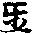



四分)、舍行、白行(十)、白僧残诸行(五)、白入聚(落)、尼白入僧寺(祗)、尼教授作残食法(四)。问：钞标二十九，据列数有三十、三十一，或有二十八，何不定耶？答：玄云：各有意致。若二十八者，谓约二部同相者说，便除尼白入僧等寺、尼请教授餘食法，故二十八。若二十九者，除尼白入僧寺及教授。若三十者，即合白僧残诸行法及白行行法为一，故三十也。若三十一者，更加二尼，名为溢位。二众通论，成三十一。上标二十九，且据僧言。下列三十一者，约尼合辨。问：白僧残诸行法与白行行法何别？答：相同时别也，餘不繁述。更有记中和会前来二十九、三十一者，谓除安加坐具受舍即二十九，并此即三十一，恐少道理。



云二、至中者，羯磨疏云：本是僧秉，别人非分，道在兼济，故通於对。有则对多，无则对少。众法对首，合有此一。今钞此处无至后明，二、三人中须向边人，是斯义也。已上三十五加舍堕，三十六通前心念，十四成五十也。



云次至三者，羯磨疏云就众法中离成三相者，若据和白处齐，前事得遂，义则不分。但以僧情难一，事分大小，随务裁法，故开三品。



云一至四者，单白中事轻小者，如舍堕诸白，出功德衣及行钵等，或常所行者说恣是也。严制者，如兰陀身口二绮恼僧，用旧持新等，白僧严制，违犯提也。又断事遣不诵戒毗尼者出，总是严制也。一说告僧便成法事者，事既非重，不劳再告，只要一白也。次释白。二中由事参涉者，参，杂也。涉谓开涉，谓参杂单白，开涉羯磨。疏云：若非常务，情和稍难，如受日、差遣、处分、结界，故须一白牒事陈情，一羯磨量其可不等。



彼释白四中事通大小者，宝云：如受忏治举诸谏等，利大谏、习近谏、勒习近等，则小情容乖讹舛谬也。受忏是顺情，呵谏是违情(此约事说乖舛)。若约僧受戒是大事，可责通大小，或有许不许等，是僧情乖舛，故须白四。恒记约一羯磨所被事中自含大小，如受戒一事，十三难是大事，障戒不生；十六遮是小，则不障戒。事既含大小，故须一白告僧，三法良可，故白四也。此解甚非，不劳斥破。



云若至法者，略言如此者，玄引羯磨疏云：僧法羯磨略有一百三十四者，总举也，非谓捧尽也。更张由有者，羯磨疏云：有人细寻，更加十法。又出僧尼互不同法及同事者，历数为二百六十一。若随相显法，亘同事境，不可收尽也。或有云：分两衣，分结阇尼、蒲阇尼等羯磨，未敢仰也。若通前二者，心念、对首二也。三种心念都有十四，二种对首并加小众忏，随一有三十，六都五十，并前一百三十四，岂非一百八十四法？



问答除妨中云问至一者，问意者，谓大约常闻有百一羯磨。何以得知？准伽论云：波离问佛：有几种羯磨？佛言：有百一。又问：有几单白？几白二？几白四？佛答云：单白有二十四，白二有三十，白四有三十七，都计百一。适来列数僧法，便有一百三十四，何得明违？答中此乃总标，非定如数者，谓今古相传云百一羯磨者，此是大刚之数，未必但有百一。举例如百一供身具，岂可便有一百一个耶？亦是总名之数也。亦可引用十诵。彼则定有百一者，进退重释也。若依他宗，即如前来波离问佛，佛一一答之，则揩定於数实有百一，变显当宗僧往且有一百二十四。更若展张，由更有在，亦未必一定於此等(云云)。



云上至义抄者，上明摄法分齐者，观文势似结前也。即须明非相者，理合於此。依解文中广辨七非之相，今抄何不见叙述？下句释云：钞意为始学人等，今师为接初学之机，本图文显，披寻易会，故不事义章，一一分判，对辨进不。若欲通要，委明已后，别撰义抄，於彼中细说。如今义抄，虽无羯磨疏替处，彼文广叙进不之相，今略引少许明之。且举白四：一、法通约事、约人、约界说者，对事唯有情，对人须成僧，对界须作法。就作法中，三小界唯受戒，小界是白四，餘二不通。如是事、人、界三，一一分对，是即为进，非即名不。若欲如是通知，请披寻义抄中云晓。今钞虑烦新学，且略不明。



云今至二者、直论是非者，谓不依羯磨疏内，将法对事、人、界，一一分对，故曰直论是非也。谓上三法者，心念、对首、众法也。离则八种者，即但心念，乃至白四也。具明别相者，具是一别，一别明於相状竟。一、事差互等者，如但心念法，只要自说戒，非是对首心念，乃至白二，非白四等。若交互而作，於八条之内随一条交杂，即是非法，被事不成。今文中言不应八条约总相说也。细寻此门，上下横括者，此门者，捧法分齐一门也。门中列一百八十四羯磨法也。上下者，法㝡在初为上，次事，次人，次界为下。横括者，将事、人、界三横列搜罗也。今且举心念法中六念一法说者，法在初为上，次列人界，界於下横列搜之。即将事横搜，通於三种。於三种中，日月、衣钵，是非情事；夏数、受缘，是情、非情合事；念身康羸，唯是情事。将人横搜罗，云唯是一人独康，便名心念。将界横搜作法，自然并无别众。此一疏既尔，餘皆例然也。庶无差贰者，玉篇云：庶，头也。切韵中训冀也。差者，差别。贰者，尔雅云：疑也。钞：文所列羯磨疏，繁略虽殊，大途意云不别头。后人细寻此门，免生疑惑，故云庶无差贰也。



云问至羯磨者，问意云：前一百八十四法通呼为羯磨者，若百三十四僧法可尔，且心念对首，何故亦名羯磨耶？答中四分三语及白衣说法中言是羯磨者，准受戒揵度中，佛初成道八年前三归度人，舍利弗问佛：三归是羯磨不？佛答：是受，是善作羯磨也。白衣说法者，准说戒犍者度中，为俗人说法受五八戒，波离问佛，佛言：是名善受，是名羯磨。



次约事中云二就事明者，标也。上既辨羯磨之法，法不孤起，必有所为之事，客有滥非，故此明之，识知纰谬。云谓至不成者，言谓羯磨所被不重明者，此且简定所明也。谓前辨法科中，心念对首僧法，都列一百八十四，且法不孤起，必有所被之事，事亦合有一百八十四，适来并含在法中了，此更不重举明之也。即辨非者，此句正明非相也。



所被通情非情者，如受忏是情，结说界等是非情。并令是实者，约前所被之事境一一如法也。片无错涉者，片似也，错涉即交互也。已上事法既如法，皆得成遂。若一缘有差等者，即随前境谬滥错涉，事之与法皆不就也。



次微起云何者等，适来既云一缘有差悉不成就，未妄如何名为一缘有差？欲解下文，故先徵起何者是也。



云如至法者，玄云：此人揵度中客呵文也。彼云：汝曹善听！若比丘犯二僧残，二俱覆藏，虽作覆心，未经明相，忆一罪，不忆一罪。彼比丘俱从僧乞覆藏羯磨，僧遂与彼二罪覆藏。彼行覆时，为客三藏问知已，呵言：汝忆者与覆善，不忆者不成，应与摩那埵。众僧不善，教无事与法，得吉。即无病设药，非也。(有约二比丘犯残，一比丘忆，一比丘不忆，以解者未详也。)云如瞻至例之者，准瞻波揵度，波离白佛：应作呵责，乃作殡出，如是展转，乃至如草覆地，是如法不？佛言：不应尔。即成三百六，非也。谓将十八法各为头历之，各得十七句。所云十八句者：一、呵责，二、僧上，三、殡出，四、遮不至白衣家，五、不见举，六、不忏举，七、恶邪不舍举，八、覆藏，九、六夜，十、本日治，十一、出罪，十二、现前毗尼，十三、忆念毗，十四、不痴毗尼，十五、自然治，十六、多不见相，十七、不见罪相，十八、如草覆地。今将第一呵责为头，历诸句一遍，即成十七。如是互为头，各得十七，都成三百六句，总是非相，可知。



且约一事等者，抄文且举呵责一事为首已外，乃至七毗尼例言也。云如实至自言者，此依灭诤揵度实犯。



自言不犯，约六聚作四十二句，一句为头得六。且第一云：实犯夷自言犯残(一)。实犯夷自言犯兰(二)。实犯夷自言犯提(三)。实犯夷自言犯提舍尼(四)。实犯夷自言犯恶作(五)。实犯夷自言犯恶说(六)。第二将实犯残为头遍历(亦六句)。第三实犯兰为头(亦六句)。第四将实犯提为头(亦六句)。第五将提舍为头(亦六句)。第六将恶作为头(亦六句)。第七将恶说为头(亦六句)。总成四十二句，非也。实不犯自言犯者，约七聚互作四十九句。且第一云：寔不犯波罗夷自言我犯夷(一)。实犯夷自言犯残(二)。实犯夷自言犯兰(三)。实犯夷自言犯提(四)。实犯夷自言犯提舍尼(五)。实犯夷自言犯恶作(六)。实犯夷自言犯恶说(七)。第二不犯实为头残自言我犯夷(亦七句)，第三实不犯兰为头(亦七句)，第四实不犯提为头(亦七句)，第五实不犯提舍尼为头(亦七句)，第六实不犯恶作为头(亦七句)，第七实不犯恶说为头(亦七句)，总成四十九句，非也。若据律文，先作三十九句，后作四十二句。今顺钞不依律次第，先列四十二，次列四十九句也。并名非法者，总结也。若实言实方为相称者，明如法也。此中含两如法，反前两非法四十二、四十九句也。而彼自言等者，臣者，伏也。所为(平呼)，即所作事也。所作是夷，还伏犯夷等。泛者，浮漫不真之㒵，实犯夷便云残等，不名自言也。只要略消文，玄记甚广，引律虑繁不述。



云非至具者，二房妨难者，有主无主房要无妨，准作处分羯磨得成。若互有俱有，虽与处分羯磨皆不成也。离衣枝必两具者，人是情衣，杖是非情，要人病衣重，作法得成，名两具。衣轻有病，衣重无病，加法不得。又人老病，开杖为两具。若虽老不病，或虽病不老，亦不成。



云此至矣者，结劝也。上之所述，总是律本诚实之文，临行事之时，不得暗晴昧葬卤也。



云次约人云三至人者，上文所辨事法皆如，然须假人秉法辨事，人若有阙事法无成，故次辨之共成济也。一有三人者，僧为二，三人为两，后一人为三。



云初至不得辨僧也。僧中有四者，谓四人、五人、十人、二十人也。如前说者，集僧篇中闲僧分齐科中，明此宗四种论僧等是也。唯秉羯磨者，兰心念等法。界中有人并须集者，文言界中不但作法俱收自然，随二界限约内有人总集，或一人不来即名别众。如是数说者，第三、简众篇后别众法附科中说也。但得御众法者，但字偏局义也，御者秉御也，众僧法也。除此外对心念不假曰人，今若四人作六念及持衣等却成非法，故云决定不得。



云二至改法者，辨二、三人也。具立二法者，众法对首，但对首二也。两界无僧，尽集作之者，释上众法对首也。本是众法，只为无僧对首而作。今若自然作法，二界有僧，不召他来，一向私□，二人共作，即不得有别众也。若二界并无僧，即听对首。文言两界无尽集者，据总相说也。或在自然集僧，若无僧，即对首。或在作法，且尽法界召集，若无，即开对首。客有不定人，多述意也。若数满四，即改法者，谓本是众法，如说戒等。今既成僧，即僧法释。然自恣虽满四，亦成展转对首。未成僧法，五人已上，方得白若自恣也。云若至之者，若作对首之法者，解但对首也。两人各作，不相碍者，谓两比丘各自面对而作，不集界内众僧，无别众过，不障法事。必有边人，有须问者，约问边以科简也。三十舍忏，须问边人者，羯磨疏云：舍堕至四，法通僧别。舍财还衣，僧中作法，正悔本罪，须问边三，故须问也。九十单堕，但对即得者，疏云：罪非僧除，故不问也。亦有通须问者，重释简也。古记云：三十、九十，一时料简，总问边人，故着通字。(不正)玄记云：重释三十，约边有人须问，即显无人不要问。此文重於有人中，约处相通须问，必若成别不须问。(上记文)镜水大德破云：此忏舍堕之法，本是众法，今只为僧数不足，方开对首。今若有边人在覆处障外，露地寻外，既在界中，不集他来，自是别众，何问与不问？今准法宝，重明九十，谓适来且一往，而言九十单堕，但对即得，是不要问。今或可边人在露地寻内，覆处障内亦须问之，故云亦有通须问者。钞：下遂释云谓同覆处寻内等是也。必在外有障，不在通问者，必在外，谓露地寻外也；有障者，覆处有隔也。此二处，边人即不在问也。(此解妙尽其原，思之。)若心念一向非分等者，此简一向问，不论障内、外及寻内、外也。必有随缘作者，随心念念事缘作之。



云至同别者，一人心念独在界中者，此谓但心念也。若众法心念、对首心念并界无人者，谓此二根本，一是众法、一是对首，今只独自故开心念说戒便成众法心念，今既独己开心念持衣等即是对首心念，并须自然作法，二界内更无人方成此情法。若有一人非法别众者，界内成僧，今便心念说戒不集他来成别，或界内更有一人不召他来对首，亦独自作成别众故。所秉如前法中者，众法有四、对首有七，如前法中列之。若但心念不论同别者，但得自作故。不论覆处露地寻内曰同，覆处障外露地寻外为别者，并不同如此论量也。



次约界中云四约界者，牒名也。上来人法事三虽备，要由界生，故次明之以程非相。



释中云四至三种者，四种自然者，聚落、兰若、适行、水界。羯磨法中等者，谓於此四中，约羯磨一百三十四番之中，唯得秉结界白二法，是僧家执御也。已外等者，但对首并但心念为二法也。及一二三人众中杂法者，古今解者，取意皆非。今依玄记云：此法本来合是众僧秉，故曰众中也。事通心念、对首、众多人及众秉之，名为杂法。改其其餘法，不通非杂法也。只如说恣受僧得施及亡人衣，羯磨疏中更加舍忏，始从一人或至二三，故知不谬。开一人心念，开二人对首，开众多人展转，对首四人自恣，未是僧法，皆须尽集。



云二至五位者，作法摄僧者，自然地弱，秉法未尽，必须作法僧界，故次明之。亦通二人者，僧为一，别为二。法通三者，心念对首众法。



云就至位者，向此作法界中，分为五个阶位。又於五中略分三别：一、小界；二、戒场；三、大界。



云一至也者，准事受戒。小界者，恶比丘作别众留难也。缘起总如结界篇叙，此未可述之。二、因难自恣亦尔。三、数人说戒，谓数知现集之人数，如下文云尔许比丘集等。此小已下，释上开结之义也。但作一法者，一席法也。一者但为现在不通未来，二但据暂时不通久远，故云一席也。后必闲豫，谓非难缘之时。不许之云已下，证上一席非久固也。



云四至等者，四戒场者，标名也。释友义如后篇中。本为等者，略叙开结之缘起也。除说戒者，未戒场本为非时集，说戒既是时集，何得开之？玄云：必有难缘，亦开於上说戒。除自恣者，自恣本是安居处，戒场不许人住，既非安居之处，何得於中自恣？玄云：有难，准上开之。除乞盋舍忏者，此乞钵行忏，罸令用旧持新，夺好钵入僧厨，舍一恶者，僧中展转取最下者与之令持，今戒场既无僧厨，故不许也。除分亡人物，六人轻物，利通十方，大界同集，今许於杨，今避容自分，岂非是盗？除受日者，受日本约安居处，戒场既不许安居，故不可於上受日。持解界者，本於大界体内解之，今戒场隔尺八自然，不可遥解。除结衣界者，本为捧衣属人，故须结之，戒塲本不是僧居，如何妄结衣界？又解衣界依大界起，今戒场隔尺八自然，故不合也。除净地者，净地本防宿煑，场既无僧，有何宿煑？何得輙结？又净地依大界起，上既不许结之，有何解法？除受功德衣者，本为夏劳，受衣场非坐夏之处，又非守衣之所，故须除也。



云五大界者，此空标名不解释，谓前来已释了，故前文云：亦通二人，法通三种。此不异前，不可更说。(此正义)有人疑云：钞但标不释，莫是忩俣却一段释文不？又有人引下科简一段之释大界者，俱未晓钞意也。云就中至知者，就中二字，就前作法界中，开则为五，合则为三是也。通塞者，如三种小界，但作得受戒说恣为通，已外不得是塞；戒场但许受忏是通，适来到出十种之法不得是塞；大界一切法事总作得是通，重结大界及戒场三小界不得是塞。随相可知者，随前所列之相不难，故可知也。



大段第二，成坏门。



云二至坏者，宝云：前来约法、事、人、界四种历别已明，今於此中重对法上横八以辨成坏之相，是即名成，非即名坏也。



云法至解者，法不孤起者，谓上心念对首，众法不孤。然自起终须四缘者，谓法、事、人、界四也。既有所秉法，必有所被事，须假能秉人，又凭作法，自然之界，阙一不可也。随义明非，不过七种者，谓约人、法、事三，绮互成七，即三单、三双、一合为七也。此中七非，从律文中来，今若要通明，须先辨律文云羯磨。疏引瞻波法七非之义，分为四门：一、列数，二、释名，三、辨体，四、总别。今於此四中，下二如疏明之。且列数释名字者，先列数：一、非法非毗尼羯磨，二、非法别处，三、非法和合，四、如法别众，五、法相似别众，六、法相似和合，七、呵不止非(列敷竟)。次释名。云非法非毗尼羯磨者，疏解曰：作无轨则，不称教理，名为非法；不能生善灭恶，名非毗尼；被事云时，亦得名羯磨。此一中具三非，人、法、事总非也。一人举一人，乃至僧举僧，是人非；一白众多白，一羯磨众多羯磨，是法非；有病无药，无病施不相当，是事非也。二、非法别众者，谓本为此事作白，乃为彼事作羯磨，此约作法差互，名非法也。同一界住，应未者不来，应与欲不与欲，来现前得呵人呵，是别众也。此具二非，人、法俱也。三、非法和合者，非法义如前释。和合者，应来者来，应与欲者与欲，未现前人不呵。此但有非法，非一种也。四、如法别众者，应作单白，今作单白；本作白二，今作白二；本作白四，今作白。别众者，应来人不来，应与欲人不与欲。此但有人，非一种。五、法相似别众者，先作羯磨，后作白，即约作法时颠倒，故名相似。别众如前说。此具人非，法、非二种也。六、法相似和合者，相似如前解，和合应来者来等亦如前。此但有法，非一也。七、呵不止者，应呵者心同故，呵康法者不止，便成非也。此但具法，非一也。不同心乖故，现前人呵，即是人非。故思之。外难曰：前来钞云：法不孤起，终须四缘，所谓法、事、人、界。今辨非中，何不见说着界非？答：隐在事非中也。或可令有界非，略故不说。又难四：於上三非中，人、法二非多，事非绝少者何？答：非起约情，故在人也。秉法在人，多生伪滥故，人、法多倍於事故。(上两重问答，并是羯磨疏。)据理，七非之相，令依律如是次第明之。钞：主且依善见论文，始从但心念，终乎白四，心辨非相。然其根绪不出适来所述也。先就但心念等，就横八中，且明但心念法具辨七非之相。此正依见论第十七说戒法中作之，乃至白四八位，一一位中皆俱七也。云初至之者，谓以此法对人作者，谓轻吉罗罪只要责心自灭，今对首悔，成人非捧也。口不言了者，要假口说，令自耳闻，今不如是。法不称教者，前后错乱、颠倒等类，是法非也。重吉罗责心悔者，解事非也。宝云：重吉本体是对首家事，不是但心念事。今将对首事作心念事，秉责心治他重罪事，不得是事非也。六念等事，一一妄牒等者，如初念大月为小月，白月为黑月，一日为二日，乃至第六念无病云有病等，并是妄牒，一一皆得违教之吉也。四、人、法非，不妨事如者，重吉对首，轻吉责心，是事如也。二非可知。五者、人、事非，不妨法如者，口说了明，是法如也。餘二非可知。六、事、法非，不妨人是者，谓自作心念等是。餘二非易知。七、具三非者，如前总具也。餘则例解者，此上且约轻吉六念以明，自餘说戒、发露等例解。



云二至可知者，数同於上者，指前但心念七非之数也。随事对法，谓前约法辨对首心念中有七种，即安居、持衣、说净等事，作对首心念之法，故云随事对法。各有别相者，谓此於七中一一各具非法也。且举安居者，且者未尽之词，对首心念都有七不，可总举来辨非，今抽取安居一法具明七非之相，餘六例此可解。界中有人别众而作者，解上人非也。谓本是但对首法，只为无人方开心念，今既有清净比丘，不召他来一向自作，是别众捧也。自不依他者，谓夏中不依第五律师犯提，亦人非也。口说错脱文非明了等者，解上法非也。谓陈词时错悮脱漏之类也。时非夏限者，解上事非也。四月十六日是夏初一日，今十五日由属眷分结夏不成。处有难缘等者，谓虎狼师子恶兽令难，或有黄门婬女等梵难，佛制不许在此安居，今既故违即不依佛制也。四非已下等，钞指略也。即三双一合，类取前文可知。



云三至例之者，界内别众者，解人非也。说戒根本是众法，无人之时方开心念，今既有人独自如作，是别众捧。自犯六聚者，诸有犯不得说戒，今自有犯即不合说。不陈三说者，解法非也。谓心念说戒，虽不秉单白，理合口陈三说。云今僧十五日说戒，我某甲清净三说，今不陈此。或有漏忘者，虽陈词而脱漏说戒清净等字。众具有阙者，解事非也。舍罗灯火等是众具，今阙此故。非正法者，未至半月，或虽是半月，晨起不待客等。四非已下等者，易知。



云四至知者，但对首者，唯对二人作也。其例盖多，今举一事，如持衣等是也。所对之人犯戒非法者，解人非也。前对首者，破戒不足我别法之数也。或虽是清净戒，一坐一立相中有乖，故云非法。有呵者，呵谓心乖故呵，呵成别众是人非。捧陈受非正者，解法非也。谓十五条三长一短，今云两长一短，陈说词句不当此衣，故云非正。或呵不止者，谓前人见错遂发言呵，呵而不止成法非也。上来有呵者，呵即约心乖故呵是人非，今呵不止即法非。捧五大色衣及以上染等者，解事非也。青黄赤白黑是五大色也，真绯正紫碧绿等是上染也，四邪五邪败博是不净也，四非已下如前解也。



云五至例者，众法对首者，根本是僧秉法，今无僧故开对，其例盖多，且举自恣一种四人秉法。第五受欲者，解人非也。谓界有五人合成众法，今一人与欲，四人作展转对首，或非净戒。知而同法者，前是破戒人明白知委，即不合与同法，若不知即无过。互不相陈等者，解法非也。对首自恣理合更互陈词，如四人作法，一人别说云：三大德一心念！今日众僧自恣，我某甲清净三说，今不如互陈。说不明了者，或虽陈词词句不了，律云不得窃语自恣等。时非夏末等者，解事非也。谓佛令安居竟自恣，今夏末竟而作，是事非也。众难不具者，若有恶比丘来，即知彼十四日来十三日自恣，十五日来十四日自恣，虽非夏末即许，反上不许。四非已下等者，易知。



曰：六至可解者，单白所被乃有多种，今文中且举舍堕一法辨非，餘例准也。而各不同者，谓约前所被不同，若论其非不异。界内别众者，谓或在大界中有人不集戒场，上即不尔。非清净者，忏主必须根本俗人已来不犯五戒，乃至出家后不犯重禁方受彼忏，今反上成人非也。轻重同法等者，解法非也。如忏长衣应量结提是重，不应量者准论结吉是轻，今同舍合忏也。持犯不分者，释上轻重义也。应量过限结提，据律文是犯减量，虽过限多论结吉，律并不犯却得成持。今若相合忏之，则不分持犯二别也。妄陈言说者，犯长云离衣等例。财非合舍者，解事非也。羯磨疏云：衣财散落染净不分，通将入舍以事非也。(上是疏文)法宝又解：非由不也。如蚕绵但自斩坏不合舍也。有过不陈者，随犯长离衣败卖取非亲尼衣过限之类，理合一一陈之。今并不说界非作法者，然此舍堕理通二界，今且据单白所被，必是僧法成就，须是法界自然不合也。衣物不集者，谓临作法时収舍院中衣物不尽，不一时聚集列於僧中。妄輙托人者，或舍衣了归房中，忽见本物恐有相染，便云此舍与某甲等，亦不得也。下文云已作属己前生，后乃恐染而舍，此非净施，佛判不成等。四非已下等者可知。



云七至知者白二中者，谓有诸多白二，钞约结界一法辨也。不尽标尽相等者，解人非也。𢮱谓自然界小，作法标远，故须尽标集也。相谓者，作法标狭，自然相远，故尽相集。界内别众者，四处六相，自然界内有人不来，得呵人。呵人者，心乖故呵也。唱相不明等者，解法非也。谓唱相比丘心中不明，得彼标相分齐，或唱不着等。作法暗托者，唱相既不明了，虽秉法结，结冥然不就，亦无善法生起。由彼不明，无所托附，故云暗托。(玄云：如暗中托物者，非也。)呵不止者，谓知法人恐法不成，心同故呵，彼不止住，是法非也。标相及躰等者，解事非也。唱相之所据名曰标，羯摩所牒处曰相，作法之地处曰躰。今不识此之三分齐，故是混乱也。不知彼此二界错涉者，不知大界内相为此，戒塲外相为彼，中间不留自然之地，故云不知彼此也。既无自然隔之，二界自成错涉也。重结交互者，前人已结，后人不知，更於上再结，故成重结。两界相衔，名为交互。遥结之类者，在戒塲上坐，遥唱大界内外相，秉法结也。下句都结上非，故云并不成就。餘非例知者，三双一合例解也。



云八至前者，白四所被有众多，今承受戒一种弁也。受者遮难者，解人非也。有解云：沙弥为受者身上有轻遮重难，故受不得。今难云：若约沙弥有难等，却属事非所标也。今依玄记，约教授师不明教相，不识遮难等相，不解分别，非令他带此而受，不获戒躰。此非无从教授师身上起，即人非捧也。故下文云：若问而不解，终为非问等。界中不集者，且据大界内受时说。僧数有缺者，中不满十，边不满五。人虽五百者，此且纵词，聊举五百五十法简之。不中者，谓前足数篇诸门中料简六十餘人，今除第四门中少分不足，且头前之两门所列人数五十有餘也。通非正数者，谓上诸人总不足正僧数也。受前进止等者，解法非也。八种条理者，谓受前具八法：一、请师，二、安置受人立处，三、差教授师，四、出众问，五、召入众，六、乞戒，七、戒师白和，八、戒师问难。此八并属受前，故云受前进止等(云云)。及论正受，谓受中有二人：先且教彼缘立心，次秉受法正躰。此二不开前八之事也。执文无差者，依文谨诵某甲之词，曾不加改也。界相不明等者，解事非也。界相与前白二科中解同。衣钵非己者，假借别人云者，类是流预，但是事非也。总在此収也。餘非例前者可委。



云餘至也者，通结指归也。餘，外也。除适来单白、白二、白四云外，故着餘字也。正法即羯磨之法也。乃至心念者，越却中间对首。当法自成不相通练者，谓横前开八位，就缘约相一百八十四，人法事等各各自别，故云当法自成。交互不可，即不明通练。别众一法多或通之者，多谓多分或题不定，谓於八位之中除但心念一位，餘七位若界有人便是别众广张也。义抄者，律文七非之相文义交罗，羯磨疏引彼广陈，抄为接机故略不说。前来八位随义明非，且依见论云文与律意旨不别。(去记对此别七非数，令移在前门首说了。)



云次释羯磨正文者，镜水大德云：前分科处云由解羯摩，今此但云次释正文，二言何异？答：但制作变通语势，更无别理。大德又云：虽尔，亦须对此略消前科。所言曲解羯磨者，谓分外义也。就一百八十四种总呼为法，其心念对首文相易显不更说。然僧法羯磨刚骨缘本难明，是以分外更说令人知委，故云曲解(消前科了)。今云次释者，次谓次第，释谓解释。正文者，即单白白四云文，於此文中一一调理白数等(云云)。云令至雷同者，科令知纲要者，古说云：纲即是要，不正也。玄云：羯磨骨名纲，其间牒缘本所名要。只如单白中，初三故五十四今字为纲，二四两句缘本为要。羯磨三十一字是纲，三中间为要。大德僧听下，谁诸长老忍前为一中间，谁请长老忍后者嘿然已前为二中间，僧已忍后竟字前为第三中间也。谓法无缘本即是无用，虽有缘本若无躰骨之相，被事不成。故知一十四字、三十一字，实为缘本。云纲中间，缘本虽殊，乃是纲家之要。有人云：纲与骨有别者，不然。纲即是骨头，缘本边即纲。约法，躰中名、骨，二名不异也。识解通塞者，了别无疑曰识，凋明义理曰解。一百三十四白，纲、骨今今总同，是通；百三十四中间，事、缘各各有异，是塞。单白既尔，羯磨准知。若不具明者，具足晓明也。谓若不具足晓明躰骨，缘本答异，见增减一字，不问缘中，将为便成非法也。然其非相，准在一字者，然，是也。谓是非相，不必全句脱漏，便号落非，但一字参差，即名非法。然须知处所者，此可然字作纵夺意解也。谓上纵云成非，唯在一字，今若夺之，即此一字须着处所，居躰骨中，一向不许。於缘本中，不伤理处即得，伤大理处，一字不开，故须知所处也。不得雷同者，宝云：似雷之声，天下同闻。是一例义。今不得同此，须究其原也。



云或至乱者，或依文谨诵，曾不改张有无者，此且通相以辨不能改张成非也。律木羯磨中有其事，今日不具，不能改有而令无也。律文羯磨中无今日，且有此事，不能改彼云无而令有之。或第二、第三亦随略说者，谓约不解结略非也。律明白四羯磨，翻译人广出一番了，乃於下结云第二、第三亦如是说，但从头更秉两遍即得。若更列其文句，虑在繁词。今此一类，古人行事之时，秉一番说，亦随律文之语，云第二、三等(云云)。或无文称事者，羯磨无文，称今日事。如受日羯磨，律文但牒三宝之缘，为出法方轨。今日受日，自为看病等别缘，即合除却三宝着。今看病等缘，亦一向依於律文，即成非也。有文无事者，羯磨有文，今日无事。如赏劳看病人，律文具有三衣六物之词。今日亡者身贫，只有二衣之类，亦依文直成，更不除改也。俱有者，律文有鬪。诤相言事为呵责事，有鬪。净人智慧卢[酉*盆]那为呵责人，是俱有。今日因戏哢为呵责事，道法慧达即是其人，便令依今日之事人。古德亦依律文，牒当时之事。俱无者，律文无圣制不学为呵责之事，亦无不学教人为呵责之人，故曰俱无。今日忽有不学之人及未学之事，合与呵责。古德亦不解加益，故钞下文云：然此治法不必大罪，但圣所制学，愚暗自缠，皆合此罸。未能增减者，律文无未能增，律有有未能减，减则反释上来俱有，增反解上句俱无，如是有、无并不增减也。致使二字蹑上而生，因由前来不明，及乎临被事时，被解法之士讥呵，令加减文句，遂乃更增昏朦谬乱也。已上三段各释竟。若依搜玄科，第一段为标，后二段为释，将后二段共释前文，恐不然也。今观文势，三段并是释文，但总、别称异，钞中各着或字隔之，不可妄为科节，失意甚思云。



云或至责者。受领名心，纳藏为府，心为纳物之义。呈白露现，对众执文高唱，即其事也。岂非不以等者。谓受戒来不学，故得上犯吉罗事，全根本不识羯磨合诵，今但白读，更增无知提伊者是也。云自受，是不学无知之罪责也。



云亦至罸者，愚教诈为明了，故云转(去呼)哢。精神法则羯磨纲骨，初三后五不得加减。今此类见缘本中，事繁处删除一字不损，大理处诈现明闲之㒵，便呵云不成等，故云观事乃同法也。人事两缘冥逾梦海者，人谓能秉法僧，事即所为之事，今於此二冥然不知过於梦海。梦谓夜梦所见不实，海即眇漠不恻波澜，皆是不真不恻之义。上一类愚教亦言於羯磨法及中间缘，更后过於梦海也。玄记云日中观海尚自不知浅深，况夜间梦见宁知边际等(非也)。量时取法全是师心者，忽欲行不能持，得增伽梨去，量此时宜乃作离衣羯摩，都不论人病衣重等。如此取法全出自己之心照教，教称不成者，将此无病衣轻之事照於律教，教称不成，要须人病衣重始得结罪。罪当深罸者，如是取法不应教法得吉罗𠎝，作法既不成又得离衣之堕。已上二罪且是根本，上复加不学无知，故云深罸也。



云是至诫者，二人曰伴，四人曰俦，极而诫慎，劝学流通意也。云若至合者，证上须是明闲之人，若暗教不明，律部之人不得，故云已外不合也。



云今至解者，且者，未尽之谈也。谓单白有三十九，白四有三十八。今辨纲要句释，不可一一别论。就单白中，且承说戒一番来辨，餘三十八例此。又白四中，且举受戒一番具辨，餘三十七例然也。



云：就至知者分五者，谓约句有五：第一句，大德僧听者，纲骨也。戒疏云：出家四果乃是真僧，无学道高，故云大也。今出家人虽未证圣果，修行也应证得。且因中说果，亦得称大。或可约三宝中僧田极大等。德者，戒疏云：有所得也。以得善居身，修戒习慧等。僧者，戒疏云：唐言和合，谓人、法二和。身、口、意属於人和，戒、见、利是法和也。听者，戒疏云：专心静察，听我所陈也。告众𠡠听等者，钞云：解，释也。声尘外举，耳识内发，应僧三业和同，名同法也。第二句，今白月十五日众僧说戒者，缘本双牒也。戒疏云：今十五日是其时缘，众僧说戒是其宗本。正宣情事已下，钞：自解也。适来白众𠡠听，只为此云二种，令众委知等。第三句，若僧时到，僧忍听者，纲骨也。戒疏云：若者，不定之谭。到，由至也。一、人到，大沙门入；二、时到，十五日布萨至也。(上悬引疏解)抄文自释云：心和了集，事须法应。心和谓忍许堂头法事，身集即自赴堂。既无别众，名为事顺。戒见又同，即是应法。僧忍听者，抄文标举也。劝令情利听可，勿事乖舛违背，即是释上忍听义也。第四句，布萨说戒者，略缘牒本也。略却白月等时缘，单牒说戒之宗本。钞：文解云：重牒第二根本，乃至忍可所为，即忍许即可所为之事也。第五句，白如是者，纲骨也。事既和辨已下，钞：释易知。



云次至也者，次者次第，就者向也。羯磨中明者，谓明其纲要也。且约受戒白内者，且谓未尽也。白四羯磨众多，今举受戒盛行之法，此受法在白四三十八番之数内也。有人科内字在下句者，未为雅当也。难曰：前来众法中有三，谓单白、白二、白四，今解释纲要之理，何不见明其白二耶？法宝云：但广解白四羯磨以辨是非，就白四中除却两审便成白二，若更别说其文复繁，体骨既同秉说无用也。思之。上已明白者，今详文势似结前文，兼是指略，谓受戒白四即一番白、三番羯磨，其单白已如前来举说戒辨了，故云上已明白也。向适来既已明於单白，今此与彼不殊，钞中何得再说？可引文。答云：恐新学未悟略复述之。意云：若头纲骨句数不别，即不在重言。今抄为接初机，犹疑后人未能契会，略复述之，复由重也。各有其志也。进退更解也。志者意也。谓此虽更论其意各别，前文单白意为众僧说戒，今此单白意为沙弥受戒，体骨白法虽同，所为意旨全别。



云白至可解者，白中还五者，还与说戒单白，据句有五也。第一句大德僧听者，纲骨也。解义如抄(云云)。第二句是沙弥某甲乃至令众量宜者，此某甲从和尚某甲者，镜水大德但唤作亲缘。有云缘中缘，亦通求受具足戒。大德云此是缘中本，此某甲今从僧乞受具足戒，某甲为和尚某甲自说清净无诸难事，年满二十三衣钵具者，缘本双牒也。大德云已名众僧字具足戒，和尚名是本难事，秊二十衣钵等字是疎缘(上是定缘本句也)。次解义者，钞云此同上牒。其缘兆等兆者，表也。既牒衣钵全具遮难，并无等缘，即是得戒之先表也。正宣情事者，正是宣说情怀中所为之事故。令众量宜者，谓合僧众佥量宜应与戒等。第三句若僧时到僧忍听者，纲骨也。释文如钞。同上等者，与前说戒单白是同忍可所为之类(云云)。第四句授某甲具足戒，某甲为和上，略除前缘单标根本。释文如钞。忍可所为决判根本，即受戒是所为根本也。第五句白如是者，纲骨也。抄，释也。云表众令知，与前白结告归不别也。次下科简云此之白文者，指受戒也。前单白者，说戒也。文义略同者，白中五句，三句骨为纲，两句事缘为要，是文同。初𠡠令听乃至第五表众令知，解义不异，是义同。彼为说戒，此为受戒，其事不全相似，故号略同。依之可解者，依此一番辨之，学者即可解了，例餘一切皆尔。



次至上文者，次第解释也。就中分二者，就受戒羯磨中约体用大段分二也。初正决根本者，明正体一十七字纲骨。二僧已忍下，结成上文一十四字纲骨也。



云前中有三者，就正决根本名。前中就被事边，事边大略分为三。若就句，亦合分五段也。第一段，从初字至缘字已来。初者，三句之首也。大德僧听者，纲骨也。钞：文释曰：告众重听，对前单白，得重名也。事既非小者，受戒之事，不并常途，此是圣道根本，四辈良善。祸曰：岂是小也？谛缘声相等者，令众审实，听此陈苦，决判之缘也。第二段，从二字至不字已来。此某甲从和上某甲者，大德云：但呼为亲缘。亦有云：缘中之本也。求受具足戒。此某甲今从僧乞受具足戒，某甲为和上。某甲自说清净，无诸难事，秊满二十，三衣钵具。僧今授某甲具足戒，某甲为和上。大德云：此是缘本。双牒上句，是疎缘；从僧今授下，是本。有云：上句是缘，中句缘；僧今下，是缘中本。然不乖其理，大意不失即得。谁诸长老忍者，此体骨句也。若东塔疏，忍字属下句缘本中捧，只有三十字纲骨。又准淮南顺正记，将下句僧字勤向上句为纲骨，应云：谁请长老忍？僧即有三十二字纲骨也。大德云：俱不应理。知云：已上且悬辨缘本句了，虽则平书羯磨，文稍繁贵，在子细诸记中制述，但标举前后，初学难明，今此虽繁，盖是急要也。次解判者，抄白释云：正辨牒缘及以根本者，前来羯磨文，从此某甲直至三衣钵具已来，是正牒缘，令从僧乞受戒等，即是根本也。量其可不者，令僧审量可为受、不可为受，故云可不。第三段中僧今与某甲受具足戒，某甲为和上者，此是本也者，嘿然谁不忍者，说此纲骨白也。单牒根本决判成就者，谓此但云僧今与某受戒之本，更不述衣钵遮准等云缘，故云单牒等也。第二、第三亦如是说者，结略文也，可知。外难曰：此中三番并白，号为白四，被他受戒等事者，何不更增为其五，何不更减至一耶？可引抄答云：一则事不成辨，多则法有滥非等。意云：若一番被他，前事未得成济，若至五六七八又滥他，十诵无。准云：非轨尅令定限至於此者，正立不多不少之理也。犹如印信恒须一定，轨则尅定，不可参差殷重之心，故立三法以与轨尅也。



第二段，结劝。云二至体者，僧已忍者，骨也。与某甲受具足戒，某甲为和上，亦是略缘，单牒根本也。竟，僧忍哩。然故至持字，骨也。从僧已忍下，都计十四字是纲骨。亦有将竟字成戒，安字下应云：与甲受具足戒竟。任情并得，不伤大理。今时不识法者，多有呵止，却成自己之非也。钞云：释云：此直付结归，不关正体者。问：适来十七个字是羯磨纲骨，何得言不关正体耶？大德云：此且对前三番以言，谓第三至说字时，沙弥纳体成辨。既非归结文中得戒，岂非不关正体？非为结归十四字不属羯磨中摄。或有对此举判印喻及暗与物等喻，可知。



云就至非者，开科也。



云初至准者，初中二字是增减料简也。宝云：但约单白以说，若白中有第二句即是增，除此一句曰减，增乃对减得名，非谓新添词句也。轻小无缘起等者，如灭诤法简集智人单白第三句，僧今集智慧者谓平断事白，如是阙第二句也。有缘起者，如说戒日月即是缘，行寿告令即是事缘，令牒时缘及说戒事，本摄僧大教事非轻小，故白中五句也。乃至白二类例除之者，越却单白有五句者，故云乃至白二类例。单白中若事微小无有缘起，乞词亦四句成白，如受日一切差人白二是也。事非轻小若有缘起及与乞词，白中五句，如结界众同之本事非轻小，唱相是缘起，白亦五句也。餘则一准者，玄记呼白四为餘，谓上所论者准单白白二白餘，未论是白四也。白四之中事虽通大小，尽有缘起及乞词，一定五句无改，故云一准也(此解犹局)。若依法宝解云：有三个一准，一於无缘起单白之外有缘起者，皆五句成，如说戒等。二白二中若有缘起等，白中皆五句成，如结界等。白三一切白四，皆事非轻小，须依本五句成白，即未第三一准也。此解甚为雅当。



云二、明通塞者，纲骨十四字，三十一字为通，缘本之事白塞也。



云单至一切者，第一是初句大德僧听四字也，第三即若僧时到等七字也，第五即后五白如是三字也。文义通一百三十四更无增减者，释上通义也。谓上一十四字体骨一切单白并同，更不可加减。若不轨尅一定，即被事不得也。第二、第四句者，谓大德僧听后若僧时到之前，此约句是第二、缘本双牒也。从若僧时到之后白如是之前，此约白是第四、略缘牒本也。由各随事等者，释上塞义也。谓随结说之事一一不同，称缘而牒者，称可前缘而牒，入此二四中间之内。文随事显故限局者，如说戒云：今白月十五日是缘是本。受戒即云：此其申从某甲受具戒衣钞具足，乃至僧今授某甲具戒等，缘本双牒。如是例通一切羯磨，缘本俱然也。第四句中略除缘单牒本，不得缘本双牒。何以得知？所被之事而显一一不同，是限局也。义存告众通一切者，文虽是局，告众之义次断成就，道理不殊，故通一切单白也。



云就至可解者，辨羯磨通塞义也。僧已忍兼取付嘱结归三十一字，文义通白二白四两种羯磨也。中间牒缘牒事等者，中间有三：大德僧听！后谁诸长老忍前为第一句，中间长老忍后者哩。然前为二中间说字，后结归前为第三。中间牒缘牒事随机不同者，谓随前所被机要不同。文局义通可解者，随缘牒事各别是文局。又虽是局，告众量宜决判成就，义通白二五十七、白四三十八，都九十五番，故曰义通。可类前单白通局不殊，故云可解也。(搜玄於此更别疏辨诸羯磨缘本，恐太繁也。)外难：羯磨文中前后并云僧听僧忍，中间何故但云长老？长老二字属於别人，何以有斯僧别差异？玄云：事遂在僧成不在别，别须语哩。僧准六和，假用彰名还从别举，故云长老忍也。



云若至亦失者，镜由明也。明得此纲骨之义，得前所被，被缘作羯磨。不须更者，羯磨之文，若於此法暗述，谨诵在心，临机亦失也。



云三是非者，依而无失得成四是，反此名非，下自广释。



云白至不成者，白中文义俱通三句者，今解之，应云：白中三句文义俱通，大德僧听为初句，若僧时到为三句及第五句，如是为三句，一百三十四总皆不别是文通，告众𠡠听乃至白告等是义通。羯磨之中文通者，大德僧听！谁诸长老者哩？然不忍者说，乃至持字已来文义通九十五翻。头尾一言不可增减者，玄云：单白中大字为头，是字为末；羯磨大字为头，持字为末。或云：一句之中自有头尾，如白中大字为头，听字为末，乃至羯磨例知。两解俱得一言者，玄云：一言也。单白十四字中，不得更增为十五字，不得减更为十三字等，必须通诵，缺剩即不成，剩即是增，缺便是减，被前事不得成就也。此解为正。或依乾素阇梨释，一句为一言，如儒书云：诗篇三百，一言敝之，曰思无邪也。谓毛诗有三百篇，故云诗篇三百。一言敝之者，敝者当(去声)也。一言者，思无邪即是一言，谓显於正。意云：君子所思皆正。既言思无邪三字为一言，今可配白，如是一句亦一言也。大德云：三字一句任配，或四字五字为句，如何无？又错解他俗书云义，彼云思无邪，虽是三字为一句，然但为显於正之一字，岂非还以一字为一言？又如令时制诗，或云五言七言，亦是五字七字，不可五言便有五句七句耶？故知非解。今时恐有依承之者，故此述之。



云餘至正法者，餘者，外也。除单白羯磨十四字、三十一字纲骨之外曰餘。文局义通者，随机不定是文局。文虽是局，正宣情事量宜等义不别是义通。但令顺事合宜者，如受戒身无遮难、衣钵具全，此皆名为事。此事顺於戒法，故云顺事也。自有求戒之意、僧与戒之心，即是合宜。片无乖降者，片，少也。乖违降，谓差降。上既一一如法，更无少许乖违差降，即事成辨也。且举受戒，餘并例知(云云)。增繁减略者，增即乘，减即略。如言求受具足戒，即是增繁。若言具戒，虽不著足字，便成减略。又如众僧亦增繁，或单言僧即减略。诂训不同者，解上繁略字也。诂则文略，训则文繁。如尔雅上卷有诂训二章，各释一个众字。诂章中云：师者，众也。文词即略。训章中云：薨薨，众也。文词重叠即繁。故知将训释繁，将话释略。即上羯磨中云：众僧具足戒，文词多，名增繁。但云僧具戒，言词少，是减略。文义不失等者，或繁或略，虽有加减多少不同，且不失羯磨中正理，并成正法。正法即羯磨也。云类至也者，欲释文先难曰：何以得知增繁减略诂训不同总成正法？可引钞答云类准诸部等(云云)，谓类例准於诸部羯磨牒事繁略，如五分结界白中无第四牒本，但有第三缘本双牒。又羯磨中又阙第二中间，尚乃被事得成。今此单白第间缘本双陈，第二中间略缘牒本，羯磨二中间并皆周足，或减一字又非骨中，不伤文义於理何失？故云及论义意亦无有少也。至如翻译梵汉音义全乖者，梵是天竺之言，汉是此土之语。音义乖者，如云梵语布萨，亦云褒洒陀，汉翻为说戒，此是音乖。布萨忏已起罪，说戒防未起非，已未二义全异，复是义乖。今时若取梵语，单白文中乃云今十四日众僧布萨，或云褒洒陀。若取汉言，即云众僧说戒。至第四单牒本亦尔。如此梵汉音义全乖，秉法尚许得成。钞：蹑上句云：诂训所传非无两得，故例成也。意云：我今羯磨文中或减或增，准上二例不无两得，故例成耳。(搜玄解上二段二例之文颇至繁广，今不备录也。)



云问至不者。此间意者，谓律文虽有一百三十四番僧法羯磨，文圆义足，然对机行事之时，不知为要，通谓为复执文读之？然三藏教中并无说处，此即是文义俱阙也。古人行事，见教文义俱无，遂执文读之，以被前务。今或有此类，未审被事得成以不？



云答至之者，不成是定者，令师且直答执文，白读决定，不得云不成是定也。问：夫判不成前事者，须有教文。说处违教，故作住评不成。今三藏之内，文义全无，钞主约何论量，乃云不成是定？可引钞答云虽无明决，可以义求等(云云)。



羯磨戒本作法相似者，正释上来义求之理也。谓律中若不诵戒羯磨，尽形不离依止，以俱是作持之法，岂合不诵耶？此且制诵相似也。又说戒及与作羯磨时，皆须鸣钟集僧简众，与欲问答和合之类，此作法时又相似，故云作法相似。下白正破云：戒本必令诵之，羯磨岂得白读诵？当宗及外部戒文总不许读，必制令诵，可例羯磨亦须诵也。问：如何得知当宗外部戒文制诵可行？钞文为证，故四分僧祇半月无人诵戒等(云云)。不得重说者，戒疏云：正法轨摸，理有常准，重诵例说，则听者浮昧，故不许也。(已上疏文)问：或有重诵者如何？答：违於制约，自成非法。戒文既尔，羯磨例同，亦不得重秉。若再秉即成重秉，非也。有人云：今时不许重秉羯磨，三十篇中总不见有说处者，未详教相中事意也。但说法诵经而已者，问：本制半月诵戒，今既无能说人即止，何烦说法诵经？答：戒疏云：以三学资人，戒为教本，故前制之。必无能诵，方听说法诵经而已。(上疏)准此已下，今师据文重斥前来白读羯磨之非也。意云：若许读戒人皆识别文字，但展卷次第读之即成，何须作如是诸多方法？良由不许读之。戒文既尔，羯磨俱是作持家法，制诵相似，作时和集复同，何得白读？此即相显之意也。



云又至人者，俗中呪术等，谓俗中符录世间法术，简佛往持呪也。读文不成就者，如俗法加持，口中诵之手中捻决，便能除邪之类也。但以与审等者，释上不读之义也。但以世间之法贵在心中，与正审定存想不乱，加持前事易得诚验。必临文数字等者，若执文读心则不能与一，多生散乱被事不得，上且举俗也。故佛法中诵呪者，如今时课五部真言，此皆是佛法呪术也。持此呪时动经亿非之数方有灵异，若但一期念得尚乃无切，未闻读呪而能被得前事。羯磨圣教佛制诵持况於呪术者，谓呪术是易，易既读之不成；羯磨是难，难必不就。律序自显者，律而云：神仙五通人比佛造，设於呪术比佛制教法。且呪术是神仙所造尚令诵之，羯磨是佛亲宣岂得白读？终身附人者，受持法中云：五岁不诵戒，羯磨如法治。先诵后忘，学必根钝，诵不得尽、形不得离依止也。



云余至此法者。余者，我也。中者，五天之别称。国者，聚落之通名。以法简人，故彰三藏。京是天子所都之处，辇是帝王所乘之宝车(音居)。如僧会登吴主之车，道安升秦主之辇，传教之人不少，故曰翻经。诸师白佛：灭后已来，未曾见此白读羯磨之法也。



云问至通者，僧尼互作几法者，谓僧为尼作义法、尼为僧作法，如何俱是羯磨之文？是以此中须委。



答：律中十诵者，谓四分与十诵合标也。先解四分。玄云：此律尼法中，因迦留陀夷向尼诡语，恼乱尼众，佛令为僧作不礼羯磨也。羯磨疏云：四分但有此一。若准十诵，尼为僧作不礼、不共语、不恭敬三种也。即十诵有三，四分但一，总是白四法也。此羯磨不须现前自言者，谓但遥作，不假对比丘前，亦不须取彼自言等也。僧为尼亦三法者，十诵四十云：时有比丘为尼作羯磨，尼不喜，白佛。佛言：比丘不应为尼作羯磨，除受戒、摩耶埵、出罪也。餘不互通者，羯磨疏云：三番白四，自外不行，其教损自恣，非无互差互往。然是各行众法，彼此二部无对面作，不同前三两部通秉。



云问至故者。问意云：如今时作法，得对尼、式叉、沙弥、沙弥尼及俗男女作不？下直答云不得也。



次引证律令，至不见闻处，方得作羯磨。外难曰：白衣前不得作，以秘胜故，非彼闻之。又彼愚劣，不堪持戒。下三众前不得见，恐我贼住，难受具不得。且大尼已受大戒了，何故不听？答：律文初缘亦许。复为六群犯罪，即告六群尼言：若见僧举我，汝为我遮。后因说戒时，僧举六群罪尼，遂遮诸比丘。比丘白佛，佛制不许在尼前作。若对作结罪，是不应吉也。除所为人者，本法受戒及出罪尼也。外一向不合因说除所为人。今时受戒行事时，秉法者问：未受具戒者出？答法者云：此中无未受具戒者。有人呵曰：既云此无现在沙弥及本法尼，岂是大戒？既未受具，莫须出去不？此是无知之辈，设此虗言也。比来作羯磨法，持为此人，即是所为之者。文中分明已除，何得更生疑惑？今斯问者，但恐除此人外，别更有餘未受戒者耳。故前文云：法不孤起，必有所为。若更过去遥作，应成今时行事。若欲稽古，答法人但云：除所为人，餘无未受具戒者。一又顺文，二免疑妨，尼众出罪。准此，有人不许云：除所为人。且本来作法与为此人，今若除之，为谁作法？但直答此无未受具戒者。若据此破，且清深思，但依前释为正。上且约尼等四人，是所为人已外，更有未受具戒人，一向不合。今多见尼受戒时，不是十尼大德数，亦在旁看受戒。或尼作本法时，大僧往彼看他秉法，俱是愚教云徒。彼既不会，不知坛上解法之人，亦合发违。往往有时坛大德自由不会，此事绝多。盖是草创，不曾依明师学习，致此昏閟。并是一期行事急处，切须明取，故此繁说。思之。除萍沙王等者，前且一往依例而说，不得对白衣，今此后开。上有许者，十伽云：比丘半月常集一处，王心中疑作何事，不许俗耳。佛令开於王前说戒，除疑即是心净。如梁帝撰出要律仪，亦是开王看读戒律，可以例也。



云问至中者，问意云：如白二、白四，或受日、受戒、治罚等，一羯磨中被得多少人？



若不同也者，谓临时约前所为之事，多少亦不定，故四不同。若谏喻和谏得加多少者，正释上不同之义也。如提婆达多不领徒众者，五百人破僧，僧秉一法谏之并得。又如一群僧诤，或百人、五十人等，四人秉法谏之亦得，故云得加多少也。至於治举乞为等者，治诃呵责等，四举谓三举等，三乞谓乞受持、乞忏罪。为者，受日差违，不得至四，极至三人，少及一二也。若至於四者，治举即成僧举僧，乞为便成僧秉僧故。问：诸餘为大戒比丘秉法，若至四人才秉法时，即是僧秉僧不疑。且如与沙弥受戒，既未是大僧，约何义边亦言僧秉僧邪？镜水大德云：初秉法时未成僧，直至第三番羯磨，至说字时，四分沙弥已成僧体，至僧已忍下一十四字结归之时，即正是僧秉僧也。更难：只恐不成僧，今既纳体成僧，何以不许？答：以违制故，秉结归不成也。今但相承云恐有僧秉僧之过，总未知其中义理及与分齐，思之。



四分难事二、三人者，无难一人为一引，有难方开二、三人。五分等者，彼通一切羯磨，总不得至四，无四分开文。毗尼母等者，有四、五伴。可谏者，表自部成，僧彼治罸，不得独一。不须者，自己成，却遭变害，岂非苦恼？应作哩。然虽心中不忍，口且不说等十五种哩，大同於此。如众网中者，准四分五十三卷杂揵中明十五种也。相部云：所以须哩者，凡论众法，和合为先。僧若作非，谓非理等，应令呵诘。但能呵者，必为须知进不。今列十五种，三、五而说。初五者，名非法哩：一、见作如法羯磨，而谓非法言堪鉴物，合可而哩；二、见作如法羯磨，而谓非法得善伴，合呵而哩；三、见小罪用羯磨灭，合呵而哩；四、见界内有不集者，合呵而哩；五、见在戒场上作说、恣，合呵而哩。次五如法哩者：一、见作非法言不鉴物故哩；二、见非法无善伴故哩；三、见重罪用羯磨灭故哩；四、见思内无不集者故哩；五、见在大界内，作说恣故哩。后五如法哩：一、如法应和合，二、哩然住之，三、如法应与欲，四、从可信人闻，五、先在众中哩。住如法众网中者，彼云：见众集作非法，应呵。若无善伴，说欲了去。又不得者，应语两边人云：引非法□□开。六十三步内，或有大山，或土盐等。山外盐外，虽是六十三步，既有隔，用集否？又六十三步内，有道行界，用集彼否？又六十三步内，有水界，要集否？看有山及大墙等。淮南云：不要集，是隔碍故。大德云：须集。一则同是陆地，二又在分齐内，不集成别。若道行界，亦须集，以聚落界强，摄彼故。若水界，在六十三步内，至水即止。各不相摄，无强弱理。已外兰若、道界、水界，并互不相摄。此皆据羯磨疏辨之。或两边不是善人，但哩然与护心相应，如失火烧舍之例(云云)。如彼说：



云问至钞者，其文何所者，意云羯磨辨得前事成遂之时，其文至何处所，是竟时节。



答：解多途者，羯磨疏引智论有三解：一师云：至说字时，为竟处所也。心论云：一刹那顷，作及无作，是根本业□。二师云：至竟字，是得戒处所也。三师云：直至持字，方为究竟。此三解中，第三师解大成过分，不取初云说字者。今师破云：比前二度，似是住处；引后通前，则未为竟。至不忍说，寻有人呵，便不成就也。今以一法为定者，同第二解也。钞：自释云：谓第三说已(云云)，不同前解者，不取初师义也。律云忍者，乃至呵破者，引文证也。既令他说，彼忽说其不忍之事，如何得成？便是破也。法宝云：初师反救云：若未至说字，法本未成；若至说字，其法已成，呵终不破。令师破云：名其忍哩，不忍便说。寻声即说，安有法成？宝云：谓约呵声与说字声同时，即被呵破了。法宝云：此之集法，谓约聚落相大，僧坊相小，即成标狭界宽。依界集，不论僧坊相成与不成，皆须依聚落集，以强称约弱故。或此聚落中有水穿从内过者，无桥，但齐水集；若有桥，即通集之。或水上有僧，亦不须集，水异陆地，二界别故。若有道行界集，彼以聚落摄彼界也。必其忍哩下，今师或依初解，即约无呵，至说字时，不妨成就，是得戒处。任意两得者，镜水大德云：有声寻至说字时呵者，理必不成，即取竟字，方为的当。若说字声绝，而彼方呵，或一向无呵，即说字时，法亦成就。一切临时，两句双取，故云任意两得。广如义抄者，明其三师解判，互有是非，彻难道理等。如适来所引羯磨疏等抄，虑繁不录，故指广文，如彼说也。玄记约三性料简者，不当文意，思之，收科等不一一也。已上总是所秉法篇已竟。



○次释秉法处结界篇



大分为二：初牒篇名，二依文释。初云结至六者，先辨来意。上来能秉法人既成，所秉之法又就，然其秉法必托界生，前未论量故此辨也。次释名者，准明了论，具足梵音云四梵摩失，此云别住，谓此处作法与餘处各不相通，不须取欲。所云别住，今云结界者，盖是随方之语也。作法限约称结，各有分齐名界。故律云：何名界现前？谓作法唱制限者是也。方轨法谓法则，即竖标唱之类。篇者章段之名。第六者如常所解。



次依篇释中有二：初总意，二开章。诸小科不具列也。今总章中云结至隔者，结界二字同上说也。原始者，原字或从水，即水本曰源，今单作取高平曰原。法宝训本也，始由初也。究其结界本初意旨，只为秉法。故律云：非作法地，不得行僧事等。玄记云：原者，恕也。心通穷结界之初，为秉法故。此解亦得。



由羯磨僧宗纲要者，非谓羯磨是僧宗，谓净戒是僧宗。僧以戒为宗主，故羯磨是僧宗家之纲要。僧戒若净，秉初三五之纲，被二四之要，能办一切事也。迬救佛法者，迬，正也。救，助也。羯磨能正助佛法，秉法受戒，忏洗往𠎝，岂非正助？像运任持功归於此者，像者，像法。运，由致也。於像法之时，运致任持佛法不堕者，功归於羯磨。羯磨既有此胜德，秉御之时，道理宜须东西南北四维上下同共遵奉，不许有乖违阻隔，故云理宜十方同遵等(云云)。



云但至驰者，但者篇局之词，为者所为。瞻浮洲境者，瞻字本合从炎作刀，避国讳，今相秉作此。瞻以再反镜水，大德将以𣫍反二呼并得。亦云阎浮，或云瞻部，皆梵语，賖切不定。此因树林或从菓以立号。问：此树在何处？今准俱舍云：此瞻部洲从中向北三处各有三重，里山有大雪山，在里山北。雪山北有香醉山，此山有香𭊴便醉(有云人食便醉也)。雪山北、香山南，於此二山中间有大池水，名无热恼池，纵广正等五十逾缮那。其中水具八功德，常充满故，流出四大河：一、殑伽河，从池东面出，遶池一迊方入东海；二、信度河，从池南面出，遶池迊方入南海；三、徒多河，从池北面出，遶池一迊方入北海(此方盂津河是)；四、缚罗河，从池西面出，遶池一迊方入西海。此池有此功用，非得通者无由能至。於此池侧有瞻浮树，此树高一百由旬，生菓如八石瓮大，其味甘美。此树影透入月中，今时看月之中有树，即此树影也。若时俗呼为桂树等，盖是凡俗浅近之谈耳。今此南洲因树立号，故云南瞻部浮等。有抄记中解云：梵语剡浮，此翻为树。大德破云：且剡浮树，西天有此方无节五种不香，译中当其无故不翻。此土本无，不可正译。又阙相似之者，不可义翻。若将树以翻剡浮者，非之甚也。又准法宝云：此树在雪山顶，其山在无热恼池边，其菓落池中多时乃化为金，金在水中有光炎起浮於水上，故曰剡(餘𣫍反)浮也。洲者，水中可居曰洲，诸字如今时砂滩之类，即须弥南面洲也。境者，域也，国土之名。弥亘既宽者，弥，大也；亘，广也。此会意字，上一表天，下一表地，中间有日光遍天下曰一。且也既宽者，初依俱舍辨此洲量，故颂曰：南剡部如车，三边各二千，无边有三年。解云：於外海中大洲有四，谓於四面对妙高山，南剡部洲北广南狭，三边量等其相如车。此言车者，约西国车，彼国车形前狭后阔如人面也。若就北方车说，即两头相似，故不可也。三边各二千者，东西北三也。各二千逾缮那，一逾缮那十六里，二千计三万二千里，三边即九万六千里。南边有三半者，南边极狭，但有三逾缮那半，又成五十六里，如是因迊总计九万六千五十六里(上并依论述也)。次依南山住法图赞，准诸经论说，共明南洲三边各二十八万里，南边一半来，东西八万里，至南渐狭故。问：同辨南洲之量，何故俱舍数少，诸经论中数多？数既有於少多，其量广狭亦成不定，请为和会。答：一解云：每州有二大、中州，大州北广南狭，中州在南，南广北狭，相添故阔。(此解不正，不劳破也。)今依法宝云：俱舍九万六千五十六里。如车之说者，据五印土境而论。图赞引诸经论所明，通约一大州以说。凡是大唐、新罗等诸边国等，总在数也。故西域记云：五印云：境周九万餘里。证知不谬。每一集僧期要难尅者，谓每一度说戒，集僧期要共来一处，极难尅会。谓初缘佛在西土之日，五印境通是一自然之地，每至说戒之时不定。故说戒法聚云：世尊听集一处说戒，或在仙人所住山里石处相待，或在七弃炭相待，或冢间、温泉、水边、迦兰陀、竹园、耆山乃至河边、树下、软草处相待。谓处既弥宽，至期不可齐，致难尅会，故曰期要难尅也。(上依律文初缘。)加以损功废道，垣事奔驰者，第二缘也。先叙缘起，谓适来比丘既说戒时至，相待极难，遂以事白佛。佛言：从今已去，听诸比丘集一处，立说戒堂。准说戒法中云：先於耆山立戒堂，后於罗阅祇城立说戒堂。令诸方远近，至此说晨，同赴於此堂。内玄记云：戒堂白二结之。开结堂意者，但众集时至，即得说戒。纵三五人不集，无别众过，不要待也。若法宝云：戒堂但白二法，指定处所。其地无是自然，所贵同集一处，揩定无要期极难之恼。若不来者，总皆有过。必唱相结成者，其地即是作法界。律中并不见有唱相之文，至后随境结时，方有标相。故知此段，由是自然，不得言结(任情凡舍)。次消钞云：加以二字者，加谓增加也。以者由也。由前来要期尚难，今更有奔驰之恼，故云加以也。诸方远集，即损功夫。癈修定慧之能，名为癈道。恒由常也。奔者赴也。驰者驱驰。谓虽定於一处立此戒堂，然远国之中，比丘特奔赴说戒，后却归本处，未得从容。半月又到，准前须赴。如是只了往反途路奔驰，更不能修集定慧学，故云加以等(云云)。问：佛在日，诸弟子皆有神通。至说戒日，现通不难。何故奔驰生恼？菀陵座主释云：虽获神通，据多分说，其中亦有无神通者。或可虽有得通之人，佛不许现於通圣。准律文，但除疑得现通。降兹已外，为名利及听法毗尼，皆须步涉。纵有神力，不许现之。况复来证之者？



云大圣至此者，第三缘也。谓前虽有戒堂，未免奔驰生恼，故律云：诸比丘白佛，佛言：从今已去随所住处，若村若邑境界处说戒，听白二结。当如是作唱界坊相，若空处、若树下、若山、若谷等，有十九相。又云：自今后听结人法二不同之界，东方有山称山、有壍称壍，乃至神祝令等，餘方亦尔。引皆是佛开此别住之益，故云大圣慜其顿极，故开随处局结也。作法分隔者，作白二唱云相分，其分限以界隔之，互无别众也。同界等者，谓上来初开随境而结，即同界易得崇遵说戒之事，三学功成一切羯磨事遂。后开结人法二同者，一为慜其顿极，二开随处分隔分於限域，三同界崇遵知其说处，四三学功成，五说戒羯磨事遂。释上别住之益，故云总意如此也。已上三缘，若依搜玄，前一自然、后二作法，前一总须来要期赴集，后二中戒堂结了不来者亦无过，第三随境结各有分限，不来亦无过。若法宝於上三中，前二并是自然，不来总有过。第三随处结竟，同界小来即有过，外界无罪。至第三缘别别而结，方有自然界起，自然依作法、法依自然，反显前来戒堂实非唱相结作也。



开章中云就中至相者，就中分四，即此篇中大段分四别：一、列数定量者，列大界数，定大界量。二、依位作法者，依大戒场等位立标唱相，羯磨结成。三、法起有无者，结了有善无表起，名为法起。今师云有，古师云无，如下自述罪法失相，失界相也。



云初至分二者，且於四科之内，於列数定量之中，故云初中。大论界法者，大约论量也。总列三种者，如文中列也。待衣界局人，指二衣篇；摄食界为杂过故，指药法中；摄僧界为即人法二同、法食二同、法同食别、小三界等，并是摄僧，在引篇明也。



就中分二者，自然为一，作法为二也。云至中者，未制法前缘通自然者，谓未制随方结法已前，五印土境总有是一片自然之地也。或空有不同水陆差别者，玄云：空则鹫山鹿菀，有则聚落王域，水则温众浴池，陆则游行途路。虽有此四未各摄僧，总通一自然而集。后因难集等者，后因诸比丘一处说戒，奔驰相待疲劳癈业损功，故开随境而结作法也。有於限节，故云各有分限也。问：何名为自然界耶？可引抄释云：人所至处任运界起，故曰自然也。此释自然得名。既云人所至处，即一比丘随所至於何处任运，有界随身喻如月晕，或至可分别聚落遍一城，或至不可分别六十三步，乃至水界十三步等，不假人工造作方生任运自有，故云自然界也。约处有四种不同者，聚、兰、道、水也。定量分六相者，聚中分出不可分别，兰中分出有难为六，广如第二篇说了。



云二者至三者，释作法界也。由自然限约未可遂心者，谓前来四处六相自然限约，未可遂今时随机结界僧众之心也。凡拟结界，或有立标宽狭不同，致有难依自然限约。设有大小教文已定者，谓上四处六相之量广狭教之已定，如可分别依十诵尽一罗城之量，不可分别六十三步。第用则不可者，且如僧祇避难界以三由旬为量，或时聚落小，并须依三句由标内集。若还依聚落集僧之教而明用，即恐不可。所以然者，谓标极宽，其标内有人不来，元成别众，故不可也。问：用既不可，舍之得不？钞文答云：舍则非制。镜水大德云：若舍却六相限约之文，便成非法，不依佛制。若不依六相限量之制，如何分得他集僧约分齐？(上且一解。)更一解云：不依此量，佛又不许我舍。今若舍之，即是不依佛制。(与前解意亦同。)玄记云：大小既定，非适我意，用即不可。嫌大就小，教听非制。非者，不也，即是不制(恐有有理，思之)。问：适来既云随处有自然界起，便是摄僧，何假结成作法耶？钞文答云：或作大法，地弱不胜等(云云)。或者，不定之谭。大法者，白四等法，即简对首心念。谓於大法中，唯结界一类。白二之法，既能胜之，已外羯磨地弱，必定不得也。曲顺物情者，佛大慈悲，接於物机，顺人心情。随处结者，随在四处而结也。楷式轨定者，结时先依六相集僧，是楷模准式，轨则令定。任情改转者，结界处所大小，一任人情，即不得一向不依六相。此则对上舍则非制等，立此段文也。使成羯磨等者，对上大法，地弱不胜。今既结成，即秉白四等法成就也。弘济大功者，弘扬济拔也。受戒等，总是生善弘扬也。忏罪除𠎝等，并是拔济也。如此弘济之功熏，若不是作法之地，不可得就，故云非引作法等(云云)。就中分三者，就法界中也。大界场三，小界为三也。



云初至者，初言大界者，标也。僧常所行者，谓是人法二同界也。法食二同者，其餘三界也。今欲明大谷量，总以大界名，收一切大界，故总出云：谓僧常所行，即人法二同也。别举其餘大界，即法食等也。一界量定，餘者例之。故南山住羯磨云：界有三种，谓人法二同、法食二同、法同食别。初准本制，即僧常所行。后随缘别开，乃是其餘三界。向下加法别食同唱和之法。至结文后云：餘有三蕴界，佛置开结末代之事，此法殆尽。既云殆尽，反显今时僧常所行，即是人法二同也。已上正义发、正记破，钞文不合标法食二同为僧常所行。南山全未知僧常所行是人法二同之界。若知，何以不举人法二同耶？宝云：此虗设也。但观前注羯磨等文，其理自晓，不劳别破也。



云明至取者，先辨大界量也。文中等者，说戒揵度也。不得受欲者，谓十四日说戒，十三日去四分宿，欲不被所为也。准强百里者，上既云十三日先往，今师且约义准，则一日之程百里有出也(上列当部律文)。毗尼母等者，彼亦是定大界量，同布萨界。极远者，举极大界量也。一日往还者，大德云：一日往一日还，非谓一日中得往反。论文语似不了(上列母论文)。虽有二文未明里数者，今师决判也。前律文后论文，但云十四日说十三往反，一日往还未知定是几里，由未决了也。



故僧祇、五分、善见并云由旬者，二律一论定量，虽未有里数，且有由旬之数。了论令角量取者，谓适来言三由旬，令向角而量，即四维无餘也。亦不知由旬大小者，律论虽云由旬，由旬前有大小里数，今但通言三由旬，复是未了。问：何故得知由旬有大小升降？抄引智论云由旬三别等(云云)。所言由旬者，西天本音云逾缮那，今云由旬，讹略也。此无正翻，乃是轮王巡狩一停之舍。由似此间，馆驿不殊，不局量数。大约而言，三十里一驿也。问：论中何故有此三般由旬可引？钞答云：引谓中边，山川不同，致行李不等。宝云：好王治化，巡狩之时，感海水退，多在平地正中而行，名中。若恶王治化，巡狩之时，海水泛涌，不得平坦处，多近山岩边际而行，故云边。此皆约山川以说中边义也。更有谬释者，多不叙致。行李不等者，若中道而行，途路平正易，故由旬即长，故八十、六十。若山岩崄处，边道而行难，故由旬亦短，但三十里，故不等也。李字本合作里数字，今作桃李字，由本桃李华开，多人看华，踏成径道。时人云：桃李不言，自成蹊径。自后相传，用此李字，至今不改。四分衣法中等玄云：律三十云：瑠璃王释种，释种中有能射者，放箭射王，或言五十里中王边，或六十、七十，或云一由旬。既不言八十里，而言一由旬，明知一由旬替八十里处也。此据上品为言者，今师云：律文一由旬八十里，此据智论三品中是上品由旬也。



通用所归者，谓三众由旬通大界量用者，即所归下品也。准律文意者，准四分律文，前来既云十四日说，十三日先去，准此文意，不健不羸人一日之中可行百二十里，故取智论下品由旬为定，前来即在文虽具，於义有□为定，此是今师以义定之，即前来五分等律论中辨大界量三由旬，即一百二十里也，不得更广，即非量故。



云萨婆多等者，因便辨尼大界量也。一、拘卢舍者，多论解十诵律，取六百步为量。问：何故尼大界量不广，但六百步？羯磨疏云：恐以远阴易陵辱故，不得极远。(上疏文)必有难等者，准僧界量结取亦得。



云：二、后结辨戒场量也。律云等者，缘起也。谓律开结戒场缘中，时有诸比丘须四人众起，次至五人，次十人。钞：越二文，故云乃至也。令僧疲极，故佛曲开之。不言大小者，未辨量之阔狭。善见等者，正引论明量也。二十一人约一众忏残，二十人是能秉，一人是所为。羯磨疏云：此标极小为。言二十人出罪兼所为者，若兼二众，即如二分容四十一人，约众忏罪说也。问：戒场更大，结容两百人，得不？答：得。谓戒场剩狭，不制广。谓极狭，须依论容二十一人，更小不得也。若广，则不制广，不制狭。谓极广三由旬，文广不得。若已下，并不制。故羯磨疏云：大界大，则须制，小则随情；戒场小，则须制，大则随情。证知不谬。大德云：虽尔，亦须料简。且戒场绝大，终不得越他大界量；大界极小，亦不得更减於戒场量。今时有人作戒场，结一小功德堂殿，只容得十数人坐，总是非法。亦须看他大界大小，临时取便，亦不必绝大，亦不得减量。文中大约且如此说耳。知！知之！江西记：问云：戒场，律名小界。既不制大，如何得小名？大界本制大，今既小，亦随人情，云何得大名？答：律文大小，据用为言，不约体量论大小也。大界功用大，纵量小，亦得大界名；戒场功用小，但许受忏等量，设大，但得名小界。(此释有意。)餘如后结者，指依位作法文中也。



云三至相者，辨三小界量也。三、明小界者，标三种都名也。此并已下，略引开结小界缘也。皆然恶比丘作别众留难，若在大界内终不开结，必须避难出野外结之。并无正量者，不定制量也。随人坐处等者，现集人多其量稍大，现集若少其量亦小，一切随人坐位身量以定大小也。



云一至坐者，旧准戒场身外有界者，法宝云：古人见此三小界与上戒场小名是同，便立标相。今依文取义等者，依文者，依律结三小界之文也。故律受戒文云：疾一处集。知无异外。说戒文云：今有尔许比丘集。自恣文云：齐坐结之。知坐外无界也。又受戒中云：界外不成呵。已上并是依文也。取义者，取结三小界义也。谓此三小界本为恶比丘留难，故文云：不同意者，未出界疾结之。若身外有地，不免呵人同界别众。取此义者，亦无外相。文义双明，全无外相也。如正加中者，指下依位作法科中，正结三小界处，彼更说之。



云此至止者，此三无外量等者，今师正释三小界。身外所以不立相者，由是难开。若许有外相，即恶比丘来，身外相内无，不免别众之失。文云等者，引教证无外相也。此说戒法聚文尔。许者，知数也。止取现集之僧，坐处有地，依地而结。或现集有十人、二十人等，据现到人多少，依地结之。齐坐位是界体，已下并是自然。纵恶人来倚背呵，亦不破也。若事作已，即制令解者，羯磨疏云：暂时一廗，无有二会，不应不解。不同前二者，大界及场。此是文固作法之处，大界则人所依止也。问：纵今不解，终无再会。众僧既总有舍心，其界自解，何要秉法解耶？大德云：虽众人知是一廗之法，必无再会。有舍界心，要经宿其界，界方舍。若尔，只恐经宿不舍。必明相出时，既任运舍，何故制之令解？答：亦可。恐当日内，更有人来此作法，重结不成，累他事不就。故佛制作已，僧众未起，便须解之。



云二至解者。谓依作法之位，别别明其解结之方法也。位则有三，如上所列者。如上来明量中所列，即大界为一，场为二，小界为三也。



若有戒场，先须结之者，科文云：定先后也。法宝云：谓戒场须在大界中。若结有场大界时，先结戒场，后结大界。即场充界后，不得颠倒。今且等者，此中且约结，无伤大界之法。故此释顺文，又乃易会，不同玄记，徒自周遮。如彼广论，此不叙述(云云)。云就至结解者，此时是四位总科也。四位者：一、无场大界，二、有场大界，三、三小界，四、法、食二同之界。今云就中者，宝云：就此四位中分二：初出缘成，四位总有缘成；后明结解，四位总有结解。须如是科分，即为楷定。若一期顺钞，观於文势，似但科无戒场大界中分二：先出无戒场大界缘成，后明无场大界结解。既云后明结解，於结无戒场大界后，且不见有解文。直到总结四种界了，方一时明三种解法。故云：今先四位总科，后依科解释，即血脉不绝。若依适来顺抄，但科无场一位，缘成、结解全不相当也。思之。



云初至欲法者，於四位中且解第一位无场大界，故曰初中也。有三者，如钞列也(云云)。



云初中者，於此三中且料简是非也。云问至取者，大界有村得令结不者，谓今时欲结大界，僧坊内少有俗人住舍。或时有者，如净人家人院之类。为复唱出？为一时结取？答中五分诸白衣新作堂舍等者，西国诸居士新造舍宅成就，为(去呼)得吉利，请僧於宅内布萨。既云布萨，必须结戒，或为(平呼)为由被也。被鬼神娆恼，亦请僧说戒。夫念戒先结大界，后亦不解，贵图恶鬼入界不得，致免恼害故。问：何以得知？答：准南山戒坛经云：恶鬼被围不得出界，极苦恼故。佛令解使得出，谓解了方得出，即反显结定不得入也。萨婆多等者，彼论结大界，界内有村一切听结。论中自微云：凡结大界所以通聚落者，论自释云：以界威力等(云云)，意道界法不思议，常有善神守护。既有守护，恶鬼如何入得有此利益？是故为檀越通结取之。又羯磨疏云：僧德所重作业圆成，善根所勋善神卫护。证知不谬也。四分文中等者，大德云：令可回文。取义云：四分文中亦结取村也。谓结衣界中云：除村、村外界。明知大界有村，僧界在先、衣界后起也。



第二云问至也者，界中有水得令结不？谓僧坊中有一条水来，审为唱出？为令结取？答：可。除常有桥船梁得结，谓约深水，如今时河低等在坊内，但常有桥梁或有渡船之类，即任结之。若驶流者不得，谓疾流急水之类，亦不得结。(上是律文)必有桥梁等者，今师准道理释成也。必有桥梁显驶流不得，浅水无桥二俱非难。问：何故有水无桥及驶流等，制不许结耶？答：羯磨疏云：以水难不恒卒增障集，既无桥度结必不成也。(上疏文)大德云：若不要结河水，行事时须遶河傍序唱内相，河内即非。作法界已后，堂头作诸法事之时，河内船中忽有比丘，自不为别，众以非异也。有说云：若不取河水，但牒出云此河水或润水不结为法异，并不论量唱内相者，颇为愚士也。故尼律半等者，尼独渡界褰衣异陆威仪，独渡即犯，不论界内外水，即显界内水得结乃界。今准此浅水不坏威仪得结，证前浅水无桥亦得，深水有桥船过亦得，卒集无障也。



第三、云问至为之者，一标作两相得不者，谓但有一标分为两个界相，即二相共此标得不？答中一肘已上准得者，一肘是尺八已上，可知。将此为标，分其两相也。明了论疏如一大山等者，真谛疏云：一大山为标，东西各结别住。山东为一界，山西为界，即两界相共此一山作标。又云：二绳别住者，谓一绳亦分得两相。此亦为暗破古师义也。古人见前一肘已上作者即得，遂固执云：一标作两相，教文即许。若明其标，须阙尺八或已上，乃至一大山即得；若尺八已下，必不得也。今师云不然，出法方轨且云一肘已上，或依了疏如一大山之类。纵尺八已下，亦得为标，约同二绳，得分便罢。古德若言尺八已下不得，了疏之中何故一绳分为两相耶？今师意即不执或大或小，但分得二相便体，何论尺八？为破古师故，引二绳别住也。已上且略消文说古今大意讫。然此二绳别住，行事、结法方轨如何？因有多解。初有一家依搜玄解云：若城邑先结别住，后欲於旁结界，前人不许。缘两寺相近，只隔一墙，两寺俱面南寺门，东寺结界了，西寺未结界。今始拟结，东寺比丘不肯：汝若结界，我即作别众留难。然被寺先结界，元是即标即体，墙头便是界体、墙外界相。彼既不肯，今将一条绳齐彼墙边，四面遶转，引出外以结之。绳下四面周回转，皆是自然地。绳外是彼寺大界外相，绳内是此寺大界外相。意取一标作两相也。镜水大德破云：据斯一解，有多少不了处。今一一点出，取悮於人。适来但言：若城邑为是可分别？城邑为不可分别？(是一不了。)又云：先结别住，后欲於旁结界，便约两寺相近，东寺结了，西寺未结。此是错引地了。论疏文既云：东寺先曾结别住了，已成作法界。西寺未结，即是自然。自然弱，作法强。不可自然更要集他作法界上僧。又南山集僧法中，明其自然界体云：若四面四维无别界者，此自然界体定圆。若有别界，则尖邪不定。今既东寺是作法界，至彼便止不集，无别众过，何要引绳出界？假使彼人作留难，或恐他作法时出彼界，入我自然界中作障碍者，待彼夜静，关閇寺门后作法亦得，何劳出界？(是二不了。)又行事时，但云引绳头出外相接等，不知齐义，许是住处，总不言半由旬等。(是三不了。)又云：绳下是自然界者，夫作法界，须依地起。犹如今时傍地狱唱相，虽傍地狱，法元依地而起。今既绳下是自然，元来唱时从绳上唱，其法不可缘绳而起。若云绳不是自然者，恐违南山羯磨疏文。彼云：二绳别住，绳下即法体。(是四不了。)未敢依承也。二、准南顺正记云：此约不可分别聚落说绳以还，依前来遶相已，至寺门外，双牵两绳头，出六十三步外结之，中间须阔尺，八绳下即界体。大德破云：明了疏中既令出廓邑外半由旬结之，今言引绳出六十三步外，由是城邑内也。其间义理且置而未论，日验违文，诚为不可。三、江西后堂记云：绳须阔尺，八绳下是界体，绳外是自然相同。熨斗柄结了，从寺门前掘作一道沟，直至廓外，兼作法处总须掘至水。恐已复界中作法，彼处有人，成别众也(览即知非，不劳更斥)。四、嘉禾记与搜云大意同，不繁叙录也。今准法宝大师正释，先且定处所。此城邑本是可分别，聚落罗城悉已周迊，凡结时集人，亦须尽一城内总集。今此邑内有二僧伽蓝，东西相近，俱未结界。西寺比丘欲先结有戒场大界，东寺人既不肯，或作法时同在自然，彼心不集，结界不成。即须作此方便，先布置戒场，先於四角头每角打一个杙子，都四杙将条绳遶转相接击著也。大德又云：此且出法，约无别相以说。若别有相，如佛殿、讲堂为戒场等，即临时看，以绳遶转即休，亦不必须钉杙子，别将一条绳当中击著。引此一绳出部外半由旬二十里，彼处还依适来布置，於四角头打四个杙子，还将一绳遶四杙子转相接击著了，却将适来引出绳头来当中击著。次释於郭中寺内戒场空地外，还向四角都打四杙子，以绳遶之，至戒场前面，离戒场绳子外分寸间，两边施两杙，以绳遶之，直引出至寺门外且住。此是大界内相绳，戒场自然外相绳也。次将一绳於伽蓝墙外遶转，直出到寺门头，是大界外相绳。却将适来大界内相绳，击著外相绳了，一时直引出郭外半由旬，彼处四角还钉四杙子，前面又打两杙子，以绳遶转一周讫，两头相接结著。次於最里绳外面，还於四角施四杙子，又於前面最里绳分寸外，两边施两杙，以绳遶转出外，此此子还击著最外绳也(且布置行相竟)。次依善见论七盘陀量集僧四面，且约无诸界说，并取五十八步四尺八寸内，有人须集，已外无过。既集僧已，并入小界中，先解戒场，恐古往结了，此中解时，彼处亦解。更一比丘遶绳，先唱戒场相三周讫，更一比丘结之，此中戒场法起，彼处亦起也。次於大界上，准前集僧讫，先解不失衣界，次解摄食界，后解人法二同界，亦恐古来曾结，若疑须解。当此间界解之时，廓邑中大界亦解不起，于座差一人遶绳，先唱大界内相，圆圆而转，亦从东南角为首三周讫，次遶绳唱外相三周。大德又云：唱时须傍绳子外唱，不得穿绳，恐与体相合。谓此三条绳下，总是作法界体。中心绳下，是戒场体。两边绳下，是大界体。绳外两畔，置是自然。此之三绳，一一分其两相。如是唱了，一人秉法结之。此中界法起时，廓邑寺中大界上，就结竟除绳。其野外僧坐处，须掘至水际，或种棘刾。恐已后寺内作法，此内有人成别众。若路上，即不用掘。问：作法处此处立，莫犯别众不？答：绳小足大，纵在此立，全身终不在作法体上。故知路上三绳，若依诸家，阔尺八等，容得人立，不免成别众。大德云：上之所说，置依了论疏𦘕图。在灵感寺坛场碑文，复写出二绳别住之图，不同诸记中错引行用。问：所以名为二绳别住者，谓处有二：一是廓邑内僧坊，一是廓外半由旬处。此之二处，以绳连之，故号二绳也。别住即大界之名字，此界非彼界等。有人云：二绳者，戒场二条绳，大界两绳。两了双绳，引出野外，故云二绳。更有人云：法宝图中三条绳，违他二绳之义。须依搜玄四条绳，方为雅当。如此见知，实为取灾也(云云)。准此，大墙等类者，大墙为一标，东西分两相亦得。类者，类例也。可分别皆得为之者，可分别堪为标者，皆得为之。今师意云：一绳至小，尚分得两相。降兹已外，不但一绳，凡可为标，分得两相者置许。即反显古人定须尺八，及尺八已上即得，已下不得之义全非。此中亦有破句读文，将上句类字，安下句之首者，非也。



第四云问至知者，谓今时或将石木为相，为取内边？为取外面？答中玄云有三意：初、示圆物；二、失邪下，辨不定物；三、应示尺寸下，示其如非。於圆物中复有二：初、约生树取内中央；二、或取下，约圆柱石取其外畔。谓若将生树为标，其树有生长义，恐界无定限，故取内中央心处为其分限，使相两边标分相似，后纵树长，界相不移也。问：下句云不得通指，今何得取内中央？答：既云中央，即是树心，非通指也。问：下文结有戒场大界中，不得入大院墙唱之，恐不见其相，故此中指内中央，亦有何可见？答：此防树长，取内中央，使标分相当，界无增减。下文元约体外之相，入墙内即无分齐，不可例也。或取外畔者，谓圆柱石无生长义，界相常定，取外畔得，内畔亦然。餘他物准此者，上论其圆光邪等物，降斯已下，皆准此或内或外也。



第五云问至也者，谓标、相、体，此三如何分之？答中，先别明三种不同，如钞列也。二、或标已下，约唱相不同，致标体一异而相不异。或标即体，据标外唱相，标下之地便是界体。或标异体，从内唱相在标内，故以标头体，标即异体也。相必体外者，以相头体，不问内唱、外唱，二相俱在体外也。临时分处等者，临作时，一一分明处判，亦约而言。若有戒场大界，多从外唱；无场大界，内外由人。标、体、相三，如前已说也。



第六云问至重者，问意云：於先来大界体上不解旧界，更结界得不？答中不得二界相接者，谓戒场不得接於大界，不留中间，若问自然即非相接也。谓二界相接尚乃不许，必无重结之理。律云已下证不开重。云二竖标唱相者，上来既广料简是非，今则竖标依标唱相。



云初至用者，四分界相不定是非者，准说戒犍度结界文中有三段列相：初听结说戒处列十九相，所谓空处、树下、若山、若谷、若岩、若路地、若草𧂐、若近园、若冢间、若不𧂐(音疏)所、若树杌、若荆棘边、若汪水、若渠侧、若池、若粪聚、若村界(已上律文)。第二段听结人法二同界中，且举东西列十二相：东方有山称山、二壍、三村、四城、五壃畔、六园、七林、八池、九树、十石、十一垣墙、十二神祠舍(已上律文)。东面既餘方列，然第三听结戒场中列三相：安杙、若石、若壃畔、作分齐(已上律文)。三段文共列三十四种相也。今言不定是非者，玄云：律文虽列诸相，不解释堪作相、不堪作相等之是非也。更有别释，不正不叙。东方有山称山、有壍称壍者，是律第二段听结人二同界中文也。草𧂐、汪水、空处所、路地，是第一段听结说戒处文也。打杙一相，是第三段听结戒场文也。汪水者，说文云：水深广濶无极也。准此立法诚所不可者，诚由实也。准於适来律文，如此立标相之法，实所不可，且标破也。凡论六相已上，正释不可之义。谓竖立界相，只为令人了知分齐限约、久远坚固、作法集众、护夏、护衣、护食等。前既但云东方有山等，不识分齐，或作法集僧，有不来者，即成别众。不知界限明出，即成破夏。依界结衣，界不免离，衣不委净，地不免宿煑也。若将空处为相，空则无相可指者，钞文偏破空之一相。法宝云：离色之外，总是虗空，无有边际。今若将此为相，则无可指的，必有其事。随时准行者，谓离於前来久固、作法、集众之外，忽别有缘事，即随此时，准律空处，作标相而行也。问：上既破云空则无相可指，今此又云随时准行，何故云不定可引？钞答云：或是一廗之法，聊知空碍两分等。或显不定之谭，一席者更无再会。聊，略也。宛陵座主将道行念戒以释，盖是一席之法，略知空碍两分。或行诵戒，依标结界，且指前显空有分齐，遥指山石空地等。虽然道漫，贵在一期法事得成，必诵文才彻，解了而去，非久固也。去记约三小界释。僧坐已外曰：空，自然也。齐僧身相，多得作法(任情思取)。必作久固等者，山壍汪水，此是本宗，通其他部，此是久固，可得为相。若准他部，漫石不得，应别安石以为准的。此即须准山畔尺寸分齐为准的，即是通用也。又如打杙，虽非久固，若傍久固物边，应言石东头杙。准此，石东头之言，亦知界之分齐也。



云善见至知者，谓此论有八种界相。初山相，论云大者如须弥山，小者如象也。三十秤者，论云大者如牛，小者三十秤。漫石不得别安石者，玄云平漫之石，无有处所，可作标相也。草竹不得等者，竹藂密亦得称林，但为竹空，草又不坚，不得为相。大林者，大至百由旬，小林下至四树相接也。树相者，论云不得以枯树大如阎浮树，小者高八寸，形如针大。准南记云形如修鞋锥者，错改他论中文字也。路相者，论云田路、向河取水路、穷路、放牛采薪路等，并不得，以不久远故。大道车马之路，即得极短，乃至经三四村行，意取久固也。江相者，论云好王治化，一音一雨，不得为相。要四月不雨，常有水深二尺者，得为相也。蚁封者，蚁运立村所居穴也。论云大如山，小高八寸，皆得作相。玄云谓此蚁封体坚实，由似城墙，与三月一后，渐渐如山，高无人毁，必不坏者方可也。水相者，论云自然池水得作，若通别处水来，或入田水，或堈盛水，并不得作。善见论中八种之相，一一牒名，解说得不得之道理也。准论徵律等者，今师云准上见论，一一牒解不堪为界相者，今意用此论徵释四分律文城壍等缘，即知得不得也。等字，谓等取律文三段三十四种。准论释意，得为相者，即有山岩、石𧂐、汪水、池树、垣墙等，并是久固难坏，可得为相，故云城壍等缘。成相可知，反显草𧂐、荆棘、粪聚等，必不得为相。



云既至疑者，相为结本，标相是结界之根本也。界家所依者，界法是能依，相是所依。结已牓示等者，玄记云：何不向作法后出此一段文？答：良有深意，谓牓示名在显处，令至客知，委护夏衣等不疑。古来多有平写羯磨文於[楒-心+廾]牒上，沙弥俗人见读了，悮他受戒不得，便是难捧。是以今师未秉法前，但抄唱相文於上，免有书羯磨之文，故此标相后出也。餘非急不述。



云：次至中者前。钞：中者，羯磨疏云：随方、曲、角，悉并得成。善见五相：一、方，二、圆，三、皷形，四、半月形，五、三角。了论有十七别住：一、长圆别住，两头地形圆，中间长；二、四角别住，地形方；三、水波别住，地曲，似水细波；四、一山别住，随山形结；五、一岩别住，如下文说；六、半月别住，地形如半月；七、自性兰若处也；八、围轮，亦如下说；九、一门一边，开可得出；十、方，云随廓邑方土而结也；十一、四厢地形，如四厢屋；十二、二绳，如前文说；十三、比丘尼於僧界上结，约他来僧中作法时说；十四、优婆塞，僧为结之，优婆塞於中受利；十五、篱墙，以为限域；十六、圆满地形，如镜面依，结之；十七、颠狂别住，同界作法，比丘得罪，狂人无过，故须结之。(已上虽繁，所贵讲时周备具列，不要更看义图之类也。)



云二、明唱相者，上既辨得标相是非，今即明其唱法，故先标举也。



云今至曲者，谓前文所引别住，有於多途。今时结之，大要不出二种：当世、现行也。即如钞列(云云)。云先至之者，开两章也。先须识过，谓一一了别非相。二、避过者，弃非从是，依法而唱。



云谓至述者，先学未达者，古往先德之人於此唱相规则未能究达也。后进者，近代今时未有承禀，皆是师心，及论唱相之时，多分泛滥而述也。云如至齐者，钞文有两意：初、标过生，二、弃过生所以也。以界限者，结界齐限也。门限者，门阃也。墙限内者，墙分齐也。谓缘墙外面直过唱相，门限在中，限外有墙，齐墙两头，外面去限二尺许，他是界内也。餘云可知。



云若从院内至之者，文亦二意：初、标过生，二、释过生所以也。从门直过则限内是界外者，镜水大德云：此亦须约墙内边厚说。若墙内面与门限平等，亦不可雷同，谓墙两头极厚，或与门阃相去三尺四尺不定。今从内唱，依墙一直过也。至门处并不曲回，取门域唱也。即限内齐墙头出处，如许地总是自然地，属界外捧。因兹便有别众破夏离衣等诸过生焉。钞自分明解之，不在更繁述也。



云兰至负者亦有斯过者，亦者，亦前之义。前既有别众破夏等过生，今此与前不别。妄指山谷等者，正明过起之由也。一何自负者，结界不成於半，说戒作法并不得，虽作还与不作一般，是自负也。



云故至矣者，水波别别住等者，饰宗云：非谓地形高下如水波，谓约界之边畔出入凹凸似於水波也。一丈五尺等者，随波深浅以石次第安布砌之，周迊安石了，依石唱相即表分齐，揩定深浅不更参差也。善见漫石不得令别安石，亦恐不分分限也。自陷陷人者，令他受戒不得释上陷人，未来还逢此界释上自陷，引大集经通证也。



云次明唱法者，标也。



云律中至之者，直指相当者，始从东南角标，乃至东北角，从东北角直指东南角标，故曰相当也。



至角曲回等者，从东北角曲会至正东面山城壍池，即不知何处是初发分齐，以东南山城无别指的，故不分也。



云若至纰谬者，又有三节：初、唱前仪式；二、大德下，正明唱词；三、若临事下，诫劝无谬。三说者，三周唱也。问：为复教制定须三唱？为一唱亦得？答：羯磨疏云：唱相三遍，律无定约。但今僧中行事乞唱，总是三因。僧别乃殊，三遍无爽。若临事别相等者，前来出法，且言枣树、桑榆，或行事时别有树，即依现前色木，牒於名字。若一向依文，即知纰谬。纰，踈；谬，滥也。



云若至相者，文亦三节：初、略指前缘；二、正明唱法；三、若有下，示隔障。唱法前缘如上者，被差者即具仪起，礼三拜了，立唱：大德僧听！我比丘为僧唱四方大界相等云云。



云：三、集僧欲法者，问：前来已讫集僧欲之法，今何再论？有解云：因便故明，恐无理也。今准宛陵云：前篇但明四处六相，依自然界集僧。若标宽界狭，依标集人，未曾明述，故此辨之。若与欲者，即据结界时不许传欲之义，不类前篇广明缘法也。云初至准者，必先尽自然界内者，谓作法标狭，自然界宽。诸界集僧，总约自然集。若标与界等，亦依界集。(已上两集，今、古不殊。)若标宽界狭，依标集之者，今师所立。古师不许僧祇等者，今准祇文：比丘安居竟，有官王难及水陆多虫，来往不自在，恐破夏，听齐三由旬百二十里结之。初结时集僧，还须尽标而集。不然，即令他暂出三由旬外而结之。故彼文云：并令呼来，或可出界。今况拟二日，不须尽集。已上今师义也。有师已下，叙古也。有三义：第一义云但尽自然等，古云：纵使标宽，标内自然在我六十三步外，故不要集。又未加法等者，第二义也。古云：既未加法，羯磨未作，成白之时，由是自然未成法界。若作羯磨，未至说字，亦未成作法之地。若至说字后，是作法界已成就竟，何论自然？故不要集。若羯磨结成后，有僧方要集。若不集者，定成别众也。僧祗所明等者，第三义也。古云：不得引他祇文为例。且僧祇所明，为有难事，故尽标集之。此非难缘，故不可也。大德云：新章与古解同。钞：依首疏文也。准理不然等者，今师破古也。彼既立三义斥之，今亦须以三法一一集破也。前来古人云：但尽自然，标内不用集者。今破云：定成别众。故疏云：通结标内，拟成二同，唱时结别众在内。(破古一义竟)前来古云：标内非自然，又未加法，故无别众者。今破云：如秉白二至说字时，标中总成作法界；更秉结归一十四字之时，标内地上有僧，岂非别众？(破古三义竟)前来古云：祇律据有难事，即须依标集人。此是闲后，无於难缘，故不要集者。今破云：彼中难缘急切，由尚依标集之；此非难缘，闲豫之时，岂可不集耶？急尚由集，却不可不集，无此道理。(破古三义竟)故云：准理不然，并集为要也。无正教可准者，谓今师依标集，即准祇文；古师但尽自然，并无教可据也。(上消文。



了)今古多释。前僧祇避难是恶比丘留难者，错也。大德云：曾捡彼云：有比丘前安居已过，有难事起，若贼，若王，若夺命，若破戒，若水多、虫漉不净，欲至餘精舍避去者，三由旬内，彼有比丘呼来。若出界已，应结。(已上僧祗律正文)若言恶比丘者，纵在内呼他，终不肯来，岂更令他出界了结？恐人迷意。今重释云：讲时引向前文说。亦得云：若标内至例者，依今集僧也。宝云：标内有二：一、标内自然内村，二、标内自然外村。若标内界，内村中僧必须集；若标内界，外村中僧为深防故，亦须集之。以在标中，总是自然地也。村内比丘不须外集者，此约结后说也(正叙正义竟)。次叙诸记中解云：若标内自然六十三步内有村，村中比丘必须要集，以行事从急故。若标内自然外村，村内比丘不须集也。虽则同在一自然，以唱出了又村相同故，无别众过。法宝难云：若尔，且如标狭界宽处，标外亦是自然，由尚集之。今此标宽界狭处，界外标内村亦是自然，何得不集？又若初结界时不集者，如何名为今师依标集僧？故知初唱结时总须集来，遶村唱了作法结成，显法起时村非界内已故。若已后别有法事，村内比丘不须外集。诸家不领此意，谓是初结之时村内有人不要集也。今准时江淮讲人多依此解，故广录之。更有江西约二处村村相周，即二处初结时并不用集，村强故也。若两处村四相，不因结时有人即须并集，以村相弱也。今抄且约标内自然外村及自然内村二处相并周，故云不须外集。广在此文，不劳采拾。恐有依此说者惑乱人情，故略点出知之。若相内有尼等者，为僧尼相头并不相捧，不集无过也。若有作法僧界等者，虽在我六十三步内或界外标内，结法之时不用集他，以彼是作法界，不可自然集他。法界上僧但在界内，莫出寺门入我自然界中，即得先遶彼界唱内相了通结取。云如围轮别住者，恐人不明，举例说也。似铁围山遶四大洲，将三由旬大界例铁围山，将四大洲例同四个作法别住，可解也。



云不至集者，众同本者，谓先有说戒法，后有诸羯磨法。说戒是根本，已外是枝条，故云众同本也。不胜羯磨者，宝云：自然地弱，不胜欲羯磨，非谓白二、白四也。如传欲时词句云：大德大僧听！今既是自然，不秉僧法，何得更有欲词？故不胜也。何以得知？准羯磨疏，问曰：前言受欲入对，首法所收。其对首约处通二界，今何不通自然？答：法有通塞，故曰楷摸。结界白二，局在自然；说欲对首，专唯作法。以初虽对首，且据因名；究竟以论，终成僧事。故自然不合(上疏文)。



云：二、正加圣法者，上既依标唱竟，今即加於羯磨白二之法。此法圣人所制，故云圣法。玄记对此略料简云：唱相人不得秉羯磨，羯磨人不得唱相。由秉法时牒唱相人入法，虽不标名，且云：此住处比丘为僧唱四方相等，不可自牒己身耶？又唱相时不得称名，羯磨中亦不牒名，表无别为，莫非为僧？若五分律称名，四祇二律总不称名字。宝云：钞中往往有唱人名，盖出法耳。临时除却，不得执文。



云上至磨者，谓唱相人复本位了，问事宗依常行事(云云)。



云当至白如是者，广辨纲要，具在前篇，不在繁述也。



云二至者者，此明结有戒场大界方法也。所言戒场者，先释名字。羯磨疏云：戒者，通收正行。场者，简择精麤。似世诸场，莫非聚结。次辨元典者，镜水大德引别传云：佛在祇树园中，楼至比丘，诸佛立坛，为结界受戒。佛许己於祇桓，创於三坛。佛院门东，名佛为比丘结戒坛。佛院门西，名佛为比丘尼结戒坛。外院东门南，置僧为比丘尼受戒坛。其东坛是大梵天王造，西坛是魔王波旬造。(已上据西土坛场典由也。)若论东厦创立戒坛，元者梁僧传云：宋元嘉七秊，四剡宾沙门求那䟦摩，於扬都南林寺立坛，令受戒者发坛而受。东晋汰法，又於瓦官寺立坛。梁朝僧祐立四坛：一、在云居寺，二、栖霞寺，三、归善寺，四、敬爱寺。已外山东、河北、劒南等，通计三百餘所，至今遗风不坠。故使江表佛法，相续不亏。三宝典隆，由戒场矣。(已上略依戒坛经录之，广文如彼。)



云先至之者，戒场外相者，有人云：戒场若有内相，即要著外字简之。今既无内，不合云外，但言戒场相即得。此委斥钞文，未知本意，且请思之，餘不劳解。



云但至事者，文中二意：初、显图示有益；二、举非诫。初如文，可委图相。大德云：先且示四方，次辨外圆、中方、小方等，临讲略点示。次注文辨集远近。问：前已有集僧篇，今何更明？宝云：盖为繁文以显事用也。又问：何不长行书而作注文耶？宛陵云：贵𡞞繁故，亦无别理。



云此外至也者，此外朱圆自然界相者，指外圆圆如月晕者，此是结大界时，自然六十三步也。若在戒场内集僧，亦四面集者，谓指图中小朱方戒场体处，初结场时，先於此处集僧，亦是六十三步，与大界集僧不别也。即令更𦘕一个圆圆之相，今何故不见有耶？可引文答云图中所列等(云云)，谓隐戒场集，增自然界也。问：准前文中，戒坛容二十一人，或依外宗，四十一人。今时诸方结戒场，置皆如此。既云先於此中四面集僧，或有两百人集来场内坐不足，如何处判？答：有两释：一、依汝州阇梨云：所集之僧若多，坐既不足，且令他出六十三步外，即免别众。二、依淮南阇梨云：且随多少尽坐。若结法，但随小唱已外，诸僧纵在场外六十三步内，不犯别众。莫不总为集故来。法宝云：两解各有理。设今行事，准於初释，亦不可抑夺。思之。



云其至此者，此图伽蓝狭自然界宽，今师谓不可分别聚落，蓝小自然准祇六十三步集僧，蓝宽自然用祇避难之文尽标集也。其北朱院外僧者，正约异众相头以释中僧头，其南北各六十三步，南北日中有百二十六步，文列三众共之一图，纵广百二十六也。若至远近者随相标者，约作法了说，随其界相之标远近集之，不用依初结时自然也。且云至述者可知也。



次料简图中差别，云此至必有别界者，谓作法、僧界、水界等，齐彼便止，亦耶曲不定。今且据四面总无别界，各尽得六十三步，所以界体圆圆而已也。



云其至相者，钞文从其内朱方至号曰自然已来，且通指示自然也。东北二边乃至自然界已来，有六行钞文辨自然相也。小墙下上者，谓当小墙子下及地面向上，并是自然也。有解云：小墙下及墙头上，故云下上者，非说也。斜去二尺许者，法宝云：二尺二寸二分，依筭法定之，故著许字，即餘也。打三杙已者，谓适来戒场东南角一杙、西南角一杙、西北角一杙，此都计之，故云打三杙已。有人云：正西今去大墙尺八许，自打三杙(且清细意寻抄，莫輙臆说行时)。若作二法竟者，戒场为一、大界为二也。玄云：谓此南西二边大界墙内、戒场绳外，中间尺八许地自然空地，有僧不妨大界及戒场中两处事，故云不妨二处。



云其至故者，若明外相必在外唱者，谓既有戒场帖著大墙，今唱大界外相，要须从墙外唱，若从内唱便与大界内相合也。又不得入大院墙唱等者，此约土墙极阔或六七尺已上等，恐人巧情，若在墙内即与内相相合，今墙既厚穿从中心过，应得不？钞文夺云：以不见相故，凡言相者须有表彰，今既在墙中间，如何得见？良不可也。



云上至不得者，界者，约略未尽之词寄托也。四处六相至多，今且举不可分别，西南角结界场一缘也。未必依图者，未必戒场定在西南，未必东北二面有小墙子，西南二边打杙等，或如今时结讲堂佛殿等在寺中央，一切临时制度，今且出法令人解生，若不依此推求，餘处亦不明练也。



云今明结法分三者，谓正明结戒场大界之法有三，先后为一、唱相为二、秉法为三也。



云初缘先后者，戒场最初结，然后大界也。云五分至言者，彼律受戒法云：比丘故界内别众受戒，佛言：非法，自今后听向界外结小界受。即戒场也。后因诸比丘将受者往彼，路逢劫贼夺衣钵等，佛言：听於僧坊内作之。若僧坊中先结大界竟，别无自然地结戒场，如何？钞引律云：若先结大界者，当舍已，更前结之，然后唱相结大界。法宝云：当舍已者，谓解却旧时大界，即并是自然之地。更前结之者，谓前结戒场也。先教一比丘唱戒场相，一比丘结；次即唱大界内外相，一比丘白二结。但恐向旧日本界体上结戒场，即成重结，故制令解之。责在於自然地上结之，免有重结之过耳。(诸家解此段，总错也。)毗尼等者，彼第二结界法中，亦令先小后大。今犹有人等者，斥古之非也。古云：此律无正文，今结时但先大后小必得。所以尔者，谓佛听大界内安戒场。又结戒场文中云：此住处故，又戒场是故开故。具兹三义，故界先场后也。



此不读圣教等者，今师斥破也。若言律无正文等，此未曾读五分母论之文，彼佛制先小后大故。又词句中云住处者，约为四仪一时之住，非开先有大界了而言此住处也。



云问至幸者，先结大界戒场成不者，反问上文，设使今时新结界处，依他古来先结大界后结场得成不？答：中分所明应舍已更结等者，谓五分文中癈界外戒场令移归界内，结时岂不制令舍却旧日大界，向自然地上先结坛场后以大界围遶？但本意只恐有重结之失，适来古人结界之法，行事之时先豫留自然地，待结大界了却结界场，虽前后有乖，且是自然地上而结，不犯重结之过。下句遂即定云故知成也，谓约无重结边故得成也。若尔，何故前来斥古唯信意言耶？下即夺云但不成后法等，法宝云：以是违教结处非法，於上受忏等恐不成就，故须解也。准此呼受忏以为后法，蹑迹引五百问论证之，既云恐无所获，恐者不定之词，疑恐不获，获由得也。且戒场是作法之本，既结时违教，於上作法疑恐不成。又云下，重释得成。五分虽制先小后大，今但见四分先结大界，后方开结戒场，不知五分后制。今可同於未制先小后大之时，於此场上作法应得成就。侥幸者，非分遇福也。五分已制，今若故心违结，即应不成。若实不知，同於未制之前，於此场上作法必得(已上正义了)。若准云记，将五分律为后法，谓不成五分先小后大次第之法也。或依京中瑞圣所解，将戒场为后法。彼释云：问词，即问戒场。答中，将大界反答。前文云：故知成也。引即定大界得成，但不成后法，戒场不就。举例由，如舍戒法。附中，问：尼何不许再来？答中，却将大僧来一反答。此亦如然。镜水大德云：已上两解，俱不正也。若将戒场及五分为后法者，下行五百问论一段之文，全成无用，固请详之。若不信，更思之。



云今至就者，广列非也。云科为四：初、不集总唱其加非；二、界内通唱非；三、大界上遥唱戒场非；四、不唱大界内相非也。界内不集者，谓戒场中不尽自然六十三步集人，人非也。总唱三相者，事非也。具加大界、戒场二种羯磨，法非也。总唱三相者，谓将五六人往塲中，约其大界、戒场，犹如大界内外相总一时唱，名总唱也。先唱戒场外相一遍，次唱大界内相一遍，又唱大界外相一遍，然后总令此是戒场外相，彼是大界内外一周讫，此是总唱三相也。或界内通唱三相，界内者不同前，不集随界加法异前也。具如通唱者，先唱戒场三遍讫，次唱大界内相三遍，后唱大界外相三遍，名为通唱。此即法如人，事非也。三、谓先结大界，於大界内便遥结戒场了，后於大界内唱大界时，唯唱外相不唱内相，不留空地，即两界相接也。此等已下，今师都结不成，随界唱结方为如法。



云二至已者，唱法可知。云羯磨至法者，羯磨无可解也。餘亦如文易委。云次大界法者，标也。云先至之者，前别唱中应云：此为内相，彼为外相，此是大界内外相。三周讫，即总结合。



云文至讫者，唱相文读过便是。云众至处者，唯足内之一字者，问：据文足内外两字，何言但足内之一字？一解云：足内一字，自简得外字(不正)。次依玄解云：准光律师羯磨，全牒唱相为缘。若结无场大界时，唱相云：此是大界外相一周讫。羯磨文中云：僧今於此四方外相内结大界。至第二结有戒场大界羯磨，亦牒唱相为缘，唱云：此是大界内外相一周。羯磨文中云：僧今於此内外相内结大界等。今以后虽前，可不是但足之一字耶？必若但依律文羯磨，理实添两字也。若据律文亦不加字等者，今师意云：但依律本并不加添，理亦不失。今时有结戒场大界处也。羯磨文无内字便呵者，此无知类也。问：前结无场大界中，便向唱相后结云：牒示显处，恐人写羯磨於杆上。此结有场大界中，何故作法后出此段耶？玄解云：此中无羯磨，后指如上。或有难云：虽云无大界羯磨，前来戒场岂不是羯磨？今但制作取便，类前可知。



云结三小界三门分之者，集僧为一，不竖方相为二，结法为三也。



云初至见者，对此四分无异者，律说戒法云：不同意者，未出本界。本界应同意者，出界疾疾结之。彼见论云：不同意者，未入我七盘陀界。故二十八肘外作法与此不别，故云无异。法宝云：律据未出他本界，论约未入我界。既出入条别，不合言同。今虽彼此俱是留难，故不异也。并谓兰若等者，准律受戒小界文云：无村阿兰若。说戒小界文云：无村旷野中。自恐小界文云：非村阿练若。故知定是兰若。必在聚落不开者，谓墙壁隐𦞻故，恶比丘忽来不觉。今兰若无墙院隐覆，空逈之间来难易见也。文中难字，一解作平声呼，谓恶比丘从彼来极是难，设来亦易见。二云难(去呼)，不同意人来为我作唱留难。既是逈露波者，来时易见也(两解俱得)。



云二不竖云相者，谓不竖立四方标相也。云大至体者，释不立方相之理也。大界及场是久固之法，大界即僧常居止，戒场即作诸受忏等，要各知分域，故立三重标相显示主客，令知此三小界等由难曲开，暂时一篇才了便解，何假立相？但随人多少即为界体。



云比至相者，法愿律师受戒立相。彼云：受戒须问遮难，是以一边立相，由如熨斗柄也。说戒直坐开无众具，维那秉白总无，既不行事但一直坐，坐外并无相自恣，圆圆而坐五德在中，取自恣故。若直坐及藂坐等，行事不便也。



云此至相者，今师总破也。既三种俱是约难曲开，何故受戒独留相？若留相者，不免呵人也。今师云：并无外相，皆取僧坐处为界内相也。



云故至相者，证无外相也。初云者，受戒文也。中云者，说戒文也。尔许即知人数，临时即须言十人二十人等，出法且道尔许也。后云者，自恣文也。餘可解。言



云若至也者，祇第八云：若比丘有过十日衣，当请诸比丘出界外。若无戒场，应结小界。羯磨文云：僧今於此齐坐处外一寻内。此则明文有开同前戒场之法，非开小界。彼律据大界内集僧难故，出外结戒场，唤作小界。此因恶比丘留难出外，不得例他无难。但为古人迷小之一字，错认其名，致有斯失。今师云：若不信，祇呼场为小界者，即四分戒场法中，亦詺戒场为小界，不可是小界立相耶？



云：若至中者，适来古人受戒，小界一边立相，相内问难。今师癈，不许之。未知作法时，今师何处问遮难？钞：引律文云：准律，界外问也。法宝云：虽然，文中令界外间遮等，沙弥即在众僧背后，是界外也。教授师不用出界外，但略回身者，外唤沙弥，近来即得，非谓一向离僧，并出外去知之。若至乞受之时等者，谓沙弥未入众时，现在十人且藂坐，贵在面前，并无空地。若至乞戒、受戒之时，诸人一时𣫍膝，为开中间令空，足客得一人礼拜、䠒跪之分，即得。故羯磨疏云：十人融通，开间纳受。问：或二人、三人为引，面前迮狭，不得融通。又如何宝云诸僧一时移向后，一半在自然地上，亦得？若尔，有何教据可引？钞：若云必半身外界，亦准十诵、善见之文，足成僧数。按十诵见论：若一比丘一处坐，足四处僧数，尚乃开成；我今半身在外，有何不可？此是义者，羯磨疏云：内准佛教，外约凡可。僧有授法之功，前无虗受之愿，故是定义也。必依昔用等者，明古人行事。留相者，当初结时便不成，更不论作非法是非也。义抄者，疏中广有问答，非急要不叙说也。



云：若论至张者，今师准律明也。自恣是古人之义也。此人加用未必如此者，今师云：自恣未必一定圆坐，说戒未必一向直坐，亦随缘改张。或地多蕀刺，或处多泥湿，不可圆坐，但得直坐。或藂坐说戒亦准此。一切临事制仪，改张坐法等。灵山记云：说戒开无众具，即临时改张得。若自恣直坐等五德，何处行事不可？既一例直坐人，前后总是界外，不可向界外取自恣。若面前留相，又不免呵，故须依古圆坐也。今衣不然，其二五德相间而坐，行事之时不须更起，但略回身，左右遂近而取自恣，有何不得？



云次至也者，谓理今书羯磨文，但为时希故，恐繁帋墨，故削略也。白云：大德僧听！僧集此处，结小界。若僧时到，僧忍听，结小界。白如是。羯磨例解(云云)。问：结三小界，为直尔秉羯磨结成？为亦须唱相？南山羯磨疏不见商量此事。若依相部，并须唱相。虽不别立四标，亦据比丘集处，身外边依常唱之，东南为首等。或依东塔云不用，但加法便结成也。天台所禀座主云：东塔为正。律文并不令唱相，羯磨文中又不牒唱相，不合妄穿凿。思之！



云餘至不许出界者，餘有三种。界别者，餘，外也。除人、法二同界外，曰餘也。三种者，钞文自列也。一、别说别利，欲同说同利者，法宝云：谓律缘中有二住处：一住处但有法而无食，一住处虽有食而无法。彼此互缺，有食处悕须於法济神，有法处欲求食以济身。佛言：各解自界，同集一处。白二结云：不得传欲。先唱云相，后加法也。(已上律文)疏文不更繁引也。玄记说义理不出，但空引疏文，如何令后会解？二、别说别利，欲同说别利者，律中亦约二住处说：一住处法、食俱有，一住处但有食无法。其无法处，欲同此界共说。佛言：各解共白二结之。羯磨疏云：彼此一住，无法出家，慧命修迎，法义成立。依因此也。(上疏文)三、别说别利，欲同利别说者，律云：谓二住处：一即法、食俱有，一即有法无食。今欲须食资形，若法本界自有，佛言：听白二结之，彼此同食。有人云：引界亦须各解同结，号曰食同法别者，此释猛浪必计，未曾寻究律文。律中佛言：听白二结。不言各解同结，亦不云唱相，但加白二结。二住处何得妄解？圣言：既二界各自摄僧别之说戒，不犯破羯磨僧及别众之罪。唯食供共同，不得云各解本界。故羯磨疏中名为单食同也。又疏云：此僧制也。本非结界，因前同、别，故有事来。四方僧资属处已定，若作僧法，云听用之。(上疏文)钞：自释云：为守护住处唱和法也。东塔与钞疏意不别，思之。佛并已下，结文也。殆，危也。郑玄云：畿也。几，由近也。合寺有缘等者，合寺者，合一寺徒众有济乏缘，亦须作法，不得直尔。若不和，輙与僧别，同是盗摄也。玄记更有一释：合寺是前二也，有缘济乏是后一。此不及前。



云次明解法者，标也。谓前来辨四位缘成已知，然四位总有解法未委，故次辨也。明知前未开章处，钞云：就中分二，即就四位中分二：先明四位缘成，后说四位结解。今此岂非第二段解法耶？此是钞文血脉不断处，须如此委知。



云先至持者，如文可知。



云若至场者，先解大界者，玄记举脱著衣服喻，可委也(云云)。



云此至解者，一一随有单牒者，以解大界戒场不得双答，应一问答，待后向戒场中更斩新问答，不同受戒同一界故，一法得作多法。今此中隔自然等同前者，作羯磨法指同前来解，无场大界文句一准也。



云次至顺者，旧羯磨者，魏朝光师抑羯磨也。羯磨疏云：光师所出羯磨文别。注云：此一羯磨通解二界，随其大小更无偏局。戒塲不许说戒等者，谓古人将解大界文解戒场，且大界文云持一住处，今场不许僧住及说戒，何得将彼文解之？今师将小界翻结成界，今戒场准此亦翻结为界，故曰理通。又无住处之词顺於戒场之文，故云文顺也。



云文至持者，如文也。



云善至方得者，戒场不得立房者，谓证上来戒场不许僧住也。纵使王立者，谓比丘是国王门师，所重者东寺西寺住，王与向场上造房院也。有慙剔坏者，易字他历反，樀也。知比丘三谏不肯者，白王，王又不许，即别坏劫餘材草。送住寺比丘者，法宝云回文解反，应云送比丘住寺，或东寺住即返往彼，西寺准同也。唯置佛殿等，大德引戒坛经云：此是法住之处，非之所居之宅，两位别也。宝云：戒场合在大界内，适来何以约东西寺比丘於上立房，剔坏了材草，返比丘所住之寺耶？可引钞答云：外固戒场多在露地等(云云)。西天戒场多在野外露处，无屋字盖之。下举例云：如世祭坛，郊祀之所。春秋后语云：城外七里曰郊，二七里曰坰，三七里曰林，四七里。城南之坛祭天神，城北之坛祭地祗。令此似彼，故为例也。故律中或名戒坛者，问：坛与场何别？宝云：平坦曰场，如战塲毬塲之类。高曰坛，於地面上筑基漫上，如今时宫观内道流作法处相似也。五百问论等证上戒场多在露地，因便相从明结，前后可知。



言三至界者，如文。(搜玄於此显辨灵感坛场形相，虑繁不录。)



云三、明法起有无者，法谓不思议善无表也。起者，生起。未审唱结竟，有其无表法生起现行不？若生起即有，不生起即无，两师解说不定。今且标起，故云法起有无也。



云有至及者。有言法起者，首律师解也。今师宗他。由作善法者，正释也。谓秉宣白二之法，故云善法。即发善无作者，谓从众僧心中发得善无作。问：心有於四种，今发善无作，何心摄耶？文中释云：属行阴摄也，即善行心有造作义故。此善法与处相应等者，谓众僧起能缘善行心，缘他标相；处所缘境众心，缘彼标相。唱人口中一一分明，牒唱心中又乃遍缘。秉法竟时，遍标内并有善无表生起也。问：准论说，无表法须依有情表业引起。今地是非情，何得有无表依此生起？法宝释云：人是有情，秉法专意只为加此非情。其处虽是非情，良由我有情心上引起。如法持衣，衣亦是非情。比丘加法成就，只为此三衣。从对首之后一生已来，此衣上恒有善无表法，后得相续。此亦如然，岂非高例？外难曰：且持衣之法，人死衣法亦无。今结界法既与彼是同，结界比丘若命终，其界法亦应须谢不？答：不然。持衣但为自己，己身既谢，其法不在。结界为僧，僧遍法界而无有尽。作法之人虽灭，为僧之义不无，所以法在。搜玄诸记并意同也。虽有此释，未免有妨。只如劫火起时，坏有情世间，此时法界内既已尽，其结界处无表谢不？若言法谢，即违后文；若言不谢，即乖前义。有人救云：此界虽则无人，他方圣人遥任持故不失。(此解未有理也。)今云：原结界时，标心为僧，僧通现、未。至於劫大坏尽，虽见在无僧相续，然未来僧义不无。既不作法及与舍心，其法冥然不谢。思之，受随为宗。(有渐顿失。)三、光师，止恶为宗。(结有心恶，莫有止善否。)四、远师，教行为宗。(有滥餘二藏故。)五、首师，因果为宗。(亦相违故。)六、通师，并不立宗。(无所归故。)七、砺师，戒学为宗。八、南山，以戒为宗。九、素师，戒行为宗。问：前来既云善法与处相应，遍标相内有法起者，且地是无记，即善法元来与无记地相连可引也。答：释云：非谓善法与无记他连，如𱡯去其土，界法俨然。即知不与无记地连也。更难：若不相连，此法与地应不相及。钞：答云：非不相及，如却填土即界也。大德举喻，如明孔中月影在地面上，若人掘连，掘除土时，其法便失。若言不及，地填了不合更存。故知不可尅定也。



云善至疑者，依相者，依标相也。失相者，不知分齐处所也。如古往结界处，今人不知无杆牓记录等，其相虽失，法不坏也。掘至水际，亦不失。於上起三重屋，虽是楼台，并同一作法界。文中且言三重，据理而论，不限多少，总是一界故。若有石山，上广下狭等者，此是山岩界也。诸释不同，今且依法宝申於正解。上广下狭者，如上面广五丈，下狭但二丈。今僧在山上面广处作法界者，一切临时制量，上面广处总要结取五丈亦得，或但结三丈并得。若下二丈狭处，即须依准，不得咸之。山岩下僧不妨上法，谓上面虽广，下有比丘，不妨无别众过是界外也。界是色法，随处广狭者，恐人疑云：山既广五丈，其相如出生盘；下狭二丈，由似生台之柱。今比丘既在山下，上面既阔，覆於地下，应有别众。是以释云：界是色法，随彼形质，不是从上悬空而下。何得别众下入地者？下狭二丈，随下狭处，直入地际二丈，总是有法之地也。法体又引义钞：问云：如岩身里空，或比丘在中，别众不？答：是别。非足更问。或虽在内运，通在空中，别众不？答：亦成别。(已上正解，因便问答。)或依淮南记：约三面悬，一面连山，上广三丈。依上三丈，下渐渐小，亦依下小处入地也。(此解亦得。)乾素阇梨云：上广三丈，下二丈。纵是上广处，亦只尅取二丈已下面齐等。若依上面广处者，界法不可悬空而下。若随山下者，至地应大地也。大德云：据此说，恐未审得文意。夫唱法随人心所巡历处，大小一切随心缘持，何处至地？总遍大地，无此道理。思之。故云等者，通证法起也。若无法起，空中竖阁，阁上作法，应不合得耶？(云云)。



云昔至是者，昔云无法起者，古师云：结界了标相，内地上无善起故。文云下，古师自引证无也。灭诤揵度云：何名界现前？谓在内作羯磨唱制限是也。意道但是秉法唱此以为制限处，有何法依地起耶？云此至也者，今师云：适来引文律为据，即云无法起者，自是未达文二日耳。此律文中且说加法之所，未论量法起有无，不可引此为证。引萨婆多意，亦是证有法起。若言无善，神亦无所护也。如五分明者，指前文白衣新作堂舍，请僧布萨，或为非人恼等，上为证有法也。小法灭尽经者，玄云：在疑伪收。大德云：不然。若是疑伪，钞主不引也。土台者，地行夜叉於地中行，如鸟飞空不碍。若至曾结界处不能得进，如破墙壁碍之即知。至金刚际有法有法起。或有斥云：小法灭尽天地未然，大劫坏时天地皆尽，何有土台？玄记通云：经名小劫说大劫事，纵大火起天地凋然，结界之地不焚何恠？若依淮南约由渐说，金刚界若未坏土台可存，若坏金刚土台亦坏。设土台坏，无表在空不可言坏。故戒坛经天竺印土咸有圣踪，并经多劫于今现在。至如八字舍身之地，布发掩泥之遗绪，乃至舍卫祇桓之地，九十一劫常有佛游，身子覩蚁窟而典悲，事可知矣。



云四至相者，开两章也。云初至界者，初中二字且於结处非法中也，餘非相外说具在前文，今更重举不更广说略谈便是。云失不者，失谓失法，不即不失。



云：一、至有界者，十诵三十七：波离问佛：诸比丘舍僧坊去，作念不复还，名舍界不？佛言：是名舍界。然须於界内起心，若界外作念，遥舍不得。犹似白二舍，界外亦不得。例知。智论：一、宿弃舍者，智论二十六：舍利弗与五百比丘游行，至空寺宿。说戒日，不知内外界分，白佛。佛言：一宿弃舍则无也。大德云：前律文虽标心舍，若当日还由未失，须依此论经宿明相出舍也。准此具三缘：一、有舍心，二、在界体上念，三、明相出。钞意引论共明，方得周足也。



云问至在者并言者，前善见证法起，兼四分小法经，故言并也。掘至水际，水荡成坑，金刚、土台等，总无比丘，尚乃不失。今但一宿暂空便失，何以相违？答意也。钞：易知。四分治故伽蓝等者，玄云：准药揵度，有两节文云：比丘不知何处是净地。佛言：若疑，应舍已结之。第二节治故伽蓝，得作净地不？佛言：得作。只为不失大界，得结净地，依大界故。又云已下，引律，广上不失净地之夫。钞：回互律文前后，致有妄解者不少。



云若至舍者，衣、食二界依人界起，根本不存，枝条安在？云至种者，羯磨疏中加异见互结、邪正互结，合此四、五成一、六，此无被二开四成五。



云：一、非至处者，非法。恶心等者，准药法云：时有比丘嫌彼恶心，解净地令彼得不净食。诸比丘白佛言：解者不成得吉，不解者净。二者，准见论十七云：若比丘结界，於比丘尼非界，比丘尼於比丘上界上得结界等。问：尼於僧界上结界，何妨而言不失？若尼欲结时先解界，尼虽解但解他自界，僧界不解。四、如善见中掘至水际亦不失界。五百问云：如四分治故伽蓝不失，净地尽无人故为空本处。



云五至又者，许重结之相，不净□涉，恐出僧界外，不成同法义。谓尼受忏，须二部中。若虽界叉互，恐受者在僧界，不在尼界，不名二部。故有人云：如今时僧戒场上尼来，亦须结戒场，还依僧更结大界，唱内外相，法事即成。若僧戒场上尼来，但结大界者，不得此是相叉也。(无知也，思之。)钞中叉字，谓记中总约差互解，即令作此差字。相承如此，别应无理也。



------



## 四分律钞简正记卷第六



吴越国天长寺长讲律临坛崇福普济戒光大德赐紫　志贞写此一部，丁巳岁记焉



吴越国长讲律临坛赐紫清凉大师景霄纂



○第七僧纲篇



今当所为事中都有篇六：初三约人，次一约法，次一约界对人，后一约法就人。今且约人中僧纲法大分二：初牒名，二释。初云僧至七者，先来意，上篇所明结界托处已知，然约人秉御之功必须众生，众生处断凭教以明，前所未论故次列也。释名者，僧者遵法之人，纲者御僧之法，唯持宗要故曰大纲。能调难调如恶马之辔，能伏难伏类狂梦之钓，控彼肤生安兹妙众，欲所百川同会一味齐均，断惑业之三根，渐真常之四德。篇者章品之名，第七如常说也(云云)。若准搜玄将七九法为大纲似局，今依镜水大德取此篇所列五门为大纲，摄义尽也。思之。



释文初总意中云一至日者，一方者，一别住也。立法者，依教立制，由君子千里同风曰通也。处众等者，处者居也，断谓断割，量为裁量，非经论之所能，故曰必凭律教。令远域异邦翘心有所者，边壃谓之远域，隣郡为之异邦，举意仰於此方，故曰翘心有所。界中行者安神进业者，不忧非法之科罸，遂获安神。三学曰新，名为进业。若斯等者，如风之靡草，无令不行。既行等者，若绳墨之治邪，无人违逆。止则劝行，下则令奉。岂止等者，谓更有多益，可止如斯，故云岂上安神进。律行严凝，是僧徒清肃之㒵也。不行鄙俗罚钱伽禁之制，名为息俗。唯凭律教，故曰归真。方能扶蔬等者，方则也，则更能开敷觉意之华，乃是扶疎道树，此是增於定学也。光扬慧日者，扫荡心中烦恼，慧日自然光扬，此则断惑之原，增慧学



云若法至乱者，谓习俗生常师心制法，是法出恒情，言不开於典教，故无据也。鄙俗者，爱财贫著也。今有过者罚物，即是同此鄙恶凡俗，或更有犯即枷杖之类，即是重庶也。能施等者，所立条制之人既出常情，不依典据本分成非。所被等者，有犯被罸物者，心意不甘致有诤起，岂非喧乱摄也。云故至法者，引证也。是律增三文也。律文都有四句：第一句云若比丘，举非法人也；第二句云非制而制，说邪乖正也；第三句云是制便断，彰邪碍正；第四句如是以下(云云)，喻似钻𫓴离手必至於地，此人亦然，必堕地狱如箭之速。钞文除却若比丘字，但引下三句也。三千威仪等者，谓无知法之人，恐愚藂无益，如俗中云不与愚者同生，亦恐不长益也。故知已下，今师戒劝印定上语云故知也。前来引法也。恒情不依教典之人不可同住，须是遵於圣法之者。



云今至前来明者，删古人罸钱及[叔-又+　]枷禁之制，此制实为恶也。取大集十轮补其阙少之遗漏。使制与教相应者，法宝云：今立制限与律教相应，如下五门立制皆引圣言即之，不违於教。义共时如并令者，文中立义与时相合，如下俗人求食应问能齐与食不？能者示语因果勿使怨增，是义与时合也。若准玄记作广略二释，未免繁乱，思之。故律云等者，证也。五百结集文非制如罸钱等，今既删除即不制之。是制者，七九等法今即行之不损佛法，是久住义。若出病患者，倒说四事等是。明损减者，俗人不信退他净心，夺众生眼断三宝种等是。如下五门中说之。



云就至相者，开章列科也。



云初中分二者，且於第一门分二：初、后制为二也。



云且明化教者，对下制教未说，故云且也。教通道俗者，教谓化教能诠之文，出家人为道，王臣为俗。



云大集至灭者，彼经佛问频婆娑罗王言：若未来世有我弟子，饶财多宝，有大势力。所言财者，有二：一、内财，谓众生数；二、外财，谓非众生数。金帛等是力者，王所亲爱，一切大众不敢殡弃。如是等人，汝等当治刹利、婆罗门、毗舍、首陀。若不治者，如是四性即为断我三宝种性，能灭法炬，破坏法船，夺众生眼。譬如一人夺一切眼。是罪多不？甚多，世尊！不可称计。佛言：若有四姓有大势力，见我法灭，舍不守护，亦复如是。虽无量世修戒、施、慧，则为戒失。乃至王闻是语，非泣呜咽，收泪而言：我值如来，犹故不能绍三宝种。如是诸王长夜常行於三恶道。时王发愿护持。佛言：若能建立此事，即为供养三世诸佛，功德无量。如护法品说。又云者，如是此经一月、两月者，约时辨也。过此非法，一国乃至四国者，约处辨也。过此非法，有佛法处者，约法也。若无佛法处，转增放恣故。餘文可委。



云十轮至处者，钝根不肯游方学问，故劝料理等，即是福罸也。



云若至众生者，心悔者，既作恶已，令生悔过之心。讁罸者，讁者，字林云：责也。罸者，广雅云：折伏也。心所趣向者，佛知此人应以此呵责之，缘得改恶从善。今为利故，乃说此事而调伏之。



云若至分者，此诸比丘但护持戒，而於王制或可有违，兼是少闻踪有问难不能通释，如是等人不得讁罚。除其多闻及持戒者，玄云多闻兼持戒，非此所明，故云除也。即反显上但持戒非多闻(此义为正，不可乱释)。亦有对此四句简之：一、多闻复持戒，非此所说；二、持戒不多闻，亦一向不许讁罸；三、多闻不持戒，道众得罸；四、无闻又破戒，通道俗治罸。天龙八部者，天、龙、夜叉乃至摩睺罗伽等为八也。珍宝伏藏者，谓涅槃之果隐而不明，称伏藏之。又三乘等总是伏藏，今此能示之。十种胜想等者，一、诸众生见依我出家应作佛想，二、当起施心，三、见破戒者作持戒想，四、见懈怠者作精进想，五、嗔恚者作忍辱想，六、见散乱者作禅定想，七、见愚痴者作智慧想，八、见谄曲者作质直者想，九、见麤犷者作柔耎想，十、见悭贪者作布施想。今文中略初二也。意道前人虽然破戒能示伏藏，与佛不异故令作佛想，乃至虽悭贪能示伏藏，但作布施想，中间八句总如此也。当共耎语乃至礼足者，前人虽破戒不得麤犷呵毁，亦须柔耎言语及敬奉礼拜。后生豪贵得入涅槃者，近得豪贵远得涅槃。是以等者，谓上破戒人虽违佛戒，然初受戒之时依佛语持戒，莫非是佛弟子，是故不听俗人治之，况复小小轻犯。牛黄者，牛角中黄也。大德云：此须是黄牛群中，或三五百中稀遇一头有黄，未必尽有。若取时如何得知彼之有无？须待明月夜者，若有者便即弄黄从恐上出，或从角内出。待彼正弄时，人遂潜伏牛边不得令觉，候黄正出角上时，忽起身柏手惊之，其黄便落地，因而获之。其牛过三五日必死，牛虽死黄堪合药。石香者，兽脐中出也，今呼为麝香等。烧香者，香体虽遇气，且能薰一切物。眼药者，经云：喻如估客入於大海，断无量众生之命，挑出眼目持阿摩那菓，祷节和合成其宝药。若有众生生盲无目，以药涂之病得除愈，其眼明净如胆卜华，无量众生虽死而能治服也。破戒比丘已下，抄引经文，法合可知(云云)。



云优至中者，十种非法得大罪者：一、僧不和合，於国王前而呵，是名非法，下向并准此作；二、於婆罗门中；三、於王眷属、大臣前；四、白衣中；五、妇女、小儿中；六、僧净人前；七、比丘尼中；八、本怨嫌人前；九、以嗔心而相讥呵；十、即具非法，不应讥呵。此中十句，钞阙第二、第九、第十。所以阙者，谓此无婆罗门。九、嗔恚者，是总相，谓皆为有嗔心故，是以於此十种人前呵。第十、具非法，不应呵，钞意云：亦是总相，便开妇女、小儿及本怨嫌为十也。小儿是未有所知人也，本怨嫌人是前犯过比丘本来怨嫌者。餘文易知，不具一一解也。



云涅槃至也者，文有三意：初、明恶行报以七法；二、显持得益；三、赞毁能治损益。为欲示诸行恶行者有果报者，谓明以化意现在作恶为因果，约七法治报，以现在治罸，息将来大怖，即是施无畏。若善比丘等者，若不治罸，令此比丘增长恶法，餘人相効，而煞法身慧命，损减佛法，由置不治之人，今显此人是佛法怨也。若能驱遣已下，名如法真是佛子，可知。



云二至者者，就律教明也。



云僧至等者，上品者，大法佛法中人有三品，即上、中、下也。上品者，专精不犯，如草海珠之类，如轮王宝马一日之中周四天下，不劳加罸。中品者，犯已能悔，如好良马覩鞭影而依道，亦不必加罸。下品者，无惭无愧犯而不改，自非治罸何可息耶？如彼迟驴不加痛杖无由依路。今抄取后二将中为上，不取上者既无有犯，何必更论所以除也。见彰者，取教为彰、覩教能改也。



云此至矣者，心未悛(音诠)，革者两字并训改也。



云今至法者，此改有三意：初、标用教意；二、四分下，引教解；三、必具下，结。两种五德者，不爱、不悉、不怖、不痴、知举罪，是初五德。次又知时不以非时，如实不以虗妄，利益不以损减，柔耎不以麤犷，慈心不以嗔恚，此是三五德也。引二五中，前五通一切遮法，钞引律文正是也。钞略律广，故云具如律本等。餘文易会不解。



云今明治法谓治罸之法七种至也者。此列名中有九，释中更加减殡治开为十，标中既云治法也。七种九种，未审七九名字是何？下文自释云言七种者等(云云)。



云言至治者，羯磨疏云：戒、见、命三，理须顺奉。今乃倒说，尘坌僧伦，故呵令从教。今律文初缘，即约智慧、卢䤈那二人共相鬪争，口如刀劒。僧以苦言切勒，故云呵责。



云言至之者。此明呵责之过。总取四分、五分、僧祇等，令呵责过者，总来此一处明云。



云若至种者，僧、比丘前者，玄云：僧谓四人已上，比丘据三、二、一人也。四事者，戒、见、威仪、邪命也。倒说者，犯言不犯(云云)。言犯，邪言正，正言邪也。前三聚者，夷、残等。六十二见者，谓文云破见，将谓破六十二见，故不然也。谓起六十二见，被破一正见，闻六十二，如何配之？经论及天台宗解判，各各不同。今不修缘，且准南山羯磨疏，约五蕴说。如色蕴为头，作四句：一、也。色为窟宅，受居其中；二、色为窟宅，想居其中；三、色为窟宅，行居其中；四、色为窟宅，识居其中。次将受、想、行、识互为头，各为四句，四、五、二十。次配三世，过去二十，未来、现在亦尔，都成六十。更并本断、常二见，岂非六十二耶？下四聚者，波逸提、提舍尼、恶作、恶说也。易餘亦知。云五至凶者，论问曰：何等是五邪命？答：文如钞。论中一一有为利养字，抄存略也。诈现异相，冬著生，夏著熟，有好著破等。说己功德者，自云：我是头陀上行，我念经行道，不曾睡眠等。现威者，呵咜小师童子之类。图云：此人有威德也。激动令施者，激发搅动，向张人前说云：王某甲昨日得物与我。意在张人効，王人亦得物。强占他吉凶者，若据理，沙门不合占吉凶，罗汉射事尚不著，或为旁行佛法亦通。故经云：工巧诸枝艺，方饶益众生等。今若不为利，前人殷重求，应不犯。文中既云强占相，即据他人不请白，闻前人甲子之类，作求利之端由也。



云言四至也者，通使四方求衣食者，客与人勾当事，或将官人书题往外处乞求等，总是方邪也。星象盈虗之事者，风云气[攸-ㄆ+又]雷电等，便言今年丰熟饥馑军兵疾病等，总是仰邪也。种殖者，下子曰种，移栽曰殖，草木殖土而生根等，是下邪也。小小呪术者，唾肿治颠狂等，殖等是四维摄，四维乃是不正义也。此智论解者，彼第三卷云：比丘名为乞士，谓清净活命乞求自济，号乞士也。是时身子入城乞食，得已向壁坐食。时有梵志女名曰净目，来见身子食次，彼问曰：沙门汝食邪？身子云：我食。梵志女云：莫是方口食不？身子云：我无。彼又云：莫是仰口不？答：我非仰口。乃至向云：莫是四维口食不？一一答：无。净目又问云：我适来虽如是问，然未知其间义理，请为解说。尔时身子一一为净目解之，如前所列便是也。(云记中在前明，今案此说似便。)



云律至法者，谓虽有前过，须三根彰露，方得举他。若犯彼罪，答云：此罪即名。即有差与作、呵作，却是非法羯磨也。若犯此罪，答云：此罪等如法。即反上非法，成如法也。



云然至责者。此道解罪也。此人不识不知，此罪相惑，犯夷或犯吉，故曰不知不见，须作呵责法也。



云五至衣者，自鬪诤者，玄云：事不遂心，常自嗔骂，犹如鬪诤。(且一解)完陵云：自鬪诤，谓据自己与前人交言也。二鬪乱他者，即自不交言，但两头互说，令他二人成怨，故云鬪乱他。若依玄释前句，此中方约与他人诤，名鬪乱他，恐道理稍劣。依后解好，非一鬪乱者，数数为之，不是一度也。亲近恶友者，於已无益也。恶人为伴者，不长善法，与上义同。但恶友即约暂时以言，为伴即久永说也。自乐为恶者，鄙性念念欲作恶也。破戒为前三破见，谓起六十二邪见，破一正见也。白衣即在家人，不令数相亲近，恐染习恶法也。



云僧至伏者。习近者，染习亲近也。与黄门男子等者，释上身习近也。迭互染心等者，是口习近，二种总为是身口俱也。菓蓏者，树生曰菓，藤生曰蓏也。五众戒者，祇唤五篇为五众也。偷人者，小小窃盗之者，畏主总名偷人。劫贼者，公白对面夺去也。樗蒲者，老子作之为卜，今日掷之为戏也。有五者，因上来第四诤讼相言，更四有此五也。自高者，不顾物也。蔗弊此性者，凶性也。无义语者，非法语也。非时悟者，纵是法语不知时限，以随衰恼号非法也。不近善人者，善人是知识教我道法也。佛言：我昔逢定光如来授记，因德成佛，今不亲附此人也。五恭敬少季者，谓本合得他恭敬，今却支敬他如弟子。恭给师法者，谓理合得伊恭敬侍，今却恭敬於彼，是颠倒也。屏处三谏者，别人且谏令止。僧作白四者，别谏不受秉法治之。



云明至名者，不敬计他者，谓恃己为胜，将他不计为人数也。轻慢大众者，轻陵侮漫於僧旁若无人等。(此中多见破钞句也。)怖畏羯磨者，钞自释云：呵责异名也。大德云：怖畏即约果上立名，呵责即从因立号。由因此呵责，息当来地狱之畏也。



云上至之者，上明过者，总列呵责事之过相也。对僧者，四人已上也。比丘者，一人已上也。皆入呵责者，皆者，俱也，尽也，俱入呵责中治也。有记中作比字释，比类初缘，智慧、卢醯、鬪争与呵责为缘起。今不唯此一之过，凡是前来诸列者，比於初缘，总得入呵责治罸。大德云：钞本错书为比字，但依前皆字为正。



云二至解者，如文。云初中立治者，四科之首四：初中也，立治罸法也。



云此至持者，此法与餘羯磨有异，故前明之者，江西后堂记云：欲辨此文，应先问曰：此七种总是治罸白四之法，何故呵责羯磨最前明之？便引钞答云：此与餘有异等(云云)。此法者，指呵责法也。餘者，外也。除此呵责外，更有六羯磨为餘也。有异者，下之六番，每法但对一事，如殡出但对污家恶行事，遮不至白衣家但对骂谤事等。今呵责不但一种，凡一切非法，俱入此羯磨治之。如前文云过有多种等，此既过有多少，多者最在初明，故曰前明也。准此解，似生起呵责羯磨来意。乍观有理，然抛却向下五行钞文，便成孤起也。思之。今依玄记云：此法者，此七羯磨法也。餘羯磨者，受戒、忏罪、受日等也。有异者，此是违情羯磨，当世少行；餘是顺情羯磨，当代盛行。既是违情，作法之时，须僧证正其罪也。又须前举，复作忆念与罪。又准遮法，具问同举徒众等。此则与受忏等顺情之法全异，故前明之。意在今行事者了别也。此解不违钞文，顺羯磨疏，幸请详察。宛凌引律作四句简异，对此略明：一、是治法，非灭罪法，即此七种、九种治取、治却等是；二、是灭罪法，非治，如白四方僧忏罪是；三、亦是治法亦灭罪法，出残罪是；四、俱非，如受日是(云云)。缘起十种如上者，凡秉羯磨须具十缘，谓由渐秤量前事等十，并如第五篇首具明讫。具七法已者，十缘中至第七缘了。八、陈意中者，一切法事总有陈意，如结说受秉白唱相乞戒等是。今即不然也。钞云：自释云：此违心故。谓违彼犯人之心，如何更令陈意？须僧证正其罪也。得伏方典者，得前犯人臣伏方与法也。当先为举者，注文自解。德人者，遮法文云：若比丘举他者，内有五法，如前说之。作忆念者，注文自解。应与罪，注文亦解。上座等者，准遮法。具问者，彼至上座前云：我欲遮某比丘，听当见听。上座应问：汝内有五法不？若言：无。教言：莫放逸。若言：具。应问：何者是？若能答，又问云：汝问中座比丘未？若未，应教问。若云：问了。又云：问下座比丘未？亦准上法，故著具字也。能举徒众上下者，谓当时同举上座中下座同心已不？所举人者，犯过比丘也。一一如法，方为法事也。律文举鬪诤者，一期出法也。今时随事，不得一向执文(云云)。羯磨文读过，即是无可解说(云云)。



云若至得罪者，列二十七非也。犯不应忏者，谓轻吉也。若故犯才觉，责心即灭，不入呵责中。此有七句，将上六句为二、三非，以将人、法二非，向前七单句之下历之，成七个三非，辨前二、三非，成廿七非也。问：律单列中，何不言现前非耶？答：前列二、三非句，据犯人未作法前陈本竟说；后七、三非句，据作法时不成之相。若陈本意，有不现前，据谁论罪加罸？故须在众。若后作法时，僧不唤来，遥加圣法，是不现前成非也。思之。云二、明夺行者，谓夺彼犯所行之污。



云与至处者，法宝云：夷、残及此中总说夺行，须知同异。初篇即永夺，二篇忏了仍旧。此中若随顺，即准旧读文了，引此义也。云何至同者，三十五徵也。七、五不同者，答释也。云初至往者，不应授人大戒者，前足数篇，据呵责等四体未坏，故得授人大戒。今不得者，且约制中为言也。玄云：若准行别住中，正行别住人，有沙弥欲得此人作和上，佛开白停，为作和上。此即准开法。今夺者，即唯是制。如行别住上夺三十五，既与受戒，故有开制，亦不相违。餘文可委。



云二至作者不应说戒者，自不得作法戒也。不应答者，纵使明闲亦不得，乃至差错作羯磨使命不应作。若尔，既是僧差，今不受，莫违僧命不？答：但自陈情即得。



云三至语者，恶比丘恐染习恶法更增犯戒也，白衣恐诱引罢道，外道恐邪见生，是以并不许亲近也。异语即抵突违逆是也。



云四至人者，今犯残指下篇为餘，后犯吉指上篇为餘也。诸记皆约起心吉为餘者，非也。不应慊羯磨人及呵者，谓本为於僧比丘前造过，被呵责之，今更慊羯磨，还共前来向僧比丘前作过，便是相续后犯。谓僧比丘前倒说四事，今呵此羯磨法为非法呵人等，总是续作不止，即成相续犯也。



云五至身者，谓既夺供给，所以不得也。



云六至等者，二、合掌问讯，四、衣，五、钵。



云七至争者，证正他事者，谓证他有事，遮彼布萨。准遮犍度云：长老！遮此比丘说戒者，为破戒乃至威仪耶？若言破戒，破何等戒？云破夷、兰等，共证正他罪一种，故不应遮。自恣亦尔。他实不犯，即争言犯，是与善比丘争也。既夺证正，故不合也。



云三至受者。玄云：亦是呵责犍度文也。易知不解。



云：四、明解法者。问：呵责等四，何以先忏后解？三举等三，何故先解后忏？律文以是布置耶？答：相部云：呵责等过相无随顺，故先忏后解；三举等过相重，恐犯随顺，所以先解后忏也。东塔破云：此七种并为治人。虽然，忏竟治法不谢，本为忏悔除邪，何有随顺之罪？与南山意同，不取初解也。



云律至尔者。律云者，亦是遮犍度文也，中间词句无义可释(云云)。注文彼二比丘亦尔者，且约二人同犯之者，一人被治乞解，波第二人亦须乞解，故云彼二亦尔。若取语定，合云第二比丘亦尔。更有别解不？正不录也。问：如二人同犯，一人随顺乞解，彼第二人未随顺，其未乞解，其一比丘独作成不？有人云：亦得。今准律文不成，须二人一时随顺乞解，各陈词句，方得成也。



云上至持者，如文。云其至之者，下行坐者，不依夏也。随名牒用者，据所犯同者说，不得至四，恐成僧举僧也。至时量之者，至作法时，准量酌度也。



云：二、至师者。四分：舍卫城羇连聚落，有二旧住比丘，一名富那缮，一名阿湿婆污。污家恶行，坏他净善之心，缘起广在随相。是以佛令如法僧往彼，摈出聚落也。十诵五分名駈出羯磨，异名駈遣，语别意同。推属本师者，谓被治人，或有缘事，不得问餘人，餘人答恐成。随举和尚，七法共同，是以开也。



云三至中者，三、言依止者，羯磨疏云：入道虽久，智钝神昏，才忏遂犯，故作不止。既无志操，制依明德。若准缘起，因僧𫇴比丘年老无知，故忏数犯，所以佛制令依有德。然初依处，后复处坏；佛令依人，后复人死。所以令但是有德者，即须依止。餘如师资法中者，依止大同少异。此依止众人，下则依止别人。



云四至之者，骂谤白衣，輙便舍去者，准律中，善法比丘恼乱质多罗居士，此居士得第二果，以信三宝，敬养父母。沙门所应持戒者，坚持不破。善法比丘先受供养，后因舍利弗、目连来，居士辨供无味不有。善法生嫉妬心，语居士言：今日所辨饭食，无味不有，唯少胡麻滓。讥此居士。居士祖父压油为业。彼闻已，除生不悦，语善法言：长老！坏如是多宝根、力、觉、意、禅定。出是兼言，令当作喻。祇律云：过去世时，有一贾客，得雌雄二鸡，来至此国，依㮈林住。雄被狸食，唯雌者在。后乌来覆，遂生一子。子作声时，父说偈曰：



> 此儿非我者，野父聚落母，和合生儿子。  

> 非乌复非鸡，若欲学父声，复是鸡所生。  

> 若欲学母鸣，其父复是乌，学乌作鸡鸣，  

> 学鸡作乌声，乌鸡两兼学，是二俱不成。



佛言：此居士得宿命通，见彼比丘过去世时，为乌鸡子作是讥弄。又身虽出家，心行俗行，如彼乌鸡，不似一物善法。因尔生嗔遂去，以事白佛。佛令作遮不至白衣家，白四羯磨治之。当白二差者，准律三十四，僧白二差：阿难具八法为使，领彼治人至居士家，如是语居士：忏悔僧已，为此比丘作讁罚了。彼若受忏者善；若不受，应安羯磨比丘著眼见耳不闻处，教令如法忏悔。复来语居士：忏悔彼比丘先犯罪，今已为忏悔，罪已除。若彼受忏者善；若不受者，犯罪人应自往忏悔。如更不受，应作覆钵，谓令一切比丘总不得往彼受供。此僧友沾彼居士也。十诵云：僧应语彼犯罪比丘云：是居士有大势力，若官若贼，能作恶事，恼乱众僧，汝当舍此住处。云：若是比丘强住者，众僧不犯也。此四羯磨大约有二：呵责依止是内护，殡出遮不至白衣是外护。



云更至异者，四谓呵责等是，三谓三举也。同异者，文中自辨也。



云前至举者坏行者，不依止作二持而行，名坏行也。心犹有信者，此人信善恶二因，感苦乐二果。



云后至故者，信行俱坏大约不出，有二：一、信善恶二因，感苦乐二果，是入道初门；二、依信起行。行恶有四：一、是止持行，谓信罪忏悔；二、是作持行，谓见欲是障，修离染清净行是。此是三修。友此三修即成三邪，对此三耶故立三举。所言举者，谓举已后无比丘闲，如世不用之物举置却也。入举僧者，此举人生时不同僧利，死后衣物不合僧分，但赏当时同举僧也。餘文可解。云今至治者，今师意也。心未涉道由心无信，故信为道原之母也。行违大小等者，是行坏也。口说无罪无忏婬欲是道，显信坏也。身亦行恶等者，释行坏。并合已下，结判也。



云次至解者，玄云：律缘起中，因阐陀心中坏其邪见，即障学正道之路也。或不达教等者，未解教相，则讫法非法，便不信因果。或知而故，作僧问彼故。或不达者，答云不见。或知而故，答不见。或遮止也。止伊不见，故举治之。弃众外者，虽在寺中，不预僧法，无其足别。餘可解也。



云六至解者，亦因阐陀为缘起。如律罪忏方净，言无可忏，即是妄陈泛滥。大乘说罪性空经，是涅槃也。餘如文。



云七至之者缘起。因利咤比丘说，欲不障道，故制也。问：此三举者，前来不见举文中云：不信善恶二因，感苦乐二果，邪见在怀，障於学路。后段复云：邪心决彻，名之为见等。此既是邪见心生，准俱舍四舍中，邪见失戒，何闲治罸？淮南云：夫言邪见断善失戒，须起九品圆满之心。为圆满邪见，必定舍戒。既无受体，还同白衣，不用治罸。今此三举比丘，虽然不信因果及邪心决彻，且九品之心未满，故不失戒。但律据麤相为言，论约子细以说，故有失不失也。虽有此解，道理显然。或究其原，未免妨难。且如起邪心九品，尽与不尽，总属他人之内心。今僧如何得知彼心之事耶？今依天台所禀云：可助一释，谓僧令改恶，故治举之。彼苦受僧治罸，即有由信。故知九品邪心未圆，必一向拒违，不受治罸。即验知邪心决彻，已断善故，亦不在治也(此解妙中之妙)。



云此至量者，证前七法治人有益。为一义者，准四分增一文：佛告诸比丘：如来出世，以一义故，为诸比丘制呵责羯磨。诸比丘闻，皆欢喜，信乐奉行。摄取於僧义，乃至第十正法久信，皆是一义也。钞云乃至恶心等者，律文下有诸句：有殡、出、依止、遮、不至白衣家、不见、不忏、不舍，及说戒、自恣、单白等三法，及覆藏、本日治、出罪四重，乃至七灭争等。一一句中皆言：如来出世，以一义故，制呵责羯磨。餘可知。



云大至身者，彼经云：有一持戒比丘，名为觉德，制诸比丘不得畜奴婢牛羊非法之物。多闻破戒，闻作是说，皆生恶心，执持刀杖，逼是法师。时王有德，为护法故，与恶比丘战，令说者免难。王被刀劒，身无见处。觉德赞王：善哉！善哉！王今真是护法之王。王大欢喜，寻便命终，生阿閦佛土，为第一弟子。



云问至是者，玄云：钞主意在令治再三进退。答中有四段：初释会二文取舍两意；第二段又涅槃下取终不取始；第三段两存下却覆止，始终通取故云示也；第四段癈前又是却覆止文，取终不取始终故云用也。两存亦得者，取生信处多依十轮，必愚暗下依涅槃大集癈前又是，或作文字者错也。



云恶至出者。此文古今解判多别。有云犯重，已三根也。彰不肯臣伏，故恶马治。或言若犯初篇而未求悔，即灭殡治。或云犯下六聚不臣伏，即哩殡治。若犯六聚臣事不臣罪，三举治也。今抄意不问轻重，拒云不见，则合此治。故前呵责中云：若后更共相骂詈者，更增罪治，谓作恶马治。引此共相骂言，显是轻罪也。汝所往处者。此人不肯受治，欲往餘寺，僧即差人往报：此比丘犯罪，若后见来，事须治之。为作自言者。此处对僧公白而作，不须自言。彼既闻犯，要令自言，方得治也。如是人不应从求听者。相部云：对众公白而作不虗。义同自言，义同来听，如法駈出，故不应也。



云嘿至也者，五分云：阐陀比丘在拘睒弥国，一夏之内触恼众僧，不共和合。有一比丘夏竟往迦叶所，以事白之。迦叶令阿难：汝往彼国，以佛语、僧语作梵坛治之。阿难受语，与五百比丘俱往其所。其阐陀闻阿难来，出外迎逆。问：何故此来？答：欲利益汝。问言：如何利益於我？答言：当以佛语作梵坛法罸汝。彼问：如何是梵坛？答云：一切七众不得共来往交言。彼闻之，闷绝倒地，语阿难曰：此是煞我，何言利益？所言梵坛者，一、约法以论。梵者，净也。坛者，法也。以无语法治，是清净法遮不净法也。二、据事以说者，即如抄云：梵天法治之。宛陵云：准经中说，梵王宫前有一坛，梵众中有不如法者，诸梵引来，立於坛上。餘梵众说一偈云：法若本来有，今则不应无。今既不无故，明知元是有。说此偈竟，引下坛所，餘天更不得与语。若后解时，亦同前法，引立坛上。诸天还说偈云：法若本来无，今则不应有。今既不有故，明知元是无。引下坛来，餘天却仍旧来往交言也。彼既如是，此亦同然。比丘犯罪，七众不许与言议，后随顺了即得。问：何故将此不语之法治比丘耶？钞文答释云：以欲界语地亦通色有(云云)，谓欲界是语言之地也。亦通色有者，法宝云：谓此语言不唯欲界，亦通色界。准婆沙、俱舍云：夫身、语、意总有加行，出、入息是身加行，受、想是意加行，寻、伺是语加行。凡欲发言，先须寻、伺。寻谓寻求，伺者伺察。又云：麤推度、麤发言曰伺。总是心所家法也。但寻麤伺细，故俱舍颂云：寻、伺心麤细。问：色界四禅，为总有寻、伺语言？为亦有不具者？宝云：准论中，约此寻、伺，乃分三地：一者、有寻有伺地，即初禅梵众、梵辅天是；二、有伺无寻地，即初禅大梵王天，号为中间禅是；三、无寻无伺地，从二禅已去是也。虽有心、心所，以绝细故，不起现行故。问：何故唤梵王天为中间禅耶？答：此约寻、伺以立名也。谓梵王天心、心所，不麤不细，在有寻、伺地之后，无寻、伺地之前，於其中间，有伺无寻，故立中间之称也。(玄记中妄释云：过禅初未到云禅，於其中间名中间禅也。)示有等者。有经中加不共语羯磨。抄主云：一度曾见经中有此羯磨，忘却经之名字，寻求未获。玄云：祇律二十四卷，有加不共语羯磨也。若准东塔疏云：但由比丘犯过，拒云不见，僧作不见举治之，心犹强穬，即更加此不语之法，便是增罪治也。但告七众，莫与伊语言，便得更不秉羯磨也。杂含等者。缘中因摩诃罗数犯罪，虽随顺僧，行未全故，更加三罸：一、柔软调伏，即呵责等；四、二刚强调伏，即三举等。上二不改，三即煞之。谓不与语，即阙教授等法。五分法身将灭，义同於死也。



云灭殡者，标名也。法宝云：凡标名与牒名各别，今多有标牒不分。若前文曾标列名数讫，今次第解释之时，更举名字起，即呼牒名。若前文总未说，至此孤然而立，即云标名。今此灭殡一法，九羯磨列数也中未曾论说，此即在彼九外，故云标名也。云谓至法者，如文。



云五至持者，此律无文，依五分出也。文中云不得共事者，玄云：此是说恐事，今不得与彼同此事故。所心知者，戒疏云：羯磨西音，此为办事。凡一切羯磨所被者，总是事也。餘文可解。



云萨至秽者，目连等者，玄云：四分祇律咸有缘起，今具依僧祇叙者，昔佛自说戒，时有国王为佛作金莲华座，至布萨日佛坐其上，时众已集将欲说戒，时金莲叶坠地，有一比丘盗安腋下，即嘿然不作布萨。阿难云：初夜已过请佛说戒。乃至中夜后夜白佛，佛言：众不清净。时目连念言：谁不清净？遂天眼视之，见一比丘盗金莲叶，遂从坐起牵出户外，却来白佛：众已清净请佛说戒。佛呵目连：我可不见须待自然，何得天眼耳见闻他罪？因付诸比丘说戒也(上叙缘起)。玄云：此谓三根未彰故须自言，多论公白而作。三根既显上同前文，此即是听。此律遮法要须现前，多论不现亦得。必若五德举来不肯者，依论不现前，直尔灭殡亦通也。自他者，引约大众人人相望，互为自他共同说戒，羯磨二种中住未论，被事不成皆犯不应，岂非同秽？



云二至论者，牒章也。



云先至成者，开两章也。云初中二字，谓指上来非法科也。



云寺至二日旨者，此者，此云号也。梵云僧伽蓝，此云众园。或云毗诃罗，此云游上处也。今云寺者，约汉朝所立也(云云)。货者，卖也。除钱已外，一切堪卖者，皆名为货。俗中云贿货也。赇者，说文云：以财求理。谓将一切贿货，嘱托求理等(云云)。失者，悮遗失也。夺者，强力所将典掌之人，由不令偿。况因遇此事，罸饮酒等人倍偿，并是非法也。因禁者，犯重比丘囚禁於空房中，待国家救来，即放出(云云)。自货赇者，犯重人被禁多时，国又无赦，遂自将财物赠於众主求脱之类(云云)。或夺贼物者，犯重之人，国禁多时，国无息赦，自己无财嘱求，无由得脱。因有贼来劫寺，令犯重比丘夺取财物，便放汝出等。因利求利者，准僧失物，此作失意，彼作得心，属彼已定。今夺取早是分外之利，因此利故，更倍索之，名求利也。由似俗中纳本物了，更倍纳伊贼之自己物也，岂非顺俗也？露立僧中者，裸身立彼，在於僧中，为露立也。或有云：露地著衣而立，不正吹灰等，易知(云云)。



云良至说者，良，实也，多也。纲维者，纲纪维持也。法为教法，网谓网目，不依教法纲自故。如后引者，即此下文当说如法，欲了起去等是也。止得三人者，玄云：既言旁人，是两边人也。并自已上，岂非三人？所以不得至四者，一解云：恐有无穷之失也，不正。今依㠋记云：有众同见，即善伴具，何须说也？说见不欲者，谓我不忍与是不欲，如是三说之。护心相应者，明了云：念智舍三，护本受体。念者，明记，即最初思念前事。智者，起智，决断是非。舍者，谓去非从是。今既说见不欲，即与舍非从是，护戒之心相应也。母论等者，证上文也。如上说者，指羯磨篇十五种嘿处也。



云问至罪者，文中当字，或平呼，或去声，总得非法制罪，是吉也。



云次至等者，如法僧制者，反前非法也。要随顺者，此是五百结集文也。为富那罗重说律藏，后文云如佛所制，随顺而学等，广如彼说(云云)。注文云不依经本者，佛制夏后游行，至王制无事不行，离寺十日，皆判还俗等是苦使。不过两月者，显前周秊苦使成非也。十轮等者，前文引钝根令修福罸，亦是如法也。罸舍利日中立者，祇云：初制坐具，广一搩平，长三搩平。时众多比丘在讲堂中议论，嫌此坐具迢狭等，不妨[門@示]乱。佛向上座：是何人？答：舍利弗。佛责云：众多梵行人作是论说，汝何嘿然？今当罸汝日中立也。身子受罸乃立。诸比丘各於佛前悔过言：身子体耎[(田/十)*久]，恕其过，勿令不乐。佛言：身子风冷，得日方释。然日月星辰在於空中，宁可回转？身子受如来罸，心不可回。此即如法僧制，要随顺矣。断食者，语知事人莫与食，亦约暂时说。夺衣者，亦非永夺，折伏了，和顺却与。令立者，於僧中立也，非是裸身而立。治沙弥中者，谓师治罸沙弥文中也。罸除草等者，亦是如法制也。若据律文，断食、夺衣、除草等，并是罸沙弥法。今钞云：主意将前衣食罸比丘亦尔。口沙弥作此治，置得於中除草。偏约沙弥，即是如法；若大僧，即成非法也。此是除意，人多不达，妄非钞文(云云)。



自他力者，自己有道德力，王臣知重，不然假他有力人亦得，此据非法条流以说。如今时罸钱入常住、罸面作小食等类，如法应受者，受罸者也，不可除灭此制限故。



先语法式者，恐他有违寺中法条，制证上文如法须受之义也。



云二至言者，如文释中。



云然至碍者，然食为大患者，镜水大德云：且食是小事，何云大患耶？若约体即小，据功用绝大。故儒书云：食能宛虗而接气。又云：身非瓠瓜，岂能不食等。亦说此食为先。内教亦云：衣食支身命等(云云)。人谁不须者，凡在世中，日日须得此食。世尊一化多先陈者，佛说一切有情依仰饮食而住故。慰问下，证上文也(云云)。自雍僧食者，鸣钟作相，善召十方。今既有遮，岂非雍也？障碍大法者，食既不通，僧法有塞，岂非是碍(云云)？饿因者，验因知果，悭惜独敢，必招恶果，此是其因也。剧苦者，苍颉云：偏受之苦曰剧也。来生受地狱苦报竟，更别受鬼趣之报也。



古师迬众法者，隋朝相州大慈寺灵裕律师。值后周癈佛教，隐迹终南。身被俗服，领徒在山。每日出於𫑮市卖卜，得钱供於徒弟籴米。后隋家御寓大行，勅补为僧统。遂於住处造志相寺，法师亲立寺诰十篇等(云云)。餘如文。



云然至法者，白衣能斋者，五分二十六云：白衣来从比丘乞食，比丘不敢与，便致讥呵，是以白佛。佛言：能斋者与。玄云：能斋之言，抄云主，取后寺诰意也。下文自释(云云)。任道行之者，任依也，道谓道理，但依圣教道理而行，应与便与等也。同护法者，谓共护佛法也。不损檀越事者，事谓四事供给，今依道理受用，不损檀越四事之福也。檀越梵音，此云施主，下文自说(云云)。



真诚出家者，真正诚实也。显非伪滥，避伇饥饿等，出三界家也。怖四怨多苦者，怖畏也。行人是能怖，四怨是所怖。怨者怨害，亦云四魔，魔是略梵也。理合应云摩罗，引云煞贼，障於圣道，煞害善根，故立名也。四者：一、烦恼魔，谓根随烦恼，能害行人身心；二、阴魔，五阴所覆，不见真理；三、死魔，坏人命根也；四、天魔，居第六天，好坏人善也。摄论云：修空三昧，破烦恼魔；修慈无量定，破天魔；证无餘依涅槃，破蕴魔；却留三月，破死魔。故佛位时，即能永断。今凡未得，理合怖之，云是出家人意也。三界者，欲、色、无色，各有分限，故云界也。无常者，无对有立名。常者，住也，永也。生了却灭，灭了复生，二中不定，故四无常。无常有二者：大期，谓报尽神移等是；二、念念，谓一日夜有六百四十八万刹那，刹那不住是也。六亲等者，身外所重，不越六亲。何上公注老经云：父母、兄弟、夫妻为六也。此六至亲爱重，故云至爱也。五欲者，色、声、香、味、触、法。宝云：凡夫於此五生乐心，故名之为欲。欲实由心，托境为缘也。亦号五魔，魔染净识，故亦云尘等(云云)。虗妄之俗者也，世间有为之法，贪染之境，总是不真，曰虗妄也，宜弃舍矣。真实之道者，无为无漏常住矣，究竟常乐，名真实道。忌狭者，梵词所畏曰忌，谓畏客多，故曰狭也。危脆者，三界无安曰危，心体虗寂，本来无身，色蕴假有一团，故名为脆也。浮假者，梨耶住持，相续假有，名为浮假之命也。违诸佛教者，佛置僧坊，人法二同，鸣钟善召，不局凡圣。今既限约，故是违也。损檀越福者，施主本为设僧，是福田之者。今望此不得食分，是损彼无作之福故。餘如文(云云)。



云或至少者，或问者，一释云：愚或之人作此问也，或可有人作此问也。今存第二，或可显不定词，未必总如此见解。浅度(音铎)者，浅见酌度也。鏁人者，尔雅云：小人也。或可鏁碎之人，短见情坏之辈也。四辈者，法宝云：人、天、龙、鬼也。又人中自有四：贫、富、贵、贱。是天地生长者，天生地长，春夏四时万物无穷，供养亦尔。山海受用者，百川终日归海，海受不增；万类悉依於海，用海无尽。百艸附山，山受不增；万木依山，用山无尽。福田亦尔，受亦不增，用亦无尽也。故佛藏下，引证，可知。



云又至也者，广施者，不局凡圣，不简主客，鸣钟即来，便与食分，名广施也。寺贫为(去声)客者，为有客多路，践踏并院，致我寺中贫虗也。有作为(去声)字解，训作也，即当寺贫虗，皆往外处作客(非也)。不供者，供字去声呼，有作平声唤者，错也。函盖者，檀越为道故施，故喻函僧得还供道众，由如盖与本相应，是相秤也。注文亦以义然后取者，前人既有普供养之义，还能感义有[這-言+又]粮之人也。将来者，将由当也，求当来福故。忧道不忧贫者，俗中贤士之类，如草食飘，饮子展，食不二味，居不重席等(云云)。所患者，患字训忧也，忧食之人，情怀鄙恡也。注文世俗耻之者，俗云悭人抛粪扫等(云云)。积事不忧道者，但聚财物，忧衣食等，是积事也。不忧修行出世之道等，未见道通事塞等，未见有人但忧道业，不□日夜，勤勤筞进，是道通。麤衣励食，足支身命，是事塞也。



云佛至故者。非生人好处者，据不斋与食累他入地狱故，非生人恶处，能斋与食能生人天等(云云)。离苦得乐者，释上慈悲字也。慈悲能与乐是得乐，悲能拔苦是离苦也。



云若至中者，不知道俗分者，道是说法受施为分，俗人求福行施为分，今身僧反施俗，即是不知分也。毁损三归者，俗人本合施僧物，今来乞僧物，何有归依僧义耶？若尊於法即令行施，今却乞僧物，何有归依法耶？若崇重佛即合供养，今反乞之，亦无归依佛义也。随相中者，指盗戒也。彼因王、大臣、恶贼、公人、作人等，一一有方法，如彼处明，此未合叙。



云：二、引圣言量者，夫量有三种，谓现、比、至、教三也。云现量者，因明论云：此中现量，谓无分别。若有正智，於色等义，离於名、种等所有分别，现现别转，故名现量。意道：夫现量者，须缘五尘实自相忆，不作行解，但离分别，而任运缘。因修照境，不筹不度，亲得五尘自相故，所以名现量。如眼识缘色自相时，但缘色自相，不作长、短、方、圆等解，亲冥色之自相也。广说如彼(云云)。二、比量者，论云：谓藉众相而观於义。相有三种，如前已说。用彼为因，於所此义，有正智生，了知有火等，是名比量。意通：夫比量者，须立论主将三支无过多言，能於歒、论二徒，令他生解，故云比量。三、至教量者，即是此中圣言量也。此皆对能诠文说也。此圣言量，是慈氏、无著、世亲古师所立。从陈那已后，癈诠谈旨，但立前二也。意道：圣言量，是立论之凭准，兼是能诠。现、比二量，是所诠之旨。若能、所双说，三量具彰。若但说所诠，唯立於二，更有非量。如境不称心，谓缘空华、兔角等，皆不雅实，境名非量。今钞文据向下所引，总是能诠之教，故标云圣言量也。不同诸记中释(云云)。



云萨至死者，僧祇是常住异名也。或可梵语僧祇，此云大众，今取后说为定，即大众食时也。四相者，打犍槌、吹贝、打鼓，更后日唱令不成信召，即杂乱也。或如天台诸寺先打鼓，鼓声断方可钟，此既规准一定，不名杂乱也。二三处始终僧祇者，初置寺院时为始，乃至处坏时曰终，於其中间众食不绝名始终也。问：大界内何得有二三处始终僧祇？答：有二说。初依搜玄云：是法同食别界。更有解云：是一别住内有二三院，各有众食处。如今寺中经院有田产供看经者，三十五十人至时集此食，不犯别众，但自作相便得。或更天王观音等院并如是也。未必揩定是食别界(云云)。三拍手者，表三通也。餘文可委(云云)。



云萨至之者，注云应是俭时故法一定者，释前来应以一解为限等。若是丰时，人多则剩出，亦不局数也。钞意如此。行饼错得一番者，计直犯也，亦不约丰时俭时。偏心食僧食犯堕者，此据称情之食，偏剩受少许，然有不便之者，不受但犯捉罪也。不病索好食得者犯重，谓约他得入手犯夷重，若但索时亦犯提，论文如是也。云义今师重，约义定之，唯约持戒人说破戒财法，并己纵不与无犯等(云云)。常伺比丘短者，讥言：沙门只解受人物，不解施人。所以不自手与者，初缘自手与食，后因外道语白衣言：汝以沙门为福，沙门却以我为福田等，故制不自手与也。一寺一村一林者，寺是此方名也，村者则四相之名，据聚落中僧坊以说，林是祇陀之本称。彼经言：若一寺庙、一村落、一树林，证知不错。五法师者，五律师也，解法故号法师，能辨受戒等事，餘并如文(云云)。



云：三、至酌者。约法者，羯磨法，或治罸法等。别作羯磨者，谓受日、忏堕、受戒等。僧不可和者，谓集僧取和稍难也。当於说戒前作者，所贵众僧并集，不更散去，及此时作诸羯磨也。大德云：又须知作法时节，如戒师登座，诵五字偈序讫，问僧集和合，乃至不来者说欲，或有说欲人，或并无等，一切如寻常答了。未问事宗之前，众中上座告云：戒师且住，即说今有某法事等。又上座但告陈，不须起立，此是作法端由之模渐。有人不达能那，总未秉白，便作诸法事。或时上座告僧之时，从床起来立地者，并是不会行持律相之事。待诸羯磨并了，即戒师方可问事宗，便秉单白，诵戒广序，乃至五篇等(云云)。有智人者，玄云是僧中上座，明律之人也。随所诬谤，依法治者，若举他夷罪不了，将残治之，如是递降一等(云云)。无根者，无见闻疑三根也，假言我见闻疑也。无餘者，谓前比丘实不犯罪，举罪之人，或见餘犯，想心将谓是此犯，而举亦不成，但不治谤罪。若无根无餘，并治谤罪也。情虗实者，举罪人情怀也。利益为心是实，自又具德。损减为心是虗，自又不具德。律文不显此虗实之情也。斟酌者，有知人须斟量酌度。若情虗举根不了，必须治之。或情实举根不了，可容恕故。



云言至轻者，就时者，谓约分限以论也。日光未没即如法之时，屏暗无灯即非法时也。今据此时以辨如非之相也。所为处重者，如说戒是佛法根本，受戒纳体为世福田，忏罪除𠎝总是所为处重也。餘文可悉(云云)。



云对至律者，或来不来者，即是足数中常忆常来初轻病人也。问：前篇云常忆常，此云或来，似有相违，若为和合？今准蜀川云：此中或来二字，即属前篇常忆常来人也。此人常忆得半月，至此日便来，故云或来，即据说戒正日以论也。此中云不来者，亦是前轻病人，或有缘增减说戒，彼便不知，欲不来也，即据异日以论。此文约正日及异日双陈，足数中唯约正日以说，亦不相违也。一向不忆不来者，第二人约极重也，即是前篇不忆不来人也。有忆而来者，即是足数第三互忆忘，及来不来病发不定人也。此中云有忆而来，且显他病发轻时，来赴说戒，隐其有忆不来，亦是隐显之意。乍覩文势，似有相违，如此会通，义意无异。此义最急，玄记并不论量，后来讲解之家，未见叙述(思之)。初人须与，后二不须者，初人轻病有别众，须与羯磨法隔，佗后二人不用与法也。蜀云：第二人一向重，不足不别，不要与法。其第三人病发有轻重，重时不论，轻时或忆得即来，或时虽忆且不来，来则无过，不来成别。今抄云不用与法者，且据他忆而又来以论也。若究竟说，须与法隔之，方为妙也。诸记中并不达深意，多是谬解律文，请依此释。十诵已下，证上与法之人也。餘文易见，不广释也(云云)。



云四至者者，标也。云凡圣语者，叶者，说文云：和也，言也。形服滥恶者，爪发长利是形恶，衣裳垢秽即服滥也。非人呵者，十诵云：纳衣比丘著不净污纳，诸天金刚不憙，白佛。佛言：不应著，著者犯吉也。搜云：约五上染为服滥者，违文也，如下自辨。前行前坐者，闻钟先往是前行，最初入堂设拜了即坐是前坐，意欲看年少等(云云)。唱僧䟦者，大庄严论云：尸利鞠多长者受外道嘱，令煞佛，以杂毒药食供佛及僧。佛知了，令一切僧待唱僧䟦已，然后食之。唱已，众毒皆消。即是如今云等供也，语别意同。有人云：当初有毒药，则要唱僧䟦。今时既无，不要亦得。此未达教申妄解，如行筹受施之例，可以意知(云云)。白衣来与食者，据彼能斋也。说法者，受归戒也。贤圣说法者，思益经云：汝等集会，当行二事：若圣说法，若圣嘿然。何为说法？何为嘿然？佛不违佛，不违法，不违僧，是名圣说。若知法即是佛，离相即是法，无为即是僧，名圣嘿然也。排说者，今时戏笑处，行主相排，向前争说事等是也。



云二至中者，文相易知，不繁碎解也。



云四至祇者，五法者：一、修慈离嗔；二、卑下意，如拭尘巾；三、善知坐起，难於谄慢；四、说於法言，虽无义语；五、见过修嘿，息争讼故。



云：四至偿者。俗人裩袴者，所禀云：恐是约色以分道俗，若据制造无别也。袄者，谓今时上领长袄是也。褶者，注：神执反。诸家说此衣相不定。玄记云：无口袴，谓系著膝下也。嘉典云：是行腾子。㠋记云：似襦，袖大，下有襕也。亮云：小半臂子。法宝云：短袄子下至膝已来，号之为褶。镜水大德云：京中曾见不空三藏著之。已上诸解虽多，并不正也。今准衣服名义录云：是上古之裳也。至周武王时，以布为之，名曰褶。至敬王时，以缠为之，名曰袴，但不䙜口，盖是庶人之服也。至汉章帝改之，以绫为之，加下缘，谓之口。帝於端午日赐百寮水纹绫袴，盖以清正治人。若百寮母及妻承恩渥者，别赐绯罗交胜袴，取其日胜之义。今太常工人服紫绢袴褶、绯衫，执羽龠而舞之。又侍皇帝讲武之臣近侍者，皆服朱事袴褶等。(已上具依彼文录出。)准此，褶者，古之所有，今加下缘，即呼为袴。钞意恐今时更𠡠古所作不交许著之，斯为定说也。铜[鎧-豆+瓦]者，下有足也。綊纻者，脱空物，用纻布於内为骨，以渫於上者是也。餘文可知。



云灵至久者，留秽去净者，僧寺畜女净人，是留秽令僧犯。言不得羯磨等二种僧中共住，是去净也。生死未失者，尽也。因此爱染轮回未息，不能令尽生死之原也。



云寺至提者，多不结净者，伽蓝相因便须结净，或初起时未有人住，经明相便须处分。今不如是，故云多不(云云)。道俗通滥者，对古人义也。古云寺是俗施食即檀越净，何须结之？今云道俗通滥净秽混然，道为僧坊、俗乃檀越，若道寺是俗造便云他净，一切僧坊俱非道有，妄相倚傍故云通滥。食是俗有同界不犯即净，若是僧有共宿过生狗为秽，僧俗不分故混然也。马䩛者，束络之总名也。缰靽者，谓马上所带佩者是缰也。靽谓羇绊，在身曰羇、不脚曰绊也。卷者，与此卷字同音。说文云：牛鼻中环也。摄(其月反)者，谓系牛株杙也。一众无戒者，约受时总发得戒誓断恶心，今随中不依受愿，一切鼠境上无作并失，非谓总舍戒体名为失戒也(云云)。



云或至法者，依时不集者，打钟召集礼佛等不来。上座者，坐居众首之人也。三师者，和上二师也。有云三纲者，非也。



云若至喻者，如文云五杂教授者，杂明杂明，如下自说(云云)。



云毗至，之者取，欲者失。拟谏，他先陈自意，告前人云：长老，某事拟谏，不知许不？前许之即谏，反此不须也。



云若至罪者，如文。



云若至述者，如文。



云若至之者，注文云引涅槃示者，彼云舍卫城中有一丈夫捕鸟还放，佛说偈云：勿轻小罪，以为无殃，水渧虽微，渐盈大器等(云云)。



云若至之者，如文。



云然至御者牵课者，牵谓作头引领，课谓励己强为，令人効我故。故律云等者，四分尼法聚文也。彼云：阿难有六十弟子，皆是少年，欲舍戒还俗。迦叶语阿难言：汝众欲失汝年少比丘，贪不知足。阿难云：我今头白，何以呼我为年少耶？迦叶云：汝与年少比丘俱不善，同诸根贪不知足，初中后夜不动修习等。解曰：为色声等所染名为不善，閇诸根常有求名利心，是贪不知足也。据此贪染入道殊浅，故詺作年少比丘也。亦如今时俗语云无智百岁小儿等亦然矣。但行破糓者，吉祥经云：破谷贼状似三岁孩儿，秏却他长者，糓仓皆空，后収得不知名字，夜后有着白人、着青人、著黄人过，皆唤此小儿为糓贼，汝因何在？此等长者闻已知彼名字，遂唤云：糓贼，适来着白是何人？乃至着黄人等小人云：青是钱精，白是银精，黄是金精。遂引领长者往宝藏处，示於所在，皆掘得之，广如彼说(云云)。法宝云：小儿虽破糓，能示金处；长者虽失糓，失而获金；施主以四事供僧，似失糓；得福田，如获金；沙门虽受施，为施所堕，如破糓；解说法显真理伏藏，如示金也。镜水大德云：此取半喻，据一面损处为言，不取全喻知之。又是无学者玄云钞，据结集时得果之后说也。雅，妙也。操，持也。妙持禁戒，如彼松桂，岁寒不改，故曰坚贞。广博五部律文，通达犯不犯相，兼明大小二乘，知治举时与非时，览见众僧尽要和顺，达机之善恶，穷众之人情性，可准上来五段之文，於一方别住，秉持迬御也(已上解第七篇竟)。



○第八受戒篇



大分为二：初牒名，二释。初云受至八者，先辨来意。玄云：迬御之德既圆，理合施行化物。施化之要，受戒为先。前所未明，故次辨也。舍戒六念，如后自辨声。次释篇名。初略明，次广解。受是能领之心，戒是所纳之法。缘乃发生之总称，集乃众聚之通名(上略明也)。次广明者，依律受有五种：一善来羯磨，疏云：此人宿树善因，早蒙开悟，断惑一伦，道成初果。佛亲召命，因教感戒，故曰善来。善是机，来是教。从机约教，以立其名，即陈如为首。二上法者，疏云：此人修慧惑尽，道成无学，会正理穷，得最上法。或云破结，结谓结使，即烦恼也。或名自誓，要先有心求戒，如迦叶於多子塔边立誓云：善逝是我师，修伽陀是我师等。若不立誓，但证果而无戒，即罗汉沙弥也。三三归者，三遍归依三宝故。四八敬者，因佛姨母波阇波提初求出家，佛不听许。后与五百释女躬自剃落，倚於祇洹。阿难为陈三请：初直请佛度女人，佛言：若度女人，损正法五百年。如人男少女多，不许。次恩德请，佛言：得闻三宝名字，已是报恩。三因齐果等请，谓诸佛皆有四众，女人修行，皆得道果故。於是世尊令传八法问彼：若能依行许度时，阿难传此八法语之，彼愿奉行。於所传八法，言下得戒。八敬者，一、百、骂、举、受、忏、请、安、恣，如下广明。五羯磨者，八年后癈三归与羯磨。次下受者，於第五受中分为六受：一、边方五人受羯磨。疏云：边隅荒俭，僧少游行，致令亿耳三年方得具戒。曲请边方，开於五事，许五人受具也。二、中国十人受。疏云：僧多信少，机欲渐戏，增立十人，方圆具戒。三、尼左边方，许十人受。四、若在中国，二十人受。五、小年曾嫁，十二受。疏云：既已事人，深闲仪礼，如猒本事故开。六、端正难缘，遣信受。疏云：恣㒵逾逸，素染俗心，出寺诣僧，恐成凌辱，故听遣信为戒。因明诸师不同相。疏云：令使尼於僧中为受已，皈本寺，却集尼僧，秉法受之。今破云：作法时，为言大德僧听，为言大姉僧听。若言大德僧，即僧尼法别故。若士大姉，何成僧法？二俱有过。故新章云：但令本法尼手执香炉，在寺专志。其使尼向僧中为受彼处羯磨竟，此便纳戒举例，犹如遣使行煞彼命，断此结罪。今破云：不可将恶例善，又得戒无分齐故。或彼有缘难生，如何此中一向执炉专志等？今南山云：但使尼於僧中如法受竟，归本寺，语彼端正尼言：已为汝受具竟。即当此时得戒。故婆沙云：颇有人於一人边得戒否？答：有。如端正难缘，是知非谬(上明十受)。今収此六，总为羯磨，但明受。就此五中，约人断简者，三归唯大僧，八敬唯尼众，餘三通僧尼。约处者，善三八唯南洲，上羯磨二通三处。约时者，上法无前后，善来最在初，三归八秊前，羯磨八秊后，八敬第十四秊。约师资者，上法不从师，善来唯从师，三归羯磨皆从资，八敬佛先说后从资。约法结者，上法无说结，善来八敬但一说，三归三说三结，羯磨四说一结。约世者，善三八唯现在世，上羯磨通现未。今言受者，但论羯磨一，受处遍三方，时通现未，位及凡圣，人说男女，故但明此一也。缘者，因缘。问：题中何无因字？一答云：为顺宗计，以经部宗不许彼有因，故但明缘。若有部宗许有六因，义说在增一增文中。时经文远，其文隐没，故迦多演尼子於诸法相无间思求，冥感天仙现来授与，如天授与筏第遮经。量云：自许六因经是有法佛说。故宗因云：诸天传故，同喻如筏第遮。筏第遮经诸天传，筏第遮经是佛说。六因既是诸天传，同筏第遮经是佛说。经部量云：六因经有法非佛说。为宗因云：诸天传故，喻如外道典藉诸天传。外道典藉诸天传，故非佛说。六因既是诸天传，同波典藉非佛说。今四分分通经部，故但言缘。集二云：略故不言。既说四缘中有因，缘缘即有五因，增上缘即是能作因故。此戒既假因缘，今此略辨因缘义，四门分别：一明六因，二明四缘，三明三摄。四戒从缘得一。六因者，一能作因，俱舍论云：除自餘能作，此法生时，餘法不能为障。但除自体者，如刀不日割，指不自指，眼不自见。自体不与自体为因亦尔。二俱有因，论云：俱有互为有宗，许有同时因果。一刹那中，四相为因，本法为果，等因与果同时有故。三同类因，论云：同类因，相似类者流泪。如过去善五蕴与现在善五蕴为同类因，现在善五蕴与过去善五蕴为等流果，现在善五蕴与未来善五蕴为同类因，未来善五蕴与见善五蕴为等流果。不善、无记亦尔。唯取自部自地前生法为同类因。若无漏法通於九地，唯等胜为果。四相应因，论云：相应因，决定心、心所同依。心王、心所，五义平等：一所依根，同一所缘境，同一行相，同一时，同一事业。更相随顺，义用相应故。五遍行因，论云：遍行，谓前遍为同地染因。若部下五，见、疑、无明；集部下二，见、疑、无明，共十一。或具三义：一、遍缘五部(行义平呼)，二、遍随眠五部(行义平呼)，三、遍与五部染法为因(行义去呼)。具此三义，名遍行(平呼)皆得。六、异熟因。论云：异熟因不善，及善唯有漏。以过去不善及有漏善为因，因果异时如熟故。无漏破坏三有不能为因，无记劣故不能为因，唯取善、不善也。次辨四缘者：一、因缘缘。论云：因缘五因缘性，於前五因中揽二等，皆名因缘缘。二、等无间缘。论云：等无间非后，心心所已生。等谓斋等，间谓间隔。或前念心心所法斋等，与后念心心所法为缘；或后念心心所法齐等，用前念心心所法为缘。从生死初际至无学位时，相续无断故。言非后者，最后一念不能为缘。三、所缘缘。论云：所缘一切法，上缘是境，下缘是心。心王、心所羸劣，由如病人非杖不起，有境攀附方乃得生。四、增上缘。论云：增上即能作。望不障生边，名能作因；与力用边，名增上缘。三、因缘相摄者。婆沙二解：一云：不相摄四缘中，增上缘摄能作因缘，因缘摄餘五因。尽六因中，能作因摄增上缘，餘五因共摄因缘缘。餘二缘无因可摄，即因不摄缘。二云：餘文一因通摄，餘三缘即相摄也。问：因缘有何差别？答：显宗云：因缘虽无别体，约义不同。近名因，远名缘；亲为因，踈为缘。因能生，缘能长，如生养二母；因能生，缘能长，辨如种子与水土宝。法师不许此义。论云：增上即能作，皆是不障义，何有亲踈？若尔，显宗所说如何？答：约多分说，六因中五亲一疎，四缘中三疎一亲故(上略点名数。若也细论，广如论说)。四、辨戒从缘得者，三因、二缘得：一、能作因得，谓此法生时，诸法不能障故；二、俱有因得，此戒具生等四相，即互为果义；三、同类因得，谓过去生中曾受得故，今虽创从过去同类因得也。从因缘缘得者，既具俱有、同类二因，便是因缘缘也。从增上缘者，人、法界、衣、钵等为缘，故不从餘。三因、二缘得者，非心法故，不从相应因生；非染污法，不从遍行因；非酬因起故，不从异熟因生；非心法故，不从等无间缘生；不能缘境故，不从所缘缘生。相部宗初念戒，不从同类因生，以最初得故。新疏破云：若尔，应同若法初心否？如斯解义，险等山川。饰宗救云：但无同体因，非无异体因，谓此法生时，具有生得、加行二善为因故。今破云：若无同体因者，何以经云：若不受戒，不得疥癞、野干身，况复人身？即知过去生中已曾受得，今从过去同类因生也。略辨因缘义竟。今题中缘字，即是因缘也。篇等如常说(云云)。



依篇释中，总意云夫至捡者，领纳在心曰受，禁防身口曰戒者，字则牒上领纳在心，禁防身口之人，故总而言之，故云夫受戒者。超凡鄙秽流者，超，越也，过也。凡夫鄙恶，名为秽流。今受者为调三毒，越於三界，故云超凡(云云)。入圣众宝位者，入者，厕也。圣者，正也。谓三乘等正理，名之为圣。圣人不少，曰众也。贵重希有称宝，极重故称位也。如周易云：圣人之大德曰生，圣人之大宝曰位。又经云：位高人天等，即至重至极也。今受剃发染衣，受持戒法，即厕於圣人，岂非极重之位也？



既慕心弥愽者，既，已也。慕者，思慕。弥，大也。博，广也。谓受者求三乘等八圣众宝位，既以如是慕心，则弥亘法界，愽通三世，无善不修则道谛，无过不断则灭谛也。故所缘弥多者，所为之缘不少，名弥多，则能受有五，所对有六，发心乞戒，心境相当，事成究竟也。以多缘故攸难者，以，由也。由须具如许多种之缘，始发得戒，於一一缘中，皆须精穷勘问是非等。攸字训所也，所作法事则成难故。以难知故评捡者，由缘多故，法事难知，故作此受戒篇，详审捡察故也。



云而世至教者，世情尘染者，长有求名利心，名世情㤱；被色香等所迷，名为尘染也。每昏教法者，毗尼事相，须专究寻，积习尚乃不知，况习俗之人，岂能名得此教？故云昏也。故前文云：研习积秊，由迷暗托，况谈世论，熟能体之？即是此意也。为师易难者，玄云：达者不难，迷者非易。习俗生常者，但习学时人之语，以为一生常解也。不思㳂草者，字林云：顺流曰㳂。草者，改也。恣此无知，乱彼真教者，恣此习俗之常，解无知之言，临其法事，自然乱彼毗尼真正之教。故前文言成瓦砾，妄参真净之文等是也。



云或至法者，执天谨诵者，牒沙弥、和上之名。但依律文云某甲等，即是执文谨诵也。被他前受戒事不得，即非相真知也。或前受遮障等者，谓前境受戒之人，身上带遮难障，戒不知生，即是无住僧法也。或结界漠落等者，落者，坠失之义也。谓标相不分，重结交互，遥唱遥结，是坠失故。漠者，溟漠不恻。上之是非，成亦不知，不成亦不委，故曰混然也。或僧数薄恶者，物少为薄也。中不满十，边不满五，即是僧数五。十法简之，不堪是恶，不能生其受者信心，故云不能生信也。或衣钵假借等者，无三衣钵，临时从他假借受戒，即自是非法也。玄云：前法、事、人、界，总属他非。若借衣钵，自身之缘不具，受亦不得，即自是非法。羯磨疏云：若无若借，俱非自缘也。已上诸句，并依玄记释，不取乱解，思之。



云如至实者，唐，虗也。谓上缘非戒法不就，曰虗受也。虽复有护持之心，而无戒可护，故云唐劳一世也。后生还尔者，尔，由是也。还是无戒，永无出期者，宁受而破，因有戒可破，随恶而远，远有出期。若受不得，无戒可持，亦无可破，永永无出世之期也。



大集已下，证上无戒可委(云云)。云深至准者，详谓审详，练为明练。一受已难者，一度受戒尚乃是难，不宜再造趣施为造作也。故委显示者，故字因由义，由上不达之人也。委，细也。显，彰也。指，示也。如向下一篇，总是委细显示。至机依准者，至临受戒对机之时，依此一篇以为准的等，生起此篇制作近意也。开章释中，不及一一列科。



云初至法者具缘成受者，如下须具五缘方成受戒，故先明之。后加教法者，约如圣法正成受也。



云初中者，具缘文中也。五缘者，举数也。谓钞云：依首疏受前列缘，意通圣制从缘，托缘定有。又有为法，缘具方生，缘阙即灭。是以受前先列缘也。餘如别说。



云一、能受有五者，能受之人具五缘也。



云一至罪者，一是人道者，此举具缘也。羯磨疏云：惟斯人者，苦轻下，趣出上天，强识明记，能崇道业，故得受也。餘道成难者，辨阙缘也。餘，外也，除人之外也，即五道也。疏云：天著乐多，修罗怀疑，鬼神谄曲，畜生愚𫘤，地狱常苦。为上诸缘，皆不发戒。故下，引僧祇律等者，就人道中，更作简减七十，有得、不得。不能作事，即不得；反此，即得时。过者，一向不合，不论作事、不作事也。



二、诸根具足者，是具缘也。谓身具众恶等者，辨阙缘也。谓将不具，反释上具也。所以须简释者，羯磨疏云：若不简择，污辱僧伦。且约眼一缘，自有二十餘相，并不堪也。广列六根一百餘种。律中六根具净，分应受法。聋、哑、狂、乱等者，羯磨疏云：耳、舌、意三，助道胜也。由耳听法、意，分别邪、正，有疑通决，非舌不宣。必具此三，定为戒本。故狂、聋、哑，通及自、他，俱非数収，意可见也。餘者通滥。乃至义钞者，羯磨疏云：眼及鼻、身，少缺通许。若截手、脚、耳、鼻，眼不见光，不在开例等，广如彼也。



三、身器清净者，是具缘也。羯磨疏云：既为道器，纯净方堪，如净舍宅，可以为例也。谓俗人等者，羯磨疏云：以五、八、十戒具足者基，基既先頺，无所加也。俗人污尼，虽无戒犯，业在生报，戒障三涂，正与相违，故成难摄。



四、出家相具者，标具缘也。羯磨疏云：剃发形同，披袈裟衣同。谓简外宗，不除鬓发，亦受得戒。此即不然，若着俗衣，不鬓发定不可也。



五、得少分法者，是具缘也。谓曾受十戒者，释上少分法，即十戒也。谓法海不顿，渐开方便。律云等者，科简得不也。



云第二、所对有六者，谓所对境也。有六即举数，六中阙一，受亦不成，抄文自述。



云：一、结界至故者，都有段也。六、结界成就者，简不成即是阙也。必依法界者，羯磨疏云：教法所由，非界不立。若作不成者，作结界不成也。后法不就者，受忏等为后法也。深明界相者，界分标相也，缘墙傍壍等。善达是非者，如法为是，反此为非也。访问者，借访委问也。原结是谁者，原本剏立法是何人等。审知等，审实委知大界内外及场四面有自然等不泛滥，方可依准也。不然舍已更结者，然者是也。原本结界不是明闲之人，或大界内外不分明，戒场四面泛滥相接之类，即舍了更结也。



比人行事者，比，近也。近代有人行持受戒之事也。寺外结小界者，但为大界僧多，便往寺外结斋身难事，小界为人受也。此非法者，今师片非也。必有此缘者，有此大界僧多难集之缘也。结大界无爽者，爽由失也。纵往寺外，随处大小，但结摄僧大界即得，何须结小界？若依毗尼母，直结小界等者，玄云：谓詺戒场为小界，不以大界围遶，向孤逈单戒场上受戒，尚乃不成，况复结齐身小界，自成非法？亦是证上义也。



中国诸师等者，谓西天僧伽䟦摩三藏，来此方为人受戒，极有尊重之法也。故传中者，萨婆多师资传也。多架船江中等者，传云：宋元嘉十秊，祗桓寺慧照，於天竺三藏僧伽䟦摩所，重受大戒。时有祗桓寺慧义法师，当世推重，见三藏往界外作法，遂恠问曰：布萨僧事，总在寺中，及至受戒，何出邑外？一等善法，何有异耶也？答：五部律制，互有通塞，唯受戒至重，不同餘事。若餘法不成，但得罪夫绍隆佛种，用销信施，以戒为本等。餘词如抄所引(云云)。慧义折然心伏，遂令弟子三人，渡蔡湖岸，於船上受戒。镜水大德云：传中不言船上受戒，此是玄记错解也。宝云：在蔡洲受戒，此洲在上，无江里洲渚之上，由似今时砂滩。彼洲上只有数十家住，今改为道人明也。云搜玄传中云：洲上受戒。不知是砂洲上，便云舟船，与洲渚字，音同字异。今时讲解，皆云船上受戒者，悮也。



二、有能秉僧等者，羯磨云：白四弘通，非僧不合。



三、数满如法者，标也。若少一人非法等者，释上数不满，便成非法也。问：文言：若少一人，莫是中不满十、边不满五，名为少不？可引钞答云：今言少者，非谓头数等(云云)。为不约头数不满，如中国十人，今只有九等。若尔，如何是少一人耶？更引文答云：谓作法至时缘起，乃至不足所明等，谓至受戒时，别有诸缘而起，如睡定、閙语、颠狂、神隐之类，故不足也。文云等者，受戒犍度文也。此据中国者，今师决释也。边方无僧等者，谓阿盘迦提国称延弟子亿耳，在彼三秊，方得十人受戒。受后来白佛，说此因缘。佛言：自今之后，边五人曲开，与受大戒。钞中云持律得受者，持律是清净义也。律是能诠，能诠下，所诠也，是戒。今既持戒，岂非清净？反显不持戒人不在此例也。更有非说不叙，上依羯磨疏解也。若后有人等者，比为无人。今既僧多还用五者，沙弥得戒据不违他开文，众僧得罪约持律僧多，故不应尔也。十诵所列者，彼云：颇有边地具十人，但取五人成受以不？答：得。名受具僧得可呵也。(已上律文)玄云：可呵谓吉罗也。或有不许此解，若云可呵是吉罗者，提舍尼罪无是吉罗，莫但有四篇无五篇不？彼说可呵是提舍尼罪，以十诵中所结部别不同故。今意不然，彼虽云可呵不是提舍尼戒，但唤吉罗为可呵。若云部别不同者，由如四分与减秊人戒中云诸比丘亦可呵，岂非众僧得吉不可呼为提舍尼耶？故知此破无理，思之。



云四界内尽集等者，羯磨疏云：以界収人，咸尊一法。



云五有白四等者，玄云：白在后曰颠，羯磨在前曰倒，如律正断非法不成，言彼称此为错，文句不足为脱，言不辨折说不明了也。



云六、资缘具等者，羯磨疏云：外相所依，如鱼有水，若无借，俱非自缘，并非法也。



云：第三至故者，发心乞受者。羯磨疏云：此㝡因本不乞者，不得不欲於此，而欲於彼。若非本坏乞，非所乞，不名受也。无心者。羯磨疏云：无心欲受，强抑登坛，亦不得也。



云第四至无无教也者，心境相应者，心是能受人心，境是众僧所作之法为境，境当於心、心称於境，故曰相应也。眠醉狂等者，解心不当境也。羯磨疏云：法正缘合而意别缘，是心不当境也。复以文云已下，释境不称心也。萨婆多下，证成前义也。



云：第五、非法者，九品往来者，请师；二、教发戒；三、安置处所；四、单白差教授师；六、单白召入；七、教乞戒；八、戒师白和；九、解师问难。片者，少也，乖违各别也。餘文易知。



云今至摄者，今引文证者。所以有此文来者，谓前能中有五，所中有六，且依首疏所列。然於能、所之中，文义由有未了处，故今引论，更明证前不了。五、缘得成者，标具缘数也。一、和上如法，乃至七、僧清净者，谓反证前所对中，彼但云数满如法，若少一人，非法毗尼，非谓头数不满等，并不说和上、二师、七师等，是不了。今引论文，方为如法也。四、羯磨成就者，证前所中第五，彼云白四教法等。既言白四，则不収单白之文，是不了也。今言羯磨，何简白四？单白一切，并是方为决了。五、众僧和合与欲者，证前所中第四，彼云界内和合尽集等，忽若有缘，身不得赴集，不可不开与欲，是不了。今云和合与欲，若无缘应来者来，或有缘应与欲者与欲来，方是决了。多论云若受者已下，此文证前能中第三，彼但云谓俗人已来，至于得受，无十三难等杂过，并不论量。五中破重者，受八不得；八中破重者，受十不得；十中破重者，受具不得。今引此文，方为决了。钞：引彼论，犹是语略，故著乃至之词。若展开，亦合一一而牒也。及作和上，即十三中初难摄者。镜水大德云：此约受了说，谓此人根本是器不净，即是边罪所収。初时既受，不得但相似比丘。今若令此人登坛，为人作师受戒者，便是十三难人为和上，累他前人不得戒也。



云必至许者，准前上缘者，谓若欲受戒者，受前一一须准上来所列之缘。必不堪任等者，即与上相违，不堪任用。律论明断，违理不成，故云圣教不许也。



云二至体用者，如文。



云若至也者，集僧如第二篇，羯磨如第五篇，方法如第六篇，故云如前篇中。谓欲受戒先须集僧，秉法须知刚骨缘本，又须结戒场及大略等，如是轨摸如前已述。若尔，何故此中更明？可引抄。答云：故重明之，以事大故也。意道前既广辨，今不要更论。然受戒大事，此三㝡急，故略提举名目也。外难：既是重明足数，与欲何不举起？答：有两解：一、玄记云：今时行事皆是硕德，仪相并同，不用论其足别。又作法界殊，不须与欲也。二、解云：若欲委细，必须尽明也。已上两释，今依所禀云妙如后解，盖是略也。若言硕德行事不论足别，即硕德明闲教文，羯磨结界必定无非，亦不假更标举。又云：作法界别不要与欲，或无戒场多在大界，有人有缘不来，不传欲法不免别众，即被事不足，思之。第二、正明方便中云缘中有十者，总标也。



列释中云一至入者得法以不者，得十戒法也。四律所明者，四五十祇皆明与分法，非局四分一律也。必须十戒於先后听受具等者，谓染习佛法必须次第，先受五戒自以调伏信乐渐增，次十戒善心转除，后受具足得佛法味。如游大海渐深渐入，入佛法海亦复如是(云云)。



云二至法者，标也。



云初至足者，初请和上者，谓具戒和上也。所以十师之中，何故先请和上者，抄释以是得戒根本，谓沙弥望和上，是得戒之原缘，即根本也。若无此人，秉习莫由等者，谓无和上，即禀秉终习，无由而成法身慧命也。阙於示导等者，餘人不是师，不可輙教诫，既无教授，五分法身不立，即无所长益也。



见论等者，彼云：有婆罗门欲出家，佛令舍利弗白四度之，以多作非法。餘比丘呵责：云何造作非法？彼答云：谁请大德与我受戒？谁请汝为我作和上？诸比丘白佛，佛因制令请。若不请不乞戒与受者，结吉也。今文云得罪，即是吉罗。



四分请法不云僧屏者，谓当部受戒犍度，不云僧中屏处也。计理别处等者，今师商度也。以道理计度，必私房院屏处请，亦未伤大理。今在众中者，今人行事并在坛内。一一对众请者，钞准十诵，令受人先入僧中等(云云)。今从尊求和尚者，谓詺彼为尊，求彼为和上也。两手捧足者，以至尊手捧至卑足，表勤重也。



云当至法者，当具修和上者，具足修威仪。如上僧纲篇云：凡来僧中，律之偏露右肩，脱草履，礼僧足，右膝着地等是。至和上前者，敷坐具，对於和上跪也。旁人教云者，今时自有引请之人教示也。所以等者，未陈词之前，先说此由，渐令他心中殷重故(云云)。文云等者，正请词也。羯磨疏分五句：初、大德一心念，请专意也；二、我某甲至和上者，明所祈也；三、愿为我作和上者，慈副本望；四、我依大德至戒字，学生之由也；五、慈愍故。已述所怀，唯愿听许。可尔等者，羯磨疏云：总领得请词，许为师也。教授汝者，非但事摄，亦有法弘。训之清净者，宜重戒本，摄持三业。莫放逸者，诸边之原，犹行放逸，当摄情根，远五欲故。古人云：律虽列四，随一成答。今云不然，以此四句之词，共成一答。初是许词，后三相摄，义听类也。下文十种答法者，玄云：下文是增五文，请依止处，有十答法：一、能，二、可，三、是，四、善自修行，五、不放逸，六、善哉，七、好，八、起，九、去，十、与汝依止。律文一一皆着若言两字也。



云问至之者，沙弥戒时等者，此问意云：适来受十戒时已请为十戒和上竟，今受具戒便是此师，何必更重请法？答曰：文中依镜水大德作三段意解之：初云以客改转，不用本师者，且申初解也。大德云：据客有不定说也。谓十、具二戒若同是此人为和上，不要重请亦得。今缘受具戒之时别请餘人为和上，不用前来十戒和上，故云以容改转等也。又沙弥时请乃至受法不同者，第二解也。大德云：此约法别，不就人论。纵使十、具二戒同是此一比丘，亦须更请。钞：自解云：沙弥时请，标心为十戒；今复请者，为受大戒。标心、约法既别，是以请、法有殊。或可和上无德，不合相摄者，或是不定之谈。谓受十戒时请他与我作和上已，后或见和上犯戒，或闻人说此和上有过，无德业等，心中怀疑，不欲更请他各师，遂别选择持戒之人为我作具戒和上等。故下文云以犯威仪，不应师德也。二、对请之者，沙弥戒时一度对面请，今具戒时又一度对面请，故云二、对请之(已上正释了)。若依玄记中，将以容改转，不容本师为标，将下句两段文共释前未改转之义，失钞意甚。幸请，思之！



云次至者(如文)。



云应至故者。正明请法也。文句与前和上中解判亦不别，今在繁述，文相可知。



云次至异者(如文)。



云次至限者义须准请者，以今师义意可准三师而请也(云云)。十诵正则理例请之者，谓前文引十诵云：令受人先入僧中，教使次第头面一一礼足已请之。既次第一一，则何局和上二师？准此总须请之，故云理例也。未必通限者，或在大界上受总集百餘人，不可总请如许多人。此等诸人虽为我受戒事来，如今但准中国受法十人，三师七证已外亦不在请也。更有妄说不录也。



云更明十师成不之相者，持戒如法者名成，破戒无德与受不成为不。相谓相状也。



云四分至也者。弟子知和上犯戒等者。准律四句，前三得，后一不得。今此文中举第四句，前足数中已辨。托餘之九，师准可知者。律虽无文，今师意云：但准知上四句，得不得即可知也(云云)。



互知犯重者，戒师知和上犯，和上戒师犯；教师知戒师，戒师知教师。七证亦尔，迭互相知也。知何不该者，该，遍也。谓若知犯重，不得说戒羯磨，僧中共住。不独戒师知和上犯，不得共住，即受不成。其十人之内，互知总是不得共住，不成受戒，故白知何不该。既和上不得，十师亦准不得，何得不该十师也？



若准律文等者，谓文中但云和上犯戒，且五篇总是戒，不知犯何戒？为是夷残？为是提吉？并不显此重轻也。准义已下，今师约义，乃至吉罗亦是戒收，亦不得为和上也。何况上篇重罪耶？俱皆不许，餘文可委。



云和上至床坐者百三十餘种者，准律僧五文有二十六人，五广彰师德，九夏和上与人受具，前人得戒能秉得罪等，广如律文(云云)。二种阇梨者，羯磨教授二也。五夏已上者，至五夏已上即六夏，乃至三十五十等，律云多己五岁等证也。今时四夏已下为人作戒师教师，理不可也。文中既有制约违制，自是非法不成，由如和上定是十夏，若九夏是开，八夏等定是不许也。餘师等者，除三师外七证曰餘，但明解羯磨是非即得，不论夏之多少也。



统明师义者，统，通也。幸有老宿硕德者，耆秊长者名为老宿。硕者，大也。有名闻大德，众人奉重之者。生善於后者，云：记云於后，即指师资篇为后也。彼辞师出离，谓见和上有非法事，良由无德不具足故去也。大德云：不知此释有何意乖於文旨？今云生善於后者，亦是大约而言也。意道老宿硕德与他作师，不唯坛场一席，初受戒时起殷重心，亦乃久后之间令他善，故云於后，何必要指后篇少道理也？不共互坐者，五夏、十夏不得更互共同坐也。五夏先坐，十夏后来，不得共十夏人共同床坐等。



云三教发戒缘者，标也，未劳繁说事意。云萨至量者，凡受戒等者，凡者，诸也，亦不局受具戒时。但凡是五、八、十等，总须如是说法引道，开解解说。云初、中二字於二科中，今当缘境科中也。云所发至体者，别钞三十餘纸者，古来有师别出一卷戒方便相，每到受时，依说引化，开解解说。要而言之者，谓古人虽展张三十纸文，似广似繁。今若撮说，大约而言，故云要而(云云)。情与非情者，有命根者，是情也，上从如来，下至蠢动、有识之类；非情者，非有命也，上从妙高山，下至草叶、微尘等类，皆约不起损害之心。空、有二谛者，空则真谛，有则俗谛也。灭理涅槃者，是第一义谛，非空非有也。佛说圣教文字卷轴者，谓今三藏文字能诠名教也。形像塔庿者，泥龛、素𦘕、殿堂、支提等，皆约不起毁谤、不信、破坏之心。地、水、火、风、空、识等者，六界也，皆约不起盗损之意。法界为量者，杂心云：一切声闻、独觉、诸佛妙法，此之妙法，法彼众生心故。如是妙法，各各差别，界分不同，云法界也。并是戒界体者，据理应合云戒境。今云体者，由从此境发得戒故，故詺此境为体，亦是因中谈果也。



云故至反者，通证前文也。



与佛齐德者，谓遍法界境，有护持心，心与佛齐，故云齐德也。或约初受戒人，严洁不犯，俨然光净，与佛不异也。犹胜诸外道者，外道邪见邪行，是生死原，无解脱之望。破戒虽一期，堕恶久久，亦有出期也。智论宁受而破等者，莲花色尼本生经说：佛在世时，此尼证罗汉果，入贵人宅，常赞出家，语诸女言：姉妹！可共出家去。女言：我少恒盛色，持戒甚难。尼言：纵使破戒，堕恶远有出期，我自忆念作戏。女时著比丘尼衣，以为戏笑。以是因缘，迦叶佛时，作比丘尼，自持端正，而故破戒堕地狱。地狱罪毕，值释迦佛出家，得六通四果也。餘文如钞(云云)。



云如是至重者，如者指法之词，是者即可为义，随谓随逐，机是根机，机钝则广谈，机利则略说，虽有广略，一一令他悟解，神用不沉也。萨婆多下，证意可知。



云次令发戒者，标举也。



云应至住者毗䟦者，此云是大乘律，疑伪目中收(此释非也)。法宝云：是小乘律，非疑伪也。若是疑伪，钞终不引。故下文云：上之所说，并是正经，非谓失译疑伪等。引彼证此，足不谬。发心我今求道者，求道二字，即是受戒异名也。若变通语势，应云我今发心受戒也。当救一切众生者，谓不煞即是救命也。众生皆惜寿命者，命是浮假，忻生恶(音污)死，即软心也。虽德佛戒等者，反释上软义也。



餘二就义明者，餘，外也。下心之外，中上为二也。就义者，简文也。前来下品，依彼律文，中上二心，律既无文，就义辨也。



云何中品者，徵名相也。正心向道者，绝餘思念名为正心，专求戒品号为向道也。解众生疑者，犹豫不决名疑，以法济神令心悟入自之曰解。律梁者，不沉疑悔故号律梁。自利利他者，为彼解疑令不沉没是利他，所得功德是利也。作如是心受持戒者，是中品也。



云何上品者，徵也。我今发心受戒者，明知前文求道向道，总是受戒之异名。今此直言受戒，即领纳名受，禁防曰戒也。为成三聚戒故者，谓此三聚，尸罗为因，后感三身之果。经云：誓断一切恶，名摄律戒，得法身佛；誓修一切善，名摄善法戒，得报身佛；誓度一切众生，名饶益有情戒，得化身佛。趣三脱门者，趣，向也；三，数也；脱，谓脱也；游履之处曰门。故智论云：诸法性空，名空解脱门；诸法相空，名无相解脱门；诸法性相俱空，无愿解脱门。更无愿求之心，故诸经论中亦呼为三三昧，亦名三摩地，亦名三观等。正求泥洹果者，二乘择灭，望佛圆寂，由偏令悕佛果，菩提方成正也，故云正求泥洹果。四种之中，即是无住处涅槃也。上来所说，总约自己以论钞文。从又以此法已下，明利他。欲令众生明见佛性，名至涅槃。如是展转无穷，佛法自然久住也。



云如等者，如此发心者，指前来下中上品之心也。邪相者，谓有所怖求之心边名为邪也。况不发等者，发殷重心尚名为邪，岂更不发？定知无所获也。凡夫始学邪心中者，资加七方便人名始学，始者初也。具足恼烦性，虽作诸善有所得心，名邪心中语也。那含慢心中者，此人虽断三界见惑，并欲界无品临或皆尽，上二界修惑贪痴慢未断，名慢心中语也。阿罗汉名字名语者，谓三界见修烦恼悉并断尽，内既无执但顺世间假名流布，故云名字语也。如此自知心之分齐者，谓求戒之心有上中下也，如人饮水冷煖自知。得佛净戒亦有分齐者，戒随人心亦有三种，各各差别号为分齐，故前文云戒者以随器之功，行者以领纳为趣等故。文云下证也，可知。



云问至限者，谓摄前文生斯问也。是教宗是何乘而发大乘志者，教者，四分律能诠教也；宗者，宗旨也。何乘者，为是大乘宗旨？为是小乘宗途？若言大乘，即律部合是小乘所摄；若云是小乘，小乘极果但是罗汉，何故令发大乘之心求於佛道？文中志字训心也。若此四分宗义当大乘者，谓若据律部宗计能诠文等，定属小乘。然於五部之内，此律约义分通大乘，依成实假名宗说有种子等。文云已下，引戒本证此律分通大乘也。多有诚例者，律文多处有通大乘之例，只如沓婆无学，知非坚固，为僧知事，欲求窂固。又律云：



佛子亦如是，既云佛子，知无异乘。又如舍衣，虗通无系，但断相续，不必抛弃衣物等，总是诚例也。光师亦判大乘律限者，魏朝慧光律师也。羯磨疏云：如昔光师，依理明体，是心本故，通大乘也。



云如至大事者，通结指归也。缘境二字，牒前所缘之境也。及心有增上者，牒心量也。此言增上者，谓上上品心，名增上也。羯磨疏云：增中救诸众生，即慈善根，谓佛心也。(上疏文)此之二途者，缘境为一，心量为二也。必受前时简，不得临时，恐者浮昧也。智者题授者，明闲律相，名为智者。一一标举名字题目，授与受人等。有解云：提携者，不穷字学也。心心相续者，善心不间断也。见境明净者，犹如目覩，分明清净也。不得临时已下，辨非可知(云云)。



云第四至等者，第四者，标章也。镜水大德云：据理合言第四安受者立处制作𡞞，约但着第四，即知是安置处所门也。律云当立受人乃至不闻处者，正明安置受者立处也。若离见闻处者，离闻处即是本分，若离见处便成非法。律制受者在见而不闻处立，今既俱离，即非安置之所也。若界外等者，玄记云：戒场外也。且据有场大界中，正作白四之时，受者须在场内。若在外者，中隔自然，作法不成，不名受具。此约白四时说，以律文语通也。准南记中，不许此释。且此门本为明安置受者立处，遮难尚乃未问，何得预明白四之时？据此段文，并未合论量戒场内外如非之事，如下正明受体中方辨也。彼记自释云：界外者，是大界外也。若有场大界，即场外大界内，是安置立处。纵无戒场，但有大界，亦须在大界内，离僧不近不远处立。必一向在大界外，即非处所也。已上双申两解，任情思之。间有道理着眼见处而耳不闻，可引抄文释云恐听羯磨等(云云)。下引五分证上非法，彼文云：时一比丘借他衣钵受戒，受后诸比丘语：着衣持钵共汝乞食去。彼云：我无衣钵。诸人向云：汝适来受戒，何处得衣钵？彼云：我暂借得。诸比丘言：无衣钵不得受戒，汝何故借他衣钵？彼云：佛不制我不得借衣钵。诸比丘白佛，佛言：自今日后应时受戒者，置戒坛外眼见耳不闻处立，差人往彼问衣钵等(云云)。四分文云界外问遮难者，谓就有场大界中受戒，合在戒场外问遮难。准此即唤场外为界外也。有人云：约难事小界在界外问。或云：据无场大界合在大界外问难等。并非解也。理亦无伤者，谓律文问难佛令在场外，今或可无场但有大界，便多在界内问者，教授师作法差遣，虽同一界无别众过去，理亦无伤也。顺上律文者，顺上来若在界外不名受具之文等，如此销文即顺。若依搜云前解将界外为场外者，虽则律文语通，及至此文，似解释不便也。更请思之。僧祇不近不远处者，证前不得出大界外，以大远故。菀陵云：如有场大界，即在场外界内不近不远处。若单大界，即不得出界外，但同界内离僧不近不远处。若小界开教，授人与受者一向在界外，亦须离僧不近不远於中问也。临时量用。一、多人行(胡即反)立等者，如三十人、二十七人，未问难者安一处(云云)。二、将问难者，将，欲也。欲问难三人或一人等。离僧及沙弥处者，离僧者，离坛上僧。离沙弥者，谓未问难者。於其中间，设对诸沙弥前问得不，可引钞文。答云：必在同处等(云云)。反披七条在彼立者，玄云：将离下位，故脱下衣。未入上流，反披尊服。问：何故制令在彼立耶？答：羯磨疏云：行住两仪，心𮜒驰散。坐是安静，未必称恭。故立望僧，取翘注意也。镜水大德云：今时行事，必须准此为凭。或有正披七条，便着副膊者，全是未达教意也。



云五至所者，由界外脱衣着等者，初缘时有欲受戒者，令向场外脱衣捡挍恐有难等，时有耎弱者着惭不肯稽留法事或不受等，佛令自今日后不用如是，但羯磨差一人从座起出外问彼难事，此第二缘方有单白文也。如此四答各一作一法者，一差威仪师，二召入，三戒白和，四正秉白，四此据别答，一番和僧但作一法，如是四番须四度和也。若云总答云等者，此约通答，如最初一引受戒三人是通答了，已后若外面别无人入场内等，随诸多引并不要更和，直至明相未现已前总得也。次单白文者，辨纲要总如上篇说了，然於中彼字不得错悮，有人错呼彼为此字者，决定不成，是彼此不分也。受人在场外曰彼，若在僧中即为此，今戒师坛内秉单白，遥指外面岂非彼耶？往往见人解云彼此总得者，无知甚也。外难曰：且如边在五人受戒，单白差教授师时，第一中间云：彼某甲从和上某甲受戒。先牒和上名入法竟，不足数也。第二中间又云：某甲为教授师。牒师牒名入法，又不足数。都有五人，二人不足，三非僧故，作法如何得成法宝？准羯磨疏云：谓隔句故，互相足也。如差自恣人，双牒二人入法，即是不得。今此不然，牒和上时，教授师未牒入法，犹成僧数；正牒教授名时，又不标和上名字，和上却成僧数，为隔中间纲骨句故，是以无妨。此南山意也。或依准南阇梨云：和上但是威仪师缘也。若沙弥望和上即名，本从他得戒故；威仪师望和上，但是被他出众所为之缘。若第二中间牒威仪师，为僧所量，是正差故，必定是不足数。若第一中间牒和上名时，非正为故，本无不足。举例，如威仪师欲召沙弥入众时作白，岂不牒和上之名？且威仪师本分是不足收，今又牒和上，和上是不足摄。现在三人非僧作法，争得成就？故知和上从前无不足之理也。此解虽违疏文，自是一家意见。思之。



云六至缘者，标也。



云所至之者，立意也。如文云但至习者，有得不得者，玄记对此广明难事得不得之理，大德不许谓此。且大网云：得不得至下，一一钞文自解之。此若悬说却了，至下文说便成，繁广知之。若问而不解终为非问者，意云：虽依文诵语，心中自不体解，自既不明，焉令他会？故云问而不解也。虽问与不问何殊？故云终为非问。非者，不也。中边不相解语不成者，证上不解也。中国边地彼此不解，方言互不相足，反显适未。虽问虽答，彼此总不明之，有无如何知委？故不可也。若准律本不问难则不得戒者，问：既律云不得戒，今既问，何以不得？答：虽问不解，还如不问无异。举例由如作说戒等，具非不成，亦如不说一般也。若约律本但问十三难事者，故受戒犍度中先列十三难缘起，次列诸迁缘起竟，结云：污辱众僧者不得受具足戒。时有欲受者，将至界外脱衣着，受者惭耻稽留法事，以此白佛，佛言：不能得如是露形看。自今已去听问十三难事，然后授具足戒。白四羯磨，当如是作。次文即列十三难竟。佛言：自今已去，先问十三难事，然后受具足戒。准上律本之文，只言问难，总不见说著诸遮，故云但问十三难等。及论作法，但问诸遮者，律中作法，差教授师出众，至受者所，但问诸遮，不问难也。其戒师对众作法，亦但问诸遮，不问难也。今就义准，著问遮之前者，律文作法之中，既不列难在问遮前，今钞主准律三节之义，合将其难著向问遮之前。所言三节义者，第一节列缘：先列难缘，后列遮缘。第二节律云：自今已去，听问十三难事，然后受具。亦合难在遮前。第三节律云：自今已去，听先问十三难。既云先问难，即知遮在后。准斯三节之义，故云今就义准等也(云云)。又问难之体者，体字有多解，今并不取。但依搜玄云：体者，得也。谓问难词句，能问、所问，要唯彼此相领解，方体得也。蒙笼诵习者，羯磨疏云：余周游晋魏，京辅律席，罕不登临。至於难缘，全未筹议。但恐诵文不得，何暇更识其相也(已上疏文)？准此，即是叙上蒙笼是不明之义也。



云一至罪者，堂云：佛在罗阅城，有一比丘名难提，坐得四禅定。从定起，有魔女来前立，比丘捉之，女则隐而不现。比丘趂捉，欲心不止，於死马上行非净行，都不覆藏。佛言：与白四学悔。后重犯灭，殡次数名。所言边罪难者，羯磨疏云：曾受内戒，今弃众外，名之为边。障戒不生，称之为难也。至於俗人受五八等，望与常途俗人有异，总号边罪也。餘文易知(云云)。



云：二、犯比丘尼者。堂云：律云：时有多比丘，从俱萨罗国行，往黑阇何俱。有一比丘言：此中曾有白衣，与着袈裟者共犯。诸比丘云：汝何故得知？彼云：我见一数等，次数名羯磨。疏云：毁坏梵行，名为犯尼。业深罪重，障戒不生，称难



云四至也者，四分等律者，等取五分、十诵，除僧祇也。不明净秽者，若据律文，但云曾婬著袈裟者成难，且尼三众总著袈裟，为总成难？为局大尼？是不了也。又文云若犯比丘尼，又似简下众，然比丘尼有净境、秽境，为通犯？为约净方犯？并不论量，是二不了。五分、十诵亦然。若尔，今时受戒行事之时，皆言汝不犯净行比丘尼，不引依何教？钞：答云故世行事者云乃至，此依僧祇问也。须斯二果及凡夫持戒尼等者，须陀洹是初果，斯陀含是第二果，凡夫持戒尼可知。初人是坏尼，中后不名难者，谓二果尼欲界修惑九品下三未除，初果尼欲界修惑九品总未断，凡夫见修一切未除，并有受乐心，故初人怀时即是净境成难，中后人怀时已是秽境不成难也。那含、罗汉初后人俱名难者，那含三果尼，罗汉第四果，若坏此境，初后总成难摄。所以尔者，那含人欲界修惑并尽，罗汉三界见修并除，终无染乐之心，是初后人坏并是净境也。故知唯是等者，故知二字即定之词。唯者，偏独之义也。即反显不净境。不犯十诵等者，彼律问云：颇有污尼人，诸比丘与出家受戒不？答：有。若八人以八事污比丘尼，尼名污，是难。又复一人以八事污，亦尔。八事者：一、捉手，二、捉衣，三、入屏处，四、共立，五、共语，六、共行，七、身相倚，八、共期。钞云摩触八尼者，玄云：据文但云八事，钞加摩触字。故此一句标触八二：初、摩触尼戒，触其重境，才触即犯。易知八尼，污尼八事戒标也。将一个尼字管两戒也。八人共污一人，一尼以八事污一尼，此似难知。下释污尼八事也。故羯磨疏云：摩尼八事等，八个俗人，人以一事，即有八事共污一尼，或有一人自污尼八也。(上是疏文)已上引如许多文意证。四分文中但云犯比丘尼，并不论量净之不净。适来所说，总依宗方，成决定行，事无滞也。下引善见等者数为证。四分文中但云婬着袈裟者，并不说除下二众等。今引此文，若下二众无犯。不障出家等，羯磨疏云：未满位轻，不成难摄；具戒是尊，故成障也。(已上疏文)



云若至钞者，若强与尼着，成难者，谓尼不欲着，而强将白衣衣服令彼着，成难也。若尼自乐著，不障出家。故知前文强与著之，必是陵辱；彼不乐著，即是净境也。此两段文，莫非约境净、秽以说也(此解有意)。或依玄记云：既自乐著白衣，表同邪见舍戒，所以不障出家也。前文强与彼著，即显不生邪见，戒不失故，是以成难也。今恐不然，纵乐轻著白衣，但结不应之吉。设尔，邪见须准教文，起九品圆满之心。今暂乐服俗衣，未必舍於戒体。此释不应理，甚矣如之。若知受具戒等者，今师以义意求之也。若明白之心，审知前是受具戒之人，今有难事缘碍，暂著白衣之服者，亦成难捧也。但坏净境，不论知、不净者，古师云：知他前境是净而坏之，成难；若坏是净境，我心不知，虽坏亦不成难。今云但使前境是净，坏者冥然是犯，不约心论知、不知等义。钞者，羯磨疏云：如善见煞凡尼至三果不障戒。今但污尼，云何成难？答：煞障戒者，取福田极处，须是第四果人。以前三烦恼未尽，污据陵慢胜境，故是难收。各有理也。



云问至摄者何不言坏比丘者，法宝云：此约僧受戒时问也。谓适来但云不犯比丘尼，何不见言犯比丘耶？答亦成难者，答：若犯比丘，亦成难摄。尼受时反问由事文中者，却将尼来反释也。意云：僧受时即云：汝不犯尼不？尼受时即云：汝不犯比丘不？问曰：前来既云约僧受戒时起间，今将尼来反释，文势似不相当。宝云：钞主密意，无约僧以论，但为其事稍僻，不能显明，故将尼来反说。下句云：以事希故，必若将尼污僧，频频有之，何言希少？故知唯约易训也。下引善生受五戒等者，谓善生长者受五戒时问难中，亦云汝不犯比丘及比丘尼，意可见也。故知同是难摄者，今师印定也。皆为俗人时等者，俗人据总未曾受，受五八等戒，即是污尼难收。若受五十八戒后犯者，但号边罪捧也。大德云：此中钞文㝡细，人难得知，搜玄总不说著。今时讲人至此，全不委其本意，如何销释？请思之。



云三贼心者，羯磨疏云：沙门俗人，法非本位，形滥僭上，又盗圣财，故名为贼。障戒不发，搆之曰难。



云律至家者，钞略举缘起也。准受戒犍度云：佛在波罗奈城，时世糓贵人民相食，唯沙门安乐饮食无乏。有一年少外道，輙自剃发入众求食，僧问：汝几夏？和上等是何人？彼并云：不知。复勘诘之：汝是何人？彼云：我是外道。因此白佛，佛言：贼心又入道，於我法中无所长益等(云云)。云若未至戒者，若未受不应受者，约僧知了不得为定也。已受得戒者，据初时不知彼为利出家是外道等，即得戒也。云曾至摈者，但曾经偷法即灭摈也。



云四至摈者，玄云：准律文都有六句，前二重，后四轻。第一句云：若至一人、二人、三人众僧所，共羯磨说戒。二云：若至一人、二人、三人众僧所，共羯磨不说戒(此二句成难)。三云：若至一人、二人、三人众僧所，不共羯磨说戒。四云：若至一人、二人、三人不至众僧所，不共羯磨说戒。五云：若至一人、二人不至三人众僧所，不共羯磨说戒。第六句云：若一人不至二人、三人众僧所，不共羯磨说戒(此四句不成难)。六句如此。今钞所引是第一句，证前灭殡也。云义详至难者，今师义意详论，故云义详也。对首众法等者，说恣此是僧法，今界无僧，只有二人，遂作此法。今此贼心之者，往彼盗聪，亦成难也。必众法心念成难者，破古也。古人云：一人作心念说戒等，并己即是二人，便须改为众法对首，岂名心念耶？今师云：此全不见文意。既云往一人所偷听众法心念，便成难收，有何二人改为对首之理也？三人已下等者，谓忏三十舍堕，是对首法。覆处寻内，须问边人，故三人也。已下，二人也。餘和合法等者，玄云：未秉单白前，问僧集和合等，名餘和合。听此非难，齐四人即秉单白，单白前便有问和也。已上即百千万等，皆先和僧，乃至答云某事羯磨已来，不成难也。



云善见至难者，此段文意者，四分虽云偷形，不出偷形相㒵，故取论文广辨也。无师自出家等者，此是偷形相状也。由如今时不依师僧出家剃发，但自剃落等是也。不依腊次乃至利养不受者，释非偷法也，可知(云云)。二偷和合者，标偷法也。有师出家者，释非偷形也。往他方等者，辨偷法相状也。二俱偷可知者，无师出家是偷形，往他方受礼入说戒处等是偷法也。若偷形状者已下，钞文料简前一句不成，难得受也。下二不合者，偷法及二俱偷，不合与受也。五百问论等者，通证可知。



云四分至难者，但云贼住不说听闻不闻因缘者，四分明偷法中，但云盗听他说戒成难，然於听时有闻不闻，或聪明愚钝记不得等，不可一例并成难收，既不料简是不了也。下引祇文方为决定。初中后语者，单白为初，广序及五篇戒文为中，七佛略教为后，随此三处记得章句便是难也。若暗钝等者，虽闻不记不得成难。捧或缘餘念者，虽是聪明心不专一，曰缘别念等，亦非难也(云云)。更有将本自读，亦例可知。位既未满未合未得见及闻，今私窃偷者，亦是偷法成难，请不疑也。



摩得伽论等者，引此文意亦为四分，文中但云：若六秊不满，作法不成，不说贼住，是不了也。今引论文，若经僧布萨羯磨，是名贼住等，方为周足。四分若秊不满等者，有知他秊未满，语云：汝秊由未作受戒法，事不成已，后若满更受等。



十诵等者，彼云：佛在王舍城。时妇人为夫姑舅所恼，出家作尼。后与和上尼共住，还生苦恼，却反还俗。白衣呵言：是不吉弊女！我等先是其夫，中间受我尊重，无决定性。以此白佛，佛言：若尼一反戒，不复重出家也。



云：四、破内外道者，羯磨疏云：志性不恒，内外无取，名破内外。障戒不生，称之为难也。



云：谓至具者来投佛法者，破外也；受具已，反还本道者，破内也。钞：约界内、外，兼破双释也。准律，受戒法聚缘起云：罗阅城中有一裸形外道，名布萨护，甚大聪明，铁鏁鏁腹。恐智慧纵出，头戴大盆，照盲冥者，来至僧坊，告云：沙门释子！谁敢与我论义者，时舍利弗念言：此外道尼揵，国人奉重。若以一句义问，不能答者，必大名闻，定归大法。遂与彼论义。初从一日乃至六日，论说餘事，外人并皆结舌。第七日中，舍利立义，说欲从思，非从对起。外人云：欲从对起，不约心论。舍利立义者，故俱舍颂曰：世诸妙镜非真欲真欲是人分别贪妙境如本住世间智者於中已除欲。舍利弗云：妙境不是欲，故云非真欲。欲是人思想心上而起，故云分别贪。一切妙境，境无尽期，故云住也。世间圣人修行，断烦恼后，其心已谢，故云已除欲也。邪命外道乃诰尊者曰：若言妙境非真欲说欲是人分别贪比丘应名受欲人起恶分别寻伺故。外道云：若不许欲从境生，便云从心起者，比丘却是受欲人也。下句云：起恶分别寻伺等，常起恶心寻求伺察故。时舍利弗又反质云：若世妙境是真欲，说欲非人分别贪，汝师应名受欲人，恒类可意妙色故。故婆沙云：时彼外道闻此偈已，不能加报，便生善心，归佛出家。时䟦难陀在彼众中，色类殊异，而舍利弗形容短小。彼作是念：此小比丘智慧若斯，而况堂堂者乎？便求䟦难陀为和上。受具已，问於经律，悉不能答。彼便轻贱佛法，慊诸比丘无智，却归本道。以此白佛，佛言：自今已去，应具十夏，有智慧方听受人大戒。此外道后更重来，即成难也。对僧与沙弥戒者，先与受十戒也。四月试者，令彼来僧中合掌，乞四月试之。僧中秉白二法，与四月共住，对彼前说外道恶事而毁骂之。观於彼心，若不起嗔，即知调顺；若犹占护彼宗，即知未伏故。故即不可也。



云问至明者，信此归投。此者，谓我持十戒，即是调柔。若不持戒，违相即显。若不将十戒验他顺违，焉能辨得邪正？此事已下，指略之意，可知。



云：五、至受者堂，云：准律缘起，时有黄门来投出家与受戒境，唤诸比丘作如是事，比丘呵责出去、灭去等。又往沙弥处，呼彼作非事。复往界外放牛人等处，唤彼作事。白衣讥云：比丘之中多是黄门也。以此白佛，佛制不许为受。次释名者，有多解：古云：黄是衣色，门是根门也(不正)。或云：古有人乱於内宫，后被去其势分，又於住处以黄色土涂於门扇，意表割根之人从此黄色门中而出，相承呼作黄门。准此，约住处立名也。今师云：门是天子禁门，黄是五方色中中方之正色，即詺他内禁之门，号为黄门。今令此人防护彼门，故从守护处彰名。此盖是全取他名，立於己称。故羯磨疏云：黄是中方之色，以□中禁之门也(此解为正)。一、梵云扇𢮎，此云生，谓过去业故，从生来自然也。二、梵云留拏，此云犍，谓以力去却也。三、语云伊梨砂，此云妬，如抄文自释也。四、梵云半[捺-大+秝]迦，此云变，钞释云：忽然变作也。五、梵云愽叉[捺-大+秝]迦，此云半月，钞文自释(云云)。祇中有六，加其[捺-大+秝]破也。世中多有等者，前虽列五黄门，四种易知不解，今钞但释犍黄门也。就中大约有二：初、依诸律正释，据受后为言；二、准此下，结归难体，明未受之人得不。初又分二：初、约自截分别；二、四分下，约怨报分别。初又分二：初、约都截，当律灭殡所收；二、今时下，截其少分，依他部明其得受。(上依玄记科。此抄文，其义似易显也。)应截不截者，谓欲从心生，不由身起，应须截心中烦恼，何须截身？为佛呵也(云云)。依篇忏者，若截头及半，得吉；去一卵者，偷兰。既有二罪，须依篇忏也。准此，乃至为受者，此上诸文，皆受后也。若未受前截者，正是难收，无圣教断之。必须准前五分文，或截头半，得吉；去一卵等，即截。不然，灭殡。据此文势，即非难也，为受得戒。若都截者，诸律并云：灭殡必受，不得戒也。云六至相者，杀父母者，堂云缘起者，律云：有少秊外道，先杀父母，常怀忧念，作是思惟：我救沙门释子出家受戒，定得除罪。诸比丘不於委问，輙度出家。出家之后，彼自言说。以此白佛，佛言：应灭殡也。羯磨疏云：人非化生，业寄胎报。假彼遗阴，以成己体。养育思深，理应反报。今典杀害，名之为逆；障戒不生，称难。(已上疏文。)



此据生母说也。若养母者，不成逆。故俱舍云：设有女人堕羯逻蓝，餘女取置产门也。生子，子杀此母，不成逆，但得夷罪。故论颂云：母谓因彼血(指生母也)。或在畜胎生者，杀亦不成逆，但得杀畜罪，以报劣故。或杀餘怨家，悮杀父母，亦不成逆，以无心故(云云)。杀阿罗汉者，堂云：准律缘中，有诸比丘往物萨罗国游行，於中二比丘见一空静处，指向诸比丘言：此中曾有人杀罗汉来。诸比丘问：汝何得知？彼云：我是一人数。以此白佛，佛云：灭殡。羯磨疏云：此人惑尽德圆，福田应供，反加兴害，同上业重，名之为逆。障戒不生，称之曰难。阿罗汉是梵音，阿之言无，罗汉云生。此人惑尽，不向三界受生，故与无生之字也。外难曰：十轮经中，杀辟支佛非难。善见论，杀前三果人非逆。今此杀於罗汉，何故成逆障戒耶？答：前三果人，烦恼未尽，福田未极，故非逆。辟支佛者，虽烦恼尽，游化义劣，故非逆。如瑜伽论云：缘觉不说法，於人家受供，后掷枝腾空而去。但足下现十二因缘字，令观此修行悟道等(云云)。此三已下，指略意，可知也。



云九至耳者，破法轮僧者，缘起因提婆达多，如下广述也(云云)。羯磨疏云：邪法乖真，名为破僧。障不生，称之曰难也。破羯磨非难者，但得中品兰四人悔，不成难也(云云)。出佛身血者，缘同上(云云)。羯磨疏云：如来四等，道化众生，义在虔心，反生逆害。出彼身血，名逆障。戒不生，云难(上是疏文)。此据恶心。若好心者，如耆婆为佛治病，出血一却，受天乐故，不在此例也。餘文可委(云云)。



云十一至所陈者。非人者，缘起因修罗子猒生老死，化人为形，来投出家。诸比丘初时不知，遂度竟。僧坊中食七人分，外白衣处食五百人分。居士议慊，诸比丘穷问：汝是何人？彼云：我非人也。以此白佛，佛言：非人於我法中无利益，故不得(云云)。羯磨疏云：非畜报处卑微，形心非器，由斯障戒，故是难收。八部者，一、天、龙、夜叉、犍闼婆、阿修罗、迦楼罗、禁那罗、摩𬑟罗伽、人非人等也。餘可知。畜生者，缘起因彼众奈有善现龙，猒离龙身，化为一少年外道，往僧房中求出家。诸比丘不知，輙与受具。受具后，与一比丘共房住。时彼同住比丘，往外游行。诸龙常法，有五时伏本形相。言五时者，故偈云：生死非嗔睡(云云)。彼既睡眠，身满房内。彼比丘归来推门，手触龙身，觉异，便高声唱云：虵！虵！时彼即觉，遂起跏趺坐，正意系心念在前。比丘问云：汝是谁？答：我是善现龙。以此白佛，佛言云：畜生於我法中无利益，未受莫为受，已受灭殡也。脱有高达者，脱，由忽也。忽有衣冠日折挨等来受戒(云云)。方便转问者，应云：汝非畜生，能变为人形来受否？此是方便也。不得直言汝莫是畜生，不似有轻触前人也。如下陈者，向下教授师正问时陈说也。



云：十三、至殡者。律缘中：时有一比丘变为男女二形，诸比丘不知云何？以此白佛，佛言：灭殡后有比丘尼变亦尔。善见论有三种：一、能自受胎，能令他受胎；二、能自受，不能令他受胎；三、不能自受，能令他受。俱是难摄。羯磨云：形狭两境，志致懦弱，善恶不成，焉能修道？障戒不生，称之为难。餘如文。



------



## 四分律钞简正记卷第七



次辨诸遮。云上至一者，结上生下意也。云律至得者，略问十六者，受戒犍度中合问总有十，遮离开离成十六，父母为二，衣钵为两，病中五，上并除本𠝶有六，故兼本成十六也。自餘受法广明者，除十六外更有不一，如犍度中说，皆言不应为受也。数有得不得者，於此十六中料简有得有不得，重即伤大理故不得，轻则反前也。玄记对此广引下文料简得不，大德不许，此为此中生起下文，下文一一广目解其相状明其得失，此若预前广辨，便是两度太成繁广也。



云：若至戒者，不自称己名，不称坛头和上名，秊不满二十，定不得也。纵开胎闰等，盖是受后疑心，若受前自知不满，及众人知也，必不许受也。



云五分至罪者，小小似片事者，玄云：此事小小似恶，便托此事非片於佗，障佗受戒。下似瞎等，出小似恶相貌也。有人改行字为行字者，错也。若片字训少，钞中已有小字了；若训似，文中亦有似字竟，故无理也。躃(并变跛也)曳(餘滞反)，广雅：去引也。尻(苦刀反)，苍颉云：髋骨也。鞭盘者，杖痕也。凸(徒结反)，字苑云：起也。凹(乌狡反)，陷也。印盘者，祇律云：破肉已，孔雀、瞻、铜青等作字。兽形者，十律云：诸将妇在家，与非人有通，生子如象头、马须等形也。侏儒者，郑玄注礼记云：古乐人也。



云准至受者，准此者，准此五祇两律所列诸遮也。皆言不应者，祗云不应与百遮人出家。五分云：一切毁辱僧者不得度。已上二律俱不许受，故云皆也。得罪者，僧得不应吉也。下文者，律本列遮缘，后结文也。复云者，重释上百遮人也。是谓不名受具者，上百遮人身既有遮，不名受具也。一一言皆不应駈出者，此人已作沙弥，复於一一遮下皆著不应駈出之。言是中者，是百遮人出家作沙弥中也。清净如法者，如聋人高声得闻，名清净如法，此人名受具足。不名者，亦是前中人不闻高声者，不名受具也。总结师罪者，师不合度如是人出家，结与不应吉也。何妨有不得者，欲料简先难起也，谓难起适来百遮结文也。既言清净复云不名，何妨不清净者。不得如痖等者，指事说不得也。轻遮者，轻小之遮也。清净者，不障戒也。共住如法者，说戒等二种中共住如法也。痖不语等者，用手作相替语处。文云下，显作相意。又遣书为我受戒，我举手作相令与我受戒，及受人不现前等，并非得戒之限也。十诵伽论等者，证意可知(云云)。



云衣至法著衣钵不具不名受具者，律缘中为受人自无衣钵借佗人者，受后诸比丘语令著持衣钵，便云我无等，因制也(云云)。五分等者，彼许借人衣钵，重将价直税之。又本主须作舍心方得，若不与直或主不作舍心，非法也。萨婆多者，若尔二字领上意也。既许借衣钵得戒，何故必须用者，答文如钞(云云)。猎师著袈裟者，猎鹿之人不著袈裟鹿便是怖，若著袈裟彼谓是沙门，便相亲近不生怕怖，证上生等义可委(云云)。引彼证此文不可和者，引彼多论证此四分不可和允也。四分不名受戒者，四分也必须衣盋，若问定不得戒。宛陵云：佛制有三衣钵方受得戒者，一为重法难明假缘验其得失，二又为邪正入法验道是非，三假三衣钵为增上胜缘辨其所证。又盋显非自饿得脱，又异外道万法自然，今假钵及衣显戒从缘得，今时无者违教自是非法。若尔，何故多宗不要衣钵亦许得戒？钞答云：此则部别不同等也。必诵十诵等者，若在彼宗出家秉彼羯磨，即任无衣钵得戒。今既依我四分，輙依他宗判得戒，即不可也。准急无损者，谓纵依佗宗羯磨受戒，依四分有衣钵具足，是准急不捐。大理冥从急制，反显依四分受，准他部无衣钵等，即是后故必不得戒也。



昔人义准等者，古云：准和上例，约知不知四句料简，前三句不知即得，第四句具知即不得也。此人判等者，今师云：此古人胸臆所判，终恐违犯四分之文。况和上是有情，沙弥亦有情，二彼相望，约知不知即许。若论衣钵，一向属於情，不可有情望非情，以论知不知之理，其失甚也。再受依法者，此亦而诚劝也。当初若无若借等，即验知资缘不具，身上无戒。今既言委知，即觅如法衣盋，准律更受。钞语似倒，今可回文，依法再受也。



云父母至受者。据律缘中，舍利弗輙度罗云：父王来白佛，𠡠诸比丘，父母不听，不得輙度。佛集僧故制。文只如此。羯磨疏云：以生身所藉，义须尽养，比丘輙度，违情故制。下引善见，僧祇易知(云云)。



云负至得者。准律缘中，诸比丘度负债人出家，为财主呵云：比丘总是负债人也。以此白佛，因制不许。义准理得者，据文不听。今师约义，此方合得。谓西天国法，负人债息，出家已后，不得索之。此方负财，纵出家后，亦须填偿，不招讥嫌，理得无损也。



云奴至位者，律缘中盗度他奴耶？主讥云：比丘总是奴聚。以此白佛，故制也。家生可知。买得谓将财贿收买也。抄谓掠得也。彼此者，彼谓外国，此是此国，谓郎主守护心浓故。他与奴者，有人将来献上，不要财物收买自来，有情愿出意来伏事郎主也。餘处得者，若此地不许，佗处遥远即许，以郎主护心稍薄也。自来投法度之者，不言郎主放等。是非准奴及儿彼此通允者，亲儿家主买得抄得三奴，及彼此二因俱不许与受戒，一向成非。自来儿养儿，他与奴自来奴，彼因得受为是，此国不许为非，故云是非准奴及儿也。两处文势彼此相通，其理允当，故云彼此通允。已上依法宝科钞句如此解，或依玄记中云度之是非，错破却钞句释义，亦不便也。思之。



佛奴犯重者。佛奴无主，放伊知而度之，便同偷罪，故重也。后知不遣，义上同前。问其人是大道人等者。夫大道人知三界虗患，求无上等。今此但厌駈使苦事，乐僧闲乐，故非大道，此於佛法无益也。僧奴准此等者。僧奴体属十方，亦无正主，放之若度亦重，故云准此。已后必知，便须发遣，仍旧入僧，故云股位也。



云官至受者，准律缘中，波斯匿王勇健，大将比丘輙度。后时国界反叛，王覔不得，知度出家。王遂讥责，以此白佛，国制不许。羯磨疏云：九等文武恐负天期，餘之散任不在。言讥僧祇等者，四句：一、有名有禄，今现任官是；二、有名无禄，如今洲县官罢任，未受新官，不请捧料是；三、无名有禄，如今置是官，虽削官名，昔日於国有恩，与共半禄是；四、无名禄，今时犯罪被解官是。四句之中，初、二两句，彼此二国总不许；第三句，此土不得，彼处得；第四句，彼此俱许。准此等者，准此第四句，比是官人。今无名禄，彼此尚开，岂况寻常白衣？故须为受。但违王制，得小罪也。



云丈至具者，建心慕远者，佛果等等也。清节不群者，梵行即清净，疎食即商节，逈然出俗故曰不群也。卓然者，高立之㒵，其行既高为卓然也。风霜者，八法四顺四违喻如风霜，此人不被惑乱，是不改志操也。铿(口茎反)，坚也，其心极坚谓之铿然也，亦是钢猛也、㒵也。忧憙者，忧苦也、喜乐也，闻毁不嗔、闻赞不喜，并不干於情坏，故云未运其心也。下句结云便为丈夫之㒵也，为由是也。前来苦乐忧憙亦不离於顺违，八风之中自摄，今文家对属且如是也。律云已下，未满二十太小招讥，减七十太老无所堪任又招讥责，谓吉比丘度此老人当於父想也。



云五至解者，五种者，一癞、二癕疽、三白癞、四乾消、五颠狂也。准律缘中，俗人有患求耆婆不治，便诸坊求出家，耆婆治差已却休道，耆婆白佛故制也。狂中餘二得者，一向轻为不轻，不重为二即许，若全不觉好恶一向重也。不得癞癣者，癞有黑白赤三也。癣者，疥癣疮皆入癞，下至指甲大露处，不得屏处，不论大小增长不增长俱得，以不招讥故疥癞。须陀洹等者，佛涅槃后有忧波笈多比丘，与弟子入村乞食，至一栴陀罗家，有一子得初果，身有恶病，笈多告弟子曰：此小儿证初果受如是苦。弟子问：云何罪致邪？师云：此子前世出家为维那，僧中有一罗汉有此恶病，搔刮作声，维那语云：虫食体耶？可入栴陀罗家。寻便悔过。今感此报，为修行精进得证初果。引此文证，既有得果之益，必在屏处与受得戒也。一切僧事共者，说恣等僧家法事也。食时莫在众者，恐恼僧不乐也。



云次至作礼者，次明餘事者，次，第也。明，显也。遮难外事，称之四餘也。更明所以者，更，重也。重辨受戒之时，一期所以法则也。不应云雾暗时等者，约时辨也。既先不相识，恐有难等不见，故须不分明也。



若先曾受具等者，约曾受具人辨也。谓清净去今重受，由开七返等。四分无文者，无此十诵所问之文也。必有同边者，必若先作比丘时，不舍法体带戒行非，今又再来便是边罪，受亦不得。十三难前问云：玄云：非谓十诵律十三难前有此一问，彼律但问诸遮不问难事，此问是彼遮中有也。今师意道，将此十诵一问安排著於四分十三难前问之，必若答有参差，便成初难摄也。



四分若有难等者，约难所被之人多小辨也。如说戒中者，指彼略戒文中八难餘缘也。此与彼处不殊，故指后文说也。即王贼水火等(云云)。二三人一时等者，若无难即一番法但被一人，若有难缘一番白四，被二三人并开许也。不得至四者，恐僧秉僧故也。如前篇述(云云)。僧祇一和上等者，缘中为彼离有名二沙弥，若前后受恐有恨心，不知得一和上戒师一众二人一时受不？以此白佛，佛言：得受。若二和上共一戒师作羯磨时，牒本既殊，故不得一众二三人也。善见等者，约人约时辨也。不相作礼者，论文据得法处齐，无上中下大小，故制不相礼也。镜水大德云：此文终恐未了，假使二三人为一引，亦须排他先受十戒者为先，若总未受十戒，还依俗年大者为上。此依律文，既有上下无须相礼，若制不相礼，若制不相礼者，如三秊五载不相见，今或相著，不可但合掌问讯便休。今论家制不相礼，且据得法同时，若尽理而言，终须依律为允也。思之。



云上至法者，结上生下也(云云)。



云教授师至陶诱者，谓教授师於坛场上得法，在身具威仪，僧中礼三拜了，出场外界内沙弥安置处，敷坐具已，次令沙弥展坐具，礼三拜，为舒正四角，令如法也。钞云申手内者，且露地说。若屋下临时相去不近不远，即得先与脱安陀会聚郁多罗僧，为伊反披，著其五条，却为佗揲取，安复子中。此是一期行事。钞云不能细述，章记不可繁云，讲时又不明之，及到临时，便成败阙。大德云：有人作教授师，自却上床上大坐，更令一别比丘与佗愸衣服，敷坐具。或可僧取七条，为伊正披，兼著制膊，贵在𡞞略。此并是不知教者，致取笑於人也。如是一一条，牒衣服威仪竟，即今䠒跪，即依钞中安慰(云云)。高胜者，谓不久受具，入僧宝中，岂非高胜处也。



舒示者，舒，展也，张也。示，指示也。寄此陶诱者，寄，托也。托此衣钵，舒展指示，以为陶习接诱也。钞主云：如慈母慜念婴孩无别也。云前至亦不得戒者，谓开彼腹子，先执五条起，语云：此五条衣，梵名安陀会。又示身上所著七条衣，梵名郁多罗僧。又执大衣已，语云：此衣梵名僧伽梨。餘文如钞述(云云)。然后将五条取向下搆，次将大衣安五条上。若依诸部，此处受衣钵者，五分律云：教授为受等(云云)。或在众中等者，僧祇云：羯磨师为受等(云云)。四分无文者，当律但云受持，不分前后，亦随两存者，今师决判也。受前受后，俱出正法，随意采用，不可取舍也。并执盋已等者，语云：此应器，梵名盋多罗等。示已，即将盋覆安二衣之上也。又问：此三衣盋，是汝已有不等(云云)。便即襆之者，将腹子结於盋底上。今时行事，多见将盋仰安，然后将上下二衣，四直向钵内，复子结却在盋面上者，此全不知次第也。餘如钞述(云云)。



云汝至得受者，戒可得受者，谓此虽问难事既无，犹有诸遮未问，故云戒可得受。若到下文问遮了，即云戒定得受。行事之时须依此文，不可移改。有人至此中亦云戒定得受，或问遮了却云戒可得受，或问总是不解云折也。



云更至也者，汝今字谁？和上字谁者，问：名与字各别，今文中云字者，但称字不称名得？答：前解云：名字一般，犹如眼目，无别镜水。大德云：不然。名以召钵，字以彰德。如俗云：男子二十，冠带而字之；女子十五，筭而字之。今称和上及自己名不称字亦得，或称字不称名亦得。如今出法，且云字谁？答时将名以答无失。又问：此中称字不通名，羯磨中称名不道字，得不？大德云：总得。羯磨中标名更著字，即太繁也。不令(云云)。定得受戒者，前又无难，后又无遮，遮难并无，决定得戒，更无疑惑，故云定也。云如至者者，正著七条者，教使起立，却暂除七条，披副䏝竟，然后正披七条，击条纫等，坐具肩上，由是旧规。今时安左臂上，以袈裟覆之，则依新法，广如下卷(云云)。衣盋复平中者，双申两平，捧此衣盋，盋面在下，底在上也。今时多见捧盋两边，盋面却向上者，不会也。餘如钞(云云)。



云：七、单白至合掌者，欲销此段钞文，须分两意：先约常途行事，次和会钞文。且约常途者，教授师来僧中，即须展坐具，与戒师相对，礼三拜讫，䠒跪，或跏趺正坐，亦得先和僧。其戒师便与答问，然后却起，立秉单白，问成不等。所以坐和僧、立秉法者，谓坛上众僧皆坐，今若立和，佗坐僧不得，故须坐和。又教授为僧前使，不得輙坐，故立秉白。如立说戒，可以例之。今有人云：单白既许立秉和僧，立作亦得。此是速教之流，后有行事之时，从外入来，又口请餘人问答，不对戒师，全无次第也。(已下据今常途行。)若依钞文，教授师至僧中，舒手相近处立，便作白，并不见说著和僧等，如何和会耶？玄记云：此是僧差，得法在身，故不在和也。大德破云：若尔，今时总不见和，元来并得。何故律令坐和僧、立秉法，少道理也？古今诸家至此改文，尽说不著。今依法宝云：但为此文，约其通答。是以教授入来，便立秉法，不更重和。若据寻常别答之时，即须再和，方得秉白。故向下自有一节文问起云：新受戒人相同，界外来者，何不重和？答云：非是外来，当处新起。为证通、别二答之意也。此是钞文细处，人难得知，思之。白已，自出僧中者，宛陵云：谓通来出界问难，盖是奉命为之。今既问了，再入僧中，未教乞戒，不合擅出，故制在限内、露处、寻内也。为捉衣钵者，羯磨疏云：乍入僧中，威仪未涉，且代为担(去呼)，示其方便(已上疏文)。其教授捉三人衣钵，遂人两手，近与戒师。戒师受已，安居面前，还依彼第一、二、三次第排著，不得参差等。餘如文也。



云八至坐者，乞词中云大德僧听！不得云一心念者，非也。餘如文。



云九戒师自和者，标也。云彼至是者，单白文，可解。



云问至说者义。钞：者、羯磨疏云：戒师众中而问不须差者，若尔，结集在众，何故差耶？答：彼是为僧，僧情难一，故须定人。谁问？谁答？受中为别，请师已定，故不差也。



云十、正明对问者，标也。戒师正对僧问故也。



云律至我者，行事之时，直依此文，不用加改，如钞(云云)。



云汝至答者，辨相总在前文，此但续文便得(云云)。



云大段第二正明受体者，大段简前小科不少，第二标数也。受体者，玄云：前来明能受所对及十种法，并受前方便，未是发戒之体。此段正明所秉之法，发其表之业体也。



云若至心者深戒上善者，为求泥洹名为深戒，善中最极名为上善也。如前缘中者，前引毗䟦律，后约义明处文也。三解脱，谓立空无相无愿也。三聚戒，摄律仪善法饶益有情为三也。正法久住等涅槃也。名上品心者，结归相状也。



云次至之者，文有三节：初、约教立理；二、引论证成；三、汝当下，劝生殷重也。一一如文。



云应至罪者，文中亦约通答，不更和僧也。知之。若别答，即须和僧等(云云)。镜水大德云：其三人衣盋至此之时，但排在戒师面前，不得移改。但令沙弥眼专观衣盋，耳专听羯磨声，合掌当心，不得𢌞顾左右，此是律正文也。今时行事者，至此秉法之时，戒师却一一授衣盋与沙弥，令伊手中擎之听羯磨，未委出何典据。前来钞文，但云教授师召入之后，为持衣盋付与戒师，戒师安於坐位已前，直到此文，并不见说更与受持戒人擎起，何得委輙行？思之。单白中，第二中间，但云授某甲具足戒，此依律文，羯磨正本，并如是揩定。有人添僧今两字者，决定不成也。大德云：此是白僧，未知许不？何得有僧今之言？至羯磨中，方有僧今字，彼处不得不著，若欠不成也。问：僧成就不？彼答云：成。乃至第一羯磨及第三，总须一一问，一一答。彼律云：不。四问四答，一一得越毗尼也。不说得罪者，不分别说，云此是第一番等，亦吉也。云不又至已者，羯磨中大德云：第一中间有僧今字，第二中间但云僧与某甲，即无今字。若至结文中，但云与某甲，又无僧字。此之三处，揩式轨定，不得增减。人多迷此，致临时落非之过。若晓得此三节文，即同明镜。餘如羯磨篇中辨也。又三处牒吉之词，亦须揩式。若单白竟，告受人，即云：众僧随喜。作第一羯磨竟，即告云：嘿然。或云：嘿可。第二羯磨竟，即告云：和合。此虽不伤大理，然行事家次第道理，不令颠倒，乖於钞文也(云云)。直依此语者，不得增加也。不同上广者，前来文中，且一期出法，临机即任改张。今此不许增加，但依文诵。合掌佐助者，从第三番羯磨大字，便一时专心摄𣫍，作殷重之心，以佐助之。不得待至结归之时，略擡手举，全无仪则也。至第三羯磨说字了，即告云：已纳戒体。然后结归等(云云)。已上是一期要急之事，叙录稍繁，为显事用也。思之。



云若多人至师者，多人谓百人、五十人等也。随竟记时节者，一引竟便记之。不及后安居等者，若五月十六日前受即得，此夏十六日已后即不得，今此不及十六日便妄数之。以此白佛，佛言：应和上等(云云)。量影者，宝云：将一尺木典文，方可一寸来，头上加一寸二分方板子盖著，每面出一分，於日中竖之。午前影长为大，短者为小，午后反之，辨大小也。随身量影者，以脚步自身影长短辨时节也。今此方自有十二时子丑等，於一时中有三分，如午时上分、中分、下分。若更子细，於上分中更分三，谓上时上分、中分、下分也。中分亦三，下分亦三也。众数多少者，坛上能秉僧十人、五人等，今时戒牒上列也。就十人中，和上是何人？二师、十戒和上、十戒师、七证之类，一一记持，恐防已后问答，验於邪正，知非贼住也。四依者，律缘中，因波罗奈城有一外道出家受戒，受戒之后不肯乞食，便乃休道。以此白佛，佛言：自今已后先说四依也。四重者，律缘中，时有比丘受戒已，僧尽后与，故二行非法。诸比丘问云：汝往何处来？彼具述上事。诸比丘呵云：汝出去！灭去！彼云：汝何不早语我说，不得作是事。以此白佛，佛言：自今已去先说四重也。餘文可知。



云问至起者，镜水大德云：约通答时有此一问，诸家记中总不晓此血脉元由，思之。



云次至也者，如文。



云应至也者，会正可期者，玄云会真无漏圣理也，戒净有智慧等(云云)。依文说相者，依律文中说其持破相状也。僧说二四，谓四重、四依。尼说二八、两四、八种、八敬、四喻、四依。今钞存略，羯磨本中广明也。



云次至之者，受衣盋坐具者，镜水大德云：今时在坛场上对众受最善，不然下坛后向屏处与受亦得。然须得二个大德，一人数伊言词，一人为伊对首。今时只有自己一人为佗对首，别不可也。若言教他自家言词白错，脱去又如何？故知更求一人证处，方为如法也。又加法时，必须一一擎执，标其条堤多少，不得将五条大衣同一复子。又身上七条须脱来手执，别覔衣著身上替之。今时多有著在身上窓牒词句者，实不可也。坐具亦尔，不得铺在地上空牒名字，受法不成。又加持衣盋，须在地上敷席䠒跪，不得向床上，便成非法。律中但云：䠒跪，右膝著地。不见说云：著床。今时多有不知教相人床上加法等(云云)。



次明说净法。若沙弥时先说净了，今更请坛内一比丘作施主，总将更说净。若沙弥时不说者，已犯长也。纵受大戒竟还舍衣，但作吉忏，其身虽转罪体不转，仍本吉忏，后更虽大僧说也。又说净时或在场上，虽多人刻行，须逐人一一说之。有处行事十人五人一时说者，且问伊说净是但对首法，因何通多人？故知不达也。(已上解正篇竟)



次辨法附云次授六念者，分三：初来意，次释名，三会违前后。初来意者，依戒行护此六常须，防罪既多制令系念，如或有阙罪累冥招，不别立篇附於受后也。次释名者，相说云：谓於六法系心不忘称为六念，念体无六随境有殊，於六生念故云六念。注文者，显当部虽有文非巧胜，故引祇文也。三和会者，外人难曰：前标篇首下注文，乃云舍戒六念法，今此释文之时，先明六念后说舍戒，何以前后有违？答：诸释不同。一宛陵云：前来篇首下注文，为云简滥故。若云六念舍戒，时人谓六念便堪舍戒，其体是一，所以云舍戒六念。今依位次故先六念。二依玄记云：标题下注文，盖是制不作家属对。上标受戒名下注舍戒之法，取受舍相对也。释中先六念者，据行护次第，才受后便须六念。三依法宝解，受舍二处互为先后者，表舍戒通始终，初受竟忽有缘便开舍故。依注文，初若无缘未舍，终於一生厌时方舍。若论六念，初受竟即须持，不可阙共，故在初列。今详三解，第二名为正也。



次释六念，便分六段(云云)。



云第一念知日月者，然此一念有其总别。若总作者，如正月小，即云此月小，今朝白月一日等；若大，亦云此月大，但随十二月中大小以判，不向黑白中分也。今钞中且论别作，如文自辨。次明防罪者，此念防三罪不作吉，二俗问不知吉，三不知布萨远近吉。玄记云：六念若总不作，通得一吉；随作不了，却有多罪。今难云：若然，随一一念中皆有不作吉，如何会通那？无理颇极也。次消文者，大德云：弟子字著与不著总得。若论一、二、六、五、六等字，必须著之，此纲骨也。若不标一、二等字，决定作法，不成知之。云应至此者，应言今朝白月至十五日者，大德云：据律中，先是黑月，后是白月，盖释家不解回文。今钞白月在先，黑月向后，方为顺也。此且和会律抄先后之意也。如今若作念，但云一念，但今朝白月一日即得。文中应言二字至十五日等语，但是出法，不要牒之，不在疑虑(上是正说)。淮南云：今白月一日至十五日，乃至白月十四日，亦须一一牒云至十五日。第十五日即言今朝白月，正是布萨日也。法宝云：祇中有乃至之词，钞除乃字，单云至十五日。出法如此，何得依文即知今日布萨？何要更云是布萨耶？无理也。嘉典云：今白月一日去，说戒有十四日，总须一一牒向下日数比，为知布萨远近。若不牒下餘日，即违律文。大德破云：既牒一日了，即知餘有十四日，何更牒之？古谬行持，斯之是也。以纯大不云大小者，谓释上来但云今朝白月一日，不云白月大等数。白月数十五日纯大，无小可对，是故不分也。黑月有大小故两分者，谓一月若有三十日后，黑月即大；若月小尽，黑月但有十四日即小，故两句分之。今朝黑月大者，据月有三十日也。一日至十五日者，一日举初日也。至十五日者，出法也。宝云：据祇文有乃至字。钞：除乃字，但云至十五日。作念之时，但云一日、二日、十四日，不用更著至十五日之言也。搜玄亦云：钞：越却中间，故云至十五日。非谓举一日了，更牒十五日。或云今黑月小者，据月小尽说也。一日者，亦举初日也。至十四日，亦是出法，理合应二日、三日等。钞：越中间，故云至也。故祗律云乃至十五日。出家法式者，谓一月中两度说戒，故须委知黑白、大小是出家法式也。



云若据律中至法者，准律说戒法中，诸长者问比丘言：今日是何日？比丘不知，俗人讥言：日月尚不能知，有何圣法？此白佛，佛言：自今已去当作数法，数如法如日等。后时长者又问黑白月，比丘不知，佛言：听作三十数法，十五属黑、十五属白等。云准至元者，玄云：谓决上道俗二父，若对俗即云正月日某日，若对道即云黑月小某日，即是通知。今若作念，应云正月小黑月十日晨朝，即道俗通知为允当也。更有非解不说。



云二念至有三者，初明防罪者，此防三罪：一、不作吉，二、背前向后提，三、背后向前吉。次释。钞：於中有三者，於第二念中自有三种：一、约全不受请人，二、约受请人无请处，三、约受请人有请处。生念，如下文，一一自释。



初云若至食者，此谓全不受请人三句。我自食己食者，此据一生已来长自作食，虽从施主乞得谷米，才受讫便是自己之物，并不受施主食及僧食等。我僧食常食者，谓此一生来长飡常住之食，不受外请及乞食等。又此食须约时长，不论冬夏开堂，方可得名僧常。若暂时月十日等，并不在此例也。我常乞食者，谓此约一生已来不受外请，亦不食僧常食及僧已等食，不论寒暑长自乞食，方得名为常乞食。若暂时持钵，即不在此例也(已上三类人作念恒定)。云若至处者，此约受请有请处作念三句也。我自食无请处者，谓今无请，院中自食即依此作也。我食僧食无请处，谓今无请，堂头暂有斋设即云僧食，若长开堂便同僧常食也。故知僧食与僧常食各别，不得雷同。我今乞食无请处者，谓今无请，但暂持盋即云乞食也(略消钞文竟)。外人难曰：且如今朝无人唤召，本意乞食或自己食等，晨朝作念已定，至日中时或有施主来请命，若不受他请又是背请，若受彼命朝来又云乞食等。未审此念如何会通？答：一说云：但不要去，即得此念成就；若去，不成。今难：不去既是受请人，有请不去，便成背请，云何不去？二说云：去即不妨，但改第二念即得，餘五不用改也。今难云：六念境虽有六，所被各殊，然体同一法，必改第二法不成也。往往有人如是见解(知之)。第三解云：一时总更作过，不犯重秉，非也。此释无理，更甚於前。今依处禀云：但将有请不背，通贯下句。如云：我今自食己食，有请不背。或云：我今乞食，有请不背等。谓背请一法，唯局施主、七众之人。若僧食、己食、乞食，本来无背、不背之理。如今朝无请处，即云己食、乞食等，未违钞文。若至斋时，有人命命但去，即是谓我今朝已言有请不背了，作念又成，兼免改第二念。如下戒牒中，自有一戒云背请戒，此是明文，不同诸家纭纭乱解，思之。云若有请有背者，自去即不背，不去即是背。云今有念自去者，谓自起彼也。云若背者，有缘开直背，无缘开舍背。云谓至请者，有二意：初、明缘；二、今有下，作法。谓上迦提等缘，是开背也。



云：若至之者，对人舍也。大德云：此但语他处所，不要䠒跪对首也。



云若至开之者，心念舍也。有五种，并依十诵律也。然其心念遥舍与前比丘，前人虽则不知，我且免有背后之吉也。又古人作此第二念时，三说为设自行，故今不同之也。餘不及一一细述(云云)。



云：第三至之者，此念防四罪：一、不作吉，二、盗夷，三、不满，五、兰，四、坐不次吉。(玄记但防二不作及盗重。)夏臈者，双牒，今但牒夏亦得。臈者，接也。尔雅云：新旧相接，古今相承。解云：谓如国家岁末放百官游猎，以为一岁之终，天地太子平，五糓丰熟，取岁终之月以为臈月，猎禽兽，祭七庙，此食名为猎食。以此义故，谓诸比丘一夏有功，五利赏劳，取七月十五日以为夏臈，义同之也。更有非解不录一尺木影等者，且约西天说也。此方自分十二时，即远分如常说(云云)。



云：第四至净者，此念防七罪：一、不作吉；二、犯长提；三、减量吉；四、长盋提；五、盋不具吉；六、有衣不持吉；七、衣不具吉。(古记但三：一、不作吉；二、不说净提；三、衣盋不具吉云云)。三衣盋坐者，法宝云：三衣与盋尽皆具足，故云三衣盋具。若缺，即随有无言之等(云云)。所言川著，座主云：具字属於坐具也。既同是制，岂有衣盋即受持，坐具不要持耶？大德云：此解亦自是一途，不可抑夺也。长衣已说净，可依此文，或从前不说，或后时有犯者忏罪等，作念又如何？答：但据实而言，长衣已犯长，后若忏了，即得仍旧。有解云：但云未说净，或云不说净者，非也。若云未说，为待何时？若云不说，教文制命净说施，何得不说？并无理也。注文可知(云云)。



云五至中者，此防六罪：一、不作吉。二、无缘别众提。三、违屏谏提。四、违僧谏残。五、有缘不白入吉。六、破僧兰。(玄记但防五罪，见有缘不白入。)同别者，依众是同，不依众是别，餘文可解也。



云六至之者，此防三罪：一不作吉，二无病违众吉，三容犯兰。(玄记但结二罪：一不作，二防提舍尼也。)无病依众行道，据康徤时作念。有病等者，约病时作念，即言：我今有病，不得依众。钞中出法，两向而言，不得一时，双牒知之。已上六念结犯，依法宝总有二十六罪：十六吉、不提、二兰、一残、一日夷提舍尼也。玄结数准前可知。外难云：如朝未忘作六念之法，至晚方忆，为更诵必？为不用作？嘉典云：须臾更作六念，但改第二云：我已食僧食。或云：已食一切临时。大德云：若故意朝来不作，即己结犯了。或是迷心，圣开无过，何须更作？准斯道理，上解者非。



云僧至之者，恐心退者，玄云：恐退归俗，宽引令进也。



八事随身者，善见中有白衣来诣佛求出家，如来出黄金色手似梵音咽：善来比丘！於我法中可修梵行令尽若厚。佛语未竟便成比丘，三衣盋串著左肩斧子，八事皆备足也。餘文可知(云云)。



云：二、舍戒者，分三：先来意，次释名，后略以义引料简。初中既受法在己，理宜专护。但恐久参事慢，带戒起非，反入法中，便成障道。是以大圣曲顺和物情，使来往无𠎝，得阶圣位。改次辨也。二、释名者，以口宣情，弃其所受，名为舍戒。安门料简，令依戒疏。四门分之：一、派约诸教，舍数不同；二、舍戒渐、顿；三、舍善已来；四、具缘成舍。初门依有宗四舍者，颂曰：舍别脱调伏由故舍命终及二形俱生断善根夜尽。一、由故舍者，即作法舍也。如下辨具五缘等(云云)。二、命终舍戒，依命根众同分故。所依舍时，能依戒失。三、二形生者，谓此报形具於男、女二根，戒法不依彼也。初带受犹不得，况乎受后形差？若变为黄门，不失。若初受时，不计受后变者，过相轻微，故不失也。若变作畜生者，古云失戒。举例，如父变为畜，煞不成逆，一念中阴，便受畜身，同於死法。今云无一念中阴者，若言同於死法，须有残蕴。今但变浮根四尘，以其趣劣，无犯戒义。但不现行，如转根义，故戒不失。四、断善根舍者，具九品圆满邪见，具舍九品善根。若断一至八，或失、不失。若不治得戒，善根即不失。五、夜昼舍者，唯局八戒也。善生中，得恶戒时舍；法蜜部中，正法灭时舍；经部宗，犯重舍。(已上第一门竟)。第二、渐、顿者，作法通顿、渐，餘三皆顿舍。三、舍善已、未者，戒疏：问云：为舍已生随行因之善？为舍本愿无作之体？答：已生为因，不可言舍。得圣无漏，方颀善习。今所舍者，唯是寺体。凡一切法，皆有三种：一、法前得，亦名牛王引前得；二、法俱得，亦名如影随形得；三、法后得，亦名犊子随母得。今别脱戒，但有法俱、法后二得。今舍法后得，令不相续故。四、具缘成舍者，由具五缘：一、是大比丘；二、所对境，是人不简道俗；三、有心，谓忻厌舍，决定久思，住自性欢喜寂静等心；四、心境相当；五、一说成。词句如下说(云云)。多论：问曰：受舍相对，理宜相准，何得受三舍一耶？答：相违对故。受如入海采宝，亦似登山，多缘多力。舍如失财，亦如高坠下。故唯一说。今於诸舍中，善生经：得恶戒时，舍入作法。摄法蜜部说：正法灭时，虽无羯磨等法，已得不失。故经量部说：犯重舍者，有部云：犯二如负财，持为一，犯为二。如一人身中欠他物，名负财；自有钱，名富儿。今亦如是，破四重名犯，望下未犯，由名持戒。若於所犯发露悔除，名具尸罗，不名犯戒。如还债了，唯号富儿。如犯僧残，亦是犯戒。何不失耶？量云：四重是有法自许，犯时定不舍戒。故宗(诸记中不著自许二字，即立义不成)因云：上三篇俱名戒，同喻如僧残(云云)。经部云：佛言：犯重者，非释子破苾𫇴体，害沙门性，破坏坠落，立他胜(子字)名，故知舍戒。有部云：经中佛言：非苾𫇴等者，谓非胜义。经部引律说四种苾𫇴：一、名相苾𫇴(十三难人)，二、自称苾𫇴(犯四重人)，三、乞求苾𫇴(似乞求自活)，四、破惑苾𫇴(圣人)。既云犯重戒者非苾𫇴，但是自称，故知舍戒。有部引涅槃经为证不舍，如世尊言：纯陀！当知沙门有四，更无第五。言四者，一、圣道沙门(佛及独觉)，二、示道沙门(舍利弗是，说法道也)，三、命道沙门(阿难是，谓以戒定慧为命)，四、污道沙门(即摩诃罗老比丘喜盗人物也)。既犯重，但名污道，仍号沙门，故知有戒。经部云：此言凶教徵诘大师，谓佛说了义教，汝以异义强生分别故。又与多烦恼者作破戒因缘，谓有犯重者闻汝说不失戒，便广作诸恶故。有部师云：我今徵诘汝，汝是大师耶？汝说犯重舍戒，是汝与多烦恼者为犯戒因缘，谓有犯重者闻汝说失戒，乃雷同更作恶故。经部云：汝闻佛说四喻断头等(云云)。有部云：此四喻正是不舍义也，如断头时树心不断故(云云)。经部云：汝岂不闻佛说犯重人喻，如被烧材涸池败种等？正理师云：此亦不舍义也。既云被烧材，犹有木之形段在，涸池败种亦复如是(云云)。俱舍论主意明经部许犯重舍戒。何以得知？故论颂曰：若如是等人，犹有苾𫇴性，应自归敬礼，如是类苾𫇴。今四分律分通大乘，凡明一事总顺经部，此舍戒义却依有宗与我四分相应，故戒文云：如前，后犯亦尔。既许重犯，明知戒在，若无受体，据何结犯？(已上四段总是义门释简竟)。



云四至法者，唯律第一不净行戒中，云何舍戒？若比丘不乐修梵行，欲得还家，厌比丘法，常坏慙愧，贪乐在家优婆塞法，或念沙弥法，或乐外道法，或乐外道弟子法等，便作是言：舍佛、法、僧、和上、阇梨，舍诸梵行，舍戒律，舍学事。乃至以上诸语，了了分明，是名舍戒。云十至具者，此十律及伽论中，但许尼舍戒，不许更得受。彼论云：若舍戒后，转根为男子，得重受也(云云)。



云问至也者，问意云：大僧许重出，所以即开舍。尼既无重出，何故用解舍？答中二众双申。僧开舍戒者，具二义故，建立佛法义强故开。尼但有初一义，不具第二来去无鄣义也。来去者，今开舍戒不犯重，是去时无鄣。后时更欲出家，不成边罪之难，是来时无鄣也。尼有一义，令在俗无过，故开舍戒。若不舍者，身虽是俗，戒体是尼，随所作时，不免犯戒，又招讥过。今开舍戒，与俗女不别，所造无𠎝，不生讥责等(云云)。注文准义者，谓准不犯重，义还如法。清净女人，理合得受，佛已有制，不许重来。今者体既清净，心乐佛法，合与十戒六法，调身口意，依此修行。上未违圣教，此是今师义准也。上来多义不同，总是明舍戒竟。前来二：初、六念；二、舍戒。二、文总故法附文竟。前来二：初、正篇；二、法附。二、文总是释第八篇已竟。



○第九师资篇



大分二(初牒名，第二释)：云师至九者，初来意者，创入胜位未晓规猷，持犯二途讵闲去取？若不假彼师训，受坠罪何？前所未论，故次辨也。释名者，玄云：如理教授称师，禀训奉行曰资。故老子云：善人是不善人师，不善是善人之资。善者解也。法宝又解云：师者父也，资者子也。准下云弟子者和上如父，和上者弟子如子等(云云)。法食相济曰相摄也篇第九，如常(云云)。



次依篇释，先明总意中云佛法至矣者，增益者，谓教诫故不坏五分法身，相瞻持故不损道器，故是增益义也。广大者，谓我如来出世居然一身善来，先度陈如等一千三百四十一人三语，次度一百一十罗汉，上法度一千一百一十乃至羯磨，至今不可称筭，故云广大也。寔由等者，牒属於人。羯磨疏云：师有摄护之勤，资有奉遵之志，故相摄。互相敦遇者，敦重也，遇谓对遇，若师资各以敦重之心互相对遇，自然增益也。情若不厚则法训不深，諮导不勤则善法无立也。财法两济者，以财资身、以法资神，资身则报形得存，资神则法身成立。日积等者，犹学日积故业深，业深故行久，久行故德因，斯皆赖蒙财法两济故也。



云比至平者，比，近也。玄，妙也。教，诠也。谓此玄妙，能诠能文，少人习学。故曰陵迟者，即徐徐不进之㒵也。慧风掩扇者，慧能觉照，拔剑如风。故律云：定以动之，慧以拔之，乃喻於风。今既慧观不行，岂非掩扇？俗怀等者，侮，轻也。染俗情怀，轻师慢教，既不依学，随缘坏行，却成道流之中，出其非违之法。故云道出非法。并由等者，师无卛诱之心者，尔雅云：法也。谓师无法诱接资神也。(玄记云：率〔须〕者，非也。)资阙等者，弟子既无法可依，故阙奉行之意。或可师虽说法，彼闻而不行，即阙遵承之旨也。二彼相舍者，友硎云：中人之情，卛之则清升，任之则鄙恡。师说既舍矣，如上任之，是故妄情流至鄙恶之境也。欲令等者，谓欲使光於无漏之道，如何可得也。乎者，语助之词也。



云故至灭者，准律初缘中不许饮水洗足，且须依止，以新受戒人触事不解，喻若倒悬。拯者，接也。悬，垂也。如人倒垂命即非久，故须接之在急。授以安危之方，授，与也。玄云：新受戒人不知教相，动便成犯，比若临危。今此篇中广明师训之教，即是授与安危方也。或有解云：二持之行为安，二犯之𠎝曰危。今授与二持两犯方法轨则故也。幸敬行之等者，劝学流通意也。幸诸崇重敬奉此法遵行，便得佛法增益，是不威之相也。



云就至受者，二师摄受者，和上依止阇梨摄受弟子之法也。



云初至法者，如文。



云问至和上者，谓问师等三名各有何义，此中便含弟子问也。答中此无正翻者，和上、阇梨总是西天梵语，此土本无其人，俱约事义以译。善见等者，准论第一云：瞿陀沙弥为阿育王说法，闻法欢喜，遂供养八分食。沙弥言：善哉！回与我师。王问：谁是汝师耶？答：无罪、见罪、呵责，是名师。王言：更与八分。沙弥言：善哉！当与我阿阇梨。王问：汝阿阇梨是谁？答云：於善法中教授令知故，是我阇梨。王言：更与八分。沙弥言：回与我比丘僧。王问：比丘是谁？答：除戒师、阇梨外，依止得具成，是比丘僧。王闻倍增欢喜。所言无罪、见罪者，玄云无罪，亦知有罪师能见，见即呵责也。淮南云：谓弟子身上实有罪，但为心麤不见，谓言无罪。其师能向无罪身上见其有罪，故云见罪也。此解不正。阿阇梨，亦讹略也。具足梵音阿阇梨耶，唐言教授也。论者，见论第七。云和上，外国语。传者，释法显传也。二文相假，故今明之。四分等者，弟子呵责和上文云我犯罪，和上亦不知；我不犯，和上亦不知等，与上论传不知与知虽殊，有罪、无罪相似，故亦同也。明了等者，羯磨疏云：真谛所译明了论疏，即优波陀呵。稍近梵音，犹乖声论，人未委问。本音邬波駄耶，钞前疏后，相显自明。方土音异者，羯磨疏云：自真番译，多杂番胡之传天语，不得声实，故又讹僻。云和上相传等者，是云律师解也。羯磨疏云：力生正行，得其远意，失其近语。近语依前也。杂含等者，一切外道皆唤师为和上，不唯佛法，此因便说也。



云弟至子者，羯磨疏云：弟子受学，义相似也。故从此方之言。



云次至大者，次总相摄者，标也。尸迦罗越者，人名也。六方礼者，东西南北上下作礼也，亦云六向礼。准彼经云：佛在耆阇堀山，有长者子名尸迦罗越，早起洗浴著衣东向礼四拜，南西北上下亦尔。佛入城乞食避见，问曰：何故六向礼？彼答云：父在时教我不知本意，父今已亡不敢违之。佛言：父教汝六方拜者，不以事拜也。又迦罗越云：愿佛为解。佛告云：东方拜者即是父母，若人能供养父母衣服饮食卧具汤药等，是人即名供养东方父母。还以五事报之：一者志心爱重，二者终不欺诳，三者舍财与之，四者为娉上族，五者教以世事。南方礼者，即弟子事师当有五事，师教弟子亦有五事，今钞中引者是也。西方礼者，妇为夫有五事，夫为妇亦有五事。北方礼者，为其朋友亲属亦有五事。下方礼者，为奴婢仆使亦有五事。上方礼者，为沙门道人亦有五事。具如经文不繁广列。尔时长者受教已作礼而去。钞文但引南方师资之法，餘略不引，餘文可解(云云)。



云二至行者，二明依止法者，依谓依凭，止谓止住。依凭往彼明德人边，训成法器，故云依止。镜水大德云：此中依止，谓依坛头和上边止住。有人见钞文有依止字，便妄解云：是依止阇梨。此全未达文意也。若依止，后科自明。故下文云：大门第二，二师摄受，至彼方说依止阇梨，兼分讫和上。故知此门正约和上，分通阇梨也。思之。先明应(去声)法者，谓应依止法也。二明正明行(去声)，谓正明七般共行、三般别行等(云云)。



云：初至住者，得不依止。八人者。此八不用依和上边止住，无罪，皆为有缘等故。一、乐静者。律云：时有新受戒人乐静比丘，当须依止。便观看房舍，见阿兰若有窟，彼作是念：我若不为依止，当得此处住。比丘以此白佛，佛言：自今后听新受戒乐静比丘须依止者，听餘处依止，即日得往还。若不得，听无依止而住。二、守护住处者。律云：以依止故，住处坏。因开护住处故，新戒比丘听无依止。三、有病者。律云：时有新戒比丘，当须依止，不得住。即日舍住处去，病增剧。以此白佛，佛言：听病比丘无依止。四、看病者。是瞻病人也，为依止故，舍病者去。佛言：听瞻病者无依止。五、六二种。五种已上德成者，智无胜己，听无依止。玄云：前四但有上缘，听无依止，不论夏臈。七、饥俭者。十律云：佛在舍卫国。尔时饥饿乏食，有一比丘未满五夏，制须依止亲里。四五日住已，辞别欲去。亲里问言：何以故？云：答言：我须依止故去。亲里言：大德！今饥饿死，何用依止？以此白佛，佛言：若饥饥时，当於此日日见和上处听住，乃至五日。又不得者，听布萨时应来。若不得者，乃至二由旬半。又不得者，至自恣时应来，应来见和上。玄云：既听离和上二由旬半处安居，夏竟应来。明知夏一之中无依止也。八、行道等者。五分云：诸比丘得称意行道，得道果处求依止，诸比丘便失道果。白佛，佛言：若是如上处无人与作依止者，听於彼众中上座等心生依止敬，如师而住也。



云二、须依止十种者，标也。



云四至夏者，决意出界者，作不还意更不拟来也。更别依人舍畜众者，玄云：无问僧尼，夫欲度沙弥授人天戒时，要须从僧乞畜众，僧应量宜堪者与白二法开畜。今此和上先得法已，今舍不更畜众。自乐坐禅，弟子即须依止别人也。缘请他方者，约弟子有缘须往别方离此和上也。不乐住处者，谓弟子不乐住此和上。目下更欲寻师胜和上者，已上两缘似有相滥，细而详之即无滥也。缘离他方，即约和上如法，弟子自缘不合得在和上处住。下句云更求胜缘，即据和上不如法与说也。未满五夏者，可解也。



云八至止者，此约行教明之者，玄云：若但约教，五夏方离。此言尽形，即约自行之教以说也。约自行德兼备，直至五分法身成立等。餘文如钞(云云)。



云前至广说者，行德兼备者，行谓始终方便，德据终成满足。要须双备，方离依止也。外难曰：前七何故不约，但论五夏使失？后三因何不论五夏，要德成行备，方离依止？可引。钞：答云：然五夏失者，约律文教相一期之言。据其后三，约自行成立而说。若论自行，五分法身圆满，方得离他也。更通大乘涅槃等经。佛亦有师，所谓法也。是故如来常恭敬法。故成论云：佛初成道，遍观一切无胜己者，即作念言：我所得法，因此成佛，当还依法。尔时诸佛皆以法为师。五分法身者，防恶曰戒，静虑曰定，观照曰慧，累尽惑去曰解脱，了了识知名解脱知见。如是讲说者，应合云五夏依十夏，乃至四果向人依第四果等(云云)。



云二明至法者，共行者，有七种法，师徒共行，故云共行也。别行者，即后三唯局弟子行，故云别行也。



云初中七法者，标七种共法也。



云一至辨者，第一段中，玄云：含终二，顺於僧也。初令僧不作；二设作，弟子令僧不作；非法作，令和上不违逆於僧，求除罪也。弟子既尔，和上为弟子亦然。下六皆相望说也，知之。第二段中字等，取本日治也。第三段中，师病，弟子躬自为之；弟子病，师当自作亦尔。第四段中，不乐住处者，宝云：谓和上不欲在此伽蓝，拟往别界去，弟子须移等(云云)。第五段中，和上於持犯因果等犹预不决，弟子依法律为割决疑怀，令其通达等(云云)。第六段中，和上恶见生者，谓说欲不障道也。弟子云：世尊无数方便说犯是障道等，名为善见。第七段中，文含三意：初标以二事将护，次释法护，次衣食护。以法护资神，衣食资身也。玄云：准律，若比丘具足持波罗提木叉，成就威仪，畏慎轻戒，兼重若金刚，名增戒学。若比丘能离诸恶，乃至得入第四禅，名增心学。若比丘能如实知苦、集、灭、道四圣谛境，名增慧学等。



云此至同者，结也。不但四分一部，十祇等律亦然，故云同也。云僧至人者，出界一宿还者，谓明相出界一宿，即失下二法，回来得别请人为作依止也。醍醐者，师能与弟子善说法，除於三毒，是取上殊胜喻。若醍醐，谓乳中出酪，酪中出生苏，酥中出醍醐，醍醐最上胜也。今除三毒，得成圣果，亦复如然。餘广如后者，如下辞谢法中说也。餘如文。



云二至种者，牒标也。



云：一、白事离过者，此有二：一、约教；二、据行。教谓才白师时，便是离过；若不白，违教得吉。二、行者，如不白故，不知教相，违行犯罪；白则师为准，教云同量，即成离过也。



云律云至得罪者。八事者，三单、三双、二合成也。同伴者，准律受法中云弟子远行，和上当问汝身何事外行，同伴是谁，诣何处去等，三种交络是。非作句者，三中取一好为头，且初三句：一、同伴如，去处、营事非；二、去处如，营事、同伴非；三、营事如，同伴、去处非。次二好为头三句：一、同伴、去处如，营事非；二、去处、营事如，同伴非；三、营事、同伴如，去处非(已上是三双也)。次一句一合，非同伴、去处、营事，三俱非也。次第八一句一合，如同伴、去处、营事，俱如法也。上八句中，唯取第八句三种总如法，便听去也。宝云：同伴如者，持戒、识知、布萨、会坐等是也。去处者，诣彼住处，彼有佛、法、明师等是。营事者，听习行道，学佛、法等是。多此成三非，例之可解也。五分欲行白师令知者，玄云：知道有疑恐怖，听去犯吉；不听强去，得轻师提。餘同五分者，谓十律中除礼佛、法、僧外，更有请白，同五分也。有人科破钞文句知之。非时白中亦尔者，此谓辞师行作白。若非时白，和上入聚落亦尔。当量行伴等者，所以须好伴者，有切磋之益也。律缘中，因难陀弟子与跋难陀为伴，比丘嫌责难陀：云何弟子随此痴人，不知说戒、布萨、羯磨等？知布萨者，则念对治罪也；知羯磨者，则从僧乞灭。会坐者，月六斋日，谓八日、十四、十五、二十三、二十九、三十日，於是无病比丘应和合一处说法，是名会坐法也。明相出结罪者，此据失依止也。若不应吉，当时即结，不待明相。若细一条缘作字，作林云：女珍反，索也。切韵云：单绳曰细也。此举微小之事，况於大段之事，故须白也，得罪不应吉也。云有至师者，剃发师等者，谓有比丘来与剃发，理合白师，师暂不在，当白餘人，免有不白之罪。师若归时，即具述前事(云云)。餘事准此者，且举剃发为出法方轨，已外一一事缘，准此为例也。大施者，布施也。若有餘者，除三衣之外曰餘，即是说净长衣也。通白作染衣事者，律文：若欲染衣时应白，若浣、若缝、煑，染时一一须白。若不能者，但云：我欲作染衣事。一白通了，即烧火、求薪等，皆属染衣事。玄说对此出白词句，应合掌曲躬云：大德忆念！我某甲从今清界至明清界，所作一切如法事白尊知。准此，是通白也。不得去师七尺者，恐中间问事不闻声，以太远故制七尺，不可更遇。俗礼亦云：弟子随师，前视不过七尺，旁视不过五尺。蹋影表敬，准见论，近和上须避六遇：一、太近，蹋师影；二、大远，语不闻；三、不得上风，臰气熏人；四、不在高处，憍慢不除；五、不当前，碍瞻望；六、不在后，回颜难。应当侍立在左右也。离是白知，曰约离七尺须白也。四分等并是须白之事，可解(云云)。



云二至中者，指第五二师摄受中，引僧祇日别三时教诫等文也。



云三至叹者，白时到者，大小食时到布萨等。执作二事者，手执而作：一则修治补舍，二补浣衣服，不得辞其劳苦也。餘如文。



云杂至故者，质直谓之不谄，永离虗假谓之不幻，真正谓之不伪，性绝陵夷谓之不欺，实语於他谓之不诳，於法不疑谓之信心，改恶从善谓之惭愧，求法不懈谓之精勤，如理思惟谓之正念，断烦恼所知二障谓之心存远离，宁死不犯谓之深敬戒律，观四谛等而进修谓之𮨇沙门行，直趣寂灭故云志崇涅槃，但求上道名为法出家。和上应当敬爱此人，授与经法，义理可以故。谓上弟子能修清净梵行，能建立佛法故。



云大门第二二师摄受者，大门谓简前诸小科，二师即和上阇梨也，摄受即摄化领受也，法谓法则。云其和上至门者，镜水大德云：玄记及后来诸家，并不晓此文意，多是妄解。今法宝科此一段，呼为离合总标，方契得深理。谓前来诸多钞文，皆正据坛头和上以说，不妨分通阇梨。今此一段，正约依止阇梨以论，旁说著和上摄受之法。若不如此科出，即须於和上七种共行、三种别行后，更明和上摄受之法。至依文势影略，二处互明，文又不繁，事亦周备。此是钩璅之处，人难得知，若此达之，斯为洞晓(上略述大意也)。次销文者，其和上摄行与依止大同者，谓摄受之行，与依止师既同，不更别说。合而明之者，与依止师合处而明，据理须别是离，今为同故，共明名合。就依止法七门者，总标举也，如下一一自述。



云一、依至益者，如文。



云：二、至依止者，准律缘中，不得洗足、饮水。先须依止，后因迷闷，倒地得病，故白佛。佛言：自今已去，听洗足、饮水了，请依止。此律亦尔者，律云：佛令选择，取依止。选择之语是同，故云亦尔。日日犯盗者，如依止，则白事离过。今不依人，常自擅用事，过分非法，损坏僧物，故犯盗也。十、夏不诵戒等者，玄云：谓同前日盗重，谓不依教相，非法损坏故。



云三至同者，简师德者，约依止师也。因明诸师不同者，因便相从，明多种阇梨皆是师位。



云四分至和上法中者，五种者，一是出家、二是教授、三是受戒、四是受经、五是依止。大德云：此中合有剃发阇梨，即摄在出家阇梨内也。若依玄记，出家出家非剃头发，此二各别。故羯磨疏中辨其六种，即有剃发阇梨也(各有其理)。乃至依止住一宿者，举少况多也。大德云：今时多有云五县七县依止者，盖未达教也。夫依止者必具三法：一是请法、二是教授法、三是相依住法。岂有他州外县各住有相依及教授义耶？复有硕德受尼依止，三百二百尼人一时长跪，而令一人陈词请法，等此法等，亦此乖律法也。夫依止者，元是对是逐人而作，岂得多人一时？况尼通依僧亦不局一比丘，何得说依止偈？无理甚也。除依止者，依止本位替和上要具十夏，故须除之。未沾胜名者，若据律云未满五夏，虽徒彼习诵，未得沾於阇梨殊胜之名也。得名何损者，今师准九夏，和上亦夏未满，受戒得戒呼为和上。今此虽未满五夏，既依他诵习得名阇梨，复何妨损？非通始终者，和上是得戒根本，从初为始终至四舍，餘则不尔，唯始不通於终。若作师更请佛者，且如本是我羯磨师教授师，今欲作依止，更须说偈请之，不得不请。如和上法中者，七种三种共别之行，不唯和上独有依止。师既替和上，其三七之行亦同。据理此更合明，但为前来说了令指同也。



云摩至仪者，眷属者，谓徒弟之类也。都无者，谓总无恶处也。僧祇五等者，总属和上。怜愍於下，名为爱念；重於有德，名恭敬；见恶能耻，曰惭；见善能修，曰愧；常欲止於一处，不频移改，名乐住。具此五者，方堪依也。二岁比丘、一岁弟子者，准律，婆先比丘二夏时，一夏弟子往佛处，知而故问：此是何等？比丘答云：我弟子。佛问：汝几夏？答：二夏。世尊呵责云：汝身由未断乳，应受人教，何得教人？便制满十夏等(云云)。诱弟子去犯重者，五百问云：昔有一老比丘，唯有一沙弥，被人诱去，无人看视，不久命终。据此，犯煞重也。僧祇四法者，戒疏云：若解此四，通决无疑，是名上品持律。何名有罪？心境相当也。何名无罪？起对治也。何名轻？因果微也。何名重？因果麤也。三千威仪等者，今师指彼多有情二师及二师摄受之法，广又如彼，即显此钞由存稍略。



云四至不成者，律中和上命终者，律云：有新受戒比丘，和上命终，无人教授，不案威仪，著衣不齐，乞食不如法，食上閙语，如婆罗门聚会。以此白佛，佛言：自今已去，听有阿阇梨。阇梨者，弟予，如儿想。弟子者，阇梨，如父母想等。僧祇名(去呼)师为尊，有人作平声呼天，有钞中作召字者，并错也。



云五至法者大同前法者，指前师弟名相中第二总相摄门，引六方礼经及四分等二五两四师弟相摄也。



云僧祇至辨者，日别三时教。三藏教法者，玄云请教诫之仪应也。十人、二十人同时礼师已，互跪。一人说词云：尊忆念！弟子某甲等朝请尊教诫，愿尊指授慈慜故。一说师即广示教相：修多罗、毗奈耶、阿毗达磨。然后语云：莫放逸！弟子云：顶载持等(云云)。戒经轻重者，五篇升降，前重后轻也。阴、界、入义等，三科法也。阴是五阴，界是十八界，入是十二入(上且略明)。次广释者，俱舍颂云：聚生门种族，是蕴处界义。谓五蕴是积聚义，十二入是生门义，十八界是族义。初云五蕴者，五者，举数也。旧梵云盋罗婆陀，翻为荫。荫是覆荫。又解：荫者，阴也，即阴阳之阴。春夏属阳，秋冬属阴。冬是万物积聚时也。此约义说身。或梵云塞徤那罗什法师，翻为众。众者，多也。故经云：五众之生灭。唐新翻为蕴。蕴是积聚义，谓色、受、想、行、识，是积聚也。今钞云阴者，犹存旧语也。所言色蕴者，论云：可变坏故，名为色蕴。变者，显刹那无常；坏者，显众同分无常。又此变坏，即恼坏义也(云云)。二、受蕴，谓受能领纳随顺触因，故云受。此随触之言，为显因义。因即是触，能生受故。触顺於受，故名为随受。能领纳随顺触因，名领纳随触也。三、想蕴，取像为体，能执取苦、乐、恶、亲、男、女等像故。四、行蕴者，论云：四餘名行蕴，谓色、受、想、识。外诸心所法，总名行蕴。造作、迁流二义，名行。据此义边，色等五蕴，并合名行。谓由行蕴摄法多故，偏彰行合也。五、识蕴，论云：识谓各了别，谓有六种了别，故云各也。即服了别色，乃至意了别法等(云云)。小乘七十五法，此五蕴摄得七十二法。色蕴摄十一五根、五境及无表，二识蕴摄意识心王一法，想蕴摄心所中想一法，受蕴摄心所中受一法，行蕴摄四十四心所、十四不相应，共五十八法。唯不摄三无为义，不相应故。谓三无为既非积聚，不可别立为蕴(上略释齐，并摄法〔云〕名也)。次解十二入，是生门义。十二者，举数也。旧梵云阿野但那，此云入，入是灭义。新云盋罗吠奢，此云处，即内六根、外六境，是识所生处。即六根能引六识，令生根种。若外六境为缘，牵生六识，心不孤起，托境方生，即根境是识生长处。若约色、心分别，内五根、外五虗，此十是色，意根处是心，法处通心所。此十二入，通摄七十五法。五根处摄五根色，五境处摄五境色，意根处摄意识心王，法境处摄四十六心所、十四不相应、三无为、一无表，共六十四法(云云)。后解十八界。十八者，举数也。梵云駄都，此云界，即六根界、六识界、六境界。六识依六根，聚六境故。界者，因义、持义、种族义。因义如别。持谓任持六根、任持六识。六境亦解。任持六识，谓所依时有能任持也。种族者，谓根、境、识，同是根等流类相似。例解，此摄七十五法皆尽。五根界摄位中五根色，五境界摄五境色，六识及意界共摄意识心王一法，法境界摄四十六心所、十四不相应、三无为、一无表，共六十四法。问：前五蕴不摄无为，界、处何故摄无为？答：蕴是积聚，故不摄。界、处是生长义，无为是心所缘生长处故，是以摄也。就六境界中，一、色境界，显色有十二：青、黄、赤、白、烟、云、尘、雾、光、影、明、暗，唯无记性。二、形色有八：长、短、高、下、方、圆、正、不正，通三性。二、声境界，声有八种：一、有执受大种为因有情，名何意声？谓所发音声令人爱乐。二、有执受大种为因有情，名不可意声？谓所发音声令人不悦，虽是时中，以不乐故，或可非时发声等。此二是有情身中所发音声，名有执受，就中语业得有情，若能诠表故。三、有执受大种为因非有情，名可意声？谓笑中拍手等是。四、有执受大种为因非有情，名不可意声，谓嗔时行棒杖等声是。此之二种，是有情身中所发，名有执受。不能诠表，故彰非有情名也。五、无执受大种为因有情，名可意声，谓化人语言说法等。六、无执受大种为因有情，名不可意声，谓化人骂人恶言说是。此二是化人，故名无执受。虽无执受，且能诠表好恶言义，故彰有情名也。七、无执受大种为因非有情，名可意声，谓钟铃等。八、无执受大种为因非有情，名不可意声，风激树林江潮等所发音声，名无执受。不能诠表，名非有情(云云)。香境界者有四：一、好香，沈檀等。二、恶香，䓗𮑋等。好恶香中，资益身者，名等香(三也)。於身损减者，名不等香(四也)。味境界者有六：苦、酢、醎、辛、甘、淡。触境界十一：地、水、火、风(此四能远)。轻、重、滑、澁、饥、渴、冷(此七所迷)。坚名地，湿名水，煗名火，动名风。可称名重，番此为轻。柔耎名滑，麤犷名澁。食欲名饥，㷬欲名冷，饮欲名渴。已上冷饥渴三，是心所欲，非正因触。目有三触，发此三欲，故冷饥渴是触家果，而非是触。今言触者，从果立号。故论云：此三皆於因立果名也。法境界摄四十六心所，十四不相应行，色中无表三无为，并是法境界摄也。又上来所说蕴是聚义，十二入是生门义，十八界是种族义，且据多分而言也。若细论互有相滥，广如俱舍所造(云云)。问：世尊何故说此三科之法耶？答：故论颂曰：愚根乐三故，说蕴处界三。谓所化有情有三品，故佛说蕴等三科也。一愚有三：一者愚心不愚色，总执为我，佛为说五蕴，以五蕴中四蕴是心，故说五蕴能破彼执。二者愚色不愚色，总说为我，佛为说十二处，以十二处中十一是色，唯意法非色，故说处门能除彼执。三者二愚色亦愚心，总执为我，佛为说十八界中十界是色，餘八是心，故说界门能除彼执。二根有三，谓上中下也。上根聪利，略说便解，为开五蕴。中根稍迟，说处方解。下根最钝耎，须广说，故为谈界(此约解迟疾以说也)。若据讽诵，难易说也。利根广说界，中根说处，钝根说蕴。三乐有三：一则乐广不乐略，为说十八界。二则乐略不乐广，为说五蕴。三者乐处中，为说十二处。已上三科，有宗皆实，经部唯界是实。若据世亲论，至处与界皆实，餘如别说(云云)。因钞文云：阴界入义，与弟子分别解说等。听讲者，听采也，讲说也。禅齐者，禅定也，齐戒也。重论意者，谓请师之法，前门已明，然未说请人是非之意，今此论量故也。



云比至焰者略同野马者，玄记引庄子云：隟尘谓之野马，尘在空里各各兹飞不可收揽，喻彼弟子虽请为师，未曾有一念心相摄。略者少也，即少分似同，谓尘埃终久亦聚一处，今且取缘飞之时作喻，故云略同也。若依淮南记云：蕃界之中多其野马，逈远之处百疋二百等遥望施多，若人近时并皆弃走更无一住，此亦如然也(此释亦通)。极而言之受同阳焰者，宝云：三春之月阳气上升，远瞻望时由同水波之类，其麤渴逼奔走向前，至彼并无其水(此喻也)。法合云：受戒者登坛之日，请大德与我为和上也。和上即云教授汝莫放逸等，似有相摄之义，下坛已后元无两摄之由，如到彼并无水相也。文中极字训终也，初则似有终后必无，故云极也。



云杂至罪者，大师者，和上及依止师也。经理者，为经历上下，申论道理，为作谋计，得脱免难。不者，得吉。不者，权罪者，犯盗重也。



云今次至法者，阴、界、入十二因缘者，三科如上已述。



云十二因缘者，略以四门分别：初、列名；二、别头体性；三、以略摄广；四、明说之所以。初门者：一、无明；二、行；三、识；四、名色；五、六处；六、触；七、受；八、爱；九、取；十、有；十一、生；十二、老死。故谓颂曰：如是诸缘起，十二支三际，前后际各二，中八据圆满。云前后际各二者，谓过去二支，无明及行；未来有二，生及老死。中八者，从识至有八支为中际。约圆满者言之，若胎中夭逝，即不定八也。二、别显体性者，一、无明者，论云：宿惑位无明。以宿世烦恼具有其五蕴，总曰无明。过去一聚心、心处染污之法，若色、行二蕴相从受称。问：何故唯宿惑名无明，显在不名耶？答：现一贪等，但为因未得果，执用无戏，说为明利。若得果已，取与用戏，不为明利，故曰无明。二、行者，论云：宿诸名行。谓宿生中起种种业，五蕴为性，总名为行。行是迁流，造行义故。三、识者，论云：识正结生蕴。谓正结生时，一刹那五蕴名识。以受生时，识最强故。四、名色者，论云：六处前名色。从结生后六处，生前胎中五位，名为名色。色即色蕴，名则餘之四蕴，总号为名也。五、六处者，论云：从生眼等根，三和前六处。即从盋罗奢佉位后，至出胎已来，眼等诸根未能与触作所依止，名为六处。六、触者，论云：於三受因异未了知名触。谓出胎后两三岁来，根、境、识三能有触对，此位五蕴总名为触。七、受者，论云：在婬爱前受。谓五、六岁已去，能了三受因差别之相名受。言三受因者，苦、乐、舍三也。八、受者，论云：贪恣具婬爱。谓十五、六已去，於五欲境能边起贪名爱。九、取者，论云：谓诸境界遍驰求名取。谓既长大，於五欲境能遍驰求。十、有者，论云：有论正能造事当有果业。既以驰求取得前境，能招当果，故名有支。十一、生者，论云：结当有名生。即从此命终一行那后，结当有时名之为生。即如今识以当来生显，故立生名。十二、老死者，论云：至当受老死。谓於当来身受生已，后有名色、六处、触、受。此之四位所有五蕴总名老死，即如今世名色、六处、触、受无别(上显体性竟)。若准俱舍，有四种缘起：一者、刹那，二、连缚，三、分位(即此所用)，四者、远续。恐繁不述。第三、以略摄广者，名杂十二，但以三、二为性。三谓业、惑、事，二谓果与因。故俱舍颂云：三烦恼二业，七事亦名果。云三烦恼者，无明、爱、取也。云二业者，谓行与有。云七事者，谓除五外，餘七名事，是烦恼与业所依事故。即此七事，便是其果。既知此七是果，反显餘五百是因，即无明、行为因，识等者为果，爱、取、有为因，生、老死为果。外难曰：三际明义有何？所以前际略因，后际略果，中因与果皆是广耶？答：故论颂云：果果与略因由中可比二谓由中际广果及广因可比。度知前、后三际略因、略果，故不别说。若更说之，便成无用。第四门者。问：何故世尊说十二缘，复约三际分别？答：谓诸有情於三际起愚故。前际愚者，谓我於过去世为曾有，为非有等；后际愚者，於未来世为当有，为非有等；中际愚者，於现在世何等我自性，有何差别等。为治此愚，故立两重因果，令其晓悟。论中说十二支相续不断，故论诏云：从惑生惑业从业生於事从事事或生。云：从惑生惑者，受生取也；从惑生业者，无明生行，取生有也；从业生事者，行生识，有生生也；从事生者，识生名色，名色生六处，六处生触，触生受，生生老死；从事惑生者，受生爱，即老死生无明也，谓受此老死爱，即无明。此句正显相续不断，离修对治道，生死无尽期。餘广在论文。钞：文为老弟子今说此十二因缘，令生悟人断於相续，不更轮回也。餘如文。



云六至出离者(如文)。



云：初至彼者，钞中平列，都十五句，可知。於中难与语与不受教，少似相滥。然难与语，即据师教说，一向解拒。若不受教，即约初教诫时，即依已后不能导行也。看龟者，恐心散乱，癈修道业，故不许。玄曰：若准增五文云不得往捕鱼鼈人家，是恶律仪，致招讥故。律文如此者，谓单列虽有十五，然句则有八。初五如钞文：一、无慙，二、无愧，三、不受教，四、作非威仪，五、不恭敬。第二五将无惭、无愧、难与语、恶人为友，好往婬女家，乃至第八句。上四准旧，但段下一句，乃至看龟鼈，并前单者，成八句也。钞文单列十五，收律文，五八四十皆尽。宝云：此依律，有八五句。初五如钞。二五以无惭、无愧、难与语、恶人为友四种为头，历婬女家下七处，便为七句也(此与上能义意不别)。不定堕三恶道者，谓屠儿不坏正法，不断佛种，如气嘘搆陀罗而得生天。殃掘摩罗煞千人已，后遇佛犹获道果。畜恶弟子不教诫者，坏正法轮，僧宝断绝，更入恶道。五百问等者，彼云：昔迦叶佛时，有一比丘度弟子，多造非法，命终生龙中。龙法七日受对，受对之时，火烧其身，肉尽骨在，寻后平复。复已更烧，不能忍受，便自思惟：我宥何罪，致如此苦？乃观宿命，自见本是沙门，不持禁戒，师不教授，便生毒念，嗔其本师，念欲伤害。后念其师，与五百商人乘船渡海，龙便出水，捉其船头。众人即问：汝是何人？答：我是龙。汝若放此比丘向水中，我放汝去。商人问云：比丘何开汝事？答：本是我师，不教授我，使我受苦。众事不获已，便拟掷比丘入於水中。比丘言：我自入水。即便投水，龙通害之血海中(云云)。



云问至法律者，古人云：具十五即呵。今师云：随犯即呵，方成𫄙正也。



杂含等者，彼经云：佛在毗舍梨城，时有多比丘人城乞食，中有少年比丘乞食不如法，诸比丘还来白佛。佛告诸比丘：如空泽中有大湖，有一大象拔藕根去泥而食，食已身悦。时诸小象亦効取藕，不洗而飡，飡已不消，转就羸弱，或致死也。此是喻况。法合者，宿德比丘学道日久，不乐财利，所得衣食不染不贪，食已身悦。年少比丘不闲法律，依於聚落，不护身口，所得衣食染著，贪迷食己，身不悦也。缘斯食故，转向於死。所言死者，谓舍戒还俗，失正法律，谓同死苦。或同死苦者，谓犯法律，不知罪相，不知除罪，谓同死苦。玄云：彼经正文两处标举，钞除一也。谓同死苦者，钞主加也。云凡至奉者，火从内发者，谓内起嗔心，名从内发。又依呵词进退者，过重重处云汝远去，过轻轻责云不与汝语等。停俗鄙怀者，谓停却非法杖罸鄙恶之坏。出道清过者，谓起慈悲心，依出离之道，清其前过。次罪责之者，随罪轻重，依其五法，次第呵也。四分已下，正出法也。汝去者，玄云：谓出僧作法界去。注云由过极重者，玄云：不促犯重为重。或虽犯轻，约佗恼处深，故为重也。餘文易解。



云自至之者，便引涅槃三子喻者，彼经第二迦叶菩萨问佛长寿之因，佛答迦叶：欲爱长寿，应当护念一切众生同於子想。迦叶复言：如来不应说诸众生同於子想。何以故？佛法中有破戒者、作逆罪者、毁正法者，云何当於如是等人同於子想？次后即出七羯磨法治毁禁者，迦叶蹑此即难如来：譬如二人，一人以刀害佛，一人以称檀涂佛，佛於二人如何？佛言：我心一等。迦叶又云：若心一等，云何复言治毁禁人？不毁不治则非平等也。佛因说譬喻：似国大臣产育诸子，颜貌端正聪明黠慧，若二三四将付严佛，君可为我教招诸子，威仪礼节悉令成就。假使三子由杖而死，餘有一子必当苦治，虽丧三子我终不恨。古人行杖凭此经文也。未达教者，未达涅槃经之教意也。住一子地悲等者，谓佛世尊观坏法者，如罗睺罗等无有异，是一子地悲也。故心怜愍毁禁，故现七治罸，令息将来大苦。又约菩萨证净心地，心无差降得行此罸，即显心有爱憎不得行也。此言何指者，谓若得行其杖罸，即涅槃经文诫慎勿行杖等。何故如是指示耶？纵引严师，此乃引喻说，不开正文，即结归不达教也。喻说如上。远疏解云：王等喻佛，未来学者名为诸子，从佛化生故名产育，道基不邪名端正，识达因果名为黠慧，若二三四多少不定。恶人有六：一、阐提，二、谤等，三、作五逆，四、犯重，五、作十恶，六、犯一切威仪。就中阐提不信不可摄化置而不论，威遇相稍轻亦不说。就四中造十恶及犯四重说以为二，加其五逆通前说三，复加谤法为四，悬委当来传法摄化名付严师。君可为下显委付相令成三学，名威仪礼节成就。於中犯四重、五逆、谤法，此三衣法殡弃不任僧用，名为三子病杖而死。犯十恶者亦须治罸，名餘一子必当苦治等。前云十恶者，七羯磨人更加覆藏，六夜出罪为十也。净心地等者，得法眼净是初地菩萨也。谓此菩萨与无漏慧相应名为净心，入此心时不见能取所取，故云无分别智。此智起时不与贪等十使相应，故云十事无染浊过失。今时已下辨非也。恐者心事之貌也。



云又至意者，三百福罸者，古人引彼经，重罪打三百、中罪打二百、下罪打一百，如是罸之得福无量，故云福罸也。上过罸默者(茄律反)，退也。比丘犯四重为上过，退在众外不得共住。中犯折伏者，谓犯残也，谓本日治六夜等。下犯呵责者，谓数犯下三篇呵责治也。出万亿佛身血者，大集日藏分，佛告憍陈如也(云云)。於道退落人阿鼻者，约打比丘人说也。出界一宿还者，依止有三法，失下二法也。就下二中，若有心相摄还来下，二法即再起；若心相猒舍经宿事摄，下二毕竟不生，故须一宿出也。餘如文。



云：三、明至一衣者。尽形者，从初有犯，直至命终也。竟安居者，一夏也。此二并时太长，故却成非法。呵责病人者，病人痛恼所缠，故不合呵也。不唤来现前者，背后遥呵责也。不出过者，虽呼来，并不先出他所犯之罪也。相疏云：失呵责者，大约有三：一、弟子现前，二、出过现前，三、呵现前。谓汝去不与汝语等，此三名如法，反此成非也。得罪师徒二人，并结吉也。师据失体理边结，弟子约愤恨师边结也。僧祇共行弟子者，谓坛头受戒，法身初生，共行七种之行，名共行也。依止者，约后请时为名。十诵等者，因六群有沙弥违逆，便剶衣裸形，人见不喜，故制沙弥折伏。留一衣者，泥洹僧也。有破句读文，不少知之。



云四、明辞谢法者，谓辞师，谢谓忏谢，法谓法则。



云十至远去者，苦乐住别者，祇中亦有四句，故云大同。此云应住，彼云苦住、乐住，故别也。苦住者，约第三句，无食有法，虽苦不得去，名苦住。第四句，法食俱有，资神资身，即乐任若师，令作非法。唤汝来者，谓呼弟子，汝来与我取酒去，名非法也。不同淮南记改为[一/女]字，违他祇文也。餘如文。



云四分至不知者，如文。



云问至去者，如文。



云七、明失师法者，牒名也。



云和至法者，谓依得戒无相失义也。或可无得者，如前辞谢中，知和尚不能教授增长善法，名无德也。依止有三不同者，问：三种为律文有？为是义加？答：有两解：初依慈和云：律文但有请佉下二，约义而生也。今难云：夫请依止本为相依，既许依住即有教诫，若无下二，用请何为？次依搜玄云：律文虽开下二，既有请法便含餘二，约此义边元辻总有。



云次明失是非者，标也。



云若至飞者，若据钞文，失教授一法，不失上二法。玄记云：此中更须分别，若二师被三举等治，则下二法皆失；若被呵责等四及别住等法，则失第二教诫白事一法也。三种不失者，谓须和上教诫，所以三俱不失。开无随顺罪者，谓弟子被僧治，若餘人者，即犯随顺提。今二师教诫与语，令弟子早忏，七法共行中，开无随顺也。



云律至大疏者，初、律中至失依止者，牒律文也。失下，二、依法。不失请师法者，是钞释也。但生请法者，语似难会，应云但生请教授法，则便有相依住法起也。如律大疏者，首疏难曰：师弟决意出界，心隔即月，还便失依止者。若尔，离衣破夏，要须经宿者何？答：依止各有两舍之心，以情望情也。夏及衣但自有舍心，前境且是非情，无舍心故不失。又复衣、夏约其明相，所以经宿辨失、不失等；依止约心、约界，故不例之。因此四句料简：一、心隔宿不隔，失依止，不失衣、夏；二、宿隔心不隔，不失依止。如善见弟子随师行，为师持衣，值人说法，弟子贪闻法，故无离依止罪，而师失衣也。三、俱摄，可知。



云四分至止者，一、死者，和上死，三法俱失；二、远去者，二人互去，失下二法；三、休道者，二人互休，失三法；四、犯重者，二人互犯，失下二法；五、师得呵责，失下一法；六、入戒场上者，二人互入，谓是异界，失下二法；七、满清五夏唯弟子，失下二法；八、见本和上者，谓弟子在界内，先依止别人，和尚外来，还本寺住，弟子既见，即失下二法；九、还来和上目下住者，谓和上舍畜众法，弟子遂别请依止师，今时和上却仍旧畜众，弟子来目下住，故失下二也。若约教失依止者，上并约能诠教辨失，若约自行，皆须五分法身成立，方始失依止也。已上第九篇竟。上来三篇总是约人辨事已竟。



吴越国长讲律临坛赐紫清凉大师景霄纂



○次约法辨事说戒篇



中大分为二：初牒名，二依篇释。初言说戒至十者，先辨来意，前来师资之行既成，理合䇿修道业，道业住持之本，勿过说戒为先，故立此篇。次明法则释名者，宣传圣旨目之为说，警禁身口名之曰戒，广由轨度故号正仪，轨则规模称之为法，餘如常解(云云)。



注文分两科(云云)。初云布至和合也者，布萨，此云净住。古外难曰：标篇云说戒，下注云布萨，其意云何？答：大意为破古也。古云布萨与说戒分别，谓说戒防未起非，布萨除已起罪是。次一问：执布萨为净住。净住者，忏条义也。今云不然，布萨盖是梵音，说戒是此方之语。唐梵语殊，义味不异。若论布萨义，不唯净住，更有多种，不妨含於净住，不可偏局也。所以注云布萨，反显即是说戒，其体元一。此云净住者，谓清净共住，便显有犯者未忏洗，不合共住。



出要律仪者，梁帝准律撰集律中要务，以为今师行事之仪也。是憍萨罗国语者，蜀云有二憍萨罗：一、南；二、北。今此指南憍萨罗也。谓出要仪中指上来布萨，既是西上之者，即彼国语也。六卷泥洹者，准南云：所以标六卷者，为此经有二卷成文者，有六卷成部者。今恐有监，故将卷数以简之。长养二义者，谓数上布萨是长养义也。下自释云：一、清净戒住者，[生*(首-目+(一/勺))]释上来养义，谓已生之善不污不失，名清净戒住，能资养法身慧命。二、增长增长功德者，释上来长义，谓未生之善由体净故，无作功德续续而生，即是长养。杂食等者，布萨陀婆亦是梵语也。正本音优补陀婆，谓且中天正梵故，故云正本音也。下自释云：优言断者，一切诸恶皆止断，令不污体也。补陀婆言增长者，谓恶既已离，事须修善，令善法功德生故。外难云：前言布萨或云布萨萨陀，又云优补陀婆，何得不定耶？可引下注文。答云：国语不同，谓上梵音广略奢切，盖是五天陀国之语呼召不同也。亦呼集有二种：一者众僧共集一处，二集诸功德。为知者亦有二义：一则识知五篇戒相轻重，二识知己身有罪无罪。为宜者亦有二种：一此布萨法半月一说是比丘所宜，二无八难缘宜为广说，有难因缘宜令略说。为同者亦具二：一则十方凡圣共遵曰同，二受体是同。为共住相者亦有二：一或有犯则非共住，二戒净故可与共住。为转者亦二：一者转恶即是回秽，二转胜以净法故乃至涅槃。为常相者亦二：一则三世诸佛不改此法为常，二半月说我无容改易也。三千威仪等者，秦言净住，谓秦朝呼为净住也。义言长养者，同前解也。和合者，僧具六和也。



次会说戒布萨不殊玄记，更科为二：初约所受之法会名不殊，二律云下约能诠文会名无异。云俱至也者，俱舍云旧俱舍论也。名(云呼)八戒云布萨护者，八戒者八种戒也。彼云波罗提木叉护有八种：一比丘戒、二比丘尼戒、三式叉戒、四沙弥戒、五沙弥尼戒、六优婆塞、七优婆夷戒、八优婆波娑戒，即八关戒是。上之八种皆詺为布萨护也。明了论多者，反释上布萨护也。谓适来虽云布萨护，未委二义云何，故引了论解说也。在心名护者，解上护义也。谓但护者，地未起名护，亦号为根律仪等。在身口名戒者，解布萨义也。谓流到身口七支，制令不至犯位名戒。既将戒以解上布萨，故知布萨即是戒，但东西二土呼召别耳。又护与布萨总号为戒，即彼文中呼名此八为布萨护者，是八种戒也。律云等者，是四分五百结集文也。彼云：集比丘事在一处，名比丘律；乃至集一切布萨法一处，名布萨揵度。意显说戒便是布萨。如毗尼与律，二名不并。文如五分说戒单白中，但云布萨，不言说戒，即存梵言也。又律云：身、口、意清净，尔乃应布萨。又云：清净出家，和合布萨心。岂可身、口、意清净，又言忏罪耶？若子何相，律云布萨曰说戒？答：布萨本是外道会坐说法之名。准律，王请诸比丘集会说法，佛许之。乃日日说戒，未免疲劳。佛令布萨曰说戒，谓八日、十四、十五日，本是外道半月三受。布萨日，令取前二为俗说法，受归后一为僧说戒。故知布萨仍是本名。故羯磨疏云：外道但得其事，未随法相而行。佛随后制，乃穷理本。是知布萨即说戒，不妨含於忏罪，但破吉师定执故(云云)。



次依篇释中，初总意者，云说戒至矣者，说戒仪轨者，如来清禁，半月恒宣，名说戒也。僧众集香水舍罗，偈呗告令，并是仪轨。佛法大纲者，谓此说戒，是佛法寿命根本，故曰大纲也。摄持正像等者，摄，护也。持，谓任持。正，谓正法。像，是像法。匡者，正也。维者，持也。此明正像之时，欲匡正僧务。佼维持不断者，又由说戒故也。然凡情易满等者，然字多训是也。今云相违意也。上明戒法功高，即令遵崇仰重，今却猒患，是相违义，故云然也。凡下之情，一门便是，故云易满义。是佛法寿命，凡情不作此是，故曰见无深重，希作钦贵。数为贱薄者，谓今僧尼，若一年中，一二度作说戒，由似贵重。若半月常为，便乃恶贱淡薄也。比虽行此法者，比，丘也。近代今时，虽事不获已，行此说戒之法。多生慢怠者，无□略说为慢，有□不说曰怠。良由曰染屡闻等者，良者，实也。由，谓因曲。染者，染习。谓日日染於六尘，便随此染习之心，轻昧说戒之法也。以此论情情可知者，以此论量，忻恶猒善之情，应是自知。行违於戒，闻僧热恼，只应如此，不欲闻之，故云情可知矣。



云昔至益者，齐文宣王者，齐谓南齐，亦云竟陵王，即萧子良也。其王夜梦见天王如来令修布萨之事，故立名净住子二十卷，明在家布萨仪，普照沙门、道安开士尊相。普照是人，沙门是出家通号，道安是人，开士是号。谓本号道上，即修道之上。后被黄巾窃此名称，出家者恶之，乃弃而不认。时前秦主符坚别赐号曰开士，即开阙之士也。此二大德撰出家人布萨法也。并行於世者，在家、出家二种仪轨，双在世间行用故。但意解不同，心相各别者，在家布萨诵菩萨戒，出家人诵声闻戒，名为不同也。又菩萨是大乘戒，防护於心；声闻是小乘戒，约身、口之相，故云各别。已上依宛陵解也。诸记中并不释此事，致多妄说。直得承用者，谓上普、安二师出家布萨之仪，直尔便得依承行用也。若子今钞，何故更著此篇，明出家布萨法耶？下句集云：之据莫凭，谓昔人所制述之时，经论来此，方束足行事，无於凭据。如下钞文行事，一一引经论香水、净水受等等，方为有据。今求以经意者，标今异也。求谓搜经文意者也。恭以所闻者，参杂也。参杂普照道妄布萨之所闻。粗重撰次者，粗，略也；重，再也。以今望者，为重撰求次第也。备如后列者，备者，周备。如后十科，一一行列。



然生居像末等，有□是也。像谓像法也，末法将益也。法宝钞云：文制作是唐武德九秊，以甲子推之，得一千五百七十四秊矣。玄记云：一千七百餘秊者，非也。又有人云：像是像法，未是末法。此令不达意，致此谬解也。浇，薄也。漓，但也。情不敦重，对遇此法，即无益也。云故先引至证者，结上生下意也。可云：



云善至义者，说戒法不坏者，玄云：犹比丘行成，故戒法不坏也。舍诸恶不善法者，舍谓弃背也，诸恶即十不善是也。及诸烦恼有爱者，折中记云：彼论第十六卷，明其有爱无爱。爱谓结谓也。舍诸烦恼有爱，既尽漏原，即成无爱。若准玄记，作受字释，谓除烦及与业障，不向三有受生。又彼科钞句破也。今时讲者相承云：及诸烦恼为一句，将有受二字在下句头，全无道理。思之。证得白言究竟等者，所云白法，为对里法得名也。然里法亦通善恶，未必一向是恶，便彰里法之称。今依法宝，广引分别。若相而论，俗人名为黑业，出家人号为白法，此则道俗相望也。若就俗中，五逆十恶名为黑业，士农工商号为杂业，唯佛法中禅定无漏得名白业(俱舍中如此释)。又於佛法中，约小乘中自分别者：一、黑法，即七方便人；二、白法，从初果至阿罗汉是。或於大乘中分黑白者，地前爪心为黑法，初地至十地为白法。已上总约道俗大小以论。今伽论中云：证白莫非取禅无漏，近至四果远趣涅槃，方成究竟梵行也。若舍恶不善名黑法，即唯取俗中十恶逆根为随烦恼说为黑法，应须弃舍。若小乘七方便、大乘地前，虽於当体分别云是黑法，今对俗及恶业边总白法摄也。思之(如是细说方为雅当)。若依华严记，取精专不化为第一白法，犯已能悔第二白法。然不无此理，但恐违文更有古解，不正不叙。又云半月半月者，辅篇记云：一月之中含其黑白半月，故重言之。问：何以尅取黑白两半月说戒耶？答：白月十五日已圆满故，表善法备足作持成就。黑月是月尽之日，表诸恶法灭尽即止持行成就。故佛世尊制令半月半月为之，即显上依两行成就也(律文中如此说有意也)。餘如文(云云)。



云就至别者，开两章门也。云初至法者，如文。



一、时节不同者，於四科内第一时节中，故云初中又分四节，莫非并是说戒时也。



云前至故者，前三出十诵者，谓十四、五、六三日，食前后及昼夜三也。四分如上列者，准说戒法中，日则有三，谓八日、十四、十五，此三本是外道三受布萨日也。萍沙王诸佛同外道布萨，故制同处道三日，前二为俗说法受归，后一为道众净心说戒，与此稍别。今文云如上列者，如何耶？谓四分增三中有此三日，十四、五、六与十诵同，故指如上也。又云布萨日应说等者，又云等者，亦说戒法中文也。佛听诸比丘说戒，不知何日说，佛言：听布萨日说。此布萨者，由是外道聚会之本名也。王请已后，佛用则别，下引五分文是也。八及十四说法，十五布萨者，即是说戒为佛已制，不同外道也。不得晨起布萨等者，僧祇制其太早，不制食前。彼云：聚落有比丘晨起布萨，有客来语旧住人：长老共作布萨。答云：我已作了。以此白佛，佛言：应妇塔院具香水等，待客比丘来。若早起布萨，得越毗尼等(云云)。昼夜者，此二时诸部当宗无妨，故不释也。



云四分至不说者，增减者，向后曰增，向前名减。十四日来十三日说等者，故律遮法中云：时有鬪诤比丘来取十四说，令闻他来乃十三日说，本十五日说，闻来十四日说。此化释向前名灭也。入俗者，恶比丘既已到来入界，乃告语云：大德行来，身体垢秽，可洗浴不？具人用语。若入俗，僧即疾疾出界外，结小界说也。若不得者，谓前比丘不用语，不肯入浴，即别无方便，乃白僧：后十五日当说。又不去更增等者，此但释后为增也。强和合说者，镜水大德云：谓劝喻彼令同，不得作留难。虽前人不肯，应须强劝令和合故。古来解云：既云强和合者，众坐彼立即不和合，今令有力之人抑令他坐，即得和合，故云强也。此解非甚，但云二度，不云三度等。有古人云：若三度不说，佛法即灭。是以须强和合，不许更近於后也。今云说戒更由后增至四五，理实亦得。今不许者，恐自恣家执此为例，说戒既许由近我，今自恣亦得。若至八月十六日便入冬分，今说戒若不许更增，即自恣亦不敢取例处，以但云二度至三心强和合说也。亦无三度不说法灭等者，反行古人所立全非也。律云俱睒弥门等者，彼云诸比丘鬪争，口如刀釰，既不和合，六法灭等者，反斥古人所立全非也。律云俱睒弥诸比丘鬪争，口如刀釰，既不和合，六秊不说。此时由佛在世，故妨一国鬪争等者，玄曰：此谓救上法灭之言，谓上不说戒，法灭者不妨，应是鬪争不得道果，名法灭耳。阿难疑高胜等者，律云：时高胜比丘与长者为一师，长者有宝藏，临已之日即委高胜：我有二子，待后长大，好者将付。高胜后时付第二子，大者不得，便生怨慊，至伽蓝中，在阿难前啼哭言：高胜！将我大物并与一人。阿难闻了，即咡高胜。经大布萨不同说戒，时高胜与罗云有友，罗云遣姨母将小儿住阿难前，小儿若啼，必遣汝将去，以阿难不耐故，汝即告云：大德！若与高胜语，我即将儿。者，阿难慈心，即云：高胜！汝灭云何？高胜！其所说火所嘱，长子不省，我故不与。阿难言：汝去！乃至不犯突吉罗罪。我意谓汝犯盗六个，布萨不集，将来同移，法灭不成，杂化还如不作，法由不灭等(云云)。相慊二十秊不说戒者，祗云：弗迦罗聚落比丘共集，同一布萨。时兰若比丘有大名称聚落比丘，比丘生嫉妬心。时兰若比丘十四日来，语聚落比丘言：长老！共作布萨。聚落比丘言：小五日当作。兰比丘便去。去后，聚落比丘即说戒。至明日来，欲共布萨，答言：已作了。聚落比丘却语兰若比丘言：汝叛布萨，我不复与汝共法食。从是已后，兰若比丘每至十四、十五日便来，如是经二十秊，不得布萨。时有一善神，敬重兰若比丘，往波提山中树提婆陀比丘所，具陈上事。尊者树提闻已，即列聚落善神，还白兰若比丘：树提今在聚落，可往问。许已，尊者问云：汝叛布萨？答云：我二十秊，十四日布萨，十四日来；十五日布萨，十五日来。为是叛不？树提言：汝顺佛法，但聚落比丘二十秊所作羯，羯不成耳。上来所引，亦是为破古执也。



云四分至故者，鬪争来久者，律云：尔时俱睒弥国众僧破为二部，诸比丘欲移舍卫和合。佛言：自今已去听作白然后和。白云：大德僧听！所由争事令僧鬪争，彼此不和彼人犯罪，为作举已还为解罪，僧尘已灭。若传时到僧忍听，僧今和合。白如是。白已作和合。随何日争灭即日和说者，谓随黑白月中是何日争灭，即於此日作白和了便说，不须至十五日也。镜水大德云：然三宗行事於单白中增减不定，如白月三日四日已去，或黑月一日二三日已去等作白。依南山加黑白字，如初三日争灭便说戒，即须言今白月三日或四日等，黑月例知。若准新旧两疏，不许加黑白字，但云三日四日等。大德破云：且如十六十七已去不著黑月，但云一日二日三日，云何简监少道理也？今依南崇，一一须添黑白二字知之。餘如文。



云：二、明杂法众具者，玄云：前来序中云文据莫凭，即显教文未足。又云今求以经意，参以所闻，即准教为据。此中所引，一一凭也。大德又云：此一全是今师持。并有人云：此门说其虽法众具了，第三门又说一遍，莫是剩长不？此求达意也。谓前云求以经意等，正生起此第二门。此则广别经、论等，叙述一期之事，各有准凭。至第三、正说仪轨门中，但一向平立行事，不更一一引教名也。举例由，如忏篇中先引成文，即准教为凭；后显格义，但一向平立忏仪、行事之式。此亦然。钞虽分明，见意殊少，思之。



云五至中者，如文。云十诵至故者，彼律云：诸白衣为问：说戒时几人？诸比丘不知数，惭耻。佛言：听数(上声)。犹复忘，佛言：当令行筹。沙弥亦尔。云四至他者，为受供通沙弥者，玄云：约曾受十戒沙弥也。又是证上五分五沙弥，亦得云文也。若未受十戒等，约未曾受沙弥戒者以说。亦得受施下，引涅槃经释上证文义也。



云五分至处分者，并五指者，据佛五指，指阔二寸，即长一尺，非谓人五指也。一肘者，尺八也。准此姖□，非餘四也。出家者，出三界家，拟求泥曰简，异在家人。和合者，表背别也。舍罗者，西天单名也。四分恶行舍罗，即将此章为筹，盖存梵语。十诵五分并云筹有，是此方言也。



五分：白衣散华，佛开之者，初比丘不敢受，白衣讥言：不解受人供养。以此白佛，因开。云比丘不得者，律缘中，比丘散华於高坐上，白衣讥言：如王大臣不异。佛言：比丘不得等(云云)。无苦者，即无罪也。



云诣毗尼时杂碎文句数难持等者，准僧祇二十七布萨法中，佛语波离：汝诵毗尼不？答言：杂碎文句难持。佛言：当作筹数之。后又问：汝作筹数诵比尼不？答云：杂碎文句，虽筹数犹难。佛言：自今后作二种：一者五百，二者七百也。(已上律文)注文以通僧尼戒本者，今师释也。此段古今取解不同，今且依一家正说者，谓适来律文既云作二种筹：一五百，二七百，未委因何作此二数？是以今师释云以通僧尼戒本，谓佛本意令波离忆持毗尼大藏，记其数目，恒知科要□有欠遗。此盖是闲祯之时，亦非半月高坐正说之时也。作二种数也者，记僧尼二部戒律制重制事条不少，五百说尼律制数，七百记大僧制数目也。作斯二数各置一处，若僧有犯制戒竟，随制烻於僧犯筹数之内捡增其数，后或忆持诵时烻捡已犯者筹数过，及至诵了便知遗忘数目。尼亦准之，若不作此筹数者悬记，是虽都缘末上贝叶文墨之上致有遗失。问：尼制数多筹亦合多，何得却少？僧制戒少筹何故多？答：据理尼筹数合多，今但五百者，但记与僧不同处，若同者在僧律数中摄也。故知注文通字含其两位，五百以通尼戒，七百以通僧戒本故(上且申一解竟)。或依玄记中解云：五百约尼律，以七百据僧尼律通说。又云：若言通者，尼五百戒，僧二百五十，都七百五十。今但云七百欠五十者，大约通举，未必依戒条数也(今人多依此任解情酌量)。外难曰：准律初缘，据未上文墨，恐波离记忆稍难，是以作此二种筹。又是寻常诵习，非关半月高座念时。今佛涅槃后既结集，於上贝文终□遗欠，纵座上遗忘亦同指授，即何用明之？今南山更引彼文，四繁之中莫不全成繁长不？答：有人通云：恐新受戒者屏处诵时要记遍数，若四重十三戒文难记即七百筹，三篇已下易故但五百(此不成解)。今释云：谓前文已明筹之长短大小，然於多少全未论之，故引此来定其筹数。如今僧中虽有三千五千人集，不越七百之筹。若尼中亦不出五百，必更向上，恐有无穷之过。今师密意唯在於兹，迷旨既多致有妄解之思。谁应呪耶者，即今唱白维那也。故五分云：白衣布萨合维那呪愿等。上坐处分者，四分中初缘并是上座自辨，后因疲极故令处分年少为之等。



言僧祇至错谬者，为未受且说五篇名得罪者，谓分别言是波罗夷六友吉罗名犯吉也。以彼起中固为白衣说五篇名，彼遂轻云此是波罗姨比丘等。准四分得语一切犯者吉罗者，即显祇文，由是未了四分戒之下皆结吉罗，但不说说上四篇名也。然亦更须分别，若对在家白衣即五篇名总说，若约出家人中下三众，但不得说上四篇名也。



若诸缘起等者，受戒□日等是也。此诸羯磨，并在说戒前作。准五分，比丘先说戒，后作羯磨，六群说戒了便去，不僧和合，因此制前也(云云)。应直说戒，不得歌声者，大德云：此是相从引文，非谓取易行事。霅水仲平座主云：五分是能癈，四分是所癈，取后为定。若尔，即同第四师，背宗永异，岂非失即？若有缘难，参取不妨，必是闲预之时，不可全依部也。



知布萨供养者，即戒说也。以无佛时等者，释所以也(云云)。



云三至十种者，正明说仪者，即一席行事之仪也。准律不具者，玄云四分中无闻钟偈及清净妙偈等，今通取祇律及阿含华严经等，如下自述(云云)。删补者，删当部说戒法不急之文，补即引诸经律论共成行事也。十种者，标举数也。



云一至量法者理须准承等者，须唯西土说戒堂，彼以草遍布，此则背须席地也。中国有用绳床类者，玄云：类谓上埵及小床子等。多以草布地者，多分将草布地也。此间古为床者，上据西土以言，今就此方古来多分是席地也。虽则为床，大夫以上有官位即得登之，已下总皆席地。东晋之后等者，谓晋时尚书省定考堂中有八行(胡郎反)床，即五品已上夫及州牧得坐。又云：堂有八床，名名八座，即六尚书、二仆射。至东晋已后直至唐代已来，一例北坐於座，无升降尊卑也。今寺所设率多者，设者安设，率由例也。一例多是床座，如今讲食堂中并是。亦得双用者，谓床前席地，即行事者往来僧在床坐，是双用也。然於本行事多不便者，玄云：然者应也，应於西国本事以草布地，此方行事之时多有不稳也。此方讲食二堂例是长连床座，必依西国有草，每至半月皆须出移，此是不便。又西土草皆是净香茆绝虫等类，此今非净草，𫇴多患虫却损物命，复是不便。又净敷坐具於上，众礼不可，若触敷者，行事著履又违佛制，具上诸缘故不便也。随处量法者，随其处所量宜作之。若堂内无床可以准承，若为长床不必移改，但双用也。



云二至辨者，如文。



云三至中者，众网中北众主点捡健病乃至诱喻等(云云)。云四至事北沙弥有缘依法与欲者，有多数。初依玄记云：沙弥说欲词与大僧少异，应云诸大德，餘词并同也。今难云：纵有欲词是何时说？且如戒师遣未受具人出了，方问不来北与欲，沙弥既随次出后，不可再入堂内传词，殊无理也。二依法宝云：但约沙弥嘱大僧与受等，谓西土每至布萨时有俗人施物故。今云欲者，非关欲词也。准此但释得受筹之意，未明得欲之道理。今准东阳悲阇梨解云：弥理合僧赴堂听五字僧序及明人戒经等，但为有缘不遂怜欲，故嘱大僧与受一筹。虽则初缘为受供行筹，今嘱受之以表悕须义也，何妨分得欲名？故下文次沙弥筹时令唱白人僧中遍告，恐有时沙弥欲来等，钞甚分晓也。犹有闻疑之相等者，见有衣盔或门户开，有人语声便须唤召，故律云见相便求之等(云云)。应说闻钟偈者，此偈理合打三通时说也。有云初闻钟时即太早，复有云𣫍钟声时即太迟也。下引阿含经明词句如文。就中云露地击揵槌者，大德云：西土钟台多在露处，准祗桓有楼屋覆之本，今据多分为言也。有云：迦叶结集时，将铜揵搥往须弥顶上击之是露地。今准此意故(此解非也)。云集此者，有解云：火界内为此，或云堂内为此，并是偏局也。今云此者，通而言之，不局堂中及堂外也。知之。



次入堂说偈等者，法宝云：或在僧前或佛后，说偈后方往本坐，但今时便於本位床前说亦得也。极教所遗等者，佛令灭度，阿难问佛：如来在日以佛为师，乃至我不灭度半月一来等(云云)。摄僧根本者，说戒是本，有说戒法方有餘羯磨法典，餘是枝条，望前为根本也。诸餘法事即受忏等是。



云五至观者，槃(奇，竟檠反)盛花盋，贮香水、净水、三器、五器等，餘文可委。



云六至事者，正明一席行事法也。云应至叟者，今时行事多不依法，故略明之。其钟声才断，维那秉白者，即依本坐，或佛僧前䠒跪亦得。即唱云：时众已集。众人闻此，一时本床前各各䠒跪已，又唱云：各乞欢喜。上座即说偈，偈中初句云：大众忆念我，某甲不须言，大德一心念，多有此类知之。如是三人说了，即唱云：大众一时各乞欢喜。或云：一时各乞喜欢亦得。餘如常(云云)。唱此白时，维那合在位床前䠒跪也。年少三五人各修威仪者，或依江西行事。三五人相助者，依次第一时来佛前席上礼三拜了，然后行水巾等。或两淅即不承指，但合维那自从本位具仪佛前礼三拜竟，却来净香水处洗掌了，往佛前取筹。其相助人只从本位上经来取瓶行水等。已上两般行事各是一途，随时量用不失大理。罗汉圣僧集等者，玄云：谓维那唱时，众僧亦须随维那口法声说此偈词也。若不尔者，如何云各说偈耶？所云罗汉者，举极果之人集也。谓此说戒凡圣同遵，岂唯凡夫须集？问：何故今时但是凡人集，不见圣人来？答：圣众来时隐显难测。何以得知？大德引续高僧传：隋朝洛阳融觉寺昙无㝡法师，往邯郸崇尊寺讲坐列子僧。每至半月，法师亲登座诵戒。至日数筹疑多，遂将数之，别六十人。及问四隣远处，背见有异僧远远而来。或有问其因由，答云：我往邯郸看昙，而最法师说戒等。故知不谬也。



净水偈中八功德水者，准华严经说，阿耨达池有八功德水。言八者，一轻、二耎、三清、四冷、五香、六美、七不臭、八饮之无患也。言功德者，功勤是因。德者，德能是果。因合说。又解：此水但有八功之能，非是功德，后人加功字耳。餘如常(云云)。



行巾法中，左手执巾上，右手持下者，其行巾人将净巾中(去声)摄竟，以手把两头，各出五六寸已上，急捉莫令宽。左手执巾上，右手持下行之。其众僧将巾拭手，须知触净，但得拭手掌。今人并手背一时拭，全不分染净也。河北行巾法，由縒为绳了行之等(云云)。



香水偈中五分充者，婆沙云：谓死漏五蕰，即戒、定、慧，是充足也。般若圆照等者，谓摩诃般若二智圆明，解脱法身三德圆满，廓周法界，皆是一如也。



愚叟者，齐鲁之间以老者为叟，以年老无智号愚叟也。



云其至萨者，槌柄亦须香水净者，以恐手执时触，故净水不用净槌柄也。品中者，指下卷诸杂篇也。



众中谁小？小者收护。三说者，三遍并须广说。今时相承，将三广说作二广一略，至第三遍，但云小者收护。法宝云：此全非也。并供养收筹者，古来、今时两京行事如此也。钞意云：上来既云小者收护，言包已尽，不须更唱云并供养收筹之语，是以注云唯上文中已具等。



外有清净大沙门入三说者，亦三遍广说。今时至第三遍，但云大沙门入者，非也。



有解：大沙门宾头卢也。古人所解专召圣人，故准律已下等者，今师释也。但恐有别众不来，使互相捡挍，非局宾头圣人也，故曰不局贤圣。



有云前加一白等者，谓古来行事增加一白，云未受具戒者出。又云及不清净者，於以不净人不合闻戒，与未受具人同出也。以戒本自唱令出者，今师意也。以四分与他部不同，说戒师自唱云未受具者出，若五祗十律皆维那唱出。



不须道及不清净等者，今师云：若简秽者，当宗他宗俱不须道处。以尔者，戒师说时序中自述云：有犯者应忏悔。又有三问：是等清净不等？若至此时由开心念发露即得闻戒，何须别唱出也？



又白云：此众小者已收护，外有清净大沙门已入无为，字不合加。此是结文。三说者，从愿上中下座便须三遍广说，今亦二广一略者，非也。



便至上座前䠒跪者，至三人也。其收筹者，亦唯此。有云：一床若有十人、二十人，总须一一䠒跪等。恐非也。复有处行筹，兼著憍陈如上座手中，乃至香汤净水，亦洗泥上座手中。此是无知，不可言恠也。受筹偈中，金刚无畏解脱等者，此筹坚固，喻若金刚也。佛有四无畏，不生怯惧，故云无畏。此依发正记数。若搜玄作碍字解，意云：金刚解碎坏一切诸物，更无障碍。大德云：然碍字与畏字相滥，抄写错悮，致令妄解。今依前说为正也。如今果者，谓布萨是净住仪，即当解脱。得预僧筹，是难逢遇，而今得，故言今果也。以此难遇之筹，宜须敬重，故云顶戴等(云云)。



亦同威仪者，谓收筹䠒跪等，与行筹人威仪不异，故云同也。还偈中坚固喜舍者，见戒清净其心喜欢，心常远离诸破戒垢，故云舍也(云云)。又白次行沙弥筹北，行沙弥筹北时，无大德僧听，大为俗问行施筹数之，续前白故不合也。今多有宝，亦愚叟三说，北三广说也。今时至第三遍，不著次行二字，亦非也。



各清净和合布萨者，此依钞宗直诵，不可增加。若相疏云：各於佛法中清净出。彼云：为简滥故，外道亦名出家，亦有布萨。今加佛法中，即知非外道也。今破云：下句既知上顺佛教，亦自分明，何须添足？良不可也。上顺佛教者，佛制半月半月布萨也。中报四恩者，经云：一、国王，二、父母，三、师僧，四、施主。清净妙偈等者，准祇二十七：调达破僧，向伽耶城别布萨，自恣羯磨：我等已作布萨竟。阿难云：知言奇哉！已破僧了。以此白佛。佛告阿难言：非法人已布萨，如法人应说戒。说戒时，念此偈等(云云)。



云若沙弥至别法者，指沙弥别行篇也。



云七至升座者，具修威仪。合掌白者，但躬身，次口白，不合作礼。准五百问论，对佛礼人犯提等。复有解云：论中犯提，约常途以说。今请念戒替补如来，便同新佛，同故不许。今东阳阇梨举例由，如新王入旧王庙之中，不合受拜，以所敬别故。引彼证此，理显也。今或但䠒跪不礼，道理由通。然直依文合掌而请，方为雅当。大德慈悲为僧说戒者，或云上座慈悲等，并得。但依文中即成，不得将朝来白众之词。今黑月十四日众僧和合足语，添安於此，即非法事也。今多有之，盖未究其意。此说戒事任当某甲者，诸家云：任者，合也，依也，从也，并皆不正也。大德云：蒿本中是位字，意云位当某甲。后人抄错云为任字，全无理也。亦不须云坐君僧首，自代其功也。又不得云戒文生澁，违圣旨也。依文即得，不在增减，思之。令次座说者，若依五分但令上座，若不能者直至能说人处，今令次座是祇文也。自文中僧差律师某甲诵律者，举能舍也。若云戒师某甲诵戒，举所舍也。今时改为说戒者，大德云说字九避国讳，戒字即举所诠，向下戒师说偈，一切准此回改。今行事时云大众，此轻脱也。或云差比丘相，全是不达意也。高座者，今师简卑座也。大凡所坐者总得名座，今说戒即登於高坐，新章但云升座无高字，相疏亦然，似有滥也，如前已说。又初读戒师及梵㕨人时，先请戒师至彼坐前，合掌躬身云僧差说戒，然后却来读作梵人。今时先请梵师后请戒师，又请时总不陈词，返生调弃等，非法也。诫之，然后文白之，如上述也。



云八至法者，标也。



云若至也者，梵呗作之相。法宝云：梵者从处彰名，以五天同是梵地故。谓生彼之人并从梵天来，故声相加法，凡所赞咏呼为梵贝也。此郁鞞国语者，𠡠上呗一匿二字是西土郁鞞国梵语也。番就此方云止断也。呗番为止，匿番为断，断诸恶虑。又云止息等者，凡欲听戒，佛令摄耳一心缘於呗一匿之声，外缘自然止息。故经云：梵音深妙令人乐闻等。大德云：此土梵元因永平十四年腾兰二尊者与五岳道士捔试得胜，遂乃涌身空中作大神变，乃以梵音说偈云：孤非师子类等(云云)。亦号嵩山梵。今时作者少得其本，玄记中约鱼山梵以明者错也。鱼山梵国，此土魏时陈思王曹植字子远，土步成章，夜因在鱼山宿，闻空中神仙作梵音声，遂乃记得解节法式，后传於诸德。诸德乃准经律立法，即今云何波离梵偈等是也。



云彼至本位者，香汤及香华亦同。水法者，谓僧前左右洒留中间行路，名空处也。缘有中间是别留处使，及初洒左右两边行香。偈中不言慧香，戒定自摄也。不言解脱知见，即为光明云台也。又此五分法身，能离诸缚垢秽，故称香也。餘文易知，不更繁述。



云九、问答法者，标也。云彼至耳者，当准上法诵之者，准戒本，上诵文云和合僧集会未受大戒者，出戒疏云先和合者，将欲广说情事相违，仪须先和方应后集，故云和合僧集会。广说和白非僧不行，前虽送和未成僧法，必须戒、见、闻、利三名表圆成之相，故云僧集。僧以先行筹表和集竟，今但云和合僧集会，专意为简沙弥，如今念戒，以僧集居初、和合在后，违戒疏也。仪式如别法者，五几德十数之仪，如沙弥篇显。



答言：无说欲者。钞：存略也。问时须云：不来诸比丘，说欲及清净。答时亦准此双答。但云说欲者，失法之𠎝也。以无别德可明。玄云：教诫尼总具十德。今此人纵具上之九德，然未满二十夏，亦不可也。此第十德，於十中别是一德。下座未满，即无此别德可明，是故不过下座也。



何啻(音施也)者，谓总能教诫，良由惜自业等，此亦是浆善之词也。注文云示相(去呼)帖合者，五祇二律是两文，五分标其无人，僧祇出其略教，二文相当合聚一处，帖合共成行事。餘并有明据等者，上但明尼来僧中请教诫，僧领意为请，自餘尼归本寺传僧略教，乃至彼尼鸣钟集僧等事传上座语，如此餘文当律虽无，准僧祇文故云并为明据。此全未论，至尼别法方显，故读此一部上下练也。餘如文云说至云云者，注文云以言通用不了彼此相戒，疏云或有答云布萨说戒者，布萨西音、说戒东语，二名体一不可重言，羯磨名通、说戒事别，故陈此二则表众仪尽，谓双标布萨说戒之言，用之则不了，布萨此彼西梵之音，说戒是此东土之语，故云了不了彼此。维那复本座等者，此约维那敷座具在槌边答法以说，今时例在位即不然也。餘文可知。



云十至礼敬者，若至略敬口者，谓诵七佛戒经竟当鸣钟等者，堂中先打磬，楼上即鸣钟，沙弥闻钟声便集堂中，听明人戒经也。问：今或无沙弥，莫不须打磬鸣钟不？答：有解云不用者，今恐不然，虽无沙弥，赴堂规则元须揩定，不得不用。或有云说戒夜即须打钟，便当初夜，若早竟即不用，此总非说，不可依之。作神仙五通等者，其偈词中是於字有改，云造说诸呪术者，错也。作此二番梵呗本意，何可同钞？答云为令说者纵容具仪辞逊等(云云)，显商来神仙梵词同是律席文也。



众僧各说自庆偈者，此是俱全偈也。旧论文云快，新云乐。镜水大德云：此偈词本合在戒师说辞了，各於床上说。今时唱三归竟，在地前念者，全无揩式。故下注云：便作礼散，请观文势。思之。



云就中杂相者，谓杂相料简前戒之中未了事等(云云)。



云若至等者，界外来者，谓持来赴说戒也。经至说处者，便往戒堂中，不得更向私院等。纵使堂头正康，秉法比丘入界，亦不犯别众，以一心为闻戒故也。来诵序清净等，戒师未诵广教序，亦未作第一三问，但依夏便坐，更不告净。若清净后来者，谓念广教序，并作三问竟，方从外来也。戒师见来，即须止住者，不得更诵，且暂经少时，待彼告净。不肯住，呵令住相，谓戒师不会，即上座呵止，令戒师且住。待坐竟，䠒跪告净等(云云)。



若外界比丘乃至如法治者，准说戒法中主客相望有同日异日，若异日主客互相望即有强弱，若同日主客相望即无强弱。今且明异日者分二位：初以客望主，二以主望客。初中客十四日外戒曾说戒了来别此界，此界主人十五日方说，即有三句：一客来少，从主十五日更说；二客来等，亦从主十五日更说；三客来多，主应求客说，若顺至十五日更说益善，客不肯重说，主自出外说。第二位以主望客者，主十四日已说，客十五日方列，客说未曾布萨，亦有三句：一客来少，求主十五日再说，主不肯，客自出外说；二客来等，亦求主十五日更说，主不肯，客亦出外自说；三客来多，主应从客十五日更说。已上约十四日十五日分二位，其十五十六日亦尔，可以例之。二约同日者，同是十四日或十五十六也，亦分二位：初主已说，二容己说。今且明主已说三句：一容来少告清净，二客等主更说，三客多主更说。第二位客已说三句：一主少告清净，二主等客重说，三主多客重说。律文有此同异二位，今钞阙於异日多少等句，但出同日句法，是以钞云：若多等纵说，等竟皆令重说，不者如法治。此即主客相望更无强弱，但等多总须再说，若不说不论主客并犯，告钞正约此说也。



毗尼母等者，约净秽料简也，如文。



云若主意者各列寺尼号名者，即云某寺某寺等僧差比丘尼比比丘等，后便总结请意者，即云半月半月顶礼等是。云若至子者，注云如阿含中者，玄是中含也。阿难答迦叶言：一偈之中便日三十七品，何者是耶？即诸恶莫作是戒学，诸善奉行是定学，自净其意是慧字，是诸佛教总结属人，即九十六种外道无此法也。



并是佛之累嘱者，於事阶降重重名为累嘱，即如上文初令诵经，又无诵者令说一偈，又不能者但云莫放逸，如是阶降重重即累嘱也。住寺轻是教网者，按僧传云：有法师僧云时大小仪在于上坐，夏初说戒乃白众曰：戒本防非人非非念得，何劳烦众？今一夏内暂停说戒，可论义等。至七月十五日将欲自恣，忽失云师，四乃求之，於数里外古冢间寻见遍体血流，人问其故，彼云：有一丈夫执三尺大刀励也。嗔云：改变布萨。以刀脍身苦痛难忍，轻说戒教网现世得报也。故违不说者，不半月寅传也。染污净识者，初受时无犯名净，随中有犯是染污也。大法者，戒法也。此是无上菩萨之本，名为大也。餘如文。



云若至露者，可知。



云四、明略说杂法者，举标也。云四分至戒者，王难者，军马[應-心+云]寺行(胡郎反)也。贼难者，暴贼突入，闻戒比丘止住，便加损害。水难者，能飘荡也。火者，性能焚𦶟也。病人者，戒师忽患也。非人者，恶鬼神也。䖝者，虵蝎等也。人难，钞文自辨(云云)。餘缘者，除八难外，有总号餘缘也。众多病者，听戒人多分病。久坐不得布萨，多夜已久者，注文自解。问：此既许布萨，是忏罪仪，前文何故破之？答：不妨含於忏罪仪。今师不定执，古人一向执。前文破者，只为破他定执也。思之。



云十至莫绝者，引诸部文也。共伴行者，宛陵云：彼约随商人行为伴故。广说者，谓商人住即念广戒，略说约暂吕即略戒，此是缘也。此二并据结界秉单白小说也。三语说者，谓商客亦不暂住，比丘行不法不秉单白，但三五说也。虽有多人，但互陈词作别法故，彼约不结法界以论也。知之五分等者，彼律云：兰若处说戒，有贼来，比丘见来便上。贼问：何故如是嘿然？答云：我所说者，不得白衣闻。贼嗔比丘故，乃夺衣盔。以此白佛，佛言：自今已去，贼来应连声诵经等(云云)。



云若至说者，小事嘱授，即是传欲小小之事，不是正缘也。显露处者，简隐处，以客来不见。



云第至类者：一、略取八篇题首者，标其从急向缓，十五日略也；二、略却随篇种类者，标其从缓向急，七略一直也。镜水大德云：若准新章旧疏，局前略取，即十五略为餘缘，不通八难；后略却，即土略一直为八难，不通餘缘。今南山不然，如此二种俱通缘难。故羯磨含注疏云：八难餘缘，五分、僧祇并皆略说，但随缘难有移兼缓，广略说之。(已上疏文)若言前略约缘，后略约难，即恐逗机不定，思之。



云说至法者，量事后急等，即量度八难餘缘之事缓急也。观情进不者，观察人情缓为进兼为不。说前方便如广。说法者，秉白行事一切如常，即不可略也。若未秉白未戒说戒，但入增减中不名为略。



云至序至也者，序至竟者，谓诵广教序竟。问清净已者，第一度序后三问也。应言诸大德乃至僧常闻者，此段正明八难。餘缘稍闲后者，略取中间诸篇题首，两类须广，即是五十略戒也。法宝云：今唯钞文但举初五略中第一略中头，至第三五中第五略来，中间十三略即越却，故著乃至字也。宝又云：此十五略据容有说，须约一十五遍诵戒，非谓一遍念时有斯十五也。律文既约三五以论，今且叙其方轨(云云)。初五略者，谓说戒日预知有缘难，众僧共评章云：今夜念戒只可到广教序后，登座念时正到序竟，有人报难缘，欲至便略取四种乃至众学八篇题首。此是初五中第一略也。二略者，本意今夜说戒拟至序，戒师诵彻难，由远更诵四重，四重竟难，欲至便略十三已下七篇题首等(云云)。三略者，本意今夜念戒只到序，序竟难，缘由奢更念四重，四重竟难，由未更念十三，十三竟难，欲至便略取二不定已下六篇题首(云云)。四略，本意今夜念戒只到序，序竟难，由未更念四重，十三念了难，亦未更念二不定，二不定彻难近，便略取三十已下五篇题首(云云)。五略，本意念序，序竟难，未至，更念四重、十三，二不定难，亦未至，更念三十，三十竟难近，便略取九十已下四篇题首等(今时略戒，是此略也)。第二、五略者，至说戒夜，众僧共评量，恐有难缘，不得广说，但可至於四重，后至登座，诵至四重，难来近寺，便略取十三已下七篇题首等，此谓为一略也。二略者，本意今夜念戒，只到四重，四重竟难，未至，更念十三，十三竟难，近寺，便略取二不定已下六篇题首(云云)。三略者，本意念欲至四重，四重竟难，未至，更念十三，十三竟难，亦未更诵二不定，二不定彻难，近寺，便略取三十已下五篇题首(云云)。四略者，本意欲念至四重，四重竟难，未至，更念十三，二不定难，由未更念三十，至三十彻难，近寺，便略取九十已下四篇题首(今时略戒，是此一略也)。五略者，本意欲念至四重，四重竟难，未至，更念十三，二不定，三十，由未至念九十，九十竟彻难，近寺，便略取四提舍尼已下三篇题首也。第三、五略者，至说戒夜，众僧商量，恐难缘至，不得广取说，只可诵至十三。后戒师登座，念至十三，其难将至，便略取二不定已下五篇题首。此为一略。二、略者，本意今夜欲念至十、三十三竟，难由未至，卑念二不定、二不定，彻难近寺，便略取三十已下四篇题首。三、略者，本欲念戒至十、三十三竟，难未至，更念二不定，难亦未，更念三十竟，难近，便略取九十已下三篇题首(今时略戒，是此一略也)。四、略者，意欲念至十、三十三竟，难未至，更念二不定及三十；由未至，更念九十、九十，彻难近寺，便略取四提舍下二篇题首。五、略者，本意欲念至三十、三十竟，难未至，更念二不定及三十、九十；由未至，更念四提舍尼，彻将难至，便略取众学一篇题首。已上名为十五略，皆名略取，并是从急向缓也。诸记中并不作此次第略法，人皆迷意者，今虽广云，不妨稍繁，方显得从急至缓道理。思之！外难：此三、五略，何不至众学耶？法宝云：戒有五篇，若诵众学，即不名略也。一一各题通结者，玄记中申两释：一云、举起诸篇名目是各题，末后都著一个僧常闻是通结。二解云：随诸篇首，各各著僧常闻。今言通者，但望僧常闻语是通也。法宝云：尅取后解，初释略戒，定非不成略戒。今此通字，即约七处共成用名通，何劳妄说？今时更有人都标一诸大德下，便列诸篇首，亦成非法。今应各各标诸大德，各各著僧常闻，方为允当。此行事急处，故繁述之。七灭诤下，广说必不许略也。外难：七灭诤何故必广说而不许略耶？答：古今不同。大德云：首疏及相部并云略之亦得，但不及相承耳。今南山及东塔并不许略。然二家虽同，判不得略，及至解仪，即又不同。东塔云：谓七毗尼能殄四诤，僧免七吉，尼免七提，是以不许。大德难云：若尔，众学一百条戒、百个吉难，何不广诵？故无理也。今师云：但为律文只有十五略，始从四弃，终至众学，略唯至於众学，不收七诤。若许略者，便成十六略，即违他律文，自然非法，故制广诵也。诸记中并不见叙述，此最急仪，学人知之。四分不了者，律文具有三、五略说，随缘远近，文非明了。适来所说，依母论文，如此分明也。



云若至去者，此段文明一略一直，从缓向急号为略却，前来略取从前向后，今云略却从后向前也。谓本拟广诵，今不意之事忽生，先既不知，才有水火盗贼急难缘来，不可久停法席，随念到何篇所，所随其四重及三毒种类之戒条，便直散去，不能更取得篇目之徒也。若难缘九十至者，标急不意之事也。至说序已，云餘者僧常闻者，此七略中举第七略也。



若不得说序已下，但诫勅词句一时散也。此举一直也。上且依一家释竟，并据诸记中云：若难缘九十(为土句也)至说处已去，餘者共意云：於五篇中念至何处，随此处所难别，便略却向下也。钞文多作处字(作情思之)。上略消文，今更明行相，谓今是半月，并不知有缘难。盖依常规，欲念广戒，戒师登座，念至提舍尼，忽有难排一，即云：餘者僧常闻，此为一略；二、诵至九十难来；三、诵至此难至；四、诵至二不定难起；五、诵到十三难到；六、诵至四重有难；七、诵广序了难起。钞引此一句，一直未说序，但诫勅了便去也。已上七略，既云从缓至急，度一标心，皆拟广诵是缘，但为中间有难，不得名如广名急，须约前后七通，非谓一度便有此七略等。大德云：通许前来总有二十二略，若兼一直二十三遍，约大僧说也。尼众无二不定，於前略取中，只有二五略：一是序，二是八重，三是十七僧残，四是三十舍堕，五是单提。二五略者，一是序及八重，二是残，三是三十，四是单提，五是八提舍尼。若论略却，但有六略，一直易知。今时多有人云：尼众亦有十五略取者，未曾看律文，总是臆说也。



云上至之者，一事有违者，若难违缘餘，但言餘者，僧常闻则非急卒，即违毗尼母论文也，并结正罪不应吉也。并可准前者，可准前来母论法式，不得之已说也。并通治罪者，既有略缘与他略说，今全不说，举众皆有违教之罪，故云并通(云云)。



云二至法者，以上即二、三人也，别法即简僧也。



云律至来者，如文。



云：若至三说者，羯磨疏云：僧说戒者，一人秉说，餘皆嘿坐。至下对首，皆各表净。何以不同？答：僧法强，成辨少；别人少弱，但表内净。(上是疏文。)



云若至法者，文相易也。



云若至断者，或云发露者，律云：有一比丘，於罪有疑及识，不得闻戒。佛言：应发露，得闻戒。或云待人者，律云：应对一清净比丘，听发露也。



律无明断者，意道今忽有独住之人，为但心念发露了念戒？为复要待人对首发露？无此分明决断之文，故云律无明断也。云今本家，谓今师准五百内论，通四分律，共而解释。律云：发露对清净比丘。论云：先向四方僧忏悔。准此二文，故云通解，必须先心念发露也。疏云：若无容者作念，若得清净比丘，罪如法除。作念已，当心念口言，三说布萨。此即向四方僧发露。次引五百问论，即表内净偈诵戒也。(已上说戒戒篇竟)



○次释约界对人辨事安居篇



大分二：初牒名释。初云安至附者，先辨来意。玄云：上既宣传戒本，识犯从持，理宜托处精修，䇿进三业，偏制忧者，息世讥嫉，前所未论，故此方辨。释名者，羯磨疏云：形心静摄曰安，要期此住曰居，警觉三业为䇿，力进四勤为修。篇如常解，云受曰法，附来意释名，如后例也。



依篇释中总意中云：夫至业者静处思微者，静者寂静也，处者充吕反，谓息诸缘名者为静处，思谓惟，微谓微妙，外缘既静即内心思惟微妙真理故也。道之正轨者，轨则也，寂静思惟是修道之正则。理须假日等者，道理非一朝一夕之功，故要假藉积日追遂功夫也。䇿进心行者，勤勤不堕名曰䇿，修定习慧谓之进心，戒学逾坚自为䇿行。随缘托处志准上益者，随缘即假资养之缘，抂处即夜闲静之处，志者意也，准者专也，尚益即增上圣果，是利益更无过者名为上益。不许驰散等者，随顺而逝谓之身驰，外事于情全心散乱，即不能修道妨於上业也。



云故律至坐者，通制三时者，安居犍度文中，制春夏冬三时无事，不许游行，犯吉。意存据道者，意令行人据於道业。故外难曰：律既三时总令安居，何故文中但云夏安居，不见说春冬耶？可引钞答云：夫偏约夏月，情在三过也(云云)。一、无事等者，谓说出家僧尼，是三界贵客，拟取七大。若不修出家之业，促事游行，故曰妨修出业。二、损伤等者，谓初受时，於一切众生上立誓，要期离於煞害。今若损伤物命，违本慈心不少，故曰寔深。三、所为既非等者，准律缘中，六群夏月游行，踏煞生命，请居士等，咸六讥：何沙门释子不知惭愧，踏生草木，断他命根？诸外道法，尚乃三月安居，至於虫鸟，皆有巢窟。以咤白佛，佛制安居。又夏外道俗人，谓草木有命根，见比丘践伤，皆云与煞生不别等。



然诸义不无者，然，是也，是春冬安居不无。直制与罪□指归损命者，今於三时中偏制夏者，谓约亦夏中所归损命也。故夏中方尺地者，正明夏内多虫，制令偏护。正法念经等者，玄云：准西域高人坐夏之法，食唯一乞，坐则方周，故知唯除大小便也。云故至云者，必反圣言者，不顺律文结夏，是反圣言也。罪在不请者，违制之罪，可依篇忏之，煞害性罪，不可忏除，故云罪在不请。故经云：唯有宿殃不请耳。结业自缠者，结煞害之业，以自业缠。永流苦海者，永，长也，践伤物命，制与提罪。复有业道，夏不安居，又他吉罪生泥梨，何时见出？故云永海苦海。极诫等者，今师结劝也。



言初至非者，初中分五者，外难曰：前后诸篇开章皆云就中，何故此篇独言初中分五？法宝云：良有深旨，谓诸篇中但有一大段，纵有法附者亦二大段。今此篇有三大段：一、安居；二、受日；三、杂料简。所以剩有料简门者，谓安居通自然作法，受日即不定若僧法，受日即唯局作法，若对首受日通於二界，是以更立第三门，简上二门安居、受日通局之意。今於此科之中下二未至，且向安居正篇之中，故曰初中自有五段之文，故云分五也。如文具列。又须和诸篇中有法附处，皆於篇题下分出。此篇先明总意了，将受日法附於篇内科之，故知列诸记中，并未委此意。搜玄、淮南兼错科第三大段勒为子科，如下对文自破也。



云初至促者，如文。



云初中至安居者，树上者，准律缘中，比丘树上安居，以大小便浇渎树神，欲断命，白佛。佛言：不得树上安居，乃至不得遶树左右大小便。若乾枯树，听在上无罪。时诸比丘欲树下安居，白佛。佛听起不碍头，枝叶足荫，一坐即得。乃至欲向小屋、小窟中安居，皆听。但不得头，头胜等即得也。足障水雨者，玄云：此谓足得免其水两处，非谓手足之定也。若依放牛等者，四分：安居诸比丘依牧牛人、斫材人、押油人船上安居，佛皆许之。中间移徙，随处去应去。又诸比丘依聚落安居，若聚落分作二分，随处供给，所须具足，处住安居。移徙，随处去处去，律文如此。律文不了者，谓望五分，有二义故不了：一者，四分但云得依放牛人等安居，且不说先任意；二者，於移徙中，但云随处去处去，不说得夏、不随得夏。及信乐丰足等，下列五分文决之，方[孕-子+(一/火)]晓了。注云：不言先夏者，彼亦是安居法文。时有估客营住，诸比丘欲依安居，白佛。佛言：听依估客安居。居内忽有缘须，玄诸比丘不知云何，白佛。佛言：听随去。又诸估客分作二部，比丘不知云何，佛言：一部信乐，所须丰足，随去。若依放牛人，作竹杆筏人等，亦如是。钞：既注云不言失夏，理亦应得也。若在无护处等者，彼云：时有比丘在无护处安居，为贼劫夺。下更引无投处，为露地安居，被[利-禾+尒]脱等是也。



云明至大同此论者，有覆者，谓有屋宇。若无含宇，即不可住。夏初十六成前后安居日者，谓前夏初是四月十六，后夏初是五月十六日也。若东方等者，彼律文即不如此促，是古人制疏有兹异说。要须令十五日夜在安居处宿，明日加法，结之得成。若夜不及界，至十六日明相已后方始来者，结不成也。今师云：十五日由是春分，未属夏分。春夏各别，何须预来？全成妄述。今钞云东方赤者，牒起了论也。谓十五日夜分尽，即东方赤者，是十六日限，引了疏自释也。谓真谛造疏，解於了论，疏去东方赤，明知是十六日得成安居也。即破十诵疏家义。故诸记中并未委此意。搜玄、淮南兼错科第三大段勒为子科，如下对文自破也。四、若在前住，起安居心者，疏文自解(云云)。五、在处无五过等者，玄云羯磨中具释此五，文势相似，不能具录。五、无施主者，身非匏依，岂得不食？故须食药，用济饥虗。足夕若无，则不可住等。



云十诵至云者，准彼律云：憍萨罗国有一比丘，深山林中偈住。时有非人女来唤比丘，行不净行。比丘不与，作如是女言：汝若不顺，我则为汝作衰恼。比丘言：随汝所作。后时比丘睡时，鬼女便和纳衣，抱比丘著王内宫夫人边。王忽觉，问：汝是何人？答云：比丘。王又问：何得至此？比丘具述云云。王言：何用向此深山为他娆恼？我敬佛法，不以为事。汝速出者以此。此白佛，佛因制约，如钞述之。



毗尼母大明安居方便法用者，论云：安居上座当问大界标相处，又问摄衣食界、布萨处，差说戒人、呪愿人，差营事人，差僧诤人。又巡房看敷具，谁如法受用，谁不如法，应不教利喜等。文广，不具叙录。乃安居上座等者，上座应安慰云：大众觉察无常，日月遄迈，无常潜至，可勤修道。生死可畏，无宜放逸。如此上座号僧父母，亦号僧师等。云云者，盖是未尽之词也。



言二、结至罗者。问：安居修道，何时不须？何故父中偏约於夏？可引钞答云由夏中已下是也。春冬过少者，坏行招讥之过。稍劣无事，不依同结告者。若三时无事游行，大僧通得吉；尼不后安居，得提。



云问至成者，何为但结三月者，为者故也。意云：夏有四月，何故律文听三月安居耶？一生死待形等者，形是身形，待者业之形也。开后一月或供身衣服者，谓迦提月是也。则四月十六日得成者，释上文若四月总结为夏者，唯局四月十六日即成安居。若有差脱不得者，或有缘差忽不遂加法结，即明日已去并不成故。教法太急等者，宝云：若四月总结者，安居自恣俱楷定故。今於四月中但结三月，留后一月不结，忽於前三月内不及前安居，即有中后可望相续结成，故云曲顺物情乃至续结今成等(云云)。



云上至时者，上总三时分别者，结前文也。上文约一秊有春夏冬三时，皆制安居无缘游行，并得吉也。就中多过偏制夏中，适来已说，今故结前。今但就夏亦有三时者，标今异昔也。今师只於夏安居内，自分前中后三种差别，即生下之意也。



云初至后法中者，四月十六是前安居者，唯局一日十七已去，至五月十五中间二十九日名中安居，五月十六口亦局此一日名后安居。此是今师立三也。故律云等增三文也。证上三种不谬。



前安居住前三月等者，此是安居揵度文也。据此文中但有二种，故古师或立二或立三者，据增三文也。又者，古师云：决定有二，不许有三。所以尔者，古人引犍度文云：时舍利弗目连欲共世尊安居，四月十五日从所住处往，十七日至彼，不知云何？佛言：听结后安居。若云十七日已去名中安者，即违他律文也。今难云：若尔，何故增三文中有前中后三种耶？若言但有二者，莫违他增三文不？古师通云：彼是三种调心之法，谓佛令比丘於安居中观歌如哭、观儛如狂欢、戏笑如小儿，非谓是三种安居法也。今又难云：但二者，增二文中何不列出？彼却难云：若立三有，何故捷中十七日佛令作后安居？又但云前安居住前三月、后安居住后三月，并不见说中安居住中三月耶？可引钞答通云：虽不云中三月，然文中具明前后日数等。是今师答通成立三种道理也。意云：虽律中不言中三月，既来前后自摄中间也。於理自明者，於中安之道理即自分明，纵十七日到一住处，佛言：令作后也。结文各别者，结三种安居，文各差别如后法。中者，下文举盋量，制上下、定中间，不显而知。而知已上并依法宝，消文不同，诸记杂乱(云云)。



云因至三十日受岁者，因泛明前后者，泛者广也。不取别解，谓因辨三种安居，即广辨三种前后，文势相从不明，可不述也。



一赏罸中，四月十六日是前者，得五利名赏也。十七日已去，即十八九等是后，并不得利，故名罸也。二得中，五月十五日前名前者，谓四月十六日，直至五月十五日，一月日总名前也。有缘不结无犯者，有难因缘，非谓怠随，名如法也。未得加法，结成未犯罪。若无缘文中结吉十六日者，即五月十六，局此一日名后也。缘与无缘一罪者，有缘无缘并结吉罪，谓只有此一日急故。准除难事者，即开无犯。准有堕别者，古德解云：尼不前安居犯吉，有后可望故；不后安居犯堕，无后可望也(玄同此解)。今难云：僧不后安居，亦无后可望，何故但犯？今恐是根报强弱，故罪有重轻耳。思之。三难事中，从夏初有难不得结者，四月十六是夏初日，从此日中间累累有难事，不得对人加法也。不出本界者，虽有难未遂加法，而且不曾出外宿等。至后夏来名前坐者，五月十六日是后夏至，此日难静拟对人加法，虽是五月十六日，但作前安居说偈，故云并名前坐。是名三十日安居者，从四月十六日至岂非三十日耶？同至七月十五受岁者，随众七月十五日得夏，十六日更出界无过，已上既是难事，开成前也。唯得一日结者，释上五月十六日岂非一日，十七已去不成夏也。七月半有难者，谓此日受欲自恣，忽有难缘不得也。可随无难日者，从七月半后十六七八九乃至八月十五日已来，随其中间难静，日间即自恣也。是名一日安居者，詺五月十六日为一日也。三十日受岁者，从七月半至八月半三十日也，八月十六日入冬分不成故。就中此段文难见其意，欲知文旨，前段即约初结夏时逢难，后段即据自恣时逢难。若安居中逢难待难静，加法得至五月十六；若自恣时过难待难静，自恣得至八月十五，如是思之。



云三夏闰延促者，有闰依之一百二十日名延，不依促数九十日满名於也。



云依至也者，无有正文者，三藏教中并无说处。法宝云：不准无文兼无其义，即文义俱阙也。比於萨婆多等者，此类也。谓多论受雨衣含闰而受，故彼文云：若有闰者，从四月十六日受，至七月十五於其中间一百二十日当畜。(已上论文)彼衣开法尚依夏闰者，今师反显释成也。意云：彼多论雨衣是开听之敬，尚一百二十日受畜。夏是制教理宜通护者，谓夏法是佛亲制之教，道理宜应通而防难，若有闰须依也。此则举一例诸，故举彼雨衣开教是缓，尚依闰受畜；例今夏法是制教急，故可不依而护持。今夏未满闰中出界者，明古师所立也。古人云：如闰五月者，若前五日是本分之月，便须护之；若后五日是闰，非开正数促出界宿，不在防护。若闰六月亦尔，故云闰非中出界也。即非相续是以破者，今师斥古之非也。谓於闰月中出界，闰是夏故，设过闰已夏护无益，即非相续而满，是以破夏。



云：若至两文者，若不依闰数满自恣者，此文两解。初依诸家云：谓虽知有闰，比丘要心不取促数，九十日满即得出界。或诸结时虽未知有闰，预生要期，恐后有闰我亦不依，此解不成也。必明白心中预知有者，即洹准多论两衣之例依闰安居，不可以自要心妄数日满出界，此则定破夏也。又云：诸虽不知，预前生心云我不依，亦无此理，不以预要而成结夏也。次依法宝正解云：谓初结夏时并不知今夏有闰月，故要期九十日已定，至安居了方知有闰。即依文中促九十日满便自恣出界，必若预知须依多论，不在此例也。外难曰：夫有夏闰春初即知，何得前言初安居时未知结夏了，方知委有闰耶？可引钞答云：摩得伽云：安居已依闰月等(云云)。蜀云：西土制历日与此不同，此方遂秊出历，正月便知有闰无闰等。西土三时遂秊制历，故致差殊。如从十二月十六至四月十五日，由是春分处摄一番历术已尽，至四月十六日是夏初一日，新历未出比丘结夏，此以有闰不知，故数九十日异便得自恣。已上依文正解竟。若依霅川著座主云：此据深山处所，初不知有闰后方委之，已要期九十日定，故数日满不依闰也。此释与钞相违，思之。受迦𫄨那衣者，五利贵劳夏竟受也。此衣成受不成受等者，此文多释，今依淮南准彼解方为雅当。彼论之中因辨比丘受衣戒不，故有此段。今钞云：即此衣成受不成受，是论中徵词也。意云：九十日满，比丘受衣，为成受？为不成受？下句云：谓依闰不依闰者，此是论中释也。谓若夏初并不知有闰，已要期九十日定，纵后出历，方知有闰，促数九十日竟，自恣已受衣，即此衣成受。若夏初必知有闰，便合从急含闰，安居百二十日住，今便数九十日定，自恣已受衣，即此衣不成受也。欲知受衣成与不成，促据依闰不依闰以释。若诸记中所解，并未穷论旨，思之。或有约一界，有一半人依闰，即不成受衣，更一半人不依闰，即成受。此解亦不正知之。外难云：前文既言依闰安居，无有正文，今伽论所说，岂非正文？大德云：伽论正明功德衣成受不成受，据依闰不依闰以解。若夏内有闰月安居，为不要依。此既不说，亦是无文，今人多迷此意也。既二文兼具者，多伽二论之文，相兼具足也。至时随缘者，至有闰安居时，一切随於前缘也。夏初已下，辨随缘之义理。若夏初知有闰月，决定须含闰，即准多论两衣之例，不得依伽论文。若反前者，谓夏初未知要心，九十日结夏，即准伽论，是反前也。此促反於知及不知，非谓反他要心不要心也。通二论两文者，通多论依闰文，及伽论不依闰两种论文也。已上依宝解也。玄云：伽论之中，有二种论量：若安居已上作闰，即数九十日满，是一种论量；若夏初知有闰，必须百二十日住，是二种论量也。解恐非取也。



云问至法者，先辨大意，后消文。外难曰：此是安居文，何故预明受日？答：受日因安居，安居既许含闰，我今受一月之法，亦准安居，得含闰不？此盖因便相从，致生此问也。消文钞云：受一月日者，如闰五月，前五月一日请法摄得，后五月共成六十日不？答不得等者，谓安居是制教，在於界内，䇿进修行，寂静止住，利益不少。答：令摄闰受日是开教，又出界外，身驰心散，以乱道业。今计受日，由是曲开，不可更含后闰，促限一月，不得过也。



第二、重问。答中亦先辨大意，然后消文。外难去，五利赏劳是下文事。何得然？此预明答赏劳，因安居有功，故开五月、一月等。汝安既含闰，我今赏劳，月中有闰，亦合摄不？盖是相从，因便辨也。次消文云含闰二六者，法宝云：如无功德衣，本分迦提一月利，今有闰，莫得二月不？如有功德衣，本是五月利，今既有闰，莫得六月不？故云二六也。搜玄取无衣两月成六十日为一六，有衣六月为二六，此释似周遮。今促取前解，约二月、六月为二六妙也。答中由是开奢法者，谓五月之利，以是开奢，何得更开摄於闰月？故十诵云：受功德衣已，官作闰月，随安居竟日数满，即不得摄闰。故不闰也。



云今至疏钞者，进不三例者，四月住名进，三月住名不。三例，即三位也。约其夏闰延促，有於三位钞文。纵若闰五月，乃至并四月住，是一例也。从若闰月二日已后，乃至成正结故，是二例也。从若五月一日已下末文，是三例也。初例定四月，二例多少不定，三例定三月住。已上且捡点三位之例竟。



以依三例消文，其第一例，如文易知，莫非并是一百二十日住故？



第二例中，若闰月二日已后者，谓闰四月二日也。已后，即三日、四日并是也。渐渐转少者，谓闰月二日，由得一百十九日住。三日结者，一百十八日住。如是日数渐文也。以越闰月过者，谓越闰四月过。五月实夏等者，既过闰月，即成实夏，成正结也。若五月一日后结等者，并是三月住。钞文约数，取日足故可知。



若闰七月等者，有二意：一、定三月住；二、五月二日下，定四月住；五月二日结入。由欠一日未满，便入闰七月，蹋灵不成实数，至八月二日方得满也。餘如疏钞者，疏即首疏，钞即义钞。今准羯磨，疏有三句：前二句约闰四月，后一句约闰七月。疏云：或有安居隔一月自恣降一日，谓前四月三十日结安居人，与五月一日结安居人，中间隔闰四月一个月，故云安居隔一月也。其四月三十日结夏人，至七月三十日出界，云五月一日结夏人，至八月一日去，故云降一日也。第二句云：或有安居安居隔一月自恣同时去，即前人是闰四月一日结，后人是五月一日结，故名隔一月。此二人至八月一日一时出界，谓前人至八月一日百二十日满，后人九十日满，故云同时去也。第三句：或有安居隔一日自恣隔一月，谓前人是五月一日结，后人是五月二日结，故云隔一日。前人至闰七月一日得出界，后人至八月二日方得出界，故云隔一月。所以尔者，以入闰月，蹋虗不成数，五月二日结至前七月三十日，始得八十九日。由欠一日，便须含灵，闰一月竟，八月方去也。



云二至法者，凡欲安居具三义故，於中修治房舍当其一数，若一世不修即三世不续，既开修治先须分故(云云)。



云四月持。有准律日，时有比丘於住处不看房舍卧具，便得不好房，嗔旧住人心不平等，憙者与好，不憙与恶。以此白佛，佛言：自今后自住看房，然后差人分之。羯磨文如钞(云云)。



云彼至之者不得住处有餘物者，此约私属身之物不得有餘，若本来随房物即不得移改。先问经营房主等者，祇律云：自己衣盋钱造得房，得十二秊住。以营房有功故先付之，若断理故房听六秊住，若暂修治开四月住。开客比丘住者，恐是分房了来不合得房，今既剩为何妨与住？若正分房时，何简主客一例而分也？餘如文。



云问至选者，美好不同，限日非促者，玄云：谓逐人意乐各别，或有上座有事乐静，欲须边小等房；或有上座欲近食堂、佛殿处等，不许房之好恶；或有乐修福者，欲住恶房，方便修补；或恐废业，不能修补。促恶好房，不论远近，故云美好不同也。夏一时长，故限日非促，所以住选也。



问至云取者，此现前等分(平呼)通有一分(去呼)者，此物随於人数平等分也。具二义故，一永属也、二资道亲缘，故不类房舍也。投䇿云者，筹也，即掷筹操钩而取等。



云僧祇至去者，具通二与者：一、受用故与，二、持事故与。不同古记云：一、大僧，二、沙弥也。不得分宋集处者，即食堂、茶堂等类。若有别房好窟等者，准律缘中，诸比丘见阿练若处有好窟，彼言：我当於此处住。后更为比丘言：我当於此安居。夏初十六日，众多比丘共集在窟内住处，进獛多病，以此白佛。佛言：若欲在此处安居，先须依相书名字云：某甲来此安居等。后比丘书名占之，夏了却去，不除名字。后人敢□住，佛言：不应不灭名而去。云：此多是施主於僧地上别造房，或是兰若处作别房，不是僧家房，是以许预占题名。若是僧房，须三时分，何须预占也？



云三、至齐者，设教对缘者，有人对首缘，无人心念缘，乃至忿一切开一足忘成等缘。二、用法分齐者，约时约人约处以辨，各有分齐也。



云初中律判四种者，於设教对缘中有四，即对首等(云云)。



云初至界者，此通诸界者，谓自然作法，作法各有众多不同，故云诸也。云今至问者，羯磨疏云：初对首中自所依人，是前对证也。羯磨疏云：佛亦安居而不对人，以得一切智、四无畏故，不从他妄说成也。此准多论文也(已上疏文)。



镜水大德云：今多有人云大乘安居通释迦一化境便不护夏者，此是愚教妄说也。今准大乘圆觉了义经两卷成文，第二卷末广明大乘安居有於三等：一、八十日，二、九十日，三、百日，结道场修行，除大小便之外不许暂往外行，更急於小乘呪菩萨持息世讥忆，与性重不别，何文开许夏内游行等(云云)。次作法分八句：一、大德一心念，告处对人令无餘想。二、我某甲，简非他人。三、依某伽蓝者，定所据处。四、前者，简中后。五、三月者，除后一月开成资养也。六、夏者，简非春冬。七、安居者，简非游行也。八、房舍修治者，料理资具也。三、说者，简一说也。彼人云告知者，前证须答也。莫放逸者，诫𠡠词也。答受持者，领解意也。义加等者，以夏必须有所依处，故下文制依第五律师也。有疑往问者，善通塞也。



云若至也，必在林野聚落俗家，即无修治之语也。不同昔愚等者，等往昔愚流，云依南阎浮提大唐国李家皇帝、某州县、某卿、某里聚落、某伽蓝等，今不同之。



云问至吉罗者，三世不续者，过未现在不相续故，此约一期三世也。随日结成者，结成中后也。制依第五等者，玄云：律增五文，夏中不依第五律师得提，春冬过少得吉。



云中至字者，有名无法者，谓增三文中有三种安居之名，而不出中安居之法。世中通用后安居者，谓今时世中从四月十七日已去、五月十六已来事，用此一月为后安居法也。然律列三时等者，今师云：是增三文中有三时分明，今今显别也。准义三法不无者，准此三义，其中安居之法不无。既明前后等者，意云：律文既有前后之欠，中间易知，是故不出。注文等者，举例显成中安也。某严等者，出法且约严穴也，即无修治之语。林野准之，必用旧法应成者，古人不立中安，即从四月十七日已去总是后安，应无妨



后安居等者，同前所对之法，谓对首词句与上不殊，但改后之一字，若在寺宇即有修治之词，必林窟山岩亦无此语(云云)。



云二明至二改者，律中无所依人，有呼对首比丘为所依人，今无此人故开心念。住处多种者，谓止住之处，或聚落小野不定，故云多种。准前对首者，可准对首中临时加改修治之词也。餘文可知(云云)。



云三至也者，谓先要期此界者，如夏前要心尅期来此界安居。内心定心境相应者，心谓能要期心，境谓处所，是所要之境也。虽忘开成者，约彼到后心中迷忘总不加法，至四月十七已去方忆未曾结夏，故开便成前安居也。律云已下，证上文也。故知住人等者，约不预要心说即不开。必若有要者，却料简先有要期心许外来，已下虽是客比丘，元意不要期此界，别为事故。佛尔四月十六到来既忘加法，十七日已去忆者不开，成前夏也。



云：四、至疏者。玄云：准律，时有比丘往餘处安房一廊，入园及界，便明相出。如是双脚入园及界，便明相出。佛言：并成安居。钞：文隐略也。一脚入内，显有双足入园及界，有四种也。餘如疏者。今准羯磨，疏云：所言界者，摄僧界也。园者，僧伽蓝园也，即给孤独园。今由取彼号也。疏：又问云：前来一都入界明相出，以忩速故，无暇加法，开不结，成前安居。我今双是入界，双单在园，入界已久，容预得结，未过明相，应非前夏。佛判十六日夜分未尽入界，虽不说偈，亦成前也。问：一足入界及□，故开得成。或一足出界，未审破夏不？答：必须双足，方为破夏也。一足未破，利益比丘也。已上并依疏文出之。



云：二、明至也者，分齐者，四法各各不同，名为分齐也。上四法安法者，对首、心念、忘成及界也。约时通三位者，前安居及中、后也。约处通二界者，作法、自然也。约人通五众者，比丘乃至沙弥尼也。准钞所立，今师有一百二十种安居，如何配属？谓：前安居有四，对首、心念、忘成及界；前、中、后各四，即三四成十二。将此十二配二界，自然十二；作法十二，成二十四。将引又配五众，一众二十，五众一百。更有四五二十，岂非一百二十？(此据钞文。)更通羯磨。疏：今师有二百一十种安居，如何配属？谓：一、是对首，二、是心念，三、忘成，四、一脚及界，五、双脚及界，六、一脚入园，七、双脚入园时。此七配三时前、中，故各三七成二十一。将此又配界，自然二十一；作法二十一，成四十二。将此又配五众，一众四十二。五众岂非二百一十？(云云。)佛制五众安居等者，相疏：问云：五中二众，有戒沙弥任许安居，无戒之徒合安居否？答：出家位同，机不别故。律制三时不许游行，皆事五众也。外难曰：适来约五众分别，皆□四法。只如尼众有伴，促令对首，何用心念耶？天台所禀云：此约容有说，未必尼中总开心念。若有伴，促令对首，或为缘难、伴死等，开无犯独。既无所对，何妨心念？若不虑之，备机不足也。思之，外人更难今师。钞：内有一足及园、一足及界，疏有双足及园及界，於作法、自然二处，俱过有之。且如自然界上双、单及园，即不在疑，如何得有双、单及界？既云及界是摄僧，岂非作法所収？又作法界中有双、单及界，即不未在疑，如何得有双、单及园？园是僧伽蓝，岂非自然所摄？二彼交互，混乱何多？有此疑情，如何通妨？今云此据蓝、界等说，谓客从外来，未委自然、作法二种界之分齐。一足才及门、蓝，二相既等，不分虽强、弱，又是及园，兼是及界。若不互说，教相不周，章记谍人，少见叙述。除此释外，别未有理，思之。约法者，谓约四种安居之法也。对首心念始终三十一日者，从四月十六日至五月十六，是三十一日也。六十一日者，约闰四月说，古、今并同也。忘成及界标人云者，谓相疏已前人也。古人所解，与今不同，故先举也。唯得前、后二日者，前是前安居，后是后安居，此前、后二日即开忘成及界也。中间二十九日者，即四月十七已后至五月十五日，不得用此忘成及界也。后二曲开，畏失前、后者，后二即忘成及界是也。曲开者，是佛望外更开，以怜愍利益比丘故。畏失前、后者，古云：前安居若不开，他忘成等，便不获五利；后安居不开，便失於一夏，损处不轻。是故开也。中间之中已不及前，何畏失后者，谓中安居二十九日，望前不及，则已失五利，何畏失后？则夏岁由成，进、退商量，故不开也。(上且错钞)次明分齐。此古人有一百种安居，前安有四，后安有四，中安但二，成十也。约处者，自然十，作法十，成二十也。将此配人，一众二十，五众一百等。(云云)又云者，叙第二古师解也。唯在后夏一日者，前安及中不开，唯后安开，忘成及界也。若不结一夏便失者，以急故，恐失一夏。此以诵开，餘随忆作，以时容预者，餘者外也。除□安外，即前中也。随忆作者，随彼比丘记忆之时，便须觅人作法，对首结成，不得开忘也。以时容预，即日数长远，冤奢任运记忆，随得时即对首，无人即心念。(上清钞文)次辨分齐，此古师有八十种，前安居二，中安亦后安，有四成八。约处通二界，自然八，作法八，成十六。将此配人，一众十六，五众八十也。并非圣言，以意用者，今师通许古义也。上来二种古人，为并所立之理，不开典据，非圣言也。皆是师心臆见而用，故云以意用也。今依镜水大德，先破第一师者，若言中间二十九不开他忘成，如四月十七到便忘成加法，乃至五月十六已来若忆得，即唤人对首，或无人则心念可尔。设若五月十七已去方忆得者，对首心念云何得成？既是心迷，不可不开成夏，故知无理。又古师中安居不同及界者，大德云如闰七月者，五月一日明相前及界，若此日不开，便废一月日住，岂不损减，何不开耶？次破第二师者，若前安居不开，此二失五利故，恼处非轻。若中安居不开，即同适来所破也。若依诸记，破古义未尽，思之。



云四至不者，失谓不失也。云初至难者，开两章也。云初中者，先明移夏，故云初中也。外难曰：夏法为随处？为随人？(此范[蔑-戍+小]发问也。)淮南答：亦不依处，亦不依人，只似今日安居，是法俱得。缘是散心中法，故无法前得。若安居了，或有难起，已前之日，是法后得。若现在反已，后日被非得来替处，故大德不许。此释恐违钞文。如有难缘，佛听移去，勤覔安身处，至彼处后，起安居心，此夏法随起。若言被非得来替者，即全无法，如何续起？莫须对首加法，不必更作法，不名移夏。又下文云：若得住处，夏法随身，何得安致？此解兼前所问，俱不应理也。大德又云：今别申问答，以除疑妨。应作此问：其安居夏法，为与人相应？为与处相应？答：设尔，何失？难曰：二俱有过。若与处相应，即一向不得离此处，何得受日出界，并移往别界等？理合破夏已。若与人相应，有缘但去，不要请日，亦合成夏。答：若无缘法即依处，所以无事不许出界宿，出即破夏也。若有请召缘及与命梵难法，便随人处，以有缘即受日，有难即移夏，故不破也。下文云夏法随身等(此问此答，妙尽其原也)。云至去者，二难者，命为一，梵为二也。梵行者，先释梵难。法宝云：西土之中，若外道修行节操，乃呼为梵志，梵由净也。佛法中比丘修行，精真守素，亦呼为梵行，即净行也。因於染爱，或致犯重，不成道果，障处不轻，说之为难。此是因中障果也。背因人来者，总释上意。诱调比丘者，诱引调哢故。律文各有缘起，如彼具述也。二、鬼神等者，解命难也。五蕴假者，命根连持，鬼等恶兽毒虫能断彼命。不得如意饮食者，有持之命，依饮食存，食不如意，命将不久，名难也。已上二缘，故佛听去。



云准至也。准此结戒者，准此二难，移夏依本结成也。有人妄释云：移夏更须加法，以文中云准此结成等。命难云：既云加法，呼为何等安居？若作前安，前已结成了，何劳重加？若云中安，即不名移夏，无理甚也。若得住处夏法随身者，但起安居心，即夏法续起，并不见说更加法也。本界无难亦不得反来者，比为此界有难移往彼界，今此难静不可更回，已在彼依本结成也。须有缘及法者，须有生善灭恶请唤之缘，即作受日之法，方得再来此也。



云五分至夏者，食不足者，五分云：时有比丘，分麤食不足，作念云：我在此安居，食不足。以此白佛，佛言：听去，无罪。苦乐等者，乐谓眷属、聚会、去处、受宫等，苦谓被贼、遭官、死亡等。以此白佛，皆许去也。八难者，若王夺住处，差出家人，名难。贼谓失衣钵等(云云)。



二处随半受衣者，四分衣法云：有一外道弟子於佛法中出家，诸外道亲族言：云何舍罗汉道於沙门释子中出家者？还取□。复作是念：彼若闻之必能迯避，我闻沙门释子不破安居，待夏中往取必得不疑。彼知已未审如何？遂乃白佛。佛言：听破安居。彼便从此住处往彼后分施衣。不知云何？佛言：若住日多处应受分，若二处住日平等随半受衣也。破安居人等者，今师立理证，上移夏听二处受衣，乃至自恣处取衣。以十律中破夏人不得衣分，今既听取分，故知成夏。



次三重问答中，第一云问至返者三悔者，一夏之内不得过三也。准此语，一夏为一座故。



第二、云问至夏者，此问与前不同也。前即本拟受日，遂迷忘故不受。引约因事出界，比拟即日回，乃值水陆道断，因而经宿，不知破夏不破耶？高齐十统(他粿反)者，玄曰：高谓高洋，洋姓帝也。齐谓北齐国也。以齐号多，故标姓简异。以齐主崇重佛法，立十员大德，号曰僧统，统天下僧尼，刊定佛法。此时十大德共评章，坏於慈济，判不失夏。诸德意旨，亦准受日逢难道理判得也。



第三云：问：至不得者，谓本意暂出即日却还，还时至门明相欲出，得会夏不？答中准祇护衣界，以类例故。然隔大墙，理须入显手足方得，以表有身分故。



次对界料简云若衣至出者，此文总有四意：初云若依大界安居乃至入中间相破夏者，此谓要心依大界安居也。入戒场者，为隔自然故，及餘小界等。玄云：由是摄僧大界以在围轮，大界之由望围轮故名小。此即从外向内失，亦为中隔自然故。第二段若依大界外伽蓝乃至在后者，此约蓝大界小处，依外蓝安居，总是要心处故。注文者，和会下文之意也。故下料简门中云：若本结大界小於伽蓝，便依伽蓝坐者，以佛制依界故。有者不成，受日不得，止得缩取於界相(是钞本文)。准此，蓝中有界，不许依蓝，只合依界。今此文何故通往彼此二界不失，却许依蓝？莫与下文相违不？是以注曰：谓结夏在前，结界在后也。意道若先有界，只得依界，不许依蓝。今既夏初未有界，但有伽蓝，是以许依蓝护夏也。法宝云：此亦且依古谈。若据今师，不局於界，但一切临时简宽处即依也。故羯磨疏中许随蓝界，但据要心，故无确执。篇三段：若依大界内蓝，乃至亦尔者，谓作法界大、伽蓝小，依蓝安居，出蓝门便破夏。小界亦尔者，引有两释：若依玄云，是反上句也，谓上界大、蓝小，依蓝安居，出蓝门即破夏；今约界小、蓝大，依界结，出界处便破夏也。即回文取义，应云界小亦尔也。或依法宝，谓於大界中有小摄僧界，依此小界安居，出小界即破夏，故云亦尔。(此解胜也。)第四段：若根本通依等者，谓初结时，不知此大界内有戒场、小界等别，但随本要期，处皆不失。若尔，何故前云入场等破夏耶？钞：答云：皆谓与本心相违等是也。谓本心依大界，今入戒场及餘小界，即与本初心之心相违。义张两失者，於上四句之中，第一句入戒场等，为一失；第三句依大界内蓝，今出门破夏，是两失。并缓依法界者，结前四句中，初、大界，二、蓝内大界，三、蓝外大界，四、根本通依大界，皆是从缓而断也。急随房处者，如三间房，初要心：我依中间，后出两边，便成破夏。以从急故，对缓立名也。



四分等者，以律缘中有坛越请与安居，后见有难欲者，须自檀越求移。若听者善，若不听者应自者等(云云)。



云二至破夏者，至意留者，或父母病患生善灭恶等缘，若苦邀留圣开且住不名破夏，若泛尔人情相留即不可八难，过限不还亦同於此。



准此等者，祇云：若受日，依断诤事人，晨起受晡时者，晡时受晨时者，不得迃回，应从真道。若道有难，无罪。至彼断处，继时断了，欲还经时，准此违时，即破夏也。因廻迃违时，亦破夏迃回，不违时吉。



云五至法者，如文。云初至后法者，前开两章，今当第一，故云初中自恣。后法者，指功德法，附处广述。或有云衣一月号曰迦提，有衣五月号迦𫄨那者，谬之甚也。



云：次至二缘者，入解。有言破夏者，叙古师释也。以佛令夏竟结解者，古云：以律中安居竟，四事应作：一、自恣，二、解界，三、结界，四、受功德衣。今夏未满故。又本依界安居，若解本界，失所依故，便失夏也。此妄引圣言者，破古也。律文令夏竟解结界者，谓诸界同受功德衣，令解结界，非开破。各舍，谓各自解本界也。通结，为都结，为一大界也。同受，为俱受五利。共解，谓受已共解也。别结，谓仍高各自结，取大界也。广文十诵者，彼云：夏竟，众多僧坊共结一界，受功德衣已，舍是大界，诸比丘皆名功德衣不？答：一切皆得受之。又疏中者，首疏也。彼亦云：夏中解界，不破夏也。新章亦同南山。彼破古人云：若言依界安居，夏中解界，失所依者，如依蓝安居，或蓝塔崩倒，应破夏不？古人等者，将自恣来，难解思也。如有难缘，即许减日自恣，是安居未竟。自恣既听，何得不许夏中解界？故云文兼会二，须两相通。有记中立夏中解结界是有法，定不破安居。故宗因云：是僧法故，喻如夏未竟自恣，自恣是僧法，自恣不破夏。解结界是僧法，同紴自恣不破夏。今言无妨者，羯磨疏云：然安居之法不局法界，随处并得，不离本要之处，解界、结界何得有妨？情限不同故分别者，若情限在於法界，夏中解结大小不同，故分别也。若情限在於自然，夏中或结作法，或宽狭於情限之处，故须分别。无难依本处者，依本情限之处。有难准僧祇开者，祇律第八云：前安居已忽有难生，欲至餘处三由旬内，若彼坊寺有比丘者呼来，若出界者已自二结之，后欲就餘处者，当舍已更结。如是舍后结前等适意处，故有难得三由旬也。若后作法狭於本自然者，即但依本自然宽狭后结。若宽本自然者，无难依本是一仪，有难开近新结处是二缘(已上释正篇竟)。



次明法附大，分二：初牒名，次释。初云二明受日法者，先来意。然三日静处，九夏时长，或有生生善灭恶之缘，理须极救。佛既听许，合附此明。次释名者，牒彼请意。𧫎告僧别，纳法在己，称之为受。对首众法，许往有期，约明相分，称之为日。各轨范，名之为法也。外难云：未审四月十六日才结夏了，有请唤缘，便受日出，云得不？有人云：不得。必须经宿，方得受日。法宝云：得。律文夏中听受，今既十六日结，岂非是夏？不在怀疑也。



云夏至焉者，自诳心者，以非为是，名自诳也。虗损信施者，如有施主数比丘，夏臈施物，受日不成。其夏既破，妄数为岁，冐受利，故为虗损。善见云：自长己夏，受施犯重等(云云)。故委示者，生下文意，委细显示也。



云就至解者，如文。云初至同者，三种者，七日、半月、一月也。有曰者，对界先后相摄为日也。



云一至受者，从五众受者，佛制五众安居，各自相对受日，非谓比丘对下曰众。既互不相足，何得从受？今钞文且约一期出法也。



云二至知者，如文。



云：三、至磨者。古云：凡受日法，先受七日，次半月，后一月。如此次第，顺於律文。若已受半月在前，不得更至七日。以长收短，秉七日法，亦不起也。餘例由。如功德衣，五月摄得迦提月等(上叙古也)。今师云：不尔。功德衣就时揩定，又俱五利，是故以长收短。今此受日，约缘事别。缘有短长，前后不定。□得定他，先短后长，不可例也。今云：受日三品，遂缘长短。若长缘先来，先羯磨受戒；短缘先来，先对首受。纵律文排次第者，盖是云法，何得固执律文？



云问至也者，问意者，适来既云随缘长短、先后请日，何得羯磨词中云受过七日法？若先曾受七日法，用了后半月，即可言过；若长缘先来，便先请半月等。既从前未曾请七日，即不合云过。引是今师自为除疑，故生兹问。答文意者，道羯磨是僧处，秉胜故；七日是对首，别人之法劣故。不如此据胜劣之边者过，非约己用七日了云过也。思之羯磨。疏又问云：如受一月法词中，何不言受过十五日、一月出界？答：半月、一月虽长短不同，莫非总是僧法，白二更无胜劣，不可言过，不同七日法劣也。疏又问云：今受半月、一月法者，若值小月，如何数之？依律文也。半月如法，依十五日，即不问大小，但数取日足还及，如十诵中三十九夜等。若受一月，依大小，不得数日，如律云住三月等，小月摄在内也(上且依疏)。法宝又释云：如小月十五请日，接着后月，即数取三十日令足。此约受日时月大小也。



云四明至也者，此门全是首疏古义，稍难领解，今一往依古义消文了，然后略指出今师与古少别耳。若准受七日用竟羯磨受随得者，宝云欲明相摄，先明不相摄也。若七日未用者，谓有施并请七日礼念，今对首请七日法了，未曾往彼檀越舍，故云未用也。或用未尽者，约请日往到其家已得四日，由有三日在，故云未尽也。更有异缘者，别为三宝缘，或可请说法受归戒缘等。或是七日过者，今回文应云或是过七日缘，即半月一月法是，今文中且举半月日法是羯磨受也。前法谢者，谓指前来七日法或全未用，或可用未尽者也，已落谢也。由羯磨法强等者，释相摄义也。羯磨能摄七日，列人之劣法故。不得二法相续者，一身之中不可七日与半月二缘相续起耶？律云已下，古师自引文证也。必有等者，即定七日之法必定坏也。



若前羯磨受日等者，谓先受半月或一月法在身，为三宝等事。今或檀越请七日礼念，要须待前半月缘竟，方可许受七日。若半月法在己，即对首请七日，自然不成也。比受有言乃至良不可者，首疏自破古也。如有事缘一月不足，便羯磨受一月法，又对受七日相，沗成三十七日。良者，实也，实不可故。以月法在身，不可更请七日，自是非法也(已上一向作古师，义消文了)。若据今师一半许他，古人一半即不许。只似前来七日法未用，或用未尽，更有列缘半月法等。若是同缘，即成相摄，同是施主礼念。或可同三宝等缘，不许一身二法相续，理实不可。此即半许也。若是异缘，两不相摄，前是施主请召，后是三宝等缘。古人若不许□，则无理也。此则半破。今师羯磨疏中举例，如患须服苏油，两缘未差，口法随在，事列受日，三品不同，并约众缘，不可随受等(云云)。准此，今师但同缘不许，异缘开许。古人不论同异，并皆不许。律云：不及即日还。若作今师引证，但证同缘，不得乃至三十七日相帖。今师亦约异缘，相帖无爽。如句三宝请一月，为施主请七日，何得不成？若是同缘，良不可也。必依古释，全阙逗拭。但为未达律文，致斯滥述。



云二至八者，玄云：依缘受得名进，若非缘受日，不成为不也。分八，如下钞述(云云)。



云定缘是非者，三宝病患生善灭恶名是，破戒求利等缘为非。



云凡至后同文者，施犯重者，如有人将物施僧，不见十夏人，此比丘实是九夏，而言十夏，望他应得不得，故重也。



广如后文者，玄云：指随相贩卖戒中云：此贩卖物作塔像不得向礼，乃至作卧具随转转坠等(云云)。



云就缘分五者，一三宝，乃至第五和僧护法等(云云)。



云一至罪者，佛法僧事者，准四分中，波斯匿王为证𭛞，有不信乐大臣嫉妬恶心，欲凿祇桓寺，通渠比丘欲往白念，路远不及即日还，佛听受七日者，此是三宝缘也。五分亦尔者，彼律所解大同，但云俗人拟通水，不言不信乐大臣也。大寺者，一说云诸多寺也，二解云即一寺之中诸多缘事，并皆许请日也(前释为正)。玄云：今时有人为寺家相许受日得不？答：即如四分，波斯匿王边国人民叛乱，王领军征罚，先所供养佛及僧衣饮食所须之物，有不信乐大臣夺之，诸比丘往欲白王，自念路远不及即日还，佛言有是事听受七日去。验此文意，为佛法僧言许平之事，受日总得，餘可知(云云)。



云二至不应去者。十诵问为护受等者。此波离问佛也。答云：为七众典𧚔受，即七众为请主。文列二百四十二缘，并是七日缘也。遣使不遣使者。前人来请，名遣使得往；纵前不来请，名不遣使。既是生善等缘，自往亦许。此是他宗，如是居。四分：不遣使，不得去。中路闻死等者。准十诵云：比丘僧来，与忆念不痴毗居尼。佛言：应去。若中道闻彼比丘尼命终反戒，入外道众八难中，随一一难起，则不应者者，犯吉也。



云三至往者，大父母养育恩重，大臣有力损益，虽无信乐须往，若先信乐故宜去也。餘俗人信乐往，不信不许。必有力者，进退解也。谓约比丘有道力能化导他，今虽不信，到彼后诱重令信，若如此亦得往也。



云四至不成者，安命难中说者，谓移安居中五云必为我命作留难。佛言听者，羯磨疏云：若自病重，不堪受日，即是命难，直者亦得。失三受三等者，谓随相中失三衣戒。今师云：先三受二，未过知足；若受三，犯。此举急况后也。舍制取听者，制是三衣，听是长物。今三衣却阙，是舍制；长衣绝多，是取听。不依圣教之文，故云未随佛化。准夺衣戒者，谓随相失夺三衣戒，谓随阙随无不[腠-天+貝](以证反)也。餘如文(云云)。



云五至故者，和僧护法者，谓和僧即是护法。若不护法，内成破坏，外生不善，损灭佛法也。四分等者，同界安居律有四句：一云见比丘方便求欲破僧，二闻比丘方便求欲破僧尼，亦为二句同上。并因我在此，若去，彼即和合。佛并听直者，若准东塔疏，断此四句，但移夏缘。今依受日缘，若依移夏之意，后得处处僧作安居止。纵此难静，亦不得更反，即属前文意。若作暂去心，后随至处，不起安居心也。专待难静却反，即是此文之意(云云)。外界律有四句：一闻彼有比丘方便欲破僧，二闻彼已破僧尼，亦有二句同上。佛并听者，彼界有此，须我和之。并许东塔云：此四句，但待难静，便须返界，不及破夏也。然和灭之相难知者，若据古师，皆云和僧大事，律听直去，不言受日。良由和灭分齐难知，知用何法受日者得。今师云：然和灭之相难知。然字，纵夺意也。纵之即直，云夺之须受日，故云然也。约缘不妨文理者，谓约和僧之缘，道远争事大，可依僧祇事说受者。譬如律藏，未分之前，通而行用。今虽分了，约此用之，亦未违大途道理。故羯磨疏云：必有和限，依受听者，事无限有。可准僧祇事讫文也(上是疏文)。



律无正断者，准四分文中数段破僧之文，皆云即以此事者，且不须受日等，故羯磨疏云：律且显缘，未明受也。



云上至也者，乞麦者，玄云：此尼律因六群尼乞生谷、麻、豆、米、麦，为世讥慊，故尼制提，僧犯吉，并是正罪也。曲命别情者，谓嘱俗人，令蚕熟时作疏，来请贫道，要乞绵、绢等，此则非法也。绵本分犯堕，嘱请理必不成，自诳净心，徒消施物也。律中诸请者，或比丘、沙门弥、檀越等，一一遣信别请，云大德来为我受戒、忏罪、布施等，要遣使来，反显嘱求请命成非法也。父母、餘人同十诵者，律云若父母信乐、不信乐，听往餘人者，即是前来。文云：泛尔，俗人生福，信乐听者，不信不许。四分如此。今钞主意，若父母及餘人，即同十诵中为七众兴福。间疑请者，乃至遣、不使遣，但不为利，己俱得也。即显曲命别债，便是为易利，良可不故。



云二对至也者，对事离合者，事谓所对之事也。约缘别受为离，多缘一时牒入名合。今文中但明合受也。应法缘者，简非法也。随为多少者，随所为缘，或多或少，三家两家之类也。得合受日者，羯磨疏云：或张王两缘，各是七日，不可合为半月受也。以两个七日缘事，各是别人行，只得前后诵七日也。如是例之。(上是疏文。)



若一是三日缘，一是四日缘，已上两缘都用七日，即合受之。如忏僧残等者，举例释也。谓忏罪亦为离合，约同篇罪说，但忏一罪曰离，或三罪、五罪、一时行覆、六夜出罪等合也。具衔者，例也。律文中具足而列出，应云已出法，示合请之规摸也，如文。已上且约钞文，据七日别法说离合意竟，其僧法离合列知。然钞虽不明，今亦略述。只如檀越请半月礼念，或为三宝境界，须受半月，不可两遍秉法。今既同是羯磨，但都请一月之法，牒两缘人，文中即得，此是合意也。若论一月法者，大德约日夜两般分之，为三宝句刃三十日是日中，为施主礼合一月是夜内，都受一月法，被得两缘。大德云：羯磨疏中有此义也。(准此，约缘有二，不妨为合意；约法元来是一，谓都用一月日故。)



云三至故者，所为缘现。牒事为受者，或檀越请召，或三宝等缘，是所为也。现者，约缘显现。且如檀越请召，今已送疏因等是也。牒事为受者，牒前处为事，与七日、半月。大德云：有两种悬受，且举半月。僧法释者，如施主取今月二十日起首转念，此比丘於十五日布萨时，因僧集次，便受半月法也。虽未往讣，然所为缘已现，预受法在也。至时方名悬受也。又释：或今日受法了，便欲往讣，但为檀越家别有事缘，未遂礼念等，却来由延，更过旬日等。比丘既受法在身已后者，时不须更受其一月及七日法，准说也。此义㝡急请记明，今故略论，用消文意思之。虗搆成缘者，谓其事未实，悬虗搆置。或言七日、半月、一月等，或倚傍昔言者，如有欲人春间泛说云：我村中有一王家，每至夏内，常施僧物。和尚剧，此时可来不？比丘至夏，忆春中之说，便欲往彼。故云仿像未实者，谓仿像其事，未得的实，便輙受日也。事虗限𧭗者，前事既虗，今复隐约作限取法，即成谬𧭗。日数妄置者，由前事虗，限𧭗其缘，未可论於长短。今或受七日、半月、一月，如是日数，皆虗妄置，僧别之法，不相授也。



云四至应得者，便通餘用者，忆古义也。首律师云：本意为佛家受七日，已用三日。其事既毕，复有餘之四日，更有法及僧家缘事，便将此残日用无过。所以得者，准十诵文，有白餘残夜用，故知得也。故不得也者，今师破也。谓初标心之时，元为佛受七日，且不为餘缘。今句当佛事，因缘既周，其法即谢。设有餘日，以无法故，何用之？是以不得。必有本缘，何爽通用者，今师自释也。谓元讠？之时，通为三宝及病等缘受七日。今佛事用三日了，更有四日，便通餘用，即无爽。爽由失也。古人反诘云：若尔，何以十诵律中有白餘残夜用耶？令钞通云十诵中白餘残夜用，谓同是一事等(云云)。准十诵律云：诸比丘受日，到聚落中，七夜未尽，作事未竟，来还白佛。佛因听受餘残夜者，云：我受七夜，二夜已过，餘有若干夜往出界者。律文如此。既云所作未竟，明知本缘在法不谢，故白残夜何失？非谓异事者，钞：重破古人不了律文云意。羯磨疏云：本无心受，何得白行等。



若本并因三宝等者，羯磨疏云：若三宝但须经营，作法之时文中合摄，是俱有心法后通用也。若三宝事后生等者，於中更料简也。淮南云：本为造释迦佛法花经及常住(云云)事，受七日已用四日作，前事并说。今或为造弥勒佛涅槃经十方常住事，将前餘日用亦不可，故云不是前缘三宝也。杂缘者，受戒礼念等也(云云)。



一家通缘准心得者，进退解也。谓张家太请七日不准受施，兼请受戒忏悔等，即受日时便有心故得也。



云问至故者弥是生善者。弥者，广也，大也，不合作微小字释也。律制二请者：一、僧次；二、别请。既的请受日，亦得不同大乘梵网经也。以非施主元心者，谓檀越元心请前人，今见后人来，竟不悦，故不许。然钞文且大约论也。或施主虽元请某比丘，今既不来替代，亦得不生恼者，理可□之。



云五重受者，於三宝中重重受也。此据今师义标也。云昔至局者，昔云一夏开三法等者，羯磨疏叙古云：安居立行，修道为宗，缘急开三，以济时要。何许重受？无此理也。故十诵云：为破僧故，听受一七夜，不得二七夜，乃至听受三十九夜，尽应破安居者。故知不许重也。



今云得重者，今师所解听许重重全异古也。如疏述者，首疏也。今依羯磨疏云：如前檀越召受七日，后有三宝要须经营，何得不开？又如官事须二三日何能者，夏制本意无事游行，今有缘来依法受往，非专檀者何得不开？但如法缘一切开往，餘文与钞不异(云云)。律列二十餘缘者，四分广列二十三缘，并是七日缘，由事未现佛未听者，且不云不得去也，且约为事。信乐父母四重者，尔时有信乐父母请比丘云：大德！我欲相见，佛未听我有如是事者。遂白佛，佛听者。二、有信乐父母遣信唤召亦如是。三、尔时有母请比丘亦如上。四、尔时有父母请比丘亦尔。如上则是四重，佛一一皆言听者。况餘等者，举上父母前后尚乃得於四重，岂况檀越三宝等？不可限局不开重也。



云五至乎者，五分有请、无请等者，引佗部也。五分云：优陀迎信乐佛法，於安居中为僧作房，设入舍食，以房於比丘不受，长者生慊言：我用财为食。比丘不受，以此白佛，佛听受请也。无请者，比丘有疑问须出界者，佛一切听受七日往。今师云：岂有前疑便开往问，后疑不可开？



十诵列多七夜者，彼云：波离白佛：为谁受七夜？佛言：为七众兴福受。广列二十三缘，为优婆塞列二十三，乃至沙弥尼一一并是七夜，皆听者也。古师反难云：若尔，何故十诵文中但听一七夜，不听二七夜？可引钞通云：听一七，不听二七。谓一时双牒二七日，前后重用。今师云：十诵不许者，或约一事上不得二七，岂制异事不许受耶？又云：不许二七夜者，彼受日法但有二位：一、是七夜，二、三十九夜。故於对首七夜，何得重加？故云不得二七夜，何妨前后去者皆开。古人不达文意，但见云不听二七夜，便妄解云：不开重受也。古人更反难曰：若尔，既一事上开重，何故和僧灭净，彼律听破安居者？可引文通云：若准和僧，似一事上不许重受。准十诵云：时有异界僧争起，请僧断重。若前安居竟，应受七夜者；若七夜尽，应受三十九夜；尽，听破安居去。古人将此为凭，不许一事上重受。今师云：似一事上不许重受。既云似，未必全判。不得彼律意者，据和灭难期，故听破安居者。若可期约，无亦开重。搜玄广引羯磨，疏繁而录也。然彼有不请，文宽於四分者，彼律为七众兴福设供，受戒问疑，但使前人见我生善，纵不遣使，亦得受日。四分遣使方许。彼既宽於部，重受不开。文非明了者，只为飜译之者，不解回文语势诸含，故非明了。理须通明者，彼既不请之文，更宽重受之文，则不合急。二意通练，其理自显。然不可偏执一文，致失诸缘重请也。



五百问等者，文中既云满七日已乃后重受，故知许也。此虽非重文，且是重义也。



明了论等者，玄云：今引论疏，真谛三藏自解别请七日事了，还至八日出界，引是异缘得重受。前事已了，更有别缘，亦须更受。既文中云更受，岂不开重？准此虽非重受，文且是重义。思之！因此便今时行事。此论既言前请七日事了还界内，第八日更请七日出界者，今人行事至七日满归界，便请七日出界，并不宿，不知成不？有人约义通云：谓受日之法，身在界内，法在不失。如七日用三五日，其餘之日未用，身归本界，更作前事。本法由在，不须更受，法在不失。今纵七日满归於本归界，至明出时，虽然经宿残法，亦许在於重请，亦带前法。故知七日才满，归界请之，理无失也。纵使了论中第八更请七日出界，亦是部如不同。今师但取彼证前重受，不依他行事也。虽有此有此，解未可依，幸不准论疏如然。律亦有於明制，故文云及七日还也。又前来立义，立如受七日用三五日，餘日未用，身归本界，便作前事者，此是未满之文，不可例於已满之事，标心为满。归寺其法，经明即失，不同未满。暂回缘在，法何得失？今但依玄，七日反界，定须经宿。戒律从急，岂不然耶？何假徒繁成立义？请思之！餘文知之。(玄记对此引论解三千界量，今意在随相中明之。)



云餘至疏者，羯磨疏中引了论释，都为九句，皆是重受，以破古人也。疏引论云：七日有难随意行善解三种九品类。释曰：三种者，即七日等。九品类者，将期三种互而为头，历之成九也。应云：初成七缘，后成七日缘，后成有难缘；初成七日缘，后成随意缘。(成三)第二、将有难为头，云：初成有难，后成有难；初成有难，后成七日；初成有难，后成随意。(成六)第三、随意为头，云：初成随意，后成随意；初成随意，后成有难；初成随意，后成七日。(成九)诸记中虽略举名字，然迷意由多。今依镜水大德引疏略释，云初成七日，后成七日者，解：初虽请七日，事证不还，破安居得小罪。事若未了，极得六夜，第七夜必须还界。至八日，更请七日出界宿。先为师病，受七日出界。三宿病差，便须还本处。别有施主，仍请得用，后三日住界外。若后仍未了，更请七日，即先后俱成七日。(大德释：此中开互用者，由师病时，施主清至，故兼云也。)二、先成七日，后成有难者，解云：谓先为施主请七日，用三日竟，还於本处。闻有大起之难，仍往诸处也。三、先成七日，后成随意者，解云：先为施主请七日前事竟，即合还来。今缘住处无好件，知友等多喧閙，妨修道，又乏食药。今不更回，别拣静处慕好知友，兼有食药等处随意。便云：若晓此三，餘句例解，不更繁叙也。



云六至日者，唯二：一日、二日，皆须七日者，羯磨疏云：以法収缘也。律云已下，证文，可知。外难云：夏中可尔。如七月十五日有缘情，七日至十六日已去，既不是夏，又复如何？钞：答云：夏末一日在，亦得作七日法。餘云：六日虽非夏限，以无受一日法故。问：安居护明相未出外在，不外犯。明相出后，既当十六日，本是出界时，何假更受日？答：谓明相正出时，身须在界内。若不得法，明相出时，身在界外，便成破夏。又如七月九日，请七日出界，至十五日，亦须反界。以十六日明相正出时，身须在界内故(云云)。



云七至缘者，尼律开七日，不云多者，谓三时游行戒中，准有口受，不云多日。僧祇尼三十乃羯磨受者，准祇云：比丘尼安居中，无求听羯磨法为僧塔等，但听受七日去。



比有滥同僧法者，叙古仪也。古云：僧既开三法受日，尼便准之，不更领列(新章扶於此解)。四分已下，今师破也。



所以(已下)今师释不多之道理也。但开七日亦济别缘者，有三十半月之缘，但七日满已随时更请，亦被得生善灭恶之缘也。



云八至之者，羯磨疏云：有人云：事讫不来，亦不破夏，以法在故。知七日药与欲𲊴同，狂病得法，病差不来等例。今解不同，事讫法谢，以受日法牒事加之，缘谢法先不𲊴，与欲亦如药法，病止无用不𲊴，狂解须乞法也(上是疏文)。十诵明文不许往者，一诵中有尼病，清为说法，中道闻死反戒，皆不应去，去即是往也(有本错出经字)。僧祇同之者，祇中和僧不得迂回至彼，中前和了，中后须还。若停失夏，十律不许往，祇文不许住，文少异，皆恐破夏，故意同也。



云三加法者，谓加於僧别之法也。云前至别法者，五种人者，一独住、二兰若、三远行、四长病、五饥时依亲里住，故开心念也。堪来不待者，谓清净人堪来足我对首之数，今不召他，此是别众心念不成。今时多有无识之徒，至结夏日向佛前自说偈者，愚痴甚也。若待不得等者，即开自心念也。餘文可委(云云)。大德云：十诵中对首法既通心念，半月一月众法例此，亦合通心念。但今时无人敢行，道理无损，知之。



云：二、对首至消者，词句出法如文。因说今时行事不同，有人言：对首比丘须是当界同安居人，又须在界内为我任持此法。若一时总出，即不得向他边受，受即不成。先须委问，然后作法。大德云：若尔，且如请半月、一月法时，当界无人秉法，请外界人来秉法了去，不教他外处僧就僧此界与我守法耶？今此对首亦后但据对首作法之边，更互请日了，一时去并得，谁论他界、内界及同去、不同者等？无此道理，盖是意言也。仪准无失者，羯磨牒依对僧请日，今对首心念，准向文牒之，请日理通，有何失也？



若受日未受，过七日用亦得等者，与前悬受文意同也。前则约缘辨非，此中约未用分别，亦不重也。不同七日等者，玄药满七日，纵病未差，法亦失也。病精者，谓病已差，纵日未满亦失，故双牒也。外难既病差，则任许法失。



若尔，病住法应在(钞文自徵)。由佛制等者，释也。以制七日揩定，论云坚病消者是也。玄云：论是成、多二文，名有此说也。云问至法中者，此约四分，请七日得兼第七夜不？答中不许。以律文制第七夜及界，故知不兼夜也。不同十诵者，乍观文势，似尽七夜，至第八日明出后还。据羯磨疏，亦须及第七夜还界，与四分不别，亦护第八日明相现明故。又疏云：十诵七夜及七日还同於四分，不兼夜也。(已上疏文)如此分明，至今尚有未知之者，妄释云：十诵夜得法，纵明相时，身在外者，日不破夏也。以请日晴，云七夜故。四分既不言夜，但得至第七日护第八明相，以无法故。若作此解，纵依彼律，亦成破夏，与疏有违也。外难：若尔，十诵与四分日夜之语虽殊，防护不异。今四分律师请七日法时，改云七夜，得不可引。钞：答云又得已下，是部别不同，须依宗呼召也(云云)。僧祇事讫者，彼云：但随前事长短，了日即还，名事讫。其事讫是外宗法，具在诸部篇明之。



云三至释者，所为之缘者，一、三宝缘，乃至第五、和僧护法是也。同前通用者，心念对首同用此缘，故云通用。今但缘事稍长，即用半月一月等法也。不同存单等者，斥破也。一夏之中但存三度，初单七日、次单半月、后单一月，故云存单也。遂引七日令长者，玄云：非谓引缘令长，但用长法也。受既不成，破夏得罪，是罸也。餘同前释者，指第五、重受一中解也。



云今至之者，有四不同者：第一、曹魏时昙谛所出羯磨是也。



第二即姚秦时觉明所出羯磨。钞主云：曾一度见，后不逢之，故云少见。



第三等者，北齐光律师出本增加乞词。虽加乞词，准乞覆藏两遍牒事，时列已前增加乞词，忍听已后略事而作，此光师当世盛行也。故彼云：大德僧听！比丘某甲此处安居，受过七日法，十五日出界外，为某事故还此中安居。今从增乞受过七日法，十五日羯磨。若僧时列：僧忍听！今与比丘某甲受过七日、十五日羯磨。白如是。此且举白文，羯磨例准。止可随其纲网者，只可随於律文受日四句，成白缘骨之纲教网也。



云问至失者，问意可知。答中虽增乞词，大宗无失者，牒缘、牒乞词等，但是第二、第四句，望羯磨宗，骨无失故。羯磨疏云：有人定判，依受破夏。今解不然，俱顺教故。僧乞、灭乞，各有所凭，大途规献，在故不失。(上是疏文。)云第四至十五日者者，第四人是法，愿律师出文，更不增加。今钞准此用也。羯磨文如钞(云云)。



准前著之者，谓准著十五日处，或一月日，一切肴缘准而著也。不得双诵十五日者，今准此意，恐人不达律文，依文谨诵。律本云：受过七日法，若十五日、若一月日出界外。今若受十五日，即不用著一月；或受一月法，即除却十五日，不得双牒而诵也。(已上释第二文段，受日法附竟。)



大段第三料简。云三料简杂相者，都有三家。此一段初依玄记，於第二受日法附中，就僧法受日中分三：初、通明长缘，便斥古失；二、今加法下，正出受法；三、即此杂料简之羯磨。受日是时非之处，故云杂相也。或依淮南顺正记，亦於受日中科为三：初、牒；二、释；三、杂料简。若尔，今此中大科三字配上义科，不著已上两家，并是错科，破钞文殊，非雅当也。今依法宝云：准前文意去，初中分五，即是第一大段安居正篇也，第二大段即云一、明受日，今此第三大段便云三、杂料简，岂不应得前来初、二两字？此盖是钞主自科，后人心麤，不达文旨耳。又此名为杂料简者，谓料简受日与安居处相围涉，故须立此简之。若云但料简僧法受日，何以下文更说安居依蓝、依界等？别思之。



释中云若至开之者，热极者，此约餘缘也。同缘者，同是半月一月等也。二人三人者，不得至四也。由如受戒，无缘一人为一番羯磨，有缘二人三人故开也。此亦如然，依十诵许也。



云若至衣者及餘小界者，还是摄僧大界。今望围轮大界得於小名，谓本依外大界要心安居戒场，小界不是本要云处，不得於中受也。



后结二界者，一是大界，二是戒场，即许受日。真非已下，钞文自释也。纵入场不破夏而离衣者，戒场本是我要心处入中，故不破夏。由中隔自然地故，是以离衣。此亦据结摄衣界为言。若不结衣界，依蓝护衣，亦不离衣也。



云若本至之者，谓据初结夏时，本有大界，不许依蓝，佛制依界故。有者不成者，有依蓝安居，安居不成。受日不得者，谓蓝中既是自然之地，但作七日之别法，秉羯磨受半月、一月法，因然不得。止得缩取於界者，一解云：从内缩至外，本界小。既今更解了，通结令大。二解云：从外缩至内，即须来界上安居，不得依蓝而住。谓界中受日，三法并通也。餘广如疏者。首大疏者，彼叙二师立理：一、去安居，必须依界，不可依蓝，以佛制定故。文云：双、单反界也。二师云：蓝大界小，但蓝依不依戒故。文云：依某僧伽蓝等。准斯二解，各报一边。今钞文从急，且叙初师仪由是了。若据羯磨，疏中亦不定执，但宽处即依也。若蓝宽界小，依蓝即与第二师同。若界大蓝小，即令依界。二文兼备，至时𲆦量。外难云：界小蓝大，依蓝安居，今向界中请日，得不？答：得。此是蓝内内界，本是所要之地，入不破夏受日，何畏不成？故前文本依伽蓝后界，二界随界受日，尚判得成，今蓝内大界岂可不得？更难：若尔，蓝界戒塲亦合得下。答：戒场虽在蓝内，即非本要入中。破夏离衣，失依上法，即不类后结也。上是仪决，非文有之者，有人不会钞意，乃云上是南山仪决者，错也。谓本师指前来文中云由佛制依界及缩於界相者，此是古师约仪决判也。下句斥云非文有之，谓不是律文有此说也。谓界本为摄僧，不为安居。安居约人标心，何局於界？但宽处即护也。更有异说云：今师恐人疑云：我今依蓝安居，不依界。或受半月、一月之法，不可向他界上。便於自然蓝内秉羯磨受日，此受日不成。以文中释云：佛制依界，故有向自然蓝上秉白二法，冥然不成。受日固冥不得，止得缩向界中受也。此但是制受日依界，非谓制安居依界。若准此解，违於疏文，昏迷钞意也。思之。上解第十二篇竟。



○第四约法对人辨事即自恣篇



大分为二：初牒名，二释。初云自恣至附者，先辨来意。上篇一夏安居九旬同住，恐有𠎝过不自见知，故须自陈三业恣僧𫄙举，故安居后有此篇来(玄记对此列缘起，恐繁不缘也)。释名者，自陈三法之词，恣举七聚之罪，摧黑业之宗主，成白法之枢键，欲使知必改省已增，修皎洁尸罗凝清海法宝。又释宗是宗主，要者要务，即行草差人等是宗家之要务，篇等如常(云云)。注文来意释名，如后具例。



次依篇释中，篇希总意者，云然至故也者，然九旬修道者，然者，诸记中多训是也。镜水大德作相违意解也。谓夏修䇿励，身口无瑕，夏满功圆，理合腾空而去，以显成果位也。今令且修，未许随方，却自云恐僧治罸，岂非相违？故云然也。九旬者，数也。搜玄：旬，历也。支神有十二：子、丑、寅、卯、辰、巳、午、未、申、酉、戌、亥。干神有干：甲、乙、丙、丁、戊、己、庚、辛、壬、癸。以支十二，历干神十昼，名为一旬。一夏九遍历之，故曰九旬也。大德不许此解。若云旬历也，合作此巡字。今文中是由旬、旬假等字也。今准法宝解云：十日为旬也。如国家立一百二十司，每司给十日，为旬九之中，勾当官事。中后归舍，勾当私事。脱又入司，勾当官若列第十日，即旬假一日，停诸事务歇泊也。今佛制比丘九十日结夏，故云九旬。加行䇿励，故云修道也。精练身心者，警[(木*歹*木)/木]身口是练身，即戒学也。修定习慧是精练心，即餘二学也。人多迷己等者，法律三昧经云：世人但见佗非，多迷己过，故藉𫄙治，方得清净。故云理宜仰凭等也。纵宣己罪，恣僧举过等者，谓自说三根，恣他陈举。内彰无私隐者，我既纵宣，即表不隐其罪故。外显有瑕疵者，殊有损为瑕，玉有颕(卢对反)疵。文云：大德长老哀慜故语我。即显外有𠎝犯也。身口𫍡於佗人者，谓七支之过，全托五德𫄙举也。所以但云身口，不言心者，谓小乘不制心犯故。



不孤独者，犯罪不除，不应僧法，弃在众外，不入僧数，名孤独。今忏竟仍旧，名不孤独也。又解：犯罪不忏，当来入於恶趣，名孤独。今悔除竟，免招恶道，即不孤也。若言调伏者，依法治罸名。若言依教不违，名调伏。自喜脱者，既洗条竟，七支皎洁，自欢喜悦乐，知无有罪也。



云所以至自恣者，将同期[款-士+止]者，说文云：期[款-士+止]者，是情欲也。期谓剋定也。[款-士+止]谓[款-士+止]会也。夏初情欲剋定圣会同住九旬。立要等者，共立要期九十日中修行，趣於上果超三界也。若逆相举者，若初结夏后便互𫄙举，即无心修道反成怨仇诤竟之本也。各随方诣者，方所也，诣至也。障道过深者，尸罗不净三昧不显，犯吉罗罪九十千岁坠泥梨中也。



毗尼母下。证文可知。



云此至行者非谓自恣为恶也。破昔愚也。昔人云：夏中即须专志捡察，不得施为作恶。今夏竟，即许放纵恣情造罪也。今师云：非谓自恣为恶。此虽相显者，此自言恣，举之相状虽则分明，有此一类，愚人无知监述也。



云就中至行，有如文云。初中分二，於前第一段中更分二别，如下列也。



云前至恣者，若依国者，国四五六月前安居，人定百二十日住，取七月十五日自恣，中后二安则不定也。不依闰至九十日自恣者，但数满也。若间至自恣者，非前夏则是中后人也。若五月一日已前安居者，至闰七月一日得去。若五月二日已后至后夏结，皆越闰月过。至八月二日等已后，数满九十日自恣。



云二至中者，谓如前说戒篇引四分：外界鬪争比丘来，佛令增减说戒。若知十四来，十三说。若知十五日来，十四日说。若已入界，当令入浴比丘出界说。若不肯者，白僧言：今不得说，待后十五日当说。不得过三度，应强和合说。今时自恣亦尔。唯改说戒为异，餘文并同，故指如彼也。向前日为减，待后月为增也。



云三至日者，准律自恣法中云：时有住处众多比丘结安居，精勤行道得增上果。诸比丘作念：我曹今日自恣者，便须移往餘处，恐不得如是安乐。白佛，佛言：若有住处有如上事，应作自增益。因恣白言：大德僧听！若僧时到僧忍听，今不自恣，四月满当自恣。白如是。谓初安居人至八月半是四月满也。



云：然至自恣者，准自恣犍度中，但云十四、十五两日自恣，急施衣中有十六日，次第增中亦明十六日也。所言急施衣者，律云：有王、大臣为僧作安居赏劳衣，夏竟拟施。有缘急远行，预将施僧。诸比丘念云：夏未竟，不敢受。以此白佛。佛问：夏有几日在？答云：十日。佛言：有此缘者，自今日后开前十日受。故云急施衣也。准此，即是七月六得开受。若未是七月六日，便名过前受，犯提。钞意云：既言自恣有十日在，故知十六日是自恣日也。次第增者，大德云：准律有九重增文。搜玄云：十重，如七月六日得衣，至十六日也。满十日便合说净，由迦提月落开通中不犯，至八月十五日方要说也。若七月七日得越迦提，增得一日，即八月十六日方说。若八日乃至十五日衣得越迦提月，增得九日，名次第增也。谓将后时非日添前得衣，满十日也。若有功德衣过五月后，增亦如是。钞引此者，次第既有十重，增文皆至十六日，云越迦提数满，十日说净，明知十六日是自恣时也。增三文中亦有三日，则十四、五、六也。上广引律诸文，有三不同，未审的定何日是自恣时耶？钞云：律安居竟自恣，三日之中取十六日，是安居竟日也。外难曰：既云十六日是安居竟自恣，何故律文僧十四日自恣，尼十五日耶？钞文牒上难词了下，遂释通云：此谓相依问罪，故制异日。谓尼要先来僧中自恣，后还尼中自恣。若先自恣，后入僧中，便成非法。反论尼作相依问罪之法，三日通用总得，不必要须十五日也。玄又释云：反论作自恣法，三日通得。约其咸论，即取十四日，故云通用。今尅取十六日自恣为定，故律云：夏竟应自恣，受迦𫄨那衣。若十五日受衣，不得但呼为非时衣耳。故取十六日。若尼来时，且暂停住，何必要须十五日也？若有难者，如文可知。



云二至足者，如文。



云二、明至也者，即三人者，法宝云：即三类人也。不是单三人，谓初是五人已上，直至百千万等，是一类人也；二、四人已下，是一类也；三、一人心念别是类，故云三人也。



云就至事者，就五人已上分四者，宝科为总标二种僧法章：一也。五人是一，已上即六人，乃至百千人等分四者，即钞列也(云云)。外难曰：钞科云：就五人已上分四者，已上是六人，乃至百千等分四可尔。既五人自恣差五德之法，与六人及百千人行事秉法条然不同，莫须除却五人，但就六人已上分四不？答：法宝云：良有深致。谓五人自恣时，亦其此四门与六人及百千人不别。但第二进不门中差法之时，不得双牒二人名入法，与六人等稍别。今但就五人便分四科，前后三科并同，只有第二五德进不一科有异，向下路略点出异处即得。若不作此科者，六人、百千人既分四门，其五人僧法不可不具。虽则第二门稍异，下自明之。今但就五人已上分科，便收得两种僧法，亦是巧用文势，贵免周遮。略指相从，岂非钞用？思之。



云初中至明者，要五人已上得白差者，谓反显四人虽成僧，但作展转对首法也。处床慢相不绝者，今在席地，以表位卑显身在罪。大德云：如以众人有犯，着白私褁帽子在席地，或虽有床亦是传脚下床，亦表我身有罪也。此亦如是，不得在床者，谓床坐也，证上文故。不得在地者，谓不可便於地上坐也。下引五分布草而坐，即证上不得在地故。𦼁裎表敬古顺吉祥，著地表卑，合掌表心专一也。



乃至沙弥亦须赴堂者，钞云：乃至则越却。中间尼等在别处行自恣者，钞据有别处为言。若无别处，待意还来僧中，对僧自恣也。别法明者，指沙弥篇也。



云二、五德至法者，初六人已上法者，齐六人已上，即百千人。五德进不并，皆不异也。后五人法者，即五德差法，与上不同，故此科出也。餘仪如下更述(云云)。



云初中至式者，如文。云初中至也者，一不爱者，谓於众僧无别亲爱等。二不恚者，谓於恐不嗔，吹毛觅过等。三不怖者，前比丘有王臣之力势，既有过罪，我心不怖，於佗亦须𫄙举等。四不痴，谓解了羯磨如非等。五知自恣等者，知无难广自恣，知有难用略法，又知善两人即自恣，十三难体坏等，不合自恣等。律文又差知时不以非时等者，此五钞文自释也。意令和合无争者，释上知时不以非时也。谓举过若不知时，反生争本也。有罪非谬者，释上如实不以虗妄也。谓犯有三根名如实，三根不乐，故云非谬也。欲使前忏悔乃至外难者，彰释上和益不以损减也。故能劝喻等者，释上柔耎不以麤犷也。劝喻即是耎，言刃之便是麤犷也。愍物与乐不欲非法者，释上慈心不以嗔恚也。反此即是嗔恚也。已上五种，钞自解之，不劳别释也。不同古记(云云)。



四分文不了者，自恣法中，但言听差受自恣人，不云二人，是一不了。羯磨词中，但僧差比丘某甲，无差二人处，不着第二某甲字，是二不了也。十诵等者，十诵、僧祗并云差二人为佛。五分差二人，更差多人为法。已上三律，虽言二人及多人，仪由未了。且十诵差二人，为更互作法，祗亦同之。五分中差多人，且不言数，或差十人为五，对两两入法。若困互歇息，还差二人交替，如钞注文辨也(并未了故)。三千威仪等者，钞取此文，方为决了(云云)。



人人别差别者，古来行事家见四分中单差一人，乃秉两番羯磨差，先一人了又差一人，故云人人别差也。未通诸部者，通者达也，未达十诵五分僧祗一时差二人文也。若五人自恣即要别差，若至六人已上何须各各差？云但一番中牒二人名字入法，故餘文可委。



云二至持者，欲词如文。就中并须言自恣，今往往说云清净者，非也。钞：更出文本，恐迷意知之。此律开与不同他部者，为简僧祗不开欲，彼云：初、令扶来；二、恐增剧，僧往彼作；若病多，僧自出界作自恣也。搜玄云：欢其文意，由是举罪，必须现前。若制达心，恐叛其罪，故不开也。亦有通、别如上者，若云自恣羯磨，即是通答云：差受自恣人。或云差五德羯磨，即是别答：至后五德行事秉单白时，更须重和也。羯磨文如钞(云云)。



出三至从之者，至上座前者，今时例向佛前。有人云：不得违钞文，今亦可通之，未伤大理也。单白中羯磨文中加僧字，钞文无僧字，不知成不？答：有即是增，无即是减，有无并得。今时无识之者，见欠僧字，呵云：不成。此是欢事，乃同於法之辈也。不得通用后法者，意道不得通用此和，秉於后之单白法也。直尔通和二法者，指上通答，并是自恣事已后，不要更和此一度，便通二羯磨法也。令秊少次第行之者，玄云：其草莫使五德行，应秊少行也。大德云：今多是五德自行，违文甚也。其五德和了，且在僧前，待秊少行草遍，五德始要白僧也。其秊少行草法，至上座前，三人亦须䠒跪等(云云)。注云：僧皆依唱从之者，谓五德既白僧就草座，僧即一一依之。大德云：初行草时受了，且安坐具上。至此时便将草安坐具下，合掌各说偈云：吉祥童子施耎草，如来受已成正觉，我等比丘効佛故，坐草自恣净三业(出无量寿经上卷也)。玄记於行草时才受了，便令说此偈。今时总如此，盖是未达教文本意，行事无所表彰也。



云四至中者，新岁经者，玄云别译五纸。今且引增一经云：如来於讲堂内就草座已，告诸比丘：汝等各就草座，我欲受戒。岁无我咎，犯於众人乎？又不犯身口意乎？如是至三。诸无对首者，时舍利弗从坐而起，白佛：诸比丘众欢於如来，无身口意过。所以尔者，世尊今日未度者、未解脱者令得解脱、未涅槃者令得涅槃，为盲者作眼、为迷者𮷠路，以此事缘而无过咎。众於人亦无身口意犯也。次舍利弗白佛言：我向如来自陈三业，我无咎於如来及众僧乎？佛言：汝今都无身口意犯。所以尔者，汝智慧无量、总持三昧、戒、定、慧、解脱、解脱智见成就，所作如法未曾违理。如是五百比丘各各受岁亦复如是。今准此经意，经佛及声闻圣人尚尔，岂况我辈凡夫？仿此规模各令草坐也。



云次至也者，注文云僧祗文者，彼文云：若二人作自恣者，一人受上座自恣，一人下座前立。上座说已，下座次说。如是展转，但为四分文不了，故取祗文一坐一立也。问：莫犯别众不？答：此别对五德。一人纵宣己罪，复是法差。坐、立虽乖，无别众也。(已上正义)今有人云：钞引僧祗差二人为法，显四分不了之文。若行时之时，并须䠒跪，不得一座立。若依此坐、立者，即用他文、他部事。是以今师注文简滥，故云此僧祗文。若全取彼一坐、立白，即合言僧祗云其一五德至上座前等(云云)。既子注出密意，不取也。今恐不然，制表不作变通，何局於注？审而思之，穿凿太甚也。应加提足之言。羯磨疏云：十律并差二人㝡上座者，作五德也。下座来至上座前，执足口言求听。若是下座不用，乖仪式也。作法中，钞加一心念字。律文及羯磨本中既无，所以加添者，钞唯僧祗有一心念之语，意道对五德。别人着一心念，亦有何损？其词句文分五：一、大德者，正告前人，求听说也。二、众僧今日自恣者，牒僧自恣时也。三、我某甲亦自恣者，下应上法，纵陈过咎，恣僧举也。四、若有见、闻、疑，乃至语我者，表有三根，垂慈诲示也。五、我若见罪，乃至牒者，成我自行，念清净也。三、说者，表师嘱之勤，非是滥托也。就第四句中，云大德、长老者，古人云：出法之词，不可双牒。若大者云大德，即除长老之言；若小者云长老，即不用着大德。若尽牒二名，即是重也。今师不然，并须双牒。故钞义云：昔云：召僧中大德者为大德，小者为长老。今难之云：若尔，上座呼谁为大德？㝡下座唤谁为长老？今云：皆呼五德行解具足名大德，秊德高远为长老。谈名有异，显德亦殊，故不重呼。若尔，何不先呼长老？答：若无先呼，又疑云何不在后？今随言稳便，皆得见论之中。约大小分者，且是一期之言，未为尽理。如经云长老舍利弗等，以为良证(上依义钞正文)。今行事时，亦有说此偈了，问成不？又有人云说词了，五德答云可尔者，并非也。



随身所安者，律云：时有病比丘，䠒跪合掌。时久病增剧，白佛，佛言：听病人随身所安，不必预依上座䠒跪，待到坐位前说时，方要䠒也。注云准此等者，唯上文约病曲开。今或无病比丘，即须依上座䠒跪，待至座前说偈了，复坐，故云讫也。有解待一切了总，方可复坐，名为说者，此非解也。



即破十诵家法者，彼云：从上坐至下座说自恣竟，二、五德自相向自恣。今祗不然，各至本位相向自恣，即与四分一一次第从上座自恣义势相开，必依十诵之文即太缓，故不取也。若众僧说已事讫，文也。依次十诵可知。



云若至说者，举得六聚者，钞意令先治，然后自恣。若举四重，有覆，与灭摈治；不覆，与学悔治。第二篇，有覆、不覆，令发露竟自恣。三篇已下，皆忏了自恣。恐稽留法事，皆发露了自恣。别人举者，已听许治之，然后自恣也。举根不了者，实犯夷言残，或闻云疑不能辨也。了，即治谤罪。注云如众网中者，彼云：若明不成者，律云：若不举，不作忆念，不伏首罪，或无犯，犯不应忏。



罪已悔竟，不现前非法，别众二十七非，并非法不成也。五德举过等者，文相易解(云云)。



进不如四人中说者，彼云：若犯提已下罪，莫问自言，举来并前忏已自恣，名之为进。若犯四人已上偷兰乃至残等，僧数既少，无治犯罸差，彼引十诵白亭后待众满，如法治之，不得㝵自恣，名之为不。指同於彼，故云四人法中讫也。



云三尼请出过法者，标也。外难曰：钞文於第二进不门首开科云：初明六人已上法，次指，后辨五人法。适来既明六人已上五德进不之法竟，依科便合辨五人法。今此却标第三尼来请罪，可不违於前科耶？答：若向六人五德行事进不门后，便明五人法者，况新学致迷。前文标云就五人已上分四，今若於其内复出五人，恐有斯亲也。若尔，前来分科，何不就僧法中分二：初明六人已上法，次辨五人法。岂不便耶？何得总标就五人已上分四，如此科之？答：若合下，作此分科，便有繁略之失，进退不可。只如就五人法中，若但出差法及五德行事法，更不述第一门并第三门，又太略。新学之人，将谓五人自恣，不具初一后二之三门。若於五人法中，更出前后三门者，前六人中已辨讫，今后重述，又是太繁。今但於六人已上法中时，总出却四门了，然后略辨五人之法，与六人稍似异处。若初一后二同者，一如前文辨也。是以此中不叙五人之时，为此深旨，不须同说。戒向尼有无者，玄云：谓戒时向谁遣比丘尼等，此制令向拟差人往教，使尼众清净，彼此有益。今之自恣，自是尼来请僧举过，圣不制向来与不来，故不须也。



若尼来等者，此且据同光说也。量时早晚令尼还者，若日早即且待僧自恣竟，若日晚恐尼回寺不得，即上座勅五德且暂住待尼自恣，其二五德且各归本位。今时多见在僧前者，非也。当命之者，请令人唤召尼入於僧中也。问：召入后未说自恣前更要和僧，今有人云不用者，不达意也。大德云：更须重和。谓前和自是为僧，今此为尼岂不和也？僧普有举罪义，一人不和尚由不得。又如隔日尼来说三事：见、闻、疑，僧中亦须索欲。问：聟不例解(云云)。外难：设有传欲，欲词中为复言自恣？为重清净？大德云：但云清净，此和为尼。但将清净来，应前知为僧，即云自恣，乃至异日亦然。僧已自恣，不可重言也(思之)。此谓白日法者，即同日法也。



云今至示者，餘同前。示者，如前云大众良久等(云云)。



云问至故者，问意云：蹑前文不来者索欲等，此是尼说自恣，不是僧法，无别众因何传欲等？答文可知(云云)。故律云：等，引证也。不得如广自恣法但礼拜等，不得说三事见、闻、疑，名为广法。不同诸家释云：僧既不满或不和尼众，亦不得归寺中作尼自恣法，只但礼拜问讯等。此是错解，思之。僧祇教诫中等者，祇云：明日尼来僧中，请教诫人传大僧中上座，教勅使尼归本寺，说尼中有不来人亦令传欲。二彼俱是僧法，道理是齐，不可偏颇各别，但唯此行用请无疑请也。犯重罪者，十七残中独行不许，望下篇为重，非谓波罗夷重也。



云四明略说杂行者，牒名也。云言至等者，八难餘缘如戒中者，指前已辨是略缘也(云云)。



者，若至唱等者，僧多时热迮狭等者，此餘缘开略也。窃语者，律中因六群窃语，疾疾语自恣，佛言非法。



双头者，二五德各对一人时说自恣，是非法也。十诵应从上座自恣等者，玄云：此是僧祇二十七卷文。钞指十诵，是笔误也。逆作次第者，谓记解云：从下至上颠倒为逆也。大德云：左转作次第为逆也。如今时食堂中东头为上，今自恣时不然。缘自恣是出罪，与常途有别。如面南寺门在大殿前架铺设，即从殿中门东狭边为上座位。五德行事时即右遶，由如礼佛行道时。若依寻常排位，即是左转，故云逆也。行行(胡郎反)置人如益食法者，诸记云：有人十行人坐，一行著一五德自恣，如益食法也。大德云：此释有二不了。既言如有十行人者，夫自恣出罪，羯磨疏须两向长铺廗，众僧面相向坐，中间一行廗不坐人，留与五德行事。今若十行五行排坐，自是非法也。此一不了。又云一行著一五德者，且五德只有二人，何处有十人五德？且二不了。今准法宝云：行行置人者，由如食堂内坐人作十行五行，前行背后行，遽互背面坐也。如益食法者，二五德取自恣时巡诸行内，如今时堂内益食不殊也。超越者，不依次第，从第一人越过，取第三人等。总唱者，淮南云：如一行有三十人，行首一人说云：我比丘某甲等若干人亦自恣。餘二十九人便不说偈也(此不成解)。今依玄记云：一切大德僧见闻疑自恣。准彼律文抄出也。等者，更等取餘非法事也。



云四分至直尔去者，不可闲缓者，前来虽有缘难，由缓则可对五德略；今难既排门，是急故不可也。各各相对三说者，如一百人作五十对，各各人别三说，文同前法，词句之文与前对五德说不别。难事转近者等，作白再说，或更急作白一说。此有三：单白一、三说二、再说三、一说成三也。此并不对五德。法宝云：须知此三约三遍论，非谓一度因恣一时，作此三白迷意者多。不类前略者，谓不可比类先前来对五德略也。



四分六种略说者，初、对五德有二：一、再说；二、一说；二、一说。钞文前来𨵗再说也。二、不对五德略有四：一、白僧对首三说；二、白僧对首再说；三、白僧对首一说；四、不得说应直去。都成六略也。第六、惊急直尔去者，宝云：据作自恣单白了说，但未说自恣难便急至，即入此第六略数。若五德未秉和僧单白前难至，未成自恣略法之数，但在增减中摄也。诸记中但云难事惊急直去，便是第六略，并不约其单白前后者，莾卤甚也。思之。



云二至如上者，律云恶比丘作留难，而且入令浴，以同师善友疾疾出界等，结小界作之事时，希少用故，钞指略也。



六人僧法如上者，谓六人直至百千人，总具此四门无异，亦是结文也。云次至法者恐滥行故者，谓此五人僧法自恣，於前四门之中前一后二即同，唯第二五德进不门差法反行事法，与六人有异，恐人不晓将谓六人等同，故此更辨，即前来第二门首开科云二指后辨五人法，即是此人也。餘同前法者，第一僧集缘起，第三尼来请罪，第四杂法出诸相等，并与六人中同也。



云二、四人至也者，四人已下对首法者，四人未成僧法，由是对首已下，即三人、二人也。若犯四人已上偷兰等者，谓一人犯罪，餘但三人，即忏不得。此唯十诵四人为小众，即中品兰已上，无治罸义。若准四分灭争中，小众通二、三人，即中品兰，小罪忏亦得。今云四人已上者，即上品兰也(此依玄解)。



但入偷兰说中者，此谓犯其偷兰罪，举来至僧，未及治罸，因难惊起，名(去呼)入偷兰说中。谓犯事已彰，教中说故也。乃至僧残说中等者，谓越却夷罪，故云乃至也。以众不足，更无治义故也。不应碍自恣者，谓举得重兰、僧残等罪，僧数不满，不得忏悔。且向停悔罪之事，既举得罪了，众人具知，类同发露，便得自恣也。四分说戒中等者，举例数通也。说戒发露竟，罪虽未悔，且得闻戒。自恣中举，罪虽未悔，亦得自恣。既俱是净行等者，说戒防未起非，自恣妨已起罪，防过既同，故俱是净行。又说恣俱是众法，摄僧功齐，约界尽集，治罸功齐，有犯不得闻戒，有犯不得自恣等。已自恣，准说戒用之，有何妨也？理须牒其所起等者，亦同说词也。二人、三人自恣，或举得残罪者，应云：二大德一心念！我某甲比丘犯某僧残，以众不满，未得治之，餘者清净。此准说戒形势也。不同说戒嘿妄随罪结吉者，实不净，对他称净，是故妄语。前境有三，便结三坠。不同说戒嘿妄表净，但得吉也。



云若至前者，不应(去呼)自恣者，玄云：重吉已上，无人可对，即无悔义。独自又不得发露，故不应自恣。约义如此。餘依前者，钞意准前。心念说戒中，彼文云或云发露，或云待人者，僧祇云：若无客来，作念：若得清净比丘，此罪如法除也。念已，心念、心、口言三说。布萨犍度又引五百问论：合掌向四方僧发露，然后广诵戒本。彼此俱是净行众法，摄治功齐。复应牒其犯餘者清净，然后心念、口言三说自恣故。



云三大明杂相者，数重问答，置是料简前文未尽之义，以决情故也(云云)。



问答中初云问至僧者，问意可知。答中通有治举义者，此约僧法，自恣举得夷罪即摈弃，若举得残罪有覆，即行覆藏六夜出罪等，乃至恶作恶说皆得治之，加法容得具足，数满二十人并得治之，此一向得具足也。若但有六七人出残罪不得弃重兰，准十诵须足八人，此即未足，故云容有也，即不定也。故别人虽有治举摄治未尽者，若是提吉即得治罸，若夷残重兰人少，不可忏治未能得尽，故但云清净。



二、云问至也者，问意可知。答中，先说戒，后自恣者，彼云：若五人自恣，先诵木叉戒竟，次一人起，䠒跪合掌，请为说罪。主说见、闻、疑罪，请他不见、见、闻、疑也。引即五德之异名(准此论文，久说戒也)。四分自恣即说戒者，律初缘中，自恣已，说戒疲极。佛言：不应自恣，后更说戒。自恣即说戒也。外难：说戒为知戒相，防未起非；自恣净身、口，除已起罪。对治既异，云何言自恣即戒说耶？答：已、未殊，虽意令清净，不别。



三云问至所明者，如前所明者，如上四人法中云诸大德！一心念乃至清净三说也。



四、云问至还者离衣者，谓前安居人约迦提五利，今夏未尽，置衣出界，未入迦提，是离衣也。餘文易知。



五、云问罪者。玄云：四分：此处安居、受日，往餘处自恣，亦得。祇中不尔。彼云：此处礼安居，餘处自恣，越。毗尼：若受日，若一月，乃至后自恣，应还，亦得越罪。若道有难，畏失命者，於彼自恣，无罪。



六云问至也者，玄云：此是中时僧得施物，不简安居前后，彼此之界皆施，通一化僧也。若僧现前物一向不合，以时现前物具四义也：一、时定，同是七月十六日；二、处定，局此界安居人；三、人定，局现前同住前安居人；四、法定，不须羯磨，直尔据数分之。故知后安居人不合得此物也。为未来受者，律文以前安居人夏满，游人因自恣时便分房舍，后安居人未满亦得分不？佛知听为未来故受望身，由是坐夏不得輙受。今时分冬房，后安人亦得为冬分房时受望冬，名未来也。



七云问至之者，言不出唇，是私窃语，是非法不合。虽语疾合，人不解置，名非法也。阿难摄众无法等者，此谓僧网中引意同。今但例前，左者不解，即是举少，何得不教(云云)？



八、云问至等者。谓戒中有前后安居人，不知前人从、后人从，前义约从多为之。如律中，僧自恣竟，更有客来多者，更须自恣，以少从多。此亦尔也。



九云问至德者，母论等者，彼云：檀越请安居，安居竟，比丘尼为饮食故，不云檀越，生厌倦。以此白佛，佛言：安居竟，过一宿提，僧吉。又五分：尼单提中，受请安居竟不去，尼亦提。若不局夏中，谩心而请，无犯。又寺中岩穴等处，一切无犯。增一等有证上安居竟不去，久住在此，心有过患，如文。(已上释自恣正篇竟)



次明功德衣法，附中云迦𫄨那衣法，先辨来意，由前安居进业夏坐有功，自恣无𠎝美向遐有，表里清洁感动物心，对此时中分招福施，圣开五利赏德资功，儒尽亦云有功赏，故次辨也。次注文番名释义，梵云迦𫄨那下，引了论番为坚实也。次释坚实之义，能感多衣衣无败坏道，若受此衣便五利感其众多，长衣不说净不犯罪，名无败坏。若不受此衣，畜长过衣时即犯舍，故名为败坏也。难活者，论疏云：贫人资生短阙取活为难，故能抽割少物入此衣，功德甚胜也。如次须弥大衣聚施者，谓释上难之处，以若富有之者，减少许施何难？但为贫人虽减少财，极难以须弥之大施也。佛令作此衣时，偏就贫人乞求，此从所劝施物处彰名也。坚固者，不破义也。若尔，与前坚实何别？答：前云坚实，唯能感多衣衣无败坏，则约衣无犯。今云坚固者，约戒无犯，以因衣受利而不犯五种之戒，故祇云以因受衣不破五戒名坚固也。荫覆者，以受此衣能覆荫於五利，故十诵中詺此为荫覆衣也。赏善罸恶者，钞自解也。功德衣者，亦如前文释(云云)。



云就至相者，如文。云初至摄闰者，四分安居竟夏功德衣者，律缘中十五自恣竟，十六日持粪扫衣及持新衣往见佛，道逢天雨疲极，以此白佛，佛因集僧告云：安居竟四事应作，谓自恣、解界、结界、受功德衣也。



前安居人七月十六受者，简滥也。文云：安居竟受衣，亦安居前后，故所以简也。齐冬四月舍者，佛言：不受衣则一月受衣。既云齐冬四月，即十二月十五日也。如是乃至八月十五日日亦得受衣者，引为破古非也。古云：唯局七月十六日已外不许。何以得知？故律云：即日来不经宿。谓七月十六日即日得衣来便受，尚犹不许隔宿，岂得更开七日去已耶？今师云：不然。从七月十六日已去，直至八月十五日已来，於此一月之中日日开受也。法宝云：此言日日得受者，谓约容有而说。虽开一月是受衣时，其衣只得一度受，非谓三十日、三十日得受也。古人却反难云：若言一月之内开其受衣，争奈律云即日来不经宿耶？钞文却牒他所执之文，故文云即日来不经宿者，下句为古释云：即谓得衣日即受，不得经宿。今师云：谓律约一月之中随於何日得衣来便受，不许经宿，非局七月十六日为即日也。古来不达文旨，致斯滥述。问：何故律制不许经宿耶？答：玄记云：况成染触作法不成，由如净地经宿不得作处分法等。此亦约施僧了说。若未施经宿，不犯同他物净也。此释全非，不可将衣以例於食。食有触染，衣即不然。时人相承多依此说。今依蜀云：具三义也：一、恐有慢衣之过，二、损比丘五利，三、损施主五功德。是以随日来时便令受也。思之。



故十诵若月一日者，钞文自注解云：犹是七月十六日也。此即黑月一日，故得衣即受，约当日说也。二日、三日者，谓十七、十八也。乃至八月十五日亦尔者，越却中间诸日，故云乃至。随得衣日便受，故云亦然。此引文者，转证前来三十日开衣也。



五分受有三十日，舍亦三十日者，从七月十六日至八月十五，岂非受三十日？前安居人七月十六日受，至十一月十五日舍；若七月十七日受，至十一月十六舍；乃至八月十五日受，十二月十五日受舍。问：七月十六受，本合至十二月十五舍，何得云十一月十五日舍？钞文答云：彼但得四月利，不同四分五月利。若依四分五月利，则至十二月半楷定，谓五分四月利，是以舍通后一月故。又五分后安人亦得五利，四分不得。今此中但取他受有三十日，为破古人不取他舍三十日，但因便引也。



毗尼母等者，亦证上文也。过是不得者，谓八月十五日去即不合受，已落冬分故。舍中亦齐五月者，十二月十五日也，十六已去任运自舍。中间转降可以比者，谓极多是一百四十九日，极少一百二十日，中间降下即不定，或一百四十八七六五，共可以比类知也。不得摄闰者，谓开不重开也。



云二至成受者，衣体者，即此功德之体也。粪扫衣中有二种，案律文若是新衣、若是故衣，故衣以新物揲作净院，以纳作净也。邪命者，四邪、五邪等是。谄曲者，心贪财利、谄诈少欲、曲顺人情等是。不以相得者，冬披暑服、夏著冬衣，悕望人得物之类。共激发者，於张人前说五人得物，意图张人亦得。他不舍堕者，己长物也。净者应法者，简上诸类已外如法之名净，乃应此衣体也。若过是条故者，玄云：此明衣相。前云五条十隔，且约下者为言，准得中二衣七条大衣皆得受作榐者(尼展反)，亦有展音也。五大色者，律文因六群作五大色衣，佛言：听用袈裟色。即青黄亦白黑名大色，青黑木兰名袈裟色，此云不正色也。若不割截者，是摄叶不许也。故烂坏者，大德但据寻常，多举烂坏破衣是也。覆死人衣者，钞自释云：到冢取来者，大德据西土说，彼云：人死并无材衬，但和床移往尸陀林中，或与鵶鸟或土埋等，去时所将衣服盖覆尸上，才到冢所不除，却回来即施与比丘，俗家忌讳不更收也。已上正解竟。若依搜玄，将故烂坏及覆死人衣却作一收解，谓此衣覆死人多时烂坏故。到冢取者，约改葬换尸上衣取来施比丘，引非解也。必若烂坏，约改卜之衣亦不堪施比丘也。又此十诵但据西天以论，彼方亦无改葬之事，思之。外难曰：既云覆死人衣不得作者，何故前文粪扫衣许得为如法衣体？可引注文通云四分粪扫衣等(云云)。前四分粪扫约道途中人弃不用之者，比丘收得。后十诵据勇盖尸者，即不可也。是以注文为简斯滥故。及勇受作迦𫄨那者，谓去举曾作了，今更重作不得。若揲叶衣得成者，释疑故来也。前文云不割截不得，恐人疑云揲叶衣亦不得，故简出也。此衣连条，但揲叶作隔也。



及故衣不成者，下至一经身著，名故衣也。如不揲坐具戒云：下至一经身坐，即名为故，不要揲也。急施衣者，若本受时拟后作功德衣者，即不得。今文中得者，约他受时本无心故，后见无即将作功德衣成受也。时衣者，即夏末有人施坐夏僧衣也。亦约初受时无心者得，有心不合。未曾受用三衣者，祇中据虽作了未加法受持，或至此日见别无衣得作，反显前文死比丘三衣是己受用了，一向不合也。若贪利养故舍者，谓约比丘见今秊无俗人施功德衣，我便不得五利，今自舍己衣与僧受作。据理比丘施衣即是施主，合得成受。今云不成者，约为利边不合也。五事皆不成者，五事即五利，皆者也，俱一例不成也。反上成者，无心贪利即许成受也。善见七众衣成受，证上文比丘施衣便是於主不为利总得，不局白衣施主也。随受一二者，意通三衣并得受作功德衣，不必如十诵要须是僧伽梨下三衣不得。四分编者(必绵反，又步殄反)线次第织遶边也，钩细即面前背上䩙细条也，不著此不成也。



云三至人者，简人者，简择受衣人，简选持衣人也。



云四至不成者，注云与欲人者，此人既在私房，即非僧前，不合得五利也。有难者，十三难人不合受，下十诵中学沙弥尚乃不得，例此可知也。无僧伽梨者，律缘中本为大衣重故，令受功德衣获五利，今既无大衣，不合下二衣阙不妨。问：既开正大衣，今将下二衣当大衣处，得成受衣不？玄记云：律无明决，然衣通正从，理文合得。复有解云：从衣当正衣受戒尚开，今亦例此也。今云不得，律开下二衣替处，且免一期阙衣坏威仪之失，已是一重开，不可更开也。如有闰受日，但得一月，不可更含闰受，亦是开不重开，可不例解(思之)。彼在界外住者，前在界内与欲，上乃不成，况今身在界外，固宜不可。



若住处有四比丘等者，外难曰：沙弥始受戒，成新戒比丘，未解羯磨是非，何得足数受衣获五利等法宝？约旧比丘解法人教伊，但斋久而已即得也。一比丘四沙弥者，外难曰：夏初由是沙弥，夏内方始受戒，何故得於五利？可引注文答云以沙弥等(云云)。若住处等者，据此五人并不解法，得请外界人来为受，但外人不合得利也。



十诵诸异界僧等者，须知此文大意，谓前来许外界僧为此界比丘秉法足数受衣，唯自己不合五利，以异界者不得。今未审还许异处僧同受此利不？所以钞引此文，亦有许之道理也。唯十诵云：波离问佛：诸比丘安居竟，众多僧坊共诸一界受衣。受已，一切比丘名舍衣不？答：随舍者舍，不舍者依。准此，约后解界时，若本要心舍者，即解界时失五利；若不要心舍者，虽解界不出五利。依利，若依法宝，约持衣人数。若衣，持衣人在界内不离宿，众僧即不失五利，故云依利。若离衣宿，众僧犯僧残。已下等如文。



云二至不须许之者。持衣人者，五德也。守衣亦然。呼召别知得受不得受了了分明者。破安人、不安人、后安人、无大衣人、犯残等人不得受，反上成受也。



应受一衣者，谓约一施主衣也。词一施主或三衣来作功德，为简取大衣，为下二衣亦得作？答：十诵唯是僧伽梨，下二不许受，令依四分并得，不局大衣也。餘同轻物者，玄云：此据功德是时中得，故轻重两属也。重物入常住者，淮南记云：引约施主多𫌏及价直衣，即受持钱物入常住。如无衣总是钱，即将钱买绢帛作衣受之，已外剩钱入常住，此是时中施故。若七月十五日，但名非时得施，不合分轻重。纵有金银钱等，亦须易取轻物羯磨分之。若羯磨分重物，即是䟦阇妄法也。玄记：又进退数由施主衣。若言施此界前安居人，即名时中现前，不用羯磨，四义定故：一、时，二、处，三、人，四、法。如前已述也(云云)。若言通施一切安居人，不同前后者，即名时中僧得，故须羯磨。限约轻、重两分等断章，同此说相。疏不作羯磨者，非也。若施主言持三衣作者，宝云：谓施主作得三衣来，意中欲得总作功德衣，即合须缝著，同一衣之相也。更有淮南、东阳释，非正不述也。尽与持衣人者，谓三衣尽与五德。谓施主本意，将三衣作功德，随施人意，不可违越。今既受利曰足，此衣即与持衣人。准羯磨疏中，持衣人并不得五利，故将此赏之。淮南云但不得离衣，餘四总得者，错释也。羯磨迦𫄨那衣与衣坏者，此约持衣人不受，即与众僧之中僧伽梨破坏之人。若众中多人衣坏，即如钞文分别(云云)。如此分明说衣处去。有人不达，妄释云钞文不明功德衣去处，已后但作非时僧得物分之等。



初安居时欲受迦𫄨那者，此约持衣人於初结夏时，自僧我情愿守衣不受五利，僧须观察如法即许，反上为非不许持也。



云四至法者，开二章也，如文。云四至出者。



不得说道德作难留者，谓不得云彼大德是三藏郢匠，莫唤他为作留住，不许佗去唤，故名难也。若自述道德便是自代，理不合一。万六千等者，彼论云：法师云：何以於迦𫄨那衣如是慇勤？为佛处赞故。往昔有佛名莲华如来，有声闻弟子名须阇多，作迦𫄨那未成，莲花如来一万六千比丘围绕共作此衣，故所为所重也。



云二至上者，如是五缀，恐有解散，故合四摄五缀也。玄云：若五衣、六衣总受者，并须横摄相连，合五缀之。若留置不受此衣，则不生五利，不名功德，但名时中僧得。若不便分入於非时，亦须作非时僧得。若但作现前分者，终不达教也。



云二至上者，如文云二至磨者，大德云：受衣之时铺陈坐位，与自恣时不同。若自恣即五德右遶，如殿前架，即中门东狭作上坐位。今受衣五德行衣是左遶，取殿中门西狭铺上座位也。所以尔者，若依右遶则行衣不便，亦无别理。此事最要，故须委之。



云上至之者，上座白言等者，单白文钞如(云云)。



注云某甲能持者，约五德也。应作羯磨等者，差人白二，如文(云云)。问：如自恣，先白二差五德，秉单白和僧。今此受衣，何故单白先和，后方白二差遣？答：自恣是制作，故前差后白；受衣是开听，有人不受，且无过咎。今未审受衣为后不受？是以先和后差五德也。云大至持者，付衣之法也。於此住处持者，戒疏云：为彰此人不得衣利，为重此衣羯磨付彼也。餘如文(云云)。



云：彼至竟者，当受、今受、已受。三说者，准功德衣法中，波离问佛：为以过去三句、未来三句、为现在三句受功德衣？佛语波离：为满足语故说九句，以不以过去三句受功德衣，亦不以未来三句受，但以现在三句受也。所以尔者，过去已灭、未来未至，是以为现在受功德衣。上云当受是未来，次云今受是现在，已后云已受是过去。其受者、已善受者，相疏云：此约众僧受领，为彰持衣故云已善受。此中功德属我者，五利称为功德，美向外彰故曰名称，利不在他故云属我。答尔者，持衣人发言许顺也。受功德衣竟者，事毕端恭告竟而退，即礼散也(云云)。



云五至相者，牒章也。舍者，出也。多种不同，故云杂相。



云四至也者，齐冬四月。竟者，十二月十五也。又广明要心失舍者，玄云：准揵度中，有八因缘舍功德衣：一、去，二、竟，三、不竟，四、失，五、望断，六、闻，七、出界，八、共出。前六是要心，后二作法舍。所言要心者，据初受衣时，约人心久近，故曰要心。失此衣利，故名为舍。一、去者，谓本受衣时，要心云：我若住此即受利，若去即舍功德衣。今遂本心，去时即舍也。二、竟者，谓受衣时作念：我作下二衣竟，当舍功德衣。今作下二衣既了，已遂本心故舍。三、不竟者，谓此人留下二衣财置界内，后时出界，要心云：我若不作衣，亦不更还所留衣处。既至界外，内心思惟：我亦不能作衣，妨修道业。既绝心不作，即不还来本处，故云不竟舍。四、失者，谓彼受衣时，要心云：我为作衣故，受作功德衣。我若失下二衣，即舍功德衣。今遂本要，故名失舍。五、望断者，彼受衣时，要心云：至前家求衣，若不得，至后家求。今至前家不得，后无后家，可续放失。六、闻者，谓彼受衣已，要心出界外作衣，若闻众僧作舍衣时，我亦舍衣。后闻僧舍，遂本要心，故云闻失。七、出界者，彼受衣已，出界外作衣，闻僧在界内和合出衣，彼在界外冥然不知，亦失衣也。或有释云：知即失，不知不失。无此理也。八、作法共出者，共和合舍也。过时不舍，犯吉。



僧祇多种者，彼律有要心舍，乃至作法舍等。至臈月等者，明过时任运自舍。八种十种者，五分有八，十诵亦有八事舍，了论有八大同，四分祇有十大同小异，非急不明也。



云次至说者，五利通塞者，有多通塞。若约戒辨者，五条戒开是通，餘戒不开是塞。若据此解，犹是各就一边说也。若约时者，一解云：有衣五月是通，无衣一月是塞，大德不许。此解脱令云：有衣五月得受利为通，五月已外不得为塞；无衣一月为通，已外不得是塞也。若约人辨者，大德云：受衣人得五利是通，持衣人不得为塞。有云：后安、不安、破安等人不得利是塞，非也。法宝又云：众僧得五利不得衣是通，持衣得衣不得利。玄记中不解通塞义，亦成不了，思之是塞。准此亦是据一边说，今不依之。次注文释五利者，审长财者，若寻常十日内说净不说，至十一日地了时犯。今受衣竟，一百五十日内开不说也。二、离衣者，但离僧伽梨下二衣，不得约缘如此。三、背请者，或背前向后、背后向前皆许。四、别众者，四人主同一处而食，别他不同，亦得无犯。五、前食后食至他家者，亦开不白輙往，并得各如前。随相者，畜长离衣如三十中，餘三戒九十中辨也。其畜长十二月十五一时说净者，此约七月十六日及已后得衣，至十二月十五日总须便说，不得更待明日也。不同急施衣次第增至后二十日恣，有此迷故，此明示也。(相疏更近十日取急施衣例，不达教也。纵依例亦但九日，况不可也。)餘有时非时相摄者，谓若有功德衣，从七月半后至冬末来皆名时，七月十六日向前、十二日半已后皆号非时。云相接者，时自𧙕时。功德衣接迦提月有三义故：一、同是时位；二、俱得五利；三、本末相因。迦提为本，功德衣是末也。相因者，因开一月不足，更添四月，共成五月。非时自摄非时亦具五义：一、同非时位；二、同防长罪；三、本末相因。十月是本，一月一末也。相因者，因开十日不足，更添二十日，共成一月。并以长收短，故得相摄。因便更明不相摄迦提一月。不摄十日衣亦有三义：一、时非时别；二、宽狭别；三、本末相因。便十日亦具三义，如上。宽狭者，迦提宽十日，唯开一长是狭。并如随相者，指下三十舍堕急施衣中明也。或有钞本后引思益经文等者，大德云：此是后代留流妄加，不可解释。若有者，请除也。(已上法附竟。)已上有二不同，总是释第四约法就人办事。自恣篇竟。上来有四等收科(云云)。



------



## 四分律钞简正记卷第八



吴越国天长寺长讲律临坛崇福普济戒光大德赐紫志贞写此一部焉。丁巳三月



------



## 四分律钞简正记卷第九



吴越国长讲律临坛赐紫清凉大师景霄纂



大门第二、约自行中，卷四篇，文分三别(云云)。



云四至卷中者，通号如前。卷中者，卷者如前。中者，谓上众行纲领既存，凡欲秉持众法须自行清净，故居众行后共行之前，称之为中也。注文两释及能作人名等，并同上卷之首(云云)。列四篇名目者，上既先示中卷，后列四篇即显中卷，自行文中收此四篇事法，随要何事可以捡而依行也。次牒篇释中分二，今当第一。云篇至十六者，先明来意，上之一十二篇明其众法虽已善成，然於戒体重轻理须备识，备识之要莫先篇聚之名题，欲达重轻须知来报之远近，故於众行十二篇后有此篇来。问：自行四篇何故此居其首？答：为遵戒体正是此篇，欲令僧尼奉禁不违，先示名字果报，故在初也。次释名者，先略次广。且略者，篇者五篇聚含六七，莫非章品嘉号，分段别在一位，三功定其轻重。次广者，依戒疏先解篇字四门，初位五篇并辨篇义，二置名飜译，三但五不立，四六所以，四先后次第。且初位立五篇者：一、僧四尼八为波罗夷，二、僧十三、尼十七为僧残篇，三、僧一百二十、尼二百八为波逸提篇，四、僧四尼八为提舍尼篇，五、僧尼各有一百为突吉罗篇。次释篇义，总有四师：第一师云：相形轻重，阶降不类名篇，谓初篇灭摈治，二篇从僧悔，乃至第五，轻重有殊。今云二十法聚，前后列位，有何轻重耶？然篇字有二：一、从人，是偏颇义；二、从竹，乃篇章之篇。今是篇章之篇也。第二师云：今言篇者，取流类均等为篇。凡立篇字，必具三均，如初四戒同号波罗夷，是名功；齐须灭摈治，是体均；罪非方便，是究竟均；乃至第五篇，三均皆具也。今云若尔者，俗书亦有名，应具三均否？第三火疏主云：今言篇者，始从四弃，终於七灭，则为八篇，文字众处，得名篇也。第四今师云：今立篇义，莫非章品之嘉名，分段之别号。纵使聚从五立，义具三均，篇名在七，本同杂摄，故知篇聚通於本支，五七位罪定其均杂。



第二、置名飜译。飜译如钞自明。今辨置名，有何义故，置此五名？答：疏云：大圣如来深鉴物情，浊世根钝，须立麤刑，逗彼明机，闻名息过。如俗本禁蒲鞭示耻，季世深酷乃徒流，可以通望。三、但五非四、六者，疏云：如昔解云：药法有五，对此五药，故立五篇。若尔，后明七聚可有七药，明七毗尼可有七争，故知不尔。且对病设药不定，或病多而药少，如四轮摧八难；或病少而药多，如七灭珍四争是；或药均等，即此五篇。今更立义，盖是如来一方化仪，对根之教宜闻说五也。四、次第先后者，先约所防。若据所防，本无次第，但随先犯者，即先制。若准僧祇，初之四戒即有次第，餘皆无次第。今立五篇次第者，疏云：盖是大圣临灭度时，欲使教法传世有仪，故命持律广开斯要。所以结集文云：一切僧尼及诸揵度所有教法聚在一处。文诚验矣。於五篇中，正死之罪宜加先勒，有餘之罪其即第二，如是渐降乃至第五，欲使僧尼观过兴猒，先麤后细，断除业非，克出道益理数也。次能防者，初篇之体能持行本，入道正原。若坏初本，后四条枝无由生行。故知初篇行立，众行随生，最须奉修，故须先立第二众法。纲网须成，必事乖违，何能匡化？故须次立身口法式。行越威仪，自行不成，何能净业？故立第三。虽三业无瑕，深为行净。若染世尘，医其正法，未能荣显，故须第四。自行外化，后乃修明。若不敬顺三宝，禁约四仪，授说乖方，便说法网，故须第五趣道正行。(上并疏文)次解聚字，亦具四门：初位七聚，并解聚义；二、离分品位之意；三、解七聚得名不同；四、明诸罪隐显之相。初位立七聚者，夷为一，残为二，兰为三，提为四，舍尼为五，吉为六，恶说为七，并如律文增七中说。总收诸篇方便，以之为聚；成究竟者，以之为篇。亦是一家，不可抑也。云何名聚？古云：众罪非一，号之为聚。若如此释，五罪可尔。偷兰、恶说，聚在何处？今解：以名义收，但有罪相，轻重不动。或七或五，统以收之。随名东罪，用通摄篇聚。(上并疏文)二、离分品位之意者，疏云：大圣立教，为显时心。或约结集业以收武，立名相以东罪。随其所通，得解便止。如阴、界、入，随迷故分，可以例晓。罪虽聚聚，一位三阶。定其轻重，取究竟者，莫不齐五，故有五聚、五犯、五制、五品、五篇、五部等。定其来报年劫远近者，莫不齐六，故有六种犯聚、六种犯是也。言其果由因成，自有因而不感果者，莫不齐七，故有七犯聚、七种犯。母论七篇等三辨得名，如钞自述(云云)。四、隐显相者。疏：问曰：我本立相，如篇所明。偷兰恶说，何为不叙？答：斯出圣心，非凡判决。律中所列，多云二百五十戒为行正宗，故此戒本斯成大数。至於餘罪，不入戒本，非余所解，不可情求。有人解曰：二百五十且以数求，比丘感戒，量同法界。可不然也？偷兰一罪不在戒本者，岂不以体相不伦，因果难定？故单抽出，用在聚收，所以先后通塞不定。今就通论，俱名为戒，是故律曰最初犯戒。若就相说，齐号威仪，故律亦非威仪也。大据轻重分之：前三聚过相麤者，能治名戒，偷兰即在第三；下四过轻能治之行，名曰威仪。若据均、杂往分，前四是均，下三为杂，偷兰杂中之重，故居第五也。(上并疏文。)上依戒疏，解篇、聚两字竟。名报者，名即波罗夷等，报即果报，如下引经广彰是也。餘如常解(云云)。



依篇释，初总意中云出至相者，出俗五众者，形法两超故名出俗，僧二尼三都五众也。并据有戒言之，若但剃发即是形同而无胜法，未出俗也。所以为世良田者，望其自他有二：初约自己以释，由无出故久受轮回，今有净出能超生死及得涅槃，即是能生善种号曰良田。次约他释，由有出供光洁，世人於此信敬行施，增长无量功德，即詺此五众为世间良善福田也。是以智论云等者，引此证上戒体为性得号良田，是以二字覆牒上义下词也。彼义同解性相义云：性与相何别？有两师释：第一云望自体边是性，望他缘边为相，此解则性与相不异。第二云性与相不同，犹如沙门受持禁戒为性，剃发染衣为相，又如火然为性，烟𦦨为相，近为性，远为相。今引此师义证上文也。玄记作四句料简：一有性无性，如净名等，示有妻子常修梵行故。二有相无性，如十三难无戒沙弥。三俱有，即善好比丘，内含戒德外具容仪。四俱非，即俗流是也。



云今至失者，水洁其心者，谓戒法严凝，令心清净，故喻水洁持戒之心也。云问其德者，谓世有五德，一燥而不轻，二湿而不重，三不隐瑕，四不容垢，五常有明也。比丘持戒之心，资成五分法身之德亦尔，故将至次喻也。生善种，号福田者，上则三乘因种田出戒净，下为六道福田亦尔。不然纵拒，自贻伊戚者，不然者，谓不是上来离闰氷洁之人也。纵推者，纵恣放逸，拒逆佛制之文也。自贻伊戚者，自己贻遗失也。伊，谁也。戚，忧也。谓纵恣三毒，拒逆佛制，自遗失其善种福田，谁受忧戚也。儒书曰：此是赵宣子自嗟之语也。赵盾，字宣子，是晋灵公之宰相，为人忠贞。其灵公无道，不能治化，而盾数曾致谏，不受。而公好食态掌肉，遣厨宰意之，过时不熟，公忿发，以铜杖叩煞，车载而出，以菜覆之。路逢赵盾之念，言菜疏，但合外入，何得内出？遂顾问之，乃观菜下，见一死尸，使人具述前事。盾遂入朝，责云：食是小事，何得煞人？公耻怒，乃夜令刺客锄麑，左传云：锄，性也。麑，名也。(今作霓，或作此倪者，非也。)入盾宅内。彼至宅已，见盾具衣冠，瞻星月轮，朝时夙夜不寝，是忠臣。彼念曰：我若不遵王命，便为不忠。若枉煞无罪之人，复是不仁。不臣不仁，俱成妨也。遂乃触槐而死。此依家求云触槐，有云自刎而终，恐非也。弟赵穿然君曰：今钞外此意，道比丘纵恣放逸，拒逆佛戒，失於善种。此是自作自受，不干他事，便招六聚之辜罪也。波罗夷乃至吉罗等，此是因也。报入二入之狱，是受果。所云狱者，地狱也。此总摄罪人之所。夏曰夏台，般名羑(音有)里，周时曰囹圄，亦号黄砂。内典旧云泥梨，此云无处。谓生彼有情，无有去处，无有救处。新梵云捺落迦，此云苦器。若云那落迦，此云受苦者，即是有情。(上且总名。)



次别列，谓八热、八寒成十六也。据本根以言，於八热中每狱为有十六小狱以为眷属，故俱舍云：此下过二万，无间深广同，上七捺落迦，八增皆十六，谓煻煨屎粪，锋刃列阿增，各住彼四门(此八熟也)，餘八寒地狱。言此下等者，於此南州地下过二万逾缮那有一狱，梵云阿鼻旨那，此云无间，深广各二万由旬。於上二万由旬中有餘七狱：一、等活，乃至极热。论中从下至上，今从上说下。初於此地下五百由旬是地面，次五百由旬是琰摩王宫，下一万九千由旬安餘七狱：一云重叠而有，二云傍布而居(云云)。一、等活，谓彼有情恶业力故感诸苦具而生，彼既得已更相残害闷绝，义说为死。又暂过凉风所吹寻复苏醒，如本等前活，故名为等活。又解：空中有声唱云等活，有情因此声故欲然复活，如是死已复生业尽方出，以是因缘名为等活(或有云岳卒踏地唱活故云)。二、黑绳者，谓彼有情彼狱卒将黑绳絣之，或为四分五分八分，或种种图𦘕，随其絣𦘕之处，若凿若刷若割，以是因缘故号黑绳(或有云有情曾苦逼时身形而脉出如绳)。三、众合，谓彼有情彼狱卒駈入两鉄山间两山逼之，又众共和合鉄槽压之，以是因缘故名众合。四、号叫，众苦所逼，异类悲号，怨发叫声，名号叫。五、大叫，剧苦所逼，大酷声悲叫称怨，故云大叫号。六、炎热，谓诸有情，彼狱卒置热䥫地上，在右之𤍿，又以鉄串炙之，诸毛孔中悉皆火起。以是因缘，故云炎热。七、极热，若内若外，自身他身，俱出猛火，互相烧害，极过於前，故云极热。八、无间者，谓果事时，身无间，或无乐间苦等(上根本)。次、游增者，一、煻煨增，谓此增内煻煨没膝。有情游彼，才下足时，皮肉与骨俱燋烂坠，举足还生。二、屎粪增者，谓此增内屎粪泥满。於中多有娘姬咤虫，长一尺餘，觜利似针，身白头黑。有情游彼，皆被此虫钻皮破骨，帀食其髓。三、锋刃增者，於中有三：一者、刀刃，以为大道。有情游彼，才下之时，皮肉与血俱断碎坠，举足还生。二、釰叶林，上纯以铦利釰刃为叶。有情游彼，风吹叶坠，斩割支体，骨肉零落，有乌駮㺃摣掣而食。三、䥫刺林，谓此林上有利鉄刺，长十六指。有情被通上下树时，其刺铦利。镜刺有鉄觜鸟，探啄罪人眼睛，及与心肝争竞而食(俱舍云：刀刃路等三种虽殊，而俱是铁，故一增摄也。知之)。四、列河增，谓此增内满热醎水。有情入中，或浮或没，或逆或顺，被蒸被煑，骨肉靡烂。设欲逃避，於南岸上，有诸狱卒手执刀鎗，御捍令回，无由得出(俱舍云：此阿似才前三，如㘞四，答面四)。问：何名为增？答：俱舍云：此是增上被形害处，故说为增。又解：谓诸有情从根本出，重遭此苦，故说为增。四门各四，每狱各十六，八狱共一百二十八，并本八热成一百三十六，皆名热地狱。次八寒：一、頞部陀，此云疱，寒风逼身故生於疱；二、尼剌部陀，此疱列；三、頞指咤；四、臛臛婆；五、虎虎婆；六、温盋罗，此云青莲花；七、盋特摩，此云红莲花；八、摩诃盋特摩，此云大红莲花。前二随身立名，中三从声立号，后三从色彰名，皆是寒地狱。故此之八狱，在前八四面皇居也。若依大乘瑜伽论说，八热上七狱各深一万(成七万)，第八无间深四万二千(并前成十一万二千)，八狱相去各二千(又成一万六千)，计去无间狱底一十二万八千由旬，广如论说。其外更有孤独地狱各别，业指或多或二或一，所止差别多种不定。或近江河山边旷野，或在地下空及餘处。诸地狱器安布如是，本处在下彼流不定。傍生住处谓水陆空，本处大海后渐餘处。诸鬼本处琰摩王国，从此展转散居餘处。或有端正臭大威德，受诸富乐如自在天。或有饥虗颜㒵丑陋。如是等类，广说如经。问：诸狱卒是有情否？答：两解。一说云：非。若尔，何能动作？答：有情业力感故，如成劫风。风虽非情，亦能成劫。二解云：有情故。颂曰：



> 心常德忿毒，好集诸恶业，见他苦欣悦，  

> 死作琰摩卒。



(据此颂文，岂是非情？)若尔，何缘火不烧？答：此定由业力所隔碍故，或可感异大种，故不被烧(云云)。问：二八根本之狱，寿量云何？答：俱舍云：等活等十六，如次六欲天，寿量一昼夜，寿量亦同彼。今先将人间计天上，后将天上计地狱故。颂曰：



> 人中五十秊，下天一昼夜，乘斯寿五百。  

> 上五倍倍增。



谓人间五十秊四天王宫一昼夜，彼天以三十日为月、十二月为秊，具足寿五百岁。为等活地狱一昼夜，此地狱亦以三十日为月、十二月为秊，具足寿亦五百岁。人间一百秊忉利一昼夜，彼亦三十日为月、十二月为秊，具足寿一千岁。为黑绳地狱一昼夜，彼以三十日为月、十二月为秊，具足寿亦一千岁。人间二百秊夜摩天宫一昼夜，彼亦以三十日为月、十二月为秊，具足岁寿二千岁。为众合地狱一昼夜，彼亦以三十日为月、十二月为秊，具足寿二千岁。人间四百秊衬史陀天一昼夜，彼亦以三十日为月、十二月为秊，具足寿四千岁。为号叫地狱一昼夜，彼亦以三十日为月、十二月为秊，具足寿四千岁。人间八百秊乐变化天一昼夜，彼亦以三十日为月、十二月为秊，具足寿八千岁。为大号叫地狱一昼夜，彼亦以三十日为月、十二月为秊，具足寿亦八千岁。人间一千六百秊他化自在天一昼夜，彼亦以三十日为月、十二月为秊，具足寿一万六千岁。为炎热地狱一昼夜，彼亦三十日为月、十二月为秊，具足寿亦一万六千岁。七、极热寿半劫。八、无间中劫念(俱舍、瑜伽二论并同)。



次辨八寒。颂云：如一婆诃麻，百秊除一尽，后后倍二十。谓婆诃是梵语。一云船可受二十硕者，满中[雨/成]麻，有人过百秊，除去一粒，除尽油麻，为第一寒氷地狱寿量。后七二十船倍，倍增第二寒氷二十船，第三四十船，第四六十船，第五八十船，第六一百船，第七百二十船，第八百四十船，皆约百年除一粒(云云)。更有大乘义，如彼自述。五篇明犯者，举彼犯法也。违犯持行自成者，违犯即不作恶，故自然成於二持。此据增五文也。七聚彰持者，彰，明也，谓明於持行。顺持诸犯冥失者，顺持即谨守戒行，一切过犯，冥然不容。此据增七文也。



云而至也者，新答者，剏入法也。率多愚鲁者，率者，总也(不用顺励也)。愚者，痴不了教也。鲁者，钝也。未识条例等者，谓未识五篇七聚之条例，宁辨得二持两犯。云宪章，尔雅云：宪，法也。章，篇也。随戒昏同雾游者，谓随一一戒，夷残提吉，昏昧不了，同雾中游行之人，无所分别也。罪报类之观海者，既不识相，不知犯罪轻重，类如观海之人，罔测海之分齐。致使顺流长逝者，良为上来无知，不达於教，造种种非法，顺生死流，不没沈轮，故云长逝。逝由往也。贪蜜渧忘归者，宝云大师引丘中喻，如人犯罪於己，己令将罪人付恶酔象，象逐遂，罪人怕怖而走，遇一枯井，数枝乘腾，入於井内，彼人寻腾入井，井底有三龙，四面有四蛇，仰观井上，狂象已临。又有黑白二鼠，啮藤之次，见有游蜂，餘蜜渧入，以口承得。暂时众怖俱息(上喻下合)，身如枯井，为老所逼，终至於死。象喻无常，藤喻命根，三龙即三毒，四虵即四相，二鼠即日月，蜜渧喻五欲。但贪五欲，不惧三毒，四相推迁，日月相催，命根即断之忘归也。为成重业，犯不知悔，随业受生，三涂下坠，岂能超越五欲之境？悟涅槃理，及本还原，故云知反也。毗尼母等者，谓愚教纵情，造罪受苦，在於当来，非现在也。非谓面元，出果报母。论云：比丘受人信施，不如法者，为施主所堕。谓不如法修道，心生放逸，因此当坠三涂受报。若当来不受者，现世食则破腹，衣乃离身故也。



云然焉焉者，正明方一此篇意也。业随心结者，善生中明八种心结业轻重，轻重之业皆是随心，谓心能造业，作善作恶皆不离心也。故律云：犯即问心，无心不犯。此正约心为业因也。报逐心成者，举果酬因也。由上八种轻重之心，当来受报重轻，逐今日心而成就也。必先张因果者，张二持两犯之因果，先引了论八种护戒即张持之因果，下引目连问经等明犯之因果。广明相号者，下文广明五篇七聚相状名号也。观果知因者，谓欲使行人观持戒得等涅槃之果，破戒得地狱劫数长短之果，知有持破善恶二因也。



云就至相者，如文。云初中至报者，所以犯戒果报极大者，玄云：释疑故来。恐人疑云：何故犯戒之罪极重而不轻耶？由戒护下，释也。谓戒是万善因基，故文云：依因此戒能生禅定及苦集智慧等，出生善中最为第一，即为一切善法之所住处持功德。如序云：住持佛法，群籍於兹息唱等。是故违损招报不轻也。



云明了至八种者，戒护多种者，旧经论名护，新经论云律仪。若云护者，冥谛疏云：有四义：一、能隔恶事；二、能守护六根门，令或心业不起；三、能防守，以人令出凡位、入圣位故。犹斯多义，故名护也。若云根律仪者，根即眼等六根，律仪即能防护六根，故名根律仪也。在心名护者，论云：离意地恶名护。在身、口名戒者，论云：离身、口恶名戒。有护不必有戒者，引论四句文也。一、是护非戒，此护护心，不起诸念，纵对五尘，由心不起，未假防於身、口，不得称戒，故曰有护不必有戒。若身、口不造诸恶，必由念、智舍心，故曰有戒其必是护。二、是戒非护，虽有受体，起不正思惟，而无护心，不动身、口，未必犯戒。三、亦戒亦护，以要假念等，方能流至身、口防非。四、非戒非护，若动发身、口，必起不正思惟故。此四句中，钞引第一、第三两句也。经中等者，了论疏中通指诸经名，有此八喻，皆喻得戒护人也。



云一至一切恶者，谓此八皆是八法喻通举。论疏云：王能王制伏一切人民，由此而生王种中，后必得王，故为民所敬也。法合者，王喻大圣，子喻诸比丘，从法而生故云生子，民喻一切众生也。绍王位者，喻诸比丘因持戒故得成佛也。第二法喻中，由戒、定、慧、解脱、解脱知见五分法身圆满也。第三法喻中，论云如意宝珠，亦云无价宝珠，谓畜此珠所要诸物并皆如意故。若言无价者，谓无有人为珠作价，唯珠自作价，欲买此珠以钱物著珠上，珠若透出价未於当，若珠不出与珠将去。固有人问云：此珠体是何物？答解：一云此珠是龙脑中出也，若有此珠毒不能害，水火不能焚漂等(此解未见教文说)。二云此是过去诸佛舍利，变作此珠与人受用(今云舍利是定果，色不可变故。又舍利是无漏，不可变为有漏故)。三云准观佛三昧经，转轮王取金翅鸟心，名为如意珠，所求皆遂也(且依此解为正)。第四法喻中，王喻比丘，子可喻戒，即喻比丘惜戒而得成佛。前段明他敬，此段明自敬，两处各别思之。第五法喻中，由有一目爱之甚重，由有此目得至於彼则不堕没，今有戒目则能离生死坑至涅槃果也。第六法喻中，贫人爱少资粮则能活命，今戒为资良能法身慧命也。第七法喻中，欲尘者，玄云宫人彩女也，餘二可知。无量功德者，合上足财如持一戒招生十利等，如国足财王便生爱戒护，有多功德心便爱戒也。心安无忧悔者，合上欲出国有宫彩王便生爱戒护之人，法喜如其宫人慈悲，可喻彩女得戒护人心无忧悔。生长正法者，合上正法也，国有正法王生爱乐，比丘持戒能生定慧三十七种等正法，即爱此戒也。第八法喻中，良药能治病，戒能除世间一切恶法之病，不应弃舍戒之良药也。



云如是至罪者，都结可知。云二至报者，如文。云初至络者，篇聚之名，如前已辨五篇七聚之数，然於吉中须分身口，身为恶作，口为恶说，故分为六，更加偷兰，即成七也。吉为二者，此是约义科分也。正结罪科上树六法者，吉分为两聚，忏法同是一吉聚摄也。结正罪科既合为一，但有六聚，故云上树六法，即不分身口为七也。此上六名无正译者，玄云：佛化中天，随缘制戒，结夷残等罪。此先无其名目，是故不可飜译，但就义意飜之也。



云初言波罗夷者，标梵名也。云增至故者，僧祇义当极恶者，此约义译也。以四分无义飜，故引祇律恶无过此，故云极也。此罪最恶，约此义边，飜为极恶也。三意释之者，释上极恶义也。退没者，望其道果，应得不得，不无其分，名退没也。不共住者，同上释极恶也。不如意处者，由是地狱之异名，众苦逼身，非心所愿也。犹与魔鬪，便堕负处者，多论云：如二人鬪，一胜一负。比丘爱戒，欲出生死，与四魔共鬪。若犯亦此戒，则堕负处。外难云：夫言犯戒，总是堕负，何局此耶？答：餘篇若犯，亦合名堕负。但寻悔即灭，非永堕故，不与负名。



断人头者，约喻也。此从行法非用为名者，谓上言断头非比丘故，此约得道无由，唯约初戒说。第二戒如断多罗树，不复更生为喻也。三戒如针鼻缺，不堪复用。四戒如破大石为两片，不可还合。今且约婬戒举喻，餘亦例之也。故偈云等者，证成众法绝分义，如上卷标，餘中已辨。云问至犯者准此而言者，谓准此上来断头之言也。必无重犯者，谓初犯已，再犯无过也。戒亦非有者，谓身若有戒，即有重重而犯；身若无戒，即如白衣一般，虽作无犯。今既举喻，由如断头，必无举犯，显戒非有也。



戒之有无此入诤论者，玄云：涅槃经中有二十双诤论，此当第七也。文云：我於经中说，若有犯四重已，不名比丘。已失比丘，不复能生善芽种子，譬如燋种不生菓实。我诸弟子不解我意，唱言失戒。又云：我为纯陀说四种比丘：一者毕竟到道(阿罗汉人断烦恼尽故也)，二者示道(二果人能示人正法也)，三者受道(初果人已下能领受圣道故也)，四者污道(犯戒人也)。我诸弟子不解我意，唱言不失。问：上言失戒，又云不失，俱云不解我意，如何和会耶？答：夫戒有二种：一是受体，二是力用。言由如燋种不生菓实，而诸比丘便言火体，是不解我意。后言污道比丘，谓言犹能更生善芽种子，有力用故。此亦是不解我意者，犯重比丘受体仍在，但是污戒失於力用，即不生诤论也。杂心中解有戒非无者，彼论第二立四种舍，谓作法、命终、断善二形。若据大乘瑜伽加犯重舍，杂心论主不许此义，故云有戒非无。餘义如上卷受中已辨说。若论重犯律自明断者，如四分云如前后亦尔等(云云)。此别脱戒由境缘别者，谓识其有重犯之所以，谓於发戒之时，一一境上别之，发得别脱戒故。今若犯者，还随境别犯，不得顿也。



云如至罗者，宁可一时发一切戒者，谓许总发不许总犯，故有宁可之词也。且如婬戒等者，亦多论文也。诸戒既多不可遍摄，略抽婬之一戒，餘戒未尽言之，故有且如二字也。女人身上二十一戒，谓约贪等三毒三单三双一合成七毒，将此七历女子非处有三，一处既有七，三处故成二十一也。男子十四者，男子非处有二，二七成十四戒也。称本受体者，谓本初受时发得无作之体遍周法界，今虽污於一婬餘戒俨然，既未毁犯故称本体也。餘文可解。



云问至言者。问意者，既言有戒，应当足数。答中有四意：初、据理答；二、如得下，引得作法答；三、但由下，明不足意；四、断头下，显喻简别。意谓不阶圣果，不无戒。第二云至初受者。问意者，犯婬许不失体，但名犯戒，有何典据？答中，上已明示者，如上引涅槃、杂心二文也。如下忏法中说者，谓下悔六聚中，引祇犯重比丘与季悔已，比丘不净食，彼不净食，比丘亦不净。既云同有不净，岂非戒体常在等(云云)。惶慑者(支涉反)，说文云：怖，惧也。雷同者，如天雷声，一列同闻也。玄记云：准百喻经说，昔有一人，有二百五十头牛，常供水草，随时𫗪之。时有虎噉却一头，其主作念：数既不全，何用餘者？遂駈临岸，一时推下，尽皆致死(上是喻，下法合)。愚痴比丘亦复如是，既失一戒，餘亦破之等。俨然者，不改动之貌也。



云故至哉者，先严净识者，严洁之净识，即属其心也。五尘者，色声等境也。欲染不生，对境时无染污心生也。由前方便者，要由行人预前加功防护，起对治心也。自怀藏疾者，如人有疾，衣覆不治，名为藏疾。犯过隐而不忏，亦复如是。自他俱负者，谓犯罪人曾受信施，为施所负，即自负也。众僧同知，公然共作法事，事不成办，即他负也。云问至慧者，问意可知。答中四处得死者，一脑、二咽喉、三心、四腰也。此四不必并损，但随一处，人命不存，法合可委(云云)。



云十至故者，如文云四至记者。后四如别说者，指尼别行中触八覆随也。云十至者，十诵重者。犯不同者，是上句且标举也，此律是下句释也，即呼十诵为此律(此依宝科钞句)。若搜玄及诸记中皆云不同此律，此律即是四分对於他宗双辨也。宝不许，此即破句读文也。前已说四分重犯义了，今此正释十称中义，如何名为对辨？不得见有此字便云是四分，知之。此律同名之罪有重犯者，初篇四戒同一夷名则有重犯，谓前婬犯夷，后盗亦夷。同种无犯者，如前犯婬，后作但吉也。故十诵云：波离问佛：颇有比丘行婬不得夷不？答：有。若先破戒者是。此则同种无重犯也。僧祇亦尔。此据初篇者，简滥也。谓适来所述同种无犯，十律亦且据初篇以言，若二篇已下同种总有重犯，故文云等。引彼文证上二篇同种有重犯义也。玄云：此是十诵二十二安居法文也。文学悔沙弥尼夏中犯残，请比丘与覆藏六夜，本日治出罪等，以此为请日之缘。既云本日治，即知有重犯，谓藏藏藏坏本日治，六夜六夜坏又本日治，重重有犯，重重有本日治，故知二篇已下同种并有重犯也。餘如别部中说，如下卷诸部中引也。



云明了至本义者，律中说罪有五部者，谓了论引正量部律也。五部者，依彼律立名部。解云此间为篇者，真谛解也。此间即吴地也。谓僧祇番在吴中，案此方俗书立篇名也。问：既此为篇，今何名部？钞：答云：今依本义立名部也。谓但自依本律之中义立名部，不取篇名。有二义者：一、成就义；二、随顺义。下文自列，今且标举：一、成就根本义者，谓根本夷罪不自而成，假他兰吉；三、今方便为因，方成就得其果也。二、随顺根本义者，谓部宗根本之罪不许忏悔；今三方便成就根本了，此方便不灭。根本既不可灭，方便随根亦不许忏，故云随顺也。若依四分揽因成果了，但有根本即无方便，盖为部别有殊。若二篇已下，根本许忏，方便随根本亦可忏也。



云第至此部者，第一波罗夷部者，标名也。有十六者，举数也。解云：一一各有四部者，四戒是根本，每一戒有三方便，岂非四部四四成十六罪也？一远方便者，此约内心起期业以说，若率尔心即随类大乘也。相见如何？谓前是女境内起恶心，拟期身往造前境，雏未下床进步，然起此心时即结吉故(瑞圣据内心息处结者，非也)。二次方便等者，此约下床进步运动之时结，非谓息心之时结也。对人者，一人也。三近亦便等者，期行婬事者，此谓释疑故来，恐人疑云：摩触合得僧残，何故但结兰耶？故今释云：期行非事故摩触等(云云)。意道下篇摩触结残者，此据标心但摩触不为行非，故云戏乐也。今此约标心本为作非，故至境所摩触，但是非家方便兰，不成根本僧残。对人忏者，玄云：谓对众僧忏，非谓对一人也。此解不然，彼疏抄中自解云对一人，何得妄加云众人耶？此近兰亦据正动用时结，不取息时。第四等者，至犯位如毛头即结也。



前三方便等者，释成就义也。若根本未成等，释上随顺义。餘三即盗络妄，例取初戒可知，不劳具解。云四分至更述者，古今皆去，此是和会之文也。四分但言成者夷、不成者兰，谓成根本者即结夷罪，此则不疑；若不成根即结兰罪，此文未了。夫言兰罪合有轻重，今但云兰不分二种，罪体轻重故不了也。若准十诵伦兰分轻重者，彼云：第二次方便犯偷兰，四人小众忏(唯此罪体轻也)；第三近方便偷兰，五人已上僧中悔(罪体重也)。



明了论唯结一品兰者，即如前文所引也。次方便是吉，对一人悔，近方便犯兰，亦对一人悔也。但第三近兰，即无第二次兰，故云一品也。然偷兰吉罗，体通彼此者，先叙诸记中义，云然者是也。是十诵次兰，了论次吉，两名虽殊，罪体并是对人，更无轻重，故云体通彼此。十诵，此了论也。今师将了论次方便吉，换他十诵次兰，居其第二方便中用，类其轻重不别故。已上记文，今难云：既言彼了论次吉，与此十诵次兰，名殊体是一者，何故前文引了论第二方便吉，是对一人悔，下文引十诵次方便兰，是四人小众忏，唯此四人与一人，罪体轻重全乖，何得体通彼此？古今诸德，例依此解，未晓其非，有智之人，情细思审。今依天台所禀，别申正解，谓前引四分，但云不成根本者偷兰遮，全不分其次方便及近方便二种兰体轻重，是四分律文不了，且置之不论。钞主遂於外部之中，检㝵二本教文，俱有说处。第一、十诵文中有三方便：次方便是兰，近方便亦兰(此且分其两品，与四分有殊也)。又次兰是四人，近兰是五人(此又云其轻重与四分有异也)。第二、明了论中亦有三种方便：次方便是吉，近方便是兰。次吉是对人，近兰亦对首也。此说律论各有，未审今师取何为定？钞文释云：然偷兰吉罗，体通彼此，类解应无。然，是也。是了论近方便兰与次方便吉，名虽有别，约体不殊，二俱对人，故云体通彼此。此谓近兰，彼谓次吉。今师意道，此为四八，不分轻重，故引他文。今此了论，但有一品之兰，第二又是吉罪，兼又兰、吉二罪之体，轻重不分。若依此文，未可依准，是以此中释破也。如下忏法中更述者，至下文一向准十诵律文，二义因旋，足可依用。一者，罪体分其重轻；二者，两亦兰罪，名字显然。今此未明，待后云说，故云如下等(云云)。若尔，前来所引了论，用作何为？答：但要他上半结罪行相之文，不取下半罪体。思之。



云二至聚者，牒梵名也。云善至也者，从境立名者，僧为能忏之境，残是所治之罪体，僧能除之，故云从境也。便成上解者，四分中亦号僧残师，同上婆沙中解也。上言非全净用显不绝意，今约四分云有餘，即结归行法不绝受称也。残有咽喉者，显升杀也。应与波利婆沙者，谓与覆藏法也。此从所治遇为名也。谓犯残已虽无心悔，遇僧抑令强为加法亦得清净。夷则不尔，出彼自心，若自无心强与加法不成清净也。隣重罪者，摩触等隣婬戒，无主房等隣盗戒等，可知(云云)。



云若至说者，六异七同者，此且约僧说。若约尼对僧，则有十异：一言人、二度贼女，乃至第十发四诤。今约僧说，即六异七同。七同者，媒嫁、二谤、四违谏(此七僧尼同犯)。六异者，谓漏失(尼犯提)、摩触(尼犯夷)、二房(尼犯兰)。广如别说者，如尼别行中说。何故漏失但提，乃至二房但得兰？与僧有异。如此道理，此不繁述也。



云明了至胜者僧伽胝尸沙者，即是僧伽婆尸沙，但梵音有异耳。五十二罪者，三方便并根本成四，总来五十二也。此乃正量部名者，谓上言僧伽胝沙是正量部中之名，缘了论释二十部中正量部律，故有三义：一、残义；二、救义；三、胜义。且标起三名，解释如下自述。萨婆多有一义正量部同者，於三义中但有残，云一义与正量同。若救义、胜义，多宗艮元。又多宗虽有此僧，残义与正量同，及论解义与正量又别。若多宗将戒、定、慧三学以解僧伽义，若戒、定、慧同，即成僧；若三不同，即乖僧也。解云者，了疏解也。由见众人和合是僧伽义者，据理云：由戒、见众人和合是僧伽义。今文中欠戒字也。由此二不同者，由戒及见不同，即非僧义也。不由定慧者，正斥彼多宗也。谓明僧义，偏约戒、见和同，定、慧二学渐次修，或纵然未具，亦成僧体，佛所立戒故。言戒同者，疏文自释上戒同也。谓佛所立是波罗提木叉戒，比丘若受，即成僧体，反此不成，故云同戒也。同一正见等者，释上见同也。谓识三归，同观四谛，於此七境所缘不异，故云见同。婆尸沙等者，了疏番为残也。若人犯此罪才犯重，即向僧发露欲悔除故，僧艮不得与此人共位，须以别房安置僧中，有上中下三品，受用房舍先与大僧，大僧不用与中僧，中僧不用艮与犯僧残人住。又三品僧中皆受用房舍无有餘残，即随与一住处，须废屋上令露，以表犯残人在中。若三品之净僧必不住此，无覆屋内也。更有衣服饮食，例此可知。摩那埵等者，番为悦众意，此人六日六夜事事随顺僧教，僧咸欢喜，故云悦众意也。阿浮呵那等者，番为呼入众僧作羯磨，许其仍旧成清净人也。外难曰：此中本说残义，何以明出摩那及阿浮呵那二义耶？答：此中意显有残之罪由僧与之，由於此法得清净故，因说残之一义，便明六夜、出罪二法也。或依古来云，多宗亦有三义：一残、二摩那、三阿浮那。但三义中初一义艮与正量同，餘二义即与正量别。今云不然，若许将引二添前多宗三义者，了论既中岂无六夜及出罪二义耶？无理甚矣。故不合取正量有三、多宗但有一，纵明六夜出罪，盖是因便故说，思之。已上总是解第一义竟。第二救义、第三胜义，是正量中餘二义也。多宗并无，如文可解。不取诸家妄说云三至聚者，牒名也。



云善至过界者，偷兰名大者，谓过於麁，故云大也。障善道者，谓是所障，罪是能障。若犯此罪，能障四沙门道，复能与大罪为因故，体是鄙秽故也。麤恶者，论云：於麤恶过生也。声论等者，彼云：萨偷罗，外国语应云：萨偷兰祇夜，偷兰番为大，祇夜番为罪，故番大罪外。难：此兰可能大於四重耶？答：罪名似轻，据本即重。只如初篇，虽犯忏，即免地狱、破僧等；犯逆兰，僧中悔竟，犹尚一劫受阿鼻苦。重罪方便者，即如上能成初、二两篇罪。断善根者，了疏约调达破僧事成，此人於佛起极重罪，必断善也。具兹二义，故云(云云)。如牛突篱[揊-田+(石-口+乂)](足喻)，破出家域外故(法合也)。然过名亦通者，谓聚之罪，若犯之时，并是不依佛制，总念言过也。此罪最初犯为过者，谓取能成根本边名初罪，不具初义，故不得名过。若尔，起心吉，最初应合名过。答：此据动身、口运同边说。初若起心，仁在内心，未现身、口，虽得名初，不得彰过也。诸记对此因定前、后、中多解。一云：次方便为初中，近方便为后中。次依法宝，唯取近方便兰为初中，波罗夷为后中。以了论中唯结一品兰罪，今须顺宗解我也。若依搜玄，但云方便兰为初中，夷罪为中，亦不尅定。次兰、近兰等，自是一途。云然至也者，然，是也。罪通正、从，从即因兰，亦云方便，或号从生；正者，果兰，亦名独头，亦名正罪，亦号自性也。体通轻、重者，因、果二兰俱含轻、重。钞：下自释云：初篇近方便重，二篇远方便轻。果中即破僧、盗、四出血等重，俱身用发、石葢等轻。七聚、六聚等者，六、七聚中俱有此罪，故曰并含。或在上、下，抑有由者，抑者，案也。案其律文，皆有由致。律中已下，钞自释也。不同古师云：为因故三，为果故五。且三中亦有果、因，何故妄说？如初二篇远、近方便者，示名也。玄云：初篇远、近二方便，第二篇近方便。近之一字总収，二篇近方便罪俱重，同在戒内収也。或在提舍尼等者，谓释在五威仪所摄。如二为下，示名取悟也。裸身用发者，谓裸形见佛，用人发为绳，犯轻兰也。然戒与威仪通、别字举者，然，是也。是上言戒分收威仪摄。案其律文有通、别互举者，言戒不言威仪，不言戒。何等是耶？如律中比丘犯初篇，佛呵言：何故最初犯戒？乃至犯吉亦呵云：故犯戒等。威仪通者，非唯犯吉名非威仪，乃至犯婬、盗等亦云：何故最初犯威仪等？今钞云戒、戒并非威仪，释通互举也。若别互举者，钞中自明。今且案律遮法中举犯罪人来，佛向破戒耶？破何等戒？为波罗夷，为僧残，为偷兰遮耶？若言破威仪者，破何等威仪？为波逸提，为提舍尼、恶作、恶说耶？此则上二名戒，下四曰威仪。钞：自释云：过相麤著能治名戒，过轻能治之行曰威仪。钞：分三、四，是别互举也。



若就切杂等者，下三者，兰、恶作、恶说也。为杂者，通轻及因，是杂义也。通轻艮、轻重杂，及即因果杂，下皆然也。云四至聚者，牒名也。云义至致者，今师约教义香，故引十诵释成堕义。玄曰：十诵并作此解，更无别释，今师据此教义为坠也。外难：六聚所犯皆合名堕，何故此罪独名为堕耶？答：有通局举例，由似五尘俱名为色，及论得名，唯局眼所见独名色也。此约总中受其别号，今亦如然，不足疑也。尼萨耆者，声论番为尽舍，有义：一、舍财；二、舍相续心；三、舍罪。今正取舍财，若不尽舍还灭相染则不成，故云尽舍。餘之九十单悔别人者，谓九十无财可舍，故云单悔；不假僧忏，故曰别人也。若罪体同一品忏者，玄云：三十若舍衣了，但对一人忏，与九十单提白，名一品忏。尼二百八戒等者，尼二百八中舍，唯取三十因财生犯制以舍堕，餘一百七十八但对别人，故云餘入别忏也。种相同异如别显者，若种相同者，在僧释相中明；异者，指下卷尼别行中显也。餘文可知。



云明了至有二吉罗者。波罗逸尼柯者，是正量部名也。三百六十罪者，一百二十根本上答，有二吉为因，故成都数有三百六十也。三义解之者，解上应功用也。波罗夜质胝柯者，此是多论名也。餘如文。



云五至也者，向彼悔者，彼即是境，故从对治境以立名。应发露者，亦是向彼，故释成也。悔过之词者，词云：大德！我犯可呵法等(云云)。与僧全别者，一、无病乞苏，二、乞油，三、乞石蜜，四、乞黑石蜜，五、乞酪，六、乞乳，七、乞鱼，八、乞肉。律文注曰：上四比丘吉，下提四也。波胝提舍尼者，正量部名也。十二罪者，四根本、八方便，成十二也。



云六突吉罗聚者，牒名也。云善至也者，突吉者，恶也。谓此论中但总番为恶作，未明恶说之义。至下，解也。式叉迦罗尼番为应当学者，式叉云学，迦罗尼云应当，即是学应当。彼则先所后能，梵音似倒。今翻译者先能后所，乃云应当学也。何故此篇独名应当学者？答：餘戒易持而罪重，犯忏是难；此戒难持而易犯，常须念学也。又若就所防彰名，应云众突吉罗。今隐其所防，就能持行为目，故云众学也。论其所学，实毛上四，非独此篇。但人情琰薄，重罪能持，轻便不敬。所以大圣观机，持须劝免，故与学名戒。疏：又问：何不显数，但云众学？解云：威仪微细，量等尘沙，何有定数？故总目之为众学也。胡僧者，谓是当时译律梵僧也。守戒者，守护坚持戒品也。如驶雨下者，驶即疾也，如空中疾雨。十诵中：诸比丘得天眼，见诸比丘犯罪，如驶雨下。见已，便遮诸比丘说戒。因此鬪诤，不得布萨。以此白佛，佛言：但以肉眼等(云云)。岂非已下，今师结判也。



云此至述之者，尼法指问大僧者，谓尼第五篇还有一百戒，同大僧也。外难：戒本篇昔但云众学，今砂后云一百众学，岂非相违？答：且约人之善犯，举一百之言；若约境明之，且通法界。故云众学，亦不相违也。或云突吉罗等者，谓律文数有七聚次第也。六即云突罗，七即云恶说。然吉罗单名作，故见论云：突者，恶也；吉罗者，作也。是恶作义。如疏述之者，此明六、七二聚恶作、恶说不同，首及南山咸以具义辨吉罗也。玄云：钞：依首，疏：彼云：聚虽有七，得名有五：初之二从法立名，第二偷兰从不善体立号，第四聚就恶果以立称，第五聚从对治境以标名，六、七二聚就具辨也。



云明了至通下用者，非四部所摄者，谓前四篇中虽有结，随应自摄入前四中。今辨第五虽亦名吉，乃非前四中所摄。所餘诸罪者，餘果吉也。故了论疏云：前四部罪，三方便、二方便、当部(部者，取〔乞〕篇也)自摄，不入第五。是以简之，非四部摄。共学对者，下文当释。及婆薮斗律者，此翻只类。钞：下文云：多明轻戒，谓是吉罗。彼论自引此律。古今诸师多云此名者，如律中揵度，谓轻戒聚在一处，故以为名也。一切皆是第五摄者，谓前收所餘诸罗罪及婆薮斗律果罪，通摄归第五篇也。独柯多者，正量部中唤突吉罗为独柯多，但梵名不同耳。意是恶作番之者，谓正量部宗云：身、口但是具无犯，唯意地结发业本起心之时，即名恶作。故云意是恶作，用翻独柯多也。突瑟几理多者，萨婆多部名也。身、口二业翻恶作者，身作、口说，俱名恶作也。同翻一名义两别者，今师结判也。多宗用身、口业翻恶作，正量部用意业翻恶作，故云两别。玄云：此是了疏自引多宗天也。分轻重者，标也。重名独柯多者，意道若通而说之，第五部诸罪总名独柯多。若出中，轻、重两分：重者即名独柯多，轻名学对。为分别故，立此轻、重二名也。学对者，对上轻罪，须学识知，责心对治所作之罪也。梵音息叉柯罗尼，中天国俗音云息供柯罗尼，佉叉两异。此方约义，俱翻为学对。此间不解分别轻重者，此问四分律不解分别，轻云学对，重云独柯多也。通名众学谬者，意道若解分别轻重，重则对首，轻则责心。既不解分别轻重，唤作众学，即无其两忏，但一例责心是谬也。若但心起等者，了论云：远近二方便者，如欲上初动身语思是远方便，二进趣向前是近方便，上树过人即是究竟。餘戒准此。若忏根本，方便随灭者，了疏问云：重罪若已作根本，方便随根本，不可别忏。今此轻罪已作根本，方便可别忏不？亦随根本，不可别忏，由方便皆成根本故。根本是可忏者，若忏根本，方便随灭也。重罪重责心等者，了疏问：轻重罪违方便虽同，未动身口轻重悬殊，云何责心同灭？答：虽同责心之有忧劣，若悔重罪方便，方前所起之心是大，须除自改责，悔过方灭(此即重罪重责心之)。若轻罪方便，但云不应起如此心，微自呵责，即得灭也(此即轻重罪轻责心也)。忏法亦通下用者，此远方便随罪轻重二种责心，悔法亦通问下忏六聚篇中用也。下忏篇中不更出远方便、重罪重责心、轻罪轻责心，但准此而用也。不同古记云通沙弥三众用。



云四至者者，谓四分戒本及以律文，二处通途束揽二百五十以为随戒。牒，牒纲要也。谓戒境亘广，岂知数量？通途束揽二百五十为纲要故。(此句是结前文。)餘不尽者，餘，外也。二百五十已外，更有未明，故云不尽。(此句生后意也。)云其至述者，二不定者，屏露两殊，名之为二。诸罪之中，未审实犯，故云不定。枉境以言者，枉其女境，覆露二处之言。通该六聚者，说由遍也。然此生时，莫是已作婬事了生不？(此是初众。)莫是摩触麤语等不？(此是残聚。)故云通该六聚也。若论罪体，生疑不信，是突吉罗者，此是古师首等立之，今师因彼。故戒疏云：房室私礼，俗所常行。而比丘无侣，独一女人同处而坐，令他疑恼，罪相难分。故约生疑结罪也。(上是疏文。)外难曰：既云狂境以言，通说六聚，皆不可定。今云结吉，岂不定耶？答：所言不定者，但为女人与比丘屏露之处，本委六聚之中为犯何罪，故云不定。今结吉者，位据出家人不应行非法之处，令他生疑，斯罪是定，故结吉也。若尔，体既是吉，文中彰其三罪、二罪者何？钞：答云：夫彰三罪、二罪，但举生疑之事，非取此为罪体也。广如疏述首疏也。彼门曰：七聚之中无不定聚名，何得结吉？答：若作此难，我反问汝：七聚之中无不应尔及如法治，未审此名何罪耶？答：不应尔及如沽名吉罗罪。今却难伊：不应尔等既犯吉，不入聚收。我二不定，六聚中虽无，结吉何失？复有古人不许结吉有犯，即入篇收，理合无罪。今师意云：有罪、无罪，先须结吉，据不合令他生疑。若别有犯，即然后依篇治对也。



云七至焉者，七灭诤中等者，七是药，四诤是病，今用七毗尼之药，以灭四诤之病，即七药能灭，四诤是所灭，能所双彰，故云七灭诤也。罪亦通有者，谓僧若知法，不与他灭诤，犯吉；尼有智，不与他灭诤，犯提。既僧尼各有罪故，故云通有也。但为竞出四诤等者，一、言诤；二、各诤；三、犯诤；四、事诤。七药除残者，一、现前，谓三、法、人、界也；五法，谓人、僧、法、事、界也。此三五法，皆约现前为众药之本。二者、忆念；三、不疑；四、自言；五、多人语；六、罪处；七、草覆地。文义广者，律文所说之义，至广至多。理相又除者，道理相状难委，即是幽除也。从劳宜释者，以今时不行，即从烦录出文内，纵依文述少多，终未穷其理尽能也。共成通戒者，谓僧有七，若尼律中收七为一戒，以五篇七聚，僧尼同用，故云通戒也。



云问至律仪者，五篇七聚何义离合者，意道篇与聚若为差别或合或离，又复聚中六七不同有何义意？上来所明但云六聚而未言七也。五篇之名出僧祗律，当宗坛五文中但云五种僧制五犯聚，其六七二聚即四分下文，并出第四僧文为下文也。今且分七五不同者，答上问五篇七聚离合也。一名均者，如初篇四戒名夷罪，是名均也。二体均者，皆须举治也。三究竟均者，罪非方便名为究竟，必若不具但入聚摄不入篇也。而六七差别亦有义意者，答上七聚与六聚离合意也。六中含吉以同体者，虽则身口有异俱名吉罗，故云含突吉罗，即合为一也。七中离恶说过多者，非第六吉离取恶说为第七聚，即合出因果轻重一切恶说摄在聚中，故过多也。第二段问答如文，第三段问意可知。答中约指为言者，谓二百五十五百两列揩定之数，约略指此为部。通言未必依数者，诸部通而言之，即云五百二百五十，未必一一依此实数。𫏖迳者，小道曰𫏖、大道曰迳，尼律只列三百四十八，可得指此而为所防，故知须约方境而护也(已上广明篇聚义竟)。



第二、大改辨来报中云二果者，如文。云初至轻者，玄云：起业要因贪、嗔、痴烦恼生，故云要犯三毒而生也。如下忏法中具明。业相者，指下忏六聚中云：由妄覆心，便结妄业。业有轻重、定不定别等。必约三性而生者，起过之业，随缘万别，綩明日起，不过三性，谓善、恶、无记，此三能为起罪之由也。意业为本者，就三业中，身、口独不能成善恶，要假意成也。或由见起者，谓是邪见，拨无因果也。谓非佛制此戒者，玄云：智论中毁假，若言非佛说，但诸耶见多，又卒人说者是也。或不信此报者，玄云：如伊罗本龙，过去迦叶佛时，故坏伊兰树叶，死堕龙中，风动树时，脑血流注。释迦出世，未记脱时，令待慈尊，汝可问也。谓不信坏此树叶，得罪故重。了疏云：若不信是佛制及破戒有报，或由痴生，谓非是佛制及破戒感，此报即重也。餘如文。云今随至相者，约三性并犯戒轻重也。



云一至说者，前境违重者，谓前境是人具缘，违教故重也。如下智论说者，指头陀比丘煞畜因缘也。云二至陈者，识智教相，是学教人；或复暗学，是不学教人。浊重贪嗔痴者，谓因执不可回转，是决微之心，不信恶因，招於恶果等。卷末说陈者，指忏篇也。云三至报者，非即如上者，谓简异也。无记虽同，此恒怀护持之人，忘悮而造，不即如上，无非摄护之人。作即结业也。玄又解：上虽明其忘悮无业，未明所作何非。钞：不更别之明之，故指所作之非，即如上也。即钞文中如比丘下，并是非相，前为方便，令后无记心中成其业也。并如论中等者，指成论文下略出也。



云问至犯者，问意道夫云：无记者，善恶性中无可记莂，号为无记。无记不成业，何得当来受报？若有果报，明知无记无来结业也。答中非记果者，谓此果通无记心中成，不是无记心中得此果也，故云非记果也。谓非善恶名为无记，若眠睡时亦名无记。然与作善恶稍别，名前作方便后入无记，通所结业。若无方便直入梦眠中起者，即应无业。故成论云：梦起劣弱不能结业也。故知梦眠不成业果也。二者不感总报者，三途名为总报也。头陀比丘等者，即头陀经也。粪鬼者，五百问上卷云：昔有比丘为僧知事，手指柱物言取是物，因不忏悔死堕饿鬼也。取粪有时，有一罗汉夜上厕闻呻吟声，问其所由，云：先出伽蓝为僧执事，持不净食与众，故堕饿鬼。所以呻嚘声者，答云：饿急欲死，通又虫噉身痛故尔。意欲食粪而不能得，以诸饿鬼推排不能进前。罗汉言：我争柰何？鬼言：为我忏悔呪愿。罗汉即为向僧中说，僧为呪愿，由此始得食粪秽也。如成论中睡眠是无记报者，此证前业无记心中成也，此据前有方便说故。



问：如前无记有不犯等者，问意可知。答中前已略明者，谓指前文云：唯除恒坏护持，忘悮而吉。若是此吉心，即不成业。兢(尼愎反)励者，悚惧也，亦是敬顺之㒵。真谛云：譬如茅草，急纵而拔之即断；若宽执而拔，又损手。今亦如然，受戒急护，便得解脱；若宽慢护，即伤法身之手也。餘如文云。然至息者绵积者，绵，远也，谓受苦时长也。生报莫穷者，谓犯多罪，生生受报，无有休息，故曰莫穷。沉轮报义，总有四种：一现报，二生报，三后报，四不定报。言现报者，现在作善作恶，现身受报。生报者，此生作善作恶，来生受报。玄曰：舍此身已，次生即受，更不隔生。后报者，从地狱出，堕畜生身，或得为人，诸根不具，皆后报也。不定者，过缘不受等，如下述之。既无三善可附者，无贪嗔痴，名为三善。反此为三恶，即受地狱、饿鬼、畜生，无有尽时，故云轮也。以此经生者，以此三恶道经生，可为叹息。息者，大呼之㒵也。



云引证成报者，引目连经证据前来果报不谬也。云如至岁者，九百千岁者，宝云：若依实筭，合是九百万，谓人间一万八千秊为彼天一秊，彼五百，今一万八千秊，便是九百万岁。今云九百千者，疑是译家笔慢也。或依玄记云：存於小数，由来大数合之。前言三亿，大数合竟，即万万为亿，由存大数故少。今应将吉九百千岁作大数计之，即少，可呵二亿也。九千九百九十九万一百六十千岁。



云：涅槃至量者，数有大、小，钞会上经，文不同也。宝云：目连经如下天，九百是少；涅槃经如刀利天，八百万是多。如何和会？此谓已下，钞文和会也。涅槃经存小数，目连经存大数也。所言小数者，名苑云：十十为百，十百为千，十千为万，十万为亿，十亿曰兆，十兆为凉，十凉为说，十说为壤，十壤为沟，十沟为涧，十涧为一正，十正为载(此并是小数)。大数者，皇帝筭经云：有上、中、下。下数十万为亿，中数百万为亿，上数万万为亿曰兆，万万亿兆曰京，万万京为说，乃至载等(云云)。



云自至却者，劝信护持也。如文云今至悲者，黄叶者，是天文二乘教也。鹿野者，玄云具足，应云波罗佚斯柯，旧云波罗余。若翻此言，则有多种：或仙人堕处，或名施鹿林，亦名仙人苑，亦号鹿苑等。若言仙人随处者，以古有仙在此，见女色，遂失通而堕故。若言施鹿林者，准智论？赞精进度中说云：如波罗奈国梵摩达王游獦於此林中，见二群鹿，各有其主：一是释迦文菩萨鹿王，身七宝色；一是提婆鹿王。其菩萨鹿王见王众中射獦，生大慈心，迳至王前。人王见来，竞拟射煞，此鹿直进，无所畏也。王勅从者摄弓箭，无得夺其来者之意。鹿王既到人王之前，遂白王曰：大王！今日以游獦小事故，群鹿一时受无量苦。纵一时射煞，其肉多亦无甲。若以供饍，我自差次送一鹿以供王厨。王善其言，听如其意。自后二鹿群主大集，差次各当一日。时提婆群中有一牝鹿(大德引尔雅云：𧐠音忧，雌鹿异名，𧐠也。牝者，雅云：〔鹿次〕音加，雄鹿异名，[塵-土+次]也云云)，有子次当王厨，白其鹿主：我身今日应当送死，而我怀子，子非次也。乞垂料理，使死得次。鹿王怒之云：谁不惜命？次到但去，何得辞也？其鹿思惟：我王不人，不以理怒，不察我等之心，横见恠责，不足告也。乃到菩萨鹿处，具白适来之言。菩萨鹿王问云：汝王何言？鹿云：我王不仁，反生嗔怒。大王仁慈，及於一切，特来归投。如我今日，天地虽广，无所控告。菩萨思惟：此吉可慜。我若不念狂，煞其一子。若非次差，次未到之，如何遣去？唯我自代，即可先妨。遂令其鹿却反本群。至於此日，菩萨鹿王自送身去，迳至王前。众人见之，恠其自来。次事白王，王命问云：汝群诸鹿，尽何速耶？鹿王言：大王！仁及群人无犯者，但有滋茂，何有尽时？我异部群中一鹿，怀子垂产，身当殂割，子亦并命来投於我，以慜其非分受差。若归而不救，何异木石？是身不久，必不免死。慈救在厄，功德无量。若也无慈，与虎狼何异？王闻此言，乃从座起，而说偈言：我实是畜兽，名曰人头鹿。汝虽是畜狩，号曰鹿头人。其王遂发善心，不吃鹿肉，乃放此诸鹿於彼林中。以是因缘，故云施鹿林，或云放鹿林等。世尊成道后趣彼林中，为五俱隣宣四谛小乘之法，此时有八万诸天在旁听之，总发菩提之心，故云大道也。双林者，诸经论云：𤘽尸那城西门外有一大河，梵名河利䟦提河，此云金河，中有金故从事彰名也。如来在日多向此河边说法，涅槃已后息唱金河，河喻生死也，水喻烦恼也，金喻涅槃也。佛於此涅槃以表生死河中有大涅槃，故其双树在此河西岸八只四双，佛入灭时四双变白以表示涅槃，四双常清以表示常乐我净。告灭者，谓佛於此处首北面西背东足南，右脇而卧入涅槃也。背东者，东主春，能生成万物，佛既与众生缘尽，表不荣感也。面西者，西主秋，秋是万物将藏之时，表佛於一切众生合得度者皆已度讫，未度者已作得度之因。首北者，北表冬，是四时之未寂静之义，佛化缘既毕入於寂静涅槃也。右脇卧者，右是一切作务时用之先，以表佛於众缘尽休作务也。谓如来当此双林告灭之时，本为显於常乐我净大乘圆顿之教，此时须䟦陀罗等十仙道，但证小乘无学之果也。故知已下，今师即可。上文但悟解在出人心，不关教有大小之指。若由教者，说大乘时，合证大果等(云云)。三毒勃兴者，谓明此三心能害人善根慧命，故称毒。钞中勃字，蒲没反，广雅中训盛也。心便者，准智论问云：烦恼因何名为便？答：生死相续中，常随众生，故名便者。喻如乳母随於小儿，如涅槃相续，如是次第相续增长，故名为便。且如贪与喜相应，喜是受乐(是贪心便)，苦为嗔使，舍为痴使。今言三毒勃兴，即以苦乐受舍为使也。三毒既由於心，心若不起，三毒不兴。今若欲令心不起者，有何方计？钞中释云：先以戒提，不令心动；次以定缚，令澄停此心，得其空寂；后以慧煞，即起无漏慧观，断尽烦恼。如是三学，如鼎三足，不可阙也。今有不肖之人者，肖者，广雅云：似也。说文云：骨肉不相似曰不肖。即子不似父等，是轻戒慢弄小乘真经，自重我之所学大乘之教也。八十部者，谓八十诵律也。尸波罗蜜者，此翻为戒，即六度中一也。六度岂是小乘耶？不入耳者，不肖之人耳也。



云故至等者，百喻经者，彼云：譬如一师有二弟子，其师有患，遣二弟子各当一脚，随时案摩。餘文如钞(云云)。不染其风者，谓并得净心地，为利众生，现行十恶，内无染心，虽刚和光，而不同尘。若地前初心大士，要同声闻律仪，谓未能离染浊过失，不许逆行他也。罗刹乞浮囊者，此总喻五篇也。初全乞喻，四重乞半，三分之一，四分之一，乃至微尘意道，并吉罗尚护，何况其餘。如戒不煞等者，智论云：持戒能生檀波罗蜜。此云布施。布者，遍也，运心宽广故。施者，惠也，轻己惠他故。有三种：一、财施，二、法施，三、无畏施。以持戒自捡，不假一切众生，即是财施。又为既法开悟，是法施。又一切有情皆畏於死，今持净戒不煞，名无畏施也。



云以至夫者，玄云：以此辨轻重等持证之，即知前云声闻之法於我大乘弃同粪土，此言过分，故云言过其实。褒者，读美也。佛藏等者，案彼经云：佛告舍利弗：譬如黄门，非男非女。破戒比丘亦亦复如是，不名出家，不名在家。又如蝙蝠，欲捕鸟即入穴为鼠，欲捕鼠即腾空为鸟，而实无其大鸣之用，其身𭊴秽，但乐暗冥。破戒之辈亦然，既不入布萨自盗，即非比丘；又不为王㠯便多，不名白衣；又不持净戒，即非比丘；复剃发染衣，不名白衣；又身有二犯之臰，如彼蝙蝠。又十轮云：佛言：若有众生起於麤恶、愚痴、恶口，离邪见，贪著名称，说是大乘人，亦赞叹大乘，教他读诵，自不调伏。然於大乘道，如此之人虽得人身，亦失二乘之果，常趣恶道，不欲亲近诸有智人，而唱是言：我是大乘。佛言：譬如有驴披师子皮，自以为师子，有人违见，亦谓师子。驴未明时，无能别，既𧐠声已，远近皆知实非师子，诸人见已，皆悉唾之：此是弊驴，非师子也。如上之人亦复如是，既造十恶，烧灭人种，非是声闻、辟支佛器，雕坏种子，诳惑他言：我是大乘。佛因说偈：俍戾喜破戒，若闻赞大乘，诈称为并，驴披师子皮(云云)。俟者，侍也。彼经自广明讥呵，不待此中陈显。尘豪者，如调达化五百愚夫之类，此亦恐同於彼，故曰广明。通引二喻及旅诸教，由恐不悟，同斯尘染，生死未穷，故悲叹也。□已上释第十三篇竟。



○别义持犯释相篇十四。



将释此篇大分为二：初牒名，次释。云随戒至十四者，先明来意者，前篇所辨篇聚名相，违犯果报业位已彰，上士随依晓镜心自欲便，顺持无犯细行由多，若不随事曲陈行相难识，若斯之义故此明之。释名者，顺受曰随，对境禁防名戒，名就境说无量无边，今约制论则二百五十一解其持犯之相也。餘如常说。次注文辨来意外，难曰：适来已辨来意，今何又辨？答：前是讲解之时相生来意，今是制作众辨此篇之意，尔不重也。准律条部以正本持犯未具下更列之者，欲明此篇之意，先述条部来意，谓此篇倣他条部故。正本持犯未具者，二十揵度是正持犯，说事未周故云未具。彼离一一条仲，上文问佛，佛一一为部决疑情，故云条部也。下更列之者，条部在二十揵度之后，须列故也。今为诸篇未足，别生一位者，古来及今淮南等记皆云：二十九篇为诸篇未足，由似揵度说事未周。今别生随相一位，由如条部不异也。若依此解，良恐倣律不成也。律文条部寂在二十揵度后，今若持二十九篇为诸篇者，随相一位合居第三十也。今依玄记正解云：诸篇者，即篇聚中五篇为诸篇也。前促略翻唐梵之名义，且未曾一一随戒条辨二持二犯，具阙相状，故曰诸篇未足。由似彼二十犍度下更列之者，更向篇聚后之列二百五戒，一一释其持犯相状，便同条部毗尼之似也。(此局雅闻)问：别生一位何？钞：答云：便条理随相等(云云)解释。欲便牒五篇，一一解释疎理戒相，持犯历然，揩摸法式，轨则全定。次依篇解判总意中。



云比丘至也者，比丘者，戒疏云：梵天本音也。苾𫇴者，戒疏云：传讹也。因艸以立，谓西国有艸，名曰苾𫇴。此艸具四德五义，堪喻出家之士。四德者：众艸生时，此艸水生，表佛未出世时，一切外道邪徒兴盛；二、此艸生时，众草即灭没；三、不容垢，表无破戒尘垢故；四、引梦滋多，表师资无绝。所言五德者：一、茎芋端直，表内心质直；二、香气远胜，表戒香普薰；三、体性柔耎，表於慈悲；四、不皆曰，表不违佛制；五、冬夏长青，表始终不变。具上诸义，故以彰名。若云比丘，此云怖魔，果中能断。或二云：乞士出家已，乞食自济身，乞法以济神等(云云)。二百五十者，举数也。意道此篇於此数下，辨成持犯具阙之相，令揩式轨定也。略记八万四千者，仁王经云：众生未成佛，并为烦恼；众生已成佛，烦恼为并。谓未成佛前，有八万四千尘劳门，今对治彼，故说八万四千波罗蜜门。未审八万四千云何配属？先须配八万四千尘劳门，后配波罗蜜门。初配尘劳门者，真谛三藏依婆沙正义，根本烦恼有十，所谓贪、嗔、痴、慢、疑、身见、边见、见取、邪见、戒禁，一一皆有九，今随眠即成十个。十个成百，一一有九，今随眠便成一千。后分亦一千，并本一百，即成二千一百。已起二千一百，未起二千一百，都成四千二百。配五频众生，贪、嗔、痴、著我、思觉，一类有四千二百五类，四五二十成二万，二五如十成一十，总成二万一千。更配四类众生，多贪二万一千，餘王亦尔，岂八万四千？此依法宝正义。若依玄记，一一皆有十，今随眠即是错筭，数有剩也。次配波罗蜜门者，偈曰：光耀至鶴林，三百五十说，六尘并四大，二万又一千，贪嗔痴等分，八万四千说。三百五十说者，谓约前后，都计三百五十度说法，每一度皆说六波罗蜜，三六一十八，是一千八百。又五十度，五六三十，是三百。并前一千八百，是二千一百。将此二千一百，配众耳、鼻、舌、身、意，六尘更有也。水、火、风四大成十，於此十中，每一配二千一百，十位中总成二万一千。更配四类众生，一类二万一千，岂非八万四千也？问：此四类与上五类众生何别？答：上五种是草说，今四类据双双以论，等分即一时起。(大德曰：人多迷此，即须知之。)



广说无量无边者，约境也。无量无边律仪者，从境而起也。在家人不具尸波罗蜜者，以优婆塞是五戒、八戒时，但发身三、口一四支，不如出家人七支全具，故云不具也。尸波罗蜜即是戒度。云依至焉者，依之修行，善识种相者，谓依戒修行，善识达罪。种谓婬、盗、煞等，识犯、不犯及因果，至果则轻相，揽因成果，了则重相也。发生定慧，尅剪烦恼者，谓既识达已，顺而修行，以戒净故，三昧现前，则发生定，定能生慧，慧破烦恼，名尅剪也。暗於所缘，随流染惑者，谓心为能缘，戒相万境为所缘，若不了达识知，名之为暗，遂乃破戒，遂生死流，被五尘所涉，名染惑也。岂能反流生死，方更流论苦趣者，玄曰：居不受戒，随俗为恶，则是沉沦。今若受戒所莫断，或出经高升乐境，今却违戒，翻为戒欺，不能反生死流，重加违制之罪，故云方更沉沦苦趣也。所以依教出相，具显持犯者，谓其依律教，出持犯相也。准此行之，麤无祸害者，唯此行持，庶由望也，便望后人不生祸害，祸害即犯戒招𠎝也。



云今至之者，今但随戒别指者，谓随二百五十戒，一一别明持犯具阙，对戒指示也。直陈进不者，谓对古来，即於释相之首，广作义门。今师恐有繁词，又非急要，但直论二持为进，二犯为不，更不别撰义草也。通明心境，具在方轨持犯中者，谓简此篇，对一一戒，子细别说。若通持善恶二心，对於万境，以说总义，即如下篇所述也。然戒是生死舟航等者，谓生死瀑流之河，须假戒舟，方能度也。若尔者，沉没其中，何能出离？又皆论云：受持禁戒为性，是出家五众之宗，必须受之以为要也。身若无戒，万行无生，种种福田，岂预其分？受者，法界为量。持者，麟角犹多者，祥瑞志云：麟是瑞兽也。愽物志反。名苑集云：麒麟即牝牡之称，麒主阴即牝，麟主阳即牡。大德曰：今人多一时呼麒麟两字，盖是不识也。犹如孤樆，二家亦不合一时唤此麟。形如马，有一角。京房云：是肉角，非骨也。尾似牛，脚似人牛𤠸，蹄显有五色，腹下黄，高一丈二尺，寿二千岁，三千秊一现。此兽有德行，不折草木，不踏虫蚁，不入罗网，不入窨开之中，亦号为似人之兽。若王有德则现，尧时鲁获麟於野，又儒书麟是瑞兽之长也。大凡物类皆有其长，如裸虫三百六十六，人为其长；虫三百六十六，龟为长；羽虫三百六十六，凤凰为长；毛虫三百六十六，麟为长也。此兽稀现，现时头上但有一角，无二并生。次消文者，上言受者法界为量，宝云：约受时於一切境上总作断恶之心，即发戒周遍也。持者麟角犹者，即随行之中从一二条而已，是二十也。此但据一人身上受随之时发戒及持戒条数以辨多少。玄记云：受人多则法界为量，持人少如麟角，犹言是多。大德曰：此非解也，全成剩点之㒵。良由未晓本诠，故得随尘生染者，本诠者即本意也。原佛制戒为调三毒，令尽修道益，故戒经曰：戒净有智慧，便得第一道。实由未晓此意，故随六尘之境起染浊心，故云随尘生染也。此既圣贤问有钦序等者，正生起下文之意也。贤谓贤和，大乘三贤，小乘七贤。圣谓正也，大乘十圣，小乘四圣。皆共钦仰於戒。结集之时，先明律藏也。序谓序述，诸罗汉作论，序述律文，解说义理等是也。何得抑忍不论者，钞主意云：大、小二乘圣人，上乃赞说序述毗尼。我等今日制造此钞，释其戒相持犯，不可抑遏。忍而不论，亦须赞述。宣笔舒之者，不事义章，名为宣笔。舒，展也，纯也。之者，送句之词也。云略至不同者，略分四别者：一、戒法者，戒谓警禁之义，法谓方法轨则也。体通出离之道者，本也。意云：此之戒法，本是三乘之人修行，趣圣出离之道，不局声闻，故云通也。又下文云上品持戒得佛道等。戒体者，纳法在己，名之为体，即作、无作。出生众行之本者，一切众行，莫不由戒为本。故经云：戒为一切善法之所住处，即众行之本。戒行者，依戒而行，因之为行。方便修成顺本受者，如比丘三衣，益理受持，䠒跪加法，并是方便顺於受体等(云云)。戒相者，相状也。犯、不犯之相状，即今所明。云就至同者，如文。



云初至之者，圣道本基者，三乘菩提，名为圣道。以戒为本，故称为基。得生诸禅定者，是彼论中自引经也。从戒生禅定，此通约戒辨也。禅谓色界四地，定谓无色界四地，乃至首楞严定等(云云)。及灭苦智慧者，苦谓苦谛，灭是灭谛。由我净故，离集无苦，修八支圣道，则证灭也。智慧者，无生慧也。如是智慧，皆以戒为本基。次引证文，如钞。



云二至久住者，大用者，有住持佛法之功用也。并有胜能者，谓会正之极，勿先於戒；摄乱归真，莫先於定；断惑证理，莫先慧。故云并有胜能也。明义各别者，毗尼明於戒义，餘二明定、慧义也。理须略举，明毗尼等义。三宝隆安者，隆者，兴盛也；安者，住也。戒能绍隆三宝不断绝，是安住义。九道师训者，诸解极多，今存正义，三乘兼六趣为九也。钞：前文云下，为六道福田。上则三乘因种以为良。诸证行读者，凭，附也。万行虽多，皆附於戒。故下文云：发趣万行，戒为宗生。贤圣依者，大、小二乘虽殊，并依於戒而住。必宗於戒者，结归胜德也。次引律文及论，证成易知。所以尔者，微词也。泛明化迹者，泛由广也。广明如来出现，随其机宜，化众生之踪迹眷状。云诗、书、六经，是先王之陈(去呼训，胜也)迹也。通显因果者，通途显其善、恶二因，感苦、乐二果也。事随理通者，是说一事，皆就理中通释，以理、事不相碍故。事是俗谛，理是真谛；事即真之俗，理即俗之真。理、事不二，故云言无所寄。寄由酌也。理、事一如，随说无妨，促取众生悟解之边，亦无酌定。或说有佛，或无佛，或说求三辨，或不可以身得，不可心以得(云云)。意寔深远，幽遂昏怙未达者，无明酒醉，随染六尘，未能达了深远之意也。虽欲进修，尠得其要者，谓虽然，有依大乘修行之者，少得其真实之指要。多滞筌相者，大德同筌字，竹不作，即筌曰第字也。若从言，即是诠量字也；从全，即铨平字也。今竹下，全是取莫之具，莫入即顺，出即逆，谓安筌本意，求莫得莫，便乃忘筌。今将能诠教喻筌文下意旨，喻莫寻能诠之名言，贵得所诠之旨。今既得旨，便忘言，今滞著能诠之言，迷於所诠之旨，故曰由迷教旨。并皆麤现者，谓对理教定慧为言。今律教约事离过，行成仪相外彰，名为麤现。形服异世者，剃发染衣，与俗有别。法则轨用有仪者，约所秉之法，促心念等，终乎白四，今今不同，不许二文杂名有仪也。住既与俗不同者，僧四念处住，俗乃六尘，是不同也。或有云僧是伽蓝内住等，不正等也。杂行条然自别者，众自共三，对境离恶，所防既多，故名杂行。俗人对境，多起过非，僧乃对治，与俗条别。由世随相有者，因上来辨经论二藏，事随理通，律藏麤现，何故与餘仁有殊耶？今即释云：由世随相有，谓真理中无名无相，婬、盗、煞、妄、时与非时、掘地、坏生、非威仪等，名之与事。由世间人随其相现，而有此诸名相，故佛制法，遂其世相讥嫌之边而成，故曰法遂相成也。便能纲维不坠者，谓从佛制戒之后，俗人於法生信，即得三宝久住不灭，是不坠义。又以法能资人等者，谓自行成立，义德外彰，便能秉持迳仰众之行，故曰亲众行，即是法假人弘也。故律序曰：圣众若言和合，世尊所称誉，以众和合故，佛法得久住。证上住持功德法久住义也。



云三、略解名义者，谓解三种梵名，兼释三种种义也。云依至名者，依彼梵本具立三名者，后是西天也。三名即毗尼、尸罗、波罗提木叉也。云初至脱为十八法中，毗尼与律二名不并者，律第五调达破僧戒中云：破僧者，谓十八法：一、法非法，二、律非律，三、犯非犯，四、若轻若重非重，五、有残无残，六、麤恶非恶，七、常行非常行，八、制非制、无说非说(已上九正九〔部〕都成十八法)。至狗腅弥揵度中明十八法，便云毗尼非毗尼，即不见更有律非律。故知前言律处不著毗尼，今言毗尼处不更云律，但二处彰略互举，二名不并。增一、七种律者，此是增七文中呼为七种律仪。又增一中云七种律也，谓七毗尼者，谓由说也。灭争揵度云七毗尼，增文中呼为七种律，此七种律说为七毗尼。引此四处之文，皆是互举，故知将律翻毗尼者，得本意也。或以灭翻等者，古师多将灭以翻毗尼。从功能号为者，古近能灭争，远得灭果，皆是功能也。终非正译者，今师意不许也。戒疏云：若言毗尼有灭争及灭果之功，便翻为灭者，只如水有灭火之能，莫须唤水为灭不？故以律翻等者，结贩正也。译二、言尸罗者，梵音也。此翻为戒者，此律无文，促取智论明戒度之文以译也。六度所说良证，可知者，引论暗证也。所言六度者，六数也。度者，济度。即梵语檀那，此云布施。布者，遍也，心宽广故；施者，惠也，辍己惠他故。即有二种：一、财，二、法，三、无畏施。二、梵语尸罗，此云戒。警禁曰戒。即有三种：一、摄律仪，二、摄善法，三、饶益有情。三、梵语羼提，此云忍辱。被他加恶名辱，於辱能忍受名忍。亦有三种：一、耐怨害忍，二、安受苦忍，三、谛察法忍。四、梵语毗梨耶，此云精进度。精谓精勤，进谓升进。亦有三种：一、被甲精进，二、摄善精进，三、利乐精进。五、梵语禅那，此云定。心一境性曰定，或云静虑，谓於诸境心不散乱。亦有三种：一、安住静虑，二、引发静虑，三、辨事虑。六、梵语般若，此云智慧。观察决断名智，推求简择名慧。亦有三种：一、加行无分别慧，二、根本无分别慧，三、后三得无分别慧。已上六种，若具七最胜所摄受者，一一能越生死瀑河，得到涅槃彼岸。今钞引此六度者，意证前来尸罗翻为戒也。故云良证，可知也。三、言波罗提木叉，此云处处解脱者，意和记云：此谓从一切情、非情处发得戒，即约所戒处总是解脱，据因为言。若梵语拨剌底，此云别别解脱，谓於二百五十戒上别别防非而得解脱，据果次说也。



云显至终者，谓律是能诠之教，次依教起行，行是戒，既有其行，终必尅果，即以教为始，以解脱果为终，是以云一化始终，明究竟解脱也。



云次明其义者，前既翻三种唐梵之名，今依此名而释义理。云初至也者，戒疏云：法者，从教为名，断割重轻，开遮持犯，非法不定也。云问至解者，问意：道修多罗、毗昙二藏，亦明行法，何不标其法名，独是毗尼得法也？答中，先取法名，引生后二者，谓先能生后，故取法名；后不能生前，故不与法字。玄云：准智论，法有二义：一、持自性义，二、轨生物解义。是以论云：轨生物解，名之为法。此则三藏俱同。今律藏偏彰法者，於总中立别也。别有二义：一者、多诸轨则，决判轻重；二、能引生后之定慧。由戒净故，定慧现前，所得法名。餘二不然，故不彰於法也。所以前标律者，微词也。意云：律、戒、解脱，此之三种，名虽不同，莫不总为调於三毒。何故三中最先标律耶？(微竟)由出家等者，释也。显内法亦异者，谓沙门断三毒，修三学，故云异也。外道俗流，滥同圣迹者，玄云：谓出家外道，身无戒法，与俗同流。因饥饿故，偷入佛法之中，輙自剃落与真故，家人相滥故也。若是寻常俗流，即条然自别，何得有滥？大德云：不正也。外道自是出家外道，如西天九十六等缘起，如律中也。俗流即是白衣，本非外道。或有俗人猒苦，輙自偷形入佛法中，无师出家之类。此上二种，既盗入佛法中，总是滥同圣迹。须知此分开说之。若言外道便是俗流，促成一义，故不可也。无由取别，妙以法除者，谓贼之人滥同圣迹，不可𩔱间分其差别。促先将三衣益唐、梵之名，间净及何法持此衣、钵及六念等。彼若不解，便知非实，依法駈之。除滥之妙，莫先於律。於三之内，先显律名，即显此律有除之法及诸轨则之法等(云云)。餘如常解者，所禀指戒，疏笔义、分义，钞不更明，且显法、义。法、义之外曰餘，即是上来两种也。此为正(玄返引别意，全不相当)。



言二至也者，类通法界。广如后明者，指下戒体门中，发戒缘境处说也。秦言性善者，谓於法界境上，起於善心，发无作善，以此善为性也。善生等五义，一一如钞，不劳更辨(云云)。恶律仪、不律仪等者，如屠儿、狱中等家，父子代代相承，为此恶业，本不须受，促虫此家时，自然得此恶律仪也。若祖父本是十善，已后生子，丝自乐作此恶业，即约彼发心，辨此煞具之时，恶戒随此心时得也。此则以戒从教立名者，善恶二戒，即是其行，律仪即是其教，合言善恶律仪。此则所诠戒行，从能证教立名也。此因从果为号者，谓戒无是其因，木叉是果。今云木叉者，戒也。此是果上立其因名，故云此因(云云)。



云三至说者，随分果者，戒疏云：缘通万境，行亦通遍，持行陵犯，则名得脱。随相解脱者，谓身口七支，对境防非，非若不起，随一一相，皆名解脱。远趣戒德戒者，果时解脱也。因戒尅圣者，因持净戒，尅由获也。三乘圣果，望彼绝累者，谓今凡时望后，得圣时为彼也。无三毒烦恼，故云绝累。由遵戒本者，由遵仰正戒，以为基本。餘如后体门中叙说也。



云四具缘不同者，牒名也。云若至举者，若论末代唯羯磨一受，简於餘受当代不行故。藉因托缘便能畏立者，要假藉受人发心，为必托人僧界法衣钵具足缘也。便能长立者，玄记引多论云有六义：一时长通现未，二处遍，三方除北州，三报兼男女，四位说凡圣，五所枝无数，六多坐作法。以斯诸义佛法始终名为长立。其受缘相如上卷一门者，指第八篇广辨因缘相状(云云)。受是比丘大纲者，羯磨受法圣制从缘，缘集则功成，缘差则戒体无立，若受不得即无福田之义也。佛法根本者，秉宣大法皆由戒净，法从此生然后成佛，故云根本。更略标举者，对上卷已辨受之具缘，能受所对已说，今於此中再标举之，显其所为处大也。



云依至不得者，受者三根无染者，为约弥沙名。受者三根无染，即据十师无三根染浊。被他受戒者，见闻疑等。通望十师等者，适来将沙弥对十师以言，今除受人，促於十中自相望以说也。目者，似也少也，少似有三根即不可故。境非足数者，十师为境，若具上三根即不足也。心不具法者，虽无三根为他见闻，於教不多晓了，证他受戒亦是不得。言语不具者，脱漏一句，如乃至一字也。前后不次者，文词虽足无其次序，或将前向后等是。说不明了者，虽不欠字，前后依其次第，呼唤奔卤不令人会等是。如足数中者，应来不来、应与欲不与欲、现前得呵人呵等，广如前述(云云)。



云又至也者，餘十二难同者，此文亦有错解，今存正义。钞云：同者，同不得戒及不得作和上。故毗尼母中具列十三难事，并云不得作和上。所以尔者，是人身无戒故。辨禅无漏，一切不得者，良由破戒业故，障定不发，禅戒亦无漏，固宜无也，故云一切不得。无难因缘等者，既无难缘，据僧之义，广狭不同。今无难，准有难者，作法、受戒，并是非法，不成故也。共比丘同戒者，双证有受有持也。戒疏云：共比丘者，约所受体同，若犯重，则不同也。同戒者，戒疏云：佛所制戒，随行通行，促受无随，亦无戒护，以受持同故。等者，转释上义，可知。多论问云乃至无心得者，问意云：从初羯磨至三番竟时，於其中间，四心之中，何心得戒，通是得戒者？答也。戒疏中引多论云：皆须先有求戒善心，合掌礼僧，白羯磨起，诸教业相续，善心成就，是名善心得。其不善心，谓嗔恚心，是不善也；及无记心，谓睡眠等，是无记也。无心者，如五位无心：一、人无想定，二、生无想文，三、入灭定，四、闷绝，五、种睡不梦时，是无心也。今言受戒时无心者，如耶合沙弥正受戒时入灭尽定，皆藉前有方便求戒善心，闻单白后入餘心者，云判得戒也。若尔者，领解之词也。何故律云以下，正将四分来难多宗也。适言由心中有不善心，亦许得戒，何故律云嗔恚等人不得戒也？准律中，有俗人家中相嫌，便来伽蓝求出家，诸比丘使为剃发受戒，后却还家。诸比丘问其因由，彼答云：我本无心故家，以暂嗔心故耳。诸比丘徒以此白佛，佛言：嗔恚人受不得戒也。又有睡者，律云：有白衣至僧防内眠，诸比丘与彼受戒。其人睡觉，却还家，亦以白佛，佛言：睡人不得。更有狂人亦尔尔。答曰作之时，具上四心等者，谓约羯磨至竟以来，皆名是后。前善不得者，释通上来依自之时，四心之中，餘不可尔。何故善心不得？钞：牒斯意，故云前善心不得者。谓泛缘等者，释通也。谓据他无心缘戒，促泛缘念诵、施食等杂善，故不得戒也。更难：若尔，既言无心，莫同适来五位无心不？钞：又释通云：不类餘无心也。此促无其缘戒，戒心名为无心，不类前来五位是一向无心也。



云五至法者，优劣者，优是强胜义，劣是𣷫劣义。此门将木叉戒，对禅无漏戒，辨优劣道理。由立此门者，立此优劣门也。知戒是胜者，谓知木叉戒胜，发生定慧，尅获三乘道果，一切万行，皆因此戒入道之前缘也。便能护持，无失於相者，行人知戒有此功能，便及护持，令身口七支，免生过失，成其持相，不生犯相也。婆论者，婆是萨婆多，非谓婆沙论也。玄云：此中都有五义，四义对二辨，第五促对禅戒以明。论文如此，初约有佛时胜，以佛出世时稀疎故胜。禅者，谓有漏四禅外道，亦不假佛法在世故劣。无漏戒者，谓苦忍已去，人无漏心，不为烦恼之所漏泄，故云无漏也。一切时有，不论佛在灭后，及总无佛法之时。如无漏戒，缘觉亦有，以缘觉出无佛世。又如涅槃云：初果之人，虽生恶国，道力不作恶等，性戒成就，一一证无漏之后，经生不失，岂非一切时有也。次约摄境宽狭，以辨胜劣。禅无漏者，唯有情发，非情草木等不发，遮戒於有情中修得。无漏者，始终得戒，未修不发，狭故不如也。三约慈心以说。多论云：於一切众生境上起慈慜心得木叉戒，禅无漏戒不用慈心得，从猒离心中得。为明胜劣，慈心能为成佛之因，发四弘愿等则胜，为促猒离劣故不如。四、约功用辨胜劣。玄云：夫能虽持佛法，七众在世间三乘果相续不断，并己木叉为根本，谓七众同受此戒故，禅无漏等不尔故劣。三道者，准毗罗三昧经云：佛出世故有三道，即人、天、涅槃。今木叉佛出故有，被及七众为三业希之正因，住持三宝令不断绝，受木叉者近得人天远得涅槃，为此义故胜於餘二也。五、约内外辨。若禅戒者，外道修德四禅、四无色定时即能发之，故云外道亦有。此中不出无漏者，谓佛弟子受木叉竟亦得无漏，故不出也。善见等者，论云：波罗提木叉者名无等学，诸光明中日光为王，诸山之中须弥为最，一切世间学中波罗提木叉为最。如来出世便有此法，若无佛出则无有人竖立此法。故胜鬘经云：声闻乘中亦无此戒，缘觉乘中亦无此戒，并乘中亦无戒，唯佛乘中独有此戒，由佛能制故也。



云六重受者，谓木叉戒一受已后，为更许重重增之？为一受已真，揩摸永足，不可增因？此有两宗所执不同，如下自陈，今且漂起故(云云)。释中云依至定者，依萨婆多宗者，谓多宗中自有两师义，今且叙第一师、二戒定不许重受也。戒不重发亦不重受者，良以不许重发，是以不许重受。此通五、八、十具，於此四位之中，每位唯得一度受。如曾受五戒竟，更不得再受五戒，餘三亦尔。故彼论云：木叉戒无重得，譬如富贵家子，不须重著璎珞也。不重发者，且如初受五戒时，向情境上已发不煞等无表境，后若受时不煞，先表不异於前，不可更发也。若先受五戒了，今受八戒，即无妨也。故心论云：五外方、十十外方，具如本末。是下品心受五戒竟，次起中品心受十戒，前煞等五仍下品心，定更不发，或於五戒外所发者，方是中品也。后发上品心受具戒者，前受十戒仍本中品，於十戒外发者，方是上品。故云戒不重发亦不重受也。罪不重犯者，将不重犯显戒不重发也。如前引十诵云：同名之罪则有重犯，同种之罪则无重犯。依本常定者，正明不重之义也。云故罗汉心中下品戒者，引文诚证也。故婆沙论云：秊二十苾𫇴得上品律仪，罗汉比丘得下品戒。依本常定也。若许重发，即罗汉转为上品戒也。



云若至耶者，欲明重受，先难前宗。若尔两字，领解之词，适言不重发不重受，先是下品心，受得下品戒，依此一品便永定者，故云若尔也。何故戒有羸者，正难前师不重发道理也。云答至体者，多宗初师答意云：律文中戒羸不羸者，对随中以言，何开受体？谓随行对治，心强则肌，若元无摄护，身口虽未作，对此说说为羸。我今不重发等，自约受体为言，云何将随行来？难故不可也。云亦可至微者，此叙多宗第二义也。彼宗九师翻定本宗两戒，成实双建二理，故有亦可之言。作戒随心一品定者，法宝、俱舍中说作戒从刹那得，不从因得，谓刹那刹那相续，念念不绝，第三羯磨业成时，便落谢不可追及，无重发之义，即印定之，故云随心一品也。与成宗作戒尼发亦同也。又问：如那含沙弥单白未竟，便入无心，具作戒不？答：顺正理师许有促劣，故不具足。谓初作白时，亦有刹那促为中间，便入无心间隔，是以刹那不续故劣。若云全无，即不可也。下品戒依本定者，约作戒说，亦有何乖？成宗戒许重发者，据无作论，故云亦可也。谓其作戒，第二羯磨业成就时，一念落谢本所，要期上、中、下心。随在何心成就落谢，即随此心，岂不为期？一品常定，事体谢往，即无重发。若论无依，不随上、中、下心。未四、舍前长时防非，致其随行肌羸不定，可得为其重发之义。随行若增，以随资受，受体肌而圆满。随行若微，以随资受，受体乃羸。据此，受、随相资，肌义不定。今亦重增上品无作，即可成其上品也。钞引此师，意归成实，只恐不许无作有重发义。必许之，无作既有重发，重受作戒亦有重发之理，何疑？据上，立珿作戒𪷛落谢无重发义可尔，何妨重受前受？由是下品常定，后更重受，发上品心，亦随此心作戒，而成上品。前得不失，随胜受名也。



云故至也者，有人言等者，由是问重发义也。答中一日之中受七善律仪者，彼论：问曰：律仪几时可得？答：有人受一日斋是初律仪，即日受优婆塞是第二，即日出家作沙弥是第三，即日受具是第四，即日得禅是第五，即日无色定是第六，即日无漏是第七律仪(准南错破钞，此未达意也)。随德道处更得仪者，准论本文，得无漏已下偏释无漏律仪，谓得初果发得律仪，乃至第四果更得律仪，离七数外又别新得，故云更得也。难曰：适言一日受善律仪，律仪既乃各别，何得言重？明文中答云：本得不失(旧戒由存)，胜者受名(别加断号)，岂非重也？且如先下品心受五戒，次起中品心受十戒，於前下品五戒增为中品，别发得中品五戒(此约体由僧也)。后起上品心受具戒时，增前中品十戒为上品，别发得上品二百四十戒(亦体由僧也)。若准多宗，先下品心受五戒；次起中品心受十戒，别发得十(体外僧也)；次起上品心受且时，别发得二百五十上品戒(亦体外增)。故於一苾𫇴身中，二百六十五戒同时而转。若不如是，舍比丘戒时，合为自衣也(云云)。今成宗既许体内僧，何妨本是下品心受具戒，今增为中品，上品亦得(云云)。其七善者，体文虽云一日中受七善，律仪未如名字，今更列也。五戒者，优婆塞戒，亦号近事戒。八戒者，八关斋戒，亦云近住戒也。十戒者，沙弥戒也。具戒者，大比丘尼戒，名无愿毗尼也。禅戒者，谓四禅根本，色界具足诸支定慧功等，名禅戒也。定戒者，不具诸支，定多慧少，名之定也。道共者，谓戒与道俱，亦名无漏戒，谓见道中苦忍初刹那心已去得之也。



云如至不失者，师资传五卷，梁僧祐撰。此传即亦有重受之理，与成论及婆沙第二十卷亦同。本夏不失者，前是下始时夏，今是僧为上品，胜劣虽殊本夏仍旧也。此增修者说云：若今时疑，恐先来衣钵不具、僧数不足、俗乎未满，虑当时受不得，是以再受。即不在此例知。云经至次者，僧传者，高僧传也。祇桓寺者，是杨州，今弘宁县是也。晋宋陈并都江左也。慧照等者，是求增胜之人。僧伽䟦摩者，中天三藏为辨受戒之者，更求增胜者发上品心，显胜者受者也。依本腊次者，显本得不失也。



云震岭受缘者，牒名也。先辨来意，谓上六门通说戒法功用等已知，未审佛教何时流到此方，戒法何人相传、谁人先受等，故此明之。震者国名，岭者山号，西天呼此为震旦，或云真丹栴丹指那，此云大汉国，今存异名，或云震宫，如前序中已述。荒岭存于阗国西南二千餘里，岭国通标为简温故(并如序中广明也)。受者纳法为义，缘者缘由。言余至中者，嗟古臆说也。餘戒也，泛闻其说不定其人。先无从始者，不知初受何时、依何羯磨、何人先德，俱不悉知。纵今等者，设今受时何数有鬪、衣钵不全等，是乖於缘。其据先无从始之理，亦合得戒，不用生疑，但有奉戒之心作网法意即得，此是所闻之语也。忽闻下，今师嗟叹也。喟然者，说文云：大息也。即叹息之声。雷霆者，尔雅云：疾雷曰霆，霹霁也。七曜者，日月及五星并有照烛之能名曜。东方岁木之精，南方荧惑火之精，西方太白金之精，北方辰星水之精，中方镇星土之精。振，动也。丽，明也。雷霆与七曜张振地丽天，而盲聋二人不能闻见，由其𨷂二根，非震曜之咎比。今寡学者不能知戒缘由，如盲聋之人也。管识者，小见也。厝，置也。言其见小如管窥天妄，岂如上兔无从始之语。故具引至不得者，破少乖缘具等之言也。此土受具下，破无从始之语。纵缘境有滥者，缘为能秉法僧及界衣钵假借羯磨落非等，境谓沙弥自有遮难得不得等，并如受戒篇中已明。



次正明。初言所至犯者，通标僧尼，未全律范。初句标可知。欲用僧尼得戒时节，先明佛法到此之时，故云自汉明等也。自，从也。汉即后汉国名，明即帝号，迦谓迦叶摩腾、竺法兰，举二姓对汉明帝也。谓佛在周第四昭王二十四秊生，至第五穆王五十二年入灭尽，同四十八主归秦，秦得六主归前汉(云云)，十三帝归后汉。第一光武帝，第二明帝，改号弘始，元秊得四年，改为永平。至五秊(或云三年，或云七年)，帝梦金人，第长丈六，项佩圆光，自西而至，威光赫奕，照於殿庭。乃回集群臣，共详此梦。时有通人傅毅奏曰：臣谨案周书异记云：西域有臣曰佛，周昭王时生，穆王时灭。生灭之时，皆有瑞应，未至此方。入灭之时，此土牛后天阴，山川振动，白虹十二道，贯於太微，连夜不灭。穆王乃问群臣，时大臣扈多奏曰：西方有圣人入灭，灭后千秊，教法合传此土。穆王令镌之於石，埋在南郡天祠之前。臣今次用子排之，已过千岁，陛下所梦，必是其徵。帝闻大悦，至七秊发。汉渡十八人蔡情(於[(ㄙ*ㄙ)/蚨]反)、秦景、博士王遵等，往迎请佛教。行至月支国，遇迦、竺二尊者，将四十二章等经，白毡𦘕释迦佛像，以白马駄欲来此土，遂与汉使相随。永平十秊丁卯，到此洛阳鸿胪寺安置。至十一秊，於雍门外别造僧坊，名白马寺(乃汉土寺之初)。至十四秊正月，五岳道士进表，请与西来胡僧捔试。表大略云：臣闻太上元形无名，无极无上，虗无自然，大道元首。自从造化，道教从生。无上无形之尊，道之元父。千圣同遵，百王不易。今陛下道迈义万轩，德过尧舜，光泽四海，八表归仁。臣等窃见阶下弃本逐末，求教西域。所事者并是胡师，所说不参华夏。复诸胡人用翻其语，托同似汉。虽翻此言，恐非所用。今请诸山道士，多有聪明智慧，博通经史。无星已来，凡是符书呪述，无不备明。或有飡风饵气，或有駈荣见神，或白日升天，或隐形於地，或治水不溺，或入火不烧。乞与比试。若也不如，任当痛决等(云云)。帝允其言，问腾、兰二尊者云：有何排拟？二僧曰：龙吟云起，非蚯蚓之所能。虎啸风生，岂跛驴所及。雷门之下，布皷难明。临歒即旋，何必预搔待痒。帝遂今排比，於雍门外道来置三坛，坛开二十四门。时南岳褚善信、东岳刘正念、西岳桓文度、北岳集得心、中狱吕慧通，及霍山、天因、白鹿、五台等十八山道士六百九十人，共賷灵宝真文、太上王诀、元皇符箓九百九卷置一坛，又以二十七家子书茆成子等置一坛，又以食馔之物置於一坛。道安置佛像经教。明帝仰行殿在南，於正月十五日悉皆云集。时道道祭日：臣等上祭太极太道元始天尊、众仙百灵。今胡神乱夏，人主信邪，正教失踪，玄风坠绪。今敢置经於坛上，次太取验，欲闻示蒙心，得辨真伪。言说二教，一时以火焚之。于时道教被焚，经火化，道士相顾失色，所有步刀履火之术，駈䇿鬼神之方，悉不能行。褚善信自感而死。时取教被焚，宛然如故，光明五色，直上空中，盘旋如盖，覆於大众。摩腾覩斯相已，踊身虗空，作十八变，出梵音声，说偈叹曰：狐非师子类，灯非日月明。池无巨海纳，丘无嵩岳荣。法云垂世界，善种得开萠。显通希法，处处化众生。又为大众说施戒功德等。时四岳道士六百二十人，皆来出家。京官司空阳城侯刘善㻐等四百餘人，及阴夫人、王掶姉等百九十人，妇女阿潘等一百二十人，皆求出家，数盈千[弓*十]。明帝皆听，乃於城外置崇台等七寺安僧，城兴圣等三寺安尼。遂勅城华燃灯，表佛教已行，破其昏暗。今正月半燃灯，即其古事。从永平十秊丁卯，佛法初来，至今天复三秊癸亥，计八百三十七秊矣。



迄至曹魏等者，至汉第四十帝末，归於魏朝。曹丕登位，改为黄初元秊。魏国既多，今以姓简，故云曹魏。佛法至此一百五十五年已来，出家者众，故云极盛。未禀归戒者，但受三归、五戒而已。未禀受十戒、三归及於具戒，但剃发被缦条，异於俗类，故云剪落殊俗。当时虽有斋设，但一时陈列饭食，屈僧就座而飡，同於祭祀，故云事同祠祀。云后有至也者，明僧得戒时也。后有者，至黄初三秊，有三藏昙摩迦罗到此。僧高传云：其人聪敏，质貌坏玮。寻读一览，文义悉通。善四围陀，妙五明论，图识变运，无所不说。因入僧坊，见法胜毗昙，寻讨莫知旨趣。因叹佛法钩深，遂即出家，学通三藏。来至许，欲流通教法，未及遂情。更经三十年，至第三少帝时，改号为嘉平元秊。至六秊，被司马仲达废帝为齐王，高贵御公摄，改号为正始元年。昙摩上表於御公，遂辨异戒事(云云)。中夏者，即九州之中阳翟是。若据瞻部州地，分属边坊。今约大唐，得名夏。故戒疏云：此方嵩岳，亦号中华。且据轩辕局谈，中表即旧洛阳城也。改先妄习者，改事同祠祀之妄习。出僧祇戒心者，法时译出僧祗戒本，是律中制戒之本，如人之心，与人讽念。



又有昙谛等者，当时又有安息国昙谛律师到此，念出四分羯磨，为此云僧尼受戒，故云受戒之初也。朱士行为首，从嘉平元年甲午(亦名正元元年)至今天复三秊癸亥，凡经六百五十秊矣。逆推去永平丁卯佛法初来时，经百八十七秊，方得具戒。次明尼众。言比丘重受者，夫尼众得戒有二，若魏朝一众受者，同於大僧，如上所辨。若论二众作法，即在江南宋时，是本吴也。且明吴地有佛时，自开辟之后，至两汉已来，国无二王，并皆一统，虽有诸小国，总名诸侯，为一大国所管。至汉末魏初，方鼎分天下。魏曹丕登位之后，改号黄初元秊，有刘备身长七尺五寸，曾与魏主同讨黄巾有功，累授益州官。至黄初二秊，分两川以为蜀同。至三秊，有孙权方显大口，目有神光，亦同讨黄巾有功，累授刑州官，遂分江南以为吴国。自立年改黄武元秊，至六秊改为黄龙(云云)，得四秊改嘉永(云云)，得六秊改为赤乌元年，至十秊



魏国有僧，姓康名僧会，康居国人。欲狭道振江左，建立图寺，乃杖钖东游，来于建业。於石头城外，营立茆茨(音[次/儿])，设像行道。时吴人初见僧仪，覩形未知其道，遂奏吴主曰：胡人入境，自称沙门，形服异常，事应检察。吴主曰：朕闻汉明梦神曰佛，彼之所事，岂其遗风至此？乃诏问云：率土之内，莫非王臣，何得独改形容如此？会日：我师本生西国，号曰释迦文。灭后千秊，教法流於此土，遗形舍利，神耀无方，可以祈求，与众生作福。吴主合置道场祈请，限七日，又限二七日，并无所见。又限三七日，亦无所得。会语诸法属曰：宣尼有言：文王既没，文不在兹乎？法云垂降，而吾等无感，何假王宪？当以誓死为期。遂更虗祈。至夜五更，忽闻道场瓶中有声，乃得一粒舍利，明且进上。吴主光明赫奕，令置盘中，舍利所冲，盘皆有损。又令力士击之，招槌皆损，舍利无亏，因而生信。遂为造寺，号为建初，因改其地为佛陀里。由兹吴地佛法，流行至今。天复三秊癸亥，六百五十七秊。



吴(逆推去吴国初灾时，已十六年年矣)。其魏国得五主四十五秊，禅归西晋。其吴国得四主五十九秊，被西晋元帝改为一统。西晋得四主五十二秊，为前赵刘聪灭晋，家有五王，瑯耶、南顿、西阳、皷城、汝南，获济江表。於吴国旧都，瑯耶王承制，立为东晋。初元帝，二明帝，至第三成帝咸康秊中，有彭城妇女阿神(东晋神嵩尚书之女)，见僧法始经中，有比丘尼字问之(云云)，因请出家，名为净检。初於智山边，受三归五戒而已。后至第五穆帝升平元秊，检等四人，泛舟于泗，於法泰边，准五分爱道初缘，从一众受大戒，倣大僧戒本，撰尼戒本令念。此即江南尼众一众受戒之物也(钞并略不叙也)。



其来晋得十一帝一百三十，遂归於宋。至第三文帝元嘉六秊，有求䟦那摩至此(是接钞文也)，此云功德铠，至南阳州(上元是)，译善生戒等诸经，明二十四戒。其秊又难提高人从从师子国载得八尼至都，於影福寺置安(或云景福也)，见此土有大尼，恠问云：既未有梵尼来，於谁边受戒？故钞云：何得二众受戒？此土惠果净者，答曰：准五分，爱道初缘从大僧一众得(此答文钞略)，名尼。传云：果虽此答，而心有疑。又将此事问求那三藏，亦如尼所问(此问辨钞文亦略)。摩曰下是求那答惠果尼，即成其说也。意曰：尼从大僧羯磨言下得戒，先令作本法，为受之方便，全生信心，未是得戒。但大僧作法如法，即是得戒(准僧合有此四，钞略中二，但有初八尼问，后求那答也)。诸尼苦求更受，即惠果净音诸尼求再从二众作法。答曰下求那许可(如文)。其令面尼学语等者，以八尼初到未善方言，又人数未足，适遇难提却回本国，八尼将书更请尼来足数，故云也。



至元嘉下，发信之后，更有僧伽䟦摩，明闲律论，冐涉流砂，到此宋地。流沙者，其砂如河水流故。准般若论序云：冐氷霜而涉葱岭，犯风热而渡砂河。亦名莫贺迮碛，八百餘里，上绝飞禽，下无走兽。唐三藏亲经此过，今众铠亦经此来(云云)。初求那虽许尼再受，至九秊九月二十八日，卒於南林寺，故云未备而终也。俄而下，不久之间，难提却回，请得铁索罗等三人到此。人数既足，於十一秊甲戌之春，请众铠为羯磨阇梨，於南林寺求那坛上，与二众受戒。凡经一十一日，法事所度者，三百餘人。至今天复三秊癸亥，得四百七十秊矣。逆推去永平丁卯，佛法初来，经三百六十七秊，方得二众受戒。其䟦摩三藏，至十九秊，随舶船升西，不知终日。铁索罗等五人，卒於此土，塔在广南。餘者却妇西国。上明传记有僧尼，俗有一受。



言出至镜者，结也。高僧传十三卷，梁嘉祥寺慧皎撰。名僧传三十一卷，梁宝昌奉勅撰。僧史十卷，南齐王栋栖撰。僧录十五卷，随费长房撰。晋杂录百七十卷，宝昌撰。有问云：高名何别？卷：寡得适时，名而不高；实行潜光，高而不名。故分二别。龟镜者，龟知过未，镜鉴现在。又龟有灵能知，镜有明能照。今引诸传记，诚证足知汉境僧尼得戒缘由，时代分明，如龟如镜也(收科云云)。



云二至量者，四门分之者，举数也。一戒体下，列名也。戒体相状者，辨作无作二戒体性相状。受随同异者，受纳登坛之时，跪礼於万境上，作断恶修善之心等(云云)。随有二种，谓顺前体持衣说净，为作其衣，任运有无作生，并此二种同异也。缘境阔狭者，谓过现未三发者则宽，若促现现在发者即狭。发戒数量者，谓约情境数量多少也。



云初中至多少者，初中两字牒前戒体相状，五门是标，一辨也，下列也。云初至离者，五门之首故云初中也。别解脱戒人并受之者，法宝云：此约能秉之人说也。意道凡有佛法流处，便有人谓他作师受戒，故云人并受之。或有约沙弥说者，非也。及论明识上可三五者，谓明识八法调理、九法往还、遮难是非、缘境心量，如是之相明识者少，百人之中正可三五。所以尔者，钞文释云：皆由先无通敏等(云云)。敏者达也，先无通方之达，又不肯諮询请问於人。在传云：访问於善为諮，諮亲曰询，諮问善道、询问亲戚之义。致令两字蹑上之词，由上不敏不询，则致令正为他人受戒之时多昏体相，昏暗问难之体及以发戒之相。盲梦心中者，喻不识盲人不亲见色，促相承言之，如云此物甚白由似於灵，盲者既不见雪如何得知？又梦中所见不得其实，今昏体相如盲梦之人心，故将此作喻也。缘成而已者，为促有十僧结界，衣钵具足秉於羯磨，信此等缘而成就也。及论得不眇同河汉者，眇者，尔雅云：远见也。河汉者，玄曰：在地曰河，在天曰汉。盖取天地隔远之义。若依宝云，河是黄河，汉是河上气也。远处看之，亦似於水，即水汉不分之貌。所以尔者，缘黄河徒昆仑山下，覆流出此水，水直从阿耨池流来。谓西土地形高，故号天倾。西北地缺，以东南低故。(有人云：[況-儿+可]与天河连者，全是地错也。)宝曰：昔有张骞(音轩)，寻河至昆仑山叠石涯，却转去。缘此水从此山下，覆流而出。远处看之，似从天上来。故儒书云：阿昆仑等。今钞昔此意，显上昏教之人，不委得戒尔。得齐限不分，由同河汉也。诸门示现者，玄记取法体行相为诸门，此释似有妨。上句既随相之首，今若指法体等为诸门，即须移此改变，在戒法第一门之前安置也。今所禀取第四戒相之前，名随相之者，即此戒体，自有九科，并戒行不少，名为诸门也。指示显现后人，令晓方轨，即收得前后意足。准知己身，得戒成不者，将此检验行人身，有戒无戒(云云)，名不有戒曰成。然后持犯，方可修离者，为身若有戒，即有二持之善可修，二犯之𠎝可离。若本来无体，上无持可修，无犯可离也。



言问至尽者，问意曰：别解脱之戒从缘发生，全缘境既多，戒有几种？答意者，此明境多，令戒亦多。故羯磨疏云：戒本防非，非通万境，戒随境摄，则无量也。引善生经五种为量，证戒多义也。今以义推等者，约义明也。作义者，谓约受时，於诸恶境作断恶修善心，於诸境作修学意，名为作戒。前境虽多，今以义收，无非作戒。又问：是色心为体，无作义者，於羯磨后，任运防非，义同前境，遍周法界，无作俱能防诸境非。又同是非色非心，为境虽至多，但以二教之名道摄，无不尽也。云二至义者，牒名也。言初至量者，问意云：何不立一作戒？不然，立一无作；不然，更合立作。二、不得单立无作。若单立一作戒，促在一念，非通一形，何能防非？又不可长时作者，一受已难，义非数作，故须无作长时防也。若单立无作，起无所从者，无作是果，作戒是因，因能生果，所以无作。藉作而起，心不孤然自发，是以二法相藉，不得立一。何为不三者，为者故也。适来但答不得立一，须立於二，未答不三，今更牒起前来难词也。体相道理相违等者，谓约作体，作相、无作相二种体相道理相违，不可合也。下句自释体相相违。一、作无作别者，释相相违。作是运动，动是作相，无作非运动，无作即无相，相与无相道理相违。二、心非心别者，释体别也。作戒是色心，无作非色心。又作要须与色心俱，无心不成，戒体无作，四心三性不假缘成，是以别也。餘可知。



云二至灵者，二、引证者，调前文中唯得立二，是尔师约义明之，今更广引请教戒定有二种有无一三之说也。若淳重心者，此明二戒之日，淳是厚义，浓厚善心复须殷重，身口是作，无教是无作。若轻浮心不具二戒之因，但有其作无无作也。初一念色有身口发及以无教者，明二戒双教现无立一理也。此约第三番羯磨欲意之时名为初念，当此之时便有作戒，故曰有身口教。复有受中无作，故云及以无教也。此并约羯磨欲竟竟时也。若羯磨竟名第二念，当此之时但有无随作戒，故言唯有无数。作既落谢，故云无其教也。则作无作长短有别，不可合为三也。次辨注文者，两解：一、搜玄作和会，以此言教，即释是作；此言无教，即是无作。故云不可教示於他。既言不可教示，即显无也。彼教此作，虽殊无义，未曾有别。次依法宝作简滥解，此言教者，即是作之异名，不是教他之教也。两说俱正。钞：引涅槃经，有三意：初、标列，证有二种；二、是人下，证单立作戒，不能防非，名不具足；三、即如下，钞指多论，释不具足所以。并如文，可委。次引善生，或为作色，无无作色者，身三、口四、意三业中，若轻心造，则但有作，不发无作；若重心造，具作、无作也。十善反之。极香臰物者，极香，喻善作戒；极臰物，前恶作戒。彼质虽无，餘气犹在，喻淳重发善、恶无作也。瓦未者，执时既非，香𭊴置之，餘气亦无，喻轻淳心但有作，无无作也。以上等者，结文，可知。



去，次至名者，此间作及无作名也。言答至便者，所言作者，标也。谓身口方便，造趣营为，名之为作。如陶家轮者，举喻也。谓报色身，善恶皷动，起身方便色，即䠒跪合掌。取此方便色，名为戒作。故举陶家轮，平动转时，亦名作也。杂心等者，彼云：作者，身动身方便，身是报色；动身方便，䠒跪合掌，是方便也(玄对此广引古解，繁而不叙)。



云言至作者、无作者，标也。一发续现者，准多论，此无作者，与其作戒，初一念中，俱时而有。从初有时，尽於一形，相续不断，故云一发续现。亦讨作戒，作伏谢往，无作不灭，而是一发续现之义。若依成宗，第一刹那发生，第三刹那已后，相续不断，名一发续现。始末恒有者，谓获得时为始，临四时为末，中间纵人恶、无记中，无作亦不失，故云惟有。四心者，成论云：识、想、受、行为四也。三性者，善、不善、无记也。不藉缘辨者，谓无作一发已后，更不改缘，任运常在，不问作戒也。身动灭已者，作戒亦落谢，准有、无作。与餘识俱者，与餘识心俱时而为，谓受得后，望餘善心及恶、无记，名为餘识。无作常存，故云俱也。是法随生者，谓是无作，随彼善、恶、无记心不失，故曰随生。非谓别更有法斩新生也。发正记破。钞云但释无作义，全未见释名者，不然也。钞文释向义下，即显其名也。如前。又云动转是作义，即此动转之时，名之为作，便是释名也。又无作中，四心、三性，始、未恒有，是释无作义。不藉缘辨，即无作名。不细看文，麤心妄破，息之。成论无作品等，彼自问曰：何法名无作？答曰：心生罪、福、睡、眠、闷等，是时常生，故名无作。(论云如此。)罪、福者，即善、恶律仪。谓作善、恶以为因，各发无作。虽睡、闷等，无作常有不失，故云常生。云何至也者，如文。



第三、出体状。文二：言三、出体状者，牒名也。疏云：体谓业体，正是戒法所依本也。经论所谈善恶业者，名也。今述作、无作者，业之体也。混名从体也，离实谈名异也。多论陈体教、无教，成论杂心作、无作，皆略名诠体，义说动静，难显其相也。



释中二：初、言二论不同者，总标二论，谓成实、婆多也。多论是一切有部，名为成实论，分通本业；经部是假名宗。今四分昙无德部，教虽小乘，义通大乘，与成宗同计。故下文云：依成宗出体。其多宗出体，非此所论宗，故但标而已。答：据东塔疏，全依多宗出体，盖是迷宗之失也。若相部，与钞同意成宗。虽然，不依於多宗，先向疏中具列多宗戒体，后别成宗。今南山云：既非所承，钞中亦不更引，但果有标举。钞虽不叙，今依羯磨，疏：先出多宗有部戒体，六门分别：一、有为、无为分别，二、三聚分别，三、三色分别，四、本报方便分别，五、三性分别，六、始终分别。初门者，先辨有宗法类，次辨有宗无为。有宗七十五法，束为五位：一、色位，有十一，谓五根、五境、无表；二、心位，唯意识、心王一法；三、心所位，分六：一、通大地，有十：受、相、思、触、欲、念、慧与作意、胜解、三摩地；二、大善地，十：信、不放逸、轻安、舍、惭、媿、无贪、无嗔、不害、勤；三、大不善地，有二：无愧、无惭；四、大烦恼，有六：痴、放逸、懈怠、不信、昏沉、掉举；五、小烦恼，有十：忿、覆、悭、嫉、恼、害、恨、谄、诳、憍；六、不定地，有八：寻、伺、贪、嗔、疑、慢、睡眠、恶作；四、不相应，十四：得、非得，同分：无想果、无想定、灭尽定、命根、生、住、异、灭、名身、文身；五、无为，有三：虗空、择灭、非择灭。(此〔化〕列其名数。释名体，如别所明。)於此五位中，前四是有为，后一是无为。今此二戒唯是有为，以做缘成，得此业体；四相所迁，有失坏故。问：何以非无为？答：虗空无为，以无碍为性，色於中行，不为能碍所碍故。择灭无为，由慧力简择得故。非择灭无为，於缘问位中显得故。今此二戒，非此三体性，故不是无为位也。二、於有为中，三聚分别：一、色聚，摄十一色；二、心聚，摄心王及四十六心所；三、非色非心聚，即十四不相应也。今此二戒，唯在色聚，不能缘虑，故非心聚。故疏云：若以心为业体者，心念煞、盗，亦应成犯。但以中根力劣，不约心论。且就身、口发无作体，还防身、口麤现业非。既在色状，故非第三聚摄也。三、於色聚中，约三色分别。此十一色，义求为三：一、可见有对色，谓色境为眼所见，名可见；假极微成，名有对。二、不可见有对，谓眼等五根，声、香、味、触，此九非眼所见，名不可见。皆假极微成有对碍，故名有对。三、不可见无对色，谓无表也。非眼所见，极微成故。问：五根现为眼所见，何以名不可见？答：现见根者，但是浮尘假根，属显、形二色摄。真根不可见，但以比量智，如根如蒲桃减，耳如卷择先，鼻如双爪甲，舌如偃月刀，身根遍一切处，皆依今假假住，故名不可见。然皆假极微成，名有对也。四尘亦然。今此身表，是可知见有对色；语表，是不可见有对色；无表，即不可见无对色。问：无表何非有对耶？夫有对有三：一、障碍有对，如五根、五境互相对碍，如手碍手，如石碍石。二、境界有对，谓五根与七心、心所同能取色等五境，为境所拘碍故。三、所缘有对，诵七心、心所皆能缘境，亦为境所拘故。今无表非前三义，故名无对。心、伽二论亦然。四、於三色中本、报、方便分别，谓报色方便色、本声方便声。且身表戒是方便色非报色，以报色体唯无记，要须於报色上别为大种造成方便色，能跪礼等为作戒体故。论云：身表许别形。谓有部宗自相传许故。问：报与方便何别？答：或一或异，如上释名中已明，如水波喻。或一者，皷动报色成方便色故，如波不离水。或异者，任运酬因是报色，长短等是方便色。二、报色唯记，方便通三性。三、报由往业生，方便现缘起，如水波湿动。二、别也。今取方便色为身作体。语表者，方便声非本声。夫言声者，无报得声。故俱舍云：声无异熟生法，酬因而起，一得永定。声则不尔，故无报声。问：若尔者，何故经云：善修远离麁恶语言，感得大梵音声相。又如贤愚经说：昔有国王欲造塔，有臣谏王令灭层级，而於塔上自施鍾铃。后得为人出家，身形短小(即录囊也)，声相清美，人皆乐闻。此乃施鍾铃所感，岂非是报得耶？答：由施声鍾铃因，但得发声处咽喉如法，非是感声。凡是报法，得已不断、断已不续，又不随欲转；声断而伏续，又随欲转。有云：声属第三传，一是业生，从业生大种发声。又云：属第五传，一业、二异熟大种、三长养大种、四等流大种、五缘系发声，故声非报德也。今语表戒，但是於本声上屈曲音韵陈词乞戒，是方便声也。身口无表，非报非方便，以从表戒生，表戒是方便，明知无表非二色故。涅槃经说：菩提王子疑比丘：餘二性中何不失戒？乃问佛，佛言：从於作色发无作色。以是无作色因缘故，其心虽在西无记中，本所受戒不名漏失，非异色因，不作异色因果故(上经文)。言非异色因者，方便色是异色，报色为异色家因。今言非异色因，即非报色也。不作异色因果者，方便色是异色因家之果，即非方便色也。证知无作非二色。五、就方便色声中三性分别，谓善、不善、无记也。其身作是色，色有显、形二色别，显色唯无记，形色通三性。今身表是形，色唯善性也。语表是声，声有三种：一不执受声(非情上声)、二因受声(言全等声)、三因俱声(钟皷等声)。前一唯无记，后二通三性。今语表戒，取后二中善声也。新经论八种声：一有报受大种为因，有情名可意声；二有报大种受为因，有情名不可意声；三有执受大种为因，非有情名可意声；四有执受大种为因，非有情名不可意声(无执为颜，翻之亦四)。今语表戒，即第一声也。身口二无表，若也通论即通二性，今唯取善性。六、於善性中始终分别，自有二师：一云：此善作中义通始终，核论成业据终非始。始从请师至二羯磨，要心未适，善而非戒。第三唱已，刹那思满，即善是戒。第二师云：始终通収，并作戒体。若准一念，前缘不如，亦应感戒。然既不尔，故知通収以身口色体为发戒缘。身表色者，始终相续，为眼所见；语表之业，非耳所闻。若准第三，当时无声，应无语表。故知通缘至三说满，论家尅取成就为言。今师意存第二师，始终通取。故疏云：戒是有为缘成之法，不请不乞，后戒无从，理须如前通始终善生。经立独乐喻，桑榆为体。巧匠[金*遊]成，以绳结之，掷於地上，绳来离上时，独自能转(上吟下合)。桑榆是报色，匠成喻方便，与绳俱转喻於作，离绳独转喻无作，意在始终通取。以上之六门，依多宗出体。二、戒是色。问：表戒表是色，决定不疑。无表是色者，有宗以何为色义？有宗答曰：变碍故，名变为色。改变坏为悭坏，如多求王、求宝等(云云)。碍谓质碍也。难云：根境极微成，变碍可名色；无表非极微，无表应非色。因此有宗三师道释：一、杂心师云：无表体虽无变碍，以从表色生故，如树影也。影依於树生，树色影亦色；无表从表生，表色无表色。世亲论主不许此说，以有二过故：一、无表非变碍；二、举喻不齐。若据此喻，即虽云影从树上起，树灭影亦灭；无表依表生，表灭无表在。今既表灭之时无表在，何得将二俱灭法来喻我一灭一不灭法耶？灭既不等，色岂同乎？正理论师为杂心师救云：若尔者，别立一灭一不灭喻。即齐量云：无量表是有法，是色为宗因，云从表至故，喻如文匠种子堂等。子生依於父，父灭子无存，无表从表生，表灭无表在。(此是从匠人成，第生依於种亦尔。)却自立义破杂心师云：别脱从表生，表色无表色，定道定律仪，不从表所生，无表应非色。(杂心师绝救也。)第二有部古师释云：所依四大种，一切名为色，能依依所依，相从亦名色。以无表依四大种造成故，大种既是色，无表亦是色。世亲云：五识依五根，五识应名色。量云：五识是有法，是色为宗因，云所依变碍，故喻如无表。(云云。)所依有变碍，有变碍故名为色，五识所依亦变碍，同彼无表应名色。彼救云：不然，五识依五根(云云。)但能为缘，助生五识，如水土与芽，并为增上缘故，不能随五根名色，以亲依无间灭，落谢意根故。无表依大种(云云。)是亲依，如影依树，光依珠宝，故随所依名色。世杂却难云：如汝所说，且非快顺毗婆沙宗。初夺彼云：以汝宗显形二色，各有大种所造。若尔，云影依於松，光依珠宝者，即显色依形色，岂不违宗？次纵破云：设依此喻，然无表不同彼依，以大种灭时，无表不灭，珠宝灭时，影光随灭，喻又不齐。(从此绝救。)第三世亲自释云：亦以依大种名色也。若尔，与第二师何别？答：无别，但自通前五识依根非色难，即为第三师义也。谓五识依根不定，或依五根，即名有变碍；或依无间灭落谢意根，即名无变碍。能依以所依根不定，故不相从名色；无表依大种定，故相从得名色。故俱舍云：大种所造性，由此说无表。若尔，有宗以变碍名色，今无表体实无变碍，何得名色？正理师答云：从多分说故，但以变碍解色，未必色皆有变碍。十一色中，十有变碍，一无变碍。如世疾食疾行名马，呼牛为地眠，孔雀为地叫亦尔。皆从多分说，故无表亦名色也。上依多宗二戒，皆以色为体。文中为接新学，恐繁纸墨，故不广明等(云云)。二、依宗释中，初、依宗约论总标。言今至释者，本宗者，四分宗也。成论於佛灭后八百九十秊，有诃梨䟦摩，是鸠摩罗多弟子，於经部出家，遂造此论二十二卷二百二品。见解虽殊，意明经部。今四分分通大乘，宗计相同，依此以出体也。相疏亦同。新疏却依有宗出体，彼计四分律是二十部中法藏部，本从一切有部中流出。故今破云：彼四分百秊时，昙无德部虽名法藏，但是名同。广如分部门中具明，不可依承也。言先明作戒体者，以无作从作生，故先明也。释中二师：初、约色心为体；二、又有下，第二师以假实色为体。有作三师科者，准论亦无的指三师文处。然中有约身口业不取心者，或有约心不论身口而成业者，或有约其身口是具心力助成者。今依抄及羯磨疏意，但作二师，以初师为正义。



言论云至体者，正立宗以色心为体也。论第七业相品云：作业者，非直音声，要以力心助成，身业亦尔。抄文略其大意也。非直意声者，谓直声无诠表故，要由心力於直声上引起名句文身，言词屈曲，有所表彰，方成口业。若但以思心为作体者，思属内心，不能诠表，不成业体。今取口业与思共为作体，以口业由思方引起，作戒由口业而成，二串相藉，合为体也。论云身业亦尔者，不取无记色身，不能造作善恶故，要由心力皷论报色身，方有跪礼之仪，以为作戒体。



言论其至具者。明身口是具，释成身口业思为体义也。业相品云：身是作业之具，随心力故业成，非直是身。口业亦尔，非直音声，以心力随音声语言所集善恶。意业亦如是(上论文)。谓身口但是造善之具，不能自成於业，要由心使方成。如弓刀念珠，但为物具，须假人力，为业恶也(云云)。



害。所以至体者。先徵意云：但能见屈礼，口陈词句，正是其业，何用於心？故论三业品自徵云：所以者何？身口能成辨事。如人发心煞此众生，要以身口能成其业，非但意业得煞生罪。云何而言是造业具，非善恶体？(上论文也。)如人无心下。释通也。故论云：经中佛说心为法本，心尊心导，心念善恶，意差别故。离心无身口业，不离意业有身口报。若意依身口，行善不善，方名身口业。乃至若无心者，虽煞父母，亦无逆罪。(上略论文。)故知下漏结心为体，非不用於身口为具也。



言文至业者，第九、三业轻重品文也。离心无思者，由心起身口业故，谓心王心所虽不同时无别体故，离心王外无别有思，破异宗也。如多宗心王起时别有心所思故(云云)。无身口业者，破外道计身口二乘不假心成，如说欲从对生非从心起等，证前作体由心力助成也。



言若指至性者，斥破军立也。以实色声为体，然是也。若但报色声为作戒体者，是义不是。十四种色者，五根、五云、四大皆是无记，不能为善恶，故云非罪福性，何得成善作体也？又色是色阴収，作戒行阴摄，不可将无记色为言作体(上第一师义也)。



问：此与前多宗何别？答：俱舍云：身表许别形。谓宗於报色身上，别有四大造成方便色，为作戒体。今成宗直以报色为具心力助成，故合为作戒体：一、有心无心别，二、报色造色别。



言又有至也者，第二师约假实色为体也。相续是假，色声是实。相续简一念，实色声为眼耳所得，取第二念已去相续也。善简不善，跪礼是善色，乞戒是善声，以此为体。法入所摄者，谓初念实色声，唯无记色入所摄。从第二念后跪礼陈词是假色声，谓善恶相是假，故在法入所摄。意识所得者，跪乞词善色声相，为他师僧意中所缘，故第六识摄。意识有三种分别：一自性、二计度、三随念。前五识但有自性分别，无餘二故。意识能缘善色声，故意识摄也。是罪福性者，论第七不相应行品，结成善色声为体也。若实色声是无记，不能成业，非罪福性。今跪礼陈词是福性，挥奉恶骂是罪性(此第二师义)。问：此与多宗何别？答：多宗是实色声，此师相续假色声也。问：与第一师义何别？答：初师是实色声为具，要须心力助成。此师不论心，但取相续色声为体。若究理穷原，无心不能相续，亦同初师意(如傀儡之喻可知)。问：於成论二师，何者为正？答：准羯磨疏，以初为正。故疏云：依其成实，当四分宗。作戒者，谓此宗中分通大乘，业由心起，色是依报，心是正因，故明作戒色心为体。是则兼缘显正，相从为体。由作初起，必假色心，心道冥昧，止可名通，故约色心穷出体性(上疏文)。又准前立二所以中云：心非心别。又下出无作体，以非色非心为体，证知作戒色心为体。又文中引初师为正义也(上作戒竟)。二、出作体二(云云)。



言。言无作体者，标也。疏云：谓白四所发，形期业体，一成续现，经流四心，不藉缘辨，任运起故，名无作也(上疏文)。谓由立誓，断恶修善，要期一形，至三法立，是时发生，能为善种，名无作也。非色非心为体者，正出体也。且约五蕴说，非一蕴之色，非四蕴之心，能清色心，革凡成圣，不与色心相应，故云非色非心也。故疏云：作与无作，位体别者，由此宗中，分通大乘，业由心起，色是依报，心是正因，故明作戒色心为体。由作初起，必假色心，无作后发，异於前缘，故强日之非色非心耳。言非至成也者，约义总标也。尘为色、声、香、味、触五尘，大谓能造地、水、火、风四大，谓成宗色性非善恶，随发心假名善恶。若色声体一向无记，今无作是善性，故非此色。言以至色者，五义证也。形段者，长、短、高、下等。十四者，五根、五尘、四大也。二十者，显色十二：青、黄、赤、白、光、影、明、暗、烟、云、尘、雾，唯无记性。形色有八：长、短、高、下、方、圆、邪、正，通三性也。色可悭坏，若有情色，具悭坏二义。如婆沙云：诸欲若不逐，悭坏如箭中(去半)，能令诸根萎悴，如多求王等(云云)。若非情色，但有坏义，次崩权改变故。质碍者，如山河石壁等，皆是质碍。五识所得者，五尘为五识所取，如眼识得可见有对色，耳识得不可见有对声等(云云)。今无作皆无此义，证知非色也。



言言至心者，标证非心也。缘为仮缘，虑谓思虑，念境分别，无此义故。言亦至此者，五证也。一、虑知者，心是思量分别故。二、明暗者，意识若随眼等五识取境即明，如白日观物；若独意识不与五识俱，自单缘境者，不能分别境之别相即暗，如梦中缘境也。三、三性者，今无作，唯善性。四、心有广略者，遍缘三世境则广，但缘现在则略；或登山远望则广，若摄心归针峰则略。五、报法者，心有利钝。若上根人，心有七窍，状如莲华；若钝者，或一、或二、或无，与心王为所依处，是报得法故。又有说云：五阴成身，乃蕴是心，心是报得法故。俱舍云：六分意根，此七心界，亦异熟生性，则报法也。今无作，是现造作生故。



言故以至体者，结归法聚収也。第三聚者，先明法数成宗。四聚収八十四法：一、色聚。十四法，谓五根、五尘、四大。故论云：色者，四大及四大所因成法也。二、心聚。初、识了总相，二、想取像，三、受领纳，四、行迁流。造作有三十六心所，分为六位。通数有十，谓触、思、念、欲、喜、信、勤、忆、觉、观。善品有十，谓无贪、无嗔、无痴、慙、愧、定、慧、猗、舍、不放逸。垢有六，谓悭、害、恨、谄、诳、憍。缠有十，谓无惭、愧、嫉、悭、追悔、睡眠、掉举、昏沉、忿、覆。五钝使，谓贪、嗔、痴、慢、疑。五利使，为身见、边见、邪见、见取、戒禁取。三不相应聚有十七法，谓得、非得、同分、命根、无想定、无想果、灭尽定、生、住、异、灭、名身、文身、句身、老死、凡夫法、无作。四无违聚有三，谓虗空、择灭、非择灭(略标名而已)。今无作在第三不相应聚，收此十七不相应中。十六是假，唯无作是实。故论云：自问云：无表不可见，应无答能感。当来果报，有其实业，故知实也。次辨三科段者，行阴、法处、法界收也。故论云：是心不相应，行阴所摄。所以者何？作所起故。无作是作起故，是行阴摄(上论文)。无作虽无迁流、造作义，然从作戒生。故论云：作行、无作行，别摄处故(云云)。



次下引证。言文至故者，成论自引经也。第七无作品。问曰：何法名无作？答：因心生罪福，睡眠闷等，是时常生，是名无作。外人难云：作业现可见，如布施得福，煞生得罪，故其无作业不可见故，应无此义。论主引经答云：若无无作，则无离煞等法，云何为因得生天？上人答曰：以善心为因，故生天也。因此，论主引此经证无作非心也。精进人即持戒人。得寿长等者，谓有无作为生天因，长时防非不绝，则感得长寿多福。若唯是善心，即起灭无恒，不定常有；忽起恶心，即不能获其多福寿长天果。故知须有无作为因也。言又至也者，证非心非无作也。谓意地但有根律仪，无木叉戒律仪，不访意地故。若起不善、无记心时，亦名持戒。故知下意云：在餘心时名持戒者，不是别有善戒更发得无作防非，但由往日无作业体非心，今虽起恶心，犹名持戒，故云无有作也(思之)。故疏云：无作生作生，今行不善心，何得兼起又发无作也？



言涅槃至足者，两正非色。无形者，无方圆等相。非触对者，谓身能觉触，餘根能对碍。今无作虽非此类，善修观行方便无犯，即得清净，故云具足。



言十至色者，证成非色，如文。言故至色者，证成非色，合云非色非心，文存略故。又皆许非心，故偏结非色也。问：既非色心，为是何耶？答：种子义以成宗，分通大乘。以善五蕴建立善种子，薰习藏识，长时不灭，故名持戒。此种子非青、黄、赤、白等色。又不能缘虑，故非色心。然能感招当果也。疏：问曰：此识藏种子，则应能为未来后习，何得说言形终戒谢？答：种由思生，要朝是愿。云约尽形，形终戒失。又问：如上所辨，须识宗徒。律是小乘，岂坏大辞？牟楯自口，如何会通？答：大小俱心，律仪不异，何况四分通明佛乘？故沓婆王种猒无学身，来坚固法，施生成佛，相召为佛子等(上疏文)。故今分依大乘，以无作为种子义(上出持矣)。



次辨二戒前后云四至教者，初解第一师准多论解。如牛二角生则同者，玄云此多宗立，若据成宗破因果品，亦云如角并生，今且依多宗立理也。初一念色喻如头，作与无作一时而生，是羯磨竟一刹那时，如牛二角无前后故。下引多论释成，初一念色有身口教及以无教，第二念中唯有无教无其教也。羯磨疏云现作善未舍之，但有作无作，第二念中成就过去作无作也。作已过去唯有无作，故知作无作戒一时生也。(已上疏文)



云后至起者，羯磨疏云：作戒前生无作，事息方有，谓不一时也。故成论第七无作品：问云：几时从生无作耶？答：从第二心生无作。第二心者，即是第二念生也。下引善生文，证成上义。世间之法，有因即有果者，谓此二种戒，体是有为，世间法故，有因有果。谓方便心异，作时心异，众缘和合，得名为作。如因水镜等者，举喻显也。水镜为因，面像为果，以作为因缘，发生无作。作已过去，唯无作在。羯磨疏云：又如成论，第二念倾，名为无作。故知作前为初念，无作戒为第二念也。



云论至也者，和会也。先引羯磨疏起，后列钞文答通。疏问曰者，依后解，前云何通？谓作生无后起。依此后解，前云：初一念中俱有二教，何以通会？(问竟)举。钞：答中有二：初、正会前文；二、亦是下，转释不妨仍后生义。论云者，牒上初解同时生义。作时俱作、无作者，谓前文中云同时生者，此是作俱无作，并是形俱戒因，不是形俱戒体。第三羯磨竟时，根本业道思愿成就，作与无作於一刹那一时圆满，故云具作、无作。此则如牛二角，生则同时，并是戒因，不妨形俱无作。仍后更生，故云前后而起。亦是当一念竟时，二戒谢后，无作、生也。转释未妨仍后生义，谓形俱无作、生时，亦与多宗第三羯磨一念竟时，二戒谢后，第二念中形俱无作、生也。与前第二念中唯有无作不别。何故前谢后生？玄云：谓戒是有为生灭之法，前不灭，后法不生；由前灭故，后方生也。羯磨疏中与此和会不别。又疏云：今解一时非前后起，岂有作绝无作方生？由本登坛，愿心形限，即因成也。至后刹那，二戒俱满，故云作时具作、无作是也。且约一受，三时无作：初因时无作，此与作俱，非乖俱体，不妨形俱因成。未现二果时无作有二：一是作俱，同上明也；二是形俱，方为本体，以三法竟示现之时；三果后无作，以通形终。约时分二，本通三也。



云五泛解多少者，泣者广也，广明无作都几有种。云依如多论八种无作者，谓大约而言有其八也。



云一、至恶者，科虽都为一段，今依数便分为八：一、至生者，羯磨疏云：随作善恶，起身口须，有业相续，随作同生。作休业止，能牵於后，不由起心，任运相感，故曰作俱。若准多宗，初一念中，作与无作同时而起，故曰齐生。二、至失者，羯磨疏云：如限一生，长时不绝，即有业量，随心任运。形谢戒失，即兰作法，形在亦失也。若恶律仪，形灭失者，同善律仪也。



三至之者，玄记科为四节：初立义宗，二僧塔下指所施物，三除三下明其缘谢，四恶缘下类例明也。事在者，於其事上常有无作功德长生。除三因缘者，抄依婆沙杂心等说，除三缘阙也。一前事毁破者，衣已坏无作便失。二此人死者，约施物人若此人也。三若起邪见者，谓本国正见是以布施，无作随生，今起邪心拨无因果，无作即谢，举例由如比丘邪见失戒相似。无此三者，谓若无其前来三缘，无作常有。恶缘同之者，遍来具举善事一面以言，若恶事弓刀等类，亦有恶无作，例善可解(云云)。外人难前言：此人若死无作不生，即与智论有异也。准智论中，昔有人施塔础(初举反)，谓柱石也，死得生天。后人换之，天宫振动，天眼观已遂化为人。下劝莫换，损我天福。其人依语，天福如本。云何前言此人若死无作失耶？答：解有二：初玄云，前文所引是婆沙杂心等小乘见，但局一形，乃云若死无作便灭。智论是大乘，不局一形，见解远故。次依法宝解，但是施础为生天因，故感天宫振动。若论无作，形灭之时已失，与多宗不异(恐未及前搜玄解，思之)。



四至知者，准成论第十一三障品云：食坛越衣，亦是坛越得无量福。今抄云禅定，禅谓四无量心，慈悲喜舍禅皆具足，不相违也。恶缘弓刀例此者，谓约捉用时无作增长，例前善事故曰可知。此门约用与前稍异耳。



五至造者。身造口业，发口无作，如大妄语云：是圣人者起来。彼应声便起，此即身造口业。口造身业者，如深河诳浅等。何名异缘？如上妄语，本合以口为缘，今以身造，异本缘故。如人受食，合是身业，今有宝器，并不喜沙门等缘，乃令置地，口加三受，是口作身业。又如长衣说净，本是口业，令将来说净物着判，先说净衣上，是身造口业也。若依成论，身口牙造者，多论不立身口牙造名为异缘。且如身造口业，但发口无作，不发身业，故非牙造。今依成论所立，即通牙发也。



六、至罪者。成论？无作品云：如教煞人，随彼煞时者，得煞罪也。如此煞罪，身是正缘，口教他方便，助成身业，而发无作，名助缘也。



七至生者，要期与愿，抄立为一，要期亦名愿也。古今诸记，皆引成论之文，或同或异。异者言愿俱，如有人发愿云：我当作会，若作衣施，无作常生。(此局当时也。)要期者，如受八齐法，要心所期一日一夜，或受五戒，要期一形，如誓而受，亦名愿也。(此局现作。)次辨同者，论云：又此无作，亦名愿生。既云亦名，即是同义。若是要期，必是愿俱；若有愿俱，非是要期也。



八、至恶者随心者，随是能随，谓无作戒也；心是所随，谓定慧心也。法尔七支无表随心转，与定慧心俱时而生，故名心俱。即以心为因，无作为果。故俱舍颂云：别解脱律仪，依表是表果；随心转律仪，依心是心果。故以随心无表是心果也。问：此随心有几律仪耶？答：有定共、道二种仪也。就其定共、随心、无作中，更分有漏、无，结文自显。问：既云定共、道共，何故抄云定慧心耶？答：若据成论文，单云入定，无慧字。今云慧者，是无漏道共摄也。故多论云：静虑、无漏二种律仪，在定道心亦成就，亦现行；出定道心唯成熟，不现行也。出入常有善心转胜者，此引成论标破多宗也。适来多宗解云：入定及无漏心，表则转胜；出定并有漏心，无作则无。成宗不尔，出入恒有善心转胜，意道入定及无漏心，名曰善心。其无作在此心时，转增胜故。论又问曰：有人云：入定时有禅律仪，出定则无。此言虗实。答：出入恒有，是人得实，不作恶法，与破戒相违。若入善心，则转胜故。此言随心者，牒起也。随生无心乃至非谓随定慧者，正破多宗也。彼云：随定慧心则有，出此二心便无。此则不尔，生死位中必在观故，道共之戒形灭不失，即显无漏定道二戒常随，非谓一面随定慧也。别脱不尔唯随身者，简异也。谓别解脱唯随一形命根，根断时失所依故，其戒则失，不同随心戒也。即涅槃云等者，叙成随心也。初果生恶国者，谓证初果人，由反受天人若依之身，或生多烦恼处，名恶国也。道力不作恶者，道即无漏道共之戒巧力也。彼生恶国之中不随彼为恶者，不是波罗提木叉戒力制伏不作，但由无漏道共戒力任持任运不作恶也。以此而论，即知经生失木叉戒也。外人难曰：既云初果不作恶，何故有其自妻，岂非犯性戒耶？即如西天给孤等圣总有身妻(云云)。答：俗人五戒中但制邪行不制自妻，既不作邪行亦是不作恶(云云)(此释且据初证果者)。次经生圣人得五不作恶，即邪行并自妻并皆断故，名不作恶(此据隔生圣人说之，方为太理)。



云上至业者，断料简界系也。此八种中，前七通善恶，唯局欲六界有善恶，故上界则无也。系者，系缚之法。后一无作者，指随心无作也，唯局善性。外难云：此善性与前七中通善性处何别？答：前是散善，此是定善，条然别也。若是世禅，局上二界者，谓色界四禅及无色界四空处，此八地有漏定系缚之法，故云局上二界也。若出道法，非三界业者，此约无漏定及道俱无，表不属界系所𮯷，故云非三界业也。问：未审有漏定与无漏定何异？答：有漏定据舍说，如忻上是取，猒下是舍。既有取舍，未免转廻，故是有漏。漏者，泄也。泄烦或心，故外道亦证得(云云)。若无漏定无取舍心，了知一切空虗幻有，即是无漏。心中修习，通超界系，不为烦惑之所漏泄故也。餘广如论述。



云：二、受随同异者，牒名也。立此门大意，只为破古师所执也。古云：受中作戒，即是随中作戒；受中无作，便是随中无作。即受随更无别体，譬似一楯(帝释也)，能捍众歒。今师破此，故立异同意。



释中云二至不定者，二种无作者，一受，二随也。受谓一形坛场所，随护受体对事方生，所得虽殊同名无作，遂以五种光辨於同异也。注文释二种无作名同也。受则易知，随中难识。方便善成是随中作戒，谓作业成称本清净是无作也。义同体同，如抄分明，不更解也。四歒对同者，古今意别。古云：受是悬防，随则对境。防非之义是同，不用论他悬与不悬也。只如受中虽有悬体，若论防非还幼，临时对境与随中对境何殊？故云一等。若依古解，受是悬防，随是歒对，却落向下异中所摄，如何说得同之道理？然虽略辨受随防非一等，而未知二种无作对事，正防非时则是其作，云何却名无作歒对防非？此义稍难，须叙说故。羯磨疏云：以受体形期过防边，为护体故，即名(詺音)本体。有防非能，能实随行，随行起护本相依持也。随无作者，对非与治与作齐等。此无作者，非是作俱。无作谓起对防，即有善行随观并生，作用既谢此善常在，故名此业为随无作。与非对歒，故与受同。若依古文，解无作者事息方有，此非对防止是作戒。上是疏文，或有举防城喻等，寄在临时叙说(云云)。五多品同者，羯磨疏云：以受可重发，故无作有。疏龟上中下多品，随中随心则浓谈业，理亦洗淳亦多品也。依多论中，受一随多缘者，彼宗中不通重故，止归随行通优劣也。



云异至条者，总发者，羯磨疏云：但发愿故，於万境不造恶故。法界为量，可一念缘，岂非总发？随约实行，非顿唯渐，故别也。长短不同者，疏云：受体形期，悬拟防故，说之为长。随无作者，从行善生，与方便俱，心止住故，名为短。今指事说，如持三衣，手执口陈，是方便色；了衣如非，是方便心。无作业与此色心俱起，对事则有，事止则谢，故短。谓衣境等，名事止；不是作法了，名事止也。宽狭者，疏云：受体相续，至命终来，四心问起，本戒不失，故说为宽。随无作者，唯局善性，防非恶、无记无，故名狭也。根条两别者，受无作是根本，随无作托受而生，名曰枝条。



云二至知者，二种作者，疏云：如初请师，乃八缘相、三羯磨未竟已前，运动方便，名之为作。即此作时，心防境，名戒。随中作戒，既受戒已，依境起行，为护受故，名之为随。於境起谨，顺本受体，名作。不作不有，要由作生，正对镜时，故名戒也。



云有至也者，受总随别者，疏云：受作总断，发心万境，普愿遮防。随作别断，以行约境生，境通色心，不可缘尽，心所及处，方有行生，即詺此行，号之为随作。以心不两缘，境无顿现故也。受本随条者，疏云：受为行本，随后而生，因为条也。悬对治者，疏云：受始坛场，可即非现，但悬遮约也。随作对境起治，由其观能，不为陵践也。一品定者，疏云：受作心因，一品定也。若本下因，终至无学，更无增故。中、上二心，例之亦尔。多品者，疏云：以境有优劣，心有浓淡，故随境对起，心有轻分，成三品不同。次引证文。年少者，凡夫也。罗汉虽断三界烦恼，得成圣位，据其本戒，仍下品定也。



云三至励者宽狭者，此约三世以明，不唯情非情说也。发戒方法者，谓受戒中辨缘境数量宽狭发不发是受法，则但心随境起，谓受戒时但令受戒人缘境起心，故曰心随境起，谓上三种是受戒中故。今广论对略明，令知戒德高广者，对上但心随境起，作断恶心。亦使持有男励者，对上发戒显今令持，亦令已受者识知体相，使持心勇励也。



言就中分四者，谓就发戒宽狭中自分四门也。镜水云：此中有两宗义，成宗即广，多宗即狭。今此开章已下所列四科，并是成宗义。若多宗向下略引学者，须知多有人力拒开，反至向下释义之时，经经将多宗义解成宗文，此皆为未认得宗旨，致成混乱，思之。



云一至缘者，疏云：但约现在，念念虽谢，不无续起，即以此心为戒因本。上言相续者，准成宗，谓一刹那不具五蕴，谓四刹那方具识相，受行四心各一刹那。若色，即随四心一刹那中同时而起。由色心别，色等四心不得同时，要须四刹那方具引。亦约受戒人心，念念缘境，心心相缘，故曰相续心中缘也。



云二至尔者，境通三世者，过、现、未也。若过、未二境上不发者，三世诸佛戒不齐等，以三世诸佛戒齐等故，致缘三世而发。如怨家境虽过去，乃至死尸者，为如有人持刀欲往前所煞害怨家，怨家昨日已死，但为尸在，今恶心不息，便斩截此死尸，即是过去境。佛言：虽然，怨家已命终，亦不合起恶心伤害，得偷兰罪。故疏云：得害死尸，非非过去也。又涅槃第十五云：善男子！若人斩害死尸，以是业缘堕地狱不？迦叶白佛言：应堕地狱。何以故？一切众生因恶心故堕也。现在怨家子等者，即约现境也。未来诸境可以准知者，谓在母胎中亦得名未来境，或可约未来一切诸怨境可以准知。故缘等者，即成上义也。



成论：问：为但於现在等者，彼问曰：为但从现在众生得戒？为从三世众生得？答：皆从三世众所得。如人供养过去所尊者，谓是过去诸佛为人天之所尊重，故所尊一兴供养千返生天，故云是亦有福。律仪亦尔，还从过去境上发也。故成论云：过去迦叶佛时，有无量人已入涅槃，像此等缘亦发戒品。若不发者，则释迦弟子境戒应减，谓罗汉离分段入灭，而有无漏五分法身，此体之上亦发得戒，故知三世佛弟子戒悉齐等。



云三至得者，现在相续心中得者，此约能领戒心，准在现在相续心中能领也。又昙无得宗不在过、未心得戒，以非众生数故。然现在心中亦不得约一刹那，谓五蕴假名众生，识、想、受、行次第而起。既於一心不具五蕴，则不说为众生。若无众生，说谁得戒？故约现在相续心中得也。又过、未二心属法处故，非能愿也。言四至可防者，对此须知今古意。初、古德云：戒从三世发，还防三世非。二、首律师云：戒从三世发，唯防未起非。三、南山云：戒从三世发，防於二世非。即过、未为二也。今师意云：违戒起非，非已落谢，名为过去。又非若不起，名防未来非。现在刹耶不住，故无非可防也。故羯磨疏云：现在起，不名有罪；才起落谢，即名过、非。故论云：疾焰过铎，奔流度刃。刃之上下，一毫亦为已、未；现在刃上，念念不住。



云问至解者，宝云：此同大疏，约戒本分为二为问：初、尽众学，防未起非；二、七灭争下，殄已起罪。今若有非过去，合是毗尼殄除，何得云戒防过去非耶？



答中，先依古答。境虽过去者，是过去境。非非过去者，是未起非者，谓四诤事起即落谢，是境过去。若明阑教相之人，不为除殄，则有吉罗。今犹戒防，望对治边，非则不起，故云非非过去。但约境过去，说防过非，非谓戒防过去非也。犹是等者，此是今师述上道理，无是戒防未起非，即显过去之非，未能防断虗言，防二世非也。



又解下。今师自释。於过去境上起非违戒，有防除义，即戒防过去非。故戒疏云：望令不犯，防未起非；若犯已忏，还令戒㳯防已起非。已未双防，俱名持戒。餘如疏解者。更依今义，毗尼亦殄二世非。故戒疏云：今解毗尼亦殄过未。如四诤对除，是殄已起；明观正断，应起不起，即绝未非。准此，戒防二世非，毗尼亦防二世非也。(搜玄文引䠰取意，似乖如彼所述。)



云然至增减故者，重释所缘三世境也。谓断恶心要缘三世境，发戒心准现在一念也。缘境三世者，此从境说言三世也。得罪现在等者，谓得罪实准现在境，可恼害故。过、未二境唯可起於煞心，即恶心不息，不能普周，故须约境说其三世发也。此约一期三世。若据得戒唯现在者，谓因上言缘境三世得罪现在者，便明得戒唯在一念，不同发戒。此明能领戒心唯现一念，过去已谢，未来未至，不能领纳。言一念者，此约刹那三世，在一念相续心中得，与发戒不同也。



成论慈、悲布施，乃至皆与乐意者，疏云：修慈心缘三世境，起慈、悲心。慈能与乐，悲能拔苦。戒法缘三，例通三世。可同慈行於三世境，作断恶心，皆与乐意。其戒也。又云慈功修物等者，疏：慈、悲备物，局现境起过、未。已谢慈功，於境无益；戒则不尔，必须普周，方名戒业。谓以慈、悲心运其功力，周备於物，现境有益。论文中略，但言过去、已谢。钞：据义，周添其未字。以恶心戒有增减者，谓以恶心不息，即非普缘。又复众生流转不定，则令随所防戒亦有增减。何以故？能、非能牙转生故。如下广辨(云云)。



云问至非者。问意云：现境是所缘，此即是现非，何得但言防过未，不防现非耶？



答中，若无持心便成罪业者，即落在过去收也。若有正念过则不生者，谓未非不起。除斯二外，现在即无，非可防然。又以等者，以随资受，乃至故防未非。此释防未非所以也。若无其受等者，通伏难也。外难云：前言若论受体，受独不能防，但是防具，要须随行制御。若尔，用受何为(难了)？可引抄答，如文易解。



云若尔至之者。若尔，领解也。前来云戒防於过去之非，既若以随资受对歒防非，应无过非得起。若有非起，了过去无来，戒不能防。



答中，要须随中方便，秉执摄持，制约七支，拒抗尘境，方名防非。如城池弓刀等者，举喻也。城墙防外贼，此喻受体悬防也。更须假人备拟防捍，则免损城壁，此喻随中防护也。后彼此相须，阙一不可。池防内起，如水不令外出；受体悬防，身口不令外犯。更观行拟捍隄防，即喻於随，不令戒池损坏也。拟捍则止持弓刀，本拟御贼，喻受本拟防，非对境与治。方便是随，喻人执持击贼也，则喻作持也。餘戒疏解者，疏云：作持戒者，妙在方便约上，非缘对境相陵。如两阵战，乃至对境防护，顺於二持，名之为御。又疏羯磨云：如世弓刀，深能御歒，终须执持，乃陷前阵也。



言四至也者，略如上者，指上缘境宽狭门也。何以知耶？既言略明，上但约三世境中情境以说，若於非情令未曾明，故云略也。古来多指受戒篇者，殊非文意也。问：上既略明，今何更述抄文？答云：以世俗多迷等，谓今时僧尼近离俗情，多分昏迷。教法诠叙者，餘平叙述也。更难：前来发戒门中广论即云：欲使持者有勇励。今此故广，餘叙意在於何所引？钞：答云：意存识相知法等(云云)。谓此广明意存两用：一则自济识相护持，二则教他，故云兼也。



云然。至戒者，随境无量者，境多故，发戒亦多。既在定数，故云无量也。要者，妙也。所立虽少，摄事乃多也。情者，凡有心识之者，总号情也。上至如来，下至蠢动有命之者，将此情字，摄得一切情境，岂非要妙耶？非情者，上至须弥山，下至一草叶等，凡是无心者，总是非情。将一非情字，收之并尽。有者俗谛，无者真谛。摄相皆尽者，谓法界之境，虽广至多，不离有无情非二境。举此四名，收摄一切相，杖包罪皆尽。任境而彰者，任者，随也。上之所说，总相而谈。若随前境而彰，恐繁帋墨，故云略说也。即大约纳格而谈故。地水火风等者，此举六界，摄一切尽。色声香等者，外之尘五，摄一切诸法。乃至过未三世等者，谓有为诸法，三世收之。普尽法界者，谓一切法，各有界分故。法有二义：一自体法，二轨生法。此诸法界，与真如等，无处不通，相即差殊，体常是一。故总言是法界等法，摄境斯尽(云云)。六趣众生者，趣者，至也，到也。唯约有情辨之。一、天趣。外典云：苍苍曰天，顶高而四垂，形如覆[鍪-矛+去]，有穹崇之㒵。昊内教云：是有情身，光明皎洁，或可尊高，神用自在，众所祈告，故名为天。即二十八天等。欲界六天：一、四天王，二、忉利，三、夜摩，四、兜卛，五、乐变化，六、他化自在。色界都有四：初禅有三天：一、梵众，二、梵辅，三、梵王(亦名中间禅也)。二禅三天：一、少光，二、无量光，三、极光。三禅三天：一、少净，二、无量净，三、遍净。四禅八天：一、无云，二、福生，三、广果，四、无烦，五、无热，六、善现，七、善见，八、色究竟。已上依经部，色界四禅，共立十七天也。若据多宗，但十六天。摄大梵王归梵辅，天中有高楼阁，名梵王天，一主所居，更无别地，如尊坐处，四众围遶。又摄无想归广果(云云)，天中有高楼阁，名无想天，非别有地，故不别立也。问：经部何故开为两天？答：彼云：梵王、梵辅所坐之处，虽同据寿，今身形不等。梵王身形高广，容止威仪，言语光明，与梵众别。又开无想与广果亦别，寿命身形，长短不等。或依上座部，立十八天，亦开梵王自为一天，无想、广果各别立也。餘广如论述(云云)。无色四天：一、空处，二、识处，三、无所有处、非想非非想处也(已上辨天趣)。二、人趣者，外典云：人者，仁也。有多智慧曰人。庄子云：能穿牛鼻，络马首等。内教云：四大州有情，东毗提诃州，此番为胜身，身形胜於剡部人故。旧云弗于建提婆，讹也。二、南瞻部，因树立名，或因菓立号，广如前述。或云阎浮、剡浮、炎浮，皆讹也。三西瞿陀尼州，此云牛货，彼处以牛为货，故旧瞿耶尼，讹也。四北俱卢州，此云胜处，亦云胜生等蕴，郁单越，讹也(上辨人趣)。三地狱趣者，梵云捺落迦，此云受苦者，根本狱有十六，八热八寒，并及游增，都有一百三十六，广如卷首述之。四鬼趣，外典云：埽也，归於后趣故。内教云：梵云閇戾多，此云鬼，谓多悕求，以存自济，身心轻躁，多怯劣故。就此之中，自有三品，更分九类。初下品鬼，名无财，於中有三：一拒，谓拒炽猛焰，常从口出；二𭊴口，口中常臰故；三针咽，咽如针小，头如大山。次中品鬼，名为少财，亦三品：一针毛，身上毛利如针，行时自刾痛故；二𭊴毛，毛臰自不喜闻，以手拔之，受苦痛故；三大瘿，谓咽垂大瘿，自刾食脓。后上品鬼，名为多财，於中亦分三种：一得弃，恒得祭祀所弃之食；二得失，常得街巷中遗失之食；三势力，谓夜叉、罗刹、毗舍阇等(二辨鬼趣竟)。五畜生趣，旧云畜(许之)者，为人畜养；新云旁生，行业身形，见解旁故。六修罗趣，此云非天，亦云谄曲。法宝云：三昧经云：光音天初生此地，入海洗浴不净，堕泥为卵，经八千年，生女千头，少一二十四手。其女入水戏，水精入身为胎，经八千年，生一男千手，欠一居大海边也。即是修罗也。问：既有六趣，今诸教中何但云五耶？答：缘此修罗一趣，开合不定。若依俱舍，摄归畜趣，以修罗是师子种故。若据大乘瑜伽，摄归天趣，以修罗是毗质多天苗𧜟故。或依伽陀经，是鬼趣，以修罗居七金山故。(已上辨六趣，因便问答之。)趣外中阴四生者，先辨中阴，后释四生。初辨中阴者，羯磨疏：问曰：六趣之外，更发得戒不？答：偈曰：如来非趣摄，中阴亦复然。问：如来不属趣，理不在疑。中阴有情，何故亦非趣摄？答：准俱舍云：趣是趣生，至於便故。今中有未至彼当来所应至处，暂时传识，故不入趣也。故论颂云：未至应至处，故中有名生。或有释云：中有是化生，以是不入趣也。今难云：诸天亦是化生，何故亦入趣摄不？曾看寻教，文致斯滥。(上且略辨中阴在趣外之所以也。)次释名者，旧呼为中阴，今云中有，未审何名中有？复以何为体？今举论颂答云：死生二有中，五蕴名中有，於生死二身，两位中间有。谓如今身形，号为本有；才舍执持，名为死有；至当受生，号为生有。今此即据死有之后。又未至受生之处，是生有之前。於此二有中间，暂时驻泊，号为中有也。此中有有情，以异熟五蕴为体。问：何故不通四蕴？答：无色无中有故，谓时且至。此从义门下恐太繁，不用亦得。次略引义门料简者，颂云：同净天眼见。释曰：同者，同类中有得相见。又上能见下趣中有，下不能见上趣也。净天眼者，修得诸净天眼方见故。颂曰：业通疾具根。释曰：谓於业神通中最速疾故，於所往处更不见有餘物，但见受生和合因缘，不简远近刹那便至也。具根者，一切中有皆具五根及男女二根故。颂云：无对不可转。释曰：对谓对碍，一切中有所往受生处，假所金刚䥫石不能为碍故。不可转者，一切中有起已更不可回，人中有不可改为餘趣中有(与大乘不同知之)。颂云：食香非久住。释曰：谓中有所食之物唯是好香，据有福德者说。若福德者但食𭊴物，望彼当分，虽𭊴亦香。非久住者，极迟不过七日，法尔如此，喻如七叶树。若七七日本受生处未和合，即且往相似处受生也。颂云：倒心趣欲境，湿化染香处。释曰：明受生也。若胎卵二中有身，见父母受欲时起颠倒心而便受生。若湿生中有身，受生缘会不简远近，皆闻香气染著已而便受生。若化生中有，受生缘会不简远近，亦是闻香便受生也。头首上三横，地狱头归下。释曰：天中有头向上脚下，以上升故。三横者，人、鬼、畜，东西南北而去，故云横也。地狱即𨲙归下，以趣下故，亦据多分说。然於天中亦有横者，谓据当地受生说，亦有头墆下却生下天故。餘广如论，非此加之(已上略辨中阴竟)。后辨四生者，颂云：於中有四生，有情为卵等，人傍生具四，地狱及诸天，中有唯化生，鬼通胎化二。释曰：於中者，三界中也。有四生者，谓胎、卵、湿、化也。人自有四生。卵生者，如毗舍佉母生四十二卵，卵各一子。般[嵐-虱+(口/(暴-(日/共)-(丁-一))/一)]罗王妃生五百卵，卵各一子。湿生者，如庵婆女从树湿气生此方王，梵至亦尔，胎而可知。化生却初时人是也。旁生亦四者，卵生鸡鸭等，湿生如蚊蝄等，化生无而欻有，如如诸游等。龙与金翅鸟各有四(云云)。地狱诸天中有二类，唯是化生。鬼有二：一、化，二、胎。如饿鬼母白目连言：我夜生五百子，随生皆自食；昼生五百食，尽而无饱(引证胎生也)。问：上既明六趣，何更说四生？答：六趣虽宽，不摄佛及中有；四生虽狭，一切皆收，故更明也。今於上来所引诸境，皆须一一作断恶修善之心，一一境上皆发得戒也(此且写一面终，故须子细勘之)。



云上至证者，上来悬举结前也，次引之证生后也，即下引俱舍等(云云)。



云俱舍至定者，此是旧译论文，分别业品有此说也。下引婆沙，亦是论中自引。戒从一切众生得定分、因不定者，此是立宗，有於三义：一、从一切众生得定，二、分不定，三、因不定。分不定者，分者，支也。旧云分，新云支。如比丘戒要具七支，五、八、十戒唯是四支，即得不定也。因不定者，贪等三心是戒生因，尽断得戒，即定；上、中、下品亦为戒生因，即不定。两处相望，成不定也。已上且立宗竟。云何以故者，徵词也。何故戒疏从一切境得定分及因不定耶？云不得从一种众生得故者，意云：戒要须从一切众生尽息恶心，方得七支戒，此义定也。不从一种者，及显义也。



云分至也者，谓七支戒，名一切分，是定义。四分者，即四支，谓身三、口一，两处相望，故成不定。



云因至一切得者，谓以心为戒因，亲生戒故。若无贪、嗔、痴三善根为戒因者，即不可也。假此三名，从一切得名。若但无贪、痴，犹有嗔在，即非一切。故要须总无此三，方得戒也。不相离故者，以痴为贪、嗔母，二藉痴生，故不相离。若上、中、下意等者，此明因不定。如一人身中，三品之心必不俱起。若起上品，即无中、下；若起中品，即无餘二。故因不定也。羯磨疏云：约前三义，取上、中、下为因，作其四句：一、有人从一切众生得戒，不从一切因，谓随一品意，受五、八、十戒；二、有人从一切众生得戒，从一切分，不从一切因，即一品受比丘戒；三、有人从一切众生得戒，从一切分得，从一切因得，谓三品受五、十具；四、从一切众生得戒后，一切因得，不从一切分得，谓三品受五、八、十戒。故知从一切境得戒桓定分，因则不定。故论颂云：戒从请有情，因支说不定。



云若不从至故者，钞：有五节意：初、条上义宗；二、何以故下，徵；三、由遍下，释；四、云何下，结；五、恶意下，通。此改重解。上文戒从一切众生得定，若一境上由拟煞、盗、欺诳，即是恶意不死也。



云若至戒者，标也。释中云：一、至事者，某众生离煞者，谓家畜不煞，野畜便煞，亲不煞，怨则煞；二、某分能持者，如二百五十戒，随简一不持，即是不发戒；三、某处能持，谓自国不煞，他国则煞；四、某时持八戒，限一日一夜，餘皆尽形，或冬月水无虫能持，夏水有虫即不能持；五、某缘不持者，谓若他鬪战，即不能持者，以来害我，情难忍故。言此至戒者，结文也。论云：如是受者，但得律仪相似妙行。今钞云：得善不得戒。意亦同也。



第二约非所能境辨其牙生发戒失戒所以。文分为二：初举非所能境问答非疑，二毗婆沙下总约草木众生牙转不失释成上义。初又分四：初别发家立非所能境问，二由不害下总发家叙，三纵下别发家徵，四恶下总发家释(此依玄科，若法宝科似悮，今相承不依也)四段。今初云於非所能境云何得戒者，此是别发起问也。欲释此文，先明总别。所以名为总，谓於有情中不论凡圣人天、可煞不可煞物，须作断恶心，一一境上皆发戒也。所云别发者，於情境中若是我可煞，盗诳等境上即作断恶心，於此境上发得戒体；若非我所煞境，即不发戒，故云别。已上俱约有情据遍不遍而分总别也(已上分总别已竟也)。次消文。所以有此文者，谓前来五义之中，初云若不从一切众生得戒则无也，因此义故便生斯问也。别发师难云：若要从一切众生得戒者，如他方圣人、上界诸天等，且非是我所煞之境，我又非其能煞之人，纵有煞亦不得，何用於彼境上发戒耶？故云於所非能境上云得戒(问竟)。第二总发师答，分三：初归宗直答，若二从下行别发师有增减过，三若尔下领上增减失重显得舍非(此亦依玄科也)。初中云由不害一切命方得者，直答也。谓凡论得戒者，须向一切有情境上作拔苦与乐之心，约此心边何简所能非所能？一一总发得戒，故云由不害等(云云)。



云若至故者，总发行他别发过也。总发云：汝若从所能境上，则发戒；非所能境，不发者，便有损减过也。何以故？下句出过云：能、非能，牙转生故。玄云：论文是增减字，则有二义。抄：故云损减。但据一边说，只有一义，谓：此所能境命过，却生彼所能处，此戒则合减；若彼非所能境处有情死，却生此所能境中，戒则合增。故是增减义也。诸记相承，引羯磨疏，谓：猎者持猪、羊戒，死生獐、鹿中，戒则减也；或鹿生羊中，戒则增也。屠者持樟、鹿戒，死生猪、羊中，戒则减也；或猪生樟中，戒则增也。钞：言损减，且约屠、猎二人牙生一边而说，彼此俱是损减。谓：彼死，此生，则彼损；此死，彼生，则此减。此是牙生。若约转生一边说者，彼此并得言增。若彼猪、羊生此𤡊中，此鹿则增；若此樟鹿生彼羊中，彼羊则增。论文约能、牙转两边俱言。钞：据牙生一边而说。



云若尔至成者。若尔两字，领会前意，作出过之综由也。离得舍因缘得戒舍戒此义自成者。总发师云：夫得戒者，必须具缘，阙缘不可。夫舍戒者，要须对人作法及邪见二形，命终方成舍戒。汝别发师适来立理，既云非所能，境上不发者成，彼死生此、此死生彼，不唯有断增减之过，亦作五受之外别立众生生此得戒，四舍之外更立众生此死失戒，故云得戒此义自成(显别师散有此二过)。



云纵离得舍因缘有何过者，别发师牒前过非重徵。何过？谓纵是非所能生，所能中离得戒因缘；纵是所能死生，非所能中离舍戒因缘。今但於所能境得戒有何过？谓非所能境生此所能境，我亦於此得戒；若所能境死生，彼纵然失戒。既非煞境，不作离煞之心，有何过耶？云恶至周者，总发师释也。谓於所能煞境则断恶心，於非所能不作离煞之心，心则不死，不成普遍周圆之义也。



云毗婆汝至耶者。此文蹑前牙转生义，却难从一切得亦令有能非牙转生义也。婆沙中有师难云：如草木等，未有有时，或时枯减，岂非增减？能非能互转生亦尔。如有人冬受戒时，草木皆枯，戒应减也。春间草木既生，戒应增也。彼论解云：众生前后有，草木永不有。若尔，众生入般永不有，故知戒则减也。谓众生有轮转，受报生不定，故言前后有。能非能互转生故，草虽枯，叶永无，轮转异故，云永不有。共发一遮，戒无有能持不能持互转生也。若尔，众生入般亦永不有，戒即应拭。谓阿罗汉化火焚身，不受生死轮转，亦永不有，得成戒减。为通此妨，故作句数料简也。



云义至失者，玄云：抄主义约四句解之：一、心谢境不谢者，谓能受戒人，断或皆尽，更无烦恼，是心谢；以无犯戒之心，而情非二境在，是境不谢。二、境谢心不谢者，谓有情入灭，草木已死，是境谢；受戒人且未断烦恼，是心不谢，戒在不失。此之一句，为证前文众生入般虽尽，亦发得戒，但成就在身，而不现行，如刀在匣中，用不用别也。三、心境俱不谢者，谓比丘未断烦恼，是心不谢；情非情境在故，是境不谢，戒在可知。四、心境俱谢者，下自释云：根转之时是心谢，不同戒失是境。谓如尼转根为僧，是心谢；其有不同之戒，即言人四独纺绩等，则失是境谢。僧反说即是也。大德云：东塔不许。抄文云：不同戒失，谓尼受戒时，悬发得僧戒在身，尼戒则现行，僧戒则不现行；后时或转根为僧，僧戒却现行；若再复尼形，尼戒亦在，不言更受。若言失者，后却转成尼时，莫须更受尼戒不？彼自释云：可改失字为其隐字，但言不同戒隐，隐是不现行义也。大德云：钞据无用之边，义同於失，理亦无乖；若取无妨之边，隐字亦妙。



云萨至仰者，彼论第一云：於非情则别发戒，於一一尘、一一草菜花等，皆发得表、无表戒。若依婆沙宗，约非情类，共发一、无表。三千世界者，一、小千，二、中千界，三、大千。故俱舍云：四洲、日月、苏迷卢、欲天、梵世各一千，名一小千界。此小千千倍，说名为中千，此千倍大千，皆一成坏。释云：一千今四大洲，一千今日月，一千今须弥，一千今六欲，一千今梵世，歒得一今第二禅量(名曰小千界)。此小千千倍者，十倍是一万，百倍是十万，千倍是百万。将十万为亿，百万为十亿，即十亿四大洲、十亿日月、十亿初禅，更兼一千今第二禅，方歒一今第三禅量(名曰中千界)。此千倍大千者，前来千倍，岂非百万？勤为十亿，今又倍此百万，便成万万。将此万万，还以十万为亿，便是百亿，即百亿四大洲、百亿日月、百亿须弥、百亿六欲、百亿初禅，更兼百万第二禅，百万即十亿也。第一千今第三禅，方歒得一今第四禅量(名曰大千界)。已上筭法，绝为要妙，诸处抄记，似为周遮。餘如钞(云云)。



云多至流者，此段约有情并器世间合辨也。从初至非想并是器世间，次从於一切众生上是有情世间也。可煞不可煞者，最初举煞也。谓诸入灭尽定、慈定、中阴、如来、轮王、佛使等，此定不可煞。又如最后身菩萨、母坏菩萨、反诸天、他方人等，亦不可煞。上言入定不可煞者，如大力鬼打身子，子定起竟头痛，佛言：汝若不入定，当如微玄，汝由定力故小痛也。佛使者，如耆婆入火取呪之类是。乃至可欺等者，谓越却中间婬盗，故云乃至也。可欺者，是妄语戒，诸得他心圣人天眼即不欺。三因缘者，无贪、无嗔、无痴。三善根者，皆发得戒。又以此推等者，谓上来既明一切情非情上发得戒，推求此义，故知僧位高，人天福德桓流也。奉戒德瓶者，准智论？尸罗度中，明持戒人，所要皆获；破戒之者，一切皆失。故举喻云：譬如有人，常供养天帝。其人贫穷，一心供养，满十二年，求乞富贵。天帝敏之，自现其身，问求何事。彼具述所求。天帝遂与一器，号曰德瓶。即语之言：所须之物，从此瓶出。其人得已，随意所欲，无所不得。造作屋舍，七宝具足，乃会亲宾。亲宾问曰：汝先贫穷，今日何得臣富？彼乃具答其由，兼将德瓶，出示其客。其人憍逸，立瓶上舞，瓶则破坏，所有财物，一时都失。今将戒喻瓶，虗空大地，情非情，一切境上，皆遍发戒。於一戒上，招生十利功德；於一一功德上，复有十种正行，因戒而生。故将其戒，因之为瓶，瓶中能感无量功德。若人奉此戒瓶，欲求人、天、沙门、释、梵、缘觉、声闻，乃至如来，无不如意。若人德戒不护，如彼瓶破，失诸功德则也。圣迹者，三乘圣人，皆持禁戒。今受能持，乃至遵圣迹。迹谓教迹等(云云)。



明了四万二千者，此论释正量部，即是五分律中僧尼戒数。故彼论颂云：倍二十一千，福河流善法，水洗除垢汗。释曰：倍二十一千者，是四十、四十二二千，千是四万二千也。此四万二千是其功德之福，流注善法，不绝如河，故云福河流善法也。此能洗涤破戒烦恼垢秽，令净如水，故水洗除垢汗。解云已下，是真谛疏解也。疏云：戒及十利、十种正行，悉愿学之。今受后与愿心俱，一时同起，故云恒流。以此正行洗破戒烦恼尘垢，不令坌其法身，故喻如河，念念不绝，即是恒流之义。婆薮斗律者，了疏云：此云品类。律多说犯罪缘起，制诸轻戒，吉罗也。优婆提舍者，疏中番为正教，谓此律正说是罪非罪，制诸重戒，并是了疏中自引此律。已上明僧尼戒也。别戒九十九者，唯约比丘尼说，如纺绩、言人等，与大僧不同，名为别戒。总其戒数有四百二十戒，一一有摄僧等十功德，一一功德能生十种正行，谓信、进、念、定、慧及无贪等三善根。并身口二护者，谓能防守身口，不护起过失，故云身口二护，足前八成十也。合数者，一戒即百，十戒即千，百戒即万，四百戒即成四万。又二十戒后是二千，故云四万二千。又解等者，亦是了论疏家重释，谓三羯磨竟时，四万二千善法满足，无一戒不生，更无愿求，名无愿也。学处者，谓一切所应学知，名学处也。若下众十戒，由戒未具，名为有愿。据斯心求者，斯，由此也。福德恒流者，僧尼身上戒德常流不断。



云问至二千者，大约而说，僧有二百五十，尼有五百，则戒数各别，何以论中约无愿毗尼直言四万二千？此亦是了论家自问也。



一、解等者，且约二众现行以答。以僧尼现行戒数者，即今文中列婆薮斗律戒二百、优婆提舍戒百二十一、比丘尼别戒九十九，所以共有四万二千。若取实理，僧尼各随本戒，僧二百五十戒合有二万五千，𧛈河尼三百三十八戒合有三万四千八百也。又释等者，第二、约转根义解也。比丘悬发，谓尼不同之戒，是合明四万二千。如尼变为僧，即发僧所防，故知并先发也。犹如器伏，有用时、有不用时，不可言无也。



吴越国长讲律临坛赐紫清凉大师景霄纂



云次对七众发戒多少者，羯磨疏云：戒不可分，随人分四：近事五戒、三众十戒、僧尼具戒等(云云)。云准至戒者，一一众生皆得四戒者，谓身三、口一，发四支也。以无贪、嗔、痴故，各得发三，三四成十二也。谓贪等三，於此非情酒上发得三戒。设酒灭尽，罗汉入𧣇者，纵饶酒竭，一切众生修行，总证罗汉，罗汉复入涅槃。灰身灭智，无境可悭，而戒不失，由心烦恼在故。虽无所防之境，能防之心未谢，故不失也。准以义推者，钞：约义明发我也。女十八者，谓婬处三，并盗、煞、妄成六；三毒历之，故成十八也。男十五者，谓婬处有二，并盗、煞、妄成五；三毒历之，成十五也。非情三戒者，谓非不分，但有三戒。羯磨疏：问云：煞、盗随境，各准一戒，婬分三境者何？答：随境行婬，皆有染故。若尔，死有四处，亦应一身立四煞戒不？答：随煞一处，诸根并死，不同婬戒；设犯一处，诸犹存，故不分也。云八至五者，众生同上者，五戒身三、口一，亦发四支也。非情得五者，一、不饮酒；二、不坐高广大床；三、不著花鬘、璎珞、香油涂身；四、不歌舞、倡妓，故往观听；五、不得过中食。若尔，则成九戒，如何云八？答：经、论不同。若准俱舍及报恩经，则不过中食为斋体，餘八为戒是其枝条，助成斋体，故云八斋。不得言：凡若不断过中，元不合受八戒。若准增一阿含经，即不过中食为第六支，便合华鬘、猖妓为一。非时即入不贪中，非情但四。今钞云：非情得五，便开华鬘、倡妓为二，与根本合说为九。故多论云：八今是戒，第九是斋。斋戒合论，故云有九也。亦合准上女人非处有，男子有二，女人三十三戒，男子三十，准上可解。云十至解者，同大僧发者，戒体同大僧无作，前别序第九门略辨了，今此明发戒情境。一切总发四分等者，此是大小持戒揵度中，沙弥得戒具列七支，故善生云：五戒、八戒无无义语、两舌，是事不然，我今受持净口业故，俱得七支。智论亦尔，佛法贵如实语，故以不妄为先，自餘通摄，不得言及自餘诸论但发四支戒也。戒戒下文等者，则僧尼戒本，戒戒之下皆结三众吉罗，故知同大僧发也。若尔者，领解前意，了下句难，云何故文中但列十戒？意道若同大僧发者，亦合有二百五十，如何但列十条戒相？此但示根本等者，此约憙犯之者令其早知，已外随中和上由教(云云)。三归羯磨等者，谓三归明十戒，羯磨明受具戒，二种文中不列戒数，说相文中方说十戒，反以四重，故云方列十四。两种类解者，相，比类也。沙弥三皈无戒数发七支，戒相但说十类，如比丘羯摩亦无数发七支戒，说相但明四重。云若至雪者，多论僧尼俱发七支戒，各以贪等三毒而起，三七成二十一也。今义准张，三毒互起，二、三分应有七门者，镜水大德云：欲解此文，先须认取宗旨，不得混乱。若依多论，心王、心所同刹那俱时起。若成实宗，前后起。今引钞文，正依成论也。今义准者，今师以义准之。张者，开也。钞意开前三毒，成其七门。三毒互起者，初、单起为三句。二、三者，谓二、二互起，成其三句。等分者，三毒合起，为其一句，故成七门也。痴恼他八种，九处亦不起，餘二已上，名曰三单。或如一刹那起贪，复一刹那起嗔，相续恼他八处，九处更不起痴(此为第一、二双也)。或一刹那起嗔，一刹那起痴，相续悭他八处，九处更不起贪(此云第二双)。或一刹那起痴，或一刹那起贪，相续恼他八处，九处更不起嗔(此为第三双)。或一刹那起贪，一刹那相续起贪、嗔，一刹那相续起痴，恼他八处、九处(此为一合)。谓此宗必约前后刹那而起，就中进退，稍难分折。若约一刹那间便起二或为双，反一刹那顿起三或为一合，即恐违宗。若前后刹那别，别而起后，何名双及与一合耶？如此两途，俱成防故。然彼宗刹那虽前后不同，今取相续边说其双并一合义也。多有不达此文意者，错将多宗文义约一刹那说者，非之甚也。女九处者，开婬支为三也；男八处者，开婬支为二也；六十三戒者，一处起七毒心，七九六十三也。约具足以说五十六戒者，八处每一有七，七八五十六戒也。非情戒境各得七戒者，还将七毒历之，又得七戒也。以此例餘等者，谓以此一女、一男及一无情以明发戒。降斯已外，一一有情、无情，类此皆然，即无量无边六十三戒，即无量无边五十六戒，无量无边七戒并女是也。又钞：约婆沙，四师义立。今略彼意：初师共一切有情共发一七支戒，若於一个有情上犯煞支，於一切有情处煞支戒断，餘六犹转；第二师於一切众生上各各发七支，后若犯一众生上煞支戒，但有此众生上煞支断，餘六及餘类众生七支俱转；第三师意云：将三毒三双一合，七毒於一切有情上共发一无表，若贪犯一众生煞戒了，於一切众生身上贪、煞俱不发，餘者仍转；第四师意亦将七毒於一切众生身上各各发得七支戒，后若犯一众生身上嗔、煞竟，但於一切众生嗔、煞支断，餘六并餘众生身上七支戒俱转。钞：约此四师义，故以七毒历其七支，义开婬支，故於一女子身上九处发六十三，男子发五十六也。餘如文。



云问至不者，此总问新发七支摄十业道旧戒，及佛在日所制一切戒得尽不？云答至说者，初答云尽也。误以制身三支拣婬、盗、煞，以口四摄妄语、绮语、两舌、恶口，又於煞支中摄九十中煞畜一戒，又口四中摄九十中小妄语一戒成九，故且云尽也。若尔，纵依适来，於诸戒中但収九戒，何得直言尽耶？可引钞答设有已下(云云)，谓云防义未尽，故云设有不尽，摄入七中。谓正七支摄十业中，前七业道通於佛制中摄得九戒，已外二百四十一戒并是枝条，摄皈根本。如但打不煞，但触不婬，但藏不盗等，是因非果，皆皈七中，如配戒种类也。准多论，配戒种相者，下四篇亦防根本四重故制。如触麤同引生等，是爱染种类，属初戒；如二房夺依等，是损财种类，属盗戒；如煞污家打搏，是煞戒类，属煞戒；如二谤小妄语，是妄语种类，属妄语戒。今亦如是，如漏失触麤等，婬支摄；二房还僧物、藏衣等，是盗支摄；污家中自种花果等，饮用虫水、兜罗绵打搏等，煞支摄；作分离意，即两舌摄；二谤妄语支摄；骂谤知事，骂支摄；为不恭敬说法，绮语之摄。亦如配戒种类也。云又至摄者，谓古人云：成果皆是七支在因。如配戒种类者，有二种过：一者、罪性不同，煞罪性重，打搏性轻；二者、能防体异，煞防今断，打防恼他。首疏更添因、果两别，打因、煞果，故摄不尽。了论亦云：打搏比丘，非煞摄；摩触女人，非婬摄等。又准善生经？业品云：除十善业及十恶业，善、恶戒已，更有业戒所不摄者，所谓善、恶法也。(已上经文)十善、十恶业者，根本十业道也。古人云：旧戒不由佛制，而常有故。善戒、恶戒，即善、恶律仪。假无贪等为三因，於一切境上发得七支，即善戒也。恶戒反此，古云客戒。准此，新戒七支，於五篇中准摄九戒。降此已外，更有业戒，谓善、恶法。此是十善、十恶之种类，非是根本十也。故知者，许可之词。非盗等七，属七支收。自餘业戒，即种类摄。问：此种类即是戒本中种类，为复别有耶？若此，据善、恶法，自有种类。故菩萨戒云：煞因(即心)、煞缘(刀仗等)、煞法(方便、打击、悦指等具)、煞业(贪等三毒、造身业等)。今除七外，餘贪等三心及除枝条，并称为业戒，亦名善、恶法等，皆入贪等种类中。智论云：不饮酒、非时食，摄入不贪中；不加杖众生，摄入真显中。此后三业道，菩萨戒中名戒，声闻戒中但为同小乘，不制意地故。今除九戒外，餘戒摄入三业道中。因兹致有四句，如钞(云云)。云宜至记者，善、非戒者，如十善中后三，谓无贪、嗔、痴，但得名善，而为戒因，不得名戒。戒是业防警祭，然佛不制故。声闻意地单心犯者，故非戒也。疏云：但制意地，非所持故。总制此三为戒生因，从一切得，非是所持也。戒而不善者，谓屠儿以恶禁其善法，则名为戒，故非善也。即恶律仪者，以恶简之，由戒名通善、恶故。亦善亦戒者，疏云：前七随分修行名善，要须普周名戒。俱非者，谓身、口等业恒无记故，非善、恶戒。云问至仪者，谓上明发戒相摄，云义已知。然於文中有处云戒，或云持律仪，不知戒与律仪有何同异，故致斯问也。答中衍者，说文云：达也。谓通达情境，无有边际，名为律仪也。玄又云：衍字，谓行中有水，即小行之㒵，随其屈曲，乃至於海，无不闰及。然此律仪之体，於情、非情无不周遍，故无涯也，谓无边畔。然戒与律仪，其体不异，总、别有殊，故分二也。若望受中，总断恶边，名为律仪；望随中，对境一一别断，名戒仪也。望餘通类，有生皆罪等者，谓既爱恶戒，通望四生，虽未加煞，皆名恶律仪，皆有恶、无作之罪。故善生云：凡有二种：一者、恶戒，二者、无恶戒。恶戒之人，虽煞一羊，及不煞时，当得煞罪。何以故？由先发誓故。无恶戒之人，虽煞千口，煞时得罪，不煞时无罪。何以故？先不发誓愿故。善戒反此(云云)。已上总是第二大段戒体门竟。



以大门第三戒行中云三至行者，三明戒行者，牒名也。谓受随二戒等者，谓防身口不妨内心，故曰遮约外非。谓此受随俱以遮约外非方得善成，故名戒行也。云然至至者要期思愿者，以要期一形之心发四弘愿。随是称愿者，谓下坛之后尽於一形修行，与当初发心誓愿相称也。譬如等者，疏云：夫受者愿也，依随奉持行(去呼)。如受而不知持，此有愿而无行，何异指空为有尽饼死饥等也。先立院墙者，两解：初云北人造宅与江东不同，必先立院墙，然后架屋於墙上也。六解云：观如文意，须约外院墙说也。下句云后便随处营搆，即喻对境防非是随行也(此解好)。空院是愿者，若但空有四周墙院，而内中不随处营造屋宇，不免寒露，即喻行人但空有受体无随行，不免三途之苦也。但有随者，谓若不受戒直尔修行，此但名善得不称戒。身既无戒乃随流生死，虽则修善不能遍缘法界，情与非情要期断恶，是𢩁下周也。穿窬者，穿破也。窬(欲朱反，三苍云：门边小宝也。说文云：门旁穿小户，又四空也)。谓虽有屋宇且无院墙，不免贼之穿入所有皆空，则喻有随室字无受体院墙。虽有其行无戒防护，易被六共之贼穿入盗於善法，云财悉空竭故。必须等者，有受有随能生定慧至於佛果也。



云问至述者，问意云：且受戒能远招佛果、近获人天，为受功能是谁？答中谓虽受随相资，受是缘助即踈，随行是其亲因，要假行修而成圣位，故云不亲受体也。流入行心三善为体者，约四心中第四行心通善恶故，今能持之行要是善行，离贪等三毒，故云三善也。反为戒欺者，谓本要期思愿趣佛菩提，今无随行护持，凡所施为违本受体，却入地狱长切轮廻受於苦报，即是反为戒欺为由被也。是故行者，牒观修行之士也。明须善知识者，谓须明解识达也。业性灼然者，分㒵也。非为滥述者，非不也，为是也。赞者泛赞，述谓叙述，显一一依於教文，不失取览叙述。有人破钞问，故此科心也。



第四、戒相中云四、明戒相者，牒名也。云语至领者，有境斯是者，以初受要期遍情非情而发，斯由此也。今论戒相但有境，皆是此之戒相绵远也。持犯非滥者，约其戒本，人并诵得，以常诵习，所以文相易明。准律对缘而释，故持犯非滥。自餘方境岂得漏言者，谓戒本但列二百五十餘之戒境，境亘玄沙，可得脱漏不明也。准例相承等者，准上古人，皆於二百五十戒本释持犯相。我今准古今网体，例相附释，亦得薄知，以为万境之纲领也。或有云准二百五十戒流例，故云准例者，非也。从此科戒本，若准玄记，便依钞文解初戒等，至一百众学，似米周足。今宝引南山戒疏，从证信序次第解判，乃至戒经，即一卷戒文，始终条贯。对此理合叙戒本科，并解五字偈序等，并如别显也。搜玄於初戒前，此疏义门料简，大科为二：初、义门料简，二、释十局义。今不同之。若十句义，须於初戒缘起中引，未合预明。义门解判，即须向广教序中至得故妄语罪，对此处叙哩妄义也。意道故妄语，未审是何罪？为因为果？轻重云何？乃依戒疏之文，五门分别：初、定轻重，二、明通塞，三、对问缘，四、就罪辨，五、约人论。初、定轻重者，如昔解云：序中嘿妄，但是方便。何以得知？嘿坐表净，诳僧未彰，故是方便。今则不然，随作结，成何方便？但为嘿妄，故结吉罗也。二、通塞者，如昔解云：序中问通篇聚，但有犯者，不合同戒。是以序中通问，令其发露知。何可如前论八篇问？前既有实犯，说已方问，岂不违教？今解上通，义不容尔。随有九位，问皆通下。若尔，七灭诤后，无戒可说，何要更问？答：罪相如尘，细看细见，忆识之心，前后纷扰。随有解悟，即须发露。静则对人，众则心念。尼件法聚，七佛略教。其相如此，何得不无？故文云：若更有餘佛，法应当学。如何不摄？三、对问缘得罪多少，如昔解云：虽经三问，共成一法。故今嘿者，但犯一罪。如请乞词，乃至白四虽多，皆成一法。今解不然，既有三问，随问覆，还得三罪。如白四谏，共成一法。随白羯磨法、四偷兰，莫不对问。对谏俱有心非拒，故结多罪。四、约罪者，问：今或犯多罪，既违序，问为几罪？答：嘿净诳僧，但得一罪。今不同之。若犯十罪，随其三九，皆有嘿净，则犯二百七十吉罗。又如一人而被三举，随受供给，皆获三罪。如是类知。五、就人结罪者，既犯十罪，欲令众人知我行净。我若露者，知我行乖，无人涉录，是以故妄。今望多人，还得多罪。如妄语法，一言诳多，随其人人，皆同得罪。(已上义门料简竟)。次依文释中，戒文八收，抄分七科(云云)。云初篇者，居七之首，四初四戒，共成此章。四篇对此，准戒疏十门分别。今且分七门：初、三由发毒，二、起由身口，三、自作教人，四、犯分三趣，五、分自他，六、教兴意，七、明次第。若准戒疏，第六明错悮，第七尅漫，第十三众任运，第六、七二门如持犯方轨中自述，第十非急要故。不明是以，且分七段。初、三毒者，婬因三毒，成必在贪。故善生云：若为乐故，即属贪；怨根眷属，故属嗔；非所生母，属痴。盗戒者，善生云：若为己身及诸眷属而取他物，是贪；若盗怨物，是嗔；劫下性物，是痴。煞戒者，善生云：爱他财故害，是贪；怨故煞，是嗔；或见父母病，畏苦痛故煞，是痴。大妄语者，本为利己，是贪；怨他故慎，谓无罪，是痴。有人言：思贪名利，意了即结；畅思事竟，则嗔、痴二发。由三业者，通约四戒，用分二业：前三身犯，第四口犯。若就互造，婬在形交，故望局身；口非犯义，由无语故。煞、盗二戒，身、口互造，两得相成。妄语一戒，本希名利，非言不成；亦有身现，无疑成重。仙人起嗔，煞那罗国，意造身业；如哩妄等，意造口业。三、自作教他者，婬自作成重；教人为非，乐染非我，盗、煞两重。大妄者，自说成重；教人称圣，名利拥彼，於我无润。由三趣者，初人犯四，唯夷一品；对非人犯四，则夷、兰二品；对畜生犯四，则多种。婬则犯夷，盗、诳皆吉；煞则犯提，婬三趣犯夷。盗戒人重，非畜两趣，但制兰提；煞人得夷，非畜而境，但制兰提。妄语人重餘轻，显招名利，人多信奉，报别非餘，纵有问徵，故但轻也。五、自他始终者。初明自他有三：一、自造他境，二、他造自境，三、自造自境。配四戒者，婬约三例，犯同夷。盗三例者，自造他物重，餘二无罪。煞三例者，煞他、他煞自，此二可解。自煞自者，准善生经，无有罪失，不起他想，无嗔心故。若依五分，结前方便，命断偷兰。妄语三例，可以意解。(上约自他。)次约始终者。婬始侵境则重，煞据命断。盗、妄据中，财虽离他，由未得用；妄虽言了，未得名利。可以准知。六、教兴者。原佛制戒，本为止恶，业之所兴，要离三毒。故文云：孔雀冠、婆罗门、尊者阿难等(云云)。七、先后次第者。有人言：对毒立戒，贪既在初，故婬第一。如僧祇中，成佛道后，五秊冬分，第五半月，十二月中，后一人半影，为耶舍犯故制。(即当此土十月七日也。)第二戒者，六秊冬分，第二半月，十日食后，二人半影制。(即当此土九月十日也。)第三戒者，同是六秊冬分，第二半月，九日食前，一人半影制。(即当引土九月二十四日。)第四戒者，六秊冬分，第四半月，十三日食后，三人半影制。(即当此土十月十三日。)若如上制，从犯次第，文相甚明也。(已上义门料简竟。)



第一、婬戒。云婬戒者，谓一戒皆令有四段，然古安设不同。若玄记，初、且缘起，二、释戒名，三、述制意。若明戒本，待消抄文意，方乃科云，似违文也。且抄文本为解释戒本，若将在后，全成颠倒，未成法轨。今依京师供奉，先制意，二、释名，三、缘起，四、戒本，然后解。钞：然制意或钞文引论自辨，若文中无，即引羯磨、戒心两疏明之。今意恐繁不叙，亦得四段。今初，理合制意，钞文自辨也。次释名者，婬者，荡逸也；躭，著也。谓色境荡逸情坏，躭染不离，故名婬也。是所防之境，戒是能治之行，能、所通举，故云婬戒。三、缘起，四、戒本，并十句义，广如注戒中述之。云以至中者，玄云：抄意离繁，但科云段，遍下诸戒，约文节义，足可禀承等(云云)。略知持犯，广如下篇者，此但约境，母、持双犯，故曰略知，正申文意。若明心、境、想、疑，即如下持犯篇也。餘义如戒疏者，指广文如彼也。云初至故者，可畏之甚者，谓能劫人功善财，故云可畏。祇云：劫初无人，上界天来下食膏，食膏既尽，次食自然粳米，身渐麤重，不能飞行，即有女人生。众人唱云：此中有恶物生。即女人也。尼众反之，即云男子(云云)。败正毁德者，谓贩其正念正行，毁其自共云德，如俗已家破国，自古如然也。婬欲虽不恼众生者，如煞、盗、妄恼於前境，婬则共和而作，是不恼也。心心系缚者，但以系缚人心，躭染难舍，系缚当更结於戒𠎝，故云大罪也。且三义故名大：一、能发业，二、能润生，三、是黑业。今世取涅槃者，智论云：婬是障道之原，若犯，不得涅槃之果。声闻之戒，制在初也。言四至齐者，三趣者，问：犯境既六，今何言三？答：人、畜两境，不摄自分，非人趣摄。天子、修罗、鬼、神、地狱，虽则不言，亦是鬼趣摄也。戒疏云：此四趣神用齐，故合为一，非人趣也。以门律合为三趣，论开为六道者，论据善恶故分，此律据举用故合，并约三趣以解释也。约报男、女二形者，以二分五人：女人、妇人、童女；二形：人、男、黄门。非、畜亦尔。据女三、男二，此等婬处，是所犯境也。於上十五种境，皆有学睡等四种境也。毛头者，举犯云分齐相㒵，小徵尚犯，何况餘者。波罗夷者，所犯罪名也，如前分别(云云)。律文自造他境有六百二十四句，怨逼有三千七百四十四句，都计四千三百六十八句并犯，但略知大数，不在繁叙也。莫问心怀想疑者，此律婬戒不开想疑，但使是正道，纵作非道想疑，皆犯夷也。犯之分齐者，彼云波离问佛，佛言：大便道过彼，小便道过节，口过齿，皆夷为分齐也。云然至出者，结正者，谓是究竟果罪，不是方便。生类生恠者，谓同道此是佛说，便致疑云：爱染心说，增嫌生恠。佛是世间尊尚之王，何得说此麤恶之言等(云云)。法师者，论主也。若佛不说戒等，今日云何得知波罗夷罪？有笑駈也者，若讲法者以扇遮面，慎勿露齿笑，若有笑者駈出。何以故？佛怜愍众生，金口所说，汝等应生惭愧心而谛听，何生笑？有斯缘故，所以駈也也。



云次成犯相者，次，第也；成，就也。犯谓所犯，相谓相状。未知自造他及怨逼等，各具几缘而犯成相？故次辨也。云有二缘者，一自造他，二是怨逼缘也。云一至犯者，自有婬心者，简非怨逼我身分也。里隔者，防人污[收-ㄆ+　]故。未恐人云我今有隔，应无犯故，是以言也。具缘如钞(云云)。阙缘者，初缘非道想及疑，得二兰；阙二、三两缘，无犯；阙第四缘，有二偷兰：远、近二方便兰也。云二至相者，或将至第境者，即自造他境也；或就其身者，即他造自境。注云不问自他者，是前二遍也。自将正境入他正道，他将正境入己正道。阙缘如前比知也。善见下，明不染之相也。云问至无开者，此云不通戏笑也。小儿根口中弄者，律文有乞食比丘见小儿根，举著自口中，白佛言：夷。若刺者，五分云：时有比丘以男根刺他比丘口中，后俱生疑。佛言：若戏者，偷兰；非戏者，夷。过齿者，彼律波离问佛，佛言：节过齿，得夷。餘二无开者，谓不开戏，但入毛头，即犯也。云四分至也者，律文有多句法，非急不叙。如前论说者，蛇口火中是不犯相，如律莲华色尼为人所逼，佛问乐相，答言：如热鉄入身。佛言：不犯。云律至重者，骨中兰者，律中有女人犯罪於王，令剥女根肉，有比丘欲心於骨间行不净行，佛言：兰骨中非正道也。若尔，既非正境，何不犯残？答：若作憙乐出精意即残，由无作残意故但兰，此则非道，道想故得兰也。如戒疏说者，彼问云：死尸半坏境行染得何罪？答：有二缘，若唯重婬心入便偷兰，纵出不净不犯僧残。若欲作憙乐意者，如十诵五分，乃至骨间出不净残，不出兰。此是大婬戒，不就僧残结，以不作出精意故。餘如彼说(云云)。次引见论证，上文但是正道义也。虽𩒐中未坏亦是境也。云律至罗者，此明僧尼相教，及下三众自相教得罪分齐。能教兰者，谓受乐非已教者但兰。虽教他不作能教犯吉，此约能教人。若作灭殡为异者，此约所教者作，谓乐在己故灭殡。乃至从夷越却中间诸篇至吉下为篇，谓下三众犯五篇罪同得吉罗，唯初篇灭为异也。



云：三至不犯者，戒疏云：通括有五：一、作事无违，说为不犯，如痴、狂等；二、说犯为不犯，如最初人违略起非，无广可犯；三、说不犯为不犯，如律一切无婬意，正念摄心故；四、开前禁后不犯，如怨逼等，三时无染等是；五、当戒别开不犯，如睡等无觉知故。抄中，怨逼有二：初、怨逼向己；二、不受下，被逼向他。一切无有婬心者，戒疏云：开自身造境，既无有心，亦无有境也。(已上释初戒竟。)



云第二盗戒者，标也。文亦四分。初制意者，戒疏资财形命。然就戒文中，词句安布，次第不定。今师删定戒文中，煞最在后。谓依西国瓶沙王远祖治贼，但令栴陀罗拘头捉手，名之四捉。次令以灰囲之，名缚。火王引駈出法，沙王登作断指，阇王引戮，名煞。今依此次第，故大德云：新章云：南山不合回互圣言，前后颠倒。此不达意，妄致斯也。消戒本时，如此略说，要人知委也。释中云性至之者，性戒含轻重者，此通下诸篇，如煞畜打搏等，亦是性戒。望初篇四戒，下篇则轻，初篇则重。性重之中，盗是难护者，谓只就初篇四戒俱重之中，盗戒复是微细，难以防护。如烧坏等，非分损失，总名为盗等。故诸部明述等者，显此难护。如诸律中，其餘戒相，大途约略，总括述之。及论此戒三卷五卷者，淮南云：十诵三卷或四卷，僧祗五卷，善见三卷。谓难护持，是以委细，致卷轴多也。善加披括者，劝令披寻捡括，识达无疑也。方免斯过患也。有人别标，用入私钞者，古来失德，别自纂录盗戒之抄，常在左右，私屏恒看，贵记持用意等。抑亦诫劝之意者，抑由按也。今师云：按此亦是古德诫劝后人之意也。须终遍览者，谓尽理言之，终须遍寻披覧。



诸部律教，不准此之私抄也。故铨次列者，铨手则权衡冲也。如世之秤，分铢斤两，轻重不差。今师准依诸部教，又铨手次第行列，於下文中，亦复如是，使拄重揩定，分毫不差也。云初至便者，六尘即色、声、香、味、触、法，污坌根识如尘也。六大即地、水、火、风、空、识，此六宽广，故名为大。此之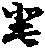



大，皆是盗境，下文自述。缘差者，欲盗彼物，即值异人，恐事影露也。或有餘缘，来差此心，不遂盗事，但结前心，人物上兰也。境夺者，本盗人物，后无主物，境来替人物处，心中常作有主想，取得无罪。但有人物，境上前心兰也。心想疑转者，谓本是无主物，作人物盗想，中间转作非畜想(此元想转也)。疑转者，谓本是无主物，作人物想，取中疑转，为是非人物？为是畜物？既是无主，及以己物，且非盗境也。云问至损者，向意蹑前而生，前云己物，其相易知，未审无主相，㒵如何似？故生斯问也。答中子作恶事，父母逐其者，为子既不肖，父母瞋之，以水灌顶，遣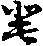



后父母死，名无主物。然且据西国法式，若此方虽无子息，亦有官家为主，不可輙取。二国中间两边封相等者，如五天之外，二国分壃，中间有隔，或河或山，或林或树，此处有物，不属两边，是名无主。此亦西天之事也。国破王走，后王统等者，前王已去，无我所心，后王未统，未为正主，於其中间，是物无主。即如俗令等者，南山指此方，俗律山泽是国内，不合占获，其间住取，犹名无主，反显前文二国中间，故成无主也。差先加功力者，更进退解可知。



云二至犯者，总缘其六者，若准戒疏，唯五不五与方便。问：前后诸戒犯缘皆须，何以此戒不五？答：损财明盗成重，不假方便，恐涉滥故。纵有方便亦俱不明，但未举离已前并方便摄。(玄记对此广辨阙缘义，今恐繁故不叙。)云今至释者，依前列缘次第释於相状也。云初至别者，初中二字牒初门，先后两段开二章门。依章释中云所以至大罪者，所以两字徵意，谓本明盗三宝物，有何所以？先辨知事人是非耶？若不精识藏者，释也，谓於能诠不明也。若善通用与於所诠，壅滞师心、不师於教，便成盗损。於相如后说者，如互用中说也。宝梁、大集等者，宝梁是大乘律，大集是大集经。经约圣凡分判，律约凡夫持戒以论。准大集？护法品云：时频婆娑罗王问佛：何等人堪为知事、守护僧物？佛言：僧物难掌，佛法无主。我听二种堪知僧事、守护僧物：一、阿罗汉，二、须陀洹也。佛法无主者，宝云：佛久涅槃，法是非情，无正主故。问：上言二种人：一、是第四果，二、是初果。何不见列二、三果人？蜀川云：亲捡彼文，初果至三为一，阿罗汉为二。今钞但举初、后意摄，中间亦尽也。所以尔者，徵也。有何所以，约此二人已外不许耶？戒不具足，心不平等者，释也。谓凡夫持戒，但防身、口，未得无漏，动思心念，微细有缺，名是不具足。又凡人心有爱、憎，故不平等。初果人已断三界见道烦恼，故无爱、憎；分得无漏，故平等也。更复二种者，玄云是宝梁文也。彼久迦叶白佛言：云何比丘营於众事？佛言：听二种比丘营於众事：一、能净持戒，二、畏后世罪。复有二种：一、识知业报，二、有诸惭、愧及以悔心。后有二种：一、阿罗汉，二、修八背舍戒。听如是二种比丘营於僧事，自无疮疣，护他人意等。今钞合四为二，又将罗汉同大集经也。不平等心，名为疮疣。能齐与食不能齐者，示於因、果，知非为怪，名护他人意。若不如是，令他便罪，长轮苦海。此事不易，故曰甚难也。注文冥犯大罪者，冥然犯於盗重，不以无知故免也。云今至法者，如文。云初中者，就盗用科中也。云盗佛物者，盗是盗心，佛物是所盗境，能、所俱彰故云云。正至摄者，对此，先叙三宗结罪不同，次依宗消。钞：初相疏云：若盗佛物，成波罗夷重。举例云：如盗畜生物，境劣，故得吉；若盗人物，境优，故得重。既人、物尚犹结重，佛境最强，何不得重？又将佛物、人、僧尚结夷𠎝，自盗岂不成重？法宝难云：天犹胜人，理合更重，何结偷兰？又将佛物入僧得重者，自约互用边结，与此令乖。二例俱非，不可依准。二东塔云：佛在日自为正主，盗即成重。涅槃后唯有福田，无正主故。同非情摄，只合得兰。今难云：若尔，纵使在日结重，即佛应有我所心耶？又将入灭后佛判同非，良为不可。今南山曰：不论在世及与灭后，若盗此物俱犯偷兰。斯为定义。(上且叙左，今判非不定。)次消文者，正望佛边无盗罪者，此段正约无施护二主佛物境上成犯之相。如久远之物，虽无施护之至，以其物体且属佛故。若有二主，望二主结。下自有文，先须简此犯境。问：故何望佛边无盗罪耶？下句答云：由佛於物无我所心、无恼害故，谓佛理平等、得失一如，於物无心失不为恼。如十诵云：盗北郁单越人物尚不结罪，彼人无我所心，岂况三界之至於物有恡？若据佛边，一罪不得。今言但得偷兰者，东阳幽释云：望盗人心上结也。以进趣作盗佛物之心，举离之时自结兰罪，约境无犯。如涅槃经：恶心斩截死尸，以境上无可恼，理合无罪。但起恶心亦得偷兰，所以为例。(已上正解竟。)



次辨诸家解者，一、玄记望善神边结也。佛虽无心，神摄此物，故钞释云：以同非人物摄。今难云：本明更有煞母偷盗佛物罪，若望善神边结之，却成盗非人物也。况神护法摄於物，不可依承。二、淮南记云：望断施主福得兰，以施主将供养佛，无作续生。今既盗除，无作不起，故结兰也。今难云：现有施主可然，或经久远，施主亦无，又望谁结？况复断福犯重。下自有文，不合委解。更有解云：钞文所结兰罪，此据佛在世时，正望色身佛结。今文涅槃，此兰也。纵今寺内殿中形像，皆有施、护。二、至望主结之。今难云：如婆沙云：以佛悬摄未来，冥然属佛。如何会通？恐无理也。已上解因便叙之。若五释文，初义为定，思之。以同非人物摄者，谓三义故，同非人物：一、犯缘因。盗非人物，具六缘：一、非人物，二、作非人物想，三、有盗心，四、重物，五、兴方便，六、举离处。今佛物六缘亦尔。二、望境同。盗非人物时，若有守护主，结之；无守护主，即正望非人境结。今此亦然。三、罪体因。盗非人物，是中只果兰。今此亦尔，故云心同非人物摄也。岂同东塔将佛类於非人？又不比搜玄约神为於护主，名非人物摄等。次引证云故至兰者，彼律第十六云：盗天神像衣及以花鬘，佛言：得偷兰。及证上文佛物兰，与此罪体同也。云涅槃至兰者，引此收文，证上盗佛物决定犯兰。有教为据，不同西塔云犯盗重，仝是师心也。准彼经第七云：迦叶问佛：何名大乘偷兰遮？佛答云：有诸居士建立佛寺，用珠花鬘供养世尊。比丘见花贯中缕，不问輙取，犯偷兰遮。不问輙取者，释盗相也。不问施、护二主也。若知、不知者，玄记引山法师释云：谓比丘明白心中知是佛物，或冥然不知是佛物，并犯兰。大乘中不论知、不知也。若小乘知是佛，故心而盗，即犯。若不知，或作物无主等想，无盗佛物之心，即不犯。若据法宝，不许此释。若知，即约明闲之人识知教相；不知，即据不学人不知教相，并皆是犯。若既明练，如是故违。虽於教不明，不知有犯，然不以无知便得解脱也。若犯罪结根本，更增无知罪。今恐不然。钞：所引者，大乘经文适说义，却作等乘律解。既经、律混然，如何分得大乘偷兰？莫违他经文否？请思之。(已上诸文总是明无主佛物结非之相，不论在世及灭后，并结兰也。)次明有主。云佛结犯相中云若至罪者，谓望知事人是守护主，望此主结罪。若无护主，望断绝本施人，无作福边结重。云故至用者，此文证上断福结义也。谓因施幡盖得生天，今既盗之，断他施福得罪也。塔上云者，是施主物，秽地弃之，亦损他福。云摩至别者，此文证上约守护人结义也。人庙中物者，谓如古来忠臣於国有功，置庙等也。守护主即知庙之人，今比丘盗此物，未约正主，且望护主。计直者，满五夷。善生中守塔人者，示护主也。不望佛边者，谓有护主故，不望正主而结。所以约守物人者，徵也。如盗人物中分别，别者释也。谓下文盗人物科中，有偿护损失，主为他偿录，即是守护。或有人盗此物，为望止主？为望护主？下文断曰：若护主勤是守护，而被贼比丘公白劫夺，或私窃穿窬而盗去者，非是护主禁约之限，正主得令彼慎还。若徵覔他钱财，财主却犯重罪，即盗人望正主结罪，不望守护人。若护主为性慢缓，不为他偿录，致遭去失，即须填他。若不填之，护主犯重，即盗人但望守护边结犯，不望正主也。人物既通，此二三宝亦然。且佛为正主，知事人为护主，盗相类例可知。今引此文，莫非为护守护结罪犯之相也。思之。云必至无犯者，此约佛像舍利也。自作念者，是盗人作念：彼人佛亦是师，我今佛亦是师也。前约盗佛供养严饰等物说，此改正约盗佛身，或铜像旗子之类也。云摩至盗者，多论为转卖者，引此一句，证上伽论约他转卖佛像舍利，得五钱犯重，不满犯轻。若论舍利有何价直，鸟死者鸽雀等，此在佛塔中死，便合属佛也。餘物者，所禀云：谓遗落之物。前人已作舍心者，物既在此，即属佛也。或可伏藏之类，古德而有，即无正主。先既不知死人守护，又阙护主，既在佛塔内，理合属佛为正主，后忽摄得，不可餘用。答：餘用者，即犯盗也。(已上诸文，总是明盗佛物已竟。)



次盗法中云盗至犯重者，法是非情，无正主结。律文犯者，望护主论也。久云等者，释成上义也。此是餘断盗经得重文也。首疏云：若据佛在时，未有经卷，不妨小小记录，亦得名为经卷。不得口吹经上尘等者，谓恐口气损色，又属轻心。如将塔云：弃向不净处，亦损施主福。若烧故经得重者，玄云：此是业罪，五逆之重，非谓夷重也。如烧父母者，经是佛母，解从此生，今烧故，虽同烧父母云逆。戒疏云：有人无识，烧毁故经，我今火净，谓言得福。此妄思度，半偈舍身，著在明典，两字除惑，亦列正经，何得焚烧，失事在福。(已上疏文)十诵借经不还者，即借不送来，覔又不与。经主疑云：为更还我？为不还耶？前人生此心时，比丘结兰，此由心未绝者，释结轻所以也。答：经主决心作定不还想，比丘得犯重。秘方者，药方要呪术等例，谓此秘方有其价直盗写得重，佛语无价，但约帋墨书功以论，故不类也。云问至罪者，问意云：前来多论盗舍利净心供养不犯，经亦合同，如何一向结犯？答中佛得遥心礼敬者，虽舍利形像被盗将别处，本主不妨送心敬礼，亦有福报。法须执文者，经卷须执捉披读，必若盗将本主，无可执捉也。地持云大大供养者，彼云：若於如来及支提现前供养，得大大功德。谓现前即覩相兴福，但对一佛一塔之境得大功德。若不现前即不覩妙色，发心通供养法身，约法身性非唯一佛，此则获无量无边福胜，故云大大。引此证上文中佛像舍利通於遥供养也。若欲互举者，此文一向恐通局以明犯不之相，不望境也可知。(已上诸文物明盗法已竟)。



次盗僧物中，次盗至重者，此段文为破古师义也。古师所判，望十方僧无满五理，得轻；若有护主，望守即重。今师不然，若有护主，望主结重，如护主自盗。准善见论，知事人将僧物为佛、法两用，佛言：波罗夷。此望十方僧通为一，并满五结重也。云然僧有四种者，今师五四种常住也。四名如下具列(云云)。东塔踟不许南山立於四种，彼破云：强加阶级，合为二：一、是十方常住，二、是十方现前常住。不用常住常住及现前现前二也。法宝反破彼云云。必若但分二者，今将众具、田园等与十方僧共分，应得。今谓此物一，局此界二。假使十方大地僧总集，亦不得分，名为常住常住。若不立此，何位摄之？又将现前现前常住摄归十方现前者，且如有人将物直施此界现前僧，今更通十方僧分，得否？今谓此物现到，是物现前；人数有限，是人现前。若将此物通十方僧，望现在人应得、不得，合犯何罪？如斯处断，暗托甚矣。西塔疏并至此一节，更不最许量，但云此是随根之教等。今师特立四名收摄，方为尽理。初云至摄者，常住常住者，体局当处，不通餘界，故名常住。二则但许受用，不许分卖，复名常住，故而言之。抄云花果者，须分别也。大德云：若成熟之菓已摘落者，十硕、五硕，此即属十方常住。谓物体通十方，故不可不分。今此中花果不可分者，且约在树未取之前，不得十树、五树分入於己也。抄中来论量米面等，戒疏内加之。如米面百硕、五十硕在库仓中，此属常住常住。若作飰及饼等，即入十方常住收。盐、酱、醋等在库内，是此科收。随日料云在供床者，即十方常住摄。此依疏文分之，诚非臆说也。谓十方常住，从常住常住中离云故。或有不许在树菓子及米面、盐醋等，是常住常住收，总判作十方常住摄。便妄解云：菓子、米面等堪吃之物，必至须分，以此物体通於十方，但是十方常住也。今难云：且如田稻未收割时，律云是常住常住，此之米稻亦应作食供僧。既体通十方，即与树果子、仓中米面有何差异？又今师轻重仪中亦有此意，彼云：若将生米等为十方常住者，钟声才动，可将盆钵来请米面，可以分之云云，如彼广叙。总望众僧如论断重者，谓生常自盗，则望十方僧为一主得重；若餘人盗，望护主结。如上见论断重文也。又引祇文为证，前通望一切僧为一至义，假使集尽亦不得分也。云二至偷兰者，十方常住者，体通法界僧用，故与十方之名，亦局害界之中。复言常住既许分食，故单言之。僧家供僧常食者，戒疏云：如饼饭等现熟之食也。体通十方者，释上下方二字也。唯局本处者，解上常住二字也。望主结重，谓据别人盗此熟食，望守护人满五结重。同共盗罪应得轻罪者，玄云：此顺古师义也。古云：无问生熟也。一切食具盗者得兰，望十方僧无满五义故。今云：谓生食等物佛不许分，通望十方僧皆得为主，故结重也。若熟食鸣钟分食，即无盗罪。若一众僧不鸣钟食，名同共盗损。既许分食，不望一人皆有食分，约盗无满五义，望僧结轻，以僧分业无满五故。下引祇文将僧长食等者，玄云：僧食若长，江是分外，合返还僧。今既不还，如何非盗？谓食若食若长还属十方，证前同盗损应得轻罪，谓望僧不满五故。已上正义也。或依准淮南记云：是常住引长之食，合得明曰食。知事人自盗犯兰，钵中是己分食，将返不犯。此不正解也。善见等者。此约知事人取僧物行用，如自己之物与人也。注文准共。盗僧食者，谓得兰。引前半句，准论意，证同共盗损，应得轻也。若盗心取，是名第五。大贼等者。论第十一云：佛告诸比丘：世有五种大贼。何谓五？一者，若比丘犯五篇罪而受利养，不修道业；二者，从他智人、闻法人问从谁闻，乃答云我自解，因此得利养等；三者，四果圣人或凡夫持戒而增疾，他自称己名，是谤贤圣；四者，将僧园地、竹木一切重物以怖望心，饷致白衣；五者，取僧物如己物无异，行用与人，得兰。注文准似。有主者。谓盗熟食，互合结兰。论文既云随直多少结，多是满五义得重，少即犯轻。此言应证有守护主，望主结也。毗尼母亦尔者。与上见论文同。萨婆多等者。二论若有斯文，注文准此。如上偷兰者。谓准上文，将谓僧如己物引用得兰。既云盗取随直多少，准上见论合犯重，为见空等无人守护，所以注言兰也。



云三至结者，谓一物是现前，谓奉施等；二人现前，谓现前僧。奉施等物，即属此僧，故重言也。必盗此物，主结重者，此约施主虽舍，未付与僧，盗者犹望本主结重也。若多人共物等者，此约付舍了盗，亦望本受施僧结。若未分付，且付一人掌录，盗者亦望此守护人结也。云四至罪者，戒疏曰：此物通有僧皆得，故曰十方。作法界用，约随现集者，皆有其分，故曰现前。现前如亡人轻物者，戒疏云：如僧得施，及五众亡物之物，体属十方也。善生经等者，此约未作法前说也。注文计人五不满五犯兰者，抄依佛语，诸谓未羯磨物属十方，盗望满十方，盗望十方，无满五义，即结兰罪。更有不正，义不叙之。若已羯磨等者，注文自释(云云)。所与人边结罪者，此约云人嘱此物与某甲，即亡人为能与，彼为所与，盗者望彼结也。云四至陈者，四分房舍犍度云：时世尊与五百弟子人间游行，至羇连国，有僧伽蓝。时比丘在彼上住：一、阿湿卑，二、迦留陀夷，三、马宿，四、满宿。彼闻说佛与身子、目连来此，遂生心云：佛是龙中龙，诸弟子又是贤德名闻，若到此间久住，我等必失名利。遂选一口上房留与佛，餘者分作四分。遂将僧伽蓝等为一，与第一比丘；瓶盆等物为二分，与弟子二比丘；木床等为三分，与第三比丘；草华等为四分，与第四比丘。贵图客比丘来，无物受用，不得久住故。后时佛与诸比丘到此国伽蓝已，佛告身子、目连：汝可语旧住人，敷设卧具。彼答云：佛是法王，我先留上房供养已，外分为四分也。身子具此白佛，佛言：此是四方僧物，若僧、若众多人、若一人，不应分卖，不得入己，犯偷兰遮。(引此律文，立为宗竟。)因即有人言等者，古师云：六群当时既分僧物，佛令身子往夺。故知前来虽分为四分入己，不成盗也。必成盗者，身子知法之人，亦不合更夺。以此例知，今有盗僧物者，亦不成盗，夺取无罪。(上且叙古。)此未见诸部等者，今师破古解也。谓古人未明诸律，教有明文。若夺盗者之物，亦犯盗罪，以贼夺财物故也。若尔，何故引前四分律文，六群分作四分入己，身子夺耶？可引钞答云：四分暂碍僧用等(云云)。谓前文约标心暂分，所贵客不久住，无分入己。意是暂碍僧用，故犯兰轻。若有心作，分入己摄，即成盗重，亦不许夺也。如善见文中，主掌盗物，望僧通为一主，犯重。故云同善见断重。大集罪同五逆者，玄云：谓破僧逆也。今十方众僧依食而住，假食为缘而得修道，今既盗损僧无所依，修道断绝故同逆罪。我在僧数者，谓显上文望十方圣凡一一结罪也。日藏分者，谓佛对日藏菩萨说诸龙受苦一分经文，彼皆云：忆昔出家备造诸恶，噉僧花果食人，信施不消受种种苦。僧护传者，从人立名也。僧护比丘随商人入海采宝，见有五十二地狱、五十僧尼狱，一是沙弥、一是俗人，为人寺作非法故入此狱等云云。如彼云五百至云云者，三藏还债者，五百问上卷云：佛涅槃后有一比丘精进聪明，有一婆罗门见比丘聪明，以女奉施为尼学道，比丘受之，其女端正，比丘失念共行非法，乃用佛法僧物各一千钱，此比丘聪明解说法，自思忏罪便欲还债，往瞻彼国求乞大得财物，至还时中路被七步虵螫(释音)，比丘知行七步必死，乃於六步内便处分弟子将物还债，我在此立住待汝。其弟子奉师处分向彼还债，却来报师，师遂进行一步，命终堕地狱，谓是温室，便大举声诵经呪愿，有数千人闻经呪声并皆得脱，狱卒嗔比丘，遂举鉄叉打之，命终生三十三天等(已上诸文是明用竟)。



云二至互者，如文。云就至御者，祇云：若比丘作摩摩帝，佛塔无物，众僧有物，便作是念：僧蒙佛恩，但供养佛，即是供养僧。便将僧物修治佛塔，得夷重。若塔有物，众僧无物，便作是念：供养僧者，佛在僧中。便塔物供养众僧，得夷。(摩摩帝者，梵语也，此翻为经营人等。)问：今时诸处寺院中有弥勒像，有人得施利，如何决判淮南阇梨断供僧用？以弥勒位是菩萨，菩萨属僧摄也。举例由如泗洲僧伽和尚是观音菩萨化身，所获施利尽入於僧，今此亦尔。(扬洲孝感寺有一铁弥勒像，人施物绝多，从南阇梨总判令供僧也。)大德云：弥勒如今因中位是菩萨，即住纵，争奈他施主作佛相，故施不同。泗洲和尚现是僧仪，举例不齐，全成愚执。(此因便说，亦是急事，学人要知。)



云宝至故者，宝梁等经者，等取大集也。宝梁上卷云：若如来塔，或有所须，或有败坏，若常住物，若招提物多，营事比丘应集僧行筹取欲，作如是言：佛塔破坏，今有所须，此常住僧物多，若招提僧物二，今用修治佛塔。若僧和合者便用，若不和允，即劝俗修，往在家人处求及钱物等。即反显佛法二物无正主，无可谐皃，向不合也。餘如钞文(云云)。云若至也者，若准此义者，谓准上文不得互用义也。佛堂之内而设僧廗者，此即妨他佛家之事。僧房之内安经像者，此即妨於僧家之事也。岂非互用？此约久永以说，若暂时，即如钞开许(云云)。不得安佛下房等者，若有楼阁处，楼上为上，楼下为下。若但寻常房院，但取好房为上，麤坏者为下。引此文意，证前暂取总得，反显前来若将僧房长时安佛，及经阙鏁，不与僧住，即是互用也。思之。云问至物者，此段文意，谓前文中云：常住、招提互所须，和僧得用。未审常住与招提二僧如何分判？故兴此问也。阿难受别房者，谓诸居士於伽蓝内起房堂四事，供给与阿难，阿难转施作招提色。庵婆女薗施佛为首等者，谓瓶沙王以金瓶行水，白佛言：毗舍离国城所有园苑，我园最胜。今奉世尊，唯愿纳受！佛言：可施佛为首及招提僧。文中不了者，钞：主意谓经文不了，据理，房舍等是招提物。故羯磨疏云：招提僧房者，或是七众为招提僧，於坊寺中别置房宇，有来入住，别有供养。故律云：几房有福饶？(即檀越造者，即常住房。)今抄中云：房宇是招提物，即定华菓等是僧鬘物。是引古义，唤华菓作僧鬘常住物。若准戒疏，抄主亲问大唐三藏。三藏云：梵语僧鬘，此云对面施。四种僧中是现前，现前僧物。故涅槃云：不犯僧鬘物，当生不动国。抄云：依古，呼为常住物。由未晓了戒疏之中方为决定，但为钞已流行，不可更有勾改。今依疏为元也。三藏又云：若据梵语，应云招鬪、提奢，此云四方僧物。译家存略，除却鬪、奢二字。今亦合云招提。后人抄写滥传，错书招字，迄今不改招提也。又准五分，毗舍佉母以贵宝施四方僧，白舍利弗云：可招提僧堂。佛听受之。准此，即四方僧房但为常住名通，一切并是招提名局，唯约房堂并四事供设。若互有所须，听和僧用等。云五至重者，僧障隔不犯者，玄云：则敬仪虽同室中，亦非互也。由佛在日，亦与弟子同宿者，大德云：最初罗云，二是亿耳，三是目连、舍利弗也。次引十诵文，谓僧坊佛图既有各使人乃至六畜，故不合互使也。又引萨婆多文，僧中分行得已者，谓僧物虽不得通佛法互用，今若别人依时堂头分行得者，便是已分物也。将供养佛法者，任得华多无限者，谓无所直故，随意供养。又须知不是结子之华，若结果者，损他僧利，亦不可也。无可问白者，谓后来比丘不委先日三宝分齐，若和，随意处分，若干与佛，若干法僧等。属塔水者，此约本来是佛塔地中水，属佛塔不可别用。或虽是塔地，僧曾用功修治造得，当计功劳取水，若过直五钱，犯重。此约无水时说也。



云十诵至罪者。僧园林华等者，彼律云：从今日后，僧园中树华，应取用供养佛塔及罗汉等。树皮叶随用者，此约多根木处，僧家不用，故得随意。釜、镬、瓶、盆等，并据新者。又非常用者，若曾经用，便有恶触也。毗尼母己处分房地种树，不须白僧者，玄云：地已处分，树木随地，故不须白也。外难云：凡乞处分之地，才乞法竟，便须造房，不许越秊。今何有树堪修房舍？一解云：旧时有故。今难云：乞处分地，平如皷面，何容於树？良不可也。宝云：此是种得。谓本拟造如量房，今为材木未办，且造小夫头容身之属，四边空地，种得此树，堪为木用。或后时治房，不要治房。白僧已，是己分地上木也。僧祗院内树薪等者，祇云：有客比丘斫乾草木，房前积燃。乞食比丘还见，呵责白佛。佛言：然薪法，则尔许供温室，尔许供厨下，尔许浴堂，尔许别房，当分。应从限，不得过(平呼)取。若多，随意取。不得斫活树等。应取乾者，谓寒雪国多有温室也。施主不许者，谓西天俗人多於寺中造院，虽与僧受用，犹属施主，所以作此方便也。灰汁者，谓取调苋灰汁，先伤皮破，洗之即死。田宅转易，谓僧田等。假使一切僧集，不许卖。此是木末，施主舍之，仍须却语本主，合他为转易也。善见伏藏等者，彼第九云：得伏藏物，作得想云：为三宝齐讲等用，无罪。此但取於标心，通为随作，无互用罪。不论伏藏别有所属，望主结犯等义，思之。



云上至焉者，财法皆同者，同一利养是财同，亦说戒是法同，广如前。经中者，如前大集僧护等经云盗僧物者我不能救等。又如传云等者，齐州灵岩寺有僧暴死，死后见观音菩萨为举一石函，函内并是文书，为记众僧罪籍，并是取僧家树叶等染作杂用，身皆入地狱受苦。此僧再苏具说此事，斯由戒不清净故不合取也。自隐参取者，上言别人得用、僧人得家树叶，要是持戒而方得，应当私自隐侧为持为破，如是参详然后而用也。



云：二、当分互用。当分互用者，谓佛中自互、法中自互、僧中自互，故云当分，与前三宝互有异也。云谓至也者，本造释迦改作弥陀者，此於佛当分中互也。大品涅槃者，此於法中当分互也。僧房车乘者，此於僧当分中互也。皆望前境理义可通者，总释上十三虽复少异，於理及义具足可通，以释迦弥陀并是佛，六德十号俱圆满故。又涅槃大集亦俱是大乘之教，生福齐等，僧房车乘同僧用故。如此理以义可通融，不合名互。今结他互用之罪，据何判抄？下句释云：但违施心得互用罪，但结不应吉，非谓同前得夷罪也。知之现前堂等直等者，引此律文证上违施结吉也。尼律二十四云：有众比丘尼於露地说戒，有居士见问云：阿姨何故露地说戒？尼答云：我无说堂。居士因施堂直令造，尼既得物入手，遂生念言：其说戒半月一度，但随得一处所便得，衣服难得无时不须，可回此钱物作五衣受持。后招俗讥嫌，因兹制也，尼犯提僧犯吉也。此由是施现前僧堂，回作依即犯提吉，合施四方僧尼作戒堂，若回作定结盗重也。云若至故者，谓本施写经后却写论，故曰本经末论(已上正解)。



或云谓经为论本，菩萨造论解经，今将论望经，即是末也(此释违抄)。情理俱违者，以人情道理二俱违故。因果全乖者，菩萨是因，佛身是果，师弟有异，此非当分(此且一解)。又有释云：约真经正录是出世因果，伪经杂录非出世因果，此之因果则全乖也(此释亦通)。福无福别者，若造真经正录有福，伪经杂录无福，故云别也。邪正杂故者，此解杂录并非当分互，恐人迷意，故此简出也。有主不合无主通用者，谓同一佛，但东西二龛异也。若施主在，以心局於彼，此即不合。若无施主，并是比丘自经营，虽二龛有殊，通无互也。元通师徒等者，师是佛，徒是弟子，菩萨圣僧等众是也。众具则树林池沼华菓台座灵禽异鸟，乃至金刚神天龙八部等，谓本拟𦘕弥陀变相，便合有如许众具道理得作也。非义等者，谓男女非法之形像也。餘文可知。云善见至重者，若施主本拟施园菓回分食结重者，玄记两解：一云此四事供现前僧受用，既盗分食违施本心，计直成重。二云约施四方贫僧衣药，今既盗心食尽，令他后时应得不得，故重。表云此二解苦未有理，若约四方僧说，不合犯重。今但据施主施此寺内现前三五十人，若回此物召十方僧食尽，却望现在人应得不得边，故结犯也。此盖望境，非谓约心思之。若回作僧房等得兰者，谓房舍受用无有别属，通望四方僧，故结轻也。若住处乞少食粮等者，谓见论施园将供，依服而回食犯重。今既乏少欲散，即开和僧，得用僧房和卖等。贼乱随身者，此是卧具轻物，得且随身乱静。却后本处欲供此像等者，彼此俱是像，其体不殊，据理无过，但结越处，不应结也。曰衣投比丘者，彼论问曰：白衣投身为道未受戒，得食僧食否？答曰：须白僧，僧听许方得食，不白犯堕。若泛尔，俗人不得白僧与食。今此是欲出家者，身虽是俗，心已为道，故开白与食也。论文下卷又问云：为僧乞在於道路，得食僧食否？答曰：若去时先白僧，僧听者好。若去时不白，还来白亦好。若去时虽白不听，还来须偿，不者犯重。(玄云：此道道俗互也。)论上卷：又问：供僧斋米，僧去后，斋主得用供后僧否？后人得食否？答：打犍槌得食。若不打一饱，犯重。(上且引论。)此谓施主将米供十方僧，僧已去，将来供后僧，为米属十方已定。若后僧无盗心，但打钟，普召集十方共食，不犯。若作盗心，不鸣钟，食一饱，犯重。(玄云：此三重者，是偷兰也。)又准上，多见二文，不作相犯盗，钞亦准是偷兰。云准上至者罗者，准上在道白僧方得，不白不得也。虽复打钟，不免盗者，谓将出界便犯，非以界外打钟，便得免也。若为僧差等者，上来善见守寺和僧，得用四方僧物。今为僧使，亦得和僧将食出界，亦不须作相，为表无和僧说。若寺庄等者，谓寺家庄令处，即但作相，复不偿之，谓庄与寺通一家故。若引至外等者，虽僧家人畜，亦犯吉。故戒疏云：声钟告集，是僧皆饭。未知他寺奴畜合否？答：若合僧具六和，诸处皆是人畜别属，义非通使。使即是局，食亦如之。问：何犯重？答：以俱是常住物故。如上十诵，将僧物与餘寺同是常住，但不合生盗心，故犯吉也。此亦同之。



云三至也者，谓住持是像，即形像、塔庿帋、索竹帛、剃发、染衣三也。理是三宝者，谓真如一体三宝也。云萨至大分者，谓佛在日受利同僧，但得一人分。灭后一大分者，为受一定分，独当众僧。如今平施三宝物，分为三分：僧十子，法十阡，佛便摄十阡之类。云答至故者，谓佛在世时供养色身，灭后供养法身，胜於僧宝，故於三分中取一分也。置爪发塔中者，谓佛成道已后，所有剃发、剪爪，并令起塔供养故。若施法等，多论云：若言施三宝者，应分三分与佛宝：一分与法宝，应悬安佛塔中，不得佛经用与法、诵经人；一分与僧宝，僧不得取此物，应还付施主，应著塔中供养第一义谛僧等。问：此论文不言施法分为二分，今抄文何故輙分？答：论言：法宝令著塔中，不与说法、诵经人。若但言施法者，令分为二分：一分与经法，一分与说人也。故戒疏云：准多论有施法者，法师、说法、诵经人亦得取其分，谓法须人弘也。今时转经得钱，须准此法则合分半，望益僧边七人转经分为八分，将此一分入法犹为表敬，若都不与不合分也。若施僧宝等者，第一义谛谓理无违，净体当起和合，亦名胜义也。以言无当者，谓不时当言与圣与凡，但施僧，僧通凡圣故。云准至失者，谓上真俗宝异、凡圣途殊，受施之时差知通塞，物施三宝施为通，唯局佛宝塞，又施住持佛像为通。若弥佛宝为塞法者，若言施法通分二分为通。施法宝者为塞僧者，若言施众僧凡圣俱取为通。若云僧宝为塞，应须分别穷问，令使分明彼此无滥者，免有互用之咎也。



云四至互者，上来明像与宝互说，此下明当像下随有事於之物亦自互也。云先约佛物有四种者，标举数也。释中云一至中者，谓若是佛受用物，一向不合移易等(云云)。如前宝梁说者，彼云佛塔有物乃至钱，以施重心故舍，诸天及人於此物中常生佛相等可知。不得卖佛身上缯为佛作衣者，大德云：谓西天俗家蚕了，乃作缯来施佛，此体纯是绵作，似六释床子大。或有方者，今时尽人𦘕佛。通肩披漫衣者，此依胜兰尊者将来之样，此即是僧也。又西天三藏，此表著皆号为离垢僧相，状似被绵多染作紫赤之色等。今时讲人问著，总不识知之。今总有人将来施佛，比丘见剩长便将货卖，却买绢帛为佛作袈裟等，良不可也。佛园坐具皆是塔等者，问：且如园井田地堂，以属佛之物而同坐具受用摄耶？答：如律云：瓶沙王舍竹园施佛立精舍，佛告王言：汝今持此佛竹园施佛及四方僧。何以故？若如来有园物、房舍物、衣钵等，即是其塔，诸天世人所不敢用。(已上律文)玄曰：此言园者，即所受用伽蓝之园，非谓寺外餘井园也。云二至大罪者，施属佛物者，此物施佛即属於佛也。佛物得买取供养具者，戒疏云：此属物所以得也。由本施主通拟佛用，故得货易。不同前科曾为胜想，故令一定也。佛物不得移犯弃者，谓施主心局此处，违他心故犯重。比丘容作佛像书经等者，大德云：比丘作佛书经无过，但不许取钱。谓此钱本是经佛钱，比丘为书故取，一向不合。若俗人自为施，不为此事取，亦不犯。有云：比丘一向不合写经。若尔，结集场中抄上贝叶，莫须令白衣书否？云三至也者，不变本质者，或将多幡盖缝合为帐，或禆接小幡作大幡，或造佛床等用，并得，犹不断施主福故。若折破之，即坏本质，福田断绝也。如大论云等即者，智论也。彼云：如𦘕作佛像，一人似像不好故坏，一人以恶心故坏。其好心者获福，恶心者得罪。引此论文，释成以不好故坏，令其严好，则不变像本质。准此回改，不违施心，故无罪有福也。云四至经者，首疏云：献佛物与供养佛物，如何分之？答：供养佛物永属於佛，献者暂时却归本主，故有别也。钞：引律文，治塔人得食。又引论文，侍佛比丘得食。此二并约有功劳故。若不属佛，不应与人也。故知此中据暂献故。准此，俗家佛盘等者，谓准上文，献饭不永属佛，但属本主。即今时白衣舍设斋了，主人自收无犯，不将钱属等。有言属者，是伪经也。佛槃既尔，餘二同然，皆返归主也。



云次至知者法受用者，戒疏云：纸素竹帛木上书经像，或箱函器墣曾经盛贮，尅定永施不许改转，此则一定故同圣教，皆灭理之所依故。若有损益，并望涅槃而生罪福也。餘三得不筹者，属法物、供养法物、献法物，此三同上佛物，随缘进不？故曰准上可知。



云三明至罪者，二种常住局处定者，谓常住故云二也。皆不许輙将出界，故曰局处定也。二种互用通知得等者，玄曰：准上见论守寺之文，彼云乏少食粮者，即是十方常住物少，听和用园田房舍常住常住之物卖而充食，即入十方常住也。准经罪重者，准涅槃梵网经，买卖奴婢牛马畜生犯轻垢罪等，可以意知。祇云：若云我施奴婢，不听受；若言我施园民奴婢、若施僧奴、若僧使人，并不应受；若言施供给僧男净人，听受。谓经文则结罪，律之云不听，不听之言意即可见，莫恐有卖买之过也。若论二种现前等者，古记如别，今但取盗僧物中现前现前、十方现前来，此明互用也。如己五众物本是十方现前，今不作法直入现前共分得无数兰，此是互也。若本是现前现前之物，如施前安居人衣等，今却十方现前普召十方共分，亦是互也。次则别损，若满五重不满五轻，此之二罪容有互故，指上文成互中说也。就轻重者，如亡人物断重入轻则损，常住结夷断轻入重得无数兰，此则断割交互也。双结二罪者，玄记但取前轻重为二罪也。今难曰：如断轻入重时但兰，又断重入轻时只犯重，此则互有一罪单结，不名双结二罪也。今云断重入轻时本结夷重，於此罪上更加无知，岂非二罪双结？断轻入重反之可知。诸记中相承对此辨盗宾卢物有两说。一解云：谓宾卢是第一义谛僧，受佛教勅现在於世，今若盗此物，望他自为主犯重，纵施主将物拟亲，上座虽未摄受，冥然属彼已定，谓施主决心了，若盗餘圆寂僧物，但有业罪，以非亲为主，故更饰宗。所解非而不录。(已上诸文总是明互用已竟。)



云三至戒者，贷字两用，若出物与人即去呼，若从借物曰贷，入声呼也。券记者，如今时分支契是也。读疏者，即帐目出入数等是。违结犯者，不应吉也。计直输还塔僧者，有则相当还，无则交络还等(云云)。十倍还者，善生云：出家菩萨若畜出家弟子，先当教诫令莫放逸，若贫乏有所须或病时，当为求觅。若自无贷三宝物，差已依俗十陪还之。与律不同者，谓此经文与上十诵律不同。律云：别人开贷令计输直还。不云倍数等，疑是俗中二众。文似出家五众者，谓若令十倍还之，於义太急，疑是俗人贷三宝物。文云：差已依俗十倍还之。若据经文，又云：畜出家弟子。又似出家五众。今抄引文意，若也不满慎莫贷之，若病贷之依律还直也。如畜宝戒者，文云：有军器令打破不许卖，恐为恶用，比丘之法应劝断恶也。乐器得卖不得用也。(已上诸文释出贷竟)。



云第四、至法者，如文。云四、至给者，律明忧波离至一住处，不瞻待，即日出。诸比丘白佛言：若知法等，应半由旬迎等；若不尔者，如法治。所言知法者，善修多罗；知律者，善毗尼；知磨夷者，善阿毗昙也。准与知通人者，谓律中羯磨赏沓婆庠罗衣，即是十方现前僧物。今时供给知法人等，亦准此也。替我处者，谓人弘教，与佛不别。云五、至说者，五分中：初时凡有食，都不与白衣。彼遂讥言：沙门且解受人物，不解行施於他。以此白佛，佛言：应与客食。诸比丘乃著手中，不将器与。彼又慊言者，比丘以小儿意看我，佛应将器贮食与之。诸比丘又将麤破器与，又生嫌，佛言：与好器。此是游游之人觅僧过耳。在家二众者，受五、八戒者，识达俗士，虽不受戒，亦信知佛法，有於鉴识之类。如众网中者，与说法，示因果等(云云)。十诵供给国王、大臣等者，彼文云：时有王臣，数诣竹园精舍游戏。若来时，索食、薪、火、然烛、灯。诸比丘欲与，畏犯；不与，惧损。不知云何，白佛，佛言：自今后听立处分，不白众僧，得用十九钱供给。若更须者，白僧与之。十九钱者，是古大铜钱，当小钱十六文，都计三百四文也。恶贼来至等者，十诵云：有贼从知食比丘索，不与，言：为僧辨此食，不为汝等。便搥比丘手，脚折兼腰断。诸比丘白佛言：若有如是怖畏处，少乞少与，半乞半与，多乞多与，都乞总与，莫与此缘，招於损命等。能损益者，祇云：损益俱听与食。损谓贼来诣寺索种种饮食，若不与者或便烧却寺等(云云)。益者，若治僧坊匠工𦘕人及料理众僧物者，应与前食后食及非时浆等。若王及大势者应与饮食，不名为盗也。多论有益不合者，与祇不同。即是污家者，如下污家戒引多论云：以信施物与白衣故，即破前平等之心，又是倒乱佛法等(云云)。若彼此知法亦得者，道俗相望为彼此，道俗知怀妊女人及信心檀越在狱中等得与也。俗知法者，谓知我不合得他师僧之物，奈何穷尼比丘将来，盖事不获已且受，或可后倍更填偿等。广如二篇。下说者，指随相污家戒后开之文，即如适来所引是也。云十至中者，十律云：时有居士辨种种药，谓苏、油、蜜、姜、椒、㮿拨等，送往竹园精舍。时六群遂早起出门边立，见送此寺药来，问：此是何物？答云：某药。六群告曰：我欲远行，先与我药分。遂简却好药苏、石蜜等，唯留尘者将入寺中。诸比丘以此白佛，佛言：自今已后应立分药人平等而分，若有贵价药来应举卖。若病比丘索者，应与两钱半价，若多索应就觅价直。所言两钱半者，据古大铜钱当今小钱四十文也。下番不与者，谓无功劳也。长使者，有功故制也。餘文易委，不劳繁述也。(已上诸文总是第一大段盗三宝物竟)。



云大门至中者，大门谓隔诸小科得名。云由至主也，谓由是人故有主，非正则护。今盗此物，望二结故。下列名字：一、正，二、护也。云就至结者，一、有我所心守护，计物是我所有也。我自守护，掌是有守护。抄下自举物境，如柜中绵等(云云)。二、有我所心无守护者，如张王家田，各计此田是我所有，俱无守护也。钞亦自解(云云)。伏藏者，玄记引俗僧二律，三藏断之：一、准十见，若三宝地中，得约地为主断。二、若是百姓地者，准律藏，刀刃异器，合属国家；若金银等，即属百姓。纵有古人名字，亦不合属铭为主。三、若空山野泽中，是我所心无守护，正是无主物，取之无犯。今无心无守护者，非是第三无主之物，是其前二有主地。上约前人埋藏，其人已死，是无我所心；后人不知，是无守护主也。就守护主二句等者，如现前可分物，谓是夏竟赏劳衣等。人人各计有分，故云有我所心；且令一人掌，故曰别守护。若比丘盗此物，望护主结重。如关头夺得禁物等者，谓为违𠡠非法之物。本主於此物已断心，是无我所心；关官掌录，名别守护。又如比丘失物，心断故，亦名无我所心；官从贼边夺得掌录，名别守护。今盗此物，皆望守护人结重，引约心断边说，名无我所心也。古记不达，妄非钞文。



云今至种种者，将守护二至杂开七种，广辨盗相也。云一至结犯者赏护损失主者，赏字，大德云：飜译时错书为赏字，今作掌字，即掌录守护也。若准玄记云：偿(常音式掌反)有二义：一目瞻曰赏，以目瞻护於物；二酬功曰赏，谓作事有功以物赏睐。今二中是初义也。善见等有两段文，前段约守护人懃懃为守，不意被贼比丘穿墙孔穴窃之，或可对面夺、持杖劫夺，固非守护之限。即前盗者却望正主边重，不望守护人。又正主不合徵他守护人物填备，以非情过故。若徵他物入手，本主犯重。第二段即据守护人不勤掌护致被偷盗，盗者望守护人结犯，不望正主。其守护人须依教填偿，若不填他守护人犯重。文中偿字(音上)又相疏云：已上二主若望正则不望护，若望护则不望正主，不得通二主结犯，以财无二属、罪不双结也。知之。



云二至重者，寄附损失。钞文作付字者，大德云：此亦是飜译时抄写错也。十诵等者，钞文具出十诵四句：比丘寄比丘物与比丘；二、比丘寄居士物与比丘；三、比丘寄居士物与居士；四、居士寄比丘物与比丘。据十诵二十七缘中，六群比丘与比丘为友，是比丘寄一钵与六群，其人於路实勤掌护，偶悮打破，后见六群具说本缘。六群言：汝钵破否？答：我钵不破。六群苦就彼徵偿，彼徵偿彼以白佛，佛言：悮打破不须偿，若恶心破取(释初句了)。第二应索可知。若寄居士物者，谓比丘将物寄此居士与餘居士也。如上二说者，谓好心不须偿是一说，恶心须偿是二说。若借(入声)他物理合偿他，不管好恶二心也。餘如文。



云三至位者，十诵等者，彼文云：六群诱他弟子去，佛言：犯吉。因六群各说誓言：我若诱汝弟子者，作佛、呪法、呪僧、呪佛。从今后比丘不得自呪、不得呪他，犯吉。后文即云：尔时六群失衣钵，当共作投窜。时诸比丘白佛，佛言：自今日以后不得自投窜，亦不得教他投窜。若自作者吉。何以故？呪与投窜一种(已上律文)。所言投窜者，使贼投物现於一处而窜其形，令人不知故也。今即众主作法欲取贼物，当失物处，若干人於一衣问各至乓空房中，若盗者将物故中，至明日朝於中得物，亦不知是谁，但意在物不要知人也。佛言不得诵呪者，恶呪贼词非沙门法，不合行也。新添探油一法，如别所明。义张一位者，玄云：此是古来愿师之义。钞：引用也。下文自引。



云一至取者物主护心义弱等者，谓物在别处，不对比丘面前盗之。此约取者心决彻，失者不知，都无追物之心，即护心义弱，未作失意。是主於物有心，谓在库中，心本未舍，后别处见此物，即不得夺。取此物离地，彼已结正，属贼之义已成也。祇中有比丘衣被贼，不知失物，即即不对面盗。又律调部云：时有比丘，他盗取物，而夺彼盗者物，疑。佛言：波罗夷。第二引证中，祇律有四句：初、明主不舍贼，未作得想；二、反上二下，主舍贼，作得想；三、纵自心下，主不舍贼，作得想；四、若无舍下，主舍贼，未作得想。初句云：本主不舍，夺者未作得想。已上两处，取舍未成，夺取不犯。反上下二缘者，主已舍贼，已作得心，一向不合夺也。第三句，盗者已作得物，心成不得夺也。故彼律第三句，不现前盗。四句之中，能盗比丘，并结夷重。文云：有客比丘，晨发出，遗忘衣钵。时四住人，按行房舍，见此衣钵，便生盗心，移向一处覆藏。此既有盗心，又举离本处，即结夷也。更有异比丘寻至，见此衣钵，又生盗心，复移安别处，亦结夷重等(已上律也)。今准此意，若未属贼，云何结夷？文既结夷，故知前人是决定取，何假物主生於舍意？故云纵自心不舍等(云云)。祇律后文云：时彼衣物主行至前程，忽然忆得，还反取物，取得无罪(已上律文)。古记多引此句，非於抄文。既云前人决取，已结夷定，不用物主作舍心，后见此物，亦不合夺。今此律文，衣主亦不作舍心，返来将去，并皆不犯。何得有远今和会者？然律据遗忘之物，再来取收，未有一念之心，知有人盗取，但作自己物将去，有何犯耶？钞据自藏举物人盗取，后物至知是贼盗，已作得想，定结夷𠎝。纵自心不舍，亦不合夺。钞引此意，以为行事判盗之文，不可引文。缘之难於抄义，思之。第四句者，谓有贼比丘物将去，比丘心绝，贼於前路，或被哧，或为人趁捉，放物而去。物至与贼，二人於物，二俱无心，此物冥然，是无主境。后仁收得此物，举离於地，即属后取之人。本主比丘於后人边夺取，正成犯重，故不许也。



云二至夺者，谓贼对面而劫夺去，故云对面现前夺也。由护守义强者等，谓物直有心守护此物，故曰义强。夺物之者，既对直夺，虽得物入手心中犹豫，恐后却被夺等，是以未作决彻得相。本主物被夺去，半作得心而未全舍，故云心弱未舍。若如此心亦得夺也。第二引证中义分为二：初律三句之文证成，二如上总结三句想心得不得之相。初中僧祇等者，彼云：时有比丘在道行被贼劫，诸比丘自相谓曰：今此贼少我等人多，当共本并力还取本物。便捉塼石逐贼。比丘遥骂：弊贼！我等虽剃除须发，汝今将谓我两手也剃却耶？时贼恐怖，便放衣钵各自散去。彼比丘既未作失想，还取本物无罪。若已作失想而还取者，便成贼夺贼物。今抄将己作失想，向后总结三句也。又暗逐贼等者，第二句也。有比丘道行为贼所劫，失衣钵已入林中藏。时贼思惟：我伴傥多其物又少，宁可更求相添分也。即藏衣钵覆著一处。尔时比丘见已，伺彼去后便取衣钵。是比丘若元心不作舍意，得取无犯。若作绝心即不合取，若取亦成贼夺。贼物满五成重也。文中言暗者，谓隐於身不令贼见，非谓夜黑名暗也。又贼至告人者，第三句也。有比丘道行为贼所劫衣钵，时贼顺道而去，比丘随后遥望追之不止，渐近村落贼便分物。比丘语言：我出家人只仰他活，汝可乞我衣钵等。贼言：弊恶沙门！我与汝命。由是望岂合便觅衣？比丘言：今近村落，汝害我命亦不可得。村落中大臣长者并是等眷属门徒，我向彼说汝，汝必被损等。如此恐怖，贼放物去，比丘取得不犯。贼若嗔责：任汝告人，我终不惧，不还汝物。比丘方便语聚落主，慰喻得物不犯。若告人令煞害等，即不可也。(已上三句并约物主未作舍心夺取无犯。)



如上诸句等者，谓前祇律，句句皆结。钞意恐繁，但对此一时，总结上三句也。谓直作失想，不论夺者，决定、不决定，不得夺。此作舍心，贼意决定也。决取无畏，抄主据前比丘盗物，明其重罪。今此决取畏无，亦约属贼义成，纵不失想，亦不合取也。云毗至重者，谓毗柰耶中，既言官夺得，还取无犯，故知官夺义强，贼获心弱，以强夺弱，比丘却望官为主取，即不犯也。面不现前盗者，准毗奈耶以强夺弱之义，则知贼心决彻，贼义则强，比丘守护，心弱夺强，则不得也。虽知藏处，亦不合取。比丘为贼所获等者，戒疏云：弟子已属贼，是强夺，故重也。弟子体是正报，贼约力用则弱，走时强报相逐，弱用随来，故不犯也。



云四至用者，十诵等者，戒疏云：据理成受，以物非定属，随后作主。如似世钱，可定属随人、随处、随用、随定、随损、随结也。莫从贼无者，恐前人因乞故盗，即比丘属能教也。若贼边置得等者，谓从彼买得衣，后衣见，虽知是己物，不直夺，应还直；不还直夺，计钱犯也。今或偷三宝物等者，谓本若知是佛物，还将作佛用，僧亦然。不得互若冥然，一不知，即不论也。云五至之者，祇云：时有大臣犯王法，财物合入官，官遣人守门。时难陀尼乞食，次到其家，妇人语尼言：阿梨耶！我家犯罪，罪应至死，财物入官，愿寄少宝严饰之具。若我得脱，当相雇直；我若死者，即持相施。比丘尼与钵盛山，覆已而出。时守门人见已，问言：钵中何物？而尼不示之。又复咄唤，畏而示之。比丘白佛，佛言：从此已去，不得覆宝物。若犯王法人，未被收录，寄者得取；若已收录，寄者语云：世尊制戒，不许受之。若云：施塔得取，不得覆藏，但显路将去。若有问者，当言：塔物等，若听将去善，不听者即还。准缘中，是尼钞云：比丘者，僧尼同戒也。若官未收，望本主；若已收，望护主。云六至取者，伽论：问曰：狂人边得取衣否？答：或得、不得。云何得？若比丘不知父母、兄弟、姉妹等所在，因持物施，比丘得取，此望正主也。云何不可取？若父母等可知，不自手与，不可取，此望护主也。



云七至也者，见论云：法师曰：我欲现偷人无罪。云何无罪？答：无主人故无罪也。若人儿落度(徒各反)，父母以水灌顶遣去，或父母死亡，比丘取如是人无罪。若负他债，比丘将去不犯(已上论文)。玄云：准上论意，儿不属国王，但属父母。既父母遣，或父母死，事因无主，故今比丘将去不犯。又儿先负债，今但将人去，不将债去。注文准此私度，类彼偷儿，不输王税，有福无罪。故萨遮尼犍云：不输王课，非盗摄也。外难曰：钞文本明守视义，何故说偷人无罪耶？答：视者，明非正主，但是守物瞻视之人。今偷人者，望其父母已遣，亦非正主。如守视人，因偷人故来视义。若负债人者，但欠其财，身不系彼，守视其人，知其所在，亦名守视。盗奴犯重者，此为因偷人故来，非守视义，亦是见论文也。彼云：若他奴，比丘语云：汝在此辛苦，何不叛去？若至彼处，必获安乐。奴闻此语，初发心欲去吉，举一足兰，二足重。若奴已叛，催令疾去，随语得重。或云：此俭彼丰。奴即叛去，不教不犯。或闻丰乐逐比丘，便逢难唤追，皆不犯。唯此但无方便心，令伊背主等，一切不犯。守逻人与衣等者，即守视也，但呼召别耳。彼律云：守逻与比丘衣，不取受，以非正主，疑故白佛。佛言：随施者处分。下文守视人及贼与比丘佉阇尼，比丘意言：此非彼食，不受。佛言：此即是檀越食，听洗手受。不合从乞者，谓记知物不属他，今从乞，便是教他盗物，故不合也。云了论至判者，盗义极多者，戒疏云：通情、非情摄也。俱舍云：若比丘约眼、耳、鼻、舌、身、心因缘，於尔所尘，起不如法行，或犯重轻等(云云)。若人食毒，或为虵螫者，大德云：螫字有二义：小者为螫(音释)哲(音哲)，谓虵阔开口，牙边有褁子毒水，此水沾人肉里可知；大者谓之螫(螫音)，如岭南多有大虵，开口吐毒气，著人便死([豁/虫]子，曰刘者，吐毒气害人也)。犯如此罪者，谓盗罪也。此约十二人判盗，谓能盗是眼等六根，所盗谓色等六尘之境行，与律有违，故云不如法行，犯如此罪。因彼食毒，及被虵螫，故偷看色等，犯上重轻之罪，故云犯如此罪也。若人偷地、水、火、风等，此约六界判罪，皆从盗戒收之。云解至也者，此引真谛疏解也。盗六尘者，如内六根盗外六尘，约为四位：一、盗色；二、若诵下，盗声；三、偷𭊴下，盗香、味、触；四、若秘方下，盗法。有诸仙人者，阿岚那也。𮌎行虵者，谓一切虵无足，皆用𮌎松地而行也。毒药可知。或有人为此虵螫，或时被毒药，但𦘕作仙人，或书心上作一字，此字是呪语，彼被毒之人若得见者，其毒即摄，病皆除差，但随仙人立价。今偷看得愈，不与价直，满五重，不满轻。故文云：或犯重，或犯轻等(云云)。注文秘书疏等不许人传，偷看亦尔(此明盗色)。若诵等者，谓有人解诵呪术治病，此是秘法，欲学须直。今比丘窃听，计直犯罪(此明盗声)。伦、𭊴、甞、触亦如是。知者，疏云：有师能作药，病人若𭊴便愈，比丘偷𭊴，计直犯罪(此明盗〔虫〕)。或有妙药甞则差，病比丘偷甞，计直犯罪(此明盗味)。或有人好药术触能差，病比丘偷触，计直犯罪(此明盗触)。秘方、要术等者，此明心盗法。比丘受法，就师心缘得差看，就他师边受他法，不与直成盗也。云次至知者，前三所知者，地、水、火也。地者，谓侵他界分也。水者，亦约旱时，一桶水五钱，今不与价。或虽非旱时，井中有好水，堪煎茶等用。须者，一桶五文，今来盗此水，即犯。火者，如冬月房中有炭火，伺他不在，盗去，即随贵残处结犯。大德云：又如太原冬月作市，寒甚，更有人作糯房，暂入中者，须直。又东都作市处，有人卖火炙手，今不与直，总成犯也。云有至直者，玄云：论疏中但云：呪扇行风触身，其病而差。比丘偷摇，计直犯罪，是盗风。钞：准律文，加药涂字。戒疏云：律中有呪扇药涂，比丘摇，不与价直。(明盗风也。)云若至空者，临他空界等者，据此文，约屋簷滴水说也。大德又云：如太原界买地，便有六志：上至青天，下至黄泉。彼人向地中起屋住，上著咸土封之。今或有向他上面起阁停客等，逐夜计钱，下作地室之类，岂非盗也？云论至用者，论云等者，谓钞据上了论本，又但云偷地、水、火、风、空等，今等取於识界也。注云盗智用者，戒疏云：谓识不可言盗，以无形质故，但可从缘盗智用也。云自至说者，指略也。戒疏广引真谛疏解，今钞不录。(已上诸文，总当明盗人物。)



云大至物者，非人、畜生也。云初至也者，望护主结者，谓今诸庿祱等是护主，今望此主结重也。(说文曰：祭神说词，此人为之，故立名也。)下引五分，证上望守护人结夷也，如文。随境结之，谓无护人，望神为正主结兰，故云随境也。下引十诵等，证上望正结轻也，可知。善见：取鬼神物者，鬼者，归也，魂魄归於冥寞等。神者，阴阳不测，变通自在，曰神也。及人系树物者，谓此大树有神依附，多有於此祭祠祀求福，所有幡彩等不更将回。又无人守护，取此物不犯。问：虽无人为护主，还树神自为正主，何得得輙取耶？注云：释文：非人亦不护也。五钱重兰，四钱轻兰者，此唯据非人正主边，不论多少，并犯犯兰，但轻重有异。此约无人守护也。据理得不如上者，谓有护望护结，无护望正结。若二主俱无，即不犯。(或将如上二字安下句者，错也。)今钞：於正主内，若恐神道窈冥难测，得不乃令掷卜而知舍恡也？反显前段注文：必正主不恡，方听将去。若神护，即不合也。(已上诸文，明盗非人物。)云盗至吉罗者，有人断同大重等者，律文云：时有伽蓝，去胡桃园不远。鼠盗此胡桃，在蓝中积成大聚。六群比丘盗心取食，心生疑豫。佛言：波罗夷。(律文如此。)有二，古师解判不同。初云：若今比丘盗畜生物，同人结重。故鼻奈耶云：盖师子残下，直五钱重，虗等皆重。明知不谬也。次有师云：非望畜生，还望本主。以鼠盗疑豫未决，望人还是本主，故就人结也。此释分二段，结界罪所归。二、以鼠盗下，释望人结。所以然者，谓六群知是人物，又知鼠盗疑豫，豫心取食。以鼠盗来，六群疑豫未决，为就人结？为就鼠结？所以白佛。佛言夷者，谓六群既知是人物，望人犹是本主，还约人结犯。若发足便作人想，或便作鼠想，则夷吉自分，何须白佛？但为有此疑豫，所以白也。下引十诵文，证盗畜生物犯吉。多论亦云：取一切畜兽残，吉；师子残，不犯等。(已上明盗畜生物竟。上来有三：初、三宝，二、人物。上非畜物三文，总是第一缘。)



云二至中者，谓虽是有主物，若作无主想，始终不转，并不犯。前后互转互得轻重者，先作有主想，后转作无主想，犯前兰，稍轻。若先作无主想，后转作有主想，犯夷重。广如持犯中者，指方轨持犯篇也。(已上第二缘竟)



云三至示者，然此一门者，指盗戒一门也。实德之人未免者，持戒人也，由尚不免此盗故。盗由心结者，谓但以成盗，要由有盗心，此心亦不论好恶。若心暗教，非理损财，纵是心好，便入盗限。不望境是非者，如无主物，横作有主想，亦犯兰；实有主物，逆作无主想，却不结犯。故知由心不约境，是有主无主也。僧祇好心者，谓知事人见僧事不辨，或佛法事不辨，即好互取钱物，相济而用。但使成辨前务，元是好心。然且与教相违，不免盗摄。抄主恐人迷，故下解云谓愚痴犯也。且佛法二物，无所盗白，愚其教相。痴心谓佛在僧中等故。具钞示者，抄下十诵四分云文示之，亦是生起下文之意也。云十至心者，苦切取者，谓苦言切勒，非理骂辱，意在於物相谢也。轻慢取者，既居尊位，特己陵他，要不就借，轻他直用。以他名字者，既自无道业得他财，但将他名闻向外，取物入己也。解突取者，注文自释。下引四分，亦更明之。受寄取，亦同四分。第七寄物取，下文自述。除出息者，谓对面断当，两情和允，依俗收利，而非盗摄。若减利宜，亦成盗也。摩得伽强夺者，不与强将去。软语者，以谄下之心意规他物也。施已还取者，两说：一云将物与他，后悔却夺；二云有心施他，他虽未得，后悔不与。住文可知。五分谄心者，强相亲附，不𮨇正理，随言顺意，望他施物。故阿毗昙心论云：覆藏己性，曲顺时宜，名之为谄也。曲心者，不随正理而相党，曲情取物。或云一切不直心，总名曲也。瞋心者，下文自释。恐怖者，强说妖祥，心悕彼利。云四至情者，此是四分增五文中出此二五，前五明心，后五明取。戒疏云：文言盗心取者，明心应境也。欲明盗者，心业必兼两缘以成一盗，故合为十(云云)。生可学迷者，三宝互用，随直成重。邪心者，邪命也。解下自解(云云)。曲戾心者，曲约不正，戾则恨戾。恐怯者，律云谓不善心，今改为恐怯，即异诸心所作恐怖，令心怯弱，得彼物也。逼喝者，谓口中出声理威也。或说法恐怖者取，或说地狱恶报，或说王臣势力而得财也。或自怀疑怖者，谓自怀疑事，疑怖他人，舍悭布施，说悭受饿鬼、贫穷等报；自说我疑，亦恐不免，方便击动前人得财。恒怀规夺者，是常有盗心，得物止。六、决定取者，戒疏云：又变此心为五种取，取是其业，对境行事，如空处盗物，是决定取也。寄物取者，谓因光寄物，后便解突，全不肯还，或言我往时且领得汝一段物，以少还他也。恐怯取者，张举怒目，口云便打，恐哧令怖，而取彼物也。见便便取者，谓伺他慢藏，阳作阴伏之类。因利求利者，谓贪心规利，为财说法也。为彼说法，令彼断恶，是利；因此悕他财物，是求利也。倚托取者，倚他威势，假托亲友而取物也。浮华者，说事过实也。异望者，令他别眼看我，约或者非法说法也。群情者，众人之怀也。玄记引经云：说法之人，心不清净，为他说法，得罪深重；假煞三千大千世界一一众生，其罪尚轻。若身自证法，心无疑悔，我听此人高座说法。又虽是凡夫，而能持戒，不贪名利，多闻广识，自利利他，我听此人说法。反上。不可云以至境者，谓以十伽、五、四诸文，证明有心，成其盗业。虽未亘尘沙，境据此说，其相略明也。垣墙者，如世间坦墙，防於贼盗。今依诸教，识达盗心，足得防拟其心，不妄趣境也。



已上释第三缘竟。



云四至物者，五钱者，即五体也。若直五钱等，谓餘财帛，准钱法也。犹似唐律，随有犯者，皆约绢占，以从释犬，方定刑名也。云萨至是者，问意者，四分盗五钱成重，文甚分明，且钱有多解不同，未审以何色目钱为定，故生此问也。答：有三解者，都有三师义释，取意各殊。初云至限者，叙第一师解也。此准佛在王舍国结戒，佛问频婆娑王：国盗几合死？王言：盗五钱死。佛乃依此制戒，比丘盗五，结重罪也。此是古大铜钱，准今八十文也。二至为限者，叙第二师解也。谓论中有八种之钱，谓金、银、铜、鉄、竹、木、钖、獦、胡胶等。此师意云：此八中亦不定指，但随有佛法流行之处，用何等钱，即以此钱为限，亦未必依王舍制戒之时钱也。三又至为限者，叙第三师解也。此师意云：无佛制戒，五钱成重，盖为取王舍国法瓶沙断盗之理。今但随国法，盗几得死罪，即以为限。只如唐国强(平呼)盗满释，则是极刑；窃盗至五十释罪，方便至死等。(已上叙三师竟)论师以后义，应是今师结归取舍之理也。上之三释，十律取初解，南山意宗第二师，萨婆多论师自许第三解，故云后义应是。玄记亦云：若据彼论，三师之中最许后义也。有云：指第二解为后义，谓此钞依中间释，故云论云论师以后义是(此全未见理也)。问：何以得知抄宗承第二师，不取初、后两说？答：戒疏云：如多论中盗相通𧮤，初解本钱何由可脱(准此下取初师)，后随国现断入死言亦泛𧮤(准此破第三师)。若准四分但云五钱，钱则八种并同一制，即如多论中间一释，随国川钱准五为限，则诤论自息(准此尅取第二师义也)。云然至允者是也。是上五钱之义，准律互释。不同者，律是十诵、僧祇，论是多论所解，取意各异，故曰不同也。欲释前句抄文，先且难止，如四分五钱戒重文已分明，然於八种钱中未论色目，遂引多论中间一解，随有佛法处用何等钱以此为限，何假更引论初、后二说并十祇、二律之文，岂非混杂耶？可引抄答云：制罪宜通，摄从须急。谓教文所制盗罪，学者宜应通知，向下诸部篇中不更解判。若但行当部五钱成盗，取随国所用之钱，即不通委外部文中断盗宽急之意也(错判字也)。若更急从而说，不但四、五钱，乃至草叶之类亦不合盗，故云摄护从急(上是正义)。玄云：忽有已犯，欲判其罪，须取通文，即依十诵八十小钱。若未犯时，护持须依急教，草叶不许(此释未为杂妙，幸请思也)。今诸师盛行乃至八十文者，谓弘表多行十诵，彼取论中初解五今古大铜钱，当今小钱八十文犯重也。随其盗处所用五钱入重者，此是钞宗承多论第二解也。僧祇王无定法断盗不定者，谓关内多依僧祇，乃取四钱三角以结重也。故祇云：佛问：沙王治国，盗几至死？王言：一个罽利沙盘分为四分。若盗一分为四分，即犯极刑。罽利沙盘是梵语，此乎九钱。既云四分，一四正是四钱三角也。四分但云钱者，谓不言是古大铜钱，亦不说云金银鉄木叉无，随国几钱得无之断，故归宗五钱也。准此癈上律论者，谓癈上十诵多论初后二师及僧祇律等。以后义为胜者，谓是印定今师盛行，随其盗处所用五钱入重之判，是其后胜，更有非解不镠也。问：十多前后文宽不取，一任癈除。既云戒律急护为失，即僧祇四钱三角，更於四分五钱之说，钞何不取？可引文。答云：纵四钱三角，善见解之亦同五钱。顺正云：僧祇十九钱为一罽利沙盘，分为四分。若盗一分，即四分是四钱三角也。善见论中将二十钱为一迦利沙盘，亦分为四分。盗一分亦重，即一分是五钱也。谓罽利、加利、十九、二十虽殊，然俱分但五钱，与四钱三角少别。然祇盗时女持五钱去，准此挍量，与四分不别也。思之。



善见等者，论师二解，初师云：离堈口得夷，若在堈口中犹是其处，出口方名离处。二师云：但举物离处即犯，不要出堈口也。法师曰：谓论主也。戒律从急者，取后解为正。问：此文是第四缘，但明重物，适引离处义是第六缘，莫成杂乱不？答：抄引此文为证，前来宜从是急，护显四分五钱为急，不取诸餘律论也。又观五事者，一处、二时、三新、四故等，取第五轻重也。初明观处者，论云：比丘有黄衣置肩上，行路中遂失，便作舍心。后有比丘来盗心取，取后生悔，来问律师周罗，周罗遣覔失物主。主来至律师所，律问云：此是汝依不？彼云：是。何处失？彼云：某处失。又问：汝失后作舍心不？答：已作舍心了。又问盗物比丘：汝何处取？彼云：其处。律师云：汝若无盗心，一罪不得；汝既生盗心，犯吉。然后语物主比丘：汝衣已舍心绝，便与此人。彼云：尔。盗比丘闻律师言，心怀憙，是名观处也。二时者，谓此衣有时轻、有时重，若轻时取轻依，轻时断若重时。今引事证，论云：有一比丘得那子盘，常持饮水置海中寺，往支帝耶山。后有一比丘往海中寺，而见子揶壳，盗心收取。后亦往帝耶山中，用此含粥。主见问曰：汝何处得？彼曰：我海中寺得。物主言：此是我物，汝何偷之？乃捉到僧中，请判此事。有一阿毗昙师名瞿标多，问此比丘：何处取？答：我海寺取。又问：彼价直多少？比丘言：彼国噉饮，其计餘壳抛弃，或然为薪，都无所直。复问物主：此殿直几？答：亦堪磨沙迦，即一钱。论师言：若尔，不满五，不犯重。众人闻之，叹曰：善哉！法师抄取此文，蜜意证前四分五钱为允也。新故者，谓有物新贵后贱，如新鉄钵害净，后忽麤破，随时手直。若比丘偷他物，应问主：若未用贵，已用贱，汝等应知。是为五处也。若据标结，并云五事，释中但列於四种，何耶？养论中无等字，钞文有等字，意等取第二观时之中有轻重，则成五也。以此文证为允者，以此时中满五磨沙迦犯重，文证五钱而为允当也。



云次以义门等者，前明五事尚未周全，今引六句义门方为尽理，释中即分六段，今都为一科(云云)。一至轻者，十诵波离问佛：颇有盗三文犯夷不？佛言：有，约贵时说。大德云：如三国时吴主孙权铸一大钱当五百文，次更大者钱一千；蜀主刘备铸一大钱当一百文；周宣帝时铸永通万国钱以一当千；唐初又铸开通元宝钱；乾封秊中又铸乾封泉宝钱，亦有将常小钱十文换一，如此即俱盗一便犯重罪，何况盗三(云云)。波离又问：颇有盗五钱不犯重？佛言：有，约贱时说。百千犯轻，如铅锡泥钱百千，时既不用有何所直？但犯偷兰等(云云)。二至价者，此约处判轻重也。律云：时有众多比丘，方便共遣一人取他物，彼往取减五钱，来至此得五钱，彼作是念：我等今既获五钱，莫犯夷不？疑心白佛，佛言：依本处犯兰。五分见论意亦同也。三至也者，谓上三句中皆约贵时盗贱货，望本处得重。今若反之，则是贱时货即得轻，故云降。降，下也。轻即兰也。四至等者，断心者，由本无心只取四钱，决罢更不拟取也。若无心更拟后取，即不在此例。五至类者，此有二义：一约众多人遣一人往盗五六分，二者共往盗五各分。虽然一人不得五文入已，初往盗时满五业也，亦犯重也。盗众多未分物者，此约十方不满五得轻也。六至知者，师徒四人盗相者，顺正记云：准彼论文，四人之中一人得免、三人定犯。今且依论说者，师教弟子云：彼有六钱，汝三弟子各取一钱已上，是能教不满五，但犯兰。我自取三钱，此是自业不满五，亦但犯兰。据理二兰也。徒弟有三人，弟子云：彼有六文，和上取三，两师弟各取一文已上，能教满犯夷了。我自取一文，是自业不合犯兰，岂非一夷一兰？其第二弟子及最小者亦同上说，并得二罪。今抄文约师徒四人并犯夷兰，即换教他业满五以说也。思之。(已上诸文总是释第四犯缘已竟。)



第五、与方便。前列缘中即有，释中即除。戒疏云：如借他物不还，打他物破不偿，此不假方便，亦成犯重。恐滥涉故，所以除之。或可纵有方便，上俱不明，但举未离处之前，并方便摄也。云五、至处者，牒名也。云四、至重者，随作一事方便，即上不成离处罪，得兰也。云离处，十句分之者，道理难明，十句方尽。释中十段，但作一科，今且分十。一、至重者，如律师断割重物入轻，理合得重。此亦约他有情所为，而不依教。若他依教，或可心迷，不在此例。非法用僧物者，知事人处分，将常住物、媒嫁等纲维同判，判了结重。引见论文，证上书未竟即重，彼据定地界故。二、至重者，发言为教，此言才立，便结犯也。准论昌言：齐尔，许是我地。地主生疑：为是我地？为比丘地？此时得兰。若地主决作失想，得夷。若来问僧，答同，皆重者，地主闻唱云：是僧地。心生疑未？问大众云：咸同情。答云：是僧地。随僧多少，皆结重也。违理判与者，此明比丘曲判与也。违理判得者，此明求人约违道理，判得此物。餘可知(云云)。三、至尔者，准彼论文，若但有二标，举一、得兰，举二、得重。若有三标，举一、标吉，二、标兰，举三、标重。若有众多标，但取最末后两标，举一兰，举二重。前者随多少皆吉。今钞举初二标，故云乃至一发一麦皆重，地深无价故。直到金轮，故深无价也。注文者，钞意谓将竹弓手执量也绳，弹取他地，初一绳置一头兰，置两头夷也。四、至者也者(如文)。五、至故者，此约氍氀，或是华毡之上。谓钱元在树叶上，今盗心移心来树根上，异彼安置色处，才异本色，即犯重也。或钱元在树根，今移来叶上等。准说玄记云：若毡褥及钱总是一家者，此是同主来犯。必须钱自是一主，毡等是一主，既属二人，是异主方犯也。宛陵不许此释，比为明於举离之义，不论同主、异主，但使有盗心，并犯。六、至罗者，是双陆头反碁子等，谓将象牙、齿、骨等作，故云转齿。樗𮑱者，老子卜法，今人为戏。下引五分，比丘不合得吉。若於中更欺胃他，计直重也。七、至罪者，祇云：若比丘盗马，欲往东方去，其马便西北去。虽离本处，不称我心，未名离处。若向东去，方名离处。若漫心盗，随方即去。才举四足，即是牛等。准此。八、至重者，空静之处，既总无人，盗无不遂。虽未离处，动即成重也。九、至等者，谓田宅等不可移动，但攻击有损，便结也。十、至疏者，旋风吹衣上虗空中，比丘盗心向前捉，一一得吉。若衣动，兰；离本处，夷。即空离本处，是异处也。盗鸟者。比丘盗孔雀(云云)，空中欲飞，当前立遮。孔雀见比丘不能飞也，舒翅而住，比丘得吉；举手触，亦吉。若标动，兰；捉尾牵离头处，夷；牵左翅过右翅，亦夷。若笼中贮鸟儿子，比丘盗鸟离竹笼，即犯。若本无心取笼，虽和笼将去，未犯；牵鸟出笼外，犯。曲材者。谓壁上衣，钓龙牙杙是也。论云：盗壁上曲钓中物，离壁离橛，重；若离壁未离橛，兰。又十律云：取衣不取架，持架去，未犯；后衣离架时，是犯。断流者。四分但言若以方便坏池及取水，而不明所损分齐。若准祇云：溉灌流水，或一宿直一钱，乃至四钱、五钱，比丘为佛、法、僧，或后盗破陂渠，得越；入田，兰；满五，夷。善见云：众共一池水、泾田，比丘盗心断他田水，令注己田时，结兰；若他田苗萎死，犯重也。水注者。祇云：若将竹筒就孔中饮，满者，重；若渐渐饮，数止，咽咽兰。若器先塞，拔塞时，越；注入器，兰。注断，满者，重；若注未断，便悔畏，重；以水倒写向本器中，兰。虽注断，未离处(云云)。未断注，俱兰等之一字。等取苏、油、蜜等，仍同也。广如戒疏者。抄虽不具录之，上之所引，并是依疏述也。



言然至也者，心怀优劣者，无平等心也。倒想未倾者，有彼此亲疎，未倾我倒。初果无学者，举初后摄中间二三也。餘如文。(已上诸文六种总是犯缘竟。)



次别开不犯。云三至之者，已有想者，谓实是他物，意谓己物无他想故。粪扫者，实是有主，意谓无主作粪扫想。暂取想者，虽知是他物，著用非人，暂取无失。律中具七法名亲厚意者，佛告阿难：有於七法，人若能行，是名亲友。何等为七？文中具列。一难作能作者，为於一事难以作之，今便能作，是名亲友。如儒书云：昔六国时有羊角哀者，燕郡人也，与佐伯挑为友。闻说楚王贤明，二人契约，往彼求仕。行至梁山路中，值天降雪，经旬不止，粮食乏少，去楚千里，计不全达。伯挑乃并粮与角哀，自入枯树之内藏身，忍饥而卒。角哀得达，仕楚为相，乃白楚王如斯之事。楚王慜之，遣迎伯挑尸灵，以九卿之礼葬。缘墓近楚将荆轲，将军乃昼夜被他駈伇，遂侘梦以告角哀云：羁魂幸蒙礼葬。具述荆将军之事(云云)。角哀睡悟已，遍体汗流，遂白楚王清兵，鸣鼓拔釰，往载荆轲。但幽冥有隔，难明胜负，哀遂自刎而死。吾於地下，以助伯挑等。二难与者，雷义举茂才，让於陈重刾，使不听，义遂佯狂不应。今也难忍者，管仲、鲍叔分财是也。书云：二人同心，其利断金。同心之言，其臭如兰也。五易知、六不舍者，荀巨伯看友之病，值胡贼入境，巨伯不忍去。贼至郡已，具郡俱空，准巨伯独在，观问所因，彼具此答，宁可并命，不可抛弃。贼知贤良，却回军也。不轻者，郄超所交，皆一时秀美，虽寒门后进，亦拔而交之。故戒疏云：情若琴瑟，财何有别？如古有食必兼人，有衣必通被，故衣字从二人，食字亦尔。准此量之者，抄结也。谓将前七法，以验自心，心若如此，互用无𠎝，必非类，不可妄用(思之)，更为迎开可委(已上诸文，总当明盗戒已竟)。



云第三至戒者，标也。初制意者，戒疏云：人趣报胜，善因所招，形心俱是受道之器。出家之人，应怀四等，慈济物命。今内忿断彼相，续慈悭他，损官既深，是以制也。次释名，梵云沙奴末䟦陀，此云煞人。此是所防等三、四，如别释名。缘起、戒本、制意，并具如戒本中。云云犯至断者，具犯缘也。阙缘义，非急不叙。云初至之者，初缘人者，戒疏云：立志存育为先，故称为仁。律云初识至后识者，此与婆沙第二解同也。彼论有两师义：初云息风名生，断令不续名煞。第二师难曰：如堕胎破卵，未有息风，应不名煞。第二师自许云：命根名生，断之不续名煞。谓以恶心断他命根，乃至一念应生不生，此名为煞。若尔，涅槃经中王问佛：何名为煞？佛言：断息风名煞。答：此对俗王约麤相说，律文据细以论也。注文初识在胎，犹自凝滑者，谓初识托阴，只是疑滑不清净，男女、赤白二物相和，即是初识所依也。乃至命终，最后一念等者，谓最后执持之识，即第八也。临终时，一念有愞气，是后识也。命终者，谓此身报假之维持，於一形寿所因本故，谓命根是识所依住故。如杂心云：命者，非色非心为体，是有情往业之所尅期，连持不绝，故曰命根。今言死者，气已断绝，随有烟处，识居其中，即识住处，为命根摄。然今煞者，根非色故，何由可识？本既无形，煞亦不得。今随相说，断其依处，命根不续，识无所依，故云断命。问：众生属於三世，今煞何世？答：婆沙云：应知煞於未来，过去已灭，现在不住，不可言煞。但遮未来，体不相续，故名煞也。第二解云：或可据体唯是未来，若论衰现，亦通蕰无势用故。问：有情五阴虗假成身，今未审煞於何阴，於彼得罪？俱舍云：五蕴中唯色蕴可煞，有於质碍，可加刀杖，餘四是心，不可言煞。第二解曰：五蕴总可煞，虽四蕴是心，不可触动，然心依色转，色蕴既坏，四蕴不续，喻瓶中窚乳，瓶破乳亦不存，故知五蕴俱可煞世。煞有二种者，戒疏云：所行煞相，相分为二：初、自煞，有八百煞；二、现身相；三、口说；四、身口俱；五、坑陷；六、倚拨；七、与药；八、安煞。具教他煞中有十一：初、遣使；二、往来使；三、重使；四、展转使；五、求人；六、教求持刀；八、教求；九、遣书；十、教遣；十一、遣使。欢抄阙第七、第八也。自煞者，谓四分中煞有二种：一、自；二、教。初、若身若伏，随死皆是也，或以大声恐唱令死。身口俱者，即如世中猒身，或投火坠岩等(云云)。二、教者，合掌唱善，或扶接接登山，或为辨绳等(云云)。坑陷者，知彼行常从此道过，故设坑𡩘，令他堕内而死也。倚拨者，谓知其人常倚某处，常拨某处，而於其处而设机开，令后来倚著拨著，机开便发，因而致死。安煞具者，如世中行刑法处，比丘往著，施其绳索，令彼死者与药可知。教煞者，或可教他死死方便。钞：言随其前使也。若教叹者，遣人语彼人，令语所煞者在，转增过罪，不如早死等。教遣使者，指示所煞在某方而往害也。往来使者，受语往彼，还来此报等。重使者，本命一往煞，恐煞不得，寻更重重使人，乃至百千。彼死之时，本末二人得重。谓本是能教，末是所教，中间诸人但得兰罪。谓非能教，复非所教，不得夷重也。展转使者，谓初教张人住煞，即张人是所教也。张不能自去，又遣王人，即张是能，王人是所。如展转直至多人相望，互为能所，但伇前境命断时，百千同重。若更细辨，随多人中，最初唯能而非所，末后一人准所而非能，中间亦能亦所也。求男子者，谓发言造告众云：众中谁是伏夫？解行煞，无怖心等。教求者，谓教人为我求一人解行煞者。遣书者，自不亲对，但自作书也。教遣书者，自不作，教前作书，煞前境也。等者，等取七求，持刀八教求也。并任方便等者，戒疏云：非谓如上所列，而言相尽者，更餘方便，律虽不载，但依而结者皆是。故三性之中，能教犯重者，谓朝来教他往煞前人等，自於午时，或睡嗔作善等，随住何性，但前境命过之时，此能教犯重也。餘如后篇者，指第四持犯通塞，自作教人门也。不取古记，错指云十至轻重者，准律不得伤形，明知不得自煞也。舒者，展於腰脚，病人不欲强与，按摩致死，并是好心，固非恶意，不犯重也。餘亦易知。二波罗夷者，约比丘说也。例同者，优婆塞亦得煞盗二罪。不云夷畜死兰者，此结人家境夷兰。人死吉者，结畜家境差吉。随境轻重者，人死夷，非人兰，畜生提。由本不简列，别云萨至便者，为一人赞死者，如对王人前，口赞叹说，劝令早死等。此人不解，边人解者，谓王人不领当前语，旁有张人却解，遂用此法，死者不犯，以於张人无心故。如律本重者，谓叹誉死快皆重。相从牵人者，谓如今时有比丘犯王法，临刑之时，或有同学小师，及主持公务人等是也。绘子就此人覔手巾等，作煞具与者，命断时重也。自煞犯兰者，前方便罪，自安布绳刀等，命终之时，戒谢无犯重义也。(已上诸文，明犯相竟。)



次不犯中，俗律云过失煞人以赎论者，准格律中有临空造阁窓格，坠地伤煞人命，皆为本主不勤捡挍，皮绳烂增致使坠地，名为过失。然非故意不合偿命，促将财物以赎於命。如此论量，故云以赎论也。即从彼人初死理葬等供给取口之非，谓将百千五十贯纳官赎命也。注文可知。(已上总是第三戒竟)



云第至戒者，标也。初、制意者，戒疏云：然至无为圣道，非凡所证。由未得故，冐假虗谈，惑乱群心，意招利养，过中之甚，是以制也。二、释名者，体乖实录，名妄过重。不轻曰大业，彰在言名语，此是所防(云云)。云具至解者，列犯缘也，如文。现身相者，谓众僧并坐，有人唱云：众中谁是四果人？若是即起。彼比丘自知是凡，欺诳众人，便即起立，意表我是四果也。前人信即重，疑即兰。甘露初门者，谓涅槃初基也。一切圣人并皆游履，名云为门，故不合妄说也。自称是佛天人师偷兰者，以少人信谓者，合是佛出世时，故但犯轻。若言不净观、罗汉果等，人多信故，是以重也。餘如疏者，如上料简，是依疏文也。亦有於此科中，及破塔非急，不叙不犯，如文。



○第二僧残篇



云僧残篇中者，总标也。对此或以八门料简。今且叙五门：初、起由三毒，二、配於身口，三、自作教人，四、以遮性分别，五、初篇种类五段。今初，起由三毒者，初有七戒，因三事起，贪染心成。次有二戒，因嗔而起。次有二戒，因三事起，痴慢心成。次有二戒，嗔痴而戒。二、配身口者，谓初二局身，次二麤，二谤，四练。八戒，口为正犯，身为助成。二房，身为正犯，口为助业。次媒嫁一戒，身口正犯。三、自作教人者，分三：初有五戒：一、麤，二、叹，三、媒及二房。自作定犯，教人即不定。若作此五有国已，即同犯残。若泛、若教人，於己无闰，但兰。次有二戒，谓二谤，自作、教人，为己、不为己，悭境处齐，彼我同犯。三、有六戒：一、漏，二、触。自作即犯，教他但兰。以无闰已下之四戒，即四谏，自作正犯，教他违谏亦兰。四、遮性者，媒及二房是遮，餘十为性。五、种类者，见论分四：初有五戒，是爱染气分，即婬之种类；二房戒，是盗种类；污家恶行，是煞种类；餘之五戒，是妄种类(已上义门料简竟)。



次列释中，十三戒不同，即分十三段。今当第一戒，分二：初标，次释。云故至一者，方便动转，标心究竟，名之为故；体分盈流，名失精。此是所防(云云)。从此已下，钞有制意，即如文自明。若文无者，亦不引疏，恐繁不说，以非急要也。云此至施者，此明制意也。初之两句，述先、后之意也。问曰：十三戒僧残，何故此戒最居其首？为复据犯戒次第安设？为复约三毒种类排之？可引抄。答云：此戒，人之憙犯，故在初也。憙者，数也。但据比丘频犯之边，故在初列。令正法久住者，谓自行亏失，岂能维持？故使佛法速灭。今制此戒，自行永洁，众仰迬持，故使正法不灭，即久住义也。止诽谤者，世人、外道常言：沙门作不净行，与俗不异等。欲生天、龙信敬心者，谓若作事，虽然私屏，天、龙、善神无所不见。今若不作，彼则生信。四部律中，即四、五、十祇，同此呵责也。云具至犯者，列缘也。注文依律明六境：一、内色者，下自释云：谓受色也。心能领纳，名受此色；与受相应，名为受色。即令人身有识持者。二、外色者，下释云：谓不受色，即非情色。非心、心所法领纳，名不受也。三、内外色者，谓衣是无情，身是有情，於中作境界也。若据五分云：内色己身，外色他身(似有异也)。风中者，乃至口吹等。乃至餘境者，谓一切万境，皆为犯境。故下篇云：如漏失戒，触缘斯犯，何须境想也。云五至也者，开梦不犯者，既位在下凡，未能无梦，故律开也。此言开者，谓不犯残，非无小罪。下文列五过失，结五吉罗，岂非是罪？恶梦者，梦见煞等，谓若持戒摄念，即常有善梦，如上卷说。今不摄念，致有恶梦也。又梦通三性，梦礼佛诵经是善，行煞等恶，青、黄、赤、白等无记。诸天不护者，意乱攀缘，龙、天既知，并舍去也。心不入法者，不能入於觉、观等法。等憙出精者，精谓精髓，遍在身中，是持身之宝。若无此任持，即便枯瘁也。律中有七种：青、黄、黑、赤、白。酪，酪浆也。青者，轮王。黄者，轮王太子。黑者，王大臣。赤者，犯女色多。白者，负重人。酪者，初果人。浆者，二果也。五分五吉罗者，结犯也。若尔，何不犯残？钞：答：以梦故，不犯也。次不犯中，如文。



第二戒，初标。云摩至二者，标。身相扪摸曰摩，二境交对曰触，此是所防。云多至故者，制意也。飘然无依止者，谓宛陵云：如浮萍随风不定，无其所止也。比丘之法亦然，去住随缘，无所故恋。滞著等者，今制此戒。伴者，谓良伴有琢磨之益，今戒伴能制禁行人不造诸过。问抄：今云制此戒作伴，为是二百五十戒总为伴，唯局此戒？答：然二百五十戒总是行人伴，今言作伴者，故智论云：俗妻子、奴婢、人民等，是入恶道之伴；沙门用戒，是趣涅槃之真伴。有所依怙者，大德云：如毛诗中说：无父曰无怙，无母曰无恃。既无父母，即无可恃怙。今制此戒，亦共有𭒅父在世不殊，即有依怙也。诤竸根本者，谓比丘若触他妻女，而令彼夫主、父母、兄弟闻之不忍，必与比丘诤竞也。疑者，犹预不决也。为作大恶了，为始摩触等。嫌者，云：沙门释子合修梵行，今触女人，与我何异？不可敬重为良田也。餘文可知。云具至犯者，列缘也。四身相触者，约二俱无衣说也。即简互有衣兰，俱为衣吉。云初至心者，四种如婬戒中者：一、觉女，二、睡女，三、新死，四、少分坏。若触此四境，是犯残；除此四外，即半坏、多坏，犯轻也。爱污心者，戒疏云：心本性净，由爱生染。今言爱者，谓婬欲染污之爱，即非净也。云身至吉罗者，举於上下以摄中间，俱名身分也。相触有三种者，今依戒疏科抄：初、从比丘往触无衣觉女，乃至并据二俱无衣以言，为一种；从若互有衣等，为二种；从若二俱有衣已来，为三种也(不取古记诸科三种)。正释三种也。就初段中自分三句：初、约比丘往触女，二、约女来触比丘，三、先有染心於前女等。且往触者，即第一段中第一句也。无睡眠、新死、少坏者，举四犯境也。不问受乐、不受乐皆残者，破古解也。古云：受乐方犯，不受乐不犯。今云：但触著便犯，不论乐、不乐也。二、女来触比丘者，此是第一段中第二句也。不必须婬心者，谓前女或因送物取与等时，触著比丘，并无婬心。而比丘要须动身受乐犯残者，故律云：女作女想，以手扪摸，比丘动身，婬意染著，受於触乐，僧残也。此律文不了者，四分中但云：女作女想，身相触，欲心深著，不受乐，动身，偷兰。二、欲心深著，受乐，不动身，偷兰。不言犯僧残，是不了也。若尔，前来抄言：动身受乐犯残，是何律文？下句释云：今准十诵，言犯僧残。宝云：四分中自有义了，今但引十诵文释也。若不动身受乐，此律吉罗者，指十诵文也。四分即兰，如上引之。若先有染心於前女等者，即初段中第三句也。谓比丘先於前女生於染心，后女来触比丘者，谓后时此女来触著比丘，非谓别有第二女为后女也。犯相如钞自明之，如上并据。二、俱无衣者，总结前来三句之文，总是第一科竟。若互有衣犯兰者，引是前三种中第二段文也。或比丘无衣必有衣等，不定谓律文但一向言犯兰，不分别开轻重罪体。若准今师意，亦须分於兰之轻重。所以然者，谓身动不动心、有乐身不乐。只如前文，比丘往触女、女来触比丘，尚分动身不动身、受乐不受乐，此中不可雷同。今据上文，即此偷兰体合轻重。若不分之，亦成未了。二、俱有衣犯吉者，此前三中第三段文也。律促通云吉罗，据理须分比丘往触女、女来触比丘、动身不动受乐，重即重吉、轻亦轻吉等，例同可解。云若至本境者，此人律文不了者，四分但言触二形兰，不分男女两异，故不了也。下引伽论，方为决了。谓一身佩於二境，触意既别，须分兰残也。善见发发相触等者，此文释疑，故来恐有。疑曰：投手身发肉有畅适，示细滑发是身分之餘，无其觉触，何故亦结耶？四分不分相，故论云：发发相著、爪爪相触，悉得偷兰，俱无觉故。若互触理，亦僧亦僧残，莫非据染污心而成前犯。四句分别者，一、觉触不觉残，二、不觉触觉兰(准戒疏文)，三、不觉触不觉兰(准见论结)。



四、觉触觉残。准此，二残二兰，虽是不觉，以是一身分故。不同衣钵，虽有染心，且非身分，故但犯吉也。爪齿毛疮者，上二是不觉境，疮是坏相，虽触染乐，心徵故轻。无肉骨者，玄云齿也。大德与许，此说上文已有了。今云二肘二膝头，是无肉骨以上诸境，而触彼女，於比丘成其不觉，得兰。若比丘身，触他女人发等，即残为兰。此异引十诵也。四分中，提手捉发者，谓以觉触不觉也。人女亦尔者，亦吉也。此是祇文。外难曰：既是人女，理合结残，何言犯吉？抄下释云：谓无婬心，偶尔触著等类。不能女男俱兰者，此十诵文也。不能女者，即前女也。不能男者，即比丘身，非谓别为不能男子。谓今时比丘，触他能女即残，不能女即兰。若不能男，比丘纵触他能女之身，亦但兰也。大德云：亲曾捡彼律文，以彼宗开，不能男有比丘用故，所以触得兰也。僧祇意谓男子黄门，而是女人触僧残者，彼云：女作黄子想，疑触残人；女作黄门想，疑触亦残。谓祇文性恶罪上，不开想疑，但从境制定也。谓前有方便心，后搆本境者，南山意也。戒疏云：圣制有以文少不了，岂有智人坚持不触，因事悟触，可结残耶？今须据他先有方便之心，拟触此女，举手之时，乃生男子黄门之想及疑。若约后心边说，合犯吉罗。今但与前方便相当，而境人实女，所以犯残也。谓律不了，今故决之非理。南山不知律性，戒不开之，谓为人不达，此文妄非。钞义云善至提者，彼云：舍利弗问波离：相触得几罪？答：五罪。如文所列：一、夷者，约比丘尼；残者，约比丘也；兰者，据互有衣；吉者，谓二俱有衣，指挃他比丘得提。是名五罪。此触既通五篇，故制以之为伴。云不犯至兰者，戏笑大不以婬心也。此但开残相解者，见彼为贼系缚，解绳放之。或比丘被缚，女人为解亦尔。非不犯餘罪者，上言开者，但不犯残，非无吉也。若为水溺开比丘捉等者，十诵云：诸女向阿脂罗阿洗浴，河水卒长，诸女被溺，比丘见不取救。女言：大德慈悲怜慜，何处沙门释子见为水漂而不救捉？诸比丘以此缘白佛，佛言：听救。诸比丘便捉，女忽婬心生还放。诸女言：莫放，待到岸。佛言：虽婬心生，但捉一处莫放不犯，到岸后不应更触等。云僧祇至由此者，须知后急意者，实是死苦即须救，是急苦等彼自得脱，不至於死亦不得救，是缓也。过习积增莫不由此者，过患染习积贮增长，莫不由此女人之境也。



第三戒。云与至三者，标名也。婬欲、鄙恶名分庶，今说其相，言彰於口曰语，此是所防(云云)。云七至解者，列缘如文。云伽至也者，往好麤语偷兰者，谓迦留陀夷立性，好作麤语，不论染心，故犯兰也。有所解了者，戒疏云：异於触境，彼通死治；昏睡孩童，此唯觉境。又有智慧，名为解了。云麤至亦同者，非梵行者，释麤恶相也。说二道好恶，以明欲相等。未必言声相有麤恶者，谓此言麤语，亦未必高声现相，谈其猥恶之事，方为麤语也。不妨涉於善事等者，谓口中发言，其言开涉善事相麤恶，而内心表於秽事，即是麤也。故律云若复作餘语者，正语起麤语律文也。餘语谓不妨涉於善事，意表於秽，号曰餘语。如律云因消苏著赤衣者，消苏是女人之名也。著赤衣，即别有一女，新染衣作赤色。此即两事，钞合标之。古记不达，将为因消苏著赤色衣，但作一女说者，非也。文云：比丘往白衣家，有女人消苏形露，比丘见了，乃语女云：汝消苏。而前女有智慧，解比丘之意，遂答云：我消苏。比丘嘿然生疑，白佛。佛言：若情不相解，但偷兰；必解了，僧残。今抄引当部文，且显相领解，结根本罪也。若不解者，谓比丘虽意表於非，女人谓言是其善语，即钞引僧祇文也。彼云：有乞食比丘至家中，见一女人著新染衣坐，不正形露。比丘见了，有欲心生，乃发言：姉妹，大赤好。准此意，亦詺他女根也。其女不领解，乃答云：阿阇梨，此衣新染故。比丘疑心，白佛。佛遣一比丘依前而问，女亦约旧。佛言：解义不解味，兰；解义味不解义，亦兰；义味俱解，残；俱不解，越毗尼。今钞引此文，为显上不领解也。律文总相而说，其罪都有四阶。即知前文引四分情相领，当是义味俱解，犯残；后文是解味不解义，但兰。(首云昧者，是语属能诠文；义者，见理属所诠旨也。)此促论染心向女麤语者。此四分宗，促比丘有染心向女说，前女领解即残，不解即兰也。五分具有彼此互向麤语犯者。准彼律云：比丘问女，女问比丘。即是彼此互向麤语。若比丘问女，女解义味，比丘残，女向比丘。即约比丘随顺出语，一语一残也。叹身戒同者，谓互叹身易知。次不犯中云：律中至无犯者，九疮等是不净可污。欲显此观行之法要，假言述者，名为露观也。餘如文。



四戒。云问至四者，标也。言多坊伪，美己之善，意专在欲；言现清净，逸荡其情，此是所防(云云)。云论至戒前者，列缘，如文。云律至色者，戒疏云：言好颜色，叹其丰味，以调前女也。云大姓者，明种高贵，如西国刹利、婆罗门最为高贵。此土南、北二朝四姓等，举斯二叹。或乱前女，女人性弱，贪附此二也。云出至前戒者，修梵行者，举善法也。戒疏云：既修梵行，不合行非，何得素欲？答：若实行欲，素者偷兰，是婬家方便。今本不行，口言其相，妄用婬门，用拟通适，故犯残也。十二、头陀者，谓：一衣、三衣等(云云)。等者，等取六种法也。疏云：一、谓头陀节捡法，二、呗匿称叹法，三、多闻广见法，四、举说明智法，五、持律奉行法，六、坐禅尅道法。钞：有第五及第一也。餘如钞，不犯如抄。



五戒。云媒至五者，标名也。戒疏云：为彼男女往反相谋，以成婚娶，故曰媒人。此是所防(云云)。云六至犯者，列缘也。受语往还报者，明三时也。若据戒疏，八缘、六受语、七往说、八还报，抄合三为一，故但立六也。云律至兰者，要三时具者，释第六缘也。如钞自列。亦有虽具三缘时不犯，谓贼将去等，不得和合也。若言癞病等，此病容有好时，向后由得和合亦犯。媒餘身分者，玄云：谓口是餘身分。山云：曲肘处是餘也。五分不许而报偷兰者，谓四分促有贼将去等，不言不许，故引五分文也。不能男者，黄门也。不能女者，二道合也。一道者，祇云：若众生一道从是处食，是处大小便。石女者，根小也。云此至兰者，四分条部中，诸比丘白二媒嫁，若僧同和，一一僧各犯残。若用僧物具，并犯重也。僧祇求好马种兰者，问一等畜类，餘即犯吉，此便犯兰。镜水大德曰：良马识亲疎，餘畜无简别。按相马经曰：良马识亲，不频餘群。时有母骧泥驹，便不识交。时忽认是母，立地即死。更有一类駮马，不别好恶，衣冠仕浪，不合骑之。指腹为媒者，问：子既未座，何得知男女两异而为媒礼？若得知者，须是圣人。答：虽非圣人，筭计亦得知也。法宝约有宫除。大凡女人秊四十九，生产即止。今若筭者，即先下四十九筭子，乃除母秊足胎月。如母秊二十五，即除二十五个筭子。若有胎得五月，又下五个生筭子，然后除之。天一(除一)，地二(除二)，三才(除三)，四时(除四)，五行(除五)，六律(除六)，七皇(除七)，八节(除八)，九宫(除九)。剉者看之，只即男，双即女等(云云)。以事犹奢远，故结兰也。自媒者，大德曰：如今时比丘自罢道入他舍，尼众亦然，不更别觅人作媒礼也。诸家云：是方便兰。今恐是果罪，思之云：四至偷兰。律中有四种：一、语，二、书，三、指印，四、现相。今钞所列，欠一相也。戒疏曰：语、书二种，言中自了。指印者，以指印知许、不许。玄云：指上文广，横、竖有异。若示横文凶，竖文吉，便知女家许、不许等。宝云：指环上书得、不得字，名为相印。(恐未反初解。)现相者，祇云：若见我著弊垢衣，持空盋，坐早座，说贱语，即是不得之相。反上即相。(准此，须预情相领当也。)参互作句皆犯者，若计总大数，即四万四千八百句。今且依文作六十四句。如何配属？谓语、书、指、印、现相互作头，每一得十六句，故成六十四。今具将语为头，作十六句一遍。应云：自受男家语，自持语报女家，自持语报男(成一)。自受男家语，自持语报女家，遣使持语报男(成二)。自受男家语，遣使持语报女，自持语报男(成三)。自受男家语报女，遣使持语报男(成四)。自受男家语，自持书报男(成五)。自受男家语，自持书报女，遣使持书报男(成六)。自受男家语，遣使持书报女，自持书报男(成七)。自受男家语，遣使持报女，遣使持书报男(成八)。自受男家语，自持指印报女，自持指印报男(成九)。自受男家语，自持指印报女，遣使持指印报男(成十)。自受男家语，遣使持指印报女，自持指印男(十一)。自受男家语，遣使指印报女，遣使持指印报男(十二)。自受男家语，自持现相报女，自持现相报男(十三)。自受男家语，自持现相报女，遣使持现相报男(十四)。自受男家语，遣使持现相报女，自持现相报男(十五)。自受男家语，遣使持现相报女，遣使持现相报男(十六)。语既成十六句，餘例可知。劝归妇还者，祇云：谓妇还本家，比丘到舍，便劝早还。畏夫主瞋，不得种和合，故结兰。(宛陵云：此亦是媒之流类。)云：律至不犯，妇礼已断，而和合得残。义同新媒也。餘如文。



六戒。云无至六者，标释名者，戒疏云：身独运造，故言无主。专任自由，不蒙指授，名僧不处分。越於限分，故云过量。此是所防(云云)。云具至故者，二趣者，人谓居士，见比丘避之。非人者，斫彼神树，损他子臂也。树神白佛，佛说偈云：若人起嗔心譬如车奔逸车去能制之不足以为难人能制嗔心此事最为难。树神闻已，乃证初果。佛因立制(云云)。云六至犯者，列缘如文。云萨至用者，未后二团泥未竟轻兰者，表事未成，未结根本也。大德云：此之轻重二兰，皆据用第一团泥时结也。如将初团泥於屋上正拥时结轻兰，攞了结重兰。何以得知？故下句云餘一团在，即第二团泥全未曾用。必决罢心者，同上见论残也。此文亦是防人污情，谓恐人云：若未后二团泥尽用，即结残。我今留最后者，显事未竟，应免僧残。文中云决罢心者，残谓既无心，将第二团覆之。只此初团才竟，随决心断处，便犯残也。自身受用吉者，入结吉。以非法房，不合入中，故犯吉也。餘可知。云律中至手者，戒疏云：羯磨所因，在于妨难。必有作法，得罪不成。故须先定基，后方从乞。可信来乞，僧为处分。不可信者，未得处分，僧应往看。故云一切往也。善见等者，有二意：初、辨量知狭，不用乞法；二、四分下，正头如量须乞法。彼论谓长六、广四已下，无主不须乞，处分不犯。彼问：何以故？非房量故。既言已下不用，明知已上须乞。四分广长，正是如量乞法之位，减则不须。抄引论意，取已不须，非谓如量不乞。今约律准论，但使长六广四，已下不须也。与后有主房同之。过此乞法，亦犯过量，无不乞处分罪。古记不正不叙。云然至𫓴楯者，然者是也，是佛搩手。诸律论互辨量，大小不等。中人三搩手者，即三尺也。一肘半者，二尺七寸也。上明尺寸不定者，牒起前教文辨量。何故不同？申翻经有南北二国者，僧祇五分翻在南朝，即江宁也。彼多约姬周小尺。十诵四分翻在北朝，即洛阳也。多明大尺，即一尺二寸，是魏尺。三藏生处不同者，西国生长，来至此方翻经，不委此方之大小，随翻经处即用也。牟楯者，相违之言也。韩子云：有宋人卖楯於市，有买矛者，便云：此矛极神，所拟无不陷也。有买楯者，便云：此楯坚，一切无能陷者。有人诘之，将子矛刾之楯，彼即无对。自此相传，促言有违，便云矛楯。今此尺量，互陈不定，其义亦尔。云今至代者，佛在人倍人者，谓佛生西土，故曰在人。是之搩手，长於一尺，佛长二尺，故曰倍人。手既倍之，身量同手故。同尔震旦等者，戒疏云：无魏拨乱，文籍焚除，无可依凭，但随时而用。故云随俗不同。而用律历定勘等者，谓用周时律历，揩定捡勘，至今所用，则姬周尺斗为定也。姬，姓也；周，国号也。周有两种，以姓简之。尺斗为定者，尺是姬尺，即今小尺也；斗是今时小斗也。通古共导等者，从秦汉魏，并不改张。昔代南迁，斯法亦定，故云通古(云云)。故随炀帝者，姓扬名广。随是朝号，谓帝未登位时，曾留守随州，后取为国号也。炀是谥号，崩后表生前之德。炀帝愽通经史，广评尺秤，故云立尺秤斗也。准古立样者，谓七秦时焚毁儒典，自后随处用释斗等，未成揩准。炀帝再审评论，准古姬周立样，不取诸餘尺寸。抄主生在隋朝亲见，故云余亲见之。唐朝御宇者，唐是朝号，谓高祖未登位时，曾留守太原，地名唐地。后受禅位，立此号也。天地上下曰宇。今登位已，能制师天下万物，不局大小，故云御宇也。住世两用，不违古典者，谓住世人两般用尺，即今时要依小尺，或准大尺，俱通行用。又唐尺只於姬尺上添二寸，故云不违古典。斗秤二种，例准增加者，於姬斗上加二斗，成唐斗一斗。於姬周小秤上加二两，成一大两。准论以言者，谓准多论也。以此为率者，戒疏云：率者，音律也，转训法。谓以佛倍人之理，定於[捺-大+秝]手之法也。当律无文，可以用之者，四分促云搩手，无释量数。今五分既云二释，可以谨依也。不达道俗二制者，宝去道则一搩手，合依五分二释。推其所起，极微为先。故俱舍云：极微微金水，兔羊毛牛隟，尘蚁虱麦指节，此后增七倍等(云云)。俗制则姬周释斗，於此未能晓了，随言即行，岂非混乱？文轨无二者，文谓诗书典籍。轨者，戒疏云：至於分度量次，律量衡平，药石分铢，祠祭舛合，准古如上文，轨则无二也。五种不同者，一、唐尺，长姬尺二寸；二、姬周，即今小尺；三、山东尺，长唐尺二寸；四、罗柯尺，即路州，长山东二寸；五、南美[姬-女+糸]娅尺二寸。虽有五种，必以姬周释秤，以定官市。量者，释则刻漏分於轨度，秤则秤校贤良，市则尺用量度返帛，秤则凭其斤两，冲者秤上横木，量则舛斗尺寸。官市用此三种，无事不平。此之小斗小释，一南浮部通用非促，只是汉地姬周独有。下引钵量成证，故知西国亦用也。六尺为步者，谓约姬周六尺为一步也。忽丝为先者，筭经云：此度之所起於怱。怱者，蚕口初出，名为忽丝。谓忽有忽无，忽见不见也。十忽为丝，十丝为毫，十毫为厘，十厘为分，十分为寸，十寸为尺，十尺为丈，十丈为引，十引为疋。如是之数，以忽为先，皆积成姬周尺也。关辅者，关则关内，京师东州早有潼关，东北蒲州有蒲津关、龙门关也。辅则三辅，东扶风东，西准翊中，中京兆等(云云)。云今至尺者，五分尺寸者，即一搩尺是二尺。又於五种尺中，是姬周尺率者，法也。用此为故，广二丈四尺，长一丈二尺者，正辨纵广之量也。问：戒本文云：长佛十二搩手，广七搩手。即合言长二丈四尺，广一丈四尺。抄中何故却云广二丈四尺，与戒文有违？答：有多释。一玄曰：四分长是五分广，五分广是四分长。(此全不应理也。)次准南云：西天呼此立长为广。(亦半成解。)今依宝云：西国以东为上伽蓝门，多分面东，房舍亦尔。岂非东、西为长，即十二搩手二丈四尺，从前步柱至后步柱；南、北为广，即七搩手一丈四尺，从南栋柱至此栋柱。即戒文之中，长十二，广七，正约西土以说。今钞文广二丈四者，据此土以言也。谓神州以南为上伽蓝，房舍多分面南，从前步柱至后步柱，理合应言长二丈四，广一丈四。今顺西土，呼南、北为广，东、西为长，不更段也。若准此说，但回尺量，不改广、长，斯为定义。若将唐尺以计，则长二丈，广一丈一尺六寸六分，八𨤲弱也。明内为言者，见论第十三云：谓从前后簷下柱当中，墨分内、外已，外有三尺、二尺，簷下为外，不在限也。谓取内为明内，户限外为明外。此约明暗之明。边壁高一丈二尺者，玄曰：钞：依二尺为搩手计之。若据僧祇，二丈四尺四寸为搩手，但高一丈，谓所用一尺当二尺也。云若至主者，如文。云难至处者，王志护处者，玄云：如今国家苑园陵处是也。不通十二桄梯者，谓梯有十二桄，桄间相去拳一肘，肘有尺八，通计十二桄，有二丈一尺六寸。若四周不通，此梯横朱往返，草车回转，是妨处也。下引十诵一寻，意明若无宽处，许取他部，四分无文。故多论云：妨处者，是舍四边一寻，内有塔地，乃至深、沆等，作处分法，皆不成。律中互有，尚乃不成，何况俱有？若初处分时无，已后忽有，妨难而全，前法不失。云明了至亦犯者。树空者，戒疏云：谓大树中空，堪作住处。山岸石阴者，谓岸下有窟，亦堪作住处。山林向下，免曰免两，名为石阴，堪作住处。必须隔断者，若依此山、岸、窟等处住，其中若宽阔，断理费功，故须隔作齐限。又须僧羯羯处分，听许。若过量及不先治地，亦得尼萨耆罪。若不依量，用功多，癈道业故。故知僧、私二地并须乞、作者，破古师也。古云：僧地恐妨僧受用，故须乞。云：必私己地，何用乞法？今云：然僧、私二地总须乞也。下引祇文，广明相状。钞：有三意：初、无人羯磨口处分法；二、虽能羯磨，住处稍远，既有此缘，但得差人往处分；三、有四种下，明依法不成。就前二段，如文分别。第三段中，越秊者，谓去秊乞法，今秊始造，此人难定及与懈怠，不应与他指授。二、异界者，谓既是外界，僧不知此界妨难等事。三、作私房多者，若僧中一人不作房，乃至二、三人不作，餘并作房，亦不名指授。谓作房既多，恼乱二趣，故不听也。若妨难处，是难处住人，不名指授。谓自住妨难，自悭於他，不能令他无悭，故不听也。即此律云：可信者看。明知如上之人既非可信之者，并不合处分也。萨婆多等者，问云：此处分为与人相应？与处相应？答：与处相应。故论云：处分地得作，餘处不得。若尔，既与处相应，餘人就上作房，何以不许？答：乞处分时，称此人名，不称彼人，别有所属，是以餘人就上作房不得。若房主听，即任，谓就他房上作，非是地故也。次引见论。长中减、广中长、互减过，皆僧残者。抄举论二句总犯，故曰皆残。戒疏云：然此互过，是两口房；广长俱过，是一口房。俱一业，结一残也。玄曰：律有九句不同，今对衣戒三三分之。初三句者：一、长中过，广中过(房残，衣提)；二、长中过，广中如(房残，衣提)；三、长中过，广中减(房残，衣不犯)。次三句者：一、长中如，广中过(房残，衣提)；二、长中如，广中如(房不犯，衣犯提)；三、长中如，广中减(房、衣二俱不犯)。后三句者：一、长中减，广中过(房残，衣不犯)；二、长中减，广中如(二俱无犯)；三、长中减，广中减(二俱不犯)。又来明衣不犯者，律文且据不犯提，若依论文，非无吉罗知之。若作未成，行容成者，谓一人自作，有过量义。今行容为成者，即二人共作，人无一口房分，但有半口房分，以小故不犯。若段段计人，分满亦犯者，其房既大，虽多人共造，计人多少，人人本分之外，犹有长者，人人犯残也。云问至罪者。问意曰：长衣俱过方犯，房即互过亦犯，何以不同？若据衣俱如亦犯，今抄具举俱过以难也。答意云：房是自造，恼乱处深，故互过亦犯。衣体非自造，但由贪畜，过相稍轻，要须俱过方犯也。若尔，房既互过亦犯，衣何俱如亦犯？答：房是过(平呼)中制，互过即结；衣是满中制，所以俱如亦犯。受教过量犯者，玄云：是律最后四句中第二教人一句也。其四句非急，不录。问：何故但言犯不定罪之名字者，何相疏云：为欲一言通结二罪，故直言犯。是以下句云：若房主得残，污师得兰。若定言犯残，即不摄污师兰也；若定言犯兰，又不收房主之残也。今但云犯字，即临时制宜，兰、残不定。若房主是作房之正主，自过量犯残，并房主絣量、尺量如法，受教者不依而过量者，即受教者犯兰也。又须知巧师受教者，若是共他造房而过量，亦须犯残，为於己有国，亦是主故。若巧师自无房分，但为他造作过量者，但犯兰，以非是主，即无国、己也。所言巧师者，即僧中有人，会於巧作，能造房舍，号曰巧师，即有斯犯。若俗人、工匠之类，即不在此，论量不同。淮南云：是俗人曾受五、八戒者，犯兰。此即全成愚教也。妨离二处等者，若准律文，有三、四、一、十二句，此是最初具足一句，餘十一句并是少降也。律曰：若不被僧处分过量，有难有妨，二、僧残，二、突吉罗。其第二句，上则准前，但於妨、难中互减；有难无妨，第三句有妨无难，此二并二残一吉。下三三句，妨、难互灭，及俱如前，唯僧不处分、不过量互减。第二三句，僧不处分、不过量作头，将妨、难俱互有、无僧三句。第三三句，僧处分过量，依头得三句。第四三句，僧处分、不过量作头，亦尔。今钞但举初三句中，一、具足句摄，下诸互句并尽。云律至者者，别明不犯，如文。



云有至七者。初释名。有主为造，专住自由、妨难二处、不乞处，此是所防，戒是能治(云云)。戒疏：问：既有主为造，何须斫树？答：取下地，拟施基也。餘如前。



云制意同前者，与无主房不异也。云成至犯者，长六广四已上房者，反显已下不犯。云此至之者，玄云：此并多论文也。僧不许卖，房僧得罪者，谓房是自己，众僧报彼不许卖，即众僧总得吉也。有人云：房僧得罪，谓得卖此之罪者，此不成解，兼有破句之失。云律至罪者，正约得罪轻重也。律云：僧不指授有难妨，一残二吉。有难无妨，无难有妨，皆一吉。僧不处分无难妨，但一残。云开至得者，别明不犯也。注文谓无过量者，释疑故来。前戒制其过量，容身屋小故不犯。此戒本来不制量，何用论其大小？答：虽无过量，若长六广四，即须乞法。此明小故，不用乞法，不犯故也。



言无至八者。初释名。戒疏云：内无三实，故曰无根。重事加𧭗，名之为谤。此是所防，戒是能治(云云)。餘如别述。云多至故者。为护自行，令法久住者。玄云：谤他自犯僧残，即坏自行。以坏行故，不能秉法。今若不谤，反上二义也。云问至疏者。问意云：夫言谤者，莫非虗妄。若既不虗，即不名谤。今末委谤他之时，为但有谤罪，为更有妄语之罪？答中引见。论云：无别提罪。谓但有谤罪，更别无妄语提也。以妄假虗成如者。智论云：旃遮婆罗门女，系木盆作腹谤佛。佛共我通，故使有娠。佛言：我有十力、四无畏，岂有此事？舍利弗以神力化为鼠齿，绳断，盆坠地等。以此明之，故知谤假虗成也。今以义通者。今师以义意释通也。若无意专谤者。谓假虗而成，贵在毁谤前境，别无餘心，但有一罪。若兼僧者。谓标心有此二意，故结二罪。望前谤境上得残，望诳僧边结堕。如煞父罗汉，妄语、两舌互说者。此举例释成二罪也。法宝云：谓於父作罗汉想煞，结二逆罪。论云：昔有国王秊老，将位付与太子，入山修行，证得罗汉果。太子登位之后，不行正化。𮒒臣入山，请父王归谏太子。太子知已，令人逆路煞王。王被煞时，告云：汝向太子说煞。若得二罪，以断息养及福田故。若细论之，都有三罪：作人想边犯夷，恩养得逆，兰坏福田又得逆。若但作人想，不知是罗汉，但得夷；知是父，不知得果，但得一逆。已上依十诵正文。今且隐人想正重之罪，故云二罪。大德！对此引戒疏四句：一、是息养是福田，谓父出家得果，煞得二逆一夷；二、是恩养非福田，但煞父非证果者，得一逆一重；三、是福田非恩养，但煞罗汉不是父，得二罪，一逆一夷；四、非恩养非福田，即泛尔常人，但得夷罪也。妄语、两舌者，谓本拟分离意，所以望语得二罪；若但有意诳他，无分离心，但有一罪。广如小妄语戒述。今引上二事，通证前文，得残、提二罪也。餘如疏者，彼有安重问答，与抄大途不异，故略不出也。云具至犯者，一、是大比丘及尼者，问：何故谤尼同僧犯残，打尼但吉？答：戒疏云：打据位卑，谤约行修。故结不定也。除下三众者，疏云：谤恼情微，不癈修行。又所犯名轻，结谤非重，故但吉也。二、想心谓净者，破古也。古曰：谤净境方犯。今云：夫论众法，准取见闻，但作净想，谤之皆犯。故抄云：不妨实不净。故律云：彼人不清净，不见彼犯谤，故成残戒。疏自难曰：若於不净境，作净想谤，得残者。若迷非人，作人想煞，应得夷否？答：谤就心虗为义，煞就心境俱实，故不结夷。如打破戒犯堕者，引何成也？故文云：等遮揵度文也。遮是举义，无根谓无三根，无餘谓是四重。作是曾犯虽实，且无三根，则不成举。所举既虗，故治谤也。二、作大比丘想者，大德云：此是今师重列第二缘也。所以重列者，谓前古人立缘不了，故更明之。但作大比丘想，即成谤罪，不论净与不净。若作下三众想，即犯吉也。三、内有嗔心者，志恨之心也。四、无三根者：一、见根，谓自见、从他见；二、闻，有自闻、从他闻；三、疑，有见后疑、闻后。准律六心，句有七章：初、实不清净，无三根；次、三根往谤。有六句者：一、彼人不清净，无三根，以三根往谤(无想不忘心)；二、彼心不清净，无三根，曾生三根想，后望此想心，言我见闻(有想忘想心)；三、彼人不清净，无三根，曾起疑心，后言我实见闻疑(有疑不忘心)；四、彼人不清净，无三根，曾起疑心，后言我实见闻疑(有疑忘疑心)；五、彼人不清净，无三根，亦无三根，亦无疑心，后忘此无疑，便言：我实见、闻、疑(无疑、忘疑心)。第二无见根，以闻、疑往谤；第三无闻根，以见、疑二根往谤；第四无疑根，以见、闻二根往谤；第五无见、闻根二，但以疑根往谤；第六无闻、疑根，但以见根往谤；第七无见根，但以闻根往谤。皆有六句，如上来明，此成四十二句。若实清净，无三根，以三根往谤，亦四十二句，翻上明之(云云)。五、下至对一比丘说者，此据四分，谤他时须对境，或多人乃至最一人。下引祇文，即彼律约能谤对所谤者，随语结犯，即须对面谤也。六、七、八缘可知。言善至之者，心懦者(乃卧反，又奴、乱，并训弱也)。餘如文。云律至同者，明不犯相也。一、真实者，谓前人实犯罪人，见他作此煞、盗等。二、相实者，谓前人虽实不犯，我心谓彼实犯，不是虗谤。此据正说时有想耳，实於前人作犯罪想。若违此相，便成谤也。三、事实煞王，还道煞王者，谓见彼煞王人。今亦云煞王人，即事实；若云煞张，即成谤。又十诵云煞父云母，亦残也。四、三根不互实者，见闻言见等不互，名实；若见言闻等成互，即虗也。餘如文。



云假至九者，戒疏云：此戒与前名因种别。此戒假异事上有见根相，即此见根将以加谤，故成假根。此是所防。云此至二者，戒此分折不同之相也。问：沓婆罗汉何因缘故而被此谤？答：准多论云：昔有陀骠(毗召反)比丘，过去迦叶佛时，作知食人。时有一练若比丘，是阿罗汉，形容端正，路而行。时有女人，见生染爱，随观不舍。时知食人见已，谓此比丘先与彼女有通，遂生讥毁，为谤贤圣，堕地狱中，罪毕得出。由本善业，值佛得道，残业力故，受此谤言。(准此量之，即为大诫。)云犯缘同上者，同无根谤戒八缘，临时改转，不更列也。云律至似者，异趣者，人、畜两列也。异罪者，六聚不同也。异人者，有同名姓等，彼人犯罪，彼人犯罪，以谤此人。异时者，在家时犯，便云他出家后犯，或去手犯，乃至云今手等。假向者，谓於山谷之中，高声自语叫向，谓言彼亦有人如此说等。异分者，钞引论文自释(可知)。云餘相可知者，开不犯缘，异同前戒。



云破至十者，释名者，邪法改真，分众异轨，称为破僧。故固执不舍破，故名违谏(云云)。俱舍问云：破僧是虗诳语，何故名破僧？答：有两师解：初云因受果名，诳语是因，破僧是果。因诳语故，僧方破也。二云此云诳语，能破僧故，从用彰名。云此至耳者，此违谏等戒者，此字属正破僧戒等，取助破污家恶性三也。逮于下篇者，逮，及也；于，於也。下篇谓单提中，一、不受屏谏，二、利咤违屏谏，三、轻人受训导戒。或事希法隐者，如注中谤僧、拒僧等事。希，少也。所以然者，且如今时有恶比丘，口去欲不障道，缘无有僧。如律谏劝既无，设谏拒谤之事何生？拒谤既无，结谤之法不显，故云希隐也。当世寡用者，谓末代中比丘作恶虽多，若於治罸都无，故云寡也。或但终不辨果者，谓此破之事，当今无佛竞化，令僧众不和，乃是其因。既无破僧之事，则阙违谏之残，故不辨果，局佛在世。灭后无者，注文自指也。因言今时无破法轮僧，便以五门分别：一、辨破僧体，二、能破戒时处，三、具缘，四、破二僧差别，五、今时无破法轮僧。初中。俱舍云：僧破体是不和合，於和合上非得为体。若僧未破，众共和合，许有圣道得入；僧既已破，名不和合，非得为体。四心中，行心摄；三性无覆，无记性收。难曰：既是无记，岂成无间？答：论云：如是破僧，因诳语生，诳是无间。故既破僧，是无间果，非无间体，因受果名，故说无间名破僧也。又此破僧无记，非能破者成，唯是所破僧众所成故(上八体竟)。二、能破成时处者，谓能破僧，提婆达多成破僧罪，诳语为性，此必堕无间大地狱中一劫受苦。餘广如论述。三、具缘破僧者，颂云：苾𫇴见净行，破异处愚夫，忍异师道时，名破不经宿。言苾𫇴者，要大苾𫇴方能破僧，必非在家及苾𫇴尼等。见净行者，净谓见人，非犯戒。爱行者，谓持戒，非破戒，无威仪。破异处者，要在异处，非对佛也，以如来言词威肃，对必不能故。异处即象头山中，调达在彼破僧，即鹫峰北可三四里。愚夫者，两释：一云初证法性故，二云得忍亦不可破。准此前解，据得圣名愚夫，修说未得西忍名愚夫。颂曰：愚夫含斯二义。忍异师导者，忍之谓信，信师异佛，信异佛说，於此时中名破法轮。提婆达多作如是言：我是大师，非沙门乔答摩。我所说五法是道，非乔答摩所说八支是道。愚夫苾𫇴三闻达多等谛，信提婆多是我大师，五法是出离道。正起此信即破法轮(五法如抄列缘中明)。四破二僧差别者，颂云：瞻部州九等，方破法轮僧，唯破羯磨僧，通三州八等。言瞻部州者，简餘处所也，唯此有佛故。九等者，九是九人，谓八苾𫇴分为二众所破。四为正义，四是邪众，能破第九故。极少犹须九人，多即无数也。通三州八者，谓破羯通在三州，有圣法故。极少八人，多亦无限，谓一界中僧分二部作羯磨也。第五明今时无破法轮僧。颂曰：初后疱双前，佛灭未结界，於如是六位，无破法轮僧。言初者，谓佛转法未久。后者，临般槃时。此二时中僧一味故，不可说破。疱双前者，疱谓疮疱，於正戒上生邪戒，正见上生邪见，名为疱也。疱未起时名前，要二疱生方破五法是邪戒，谤八支圣道是邪见。双前者，目连及舍利弗双贤弟子也。目连神通第一，舍利弗智慧第一，未有神智弟子前也(双前也)。佛灭未结界者，佛灭后无真大师可歒对故。未结界者，无一界中僧分二故。上来五段不同，总当义门料简竟。如此众戒已下，结略意也。污家殡谤者，谓因污家僧，遂殡出聚落。既遭駈殡，乃反谤僧。僧因设谏，谏而不受，故结僧残。今既不行，义同於癈也。不妨恶行，行寔网生者，谓虽癈谏谤污家恶行，然今时多有，不可略而不论，故云不妨也。今既恶，虽无设谏所行之罗，其教网而生於罪，故今须明也。或辨相者，显下戒中污家恶行之犯相也。事通行者，此污家恶行之事，通今时人共行。下戒述之，命其识相行护故。或开缘乃当时要者，律开通文中，开为三宝种华，或为檀越，开持书往我坏妊、狱囚、病人、父母等，与食不犯，岂非当今时中要也？以神补神用者，谓鸿裨补益新学之人，神恩行用也。云就至犯者，理非可犯者，谓大师晦迹，竞化开缘。既无此事，故就道理，不可有犯也。问：今既是无，即同於癈，合删除不用。何故下文又列具缘，明於犯相？可引抄。答云：必须具列，庶新学知其教相。庶，由望也。其意可知。一、先意邪三宝者，戒疏去，谏不虗设，必有所为，是以第一立邪三宝，作破僧事。邪三宝者，调达自称为佛，替正佛处宝；说五邪法，替四依八正处。五邪法者：一、尽形乞食，二、尽形著粪扫衣，三、尽形露地坐，四、尽形不食苏、盐，五、尽形不食鱼、肉。前三相似法，似佛四依，后二妄语。彼云：苏、盐味重，鱼、肉损生，佛宝不断，假言断也。三、闻达多等四替，身子、目连等僧宝处。二、行化於时者，戒疏云：邪三虽立，若不行化，无容设谏。以如来法轮化被三千，说通道、俗。是以调达唱五法，是说四依，非与佛竞化。乃至地神唱告，能令三千大千世界法轮不转，禅、诵不行，天、地翻覆，於其中间无悟道者。三、如法僧设谏者，戒疏云：化而不谏，不成无罪。故须第三如法设谏。四、固执不舍者，虽僧设谏，闻谏顺从，亦无其咎。是以须立第四不舍。五、三羯磨竟犯者，虽执不舍，未竟未犯，要三法竟，方结根本也。云违至疏者，违僧谏，果罪也。兰者，是破法轮，僧果兰也。所以破僧是果兰者，谓调达本心规夺佛位，坏僧断法。今既破得，僧徒归从。所规事毕，思心得畅，是究竟也。违人谏者，戒疏云：若於屏谏，不问僧、尼，具、不具位，道、俗多少，通制成谏。僧用自四，屏用餘言，种种方便，得止便罢。钞：言残、兰、提者，皆据果论。若兼其因，即有多罪(云云如别)。广如戒本。疏者，彼云：纳僧、屏二谏，有其十门，明因、果不同。复有十门，繁而不录。



云律至不犯者，别开不犯也。作无住处者，駈遣出寺，不与此住也。餘文易知。



云助破至十一者，释名戒疏云：僧众作法谏主之时，四伴影向助成破僧，僧寻设谏拒而不受，此是所防(云云)。云具至便结者，一、明有人等，即提婆达多也。三、四伴助破者，一名三闻达多，二名骞荼达婆，三名俱婆离，四名迦留罗鞮(当爱反)舍，餘可知。



云污至十二者。释名者。坌净信心，名为污家。举过显众，目之为殡。无罪横加，称谤以理。喻彼不受，名违僧谏。此是所防(云云)。云具至犯者。非理谤僧者。戒疏云：由僧治殡，迹涉爱增。以有不平，致彼言谤。即如戒文云：今僧有爱、恚、痴等，是谓六人同犯其三。闻达多、摩醯沙达多走入王宫聚落，身不现前，不得治殡(相同有怖)。迦留陀夷、阐陀二人逆路改过，无罪可治(相同有爱)。阿湿卑、富那婆䠨二人现在不走，又不悔过，僧乃殡之(相同有恚)。今反前意，依法治之，何痴之有？餘文易知。



云污至也者，污家非戒者，谓犯污家，但犯吉，非犯此戒。本缘谤僧是者，此戒由本因谤僧，僧因谏喻，彼不受谏，三法竟时犯也。云四至也者，所得之处闻之不憙者，失他前人深厚福田也。所与之处思当报恩者，破其前人平等心也。二缘俱污，餘文可知。云行至笑者，溉(古碍反，今但作记，音半，绕也)灌倡伎者(说文云：作乐也)，排说者(行主权排，向前说事取笑也)。云僧祇至家望故，餘如文。云若至见者谓者，如文。云多至身者，无为无欲者，由作也。欲者，悕望也。今即无所造作及悕望故，餘如文。云若至息者，谓约一向能损减不能益，即是不信之流，故开与之，遗免难也。云律至无犯者，别开污家恶行不犯之缘，如文。



云恶性至十三者，释名者，嗔恨忿戾，名为恶性。众同和喻，觝突僧命，名为拒僧违谏(此是所防)。云具至犯者，不受谏，自恃陵他者，多论云：阐陀不受诸比丘教，语诸比丘言：汝不应教我，我应教汝。何以故？佛是我家佛故。我与佛入山修道，不见诸长老一人侍从。佛得道已，而转法轮，是故法亦是家法。问：不言我家僧？答：本与僧鬪诤，故不言我家僧。上阐陀者，车匿是也，本是佛家使人也。云此至之者，正释令谏之意，无执略教。云多至违者，此是多论自指七佛略教经文，即指十诵恶性拒僧戒文，故两含也。云答至同者，谓其根机时宜而制戒。戒略数云：但自观身行律，令展转相教。二文虽别言乖，意则俱令离恶，趣向五分法身，故云趣合也。六种不同者，举数如下自解。云一至等者，此之六段，上半虽不受，下半须受出。言无补者，此补字训益也。为现法乐者，通相而言，为得圣道，名现法乐。列相说者，四根本定，名现法乐。能谏之人，为此法乐，但欲自摄，如经文也。餘上下文易知。云律至不犯者，汝和尚阇梨亦尔者，此约无智人呵云：汝莫坐禅诵经，应为僧家锄示杂作之类。即可反语，彼云：语和尚等亦坐禅诵经，何不语令为僧杂使等？若其事实尔者，大德曰：此中尔字训是也。自己所作之事，实是不违教文。前人谬谏於我，不受无犯。或错说违谏之语，一切不犯。



二，不定。



云二至故者。二、不定中者，都标也。文疏文列在戒本解者，谓自古文疏不同，久列在戒疏解，今略不说。略述大意者，生下文，且明具缘成犯之意。抄虽不明，今以三门分别：初、来意；二、释名出体；三、僧尼有无。初、来意者。所以置二篇下、三篇上者，若就通论，五篇治行有防非之功，悉名为戒，故云文最初犯戒，又云与诸比丘结戒等。若据身口进止，各有法式，名曰威仪，故文云最初犯，又云非威仪等。若就别判，前二所防过麤，能治称戒；下三犯细，能治灭威仪。今以犯相难，知生疑似。若犯初篇，理宜永弃；二篇次死，须用僧治。若坏威仪，坌僧是滥，故须捡问，须清行业，开答差互，事须治罸。若置在初，犯法未显，依何等法以辨疑似？若向后列，殊乖势分。於二篇下、三篇上，有此二不定来。二、释名辨体者，先释名。古立屏三露二为不定体，今云不然。三二罪体，名种各别，如何束之以为一戒？今师云：房室私礼，俗所常行，比丘无侣，独一女人同处麤语，於三罪中令他疑恠，犯相难明，故使生疑，责其情过，吉罗为体。三、僧尼有无者。所以尼无二不定者，今师云：由比丘与女生讥处坐，大主不信，或时駈出，为患处深，故制僧有尼□。尼虽与男子独坐生讥，且夫无属妇之义，过微不结也。多论等者，明制意也。玄对此问云：诸戒多先列缘，后方制意，此何故先制意，后列缘耶？大德云：此是制记家意悮也。前诸戒皆是先制意，后列缘，未曾有具缘后制意也。今应问云：前后诸戒皆先列戒名，后方制意，今此何故未标初不定戒名，便申制意？答：若向初戒下，明制意。但今於通标中，明双收二戒皆尽，所以与诸戒有异，亦收一戒，是制作稍异意也(思之)。云初不定中者，释名如前也。云四至犯者，列缘如文。云四分至篇者，如文。云后至异者，第二戒可知。



吴越国长讲律临坛赐紫清凉大师景霄纂



三十舍堕。



大门第四篇分二：初总标指略，依今直明；次依戒释。初云三十至相种者，三十舍堕者，总标也。对此略分为二：初标释名癈立，二前后所以。初忏法如后者，指略也。大德云：此亦旁破古非，谓古师随一一戒下便出忏法极繁。今即不然，自有一篇如下所述。直明相种者，依今直明也。既不依古出忏法，但明具缘成犯、阙缘不犯之相也。种谓种类，即三十因财而生，并是贪之种类故。言尼萨耆者，西梵之语也，东土译之为舍。如多论云：有三种舍：一舍财，二舍相续心，三舍罪波逸提。如前篇番堕，故云三十舍堕。若论九十二拔理亦合名舍，然不因财单悔本堕，故名舍也。二辨先后者，据其罪体义者，合同篇聚，良由财事取纳乖方损生坏道，欲洗心悔必须上境方乃绝灭，相续贪心之事既舍障业须遣，故次明罪。作法是难故须前列，九十舍忏在别，但断后犯便成洗悔。作法是易故次明之，欲使学者先识於难后及於易。若约遮性而分，唯回僧物一戒是性，餘二十九俱是遮收也。



依戒释中，三十不同，即三十段，今当第一。云初长衣过限戒者，释名者，戒疏云：限分之餘名长，越於分齐名为过限，此是所防(云云)。



云多至故者坏道功德。财者，谓无贪等三能生万善功德，此之功德能资养法身慧命，喻之财。今贪俗利，即万善无由得生，岂非坏也？餘如文。



云具六缘者，总标犯缘也。



云一至说净者，问：何以此戒只总标缘，不更别列与诸戒为果？大德云：诸戒是随难解释。此中，初一离明，后五合辨。亦是制作家变通自在，更无别理。一、是己长衣者，钞：下自释云：谓三衣之外财也。三衣非长衣之物，故简异之。有作己字，谓是自己长衣，即犯者错呼也。



四分等者，辨长衣量也。钞：约周尺以论此。今唐尺长一尺三寸四分弱，广六寸六分强也。若长、广互过、减，皆不结犯要。二、俱过者，谓律文有九句，四句犯，五句不犯。言九句者，三三而作也。先将过为显成三句，次将如为显成三句，后将减为显成三句。且初三句者：一、长中过，广中过，犯；二、长中过，广中如，犯；三、长中过，广中减，不犯。次三句者：一、长中如，广中过，犯；二、长中如，广中如，犯；三、长中如，广中减，不犯。后三句者：一、长中减，广中过，不犯；二、长中减，广中如，不犯；三、长中减，广中减，不犯。已上九句，今、古不同。古人见律九句、四句犯，五句不犯，便妄执云：要须俱如及俱过始犯，若互过即不犯。今师云：不然。律云：不犯者，且约不犯提，非无吉。准此，上来九句、四句提，五句犯、吉。下引多论，谈上五句律文不犯处，虽无提二，准论有吉。下遂结云：故须俱说。古记云：律制俱如二犯，何故钞文要俱过？若尔，俱如无成不犯。若不犯者，岂非违律文耶？大德云：不然。但举俱过，自摄俱如。钞虑繁故，不能重言，非不委也。



以三衣无长可防者，谓有三衣，望餘衣即有净法防长。今无三衣，即当体更无依长可防，净法即失故。若舍即须说净，以体体长故。有缘得褺，指作三衣等者，此谓有失、夺等缘。有人得端褺，未能制造，得衣受持，恐过日犯长，且指三衣，即免长过。搜玄约令色如法之褺，今云不然，但明端褺，即依何论染、了、未染等？三肘、五肘外有长说净者，大德云：餘有长者，截下说净。玄云：连指衣体外说净。二解并正。



云问至耳者，引此月望衣，难前得褺，指作三衣，则免长过。何以月望割簪，缝日过犯？长簪者，细破竹叺簪，刺僧㲲也。线缀曰缝。答文钞(云云)。



云：以至故者，此显正科，恐违戒。疏：今先依此消文，后别申解判。以上诸文等者，宝云：此是明白八分，明知是己长之衣，过日不说，即犯鼻奈耶。一日成者，是初缘也。彼文云：长衣一日成五条二日成七条四日成大衣五日成。长衣易故，一日成也。二、虽知是长者，谓虽知是己长之衣。三、衣体外财帛若忘等，缘无罪者，宝云：此约迷、忘说也。以心迷故，虽违限不说，是不可学，不制罪故。上且依科释。钞：竟大德云：恐违戒。疏：故彼云：虽知是长，若有迷、忘，或未知属己，示无长罪。所以须知属己，定彼无二字钞文加也。若准此理，从二、虽知是长，此是第二科显。今不合勒问第一料内说。纵使约迷不犯下，恐自有迷、忘一门别开不犯，何得於此预明？(未为雅当。)大德又云：今可作结，上生下意，从以上请文直至一日所成故。此且结成上文第一缘竟。



从二虽知是长，若忘等缘，则无有罪，故二明属己定。齐此已来是生下，恐第二缘也。若依此释，可改科文。从别释下，分二：初、离释第一；二、虽下，合辨；后五可不顺。钞：免违疏文。注文绵、毛之类，体非衣摄者，戒疏云：今通书长体，但是布、帛、毛、绵，量可限约者，则为衣相。自餘未成，尺寸不定。如毛束绵成长，本非衣故，何得应量？故不合说也。餘文可知。



云多至罪者，应量不应量衣者，应量谓尺六八寸，不应量尺六八寸已下也。即说净益善者，才得衣入手来，便说㝡善不如，事须十日满故。至十日无咎者，未违限也。若不作净，至十一日地了时等者，文云：得齐十日，若过结犯。搜玄云：何故至十一日地了时方犯？彼释云：十日明出，是齐十日。若言过者，亦一约明相为过。今十一日从旦至夜明未出前，未是过位，故不犯也。犹如同室宿者，不得过二夜至三夜者，恐约第三夜明相为过也。大德云：若准此释，既云从十一日清，且至明相未出前未犯，即十二日朝方是犯位。此令不达教意，致此妄潭。又引同宿戒来，例之不等。今但第十日从旦至明未现时未犯，才至明现地了，分明是十一日限即犯，何得致迷？若一处传束一罪者，如众多衣一处收束，但得一罪。若散在诸处，随物处一一别犯。所言明相者，律花开鸟鸣时也。今师云：或冬月无花，或处无鸟鸣等，难以为准。若据多论云：明有相，一日照阎浮树身则黑色，若照叶则青，若照空则白，三色并并明家之相。上言地了，即地色了了分明，三相之中是白相也。今定持犯，取为的



云：问：至一染者，能染应量、所染云何？此问恐无。谓能染是应量长衣，至十一日犯提恐无。所染中或一应量、或不应量，若应量犯舍不疑。设有尺六八寸已下之者，为复犯提、为复但犯吉？(准此偏问所染中不应量衣。)答：前应不应者，谓所染中通应量衣及不应衣，二俱犯提也。问：所染若是应量犯提，任许或不应量，本合犯吉，何言犯提？答：谓随能染判故，恐犯舍也。如是食竟正不正俱犯是者，今师以例释成也。且如朝来吃正食竟，虽未过中，或更吃饭𪌏等正食，本分定犯。设使吃细磨不正食，齐犯是也。今将足食竟，洲能染是应量，更吃正不正洲，所染中应量不应量并犯也。能是不应量等者，此却问能染是不应量染、所染中应量染不？答：意大小虽殊者，应量为大、不应量为小，皆须舍忏，故云义一。律结大应量得提，论结小不应量得吉，故皆一染。(不同云记意𪣘不叙。)



云：僧祇至数者，善毗尼人为众作净。不犯者，此约多人共物，一人且与代说，餘人免犯。外难曰：前句若二人共物，不分过日不说，尚乃不犯。今此多人共物，何要一人代说耶？可引注文。答云：引是共活人等。祇律自难云：共畜衣财，多人共犯，一人代说，诸人不犯。亦可多人共犯罪，一人代忏，多人罪灭否？答：作假属他，一人代之，众免长过。忏除己罪，一人设忏，餘人不灭。



律中边方开五事者，法宝云：长衣开解有三节。大德云：有四节：初、阿那律一日作衣不成，因开一日不犯；二、夏竟持粪扫衣比丘，佛开受五利，有衣开五月不说净，无衣开一月；三、因迦旃延弟子亿耳在阿梨提国郡度大戒，边方少僧三秊方守，得十人受於大戒，后往礼觐如来，迦旃延令亿耳持五事白佛开听：一、边方小僧请开五人持律者受大戒；二、沙多开，重着艸履；三、寒开，皮为卧具；四、尘多，数数洗浴；五、少僧游行，长衣入手十日方说。如来依此曲开，虽边方开十日，若中国此时不开。第四节因阿难有衣欲奉迦叶，迦叶白佛，问：彼几时？遂答：十日应还。佛因开十日，此之一开通一切处。准此餘方者，谓将边方开，又望中国为餘方也。未必手提始犯者，钞谓边方僧少长衣要开，手提数满十日方犯。准此中国僧多，不但要手提，或膝上、或肩上、眼前及非眼前、身上，但作己有想，日满即犯。



下引伽了论等者，证上餘方，未必手提也。伽论有四种得衣相，如文。明了有四句：一、眼至得等者，戒疏云：如人施衣，苏至比丘前，目不触，作属己意，不说净，随日筭取罪，药七、衣十也。入筭数者，随得衣日数作日数，名入筭。第二句，有物、有身至得，非眼至得，戒疏云：如暗中施者，彼人口云：某甲施比丘。暗故不见，以身触着彼物，作属己意，不说净，入筭数满，犯。三、有眼、身至得等者，眼见触，触三至得。非筭数者，虽受其衣，不属比丘，非筭数限。何也？谓前入虽与，不许比丘自受与用，置比丘边，拟施三宝。四、有非二至得者，戒疏云：如暗中施，眼不见，身不触，但作己有想，随得物日，即入筭数。



云四分至十日者，此约得、不得门明不犯。但取不得衣日，无可相染，名不犯也。四分初日得衣，二日不得，乃至十一日，通皆不犯之者，此文两解。初衣搜玄云：一日得衣者，举第二章第一日也。二日不得者，举第二章第二日也。谓第二章第二日是最初不得衣日，乃至举后第十章十一日，故云乃至十一日，通皆不犯。若第一章始从一日得，二日得，乃至十日得，此章既总犯，故置之不论也。钞：越此章，便取第二章作(已上证文)。次依古来解，唯取第十章作也。一日得衣者，举第十章第一日也。此日得衣为染，至十一日出，决定是犯。二日不得者，举第十章第二日也。乃至十一日，通皆不犯者，据理合言三日不得，四日、五日、六、七、八、九、十并不得。钞：意存略，故着乃至之词。十一日者，谓前未第二日已去，中旬九日并得衣，至十一日明相出时，所染中是不犯，故云通皆不犯。通者，总也。九日无衣，总不犯故，非谓能染不犯。若能染不犯者，使违律文也。又云：一日得衣，尼萨已上，斐、申两释。若诸讲士，皆依初解破第二释，不合唯约第十章作之，则收上诸章不尽也。今法宝却扶第二解，虽乍观似局，然究理还通。既於第十章九日所染无衣总皆不犯，便及显第一章十日总得衣，一日为能染，下九日为所染，并是犯也。文反显中间八章有犯、不犯，举后慑前，斯为尽理。今钞正约此第十章作也。若依搜玄，却成收义不尽。既越第一章，从第二章作未成，思之。此中更有转降、倒钓、超间作句，非急不叙。如是等类者，如是得、不得十章等类也。具有八门：通不相染者，第二日不得衣，则无可染；第二日有说净法，故不相染；餘六门或与人、或忘等缘，亦不相染。餘无法缘是犯者，谓上得衣无不得缘是犯。又初日得衣不净施，是无净施之法缘；下六门无与人等缘，故皆犯也。二、中间净施者，即第二门乃至第八门也。初日得衣不净施，二日得衣净施，恐有十章。三、遣与人者，初日得衣不遣与人，准上而作，亦有十章。乃至第八忘去亦尔，不具列也。临文略然。注文中𮳤字(厂立反，晓也)，餘文可解。



云律至尔者，此是当部长衣文也。若与财去等者，古人将犯长衣，贪得新衣，衣体谁去？畜心不断，染着后衣，入手即犯。舍堕吉者，是着用吉也。今师标破云论中不尔，谓多论中不如是也。云多至罗者，准此后衣无染者，既云此衣不忏，忏先提罪，当知畜心不染后衣也。二衣不舍已入净者，此谓资得二衣，既不被染，何须用舍？故云不舍。既无有过，体是清净，故云已人净也。



云上至等者，此文有二：初、申正义，二、引律证成吉罗。谓前衣虽去，罪由未忏，故有堕罪犯。舍衣不应不舍，而货违佛语，故得吉。不同古人云着用吉也。云不至犯者，十日内者，正是开位，故无犯。若转净净施者，作法故不犯。若送与人者，非己物故。



若贼、夺等者，戒疏云：财在想去，无故不犯。如十诵：后见本财，更开十日，以义曰新得故。



注文更得十日说净，更受持之者，谓上引律离衣，文有四缘，失受无罪。今此不然，若遇四缘，后却得时，如日新得，十日说净。若三衣并得，更受持之，非谓长衣受持也。思之！



取着者，戒疏云：由前受持三衣，遇缘夺失。既无三衣，有长衣在，即将受持，故云取着。衣即无过，直忏前所犯之罪也。下引伽论意，证知犯长衣，得作三衣，衣不犯也。何故前云犯舍，不得作三衣者？正欲通疑难也。谓前引律文，尼萨耆衣不应与人，乃至作三衣。今此何故得作三衣，衣无犯舍耶？答：此据等者，谓如此之言，据有本衣，故云此据也。得着五大色者，谓约不如法色，法依佛制不着，今为失衣，故开暂着。人见比丘着此衣时，即知遭贼。僧祗借俗人衣受持者，衣恐约暂着，被借安仞受之，以相同三衣故也。



律云他与作被不犯者，戒疏云：以财是重物，不合加净，虽过日限，不入长也。注文未见正开者，引文多释。搜玄云：若他与作被，此物被相未成，犹是疋段，即合说净。为作重故被，故不须说。今云未见正开，比丘得畜被，谓西国冬到，将三衣而盖身。下引十谈，上僧及一人亦得受。更有一释云：被相未成，犹是疋段，亦须说净。下引十律，谈僧及一人得受，不言畜。已上具申三解，任情思择(云云)。



付衣远行者，谓此比丘受得已，将付前人收举。其受付者藏在柜中，远行不在，过其十日不犯，犹是隔碍非情过故。北陆道断亦尔。



云离三衣宿戒，二者释名者，人衣异处名之为离，违其分限约明相故名宿，此是所防(云云)。



云具至犯者。衣人异碍者，所以不言异界者。答：以界中有碍，虽是周界不免失衣，故不言界。又碍宽摄得界也。不舍会者，既不得会又不遑舍。无因缘者，谓衣重碍法及迦提月等。



云三至本疏者，三衣、五衣得波逸提者，问：何不无尼萨耆？答：约衣边即有舍，今据人边结罪，故不言也。餘衣突吉罗者，外也。三衣之外，即是长衣，恐不令离，离即结吉。遂行例云：一百是佛听离宿故犯吉长衣佛亦听如何不犯吉。钞云非谓畜长之衣等者，今师云：上言餘衣者，正是百一供身之服，虽则开听，佛令受持，今违故吉。长衣虽同是开，净施别入，不开自畜，又不受持，离有何罪？不同昔人所解。



又三衣是制等者，谓佛亲制作事通三品人，今违正制故得重罪，百一是开非制但违受持故轻。长则下类者，下品之人佛开方便别施他人，自无贮畜之心故全无罪。餘如戒疏者，彼问云：三衣百一内是受持，何以三衣离宿失受得提，百一离宿不失受但吉？答：三衣正制受通三品，今若离宿违制罪重而失受法，百一之衣开於中下，有违但吉而不失受。若尔，钵亦是制离宿，何故但吉不失受法？答：衣资用宽许无暂离，故得提失受；钵但一用复有时限，故轻不失受法。



云二至中者，如文。



云三至也者，上之三碍通界并有者，谓染隔情三，不论作法及自然，若有此三皆是失限，故云通(云云)。若论界碍彼此不通者，谓自然作法彼此成碍，故不通也。就自然中有十五种，谓僧伽蓝界等各各不相通，若作法中戒场小界等彼此亦别。僧伽蓝里有若干界者，具如蓝相周迊，若无俗来但出家人，遍蓝无别界，是名一界。若女等入蓝即多界起，故云若干界也。注云无上三碍者，五分云：一界者而於其中得自在往反，谓无三碍故也。



云初至随身者，谓律疏中，比丘留衣在村，往取衣时带解，比丘形露，乃至慙耻。因此白佛，佛言：自今已去，不得置衣在村。若欲结衣界，即须除村。(已上律文)大德云：村无体，但约男女往来不定，故不许此处着。及后若村去，即许仍旧。又准多论，村有五义：一、村界不定，衣界是定；二、止诽谤故；三、除鬪诤故；四、护梵行故；五、除婬疑故。钞中出三义，餘二在等字中收也。性相乖忤者，说文云：忤者，迹也。谓比丘受持禁戒为性，女人以情欲为性，二性相违，故曰性乖。比丘以禁防身口为相，女人以纵放身口为相，故云相忤也。同室等者，并如九十中明之。云二至衣澁难者，宝云：谓有八难来蹇澁，非情过故，开其不犯舍堕。但失口法，后见衣取，更相受加也。不提户钥者，等门閇，无户钩得入，与衣隔绝，即失衣也。若提户钩往会，非隔故不失。无十二柷梯者，彼云：比丘安衣阁上，比丘下宿，有梯蹬道上下者，不失。以僧祇无势分故。云三至失衣者，情碍者，谓情意有阻，故名为碍。当部律中，皆约己情碍，彼恐夺衣，恶兽损命等。僧祇等者，彼约兄弟分齐处，此名家界。彼文云：家内界者，若兄弟二人共家处，於中别作分齐，兄不许弟入、弟不与兄入。若比丘在兄所宿、衣在弟处，是名失衣。若是兄弟语比丘言：俗人自虽情阻於僧，不碍任意。彼此尔时随意置衣，并不失也。多论等者，彼约王幻等，即据也。情碍彼故，论云：王来入界施帐幕住，近王左右作饮食处、大小行处，尽非衣界及作约等。亦如王法者，乐人入寺近彼左右得置衣，如王不别，故云亦如王法。问：乐幻等人不妨比丘往来会衣，何名情碍？答：不妨来往，为其乐幻等人多令比丘荡逸情怀，亦得名为情碍。云曰至同界者，谓衣在自然、身在作法，衣身异处名为界碍。此但约自然舍树多种，身衣二处并名界碍。通界失衣者，谓上三碍入作法界通，引法界内失衣；若自然界通，自然随界失衣也。通得护衣者，谓无三碍入二界内，二界各自通界护衣。此言通者，约当界说，非谓令论思之。下引五分证，是名别界，非同衣界。同上之三碍入此二界。通失衣者，此乃是染隔情来碍於界，何故却名界碍？答：有此三事来碍於界，令界不得自在护衣，则众多界起，故名界碍。若无上三碍入界，通一界护，不名界碍也。



云若至之者，法谓作结摄衣，界指下二衣篇说。云今至十五界者，四分十一他部有曰：广如下列(云云)。



云四至也者，一、僧伽蓝界者，梵语僧伽蓝摩，今存略故。二、村界者，村聚界也。各有四种者，如文具列。云此至尔者，此等诸相不同，乃至若干界者，叙古也。谓律文云：不失衣者，僧伽蓝里有一界；失衣者，僧伽蓝里有若干界。古师妄释云：此等诸相不周，谓四面无墙及离栅等，即蓝相坏也。树、车等界藂生等者，蓝相既坏，其中有树，便名树界；或有车等，亦名车界，故云若干也。此是别界，不名僧、村。二、所者，今师破也。意道若伽蓝相周，树、车诸界则改名不显；必蓝相坏，则无伽蓝界相，其间有车界等，但号树、车等界，各自衣别名，何处更云僧伽蓝里有若干界？若周则失别，不周则失总，二不得俱，故知非也。戒疏示云：若缺非蓝乎？曰：宜野



今言等者，钞主自择也。谓约蓝中有此三碍，比丘不得自在往返，故云蓝里有若干界也。乃至屋令道界等亦尔者，示准上蓝有三碍则失衣，无则不失亦如是也。



云三树至犯者与人等者，起不碍须也。足荫覆等者，足得荫晚覆身也。此但明小相者，齐此陀举最小之相，若灭此即不可。



不相接树者，四面枝叶不连也。取日正中等者，辨护衣戒体也。文相可知。有人解曰：树若当道，若依此树护衣，衣须挂向枝上，不得在下地上，谓树界劣，道界强，[打-丁+尒]故失也。此全未见理，妄历兹言，但依文中十诵所解，树影覆处，护衣即得。若相接树等者，玄云：不相接树是树界，若相接是亦界。一俱卢舍正辨界体也。



云善见至失者，偏长等者，只是一树，於中或有一枝稍长，此枝虽长，诸枝一丈、二丈，由是此树界也。有人来往者，有女人等，即非衣界。云上至也者，上是大林，又复无难拘卢舍也。势非广及者，曰树之势，所覆不广，约无难说。



云僧至故者，蔓(无叹反)枷者，谓蒲桃是蔓草生苽，瓡亦尔。谓於架中央四面各取二十五肘，为自然衣界体。谓此蒲桃等架犹若小林，势非广及，故於内约肘数也。



明了论解等者，了疏云：波阇延多楼此云胜德，是帝释楼高一千由旬，剡浮树高一百由旬。此之楼树取雨渧所及处是界，所以衣在上、身在下，界内宿不失衣。所以尔者，一者以上落下故，二不为人偷故。若身在上反前二义，故不可也。引此文意释成上之树架等身衣上下也。



云四至处者，村外空静处者，谓若在村内即没名不彰，若论护衣即随场大小是也。



云五车至犯者并俱在陆者，此约住车也。若车船廻转者，正辨护衣界也。谓衣在车船中，身在但住，回转内外不失。十诵车等者，谓此人乘车御牛尽不骑中，但车上坐以杖打牛。今约此杖，有众多车前后共行，或身在前车、衣在前后车，但车车相望、牛杖相及，名为一界，不限多少。纵人衣互隔千车，但使中间无难，皆名衣界也。又须知是一家车，若张王等异主即不可畜。同载船中水等者，准祗第八云：比丘与外道同船别有住处，外道住处坚窂，持衣寄彼宿不？有外道听自在往返者，不会不犯，谓情不碍。今上江船有多房尸，置衣犯不？准此量也。



云七至得者，四分无相者，律中但有全界之名，与不释护衣云相。此谓村外别令者，今师约文以明此舍。今在村外，若在内者，即村强舍弱，没名何显？故云村外。既辨村外曰舍，因此辨村与聚同异，指后广明，故云后当广说。僧祇楼阁梯𨁹道外二十五肘等者，彼云重舍，即楼阁也。从梯根外曰向，各取二十五肘为界体，不论楼阁大小及梯在内外也。库仓界明内为言。钞：准四分库仓界，即据明内为衣戒体(明内则壁内也)。两无任得者，谓四分舍界但有其名，无他僧祇二十五肘护衣之相，又无仓库界明内之言，阙此二量，故曰两无。今於二中住取一种，为此舍界护衣之体，故云任得。更有非解，不录。



云对至落者，前文云村聚相，后广说，正指此文也。谓上明舍界，四分但有其名，不辨舍之所在。今师以义判云村外别舍，与朱知村聚之相同异，云何因此便明聚落差别也？



云四分至也者，四分村界者，标举也。律中但有村名，不辨如何得名为村，何者不名村等。下引外部辨相也。元市名村，有市名聚者，见论解也。彼云：四相院落周备谓之村，人民共居复呼为聚也。落者还约雕落得名，即知村与聚外相无别。所言市者，说文曰：杂性共聚交易之处。既知聚已，於其聚中更有其家两异。次引多论相对得名。若不相对，没名不显。一是聚非家者，得聚落名，不得家名即内。释曰：如二聚落各有一家，东西二聚相对，即得聚落名。一聚之内各有一家，更无别家相对，家即无由得显。谓东聚之内但有一张，更无王李等家。两聚之内准有一王家，更无崖郑等家。遂没家名，显於聚落。(此宜辨家聚之相，并未说护衣之义。)二是家非聚者，谓有崖虗李郑等多家相形，与得家名。以无异聚相对，故不名聚。三亦具二界等者，以有两聚相对，与得聚名。两聚之中各有多家，多家相形复得称。第四句可知。



云聚落至界者，通与言之。但约人民共住得聚落名，反显前善见论文。约有市无以论，全成狭局。若约家者，唯局一姓，父子孙姓同董共居，如前明也。



云言至界者，谓前雅名，明家、聚两别。然护衣之相未知，须知同、别二途，次当辨也。别界者，标也。鸡飞不及等者，谓显此界正体也。尽外别有界，皆名别界。鸡是家舍属人，飞不及处即属别人之界也。若护衣者，人、衣不得互离，此鸡飞之外即失衣也。云同至故者，同界者，标也。四边聚落各有一家者，此约四聚相延，鸡飞及内是同界也。彼论更有二边聚落，钞略不明，或可但举四聚辨内，自舍二聚例之。可车梯回转等者，一、释曰：车回转相及，梯曰向到，墙上得炎，出入自在，梯下车上，服不失衣，无满碍故。二、释曰：梯下有轴，可以回转，名曰车梯。若准僧祇，但之车於此曰界上住，车扼及后左右轮各在一界，置衣在车前后宿等，日先未没时去，至明相出时。尼萨耆聚落止有一家者，以衣在家内，身在家外，车上梯下，卧不失衣。若无车梯，不得往来自在，故失衣也。注文以无别家可对者，既言一聚止有一家，即无别家可对。论其车梯回转相及，但明持炎出入，即不失也。若自然衣界等者，谓曰聚内或一聚内是自然衣，界外箭射、鸡飞及处是一同一界，人、衣互内，外皆不失，以同一界无隔碍故。若众家下，谓前约曰聚，但各一家，今若有多家，设有车梯失衣，以有情碍故。



云家至失衣者。就家界中自论同别，一家兄弟未分同一事业名一界，分张毕食业者名别界。又名族者，祖祢也。苦内今别，望承遂祖之同名挨。就此挨中自有同别，已分房舍住处名为一界，厨井等众共同处名为别界，身衣互在二处皆失衣故。



云僧祇至失者，此文大意，前来引十多二文，已约聚落内、外分别竟。若准聚落外，曰界相接；身、衣在此，曰相接。界中失、不之相，未曾明委。今别僧祇曰：筒聚落外界相接，於曰外身、衣异处失、不之相。又引十多二界上卧，类同上义。(上建大旨。)次销钞文。四聚相接者，谓四面有四聚落，中旬有空地，各是四聚，同界之内而相连接。比丘於中须枕车卧，彼律离衣。或云：若四聚落界相接，比丘须枕在一界，两手各在一界，脚在一界，衣在头底。衣离头者，尼萨耆。若夜中，手、脚暂到衣所者，不犯。(已上律文。)谓引律是通夜护衣，乃言夜中，手、脚至衣所，不犯也。问：名何通夜？今师云：谓通夜分，随於何时，手、足暂至，即无犯也。古师即约从初夜时，便在衣所，至明相出，并不得去，名无通。彼律更急曰分，但护明相，犹是宽也。此全不达教意，妄致斯解。今引戒疏四句，初云：一、日光未没去，明相出竟来，诸律总犯；二、暗去明来，唯僧祇不犯；三、暗去暗来，曰明去暗来，诸律同皆不犯。准此，第二句云：暗去明来，僧祇不犯。岂非初夜分会衣了去，直去明相出，后来无过？何曾制於一夜须在衣所？故知非也。外难曰：彼律既是通夜护衣，钞文何故言明相出，衣离头犯？答：古今诸记皆云：虽取他部之文，限约无依曰分。又准别序第四门云：四分判文有限，则事不可通行。还用他部之文，以成他部之事。是以钞文依本限约，故加明相之语也。(圭斩一解，盖未善自他宗也。)今衣大德云：钞中明相之语，正约祇文结犯分斋，非曰关分限约之文。谓彼律通夜护衣结罪，无依明相。若衣若夜分曾会衣竟，明相现时来，则不犯。若夜分不到衣所者，当时未结离衣之罪，亦须明相出时，方结犯也。故彼文云：日光未没时去，明相出时，尼萨耆。又准戒疏，引祗二句：一、食界，比丘初夜入中即犯。二、衣界，若夜不至衣，夜未结罪，明出方犯。故知彼衣宽食、急食，即当下结之衣，乃明相始犯。今钞文有明相字者，是依彼宗释结罪时节。诸家不达此义，但见明相二字，错认为四分限约，非之矣。又难曰：祇文既是通夜护衣，手足暂到衣所，明出尚犹无过，何以一夜枕卧，明出头离衣成犯耶？搜玄云：若准依曰分，虽一夜非，明相若离，故是犯位。若准他宗通夜会义，初旦出法云：头枕衣，其实未犯。至明不枕，则是离衣。若也曾枕，无来无犯。今至此解，二俱非理。本为明於他部通夜之义，何得却将四分明相以通？必若约彼他宗，既曾一夜枕头，何得明出成犯？又云：其实未枕者，语下相违。律文分明将衣枕头，今及为他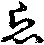



理，便言未枕。(此解悮於后学。)或有释云：谓虽身衣同处，而无护心，手脚不暂到衣所，故明出犯也。今云大会衣者，一须有心，二必手提方成。今虽以头枕衣作意，然手脚全不暂到，是以明出犯也。下文自释曰：若手脚至衣所不犯，证知不谬。同日是身分，何故手足至衣即不犯？大德云：手脚有执捉之头，无执捉之能。又引十多，例成同义。清依此解，不在疑坏所释文，徒昏钞意也。外道者，九十六种等是门屋。一等者，正辨分斋也。同见者，谓有一类外道，同是空见，或同有见，亦有亦无，非有非无。於此同中，但同一见，是名同见。同论者，有一分外道，同是言论等，名为同论。若依约作乐人等，来往游行，经营住处，於中即有同。别界如前者，指同挨界中，别堆共住乐，同一部乐。而衣食别聚处等，等取造食及大小便处也。作食别取水故，即是别界。人衣异处，所以失衣。若同属一主者，谓戏笑人部党虽多，与同属一主，衣食并同，随所置衣不失。谓上失者，是情碍也。属主若多，情必不一，故有碍故。多论重舍者，谓是楼阁也。辨相可知。云上至元者，问：上来如许衣界，总是同分文中，何故此言四分无文？答：四分虽具有名，然於辨相是无，皆引外部类例而释，以为允当。故知此言无文者，是无辨相之文也。若一向全无，即同向下四界，通依外部，故思之。



云八至餘者多敝露者，谓一面有壁，三面无壁是多(此二据西天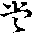



若此土即不尔也)。若此堂内护衣后面有壁，斋壁即是界。若前面及两头无壁，即斋詹际雨滴内中影覆处为界。库界者，约明内以辨衣界体也。



十一、阿练若界等者，兰若无界者，然谓逈空野无有树林，若有树处自成树界。若尔，何故律文约八树中间等耶？可引注文释，通云假以树量大小也。八树中间者，今释空处不知几许为界，假用树量实非有树也。七十有餘者，明此律衣界八树七间，计有五十八步四尺八寸，兼势分十三步，合有七十一步四尺八寸，故曰有餘也。



云次至用者，道州井水，此曰当律，名相俱无，全引他意，共成行事也。



云十二至不失衣者，十诵：弟子为师持三衣，在道行前后去。师遂即值明相，恐失衣，白佛。佛问：相去几许？今量之，得四十九寻。佛言：不失。过是则失。僧祇道中卧等者，亦准前文例解。(玄记至此二错。)



善见等者，此谓衣在界内，疑心谓在界外，不虑失体，故不失受法也。律云失想界外为言者，钞主简异，谓律开缘，失受无罪。夫中衣实现在，忘起想心，谓贼持去，出於界外，决谓失体，作在外心，所以失受。今则不失疑心，恐在界外，不虑失体，衣在界内，冥然不失，明出不犯。若弟子夏未满者，宝云：未满五夏，不离依止，非谓安居未满。谓此弟子本无离师之心，以贪法味，以法如师，故开无离师罪。师衣在界外，故得离衣罪也。



明了论等者，论云：善解三衣，六怜愍诸比丘故。有六因缘，离三衣而不得失衣罪：一、僧羯磨所作，此有二种：一、迦𫄨那衣，僧和合所作；二、为远行及病人，僧和合所作。此二并由和合作羯磨，虽离衣无罪。今合此二为怜愍。二、依他所作，如布萨界有二种羯磨：光结布萨界，后结摄衣界，极大三由旬，令用量也。三、不离所作者，以波阇延楼及剡浮树，楼高千由旬，雨水滴所及处，是楼树界。以此例餘，楼树亦尔。四、垣墙所作，谓伽蓝及舍中转车，方便所显，如后释之。五、露地所作，如比丘行路四十九，与度处相对，覆地直身，申臂斜衣，各摄一角，各相及许不离衣。两人相逐，一人担衣，或在前后。忽觉夜晓，看前后担衣人相去远，心疑未知失不，即语持衣人令住，自亦住。令持衣人倚处，一寻一[打-丁+(林/之)]亦弓，以弓量度地四十九，弓地齐此为限。更取三衣㝡长者，斜牵两角，彼时覆地直身，以脚际向弓头，所及处向此人，人亦覆如前。人若相及，不失衣住处时节所作处。度谓阿练若，时谓夏安居中住处。又恐失衣，佛令以衣寄餘处，亦夜得离衣宿。不失转车者，当第曰垣墙怜愍也。了疏云：言转车方便者，比丘出界值明，恐衣行至寺门数步，不知如何，佛怜愍故，方便开之，令取一杖，以随伽蓝用。何等为四相？或堑，或篱墙等，随其高处，将此杖量之。伽蓝若以壍为相者，其壍必有大小、深浅。若广与浅，量广为量；若狭与深，取深为量。若篱墙为相，取㝡高处量之。若四向总佉浅，即随界边有树等，取极高者，用杖量与，取高处为量。乃将此杖一头量车中央，一头出车外，置明相。出时，身至之处寺门边，相去之间，回转此车。若杖头及墙院，令此人住昨日处所，倚便转车。若杖头拨著此人，则不失衣；不及此人，即失衣也。於第六中，后有二：一、大、小便难，二、他加行难。不失钞文，自引了疏，解甚分明，觉者可委也。



云十三至等者，州界者，即诵也。水中可居曰州，即今水中沙洲之类。



十四肘者，正辨护衣界体，计曰步一尺二寸。有人来往者，王及作乐人、女人等是碍，即失衣故。水界者，谓约浅水以辨也。钞：初引见论，据水为言，与陆地别。衣在岸上，身入水即失。次引祇文，正明浅水在此水中，不妨行李，故前后相去得二十五肘。不失衣是护衣界体，计有七步半也。若船上入水即舍者，衣在船内，身入水中即失。此亦据深水以说也。井界者，或置衣在井栏傍，四面各取二十五肘，计七步半以为界体。或井内但齐内面为体，四面更无二十五肘也。要须渑连，方免其失。[宋-木+(三/日)]𡧮例之，内外可委也。教仓也。



云此至是者，结也。大小如上者，谓上十五种皆据护衣界之正体，如僧、村二界以四相为体，树界取日中影荫及雨时水不及处为体，乃至井界取二十五肘或井内为体，如是大小并如上文所说。若准四分加势分者，谓随上来自然体外，不论大小一例加浮势分，钞引律文是也，即曰面各十三步。



云诸部无势分者，谓四分释僧界即无势分，自然衣界总有势分，准此文独有。若外宗衣界并无势分，但齐戒体，体外即失。如祇文寺门外不提户钓即失衣等，可不例解。云善至会衣者同。既云诸部无势分，见论之中何得有耶？可引钞释云差见中无也。若尔，何故彼云约不健不羸人掷石落处等，岂非势分？更引钞答云彼有掷石之文，别为除事等，谓掷石虽同，所为事别。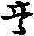



彼文明盗戒处，所谓兰若、聚落俱是盗处，其中有物，盗取即犯。云何聚落界？谓取不徤不羸人尽力掷石所及处，取石落处，不取石势转处斋，此是聚落。四分中但言掷石落处，不云不取转处等，文非明了，故不取之。见论虽为餘事，与文决了，故取为准也。诸师评云等，往古诸先德咸共评论，可有十三步也。十五自然通著者，谓此将一十三步通向前十五界体，四面而著。虽人、衣互出在体外，犹是十三步势分内，亦未失衣；必在十三步外，即成失也。准不通法界者，谓择衣界即不通势分，但心於界体必须入、须手分，即成会衣；若但在外，亦即不得也。所以尔者，首疏云：有法故无，无法故有。相疏云：开不重开。本结衣界犹是一开，若加势分，大成疎慢，故不可也。



云僧祇至易重者，此文为谈上来法界无势分也。准祇云：比丘著上下衣入聚落，有女人语比丘言：今夜欲供养形像，当助我料理。比丘助日没故欲还，殷勤百宿。餘如钞文。以门屋梁界内者，谓既不得入，但住门下，以手提梁，即不失衣。以门有南北梁，连於门下，与衣同界。因作四句：一、舍衣不得罪，谓至异处宿，远舍衣、借衣时，故无罪。二、不舍衣得罪，至他处宿，但借衣持，不舍本受者，明出后还他衣，不舍受法，却受是衣，得坏威仪者。三、亦舍衣亦得罪，离宿犯者，以轻易重。四、不舍衣不得罪，衣不离身。今钞文前段当初句，后段当第三句，思之。



云若准至犯舍者，谓虽作此投梁内手门孔中，约内无碍方得。若有三碍，不免失衣，外护不成；若有三碍，衣随身也。及界外事者，水陆道断急难等缘，名界外事，故开怒舍。若不作上三事者：一、谓无三碍，须至掷石及处；二、有情染二碍，须手捉衣；三、若有隔碍，要须遥舍也。



云上至中者，戒疏云：僧、村四相，周𢯅是强；树、车共界，体约不立。餘十三界各不相择，故云诸界相望，不论强、初。然其兰若一界㝡弱，傥有树、车来此言处，菓、若之名亦不显矣。若将僧、村二界互相望者，玄云：强村僧弱。何以得知？故结衣界云：除村、村外界。若无村时，现结怒除；若现有村，现除怒结。故知村强也(已上取文)。淮南亦云：村强僧弱。彼择曰：若三、五僧在俗家中，但名村界，僧界不起。才有俗人男女入来伽蓝中住，便有村界起。所以律文令除村也(与前解意同)。法宝云：上之二说，俱非雅当。且如俗人入伽蓝中露地住时，有何四相名为村界？今约义明，但为结人男女在蓝障碍取衣，不得自在，非是别有村生。律文假令除村，亦是除其妨难，何处有其村体？以此而量，故知僧、村二界相望，并无强、弱。思之。树下有车界等者，乍观此文，似有强、弱。以树下有车界占，即车界强；车外有树，被树界占，即车弱。今钞意但取不碍义边，是无强、弱(此释有理)。又树下有车，车界虽生，而无势分。以在树内故，不妨其树却有势分。若车外是树，出车属树，更无车之势分；若出树至车，亦无树之势分。若僧、村二界下，明伽蓝势分中，若有树、车等界，则衣树、车界护衣。於树、车界外去蓝边有空地，即平分势分，故云中(去呼)分势分。餘皆例此，可委。



若堂库有车船等者，谓堂库四面有障，假有车船等在中，但名堂界，以强收弱故。若尔，前来树下有车，何故树不能择他车界？可引钞通之，不同树车等。



谓车在树下及场上时。



扬四面，且无障清收摴，是以两不相碍。如净地不周等者，引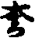



例成上义。如伽蓝四相周，便有摄食义，即须结净地。若不结者，有宿煑过，蓝相不周，段食在内，亦无失。以无收摄之义，不可类解。若互错涉等者，谓库堂是强，能持车船。若餘树车等，不能相枝。虽有文涉，但自是列界也。餘如戒疏者，彼云：未显两相相接，通成护衣。所以第三明於彼此不相收持。文云：此蓝非彼蓝，乃至此树非彼树等。虽互错涉，别界所收也。



云第至种者，谓上具列六缘，此当除五缘也。有缘浮列七种者，泛广也。



云一至罗者，或对首心念者，或者不定也。有人对首，无人心念住。文以轻易重者，非谓非法，开离衣一向无罪，今易离宿重提，但有缺衣之轻吉也。四分老病比丘者，文云：时有一比丘有乾痟病，冀扫僧伽梨重，此比丘有因缘欲人间游行。以此缘即显衣病互有不成也。注文三十已去名老者，玄云：多论文也。或准俗秊三十为一世，一世既过当老位。大德曰：今约夏论，即俗秊五十可当老位，不取初解。离衣法如疏者，是首疏，彼问云：离衣得几月？卷曰：随乞长短，或乞一月极至九月，中间延捉一任当时。若中途病差及衣轻限满等，则不许离。若准四分得一月离，五分得前安居人至来秊四月十六九个月，后安人得八月。所以尔者，以夏中不许游行。若准具论，但以病差为限。又上所离衣是僧伽梨，非下二衣(准此四分)。若依五分多论开离七条，由入聚落须大食故五条常。彼一向不许同离衣，为约得法日以论？为约离日以数？答：但从离日而数也。餘如文。



云就至会通者，前三得曰法离者，谓第一别人作法对首心念，二对僧老病等，三对处结不失衣界是也。后三无法离者，第五王路隔塞，六赏劳，七五分僧俗，六夜兰若。何可知得罪分别等者，初判一向无罪，二重明第五失衣不失衣，谓难忽生隔不得会，既不得会心即忘却，会衣法式不得往持即断，故失不失如后者，恒怀顶受念念不断，思静即会即不失衣，故指后开缘中也。明初在一向无罪中辨者，据其难缘纵使忘断失受，非情过故一向无罪。问：不料简第一缘？答：第一一向是罪，以轻易重故不料简也。对僧作法有缘时在者，病在衣重、迦𫄨那衣未舍是有缘，一八九五月是时在也。限满者，假使有缘为时限满，故失衣得罪。餘一一准思者，除第五三二文中明忘在外三缘，是餘一一进退皆准於此思也。知而会通者，思与若知通舍前之三种，餘不繁录。



云：律至诸部，别辨不犯也。此谓失体者，四分、五分失相无罪，谓决心作贼持去之想，失其衣体。然衣实界内，想心谓失，即失受法，即是舍心，无情过故，衣不犯舍。善见：言不失者，师主疑心，恐在界外，不虑失体，故云此谓失体也。不同见论之中，体、法二俱不失，以弟子将衣先入界故。前言失受，事隔不知等者，却牒料简门中，五中隔塞，或忘断故，失衣文也。既彼示同此难，何故言失？钞：通云事隔不知，知正辨所以也。事谓难事，彼此事隔，不知思会，经明失受，由是虽故，不犯舍也。此即恒思会护，但取会无由，虽则经明不失受法，前指不失，如后正是此文。进退者，律文之中，前明犯相，后明不犯。进向於后，即是不犯；退却向前，即是犯也。前无非摄护之人，比类二碍，退就犯位，失衣犯舍；若恒怀摄护之人，北其二碍，进就不犯，失衣无罪。又有不立染碍等者，叙古也。古云：据其初缘，置衣在俗，女处往取，形露招讥，岂非情碍？此不通诸部者，破古也。十诵文中具有染碍之义，故



云问至之者，如文。



云且至之者，广如注疏者，彼问云：如或开缘，何分勤惰？答：诸界相开，并为奉者，必有惰学根本，非是通开。羯磨疏中，衣、食二缘，广有成敬，自餘物略，仅知与已。



云月至三者，释名者，开齐三旬悕望得之，名为月望，此是所防(云云)。



云此至界者，但三衣是上根人也，畜长下根不在此例，故云不须此戒。



云亦至犯者，列缘也。一、故坏三衣者，新衣不开。二、财少不足者，若衣财足亦更不开。三、为换三衣者，初戒不开一月，明须为作三衣以贸故者。四、不说净者，若说净无过。五、无犯者，无缘，注云同长衣，即失、夺、烧、漂也。六、过限外犯，末过无失，如下广列。



云：此至长过者，初十日随得作成。若不成衣，至十一日犯故住。或云：若十日中同衣足者截割，不者至十一日随衣多少并犯舍。同衣者，布与布同、绢与绢同等。第二位从十一日后随日得足，须成不成。足者明出犯舍，若未足无过。第三位第三十日一向限之者，戒疏云：无论得衣俱同说持，明日已后更不开也。既云俱同说持，足则加法受持，不足且持诤说(不同顺正，约不得说净名一句限之也)。



僧祇等者，谓点净也。庶行(尺庚反)急竟者，即疎疎行针，贵在急了。或云麤行(户明反)隐竟，即麤陈作行位也。今取上解，约当日须成，是急义故。此律下可知。



云若至也者，明三俱故。欲换三衣各开一月，即将九十日分为三位，有通求、别求。若通求云随得衣财足即作者，初十日常开(如上)。二、从十一日至八十九日为第二位，随得足日成受持，不者明出犯舍，兼染餘未足衣亦犯。若全未足，许向后求。三、第九十日若得作成受持，不作至明犯舍，同前一向限之也。若别求者，标心乞□，布作五条、䌷作七条、绢作大衣，亦如上作三作(云云)，同体未无犯。若足便须作成，若不作成兼染餘财亦犯(云云如上)。非正替者，恐人疑云：此是三衣财体，无长可防，何以犯耶？今云：现有三衣在此，未作衣成，未能替故。衣若不作，成衣受持，即为长物故。



云餘同长衣开者，净施、遣与人、失夺五相心及迦提等八缘开，不犯也。



云取至四者。释名者，虗心送与，领纳属己，名之为取。离七世族，故曰非亲。尼者，简下二众。衣者，唯五衣也。此是所防(云云)。



云具五缘者，总标犯缘也。云一至无犯者，如文。



云五至俗者，虗心送与，领纳属己，名之为取离。尼自与使人受，二使与自受，三使与使受，四自与自受，四句皆犯也。既云与人，何简道俗者，破古人也。古云：尼五衣外，有长衣得施，下三泉不得与僧，施受俱犯。今破云：既云等(云云)，但使大僧先无求心得受。又据或是受持五衣，今此所施，后是长物，有何不许？



云律至不犯者，注文：一、高祖者，七代㝡尊，故曰高。去身四代，高祖姉妹即高祖姑，女即曾祖姑。二、曾祖者，去身三代，曾祖姉妹即祢祖姑，女即祖姑。三、称祖者，父𠪄曰祢。法宝引俗礼云：祖已后为立庿，以栗木长尺二，状似书筒，於上提官衔，号为木主，是在庿中，四时[水/王]飨。今翁之姉妹即姑婆，女即儿姑。四、父五己身，父之姉妹即师姑，女即己之姉妹。六、七可知。问：夫论世代，合据男辨，所以约女以明？答：凡明世代，合约男辨。今辨戒缘，须依女说。此皆亲尼不犯也。餘可知。



云使至五者，释名者，駈伇外尼曰使非亲，洗濯秽服曰浣故衣，此是所防(云云)。



云律至提者，问：浣、染、打等三各别，合分三戒，何但制一？可引钞释。通云：浣、染、打实是三戒(此明离意)。同犹一衣生者(此今意也)，谓相由致犯，用浣故染，由染有打也。此戒业重者，重互两解：一、一上声呼，如下钞云：即今弟子因交致染故。二、云平声呼，如下引律院染、打，於一衣上结三尼萨耆，即重重犯故(僧正)。



云五至戒者，如是互作五句皆堕者：一、令非亲浣而亲洗；二、令非亲浣而亲非亲共浣；三、令亲非亲共浣而亲自院；四、令亲非亲共浣而非亲自浣；五、令亲非亲共浣而亲非亲共浣。五句并犯。或有畜尼弟子者，是檀须弟子，非谓依止，以尼通依僧故。餘如文。



云三至吉罗者，自与使与四句皆犯者，一自与尼使人受、二使与自受、三自与自受、四使与使受。四句虽殊，皆尼目浣故结也。准此无重犯者，古云一衣之上无浣染打三尼萨耆。所以尔者，谓才浣竟，此衣即是以犯舍也。假使尼更染打，亦但结吉。若於三衣之上即有三罪，谓准十诵多论之文，无重犯故一衣无过。有重犯者，今师释也。今云此本是清净无犯之衣，比丘将付尼时使语彼云：与浣。浣了恐色脱即与染，染竟必致即以打。如是一时落彼，彼作未竟、衣未结犯，不成过衣。三事毕时三罪顿得。若令作三、但为作二，决心罢者衣得二罪，后忽更打只得吉也。若但令染与不染打，此得一罪，后重染时成有过衣，亦但吉也。使尼湔者(子先反，说文曰：半洗也。文音浅)，谓使尼湔处有罪，餘不湔处虽无罪不可割破，且将合舍。



言五至罗者，比丘尼萨耆吉罗者，谓先令浣故提，未净重使浣故吉。云不犯等者，如文。



云从非亲至六者，释名者，以非七世故曰非亲，未入道众称之为俗，彼不请召但自求不见故号无衣，此是所防(云云)。



云多论至弥者，制意也。是好、非好者，谓持戒、破戒也。实好犯堕，是自代其功；不好云好，是诳委他，得物犯重。注文无戒沙弥者，谓无十戒也，以十戒中亦不许捉宝故。



云具六缘者，总标犯缘也。云一至犯舍者，非谓迦提月中开从他乞者，释疑故来，恐入疑云：迦提赏劳用乞，何故要须失夺烧漂方开？钞文简滥，故云非谓也。必是无少交不济冬者，谓约贫乏总无长财，即开迦提月中乞衣，若有长财亦不开许。随量乞衣者，随三夜量，夜量外不得更多贮畜，即是贪故(顺正记十三各随重乞，不准波句通违篇本)。四肘者，七尺二寸，姬尺已上可知。寒暑相者，冬月著生等方便说法者。



规前利故。缘中一条者，衣曰缘中一修也。



云五至中者，如法治者，玄云：通轻重也。此是僧物，虽开暂用，今不还僧，须衣夷法治之，非吉罗也。如杂法中者，诸杂篇中，彼有通贼方法等。



云律不犯至罪者，通前五缘者，四分开通中夺、失、烧、漂曰更添，五分衣坏一缘成五也。非法求施、施非法求二俱犯罪者，谓邪命乞求是非法求施，俗人知是非法故与，因结施物成他业果；若俗不与，僧但有心，未成果也。亦要此解。记中引七百结集，文太繁，不叙。



云过至七者，释名者，失三受三名为过分，从彼与受乃曰取衣，此是所防(云云)。



云六至知足者，五、过知是者，古人失三受三，即是知足；失三受四日，是过知足。今师师失三受二，失二受一，除则别求，失一不得受。今失三受三等，即过知足也。尼五衣例此。六、领受，犯；未受，无过。



云律至别处乞者，如文。



云四分至交犯者，前戒为他不犯等者，简滥也。前戒自为己即不得，若为他不犯。此或自受得衣与他故犯，由情谄故。若尔，既与前人，何故自犯？答：假是为他，要自受了方与，故入手时即制与犯。不犯者，钞文存略。若知足，若减知足，若依细薄，不窂二、三重作，不为失故施，一切不犯。



云劝增至八者，释名者，数遣答缕名曰劝增，随缕与直故云衣价，此是所防(云云)。



云论至犯者虗心，辨价者灵喜之心，不从他乞也。餘如文。



云四至指堕者，戒疏：问云：劝增戒中，一缕便犯；乞衣戒中，四肘方犯。何故不同？答：本施主无心乞肘，任其多少，恼义是微，故曰肘犯。劝增之中，虗心限约不定，今乃嫌少索多，[企-止+立]恼之情㝡重，不问多少，同犯罪也。



云律不犯等者，如文。



云劝二家至九者，释名如前。



云制缘至得者，制缘同前者，制犯六缘同前(云云)。劝令二家为异者，谓前但一家，今二家劝令共作一衣，异前也。除残文义，如戒疏述之。



云过限至十者，释名者，越三六制，名为过限。通迫净主，故云念切索衣，此是所防(云云)。



五、至犯者。四、过分索者。若准律文，三语六默未犯，过即犯。又见论云：纯语往索，齐六不犯，过六方犯。纯默十二未犯，十三方犯。语默相参，九反未犯，十反方犯。如是类知。五语二默，七反未犯。曰语四默，八反未犯。三语六默，九反未犯。二语八默，十反未犯。一语十默，十一反未犯。全默十二未犯，十三方犯。以一语破二默也。问：默然索者，可住几时？答：祇云：如人入库取者，著店上顷。又如褁幞物顷，便须去也。见论又云：默者不得语，唤坐不得坐，与饭不受。若请说法问义，总不得答。彼若问：何故至此？答：居士自合知之。



云律至不犯者，即相布施者，约本施主说，非谓净主作此言。思之！应以侍者随净主所期之时也。波利迦罗，此云助衣身也。或有难云：忩切索衣戒中有净生生者，且净主因畜宝始有，此既未制宝戒，何故有净主耶？答：此戒理合在畜宝后，但为结集家或飜译者安布错也。思之！



云乞至十一者，释名者，梵云高耶僧悉呾利，此云野蚕。卧具绵损，命求作法衣，此是所防(云云)。



云多至故者，制意也，如文。钞：阙具缘，戒疏具五，如别具列。



云四分至自入者，若杂以毳者，字林云：细软羊毛。又尚书云：鸟兽皆有三种：一大毛谓之羽，二毛管谓之拔坮，肉小毛谓毳也。劫贝者，树花也。戒疏云：若据前缘至养蚕家乞绵看曝招讥。今论杂作纯野蚕，以疎说亲俱令斩舍。憍奢耶为丝中诵者之名，是绵名养蚕所得也。如秦地养蚕法者，如此土养蚕所得，彼无丝绵两异，但总名绵。准如此间则有两别，乞之皆犯舍，故下文乞缕是其事也。卧具等者，多论云：三衣总名卧具。古人云：此相难识。今师实相此是袈裟，但以三衣总号。此土先无，闻说以绵作僧伽梨，此既本无不知何物，而广长有相因被於教，故以翻之为卧具也。或云敷具者，三衣名也。多论六秊卧具正是三衣，若非三衣云何乞法？黑白卧具并同此也。外国亦得作三衣，只为乞得故犯舍，若他与离煞者手即得。杂一毛便等者，取憍奢耶如一毛长，杂餘物作即便犯也。若用憍奢耶衣体作纫处揲，垢腻处是羊毛，细揲是憍奢耶，乃至经䌧交迦穿杂，并是犯也。非悲不破戒者，虽离煞者之手，元是损生之命也。若受之四等之中，阙其悲愍众生之心，被非煞者不乞自施，故不破戒也。今有一方禅泉者，续高僧传说：衡岳思大师徒众在山，皆不著绵细捣。然夫以为絮，将布衭之，用疑寒也。



云以至吉罗者，乞蠒自作绵无罪者，谓是几了熟蠒，此家无蚕不是自藏了者，比丘乞得自作绵不犯。为责有虫吉者，虫虽已死招讥结吉故。云律中至罗者，如文云不犯。至疏者，若得已成者，谓前人蚕家乞得作成施我，我不自乞作无罪，仍斩也。餘如戒疏者，彼云：若得已成者，亦须齐斩。此言甚切，云何可通？如五分：他施已成亦犯舍。十诵：若得已成受用不犯。有释云：但是部列，不同十分诵五。若得已成者，下列灭无开文，但道斩坏，如何舍制与用他开？疏又问：既云非法，受持成不？答：如律通制，但云五大上色不成受持，至於财体并无得不之判。今准央堀经文，僧绵成施持，或人莫受，设受非悲不破戒。据此斟酌，灭有餘义，非急不录。



云黑毛至十二者，释名者，乞黑羊毛作三法服，此是所防(云云)。



云此至等者，此四卧具者，绵、黑、日、六秊、四卧，或并是三衣总号。昔人疑之，至今未决者，义净三藏云：敷具者，谓是卧褥，一则织成，二则布体。织成者，氍氀之类；布贮者，乃是𣒰褥之流。昔人闻此言之，至今疑情不决。相疏云：此相难识也。僧祇已下，引文证也。谓四分文中不了，但云卧具，不言袈裟，致此疑怀不决。今引祇文，栴僧伽梨迦、郁多罗僧、安多舍、尼师坛，亦云卧具。钞：越中间，故云乃至，用除疑故。外难云：此四并是卧具，何不同前戒首之戒？不然，则在后昔戒之，而於此戒中定之。玄云：古师见律，乞为卧具，谓是卧褥。前或是绵，疑稍薄；后二是毛，不异於此。故於此中定境，后乃同收前衣，名同相从。总述更有异解不？正云四缘至如且者，一、纯黑毛者，非黑毛，是阙缘也。僧祇云：谓此毛大贵，一两直二、三全钱，其体细软，触人眼精，皆不泪出，甚为难得。出四大国：一、毗舍离，二、弗迦罗，三、刹尸罗，四、难提䟦陀国。时人往彼求此毛，或得还，或死不返。诸比丘多求，令彼家破，招世讥也。二、作袈裟。诸比丘求此，作三衣、坐具。准除漉囊，是开缘也。如上者。如上，或自作敬，他作成，犯舍；不成者，自为他作，犯吉等。云不至犯者。若得已成者。戒疏云：不同前。或假得已成，犹令斩坏，此开故，无文令坏。若截割坏者。注文自释云：无作[搬-舟+(士/日)]割，谓本作时拟坏故。若本无心坏，作成即犯也。若细薄叠作两量者。注文自释云：无意后得。戒疏云：细薄重披，谓初虽是细贵，拟后作麤贱者，相揲重叠与披，即非纯黑，不犯。准此，即是元意，待后付得故者，初作纯黑，未为犯也。摄热巾者。谓食器热，以巾褁手捉也。



云白毛至十三者，释名者，白毛三衣是所防(云云)。



云因至犯者，因缘者，黑白虽殊，俱非应法，讥呵义等，故曰同前也。佛制参作者，诸比丘亦见前戒不得黑故，便以白毛作之，因制三毛参也。不依敬参，是以犯故。



云五至犯者，列缘也。一、三毛参作者，外难曰：此列犯缘，今既依教参，何得却犯耶？法宝为通此难云：据理，三毛参作是不犯缘，今可加不以两字，即成犯故。外难曰：既不以三参作，将何而作？若纯黑，犯前戒；若纯白，犯此戒初缘；若纯尨，即无犯。今云依制参作，理非可犯，因制参故，便有拒违。向下自有增好灭恶一缘，即违教犯。今须存此，正是犯缘，不须加添不以二字，思之。四、增好减恶下至一两者，欲明增减，先叙相参。如戒下文云：应用黑半毛，三分白四尨也。假如四十两毛，用分为四。言二分黑者，二十两黑毛也；三分白者，十两白毛；四分尨者，十两尨毛。此谓四分，泽津之人语少不了。今准五分云：应用二分纯黑羊毛，第三一分白，第四一分尨。证知前来二十两黑毛，白尨各十两也。今不依此参，致有增好减恶，谓黑色增一两犯提，约体贵重故；白毛增一两犯吉，体稍残故；尨毛增之，全不犯此耳。脚上短毛，体极贱故。问：三毛俱参，黑既体贵，何故制以二分，其数却多？答：戒疏云：就同制或，故黑多也。又黑色虽贵，顺法服相；白是结服，所以不多；尨毛麤短，多即无用。餘文可知。



云减至十四者，释名者，作三法衣制有秊限，不得违越减於六秊，此是所防(云云)。云六缘至犯者，如文。



云僧祇至不成者，未满六秊不得更作者，谓外三律中但未满六秊假舍故者亦犯舍，四分不尔，如下开缘中明之。白羯磨众一一不成者，谓作白不成、作羯磨不成、众僧假和合亦不成，故云一一不成也。云四分至一切得者，别开不犯可知。云不揲至十五者，释名者，标名即是(云云)。



云五缘至犯者，若有心以故者，揲作成亦未犯；若无，无揲心作成即犯也。



云此至不须揲者，后二俱句准知，谓作故如量两戒俱持，作新过量不揲两戒俱犯。随十种衣通得者，谓憍奢耶、劫具、欲婆罗等，随一皆得。



云津不犯已下，如文。



云持羊毛至十六者，释名牒钞(云云)。



云四缘者，总标犯缘也。



云一至第四者，此戒犯缘具四。今依戒疏，科分二：初前二别明，次后两合释(云云)。一、是好羊毛至第二己物(此前二别明也)。今释中二：初、前标；后、举，依他部略明；二、四分下，广行当宗，辨三由旬及过犯之相(此依搜玄科钞文也)。自持至第四者，此谓前标三自持也。后举第四，中间僧祗略消二缘：上半是三由旬，重担俱犯，即是过限故(云云)。齐九者，三人各持三，总计九。未犯重担，即过犯第四缘也(已上正释竟)。或依法宝科，为前三令辨。二、第四下，别释第四所以。注第四两字者，一、为简下四分，二、为解上僧祗(此释违疏文，益失钞意)。云四分至亦吉者，不得助持者，自担三由旬竟，使他持，於限外更助他，得吉。若五分，但听持，不许须戴背负也。若持餘衣者，恂遮罗叶草。餘物者，戒疏云：帽、巾等，吉也。云若至不犯者，毳装(去呼)者，字林云：细羊毛作也，雨中披行。古来天子、大夫服之，巡行邦国。毳绳者，以毛为也。除处毛，即耳、脚上毛也。准此，亦是未担之前，若曾担毛三由旬竟，更持上诸物，亦犯吉也。云使至十七者，释名牒钞(云云)。云制至中者，犯缘具五：一、是比丘尼，二、是非亲里，三、是己故毛，四、自己院染擗，五、竟犯。餘如疏中者，首疏广明姨母、女人来至佛所，但亦不坐，恐招讥等(云云)。如彼



云畜钱至十八者，释名：贮用属己名畜，情所珍玩为宝。钱有八种，下文自须，此是所防(云云)。



云多至故者，制意如文。



云宝至罪者。八不净财者，标意也。且因等，列数也。



云初中至经北者，次如上。不出佛经者，谓经律论文虽则通云八不净财，须其过患不应受畜，无其一二之次第。今上所列，初则田宅园林㝡后及诸重物，引是古来先德如是安排前后，故云不出佛经也。



云二明至正解中者，玄云：释迦一化，凡所制戒不对俗明，唯斯一戒对俗人制。佛告大臣：若见受畜如此物者，当非我弟。予沙门四患即此戒是者，经谓涅槃等，律乃诸律佛造。大臣！日月有患曰：不明、不净、不能有所照、亦无威神。何等为日？谓阿修罗、烟、云、尘、露，是日月大患。沙门亦有四患：不明、不净、不能有所照、亦无威神。云何为四？谓不舍婬欲、不舍金宝、不舍饮酒、不舍邪命自活，是名四大患也。所以大患准曰者，庄严论云：酒为放逸本，婬为生死原，金银生患重，邪命断善根。今此四中是其一患，故云即此戒是也。



云二明至开畜者，禁重如后所明。如此文后引涅槃十餘处文，皆极数破不令畜等。律中事在小机等者，住着小机名为事在，未能无苦故号小机。先须安身然后进道，是意狭也。容有开文，意摄劣故。



云第一至得受者，别人不开者，即显僧得受也。向下引文证成，一口小房有资道要，容身小舍别人许之，为有资身长道之要也。



云二至说者，如杂法中指下诸杂篇中僧地上种菓业得一然之类也。



云三、贮积数帛者，标也。



云昔至㴼者，举世梦传者。举，遍也。梦，虗也。餘文可知。



云僧祗至法者。安囊服内者。意证上文三十六硕是虚说也。



云四至畜诸童仆者，增一至哉者，欲过罗刹等者，经曰：梵志将女施佛，佛不受之，语梵云：已受汝意，但吾以离欲故，不习欲法。时老比丘摇扇扇佛，劝佛受与我。佛呵之，告老比丘言：汝过去世曾为罗刹女，或今更被此女所迷。譬如有人取罗刹女纳为其妇，其罗刹女生得子是，还自食之，食子既尽，复食其夫。爱女亦尔，煞慧命故，终堕地狱也。餘文如钞。



云僧祗至如是施者，彼云萍沙王来，见尊者自泥房，因施民二百不受，至於聚落内，百姓情欲供给，要持五戒终身即受，善持五戒自然得免婬欲故。守足园寺五百人者，彼云佛在王舍城，萍沙王往彼精舍礼佛，因问：大迦叶今何所在？诸比丘答云：在耆阇崛山上踏泥。王遂往问：何故自作？答曰：谁当为我作？第二度来亦如是问，迦叶云：王频有此言，但不见与。时王慙耻遂问左右：先有此言否？答：有。王问：是何时？左右云：经今五百日也。王遂下山。时有捕得五百群贼到，王问：其罪至何？臣言：其罪至死。王问贼：汝能随我语不？贼言：能。王遂令与诸比丘作使，大臣白言：此是贼，能偷比丘衣钵。王言：我有方便多给田宅倍与饮食，彼必不比丘也。离竹园寺不远立为净人聚落等施。非法语者，即行主排说之词，花言艶语之类也。



云五畜生，畜生者，标也。



云律中至尔者，如文。云涅槃至同者，刹利居士皆入阿鼻者，谓不能斋食常住物故。善满五人得受者，谓五人能辨自恣并边方受戒佛法根本，令三宝不断也。大集亦同者，彼云若一村一林有法师等，如僧网篇说之。



云四分至得者，如瞻病法者，彼引僧祗：道逢病比丘，应求车乘駄载令归。若病笃无所分别，不问牸牛草马等。故知病轻能分别者，即不许也。无病不合者，遗教经云：比丘骑乘车马一日，除五百日。齐含利弗问：何以故？佛言：比丘违禁法律，人见生谤，令他获罪。老病即开，开船上不犯也。



云：六、至解者。末利夫人施僧布萨饯等者，十诵云：佛在舍卫城，时末利夫人为听法故，到祗洹中，问诸比丘：此有几僧？答：不知。以此白佛，佛令行舍罗，数知数故，后即施饯。比丘不受，佛言：应受。准听受义，应付净主也。杂含等者，律文如钞(云云)。古云：此是资要无过，故听受宝，但不应自为身受。若反前自为身，即不得钞。钞意不然。此云得受者，谓得受竹木，非谓钱宝等。注文者，若疑四分言中，不了上有杂含经文，亦自分明须木直党木，乃至须舍亦。



人若得为房舍受舍钱者，何须言其直党？餘如正解者，指下解戒本中明也。



云七至得受者重物者，或体用俱重，如床等。二体轻用重，如被褥等。氍数三肘五肘，净施畜者。此约[彰-章+丰]者，有袈裟量故。过量厚重者，即不开净施。铜拻(过反)可知。云八至主者，若得金宝，咒愿已还主者，三解：一云呪愿施主已，还付净主(此说今非)。二搜玄云：还反本施主，为贸净物，非为永还。法宝云：还反施主，须得不还，不得令他贸净衣物，以文中一向不开故(任情取舍)。



云涅槃至依者，说轻为重者，谓丰时禁约；说重为轻者，谓俭时开听。观知我等弟子下，但明一衣，是说轻为重义也。钞文从若诸已下，至依止已来，此明四依也。初、据有人供给，则不听畜；二、无人供给，饥馑时即听，丰时不得；三、虽则饥馑，能护法者则听，不护法亦不许；四、虽护法，净施则听，不净施不许。如是四法下，结也。我为肉眼说者，以肉眼不分别邪心，今为此辈说此四依。今验邪、正，若有慧眼，即月解分别，何须用说？若有三藏等者，谓毗奈耶等(云云)。云又至要者，此汶钞文，是和会二经相违文也。十轮云破戒比丘亦须礼敬，涅槃经文制令不许礼敬，二俱是大乘教文，因何相违？钞文灭云十轮据不知持犯者说，反显涅槃约知故不礼也，亦不相违。又涅槃尊者，再释也。以此经穷尽法厚终极之教，令不礼敬，破戒之徒可以依义。用不亦得者，谓不用依十轮经文据不知持犯者说，亦不因十轮亦是经正翻实录，何故不用依之亦得？可引钞释云：以护法故，小小非要。意道涅槃文以护佛法故是大事，若比丘受畜不净之物，自坏坏他，必沈恶道。



大事。今若折拌，令彼不作，是护法也。十轮经文但以袈裟因缘故令礼敬，是小小之事，非要依也。(非由不也。)



云三至了者，如文。



云四至无罪者，受贸轻重者，标也。若以此八贸衣犯舍者，钞文全依首疏辨也。彼云：若以八不净物贸十种衣，犯舍堕故。(搜玄对此广明古解，与钞全乖，略不叙之。或有於此便论今义，亦未要预述，至下文自释。)以衣得亦绵氀亦舍者，首疏云：以十种衣贸八中六、七，即残及氍氀犯舍，餘六但吉。若以衣、宝相易，堕。皆以衣贸宝，宝贸衣，得堕。若将衣、宝贸餘六种，吉罗。约此六种，自相夫贸，得吉。若以此六贸衣、宝二种，亦犯舍也。此谓与俗争价等者，正明结罪之由也。谓指适来提、吉二罪，皆约比丘，亦不合与俗人争价增减以结。此合师正解也。问：八种俱是争价增减，何故结犯有於重轻？答：田园、奴婢、畜生等不应舍，法体又微，但吉。二宝应於舍，法体复贵重，故不犯提也。若五众但吉，亦据争价说。此释不违钞文，不同古记繁杂，思之。多论等者，玄云：此文因便故有，谓犯舍钱宝贸得新衣，不知此衣犯不，故引多论说净。钱宝与犯舍钱宝贸得新衣，作三衣百一物，并不须说净。月百一外，成衣、不成衣并说净，新得过无。若犯罪悔僧中者，畜钱迦，吉。对首忏先畜宝迦，违净法，提。应僧中悔已，贸财作百一物，不须复舍，已入净故。若百一物外，法衣一切说净。



云正解戒本者，是上义门，今当正解。



云此至便犯者。文言手捉别时意者，古师云：此戒为畜故提，后九十中约直尔提，是别时意也。今云此戒准约畜，后九十中但据提，不论为畜及尔提等。此戒文中言提者，自是犯后九十中捉宝戒云别时意也。列犯缘，如文。



云此至滥者，准此失戒者，玄云失受体也。谓顺敬即是佛子，今违教即舍法，佛既非师则舍佛，乖六和义则舍僧，既舍三宝身则无戒(此持大过分也)。今云失者戒者，但据一戒无表不清，举例如畜猫狗一众无戒，不可众僧尽舍受体耶？思之。佛告大臣等者，杂含云：时有珠髻大臣问佛言：前日王集诸大臣共议，沙门释子受金银等，为是净为是不净？於中有言：沙门不应受畜。有言：应受畜。我时闻已生疑，不知此事云何？佛言：若沙门释子受畜金银得名清净者，五欲功德应清净也。准此文意，谓世间五欲之境，眼意色、耳意声等，此五因贪故生，本是烦恼结意，不为清净不名功德。今若沙门受畜金宝为清净者，上之五欲亦是清净，五欲既非清净，反显沙门畜宝实为不净，理非功德也。梵志书述者，增一云：昔有梵志名畜苦，从梵志师受学。既学通达，师为改名超术。受学既久思报师恩，欲诣聚落乞物。偶诸逢婆罗门大礼论义，若得胜者赏金钱五百、金杖一枚、金瓶一口、端正女人一牛千头。超术自思云：诸物不要，若论得此金钱之类，报师恩德不亦好乎？即往。众中有婆门多有皆慧，超术先以一问，问中合五百，改义举众了无知者，遂将上件诸物以赏之。超术云：诸物不须，唯五百金钱、金瓶、杖等报师恩也。持物路行逢人忩忩，定光佛出世。超术自思：佛甚难值，我今卒可持此物献。又乃思惟：我先有书名为礼记，彼书中云：若如来者必不受宝，今贸莲花以上於佛，并解发布泥如来授记等(云云)。



云佛至除思者，剧者，甚也。行商坐贾，才见少利，便博易之。沙门贮畜，要侍商价，更甚於彼也。信佛法烟云者，谓信知畜宝是佛法之一患，如日月之患，患在烟云也。矜恃者，孔安国云：自修曰矜也。出此无贪无罪之言，排其法律，即是轻拨大圣也。一分(平呼)之利尚计者，谓分毫之利，心亦计之，举少况多也。不及俗士高逸者，汉末魏初，青州管宰锄圃见金，挥锄与瓦石不异。王夷甫一生不言钱等，儒士尚尔，岂况高僧而躭俗利。蟷蜋拒轮等者，庄子云：蟷蜋怒臂以当车辙，宁免破质於轮问。飞蛾虽有投火之能，之能反遭明之，表体法令可知。



云涅槃至油渍者，如文。



云四分至缘者，八种者：一、金，二、银，三、铜，四、鉄，五、𫓪，六、白镴，七、木，八、胡膝也。



云僧祇至罗者，生色者，天生自然金，不假因缘名生色也。似色者，似犹像似金之类，则生似是梵言，金银是汉语。或云金银生缘者，梵汉双举也。捉得提者，亦是犯捉宝也。七山者，标也，七举数宝珍美也。一金者，说文云：金有五色，黄为其长，百练不变，久埋不生，从芊不改，西方所出也。二银者，白金谓之银。摩尼者，谓如意珠也，亦云无价(广如卷初)。真珠者，亦云赤珠，谓赤虫所出，即蜯蛛是也。珊瑚者，红赤色，说文云：石脂似树形，出海中。车渠者，青白间色也。马脑者，此宝形似马脑，亦云玉石。上之所引依多论，若准诸经论说七宝大同小异，第三是瑠璃碧色宝，第四颇梨即水玉是。五种取者，如下文五种受即是也。



四分是中等者，戒疏云：明舍钱方便付净主也。钞：文稍难晓，须细寻之。从若彼人取还，直至掌之，齐此已来，据彼人不会比丘之意，谓言将物与他，不取顺受，却还比丘。彼既内心不解，即乖净施之法。故律云：即作彼人迷故，所以不成。物既现在，即作他物收取，令净人常护也。钞云若彼人已下，乃至受持之，齐此已来，此约彼人心中却顺解前来比丘之意，再来取此物，即令净人持与贸易衣、钵受持之。钞云若彼优婆塞，乃至持之者，此约彼人为比丘持物贸易，得衣、钵将来，比丘即将新贸之衣依法加受也。不作净语得者。



云僧至之者，褁眼。三施者，遶也。欲令彼迷，方不记处故。以餘文可知。云若施至须者，如文。



云多至弥者，僧中次第行者，谓如今时斋家行钱，即须言此不净财等，正明舍忏法，则可委餘宝说。净有二者，若内衣持钱宝来与比丘，比丘但言：此不净物我不应畜，若净当受。即是净法。若白衣不言此，比丘不语取，犯也。



云僧祇至俦者，祇云：佛在舍卫国，时目连将专须沙弥食，后到阿耨池上坐禅，时沙弥见河边金砂，便作念：今当盛取此沙著渗灌下。目连从禅觉已运通拟还，沙弥为非人所持，目连回顾唤沙弥来，答云：我不能往。目连问曰：汝有所持耶？答曰：身有金砂。告云：汝应舍弃。弃已遂腾言者也。乃至老比丘等者，祇云：有比丘将一沙弥看亲里，路经旷野中道，有非人化作龙右达，沙弥以花散上，赞言：善哉！大得善利，舍家不捉金银及钱。比丘到亲里家相看已欲还，时亲里言：汝今还去道中之食，可持钱去市易所须。沙弥受已紧著不带而去，至中道而非人见沙弥在比丘后行，又化作龙来左遶，沙弥以土坌之言：汝失善利出家修道，与捉钱行。沙弥便啼，比丘顾问具述上缘，师令除钱非仍旧右遶，以此缘白佛言：自今不听沙弥持金银钱用。此文证上，故不许舍与沙弥也。此犹讥类者，谓此沙弥捉宝罪轻，犹可治救故。



贡致责，令其舍之。罪重根除，神亦置而不责也。池神者，祇云：昔有比丘至一池边，见莲花，不取手捉，恐坏生故，而但𭊴之。心中赏爱池神，呵责比丘偷我花𭊴。须臾忽有野象来入池中，皆折碎。池神嘿然。比丘语神曰：我暂𭊴香，即见呵责。象今坏损，何不厝言？神曰：汝是沙门出家之士，合知法律，是以责之。畜类无知，何可为恠也？显戮者，如暂𭊴香，尚致神责，况当违制？覆罪不陈，清罪委知，无任同法，故云显戮也。颊肿之债者，百喻经下卷云：昔有痴女，聟至妻家，羞不食。后为饥逼，盗食生米，其颊鼓起。妇谓之颊肿之患。问其因由，因报不语。妻乃白父，父召医人，以火钻烙，颊穿米出。法合可委(云云)。



云律不犯已下，别开不犯，如文。



云贸至十九者，释名者，贵物相易名为贸宝，此是所防(云云)。



云多至异者，玄云：此律不云求利，但言出家人不应。故古师云：多论与律不同。律贸得宝，入手即犯；若用宝时，则得不应。宝体既无，将何以舍？故疏破云：昔人不立以财无再舍，罪不双结。今不同之，见金以钱买金而畜，初易贸、后畜，缘相是异，何不双结？五种不同等者，疏云：贸宝，七众俱犯；衣唯二众俗犯。二、贸宝，月作、教人、为己同犯，除为三宝；贸衣、使人不犯三宝。宝一制不开，自为衣则开，苏、油相易。四、舍法不同，宝舍俗，衣舍道。五、还财不同，衣舍忏还本衣，宝舍忏后易净物也。但无衣、食为异者，谓此戒但论金、银、钱已下贩卖戒，衣、食相易为异。



云五缘至前者，一、是钱宝者，金银各三，钱唯一品。金有三种：一、已成金；二、未成金；三、已成未成金。已成金者，钗钏等也；未成者，金梃是(不同〔有〕云金鑛也)；已成未成者，铸写作器未[羊*延]治者。银亦三品，例此可知。钱若据理，亦令有三未成。据未有文象者以说，既未具足，世所不行，即非贵物，故唯一种，不同金银三品俱贵，世所用也。思之。二、互相易者，互结成句，则四十九随一为须，皆得七句：初、已成金易已成金；二、已成金易未成金；三、已成金易已成未成金；四、已成金易已成银；五、已成金易未成银；六、已成金易已成未成银；七、已成金易钱。餘亦例此可解。



云律不犯已下，如文。



云贩至二十者，释名者，为利卖买，称之曰贩，此是所防(云云)。



云多至故者，制意如文。



云论犯至受者，列缘可知。



云律至重结者，准餘部双开者，据四分，此戒准约教，净人易贸是一开。若准僧祗、十诵，俱开日贸，反与净人，但作知净语，当於价直，即道俗双开。又下四分衣法，亦开无净人时自贸等。衣药交贸者，谓四分律文，但有四药及衣相贸，六餘物也。准此，有二十五句。初有之句：一、时药易时药；二、时药易非时药；三、时药易七日药；四、时药易尽形药；五、时药易波邦迦罗衣。以将非时为头，亦准此所解。问：既云准约衣药，於易已外应无犯。若无犯者，何故文中言种种贩责？答：只向适来句数之中，亦得名为种种，何必约一切物为种种也？数数上下者，增卖者，本贱卖贵；买亦如是，本贵买贱；本增直五钱，减买言直三钱；重减买者，本直五钱，言直一钱等。餘文可解。



云五百至不犯者，如文。



云僧祇至罪者，相似贸。相似者，玄云：谓瓶犯堕，此名相似也。若钵贸瓶亦堕，名不相似也。若可食噉口吉者，外难：十诵、多论同是一宗，何故十诵噉口口吉，前多论咽提？答：多论为利故贩责得提。此十诵将上犯舍物金，未不为利故，新易物来知降违法，食体无舍故口口吉，衣违舍法故提。四分贩责买三但为利俱堕者，举价金高曰责，抑价令低曰买，买已规利更卖曰贩。此三事但争价上下，不作知净语，各得提也。十诵据一物为语者，谓一物上贩卖讫方结一罪，故彼文云：若比丘为利故买而不卖吉，若为利故卖而不买吉，若为利故买买还已责提。约第三句责买二业，故云据一物为语也。四分又不了者，谓上多论约僧中悔不应还，十诵约别人私责买听七日，当部但云若悔听还，无斯两判，故云不了也。共僧贸易应陪者，准五分云：时有比丘有拘执衣，四方僧有僧伽梨欲贸之，诸比丘不与。白佛，佛言：听易。若拘执价多，应治与比丘。若僧伽梨价多，应治与僧。若贫无物，即如文中所说(餘一切物并准此也)。



云僧祇至准前者，四药随物重物等者，祇有八物：一、时药；二、夜分药；三、七日药；四、尽形药；五、随物，谓三衣六物也；六、重物，谓木床褥等；七、不净物，谓钱金银等；八、净不净物，谓真珠等。得触名净，不得著名不净。此八相贸语时，越得物提。食钱持博苏油等者，此约自乞向食，非常住钵中之餘也。更有释不正，餘如文。



云多至也者，谓是方便有罪果头无罪之物，要须物舍与僧断相续心，更不取作忏已还来，方听僧作福等用。不尔直施自得，不应僧不合受。



云律至不犯者，不得与餘人贸者，谓白衣、外道也。若苏油相贸无犯者，外难：何故前来引律文以七日易七日犯提，此更开无过？答：戒疏云：苏油相易不犯者，开外资也。前言犯，得内资说也。准上衣法等者，谓上四分文云：贵价衣令净人贸，据有净人言之。若无净人，开比丘自贸。准此文意，不得与餘贸。若无净人，理亦开许。十诵三度者，谓三度当价作净语。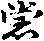



等。餘如律本及钞。



云畜至二十一者，释名者，受持之外名畜长钵，越於分齐故云过限，此是所防(云云)。



云五缘至犯者，如法钵者，一、体如，二、量如，三、色如等。非油[木*毘]者，[木*毘]即烧而不勋，油即烧后用荏子油之，并不应教也。



云餘如长衣戒者，长衣开十日具有八，今指同彼戒。疏：问：白色衣过限犯，白色钵何不犯？答：衣染必成坏色故犯，钵再熏多损坏故，所以不犯。问：衣过灭成受持，盔过减何不成受持？答：衣可截渍故成，盔无此义故不许。疏中减有数重问答，恐繁不录也。



云乞钵二十二者，释名牒钞(云云)。



云六、至中者，如疏中者，彼云：须在当界好[天/皿]，夺入僧中厨，为[天/皿]本寺故。不同乞衣，资用宽故，须回本主，不用入僧。



云律不犯已下，如文。



云自乞至二十三者，释名牒钞。



云多至故者，制意可知。



云四至犯者，如文。



云十诵至吉罗者，戒疏云：十诵乞缕犯古，岂非防道？四分开亲，以离指谤之缘也。看织作繀，一切吉者，律云：若看织，若自织，若自作繀者，引云津子，以管浇熊也。赵魏间谓之历庶方，言不同可。既云自作等，非出家人之仪，犯者。若尔，下不犯。文中何言自织不犯？答：上据织作三衣，故自亦犯；下约小小物，故不犯也。



云不犯已下，如文。



云劝至二十四者，释名牒钞(云云)。



云论至吉罗者。六、顺受犯者。问：前戒何以织成便犯，此戒顺受方犯？答：前戒道回，织师作成即犯；此戒自求，顺受始终。问：前后两戒皆由织师，如何取别？答：有四不同：一、前戒损，织师自得缕故，此损缕主；二、前戒损，织师不与价犯，此损缕主与偿便犯；三、前戒亲不犯，后戒俱犯，损义通故；四、前是己物成即犯，此本属他入手方犯。



云不犯已下，如文。



云夺衣戒二十五者，释名牒钞(云云)。



云五缘至属己者，甄下众者，戒疏云：简下四众，本非同行伴类，假夺但者。三、不定与，前人决定取者，正犯此戒。戒疏云：生争故犯，本作得心，今夺生恼也。四句中二句者，因此一句，便作四句简之。戒疏云：义加四句，初是向列四句之中，有二句犯重，标出初受与俱决之至重也。疏云：此二则犯重罪，由初决舍，属他已定故。文云：施已还取，是重摄故。四、嗔夺者，戒疏云：自夺、使人。祗中自与、使夺，四句皆堕，谓三衣也。若减量衣，但犯吉。五、得属己者，僧祗四句，初合与、别夺，谓一时与三衣，后随衣夺，犯三提。餘准知也。不藏者，犹面现前，不藏举未犯，但不对面，移物即犯，不假载举。戒疏云：谓对面夺也。未藏情疑，属己不显，故约藏相，结成堕罪。文云：若著树上者，谓非对面，随举离处，则犯正罪。以无人可争，故结。(已上疏文)



云畜至二十六者，释名者，贮用属己之名，为简餘三故标七日，疗患有功称之为药，越日期分故言过限，此是所防(云云)。



云辨至犯者，初一行钞文，是相略意也。次列犯缘中。五、无缘者，律云送与人，若失，若故坏，若



等，是缘也。



云律不犯至也者，此约过七日犯舍与僧后处判，依教不犯。若过七日者，戒疏云：初日过限，具兼诸失，主不合受，故与俗人。第七日者，疏云：既无宿触，口法尚存，听与僧食。若未满七日者，疏云：限法不过明日，白二还主，理合说净，已越七日。无眼义，制身外用。文中约第八日时，三种处分：若至九日舍者，初二日是过七日药，次一满正七日，后四未满者。若至十日舍者，初三日是过七日药，第四日是正满七日，后三是未满者。若至十一日作法者，初四日是过七日药，初五日是满七日者，后二日是未满者。若至十二日舍者，初五是过七日药，第六日正满者，第七日是未满者(上皆三种处分)。若至十三日舍者，前六日是过七日药，后一日正满者(但二种处分)。若至十四日舍者，於七日中得者，总名过七日药(准一种处分)。文中无户誓者，三苍云：北面窓名誓户。臼中鸣，以苏油除；除不鸣，誓窓泯，周涂令明也。



云过前至二十七者，释名者，佛开浴服预乞前用，此是所防(云云)。注文者，若据理，过前求雨衣是一戒，过前用是二戒，然是一衣复同过前，故合一也。



云过至犯者，一是雨衣者，此衣状似漫安陀会也。二时中得者，三月十六日已去得者，皆名时中也。要是时中得，方有犯过前用。若非时得，如三月十五日前求后。若过前用，但犯吉，以衣无再舍。此戒言一衣上重犯者，无重犯堕也。三过前受者，谓未至四月一日即加法，然又非过前求也，但是过前用而受也。



云四分至幕者，十种衣者，辨衣体，即憍奢耶等，如前文说之。三月十六日求者，戒本云：春残一月在，应求雨浴衣。即三月十六日已后至四月十六日，是春残一月也。四月一日用者，戒文云：半月应用结。即四月初一日至夏初正月，半月开用也。舍勒者，是𭣋身衣。鼻奈耶，云半泥洹僧也。更有异说不正。



云诸师至洗者，今云如三衣披用则不同，古人言是戏图也。下引祇文证上披用垢液者，谓浴未了其雨则止，垢液未尽更得著，亦著入河中浴也。上言不得著入河池者，为无此缘则不许也。



云多论至故者，彼论从三月十六日至尽，应求作。若得成衣，四月一日应畜；若不成衣，四月十五日听求作。若前安居人，至四月十六日应加法。若同三月，要后三月求作；若同四月，则前四月应用。今同得百二十日，彼同安居日受也。若准四分，四月一日畜用，不同十六日。若求未得，应用此文也。畜法如文。云僧祇至唱者，若至八月十五日限满，不作餘三衣净施者，谓舍了须说净也。注文准此，舍时通唱之文，初受之亦应通唱。今僧受雨衣，不须对首秉也。



云律不犯至者者，若舍作餘用者，谓时中求舍作餘三衣等杂用，不犯过前用。若著时中求衣、时中浴，有何犯失？浣举者，谓时中求而用时未至，浣举不犯过前用也。



云过前至二十八者，释名者，十诵云：今日不取，明日则无，是名急施。七月六日已前受者，名曰过前至八月十五。若不净施，故云过后畜。此是所防(云云)。注文者，戒疏云：此亦两戒共制，非是一衣，不同雨衣一事生二也。前一衣上有受、用二罪，今此两衣合为一戒。若有过前取，则无过后畜；若有过后畜，定无过前受。谓前是顺受故生，后是违净故犯。



云过至犯者，三、过前者，七月五日已前是也。四、无缘者，谓失、夺、烧、漂等缘也。后五缘者，标过后畜五缘犯也。三、是十日内者，如七月六日受衣不便说净，至八月十五日即须说，不说至十六日，是过后畜也。乃至十五日受衣，八月二十四日须说，不说至二十五日，是过后畜。中间比知，文中正是指此十日内也。



云事希至法者，急施衣事，是希其法。亦隐上之所列，且约大途戒疏文中广辨。时非时法者，疏问云：何以非时受衣，一月、五月外，更增九日，时中受衣？所以不增者，此约七月六日受急施衣，对时中受衣论也。答曰：此中本是时衣，以急缘故，开非时受，所以时外开之。餘衣本无时限，随受随说故也。问：如长衣七月十六日受，十五日前开位，十六日接是时分，何为不同急施衣？答：受长无时节，随受名非时。急施必接取，所以前后开相。疏亦云：长衣不与时衣相接者，但有前开，是以便犯。急施衣十日受者，前开入十六日，须是后开。两开相接，越此分齐，是以无罪。又戒疏云：七月十五日长衣时内，九日足，须说净。更有餘义，非急不叙。



云有难至二十九者。释名：恐怖逈远名有难，兰若开寄法服故曰离衣，此是所防(云云)。



云六至犯者，冬分非时者，从八月十六日后即是冬分，又非迦提月时名非时。何以得知？故律云：诸比丘夏安居竟后，迦提一月满在阿兰若处住，有贼劫夺衣钵坐具等，诸比丘畏贼皆来趣祇洹住，谓夏中不许离衣，迦提一月任运许之。又复满已，今从冬分起首至明秊四月十六日已前并是非时，兰若有难并开离也。故云冬分非时。五无因缘者，同前失夺等缘也。



云四分至一衣者，如文。



云明两缘者，对古师但亦一缘，故今标两缘也。古云兰若六夜许离衣者，只为恐怖之缘。今云准外部五分明了之文，别缘亦许。又准戒本语势云：诸比丘！有缘离衣宿乃至六夜。既曰有缘，凡是因缘总开六夜，何为恐怖难缘独开？所以钞亦两缘：一是恐怖不作日限，二者别缘开六夜(别缘钞文同说)。



云僧祇至夜者，谓祇五见三文，皆不作日限。然祇许夏内离衣，五分不许。前言冬分非时，即同。五分制令十日一度结者，与今见论少异。祇律：比丘兰若处安居，出外乞食，被采薪人偷衣去。且听寄衣，不作日限。五分：佛在舍卫城。八月，贼常伺捕人祀失，欲煞比丘，怖皆逃走。贼中知比丘法者云：沙门不离衣，必归。因兹遭难。由此佛听寄白衣家。初不作日限，被虫湿损，因制往看。又数往招讥，因制十日。见论六夜一看衣亦尔。上来诸部等者，结前第一缘。必有已下，明第二缘也。



云：四分至执者聚落起过者，镜水大德云：此言似倒涉於聚落一宿，戒今可回。又兰若比丘寄衣在聚落中起过，准戒疏及钞意，谓制缘许兰若置衣村中，不作日限。后因兰若比丘别事寄衣聚落，一寄不还，因兹起过。更约缘开至六夜。(古师所释与钞全乖，不更叙也。)不显缘相致令妄执者，谓四分文中但云寄衣在聚落不还，并不说是何等缘。不显此之缘相，致使古人云是恐怖制六夜故。



云今至许者，谓四分别虽无此诸缘，今准诸部而用，故云有缘皆开，不同古师唯执四分恐怖开於六夜。故戒疏引僧祇：因往断事衣重，故开六夜。五分：塔、僧、和尚及他事者，皆听六夜留衣俗家。故今钞文引五了论皆有六夜别缘，证其四分虽不显缘相，可同诸部有缘皆开。



云律不犯至说者，掷石及处者，谓入势分由，则不失也。若有情染二碍，必须手捉衣。若舍者，谓不会开对首，心念遥舍。餘同离衣戒说。谓失、夺、烧、漂四想，不舍衣，不捉，不至掷石及处，不犯。若船济不通，道路险难，盗贼恶兽，河水瀑长，强力所执，禁命二难等，同前。



云回至三十者，释名牒举钞文(云云)。



云具至犯者。问：何以但言回僧，而不言回佛法物？答：或云许僧物者，於己有滥，回容称心，憙为制重。佛法之物，滥义是希，虽回制轻也。



云律至也者，初、已许僧者，决非属己，定僧为作，众多别少，心未决故，回犯堕也。二、为僧故未许僧者，虽非属己，众别未分，若回犯吉。三、已许僧者，定属有主，回犯重罪，以同盗常住也。



云僧至用者。我已施僧，今施尊者者，谓能施者自是非法，受施者无过，如从贼受施之例，但不得乞，乞成回僧物也。



云四分至重者，并为未决定者，物虽行僧，由未定属，自回入己得提，回与他得吉。若决别施，属主已定，若回此物，望损於他，随前犯重。回畜物者，且约畜结。回此自恣僧物，与彼应还，作吉悔者，此属已定，回即犯重。何言吉悔？谓劝回与彼，即得吉也。而物实未与彼，若物与彼，即是不还此僧，便成重故。彼此一人决属故，回即犯重。准此，一人是定属，无别相对，辨其未分。有僧次来，当次之人，亦是定属，而回与他，望损此人，应得不得，故成重也。



云律至不犯者，许恶劝与好者，即持戒为好，破戒为恶也(已上二母段不同，总是释第四篇竟)。次明九十单提。



中分二：初总标，次别释。初云九十戒。



云小妄语至一者，释名者，言非称实为妄，彰在於口为语，简异於大故标小名，此是所防(云云)。



云此至一切堕者，谓凡在制戒在篇者，皆从恚犯居，故此徵云恚犯为先。因由何事，故牒起云引戒人多恚犯者。良由已下，正明所以也。谓无始时来，习妄语业，熏成种子，积在藏识之中，故云妄业薰积也。此妄种子，服伏藏识不少，故云尤左多故。随尘境者，谓此依种而起现行，故云随尘染等。境动则虗妄搆架，而造恶业也。不思反流之始者，古云谓不思反生死流之始，归真如之原。今谓初受戒日，则誓断一切恶。今是志诚时、实语时，皆是反流之初。今不思量，但顺其业种，恒事妄语。𮨇，必洛形也。以此安生者，以此虗搆妄业，安於一生，要当至死方住，故云为要当死。若如是者，不能排荡藏识之中妄业种子。出家顺生死业，信此可令人悲，故云良可悲矣。嗟，叹意也(上依搜玄约句释竟)。或依法宝科钞句云：以此安生为要(是上句也)，当死定非排业(是一句)。意道用此妄语之业，以安生之身为其要妙，当至死时，定不能排荡此业(此解亦是一途)。加以等者，前来妄业薰修，动便成妄，故意为之。今重由约境之虗实，但违想心便结，故云加以也。犯无定境者，境通有无之无定也。但使违内想心者，如实不见张人想心，谓是见张人。后有问者，答云不见，便是远内想心，何论外缘虗实？谓不见是实，想心是虗，见则反之，餘例知也。



云六缘至解者，如文。



云：多论至业道者，四句：初一、如钞(云云)；第二、是两舌，非妄语、恶口。传他此语向彼说，作分离心，故是两舌；如实说，故非妄语；柔软说，故非恶口。第三句、是恶说，非妄语、两舌。传他此语向彼说，庶横说，故是恶口；如实，故非妄语；不作分离说，故非两舌。第四句、俱得三罪也。济语者，非时语、无义语，皆戏调心，名济语也。餘曰三业，或合或离，济语一种，不得相离也。释云：餘曰三业者，妄语、两舌、恶口也。此三心通有济语，故云不相离也。只如妄语，说不称时，若妄语者，必是无义。或时妄语为调戏心，凡是妄语与两舌、恶口，皆合济语一种也。一时作二、三、四者，一时作二者，妄语即有济语；三者，两舌；四者，更加恶骂。十业之中，越其意二，故云乃至八事。何不至十？以意地中贪等三心不一时故，贪、嗔二心相违，不同时也。若据自作二事，教他为六，一时戒故，得有八。若但令他唯得为六，即口四过，并煞、盗、身二也。婬要假於自身一支，并为无业道，属痴成八。於一时中，八业成就也。



云四分至吉罗者，四分、五分法师。比丘者，四分因象力释子，五分因沙兰比丘，各聪明才辨，一切四众、外道、沙门、婆罗门无能及者，遂以非为是，以是为非，知言不知，不知言知，恒以巧辨胜人。时诸比丘莫不叹伏，问言：汝论义时，意谓为是为非耶？答言：我实知非，耻堕负处故。妄语比丘举过白佛，因制也。僧中妄语等者，玄云：是五分文。彼因慈地谤沓婆故，佛语慈地：若於坚信比丘前妄语，罪重於煞无数众生；於一坚法比丘所妄语，获罪过百坚信。如是展转於僧前妄语，罪重於百罗汉前也。谓四人，谓前诳罪重也。何以故？凡僧受诳生信故重，圣人识非不信故轻也。前言坚信，谓是内凡已去，得四不坏信故。坚法者，谓得无漏法，苦忍初心已去，此法坚固，难可破坏，故名坚法。常令推寄有本者，谓若有所能，推属於师，或推圣教，则无过失。纵有，乃属前人也。不尔，斧在口中者，故多论云：凡人生世间，斧在於口中。谓出语伤人，犹似刀斧。儒宗云：一语伤人，犹如釰戟等。



律云见闻触知者，萨婆多云：若境由眼识所识，名所见，谓是色也。具五缘：一、清净眼，二、色境，三、假空，四、须明，五、作发识意。若境由耳识所识，名为所闻，谓是声，具四缘能闻。於前五中，但除明缘也。若境由鼻、舌、身三识所证，名所觉，谓取香、味、触，具三缘：一、三根不坏，二、有触尘到根，三、作发识意。若境由意识所证，名为所知，谓意知一切法，谓法境是。但具二缘：一、意根，二、发识意。问：何以鼻、舌、身三合为触耶？答：以内取境故，要须三境逼根，方能取得。然须隔越此子，鼻根隔三分，极微舌根隔二分，身根隔一。虽尔，总名合中知，谓此四是违顺之本，故八句皆犯。谓不闻触知，言见闻触(成四)；或见闻触知，却云不见闻触知(成八)。初约不外闻触知诳他，有二十四句。先约不见，有六句：一、本实不见无想心，诳他言见(此心、境俱违句)；二、实不见有想心曾见，今诳他言不见(此境顺心违句)；三、实不见，内心生疑，诳他言实见无疑(此心境俱违句)；四、实不见，内心曾生疑，诳他云不见无疑(此境顺心违句)；五、实不见，无横疑，诳他云我疑见(此心境俱违句)；六、实不见，无横疑，诳他云我疑不见(此境顺心违句)。餘不闻、不触、不知，例此各六(成廿四句)。次就实见、闻、触、知，亦二十四句(番上可解)。乃至所见异等者，律文更有六句。所见异者，戒疏云：定行心中，见恶像言好像，及被人问答，他异本所见，故云所见异也。所忍异者，细违安苦，名之为忍。语他乐，更同作羯磨，不忍言忍。所想异者，怨想言亲也。又有三时等者，前、后、根本三也。唯有八句，四提、三吉，一句无罪。律云：作时知，是妄语之时知，是妄语竟亦知，具三时知，得提；二、初中知，后不知；三、中后知，初不知；四、正妄语时知，初后不知。此四句皆提。次三句吉者：一、初后知，中间不知；二、初知，中后不知；三、初中不知，后即知。此三吉。第八一句，三时无心，不犯。若僧说戒等者，嘿妄边结，吉也。



云善见至堕者，有疑心者，如见前人行过实疑，谓是张、为是王。有问言：已谁？便定答云：是王等。



若问不问者，不论前人来问不来问，但诳他即犯。异本音者，音声也。异本所说声，如本是汉儿子诳胡音，或作新罗等语，意欲或他令前人不解，皆成妄语也。不大见闻者，今时云不多见不多闻。破相说者，如人执有我人，今破云并无。无覆地者，谓称实而说也。异音者，前人不解也。颠倒者，此土先能后所，今先所后能即犯。如问：闻声不？答：他欲不？声闻又发大声，答：他又作不了语。若有下，结上文也。应令看指甲者，大德云：谓是畜生蹄迹之甲，非谓令他自看手指甲也。彼问：比丘见畜去处不？若实见，答云不见，又成妄语；若答见，又是示处。今但令他自看指甲，俱免二失(上正释竟)。或有引僧祗律注解云：指甲是胡音，此云不见。虽出祇文，免违钞。今钞自注释云：方便引接，令畜远去，作是法也。必知已远，纵逐不得，然后方可语彼从此路去。若直尔，便语夫处，即是示处，违於钞文。



云四分至中者，别明不犯，如文。



云骂戒二者，释名牒钞(云云)。



云智论至世者，按智论云：菩萨净身口意三业，为后净国土因，自身齐净，亦净他人。何以故？但一人生国中，皆共作因缘。内法与外法作因缘，若善若不差，多恶口业故，地生荆棘。餘如钞文。准论意，由内有差恶心因故，即内法感外世界有土净秽也。如唯识论，共业所感外器不同，四句料简：一、共中共，谓一切并用阿赖耶识共变，引器世间共受用故。二、共中不共，谓人与畜生等以共变故名共，受用不因复是不共。如鱼水为舍宅，诸天见水瑠璃宝，地狱饿鬼见水变成猛火，人见清冷水，是不共也。三、不共中共，男女身根种子各变是名不共，与摩触细滑受用则为共也。四、不共中不共，如人五根各种故名不共，於五根中利钝明暗各各不同又是不共。今文中云共作因缘者，四句之中当初句也。乃至畜生闻毁惭愧等者，律云：时婆罗门有牛极北而折一角，共长者牛捔力，牵车赌金千两。正捔力时，而婆罗门於众人前呼言：折角！好牵角！牛生惭耻，力不能出，令彼长者获金千两。牛主输金，即语牛言：我常𫗪饲於汝，爱惜扪摸，何故令我失金？牛答云：不合於众中毁骂於我，令力不出。可改前言，倍更赌金二千两。后时捔力之次，婆罗门对众赞云：胜金端严，如法牵车，中闻心憙，勇励力出，获二千金。畜生尚然，呪今人类而兴毁呰。



云六缘至知者，如文。



云十诵至吉者，六诤本者，如文列也。或因嗔怅毁呰於他，乃至邪见而毁前境也。四分恶法种毁呰者，恶法简善法也。种种谓种姓。不同类者，於上种中各有其类也。毁呰者，正行骂也。六品者，前三约外，就姓业伎术为言。后三内报，就身心犯过以说也。一卑姓者，旃陀罗种、除粪种、皮师、皮师种等。姓者，谓凑拘尸婆罗堕等。行业亦卑者，贩卖猪羊、作贼、知狱人等。伎术者，锻金、作木、作瓦、作簸师等。若言犯是过者，从波罗夷乃至恶说等。前人若实犯，以此呰他，亦犯故住。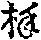



也。五多结使者，谓嗔恚等烦恼也。六盲瞎者，及秃跛躄聋痖等也。有三行骂法者，将此六相分为三品骂故。初面骂者，因对面说。言喻骂者，比类而说也。言比骂者，我非是某人等。二善骂者，标也。亦有三者，谓同恶法分三也。汝是业若乃至坐禅者，律文初引阿兰若、乞食、补纳、坐禅，今云乃至，越中间也。但是善法骂皆吉，餘二骂皆喻比二也。例之可解。问：善法是好骂者，是恶骂，如何结犯？戒疏云：以骂者心欲相屠割，微见小失，便张广大。汝是疎居，如何犹著无学，尚搆瓶衣？故以微缘潜相扇作，情过非重，故结轻也。(已上疏文)



云僧祇至故者，准彼律，毁呰有七：一种姓、二业、三相㒵、四病、五罪、六骂、七结使。前三人各有上中下三品，下四唯下品无中上。今云上恶法者，却将第三下品恶甚者，转为上恶法也。下种姓者，云汝是旃陀罗种等，汝是凑拘尸婆罗堕姓也。下业者，屠猎师等。下相㒵者，瞎眼虫头等。持此下三法毁餘比丘及父母者，父母得提，以亲生色身对比丘毁之，受辱同於己，故结提也。和上阇梨能生法身，由如父母但为种姓，业相於己不同，降之一阶。但约业罪同师道支，种性更疎，故但吉也。餘有中下恶法等者，中为中容，即首陀等是中种性，卖花纷生店肆等是中业，太白太黑太青等是中相㒵。若以此骂父母业，和上阇梨重吉，同友轻吉。下恶者，汝是刹利婆罗门种是上种姓，汝是踪金师业等上业，汝有三十二相等是上相㒵。以此骂父母重吉，和尚等次吉，同友最轻吉。谓中品无提，下品无兰，故云递减一等也。面比骂外等者，注文自解易知。地有金藏好令人鬪者，准祇文，恶姓戒明阐陀，过去曾为长者奴，名曰阿摩由，打他婆罗门从人，诸婆罗门语令莫打，打故不上，乃吉摩由。摩由主得天眼，观见鬪处地下有金藏，令人屈之，果得其金。又彼律云：王殿前有金藏，人在上立，即云：我欲索王女。王恠，遣别处立，即不敢言。后来旧处，仍前之语，遂屈之，亦获金也。诸记中虽相承引此文，然并未知钞意。大德云：前引十诵六诤，本全约内心，不关外境。今引祇律，纵内心能差，则诤不合生。良由外境牵之，使他令诤。谓地有金藏，薄福之者在上不销，致其凶恶，因兹诤也。思之。迦叶举造房僧过等者，准律十三戒中，或有比丘造大房，聚落乞求，人皆生猒。迦叶入村乞食，居士走避。追问因由，长者具答。迦叶以事白佛，佛令汝今夜出界外宿者，其夜复有非人以事白佛，佛令汝今夜出界外宿者，其夜复有非人来白佛：比丘伐树，伤於我子支体。我以信心，不被加割害。愿佛知之。佛明旦集僧，呵造房比丘，直云：昨夜非人来白。不云迦叶以护造房比丘之心，恐恨迦叶举他之过，因兹毁呰。迦叶若举，罪人必不敢毁。圣人尚护人心，凡夫比丘而相毁等。餘类者，玄云：即如龙鸟乞珠翅翼之例。以下况且也。今云不知引解有何意，请思之。



云不至世者，莫嗔诤相言者，十诵云：自恣时，有比丘说他比丘罪云：见、闻、疑诸比丘，知举罪人自身不净，能作婬、盗，乃至坏生饮酒等，不应信此之人言。即语云：长老！莫鬪诤，莫相言，莫遮他自恣等。准钞意者，众僧虽知举罪之人身业不净，亦不得出言语。彼云：汝破戒不净，因何举他过？若发此言，便成毁呰。但云莫鬪诤相言，即不伤道理也。



云两舌戒三者，戒疏云：二边传言，破云两舌，此是所防。(若准唐三藏，翻为离间语戒。今云两舌，颇为质陋也。)



云具至知者，说鄙恶事者，即除粪种、置笼之类等是。



云律至一切吉罗者，彼此鬪乱。令他破者，传此语令分离也。某甲说汝是者，谓是旃陀罗、除粪种、狱子、皮师、卖粉人等也。无有上中下法者，祇中七种骂法，上三则有上中下，只至於犯罪亦有升降。今斯两舌传他之骂，不论上中下法，但作分离向己之心，不问前人离不离，俱一品提，更无兰吉之降也(有人破钞句知之)。更说堕者，传他语来，重重向前人说，重重犯提。



云律不犯已下，如文。



云共女至四者，释名牒钞。



云五缘至堕者，如文。



云律中至犯者，人女有知者，即简非人及畜女；无犯者有知，则简小女；未有所解，命根不断，即简死女也。注文中准论不合者，即多见二论，下文自显。前敞无壁者，准似今明厅屋下亦犯。三、虽覆而不遍者，谓周迊障两头覆，中央不覆也。四、虽覆遍而有开处者，上开天井取明是也。前室多开，此室但有明孔为异也。若亚卧者，邪倚也。但不正身卧，或倚东西壁绳床等，皆名亚卧。故戒疏云：或侧有所凭倚，即名为宿。更有不正解，不叙。



十诵乃至罗汉等者。彼云：佛告般律：汝虽罗汉，不应与女同宿。如熟饮食，人之所贪；女人欲男，亦复如是。此律罗汉，亦那律也。比丘被适非空，女方悔过。无学尚被陵染，何况凡夫？不得强云不畏拒抗，佛之所制也。



云多至吉罗者，前来钞文注云准论不合，正是此文也。注云并部等者，即大原诸洲多作斯屋，上不起栋，平作尽以土覆，中间开请泄水，极长十间、五间，中不隔塞，共同一户，餘如文。



云十诵至不犯者，有明者，虽有多人不可暗坐，若有灯明复不睡不犯，若卧不睡亦犯。注文不但簏床者，诸记中并不消释。大德曰：此谓防人污情故来，恐有以簏幕等围遶於床，谓言不犯，故注简之。诸部男子自伴者，即下引五分有知男子自伴不睡也。云不犯已下，有覆无障都有九句，室相不成事同露地，故开不犯，可寻文即见意也。



云共至五者，释名牒钞。云五至犯者，餘义如别者，古人列缘中，但云未受具人男，简去女子。所以尔者，古云佛制不得与女同宿一夜，尚乃不开，登得有过三夜之失。故伽论云：与女续至三夜，但有同宿罪，无过三夜罪。此文非钞所宗，不更具录，故指如别也。今师云然，以通男女。故戒疏云：昔云男犯非女犯，以制随宿义，无三夜开。今解二俱犯，故伽论云：曾前与男二夜宿，第三夜宿随卧转侧，二波逸提。准此，今师约相续犯故，是以列缘中云男女也。古今各引论文，取释意别。更有餘义非急，如大记中述之。二、三、四缘同前戒者，二室相成，三同宿，四知同宿也。五过三夜犯者，第三夜明相未出前，是过二夜；明相才出三夜，是过犯即也。



云律至吉罗者，注文准此不云吉罗者，此是提家方便吉也。若明相未出不避得方便吉，即知明相出时得过二至三果提之罪。若明未出前避去无吉，明出犯提。纵绕第三明未出避去，至第四宿必定不开，故令自去或使彼去。见论又云：明相未出不避者亦不犯，谓不犯非无也。注文初夜即坐不成开者，搜玄云：谓第四夜初夜即坐者亦不得，故云不成开。谓第三夜已开其坐不犯，开不重开故不成，要须遣去自去等。下引五分长坐不犯，明知前二夜卧至第四夜不成开(已是记文)。准此语，第四夜不卧为初夜也。大德不许此解，既从第四初夜便坐到明脇不著席，未审何时是结犯时节，故不正也。今依法宝云：从第一夜至第四夜便坐至明即不犯，故云初夜即坐不成开。大德又曰：准此不成开，谓不成与未受具人同宿开犯之理，以不卧故也。下引五分长坐及互坐卧本分不犯，证成上义也。又注文皆四夜通夜不卧者，此显一夜通夜不卧，亦不名一宿也。转长罪者，若未忏，虽经多日更共宿，脇脇著提随转侧提，重重得罪，故云转长罪也。无二夜开者，释上义也。谓此比丘与沙弥宿犯未忏悔，虽隔多日由罪未除，无无罪隔，合夜脇著罪则重重，何有更开二夜共未受具人宿耶？别房宿更得二夜者，谓悔其过不得当日同宿，当别房一宿了乃可更得二夜。



多论四句等者，谓此戒但约未受具者为言，不简人之与宿同异。四句虽殊，过三并犯。



云同缘同上者，同上不知及非室相、命、梵等缘，一切不犯。



云与未受具人至六夜者，释名牒钞。



云五缘至犯者。二、字句味者，出教体也。字谓名字，句谓章句，味即是文。新云名句文，旧云字句味。梵云那(上声)摩庚，此云名。名者，想也。想有二义：一、取像名想，即心所中大地法；二、契约名想，谓诸贤圣共相契约立色等名，如云深广无涯名海等。今以契约之想用释於名，旧呼为字。句者，章句。梵云缚迦，此云章。梵语钵陀，义飜为句。俗书中章多句少，内教中章即是句。但约诠义究竟边名句，如言诸行是名，无常是句也。文者，梵云便膳那。言文是能显义，近显名句，远显於义。且近显名句者，唯识论云：名诠自性，句诠差别。文即是字，为二所依，谓名句二法依於文字，文字是依声建立。故对法论引织锦喻，先依文交错织成龙凤，后合为锦窠，然依丝文而起(法合可委)。远显於义者，如西天风俗呼扇盐醋，皆云便膳那，亦是能显义。扇能显风，盐醋能显食中味。是以古来译为味者，飜之谬也。谓若於此名句等同诵，表教体不圆，钞夺前言，故犯也。



云律中至多少者，口受者，谓无经本，口中授与，同声而诵，故犯也。书授者，一释云：执本授也。玄不许此解，虽执本，亦须口言，还成口受。今准下不犯中，一人诵竟，一人书，不犯。今诵未竟便书，恐句义不圆，故是犯也。大德破云：前云口受，但据暗中，不执经本。今云口授，据有经文，所执道理自明，何劳疑惑？今决取初解为胜也。注云决回分不了文者，谓四句但云声闻、天仙等说，不言为佛印可成经者，同诵有罪。今引祇文决也。不简文句多少者，亦是不了。上引十诵，随其章段，故得堕，方为决了。



云多论至仪者，二人俱经利者，相并而诵，名句文全，教体不阙，则非犯相。消息不失威仪者，谓但自消息，莫失僧仪即得也。



云律不犯已下，如文。



云向至七者，释名牒钞文(云云)。



云多论至堕者。谓破塔坏像，但能自损，不能损他，他犹於塔，敬而获论。说他麤罪，自坏坏他，令一切人於此枝说。比丘传持正法，即不信受，以不信受法故，岂不同坏法身？



云七至知者，四、无僧法者，如调达破僧，佛令众僧白二，差舍利弗往告白衣调达非法等。



云五至有者，若已作法人问者，谓已作羯磨法差人说也。问：作法正法应说，何故倒问？答：夫得说者，须是被差之人，有法在身即得。今非被差，不合擅说，故须倒问。故云亦某处闻也。因俗女等者，谓女是犯残比丘知识，因问其故。难陀语云：汝阿阇梨小儿时戏，犹故未除。女云：我阿阇梨尚尔。遂入房掩户而说此偈。(等钞)



云律云至堕者，上二篇者，谓麤故犯提，下篇故不能破坏，故吉。自说己罪轻者，以希少也。说名字者，谓於众中说某比丘犯某罪。种姓者，李比丘等。衣服者，著乾陀色衣比丘犯也。房舍者，从东第一房等。相㒵者，眼白面黑比丘犯也。



云不犯中不知者，玄约不学数人说，今恐是了教之徒，据说时心迷，不知有犯也。麤作非麤罪想者，亦据心迷，虽说前人所犯之事，我心且不麤恶之想，故不犯也。



云实至八者，释名如常(云云)。钞：阙列缘。今依戒，疏具五缘：一、内实得道，除增上慢；二、自言己证；三、向未具人说；四、言了；五、闻解。钞：为希故，略明不也。



云问至也者。制圣遮凡，圣实得道，向俗人说犯提，即是制圣，圣人奉制。然虽无犯，今由有戒者为遮於凡，若后见说便知非圣，以圣人奉戒终无犯故。为护大妄语者，凡夫若言得圣，即犯大妄。今制圣遮凡，圣既不说，说即是凡，故令凡人亦不犯。故可不是今时所要，不可不述。



云与至九者，释名牒(云云)戒本缘起中云姑前与儿妇耳语说法者，大德引尔雅释亲中云夫之母曰姑，在则言君姑，没则曰先姑；夫之父曰舅，在则言君舅也。有人错解，今破明之。



云六缘至犯者，如文。



云：若至堕者，五六语得者解。彼云：有妇女应风发，比丘不为说法，日日风发，因此白佛。佛问比丘：几语得解？比丘言：五六语得解。佛深叹之，因即制也。又僧祇：毗舍佉母病，闻阿难说五六语，便得差也。使汝速尽苦者，既说五阴、六入竟，更语言：汝断诸漏，尽诸苦，得提。以过限也。



云律至罗者，出家不得以事同者，谓出家人过五六犯，其事同犯，不得为证，要须得俗人兼解好恶言义之者。餘如大疏中者，首疏云：如祇说五六语竟，送出门礼别，若言安乐住，无犯。若言使汝速尽苦原，证菩提果，若无净人，门面路路引不断，或在门上人遥见闻等，不犯。反上即犯。中含云等者，搜玄云：凡有人请问者，兼约男女也。思律中者，若是女请，当思律中过五六语，不犯。若不请问，自为说过五六语，即犯。不了吉罗者，五六语未了，便止得吉，是方便罪，了即犯提。(已上正释。)更有解云：钞文从中含云乃至当思此是经文，律中已下是四分律文也。(此是妄释，注自分明。)



云不犯等者，除男、除请，皆是开缘。戒本略明一开，不云除请，但云除有知男子。授五戒者，三归体也。五戒法者，谓说相也。八关斋者，八戒也，閇掩根门也。及说斋法者，亦说相也。八圣道者，语、业、命、见、思、勤、念、定也。十不善者，谓身三、口四、意三也。或女人於适来所说未会，若问更与广说，一切不犯。



云掘地戒十者，释名牒钞(云云)。



云多论至大护者，制意如文。



云五缘至堕者，如文。



云戒缘至哉者，缘即如前。侥幸者，谓掘地招罪，妄营为福，故伤之也。



云律中至吉罗者，若已掘地者，简未掘地也，即天然之地故。今就已掘地中复有二种，若经四月随触便犯，此不论雨也。二被雨渍者，谓乍掘遇雨即与本同。故祇云：井池渎水瓶器著地，死土被雨渍，使净人知，自取犯堕。还如本者，谓四月约时、被雨约缘，地有生相故云如本。若用等者，镢(俱缚反)录(卢对反)手耕具也，掐(口冷反)扴(吉点反)若不教言看是等者，失法得吉。若被随语而掘得提。除为僧塔作摸者，僧伽蓝模样塔亦尔，向泥上作摸开无吉也。



蜀本多论者，准大周经目中，先有八卷失译，释九十尽，至六十八戒后即阙也。首师疑文不尽，常广求访。后值蜀僧字宝云到京，首疏主借问云：不委蜀中多论有几卷？彼云：有九卷。其第九卷，从坏生戒释，直至末文。首律师恳求，令归御后，抄取附来。后经一秊方附到，因兹号为蜀国多论。首律师自制序，具叙因由(云云)。论中约天然生地，辨生非生。四月八月者，谓此两月是雨时，纵使不雨，地下润势相掩，令地面润，并名生地。除此二时，是无雨时，日炙地面乾，𤍜风吹土起，名为非生。餘文可委。云僧祇至取者转石等者，谓有心令地乎故，犯土块。一人不胜者，谓一人担不起，即下任运，与地润相连，生分多故。破者，犯提。若撤者(直列反，发也)、摘(涉草反，手取也)、两三行(户郎反)者，谓就地垒土堑为壁，故雨三行堑也。抒者(徐吕反，说文云：泄水也)，以雨能生地者，祇云：若新雨后，比丘不得自抒井，应使净人。若净人小，先令挠，后自抑之。



云四分至不了者，当宗为护住处俱得也。餘如诸部者，即三千威仪云：若火来水风王贼等，召沙弥等，有打钟方法。前约有人若兰若，无人如五分。注云四分文中不了者，以文中列屈内土，即自解云：此死浮土也。若使除屈内土，即得掘内地。僧祇露处死土，屈中自掘中藏物者得，即是决四分文也。



云律不犯已下，如文。



云坏生至十一者，释名牒钞文(云云)。



云具缘如上者，一、生草木。二、生草相。三、自坏使人。四、不知净语。五、伤。便犯。



云四分至镜者非人是者，谓但异於人类总是非人。一切草木是者，谓斫神树即为戒本所门，詺草木为村。十诵云：蚊蚁诸虫以之为舍。四分神依止故，如世聚落，故云村也。注文恐无知滥行者，破古也。初有古师云：鬼神村者，即今神庙是也。次有古师云：以戒缘斫神树非庙屈，但约极大树是非人所依，即名村也。若小小草木及诸种子之类，坏即不犯。今简斯滥，故引诸部通解不谬也。初引十诵既云诸虫为舍，则何简大小？次僧祇坏种子破鬼村，亦何假大树及与广窟？注文相同。明镜者，引上二律和会释通，相状如镜鉴照分晓，不须妄执也。



云律至吉罗者，首疏云：虽有五义，今合为三：一、根生，二、枝生，三、种子生。就根种中分二：根中不假节生者，作根种之名，即芋、姜、萝卜是；若根中假节生者，作覆罗之称，芦、荜、芹、蓼等，亦名杂种，谓假根、假节生也。就枝种亦分二：初、枝中不假节生，作枝种之名，如柳、榴之类；若枝中假节生者，作节种之目，如耳、兹、藕，皆属覆罗摄子。子种中当体立一，子还生子，故始末差别。离成有五：釜中炒，以钉钉树等，并犯。



云僧祇至吉罗者，谓前辨五种已知，然则净法未委，故次明也。前五生种名有净法。芽因者，在土芽出土曰目。心种者，要也，如根种中要根要节合始成种，故谓此种为心种也。萝勒者，兰香也，以后赵主勒故以避之。十七种谷者，祇云：一稻、二赤稻、三小麦、四穔麦、五小豆、六胡豆、七大豆、八豌豆、九粟、十黍、十一麻子、十二姜勺、十三阇豆、十四波罗陀、十五莠子、十六指耶、十七俱陀婆，是名十七种。火净通五种者，谓五种若火净通得食核。五菓中者，标也，下文自辨。相菓核种者，注文约生热。二枣热者，谓在树上热，今时日成乾枣亦须火净。二肤菓、三壳菓、四糩菓、五角菓，如文。糩者(苦会反也)准此。蒿草者，钞意义准前，糩菓既云有子火净，今蒿草有子亦须令相看火净也。寺主谷仓乃至餘事类知者，引此火净谷事为证，前蒿草等含子，但令相著火净并得也。雨后举木越等者，玄云：前戒引祇举木博瓦等，经雨若自取堕据坏地性边，结令据坏生气分故。越注文者，钞意谓四分开举石木，今祇举木犯越二文。所以相违者，即引注文通之。朝菌者(渠殖反)，注尔雅云木耳也，或云桑䓴(而兖反)，生相不久但得吉也。



云善见至取者，如文。



云律至时者，可解。



云五分至相者。此律一业坏多种，随多少结者。谓如比丘，将一把豆，一时煑，随粒多少，一一结提。十诵文中，通结一罪。若坏五生种，方得五罪也。乃至前戒等者。因便以论，谓前掘地，不作净语，随掘多少，一一结提。若僧祇文，取掘住持，方结一罪。故知坏生掘地，当部甚急，他部并宽，宜须诫世也。柳、榴之类，就地、离地，坏皆堕者。就地，即在树上也。离地，即非在树也。既已离地，不合犯提。但为此树，神亦得活，有生长义，故犯堕也。离地槐、櫰、榆、栢者。准尔雅中，有三种：叶小而青曰槐，叶大而黑曰櫰，夜合尽开曰宫櫰。此等树者，若已离地，其色又萎，坏之不犯，谓无生长义也。若与地连，即是未离，有生相故堕。若虽离地，色未改者，但有坏相，吉也。



云不犯已下，如文。



云身口绮戒十二者，释名如常(云云)。



云四至便犯者。口绮者，异语也。身绮者，触悭也。谓不应理，名之为绮。



云四至吉罗者，汝向离说为论何事者，缘起因阐陀犯罪，诸比丘问：汝自知犯不？彼云：将事。报言：汝向谁说等。餘如口绮法者，亦是未白前依得吉，白竟提也。



云不犯至未文者，文有三意：初、开口绮；二、若欲作下，开身绮；三、恶心下，杂约心事辨非。并如文具委也。



云嫌骂至十三者，释名牒钞(云云)。



云六缘至阇者，如文。



云五分至吉罗者，餘人者，一二三人差曰餘人也。正拜人者，是羯磨所差也。此盖飜译人取意，故言拜。如今时筞某人为宰相，便云拜相也。倩者，是正拜人、自倩、倩人、更倩，展转三人骂，俱犯提也。因说大莫等者，祇云：佛在䟦祇园人间游行，与诸比丘众至一故河边，见捕鱼人提大网沈石浮瓠顺水而上，岸边各二百五十人叫唤牵网向岸。尔时众鱼皆堕网中，有大鱼有百头，百头各异象马牛羊之类。佛见已唤之便应。又问：汝母今在何处？答：在阇(音清)关中为虫。诸比丘问佛，佛言：此大鱼是迦叶佛时三藏比丘好恶口故受难类，头报其母受他供给不消利养，皆是施物作厕中虫。佛说是因缘时，二百五十人皆止网业，出家学道成阿罗汉。故知口业须大填之。



云不犯已下，如文。



云露敷至十四者，释名可知。



云六缘至犯者，如文。



云五分至吉罗者，曝(蒲木反)僧卧具不得禅眠，恐雨来不觉得吉也。手触不举堕者，既曾经手触即共自敷。不别春月者，即四月有雨月也。去时聚已当去者，举小况大也。通表有惭之人不属诸房游行者，亦恐暴雨不觉故与吉也。



云四分至吉罗者，若即时还者，问：列缘中出门即犯，今此听往者何？答：前出门结据未返为言，今据暂行开兹方便也。方便悔者，律云：一足在内一足在外，欲去又应去，还悔者一切吉。二俱堕者，律云：若二人共绳床并坐，下座应收下座。便作此意，准拟上座收上座、不收下座，得提。复有非威仪吉，上座意中谓言下座收而不收上座提，若二人不前不后俱不收二俱提，空床九衣表里损坏易修故但吉，入房思惟文才恐雨不觉亦与吉也。云不犯已下如文。



云覆至十五者，释名牒钞(云云)。



云五缘至犯者，或出界，或过三宿。犯者，或者不定也。若作永去心，出门便犯。若作暂去意，过三宿如犯。付嘱等缘，一同前戒。



云律中至堕者，如文。



云强敷戒十六者，释名牒钞。



云律至堕者，谓随作前事，合他不乐，即结也。



云律中至不犯者，如文。



云牵他至十七者，释名牒钞(云云)。



云四至犯者，一春分者，西国三时分房，若春冬分房，己虽受得分，后见上座来，应避与上座，故知不属己，若牵他出即犯堕。夏房不尔，一分竟后上座来，不应避属己，己定牵去出犯吉也。



云律中至吉罗者，若呵叱(赤质反，稍重呼)惠鼾眠者，作意恼他，吉。今约无心，但为好鼾睡，恐恼他故，令起经行或屏处等。鼾字(胡旦反，卧息声)不憙人来者，或衣垢、或无威仪等。



云律不犯至也者，随次出者，谓僧房内人，多人知，一夜出宿。前是俗处者，前戒约俗家，非僧住处，不简染净；此戒是僧房，恶人无分，駈出不犯。



云坐脱脚十八者，释名牒钞(云云)。



云三至犯者，若依戒疏四缘，二是薄覆，钞阙此也。三、在上坐卧犯者，谓若未制戒前，即约床脚脱方制；今据制了，但使是脱脚绳床坐便犯也。



云用至十九者，释名牒钞(云云)。



云四分至犯者，如文。



云律云至漉者一一提者，戒疏云：此不就损命中制，但深防与制。若彼命断，自依畜生，正得一堕也。十分之一者，大德引俗书云：陆地虫极细，不过𤌞蟟虫，向蚊子眼睫中为窠。水中极细，莫越[酉*(蓋-去+太)]鸡虫。若非天眼，莫之能见也。百千万由延者，亦引伪书辨：陆地大鱼过骐麟，水中大不越鲸鱼。俗说曰：骐麟鬪与月蚀，鲸鱼死与彗星现。又经中目连令弟子观往业，曾作大鱼，骨似七金山高等。日日谛观者，诸记中皆引远大师流水偈云：



谛观清水，犹疑有虫，是须净漉，扬兹道风。自行桂锡，化物随愿，为用虽少，在益难穷。如人阙此，忍渴而终。肉眼所见者，多论云：时舍利弗以净天眼观空有虫，如水边砂，如器中尘，无边无量。见已，断食三日，佛勅令食。凡制有虫水者，齐肉眼所见，漉囊所得，不制天眼见。凡用水法，应取上好细氎，纵广一肘，作漉囊。令一比丘持戒多闻，深信罪福，安详审悉。肉眼清净者，令其知水，如法流水，置一器中，足一日用。明日更看，若有虫者，应更好漉，以净器盛水，向日谛观。若故有虫，应二重作；若故有虫，不应住此。若无漉囊，不得半由旬；若更无者，用衣角漉，以显所为大故。(大德曰：上言三重漉者，约三度漉。有云三重绢作漉囊，即得厚致者，非也。)



云律至不犯者，无虫想者，据迷，一切无犯；若转想，结前心吉，犹有犯故。



云覆屋至二十者，释名牒钞(云云)。



云曰至犯者。多论云：此是三十中大房，用三万钱作成即崩。施主生悭，比丘为说房之功德。此房未倒之之时，佛曾到此，便是无上福田等。复有一新受戒比丘，於此房经一宿持戒，暂时受用，功德如须弥山。房今虽崩，功德已成就了。第三节未竟，不去见闻处者。所言三节，即三重覆，但约一重为节。故多论中作房三品：上、中、下也。此三品房，各有覆之齐限。若中房用上法，覆以重故，胜戴不起，随用草等，一一皆提。下房例尔。今云三节未竟，不去见闻处，是犯。若互离得吉，俱离无过，准律文也。



四、至节竟犯者，谓二节未犯，至第三竟时结堕。如与未受具同宿不别，至第三宿明相才现即犯。有人云：过三节至四方犯。以戒本云：过者波逸提。今既未过，正齐三节，未合结犯。此未达文意，幸请思之。云輙教尼至二十一者，释名牒钞以对。此待消戒本竟，略料简结下四众罪相状，此稍难知，不类诸戒。所以尔者，若僧不差，輙住教诫，结提即不疑。且如下众，何得有輙教诫之理，便结他吉？今故明之。尼据僧不差，輙往僧寺求教诫，尼下二众不白大尼，輙往僧寺礼拜求请说法等。僧沙弥理合礼大尼，今不白僧，輙往尼寺礼拜问许等。已上并结吉，故云下四众吉罗也。表又云：引戒理合在教诫日暮戒后。诸记中并不见评论，亲曾捡多论文来，方𡂖是译律之家讹滥，失於次第。櫢彼论云：初时比丘尼尽往僧寺中求教诫，后为人识，乃轮差五人来僧寺中，亦不免讥嫌，遂差盘特比丘往教授。但为盘特根钝，诸尼总知，至於迎逆，并不殷重。引比丘虽根钝，已於如来言下证果竟，观是诸女有轻心，遂现神通，诸尼并皆悔过(此第一缘)。其次差至六辟，六辟至彼，遂说世俗法，并戏调之言，不合根机(是第二缘)。时爱道尼白佛，佛令白差一比丘，须具十德者，遂差难陀说法。教授竟，嘿然与住。尼又重请，说至日暮，尼𭗵祇洹而归，城门已闭，诸尼总在城濠中宿。明日守门人见，遂述上缘，因为讥责(是第三缘)。后六辟见白二差难陀，既不差他，乃輙往彼教诫。以此量之，故知引戒定合在后。学者要知，莫塧繁广之，恐思之。



云四缘至便犯者，如文云律至磨者，僧不差说法。八敬俱堕者，律云：若僧不差，或非教授日，而往与说八不可越法，吉罗。若僧不差，而往与说法者，提。(已上律文)



古师云：若僧不差，说八敬吉；若不差，说法得提。所以然者，八敬生定慧义狭，故轻吉也；说法宽故，邪、正难辨，恐坏尼心行，故结重提。若日非说，二同犯吉。故戒疏云：昔人解云：日非八敬，同犯吉罗；不差说法，俱犯提罪。即二提、二吉。今解不然。说法、八敬，无别轻、重。故戒本云：教授者提，广说法者提。故知义一，文云俱堕。据不差以言，所结罪约，曰非说也。曰非吉罗者，四分无文，引僧祇释。前三吉者，注文自辨，是经说戒十五日后，即十六、十七、十八是也。后二者，注亦自辨，二十九、三十日引，约黑月说。大德云：谓西天黑月，有初顺钞文，须先明黑月。前三即初一、二、三，后二即十四、十五。除却前三、后二，无间黑、白，中间十日恒往，餘日为非也。又祇中，前三白月中，初一、二、三，黑月十六、七、八，此名时未至；后二白月十四、五，黑月二十九、三十日，祇中名为过时。彼广列八法，繁而不述。如删补羯磨者，彼云：具十德者，颂云：持闻颂决说姓贝堪家满。持谓坚持戒只，闻谓多闻，诵谓二部戒律，决谓决断无疑，说谓能善说法，姓谓高门大姓，㒵谓端严殊异，堪谓任说法，家谓出家。不犯重戒者，谓满二十夏已上。然於十四，堪之与善，不无相滥。疏云：虽能善说，未必称机故也。



云与尼至二十二者，释名牒举钞文，销戒本后，结下四众吉，类前可解，思之。



云六至犯者，教诫说法者，义一也。



云律中至吉罗者，除教授者，谓除此犯提外，受经已下但吉；除尼者，俗女但吉也。



云不犯，乃至未文者，餘人者，除妇女犯外，更有俗男，曰餘不犯也。



云讥教至二十三者，释名牒钞(云云)。销戒本竟。结下四众罪者，大德云：尼讥大僧吉，尼二众讥当众吉，沙弥讥大僧吉。



云六缘至闻知吉易解。



云不犯等者，其事实尔者，实是为食故不犯。若问者，以心疑故乃问脱人：汝莫是为餘食不？无嫉不？虽如此问不犯也。



云与非至二十四者，释名牒钞文。



云四分至犯吉，如文。



云律中至不犯者，除贸易者，谓律许五众贸易，不通俗也。



云与至二十五者，释名可知。



云律至罗者，安缘索线皆得吉。



云不犯已下，可知。



云独至二十六者，释名牒举。钞：



云四缘至犯者：一、是比丘尼者，据光律明犯缘也。若据五分多论，尼三众同犯，讥染不殊，俗女不犯。二、𦗚第三人者，引戒第三人须是白衣。三、屏露二处者，若本缘起中在露地坐，戒本释相俱明屏露。古戒本云：屏露处坐者，波逸提。



云十诵至吉罗者，我欲起者，比丘共尼坐，恐犯独坐，前尼益食，去时应吉坐。尼言：佛不听我与尼同坐，我今欲起者，先作如是方便。若不先告，直尔便起坐。尼心疑，将谓比丘起作非法，故云莫令彼疑作非法也。更有别解不正。



云不犯至者，如文。



云与尼至二十七者，释名牒钞(云云)。



云五缘至犯者，无缘者，无命难恐畏之缘。五度界者，从一村至一村随结提，故祇云若经一聚落一提，若无聚落即一𤘽虑舍犯也。



云律不犯至迳者，大伴行者，戒疏中约多比丘，一尼亦犯，要待多伴方开，据理合是多尼为大伴。或有约俗伴，男女共行名大伴，亦得。疑恐怖者，行途多难，故开疑怖。



云与女同船至二十八者，释名可知。



云四至犯者，三、同乘上下者，今师戒疏将此分为两缘：一、同乘一船，不犯；二、依顺流上下，意除直渡也。入船犯者，律云：双足捉一足在岸，吉。



云：律中至不犯者，失济者，风惊浪急，吹船上下，不犯。



云食尼至二十九者，释名可知。



云四至堕者，如文。



云律中至不犯者，律明叹境，先举十二头陀，从乞食至持三衣，中间越却十头陀，故云乃至食者。从是至中，戒疏云故知大小二食皆犯。餘衬衣等者，所以衣轻者，财重难舍，又希施故。除旧檀越者，即显非因难德与食，可常乞(去呼)食者言轻，故不犯。



云律中至不犯者，如文。



云与尼至三十者，释名牒钞(云云)。



云具至吉罗者，同前与尼期行五缘。犯几者(音其近也)？村内一界者，未越分齐故吉，若越即提，乃至越多村界多提，空逈处十里一提。



云不犯至者者，可知。



------



## 四分律钞简正记卷第十一



**译者**：吴越国天长寺长讲律临坛崇福普济戒光大德赐紫(志贞)写此一部，丁巳岁记



吴越国长讲律临坛赐紫清凉大师景霄纂



背请戒缘中辨施粥，诸记多说不著。今依大德引僧祇律，都有四人：一、佛初成道时，难陀、䟦罗二女施香蜜乳粥；二、在阿那频国，沙㝹长者施稠粥；三、毗舍佉母；四、难陀母。四缘中，上二未有呪愿文，第三、毗舍佉母施粥时，佛便说偈也。偈云：持戒清净人所奉，此明所施田诤，堪消物供也。恭敬随时以粥施，此明能施心净。十利饶益於行者，此总标数也。色(一)、力(二)、寿(三)、乐(四)、词清辨(五)、宿食(六)、风除(七)、饥(八)、渴消(九)。更有大小便通适，略而不说，成十也。上依法宝科，此十利，若搜玄将色力合为一，却将词清辨分为二，便云一者词清，二者辨说，无理甚矣，未可依承。或有云：色力开为二，依法宝；词清辨分为二，依搜玄。若尔，并大小便，即有十一利也。违戒疏文，思之。是名为药佛所说，结前行施能益於他。若生人天长受乐，明来报也。应者已下，结劝施僧。



云施至三十一者，释名牒举钞文(云云)。



云五缘至也者，无因缘者，引律解也，无病及请缘也。然病人苦恼，去则增剧，住则有益，施主体之不生讥，故开之。律中不问正食不正食，俱结也。



云不犯等者，若请居士、请大住，我当与食。我等为沙门释子故，设此宿处食。若不得沙门释子，亦当与餘人也。此即诸檀越共请住也。若次第请者，即是各各请也。律云：若儿女姉妹及妇，次第请食无犯。此谓一家多人为次第请，一家尚开，多家理得。



云展转至三十二者，释名牒钞(云云)。



云十诵至者，四分名展转食，展前家转至后家；十诵名数数食，僧祇云处处食也。总一判为背请戒者，谓皆前向后故。大德又释：今云背请，准戒疏意，有二义故：一则道俗通知，二则摄义得尽。答云：展转、处处，随名则局也。



云五缘至犯者，无因缘者，谓病、施衣、功德、月等。五、随咽犯者，不待饱也。戒疏：背请有四句：初、前后俱正，提；二、前正后不正，吉；三、前不正后正，不犯；四、前后俱不正，不犯。



云律中至大同四分者，戒疏云：既列二请俱有背罪，若受请已，自食或食僧食，彼生恼微，不犯背罪。先许后违，但犯吉也。注稠粥亦是者，下文自释也。僧祇等者，彼云：有二比丘各各别受一家长请，第一比丘语第二比丘言：长老！今日共到我檀越家食。云其第二比丘应白自檀越，若不白輙往，得二罪：一、不白请家，二、犯背请。大同四分者，彼不白请家得提，四分不白同请人得提，故云大同也。其词曰：大德一心念！我某甲先受某甲请，今有某缘事，欲入某聚落，至某家白大德知。云又至家者，戒疏云：所以开病者，病人苦恼，施主体之苦也。不形命难济，既非情愿，不作时限。施衣时者，有二利故：一、为济比丘，待形施时不取，后须难得，恐非理乞，损业烦他；二、谓益施主，衣食两利，俱得反报。又多论云：前家食请后家衣食，听背无罪。二、前家食请后家衣请，取衣向前家不犯。向前家竟曰不食，违信结吉。三、前后俱食，背前犯提。又有三句：前后不食请，听背不犯。二、前家食衣，后家单衣，如前第二句说。三、前家衣食，后家单食，皆前犯提。若一日受众多请等者，此律要须实舍与人，不令施主有虗设费。若准祇五二律，即开心念，假设方便，开防背罪。五百问等者，若主人慊代，此约别请。若僧不请，即代得也。不得随病食者，随其所病宜吃，不得何食。或食冷，或食热，或食兼恶，非病所宜，听背前向后所便处食也。不得至第四家者，多十二文开病者背，不至第四家。此律但言开病者不堪一坐食，乃至既非情欲，不作时限，并不论数多少。今引他宗，不至第四，恐乖节俭之行，兼涉无穷之过。



云：律不犯等者，不正食华菓细磨等，食少不足，是殿乾饭少而不饱。无请者，既无请处，食今犯何？或食已更得食者，古解云：受前家食已，更受后家食，或容犯足，不犯别众。(此非解也。)玄云：或一处有前后食，既同一主异食，亦无背罪，必不坏威仪亦不犯足。案斯一释[辛/干]犹可，下言不坏威仪亦不犯足者，此时未制足食戒，何畏犯足？(思之。)



云别众食戒三十三者，释名者，戒疏云：但以能别之人食处成众，以众别他不与同味，故众处得罪。若尔，所别之处岂无众耶？答：所别之中一人亦犯。若犯约所别名众者，则𧮤他能别，非众亦犯。今律据能别之人，故云别众。若据理合，云众别食。今从本意故云云。此是所防。



云然至不集者，先引律中别请，次引初缘。谓今师先於律文中搜求有几种犯境，七处所明，皆约别请，乃兼缘起。别乞只有二种，又乃文繁难以寻，是以钞主先永求初缘，贵在易知，后方引也。谓律初缘，因调达害佛，后教阇王煞父，恶名流布，利养断绝，遂则通己五人家乞食，故制戒。制戒之后，诸比丘病，乃至沙门施食，七种别请，皆语请者云：但请三人，我等不得别众。明知此律只有二也。所以不论不集者，既言但请三人，明知戒内更有多人，但不满四食处，不成众，即不犯，都不论集与不集也。难调人，即调达是。多论明界内不集等者，约其多论，若界有人不集，即成别众，亦名别请、别乞。四分之中，体是别众，不论集与不集。多论於此二中有其集犯，谓僧并坐，亦名不集犯。若作遮心，界内无人亦犯。故钞云：亦有别请、别乞不集僧。次即约有容来遮，即成不集；别众无人，不遮不犯。故云亦有不集者。



云今至别者，开两章也。今分三相者，约其当宗他陪分为三相：一僧次，二别乞，三别请也。各明犯缘者，上三各有别众，故云各明。引证据别者，引其多见二论证据，三前各有集不集别相也。



云初至犯者，谓上来三相各有犯缘，今但列僧次七缘，别请别乞亦有七缘，例取此七所解，但改别请别乞之名为异也。



云多至次者，二处设食者，谓於僧界内别向二处院中设食。此二处须向布萨处请一人，表请同；或送一分食，表味同。其布萨处不用请送餘二院，以常住处本无别众也。自处不须展转者，二院之中彼此相望，不用互送、互及请。若聚落界者，谓自然界中亦有僧次、别众，谓二施主同一自然界中各设食，即打槌，以表不隔，作法同故。若不尔，互请一人；又不尔者，互送一分，表味同故。不作此三，即是别众。又於此三不必具足，随一便得。故首疏云：於三事中但作一事即得。更有异比丘入等者，谓入作法、自然二界也。更须如前作三相中一相也。或先僧次等者，谓无是僧次请来，而上二界外更有清净比丘入来，未曾食，遮不许集，即此僧次变作别请，别请体是别众。若不遮等者，先虽别请，由无遮约，变成僧次，以僧次体非别众。今既不遮，无别众过，即成僧次也。如上等者，谓如上二界互送、互请，辨其作相。如是立法，明其僧次无界内不集之别众也。



云别乞至故者四句，如下引证中广说也。同一主故同时受食犯者，先出论意，谓或四人同时乞，或各各别乞各不相知，虽先后而至前家为受食，同一主故犯。多论无犯者，约散乞一处聚食不犯，律据一家并乞共食便犯。云若别请至犯者应令作法者，恐此唱令名为作法，如下自述。若准此言等者，谓准界内无人亦犯之言也。未假界内不集者，谓若作遮意，未假界内不集方犯，设使尽集亦犯。次第并坐者，证前别请虽则同集还成别众，如有施主别请四人共在堂中食，施主但供四人不与僧同味，亦犯别也。若欲无过，且吃僧家食一口，后食施主食，但成益食不成别众也。下广证中更明。云准此至俱结者，准僧中并坐成犯之言。僧次一种唯局不集者，谓僧次请来，要须界内有人不集始犯别众，必无人不犯。别乞别请体是别众，众不问界内有人无人、若集不集，但食处成众皆犯也。



云今至常有者，约缘者，约七种缘也；随相者，随三种相也。通而辨之，故曰总明。大德又解：据理，僧次别乞、别请，每一相中皆具此七，三七合二十一缘。今钞虑繁，但向此总，科不更列，故曰总、别。问：约缘、随相，如此总明，意为何事？钞：释云：令人已下，具也。



云初至上卷者，可知。



云二至种，前标中云总明，今此即是总意也。



云先明至中者，能别僧体也。此体未论四人，但据自行以说也。即是僧次者，体净之僧有别，此僧即应(去呼)僧次，显恶戒非别不应僧次。以罗汉法请人者，是罗汉知我明日设会即降，不更一一标名也。



云多论至得罪者，长请日限，即二请也。随意请人，明是别请。大善无过者，既不别请，一切无遮，凡圣普心，何善大也？不能无遮者，谓施为限，不能不遮。门师、比丘劝化施主，令唱作法。劝六十臈，表是上座；一夏及沙弥，表极下座。从上至下，但得一人。此别请及遮变成僧，次无遮尽，施主请期，并无过也。不作二法者，玄云：初日无遮是一法，唱六十夏入是二法。不清净罪者，谓提罪也。设有续供，即前唱法。不须更唱者，大德云：此据从初日相续不断，以说唱法，即许不失。若中间暂停十日、半月，即须已后更唱，前法已坏也。僧房卧具者，谓僧物有限，不许更过，理须唱召来者共用也。此谓施主於僧寺中别请别院而供养者，故有此文。若在俗家，则无此事。知之。



云：若施主至之者，谓一大界一施设食堂，小坐不足，出外坐者无犯。处虽有异，以食味同故。二处僧祇者，玄云：是法同食别，界虽二处食别，仍同一说戒。以布萨处是众同之本无过，不布萨处别，彼布萨处即有过生，须请僧次一人，不然即送一分食。若不尔者，此僧犯别众罪。若施主别请僧次四人等者，前来且约一界二处僧祇以论。今或有施主外请僧次四人入僧布萨处(此谓人从外来，食在当界也)，或将食入界别请比丘者(此谓食从外来，僧在当界也)，约此二处正食之时，界内有僧不集，俱犯别众人。适来文中云别请僧次比丘者，是别请僧次四人，非谓标名请一人也，故文云别请僧次四人之例。若尔，既是四人成众，何故文中言别请比丘耶？答：经论文中多约比丘以为众也。或可为简尼等四众，故标比丘。若是一人，即何须作法？人多迷此(思之)。应布萨处请僧次一人等者，此谓设法离过也。若道界远者，此约一作法界三由旬，即道路遥远故。先取次第行者，以表先食僧食一口，后行此之食，义同添益故耳。云若至不者聚落界内者，谓可分别、不可分别，集僧分齐说也。无僧界者，无作法界，一向是自然。於二处食者，二檀越舍并六十三步内也。应打犍搥已下，设法也，可知。应好隐悉知聚落有无者，应须作是隐悉。若聚落自然界四相周迊，即等聚落。若自然四相不周，纵广六十三步。已上二处，或有比丘在内是别、在外非别，不集无失。或有人妄解，即成惑乱，知之。



云或至等者，僧次若遮变成别请，别请不阻变为僧次，乃至唱一人等，则上作法请僧次一人也。斯约两请互明转变也。



云善见至犯者别乞四句者，总标也。或四人一时乞者，谓四比丘一时行乞，共见一檀越语云：与我四人饭。檀越即许。或别别乞各不相知者，谓四比丘前后行，俱就一檀越别乞，与我一人饭。如是四人各不知是一檀越，而同一主一时往受食犯者，通释上二句也。或四人一时乞，檀越既许，四人一时往受食。或别别乞，虽乞时各不相知然。然檀越既许，前后至来虽异，而受食时亦同也(辨初句竟)。二、各去一时受各处食者，谓四比丘共乞，檀越许，许四人遂各各去檀越家，己一时受食，还归各食。四分不犯堕者，谓四分约食处成众即犯，今既各食非众，故不犯也。论但据同时受食即犯，不论食时成众不成众也。三、各去各食不犯者，谓四人共乞，如四人各去檀越家，各受各食，律论并不犯。食处不成众，故约律不犯。又不一时受，准无过。四、别乞别去一时受犯者，谓四人前后行，俱就一檀越别乞，与我一人饭，檀各许各许。前许者，前去至檀越家；后许者，后去至檀家。虽前后至时有殊，而一时受食故犯。已上四句，准论中三句犯，准第三句不犯。若依律文，初后二句犯，中间二句不犯。外难：初句中，别别乞，一时往受食犯；第四句，亦是别别乞，一时受食犯。若为取异，初句便在施主家而食，第四句将还别处，四人同食也。此段钞文，甚难晓之。上所解判，并依法宝。若依玄，将别请、别乞，通为四句，颇至周遮。况此文势，但引别乞，未论请。既不遵用，不更叙录，且据正义。如前云：义云至别众者，谓本是僧次请来体别众，由遮门外比丘不许他入，此僧次乃变成别请，此别请体是别众也。后食时，不论门外有人无人，俱犯也。宝云：若定名者，此由名僧次别众。若门外僧已下，今师准此，僧次已变成别请之义。若门外僧，虽在六十三步外，但食时有遮心。若定名者，此乃呼为别请别众也。多论但云：僧次界内不集成别众，不论界外六十三步外有僧。是以钞主约义明之，成其别请别众也。或有解云：此言外者，望家内僧得外名，非谓六十三步外。若在自然外，有何犯耶？(此释全不见竟。)



云四食处成众者，牒举犯缘也。云善见至比丘者，餘三竟者，待三人食竟，后一人食，即表不成众。多论四句钞引三句：更有三比丘在地，一在空也。殡已下，释成不别之义。云多论至也。或共一处食不犯者，各持己食，共处而飡。若四人各自乞共处食，亦无犯。若尔，律文何结犯耶？钞引律云：据一家并乞，四人一时受食，犯。必如论中，即无失也。云人有至堕者，食一处、二味同，无犯。界内有人遮不与食，二处俱犯。此谓露地者，解上文也。在露地者，须申手内；若在外者，即是食别。同第四句，故须简之，局成第三句。要令处一，取此四人并时露地，须申手内也。覆处不假相接，自然成其一处也。



云五界内不集者，牒举犯缘也。



云五分至故者，五众往者，莫非皆是为解脱出家故。僧结界者，作法僧界也。聚落界者，自然可分不可分也。家界者，亦约人家六十三步说也。旷野者，五里也。一拘卢舍者，道行六百步也。注文上沙弥等非别众者，准论狂殡沙弥，三人非别。古来有破钞者云：不与沙弥及殡人食是盗。僧祇不与殡，元非犯也。以财法俱已，故云除恶戒等。玄云：钞总相而言，此文偏据沙弥请来，免四比丘已上别众。上之狂殡，且约添成非别耳。云四分至得食者，别请别乞，论并同，故云如律。但加不集僧次请来，同界不集，如前列也。故注云如上所列。



善见五种足、四不犯者，注文此请狂痴者，简滥故。下开缘中，脚、跟、躃、病体具足，自身虽开，餘三是犯。今则不尔也。问曰：前文列缘，具七戒犯。今此随释之中，何故但解五缘，阙五正食、狂时中，及第七咽咽犯缘耶？大德云：咽咽犯者，皆缘所食之物，是五正食则犯。若非五正，亦亦无咽咽犯故。所以将此两缘，通在前五之中。解竟，寻文自晓，不可更重列释。(思之，不因记家云钞文省略也。)



云律中不犯开七缘者，如戒中是也。



云一至是者，施衣时者，通十二月中，随有衣施处，总得道行为四，船行为五。次途中多难，正行则开，暂停亦制。何以得知？故十诵云：昨日来，今日食，提。即日行，别食不犯。船行亦尔。(人多迷此意，知之。)



云六大众至也者，戒疏准留陪尼律中不白大众知。广释文中云大众者，谓四人若过也。食足四人长一人为患等者，此缘两家聚落，东限与四人食、西家限与一人食，彼此二家施心限局各不能通融。既是俭时，诸处乞食复是难得。若不开者，西家一人与东家四人作患，由是患故开令不患(患字训犯)。如是乃至百千人长一人为患者，但使食是难得，悉开不犯。是名大众集时，注文可委。已上且衣戒疏申於此解，更有释者虑繁，广在大记。京者，天子所都之处，训大也。辇者，帝王所乘之宝车，谓不能举其上尊之，但指所乘之物。如云陛下，亦指所坐陛之下等，今此亦是也。鄙俗者，鄙恶聋俗汉子之人，秦坊酒肆之中飡噉，由自命客均分饭食。𣫍迹者，劝莫行此事也。广如讣请中者，指下卷就座命客法，白施主令入，乃至指示某僧坊中有僧食等(云云)。



七、沙门施食等者，谓西土九十六种外道皆名沙门。今此即准律文，是萍沙王姉往尼犍处出家学道，欲诣伽蓝设食，比丘不敢，遂乃白佛，佛开沙门施食听受也(此且开受缘)。又准五分，萍沙王第二是外道沙门，请众食而力不能广，乃众人忧愁白佛，佛开听沙门施食时别众食。



云：又准至等者，僧次不犯者，体非是别，又乃不遮故。五分衣时者，彼文云：通十二月，作下二衣。非谓五月、一月也。都合九缘者，四分七，并外宗二也。此乃皆是开缘。增一等者，佛在罗阅祇城，有师子长者至舍利弗所，礼拜白言：愿受我请。又至目连、迦叶、罗云等处，请五百上首，大设供养。佛后问罗云：今日几人？谁为上座？答云：我和尚舍利弗为上首，及诸神德五百人。佛问罗云：彼长者获福多不？罗云答曰：得福无限。若人设一罗汉，尚得福不可量，岂况五百？佛言：不如僧次请一沙门比丘，十万亿俗不可为喻。餘文如钞(云云)。贤愚经等者，彼云：时姨母手自纺续，作一端金色氎，待佛还宫，以用持上。佛言：可以施僧，得福无量。遂次第僧中行之，无敢受者。到弥勒前，便乃受之。著已，入城乞食，众人皆看金色袈裟，无有猒足。



云律至吉罗者，自益者，谓自己有利益也。注中益他或别者，此中益字训传也。钞文有缘白入，无缘白入出。所以出入须白者，入谓护家内比丘，出谓护檀越，莫不俱为於人心，况生疑恠也。若不白违制边，犯吉。更有别解，不正云不犯，如上开者，九缘皆开也，可知。



云取归妇至三十四者，释名牒举(云云)。犯者，上二缘者：一、归妇，二、估客也。无缘者，病时开也。今无病缘。过三钵者，多论有三品钵：上钵取一不犯，二则犯；中钵取二不犯，三即犯；下钵取三不犯，四即犯。今云过三钵者，是下钵也。若一人取过三钵，犯。若四人取过三钵，前三人不犯，以不过限故；后一人犯，以过故



云足食戒三十五者，释名等(云云)。



云五缘至犯者，如文。



云律至咽咽堕者，此五本非具缘，自是律文。广释之中，波离问佛：有几处应足食？佛答云：有五处，约知成足，更食，即犯。钞：与戒，疏并呼为缘，知持来缘，乃至第五、知舍威仪缘等。



云僧祇至不成遮者。四、不复受益者，钵中之食既可饱足，更不拟再受益也。注中少一口已者，据食欲了只欠一口，故云已也。便言不作断心者，戒疏云：有人解云：境饱足者，谓我饱食足、我食未饱，虽起重坐得食无过。此非正量者，准理门论，量有三种：现量、比量、圣言量，各有似正。今既乖文，则非圣教正言之量。食无饱期者，若任凡心待饱，何时饱足也？断此四句分别：一、食足境不足，谓不正，虽饱未犯；二、境足食不足，是正食少；三、食境俱足，是正食多，食一口亦犯；四、俱不足，不正食又少。开饮𪎊浆者，谓𪎊浆以非纯正，开饮满足。糒者(音备，说文云：乾飰也)。



辅篇云：取乾饭炒之，然后磨以筛之为末，十满中爱作糒也。餘同四分者，谓飰𪎊鱼肉也。𪎊者，大德云：将麦蒸蒸了铠之，以水𣷽𣷽了却炒，似麦飰也。有人不会即妄说云：将麦炒了舂磨为，名之为𪎊错也。𢇲者(靡皮反)，谓关西荆州呼为𢇲，若北人冀州等唤作穄，此间亦名为穄。又於粟米许𪍿麦者，大麦也。莠子者，稗子。错麦迦师者，错麦是此土之言，即小麦迦师是西梵之语，盖双举也。一根者，一切草根也。五菓者，第五是菓子也。僧祇五正同此者，谓五正名体大同四分，祇无乾饭也。五杂正者，祇中唤不正为杂正，即如四分枝叶等即非正食，处处食之无犯足。又无别众说正名不正名者，若云米粥是正即遮，但云叶粥不正即不遮也。



云义至遮者，约境立名。不论饱足时有等者，谓有秊少见上座来不起犯罪，故须陈意也。尼不恭敬僧戒中者，谓尼行八敬，见新受戒人亦须起来，今为一坐食，虽见不起便陈情言：我不作餘食法。白已即不违敬法也。僧祇八遮者：一、自恣足，檀越自恣与五正食及杂正等自恣，劝食比丘言：我已饱足。如是起离坐，不作残食法提。二、少欲足，檀越与正食，比丘动手现少欲相，如是离坐，不作残食法提。三、秽污足，行食时净人手有疮疥，与及身衣不净，比丘恶之言：不用过去。如是离坐，己不作法同前。四、杂足者，净人持乳酪器成饭，𪎊行比丘见恶之，语云：不用。五、不便足，净人行食，比丘问云：是何食耶？答𪎊，比丘云：发风，我不便过去。六、谄曲足，净人行五正食杂正等，比丘摇头宿钵作不食相。七、停住足，净行人五正食，比丘言：莫先行饭，且行饼菓之类。八、自己足，比丘先有𪎊寄在檀越家，从檀越素水拟和𪎊，白衣问云：须𪎊不？比丘意谓：越与我水𪎊。白衣却将比丘𪎊囊授与，比丘见是自己者心中爱惜，乃言：置地，以我不须。如是舍威仪，己不作残食犯提。举急况缓意者，四分约受得已，入手食一口已，号名境足。祇文并未入手及食，但口中说等，便遮於后故也。



云四分至加法者，僧俗二食俱得。加法者，律云：时有比丘早起受得僧食也，置入村。彼受请还，餘比丘边作餘食。彼或分食，或都食尽(此僧食缘也)。时有比丘往檀越家乞得食，不知得作法不？佛言：得。今钞准此，故云俱得也。云若作至律文者，覆藏食者麤，覆与者上，恐对首人食之。



云五分至不成者，尼具有残食法者破。古云：尼是女类，食不消化，故无食足犯。今云不然，尼律开通，文自明也。又五分广辨僧残食法竟，则云比丘亦如是也。此依戒疏释。



云义云至戒者，约期作法，为食一口，准如他部。若都不食，云是我残得者，准此义，今食未竟，不须作法，真云我残与汝得成。此据前人欲得食，若知前不欲，强劝犯得戒也。



云律至犯者不受，作餘食法者，此约一向不受，谓从旦米未曾受食，餘如文。



云劝至三十六者，释名(云云)。



云五缘至犯者，消文竟。依戒疏云：此与前足食戒何异，而分为两？答：前戒自己犯，此戒自他同犯。又有四义，故开为二：一、前戒是身犯，此戒是口犯；二、前戒病缘乃开，此戒无开；三、前戒是贪心犯，此戒通三心；四、前戒是自食犯，此戒他咽食，以空犯故。



云非时至三十七者，释名所知。



云智论至故者，彼第一因解如是我闻一时义，破荡时相不可得故，因即问云若法无时等，此约真谛发问也。意道真如理性本无时节，云何约时而制遮非时食为戒耶？(问竟)答中我已说世界至不应难者，论意我先来已说俗谛世界假有时名字，法虽有而非实，汝今不应将真谛来难我俗谛也。亦是毗尼中等者，谓毗尼结戒约世法故，为众生许时为实时，即不可非时讥责，如迦留陀夷即是其事，如以来遮非时而结戒以护人心也。亦欲护佛法等者，谓佛结戒令正法久住，见论亦云毗尼藏但佛法方住等。定佛弟子礼法者，谓外书制礼是俗中礼法，今佛制时食轨仪是佛弟子礼仪法则也。(上依玄释也)宝云要定受戒时分夏臈三时入师房求教诫等。(此解局也)故世尊等者，谓佛结戒防讥，不应求世间名字与真如理性辨相应不相应也。若尔等者，领解前旨也。实时不说者，释也。谓理本时，毗尼教中不得混乱，若白衣外道闻说真谛无时，即生邪见也。又真如理性小圣尚不能，世界时分多人共解，故曰以通多分。故云今至故是毗罗三昧经萍沙王问佛何故日中食，佛言早起诸天食等，今制日中断六趣因故，又表是中道七佛所行也。并如文可委。



云多论至及之者，又云等者，谓前据麤相而论，今更细辨。且西天有三时，亦约十二月分之。从十二月十六至四月十五为春，从四月十六至八月十五为夏，从八月十六至十二月十五为冬。今此土四时亦约十二月辨，但加秋也。於此四时，日月昼夜长短不定。夏至日，日极长，夜极短；冬至日，日极短，夜长；春分、秋分二日，昼夜平等。降兹已外，延促不定。今若辨时、非时，钞云昼夜各分九时，而同须臾者，意将多论昼夜各有九时，同於僧祇、俱舍三十须臾也。今先明须臾者，故俱舍云：百二十刹那为一怛刹那，十怛刹那为一臈缚，三十臈缚为一须臾，三十须臾为一昼夜。今春分、秋分二日，昼夜平等，各有十五须臾。从旦至中，七须臾半是时；过中已后，七须臾半并夜十五须臾，都二十一须臾半，俱号非时。今多论有九时，从旦至中，四时半名时；过中已去，更有四时半并夜九时，都十三时半，俱号非时也。夏至日极长，俱舍有十八须臾，於中九须臾名时；过中后九须臾并夜十二须臾，都亦二十一须臾，名非时。冬至日反说即是(云云)。中间诸日𮞅促不定，可以准知。多论日夜十八时，亦类此多少。问：多论昼夜共有十八时，僧祗、俱舍昼夜共有三十须臾，其数不等，何故钞文将多论十八时同他俱舍三十须臾？请为和会。大德释云：俱舍中三十个臈缚为一，三十须臾为一昼夜。且一须臾既有三十臈缚，十须臾即三百臈缚，三十须臾都九百臈缚。若准多论，一时即有五十臈缚，十时五百又有八时，五八四十即四百，并前都计九百臈缚。虽则十八时与三十须臾似有参差，然彼此总是九百臈缚不异，故云事同须臾也。诸记中并未委此义，但是诵语消文。或有云：约冬至、夏至日极长、极短时，如僧及俱舍，须臾不别(此解未恐未了)。玄意别，不更释之。日下近地等者，约日行南道，近氷山上过，同於近地，热渐退，寒渐增，非谓也。下日在须弥，半腹平转故。且天上有一百八十道，夏至日在此第一道行，行此后一日，向南行一道，越四十五道，是立秋；更过四十五道，是秋分；又过四十五道，是立冬；又过四十五道，是冬至。在南第一道上，日有十二，夜有十八。从此却向北行，经四十五道是立春，又四十五道是春分，又四十五是立夏，又四十五是夏至。此日有十八，夜有十二也。夏中热者，盖以日行北道，近须弥及七金山，金性热，又去人近。又南州北面阔，摄日光多，故冬寒。反此正法念。又云：冬日极南海有氷山，此日近氷山，山之地故。二十四半月之相者，谓一秊十二月分为半月，即二十四也。准俗二十四气量之者，俗中有二十四气，一气亦是半月，日二十四，半月即成二十四气也。若作脚影，事同上经。准脚影之，步身为度。且如正月一日至十五是一半，此十五日准气合为用。步身影长九脚半为时，步身影长七脚少三指为非时。从十六日至三十日是第二气，此十五日九脚为时，六脚少三指为非时。如是例之，不能繁录。若作尅漏者，戒疏云：唐国晷漏分为百尅，出家时节昼夜分百尅。夏至极长，昼六十，夜四十。冬至夏之极长，昼十八，夜十二者，约夏至日也。长夜夏之者，大德回文云：夜长反之，即夜十八，昼有十二，约冬至日说也。



云四缘至堕者(如文)。



云律至堕者，四天下亦尔者，谓四天下皆以午前而齐也。今时日月，则一日一夜迊四天下。如南州日出，东则日没，北则夜半。如是迁移，比对可知。若有神通者，於此方食竟，更往西方食，不犯。如是一日中，得四度食，不犯。由是午前故也。日正中时名非时者，谓僧祇律：自有一须臾，名曰时。非时於此中食，犯吉也。有人破钞句云：日正中时名时，为一句非时，若食得吉。以彼不同四分，非时食犯提。(此全未达意。)非时浆等者，戒疏云：口手二受，明相未出，受法不失，名之为时。明出失法得罪，不应服，名非时也。苏油口法，未失名时。八日时过，失法名非时。尽形药，有病加服名时，无病輙服名非时。注文以曾加口法，无病不许服者，通释三药。谓上三药，有法时在，无病不得服。犯有轻重者，谓此三药，总名非时。若更服用二药，并结非时堕罪。唯尽形一药，结非时吉。故云犯有轻重也。若不加口法至堕者，凡非时、七日、尽形三药，皆为病开。若加口法，即知为病。文中牒其病缘，时过病尽，故不合服。若但手受，恐无病滥服。若病服四药，并犯堕故。戒本除水、杨枝者，此引不食戒。彼明不受杨枝及水，得入口中。由不受故，而不合咽。此中引用，其意即别。若是非时，水及杨枝，为洗口故，得入口中。虽许入口，以非时不病故，不得咽也。有人不体，错非钞文。得尝食者，彼律缘中，诸比丘雇作人，为比丘煑食，或淡酸等。诸比丘慊贵，彼云：我不能为比丘煑。得以此白佛，佛开煑时为尝。引此文势，释上杨枝、水等入口，但不合咽，与非时不病服四药同故。



次引十诵至二俱犯堕者，若约他宗已上所列，能所俱提；若四分非时残宿，能教但吉。今钞意取同犯，云戒严制不作，抑亦诫劝也。不者堕者，五百问文中，食了须用灰等，若不用，恐口中有餘食味，咽即犯也。



云中律至堕者，吐下药者，吐上吐下，下即痢也。煑麦头不破者，麦是时药，煑不破故，开喉中，还咽不犯。若出喉，如见论也。



云食残至三十八者，释名牒举钞(云云)。



云三犯者，如文。



云律中至宿者，玄云：此有三意：初、正释残宿名；二、於一切下，释成不净；三、四药下，通辨四药。一一如文。



云问至也者，钞文先对残宿作四句，后将内宿作四句，为简滥故，寻文易晓。然前四句中第三句，与后四句中第三句，如何取异？故须简之。前约食安界外，明日食得单提；后据安界内，明日食得提兼吉也。有云净地无内宿者，古人云：结净竟，或有比丘在净地内共食同宿不犯。若不免犯，用结何为？今云：若不结者，遍界总犯。今结了界中不犯，岂非是益？文中除去比丘者，今引律文，净地之内不许有人，故云除去也。故知有也者，审定之词。既有比丘在中，决定有内宿成犯故。



云律中至哉者，坐禅比丘为缘起者，难曰：夫犯戒者皆约恶心，今坐禅比丘但为者，缘是节俭故，因何制戒？可引文答。云为防未来已下，释通也。忌倚道业者，谓忌心，谓忌心倚於真如至理本来无相，便轻侮於圣戒。三乘不轻戒者，菩萨持息世戒，与性重无别等。



云十诵至受者不净残宿盐食吉罗者，谓醎苦故，体是尽形，虽残宿但制吉。顺正记云：盐体净不受腻，本不合有残宿，但为能显食中味故，人常须之，故制残宿，若食犯吉。(此释妙得文旨。)注文者，律药法中，六群比丘以盐苦宿，不应食。既云不应，同是吉也。不得燃火者，防自煑也。不得吹挠者，防恶触也。注文义准者，准上易净心断之义也。应从沙弥受者，玄云：恐有食腻，故必无腻，虽触不受，理通



云十诵至食者捽去者(所中反，说文云：从上取也)，如郁单越者，是无我所心之理故。



云僧祇至无犯者，谓过中及过须臾为二时故。祗云时中受者，过发瞬食者提。停置过须臾者犯二提，谓非时及停食。此约停置，若合药过须臾不犯，注文可知。净巾无过者，谓不曾盛菓，又日别洗之曰净也。若乞食作念为沙弥者，谓有未受物落中相混，比丘手执便是恶提，故作方便也。



云律至不犯者，好𧇍(呼亚反，说文云裂痕)。



云不受食至三十九者，释名牒钞(云云)。



云十门至解者，总列名数，未劳解判。云初至尽者，制意缘起，如文。



云二至故者。此文有三段：一、明自性；二、求得；三、在此处受食即度等。言此处通一切处，下文明明。若破戒下，非能受人也。并如文易会。



云三所对至不成者，除自己者，谓不得自右手过食者，左手中不成受。及同类者，同类是大比丘，不得自度与餘比丘也。餘三类众生者，人、非人、畜生也。被交者，谓教他始解也。本为证明，若在人中，餘二趣劣不能作证故。牛上受食者，祗云有比丘欲远行，从他借净人，发时告云：我无净人有牛，若须者当取。使净人长囊盛粮食等，方法如文中(云云)。人、天、畜生、飞鸟皆成者，大德引见论云：畜生准约牛及猕猴，飞鸟约鹦鹉。迦叶从帝释受食者，大德引五分云：帝释见小五衰相现生怖，下来间问佛，佛令求福施新出定僧饭。帝释欲施迦叶食，乃观见迦叶舍富从贫，初从定起遍行乞食，帝释遂化作贫里织师以饭也。后持归伽蓝中飡噉，觉有天味，遂入定观，见是帝释施饭。迦叶恐受不成，白佛，佛言：成受。引此证从天受食义也。猕猴边受蜜者，祇云：佛在黎耆河边，时有猕猴行，忽见树空中有无蜂熟蜜，遂来取佛钵。诸比丘遮，佛言：莫遮，此非恶意。猕猴便持钵取蜜奉佛，佛不受，谓未净故。猕猴不解佛意，将谓有虫，乃转盋四面局之，见钵中有流蜜，遂持往水边洗之，水𪷽钵中持还上佛，佛即受之，谓己水净坏味故受。今引此证上畜生成受义也。轻系地狱者，十诵云：目连槾陀耆池边受食。又亿耳见人间日苦夜乐，谓大海边及诸山畔诸小地狱受苦不重，曰轻系也。若八寒八热大狱等，即不成也。餘文结释可见。



云四至变者，牒第四之名，开泛明及想转变两章也。



云：初中至互受者，五种尘，钞文具列。今师注云：恐是细者不可见故，所以不用受。若麤可见者，即显须受也。餘不犯者，谓尘大可除，餘虽被尘，触而不失，故云不犯。细者更受者，谓有细尘，犹不可除，连缀於食，故须更受。难云：前十诵中，五种尘不须受。钞主释云：应是细者。今此论文，何故细尘亦须受耶？可引下注文答通(云云)。迸入钵中成受者，谓比丘并坐，彼比丘受得食已，餘食迸入己钵中，故成受。若本净人手中迸入钵者，则不成受。僧尼互净互受者，玄云：僧有残触，於尼成净。尼亦反此，互手遇受，皆成受食，形执别故。(顺正记约当。疏更洗手，重从净人受，名互受，非也。)



云善见至未取者一搦者(如革反，取也)。大泽者，谓空向死人处也。未取者，回文应言先净取米也。



云僧祇至好者，以臂汗流入手即当受者，幽释云：额头以离身故须受，臂汗流入手以不离身，才入手时即当受也。注云准此等者，准臂汗流入手成受，额汗作意亦成也。准僧祇好者，谓若咽汁受方是好。



云二至等者，生互不失受者，谓姜受净已，於后生牙，牙处割落，更令净。非生牙处，虽连生相，不失受法。谓先已作净法，本为防生故。若尔，牙家何用更净？答：新有生相，异本质故。本防之处不失，新生之处必须受也(此且一释)。更有解云：生牙之处，令净人大一触，由手按故，不失受法。如人触食，促手按器，则不失也。可以例之。此释亦正。注四分亦尔者，阿难为佛祇桓门外温饭是也。记中，前记识者，谓酪食不尽，即记识言：此中有净物生，我当作非时七日药。如酪出苏，甘蔗成石蜜等，虽变不失。云五受食至说者，地及水中者，受食不过此二处。若身在空中，受食此二处；若身在空中，受食此处不成受，由空无所依故。如前受中者，此更引论疏，略同第二，能受门中已述。



云六至诸者，牒名可知。云一至得者，至物边者，令比丘申手自至物边也。餘文易知。



云：二、至成受者，文有四句。身非心者，疏云：比丘申钵，心缘别事，投食於中，不缘所受。由前有心，故得成也。第二句中有三意：初、明句义；二、毗尼下，引教证；三、若准下，令加。诸疏云：若人送比丘食，心摄属，心摄属己，施主置食而去。除不手受，此食亦成受。母论云：毗舍离国糓贵，乞求难得。神足比丘往外道国乞食，外人慊其不净，以食置地舍去。诸比丘白佛，佛言：将来著前。即是与竟成受。身、心平等者，了疏云：由手授领，心不缘餘，名平等也。曾经足，名非所遮；已足，成遮，则不成受。非身、心者，疏文如钞。身、心不关者，当下食时，身、心与食不相关涉，是非心亦成受故。



云三、单心至净人者，单心无对者，单有受心，不用身手对受彼食故。邪见人不与比丘食者，僧祇云：有登瞿国是边地，邪见恶(乌故反)比丘故不授食与，当作满荼逻。规，此云坛，规地作相。说文云：规，圆也。以规地作其相，全置食安中。若叶蔽钵者，或以树叶敝掩於地作相成，以钵置一家作相，并得成受。不相解同之者，别国之人不可言语，不肯授食与比丘，亦如前云受受是同也。火烧马屋相，五分：时有贩马人请佛及僧行水已，及人报来火烧马屋。彼语比丘言：可自取食。言已便去。佛言：若无净人，听以施主语为受。禅眠等者，谓僧祇：若比丘床上坐禅若眠，净人持食来著坏中，若觉者即是受。若不觉者，欲食时当令人更受。若不欲食，当自捉与净人等。云四、连绊触碍者，以物相连不得自在，名为连计。遥掷至物中间解上，然后方落，故云触碍。云僧祇至处受受者，谓僧祇：若比丘乞食时，店肆家以斗盛𪎊与比丘，斗鏁连诣计，或五升四升相连。比丘尔时应语施主：解后诸斗已授我。若鏁不可得解者，即盛𪎊之，授与比丘。其餘升斗鏁连，仍在俗世手中，是名器物相连不断，或受非威仪。乃至已下，彼律有十门越取触碍，故云乃至也。祇云：净人上树食菓，比丘言：与菓净摇。即树菓落，堕比丘器中，名受非威仪。若下菓时触枝叶者，菓下中间著枝叶，净人及比丘二心各惊，故失前法，应生心受受成也。以无口加故者，见论无口加法成受，但得非威仪。四分中间不触碍成，无祇更加口法也。僧祇井上悬食下等者，祇云：兰若比丘无净人自抒井水，食时无暇出，恐水还满，令绳连食下。下时并腹中有草木，应避井底。比丘一手挽绳，一手承食，口言受受，但云避草木，不云触著成受不成受(此是连解中触碍也)。故钞云勿突生菓木者，恐更触碍净人及比丘，二心各惊，故远本下食授食之心。又须准前树上下菓触碍，熏入生心，口云受受，不尔不成，故云勿突也。若屋上者，扞(寒旦反)说文云：以手扞取。谓手约绳而作受取意也。彼律云：阿练若比丘一手把绳上头，净人置食挂时，比丘一手扞绳，作其受意，口云受受。



云十诵至受二者，彼云：白衣捉苏油瓶注比丘钵中不断，比丘生疑白佛，佛言：是注下流非上流，不破受法(此是连畔)。注文中国行道人者，即修行道人也。净衣踞坐者，谓西土之人例皆跪足，足上有泥恐污三衣，为净衣故令其踞坐，双足踏地名为踞坐。前施食案者，即土埵埵上布草置钵，如是食也。若食著叶草小停不落，称本受心成受(此名触碍受)。若即落者，与受心违，故不成也。稍稍受我者，渐渐授我也。如一箩饭，谓前举一边授与比丘，次举一边授与比丘，为渐渐也。此谓一边互离地，由与地连绊受。虽脚蹑水，若下镬时要须口加，云：受！受！受！此是触碍受，谓𩝞触著所踏水上碍不至地，称本受心故得成也。



云五心境至中者，净人三法：一、知是食非，二、有施，三、如法授与。比丘以三法者：一、比丘与净人所授相应，二、为食非，餘三法手授。食无七过者：一、内宿，二、内煑，三、自煑，四、恶触(上四是吉)，五、非残宿，六、非贩卖，七、非犯竟残药之身肥怳也。(五观广解，如对施篇中也。)一切文句纵广道应知者，了疏中詺律为纵广道，行此道得至一切义中，故名广道。律中广明此义，故曰应知。解云已下是了。疏解：餘一切文句者，谓除律五篇正制已外，所餘防护正戒文句，广其正制，名纵广道。即前列五句观食法是也。故制令应知。疏解：出家人受食等，是律正制，不受得提。先须观门，然后飡噉。望正制戒本，此观即为纵广道也。



云八正受至得者，如文。



云凡至法者，牒名也。



云一至污者，钞文都六段。过时法满，更无有受等者，如后第十依文解中，非时、七日、过限，亦随等文也。谓时已过，法期又满，此中更有口、手二受也。此谓时中记识者，会前祇文；若不记识转变，即失受也。注文非谓有污者，古师云：净水恐手上有秽污腻触也。今云但表净心，如瓶沙王女施园，金瓶行水，何处手中有污？



云十、依文解者，牒名也。正依戒文解，故钞阙具缘。今依戒疏具缘犯：一、是四药，二、輙自取不受，三、食咽，犯。



云四至吉罗者，谓无前病缘，不受而食得吉。何不犯提？以有受法在，故不犯提。为无病与无受之缘不相当，故不应也。



云不犯已下，如文。



索美食四十者，释牒钞(云云)。



云四缘至犯者。美食者，多论云：以价贵难得，能愈病故。有四句：一、美是食非美药，乳、酪是；二、是美药非美食，生苏、油是；三、二美食二美药，肉、晡、冥是；四、非美食非美药，诃梨勒是。



云祇至重者，谓肉汁堪煎作脂，能治风病，憙往乞也。八种乳酪者，祇云无病不得往，得作苏家色乞苏，押油家采，蜜家笔笮，甘蔗家乞石蜜，养牛家乞乳作酪，捕鱼家乞鱼，屠儿家乞肉。



犯重者，五百问唤提作重也。



云律不犯至一切得者，如文。



云与外道至四十一者。



云：五缘至犯者。一、是外道者。戒疏云：是出家外道，以在家者但犯小罪，由出家名同，真伪难别，生人惑倒，故重。三、自与食者。律开亲里、父母恩重。若据祇中，尚乃不开，纵与须使净人。若慊责，但答云：出家人不得，佛已制戒。若不食，亦随意。非置地使人者。以食味是通，理共独食，置地使人，不生惑倒，故开。



云五分至与者。无见人者，空见人也。此人不分别胜负、好恶、彼此，不取僧过也。



云不嘱至四十二者，释名牒钞(云云)。



云五缘至犯者，食前后者，谓大食、小食后。若大食入聚，如下戒条，非此犯也。四无缘者，谓迦提月施衣、作衣、白已去，皆因缘。



云僧祗至白施主者，二堕者，如上背请戒：一、不白请家，二、是背无请，得二提也。义准者，今师约一人之义，无同请者。即准背请戒中，若乞食在诸家，即自白施豆；若在寺内，即白净人。施主后来，问其净人，即知去处。祇云：有二比丘，各各别受一家长请。若一比丘语第二比丘言：长老！今日共到我檀越家食去。此即是请。第二比丘应白本檀越已，不犯；不者，提。第二比丘亦应如是例准。



云四分至入门堕者，准此。与时经同者，彼经约二十四半月辨时、非时。且正月一日至十五日，约脚步身影，九脚半为时，正是食时。此经即约中前通论，都有九脚半影。四分约中前，分食前、后两时。食前时者，二脚半三指影为食时，从明相出至小食时也。食后者，七脚少三指为非时，从十食后至日中前也。钞：通取四分食前、后二时，都有九脚半，与经通论，故曰与时经、食时同也。不同非时者，谓非时入聚，随有比丘或路上见白，并得。此要须嘱同受请者成，觅即知处，不恼於人。其白词句云：长老忆念！我某甲杂同食，行至餘家。答云：尔。祇文云：不犯。经下卷者，多敷坐具者，戒疏云：多家同会，处处待僧，随至何处，皆是请处，不嘱不犯。明日没供，先往提者，恼施主也。如讣请篇中述。大德云：此戒云同利者，谓同僧受檀越之利。今诸方寺院敛嚫钱等，百钱抽十，名为同利，此非法也。有或问：出在何文？即三藏中并无说处。



云食家至四十三者，释名牒钞(云云)。



云四食至也者，四食者，於中分二：先泛明，次释。钞：且泛明者，故俱舍云：如契经言：世尊在人、天众中作如是语：我於菩提树下成等正觉，诚悟於一法，谓一切有情皆依饮食而住。外道闻之，抚掌大笑：一切有情依仰饮食，谁不知之？何假菩提树下，唯佛得悟！世尊反问。问：汝既知一切有情依食住者，汝因何自饿？汝又知食有几种？三界有、无如何分别？有漏、无漏义复云何？於是外人莫能醻对。故佛一一为彼解说食。今此准论疏，略分五门：一、释名，二、出体，三、界系，四、有漏、无漏，五、明癈立。初中有总，有别。问曰：食是何义？答：是资益义，谓能资益诸根大种故。次别名者，一、段，二、触，三、思，四、识。言段食者，四尘所成形质名段。古云抟食，可抟握故，摄义未周；新云段食，有分段故。於中有二：一、细段食，谓诸天及劫初时及婴儿食，全无便秽，如油沃沙，散入支体故。二、麤段食，即今所食物也。又光影炎凉，於人有益，亦名为食。今人所见，但是食具，未能资益，由如乐具故。正理论云：食者，非在手中、器中可成食事，要须进度咽喉、牙齿、咀嚼，堕生藏中，摄益诸中，方成食事。二、触食者，根、境、识三和合名触。三、思食者，悕求受境想念名思。四、识食者，为诸识蕴了别名识。二、出体者，段食虽具八事成，但以香、味、触三为体，不取色故。俱舍云：非色不能益，自根解脱故。如眠见色时不能资益，且自根大种尚不能资持，何况资益诸根大种？又不能益於诸解脱者，解脱谓第三果，人及罗汉虽断欲贪，见色无益，须得食物。二、触食，以心所中触为体，非色触为钵体。三、思食者，故正理云：思食者，准与意识相应。四、识食，即是识蕴。三、界系者，段食准欲界，餘三通三界。问：段食何不通上二耶？答：要离段食贪，方能生上故。四、有漏、无漏者，段食唯有漏，餘三虽通无漏，今为食者唯取有漏门，何不通取无漏？答：食者资益义，无漏触、思、识破坏三有，不能资益故。论引经云：食者能令部多有情安住，及能资益诸求生者。部多谓已生五趣，求生谓中有身，常嘉寻求当生处故，以香为食。无漏触、思、识无此义，故不取。五、明癈主者，问：诸有漏法皆有资益三有之义，何故世并尊唯说四食？答：约增胜说四无失。问：其胜者何？答：颂云：前二益此世，所依及能依。此明前二食胜也(前二者，段、触也)。所依者，谓有情身根，段食於彼能资益故。能依者，谓心、心所，触食於彼能为资益。此云二食於已生有资益功能最为殊胜，故云此世所依及能依。后之二食者，颂云：后二於当有引及起。如此於当有身为资益义，谓思、业能引当为思力引已，识种子力能趣当为由业所熏，识种子力当为力方便起，故此二食能益当来最为殊胜。前二如养母，已生身故；后二如生母，生、未生故。若准论中，四句分别：一、是段非食，谓所饮噉为缘，损坏诸根大种；二、是食非段，谓触等三食；三、亦段亦食，谓所饮噉为缘，资益诸大种。第四句者，为除前相，触等三食皆为此四句。然就中是触等而非食者，谓无漏触为缘，损坏诸根大种。餘四可知。问：五趣、四生皆具此四食不？答：并具。若尔，如何地狱有段食耶？答：吞热丸，饮洋铜汁，虽能损坏，亦能暂时消除饥渴，得食相，故亦为食。又孤独地狱饮食如人，故五趣中俱有四食(已上五门总多泛四食义竟)。次结归钞意者，文云：四食之中是触食家，眼根对色，故名触食。故律云：女以男为食男以女为食。此触即心所诚，法界女所欲，由似食故。



云四至也者，以著宝衣等，此是多。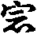



劝义。若第二义，以男女为宝，夫人未以餘衣覆身，名未藏宝也。不犯相，略而不说。律云：舒手及户处坐，若二比丘为伴，乃至难缘等，不犯。



云与女坐至四十四者，释名牒钞(云云)。



云四缘至犯者，如文。云多论至不犯者，如文。



云律不犯至开者，如文。



云独与至四十五者，释名牒钞(云云)。



云四至犯者，注云净人见闻屏处者，准二不定中，明见闻牙离吉，俱离提。



云十至吉罗者，前食家不犯等者，谓释前强坐戒。互受一日戒不犯者，谓不犯者提，如前已明。今后两戒纵互受戒亦犯提，以招讥故，由夫主不在。又前戒隐此吉，至此方显，文势似难，寻之易解。



云躯他至四十六者，释名牒举。



云四至犯者，无诸缘碍者，如下病无威仪等是。遣去犯者，律约离见闻即犯。云律至慊者，如文。



云过受四月至四十七者，释名牒钞。



云：六缘至犯者。一、是药诸者。事镜云：四药中过受三药犯提。准伽论云：受时食亦犯提，七日尽形。此律下文，医所教服药，故知是犯。若非时药贱，又疗患义劣，过受义希，但犯吉。故十诵云：过四月已，更索苏等七日及终身椒姜等，犯提。若索阿罗勒、毗醘勒浆，但吉。



云僧祇至过者，春夏分若过皆犯者，谓此律缘起是夏四月请，今准祇文，春分亦犯，但是过限，不论三时、半月、一月等。



云律至吉罗者，除四缘，如戒本者：一、常请者，施主云：我常施药。更请者，断已后续。分请者，自持到伽蓝中，分作分好，与比丘五分，名为自送请。尽形请者，我当尽形寿与药。戒疏：问：常请与尽形何别？答：但就能、所自分也。或为云：尽二人形，故名尽形也。过药限堕，过夜限吉者，律文四句，料简药之与夜夜时节，日月分齐。药即参苓味，敷分二果。初句云：夜有限齐(定四月当分请)，药无限齐(谓与种种之药)。第二句：夜无限齐(当常请是)，药有限齐(与参不与苓也)。第三俱有，第四俱无，可知。准律，四句不分轻、重。今钞分轻、重者，据制戒义也。本为索药过限，故结提。若四月止夜齐，非索药过限，故结提。若四月止夜分，非索药相，即不应索，故犯吉也。思之。



云观至四十八者，释可知。



云多至故者，制意如文。



云四至犯者，一是军陈者，戒疏：车幕长聚称军，行列相对曰陈。大德云：象军用四人，马军用八人，车用十六人，步军三十二人。不同今时二十五人为一旗，百人为一队也。



云四分至不犯者，天王者，天子也。若出，即为军陈遮从也。



云有缘军中至四十九者，释名(云云)。



云四至犯者，无上沙门果者，阿罗汉三果等，欲令前人获此果故听往。曾经二宿等者，谓前人恳请事获已即往，其事才讫便反，若未了应一宿，又不了再宿，若又不了至第三宿，明未出须去，若不去明现犯。



云观至五十者，释名：



云至四犯者，祇云：若在城中住，贼来围城，至令比丘尽出城，现多人相，不故著不犯，方便著即提。



云饮酒五十一者，释名牒钞(云云)。



云三至犯者，一是酒者，一是唐三藏，有三名：一梵云窣罗，此云米酒；二云迷隶耶，此云根茎华菓酒；三云末陀，引云蒲桃酒。大德引疏云：是毒水能昏泛人兼诸放逸，从水作酉，日入酉即渐昏黑不能升举也。二无缘者，病开也。



云：律至故者，酒为十过者：一、损颜色；二、少力；三、目视不明；四、现嗔恚相；五、坏福田业，失资生相；六、增众疾；七、益鬪讼；八、无好名称；九、智慧减少；十、命终堕恶道。五分降亲龙得酒等者，彼云：佛从狗睒弥往䟦陀越邑，彼有一毒龙，常雨大震，坏人田苗。居士常念：谁有威力，能降此毒龙？忽闻佛与千二百弟子来，欢憙出迎，礼敬白佛：愿降此龙。时娑竭陀在佛后摇扇，佛乃回顾，勅往降之。彼奉佛命，礼谢而去。向彼龙宫，却坐一面，便先出烟，比丘亦出烟；龙又举火灯，比丘亦举火灯；龙出五色火，比丘亦出五色火。於是化龙，身小如箸，内钵中，持来白佛。白佛：勅送向世界中间，如壮士屈伸臂顷。持送贼既了，不久却还。居士甚憙：愿受我请。嘿而受之。此比丘在俗时，憙饮酒，往长者家，饮黑酒极多。还狗睒弥，弥僧坊外醉卧，坐唾狼藉，衣钵纵横，便接钞文(云云)。乃至渐断酒制，应回文云：渐制断酒，自佛制后，不敢更饮。然此比丘，宿习力故，若不得酒，诸病皆发，饮食不销，不知云何？以此白佛，佛令𭊴酒气。𭊴又不差，佛令以酒煑羮𪎊。由不差，佛听以少酒与之。得已方差，佛言：既差，渐渐断之。除破僧者，以醉故，称天人师，必无人信也。



云四分至开之者，但使酒乃至草木作者，律中有梨汁酒、阎浮菓酒及蒲桃酒等。无酒色香味者，律有四句：一、是酒有酒色香味，二、是酒无酒色香有香味，三、是酒无酒色香有酒味，四、是酒无酒色香味(四句皆提，从境制定也)。钞云：无酒色香味者，举第四句，反以前三句。若非酒等者，律亦有四句：一、非酒有酒色香味，二、非酒无酒色有香味，三、非酒无色香有味，四、非酒无酒色香味。钞云：非酒有色香味四句中，举初句摄后三句也。准四句文，非酒四句但言不应饮，不云得罪。今准五分结吉，二俱有罪，故法文云并不合饮。甜酒者，僧祇云：和酿讫，始变生甜也。酢者，味变坏成酢也。糟医者(〔用〕见反)，谓澄酒下滓也。注文非取境犯者，古人义也。谓先有方便心者，今师释也。古人见中，酒戒五句、境想三句，皆约是酒。纵使比丘作非酒疑，或作非酒相迷心，亦犯堕者，即云：莫不约境而犯，不就心论。今师云：岂有智人一生不𭊴酒气，欲酒饮水，悮而咽之，可结他提。今律文疑、想、迷心结正重者，据先有方便之心欲饮此酒，或举盏时却生非酒想、疑，约从心边，但合犯吉。缘为前有方便心，冥然契合，故结堕罪。若无前心，直尔想、疑，终不结重。(已上取戒疏意解之。)想宗学者，破南山云：酒戒，律自分明约境，今便臆课从心，无教可据。法宝云：当宗不了，不可依承。酒戒从心，非戒约境。是以钞主下，引十酒证成上义。如上开之者，若知非而悮饮，如上来第二句无酒想，即开不犯。又必是酒，又无色、香、味，容有悮义。或可约舌不别味，鼻根坏等，此是明文有开，固非臆说也。云律不犯者，蘖者(仪哲反，说文云：是米芽也)，此能蘗消米，将蘖作酒噉，此多令人醉故。



云水中戏者五十二者，释名牒举。



云多至念者，制意如文。



云三至犯者，列缘可知。



云律中至罗者，如文。



云不犯已下，如文。



云系枥至五十三者，释名牒钞(云云)。



云四至犯者，列缘可知。



云僧祇至吉罗者，指指比丘。祇律九十中，名相指戒，与此相似。彼缘起中，因尼坐不正，十六群见了，以手遥指而笑，故制也。差会以指指者，彼月直知事人差次食，以指指言：某甲去。犯。



云不犯至开者，如文。



云不受至五十四者，牒举可知。



云五缘至提者，随作根本者，五篇之中，随犯何罪达谏提者，随作五篇下，一一皆有也。



云谓至也者，谓根本、违谏二罪同时结也。后作六聚通结堕者，既不受谏，随前作夷、残、兰、提、吉等六，皆结连谏提也。故知此罪要作前事，方结违谏罪。若正谏不受，但得吉罗。问：前违僧谏竟即犯，不待作前事。今此得作方犯，何以不同？答：前有僧法可违，谏竟即犯。此是屏谏，无信法违，故作前事方犯。



云不犯至之者，谓指恶性不受谏戒。彼云：若无智人来谏，报云：汝可问汝师，学知谏法，然后来谏於我。若非法谏不受等，一切不犯。



云怖至五十五者，牒钞(云云)。



云五缘至吉罗者，六尘事。一一等说者，谓将色等六尘示人令见，即云我见恶虫、兽等。文虽广列六尘，而怖相不显。今钞引祇文释，彼云：色怖者，谓暗地、悚耳、皱面、反眼、吐舌，乃至曰一指喡喡作怖相等。声者，或长引声、短声，乃至作钟、皷声等。怖香者，或言虵香、军耶鬼香等。味者，或问：今日噉何味？或云：若噉此味，必死、癞病等。触者，或以极重物押，语云壁倒；或轻衣覆，语言口云堕；或将华触，云是百足虵等。法者，为说怖他，言：汝生草中大、小便，堕地狱、饿鬼、畜生也。一一相现者，谓六尘中随一一相现。有解云：二相现，谓身相、口相、身乐口相。此亦为对。古人但有示怖，而无说怖。今此俱有。(此解示得。)不问怖者，戒疏云：欲明轻怖，极圣尚遭；况餘下，类义须灭。疏文显佛无怖心，但属能怖结犯也。



云不犯等者，如文。



云半月至五十六者，释名牒钞：



云五至犯者，如文。



云四分至不犯者，眷后四十五日者，谓从三月初一日至四月半，是夏初一日；从四月十六日至五月半，是合上二部七十五日。此据西天说也。今东土极晚，亦可移时，故多论云：随国土早晚，极用此限洗也。要著僧竭支者，诸记相传，云是僧祇支也。大德不许此解，不可祇支洗浴。此是泥洹僧，亦云舍勒，即今行裙子是，亦非䏶、裈之类。憙生欲者，准多论云：昔有罗汉比丘洗浴，有一比丘后入，见罗汉身体鲜净细耎，便生染心。不久，男子根堕落，即生女根，遂休道为俗生子。后还遇见，即便识之，知本所因，即请归舍，求哀忏悔，用心纯志，还得男根。故知今时不得露形浴也。



云僧祇至下卷者，一切僧次第入者，玄云：古人据祇文得用常住僧物供浴所须，既明打木次第入之，故知是僧物也。餘如下卷者，指诸杂篇广明浴有利益及方法等。



云露地至五十七者，释名牒钞(云云)。



云四至犯者，如文。



云五分至生地者，炎高四指者，谓前列缘，依四分但云有焰，不说高促，故取五分四指便犯(亦是人指挋尺四寸)。随作事者，谓随后添薪益木，或炙身煑物，整顿前火聚敛等，皆犯提。旋火作轮者，谓以手持此等之火而旋为轮，亦犯。若坏若生等，约义合有，若在生地即犯，故引祇证之。



云律不犯，如文。



云藏五十八者，释名可知。



云三缘至开者，注文五大色非佛开者，谓是非法不开贮畜，故结小罪。未熏钵虽非正物，佛开畜之不遮，故得提也(准此文势，是和会之竟也)。



云律至罗者，注文应不犯持罪者，谓不犯阙持衣之罪也。玄云：罪官急不许，或著俗服三衣，収藏一家，应不犯不持衣罪(法宝约沙汰僧尼以释亦可也)。



云真实至五十九者，释名牒钞(云云)。



云四至俱得者，戒本列五众者，戒疏云：真法两部，不合更互而作，何故戒文通列耶？答：欲明五众俱有犯相，虽轻重有异，而净施义同，故通列名。至於净法，自从当众，故辨相文中云：今为净故，与长老作真实净。验知唯局因同类，不犯在怀疑。若准善见，展转通五众也。展转问不问俱得者，谓作法时，对别人故，物不付彼；后用此物，不假更问本施主。



云著至六十者，释名牒钞(云云)。



四、缘至犯者，如文。



云善至衣者，遭贼缘等等取烧漂也。初得故亦名新者，谓初得他故不如法色，亦号新衣不染坏色，俱犯提也。



云四至不见者，谓被褥等并及俗衣，不点净吉。轻衣者，谓三衣已外自餘衣，不点净畜并吉。注文准此等者，今师约此染净二义，准於诸部释也。古云三衣不染，今云三衣长衣，并须染更点净，不染得提，不净犯吉也。三种记者，五分中，比丘与外道俱为贼剥衣，守逻人捉得，令各自认取本物，遂被外道先来总选，将好衣服去，以此白佛，因此制三种色，青、黑、木兰，随一一认不作著，著得罪。复有云三种者，一染、二点、三割缕，即异俗人并外道也。



云多论至也者。落沙者，此云性，性血也。又僧亮注涅槃经曰：落沙从钵罗奢华中出，出时煞虫可用染也。若点著吉此犯堕者，此五大色，若准多论不点而著。憍奢耶者，幽中最细也。钦婆罗者，此云细毛衣，亦云杂碎衣。好衣二种净：一谓割缕净，二点净。所言割者，谓割三五缕也。以染汁麤，且令二种作净，若著终须染也。餘衣加一法，谓除上二细耎衣外，即须染也。青者，铜器覆苦酒者，祇云青为三种：一铜青，如文；二长养青，即蓝淀青；三石青，即硿青。是不持下二青作净也。黑者，祇云名字泥、不名字泥。且名字泥者，即呵梨勒、鞞醯勒、呵摩勒，令䥫器中是名字泥也。不名字泥者，谓实也。泥即池泥、井泥，如是等一切泥也。木兰者，呵梨勒等三菓汁，置生铁上磨持作点净，即是青铜等为青色，菓汁泥等为黑色，木兰赤色，此如法三色也。犹同四分木菓皮者，笺色字合纵木也。玄云似蜀地木兰色，以四分是北地翻修，正将蜀地木兰为正木菓色也。



云五分至作净者，细揲亦尔，祇云趣一角作净，若一条条补者亦作净。一切衣乃至细揲亦作净，谓新物细揲、成衣细揲，物雅众多，为却刾故，但趣一角作净，不须段段别作，故云亦尔也。



云夺至六十一者，释名牒钞(云云)。



云多至戒者，五缘者：一、是畜生；二、畜生想；三、为煞心；四、兴方便；五、命断。



云饮至六十二者，释名牒钞(云云)。



云前至断者，谓前戒是限分中制，要须断命；此是深防中制，为养物命。但知为虫饮用结罪，不待命断，断即属前戒收之。



云五缘至犯者，第四饮用，第五随咽，不待中死。



云鼻柰耶至身者，彼云：有二比丘，深山中住，未曾见佛，便欲礼觐。春后火热，路经广野，水少虫多。其一比丘语一比丘言：所饮此水，度兹广泽，得觐於佛。一伴答言：我受佛戒，如何坏耶？即不饮。因此命终，生三十三天，戴百宝冠，来见佛已，头面礼足，在一面住。佛与说法，便得见谛。其饮虫水者，在后方至。佛遥见来，脱忧多罗，示黄金体：汝是痴人！饮如钞引



云僧祇至得者，用树叶拭者，谓是乾枯之叶，生者不合。舍利弗以净天眼等者，谓尊者以净天眼见空中虫，如水边沙等无处不有，遂断食三日。佛言：知已。语令食。凡制虫水，齐肉眼所见、漉囊所得，不制天眼。更有细虫，天眼不见。唯佛见眼如微尘十分之一，极为细矣。



云僧祇至用者不得猒课看者，此是此人时俗语也。今此间即云影向看，俱是不子细之㒵，事不得已，心中甚猒，身但强収，故云猒课也。如大象戴竹木车一回之倾者，祇云不得太速，不得太久，当如大象一回顷无虫方用。若有虫者，应漉用之。不得语莫伤煞虫者，祇云若不可信者，应自洒虫。不得语令洒莫煞伤虫，恐前人邪见，或性好煞生。若闻劝莫煞，便故故煞也。七日不消者，虫生七日一变，故令安。七日不消，水中无煞生罪也。不得持器绳借人者，恐同教他煞也。不得唱此水有虫者，祇云於注水池中，若见有虫，不得唱告长老，其水有虫，令他生疑不乐。他若不知，或作无虫想，犹免其罪。今若告他知了，即决定有虫想故，是以劝令自著。



云此至中者，彼文因说漉袋，乃广彰用水方轨等。



云疑至六十三者，释名牒钞(云云)。



云五缘至知一是比丘者，多论云：十三难癫狂比丘但犯吉，学悔、六夜别住、四羯磨并是提也。前人闻知者，若未闻知未犯。外难曰：戒文中云约他须臾不乐始犯，今何才闻知即犯，岂不相违？答：非约他人不乐而犯，盖熟能恼人之意，欲令前境少时不乐故也。(此依戒疏解。)



云律至开者，六事悭者，举数总标也。初中举受为疑悭，下二、举随为疑悭。若以生时者，汝非尔许时生等，约俗年以恼。若年岁者，汝未尔许岁等，约夏臈悭也。若受戒，语云汝秊不满，界内别众，约人众恼也。若羯磨者，汝受时作白，羯磨不成，约七非悭也。若犯六聚者，语云汝犯夷乃至吉，通约六聚悭也。若犯圣法者，语云汝所门者，则犯波罗夷，非比丘等，此别约大妄语悭也。故祇云：若比丘临受具足时，若羯磨不成，应弹指语云：长老！汝羯磨不成就。若临受持不语者，后不得令疑悔。注文若即用语者，女律开者如此，彼二律俱开，无疑恼罪也。云律不犯者，其事实尔者，谓前人实有此事，复非实心利益彼意，不欲为悭也。语令知，还本处受者，谓律文上第三、第四事，皆令还本处受。故注解云：佛令还本处，期问得戒不得戒也。以受戒托缘，非相难识。若於事诸有疑，须还本处受戒处，详审知遇，方可受之，则於后无滥。问：既曾闻羯磨，即是偷法，便属难收，何得再受？答：为许闻故，非是偷也。不成难收，得再受也。为性麤疎，不知言语者，前人立性疎慢，不识言改善轻重，恐出言犯，遇人法便得。向云汝所说者，犯其圣法，意在前人改革不是，故有恼意等，并不犯。



云覆至六十四，释名牒钞云：五缘至明相，如文。



云善至一切吉罗者。百千共覆者，谓百千同知一时共覆，故各结提罪。非展转覆下，引十诵注文云向一人说不犯，故知展转不成覆也。若犯人凶恶等者，谓凶麤暴恶，若依王力、大臣力、凶恶人力，或致夺命因缘，毁伤梵行。与护根相应者，自守其根，不管他事，前人虽犯，我心犹预，不说非覆也。除麤者，除夷、残是麤，覆得提也。覆餘罪者，下三篇得吉也。问：或覆兰得何罪？大德云：准多论，覆二逆得对首兰，与提罪钵不异。(法说并不〔钵〕家论也。)自覆罪者，戒疏云：自造七，自覆七，得一促，各得一吉，无提。除尼者，谓比丘覆尼亦犯提，故言除也。尼若覆僧罪得兰。外难：覆既犯兰，必须发露，若发露，罪莫成举。大比丘违於八敬法不？大德云：不然。但在当众中发露，不往大僧中，不名举也。思之。餘人者，下三众得吉也。



云不犯至开者，无人向说者，唯伽论云：有比丘犯残，昼在比丘处，夜在无比丘处，夜在无比丘处，若夜无比丘处，终身不发露，不犯露他罪。若发心向说者，玄据无人处为言，或有约始知，方欲向说，明相即出，故开无犯也。



云与秊至六十五者，释名牒钞(云云)。



云四缘至犯者，和上犯提，餘犯轻也。



云多至无损者，上卷则受戒篇，下卷则沙弥篇，俱明所度秊岁大小等。𫓴楯者，多论六十已上不得，僧祇七十已上不堪造事者，许度之故，是相违之㒵也。二情两通无损者，多论六十已上不许，意道不堪持戒，以志弱也。僧祇七十已上受者，即据志性耐强堪持戒也。若论堪者，堪二文俱许。若志劣者，二文俱遮。



云律中至吉罗者，律问五节：一、先不知，二、信受者语，三、傍人证，四、父母言，五、数胎因也。复有三位：一、计胎秊，二、数润月，三、约布萨。若论父母语者，祇云：父母不知者，生秊。又无者，观颜皃富乐家子，形大秊小，当观手足成就。复不知者，当问何王何岁，国土丰俭，旱涝时节。生等开，和上堕。餘人吉者，既计胎润，得戒不疑，和尚免提，众僧无吉。若据成犯相中，约和尚四句，僧知不知等，有十六句得罪差别：一、知，二、谓，三、疑，四、不知。和上了了知秊不满，故曰知。未满满想，但观其相作满意，名之为谓。犹预不决曰疑。都无所了，名曰不知。餘众僧缘彼前境，四心亦尔。以众僧四心对和上知心，作四句：一、和上知众僧知，二、和上知众僧谓，三、和上知众僧疑，四、和上知众僧不知(和上四提，众僧二吉，初句第三句犯吉也)。次众僧四心对和上谓，亦四句：一、和上谓众僧知等，例解(此曰和上合无罪，众僧同前)。次众僧四心对和上谓，亦四句：一、和上疑众僧知等(和上四提，众僧同前)。次众僧四心对和上不知心，亦四句：一、和上不知众僧知等(和上合无罪，众僧同前)。问：和上疑心既轻，何以犯提？答：夫与人受戒，理合捡问，安详审谛，然后受之。既若怀疑，即不合受。悮他不得，悭处不轻，虽是疑心，亦犯提也。



云令至解者，诸部会通者，十诵僧祇不满得戒，五分母见二论分开三种次第得戒，将十祇二文会通四五二律，亦同秊月不满通皆得戒也。勘餘历术者，此则依俗以文比校为勘，阴阳律吕遍涉支干故谓之历，作法数其近促故称为术，即唐国六七家历法等是也。今并比勘(此依诸家所解竟)。法宝云：堪，餘也。堪谓人姓，餘乃人名。古有堪餘算法，今钞依之，后人抄写错书勘字也。总括明练者，搜求并尽故云总括，无细不委谓之明练。如此之文指在首疏，故云如大疏也。促通略举一句者，以今望古谓之通。古人举极小沙弥秊满月不满者，许依律三种开数得戒。今师举极小沙弥，若依律三种开数得戒。今举极小沙弥，若依律三种开文，纵使秊月俱不满亦获戒。举此极小沙弥一句，今古虽同，若许律三种开文，数数何论秊月不满？向下举之，以定昔人要秊月不满得戒之谬解也。故戒疏云：如昔解受者，俗秊日月俱少不开胎闰，本俗秊满日月不满方开。今解但数胎月得满二十，俗秊不满开无所犯(上是疏文)。



云谓至也者，戒疏云：今且约极小沙弥臈月三十日生，秊满二十，正朝受具，计实秊始十八，二日欠二十，三月二十八日未满二十，故且同古人通举极小之位於上，次开法增秊於下也。便以胎闰增之等者，对此受后开算，律文但有三位，古德据此方历术，更添频大，即成四位。言四位者：一、胎内五位；二、闰餘；三、频大；四、约一切十四日布萨。初胎内者，简胎外也。婆沙、俱舍胎外亦有五位(婴儿、童子、中年、盛年、第五、衰老)。胎内者，谓胎亦不定。如西天罗云：六秊在胎，生死苦比丘六十秊在胎，此方老子八十秊在胎，或有十二月在胎，更八月、九月等。今约多分以言，例是九月在胎也。五王经云：一、七日如薄酪；二、七日如稠酪；三、七日如凝苏；四、七日如软肉团；五、七日如坚肉团；六、七日五疱开张，六情完具；七、七日成人。上之五位，前之四位，位各七日，唯第五位有三十四。今七日并前三十八七日，三七二十一，成二百一十日，七八又五十六，添前二百十日，都二百六十六日。此诸日中，并与母同气，欲趣产门，与母分气，又得四日(母入气，子出气)，并前都二百七十日。今将日勒成月，得九月。此九月中，四月大，又抽取四月，又生受二日，并前六日，即沙弥秊十八、九月六日也。



约闰餘者，此位诸家筭法不同，今且依一家而筭，颇为雅妙。戒疏：夫日月有三，谓天上日月、人间日月、阴阳日月。上二不定，后一是定。今将阴阳日月以定人间日月，应天四时，故置餘也。又固文昌观国诗及南山归敬仪云：天体右行，日月左转，朝起扶桑，暮入蒙记，日夜游於十二神，相去三十度十六分度七之周。十二神总计三百六十五度四分度之一，始周一天形，日月各归本为位。今一年有十二月，每月有三十二分，以月初日及月末日，此二日行周天，等足三十二分。中间二十八日，以日行疾，每日但有三十一分半。一月中既除初后两日，中间二十八日各剩半分，即一月出得十四分，十月出一百四十分。又二月二十八分，一年计得百六十八分，即用三十二分为日，将一百六十分为五日，已外犹剩八分。此八是小分，即四大分中之一数，故言四分度之一一也。即一秊出得五日，并八小分。又一秊有十二日，且约六大六小，於六大月中抽取六日，并前成十一日及八小分。今将前十八秊九月六日，沙弥通计六闰，奇二十七日。且一秊出得十一日，并八小分，其八小分置而未论。且计日数，一秊出得十一日，十秊出一百一十日，又八秊出得八十八日，并前成一百九十八日。将此勒为日，三十日为一月，且将一百八十日为六月，已外剩十八日。又前来每秊有八小分，适来未论，今即将来计筭，既每秊下剩八分，今将四秊下所剩四八，即三十二分为一日，八秊为二日，十二秊为三日，十六秊为四日，已外二秊下二八十六分勒成半日，并前四日半，将此四日半添前十八日，成二十二日半。又前来更有胎内九月六日未论，今於九月中出得九十分，又四九三十六，并前成一百二十六分，又六日出得三分，都一百二十九分，用四日除之，三四十二，一百二十分，又二四如八，并前一百二十八分勒为四日，犹剩一分，今将四日添前二十二日半，成二十六日半，又将一分添前半日为一日，以强收弱，故此位筭出六闰奇二十七日，今将三个闰月添前十八秊外，零九月为一秊，已外剩三月二十七日在，将前六日中三日添二十七日为一月，并前成四月，犹剩三日，即沙弥秊十九，四月三日(抄写细详之)。三频大者，三月连大也(必〔死〕三月连小，故不合为频小，今时设有者，即日月参差也)。谓横前十九秊四月开，且十秊一百二十月，九十月，又二九十八成一百八月，并前二百二十八日，又零奇四月，都二百三十二月，勒四十九月为一章，得四章，餘三十六月，欠十五月不成一章，且第一章从初一月至十六月为一频大，又从第十七月亦依前数至十六月后得一频大，又从初至十七月后得一频大，一章抽得三日，四章得十二日，三十六月不成一章，抽取二日。故戒疏云：频大之法，四十九月而成一章，章有三频大。初两十六月，后一十七月，各一频大。如是周与后始，则前用一百九十六月为四章，章有三月，总得十二日。已外三十六日，约两频大，足成十四日。添前沙弥十九四月三日，成十七日也。(此依疏文为准，诸记中皆错计也。)四、约一切十四日布萨者，谓且据不闰以说。一秊十二月，六大六小。大月黑白各抽二日，都得十二日。小月但於白月中抽一日，都得六日。计一秊抽得十八日。十秊一百八十日，九秊九十日，又八九七十二，都三百四十二日。前四月中又抽六日，都计三百四十八日。今勒二十八日为一月，三百三十六日为一秊，餘剩十二日在。并前十七日成二十九日，还勒二十八日为一月，餘剩一日在。岂非五月一日并是虗秊，约一切十四日布萨？已上并是古师秊满月，沙弥四位筭了，尚剩五月一日。今师不然，此既虗秊已满，少受前开筭。故戒疏云：为受前开计，受后开计，受后开计？答：感戒白四时生，不由后计方得。据此以明，虗秊既满，得受无疑，前开何损？若尔，何者是受后生疑？答：此约秊月二俱不满者，但於前古人小沙弥上，退除剩日，便是秊十九也。(已上准古四位筭竟。)



云此长至戒者，此谓立今一句，定昔时谬解。此长(去声)指适来所剩五月一日，并是於布萨位抽得，兼是含虗二十八日成月。今须约实：一、依常途，二、大，三、小。准戒疏，於五月中，前白半月还他五日，后半还二日(成七)。於五月一日抽除七日，将一日除第五月一日，於第四月中除后六日，但成四月二十三日(此约实也)。次退灭者，於虗秊正月一日上，退除此四月二十三日。先将一日退受戒一日，次将四月退十九秊后之四月，又将二十二日退第八月中后二十二日，便至八月八日，即当虗秊十九、八月八日受戒。生疑故开此筭，和上、众僧并无提吉沙弥得戒。



云：然至所述六、七家历法者，自皇帝至开元历，总有二十四家。明其历法，并有增减，则李淳风、一行禅师大衍、刘歆周髀等。今钞言一家者，诸记皆云：依麟德笇法，如上略述，犹长五月一日。更有王弼作易纬笇法，不能再述，故云更不重申。(法宝释云：钞依一家是堪，餘所笇等，如前已辨也。)诸部不满得戒如疏者，戒疏云：十诵云：若不满二十，或忘不知僧，问：满不？答：满，得戒。僧祇：若不满等，谓言已满二十，得戒。更有见论、五分，各有开文。(繁而不叙之。)



云发至六十六者，释名牒举(云云)。



云五至结者，若餘私净者，简餘鬪诤，不能陷僧。若自身四诤灭已，更发犯吉，以希故轻；若发他诤，数故重也。此戒僧尼互发皆提。二、僧如法灭者，谓如法毗尼，如佛所教，识病识药，名如法灭。三、知者，谓知法灭已，更发者提；若不知，非犯。故下文观作不观想，亦不犯。观谓深达药病起灭之方。今发净者，不知如法灭谓非法灭，所以輙发不犯。四、輙发起者，准律三句，发起皆提。一、不善观不成观者，疏解云：道僧不识四诤体相起之因本，促是暗心断理，故云不善观。(观谓观察。若作如是观，不成观也。)二、不善解不成解者，疏云：道僧不达七药体相差别之义，名不善解。(解者决了。若作如是解者，以无终益，不成正解故也。)三、不善灭不灭成灭者，疏云：道僧不识药病相对除灭之方轨，违理判净故。不善灭者，不能究竟消殄，故云不成灭也。此皆犯提。



云与至六十七者，释名牒举(云云)。



云六至吉罗者，负债人者，欠债不偿，是贼家气分，期行结吉也。



云恶至六十八者，释名牒钞(云云)。



云五至提者，说欲不障道者，多论云利，此是外道弟子聪利，甚故拟人。佛法中行於倒乱，其人不久通达三藏，故倒说欲，尽其智辨，不能令成。



云随举至六十九者，释名牒钞(云云)。



云四至结者，随顺同事者，律文供给所须中有法，谓教习定慧、学问、诵经等，则为衣服、饮食、床敷、卧具、医药等，皆一一结提。五分云：虽舍恶见，僧未解羯磨，亦提提。



云随殡至七十者，释名牒(云云)。



云犯至也者，四缘犯：一、是被殡沙弥。二、知是。三、同事止宿。四、随顺。结犯。



云拒至七十一者，牒钞。



云五至结者，外难前不受屏间谏戒，正不受时促，犯吉。要须待后造作前事，方所随六聚结，违谏提。今亦违屏谏，何得言词了即结提？答：前谏作犯，要作方结。此谏止犯，故言了犯。(上依戒疏解也。)



云十至中者，四事者，即四重也。言我不学，所以结提。五、人不为说毗尼者，下诸虽篇引十诵云：一、试问；二、无疑问；三、不为悔所犯问；四、不受语问；五、结问。并不须答，反上即答。



云毁至七十二者，释名牒钞(云云)。



云多至碎者一偈者，略教试也，即善护於身口言是。五篇杂碎者，广也。以犯不少种类寔多，名为杂碎也。



云五至住者，钞：总标五促，列三缘次第，四、发言毁，五、言了结。此依疏添也。



云五分至罗者令人远离等者，此释第三作灭法意也。随经律者，随经文中有说戒律处，如涅槃经等，而毁亦提。若通呵者，何用此戒一提？若诵序文非戒条，何故亦犯？钞：答云：说二百五十戒义等(云云)。又若呵序，序中既总说二百五十戒义，即是通呵，但犯一罪。毁毗昙契经吉者，约胜劣论也。



云不犯至开者，如文。



云恐举至七十三者，释名者，戒疏云：有师名为乍惊张戒，若是不摄耳者，何故言我今始知？又不摄耳在他心内，何得证他曾闻？若是不摄耳，应开重听(上叙古义)。今师难云：若尔，便是妄语诳僧，我今始闻也。今立二名：因时名不摄耳，果时名恐举先言。由其实不摄耳，是以不知。今既始知，恐被举治，乃先首过，此是所防(云云)。



云四至结犯者，如文。



云祇至听者，四三二众如初句者，如初句云不能诵一部当诵五众戒，今若依次第即合云不能诵五众当诵四众三众二众一众及偈等(众者篇也，唤五篇为五众故)。不得坐禅者，恐不专听也。



云同羯磨至七十四者，释名牒钞(云云)。



云四至犯者：一、是僧物者。十诵、五祇并云：施现前应分物，非是常住物也。故十律云：时陀骠衣坏，居士多与现前僧应分物，众僧乃将赏他。四分促云：有人施僧贵价衣，不言常住，现前亦不了也。二、同赏他者。多云：凡僧和合，不问羯磨、不羯磨，呵者，并犯。



云不与欲七十五者，牒钞(云云)。



云五至结者。如法僧事者，戒疏云：此唯约断四诤事，不与欲犯提，餘法事但吉。四诤不灭，容破僧故。双脚出户者，若方便欲去，或一脚出户，皆吉也。



云五分至吉罗者，应(去呼)三羯磨者，单白、白二、白四、屋下。随出一提者，五分云：随几过出，一一提。随出，一一已还出，随数结犯。今师约此义，传欲入僧，未说而出，为离众失。僧祇等者，彼有两缘：一者，说法、毗尼；二、作折伏羯磨，乃至别住羯磨等。若有缘欲去须白，及与欲说法、毗尼者应白，不白者越中间止。作餘语者，谓听他人受诵经竟，作其餘言语，去时不白不犯。沙弥在中，若起亦吉者，五分云：若僧不羯磨，断事及私断，沙弥得在中，比丘起者犯吉。非谓沙弥輙吉得吉也。



云律至开者，如文。



云与欲至七十六者(云云)。



云四缘至结者，如文。云多至吉罗者，如文。



云屏至七十七者(云云)。



云五缘至说者闻便犯者，戒疏云：听此语未向彼说提，但闻即犯。若待向说，自属两舌戒收。若尔，何故戒疏文云听此语向彼说者提？答：此约能听人心听此净事，有意向彼陈说，非谓往彼说时犯也。问：何故两舌须向彼说始犯，此才闻便结？答：前是未有诤，待说方有诤起，故说时结。今此先有诤，岂待向说？故闻便犯。



云律中至罗者，祇云：若二比丘在堂，比丘欲入，弹指动脚作声。若堂中比丘闻有人声，即嘿住不语者，前比丘却须退。若故语不止者，即入，无犯。云不至开者，如文。



云嗔打至七十八者(云云)。



云四至犯者，如文。



云律至吉罗者，由先得戒人虽犯重，打亦提。若十三难本受不得戒者，打但吉，义同於结。一把砂一一随者，约豆数结罪也，非随著人数结。



云律至等者，智论律中等者，彼论中因辨供养真佛及化佛得无限福，若恶心毁真化二佛俱得达罪。若尔，毗尼中何故煞化人不犯？可引钞释云律中结戒为世间事等(云云)。假名者，於诸五蕴上假立人畜等名，即於人畜上约世讥谦结戒轻重。不观后世得罪多少者，约业罪说也。如鞭打牛羊等者，正释上文结业轻重意也。



云搏至七十九者(云云)，犯。具四缘：一、大比丘舌，二、嗔心，三、作意，四、举手，便犯。舒文略无，今依疏列。



云前至提者，前是限分中制，打著方犯；此是深防中制，手拟便犯。须定罪相：若本为打，不搏但犯吉，即是打家方便；若标心本为搏，不打动心时，即是搏之方便，拟之即犯。根本祇云：六群以侧掌为力，用拟於人，故号为搏；若举手向多人，随境数犯也。



云无根至八十者，释名牒钞(云云)。



云略至别者，指第二无根谤戒、八缘犯等，云如彼。



云突入至八十一者(云云)。



云四至犯者，一是刹利王者，准祇四句：一是王非刹利，入者无犯；二是王是刹利非灌顶，入亦不犯；三是王是刹利是灌顶无国土，分入无罪(四分文中此三句皆吉)；四是王是刹利是灌顶有国土，分入者提(四分亦尔)。所言灌顶者，即四分戒文云浇头是也，即受軄之法。律云：取白牛右角，盛四大海水及一切种子，置金辇上，使诸小王举之。王与第一夫人共在辇上，婆罗门以水灌顶，立之为王。故云刹利王种也。若婆罗、毗舍、首陀种，以水灌顶，作如此立，亦得名为刹利灌顶种也。以水洗种子者，取滋闰反，发生义，以表王养万民。右甬者，取吉祥义。



云律中至罗者，如文。



云捉至八十二者，释名牒钞(云云)。



云此至语者，多论明文者，准论云：若捉金银等七宝及宝器等皆提，若提自他说净宝皆提。今引此欲破昔义故。不用旧语者，道疏云：此名捉遗落宝戒，若非遗落捉犯等罪。今云不然，虽以舍遗之宝为缘，从制戒后但捉即犯，何论遗与不遗也？



云具至犯者，戒疏四缘：一、是宝物，二、非塔者庄具，三、非餘缘，四、捉便犯。掌依此四，足可禀承。钞：文不合开，为初、二开缘也。(思之。)一、重宝等，即异古首疏云：一、是遗落宝也。通自、他者，戒疏云：问：佛制宝物，自捉不合，何得使他亦犯？答：审是非法，自、他同犯。多论云：使人亦犯。必有所开，自执无罪。及装饰具者，谓铜、铁、𫓪锡、白镴等诸宝装严也。非住及宿处者，非此二处即犯。在此二开之：住处者，开僧伽蓝，毗舍佉母入祇桓，见佛遗却璎珞，故开；及宿处者，开寄巧师处捉金也。四、无心盗者，若有盗心，捉离犯夷，非此我摄。



云：多论至放者不得后放者，不得在净人后放。捉时应净人在前，放时应比丘在先，即是佐助。若先捉后放，即是正捉，非佐助也。



云多至堕者，除矛(牟侔反)矟(所角反)。准论，矛矟皆提，故除也。



云四分至堕者，谓非伽蓝并及宿处，皆名餘处。



云僧祇至上者，停二三秊者，表久无人来取，是无主物。虽有性名，时既久违，亦是无主。进退如上者，如上盗戒中明，指得伏藏处说也。或有指畜宝中等。



云成论至物者，给孤独者，即须达长者。好给孤独之人，因此立称。长者欲买祇陀园布金，不遍思惟：当取何藏金足？此是取伏藏也。须达是二果人，尚取此物，故知不属王。若属於王，则当时亦不合取。餘如文。



云非时至八十三者，释名牒钞(云云)。



云五缘至结者，注文即寺内净人院，多有迷意，云不是村，故今注出也。



云十诵至不合者，四分日中已去名曰非时。十诵无比丘等者，其文似倒，理合云无比丘者路中见应白，又无者见尼三众应白，又无者发心已去，今注出也。祇文约食以论，虽食早竟了便是非时。作白长老等者，正陈词也。所以须白者，有二义：一为不障僧法中，恐作羯磨不知所至令僧生恼；二欲令前人不得自在入白衣家也。左右旋者，即显非直遇之相，同入聚故。结五分等者，若俗所经从村聚中至日暮须往宿处，为至八难等不白。简择此事者，谓简所对比丘也。论自释言：谓白同戒观察正行威仪带僧伽梨等，此人可白，餘不知法不可白，故云不合。



云律至如上者，如文。



云过量至八十四者，释名牒钞(云云)。云五至犯者，二、僧床及己者，钞：准祇文，僧受用边犯戒，疏唯约己界床，则依四分结也。



云本至八指者不截方犯者，此谓本来作时拟截、成时未犯，不截便犯。若标心本不拟截，作成即犯。一尺三寸强四分者，宝云：以周尺一尺二寸为唐一尺，又以三寸六分为唐三寸，更有周四分在，即是强字收四分也。思之。或钞中作弱字者，错也。更有云四分五分者，非也。上之四分(平声)是尺餘量，下五分即是律名，知之。随坐一一堕者，若终一坐一堕，己有分故。若他床坐者，越非己分故，但不应坐此非法之床也。水筒盛脚埋等者，怨速烂坏也。当部约业道边，祇文约受用边，用不指量何耶？答：诸国用法不等、俗情又异，但唯佛为定，以兹常量则永无乖也。用人指量者，约佛倍人，即八寸高支床离地也。四等分之者，十诵疏作此解也。以四八三十二成三尺二寸，今将二八寸为脚，第三八寸入梐，第四八寸截除，还用支脚。准此验知，上湿下处开用人指也。降四岁共坐者，降，减也。四人相望得减四岁者，共坐若满五即是阇梨位，不合共坐，床指不过八指也。



云四分至无犯，如文。



云兜至八十五者，释名牒钞(云云)。



云五至悔者，蒱台者，即冬月蒱华也。先辨后悔者，先辨此褥不得与人，方悔罪也。



云骨至八十六者，释名牒钞(云云)。



云五缘至弃者，既云同上，但改兜罪等即是。应云：一、骨牙角；二、𲉍针筒；三、为己；四、自作使人；五、成使犯。又应欲故者，要先打破后悔罪。反还主不受者，持意为作，还主无用，故不受之。主生恼者，示为某作，今却与他。既是非法，僧又不用，故令辨置也。外难：此因财生犯，何不入三十中？答：以小故不入也。若尔，如野蚕绵亦是小物，斩坏又同，何故三十中收？答：彼虽坏竟犹得涂坏，是以不同。



云律至一切不犯者，锡杖头标𥎝者，诸记云：锡杖头上标此层级，与作即纂。(准此全於上尺。)大德云：义净三藏解，锡杖都有三分，上一分是锡，中一分是木，下一分或牙骨及角等不定。今云标纂，即最头边，犹如此间纂杖无别。伞盖子者，散者，作此盖以仰风雨也。子者，盖下庄饰具也。斗头镖者，(疋烧反，说文云：釰锁下饰也。)此谓盖下有斗，是此斗饰具也。缠盖斗者，绕褁尔盖斗口饰也。(此依诸家解。)㠋记云：律文无此三字，抄文添云：即是伞上曼上方板子也。玦[王*刃]者，杜预云：玦如镮而不相连。[王*刃]者，是镮内小见子。宝云：犹似俗中宝腰带鸟玦不异。此间师僧即无，西大皆有。若著裙子时，以条绳系定，玦[王*刃]在绳头，然后作摄等。钩衣鈏者，(胡八反，说文云：是横物也。碍。)钩谓袈裟。钩子鈏者，状若此方宾楖子异，系向条子上，钩於䩙耳也。眼将者，眼患热，用此椑故。𮢏汗刀者，身有汗，以此刮之。𢸈齿物者，如今扬枝头，利去齿中不净物也。桃耳椑者，耳中结𦡲之类，用以挑之。禅镇者，坐禅时安顶上，状似毬子。薰鼻筒者，鼻中有疾，引烟而入疗之。已上诸色，既非针筒，是故不犯。



云过量至八十七者，释名牒钞(云云)。



云五至便犯者，如文。



云律至吉罗者，互减、互过皆堕者，上扁房戒九句，则有如、有减、有过。今此戒准律，但过、不过，然则不过便是如也。又下不犯中有其减文，取共成句，理亦无失：一、长中过广，广中不过；二、广中过，长中不过；三、俱过皆捉。钞：言互减过者，且长、广减，长减、广过，即皆犯也。自、他作成者，自则为己作，他谓令他为己作，戒皆提。若不成者，即自为己作不成，及令他为己作不成，及为他作成不，戒皆吉也。



云不犯至法者，准律有四开缘：一、应量，二、减量，三、得过割截，四、若作两重。上三易知，不解第四。言作两重者，律云：若㲲作两重也。意道若无，作一重过量即犯。今意无，拟作两重，意虽过未犯也。注文通量者，通长五尺、广四尺，於长中通作一缘，不取初量截断施缘。若不更增广长各半搩手等，诸部不许者，僧祇云：更增者，对头却刾互减过提。十诵作不盖缕边净者，谓依初制不更增大，故云净。又尺不益缕边，是过量作，只可说净，不堪受持，故云净也(恐不如前解)。伽论不接头者，四分七百结集不许者，彼䟦阇云：得畜不截坐具。钞主云：是䟦阇檀行十事已，集阎浮僧断了，故云不许。截却外者，未审为是初量、为是增量耶？下注文初量外等者，谓初量过故须截却也。谓初制长佛二搩手、广一搩手半，则𤄃三尺、长四尺。更增广长各半搩手，又各一尺，则长五尺、广四尺。作坐具时，合先准初制四周安缘，都长四尺、广三尺，此是初量。后更向长边广边各增一尺，刾著初制量缘外，是如法坐具。今过量作者，且取一边一头七寸来缘为其增者，此增由各合有三寸来在。又须准初量亦合有缘，今不截安缘，据此一头一边亦是不截。今将引初量一头一边之缘及增者三寸，通在初量而不截断。约合截此一头一边及增者各三寸净许，一段长五尺、一段长三尺落，故云截初量也。非是增者，古来云：截却增量外也。若是初量犹尚未过，何须截却？增者但有七寸已来，岂是减？不可言截也。此义不正，今师简之，故云非是增者。餘说净者所截除者，若是应量固宜须说，纵非应量准论亦须。若已过十日等者，制令舍之，应量作提悔，不应量作吉忏也。



云覆至八十八者，释名牒举(云云)。



云律至也者，如文。



云不犯至堕者，略同前戒者，己为他、他为己，得已成者，乃至叠作两重等，并开如前。坐具戒应量、减量，俱不犯。差后过十日结堕者，缘身患疮故佛开之，为护涅槃僧故不用净施。今既差，缘谢故，十日内须说即犯。



云雨衣八十九者，释名牒钞(云云)。



云文相至知者，指雨衣戒也。



云与至九十者，释名牒钞(云云)缘起中难陀短佛四指，诸比丘遥见谓是佛等，后制难陀著黑衣，为简异故，诸比丘即与佛衣色并同也。六群意云：我曾既衣色与佛并同，亦量亦合齐等，遂即与佛等量或过量作，故制也。



云多至知者，常人半之，即八尺也。戒疏：问云：餘之三戒定制量限，三衣一戒不定量者？答：餘三非是沙门道明正仪，随其大小皆得受用，故出定量。此三法衣，道服标戒。若定出量，人有长短不称威仪，随其身分不出定量，故有与佛等过作也。(上来尺九十单提已竟。)



大段第六，辨四提舍尼戒。文二：初、四字总标；二、初戒下，列标。



初云四提舍尼者，若据记中引戒疏，以七门分别，今恐文繁，义非急要，略而不叙，但释名也。具足应云波罗提提舍尼(此六字连呼，不得析开也)，此翻向彼悔。今云可呵法者，亦从对治得名也。



云初至也，释名也，准理合云在俗家从非亲尼取食戒第一也。



云五至结者，如文。



云四分至如此者。不论自他二食者，若尼自己食，或尼从他檀越乞得食也。约缘通之者，约缘通皆成犯。故祇云尼有大福德，日乞食供五百比丘，明他食也。五分卷中等，彼缘白佛，佛制不得从街巷中受，受者犯也。四分制在村内犯，村外不犯。今五分巷中当四分村外，此盖缘起部行别不同，故云缘起如此也。



云律至得者，所以简亲者，戒疏云：俗家人情相委亲，非讥过故，听病人苦恼，讥丑不生。济令亦开置地，使人敬相无抱，所以复开也。



云在至戒者，释名牒举可知。



云四至结者，如文。



云五分至尔者，若二处者，彼有三节，初云二部僧食，随一部呵，亦名可竟。若别坐、别食、别出者，是中入檀越门比丘应向出门比丘：有何教檀越与比丘食？答言：某尼。应问：约𠡠未？答：已约𠡠了。是入门比丘亦名约𠡠。又有出城门者，应向出者，如上亦得。后坐人亦尔者，亦问前坐人约𠡠尼未等。



云律至者，须待食竟者，谓待食遍，故言竟也。若尼自为(声平)檀越者，自作施主，偏则无犯。问：何不开亲及与病者？答：既是众中偏心授食，招过无殊，故不开亲。病缘合开，文存略也。云学家过受戒者，释名牒举(云云)。钞：欠列缘戒，疏具五：一、见谛学家，二、僧作法制，三、无因缘，四、白取置地使人，五、食，犯。



云事至明断者，钞意为事希略与不出也。上言见谛，是证三果，犹在学地，故曰学家也。准此自约者，准此无度受施，全其俗家因福，故穷困自息贪求，是明断也。



云有难至四者，释名牒举(云云)。



云五至犯者，如文(已上尺提舍尼戒已竟也)。



大门第七众学戒。文分三段：初总牒名，二衣戒列释，三自下通结。



初云众学戒。疏：五门非要不叙，今略释名者，唯以此篇不列定数，但云众学者何？答：威仪微细，量等河沙，有何数目？故总标之，目为众学。今此一百，且就喜犯以标之。若据梵语，或叉迦罗尼，此云应当学；西天语倒，即云学应当今，取文顺故也。向六聚总制学之，名为学处，何局此篇云应当学？答：餘则易持难犯，此戒易毁难护。故前文云专玩在心，乃名守戒等。若就所防影名，即云众突吉罗；今隐所防，就能治行，故云众学。



云威仪至叙者，威仪之要，具在诸门者，威仪则是非威仪，身口所犯不应之罪，具在上下诸篇之中，约略收摄将尽也。今撮摘数十者，生起此篇吉罗释相之意。缉(七入反)续也，叙者次也，缉续其文，次第解释(更有异说，非正不叙)。



次列释中云初至者，释名者，梵云涅槃僧，或云泥洹僧，引翻为方衣，即今僧尼所著裙也。西国诸人所有内衣，直将横叠背后前遮，手张两角左右掩掖，仍以长绳四迊缠腰，抽拔使正安四摄而已。若绳断解，裙便堕地。今引方僧著裙，例加腰带纫结，实有整齐缘，若垂地亦乖法律。今言齐整者，多论去踝一搩手，五分云一时已上，母论齐踝上三指，钞意取此成齐整相也。云律至此犯者，褰者缩也。应忏吉者，根本罪也。对首一说悔，以故为故。又犯非威仪吉，责心灭也。若不故作者，即是悮为，则无非威仪，但有根本一吉，责心悔。诸戒并列同此。



云不犯已下，如文。



云二至知者，垂前一角者，下垂一角，谓偏披时角垂左肘之中也。多罗叶者，垂前两角，此谓通披时两角前垂也。故祇云披衣时不得如缠轴，应当通肩披著纽齐两角，右手捉时不得手中出角如羊耳。摄已安缘者，谓身宽缘急也。



三、反抄等者，祇云：不得反抄衣两肩上，若值风两得抄一边，偏袒右肩得抄左边，通肩披者得抄右边，不现肘也。长老比丘即还下之后，戒坐异前也。



云已后至可知者，从此上来四戒已后尽此篇来，少约存略而解其戒。文中一条之事皆有两戒，如云衣缠头入白衣舍及白衣舍坐，自下但解衣缠头入白衣舍，更不释其坐也。又下敬佛诸戒甚多，但举二三故云约略也。不复记数者，更不记五六七八乃至一百等数，不能一一记之，但大途云涅槃五十六十标举，故曰可知。



云律至开者，衣缠头者，下自释云：总以三衣用缠头，非是餘衣。开缘如上者，谓同上内衣戒，患疮开主。



覆头者，光律师解云：不得以妄想覆真如头，入三界白衣舍(此本过分，今尺如抄)，不犯如文。



跳行者，大德云：跳行与跳行坐两戒，若为分之？今应作此解：双脚从床上跳来这边坐，又跳去那边坐，故云跳行白衣舍坐也。诸记中不评量，故迷此相，绝多故也。开缘如钞。蹲坐并相及开缘如文。



叉腰匡肘者，应师云横举肘叉腰也。开缘如缠头戒者，有病恊下生疮及作时等。摇身者，应师师覆身也，又云典覆也。



掉臂者，此云乘臂前却也。乘臂向前又向后，即是掉也。十诵云白衣呵言如种糓人不异也。



覆身等者，如文。



顾视者，村落中回顾瞻视，处处看也，不犯可知。



静嘿等者，辨相开缘如文。



戏笑者，祇律在师前不得露齿而笑，事忍之，起无常苦空无不想也，不犯如文。用意受食等者，五分云：左手一心擎钵，右手扶钵，缘也。非辨羮饭者，违失之非。今既一心，即不辨也，开缘如文。



平钵受食等者，注戒疏云：言不平钵者，谓离偏邪钵过也。



羮饭俱者，缘起中饭至羮尽，羮来饭尽恼施主故。若须羮等者，或只要羮，或须饭，随偏食尽不犯。以次食者，谓钵中处处食，不著次第取。



饭覆羮中。若请食者，文云：请食羮。时有比丘食羮，污手钵，污衣手巾，有疑不敢以饭覆羮。佛言：听请食，无犯。比坐者。五分：初缘直制，不得视比坐钵中多少。后因五百比丘在一家食，食已，共相语言：希有此食，於中有不得者。下座比丘言：若佛听我等视他钵者，便知谁得谁不得。不得者，教与也。佛告比丘：听视比坐，但莫生慊心，即得。



系想钵食者，祇云端心观钵，得放钵在前。共比坐语者，若有缘须语。须看左右者，须手扶缘等也。



张口待者，五分：诸比丘饭至口，犹不敢开。佛言：不近不远，便听开口也。



含食语者，祗云和上、阇梨。问：能便声不异者，听答；不然，咽已方答。若恐慊者，应述口有食，不得答。五分：白衣益食，问：须不须？比丘不答，使讥言：憍慢，不共人语。佛言：听导须不须。



遗落食者，此律六群揣饭啮半，半在手中披呵而制，祗云𪎊团饭，令段段可口食，菓等不犯。今时有人满匙挑饭於口，不容半落钵中，与上缘同也。



颊食者，不得口中回食，从一颊回至一颊，当从一边嚼即明也。



不嚼饭作声者，祗云：不得㗘㗱声。此律呵云：唼唼如猪食不？(上音子入)



异噏饭者(许入反)，祇云：薄粥、乳酪、羮饭，不得噏作声，当徐徐咽。十诵：因摩诃男自手下饭与乳，诸比丘噏食作声。於中有一比丘，先是伎乐儿，闻声便起作儛。诸比丘大笑，口中饭粒而出，有从鼻中出。俗人讥之。佛问彼比丘：汝以何心而儛？不欲出诸比丘吸食及戏笑，罪过。佛言：不得大吸饭食，应学。



不䑛食者，祇云：月有监食人，欲知生熟醎酢，听著手掌内舌䑛也。除此外不评。



振手者，食粘手[(厂@((既-旡)-日+口))*本]，振之污傍人也。



把散饭食者(蒲巴反)，此律六群手把散饭食，居士讥之如似鸡鸟，故合是平声呼也。开如前戒者，同振手食戒也。



不污手捉食器者，西天以手吃饭食之手，名曰污手，祇开以菜拭腻。



洗钵水者，十祇皆以水杂饭弃俗舍，居士讥言：紫妻子言：分布施为福，一粒计百工，比丘不合弃也。



生草上等者，祇云：夏月生草茂，无空缺处，当在牛马行处；若无，即转石上；又无，在乾菜上；又当以木承之，无犯。



水中不便睡者，如文。



不立大小便，如文(已上总是敬僧威仪竟)。



次敬法威仪中云不生者，以都有八条，戒钞文约略解之，故通言不恭敬说法中也。



覆头者，以衣等覆也。



褁头者，大德云：随方而说也。西天俗人不褁头，若以物包褁，即是不敬也。此间褁幞头即表敬，露头却不敬。然於本分幞头之上，更别将餘物重褁，又是不敬，何妨有此道理？有人云：约正褁头时与说法者，非也。餘文易知。(已上敬法竟)



第三、敬佛威仪中云不至通开者，都有二十六戒，钞文约略而解。



除坚牢者，此约三宝物为坚牢。不现狼藉相者，得著革屣。入塔者，亦约西天表不敬也。



塔下留食，除一坐食等者，若非一坐食，及不作残食法比丘，若餘人随食中草，得即旋逆以净处，故少时亦不许停。死尸者，臰气护塔，神嗔也。三开亦尔者，如上担死尸戒，有病须此道汗，强力呼去，三种开也。



云携至法者，为在通法者开萍沙王前说戒，除王疑心，而令佛法不壅也。



黔梨者，秦始皇时谓民曰黔黎也。黔者，说文云：黑首也。棃者，众也。谓黑有不少也。无再开法者，初为除疑故开，后既无疑却制，故无开法也。已上第二列料竟。



三、通结。云自至用者，威仪决正法中者，此论两卷，俨禅师撰也。决解尼二部律僧相，如下卷衣法中引云决正二部律论等是也。抄恐文繁，故指广文，如彼流通要用。已上第七，众学竟。前来有七，始从四弃俗乎众学七段之文，总当料竟。更有七灭诤，当第八段。及七佛略教，明反人戒经，并具在讲本注戒。彼引戒疏，粗解大纲。今顺钞消文，不更广述，固非疎略也。



------



## 四分律钞简正记卷第十二



吴越国天长寺长讲律临坛崇福普济戒光大德赐紫志贞写此一部，丁巳岁记焉



吴越国长讲律临坛赐紫清凉大师景霄纂



○持犯方轨篇



欲释此篇，大分为二：初、牒篇名；二、律宗下，依篇释。初又分二：初、正牒篇名；二、注文下，弁此篇来意。



言持犯至十五者，先弁相生之来意，谓前之一篇随比丘二百五十戒，别历明具𨵗之相，得称别义已知，而於名字等七门总义全未委练，故於释相别义持犯之后，有方轨总义持犯篇来。释名者，顺本受体名持，持有二种，即止作也。以此二持为善因，后感有为无为之乐果。此二持有名字体状等，如下具明(云云)。违禁起非名犯，犯有二种，即止作也。以此二犯为恶因，后感三途之苦果。此二犯亦有名字体状等，如下具弁(云云)。亦有释云：万恶皆断、众善咸修，名止作二持；诸恶并为、万善皆止，名止作二犯也。方轨者，方谓方法，轨谓轨则。此之一篇具解持犯，总是一切戒上方法轨则义也。即七门皎皎搜四行以知因，二九遐彰历无知而自显，故名方轨。问：未审七门俱名方轨，为局第七门得彰方轨？答：此中须分两意，若古师唯局第七门得名方轨，若今师通於七门俱彰方轨。如名字一门是二百五十戒、尘沙万倍戒上方法轨则等(云云)。篇第十五者，如常解也。



次注文辨来意，分二：初总别以辨意来，二若取下对前后以辨来意。或依素记，分二：初理齐重文难，事义总别答；二若取下前后相违难，逗机随事答。初难曰：如随相篇及方轨篇，俱约顺体成犯，顺违之道理是齐前后。又俱名持犯，其文复重，故云理齐重文也(已上难竟)。二事义总别答。言以前随相者，牒起前篇也。约事乃分者，谓约五篇婬盗等二百五十条事以分别辨别，对一一戒上辨具𨵗缘，如对婬事分判之时，即不通於盗煞餘事，故是约事别论也。言至於缘明等者，生此篇意也。至於二字连带之义，从彼及此缘由通也总也，谓若通约心境之义，对一切戒总相而明，如将名字一门总收诸戒四行名字等，前篇并未委知精练识达，故向此篇甄别之也。甄者说也，文云察也，谓察前篇是对事别论，此篇约义总说。又甄者，简也。简择前事别，后义总。诸记中对此立三别：一、总别别，二、事义别。此段收第三难易别。今云上之二别，即此段收第三难易别，合在后科摄也。二、前后相违难，逗机随事。答：难云：既言随相篇是别，方轨篇是总者，且凡明义理，皆先总后别。至於自古疏抄，亦先总后别。何故抄主制作，先别而后总，违他次第法式？(已上难竟)次、随事逗机。答：回段素科前后，意欲顺抄文知之。言若取由途，理在前烈者，此句纵之。由者，由来。途者，途路。理，谓道理。烈者，须烈意道。若取由来、途路、道理、总义、持犯，合在释相篇前，而颁烈也。今回於后者，下句夺云：恣初学未了也。引便随事逗机，夺破前义。谓此七门幽隐，四行难明。若向前段烈之，后学才彼望涯而退。今移安后者，贵接初机。既别事精通，总义自然明练，亦是异古也。(上来两文，总当辨来意已竟)



次依篇释文二：初篇序总意，次开章释。前二：初举宗显行为述作之由，二正立此篇之意。前二：初正难宗中之行持犯相深，二非夫下约人释成难见。初言律宗至寔深者，文有两意：初举宗之行，次师难相深。言宗律其唯持犯者，谓能诠之教是律，所诠净戒谓之宗，顺戒起行莫越二持，违戒造非莫过两犯。故下文云：方便正念护本所受称之曰持，作而有违恶本所受名之曰犯。此但举律宗显持犯行，非谓将持犯为宗也。其唯持犯者，实云惟由重也，心傍作住，如伏惟之字亦表於重，今此律宗重於持犯。宗云独也，字从口作，今从心者，恐写者错。谓六十卷律文虽多，独明二持、独明二犯，故前文云：诠教之文文虽浩博，撮其大趣止明持犯。玄云专也，顺戒善心专在二持，违戒不善心专居两犯。如斯持犯是宗家之行，律能诠之，故云律宗其唯持犯。(今依此解。)持犯之相寔深者，仰难相深也。相谓相状，寔由实也，深者远也。谓此七门总义谕通，一部律文既浩博难治，此相寔为深远，昔人未见今独委知，意欲生起下文古人不见之相。七门之内通有相深，今且略述。只如名字门中作犯行内，古来但云出家僧尼，不收下三众。取以然者，古云下三众，律虽结吉，无是剩长。今师不然，戒戒下文皆是实罪，招机义一，何得无𠎝？故下文云出家五众等引，是持犯名字之相寔深。又如体状门中，古来能持犯以三业为体，全不说心。今师持能犯，先须约心，后约三业而为助伴。又如取持犯中，约制听二教下事法，古师止持作犯二行，准局恶事明白心中不可学，作为不学，不通於法。作持止犯二行，即通事法明白之心，准是取学。今师云：一切心境皆是可学，何简事法善之与恶？若学知后，迷忘心生，圣开无犯，即不可学。此是持犯体状之相寔深。又如第三成就门中，古师立端拱止时，不通久远。若於善事法上端拱不作，却成止犯。今师立无恶、来恶以辨止持，方通久因。此是成就之相寔深。又如通塞门中，四门分别，於后二门，古师唯通三行，不通止犯。今师约事上明之，二门俱通四行，岂非通塞之相寔深？又如渐顿门中，古师将不学、无知二罪顿结。今师云：不学之罪先结，无知之罪待缘境不了之时方结。又古云：二罪并是吉罗，无轻重。今师云：不学是吉，无知有二，疑则得吉，不识得提。又古云：不学许忏悔，有断义故无。故知不开忏，无断义也。今师二罪皆有断义，并许忏悔，此是寔深。优劣中，古今七杂料简中，别开五段。只如第一历位中，古师对四行上，若止持作犯，通立二九句，作持止犯，但立可学一九句。又先止持对制止上婬盗等恶事上，唯立不可学，明白心中，缘而不了，并开无罪。若於犯法，唯是可学，缘而不了，便制十二罪。若於制作衣钵善事上，唯立可学，不通不可学，并是持犯相浅。今师於四行位上，不论善恶事法，并立二九可学，一九结不学人，二十四不学无知学人，开成三十六持行。若先已曾明缘，於后忘迷，非学能知，便立不可学，开迷放罪，岂非寔深？又如方便趣果门中，古来不说后心方便。今师前后通收，亦成深义。又具缘门中，古立五缘，该收诸戒不尽。今师通立七缘，用收俱尽，此并相深。又如境想门中，古立四门，不论轻、重门；今立五门，方显深相。又定互多、少门中，古约轻、重相对，唯立定五。若於犯、不犯门，但云或四或五，二门共立三位；今师二门各立三位，岂不寔深？谓七门之相深奥难明，自古已来不见，故云故云持、犯之相寔深也。次纳人释成难见，文三：今当第一。言非夫等者，上既明其相深，非造次而能委，故须约人释成难见。问：既云持、犯相深，未委何人能见？钞：文答云非夫积学洞彻，穷幽尽理者，即斯义难见也。非，由不也。夫者，语助。今借此夫字以训於是，意道不是积学洞彻，幽尽理之人，即持、犯寔深难见。听习曰深，名为积学；达词旨之精妙，谓之洞彻；极事、法之根原，谓之穷幽；心、境无不体会，谓之尽理。教文非一，事相千途，制犯，制持，成作，成止。若非如上等人，实当难见。慈云：欲了此相，必具三缘：一、须聪明，二、须好师，三、须积学。如世水若积，使能负於龙舟；风若积，便能升於玄凤；学若积，便能辨於深义。如钞主听首，疏经二十遍，便能洞彻，契尽幽、玄之理，对上古人不见(云云)。



次引古证成。言故至违者，文有二意：初、引古承习无异，不见深相。二、虽下，答。通外难故者，蹑上难见之词，生下不见之意。历谓绵历，代谓世代，遵谓遵承，术者异术。谓此七门持、犯，并是奇特之异术。自古诸家，历代相承，并同一见，更无奇特之异术也。且论一家无异术者，如首疏於体状止持门中云：制门中事有二：一者、不可学事，如似人、非人想；二者、可学，如似衣钵体量等是。听门中事，准可学房舍尺量、长衣广狭等是(已上疏文)。谓如律中境想，迷忘心中人、非人想。今明白心中不可学、作，若学人作、非人想煞，即成作、犯。今止、不学，即是止、持。餘恶事例说。对衣、钵善事上，即须学知，唯明可学；及听门中房舍、长衣等善事，唯明可学。作、持门中既是进修，亦唯可学，飜作、持成止、犯；止、犯门中亦唯可学。是则不可学唯局止、持、作、犯。制门中有如此之义。自古相遵，咸同一见，故云历代等(云云)。问：如首疏持、犯具立八门，剩有宽、狭、先、后门相。疏五门名字、体状、成就、通塞、渐顿、先后、次第、增徵、优劣，此岂非古来布置门户多、少不同？又於句法之中亦有多别。如道覆律师疏对初篇明作犯一九句，第二篇对房上立作作持一九句。若止犯，并在九十中明。先辨止持一九，次明止犯一八，便成三九一八。又愿律师疏约可学事、不可学事，就此总明止持作犯。对可学、不可学，各有持犯，便是四分九句。作持止犯，唯是可学；作持一九，止犯一八，即成五九一八句。又首律师疏立六九一八，如上更於止犯立一九，即六九一八句也。此是古来句法安设不同。既门户向法或多或少不同，何故前言历代相遵，更无异术可引？钞：答云：虽少多分遥，而大旨无违。上句牒其难词，下句通其难意。虽者，纵夺意也；迳者，小道也。约其句法多小以释，似分迳路。大疏八门释持犯相，疏五门是多少。又句法或三九、一八，乃至六九、一八，又多小。约此门户句法多少，似分迳路，故云虽少多分迳。原其大意，曾取未违，皆将恶事为不可学，唯在止持、作犯制门，不通听教及作持、止犯二行善事法等。又但於名字门中云出家僧尼，不收下之三众等，大旨无违，则显今师四行之下，制听事法。明白心中，皆可学；迷忘心，皆不可学。全异古也。



言但至识者，谓上古德相承，由未晓其深义。况今新学，时诣法筵，研核根源，实为不易，故此嗟其不识也。但者，专也，偏局之词。乍入法进修，名为后进。初始寻师，名为新学。教网未谙者，教谓能诠之教。下所诠持犯四行，谓之网目。如俗取鱼之具，亦名网也。能於江湖之内施张，漉於众鱼，以置於岸。今言教网，能於四瀑流内施张，漉人天，置涅槃岸。今此新学，刱参玄寂，於此教文纲目，何得语之？时过学肆者，市肆谓汉时有人，姓张名揩，住业阴县，善闲艺术，能吐气成五里雾，人来习学如市。故书云：七[門@責]骈[閞-廾+貝]，如赴华阴之市。今借此市而改为肆，由同店肆，陈列货物，任情买之。今讲学肆上亦然，广申义理幽奇，词旨精妙，学者任情选择，取舍随坏。在此学肆研穷，积功累德，动经星祀，由上难知。况新学时复一过，诚难晓了。讵者何也？始由初也，未者终也。律序为始，尽处为末。亦有约抄文说，亦通意道。律文始末，上自不知。若研窍七门总义，何由可识也？



言然至矣者，谓上片新学时过，未谙教网，始末何知？则不能研窍持犯深义。显今洞闲律相，故有贯通之言。事境精明，指在前篇已述。文相既能洞晓，总义於是深通，故先指事相之文，后乃举其总义。然是也。一部者，一部律藏也。二部戒本，广明上持，略明作犯；揵度已下，广明作持，略明止犯，贯通一部律文。或约钞释，前后二十八篇，广明作持，略明作止犯；释相及尼众、别行引之二篇，广明止持，略明作犯。斯则持犯之文，贯通一部钞也。或有不许约钞文解，理亦无妨。能彰名已在随相者，谓就婬、盗、煞二百五十事境，彰於具阙。戒相之名，已在释相篇说竟。今试约义总论者，今指此篇，试由用也。约义简不约事，总论显不别论。指其纲要者，谓此篇七门，是一部律文，二百五十戒之纲要。且如律文所明虽广，二百五十戒境绝多，然不出善恶事法。若於恶事法，止而不作，成止持；若造作之，成作犯。若於善事法，顺教进修，成作持止；作而不作，成止犯。今但以持犯之名，往一律文收，无有不尽。故知持犯名字，是律文及戒境之纲要。餘门例解。举事以显者，谓此七门，皆举善恶二事以显。只如名字门，止持名字，举初篇恶事以显；作持名字，举善法以显；作犯名字，举恶法为宗以显；止犯名字，举不修善法为宗以显。下六门皆尔。问：前言约义以明，今此又举事显，岂非相违钞文？答云：今披寻者易矣。谓二持二犯，相状难知。若不举事显之，终难悟解。今举事为宗以显，遂得四行历然。后学之徒，手披目阙，即异见也。(上来篇序，总意已竟。)



次开章释二：初总举别列，次释。



言就至简者，前六字是总举，初知已下是别列。不云七门便云诸门者，谓七门虽殊，皆共明持犯一事。又诸者不一之义，亦含於七门。亦有约诸小科不一，如通塞自有四门，优劣十门，杂料简五门等。又有说云：首疏八门未能标数，虑违古意。已上二解俱非正也。



言初知持犯名字者，谓夫欲解义先须识名，名字既知须论体状，体既委三性四心，何性何心成就？既知有何通塞，一行通於四行名之为通，一行唯通一行曰塞。既知通塞渐顿，须明一念中但作一行即渐，一念中能成众多行曰顿。渐顿既识优劣，须知二犯二持十门优劣。已上六门解释，通约根本四行以论。四行上有不学、无知、枝条、止犯、方便、具缘之义，其理幽弃境总杂相也，文更多精妙。六门之后故有第七门来，此略相生广在下说。第二牒释中言初知二种持犯名字者，更略广前来意(云云)。二种持犯者，持二种即止作也，犯二种亦尔。名字者，名以召体、字以彰德。如云止持者是名方便，正念下释义又是彰德；作持者是名恶，既已离下释义复是彰德。二犯准知，故云二种持犯名字也。



二、别释中，言先解二持者，标也。四中之内，所以先解二持者，戒疏云：刱发情殷，故二持居先；久参事慢，故二犯在后。亦可持顺受故先，犯恶恣受故后也。释文有四：言止至戒者，此皆依首疏也。方便者，梵云沤和俱舍罗，此曰善权方便，新云加行，谓起加行离恶之心，正念简邪念也。或依明了论，取念、智、舍三释，上义亦得。正念者，忆所受体，明记为性。正智者，分别前境，恶则须离，善则须修。正舍者，於其怨亲，心皆平等，但念於戒，故於非境，悉皆舍也。今总以此三护本受体，此总对治。若别说者，对煞修慈悲观，对盗修少欲观，此修观理是作持，此即止中之作，望离身口过，不为边成止也。方止持戒者，若但言止持者，若约能持心止，即持持业释；若约所对境，即止之持，依主释即止。今加戒字，通有财也。如初篇之类者，举事以显也。若首疏云：此盖对离恶法为宗。钞文便云：初篇者，亦恶法。类者，种类。类下诸篇恶事法，并是止持之境。如漏失、麤语、叹身、媒嫁，是婬戒之类；二房等戒，是盗戒家类；煞畜、打搏、恶性等，是煞戒家类；小妄及与不恭敬人说法，是大妄语家种类。如是二百五十戒虽多，不离初篇摄尽，故云如初篇之类也。



二、作持，文有四段。言二至解者，恶既已离者，结前止持；事须修善，生下作持；必以下，正释作义。䇿、懃三业者，身、口、意也。下自广解。修习戒行者，首疏修习三藏、诸经、定、慧等。钞：言戒行者，亦通定、慧故。律中：何故增戒学？谓增戒学、增心学、增慧学，是名增戒学。若不学三藏，便成止犯。今望不犯，名为戒行。有善起护者，鸿云：谓於三藏教境顺教修学，即善行心起，护持受体。有释云：上既䇿、懃三业修习戒行，刹那刹那随无作戒，自业之善随起，即护受体。此解亦得。持如前解者，如前止持中解。今此理合云：作而无违，戒体光洁，顺本所受，称之曰持。亦合云：持由作成，号作持戒。亦是有财释，亦合举事显。故戒疏云：如衣、食、四缘、威仪、杂行，作意防义，方成戒净。此对修善法为宗，文皆略也。第二、解先后中二：初、徵所以；二、论下，释。言所以先后者，徵也。何故止先作后？若准首疏，自立先后门。今师移来引处，只要三、五句，便定先后。言论至第者，释也。谓是百论两卷，提婆菩萨造，秦罗什译。所以名百论者，躬云：论有百偈，故彰名也。论云：外曰：佛说何等善法相？此是外道僧佉、卫世师问也。内曰：恶止善行法，即是佛弟子答也。佛略说善法有二种止相：息一切恶，是名止相；修一切善，是名行相。云何为止？若受戒后，从於今日，终不复作，是名为止。何等为行？於善法中信受、修习，是名为行。外曰：与说善行，不应复说恶止。何以故？恶止即是善行。内曰：止相息，行相作，性相违故。是故善行不摄恶止。钞：蹑戒为止，故云戒相止，行相作。(证止先后也。)又论云：外曰：善行应在初，谓善法有妙果，行者欲得妙果，故先止恶。应先说善行，后说恶止。内曰：次第法故，先除麤垢，后染善法。若行者不先止恶，不能修善。故抄略云：恶止善行，义之次第。(亦证止先作后义也。)若准论，第一节文但是立二法，所以未定先后；第二节文方定先后。今抄引来，总为证先后也。



第二明犯中二：初总举，二别释。言次释二犯者，次者次第释，谓解止作二也。



别释中言初至犯者，问：一等释名，二持中止先作后，二犯中作先止后，岂不相违？宝曰：相飜说故，亦无别理，思之。言出家五众者，出三界家人无为宅，约近而说。言出於俗舍，入其僧坊也(净名居士等也)。五众者，僧二尼三也，并约有戒体者为言。居准首疏，但云僧尼，不收下三众。古人云：下三众无罪，作犯中不收戒。戒虽结吉罗，元是剩长。今不同之，通皆有犯。可引沙弥篇叙古之文，以为良证。玄曰：古师言僧尼者，据总以论。今师五众，据位以说(此释定亦思之)。内具三毒者，内心具足，有贪嗔痴。所以名毒者，能害法身慧命，损诸善根，故称毒也。我倒等者，诸蕴本无我，横起我心，不顺真理，故名倒也。唯识论云：萨遮耶见而为上首。此土我见，顺我即喜，违我即嗔等。不思对治修行，恣起三毒，皷激运口四身三，造诸不善，名之为作诸恶。望污体边，名犯也。言此对至宗者，既造不善，必成於犯，故用作恶法为宗。亦有作善法而成作犯，如不乞法造房，及作七非羯磨。若望房舍及羯磨，本是善法。今约不如法作边成恶，据多少宗途而说，故曰为宗。



二、止犯。文三：初、结前生后；后二言止下，释名；三、此下，结归宗本。



言恶至犯者，如文。言止至犯者，痴心者，於胜善事，理合进修。今怠堕懈慢不为，岂非痴也？言此痴者，据多分说，不言贪嗔。或有贪嗔，却成作持。如折求善法，是贪心；或被人击发，起嗔便学，却成作持。故不举此二也。行违本受者，受时要期立愿。今不如愿进修，违受体也。胜业者，三藏能诠，诠於义理，实为殊胜。依此习学修行，能断惑证真，名为胜业。今於此不肯习学也。及彼受愿者，受时愿云：法门无边，誓愿学等。今得戒后，随行之中，止不修学，违反心愿也。抄𨵗结文。今准戒疏云：犯由止成，故曰止犯。言此对至宗者，亦准前释，且对不修善法为言。或有於善境上成止犯，如对煞盗等境，止不修观行。望前煞盗境为恶，今但取止修观边，即不修善法也。(已上解名字门已竟。)



第二体状门，分二：初牒名，二餘义下释。言二明体状者，上明持犯四行名字也。知我於体状全未委练，且名以召体，故次辨也。二者标数，明者显也。体谓体性，状谓相状。此门广显二持两犯体性相状，故曰二明体状。一玄曰：所持境约制听二教为体，四行依行有所表彰为状。能持以心为体，四行依制听二教而行有所表彰为状。(此释不然，本出四行家体状，岂得还将四行为伏？故不可也。)宗云：能持以心为体，身口为状。所持以二教为体，教下事法有所表彰为状。(此解为上。)诸古师例将三业为持犯体，此义不正，今拟除之。能癈之文具在首疏，此不叙录。戒疏之内广明昔义，疏云：如昔解云：虽身三部离口四边，意地不起三不善根，(名止持体。)屈身礼拜，行檀放生，赞叹三宝，读诵经教，意修三善，对治三毒，名修诸观。乃至离染净行，慈悲四弘等，名作持体性。起十不善，名作犯体止。不布施修慈，乃至观行，名止犯体修。不存之，以非制教之所要也。故疏云：若不布施名犯者，出在何律？何聚所收？如律文云：佛不制者，不应制也。何以得知不布施不犯？如智论第十云：昔迦叶佛时，有兄弟二人，出家造业，各於施戒，互不修行。后释迦佛出世时，弟为白象，以不持戒。兄获罗汉，乞食不得，以不布施。如何而言不施犯罪？又且律中，但约身口，至於意他，未闻戒训。如何而言不修四弘，便成犯也？又若犯者，何曾见忏不布施罪？故智论云：不行十二头陀、四无量心，不名犯戒，但於戒阙庄严耳(已上疏文)。故知口义，违於律论。欲明今义，故先癈之。



正释中言直至持者，谓上既癈除昔义，今依正而明，故曰直论也。言一就能持犯，二就所持犯。今但云持，理含於犯。如下出所持持中云持犯二种，并对二教以明，故知存略也。言至具者，正出能持体也。约行者，能持戒心无心不能成业，以无贪等三善行心为能持体，贪等三不善行心为能犯体。然持犯业要假心成，以心为本，皷动身口方能成业。若但起心不动身口，不成持犯，以无心故。故知身口为造善恶之具，要假心助成。故戒疏云：身口乃是造善恶业，具非善体。玄云：此约能持犯行心，为持犯四行造作成业之体，不类单心。故知还是色心为体。今且偏举成业之本，故约也。



次引证。言故至解者，是成实论云：是三种业皆但是心，离心无思，无身口业。谓证三业皆用心为体，且身口不能自发，皆因於心。先了前境，后起思心，动身造作前事，方能成业。口业亦尔，依心起故，体不离心。故知三业不能自成，要由心起。即如论云：无心煞人，不成身业；无心妄语，不成口业等。言离心无思，破多宗。彼计心王起时，别有心所思同时而起。今云心王、心所前后而起，离心之外，别更无思也。无身口业者，破外道也。彼计身口二业不假於心，但从对起，佛教所说，一切由心。故俱舍云世诸妙境非真欲等，即斯义也。又律等者，引律序文也。文云：夫欲造善恶，备具三种业，当审观其意。凡所作事，皆心先知，后方口说身作，是备具三业。若审谛观察其意，意地若忍，即不起心，无身口业。故知皆以心为体。等者，等取。如罗云经说一句时，舍利弗与罗云分卫，时有轻薄婆罗门与毒意，取砂石著钵中，击罗云头破，出血污面。舍利弗告罗云曰：当起慈心。罗云临水洗血，而说偈言：我自行分卫，无事横干我，我痛须臾间，奈汝长苦何？此则意地忍转证，以心为体也。如后更解者，玄曰：如下优劣门中，约心三时辨轻重，及方便趣果中，约动身口思成业处说。



第二所持中言二至者者，上约能持以心为体，小乘所制单心未犯，要须对境方结於业，未审约境依何顺违？故须所持以辨体相也。释中言持至明者，持犯二种，谓止、作也。二教者，制、听也。若不约教四行难明，依教护持以心为能、以教为所也。亦有问云：所持犯境一切并是，何但二教耶？答：对境虽多不越二教，摄之皆尽。心顺二教成持，违二教成犯也。且略说大教，广在下文。



言制教有二者，举数也。谓制作、制止，是释文。言一至罪者，明制作也。故戒疏云：禁诸出家，有善斯习，名为制作。谓三衣钵、三藏教文，善事善法，并令修习。文中亦含二持犯：一、制作。衣钵等须顺教作，作则无𠎝，名作持；若止不作，名止犯。言二至违者，如婬盗等恶，制令不作。今顺教止，成止持；违教作，成作犯。与前不别。故戒疏云：禁诸出家，有恶皆断，名制止也。二、听教，二、标释。言听至罪者，此与制门有殊。前制止事，作则有违；制作，止便成犯。今此听门，作与不作俱无过。若作，则约中下根者，顺於听门；不作，即约上根者说。故一往而言，一切无罪。若局对中下二根，就听门中，不无其过。且如百一衣服，理须受持；长衣房舍，又须顺教。若如法衣，方堪说净；如法房，方可乞法(〔及〕听作也)。若犯过依财，及妨难过量，如乞不成(是听止也)。故戒疏云：於此事，法亦听作。必有房财，理须加法，故听作也。若有妨难、犯过衣财，不合加法，故听止也(已上疏文)。已上如法房财，听加法，是作持；止不加法，成止犯。有过房财，不加法，是止持；若违教作，成作犯。玄记中更有别解，非要不叙(云云)。



次辨相须意，文三：徵、释、结。言何至者，谓前辨所持体是教，教有制体，故今徵云何用於二也。言若至励者，正释须二教意。中下绝分者，辨须听教。如上行人但乞食、粪扫衣、树下坐，可以资身长道。今令中下根人同於上士，不食僧食、不著檀越施衣、不住房舍者，而力劣不堪，无由入道令彼望涯而退。如天须菩提久受天乐七宝房院，住经一宿便证道果。若令树下冢间，无由一宿证果，须听教也。上行慢求者，辨须制教也。若唯立听，便令上士须同中下，则教不称机，却加怠慢不懃求通，如胎衣迦叶等类，故须制教接之。言故至足者，结须二教意。先须制教收上根人，次立听门摄於中下，是则通来皆尽，不同五邪唯制，摄生之义不周也。



第二、合辨二种相摄分齐。文二：初、总标，二、约位释。初言今分二教摄法分齐者，宗云：首疏无此标，此是今约顺古总标也。大意谓约四行分齐二教中事法，向四行中几行摄事？兼摄法几行？但事不收法，望法不遍边，得名分齐。若事遍四行，不云摄事分齐。次正依古明分齐。言止持作犯唯对二教中事以明者，此将止持作犯二行对二教中以事辨。唯者，独也。但事无法，且将止持对二教辨。先将止持对制止恶事上辨者，应云：止持中、制教中制止事，如婬三、盗四等，顺教离过成止持(一重)。二、制作事，如衣钵体量，对此顺教如法造作，离非法边成止持也。应云：止持中、制教中制作事，衣钵体量是，顺教离过是止持(二重)。次将止持入听教中对非法房衣辨，应云：止持中、听教中听作事，长衣房舍，顺教离过边成止持(三重)。次将作犯番上亦得三重，如前广述(成六重事也)。故云止持作犯唯对二教中事以明也。言作至种者，前之二行便云唯得事，今此二行即言通通於法。先将作持对制教辨，应云：作持中、制教中制作事，明白心中成可学，顺教作故成作持，如衣钵体量是(一重)。次对制作法，应云：作持中制教中制作法，顺教作之成作持，如羯磨并三藏等法是(二重)。次对听教事者，应云：作持中听教中听作事，学顺教作成成作持，即长衣房舍是(三重)。次对听门法，应云：作持中听教中听作法，顺教边成作持，即处分说净法是(四重)。作持对听门既收四重事法，次将止犯番之亦成四重(云云)。广叙都计八也。故云作持止犯通对二教法事两种也。(止持作犯二行六重事无法，作持止犯二行通收事法八重四行，都计一十四重事法而为分齐。)已上明古师持犯分齐已竟，次徵释摄不摄之所由。文二：先徵、后释。言所以前不通法者，谓止持作犯二行在作持止犯之前，今更牒来辨不通法之所以，故作斯徵也。言法唯进修方知等者，古师意道：夫言法者，皆是进修习学之法，故在作持位中。止持既非进修，因何有法？若如此，须简此法出，还他作持止犯行中收，作即持、止便犯。若尔，法既简却，事何不除？答云：事但离过自摄，故得明也。古人云：婬盗煞等恶事及非法衣钵房舍，既是恶事不要进修，但离过不作便得。止成持、作成犯，此二行中自然摄得，故云事但离自摄也。故得明也者，结前。谓约离过边，故得将事向止、持、作、犯中明。若学婬、盗，事令了知，又属教行法，自是作、持、止；不学知，又成止、犯也。(思之)已上钞文所释，并是成立古人之义，未为妙也。摄境不尽，总义不成。只如随相一篇，名别持、犯，由有媒、麤二谤等恶法。今称总义，岂无恶法耶？若不通之，五耶、七非向何位摄？故戒疏云：如上立义，止、持唯事，不通法者，如五耶、七非，并非正法。若作有违，义须止约。此法与事，煞、盗不殊，有何等故，不在止摄？如昔解止，但对事、法，於义有乖。今不同彼，无论事、法，圣制、止、作，则通持、犯。下以位分，体、状无别。(已上疏文)若准此言，四行之中，无论事、法，圣制、止、作，并通持、犯。故知古来前二行中不收恶法，殊乖道理。既已知非，今依戒疏，加五耶、七非之法。先将止、持对制门制止法，应曰：止持中、制教中、制止法，五邪法是。(一重)次制作，应曰：止持中、制教中、制作法，离七非是。(二重)次对听门者，应曰：止持中、听教中、听作法，房、衣法上，离七非是。(三重)已上三法，明白心中成可学，顺教离过成止、持。止、持既三番成，作、犯亦三，便成六。将此六重法，添向古人前二行中不通法处。今既通法，即事法合论成十二重，麤於后二行八重事法，成二十重。此二十重明白可学。若知后迷妄互生，成不可学，翻之亦二十重。岂非四十重全变为今师事法分齐也？问：古人四行，两行有法，两行无法，望不通边，可说分齐。今师既法该四行，事遍四行，何故亦得称为分齐耶？镜水表阇梨解云：今师难事法遍四行，望不相通边，亦名分齐。如止持事法，非作持事法。如是例餘，准知。问：古来既於止持、作犯二行不通法，今师加之钞文，何不便添？还顺古局事者何？答：有两说：一、玄云抄：为接新学，若於止持中通法者，恐滥餘善法，皆阙进修。且顺古未立戒疏，持犯之内，四行俱通。二、解依宗记云：为留古师之病，彰持犯相浅。二、解各有理，任情取舍。问：此门何故但云分齐，未名出体耶？镜水阇梨云：此文但是三略：未分二教是一略，未分四行是二略，未分所学、不可学是三略。但名事法分齐，未得出体。至下文三广之中，方始出体。诸记中对此云辨体者，恐违文旨。又但唤四十句事法之境为体状者，良不可也。有智人者，请深思之。又玄记中对此广叙发正破戒疏，恐繁不录，如彼(云云)。



第二广出体状中，言就前止持对二教中就前者，牒前略辨分齐中，且抽止持一行来此出体状，对於二教事法为境，明白心成可学止持体，迷妄心成不可学止持体。问：此门何故便广出体？答：具三广故，理合出体。抄文已分二教是一广，又分四行是二广，已分可学不可学是三广，即及显前文是三略，故未合也。言制门中事有二者，谓既抽前止持一行对二教事法境上出体，今且先对制教明之。只於制门便分二别：一者可学事，二不可学事。言一至等者，正出止持制止可学体。欲释此文，先辨今古两意。自古诸德於止持门中，先明不可学，次明可学。故首疏云：一者不可学事，如似人非人二想；二者可学事，如似衣钵体量等是。(已上疏文)谓古师意道：非盗等是恶事，不可明白心学，将人作非人想煞，有主物作无主想盗耶？一向不可学，无其可学。若於衣钵善事，理须进修，一向学作，无不可学。今师不论善恶，先须学知，名为可学。若后对境，迷妄心生，圣不制犯，名不可学。故回可学在前，不可学向后。约义又别，古今大意如此。问：此可学不可学，与历位中可学不可学何异？答：名虽同，义全异。此约四行根本，彼约枝条也，可知。次销抄文。言可学制止者，受戒已后须学，名为可学；不许造作，名为制止。婬通三境者：一人，二非人，三畜生。理实六趣，皆是犯境。今唯言三者，羯磨疏云：约律明缘，但说为三。以人、畜两趣，形现易知；天、修、鬼、狱，幽通难识。故合四为一，莫不分得。五通异於人类，总号非人。盗分四主者，一、三宝物，二、人，三、非人，四、畜生。问：婬何故云通，盗乃云分？答：非难有三，境齐犯夷，故名通。盗约四主，罪有升降，故云分也。等者，等取一切制止事，或可等取五邪法亦得。若论体体状，约能持善行心，对婬、盗等事境，制止不作离之边，顺制止教，为止持体。於前境上有所表彰，名为相状。(应云止持中制教中制止事，非三盗四，是一重也。)对因辨双持犯，谓婬、盗等事。若约心用说，并有双持犯。若望顺教禁，约边成止持，对门对治成作持。若约教以论，婬、盗恶事，止而不作，顺教成止；作而有违，成作犯。引但成单持，只今此出体，正约单持犯体也。抄文至此，理合出法，应言可学制止法，如五邪等，是今未述。为接初机，恐滥善法，不进修故；或可为显古来持犯相浅故。钞：文虽然，今准戒疏，对此明之。故疏云：二者、可学制止法，如五邪、七非，体乖圣教，明了共相，不得依行，故曰止也。(已上疏文。)今正出体者，此五邪法，受戒已后，理合知要分邪、正。如四依佛制，即可依行；五邪非制，不可依用。起善行心而制止之，以心顺教，成其止持法上体。於其法上有所表彰，名为相状。(应曰止持中制教中制止法，如五邪之法是，并前二重)。故次辨制作事。言二至等者，理实应言二者可学制作，如三衣钵等。谓此三衣钵是恒沙诸佛标志，一切外道所无，受戒之后必须备具受持，终於四舍不许离宿，此佛亲制作之，故云制作也。衣钵体量者，衣钵即熟𫄟布绢蜜致所成，若薄糓轻清即非体也。衣量者，广三肘长五肘为量，或与佛等量即非，更合约色，钞文略也。青黑木兰是如法色，五方正色即非也。钵体即泥铁二种，铜石綊纻即非体也。钵量者，上者三斗、下者斗半，若过若减俱非量也。钵色孔雀咽色已外即非也。等者，等取餘制作物，如坐具漉水等，才受具已便须作师学知，名为可学。若拟造作先且止非，以心顺制止教边成止持体，於前境上有所表彰，名为相状(应曰止持中制教中制作事，如衣钵体量等，成三重也)。消钞竟。问：此三衣钵顺教而作便是作持，何故名止？答：夫止持有二：一者同体、二者别体。如拟作衣钵，先止过非，即是别体止持。自向非法衣钵止成，与作体别，后将布绢等物为之成作持，不敢违悔，复是止持。即二持同向三衣等钵上成就，故名同体止持。问：今此辨体，为约同体、为约别体？答：若论同体，戒戒并具，如对婬盗煞，作观亦然。今此论体，唯约别体离过非边，若造作边是作持摄，不合取同体止持(思之)。



次辨法。钞：文至此，准理合云：二者、可学制作法，即律藏教、行及三羯磨离七非是。夫欲作法，须离七非。七非，如羯磨篇说，谓受戒后，便须学知。於此法上须离七非，以心顺教之边，是止持法体；於前法上有所表彰，名为相状。(应云止持中、制教中、制作法、羯磨离七非，是成四重。)等者，等取一切制作法。次辨不可学事。言二不可学至是者，出迷妄不可学止持体也。谓此不可学，亦是前来可学事法。前约明白，具已委知。今於解处对境，却生迷妄，圣开无犯，名不可学也。不可学事者，标也。由心迷倒者，释也。迷者，本迷倒，谓转想等。随境未了者，谓随制止婬、盗、煞等境不了，又随制作衣钵事境不了。是者，即成止是不可学也。若辨止持不可学事迷妄体状者，镜水表阇梨云：难则转想或本迷，随前所对事境不了，然且不进趣造作前婬、盗、煞等，望不违制止之教，名为止持。但约迷妄不了边，是不可学体；於前事上有所表彰，名为相状。故戒疏云：不可学事者，由心迷倒，随境不了，於煞、盗境疑虑不分，望非犯位，故是止持；而心不了，是不可学。(已上疏文。)若依宗记，即约造趣前境，或盗，或煞，但为迷心，望无违教之罪，飜成止持。广说如彼。今且略述大意，此解亦未违。钞：请思之！此依抄约事辨迷竟。



次约法上辨迷体者，抄文理合标云：二、不可学法，由心迷妄，随境不了等。但顺古，故不言之。今前文既叙，戒疏阇添，今亦须辨於迷妄。镜水阇梨云：具如五邪、七非之法，本是止境。由心迷故，谓是四依等法，便是邪正不分。然且不作调达、尽形等五法，亦不作七非之法。望不造作，名曰止持；以心迷故，是不可学。亦约迷心未违教，是迷体；於前境上有所表彰，名为相状。故戒疏云：二者、不可学法，如四依、五邪、七非三法，是非相滥，望思不了。虽未依行，故名止持；非学所知，是不可学。(已上疏文)或依宗记，但约随前境不了，然且造作前恶法法，理合成犯。今为妄迷，圣开无罪，飜犯成止持。此解亦未违理，知之。



第二文二：初、标所癈之义，二、注文应辨古今。言癈昔义者，谓今师依律境想，以心迷倒，非学能了，为不可学者；癈昔诸师恶事明白，心不可学，作为不可学义也。问：既癈昔义立今，未审同、异何别？注文释通云：昔以事不可学。此是彰大师后至。大疏於上止持制教中云：制门中有二：一者、不可学事，如似人、非人想；二者、可学事，如似衣、钵、量等(已上疏文)。谓境想第三句，迷人、非人想时，律开无罪。今若令人学，人作非人想煞，此则有罪，便成作犯。故今不得学作此事，为不可学。故将恶事不可学作，於止持中，类上境想，立不可学。彼由迷人作非人想煞，缘而不了，上无根本之𠎝；今於恶事明白心中，缘之不了，如彼迷人作非人想，义势相似，望无不学、无知。故於止持中，立恶事为不可学，但使不犯，於教无违，名止持也。今详此意，即是将律文境想迷妄，无根本例，於明白不习，学无枝条，自古皆然，恐不可也。故云昔以事不可学。言今以心想等，正立今义也。心迷是本，迷妄是转，想约想疑，为不可学。一切心境等者，重广今师之义。一切心者，初起方便心，次起根本心，后起随喜心，无贪等三善心，贪等三不善心也。一切境者，制止制作境，听止听作境，情非情境，空谛有谛境，灭理涅槃境，文字卷轴境，虗空识等境。如是心境，无问善恶，皆须学知，故云皆是可学。今若於前所解事法迷妄，忽生迷人，谓是非畜杭木等造作事，律文境想根本尚开，今对此事缘而不了之时，不学无知，例皆不结，故云一切开。故戒疏云：不可学迷，非学能了，乃至四果，由有事迷，何况下凡而能通辨？故於事法，无问止作，皆有迷心，而非罪摄。又问：如此生迷，与愚教者，复有何异？答：愚教之徒，生来不学，故随所坏，并结无知。今此不尔，素并明练，忽生迷妄，非学所知，故於教相，无罪可结。(已上疏文)已上消文竟。



更问：古人以恶事为不可学者，为约不可学作名不可学，为约人非人想迷名不可学？若言不可学作者，即应听门、过量、不处分房亦不可作，制作三衣上、非色过量衣上亦不可作，即听门、作持中亦有不可学。若以迷心为不可学，是则听门、处分等上亦有迷心，何得无不可学？又问：古人善事如何唯可学？彼答云：一、即堪进修，二、堪缘教生解恶事。又此唯不可学。若尔，制作非法三衣钵及听门非法房衣等亦不堪进修，应通不可学婬盗恶事。若不缘教生解，如何得知婬、三盗、四犯等即恶事却成可学？以此而论，进退皆妨。故新章破云：但以四义亏於正教，遂使学之者滞理妄思，寻之者迷文守句。今南山随於事法，不论善恶，皆须学知，悉成可学。恶事不作，即成止持。迷妄心生，缘前善恶事法不了之时，名不可学。是名遍四行，通二教，兼事法及善恶，皆有可学不可学，斯为谿达之义也。上来将止持行入制门中，通収事法，都有四重：一、制止婬盗事，二、制止五邪法，三、制作衣钵事，四、制作羯磨法。翻为迷妄亦四，都成八重体状竟。



次释听门，文二：初总举，次释。言就听门中事通上二者，玄云：还如前来制门中可学事及不可学事，无别释中言可至也。房舍尺量者，谓造无主房，须准教文，长佛十二搩手，内广七搩手，即二丈四、一丈四，并约姬尺，须乞处分。长衣大小者，谓长一尺六寸、广八寸已上等，应量长衣是大；若尺六、八寸已下等，不应量衣是小，并须说净。如此房衣，理须学知，名为可学。若欲造作，须上过非，以善行心合听作教，是止持体。於前事上有所表彰，名为相状。(应曰：止持中、听教中、听作事、长衣、房舍等，是一重也。)此中有白二法、说净法，抄文理合标之，但谓顺古不通，故不须列。应言二者，可学听作法、白二说净法，谓须明练，是可学义。作此法时，须离七非，以心合教，是止持体。於前法上有所表彰，名为相状。(应云：止持中、听教中、听作法、处分、说净、离七非，是二重。)戒疏云：二明止持对听门中事法者，谓房舍尺量、长衣广狭、指授白二、加法说净，如此事法，亦听作听止。必有房财，理须加法，故听作。若有妨难犯过，衣财不合加法，故听止也。(已上疏文。)二不可学中言不至述者，法宝云：同前制门，明不可学，义无别命。对房财大小，先已学知，后忽迷心，缘而不了，如婬盗事。上起迷不殊，故指同前述。故戒疏云：不可学事法者，谓房财大小，迷妄互生，作法是非，昏昧杂起。望未违教，名为止持。迷非可学，故制不犯。(已上疏文)。玄记中指同可学中，谓前是明白心，学止过非，今忽迷妄，即不可学。约其事体，不异於前，故指同前述。(恐不及前)。第二文中二：初、依转想本迷，立不可学；二、潜通难。言但至违者，此段古来解者盖多，既不为正，并不叙录，但存正义。玄云：迷谓本迷，妄谓转想。后心不忆前心事，名妄。如造过量房，前后俱迷，不犯。若前后知过量，至临时转想，谓不过量，但得前心兰若。前作不过量想，临造成时，知是过量者，得后心残。本迷不转，据教始终无罪。想转之时，忘亦不结。故知迷忘非学能了，正是不可学义。今以此义为不可学，於佛开教，即是无违。此之一段，转想本迷，一时双释。(上指抄竟)。问：未审立此一段，本意如何？答：谓恐上以迷心为不可学，义未立故。引律境想，证迷非罪，是不可学。如戒疏作持门中，亦有此意。故疏云：前心欲作过量不处分之房，后心转想谓是应量处分之房。(已上疏文)。既前后转想，即结不定。如此不定之罪，并非迷心结前方便耳。今抄止持听教出者，以房舍事一，听教亦同。约离过边，是此门摄。於此听门，房舍既立，得不可学。至下作持门中，有不可学，其义善成。潜破古人於此听门作持门，不立不可学过也。二、潜通伏难。先伏难云：若本迷不转，始终无罪，於教无违，理当不可学义。今忽前后转想之时，还兰残之罪，便成於教有违，何皆俱云无违？难竟，抄答云：前后想转，故结不定。谓前心境相当，后转心不当境，但结前兰，后心无罪。若前心不当境，后转心境相当，但得根本僧残，无方便罪。此约前后心当境时，结罪重轻，故有不定。然於前后心不当境时，且不结罪，亦是於教无违，岂非不可学义？(正通外难已竟)故戒疏云：若不结犯，何故律文结偷兰耶？答：望非偷兰，但结想心方便耳。如前心欲作过量不处之房，后心转想，谓是处分应量之房，相差前因，不至后果，故结偷兰，可不解也。(已上疏文)准此以明不可学义，与昔全但约迷心不结罪处，得为不可学也。已上听门，事法两重：一者房舍事，二者白二说净法。翻为迷忘，亦二，都四重。若兼制门八重，通计十二重体状，并止持也。



次作持门。言次作持者，次谓次第。恶既已离，事须修善，名之为作也。持如前解。问：前来分齐门中，止持后明作犯；今此出体，止持后便明作持者何？答：宝云：两犯无别体，翻持而成。但广出二持，后略翻成犯。制作家取便，更无别理。今或恐依名自门中次第出体，合如是也。谓下顺古依今，双释作持名体。(此下两科与旧科异，知之。)初言对制门中法事者，双牒事、法两种也。谓作持入制、听二教，通收事故。先标起。言法等者，未审是何等法。若准昔疏，法谓教行，教谓三藏，行谓三学。今抄改云：教谓律藏，行是何行？抄之释曰：行谓对治。所以与大首不同者，玄云：钞据初学，五夏已前渐次而明，且偏举律。大疏通彰新、旧二学，故该三藏。亦可但举律，自摄餘二藏也。行谓对治者，即能诠教下、所诠净戒三种对治，即众、自、共三也。如义羯磨、结说等，离非就如，即众行对治；修诸观行等，自行对治；对首持衣、诸净加药，即共行对治。故序中云：此三明行，无行不收也。谓上能诠、所诠教行之法，从受戒后，制令学知，是可学义。以无贪等三心，对兹法上进趣造修顺制作教，以心合教是作持体。於前法上有所表彰，名为相状(应曰：作持中、制教中、制作法、律藏教行法，是一重也)。言事唯可学等者，问：前法中何不言法唯可学？答：准古法是进修之法，本无不可学，不须简别。事通善恶，恶事则有不可学，唯是止持。今此作持唯是善事，故唯可学，所以简之。今若於立不可学，恐新学致迷，不知何事何法为不可学，故此未立。又前注文已立於此，不言可知，故且言唯也。问：前止持中便分制止制作，今作持中何但论制作不论制止？答：前据离过边名止持，若恶事上离过名制止。今善事上离过依教奉行边，总名为作持，故不分制止也。次消文。言衣钵体量者，衣谓熟𫄟布绢十种，衣体量即五肘，钵体谓泥铁量三斗斗半也。等者，等取坐具针筒漉帒及一切制作之物、受戒之物。受戒之后明白心中制令学作，是可学义。以能持心顺所持教成作持体，於前事上有所表彰，名为相状(应曰：作持中、制教中、制作事、衣钵体量，是二重)。



次辨听门。言亦对法事者，谓将作入听门对法事两种，亦与前制门不别也。言法至等者，上既云亦对法事，未审是何等法？复是何事？抄自释云：法谓处分说净，事唯可学长衣房舍是。所言处分者，乞白二法指授此房地也。又畜如法长衣十日内说净也。等即等取一切听作，如乞离衣枝羯磨及迦𫄨那衣羯磨等。於此法上理合进修学作，名为作持，以心顺教为其体也。此於法上有所表彰，名为相状(应云作持中听教中听作法白二说净法一重)。言事唯可学长衣房舍者，此改亦顺古也。古云如法房衣善事，上明白心中唯是进修之境，必须学知。若也不学便成止犯，是以但立可学无不可学。今抄文顺古者，谓此长衣房舍明白心中必须明练。且言可学等者，等取听门中一切善事，如两衣覆疮衣等，受后俱学名为可学。以心顺听作教为作持体，於前事上有所表彰，名为相状(应曰作持中听教中听作事长不房舍是二重也)。



第二、难古立今。文二：初、正难古不通、不可学之所以；二、今师立、别立不可学，指后广陈。(此二小科与旧科亦异。若依旧者，即乖义异。思之。)言所以不通、不可学者，谓今师拟立迷忘心为不可学，故先徵古。於作持中制作、听作之内，但一向云事唯可学，无不可学者，何耶？故云所以不通、不可学者。钞：文虽有徵古之词，而隐古师答语，戒疏方明。今响彼文，作古人答也。故彼云：作持门中事、法可学，无不学者，非此所明。以非进修，圣不制学，不同止持通不可学。以唯离过，故得明也。(已上疏文。)准古意者，唯约恶事不可进修为不可学。今此作持既是进修，故可学。已上响戒疏答意。若欲作今师义者，可借上徵古之词，抽却不字。但云所以今师通不可学者，意道自古作持门内但有可学，在不可学，其理未圆。且今师於作持门中通不可学，约何义故？便引抄答：由心迷忘，非学能了，广如后述。今师新立，故戒疏云：今解不然。不可迷，非学能了，乃至四果由有事迷，况於下凡而能通辨？故於事法无问止作皆有忘迷，而非罪摄可以明之。如律长财开忘不染，房舍指授亦开想疑，既不结正明知不犯(已上疏文)。今准此文，则显抄文是今师答语，须於此作持立不可学。谓律房戒开想疑，长衣忘说净，皆不结犯，即是开迷，岂非不可学？古人如何於此不立耶？广如后述者，如下历位分别中止持不可学九句，料简三不识事中，但事是可学，以想疑忘生，虽缘不了圣不制犯，引其境想成立今师不可学义。准古於九句，上半事生迷即放罪，下半犯法上有疑不识即结十二罪。今师难云：若尔，后缘法中亦有想转。又引房戒境想难之，如不处分处分想及疑亦不犯罪，今何结下半十二罪耶？答曰：此据止持中约事为言，必如所引对法有二九句，后作持中更为辨也。至下作持门中，今师对法上但可学一九句，后云不可学法迷亦有九句，如前段后九句说之。於止犯中对事立二九，意欲翻止成作，作持对事亦有二九，是则作持门中对事对法皆有可学九。今指在后明，故云广如后述(玄解繁乱不录)。



大科第三言此至也者，首疏云：於此二中(制听为二)，但令顺教造作无违，皆名作持(已上疏文)。此唯结可学耳。今师於此既立不可学，今借此文兼结不可学。应先难曰：迷心缘过量不处分房，作如量处分想，造非法房成，合是作犯。今何得在此作持门耶？可引抄答：此谓等也。谓不可学迷，非学能了，圣不制犯，即名顺教无违，亦得名作持也。又此作持，若明白起善，心顺二教，以心合教为体，如前分雪。若迷亦约迷，心不违教，结不犯边，以为迷体(思之)。已上明白成可学四重，迷忘翻前亦四，都成八重体状。



第三、作犯三：初、牒所翻，二、辨体，三、结。言三、明作犯以翻止持者，谓前制、听二教，岂非三重事？对前事境不作，顺制止教，成於止持。今此约违教造作成作犯，可以翻之。言但不依戒相造作成办，翻名作犯。今即翻之，谓前制门中事有二种：制止婬，三、盗，四、制止非法衣钵。今起三毒行心，违教造作成办，名为作犯；体於事上有所表彰，名为相状。应曰：作犯中、制教中制止事，作犯婬三、盗四是。(一重)作犯中、制教中制作事，作犯非法衣钵体量是。(二重)前止持中有恶法，钞未明之。前既引戒疏加之，今亦翻犯。应云：作犯中、制教中制止法，作犯五邪法是。(成三)作犯中、制教中制作法，作犯羯磨七非是。(成四)次就听门翻者，前止持中云：一者、可学事，如房舍尺量、长衣大小。今乃起不善心，违教造行成办，以不善心违於听教是；体於前境上有所表彰，名为相状。应云：作犯中、听教中听作事，作犯长衣舍房是。(一重)此听门中亦有法，前既未论，盖是顺古。此亦暗番，应云作犯中、听教中、听作法、处分、说净、七非是(二重)。兼前制门中，四成六重明白体，状番成迷忘，亦得六重成不可学体，都十二重也(已上消文竟)。上虽辨於明白作犯，今次辨迷忘作犯，以何为体？一解：依宗记云：谓约前听门房上以说，谓本是过量房，初亦作过量想，房成之时，却转作如量想，以心迷故，不结僧残，但有前心过量想时偷兰。今取此罪，为迷忘作犯体。今难云：心前偷兰，是明白罪，何得将为迷忘体？恐不可也。有救此义者云：虽是明白，然因迷心故。有谓后心转想，作如量想，不犯根本罪，致有前兰。若不因迷，还结根本，遂成明白作犯，可不如然？今言难此扶立，理亦不可。重难：若尔，转想有罪，任许此释，本迷无犯，又复如何？若转想有体，本迷无体者，即成不定之过，不成解矣(思之)。二解：依镜水阇梨云：此不可学作犯，但有名无体。然必须造作前事，名为作犯。既是迷心，圣不制罪，是不可学。故下钞云：又必由造作前事，通名作犯摄也。



第四、止犯。文二：初、牒所翻，二、正辨体。言四至是者，谓上制门所学事法二种作，即成作持。今此亦对前事法，但懈怠不学，翻成止犯。就听门中亦尔。如前抄云：亦对法事法，谓处分说净事。准可学长衣房舍明白心中，对前事法作，成持作。今懈怠上而不学，翻成止犯。今将此止犯向二教中。依抄文，可学事法通收四重。四重应曰：一者、可学制作法止犯，谓不学教行法是(一重)；可学制作事止犯，衣钵体量是(二重)。听门中，可学制作法止犯，处分说净法是(三重)；可学听作事止犯，长衣房舍是(四重)。已上明白事法四重，翻为迷忘亦四，成八重也。其迷忘止犯，但有名义，无体知之。成作犯亦十二，成二十四作持。八重翻止犯亦八，成十六。通前二十四，成四十重体状。此且方轨，若达之类，通法界矣。已上第二门竟。



第三、成就门。文二：初、牒名；二、先约下，开章释。言三至所者，牒也。名体既知，未审四行何性心中成就，故次明之。成就者，俱舍云：得获谓成就。谓获得法体在身，总名成就。若别论者，法体剏至生相，名获名得；流至现在，名为成就。成就时不名获得，已成就故；获得时不名成就，未成就故。此则得获与成就别也。今但论得法在身，名为成就。



释中言先约心辨者，玄云谓五蕴成身四蕴、心一蕴是也。今除色，单约四蕴心辨也。言止持有二者，谓唯辨止持一行，自有二种：一、约识、受、想；三、无恶来污，有止持；二、约行心对治，得有止持。餘之三行，唯在行心，无二别故。今先辨止持也。言一至分二者，无恶来污者，古云端拱止持，从受戒后，端拱不为善恶边，成止持也。今破云：若端拱不修诸善，成端拱止犯，即不通餘行。今云无恶来污者，从受戒后，至四舍来，於其中间，不起恶心，望戒无污染边，得名止持，不局初受也。行前三心等者，谓受得戒体在心，无恶相污，虽入无记，未违受体，得名持也。此三非业者，识、想、受也。识心创起，但了总相，次起想心，了境即有苦、乐、舍、怨、亲等想；次起受心，见怨作苦受，见亲作乐受，见中庸人作舍受。此时之心，由是无记，未能成业。流入行心者，谓至第四行心，能生三毒，方能造作，对怨境起嗔行煞，对好起贪成婬、盗，对中庸境起痴成妄语行，能成二犯也。二持反说，无贪成不婬行，无嗔成不煞行，无痴成不妄语行。至此行心，方能成业也。问：诸列五阴，色、受、想、行、识，次第皆同，今何识居第一？答：约观行次第，应观色，如观不净等，次受、想、行、识。今此列者，约业以明，故先明识也。又准成论，生起次第，亦识居先。识即心王，餘三心所。百论云：心王了其总相，心所了其别相。如识创起，但缘青等总相次第境像，即相心；次领纳前境，即受心；次贪等烦恼造作，即行心。问：识、想、受三已是行心，如何言入行心？答：行有二义：一、迁流解者，一切有为皆是行，即识等三亦名行；二、造作解者，能发身、口业，能为别因，名行，即第四心偏名行也。故分二者，识、想、受三为一，行心为一也。言由至持者，出成持之所以也。准大疏，应先难云：行前三心有止持者，为是记业？为无记业？若是记业，三心非行，何得成业？若是无记，不应名持。今文云由本受等，答也。虽在无记心中，望无犯边，戒体清净，得名持也。若尔，行前三心不修诸善，应成止犯。答：恶既本不受，得无善来改，不名止犯。言受至也者，应先难云：行前三心是无记无记三心有止持止持既在三心中止持应当是无记(云受体应当是无记)。钞：答云：受体是记等，谓初受戒善行心中成其受体，即是有记；三心非善、恶，是无记。今有记止持，向无记三心中行也。故涅槃经云：其心虽在恶、无记中，本所受戒不名漏失，犹名持戒。问：何名无记？答：於善、不善义中不可记茢，亦可无当果可记，不同善、不善有当来顺益、违损可记也。问：无记有几种？答：有四。故俱舍云：异熟、威仪、工巧、变化。言异熟者，因、果性别名异，果起酬因名熟。如第八识能招业因性，是善、恶所感，第八唯无记。六识分别者，异属因熟果(依主释也)。若异熟，俱属果(持业释也)。言威仪者，谓行、住、坐、卧、取、舍、屈、伸，有可轨则，名曰威仪也。言工巧者，长、短、方、圆等是。言变化者，改转本质名变，无而歘有曰化也。广如论述。问：今钞约三心名无记者，於上四无记中是何无记？答：是初异熟也。以此三是不染污故。



第二对治通辨四行中，初言止至无者，谓从前三心后至第四刹那，心能对治防护，名之为行。行者造作义，谓苦乐等三境现行，先起识心了别，次起想心取像，次起受心领纳(上三无记)，后起行心造作，方感苦乐等果。故知行心是业，前三非业。此约成宗以辨前后而起，故有此次第。若依多宗，心王心所起必同时，即无此次第。言善性便有者，三性分别也。三者数也，性是体性，皆有三也。亦是类义，谓世出世法有斯三类，名三性也。今言善性者，别名也。善者顺益为义，顺於正理、益於自他，故云善性。今二持是顺正理，功益自他，故唯善也。此之三性不异四心，但门别耳，可知。次约二犯中，言止至心者，此约不善行心造作成犯，注文简滥可知也。局不善性者，亦三性分别。不善者是违损义，违於正理、损於自他，故号不善也。今止作二犯，既违正理、损於自他，故唯局此。



言若至也者，上约前后心一，持犯亦一；今此约前后心别，持犯亦别。或前起嗔心，欲起行煞，即成作犯行；后起善心止煞，却成止持。或前对境起无嗔等心离煞等，成持行；后起嗔心行煞，成犯行。约事前后生，约心前后异，持犯亦不同，故云有别持犯。前则通约善恶行心以辨，今别约三善三毒前后起以明。别持别犯虽殊，皆是行心，理非难练，故曰可知也。



第二、约三业辨中，标文可会。释中，初身、二持，如文合辨。犯中，反上可解(云云)。



次单意业。言单至犯者，以未动身口故。下调部文云：时有比丘念欲解他豕子，及见恒沙水中流船，念欲盗取不动身手等，皆疑问佛。佛言：不犯。要动身口方结成业，以声闻不制意地罪故。善见云：凡人恒缘欲境圣，若制心戒无有得脱之期。言若至之者，谓动身口思欲向彼作如是事，便结远方便罪也。后更说之者，如后趣果门，约初戒内心婬意身口未现，名远方便等可知。(已上成就门竟)



今当第四通塞门。文二：标、释。上既约心约性明四行成业处所已知，然於通塞两殊未曾委练，故次明之。释名者，四者举数，明者显彰也。一行中与餘行齐成名通，若一行中唯成一行号塞。释中言四门分之者，谓通塞之相幽隐而难明，非但一二门而能分别，故须四门释之。第一门就作业唯塞不通，第二门亦通亦塞，第三门唯通非塞，第四门亦塞亦通。若持犯通处无作即多，持犯塞处无作即而，意欲令人识业多少离犯成持也。



言一至也者，谓以一心对一境。今单言心不云境者，恐滥下两境门故。唯就作业者，谓正离煞一刹那间成业之时，但成止持，更不能缘餘三行故。四行皆尔。心无并虑者，一心不两缘故。正起心缘离煞时，不能缘餘说净等。境不顿现者，以止持境正现在前，不得作持境双现。此唯约作业一刹那说也。(若对婬盗作观行等，属后门收，此门不摄。)



第二门。文二：标、释。言二至塞者，谓约一心望於二境。如起一善行心，通望止、作二境。又约起一不善行心，通望止、作二犯境。此门正约同体双持犯义。如心望境之时，时犯当分双成。由通二持成，时无二犯等名塞，故曰有通有塞。



言塞至有者，持中无犯，犯中无持，持是善，犯是恶，不相有故。言持犯自相通者，即止持中有作持，作持亦通止持，犯反上说，谓双持、双犯当各相通。次广解中，言如至持者，持犯自相通，如止煞事是止持，作於观行是作持，如作如法衣钵是作持，止非体量是止持。言二犯亦尔，反说便是。如不乞法造房是止犯，违教成是作犯，即止中有作也。如作非法衣钵是作犯，止如量边是止犯，即作中有止也。料简中，初徵可知。言答至漫者，正辨相收之义。如止煞是止持，有作观是作持，此则作持为傍因，止持是正宗，收作持傍因成止持之正定，即收作成止也。作中亦尔者，如作如法衣之时，作持有止非体量之止持，止持为傍因，作持是正宗，收止持傍因成作持之正宗，即收止成作，但名作持。二犯亦尔，反说可知。



举宗历然者，分明之㒵也。通漫者，不分之㒵也。又阔水平流曰漫。今不如此，故云岂是通漫。次四句简异答者，上虽举宗收成，未委心境相对有何差别，故作四句分之。言一、止作持心别者，如造房，止过量心是止持心，后顺造是作持心；二、止作持境别者，如止不过量造；三、止心对作境者，如上不过量房是止持境，如量房是作持境；四、作心对止境者，欲如法造房是作持心，专拟对过量房之止持境。或有将止煞事释亦得。前二则心境不同，后二则心对境别。谓止、作二持，虽然相有差别，历然二犯，反说即是。



次指事释。言若至也者，作二观是对治离，后望对境不作煞盗即果行离。先作对治是作治，后离煞盗是止持，即番作成止也。



言若止至也者。先止外缘。望离麤过名止，是对治离；善行成时名作，即果行离也。先止外缘，玄云：释诵戒离麤过，释羯磨。羯磨五十餘法，简人但离麤过便得。若论诵戒，细过吉罗尚须发露，不论麤细，悉不得说。如无过者，须息外缘，即恶比丘为外缘，知彼十四日来，十三日说等是(诸家皆依此说亦得)。或依镜水阇梨，准首疏自释曰：先止麤缘，惨动之心寂静，方得成就。望离麤过名止持，后业行成名作持(此解的当)。



言作至类者，如人作恶是作犯，先不学善是止犯，即作中有止也。此言边者，玄云：二犯相有，随举中、边皆得，亦无别理。或有解云：边异中也。止犯在前，作犯在后。此止心在作心外边，故云边也。若尔，前作持中云：先止外缘是止持，后善行成名作持。此止持亦在作持心外边。何不言之？故不尔也。后有释云：谓此作犯，或有止犯。若不学教人造罪，即此作犯中定有止犯，应云：作犯心中有止犯。若学教人造罪，即此作犯中定无止犯，应云：作犯心中无止犯。故抄文云：等类也者，谓取学教人造罪无止犯。此言无者，但无教行止犯，非谓无事止犯。如首疏二犯行，皆有边字。故彼文云作犯心边有止犯者，若望不学解止犯，止犯中不得有作犯；若对修行以明止犯，止犯中有作犯。如人造房，不乞处分；畜衣，过日不说净，是止犯心边有作犯。(已上疏文。)彼约教行解第四止犯，即无作犯，故云边。钞：约事上解止犯，定有作犯，故云中。即明第三作犯犯成时，於教行止犯有、无不定，故言边也。



四止犯文二：初准前修行辨二犯相通，二若望下许其不学止犯非无后习。言止至是者，谓畜长衣止不说净是止犯，十一日经於明相即恶行成名作犯，即止中有作收作成止也。又如造房止不从僧乞处分是止犯，后作非法房成是恶行成名作犯，即止中有作收作成止也。言若望不学止犯无作犯者，此句抄文是首疏义，古人意道不学教法以说止犯，即此止犯中定无作犯。且如今日才起不学心，此时便结止犯，然且未对境造作五篇之罪，故未有作犯。既未结犯，即止犯中不通作犯，说通义不得，故须简之。言不即相承非无后习者，今师解也。谓如今日止心不学，但有不学罪无作犯者，然不无此理，约其久远任运习成亦成通义。今举事释，如今止心不学得止犯罪，后对婬盗等造作过，非随所作结根本罪，此根本亦由昔时止不学来，致对境不识。若先结不学止犯罪，且置而未论，但据对境犯时有无知罪，若全根本无知犯提，疑则结吉，亦是止犯与作犯一时习成，岂非通义？故曰非无后习(若欲妄释任取诸家)。



第三门言三至通者，此段文大意者，谓先教人作四事，然后自身修於四行，随入何行心中，教人四行同时业成，说为通义也。必有前后，即非通义。言四句者，谓约前后自修四行：一、自修止持，或作持、或作犯、或止犯，此自修四行为四句，四句之中各通教人四行一时成就，故云自作、教人四句皆通。即每句中有教人四行，四四十六行，兼自作四行，都二十行也。



释中言如主持者，前心者，谓前方便心也。假如日午之时，自身拟修止持行，行未成前，预为方便。假令四比丘各修一行，先令一比丘与我至日午时漉水，防护虫命，是止持。理实止持行成，须待正漉水时。今虽未漉，且是止持方便心，由如因中说果也。次令一比丘持欲，僧中说，是作持也。又令一比丘与我煞生或怨境等，是作犯。又令一比丘为造房，不要乞法，是止犯。已上四事，虽未施造，且总是方便心也。四比丘既各领意了，故云作四事已。此言已者，亦是约四比丘领意讫，非谓作四事竟时言已也。然后於日午时自修一止持行，故云后心作意，离诸过罪也。正修此行成时，前心所教四行，各修一事，并皆动转。第一比丘午时正漉水，成止持果行。第二比丘正说欲，成作持行。第三比丘煞前境，正命断，成作犯行。第四比丘造房，不乞法，成止犯行。即能教比丘后心作意，离过止持，通有所教，四行具足。应曰：止持中有止持，有作持，有作犯，有止犯。钞存略故，但举一行，例通餘三句解。



次释三行。通言乃至至法者，谓此越却作持犯两行，直取止犯一行以论通相，乃至止犯心中亦具二持犯。若所教四行方便，如止持中不别，故云如前遣人作四相已，然后自身修一止犯行成，故云后便止不学善法也。能教比丘正止不学善法，止犯行成时，前来所教四行恰与能教止犯心中一时成就，即止犯中亦通四行，即止犯中有止犯等也。



第四门，文二：举数释。言四至通者，谓前自作四行方便怖其后果，后复自心随入一行，前四方便后果遂时，与后心自作一行，一时成就，故曰前后自业相成也。约后一行通其四行曰通，但成前一行为塞也。



释中言塞者易解者，只如前自作漉囊，拟后漉水，是止持之因。漉囊既成，后心自执漉水，是止持果。此后心果行成时，还由前心因行而立，斯则前后自业相成，独有止持一行，更无餘三，即是塞义。又如前心自作煞具，是作犯之因，后执煞生，是作犯果。此果业成，还由前心因行而立，如是但成一行，不通餘行，此义不难，故云易解。又此门不类第一门一心不异缘为塞，又不同第二门持中无犯曰塞，但约前后自业皆是一行说为塞也。思之。言通至别者，谓前心中自修四行之因，方便布置，说於后心中更别后四行，随入何心中，前之四行一时成就，名之为通后心四行。一一行中皆通前心四行，一行有四，四行可知，故云通须方便等也。如前无异者，大同自作教人门中也。讫相少别者，玄云：谓前门使人作四行方便，此门自修四行方便，与前少别。或依发正云：前门持欲僧中说，是作持方便相；此门禁閇沙弥，明作持方便相。前门令人不乞处分造房，明止犯方便相；此门閇户现相，明止犯相。四种之相有二不同，故云诧相少别亦得。



次释通义。言如至持者，如前。自安漉具者，如前之方便心也。谓於朝来自安漉具，是止持方便(故云自安漉具等)。又自畜养沙弥，若不教诫恐成止犯，遂禁约之令诵经等，是作持方便(故云禁閇沙弥等)。又或见人及畜常从此过，遂张设煞具，即是作犯方便(故云安煞具等)。又决知今日堂头作诸羯磨，意中不忍又不与欲，遂閇户现於不在之相，即是止犯方便(故云閇户等也)。此四作已后修止持者，正辨通义。谓前心作四种方便已，至日午时怨境到来，后心作意修慈悲等观离诸过罪，便成止持之行。此离煞止持行成时，前之四相一时动转。谓井头有人漉水合著，前方便心止持行成；房内沙弥正念经等，成作持；安煞具处生命恰断，成作犯；堂头正作羯磨閇户现相，成止犯行。此上四行恰与后心作意离诸过罪止持之行一时成就，即成通义。即止持中有止作二持、止作二犯，四行俱通，钞文存略也。言乃至止犯者，谓前心布置方便，且说止持一行通四行讫，餘之三行一一行中准上止持一行，前心方便四相辨通不别，更合三度辨通。钞意𡞞略，但略标后心三行，就三行中更略作持作犯，只标止犯略中更略，故云乃至止犯。存其少许以表不无也(上来四段总当释竟)。



第二重料简后两段止犯。言此至犯者，此后二门者，谓指第三自作教人门，及第四前后自业相成门也。并对事修造等者，依首疏破古义也。首疏以前诸古德未曾对事明，唯向法上约不学止犯说，但有三行不通止犯，故是塞义。古云：且如第三门中无止犯者，如朝来令一比丘：汝至辨时莫学三藏教法。前人用语起不学意，此时结止犯吉罗了。此止犯罪又属前所教之人，是故此门无不学止犯。又第四自业相成门无者，如朝来起不学心，要期午时不学法，随起心时又便结止犯，无容待得日午之时与餘三行一齐成就。是故此门之中亦不通也。今首疏说其通者，不约不学止犯说，并於事上布置，待得餘行一时成就。只如不乞法遣人造房，及閇户现相不与，欲前心方便未结，直待房成及堂头作法时方结止犯。此事上止犯，则客预待得餘三行向后心中一时成就。前二门中通事上止犯亦有法，故前文云后便不学善法等是。(上来第四通塞门竟)



第五、渐顿门。文二：牒名、释。言五、明渐顿者，牒也。玄云：上明通塞虽知，然於渐顿之理未练，故次辨也。释名者，约行一一而成曰渐，就心总辨为顿。问：渐顿与通塞何别？答：渐与塞稍同，顿与通全异。且如一行中准成一行，更不通餘行，为渐与前门塞必稍同。若顿与通全别者，一行中有餘行，是前门通义；一行之中但成自己众多一行，是此门顿义。即四行相望，横竖不同。通塞即四行相望横论，渐顿即约每行自相望竖说，亦须细思之。



释中言初至顿者，此准约心明，以心力无碍，随起缘境，时有顿也。言若至顿者，玄云：谓初受时拟断诸恶，今若悉断，是顺受体，名止持心顿。若作心并造诸恶，则违受体，名作犯心顿。餘可准思。



言若论心渐，以类可知者，谓止心单离一恶，是止持心渐；若准作一善，是作持心渐；若欲且作一恶，是作犯心渐；若息修一善，止犯心渐。钞云类可知，故不指事也。



言莫非至分者，辨持、犯两分也。应先难云：夫成持、犯，要假将心对境方成。今全未对境起心，如何戒持、犯耶？钞莫非下，答也。谓先有受体，今但约起心。顺受体，即成持；违受体，即成犯也。此中四句分别：一、顺中之顺，如作心总断恶修善，是二持心顿；二、顺中之违，如作心分断恶修善，是二持心渐；三、违中之顺，如起心分作恶止善，是二犯心渐；四、违中之违，如起心总作恶止善，是二犯心顿。故下文云：以初受时，皆发得故；今违愿体，顿得多罪。



二、对行中言二至顿者，谓对境作业名行，约行不得两修，故准渐也。



言以一至也者，且如持三衣时，三种作持各成，不可言顿，况於餘也。言止至也者，如怨境不煞成止持，非离盗等止持也。



作犯。文二：初、约义随明，二、指事曲释。初如文。言且至说者，且者，未尽之词。煞通六趣，今未说餘五，但就人以论。又於人中含男女二别，今唯约男子以说。男子复有众，乃今准约一个男子身以说，故云且也。七心者，贪、嗔、痴三单，及贪、嗔、痴、嗔、痴三双，及三心共聚为一，合成七毒心也。如於一男子境，本有七支，问婬支为二成八，初受戒时，将七毒历彼，得五十六戒。今起贪心，单犯一不煞戒，更有餘六不煞戒，及餘四十九戒全不犯。五十六戒者，淮南顺正说云：约餘男子以论，意道一男子上犯由不尽，何况诸无量无边未犯男子。一男既有五十六戒，即无量无边五十六戒并不犯。等者，等取女境，本有七支，开婬为三成九，以七毒心历之，成六十三戒。今以贪单犯一不煞，餘六十二戒且全不犯，何况诸多女子，一一皆具六十三戒，即无量无边六十三戒并皆不犯，故知是渐。并如前说者，如篇聚又发戒中说。此解为定，思之。若准案记云：四十九戒者，约一男子说；五十六戒，约一如子说。若一男一女以犯一贪煞，餘六不煞全不犯。若将六添男子四十九，成五十五戒；将六添女子五十六，成六十二戒。(此解恐违抄文。)玄记云：第五十六戒，亦约一男子次第释也。诸家不取，思之。



言三至之者，谓此止犯，一行有二：若事上止犯，及事上法家止犯，唯是渐成，与前三行不别，此不重论；若约教中，不学止犯，即通渐、顿故。



此别明。言一不至故者，此段文将不学对无知辨渐顿者，玄云：不学是顿，无知准渐。若唯明不学，不学即通渐顿，如下自明。所以将二罪相望说者，异古也。古云：二罪并约顿结，以不学时结不学罪，不容缘境不了便结无知，是以二罪双结俱成顿也。今师云：结不学时未结无知，须待五夏后缘教不了方结无知。此约得罪先后以明渐顿，不学先起是顿，无知后生故渐。此中不学顿义，但约起心之结为顿，与向下缘教境时顿义亦不相𧮤知之。有记中不许此说者，却请思量。引论文：佛问诸比丘：诵戒羯磨不？答言：不诵。因制五夏诵戒羯磨，不者如法治等(云云)。



第二段中别解者，谓将此二罪离开，各自别论渐顿不定。标如文。



释：言如至罪者，如要心者，是要期之心。可学境上者，约一切万境皆是可学也。作不学意者，即是约心皆不修学。於一一法上顿得多罪者，约境多少齐如许境，顿得众多罪。引宗约境约心顿得多罪，不同光愿准约境结。今难云：若无止犯之心，如何得结止犯之罪？又不同东塔偏就心明，故彼疏云：不学约心，无知从境。若缘三藏总止，但得一罪；若随别起，亦通心结。不同古人於一一境缘不了处亦结不学。然不学罪非境缘生，如何一一境中皆结不学之罪？(已上疏文)今难云：若通於三藏止心不学但得一罪者，若渐止一藏不学应得一分罪耶？故如结罪之时，须将心望境，得罪多少如境之数也。言以至罪者，玄云：辨顿得多罪之所以也。应先问云：如何於可学境上作不学意顿得多罪？可引抄答。以初时於佛所说三藏皆愿学之，因引愿心方发得戒。今止心不学，违其愿体，故顿得多罪。释渐中二：初问可知。言若至渐者，答：若要心不学羯磨者，於一百八十四法中，我今不学说戒单白一翻羯磨，非谓通望一切羯磨但有一罪。思之。於餘悉学者，餘者外也。除说戒单白外，一百八十三翻为餘，即由习学也。望羯磨边犯一止罪者，谓望一番羯磨边要心不学犯一止犯为渐也。



次别解无知。文二：初定宗，二释。言若至者者，谓对事法缘而不了方结，故非顿也。言谓至渐者，夫无知者皆对境缘，而不了即结无知，此约色境说。若论法尘，但约所思即是其故，以凡人之心无时暂息，随缘不了便得无知，缘境之时心无并虑，境不顿现故唯渐也。



问罪轻重中，初、双问，如文。言答至罪者，初、古云：准受戒法，结劝云：汝当学问。结云：若不学，如法治。引此文证，不学是吉也。二、无知者，如律下文：先诵，今悉忘，制令如法治。两处皆言如法治，定吉罗也。二、今师，文二：初、不学问。古师，如钞。次、辨无知。言无至也者，若全根本不识，依今准况，举先言戒，得提。故律缘中，有比丘先犯罪，恐被清净比丘举，先向清净所告言：我今始知是戒经等。佛呵言：云何恐清净比丘举，即言始知？既云我始知，明知先已结无知。又律释相云：不善意思惟，一心听法，无知故，重与波逸提。又戒疏云：根本罪上，缘而不了，复结无知，故曰重增。下诫约中，以无知，波逸提。(已上疏文。)若疑未了无知，即同是吉。故戒疏云：先知迷、疑，则轻、重，由学缘事有明、暗也。故境想中，疑则准重；今迷不识，正是堕取。(已上疏文。)



第三分齐中言三至别者，谓以不学、无知二罪，就教、行、从根三种之中明其结罪前后分齐。言言至结者，释也。就律教辨结罪之时节始终者，初受为始，尽一形为终。律令尽形学，今随何时不学，即结不学罪。无知五夏结者，谓引无知罪唯终非始，以五夏前学亦未了，至五夏后方结。问：何故无知必约五夏后结？答：玄云：具三义故：一、合是知位，以懃学之人学之得解，今既不知故结；二、合离依止，谓五夏前未知教相制令依止，今既自行未立故结；三、合阶四种师位，今既未明教相未得为师故结。五夏已前及此三种故不结。



二对行中言对行者，前明五夏约教说之，今约行明。从凡至圣同戒生於定慧，加功用行法身方立，故今对行以辨罪之分齐。言恐至降者，谓三藏圣教理须学知断惑修证，今满五夏而不依止，恐心逸荡而生懈慢，但解五停心观，将谓与罗汉同俦，以罗汉亦解此观故，故制以劣从优、以凡依圣而住。言文至止者，证优劣相降之相。律受戒法文，谓五岁比丘行解仍劣，虽满五夏须依止十夏，智慧比丘以十夏行解胜前五岁，如是以强摄劣、以劣依优，乃至多夏及於圣位。五分法身者，婆沙三十二云：无学身语律仪及以正命名为戒蕴，无愿三摩地名为定蕴，正见正智名为慧蕴，尽无生智相应胜解名解脱蕴(於境自在立解脱名，非谓择灭无为解脱)，尽智无生智名解脱知见蕴。至罗汉果时五分身成立，方离依止也。



三、从根。言约根者，前虽约行已知，今更约利钝根人以辨。言若至也者，谓利根之辈。宝曰：如古来有不听泰半遍清，岂要五夏？但随一事始终，即得二罪始终。初受迄至命终，於其中间，随何时止心不学，即结不学罪。若缘不了，便结无知。次、钝根。言若立故者，谓此根钝，设学终不解，故制此人尽形依他而住。若不依他学者，但得不学罪，非智力故，无无知也。律云等者，引证可知。玄云：引举极钝之人，一生学并不得者说。若中容者，随其力分解时结罪。谓十秊、二十秊学得知解者，初不学得，不学吉；十秊、二十秊满已，结无知罪。



第四可忏中，言第至忏者，谓此不学无知止犯之罪，可忏悔得灭不？言二俱可忏者，今师直答二俱开忏，即破古非。古人云：若不学罪即许忏，无知罪不可忏。所以尔者，古云：只如先日止心不学，结不学罪讫。今日发意更学，便是断昔日不学相续之心。既有断义，故许忏悔。若论无知，假令今日更重学之，学亦未练，岂有断义？必若已后明练无疑，即是达教，亦不在忏。是故无知无断义不可忏。(已上疏文。)释中，言如至可忏者，谓今师欲明无知有断义可忏，且先叙结罪之由。且如未满五夏前，曾止心不学；满五夏后，对前事法缘而不了。皆由先止不学来，故结无知罪。(故云如息意不学等。)后至六夏，更发心学。从发心后，对事法有疑不识。以是学教人故，难未晓了，且对境不结无知。(故云若作心学而未知等。)若如是者，不学从心，更学即断；无知约学，今学未练，不结无知。既也不结，明知有断也。不学有断既许忏，无知例不学亦尔，可知。(上来第五渐顿门已竟。)



第六，优劣门。文二：标、释。文言六至劣者(来意可知)，优者强也，劣者弱也。此门与前门四行别，别明渐顿，今持犯自辨优劣也。



先明二持十门者，剏发情段，故在先矣。优劣难委，须分十门，令学者弃劣从优，以护受体也。



言一至同者，谓约四种戒法及行护之法，论其二持胜劣，故云约法而言四种不同也。言一至戒者，威仪即今别解脱。或唯居散位，但护身口七支，相对彰过，名曰威仪。亦名转不随心，或谓依思种子上建立，不随三性四心而转故。护根者，护即防护，根谓六根。四善根人多居定位，防护六根，不令起染，名护根。或婆沙云：声闻根律仪，始从习业，终至无学，方得圆满。言定共戒者，谓身居下界，坐得四禅、四无色等有防恶身口七支，同时而起(故名定共)。或曰：定俱无表，与定俱有。此无漏定不可表示於他，故云无表。亦号静虑律仪，静谓寂静，虑者思虑一切所缘故，律仪即止恶防非之义。故知禅定能防非边，得名戒也(若总相说，四禅根本、四空处理，名定共戒。若据别以论，偏约四空、无色为定戒。若色界四禅，但名禅戒。今抄通收之)。或名随心转戒，谓在定即有防非义，若在散心即阙上义。谓此戒依思现行上建立，不同别脱依思种上建立也。问：种子无缘虑可说为无表，现行有缘虑何故名无表？答：理宝实而言具表无表，有缘虑自知故名有表，无形质不可表示於他亦名无表。问：大少二乘皆有定戒，若为取别？答：小乘唯是有漏，大乘通无漏。又小乘定心之时，准能防身口七支不起恶故名戒，且不能发善身口七支令生。若大乘定心时，能防恶身口七支，兼能发善身口七支。故经云：又见菩萨安禅合掌，以千万偈赞诸法王等。餘如别处说。言道共戒者，谓从苦法忍已去至金刚喻定已来，随得无漏道时，有道俱七支无表与无漏道相应(故云道供)。或言道俱无表，谓此无漏慧不可表示於他，此唯局无漏不通有漏。问：大小二乘俱有此戒，云何取别？答：亦有少别。若小乘即四禅、根本、初禅、未至并下三无色，名八等至诸无漏戒(除非相处，以大梵王故居边表)，名道俱无表。若大乘说四禅、四无色、根本、近分、无漏定俱是慧，慧总名道共。又大乘说有道俱无表时必有，定俱无表时不必有。道俱无表定宽通漏无漏，道俱狭唯无漏。又此戒亦是思现行上建立也，餘不繁述。



次历位配属中，都有三位。言初至戒者，初即四法之中第一威仪戒，配外凡位持，未观谛理名外，未得无漏名凡。谓前三方便人，五停心观，总别相念，是谓此位未得无漏真实理和，但得事和，假有僧用，故云假名僧。戒中二等者，护根、定共二戒，配内凡位持，谓己观谛理为内，未得无漏为凡，即燸、顶、忍、世第一四善根位分，与谛理相应，名和合僧。若无燸等，纵得四禅，亦非内凡，如外道等是。今就得者为言也。后一等者，即指第四道共戒，唯属圣人位，谓四果圣人与无漏道合，更无变异，名真实僧。或初果断三界见惑，二果兼断前六品修惑，三果兼断欲界九品修惑尽，四果三界见修惑尽，得名真实僧也。次定优劣，文二：初、标，如文；二、持下，正辨。言持至胜者，威仪戒护氷，身口易故劣；护根戒护心稍优；定共戒从定发故。次优道共，是无漏最胜文定共，故云乃至。



言二至弱者，前即约法论，故举人以显法。今文约位者，有学、无学、内凡位，以明无学最胜。以三界惑尽，所作已办，得二解脱。得灭尽定，名心解脱。断尽诸漏，名慧解脱。德圆者，断德、智德皆圆满，故戒行为胜。三果企求者，企(去智反，望也)初果希望二果，二果望三果，三果望四果，以烦恼未尽，有后果可望故。内凡、外凡相望渐弱者，内凡望初果即劣，望外凡又胜。於内凡四位，外凡三位，自相望说。优劣思之，不同诸记(云云)。



言三至胜者，就人明也。此约凡夫道俗七众，以辨在家女人，五或最劣，男子次优。沙弥尼不如沙弥，沙弥不如式叉尼，式叉尼不如比丘尼，比丘尼不如比丘。满足故无愿者，以本心求戒，今得具足，愿心已息，故名无愿。又四方二千学处，日夜常流，更无愿求，故胜也。



言四就行者，就止作二时辨也。言止至望者，此约所治罪之轻重以辨也。以止持离婬盗等重过为优，作持离提吉等轻过为劣。言若至胜者，此约能治难易以辨，离轻过难故为优，离重过易故为劣。



言五至三者，对善、不善、无犯三心辨也。言一、至也者，若断恶修善，上求佛果，是善心；止不受乐，谓修离染无贪善根，为清净行，以贪等三毒能为生死源，今不起此心，不作诸恶，以求出离，是善心也。对根本恶下，指事释也，如文。言二、不至也者，明不善心也。为求名利及生人天世间之报，以持戒未出界系，是不善心。故涅槃云：有四种事，获得恶果：一、为胜他，二、为名利，三、为眷属，四、为世报也。言三、无至等者，无记心也。痴、狂、眠等，虽作前事，为圣所开，犹为持戒，是下品心最劣也。



言若以至等者，前列三心，约止持说。今约作持，校其三心，亦有三品：如作成佛善心，持三衣、钵，此心最胜；若为名利等，是中品心；狂、眠等，是下品心也。言若望至心者，通疑、滥也。应先难云：如为名利，得名中品，可尔；如无记狂、眠等，作前恶事，及不如法持三衣等，何名持戒耶？钞：答曰：若望顺教，但於教无违，总名持戒，即不分三心。今分三心者，要定优、劣故。



第六约所求中言六至种者，约持戒心有希望名为所求，辨优劣也。释中言一贼分齐等者，唯持戒唯求名利，起不善心损功德财故名贼，与餘心别名为分齐。持戒本合求佛果菩提，今谄媚邪命求胜他人以徼名利，损咸正求。菩提之心是不善心，或可谄心持戒魅彼前人，邪意求财望资身命，或严肃外相意欲识他，或专事威仪以招名利，并为非法也。二罪分齐可知。三福分齐见，或经云死得生天上，及欲得生天上，常当护戒足等，天是有漏乐中最胜，今悕此果遂乃护持，此又胜前也。四道分齐等者，戒净有智慧，便得第一道，除结无罣碍，由缚著此解等，缚即烦恼，著谓我人，今求断或持戒修行尅成道果，此心最胜也。



言至弱者，约方所明持也。南州人烦恼垢重，又厌苦心猛利，故能一日一夜修行，胜东西洲五十小劫。东西相望，渐次可知。不约北方，以彼无佛法，八难收故。



第八、言八至也者，约持明也。以佛在日，有情根利，能受能持，便得果证，故胜；末代根钝，虽持无得道者，故劣。正、像、末三时相望，前后优劣可知。鞠多缘起，以常闻故，寄之说者。



第九、言九弱者，约制明也。若望体重轻边，持性则强，遮则弱；若望护难易边，遮强性弱，故云互持强弱。



第十，言十至弱者，约诸聚辨也。初篇是行本，所防过重，持则强；下篇之罪，所防过轻，故弱。若约若约难易说，后后者强，前前者弱，可解。



第二明二犯中二：初标名举数(如文)，次释分十。今初分二：初标。言约位分者，凡圣学无学辨也。言无至重者，将无学望三果辨也。无学烦恼既无，但有悮心犯，或就所犯中唯是遮戒。如睡时有人举著高床上，或女人盗人房宿，与未受具人二夜宿已后盗人宿，或长衣忘不说净等。是三果断惑未尽，容有故心犯戒，所犯亦遮戒，以断欲惑尽故。若斯须二果有犯性义，如僧祇云：斯须二果尼被逼，有失念受乐等，以断欲惑未尽故。又但有失念终无造他，以不造新业故，此则烦恼轻也。言三至重者，将三果望内凡位辨。三果圣人得无漏道，资虽有故犯，定不入三恶道，故轻。内凡虽沾理水，未得无漏，故重。乃至等者，将内凡对外凡位辨也。以外凡全未见谛，故所犯俱重。故俱舍论云：愚智所犯轻重不同，愚作罪小亦堕恶，智为罪大亦脱苦。如团铁小亦沉水，为钵铁大亦能浮。



言二至轻者。此约坏行辨也。作犯对初篇故重，止犯对二篇下故轻，如不乞法、造房等是。言亦可者。或不论止、作，但故犯便重，悮便作皆轻。



言三至之者，约善、恶、无记三性辨也。如前篇聚中，明不善心则亦犯重，善、无记则轻。问：前无记便开成持，今亦是无记，何成於犯？答：前无记是狂乱、睡眠、无所觉，故开成二持。今此无记，意非善、恶，不摄威仪，故不可例之。



言四戒至知者，约威仪戒辨也。犯前三戒分则重，犯后四威仪分别轻。於五篇六聚，皆前前重，后后轻。



言五至说者。约遮性辨犯。遮轻性重，虽忏违制，业道犹存。如智论云：犯十善戒虽忏，三恶道罪不除。如比丘煞畜罪报，由在调达破僧，令於僧中悔过，尚堕阿鼻，一切不救。此破性戒也。



六至解者。约时辨也。佛在日二犯轻，灭后二犯重，以垢重故，如前可解。



第七、言将心望境者，谓将能犯心对於所犯境辨优劣，言如至也。夫成於犯，必诧前境，开涉内心，方能成业。对优境起心增强，如煞人是；对劣境起心徵弱，如煞非人畜是也。言戒至想者，初句境相当，结夷故重。戒境重下，境优心劣，当境想；第三句兰，轻心不当境也。或境轻下，境劣心优，当境想；第四句兰，轻境不称心也。言论至戒者，且约一煞或以明，餘戒例尔，故云通一切也。



次指事释。第一婬中重同报异者，同得夷罪是重同，望境优劣开心结业轻重不定是报异也。畜境轻人境重，在家劣出家胜，可以比知。



第二，盗者。盗分四主，僧物业道最重。故大集云：犯四重者，我亦能救；盗僧物者，我所不救。



第三煞中引六足者，是成论邪见品文。自引六足者，准部执宗轮有七，发智论为身，餘六为足。一、集异门足一万二千颂，舍利子造，唐三藏译。二、法蕴足论六千颂，大目连造，唐三藏译。三、施设足论一万八千颂，大迦多衍那子造，未译(上三并是佛在日造)。四、识身足七千颂，提婆设应於佛涅槃后一百年中造。五、品类足六千颂，代苏蜜多佛灭后三百年初造。六、界身足六千颂，亦是代苏蜜多造。后三本唐三藏译，至三百年末迦多衍尼子造。发智论二万五千颂虽在后，明一切有部义广。后代诸师以发智为身，餘六为足也。彼论说云：不信有三宝及父母罗汉等，不信有因果四谛等，故名邪见。以不信罪福恶业果报，名断善根，决定当堕阿鼻地狱也。四、向出家人说轻者，如律云：若实得道，向同意比丘说得吉。以知出家人不信无损减义，向彼妄说，开心结业则轻。在家人易信，令其易解，故得重也。



第八、言八至重者，将佛制戒罪名，望来报业之罪，相对辨轻重也。言如至当者，谓制重报轻也。谋嫁有主无主房三戒，由喜作故，制与残名。既是遮戒，当来受报不重。引论云结戒法异者，以结戒法就稀而制，事虽轻，遮数故重。此结戒法异於轻遮，而结得罪法异今日结惑法，即𫁉今日轻遮之因得报，故云因果相当。言戒至当者，明制轻报重也。打搏等虽是性戒，以稀作故，制与轻提。以是性罪，违理业重，故招报亦重。引论证，反前可会。因是性戒既重，果时受报亦重，故曰因果相当。



辨后二句中，言或至等者，漏失二谤，违谏三触等，因与果俱重也。如百众学戒等忘悮心，偶尔或犯，即因果皆轻也。惭愧心者，如惭己无德，媿彼有德，心怀敬重，便曲躬承，仰衣曳地者是也。等者，等取餘悮心犯也。言此至故者，指犯俱轻俱重二句也。制与报轻重不异，亦是因果相当也。



第九、言九至重者，前则将心望境明，今唯约心以辨，故曰单心。三时者，谓方便、根本、后起。言如至别者，引善生经局就煞戒为句以辨，餘者例之，故云且也。四别者，束八为四位也。



言初至心者，第一位也。方便者，新经论云：加行成已，即后起也。初方便举浊重妬害，心欲行煞，正煞时起悮畅心，煞了不思改悔，更生欢喜心也。下皆例尔。



言第至轻者，第二位也。即八句中第二、第三、第四句，皆二时重一时。初句云方便根本重者，谓方便起疣害心，根本起疣快心，故重。成己轻者，玄曰：后心改悔，是以轻也。宗记不许此解，彼破云：若后心改悔，合反成持。今既云轻，明知有罪也。彼自解云：但谓行煞盗了，不起浊重之心，亦未生改悔也。心因既轻，吉罪亦稍轻。此说有理。中云者，谓当位三句中也。方便轻者，谓不起浊重心，怨来逼我，事不获已，向前煞彼。心因既轻，所犯亦轻。根本成已重者，根本起浊重心，成已起畅快之心，故重。后云者，是当位第三句最末后也。方便成已重者，谓方便起浊重心，成已起随喜心，故重。根本轻者，谓正煞时无浊重心，虽得夷罪，结业且轻也。



言第至轻者，第三即四位中第三位也。三句者，即八句中第五第六第七之三句也。一重二轻者，谓每句中一时重二时轻。初者，当位中三句之首也。根本重者，谓根本起浊重心故重。初后轻者，谓方便不起浊重心是初轻，成己不起随喜心是后轻。言中云方便重后轻者，谓方便起浊重心，根本不起疣害心，成己不起随喜心也。言成己重初中轻者，谓成己起随喜心故重，方便根本并不起浊重心。



言第至等者，第四即第四位，一句即八句中第八一句。三时俱轻者，初中无浊重疣害心，然后无随喜心故轻。次举事证。言摩诃罗者，梵语也。此云愚痴人，不知戒相，语典形人：此人可怒，与其快死。若用语成重，若不用语吉。寻又用语得兰(证三时俱轻)。次善生经可会(同上证也)。



三、通结指归。言律至人者，应先问云：八业既异，何故更无升降，并结夷𠎝？钞文答云：律据人想，八业皆重，结前文也。意道虽然起心，有轻重不同。律文但据明白心中人，作人想煞，以违制故，犯波罗夷。问：既结罪俱齐，何故前言前优后劣？抄答云：业随心故，牵报不同。谓制罪一般，心业轻重有异也。次引论证，可解。第十、约心就时。



言十至对者，谓约三时中有心无心相对以辨。言八至前者，谓有八句，以四位束之以辨，如前单心句法不别。



言初一句三时有心者，谓方便、根本、后起三时并有心也。谓且指初篇四戒说，皆结根本夷罪故重。



言次至吉者，谓此三句中，前中二句，四戒皆重，谓根本时有心故。后之一句，言犯初重者，即婬戒犯重，谓中间住时，虽无心受乐，以入出时有受乐心，故犯重。下三戒兰、吉者，即煞、盗、妄之三戒也。谓初起心吉，次方便并近方便两兰。正作根本时，有主作无主想，盗人作杌木想，煞、妄语作非妄语想，诳夷。可狂痴心乱，病恼所缠，无根本罪。三戒谢后，始知煞人、盗於有主物，知是妄等，亦未改悔，且约知边结一吉。准论兼律，一戒合有二吉，两兰罪四，以名同故，合言兰、吉。若依玄解，即据三戒谢后，知是煞等，起随喜心结吉也。前且准宗记，但约知边结吉，未论餘义此吉。此吉稍轻，必更起随喜心，理更结重吉也。幸请思之，任情取舍。



言后至吉者，第三位三句，皆一时有心，二时无心。初句四戒皆犯根本，故云犯四重；第二句婬戒独犯，故云犯初重也。言餘三戒或兰、吉者，玄曰：餘三戒约初有心，是其方便。或至吉者，或有至兰也。且如煞戒，初动身思，即犯吉也。若远方便，犯兰若；近方便，犯重。兰若但期身、口即止，不为只犯吉。若至远方便住，犯吉兼兰若；至近方便，犯吉兼轻重。二兰三戒随住不定，约处得罪不同，故云或兰若也。更有别解，下文当说。今此依上解为定矣。言上二无心者，谓方便、根本二时无心也。婬戒犯重，以出时乐，约别开怨逼而论前后。婬戒皆尔。若非此缘，至犯位似毛头便犯，不论受乐、不受乐也。餘三犯吉者，盗、煞、妄三后心犯吉。如煞戒迷人谓杌，正煞之时亦谓是杌，煞竟方委是人，起随喜心犯吉。妄语例可解。宗记云：就中盗戒约物现前，与煞、妄有殊。且初见物境是有主，便迷无主，正举离处亦作无主。前中二时并无罪犯，得物已后，乃知是有主。约正知是有主之边，犯吉。若起随喜心，决属己意，不还他，必犯重也。若便还，即不犯也。今抄且据知是有主，物心边全，不论诸义。玄云：起随喜心，即犯吉也。物既得已，知非己物，还他不犯。今作不还意，故犯吉。今恐此解成妨。既云起随喜心，作不还意，理须结重，不可言吉。宗约知边，且得吉罪，未论别义，深有意也。请思之。



言次一至犯者，婬戒准前据怨逼说，三时无染不犯，餘戒亦尔。



言故律至之者，谓引律证，成立有心无心句位。谓律小妄语戒中，约方便、根本、后起三时，立有心无心，成其四位八句。三时无心，不成妄语。今抄文亦约三时，辨有心无，亦成八句四位。三时无心，例彼不犯。故律云：本作是念：我当妄语(方便有心)。正妄语时，自知是妄语(根本有心)。妄语竟，自知是妄语(后起有心)，波逸提。二云：本作是念：我当妄语(方便有心)。正妄语时，自知是妄语(根本有心)。妄语竟，不知是语(后起无心)，亦波逸提。三云：本不作是念：我当妄语(方便无心)。正妄语时，自知妄(根本有心)。妄语竟，知是妄语(后起有心)，波逸提。四云：本不作是念：我当妄语(方便无心)。妄语时，自知是妄语(根本有心)。妄语竟，不知是妄语(后起无心)，波逸提。已上四句，莫非俱是根本有心，皆结妄罪。更合有四句：前三句，正妄语时，不知是妄语，根本无心，不犯，但犯吉，前后有心故。后一句，三时全无心，并不犯。今引此文，意道彼戒既尔，例今八句亦然。第三、通结指归。



言后至心者，先难之云：前来单心八句四位，亦约三时，便俱犯重。此门八句四位，亦分三时，何故便有犯，亦有不犯耶？抄答云：后之八句，由心有无，故犯、不犯别，不同前八，莫不有心。意道：此之八句，虽亦三时，就三时中，或一时、二时等无心，故犯、不犯有别。有心即犯，无心不犯。若前八句四位，虽分三时，於三时内，轻心、重心虽异，莫非俱是明白有心，故一向阶其犯位也。更难：未审后八句无心，相貌如何？答：文如抄，约通、别二开。婬别缘，谓三时不染。盗别缘，有主、无主，煞、妄可解。若通缘，颠狂等类，无心忆知，通一切戒，并无犯也。



已上第六门竟。



------



## 四分律钞简正记卷第十三



时龙德二年七月中旬，於竹林寺心地大德讲下写，遇比丘志端记耳。



吴越国天长寺长讲律临坛崇福普济戒光大德赐紫志贞写此一部，丁巳岁记焉



吴越国长讲律临坛赐紫清凉大师景霄纂



第七杂料简



文二：初、牒名；二、分五下，释。言七至中者，先辨来意，谓六门辨其四行，各据一义而明，但论根本。今此门於四行根本罪上杂杂而辨：第一、向四行上辨不学、无知二罪有、无之相，第二、明根本之上方便因罪有、无之相，第三、约根本之上具阙犯之有、无、轻、重之相，四、约根本之上境想句法有、无、轻、重之相，第五、约根本上尅漫等六门以明犯、不犯相，故称杂也。言分至别者，如文。释中即五，今当第一。言初不学无知者，初是五门之首。不学者，谓受戒后起懈怠心，违本受影，於三藏教文止心不学，得不学吉。无知者，谓於事、法缘而不了，结无知罪。今将此二罪历四行位，对可学、不可学二九句，约学二人辨二罪有、无、多、少、轻、重分学也。问：前标言历位分别，今牒起但云不学无知，不言历位二字者何？答：有二解：一、宝云：近上广标，故下略牒也。二、玄云：前标中具足云不学无知历位分别，今此释中先解不学无知，未说历位分别。何以知之？故钞文从其相微隐已下等，并是明不可学无知有、无之相。从第二段抄云：既略结叙，须配位法等已下，方可别明历位分别之相也。故知近下广解，故上略牒耳。言其相微隐者，总叹此门相貌微妙，隐蜜难知，非积学之人难见。今依法宝收今、古之义，四种难知：一、约人结、不结难知，二、约可学迷、不可学迷结、不结难知，三、约教文明开、不开及轻、重难知；四、约分二；九、结罪难知。今初、约人结、不结者，准律约教对根，有上、中、下三人。若将根对教，即六人学教，三人不学教。且不学教三人者：一、学了教三人，如抄云：谓受戒已来，懃学三藏等。此人事、法但了，无二罪。此通上、中根人。二、学半知、半未知人，於解处无二罪，於不解处亦无二罪。以学故学，无不未知，故无无知。此亦通上、中根人。第三、初学人，以学故，无不学罪；未知故，无无知。及钝根学不了者，以不离依止故，无不学罪；学终不了，无无知𠎝。此通三根人(已上辨一向不结罪)。次、对不学教三人：一、由来不学人，故钞云：若由来不学，事、法、无知等是。此通上、中根人。若上根不学，始、终二罪；若中根人不学，五夏前结不学，五夏后方结无知。二、中间止不学人，於先解处无二罪，有疑、不识处结二罪。亦通上、中根人。三、钝根人不学人，始、终不学，唯有不学罪；非力分故，不结无知。已上正义叙述六人已竟。第二、约可学述、不可学述，不结难知者，若明白心中缘於事、法，有疑、不识，名不可学述；若先解知，后迷心缘而不了，是不可学迷。若学教人於一切事、法明白缘不了时，是可学事上生不可学迷，皆放二罪；若不学人於此生迷，便结二罪。若学教人於解处迷、忘心生，即是可学事上生不可学迷，亦放二罪。若不学人、若由来不学人，明白心中尚由不知，即无迷、忘；若中间止心不学人，於先解处亦有迷心，亦同放罪。若准古人，事上疑不识即放犯，法上有疑不识即结。历代皆然。今师一切皆开，可谓微隐也。(第二门彰)三、约教文辨开不开及轻重难知者。若学教人於事法上明白，心中先曾识知，后忽迷忘，准律境想第二三句开无根本。今师例此，兼放枝条，故下文云随想境想具之。若不学教人於事法上明白，心中缘不了者，即是可学迷。准律作犯文，随所作结根本，更增无知罪。(上且约教)次、辨轻重者。古云不学无知皆是吉罗，今云不学吉罗。无知有二：若疑未了，准律先诵后忘戒是吉罗。答：全根本不识，即准不摄耳听戒，重增无知波逸提。自古不分，可谓微隐。第三门竟。四、约分二九句结罪难知者。可学九句，四一成品，上品一句无罪；中品四句，上半无罪，下半有八罪；下品四句有十六罪。若学教人於此事犯有疑不识处，放二十四止犯，成三十六作持。若不学教人，结二十四止犯罪。若学不可九，三三成品，上品一句无罪；中品上半无罪；下品上下俱有。广如下文。若准今师，将学人对此九句，事犯识处是明白心，无罪；有疑不识处是迷忘心，放二十四罪。若中间止，不学人对此九句，於事犯有疑不识，皆是迷心，亦同放罪。若准古师，上半事上即放，下半犯上有疑不识处由结。历代相遵皆尔。今师於止持门后难开，可谓微隐。(第四门竟)上来略搜大旨，广在下文。



第二科判中言初至开者，两章也。叙谓叙致，结谓结属。先叙懃学之人受戒已来懃学三藏，后若迷忘心缘而不了，依律境想事罪之上开无二罪，结属此人。次又叙致不学之人由来不学触事违犯，依律作犯文结根本，更增无知法结属此人。此但约略之谈，若也尽理而论合有六人，隐在二人之下，故云且也。然后例开者，谓上既叙致学不学之二人，今即配四行上例开为二九句，不学人配可学九句结二十四止犯，若学人配不可学九句全无有犯。一戒既尔，餘二百四十九戒皆然，故下文云且据一事以通餘戒，即一切戒上皆有四行，一一行上皆例开为二九句，故云然后例开。且顺抄解，设有别释不无杂乱不叙。



释中言言其犯相者，牒也。谓既叙致学不学二人结与不结，今云犯相者，即叙致懃学之人无不学无知之犯相，又叙致不学之人有不学无知之犯相也。理实合言持犯相，今不云持，且约造趣前事之时，故单言犯相也。言谓至之者，此叙学教人也。此人从受戒后，懃学三藏教法，明如指掌，后对境时，迷忘忽生，於境或疑或不识，故云於境迷忘。境谓制听二教中，三重恶事法，是止持作犯境；两重善事法，是作持止犯境。今先於此境止，已曾委练，后忽忘迷等，或疑不识也。遇缘而造者，造谓造作前事，前境是人，迷为非畜杌木等想，造作煞事也。随相境想具之者，正辨开迷意也。谓律文中牒释戒本，随戒释相后，具明境想五句之文，具於制止煞戒事上立之。言五句者：一、人作人相煞(结夷)，二、人作非人疑(结兰)，三、人非人想(上同)，四、非人人想(亦兰)，五、非人人疑(同上)。已上五句，初一是明白结根本，下四句迷忘皆得兰，望不犯根本边成持。今学教人迷忘心生，虽遇缘造作，正准境想。后四句之文，开无根本，兼无不学无知，此即迷心不迷教，故开也。言若至罪者，此谓叙不学人迷教不迷心，故结罪。谓此人从受戒后，於三藏教文一切善恶事法，作不学意，致令不识兼疑，触目对境，成於违犯，故曰若由来不学等。随所作结根本等者，准作犯文，随五篇结罪也。更增无知罪者，古准作犯文，约疑心说是吉，今约不摄耳听戒，更增无知罪。问：既言随所作结根本，便属作犯，何开止犯？答：引文相从，故有犯根本之言，今唯取不学无知止犯。



言既略者，结叙。须配作法者，结上生下也。谓将学、不学二人配四行位，止作其句法也。言今至戒者，今立者，异於昔人也。两人九句者：一、学九；二、不可学九。可学九者，配前不学之人。於前九句中有三识犯、三藏事事犯，共有六个识，每一识上成二作持，六个识通计十二作持。餘有十二半句，於明白心中疑事犯及不识事犯，此疑不识由先上不学故，共结二十四枝条，止犯罪。故前文云：若由来不学人，事法无知，触便违犯。佛言：随所作结根本，更增无知罪。故知可学九句唯配不学教人。若是学教人，明白心中有疑不识，此是学而未知，开无罪犯。不可学九，配前勤学之人。学知之后，对境迷忘，有疑不识，於十二半句翻成二十四作持。餘有六个半句，识事犯上又成十二作持，并前都成三十六个作持也。不同古来恶事为不可学缘，不了时无犯；若於犯法是可学缘，不了时结十二罪。今师据迷心，不论事犯俱放。故前文云：谓前受戒已来，勤学三藏，於境迷忘，遇缘而犯，随相境想具之。故知不可学九，唯配学教之人也。问：上立二九句，有何意耶？钞：答云：为持犯方轨，谓立此可学、不可学二九句法，为二持、二犯、四行之上方法轨则也。且据一事以通餘戒者，一事，谓对人二事。古人二事之上，方立二九。先於制门制止恶事上，立不可学一九。又制作门中，於衣钵善事上，立可学一九。自古皆尔。今师事文之上，便立二九。且如制止恶事上，明白心内俱须学知，立可学一九。学知之后，迷忘互生，缘而不了，设作前事，皆开无犯，即成不可学九。(故云且据一事。)以通餘戒者，二百五十、三百四十八戒皆然，并有可学、不可学也。(不要向妄语及诸要法上以释也。)故下文云：随指一戒达之，类通法界。



言先至齐者，谓总标其二九句，明不可学、无知、有无、轻重、多少等义。且初可学九句辨者，上品一句识事犯，及中品四句，上半两个识事，两个识犯，是无罪分齐。中品四句，下半及下品四个全句，於犯上共有六疑、六不识，是有罪分齐。就有罪中，疑事、疑犯句，唯吉无提，是罪分齐。不识事、不识犯句，有提兼吉，提是重罪分齐，吉是轻罪分齐也。后不可学九句，上半事、九句中全无罪，及下半犯上第四、第七亦无罪，起无罪分齐。餘之六句，下半犯上，疑犯、不识犯，是有罪分齐。就有罪中，疑犯得吉，是轻罪分齐；不识犯得提，是重罪分齐。此依今师，提、吉两分，则有轻重。若古人并判为吉，则无轻重。又此九句，犯上结罪者，犹顺古。若依今，事犯俱迷，则事犯俱不结罪，九句总是无罪分齐。



次约位别释中，言初明可学事者，谓明白心中於一切境皆须学知是可学事，今对学人及不学人明白心中辨。今抄文先明可学事者，与首疏文同也。彼亦先辨可学，次辨不可学。不同体状门，先明不可学，次辨可学(继宗记中意悮妄陈古今先后)。言作九句分三品者，谓约句法辨罪多少。若准戒本疏，可学一九唯配不学教人，都有九句，每句配一人，即约九个不学教人说(非谓是搜玄九人多见[金*並]说知之)。谓此九人各修一个止持之行，於前煞境止而不作。根本持行虽成，且明白心缘前可学境不了，遂成可学九句。除事犯止六识，自成十二作持，餘有十二疑及不识句，都计二十四枝条。不学无知止犯罪，若学教人配之，便成三十六作持一(此依戒疏配此九人)。若准慈和记，约一人说前后自成九句者，非也。宗破云：若言一人者，且第一度既识事识犯，便是明练。若再缘时有疑不识，便同迷妄，自成不可学，何更有犯耶(故约九人方为妙也)？对此须知今古作句不同。相疏可学不可学二九，皆依境想三句上作之。首疏不可学九，便依境想三句三三为品而作。若可学一九，即不依律文作之，便以四成品也。今抄之文，依首疏作之，然於下品四句，稍异於首疏。今先作不可学九句，后作可学九，取悮於人。问：何故先作不可学九？答：谓可学九本从不可学中来，欲明可学，故先明不可学。又欲明不可学，先且叙境想句法。所以尔者，谓不可学从律境想中来，故须先说。言境想句法者，且依煞戒列五句：一、人作人想(是识事心)，二、人非人疑(是疑事心)，三、人非人想(是不识事心)，四、非人人想(亦不识事)，五、非人人疑(是疑事心)。今取上之三句，横布作识事、疑事、不识事三句，作事上三心。若论犯上，即约覆麤罪戒境想。言五句者，且如煞人，得波罗夷，名麤罪，麤罪作麤罪覆(是识犯心)，二、麤罪作非麤罪疑(是疑犯心)，三、麤罪作非麤罪想(不识犯心)，四、非麤罪作麤罪想(亦不识犯心)，五、非麤罪麤罪疑(是疑犯心)。今取上三句，作识犯、疑犯、不识犯三句，横布於三事之下。且将识事一句，历犯上三句，成上品三句：一、识事识犯，二、识事疑犯，三、识事不识犯。次将疑事一句为头，历犯上三句，成中品三句：一、疑事识犯，二、疑事疑犯，三、疑事不识犯。次将不识事为头，历犯上三句，成下品三句：一、不识事识犯，二、不识事疑犯，三、不识事不识犯。便成不可学九句竟。



次明可学九句者，无将境想中不识事心历其事犯，合成上品一句者，即识事、识犯是也。次还将识事心历犯上疑及不识，次又将第一识犯心历事上疑及不识，成中品四句，应云：一、识事疑犯，二、识事不识犯，三、识犯疑事，四、识犯不识事。次下品四句者，即於事犯上除却第一识心，取事上疑及不识二心历犯上疑及不应，便成下品四句。今先将疑事心历犯上疑及不识，次又将不识事心历犯上疑及不识者，应云：一、疑事疑犯，二、疑事不识犯，三、不识事疑犯，四、不识事不识犯。(已上历成可学九句。)此之九句，以四一成品。九句中与前三三九句大同小异，唯於第二品第三、第四两句则异，餘句不别。今且将上品一句及中品一、二、三两句是前九句中上品三句，次中品三、四两句是前九句中中品头句及下品头句。今抽折前九中、下二品头句，将来安置向后九句中中品第三、第四回转识犯向上，欲令上半无罪，下半有罪故。下品四句，一、二两句是前九中品二疑事，三、四两句是前九下品两不识事也。谓钞主一依大疏可学，以四一为品，上、中二品与彼无殊。但品於下品四句：一、依境想次第，与首疏别也。若疏中下品不依境想文立，故彼云：不识事不识罪，二、不识事疑罪，三、不识罪疑事，四、不识罪不识事。此便阙境想第二疑事为头也。问：古人因何不依境想次第？答：古人意道，约义而明。於制门中，衣、钵等善事上辨可学止持，则事、罪并是可学；约心缘境，不定前后，皆约缘之。是故不依律文次第也。不同不可学中，对其恶事，止而不作；兼对迷心，辨其具阙。要依律文，境想次第开其事上，不学、无知不开罪也。(已上辨古今句法差别竟)。次依数列句中，言上品至犯者，此之九句，古今皆有，明义不同。古师唯局作持、进修、事法、明白心内，必须知释可学一九。若不习学，皆制二罪。若论制止恶事，不许造修，明白之心缘而不了，皆不制罪，不成可学。今师不尔，一切心、境并制学知，何局善境？一向可学，与昔全乖，故通万境。(已上古今大旨)。问：既言善、恶通该，何故讲者承皆约煞戒恶事，以𨩈抄文九句耶？答：准若今意，随举一释，不简善、恶，但为对於古执，偏举恶事释之。若依钵，今、古既同，故不举也。又须知此九句，准戒疏意，正配九个不学教人，傍配学教九人也。



言上品一句识犯者，识事煞，即知初后识是人。又知结波罗夷，名识犯於事犯。既识学不学二人，并无二罪。问：学教人无二罪，任从不学教人，何得识事识犯？若言明识，与学教人何殊？答：诸记解释皆殊。既非正义，不烦叙破。今意谓利根中间止心不学人。既且如利根之人，从受戒从后，曾依讲学，於事法多分识知。忽於中间止不学意，随止心日，结不学罪，变成不学人收。已后对境之时，於所对事法，且识之识处。盖是昔日学来，虽中间止心不学，自属不学教人收。据今日明识之处，且无二罪。钞文正约此句，不论其餘。(岂因搜玄约生而知之，不预继宗，偶然如会。)言中品四句者，牒也。谓此四句，每句配一人，须是四个不学教人。问：此之四人，若为配属？答：约四个中根中间止心不学人以论。问：据何义理，配中间止心不学人？答：缘谓中品四句，有带释处，故须此说。且如一类中根之人，受戒之后，亦曾习学。於其中事法，粗会少多。或於中间作不学意，随起心念，便结止犯吉罗，变成不学人摄。然对境之时，粗有识知，是先日解之处。望此识边，且无二罪。若疑不识，随境结之。配此四人相同。明镜思之。言识事者，同上解也。疑犯者，犹预不决，煞初后识，定结何罪(学人番戒持，不学人二吉：一、不学，二、无知)。言二识事者，准上解。不识犯者，谓言煞人全无罪故(学人准前，不学人二罪，不学吉，无知〔拟〕)。言三识犯者，决知煞人结夷罪。疑事者，疑初后识有命无命(学人准前，不学人二吉)。言四识犯者，如上解。不识事者，不知初后识是人等(学教可知，不学人一提一吉)。言下品四句者，标也。亦配四个不学教人。问：此四人与中品四人何别？答：前约中根止心不学人说，此约中根及利根由来不学人说有异。问：何故将此四句配由来不学人？答：谓此四句全无识处，唯是疑兼不识，明知全未习学，是以四配此四人。言疑事疑犯者，不劳烦说(学人准前，不学人四吉)。言二疑事不识犯者(学教同前，不学人三吉一无知提罪也)。言三不识事疑犯者(学教人准前，不学人三吉一提也)。言四不识事不识犯者(学人同上，不学人四罪二吉二提也)。上来三品九句，准戒疏意，配属九人，收前渐顿门中学不学，方为尽理。问：前渐顿门将根对教，岂非三人？一、利根，二、中根，三、钝根。上之所配，但见据利根及中以论，全不配钝根人，何意？答：钝根不学，唯有不学罪，无无知，非力分故，是以不入句法也。



次解释中者，标也。向下释句法正解中，但解中下二品，於事法共有六疑句、六不识句。若上品一句二识，中品四识，都成六也。既是明识之位，更不解也。言上品至解者，上言不识者，双牒事犯各三不识句，合成六个不识句。中品有二事：一、犯；下品有四：二事、二、犯。言犯谓不犯者，释三不识事也。迷轻议重者，解三不识犯也。谓初识胎中是人煞得夷重，今谓言无命煞全无罪(故云犯谓不犯)。又煞非人胎本结偷兰，今迷此兰谓同人得重，畜生准说，故云迷轻谓重。若学教人於六识成十二作持，若不学人结六吉六提都十二罪(已上依今师消文)。若古师於此九句中，本不通於制止恶事为可学义，若作古人持犯句法，便须约制作衣钵事、听作房衣事说。言犯谓不犯者，如三衣钵体量色三种必须如法，今此三衣是生疎五大色，又不应量等。钵即漆木綊纻所成，色量并不应教，合是犯门所收。命以迷心谓言不犯，房衣准说亦得(故云犯谓不犯)。迷轻谓重者，离三衣宿本得吉，今迷离钵吉罗之轻，将同谓同三衣得波逸提之重(故云迷轻谓重)。略要知古今意，不烦广叙也。言疑至也者，谓解六个疑句。中品二疑事二疑犯，下品四疑二疑事二疑犯，计六疑句与前事犯相同，故云亦尔。疑有疑无者，谓释三疑事也。如初释薄落明白心内，疑此薄酪为有命为无命，又不知煞此薄酪为有犯为无犯等疑(故云疑有疑无)。疑轻疑重者，释三疑犯也。谓煞初识有罪为残为兰等也(故云疑轻疑重)。学教人开成十二作持，不学人结十二止犯吉也(已上今师正义销抄)。若约古释，准前衣钵上解之，即局成古义也(云云)。言上至罪者，谓此句识事识犯俱以明解，上下二识并无不学无知罪，学不学二人各成四作持行。故戒疏云：事法明了无疑，可谓上品持律也(已上疏文)。问：但配学教人明识之句，不要配不学教人，得不？答：不得。不可见此识於事犯，便将单配学人，恐违戒疏。且戒疏之内中品四句，上半识事处，下半疑及不识，亦全配不学教人。且不简出识处配学人，疑不识处方配不学人。既不甄简，故知上品一句准学双配也。问：既将不可学配学人放罪，可学九句配不学人结罪，何必於可学九中輙明学教人放罪，岂非杂乱耶？答：深有由致。谓学人之中有学而未知者，於明白心中缘於事法有疑不识，生可学迷，与不学人相似，同是可学迷。故须於可学九句内傍配学人，律不结罪，翻犯成持也(准此意者，明白疑与不识非是迷，故不得入后九句中。此若傍配之，以明放枝条罪，即别更无摄处也。)问：不可学九句，正配学教人，莫须傍配不学人不？答：不学人明白心中，上由不识，有何迷义？何要双配？若明白心中，有於识处，还同放罪也。(已上两重问答，实谓膜古夺今。)言中至知者，所言带识者，四句之内，各上半带识，下半带疑及不识。初二两句，各带识事，第三四句，各有识犯，故云中品带识。一二两句，於罪生疑不识，第三四句，於事生疑不识，故云於事生疑不识。言八罪者，两疑两不识，共成四单句，每句下二罪，便成八罪。言下品四句十六罪者，每句四罪，四句共论，成十六罪，多於中品。此约不学人二十四止犯，於中还有识处。如上品一句，事犯俱识，翻四止犯，成四作持。中品两识事，两识犯，八止犯，翻成八止持。并上品成十二作持，行餘疑不识，及下品一向疑与不识，作持全无，但成二十四犯也。若傍配学人，三品九句，对於九人，人戒四持，四九岂非三十六也？言此至罗者，谓中品八罪，下品十六罪，通二十四，俱是止犯。六波逸提者，谓中下品共论，有三不识事，三不识犯。已上六不识，每一不识，结无知提也。十八吉罗者，於中十二个是不学吉，六是疑句家无知吉，通上十八吉罗。注文简出，相状可知。



言并不犯根本名止持者，应先问云：既言愚教，便是犯门所收，有何等义在止持摄？可引抄文。答：并不犯根本名止持，意道上来二十四止犯，虽从根本句位上立，并有护戒、方便、止煞之心，不进趣造作边，亦成止持之行。九人之内，初之一人行成之时，识犯全无止犯；后之八人行成之时，於前事犯，或可疑，或可不识，随相多少，各结不学、无知，共成二十四止犯，是愚教摄。今且据不犯根本得名止持，不论餘义也。言上至品者，释成三品意也。上品一人俱识，全无止犯，持行最胜，名上品止持。中品四人，止犯之行虽成心缘，上半虽识，下半有疑，不识劣於上品，又罪少於下品，正处中间，故名中品止持。下品四人，止恶不作，亦成止持。心缘事犯，疑兼不识，全无识处，更劣於前，罪最多故，故名下品。此是持门解义，无罪为上品，少罪为中品，多罪为下品。若犯门解义，多罪为上品，少罪为中品，无罪为下品也。皆止於一事者，结归一事也。此有两释。继宗云：上来三品九人，初人俱识，中品四人带识，下品四人俱无识处。虽则对境有升降差殊，若论止持之事，无来是一。(此解为正。)或有解云：谓对古师二事上立二九，今师只於一制止事上自成二九。(此解未有理也。)更问：上之九句，缘事又缘犯，便是两境，何言皆止於一事？答：且据止持门中，单得事为体，止恶事上得成止持。若疑兼不识，便成止犯。今且据根本，不说枝条也。(上来辨可学一九句已竟。)



次辨不可学。言次对不可学事，以明止持九句者，此文大意，谓明学教之人，既已明了，如观指掌，於后对境忘迷，却乃有疑，不识迷人，作非畜想等。既是迷心，圣不制犯，无根本作犯，兼放枝条止犯，亦约九人，各缘事犯，悟忘有殊，遂分九品，以辨止持优劣，故云次对不可学等(云云)。言缘事缘罪各三心者，谓欲作此九句，先明句法出处，既约迷心为不可学，故偏就心论。缘事三心者，如煞戒境想，前三句人作人想煞(是识事心)，人作非人疑(是疑事心)，人作非人想(是不识事心)。缘罪三心者，如覆麤罪戒境想，前三句麤罪作麤罪想(是识罪心)，麤罪麤罪疑(是疑罪心)，麤罪作非麤罪想覆(是不识罪心也)。今将识事一心，历下缘罪三心，为上品三句：一识事识犯，二识疑犯，三识事不识犯。次将疑事一心，为历缘罪三心，为中品三句：一疑事识犯，二疑事疑犯，三疑事不识犯。次将不识事一心，历缘罪三心，为下品三句：一不识事疑犯，二不识事疑犯，三不识事不识犯。并约能缘事罪心，於所缘事境罪境上，心有迷妄，为不可学也。



言初至犯初有三句者，标也。举识事心为头，历犯上三心，作上品三句。上半三识事者，谓如初后识，是人心中又作人想，止而不煞，此是上品三个止持家识事。於事既识不迷，并无犯也。下半识犯者，识四种犯法不迷，此是悟人，亦无罪故也。不识犯可知。若准今师意，於犯法具已学知，於后忘迷，并开无罪。今文中犹结者，顺古结也。古云：恶事不可学。今明白心中，若缘恶事不了，不结不学无知。若於罪是可学，明白心中既缘不了，皆是先不学故。若有疑兼不识，结二罪。今师约迷为不可学，事上疑兼不识，并开无犯。又若据事上开罪边说，今师古同开。若约义全别，如前说。若犯上疑，不识古今，皆约明白结罪。问：古师明白心缘犯不了结罪之意具知，未审今师亦是明白心缘犯不了结罪，有何别耶？答：戒疏云：后九句，三品各三。不识事境，非可学能了，不妨於犯是可学，致列其相，事总而罪别。(已上疏文)对此问文，钞文何不於此作迷忘，同事上放罪，由顺古结？答：谓此止持，单得恶事为体，故於事上间迷，立得止持之行。若犯法是进修门中，自属作持止犯家境，作即成持，止便成犯。待到作持止犯门中，辨开迷放罪。今此止持门中，未合预前放他作持之家犯法。若尔，何故此门引来？答：此权借彼犯法来，相成句法，即非宗途。故下文云：且据止持，约事为言也。(不要云留古人病，反显今师是深，非抄文意也。思之。)次列中品。言二至犯者，举疑事为头，历犯上三心，成中品三句。上半三疑事者，谓先已曾学知，今忽迷心人，作非人疑，於人非二境心生，犹预不了，名疑。非学能了，圣不制犯。疑犯不识犯者，若依今顺古，并是明白心中，疑及不识，各结二罪。若弃古从今说，即迷心因事上放罪也。次明下品。言三至犯者，举未识事为头，历上犯三心，成下品三句。上半三不识事者，谓先曾学已，今暂心迷，缘人作非畜想，虽造前事，望无根本，成止持。又开无不学、无智二罪。下半犯上三心，类前可解。古今大意，亦如前述。



言此至罪者，谓此九句，三品之中，每品下半，除却第一犯句，取第二疑犯句，及第三不识犯句，故曰此三三句中，下二句疑及不识也。别各有不学、无知二罪，合十二罪者，谓上三品，每品之下，有疑及不识两句，一品两句，三品六句，每句有不学、无知二罪，成十二罪也。亦不要分轻重，此是顺古引文，十二罪全是吉也。言亦望不犯根本，名止持者，欲释此文，应先难曰：既有十二罪，合成止犯，如何却名止持？可引钞文。答：亦望不犯根本，亦者，亦前可学中也。谓前可学中，虽结二十四止犯罪，无约不犯根本，得称止持。此亦不根本夷罪，虽有十二止犯枝条，望无根本作犯，亦名止持也。



言但至犯者，此段钞文与首疏全异。首疏云：但事是不学，虽缘不了，圣不制罪，罪是可学法故。若疑、不识、迷，并制罪。今师於此古人文中除却不字，便成今义，故云但事是可学。谓无论制止、制作，一切善、恶明白心中，皆须学知也。后忽对境有疑、不识，并是迷、忘，并无二罪，故云想疑、忘生等也。此则全异。古人将恶事为不可学，罪是可学者，今师未便言之，且向事止开迷不结，后将法例事，亦有迷心，亦皆放罪。



第二、约异境俱迷有罪无罪，难其不识，何得全开？分二：初问，次答。



言问至何者。此问意从不可学下品中来。谓此品中三不识事，依境想第三句立开迷无罪，得成止持义者，犹有疑有，疑心未决，故生此问。且如煞、盗二戒，境想第三句约本迷说，如盗戒有主、无主想，律不结罪，此则止持之义极成。且煞戒境想第三句人作非人想，煞亦制吉罗罪，此既结罪，便成作犯。若尔，则境想第三句有罪、无罪元来不定，何得将下品三不识事总开无罪，为不可学止持耶？



言答至同者，谓煞、盗二戒境想第三句后心缘，其情、非情两境各别，故制罪有无不定也。或缘罪境者，谓非人是有罪境，今人作非人想，煞非人既是有情，虽无非人之境，且有煞非人之心，亦结起煞非人心吉罗(故云或缘罪境，人非人故，便结心犯等也)。或缘非罪境无主物故者，谓盗戒境想第三句有主物，迷作无情，即后心缘著无主物边无罪故。问：盗戒缘著无主物无罪，即前下品三不识事中止持之义得成。且煞戒后心缘著非人，还结吉罗，成其作犯，即下品三不识事，如何得成不可学止持？钞文答云：然彼迷心不结正罪，意道迷人作非人想时，但结明白心边，非人异境上后心吉，此吉自是明白吉，从他作犯行中收。今此但取本境人上不结正夷罪边，是止持行。既无正罪，翻作犯成止持，故制下品三不识事，得成不可学止持之义也。问：煞、盗二戒同是境想，第三本迷不识，何故结罪有、无不同？钞：答云：莫非缘罪，故有、无不同。莫由无也，非由不也。无非不是缘著有情境，故有罪也；无非不是缘非情境，故无罪也。(更不繁述。)问：止但论得境想，第三句迷心，得成下品不可学止持。且中品三疑事还从境想，第二句亦有转想本迷，亦结转想本迷兰、吉等罪，何不言之？答：今论境想，第三句约本境迷心无罪，得成下品止持，即反显境。第二句於人本境上既无正罪，例其下品，亦得名中品止持。其方便转想本迷兰、吉等，自是明白心中结，还他作犯收。今但据本境上迷心不结夷，重成止持，例其下品，一般更不言也。



言又至也者。应难云：此后九句，事止开迷、疑及不识，皆不结罪者。前九句中，事止亦是疑及不识，何故结罪？谓前文云：但事是可学，以想、疑、忘生，虽缘不了，圣不制罪。正从此文生。斯外难谓：事止、迷心是一，何得前结后开？便引钞答云：又不同前段等意道：后段不识等，是迷心、不迷教，故圣开；无罪，名不可学，故开。若前段疑兼不识，是迷教、不迷心，是可学，故结也。



若尔，后缘法中亦有想转者，若尔二字，领会前旨。既云前段可学九句，明白心中缘事法有疑不识结罪，后段不可学九迷忘有疑不识放罪，故云若尔也。向下蹑迹，便举犯法亦是迷心，与事何别？便向犯法上结十二罪耶？钞云后缘法中亦有想转等，是正难也。后缘法中者，谓不可学缘罪法三心，在缘事三心之后。又就缘罪三心中，疑及不识二心，复在第一识罪之后。且如麤罪想是识犯心，此句置而不论。只如第二麤罪作非麤罪疑，第三麤罪作非麤罪想，此之二心，正是后缘法中亦有想转。此犯法上想转，即是迷心，与事上想转疑及不识有何别？事上想转既开迷放罪，犯法上何故仍旧结之？(故云后缘法中亦有想转也，不同诸家乱释也。)次下引彼房迷作持，唯局可学难。言如至罪者，谓后作持听门中，造房处分法上亦有想转。如不处分作处分想(当境想第三不识法句也)，及疑即不疑(当境想第三不识法句也)，及疑即不疑(当境想第二疑法句也)，已上二句，律文并不结僧残罪，故云亦是不犯重也。何为制罪者，结前徵意也。道处分法上既不结根本僧残，便反显犯法上转想亦合放罪，何得止持不可学九句，事上转想即放，犯上转想便结？



言答至也者，抄意谓且据止持得恶事不得恶法，是以且向上持本分事上辨开迷之义。若犯是作持家法，直须到作持位中方可辨之。今此止持既未合说，故且结之无妨。若论开迷事犯并开，今但止持摄他犯法不得，故云且据止持约事为言也。必如所引者，谓许引处分之法迷想及疑，既不结僧残，必若引此以为例理，实对作持法上亦合有两个九句：一可学九、二不可学九，故云对法亦有二九也。后作持中更为辨者，止持既空得事，且本分向事上立二九，若於法上但要委开迷道理，若放罪待到本位放之，故下文云不可学法。迷亦有九句，如前段后九句说之(未要引戒疏意，在后明之)。



次明作犯。言次就作犯中者，止持翻成作犯，一持一犯相翻，意图释句法稍易，别亦无义不劳乱释，思之。释名解义并在前文讫。今向此门中亦立九句，辨罪多少有无轻重等。可学法事如初九句者，法谓犯法也，事谓煞事。上品一句无罪，还约利根中间止不学人说(更有学了教人傍配之)。中品四句下半有八罪，约中根中间止不学人说(学教人即约学半知半未知人以傍配之)。下品四句有十六罪，即约中根反利根由来不学人说(学教人中即据初学人以傍配之)。钝根非力分，既无无知不入句位。已上九人配於句九，结二十四罪学人门成三十六持，理合於此广烈遍。今不烈者，但谓句法与前不殊，无劳叙致，遂指略之，故云如初九句等(但依上消文，莫更多语)。不可学者如后九句者，谓前门於事上先已学知，后忽忘迷，非学能了，名不可学。约境想三句，三三成品，每品之中於犯上疑不识，顺古结十二罪也。与前并同者，结归四一，三三结罪，兼难古犯上十二罪，引房迷等道理，与止持不殊，无劳再说也。但犯根本为别者，谓止持门中止恶不作成止持，此门必约造作成作犯。既是作犯，便有根本九句犯九个夷𠎝，与前止持九句不犯为别也。又於不可学九句中，初品犯三波罗夷，中品转想犯三兰，不品或兰吉或全不犯，与前止持后九句一向不犯为别也。故戒疏云：结罪多少轻重皆同，但犯根本为别耳(已上疏文)。



言就中者，就不可学九句中，根本者，明根本作犯罪。不识事中者，明下品三不识事当境想第三句也。或无犯者，或者，不定词也。若本迷人作非畜有罪境煞，得后心吉。若本迷人作杌木想，即无罪，故云或也。所以无罪者，谓始终无心故。问：始终无心，其相如何？抄答云：如悮煞人等，谓始终迷人作杌木想，其心一向不转，便是无始终想㒵也。问：既云始终无心，何得言作犯？答：虽即无心，约作前煞事，亦名作犯。然则三时不作人想，人境无夷，杌无吉也。除婬酒戒者，谓此二戒约境而制，纵使道作非道想，酒作非酒想，本迷转想，皆得止罪，故须除之。若据随相中，酒戒亦开迷，约有方便心方犯等(云云)。言中间至便者，谓前境是人，初起心时作人想煞，进步向半转，作非人疑当境想第二句，成中品三疑事。或进步向半转，作非人想，当境第三句，释下品三不识事，故云若中间转想，疑事不识事也。由心差故，是方便者，谓初起心时，人作非人想煞，此则有方便煞人心也。行至中途，转作非人疑，或作非人想，由此疑想二心差，本期之人想壅结，方便想差兰罪，故云由心差故，是方便也。即中品三疑，得三兰，下品三不识，亦得三兰也。言若不至事者，此释上品三识事，当境想第一句，谓前境是人，起心作人想煞，始终不转煞人，命断之时，得根本波罗夷罪，故云若不差，结根本也。即上品三句，结三夷。或不造前事者，谓前或境强煞不得，或好心息，或懈怠息，或缘差，并结方便兰罪。已上并约本境根本，及前心有无，若异境后心，律并不论也。



言此后至故者，谓约前罪之有无轻重，辨三品优劣。识事三句，以人作人想，煞心境相当，得三根本夷罪。谓犯门解义，罪多为上品也。故云识事三句，为上品作犯。言疑中三句为中品者，谓初作人想，中途转作非人疑，本人境虽不移，但疑心差本期，故得想差三兰，为中品作犯。言不识三句为下品者，谓人作非人想，是不识事前境，是人初作人想，中途转作非人想，亦结想差方便三兰。此三轻於中品，为下品作犯。或无罪者，若本迷非人境，得异境吉，是本迷有罪。若本迷人作杌木想，即无罪。约始终不转，於此本迷不定，故云或也。言对法类可知者，谓下半犯法也。意道上之三段，但释上半事。上半事上，根本罪之有无，未明下半犯法。若对下半法上，要知罪之有无，类取上半事中，义理可解。(此解方为所当，搜玄不无杂乱。)正义如上，非说亦多。若不录之，何显前修之失顺。正记约五邪七非法以说，谓上且约煞事为制止。若五邪七非之恶法，此法通於可学，又是止持(此解不可。夫言相类，须前段曾明，后不更述，即言类解。五邪七非，抄并从前未明，将何类解？故无理之甚也)。若准素记云：准前止持门后，生起作持不可学九，今亦生起止犯中不可学九句也(若据此说，开迷之边，全落枝条罪上，与抄有违。抄约根本事上为言，何故妄生？此是思之)。近依继宗记，引大妄语戒释，彼云：应先问曰：如历位门，初叙学人受戒已来，懃学三藏，於境境迷妄。次叙不学人由来不学事法、无知事法，即善恶事法。善法即在作持止犯门中明，恶事恶法便合在止持作犯门中说。上所解，但见举煞戒恶事，广辨二九，何不见论恶法耶？可引抄答云：对法类如可解。便云：大忘恶是根，诸餘是枝条等。记文绝广云云。如彼(此解自是一途，今意未敢依也)。已上略叙诸家义也。



二、明分二九句中二：初、明事犯分成二九，句数不同；二、若论下，别解不可学。九句犯上，不开所以。言所以至也者，所以者，徵词。二九何以？四、一、三。



三不同耶？且徵可学九句中，何故上品唯有一句(更将所以别自徵之)？以事法下。答也。以，由也。由於事犯皆识全无，不学无知，故云未可论罪，独立为上品也。中下二品四句，合在三三句中辨也。或可但举上品一句辨事法俱识，下八句有疑不识，合结罪，不言可解。亦得言后九句等者，徵后三三九句也。莫非下。答也。准文准释三三九句，今借此语双释二九，非由不也。无由一煞事生明白心，疑不识成可学，今迷忘疑成不可学也。容兼疑不识者，容许有也，兼带有也。且可学中品四句，第一第二上半是识事，兼带下半疑犯不识犯句；第三第四上半是识犯，兼带下半疑事不识事句，即识事与疑犯不识犯交络。疑事不识事与识犯交络，则上半四识不疑，下半二疑带二。不识下品四句，第一第二上半疑事，兼带下半疑犯不识犯句；第三第四上半是不识事，兼带下半疑犯、不识句。即疑事与疑犯、不识犯交络，不识事与疑犯交络也。故戒疏云：中、下各四，由缘一事，带疑、不识、交络互明，出其犯相。即斯义也。次释后九句容兼疑、不识者，谓於煞事，先以识知，后忽生迷，约其境想，容许有疑，兼带不识，故三三为品。且上品上半总列三识事，中品上半列三疑事，下品上半列三不识事，三品下半各容兼疑犯、不识犯句。故戒疏云：致列其相，事总而罪别也。言结罪易明，故分二、九者，正分二、九意也。谓结不学，教人明白，心中有疑不识，得不学无知罪故，所以分成前可学九句也；为开懃学之人迷心不结罪，所以分成不可学九句也。又前九句，上品全无罪，中品下半带有，下品上下俱有；后九句，上半事全无不学无知，下半疑犯、不识犯。顺古即结，故事总居上，犯在下也。



言若至罪者，谓独明不可学九句。三品之中，缘其犯法，各有三心，每品各除识犯心，取下疑犯及不识犯二心，共结四罪。一品有四，三品十二，故云今十二罪也。皆犯究竟者，准此，古人所结十二罪，皆是果吉罗罪，不是诸篇方便因吉也。以罪是可学等者，正辨不开所以也。古师意云：若煞、盗等恶事，明白心中不可学。作是不可学，虽明心缘而不了，亦无二罪。今此波罗夷罪，法属教法，故理合进修。今缘不了，致令有疑，兼不识也，须结二罪也。次引人犍度律文证，彼云：六群作法了，便言不知。佛言：不以无知故得脱。若犯罪者，随六聚结，如法治。结不学知，更增无知法者，随缘不了处，更增无知吉也。



言无知及疑皆是究竟者，牒前十二罪，是疑犯不识犯上果吉也。若不疑等者，不疑反上疑句，及识反无知不识句，此皆是识犯句，一向无罪。前言无罪等者，重辨上识处无罪，便云一向之言。何下遂释云：谓无不学无知，名为一向。若作根本事成，自有根本果罪也。故首疏云：上言一向无罪者，谓无不学无知，非谓无根本罪。(已上疏文)钞文改他上字为前字也。此顺古引文，十二罪并吉，不须分轻重。若依今师，於前止持，门后难开，即此亦须同放，显知此义全是古文。(已上先呈五义已竟)次叙两家之非，谓匠者之思审。继宗记云：一向无罪者，谓既不疑及识，全无枝条止犯，又无根本果罪可趣，故云一向无罪，无果可趣。此谓简其事上识心，虽无不学无知，犹有根本果罪可趣也。问：若言事上有根本罪者，何故前可学中言上品一句以事、法俱了，未可论罪耶？便引钞文，答云：前言无罪者，谓无不学、无知，非谓无根本也。即却指可学中上品一句虽无不学、无知，且有事上根作犯果罪可趣，不同犯上识了一向无罪。(已上记文。)今意不然。此一段钞盖是收顺古引文，全依首疏。首疏自解：一向无罪，但无不学、无知，非无根本。何得妄说根本俱无，名为一向？不得见文中一向文词，便於文外异计。若尔，何故文云无果可趣？答：斯言无果，其理显然。请近者更可审思，仍速改輙。或有人云：是今师结也。谓事是五俱意识所取之境，容有明暗。若疑、不识，事上则开。若犯法，要先学知，后准意能缘，不假餘五识。若疑、不识，是学未知，理非迷忘，故法上不开也。和尚破云：若尔，律文覆麤戒及房境想，何得开迷？此麤罪及白二法，岂非唯意缘耶？文准前文，但迷非学了，故佛一切开。既云一切开，即此还须放。今犹结者，顺古人耳。



第二、局就根本止犯相从建立。二、九句所以分二：初、约止犯相从以明；二、又解下，对根本罪有无以辨前三：初、作犯无罪难(亦有云根本无罪难亦得)；二、止犯相从答(或云异境生罪答者，非也。且人为本境，杌木为异境。既约本迷，异境全无吉罪，何得言异境生罪答耶)；二、有罪非宗难，相从造事答；三、识犯唯八难，句法相从答。言问至故者，所以生此门者，谓因前来广解之中，根本不识文中，钞约或无犯，谓始终无心。今除此下品三句，只得六句有罪。所以下品三句无罪者，约本迷也。当境想第三句，迷人作杌木想，人境无夷，杌境无吉。即下品三不识，全无罪。中品三疑，疑杌边虽无罪，且有半心疑人边，得三吉。上品三不识，得三夷罪。今除下三位，有中上六句有罪，何得言作犯九句耶？(问竟)答中有二：顺问唯六答，二、申前问意答。初、约就根本，实唯六句，可知。言然等者，申前问意答也。然者，是也，亦云纵夺也。上若纵之，则唯六句；若也夺之，还成九句也。上三句下者，是上来所问三不识句之下也。即此三句下，有不识犯、疑犯，亦有不学无知罪，还成九句。即第九句有不识犯，第八句有疑犯。若第七句，且通在内，未言有无。今将八、九二句，疑及不识有止犯罪相添，亦成九句也。



二有罪非宗难相从造事答，分二：初徵，次答。言若至句者，若尔者，徵也。谓徵上来，既将三句下不识与疑亦有犯，便相添成九句者，恐不然也。且此不识犯及疑犯，所结不学元知，元是止犯之罪。今将止犯来添作犯成九句者，岂非违作犯之宗耶？(徵竟)答中有二：初依古以末从根释，二又必下今师助造前事释。言从根本故得名者，谓作煞事是作犯根本，缘煞波罗夷犯法，疑及不识即结不学无知。此罪由根本煞人，事上有摄，末从根本，名亦作犯也。又必由下助答，首疏无文。且如迷人谓杌，始终不移，煞命断时，由迷无过。且作煞事是作犯之流，非谓本无煞夷，盖是曲放，然且名作犯摄也。(继宗记中不成解也。)



第三、识犯，唯八难句法相从。答言：若至从者，此正难第七一句。谓八、九句下，有不学无知罪，容得入九句之数。且第七一句，上半不识事开，迷无根本，又无枝条，此即枝条并放；下半识犯，又无枝条，上下并空。今若除之，即但有八，何得有九？钞：答云：如前已解。谓从根本，故得名；由造前事，得作犯名也。句法相从者，凡作句法，从识至疑，从疑至不识，次第合然。若无第七，即八、九无生也。



言又至本者，谓前煞盗等恶事，皆是可学之境。若由来不学之人，明白心中，缘前事犯不了，名可学迷。即四一成品，共成九句。上品一句，虽无不学无知，且行煞故，得作犯根本夷罪。中下二品，共有八句，谓於事犯疑及不识，都结二十四不学无知，止犯罪，每句各犯一个根本夷罪。三品九句，都犯九根本，故言莫不犯根本也。只要依今师正义如此释。鸿记对此，广依古解，恐违钞文，不更叙录也。言若可学至罪者，约懃学之人，先已学知，如观指掌，后对前境，迷忘心生，非学能了，有疑不识，名不可学迷也。准六句者，即三三为品，约本迷说，上品识事得三夷，中品三疑，疑杌木边无罪，疑人心边结本境上三吉。上中二品共论，故云唯六句有罪。除下品者，谓本迷人作杌木想，成下品三不识事心，本异二境并无罪，故须除也。若转想结兰前心，得有九句者，谓结本人境上，未转想时，前心兰也，故云并方便罪也。谓三识事心，得三夷罪，为上品作犯。三疑事心，约转想结前心三兰，为下品作犯。(鸿记对此，亦广明古解，此不繁叙。)次对异境中言若迷至故者，谓约本迷说也。本迷有二：若迷著无罪境，便除下品，故成六句；若迷著有罪境，却收下品，便成九句。且迷想约非罪境唯六者，钞举盗戒境想第三句说：有主作无主想，以无罪故。如盗戒有主有主想，即识事三心，得三夷罪；二、有主无主疑，即疑事三心，得三吉；第三、有主作无主想，即不识事三心，全无罪。故今除之，唯六句也。次言或九等者，钞举煞戒境想第三句说：且煞戒第一句，人作人想煞，即识事三心，得三夷罪；二、人作非人疑，即疑事三心，心缘两境。继宗记义结六吉，如本迷疑人心边，三吉；又一半疑非人边，三吉也；三、人非人想，即不识事三心，三吉。故云后心吉罗生罪缘，故成九句也。言若至九者，此段文重明上二、六句，以止犯相从，谓成八、九所以。谓前迷本境唯六句，后迷无罪异境亦唯六句，皆除下品。若沗下半，疑不识犯，上止犯罪，即成八句。句法相从，及造前事，亦成九句也。此明二兼以八、九。(江西五兼，即太多也。)



言极至之者，镜由明也。谓前辨据今古义，古师将二事以辨二九句，今师一事上以辨二九，如是今古相駈极为分明，不委后人於此明未，劝审思之。已上作犯门竟。



第三、作持二：初、牒名举数；二、若从下，解释。



言次至者者，谓抄玄於作持中理实立二九句：一、可学，二、不可学。若古师向作持中唯立可学一九，无不可学。今抄文虽向下别立不可学一九，今标中未便异古，是故且言九句者也。



释中言若至句者，从谓相从。自古相从，於作持门通对二教事法两种。事即制作衣钵及听作房衣，法即教行法听门说净处分。法理实合，先将事对犯立一九句，四一成品。次便将法对犯立一九，亦四一成品。故云若从对等(云云)。但明用差别者，事则房衣等事，法谓羯磨教行等法，上法用也。阶降不异者，四一为阶，多罪少罪无罪为降，事法二九阶降同故，合为一九也。言唯至异者，唯对可学以辨者，古於此门无不可学，以皆进修故，不同婬盗煞等恶事明白，心中一向一不可学，故云唯对等(云云)。今且列句者，标也。谓列可学一九四一成品，如前止持可学事中更不别也。言所以等者，谓九句之中辨不学无知有无轻重分齐，如止持亦不别。鸿云：有无轻重名所以也。有谓有罪，无谓无罪，轻谓吉罗，重谓提罪，更有犯谓不犯，迷轻谓重，疑有疑无，疑轻疑重，如是所以便有二十四罪、六提、十八吉罗，并止同止持可学中说竟。言此但顺教作事等者，谓引作持中顺教作衣钵、造房舍长衣等事名作持，与前止持息恶离过守戒为别(首疏作持门竟)。



二、今师别立句法。初标云就中分三者，立此句法有二意：一、古师将法就事相合而明，又指在止持中说，其文太略；今师更於法上别明可学九句也。二者、但向法出句，不向事上明者，意道约事与止持不殊；若约法立者，人由未见，今故於处分法上作之也。次、依品列句。言初至犯者，此段钞文，今师别立，非关古文，但依今师销释钞文九句，四一成品。亦准戒疏，约九不学教人配属，每一句配一人，又须约九学人傍配之。且上品一句，正配利根，中间止不学人(旁配学之教一人)；中品四句，正配中根，中间止不学四人(旁配学半知半未知四人)；下品四句，正配利根，或中根由来不学等人(旁配初学全未知人)；若钝根学教人，尽形依止(二罪全无)；钝根不学人(但有不学，无无知罪，非力少故)。已上二人，准渐顿门，不入句法之内。又此三品九句，上品一句，学不学二人全无罪。中品四句，有疑不识不学人八罪(二提六吉)，学教人明疑不识全放。下品四句，一向疑兼不识不学人十六罪(四提十二吉)，学教人明白心中，虽疑不识全放。若更约上中下挍之，上品一句，作持行成法犯，并明练无二罪，学不学二人(是上品作持行)。中品四句，持行虽成，於法犯上带疑不识学人，虽不结罪，然亦有疑等，不明不学人有疑，由结八罪(是中品作持也)。下品四句，持行虽成，於法犯上一向疑不识学人，虽无犯，以学未知不学人，结十六罪(是下品作持也)。故戒疏云：并乞法造房，同号作持。由於犯法，迷而不学，故各有罪(已上疏文)。



第二今师别立不可学九中，言不可学法迷亦有九句者，谓作持门中事法理实俱有不可学九，亦成二九。今但立不可学一九唯向法上论者，一释云：亦但明用差别阶降不异，将事合法只作一九，或可但向法上立不可学迷。若事上迷疑，於止犯门后约事上立不可学，意在翻止犯成持，即作持事上亦有不可学九。又止犯门但约事立未约法论，意道作持已向法上立了，翻作持成止犯，止犯中法上亦有迷忘一九，此制作家巧用文势(亦是略指以类相从始终交略义)。所以法上迷心一九，但向作持中出前二行，不说由结十二罪者，谓止持作犯非本位故。虽今师广引徵难房迷道理者，动犯上所结之罪意许放之，然且未合悬放，故顺古且结，遂指此改云对法有二九，后作持中更为辨也。前既指后后遂立之，正明放罪，故云不可学法迷亦有九句也。如前段后九句说之者，谓前既云作持，合立不可学九，便合广列句法。今虑文繁，指同止持不可学九，三三成品无异也。然於句法少有不同，前云缘事、缘罪各三心，此段云缘法、犯各三心。缘法即约处分法，有识、疑、不识三心；缘犯即约僧残犯，亦有识、疑、不识(或有云：法即约造房戒境想，犯即约覆麤罪境想，各有三心，互相双历，作句亦得也)。今且依初解，历成句者，应云识法识犯、识法疑犯、识法不识犯(上品三句)。次疑为头历，应云疑犯、疑法疑犯、疑法不识犯(成中品三句也)。不识为头，应云不识法识犯、不识法疑犯、不识法不识犯(成下品三句也)。此既今师别立，但於法犯不识有疑，皆是迷心，同放罪也。如此互历，依前段后九句述之(反显正持、作犯二门法，上十二罪并放矣)。



第四、止犯门，初标。云次明止犯或九或八者，次谓次第，论谓论量，或者显不定也。通明止犯总有三种：一、制听教中事上止犯，二、事上法家止犯。此二皆九句，如止不乞处分法是。若对制教，约不学进修前事止法而生，则有八句。所以尔者，谓既不学便无识法识犯，故但有八。此一九八唯通可学，犹顺古师；若准今师，更加不可学也。今既顺昔，故云或九或八也。



言或九句者，牒前或九也。谓约听门，止不乞法犯根本僧残，便成九句也。次列句分三：初列上品四句，次列中品四句，后列下品一句。言上品四句有十六罪者，四句者，便是前来作持中下品四句。今移来犯门，便取罪多转宛。上品既有四句，亦配四个由来不学人(通上中根，如前已说)。已上四人，不乞法犯四根本明白。中缘於处分事等有疑不识，又结不学无知枝条十六罪四提十二吉(约学教四人，亦同前述)。言中品四句有八罪者，句法请依作持中品列也。还约四个中根，中间止不学人说犯四根本已，更有枝条不学无知八罪二提六吉(学人准配)。下品一句，但犯根本一僧残(学不学二人，全无二罪也)。已上且约九人以配九句，各得一残。犯九残已，更有二十四不学无知。问：九句何必配九人？答：准戒缘须配之。故戒缘云：今以句法用收教相。九人造房，中有迷悟；一人识达，犯法无疑，不结不学无知。餘之八人，随相多少。(已上疏文)已上钞文约九残僧，一依首疏立也。相疏不许此义。彼破首疏云：准文验九，上品应是四兰，次品二残、二兰，下品一残。文既僧残、兰偷，何以九句皆犯僧残？若无文起孤，义成虗搆；若依境想，又乖文指。进退穷审，似当穿凿也。东塔与钞意同，却破相疏云：等径知昔义，事、罪、识等并约进修，非关制教。破者不究斯旨，谓依境想，又遂约境想广辨其非。此谓不了他宗立意，破不相当，虗名示显。据斯一部，自反三隅，况所立中繁杂牟楯。(云云如彼。)今引东塔反斥非者，意文道钞全依首疏，首义若破，钞亦同非。故引彼文，即钞内九残定立也。(云云)



次辨颠倒句法。言所以、颠倒、前句不同者，所以者，徵也。前句者，即作、中、下品四句。若在作持中，即最下品；今来止犯中，便转为上品。又识法谙犯一句，在作持中，即为上品；今来此中，却为下品。岂非移前向后、移后著前？非颠倒何谓？注文徵竟。言犯门等者，释颠倒之所以也。意云：犯门解义罪多，却转作上品。缘四句得四残罪，又加十六枝条，岂非多耶？识法犯句，但有僧残，并无餘罪，即为下品，不同持门也(中品无异)。若尔，作犯门中亦同犯位，何不取罪多为上品？和尚解曰：理合如然。但为作犯句法，指同止持门辨，并不论量上、中、下等。必若立之，亦应上四下一。又约古文，罪多为上等；若据今师，不用亦得。故戒疏云：犯门解义罪为上。翻前持中，可以知也。顺持解义，何为不得？恐多语久，自昏觉慧，故倒动之。心若明了，乱亦芳，如鸟群飞，自分牡牡(已上疏文)。若准鸿记，此句出自齐朝道覆律师。彼亦不分可学、不可学，但就初篇说作犯一九。今南山第二九句，托第二篇说作持一九，即此初九是止持。若止犯，并在九中明。然今先明止持，即初九是；若止犯一八，此中教行一八是。后至首疏，始分可学为一九。於所营事上，止犯向他；进修八句法上，止犯作之。作犯之中，既自离出可学九句，便无可向也(今时相取此释)。



言言至句者，八句者，标也。对教行者，教谓律藏，行谓对治。今於此教行法上作不学意，便结止犯吉罗。此止犯是前三行上及此门之初根本止犯上、枝条止犯罪。既此门自辨多少，识法、识犯、根条并无，全成作持，不同前造房止不乞法。虽识法犯，由有根本僧残为其罪体，亦成九句。今此约教行法以论，全无罪体，故不立之，但存八句。上品四句：一、疑法疑法疑犯，二、疑法不识犯，三、不识法疑犯，四、不识法不识犯。结不学人十六罪(四提、十二吉)。中品四句：一、识法疑犯，二、识法不识犯，三、疑法识犯，四、不识法识犯。结不学人八罪(二提、六吉)。首疏止犯门已竟。於此抄文，且顺古但立一八，未为究竟。故戒疏云：有人解云：止犯位中对教行不学，则唯八句，除法犯俱识(已上疏文)。准此语势，既称有人解，明知不许。若论今师不兰事法，皆立九句也。问：设欲依今添古，止犯一八，亦成九句，如何添之？答：约句法相从以说，亦成九句。或有解云：据不学人止不学时，有吉罗罪为体，亦成九句者(任情思审)。



次今师别立。言若至述者，今师新建者，谓上顺昔，唯约所营法上出止犯一九，进修教行法上立一八。若於事上全未曾明，恐人疑云：将谓事上无不可学，不结犯(故更立之)。又前作持对事立句，顺古唯明可学，未有不可学。今依止犯事上别立二九，翻成作持事上亦有二九句，意在四行事法皆通二九。次消抄文。言对事者，对听教中长衣尺六八寸事，对制教中自犯及他犯，约制止事上所犯之罪制令发露。於此事上今须学知，皆名可学。愚教不了，名可学迷。若先解知，后缘不了，即不可学迷也。言如至学者，指事释也。如不说净者，且明可学九四一成品。上品一句识事识犯，谓尺六八寸知自他所犯事是识事。若知不说净得提，不发露他罪得提，是识犯。虽皆识知，望止不说等犯根本提，无不学无知罪。中品四句，疑不识处，结不学人八无知罪、四根本提。下品四句，结十六罪兼四根本。若学人但结根本，无枝条也(上辨可学竟)。言若迷等者，释不可学，亦缘事缘罪各三心，三三成句。依今师义，事罪之上疑不识处皆是迷心，放二十四罪。上品结三根本提，中品三吉，下品转想亦三吉，根本或有或无等。问：若全无罪，何名止犯？答：虽则开迷，望止不顺教作边，止犯从根本得。问：此不说净及发露等，是法何得云事？答：望长衣钵及覆所犯事边名事(不同诸家思之)。已上既二九，翻就作持亦立二九(已上止犯意也)。



言如是已下等者，谓上之四行，随指一戒达之，类通法界。且指一戒令通四行者，如止煞不作是止持(有可学不可学二九句)，观行成时是作持(亦通二九)，止不修观是止犯(二九)，若作前事是作犯(准上)。一戒既尔，万境皆然。但明白成可学，迷忘不可学也。对此略明今古句数，覆律师立三九一八句(前三行都三九，止犯一行但一八)，愿律师五九一八句(止持作犯各有二九，作持唯可学九，若论止犯唯立一八句)，首疏立六九一八(於前五九一八外，更加止犯一九也)。南山大师约文止持(二九)，作犯(二九)，作持顺古事上一九(成五)，新建法上二九(成十九句)，止犯法顺古一九一八(成八九一八句)，依今对事别明二九(成十九一八句)。若更於古人止犯一八上，约句法相从，不论有罪无罪，不要除之，添成九句，便成十一个九句。然不离二九，诸境通该(已上第一内已竟)。



第二、方便趣果门。初、牒名。言二至者者，谓前作止二犯根本罪，上不学无知罪相已知，然根本之罪要籍他成，故立此门具辨也。梵语沤和俱舍罗，此云善权方便，新云加行，即加功用行，谓此方便能趣果本，故云趣果也。



释中言然至为者，夫造境成犯必有三时，谓加行、根本、后起。且初制加行时者，意令上上智士不犯此一吉、二兰。次制根本时者，意令中品智士不犯。后制后起时者，意令下下智士不犯吉罗，即令三品智人专志不作。又就加行复分三时，初制起心时，制斯身口吉，意令上智之人不犯此吉。次制进趣时，意令中智不犯轻兰。后制境所时，欲令下智之人不犯重兰。虽犯此三，由未至根本故名智士也。言略如上引者，指优劣门引善生经三时四位以明轻重，及有心无心并是



言何者，前方便者，徵名也。



言总论诸聚者，谓一一唯戒，通约五篇、六聚以辨也。问：既言诸聚偷兰遮聚，何不见明三方便耶？答：准萨婆多中，亦有因兰成果兰。如盗四钱及非人重物，岂无方便？抄不言者，承上制作，不述亦可。钞约诸聚，自含偷兰也。言明了至便者，初二篇立三方便：二吉，一兰。第三、四篇立二方便，皆吉。第五篇中不定。若不要期，偶然便犯，即无方便。若起身、口思，亦有二吉：如前运心，欲於其时不齐整著衣及上树等，先结远吉；后至树所，攀枝欲上，舛齐三衣，是近吉；若过人头，反衣不齐整，结根本吉。言律之者，谓律不於兰中分轻重，但云不成者，偷兰。如卷者，谓篇聚中引十诵偷兰分轻重，明了论中唯结一品。



是会释中言今通会轻重者，今约四分不成偷兰，通其十诵轻重两兰，会取十诵两吉，一兰於初篇立一吉，二兰成三方便，以了论吉体不异十诵轻兰，会彼了论重吉则无别也。以此会通共成四分行事。言约至罗者，谓初起心欲作前事，身未行、口未说，是未现得吉。此据正起心时结，非谓息心结，有人错解知之。次引证者，四分但云发心心念，证上可知。



言若至别者，谓前既言发心心念便犯者，律不制单心，今言犯，莫同大乘单意犯不？言答至乘者，谓此起心是要期，身口欲作前事之心，故得吉罗。若单心制限大乘，非此所说也。列证如文。



言二至兰者，明次方便，亦约下床进步等动用时结，非谓息意方结，可知。



言三至兰者，释近方便，相状可知。已下至准者，轻重多少不同者，初二篇下次近方便得兰是重，下三篇方便皆吉为轻。上二篇立三方便为多，下三篇立二方便为少。虽或轻或重、或少或多，皆约初起心欲作为远，进步至中为次，到境所以为重。大途相状，可准上婬戒上方便说也。



言何至本，释名也。三缘者，一吉，二兰也。将至果者，将者欲也，欲至果本假上三罪而成，或为七缘通来隔不至果所，故号前三方便。七缘义如后说者，具缘中七缘是也，非为阙缘境强等七也。



次辨根本。言本至便者，共成一果者，简五分了论揽因成果后，更有本时方便。僧祇四分揽因为果后，但有根本，即无方便。然於揽因之时，即有不定。有说三罪具足有之。有说起心犯吉，若进步者，揽吉成轻兰；更至境所，揽轻兰成重兰；或交形举离，揽重兰成果本等。或有记中作放箭喻说，即未敢依承，思之无理。后方便。



言何至罗者也。造业成，发心喜悦，又结吉罗。通诸戒并有此方便，故云通得吉罗。上且一解，名有释云：若起畅快之心，结重吉；若不起喜悦心，又未改悔，亦结轻吉。谓此吉体食轻重，故云通得吉罗亦得。问：自古不收后心吉罗为后方便，今师立之，未委冯於何教？答：准善生经文，有后起罪。又四分小妄语、三时有心等，立之自古不知，可谓微隐之相也。(已上第二内竟)



次解第三具缘义。言三至者者，谓前通明五篇根本上方便之罪，未审犯根本罪要假几缘？故立此门辨通缘相。若准继宗记云：前云若七缘阻碍即成方便，遂注云七缘，义如后说。然未委知，故有此门来。(若准申释，但因前文注方致具缘义，恐成大扁。)释名可知。



释中言先至便者，意业不自成者，谓持犯两业不自然成就。或假修造者，必假籍修营造作方可成就。诸缘和具方结罪福者，约通别二缘和合具足方成罪福，罪即犯、福即持，具如婬戒通别都计十一(别缘有四)，方犯波罗夷(持衣等事例准可解)。必片乖阻拥结方便者，片者少也、似也，通缘少似乖阻、别缘中少似乖阻，结兰吉方便(持行亦尔)。言故至别者，谓律中约能犯心为因、造趣前境方便为缘，因缘两成方可名犯，若阙不成为罪。居聚等者，具缘入五篇，收阙者居六聚，摄法亦尔。言不至制者，谓化教但有业道，除结正罪外无别违制之𠎝。制教则两种次第，初吉、次轻兰近重兰、后根本舛后心吉。若违此制，具缘犯根本依篇忏，若不具或兰或吉不定(更有非说不录)。



言今至缘者，谓二百五十、三百四十八，一一戒上皆具通、别二缘。通缘即如此门，别缘如随相逐戒说也。第二，文二：初、叙昔说，二、今师释。言有至知者，谓愿律师立五缘：一、大比丘，二、有所对境，三、有心，四、心境相当，五、事成究竟。将此五缘贯通诸戒故也。非无此义者，诸戒将此五缘解，无不其理。后进未知者，如婬、酒二戒，不必有心及心境相当、事成究竟，谓此二戒俱约境制。又婬戒至犯即重，何有究竟？夫立通缘，遍通诸戒，只於此二，便成不了，故云后进未知。(上且一解。)或有释云：五缘之内，第一云大比丘。若尔，餘三众应无过。又五缘内，不说命、梵二难，俱成不了，亦是后进未知。(通上二解，方成一义。)相部疏主立三缘：一、若人已受大比丘戒，二、如来已制广教，三、若人不至痴。法饰宗云：若尔，今时比丘总皆是犯，更加随所作犯。(今亦不取此为通缘也。)二、今师自释。言今至不同者，南山立七缘，用解诸戒，方可通收，如下列也。



言一是五众出家人者，异古人。古云下三众，律剩结也。今云戒戒通收，便云五众。言兰至作者受戒不得者，但有餘缘，障戒不生。身既无戒，亦无犯义。言或至违者，虽是五众，遇四舍缘，或被他煞等，亦无犯义。餘文易知。



言二至犯者，如律诸戒皆开此缘，若心了知，随作皆犯也。



言三至境者，若期心不当境，通不犯。诸戒释中有二意：初通简非唯对境无心，二约对境无心亦犯。所以言非谓至犯者，此今师意也。非由不也。不谓对境无心，一向不犯。若先作方便，后入无记睡眠，而对前境作前事时，亦犯。不同古师一向，故有非谓之。言或迷谬者，除婬酒戒，不假心当境也。境有错悮者，由心有迷谬，於境有错悮也。错是境，差是心；谬是心取境差，非是境来差人(广如戒疏中说)。或无记餘缘者，如扶持木石，失手煞人；如睡眠不学，或睡中动，转致损伤。是心不当境，并不正犯。言若至重者，既先安煞，具欲煞人，后入善、恶、无记三性，并结夷罪。岂非心不对境亦犯？



十诵伽论等者，谓先语典刑与母一刀令教快死，后自睡眠入无记性，前人用语命终，此得逆及重，以违恩养故得逆兰，及作人想得夷重。言阿至耳者，罗汉无记犯者，如长衣忘说净，数数别众食，不白入聚落，未睡遣未受具人出房，睡后偷入，觉已即须悔过。凡夫须准者，准罗汉觉悔过也。不为梦眠者，目食曰眠，神游曰梦，并是第六意识食，令前五识归种，不行长养诸根大种。今罗汉已断惑，则无五盖之睡眠，但止息四大，若依身应有食息，息名之为睡。故智论云：睡有二者，睡而复梦；二者，眠而不梦。今即第二句也。



言四无命难者，难也。释中言谓至戒者，如文。



言若至犯者，谓煞、妄二戒命难亦不开，唯婬戒怨逼即开，须三时不染方开，餘一切性戒更无开文也。第二文初可知。言道至论者，谓专持净戒，修定习慧，於无漏道少分有力，至死不犯，此人遮戒亦不开之。言草系者，约事立号也。论第二云：有诸比丘圹野为贼，恐比丘告人，皆欲煞之。贼中一人知比丘法，劝以艸系而去。诸比丘为蚊䗈日炙，於中上座告众曰：人命无常，如河驶流，纵处天堂，不久磨灭，况人间命而可保乎？如何为命而毁禁戒？诸人当知，人身难得等。诸比丘闻已，各正身心，因国王游獦见已，遂说偈问曰：观时似无病，肥壮足气力，如何被艸繁，昼夜不转侧？比丘说偈答曰：此艸甚危脆，毁之不复难，但为佛世尊，金刚戒所制。王闻已，令人解放，说偈曰：善哉能坚持，释师子所说，宁舍己身命，护法不毁犯。我今亦归命，牟尼解脱尊，坚持禁戒者，我今亦归依。言海板者，论第八云：有诸比丘随商人入海，遇风船破堕海，下座收得一片板，上座没水，说偈索云：佛制敬上座，云何故留板？下座答言：我不思佛言，为命故留板，今奉志诚勅，奉板遗身命。便授板与上座，自没水中。于时海神感其精诚，接诸比丘并商人於岸上。海神说偈叹云：南无大信士，致命能奉戒，以汝专志力，发我勇猛心，接汝升同伴，俱升安稳处，由此信敬故，必得解脱果。等者，取鹅珠比丘缘起寄之，说者不妨引之证前性戒。言餘至者，但道力未成，遇命难缘，开下三篇中遮戒。若尔，第二篇中遮戒莫不开不？答：亦不开。如媒嫁令生婬欲，婬欲是障道之原，流浪根本，二房损财，兼妨修道业，亦不开之。



言五至难者，梵者净也，恐坏於净行故听有犯。言谓至去者，童女寡妇为不婬戒难，伏藏为不盗戒难，水陆多细虫为不煞戒难，恶伴口过多为不妄留难也。文云等者，安居法聚文也。有上诸缘听破安居去无罪。



言唯至戒者，准上文云破安去者，但开三篇中遮戒提吉等，若打搏饮用等性一向不开。言就至知者，遮恶者，斫伐艸木掘地等遮俗谤，故有难便开也。事轻者，如众学戒中或有二难开：覆头、走不白、入聚落等。以轻遮重者，性等四碍不得会衣则开遥舍，但得轻吉免犯大提也。反上可知者，非上三类诸重遮，如饮酒等则不开也。或可有难，如上来即开，无难即不许也(更有非说，如鸿记中)。



言毗尼至师者。证上善识开遮相也。一、缘起过者，二、制则初制，三、重制。则林中与畜生行非梵行，制满足戒。缓者，听舍戒还家，后得重来受戒。急则制畜同人也。三处决断者，一、缘起，二、戒本，三、广解。是证前性戒不开是急，遮戒许开是缓，无难不开又急。如此决断，是名律师等。



第六称本境中标。言六六称本境者，问：称本境与前期心当境何别？答：不同。前约想心差，此约前境差也。若称本境通犯一切戒，不称本境则通不犯根本，但有阙缘兰吉。言谓至也。非道作道想者，举初戒释也。且婬戒正境有四：一、觉女；二、睡女；三、新死女；四、少分坏女。已上并是正道境，若往造皆结夷罪。若半境女或多分坏女，属非道摄，若往造犯残。且如前境本是少分坏女，无是正境，明白心中又作正道想行造，行至中间前境已变作半坏或多坏也，即属正正境。今於彼非正道境恒作正道境想，与境合时当著非道，不犯根本夷重，但得二兰罪。行至中途境变之时，结一境差兰。从境变后於不正境亦作正境想，与境合时无当非道，非道差本心又得一兰(说记中但云一兰者，莽卤也)。无至有主想者，此句亦虽明，谓约有遗物在自己地分之上，失物主未决，舍此物境便同有主。今见此物作有主想，向前盗之，行到中间，前失主已作舍心，此物境冥然是无主。今於无主境上，常作有主想，举离处不结夷罪。准有中途变为无主物时，境差兰。从物变后，虗起有主想，举离时亦有起有主心边吉罗，不类婬戒结兰。故下文云：婬夷转想及迷，并得夷兰也。唯婬外漏失戒结兰，诸后心俱吉也。知之。言非人人想者，谓前境是人，又作人想，煞至中间，被非人来替处，於彼非人上，恒作於人想，下刀煞时，煞著非人，非人命断时，不结夷罪，但有前心境差兰。约中间换境时，从换境后，虗生煞人之心，但得吉。此吉亦约人境差者，若非人异境，全无罪。何以？谓全无心故也。各非已下，通结。如婬戒，正道是本境，非道是异境。盗戒，有主是正境，无主是异境。煞戒，人为本境，非人为异境。已上三戒，并为异境来替，但结方便境差兰罪也。此门境差之义，最为相深，止依一家广明，是可豕为龟镜。思之。



第七门。言七、至分者，虽具前六，若未进趣，至果未犯，故立此缘。若中间住，便是阙缘也。问：未委住止，相㒵如何？钞：答云：相有四分(去声呼)，谓阙缘之相，有四般分齐。言一、由至用者，谓诸谏戒未至第三练时，随被法隔即止，不至果用。若白竟便舍，虽无兰罪，亦有方便吉。故律云：白未竟，吉罗也。寻诸记文，未曾有此说。思之(有理)。言二、至心者，懈慢怠堕，不遂前事。缘坏者，如安煞具后，忽失或坏，刀断弓折等。离阻者，被餘缘来差，不至果位，如欲煞人，恐事彰露等。强盛，即约彼境强盛，害之不得等。心便停止，不肯再为，名慢怠也。



言三至也者，好善心即心也。戒疏云：如欲造罪，身、口虽发，未至究竟，忽起善心便止。前业雍碍，不则畅，但居方便。问：此是善心生，何得却云息？答：约善心生能息恶，今从所息处彰名。言四至也。不同想心等者，励云：如本境是人，今想心当人时，想心决彻；至成果时，人想煞心，二俱不息，而得究竟夷罪。若对本境起疑心时，疑缘两境，恐煞非人，遂便停止，但结方便。自古章疏相承於此。约第六境差，兼第七好心息、疑心、境强息等作境差。兰义首疏十八、兰相疏三十八兰：东塔八兰(具如义图中，此不在叙录)，南山七兰具在钞文，七缘是也(将此七缘用通一切)。第三、通结。言上至出者，两明二犯者，通缘中犯，别缘中犯(已上鸿解)。或可通缘、别缘共明作犯，通缘、别缘共明上犯。若两缘中明作犯，如钞所论；若两缘共明止犯，如不乞法、造房。亦须假通、别，故云两明二犯(此释亦通也)。二缘有阙，是因非果；二缘若具，是果非因。至果便重，在因则轻。如是委知，方可入忏。若不明因、果、重、轻，悔罪通、漫也(已上第三门竟)。



第四、境想门中，初牒。言四境想等者，来意者，故云前约根本罪上，已辨具、阙两缘。然根本罪上，例有境想之义，须明。若略不论，则罪相悠漫，故次辨也。更有非说，不录释名者，境谓犯境，想谓内心取像。夫持、犯二业，必托境关心，故名境也。所以唯标境想，不言境疑者，一解云：夫对境，要且先取像，内心不决，方号境疑，故不标显。亦可合标境疑文中，人非人疑，非人人疑。今存略故，不可具颁也。此门异古人境想道理，皆於随相煞戒下广明。今抄主移来持犯中说者，意欲图一切戒上，凡有境想，皆寄此辨。或有有者，或有无者，或道理不合有，或律文内略无，或少或多，或轻或重等(云云)。言制至耳者，谓有何所以制於境想？答：若不制境想，尅定於罪，则无由得知有无、轻重罪之分齐。由制此境想句法，便知轻重、有无。谓律五句之文，初一句夷，下四句各兰。前前罪重，后后罪轻。就五句中，下四句各有方便，无根本。或约本迷，如煞戒第三句，迷着非、畜有罪境，则有吉罗；若迷杌木无罪境，全无罪等。因此境想，方可得知也。故诸戒未佛并具张者，列也。二百五十一一戒下，并列五句境之文。若尔，何故今律本内，二十六戒即有，餘戒并无？钞：答云：纵有缺文，但多是略耳。谓今律文所有无境想句法处，不是本来无，但是翻释家恐繁，故删之；或是部主见繁，不列也。



言二至罪者。泛者，广也。欲明犯相，先辨境界，总有五般，略收将尽。后於此境上，约律以辨有无。



言内报者，谓有情名内，酬彼往因名报，非字收鬼、狱、修罗也。初戒四境名犯，以约境制故，餘则不定。煞、盗、妄对人境俱重为升，对非、畜俱轻为降，可知。



言又至等者，於前四中，但约人趣，自有道俗。贩卖戒与九十中强坐戒等，唯对俗人，为犯境大小。二、谤戒，覆麤戒，说麤戒，打搏比丘戒，疑恼戒，藏他衣钵戒，此唯局道众犯。二、宿者，一、与女同宿，二、与未受具人过三宿戒。婬即婬戒，触即摩触戒。二、麤语者，一是麤语，二是叹身，此通道俗并犯。



言然至两者，简除俗众。唯约道论中，自有内道、外道。外局衣食者，谓僧自手与外道食犯，尼同僧犯，躬记不正，不叙内。如毁两者，毁是毁呰，两是两舌，此唯局内。



言又至年者，局内众中，约大小论也。谤夺者，谤戒、夺衣钵戒，唯对大比丘犯；与减年受具戒、结和尚提，准对沙弥犯。



言又至知者，就具戒中，约僧尼形报辨，随顺被举比丘得此罪，唯对比丘为犯境。不通尼者，以僧尼无共羯磨、止宿、言语等。同路即同道行戒，乘船即同乘船戒，与尼作衣戒，受尼赞食戒，虽对尼为犯境也。如谤、覆、说，义该两众者，鸿释云：谓约僧尼互为犯境，尼戒本中无别缘起，直列出之。故知大小二谤俱互残提，说麤俱互得提。若覆麤尼，覆四重犯夷，尼八重结提。若覆残已下，俱互得提。(相承中解。)今解意别，谓此谤、覆、说二众，通是我犯境，非谓互也。如覆、谤、说大比丘俱提，望大比丘是我犯境。若谤、覆、说大比丘尼亦犯提，望大比丘尼是我犯境。意道此三上戒通二众犯，故云义说两众。若互论者，约一边为境，恐与钞相违。(思之有意。)餘通可者，除上三戒外为餘也。更有通该二众为犯境，不尽标列，故云可知也。(思之。)鸿记云：如煞、盗、婬等通二众，以尼戒本中无别缘起，直列戒本，同犯易识，故曰可知。(此应不正。)



言又形至别者，上据形报，即一切情之形，皆是异熟。今熟形报之中，更约色约心，以论犯境。如婬至宽者，约色也。谓五蕴之中，唯色一蕴，为婬犯境。死尸是色，犹犯根本。但使正道，不论想疑皆犯。此通人天非畜，以此证不假心之四蕴也。文言道道想，亦是证色为犯。漏失同然者，然，是也。谓漏失戒同，是为犯境。境仍是宽者，谓上婬戒，虽约色犹狭，此漏失更广。内色外色，空中水中风中，逆顺等，并是犯境。言自至食者，自有约心者，兰色取心，以自己能犯心，望他人心，是所犯境也。如观许等者，观谓发四许戒，许谓回僧物戒，已上约他心为境。且如众僧如法灭诤之心，比丘作善观想，后更发举，望众僧有善观灭诤心边，结提。故文云：观作观想，提。若许虽灭，众僧犹作不善观灭心，比丘纵作观想更发者，但得方便，吉罗。便阙众僧善观灭心之境也。许作许想，前人许僧物已决定，比丘复作许想，若回，犯想。若许僧心未决定，纵为许想，回者，不犯。谓阙前人许心之境故。染心衣食者，约尼知男子有染心於己，而与衣食心境相当取，便犯。若男子为福故施，无染心，纵使作染心，亦不犯。谓阙染心之境。



大略须知，更不具分者，前文始从四趣，终乎色心，大途约略，包罗亦尽。已外更有，不可子细其分判也。(已上解内报竟。)



次约外事。言二至者，此段一向约非情名外事。亦可等者，谓衣钵过十日犯，理合约时为犯境。今取衣钵为外事，引在此明，故钞文有亦可之词也。若尔，残宿亦约於时，何无亦可之语？答：此约食残宿为境，不约成残宿。体通内外者，盗戒约主是内，财物是外；夺衣衣是外，比丘是内(躬记不正)；虫是内，水是外。此则内报外事，合为犯境。



第三、约法。文二：初、牒举。如文释中，言一至等者：一、自所称者，谓比丘口中自说之法为境，如媒嫁、麤语等是；二、他所作者，望僧所秉法为他，如处分法是；三、治者，知他举治法在身，今随顺望彼身中举治法为犯境；四、法相者，名数之法并是法相，於此法上辨邪正道理，佛说九正，调达说九邪，破僧起谏，观此十八法，则知邪正道理相违，知彼比丘是法语、非法语等，今若学此非法破正法，即因法相止生犯，以为犯境也。第四、约时者。言四至等者，日暮为教尼非时，即非时食戒。夏岁者，夏不安居犯吉，不依第五律师犯提，或可偷夏唱大受利亦得。岁者，未满五岁，离依止及度人。或释云：二岁学六法，与受大戒，尼提僧吉。二、三宿者，一、与未受具人过三宿，二、军中过三宿，残宿、内宿，皆约明相为犯境。等即等取离衣、长衣、药盆等也。



第五、言第至等者，如覆麤戒及麤戒等，取覆尼八，重亦得提。尼自覆八麤，覆僧四亦重，并约罪为犯覆也。第三、有无门。言三至无者，谓上约犯境，有其五句境想。今据律文，僧尼戒本或有境想，或无境，故次明之。餘者略无者，或是理无，或定略无。释中言谓至戒者，约四戒可知。二篇六者，摩、触二麤媒二房也。三十中一者，回僧物戒。九十中十五者，一、说麤罪；二、堀地；三、坏生；四、用虫水；五、教尼日暮；六、食尼赞食；七、自足食；八、劝足食；九、残宿食；十、非时食；十一、不受食；十二、饮酒；十三、饮虫水；十四、覆麤罪；十五、发四诤。已上二十六戒，现定律文具有境想。问：婬戒不通境想、疑，何故有此句法？答：防巧情故，谓言作非道想不犯，故须简也。次约对辨中言对至也。若谓上约二十六戒现在句法，於二十六中更有重境想，共成三十五也。二房含七者，七重境想句法也。无主房有四：一、不处分，二、过量，三、难处，四、妨处。故律文云：一、僧不处分不处分想，二、僧不处分处分疑，三、不处分处分想，四、处分作不处分想，五、处分不处分疑(初句残，四句兰)。过量五句亦尔(云云)。难处五句：难处难处想，二、难处难处疑，三、难处非难想，四、非难处难处想，五、非难处难处疑。妨处五句亦尔(云云)。有主房除过量，餘三准上作之(云云)。无主四重，有主三重，并前成七，本二外剩得五重也。盗戒二重者：一、人物，人物想等(云云)；二、有主，有主想等(云云)。媒嫁二者：一、人女，人女想等(云云)；二、媒嫁，媒嫁想等(云云)。二、麤语二者：一、人女，人女想等；二、麤语，麤语想等(云云)。坏生二者：一、种子，种子想等(云云)；二、生艸木，生艸木想等(云云)。已上四戒各剩出，得一重成四，兼前五成九，九对二十六，正成三十五也(不同记云三十五对，又云想与疑为对也)。



言尼至述，谓尼对僧二十六戒中十戒无境想，谓婬、触、麤语、叹身、二房、赞食、日暮足食、劝足。此十既与僧殊，故无境想。餘十戒与六大僧同，可知。麤摩、触、染心、衣、食别有境想，成十八戒有，故云非无。钞：欲离繁故，且削略之。如前云：纵有缺文，但多是略耳。故云如初述。



言次至五者，谓前五位明其犯境。今据律中，除二十六戒外，餘皆无句法。今还对前道理辨无，或道理无，或部主及译者略却。



释中言或至位者，如漏失戒对一切情非情等境皆犯，何要句法兰之？故理略无也。次略无中言或至略者，谓前漏失戒合有境想。言非道作非道想，若疑但得兰罪者，谓双约本异二境说，方可子细。非道是本境(分多半分坏女是也)，是僧残家境，故正道为异境(少坏女等)，是波罗夷境。今前境是非道，初往造时明白亦作非道想，行至中途转作少分坏女正道之想。或可正道疑之时，且结非道家想，差方便兰。从转想了作正道想疑，与境合时无是非道，虗起正道想边又结兰罪。明知漏失合有境想，文无是略。若准鸿记，非道想疑但是初戒阙缘兰不犯残者(但收得后心虗起正道兰，全未论本境上罪)，应云：一、非道非道想残，二、非道作道疑(前心本境兰，后心本异，二境各兰，并谓有半心，故双结也)，三、非道作道想(前心本境兰，后心异境兰)，四、道非道想(前心异境兰，后心本境亦兰，异境上得夷)，五、道非道疑(前心异境兰，后心本境亦兰，谓虗起疑心，故异境上便结夷罪)。谓此漏失，以非道为本境，正道是异境也。理合但约本境前心说，前一得残，后得四兰。若本异双说，本境一残七兰，异境两兰两夷。不得单约异境异境，思之有理。次引证，可知。言二至略者，局此境犯者，如谤大比丘及尼得残，夺比丘衣、两舌、毁呰比丘、嫌骂白二差者得提。若对餘众得吉，应合兰之，文无者是略耳。



二、外事。言二至等者。屏、露两败僧物，是便犯。应云：僧卧具、僧卧具等，作非僧物想，即不犯。露地燃火，即犯。覆处，不犯。藏大比丘衣，即犯。下三众但吉，并合有之，文无是略耳。



第三文，二、标。可如释中，言理至等者，如煞、盗二戒，但命断离处即犯，不约法论，故对法理无也。若尔，如教人煞、盗，岂非是法？答：正口教时，未成犯故，待彼身业作时方犯，亦非法也(云云)。略无中，言至等者，大、小二妄，既约言了结罪，即合有法境想，谓圣法、圣法想，妄语、妄语想等，合有略无也。诸谏者，谓四违谏。随举，即随顺被比丘及沙弥，并约他所作法为犯。境，谓谏作谏想，举作举想等，合有境想，文无略耳。问：大妄语，据律己有想境，前文亦云初篇四戒，今何言无？答：前约事对所诳人以论，如人作人想诳，若於法上全未曾说，故重明也。次引证。言如至也者，二随者，一、被举比丘四句，僧祇十八云：一、举作不举想随顺(无罪)，二、不举作举想随顺(吉罗)，三、举作举想随顺提罪，四、不举不举想随顺(无罪)。随顺被举沙弥亦四句：一、駈作不駈想随顺(无罪)，二、不駈作駈想(吉罗)，三、駈作駈想(提罪)，四、不駈不駈想(无罪)。但祇无疑句，唯有想句。钞引此文，彼既有证，此文无，但是略耳。言媒至想者，谓律中媒嫁麤语，今有法想，今文无者，定是略也。言亦可至也，谓律发四诤戒，是他所作，具有法想。谓发之人作如法想，即观作视想，发举得提。谓众僧善观灭诤，自又作善观相，发举既得提，即证诸谏亦是他所作法。众僧如法谏我，我又作如法谏想，故心违者，方结残或提。故云亦可等(云云)。非法等者，谓若众僧如法灭诤，比丘不善观想等，亦不犯根本，但方便吉。即证诸违谏，众僧虽作如法羯磨谏我，但谓非法谏想等，亦应同彼，不犯根本，但方便吉。此则将彼谏戒他所作法既有句法，例此诸谏同是他所作法，理合有之，文无略耳。



第四、言时等者，如十五日外为时，十五日先曾浴了，今更浴，是非时，应云非时非时想等(云云)。或有云热时等亦得。二、入聚者，一、非时入聚落，二、食前后入聚落。亦合约时明境想，应云非时非时想(云云)，食前食后等(云云)。文无者略耳。



略罪无中，言如尼覆戒者，鸿云：谓此戒有麤罪、麤罪想、麤非麤疑等，合有境想，文无亦略也。言餘戒理无，以不对罪故者，鸿云：除却覆麤、说麤二戒有境想，餘戒道理实无，谓无罪可对，不同此二以罪为犯境。(故云不以对罪故。)躬释云：尼覆他重罪，唯此一戒有，餘理无，以不对罪故。(若准此说，意云：覆罪与本罪重，名为对罪。餘戒僧尼俱有，得罪为犯，要且不相对故，故云以不对罪故也。恐未似前解，思之也。)问：何故但举尼覆戒，不约僧耶？答：本谓尼覆罪无境想，故偏举之。若僧覆戒，文中自有，何劳更述？



第四多少门中言第至五者，五句境想是多，四句为少。问：前云定互，此但云多少不着者，定互者何？答：若依鸿解，前标互者约古人，标释中通今师。如古人约轻重相望定五，犯立不犯，相形或五，便言定互。今师轻重门及犯不犯门，二位之中并有四五，故无定互。(若依此解者，今难云：且今师轻重犯不犯二位之中并立三位：一者定五，二或四，三或五。煞盗二戒，五即齐五，四即齐四。若要煞四盗五亦得，要令煞五盗四亦通。非如古人煞定五，盗定四。谓二对理齐，文中互说煞五盗四，此岂非今师定互多少之义？何故妄说古人即有定互，今师但云多少耶？)今意不然，但云近上广标，故下略牒。制作存略，无别理也。(若欲谬释，请依诸家。)释中言恐至此者，具依煞戒者，婬不通境想盗，律文但四句，唯煞戒具足有五句，今依释之。又此五句境想，或约一人说，但前后五度造趣；或约五人说，每句配一人亦得。初句人作人想，心境相当者，谓前境是人，又作人想，即心境想当。故律云：人作人想煞，波罗夷。此一是果，无方便。第二句注云境定心疑者，律云人疑，偷兰遮，亦无非字。谓本疑煞人，至彼人边，疑是非人，以前境实是人，名境定。本期心转，疑是非人，名为疑心。结本人境上方便。三、至差者，谓前是人，名境定。本期煞人，行至中途，转作非人想，差本人想之心，名心差。(已上三句，本境并在。)四、至想者，谓本疑煞人，非人来替处，心缘非人，为是於人，便作人想，煞心不改，名心定。被非人来替境，故云境差。亦结本境阙缘兰。五、非至二缘者，具足应云：非人人疑，谓本疑。然人被非人来替处，即是阙境，名阙二缘。故下文云：非人阙缘境，疑心阙本期。此亦约境差心转，转时结本境上兰。(已上二句，缘异为本境。五句之内，一果四因，并是本境罪。)五句如此者，结示令知。是依文中，煞戒具列五句之相如此也。言所至五者，谓徵五句中故。何盗戒但四，煞戒具五，何以或多或少不定耶？答：但由第三句人非人想，此句不定。且五句前后四句，决定有罪。唯第三句，有无不定。(不要约前三人说亦好。)只如煞戒，谓转想有前心兰，及本迷着非畜有罪境者，亦吉罗，即成或五。若本迷杌木无罪境，此句无罪体不立，但成或四，致令不定。此是约今师但向一戒上释成多少义。一戒既尔，万境皆然。不同古人向二戒上辨多少，定执律文煞五盗四也。



言所以尔者，徵也。意道有何？所以第三句不定，便有或四或五耶？答中，初、叙昔人说非；二、又下，显今师说是。



言昔解者，谓云晖愿之所解也。古人约轻重相对，唯立一位，定有第三句。如婬，正道为重，非道为轻。如煞，人为重，非畜为轻。将此轻重二境相对，约本迷转想，俱有第三，便成定五，但立一位。若犯不犯相对，本迷据不犯有四，转想据有犯便五，只立二位。又须知犯不犯轻重义，人、非畜、杌木四境，前三是犯，后一不犯。又前三中，人境是重，下二则轻。就前三中，重轻相对，定有第三，成於五句。若犯不犯相对，第三不定，便成或四五也(如下广述)。言若轻重至五阶者，且如煞戒辨。轻重相对者，约人非人说，人是重境，迷作非人是轻境，即此二境，生罪不同，为轻重也。轻重虽殊，俱是罪缘，定有第三。此一既立，故成五句，故云若轻重等(云云)。如婬夷，转想及迷，并得夷兰者，谓婬约境制，转想本迷，二俱结罪，第三立定五句。且约转想论者，谓本期正道，临至境所，起非道想，与彼合时，还当正道，揽前方便，结一夷𠎝，望中间起非道想时，得一想差兰，故双结二罪。若约本迷说，本迷作非道想时，得阙缘兰，合正道时，从境得夷，与转想一种，故云并结夷兰。已上大途相承释竟(若准继宗记中，似有异也。谓本期正道，行至中途，起非道想。与境合时，还当正道，结一夷两兰。谓正道故得夷。言两兰者，前如初作道正想，中间转作非道想。正转想时，结正道家想，差一兰。后心虗起非道想边，又结非道家想，差一兰。此且约转想说也。若约本迷正道，作非道想，与非道台，还当正道，正道得夷。本迷非道边，虗起非道想，阙兰也。与转想一种，并得兰也。今祥中释，亦是一途也。)若煞忘等者，且约煞戒转想说。如本拟煞人，亦作人想。临至境所，转作非人想。结本境前心兰，缘非人想时，有差吉。(中约转想说。)本迷亦吉者，但於异境上，虗起心吉。餘忘等例解也。(若依继宗记云：后心虗起非人想，又得非人家境差吉，不许转作想差吉也。此约转想。若约本迷说，始终作非人想，不转本境无作，但缘非人想边，亦是非人家境差吉也。此解应有理，可知思之也。)已上自各是家所解。注文是继宗所陈，解陈任情取舍。言欲须第三，以成五阶者，结成五句意也。谓据转想，本迷对非畜等有罪境。约转想辨，或兰或吉，并有第三，以成五句也。(已上叙古人轻重义竟。)



言若至也者，谓约犯不犯境想，对作境想便成。或四五二位不乞处分造房戒及盗，以明四五。言盗至想者，谓盗戒即四句，第三句有主无主想不犯，以本迷故全落开通，唯成四句：有主有主想夷。二本迷有主无主疑吉。三本迷无主有主想吉。四本迷无主有主疑吉。不处分具五者，谓第三句不处分处分想有犯，谓转想结前心兰。此句既立亦成五句：一不处分不处分想残。二不处分处分疑，前心兰后心吉。三不处处分想，前心兰后心无罪。四处分作不处分想，前心兰后心吉。(此句难会，章记不明，今略辨之。如造房时本无心乞法，临成之日却发心从僧乞处分，处分竟却转作不处分想，致有前心兰后心吉。下句例此说。此是细处，少有人明。)五处分作不处分疑，前心兰后心吉。五句如此。言五至故者，谓不处分理合结根本僧残，今作处分想开无根本，但结前心想差方便。四约本迷第三句无犯，名不犯。二境全无罪者，谓盗戒四句，约本异二境全不犯：一有主物迷作无主想，於有主物边一境无夷，又作无主想又无吉罗。望境有本迷是一，故云二境全无罪也。(已上叙古人犯不犯义竟。)



次总结二位。言以至五者，结轻重及犯不犯也。谓以重轻相对义故，五更借此两字，应云以此犯不犯义，或四或五二门之中方立三位。



次叙今师义。言又解者，今师重释也。谓上古德所立，於轻重中立一定五，如犯、不犯，便立或四或五二门，共立三位，未为尽理。是故今师只向古人轻重门中自立三位，约转想立定五，本迷或四或五，俱成三位。又於古人犯、不犯门，古师本约转想即犯，便成或五；本迷即不犯，以成或四。今师退就犯中转想，本迷俱犯，即成定五，亦成三位，全异古也。别释也。言重轻至种者，谓如煞戒，人境即重，非畜即轻。今於轻重中总标三种，转想定五，迷或四五，不同古师一向定五，今师三位俱通，故轻重之中位有三种。言若转想定五者，谓人、非人想，煞临至境所，转作非畜杌木想，犹得前心方便，想差兰罪。第三既立，便成定五，即如婬夷，转想及迷并结夷兰。古人同之定五，如煞、妄、摩、触等，转想结前心兰。今师约此转想决定有罪，定五未论迷心，迷心有无未定，以所定五之中未说。言迷或四五者，总标两位也。别释中言云何或四五者，微也。且煞戒律文转想自有五句，古师局执，约转想本迷，轻重想对，唯立定五，无或四五。今师便於轻重门中更立或四五者，未审约何义立，故先徵云云何或四、五也。言至五者，谓约第三句说，如前境是人本迷，作非畜想，於人境上虽无罪，且有煞非畜心边吉罗。第三句立，便成或五也。言想至四者，谓煞戒第三句本迷，人作杌木想，煞人境无夷，杌不无吉。此本异二境，全无罪故。此句不立，但成或四。(本迷四句，前一是夷，下三唯吉，如前说。)言似覆说，类前亦尔者，谓破古人将覆说在犯、不犯，或四或五中明。今将来轻重门中类前煞戒，转想定五，本迷或四、五，今覆说亦尔。若转想有前心吉，即成定五。本迷有二：若迷作下三篇覆说者，由有吉罗，便成或五；若迷全谓非罪而覆说，即第三句全无罪，便成或四。与前煞戒三位不殊，故云亦尔。言若对至至无犯者，应先问曰：覆说三位类前煞戒者，初转想定五易知，若或四、五，其如何？钞：答云对下三，轻重应五等者，意道若对下三篇覆说，犹有吉罗；第三句立，则具五也。若迷上二篇麤罪，全作非五篇罪想而覆说者，此则落间通中全无犯。第三句不立，但成或四，故云然是本迷等(云云)。



第二、犯不犯。文三：标、释、结。言若至别者，谓上覆说二戒，本是犯不犯。今引来轻重中约义类，其煞戒同有三位之义。今将古人所执犯不犯门中，如煞戒等，亦合有境想、定五、本迷或四五之三位也。言如至者者，谓如上煞戒，人境重，非畜轻。古人约此轻重相对，转想、本迷皆有罪，故作定五。故云如上重轻，应本定五。进就不犯者，谓煞境有四：一、人，二、非人，三、畜生，四、杌木。前三犯，后一不犯。今就人境上作非畜二趣，犯境起迷，犹有吉罗，故成或五。今更进就最后杌木，不犯境起迷想者，全无罪故，便成或四。今师向古人轻重门中，据本迷说，得成四五二位。今双牒来，以为成例，故云即成四五者。(轻重门中既尔，今约古师盗戒，犯不犯对，转想即五，本迷即四。今还就犯中，转想、本迷俱五也。)二、正释中，言今犯至俱五者，谓盗戒律文，有主想是犯，无主想是不犯，转想即五，本迷唯四。今犯不犯，以盗戒本中或四五，今退就犯中，成定五也。谓却从后不犯境，退向前犯境也。律释相中，本盗人物，转为非畜想，有前心兰，故成五。若迷作非畜物想，犹有吉罗，亦成五位也。作想转是转想五，作想迷是本迷五，故云俱五。言亦成三位者，谓犯不犯门，古师本立或四五，今师通加定五，亦与前转重门中不殊，故云亦成三位也。



次总结。言此至也者，结二门之意也。上轻重并犯不犯，俱有三位，故云二对理齐。若尔，何故律中云煞五盗四？钞答云：文中绮说。但律文之内，绮互而说。盗则偏约本迷，煞则偏约转想。至於道理二对，三位实齐。古德不究律文影略之语，遂执一隅，煞定五，盗定四，二门共立。今向二对理齐中，煞盗二戒各三位者，转想定五，本迷五，本迷五，本迷或四，取悮於后。且转想定五者：一、人作人想煞夷，二、人非人疑(前心兰，后心二吉)，三、人非人想(前心兰，后心吉)，四、非人作人想(前心兰，后心吉)，五、非人作人疑(前心兰，后心二吉)。已上一夷，四兰，六吉，都十一罪，是转想定五。二、本迷或五者：一、人作人想夷，二、人非人疑(结本异二境，双结有二吉)，三、人非人想(异境一吉，本境不犯)，四、非人人想(本境无犯，异境吉罗)，五、非人人疑(本异二吉)。三、本迷或四者：一、人作人想煞夷，二、人作杌木疑(本境一吉，异境无罪)，三、杌木作人想(本境一吉，异境无罪)，四、杌木用人疑(本境一吉，异境无罪)。次约盗戒三位。一、转想定五：一、有主有主想，夷。二、有主无疑(前心兰，后心吉)。三、有主无主想(前心兰，后心吉)。四、无主有主想(前心兰，后吉)。就中此句，前心兰稍难，更指事释。如人遗物在己地分，物主心未舍，则是有主比丘明白心中作有主想。盗行至中途，物主作舍心，境却变为无主比丘作者，主想心不改。举离处时，但有后心吉，无根前心兰，是境差兰也(鸿记但云前心兰，不明来处，故不了也)。五、无主有主疑(前心兰，后心吉)。都八罪：一、夷，四、兰，三、吉，是转想定五。二、本迷或五者：一、人物人物想，夷。二、人物非人物疑(二吉本异，双结也)。三、人物非人物想(唯有异境，一吉)。四、非人物人物想(唯有本境〔二〕吉)。五、非人物人物疑(二吉本异，益结)。第三、本迷或四者：一、有主有主想，夷。二、有主无主疑(本境吉，异境全无罪)。三、无主有主想(准本境，一吉也)。四、无主有主疑(本境一吉，异境无犯)。已上煞、盗二戒，转想、本迷定五，或五或四，并成三位。结罪多少，更无升降。但文中影略，互举煞五、盗四故也。



言又且至可知者，谓重覆释。前文犯中有轻重义，故成三位。如煞、盗等戒有轻重，故成三位。若掘地等者，诸戒於所对境中无轻重义。若转想或五，本迷或四，无定五位。如生地作非生地想，转想则有心吉，本迷一向无罪成四。餘准可知者，餘一切戒无轻重者，皆但成四、五位。如学家受食，高下着衣，例上无别，故曰可知。如上所明，约当部律，顺古以明。若依今师戒疏，例取诸部律论，即掘地、非时亦具三位。如见论：掘砂多土少地无罪，若半砂半土亦得吉。今本迷生地，作半破地想，亦得吉，还成定五也。又如伽论：掘烧坏地得吉。今若本迷生地，作烧坏地想，亦得吉。又论云：日正中时，名时非时食，得吉罗。今迷午后，为日正中，亦得吉罗，即成定五。



言又复至句者，谓重牒上来古今句位。若今师於轻重门、犯不犯门各立三位，若古人於前二门共立三位。古今如此释者，通约本、异二境双说。如第三句，本迷人作非畜想，本境无犯，但结非畜异境家吉。餘四句约本境本心吉，即本、异二境合为三位，故云定五或四或五也。不说异境后心吉，但有转想定五，本迷但四，即无或五。言唯至说者，谓转想本境有罪，本迷无罪，故云若唯就本境犯之有无。四则齐四，谓本迷者，如前境是人，本迷谓杌，本境无罪，除婬、酒戒，餘一切但成四句。五则俱五，谓转想者，谓一切戒转想皆有本境上因罪，以是俱五。律文中煞五盗四者，钞答云：文中互说，所以煞戒准五。此律文且据一边说，煞据转想便五，盗据本迷故四。今约盗戒，转想亦五，煞据本迷但四，岂非互邪？此相既深，古人不练。言用斯至罪者，用，由以也；斯，由此也。谓以此转想犯等故五，则一切戒转想俱成五句，皆据本境想上结罪，前一犯根本，后四是因罪。又以此本迷皆成四句，四句结罪亦据本境本想结，前一犯根本，后三因罪也。今且约煞、盗二戒说者，以此转想二戒俱五，五句之罪并据本人境人想结也。前一犯夷，本境果罪；后四犯兰，本境因罪。若以此本迷对煞、盗者，二戒齐四。四句之罪，亦据本境本想结之，故云用斯犯者等(云云)。若异境罪者，谓非人为异境，望后缘非人之时，名曰后心。律中不结异境后心吉，还据本境本想明之。前人往非人心上吉者，是自古无德，约义结意。云出家人亦不合於非人境上起煞、盗心，故结吉也。注文言如至罗者，兰出本、异二境，兰、吉相状。如非人疑想偷兰等者，标二、三两句，皆是本境上方便想心兰。若论其兰四句，皆是本境本想兰。今但解此二句，下二易不知更述也。后作非人疑想之时，但得吉罗者，双释第二、第三两句异境后心吉也，是义结吉。言具足五缘至吉罗者，释第四句非人作人想吉。应先问云：据律文，煞非人得偷兰，云何言吉？可引抄答(云云)。五缘者：一、非人，二、非人想，三者、煞心，四、典方便，五、命断。具五缘即犯一缘，不具亦不犯。今第四句，於五缘中阙第二作非人想，又阙第三煞非人心。既阙二缘，但结本境人想心边吉。谓非人来替处，从授境后，於非人上虗起煞人想之边结吉，此由是本境后心吉。若异境非人，虽然命断，无心缘故，全无罪也。问：第五后心非人作人疑，何故不解？答：此后心双缘二境，合结二吉，此不明之。



言故至犯者，谓且约煞、盗等戒，略以铨平，叙述三位，得知境、想二对理齐。又约犯中无轻重，及唯据本境、本想，但成二位之义。均平之理既知，是可对一切戒上类此多少一门，以说理齐持犯。



第五、释轻重。言五至文者，谓前虽知多少之义，约理铨平，然於五句之中，轻重全未曾说，故次辨之。五者，数也。次谓次第。释者，解释。次第解释境想五句之文，辨於轻重，亦异古人也。五阶之位，如前所列也。谓罪有轻重升降，故名阶也。如前门约煞戒列五句是也。



言以犯至误故者，谓犯不孤然自起，必须诧境开心，方结身口业也。境有优劣是非者，且约煞戒，人境即优，非畜境即劣。本拟煞人，於人为是，望非畜杌非。心有浓澹错悮者，如对怨境生浊，重心为浓；见他受句生慈心，令与早死，起此心即淡。亦可人作人想煞是浓，人非人想等为淡。境不称心者名错，缘彼为此是悮。戒疏云：错就境差，悮约心谬。所以尔者，现缘两境，相别历然，及至造趣，事成有殊。二境交涉者，名错悮等(云云)。言或至均者，谓人作人想煞，名心相境当。盗妄类之，皆结夷罪，故曰犯齐一品(约违制说)。业有轻重，八品未均者，犹上心有浓淡，故令业有重轻，如前优劣中辨(云云)。言或至不犯者，明阙缘也。心不当境者，即境定心差。二三两句，阙心不阙境，故云或心不当境。注文可知。或境不称心者，释四五两句也。谓本是人，被非人来替处，於彼非人上，常作於人想。人想是心定，境换是境差。非人境不称人想，心也。无主主想亦尔。境犯心不犯重，释上心不当境句。境定故是境犯，心差故名心不犯。注引掘地境想亦同之。心犯境不犯者重，释上境不称心句。心定故是心犯，境差故是境不犯。注文同上可会。言有至须者，谓有此五位差别，阶降不同，须得境想分别，辨於轻重。



言业位既定者，结前也。谓上明差降，夷兰业定，约位亦定。初句得夷，业位已定。心不当境，疑想二兰业定。境不称心，想疑二兰业定。心犯境不犯，即四五两句想疑业定。境犯心不犯，即二三两句疑想业定。已上鸿释，通结五句。或有解：业位既定，唯初句结夷业定。然下四句中有兰罪，前二想差，后二境差，本异想疑，各有轻重。今若解释，不可唯明四句，兼前一句，亦要通明，故云亦须分判五位。生下文意，五位即五句也。(不得将五位字在下科，即失理也。思之。)言於上至阙者，指前多少门中，五句为阶。初句心境相当是一，具下四是阙。二句阙心，二句阙境。



言初至竟者，人作人想句，业有轻重，八品不同，并得夷定可知。



言二至故者。将第二句对第五句辨也。本缘人心不舍者，谓五十步前有煞人心，五十步后迷作非人疑，由有半心缘本人境，煞又是本人，故重。后疑轻者，前本是人，初作人想，五十步后非人来替处，於此异境上但作人疑，煞时又非本境，故轻也。



言三至故者。将第三句对前第四句辨。前想重者，谓本作人想，临煞时虽无心，且是本人境故。心境相当者，谓此煞境与本方便人想、心想、心想当也。后想轻者，本缘人作人想，五十步后非人来替处，於彼非人上常作人想，煞时空有，心无本境，故轻也。



第二分途中，言又更重明者，谓本境疑想自辨轻重，及异想疑自辨轻重。言本至轻者，疑重者，以作本人想，临煞时有半心所煞，又是本境故。重想轻者，以煞时全无心故。言后至期者，想重者，虽被非人来替处，以煞时起心，以本方便要期心不别故。重疑轻者，境差心转故。谓本拟煞人，后非人来替处，即阙人境，缘被非人上却生人疑之心犹豫，是心转也。餘可知。言故至心者两位者，本、异二疑二想为一位，本境疑想与异境想疑为一位。虽成二位，分其四处，轻重各别。所结兰罪，皆属本想之上人想心边结也。



言且解者，结释指归也。谓上一具心境相应通犯究竟，阙则两想疑对辨轻重。又约本境想疑、异境疑想以辨，由未论异想疑后心之罪，故云且也(已上第四门立竟)。



第五杂相中言五至中者，前之所明但论方轨，今更约尅漫错悮等，故称为杂。若尔，与第七门杂何别？答：前对上六门立名，六门不杂，唯第七是杂。今此杂对前四段立名，於第七门自分为五，上四不杂，此一是杂。



言但至归者，谓前所明持犯之义，谚通法界，情及非情皆为对境，是非非可举，一事、一法、一义便包罗得尽。故引诸门者，即前六门及历位等四门，於此愽通明缚，亦可略知旨趣。言此至铸者，即此第五门也。众多持犯相广愽难知，不可一一张罗解释，但列七种名目，故云试列众名。陶铸者，范土曰陶，融金曰铸，谓任后学自於其中寻讨也。



言或至同者，尅漫者，戒疏云：本情专注一境名尅，通涉无准为漫。一、专尅对大漫，如煞张人名专尅，通对四趣为大漫。二者、就尅辨漫，煞人、兰、非、畜是尅，於人中不简张、王等复是漫。且配四戒，婬犯无尅，漫盗、煞尅心相当，便成重罪。心境或违，但结方便、妄语。若二境俱现，内知历然，即犯无尅。心通境，随犯；三趣不现，随尅随犯。二、错悮者，戒疏云：凡言错悮，皆是舛谬不当之位。若逐事思寻，相则难分；若随名尅定，位容有别。错就境差，悮换心谬。所以然者，现缘二境，相别历然，及至造趣，事成有舛。二境反涉者，为错；若缘此谓彼，称之为悮。若对婬戒，错悮俱犯，由患起内心，但是正境，适悦不殊。若以悮对三戒，三戒俱重，悮无两缘，心通前后故，并不得云无心故。若以错对三戒，三戒并不犯，以望餘境无心故。若以错悮对妄语，所称法俱不犯。言随自、他者，戒疏云：有三：一曰、造他，二、他造自，三、自造自。对婬戒三句并犯，餘三戒但初句犯耳。四、随身口者，婬唯心犯，身决形交，非身不辨，口不犯也。盗、煞二戒，身业正犯，口有助犯，如呪物过关，教他行煞。妄语一戒，口业正犯，显己得圣，非言不宣，身有助成，如作色现相等。此约成论，身口互造。五、教人自成等者，教人业不与自业相合，故曰各分。如婬自作成，重教为之，乐属前人，适非我已，能教得兰。煞、盗二戒，患通损益，自作、教人，损境无别，故俱得重。妄语自作得重，教人不同。若规求利，令他称圣，得财雍己，犯夷；若无闰已，但犯兰也。亦有能教重，所教轻，如调达破僧，教言莫舍，得残。六、多人通使等者，谓百千人展转相使，共行煞事，名为通使。或刀或棒，即是缘别，但使命断，同得夷罪。如律中展转使，初一为能教，后一为所教，中间百千，并通能、所。刀、棒缘虽有别，但令命断，皆夷。不言重使者，不同业也。初能后所夷，中间但兰，是不同也。



言如至约者。释删略意也。上六不同，名为诸例。义意既广，虽为具陈，抄为逗机。前六门难知，故且删略，必要通明，广在戒疏所述。(已上释杂相门竟。)



------



## 分律钞简正记卷第十四



舟丘末，释晧光书记。



吴越国天长寺长讲律临坛崇福普济戒光大德赐紫志贞写此一部，丁巳岁记



吴越国长讲律临坛赐紫清凉大师景霄纂



今当犯已能悔持犯即忏篇，文分二：初牒名，次依文释。初云忏至十六者，先来意，上明持犯以被专精之人，脱有已犯之流理须治救，故前文后有此文来。次释名者，梵语忏摩，唐言悔往。悔以悔责为义，往以往谢彰名，即是追变昔心显成犯聚。经称忏悔唐梵双标，今云忏名存其略梵。六聚者，所悔之罪也。法者，诠教悔犯。规猷篇者，章品嘉名(云云)。



依文释中(开科云云)云：夫至故者，结成罪种者，违教而犯，对犯之时，皆须起心，进趣境所，方成根本，故曰结成也。罪种若据小乘多论，有得连持不断，流至未来，牵受苦报。今此抄宗四分，云通大乘，许有种子，薰此种子，当招苦报故也。理须忏除者，理是道理，既是中下根器，对境任运施为，犯业既成，必须洗涤，由得清净。形清心净者，忏了七支皎洁，名曰形清；断彼相续之心，故云心净。又释忏无六聚之罪，故曰形清；藏识罪种既消，故言心净。心应同僧法者，即入羯磨、说戒二种之中共住故。故萨婆多等者，彼自引大庄严论：问曰：何法重於地？何法高於空？何法多於草？何法疾於风？彼自答云：戒德重於地，我慢高於空，妄想多於草，心法疾如风。谓世风虽疾，由不如心，一念之中，顿缘法界，曾所见处，缘无不遍也。



次引涅槃经文证，可知。



云然至不信受者。然，是也。遂，往也。谓往故之师，并立忏法不少，故云并施悔法也。增减隐显者。增谓增益，即显。减谓损减，即隐。宝云：故师取非亲尼衣贩卖，衣入手犯已，若不说净，十一日更有犯长。此即妄生增益，更显犯长之𠎝。又如初篇四戒，皆开悔过。就中非戒难因难提，为学悔之缘，听许忏悔。餘三例之。但译律之家虑繁，不更重申忏法。故人见律三戒下无忏词，便云唯婬开忏，以不损境。餘三恼境，忏悔不开也。(搜玄云：增中有隐阙，减中有隐显者[不/工]也。)臆课多者。此谓适来所解增减隐显，盖是𮌎臆课虗而说。其例不少，故名为多。将此课虗之事，照其律教云。且元文与他悔罪，不出有违教之咎，故曰捡行违律也。有犯不能悔者。此明能犯人覆罪，不肯忏也。又不能如法忏者。此约忏主愚教，不能与他如法忏也。即反显前来增减隐显，定非是为愚人。已下结成愚教可知。云今至也者。今欲定其纲位者。定纲，定位也。标今异昔。欲者，悕求准的曰定。纲是纲宗，位则行位。举通局二忏之纲，定三种之行位。且如利根人立理忏之纲，钝根本立事忏之纲，此二通俗。又六聚护持，五篇遵学，如是之类，名曰小乘。若有𠎝违，还依篇聚而忏。纲宗既是篇聚，忏罪岂得不依三位？三纲历然，今准的之，故曰定其纲位也。格其心境者，此句正境正心。格者，正也。如利根人依理忏竟，了心无心即是正心，达一切境本来空寂即是正境。又钝根人依事忏悔所造之罪即是正心，想佛诵经即名正境。又约律忏心境，想当犯於前罪是正心，犯竟依首忏除为正境。如是正心正境三位差别历然，若不格之恐忏法通漫。故使是非镜其耳目者，三位依宗行忏则是，若有差互为非。鉴此是非喻同於镜，见罪即知如目，闻犯即识似耳也。得失明其能所者，识忏罪灭为得，忏之不除名失。如是得失何以明之？但观能忏之者是何行人，复观所忏依何法则，据此定知，故云明其能所也。则何患妄业不除妄心无犯者，患训忧也。谓约上之三位皆有妄业，只似利根之人寂灭是其真心，动念皆成妄业；钝根之者缘其胜境即是善心，鄙恶攀缘便为妄业。又律行之士护持受体即是真心，约体有违皆成妄业。既各归宗旨而忏，何忧妄业不除？各守本修，妄心自然无犯。故下结云即为圣叹。故文曰下证上如法，可知。次开章中云今至忏者，大略有二者，大途约略开其两章，虽理有大小、事有通局，今总以理事分之，故云大略有二也。一则理忏者，谓约得其理观者说，若依成论从五停心观乃至无生得其谛理，名为理观。二事忏者，谓依佛名方等诸经忏之，则为事忏也。云此之二忏通道含俗者，料简上来理事通局二意也。出家五众根有上下，上则依理、下则约事，故云通道。又俗人通修理观及与事忏，以俗人中根亦有利钝，与道众不别，故云含俗也。云若论至后列者，此於事上选出律忏，一向是局，故云唯(云云)。由犯托受生等者，出局之所以也。谓出家人犯戒须论受体，当初若登坛受戒得无表之体，随中对境进趣造作，即有违制等罪，反显无戒及俗众既无受体可违，不可輙依律忏也。还依初受者，既污戒体造作过罪，今若洗除仍前清净，还与初受戒时未犯不别，故曰还依(云云)。次第治之者，若犯初篇作灭殡治乃至吉罗，责心对首也(此约成果以辨次第)。若未成果或起心时或进趣境，所有吉及兰亦须依而忏涤。篇聚立仪悔法准此者，谓成根本随五篇收，未成果前通入聚摄，一一准之以为方轨，次第如下钞文颁列也。



言若至别者，如文云理至遣者，智利者，智慧利根也。观彼罪性者，谓体性是空。故经云：若见罪性，即与福无二。无二之性，是名真性。由妄覆心，便结妄业者，由於虗妄以覆真心，心是无生智，妄业是贪等烦恼。被此烦恼盖覆真心，无生之智不起，遂於妄上广造诸恶也。故羯磨疏云：以妄覆真，不令明净，方须修显，名法身佛。以妄覆真，绝於智用，故勤观察，大智由生，即摄善法，名报身佛。以妄覆真，妄缘憎爱，故有彼我生死轮回。今返妄源，知生心起，不妄违恼，将护前生，是则名为摄众生戒，名化身佛也。还须识妄，本性无生者，谓利智之人，识虗妄无体，体是真如，如本无生灭。今违此无，上不可得，岂有妄焉？念念分心，业随迷遣者，谓妄业不可顿除，要须念念随觉，即妄业亦随觉遣除也。又解：念念分心者，示觉观也。即刹那刹那，念念相续，常勤分别，知心性空，妄业此时随此除遣。云若论至诸经所明者，愚钝者，愚痴鲁钝，总下根也。由未见理，示倒常行者，谓未见性空之理，横执蕴、处、界有真示故，不顺缘理，称之为倒。念念不离，故曰常行。由兹我倒常行，妄业翳心者，是其妄业，即翳其真性本无之心，逐色、声、香，名随境缠附。贪等妄心才动，即造作迁流，故云动必起行。此既从贪等三毒而生，不免三界轮回，故云行缠三有也。为说真观心昏智迷者，唯识理性名真观也。钝根之徒未曾惯习，耳闻此真胜义观行，心中昏昧情智俱迷也。止得严净道场等者，正辨事忏方轨。事忏者，依佛名方等是也。即礼佛名经，经上有六番忏悔，三番出意以表再三，三六即十八度忏悔等。今天台禅林寺是法华忏也。准羯磨疏，凡修事忏须具五缘：一、先请十方佛以作证明，为我心微假强缘故，如诸佛等常在目前等(云云)。二、诵经呪为玅药。三、说己罪名。四、立誓。五、如教明证当缘尘境，或梦或觉非是妄心之所变，又非魔鬼之所或。若是魔者，我之所行未出尘境。依教如是明证所缘，必不缘恶事也。业有轻重等者，善生经云：业有四种：一者、时报俱定，谓造罪时三时俱有尤害，即结业定重也。二、时定报不定者，时定谓顺现、顺生、顺后三时定受报，故不可不受也。报不定者，若定业，三宝亦不能救；若不定业，若能忏悔修身戒心慧遇善知识，是人能转后世业重罪现世轻受，或可不受等。三、报定时不定。四、时报俱不定，易知不解。或有转报者，释上重业定受；或有轻受者，释上轻业不定受。谓今生事相修行力强，能排此定重之业后生而受，即经中生报后报或是也。若今生事相修行力强，能排此轻不定业现世轻受，即下文云头目等痛饥饿等。如经云：若为人轻贱，是人先世罪业应堕恶道。以今世人轻贱故，先世罪业即为消灭也。



云理至酔者，既在智人，则多方便者，谓能修理观，则号智人。此人恒以般若为先，故云方便。随所施为，恒观无性者，此方便是慧明慧生，观一切法恒无性故。相既空，妄我自然无托；所作之事，则非我生。我心既空，谁为罪、福之主？故胜鬘经云：我心既空，罪、福无生。即斯义也。分见，分思，分除，分灭者，谓三乘人同观无性之理，即能观之智证有浅，即分见空理，妄业分除；分思无性，妄业分灭。钞：举醒、觉之喻，疏举磨镜之喻，意同。如醒，则无有酔；如觉，则无有眠。故造醉如眠，於其梦中种种事，觉后都无所作可得。醉亦然也。次辨理观。云然至种者，然，是也。是理观多途，大纲要略，不出三种，下文自列。云一、至小乘者，诸法性空无我者，诸者，不一之义；法，谓轨生物解也。性空，即小乘人作性空观，亦名拆色明空观，谓蕴、处、界而成此身，妄执为性。今小乘观三科法中且论五蕴：一、是色，四、是心。观心至刹那，观色至极微也。喻如茶瓶青色，咽小腹大是性，妄执为有。今细末磨为尘，咽小腹大之性，今何所在？有情之身亦复如是，五蕴成之，蕴谢即死。其身似瓶，五蕴假合。色蕴既灭，餘四不存。网而推之，我在何所？作斯观行，顿除我之理，观照心性，名为小乘。云二、至小乘菩萨者，此是大乘位中小菩萨修相空观，大乘五位中是加行位也。诸法者，谓外道凡夫执我法差别，行解非一，故云诸法也。本相是空者，凡情妄执实我实法，圣人达无，故云本相是空。唯情妄见者，情谓凡情，妄谓虗妄，见谓执见。良由外道凡夫妄情执著大我如虗空遍一切处，小乘如芥子潜转身中，作诸事业，因此沉轮生死。今此加行位小菩萨作诸业，无罪可除，不假忏涤。照此理用者，此者指法之词，理者道理，此菩萨达我法二执非实之道理故。照是照达，小菩萨加行智能照达诸法无我无人之相是空。用是相用，九十四有为法是唯识相用。此菩萨虽观二空，未忘能所，犹滞相故。下自引论(云云)。云三至等者，诸法外尘本无者，诸法是所缘之境，二执差别也。外简内心尘者，染污净法名为尘境，凡情缘境有所贪著染污名尘，此境元是虗妄，故云本无也。实唯有识者，实者真实也，唯者简除义，亦是专局义也。有则对无立名，识者了别为义。故华严云：若人欲了知，三世一切佛，应观法界性，一切唯心造。此理深妙者，此理即唯识真性，法空真如名为此理，凡夫及二乘不知，故云深玅也。唯意缘知者，意者智也，初地菩萨二空真智契会真如，达唯识性，故云唯意缘知。是大菩萨等者，从初地至十地总名大菩萨。所言十地者，一欢喜、二离垢、三发光、四炎慧、五难胜、六现前、七远行、八不动、九善慧、十法云，并作真唯识观，断十障、修十胜行、治二十愚、证十真如，乃至大宝华王座上成等正觉，既达悟法空无罪可作不假忏除等，故云是大菩萨佛果正行也。故摄论唯识通四位者，问：准论文都有五位：一资粮、二加行、三见道、四修道、五究竟，今此何以但云四位？答：就五位中资粮一位未作唯识观，今引论文略明行相。初资粮位者，资谓资助，粮谓粮食，谓此菩萨欲求佛位二转依果，先於因位修六度万行资助己身，故号资粮也。故唯识云：乃至未起识，求住唯识性，於二取随眠，由未能伏灭。谓从十信初心至第十回向，中间四十心皆资粮位摄，故云乃至也。未起识者，此位未求见道，不起顺决择观空之智，故云未起识也。求住唯识性者，即加行位观名等是空，作唯识观趣入见道住唯识性，此位但求佛果不求见道，未名求住唯识性也。於二取随眠者，二谓能取所取，即二障染污心心所相见二分，此之二分薰成种子名二取也。随谓随逐有情，眠谓眠伏藏识也。由未能伏灭者，谓此菩萨少居定位多在外门，事相散心修菩萨行，未能达了二取是空，故不能伏灭。此菩萨有能伏观行、所伏障染等，广如大论，非此所明也。第二、加行位者，加谓加功，行谓万行，是通名也。故论云：现前立少物，谓是唯识性，以有所得故，非实住唯识。言少物者，谓真如相分也。谓此菩萨现前安立真如相分，谓是唯识真胜性。以加行位菩萨作似三性观，未得真实智故，便认此相分以作唯识性。此相未除遣，以滞相观心而有所得，非真安住真唯识性。若灭此相，方实安住。依如是义，更有四别名，即煗等(云云)。及所伏障染，广如论说，此略不云。第三、见道位，道者引也，出生为义。体是无漏智，能引出生一切功德故。见论有二：一、真见道，二、相见道。且真见道者，故论云：若时於所缘，智都无所得，尔时住唯识，离二取相故。谓菩萨起根本智，正缘真如时，故云若时於所缘也。智都无所得者，根本智缘真如时，无能取分别心，故云智都无所得。尔时住唯识者，实智冥合，当尔之时，名为正住唯识真胜义性，以离能取所故。又此位亦名通达位，通者体也，达者会也。菩萨以无分别智，亲契会真如，名通达也。亦名一心真见道，一心为简三心及十六心也。真者实也，为简於相。此中实断二障，实证二空等(云云)。二、相见道者，相谓行相，即后得智倣学真见道时，有斯分别行相故。或可相谓相分，后得智缘真如时，有相分故。即三心、十六心等，广如论述。第四、修道者，修谓修习，道谓道德，体是无分别智。此位菩萨出见道后，为求二转依果，而数数修习无分别智，断障修行，名为修道。故论云：无得不思议，是出世间知，舍二分麤重，故便证得转依。谓离所取，故云无得；离能取，故名不思议。是出世间智者，二取随眠为世间，此十地无分别智能断於彼，独得出名也。舍二分麤重者，即二障种子，性无堪任，立重名。二空之智名为细，而能断彼名为舍也。便证得转依者，谓十地菩萨能舍二麁重障，所以便能证转依。因中二障为有漏法所依，舍兹二障以成法、报二身，舍烦恼障得法身，舍所知障得报身。果位将此菩提、涅槃为无漏法所依，故云舍二(云云)。第五、究竟位者，即佛位三身、四智、菩提，名为究竟。故论云：此即无漏界，不思议善常，安乐解脱身，大牟尼名法。解兹一偈，即是大乘总相三身，广在论文，固非此述。谓前五位是大乘等修行次第阶升，今抄所云，且据作唯识观行以言，故通四位也(已上并依论抄，略叙要急，以消钞文也)。云以至遣者，以此三理者，以，用也，即小乘、小菩萨、大菩萨也。任智强弱者，谓随今比丘能观之智，智有深浅也。随事观缘者，随於力分，观照为缘，则何罪而不遣也。云故华严至消者，引证如文。云然至明者，事忏罪业，福是顺生者，谓事忏虗浮，礼佛诵经，但得人天之果，未免转轮回，是顺生之流也。理忏妄本，道则逆流者，若修理观，彻见真如，心境既空，罪福无主，则是见道。此无漏道，则逆出死流也。一入一出，条然自分者，无漏圣道，生死不拘，谓之出。福是有违，属生死所拘，谓之入。故云自分。愚智两明者，理忏见自心中之道，谓之智。事忏假外缘胜境，便乱心不生，谓之愚。钞具显彰，故曰两明也。虗实双显者，理观分见分除，得直见道，谓之实。事忏妄业，根本不除，但能转不定业令轻受，故名为虗。在文两言，故云双显。故诸行者等者，劝励意也。若乐罪时，须修事忏者，谓妄心不灭，忏已还生，礼诵有漏善根人天之报。以此世报，顺生死流，望其轮转，故云罪也。若乐福时，须修理观者，谓依唯识等观，志求见道，即逆生死流。既免轮回，得其佛果菩提无漏之福。行此忏者，得此福也。理通深浅等者，谓证有浅深，非谓从前有此深浅之理，如来、小乘及大小菩萨三位明也。云若是至中者，若是五众犯罪者，出家人也。则理事两缘者，诸记中皆言依律忏时，不妨缘於理观，故云理事两缘。有不许此释，以心无并虑，不可正行事忏时，更能缘於理故。今故但约出家之人，多闲理观，先依律忏，却违制罪说，然后观心达理。故下文云篇聚依教自灭，业道依自靖思等。然或有行得之人，亦不妨故。今且据多分而说思之。事则顺教，无违唯识者，谓依篇聚忏，顺其律教，不乖唯识之道理也。理则达妄，外尘本无者，谓理不妨於空，外尘是事。此事虗妄，本来是无。今若达之，其体不立。故摄论等者，唯识义不失。证上事忏，事即是空，不违唯识。亦不无能取所取者，证理不碍事。如从僧乞忏，䠒跪礼拜，口陈词句，是事即色；鞭心悔责，即属心。如此色心，俱不可得。所礼僧众，是境属於外尘。如此外尘，本亦无实。即事不碍理，唯识义不失。修理观时，彻见空理，不妨事缘。能取之心，所取之境，内心本空，外相无实。当尔之时，无能取所取。此据理以论。若约事边，能所宛然是有，故云亦不无能取所取也。若非五众者，谓不是五众，即在家之人也。福道两经者，福谓佛名方等，道即理观三乘所证次第浅深也。必欲识论，非钞意者，抄意为接初机。若广述在家理事两经福道之行，恐涉繁广，非成略意。故指广文，如彼说也。



云次至位者，谓前料简於事分出局忏一科，若论律忏唯局道众，前既简出今更标举，前科如此忏之所依，故云依律等也。云初至法者，标也。云观至中者，此经云八万四千劫，与罪报经九百二十一亿六十千岁不同者，玄云或可机见数有大小，致此不定也。不取别解。一毁无十方佛者，问：小乘萨婆多不信有十方佛，莫同此不？答：不然。多宗但信有释迦佛一佛普能利益，非谓总不信也。故戒本云合十指爪掌供养释师子，若四分宗通信有也。故文云稽首礼诸佛，今此一向不信故罪重也。二断学般若者，般若是佛师，三世诸佛皆从此生，今断学者便佛种断灭也。三不信因果者，论云信为道原功德之母，如水清珠能清浊水，今既不信因果，岂能生於诸善功德也。四用僧物极重於三宝物者，僧物即约常住僧，三宝中僧据常途僧说也。餘文可解。云涅槃至地狱者，生报即受者，准经论中，一者现报，二者生报，三者后报。所言现报，谓今生作罪便招报是也。生报者，舍此身已，於第二生中即受故。后报者，於后后生中受也。今於三生中是第二生报，即受斯苦也。犹未舍远者，谓此类人虽则破戒而披法衣，能示人天伏藏，心犹有信，远远亦有得道之期。若犯四重下，即反上文意也。一阐提者，一阐者，此言信也。提者，此名不具。意道此人信不具，故名一阐提。㟧记云：翻译人谬，准理合言阿阐提。阿之言无，阐提云信，即是无信也。云何名业能得现报者，徵意也。意道今生作恶是业，理合当来受斯恶报。今欲回此当生之报，便现世受，如何得耶？谓忏悔已下，钞文正释，如文可知。



云四至仪者，诸师癈立，互有是非者，谓前所列律文，但云都无覆心。古师解言：初篇四戒，唯婬开忏，以不损境，餘三不开。即反上义也。又就初戒中，若犯已，不得一念有覆藏以，即开悔罪；若暂有覆心，即忏罪不出。以律文中，只言初戒得悔是立，不说餘三是癈。若无覆心，许忏为是；有一念覆，不许忏悔，纵忏不出为非。第二古师云：四戒俱开忏悔。以律文飜译之人存略，但向婬戒下出法，餘三例然。今则四戒有犯，并须忏悔是主，即显前师下三不开为癈。然则四戒之中，虽俱许忏，仍须从前未经一念覆藏，方开为是；若暂经覆，不得忏悔，忏悔则非。已上二师互说，各有癈立是非，故云诸师(云云)。今括其接诱，理无滞结等者，今师自释，并异於前也。括谓搜括律文，以佛接诱为意。理无滞结者，初师不许下三戒悔，及初戒都无覆心，是滞结不通之貌也。又有古师，四戒虽开，然亦不许，有暂覆隐，悔罪不出，是滞结故。但使已下，今师意，四戒并许忏罪，与第二师同。然但临乞时，无覆心即得忏，不论犯罪后当覆不覆也。以律文中都字，正约犯后临乞时说，故云都无覆心也。外难曰：初篇犯竟，临乞须无覆心，有则不许，何故第二僧残纵有覆藏，亦开忏悔？可引钞答云不同僧残等(云云)。谓若犯十个夷罪，到众要须俱乞十尽，方可作法得成。若覆一罪，其法不就。若犯僧残十罪，但将一乞，餘覆皆成，以非根本得足数故，不障法事。对明异相，夷是无餘，不㝵僧法；残是有餘，得强加法。故文云应强与波利婆沙结成夷残。覆、乞不同，须立忏仪也。云先至法者，开两章也。云僧祇至如彼者，据学悔初缘，是难提比丘犯婬已，啼哭不欲离袈裟，此人得世定七举，后依林中还习本定，被魔化作端正女人在前立，遂起欲心，遂之魔行，到死马边，即便不现，欲心不止，因共死马行非竟，而生悔心。此人悔罪之时，僧诚其心，作大火坑，语云：汝能投身於火，忏可得灭。彼便投身，傍人捉住，因与学悔忏法也。著安陀会者，现卑下相也。担粪者，表苦后也。须八百日，日数满已，后洗浴，著僧伽梨，入塔观像，求於好相。若见好相，然后诵戒八百遍等(云云)。云律中至已者，如文。云僧至持者，如文。云佛言至随意者，唯加不得。众中诵律等者，谓前来夺三十五事中已有，不听诵故，今此开得诵，非谓新加也。云若重死至之者，如文。云上至忏者，且者，未尽之词也。不同等者，异古意也。



云二至法者，标也。云略至别者下，自列释也。云至也者，覆藏者，就所治情过受称首，云从隐过以彰名也。别住者，就能治为义。情过者有二，则冐涉清众之过，谓内藏瑕累外现清白，内冐僧伦欺法律，故随隐日作法补行，伏在下座折挫心体也。二无暂情过，既已犯罪不思露悔心无著愧，故餘如文。云二至法者，如后正忏。悔法在前者，谓后正忏之时，且先依法忏覆藏吉已，僧与别住覆藏羯磨。今文立在第二者，其实合在初明也。云三至耳者，如文。云四至也者，善持起去者，谓同伽论於不善处举著善处，是名阿浮诃那。今既忏涤为善法所得起得去，是解脱义也。又释为善法所持随中无作，戒法续生名之为起，僧残罪灭名之为去。云二至义者，非别人法故曰众中，约律准论正法中须主忏之纲网，故先引明文示之格正也，后云正仪云格义也。云初中至方者，此标了论正文也。若欲为人忏罪，须依五种方法故。云释至也者，总标出残罪意也。提舍那，此云发露羯磨也。谓有人欲忏残罪，故云求得出离，能为出罪者名此人也。若能出罪人为彼作羯磨，先须忆持五种方也。一、观僧残等者，知定成残、不成残。二、简择等者，谓成覆、不成覆业。三、聚学处者，真谛云：羯磨是业多羯磨，集在一处名聚。四部者，四人、五人、十人、二十人，即如瞻波法中明用僧分齐是也。四、观业相应等者，法有三品，为用何法，或单白等，随事难易也。地立者，於四种中，各有处乖，故云地立也。宿住者，即别住也。摩捺多者，六夜也。等者，等取本日出罪。斯之五方等结也。於此五若晓明，即可为人出罪。方犹法者，轨仪法则也。云释此至门者，将前五法，若欲解判，便了五门，如下列也。云所以至五方者，犯罪之时，如人倒地不起，今悔第二白法，无作还生，如从地起。今若忏悔，约止广障残罪，不得相续戒体，还得如受时清净，持时清净，即对事起观，护其受体。第一白法，从来不犯，已能悔，是第二白法也。餘可知。云第一至知者，若人已受大比丘戒者，受戒成就缘；若如来已制此戒者，制广教缘；若人不至痴若法者，无重病坏心缘。将此三缘，统收一十三戒也。於餘略说，相亦如是者，约失精一戒明之，餘十二戒犯相比说。广说如波罗提木叉论者，彼论有六千颂，广说罪相，又具说十三事相，故指彼本论广明也。了论但释失精一戒，不具足说十三，故略也。准论解律者，准了论解律文也。上来等者，结上通别两缘，失犯一戒须假通别二缘即成具犯，若通别二缘之中一缘有阙即非究竟。五众罪者，五篇也。引此须知有罪无罪，恐药病两不相叫也。云第二至忏者，谓虽犯此残罪，要忆识不疑，了了知犯残，故作覆心起僧残罪见，方是被藏，随其日夜多少也。若人等者，了疏云：若人虽受具戒学，而未知不识罪相，名为不知。犯罪竟，由病等缘心乱忘却所作罪，名不忆。有人体羸作此罪时，於中眠熟，觉后见不净出，心疑不知是梦中、不知是觉时，此名疑也。有人心颠倒作此，谓言不破戒，故曰起非罪见也。云准至不同者，准上论文解其律本，须分十门明成覆不成覆等相也。释中十段，前五不解可知。第六段中云业待时差者，此是两种，入定是业差，餘者为待时差也。文中曰略，据理合云待时人方也。待时谓如今国土饥荒军戈未息待平𭓶也。待人者，如今此地并是愚人，待有智人我方说也。待方者，此地无佛法，待到有佛法方所等。非覆者，已后修拟说。在非发露者，目下未向人说也。餘并如文。云第三至法者，业聚学处者，真谛云：多羯磨法聚在一处，名为业聚。又制戒令诵不诵获罪，名为学处。意令简择别住羯磨用几人，乃至出罪用僧多少等。四部等众者，四人、五人、十人、二十人也。前二四人者，别住六夜也。后一二十众者，出罪也。异此不成者，灭四及二十不得行时。假境说者，谓假前僧为所对境也。说者前一下至有一人者，谓约正行覆藏时，界内下至有一清净比丘亦得，若并无人即不成。次一局对僧者，谓六夜法要对四人方得行之。出罪一席法者，无其再会一生便罢，故云一席也。云第四至之者，法位虽三者，别住、六夜、出罪三也。如前后说之者，前则忏夷篇，后则引十诵犯残已乞别住等僧次第与也。云第五至也者，一日夜等藏不藏者，谓若覆一日夜则行一日夜，若覆百日夜故云等。举一日等，餘日例准也。地立宿住摩捺多者，地义如下释。宿住即别住也，摩捺多谓摩那埵也。地者处所之名者，了疏中三义解地：一诺处为地，二约位名地，三约别住名地也。四位者，别住、六夜、本日、出罪为四也。



(正立忏仪)。云第至九者，可知也。云一至故者，一名多种住别异者，一名谓同僧残，多种谓十三之别。住别异者，十三残中种类有四：初五条戒是婬家种类，二房是盗种类，三污家恶行是煞种类，餘是妄语种类，故云住别异也。更有古义不录。第二三四五，并一一如文。云六至也者，相从者，谓以短从长，故曰长短相从也。要须乞清净五年十年者，四分但言清净已来，治何名清净？下遂释云坛场受时已来是也。此文由是未了，虽云受后名为清净，不云秊数，如何得知行覆满之时节？此既全无分齐，日下行十诵正文(云云)，如钞也。十诵众中三谏等者，先是且难云：摩触等戒，私屏而作，不向人说，众人不知，必定成覆。违僧谏戒，三谏不受，僧众同知犯残，今不发露，应不成覆。即引钞答释(云云)。云七至等总别忏法者，此约犯数既多，总别忏之俱得。知数者，知犯罪多少也。不知数者，虽覆而不知犯之多少也。等者，等取知与不知相杂。覆者，有覆心也。不覆者，曾发露也。等者，覆与不覆相杂也。(上依一流消钞，足为雅当也。)若依玄记云：等覆不等覆，如犯十四非五罪，同覆经一年，即是等覆。若犯十罪，於中覆一罪经一年，餘罪或三月五月，即是不等也。似破钞句，况下向覆字在上知之。一名多种者，一僧残名有多婬盗种类，故云多种也。大德！对此即将上来知不知等及覆不覆等，历成三九句也。初九句者，一知数覆、二不知数覆、三知数不知数覆、四知数不覆、五不知数不覆、六知数不知数不覆、七知数覆不覆、八不知数覆不覆、九知不知数覆不覆。二九以不知数为头，第三九以知不知数为头，历之各成九句，比前可解(云云)。同用一羯磨忏者，谓律文许总忏也。又云等者，重引律文释成总义。若作法时次第牒名种，各言覆日长短，共秉法行别住，消长者了短者亦了。僧祇总别各得者，准祇四句：一多罪一得法，如月一日犯一残覆经十日，二日又犯一残覆经九夜，乃至第十日又犯一残覆经一夜，今同一忏是总也。二一罪多得法，如犯一残覆经多日，今只记得三二日，乞法行了复更记得，餘日又重乞经於多遍，名多得法。三一罪一得法，四分罪多得法可知。六夜出罪，例上总别皆听。下引十诵释成总忏义也。虽三三总忏，若记得数须具闻罪数，即同篇合忏故。云八至所被者，如文。云初中至云者，慨(古爱反)披心曰慨，或云悲喜交流曰慨，又云高声谏罪曰慨也。餘可解。云大至已者，乞法可知。云次明至谨诵者，注文。若准律文等者，依昙谛古本，但三三犯僧残，不三三漏失等不成也。云九明至法，标章如文。云羯磨至三说者，如文。云其至中者，谓彼篇中广明七五不同，指广如彼也。云律至故者，有客来遣出者，谓客比丘到来要房，乃遣行别住人出。佛言：不应遣出，亦不应去。既不出不去，彼人即拟同此房者，应答云：不得二人共宿也。若与共宿，不成别住。餘可知。云善见至不成者，二十五夜者，谓决前文虽云白停，不云日之多少，是不了也。随一事阙，皆失一夜者，问：一日并犯八事，为并失八夜，但失一夜？答：但失一夜，谓一日中无多夜故，但别犯，不应吉也。问：一日重犯一事，失几夜？答：初违一事，即失一夜；后若重犯，亦无夜可失，但犯吉也。云白清净至说者，应求彼僧更行者，励疏云：行别住，不局当界，但取日满也。云钞者至之者，诸师立理，互加同异者，初师云：要行覆藏日足，方乞六。二师云：先乞覆藏，行纵不满，即乞六夜，出罪亦得。三师云：不行覆藏，但行六夜，出罪。第四师云：不行别住六夜，直尔出罪，即得。故曰互加同异也。今取成行之师等者，宝云：即前第二首律师也(云云)。用彼徵此者，用彼十诵不行别住，罪上除灭；徵此四分行日不满，何损大途？结兹道理，须相准也。云二至法，标名也。云初明至三乞者，乞词如文。云上至持者，如前。作法者，如覆藏中。索欲、问和、安慰等，如前文也。云彼至出罪者，准段大德僧为异者，据理应云：准改僧为异，但言大德也。常在僧中宿者，谓界内要须有四人及已上，方行六夜，故云僧中宿也。注文非谓等者，简滥可知。云此至述者，别述者，删补羯磨中明也。



云三至法者，标也。云先至三说者，乞词，如文。云羯至时者，如文。云与至等者，无忧华者，忧昙花也。割断者，相续后犯也。鸠鸽等者，是烦恼餘报，多欲人死入地狱，从彼出受此报，后得人身为黄门二形之类。餘犯例知，临时约勒也。



云三至仪者，番名释义并如前文。初罪相者，广辨因果罪体轻重相状也。二忏仪者，正立忏罪仪则也。云初中分二者，就罪相中分也。云一至同者，从生者，谓从初二两篇下生也。初篇生重者，谓夷家近方便也。谓身口等者，辨相也。一切僧中悔者，谓五人已上是一切僧中也。初篇生轻者，夷家次方便也。二篇生重者，残家近方便也。界外四比丘悔者，准十诵四人犹名小众，此是僧法，界内或僧多难集故令出界，若易集及有戒场亦不必出界，非谓定须在界外忏也。思之。僧残生轻者，残家次方便也。一比丘前悔者，即封首法，如提不异，故云同也。云二至之者，自性者，不从初二篇下而生，故名自性。独头者，非他方便也。类前从生三位轻重，故云亦分三也。云何名重者，徵也。食具者，谓僧家可食之物有资身之益，既未入口但名为具，故律云食具已办，十诵云办供具讫，四僧物中是，十方常住熟食等是(有释云常住器物贮食之具者，错也)。十方现前物者，如己人物体通十方，羯磨之后摄入现前，今此据未作法前盗得兰也。偷四钱者，未满五也。非人重物者，五钱已上等。大众忏者，一切僧中如上五人已上等是也。云何名中者，徵也。破羯僧者，要一界内同时秉羯磨名破羯磨僧，若前后作法不成破僧也。盗三钱已下等者，即二钱一钱等。一有衣等者，谓摩触互有衣也。作僧残境界者，喜出他精也。小众忏者，四人是也。云何名下者，徵也。畜用人发灌下部僧尼同犯兰，剃三处毛及犯提也。露身行者，准衣犍度中，时有比丘露身往佛所白言：此是头陀端严之法，愿佛听许。佛言：是外道法，犯偷兰遮。玄云：准缘起见佛故制，不妨不见佛，但露身不犯(已上记文)。所禀破云：露形见佛，本为启白听许长时裸身，佛既不听，违者犯偷兰罪。今不论见佛不见佛，但使露形即犯，思之。著外道衣者，如树皮衣等是也。畜石钵者，非附道器难以擎持，故制不许。破塔者，与裂破三衣等同罪体，并是下品用一人悔外难。准俱舍，破塔者摄在恶逆众生，上品治之合是重兰，何故祇文在下品摄？答：祇是人塔故轻，俱舍约佛塔故重。初二篇教人犯兰者，钞意恐人疑云教他作非及漏失等，应是从生之罪，故此释云并是究竟也。轻重同上者，若教他作初篇，如初篇下方便近兰五人已上僧中悔；若教他作二篇，如二篇下近方便重兰界外四比丘悔；若教他犯初篇下重兰，能教重兰四人中悔；二篇下重兰一人中悔，故云轻重同上忏之。虽教他作方便兰，能教之人却得果兰也。云二至法者，如文。云初至分七者，如文。云今至三乞者，可知。云二至三说者，诸词如文。云三至是忏，并单白和僧法，如文。云四至中者，前后忏中者，前谓忏残篇，后说破戒，餘习以多，故欲后受鸠鸽等身。今既忏婬重兰，餘习一种，故指同前说也。云五至说者，餘词如后中说者，谓前引论文，悔如波逸提法故。此中略出，餘指后也。彼云愿大德忆我清净戒身具足是也。云六至离者，诫责内心，令生厌离也。云答至七者，此自言立誓词也。理合云第七立誓。今取上文，语势相续，是以却将第七两字安下句故。云上至之者，律论各题者，谓律增一中，波离问佛：年少在上座前忏悔，具几法？佛言：五法：一、修敬仪偏露等；二、说罪名相种；三、我犯如是罪，从长老忏；四、答言：责汝心生厌离；五、彼人答尔。论文有四，如前所引。律五、论四，正是各题。及论附其忏罪等事，两处之，皆不整顿。律有修仪，无乞词，谓乞、白两法，律所未明。舍罪如提，律文即有，而不言互用罪名种相。呵责立誓，论文中无，即两处文，俱不整顿。今钞引论之四及律之三，共成七法，故云通引。实为此钞之用，故云诚用。想后学人，更无紊乱。且据一罪者，婬方便兰也。餘准之者，已外兰罪，大约准比。云第二至同上者，纵有四人，止同小法者，此悔兰满四，不同僧法。以悔主非数，只得口和。边人犹同二、三人法，引祇可知。云第三至并同者，谓一人法中，除乞问边人，但有餘五法耳。



云上来至不忆者。三忏者，夷、残、兰为三也。事希者，非谓犯罪事希。下句云罪多忏少，忏少即是事希。脱隐而不出成疎略者，分疎适来既言罪多忏少，即何假更出文耶？智人犯过等者，意道忏少即是愚人，约此不忏之边，即不要出文亦得。今或有智士犯了便忏，舍此无文，岂非疎略？今虽出文，文则繁广，若论罪事，实未总叙，故遗漏也。必若忏涤，足为准量者，谓文虽未总述，必若有人悔犯，依此足得以为准式，审量类例用之，亦不欠少。下四篇人喜犯等者，故於忏首曲更条件，於是非罪名显於头绪令识也。同篇合忏，异聚别悔者，同是一篇之罪，各题名而合忏，提、吉聚异，依聚别忏。涤罪入法者，谓牒犯长离衣、非时食等罪，名入羯磨法，随三提罪，一一称之。若忘者，云不忆数也。云又见至述者。是非未分，輙为悔主者，谓於教不了，名为未分，专輙为其忏主。或云众学诸罪者即非，须云不齐整、着安陁会、上树、遇人头等即是。预是罪者即非，若历别牒即是。或有迷忘者即非，若云覆头、入白衣舍蹲坐、白衣舍各不忆数即是。或二篇同忏者，提与吉同也。或无犯言犯，即无病有药，施不相当。或犯重而云轻，即有药有病，施不相当。如此已下，通结上文非法与他悔罪不出等。明逾水镜者，水有涤垢之能，如忏主心达於教相，与他忏罪罪无不尽；镜有监照之用，如忏主心能照其所悔之罪，能所分明逾於火镜，故举为喻也。律宗约相者，约相事制罪。违相心事俱非者，如长衣事相过日不说净得提是重，若言忏吉是轻，即违长衣提重。能犯之人心不实，所忏之罪事又非，即心与事俱非，何成顺教也？三报皆同一忏者，谓定报、不定报、定不定报。大乘家达见真如性相俱不可得，一时消灭，今不类彼。餘如戒本羯磨疏者，彼处广明大众小众人数多少，非急录不也。云第四至九十者，如文。云初至法者，且於三十中分此三段也。云又至相者，舍僧法中分为四段也。云一至是非者，如文。云初中至怀者，不须对境者，此但自斩破，不对僧俗二境舍也。两种宝戒必舍俗人者，一畜二货要与俗人，比丘沙弥俱不许畜提也。乞钵一戒要本住处者，谓污染当界僧，故罸当处僧。中行非法乞求时，他问何处僧，便言某寺人，俗士讥言某寺有如是人，岂非污一众耶？又不通戒场，非僧住处，故钵须入僧厨场。既故下，听也。人含僧别者，各有意致者，谓上诸舍不同，各有意旨由致。故戒疏云：蚕绵非法，躰是损生。若不斩坏，此贪何竭？二宝躰贵，坏行长贪，非出家人之所畜，故令舍与俗。乞钵一戒，污本处故，求集留僧库，罸当界行。餘二十六，躰非此患，故制道俗舍，还复本用。故非钞者怀者，钞意务在𡞞约，不在繁文。此意既繁，是以不录也。云二、至随相者，乞衣、受衣，此之两戒，有犯、不犯。若从非亲乞，即犯；亲，则不犯。又如失三衣，失三受三，即犯；受二，不犯。失二受二，即犯；受一，不犯。并在随相，此略不述。云就至过者，如文。云长至五种者，钞：明长相有五，如下列之。今明长躰，亦有五种：一、长钵，二、长药，三、十日衣，四、一月衣，五、急施衣。问：既云长相不过五种，今此列者，皆非是长耶？答：反显也。谓将非长以释於长。若非此五，王即长所収。举例犹如。欲辨如法羯磨，先显七非。羯磨不落此七之中，便名如法。云一、至中者，准律三文，幞名盛衣，钵、袋名贮器，并不须说，反显不是受持钵及幞、袋等。过日不说，即是长相也。有说、不说者，此因便明畜长人也。据律，约应量、不应量衣，明说、不说。下卷指二衣篇。述云：二、是至畜者，[屙-可+(甚-匹+(岡-山+十))](普脚，说文云：草履也)、十六板器者，二釜、二瓶、四瓫、四盖、四杓。云三、随重至不须者，被躰虽轻，从用故重，故云随重物。若准畜宝戒，六、七金钱绵褥得提，违净施故，即合说净。今言大氊帐等不须说净，似有相违。然前言须净施者，约三肘应量言之；今云不须者，据过量者不须说，俱是重故。云四至一过者，谓取尼衣入手，已犯舍堕，即是不净之财。既不应净，法无长过也。不同昔解等者，谓古人取祗律意，贩卖衣等入手犯竟，停过十日，又犯长罪。若舍之时，须两度舍：先作贩卖舍，后还财竟，更作过日，不净作舍。今钞不尔，财无再舍，罪不双结，单犯、别舍。如犯贩卖衣，更无犯长，但犯一提，故云单犯；不染餘长，故云别舍也。不同他律者，文中自解也。云五至亦无犯长者，他寄未入者，他人将寄我，未入我手，遂经多日，后物至来，乃言：此物与大德，先虽在身边，多时不名犯。又准羯磨疏，我物寄他边，他遂远行不在，不得说净，亦不犯。共物未分者，谓约别活，属主未定故。如是已下，通结上文，兼旁破古也。云相染之文，如上已明者，如随相三十戒初明也。此依法宝科。此段文，搜玄科向上句云亦无犯长相染之文者，错悮甚也。云二至也者，谓离衣宿，随所离者犯舍。今须牒名入舍，不得笼通云三衣。又虽列是三衣出法语，非要尽舍三也。



云三至通成者，三种之中，准约买之一种以论，故云且也。虽非犯长，乃入买易，皆犯舍堕者，如上比丘自纸买笔，与俗人争价，上下得物，虽非犯长，但是比丘买易此物，不作净语，皆犯舍堕。田宅人等，躰是重物，既无净施可违，不入舍也。犯长相染者，此未约忘，直论舍衣尽不尽。若犯长衣，要须尽舍，若有留者，相染不成舍也。若取尼衣贩卖衣，则无相染，故曰通成。云二至须知者，谓舍衣多者，如此五十件衣物等类也。忘喜相染者，忘谓迷忘，喜曲数也，迷忘数数相染故。决若舍衣竟，谓作法僧中舍毕(有将决字向上句者，不为稳也)。若还衣已者，僧中悔罪，白二还彼。已说净讫者，将此所还之衣，对首说诤了。忽见忘物者，谓忽尔寻见忘物。未曾舍者，前舍说净。二法两成者，舍衣得成，说净法亦成，故曰二法两成也。后所忘物，更将舍堕者，谓是忘物，今既见已，但将往僧中舍之，然后说净即得。若还财未说，而见忘物者，谓舍衣已还财竟，而未说净，忽归点捡，见其遗忘之物。并即相染者，谓前衣虽舍忏竟，未有净法，即被遣忘，后衣染之，仍须一时更舍，故曰通将入犯长舍之也。前财虽是乞衣等者，谓前所舍者，虽是败卖，从非亲乞衣取尼等衣等，由今曾舍成净，后从僧得还，事同新得，不名贩愽，随所忌者染之，故不得说还作长舍也。忌者施他者，羯磨疏云：有人不见忌物，作心施人，何得染也？答：卿心麤也。见便生分物之解，即是染竟后方施人。又是佛制犯舍堕衣不许与人，文云应舍己然后与他也。其所忌物等者，谓所忌之物若是长衣，便能染他舍还之衣；若所忌是贩卖等，则不能染舍还之物，故云此无相染。谓十日等衣，则皆是长所忌，故通相染也。餘可知。云三至衣者，其衣物三处束幞者，所以尔者，一、由离衣，当日还主，敬须受持也；二、败博等，更须经宿方还主故；三、恐有长忌相染，故须分三。若都作一束，一时舍之者，还衣之时亦一时还，还既一时，若见长物，恐一时被长忌相染，所以别舍也。须一一舍者，四分文也。若准多论，许连束一舍，是长有染者，既有三束各别，前舍之时有忌，若所忌是长衣，即能染己舍杂物，故云是长有染也。杂舍则通者，所忌若是贩博衣等杂舍，则不能染己舍杂衣，由此杂衣入手已犯，躰非能染，故云则通，通皆成舍。故前文云：若杂舍衣有尽不尽，犯长相染，餘舍通成。若所忌是离衣，亦不能染杂舍及长衣，故云染亦不得也。餘文可解。



云四至一说者，僧集已，先须索欲问和，和已方可舍衣。若不先索欲，和僧輙舍，未知僧许已不？故须先和后舍，犹似结界嗢相之时不别。以律云等者，羯磨疏云：此尼萨耆下，明对境舍。梵本如此，唐言尽舍。对於三境：一、与僧，二、众多人，三、一人俱别众。若尔，既开别人，故不得别众。答：制在僧中，虽开别人，界还僧法，不可别也。唯制不开，则犯舍极多，求僧叵得，思净无路。故随方面，三境通行，不许别众。望僧生重，随人立舍，且济时要，可不好耶？(上并疏文)次下舍词，如文。云二明至法者，如文。云今至如疏者，此谓长财之舍。不同餘杂罪者，谓若犯长财杂，舍衣忏罪，而心不舍，还犯。若餘杂舍，纵心不舍，亦成舍也。以受取故犯，不同贮畜也。若取通理者，谓取律论，通除道理，要断后畜为先故。文中下，即取通理意也。谓决舍与他，他不还，无盗重，明知舍心断后畜也。若不成者，不还元来得重。今言吉者，是失法之𠎝也。四分一律，宗是大乘等者，此经部宗。心缘理观，故曰灵通；物不干情，乃云无系(古诣反)。谓心通故，於物不系也。语无虚唱，灵故发言，诚舍不灵也。物拘情则无滞结。若依等者，如五分、十诵等文，永舍非暂，故分处任僧也。或入常住者，如五分云：五数具舍入常住，唯本主不得坐卧。或入四方者，十诵云：二宝少者永舍，多者舍付同心净人，令作四方僧卧具，罪僧中悔。多论：贩卖亦作四方僧卧具。或观所须者，了论云：长衣、月望衣、雨衣、急施衣，遇限钵舍与僧，问须者应还得用，若自无用永舍入僧也。或弃山水者，十诵云：宝少者永舍。五分云：二宝舍与僧，僧差人永弃，不得记处作绝舍心。僧祗善见金银，若无净人可掷去。僧羯磨善，一比丘知五法者，便閇目掷坑水中，不应记处也。即同此律。斩坏者，乞蚕绵作卧具，制令斩坏涂恡也。入厨者，乞长钵一恶者僧中行之，餘好者制入僧厨也。施僧施俗者，七日内药即施僧食，过七日药即施俗及守园人也。两相劳扰者，谓劳僧劳己，唯见现在浮财养身即是见狭，不求出离之道即非通远。世人多贪财利，今初作法口言舍之，即口虽世表，及至舍罪后僧还还取，如此之行实痛陋矣。今若不舍要必皈无者，谓身死后必属於僧也。舍身任业一毫莫随者，如昔国王为宝所谁是也，如下广述。



不思大事者，出家本意，只为菩提、涅槃，今不思度也。任世送给者，随任世情，积畜至於老死，是任世送终。以此积畜财物，经於一生，无行良因，故云虗遇也。僧能除罪者，以众僧是良药，能遣自身之罪。行绍佛踪者，忏竟，断相续心，随顺四依节舍之行也。何得已下，诫劝之词。萨婆多等者，彼云：一、衣已舍，罪已悔，畜心未断，若更得衣，是后衣随前衣得舍堕；二、衣已舍，罪已悔，求衣，心不断，乃至一月得所求衣及意外衣，皆犯舍。已上两句，言罪已悔者，事中虽悔，罪实不灭，由心不断故；三、衣已舍，罪已悔，畜心断，即日得衣，不犯；四、衣已舍，罪已悔，畜心断，后日更求得衣，不犯(中间心断，又隔日故)；五、地了时，衣舍，罪已悔，心亦断，向暮更求得衣，吉(其心难断，此同日故)；六、衣已舍，罪未悔，畜心断，正使多日得衣，犯吉。已上四句，由心断故，不染后衣也。今钞文初句，即合彼论中第三、第四两句为一也。若抄第二句，即合彼论文五、六两句为一也。钞：第三句，即令彼论文初、二两句为一句也。餘句如疏者，疏明句，即语广钞中棷要，文略义广。云三、明至七者，如文。云一、至悔者，注文若遇限有，则三三之者，谓根本畜过十日，名为遇限。若未得十日，但是被他染，则不得云遇限，故云餘不遇限也(即是所染之衣)。云二、情至可不者，亦不同等者，五分文中，时有一比丘病犯罪，语一比丘言：大德！不犯罪。彼答云：不！亦犯罪，不得悔。便命终。诸比丘念言：佛若听向有罪比丘悔过，免此比丘带罪而死。佛言：从今已后，听向有犯者悔。但不得对同犯者忏也。复有一比丘病犯罪，故向同犯者悔，彼不敢受，因此命终。诸比丘作是念：若佛听向同犯人病悔，比丘亦免带罪而死。佛言：从今后，听向同犯人悔也。古见彼律开许，便引此为据。今师破云：此妄引五分等(云云)。云三、至悔者，如文。云四、至法者，如文。云当至也者，涅槃文。证者，若有受畜八不净物，不非彼师，彼非我弟子等，引此证之，不许也。出在大论者，智论也。破戒衣食等者，谓贩卖犯长，是破戒衣；残宿恶触，是破戒食。若破戒衣，先受地狱正报，后从地狱出，别受死毛虫鸟之身。无毛虫，即蚯蚓之徒；无毛鸟，即寒号鸟是也。身既无毛，日中不出，夜里方出，作忍寒声等，广如俗书中说之。若破戒食，从地狱出，别受𧏙蜋虫及噉粪鬼等。



云次至三请已者，次说罪名者，标也。名有三种者，显数也。一根本提者，离衣畜长等罪也。从生根本三吉者，一覆藏吉，二嘿妄吉，三著用吉。此三从根本提上生，故号从生。能生餘六，又名根本。云何六品者，徵也。谓覆前三吉，各得一品覆吉(成三)。随夜展转，又各得一吉(添前成六)。此言六者，但约品论，非谓六罪也。所以詺此六品为从生者，谓从前三品吉上生故。今据具足出法为言，若无此九，不必通临时制度(上依法宝，且消钞文)。次叙搜玄，明九品结罪行相。彼云：恐人未悟，更为作之。言九品者，如早朝衣，犯舍得提，即须发露。由不即露，得覆藏一吉。又不露，此吉经第一夜，又得一吉。后更随夜展转覆文，得一吉，成三。次明著用，得一吉。覆此吉，第一夜又得一吉。后随夜又吉，成三。次嘿妄，得一吉。覆此吉，经第一夜又得一吉。随夜又一吉，成三。并前合九品也(已上记文)。大德云：若据钞文，列其九品。适来所述，理合如然。后造羯磨，疏文依古，但出八品，不合有九。所以尔者，且如朝来，衣已犯舍，得根本提，即合发露。今既不露，虽有覆心，未经明相，何得结他覆藏之吉？傥经明相，又成经夜覆藏，自属从生所摄。以此推之，根本覆藏吉罗全无结罪分齐，不同覆他麤罪初夜知，中夜不说便结犯。此是罪上覆隐，不约明相以论。今是财已覆藏，理须於时结罪。进退商咯，其妨不无。今叙疏中八品行相者，如早朝衣已犯竟，有覆藏心，未结其犯，才经明相，名经夜覆藏。至第二夜，名随衣覆藏，唯有二品。此之二品，但号从生，直从根本提罪上生，更无根本覆藏吉也。若著用、嘿妄下，各有经夜、随夜成六。将斯六品添前二品，岂非八品吉罗？若尔，钞文何故五、九？答：法宝云：依十诵文也。古今章记之中不曾露述，但依前释，㿈滞去多。学人细思，方为通达。餘如文。云二、正悔罪者，标也。云应言至尔者，如文。云二、至要者，三、小罪者，谓覆吉、著用吉、嘿忘吉，对提得小名也。根本、著用、舍堕者，此著用、舍堕衣吉，是前六品之根本也。律中善见俱结罪名者，律、论俱号覆藏突吉。结说戒、嘿妄文亦同此者，说戒乃云嘿妄突吉罗，故云同此。餘文可委。云五、至三说者，本罪者，谓提罪也。如上。犯数者，指第一门对乞忏处。注云：长言众多，别罪不忆数。若言一、二，亦须述数多少。若三衣一向知数，正是此文也。安乐者，建得禅果，适形心也。云六、至离者，如文。二十立誓，可知。



云大段至法者，大段简诸小科也，餘如下述。云初至文者，如上论文者，多论云衣已舍、罪已悔、畜心断、当日得本财等三句文也。云今至与之者，修旧法者，前修诸师旧来立法也。律云等者，谓僧多难集及主欲建行，亦有众少而不知为难集也。须作展转羯磨屏处付者，谓忏罪比丘既舍衣已，明日欲远行本不能集，得僧还衣今又不得直付，即於当座令作展转羯磨，将此衣付与舍忏人亲友比丘，其亲友既领得衣已，屏处还本主也。律云应向彼者，彼是舍衣人，随彼与者与之，显是他亲友也。云若非至持者，如文。云律中至广述者，四分约舍不还结吉，以决心舍故。不还无童，但失法吉。若依他部如前解者，祇云一舍已后无反还求，或入常住等(云云)。如僧残不异等者，律文悔残先悔覆吉后忏根本，若先忏本罪后悔覆藏，吉罪不出也。准彼徵此理自明矣。如上卷中者，指足数第一为他所量不入僧数，三非僧也。别篇自现者，畜此且明畜长离衣，其餘畜货二宝，如下二衣篇述。若浣添担擗斩坏等，如随戒篇当戒自现也。云二至三者，众多者简非僧也。有三者，四人为一，二三人为二，后一人为三。云初对至羯磨者，谓四人法亦有四门：舍财、舍心、舍罪、还衣。於此四中前二后一同对五，第三舍罪有少别也。四人悔罪，初舍财时亦云大德僧，以四人成众故。还财时亦然，唯受忏时一为忏主，故餘非僧。有口和之别，与前五人法不同，餘皆不异。乃至一人岂有须畜者，谓舍心也。僧别虽异舍心皆同，岂对一人不作断相续意也。若论舍罪者，准前对僧法有七，於七中除乞忏一唯六种也，以对别故无白文也。餘词同上者，但於六十第三白和改白为口，问边人以替之也。如𠜂补羯磨者，彼云：若向四人忏者，舍财同上，乃至还衣得作直，作直付羯磨如上，四人不可作展转法也。云对至并同者，二三人中既是别人，故云众多大德也。舍心上已明舍罪有六，与上四人并同之。云二部至得者，谓四人为一部，二三人为一部，谓前观业聚学处中呼僧为部也。前须羯磨，即四人僧作直羯磨付之。自他是僧者，忏主是自，为僧所量不足僧数，今还衣时不别牒名忏主，他三人成僧得作羯磨还也。后别人法即二三人也。云对一人述者大略可知者，舍财还衣舍罪无边人故，但具五法即是大略，如上谨诵即得，故曰可知。谓一人无乞及问边但五也。云二至法者，如文。云当至前亦名随犯多少者，或犯四五是多，或犯一二为少也。总别者，同篇合忏是总，一一各忏为别。同前三十中，谓九十中有因财起过者，如过量坐具，白色袈娑，不作三种染坏色，则有覆藏、著用、嘿妄等三品，经衣、随夜等九品也。(羯磨疏〔八〕如前明之。)六品者，如餘妄语，赴不因财，便无著用，但有六品也。四品者，或覆藏得三，又经说戒，嘿妄而未经夜覆，并前但四品也。三品者，未经说戒也，但有覆三。二品者，谓覆未经随夜，故但二品也。云二至不閇者，天道门不閇者，不障圣道故。若不忏者，障於圣道，地狱门开，天道门閇。云五至持者，云与波逸提同一说为异者，古云残二十众，兰罪大众，三十戒五人，单提一人，提舍尼一人，与提同一说为异也。今依律戒等者，今师所解，与昔全别也。谓律文但出忏、提、舍、屋之名，阙其词句，致古人之虗说。今师依戒本文，自立忏法词句，谓中四戒中具足顺列也。僧祇忏法云者，有解云：即合言大德！我犯可呵法等。但为词句与四分不异，不更具列，故钞指同云：餘词大同四分。四分律本既不出文，即知戒条中便是忏法也。前人向见罪者，忏主问也。答言见者，忏罪人答也。慎勿更作者，诫勅也。顶戴持者，立誓也。如此往复之语，四分戒文即无。唯祇律中剩有此语，令抄主取为异相，行事可以依之。此择妙穷原旨，自古未论，思之。(不同从玄云：僧祗律文自指四分，又不知律复之文势故。)



云六至法者，标如文。云此至条别例者，立意开章也。云突至远者，不分二忏之法者，谓律但有故、悮两犯，无对首、心念二忏法，则钞引诸论，取二忏之法也。轻者责心，重者对首。所犯既有轻重，若唯一忏，即忏法阻碍不通。今引诸文，二忏有殊，理通显矣。比来诸师等者，从古至今也。相㳂者，永习不改。谨依律文，故、误二罪，皆责心灭。又引增五分文云：小罪不从悔。此文未了者，若单引此文，未为决了。须论解之者，谓须依明了多论所解也。人言易毁者，同皆责心，是人言也。既无典据，不在依准，是易毁也。圣论难违者，多了二论等文，真是圣言量，不可不准，故难违也。云今至仪者，可知。云初至二忏者，谓由识知故藏，实非悮也。诸篇方便，从夷至吉，篇聚轻重虽殊，方便吉罗既是发心欲作，皆是故犯所摄。独头中有故、悮二犯，亦如前论中对首、责心二忏。云问至元者，问意云：五篇方便吉，前前合重，后后合轻。云何齐责心，一说对人忏？大德又云：钞文似难晓。上言齐责心，一说对人者，此据欲对首时，先责心了，对人一说，非谓责心忏竟，更须对人□，述意多也。更有不体文旨，輙添不字，便言云何齐责心，一说不断人悔，非之甚也。思之。答中，初意轻重生处虽别，且吉罗名同，造业起心，即有差别。既同名吉罗，可一处治之。如律中但云故作犯突吉罗，於中不分轻重差降(此是结罪无阶降也)。论中径云故作对人一说(此则悔罪无阶降也)。如初述者，名报篇引了论重罪重责心轻者，轻责心对人一说也。又云下，第二，答意也。谓吉罗通与六聚为因，据体合有轻重，今但言吉罗合轻重通优劣也。心有浓淡者，上篇下吉起心浓，下篇中吉起心，既浓淡不同，结业亦重轻二别，据此区分应须别悔，即初篇下吉重责心对人悔，下中轻吉轻责心对人悔，下篇中义指可为允当也。云次明忏悔者，标也。云先对故作分二者，故作简悮为也。先忏方便后悔根本，故分二也。云前至之者，如舍堕中者，先悔从生覆藏等九品或六品四品三二一等，后忏根本不得以同名等者，斥古非也。虽然吉罗名同根本，从生且异不可抑，令忏律文自分六聚。不可抑之者，谓律增文自分六聚皆是根本，今此覆等既是从生无非聚摄，不可抑止根本共从生相合忏也。云次至也者，不同僧祇等者，简外宗，彼即从生吉与根本堕合悔，所以广诵。今此不然，故不许也。云次明悮作吉，标也。云先至犯者，如文。云次至此者，如文。云讥至吉者，文有二意：初、陈露词句；二、此下断简是非，发露词句及料等(云云)。云疑至悔者，如文。



云大论至披者，大论者，智论也。四分增五文：波离问佛：秊少比丘在上座前忏悔，具几法？佛言：五法。如抄(云云)。又问：长老在秊少前悔，具几？佛言：有四。除礼，餘同上说。



此卷正宗戒体者，谓此中卷四篇宗於戒体(云云)，略叙四篇之事等。五众同须者，戒已下文，并合下三众也。舒轴等者，乍观文相似繁，然说事尚未周备，此亦是自谦之意，理实无其欠少。幸上下细披者，诫劝恐新意情疎，未能精练，劝从篇聚至於此篇，子细平披自关也。然此段钞合在中卷篇聚之首，科出文势隔远，恐人迷意，且向此卷末科之终远文旨也。收科(云云，不更具列也)从八万减至十，增还至八万，为一增减(名一小劫)。如是二十个增减(名半中劫)，成住坏空各二十，都八十为一大劫(大辘轳劫)。



释南山行事钞记(尽二衣一篇竟)。



下卷共行，通号如前也。卷下者，所诠共行，是二之餘。约诠行文，居二行之末，故秤卷下也。注文两解，亦如前取舍。列十二篇名目者，约卷首共行所分也。以表示此卷所明之事，随要何者寻捡行用，众别共行，故云共行。云二衣至十七者，牒篇名也。来意玄云：上篇持犯，彰专精之人；以辨忏仪，明犯已能悔。既二行善成，理宜静缘修道。但以有待之形，假资方立。资中之要，勿过食衣，故次明之。问：衣与食同是资缘，何故先衣后食？答：丑形外露，无时不须食，是由资复有时节，故先衣后食也。释名者，制听两别，故称为二。有障蔽之用曰衣。制听二名是总，安陀会等及百一诸长是别。篇字已下，如常解之。云夫至保言者，形是有情异熟身也。居者，止住之处也。世者，器世间也。累者，患也。须衣须食，汤药房舍众具等，是患累也。故仲尼云：吾岂孤孤者哉，焉能系而不食？又老子云：夫大患者，莫若於身有。使吾无身，吾有何患？又佛说小乘之人，皆以此苦衣身为患。所以修行求无餘依涅槃，化大梵之同於虗空，亦为於此也。必假威仪者，屈身府仰，行住坐卧，须得衣服，方可生人善心，故曰威仪也。障蔽尘染等者，丑恶寒苦，名之为弊(毗祭反)。既是丑恶，假衣障之。有本中作敝字，玄云与上障义同也。尘谓六尘，今此一蕴偏属色尘也。染是情染，局在於心，如洗浴时露形生欲等。故知须得衣服遮蔽，故曰勿遇衣服也。受用有方不生咎戾者，受有方，如三衣一百加法受持，有於法则若诸长物说净而畜等。用有方，如五条作园中时用、七条入众用、大衣入宫用等。咎者，罪也。戾是小罪，如三衣百一既乃加法而无不受持之吉，长衣已说净而无犯长之提罪。用时，如三衣常随身而无离衣提罪，百一不离宿而无违教之吉。受之与用既有方轨法则，轻重之罪从何而生？必领纳乖或者，三衣钵百一物不受持，诸长衣钵不净施，即乖於教文法式有轻重之罪。便自陷深𮘧者，此乃自己所作，不是他人而与，故云自陷也。如犯一吉九百千岁堕地狱，犯一提罪二十一亿三十千岁堕於恶道，故名深𮘧。云故至解者，开章也。云何至也者，辨制听名也。通诸一化者，一佛化境界有三千，凡有出家人处即须依教受持，若有故违背同制罪等。随报开许者，谓中下机劣故开百一及长，乃至被褥房舍庄严之具等。玄记引戒疏通明六种根报，恐违钞意也。逆顺无过者，谓逆听教即据上行之人不畜之者以说，顺听教即约中下根人贮畜依法受持说净等一切不犯。通道者，谓假此衣修行通达佛道。济乏者，施时不敢后须难得故，今若受取得济疲乏。云既至例者，如文。



云今解初制者，牒举也。云前至法者，如文。云制至故者，未曾有法者，三衣名相由佛出世乃现，自此已前旷劫所无，故云未曾有也。九十六种外道者，多论云：外道有六师，有十五弟子。师别有法，与弟子不同，各成异见。六师六十，五六三十，并本六师，即为九十六种外道。此等诸外道无此三衣名也。三时者，西国无秋，以制三衣遮形也。亦为诸虫者，若不著三衣，则不免蚊虻之所唼啮，亦为遮形故。住於中道者，俗则太奢，外道太俭，各执一边。佛制三衣，离此二边，表於中道。外道裸身无耻者，谓西土有外道，名离系子，亦名无惭，以横我无始时来不得解脱，只为著衣盖覆其形。今但裸身，或以灰涂身，必得解脱，今为异彼故也。白衣多贪，故重重著之，为异外道。刀截者，西土又有一类外道，披於全段白㲲，以表全未离欲贪。今异彼人，故令割截，意表断惑，则知是慙愧人衣相故。四无量者，慈、悲、喜、舍。慈谓慈善，悲谓悲愍，喜谓喜悦，舍谓平等，广如前释。慈悲之服者，钞主准其所修之行而诏其衣，则慈悲者之所服也。怀抱於结使等者，准拘睒弥犍度中，因比丘鬪诤，佛呵责已，而说偈云：虽有袈裟服怀抱於结使不能除怨害彼不应袈裟。结使已除灭持戒自庄严调伏於怨仇(渠牛反，雠也)，彼则应袈裟。三衣能障寒者，如下文云初夜盖下衣，中夜盖中衣，后夜盖上衣等是也。不能有慙愧者，三衣各用，有仪五条，道行时用等。若但制一衣，染净同用，不能令他生於慙愧善心故。不中入聚落者，若常著一衣，垢秽不堪入王宫聚落。今若制三，即僧伽梨可著入王城聚落也。不生善者，若在道行，反披高牒，敬护如塔，幽显所敬也。威仪不清净者，四仪受用，各有所在。若一衣常著，则不能净洁故。今若制三，便具上来五种之意也。贤圣沙门标识者，僧祇云：有一外道父母，在佛法中出家。其有外道子，寒时无衣，其母遂脱郁多罗僧与之。彼得衣已，著入酒店，招世讥责。诸比丘尼以过白佛言：沙门衣者，贤圣标帜。若更与外道著者，犯提。文中帜字，合从心作，昌志反，认也。今多从火作者，非也。有则请改。钵是出家人器者，谓见执钵乞食资身，便知是佛弟子，必非俗也。故晋桓帝令僧依俗设拜。卢山远大师上表谏云：袈裟无领，非朝宗之服；孟无足，非廊庙之器等。多为寒故，制三种者，五分云：佛从毗舍离国，行到庶钵罗塔。时冬大寒，著一衣露宿。初夜过已，觉寒，复著一衣。中夜已过，觉寒，又著一夜，不复寒苦。便作此念：未来诸比丘，若不耐寒，著此三衣，足以□□之。明旦集僧，见述昨夜之意。四分亦尔。故云当宗外部，多为寒故，制三等。



云：次释名至体者，以谓西国多是毛作故。下文有黑、白毛卧具等，此土多是布绢为之。注文中袈裟从色得名者，谓本所著衣，不名袈娑。西国有艸，名袈裟草，取此为染，作坏色故。是以从染处立此衣名也。故羯磨疏云：然袈裟者，本番染色，实非衣名。律云：应作袈裟色。即坏色也，何干名体？下文染作袈裟色者，钞：下文明色中引四分衣法云：上色染衣，当坏作袈裟色。指此文也。味有袈裟味者，六味之中有袈娑味，即淡味，可是衣耶？此土所翻通卧具者，谓通翻三衣为卧具也。羯磨疏云：十诵翻为敷具，谓衣相状似㲲褥等。四分翻为卧具者，彼衣有多重数，或三、四等，犹如此土被相不别。故戒疏云：三衣翻为卧具。略得其相，而失其旨。即三十中卧具等者，蚕绵、黑、白、减六年等，皆是三衣，并翻为卧具。皆为此土先无其衣，不可对译，但取相重三肘、五肘，同此卧具相翻之也。义翻多种者，大集经曰离染服，贤愚经名出世服，四分律名三法服，或名痟瘦服，由损烦恼故。又法华云者，如来衣等。上来所引不少非多，何耶？大衣等者，据别相说，或约义，或就数等，如钞列之。若就条数等者，四分？衣法云：诸比丘不知当作几条？佛言：应作五条，不应作六，应作七，不应作八，应作九，不应作十，乃至十九条，不应二十条等。钞：从多至少也。律中无五、七、九名等者，简滥也。律文但云：从今已去，听诸比丘作割截安陀会、郁多罗僧、僧伽梨。且不言五条是安多会，乃至九条是僧伽梨等。今时呼七条为郁多罗，九条为僧伽梨，但是人之詺字也。若就通相者，对前条数得通相名，如漫通三衣云通相也。随力所辨者，衣段多则作多条数，少则作少条数。若更不足，当揲叶。又无，应漫作等。随用分三者，既云漫衣，更无异相，但随上、中、下衣之用而分三也。非无大分宗体者，漫衣虽随用分三，然据衣大家分位，宗体量之广狭各别，谓漫僧伽梨亦须宗其条叶僧伽梨之量广狭。又不得但言漫衣，应云漫僧伽梨。餘二准此。



云三至等者，功谓功能，用谓胜用。大悲经等者，彼第三云：佛告阿难：於当来世法欲灭时，当有比丘及比丘尼於我法中出家，平牵现臂而共游行。从酒家至酒家，或作非梵行波罗。彼虽以酒因缘，於此贤劫皆当涅槃。此贤劫中有千佛出世，我为第四。次即弥勒当补我处，乃至最后搆至如来。如是次第汝应当知。(已上经文)钞：引由略也。文中云性是沙门者，持戒人也。污沙门行者，犯戒人也。形是沙门者，全无戒体。即如十三难白衣之例。上言楼至者，此云啼泣。诸家多分说云是寺门前金刚神者，悮也。宝曰：大宝积经文咸有缘起。今且准正法念经所说：昔有国王名为𡱝勇，王有二夫人。第一夫人生千子，皆修行，俱合得成佛。其王城欲千子成道，前后遂将千著置金瓶中，举著紫金楼上，令千子抽之俱留。孙得第一，释迦得第四，乃至楼至得第一千。彼作念云：一切有情皆被诸兄度尽，我有何人得度？遂乃啼泣。父王告之：众生界无尽，不用悲泣。又此楼至亦云胡卢支，此云爱子，谓王之小子甚爱惜故。其第二夫人有二子：一名正念，二名法意。闻千兄次第成佛，遂乃发愿言：我不成佛，一愿为梵王请千兄转法轮，一愿为密迹金刚护千兄教法(已上所列并是经文)。准此，金刚神是第二夫人次子、法意太子，且非楼至如来化身也。知之悲华经等。按彼云：释迦因中曾为梵志，名为宝海。於宝藏佛法中敬信三宝，四事供随，发菩提心。彼佛授记：过恒沙阿僧祇劫，入第二恒河沙劫后分，贤劫之中当得成佛。尔时梵志闻佛记莂，遂发誓愿。袈裟五功德，如抄列也。时彼佛申金色臂磨梵志顶，赞言：善哉大丈夫！如汝所言，呼为大悲菩萨。文中第四段，众生违返寻生悲心者，如财盗僧物，僧虽捉得其贼，僧法必死之事不应告人。岂非念袈裟力生悲心耶？第五段，经云：四寸著身，战诤俱息，是慈力。问：若在兵陈，持少分便得胜。忽两边俱有，其事云何？答：若二俱持，兵士和同，彼此不相侵也。



云二至不同者，如文云一至等者，可知。云二至故者，辨财体也。绫罗锦绮纵然后厚，孰为有文像故不许用？羯磨疏云：锦色绮耀动心神，约糓细薄生疎不得绡(音叶)。说文云：绢，生绢也。免金翅鸟难者，僧祗云：过去世时大海边有睒婆梨树，上有金翅鸟。此鸟身大，两翅相去五十由旬，以龙为食。欲食龙时，先以翅皷海水令开，龙身则现，即取食之。诸龙常惧，故求袈裟著宫门上。鸟见袈裟心生恭敬，便不敢食。其龙及鸟各有四生，如常所述(云云)。云三色如者，标也。云四分至也者，衣法中缘起因。六群上色者，五方正色也。注染有正翻者，下文云秦言染等是也。若作五纳等者，舍利弗得上色碎段衣财，欲作五纳衣，白佛。佛听云：亦得广长之物裁作。亦许之。栈者，青赤，谓木兰色也。绀者，合也。青赤相含，亦是木兰之异名也。除三衣者，谓上色等。若作三衣要必染坏，若但将三色点，不得作三衣，故除也。皂木兰一切得受者，是如法色，所以得受。不纯大色者，谓非全是五大色，但染色不成就，故云不纯也。亦得点作餘衣，与上浅青意亦不别。袈裟秦言染者，前文云染有正翻，是指此段也。谓所著三衣不名袈裟，但将此艸染为坏色，故知从染色以立名耳。如结爱等者，举例也。谓真净之心妄被色等五尘所染，爱结使生，此二名染。况青等正色不色覆之，即无正色，非染何也？即显正翻是其染义。真紫下，明非法色不许用。从听用下，明如法色许用。注文和会木兰色，四分在秦地，翻彼有木兰皮，似乾施皮，以酢浆浸之，捣取汁染成赤黑色。祇律在宗朝吴中，翻彼无此皮，故假作此色。今师以亲见为凭，如善见说者，袈裟赤色鲜明，即此木兰染色也。遗教法律经等者，行古引经许著五大色之失，亦名遗教法律三昧经文。此经明五部各著一色，僧祇著黄，五分著青，四分著皂，迦叶遗著木兰，十诵著绛色。此是伪注，不入正录。古师引用，今师判作无知羯磨。疏引真谛云：中国僧虽五部，亦色皆同一也。故此非之。善见下，引证赤色也。宝曰：瓦钵贯在肩青色，谓孔雀咽青翠色也。下句云：袈裟赤色鲜明，此因便相从。行文无意，只为证袈裟赤色也。玄记以青色字属下句者，失文意，思之。



云四量至肘者，下衣极成迮小者，长七尺六寸，故是准也。十祇各立三品量者，十诵云：佛听比丘立三种衣，谓上、中、下也。上衣长五肘，下衣长四肘、广二肘半，此二中间名中衣也。或依僧祇，一衣之中有三品量：僧伽梨，上者，长五肘、广三肘；中者，长五肘、一不舒手，广三肘、一不舒手；下者，长四肘半、广三肘、一不舒手。郁多罗僧三品大国安陀会，上者，长五肘半、广二肘；中者，长三肘、一不舒手，广二肘、一不舒手；下者，长四肘、广二肘、不舒手。上二律文依量成受，过量不成受，急於四分大小持戒通文，故钵不取也。今准多论，通其三衣各有品数，长广并如文中，若过若减皆成受持，以可截续故，与四分度身而衣缓义同，故取之。注文说时在受后者，谓三衣量外不可截除，量外是长必须说净，要先加法受竟后即说净，若先说后受持夫净法也。五分肘量等者，文中既云随身量，必不依肘，明知不取量外说净文。羯磨疏中意亦同此，故彼云：义同五分，随身最好。今准多论，若过之文，与四分度身、五分随身缓义相当也。云五条至之者，辨条数多少也。如疏钞者，是首疏，是义钞。今且依羯磨疏云：所以但使者，以沙门行慈，仁育为本，同世阳作，故非偶也。如易中只主阳，偶主阴，阳乃生，阴乃煞。今服此衣，表发生万善，故数准只也。无正教制开者，谓今虽经三十三条大衣，未曾见圣教制之开，比丘受持著用。圣迹记等者，彼云：菩萨夜半逾城出家，行十二由旬，到䟦伽婆仙人所处林净，以刀剃发，持上妙衣，贸麤布僧伽梨，於尼连河侧六年苦行等。引此文意，佛既但著十三条衣，又布麤示少欲法，以此为准。今时随力辨之，何须二十五条？况更无三十三条等。



云六、至者者，辨堤数也。[土*憂]水之塘曰堤。四分文不了者，但通云十隔等。今钞所引，但定五、七肘量长短，大衣准同，亦不云提数是不了。今须依他部明之，如文。问：何故但增长而不加广者？答：业疏云：所以示长短者，由世道稻畦陀水处高下致别。沙门服衣现长短者，亦以法服敬田为利所有，圣增而凡灭，喻长多而短少也。不为怨贼所剥者，即免遭劫剥也。或有仰利字释，既有多种之贱，不任贼用，故非彼利也。云七、至定义者，辨重数也。若以新衣重绛，作时吉。过限堕者，谓制令一重新，二重故。今三重纯新，由正作时违法得吉。又滥充三衣，数不说净，过十日犯提。中间㑄摘却吉者，虽然摘却，犹有方便吉也。随意多少者，谓粪扫不限重数故。不名离衣者，虽复留一两重，其衣体随身故，无离宿过。羯磨疏云：大衣必须重复，今多单作，是非法服，得；作受持服用，得罪；作受持，得成。单衣受戒，得戒；但得，不应也。若死前令本界内者，前师判云：既摘衣里留安界内，合属界内轻物分之。后师断云：合赏看病人，以本是一衣故。律师云：后是定义也。律师即论主也。以本是一受持衣者，病人既得具，合摄得异界物故。下文云：云衣餘处𦃦来此赏。若此德不具，即随彼分之。云八、作衣方法者，标也。



云四分至等者，五条得摄叶者，律中恐叶边速破，尘垢入中故开，不割截而令摄作。上二衣亦远破不开，但令编边作鸟足缝等。僧祗等者，是初缘也。佛制一日作成，走针略缀且受持，不尔恐犯长罪故。中含等者，引事证上文也。四分等者，是第二开缘也。尼有伴故提，僧无伴故吉。萨婆多等者，是最后开缘也。指作多日故不犯长，此全未有衣相，不同前后受后方说等。上二并初缘，恐犯长有过之物，不合作三衣，为初未制十日，故制其速成。后一开缘，指作无长，故不论作衣日多少也。五分等者，彼律明缝叶，非四分标也。注文意亦云缝著，谓五分中有帖叶作四分下者，𫌇叶於他部，不应以四分是后开、五分是前制。又其叶并塞上开下，令一条中有二隔，一半上开、一半下开，自是非法也。阿难奉教作衣等者，谓四分有文，文非巧胜，故四分云：阿难教诸比丘，此是长条、此是短条，此一缝、此第二缝、此是中条。两向文只如此也，今取他部之。又彼云：佛以千二百五十人游行南方，从山下见火田塍畔，念言：诸比丘应像此作衣。问阿难：汝见此火田不？答：见。又报阿难：诸比丘宜如是作衣，汝作能不？答：能作。便教诸比丘，或一长一短，或两长一短，或三长一短，左条左靡，右条右靡，中条两向靡。作竟，将来见佛。佛言：汝有大智慧，闻我略说。作便如法。此名割截不共衣之与外道异，怨家、盗贼所不复取羯磨。疏：问曰：如来初问善来、陈如等五人，衣三已备。又阿难羯磨五人戒，已有袈裟。何故今始教阿难为诸比丘倣以世田而作衣耶？答：以其善来言教，处变成衣，难倣効故。今倣世田，可为轨则，所以称为福田之衣也。田用成水，长嘉苗养形。今法衣之田，弘四利之水，增三善心之苗，养法身之慧命也。(已上疏文)若得不足等者，明衣财少，开作下衣之缘。准五分衣法中，比丘得一衣，作安陀会太长，作上二衣又少。佛言：若不足，应三长一短；须不足，应两长一短作。又不足，听怗叶作。乃至不足，听作缦安陀会。此复是一缘。时比丘复得一衣，佛言：听作割截僧伽梨。衣少不足，听作忧多罗僧。复不足，听作缦安陀会。钞主意云：律中本是大衣少，故开作下衣也。下例成之者，谓上是大衣少，故开作缦安陀。曾今还作大衣受，如下二衣作。若不足，例上大衣成也。餘如文中。



云僧祇至俗者，狭如䵃麦者，此约麦叶如蒲叶大。不得横叶相当缝衣叶者，谓诸比丘对头缝衣。佛言：不得横叶相当，即对头异名也。即头长短相同，不得头头相对，故后衣宣脱。应作马齿缝者，恐叶边雪，即摄叶边向内，以线却判於外边，或横判，或竖判，如马齿阔大，故云马齿缝也。急时如前分别者，谓多人助成麤行，隐竟受后更判等。准律中，恐叶起，押叶丁字有三，又是鸟足缝，今时但直判半寸已下者是。先作净者，即点净也。安纫者，以先无须安之，若不安纫，受不成也。此肉缦衣之相，随量大小，正从如前。前去缘四指施者，䩙(胡犬反)耳也。准是而前，故钩相㒵，似鼎耳也。纫即背上长条，条头作结，故云纫也。或云以条结其钩䩙，令续不断，故之纫也。羯磨疏云：逼缘边四指，内安钩[打-丁+(徵-彳)]，反向后八指，取约以覆左肩，故有远近也。又四指、八指，据从缘内边量也。又防外道者，初缘比丘不却刹，被外道抽线衣散，故制却判。应摘与僧者，谓此物既缝著，则非袈裟所摄。若衣主死，此补衣物合摘与僧，同轻物故。衣体与著病人，故文中两与也。三、衣揲四角者，羯磨疏云：相助为力。又云：应安钩纫者，谓钩纫下安揲助力，恐牵钩纫，衣易破故。障垢腻处者，谓数洗本衣，恐速坏故。但摘补者，足死净洁故。十诵粪扫衣等者，彼律云：有一比丘有粪扫衣，闻佛结戒，不许著，不制截衣。入聚落思惟：我有粪扫衣破裂，当补怗，安钩兰施缘。即持针线近祇桓门边，补帖安缘，用当割截。佛经行见，问：作何事？彼具述之。佛言：善作粪扫衣补帖，应当割截衣也。作钩兰者，詺揲缘条叶，由屈钩转，名钩兰也。上安揲成受持者，辨衣相也。若成五条受持，若七条乃至九，若过衣相成就，依其怗教，正、从二品受持也。十诵明文等者，钞：又别更牒举，准贫得著易知。



云三至也者，如文云初至。疏四中者，四分但云三衣应受等者，既有舍受，明知有法有衣，不持犯吉。故昔有人等，古师虽解引，又类例不等。注文僧祗一夜通会者，谓於一夜随何时会即得，不要明相四分缓急不等也。今依十诵以受持相类者，谓持护明相与四分相当。持既相当，取文受衣，乃成类也。大衣正有十八品者，从九条至二十五条，谓割有九，揲叶亦九，二九是十八也。从有六品者，取七条正有二品，谓割、截、揲叶。五条正有三，谓割、截、揲叶、摄叶，并缦衣一，故有六也。正、从合明二十四也。七条正有二品，如上。从有二十二，取大衣十八，五条三，并缦衣一，合而言之，亦成二十四也。五条正有三，如上。从有二十一，谓大衣十八，七条二，并缦衣，合而言之，亦成二十四。三个二十四，即七十二种。缦通三处者，谓前明缦衣，云不无大分宗体，理合通正、从三处。次作衣法中亦然。今言合为一者，且据十诵明文，有缦僧伽梨受持法。今引用十诵，且合为一也。如疏钞。钞中者，首疏义钞也。今准羯磨疏，问云：三衣受法，名体不同，得互加不？答：准五分中，若得衣财，先作割截；乃至不足，作安陀会割之；又不足，揲叶作等。餘不繁述。云今至也者，异古人也。古师皆先受大衣，次七条，后五条。今师约从微至著，并取著之方法，故先受五条，最后大衣也。云加至衣者，若𫌇叶者持，皆从一长一短。下云屈𫌇衣持等，餘同十诵者，玄云：谓五条中据其当宗，但有上来三种。若依十诵，更有缦衣。四分但云：若得缦衣广长，若割截作便少，令揲叶作即已。不云闻作缦安陀会。若准五分即有开文，彼无持处故不取。今指十诵为缦大衣，具有明文受持，故曰餘同十诵(更有非解不录)。云若至之者，谓要须先牒安陀会为本，后取从二十五条来替，此举割截九品中最上衣为法。引此文意，是十诵第二十一卷受戒法文也。揲叶准圆者，若有揲叶九品中最上者，亦云四长一短揲叶衣持。乃至七条准改之者，亦云乃至两长一短割戳衣持等。云若至改者，文有二意：初、牒上诸从，总显通三；二、今据大衣下，约缦大衣示其受法。谓上从中据安陀会为言，若为餘作从，并准改之。若郁多罗以大衣等为从，应改云：此郁多罗僧二十五条衣受，四长一短割截衣持。若大衣以餘衣为从者，应此僧伽梨五条衣受，干长短割截衣持。缦改名为别者，谓缦无别相，但改各即得。安陀会者，应云是缦安陀会，乃至是缦郁多罗僧等。下引十诵出法，据大衣如文。云若中主法者，文显正品割截受法。注明揲叶及从，准前可解。云若上至明者，谓上衣割截总有九品，不可定指，故云若干条受，若干长短等。揲叶亦然。下之二衣少故，其相易明故，依条堤别显故。羯磨疏云：前之两衣条数揩定，更无延促也。云上至哉者，正辨说多少也，兼欲显缦衣通正品意耳。既许将来受戒，岂是从衣？谓在受前受之，即知是衣得受戒用也。然彼律受戒法中云：应教云：汝効我语，我某等如。谓在受前，故无比丘之称也。未割截者，即是缦衣若衣。古师云：未割截是一端白氎全疋段者，岂得将此受作三衣而来受戒耶？正言如上不成者，谓明色中引诸律论，并非法不成受也。云次至毗尼者，四分无文，何以不取诸部，独取僧祇者？谓舍义同故取也。羯磨疏云：四分有疑应舍，僧祗夜往会衣，不能得遂，佛令遥舍，以轻易重，如舍戒法，一说成舍。受体根本，尚乃一说便成，衣是随行，何劳三说？则显祗四疑，舍会不得，二种急义相当，一说之意又同，所以取也。云若尼至等者，玄云十诵厥修罗，亦是四分祇文，梵音异耳。覆肩衣者，正是横披，尼不得露肩，佛制令著僧中。准局阿难，佛制令著，以端正意生他染也。今一切僧多著，虽无教可准，义亦不妨。注文不言肘量应成者，今尼作上二衣，既不依本量，则不牒肘数，但言如法作应成也。故羯磨疏云：大姉一心念！我比丘尼某甲，此僧祇文，如法作，我受持。三说。覆肩衣受，法准改之。僧祇下，料简餘二不同之相。餘衣结罪，盖是因便，故第二心念。云二至准者，此依五分，故令三说。准业疏，但界无人开，自心念已成，后设有人，不劳更作，不同说净。复若值人，仍须重说。



四科简中，牒名，可知。释文有三：一、云初至长者大科。初至不说者不成者，明受舍成不相，如文自显。次诸受持下，乃至抄疏已来，明受法不失相。广边，即上下竖也。量既少，故八指即失受。长边，谓横两头也。量既多，是以一揲手外，方可失受。具有四碍下，并指如离衣戒及义钞首疏等文(云云)。萨婆多下，辨不持无离衣宿罪，以𨵗缘故。不同见论，未受亦有离衣之罪也。若本说净下，明将说净物作三衣受持，净法即失。后若别受餘衣替此衣，此衣更须说净也。二、补治浣、染。云二至呵者，段段得二罪者，犯长提；并不点诤，吉，谓不与衣体相合故。通二种净法者，注羯磨疏云：衣和合净，色和合净。故母论云：若衣纳未说净，点净，缝衣著已净者，名衣和合净。若色非法，缝著如法者，是名色和合净。不须更自别净。钞中引文，与此不异，谓和前已净之色，令其后衣与色连合成净。善具下，明补相，可知。复线却判者，文过也。编边(步弥反)桄张(呪音)律令卑补者，律不定孔之大小，失受等。可同见论，如上分齐也。两用无损者，缘虽不断，若中间破，如善见明失；若中闻未穿而缘断，即准多论失也。赫色云逆治者，玄云赤色土也。大德云蒿本作诸字道理，即后人错书堵土局也。非呵者，护非人之心，亦为举幽而况显也。三受用擎举标名可知。科中云十至不犯者，初引十诵及治禅病经，明敬用天衣之法，文相自明。大德云蒿本是奔车象马，后人错昼逸字也。二从十诵下明随益随身法。非时不行者，知不能生善，破戒见等即制不行。羽翮相随者，大德引尚书云：腹下细毛名毳翅，阅头最长毛是羽，入肉之管为之翮。今取此二不暂相离之义也。但护离宿者，明白日不随身，即乖羽翮喻矣。从明言善不辨有缘，开留一衣法著一等者，受功德时五条偏袒於内是著，更以七条安上是披，一许留大衣也。餘如文。云僧祇至之者，约脱著明也。园中衣者，即五条也。梵云僧伽蓝摩，此云众园，秦人好略直言伽蓝。今单言园者，如祗桓本是祗陀太子之园，须达布金买苑作寺，译者取新意也。注文此谓僧伽梨者，准南记云：既言僧伽梨是园中衣，即非僧伽蓝园，合是王宫园菀，沙门入彼著大衣也(此解违文太甚)。或有解云：僧伽梨是王园衣，恐其笔悮，合是安陀会衣(此殊未见其理)。大德云：斯注文者，为简异故。前云入聚落衣，恐人疑云：莫是七条名入聚落衣否？今云：此谓僧伽梨是入王宫聚落之时披著，非谓常逾白衣聚落七条也。理合在聚落衣下注之，今在园中衣下明之，致难见意思之内。衣著即涅槃僧及五分中舍勒最在内着。齐两角者，上下两角须齐也。如羊耳者，要须屈头手中执之，不得令出如羊耳相。西牒枕之者，如下引中含世尊有时四牒忧多罗僧以敷床上(序字非也)，擘僧伽梨作枕，右脇而卧，足足相累。又智论云：佛四牒郁多罗僧敷下，以僧伽梨枕头等。诸家见此文意，皆云敷七条安背下卧，如构耨之类，故云卧七条中，非也。大德云：但是盖卧，举例如今时云卧被中，岂可将被安背下耶？经文语到，据理合言七条中卧也。餘如文。



云舍利弗至成佛者，约恭敬以辨也。舍利弗问佛：於何时中令其偏袒等？佛言：随供养时应须偏袒，以便作事故。作福田时应覆两肩现福田相，故云修供养，如见佛时、问讯师僧时等。作福田时者，谓王请食、坐禅、诵经、巡行树下，又见生善有可观也。入铁甲地狱者，我慢轻佛故获大佛。言三千下，明为难开不著。决正下，明敬衣开乱，别人无过。三千下，亦著衣向背法。奋(番反音)，扬也。挑(已同反)，谓不挑前角於肩上，即垂肘前如象鼻也。小衣是五条，不曾衬身著者，许暂披入众。不著受食犯堕者，据律但得非威仪得成受食，论约非法不成，还同未受食，故结提也。次引十诵即成，但云得罪，不定言随。又但云袈裟，不云三衣也。令有德人暂著者，即令衣主获福。故玄云钞至凡得新衣，皆先安佛前烧香供养，次与有德披，后方自著也。婆四咤女者，杂含云：此女有七子，六子相续命终，念子发狂，发狂裸形被发而走，至庵婆园遥见佛，遂得本心，惭愧蹲坐。佛令阿难取郁多罗僧与著已，为说法生信。后第七子又命终，都不啼泣，化夫及身，投佛出家，得成罗汉。师子敬袈裟人者，贤愚第二十三云：昔此洲有王名提毗，有辟支佛在山坐禅，野兽咸来亲附。有一师子名坚誓，身毛金色。时猎师欲取之，乃剃发披袈裟，内佩弓箭。师子遂来相近，因睡以箭中之。师子寻觉，欲害此人。见著袈裟，念言：此人不久得解脱。便说偈言：耶罗罗，婆奢沙，婆诃。说已而终。猎师剥皮奉王，王念言：我昔曾见书中说，畜生身金色者，必是菩萨。问云：死时有何瑞应？猎师具述上来所说八字。王召仙人解之。仙云：耶罗罗者，言剃头著染衣，当於生死疾得解脱。婆奢沙者，剃发染衣人，皆是贤圣之相，近得涅槃。婆诃者，云剃头著袈裟者，当为一切人所敬仰。王令作七宝高车，张师子皮，表示一切，散华供养。后与金箜盛皮，起塔供养。佛言：师子岂异人乎？我身是也。王者弥勒，仙人舍利弗，猎师调婆达多。我於过去敬著袈裟之人，今得成佛也。



二、作法摄衣界，分二：初、牒名指略，二、至疏吉。揲衣界者，首疏云：加法结后，去之虽远，之犹属人，故云摄衣。或名不失衣戒界，人无离衣之罪故。此但明加羯磨者，谓中卷离衣戒云：若论作法，下卷明之。正指此段。若自然护衣，此不明也。大义如钞。别疏者，玄云：抄是义。钞：疏即羯磨疏(或可有疏)：彼有五种戈门，明於得失，恐繁不述。云今至也者，简其结处也。三种者，一、界大无蓝，二、界与蓝等，三、界小於蓝。约仪通合，为界大、蓝小处须结，文同无蓝，故不别列也。院外势内者，谓僧住房之外十三步势分，明内得护衣。出此势分，虽是界内，不得护衣。所以尔者，谓界是称人，不摄衣故，是以失也。此处须结之，界大、蓝小处亦尔。餘二不须者，谓蓝大及蓝界等。若衣蓝护，犹有势分；若结衣界，只得依蓝。已外无势分，却成失衣。故相疏云：有法无，无法故有。又首疏云：开不重开，故不须结也。云诸家至之者，立法不同者，凡结衣界，依僧界起。今僧界上或有男女居止曰村，未审结衣界时如何取舍？因此有两师立义，解判有异。初师云：若现为村，现除悬不结，即显为村处地上永无法起。所以尔者，谓以唱出故。已后村去，欲此置衣，即解已重结。若结时，僧界上无村，便须改律文。谓羯磨云：除村。今既界内无村，有何除也？即是无事有法，结亦不成。(东塔疏依此师。)第二师，半依古，半依今。若现为村，现除悬不结，与初师同。若现无村，现结悬除，亦不要改律文。词句抄云：有立无村结法者，正当此义也。今解下，今师不论有村，准律依论俱结。以结除其妨难者，显除意也。故业疏云：既依界结遍，标内地同有摄衣。不由村来，衣界便解；不由村在，衣界不遍。(已上疏文。)但是男女所居，多生染谤，故权不许置衣，非谓永无衣界。现除悬结者，以现有村，恐成障碍，不许置衣，是现除；村去后许护，是悬结也。现结悬除者，谓现无村住，皆许置衣，是现结；后若村来，於村处不得安衣，是悬除也；若村去后，依前许护。直由下，正成立今除村义。盖以男女在界同居，是四碍之数，取衣恐成障碍，故不许置。非谓不无衣界，以衣界依持僧界起故。如錑金师以药引金之喻显也。今男女住处既是僧界，亦有衣界。古人若云实有村在界者，须於四相中随有一相。傥於露地权居，复有何相？即知本无村体，暂言除也。故业疏问云：本既无村而言除者，岂非无病有药？答：此摄衣界在同住地。所言除者，除衣障碍，不除村体。若无男女，任意著衣，岂在院宇？本无不结等。五分下。指五分成上现结、悬结义。故业疏云：若本无村，结不失界竟，村后入者，不须更结，先已结故。(此现结)若本有村，结衣界已，村移出界，即此空处有摄衣界。(此悬结)萨婆多下。成上现除、悬结义。文但列四，等取第五，为除[從-彳+馬]婬。四分下。本结衣界。界内有村，安衣在村，往彼取衣。女人衣解，形露招讥，佛因制除村界外也。加法中云加至持者村外界者，业疏云：除村是村体，村外即势分，谓势分内亦不得置衣。结、解二法，并如文可委。



二、坐具法。西土本音尼师坛，此云坐具，为护僧家卧具并己三衣故。制云四分至坐者，先定尺量也。注中禁(禁列反)𨆃(半字也，尚、䟝、桁音同)。准唐尺下，宝云：且姬周一尺二寸为唐一尺，更将周七寸二分为唐六寸，又将周七分二厘为唐六分，更有周八厘在。总计唐家一尺六寸六分，更有周八厘，即唐家七分。弱合是弱字，钞多作强字者，抄写错耳，亦不合作强解。十诵下，明重数。趣尔者，卛尔也。自无心忻念曰猒，似他遍作曰课。钦婆罗者，毛作也。屈头量者，饶尺也。缩量者，煞时量熨了剩有也。次洒量者，乾已长大。此皆犯故。鼻奈耶下，新物作，以故物揲，即同四分揲相也。不揲即已者，止也。以自无故物，又无求处，不揲无犯。注文二重为本等者，为作本制新物二重。若毛衣作者，本合一重，今既润大，恐牒作二重，亦不违本制故。注云：恐过故牒本。应受单者，不分触净故。非佛制者，以佛不制舍入僧，不同离三衣宿也，今但犯吉。僧祇下，明答缕。有对头却到者，先作本量，后以增者安缘，外帖广长两边，使两边应平判之。互灭过者，彼戒中有长应量广过，广应量长过，边应量中过，中应量边过，皆犯。钞：取其意也。缘外增者，诸律皆云更增，即知向缘外添也。准益缕下，今准益缕边不截，但通量取长五广四作一缘。不犯者，即同七百中过量坐具不截而畜，亦不合犯。谓更增一尺者，是新益之缕，但通向心中不衣，本制量外重增，名不截也。准此不犯者，则䟦阇过量不截，亦不合犯及质也。䟦阇者，结集后，䟦阇问佛，听作十事数图，有广文：一、两指抄食，二、村间不作餘食法，三、寺中得别众作法，四、得听可，五、得常住，六、得和合，七、与盐共宿，八、饮阇楼罗酒，九、畜不截坐具，十、畜钱宝。当时已集阎浮七百僧，断不许依行。今若准行，即䟦阇之类也。十诵作不益缕净者，但依本量小作，即是净。不接头堕者，谓不截量重增，但通量作，名不接头也。注文意谓，今若通量取增数入本量中，通长五广四而作，或通长而不通广，或道广而不通长，或长广皆通者，并地故。



云并结提罪。一边头裨者，将半𢷡於缘外各一头添也。上准律正文而叙，后得冥告。按感通传云：显庆举中仲春月在本院行道，有王琼、张欤等。彼云：某本是南天王韦将军使者，亲𫎇付属拥护三天下佛法，今故来此与师言论。师所制行事抄文，坐具增加长广，其意如何？师答云：教不徒设，於本制外广长各增半搩。据文是一广一长，非谓四周长广。彼云：原佛本制坐具之意，用表塔基之相。僧服袈裟在上，以喻法身之塔。塔基既不偏邪，坐具宁容长短？纵使四周安缘，不违半搩之文。但以番译语略，但云半搩。今即十字而论，便是四周之义(已上传文)。准此合将半搩四面增添各得五寸，即似两重缘也。云萨至法者，初引多论明益缕际者，非是今时坐具，谓别作一敷具置尼师坛衣、护僧卧具，长四广三。后於长边更添一搩，即长六广三也。四分明坐具法异者，斥破上之所引不同。但用增法者，但依前四分各半搩增法也。僧祇下，辨受用法。先简用处。差见下，明受舍法。离宿但吉，如文。僧祇下，明行坐用之轨仪。长牒者，上下竖牒也。中叠者，屈摄半叠也。当中掩之者，谓堂中𫌇，今触处在内。净面分贤愚经明安著处。玄云：彼第十云：舍卫国波斯匿王大臣须达为儿娉妇，至王城，因见佛闻法证果，欲请佛归舍卫。佛令舍利弗指受住处，遂以金买祇陀太子园作寺。六师嫉忌，诣王请与舍利弗试法。舍利以坐具於肩上入众升坐。六师弟子名劳度叉，化莲华池山龙、牛、夜叉、鬼等；佛弟子化猛风象、金翅师子、毗沙门等对之。彼既不如，遂啼心降伏出家故也。今在左臂非法者，此乃初意，据教明之。次准感通传，得天人指示云：此非师之过。盖后开之教不到此方，今但改前迷，宜促后悟。无佛初度五人受，及迦叶兄弟并制袈裟在於臂上，西土王臣皆被金叠於肩上，故佛衣臂上为异俗流。頞鞞比丘威仪度物，其时坐具由在左臂。后徒侣渐多，秊少比丘威容端美，入城乞食多为女爱，因制衣角在左肩。后为风飘，佛令以重物镇之。比丘不达佛意，广造镇肩之物，庄饰不少为俗讥慊。佛呵云：我令以重物镇者是尼师坛，何得别造非法？因兹坐具为镇三衣在左臂上。尔时如来升天为梵王说法，后有外道号达摩多，自称一切智，伺诸比丘入城乞食，外道求论，比丘与论，外道不如。波旬问云：汝所被衣名字何等？沙门云：忍辱之服。又问：有行功能？答云：上制天魔，下降外道。又问：肩上弓布名为何等？答：是尼师坛。又问：有何用处？沙门云：拟坐而用。外人曰：忍服称可贵，有大威灵。尼布是坐下之衣，岂可却居其上？若是汝师教，汝师未足尊高；若是汝自为之，汝师何不指教汝后？时如来从天却下，比丘白佛，因制移在左臂衣下。后因风吹衣离身，制安钩纫於上也。准斯所说，今在左臂正合轨仪，若据律经由存初意也。



三、水袋法，牒如文。云勿至也者，制意也。厥者，其也，慈悲之心其在於此。背者，似也，即不持戒人多。於下，明漉法。如前说者，即上多论作餘井等是也。形如勾者，字合从金作。玄云：莫作钩字，应言如物有柄可执。今截作者，是此形也。宏椁者，外作井等字形，木椁也。漉瓶，即阴阳瓶也。以绢缦底而漉水，安沙囊中，如淋灰法等(云云)。云此至中者，诫劝也。谓此是性戒尚不能持，其餘邪命威仪即可知也。



第二、听门牒名等一二科，如文。云初至异者，初引本宗，通明百一诸长受净不同。百一者，百是举其极数，大盖出法为言，一是於此百中每事畜一故，非谓百一之人通开畜长诸净。若不畜百一人，对三衣坐具外便是长物，则无百一之秤也。似宝者，玄云：如水精、琥珀等为数珠，入百一数不须说净。餘者即似宝重，皆名餘也。器谓瓶鋺等，非器即铜铁片等，皆施俗人。僧祇下，明开百一意，如文。五分下，明百一物体。单覆衣者，缘中为卧僧卧具垢污，因制为护僧卧具，故听畜敦僧卧具。上指如注文中辨。若似衣者，餘一切衣也。波利迦罗，即百一通名，此云助身衣也。其色者，玄云：诸衣之色目，非谓青黄等颜色。注当法为言者，当众目对作法。杂衣随多少者，此云补衣帛也。不受无过者，衣钵必须受持，餘百一等若不受亦不结罪。如前文云：作与不作，一切无罪也。沙弥上下二衣者，如沙弥篇云：一郁多罗，一安陀会。除钱糓米者，须舍与俗，对俗说作意，不说即犯。不同长衣得当众开十日，故除也。



二长衣中开科可知。先明长相。云初至也者，约本开辨也。一日成者，准彼文云：大衣五日成，七条四日，五条二日，长衣一日，以易作故。谓三衣财体终无犯，长义已外方名长财。僧祇支法并注是番名。四分下辨相。其相如覆膊，后光师裁作上狭下广衣也。十诵下制著入聚意，如文。僧祇祇支下明肘量。注文犹为覆肩之量者，准肘量作，似覆肩衣相。有师改法等者，说后魏有僧祇师，出疏明造衣法，只衣四分上狭下广而作，但云如法作，不牒肘量大小也。涅槃僧下初引僧祇等明著法。西土缦条将以绕腰，腰绳遶上而来，佛教比丘不令大高齐膝、太下齐踝，垂前两角如鱼尾，偏一角如象鼻，或陇起如多罗叶等，三千中一。不持下著上者，即倒著也。得系脚者，摘复破系两膝边。反𫌇者，不以带束，但反𫌇上转而已。当二三四条者，四分六群作广长腰带，佛言：不应作广三指绕腰三周。若得成已者，应二条等。若乱听缝合等，如文辅篇记中。不许作条字，应作牒，谓得已成者坏，乃二三四牒云为一，若三四牒乱以缝合之。今律文错书条字也。后歧间过等者，免身形露故，抅修罗无正番故。引五分明其衣相，即贯头衣也。云今明至也者，随方辨相也。偏袒者，即今偏衫右边也。准竺道祖录云：魏宫人见僧自恣时裸䏝不生善，乃作施僧缝在左边，祇支连合成故从相，号曰褊衫。大德许新作者统领得，举坐具例(云云)。𧝡䏝者，亦似褊衫，但於左边背上添叶如覆膊，一幅短来𧝡向右膊上。大德云：北地戍叉多著此衣。意简大尼及沙弥尼也。后人移安褊衫左袖上，呼为播衣也。即祇支中流出褊衫，褊衫中流出𧝡䏝，𧝡䏝中流出播子。然其曳幡，盖出家伪亦无所表，西土论师但执赤幡故也。方裙者，梁朝郡后施僧，即宫人上马所著大裙，折腰开似於方相。诸裙者，更为随时所作者。臂衣即臂袖衣也，𨄔衣即纳靿袴等，皆是此方随时而作，西土本无。次十诵下明制不合著相。褊衫袖衣者，即小袖也。复衣即绵絮衣也。贯头衣是女人裙，两袖衣俗人𢮿。膊是褶者，诸说各殊并未识相。今准衣服名义录云：此上古之裳也。周武王时，以布为之，名褶。敬王时，以缠为之，但不缝口，盖庶人著也。罗，章帝时，以绫为之，加下缘，谓之口，改名为袴。於端午日，赐与百寮水煞绫袴，意表清正理民等(云云)。今时即无，或恐有者，亦不合故。行腾，即引经玄云：以经其踝上，腾掷而行，身轻故也。被避我所制者，制即三衣一体。今避而不依，及畜诸长多物，名作餘事。中含下，明接中下之机。资身修道，即增长善法。许畜反此，不得如文。四分下，明僧及别人所畜用物。王送贵价衣，准前，即法衣也。不得在上引者，菩提王子请佛及僧，敦陈贵衣在地，请佛蹈上。佛令阿难却之，为未来比丘故。禅带者，谓坐禅久倦，将以束身助力。腰带，即上三、四条缝合者是。不还则已者，五分：有俗人被贼剥，来比丘处借衣。白佛，佛言：检借。若还，应；不还，则已。已，止也。四分下，约皮物辨边方。五事者，迦旃延在阿盘提国，为亿耳受戒三秊，方得僧是。因请五事，如文中(云云)。白木条等，律云：东方有国，名曰白木条，白木条外边便听。南方有塔，名静善，静善外便听。西方有山，名师利佛，佛人种外便听。北方有国，名柱，柱便听。贡軄图者，图写高軄任人，及附诸国来贡物数。图云：西方白木条国，贡朱骏白马一疋、玉象一躯等。即验知此处在彼之东，属边方也。餘文可委。云律至畜者，更约皮革以明。六群畜犬皮、师子、虎、豹、獭、野猪、野猫、狐等皮。佛言：不应畜。文中獭者(他辂反)，形如小犬，居水食鱼。律或作狚(丁曷)，似𤣀未首，今多作狙(七餘反)。说文云：小后也。不得乞生皮者，六群见好班駮犊子，从乞剥牛，人信敬乃剥与之。牛母遂到祇桓吼叫，因制也。若作帐轩不得者，准衣法但言不得，不论皮与衣也。禅带五相：一、广一尺；二、长八尺；三、头有钩；四、当三四重；五、不得用金钩旋后转向前，勾两膝来全不动，故名善助也。护衣者，若约障尘染义，𧙕亦是衣。若以著𧙕践地，后坐时便触身上衣，故听畜草履并法也。护卧具者，无污法衣，故开著也。褊袒有癈者，西土以脱履褊袒为敬仪。皮革中因此道行，脱草履取水与师，或时失、或为毒虫啮。白佛，佛言：不用脱及褊袒。故云有癈。即随便遇物与师，不要脱草褊袒也。四种宝履者，金、银、瑠璃及宝庄者。餘文可解。



二、作净法中，初、牒名。别叙，可知。释中有六，云初至耳者，明制意也。方便施者，大慈设教，作斯净法，恒作属他之心，自无贮畜之过。又得衣物资身福利，施主免世讥嫌，故非真也。如昔一时等者，玄引分别功德论云：天须菩提本是王种，五百生中常生天上。今从天下生在王家，果报物妙。后投佛出家，闻说四依，心不堪忍，便欲还家。阿难留住一宿，即往王家借种种宝物，庄严备具，於中止宿，须得道果。佛告阿难：夫衣亦可亲，亦不可亲。善著好衣益道，即可亲；若损道心，即不可亲。或从好衣得道，或从五纳得道。故知悟解在心，不拘形服。地持亦有施法者，彼云：菩萨先於一切所畜资具为作净故，以清净四舍与十方诸佛、菩萨。如比丘将现衣物舍与和尚、阇梨，亦为作净故。涅槃亦尔者，经云：虽听受畜以不净物，要须净施笃信檀越等。二、简施主。牒名，可知。前明上三施主者，谓衣、药、钵，请道众为施主；宝珠等，请俗为施主。钞：据此门分科，云前至净者，简前三主也。随得一人者，谓展转五，即通净众。若至加法随意，的指一人作彼人物护持也。不言对沙弥者，此约真实净，必是当众。今彼守护不类，展转於五中随一即得也。非时类者，既是宿得，恐取衣难故。不能赞人者，谓此人自小乘戒，见他净施，不犯长罪，即好名称。今意不欲前人有此名称，故不得请也。应净施五众者，谓此展转通於五众者，谓但五中随与一人也。玄云：此人自身不作净施五众者，不合请(不成正解)。不应与，有本加轻字，非也。白衣者，父兄弟及餘俗人等，不合施他也。次将五四既属二施，如文可委。不得称二三人者，恐净主身云六，衣物混乱，不记色目也。将他净物不还者，䟦难陀净施弟子衣，后嗔和尚不肯还衣，因夺故争。白佛，因制须简好人。注对首受净者，即所对作净人也。得戒沙弥，即学悔人是。五法人者，二正行，二行竟，并本日治，以上等人不足数故。不生鬪争者，恐上恶人认此物，便致净也。云践至说者，明钱宝对俗也。如后所说者下，引多论说词也。二请法，标名可知。云先至须者，明须请不须请也。多论但有请意，诸部无文。五分但言随至与之，即似不请。三种请法，并如文(云云)。云次至明净者，明合说进不随也。谓其钱宝为开几日？糓等为要说、不要说？故引多论，一切皆须十日说也。四、作净法，先明心念。云五、至转者，先依五分羯磨疏云：既不对人，舍心难尽。且令转换，得延时限。终须对说，方始究竟(上是疏文)。净施某甲，从彼取用者，作属彼意，从彼边取用。至十日后，却标心从彼取，还在身边贮畜。又得十日后，又将施与彼人。舍故受新者，谓将施他，名舍故。却从彼取，如初得，又名受新(准此文意，但约一衣说也)。内心下，释上僧祇犯吉所以。律中下，明舍故受新法也。律中者，牒上五分文也。应是不说净者，大德云：羯磨疏中，通约三根人说。今此言不说净者，是上、中二根人也。此类之人，从来不畜长物，无所说净。今或有人施三衣等，受已即成长也。元本受持三衣，即不畏犯长，无奈长者过日犯舍。所以十日内，更互转易，作新方便也。注文或说净等者，对下根人说也。染得本是畜长比丘衣，即合对首说净。今既无人可对，恐过日有犯，且令心念展转互易，仍待有人对说，方始休息。舍故受新，与说净虽不同，十日一易无别，故令展转也(此解不违。抄云非羯磨疏，更有不正，义不录)。



次明对首展转法云至至此者，对面约对首人，展转约施主说。玄云：准羯磨疏中有三展转：一肘主将付所对作人，二对首人遥指施主，三净主不知却付财主作净主，物畜皆为除嗔患故。此说净法依古文也。云外至之者，五十祇为三也。律初缘以亲对净主作净，被他古物因诤佛言，别对人但称彼名字，后语彼知，是第二缘也。后彼既知疑恐犯长，因制不用令知，即三缘也。云善至写者，真实说净也。前引见论，但通明意耳。次从若正作法下，依四分加法二法，总总衣法中文，故注(云云)。云二至遍者，辨成不相，如文。云五至属者，漫标说也。注文常记施主者，以施主不定或命终等，恐失净法，所以常记革履说净，如文。云钱宝至明者，辨钱宝说净法也。使俗人知者，虽开说净不得自畜，文虽不说理合所使，俗掌之。如三十戒明者，指忩宝二戒也。五存亡中云五至故者，必准论律者，若不知死活可准僧祇三由旬内，若知所在乃依多论异国方失，若定知死及休道即依五分，此二律一论文义双明也。餘文可解。云六至中者，明失不之相，有七段文。称无岁比丘者，祇云波离问佛：长衣何人边作净？佛言：五众边作。又问：相去远近作净？佛言：齐三由旬知存亡。又问：若沙弥边作净、若受具如何？佛言：但称无岁比丘名。又问：若死如何？佛言：得停十日於餘人边作净也。注文中斥古言展转不失之过，古云展转不对面作，非正主故不失。今破云未见祇正律，以二并非施主，故二皆失也。若不知存亡者，此约展转主，若是真实主常须在近，如要取物用故。今云三由旬者，偏据展转者论也。



二宝施俗者：一、金银；二、钱也。被师呵责不得作净者，谓施主是弟子，曾被师呵后却求作净，即是相违，故不合应通别求餘人作之。物不入僧者，谓真实施主暂与主持，准此皆是假名施也。前古人云真实是财，正主死后通请展转，非不要通请者为谬也。若真实是正主，已后物合入僧，既不入僧即知是假也。注文等者，和会前文也。谓前云不得称二三人，五分又云五众，似有相违。今通会云虽通言五众，於五内无须的指一人，亦与前云不得称二三人。僧祇下，约多忌明其失相，谓衣财有说未说相离难分，今一时舍一时更说，谓不得重说，故须先舍再说，若不舍净法得罪。毗尼纳未二净者，说也。点虽和合不成者，谓将五大上色自互和合，不成色和合净；若将五大色及锦和如法色，即成色和合净也。



二、粪扫衣，牒名可知。云制至夺者，体是贱物者，多论文也。不与在家和合者，既不求衣，必不交游聚落会。二、离寒暑。三、离激发。四、离四方。通使非法求衣，即四邪、五邪也。云言至故者，辨体也。十中阙。第九、王軄衣。玄曰：西土弃之，此方弃，僧俗不同，所以不出神庙中衣。离处者，若未离处，犹嘱非人为主故。冢间者，或褁死人，或随送死尸而弃彼也。求愿衣者，或往鬼神所，或水边、树下、路侧等，求愿了即弃也。往还者，褁死人送竟，将来施比丘。不得取未坏死人衣者，四分：比丘道行，见未坏死人衣，即取持去。死人起，逐至祇桓门外倒地。因制除皮、发二绳者，一、为招讥，二、多出细虫故。本无共要者，准律有两句：一、共要，二、遥占(友艳反，占护也)。要中两句：一、不共要，先取者得；二、共要，虽先得，亦须共分。钞文当初句也。遥占亦二句，时有比丘往冢取粪扫衣，才遥见衣，便作占心，语第二比丘云：此是我衣。第二比丘便疾走往取，因兹喧争。佛言：粪扫衣先主属先取者。钞举此句。次句二人俱遥占，俱往，虽共争，佛言：随多少共分。注文属前移者，律云：若已移，虽属前移者，玄曰：谓比丘先曾移动此物，已属已定，但未及将归，偶共一比丘收拾遥扫衣物，将先因藏衣之所遥见，即言：彼是我衣，汝不得取。即判属前移者，后人不合也。避神主面者，即约守护主也。三、无主衣者，或随所在悬树，或树下水傍，无守护主，名无主衣。四、土衣者，弃在粪壤中，为土所污故。



三、檀越施者，牒名也。宝云具足，梵语陀那、钵、衣，或云檀那，亦云檀越，皆讹略也。此番为施主，如律因耆婆为缘，后即国王、大臣施僧，佛言并开受等。云言至也者，为安居故，施名时，即一月、五月，反此名非时也。如文可解。云今至别者，大德云：立此四种之施，皆约施人心通局以设。谓俗人将物来，不解自别僧，即须审观前境施心。只如非时将来，即须问彼：为施此寺现在僧，为普施一切僧？若言但施现在僧，即名非时现前；若云并施一切僧，乃曰非时僧得。又如时中施主将物来施僧，亦须准问：为施此界坐夏僧，为通施一切安居僧？若言但施此僧，即名非现前；若云普施，即号时僧得。一切临时处分，不越四门也。云就至二者，可知。云初至分者，四法定者，即此随筹是也。不得异处受衣者，因䟦难陀此处安居已，又往异处受衣，故制。引此为证前处定，乃至安居未竟下，证前时定。破为二部者，约邪正以辨，分为二分。三衣施佛等，谓毗兰若婆罗门请佛及僧安居竟，施此衣，叠引此证前法定。不要羯磨留夏食等者，施主供僧，夏竟为剩，比丘欲分，佛言：随施主心，若不许不得分也。云二至取者须僧羯磨者，大德云：破古师也。古云：但同时现前，直尔而同分，不须作法。所以尔者，谓律依法中无羯磨文，但有兴心作念，不要强加羯磨，及饰宗同此。今难云：律晓有心念之法，无约无僧，即反显为僧，岂无羯磨？今师必须羯磨摄入现前，若直分之恐违教也。下引三节之文，总为证其有法。从律云下是第一节，又据文中自有三段：初有比丘未分夏衣便去，去后僧遂分衣不留他分，彼还来便嗔责云：我在此安居合得分，待我去后便分。诸比丘生疑，不知成分不？佛者言：成分。二云：时比丘未分衣，有事出界去，漫属人令为我受衣，彼不与受。比丘拟白佛，佛言：成分。但彼不合漫喻。三云：有比丘受彼属后，遂忘为他受分，生疑问佛，佛言：成分。但是受嘱者过，以其夏坐有功合得分故。准此三段之文，既一一皆言成分，证有法者即含称分也(上引第一节文云)。二从又下云引第二节有法闻也。律时有比丘独一园住，夏竟有人持物来施，开心念受，餘比丘来不应通分。准此一人既开心法，反显二人即合对首，四人已上理须羯磨也。三若时中下引第三节有法文也。律云：七月十六日有人施物，旧住人见客未散，有悭嫉心不肯分之，留至八月十六日，待客去后作非时现前分。佛遂罚彼贪心，却作非时僧得，普召十方共分此物。准此，既时中不作法分，便非时令作羯磨，反显时中若分亦合有法。五、分难事破安居者，彼云：有一外道弟子於佛法中出家，彼亲族言：如何舍罗汉道於沙门释子中出家？当还取之。又念云：彼若知者或逃避，可安居时往取，必获无拟。彼闻白佛，佛听破安居去。便从一住处至一住处，不知何处住衣？佛言：住日多处取，若二处日等各取半。准此，是逢难移夏许受衣也。二、非时中，二、标也。云初至之者，此同今俗家设会设物也。大价衣者，即贵价堪直钱物，令斩截破分等(云云)。随僧和合与者，以二种僧得，施主望僧而施，故由僧也。准如律文，若僧和合等与，若不和与半。又不听，应三分与一，若不与不应分。准此，先和平等分，渐减二非时僧得。云以至分者，通三时者，不局夏也。如亡人轻物法者，宝曰：此不云羯磨文，指下分亡人轻物中相同此也，但少异耳。若分亡人轻物中，即此云住处比丘今过，所有衣物现前僧应分。若非时僧得中，即云此住处现前僧应分，餘并同也。所以此不出文者，谓律非时僧得亦有羯磨，亡人轻物亦有羯磨。然亡人物中虽有文非巧胜，信事之者相承，但依非时僧得施法文分亡人轻物。古人现见非时僧得羯磨与亡人物同，遂执云亡人物既轻重两分，今非时僧得若有重轻亦须两制(新章疏云同此见也)。今云非时僧得与亡人轻物四别：一、存亡人，别非时僧得，现存故舍不舍；别非时僧得，是施主自舍，亡人物是别人代舍。三、通局，别非时通七，亡人物唯五四获福；别非时僧得，施人现在。准经七分全收五众，故既亡人四三获一，所以亡人之物重入常住、轻入现前。非时僧得，檀越标心施一切僧，岂局重轻？并同一摄，随施主意也。问：律制作法但分轻物，今施或有重物，不可作法分重耶？答：准律但不许分金银钱珠璎珞等，餘被褥蚊蟵帐子等，不言不许断重，故知通也(相部流与抄同)。律云下，律初缘未差人未作法，但分而已。后有客来，通须童分令僧疲极，因令作法摄入现前，不及法者即不得分。云二至故者，上明一部，且据僧论。若有施主，尼亦同上。今说若普施二部僧，若互阙者，便互为正立。若唯僧无尼，三众即僧为正；若唯尼无僧，二众即尼为正。四种者，即时、非时各现前及僧得也。总分七句：一、虽施二部僧，而僧多尼少；二、无大尼，但有下二众；三、无大尼、式叉，但有沙弥尼；四、无二、三众，唯僧自摄(钞后举此第四句)；五、僧少尼多；六、无比丘，但有沙弥；七、全无僧、二众，但尼为正主(钞举此第七句)。注二众互受者，约福田义通，故开互取也。及在座打犍槌者，谓僧虽未散，已作法摄入现前。若有客后到，不合得分。今若欲与，应须打槌，和僧乞与。若不和僧，便成盗现前僧物故。若有餘𫎪物者，此亦五百问文也。永不还呪领取者，玄云：谓此人在僧中同受衣施，未及分物，便即远行。今留彼分，彼既已远，永不还来，即於此物已作舍心。今将此分通与后人，愿其在道安稳，故云呪愿。或可呪愿本施主，如律云若为利故施，此利必当得等一偈也。或来取犯堕者，是回僧物故死。犯弃者，准约重物，望常住结。今引此文，通辨前时施义。前是作法分竟白乞，后是留行者分，不来得与后人也。



四亡人物，牒名如文。云既至重者，立意也。小人所利者，大士贵之以道，小人保之以财。老子云：在仲天之粪，必不栖於桑；有方外之心，必不谈於名利。仲尼云：君子喻於义，小人喻於利。释门高节，不合尘累於浮财。出家济远者，极救六趣四生，愿俱出离三有故。经劳海乐者，三僧祗劫苦行名经劳，证得佛果是海乐。俗誉非慕等者，名誉利养，是俗所忻，非僧攀慕。若存求道之心，不为六尘拘碍。融，和也，会也。素，本也。若情性未能融会於道，即本非清净洁白之流，唯贪於利故也。然上下等者，上达者，前修诸古德，各著述章疏，处量轻重，以济机器。如序中云：世中持律，略有六焉等是。下达者，后来习学之疏，虽受行此法，而顺怀自然别也。俱须两顺等者，立法须两顺：一顺受体，二顺本宗随行受法(此约二达立法两顺也)。受法亦须两顺本受之宗，二顺本体随行(此约下达受法已说)。故钞著俱字，意收上下也。如此所行，方能通得一道，随戒净行也。指南者，车名也。愽物志云：黄常战蚩尤於缘(音〔车〕)鹿之野(左河中向北也)，尤作百里雾，使兵士迷方失所。时有智臣造指南车，数里皷，其草上有人手常指南，以定方所。皷乃一里一声(经曰五里一声者，借也)。后汉能手子依旧样作成。迄今圣驾出时，常有此二种物也。今云指南，意取稽古定义。呈，显也。至，极也。古德皆言自己所判，各为定义。至极之说，每有迟疑者。仪曰：但为物类难收，诸部互缺，现有储畜，教不备载。约文附事，监委纵思，指事浑然，眇同河汉。云今至物者，如文。



十中第一云初至物者，初徵词，二以出家，六和下明不入佛法之意。依位受之者，仪云生则依僧获利，死后还及入僧，二僧坏受用之资，两施荷福流之润，亦不入俗非福田故。陈如等者，祇云缘起，因旷野牧牛羊家，夫妇敬信常供乳酪，陈如忽於一日自猒此身在世何益，便持衣钵著林树下，头枕象团右脇著地而入涅槃。其牧牛家至时不见来，生疑往看之，见在树下谓云睡眠，至边立听不闻喘息，以手扪以其身已冷即知入灭，遂聚薪草阇维供养，收取衣钵送上於王。王评此衣价直五钱，依法断还沙门等(云云)。䟦难陀者，波斯匿王云：其人无子息物合官。佛遣使问王，乃至亲属等来争，佛一一问彼，如文中也(云云)。



二、分法不同，牒名可知。一、粪扫取者，彼律二十一云：比丘为水漂死，衣钵挂界内树枝上。比丘见，谓入僧界内，应属僧不取。取白佛，佛言：粪扫取。二、入常时现僧者，十诵云：学悔人死，当时现前僧应分。文中随更互直取者，谓当时现前更无别人，故得更互直取。若有守戒及殡者，准守戒约取，以是持戒人合摄故云。三、至分者，随邪正二部自分也。若背正向邪，或去己到彼，或在中道，皆属标心所向处得。若邪人在正部中死，即唤彼邪人来取。若无人来，应作四方僧敷具，不得分。若正在邪死亦尔。四、入功能僧者，可知。五、入二部僧者，僧尼二也。五分云：若比丘住处非安居时，比丘命终，无比丘者，比丘尼应分。尼死亦尔。五、众先来得者，准下文，须执促作属己以方成，难见不得。六、入面所向处者，准多论：有比丘将衣钵行向彼寺，未至彼，於二界中间死。佛言：随所去处僧得。首疏云：若不知所去处，随面向何方而死，属彼寺僧得。钞：亦同之。若无此二，随近处僧得。七、入和尚者，若准四分，直入和尚，以顺育息重也。钞：取他部，约利促僧得故。八、入所亲者，如文。九、随所在处者，举十诵为例，故云如也。彼云：牟罗比丘死，衣钵本寄阿难。三处共争，如文。判以寄人下一句，今师语也。寄处不寄人者，有比丘但借彼房自鏁閇物，不令他主管，但名寄处。死后，随物处僧得也。上九直尔分之者，且约初缘言之。若后分之，即有作法者，如第六、七、九，皆须作法。今对下一清众，故云直尔。第十者，一、和简邪、正二部，清众简摈举等人。搜玄云：清字简摈举人，众字简异上来一人也。(不及前科。)



第三同活中云三至物者，有三：初明供给衣食。弟子假冐而取犯重者，轻物约作法已论，若重物定得重罪，餘可知。若师本契下，第二段，明共活。任情少多者，谓诸浮财任在者情怀处分，若亡人随身自受用衣钵等物，一切入僧。若师徒共契下，三段，明共财。此若一死亡著衣服随身定者入僧，生人亦尔，随身所有一任自收，餘有共财即须分半入僧，生人自收一半。若不同活下，通明非相。能所俱犯者，能属处判之，人约知说。所谓所取物者，约假冐也。并据轻物者，约未作法得兰，作法已满五得重。



四、嘱授中，牒名，如文。释中云一至也者，顺本初受者，顺初受时，四依行故。生福上处者，将财付他，生有漏福，得上处天堂。言不善下，熊说文云意也，即倍意不除，妄将嘱搜等。三、不嘱善中，空无无漏者，出家本期无漏道果，今伤未得。四、不嘱善中，展转互生者，前以欲舍，是开展施心，后起悭心，转其前意，即是互生。如随相说者，玄云悮指也。爱衣，如下对施中。爱铜鋺，如瞻病法(如下具述)。二、差别者，人与物相对辨也。一、人物俱现者，是受爱物，人物是所与物，得名嘱授。虽人物俱现，若物重不可转者，及转物布成筒、绢成束等，但名嘱也。如绢疋及衣服、宝念珠等，亲付与名授，不必要嘱也。三、人物互现者，人在病者前，物在餘处，或物在病人边也。四、非嘱授准式者，如上一和清众死羯磨分也。三、重单中者，云三至长者，最后人得者，最后受嘱，㝵即命终，定无改转，故后人得也。财主犯重者，即病人回物与后人，望前人边得盗罪。善生下，引证，如文。四、成不中，云四至之者，墓者，亦云坟，聚土为主(不取林树郁茂也)。棺者，皇帝时为郭子玄欲合塟父母，公限所禁，不许露，众乃七日号哭不绝。城主感其孝心，为造木器，由是官许，故云棺木刃。周礼云：周尸曰棺也。棺是㒵义，不欲令孝子见其形坏，故而藏之椁也。周礼曰：周棺曰椁。谓棺是周尸，属内；椁是周棺，属外。古门一椁，盛两棺合塟。故文选祭古冢文曰：一椁既启，双棺犹存。碑者，悲也，以录先人德行，令读者悲伤。起於孝王封太山时置碑，李斯书也。下有龟，表灵知千秊事意，表久久不坠之戈。上为捕牢，即海兽，身有文彩，二头四足，亦号虬龙。碣者，竭也，谓五品已上用碑，六品已下用竭。上无捕牢，头炎也；下无龟，有石砧也。有云奏过者，有孔曰碑，不奏过无孔为碑者，非也。亦有奏过者，作碣有横孔过，若犯王法等，以定知死时决成故。闻前浮漫者，同前，待死后与我写经等，石不成也。四分下，引证。中还置病人边等不成者，无证据故。作净成者，有对首人与证故。餘文可解。



五、贫债中，牒名如文。云先至心者，先以义分也。须依本物者，谓欠重还轻，轻入常住。若负轻，收得重物，买取轻分。若负重下，轻前交洛戈。不同共僧之法者，谓本负重，今虽追得轻，亦须入常住，不得同於轻物，十方现前僧共有。以此本是重物，故须入常住也。全无所得便止者，谓常住负亡人轻物，常住贫灵，又无人为还，又无覔处，使止不犯。云十至得者，引教断也。应归者，归还三宝也。注文释成前戈，须依本物而断，乃至越其常住。常住田园等物，取四方现前僧物，皆同於上。十诵：有比丘贷四方僧物私用，死后不知如何？佛言：以财物计直输四方僧，餘残现前僧应分等。四方僧客比丘贷物用等且尔。賖酒不还等者，时有比丘欠酒，僧死后来覔，诸比丘不与，彼云：当出汝恶名声。佛言：应为还之。注文至时随缘者，现前和之，与还为胜。若无现前物，将常住物还。债息者，谓亡人债息，即亡人在日出物，与他求利，有多处不同。亡后共争，因有五断。第一句，十诵五十七末文：䟦难陀将衣钵寄餘处，身在餘处死，两处共争。佛言：衣钵界内现前僧应分。谓彼界才死，此僧即摄。二句：负债处者，出息出钱处也。负债处界内应分，以所负之物在彼界故。物主既亡，物无别属入彼僧也。三句：谓䟦难陀付而异界同友比丘保掌，任持生举与人求利，名保任处，即今行头为他犯钱放课等是。诸界比丘来此保任比丘处取钱，詺彼取钱界为出息处。死后三处共争，皆言：我界合得。佛判保任处僧得，谓此物由保任人作主故，亦同寄阿难处断(上正解)。古云：是契券上保人，名为保任处。搜玄破云：律文自为券书处三句，券书上岂无保人名字？既判券书处僧得，明知非也。若但有券书无保，此券无证，於理何凭？若但为保，无券空保，用何拣物？又保人无意，只为保实非灵，拣物不得。四句：质物处僧得者，质胎所在处也。谓比丘有钱出，云质前人也。来此取钱，詺取钱人界为取钱处。其质胎别在界中，为质物处。身在异界死，名死处。佛判质物处僧得，谓此质物与僧同处故。若是轻得钱来赎，应市轻物僧分。若是重质以钱来赎，须入常住。若不来赎，随质轻重判。五句：券出处僧者，券者支分契也。



半分曰券。契者，要约也。谓比丘将钱出息与他，彼人来此取钱，名取钱处。其半分券书别在一界，名半分书处。身在餘处死，名死处。三处共争，判半分书处僧得。谓有契半券分在此界中，与僧同处，故持此券依数徵彼物也。玄云：此之五句，轻重俱拣。下文引十诵云：有比丘病，众僧分食。看病人为取饭来，比丘已死，不知云何。佛言：若先后得饭，应还本处。若请得饭后无，应同比丘物。(已上律文)钞：注云：令现前僧分处入重。准此，验前五句，皆言界内前比丘分者，令现前分处入轻入重，非谓一向入轻也。二、约义重断。云此至与者，上但通辨五处僧得，不论物在何处，是不了。今云物俗处得，以劵书徵之，以彼非福田。若物在僧界中，即随物处僧得也。除羯磨法者，如前云：欲将此界僧食济及彼僧，须羯磨和与之，以僧物不许出界故。若负物在俗等者，谓前五句但约僧界明之。若负物在俗边，律虽无文，不可此约义两断。若约无争，即同四分无住处命过断之。随於五众先来，摄得轻物。若论重物，随先来者送寺。若多人共争，各执道理不同，则准十诵五断。谓物在俗家比丘寺内聚落中，先为僧共死处比丘诤，即依十诵初断物处僧断。若白衣家负比丘债，比丘寺中死，两处僧共诤，亦负债处僧得。或保任及质物、半劵书等，三处僧共诤，亦质物、保任处、劵书所僧得，或同前人处得。二、寄断者，如上分法。第九，随在处得中，寄处、不寄人物处僧得，若寄人、不寄处人处得。本文约僧界为言。今约在俗家者，如比丘将物寄张比丘，此人自将，又转李檀越舍，本主於寺死，三处有僧皆言我合得，便判与张比丘界内僧得，以寄人、不寄处。若彼比丘在亡人家内住，知此家坚蜜借房，自鏁同物，不令房主主持，此比丘於寺中死，两处有僧共诤，依前寄物处僧得，以寄物处有僧先拣故。毗尼母下，证前律文不了。若物在俗处，索未得者，可依十诵，依券徵钱五百。问下，明将物借人。前人死后欲取时，须白僧，不白得吉。僧知不还，犯重。自他俱犯者，约僧中能断。律主为自，所是众僧为他，皆有隐欺之罪。(上依搜玄，皆约僧中以辨自他也。)宝云：若僧不与，强取为自他，僧知而不还为他，二俱有犯也。(此亦自是一途。)祗云下，本文是收亡者物时，有比丘言我亦有物在中，故有斯判。今准索债，亦同此判。今准索债，亦同此判。恐后灵伪，又无好人证明，不得与也。



六定轻重，牒如文云。然至罪者，定宗也。未融者，未能融会四部律文，但随己情而断，难可信用。随别住何部者，玄云：亡人既也不忆，看病又不可知，约亡人在生时随何部行事，即验知生前受体以判重轻为是，反此即非(止且一解)。今依天台所禀云：随别住者，即是摄僧界也。既不委云比丘是何部律受戒，今但且依此别住界中众僧等寻常行事处判轻重之律。若知他受体元是十诵僧祇等，即须依彼以定轻重也。以不得自垢心行等者，四分入重物多轻少，十诵入轻多重少。今既是四分受体，便妄引十诵判重入轻；必是十诵受体，即合准判入轻。今妄引四分并入重，此等皆是内心别有所为之处，是以如此判量，故云妄兴与夺也。故仪云：然以人情忌狭，拥结非无。若知事者，则亲常住，轻亦重收；若有别僧，则私利己，重亦轻摄等(云云)。当(平呼)自行之者，谓实从四分得戒，当体四分自己宗中以论轻重行事也(此依大德所解也)。诸记之中皆云：当(去声)寺，即本寺也。谓处人知於僧务，意为寺家多判轻入重等(非解也。纵钞文多作寺字，即错书蒿本内，但是字自知之)。此由贫等者，谓不开圣教结犯，但是断量之人贪心上结也。云今於至决者，立意标章也。如序中列者，即第四门六师也。三阶处决者，於六师中第一师唯用四分，第三师先准四分通取诸部相添，第五师通用律藏。今此但作三段阶级。云一至夺者，此初师为第一阶也。唯有重轻二别者，律衣法中云：一僧伽蓝，二属僧伽蓝园田菓树，三别房，四属别房物，五铜鋺铜瓶铜盆斧凿灯台，六多诸重物，七绳床枕褥，八伊梨延陀耄罗耄耄罗氍氀，九寸伽蓝人，十车轝，十一澡罐锡杖扇，十二铁皮竹陶木作器剃刀，十三衣钵坐具针筒等。判云：前十二是重，后一准轻。纵使从用重轻，亦皆拣尽也。俱夜罗者，键𨩲小盋助钵用故。道俗衣服等者，玄问云：既是俗服，何在轻收？答：此虽是俗服，盖是王臣所著法衣，同氍氀量入轻。亦无与二者，此师但依四分而断，不取外宗都绝是非，故云无二。不可四分无处抒其令用，外宗又不可夺其不用，故云也。



云二至重者，标第二师(即第二阶也)。义决有无者，如四分判被单入重，今类准五分单敷𠋆身衣，即合入轻(此於重中傍出轻也)。又四分别小甄入轻，若随床机者，即须入重(此於轻中傍出轻也)。已外皆此例之。云初略分三者，且依四分，自分三别(玄记错科本衣)。云一至轻，衣钵如鸟二翼，此定入轻。云二至律者，皆妨废道业，此定入重。注文可解。云三至同者，许一畜物，中则不定，准物乃妨。义合轻重者，玄云：如中品人开畜一百供身具，即须听畜。物中有似宝道具，则含轻重。若据似宝体即重，作念珠等即轻也。或有云：蚊蟵等是重，已外随身服用是轻亦得。此则判为不同者，首励等疏各有处量，轻重仪互说不定等是也。长於上根四衣行，但三衣人则成妨道，於受用边即成餘长。若於中下根人，客得济形，资道有益，故开自分三位。云今至别者，标，可知。云一至重者，体性是重故，如文。云二至轻者，体性是轻故。莫问多少者，破古也。古云：多则入重，如百疋等；少则入轻。今云：可资身修道，故一向入轻。云三至断者，此等体重名事重，常须随身，故从用入轻，如布绢；所作即事轻，不合畜，故名用。如大小帐者，古人谓此是律第八章伲梨、延陀、耄罗、耄耄罗等，故轻重仪叙古云：初则伲梨、延陀可非障相，次则耄耄诸罗岂非大小帐？帐似於帽故。今师破云：用此可司一何笑？闻声即判，曾未讨其字源；随语便番，即音定其物体。此则勇於取类，拙出事实。且伊梨延陀名为鹿也。经明佛䏝相，如伊梨延陀鹿王之䏝，斯则鹿之皮色耄罗。耄耄罗者，并是兽名，状虎豿之属，皮厚无耎而可坐之。于阗已西诸国并有，此方既无，故存梵名也。餘不具录。今言大小帐虽绫绢所成，妨故入重。枕扇者，西土多以羊毛为之。床席者，即床上之席，西土多以𣯼为席。此皆体性从用入重也。云但以至说者，类准中标章立意也。教网具周者，诸部律中虽具周足明其轻重，今亦引文显示，通收己物，聚作七门。若断轻重，可依此判。注中准用等者，以十诵瓦木等，皆约舛敷大小判之，亦可类用也。第一、标，如文。云四至也者，坐卧褥者，皆内约以治𣯼为骨，绵𠋆於外，通以布帛缦之。若但一边缦者，入轻。[骨*毛]氀相同袈裟者，又犹未了，准轻重伐，正是袈裟。以西土多寒，将此为衣也。乃至皮作亦然者，同上氍氀许畜，故入轻。摄被是重物等，破古断被同氍氀，入轻也。今师云：被不开畜，全是俗怀，不可为例。故引祇中𣯼僧伽梨，例上氍氀寒处听著。被及被单入重者，且依四分断也。若依五分，独被单类同单敷，入轻。收薄软𣯼入轻者，堪为衣服。故氍氀绵绣等五彩色分明，不论肘量皆入重也。王大价衣者，律衣法中瓶沙王持所著贵价钦婆罗衣，又送所著大价氍氀。佛言应净施畜种种好衣者，律但云诸优婆塞遣人大送种种好衣，并不分别衣名及罗糓等，是不明了，不妨含於等者。今师义断，既是大价好衣，必是大贵绞棱等也。又下文听著大价疎衣，何简绫罗纱糓也(上且依律断也)。后至乾封二年暮春月冥，盛天人与师言论云：王衣俗眼类在轻收，虽随律断又非明了，盖翻译者过、非学者失。如氍氀体量乃是三衣，中国不开偏被寒土。大价衣者，西土诸王多重佛教，外治国政则服俗衣，内道法行便怀道服，感著大衣同僧服者，其价极贵或出万金。故耆婆施佛一衣价直十万，而请清信士女逮及菩萨在家咸著三衣，乃至色有诸天亦此服。大师开斯所说方省前迷，故仪云：今以近事用微远教，如梁高祖亲依佛教，三衣锡杖而受持之，登座讲说脱於帝服。又废贞观年中宗皇帝以所著七条施胜光寺珍法师，价直三万，及终后还追入内。又贞观十二秊吴中进二僧，一名道泰、二名慧宜，大宗以所著七条示之，令制诗先成者与此衣及作诗一齐成，遂令学七评於胜劣云俱一等，因令将衣於市俗价直六十万乃进衣，却出绢入付百段等。餘广如仪及述疏也。引此文证，即知王衣定是法服，文中且依律断盖来了也。



云僧至轻者，类分也。二种腰带者：一、禅带，即善助；二、腰带，劫具。单敦者，西土木绵堪作织衣，将此衬身上著三衣。准此下，前依四分断被单入重，今准五分单敦可类入轻。仪云：被单既不同，被等缦三衣可从轻限。毛𣮭者，仪云：以毛织作布，上为畟方丈旃。若过量大者，准仪云：𣯼为重，轻薄须条理，鞭厚过三衣，量如上断重，软薄堪所裁，从无论大小多少入轻。毷㲪类同锦绣者，仪云：此土本无其物，皆从西北塞外而来。若聚毛编织而出，毛头通有文像人兽等状者，名曰氍氀。若以经䌧班毛似此方锦者，名毷㲪，用为地敦壁障等，以有绮色分明如锦绣入重也。虽是小旃下，更断𣯼相随入重。五大色下，古判真绯等色入重，黄白入轻。今师难云：若尔，𣯼律文何判绢布入轻？以绢布颜色白故，从白色下及质也。若尔，氍氀下虽也意道，若五大色入轻者，何以氍氀但约量判不言色耶？答中意谓氍氀已离绮错之色，故约量判入轻。若彩错分明，合扫重捧准五分。又下证成纯色入轻，可知。丝磨义准入轻者，准著见线既入轻，随身要故。丝磨准绵亦合入轻，若然合蠒则有虫磨，舍䕸(音皆)内有骨入重。衣袋注云前至脐等者，谓从肩至腰，脐谓串肩上行，故准五分入轻。连袋者，两头缝合中间口也。一切俗服等者，仪云：若色未改相状俗衣入重，为绝怀俗意也。必坏色相者听分，此但相乖而堪附道，故开改用。补方巾袋者，畟方五色合成也。钵袋绣绮，若不随钵者入重。第二标名可知。云四至用者，瓶、盆、绳床、木床、水瓶、灌杖、扇、斧、凿、灯台、车轝五作器皆入重。故律云：证上五种是能造物作具，若所造物则含轻重，不同古人俱入重收。注云佛则不判者，不判俱入重，但云彼分铁等作器，佛言不应分属四方僧，自今已去听分剃刀(无判俱入重文)。剃刀常用故入轻，钱宝长贪故入重。下文者，衣法下文也。十三章门无判钱处，今准下粪扫衣中准合入重。云十至属者，类分也。香炉且约轻小，随身者入轻，若准下文犹为三断。壁上钩者，即鹗爪也。禅镇者，如摈楖坐禅。又安顶上，上者匙匙也。钵支者，坐钵箞也。户牌者，门钩上牓子也。如前小者，指此水精等作器，小者如上入轻。𡟴周半计可唐斗，一舛六合六夕强也。竹筥者(居吕反)，大直口名筐，绡𬘬筐也，小庵口名筥。过量白钵者，此非钵盂之钵也。从准此下明钵盂之钵，若过三斗量亦入重，以不许用故引见论。针䤼应分者，因便明也(本为明针)。送终调度入重者，为自己故。户钩准轻者，傍出轻重也。前断入轻，今随内户入重。俱夜罗器者，四分但云小钵键𨩲，今凡是鋺钵总名俱夜罗(此云助钵器)。鋺准十诵应量入轻，若梁灰綊纻布作成皆重。香炉三断如文。数珠别属者，对上诸物无定故云别属，以轻所随身别人定故入轻，若有宝装则入重(高座准仪中为讲法等置破，随本处安之)。已外通有损生之具即令毁除，似宝男子庄严具有施者入重，伎乐等亦等入重。如是诸义广在仪中，此不具述也。



第三云第至之者，是第一、第二章内皆是重物。犹有轻物者，谓已后非主，仍是本轻物应分，以是为己故，不同为别属也。若无法者，谓无三时分房法也。在生时畜别房，则成别属；已后不为主，即许时常住。赭土即赤土也。餘可知。四至断者事者，生皮曰革，热皮曰韦。牛靴、斜靴者，仪云：若平头𩍓短入轻，异俗故。即知𩍓长入重，诸部类明也。经律在此明者，以是树皮作故纸笔墨。准仪，今且约少许入轻，若贩卖及写俗书等入重。若为别写藏教者，如本与之。十诵准断者，仪云：其澡豆器或以铜铁綊纻木皮等，既常所洗濯钵具要资，准量入轻；若重大难持，入重。第五云五至也者，畜诵六畜：牛、马、猪、羊、鸡、犬也。既养其生，即须养具，皆入重，可知。第六段云六至也者，三节文：一、四分下，主己奴在断，即第九章门也，可解(云云)。谓别人私有住处，亦号伽蓝，此中为奴，即各僧伽蓝人、毕陵伽、别有小寺等。其主若死，净人皆入重奴，所有物皆属本奴，任目收管。二、若僧家奴下，因便辨僧净人死，所有衣物付其亲属；若无亲属，即入常住。三、私奴死者，约主在奴亡也。义准有二者，谓同活、不同活二也。若同下，钞文据同活奴，如亲子息。今奴既死，其物一住，即主自收，随意而用。或设供、造像等，皆得奴羯磨。含注疏云：同活，即任生者筹量也。若不同下，直至注文已来，明不同活也。谓即主但供衣、食，不共同活。己与同活者，属彼奴定。彼若死后，任他亲属来收，必亲族全无，即物入常住也。注文引灭殡例，可解(云云)。若僧供给，则不同者，谓常住僧供给之者，死后物还归常住(上文所解，并作法宝也)。若搜玄记中科，钞文与上不同，彼云：若不同活，直尔。主摄两句为一段，即解云：此是但供衣、食者，已后衣物并得直捧，无别处分。大德破云：(若尔，便与前自取入己随住处分之文不别，恐违抄意也。)下，引母论证，如文。后终依律者，生时既放，死后依律，不合更收入常住，以生前放他已成故。若生前不放，终后须依律入常住。今回文，应云终后依律也。七、云七至尔者，若据仪中，已成九等入轻，今此皆重。引十诵意者，彼云：一比丘病，众僧分依。时看病人为取，取向己，即死。佛言：若先死，后得食，还本处。若请食后，应同死物分之。注令现前分处入重者，同分己物，依轻、重两断。衣准，可知，故云亦尔。云餘至也者，指同仪中所说。谓此钞七例，与彼仪中十门所判大意不殊，使后学者彼此具知，故云通解。



云三至镜者，第三阶，通用诸教也。癈立正文者，四分别澡瓶入重，今癈四分却依十诵，约舛量正文在轻，以随身用故。又癈四分扇木入重，准祇律却判入轻，五部相类而用。如别卷者，指轻重仪也(已外更有竺子钞不明之，准仪中定在重收，以类俗伞盖而判，不可檀判轻入知之)。龟镜者，谓取明鉴之义也。



七赏劳法中，初牒可知，次标如文。云初至心者，不如实语者，看病者本是好心，今病人道他爱我衣钵也。少能堪能者，小小自作，由得今不作，抑他看病者为之。云次至益者，明行满也。己身於善法增益者，且依搜玄科句也。谓虽看他病，不癈自己之业，即诵经生禅等业。若癈己业，虽辨他事，德亦不具。大德将已字属上句，通作以字呼下句。云身於善法增益，谓全约病者之身，於善法中增长利益，全不关看病者事也(此解胜也)。云有至中者，结也。与究竟者，准五分文，时有看病者，或为病人求药物外行，或私行出外，后病人命过，有衣钵赏劳，不知与何人？佛言：应与究竟者。祇中邪命人不合赏者，谓本不为慜他意存衣钵也。犯王法者，知他必死，亦不合赏。云次至敏者，明所与物，敏由达也，如文。三衣不与计判等者，不与受持连合故。樀分持行者，谓同是一衣故合赏也。其六物名体诸律不同，愿律师将三衣合为一、盛衣褋为二、钵为三、钵袋为四、坐具为五、针筒为六(此依四分律，除济袋加针筒也)。饰宗云：三衣成一、钵成二、坐具成三、针筒成四、盛衣成五、贮器成六。今南山云：三衣是三、钵是四、坐具是五、计筒是六也。盛衣贮器但是随衣钵物，非六正数，思之。尼六物於五衣外更添针筒是六也。四句中越其德缺物贝勾，故著乃字。随事商度者，通明下三句中，一句须羯磨，餘二句但商量口和。云简人至之者，五分有比丘病，看病人多，不知谁合得衣，佛答如文。劳毕竟不满者，餘众无按摩功，俗人阙说法功，即不满也。准此下今师约义明也。十诵已下杂辨如文。



八分时节云：八至之者，尸起。护物者，十诵云：俱萨罗一比丘死，僧在尸前分物。尸起语云：莫分我物。因制(云云)。



第九分法牒名，列位可知。云初至少者，集财物也。次加法牒名可知。云初至法之者，若五人得作二法者，谓赏劳人及五德，虽不足僧数，犹有四人住，若四人但得直分。云今至法者，辨前缘法式等，一切准此。注一同此例者，同此鸣钟、舍衣、问负债、嘱授等例。非上缘者，非上来閇户限究专缘，即其心自净。舍衣词句，律中具牒六缘。今钞准非时僧施云：所有若衣若非衣。若依羯磨文改云：所有衣物亦得。或有外界死，即称彼住处。或自家及座硙等处死，应云无住处。一切临时酌量。注文准论不必须集者，论云：六物在餘处，若看病得具，须索此赏之。若德不具及无看病人，即随彼分。故云不必须集。既不须集，舍衣时但通云：所有衣物皆得。准上断已者，如上同活、嘱授、负债三段中具说。次定轻重，如上第六内。次问送囊物，有者囊替。三唱和还者，谓律不许理过五钱。时有死者露形者，招人讥嫌，以此白佛，因许将衣覆根。不得露形者，诸比丘又不知将何等，佛言：听以喜僧遮之。诸比丘不取自檀，此是十方僧物，佛言：听和僧已用遮身，不白不得。(此五分正文也)古德行事，准文似有不稳。今南山准五百问论之文，如抄所引是也(云云)。东阳幽云：准论虽尔，要须主作舍心。不作舍心，理亦不可。如舍堕时，舍心之例也(此释抄矣)。云五德至受者自伐其功者，书云：自功曰伐，自矜曰贤。今若对众，自若德具，即成自伐也。若不若具，又不得赏物也。进退既俱成妨，即一切在僧首。秉法之人，若结不结随意者，四分说戒法中，初结说戒堂小，后僧多不容，欲再结。佛言：僧得自在结与不结。今文势虽殊，但取文下自在之义。与不与由僧，亦不必对众问他具不具等。餘文可知。云然后至也者，羯中牒物，名虽四处不同，意表有物不定。然至临时，亦须楷定，不可参差。云次明至法者，料简是非也。律令白二差人者，古今三师不同。初师具立三法：一差人，二付衣，三分衣。彼执律文云：持衣与一比丘，令白二分之。今破云：此思文不可也。第二师但存前二，谓於第二付衣法中，具合付分二义故。第三师但存付分一法，不预差人。今抄主意取第二师。何以知之？文中云律令白二差人，即是依第二也。违法通得者，破第三师也。谓律云：当差一人令分。今既不差，岂非违法？若论付衣法中，既具合付分二语，口差亦合得成，故云通得。搜玄问云：既依第二师钞文，何不见出差人之法？答：谓律但令差人不出词句，故钞阙之。今行事时但先白二差之即得，其羯磨如常秉之。先知不具德等者，谓上虽明德具赏法等，然其作法之时先须明委知德之有无，沙弥合分法等，又须知沙弥合与几许等。引多论文证具德合捧得异界僧物，若此德不具者，但和现前物与之。注文意云：须博通诸部量德为无，方和现物也。若三肘五肘外等者，谓约己者将绢帛指作三衣，肘量外有长物，随多少和乞好沙弥。内外衣者，即裾及五条也。云今至持者，据当时但依第三师，全不差人差行事。注中文少不具者，谓律赏劳法下注云：若僧中羯磨差一人令分己者衣物，羯磨与此无别，唯加僧舆某甲比丘衣，某甲当还与僧字。又前赏劳法中但列六物，后注但云衣，则摄不尽。今取非时施文，则捧物皆尽也。羯磨如文。云作至中者，对大僧分法也。掷筹者，令不见者书作人名，一一掷向衣上，随名收物头不偏颇也。善见下，若分破行无其好恶，即不要抛筹。徒众有法者，谓己者衣多僧具，只和名为有法，必须依分之，不合别回作功德。凡夫凡解必不能过他，圣人之心但依佛制即是顺教矣。外界下，明与不及羯磨人分也，可知。云次至中者，四律谓四分，十祇皆尔，非谓局四分一律也。乃至者，越其半。与三中与一等，如疏。钞者，玄云：指义钞及大疏也。彼云：净人虽於僧有劳，且非出家之士，故比沙弥更少。问：僧寺中或有女净人，合得分否？答：若据道理，僧寺畜女人，即非法律，如别所论。今此且据赏劳义过，亦合得分。问：或在界外为僧勾当，得此物否？答：内外虽殊，劳伇无别，亦合和僧乞与少许。云如是至过者，结劝也。颜厚谓无著客。不唯终始者，生时为始，不持一物来；死后为终，亦不合持一物去，不作此思惟也。或可思受时四衣之行，今多贪贮，见彼死后分衣，欲令各省己身，减於贪意也。云若至成者，四人直分法也。口和赏云：诸大德忆念！今持此已比丘衣钵，与某甲看病比丘。三、说分法，可知。作此法已下文，并今师义。准注文引律，非时证上义。谓律中佛令与一人分之，今为无人，准论开作直分法，捧入现前。今虽作法分，犹未得入己，若有人来，理须作展转。又前为无人，故准论开听；今既有人，须依律再分为定。举例，如二人作自恣法事已，通为三人，到界即改前法也。为人无相不成者，谓后有人来，不得用前闻法故。上来辨僧法竟。



次首云二至，从者二人口和赏者，注羯磨云：大德僧听！我等持是只比丘衣钵等，与某者看病比丘。三说，餘如文。直付者，示应说云：大德！己比丘某衣钵等，与大德者病赏劳。如是语之，便直付物。非谓全不陈词，名直付也。直明彼此三语受共分者，以律不出词句，诏此言为直付。今钞指说词，如论也。后明心念法，云三至也者，南山云：作此三说已，以手执物故，后来人不得。若不执，后有人即须分之。律中但云：此是我分(去声)。今加得字，是钞结也。问答中，辨非衣相。又衣法中，诸比丘畏慎，不敢与比丘尼非衣、钵、囊、革展囊等。佛言：听与。文和先将衣施僧，佛令作非时施法，令与比丘尼非衣等，并不出相。通而述之者，但非著者，皆名非衣。无妨彼尼此僧，非所著者，俱非衣始也。



第十、牒名。如文云若至成者，钞文从初至正制已来，约己者，有别属物，须归本寺，私庄易知。私寺者，即造私邑、道场等处。即如律中为多相识比丘，多为造僧伽蓝，即是私寺；多有属僧伽蓝田园，即是私庄。如在此二处身死，为人守掌者，重物；归己者，本等轻物。据此，现前僧分虽是自然处，非俗人家，以有人掌录，不比白衣含，非是福田，恐损施获罪，即许五众先来者得。今此不同，故云亦不得尼众分也。重物入己者，本寺者，如此方系名僧。玄曰：据理，亦合云若有比丘掌录一句。己下文曰：若无比丘守护国白衣家法。故知此段合有比丘守护，文中略也。既无本寺，此中重物任守护比丘送近寺常住，以僧理平等，许通摄之。寺无僧法者，无布萨、羯磨、行持、知法人等，亦不合捧。故律云：若一寺一林有五律师持律，听受一切供养。今虽虽作法，僧界无知法律人行持律，故出家以法为本，依法受利。今既无法，故不合捧。若无比丘守掌下，明己者，本无定住处，既是自然，又无人收掌，即同四分五众先来者得。故母论云：若比丘独在聚落中白衣舍命终，彼有五众，随何者先来，檀越应用此物与之。若无者，随何等近，应施近寺众僧也。准此文，即与白衣家法相似也。诸记中相承，总收上文事意，不越四种处判。今略搜玄大旨：一、已人有本住寺，今别自有私寺及庄及物在餘庄居处，名有比丘或家人掌护重物归己者本寺，以守掌人知他有本寺故。二、若己者无本住寺，自置私寺庄居及物在诸常住居庄等处，亦有人掌录重物入居庄物处，常住随近通摄。若寺无僧法，亦不合取。三、已者，虽有本寺及无定住处，在私庄寺及诸常住庄居处死，又无比丘及家人主持，即将轻物判与先来五众重名，即随先来者送寺。若知已者，有本寺须送归他本寺也。四、若重物在白衣家，多人各执道理共争者，即准十诵五句及五人处。二、寄如上明之。四分下，证文可知。无住处，即非作法僧界。白衣家，即俗人舍是。准此下，南山约义如文。当部亦不须加法者，当众来见便执作属己意，不同二人共住，一人死作心念也。随情远近者，随先见者情，或送本寺常住，或近处掌住等。僧祇下辨同界别受也。祇盗戒中知识比丘互相饷致，受寄比丘随道行，见异比丘从前来借问，知所寄处比丘已死，受寄他比丘嘿然，待异比丘离见闻处独受得越。注文当都直断不成，以有人作无人想故义同。无法量愿等者，证上同界别受不成。又辨入界之时节，注文约捧僧界广远，客到不知，须借问是何时入山，验知羯磨前到等(云云)。今观文势似有相违，据钞可引是僧祇文，要知客比丘入界时节及法前后不定，夺作法成不与成。次引律有人无想别众分衣不成，量四分衣也。设有疑妨，未审如何释通耶？表举说戒。更例如正说戒，外界比丘为说戒故来，一心专志法事即成。若勾当别缘正作法时，入界法事不就。今此分衣之法，准此可知。众法理齐足，可依准思之。



次问答中，间衣本在界中，今将出外分，得否？初准四分衣法中，比丘人间游行，大得僧应分。难分不取，将出界。佛言：应唱令来某处分之。应作相量影等集人。若自来、遣人来，应分。准此文，是许出界也。今引此例，亡物体通十方，令作法拣入现前。亦如彼现前僧得，体通十方不别。若准局现前，现前物不合作相集也。既令普召十方僧，即表情不碍也。遣人来亦与分者，请本是界中分物，今将出界分，此人有事不来，故听与分，非谓一切皆与也。诸部结犯者。十诵：将僧得施，出界得结，应与异比丘分。五分云：僧得可分衣，一比丘持至戒场上独受。佛言：不应，犯吉。现前僧应分。祇中：比丘持己人衣出界，心念或三语取。佛言：越毗尼。并言不应，不云得成。注文准僧祇二十八中，分安居僧得物，为嘱来取者。文云：应谁取某甲分？若有取者，应问。彼嘱者云：若二人先是同意，常相为取者，应与。谓坐夏为功，来取不虗，应和与分。证上遣使亦得分也。次引十诵云：不同白衣家者，恐白衣用非福田故，先来与分。今是僧尼互寄，互不相拣，故令索取，本罗自分。次问答中，谓比丘在白衣舍，己有物无，来摄俗人，遂将入僧界内，覔僧付与。既不见僧，却将归舍。此物虽曾入界，僧尼来，至后分时，犹得同五众先来之判。更有别解，非正不录也。收科结合(云云)。已上二衣篇竟。



------



## 四分律钞简正记卷第十五



吴越国天长寺讲律临坛崇福普济戒光大德赐紫志贞写此记。了巳岁记焉



吴越国长讲律临坛赐紫清凉大师景霄纂



下卷平批通号，如前已述。列卷首分篇目，约共行以通收，谓僧别共行故云共行也。又十四篇目皆今在此卷目首列之，虽后人开诚四轴之子，科节不可籍改。三牒篇。科云二衣至十七者，先来意谓中卷已明，自行虽成理合静缘进修道业，伇以若依之质要籍资持，资要之先勿过衣服，故於自行四篇，篇后共行十四，篇初广辨外资，故先颁列也。向衣食二种俱是资缘，何故先说二衣后明四药？篇丑形外露衣则常须，食是内资复有时节，故约稀数之边安布前后也。释名者，制听为二，障蔽名衣，制听乃是总名，三衣六物只因百一，长财俗施已人物等，一一不同故名为别。篇者章品之住号，十七者增数之词，故首题云二衣(云云)。



第二、内资四药篇。文分为二：初、牒名，二、释。初云四至十八。此来意者，玄云：夫道假身修，身藉缘立，丑形须障。先辨二衣、段食、无饮，后明四药，故次辨也。释名者，时等体殊名四，疗病除灾名药，手承心领四受，离过除𠎝曰净，轨模楷式称法，篇如常解(云云)。依之释中开科(云云)。



总意中云报至受者，辨总意也。有人云：初两句是总意。从药名乃通下，是释四药之名也。报谓是报，即酬往因。因有善、恶，果亦差别，亦名异熟。即因与果别，异时而熟，故因通善、恶，果唯无记。命者，命根、寿𤏙、识三为体。此报与命，由昔因成，能招今果。欲令住世，须假支济，任持长养根种，接气充虗，故勿过药也。(有人云：支持，有取身上曰支。恐不然也。)药名乃通者，凡疗患之功，总名为药，故云通也。约时限不同，故云要分为四。从且至中者，钞准多论许也。事顺法应者，俗人作食时，求乞易得，不生讥悭，名事顺。中前而食，应三世佛处中之法，依教听服，名法应也。非时等者，谓午后其明渐劣，名曰非时。甘蔗等八，释午后许服，名时外未过明相，名为限分也。七日约能就法者，准成论，服之七日，坚病得消。今约此药消病之功，能就其教法受服，开至七日，以为分限，用疗诸疾，利益深故。尽寿药等者，皆是苦澁之物。若比前三，此力稍微，久服方能除患。形有三种下，释尽形之名。明了论下，证尽形义也，如文。



开章中云就之别者，可知。初中下，列章也。一、就四药明者，牒也。此就时辨。四药释中云时至是者，有二者，只不正也。初正食，如文中列之。戒疏云：此之五种名食：一、口是，足是，正是，皆是别也。五种佉阇者，此不正食也，亦如文列。戒疏云：反上，非足，非正，非皆别也。僧祇萝菁根者，宝云：北地种，即有根，状如胡罗卜根。江浙种之，唯长苗无根，但名菘菜。举例，如江将淮姜芋向北地种，亦但有菜无根也。粉汁者，此谓舂粉了，多著水𣷽，北地大官饭后多饮之。今比丘中后不合也。云诸至说者，破鱼肉之非也。癈前教者，律在前，涅槃经在后。经是能癈在后，律是所癈在前，故云癈前也。观察如子肉想者，经说：譬如夫妻二人共携一子，同行旷野，险难粮尽，煞子而食，垂泪而噉，不得滋味。比丘如尔。断大慈种者，远疏云：地上为慈，据渐满说；地前为种，约种性论。直至佛果，方得名大。今并初发心，救度众生，求於佛果。若食肉者，如此地位，并皆绝分。故向前诸律文，皆许食肉。纵依初缘，已曾食竟，莫非有罪否？抄引经科云：前全食肉，谓非四生，但现化耳。谓不是胎、卵、湿化之实报，四生但是菩萨慈悲接机化现，为度凡小众生。故经云：为度众生而现食肉，虽现食之，其实不食等。楞伽经等者，彼第八有遮不食肉品，略述十事。常为六亲者，父母、兄弟、姉妹、眷属，轮回六道，展转互生，不相记故。今观食肉，皆是亲眷，但作亲想，自煞不食也。不净气分生者，父每赤白不净，和合而生。凡愚所习等者，反显三乘有智之人不食也。醒膻即臰秽，夺命而得，即非善名。见形起识者，由受食肉故，见獐虎猪鸡等形，便起识心，拟屠煞也。诸天所弃多恶梦者，天龙不护，恶鬼所娆，故反显持戒不食肉人，常得善梦。虎狼闻香者，身有肉气，多为虎狼飡。斑足王经说者，诸记之中，多引贤愚经说。彼云：昔波罗奈国王，名摩罗达目，犹游猎至山憩。自时有一牸师子，欲心近王，遂乃有通。生子，人形足斑。其师子送上王，王知已收养，名为斑足。后绍王位。此王常供养一仙人，日日食时，飞来王宫。后因有患，断食不来。有一天祀神，诈作仙人，来覔肉食。语厨者言：自后日日须如此。后本仙人未还，将肉与食。仙人云：何故相轻？王言：昨日食肉，今又不食，何得虗诳，无有实录？仙人云：吾昨有患不来，谁就汝谓肉？仙人呪云：令汝於后十二年中，常噉人肉。言讫乃去，永不来也。於后厨人辨馔阙肉，求得自死小儿，以死王食。王觉味殊，乃向厨者。彼不敢讳，具述前缘。王因勅云：每日常须此肉。后煞害渐多，国人怨恨，众欲煞王。王立誓曰：不由修善，今得为王。所有供养仙人功德，回令今日变作非行罗刹。言说而变。由此十二年中，常食人肉。(缘起甚广，今略引云云。)为证前来食肉之失也。



云今至远者，凡愚多嗜(示音轻呼)诸肉者，反显圣人有智终不食也。此戒约之意。僧祇云：引证也。与中国大乘僧同者，玄云：欲出此方学大乘语人吃酒肉之过，非谓中国学小乘人犹食鱼肉之类用酒肉为？行解者云：不是大乘人不食酒肉，内无分别、无执碍是大乘行。既未达性空，口中所谈是学大乘之语。捡其行解，大不收，以未吃证故；小不摄，以违戒故。二途既不收之，则入屠儿行内也。阎罗将更者，如午头夜叉等常食肉血，前煑大罪人，今此辈亦尔。四分下，准律见闻疑为我煞不应食，谓此人长作十恶业，此家有肉不得食。若持十善，彼必不为我断众生命，有肉应食。大祀处者，如国家拜郊大礼。此辨於肉意，虽不专为我一人，今既屠煞，亦普为一切食肉之者。若食自，亦是他所为之一数，故不许也。依教无肉可食者，谓依上律教，无、闻、疑三种净肉，方许食者。此肉既希，即渐渐制断，故云正断食肉也。毗尼母大同者，彼云：若人欲祀天时，作意其有来者，应与食。无分别心所煞众生，待一切来者，比丘若知如此肉，不应食也。鸟残获罪者，谓律通明一切鸟兽残，取得吉，以不断后望故。唯师子残，得取无犯，以断望也。准此，须是亲自见死，方得食之，以决定知不是鸟兽残故。若收得残者，犹未免疑知是何兽残也。楞伽经者，谓五辛之类，尚不许甞之，岂况进噉？亦是举缓以况急。俗中已下，举俗况以道。酤市晡不食者，书曰：酤酒市晡，不祭先祖。以不专心为先灵故，又恐於身有患故。俗护色身尚然，岂况出家之人？法身慧命，不可不护，以食肉之比丘情坏，足可见也。二途者，若不附口，美则贪飡，验知非消治病，去无漏道全远也。



云非至提者，辨非时药体也。除四分外，见引五本教文。不卓破者，说文云：卓谓高也。艮煑麦时两头起奅(延㒵反)，不得令破，况有时食气故。石蜜者，西土甘蔗汁捣米着中，合成黑色状砂糖。今此方五有作者，如越地进贡等。十四种浆者，僧祇等三云：一庵婆罗、二狗梨、三安石榴、四颠多梨、五桃、六婆楼沙、七挞楗筹、八芭蕉、九𦋺伽提、十劫颇罗、十一婆笼准、十二甘蔗、十三呵梨陀、十四呿波梨浆。蒲陶不以大净者，不坏种也。汁不以水净者，不坏味也。互不净者，但火净不水净、但水不火净，并不许服。先火净后水净，故云但净得饮。准此通四药者，业疏云：文虽在浆，义通四药。如衣须揲，为坏色故。草履令净人著，为坏好故。食须水净，为坏味故。同之变苦。酒不得饮食者，谓无记识，其体既变失本受法。酒雨已成者，此是时俗方言，不同此人呼味为两。若甞酒有气味，即言有酒雨。今上既体变失受，若服便饮酒，故不合也。粆米令燋黑者，董白犹是时药收故。𮒂菓者，北地多有，状似樱珠，其色带赤黑，甚甘美也。次引四分证开眼。昔有人欲礼觐佛，自作念云：不可空往，今有八种浆，是古昔死欲仙人所饮，可持上佛。佛得已，为说法。又将施僧，僧不敢受，佛听受。若能醉人，良不许饮。钞：阙阎浮及婆楼伽二种，以此土无故。餘如文中。伽论下，总明上来诸浆，须澄清不杂时食也。云七至饮者，辨七日药体也。当药者，准律药法中云：佛在舍卫国，诸比丘秋月得病，颜色燋悴。佛言：我今当听诸比丘食何等药？遂作念云：有五种药，是世间用者，是人皆识，所谓苏、油、生苏、蜜、石蜜。令诸比丘服之，当食当药，如食饭、乾饭，不令麤现。(已上律文)玄云：有资益义，故当食也。有疗患之切，故当药也。不得满钵而飡，故云如食等。少少而吃，故云不令麤现。伽论糖浆者，此是甘蔗糖也。未舍自性，受法既失，故不许服。必未失体性，即许服也。僧祇加脂一种者，谓祇七日药中许服脂一种也。四分等者，准舍利弗患风，医教服五种脂，如文所列。诸比丘不噉，遂白佛。佛听，听之。故文云：时受、时漉、时煑，如油法服。若非时受、非时漉、非时煑，不应服。若服，如法治。谓肉是时食，非时受不成。故古师见律非时受不成，非时漉、煑得罪，便言：脂一种是时药收，不开七日服。今引祇正文，七日药中加脂一种也。僧祇此药已下，观文势，似证前七日药也。四百四病者，经云：一大不调，百一病恼，四大成身。故有四百四病。杂病者，三病相兼也。用上三药治者，谓将上来三药相杂治之。佛言作法应尔者，彼云：那律见作石蜜，捣米著中，生疑，不敢作七日药服。佛言：作法如此，食之无犯也。和水饮者，准彼文云：憍萨罗国无处水，白衣施水并石蜜。六群往彼，但吃石蜜，不饮水，同招讥。白佛，佛言：自今后开五般人噉石蜜。前四如钞，今此句当第五。故五分下，可知。



云僧祇至成者，此约转变明之。动作即攒作也。记识文云：此时食中有非时七日药净物生，我当受。若中前加不记识，过中虽变为苏不许服，即名不净。若悮忌不受者，谓虽记识后得净苏，忌不对人加受及不说净，亦名不净。故知记识后得苏须加受法。非时受甘蔗不成者，谓含时食受不成，既受不成作记识法。亦不就时内并成者，受与记识俱成，故著并字也。云然至(云云)者，彊力劫掠者，谓人力强於蜂，虫白而取故。佛受猕猴无蜂熟蜜者，祇二十八云：昔有猕猴行，见树空之中有无蜂熟蜜来取佛钵，诸比丘遮不与取钵。佛言：莫遮，此无恶意。彼将至树满盛一钵蜜来奉佛，佛知未净不受。猕猴不能佛意，将谓有虫，乃看四边见有流蜜，及将往水边洗之，水潜入钵即成净故，将来奉佛。佛乃至死后生忉利天，后出家成罗汉道也。准此水𪷽已坏味竟，即不长贪。既曰无蜂，即非劫掠。上言无蜂熟蜜者，有两说：一云大蜂来吃蜜，伤损此蜜蜂，蜂子畏之遂抛而去故。二解云：冬月蜂子有便秽在窠中，无人与除即生虫如指大，此虫食蜜并蜂乃舍去也。今取此者，故曰无蜂熟蜜。



四尽形云尽至饭者，甘是甘草，人恭苓等。善见下，据文中有四句：一一切树木等不任为食者是尽形，二若堪食是时药，三根是时药茎是尽形，四茎是时药根是尽形。戒疏更有生熟四句：一生熟俱是时药，如米麦等；二生熟俱尽形，如姜树等；三生是时药熟是尽形，如梅蔗等；四生是尽熟是时药，杏仁芋等是也。但令堪食等者，总释前来根茎等一切草木无数无边，不可一一标名指示。但为食者，不问根茎枝叶时药所收。不任者，尽形摄也。一切临境看之，不局一二也。随病为量者，谓约法虽云七日，若服至五三病可，即於以无缘故法谢惑，病虽未可法药亦失。若无病不饥等过中，一粒入口并犯正罪。油蜜膏亦尔，同上来随病为量等。论中举苏等者，指了论中且举苏以为出法方轨，餘皆例解。终身药不尔者，以力微故是病，是身有身心有病，故许尽形不同七日，药势稍微病苦须舍。若无客病者，无四大违反之疾也。又不饥渴者，宝云：此名主病。惑云：旧疾。故论云：病有二种：一、客病，四大无违；二、主病，饥渴所恼。(玄记云：三毒结使，名为旧病也。)十诵净苦酒得饮者，谓上但别咸、苦、辛、甘，未明酸味。今引明之，以苦酒味酸，人不贪爱，故开饮也。云上至世者，结也。随事辨体者，简不约法也。若约法论，三聚之中，是色聚摄，假八尘所成，能造四大，所造四尘。於三色中，即可见及不可见有对色摄。四食之中，是段食也。虽假八尘所成，若取资益义边，即尅取香、味、触三为体，但是不可见有对色也。今有已下，辨非也。愚夫，即迷教之类。杏子汤等，即所饮之物也。出在自心者，自己贪心也。妄凭圣教者，虗妄凭记开病之圣教，不如噉饮者。中后已去，人见噉者，必知非法，少有効之。今此杏汤之类，据体即是尽形药摄，有病便开。今既无缘，不合檀饮，引悮后学。展转相承，违教招𠎝，永无出离，故曰罪流长世也。



云次六味定者，首疏云：一、苦，二、酸，三、甘，四、辛，五、醎，六、淡也。定者，将此六味定五种药量也。云明了至种者，五种量乃至大开等者，标五量名也：一、依时量(即时药)，二、依更量(即非时药)，三、七日量(即七日药)，四、一期量(即尽形药)，五、大开量(即大、小便、灰、土、水。此於尽形中分出)。世间一切疗患通得药名，但以此五摄之，无不尽矣。故知摄一切物皆尽。疏云药有五者，真谛疏也。五种，如前说之。云甘至不得食者，甘草是尽形，酸中阿摩勒菓汁亦是尽形，辛中姜等是尽形，苦味即一切苦，澁是终身药。问：前云六味，今何云不见明醎、淡耶？答：醎局是盐，唯尽形；淡通四药，故不论也。餘文可知。云一切至用者，昼、夜各分五时者，谓昼五与夜五谛迁向后，从平旦至二更，唯得一更尽服；过则不得服者，至二更须舍也。如是轮转乃至五更者，即平旦受，至二更尽；辰时至二更，午时至三更，未时至四更，申时至五更。据文，但至五更，不劳别解也。此简渍在智反。饭为浆者，如浆水之类。此局时浆，故简出也。七日、一期，如文，可委。大开量者，钞中自释云：此时中不问昼、夜得服，要即自取，不生过失，故曰大开。是世人所弃，非所受情也。注必无人准用者，谓约空回，无净人处，直尔自取故。



三、转变。云三至形者，且约体论。若据见论，药体既转，即不合饮也。餘如文。云四至之者，相和辨体也。若准四分，於四药中，时药最强，尽形最劣。若多论，即据药分，多者为强，少者为弱。今先明四分五句：一、时药和时药，非时和时药，七日和时药，尽形和时药，皆作时药服，即此从时强也；二、非时和非时药，七日和非时药，尽形和非时药，皆作非时药受；三、以七日药及尽形和七日，作七日药受服；四、尽形但自作尽形受服也。今钞之引论，约多分诸强，据药分相须明也。律取滋味将下，就上为言。从若以时下，先明七日相和；由七日下，释成也。如以下，显相也。辨尽形药亦尔，如文可知。若以终身下，明助成时药分相，可知。若分数俱等下，约势分相似，随首标名，如紫苑瓦柴胡饮子、薰青白木丸散之类，如文。



第二大段，净地处所。云二至门者，牒名举数可知。云一至也者，正明制结净之意。分卫即乞食，如下文说也。因因饿死方开者，玄云：准律药法中云：有比丘服吐药，以伽蓝内无净地故，皆不贮食。此病人夜饥困欲死，守待天明，外乞食来，病者已死，因兹白佛故开。结同界别处者，在蓝内故是同界，边房静处结作即是别处。古今诸记皆问云：结净地免几过患？答：若不结净，同界而宿，有内宿过。又於界中煑食，是内煑过。今若结竟，离此二过也。又问：为但约界有斯二过，伽蓝亦有？答：解说不定。一师云：界有宿煑，约蓝则无。以文云不得大界同宿及煑也。二师云：约蓝则有，约界则无。以文云伽蓝内结净地也。已上两释，俱非正义。今云蓝界俱有，亦不局蓝，亦不局界。以律文云不得大界内宿煑，此约院周之界，不局作法结成之者。纵徒作法结成，若无院相，不成储畜，无於过识。院虽周迊，未结摄僧，单是伽蓝，亦是宿摄，能生过故。准下文云：多无篱障，都无篱障，并不摄食。故知蓝相周成，即有摄食如也。释净名已下，正释名也。业是秽因者，由同处长贪违教，有宿煑过为因，当招恶果之报，是以詺此食为不净也。此从缘说净等者，傍破古非也。古云净者，对翻秽以立名。今云牒此净地之缘，入於羯磨法内，结成已后，免於宿煑之过，即名为净，不是对翻秽食，令得净洁以彰名也。二列数中标，如文。云一至相者，注文厨舍狐立，有院同之者，谓伽蓝院相虽不周，而厨屋四面院相周迊，比丘在此厨内，与食同宿，亦同有遇，垣墙壍栅亦如是，是谓此等相。若周比丘在内同宿，皆有其过，故云如是。随共成相者，谓不必要须四面皆墙皆篱，惑一面墙一边篱两边栅等，但便四相圆合，即有煑宿之过，便成周义也。



二檀越净云二至净者，即施主也，如下篇自释。食具足他物者，此句据食是施主者，处属於僧，俗人将米面等物来几中，寄常住处修设。既不付僧，俗自为主，纵共宿无犯。律云下引证可知。二处所是他物者，此句约处所属俗，其中食具属僧，由似今时施主为僧制造小私邑伽蓝，虽标意为僧作成四面院相周迊，而未决微永，舍此则属他檀越。其内有食，比丘共宿亦无过也。故云已下引证可知。三食处俱是，此句易解。此三已下结释也。今多托胃等者，破古师也。古云寺是俗造，据本属他名他物净。今师难云：若尔一切僧坊俱非道有，总合名他物净，何用别结净厨？故知已施僧便属僧物。上言他物，且据未决施僧开无犯也。次引文证中来分应上等者，谓王舍用与僧作粥米，未全与比丘，且令比丘管运得稻，上於场上，比丘共宿，恐犯生疑，白佛。佛言：若未分应上，以未全属僧，是施主物，故不犯。分竟不应上者，谓既分判若干稻米与僧，即属僧摄，非他物也。若在场上同宿，即犯内宿吉罗。故王崩等者，谓前施属萍沙王，虽未判是王为主，今王崩即无施主，比丘共宿，不知犯不？佛言：阇王替沙王处，即是施主不犯。注文准此。例餘皆犯者，谓若实未全施僧，即不犯。若已施僧决定，便乃假冐妄言，即自诳自负。上且举稻米为言，准此诸物例上，但使虗妄并犯。以引僧祇婆罗门等者，此段文约施主夜持食具等送来付僧，决心已舍，俗不为主，即属於僧。若与共宿，即是内宿。於此处煑，又是内煑。故知物处二俱属僧，即同僧法也。



三处净云三处分至之者，若经营比丘者，谓施主委任比丘勾当起造寺宇，名为经营也。即此伽蓝成就竟，令一知法比丘或施主，临时指挥三五间舍为安食处，即名净厨，故云处分净也。次引僧祇文者，谓前四分但云作伽蓝时处分，未明有僧住即处分不成。今引祇文，未曾有人住即得，若经住已即处分不成也。准彼律云：时有支尼梵志为僧作僧坊，令波离先为僧作净屋。谓制僧未住初夜即得作处分，若住过初夜但名僧住处不名净也。注文四分经明相者，简滥也。谓四分护衣及食，皆约明相为犯之分齐，此即判文有限。若依他僧祇，初夜之文即成，他部之事太急故不取，故此注简之。五分作新住处已下，即显五分僧住未经明相处分亦成，若已经明相即不可也。与四分计同，反显僧祇初夜太急。问：五分约明，与四分相似，可以依行，故此引来。僧祇太急不依，何假录安抄内？答：有两说。初依诸记中解，为简异持衣。彼律初夜成护为优，处分净过初夜为急。一等初夜，衣食缓急，两缘不同。虽不依行，要须引示。以依蜀川解云：抄引祗文，有取舍意。若夜初结犯分齐，即不依行。彼有以绳量度分齐，尔许僧住，尔许净屋之文。五分无此，故亦须取。但改初夜之言，为明相之语，即得(任情思审)。次引见论。初竖柱时者，彼云：比丘棒柱云：此处为僧作净屋。三说：一柱既然，餘柱皆尔。若不能一一处分，只随於一柱上处分亦得。若已成者，谓是现成屋宇，即依前文处之法也。聚落老宿者，俗中耆年之者。若不解，比丘教之。以处分通七众，羯磨唯局僧也。



四白二净中云四至地者，不问住之久近者，谓此白二所结，不简有僧住年月近远，要结即得不同处分，必须新处后来有人住。经明等除去比丘者，律云：诸比丘作念：比丘房应结作净地不？白佛言：应作除去比丘。比丘尼、式叉乃至沙弥尼房亦如是。若鬼神庙亦如，得作净地(律文如此)。因兹古师解判不定。初云结净地已，比丘不得在净厨内宿，故云除去也。二云非谓除比丘，此是波难领解之语。谓前言除比丘，我已之知。未审除比丘房已外，更有餘房乃至鬼神庙屋，得作净地不？今师存初释，不取后义。如诸记中广破，恐繁不叙。业疏问云：既结净了，比丘不得在中同宿，与不结何殊？答：若不结者，通界宿皆犯。今若结竟，大界内宿不犯，岂非利益？引此疏文，故知除去比丘，不得在净地上共宿，斯为定说也。四分因饿死比丘者，重举开结缘起也。边房静处结作者，业疏云：以道贵法修，食缘繁染。俗中节士，尚远庖厨，况出世高僧，奄蒙庸仆，成不可也。制在边鄙，又居幽静，意可知也。注文必在作法等者，谓白二结净也。必须在人法二同界上结之。若直尔，自然地上结，不得不同处分净，即许向自然地上结，恐人滥行故简异也。五分下明结处。彼律食楗度文云：欲羯磨一房内，次一房齐淄处，次中𨓍，次房一角或半房，次重屋及通结，或通结坊内作净地，佛皆听之。先出一房白二法，后通结僧坊内作净地。且初一房白二法者，文云：大德僧听！今以其房作安净食处，若僧时到僧忍听。白如是。次通结者，文云：大德僧听！此住处共住、共布萨、共得施僧，今结作净地，除某处。今抄中略引缘本一句，故云除某处。问：除某处未审是何处耶？故下注云僧住行来等，是所除之处也。遍界中菓菜无过者，以总是净地故。明出在舍下者，比丘即须在本注房舍之下，莫出向他净地中，以通坊结成牒除之外总是净地，必一处有人餘皆通犯，故须在舍下也(或有异解者，未详故不录)。此言通结者，宝云：但约多分是净地、少分是不净地，羯磨词中牒除僧住行来是不净地，即显不牒处虽不一一标名，并是净地故。若别结即约少分是净地、多分是不净地，羯磨缘中牒结不牒除，若是净地即牒名在羯磨缘中，反显不牒处总是不净地故。今抄意存别结，以通结难护也。知之。若准搜玄记中说，其通结者，不论僧住行来，遍蓝之内，总皆结取，名为通结。遂举摄衣界为例，谓遍大略皆是衣界，并有法起。但此处有村之时，不许著衣。村若去者，仍得通护。今此亦尔，牒其二同。遍蓝皆有法起，是则现结。未来施僧住房，不得安食，是悬除。今时僧住房中，不得安食，又是现除。未来僧者，房空还得安食，后是悬结。不由僧来，去人之食，界有增减，但结除障碍也。今云虽举此例，其理不齐，覧即知非，广如别破。云但依前释为正，思之。必依地起，不在架屋者，彼云：不得羯磨机架，及重屋车乘，上依净厨。以界是色法，依地而起，但结下为净地。其栈阁上，自摄得食，以下有僧，还成内宿。若结阁上，则不枰地，以引僧祗。一覆别隔者，同一大堂，下有两房户也。通隔别覆者，多屋无别壁，通用隔也。通覆通沟者，如一大堂，四周壁也。别覆别隔者，别别屋也。一二三边者，随其一堂，取一角三角任意也。隔道两边者，如一屋内，取两边作留，中间作行路。如此一切，随比丘意，但分得触净即得，故云如此一切并得也。今观文势，谓四分但云随处作净，或温室、食厨、神祀舍、五众房等，而通别及上下中边净不净相，故引他文共成用。准此已下，结文可知(云云)。



三加法中标名可知。云四至也者，注如上明之者，谓指前来不周及檀越二种无法可作，上已明讫。处分一法别人指示等者，通七众中随一人口处分上之二净，坛越一种通於二二，界处分净通於诸界，但未有比丘住经明相即得羯磨。结在僧界内者，简不在自然，准局作法界上结作。先示处所者，即约别结三处五处，如厨屋屋仓坊库院等，牒人羯磨令人识知也。悬指结取者，谓遥结之，不同大界戒场於相内体上坐结也。所以不得坐中结者，徵所以也。古师等者，即魏朝慧光大师也。以食望僧者，以净地中食望僧身也。是摄者，净地但摄得食。是障者，障僧不许入中宿也。注文在中相杂者，恐与结界相中混杂，谓结大界本为摄人同处同法，所以文云僧今於此四方相内结大界，既得在中止中，故现在中坐结，遥即不成。今净地本为摄食不为安僧，若许在中坐结，谓言得在中住，所以文云结某处作净地，既不云内故知悬结也。以僧望僧者，以外僧望净地中僧也。非摄非障者，若大界中作法事，有僧在净地上，净地既本不摄，僧名非摄也。僧虽净厨中，不能障大界中僧，令不犯别众，故云非障。下注文自显也(云云)。律令唱处所者，药揵度文云应唱房，若温室，若经行处等，一一唱此字，须知分齐。护宿煑过，不可不唱也。方法如抄文(云云)。云次至外者，羯磨词中云僧今於某处结等，是遥指结也。业疏问云：净地亦假僧戒，文中何不称此住处？答：僧衣两摄，莫不用摄人衣同处。答：论净地无结，摄食障人，故不合称於本住也(上依疏文)。或有问云：如结三处、五处净地，同一番白二法，被云得不？搜玄云：须别别而结。一番白二，只被一处，处既各别，法亦别故。若依天台所禀，亦许得。或处虽有别，一一牒名入法，秉法竟时，随其多少，皆有法起。举例由，如一番白四，被三人受戒，三人虽别，一一牒名，显法竟时，皆纳法体。若言不得者，如结十处作净，须秉十番白二。如此行事，恐不为妙。(已上双叙二解，随意置用也。)又搜玄记中，对此依四分，倣五分，出通结净地白二羯磨，牒其二同。文云：大德僧听！此住处同一住处，同一说戒。若僧时到，僧忍听。僧今结作净地，除僧住处及行来。白如是。羯磨亦尔。近有两纸记文，成立其理。所以尔者，谓搜玄於前来通结文中，輙举衣界为例，许遍蓝结，名为通结，其理不齐。今至此别结文中，傍出通结羯磨，故牒其二同。约义有亏，不可秉用。但依抄中出法，文自明矣。知之不得䊩(敷表反也)。说文云：米，甘汁也。江北名甘，江南名䊩。所以不许流出著，恐招俗讥，谓僧与食同处也。(或有解云恐有触染之过者，非也。)次解中云有缘至持者，谓约移厨改易，故曰有缘。律但有结文，无於解法。今钞准三小界，翻结成解，如文列也。表云：然解净地，各依本法。若白二结，即白二解处分净，亦处分解檀越净。施入僧时，解不周净。周即解



料简中云四至煑同宿煑无过者，谓檀越物属他，故不周净，不生讥过。是以此二净，比丘在中宿，则无犯也。但不得触者，恐有触者，恐有触染之过。通比丘在内检挍者，此是白二结净，或日中及夜间，在净地上捡校看煑等无犯。但明相出时，身不在净厨即得。唯坏食具等者，玄云：欲明净地不失结法，故著唯字。但坏食并食具，由有人同宿，有染触之过，所以须翻。若治故处下行相，如文可委(云云)。曰问至犯者，问意者，因前来文中，许比丘在净地中捡校看煑等，唯不得经明相，故有斯问也。且不经明相，即免内宿，理不在疑。既在中看煑，何得无於内煑耶？答：中煑是随处者，谓内煑约大界，不净地即有，故云随处也。大界无人亦犯者，若将食大界内，令净人煑，纵界内无一比丘，亦成内煑，以非煑食处故犯也。即显净地中煑食时，比丘在内无过，以净厨本是煑食之处也。宿是逐人者，因便明内宿约人成犯，有比丘与食共宿即犯，以逐人故。二界无人不犯者，大界内有食无人同宿不犯，净厨中亦尔，故云二界也。即显内宿是随人故。



护净中牒名列位可知。释中云初至不净者，一通凡圣僧路者，既护净如法，凡圣俱持戒故俱得同飡，故云通也。顺本坏者，三世诸佛立教皆令护净，今既依教即顺佛意，故贪染叵离不也，即贪染之心不离。恒人所耻者，俗中云君子不临厨。何况等者，举俗况道。脱经俭难者，脱忽也，俭即八事也，难即净人倾例比丘为扶助，皆是难缘开无犯也。后若无缘拱手者，谓丰时及非倾例之缘，则不许触染，故云拱手。仍事触宿者，仍而也，触是恶触，宿是内宿。心初无悔者，谓无上缘不能护净共宿触污，由如有难之初缘，既犯不忏故云无悔也。不信此心须为师匠者，谓凡夫外道以心为师，皆被心使造作众恶，今佛弟子不得信任此心，以心无定须为心作师，故云师匠。欲依圣语番秽者，谓佛及僧所言皆称圣语也。列四种如文。云言至翻者，合辨前后三缘，不须翻也。问：前列名中缘不净在第三、体不净在第四，今释文中体不净却在第三、缘不净移安第四者何？答：谓取前三并不用番故一时明，若缘不净由须翻秽，故广解释移安后也。是以文云上三句并是正经，文遍如钞等。前列科中据相番说，前二是净、后二是不净，更有别释不正。不容腻器者，谓铜铁等。不受腻者，准僧祇许安水燃火也。并是正经者，即十诵僧祇等。又遍如钞者，如上下文一一具引也。云缘至者者，有将牒名百别科，不用亦得。从本是净器已下，释不不净之所由也。五分等者，明翻器物令净之相㒵也。次引僧祇停须臾名不净者，谓被钵中食腻染，致令僧器不净故。若是铜器等者，亦是翻净相㒵，如文易解也。餘有不尽者，今观文势，上来但明僧家多有食具，遇缘成触翻之令净，然此翻净义由未尽。又复上文虽辨能盛之具、未所盛之食，设尔触染亦许翻之。如此两义未周，更欲引文广释，故生起云餘有不尽者。唯以未面等者，正辨翻净也。虽此是面盐酱有染触之过，今将往尼等六众边，回互一石搜一石等，虽得本物入手两相舍者，如先得一石与比丘尼，今更将一石就回换彼，却将比丘先得所者，将来即成净也。谓先付与他时，此作永舍之心、彼作永得之意，今虽转易将来，事同新得故也。准此展转翻秽成证者，谓准前来所引善见大僧沙弥易食翻秽之文，证上六众更互转换得成净也(此约所成之人良，前文未说，今故明之)。次能盛之具，前文亦未尽理，今更重明。若瓫瓫等已下，钞文是也。行相可知。注文谓非常服用者，释上四分户钩等物，此属常住，是闲不用者，即得执捉。若家人常捉者，亦不得捉，即是腻势相连故也。云问至知者，如楞伽、十诵所述，证上五教，通大小乘。故楞伽经云：寺舍烟不断，常作种种食，故为人所作，是名不净食。如实修行者，不应食此食。(出第卷九)。十诵云：若有僧伽蓝，烟火常不断，如实修行者，不应嗔此食。(出第四卷)。护净经等者，彼云：佛共阿难行，遇一池水，东西南北深皆四十里，中有细虫，形如蝌蚪，色黑如墨。佛言：此是十方世界众僧嗔不净食，堕此臰秽粪尿池中。后报如钞所引云云。因说知事等者，护净经云：有一比丘，新证罗汉，有结业身，而有便痢。暗中上厕，见一比丘厕边呻吟，罗汉问之，云：本是比丘，为知事，触僧净食，以不净食与僧。今生此处，五百餘秊不闻浆水，欲趣厕取不净，彼厕鬼打，不能向前。罗汉为集僧呪愿，方得粪食。(云云)。智论等者，缘起大同也。大集经中，诸龙以佛神力，故得宿命，通知过去，或与僧为亲，或因听法因缘，入寺食於僧食，今受恶报。僧护等经，说受蛇形，在树中止，为火烧树，受於苦痛等。通而言之者，今师戒劝也。五百问下，缘起大意如前。怪(涉栗反)，撞触之㒵也。



二护净中，前护恶触者，谓出世高僧不许营作，身既不作手岂念触？触得吉罗招报是恶，由触得恶故名恶触。又若不受直尔自捉，亦名恶触也。云十至之者，初引十诵非触非恶，约不净器及食过与似恶触相，但为与时一心与他，后净洗著僧器中，即无恶触也。注文准此等者，准此上文一心过与即无恶触之理，即今器下椀底有残饭食及茶汤，若未作决罢之心更希将来者，即须放安床上令净人将去，若亲过与他即名恶触矣。次引五分是触非恶，比丘受已行之者，既无净人，比丘为受故触而无犯，故非恶也。次引僧祇是恶是触，净人持不净手者，注文转释上义也。上座一人得不净者，以净人初把净食时染著手中，旧捉恶触食气故，上座人名恶触。餘人名净者，以恶触气分尽故。若净人下约食与器净秽相投，名恶触相。抖拣一切不净者，谓上约不动若扟(师巾反，简也)取中央，今由抖拣倾动故杂乱，即一切不净也。注文准此。诸扟食相可别者，谓识知了别触净，净则留之、触则除去，若混然相杂不了触净，即一时总换也。当脚处使人扟者，此是因缘非缘成触，但除是处已外非触故。若难事急等者，谓被恶人趁捉、恶兽所逼走避，虽蹈上过不成触，以无心故，后是缘难一切不犯。天雨忘覆食器等，亦是约缘不成恶触故。诸苏油瓶者，即净苏油及七日苏油瓶，同在一处安置也。甘蔗竹苇来者，甘蔗作石蜜用，竹苇要作盛食器，亦同置净厨内也。甘蔗竹苇置而未论，且说苏油成触不成触之相状。悮提净油瓶来者，谓七日油瓶是加法了者，内净地中，比丘要即自取。若净油瓶是未加法者，但得净人提，比丘不合若捉成触。今比丘本提取七日油瓶，而意悮持净油瓶将来也。餘人见来不得即语者，谓比丘见不得，便语他云：汝何故错将净油来？往至已问彼云是七日油者，即知他错悮，令乃置地，方语彼云：此是净油瓶。不得名(去呼)字者，谓若未置地，由在手中之时，未得语彼云是净油，便成恶触故。还得七日受者，注文自释，以悮取不成恶触已，后更加法作七日受得成也。若令取净油俗人不解者，谓净油既未加法，即令净人取，比丘不得捉，捉成触故。今俗人往净屋中错持七日油来亦如上法者，指同前法式也。注文口法失者，谓此七日油本不合令俗人捉，捉成触。今既是迷悮，虽触无犯。然置地后不可更触，比丘从净人手受已，更对人加法，以前法失故，然势力但续前日也。甘蔗竹𫁳者，前未曾明，今须略解。谓蔗与𫁳相似，本意令比丘往取竹𫁳来，今乃错将甘蔗到，法式亦同前文。其蔗虽触，以悮不犯也。玄记中云竹𫁳可作盛物器，比丘悮捉后作器不成恶触者，今详此释大悮思之。自餘已下杂辨可委云云。



云器净者，此有五种：一菜、二盘、三床、四船、五车盘。约缘卷者，有摄食义也。车船二种无牛在地，一定故成器，若触器即是触食。注文由有缘开坐者，谓在道食时兼无别坐处，曲开在上坐，若问若动便成触也。栈(士限)，棚阁也，文相可知。十七种数者，名字如别(云云)。如船中进不者，船离水名器，今车离牛亦尔，名器也。注文不得以牛在故净者，恐人见牛不离车，谓言非器得触。今云不得以不行故，纵牛在亦名器，动便成触也。云十至净者，初引十诵约担食相染以辨。有浮囊者，度水沙弥净尔。佛言：使净人著囊上，度到岸已更莫触，还令净人捉。若为水漂，听比丘为捉。同僧祇得食者，谓同上祇文。若著净𪎊在不净器中，得扟取中央得食，即同此中。著钵者，弃也。饭粥已下约佐助，虽触不犯。或是缘净、或是体净，文甚分明也。云四至取者，又杂辨也。恶人者，谓破戒比丘恶心令僧得不净食也。自散种子等者，以变动故无触也。上坂者，说文云：险危处也。扶捉等不犯。十诵负净取者，证上扶捉助之皆得。自手触吉罗者，约无缘故触犯吉也。服有过药者，诸记中但云以有患故开服，避讥嫌，恐相効，故令屏处，而显其药体。致有释云是过限苏、油之类者，非也。今镜水大德云：药法文中，比丘病，听服有过药，谓是韮、蒜、䓗、薤也。令屏处服，并污随顺法。七日内不上众僧厨，不入众，不诵经呪等。籴朱待宾者，简非自食，注文显不自畜也。云二至等者，护自煑也。注文准十诵等者，前云比丘与沙弥担食，乃至还与比丘者，先不同要即得，反此不得。今亦如然，一心与他，他食不尽者即得。若初要期，我为汝作，汝食若剩，即与我飡。后有餘故，不许食也。僧器有腻，不合燃火者，谓器有食腻，比丘烧火，即成自煑，诫填也。更不得触者，玄云不唯不得触米，亦不得触火，即成自煑。故使净人煑沸下，明既变生相讫，许自重温，即不犯故，文相可知。云三至犯者，护内宿也。谓人与食同处经明相，名内宿也。初引五分，约净人持食来不净地经明相。次引四分，约比丘持食来觅净地未得明出。已上二种，俱非故作，偶尔经明，皆开不犯内宿也。云四至食者，护内煑也。界中煑故，名为内煑。元为他煑者，指俗人、净人为他。若指别比丘为他，他岂令食？同是比丘，俱犯内煑也。故文云一人有过食，一切沙门受大戒者，俱不合食也。



三、通塞中。牒名举数，生罪为通，不生罪为塞。若对约时、就人、约药辨者，如下对文自述。释中云：初至正文者，时药定有宿煑者，以无口法近时之义。同宿即是内宿，界内煑即是内煑。若自为之，兼有自煑，若重过即得。餘三药者，七日、非时、尽形、不加法一。同时药者，亦有宿煑等过也。若为病加法有通局者，随其药体长短分齐，内则无宿煑之过，是局；若过限，并有过罪，生即是通。非时药明未出，服用皆得者，此名局也，以无犯故。若明相出等者，有诸过，生名通也。七日药加法了，内净厨中等者，是局，以开无犯故。八日旦起，具罪如后者，如下文说。有时残宿、恶触、犯长等过，生名通也。必是熟无生相，如椒、姜、呵子之类，并开宿煑、自煑等，不犯。次引僧祇下，通外难也。应难曰：四分既通自煑，何故祇中自煑姜汤亦犯？钞通云：谓有生分故。必是熟死净了者，四分开自煑不犯。注文准之，唯开三罪。七日不合者，约上尽形料简，七日不开同宿。律云：比丘念言：尽形药得界内共宿、共煑、自煑不？乃问佛，佛言：得。准此开三者，谓随身、疗病、贮畜过微故，不同七日非时也。若准古师，许七日药同宿，若不开共宿，用犯法何为？今师云：加法但要近时，本不为於同宿，以此药味甘美，贪贮情深故。准前僧祇，若厨屋中有诸苏油瓶等，明知七日药在净厨内。若尔，何以十诵中石蜜浆举宿开饮耶？钞通云：应是难缘，许在房中同宿，不是寻常七日药也。又引四分，既令将残宿苏油灌鼻，即知同宿有过，不合加法。十诵正文者，波离问佛：是三种药，举宿及恶捉，得口受不？佛言：不得。又问：是三药，手、口二受不？病得服不？佛言：不得。以此证之，同宿有过也。二、将此四过对法明。初牒可知。先明下，引过相也。云初至过者，三种人者，先明制宿人也。比丘即一人，约自己与食同宿犯也。二种僧者，如四分云：今日受已，至明日一切沙门释子受大界者，皆不清净。此通僧也。学沙弥者，忏重比丘也。此人行违体顺，相同故染也。注文或无沙弥尼故开者，谓四分中式叉得与大尼过食，十诵中式叉不得与食共宿。据四分既许过食同宿，理合不犯。十诵制犯，即知四分是开。未委约何义边开他过食？所以注文释通，或无沙弥尼，不可大尼直尔自捉故开，从式叉边受故反显。若有尼，沙弥即不合也。结净地与坊内共宿者，正辨内宿。谓既结净已，只合安在净地中，人在大界内宿即不犯。今还将食在界内共宿，名内宿也。注文都不言等者，为破古也。古云：结净已，比丘在净地上宿，无内宿。今云：净地只摄食，不摄人。今若有人共宿，还或内宿也。何以知之？故十诵但云：结净地已，僧坊内共食宿，是内宿。何处见说净地有比丘不犯内宿之文？以净地无，不合有人故。内熟者，即内煑也。结净地已等者，既有净地，理合在中煑食，今乃向界内煑，故是犯也。自熟者，即自煑也。此不论净、不净地，比丘并不合自手煑食。三种人不食者，比丘及僧、学、沙弥，如上来说之，俱成不净也。恶捉者，即恶触也。注文中先受恶捉者，应是约先受已，被净人触床之类，即成先受。比丘又捉，即成恶捉也。次引萨婆多三句：初、受不自捉，二、自捉不受，三、不受不捉。文相甚晓，寻之可知。若他人食不犯，指餘六众也。二、对人辨标，如文。云初至如上者，不通他物。不周者，约处辨也。他物属俗，故不周。蓝相不成二处，无内宿也。处分及白二者，此二处约蓝相周，纵是大界，亦须是有院相。大界於此二，即有内宿过也。就时者，可知。就人、比丘、三人者，如上说也。知有犯者，谓明白心知界内有食，与食同宿。若不知，无心违教，虽与共宿，即不犯。律中已下，引文证前。不知无违逆意，不犯也。尼通四人者，三人如上，更加式叉。就食者，如文。对四药论如上者，如前文说，尽形无内宿。餘三皆有，可知。



云二至煑者，净地并塞者，四种净皆无犯。为塞对时通昼夜，但使在界内，不问日夜，皆犯也。就人通七众者，但在蓝周大界中，七众为比丘煑，名内煑，不得食。约食如文。四药而言者，可知。次引僧祇者，彼云：舍卫城居士请佛及僧，佛不去，阿难遂往请食。归疑生冷，乃持火往寺门外重煑。时佛因行见故问，阿难具述。佛言：善作。自今后若食冷，皆听重温。若生，须更净了煑。(此上律文)今引此，既将出寺门外重温，明知不许界内，恐成内煑也。云三至合者，辨自煑不论净地，但比丘自变生为熟，即是自煑。被净药得自合者，约有生相之者，以火作净了，自合不犯。云四至熟者，初约处，不简净不净地。次约时，不问昼夜，但触著，便成恶触也。皆犯也。就人大僧多种者，有五句辨也。一、往不受经捉触者，谓约本未曾受，而自经捉成触也。二、腻势相连者，注文自辨，据食巾上有昨日食腻不净洗，将今日净食於上，即被染污成触也。三、任运失受者，约时过故，任运失受。若不触，非恶触。今失受已，又触，遂成恶触。故注文四药不加法，中后俱失受，时药本分失，餘三药无口法，近时故中后亦失也。若加法三药者，谓非时、七日、尽形。加口法者各随限失者，谓未过限即未失，若限满任运自失。七日药至八日，非时药过明相，尽形药命终时失受。故文云：尽形药若命未断，一切比丘得食；若断失受，诸比丘不得食。问：七日、非时、过限失受，有恶触生即不疑，此尽形药比丘已死，但有失受亦如文，何更有恶触？玄记答云：为论三药俱有过限失受，若约恶触尽形即无也。四、过缘等者，玄云：此元为辨恶触，今但言失受，谓因失受后捉成触也。五、决意等者，谓作永不食心，后因捉时成恶触得吉，若食得不受食。捉沙弥有腻触者，彼沙弥自捉师腻器，后更捉僧家器具，即是腻触。故不成触中，注文僧俗两执不成触者，谓净人过食与比丘时，比丘捉净人手，由未放岂非两执？此为受而捉，不成触恶也。钵中故食亦尔者，谓比丘钵底先有残食，净人持食来授等，虽触著钵内，餘食亦不成触，为受故尔。钵中故食亦尔者，其钵中食亦不失受，谓僧手执故。二、遇缘失受中，注文净人触失者，正释遇缘也。如法莫触者，谓此食已被他触失，受法比丘若触亦即成恶，触亦受不成。今既不触，此食无过，名为如法也。洗手更受者，即同新受，故须洗手净心故。净人不须洗手者，无触恶故不须也。三、持戒悮；四、破戒故。触可知。更以三句分别者，标也。初句触而非恶等者，前一悮忘，无其情过，故开非恶。若见净人应置地者，谓前迷悮，今见净人方忆未受，便即置地无犯。洗手更受者，义同於新，亦表心净。或可恐前悮触之时，所捉食菓有腻气故，是以洗手。第二句恶而非触者，谓约破戒人恶心故作，而诸善比丘虽食，开无触罪也。佛言不触者净者，即持戒比丘不故心触，不犯者名净。触者不净吉罗者，谓破戒比丘恶心触故，后自得此食吃，即成恶触犯吉也。上来是恶，非独义故。第三句亦触亦恶等者，懈怠者，懈慢佛教，怠堕不奉得便捉，不论触净。捉菓试看生熟者，此亦怠堕之心，不遵故犯。就食通生熟者，生如米麦等，熟即饼菓等是。



云四至律者，互覆堕者，此段文须分开说：先明互覆，次说互堕。初互覆者，谓树在净、不净地，枝、叶互覆二地。若於上安食具及菓等，皆从根判也。故业疏云：依其本地，有净、不净；不依所覆，有净、不净。以互堕者，谓子、菓互落二地，即约义别论。律云：时有树根在不净地，枝、叶覆净地，菓堕净地。诸比丘不知净、不净，佛言：若无人触，自落者，净。又风吹、雨打落，猕猴、诸鸟触堕，佛言：若不作意使堕，名净。又云：若树在净地，菓落不净地，佛言：(已上律文)。钞：辨为不了者，谓前不净地，菓堕净地中，何得有过而用论之？今所论者，约菓堕不净地中，中有比丘，恐成内宿，要须论也。所言不作意堕者，谓无心贮畜，任运自堕，非情过也。又律文不云不知，又不云经明成宿，是不了处。又文中但一向从根断净、不净，不言长足、不长足。随经明相，知、不知义者，不了也。今师云：若未长足，又未离地，重生不住，在不净，非犯。若虽长足、离地，已经明相，不知长足、不长足，净地、不净地，成宿、不成宿者，亦不犯。以无心贮畜，又不知，故得食。五分下。引证文也。谓前已净，四分为非；今引外宗，证成不滥。所云树根在净、不净地，比丘亦在净、不净地者，观其文意，须约菓树半在净地半在不净地，比丘身亦半在净地半在不净地。菓堕其中，谓还堕净不净地也。菓堕其中者，谓堕净不净两种地中也。非比丘所为，是一缘。见果落非净地，使净人舍聚，又是一缘。经宿白佛，佛言：因制：若不知净与不净，听食；若知，不得食。证前两段菓菜长足在净不净地，比丘同处知不知义也。僧祇下。四句：一、若不净地生菓，荫覆净地，菓落净地；二、若净地生菓，还覆净地，菓落净地。此之二句堕何时取？无内宿也。三、若净地生菓，覆不净地，菓落不净；四、若不净地生菓，还覆不净地，菓落不净地。此二句应及时内净屋中。钞文但引两句释成前义也。随何时取者，既落净地不限时节，任三日五日不取并不犯，故云随何时也(有错解义者云云)。应及时内净厨中者，准文合及初夜时过，此即不净。今钞虽引来限约，须依四分及明相未出时内净地中，即得引此文为释。前不净地菓落净地上，本分不犯，何须料简？又𦬔瓠等者，此是长足𦬔瓠，显后段未长足在不净地非犯。又运致等者，谓若运致糓米豆等在不净地，准前五分知不知说。注文大同此律者，谓四分受戒法中，知和尚犯戒等四句，约不知故开得戒，知即不得。五分净地，约知不知，有犯无犯。若望事境虽殊，约知即不得，不知即得无别，故曰大同也。云第五至知者，标名可知。四分下，引缘起也。准药法文云：佛在波罗奈国，时世饥馑，乞食难得。诸比丘持食著路地，为贼持去。比丘生念云：佛若听界内著食，亦免此事。遂将此白佛。佛言：若俭世，听界内共宿。(此是开内宿缘也。)二、开内煑，三、开自煑，四、开不受，皆为被地持去。(开缘并同上也。)五、僧食，六、俗食，七、水菓，八、陆菓。已上四合为，并不作餘食法。水菓谓菱莲藕等，陆菓即梨栗胡桃之类。此四各有开缘，如律所述云云。此皆俭故开之也。若定罪者，古但有五，谓内宿、内煑、自煑、不受、足食也。钞言八罪者，今师云：既开自煑，义有恶触。(并文无也。)又准十诵，许持残食去，留明日食，岂非开残宿？(四分亦无。)又加坏生罪，陆菓听自取，故持残食去。语施主知者，玄云：夫应供本施其一饱，纵有分外，不合将归。今既是俭时，许持残去，恐施主疑恠，但告令知。准此律文，岂非正开残宿？四分无文，故引用也。



第四净生种法，初牒章列名，如文。云制至说者，餘如坏生戒者，如上制不掘地坏生三益，免被王臣駈伇得静缘修道等。云第四至食者，明作净处及人也。四句中前二句约义明，后二句依十诵出。人菓俱不净地成净不合食者，注文自解。餘四众食者，比丘尼、式叉、沙弥尼也。或有释云：除沙弥尼，取学悔添成四者(具依前解)。次火刀作净成净不得食者，谓火入净有内熟过，同前第二句也。刀净虽非内熟，且在不净地中作净，以非处故亦不合食。若果在净地下，是如法净也，如文。又须知此作净法通种相，若净种必须净地，若净相亦通不净地也。三种法标，如文。云僧至人处者，刀疮鸟净。去子食者，谓但坏相也。不中种下都食者，坏种讫并子食不犯。皮剥㓟皮者，剥据少分，㓟约全除。淤者，汁淤下流。𤍜者，时乾𤍜也。又云水洗连根菜即名净者，此是律后段别文也。时诸比丘洗连根菜已更作净，佛言：不用更净，即是净也。玄云：连根菜，即初生芹蓼等是。未有节，且从根种判洗，即成净。若有节，方从火净也。准五分净根种者，谓若准五分，根种亦须火净，以文不同故。僧祇等者，有五种：一、柔𫝽净，二、摘牙目，三、脱皮，四、爪掐，五、火净。僧祇文有此五也。四分火净通五种者，谓只一火净，便通五种，谓根、枝、节、覆罗子、子种五也。与僧祇文不同故。毗尼母下，明净色相也。论云：水所漂者，尘所坌者，此皆坏相，不可坏种。注文准此者，准甘蔗有叶相间，即不得合束净者。今蒿子连枝带叶，子既散落，隔不相著，故不成净，故云无净法也。粳米，注文一说云是糙米，二斛是白米。如十诵等证，亦净亦须。问：上言十七糓脱皮成净，今既是米，何要更净？答：若本为净故脱皮，皮脱即成净；若不为净故脱皮，皮脱之时不名净。种之可生，故须更净也。注文四字，据有净人比丘不合自作，非法。故云若无人至准此者，约无人比丘自作也。自加行所作者，若据彼文，净菓都有四句：一、自加行所作，谓自火净乃至爪净；二、他加行所作，即俗人与比丘净食；三、自他加行所作，即自捉菓与俗人共净；四、非自他加行所作，即虫伤、鸟啄疮乃至淤𤍜等，直尔得食也。今钞文当初句也。疏解等者，真谛疏也。一一吉罗者，坏相吉也。一一提者，坏生种罪也。今火一触止得一吉者，释上利益也。十诵火涅槃者，上胜不触著菓故。热灰火及炭者，新死热炭也，并不成净。注火所触者，释上比丘不应食此一颗，被火触了者成自熟故，非谓全不得食。刀爪净者，虽触无过，且非自熟，约处又是净地，故开食。五分根茎二种以火为净者，谓五分根种及茎亦须火净，四分水洗即是净，前来已引也。僧祇野火所烧者，约树被烧，其菓落地即名净；若虽烧，不落地不成净，以根在地故。灰团糓聚者，玄云：拘隣提国作糓聚，畏非人偷，以热灰火遶之起识，即名净也。此须灰中有火，触著糓即成，反此不得。餘文易晓，不劳繁解(云云)。云问至相者，草木七种色者，青、黄、赤、白、黑、紫、缥(敷沼反也)。色，说文云：青黄色也。根种有五者，根、茎、枝、子、子等，如前说之(云云)。



云第五、至相者，略取要务为八门者，谓古来疏钞广辨成不足相，今师约但略取要妙，引来此中作八门解释判也。云初、至之者，随相者，指不受食戒比丘共外行，不上树摇菓等云云。口受乃至限满者，非时浆至明相七日，药至第八日明相尽，形至病形差时。又防多罪者，防残宿、内宿等。牟受但防二者：一、不受，二、不受，而捉恶触也。如下明者，下文防罪科中明也。



云二至得眼者，二受通四药不者，谓手口二受为总通四药以不(或将不字安下句者，错科也)？手受通四药为防盗相者，释手受通意也。除时药者，谓时药但有手受无口受，以局中前不用口法，是故除之。亦有口受等者，约缘辨也。谓不憙沙门火烧鸟舍、金银器物贮食来等，准僧祇祇口加三受，即赞手受也。虽是口法亦只局中前，无久近义，故云唯局中前也。餘三药手受亦尔者，非时、七日、尽形三也。若但手受不加口法，但至午前过午失受，以口法近时故云亦尔。若加口法通时非时者，谓时中手受三药，即加口法不局时中，通非时中并得服用。十诵等者，引证也。时分者，以菓是时药、清汁是非时，今取清汁是时药之一分，故名时分也。注文和会部别呼唤之意也。必有病非举宿等者，谓此药体须净，即加法得成。若是曾与人同宿恶触之药，加法不得，以带患故。



云三所授至也者，辨过药人并对首者。止食有三者，谓不要名止也。或摇头向两畔，或口云不用，或动眼作不要之相，即不授与也。中间文义抄文自显(云云)。



云四至受者，明受法也。错受不成者，欲受苏而受油等。注中抄者，谓向净人手中撮取，拨谓於彼手中或手或筋拨取，并名非法，反显上文仰手承之方为如法故。就中分四者，举数也。云时至论者，如不受食戒，辨食器相对、身心相对、单心无对，三段之文对施，即下篇修观门处辨也。此但已下约三药以辨，正立斯意也。云初至法者，标受非时药也。问：前云所授即是净人，今言能授亦是净人，何故二文能所不定？答：前对能受是比丘，净人即是所授也。今云能授是净人，即对所受之药，故不定也。云初至等者，药体无八患者，如文列也。注文初甜后酢，后即失本性也。下文亦有明八患处，指此段文也。云二至来者，如文。云三至之者，前浆类别、流类差别也。记识者，如前广述也。注文料简不许一列也。云四至字者，如是。云七日药四法同上者，玄云：既言同上，即科为牒，不合云标也。云初至同上者，改第八者，此无变动义，以餘比丘犯长七日药为第八也。问：此与前第五残宿何别？答：前约自残宿药，今此是他者，不唯残宿，兼有恶触非时等罪也。云至二当者，如文。云三至二者，牒也。初自无五过者，举数也。云一至受者相续畜者，约七日已来相续畜。次引僧祇文证也。问答意道，前药所污名相染，非是过也。文相分明，若得异药者，如同是苏即不得，若为别病更受蜜等并许也。二相续畜已者，此正约日过相染也。过日者为能染，旋入手为所染也。三曾服他犯长第七日所染药，今所受药与彼药味同，不合加法，故僧祇如此牒示他宗也。四相续受者，由未服用故不犯长，但为诫贪心，须间隔一日许更受之。五相续犯者，谓说净药，药恒服至第八日，虽无长罪，若更服者，以后续前名相续犯，若别药即开也。结文可委。云二至之者，约自己作四法也。注文若离时食不须此言者，谓合时药恐中后失受故须记识，今既无者不要记也。四展转受中，注文亦得自煑者，约无净人也。二种煑已者，有净人令彼煑，无即自煑，非谓两煑也。不名恶触者，谓正煑之时味由未转，口法尚在不名恶触，才味转失受后不得更触，故不名恶触，若触即成恶触也。餘可知。四加法中，餘随对治如前类准者者，此文且举风病加油之法，或热或冷服蜜等药，类前受法牒病缘及药名字为异也。云尽形四种者，牒名举数可知。云一至说者，指前文已列，此不举也。二能授人中注文谓含时食等药者，谓此药中或䲻头未麦，即含时食与非时七日别也。云三至合受者，若单不须者，谓单是一味无变动者，不要记识也。分体分者，如有甘味药，其中必随一味名为某丸，即是药体。其餘相位者，名药分者。别来别受者，约其药体分前来前受、后到后受，若一时来一时受，故曰总来合受也。云四加法至限者，如前分别者，如上出体中取分数多者为药主，若买药中辨先后别受相也，易知。若往市买下，明市买诫劝之文。不得置地等者，恐停须臾失受故。云今至意者，抑挫者，抑遏不依佛语即是挫折，今奉法顺教而抑挫贪心，以药资形念之为道，即镜大意也。云五至异者，辨七日药须说净，其三义故，如抄列(云云)。防护明相正出时畜长非时等过故手受，但局中前反须臾，故云时少也。餘三不具者，时药具初后二义，非时具后一，尽形具前二，皆互有阙。不具前义不须说净，净法如衣促段为服用，随因缘也(云云)。



云六至说者，明手、口受宽、狭。手受，准不受食戒及七日药戒，一人受已，通一切人，是宽。口受亦尔者，有两解，此初解也。即与手受通义不别，故云亦尔。若据已下，第二解，即不通也。所以然者，对病别故，彼病非此病；又题名别故，某甲比丘名字不同也。莫非下，却明通义也。所以尔者，谓口法加二通之药，注文自辨。谓药未失法，与餘比丘服，得即是宽；故於前人受法不失，正释宽义。何以知者，徵问道理也。四分下，引律证也。餘如义。钞：及疏说者，大疏义钞也。大疏云：论其口法，称己名受。於己有法，未舍与人，得就我食，不失受法；若决舍与他，二受即失。故善见云：药未满七日，若舍与人，即失受法，不应更食也。



云七重加至得消者，初明手受，重加可知。口法者，标起也。初引多论约日重，正从法说。戒疏云：多论两断，此是初解，不从药势二日，但从法论作七日受，得二日服。举例，如夏中受七日法也。次引僧祇下，据其相接。准药势论，彼律以药经宿不得服，故日日求，净人疲苦。佛问医言：比丘几日畜药得安隐？答：药势相接七日可知，因兹听七日畜。引此文，证前相接得七日也。悮触七日油等者，如上护净中，净人悮捉七日油。注云：准口法有失，明知更许受。又引成论，又为证相接七日也。



八、杂明中，牒如文云萨至受者，从比丘口受等者，准论，若有净人，即令收掌，日从彼受，不要对比丘加法。必无净人收掌，即须加口法。己若要时，即自取之。若作口法下，重引多论也。作法加已，从一日至第五日已来被触失，许再作七日受。若六日已去触者，不许重加，以将满位故。问：此段文，从一至五触失，更加二受，复得七日服。岂非从重受日，更数取七日？前段文中，但约药势相接取七日，不从法论。同是多论一文，何得前后侔楯？答中，初依搜玄和会云：虽同多论，二师意殊。前师恐於律教从急，故相接七日以言。后师意在接机，稍似宽缓。二执不定，[恔-父+(?/口)]事随依。(已上略彼大意也。)镜水大德云：诸记家虽释此文，并未知前后引用之意。前重加进不科中，单约触失以辨重受义竟。若约将餘未受药来杂王受之药，亦成触失。重加受失分齐日数如何？是以向此第八科中名为杂相也。若不作此分开，即前后两文皆明重加受法。前既述了，后文论量可不重叠(此且分抄前后文意)也。若解义者，搜玄释由未了。今解云：若但触而失受，即还他前段文收。必若重加，但相接取其七日也。若以餘未受药来投此受了之药，触失即须分强弱。必受了旧药多、未受新药少来触失者，虽再加七日法，据药势相接亦但至七日。或旧抄少新多重加受法，即随所触日更斩新数满七日，正属此文之意。如斯解判，亦准论文诫非滥说，思之。若药众多下，明重受，如文。



云问等者，易知。云答至故者，正答防罪数。时、药、手受，正防不受，义兼恶触；以不受便捉，有恶触故。口受亦尔。不防餘者，午后即失，故无二宿及非时；以现受食，故不防二煑。四、药、手受防二，罪亦同也。非时、口防二者，过午一瞬恐失，故过午失受，便任运有恶触。今口能防下，二药、恶触，义同此说。不防餘四者，但得四明相，故无二宿；况是熟药或生饮者，无二煑也。七日防三者，上二同前，更防残宿；以受经夜，今有此罪。今口法能防。昔云防内宿下，大疏云：若还置净厨者，用结何为？钞：注云此无律文等者，药法中，波离问佛：佛尽形药得内宿、内煑不？佛言：得。既不对七日为问，证知七日不开也。尽形、口防六者，或有内煑，若合成丸散，则无；若汤等界内煑煎之，则有内煑。故能防得。亦防自煑者，以变汤生、成、熟故。亦能防



二生罪者，谓因二受失受之后，却有罪生也。



云时至二吉者，时药生二，过午失受恶触，经夜坐残宿生恶触，不异前也。口受同之，四药手受皆同此例。非时口生三罪，残宿恶触如上，更加非时七日。口受生五者，可解。问答中意道：虽有不受罪，且非是因口法生，是本来有，故不言也。不同诸罪因口法而生故。



云尽至明者，别辨尽形生六罪：一、失受，二、恶触，三、残宿，四、内宿，五、内煑，六、自煑。更添无病而服得吉亦有者，不定义也，谓乾药即无二煑故。餘如等者，非时食戒云无缘服得吉，不受食戒中有决意失受及遇缘失受等，残宿戒亦明残宿罪。已上六罪，由决意失受及遇缘触失本受，不重加法，故有此罪也。第二问答意可知。



三云：问：至轻者，且约时药七罪。若非时浆坐饮，但五罪，无二煑也。若变生，或具七日药，至八日服，更加犯舍。捉尽形药，作法加者，病差后，但得一吉。若不加法者，亦同时药。问：前明非时受不成，今何故云净人过受，免不受罪？答：前约持戒，午后不食，故受不成。今约嗔等者，受亦成，故免於罪犯也。(上来内资辨四药篇已竟。)



今当辨所受外器，中分二牒：初牒篇。言钵器至附者，来意玄云：上明累形须蔽法式已彰，次辨段食竟灵广论受净，既晓所盛之药，须有能盛之器，故次明也。释名者，若具足梵名钵多罗，此曰应器。今但云钵，存略梵也。又解：钵是道具之别名，器是盛贮之通号，钵准正畜立次制名，餘约缘开故加德称，篇如常解。注文者，金木水火土，此五是造众具之本，人所流用故号为行。此五摄尽调度，即是作具总号，济形所须故云养生，附此听门而出也。依篇释中分二：初总意，二开章释。



初言养至后者，养育生灵所须不少，故云众具。殷，盛也。凑，聚也。繁，多也。随报开听者，谓随上根畜一钵中器、十六枚器，一切所须皆是随报开听。意在事资希於道立在缘广被者，谓资道之缘广被末代。法据有准者，而所作法体量色受用加法，皆处制听之教，一一有凭准也。违则斯制者，若於教有违，斯由此也。即此制与罪犯则无赦者，若有所犯，此犯终无赦免之，斯不类俗中遭赦得脱其罪，必须洗涤方应清净故。既混其体貌者，混，乱也。体即本合泥鉄而成，今用漆木铜石等。其㒵本合如孔雀青黑等色，今用素丸白䥫等。岂非体之与㒵相杂混乱也。故分条格者，故者，因由上来混杂繁乱，致分别制听两种条流，使其格正。略言来意者，结前也。别舒如后，即生下制听二文之意，如下对文自辨。(已上四菓篇竟)



释南山行事钞记(尽诸杂要行竟)。



次下第三盋器篇，分二：初标名，二依篇释。言盋至附者，先来意，前明累形须敝法式已彰，后辨段食竟灵。次明四药既有所盛之食，理有能盛之器，故於罪四药之后有此盋器。篇来释云者，梵语盋多罗，此云器应器，皆存略名。盋是道具之别名，器乃盛贮之通号，盋准正畜故云制名，餘后缘开故加听号，即下法附是开听也。篇等可知(云云)。若依轻重仪释，盋是制教，器属听门，尊如彼述。言五行者，金木水火土造众具之本，人所流用故号为行。如此五名通释万物，故附此篇后。



二、依篇释中，初总意。言养至后者，养育生灵资身所须不一，故云众具。殷，盛也。凑，聚也。谓其物盛聚，数曰繁杂，即多名也。随报开听者，随上中下根报有殊也。如上根唯一盋，中根许十六枚，器下一切开畜，意在事资望其道立也。虽在缘等者，虽在资道之缘广被末代，然其所作须具三如，受用加持须凭教典，故云法据有准也。违则斯制者，谓若有违此教则制之与罪。犯则无赦者，既有违犯终无赦免之期，不同俗中有过之徒，天恩放赦则免罪也。既混其体㒵者，混，乱也。体合土䥫，今乃漆木金银等。㒵，谓也。㒵合是孔雀咽鸽色或黑或青，今乃掍鋧素瓦之非，岂无杂乱也？故分制听二种条流使其格正。此且略明，下文广述。次开章中二：初分章(如文)，次牒等如文。言初至器者，出家人器等者，远大师云：袈裟无领非朝宗之服，盋杯无足非廊庙之器。故知非所宜也。标法志，标，表示也，认也。知是佛弟子，故外道所无。资生无有因者，谓持盋乞食以资身命，无有庄因店肆兴贩为养生因。故见论云：乞食者皆是善人之行，舍家学道弃因业俗务而行乞食，资生无有也。四海以为家，居家者以随到处即止住无系恋心，乞食资形、乞法资神故，故号比丘(云云)。



二辨体中言二至之者，有要有二者，宝云：准律杂法中听畜六种钵，即䥫钵、苏摩钵、忧伽罗钵、忧伽賖钵、黑钵、赤钵，成六也。此总而言不出二种：一䥫、二瓦，故云大要。故业疏云：杂宝为器滥，在家人木钵、外道石钵，唯佛比丘俱离，但用泥䥫，由离诸滥省事易得也。佛自作钵坏以为后式者，五分云：佛在苏摩国自作钵坏，令窰师烧，开𥧄口窥视之，皆是成其金钵。窰师怖惧自作念云：此是沙门神力，若王闻知谓我多有金宝。遂将埋之。(有记云：佛言：王若知者，谓我能作金钵，遂令窰师埋藏也。未详云云。)次又作一𥧄烧成银钵，亦生怖畏如上埋之。后作烧成䥫钵，色青如阎浮树，送上比丘不敢受，佛言：此名如法。令比丘用之故，佛言：从今已后听畜三种钵，泥钵及苏摩钵也。(表云：苏摩是国名，约钵即铁钵，但在彼烧成故名苏摩钵，从处标目也。打成者，若苏摩即烧成，元亦但是一钵。)十诵木石等钵四分亦尔者，准四分杂法聚瓶沙王施僧木钵，比丘白佛言：不得畜，此外道法，若畜如法治。次以石钵施佛，佛言：此是如来法盋，不应畜，若畜得偷兰。金银瑠璃杂宝等钵，并云不得畜，畜即如法治也。五分木盋者，是栴檀木盋，佛言：此外道彯。诘：畜得偷兰，谓能受腻等。问：诸盋非法故不开畜，石盋既如法，佛尚自畜自受，如四天王所献四盋合为一盋而用，何故比丘畜得罪耶？答：佛畜盋者，准智论说：一、是四王四山头自然而生；二、此石细滑；三、如来乳哺力强，歒百香象不以为重。今若开比丘畜者，既无自然，必须求作妨癈道业。又石麤受腻及无力能持，却生疲恼，故不许也。又问：其时四王所献四盋，何故合为一耶？答：若受此不受彼，恐违平等之心。又若俱受四盋，以无多用故，累於左手之中重重而着，右手按之合成一盋，表利济无私(准见论，贾人施𪎊时无盋受，所以四天王献也)。綊纻者，脱空布漆所作也。掍瓦者，以石磨瓦上，用土脂掍使烧，更不薰。瓷盋者，今瓷瓦器是也。三、辨色中言三至同者，僧祇有三种色：二、如抄文；三、如迦陵伽鸟色，即赤色也；如鸽，即灰青色；孔雀明，即项上深碧色也。素瓦者，即今瓦器白䥫掍鋧(坚砚反)，烧成后入火中，鋧令牢而不熏，似今䥫作家鋧物也。但掍不磨者，凡作盋，先须磨上帘土，次掍后方入笼熏。今不先磨，但掍便薰也。善见下，明熏遍数多少。四、分明作盋法。先作炉，种种泥涂，以杏子、麻子泥褁，以灰平地作熏盋场，安友以盋於上，盋炉覆上，灰壅四边令坚，次以巨摩壅四边烧之等。言入笼者，盋，笼也。以䥫作内，安盋竟，以笼笼内涂麻油，以牛粪火烧之，得内油烟上盋上也。



四辨量中言四至舛者，先依四分注中因增法名者，筭经云：量以起於粟，六粟为圭(玄记云十粟为圭，恐错)，十圭为抄，十抄为撮，十撮为勺，十勺为合，十合为舛，十舛为斗，十斗为斛，故曰因增之法。准唐斗者，十舛大斗，计与小斗三斗，其义不殊也。言十诵至舛者，斗量同四分者，彼律更有盋他之言，而不辨盋他大小也。注准僧祇四舛者，玄云：若计此律，下盋似大，除餘可食物，亦有六舛。虽此注之简除不取，但引多论解之(有记中云祇下盋有八舛，故成大也)。



言萨至造者，谓彼论师多有异说解判。然论中自以一义为正，谓盋他受十五两饭(宝云：十五两是西五秤也)，秦秤三十两者(玄云：是姬周所用秤也)。天竺粳米釜饭者，似今埯饭也，简非北地水渍粟米湿饭。故彼论第五云：钵有三种：上者受三盋他饭，一盋他羮，餘可食半；下者受一盋他饭，半盋他羮，餘可半食物。上下中间是名中盋，若过若灭不名为盋也。时人共议者，西土人也，三盋他饭可秦斗二斗下。今师计会也，三盋他饭可秦斗二斗，一盋他羮，饭可食物半，半盋他也。此一盋他半又是一斗，即上盋受秦斗三斗。律师云：无餘可食物者多。论云：律师作此断也，直言上钵受三盋饭，一盋他羮，更无餘可食物，是留食上空处也，令指不触着饭。中下二盋可以准知，亦是除餘食物，但令食上空处，令指不触也。(玄曰：文中餘可食物者，应是菜蔬等类也。)问：四分自有三品量，即当部自是，何须更引十多？答：当部虽有正文，然诸部大小不定，古人多引通文，随其大小通得。故今师广引十四多母等教和会，取多分为限，皆是三斗一斗半为量。又约人有三品食量不同，应彼根机方名应器，故重引他部也。见一肆上等者，亦是论文圆如珠三分除一，又如鸟卵三分去一。彼罗汉律师皆知此盋缘起，如文明也。言毗至持者，虽无一指者，诸部不同也。五分上盋三盋，他饭除羮菜；下盋受一盋，他饭除羮菜。十多母等如上已明也。言通减者，谓量复而食之，言通於增减。若论盋量须依正文，非法长者不须说净，唯一不用受持，以不合畜故。



言五至也者，注四分无文者，羯磨疏云：以觉明论主诵本东传，至於番时随出便写，责成部袂无暇覆疎，寻复返西故多缺也。余问于阗国僧：彼既大弘四分，何以律无论诸受受日等持法？答：此无，但脱略耳。(已上疏文)受法词句如文。善见下，明心念受。注文似独住比丘者，破古也。古云：是无不不说净，人有长盋更互受舍如衣法。今注但为无人对，故令舍故受新，即是恒常说净之者。问：复有人要重加法否？答：直尔心念永成，以是严制故。不同长衣是听教许开十日得人，今无人且权心念，后若有人仍须再说，此是制教才得不持即犯，故许独许受得成也。独六失法。言六至受者，如文。次问答中亦如文。又准疏中问曰：若有二盋俱未加法，何者犯长？答：前来者不犯，以约钵是制收令受持故，后得是长合净施故，今若不说即名犯也。若一时得者好不犯恶者，若无好恶随一不用者犯长也。



七行护法。言七至罪者，歠粥器者，谓口向食呼吸曰歠，器即浅阔䥫瓦钵也。文中苦字(去声，呼音库，患也。有抄中段作若字，非也)，踞蹲也，偻身亦得简其直立。正三洗者，以是皂荚汁或水三遍洗之，律出即肥腻也。言四分至色者，准玄记科为二：初明守护法，二四分下杂辨非法。初又分二：初正明守护，二引祇证。足令盋破者，谓所安盋处但使得破便不合也。恶心破兰者，轻果兰二人悔也。好心者，为他洗悮破故无犯。不得缠四边，若口缠边应留一分孔，多开总漫也。侠(和颊反)盋口向外道者，一解云不得碍肘(此非释也)，二云以比丘盋口向外倒地，盋缘损身骨折，因制不许也。覆盋壁上者，如北地用墙作壁，析梁之边墙头长一尺许，於此空处不得安处盋，以危险故。



二听一牒，如文。言四至也者，十六枚器，二釜大小也。四分瓦触净，上下用二瓶，一在房内、一在房外盖，两个盖釜、两个盖瓶，四物四瓫各有用一物，此之十六居须说净，僧得直畜。排囊者(囊钥得风也)、错者(此人所呼，南人言𬬻也)、[掟-(完-兀)+((妳-女)-小)]、器者(规车也，铜作家转轴裁器也)、火术者(谓出火具通名)、火子(律云须钻火子听作等)。大盋义须者，钞意：若斗半已上、三斗已下，应量大盋，义须说净。今律既云不作净施，应是三斗已上过量大盋听畜用，不许说净受持。若是应量，不令非用，理须须施，恐人滥将应量大盋不说净，故此简之(云云)。言四至秤者，约能所作器用之辇，天子所乘也。自秦已前辇举不分，并一名也。秦李斯分二天子所乘名辇，若施僧得畜，如晋恒帝施已违大师，至今由存等(云云)。辇辕者，举是人担之辇，有辕人牵也。除牸牛草马者，此据比丘说也。皮绳，生虫发绳法也。裂叠，即杂帛为之。捉麈尾者，鹿之大者曰尘。犯堕者，为损虫命故也。毛𣭱(所交反)，鞭头𣭱也，㓟刀开疮用。铫(徒帛反)，无足，上有铜襻。土釜者，即耳锅。玄云：合药用之，以赤胶泥、以赤马尾剉之，合丹用也。及三种瓶，亦是铜、䥫、土也。簁(所绮反，萝也)瑠璃椑者，以其滑故，故能治眼膜也。灌鼻筒者，以苏等药置筒中，而注鼻中也。烟筒者，灯笼上引烟出也。把(步苽反，用犯火也)澍水筒者，引水入瓫釜中也。供澡槃者，洗手面，承水槃也。餘如文。言四分至之者，明养生物。䥫箸者，桃灯杖也。䥫炷者，以䥫为棬，上安鵶觜，用秉灯心，免烧灯盏也。若生坏者，谓刀生秀也。毳者，细毛衣也。劫贝者，树花衣也，亦云草花织成衣。捞(力到反)，破土用之。江东呼为把，山东名捞，关内名磨。空中杖，律云：比丘执空杖，外道故刀釰於内，白王：比丘有恶意。王检得，煞比丘。故佛制也。盐𣫍合，是匲字，底平如函也。木𣗋(他朗反)，有记中作樘字(他朗反，竹器，短於桶相也)。𠨬(音移)，说文云：圆器也。受四舛已，匙也。言增一至之者，引他部明造浴室。初引增一明功德，次引十诵明处所。僧祇下，明揩磨法。毗尼母下，上座诫𠡠法，如文。禅杖者，准祇三十五，诸比丘坐禅互睡。佛言：从今已后，应行禅杖法用。以若𫁳长八肘，令下座执己巡行。有睡者，不得卒唤，应柱令觉。觉已，杖将付之。彼受得已，亦执巡行，亦如前法也。禅毱者，如毛毬，遥掷睡者令觉。准十诵五法：一、为怜愍，二、不为恼他，三、为睡，四、头倚壁，五、舒脚。禅镇者，如笏在顶上作孔，施纫串耳上，昏睡时即堕地。佛言：一堕听舒一足，二堕申二足，三堕应起经行。骨人，论云：更与骨人，令观观行也。好师好照者，自能入其正观，物我一如，名好师。令如此师，好教照弟子，名好照也。绳签(七亷反，钉橛也)栏楯者，纵曰栏，横为楯。若通言之，皆边作者，皆名栏楯也。言增一至住者，明作房法也。招提僧施者，为四方僧作来。住者，施主自供须也。治寺门者，彼律云：佛在阿罗毗国，见寺一楣损，问阿难：一楣坏，何不修？阿难云：木师任运，不得作。佛令阿难求作具来，佛自手修治。修治已，语比丘：从今听畜一切木作具。比丘自修治之。四分不得同者，房舍法中，不得作男女合像，同祇文也。不应文绣装校者，谓不得尽作文绣彩也，杂含兽文也，尽作龙、虵、丘、马等像也。不起还僧地者，以在僧地上造房，有客来，应避与住，不合永占僧祇入己故。白二与之者，一别与僧治房，一则与白衣令治。意云：先须和僧方与。皆题云某甲房者，以多施主为僧造房，故题记之。不得夺一与一者，但随其位者供给，不得随情与夺也。一时住者，一年有时，一时即四月也。(上来多段不同，总是盋器篇竟。)



第四对施篇，文二：初牒名，次释。言对至二十者，初来意，上衣食事足房舍器周，实得资形以修道业，若受纳乖式即箸趣遄流，故对资缘应须作观，故次辨也。释名，能受名对、所与名施，因施作观故号兴治篇，已下如常说。依篇释中，初篇序总意。言夫至也者，明受施知足也。福出净由者，宝云：夫有漏福假二种田：一悲、二敬。悲谓悲慜，如国家置养病坊等(云云)。二敬田，即声闻四果下至凡夫出家五众。严持戒品之者，敬心供养即生其福，如世良美之田能生嘉苗等，今净田是斯意也。道起小欲者，修行之人於此净田专心慇重倾财惠施也。玄云：经说轻心有施，但感边地之福故。唯少唯节者，受施之人知前施物难消，唯自节量𡞞少而受也。多供无猒者，明作福合如此也。少受等者，明受施之人理合顺教。信行者，起深信心，依佛四依少欲之教也。故庄严论云：若能展手施，此手名严胜。受者能缩手，严胜复过彼。言但至裁者，伤不知足之非也。善应於法者，护持禁戒，常起言三善行心，应於清净沙门教法，则能施犯获福可受能消，不为施堕名无瑕也。必於事下规者，规摸寄由托也。内空腐烂外现臰净之人，於施不消反成过罪，使福两道规成无所托。如能下省(音省)，律云：食知止足，亦不贪味以养其身，亦不贡高憍慢趣得支身，令无过患使得修行，故苦消灭新苦不生，无有增减有力无事。(已上律文)



从食知足，文身明有力。从令无下，明无事也。道缘义立者，衣食是修道之缘。行从此生者，既得此资缘，三业道行因而生也。何者下，微上意也。情着者，谓情怀之乐，着即起心。自节者，若自节约，即无染着也。非味起迷者，如菖蒲虽臭，周文王以为美饍(出吕氏春秋)。疮痂极秽，刘邕贪之，谓刘邕为南康令，典吏二百餘人，不论有过无𠎝，每日鞭打，责疮痂供馔(出洗约宋书中也)。美饍生猒者，古未高僧，凡所食物，皆以水添，不贪其味，即美膳生猒也。方寸者，心之异名，沇坠升胜，皆由心也。不思时缘者，时即日夜，六百三十八万刹那，念念衰谢，如是之时，为身迁变之缘，何不思审？脱漏者，脱去也，漏落也，教判入於天，三途是深网也。谓贪心受畜之人，身命终必落於此，无出期也。言然受至焉者，爱渴等者，如海吞於万流，其海终不言满也。裁之以法者，裁量以无染之法也，何患而不息。九流者，汉土云：一、道流(陈尧舜之德也)，二、儒流(明五常之教也)，三、名流(正万物之名也)，四、法流(明赏罚等法也)，五、墨流(明祭记等事)，六、纵横流(有词辨言说等)，七、阴阳流(明九宫八卦等)，八、农流(田夫等)，九、杂流(於前杂杂解也)。子俗者，黄老慧文庄列等是。尚鄙耻衣食者，书云：子展食不贰味，居不重席。家语云：晏子一狐裘以终三十载。论语：宪问耻邦有道糓，邦无道糓，耻(糓禄也)韵因单食瓢饮等。又荷衣盖形不多事，朱紫松[竺-二+里]为食不事甘膳，俗子尚然呪於释侣也。餘文可委。



开章中标，如文。言初至受者盗用者，破戒之人财法并亡，今受施物即是盗也。负债用者，身虽有戒，若受他施应先作念：衣为障暑慙耻，食为饥渴疾病而受。若不作者名负债也。亲有困者，谓七学人受施，如子用父物，故云亲友也(玄云：三果四向为七学人，不取诸记释也)。主用者，罗汉之人三界或尽方堪应供，如己不异名主用也。二俱为施堕者，施破戒人不消即坠恶道，能施得福微少，不免轮回还堕三恶。或可知他无德施，他今也坠，因施物故施主亦有𠎝也。若净僧得成佛，福是无漏，当生有佛之世，不溺三涂故矣。云施不净田果报减少，或可无报也。智论四句：一施者净受者不净，二施者不净受净，三俱净，四俱不净(唯第三句名檀波罗蜜也)。不合受者，如宝梁经受持或人礼得八轻法等(如抄下云云)。



二猒治方便，牒如文。言大至也者，先引大集，明作观兴猒，止欲起之贪因。先衣、次食、后舍，如文。若能下明益，谓能观四大五蕴俱空，便获人空，即成阿罗汉田。有法报未除，或依大我，观外既空，能观内心，得四如实智法也。言四至就者，立愿增修，遮未生之苦果。准律增文，佛在抅萨罗国，与诸比丘游行，具大火聚炽燃，问诸比丘：见不可触之不？若有捉刹利等女礼横，於此二事何者为善？比丘云：能触女人为善。佛言：能触此火现坏身，免於来业(云云)。文中却有六段。从何以故下总明其意也。夫出家者人求沙门果，若能持戒必获四果，故云亦得成就。佛说此时，六十比丘沸面从面门出，六十比丘还家，六十比丘得解脱果等。言若明至之者，明报也。僧护是西土僧商，人情入海未至宝处，龙从海出，从商人索之，云：若不见与，即便沈没。商人作念：为护一家，宁舍一人；为护一村，宁舍一家；为护一国，宁舍一村；为护己身，宁舍财宝。念已，及放僧护入水龙宫。将至宫，令教四舍：一閇目受(有见毒故)，一皆面受(有气毒故)，一远坐受(有触毒故)，一嘿然受(百声毒故)。教已送出，遇商人回时，却还船上。后於陆路行，至於宿处。明旦商人同发，僧护趁之不及，乃目游行。至一山间，闻获揵搥声，问人，云：有伽蓝开浴，集儒僧众。遂寻声往彼，见其浴具，一切如常。彼僧入中，皆成猛火。恠而问之，彼曰：南阎浮提人难信，可归问佛。因乃出来。又入处凡经五十六所(云云)。此皆人间孤独地狱受苦之处，并迦叶佛时，多用俗水，睡污僧地，壁上钉橛等，今受斯报也。



言三至说者(如文)。



四、观食法，牒如文。言然至也者，立意也。彼世随情者，施者，随遂人情，於我好者与之，非舍悭意；受者，顺己贪心，无有猒足，纵逸任性，偏约受人明之。贤圣问非者，非法求施施，非法求圣人，皆非此二也。引证如文。利养等同者，衣、食、房、药四事，同是利养。发有希数者，衣一作数年，药有病方服，房舍一修，卒於一世，是是希食。每日常须为数受之，既数整理，循无贪观法，亦难操志也。谓改其贪求之志，莫令味着贪，若起贪故，固世鄙俗。无别成论者，玄云：彼论明受生者，随贪爱心生。所以得知，如现见众生，多生厕中，不生盘石等，当知贪着香味等，於中生也。问：地狱中既无人贪，应不合生。答：众生以癈力故，颠倒心生，命将终时，逢见地狱，谓是花池，以贪着故，则生其中。如经说：若人渴死，生水虫中；若冻死无，生热地狱；若热死者，生寒氷地狱；若贪婬欲，生鸟雀中；食欲者，屎虫中也。言今至之者，明了论但明后二观，故论疏云：出家人受食竟，欲食时，要先观食，后方得噉。观有三种：一应离观，即此第二正事观(同此第四门)，三正事功德观(同此第五门)。餘二论，但义论引智母二论明之。言一至之者，私(音〔云〕)𧞤(和郭反)蹂(耳由反)践者，引祇遗落食戒，俗呵云：谓言此食无钱作耶？我夺妻子之分，为福故施等(云云)。言二至食者，无三业者，玄云：坐禅是心业，诵经是口业，营事即身业。若无上三，即非三业。如上律文者，上引四分云：内空腐烂等(云云)。言三至知者，不许於他者，身心既壮，我慢贡高，不以他人为好也。不分心眼者，谓不好不恶食，起中庸心，生其痴舍，不起贪着，又不生嗔，名不分心眼也。初贪重并入地狱者，玄云：对上四过为并，不同下二堕鬼畜也。生三善道者，天、人、修罗也。生诸天中者，玄记云：生欲界诸天也。下二可知者，无嗔生色界，无痴生无色界(恐此释似局也)。古来释云：无贪生三界诸天，无嗔生人，无痴生修罗也。(以六道相对，前三是善道，后三是恶道，故思之。)言四至味者，谓种蒲暗尼，名为正事。能疗饥渴，名良药也。问：正事须观，餘者云何？答：玄云：文中且据正食以论，亦临事兴观，何不须他也？若尔，餘非正食，词句如何？答：若花果细磨，即云不正良药。粥，即云此粥良药。(或但言不叵亦得。)非时，即云非时良药。七日等例然。又文偏约食论理，实一切皆须作观。或有释云：不论正食、非正食、非时、七日，皆通云正事、良药。以简四邪、五邪所得，名正事。皆能疗病，多良药也。(此亦自是一途之意。)初喻膏(去呼)车，但恐难转，不简美恶。次喻食子，必无贪味。言五至著者，不除我倒者，佛为持世菩萨说五阴之法，是灭虗妄，令观修出世法。若人贪著，非我弟子，乃至如此人，我亦不听受一杯之水等。佛藏亦尔者，彼云：佛告舍利弗：若有人说我、人、众生假名，乃至少法，计有得者，皆违逆佛，并入邪见外道，非佛弟子，我不听受一杯之水等。故云亦尔。



五、随名治牒，如文。言花至说者，为法供养者，谓法身菩萨能将一食普沾一切，皆得饥饱足。今凡夫虽未有实食散施圣贤，且将一盋之饭，运心通供养诸佛等。作斯供养时，名为法供养。如是之人，志在佛道，故谓遮简，不求人天上福，意存涅槃也。净名经云：以一食施佛及众贤圣，然后乃食。与此无殊。(不同诸家，约了心性空以释也。)餘如下说者，部请中明受食法，先飡受饭，后受羮菓，合和而食等。言四至夺，杂宝藏云：佛在时，有一国王，名为恶生，为事暴恶，邪见炽盛，无人能化。佛遣迦栴延往化，以迦栴延是彼婆罗门国种，故使还化彼国。其人到国，才见王，王便欲煞。迦栴延曰：我有所𠎝，而便见煞。王曰：汝剃头人，见为不吉？迦栴延曰：不吉在於我身，不在王也。何以故？王虽见我，都无损减。我见於王，王欲煞之，即知不吉在我悟。王依其言，刀放，遂蜜遣二人寻逐。见其乞食得已，於树下坐，将食分与二人已。后食残者，写着河中，使人报王。王令人与麤食，遣人问云：得适意否？答曰：食之势力，便以饶足。后遣与上味细食问之，亦如前答。后王唤来自问：我所设食，不问麤细，皆然饶足，此事如何？迦栴延曰：夫身口者，如灶栴檀，粪秽皆烧。身口亦尔，无论麤细，饱足为限。即说偈等(云云)。后王又将二食试外道，便生嗔喜。王乃於迦栴延生信，不依外道法也。中含下。於受生位求活命中，极下至边，谓行乞食。经洛须菩提、迦叶等为族姓子，犹舍富荣而行乞食，极是下事。彼经云：若比丘不能如是者，则持戒极宽，懈怠失念，不修沙门行。如以墨洗墨，以血洗血，以垢浊涂垢浊，转增其秽，从冥入暗等(云云)。随得随失者，随一口得一口失者，谓食若好，即为贪夺；食麤，嗔为夺；处中，为痴夺。难得不失也。(上来诸段不同，总当对施与治篇竟)。



○第五头陀篇



文二：初牒名，次释。



言头至二十一者，来意者，上之对食与观离染为先，依教进修头陀为上，故次辨之。释名者，梵语头陀，此云科栋，科栋烦恼故。施造名行，合法名仪。篇下如常解(云云)。依篇释中二，今分。初总意。言夫至云云者，谓异熟果报之力若坚强则能修上行，内能起智断惑、外能严净尸罗，故名清洁也。故能高超众累也者，如中下根人须百一长财，房舍卧具多生罪累，今行头陀之胜行，依佛四依免此过𠎝，即是逈超众累之上。竦拔不群者，外既於戒无犯，依圣人之行便引定慧断惑证真，不同常类也。盛称斯德者，谓释迦出世一期化仪，皆是大众之中赞述头陀之德行。凡所制并为多贪者，如律结戒皆为六群等迹贪於财色而制。先扬此行者，佛凡於一处说法，皆叹少欲为先，即十二头陀行也。欲使下两句，记玄记重释。上来凡开教中先扬此行，意欲诱进疲极意堕之人，未得佛果菩提皆名为客，自念佛道长远拟欲退还，念令其励志修行趣首慢严之大定，如三百由旬权设化城，引彼疲从令归宝所。故筞染尘下两句，重释上凡所制者并为多贪也。欲进筞染着六尘之凡夫，令其作观对治离於贪著，即能高登尸罗之阶陛也。引证中而听餘事者，或欲入塔寺看病听法等缘，要舍头陀之行皆听许之，不同外人一向制也。



次开章释中二：初如文。言善至陀者，谓头陀是总名，十二是别行。汉无正译，约义翻为抖擞，谓抖擞烦恼者。又唐三藏云：西梵本音杜多，此云摇动，亦云洗浣，即摇动、滞著、洗浣三毒等义也。(复有释云：小乘头陀抖擞房卧具等，大乘头陀抖擞烦恼也。如诸经说之。)三界六入一一别论者，欲、色、无色三也，色、声、香、味、触、法为六也。六根为能入，六境为所入。如於上妙好色起贪，中色起痴，下色起嗔，餘五皆尔，即成十八。一界十八，三界计都五十四，故曰别论。如此皆应离著。不取不舍者，具智慧故，不尽有为，名不舍；大慈悲故，不住无为，名不取；知诸法空炽然而不修，不此空为证，名不著。能如是证入，即能为人宣说，故云以人能说头陀也。次头德。言增一至中者，若毁议头陀，同佛无别，似佛常赞故。头陀依戒行，即令法久住。失头陁者，既毁戒不能抖擞，违佛制故名逆。非我灭者，非是如来灭。此行佛佛皆作此说，不独释迦不得入清净头陁。众华手经等者，彼云：迦叶在事提可山帝释石室，与五百比丘俱止其中，皆行十二头陁等行。大迦叶於石室中忽然不现，来至佛所。世尊遥见，告诸比丘：汝等观大迦叶，此人常行阿练若行。佛命：善来，就此半座。佛移身时，大千振动，迦叶合掌白言：我是弟子，不敢从命也。杂含等者，佛在耆园，诸比丘见迦叶，未起慢。佛知心念，即告：善来，迦叶，於此半座，谁先汝者？诸比丘恐怖，更相告言：奇哉，尊者！有於大德力等。四分等者，衣法云：时世尊在舍卫，住处多比丘等。佛告比丘：我欲三月静坐思惟，无令外人入，唯除一供养人。时诸比丘自立制，限佛三月静坐，不许外人入来。若有违者，作提忏也。时有长老和先，与六十比丘尽是阿练若、乞食、十二头陁等，来诣精舍，欲得礼佛。诸人具述上事(云云)。和先不顺其制，云：我是阿兰若，随意问讯供养。遂往见佛。佛慰问已，先云：和先，汝等尽是阿练若、持三衣等，听随意问讯，正是供养人也。(善见云：所以佛三月中静坐者，以遍观有情，於三月中无得道者，是以静坐不说法也。)十住等者，彼明练若比丘乐静，有十利，不应舍此行也。若有因缘等者，听入塔寺，不同外道，一制无开，不许入城。常居兰若，有十缘听舍：一、供给病人，二、为病人求药，三、为病者求看病人，四、为病人说法，五、为餘人说法，六、听教化，七、为供养大德，八、为供给圣众，九、为读诵经，十、教他读诵经。有上诸缘，佛听至入塔寺也。言头陁至行者，辨通局也。(玄云：料简也。)暄即城邑，静谓山间，可知。



二、列数明躰。牒文如文。言初至坐者，先衣者，纳衣为对着檀越施衣人，三衣对畜长衣者。次食中，乞食对食僧食人，不作餘食法对作法人，一坐食大小二食人，一揣食对多受食人。三处者，兰若冢间对聚落居人，树下露坐对畜房舍人，随坐对用畜卧具人，若草若石等并是。助缘者，是坐威仪之缘，缘一正是其行，佛坐菩提树下等。



次列释十二中，第一言初至身者，此上行之人着之，表云只唯一细又不揲相，唯前文中若入聚落便施钩栏也。迦叶为初，迄今无坠。问：此与第二三衣何别？答：淮南云：即将割截三衣并为一纳，贵轻𡞝故。(今谓不然，三衣对畜长衣人，纳衣对著檀越施故。若将三衣合为一纳者，即违教文也。)乾素云：三衣各成一纳，乃至五条亦是纳作。若尔，与下三衣何别？答：下是割截，此纳有殊。又下是檀越施衣，此是粪扫衣也。(今恐不然，未曾见有纳衣各为一也。如迦叶但是一衣，若总畜三即是重滞，虽有此数难以依承也。)今但据前科以言之，纳衣是此科，三衣属后科也。思之。四分舍檀越施物难消収十，世人所辨也。一慙愧者，慙檀越衣难消故舍，愧粪扫衣无事故着。猒离心者，猒名衣染，此服不贪好故。随顺寂灭者，心不动摇，是寂灭法。今纳衣贱物，不起贪心，即心不动也。非为炽然者，不着外境故。有恶易见者，遗教经云：当自摩头，以舍饰好，着坏色衣，执持应器，以乞自活。自见如是，若起憍慢，当疾灭之。当精行道者，着此衣非懈怠也。周那沙弥等者，彼经下卷粪扫衣品云：佛告迦叶：若有比丘着粪衣，无所贪着，能离慢心，能舍重担，以知足故，诸天竜常乐欲见，释梵四天合掌作礼，况餘小天。佛告周那沙弥：舍不净粪扫衣，至阿耨池洗，诸天皆遶作礼，取其浣汁，自沐浴身，以知其人持戒禅定，有智慧威德也。(表云周那罗汉也。今云沙弥，是果中谈因，洗衣之时，已受戒了，非谓沙弥罗汉，思之。)须䟦陀梵志着好色衣，欲至阿耨池，诸天四面遮止，不许近池，恐污池水。是故迦叶！谁问此事，於圣法中不动修学？



言二至行者，细戒行者不以诸长物令此人为犯戒故，餘文可知。言三至法者，乞食三世诸佛皆同，又得死饥长迫，又福利施主兼倣効圣人规模也。萨婆多下明受僧食之过。急不安者，看他颜色取他意故，但恐停厨(云云)。受檀越下明受俗请之过，可解。又众食下结乞食益，随处乞求无有穷尽(表云众者诸也，亦不局僧食，为众知之)。言四至也者，示乞食相也。第一一即第一家乃至第七家也。玄云：然乞食之於诸教不同，若依五分或至一家得食足者善，若不足许至餘家足即止也。今文中至第一相，一至第七，一相似至第七家为足也。先敢熟者，谓熟藏在下、生藏在上也。不属他者，自乞而活命故。令住三宝者，令住三宝境界中，不为邪魔可惑也。当生悲心者，能拔苦救一切故。易满易养者，食知止足即易满，不择善恶即易养。无见顶善根者，顶者极头之义也。由行乞食舍我慢故，后成道得无见顶相，此相因乞食而生，故号善根(表云如无边身菩萨闻释迦长丈六，乃运通来看顶相，及至到来了不可得见其顶也。此且约报以释玄记，或约法身解恐疎也)。不与男女者，明受请有此过也。分卫者，宝云：若梵云邠茶夜或宾伽耶，此云乞食也。今云分卫者，分破众人口，分分卫护於我一身，令修道有益故。或依僧祗，明乞得食已，转施僧尼，即分我已，分卫护他身，故云分卫也。云僧至忘智论，因说不寐夜长等者，论云：佛成道后，父王令五百人随佛出家，初至舍婆提城，令身子、目连教之，初夜、后夜精勤，皆得道果。后佛将还本国，住迦毘罗城五十里，是旧云游玩之处。修行时，初夜后不睡，以夜为长。今往来乞食，以路为长。佛因为非说法，路反夜长，思疲顿故。愚生死长者，有一婆罗门至佛所，佛言：此人毘婆尸佛时，曾见佛说法。时大众贪闻法故，不共语言，便骂辱僧云：畜生无别，由於九十一劫堕师子中。此人尔时应得道果，以愚痴故，致生死远长也。增一云：目连被执杖，梵志团打，还至精舍，见舍利弗，具述前事。舍利弗问云：汝其时何不现通避之？目连答云：我本造行极为深重，要当受执也。舍利弗先入灭，为患重也。谓目连当初拟先入灭，舍利弗告云：汝且小停，先不灭为顺。过去诸佛上足弟子常住，皆先涅槃。遂往辞佛，归於本村灭度，以其舍利弗为风病绝患重故。诸天堕泪者，问：无色有情，因何有泪？答：准大乘，虽无麁色，而有细色。若准婆沙，无业果色，而有定果色。从定而起，色身有泪。但断总报者，修苦至忍位，便免地狱总报。今目连即受别报，明今乞食是佛胜行，不得辞劳。若嫌即是嫌法，同彼愚痴辈也。言四至等者，小食是粥，中食即业，后食即餘食池也。养马要力，养猪要肉，今不同之。



言五至人者，十住婆沙论云更不复食者，文势似约处不重受，若舍此处札餘处更受，即乖一坐食也。准下十利中云无求第二食疲苦，即别处亦不许再食也。又三千云不得数数食等，可为证也。无求第二食疲苦者，若食小食即要求第二食人，一坐便止，故无求第二食也。无有所用疲苦者，既一度受食，无有所用食器数珠疲苦也。食前无疲苦者，谓一坐食未食之前，无有求不食等疲苦。细戒行者，若数食与俗不殊名为麁行，今一坐食便止名细行也。餘如文。



言六至许者，谓和合一处斟量得足方食尽。廿标者，即斟量取足也。广有对治者，粪扫(对治居士施衣)、三衣(对治畜长衣者)、乞食(对治受他请者)、节量(对治贪恣也)、树下坐(对治住房舍)、冢间坐(对治餘胜处)、常坐(对治眠睡者)。如经说者，玄云：智论自指不出经名。於秦人可十口者，谓彼是乾釜饭，此是温饭，半是水，故彼五六当此十口。计引此足之次水，释成上文斟量取足，更不受益也。



言七至等者，兰若处也。若千里者，玄记云：一弓四肘，肘长尺八，四八三十二，此一弓成七尺二寸。十弓有七丈二尺，以步法步之，一步六尺，十步六丈，二六十二，一丈二尺。又得两步，足前成十二步十弓，十二步百弓，一百二十步五百弓，成六百步为一里，则成一里二百四十步也(有记中筭云：一弓四肘七尺二寸，百百弓成三千六百尺，合成六百步，即成二里也云云)。虎吼者，佛在舍卫，有虎食鹿肉残，比丘収得虎来寻之，遶祇桓吼叫，因制不得取虎残也。引此证在城外。十诵云：去城三里餘，僧衣二兰若，僧界无难五里。衣界如随相护衣戒中明之，餘如文。



言八至畏者随顺猒离心者。本猒世间不可乐想，今既在死人中住，随顺此心也。离一切所爱人，即六亲等。又在冢间常悲，一切悉皆归此，此心常得也。在冢间常起悲心，有何戏调？又见死尸骨肉狼藉臰秽，故心常猒离此不净身也。又怖畏之中无过於死，今能冢间更有何怖也？



言九至等者，如佛生时等者，生在无忧树下、成道菩提树下、转法轮吉祥树下、入灭娑罗树下。论者，亦是十住论也。十利者，一房舍、二卧具、三所爱、四受用疲苦及随、四依树下，是四中第三也。九易得无过，随即生也。十无众閙者，不同房舍有多人住故。



言十至住者，初引智论，明露坐空，易成可知。增一下，尔所空之法。昔有比丘持钵乞食，女人送食，二皆染心。比丘受食，欲心平振，弃食钵外。女人见，笑中齿露。比丘见已，忆念佛言人身有若干骨等(如文中述之)，因兹证果。又为女说法，亦得道果。言论至云云者，引证也。少调戏者，树下犹聚人共相戏调，露地反此。七、不得音声。荆棘所刾者，多聚众鸟及风飘树，皆有音声，坏人耳根，如棘刾。今在露地，无此过也。无众閙行处者，人行依道，此露地非行处也。大畏林者，亦名恐畏林，亦云寒，亦号尸陁林。林在王城西北十里，来人死，皆送此处也。



言十一至用者，有人解云：入众之时，随得位便坐，不简夏臈大小。如下文云：随得坐处，不令他起。又云：不恼上座，不令下生愁恼也。表不许此解。大小二乘，并依夏臈坐，如梵网经等。若言不依次第，随处便坐，岂名头陁？故名不可也。今但约随得房舍便止住，随作卧具便坐卧，并不择精麁，而以下文无求好精舍住，及无求好卧具疲苦，文相甚明(云云)。言十二至说者，常坐即两足，於交如结，名跏趺坐也。言十住至席者，脇着席。苦者，久卧却痛苦生，今常坐无此苦也。不随身欲者，不取自身稳便，或缩或申，仰覆等也。如后说者，如沙弥篇辩观引等。



三、诸部牒，如文。言毘至前者，引六本教久明之。嗔后方食者，自调嗔心也。玄云不作餘食法头陁，唯四分有，诸教无，餘十一即大同小异。今母论无不作餘食法头陁，以此添之，亦成十二也。中后不饮浆者，恐心不专一也。更不观於实理，只有缘浆之心，今不饮之，免兹失矣。智论无餘色法，亦以此成十二也。宝云经中乞白者，玄记云割字呼，今作盖子音也。十住等者，彼有二头陁，异於诸部：一、着毳衣；二、食后不受非时饭食。饭食者，饮即浆食，谓七日苏等药食也。解脱道论加不饮浆，同前智论十住也。亦有饭食法，更添次第乞及不饭浆，为十三也。言上至之者，上依四分诸戒，明其十二经论，如前所辨。依之抖擞顿恼性空，即是正行既成，心观显现，即定慧因而立之。



四杂法中言四至失者，初供给同行净地无草处者，宝云回施饿鬼须在净地，若与畜生须无草处，恐不见也。无虫水中者，若安食着有虫水中，恐水坏损虫也。有贼来下，供贼法也。问答有失者，五分兰若比丘别星宿，贼寄宿失时故被収获，因制之。屏处用火珠者，恐贼疑是宝物故。善见下，明赏劳法也，如文(上来多段不同，总是头陀篇竟)。



第六，僧像篇。文二：初牒名，次依文释。初言至僧附者，先来意。前明头陁之仪，能修之行已具，至於僧像之法，所教之境未彰。欲使五众识其尊卑，二俗知其趣向，又欲缮造，须依轨摸。前既未明，故次辨也。释名者，僧存略梵，性相具全。像者，素尽泥龛，倣其真迹，广明设礼，故彰致敬之名。篇如常释，注文可委。问：像是所依胜，僧是能依劣，何故先标耶？答：此不望能依、所依胜劣以论，但取能弘生善之边，僧为信首也。如腾兰初达，现以僧仪，马胜化缘，亦是僧於等篇释中。



初总意，二开章别释。初言法至学者法轨被时景作斯立者，法者教法，轨谓轨仪。被及於正像之时，追思如来光景众生瞻仰，因兹教法轨仪而立。(有释云：远论起於周代，示迹现生而成正觉。若明像教，即上天图写栴檀像以为标准。若近明此，直即后汉明帝迦竺二尊者传至此方等，今祥之未成通义云云。)谦恭𣫍敬等者，谦难暴推让曰敬，既坏谦恭自然摄𣫍推敬也。九疏俗士命名兹敬在於礼章，即五常之一也。又曲礼云：无不敬也。自卑曰逊，推智曰恪(苦各反)，轨度曰仪。既自卑推智，故摄𣫍敬仪。三乘道人凡所施为，皆以敬仪列乎宗始。故律序云：稽首礼诸佛等(云云)。岂以下倨傲憍慢不存礼敬，故曰无知。不以形相异儒乖於礼式也。良田段下革也。明其敬式依教有方，能清其身章彼无知之失者故。增一下引证。涅槃云：著自名惭，羞他名愧。又云：羞天曰惭，羞人曰愧。有此二法能众生识别尊卑礼乐也。言比至诚者，伤叹今时礼敬颠倒也。谓时迁入像末名之为移，人渐倨傲无知故云情淡也。礼义云已者，於让曰义，今时并失故曰云已也。鄙，恶也。末，下也。创入佛法触事不明名为小僧，令彼死其僧首主绾提纲，故云妄参众首。即如经中王梦猕猴身无威德，众立为王(云云)。眉寿之大德奄就下行者，谓耆年宿德眉有长毫谓之秀眉，表其寿永奄忽也。下行即用静之处，不用其言无指挥之分也。央彦者，英者美质也。俗中说才兼十人曰豪，百人曰英，千人曰俊，万人曰杰，倍万曰圣。彦者美玉也，并足秀匙美之嘉名。今此小僧但抗此文华以为英彦，不依律教处断是非也。故略下。明正篇意。具依诸教致此一篇以明教相，故次开章。释中初开列，章一可知。



二释中言初至许者，先约理事相敬意，智论明须菩提在室中行空三昧，佛从忉利天下人间时众喻迎佛，彼念言：佛常说若人以智慧眼观佛法身，为先见佛。又念云：此一期盛事悉是无常，用此观之悉知诸法皆空。作此念已但在窟不出也。莲华尼等者，彼尼心念欲先见佛，乃化作转轮王千子部从，众人见之皆为开路得先见佛，却后本身先礼於佛，佛告尼言：汝非先见我，彼须菩提最初见我，以观空故见法身名真供养也。准此意云，尼取相见佛化身转王乃是慢心，须菩提不取相即离慢也。四分下房舍注中，佛从王城至毗舍离时，六群先到彼得安止处，及与和尚等取好房院住，后身子目连来皆无住处。明旦白佛，佛问诸比丘：汝谓谁应受第一等？如抄明之。三鸟兽者，佛说此缘，昔有三兽共依尼𤘽律陀树住，所谓象、猕猴、鵽(负括反)鸟。初约身形相敬，象大猴次，鸟最卑也。后相语曰：可推手大小，忆事多时为长，但以此树为证。猴鸟共问象云：汝见树来近远？象云：我初到此，行树触我脐。鸟象共问猴云：汝见此树近远？猴曰：我忆小时举手攀及此树。象猴共问鸟云：见此树为得几时？鸟曰：我忆昔雪山中食此树子，来此便出生之。即知鵽鸟忆事最多。於是象载猕猴於顶，猴以鸟於肩上，人问游行也(宝云：准十诵云：佛告比丘：今时鵽即我身是。猕猴，舍利弗也。象者，目连也。过去相敬故)。言大至等者，佛初成道时，祥河息浪、宝树低枝，至於灭时双林变白等，皆感非情也。增一云：彼经以一比丘向佛舒脚仰睡，佛言：此人五百世中常作龙身，今暂得人身，却堕於彼。故无敬心於佛也。言智论至起云云者，三道即三果至凡夫断惑未尽故，餘如文。



言四至篇者，先明不合礼故。文无涕涶处者，经云：佛告迦叶：若有比丘，非沙门自言沙门，非梵行言梵行，於此大地乃至无有涕涶之处，况举足去来屈身等。次过去大王持此大地，与持戒德业人於中行道，破戒不消故。餘如上篇者，如上引四分内空腐烂外现见净等(云云)。言二至也者，无上所列诸缘名无缘，即须依次相敬也。餘如后说者，大小相敬中也。相嗔不合礼者，恐转令他嗔故。屏处不见，众閙处等不合礼。屏处不合礼，若闻而不见，虽礼前人不见故。若见而不闻，即口中陈寒暄等，前人不闻也。著一衣者，谓但著涅槃僧也。暗中虽不隔障等，前人不见亦成屏也。已上三十餘缘并不合礼(云云)。



言三立敬中牒等，如文。言若至中者，梵云塔婆，或云偷婆，此云高胜处。今言塔者，存略名也。新云卒都婆者，此云高显处，谓封殡舍利处也，庙貌也，安形像处。支提亦是塔庙之异名，生处、讫法处、苦行处等，皆置立支提也(云云)。又增一下，如文。言智至故者，正示礼仪。口礼即今问讯。玄云：既云不审，理合尊体动止万福。单言不审，亦非敬仪(宝云：如北地人吃茶饭了去，云但云谢，亦非礼仪也)。二屈膝者，长跪礼名中礼也。三头至地，将贵顶头礼前卑足，敬之极故为顶礼。如论云：顶礼佛足哀世尊也。五轮者，五者数身有五处也。圆满如轮，轮即摧破义，推破心中轻慢烦恼也(有释儒宗九拜，出自太祝之官：一稽手、二顿首、三振动、五凶拜、六吉祥、七奇、八褒、九肃拜。今此五轮即初拜也。又准西域记，致敬之式其仪有九：一发言慰问、二府手示敬、三举高揖、四合掌手供、五屈膝、六长跪、七手膝倨地、八五轮俱屈、九五体投地。今当第九也)。注文不相乱者，先下者后起，后下者先起。智论下六义中具三业：尊重是意业、恭敬是身业、赞叹是口业。至佛无尽者，至成佛时功德不尽也。由智胜者，一由佛智胜、二由人心智胜，为求菩提而施故无尽也。



言毗尼至礼者，寒雪处开靴等，即入塔非慢心。念佛恩者(有将太字在上句者亦通)，谓三祗劫修行垂六道，化导有情令其出离也。念经戒者，依此能诠求所诠义，能识邪正修行故。同学恩者，谓能互相率励琢磨有道之益故。舍利弗辞佛等者，不欲见佛入涅槃，故归本村先入灭也。却行者，即背前面后退行也。二、明教相。言佛至遵者至真齐观者(表云平声呼之，今作去似顺也)，敬泥像如真不殊也。今流俗下，辨非也。不信法身廓周法界，观其云尽见是非真，不生敬意即亏於大节也。或在下，正明不敬之相也。攘臂者，玄云攘者却也，谓将臂向后却也(不正)。今云攘者，宜臂上衣露至肘遍也。指圣仪者，谓指尊像此好此恶等。凡情下，若纵任凡情多行非法，遵崇圣教免见乖仪也。言比至礼者，明此土非相也。敬人尚自被责者，玄云如拜官人身居床上，岂不被责耶(不正)？今准表释，谓钞主游於魏府，彼僧相承床上礼佛，钞主观此非法意欲改之，见彼僧时乃上床上设礼，彼遂责及等(云云)。三千下，彼经有三自在，高处上座、下处二座，在前在己背后，三自在座上礼於座下，俱非也。言十至盘者，代和上礼者，谓弟子游行语云：若见彼某人大德等，与我设礼其师。便礼弟子，弟子得受师三拜，以表受寄也。虽受师礼，不失敬仪。若准俗中传拜，即不得具受。才一拜了，至第二拜，初便避之等。俗人清结华等者，俗使僧为之，亦为供养佛故。开作大论下，证上为利益接引，故通许也。言僧至灭者，越得道及转法轮二时也。过三月已入涅槃者，谓魔王是十一月十五日来请，佛言：待过三月。证知定是二月十五日也。舍婆提即舍卫城，彼三亿家见佛闻法，三亿家但闻有佛名，更三亿家不闻不见。佛在彼处得二十五年，由有众生见闻不等，况今远代，何辨定时？盖是众生情慢业重轻，机悟非一。故准钞文，意只如此，已诚断讫，不要别解。(或有依远疏云：佛卯月八日生。宝法师云：盖是建正不定，故到二四之别也。夏时建寅为正月，故二月中卯也。〔因〕时建子为正月，四月为卯也。今取此为定也。又二月八日成道，八月八日转法轮定者，准四分，成道后五十六日，梵王方请转法轮，经四月调根故。又二月十五日涅槃者，准涅槃经，佛言：二月是阳春之月，江河盈满，百兽孚乳，草木森荣，一切众生多生常相。又破此故，取二月也。又谓二种法身十五日者，月无亏盈也。上依疏抄录之，何妨便委知云。)



言初至之者，敬僧法也。亦无有违者，若十、二十虽成僧，立在师前，安然大坐，不乖敬仪，即弟子之僧立，奉敬师故。为僧设礼等者，师若有犯，未悔之时，普集僧徒，皆是弟子。和尚礼僧，求悔之时，即师礼弟子之僧也。三、大小相敬中，牒名可知。言毗至第者，尊者，约相为言，位尊於己。命者，据性为号，以慧为命也。六塔者，第一、第二皆云：前是小沙弥尼，后是小僧沙弥。约其所礼境，皆合有六。有钞本第二句，但云五塔，恐是写错耳。其第三礼四，第四礼三，第五礼二，并如文。五百问等者，答：据文戒矢，然其身骨，曾加胜妙之法。约是所加之处，由可致礼，还如来生处及得道处，起塔供养。此可例之。言问至也者，未具总名。虽男女位殊，具未圆具戒，但约大小也。言四至说者，约身口明也，可知。言毗至命者，就位别释。约夏分三等，如文。僧祇下，辨比丘同坐法式也。勿使动，恐乖敬仪，非谓防触失也。草地不动摇，无不失礼之过也。伽论下，明与未受具人坐法也。既是地敷，女无摇动，免触失过，故许也。萨婆多下，明与女连接坐法也。但许同一行铺床，非约同床也。仍须中间廗槃有异，以避嫌疑也。餘文可委。(上来多段不同，总是僧像。正篇文已竟。)



次造像寺法，有二：初牒名，次释中(云云)。



言初至也者，生身说法，谓丈六之身，或有见闻，便获道果也。二为未来者，谓涅槃之后，或有一类有情等，正像末之时，一瞻一礼，称叹读诵一句一偈，次种善根。至弥勒佛时，先蒙度脱。故曰超升离生，免受轮转等。言恐至体者，先仪也。谓佛生后七日，摩耶夫人便即命终，迁於忉利天上，为帝释夫人也。如来成道之后，思报母恩，乃上天宫，为母说法。恐母不识，还七日婴孩之相。然后却复本体一夏，在彼天宫，安居说法。(准此，中天一夏，人间亦是一夏。)准造像经云：尔时忧填王(若准西域记，邬陀衍那王，唐言出爱。旧云优填王，讹也。)思念如来不已，乃情目连，运神通力，接引三十二工匠，以栴檀木，於天宫各图一相。如是主三，方得相好具足。(准此，番经者不了，不合云各图一相。且妙音声，如何图之？不妨将三十二人，往於天中，以表佛有三十二相，未必各图一相。今抄文但云躬将匠工，亦不言[安*殳]等。躬者，亲也云云。)是时如来意说法毕，却辞天界，还下人间。帝释乃纵神力，作三道宝街，中黄金，右水精，左白银，地神作一半接之。若准西域记，左水精，右白银。如来尔时起善法堂，履中街而下，诸天壅从。大梵王执白狒，履银街而右侍。天帝释持宝盖，蹈水精街而侍左。天众凌空，散华赞叹。时优填王持此刻栴檀像至宝街前，其像自行七步，以申礼拜。世尊慰云：教化劳耶！又摩顶授记：汝於未世间，导有情大作佛事等。(准西域记云：此堦是中印度劫彼此他国，或云劫毗罗城，旧云僧伽舍国，今此云宝堦。陷没已尽，诸国君王悲慨不遇，叠以珍宝，於其故基拟借宝堦，如真无异。三藏亲见之。有说以塼石拟之者，未详也。)



次注文辨像来处，有二：初依钞销文，次准感通传说。初中注文中国僧将来者，准栴檀瑞像阁记及隋朝秘书，即虞世南奉勅造栴檀瑞像碑文，皆言是罗什将来也。谓什是鸠摩罗琰之子，琰是西天辅相之子，舍荣入道，欲将瑞像到於此方，路经四国，皆被留本。至龟兹国中，又遭国王见琰端正，抑令还俗，以妹嫁之，事不获免，乃无王命。其先将来之像，因在龟兹，不经岁餘，其妻怀妊，未产而失，患忽甚重。垂死之时，告妻曰：汝后生子，若是男，可舍出家，弘於佛教。妻后而生，果是男，即鸠摩罗什之身也。遂令出家，聪明多智，端正无比，明闲教法。乃将父在日所卖之像，来至长安，即当后秦姚兴之时也。秦有三主：一苌，二兴，三泓。登位之后，南朝宋孝武帝伐破姚泓，乃西入咸阳，躬亲礼敬，驾以文轩，旋于江左，止龙光寺，因号龙光瑞像。至隋朝移扬州，於江北安置。淮南有僧智晓，秦请归长乐寺安置，后改为开元。今指扬州，即新扬州。(上俵抄注释竟)钞主虽依传记如此解判，然常有疑心。以什来秦之时，路中值难不少，谓前秦府竖差吕光往龟兹迎取罗什。及至到此，已是后秦。吕光便住西凉，自为一绕。至姚兴弘始三秊冬，方破得西凉，取什归西凉长安。岂能负像至于此地？后因冥告，方除疑也。故感通传云：天人示曰：此是宗孝武帝征破扶南，获兹像也。彼云：佛涅槃后三百年，北天竺国有一罗汉，名忧楼质多那，以神通力加其工力，凿大石山为五龛室，请弥勒指授，高三百尺。若准圣迹记云：高八丈。唐三藏云：高百尺。三处所说不定也。安置形像：第一重安栴檀像，二安午头像，三安金像，四安玉像，五安铜像。至佛涅槃后六百秊时，有一罗汉名佛奈遮，生已母已。彼罗汉思报母恩，观母生处，知在扶南。遂以神力往大间山取栴檀像，送往扶南，与母供养。其母又终生阳州。后於新兴寺出家为尼，获证三果。冥孝感宋孝武帝代破扶南，得於瑞像，至於阳州龙光寺安置。餘如前述。天人云：非罗什将来，或非写之本，即是当初真也。



言今人至也者，释非也。各生奇薄者，谓各随自情出於奇妙不案教也。竞封世染者，争竞封执随世之情而生染著，皆不追本实真仪。所以下明西天之像也。注文干者，感通传云：干是地之长陇为干，寺逼长陇之侧，故曰长干(此寺在上元县)。准冥祥记说，东晋朝第三成帝咸和四年，𧙕陵尹高悝(苦回反)因下朝从张侯槁过，望见浦中五色神光，令涝漉得一躯金像，可长三尺，光足并无，乃以所采之车欲载归宅，路经长干寺前过，车乃不行，加之人力，亦无奈何，任牛所之，便牵入寺。后经岁餘，有临海郡人张系世补鱼次见有神光，回船漉得一莲花趺，进上成帝，帝勅於像所与本制同。后五梵僧诣高尸宅云：我於天竺得一躯育像，欲将来此土，路经险阻，埋在黄河边，清宁之后求之不见，我等五人同得一梦，云在江南，故来相访。高尸遂与梵僧同至长干像所(云云)。五人因而住此寺，常自侍奉像也。后经四十二秊，至第八简文帝时，有交州合浦[木*糸]珠师董宗之，於水中忽见神光，乃回船漉之，得一圆光，进於简文帝。帝勅送长干像所，形合雅制，脚趺下有梵字，是古梵，云无能辨识。后有求那三藏云：此是阿育王第四女作。从晋至陈，经于五代皆在。至隋朝，取长干像并育王舍利入京，送兴善寺供养。传云：每至六业日，常放光明，众人皆覩也。仿髴入真者，谓汉晋两朝所作之者，情亦存如来往日光景，瞻仰慇懃，犹多灵异。今随下，辨今时但随世作，情巧夫真，故致偷窃冶铸也。由此像形经教，令人生信，故曰有诸信首也。反自轻侮者，比丘覩此像仪，自生不敬，云何发他善心？违皆世出世法者，盗经焚经，违於王教，名背世法。如上盗戒，当堕地狱，有何出期？名背出世法也。



言若至释者，注文近见者，即前育王像在兴善寺。传云：王女自恨容丑，乃图佛形，於好异佛，还如自身。成已发愿：佛之相好，挺特於人，如何同我？以此苦切，弥经岁月，乃感佛现，忽异昔形。父母问之，述其所愿。京师大德以其形丑，故在前佛佛殿西北安之。明旦却归前坐，初谓是人，移改后方委神异(云云)。后有九贼入殿，欲盗之，不知出处。明旦殿僧入见，具述本情如文。至久观元年，佛殿为火所焚，众人皆见，升空而去也。右牙帝释处者，案荼毗经说四牙：一在忉利天，一为罗刹盗，餘二不载。根本律亦说四牙：一在忉利天，一在海龙王宫，一在健陀罗国，一在揭陵伽国。今京都现有五牙者。右卫庄严寺者，宋元徽二年，金陵种山定林寺法献三藏往西求法，至于阗已西，逢一僧从乌缠国来，股中藏一佛牙，授与献，得迦毗罗神卫护。献将归此土，是齐朝还居定林十五年，密自供养。后因竟陵五感，梦见寺有贵宝，因乃出现也。梁普通三年，有七人乍至寺，宣王令云：临川殿下有如逃走，於此搜之。寺僧住他，入殿捡括，彼乃礼拜，开函取牙而去也。至隋朝内史王栋栖破，栋於栖霞寺佛顶中取得，进上文帝，勅令东禅定寺安置(今庄严寺搜)。



云：此本是献将归者，中间被盗，藏佛顶中(云云)。二、兴福寺一牙，文成公主从蕃中附来。三、崇圣寺一牙，澄照大师显庆五年於京西明寺本院行道，趺足坠阶，神人扶接。问之，云：是南天王下使者捷疾。师曰：恨生居像季，止在边方，不覩如来真身舍利。因从请佛牙非人，令建道场，七日之间果得。后付文刚律师，大师因居宗圣为上座(云云)。四、右卫荐福寺一牙，玄宗朝开元年，毗那遮三藏将来，并菩提叶等。五、安国寺一牙，会昌二年，菩提胜三藏从那烂陀寺将来，在千福寺。后因沙汰，牙在义宣坊戴家。庿乾符二秊放光，因而出现，勅送安国寺供养。今文中帝释处牙，或被罗刹盗者(云云)。缺盆骨者，项下横骨也。善见云：佛涅槃后二百三十六秊，佛法流通，至师子国。王信佛法，欲起塔，庿未有舍利。有一罗汉沙弥，名修摩那，为王往忉利天，就帝释乞得骨舍利归国。其王自持盖出迎，种种供养。王弟名无畏，与三万人问，出家修道(云云)。增一优填王以午头栴檀作佛形像，高五尺。波斯匿王以紫摩金作佛像，亦高五尺。钞引斯意，以显遗形所在，皆是胜方。帝造形像，无非真宝。表其敬心殷重，反斥今之贱薄，叹有威灵也。



次辨造塔法。言离心至孝者，先且释名。或云浮图新立卒覩波，此云高显处。立塔三意：一、表人胜，二、令他信，三、为报恩也。番名等，如文中述。增一下，辨报。彼云四事：一、初起偷婆，二、补治故寺，三、僧破已却令和合，四、请佛转法轮。皆受梵福。言梵福者，初尽南阎浮提众生所有功德，正可与一轮王功德等也；次尽一南州及轮王功德，与西瞿耶尼一人功德正等；次尽西州，不如东弗婆提一人功德；尽前三州，不如北俱卢一人功德；尽前四州人功德，不如四天王天一身功德；尽四天功德，不如忉利天中一天功德；尽三十三天，不如帝释功德。如是展转，尽六欲天及初禅福，不及一梵王之福。如上所修四种功德，得四梵福。钞文具前二种，故云并受梵福也。



言四分至说者，辨形相也。准西域记说，佛初成道后，受长者𪎊蜜时，为说人天之福。初开五戒十善之名，诸佛发爪，欲将本国佛为说起塔样。以僧迦胝方牒布下，次七条，次僧却崎，次覆盈，后竖锡杖於上也。安香华下，明供养之式。注：密迹者，善神名也。智论云：四天王受佛付属，各领鬼神在冥密道中潜护，故云密迹也。金刚，从杵立名也。本体是群勇王法意太子之身也。(搜玄云：若约本身是楼至佛化身为力士者，非也。如前已述。)金宝器盛之者，如舍利弗於本村入灭，村人欲供养，为用何器？白佛，佛言：以宝器盛之。以死后失戒也。手轮像者，如佛手足中千辐轮形也。僧祇下，明起塔处。中土上东，又次东北风多，故在风也。神州者，震旦通名也，以贤圣同游故。若局说，其中心即洛阳也。老君、周穆皆登崐仑，贤圣同游多神异，故名神州也。言善生至别者，初通劝赞叹供养。自有功德力者，谓自身有福德势力，能广为也。若见塔庿下，明随事别名供养之法也。蛇鼠孔穴等者，杂宝藏云：有一比丘，遇婆罗门相之，却后七日当死。其比丘因见伽蓝壁有孔，乃以泥修补，得延寿命，七日后不死。又但相者恠而问之，具述前事，意道小小供养修补，犹得延命，况大改乎(云云)。若人能以下，校量胜劣也。言无垢至若之，宝云：钞引经文，北方，东圆，西半月，南人面。谓行因似其世之形，后生还生彼世界故。若准俱舍云：西瞿陀尼州，其相圆无缺；东毗提诃州，其相如半月。今引经文，西半月，东正圆者，与论云乖违，疑翻经家笔悮耳。又准经文云：若人信佛，作人面形，涂塔地等供养，后生阎浮提，命终生三十三天。(抄文欠此一段也。)后结云：无垢当知，此涂塔地，教化烧香，所有善因果报。如是修四梵行者，慈、悲、喜、舍四无量心也。智论下，明香贵物殷，重心供养，不成犯戒。十轮下，明破心重，感恩非轻，如文。



二造寺法下言有至也者，法师即灵裕法师，身有德业光世，故称感得，或作威解亦得。祇桓图样者，玄云是三藏，西域传记云有十卷，说祇陀太子共给孤长者最初造精舍，舍利弗为指授之图样也。宝云大师亦自制一卷图经。并护持迬众等者，兼明教护三衣，迬正众僧之法网等。离尼寺者，避讥疑者。离市傍者，恐贪心也。府侧避涉近宫史，令比丘承接等。佛殿极令清洁，表弟子有尊重心，长他人信敬意也。趣得事者，即自居之处，表少欲知足故。既尊卑相，既尊卑相殊，久固不坏也。亦有用羯磨法者，玄云如结大界、护衣、净地、戒场等羯磨之法也。限外无仪式表相令人知者，谓无牓示云此是大界外，於摄衣摄食界於此是戒场外相，此日即温室等令他知处，今无如此仪式也。四故祗桓并有所者，谓彼图中都有六十一院，大巷南三门左右二十四院，遶佛中院乃外有九院，正中佛院内有九十八院，内有十八所，大小乘三贤十圣各有院宇，凡夫三学天龙士母僧尼戒坛医药衣服经行痛患无常浴室厕，并别立院宇也。并有所表者，如无常院居西北角日光没处。



表刹令迷，津者望刹而归，石者表坚固之心不动，土者能生万善功德，宇者表遮寒雨露之弊，中院莲池表外道天魔等入中洗除内心之垢，池内莲花表其心净觉意，花开重阁楼台表三十七品渐登而高出等。餘广如图述之。影覆邪术者，准西域记云：有一精舍高六十尺，中有佛像面东如坐，如来在昔於此与诸外道论义，次东有天祠量等精舍，日且流光天祠之影不蔽精舍，日将落照精舍之阴遂覆天祠，故影日覆也。(诸〔天〕引法显传皆云：外道天祠名曰影覆者，恐不然也，知之。)禽兽畏威者，时有外道白王欲夺精舍，时石柱上石师子哮吼，军士皆散也。又准别传云：西天有一精舍，汉时质子造，埋金宝在神王脚下，拟后修补，王知令人取，时神王上假鹦鹉鸟奋翼飞腾，惊人皆走也。仪形隐膜者，天寺中香灯夜间转移住佛寺，像前婆罗门谓是沙门盗也，中夜伺之乃见是所事神，送往佛寺遶佛行道供养，外道方知佛法殊胜，皆舍邪归正等。但历代下伤今无式也。厝举旨意者，谓后人不能讨寻先得轨范，但务令高显胜负心，不存造寺之故也。



言故至乎者，证也。得信已后者，此王先造逆害，不信三宝，忽患甚重，佛放慈光，月受三昧，照之病金，遂生敬信也。言因至慢者，因便明也。文侯敬干木者，六国时，魏主干木，姓改，晋人也。少而贫贱，锄刈为业，草庐而居，不求名官。因游西河，事子夏，养德不言，心通六艺。文侯敬其才德，欲慕官之。忽於一日，严驾往造其庐，干木逾墙而避。仆曰：干木布衣之士，陛下万乘之君，被其不𮨇，何不罪乎？文侯曰：干木不移世利而标大道，隐居陋巷，声驰万里，行依相德。寡人光相世，干木光於德；寡人富於财，干木富於义。盖闻世不如德尊，财不如义重，吾敢不尊贤重道也？后时召干木曰：子欲官可宰相，要禄可万鍾，能助寡人治国否？木曰：既授吾官，又责吾礼，屈身事主，不亦为难乎？欲治国者，但正信敦行，其国自治，何要吾耶？文侯纳言，不更相逼。时人歌曰：吾君好政，干木之敬；吾君好忠，干木之隆。於后秦欲兴兵伐魏，司马康谏曰：段干木贤士，魏五礼之，天下无不文也。且有礼之国，不可加兵。秦伯受谏乃止。时人云：干木处魏，秦人罢兵(云云)。刘氏重孔明者，三国时蜀主刘备也。孔明即诸葛亮之字也，襄阳人也，为蜀主之所重，自三往召之方出。次亮为丞相，备常云：寡人得孔明，如鱼得水。后令孔明领兵伐魏，因得病，垂死，语诸军曰：主弱将强，为彼可难若知；若知吾死，必遭彼伐。可将[彳*戒]盛土安吾，足下取镜照吾面。言讫而终。置相营内，依语为之。至半夜，抽军归蜀。经月餘日，魏王有将司马仲达善卜，卜云：未死，何以踏土照镜？故知在也。不敢进兵，至后方委卒。时人曰：死诸葛亮，怖生仲达。此举俗贤，反况於道圣也。大道镇之次道者，如宾头见国王，不起迎奉等例。(上来多段不同，总是僧像，致敬篇已竟。)



次下第七讣诸篇，分二：初牒名，二依文释。言讣至三者，前明崇敬尊容内行虽毕，忽有外缘请召，亦须轨范合仪，故次明也。应命而往名为讣请，陈置法仪名为设则篇，如下如常(云云)。



二、依篇释中，先明总意。言夫昏者制者，昏俗多务。昏，迷也，暗也。迷理滞事为俗也。上为官𮃻，中为田农，次为工巧，下为商贾。终日駈駈，无时暂息，故云多务也。不能静摄，是慧观难修。制营福分等者，且令彼布施，求有漏人天福报。皆多设食供者，谓施通四事，餘三稍稀，施食者众也。每於下。明往讣失仪，自他俱损。令他轻侮即损他，内长痴慢即自损。彼施望福，此受道缘。既损自他，两边堕负，即返招苦趣也。故撮略下。立篇之意，谓撮取诸经论律训导道俗之法，来此为讣请之仪。试论如下十门之别也。分章(云云)。



言初至尔者，寺护者，谓监护寺中法事，请处请人等，能令众喜，亦名悦众。访问者，明日设供，早晨预令一人先去借访，为是实否。及留难者，恐假诸缘，作命、梵二种留难，及作衰损之难。或可恐施主家有留难，未逐设食等。为未来比丘者，恐人云佛在日请，情段重故，设未来请者心轻，故失此衣，讥诸比丘戒德不全，故受也。或可恐未来比丘学佛踏之，损福故也。俨头者，点头也。问：何不出言许之？答：多论云：嘿有三意：一、表贪习已尽，故不发言；二、止外道谤言，瞿昙多贪；三、为现大人相，故嘿也。不了还愿者，谓还愿不了，应须三遍(云云)。鬼子母食者，亦云九子母也。表王准经说，本有百子，九十一子在天上，九子在人间，其母觅食供之，喉噉小儿血肉等，佛为化彼(云云)。我勅诸弟子，斋时出一分食与汝，兼与受不煞戒，便获初果。发愿护此众僧，辨俗人保愿。今若有人供此母食，许比丘呪愿取食，以先有愿护僧，兼情好行惠施故。言五至罗者，慊者犯堕，即本受诸人得提也。借他物，念依期限还他，即是廉素之人。不念还偿足，不识羞耻者，今此细碎亦尔也。宝云钞是唐初制，文宗未具全。今若从言，却是哀讣字，良不可也。不白先入堕者，恼同诸僧，故结也。直报同学者，意在知处也。言善至故者，过餘处食悔过者，是祗提舍尼戒，名兰若受食。因有此文，合是提舍尼罪。有释云：违六念故须悔过，是吉罗者，非也。不请自来得吉者，恐恼施主故。若准五百问，作相召集，便同於诸去，即无罪。二文随用故。



言二至去者，如文。



言三至请字者，法牒名可知。言若至座者，请宾头卢法经两纸，世高译，字宾头卢，姓颇罗堕，因为向树提长者前现神通，取盋佛制不金涅槃，为三洲四部众作福田。若欲请时，应焚香面向天竺摩利支山，自称香贯姓氏等，请云：大德宾头卢颇罗堕，受佛教勅为末法人作福田，愿受我请於此处食。然后自陈密意等，至於洗浴时亦合如是(云云)。未见其可者，未见有可於圣教处也。胜缘者，指佛僧二座为胜也。言僧至士者，引长含经意，明安佛位在中间，左僧右士，意为证尼不合同处也。



四、就座命客。言彼至论者，先明就座仪式。上座八尼等者，本是尼单提戒，令僧但例此。劳问者，意在他欢喜也。不应故在后往者，恐恼於僧也。制笑离非威仪义，准下避讥责也。言五至也者，命不请之僧为客也。如随相别众食戒说(云云)。



五、言观至去者。应语长寿者，劝令与食，能济他命，即是施食自得长命之果也。问：经说不然，为长寿因，今言何施食为因？答：不煞是正因，施食为缘，如生养二母之喻也。



六、行香呪愿，牒如文言。四、至顺者，类同邪命者，恐涉要施物故。虵施金等者，彼住第七、七金瓶缘起也。彼云：波罗奈国有一人，好修家业，性爱畜金，如是贮积，得七瓶金，埋安家内。后无子孙，不知彼以悭惜之心，后作虵於此守护，经於多岁。后忽思作福，时虵见有一人从道傍过，乃唤之云：可近我来。人云：汝是毒虵，争敢亲近？虵云：汝设不近，我亦损。其人恐畏，乃近虵处。虵语人云：吾有金一瓶，欲用作福，汝能为我办之否？人云：能。乃引人至金所，出金与之。又告云：设食之日，可将一阿先提(此云草笼)来取於我。其将金至寺，尅设日定，乃来取虵。蛇入笼中，担至僧前，其人代与行香，众僧食了，为虵说法，倍生欢喜。餘有六瓶金在，唤维那一时往取，并施与僧。虵后命终，承兹福力，生三十三天。佛告阿难：时持虵人者，即我身也。虵者，舍利弗也。富那奇者，是大罗汉，此云满愿。有兄名美那奇，为商人，入海采宝，遇毒龙难，遂念弟富那奇。富那奇天耳遥闻，化为金翅鸟往海，龙遂没身，船得免难，安稳归家。弟化兄为佛，位一栴檀堂阁。又欲请佛及僧设食，乃共兄各持香炉，登高楼上，遥望祇桓请佛：唯愿明日降临鄙国。发愿后讫，香烟如意，乘空至佛上如盖。又以水遥洗佛足，其水径如釰股，亦至佛足。阿难问佛因缘，佛言：放盈国中富那奇化兄，请我及僧明日设食，故有斯瑞。因勅众僧，至於沙弥，各各变现往彼云云。明日往受食了，佛为说法字中，并证初果也。不得立受香者，是三千威仪文缘起，如钞制令坐也。宝云：今准十诵云：因起慢故，却令立受。钞文由依第二缘也，思之。多有呗匿比丘者，律云：天帝执炉，引佛而歌，赞佛三身功德。故经云：梵音深妙，令人乐闻。又准法苑云：此方梵音，起於魏陈思王曹子建(名植)，是武帝第四子，聪明第一。每读佛经，以为至道之宗极转，乃制读四声。因游鱼山，感空中梵向，思王记得音韵，乃教诸比丘安师置於[〦/(刀*ㄚ*(留-刀-田))/虫]上也。梵者，西土之音，此云净也。既息诸缘，令心净故。言四至裁者，总辨如非也。应叹布施者，有相之心布施得人天果，无住相布施获佛等也。为叹檀越法者，为说福分敬护三宝受归戒等，餘如文(云云)。比世下，辨非也。凡者，凡诵。竖者，竖子小奴之秤也。褒赞，扬显也。升者，夏时铸九隔，表九州分野，正朝天子殿前以物於中煑之，若一隔先熟已表此一州丰熟，若齐熟表天下太平，若一隔先沸表草寇，将此食赐三公九卿大夫已上方得，故名鼎食。今叹贫有过於此也。言今至中者，正辨随机也。中含中偈，呪愿现前行施人也。五分下，明佛初成道受五百贾人𪎊蜜，故有此呪愿文也。可无四辨者，一法无碍辨，二义无碍辨，三词无碍辨，四乐说无碍辨也。叟，老也。意云：佛虽具四辨，但赞实事止出前言，况今老叟不合分外也。言杂至说者，辨须知时也。彼第六云：舍卫城中有一长者，入海获宝归来彼国，时王分赐聚落封为长者，妻产一子复是其男，诸度大集请僧设食，舍利为上座，在长者前敷小床座，坐已为呪愿云。如钞也。十力者，一处非处力，二业异熟，三静虑解脱等持等至，四种种根，五种种胜解，六种种界，七遍趣行，八宿住生死，九天眼智，十漏尽(解释广如经中)。时舍利弗得二端㲲也。摩诃罗，此云无知，见得端㲲，心甚不悦，归寺内就舍利乞文，彼不与，恐不解时宜，又苦求不获，已授之，彼常诵习得了，后至一家，得为上座，其人死亡失财，又遭官事，摩诃罗仍本念之，长者闻之，嗔忿駈打，推出内外(一也)。错入王田，踏损胡麻，又遭守园人加打(二也)。又复前行，值於麦苏，左遶而过，又遭区击，呵云：何不左遶？呪云：多入(三也)。又复前行，逢埋葬，右遶，呪愿云：多入(云云)。复被打之，沙门不生悲心，见我埋葬不解，呪愿云：从今更莫如此。更云：多入。是何言欤(四也)？又复前行，遇人迎妇，遂近於前，呪愿云：从今更莫如是。又遭打之，汝见我吉事，应须走过，何得徐行，出无利之言(五也)？又乃狂走，值人树雁，触他网罗，惊雁飞走，又被猎者提来打之，沙门何得麤横行步，但合徐徐制訇而近也(六也)。即被此呵，乃匍訇而过，遇浣衣者，谓来姿衣，又遭搥打(七也)。经兹七度，方达祇桓，具述前缘，比丘举过白佛，佛因呵制(云云)。



七、受食法，牒如文。言四罗者，辨意长者经一卷，彼明受食前呪愿。因果经亦尔，如今施食呪愿是也。防众戒者，免恶触失受等过也。四、竖脚者，足根著地，足头反竖也。五、交足者，两脚交加，不直踏地。七、翘者，举足向前，直踏空地也。累脚者，将一足押向一足上也。累䏶者者，一䏶搭一䏶上也。平足著地，方名踞坐。如经云：踞师子床，宝机承足也。言二、至也者，出生法也。经论无文者，谓无出生先后之文，非谓无出生文也。今约理，凡是得物，皆先起施心后，然方自食。又准前头陀篇中，列宝云经四分之一食者，一分与同梵行人，一分与贫下乞人，第三分与诸鬼神，第四分自充身食。据兹文势，必合在前为妙也。



传云者，晋朝释法猛游於西国，撰历国传。送三处食餘比丘不出者，谓宾头卢庙、伽蓝神庙(护法神也)、三旷野鬼庙也。若依搜玄，将旷野鬼与鬼子母合为一也。今准表云，鬼子母缘起如鬼子母经说，前已略辨了。若旷野鬼神，如涅槃经说，亦为爱吃人家男女。佛为化彼众鬼，待彼鬼王暂不在，佛便偷身向伊鬼王坐位上坐，化作大身更过於彼。彼从外归见，乃生怖惧奔走闷绝。佛慈悲故，却唤伊转而复佛形，乃为说法。彼遂归命，发愿更不食人男女，佛因勅比丘出生饭与之。父曾披西域记三藏说，此伏鬼处至今独存。在中印土境婆罗痆(女照反)斯国，建大石柱高餘二丈，作师子像，刻记伏鬼之事，证知不谬。虽二经缘起各别，然并制出生。今时蓝界中或有鬼子母庙，送食了比丘不要更出生。若无鬼子母庙，有旷野鬼庙亦尔。若二庙总置，即更加一分，便成四也。理合如然。入处饿鬼中者，古云：入处足中阴，报处是饿鬼。今依离含经云：佛在王舍城，有一梵志白佛言：我有亲族甚至爱重，忽尔命终，今欲为彼设食，未审彼得食否？佛言：若生地狱餘趣即不得食，以彼自有活命食。然饿鬼趣中有一处名曰入处饿鬼，若汝亲族生入处饿鬼中者即得。梵志又云：若不生此中，我所施食谁应食之？佛言：汝诸知识生此中者亦得此食。梵志又云：若我总无知识生此中者，又复如何？佛言：虽无生者，施者自获其福。又问：如何是自得其福？佛言：若汝自死之后忽生象马中，以曾施故亦得受此福报。若生人天道中，由前行施坐受其报，是名施者行施果报不失。梵志闻已欢喜奉行。餘如文。言僧至之者，明行食等供法也。澡盋者，一说云荡盋云也。如此方河北律学之流，临受食时更以水荡器故。有说即预执盋为荡也，恐滞他行食故。半菓经云：育王经说：王被臣佐及子夺位閇在室内，时有大臣先与王情通姿，得半奄罗菓与王。王念言：我唯於此自在食之，然食亦不免死，可回供僧。乃持送与耶舍尊者。尊者得与研汁水八万罗汉共饮，为王念诵也。不得令一粒落地者，恐招白衣嫌疑故。言四至处者，杂明也。於口饮处写弃之者，待与人同器饮以说也。㗘㗱食者，如猪等有声。餘如文可知。



八、食竟，法如文。



九、达嚫，亦云大嚫，并是呪愿布施之云也。言五至开者，立意也。在家行财施者，准智论，施食得色力，施衣得端正威仪，施房舍得七宝宫殿，施井得无渴，施桥得车马。出家行法施者，为说修多罗等三藏一切善言，利益前人，皆名法施。言五至说者，简人也。诸根具足者，佛说云美食盛秽器等(云云)。半呗者，如胜鬘经有两偈赞三身：初一偈赞化身，次一偈赞报身，下半偈叹法身。若但诵一身不全，即名半呗也。或三中赞一，或二全不具，亦名半呗。如来妙色身者(谓佛有三十二相、八十种好，庄严圆满，故云妙)，世间无与等者(天上天下〔如〕佛，即是无与等也)，无比不思议者(非喻能比不可议，非心计度不可思)，是故今敬礼(结成礼敬意也)。次半偈叹报身。如来色无尽(是虗空遍法界而无极处，故云)，智慧亦复然者(四智无尽，功德亦无有尽故)，一切法常住(法身不生不灭，无去无来，湛然常住，遍於法界)，是故我归依(结成敬意也)。玄云：此是食前呗也。若食后，即处世界呗是也。侈(尺氏反，奢也。如前云丘人贱赞升食等)。



第十段中，八人约成大众，如前律文。恐日时过，但使八人依次位坐，餘人随坐。今出请家，还令上座八人相待，以表不失尊卑次第故。餘如常说。上来多段总是讣请篇文竟。



○第八道俗篇



分二：初牒名，次依解。言尊至四者，前明讣请受供。俗人财施已周，出家利物为怀，须行法施，故次辨也。释名左传云：引物使通曰导。表云：准字样。道下安示不合，安寸知之。俗者习也，土地不生名习，习已成风而成俗也。又滞事迷理曰终，即常俗时俗等。化者教也，依教诱化。方谓方法篇，已下可知。或有作道字解，通物四道属能化人出家五众，俗是所化境在家二众。今能所通举，故云道俗等(不取此说)。释中初总意。言道至乎者，道终相资有逾影向者，先明相假为化诱之因也。资益也藉也，道假藉俗人财物以资身，俗假道法以资神。逾过也越也。影向者，子云有人恶迹畏影走而避之，畏影者走逾𫘝而影逾疾，避迹者转急而迹转多，不知处阴而休影、居静以息迹，有时阙之义。今云有逾影向者，影假形而生、向假声而有，此则影向自假形声、形声不假影向。今道俗相假即不如然，俗假道法资神、道假俗财济身，二彼相藉无时暂离，故曰有逾也。外难曰：道俗形乖法四有异，何得似影向之亲？钞通云虽形法等(云云)，僧即剃染、俗乃返之，是形别。俗修福分五八等戒，道修智分志求菩提，虽发是处似殊而趣极是一，莫非皆为求菩提涅槃，故曰假同也。攸者，说文云：所至也。无相修福分，名檀波罗蜜，至彼岸义。菩提亦是彼岸，故知所至处是同也。又俗之所修，名云俗谛；道之所修，名第一义谛。不异俗而即真，不异真而即俗。故肇论云：形服虽殊，妙期不二。故所至处同也。是故下，明外护相资所以，如文。故得下，不结成有益之相。若求衣食，便无心附法，修行得果，似正法灭也。今若有外护，凡有所要，一切供养给，修行获果，还如正法，故曰隐而重流。僧既以法济他，归信非一，能引令出家获益，即僧徒灭而更立。故涅槃云：一、有知法沙门，二、有外护檀越。佛法千载不坠，故言而至。悟者洗荡，未劣生劣，少心识非一，故曰寔多。知轻知重，辨识时宜有数也。[口*(隹/之)]心者，浅近𮌎臆之见也。将人望教，故积为彼凡夫施化，不依圣教诠述，或为白衣作使，或见非弟子，不解教照等。言成讹滥者，即前之人，或赞八不净物，或为衣食为人说法，或以胜负心说，互求长短之类，证文可知。箴诲者，箴，诫也；诲，示也。未闻令闻，光益於教。(玄记中作忏悔字数，释段恶之称，恐不然也。)



二、开章(分科云云)。问：诸篇皆云就中，此篇何故但标初明两字？表云还是向肉内悬科出，与安居篇开章门处相理，亦无别理。释中六段，今且第一。



言大至在者，佛说大集经时，八部王臣皆欲护法令法不灭，佛赞善哉檀越等。亭历子者，表云有二名：一曰[竺-二+(只@卄)]；二曰亭历；三日㺃𦾩子，叶如芥菜、叶如油麻更细。今举此者，表极小之物以况大段也(云云)。滓者，佛法中滓秽人也。典者，非真实正直也。幻者，非实沙门。贼者，盗受利故。醉者，迷失本沙门性。栴陀罗，断佛法慧命故。准经一一皆言畜八不净物等，名沙门中滓、沙门中曲等。今欲人生慢心者，以俗昌欲心生轻慢也。



言三至止者，如文。四、言毗尼至中者，五分谓五阴也。彼论通引三科十二因缘，云念处观及寂灭法等，今文略也。文义云句者，唯识论云：名诠自性，句诠差别。文即是字，为二所依也。男女之音者，如云优婆塞邬婆索迦迦多衍那子，并并男音；优婆夷邬波私迦迦多衍尼子，并是女音也。又应除贪心者，不求名利也。不自轻心者，谓佛法尚不可闻，何况能自解说生庆幸意也。说猒患法者，猒生老病死及身不净等。远离法者，求於解脱得涅槃乐出生死等。餘如文(云云)。



言涅槃至所者，彰非显德也。因便说三种僧相貌：一、杂恶僧，二、愚痴僧，三、清净僧等，如钞自辨(云云)。非律不证者，若见有人赞说受畜八不净财为是，此非戒律所证也。若有学戒者，此即是律应证也。善解一字，即律字以训法也，持犯、开遮、轻重悉能知故。至非法至处者，如净名居士入诸婬舍、酒肆等，是非法处，须为教化因缘，於自身无损恼方得。若小乘人未全断恶，不许为之。有问命终等者，长含经：阿难唯静思，帷此那陀村有十二居士，命终为生何处？佛言：此十二人已断五下分结，命终生天，於彼涅槃不更还出也。所言五下分结者：一、身见，二、戒取，三、疑，四、贪欲，五、瞋迷也。又问：五十人命终生何处？佛言：薄婬、怒、痴，得第二果。若准钞意，有问命终者生处，但验现在修因，便知死后生处善恶。以凡眼又不见，纵答亦不信受，所以徒劳设问也。若欲离生死，但思十二因缘，轮回不绝，应当觉悟。违佛语等者，祇云：比丘与白衣口中行，非比丘得夷，白衣如之何？此文意道白衣不受佛戒，违佛不制，故经云受戒者罪轻。若试问，即不合答也。言三至义者，明入房向经，略文显义，反向出户者面看，师表不背故。餘如文。毗尼母下，与四分说戒法文大同。



十二部经者，十二者举数也，部类也，有十二类差别故新，故新云十二分教，即分段义也。一修多罗，此云契经，谓一切长行文是。二祇夜，此云应诵分，亦云重诵，虽前长行说事，恐后人未闻，更牒前文为偈故。三和伽耶，此云记莂分，亦授记，为诸弟子记当来受果之事。四伽佗，此云讽诵分，即孤然而起，如容颜甚奇妙，诸行无常等是。五优陀那，此云自说分，如弥陀经等。问：以何不待请而自说耶？答：显扬论云：有二义故：一为众人不知不解请，二或可虽知不敢輙请，若不自说无由得闻，佛为接机所以自说也。六尼陀那，此云缘起分，亦云因缘。显扬论云：因缘有三：一因请为缘，二因犯为缘，如制戒因六群等，三因事为缘，如舍卫国大夫捕鸟还放，佛便说偈莫轻小罪等是。七阿婆那，此云譬喻分，经中凡说喻处，如涅槃有八百大喻，法华有七喻等是。八伊越多伽，此云本事，佛为诸弟子说宿世事也。九阇陀伽，此云本生，谓佛自说宿世因缘是。十毗佛略(吕加反)，此云方广，谓明菩萨行广大行，及记大乘义理等是。十一浮陀摩，此云希有，如宝树低枝，祥河息浪，猕猴献蜜，瑞像趍迎等是。十二优婆提舍，此云论义分，即问答往还，研穷理趣等是。谓三藏虽广，至多不离十二分，收之并尽，然於中其缺为少，即不定也。莫非时者，或悟时至未，或贪欲时，无心听法时，不得为说大乘宝。法师因说悟时未至，便引佛在时，有一白衣轻心请佛说法，佛为说四念处，便云不用说，我当闻之等(云云)。非处者，非说法处也。轻心者，自生慢也。轻佗自叹者，自褒扬我能轻侮佗不解等。莫随处说者，令人不敬重故。灭佛法说者，互示长短也。炽然世法者，示世名利心也。一眼施者，慈眼视於父母师长等，当得天眼，成佛时便是佛眼。二色者，和颜悦色不嚬[戚/正]，当得端正身，成佛得金色身也。三言词者，善言软语，当来得言词辨了，成佛得四无碍辨也。四身者，起迎礼拜等，当来及成佛得长大果报也。五心者，谓善好心施，当来得不狂乱心，成佛得一切智心果也。六床座施者，当来得七宝床，成佛得师子法座。七房舍施者，当来得自然宫殿，成佛得禅室舍宅果报。此之七种，又不损财而获大果故也。



言大集至云云者，明法多门化人杂相。四真谛谓苦、集、灭、道，小乘中有各四行相(云云)，大乘入见道唯观灭谛。此一既非一念所证法，故佛为说八万法门(云云)。如市易法者，欲求反报也。更无餘念者，谓於六尘之境不生著心，如履险时心生怖故。尔时如来以手挥空告诸比丘：入聚落时无碍亦应如是。餘如文。



言十至罗者，明慈心说法受施开听也。莫论议者，莫将世俗言词相杂，不得将世俗等。教化者，四分六群尼教白衣莫向日月及神祀厝大小便等，今是某宿星好种作示财等为俗，可因制也。受淀汁者，智论第八云：佛夏竟与诸比丘游行到婆罗门城，王知佛欲来，念言：彼若来时，谁当乐我？乃立制云：若与佛食听佛语者，输金钱五百。后佛入城与阿难持𥁊，国人各各閇户，更不敢出。时有一老母持瓦器盛臰淀汁出门欲弃，忽见佛空𥁊而念行言：此人相好合食天厨，今何降身行乞？女是大慈悲人，佛若慈悲，我持此弊食奉之，女合受矣。佛便申𥁊受之，受已出光现笑。阿难问佛因缘，佛言：此老姥十五劫中天上人间受大富乐，后得男身出家成缘觉果。时有一婆罗门闻已问云：汝是净饭王太子，何故为食作此妄语？时佛出舌覆面上至发际，语云：汝是此舌而妄语耶？时婆罗门作是思惟：若人舌覆鼻尚不妄语，何况覆面兼发际？便发信心。彼复白言：我不解其施报多少，请佛与说。佛言：汝颇曾见希有事否？婆罗门言：我曾见尼𤘽律陀树枝叶覆五百乘车。佛即问彼树之种子大小，彼云：如芥子三分之一。佛告彼言：谁当信汝？婆罗门云：此是实事，因验可见，固非虗妄。佛即语言：我见净心施佛，得大果报，亦如此树，因少果多。时婆罗门心开意解，向佛忏悔。佛为说法，得须陀洹果。遂发大声，遍告一切：甘露门开，如何不出？诸人闻已，皆情愿送五百金钱上王，迎佛供养。即破制限，王与臣民，亦归依佛。佛为说法，皆得净信也。亿耳羮残等者，智论云：沙门亿耳，以好羮上佛。佛吃已，转度与频婆娑罗王。此表佛亦自行施，一彰施福大故，二显道俗不二也。言地至寿者，明慈心慰问，能离讥嫌也。见功德者叹施戒者，见造功德之人，须为叹布施持戒之福，令其心悦，不生退屈故。方便喻遣者，𦰻喻莫生怨心。若善好信心，知沙门慈悲，故看不敬信，恐谓合得駈使也。言僧至事者，二家生者，毗婆及释迦，是刹利家生；餘五及慈氏，皆婆罗门家也。法力二轮者，谓僧有法轮，能摧烦恼；王有力轮，今出家人，赖彼力轮外护，不被恶人侵扰，乃得修行安乐。得食轮已转法轮者，谓佛初成道后，在树下坐，未有食力，身心疲劣，得贾人𪎊蜜已，方趣鹿苑，转四谛法。故知食能摧饥虗之患，亦得为轮也。应誉实事者，谓见外道，应随时叹誉：汝能舍父母眷属恩爱出家等(云云)。



二、受戒法中(分科云云)。言二至三者，若通明三归有五，於中具戒三归，佛在日便癈；十戒三归，如下卷沙弥篇自辨。今此任说香邪及五、八戒三归。言初至简者，如文。言初至钞者，谓未归佛、法、僧时，系属四魔境界；今既归投三宝，永离魔怨故也。名一义异者，涅槃云：善男子！有法名一义异者，佛常、法常、比丘僧常，此名一也。又云：佛即是法，法即众。又佛、法、僧并称为宝，故云名一也。义异者，佛是觉义，法是轨持不觉义，僧即和合义，名为义异也。说三为一者，一体三宝也；说为三者，别相三宝也。如上名、义同异，或三、或一为三。此之境界，唯佛能知，非二义大圣而测度也。金翅鸟者，经中本喻死王如鸟，今此明三归力也。餘如义。钞者，如羯磨疏云：门分别：一、辨体，二、归依意，三、境宽狭，四、真伪，五、作法不同。云约趣分别。且第一、明业体者，谓能归依语表为体，即声唯色蕴栋；若兼眷属，具五蕴性。所归境者，俱舍云：归依成佛僧无学二种法及涅槃择灭是说具三归。且归依佛者，有部师云：唯取佛身中无学法，以此法能成佛故；不归依身，次身共我无别故。若准世亲论师，亦归依身，以是胜法所依处故。如恶心出生身，佛血归罪，以色身是法身气故，反显归依亦得福也。二、归依法者，唯择灭、涅槃法也。三、归依僧者，谓归依僧身中学、无学二种胜法，亦以此二法能成僧故。(第一门竟)



二、归依意者，以救护、归投为义也。如人犯於王，投向他国，欲求救护。彼国王言：汝欲无畏，莫出我境，莫违我教(我境者，四念处。他境者，五欲乐。我教者，以心为师，佗教谓心师也)。如昔一鸽，为鹰所逐，初心入佛影，泰然安乐故。后向舍利弗影中，战恐如初，以习未尽故也。问：若审能护者，提婆出家，何以堕地狱？答：以归三宝，心不真故。常乐名利，自号为佛，与佛竞化故。又调达虽在阿鼻，以本归心，受苦亦轻。如阇王虽造逆，以归深信，转阿鼻罪为黑绳。虽处黑绳，如在人间，七日受尽，亦是归依之力也(第二门竟)。



三境宽狭者，论云：通归三世佛，不唯於释迦，以同法身故，僧法亦尔(第三门竟)。四约境真伪者，唯真非伪也。五作法不同，有总有别。言总者，一时三说，后方三结。别者，一说后旋结也。六对趣者，五趣皆得受三归，轻系地狱亦得二。言二至用者，至无处者，由归三宝，渐渐修行，得至无住处涅槃也。作法中有三：初正明三归，次结法，三示得戒之心。谓三归竟时，便发得处中善，不取结归(东塔行事，皆取三结竟时得善，乃至五戒亦尔，盖是知分齐也)。



四科简中善护者，准七佛神呪经说，三归各有三神所护也。餘趣无受戒法者，问：何故经中说龙女受一日戒？答：准多论，无知之人尚不许，况是畜生？此约变为人形，解人言议，故容许可。五戒法中初牒名举数者，五戒据随中条数以言之，如常所辨。



言初至受者，简人也。世间戒者，谓五戒也。谓上列人，若受具戒不发，若受五戒许得律仪。更受不得者，据未忏者。论云：若已忏者应得。故业疏云：准此有过，如文不开。必忏荡已，二教无违。但业重鄣深，又发具也。疏又问云：前番邪何不简人？答：番邪皆邪，初心难拔，叹然回向，宜即引归。若更覆疎，容还旧迹。五戒不尔，先已归正，心性调柔，堪忍我例。故须略简，方入道门。五体有亏，三乘无讫也。(上是疏文。)随受一分者，此同成字也。



二、言二至道者，正明受法也。宝云：若准律文，并无三尊号，亦不称佛号。或依灌顶经及杂心论，加三尊号。钞：依律本并无。今纵加号，亦是叹美之词，无失如来，不举三号。问：前既归三宝，何更举号耶？答：三宝名通九十六种外道，故后显正，表非简滥也。如来者，义如实道，来成正觉。至真者，体悟无邪也。等正觉者，道通三世也。此实我归，餘非敬者。前之三说，正发戒体；后之三结，示戒所归，即结文也。如白四法，四说得戒，后方一结，可以例解。说相中，即五条戒相，要须解说，令彼识知，方能防护。如人识怨，不被怨害等。就五种中，邪婬一相，相状难识。准俱舍，通而言之，邪行有四：一、他人妻女等，彼父母、夫主所护故；二、自妻餘二道；三、非处，谓露支提及修梵行之处；四、时非自妻，有胎时，菩萨受律仪时，总名邪行摄。问：何故於餘律仪离非梵行，唯於近事一律仪，但制离欲邪行？答：论云：邪行最可呵，易离得不作。准此，有三意：一、侵他妻等，恼处不轻，感恶趣故；二、远离故，若在家人躭染欲境，令彼全离即难，若离邪行则易；三、诸圣人欲於邪行，决定不得不作律仪，经生圣者性戒成就等。论又问云：先受近律仪，后娶妻妾，於彼妻妾受戒之时，得律仪不？答：理实应得。若尔，云何后非犯戒？答：论颂云：得律仪如誓，非总於相续。谓本受誓而得律仪。本受誓云：我於一切有情，誓断欲邪行罪也。非总於相续者，且不言我誓总於一切有情相续，离非梵行故。於有情得离邪行戒，不得离非梵行戒故。后娶妻妾，所以不成犯戒故。遮中唯酒者，论颂云：遮中唯离酒，为护餘律仪。意道遮罪虽多，饮酒罪重，心多放逸，必更犯别律仪。为护诸餘律仪，故制不饮酒也。年三者，正、五、九也。业镜轮转，如正月照南州，二月照西州，三月照北，四月照东，五月又照南，一年三匝也。月六者，论颂云：月八十四五，黑白月皆然。律云：白月八日、十四、十五，黑月二十三、二十九、三十日也。又准经律异相引长含第二十卷云：北方毗沙门天王，有五大鬼恒随其侧。半月三斋，八日、十四日、十五日。四天王常以八日勅诸使者：汝等接行世间，观察人民，孝养父母，恭敬沙门，受持斋戒布施否？使者奉教，具启善恶。天王闻恶不悦，言善便喜。十四，四天常遣太子接行天下。十五日，四王躬自履历，然后诣善法堂，具启旁释。帝释闻恶便忧，闻善斯喜，说偈叹之：若受斋戒之人，与我同行也。(大智论、楼炭经并云与此大同。黑月可知。)更有十斋日，颂云：一八四五八。(上中旬也。)



三料简中言三至涅槃者，依成宗许渐受亦开重，如末利夫人第二第三重受五戒，即其证也。餘如文。言问至明者，答意以佛法贵如实，既净口业不妄语，必不作餘三也。故举十善为例，是二百五十戒之总相，不离此十故。又云下，如前骂戒已引(云云)。如善生七卷中者，彼五戒品云优婆塞戒有无量功德，能坏无量弊恶之法，众生无边受苦亦尔，难得人身，虽得人身诸根难具等。



三、明八戒者，标名也。此亦据条数以言也。餘如常说。业疏云：詺戒为斋为关者，众名乃异，莫不摄净归心。八是所防之境，戒是能治之业。斋者，齐也。言萨至得者，心念受也。从五众者，业疏云：皆是弘法之人。故俱舍云：近住於晨旦，下座从师受。晨旦者，谓日出时，要经一昼夜。若有缘碍，斋后亦得。二、须下座，在座前或蹲或跪，曲躬合掌，除有病。三、从师受，谓必从师，不可自受。已后若遇诸犯戒缘，由媿戒师，张不违犯。准成、智二论，若无人时，亦开自受，暂接佸故(表大德云：唯八戒开自受，五戒定不以无教文也)。言次至竟者，言净行优婆塞者，以自妻亦断，不同五戒也。不言如来等正觉者，以五戒初离邪缘，故以正隔之。今於五上重增，故不言也。纵依前加，理亦不失(思之)。言次至忏者，准智论，受𦐇在前，忏则在后。今依增云：若受八斋戒，先忏悔罪，后受戒也。言次至道者，列相中有九者，业疏准多论，以斋为体，八事照明，故成斋体。若不持斋，不合受此八戒。斋戒通言，故成九也。准业疏，分为三位：前四名戒分，离性多恶故；次一名斋不放逸分，由饮酒扰动诸戒故；餘三名修分。若不受下二分者，因饮酒失念，有诸过也。文言我某甲者，即令其口说此相也。若依今作法，但为说了。问：彼能持不？答：能，皆得也。相中高大床者，阿含中八种床，谓金、银、牙、角等。不著花香薰等者，西方以此为华饰，故制。今但依常装饰，皆许也。不歌儛等者，说文云：先歌曰倡。谓在歌之前，即行主戏笑等类，恐心荡逸故。不过中食者，中天但有断食之方，义同此土斋齐之训。如家、国欲祭神祇，先令祭官请身入斋室，不行杖棰之事。今当番经之家，取一分请身之义，故曰斋也。八难者，三涂为三：第四、北州，五、长寿天，六、佛前后，七、世智辨聪，八、诸根不具足。教说四轮，能摧八难：一、愿生善处，摧前五；二、愿值善人，摧第六；三、深种善根，摧第七；四、深发正念，摧第八。故颂云：三涂北长寿前后诸根智。萨云若者，此云一切智，具如。钞：疏者，业疏云：愿为前道，示行即后随。如鸟二翼，如车二轮，方能凌空致远，阙一不可。言僧至也者，杂明也。受布萨法者，清净共住义，即八戒法也。为说深法等者，一、真谛理。依教，彼行自菩提、涅槃，名正道；拨无因、果，名邪道。应说知、见，即开、示、悟、入也。十号者，一如来倣同先迹号，二应(平声)供堪为福田号，三正遍知达伪知真号，四明行足因果圆满号，五善逝妙往菩提号，六世间解穷尽法原号，七无上士调御丈夫降生成道号，八天人师应根说法号，九佛觉悟圆明号，十世尊世出世间号。(解此一号，如经论中。今此因便，不劳繁述。)功德与无漏人等者，论云：受八戒人，天王福报亦不及。帝释说偈云：若人持八斋，其福与我等。佛止之曰：若漏尽人，应说此偈。偈云：六斋神足日，奉持於八戒，此人获果报，则为与我等。准此，帝释说前偈，佛止不听。故知受八戒人，福过天帝，与无漏人等也。不得多唯独受者，此约戒师说。五众之中，随一人为受，不得二三人为他受。恐言词杂乱，互说不同。若能受人，不简多少。(宝作授字呼，今钞恐错书受字。)成就八法等者，准五分，诸优婆塞以小小事嗔嫌比丘。佛言：不得以小小事嗔责比丘，及不敬信。若比丘成就八法，然后不应敬信。言八法者，毁呰三宝为三，戒为四，欲不利诸优婆塞住处为五，与优婆塞恶名声为六，欲夺优婆塞住处为七，以非为是欺诳优婆塞为八。餘如文。



二、生缘奉讯，牒名可知。言五至等者，五分衣法中，毕陵伽父母贪欲利养，供给不敢，乃以白佛，佛许之，如钞述也。得重罪者，谓违恩养逆也。父如沙弥无异。一切皆得者，一说云：已受五八戒后，一切恣意供给也。(有人约洗浴得触父身，故云一切得，反显母即不许，未详。)启悟父母者，启，开也。谓如佛常、法常、僧常，开道示父母七世，令心信乐自学。如是开悟父母及七世，转教餘人亦如是。法则典盛，名护法也。得长寿者，涅槃第三云：迦叶既悟解三宝常住，愿自学化人，为修无常者作霜雹。佛乃赞之，如此护法不欺，乃至得增长寿命等。阿难请受爱道戒者，缘起如常(云云)。净信者，小乘初果也。



言杂宝至等者，经中有长者子，名慈童女。其父耳丧，钱财用尽，伇力卖薪，日得两钱，奉於老母。生计转盛，日得四钱，以供於母。后渐胜故，日得八钱，供养於母。后又得十六文钱，奉给於母。众人见其行孝，劝云：汝父在同采宝为业，汝何不効之？彼闻已却归问母，母云：父在同采宝为业不虗。其子白母：我欲効父之业可否？母见子孝养，将谓不抛远去，乃戏许之。子谓是实，遂向外召伴。契约总定，归家辞母。母闻已悲号懊恼，乃告子曰：待我死后，一任汝去。儿言：母已先发言许之，我今约伴一切决定。人有诚信，不可乖志也。母遂抱投子号哭，子便掣手，乃拔母敷花发落。母畏子得罪，即便放去。子既获去，乃与诸伴共入大海，达於宝所，大获珍宝，却欲回归。发时有两路：一水、二陆。众人议云：所陆路去。即渐前行，路多盗贼。两土之法，若贼劫物之时，慜得商主，物便属贼。若不得商主，即物却还入贼已。以此因由，慈童长者既是商主，恐遭贼害，乃每到宿处，便即营出别处止宿。明日临发时，商众来迎取。后於宿时消之处，夜遇风雨辛起，明朝商众俱发，忘却往迎商主。慈童既不及伴，不委路迳，遥见一大山，便往至彼。复见一大城，绀瑠璃色，长者饥渴疲困，疾疾中向。尔时城内有四玉女落意珠，歌唱来迎，入於城中，经四万岁，受於快乐。尔时自然猒离心生，便拟舍去。诸女言：南剡部州人，何太无情？共我生活，得四万岁，云何一旦舍我而去？彼又前前乃见一颇梨城，城内有八玉女，擎八如意珠，来迎入城，经八万岁，在中受乐。后猒心生，又舍而去。复见一白银城，城中有十六玉女，擎十六如意珠，如前来迎入中，十六万岁受於快乐。后厌心生，又复舍去。前行遥望见黄金城，城内有三十二玉女，擎三十二如意珠，如前来迎入中，三十二万岁受快乐。后猒心生，拟舍此去。诸女告云：前来所舍，后得好处，今若舍此，不得好处也。长者不信。又复行遥望见一大铁城，长者念曰：外虽是铁，内女更好。渐渐近之，亦不见玉女来迎。长者思惟：此城之中，贪受快乐，不及来迎我也。遂渐近城，乃见一人，头戴火轮，舍著长者头上，即便出城去也。长者问卒云：我此火轮，何时得脱？彼云：若世间人，有人作罪及福，一如汝者，来替於汝，方免其事。长者又问：未委我先曾作何罪福？狱卒便述前事(云云)。长者闻已，又问狱卒：此城罪人，数有几许？卒云：不知数量。长者念云：我今此苦未有脱期，宁使此狱之中所有一切受苦之人，罪业总愿并集我身，我代受之诸皆得脱。才生此念火轮即落。长者遂问狱卒：汝适云此轮未有落时，今何堕地？卒遂嗔怒以铁杈击之，因而命终得生覩史陀天。佛言：尔时慈童长者岂异人乎？即我身是。告诸比丘：当知於父母所，小作不善获大苦果，少兴供养得无量福，应当一心供养父母也。鹦鹉孝养盲父母者，杂宝藏中佛言：过去即雪山之中有鹦鹉，父母盲病常采花菓等供养。尔时有一田主，初种糓时而作是言：所种之糓要与众生共噉。此时鹦鹉闻已，於后糓熟时常来由中采取。是时田主按行，见苗稼狼藉心生嗔忿，乃布罗网捕得鹦鹉。鹦鹉告长者云：汝初种时已有善心，今何反悔？但由者如母、种子如父、实语如子、田主如王。拥护田已作是语，是田主欢喜问鹦鹉言：汝取此糓更复谁为？答：为父母。田主感之告彼云：汝从今后但恒来取，勿疑难也。佛言：尔时鹦鹉者，即我身是。时田主者，舍利弗是。时盲父母者，净饭王摩耶夫人是也。一生补处功德一等者，谓覩史陀天如弥勒次补，当来成佛，今在彼天宫名补处也。不可得报恩者，谓教父母修善，如此报恩不可得也。



言僧祇至也者，经文未到此方之前，安师已曾改辙，后经本到，果与悬同也。言若至要者，爱道无常者，增一云：毗舍离国有大爱道，与高台寺五百比丘尼皆是罗汉，闻说如来过三月后当般涅槃，乃生悲恋，不忍见佛入灭，又不忍阿难入灭，我宜先取灭度。遂来白佛，佛嘿许之。爱道又云：今曰违辞圣颜，永不覩见言说。遶佛七匝，又遶阿难七匝，又遶诸比丘众，却行而出，还归本寺，语诸尼曰：我今欲入涅槃，所以尔者，谓佛不久当取灭度，汝等各自知时。五百比丘尼闻已，亦往佛处，各辞如来，并拟入灭。佛既许已，各还本房。时大爱道开讲堂，击犍槌敷坐，其腾身虗空作十八变已，还归本坐，而正身系念，即入初禅，乃至非想非非想处，即於其处至四禅中而取涅槃。尔时大地振动，其五百弟子比丘尼亦复如是。佛告阿难：汝速往告耶输提大将，令速辨五百床、五百瓶苏、五百瓶油、五百誉华香、五百车薪。阿难问佛：用此物何为？佛言：大爱道及五百尼入涅槃，我要供养彼舍利。阿难闻已，悲泣交集，不能自胜，乃往大将处，陈佛教勅。时耶输提大将一一依辨备说。尔时如来共诸比丘往爱道入灭处，令阿难、罗云举爱道身，我当躬自供养。时帝释菩萨、三十天梵及四天王等前白佛言：唯愿如来勿自劳神，我等当为供养。佛言：止！止！非汝所作。谓慈母生子多有所益，长养恩重乳哺情深，要自报恩。过去诸佛亦得如是。尔时北方门天王勅五百鬼，往栴檀山取香薪送安旷野。是时如来躬自举床一角，罗云、阿难各举床一脚，飞在空中往到冢间。其诸四众举五百比丘尼尸至大冢处，佛造取栴檀香木各付与诸天，乃者维之。佛复以栴檀木安爱道身上，即说偈云：一切行无常，生者皆归死，不生即不灭，此病最为乐。尔时人天云集火灭之后，佛勅大将收取五百比丘尼舍利起塔供养，长夜受乐福德无量也。净饭王等者，准涅槃经第一，佛在舍卫国者，周堀山为众说法之次，时大王在空中得疾困重无能救者。时王泪下思忆如来，告诸人曰：我命不久，恨不见悉达及难陀等，用此以为叹恨。又曰：吾没见子命亦不济，但为未离生死不以为苦。诸人闻之无不涕泣，乃告王曰：佛在鹫峰，此去五十由旬。今王转增困惫，纵遣使报，道途既遥，来必应晚。愿王莫愁诸子也。王即答言：我诸子等，有大慈悲，恒以神通，天眼彻见，来亦不难。尔时佛在灵山，天耳遥闻迦维卫大城之中，父王忆念之声。又以天眼观之，见王病困命将终。乃告罗云、阿难、难陀，具述父王所思念事等。即以神力，由如雁王，踊身虗空，忽然不见。至迦维卫，放大光明。国中人民，遥见如来，举声号哭，哽咽而言：大王命将不久，唯愿如来，宜时速往。佛告之曰：无常离别，今古皆然。汝应知之，生死是苦，唯道是真。尔时如来，欲入王宫，先放净光，照王身体，患苦得安。王知佛还，甚生快乐，不觉起坐。佛既入宫，至王寝处。王见如来，预两手作接足之意，而告如来：愿以手触我身，令我安稳。我於今日，是最后见佛。佛告王言：唯愿大王，莫复愁恼。佛自申金色臂，状似红莲，以手著王额头，而慰喻言：王是清净戒行之人，心垢已离。今应欢悦，不宜烦恼。当谛思惟诸经法义。时王即以手捉佛手婆心上，仰瞻於佛，目不暂舍，而告佛言：佛是我子，慈悲接遇，我於卧中，合掌心礼如来足下，从今取别。言说气绝。时诸释子，号悲大叫，不息忆身，乃将香汁，浴王身体，缠以劫贝白㲲，而以棺殓，七宝庄严，举棺置师子之座，散花烧香。佛共难陀，在丧前肃恭而立，阿难、罗云在丧后。是时阿难陀，乃长跪白佛：父母养我恩深，愿听担於棺也。阿难、罗云，亦同此说。佛恐后人不孝父母，故听许之，留於末代，以为礼法。是时如来，亦自担之，三千大千世界，云反振动，一切诸山，岥峨踊没，如船在水上无异。尔时四天王，变身令小，各代佛担之，佛亦听许。佛自执香炉，前行引导，又勅一千罗汉，往大海上，取栴檀香，薪而积之，举棺置上，放火烧之。一切大众，见大炽然，号悲大唤，举身自朴。佛告众人曰：世皆无常苦空，无有坚固，汝等诸人，但见此火，便以为热，诸欲之火，复过此也。是故勤求离生死苦，乃得安乐。其火既灭，各收舍利，成置金函，起塔供养。时诸大众，同声发言：来委净饭王，从此命终，当生何处？愿佛为说。佛告大众：父王净饭，清净之人，生五净居。大众闻之，皆生欢喜，礼佛而退也。



三、明士女入寺法，牒文如文。言先至哉者，息心静默者，谓指伽蓝本是息心之人所居止处也。非喧乱处集者，谓俗随事生心故多喧乱。岂漏慢所践者，此是施法处训之处，岂可人有漏之心多著我慢，情怀染欲意无恭敬而所践也？且心栖相表者，谓冥心无相也。形异世仪者，剃发染衣也。归奉凭趣者，归依奉敬凭托趣向道理合存法则。低头下意曰俯，瞻敬躬趍曰仰也。履其金刚净刹，请法佛资神行敬三尊，希福备体即识其履也。行次辨入寺法。言今至过者，祗桓图中出士民入寺，今钞依图明也。注文僧中亦不可识者，谓凡圣相混不可了别，非常人可知也。或有形仪疎野而心冥至理，或虽有威仪而常缘俗事，或三乘示现凡圣同居共事。似俗𨵗者，一释云：如儒礼中父坐子立，佛法不尔，和尚弟子俱皆跏趺大坐也。捡意则殊者，以师资位虽殊而俱是福田，故现斯相矣。又释云：僧见俗不起故云有𨵗，以释捡意非谓我慢，但镇之以道现大人相，知则殊也。皆僧取异者，谓不从僧教曰背，捡佗过患名取异也。又释：不生恭敬训请名为背僧，却求过失名取异也。别经为证解判可知。顺佛者，谓西方以右遶为吉，恒想佛在我右，岂不是施遶行也？头表心，地表身，低头著地，以心观身，是成佛之地。我慢为高，见取为视，高视驰散，驰散则浮生死海也。见地有虫者，信佛语故，我自身与一切众自性清净，皆己佛不异，只为业报所缠，未获解脱，然总是佛因，故见有虫，勿得伤害也。若不慜者，是长命因。不唾僧地者，以地能生万物，以俗人童子是僧之本，名为地也。当歌呗等者，谓歌赞等，表心爱敬及愿乐尊重。若僧有过，喻若秽草粪土，心无见过之想，而喻自手除之。法则与僧情过者，如毗舍佉母，若闻僧有恶名，便能掩灭等是也。言若至者，辨有缘在寺宿法。经中者，玄云是宝印经也。望当图刹者，扑者，轻打曰扑，又云连打曰扑。神何可灭？若身死神灭，则恶不可惧，以身心俱灭，无受苦人也。今身虽死，神识常存，既不可灭，故於恶道受於苦报，以此祥之，宜应畏也。经是涅槃经。蒺䔧者，北地多有，江东无，入药分，有角判，谓敬僧能获福，故号良田，嫌僧能获罪，故是蒺䔧园也。当知下，结释可知。言清信至行者，由佗而辨者，谓三从也。勿以位小而不加敬者，智论曰：四事虽小而不可轻：太子虽小，当作国王，是不可轻；虵子虽小，毒能害人，亦不可轻；小火虽微，能烧山野，又不可轻；沙弥虽小，得圣神通，最不可轻。智论云：昔有一长者设会，但请老宿，不要沙弥。时诸沙弥皆是罗汉，自变其身，皆成老年。向施主家见之，欢喜请坐。坐已，须臾却变为年少。长者惊讶，乃戏问云：汝等服还年药了耶？诸沙弥说偈曰：汝莫生疑畏，我等非人尔。汝欲评量僧，是事甚可伤。我等相怜慜，故现如是化。汝当深识之，圣众不可量。而以欲俗少岁，称量诸大德。大小生於智，不在於老少。有智勤精进，虽少而是老。懈怠无智慧，虽老而是少。汝今评量僧，是事为大失。如此下，结劝易知。言所为至粪著，如文。言所至受者，结示也。言餘至告者，修道缘者，天龙鬼等有冥护之功，人有护施资给之要，因此方获修道。望彼为缘之四辈供养者，於道者，望僧为生善境界者。幽显者，人为显，餘三为幽。谓令比丘常须护持，若[彳*放]有所失，纵显不知，幽无不见矣。必有出要之期者，谓当来慈氏如来出世之时，先度释者遗法弟子，第一会度九十三亿人，第二会度九十六亿人，第三会度九十九亿人。如是龙华三会度人，悉是遗法种福之人。或三宝中兴供养者，烧香、然灯、礼拜之类，尚乃得度，岂况受戒在身，如得度脱也。用法之俦者，二人为伴，四人为俦，俦即类也。传告者，谓覧前文，传示告报，斯皆欢学，令流布也。(上来诸义不同，总是道俗篇竟。)



○第九主客篇



文有二：初牒名，二依文释。初言主至五者，此篇来意者，前篇士女入寺化仪可观，今有道俗新来旧住，理须接待故次辨也。释名主目旧居、客标新至，主有奉宾之轨、客遵投正之仪，宾主互为故云相待。篇如常说，四仪法附如后(云云)。依文释中，初总意。言沙门至云之者，沙门谓出家人通称，释谓牟尼姓族，如序已广述之。侣谓伴侣也。三界之宾者贵客，四宾即出家人是，情求出离本非久住故。逆旅之况者，说文云：逆者迎也，关东曰逆、关西曰迎。旅谓羇旅，客之别号也。况者意趣也，颇能也。如今边洛作舍，意为待宾倚泊，亦此篇相待之意不异，故曰颇存於此也。故律曰杂揵度文也。初缘有客到便自入房，因地堕故制(云云)。若望三界释侣尽属於宾，今向宾中引立先住之者为主，故云曲制也。接奉之法少，故云杂行(云云)。



言就中分四者，就此正篇中分为四段也。言初至等者，如文。言二至眠者，房衣者，房中铺设用者，非谓房衣是二种。不得眠者，疑佗是盗贼或处迮等。言三至正者，第四上座者，约四人成僧说也。思惟者，思文义也。不得礼者，不必苦待佗一人，但随次第一一礼去也。言四至所者，同受利者，嘉示作问字解，今云同字为定。僧家制限者，不得著五条郭下等(云云)。客伴已发者，玄云：不得向佗云：汝伴已去也。将谓方便发遣，畏佗住耳，应且留连等。嘱累行伴者，谓别覔得伴了，主人发时，委嘱佗令好相待，有病相看视等。习俗者，谓此方有俗恶讹语等，况不知也。避诪者，谓县官及尊宿名讳等。某事可食者，指最好食令食，表不悭惜也。禁忌者，官中禁约语事等。盗贼者，恐佗失衣盋也。



次辨四仪法。言夫至云云者，观其文势有三节，初两句标善心发教相𤆄凭，次两句释发必有由致也。凭教相心发者，凭托也。教是能诠文，相谓威仪形，假兹二方发善念也。寘因显果者，古来解者多途，既非正义并不叙录，今所盛行莫先两说。初依搜玄，约阿鞞为身子说法之时，不说道谛是因是冥因，但说出世之果是显果(上且一解)。又据宝云，身子夙殖善本是冥因，冥昧也。自不记持今生得果照然是显果，必须假其覩相闻法方得以此为宗，故曰假形仪而立宗也。是以阿说身子者，梵云按鞞，或云阿鞞。阿说此云马胜，梵语舍利弗提罗，此云身子，亦云鹙鹭子。准大智论云，目连与舍利弗才智相比，行则俱游住则同心，后修梵志同侍梵志师那阇王耶，亦云珊阇夜，或云即若耶。其师得疾甚至困重，舍利弗於师头侧，目连在师足边，其师命将终忻然而笑。二人同白师云：师有何所笑？师云：世俗无眼被愚痴所侵，我见金地国王死，众人以火葬，第一夫人悲感不已，乃自投身火中，愿同一处，我故笑之。二人受语欲以验之，后有金地国商人到来问之，果如师语，抚然叹恨，不知和尚是圣师，没后方悟。二人因立誓约，若先得甘露法味，必同沾洒(如律所明)。后时善根将熟，乃遇按鞞比丘说法。准智论云：按鞞欲入城乞食，佛预知之，乃语彼曰：今日若入城乞食，路逢非常人，不得广说法。尔时按鞞威仪整肃，形服标奇。身子见已，乃作念曰：引人容仪既异，必有殊胜之法。遂问曰：汝师是谁？说何等法？阿鞞乃说偈曰：诸法因缘生，是法从缘灭，我师文圣主，常作如是说。准次上句是苦谛，下句是集灭二谛，餘二句结示也。问：四谛之中，何以但说三谛，不谈道谛耶？答：说所证果，必有能治，故隐而不说，欲令他自来问佛也。其时身子闻已悟道，往目连处。目连恠其威仪改常，必得妙法，乃顾问云：身子还以上之处闻而答之目连。目连闻已亦悟道，同往佛处。如是之理具足，须在昔日经中，故曰具列昔经也。传法轨摸，亦题方册者，玄记取阿鞞说法与身子，是传法轨摸也。淮南约身子还将上法传与目连，云传法也。释并未应理。今准宝云，谓不但当初佛在西土之日，以传仪化物，具引律论二文，只似灭后教法流至此方之初，亦假僧仪化物。如腾兰至汉，僧会来吴，岂不以僧相仪，方生物信，然后建立形像，大行佛教。如此物在吴云汉银之中，故曰亦题虫册也。直叙下，结略，可知。



言五至卧者而作大明者，谓既四仪不如法，则无照世之益也。依狩王法者，谓师子是兽王，动止有法，每於晨朝日初出时，从穴而出，则频呻哮吼，一切猛兽闻之，无不归伏。比丘亦尔，手且著衣，持盋乞食，每以四仪令佗众生见而获益也。头向衣架者，表敬衣也。餘如上者，系想明相，后夜速起等。言毗至相者，如随相中者，相覆处敷，僧物成也。白和上等者，表不自专也。若过十臈等者，谓自是师位，设不许自，往亦无过。以有益故为衰者，於我身有益名为利，於佗有损名为衰也。为避乱心者，一心著地，免更攀缘。不退菩萨相者，玄云八地已上也。或依诸经处说，初地菩萨名行不退，七地已去名证不退。今不妨约初地已去通名不退菩萨者，妙也。言僧祇至业者骆驼坐者，谓屈两膝，两手枕床，如骆驼也。应跏趺坐者，两足左右交盘相结，名结跏趺也。六念者，见论云：眠时须念三宝，戒、施、天等六也。各有所立者，尼但得长跪，不得互跪，由缘起有过，故制一定也。僧则互跪，故业疏云：律中为身耎弱，互跪倒地，佛令立仪与僧异也。故云各立跪坐中睡。两足交互非法，双竖两足，足跟著地，足指向上也。两手向背托床，名却踞也。屈膝以一足著地，更与一足累前，膝上直申，即是支柱一足中一足也。不上足者，谓踞坐人蹋地，若上足便触衣也。十诵上座不应起者，文云：听法处见上来，若自起，若上座教起，俱吉。若和尚、阇梨来，恭敬故起，不犯。不得令餘人起，即犯也。下座起吉者，即结自起之罪也，以违制故。大咤者，说文云：叹息声也。本起者，圆明之性，湛然寂静，良由自生虗妄。究其原由，本从何起，当自思责也。当遗上坐处者，遗训留者，留上座位待来故。发𤍜者，文云：谓睡时当起听洗浴。若更睡，即预生念云：头发𤍜，我当起。即显多时也。看星月光即等者，睡时当望星月等，预生念云：月至某处，或星至某处，我便起也。如前说者，如前行法中引经文，依狩王法，右脇著地而卧。(上来有二云云，总是主客相待篇竟。)



○第十瞻病送终篇



文有二：初牒名，二依文释。初言瞻至二十六者，先来意者，玄曰：上明宾主直论康健之人，经中既曰是病是身，病起理须接待，忽若阎浮报尽，埋送亦须合仪，前所未论故次辨也。释名者，应奉说疾称为瞻病，送终殡验葬故曰送终。第已下如常解。



次依文释中分二：初举故列门二：初瞻病下依门释。初言就至别者，如门分别者，一瞻病、二送终(细寻显正科欠上举数列门一段，今依玄记科出耳)。问：诸篇皆有总意，此篇何无？答：一说云，题中二事不可合为一意，故先分科也。二依表解云，制作家取自在故，回总意作制意，非谓全无。故下云乃至送终，意同斯述，非谓二事不可合为一意也。此盖寸水不见底。言制至述者，有待之形者，谓业身也。婴累者，婴缠也、患累也，即烦恼旧病是。四大互返者，谓地水火风成其体，故冷热不调，是以致疾成新病也。六府者，六者数也，府谓纳总之处，记聚也。白虎通云：一小膓为心府，二大膓为肺腑，三𦝩是𦝩腑，四胆为肝腑，五牓胱为肾府，六三焦合为一府。三焦者，从上至心为上，从心至腰为中，从腰至下为下焦。眤(女栗反)尔雅云：近也。健则相亲近，病则捐舍也。知善未崇恶必相遵者，谓看病是善，世人未必崇重；弃舍是恶，多倣効故。律中等者，此律衣法文也。文云：时有比丘病来日久卧尿屎中，时诸比丘受请去后，佛遂按行房舍见此病人，乃与阿难洗浣衣服，身体极令清净，以香薰之置如法处，乃为说法。遂问彼云：汝健时曾看佗病不？彼云：不曾见。佛言：汝不看佗，汝病有何人看也？因此云制(云云)。乃至送终意同斯述者，谓世人壮健时则相亲，死后即不相顾，今须始终如一与前不殊，故云意同斯述也。言问至叹者，谓上律文若有供养我者应供养病人，故生斯问也。答文意者，谓看病者等佛慈行亦得成佛，(故言)故令供养也。又论云者，是成论文，姨母亲手自织金缕袈裟，思佛还宫用以持伏。佛言云：此是恩爱之心，布施无多功德，今但善施僧则具三归。今此取随顺佛语为证，以佛令看病，今既看即是随顺佛语也。僧祇等者，尔时南方有二比丘共来问讯，一比丘遇病未得去，一比丘不能待乃先往见佛。佛知而顾问，彼具述前缘(云云)。佛呵责已：汝等同出家修梵行，汝不相看谁当看汝？汝可速还等(云云)。为佛叹者，八福田中第一也。贤愚经说五种施得福无量：一远来、二远去、三病人、四饥时、五知法人。又俱舍云：父母病法师，最后身菩萨，设非证圣者，施果亦无量。二简人中，言二简至述者，开彼衣钵雇人阇维者，谓亡后衣钵合属十方，此约无尼僧即得摄。今言彼者，由指本人，恐僧尽收不为处分，故云用彼无者故令舍去。玄曰：通会四分，谓比丘得衣作法属己，已后即将雇人，亦有何过？餘三众者，若於路见之，亦准上之仪式也。次明供养法，牒名可知。言五分至法者，初引五分，据兰若无净人说。



次引宝梁经者。被云：乞食比丘，或是有病，无人看视，不能乞食。应当如是调伏其心：我独无伴，孤然一身，法是我伴。我今一心念法，依佛正教，善自思惟等。次引僧祇，辨横死法有九，如文可知。言十诵至等者。善好名闻者，多人送供养，就乞易得。福得者，衣钵极多，就乞不生恼也。佛僧不净，残宿恶提等者。外难云：僧有残宿，恶触可尔，佛何有耶？若许佛有残宿等，佛应犯戒。答：虽是佛食，谓比丘触著，故是恶触。若尔，下文有佛臈食，比丘亦触了已，后若赎得，何以许食？答：又不同彼。彼正供养佛时，由属施主故，后乃与佛赎得无犯。今是己触佛食，故成残触也。餘如文。



三安置门云三至者之即事而求专心念法者，玄曰：既覩日光屡设，又观返者绝稀，以此而求活门，焉能得矣？故须专心念无常败坏之法也。佛垂忍土者，若据梵语娑婆，此云杂恶；又梵语萨诃，此云堪忍。何名堪忍？初依真谛解云：忍是此界梵王之名，由能堪忍他人胜事，不生嫉忌之心，故从主以立处名也。次引悲华经世界众生忍受三毒及诸烦恼名忍者，三衣解深蜜经说菩萨行利乐时实堪忍故，佛自受用。土与凡域异，今为化物，但要化度为善，不以秽污生嫌心也。



四、说法𣫍念，牒名如文。言十至之者，为说深法者，真实之相，名为深法也。言若至之者，舍座舍衣者，佛见迦叶来，分半座与坐，后将所著僧伽梨易迦叶粪扫衣，如头陀篇说。言若至等者，鹦鹉四闻谛等者，贤愚第十三云：时佛在舍卫，长者须达敬信佛法，一切所须悉皆供给。时诸比丘随意所须，日日来往。其家有二鹦鹉：一名律提，二名賖律提。禀性默慧，能解人语。僧若到门，每令传语。后阿难往到其家，而语之曰：我今教汝妙法。鹦鹉闻已，欢喜而受。阿难乃授四谛法，教令诵集偈：四、豆佉(苦谛)，三、牟尼提耶(集谛)，尼楼陀(灭谛)，未伽(道谛)。须达门前有一树，二鸟闻法，喜踊诵习，飞向树上，次第上下，经於七返，同声合诵，受四谛妙法。於夜宿树，为野狸所飡。阿难问佛：此二鸟生於何处？佛告阿难：由汝授法，喜心受持，命终之后，便生四天王天。命尽生第二忉利天，乃至生第六天。从彼舍寿，还生第，乃至生四天王天。如是七返，生六欲天，自恣受福，无有中夭。阿难又问：六天命尽，复生何处？佛言：生阎浮提为人，出家学道，成辟支佛果。一名昙摩，二名修昙摩也。大品有经耳品者，彼经第三十云：释提桓因作念：若善男子善女人，得闻波罗蜜二经耳根，是人已於前世佛所，作诸功德，等善知识相随，何况受持读诵等。涅槃常住二字者，常是法身，住是报身。经云：若有众生，闻涅槃经，终显佛性不生不灭，说常乐我净之法，即是常住之法，却后命终，不堕恶道。



言若至缘者，如文。



言若至力者，可知。言若至之者，成圣因者，经云：性空即是佛，不可思议。故知坐禅者，是正因也。言若佐至云者，与圣同俦者，下引沓婆、迦叶等罗汉，皆营众事也。谓沓婆王种，舍罗汉身，求坚固法。律云：沓婆自作此念：不知何者是坚固法？乃为僧知事是坚固也。迦叶踏泥，造五精舍。玄云：淮师资传：迦叶不惮疲苦，常自营造五所伽蓝也：一、在耆阇堀山，二、在毗罗䟦首山，三、在萨波烧持山，四、在多般那旧山，五、在竹园田。此五缘共为一衣戒，无离衣罪，迄于承用等(云云)。又准多论：迦叶自治僧坊，自手泥壁，虽是大阿罗汉，不求福报，但为报恩，长养佛法，对治凡夫，作少福田，便生我慢，折伏弟子憍恣之心，发起当来众生福业故。祇夜破薪者，准杂蜜藏云：南天竺有二比丘，闻彼尊者名称，特来罽宾礼拜。到已，见尊者身羸瘦，在厨内镬前烧火，不识。乃问：汝知祇夜在何处止住？彼云：在第三窟中。二比丘到已，果见适来烧火之僧，疑恠问之等(云云)。身子扫地者，玄云：未详出处。目连然燃者，杂要行中说也。凡愚不知等者，意道僧是福聚，凡愚不自学知，所以圣人各舍自业，佐事助众事，为导引凡愚令知也(有人妄解，不正思之)。言注者至天上者，净名经也。忆所修福者，什法师云：外国之法，从生已来，至於临终之时，所修福业，皆记录之。至临终时，旁人为读，令其心喜，不生怖畏。故肇法师云：恐新学菩萨为病乱，故劝忆福，以悦其情也。念於净命者，什曰：正命也。自念从生至今，尝行正命，必趣善道，吾何畏哉？传者，亦是中国本传也。如文。智论等者，彼二十四分引别业经：佛告阿难：行恶之人好处生，行善之人恶处生。阿难问佛：是事云何？佛言：恶人！今世恶未熟，善业已熟。以是因缘，今虽作恶，而好处生也。善生返说(云云)。言问至要者，此亦是论中自问也。答中约猛利强盛说，如人入陈，不惜身命，名健士也。必须下，诫劝之意。爱衣，如前说，指对施中。餘如文。言其至也者，西方十念成就，便得往生。或兜率天者，弥勒经故。修善，如六事齐修，二因兼积等类也。妄自生我者，经云：凡夫不知内空无我，横生计著，而实无我也。实自唐无者，若望俗谛似有，约真谛定无。唯有一清净识心，更无外境可得。故知并是妄也。或说唯识无境，唯情妄见者，谓三界之境，唯识所变，本无有实，故云无境。唯情妄报，遍计所起也。四分等者，衣法文也。文云：彼病比丘作如是念：我当受不好三衣，恐瞻病人得故。佛言：不应生如是心。文云：时病人担衣钵送养徐处，恐看病后病，好无可看。佛言：不应作如是意。今钞略彼二意，故云受不好衣盋及送与他也。面王比丘者，贤愚杂含皆云：此人如以过去世，曾将自叠施辟支佛。承此因缘，五百生中，常於母胎中自然叠褁。后出家时，变成法衣等(云云)。往昔国王为宝所诳者，此是大庄严论自引经文。彼云：昔有国王，名曰难陀，积聚珍宝，拟至后世。嘿而思惟：今可聚集一国珍宝，使外无餘。贪聚财故，将自己女置高楼上，出勅曰：若有人持宝来者，我即与汝女交通。如是捡集一国内珍宝，总聚王处。时有一人，见王女端正爱著，家内无宝，乃感结成病。其母知之，语其子曰：国中一切宝，总归王所，无处可求。我忆汝又死之时，口中有一金钱，汝可冢取之。子依母言，果获金钱，送上於王。王问云：国内宝物总尽，汝何处更得此钱？彼乃具实答王。王遣人验之，以事不虗，方生信也。王复自思惟：我先积集一切财宝，望至后世。彼又一钱尚不能得，况复多耶？因兹总将作福。故知无一随己，可不实乎？言如是至磬者，随命长短作者，谓未死之前，於其中间，随其延促，於中示导故故也。打无常磬者，玄曰：据命未终前，根识未坏时打。今气绝后为之，则於事无益也。



二、送终法。牒名如文。言然至善者，此盖立送终意，非谓制意，已同前述了。遶存出离者，谓本心所期出离生死，凡设仪式少欲远离俗风也。厚者，华饰也。葬土者，埋藏也。去泰者，离奢侈不彩举慎衢。去约者，不露尸而去也。今取中当务令善生也。言就至法者，如文。言初中至耻者，四分尼搥𦚾者，此是尼单提中，尼共他争事不直，便搥𦚾哭。招讥白佛，佛言：一搥一提，一渧泪落地亦提，僧犯吉。已上制缘中也。至开缘中云：不餘不犯。既不制死哭之罪，故知今时师亡弟子哭无过，反显五百问论不犯也。若准已下，明有缘不犯之文。故五百结集文曰：诸未离欲者，举身投地悲泣哽咽，良久乃苏等(云云)。栖心独居世表，高节自然拔群，一受行若霜天，即是由来清洁。父母亡而不哭，俗礼不容；二师死而不哀，律仪未许。故曰道俗同耻也。言彼至所者，辨吊慰法池。执弟子手者，是亡人之小师也，荒迷故所以执之，然后至师处依法吊问等。若准俗礼五服三[殤-歹+孑]之制，五服者，谓斩缞、齐缞、大功、小功、缌床也。三[殤-歹+孑]者，从十九至十六为长[殤-歹+孑]，十五至十二为中[殤-歹+孑]，十一至八岁为下[殤-歹+孑]，七岁已下三十九服之[殤-歹+孑]。以日月服有三种：一、正，二、义，三、降。今僧尼皆是降服。丧仪云：和上位尊，同於父母。三师七证，例彼舛无。降此缘情，唯达者进不？俗中服布，麤细五等。俗有冠经，僧尼以头巾替之。杖用扶力，僧尼亦同。若未殓前，但在苫己之位。吊者，哭也，亦无佗词。三曰：成后之后，方申仪礼。若奔丧者，明其在外时。若附哀信，须通别人，为其举发。后疾疾归，见星而行，见星而舍。若已安厝，即先至坟处展哀情。若未还山，直归本处，展哀在慰，一如常仪也。以衣覆根者，五分：初缘比丘露形去，招讥，佛令以安多食覆。若露尸去，犯吉，谓现前者吉也。白盖者，表双林变白也。周围，表不露形也。四人擎之，表不编邪。香烟引导，表善业如香。一寺相送，表猒无常，令观察也。



二、明葬法，牒名可知。言中至尔者，火葬者，十诵云：比丘疑身中有虫，烧之犯煞。佛言：不犯。人死，虫亦死也。林中葬，弃之林野者，俗中庄子将死，诸弟子厚欲葬。庄子曰：吾以天地为棺。柳子曰：恐为雕之所食。庄子曰：在上为乌雕所食，下又为蝼蚁之所食。夺彼与此，何其偏乎？俗人喻事，君子尚然，尘外高僧，宁容厚葬？十诵鸟啄腹破等者，彼云：有比丘病，有钱，畏众僧得，遂持安羮中吃之。死后，鸟来破膓。出钱钞引此文为证，前林葬也。然则残尸雇人展转准得者，此谓商略火葬，此方准用得意道火葬一法。然则残害师师遗骸，弟子看之不忍。若不忍看者，准涅槃经，雇人展转教他亦得也。言四分至时者，五众得起塔者，如前僧像篇六种塔也。搜玄引十二因缘经：八种塔有露盘，如来塔八露盘，菩萨七，缘觉六，曰果五，三果四，二果三，初果二，轮王及未得果人一露盘。今有一家记中云：佛七已上也。乃至者，得果人及轮王未得露盘，但有火珠旧叶耳(与上经文不同)。量机衰时者，送是亲，送即无失。若非亲，恐污佗平等心，即不合也(上来总是瞻病篇竟)。



次下一篇总辨诸杂要行分二，今牒名。言诸至二十七者，来意已上诸篇已随事辨相，然杂务繁总量乃尘沙，若不备明行相难晓，故次辨也。释名以事非一，名诸𤨏碎共明秤杂，动必须之曰要，所以依用曰行，餘如常说(云云)。有本中有注文於显目下，此有无总得总意中言森至识者，森谓多㒵也。以受戒时总缘法尽万境皆发得戒，今於随行则一一境上尽须护持也。忽略不行等者，谓若略而不行，冥然招其罪失，故曰奄遭悲责。谓於一一事上皆须识知持犯，故曰理须明识也。言若至别者，由途相摄具上诸门者，古解如别，今云由从也，途道也，谓上诸篇凡明一事，正引诸部相当或相从，引其异说聚在一处，显四分行事途道，此则诸部由途相摄，由明大僧一事途道，尼沙曰众，事同大僧相状少异，相从引之摄在大僧途道之下，此诸尼沙事同相异由途相摄，如此具在上二十六篇，故曰具在诸门也。别类缘收者，上则约部相当或别相从，故引及尼沙事同大僧相状少异者说，今则唯局别者，诸部异计尼沙大僧不同之事辨也。沙弥及尼三众诸部行相不同，事各有类故称别类。统由通也。随类通摄故曰统收，即尼沙弥诸律三种部类不同，今通收罗列，故云罗下三部也。以外等者，谓上诸门不摄下三部，此不收者名为以外，即除前相摄去后别类，其餘繁类断续杂务纷纶碎乱，𤨏文合作此篇明也。众境不少名为繁类，事不连环故云断续，事既非一难可次比头绪，故曰杂纷纶。繁类为碎、纷纶是乱，如此无非玉屑相缀，故云鎻文合成此篇，与上不同故称为别。问：据兹所解，尼沙二部应不用行。答：尼沙二部与大僧杂行不殊，故不言也。若尔，既云不殊，何不在由途相摄之例？前约事𨳵相状少异，故有相摄之言。此篇五众通行，故无相摄之语。又同此篇，何不在后明？答：此杂明者并是诸篇，篇餘上收由途、下摄三部，故处中间。倣律杂揵度亦在中也。言其至焉者，正辨此篇来由也。谓戒是涅槃初门，将杂行而轨导，倣尘不犯故曰具修，诸佛所行名为圣行。莫论后世者，出缠证果之益，当今游论方域而无怯懦之心焉。开章中言十至病者，如文。



言智至故者尽等者，谓晨朝午时晡时也。良以无始时来，多有破戒等，故须忏悔。多嫉妬，故须行随喜。多谤法，故须行劝励，请转於法轮。若准经中，更有𢌞向为除狭劣之心，发愿除懈怠罪等(有人於此广说四时礼文等，今恐繁而不述)。不得璎珞等著佛身上者，谓著身上非尊重，故不合也。不得花著饮食上者，多论不许为异白衣。西土白衣饮酒之时，相承著花教於酒器之内故。佛臈食者，谓七月十五夏满食也。臈，接也。新旧相接，亦是祭名。俗法十二月终，新旧交接之时，臈取禽兽祭先祖。今出家人亦尔。若终七月十五日，供养佛食，名佛臈食。以此食属供养佛人，比丘虽先提受佛，檀越后与，无恶触过也。



言十诵至法宝者，教沙弥使人亦尔者，谓教示佗令修治塔，次四方四事亦如上作念也。摄在恶逆众生上品治之者，谓入五逆中上品治之者，是重偷兰也。以佛塔恶怀之者，以好心得福，反显恶心获罪也。法宝者，以法假人弘，其人既能说法，若供之即供养法宝故。言十诵遮至者，与一剪者，约再生物为言，如苦苣等类，若非再生但量功取也。故祇三十三云：有比丘於地上种庵罗菓，长养成树，自取不令他取。论比丘白佛：此种有功力，听与一年。若树大不欲并取者，听每年取一枝，乃至瓜瓠与一番取等。花菓不诈卖者，玄云：此是僧家要用者，必不得卖於僧地，餘者亦得卖也。四分僧物卖分犯兰者，约暂碍僧用，若求已如前可知。言祇至报者，转法轮日者，多论第二曰：八月八日转法轮，佛与拘隣等五人，前三即安居已，至八月八日得入，至见道成初果，尔时始名转法轮也。卒风雨等，既有风雨佛制令收，不论德行也。餘如文。



言二至等者，僧通凡圣，行涉麤细者，玄云：细行是圣，麤行是凡。意显入集时，通敬通重也。如拭尘巾者，古云：然巾揽秽归己，显物令净。入众之人亦尔，收过向己，推直於池，俯仰得时者，见上须起，见下不起也。师子座者，智论自问云：为是化师子？为是实师子？答：非化亦非实也。但是佛所坐者，皆名师子座。譬如国王所坐之处，亦师子床，以师子是兽王，无畏故。不得有重响者，古云：令众不和故。维那口陈其缘者，谓或布施、呪愿及唱等、供等。不得打为事用者，谓口中不陈苦事，空打搥除。为众乱等者，但打一下，虽不陈词，即此搥声，人闻便静，即是事用也。



三、别人自行，标名可知。言十诵至亦尔者，五分初缘读外书，居士讥呵，后与外道论不如，白佛，佛开，为伏外道故听之。言五分至学者，除无人难缘者，此是尼单提。中半月不剃发者，提。若过半月，此名发长。若无人解剃发，若强力难缘所逼，不犯。言四分至一者，或至死者，谓犯初篇也。若次死者，犯第二篇也。多作业者，谓多作白衣业也。财物悭者，可知，当招贫乏报也。法悭者，於十二部经义故秘，不说向人，当招钝滞之报也。家悭者，谓我与此檀越为门师，不欲别人来他舍也。因说须达家㺃(云云)。住处悭者，当招不如意处也。赞叹悭，当招恶名称也。言四分至也者，罗汉射事不中等者，搜玄云：十诵第三曰：目连乞食次，居士妇怀任问：目连为男为女？答云：是男。后生下是女，招佗讥呵。僧欲弃目连，佛言：不开。目连之事，非是妄说，以彼胎内转根故。更有天旱问雨，入涅槃经记犊子等(云云)。不得离餘地狱者，谓设呪誓：我若如是，愿我入地狱等。若恐怖念如来者，以怖畏自灭也。畫地作相者，令当中行不徧也。言僧祇至处者，不听口吹者，表释云：恐捐吃火虫命也。又举吃热茶汤之喻(云云)，以本无。言念齐限者，约白衣不令夜烛日中灭之也。目连知日直灭灯者，准贤愚经说：佛在舍卫国，有一女子，名曰难陀，贫乏求乞自活。见一切人供佛及僧，乃自思惟：我虽遇福田，无有种子。感伤自责，便行乞匂。竟夕夕得一文，持诣油家，买得少油，持往精舍，烛於佛前。众灯之内，自发誓愿：我今贫穷，然此小灯，供养於佛。以斯功德，令我来世得智慧灯，除灭一切众生垢暗。发愿已而去。及至竟夜，诸灯尽灭，唯此独然。是时目连次当直日，察天已，收晓灯并烛。当见此烛明好，如同新烛。便举手扇扇，其𦦨如故。又将衣拂，其明转盛。佛告目连：非汝声闻之所能灭。假使注四大海水注之，亦不能灭。又假使毗岚猛风，亦不能灭。何以故？此是发大菩提心人所施之灯。佛说是语未竟，难陀女子又来诣佛，头面礼足。佛为授记：汝於当来二阿僧祇百劫之中，当得成佛，名曰灯光，十号具足等。餘如文。



言四共行同法者，凡圣共行名为共行，僧尼同此故云同法。言所至多者神用莫准者，谓若一同契理，即神验无方如金刚强，若受持一四句偈，胜日舍三恒河沙身命布施当得成佛，其餘何可为比也。互有强弱者，下文云：有念极多於义不了，或少闻见而多解义味等。贵如说行不贵多诵者，增一云：盘特比丘根钝等缘，因扫而悟解(云云)。由道有根本者，即胜鬘经及如来藏经是。大



道本也。行别止作者，戒本是心持，羯磨是持，此二是别止作本者，戒是显，非同体也。佛法根本及心作二持，即是通摄。佛法刚要，多闻增智慧，即能匡转心行，及广解理相。见菩萨修行，即助於道业，得无退修。心不驰教，故曰得无罢教。虽不依文生见者，谓读俗书，虽不依俗文生於邪见，然要覧中多明节梀，亦可足比於内道，固免随事躭染，保言犯也。若多闻多义，此号生而知之上，以学而知之次矣。言三千至也者，或可受苦因者，约不修三乘，为施所欺，故说法无慈心者，但求利益也。若师田在等者，但隐师学，不可竞化。年别应受等者，温故而知新也。五夏以前等者，经文亦制五夏也。显德有二等者，一为名利，二为佛法。上一佛不许，如宾头卢𦔾盋之类。律中餘疑，即十诵律，如盘特教诫之事，故现通等即许(云云)。



五、出家要业者，标，可知。言道至遂者，别知其通房者，道修智分、俗修福分是局，若二兼修即通。非谓下，出通局所以也。必准两通者，道俗俱修福慧也。若偏而不兼，即如智论兄弟二人之得失也。必能反遂者，可知。言今至业者，今且两言者，若力所不及，俗且修福、道且修智故也。僧有法能造者，即僧指示陀也。俗有事能作者，金木石等也。终日相由者，僧由俗资，俗假僧法也。执据恒别，福慧别也。乖法杂乱者，如僧却修福之例也。学三佛行者，过现未也。虽形事相交者，造佛书经起菩萨僧欲，皆自亲为之，是相交也。俗则以金石木为佛等(云云)。如此比挍，天地悬远故。言上至别者，始终两修者，初受戒时结劝文中，但令观化作福供养众僧等(云云)。



六、遇恶贼，标如文。言四至不犯者，如文。言毗至行者，方便怖贼法也。石下者，十诵云：时有贼遶寺，比丘閇门上高楼，作大音怖怖令去。若不去，即掷石下煞之。时二比丘掷石下煞一人，自相问云：二人不知谁犯煞？乃白佛，佛言：二人并无犯，以掷石时唱言石下故也。



七、大小便法者，标可知。言四至便者，厕外弹指，令内人知也。准五分，厕内人亦须作声等，不尔二俱犯吉也。厕草长不过一尺，令非人知者，若不弹指，厕神不知而相冲也。应别处洗秽者，初绿就水器中洗，系比丘污之，佛言：不应耳。应留残水者，五分云：上厕用水尽，应更取水留之，无有急事，令得足一人用也。勿令有声者，彼用水时有声，餘比丘闻恶之，佛言：不应如是也。以弊物拭者，彼洗水污衣，佛言：应用弊物拭之。若臰用土者，玄曰：据经中说，洗净手当用土。次灰从澡豆等，若先用灰，即臰气人皮肉中不歇。故五分倮形上厕，厕神为缘起，故佛制不许也。



言八至不犯者，如文。



言九至去者，五百问行路寄鬼神屋宿等者，约不得令佗悭也。今既不触，即是不悭也。以泥团者，谓将泥团掩著虫身，虫被泥缀不动，然后将出弃之。有呪虵法者，准五分云：我慈诸龙王，天上及人间，以我此慈心，得灭诸患毒。我以智慧取，用心煞此毒，味毒无味毒，破灭入地去。佛言：比丘！以此呪自护，不为毒所害也。



十、杂治病法释中两投，一一如文科(云云。已上诸杂要行篇已竟。上来有二：初十篇烈释，次一篇总结云云)。



窗([悠-ㄆ+公]音)檽(灵音)[(〦/日/万)*毛](傍音)



------



## 四分律钞简正记卷第十六



吴越国天长寺长讲律临坛崇福普济戒光大德赐紫志贞写此记。一部记焉。



旹清泰元年岁次甲午十二月二十日斋时写过。此本僧　志谦，　故记之耳也



吴越国长讲律临坛赐紫清凉大师景霄纂



别类统收三篇分三(云云)。今初沙弥篇有二：初标名，次依文释。初言沙弥至二十八者，先来意。然四姓出家咸称释氏，五众阶级经律具彰，前篇虽有事而同遵，未显自行之别相，故於大僧之后有此沙弥篇来。释名者，沙弥梵语，此号息慈，与大僧行用全殊，故有别行之篇。如常行注文等者，羯磨疏云：沙弥西梵本音，东夏翻为息慈也。疏中亦有两释，今言谓息世染之情以慈济群生者，是疏家第二义也。疏云：有人言：初拔世表多缘慈恋，故息小慈用怀大哀救拔一切也。今言世染之情是多缘慈恋，谓世人多慈恋著己之眷属，此是小慈。今初拔世表故令息小也。以慈济群生者，谓莫简亲踈并怀哀慜，是大慈也。第二义者，疏云：有人言：息恶行慈是行之始，谓四无量心慈行最在其始，今既初入佛法即须行其初行，是行慈也。行慈下释所以也。谓初入佛法多存俗情，今令行息除存俗之恶行也。准此两师之意，前师约亲疎之境大慈小慈以明，后师一向约自己心行以明，义全殊也。问：解沙门义亦云息恶行慈，与此何异？答：言词似同，约义全异。且沙门息於三界见修烦恼名为息恶，证得择灭涅槃起四无量心慈及一切名曰行慈，与此全别也。若准唐三藏新云：室啰摩拏露迦此云勤䇿男，室啰摩拏理迦此云勤䇿女，为大僧大尼之所䇿励也。



次依文释总意中云，言沙弥至有者，沙弥二字，广如上解。出俗始者，谓初出家，即在沙尔之位，今建立此，是出家之始也。创染玄藉者，玄，妙也，三藏圣教，故名藉，谓此沙弥得小分法故。标心处远者，如松栢初萌，已抱凌云之志气，沙弥始学，须怀无上之心也。自可行教，正用承修者，谓沙弥别行别教，如下五门，如是教行，正用遵承修学也。滥迹相济，世涉多有者，凡曰度人，要以振侣为心，非以射食事资为要，虽列法食两位，然以法务为先，今若无法，但以衣食相资，便与俗相滥，故云世涉多有也。言然至业者，信为道原功德母者，谓欲出家，以信为本，故经云以信得入，如水清珠，能清浊水，经云如是我闻生信也。五根五力，以信为首，大乘入道，以信为初，万善之原，因信而有，以信能生无量功德，喻之如母也。智是出世解脱之因者，若人无智，不能知烦恼性，岂便随处生染，不免转回，今若有正智，得菩提涅槃，是出世解脱因也。今既无信之根本，道何由生？故曰内心无道也。外仪无法者，今既内无信智，则令外身口七支四仪之中，有何法则？白头谓之皓首也。向墙者，有何处见？所以尔者，良内无正信，所以圣智无因得生也。但务衣食养身者，便是出家，那知戒定慧三学出要之胜业也。



言故至解者，开章也。言初至异者，如文。言初中至法者，初中即是出家无缘，谓明出家元本之缘，谁为先也。有作无字释者，非也。郁伽经者，郁伽长者也。佛为呵在家之秽，复明出家之法。郁伽云：居家菩萨当作是念：何故名为居家？谓断诸不善根、诸不善行、诸不善想、诸不善尘垢，乃至从是当为弊魔所则，婬怒痴缚，是名居家。於是长者请出家，佛告云：出家菩萨当作是念：於衣食等四事，常知止足，常念精进，如大在头等矣。经等者，彼十一云：出家旷犹如虗空，在家迫迮犹如牢狱，一切烦恼从此而生也。



二、劝出家有益者，牒名可知。言华至功德者，准出家功德经有两喻：一、以四天罗汉受供养喻；二、起七宝塔至忉利天喻。以此二种挍量，并不如出家功德。所以尔者，供养罗汉及以起塔，并是有为有漏之福有竭尽之时。若是出家修无为法，乃至得无漏道解脱涅槃，此福无尽，故有漏福不及也。言智至苦者，如莲华色尼经说者，准智论第十三云：若人出家破戒，后得解脱。优钵华尼本生经说：此尼得罗汉果，入贵人宅，常赞出家。彼诸女言：我等持戒为难，或当破戒。尼报言：纵破戒，但出家。女言：破戒入地狱，云何而可破？尼言：堕即从堕。诸女笑云：堕地狱受苦痛，云何言从堕？尼言：虽受苦痛，远有出期。我忆本昔曾作戏女，著尼袈裟以为戏笑。以是因缘，於迦叶佛时得作比丘尼，自恃端正生憍慢故，破於佛戒，堕地狱中受种种苦，罪毕却得为人。今值释迦出家，得六通罗汉。若当初不出家，今亦不得圣果也。醉婆罗门者，佛在祇桓时，有一醉婆罗门来至佛所而求出家。今佛勅阿难为剃发著衣，醉醒惊恠乃却出去。诸比丘问佛：何故如来许度此醉人？佛言：此人以无量劫无出家心，今因醉故暂发道心，以此因缘当得出家成於道果。佛因说偈言：孔雀虽有色严身，不如鸿鶴能飞腾；白衣虽有富贵力，不如出家功德胜。



言三至期者，谓后人出家即继嗣前人，佛种不断今障不许，望不相续便是断也。犹如大海者，谓海无边际，今诸善集身亦尔。



言四至文者，业疏云：据论罪本皆由事缚，不思猒背师心妄造也。见缚者，谓诸见也。利养缚者，由其名利便生有漏，因制诸戒为防罪业障三途，谓求他过、自覆己罪，向诸行者知未来实苦，决定现在不造因，如知火烧汤烂无有内等。



言五至行者，如文。言谓至漏者，但持戒，不至上道者，业疏云：心无其道，道在虗通，达累为本。此而不思，但持戒善。自餘讲解、修习、观务，悉为非戒道。此见见取烦恼者，谓但专持戒，无心存道，执此为道作见，故名戒取见。即非道计道，名戒禁取。谓言最胜，无法能过，即执劣为胜，名见取烦恼。此见是欲界所起，故云欲界下业也。非上界行者，谓持戒清净，但得欲界天身，散善所生。若生上界，要由定力助之，故云非上界行也。世禅者，谓四禅、八定，是三界内业，故云世禅业。疏云：缘色、缘心，虽上界业，终还生死，未有出期。如郁头蓝子，上极非想，还没阿鼻，后作飞狸等。若终无漏，出期三界，名出禅也。故起信论云：若修世间诸禅三昧，多起味著，依於我见，系属三界，与外道共居，离善知识所护，便起外道见故。若出世禅者，唯真三昧，起味著，依於我见，不系属三界，方为究竟。出世论云：若不修此三昧，得入如来种性，无有是处。未成无漏者，谓如上多闻、布施等，并是欲界有漏之法，未成无漏之法。言智论至大利者，九重想者，玄引大般若第四百二卷云：一、𮌨胀想，二、脓烂想，三、血涂漫，四、青瘀想，五、啄噉想，六、离散想，七、白骨想，八、焚烧，九、灭坏想。小利则人天三界内，大利则无上菩提、涅槃。今贪三界利乐，不求菩提、涅槃，是失大利也。



六、行圣道行，牒名可知。言但至位者，要分三位者，业疏云：然入道经说乃多，并随机缘，故药无准。要而举之，不过三种。言一、至性者，明小乘人作性空观。观事生灭者，肇论云：声闻之人悟非常以为，谓小乘人观三科法，且约五蕴明，观心至一刹那，观空至一极微，分别不得处，名胜义谛。故俱舍云：如瓶水世俗，异此名胜义。如世净瓶，以慧分梠，成一聚极微，无瓶之相。今观此身，五蕴而成，本无实我，不可妄生我想也。言二、至相者，谓地前小菩萨相观空观也。前小乘人但知五蕴四大缘生之性是空，未达得其相；今此小菩萨观行渐除，不但知性是空，於色相中亦能了知色相是空，不要灭色求空，即色是空，故曰知无我人善恶等相。谓前小乘人猒无常、苦、不净之色，而终於空；今此菩萨达色即是空，不用色外求空，与前为异也。言三、至境者，此大菩萨修唯识观也。观事是心者，以其事境皆从心变，还自意缘而生分别，故唯识云三界唯心等意。言分别者，意即真得，唯识有净识，净识亦不可得，故意分别也。言即加行位也。此菩萨但以影像缘二取空，即寻伺四如实等，乃是名言，为五识所得名言分别也。故摄论下，证也。大乘五位中，初资粮位，修大乘顺解脱分善，从初发心至十回向。二愿乐位，从修顺决择分善，回向修心四善根位也。初煗位，依明德定，修下品四寻伺观，观所取空。二顶位，依明增定，修上品四寻伺观，即所取空。三忍位，依印顺定，修下品四如实智观，初印境空，次观能取空，复印能取空。四世第一位，依无间定，修上品如实观，双印二空。三通达位，即初地入心位。四修习位，从二地至金刚心，此位中修十胜行，要七最胜之所摄受，断十障，治二十愚，证十真如。五究竟位，从金刚心后解脱道中，尽未来际，唯佛独能，所作已办，二果圆极，故名究竟。於愿乐位得作影像唯识，后三位作真实唯识，拣前资粮，但作得相空观也。言离至别者，离此无别餘法者，即初依搜玄意，唯结第三入，在前科摄，谓离此唯识无别餘法故(恐乖文旨)。今依宝云，离前三种无别餘法，通结前三合，在后科收也。上二别者，大小二乘也，如唯识婆沙等。入道要门，如道整禅师凡圣行集中明也。



言七至异者，谓约三业相对辨也。三乘道行，如上已明者，谓声闻、缘觉、菩萨，即是三乘人也。性、相、心，即是三乘道也。行即观行之心，以心见实名道，为道行也。准业疏云：但名三心，约行明也。此言道行，即双举也。若约钞论，合小而离大。小中合缘觉也，大中即离开大、小菩萨。如是之义，如上已明。令通三乘，以意正其所修也。不出三学者，谓大、小乘各有三学，即戒、定、慧。一切圣人，无不此学行而得果证也。言若至途者，戒缘身、口，犯即问心者，谓声闻、缘觉之戒，但制防身、口七支，不制意地。若犯戒时，佛问：汝以何心犯？若无心，即不犯等。执则障道者，谓执戒为胜，不修定、慧，则成戒取，障於圣道。又但得生欲界天身，故云是世善法也。违则障道，不免三涂者，即破戒人也。顺教执持，则存近而失远。今人则违教而破，则近、远俱失，兼招三涂恶报也。言定至如者，定约名、色缘者，如五蕴等，初一是色，餘四是名。十二因缘，皆不离名、色。色、心二法，摄一切法尽。故论云：一切诸法中但有名与色若欲如实观亦观名色。准此，总约大、小二乘，同约名、色，更无一法出於名、色。色为禅门，即白骨、不净、九想等是；心为禅门，即观心无常，恩之归本也。以二乘人未穷真体常住，故修生灭为理也。二乘同观，亦无谛缘之别者，谓同观名色生灭入定，不分声四谛、缘觉十二因缘之别也。论云：二乘之人，约虗妄观无常等相以为真如者，谓其力浅，未得本觉真如之性，但观无常等相以为真如也。言慧至同者，义别体同者，谓定与慧更无别体。约无动边名定，约照用边名慧，俱於一心虗起，曰文别体同也。举喻如镜，镜体是定，能照物像为慧。慧名虽殊，其体无二也。故华严经疏云：照而常寂曰定，寂而常照曰慧也。言若据大乘，戒分三品者，约三聚净戒是也。故业疏云：戒分三品，约义收缘，不异诸部。何以明之？如煞一戒，具兼三位：息诸煞缘，摄律仪戒；常行惠念，即摄善法戒；护前命故，摄众生戒。此一既尔，餘者例然。言律仪至式者，律仪一戒不异声闻者，若约前一，律仪之戒与声闻不异也。非无二三有异者，业疏云：宝壁开，制戒异。若菩萨捉宝不犯，声闻是犯；菩萨酤酒则重，饮酒却轻。声闻反此，有异也。护心之戒更过恒式者，谓约菩萨起心便犯，不假动用身口，此乃过於声闻恒式也。



言智至戒者，谓初地菩萨得真如见道，证一分真如，此谓菩萨名住实相。虽得真见论，而无所得之心，故云不得一法。若如是者，正破戒时亦无可破，不知得破戒不？答意，由住实相，福上无可作，何况更作罪？以其罪福皆实相故，实相上不得，岂更有罪福上不作者？玄云：非谓不作福，但不取相故。虽种种因缘不破戒者，谓随机利物，虽有种种因缘，於戒不破也。言人问至耶者，问意，谓地持劝令取有，谓身见有，不遣取空。佛藏劝令取空，谓断灭是空，不令取有。两言何以相违耶？答意者，地持劝令取空，为破时人执有，莫总为破病故。地持云：若人於色等诸法因缘分齐毁灭，都无所有，如此说者，是为自坏世间也。佛为存世法有善恶业果报，故说宁起身见，不恶取空。何以故？起身见人不谤一切所知正法，不因於此坠於恶道。恶取空者，交坏世人信心，拨无因果，以是缘故，堕於地狱。云何名恶取空？谓於彼此俱空，则无利益。云何名善取空？若实据见有，从缘故有；空处见无，缘灭故无。是名不颠倒，名善取空。佛藏劝断灭见者，经云：著我见、人见、众生等见，执此见者，当堕恶道。若断灭见者，多速得道。据现虽非善利，久后保著心少，遇圣得解脱故。宁起贪不起嗔者，谓贪轻嗔重，故云宁起也。所以偏断嗔者，谓菩萨度物为心，若起嗔，便与物隔也，故曰违生。玄云：古师皆说，此是地前菩萨要留贪以润生，犹似谷子须以水润。菩萨亦尔，假贪爱水以润生，则能随形六道化物。若登地已上，乘十愿力自往十方界变化而生，引导群品不要令润，是以宁起此贪也。若尔得起贪不者，既云宁起贪不起嗔，应当得起贪不？此即不善行之贪，故生此问也。下引智论答。如色界诸天若不断欲恶者，上不得生，况得圣道而得起贪者，欲呵起贪之人，对之且云起贪，理实而言，二俱不可起也。五盖者，俱舍云：一贪欲，二嗔恚，三睡眠，四掉举，五疑盖。五中既有贪欲，上乃不得生天，何况菩萨而许起贪也？言摄论至不合者，引证也。菩萨得无分别智者，谓初地菩萨得人法二空，证遍行真如，此真如体是智家所证之境，理实真如无其分别，由智能证此理，故从他境以立名，故曰得无分别智也。一切尘不显现者，尘是境也，谓此菩萨得无分别智，更不妄执外诸尘境性相皆空，但唯一识之所变用，故云一切尘不显现也。具行煞生等者，如涅槃经佛务国王见五百婆罗门邪见，慜彼故煞是也。又如华严经说无猒足王以煞盗化人等，由前有利益内无染浊，所以应行，反此不可也。准此等者，谓未证真如有分别故，则有染浊也。又如意三昧经云：有三种人得反常行化，谓佛、菩萨、罗汉，此三乘人不染世间故。已外地前及前三果并不许也。



言涅槃至上者，息世讥嫌者，谓诸遮戒也。以护戒之心，宁死不犯，与性恶之戒不别。浮囊喻五篇，全乞喻初篇，乞半喻第二篇，乞三分之一喻波逸提，四分之一喻提舍尼，并五突吉罗。戒喻微，罗刹喻五阴烦恼贼也。不动地者，玄云：是第八地也。此菩萨托无相观相，用不能动，故名不动，离过为名也。钞：言八地已上者，谓第八地名不动已上，即第九地等，并是已上也。或可净心地已上者，一说云：准无著论，初地为净心地。二说云：准青龙，二地为净心地。第二是离垢地，离破戒垢，垢名为离，离垢即是净心。若未离垢，内既有染，外虽有益物因缘，亦不许。钞：前准初地已上之义，即取初地为净心，谓此地中见法心净，离诸垢染。上约经文；云不动下，约证真见道不为垢染之义。初地即得，以有利益，又无染浊之心故。言若至空者，小观相空者，能观之心慧所观相空，令心不动，即定，谓是地前小菩萨加行位也。煗顶二位观所取空，至忍位时却观能取空，此位菩萨带相修心，未得真唯识性，故云小观相空也。深观唯识者，能观是慧，唯识之体是定也。大菩萨即登地已上，与真如合时得无分别智，即真唯识性，故曰深观唯识。纯见空时不分别色者，释前小菩萨也。此小菩萨根钝，见空之时一向著空不存於色，遂说空寂不度群生，以得於空不见有物可度，故云不分别色也。利知唯识不分别空者，释前大菩萨也。谓此菩萨既修真如得唯识观，色空双遣，故云不分别空。虽入空不取空为证，以具大悲故常度众生，以具智慧故於有而不染，故处空而常化物，涉有而不迷空，恒不离於二谛也。言且至已者，通结也。相似道者，谓诸外道郁头蓝子，得非想空定寂谓为涅槃，此涅槃同上道，似佛教中涅槃也。相似善者，如调达五邪之法等，似佛四依之善也。又如外道投坑赴火持鸡狗等戒，食米齐而活命等，并是相似善也。上约外以论，今约内辨者，大乘持戒不见能持及与所持，而常持戒修定习慧，炽然恒观而无得无证是真。若见能持及以所持，而常持戒修定习慧，而有得证名相似道。若不住色声而行布施，乃至经云不施等，是其真善。若随情惠施著相精进等，名相似善。如此之事虽知难学也。少而乖违即是魔业，谓邪林也。如十住婆沙及十地经中，广明十地论菩萨修身戒心慧方法也。以因多闻得智慧等，涅槃华严并有文也。不得顿学者，意令先教持戒然后修定习慧，犹如大海渐渐深入也。三事验知三道者，将凡夫自为，二乘兼他，菩萨唯为於他，三事验於行人，便识三道果之分齐也。若论缘事心乖事同者，如修一善事事虽同，起心且有三种乖别也。如涅槃云：下智观十二因缘得声闻菩提，中智观十二因缘得缘觉菩提，上智观十二因缘得无上菩提。事即同望其智，心即乖以果别也。且知已下，结束大纲之意也。



第二依意随解中，言就至未者可知。言初至正文者，不须出家者，祇七岁者，祇云：减七岁太小，过七十太老，纵有所能，皆一向不许。若满七岁解好恶者，应与出家。若不知好恶，应不与度。若过七十太老，不听出家。若满七十，若康健能修习诸业者，则许出家。若减七十，不堪造事，卧起须人，亦不许度。所以太老不听意者，或大小便诸根不禁，卧起须人，短气连𠻳，涕唾恶僧地，为人所呵。故涅槃亦云：老无三种味。准钞，过七十若能修习善业，亦听出家。须䟦陀罗年百二十得出家也。已出家不应駈出者，谓与沙弥戒也。众僧得吉，不应駈出。失男女相者，失男女根也。大乘无所以不容者，以大乘中不简老少二形等，但解法师语，悉受得戒，皆名第一清净也。即显小乘不许也。如稠林曳曲木者，非林不容木，木自曲碍，不能入故。大乘虽言无所不容，但心邪曲，亦难与教理合也。欲烧寺等者，准见论十七云：若有人欲求出家，比丘问言：汝父母听汝出家否？答云：不听。若不听者，不得出家。彼语比丘言：若不度我，我便烧寺。若如是者，听度不犯。五百问犯重者，钞释云：谓教化令弃背父母及课伇故也。如论中得度已下，是多论文也。若曾经主，费钱买得，损他财故。若但抄得，未曾经主，即度之不犯。经无正文者，此是论文，许经即无文。准出家功德，经但云：若放奴婢出家，功德广大。不言许比丘度等，故曰无正文也。言僧至亦同者，先说苦事者，业疏云：以世网辛苦，多猒求乐。初虽□许，后多退败。故经论中有现在苦、未来乐者，即出家人是也。一食者，业疏云：佛教之中，一食为本。托缘开二，不是长途。西域至今，常行一食也。一住者，一说云：独住也。二、常住坐也。业疏云：一坐跏趺，周时方起。自非味重，何以致斯？一眠者，夜三时中，二时坐、一时眠等。少食者，谓节量食也。多食致病苦等。多学者，慧心常运，不许浮散。须乞畜众者，玄云：多不自量，故欲受时，先须请乞住僧筹议也。具德如度人法中者，谓指受戒、楗度二师。德有三：一、简小取大，谓十夏已上；二、简愚取智，谓明闲律藏；三、简惰取勤，谓能勤教授。若不具此三，即不许。有人言：尼须乞畜，众僧何不见制者，此未读正律文，下结僧罪，故知同须也。名駈乌者，四分初缘中，有比丘将儿出家，入村乞食，至市肆中，见食輙取，招世讥责。佛言：自今已去，不得度减十二岁者(此初缘也)。后阿难有檀越家，死亡承尽，唯有一小儿。阿难怜慜，欲收养之，恐违佛制，故不敢。佛问：此小儿能駈乌未？答：能。佛言：若能駈乌，听与出家作沙弥。因号駈乌沙弥也。应法沙弥者，谓年十四至十九，正合为沙弥，正应沙弥之法故。名字沙弥者，年月既登，合受大戒，非沙弥位。今但假号沙弥，故云名字也。五百问等者，彼论云：比丘本俗时，共父母、兄弟藏物。出家之后，家内人死尽，比丘还自来取，犯弃。若有所亲白衣，可语使取作福，应半与官。何以故？此物无主，应入官，不得全取。钞：约不得者，以初出家时，一切总舍，非己物故，今取同盗也。出家之前，侣家债息，亦准此判，故云亦同也。



二、作法中牒名可知。言欲至二者，度巧师儿者，律三十四云：时有巧师儿来求比丘出家，比丘不审问，便度之。后父母来僧中问：颇有如此儿子不？僧皆云：不见。彼自寻访得，遂讥嫌，举事白佛。佛言：自今已去，若欲於僧中剃发者，当白一切僧。若不和合者，亦须房房语知已，乃为剃度，令问答无失。故注文谓剃发及受十戒二师者，剃发和上、阿阇梨及受十戒和尚、阇梨也。玄云：依之，出家和尚也。准出家和尚、十戒和上、大戒和上，一人经三，或三人各一，阇梨亦尔也。设法中言应至经者，覆地，香水洒之，表云火殿向东边露地，或西边亦得，但不许背佛也。周匝七尺，四角悬幡者，解之都只要七尺地也。今云一面各取七尺四角，每角著一竿小竹子，上留二十叶，以彩绳子遶之，开前一面，恐妨人出入，三边皆以小幡子系著绳子上悬之。於中立一卑座，拟欲出家者坐。又设二胜座，拟和上及剃发师坐。即先教欲出家人向佛前礼拜，拜了却行下殿前，铺席拜辞父母。若父母在他处，亦须望本乡拜之，然后说偈等，如文中也。若自不解说，旁人教之亦得(云云)。云来至经者，论云：度沙弥时，和上应说五种之法，谓发、毛、爪、齿、皮。此五和合共成此身，无有实法令生猒离。所以说者，有人前世曾修此法，今发将落，便发先业得阿罗汉果，是故先说，如罗睺罗落发未竟得罗汉果等。餘如文。言与至等者，周罗者，玄云是梵语也，此云小结，或云胎发，谓诸小儿剃头多留顶发故。小结者，如外道断下界或尽，无色界顶有少餘，或名曰周罗。此外道顶上留少许者，谓表此一地或未尽也。今亦効之，剃发表出三界业，无上界或留，和尚除之。大哉下，说偈也。云三授至相者，如文。



云初至中者，一人不合者，谓须得一和上、一阇梨，不得单有戒师，遥牒和上名入法也。礼僧足者，以我贵，顶礼彼至卑之足，表敬重之甚矣。互跪者，身既翘仰，表敬之极，理须右膝、右足、足指三轮距地，曲身前诸，是本仪也。合掌，表心专一，无二缘也。捉师衣角等者，玄云：十诵中说，目连将入定，观往业，腾空而去，令弟子捉袈裟角也。又出要律仪云：捉师衣角者，未可依承。若准十诵，明目连将弟子观往业，遂令捉衣。若受戒，即不用也。此盖是十诵中古师妄行也。律文似对僧所者，唯律文中似对僧为受十戒，谓律令集僧已，作白等，似对僧也。五百问又云：一人不合，即非对僧。若别处受戒，即不须作单白也。理须生其戒善，立发戒缘，应问遮难，一同僧法。玄云：准与沙弥戒，要问遮难。但五逆中不要问破僧之逆，餘四须问也。云二至三说者，羯磨疏中分之为五：初、某甲，陈己名也；二、归三境；三、别指所重，言随出家；四、亲依有本，即和上也。彼此相摄，寄法传心。五、如来下，恐滥餘尊，非同别部调达师也。结文可知。说相中云尽至二彰者，八指已上者，即尺六已上，名高床也。然大约有三：据相，即八指已上也；据体，即金、银、像、牙、角也；据位，即佛、罗汉、缘觉、和上也。梵、汉二彰者，祇云生色者金，似色者银，似由像也。故知生、像是梵语，金、银是汉言。文中双□，故曰二彰也。言四至行者，是得七支者，羯磨疏云：据论业体，具受七支。如律文中大小持戒，并餘遮戒者，疏云：说境同僧，谓情非二境，何事非持等。餘如文可知。言次至故者，怀佩道者，佩谓带持义也。应法服者，道俗路乖，反形易性也。委奇身命者，谓宁死不犯也。无适漠者，论语云：君子之於天下也，无适也，无漠也。解云：适，厚也；漠，薄也。谓君子乎视天下无厚薄故。佛法亦尔，四海为家，谁可亲爱？故至求大乘者，奉行极教，兼济於他，斯德始终，通於五众，俱堪物养，人天师范，故使诵持，无置轻脱，受体及形服也。



次六念中如文。次十数言僧至数者，列名也。言准此等者，明对治也。云初至故者，初破自饿外道者，指前一切众生依仰饮食而住也。以渄糠下，辨自饿之相也。佛言：一切有情须依饮食而住，我於菩提树下独悟一法。外道闻之抚然大笑，以问如来，因兹与说四食，假此资神乃得圣果。然则离著为本，汝今不识道原，便将绝食为道者，非道也。为对治此外道，所以五第一故。二为破自然外道者，指前名色也。此辈外道计一切皆无其因。如犊子下，辨所执相也。佛言：不尔。内报外报皆有本因，故立第二名色也。五蕴成身四蕴心，心所是名，一蕴是色，心不可见只可谈名，故在胎时三十八转九月便生，托彼胎藏可是自然耶？三为破梵天为因外道者，指前痛痒想也。自在梵王等者，正辨彼所计之相也。外道执云：以劫初成时梵天剏下，始有人物便相认作尺子，岂不由梵王为因？今有嗔恚还因彼天，故佛言：不尔。故立痛痒想。此盖依古经论文也。痛是苦受，痒是乐受，想是舍受，无因三受而生，不由彼上。以初一念缘色之心名之为识，了达染净名之为想，领纳违顺名之为受，由二想故便生，三受故便有，三行故长轮历无有了期。四破无因果外道者，指前四谛也。如草木等者，佛言：不尔。凡一切法有因则有果，故说四谛。如苦集二法是世俗因果，灭道二谛是出世因果。凡夫造於集因招於苦果，圣人修道为因感得灭谛之果，岂可无耶？问：此无因果外道与上自然外道何殊？答：前自然计一切物不为物造，天然自有。今无因者，直是全分拨无因果，义有别也。五、破神我外道者，指前五阴也。执於身中下，辨所计之相也。彼说大我遍虗空，小我在身中，如麻米许潜转作诸事业，知有冷热行来去住，皆由其我也。佛言：不尔。故立五阴治之。即涅槃云：色亦非我，受想行识亦复如是。我在何处？为在色中？为在识中？计此身中但有五阴，计我则有五。如是离合次第求之，觅我不得，便悟妄执，获无我理，分成无漏，想似圣人。六、破一识外道者，指前六入也。如一室下，正辨所计之相也。彼计一识遍於六根，犹如猕猴窥历六𡱈。无识之人谓有六识，其实一也。亦似根门乃六，一识通行。佛言：不尔。若但一识，岂向眼根内闻声？今说六入以对治之。七、为破不修外道者，指前七觉支也。以却顺下，正辨所计之相也。谓此外道以得五通，逆顺观过未各齐八万劫，八万劫外冥然不见境，呼为冥谛涅槃。举缕丸之喻，一切众生端拱任运，至时生死自尽，自证涅槃，不要修道也。佛言：不尔。须方便增修，故立七觉支，一念乃至第七舍觉支。此七觉支简释正理，云有至诣，岂可不修而获果证也。八为破邪因外道者，指前八正道也。或持下，正辨彼所执之也。彼见鸡狗牛等报尽，远业将熟生彼色天，不知他是远远善因，将谓是今修证，乃効彼噉不净之物等为戒，乃至修世八禅用为涅槃，邪进邪慧皆尔。佛言：不尔。故立八支圣道，语业等为圣道之因，并乃资神者超世表。九破色无色天计涅槃外道，指前用九众生居也。以二界下，正辨彼所计之相也。谓无想定在色界顶，非非想定无色界顶，彼二天灭，心心所法皆尽。既若无心，心并沉没分，麤心不觉便是大理，故说此二号曰涅槃也。佛言：不尔。此是妄心，外人不识。夫涅槃者，寂寥虗旷不属色心，此乃三界九地众生所居，何名绝有之法？故说九众生居对治也(所言九者，四禅四空处为八，更并灭受想定次第定便成九也)。十为破色空外道者，指前十一切入也。以外道下，正辨彼所计相也。彼六行断惑忻上猒下，忻初禅观欲界如痈疮毒箭等(以色破欲有也)，又猒四禅忻空处谓空为极(以空破色有也)。佛言：不尔。今立十处，但是根尘相入识想分别，实非涅槃也。莲用多少者，如依初禅作青观之时，先观世界一点青色，渐渐广大，遍满天下，即是青遍一切处三昧。餘皆例尔。后却退满初观之处，若得纯熟，大小自由，斯皆想得(依上三禅亦尔)。次上界渐细，不以色为禅境，即四空等。空之与色，皆是禅境，不可计为涅槃。若见有境，便是虗妄，实唯识之所变，故曰实唯一识也。佛言此十并是心心所法济入之处，故说十一切入，非谓涅槃也。无色如大海，除广不能度者，如今人欲过海东者，此是小海，凡夫能度。若是铁围边大海，则非凡夫能度。今欲色如小海，无色喻大海，可知。言此至等者，准祇云：应问彼：谁是汝和上？谁是汝餘师？沙弥有戒，应数有几？初名何等？如此问之，则用光正道，以验邪人也。餘文可知。四、明随戒相。言沙至所存者，自然远近者，谓沙弥在六种自然界中作法，亦准大僧法，则通局集沙弥僧也。了论忧婆塞别界者，如前结界中，列十七种别住处辨也。别者，有施此界，不施彼界，一同僧界施也。所对人者，古师云：沙弥衣钵、说净、受持、安居等法，皆对大僧作之。今师不许，但自对沙弥也。两不相足者，大僧、沙弥两不互足，如何作法？必无沙弥，即自心念也。亦随处存者，又进退解也。若大僧境胜，无人不可，下求沙弥，一向非分。若沙弥无当众，即苦求大僧，亦应通得。但胜求劣，即不可劣，求胜无爽，故有此释(五百问论半行来，又有钞中开，今云合有)。



次明秉法类通众别者，谓类大僧，众则众法、别则对首，故类通也。言先至之者，请二衣施主者，谓真实展转也。以沙弥戒中不许捉实等，正同於僧不得自畜，亦须请白衣为主故。若犯长等者，同僧三十中皆犯舍堕不受十戒，沙弥在界非别众。餘如文。二明众法通别二途者，标列可知。言若通至出者，如文。云若别至中者，诵沙弥戒经谓爱道尼经者，玄云：观其文势，似爱道经便是沙弥戒经。若准诸经目录，自有沙弥戒经一卷，别复有大爱道尼经二卷，故知别也。今有释云：恐是钞笔悮理，合云诵沙弥戒经、诵爱道尼经，错书谓字也(此解应好思之)。云若至念者，说僧自恣之文，即沙弥互跪向五德说僧自恣句。若沙弥别处自恣，五德须往沙弥所作自恣也。以犯举两通者，谓两众俱有犯罪义，有罪须举，故须说僧自恣文也。餘文可委五杂料简。言其至罪者，知净不净者，长衣说净未说净等。餘如文。云五至行者，如文(上来多义不圆，总是沙弥篇竟)。



从此第二尼众篇，文二：初牒篇，次依文释。初言尼至二十九者，来意者，沙弥之法上篇统收，约尼别行却未彰述，但尼女多迷事须分晓，若不委录机教莫同，故立此篇秉为龟镵。释名者，尼僧和合名为众，与僧全异故曰别行，轨范有仪称之曰法，篇如常解。注文尼者女也者，西土有二十四声，今尼是女声收之，今言尼者讹也。若依诸记中解云：尼是梵音，此番为女。今不言女但云尼者，以女字有滥故存梵名，举例如羯磨番为业等(云云)。河摩母等者，梵语摩诃波阇，此云大爱道，盖存旧语也。若准新云摩诃钵剌阇钵底，此番为大生主，大是众义，一切群生皆是佛子，姨母是佛母，群生荷赖故。又准佛本行经说，姨母是遍觉长者之女，长者有八女，第一摩耶、第八生主，同事净饭王，餘六二女事斛饭王，二女甘露饭王，二女事白饭王。今斯爱道是㝡小女佛亲阿姨，如来生后七日摩耶命终，便是姨之乳养，故称为母也，盖亦敬重极故。



次依文释总意中言比丘尼至也者，细行众多者，谓略则八万四千，广则无量无边，故云多也。有无轻重随事己分者，且大分为言，如僧有二百五十戒，尼则三百四十八，𠝶有九十八条，唯尼有僧无，如二不定、輙教诫等，僧有尼无。又如漏失，僧重尼轻；如摩触戒，尼重僧轻。随其有无轻重及别行众行等事，钞序已曾分出，指在此篇所明，故曰己分也。今简取唯别者，正明述作此篇意也。谓於有中轻重之内与僧不同，是唯别者作此一篇。若不简唯别之者，立为此篇，临事披捡不知处所，即是浮漫。今若立此篇，明即不浮漫也。云所以至后者，释上立篇前后意也。所以在沙弥后者，徵也。意云已受大戒，沙弥但受十戒，今何故却在下明耶？智论已下，正辨所以也。谓尼得无量律仪，理合在先，今在后者，似仪法不便也(云云)。



次开章中，言就至众者，如文。云前至行者，列门也。初中者，且於受戒中也。云前明至也者，尼满十二岁者，业疏云：加僧二岁者，显其志弱，累年为德。律文为尼爱畜弟子，因制二十餘戒，年年度人，不能教授，多违犯故。随度制畜众法，令众量之。以尼满十二夏，方听度人，违则犯堕。僧满十一夏，有智即听，违便犯吉也。依止式叉、沙弥尼吉罗者，谓大尼未满十二，受他依止等，皆犯吉也。搜玄云：此通约畜众，亦不准受戒，故一年之中，唯得四也。唯隔第二年，复得畜四。初年须法，第二年畜，义须重与畜众法也。二、受戒。言次至中者，文如常引者，谓尼受本法，初请师，乃至尼中白四羯磨之文，如常引用。羯磨本中，略不明也。更有前方便僧中受五戒，了尼中受十戒等，一切依常(云云)。有人言：尼受五戒，当众自为受，不必僧中。今多是大僧中与受者，此应是尼不解受，故令向僧中也。意不然，未曾见有教文，令尼受五戒，必在僧中。若言尼不会者，本法亦乃作得，五戒岂晓耶？但出非法滥相者，谓今钞文，但举非以显是，欲使识非而避过也。谓本法尼与大尼相滥之相，故下戒体立缘示耳。此中举其八法，略题请师者，欲明阿姨与僧异之所以也。此学佛召爱道之号者，业疏云：如皇姨、皇舅等国，随天子所呼也。以正要急者，谓以此问遮难，正是学戒家要急之事，故须子细，恐不成问。答：不相领解，不纳戒故。具依常法者，俱依律文及羯磨受戒，常法不得差互，若互不成受也。餘如前。受中者，指僧受戒篇八法调理等(云云)。云初缘五分者下，自列释也。云初至之者，即日往大僧中等者，谓今朝受本法，当日内便须往大僧中无过。若明日往者，以经宿故犯吉也。问：既经宿失本法不？答：业疏云：不失。由制令舍，故知在也。古来妄解经宿失者，非也。若尔，旧法既在，但用即得，何要舍故受新？答：以违佛制，义有涉疑，故须舍也。端正难缘者，五分中说：此女名半尸迦，先是婬女。十诵云：此女端正，价直半尸迦国金宝。后欲於佛法中出家，欲往兰若处伽蓝中受戒，有贼伺捉此女，遂令信为他受戒等。诸记中多於此处辨明三师之义章门，今意不然。前受戒篇中广明十受处已叙说了，此但是引证之文，不令更述，思之。又师资传云：夫大海为王，百川自到；大师为匠，群萌自依。俗礼亦云：礼闻来学，不闻往教。俗曲立制尚然，况三宝尊高，岂輙轻忽也？有人就尼寺外等者，钞意商略，既非尼本寺，即合得戒。然详其意，特为尼来，僧得违教吉。云问至也者，本法者，尼先作此法，是大僧羯磨之本。若无此法，不得輙加。餘文可知。云二至乞戒者，如文。言三至非夺者，有人不立此法者，古人云：尼来僧中，全不秉法。又尼不足大僧之数，何假结界？故云不立此法也。然此下，钞意异古，须结所以也。非界无以摄人者，古人若云尼不秉羯磨，不要结者，且大僧於僧即成作法界，於尼但是自然，如何摄得尼护别众过耶？虽不秉法，亦须结作尼界，自摄尼僧也。本法尼且置自然外者，此约尼来僧中结界之时，其本法尼为戒未具，不合得闻羯磨。既亦得名比丘尼，故不许在自然内，所以且今出家也。故业疏云：此尼不同下众，全未得法，故须消息中间人也。下二众者，谓式叉及沙弥尼与同处，即无妨亦令小远，不得闻羯磨之声也。又如尼忏僧残下，举例成立前来须结之义也。中国僧来，不共非夺者，谓西国传法之僧，觉明、三藏、真谛等，并是贤圣。且不云不要结界，非斥其结也。云四至说相者，如文。言五至请者，准前须请者，准尼中作本法，须请戒师。今僧中秉法，准前尼中，亦须请也。言以外至之者，体谓白四羯磨，相谓八重乃至四依，一如僧中行之。前之四重，一一喻显，并同僧故；后之四重，还前种类。就四依中，树下依者，非兰若中，尼轻易陵，不行此教，何妨餘树行头陀行？如五分四依，无树下坐段，为麤弊卧具也。



次忏罪中言二至同者，覆藏全无者，谓尼犯残行悔，纵覆百夜五十夜，亦不要行别住，以尼不许独住故，但改僧六夜制限半月，二众中行摩那埵也。若行时别白，白时须集二部僧一时白，不得唯白一众也。如中卷列者，指忏篇广列仪则。唯当部自结者，谓前忏中唯明僧法，今於二部中答须结界，故自结界自摄并称大姉为异耳。



三、辨说戒仪中吉。善至同者。善见初缘，听往尼寺受教，是未制前，即日暮戒也。后听僧往尼寺者，谓制后輙教授戒也。四分虽无其文，引上二戒，辨意同也。为人讥嫌，如随相中引(云云)。言若差至已者。主人者，简非客不知僧得满缺等。无病者，简有病不能赴集故。有智者，简无智也。及此不听者。若初不告语，㝡先入寺看者，提；后入，无犯。不白入，举一足，越；二足，提。比丘入尼住处亦尔。言至至律者。如文。言问至讯者。要须僧尼二众各满，和合无病，乃得差请。若二众各互不满，及病不和合者，并礼拜问讯也。所以尔者，谓差请之法，须秉羯磨。若一人被差，餘四成众。各若不满五人，即不可也。下文亦自述之。若尼来欲应受者。祇云：谁与比丘尼取欲？取尼欲人应至上座前，偏袒右肩，合掌，作如是言：比丘尼僧和合，礼比丘僧足，与清净欲等。不得述己道德者。祇云：嘱授应受，除五种人：一、僧中上座，二、教诫尼人，三、半月念戒人，四、守房人，五、病人。若言我是乞食头陀大德等，得越毗尼也。本疏指首疏也。餘如文。



四、辨安居法。言四至通结取者，请问布萨者，祇云：比丘教诫尼时应如女想，比丘尼於教诫如佛想，是名布萨问布萨法也。通结取者，谓来去无障不破安居也。



五、辨自恣中。言五至中者，往大僧中曲身低头，谓须在上座前，今多在佛前者，违教也。如上自恣中者，前云良久嘿然等(云云)。差二剿了知法者，此十诵文也。彼羯摩磨二人与四分有异，今但取剿了简非迟滞，知法简非愚教，意证前文不取二人也。言问至僧者，但欲或色益寿者，大爱道经云：佛告阿难：受具戒当由比丘僧，若众许可乃得，若一人不肯亦不得。所以尔者，由比丘僧而得成女沙门。佛言：女人多欲态，但知欲或色，益寿畜弟子，不令佗学问，只贪爱门徒，是或色也。被此色声所，或贪佗供送饷遗养於身命，故云益寿。此盖目前片时之事，故曰须臾。不知脱离生死求大菩提，故制依僧云有教诫之理。



六辨随相中，言六随戒相，随尼之戒，解释相状也。言尼至出者，尼八重，前四与僧同，不更列之。云摩触戒者，释名：以手扪摸，名为摩触。此是为防，戒是能治，能所通举，故曰(云云)。缘起者，佛在舍卫国。时有偷兰难陀尼，共大善鹿乐长者，各有系意。长者设食请时到，诸尼总去，唯难陀尼不去。长者知不来，便疾疾往寺，至尼房犯捉。以手扪摸，被守房小沙弥尼窥见，乃至以事白佛日：此制戒也。制意者，夫出家之人，业然物外，离染为怀。今受彼染心，触於重境。女人志劣，大恶临危，大圣除防，故以制也。戒本六句：一、若比丘尼(能犯之人)；二、染污心共染污心男子(明有染心)；三、从腋已下、膝已上身相触(明境犯也)；四、若摩、若牵、若上摩、若下摩、若举、若下、若捉、若捺(明犯相也)；五、比丘尼波罗夷(明治罚也)。次释钞。言六至重者，腋下腕后者，前就身辨分齐，后就支中辨分齐。若准祗律，肩已下犯，通其四分。腕已后者，即取祗肩为分齐，何独於腋下耶？餘如文。云尼至罪者，僧不问染净者，谓不问前所触之境，有染心、无染心，但使自有染心往触著，便犯也。随处得罪者，重境则重，境则兰也。不犯中，言四至罪者，四分同僧中者，彼云：若取与时相触，不犯。若解救为难缘，一切无犯。染心等不犯也。非无吉罗者，约非威仪说也(云云)。



八事成重戒。释名者。捉衣等殊，名之为八。鄙恶之过曰事，此是所防(云云)。缘起。佛在舍卫国。时难陀尼与沙楼鹿乐长者，先各有染心，共入屏处，乃至共期，招讥，故制也。问：前戒何以绕触著便犯？此戒因何满八方犯？答：前据染心厚重，此约染心轻要，假满八方犯也。戒本六句(一、能犯人)：若比丘尼(二、明染心)、染污心(三、明知)、知染污心(四、明犯相)，若捉手、捉衣、入屏处、共立语、共行、或身相倚、或共期(五、结犯)，是比丘尼波罗夷(六、明治罚)，不共住。次释钞。言五至犯者，列缘也。犯前七事未忏者，谓若犯七事，忏七兰了，更作第八，亦不犯重。今犯前七未悔，续作一事，便成八满，即犯重也。



言八至此者，注文以后是重者，谓简境也。若腕后即犯前戒，一触成重，不须至八也。今云捉手，是腕已前轻也。三事亦尔者，四屏共立，五屏处共语，六屏处共行，为三事也。犯八捉手不成重者，谓前后八度，皆是八中一事，未成重也。若一男犯八等者，此有四句：初句约人，第二句时一，第三句时八，第四句人八，俱皆一重也。不犯中言不至犯者，谓律中若有所施与，若礼拜，若悔过，若受法，入屏处共住、立、语、行，若贼、恶兽来曲身避，因而相倚，不作恶事，一切不犯。若尔，何故下单提中入暗室犯提？钞通云由无所为等也。覆佗麤罪戒。释名者。知彼犯重，故意藏隐，此是所防(云云)。缘起者。佛在舍卫国。因难陀尼知妹尼松陀舍难犯重，恐外人知，覆藏不说。后妹尼休道，方说向诸尼。诸尼举过，因制戒也。制意者。出家之人，共修净行，见佗有犯，理合举陈。初有隐心，后方言及，过中之甚。是以圣制戒本七句(一、能犯人)：若比丘尼(二、知)，知比丘尼犯波罗夷(三、明白心知)，自不发露，不语众人，不白大众(四、明有□心)。若於异时，彼比丘尼或死，或被举，或休道，或入外道众(五、明缘等)，后作是言：我先知有如是如是罪(六、明能犯)。是比丘尼波罗夷(七、治罚)，不共住。次释钞云：六、至便犯者，列缘也。二、犯四重已者，若准第八多论说，尼覆七波罗夷，但得提；若覆婬夷，即结重。今则不然。四、作覆心者，此约覆佗重罪之心。若自犯重，自覆但兰耳。言若至也者，如忏罪中者，如僧残中。若犯残已，无人可发露，不名覆藏。有八种不成覆，如彼说之。十诵：若尼被举等者，此约知佗尼犯已，未得发覆，便自被举，或狂等，皆不成覆。为举不足佗数，故所发亦不成发也。餘文如彼说。舍心相应者，谓慈心舍前人所犯之罪，更缘其犯，亦不作覆。彼罪心得舍前二心，如此相应者，不犯。又解：但畏二难，情无爱憎，故名为舍也。无记心亦不犯者，谓约佗不作覆心，在无记时，故不犯。若拟作覆心，纵在无记睡眠心中，亦成覆。藏者下，出相状也。



言若至悔者不成者，谓界中无清净人也。纵不说，开不犯。谓非清净者，谓所对之人也。若对先知二俱有过者，首疏云：若欲发露，覔未知清净，向说者成。若对先知二俱有过，名须露，故不成也。此相稍难晓，今更指事说。且如张尼犯重了，王尼如张尼犯，便为佗覆不说也。向人后有李尼，亦知张尼犯重，便向王尼处发露者，故不成也。由此王尼既先来知与佗覆罪，自是罪人，不可更受他发露。此二俱有过，各须发露，故不成也。反上不合者，若不识能犯尼姓名、罪种相等，并无犯，故云反上不合也。若前人受竟者者，应对一人说便止也。无穷过者，准祇云：不作发露之心，而但向佗说也。又转说如此无穷，虽说不免覆也。故彼文云：若比丘尼犯重，应向人说。若共行弟子、依止弟子犯重，师作念云：若向人说，尼僧必当駈出，以恩爱故，覆佗罪，自身得重。是尼复向餘尼说：某甲犯重。彼尼闻已，复作是念：我若说者，二人俱被駈。便一向覆藏，俱犯夷也。乃至百千人皆重。故知不作发露之心，虽然口陈，亦不免犯。根本无过者，如一尼知佗犯，即作覆心，而不犯者，早自发露竟，能覆之人无犯，犹根本已彰故。言四分至重者，如文。言不犯，可知。八重之中，后四戒钞但解前三，其第四戒，时希少用，故略不述。然略说大意，谓大比丘被僧所举，尼倚八敬，随顺祇举比丘，故其已僧三谏不受，故犯也。言随顺有二：一、食，二、衣、食。问：随顺被举比丘，即须设谏；若随被举比丘尼，尼僧用谏不？答：随顺被举，大僧即要谏；若随顺被举，尼不要谏。若尔，一等随顺，何故不同？答：佛制尼恭敬大僧，滥故须谏；尼是同类，无滥故，不用谏也。



言十七僧残中等者，此十七戒，九戒初犯，八至三谏犯。九中，前二谓媒、人二谤也。八中，前四破僧，助破污家恶性。此七同僧，更有十戒不同：一、言人，二、度贼女，三、輙解举，四、四独，五、受染心衣食，六、教佗受，七、自亲近住，八、劝佗亲近，九、嗔心舍三宝，十、发起四诤。前六戒初犯，后四违三谏。今文略指媒、嫁二谤，同大僧中当世盛行，故略指出。破僧等四，时所不行，但略举大纲，故不指也。后十七内，只明言人四独，盖是当世现行，种相难知，反显餘八戒种相易知，及时所不行，亦略不辨也。言人戒者，释名：手疏诸官，故曰言人。此是所防(云云)。缘起有二：初、佛在舍卫国。有尼在一处住，居士为尼造一小伽蓝施尼。后尼舍去，居士复死。居士呪，乃耕此地。后尼却归，不许耕之。彼不受尼语，尼乃诣官言人。官罸居士儿，财物入官，为俗讥呵等。二、因波斯匿王小妇，作一小精舍施尼。尼后时往人间游行，多时不回。小妇又将施梵志女。比丘尼后归，熟索梵志女云：此施主施我。尼乃诣官言之。官及问尼言：其事如何？尼不会理，妄答云：地属王，处属施主。断事人云：处既属施主，施主与彼，今何更觅？遂判与梵志女。诸尼又白佛，佛语王言：应还於尼，先施是施，后於非施。王依佛语，却与罸断事人，钱物入官，招於讥责，是以制也。制意者，出家之人，应怀四等。今内发不善，往俗言人，违慈既深，是以制也。戒本三句(一、能犯人)：若比丘尼(二、明业相)，诸俗官言：居士、若居士儿、若奴、若客作人、若昼、若夜、若一念顷、若弹指顷、若须臾顷，是比丘尼犯初舍(三法犯)。僧伽已下，次释钞。



言四至兰者，若断事人下手疏者，搜玄云：西土别有断事人，还如此土司法及大理官。不别者，就此方说，但随处经官处。手疏即文帖等是。口说者，不著文字也。若被夺物就官乞护者，谓尼弱被贼劫物去，官自为捡勘寻逐得贼，却还尼本物，尼不犯。若人入寺等者，见论云：不得夺刀斧及损坏，设坏应计直还价，若不还计直多少犯。餘人者，非断事人也，但得兰耳。四独戒者，释名者，行宿等殊为四，无伴相援为独，此是所防等(云云)。缘起者，初独渡河，佛在舍卫国，有尼高褰衣渡水，到岸为贼所娆也。独入村缘者，佛在舍卫国，差摩尼去寺不违，少缘独入村招讥也。独宿缘者，佛在舍卫，有尼去伽蓝不远，少缘独入村宿招讥也。独行缘者，佛在舍卫，有尼从俱萨罗国旷野中行常在后，诸尼问云：汝何故常向后行？彼云：我须男子。诸尼举过，乃至白佛，因制也。制意者，尼是女弱入俗招讥，无伴援行易生凌染，以斯多过。是以圣制戒本三句(一能犯人)：若比丘尼(二明犯相)，独渡水、独入村、独宿，在后行，犯。初法应舍(三、法犯)，可知。言独至故者，辨独度戒也。今准道行之戒者，四分尼律中，但云独不能度。又犯缘中，俱言随浅深高褰衣共度，并不说宽狭浅深。分年钞：准当部道行戒文，但使行须褰衣、脱鞋袜、异陆威仪，便成犯也。前尼疾疾入水者，准律文有两节：初是前尼自入水未度，但得兰；才上岸，隔水故残。后尼入水，偷上岸，得前尼为伴，不犯(上是律文)。今准文意，谓前尼自先上岸，后尼犹未入水；前尼上岸了，后尼方入水，致有斯犯也。第二节文，前尼先入水，后尼未入水，前尼犯兰；前尼未上岸，后尼已入水，后尼不犯。前尼不待后尼，前尼先上岸，兰；后尼上岸，不犯(已上律文)。准此，前尼得两兰，谓先入水、先上岸，俱非隔故。后尼无犯者，谓后尼初下水时，得前尼为伴；上岸时，复得前尼为伴，是以俱不犯，但是前尼有罪耳。故律云：疾疾入水上岸，不待得伴，兰。应时入水，一时上岸，方无过也。随深浅褰衣者，缘中只为高褰，致遭触娆。今若随水分齐，勿令身露，至岸下衣，即不犯也。



四独度河犯者，问：此莫与前第二缘有滥不？答：乍看似滥，穷旨不然。第二缘中发意拟独度，虽则入水且未上岸，第四缘已度水上岸了，故下释云谓后伴隔水便犯也。言独入至罪者，辨独入村也。初缘有两节：一正辨相，二四分下辨独行。不问界内外者，界是作法界也，蓝是自然。以律但云诣村，恐人执云须是界外蓝外白衣家方名为村，故有此释。举例如非时入聚落寺中诤人院亦犯等(云云)。坊内独行犯吉者，若约此土同一坊巷内、同一家大宅内，离伴独行但犯吉也。又如二尼同在一家内，一尼在堂前坐，第二尼独向佗上房下间厨下等巡行，亦犯吉。以是家内故不犯残。若准祇云：若到聚落城邑界时，应须相去申手内。若申手外，一足过兰、二足残，一人中间兰。谓两界上城邑界、或二州二县界、或东西二村界、或诸坊巷界是也。引此文为证，上四分独行一界合是妨内，或是一家内，若过此界得残也。无缘者，谓无二难缘也，或可无伴命终之缘也。随有横道者，古来多约其横道为界，欲入村门越此横道名为越界，所以犯也。诸部无文者，钞斥不许。准律无界独行一皷声闻，离伴见闻即犯，此一皷声间岂无横道？何曾制犯？皆约村门限为分齐也。若村内先有尼不犯者，亦约在见闻处，若离见闻处独行一界亦犯吉也。言独宿至结者，辨独宿也。俗僧两处者，谓或在俗舍及本寺中安床，并不得在申手外无病，又不许二人共床卧，随脇著床敷一一提，又不许同被褥，又不许两床相合，如俗舍双床应须曲尺丁字安床，至於蚊蟵等亦尔。有人云：应长速安床，似今禅堂中者，非也。随床一一结者，若申不相及一转一残，起而更卧亦尔。



言独至兰者，辨独行也。玄云：钞有三缘：初、在道行；二、或中间下，杂伴见闻处；三、又伴下，约无缘也。独在后行者，若准缘中，独在前行亦犯，此约道中共行也。或根本独去者，约在住处，即独舍去，不论道也。又伴无诸难缘者，律云：若一比丘尼出大小便，或命终等，或被贼将去，或为水漂去者，不犯。必无此缘在后行，但离见闻便犯也。次开不犯中，言不至犯者，及诸杂难不得作伴者，律云：若命梵恶兽，或强力持去，被执缚水漂等诸杂难也。准五分开缘，畏男子处，开独宿之处，多男子畏有凌逼，故开独宿避之。今钞引未度水明开者，约水浅即无褰衣之失，岸上总皆是尼，又无男子可畏，故合开也。如前具缘中者有四，第三是无缘，今但反之，便是不犯。餘文可委。(懈退者，偶然之㒵也。)



九十单随中纺绩戒。初释名可知。缘起者，佛在舍卫，时六群尼自纺绩，居士讥嫌等(云云)。戒本三句(一、能犯人)：若比丘尼(二、明犯业)，自手纺绩者(三、结犯)，波逸提。释钞一段如文。成衣不合忏著，为断后犯之因也。言餘至已者，上下戒者，上至夷、下至提，未非无种相，但时不行故略不述。夷申随举比丘戒残中诸戒，单提中一百七十九戒，此但明一百一十四戒，向下更有异大僧者不明，并是寡用故略也。



七、师徒相摄诸行中。言尼至中者，多度非法之人者，谓妊身妇女，受后生儿，或是贼女等，当求半许。若过半而作法者，谓尼受时，尼僧少，不可得令清净之人，十人之内，但五人持戒。若过五人等，持戒清净，少犯威仪，不清净者，亦得成法。钞自注云：不犯重者秉法。自餘可可足数者，於教相可多明闲，於戒行可多防护，故云可可也。所以尔者，谓此戒缘，未发大戒。若大戒体在大僧言下得，是以开之。不类大僧，犯吉罗僭，不应师德。餘如文。言次至意者，准多论，佛成道十四年，始有女入，发心出家。又案四分尼法中，因大爱道请出家，佛止不许。时爱道与舍夷女五百人，遂自剃发，倚祇桓门。阿难为陈三请等(云云)。佛遥宣八敬难传授，爱道闻已，咸共顶戴受持。其五百释女，咸八敬受也(已上曰如文)。若依五分，唯爱道一人得戒，是八敬言。下餘女以爱道为和尚，於大僧中，白四羯磨，十一众受也。故五分云：摩诃波阇波提比丘尼，求佛出家。阿难三请，佛宣八敬，爱道顶受，不敢有亏。既得戒已，乃白阿难：汝更为我启白佛，我已受八法，於中更乞一愿，愿听比丘尼依臈次大小礼比丘。如何令百岁尼礼新受戒比丘足？阿难为爱道再白佛。佛告阿难：若我法中，听尼与僧次第相礼者，无有是处也。因说女身有障：一、不得作帝释，二、不许作梵王，三、不许作转轮王，四、不许作魔王，五、不得作佛。况不得度女出家受戒？佛之正法，住世千年，今既度之，减五百岁。譬如人家，男少女多，其家必速破。又若我法中，若不得女人，我涅槃后，诸忧婆塞当持四事供养，随比丘后，白比丘言：受我供养。若白衣出门见比丘，便牵臂归家，白言：大德於我有恩，乞暂过我家坐，使我获安。若比丘道行逢尘泥，白衣便解发，拂尘布泥，令比丘蹈上过。今既度人受戒，如上所说诸事，悉皆殆尽。阿难闻已，悲恨渡流，白佛言：何不早语我？我若预知，不敢申於三请。佛告阿难：勿复啼泣，盖是魔弊汝心。今既已度出家受戒，但令随我制，不得有违正法，却复千年。餘如见母。二论恐繁，不广述也。言今列其名者，谓八教别名也。若依当部八不可过法，五分云八不可越法，十诵善见云八尊重法，母论云八师法，了论云八尊师法。今云八敬者，依僧祗文也。宝云：就此之中分两：初制意，次释名。初中，凡躰无贵贱，有道则尊，法式轨要，出於大僧。尊法重人，事须致敬，敬而言之，触事皆是。但此八法，摄尼偏要，故别制之。审能修行，戒净法住。故论云：尼行此法，正法还复千年。故知法假人弘，其义不昧矣。释名者，宝云：有通有别，别则如钞自明。今云八敬，是通名也。以敬仪虽众，约境分心，离成有八。於兹八法，专心度奉，称之曰敬。



次列名中又分为三：初依钞列名，二置八所以，三辨罪轻重。初言一至人者，请令坐者，谓表之勤重也。大僧未坐，今请令坐。若僧已坐，亦须请之，以不违制故。今时俗家齐会，僧前坐定，尼后来请僧坐者，若解法上坐，但答言僧已坐，或嘿然亦得(已上正说)。或有解云：尼众未敢自专擅坐，是以来就僧请坐。僧便处分云依次坐，便是许他坐也(宝举臣子喻以破无理)。更有说云：此是尼来谢坐。如来今时父子尊卑位别，父赐坐已，即须谢之(宝举同处异处难之，无理甚矣云云)。餘七敬如文。二明置八所以。问曰：有何意？何故减不至七，增不至九，但明八敬？答：法尔有八。初有三敬，奉僧义式(谓百照寺举是也)；次有二敬，禀承请悔(谓请安恣是也)。就初三中，初之一敬，明身业度恭(旨也)；后之二教，口业度仰(骂举也)。又於第二所尊法中分二：初明根本(谓〔爱〕戒也)，次辨枝条(即忏罪也)。又初一是生善，后一是灭恶。又於后三敬中分二：初二禀承(半月请法，半安居也)，后一请悔(即自恣也)。就初二中分二：初请法(教诫也)，次决疑(安居也)。或可初一请法求解，二依解起行。又於下二中，初防未起非，约专精不犯(安居也)；次殄已起非，即犯已能悔(自恣也)。斯则敬人明三，敬法立二，禀悔有三，被此差分，便成於八。多又无用，少又不足，不多不少，正立其八也。三、辨八敬制罪者，愿云违八敬得八吉也，表不许此说。若约初缘说，𲆦然得吉，后随缘牒入戒条，即须分[木*〡*云]，不合雷同。於此八中，百骂、请、安、恣，此五勒入单提戒中，决定犯提。其受戒，据图中亦是提，戒条中捡则未见。若忏罪不入戒条，违者犯吉。若举大比丘有二：若遮举意得吉，若作说过亦吉。又於骂大比丘中，若依实骂得提，以违戒条，若无罪横加，成谤犯残。若据图中更有吉，此剩也，不要说之(搜玄诸家不子细令，故繁述之，述者多也)。



言如此下，结示，如文。



言五至也者，应遣三尼来僧中自恣者，谓求僧举罪言也。犯第五尊师法者，中含八尊师法中，彼云：一、从僧受戒；二、半月请教授；三、依僧安居；四、依僧自恣；五、不得輙问比丘经律论义理，若许即得；六、不说比丘过；七、僧中忏罪；八、百夏礼初夏足。此八可尊，故曰八尊师法也。准此八中，第五与四分稍异。今既不听輙问，以违教故，所以犯第五也。及虚实罪者，若实成骂犯提，若虚成谤犯残，故俱不合。若亲里尼下，约尼有亲里眷属为僧，或有不是事，得方便软语劝喻，不得硬言便成骂也。餘文可知。次式叉法中，言二至也者，不别得戒者，破古师也。古云：受六法时，向旧来沙弥尼戒躰上重发，得六条戒也。今云：式叉六法是其学宗，戒躰更不重发，如前序中已明。今意同彼，故云不别得戒。先以立志者，今师意也。谓将此六令二年学之，轨持不违，则志立行成，方堪受具，故将此法为大戒之前缘也。



言四分至如常说者，十八童女二岁学戒者，愿云：若是十八，即要二年学法。若十九、二十，不用更学也。蜜云：不然，以违制限，纵过二十已上，亦须学之。若不学者，必不发大戒。问：今虽受六法，不依二岁，莫违教不？答：若依河北，必须满二年，不满不许与受。今则不然，若全不受，违教不成。但受纵不满，亦无妨㝵。不违教故，虽无明文，以理推之，无损也。加猒本事者，谓既曾嫁，必猒本初俗务，逼迫夫聟色欲等也。有胎者，十诵云：有居士妇，名曰利罗，大富多财，田宅种种诸物。后家活分散，唯己一身。先自怀妊，愁故病瘦，其胎不长，谓言无胎儿死等。后念沙门安乐，乃往精舍，求哀出家。出家已后，安乐无事，其胎复长。诸尼知已駈出，谓彼犯婬。彼具述上缘，乃至佛言：已后如有此色人，先令二年学法等(云云)。



言此至二年者，玄云具学三法者，玄云具足请法皆学。今云三者，约法阶级而言，故四分三也。羯磨所为者，作羯磨本令其学，今此学法即是羯磨家所为也。染心相触者，学婬方便也。盗四钱者，是盗方便也。断畜生命，煞方便也。小妄语者，是大妄语方便也。非时食为第五，不饮酒为第六也。文列婬盗煞妄十戒而言者，然根本婬盗等非正六法数。说相文中举者，先为沙弥时已学，通前举之。文云：某甲谛听，如来、无所着、等正觉说六法，不得犯不净行等(云云)。若准十诵文中，将四重及摩触八事为六法也。若六中坏者，更与二年。若餘行法中有犯者，并令作吉悔也。言律至知者，除自手取食授食与佗者，谓大尼也。既非自食，不用从沙弥尼受。若自取食之亦制犯者，谓既自取，必须从入受取。若也不受，自取而食亦犯。沙弥尼开之者，约缘别开，得自取食无犯。有者得授与尼者，谓有沙弥尼，式叉亦得过食与大尼。自须受取者，若有沙弥尼自要食之，必须从彼取食也。授食与佗，佗大尼也。故尼律云：式叉尼一切戒应学，除自手取食授与佗。若无人受食者，亦许自取食食，有则须受。过食与尼，有无俱得。(上是注文。)僧祗等者，彼律三十八云：有比丘尼度十二岁童女与授大戒，为性耎弱不能苦事威仪不具等，举事白佛。佛言：自今已去十八童女欲於我法中受大戒者，应从僧乞二年学戒，乃至尼僧应十众具满白四成就。是名与学戒。二年中随顺十八事，如钞所列十三也。式叉不净食大尼许净者，残宿等也。七八者，七至布萨日，八至自恣日，钞文合之云七八也。后四波罗夷者，独八覆随也，即当第九十十一二也。此四戒若更犯，更从初与二年也。十三十九僧残已下者，彼律尼有十九残为第二篇，今总为一数，随犯皆作吉悔。餘如彼说者，餘更有五戒，随犯日数更学满之。言五者，一非时食，二停食食，三捉宝，四饮酒，五着香华。将五添前十三，便成十八也。三沙弥尼法中言二至不合者，有本中作住学，宝作往字解，愿云法式为一句，改叉字为又字，宝云无理，颇甚思之。(上来总明尼众篇竟。)



○自下诸部别行篇，文二：初牒名，次依文释。言诸至三十者，先来意谓前二十九篇皆是当宗自义，纵行外部亦为成立本宗。今此一篇直叙异说，用陶情路以展通衢。先辨自宗，后述佗部，故次辨也。释名者，绕叙众宗故云诸部，总陈差异故曰别行篇，如常述(云云)。次依文释中言古至验者，谓劝广学请文则有遍知，不迷教於事无滞又能遍识，良由学富也。古人达者无违诤，既云学富自然济贫。又论语云：子夏博学而笃志。孔子注云：广学而厚识也。言若至的者，四分缺於事法者，谓当部虽云结界，而无可分别不可分别等六相通局差别之事，此是缺於事也。四分虽制令受持三衣及舍三衣，且无舍受词句之法，此则缺於法也。他部自有明文者，如集僧六相之事可分别，依十诵等是也。又受持三衣，准僧祇等是也。理必准行者，约未分同是一律藏之理，必须准而行之，不可无文便止也。不乖二是者，古来解云：不乖佗宗实是有事有法，不乖当律实是无法(此非解也)。若准搜玄云：今引外部不违未分本一之文为一是，又识当宗缓急不乖见论取文法则为二是也(此且恐疎)。或依宝释取佗文为一是，取他义为二是(今详此解亦未有理，且未合论佗义)。今解云：所引诸部事法之文，在佗宗中成他宗行事为一是，引来我当宗中又与当宗流类相当为二是也。弃急从缓者，四分有三羯磨，如白作白，头尾一字不许增略等是急。今弃此急，却依佗十诵秉法例通差准唯多惟善之缓也。又四分受戒时须自有如法衣钵为急。今弃此急，却依论借衣钵或无之缓也。又四分三品受日限定护衣唯在明相是急。今弃此急，却依他宗请日约事讫之文，护衣取通衣之缓也。舍有求无者，如四分受戒须有和上有结净地。今却舍之，求於他宗无和尚受戒亦得戒，不须结净屋等。捐轻重之是非者，捐，弃也。弃四分五钱成重为轻，取十诵八十小钱犯夷为重，此则舍轻而就重也。又弃四分婬戒重犯得夷为重，却用十诵再犯初篇但吉为轻，此是舍重而向轻也。言是非者，今云依宗，即是弃本为非也。又搜玄云：歌声念戒为是，依五分直声为非(恣乖钞意)。任愚怀取舍者，斥古迷情也。自贻负愧者，贻，招也。愧，耻也。罪岂佗科者，不学无知非佗。而与本受为宗等者，别序第三门云：今判持犯，还约其受躰等是也。若全未预法者，犹是沙弥也。随一部为依持者，若欲受戒，五部之中要依何部？即秉此部羯磨为受躰，随依此部使为随行，准的即反显。若是四分受躰，岂合更依佗文？言然至摸者，事乃方途者，谓诸部之事不少，有万般途辙也。寻条难反者，究根条绝难及也(及者，极也)。且疏要约者，且者，未尽之谈也。疏谓疎决，疎通为义也。要乃枢要也。约者约略。示谓指示。规谓规则。模谓摸范也。



次开章中，言就至别者，如文。初僧数多少中，言初至中者，和尚十人之外者，谓秉法之时，牒和尚名入法，不许在十人之数，以是所牒不入僧数故。类同五人自恣中者，谓五人自恣，一一差之。自被差时，不足僧数；自被差了，差第二人时，又得在数。类上忏时，单白和僧，许不？不得足数。忏了还射之时，又却是数也。诸师四人舍堕者，古来诸师行事，四人舍堕。今钞破云：第五是所为，不入僧数，云何得成？彼救云：以律列四僧中，准除三事：自恣、受戒、出罪。且不说除舍堕，故四人必得。若准通教，上解非者，今师约实审定也。若准僧祇，忏堕五人，通教如上。古师引律，四人僧中不言故得用者，非解也。故羯磨疏云：如僧祇五人自恣边受诸尼萨耆，此是正量。岂有忏主入四人収，岂可自忍？故十诵云：无有自恣自作羯磨。又云：以忏主单白和僧之时，非是自量，义须佗也。身外须僧，故五人摄也。始终无妨者，羯磨疏云：有人言：始终重作秉法人者，可入僧収。如边方受戒中，戒师白和，便是所为；后与白四，又是能持。今钞例之，如忏悔主初时秉白，便是所为；忏了有缘，欲去律许，当经还衣，白二与之，又是能秉。论其终始，亦无妨也。中卷忏聚者，具明五人法也。言十诵至也者，无和尚得戒者，搜玄约先曾请说，但正受时不来，名为无，非谓从前一向无也。必若全无，云何牒名入法？何以得知？次引多论摄十诵文：和尚不现前者，请作十戒，许可已，临时不来，弟子遂於阇梨处，遥将彼人为和尚，得名受具戒。前不得戒者，谓少异十戒时也。谓开僧数满，不现前亦得，便反显上十诵不是全无，但不现前说为无耳。黄门者，一云：是受后变为黄门，躰不告也。二解云：是初受时，黄门受戒不得，即十三难中之一数。今将此人为和尚，亦得戒。所以然者，上句无和尚，犹自得戒，何论受后变作伽论？白衣为和尚者，谓约先来如法受得戒人，后忽过缘，着白衣服，与人作和尚，亦得。与白衣受者，谓能受人全是白衣也。下引多论解云：不除望须发，无衣钵者，白衣也。非出家人亦尔者，谓约先受戒，不得人说也。与上着俗服白衣为和尚得戒不殊，故曰亦尔。若准四分下，一时辨异，故曰并不开之也。



言十诵至亦尔者，男作女威仪者，准十诵波离问佛：或男子作女人威仪、女人相、女人服、作女人形制已，如男子法受戒，得不？佛言：得戒。众僧获罪。又问：若女人作男子威仪、男子相、男子服、男子形制已，如女人法受，得不？佛言：得戒。众僧得罪。此约男女二相互者，谓有人与作留难，障佗出家故尔。伽论不知和尚是贼住者，此举十三难人也。本犯戒人者，破重戒也。本不和合人者，今意恐是从前并不受戒也。古记多约破羯磨僧人也。非出家人者，虽受不纳戒人也。前贼住人作和尚弟子，不知得戒得罪，下三类下与上不别，故言亦尔也。言十诵至具者，四处展转与欲者，谓一界内四处僧为人一时秉法受戒，得更互展转与欲。如东院与西院人欲，西院与东院人欲，南北亦尔。不者，成别众也。被四众者，若材木平着四界地上，若床等要脚各入一界也。搜玄云：如一床有四脚各在一处，界中各有三人各欲作说戒事，一人在中间床上坐秉说戒羯磨，足四处并得成羯磨法也。准伽论云：颇有比丘与四处人说戒作羯磨，乃五处得不？答：得也。乃至五处亦尔等。八人者，谓一处说戒要四，今但有三(成七)，今以一人足二处成八也。十二人者，谓二处作受戒各五人，今只有四(成八)，一处说戒要四，今只有三(并上八成十一)，今以一人添三处令足成十二也。十五人者，谓二处受戒各但有四(成八)，二处说戒各有三(并前十四)。今以一人添四处令足(成十五也)。十八人者，二处受戒但有四(成八)，三处说戒各但有三(并前成十七)。今以一人添前五处令足，成十八也。斯乃各须有身分及彼界，方得足数。若不及，亦不得也(此依灵峰所解，将能足一人在八十、二十、五十八数内以说，甚有理也)。若依古来，将能足一人在八人数外说，理亦不失。今且依前解为妙矣。沙弥犯重得出家者，谓受具也。坏尼净行不得者，谓不许受具，永灭摈也。若能改悔不作者，亦许受具也。准此开学悔者，搜玄云：钞主准四分开学悔，彼律即须永弁不开。今准当宋大僧犯重，皆开学悔。此沙弥坏尼，准僧亦合开悔也。二、圣法通局中，言二至失者，僧祗、了论皆有中间羯磨也。亦名求听者，谓此羯磨但向僧中求听，许作受日、自恣等事也。又加白羯磨等者，谓白众闻知，本非求僧听与不听。纵僧不听，白竟便成也。餘三同四分者，谓单白、白二、白四也。又云中间直白等者，直白是白上加白也。准了论，总有五种羯磨：一、相㒵羯磨，谓制限不许入城市一年、半年等；第二、白二羯磨；第三、中间；第四、白二；第五、白四。就中，初三，头三人秉；餘三，四人已上秉也。餘如文。



三重犯中言三明至亦尔者，十诵初篇无重犯，据未学悔前说也。彼律五十一云：颇有大比丘行非不犯婬夷耶？答：有。若先破戒人是也。二篇已下有重犯。何以得知？钞引彼律二十二卷安居法聚文云：学悔沙弥尼犯残，诸比丘为作覆藏、六夜、本日治、出罪等。(已上律文。)玄云：准文既云本日治，便是有重犯。覆坏、六夜坏，各有本日治。故知下篇随轻重各有重犯也。(已上依搜玄记文。)表破云：钞文只云：请比丘来，与我摩那埵、出罪。搜玄不合妄添覆藏。律文既云学悔沙弥尼犯残，何处更有覆藏？以尼不许行别住，恐犯触故，但有半月摩那埵、出罪等。至如四分尼犯残，亦不合行覆藏也。(今细详之，非是搜玄错解此义，从篇聚篇中便有此说，请思之。玄玄。)祇与十同，故云亦尔也。



第四摄事中言且至持者，四分三品即宽，十祇但二品是狭。又四分极多，但一月是狭，祗事讫三十九夜摄事便宽。搜玄云：中间者，谓单白有头无尾。文云大德僧听，时到僧忍听等，是单白头作白未了无白，如是即无尾也。便变羯磨文中有尾无尾无头，有僧忍嘿然故，是事如是即持。又无大德僧听，谁诸长老忍，忍者嘿然，不忍者说，僧已忍与某事竟等之头，故云中间羯磨也。文云雨安居者，表云谓西土安居中多雨故也。愿又解云雨际时安居(与上解意同)。嘉末作两字解，谓初结安居为一，有缘移至佗处是二，以一夏中间处安居，故曰两安居也(此非之甚，不可依之)。十诵受日有二者，谓七夜及三十九夜。七夜与四分是同而兼夜者，若据兼夜之言似异四分，约其明相是满位与四分同。就别而言，四分至日入时，十诵至时明相前也。终是互举，如前已明。然十诵一夏之中只得二法，谓要须於九十日中半在本界修行，不许强半在外，何况全耶？在外羯磨如文中(云云)。言十诵一至更结者，彼云：佛在毘舍离城，时诸梨昌为佛及僧具种种美饍，忽非时云起，诸饮食在露地被风雨。梨昌白阿难言：我於今日办备为佛及僧设食，在露地天雨，不知云何？阿难白佛，佛令阿难向一舍中应唱净地，白二结之置食於内。后为外道讥之(云云)，佛令移向坊外。又被白衣来乞等(云云)，佛令自今后并不得作净地，若作犯吉。先曾结处并令舍也。仓(云云)。单(单音)，说文云：小筐器也。古师执此文便云：今时总不许结净，纵四分许亦不得。依如序中破云：



第五、心境中者，搜玄云：四分婬酒戒约境制，无想疑、破僧、疑心结根本。准减年戒，疑心结和尚提。自食餘诸戒，疑想总开也。表又释婬戒并减年戒，即可依。若依准，酒戒从心制，是南山义。方轨中且顺古如此说，今须分开因何制，记家更平列诂人，甚矣(思之)。以疑通是非者，半缘本境为是，半缘异境为非，犹预两缘，故从本境制结正也。不论遮之与性皆然，故律云：是女疑、残虫疑、草木疑，皆提也。想是决彻境，心不相当不犯者，以决彻强故。亦不论旨境遮性，悉是心境相应结犯，不相应则轻。文言不犯者，望别不犯根本罪为言，非无方便故。彼律云：人作非人想煞，女作男想触，皆兰。此约转想结前心方便，若约本迷，全无犯故，如四分破僧婬戒不同。知疑者，搜玄云：且举破僧揵度中四句：一、非法不疑破，非法不疑说；二、非法不疑说(此句疑心结根本罪)；三、法疑破，不疑破，法不疑破，法不疑说；四、法疑破，法疑说。律文自制三句，堕阿鼻一劫，第四句不犯逆罪。今言不开者，且约第二句说，故知不开疑心犯也。餘如别说。僧祇等者，彼宗性戒不开想疑，如前境实是女，今作男子及黄门想触，皆残。若遮戒即开想疑，生地、生草、作非生草等想疑，得吉也。除想疑者，谓前有方便心，不开想疑，不开转想本迷，皆根本正罪。故彼律云：有主物、无主物想疑，皆夷等。更举尼覆麤戒(云云)。又举摩触戒(云云)。若前无方便心者，即具开前境遮之。与性者，即具开想疑，或犯轻，或不犯。故彼云：有并无主想，无盗心，无犯。非无五三不同者，谓上引五祇十等，且大言约，以与四分不无五三不同。如婬等戒，不论前有方便，皆犯根本，与十诵不同。祗中遮戒开疑，酒是遮戒，四分本不开疑心，四分不通。且将酒戒对其遮中，得二疑与想。将婬戒无其想疑，对五分通无疑成三。更将婬酒对十诵，约方便有无成五，故曰不同也。望祗五二律成三，望十诵成五(此记依玄释)。



第六舍忏中，牒名可知。言十至所者，二宝者，畜货二也。少永奇、山野多，舍与同心净人；或无净人，舍与得作四方僧卧具也。餘同者，此律：绵褥斩坏，舍过七日药；八日者，舍与守园人；七日油，舍作涂足、然灯用；六日已者，舍与餘比丘食，并乞盋等。一同四分也。一、入僧永舍者，有二节：初、舍与僧，入僧差人弃山野，是永舍；二、为僧贸衣食，是入僧，本主不得用，是永舍。谓二宝舍与僧，僧应白二，差一比丘弃向山水旷野处。若僧不弃等，如钞文。五、敷具者，谓三十中，从十一至十五，五条戒是也。一、野蚕绵，二、黑羊毛，三、白羊毛，四、减六年，五、不揲坐具。此一向入僧，唯本主不许坐卧，释成永入义也。三、入俗僧者，五分云：若一日得药受，二日更得受，七日更得受，留至八日，明相出，皆尼萨耆波逸提。应舍与僧，僧与白衣、沙弥。若用然灯，或涂足，不同四分，得还本主。外资：第七药，得与餘比丘食。餘同者，餘同四分乞盋，夺好入僧厨，留恶令持。自餘诸犯，舍已归主，更用无𠎝为二，染前三成五也。无尽财者，谓僧宝财中也。为折伏本主贪心者，谓生息利物只得作僧房舍中衣，僧不得分此物息利而用，亦不许作食。若分此物及作食，本主得分及食以自资身，称本贪心还求不止。若作僧房中衣，即无属己之义，亦为折伏也。五卧具者，从杂野蚕绵至不揲坐具也。一、纯黑蚕绵作地敷，二、六年不揲僧得着。三、白毛三衣具前二舍，就中好者同前纯黑蚕绵作敷，二、不好者同后六年不揲僧得着。餘同四分者。三、舍七日药，四、乞钵，五、餘舍等，足前成五也。餘如文。言善至遮者，一、转车衣等者，有二：初、还主，二、入僧。转车义如上随相离衣宿戒中。依了论疏解竟。如彼具者，论疏云：苏等有二种用者，比丘有病欲眼苏，得三日或四日，病差应舍而不舍，或满七日不舍，尼萨耆应舍与僧。比丘若有病更眼，僧更与比丘，得苏舍与白衣，白衣后舍与比丘，得眼也。比丘无病不眼用，僧欲用者，亦须先舍与白衣，白衣却舍与僧，得眼也。谓本主比丘及僧皆服用，故云二种用也。受法、不受法者，谓戒法也，非谓调达五邪之法也。



第七、随戒相中言七至耳者，更有六人等者，玄记束为三对：一、年高大德，二、多慙重病，三、缺众非请。并一一如钞自显也。律子注者，一云学律之子也，二云律白文下注脚也(今取后解)。广问持律能断之耳者，是此六即罪得灭，非此六不可也。上来诸部别篇竟。上来有三収科(云云)，总是三十篇文。释大段正宗分已竟。



第三、流通分。言餘至焉者，付属流通也。文中虽似有劝学之意，从增胜说。



朱书云：四月八日，真身寺释安书。



吴越真身寺传律沙门　靖安丁巳岁重修一部简正记一十七卷，永冀流通，延一万二千年佛法寿命尔。　四月八日持记。后贤披之，知余志意焉，故批之尔。

