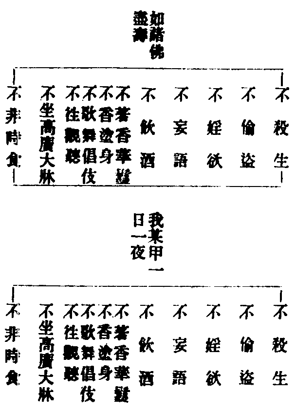

# 在家律要广集



> **藏经**：卍新纂大日本续藏经（新纂卍续藏）　**册次** 第 60 册（X60）　**编号** No. 1123-A在家律要廣集序（X1123）　**部类** 律疏部　**卷次** 3 卷　**篇幅** 159,819 字

> **卷／品**：0 卷 · 11 品



---



## 目录



  - [时道光四年甲申仲冬弥陀诞日真寂苾𫇴仪润源洪谨序](#时道光四年甲申仲冬弥陀诞日真寂苾𫇴仪润源洪谨序)

  - [序](#序)

  - [观心品第十](#观心品第十)

  - [发菩提心品第十一](#发菩提心品第十一)

  - [成佛品第十二](#成佛品第十二)

  - [归赞三宝分第一(此经西土圣贤所集，故先皈赞三宝，以求加被。)](#归赞三宝分第一此经西土圣贤所集故先皈赞三宝以求加被)

  - [轻重开遮分第三(内有四十)](#轻重开遮分第三内有四十)

  - [持戒获益分第四](#持戒获益分第四)

  - [无师自受分第五](#无师自受分第五)

  - [具五远离分第六](#具五远离分第六)

  - [如法忏悔分第七](#如法忏悔分第七)



---



秉无极二五之真精而成人，当思全其为人，而后无愧於天。人各得乎天之全，上智而下不能不蔽乎人欲，於是本性日漓，而天真日失。急思有以救之，如镜去滓而光依旧，水无风而波自平，非增其新，惟不减其故耳。复性归真之法，圣教曰克明，曰日新，而至善之区，则以佛门本来面目之谓也。失其本来，便换了面目，守此面目，则还其本来，不加不损，不即不离，得造上乘，即同至诚。方其自明而诚时，必有修持之力，严之以三戒，范之以五常，人事备而天心复，一日克己，天下归仁。易曰：不远复，无祇悔。其斯之谓欤？士希贤，贤希圣，圣希天。人为万物灵，皆可为尧舜。惟品不立而去圣远，流入邪侈，加以斵丧，良非得已。道在早为之所，俾人人知嫉邪崇正，反本还原，同游熙皡之天，此乐何极？佛教比邱，为尊儒重居士。居士者，处士也。士如处子，惟重始威，岂有不依名教，而得滥称居土者乎？佛制离三毒，即儒门三戒之去色、鬬、得也。受五戒，即五常之守仁、义、礼、智、信也。戒色不贪，戒鬬不瞋，戒得不痴，去恶而从善矣。仁不杀害，义不盗取，礼不邪淫，智不醉饮，信不妄语，无欲而见刚矣。更进之以发菩提心，持菩萨戒，轻重威仪，一一清净，人咸复其性，而不流於逸欲，斯为得之。夫在家居士，欲受五戒，先三归依，谓反妄归真，违恶依善。受三归依者，梵语称优婆塞，译曰近事男，谓亲近三宝，广修众善也。继之以五戒，名曰学处，以近事男所应学也。亦名学迹，以践此而得大智慧也。更称径路，以一切律仪，皆得转入也。复号学本，以一切所学，此为根本也。守是戒者，方成优婆塞之名。吾杭有大苾刍源洪大师者，发殷重慈，护大悲心，将陈子熙愿所增律要，广集校订而刊行之，能令在家珍重，得所遵循，五众出家，齐遵梵网，道共证乎三乘，法同登乎五分，本然之善，胥於是乎在。(潜)不敏，承赐兹编，谨献刍荛，现居士身者，当不以予言为呓语也。



道光四年仲冬长至日诏徵孝廉方正前陕西六品军功受菩萨优婆塞戒仁和弟子芝塘沈起潜了生稽首



No. 1123-B



在家律要者，灵峰蕅益大师之所集也。大师以慈愍故，既集释子切要之律，贻惠后学。复念在家二众，遵循有志，而寻讨维艰。乃更集在家律要，并各笺注。俾奉持者，依文解义，依义摄心。其法施之惠亦溥矣。夫律文浩瀚，律义深微。即吾释子，敬奉毗尼，留心讲习，尚难得一善本，体究行持。况於在家，以初发心之人，为素所未习之事乎。是此书诚为不可少者。惜年久板朽，传本绝少。故今之近事，不惟止作持犯之义，少有精解。即问伊何为归戒，何为开遮，亦茫无以应。真益陈君，有慨於此。欲因原集，增益重梓，以商於予。予亟怂恿之。越数月，君以广集，命予校订。见其无义不收，无法不备。而伦次之间，具有道理。始於四分归戒之从来，讫於梵网重轻之归宿。其中受三归五戒，略示仪则。厌离功德经，引入胜义护身经，十善业道经，戒消灾经，俱以护助奖劝，明其利益。五戒相经，委明五戒故误之相。八关斋戒，重申敬时加持之典。以上诸戒，根本律仪似周，次入大乘菩萨妙戒。若心地观经，无我义经，先以菩提心戒，为其戒体。受戒品威仪经，继以种种戒相，示其科条。至於梵网之后，并附忏仪。则以末法众生，障深慧浅，难持易犯。有此一法，使缺者复全，失者复得。庶几不甘废弃之人，得其自新之路，亦不可少也。是集也，一一佛祖，金科玉律，陈君固未甞措一词，即予亦何容赘一语。唯其搜罗之际，行布之次，将陈君微意，揭示於此。今而后受在家戒者，人奉一编，以时究心。即吾释子，亦宜案置，以备问难。洵可谓七众同资，三根普被矣。因乐为梓行，并增其题曰广集。



------



### 时道光四年甲申仲冬弥陀诞日真寂苾𫇴仪润源洪谨序



在家律要广集目录



------



### 序



卷第一(九经同册)四分律藏节录(陈增)  

附优婆塞受三归五戒法彚释  

三归五戒慈心厌离功德经(陈增)  

灌顶三归五戒带佩护身呪经(陈增)  

嗟韈曩法天子受三归依获免恶道经(陈增)  

十善业道经  

佛说戒消灾经  

佛说优婆塞五戒相经笺要  

佛说斋经注



卷第二(四经同册)大乘本生心地观经观心品发菩提心成佛品(陈增)  

外道问圣大乘法无我义经(陈增)  

优婆塞戒经受戒品笺要  

菩萨优婆塞五戒威仪经(附辩五则)



卷第三(二经同册)佛说梵网经心地品菩萨戒疏注节要  

梵网经忏悔行法  

书在家律要广集后



目录(终)



清　(源洪沙门　仪润优婆塞　陈熙愿)　增订



No. 1123-1 四分律藏(出龙藏籍字函　节录三十二卷　姚秦三藏佛陀耶舍共竺佛念译)陈增



尔时，世尊游波罗奈国。时，波罗奈国有族姓子，名耶输伽，父母止有此一子，愍念瞻视，不去目前。父母与设三时殿，春、夏、冬使其子常游戏其中，五欲娱乐。时，童子於五欲中极自娱乐已，疲极眠睡。眠睡觉已，即观第一殿，又见诸妓人所执乐器，纵横狼藉，更相荷枕，头发髼乱，却卧鼾睡，𬹼齿䆿语。见已恐怖，身毛为竖，即生厌离意，不欲与会：此为苦哉！有何可贪？即舍所居殿，更诣中殿，到彼观其殿舍，并妓人如前无异，倍生恐怖，身毛为竖，即生厌离，不欲与会：此为苦哉！有何可贪？即舍去，诣第三殿，所见亦复如上，倍生恐怖，身毛为竖，生厌离心，不欲与会，亦复如上，即还出殿，诣尸佉城门。时，尸佉门神遥见童子来，见已便生念：此童子来，必欲见如来，更无餘道，我当开门使去。即与开门。时，童子出尸佉城门已，诣婆罗河侧。到已，於河岸上解金屐，渡婆罗河，诣仙人鹿苑所。尔时，世尊在露处经行，遥见童子来，即敷座而坐。诸佛常法，圆光徧照，耶输伽童子遥见如来颜貌端正，生喜悦心，前至世尊所。到已白言：我今苦厄，无所归趣，愿救济我。佛告童子：来！此处无为，此处无厄，此处安隐，欲求永寂。无为者，欲尽、无爱、灭尽、涅槃也。尔时耶输伽童子礼世尊已，在一面坐。世尊渐与说法，劝令发欢喜心。所谓法者，布施、持戒、生天之法，呵欲不净，赞叹出离为乐。即於座上，诸尘垢尽，得法眼净，见法得法，成就诸法，自身得果证，前白佛言：我欲於如来所，净修梵行。佛言：比邱！来於我法中，快自娱乐，修梵行，尽苦原。时耶输伽即受具足戒，第一殿舍宫人妓女，尽皆睡觉已，求觅耶输伽不见，往至中殿求之亦不见，复至第三殿舍求索亦复不见。时诸宫人妓女，往至其母所白言：大家！今者耶输伽不知所在。时母即速疾至其父所告言：知不？今不知儿为何所在。时父在彼中殿前，沐浴梳头，速疾检发，即敕左右人言：於波罗奈国，断诸巷道。目出尸佉城门，至婆罗河所，见子金屐在河侧，便作是念：我子必当渡河。即寻迹渡河，往仙人鹿苑中。尔时如来遥见耶输伽父来，即以神力，使耶输伽父见佛，不见其子，至佛所白言：大沙门！颇见我子耶输伽不？佛言：汝今且坐，或当见汝子。耶输伽父念言：此大沙门甚奇甚特，乃见慰劳如是也。时耶输伽父礼佛足已在一面坐，世尊渐与说法令发欢喜心，呵欲不净赞叹出要为乐，即於座上诸尘垢尽得法眼净，见法得法成办诸法。自审得果证已，前白佛言：我今归依佛、归依法、归依僧，唯愿世尊听为优婆塞，自今已去尽形寿不杀生乃至不饮酒。是为最初优婆塞三自归(此处已有不杀生饮酒之文，则五戒亦当原始於此)，耶输伽父为首。尔时世尊与耶输伽父说法，时耶输伽身漏尽意解，得无碍智解脱。尔时世间有七罗汉，弟子有六(时已度阿若憍陈如等五比邱，与耶输伽为六)，佛为七。尔时世尊即摄神足，使耶输伽父见子去佛不远坐，即到耶输伽所语言：汝母在后失汝不知所在，极怀愁忧乃欲自害，汝可往瞻省勿令自害。时耶输伽瞻视世尊颜，时世尊告耶输伽父言：云何族姓子学智学道，诸尘垢尽得法眼净？作如是观已，有漏心得解脱。云何长者！汝已舍欲，还复能习欲不耶？对曰：不也。如是耶输伽族姓子已学智学道，诸尘垢尽得法眼净。彼作如是观已，有漏心得解脱，终不复习欲，如本在俗时也。今耶输伽族姓子善获大利，学智学道无漏心解脱，诸尘垢尽得法眼净。作是观已，有漏心解脱。唯愿世尊今受我请，及耶输伽并侍比邱。尔时世尊默然受请。然耶输伽不肯受别请，世尊未听我受别请。佛言：自今已去听受别请。请有二种：有僧次请、有别请。时耶输伽父知如来默然受请，即从座起礼佛足而去，语耶输伽母及其本二言：汝今知不？耶输伽身在大沙门所修梵行，我今日请大沙门及耶输伽侍从后来。汝今知时，可供办所须。耶须伽母及其本二即办具种种所须饮食已，往白时到。尔时世尊到，时著衣时钵，耶输伽侍从通已，二人往其父舍，到已就座而坐。时耶输伽母及本二奉世尊种种所须饮食，食讫摄钵，更取一小座於如来前坐。尔时世尊渐次与说微妙法，劝令发欢喜心，即於座上诸尘垢尽得法眼净，见法得法成就诸法，即白佛言：自今已去归依佛法僧，听为优婆夷。我自今已去尽形寿不杀生乃至不饮酒。是谓最初受三自归优婆夷，耶输伽母及其本二为首。时世尊与耶输伽母及其本二说法已，即从座起而去。



四分律藏节录(终)



No. 1123-2 附优婆塞受三归五戒法



古吴比邱　智旭　彚释



初受三归法



(本应自说，如或不能，师应教授。)



我某甲，尽形寿归依佛，归依法，归依僧。(三说。)我某甲，尽形寿归依佛竟，归依法竟，归依僧竟。(三说。)



萨婆多论云：以三宝为所归，欲令救护，不得侵凌故也。归依佛者，归於法身，谓一切智无学功德，五分所成。归依法者，归於自他尽处，谓断欲无欲，灭谛涅槃。归依僧者，归於第一义僧，谓良祐福田，声闻学无学功德也。(投心正教，翻破邪归。故有结云：从今以徃，称佛为师，更不归依天魔外道等。此则反邪归正之初门，尚未受行戒法，名为但三归优婆塞。然既归依三宝，必须断恶修善，岂容淫杀盗妄，一任旧习者也。)按此乃翻前邪归而归正，故名翻邪三归。律无受法，诸论具出，今准取之。又龙畜鬼神，不能受五戒者，惟得受三归依，及八关戒斋一日夜耳。然此三归，即是一切戒之本源。五戒、八戒、十戒，皆於说三归竟之时，便得无作戒体。比邱菩萨律仪，亦缘三宝而发无作。故虽初门，实通奥义。该罗四教，收括六即，须略明之。言四教者，谓藏、通、别、圆。此之四教，各论三归。初藏教者，(破前邪执，归心三宝，即藏教三归。)佛在世时，树王得道为佛宝，说四谛法为法宝，度五比邱等为僧宝。佛灭度后，范金合土，纸素丹青为佛宝。黄卷赤牍为法宝。剃发染衣为僧宝。由金土等像，表示一切智五分功德。由黄卷赤牍，诠显灭谛涅槃。由剃染缁流，修证声闻功德。能表能诠能修者，名为住持三宝。所表所诠所证者，名为胜义三宝。事不即理，故须双归事理二种三宝，皆令救护，不被邪外所侵凌也。二通教者，(了邪非实，体会三宝，即通教三归。)一切形像，同於真空。一切经卷文字，无非解脱。一切缁流，即学无学，幻化无生，无二性故。归事即是归理，理事不二，所以不得侵凌也。三别教者，(翻破无量邪惑，承事无量三宝，即别教三归。)莲华台藏，圆满报身，名佛宝。十二部经，诠三谛理，名法宝。三贤十圣，自利利他，为僧宝。归此三宝，则能翻破见思尘沙无明三惑，不被界内界外八魔八倒所侵凌也。四圆教者，(观邪惑即妙境，悟三宝本一体，即圆教三归。)现前一念能觉之心，名佛宝。现前一念所觉之境，名法宝。心境本来无二，名僧宝。究竟悟此一念三宝者，名为佛。种种诠此一念三宝者，名为法。秉佛所说之法，研此一念三宝者，名为僧。全理成事，全事即理。举一即三，言三即一。归此一体事理三宝，则能圆翻三惑，圆摄界内界外魔倒而作佛事，不被侵凌也。略明四教竟。言六即者，四教皆得，义论六即。前三是权，姑置不论。今但约圆，谓一切众生惑业苦三体，是不可思议三德秘藏。苦即法身，五阴色心，本如来藏妙真如性，如冰即水故。惑即般若，见思无明，本无内外中间诸相，如劳即目故。业即解脱，有漏缚著，本无能缚及所缚者，如拳即手故。法身是法宝，般若是佛宝，解脱是僧宝。蠢动含灵，无不具足惑业苦三，则是无不具足三宝德相。但由迷隔，日用不知。虽复不知，终不能越此理之外，故为理即三归。(一切众生具足三宝体性，在迷不觉，亦不相离，理即三归。)若闻名生解，知此果地三德，全证众生三障理体，实无生灭垢净增减，则为名字三归。(剏闻妙理，毕志栖心，名字三归。)以此圆解而修圆观，圆伏五住，则为观行三归。(念念体会三德秘藏，观行三归。)由此圆观而净六根，则为相似三归。(法性理现，六根清净，相似三归。)由此圆观而发无漏，三因开显，则为分证三归(破无明，显三德，分证三归)。由此圆观而圆三德，称本理性，无欠无餘，则为究竟三归也(圆满菩提，觉法自性，始本不二，理智一如，究竟三归。是以法无深浅，深浅在人，莫离初步而谈千里也。　下诸戒品，皆含此意)。三归既有四教六即，当知五戒八戒等，无不例然，可准思之。　问：但三归法(尚未受戒，名为但三归)，可止归一二否？又此法为复全収六道？为复止许人伦？於人伦中，亦有不应受者否？若受后有犯，云何忏悔？答：佛初成道，为龙王及二商人说法，教令尽未来比邱僧，即唱三归。今若止归一二，不名归也。三归之法，惟地狱剧苦，不能秉受。设或知归，便应离苦。其餘五道，总无遮难。若更归依邪魔外道，名失三归。后能返邪，亦所听许。非如受具，复入外道，为重难也。　问：受但三归，得无作戒否？倘或杀盗婬妄，为破戒否？答：受五戒八戒十戒者，说三归时，即云尽寿为优婆塞，一日一夜为净行优婆塞，随如来出家等，故发无作也。今受但三归者，本不受戒，自无所发。既未发戒，亦无破戒之罪，然有世间性罪也。



次受五戒法



(律中受五戒者，皆是向师自说，非从师受。亦无问遮难事。优婆塞戒经，自是大乘一途。宣公虽引用之，今似不宜窜入。盖重难轻遮，惟出家戒须问。以僧宝体尊，故加慎重。若五戒便先致问，则出家受具，何必又问耶？设欲问者，但问五逆，及自破净戒，破他净戒七事可耳。至於一分，乃至满分，自可量力受持。若夫临时开导，贵在随机，法无一定。不应预拟成言，俾授者仅事读文，听者了不解旨也。○一戒为一分，二戒为少分，三戒为半分，四戒为多分，五戒为满分。应随所受称之，不应混滥。戒经云：若受三归，持二戒已，若破一戒，是名无分。)



我某甲，归依佛、归依法、归依僧，尽形寿为(一满)分优婆塞如来、至真、等正觉，是我世尊。(三说)



我某甲，归依佛竟，归依法竟，归依僧竟，尽形寿为(一满)分优婆塞，如来、至真、等正觉，是我世尊。(三说)



若善女人，即称优婆夷。



如诸佛尽寿不杀生，我某甲亦尽寿不杀生。  

如诸佛尽寿不偷盗，我某甲亦尽寿不偷盗  

如诸佛尽寿不婬欲，我某甲亦尽寿不邪婬。  

如诸佛尽寿不妄语，我某甲亦尽寿不妄语。  

如诸佛尽寿不饮酒，我某甲亦尽寿不饮酒。



随受几戒，则语几戒，亦不应混滥也。



以此受戒功德，回向无上菩提。四恩总报，三有齐资。普与众生，同生净土。



萨婆多论云：优婆塞者，秦言离恶修善，亦名亲近。又云：受三归竟，已得五戒。所以说五戒名者，欲使前人识五戒名字故。又云：若破重戒，更无胜进，后还舍戒，后更受者，更不得戒也。(未破则可舍，已破则无可舍，舍则可更受，破则不可更受，所以名为边罪也。永弃佛海边外，名为边罪。既不得律仪戒，则禅戒、无漏戒，一切不得。然则受戒者，可不深心护持根本重罪也哉！)优婆塞戒经云：夫禁戒者，悉於一切可杀、不可杀中得。一切可杀、不可杀者，无量无边。戒之果报，亦复如是，无量无边。　若有说言：离五戒已，度生死者，无有是处。　是菩提道初根本地，名之为戒。如是戒者，亦名初地，亦名导地，亦名平地，亦名等地，亦名慈地，亦名悲地，亦名佛迹，亦名一切功德根本，亦名福田。以是因缘，智者应当受持不毁。　大般涅槃经云：戒是一切善法梯邓，亦是一切善法根本。如地悉是一切树木所生之本，是诸善根之最导首，如彼商主导诸商人。戒是一切善法胜𣄢，如天帝释所立胜𣄢。戒能永断一切恶业及三恶道，能疗恶病，犹如药树。戒是生死险道资粮，戒是摧结恶贼铠仗，戒是灭结毒蛇良呪，戒是度恶业行桥梁。



问：萨婆多论云：若破重戒，更无胜进。然设在家已受五戒，或受一日一夜八关戒斋，烦恼现前，犯不可悔罪，后求出家，诚心忏悔，还许剃度，并受具否？答：萨婆多论自是通途轨式，凡受戒者，皆应专精护持。设有毁犯，便从堕落，岂能更有胜进？至於忏悔，则无罪不灭，乃诸佛格外深慈。必须依经如法行道，极其诚恳，方通一线，不可视作等闲也。



此三归五戒，约受者自说，而略录之。若在师前受，金陵华山，杭州昭庆，皆有授居家二众。三归正范，及五戒正范，流通已久，兹不录。又据正范，若在长老比邱所受，依范全用。若是比邱，未任方丈，或二三同修，或自独处，或比邱尼，式叉尼，沙弥，沙弥尼，偶有善信，发心求受三归，或求受五戒者，只须从开导，与之受归受戒，及发愿而已。餘仪不必全用，或依此略录亦可。既三归五戒，当发慈心，愍念众生，及厌世无乐，故进之以厌离经。



No. 1123-3 三归五戒慈心厌离功德经(出龙藏善字函)陈增



失译人名今附东晋录



闻如是：一时，佛在舍卫国祇树给孤独园。佛为阿那邠邸长者说：过去久远有梵志，名毗罗摩，饶财多宝。若布施时，用八万四千金钵盛满碎银，八万四千银钵盛满碎金；复以八万四千金银澡罐；复以八万四千牛，皆以金银覆角；复以八万四千玉女，庄严具足；复以八万四千卧具，众彩自覆；复以八万四千衣裳；复以八万四千象马，皆以金银鞍勒；复以八万四千房舍布施；复於四城门中布施，随其所欲，皆悉与之；复以一房舍施招提僧。如上施福，不如受三自归。所以然者，受三归者，施一切众生无畏，是故归佛、法、僧，其福不可计量也。如上布施及受三归福，复不如受五戒福；受五戒者，功德满具，其福胜也。如上布施及受三归、五戒福，复不如弹指顷慈念众生福也。如上布施及受三归、五戒慈念众生福，复不如起一切世间不可乐想福。所以然者，起一切世间不可乐想福，能令行者灭生死苦，终成佛道，故其福最胜也。尔时，长者闻佛所说，欢喜奉行。



三归五戒慈心厌离功德经(终)



(按灌顶部，即以护戒神王名，为呪律藏所摄也。)



No. 1123-4 灌顶三归五戒带佩护身呪经(出龙藏恭字函大灌顶神呪部)陈增



东晋西域三藏帛尸黎密多罗译



闻如是：一时，佛在舍卫国祇树给孤独园。时与千二百五十比邱，菩萨万人，天龙八部，悉来在会，咸然一心，叉手听法。於是异道，有鹿头梵志，来到佛所，稽首作礼，胡跪合掌，白佛言：久闻瞿昙，名声远振，今欲舍置异学，受三自归，并五戒法。佛言：善哉！善哉！梵志！汝能舍置餘道，归命我者，当自悔过生死之罪，其功无量，不可称计。梵志言：诺！受教。即净身口意，复作是念：唯愿世尊，施我法戒，终身奉行，不敢毁缺。佛言：是为如来、至真、等正觉，三世诸佛，说是戒法。佛言：梵志！谛听！谛受！心持念之。又言：梵志！尽形寿归命诸佛无上尊，尽形寿归命法离欲尊，尽形寿归命僧众中尊。佛言：梵志！以三自归竟，是为真正弟子，不为邪恶所干娆也。佛告梵志：汝能一心受三自归已，我当为汝及十方人，敕天帝释所遣诸鬼神，以护男子女人等辈，受三归者。梵志因问佛言：何等是也？愿欲闻之，开化十方诸受归者。佛言：如是，灌顶善神！今当为汝略说三十六神。



四天上遣神，名弥栗头不罗婆(此言善光)，主疾病。  

四天上遣神，名弥栗头婆呵娑(此言善明)，主头痛。  

四天上遣神，名弥栗头婆逻波(此言善力)，主寒热。  

四天上遣神，名弥栗头抗陀罗(此言善月)，主腹满。  

四天上遣神，名弥栗头陀利奢(此言善见)，主痈肿。  

四天上遣神，名弥栗头阿娄呵(此言善供)，主颠狂。  

四天上遣神，名弥栗头伽婆帝(此言善舍)，主愚痴。  

四天上遣神，名弥栗头悉坻哆(此言善寂)，主瞋恚。  

四天上遣神，名弥栗头菩提萨(此言善觉)，主淫欲。  

四天上遣神，名弥栗头提波罗(此言善天)，主邪鬼。  

四天上遣神，名弥栗头呵娑帝(此言善住)，主伤亡。  

四天上遣神，名弥栗头不若罗(此言善福)，主冢墓。  

四天上遣神，名弥栗头苾阇伽(此言善术)，主四方(字略残缺，疑是善术)。  

四天上遣神，名弥栗头伽𨽻娑(此言善帝)，主怨家。  

四天上遣神，名弥栗头罗阇遮(此言善主)，主偷盗。  

四天上遣神，名弥栗头修乾陀(此言善香)，主债主。  

四天上遣神，名弥栗头檀那波(此言善施)，主劫贼。  

四天上遣神，名弥栗头支多那(此言善意)，主疫毒。  

四天上遣神，名弥栗头罗婆那(此言善吉)，主五瘟。  

四天上遣神，名弥栗头钵婆䭾(此言善山)，主蜚尸。  

四天上遣神，名弥栗头三摩䭾(此言善调)，主注连。  

四天上遣神，名弥栗头戾禘䭾(此言善备)，主注复。  

四天上遣神，名弥栗头波利陀(此言善敬)，主相引。  

四天上遣神，名弥栗头波利那(此言善净)，主恶党。  

四天上遣神，名弥栗头虔伽地(此言善品)，主蛊毒。  

四天上遣神，名弥栗头毗棃驼(此言善结)，主恐怖。  

四天上遣神，名弥栗头支陀那(此言善寿)，主厄难。  

四天上遣神，名弥栗头伽林摩(此言善逝)，主产乳。  

四天上遣神，名弥栗头阿留伽(此言善愿)，主县官。  

四天上遣神，名弥栗头阇利陀(此言善固)，主口舌。  

四天上遣神，名弥栗头阿伽䭾(此言善照)，主忧恼。  

四天上遣神，名弥栗头阿诃婆(此言善生)，主不安。  

四天上遣神，名弥栗头娑𪱳逻(此言善至)，主百恠。  

四天上遣神，名弥栗头波利那(此言善藏)，主嫉妬。  

四天上遣神，名弥栗头固陀那(此言善音)，主呪咀。  

四天上遣神，名弥栗头韦䭾罗(此言善妙)，主厌祷。



佛语梵志：是为三十六部神王。此诸善神，凡有万亿恒沙鬼神以为眷属，阴相番代，以护男子、女人等辈。受三归者，当书神王名字，带在身上，行来出入，无所畏也，辟除邪恶，消灭不善。梵志言：诺！唯唯！天中天！梵志又白佛言：世尊！以赐三自归法，天帝遣善神三十六大王护助我身，已𫎇世尊哀愍救度，今更顶礼，请受法戒。佛言：善哉！梵志！汝当净身、口、意，恳恻至心，敬受法戒。佛言：十方三世如来、至尊、等正觉，皆由三归、五戒得之。佛言：梵志！尽形寿不杀生，不教他杀，是戒能持不？若能持者，有五神王随逐护汝身，不令邪神、恶鬼之所得便。梵志！尽形寿不盗他人财宝，不教他行盗，是戒能持不？若能持者，有五善神王随逐护汝身。梵志！尽形寿不邪婬，是戒能持不？若能持者，有五神王随逐护汝身，众魔皆不得便。梵志！尽形寿不妄言、绮语、两舌、鬬乱，是戒能持不？若能持者，有五神王随逐护汝身。梵志！尽形寿不饮谷酒、甘蔗酒、葡萄酒、能放逸酒，如是酒皆不得饮，是戒能持不？若能持者，有五善神随逐护汝身。佛语梵志：是为三归五戒法也，汝善持之，勿有毁犯。说已，梵志因白佛言：世尊！世尊说言：若持五戒者，有二十五善神营卫护人身，在人左右，守於宫宅门户之上，使万事吉祥。唯愿世尊为我说之。佛言：梵志！我今略演勅天帝释，使四天王遣诸善神营护汝身。如是章句善神名字，二十五王其号如是。



神名察刍毗愈他尼，主护某身辟邪除恶。　神名输名利输陀尼，主护某身六情悉令完具。　神名毗娄遮那波，主护某腹内五藏平调。　神名阿陀龙摩坻，主护某血脉悉令通畅。　神名婆罗桓尼和婆，主护某指无所毁伤。　神名坻摩阿毗婆䭾，主护某出入行来安宁。　神名阿修输婆罗陀，主护某所噉饮食香甘。　神名婆罗摩亶雄雌，主护某梦安觉欢悦。　神名波罗门地鞞哆，主护某不为蛊毒所中。　神名那摩吁多耶舍，主护某不为雾露恶所害。　神名佛䭾仙陀娄哆，主护某鬬诤口舌不行。　神名鞞阇耶薮多婆，主护某不为温疟恶鬼所持。　神名涅坻醯䭾哆耶，主护某不为县官所得。　神名阿逻多赖都耶，主护某舍宅四方逐凶殃。　神名波罗那佛昙，主护某平定舍宅。八神：　神名阿提梵者珊耶，主护某不为冢基鬼所娆。　神名因台罗因台罗，主护某门户辟除邪恶。　神名阿伽岚施婆多，主护某不为外鬼神所害。　神名佛昙弥摩多哆，主护某不为灾火所延。　神名多赖叉三密陀，主护某不为偷盗所侵。　神名阿摩罗斯兜嘻，主护某若入山林不为虎狼所害。　神名那罗门阇兜帝，主护某不为伤亡所娆。　神名萨鞞尼乾那波，主护某除诸鸟鸣狐鸣。　神名荼鞞鬬毗舍罗，主护某除大鼠变恠。　神名伽摩毗那阇尼佉，主护某不为凶注所牵。



佛告梵志言：若男子、女人，带佩此二十五灌顶章句善神名者，若入军阵鬬诤之时，刀不伤身，箭射不入，鬼神、罗刹终不娆近；若到蛊道家，亦不能害；若行来出入，有小魔鬼，亦不得近。带佩此神王名者，昼夜无恶梦，县官、盗贼、水火、灾恠、怨家、阴谋、口舌、鬬乱，自然欢喜，两作和解，俱生慈心，恶意悉灭；妖魅、魍魉、邪忤、薜茘、外道、符呪、厌祷之者，树木精魅、百虫精魅、鸟兽精魅、溪谷精魅、门中鬼神、户中鬼神、井灶鬼神、洿池鬼神、厕溷中鬼，一切鬼神，皆不得留住某甲身中。若男子、女人，带此三归五戒善神名字者，若入山林、溪谷、旷路，抄贼自然不现，师子、虎狼、熊罢、蛇蚖，悉自缩藏，不害人也。佛告梵志：昔迦罗奈大国，有婆罗门子，名曰执持，富贵大姓，不奉三宝，事九十五种之道，以求福祐。久久之后，闻其国中，有贤善长者，尽奉佛、法、圣僧化导，皆得富贵、长寿、安隐，又能度脱生、老、病、死，受法无穷，今世、后世，不入三恶道中。执持长者，作是念言：不如舍置餘道，奉敬三宝。即便诣佛，以头面著地，为佛作礼，长跪白佛言：世尊！我本愚痴，无所识知，久闻三宝，不能奉事，我於今日，始得信解。佛法大慈，普济天下，我今欲舍置餘道，归命於佛，惟愿天尊，哀愍我等，得受法戒，为清信士。佛言：汝善思量之也。然人能止恶为善者，何忧不得安隐富贵，寿命延长，解脱众难者乎？执持白佛言：今我以所事非真，故归命於佛耳。当哀愍我故，去浊秽之行，受佛清净决言。佛语执持：汝审能尔者，可礼敬三宝。执持长者，即便胡跪合掌。佛於是与受三归已，归三宝竟，当有三十六善神王，随逐护汝身。佛告执持言：善男子！汝能远恶，求善知识，世之希有，我当更授汝五戒之法。佛言：第一不杀，第二不盗，第三不邪婬，第四不两舌、恶口、妄言、绮语，第五不饮酒。长者执持，已受三归及五戒竟，佛语长者：汝能持是归戒，游行之处，可无所畏。戒神二十五，归神有三十六，常随护汝，外诸恶鬼，无敢当者。长者从受归佛戒竟，佛为说法，欢喜信解，礼佛而去。於是以后，长者执持，到他国中，见人杀生，盗人财物；见好色女，贪爱恋之；见人好恶，便论道之；见饮酒者，便欲追之。心意如是，无一时定，便自念言：悔从佛受三归五戒重誓之法。作如是念：我当还佛三归五戒之法。即诣佛所，而白佛言：前受三归五戒法，多所禁制，不得复从本意所作。今自思维，欲罢不能事佛，可尔以不？何以故？佛法尊重，非凡类所事，当可还法戒不乎？佛默然不应。言犹未绝，口中便有自然鬼神，持铁椎拍长者头者；复有鬼神，解脱其衣裳者；复有鬼神，以铁钩就其口中曳取其舌者，有婬女鬼以刀探割其阴者，又有鬼神烊铜沃其口中者，前后左右有诸鬼神竞来分裂，取其血肉而噉食之。长者执持恐怖战掉，无所归投面如土色，又有自然之火焚烧其身，求生不得求死不得，诸鬼神辈急持长者不令得动。佛见如是哀愍念之，因问长者：汝今当复云何？长者口噤不能复言，但得举手自搏而已。从佛求哀，佛便以威神救度长者。诸鬼神王见佛世尊以威神力救度长者，各各住立一面。长者於是小得苏息，便起叩头前白佛言：我身中有是五贼，拏我入三恶道中，坐欲作罪违负所受，愿佛哀我。佛言：汝自心口所为，当咎阿谁？长者白佛：我从今日改往修来，奉受三归及五戒法，持月六斋、岁三长斋，烧香散华悬杂旛盖供事三宝，从今以去不斯复犯破归戒法。佛言：如汝今所言者是为大善，汝今眼所见身所更，自作自得非天授与。佛语长者：汝今受是三归五戒，莫复如前受归戒法也。破是归戒名为再犯，若三犯者为五官所得便，辅王小臣都录监司五官使者之所得便，收神录命皆依本罪。是故我说是言，令清信士女劝受归戒。归有三十六鬼神之王随逐护助，戒有二十五神营护左右门户之上辟除凶恶。六天之上天帝所遣归戒之神，凡有亿亿恒沙之数诸鬼神王，番代拥护，不令衰耗。诸天欢喜，皆言：善哉！当共护之。如是持戒若完具者，十方现在无量诸佛、菩萨、罗汉，皆共称叹是清信士女。临命终时，佛皆分身而往迎之，不使持戒男子、女人堕恶道中。若戒羸者，当益作福德，布施、持戒、忍辱、精进、一心、智慧，然灯烧香，散杂色华，悬缯旛葢，歌咏赞叹，恭敬礼拜，益持斋戒，亦得过度。若不能如上修行如是功德，复持戒不完，向诸邪道求觅福祐，三归、五戒，亿亿恒沙诸鬼神王各去离之，恶鬼数来娆近之也。因衰致病，耗乱其家，起诸病痛，遂致丧亡，财物不聚，所向不偶，死复还堕地狱之中。虽戒具足，不持六斋，犹华树无果，妇人不产，种谷不滋，治生无利，折耗失本，更无衣帻。不持斋戒，无利如是。佛言：长者！人犯所受，破是归戒，凡为天上二百七十神王之所得便，更非外魔所得便也。此诸鬼神视人善恶，若持禁戒不毁犯者，开人心意，示人善恶。人若不善，便为作害，疏记善恶，奏上天王。大王执持，随罪轻重，尽其寿命，如法苦治，不令有怨，使破戒者甘心受之。佛告梵志：长者执持，舍彼异道，於我法中受持归戒，心不安定而复破犯，遂为鬼神之所得便，受诸痛苦。今日悔责，求哀忏谢，改更修善，作诸福德，灭诸恶海，今皆得道。合家大小宗族之中，见长者执持罪福报应，悉从我受三归五戒，坚持不犯，皆得法眼。我今於此会中，广说长者宿命因缘，明验罪福，亦於后世，广宣流布，使得闻知。佛语梵志：若有清信士、清信女，若为邪神恶鬼所得便者，若横为县官所罗，盗贼剥夺，遇大疾病厄难之日，当洗浴身体，男子著单衣白袷，女当素衣，澡潄口齿，七日七夜，长斋菜食，敷好高座，悬缯旛葢，香汁洒地，烧栴檀香，一日七转，赞咏此灌顶大章句经，如是妙典，至真秘藏，消灭一切无量灾变。梵志白佛言：天中天！已为我故，及十方众生，说三归五戒鬼神名竟。若男子、女人，欲受归戒者，当云何授与？佛言：若人欲受，先礼十方佛，长跪叉手，作如是言：我弟子某甲，尽形寿受三归五戒，诸佛菩萨、真人圣众，哀念我等。梵志又问：受归戒法，有差别不？佛言：无差别也。若人受者，先当列三归五戒之法，然后以神王名字，著归戒下，以好素帛，书持此神王名字，带持而行。行当烧香，礼敬十方佛，当取月八日、七日持斋。若欲行来，常著身上，若著顶上，若著𮌎前，若恶魔相逢，无不除却。若男子、女人，著此三归五戒善鬼神王名字之时，若入神祠，是诸邪神，悉皆惊起，为其人作礼。何以故？此人带持诸佛所说三归五戒神名字故。佛语梵志：此归戒鬼神名字，至尊至重，诸佛护念，汝好宣行之。



佛说如是。阿难从座而起，前白佛言：演说此法，当何名之？佛告阿难：是经名为灌顶章句归戒带佩。佛说是经竟，四众人民、天龙八部、一切鬼神，皆大欢喜，作礼奉行。



佛说灌顶三归五戒带佩护身呪经(终)



此灌顶部有十二经，兹第一也。第二七万二千神王护比邱呪经，第三十二万神王护比邱尼呪经，第四百结神王护身呪经，第五宫宅神王守镇左右呪经，第六冢墓因缘四方神呪经，第七伏魔封印大神呪经，第八摩尼罗亶大神呪经，第九召五方龙王摄疫毒神呪经，第十梵天神䇿经，第十一随愿往生十方净土经，第十二拔除过罪生死得度经，即药师经也。　以上共四种，明三归五戒顿受竟。此下共五经，明三归五戒，次进之渐受也。



No. 1123-5 嗟韈曩法天子受三归依获免恶道经(出龙藏则字函)陈增



宋西天中印度三藏传教大师法天奉诏译



如是我闻：一时，世尊在舍卫国祇树林给孤独园，与大苾𫇴众俱。是时，有一天子名嗟韈曩法，天报将尽，惟餘七日，而乃先现五衰之相，身无威德，垢秽旋生，头上华鬘咸悉萎萃，诸身分中臭气而出，两腋之下悉皆汗流。时，嗟韈曩法由是之故，不乐本座，宛转於地，悲哀啼泣，而作是言：苦哉！苦哉！曼那吉你池。苦哉！苦哉！洗浴之池。苦哉！苦哉！宝车与麤恶，欢喜杂林等，如是诸园苑，不复更游戏。苦哉！苦哉！跛里耶多罗迦华永不采摘，杂宝柔輭之地永不履践。苦哉！苦哉！天众妓女端严殊妙，常所侍卫，今相舍离。是时，有餘天子见斯事已，往帝释所，白言：天主！彼嗟韈曩法五衰现前，命餘七日，宛转在地，悲哀啼泣，作如是言：苦哉！苦哉！曼那吉你洗浴等池。苦哉！苦哉！宝车及麤恶，欢喜杂林等，如是诸园苑，不复更游戏。苦哉！苦哉！跛里耶多罗迦华永不采摘，杂宝柔輭之地永不履践。苦哉！苦哉！天众妓女端严殊妙，常所侍卫，今相舍离。天主！我见是已，心甚伤切，故来告白。尔时，帝释天主心悲愍故，往嗟韈曩所而告之言：天子！云何而汝贤者宛转於地，悲哀啼泣，说诸苦事，伤动见者？时，嗟韈曩法忽闻是语，从地而起，整服肃容，合掌而立，白帝释言：天主！我今寿命惟餘七日，命终之后堕阎浮提王舍大城，以宿业故而受猪身。天主！既受彼身，於多年中食噉粪秽，我观此苦，是故愁忧。尔时，帝释天主闻是语已，心甚悲愍，告嗟韈曩法天子言：贤者！汝可诚心归命三宝，应作是言：归依佛两足尊，归依法离欲尊，归依僧众中尊。时，彼嗟韈曩法天子以死怖故，畏傍生故，白帝释言：憍尸迦！我今归依佛两足尊，归依法离欲尊，归依僧众中尊。时，彼天子受三归已，心不间断，以至命终。诸天之法，下智有见，不能观上。时，帝释天主观彼天子生於何处？为生南阎浮提王舍大城，受猪身耶？为不受猪身？尽彼天眼观之不见。又观傍生、鬼界，亦复不见。又观娑诃世界、人间，亦复不见。乃至四大王众天及忉利天，尽彼观察，都不能见。尔时，帝释天主既不见已，心生疑虑。於是，帝释往祇树林，诣世尊所，顶礼佛足，退坐一面，白佛言：世尊！彼嗟韈曩法天子五衰现前，命在七日，宛转在地，悲哀啼泣，说诸苦事，伤动见者。我时到彼，见此事已，而问之言：云何，贤者！悲啼懊恼，憔悴若此？时，嗟韈曩法而告我言：我今寿命惟餘七日，命终之后堕阎浮提，生王舍城而受猪身，於多年中以诸粪秽而为食噉。我闻此说，心极悲愍，乃告之言：今汝，贤者！欲脱斯苦，当归命三宝，作如是言：归依佛，两足尊！归依法，离欲尊！归依僧，众中尊！时，嗟韈曩法以死怖故，畏傍生故，而白我言：我今归依佛，两足尊！归依法，离欲尊！归依僧，众中尊！时，嗟韈曩法受三归竟，而后命终。世尊！我今不知彼嗟韈曩法托生何处？尔时，世尊以正徧知告帝释言：憍尸迦！今嗟韈曩法天子已生覩史多天，受五欲乐。尔时，帝释天主闻佛语已，欢喜踊跃，心意快然，诸根圆满，即於佛前说伽陀曰：



若归依於佛，彼不堕恶道，弃舍人身已，当获得天身。  

若归依於法，彼不堕恶道，弃舍人身已，当获得天身。  

若归依於僧，彼不堕恶道，弃舍人身已，当获得天身。



复说伽陀曰：



诚心归命佛，彼人当所得，若昼若夜中，佛心常忆念。  

诚心归命法，彼人当所得，若昼若夜中，法力常加持。  

诚心归命僧，彼人当所得，若昼若夜中，僧威常覆护。



尔时，帝释天主说伽陀已，世尊印言：如是，如是！



归命佛法僧，定不堕恶道，弃舍人身已，当获得天身。



尔时，世尊说伽陀曰：



若佛陀二字，得到於舌上，同彼归命等，不虗过一生。  

若达磨二字，得到於舌上，同彼归命等，不虗过一生。  

若僧伽二字，得到於舌上，同彼归命等，不虗过一生。



又说偈言：



佛法僧名若不知，彼人最下故不获，轮回宛转而久处，如迦尸华住虗空。



佛说是经已，诸苾刍众、天帝释等一切大众，欢喜信受，作礼而退。



嗟韈曩法天子受三归依获免恶道经(终)



问：受归戒有顿渐二仪，究竟以何为准定？答：佛世多利根，机动便感，故可顿受。末世浇漓，授受宜慎，应从渐制。所以律制诸授戒正范，皆先预设引导之仪，使其不失造次之节。藉斯胜缘，助生正信。次则敷座如制。座上先供佛像，次僧礼座就登，以表三宝一座齐彰。佛像是佛宝，所说归戒是法宝，僧代佛说是僧宝。令彼受者，三业俱敬。佛先僧后，事仪当然。五百问经云：若僧先升法座，而后寄佛在上，则不可。故须如制也。次则开导发心，令其心意广大，断恶修善，自度度人，名上品心，得上品归戒。若只愿自脱生死，全无度人誓愿，名中品心，得中品归戒。若志意狭劣，只求不堕三途，仍生人天。或心散乱，但得归戒守持，名下品心，得下品归戒。然心与归戒，虽各有三，皆以十善为依。修十善，亦有上中下之别。次请三宝以作证明，次当忏悔以洗罪愆，然后可受三归。或三年一年，极少四月，方许进受五戒。深明开遮持犯，一一清净，方许进受菩萨大戒。此乃遵佛遗敕，不许躐等。或有利根欲顿受者，亦须次第别时。如寅时授三归，回向已，至午时授五戒。餘亦例此增进。



No. 1123-6 十善业道经(出明藏初字函)



唐于阗三藏法师　寔叉难陀　译



如是我闻：一时，佛在娑竭罗龙宫，与八千大比邱众、三万二千菩萨摩诃萨俱。尔时，世尊告龙王言：一切众生心想异故，造业亦异，由是故有诸趣轮转。龙王！汝见此会及大海中，形色种类各别不耶？如是一切，靡不由心造善不善、身业语业意业所致，而心无色不可见取，但是虗妄诸法集起，毕竟无主无我我所，虽各随业所现不同，而实於中无有作者，故一切法皆不思议自性如幻。智者知已应修善业，以是所生蕴处界等，皆悉端正见者无厌。龙王！汝观佛身从百千亿福德所生，诸相庄严光明显曜蔽诸大众，设无量亿自在梵王悉不复现，其有瞻仰如来身者岂不目眩？汝又观此诸大菩萨妙色严净，一切皆由心习善业福德而生；又诸天龙八部众等大威势者，亦因善业福德所生。今大海中所有众生，形色麤鄙或大或小，皆由自心种种想念，作身语意诸不善业，是故随业各自受报。汝今常应如是修学，亦令众生了达因果修习善业。汝当於此正见不动，勿复堕在断常见中，於诸福田欢喜敬养，是故汝等亦得人天尊敬供养。龙王！当知菩萨有一法，能断一切诸恶道苦。何等为一？谓於昼夜常念思惟观察善法，令诸善法念念增长，不容毫分不善间杂，是即能令诸恶永断、善法圆满，常得亲近诸佛、菩萨及餘圣众。言善法者，谓人天身、声闻菩提、独觉菩提、无上菩提，皆依此法以为根本而得成就，故名善法。此法即是十善业道。何等为十？谓能永离杀生、偷盗、邪行、妄语、两舌、恶口、绮语、贪欲、瞋恚、邪见。龙王！若离杀生，即得成就十离恼法。何等为十？一、於诸众生普施无畏，二、常於众生起大慈心，三、永断一切瞋恚习气，四、身常无病，五、寿命长远，六、恒为非人之所守护，七、常无恶梦寝觉快乐，八、灭除怨结众怨自解，九、无恶道怖，十、命终生天；是为十。若能回向阿耨多罗三藐三菩提者，后成佛时，得佛随心自在寿命。复次，龙王！若离偷盗，即得十种可保信法。何等为十？一、资财盈积，王、贼、水、火及非爱子不能散灭，二、多人受念，三、人不欺负，四、十方赞美，五、不忧损害，六、善名流布，七、处众无畏，八、财、命、色、力、安乐、辨才具足无缺，九、常怀施意，十、命终生天；是为十。若能回向阿耨多罗三藐三菩提者，后成佛时，得证清净大菩提智。复次，龙王！若离邪行，即得四种智所赞法。何等为四？一、诸根调顺，二、永离諠掉，三、世所称叹，四、妻莫能侵。是为四。若能回向阿耨多罗三藐三菩提者，后成佛时，得佛丈夫隐密藏相。复次，龙王！若离妄语，即得八种天所赞法。何等为八？一、口常清净优钵罗香，二、为诸世间之所信伏，三、发言成证人天敬爱，四、常以爱语安慰众生，五、得胜意乐三业清净，六、言无误失心常欢喜，七、发言尊重人天奉行，八、智慧殊胜无能制伏。是为八。若能回向阿耨多罗三藐三菩提者，后成佛时，即得如来真实语。复次，龙王！若离两舌，即得五种不可坏法。何等为五？一、得不坏身，无能害故；二、得不坏眷属，无能破故；三、得不坏信，顺本业故；四、得不坏法行，所修坚固故；五、得不坏善知识，不诳惑故。是为五。若能回向阿耨多罗三藐三菩提者，后成佛时，得正眷属，诸魔外道不能沮坏。复次，龙王！若离恶口，即得成就八种净业。何等为八？一、言不乖度，二、言皆利益，三、言必契理，四、言词美妙，五、言可承领，六、言则信用，七、言无可讥，八、言尽爱乐。是为八。若能回向阿耨多罗三藐三菩提者，后成佛时，具足如来梵音声相。复次，龙王！若离绮语，即得成就三种决定。何等为三？一、定为智人所爱，二、定能以智如实答问，三、定於人天威德最胜无有虗妄。是为三。若能回向阿耨多罗三藐三菩提者，后成佛时，得如来诸所授记皆不唐捐。复次，龙王！若离贪欲，即得成就五种自在。何等为五？一、三业自在，诸根具足故；二、财物自在，一切怨贼不夺故；三、福德自在，随心所欲物皆备故；四、王位自在，珍奇妙物皆奉献故；五、所获之物过本所求百倍殊胜，由於昔时不悭嫉故。是为五。若能回向阿耨多罗三藐三菩提者，后成佛时，三界特尊皆共敬养。复次，龙王！若离瞋恚，即得八种喜悦心法。何等为八？一、无损恼心；二、无瞋恚心；三、无诤讼心；四、柔和质直心；五、得圣者慈心；六、常作利益安众生心；七、身相端严众共尊敬；八、以和忍故速生梵世。是为八。若能回向阿耨多罗三藐三菩提者，后成佛时，得佛无碍心，观者无厌。复次，龙王！若离邪见，即得成就十功德法。何等为十？一、得真善意乐、真善等侣；二、深信因果，宁殒身命终不作恶；三、惟归依佛，非餘天等；四、直心正见，永离一切吉凶疑网；五、常生人天，不更恶道；六、无量福慧转转增胜；七、永离邪道，行於圣道；八、不起身见，舍诸恶业；九、住无碍见；十、不堕诸难。是为十。若能回向阿耨多罗三藐三菩提者，后成佛时，速证一切佛法，成就自在神通。尔时，世尊复告龙王言：若有菩萨依此善业，於修道时，能离杀害而行施故，常富财宝，无能侵夺，长寿无夭，不为一切怨贼损害；离不与取而行施故，常富财宝，无能侵夺，最胜无比，悉能备集诸佛法藏；离非梵行而行施故，常富财宝，无能侵夺，其家贞顺母及妻子，无有能以欲心视者；离虗诳语而行施故，常富财宝，无能侵夺，离众毁谤，摄持正法，如其誓愿，所作必果；离离间语而行施故，常富财宝，无能侵夺，眷属和睦，同一志乐，恒无乖诤；离麤恶语而行施故，常富财宝，无能侵夺，一切众会欢喜归依，言皆信受，无违拒者；离无义语而行施故，常富财宝，无能侵夺，言不虗设，人皆敬受，能善方便，断诸疑惑；离贪求心而行施故，常富财宝，无能侵夺，一切所有悉以惠舍，信解坚固，具大威力；离忿怒心而行施故，常富财宝，无能侵夺，速自成就无碍心智，诸根严好，见皆敬爱；离邪倒心而行施故，常富财宝，无能侵夺，恒生正见敬信之家，见佛、闻法、供养众僧，常不忘失大菩提心。是为，大士！修菩萨道时行十善业，以施庄严所获大利。如是，龙王！举要言之，行十善道，以戒庄严故，能生一切佛法义利，满足大愿；忍辱庄严故，得佛圆音具众相好；精进庄严故，能破魔怨入佛法藏；定庄严故，能生念慧惭愧轻安；慧庄严故，能断一切分别妄见；慈庄严故，於诸众生不起恼害；悲庄严故，愍诸众生常不厌舍；喜庄严故，见修善者心无嫌嫉；舍庄严故，於顺违境无爱恚心；四摄庄严故，常勤摄化一切众生；念处庄严故，善能修习四念处观；正勤庄严故，悉能断除一切不善法成一切善法；神足庄严故，恒令身心轻安快乐；五根庄严故，深信坚固精勤匪懈常无迷妄，寂然调顺断诸烦恼；力庄严故，众怨尽灭无能坏者；觉支庄严故，常善觉悟一切诸法；正道庄严故，得正智慧常现在前；止庄严故，悉能涤除一切结使；观庄严故，能如实知诸法自性；方便庄严故，速得成满为无为乐。龙王当知，此十善业乃至能令十力、无畏、十八不共一切佛法皆得圆满，是故汝等应勤修学。龙王！譬如一切城邑聚落皆依大地而得安住，一切药草卉木丛林亦皆依地而得生长。此十善道亦复如是，一切人天依之而立，一切声闻、独觉菩提、诸菩萨行、一切佛法，咸共依此十善大地而得成就。佛说此经已，娑竭罗龙王及诸大众，一切世间天、人、阿修罗等，皆大欢喜信受奉行。



十善业道经(终)



No. 1123-7 佛说戒消灾经(出明藏初字函)



吴　月支优婆塞　支谦　译



闻如是：一时佛在舍卫国。尔时有一县，皆奉行佛五戒十善。一县界无酿酒者，中有大姓家子，欲远贾贩，临行父母语其子言：汝勤持五戒，奉行十善，慎莫饮酒，犯佛重戒。受戒而行到他国，见故同学亲友，相得欢喜，归出蒲萄酒，欲共饮之。辞曰：吾国土奉佛五戒，无敢犯者。饮酒后生，为人愚痴，不值见佛，且辞亲行。父母相戒，以酒蒸仍，违教犯戒，罪莫大也。知识区区，别久会同，心虽喜悦，不宜使吾犯戒，违亲教也。主人言：吾与卿同师，恩则兄弟，吾亲则是子，亲父母相饮，岂可违之？若吾在卿家，必顺子亲。事不获已，乃听饮之。醉卧三日，醒悟心悔，惧怖事讫，还家具首於亲。父母报言：汝违吾教，加复犯戒，乱法之渐，非孝子也。无得说之，为国作先。便以所得物，逐令出国，无宜留此。子以犯戒，为亲所逐，乃到他国，住客舍家。主人所事三鬼神，能作人现，对面饮食，与人语言。主人事之，积年疲劳，居财空尽，而家疾病，死丧不绝，患厌此鬼，私共论之。鬼知人意，而患苦之。鬼自相共议：此人财产空讫，正为吾人耳，未曾有益，令相厌患。宜求珍宝，以施与之，令其心悦。便行盗他方国主库藏好宝，积置园中，报言：汝事吾历年，勤苦甚久，今欲福汝，使得饶富，此乃快乎？主人言：受大神恩。鬼曰：汝园中有金银，可往取之，方有大福，令得汝愿。主人欣然入园，见物奇异，负挟归舍，辞谢受恩。明日欲设饮食，愿屈顾下，施设肴馔皆办。鬼神来诣门，见舍卫国人在主人舍，便奔走而去。主人追呼请还：今设微供，皆已办具，大神既已下顾，委去何为？神曰：卿舍尊客，吾焉得前？重复惊走。主人还归，坐自思惟：吾舍之中，无有异人，正有此人耳。即出言语，供设所有，极相娱乐。饮食已竟，因问之曰：卿有何功德，於世有此？吾所事神，畏子而走。客具说佛功德五戒十善：实犯酒戒，为亲所逐，尚餘四戒，故为天神所见营护，卿神不敢当之。主人言：吾虽事此神，久患厌之，今欲奉持佛五戒。因从客受三自归五戒十善，一心精进，不敢懈怠，问佛所在，可得见不？客曰：佛在舍卫国给孤独园中，往立可见。主人一心到彼，经历一亭，中立一女人，端正是噉人鬼妇也。男子行路逈远，时日逼暮，从女人寄一宿，女即报言：慎勿留此，宜急前去。男子问曰：用何等故？将有意乎？女人报曰：吾已语卿，用复问为？男子自念：前舍卫国人，完佛四戒，我神尚为畏之乃尔，我已受三自归五戒十善，心不懈怠，何畏惧乎？遂自留宿。噉人鬼见护戒神徘徊其傍，去亭四十里，一宿不归。明日男子进路，见鬼所噉人，骸骨狼籍，衣毛为起，心怖而悔，退自思惟：我在本国家居，衣食极快，足用空为？此人所化言：佛在舍卫国，未覩奇妙。反见骸骨纵横，恶意更生，自念：不如还彼女人，将归本土，共居如故，不亦乐乎？即时回还至亭所，因从女人，复求留宿。女谓男子：何复还耶？答曰：行计不成，故回还耳。复寄一宿，女言：卿死矣！吾夫是噉人鬼，方来不久，卿急去此。男子不信，遂止不去，心更迷惑，婬意复生，不复信佛三自归之德，五戒十善之心。天神即去，无复护之。鬼得来还，女人恐鬼食此男子，哀愍藏之瓮中。鬼闻人气，谓妇言：尔得肉耶？吾欲噉之。妇言：我不行，何从得肉？妇问鬼：乡昨何以不归？鬼言：坐汝所为，而舍尊客宿，令吾见逐。瓮中男子，逾益恐怖，不复识三自归意。妇言：何以不得肉乎？鬼言：正为汝舍佛弟子，天神逐我，出四十里外，露宿震怖，於今不安，故不得肉。妇闻默喜，因问其夫：佛戒云何，悉所奉持？鬼言：我大饥极，急以肉来，不得问此，此是无上正真之戒，非吾所敢说也。妇言：为说之，我当与卿肉。鬼类贪残，欲食无止，妇迫问之，因便为说三自归五种戒：一曰慈仁不杀，二曰清信不盗，三曰守贞不婬，四曰口无妄言，五曰孝顺不醉。鬼初说一戒时，妇辄受之五戒，心执口诵，男子於瓮中识五戒，随受之。天帝释知此二人心自归佛，即选善神五十人，拥护两人，鬼遂走去。到明日，妇问：男子怖乎？答曰：大怖！蒙仁者恩，心悟识佛。妇言：男子！昨何以回还？答曰：吾见新久死人，骸骨纵横，恐畏故屈还耳！妇言：骨是吾所弃者也！吾本良家之女，为鬼所掠，取吾作妻，悲穷无诉。今蒙仁恩，得闻佛戒，得离此鬼。妇言：贤者！今欲到何所？男子报言：吾欲到舍卫国见佛。妇言：善哉！吾置本国及父母，随贤者见佛。便俱前行，逢四百九十八人，因相问讯：诸贤者从何所来？欲到何所？答曰：吾等从佛所来。问言：卿等已得见佛，何为复去？报言：佛曰：说经意中罔罔，故尚不解，今还本国。两贤者具说本末，以鬼畏戒高行之人，意乃开解，俱还见佛。佛遥见之则笑，口中五色光出。阿难长跪：佛不妄笑，将有所说。佛语阿难：汝见是四百九十八人还不？对曰：见之！佛言：此四百九十八人，今得其本师，来见佛者，皆当得道。五百人至佛所，前为佛作礼，一心听经，心开意解，皆作沙门，得阿罗汉道。佛言：犯酒戒者，则是客舍主人，与此女人，累世兄弟也！然此二人，是四百九十八人，前世之师也！凡人求道，要当得其本师，及其善友，尔乃解耳！佛说经竟，诸比邱皆大欢喜，前为佛作礼而去。



佛说戒消灾经(终)



原集消灾经，蕅祖有略释一卷。今节录其五重元义，以明大意也。此经以法为名，无常无我寂灭三印为体，依止真善师友为宗，消灾证果为用，酪味为教相。△法为名者，戒是能消之善法，灾是所消之恶法也。经虽止列五戒，义实无量。以沙弥比邱菩萨戒等，皆以五戒为根本故。定共道共，摄善摄生，皆从五戒所含具故。今大姓家子，止存四戒，神犹畏走。鬼妇及男子，方秉五戒，鬼即远去。况十戒乃至摄生戒耶。灾即二种，一者外灾，主人所事三鬼神，及亭中噉人鬼是也。二者内灾，四百九十八人，闻佛说经，意中罔罔者是也。若信归戒之德，则一切皆消，故名戒消灾也。△三印为体者，无常无我二印，印於生死。寂灭一印，印於涅槃。以诸法无常故，福祸靡定。以诸法无我故，善恶随意转变。以达此无常无我故，心开意解，悟寂灭理，证阿罗汉也。△依止真善，师友为宗者。如一县奉行戒善，即是佛为师也。以大姓家子，饮酒醉卧，即是违师友教，故有逐出之灾。谨守四戒，尚不忘师友德，故致三神之畏。主人赖此客为师友，秉归戒而求见佛。四百九十八人，赖二人为师友，再见佛而证道果。故云凡人求道，要当得其本师，及其善友。故有明师良友，当尽心依止也。△消灾证果为用者。依持戒力，能消外灾。依定共道共力，能消内灾。内外灾消，道果自成也。△酪味为教相者。且约当分，属生灭四谛法门。鬼神等灾，是苦谛。迷惑不信，是集谛。归戒十善，是道谛。得阿罗汉，是灭谛。若约开显，则同属无上醍醐。若约秘密，及不定教，则置毒酪中，即能杀人。节录元义竟。原集更作四番解释经文。第一就事解释，第二约理解释，第三约无量因缘释，第四约圆顿观心释。具载原集，兹不录。



No. 1123-8 佛说优婆塞五戒相经(同上初字函)



宋元嘉年天竺三藏　求那䟦摩　译



> 明古吴蕅益沙门　智旭　笺要



杀戒第一(按杀戒第一四字，论文义次第，应在后文愿乐欲闻之后，佛告诸比邱之前，而原本乃列於此，或译人偶不及检，今不敢擅改，特为注明，庶阅诵时头绪清楚。)



闻如是：一时，佛在迦维罗卫国。尔时，净饭王来诣佛所，头面礼足，合掌恭敬，而白佛言：欲所请求，以自济度，惟愿世尊，哀詶我志。佛言：可得之愿，随王所求。王白佛言：世尊已为比邱、比邱尼、沙弥、沙弥尼制戒轻重，唯愿如来，亦为我等优婆塞，分别五戒可悔、不可悔者，令识戒相，使无疑惑。



迦维罗卫，中天竺国之名，即世尊生处也。净饭王，即世尊之父。以父王为当机，而请五戒法相，正表此五戒法，乃是三世诸佛之父。依于五戒，出生十方三世一切诸佛，讵可忽哉。



佛言：善哉，善哉！憍昙！我本心念，久欲与优婆塞分别五戒。若有善男子受持不犯者，以是因缘当成佛道。若有犯而不悔，常在三涂故。



上契佛意，下契群机，故再叹善哉也。憍昙即瞿昙，是王之姓，西国以称姓为敬故。受持不犯，则当成佛，犯而不悔，则堕三涂。五戒为法界，十法界皆趣，五戒皆趣，不过也。问，受持不犯，当成佛道，受而犯者，亦当成佛否？犯而不悔，常在三涂，犯而悔者，亦堕三涂否？答，受而犯者，亦当成佛，惟不受戒，则永无成佛因缘。犯而悔者，不堕三涂，但犯分上中下三种差别，悔亦有作法取相无生三种不同，理须各就当戒委明，未可一言尽也。



尔时，佛为净饭王种种说已，王闻法竟，前礼佛足，遶佛而去。佛以是因缘，告诸比邱：我今欲为诸优婆塞说犯戒轻重，可悔、不可悔者。诸比邱佥曰：唯然！愿乐欲闻。



问：比邱律仪是大僧法，所以不许俗闻。今五戒相是优婆塞所学，何故不向王说，乃待王去之后，以是因缘告比邱耶？答：七众戒法，如来皆於比邱僧中结者，正以比邱为七众中尊，佛法藉僧宝而立，故云：佛灭度后，诸尼应从大僧而学戒法。夫尼戒尚属比邱，况五戒而不属比邱耶？故今向比邱僧说此五戒，正欲令优婆塞转从比邱学也。



佛告诸比邱：犯杀有三种夺人命：一者自作、二者教人、三者遣使。自作者，自身作夺他命。教人者，教语他人言：捉是人系缚夺命。遣使者，语他人言：汝识某甲不？汝捉是人系缚夺命。是使随语夺彼命。时优婆塞犯不可悔罪。



杀戒以五缘成不可悔，一是人(谓所杀者人，非畜生等)，二人想(谓意在杀人)，三杀心，四兴方便，五前人命断。今之自作教人遣使，皆是以杀心而兴方便，故夺彼命时，犯不可悔罪也。不可悔者，初受优婆塞戒之时，说三归竟，即得无作戒体，今犯杀人之罪，则失无作戒体，不复成优婆塞，故不可作法忏悔也。既不可悔，则永弃佛海边外，名为边罪，不可更受五戒，亦不得受一日一夜八关斋戒，亦不得受沙弥戒及比邱戒，亦不得受菩萨大戒，惟得依大乘法，修取相忏，见好相已，方许受菩萨戒，亦许重受具戒十戒八戒及五戒等。尔时破戒之罪，虽由取相忏灭，不堕三涂，然其世间性罪仍在，故至因缘会遇之时，仍须酬偿夙债，除入涅槃，或生西方，乃能脱之不受报耳，可不戒乎。



复有三种夺人命：一者、用内色；二者、用非内色；三者、用内非内色。内色者，优婆塞用手打他，若用足及餘身分，作如是念：令彼因死。彼因死者，是犯不可悔罪；若不即死、后因是死，亦犯不可悔；若不即死、后不因死，是中罪可悔。用非内色者，若人以木、瓦、石、刀、矟、弓、箭、白镴段、铅锡段遥掷彼人，作是念：令彼因死。彼因死者，犯不可悔罪；若不即死、后因是死，亦犯不可悔罪；若不即死、后不因死，是中罪可悔。用内非内色者，若以手捉木、瓦、石、刀、矟、弓、箭、白镴段、铅锡段、木段打他，作如是念：令彼因死。彼因死者，是罪不可悔；若不即死、后因是死，亦犯不可悔；若不即死、后不因死，是中罪可悔。



此三种亦皆杀法，所谓兴方便也。手足身分，是凡情之所执受，故名内色。木瓦石等，是凡情所不执受，名非内色。有处亦名外色，用彼内色，捉彼外色，故为双用内非内色也。因此方便而死，不论即死后死，总是遂其杀心，故从前人命断之时，结成不可悔罪。后不因死，则但有兴杀方便之罪，未遂彼之杀心，故戒体尚未曾失，犹可殷勤悔除，名为中可悔罪也。



复有不以内色、不以非内色、亦不以内非内色，为杀人故，合诸毒药，若著眼耳鼻身上疮中、若著诸食中、若被蓐中、车舆中，作如是念：令彼因死。彼因死者，犯不可悔罪；若不即死，后因是死，亦犯不可悔罪；若不即死，后不因死，是中罪可悔。



此以毒药为杀方便也。既不用手足等，又不用木石刀杖等，故云不以内非内色，而前人命断是同，则不可悔罪亦同。



复有作无烟火坑杀、他核杀、𣚦杀，作穽杀、拨杀、毗陀罗杀、堕胎杀、按腹杀、推著水中火中推著坑中杀、若遣令去就道中死，乃至胎中初受二根身根命根，於中起方便杀(𣚦者木槛诈取也，拨者弩石也)。



此更广标种种杀方便也。核、𣚦及拨，皆是杀具。毗陀罗，即起尸呪术，下文自释，餘并可知。



无烟火坑杀者，若优婆塞知是人从此道来，於中先作无烟火坑，以沙土覆上。若口说：以是人从此道来故，我作此坑。若是人因是死者，是犯不可悔罪；若不即死，后因是死，犯不可悔罪；若不即死，后不因死，是中罪可悔。为人作无烟火坑，人死者，不可悔；非人死者，是中罪可悔(从人边得方便罪，不从非人边得杀罪也，以於非人无杀心故)；畜生死者，下罪可悔(下字恐悮。准一切律部，亦是中罪，亦从人边得方便罪，不从畜生边得杀罪也，以於畜生无杀心故)；为非人作坑，非人死者，是中罪可悔(非人，谓诸天、修罗、鬼神。载道义弱，故杀之者，戒体未失，犹可悔除也)；人死，是下罪可悔；畜生死者，犯下可悔罪(亦皆从非人边得方便罪，不从人及畜生得杀罪，以於人及畜生本无杀心故)；若为畜生作坑，畜生死者，是下罪可悔(畜生较诸天、鬼神更劣，故杀之者，罪又稍轻)；若人堕死，若非人堕死，皆犯下罪可悔(还从畜生边得方便罪也)。若优婆塞不定为一事作坑，诸有来者，皆令堕死。人死者，犯不可悔罪；非人死者，中罪可悔；畜生死者，下罪可悔；都无死者，犯三方便可悔罪。是名无烟火坑杀也。



此广释无烟火坑杀。他以例核杀、𣚦杀、作穽杀、拨杀，无不尔也。问：一切有命不得故杀，杀者非佛弟子。何故今杀天龙鬼神仅结中罪，杀畜生仅结下罪，犹不失戒，不至堕落耶？答：凡论失戒，须破根本四重，所谓杀人、盗五钱、邪婬、大妄语。此四重中，随犯一种，决非作法之所能忏。至如杀非人、畜生等，性罪虽重，而於违无作罪犹为稍轻。今云中罪可悔，下罪可悔，乃是悔除违无作罪，免堕三涂，非谓并除性罪也。杀一命者，必偿一命。故杀者固当故偿，误杀者亦须误偿。纵令不受戒者，亦必有罪。故大佛顶经云：如於中间杀彼身命，或食其肉，如是乃至经微尘劫，相食相诛，犹如转轮，互为高下，无有休息。佛制杀戒，良由於此。受持不犯，便可永断轮回。设复偶犯，至心忏悔，永不复造，亦可免堕三涂。故名中可悔，下可悔耳。设不念佛求生净土，何由永脱酬偿之苦哉？



毗陀罗者，若优婆塞以二十九日求全身死人，召鬼呪尸令起，水洗著衣，令手持刀，若心念口说：我为某甲故，作此毗陀罗。即读呪术，若所欲害人死者，犯不可悔罪。若前人入诸三昧，或天神所护，或大呪师所救，解不成害，犯中可悔罪。是名毗陀罗杀也。半毗陀罗者，若优婆塞二十九日作铁车，作铁车已，作铁人召鬼，呪铁人令起，水洒著衣，令铁人手捉刀，若心念口说：我为某甲读是呪。若是人死者，犯不可悔罪。若前人入诸三昧，诸天神所护，若呪师所救，解不成死者，是罪中可悔。是名半毗陀罗杀。断命者，二十九日牛屎涂地，以酒食著中，然火已，寻便著水中，若心念口说，读呪术言：如火水中灭。若火灭时，彼命随灭。又复二十九日牛屎涂地，酒食著中，畫作所欲杀人像，作像已，寻还拨灭，心念口说，读呪术言：如此相灭，彼命亦灭。若像灭时，彼命随灭。又复二十九日牛屎涂地，酒食著中，以针刺衣角头，寻还㧞出，心念口说，读呪术言：如此针出，彼命随出。是名断命。若用种种呪死者，犯不可悔罪。若不死者，是中罪可悔。



三种呪术断命，并名厌祷杀，皆毗陀罗之类也。



又复堕胎者，与有胎女人吐下药，及灌一切处药，若针血脉乃至出眼泪药，作是念：以是因缘令女人死。死者，犯不可悔罪。若不即死，后因是死，亦犯不可悔罪。若不即死，后不因死，是中罪可悔。若为杀母故堕胎，若母死者，犯不可悔罪。若胎死者，是罪可悔(仍於母边得方便罪，不於胎边得罪，以无杀胎心故)。若俱死者，是罪不可悔。若俱不死者，是中罪可悔。若为杀胎故作堕胎法，若胎死者，犯不可悔。若胎不死者，是中罪可悔。若母死者，是中罪可悔(仍於胎得方便罪也)。俱死者，是犯不可悔。是名堕胎杀法。按腹者，使怀姙女人重作，或担重物教使车前走，若令上峻岸，作是念：令女人死。死者，犯不可悔。若不即死，后因是死，是罪不可悔。若不因死者，是中罪可悔。若为胎者，如上说。是名按腹杀也。遣令道中死者，知是道中有恶兽饥饿，遣令往至恶道中，作如是念：令彼恶道中死者，犯不可悔。餘者亦犯，同如上说。是名恶道中杀。乃至母胎中初得二根：身根、命根，加罗逻时，以杀心起方便，欲令死者犯不可悔罪。餘犯同如上说。



加罗逻，或云歌罗逻，或云羯逻蓝，此翻凝滑，又翻杂秽，状如凝酥，乃胎中初七日位也。



赞叹杀有三种：一者恶戒人、二者善戒人、三者老病人。恶戒人者，杀牛羊、养鸡猪、放鹰捕鱼、猎师围兔、射麞鹿等、偷贼魁脍、呪龙守狱。若到是人所，作如是言：汝等恶戒人，何以久作罪？不如早死。是人因死者，是罪不可悔；若不因死者，是中罪可悔。若恶人作如是言：我不用是人语。不因是死，犯中可悔罪。若赞叹是人令死，便心悔，作是念：何以教是人死？还到语言：汝等恶人，或以善知识因缘故，亲近善人得听善法，能正思惟得离恶罪，汝勿自杀。若是人受其语不死者，是中罪可悔。善戒人者，如来四众是也。若到诸善人所，如是言：汝持善戒有福德人，若死便受天福，何不自夺命？是人因是自杀者，犯不可悔罪；若不自杀者，中罪可悔。若善戒人作是念：我何以受他语自杀？若不死者，是罪可悔。若教他死已，心生悔言：我不是，何以教此善人死？还往语言：汝善人随寿命住，福德益多故受福益多，莫自夺命。若不因死者，是中罪可悔。老病者，四大增减受诸苦恼，往语是人言：汝云何久忍是苦？何不自夺命？因死者，是罪不可悔；若不因死者，是中罪可悔。若病人作是念：我何缘受是人语自夺命？若语病人已，心生悔：我不是，何以语此病人自杀？还往语言：汝等病人，或得良药善看病人，随药饮食病可得瘥，莫自夺命。若不因死者，是中罪可悔。



此三种赞叹杀，皆广标中所无，然并如文可知。



餘上七种杀，说犯与不犯，同如上火坑。



七种，指广、标、中、核、𣚦、穽、拨，及推著水中、火中、坑中也。



若人作人想杀，是罪不可悔。人作非人想杀，人中生疑杀，皆犯不可悔。非人人想杀，非人中生疑杀，是中罪可悔。



按他部或但人想一句结重，或人想人疑二句结重，今三句皆结重也。以理酌之，祇应二句结重耳。谓人人想不可悔，人人疑亦不可悔，餘四句结可悔。谓人作非人想中可悔，非人作人想中可悔，非人非人疑中可悔，非人非人想亦中可悔。



又一人被截手足置著城壍中，又众女人来入城中，闻是啼哭声便往就观，共相谓言：若有能与是人药浆饮，使得时死，则不久受苦。中有愚直女人，便与药浆即死。诸女言：汝犯戒不可悔。即白佛，佛言：汝与药浆时死者，犯戒不可悔。



此结集家引事明判罪法，而文太略。准餘律部，若作此议论时，便犯小可悔罪；若同心令彼觅药者，同犯不可悔罪；若知而不遮者，亦犯中可悔罪。



若居士作方便，欲杀母而杀非母，是中罪可悔。(仍于母边得方便罪，不于非母边得罪。以是误杀，本无杀心故也。)若居士欲杀非母而自杀母，是犯中罪可悔，非逆。(亦于非母得方便罪，不于母边得杀罪也。)若居士方便，欲杀人而杀非人，是中罪可悔。(但于人边得方便罪。)若居士作方使，欲杀非人而杀人者，犯小可悔罪。(但于非人得方便罪。)若人怀畜生胎，堕此胎者，犯小可悔罪。若畜生怀人胎者，堕此胎死者，犯不可悔。若居士作杀人方便，居士先死，后若有死者，是罪犯可悔。(当未死前，仅犯方便罪。当其死时，戒体随尽。故后有死者，彼则不犯破戒重罪也。)若居士欲杀父母，心生疑：是父母非耶？若定知是父母杀者，是逆罪不可悔。



此亦须六句分别：父母、父母想、父母疑三句，是逆；父母、非父母想及非父母三句，皆犯不可悔，非逆。



若居士生疑是人非人，若心定知是人杀者，犯不可悔罪(亦应六句分别二不可悔、四可悔，如前所明)。若人捉贼欲将杀，贼得走去。若以官力、若聚落力追寻是贼，若居士逆道来，追者问居士言：汝见贼不？是居士先於贼有恶心，瞋恨语言：我见在是处。以是因缘令贼失命者，犯不可悔。若人将众多贼欲杀，是贼得走去。若以官力、若聚落力追逐，是居士逆道来，追者问居士言：汝见贼不？是贼中或有一人，是居士所瞋者言：我见在是处。若杀非所瞋者，是罪可悔(仍于所瞋者得方便罪)。餘如上说(若杀所瞋者，是罪不可悔也)。若居士母想杀非母，犯不可悔，非逆罪(六句分别二逆、四非逆，上已明，今重出耳)。若戏笑打他、若死者，是罪可悔(本无杀心故也，但犯戏笑打他之罪)。若狂不自忆念杀者，无罪(见粪而捉如旃檀无异、见火而捉如金无异，乃名为狂。更有心乱痛恼所缠，二病亦尔)。若优婆塞用有虫水及草木中杀虫，皆犯罪。若有虫无虫想用，亦犯。若无虫有虫想用者，亦犯。



此亦应六句分别：一、有虫有虫想；二、有虫有虫疑二句，结根本小可悔罪；三、无虫有虫想；四、无虫无虫疑二句，结方便小可悔罪；五、有虫无虫想；六、无虫无虫想二句，无犯。今言有虫无虫想亦犯者，欲人谛审观察，不可辄尔轻用水及草木故也。



有居士起新舍在屋上住，手中失梁，堕木师头上即死。居士生疑：是罪为可悔不？问佛，佛言：无罪(本无有杀心故)。屋上梁人力少不禁故，梁堕木师头上杀木师。居士即生疑，佛言：无罪。从今日作好用心，勿令杀人。又一居士屋上作，见埿中有蝎，怖畏跳下，堕木师上即死。居士生疑，佛言：无罪。从今日好用心作，勿令杀人。又一居士日暮入险道值贼，贼欲取之，舍贼而走，堕岸下织衣人上，织师即死。居士生疑，佛言：无罪。又一居士山上推石，石下杀人。生疑，佛言：无罪。若欲推石时，当先唱石下令人知。又一人病痈疮未熟，居士为破而死。即生疑，佛言：痈疮未熟，若破者人死，是中罪可悔(虽无杀心，而有致死之理，故犯罪也)。若破熟痈疮死者无罪(痈疮既熟，理应被故)。又一小儿喜笑，居士捉击攊，令大笑故便死。居士生疑，佛言：戏笑故不犯杀罪。从今不应复击攊人令笑(不应便是小可悔罪)。又一人坐以衣自覆，居士唤言：起！是人言：勿唤我起。便死。复唤言：起！起！便即死。居士生疑，佛言：犯中罪可悔(初唤无罪，第二唤犯中罪也)。



盗戒第二



佛告诸比邱：优婆塞以三种取他重物，犯不可悔：一者用心；二者用身；三者离本处。用心者，发心思惟欲为偷盗。用身者，用身分等取他物。离本处者，随物在处举著餘处。



盗戒以六缘成不可悔，一他物，二他物想，三盗心，四兴方便取，五直五钱(西域一大钱直此方十六小钱，五钱则是八十小钱。律摄云，五磨洒，每一磨洒八十贝齿，则是四百贝齿。滇南用贝齿五个，准银一厘，亦是八分银子耳)，六离本处。今云取他重物，即是他物他物想直五钱之三缘。用心即是盗心，用身即是兴方便取，离本处即第六缘。六缘具足，失无作戒体也。



复有三种取人重物，犯不可悔罪：一者、自取；二者、教他取；三者、遣使取。自取者，自手举，离本处。教他取者，若优婆塞教人言：盗他物。是人随意取，离本处时。遣使者，语使人言：汝知彼重物处不？答言：知处。遣往盗取，是人随语取，离本处时。



此三种取，皆辨所兴方便不同，同以六缘成重也。



复有五种取他重物犯不可悔：一者、苦切取；二者、轻慢取；三者、诈称他名字取；四者、强夺取；五者、受寄取。



此五种取，亦是方便不同，同以六缘成重也。



重物者，若五钱、若直五钱物，犯不可悔。



此正释五钱以上，皆名为重物也。不论何物，但使本处价直八分银子，取离处时，即犯不可悔罪。



若居士知他有五宝、若似五宝，以偷心选择而未离处，犯可悔罪(未具六缘，得方便罪)。若选择已，取离本处直五钱者，犯不可悔(已具六缘，便失戒体，不论受用与不受用)。



五宝即五金，所谓金银铜铁锡也。似者像也，以金银等作诸器具名为似宝，若未成器诸金银等名为生宝，故云生像金银宝物，谓一者生金银宝物，二者像金银宝物也。或云七宝，准例可知。



离本处者，若织物异绳名异处；若皮若衣，一色名一处、异色名异处；若衣皮床，一色名一处、异色名异处；若毛蓐者，不重毛名一处、一色名一处、异色名异处，是名诸处。居士为他担物，以盗心移左肩著右肩、右手著左手，如是身分名为异处。车则轮轴衡轭、船则两舷前后、屋则梁栋椽桷四隅及奥，皆名异处。以盗心移物著诸异处者，皆犯不可悔。



且如毛蓐，自物放一重上，他物放二重上；或自物放一色上，他物放异色上。今取他物离彼二重置一重中，离彼异色置一色中，则令他人生失物想。故为离处而具六缘，更犯不可悔也。左肩、右肩等，例皆如是。若无盗心，则虽左右数移，岂有罪哉？



衡，辕前横木，所以驾马。轭，辕前横木，所以驾牛。舷，音弦，船之边也。负栋曰梁，屋脊曰栋。椽、桷，音传。角，皆屋椽也。



盗水中物者，人栰材木随水流下，居士以盗心取者，犯不可悔。若以盗心捉木令住后流至前际(即名离处)，及以盗心沈著水底(亦名离处)，若举离水时(亦名离处)，皆犯不可悔。复次有主池中养鸟，居士以盗心按著池水中者，犯可悔罪(未离彼处故)。若举离池水，犯不可悔(离彼处故)。若人家养鸟飞入野池，以盗心举离水(是为离处)，及沈著水底(亦名离处)，皆犯不可悔。又有居士内外庄严之具在楼观上，诸有主鸟衔此物去，以盗心夺此鸟者，犯不可悔(具六缘故)。若见鸟衔宝而飞，以盗心遥待之时，犯中可悔(方便罪也)。若以呪力令鸟随意所欲至处，犯不可悔(具六缘故)。若至餘处，犯中可悔(亦方便罪)。若有野鸟衔宝而去，居士以盗心夺野鸟取，犯中可悔(虽非有主物，从盗心结罪)。待野鸟时，犯小可悔。又诸野鸟衔宝而去，诸有主鸟夺野鸟取，居士以盗心夺有主鸟取，犯不可悔(具六缘故，从鸟主边得罪)。若待鸟时，犯中可悔(是方便罪)。餘如上说。又有主鸟衔宝物去，为野鸟所夺(是无主也)，居士以盗心夺野鸟取，犯中可悔(亦从盗心结罪)。若待鸟时，亦犯中可悔(准上应小可悔，中字恐误，不则上亦应云中可悔也)。餘亦如上。若居士蒲博，以盗心转齿胜他得五钱者，犯不可悔。



赙钱为戏，名摴蒲。双陆戏，名六博。赌赙家所用马子，及围棋子、象棋子、骰子之类，皆名为齿。转齿者，偷棋换著，乃至用药骰子等也。准优婆塞戒经及梵网经，则蒲博等事，亦犯轻垢。今但受五戒者，容可不犯，而转齿胜他，全是盗心，故犯重也。



若有居士以盗心偷舍利，犯中可悔(不可计价直故)。若以恭敬心而作是念：佛亦我师。清净心取者为犯。若居士以盗心取经卷，犯不可悔，计直轻重(所盗经卷若直五钱以上则不可悔，若减五钱中可悔也)。夫盗田者，有二因缘夺他田地：一者相言(即告状讼于官府也)、二者作相(即立标示界限相也)。若居士为地故言他得胜，若作异相过分得地直五钱者，犯不可悔。有诸居士应输估税，而不输至五钱者，犯不可悔。复有居士至关税处，语诸居士：汝为我过，此物与汝半税。为持过者违税五钱，犯不可悔。居士若示人异道，使令失税物直五钱，犯中可悔。若税处有贼及恶兽或饥饿，故示异道令免斯害，不犯。又有居士与贼共谋破诸村落，得物共分直五钱者，犯不可悔。盗无足众生者，蛭虫(蛭音质，水虫也)于投罗虫等(未见翻译)，人取举著器中，居士从器中取者，犯不可悔，选择如上。盗二足三足众生者，人及鹅鴈鹦鹉鸟等，是诸鸟在笼禁中，若盗心取者，犯不可悔。餘如上说。盗人有二种：一者担去；二者共期。若居士以盗心担人著肩上，人两足离地，犯不可悔。若共期行过二双步，犯不可悔。餘皆如上说。盗四足者，象马牛羊也。人以绳系著一处，以盗心牵将过四双步，犯不可悔。若在一处卧，以盗心驱起过四双步，犯不可悔。多足亦同。若在墙壁篱障内，以盗心驱出过群四双步者，犯不可悔。餘如上说。若在外放之，居士以为心念：若放牧人入林去时，我当盗取。发念之机，犯中可悔。若杀者，自同杀罪。杀已取五钱肉，犯不可悔。复有七种：一非己想；二不同意；三不暂用；四知有主；五不狂；六不心乱；七不病坏心。此七者取重物，犯不可悔。取轻物(四钱以下)，犯中可悔。又有七种：一者己想(谓是己物)；二者同意(素相亲厚，闻我用时其心欢喜)；三者暂用(不久即还本主)；四者谓无主(不知此物有人摄属)；五狂；六心乱；七病坏心。此七者取物无犯。有一居士种植萝卜，又有一人来至园所，语居士言：与我萝卜。居士问言：汝有价耶？为当直索？答言：我无价也。居士曰：若须萝卜当持价来，我若但与汝者，何以供朝夕之饍耶？客言：汝定不与成耶？主曰：吾岂得与汝？客便以呪术令菜乾枯，回自生疑：将无犯不可悔耶？往决如来。佛言：计直所犯可悔不可悔，茎叶华实皆与根同。有一人在祇洹间耕垦，脱衣著田一面。时有居士四望无人便持衣去，时耕者遥见语居士言：勿取我衣。居士不闻，犹谓无主故持衣去。耕人即随后捉之，语居士言：汝法应不与取耶？居士答言：我谓无主故取之耳，岂法宜然？耕人言：此是我衣。居士言曰：是汝衣者便可持去。居士生疑：我将无犯不可悔耶？即往佛所諮质此事。佛知故问：汝以何心取之？居士白言：谓言无主。佛言：无犯。自今以后取物者善加筹量，或自有物虽无人守而实有主者耶？若发心欲偷未取者，犯下可悔；取而不满五钱者，犯中可悔；取而满五钱，犯不可悔。



欲偷未取下可悔，远方便也。取而未离处中可悔，近方便也。文缺略。不满五钱中可悔，未失戒也。满五钱不可悔，已失戒也。失戒须取相忏，例如杀戒中说，所有世间性罪，偿足自停，较杀业稍轻耳。



婬戒第三



佛告诸比邱：优婆塞不应生欲想，欲觉尚不应生心，何况起欲、恚、痴结缚根本不净恶业？



於欲境界，安立名言，名为欲想。於欲境界，忽起寻求，名为欲觉。由欲不遂，而起於恚，欲之与恚，同依於痴。三毒既具，则为一切结缚根本，违清净行，能招此世他世苦报，故名不净恶业也。



是中犯邪婬有四处：男、女、黄门、二根。女者，人女、非人女、畜生女。男者，人男、非人男、畜生男。黄门、二根亦同於上类。若优婆塞与人女、非人女、畜生女三处行邪婬，犯不可悔。若人男、非人男、畜生男、黄门、二根二处行婬，犯不可悔。若发心欲行婬未和合者，犯小可悔(远方便也)。若二身和合止不婬，犯中可悔(近方便也)。



婬戒以三缘成不可悔：一、婬心，谓如饥得食，如渴得饮，不同热铁入身，臭尸系颈等。二、是道，谓下文所明三处三事，遂谓入如胡麻许，即失戒也。



若优婆塞婢使已嫁有主，於中行邪婬者，犯不可悔。餘轻犯如上说。三处者，口处、大便、小便处。除是三处，餘处行欲皆可悔。若优婆塞婢使未配嫁，於中非道行婬者，犯可悔罪，后生受报罪重。



婢使未配嫁，则未有他主。若欲摄受，便应如法，以礼定名，为妾为妻，皆无不可。若非道行婬，坏其节操，致使此女丧德失贞，故虽不失戒体，而后报罪重。所谓损阴德者，幽冥所深恶也。



若优婆塞有男子僮使人等，共彼行婬，二处犯不可悔罪。餘轻犯罪同上说。若优婆塞共婬女行婬，不与直者，犯邪婬不可悔。与直无犯。若人死乃至畜生死者，身根未坏，共彼行邪婬女者，三处犯不可悔。轻犯同上说。若优婆塞自受八支(谓一日一夜八关戒斋)行婬者，犯不可悔。八支无复邪正，一切皆犯。若优婆塞虽都不受戒，犯佛弟子净戒人者，虽无犯戒之罪，然后永不得受五戒，乃至出家受具足。



佛弟子净戒人，谓比邱、比邱尼、式叉摩那、沙弥、沙弥尼、优婆塞、优婆夷也。乃至己妻受八支戒日，亦不得犯。犯者，同名破他梵行。问：犯他净行，固名重难。设有反被受戒人所诱者，是遮难否？或不知误犯，后乃悔恨，诚心发露，许受五戒，及出家否？答：若知彼已受戒，便不应妄从其诱。然既被诱，罪必稍减。不知误犯，理亦应然。但忏悔之方，决非轻易。应须请问威德重望，深明律学者，乃能灭此罪耳。



佛告诸比邱：吾有二身：生身、戒身。若善男子为吾生身起七宝塔至於梵天，若人亏之，其罪尚有可悔；亏吾戒身，其罪无量，受罪如伊罗龙王。



此结示净戒不可亏犯也。戒身即法身，佛以戒、定、慧、解脱、解脱知见为法身，故以此戒法师师相授，即是如来法身常住不灭。若或自破梵行，或复破他梵行，则是破坏如来法身，故较破坏生身舍利塔罪为尤重也。伊罗龙王，具云伊罗䟦罗，亦云伊罗钵。伊罗，树名，此云臭气。䟦罗，此云极。谓此龙王昔为迦叶佛时比邱，不过以瞋恚心故，犯折草木戒，不知忏悔，遂致头上生此臭树，苦毒无量，况杀、盗、婬、妄根本重戒而可犯乎？然杀、盗二戒，稍有慈心廉退者，犹未肯犯，独此婬戒，人最易犯，故偏于此而结示也。然犯戒之罪既有重于坏塔，则持戒之福不尤重于起塔耶？幸佛弟子思之。



妄语戒第四



佛告诸比邱：吾以种种诃妄语、赞叹不妄语者，乃至戏笑尚不应妄语，何况故妄语？是中犯者，若优婆塞不知不见过人圣法，自言我是罗汉(断三界烦恼尽)、向罗汉者(断无色界思惑将尽)，犯不可悔。若言我是阿那含(断欲界烦恼尽)、斯陀含(断欲界六品惑)、若须陀洹(断见惑尽)，乃至尚须陀洹(世第一后心具足八忍智少一分)，若得初禅(离生喜乐五支功德相应)、第二禅(定生喜乐四支功德相应)、第三禅(离喜妙乐五支功德相应)、第四禅(舍念清净四支功德相应)，若得慈悲喜舍无量心，若得四无色定(所谓)、虗空定、识处定、无所有处定、非想非非想处定，若得不净观、阿那般那念(此云遣来遣去，即入息出息也。此二观乃佛法二甘露门，但应修习，不应云得)，诸天来到我所，诸龙、夜叉(㨗疾鬼)、薜茘(亦云闭丽多，此翻祖父鬼)、毗舍阇(噉精气鬼)、鸠盘茶(瓮形厌魅鬼)、罗刹(可畏鬼)来到我所，彼问我、我答彼，我问彼、彼答我，皆犯不可悔。



此大妄语，以五缘成不可悔：一、所向人；二、是人想；三、有欺诳心；四、说重具，即罗汉乃至罗刹来到我所等；五、前人领解。若向聋人、痴人、不解语人说，及向非人、畜生等说，并属中可悔罪也。



若本欲言罗汉，误言阿那含者，犯中可悔。餘亦如是说。(未遂本心故也。)若优婆塞，人问言：汝得道耶？若默后，若以相示者，皆犯中可悔。(未了了故。)乃至言：旋风土鬼来至我所者，犯中可悔。(准十诵律，未得外凡别总相念妄言，已得戒未清净妄言，恃戒清净未曾读诵经典妄言读诵等，并犯中可悔罪。)若优婆塞，实闻而言不闻，实见而言不见，疑有而言无，无而言有，如是等妄语，皆犯可悔。(更有两舌、恶口、绮语，并皆犯罪。但不失戒，故云可悔，非谓无性罪也。)若发心欲妄语未言者，犯下可悔。(远方便也。)言而不尽意者，犯中可悔。(或误说，或说不了了，仅名近方便罪也。)若向人自言得道者，便犯不可悔。若狂，若心乱，不觉语者，无犯。



酒戒第五



佛在支提国䟦陀罗婆提邑(未见翻译)。是处有恶龙，名庵婆罗提陀(未见翻译)，凶暴恶害，无人得到其处，象、马、牛、羊、驴、骡、骆驼无能近者，乃至诸鸟不得过上，秋谷熟时破灭诸谷。长老莎伽陀(或云槃陀伽，或云般陀，此翻小路边生，又翻继道。徃昔悭法，又喜饮酒，今生愚钝，一百日中不诵一偈。佛令调息，证阿罗汉)，游行支提国，渐到跋陀罗婆提。过是夜已，晨朝著衣持钵，入村乞食。乞食时，闻此邑有恶龙，名庵婆罗提陀，凶暴恶害，人民鸟兽不得到其住处，秋谷熟时破灭诸谷。闻已乞食讫，到庵婆罗提陀龙住处，泉鸟树下敷坐具大坐。龙闻衣气，即发瞋恚，从身出烟。长老莎伽陀即入三昧，以神通力，身亦出烟。龙倍瞋恚，身上出火。莎伽陀复入火光三昧，身亦出火。龙复雨雹，莎伽陀即变雨雹，作释俱饼、髓饼、波波罗饼。龙复放霹雳，莎伽陀即变作种种欢喜丸饼。龙复雨弓箭刀稍，莎伽陀即变作优钵罗华(此云青莲)、波头摩华(此云红莲)、拘牟陀华(此云黄莲)。时龙复雨毒蛇、蜈蚣、土虺、蚰蜒，莎伽陀即变作优钵罗华缨络、薝卜华缨络、婆师华缨络、阿提目多伽华缨络(薝卜，此云黄华。婆师，此云夏生华，又翻雨华，雨时方生。阿提目多伽，旧云善思夷华，或翻龙甜华。)如是等龙，所有势力，尽现向莎伽陀。如是现德已，不能胜故，即失威力光明。长老莎伽陀，知龙势力已尽，不能复动，即变作细身，从龙两耳入，从两眼出。两眼出已，从鼻入，从口中出，在龙头上，往来经行，不伤龙身。尔时龙见如是事，心即大惊，怖畏毛竖，合掌向长老莎伽陀言：我归依汝。莎伽陀答言：汝莫归依我，当归依我师，归依佛。龙言：我从今归三宝，知我尽形作佛优婆塞。是龙受三自归，作佛弟子已，更不复作如先凶恶事。诸人及鸟兽，皆得到其所，秋谷熟时，不复伤破。如是名声，流布诸国。长老莎伽陀，能降恶龙，折伏令善。诸人及鸟兽，得到龙宫，秋谷熟时，不复破伤。因长老莎伽陀名声流布，诸人皆作食传请之。是中有一贫女人，信敬请长老莎伽陀。莎伽陀默然受已，是女人为办名苏乳糜，受而食之。女人思惟：是沙门噉是名苏乳糜，或当冷发。便取似水色酒，持与是莎伽陀。不看饮已，为说法便去，过向寺中。尔时间酒势便发，近寺门边倒地，僧伽梨衣等，漉水囊，钵杖油囊，革屣针筒，各在一处，身在一处，醉无所觉。尔时佛与阿难，(此云欢喜，佛之堂弟，佛成道时生，为佛侍者。又翻庆喜，又翻无染。)游行到是处。佛见是比邱，知而故问阿难：此是何人？答言：世尊！此是长老莎伽陀。佛即语阿难：是处为我敷坐床、办水、集僧。阿难受教，即敷坐床、办水、集僧已，往白佛言：世尊！我已敷床、办水、集僧，佛自知时。佛即洗足坐，问诸比邱：曾见闻有龙名庵婆罗提陀，凶暴恶害，先无有人到其住处，象马牛羊驴骡骆驼无能到者，乃至诸鸟无敢过上。秋谷熟时破灭诸谷，善男子莎伽陀能折伏令善，今诸人及鸟兽得到泉土。是时众中有见者言：见世尊。闻者言：闻世尊。佛语比邱：於汝意云何？此善男子莎伽陀今能折伏虾蟇不？答言：不能。世尊！佛言：圣人饮酒尚如是失，何况俗凡人如是过罪。若过是罪，皆由饮酒故。从今日若言我是佛弟子者，不得饮酒，乃至小草头一滴亦不得饮。佛种种诃责饮酒过失已，告诸比邱：优婆塞不得饮酒者，有二种：谷酒、木酒(谷酒可知)。木酒者，或用根茎叶华果、用种种子诸药草杂作酒，酒色酒香酒味饮能醉人，是名为酒。若优婆塞尝咽者，亦名为饮，犯罪。若饮谷酒，咽咽犯罪。若饮醋酒，随咽咽犯。若饮甜酒，随咽咽犯。若噉曲能醉者，随咽咽犯。若噉滴糟，随咽咽犯。若饮酒淀，随咽咽犯。若饮似酒，酒色酒香酒味能令人醉者，随咽咽犯。若但作酒色，无酒香无酒味不能醉人，及餘饮皆不犯。



醋谓味酸也。但是饮之能醉，不论味酸味甜，皆悉犯罪。曲者，作酒之药。滴糟者，即今烧酒。酒淀者，淀(音殿)酒之滓垽(音印)。似酒者，果浆等变熟之后，亦能醉人。此酒戒但是遮罪，为防过故，与前四根本戒同制。三缘成犯：一是酒，谓饮之醉人。二酒想，谓知是酒，或酒和合。三入口咽咽结，可悔罪也。若食中不知有酒，或酒煑物已失酒性，不能醉人者，并皆无犯。



佛说优婆塞五戒相经。



问：原集以归戒彚释，置此经后，今何附前耶？答：原集简略，顺便附此，今广集周足，当置在前。葢三归五戒，佛初成道，即有耶输伽之父母，最初为归戒之优婆塞、优婆夷，时有比邱与优婆塞夷三众，尚无比邱尼、沙弥、沙弥尼之三众，至此说优婆塞五戒相经，六众弟子已全，况净饭王之请，如来之说，秪明五戒可悔不可悔者，令识戒相，便无疑惑，未曾问答三归之义，故归戒彚释，宜在前也。又问：据优婆塞戒经受戒品，六斋日加受八戒，在菩萨戒六重二十八轻之内，亦即梵网不敬好时之戒，今何故在此经后耶？答：佛制持八关斋戒，不拘白衣近事，大乘小乘，但於斋日，佛圣诞日，父母尊长生死日，自生日，作诸念诵功德日，皆应持八关斋戒。所谓斋者，过午不食，而为斋体，八支闭恶，以助成斋，良由生死正因，无如婬欲，生死增缘，无如饮食，但白衣近事，不能永舍眷属，所以终身五戒，但除邪婬。若受八关斋戒，唯制一日一夜者，严禁过午之食，及婬欲之念。大智度论云：於六斋日，定受八戒，修积福德者，是日恶鬼逐人，令人不吉。是故劫初，圣人教人持斋，修善作福，以避凶衰，但一日不食为斋。后佛出世，语云：汝当一日一夜，如诸佛持八戒，不过中食。以此功德，非特远离灾横，实能成就出世涅槃。又提谓经中，明八王日受八戒。所云八王者，谓立春、春分、立夏、夏至、立秋、秋分、立冬、冬至。是八日，天地诸神，阴阳交代，所以受戒。凡斋戒日，不得鞭打众生，不得身口作不威仪事，见下威仪经说。不得起贪欲、瞋恚、烦恼等邪觉，更须修六念。以上四禁，若有犯者，虽不破斋戒，而斋戒不清净，具见斋经说。此经有科注一卷，今节录



No. 1123-9 佛说斋经(出明藏缘字函，即中阿含持斋经。)



吴　优婆塞　支谦　译经



明　蕅益沙门　智旭　注



古杭优婆塞　陈熙愿　节要



按近事第七轻戒，每月六斋日，在家二众，俱应受斋。凡受斋法，或至僧伽蓝中，或请一师至自家中，今即家中受也。又优婆塞受斋，就寺为便；优婆夷受斋，就家为便。又西域不拘近事白衣，凡修念诵功德，皆持八关斋戒。



闻如是：一时，佛在舍卫城东丞相家殿。丞相母名维耶，早起沐浴，著彩衣，与诸子妇俱出，稽首佛足，一面坐。佛问维耶：沐浴何早？对曰：欲与诸妇俱受斋戒。



彩衣在家常服，既无妨於八支，故不特制坏色。若已受菩萨近事戒，畜无缝三衣者，於受斋日应得著之。



佛言：斋有三辈，乐何等斋？维耶长跪言：愿闻。何谓三斋？佛言：一为牧牛斋，二为尼犍斋，三为佛法斋。



依爱同於牧牛，依见同於尼犍，除爱、见而修八支、五念，名为佛法。



牧牛斋者，如牧牛人求善水草饮饲其牛，暮归思念：何野有丰饶？须天明当复往。若族种男女已受斋戒，意在居家利欲产业，及念美饮食育养身者，是为如彼牧牛人意，不得大福非大明。



喻此日虽从佛法受斋，而不持心八支，不习学五念，乃悬想次日五欲。犹如牧牛者，悬想明日水草也。例而推之，今生奉持佛戒，喜愿未来人天受乐，皆如牧牛，不得出世大福。繇无出世大智光明，迺使心期陋劣如此，故结判云非大明也。



尼犍斋者，当月十五日斋之时，伏地受斋戒，为十由延内诸神拜言：我今日斋，不敢为恶，不名有家。彼我无亲，妻子、奴婢非是我有，我非其主。然其学贵文贱质，无有正心。至到明日相名，有如故事。斋如彼者，不得大福，非大明



尼犍，此云离系，外道之名由延，亦云由旬，四十里也。向诸神拜，不知归向三宝也。不敢为恶，虽不徧列八支，大意与佛戒相似。不名有家，彼我无亲，亦与佛戒略同。而仅称尼犍斋者，非但为其不知归凭三宝，良以其学贵文贱质，无有正心故也。贵文者，致饰於外，以图悦人耳目。贱质者，不知真修实诣，反本还源也。直念真如，名为正心。不脱见网，名无正心。见惑既纡，爱习仍在，故至明日，仍如故事也。今虽归凭三宝，而不图出要，仍复贵文贱质，当知同彼外道尼犍。以例推之，受戒者，贵彰持律之名，而性遮诸业，未必微细清净。演教者，贵彰宏法之名，而修证要途，未必精彻明了。参禅者，贵彰机用之名，而己躬下事，未必穷源极底。修忏者，贵彰音声仪式之名，而事戒理观，未必深谙力行。皆尼犍流类耳。



佛法斋者，道弟子月六斋之日受八戒。



道弟子，谓在家秉承佛道之弟子也。从但三归至菩萨戒，在家二众俱得此名。月六斋日者，初八日、十四日、十五日、二十三日、二十九日、三十日也。若月小者，取二十八日足之。此六日是四天王及太子使者巡视世间之日，受斋修福，功倍餘时。不言年三长斋月者，月斋稍难，容可随力；日斋最易，尤应秉承。年三月者，正月、五月、九月，毗沙门天王分镇南洲，亦应受斋修福也。八戒具如下列。或开香华、歌儛为二，则第九、不非时独得斋名。开合虽殊，义体无别。或问：为善去恶，理应相续，何以但制六日，待天神巡视而后修善？答：受六斋者，非谓平日便可为恶也。大戒五戒，秉之终身；八关戒斋，加於六日。譬如列国诸侯，平日何尝不修政布德？士农工贾，平日何尝不勤职务业？迨夫巡狩省试之期，亦必倍加警饬，故梵网有不敬好时之戒。当知此为菩萨增上功德，亦为近事，种出世因。下乃旁为一辈多罪众生，虽不能相续修善，亦使之暂离恶业。倘驯而致之，萌孽渐生，牛羊弗牧，安知不蔚为牛山美木耶？



第一戒者，尽一日一夜，持心如真人，无有杀意。慈念众生，不得贼害。蝡动之类，不加刀杀。念欲利安，莫复为杀。如清净戒，以一心习。



尽一日夜，谓不得半日及半夜等。持心如真人者，阿罗汉翻无著，亦翻不生，亦翻应供，亦翻应真，今翻真人，此乃出世圣果，而持心如之也。慈念众生，念欲利安等，明行善。不得贼害，莫复为杀等，明止善。止行二善，名为诸佛清净之戒，今以一心而修习之。



第二戒者，尽一日一夜，持心如真人，无贪取意，思念布施，当欢喜与、自手与、洁净与、恭敬与、不望与、却悭贪与，如清净戒，以一心习。



无贪取意，先明止善思念布施等，次明行善不望句，即行论止谓与时，无有望今报后报心也。欢喜四句是却悭心，不望与句是却贪心。



第三戒者，一日一夜，持心如真，人无婬意，不念房室，修治梵行，不为邪欲，心不贪色，如清净戒，以一心习。



无婬意二句，先明止善。修治梵行，次明行善。不为邪欲二句，重明止善。梵行者，四禅四等也。



第四戒者，一日一夜，持心如真人，无妄语意，思念至诚，安定徐言，不为伪诈，心口相应，如清净戒，以一心习。



无妄语意，总标永离四过。思念至诚，即无未得言得。诸愆安定，即不绮语。徐言，即不恶口。不为伪诈，即不两舌。心口相应，即不妄言。皆含止行二善之意。



第五戒者，一日一夜持心如真人，不饮酒、不醉、不迷乱、不失志、去放逸，意如清净戒，以一心习。



不饮酒句，总标离众失也。醉及迷乱等，皆饮酒必招之过。



第六戒者，一日一夜，持心如真人，无求安意，不著香华，不傅脂粉，不为歌儛倡乐，如清净戒，以一心习。



色声香触等尘，乃六情诸根所安，故云无求安意。



第七戒者，一日一夜，持心如真人，无求安意，不卧好床，卑床草席，捐除睡卧，思念经道，如清净戒，以一心习。



高广严饰，名为好床；纵恣睡眠，小死无异。今捐除睡卧，即是止善；思念经道，即是行善；



第八戒者，一日一夜持心，如真人奉法时食，食少节身，过中日后不复食，如清净戒，以一心习。



以时受食，顺诸佛法，资身办道，身无病苦，心得安闲。离舌端贪嗜之过，无数数营理之烦。日中以表中道，中道之外，更无所需，隐示第一义趣。又根尘相对，皆有食义。如眼以色为食，耳以声为食等。若堕聪除明，便成断灭见网。若寻声逐色，又复流浪爱河。今云时食，则但缘现量。复云少食，则无所贪求。○大论明头陀食有五：第三、中、后不饮浆；第五、节量食。



佛告维耶：受斋之日当习五念。何谓五？



一当念佛，佛为如来、为至真、为等正觉、为明行足、为善逝、世间父、无上士、经法御、天人师，号曰佛。是念佛者，愚痴恶意怒习悉除，善心自生思乐佛业。譬如以麻油澡豆沐头垢浊得除，斋念佛者其净如是，众人见之莫不信好。



梵语多陀阿伽度，此翻如来。无所从来，亦无所去，故名如来。中道回出二谛，故无来去。证於中道，以此度生，为如来。梵语阿罗诃，此翻应供，亦翻应真，今翻至真。为世福田，故名应供。冥自真性，故名至真。梵语三藐三佛陀，此翻正徧知，今翻等正觉。等即徧义。具明差别法门，名之为等。深知无差别性，名之为正。等知二谛，正知中谛，为等正觉。又真不异俗故等，俗不异真故正。具足三明，为明行足。妙超三有，名为善逝。即三有而不著三有，故为善逝。又三种国土，无非寂光，为善逝。世间父，亦名世间解。自己解脱，能解世间。如长者自出火宅，能令诸子出火宅也。位极妙觉，更无过者，名无上士。经法御，亦名调御丈夫。具丈夫法，能说经调御众生也。说十二部经，诠无量理，调御众生，为经法御。六道以天人为胜，又三乘圣众，皆在人道天中。佛为天人师范，即九界同秉教诲，自觉觉他，觉行圆满，故号曰佛。不言世尊者，十号具足，即是世间最尊，举别而略总也。念法门能除愚痴，念实相能除恶意，念相好能除怒习。愚痴、恶意、怒习悉除，即是止善。善心自生，思乐佛业，即是行善。以如来十号，能生世出世间种种善根。又十号威德，能令闻者破狭劣心，破轻慢心，敬仰畏惮，不敢萌於恶意。麻油、澡豆，除秽之物，喻念慧为除惑之具。依於一体三宝，而有住持三宝，於三宝中，佛宝最尊，喻之以头。垢浊既除，头则清净，念佛功成，佛性显现矣。



二、当念法。佛所说法三十七品，具足不毁思念勿忘，当知此法为世间明。是念法者，愚痴恶意怒习悉除，善心自生用乐法业。譬如以麻油澡豆浴身垢浊得除，斋念法者其净如是，众人见之莫不好信。



佛法无量，而三十七品具足始终修证途辙，故独举之，分为七科：一、四念处，谓身、受、心、法为所观境(一、观身不净，二、观受是苦，三、观心无常，四、观法无我，为四念处)。二、四正勤，谓繇念处观令未生恶不生，已生恶除灭，未生善得生，已生善增长。三、四如意足，谓欲、念、进、慧(希向慕乐彼法为欲，一心正住彼境为念，修习精进无间为进，思维心不驰散为慧，所愿皆得为如意足)，於中思维则定，思维则断，善能成就神通。四、五根，谓信、进、念、定、慧(一、信根，信於正道；二、精进根，勤求不息；三、念根，一心观想；四、定根，一心寂定；五、慧根，内性自照)，成无漏根。五、五力，亦如根名，谓信等增长，能破五障(信力遮烦恼，进力除懈怠，念力破邪想，定力破妄想，慧力破一切邪外)。六、七觉支，谓念、择法、精进、喜、轻安、定、舍，调摄其心，不沈不浮，而入见道(念即思念，谓修诸道法，当念使定慧均平。择、进、喜属慧，安、定、舍属定)。七、八正道，谓正见、正思维、正语、正业、正精进、正定、正念、正命，安隐在道中行(不依偏邪而行，名为正道。正命者，乞食自活，离邪命食也)。此三十七品，能运载三土众生到三涅槃，故为三世间，明所应具足不毁，思念勿忘也(三涅槃：一、性净涅槃，单约性言；二、圆净涅槃，智极惑尽；三、方便净涅槃，此生非生，心常寂灭，此灭非灭，应用常兴)。受斋则以法为身，故即以身喻法。昧此法身，性本清净，幻成三惑垢浊，垢浊既除，法身显矣。



三当念众，恭敬亲附依受慧教。佛弟子众，有得沟港受沟港证者，有得频来受频来证者，有得不还受不还证者，有得应真受应真证者，是为四双之八辈丈夫，皆为戒成、定成、慧成、度知见成，为圣德、为行具，当为叉手天上天下尊者福田。是念众，愚痴恶意怒习悉除，喜心自生乐众之业，譬如以湻灰浣衣垢污得除，斋念众者其德如是，众人见之莫不好信。



梵语僧伽，此翻和合众。律中明僧有四种：一、无惭僧，谓破戒者；二、哑羊僧，虽不破戒，昧法律者；三、清净僧，谓内外七贤及持戒凡夫；四、真实僧，谓四双八辈，今令念真实僧也。恭敬约意，亲近约身，受教约口。十六心满，初登圣位，名得沟港，犹云预流，即须陀洹果。八忍具足，智少一分，名受沟港，证者谓无间，必当证沟港道，即须陀洹向。断欲界思六品，名得频来，犹云一往一来，即斯陀含果。断五品时，名受频来，证者即斯陀含向。断欲界九品思尽，名得不还，犹云不来，即阿那含果。断八品时，名受不还，证者即阿那含向。断三界惑尽，名得应真，谓与真谛常相应故，即阿罗汉果。进断非非想思，名受应真，证者即阿罗汉向。合为四双，分为八辈。具足智断，故名丈夫。性遮清净无作，体不可坏，名为戒成。八解、九次第等，名为定成。见四真谛，名为慧成。於有为诸行得解脱，名为度成。文缺度成二字。分别解脱因果不谬，名为度知见成。具慧行入正位，名为圣德具。行行满足功德，名为行具。以要言之，前三果及四向，是分证五分法身。阿罗汉果，是满证五分法身也。当为叉手，结成能念，举叉手以摄三业。天上天下尊者福田，结成所念，举福田以显德行也。然在家菩萨，受斋念众，於真实僧，固应三业精勤。於清净僧，亦应礼拜供养。即哑羊及无惭僧，尤不应轻慢毁辱。如象王罗刹，尚敬服袈裟者，不害不食。况归依三宝，自称近事净行者乎。喜心即善心，湻灰亦譬念慧。僧宝属解脱德，故以衣譬，即所谓解脱服也。又是惭愧庄严，又是寂灭上忍，性具僧宝。如身必有衣，念慧除垢，则解脱清净，众德庄严，柔和善顺矣。



四者念戒。身受佛戒一心奉持，不亏不犯不动不忘，善立慎护，为慧者举后无所悔，不以有望能等教人。是念戒者，愚痴恶意怒习悉除，喜心自生乐戒统业，如镜之磨垢除盛明。斋念戒者其净如是，众人见之莫不好信。



佛戒有七众九众大小两门之不同，今云身受佛戒，且据一日一夜所秉八支而言，即此八支戒法，具摄定共道共及三聚五支等戒，故总诫云一心奉持也。不亏不犯即木叉戒，不动即定共戒，不忘即道共戒。又不亏不犯不动即摄律仪戒，不忘乃至后无所悔即摄善法戒，不以有望能等教人即摄众生戒。又不亏谓护持四重根本，无亏即根本业清净戒。不犯谓其餘四支及根本之等流方便皆悉无犯，即前后眷属餘清净戒。不动谓不被欲界麤弊五尘所动，即非诸恶觉觉清净戒。不忘谓正念现前，故能善自安立，谨慎护持，设为有智慧者之所举问，如说能行，如行能说，后无所悔，即护持正念念清净戒。不以有望，谓不为自求人天福报，声闻、缘觉、权乘诸位能等教人，谓惟依最上乘证菩提心，愿与法界众生一时同得无上菩提，即回向具足无上道戒。秪此一日一夜八关戒斋为所缘境，於中具足定共、道共、三聚、五支，无欠无餘，则为具足一切恒沙佛法无量功德之藏斋戒，为法界一切法趣斋戒，是趣不过，是名为念戒也。一日一夜斋戒，横竖包罗，尚自如此，况终身五戒，况沙弥戒，况比邱戒耶？而世之蔑视戒律，别求圆妙者，不思甚矣！乐戒统业者，住持三宝，繇戒而存；一体三宝，繇戒而证。故华严云：具足受持威仪戒法，能令三宝种性不断，所以名统业也。镜明之喻，葢一体三宝，佛为首，法为身，僧为衣，惟戒能炤见之。故戒本云：如人自炤镜，好丑生欣戚。又云：戒如真宝镜，炤法尽无遗。



五、当念天：第一四天王、第二忉利天、盐天、兜术天、不憍乐天、化应声天。当自念：我以有信、有戒、有闻、有施、有智。是念天者，愚痴、恶意、怒习悉除，喜心自生，乐天统业。譬如宝珠常治清明，斋念天者，其净如是。



果报自然，无所造作，名之为天。四天王：东方持国，南方增长，西方广目，北方多闻。守护四天下者，居须弥山埵，离地四万由旬。忉利天，此翻三十三天，居须弥山顶，四方各八天，中为帝释，统御四洲，离地八万由旬。盐天，亦云𦦨天，亦云须夜摩天，此翻时分，谓日月光明上炤不及，身自有光，以莲华开合而为昼夜，故离地十六万由旬，於虗空中有地如云，朗然安住。兜术天，亦云兜率，亦云覩史，此翻知足，谓於五欲皆知止足，故离地三十二万由旬。不憍乐，亦云化乐，谓随意化诸乐境而无憍纵，离地六十四万由旬。化应声天，亦云他化自在，谓所受乐境不假作意，但任运应现，故离地一百二十八万由旬。不言色、无色界者，且据一日一夜斋戒功德，能感此等六天果报，故就近而略明之，此是念果。次我以有信等，则是念因。繇信三宝及戒故，受持斋法不毁故，闻此大明法门故，能以功德普为众生故，正慧了了不颠倒故，得生此六天中受胜妙乐，渐次得涅槃也。诸经多明六念，今以念施摄入念天。又此念天法门，阿含明念六天，谓念繇十善故生天，天亦苦、空、无常、无我。华严明念兜率天上一生补处大士功德。涅槃明念第一义天。今经事同阿含。又华严明十善为五乘作根本，所以天业统一切也。约福德庄严以明天业，故如宝珠宝殊，十种莹治，则能四洲雨宝。天业数数习念，能助三乘出世善根(五乘：佛、菩萨、缘觉、声闻、小乘。又人、天、声闻、缘觉、菩萨，亦名五乘)。



奉持八戒，习五思念，为佛法斋，与天参德，灭恶兴善，后生天上，终得泥洹。是以智者自力行，出心作福。



不堕爱见，名为智者；不倚他人，名自力行；内外一如，名出心作福。若不力行，便同牧牛；若不出心，便是贵文贱质。同彼尼犍，幸审思之。



如是，维耶！斋之福祐明誉广远，譬是天下十六大国，是十六国满中众宝不可称数，不如一日受佛法斋。如比其福者，则十六国为一豆耳。



此文缺略，应云是十六国满中众实，以用布施所得福德，不如一日受斋福德。葢珍宝布施，秪是后世福乐之因，一日夜斋，决为出世之因。又珍宝秪是财施，斋戒具足，法施、无畏施故。



天上广远不可称说，当今人间五十岁，为第一天上一日一夜，第一四天上寿五百岁，彼人间九百万岁，佛法斋者得生此天上。



天上广远，不可称说，总标六天报胜也。先出第一四王天相，略举寿命长远，以显福胜。餘经明上品十善得生此天，正法念处经明不杀功德得生此天，今明佛法斋得生此天。十善是轮王世间正法，不杀是一分优婆塞终身之戒，佛法斋是一日一夜精进功德，皆得感此果报。而斋法果报则不止此，具如下文所明。



人间百岁，为忉利天上一日一夜。忉利天寿千岁，当人间三千六百万岁。



餘经明上品十善增上，得生此天。正法念处经明不杀不盗功德，得生此天。今亦明佛法斋得生。



人间二百岁，为盐天上一日一夜。盐天寿二千岁，当人间一亿五千二百万岁。



餘经明上品十善，兼学坐禅，得生此天。正法念处经明不杀、不盗、不邪婬功德，得生此天。今亦明佛法斋得生，应云一万万零四千四百万岁。恐译者不善方言，或复传写之误。



人间四百岁，为兜术天上一日一夜。兜术天寿四千岁，当人间六亿八百万岁。



餘经明上品十善兼坐禅，得欲界细住，乃生此天。正法念处经明身三口四功德，得生此天。今亦明佛法斋得生，应云五万万零七千六百万岁。



人间八百岁，为不憍乐天上一日一夜。不憍乐天寿八千岁，当人间二十三亿四千万岁。



餘经明上品十善兼修，未到地定，乃生此天。今亦明佛法斋得生，应云二十三万万零四百万岁。



人间千六百年，为化应声天上一日一夜。化应天寿万六千岁，当人间九十二亿一千六百万岁。



餘经明上品十善，兼得未到地定，乃生此天。今亦明佛法斋得生，应云九十二万万零一千六百万岁。



若人有信、有戒、有闻、有施、有智，奉佛法斋，当命尽时，其人精神皆生此六天上，安隐快乐。猗善众多，我少说耳。凡人行善，魂神上天，受福无量。



猗，轻安也。



维耶闻佛语，欢喜言：善哉，善哉！世尊！斋之福德甚快无量，愿受佛戒。从今以后，月六斋日，竭力作福至死。



尽寿名为死。



佛说经已，皆欢喜受教。



能说人清净故欢喜，所说法清净故欢喜，闻法获胜益故欢喜，现在福乐，后生善处，终得大泥洹。



佛说斋经(终)



附受八关斋法



(诸经论中，具有八关斋法。葢以一徃判释，则五戒乃人天因。此一日夜戒斋，方为出世因也。故无论已受五戒，未受五戒，已至受菩萨、优婆塞戒者，皆可随意受持。或六斋日，或生日、讳日，或作诸功德日等，并应发心秉受。　本经虽合为八支，而秉受时，仍作九支，陈说无过。葢文有开合，义无增减也。此依毗婆沙等，以易方秉白故。)○(受此斋法，须一出家人，为作证明。不问大小两乘五众，但令举世不非时食者，便可为师。设数里内，决无其人。或可对经像前，自誓秉受耳。　以不非时食为斋体，餘支助成。盖生死正因，无如婬欲。生死增上胜缘，无如饮食。是故经云：一切众生，皆依婬欲而正性命。又云：一切众生，皆依食住。而在家五戒，未能永舍家业眷属缘累。故令於六斋日，受此八关戒斋一日一夜，种未来世永出因缘。)



先应教受三归法。



我某甲，归依佛、归依法、归依僧，一日一夜，为净行优婆(塞夷)如来、至真、等正觉，是我世尊。(三说)



我某甲，归依佛竟，归依法竟，归依僧竟，一日一夜，为净行优婆(塞夷)如来、至真、等正觉，是我世尊。(三说)



次应教受戒斋法(不杀等八支名戒，不非时食名斋，故名八关戒斋)。



(据大智度论，三归竟后应云：)



我某甲若身业不善、若口业不善、若意业不善，贪欲、瞋恚、愚痴故，若今世、若先世有如是罪，今日诚心忏悔，身清净、口清净、心清净，受行八戒。



(如是白已，然后云：如诸佛云云。)







我今以此八关，戒斋功德，四恩总报，三有齐资，普与众生，同生净土。(或各有愿求，俱可加入回向，但不可离於佛法。)



萨婆多毗婆沙云：受八斋法，应言一日一夜不杀生云云，令语言决绝，莫使与终身戒相乱。佛本制一日一夜不得过限。若有力能受，一日过已，次第更受，随力多少，不计日数也。夫受斋法，必从他受於五众边。　优婆塞戒经云：若先遣信欲刑戮人，信迟未至，其人寻后发心受斋。当受斋时，信至即杀。虽后一时，以戒力故，不得杀罪。若诸贵人常敕作恶，若欲受斋，先当敕语遮先诸恶，乃得成就。若先不遮，辄便受斋者，不名得斋。欲受斋者，先当宣令所属国境：我欲受斋。凡是斋日，悉断诸恶罚戮之事。



No. 1123-10 大乘本生心地观经(出龙藏兴字函，录第十、十一、十二，共三品)陈增



唐罽宾国三藏　般若等　译



------



### 观心品第十



尔时，文殊师利菩萨摩诃萨即从座起，整衣服，偏袒右肩，右膝著地，曲躬合掌白佛言：世尊！如佛所说，告妙德等五百长者：我为汝等敷演心地微妙灋门，而此道场无量无边人天大众皆生渴仰。我今为是启问如来：云何为心？云何为地？惟愿世尊无缘大慈、无碍大悲，为诸众生分别演说，未离苦者令得离苦，未安乐者令得安乐，未发心者令得发心，未证果者令得证果，同於一道而得涅槃。尔时，薄伽梵以无量劫中修诸福智所获清净决定胜法大妙智印，印文殊师利言：善哉，善哉！汝今真是三世佛母。一切如来在修行地，皆曾引导初发信心，以是因缘，十方国土成正觉者，皆以文殊而为其母。然今汝身以本愿力现菩萨相，请问如来不思议法。谛听，谛听！善思念之！吾当普为分别解说。唯然，世尊！我等乐闻。尔时，薄伽梵妙善成就一切如来最胜住持平等性智种种希有微妙功德，已能善获一切诸佛决定胜法大乘智印，已善圆证一切如来金刚秘密殊胜妙智，已能安住无碍大悲自然救摄十方有情，已善圆满妙观察智不观而观、不说而说。是薄伽梵告诸佛母无垢大圣文殊师利菩萨摩诃萨言：大善男子！此法名为十方如来最胜秘密心地法门，此法名为一切凡夫入如来地顿悟法门，此法名为一切菩萨趣大菩提真实正路，此法名为三世诸佛自受法乐微妙宝宫，此法名为一切饶益有情无尽宝藏，此法能引诸菩萨众到色究竟自在智处，此法能引诣菩提树后身菩萨真实导师，此法能雨世出世财如摩尼宝满众生愿，此法能生十方三世一切诸佛功德本源，此法能销一切众生诸恶业果，此法能与一切众生所求愿印，此法能度一切众生生死险难，此法能息一切众生苦海波浪，此法能救苦恼众生而作急难，此法能竭一切众生老病死海，此法善能出生诸佛因缘种子，此法能与生死长夜为大智炬，此法能破四魔兵众而作甲胄，此法即是正勇猛军战胜旌旗，此法即是一切诸佛无上法轮，此法即是最胜法幢，此法即是击大法鼓，此法即是吹大法螺，此法即是大师子王，此法即是大师子吼，此法犹如国大圣王善能正治，若顺王化获大安乐，若违王化寻被诛灭。善男子！三界之中以心为主，能观心者究竟解脱，不能观者永处缠缚。譬如万物皆从地生，如是心法生世出世、善恶五趣、有学无学、独觉菩萨及於如来，以是因缘三界唯心，心名为地。一切凡夫亲近善友闻心地法，如理观察如说修行，自作教佗赞励庆慰，如是之人能断二障速圆众行，疾得阿耨多罗三藐三菩提。尔时，大圣文殊师利菩萨白佛言：世尊！如佛所说，唯将心法为三界主。心法本元不染尘秽，云何心法染贪瞋痴？於三世法谁说为心？过去心已灭，未来心未至，现在心不住。诸法之内性不可得，诸法之外相不可得，诸法中间都不可得。心法本来无有形相，心法本来无有住处，一切如来尚不见心，何况餘人得见心法？一切诸法从妄想生，以何因缘，今者世尊为大众说三界唯心？愿佛哀愍如实解说。尔时，佛告文殊师利菩萨言：如是，如是！善男子！如汝所问，心心所法本性空寂，我说众喻以明其义。善男子！心如幻法由徧计生，种种心想受苦乐故；心如水流念念生灭，於前后世不暂住故；心如大风，一刹那间历方所故；心如灯焰，众缘和合而得生故；心如电光，须臾之顷不久住故；心如虗空，客尘烦恼所覆障故；心如猿猴，游五欲树不暂住故；心如畫师，能畫世间种种色故；心如僮仆，为诸烦恼所䇿役故；心如独行，无第二故；心如国王，起种种事得自在故；心如怨家，能令自身受大苦故；心如埃尘，坌污自身生杂秽故；心如影像，於无常法执为常故；心如幻梦，於我法相执为我故；心如夜叉，能噉种种功德法故；心如青蝇，好秽恶故；心如杀者，能害身故；心如敌对，常伺过故；心如盗贼，窃功德故；心如大鼓，起鬬战故；心如飞蛾，爱灯色故；心如野鹿，逐假声故；心如群猪，乐杂秽故；心如众蜂，集蜜味故；心如醉耽，象牝触故。善男子！如是所说心心所法，无内无外亦无中间，於诸法中求不可得，去来现在亦不可得，超越三世非有非无，常怀染著从妄缘现，缘无自性心性空故。如是空性，不生不灭、无来无去、不一不异、非断非常，本无生处亦无灭处，亦非远离非不远离。如是心等不异无为，无为之体不异心等。心法之体本不可说，非心法者亦不可说。何以故？若无为是心即名断见，若离心法即名常见，永离二相不著二边。如是悟者名见真谛，悟真谛者名为贤圣。一切贤圣性本空寂，无为法中戒无持犯亦无大小，无有心王及心所法，无苦无乐。如是法界自性无垢，无上中下差别之相。何以故？是无为法性平等故。如众河水流入海中，尽同一味无别相故。此无垢性非实非虗，此无垢性是第一义无尽灭相，体本不生。此无垢性常住不变最胜涅槃，我所净故。此无垢性远离一切平等不平等，体无异故。若有善男子、善女人，欲求阿耨多罗三藐三菩提者，应当一心修习如是心地观法。尔时，世尊欲重宣此义，而说偈言：



> 三世觉母妙吉祥，请问如来心地法。  

> 我今於此大会众，开演成佛观行门，  

> 此法难遇过优昙，一切世间应渴仰。  

> 十方诸佛证大觉，无不从此法修成。  

> 我是无上调御师，转正法轮周世界，  

> 化度无量诸众生，当知由悟心地观。  

> 一切有情闻此法，欣趣菩提得授记。  

> 一切有缘得记人，修此观门当作佛。  

> 诸佛自受大法乐，住心地观妙宝宫，  

> 受职菩萨悟无生，观心地门徧法界。  

> 后身菩萨坐觉树，入此观行证菩提。  

> 此法能雨七圣财，满众生愿摩尼宝。  

> 此法名为佛本母，出生三世三佛身，  

> 此法名为金刚甲，能敌四众诸魔军，  

> 此法能作大舟船，令渡中流至宝所，  

> 此法最胜大法鼓，此法高显大法幢，  

> 此法金刚大法螺，此法照世大法炬，  

> 此法犹如大圣主，赏功罚过顺人心，  

> 此法犹如沃润田，生成长养依时候。  

> 我以众喻明空义，是知三界唯一心。  

> 心有大力世界生，自在能为变化主，  

> 恶想善心更造集，过现未来生死因，  

> 依止妄业有世间，爱非爱果恒相续，  

> 心如流水不暂住，心如飘风过国土，  

> 亦如猿猴依树戏，亦如幻事依幻成，  

> 如空飞鸟无所碍，如空聚落人奔走，  

> 如是心法本非有，凡夫执迷谓非无，  

> 若能观心体性空，惑障不生便解脱。



尔时，如来於诸众生起大悲心，犹如父母爱念一子，为灭世间大力邪见，利益安乐一切有情，宣说观心陀罗尼曰：



唵(一)，室佗(二)，波罗(二合)底(三)，吠惮(四)，迦卢弭(五)



尔时，如来说真言已，告文殊师利菩萨摩诃萨：如是神呪具大威力，若有善男子、善女人持此呪时，举清净手，左右十指更互相叉，以左压右更相竖握，如缚著形，名金刚缚印。成此印已，习前真言盈满一徧，胜於读习十二部经所获功德无有限量，乃至菩提不复退转。



------



### 发菩提心品第十一



尔时，薄伽梵已能善获一切如来灌顶宝冠超过三界，已得圆满陀罗尼自在，已善圆证三摩地自在，妙善成熟一切智智、一切种智，能作有情种种差别。是薄伽梵为诸众生宣说观心妙门已，告文殊师利菩萨摩诃萨言：大善男子！我为众生已说心地，亦复当说发菩提心大陀罗尼，令诸有情发阿耨多罗三藐三菩提心速圆妙果。尔时，文殊师利菩萨白佛言：世尊！如佛所说，过去已灭、未来未至、现在不住，三世所有一切心法本性皆空，彼菩提心说何名发？善哉，世尊！愿为解说，断诸疑网令趣菩提。佛告文殊师利：善男子！诸心法中起众邪见，为欲断除六十二见种种见故，心心所法我说为空，如是诸见无依止故。譬如丛林蒙密茂盛，师子、白象、虎、狼、恶兽潜住其中，毒发害人迥绝行迹。时有智者以火烧林，因林空故，诸大恶兽无复遗餘，心空见灭亦复如是。又，善男子！以何因缘立空义耶？为灭烦恼从妄心生而说是空。善男子！若执空理为究竟有，空性亦空，执空作病亦应除遣。何以故？若执空义为究竟者，诸法皆无因无果，路伽耶陀有何差别？善男子！如阿伽陀药能疗诸病，若有病者服之必差，其病既愈药随病除，无病服药药还成病。善男子！本设空药为除有病，执有成病执空亦然，谁有智者服药取病？善男子！若起有见胜起空见，空治有病无药治空。善男子！以是因缘服於空药除邪见已，自觉悟心能发菩提。此觉悟心即菩提心，无有二相。善男子！自觉悟心有四种义。云何为四？谓诸凡夫有二种心，诸佛菩萨有二种心。善男子！凡夫二心其相云何？一者眼识乃至意识因缘自境名自悟心；二者离於五根心心所法和合缘境名自悟心。善男子！如是二心能发菩提。善男子！贤圣二心其相云何？一者观真实理智；二者观一切境智。善男子！如是四种名自悟心。尔时文殊师利菩萨白佛言：世尊！心无形相亦无住处，凡夫行者最初发心，依何等处观何等相？佛言：善男子！凡夫所观菩提心相，犹如清净圆满月轮，於𮌎臆上明朗而住。若欲速得不退转者，在阿兰若及空寂室端身正念，结前如来金刚缚印，冥目观察臆中明月，作是思惟：是满月轮五十由旬，无垢明净内外澄澈最极清凉，月即是心心即是月，尘翳无染妄想不生，能令众生身心清净，大菩提心坚固不退。结此手印持念观察大菩提心微妙章句，一切菩萨最初发心清净真言。



唵(一)，菩地(二)，室多(三)，牟致波(四)，陀耶(五)，弭



此陀罗尼具大威德，能令行者不复退转。去来现在一切菩萨，在於因地初发心时，悉皆专念持此真言，入不退地速圆正觉。善男子！时彼行者端身正念都不动摇，系心月轮成熟观察，是名菩萨观菩提心成佛三昧。若有凡夫修此观者，所起五逆、四重、十恶及一阐提，如是等罪尽皆消灭，即获五种三摩地门。云何谓五？一者、刹那三昧，二者、微尘三昧，三者、白缕三昧，四者、起伏三昧，五者、安住三昧。云何名为刹那三昧？谓暂想念满月而住。譬如猕猴身有所系，远不得去、近不得停，唯困饥渴须臾住止。凡夫观心亦复如是，暂得三昧名为刹那。云何名为微尘三昧？谓於三昧少分相应。譬如有人常自食苦未曾食甜，於一时中得一虗蜜，到於舌根增胜欢喜，倍生踊跃更求多蜜。如是行者经於长劫食众苦味，而今得与甘甜三昧少分相应，名为微尘。云何名为白缕三昧？谓凡夫人自无始时尽未来际今得此定。譬如染皂多黑色中见一白缕，如是行者於多生死黑暗夜中，而今方得白净三昧，名之为缕。云何名为起伏三昧？所谓行者观心未熟，或善成立、未善成立，如是三昧犹称低昂，名为起伏。云何名为安住三昧？修前四定心得安住，善能守护不染诸尘。如人夏中远涉沙碛备受炎毒，其心渴乏殆无所堪，忽得雪山甘美之水、天酥陀等，顿除热恼身意泰然，是故三昧名为安住。入此定已远离惑障，发生无上菩提之芽，速登菩萨功德十地。尔时，会中无量人天闻此甚深诸菩萨母不可思议大陀罗尼已，九万八千诸菩萨等证欢喜地，无量众生发阿耨多罗三藐三菩提心。



------



### 成佛品第十二



尔时，薄伽梵能善安住清净法界，三世平等无始无终，不动凝然常无断尽，大智光明普照世界，善巧方便变现神通，化十方土靡不周徧。是薄伽梵告文殊师利菩萨摩诃萨言：瑜伽行者观月轮已，应观三种大秘密法。云何为三？一者、心秘密；二者、语秘密；三者、身秘密。云何名为心秘密法？瑜伽行者观满月中出生金色五钴金刚，光明焕然犹如镕金，放於无数大白光明，以是观察名心秘密。云何名为语言秘密？



唵(一)，地室多(二合)婆尔罗(二合二)



此陀罗尼具大威力，一切菩萨成佛真言，是故名为语言秘密。云何名为身秘密法？於道场中端身正念，手结引导无上菩提最第一印，安置𮌎臆心月轮中。善男子！我当为汝说其印相。先以左右二大拇指各入左右手掌之内，各以左右头指、中指及第四指紧握拇指作於手拳，即是坚牢金刚拳印。次不改拳，舒左头指直竖虗空，以其左拳著於心上，右拳小指紧握左拳头指一节，次以右拳头指之头即指右拳拇指一节亦著心前，是名引导无上菩提第一智印，亦名能灭无明黑暗大光明印。以结此印加持力故，十方诸佛摩行者顶，授大菩提胜决定记，是大毗卢遮那如来无量福聚大妙智印。尔时，行者结此印已，即作此观：一切有情共结此印，持念真言，十方世界无三恶道、八难苦果，同受第一清净法乐。我今首上有天宝冠，其天冠中五佛如来结跏趺坐。我是毗卢遮那如来，圆满具足三十二相、八十种好，放大光明照十方界，利益安乐一切众生。如是观察，名入毗卢遮那如来最胜三昧。譬如有人悟迦卢微妙观门，自作是观：我身即是金翅鸟王。心意语言亦复如是，以此观力能消毒药，一切恶毒不能为害。凡夫行者亦复如是，作降伏坐身不动摇，手结智印密念真言，心入此观能灭三毒，消除业障增长福智，世出世愿速得圆满，八万四千诸烦恼障不能现起，恒河沙等所知重障渐渐消灭，无漏大智能断，金刚般若波罗蜜现前圆满，速得阿耨多罗三藐三菩提。尔时，文殊师利菩萨白佛言：希有，世尊！希有，善逝！如来出世过优昙华，假使出世说是法难。如是心地三种秘密无上法轮，实能利乐一切众生，入如来地及菩萨地真实正路。若有众生不惜身命，修行此法速证菩提。尔时，佛告文殊师利菩萨言：若有善男子、善女人，欲得修习三种秘密成佛妙门，早获如来功德身者，当著菩萨三十二种大金刚甲，修此妙观必证如来清净法身。云何名为三十二甲？一者、於无量劫为众生故，不厌生死受苦大甲；二者、誓度无量有情，乃至蝼蚁不舍大甲；三者、觉悟众生生死长梦，安置三种秘密大甲；四者、拥护佛法，於一切时犹如响应护法大甲；五者、永灭能起有无二见一切烦恼金刚大甲；六者、头目髓脑妻子珍宝有来求者能舍大甲；七者、家中所受一切乐具永不贪著能施大甲；八者、能持菩萨三聚净戒，及不舍离头陀大甲。九者、著忍辱衣遇诸违缘毁骂鞭打，不报大甲。十者、教化所有一切缘觉声闻令趣一乘，回心大甲。十一者、譬如大风昼夜不歇度诸有情，精进大甲。十二者、身心寂诤口无过犯，修行解说三昧大甲。十三者、生死涅槃无有二见，饶益众生平等大甲。十四者、无缘大慈利益群品恒无厌舍，与乐大甲。十五者、无碍大悲救摄一切无有限量，拔苦大甲。十六者、於诸众生无有怨结恒作饶益，大喜大甲。十七者、虽行苦行不惮劬劳恒无退转，大舍大甲。十八者、有苦众生来菩萨所代彼受苦，不厌大甲。十九者、如观掌中阿摩勒果，如是能见解脱大甲。二十者、见五蕴身如旃陀罗损害善事，无著大甲。二十一者、见十二入如空聚落常怀恐怖，厌舍大甲。二十二者、见十八界犹如幻化无有真实，大智大甲。二十三者、见一切法同於法界不见众相，证真大甲。二十四者、掩佗人恶不藏己过，厌离三界出世大甲。二十五者、如大医王应病与药，菩萨随宜演化大甲。二十六者、见彼三乘体本不异，究竟回心归一大甲。二十七者、绍三宝种使不断绝，转妙法轮度人大甲。二十八者、佛於众生有大恩德，为报佛恩修道大甲。二十九者、观一切法本性空寂，不生不灭无垢大甲。三十者、悟无生忍得陀罗尼，乐说辩才无碍大甲。三十一者、广化有情坐菩提树，令证佛果一味大甲。三十二者、一刹那心般若相应，悟三世法无餘大甲。是名菩萨摩诃萨三十二种金刚大甲。文殊师利菩萨！若有善男子、善女人，身被如是金刚甲胄，当勤修习三种秘密，於现世中具大福智，速证无上正等菩提。尔时，大圣文殊师利菩萨摩诃萨及诸大众，闻佛所说三种秘密心地妙法，及三十二金刚甲胄一切菩萨所应学处，各脱无价璎珞宝衣，供养毗卢遮那如来及十方尊，而赞佛言：善哉，善哉！薄伽梵！演说无边菩萨行愿，利益安乐一切众生，舍凡夫身使入佛地。今者我等海会大众，为报佛恩不惜身命，为诸众生徧诸佛土，分别演说此微妙法，受持读诵书写流布令不断绝，惟愿如来遥垂护念。尔时，大会闻此妙法得大饶益，不可称计无数菩萨，各得证悟不转退位，一切人天皆获胜利，乃至五趣一切有情，断诸重障得无量乐，悉皆当得阿耨多罗三藐三菩提。



大智度论卷十三。　持戒之人，单游独行，无所畏难。持戒之人，命欲终时，其心安乐，无疑无悔，若生天上，若人在中，常得长寿，是为得道因缘，乃至得佛，住寿无量。



心地观经卷一序品。集声闻菩萨天龙八部，为证信序。世尊入心璎珞宝庄严王定，天雨宝华，地六震动。一切众生，念报佛恩，来供养佛。佛放金色光，名菩萨游戏神通，普现三世依正，及现如来行六度种种相貌。会中有菩萨，名师子吼，白众，谓如来放光出定，当演说心地观门，及广重颂。卷二报恩品上。佛为五百长者等，广说四恩：一父母恩，二众生恩，三国王恩，四三宝恩。卷三报恩品下。佛为智光长者，重颂四恩。卷四厌舍品。佛为智光长者，广赞出家菩萨，胜於在家，不可为比。何以故？出家菩萨，以正慧力，观察在家所有种种过失，所谓世间一切舍宅等。然舍宅有二种：一依报，即屋宇田产等；二正报，即自他五蕴身。其宅主者，即汝本识。谁有智者，乐有为宅？唯有菩提安乐宝宫，离老病死忧悲苦恼。若有利根净信深厚善男子等，欲度父母妻子眷属，令入无为甘露宅者，须归三宝。出家共十二翻，长行重颂，广说舍宅过失，不染世间诸五欲乐，厌离三界生死苦难，得入清凉安乐大城。卷五无垢性品，智光长者出家已，请问出家菩萨，应云何住，云何修习无垢之业，云何调伏有漏之心。佛答，大意观苦空无常，忏罪，持戒知足，忍辱不贪，衣服卧具，饮食汤药，赞叹袈裟有十胜利，乞食有十胜利，恒服弃药有十胜利，住阿兰若有十胜德。次阿兰若品，梵语阿兰若，此云寂静处，此品广赞住寂静处，能圆满万行。卷六离世间品，有菩萨名乐远离行，承佛威力，普告大众，分别种种住阿兰若事。次厌身品，佛为弥勒等，广说观身不净等事。卷七波罗蜜多品，广说十度。次功德庄严品，说种种功德庄严法。卷八共四品，前三品即今所录，末嘱累品，广赞持经胜妙功德终也。



No. 1123-11 外道问圣大乘法无我义经(出龙藏则字函) 陈增



宋　西天三藏朝散太夫试鸿胪少卿传教大师　法天奉　诏译



如是我闻：一时，佛在大众中。尔时，外道有疑欲决，迷大乘行，来至佛所，稽首恭重，合十指掌，问无我义：大丈夫，是一切智，常说此身无我。若身无我，本性亦无，云何说有哀嗁、戏笑、憎爱、两舌等事？当何所生是我所疑？愿赐除断。如来所言，身与本性，有无云何？佛言：外道，谛听！谛受！当为汝说。佛言：身与本性，体本空故，说或有或无，斯成二法。言是有者，斯更虗妄。佛言：当观全身，发甲、皮毛、两手、双足，至於脂筋、脾肠、骨髓等事，周徧内外，不见本性。外道言：大丈夫，若彼不见本性，以我肉眼云何能见？或以天眼而能见乎？佛言：天眼见彼无色、无相、无住，此见非见。外道言：若如是说，大圣妄语。若彼非者，云何现见有此嗁笑、嬉戏、瞋怒、憎爱、两舌等事？以如是故，何得说无？又说或有或无，斯成二义。又言：大丈夫，若彼有无不得说者，云何说言彼有所著、彼无所著？又言空者，当何所如？佛言：如是，如是，空非所如，体不可得故。外道言：若此者，笑哭、嬉戏、瞋怒、憎爱、两舌等事，当何所见？佛言：如梦、如幻、如化、如影像相。外道言：云何梦相？云何幻化相？云何影像相？佛言：幻化非相，空非执持。梦本体空，如阳焰故。影像无色，虗假不实。如是所见，乃至一切事，皆如幻、如化、如梦、如影，当如是见。复次，有二种见庄严真如。彼庄严者，此即名我，此即名他，是名人补特伽罗，名人世间思惟。至於资财、男女、兄弟、妻妾等，名心所思惟庄严。彼如是法，无自无他、无人无命、无补特伽罗、无有情、无世间、无见者、无资财、无男女、无朋友、无妻妾等，彼一切事不见自性。云何彼出世间庄严果报善恶生灭？彼真如庄严果报，无善无恶、不生不灭、无烦恼、无快乐，而彼诸法各各如是。又彼世间及出世间二种庄严，令诸有情因庄严故而生烦恼，处於轮回久久展转不知真如。彼知法者思惟庄严，疑此苦受、彼苦受恶，远离解脱而不见道。愚痴有情以迷执故，轮转生死堕於恶趣，行世间法不见真如，尽彼轮回犹如织网，用线展转复去复来。又如日月二种行往，昼夜隐显出没世间，诸行无常不久破坏，轮转生死来往亦然，而真如体离庄严句。又彼天、人、乾闼婆等及彼女等住彼天上，次彼庄严果报堕一切有。复有持明成就夜叉紧那罗、摩睺罗伽，彼以一切庄严果报，复堕地狱恶精进天。以彼神通而作功德，以彼一切庄严果报或堕彼天。又若帝释及转轮王，具最上德及最上句，以彼一切庄严果报复生旁生。智者於一切时，宜应远离天上最上大乐，恒观菩提之心灵明廓彻，无自性，无𦊱碍，亦无所住，一切皆空，亦复远离一切戏论。外道，菩提心相，不硬不輭，不热不冷，无触无执；又菩提心相，非长非短，不圆不方，不肥不瘦；又菩提心相，不白不黑，不赤不黄，非色非相。彼菩提心，不作相，非显耀，无性，无缠缚，由如虗空而无色故，菩提心相而离观察。外道，而汝不知菩提心相与般若波罗蜜多而相应故。又菩提心相，自性清净，无物无喻，不可覩视，是最上句。又菩提心相，非诸物像，无相似者，如水成沤，虽覩非有，如幻化，如阳焰，喻如泥团作诸坯器，众名虽具咸成戏论，贪瞋痴等亦幻化有，一味空故，如电之住刹那不见，观於般若波罗蜜多及作诸善亦复如是。至於谈笑嬉戏、歌舞欢乐、饮食爱欲一切如梦，有情诸行毕竟体空，心喻虗空，疑当何立行般若行？恒若此观，了一切性自然解脱，得最上句。诸佛所说无上菩提由斯生出，当作是观。作此观者，得最上涅槃，乃至往昔造作诸过咸悉除减，生无量德，而於此生不染诸过，专精观行决定成就。若与真如不相应者，应念非真如呪及金刚铃、真如无生印，而起真如相应之行，决定圆满如上功德。尔时，外道闻是语已，审谛观察，而彼疑网皆悉除断。作是观已，获住大乘，瞻奉欢喜，作礼而退。



外道问圣大乘法无我义经(终)



问：既名在家律，要当纯集律中之经，何得集此经中二经耶？答：前第一卷，已明顿渐二种归戒，则自利已周。兹第二卷，将欲受持大乘戒相，当须先发菩提心，以为持戒之体。故律中将受菩萨戒之前，戒师先问言：诸佛子听，汝是菩萨否？答言：是菩萨。又问：汝发菩提心未？答言：已发菩提心。须知此两问答，当先识其来源，方令答之真实。不然，依样畫葫芦，於问答有何用？欲识菩提心之来源，应先知此二经之义，故直名心地观经、观心品、发菩提心品、成佛品、圣大乘法无我义经。悟此题名，则二经大旨已了了矣。又菩提心者，非止一发，惟应数发，令菩提心相续不断，当与戒相同一受持，故先冠於大乘戒之卷首，以便时习也。又律藏中，有自誓受菩提心戒仪一卷，谓西土普贤瑜伽阿阇黎集，唐特试鸿胪卿三藏沙门大广智不空奉，诏译。大意与下梵网忏相类，不若心地观经及无我义经之切实，故首冠此二经，为发菩提心之本，即大乘戒体也。又此经名圣大乘法无我义者，此无我义，当体即空，所谓今所发觉心，远离诸性相，蕴处及界等，能取所取执，诸法悉无我，平等如虗空，自心本不生，空性圆寂故。如诸佛菩萨，发大菩提心，我亦如是发，受持菩提戒。此偈文简义周，包括二经要义，出发菩提心戒仪中。既知戒性，当识戒相，故次之以受戒品笺要。但此品藏本与笺要，每段节次，虽文义宛然，而钝根初学，终难记忆，於是仪润，特加标目，使其眉目清楚，一观瞭然，便於记忆而已。故於经前，另行低二格，写下五戒威仪经标目，例此可知。又此集便於简约易持，故但录受戒品一品，若欲广知，当自悉优婆塞戒经全部。



No. 1123-12 优婆塞戒经受戒品(第十四○出龙藏定字函)



北凉　天竺三藏　昙无谶　译



古吴　蕅益沙门　智旭　笺要



古杭　源洪沙门　仪润　标目



先启求听许



若人欲受优婆塞戒，增长财命，先当諮启所生父母；父母若听，次报妻子、奴婢、僮使；此辈若听，次白国主；国主听已，谁有出家发菩提心者，便往其所，头面作礼，輭言问讯，作如是言：大德，我是丈夫，具男子身，欲受菩萨优婆塞戒，唯愿大德，怜愍故听。



按此经，佛为善生长者而说，故亦名善生经。凡七卷，二十八品：一、集会品，二、发菩提心品，三、悲品，四、解脱品，五、三种菩提品，六、修三十二相业品，七、发愿品，八、名义菩萨品，九、义菩萨心坚固品，十、自利利他品，十一、自他庄严品，十二、二庄严品，十三、摄取品，十四、受戒品，十五、净戒品，十六、息恶品，十七、供养三宝品，十八、六波罗蜜品，十九、杂品，二十、净三归品，二十一、八戒斋品，二十二、五戒品，二十三、尸波罗蜜品，二十四、业品，二十五、羼提品，二十六、毗梨耶品，二十七、禅品，二十八、般若品。今即第十四品文也。本因善生请问外道礼六方法，佛以六波罗蜜答之。於此品初，复明东方即是父母，南方即是师长，西方即是妻子，北方即善知识，下方即是奴婢，上方即是沙门、婆罗门等。若有供养是六方者，是人则得增长财命，能得受持优婆塞戒。



二问七遮难



是时比邱应作是言：汝父母、妻子、奴婢、国主听不？若言听者，复应问言：汝不负佛法僧物及他物耶？若言不负，复应问言：汝今身中无内外身心病耶？若言无者，复应问言：汝不於比邱、比邱尼所作非法耶？若言不作，复应问言：汝不作五逆罪耶？若言不作，复应问言：汝不作盗法人耶(谓盗听比邱、比邱尼戒法)？若言不作，复应问言：汝非二根、坏八戒斋、父母师病不弃去耶？不杀发菩提心人、盗现前僧物、两舌恶口、於母姊妹作非法耶？不於大众作妄语耶？



问：此优婆塞戒法似被界内菩萨，何故种种遮难皆不许受？梵网戒法是别、圆菩萨，何故惟除七逆，餘但解法师语，尽受得戒？岂藏、通法门反难於别、圆耶？答：此六重、二十八轻律行，别被一种根机，故下文云：出家菩萨得畜二种弟子，谓出家弟子、在家弟子；在家菩萨亦得畜一种弟子，谓在家弟子。既有为师作范之义，殊非泛常优婆塞可比，则遮难安得不严？又由界内教法扶事为急，必事境不亏，然后理谛可发也。若梵网是界外教，收机则广，故惟除七遮，餘皆不拣。但所谓解法师语亦非易易，如经云：大众心谛信，汝是当成佛，我是已成佛，常作如是信，戒品已具足。有此信者，方能解法师语，则似易而实难矣。



三问能受



若言无者，复应语言：善男子！优婆塞戒极为甚难。何以故？是戒能为沙弥戒、大比邱戒及菩萨戒，乃至阿耨多罗三藐三菩提而作根本。至心受持优婆塞戒，则能获得如是等戒无量利益。若有毁破如是戒者，则於无量无边世中处三恶道受大苦恼。汝今欲得无量利益，能至心受不？



受此戒者，亦可出家为沙弥，亦可出家为比丘，亦可进受梵网戒，亦可成无上菩提。譬如本立道生故，得无量利益；若毁破者，罪亦无量也。



四问能归三宝



若言能者，复应语言：优婆塞戒极为甚难，若归佛已，宁舍身命，终不依於自在天等；若归法已，宁舍身命，终不依於外道典籍；若归僧已，宁舍身命，终不依於外道邪众。汝能如是至心归依於三宝不？



问：菩萨戒经云：菩萨尚听外道异论。又云：若於日日，常以二分受学佛经，一分外典，是名不犯。此义云何？又复今时寺院，往往庄饰神像，朝暮礼拜，为有过不？答：听学外典，为欲降伏外人，非依外典修行也。护伽蓝神，理可庄饰，然比邱沙弥，决定不应礼拜。近时丛林陋习，不足挂齿，但当依律行持，天神自然喜悦。若大自在天护正法者，优婆塞致礼，亦自不妨。彼亦归依三宝，不异法门昆仲也。



五问能施无畏



若言能者，复应语言：善男子！优婆塞戒极为甚难。若人归依於三宝者，是人则为施诸众生无怖畏已。若人能施无怖畏者，是人则得优婆塞戒乃至阿耨多罗三藐三菩提。汝能如是施诸众生无怖畏不？



六说犯戒过(分二)



先标



若言能者，复应语言：人有五事，现在不能增长财命。何等为五？一者、乐杀，二者、盗，三者、邪淫，四者、妄语，五者、饮酒。



次释(又分六)



一、杀生过



一切众生因杀生故，现在获得恶色、恶力、恶名、短命，财物耗减，眷属分离，贤圣诃责，人不信用，他人作罪，横罹其殃，是名现在恶业之果。舍此身已，当堕地狱，多受苦恼，饥渴长命，恶色、恶力、恶名等事，是名后世恶业之果。若得人身，复受恶色、短命、贫穷，是一恶人因缘力故，令外一切五谷果蓏悉皆减少，是人殃流及一天下。



五谷：黍、菽、麻、麦、稻也。果：木实。蓏：草实。　问：一人恶业与天下何干？若是同业相感，何为归罪一人？若一人恶业如是力强，今作恶者不可胜数，世界云何安立？答：然旃檀而香味远闻，动粪厕而臭气四达，善恶业力亦复如是。今作恶者虽多，而修善者亦自不少，所以世界苦乐相参。若无恶人因缘力故，应成净土；若无善人因缘力故，恶道充满矣。



二、偷盗过



善男子！若人乐偷，是人亦得恶色、恶力、恶名、短命，财物耗减，眷属分离，他人失物，於己生疑，虽亲附人，人不见信，常为贤圣之所诃责，是名现在恶业之果。舍此身已，堕於地狱，受得恶色、恶力、恶名，饥渴苦恼，寿命长远，是名后世恶业之果。若得人身，贫於财物，虽得随失，不为父母、兄弟、妻子之所爱念，身常受苦，心怀愁恼，是一恶人因缘力故，一切人民凡所食噉不得色力，是人恶果殃流万姓。



三、妄语过



善男子！若复有人乐於妄语，是人现得恶口、恶色，所言虽实，人不信受，众皆憎恶，不喜见之，是名现世恶业之报。舍此身已，入於地狱，受大苦楚、饥渴、热恼，是名后世恶业之报。若得人身，口不具足，所说虽实，人不信受，见者不乐，虽说正法，人不乐闻，是一恶人因缘力故，一切外物资产减少。



四、饮酒过



善男子，若复有人乐饮酒者，是人现世喜失财物，身心多病，常乐鬬诤，恶名远闻，丧失智慧，心无惭愧，得恶色力，常为一切之所诃责，人不乐见，不能修善，是名饮酒现在恶报。舍此身已，处在地狱，受饥渴等无量苦恼，是名后世恶业之报。若得人身，心常狂乱，不能系念思惟善法，是一恶人因缘力故，一切外物资产臰烂。



五、邪淫过



善男子！若复有人乐为邪淫，是人不能护自他身，一切众生见皆生疑，所作之事妄语在先，於一切时常受苦恼，心常散乱，不能修善，喜失财物，所有妻子心不恋慕，寿命短促，是名邪淫现在恶果。舍此身已，处在地狱，受恶色力，饥渴长命，无量苦恼，是名后世恶业果报。若得人身，恶色、恶口人不喜见，不能守护妻妾、男女，是一恶人因缘力故，一切外物不得自在。



六、问离四虗



善男子，是六恶法，汝今真实能远离不？若言能者，复应语言：善男子，受优婆塞戒，有四事法所不应作。何等为四？为贪因缘不应虗妄，为瞋恚、痴、恐怖因缘不应虗妄。是四不应法，汝能离不？



贪恚怖痴四法种子，惟阿罗汉乃能断尽。然一受戒，即须折伏令断。不应以此因缘，而作虗妄事也。



七、问离五游



若言能者，复应语言：善男子，受优婆塞戒有五处所，所不应游：屠儿、淫女、酒肆、国王、旃陀罗舍。如是五处，汝能离不？



旃陀罗，此翻屠者，或翻严帜。谓恶业自严，行时摇铃持竹为幖帜故。即今打狗及刽子手之类是也。问：屠儿、淫女、酒肆、旃陀罗舍，不游可矣。国王处亦不应游，岂优婆塞并不许出仕耶？答：菩萨优婆塞戒，既从二十僧中秉受，理应清净自居，乐道忘势。何得更游国王，类彼趋炎附势者耶？古来儒者，亦有不事王侯，高尚其志，如子思、孟子、段干、薛、柳之属，不一而足。既受菩萨优婆塞戒，自应如是矣。



八、问离五不应



若言能者，复应语言：善男子，受优婆塞戒，有五事所不应作：一者、不卖生命，二者、不卖刀剑，三者、不卖毒药，四者、不沽酒，五者、不压酒。如是五事，汝能离不？



卖生命，则伤慈悲。卖刀剑毒药，则近杀业。沽酒，则招呼引召，乱性迷魂。西域压油，亦多损害虫命，故均名恶律仪也。此方压油，不令先出虫者，无罪。



九、问离三不作



若言能者，复应语言：善男子！受优婆塞戒复有三事所不应为：一者、不作罗网，二者、不作蓝染，三者、不作酿皮。如是三事，汝能离不？



西土蓝染，亦多杀虫，名恶律仪。此土不然，亦应无罪也。酿皮者，以硝制皮，然后可用，既伤慈悲，又复臭秽，故不应作。



十、问离二事



若言能者，复应语言：善男子！受优婆塞戒复有二事所不应为：一者、摴蒲、围碁、六博，二者、种种歌儛、伎乐。如是二事，汝能离不？



此等皆属无记，散乱邪业，妨废正道，故不应为。



十一、问离四人



若言能者，复应语言：善男子！受优婆塞戒，有四种人不应亲近：一者、碁博，二者、饮酒，三者、欺诳，四者、沽酒。如是四人，汝能离不？



十二、问离放逸



若言能者，复应语言：善男子！受优婆塞戒，有法放逸所不应作。何等放逸？寒时、热时、饥时、渴时、多食饱时、清旦暮时、懅时(懅音渠，惧怯也，又心急也；亦音据，惭惧也)、作时、初欲作时、失时、得时、怖时、喜时、贼难谷贵时、病苦少壮年衰老时、富时、贫时、为命财时，如是时中不修善法(是名放逸)，汝能离不？



十三、问能作世事



若言能者，复应语言：善男子！受优婆塞戒，先学世事，既学通达，如法求财。若得财物，应作四分：一分应供父母、己身、妻子、眷属，二分应作如法贩转，留餘一分藏积俟用。如是四事，汝能作不？



十四、问离四寄



若言能者，复应语言：善男子！财物不应寄付四处：一者、老人，二者、远处，三者、恶人，四者、大力。如是四处不应寄付，汝能离不？



十五、问离四恶



若言能者，复应语言：善男子，受优婆塞戒有四恶人，常应离之：一者、乐说他过，二者、乐说邪见，三者、口輭心恶，四者、少作多说。是四恶人，汝能离不？



问：菩萨应劝化一切恶人皆令修善，今诫远离四种恶人，宁不违失菩提心耶？答：久修大士力堪化人，初心菩萨应先自护。若不远离，恶友必至受其熏染。既远离已，令菩提心修习增长，不患不能化度此辈也。



十六、时僧两满



若言能者，应令是人满六月日，亲近承事出家智者。智者复应至心观其身四威仪，若知是人能如教作，过六月已和合众僧，满二十人作白羯磨。



白者，秉白也。羯磨，此翻为业，亦翻所作，亦翻办事，亦翻作法，谓白众作法，为其成办受戒事业也。



问，外道求出家，但制四月共住。沙弥受具戒，止须三师七证。今此善人，欲受优婆塞戒，何故必令满六月日，观四威仪，能如教作，方於二十僧中，作白授戒。岂出家尚易，此反难耶。又设有他缘，不满六月，无二十僧，亦可受否。答，此一种菩萨优婆塞，乃是居士中尊，与比邱内外夹辅，共兴佛法者，故授法独加慎重。他缘既无开听，恐难轻许。止可授通途五戒，并梵网地持等戒耳。(梵网即流通心地品，地持即菩萨戒本经。)



十七、正白羯磨



大德僧听！是某甲，今於僧中乞受优婆塞戒，满六月中净四威仪，至心受持净庄严地，是人丈夫具男子身。若僧听者僧皆默然，不听者说。



此正作白羯磨文也。由僧默然，即是共许彼人作优婆塞，从此便得为优婆塞，故云成办事业也。



十八、劝持受归



僧若听者，智者复应作如是言：善男子！谛听，谛听。僧已和合，听汝持作优婆塞戒。是戒即是一切善法根本。若有成就如是戒者，当得须陀洹果乃至阿那含果。若破是戒，命终当堕三恶道中。善男子！优婆塞戒不可思议。何以故？受是戒已，虽受五欲，而能不障须陀洹果至阿那含果，是故名为不可思议。汝能怜愍诸众生故，受是戒不？若言能受，尔时智者次应为说三归依法，第二、第三亦如是说。受三归已，名优婆塞。



问：虽受五欲，不障圣果，与恶邪见中所谓婬不障道何异？答：佛为出家人制断婬欲，彼乃妄云婬不障道，故名恶邪见也。今佛为在家人但制邪婬，不制非时食、残宿食等。然苟依戒行持，遵修念处，便得证於初、二、三果。故云虽受五欲，而能不障初果等也。然彼设证阿那含果，则正婬亦必永断，岂婬不障道之邪说哉？问：优婆塞何故不证第四阿罗汉果？答：由尚居家，未断残宿食故，不成应供德故。问：沙弥亦无残宿食戒，何故得证四果？答：沙弥虽未受残宿戒，而住僧伽蓝内，即可断残宿食，故亦得证四果。证四果已，无漏戒与律仪戒共发，即得名比邱也。问：断邪已受三归，寻常五戒亦受三归。今既满六月后，二十僧中作白羯磨，何须又受三归？答：三归是一切戒之本源，故一切戒并由三归而得。但由期心各别，故令所发无作，亦各不同。今正依此三归，得名菩萨、优婆塞也。



十九、问定所持



尔时，智者复应语言：善男子！谛听，谛听！如来正觉说优婆塞，或有一分、或有半分、或有无分、或有多分、或有满分。若优婆塞受三归已，不受五戒，是名优婆塞(但三归，菩萨、优婆塞也)。若受三归，受持一戒，是名一分(一分戒，菩萨、优婆塞)。受三归已，受持二戒，是名少分(少分戒，菩萨、优婆塞也。更有受三戒者，名半分菩萨、优婆塞。前标半分，今不重出，但净身三，故仅名半也)。若受三归，持二戒已，若破一戒，是名无分(受一戒而破，亦名无分。受三戒、四戒、五戒而破一戒，亦名无分。此略不说，可以例知)。若受三归，受持四戒，是名多分。若受三归，受持五戒，是名满分。汝今欲作一分优婆塞、作满分耶？若随意说，尔时，智者当随意授。



问：菩萨优婆塞戒，云何得有一分，乃至满分不同？既有一分，乃至满分不同，云何授已，复说六重二十八轻戒法？答：此义今当辨。佛之正法，重在责实，不重虗名。以其虽是在家，能发无上大菩提心，满六月中，净四威仪，悦可僧意。故於二十僧中，作白羯磨，受三归依，尔时即名为菩萨优婆塞。纵令不受五戒，亦必於此六重二十八轻，应学应持。但五种净戒，位粗实细，似易实难。故教令谛审思维，宁可少受多持，不可多受少持。不受则已，受则必持，持则必当充类至义之尽，极其精细，方得名为一分优婆塞等。当知始从不受五戒优婆塞，一分优婆塞，乃至满分优婆塞，总当学持六重二十八轻戒法。纵使六重二十八轻，悉皆无犯，仅称满分，乃至一分。以一分戒，求其微细无缺，亦甚不易故也。故一一戒，并摄六重二十八轻。一一戒，并能克证初二三果，乃至远阶无上菩提。惟佛方能圆满不杀不盗不婬不妄不饮功德。惟佛方名究竟一切，究竟二分，乃至究竟满分戒耳。纵令此生，未即证果，而但三归，定生人道。一分戒定，生四王天。二分戒定，生忉利天。三分戒定，生夜摩天。四分戒定，生兜率天。满分戒定，生化乐他化等天。若以此但三归，及一分戒等，回向净土，定生极乐世界。随功力之浅深，分莲华之九品。约因辨果，分毫不滥，不啻如镜写形也。愿受持者，图此实益，勿挂虗名。



二十、正授六重



既授戒已，复作是言：优婆塞者，有六重法。



谓从但三归优婆塞乃至满分，皆有此六重法也。



二十一、分列轻戒



第一、不杀生



善男子！优婆塞戒虽为身命乃至蚁子，悉不应杀。若受戒已，若口教授、若身自杀，是人即失优婆塞戒。是人尚不能得㬉法，况须陀洹至阿那含？是名破戒优婆塞、臭优婆塞、旃陀罗优婆塞、垢优婆塞、结优婆塞。是名初重。



虽为身命，举重以况轻也。为身命尚不应杀，况餘事耶？乃至蚁子，举轻以况重也。蚁子至微，尚不应为身命杀，况他物乎？若准五戒相经，则杀人犯不可悔，即失优婆塞戒；杀非人犯中可悔，杀畜生犯下可悔，不名失戒。悔则犯戒罪灭，性罪不灭；不悔则虽犯小罪，亦堕三涂。细玩今文，似杀蚁子亦即失戒，应更分别。若但受三归，或受盗等一分二分戒者，宜依五戒相经结判轻重。若正受此一分杀戒，或兼餘分，或受满分者，则依此经结判也。㬉法者，内凡四善根之初位，从四念处观发，得相似智慧，得善有漏五阴，伏见思惑，如钻火先觉煖相，故名㬉位。依於净戒而修念处，由四正勤修如意足，方得暖法，乃至世第一法而阶无漏。若破净戒，一切念处慧等悉不成就，如树无根不发芽茎，如屋无基不立堂构也。所受无作戒品清净道器，今已毁坏，故名破戒。譬如死尸无复香气，故名为臭；堕在下贱种姓，故名为旃陀罗；远清净道，故名为垢；难得解脱，故名为结。　问：倘能无覆藏心，诚恳发露，通忏悔否？若通忏悔，法式云何？答：本经无忏悔法。设欲忏悔，须依梵网，或依方等，及观虗空藏、占察经等诸大乘法，随用一法，毕志行持，心极殷重，事极恳到，乃克有济，殊非可草率也。下五例知。



第二、不偷盗



优婆塞戒虽为身命，不得偷盗乃至一钱。若破是戒，是人即失优婆塞戒，是人尚不能得㬉法，况须陀洹至阿那含？是名破戒优婆塞。臭旃陀罗、垢结优婆塞，是名二重。



不受此一分戒者，五钱为不可悔，四钱以下为中可悔，一钱为下可悔。受此一分戒者，一钱亦不可悔。餘如上文例知。



第三、不虗说



优婆塞戒虽为身命，不得虗说我得不净观至阿那含。若破是戒，是人即失优婆塞戒。是人尚不能得㬉法，况须陀洹至阿那含？是名破戒优婆塞。臭旃陀罗、垢结优婆塞，是名三重。



此戒受与不受，其罪是均。或不受者，为身命故，万不得已而偶虗说，犹为中可悔也。



第四、不邪婬



优婆塞戒虽为身命不得邪婬，若破是戒，是人即失优婆塞戒，是人尚不能得㬉法，况须陀洹至阿那含？是名破戒优婆塞。臭旃陀罗、垢结优婆塞，是名四重。此戒受与不受罪亦是均，或不受者为身命故，恶女以死相逼而强从之，犹为中可悔也。



第五、不说四众过罪



优婆塞戒虽为身命，不得宣说比邱、比邱尼、优婆塞、优婆夷所有罪过。若破是戒，是人即失优婆塞戒，是人尚不能得㬉法，况须陀洹至阿那含？是名破戒优婆塞。臭、旃陀罗、垢、结优婆塞，是名五重。



口宣人过，如吐蛆虫，已是恶口两舌之业，况宣如来四众弟子过罪，岂非恶口之最重者？不论实与不实，但令陷没，治罚心说，必皆失戒。若奖劝心及僧差说过，并名非犯。若有瞋心，亦犯轻垢也。



第六、不酤酒(上分重戒竟)



优婆塞戒虽为身命不得酤酒，若破是戒，是人即失优婆塞戒，是人尚不能得㬉法，况须陀洹至阿那含？是名破戒优婆塞。臭、旃陀罗、垢、结优婆塞，是名六重。



问：酤酒一事，资生之业，不贪不饮，何故反重？若贪饮酒，断智慧种，为愚痴人，何故反轻？答：饮酒但自迷惑，酤酒迷惑一切，是故罪重。资生自有正业，所谓商估如法求利，不应作此恶律仪也。无论但三归依，一分满分，犯此皆失菩萨优婆塞戒。



二十二、结重起轻



善男子！若受如是优婆塞戒，能至心持，不令毁犯，则能获得如是戒果。善男子！优婆塞戒名为璎珞，名为庄严，其香微妙，熏无不徧，遮不善法，为善法律，即是无上妙宝之藏，上族种姓，大寂静处，是甘露味，生善法地。直发是心，尚得如是无量利益，况复一心受持不毁？



此结叹受持功德也。璎珞庄严，对破戒而言之，破戒则无惭愧，如裸露故。妙香徧熏，对臭言之，遮不善法。乃至上族种姓，对旃陀罗言之，旃陀罗名恶律仪，罪业之藏，下贱种姓。今受戒则任运止恶行善，出生无上菩提妙宝，堪绍诸佛种姓也。大寂静处，对垢言之，是甘露味。对结言之，生善法地。总叹戒为平地也。又璎珞庄严是乐德，香遮不善是净德，上族寂静是我德，甘露不死是常德。初发菩提受戒之时，便得如是四德无作戒体。念念受持，则念念具足四德利益。△(上说六重戒竟，下说二十八轻。)



二十三、分列轻戒



第一、不能供养父母师长



善男子，如佛说言：若优婆塞受持戒已，不能供养父母、师长，是优婆塞得失意罪，不起、堕落、不净、有作。



此下二十八种失意之罪，亦名违无作罪，亦名不净有作。倘一犯之，即应忏悔。若不忏悔，皆能堕落。三涂不论，但三归菩萨优婆塞，一分乃至满分，无不尔也。世人虽不归依三宝为优婆塞，亦须供养父母师长。若不供养，亦必有罪，况为菩萨优婆塞耶。言失意者，谓失菩提正意念，亦失世间善意念也。言不起者，改过自新，名之为起。起则不致堕落，不起则当堕落也。言不净有作者，善恶皆论无作有作。今是有作恶，故名不净有作也。未受戒前，未得无作戒体，则善名有作。已受戒后，已得无作戒体，虽犯失意之罪，仅名有作不净。以例未受恶戒，未发无作恶律仪时，则恶名有作。已受恶戒，已发无作，虽或有时遇生不杀，遇物不盗等，仅名有作善也。夫初受戒时，即发无作妙戒，所有功德，念念无量。故於二十八种失意之罪，虽或偶犯，但违无作，名为有作。如人偶病，服药则痊。惟不服药，则能致重，或复致死。倘不受戒，纵发菩提，如中阴未曾受身，依何行菩提道，绍佛种姓也哉。



第二、耽乐饮酒



若优婆塞受持戒已，耽乐饮酒，是优婆塞得失意罪，不起、随落、不净、有作。



满分菩萨一滴入口，亦失意罪。四分以下耽乐，方成失意罪也。以酒为药，以酒涂疮，并名非犯。



第三、恶心不能瞻视病苦



若优婆塞受持戒已，恶心不能瞻视病苦，是优婆塞得失意罪，不起、堕落、不净、有作。



恶心故得罪，有慈心而力不逮者非犯。



第四、有乞者不与



若优婆塞受持戒已，见有乞者，不能多少，随宜匄(音盖，乞取也，行请也)分与，空遣还者，是优婆塞得失意罪，不起、堕落、不净、有作。



所乞非宜，或自实缺乏此物，无以应之，非犯。



第五、见四众不能迎拜问讯



若优婆塞受持戒已，若见比邱、比邱尼、长老、先宿优婆塞、优婆夷等，不起承迎、礼拜、问讯，是优婆塞得失意罪，不起、堕落、不净、有作。



或有重病，或在说法众中，或坐禅入定，非犯。



第六、见四众毁戒心生憍慢



若优婆塞受持戒已，若有比邱、比邱尼、优婆塞、优婆夷毁所受戒，心生憍慢言：我胜彼，彼不如我。是优婆塞得失意罪，不起、堕落、不净、有作。



见他毁戒，应生大悲，又应自省，何可生憍慢耶？



第七、月六斋不加受八戒供三宝



若优婆塞受持戒已，一月之中不能六日受持八戒、供养三宝，是优婆塞得失意罪，不起、堕落、不净、有作、不敬好时，则善法衰损，故有罪也。重病非犯。



第八、不往听法



若优婆塞受持戒已，四十里中有讲法处不能往听，是优婆塞得失意罪，不起、堕落、不净、有作。



或自修胜业，或有重病，或彼颠倒说法不往，非犯。



第九、受僧用物



若优婆塞受持戒已，受招提僧(此云四方僧物，亦翻别房施)、卧具、床坐，是优婆塞得失意罪，不起、落、堕、不净、有作。



未入僧数，故不应受也。或於寺中暂用，非犯。



第十、饮有虫水



若优婆塞受持戒已，疑水有虫故便饮之，是优婆塞得失意罪，不起、堕落、不净、有作。



疑则应谛视，应用漉囊，或谛视无虫，方可饮用。



十一、险难独行



若优婆塞受持戒已，险难之处无伴独行，是优婆塞得失意罪，不起、堕落、不净、有作。



冒难游行，非明哲保身之道也。或先无险难，至中道时，忽有险难，非犯。或有伴同行，伴忽命过，非犯。或为佛法，或为父母师长，不避险阻，非犯。



十二、独宿尼寺



若优婆塞受持戒已，独宿尼寺，是优婆塞得失意罪，不起、堕落、不净、有作。



防过远嫌也。设有不得已事，须得好伴同宿，非犯。



十三、为财打人



若优婆塞受持戒已，为於财命打骂奴婢、僮仆、外人，是优婆塞得失意罪，不起、堕落、不净、有作。



奴婢僮仆，以德化之，恩而有威，何须打骂？纵彼无道，亦应依法折伏，不宜辄自动身发口也。



十四、残食施僧



若优婆塞受持戒已，若以残食施於比邱、比邱尼、优婆塞、优婆夷，是优婆塞得失意罪，不起、堕落、不净、有作。



乞士资身，虽无拣择，善信设供，理应精虔。若以残食施於四众，则轻慢良田，自招不如意报也。



十五、畜猫狸



若优婆塞受持戒已，若畜猫狸，是优婆塞得失意罪，不起、堕落、不净、有作。



伤害鼠类，违於慈悲，虽不失戒，性罪不轻。



十六、畜牛羊等



若优婆塞受持戒已，畜养象马牛羊驼驴一切畜兽，不作净施求受戒者，是优婆塞得失意罪，不起堕落不净有作。



问：比邱乞食四方，故不可畜奴婢畜生。今优婆塞未离家业，如何不许畜象马等？又净施之法，当如何作？答：此菩萨优婆塞，虽尚居家，已作人天标榜，故一切畜生，皆须净施。净施之法，经未申明。然以理揆之，应同比邱净施财宝，虽不畜持，仍得作法受用。(谓以象马等物，皆作委寄亲友之心，代彼看养骑用。)



十七、不储畜三衣钵杖



若优婆塞受持戒已，若不储畜僧伽梨、衣钵、锡杖，是优婆塞得失意罪，不起、堕落、不净、有作。



僧伽梨，此翻重复衣，亦翻大衣。　问，既许储畜，亦许著用否。若许著用，与比邱何别。或衣制不同，当云何造。或著时有别，复在何时。答，三衣钵杖，本是出家器具。此经但说储畜，不说著用。惟方等陀罗尼经，制在家二众，入坛行道，应著无缝三衣。无缝即是缦条，不同割截入坛时著，则非一切时矣。



十八、田须净水



若优婆塞受持戒已，若为身命须田作者，不求净水及陆种处，是优婆塞得失意罪，不起堕落不净有作，或求无虫净水，或求陆种不须用水，皆不损生也。



十九、物价令平



若优婆塞受持戒已，为於身命若作市易斗称卖物，一说价已不得前却，舍贱趣贵，斗称量物任前平用，如其不平应语令平。若不如是，是优婆塞得失意罪，不起、堕落、不净、有作。



二十、非时处欲



若优婆塞受持戒已，若於非处、非时行欲，是优婆塞得失意罪，不起、堕落、不净、有作。



虽是自己妻妾，不得非处非时也。除卧室中，名为非处。或於日中，或产前产后，皆名非时。



二十一、偷官税



若优婆塞受持戒已，商估贩卖，不输官税，盗弃去者，是优婆塞得失意罪，不起、堕落、不净、有作。



据五戒相经，违税五钱，犯不可悔。此云尔者，或是寻常市中卖物，不同偷度关津；或虽为菩萨、优婆塞，未受此一分戒，故稍轻耳。



二十二、犯国制



若优婆塞受持戒已，若犯国制，是优婆塞得失意罪，不起、堕落、不净、有作。



入国问禁，世法尚然，况佛弟子，何得不自慎耶？



二十三、新食不供养三宝



若优婆塞受持戒已，若得新谷果蓏菜茹(音如，茅根也，又乾菜也)，不先奉献供养三宝，先自受者，是优婆塞得失意罪，不起、堕落、不净、有作。



二十四、不听僧止作



若优婆塞受持戒已，僧若不听说法赞叹，辄自作者，是优婆塞得失意罪，不起、堕落、不净、有作。



给孤长者，每为新学比邱教读说法，然必先礼比邱足已，然后授法，不以师礼自居。又是僧听教授，方敢为之，不敢辄自作也。



二十五、不路让僧前



若优婆塞受持戒已，道路若在比邱、沙弥前行，是优婆塞得失意罪，不起、堕落、不净、有作。



二十六、僧食不公分



若优婆塞受持戒已，僧中付食，若偏为师选择美好过分与者，是优婆塞得失意罪，不起、堕落、不净、有作。



师与众僧本应平等，偏好偏多，是陷师於不义也。



二十七、养蚕



若优婆塞受持戒已，若养蚕者，是优婆塞得失意罪，不起、堕落、不净、有作。



养蚕是杀方便，故结轻；若煑茧害命，则结重矣。



二十八、路遇病不能视嘱(上分轻戒竟)



若优婆塞受持戒已，行路之时遇见病者，不往瞻视为作方便，付嘱所在而舍去者，是优婆塞得失意罪，不起、堕落、不净、有作。



有暇则应往瞻视，无暇则应作方便，或付嘱已，然后可去。若置之度外，则失慈悲，故得罪也。不犯者，或自有病，或无力，或彼自有力，有瞻病人。



二十四、劝赞善持



善男子！若优婆塞至心能受持如是戒，是人名为优婆塞中分陀利华、优婆塞中微妙上香、优婆塞中清净莲华、优婆塞中真实珍宝、优婆塞中丈夫之人。



分陀利，此翻白莲华。出污泥而不染，故以为喻也。戒德远熏，故为微妙上香；能契实相因果，故为清净莲华；自利利他，故为真实珍宝；雄猛威力能胜烦恼，故名丈夫之人。



二十五、结赞甚难



善男子！如佛所说：菩萨二种：一者、在家，二者、出家。出家菩萨名为比邱(二百五十戒皆是摩诃衍)、在家菩萨名优婆塞(始从但三归乃至满分戒，各当持此六重、二十八轻)。出家菩萨持出家戒，是不为难；在家菩萨持在家戒，是乃为难。何以故？在家之人多恶因缘所缠绕故。



今时欲求如法比邱僧二十人，殆不易得。则此优婆塞戒，殆未可受。姑略释之，以显正法。或肯如说行持，亦即分陀利华矣。



优婆塞戒经受戒品笺要(毕)。



附优婆塞戒经中前后摘要



发菩提心有五事：一者、亲近善友；二者、断瞋恚心；三者、随师教诲；四者、生怜愍心；五者、勤修精进。复有五事：一者、不见他过；二者、虽见他过而心不悔；三者、得善法已不生憍慢；四者、见他善业不生妬心；五者、观诸众生如一子想。　若人不能一心观察生死过咎、涅槃安乐，如是之人虽复惠施、持戒、多闻，终不能得解脱分法。　夫菩提者有四种子：一者、不贪财物；二者、不惜身命；三者、修行忍辱；四者、怜愍众生。　具足三事则得名为法财长者：一者、心不甘乐外道典籍；二者、心不贪著生死之乐；三者、常乐供养佛、法、僧宝。复有三事：一者、为人受苦心不生悔；二者、具足微妙无上智慧；三者、具善法时不生憍慢。复有三事：一者、多闻无厌；二者、能忍诸恶；三者、教他修忍。复有三事：一者、自省己过；二者、善覆他罪；三者、乐修慈心。复有三事：一者、至心奉持禁戒；二者、四摄摄取众生(布施、爱语、利行、同事)；三者、口言柔软不粗。　我於往昔为四事故舍离身命：一者、为破众生诸烦恼故；二者、为令众生受安乐故；三者、为自除坏贪著身故；四者、为报父母生养恩故。　不清净说法有五事：一、为利故说；二、为报而说；三、为胜他说；四、为世报说；五、疑说。清净说法有五事：一、先施食然后为说；二、为增长三宝故说；三、断自他烦恼故说；四、为分别邪正故说；五、为听者得最胜故说。　菩萨若欲为众生说法界深义，先当为说世间之法，然后乃说甚深法界。何以故？为易化故。　乃至小罪，虽为身命尚不毁犯，是故名为戒波罗蜜。　如人重病，要须众药和合治之，若少一种则不能治。何以故？其病重故。一切众生亦复如是，具诸恶故，要须众戒然后治之，若少一戒则不能治。



已录受戒品笺要竟。次当略序五戒威仪经大义。按威仪经，系西土圣贤所集，应入论藏。今亦称经者，禀佛制故。经内言戒，本应称律。今云威仪者，前有六重二十八轻，及梵网菩萨戒故。此但专为在家，应止持故也。此经前半为菩萨优婆塞放逸戒威仪，后半为离欲戒威仪。要而言之，发菩提心为本。若不发菩提心，纵能严持净戒，止名俗戒。此中云舍菩萨愿，即为失戒。故此威仪戒法，当与心地观经合持，则一切戒法清净矣。开首偈赞佛法僧，凡从佛教集述，例多如此。正文开章，用诸大德三字。此即称呼诸阅读此经，及受持此戒法者。推本诸佛菩萨，言此戒非自造，亦非一佛一菩萨之教如此。故云我今欲说三世诸佛菩萨成就利益一切众生功德戒。此中先说四波罗彝者，以是极重垢罪，故先总说之。明蕅益师云：梵网具明十重，今秪列后四者，凡有三义：一者、杀、盗、婬、妄，名为根本戒法，无论在家、出家，欲受菩萨戒者，必已先受五戒、十戒、具足戒等，何劳更宣？今但申明上宏下化，增上律仪而已。二者、根本戒法，七众设犯，不通忏悔，纵令大乘许其忏悔，须见好相。今此四戒，若輭中品缠犯，止许忏除，上品缠犯，犹容重受，故不可以根本四戒相滥同也。三者、菩萨之行，或顺或逆，方便甚多，故杀、盗、婬、妄，容有开遮，惟此四戒，於一一方所，一一趣中，悉不得犯，故独明之。下四十戒，轻重开遮，经文自明，不须注释。又威仪经，康熈癸丑年，潞河居士雷湛雨有注释七卷行世，惜其文字讹舛甚多，有误后学，须依藏本为正，不可不悉也。



No. 1123-13 菩萨优婆塞五戒威仪经(出龙藏言字函)



刘宋罽宾三藏法师　求那䟦摩　译



> 古杭源洪沙门　仪润　标目



------



### 归赞三宝分第一(此经西土圣贤所集，故先皈赞三宝，以求加被。)



> 佛者众圣尊，神通应自在，随类处身形，  

> 音声亦复尔，见闻获安隐，莫不信向心。  

> 是故我归命，愿普如世尊，甚深菩萨戒。  

> 功德难思议，受者获安隐，福慧日夜生。  

> 诸佛常护念，万行渐满盈，六度四等意，  

> 普度诸群盲，手足初莫犯。节言顺所行，  

> 常乐在定意，是名真比邱。质直离谄曲，  

> 常与贤圣俱，爱众犹养己，是名真菩萨。



戒四弃法分第二(梵语波罗彝，此土翻弃，谓犯此四事，当弃佛法外也。)



诸大德！一心谛听！谛听！善思念之！我今欲说三世诸佛菩萨成就利益一切众生功德戒。如是住菩萨戒者，有四波罗彝法。何等为四？若菩萨为利养故，自赞毁他，是名菩萨波罗彝。若菩萨多饶财物，贫苦之人来从乞索，菩萨悭贪，无有慈心，乃至不施一钱之物，有求法者，乃至不为说於一偈，是名菩萨波罗彝。若菩萨瞋於前人，恶言骂辱，加以手打，及以杖石，意犹不息，前人求悔，善言忏谢，菩萨犹瞋，愤结不解，是名菩萨波罗彝。若菩萨自谤菩萨法藏，若见人谤，善可其言，既自不信，反助他言，若心自解，或从他受，是名菩萨波罗彝。如是菩萨四波罗彝，菩萨於中不应犯一，何况具犯？若有犯者，不名菩萨。现身不能庄严菩提，又复不能令心寂静，是似菩萨，非实菩萨。犯有三种，有輭、中、上。若輭、中心犯，是不名失；若是增上心犯，是名为失。何者是上？若犯上四，数数乐犯，心无慙耻，不自悔责，是名上犯。菩萨虽犯，於上四事，不即永失。如比邱犯四，即为永弃，菩萨不尔。何以故？比邱犯四，更无受路，菩萨虽犯，脱可更受，是故不同。略有二事，失菩萨戒：一、舍菩提愿，二、增上恶心。除是二事，若舍此身，戒终不失，从是以后，生生之处，常有此戒。若不忆念，更遇善友，而更受者，不名新得。如是菩萨戒者，应当识知犯不犯事，轻重之相，輭、中、上异。



------



### 轻重开遮分第三(内有四十)



一、供养三宝



如是住菩萨戒者，日应供养诸佛若墖若像，次供养法若行法人，及菩萨藏大乘经典，供养众僧及十方土住於大地诸菩萨等，於日夜中供养三宝，随其力能，乃至一念一礼一四句诵，信心供养勿令有废。若不恭敬慢惰心者，犯重垢罪。若忘误者，犯轻垢罪。不犯者，若病若狂，若有净心逮菩萨地，如须陀洹得不坏净心，常能供养三宝不绝，是名不犯。



二、除贪知足



菩萨不知厌足，贪著利养不制心者，犯重垢罪。不犯者，虽贪利养常生悔心：我当精进断除是意。极自制御贪心犹起，若取小利助断大贪，是名不犯。



三、恭敬尊长



菩萨见上座尊长耆年宿德同师同学，生憍慢心及瞋恶心，不起承迎礼拜避坐，设有言语餘谈不听，若有所问不如实答者，犯重垢罪。若无慢瞋恚痴之意，直以懒惰无记散心，犯轻垢罪。不犯者，若病、若狂、若时睡眠、若听法说法、若先共他人语、若为调伏灭恶增善、若有僧限护多人意，是名不犯。



四、随请受施



菩萨檀越来请，若於自舍、若僧寺内给施所须，菩萨憍慢瞋恚轻贱不往受者，犯重垢罪。若懒惰不往，犯轻垢罪。不犯者，若病、若狂、若远、若道险难、若为调伏灭恶增善、若失受请、若为修善、若听未闻、若知请主欲相恼故、若有僧限护多人意，是名不犯。



五、取物转施



菩萨从他人边，得金银琉璃种种襍宝所须之物，及地中伏藏无主财物，皆应取之，念当转施。若恶心瞋故不取者，犯重垢罪。若作是心：我不与人而作因缘。若懒惰心，犯轻垢罪。不犯者，若是狂心，若为调伏灭恶增善，若知受已必生爱著，若知施已生悔，若知施主施故发狂，若虑施主施已穷苦，若知施物三宝所有，若知施物劫盗所得，若知受已多得苦恼，所谓王难贼盗死亡系闭，恶声流布摈令出境界，是名不犯。



六、随宜说法



菩萨他来求法，以瞋恶心憎嫉他故不与说者，犯重垢罪。若懒惰心不与说者，犯轻垢罪。不犯者，若外道求法虑还讥刺，若病若狂，若为调伏灭恶增善，若知前人不解其义，若前人不敬不如法事，若前人钝根不解深法恐生邪见，若知闻已破失本心坏灭正法，若知闻已必向非器宣说其事，是名不犯。



七、悲心教诫



菩萨见恶众生犯戒毁禁作众罪行，菩萨自知能化为善，若恶心瞋心舍不教者，犯重垢罪。何以故？菩萨不於身口意净持戒人边起於悲心，若见恶人犯戒毁禁作众罪行极生悲心，是故有犯。不犯者，若狂、若为调伏灭恶增善、若有僧限护多人意，是名不犯。



八、权受利人



菩萨如佛所制波罗提木叉及结毗尼，欲使不信者信、已信者增，此声闻戒及菩萨戒等无有异。何以故？声闻之人顺常自为，犹欲学令不信者信、信者增，何况菩萨所修学常为众生，岂不能尔？是故名同不犯。如佛所制，声闻之人应少欲作少因缘事，菩萨不尔。何以故？顺求自利，不为他人，是声闻好；菩萨若尔，则不名菩萨。为他人故，所可受衣乃至百千，从非亲里婆罗门、居士尽力所求；如衣，钵亦如是。为他人故，及应乞缕，教织师织，畜憍奢耶衣，受取金银乃至百千，如是之事与声闻异。若菩萨本为众生而瞋恶心，少作少因缘事，放舍众生独居其所者，犯重垢罪；若懒惰心，少欲少事居其所者，犯轻垢罪。



九、戒息五事



菩萨有五非法：一、谄；二、华；三、相；四、以利求利；五、邪命。有此五事，以不为媿不制不息者，犯重垢罪。不犯者，觉是非法常欲制之，是名不犯。



十、威仪自重



菩萨戏笑散乱高声唱说，作非威仪令他人笑，为众所轻者，犯重垢罪。若是宿习忘误作者，犯轻垢罪。不犯者，觉是非法常欲制之，若外人瞋恚欲调伏故，若人苦恼为令怿故，若欲摄取戏笑故，若二人共诤为和合故，是名不犯。



十一、语须决定



菩萨如是见、如是语：菩萨不应乐於涅槃、不应背涅槃，不应畏烦恼、不应灭烦恼。何以故？菩萨三阿僧祗往来生死故。如是语者，犯重垢罪。何以故？如菩萨乐於涅槃、畏於烦恼，比於声闻千万倍不可为喻。何以故？声闻之人顺自为己，菩萨常为一切众生故。菩萨虽处有漏，於灭烦恼而得自在，过於罗汉处无漏者上。



十二、自护身口



若菩萨起身口业应自防护，莫使他人慢堕罪。若故不自护使他堕罪者，犯重垢罪。若不作意自护放散所作生他罪者，犯轻垢罪。不犯者，若外道、若随出家如法所作、若值多瞋恶人，是名不犯。



十三、随权行杖



菩萨见前众生须加杖痛，然后有利自护不治者，犯轻垢罪。不犯者，若利少苦多，是名不犯。



十四、戒报讐



菩萨以骂报骂、以瞋报瞋、以打报打、以牵挽者，犯重垢罪。



十五、鬬即忏悔



菩萨与他共鬬及共相嫌，恶心瞋心若憍慢心，不如法悔者，犯重垢罪。若懒惰放逸一不求悔者，犯轻垢罪。不犯者，若为调伏灭恶增善，若彼外道要作非法，若彼喜鬬怨更增上，若知彼人终不受悔，若向彼悔起彼重慢，是名不犯。



十六、允受彼悔



菩萨共他嫌恨，他如法求悔，菩萨恶心不受为恼他者，犯重垢罪。若无瞋心不受他悔，犯轻垢罪。不犯者，若为调伏灭恶增善、若恶非法，是名不犯。



十七、修忍不瞋



菩萨瞋他受者、瞋事不休息者，犯重垢罪。不犯者，若常制之瞋心犹起，是名不犯。



十八、权畜徒众



菩萨受畜徒众，但为给事及与衣食，是名不犯。



十九、勤护斋戒



菩萨起懒惰意，乐於非时食，贪著睡眠，若倚若卧者，犯重垢罪。不犯者，若病、若犯无巧便、若道路行极、若常制之，是名不犯。



二十、不说世乐



菩萨以染著心谈说世乐事者，犯重垢罪。若忘误说，犯轻垢罪。不犯者，若有人问正心少说、若谈异闻、若谈论法事，是名不犯。



二十一、为法谦求



菩萨乐欲坐禅知他有法，以瞋慢心不能下意从他求受法者，犯重垢罪。若懒惰心不求受者，犯轻垢罪。不犯者，若病、若无巧便、若知彼人不顺法教、若自有巧便多闻摄其心者，是名不犯。



二十二、勤观对治



菩萨起欲界欲，不观对治疾除灭者，犯重垢罪。不犯者，常勤欲灭欲心犹起，是名不犯。如欲，餘葢亦尔。



二十三、不著禅定



若菩萨，贪味於禅著功德者，犯重垢罪。不犯者，常欲舍著，著心犹起，是名不犯。



二十四、不轻二乘



菩萨如是见、如是语：菩萨不应听受诵学声闻法藏，菩萨之人用学是为？作是语者犯重垢罪。何以故？菩萨於外道经书尚应当学，何况佛语。不犯者，为欲调伏声闻入大乘故，是名不犯。



二十五、不学二乘



菩萨法藏一向舍置，贪学读诵声闻经者犯轻垢罪。



二十六、不习外典



菩萨有佛经藏不能勤学，乃更勤学外道俗典，犯重垢罪。不犯者，若极根利一闻能持，同佛语者取用助化，以彼妙辞助明佛法，於佛法於佛经义意不倾动，是名不犯。菩萨欲学外道经典，应如上学。若於中受乐生著心，不如服苦药者，犯重垢罪。



二十七、不谤深义



菩萨若闻菩萨法藏甚深秘密第一实义不思议事，纯是诸佛菩萨境界，於此义中生诬谤心，言：此义无益，非佛所说，不能佑利一切众生。作是谤者，犯重垢罪。不犯者：若思惟定义；若方便说。菩萨闻於甚深义时，若不生信，以不谄心为生信故，应作是念：我不应尔。我如盲者，无有慧眼，佛口所说，我云何谤？如是菩萨自责：由痴是佛境界，非我所及。若能如是，是为正行。若意不解，不生诽谤，是名不犯。



二十八、不毁他人



菩萨为饮食故，以瞋恶心自赞毁他，犯重垢罪。不犯者，若为伏外道，若伏憍慢增长佛法，若为不信者信、已信者增，是名不犯。



二十九、随宜听法



菩萨有说法家，若说毗尼处大法会处，瞋嫉慢心不往听者，犯重垢罪。若懒惰心不往听者，犯轻垢罪。不犯者，若自不闻又无人唤，若病，若无巧便，若知彼说法不顺义理，若知说者於己有难，若知彼说更无异闻，若得总持自多闻，若勤修善根，是名不犯。



三十、任倩共作



菩萨有人来倩，我有事缘当为营办，所谓共去共还、营佐众事、有所营了、守护财物、和合鬬讼、经办饮食、修福德业。若一二事不为作者，犯重垢罪。若懒惰不为，犯轻垢罪。不犯者，若病、若无巧便、若自有事、若彼能办、若不相倩、若无益事、若为调伏灭恶增善、若无他倩、若报他作勤修善根、若自暗钝恐失业次、若有僧限护多人意，是名不犯。



三十一、慈心瞻病



若菩萨见病众生，以恶心瞋心不赡养者，犯重垢罪。若懒惰不养，犯轻垢罪。不犯者，若自有病、若无巧便、若倩他看、若彼病者自有眷属、若知病者能自经给、若久病、若人犹能起止、若欲勤修增上善根、若极自暗钝恐失党次、若失看病。如病，餘贫穷苦恼亦复如是，是名不犯。



三十二、随宜教示



菩萨见前众生应有利宜，无有方便而能发起。菩萨恶心瞋心不教示者，犯重垢罪。若懒惰不教，犯轻垢罪。不犯者，若无方便，若使他教，若彼自有善知识，若为调伏灭恶增善，若示彼方便更瞋反戾，无有敬爱心强得自用，是名不犯。



三十三、念报施恩



菩萨众生给施所须应念其恩，若恶心瞋心不念恩报恩者，犯重垢罪。若懒惰不报，犯轻垢罪。不犯者，若自无力、若无巧便、若为调伏灭恶增善、若欲念报施主不受，是名不犯。



三十四、慰喻亡失



菩萨见人亲里死亡，若亡失财物种种忧苦，若恶心瞋心不往慰喻者，犯重垢罪。不犯者，如前倩菩萨中说。



三十五、索物须与



菩萨有人从索饮食，所须不与者，犯重垢罪。不犯者，若自无物、若索不净物、若为调伏灭恶增善、若王所制、若护僧限，是名不犯。



三十六、诲给弟子



菩萨弟子应随时教诲，若弟子有乏，应从笃信人边劝索供给。若恶心瞋心不教诲不供给者，犯重垢罪。若懒惰心不教供给，犯轻垢罪。不犯者，若为调伏灭恶增善、若护僧限、若病、若无巧便、若倩人教、若弟子福德能致供养、若弟子本是外道无好善心，是名不犯。



三十七、慈心护他



菩萨以瞋心恶心不护他意者，犯重垢罪。若懒惰放逸不护他意，犯轻垢罪。不犯者，若非法事、若病、若有僧限护多人意、若外道、若为调伏灭恶增善，是名不犯。



三十八、赞扬他善



菩萨见他德行不能称赞，以恶心瞋心隐藏他善者，犯重垢罪。若懒惰放逸不称他善者，犯轻垢罪。不犯者，若知彼人不乐赞叹、若病、若无巧便、若为调伏灭恶增善、若护僧限、若知闻赞更生骄慢、若彼无实德、若言似善实无善义、若为外道、若赞时未到，是名不犯。



三十九、如法治众



菩萨为多人头首，见诸眷属不如法事，应呵应摈。若瞋心恶心舍不呵治者，犯重垢罪。若懒惰放逸不教呵者，犯轻垢罪。不犯者，若知彼人恶性健瞋不受教呵、若待时教呵、若畏破僧、若知彼质直宿习少羞喜数犯悔，是名不犯。



四十、随机应现



菩萨有神通变化，应为众生随时变现，或方便恐怖令生信心，若畏信施不现变化者，犯轻垢罪。不犯者，若人深著恶法邪见，若是外道，若骂贤圣，若著邪见，若狂苦痛，是名不犯。



------



### 持戒获益分第四



菩萨戒聚成就具足无量妙果，以是戒聚因缘力故，具足尸波罗蜜。受者虽未得阿耨多罗三藐三菩提，以得具足五事功德：一者、常为诸佛菩萨所护念；二者、受常净乐；三者、临终无悔；四者、舍身得生诸佛世界；五者、庄严阿耨多罗三藐三菩提。菩萨受持菩萨戒者，不自为身，唯为利他及庄严阿耨多罗三藐三菩提。是菩萨戒悉是过去、未来、现在恒河沙等诸佛菩萨之所成就，乃至十方诸佛菩萨亦复如是。菩萨弘慈普恩及六道众生，三涂、八难、苦恼、十方无不蒙益。



> 功德不可计，福慧如虗空。略说其要竟。  

> 欢喜礼奉行，普发菩提心，福慧命得成。  

> 慈悲男女长，喜舍次第生，一切成佛道。  

> 永尽无有餘。十方同其愿，巍巍无极尊。



------



### 无师自受分第五



欲为菩萨优婆塞放逸五戒威仪者，若无师从受处，尔时受者若无师，应向佛像前自誓受菩萨优婆塞威仪，应如是作礼，偏袒右肩胡跪合掌，应如是言：我某甲白十方佛及住大地诸菩萨等，今於诸佛前欲受一切戒，学一切菩萨戒优婆塞五戒威仪，摄一切善法菩萨戒、为利众生戒。是戒过去诸菩萨已学、未来诸菩萨当学、现在诸菩萨今学，我亦如是学。第二、第三亦如是说竟。其餘诸事应如前广说。



------



### 具五远离分第六



离欲优婆塞具行五戒，远离身四恶：一者、杀；二者、盗；三者、婬；四者、饮酒。远离口五恶：一者、妄语；二者、恶口；三者、两舌；四者、无义语；五者、绮语。远离五邪命：一者、卖肉；二者、沽酒；三者、卖毒；四者、卖众生；五者、卖兵仗。远离严饰五事：一者、香；二者、华；三者、璎珞；四者、香油涂身；五者、香薰衣。远离放逸五事：一者、歌；二者、舞；三者、作乐；四者、严饰乐器；五者、不往观听。此五戒随力所堪，若能终身具持五为上；若不能，随持多少年月日夜，乃至须臾亦得暂持。不但如持，全念：佛临涅槃，敕四大声闻及六应真：吾灭度后，如是真法之中，若出家二众净持禁戒，及在学二众随力多少，心次近持上戒者，若造房舍、床蓐、衣服、饮食，一切顺道资生之具，施四方僧及诸贤圣，汝等尽应受请，若不受者得罪。以此观之，贤圣不远，感至则应。若作功德，先当竭力受持上戒，然后至心请四方僧及诸贤圣。若不能，终身至一日一夕者善；若不能者，设供之时便受，罢便止，此诸贤圣皆来受请。



------



### 如法忏悔分第七



若有所犯，即如法悔。此一切菩萨犯当突吉罗罪，当向大小乘人能解说、能受悔者，如法忏悔。若菩萨以增上烦恼犯波罗彝处法者，失律仪戒，应当更受。若中烦恼犯波罗彝处法者，当向三人，若过三人，长跪合掌，作突吉罗忏悔，所犯罪多，作是说言：大德忆念！我某甲，舍菩萨毗尼，如所称事，犯突吉罗罪。餘如比邱突吉罗罪忏悔法说。若下烦恼犯波罗彝处法，及餘所犯，向一人忏。



此下有礼三宝，并发心立愿礼四方佛仪则，及受绳床法，受锡杖法，结座移行受食等法，以系戒外。餘文未录，阅藏自悉。



附辩五则



一、辩禀戒



按诸律部，戒分七众，名位各别，在家出家，伦次不同。其出家五众，俱可作在家禀戒之师。其义有二：一谓发心定期，恐大僧难遇，有失利益。若有比邱，当从求受。若无比邱，即於比邱尼前求受。若二部大僧俱无，即於式叉摩那尼受。若式叉亦无，即於沙弥前受。若上四众无者，即於沙弥尼前受。此则约应期开受。二谓虽有比邱而不持戒，可从持戒比邱尼所受。或虽有比邱尼，傥持戒亦未洁，乃至从持戒沙弥尼所受，此则开听从人。若有比邱而复持戒，别从餘众乞受戒者，此则不开，须依大僧所受为正。五戒如此，八关斋戒亦然。乃至菩萨大戒，在出家五众菩萨受，例此可推。又菩萨戒有二种：一梵网，二本部，当随宜受。一



二、辩称礼



夫佛门之有七众，如儒职之有九品，虽同一臣属，而尊卑不失其次，此乃住世大礼，不可紊乱也。迩来缁素名位不别，冒认法属，或曾归依起名，或曾禀受戒品，谬与出家同派，遂以师兄弟称，至在下者呼之为师姪辈，讵止僧俗违制，抑且反索礼敬，甚至骂辱等事。按地藏十轮经云：於归我法而出家者，若是法器，若非法器，剃除须发，被服袈裟，诸弟子所不生恭敬，恼乱呵骂，或加楚挞，或闭牢狱，乃至断命。此於三世诸佛犯诸大罪，断灭善根，乃至决定当生无间城狱。究斯源委，皆由为师者多存情爱，苟就利养以违法，致居家者不聆严训，憍矜富贵以慢僧。呜呼！魔风日作，法道陵夷，冀诸缁素钦遵佛制，恪理僧伦。



三、辩衣制



按律所制，在家男女禀受优婆塞、优婆夷戒者，准成实论，听蓄一礼忏衣，名曰钵咤(梵语钵咤，唐言缦条。缦谓无文，即一幅㲲也)。唯异俗服染作坏色，不同僧衣割截缝成，以表田相。缦条而言礼忏衣者，但令礼敬三宝，旋绕殿塔，读诵经典，熏修忏法，一一许著。善业一毕，应随即去之。若家庭饮食，市里游行，一切时中皆不许著。迩来居家受戒者，多形是俗侣，滥著田衣，出入城市，往来伽蓝，坏僧伽之表相，违法王之制仪。如斯披著，岂罪受者谬行？仍归师家。若遵梵网明条，在家二众菩萨，全无三衣钵杖之说。若依优婆塞戒经，但云储畜僧伽黎衣钵锡杖，亦无言其披者(殆预备施僧耳，施已即更造新储畜)。冀诸仁者，见家在善信欲受戒者，先当将此衣制而为谆诲，仰遵佛敕，光树正法。



四、辩忏诵



按律中，在家二众受戒，或有毁犯者，逢月十四、二十九，初夜当往僧中忏悔。黑白半月(每月三十名黑月，十五日名白月)，正布萨日(梵语布萨，此翻说戒)，应诵戒经。其小乘在自舍诵五戒相经，及戒消灾经。其大乘在家二众，所受戒相有殊。一是梵网，十重四十八轻，此则僧俗菩萨七众同受。一是优婆塞戒经，六重二十八轻，唯摄居家，不收出家。此世尊应机制止，施法由人。若受十重四十八轻者，半月布萨，当诣有菩萨僧界听诵。傥近处无有僧坊，本宅佛堂，许自诵之。若受六重二十八轻者，唯在自舍佛像前跪诵。纵是近有僧坊，不得听诵，以戒相不同故。两经戒相，已具本集，兹不录。



五、辩谬称



按大小二乘经律论藏，在家受戒，唯优婆塞、优婆夷二众，未见童女(即未嫁闺女)受戒，即得称式叉摩那者。今时传戒，譌误颇多。至於式叉摩那一种，尤为譌误之甚，兹不可以不辩。梵语式叉摩那，此云学戒女，是出家沙弥尼受此戒，可学大比邱尼戒也。按佛世诸尼，辄度人出家受具戒，以不知戒相故，造作非法。佛言：应与二岁学戒羯磨(二岁即两年也)，令先习学已，然后受具。一切大尼戒，皆应学之，除自手取食授食与他。故诸经律论忏中，出家五众次第，式叉尼居沙弥之上，以其具学大尼戒故。所谓比邱、比邱尼、式叉摩那、沙弥、沙弥尼是也。至众集会时，佛以仪式不便，虽大尼亦列沙弥之后，式叉尼列大尼后。故僧祇律云：在比邱尼下，沙弥尼上坐。自有明中叶，封闭戒坛，尸罗轨则，几不可闻。不唯学戒之法久废，而式叉名义，亦罔闻知。至谓未剃发闺女，求受五戒者，为式叉摩那，以讹传讹，至今不改。按大智度论：佛在世时，有一长者妇，不觉怀妊，出家受具足戒。其后身大转现，诸长者讥嫌比邱尼，因此制有二年学戒，受六法，然后受具足戒文。据此，则妇亦可作式叉摩那，不专指童女言矣。又论云：式叉摩那有二种：一者，十八岁童女受六法；二者，夫家十岁得受六法文。此则指童女言。夫家十岁，解者谓或因母亡，或母家贫苦，不能护养，即将小女归於夫家。已养十年，情窦渐开，又在夫家，难无欲事。又十八童女，虽未嫁而年已长，故须预防也。然不必论是女是妇，其为已出家者，则决定无疑。至其位收在沙弥之上，比邱尼之下者，以其出家，志求具足，不过因妨嫌之意，暂迟二年，以为学戒之地，不比沙弥等尚无具足志也。又此式叉尼，不同优婆夷所受戒相，故另有式叉尼学戒法等，兹不具述。据律所制，式叉摩那的系出家尼，非在家闺女戒也。按华严经：善财童子诣安住王都大城，欲参不动优婆夷，不知处所。无量人众咸告之言：不动优婆夷，身是童女，在其家内，父母守护云云。据此，可见童女亦称优婆夷，更一明证矣。



No. 1123-14 梵网经心地品菩萨戒



姚秦　三藏法师　鸠摩罗什　译



陈隋　天台国清　智者大师　疏



明　古杭云栖沙门　袾宏　发隐



明　孝丰灵峰沙门　智旭　合注



清　优婆塞真益　陈熙愿　节要



清　瓶窑真寂后学　仪润　重刊



天台智者大师说曰：菩萨戒者，运善之初章，却恶之前阵，直道而归，生源可尽。



云栖莲池大师发隐。生源可尽者。夫尘劫受生，源源不竭，良繇谬行邪道，迷背忘归故耳。今从此戒，止恶行善，是繇於正直之道，而息妄归真也。岂不能枯爱河之流注，乾苦海之汪洋，而了证无生耶？



声闻小行，尚自珍敬木叉；大士兼怀，岂不精持戒品？内外二途，咸皆敬奉；王家众庶，委质虔恭。



委身为质，一心向服。



斯乃趋极果之胜因，结道场之妙业。



繇戒成佛，故曰极果胜因，运善意也。仗戒降魔，故曰道场妙业，却恶意也。



经称梵网者，欲明诸佛教法不同，犹如梵王网目品。言心地者，菩萨律仪徧防三业，心意识体一异名。三业之中，意业为主，身口居次，据胜为论，故言心地也。



体一名异者，初惟一真凝寂之体，繇集起有心之名，繇筹量有意之名，繇了别有识之名，究其根源，无二体也。



菩萨译云大道心成，众生以其运心广普，因立斯号。从初发心终至等觉，皆名菩萨也。法号即是戒义，梵音尸罗。大论云：秦言性善，亦云清凉。以其能止破戒热恼，从能得名。亦云波罗提木叉，译云保解脱。



保持三业，离诸缚也。



亦云净命。



清净自活。



亦言成就威仪。



威严可畏，仪轨可则。



未来生处，离三恶道，净土受形，防非止恶。亦言戒是约义。



约束而不放纵。



训义：



训教，规诫。



复言勒义禁义。



如马受勒，又如奉王禁敕，靡敢违犯。



并是随义立名。今言戒者，有律仪戒、定共戒、道共戒。律是遮止；仪是形仪，能止形上诸恶；定是静摄，入定之时，自然调善，防止诸恶；道是能通，发真以后，自无毁犯。初果耕地，虫离四寸，道共力也。此二戒法，既是心上胜用力，能发戒道，定与律仪并起，故称为共。



定共者，心寂则诸恶不行。道共者，心明则群妄自息。但修道定，戒即圆成，故曰与律仪并起。



若摄律仪、摄善法、摄众生，此三聚戒名出方等地持，不通三藏。大士律仪通止三业，今从身口相显，皆名律仪也。



戒兼三业，今律仪似偏属身口者，从相显也。



摄善者，於律仪上起大菩提心，能止一切不修善事，勤修诸善满菩提愿也。



戒以止恶为义，而曰摄善者，即止恶处，众善奉行，故曰律仪上起菩提心也。



摄生者，菩萨利益众生有十一事。



一、众生饶益事，悉与同事；二、看病；三、说法；四、报恩；五、救苦难，开解忧恼；六、给贫；七、以德畜众；八、安慰众生；九、称有德；十、折伏过恶令改；十一、神通示现过恶，令人畏避也。



律仪，能令心住；摄善，自成佛法；摄生，成就众生。此三，摄大士诸戒尽也。大论戒品列十种戒：一、不缺。



缺者已全，废坏属根本。



二，不破。



破者，损而未坏，属僧残。



三不穿



穿者，漏而未损，属波夜提。



四不杂。



身心俱摄，名曰不杂，则三失皆免矣。



五、随道，随顺谛理，能破见惑。六、无著，见真成圣，於思惟惑无所染著。此两约真谛持戒也。七、智所赞。八、自在，约菩萨化他，为佛所赞，於世中间而得自在。此约俗谛持戒也。九、随定，不起灭定，现诸威仪，示十界像，导利众生。虽威仪起动，任运常净，故名随定戒。



灭定示现，即真而俗。起动常净，即俗而真。任运者，犹言自然也。



十、具足。前来诸戒，律仪防止，名不具足。中道之戒，无戒不备，故名具足。用中道慧，徧入诸法，故名具足。此是持中道第一义谛戒也。



如是之戒摄一切戒，又复入一切戒。



疏：大梵天王因陀罗网，千重文彩不相障阂；诸佛教门亦复如是，庄严梵身，无所障阂。从譬立名，总喻一部所证参差不同，如梵王网也。品名心地者，亦是譬名。品内所明大士要用，如人身之有心，能总万事，能生胜果，为大士所依，义言如地也。



发隐因陀罗者，此云天帝，又云天赤珠。言大梵天王，赤珠罗网，红光互射，宝色交辉，文彩千重，不相障阂也。引此以明十方世界，安立无量，亦复如是。十方诸佛教门，施设无量，亦复如是。十方诸菩萨，依教修证，参差无量，亦复如是。庄严梵身者，诸佛本源，清净心体，名曰梵身。列之为无量世界，开之为无量教门，化导之为无量修证。所以庄严此身，犹梵王之以珠网为华饰也。心地者，亦喻言人身百骸并集，必有主宰之心。菩萨众德交修，必有要妙之用。要用者，即本源心体戒也。万事因之总统，犹地之承载一切也。胜果因之发生，犹地之长养一切也。经名梵网，品名心地者，以此。



灵峰蕅益大师合注。自性本净名梵，尘界含摄名网。



尔时，卢舍那佛为此大众略开百千恒河沙不可说法门中心地如毛头许。



疏：卢舍那，翻为净满。以诸患都尽，故称为净；众德悉圆，名为满也。



发隐诸患尽，则无妄不消，止恶果也。众德圆，则无美不集，行善果也。此大众者，指千华上佛也。如毛头许，以少况多，极言法门之广大也。



是过去一切佛已说，未来佛当说，现在佛今说，三世菩萨已学、当学、今学。我已百劫修行是心地，号吾为卢舍那。汝诸佛转我所说，与一切众生开心地道。



发隐，万圣传无异辞，千贤受无二法，亦是自己已试之成法，明当遵而可信也。转者，传佛语而及众生。开心地道者，本来心地平直虗通，无始妄情壅塞滞碍，制之以戒，则壅去碍除，荡然平直，廓尔虗通矣。此一经之要旨。问：摄心为戒，云何名开？答：小乘之戒，仅收摄而自守。大乘之戒，兼开通而利生。故摄之义狭，开之义广也。



尔时，莲华台藏世界赫赫天光师子座上，卢舍那佛放光，光告千华上佛：持我心地法门品而去。复转为千百亿释迦及一切众生，次第说我上心地法门品：汝等受持读诵，一心而行。



发隐莲华台藏者，华藏世界也。光告者，如华严云台等皆说法也。千百亿者，西域亿有四种：十万、百万、千万、万万，今千百亿谓千华，上百亿取千万为亿，称大千之数也。转为连下句，言兼为诸佛众生也。约华严舍那即是释迦，分胜劣故非一，融本迹故非异，今乃逐机随缘，在化度门理应开耳。



合注放光普告者，显心地法门，若本若迹，若因若果，无不以智为前导也。故上卷释迦放光发起，菩萨放光集众，今则舍那放光嘱授，后复释迦放光诵戒。



尔时千华上佛、千百亿释迦，从莲华台藏世界赫赫师子座起，各各辞退，举身放不可思议光，光皆化无量佛。一时以无量青黄赤白华，供养卢舍那佛，受持上说心地法门品竟，各各从此莲华台藏世界而没。没已，入体性虗空华光三昧，还本源世界阎浮提菩提树下，从体性虗空华光三昧出。出已，方坐金刚千光王座及妙光堂，说十世界海。复从座起，至帝释宫，说十住。复从座起，至𦦨天中，说十行。复从座起，至第四天，说十回向。复从座起，至化乐天，说十禅定。复从座起，至他化天，说十地。复至一禅中，说十金刚。复至二禅中，说十忍。复至三禅中，说十愿。复至四禅中，摩醯首罗天王宫，说我本源莲华台藏世界卢舍那佛所说心地法门品。其餘千百亿释迦，亦复如是，无二无别，如贤劫品中说。



发隐，千佛化为千百亿，千百亿复化无量，表心地戒法，出生无穷尽也。体性三昧者，体性繇来本空，华光任运自现，如太虗辽阔，云霞日月，飞走草木，万类纷纭，起灭隐显，并行不悖。故佛於此定，或入或出，随心自在也。释迦千百亿身，皆先於舍那前受戒，乃於十处说法，后仍结归心地，表万法至心而极。其餘千百亿等者，一百亿世界，佛如是覆述说法，推而例之，千百亿皆然也。贤劫品见大本，后倣此。问：华严言释迦以境本定身，现起舍那，此经言舍那说释迦受，则先有舍那，后授释迦，舍那又非释迦现起者矣。二说差异，云何会通？答：释迦证清净法身，及报应身，而法身无形，报身有象，故现起舍那，说此戒法，复以应身流布无尽。是知据迹，则华严乃释迦现起舍那，梵网又舍那授法释迦，原本则释迦舍那，虽交相现授，而法身则本自常定，未尝动也。要之佛证三身，非三非一，常一常三，可先可后，谁先谁后，不可思议者也。



合注举身放不可思议光者，迹光与本光无异，同是三德秘藏微妙智明也。光皆化无量佛者，此智是诸佛之母，诸佛由此出生也。无量华供养者，华表妙因，妙因从果德起，还用庄严果德也。还本源世界阎浮提菩提树下者，若据下文东方来入天王宫说魔受化经云云，应云还至四禅摩醯首罗天王宫，先说魔受化经，方乃下生人间，示现出家诣菩提树。今经明菩提树下从三昧出，正显八相成道始终皆不离此三昧也。又前接至华藏既称为还，今复至南洲亦名还。本源世界者，前表理为事本，今表事为理本，故皆得称还、称本源也。何谓理为事本？谓本惟圆教一实之理，而众生迷有深浅、悟有难易，故更设别教、通教、藏教以开示之。又本惟一行是如来行，而众生根有利钝、修有巧拙，故更立五行、万行等以收罗之。又本惟真常法身，而众生久在轮转不能自见，故更现胜应、劣应等身以觉悟之。又本惟寂光净土，而众生迷背日久证入无繇，故更垂实报、方便、同居等土以摄受之。是名理为事本也。何谓事为理本，谓只此因缘生法，此法即空即假即中，总不得离此正因缘境，而别谈理性。又只此施戒等行，或达其三轮体空，或知其庄严无尽，或了其体是法界，总不得废此六度事行，而高谈理观。又只此丈六常身，名为境本定身。界内利根，即见其坐天衣座，转无生四谛法轮。界外钝根，即见其相好无量，徧坐道场。界外利根，即见其一一色相当体，无非真实法身。故法华经云，微妙净法身，具相三十二。何处别有四佛，为四人说四教耶。又只此同居一土，断见思者，便能横见方便。破无明者，便能横见实报。无明尽者，便能横见寂光。方便一土，犹可云别在界外。实报寂光，则未有隔於此土者。是名事为理本也。方者，正也。安住正法，故云方坐也。金刚千光王座下去，名华光王座。千字，即华字之误。妙光堂，即普光明殿。华严七处九会，多云不起本处。此云复从座起。机宜不同，所见各别。复至四禅，乃说此心地法门者，本从四禅中放光发起，接至华藏世界，秉受此法。故今仍於四禅说之。又帝释宫等，分说此心地法。四禅宫中，合说此心地法。分说表於行布，合说表於圆融。又显此心地法，虽位位差别，总趣极果也。



尔时，释迦牟尼佛从初现莲华台藏世界东方来，入天王宫中说魔受化经已，下生南阎浮提迦夷罗国，母名摩耶，父字白净。吾名悉达，七岁出家，三十成道，号吾为释迦牟尼佛。於寂灭道场坐金刚华光王座，乃至摩醯首罗天王宫，其中次第十住处所说。时佛观诸大梵天王网罗幢，因为说无量世界犹如网孔，一一世界各各不同别异，无量佛教门亦复如是。吾今来此世界八千返，为此娑婆世界坐金刚华光王座，乃至摩醯首罗天王宫，为是中一切大众略开心地法门竟。复从天王宫下至阎浮提菩提树下，为此地上一切众生凡夫痴暗之人，说我本卢舍那佛心地中初发心中常所诵一戒光明金刚宝戒，是一切佛本源、一切菩萨本源、佛性种子，一切众生皆有佛性，一切意识色心是情是心皆入佛性戒中，当当常有因故、当当常住法身，如是十波罗提木叉出於世界。是法戒是三世一切众生顶戴受持，吾今当为此大众重说无尽藏戒品，是一切众生戒本源、自性清净。



疏：梵网大本一百一十二卷六十一品，惟第十菩萨心地品什师诵出上、下两卷，上序菩萨阶位，下明菩萨戒法。



发隐。此戒是梵网经多品中之一品，又一品中之下卷。前所说法，徧指诸世界之一佛，今所说法，专指此世界之一佛，故语似重复，而实不滥。东方者，言此界当华藏中东也。下生等者，叙释迦下生之世界国邑，父母姓氏，出家修道，成佛度生之大略也。阎浮提，此云胜金，河出金沙，树流金汁，南天下也。四天下中，惟此有三事胜。三事者，一勇猛强记，二勤修梵行，三佛出其土，故佛出南洲也。迦夷罗，此云黄发，昔有黄色仙人，於此修道，大千世界，此为最中，故佛於南洲，生迦夷也。摩耶，此云大幻，以大幻术，母诸佛也。白净，或云净饭悉达，具云萨婆悉达，此翻顿吉，太子生时，诸吉祥瑞，皆悉具故。於寂灭等者，明次第周徧，说法教化，一佛与前多佛同也。十住，非十住法，乃所住十处也。八千返者，世尊悲愿宏深，度化无尽，追思返此，历数八千。金刚座者，三世诸佛，坐斯成道，无少变坏，即实相心地。为此者，为此界众生，坐道场，成正觉，宏法化也。此是总说一代时教，摩醯宫中，开心地法门，则正说此心地戒也。复从天宫下，至菩提树下，为此众生，说卢舍那初发心所诵戒，即是十重四十八轻也。初发心者，三世诸佛，皆先受菩萨戒，为初因也。一戒，犹言此戒，又此戒是最上第一戒也。光明金刚宝戒者，赞此一戒破黑暗如光明，碎烦恼如金刚，具足法财功德如宝也。如来果海此戒为本源，菩萨因地亦此戒为本源。佛性种子者，言此戒是佛性德戒，而佛性乃众生悉具，则此戒亦一切众生从菩萨因至如来果之本源也。意识色心而等之以一切，葢言不论是情是心皆入佛性戒中，正明众生皆有佛性也。佛性云戒者，此戒为佛性种子故也。当当云者，葢此戒既佛性种子，故受之者当永为成佛正因不堕邪因也，当永住於清净法身不为色身诸欲所染也。重言当者，决当获如是大益也。如是十波罗提木叉专言十重者，举重以摄轻也。出於世界者，世所难值而今出焉，宜生庆幸勿空过也。法戒者，此戒既佛性种子，是乃众生法则之戒，故当顶戴受持。顶戴尊之至也，受持执之固也。重说者，戒为道本不厌频宣，故诸佛半月自诵宣公十遍为期，今之重说未为多也。无尽藏者，此戒含摄无尽无量戒法皆具足也。一切众生戒者，此戒上传千佛下被群生，僧俗同归鬼畜得与，非如声闻戒之局也。本源自性者，此戒是佛菩萨之本源，本源者即一切众生同源之自性也。性本清净无有污染，此戒乃复其本净之体，非有加於本性之外也。



合注。从初现莲华台藏世界者，指上卷初於四禅中放光彻炤，乃至擎接还归事也。寂灭道场，即菩提道场。菩提是智，寂灭是理。由坐此处，以菩提智证寂灭理，故名为菩提道场。佛性种子者，此戒本以正因佛性为种子，起信所谓以知法性无染污故，随顺修行尸波罗蜜，而缘了佛性。又以此戒为种子，涅槃所谓一切众生虽有佛性，要因持戒，然后乃见。因见佛性，乃成阿耨多罗三藐三菩提也。一切众生既皆有佛性，佛性徧一切法，则若意、若识、若色、若心，但凡是情、是心，无不入於佛性戒中。此戒的的是常有真因，此戒的的是常住法身妙果。如是十波罗提木叉，出於世界，普被群机。故此法戒，乃三世一切众生皆应顶戴受持者也。思量名意，别指第七。了别名识，别指第六。集起名心，别指第八。当当，犹云的的、确确。保任行人到解脱岸，故名波罗提木叉。



我今卢舍那，方坐莲华台，周帀千华上，复见千释迦。



疏：我今者，八自在我也。方者，正也。安住正法，故云坐也。



发隐涅槃云：第一能示一身多身，乃至第八身如虗空，存没随宜。如是之我，非情见我相之我。



莲华台，世界形相似莲华，故云莲华藏。华严云：华在下，擎莲华。二义处秽不污，譬舍那居秽不染也。藏者，包含十方法界，悉在中也。



华含法界，表戒含万法。



台者，中也。表因能起果，故譬台也。



台以中位为因而成华表，戒以中道为体而成圣。



又以本佛坐於华台，表戒是众德之本。千华者，人中华有十餘叶，天华百叶，佛菩萨华千叶。



发隐叶者，花瓣。



一叶有一佛世界，故有千佛净土。又一世界中一佛国土，此犹略说。



华严重重，无尽世界，如微尘然，乃名广说。



一华百亿国，一国一释迦，各坐菩提树，一时成佛道。



发隐一华即一叶，非全华也。上明一叶上一释迦，今明一叶上复有百亿国，则有百亿释迦。舍那为本，千释迦为迹；千释迦为本，复生百亿为迹。本佛迹佛，不分前后，一时成佛，表体用无二道也。



如是千百亿，卢舍那本身，千百亿释迦，各接微尘众，俱来至我所，听我诵佛戒，甘露门即开。



疏：如是二句明千、百、亿，皆以舍那为本。



发隐虽名本迹，勿生二想。千百亿身，即舍那一身耳。千江散影，长空止见孤轮；万口传声，空谷曾无二响。应化无穷，法身不动，亦犹是也。



接者，取有缘之义。能接之人，是千百亿释迦也。



自觉己圆，力能觉他，名能接人。各接者，千百亿佛接，千百亿尘众接，取有缘拣无缘不接也。俱来者，能所俱至，表体用归一心也。



诵佛戒者。问：何故诵不道说耶？答：此是三世十方诸佛之法，非始自作，故秪得称诵不得道说。甘露门者。譬服甘露令人长寿不死，要因此戒得至涅槃常乐我净，教能通理譬之如门。又戒能济拔免离生死，譬如甘露服得命长。大经云：有山从四方来，惟当持戒布施也。



戒能济拔，下文似滥前。然前云长寿，自永处涅槃之极位言也，如平时服之得仙道故。后云济拔，自暂离生死之苦果言也，如病患服之得痊可故。故不相滥。



是时千百亿，还至本道场，各坐菩提树，诵我本师戒。



发隐本道场，表本心。菩提树，表觉体。言以本心觉体持本戒也。



合注本师，指舍那也。



十重四十八



发隐此一句，摄全部戒法，奉持之要，良在於斯。



戒如日月明，亦如璎珞珠，



疏：持此戒能除罪雾，譬之於日；使得清凉，喻之若月；富有善法，如璎珞珠。又日能长万物；戒亦如是，能生长万善。又如璎珞能差贫穷；戒亦如是，能差众生贫，长善法财。又如日月丽天，无不瞻仰。持戒在体，无不归崇；璎珞在身，庄严第一。持戒离丑，如端正也。



发隐离丑有二：一、以身心言，繇此戒故，内无邪念，离心丑也；外无过动，离身丑也。二、以因果言，今生持戒，来生当得相好端严，离报丑也。



合注：日消罪雾，月照夜幽，珠疗贫穷，律仪义也。日长善法，月得清凉，珠富法财，摄善义也。日月丽天，无不瞻仰，璎珞在身，观者爱敬，摄生义也。



微尘菩萨众，由是成正觉，是卢舍那诵，我亦如是诵。



疏：如人渡海，必假舟航。若渡生死，要因於戒。



发隐。此劝持也。舍那自诵，我亦随诵，况诸菩萨乎？



汝新学菩萨，顶戴受持戒，受持是戒已，转授诸众生。



疏：三、十心，菩萨转受外凡，发大乘心也。



发隐始闻戒者，皆名新学。三十心者，据别教住行向为内凡，十信为外凡，则此众生指信位也。推而言之，先闻戒者，转授未闻也。



谛听！我正诵佛法中戒藏波罗提木叉。



疏：此戒简异外道鸡等戒。净戒为因，木叉为果。



发隐简异者，简别佛法中戒，异於外道中戒也。波罗提木叉，此云保解脱，保卫三业得解脱也。亦云别解脱，持一事得一解脱，别别不同故也。因果者，依戒法因至解脱果也。



合注戒藏者，一切五戒、八戒、二百五十戒等，无不从此大戒流出，亦无不摄入此大戒中，所谓菩萨毗尼，犹如大海也。



大众心谛听！汝是当成佛，我是已成佛，常作如是信，戒品已具足。



疏：信是入道初门。我持此戒，得成正觉。汝亦应尔。



发隐戒已具足者，一念信心，万惑俱遣，防非止恶，尽在於斯，何待遮难重询，羯磨三举，然后为戒乎？佛唱善来，即成沙门，正此意也。



一切有心者，皆应摄佛戒。众生受佛戒，即入诸佛位，位同大觉已，真是诸佛子。



发隐有心者，言唯除木石，无心则已。六道含灵，皆应受戒。摄者，纳义。外闻内纳，永持勿失也。佛位至远，云何受戒即入？葢此戒是千佛相传心地，佛佛繇此成佛。受佛戒，岂不即入佛位耶？又恶无不除，善无不备，生无不度者，佛也。而摄律仪，摄善法，摄众生者，三聚戒也。此受戒所以入佛位也。问：位既同佛，何不名佛而名佛子？答：位虽同佛，功德未圆，如储君决当正位。今在东宫，名王子也。名之王子，必绍王位。名之佛子，必绍佛位。岂细故哉？



大众皆恭敬，至心听我诵。



发隐。佛自重戒，故敕大众至心。今诵戒於千载之下，可不如对佛面如闻佛语乎？恭者外肃，敬者内䖍，内外精诚，是名至心。心地戒品。若非至心，何繇得入？



尔时，释迦牟尼佛初坐菩提树下成无上正觉已，初结菩萨波罗提木叉。



疏：释迦牟尼化主，大圣释尊也。树下得道，因名道树。



发隐。今初字，联后文初字为意。初成道果，即最初结戒急先务也。



无上正觉，即正徧知号。



今曰正觉，正中自具正、徧二义。波罗提木叉标菩萨者，简非声闻，是大乘菩萨法也。



孝顺父母师僧三宝，孝顺至道之法，孝名为戒，亦名制止。



疏：尔雅云：善事父母为孝。孝即顺也。



发隐。戒虽万行，以孝为宗。师僧者，是己和尚，非泛僧也。经举三种孝因，疏唯释一者，父母於人，最为切近，举一以例餘也。又师僧三宝，亦名父母。法身繇和尚教诲之力而生，即法身父母。慧命繇三宝熏修之力而得，即慧命之父母也。道而曰至，拣非偏浅。兰盆疏云：大孝释迦尊，累劫报亲恩，积因成正觉。孔子赞孝曰：至德要道。又谓：圣人之德，无以加於孝。而程子亦以性命孝悌为一事。孝曰至道，其诚然乎。孝名为戒者，结而断之，直以孝名戒也。法苑云：戒即是孝，谓众生皆吾父母，不杀不盗，是即为孝。意正同此。然是戒名为孝，未是孝名为戒。今明孝顺，自具戒义。如孝顺父母，则下气怡声，言无犷逆，名口戒。定省周旋，事无拂逆，是名身戒。深爱终慕，心无乖逆，是名意戒。顺止恶义，恐辱其亲，名律仪戒。顺行善义，思显其亲，名善法戒。顺兼济义，拾椹回凶，舍肉悟主，锡类不匮，名摄生戒。师僧三宝，亦复如是。以要言之，但能孝顺，自然梵行具足。戒之得名，良以此耳。优婆塞戒经云：受持戒已，不能供养父母师长者，得罪。正言孝是戒也。亦名制止者，言制止亦以孝名也。制为戒法，以止其恶，谓之制止。今惟孝顺，自不造恶，岂非制止？孝经云：孝亲者，非法不言，非道不行。亦止恶意也。上戒字泛指戒体，下制止则指所列戒品，如十重、四十八轻是也。只一孝字，可概戒义。故下制戒中，十重第一、二、三、四，以至第九、第十，皆曰孝顺心。轻垢第一、十三、十七、二十九、三十五、四十八，亦皆曰孝顺心。至於餘戒，多举父母为言，则是贯彻乎十重之始终，联络乎四十八轻之首尾，一孝立而诸戒尽矣。



合注：父母生我色身，依之修道；师僧生我戒身，繇之成佛；三宝生我慧命，成就菩提。故一一须孝顺也。繇此得至无上大菩提道，故云至道之法。



佛即口放无量光明。



疏：瑞者，信也。欲说大事，前须放光，故称为瑞。光是色像之胜，放胜光明，召有缘众同来听戒。戒是诸善最胜，能灭恶生善。口放者，表释尊今日宣说大乘菩萨戒法。



发隐，胜事欲兴，休徵先现。况此心地戒，道传千佛，化被群生，莫大於此者，安得前无瑞应耶？口放有二义：一者表此戒法，金口敷宣；二者表此戒法，菩萨听受而成胜果，从佛口生也。



是时，百万亿大众、诸菩萨、十八梵天、六欲天子、十六大国王，合掌至心听佛诵一切诸佛大乘戒。



疏：十六国名，出长阿含。



发隐合掌身业净，至心意业净，耳听则心专而言寂，口业净，听法者当如是矣。



佛告诸菩萨言：我今半月半月自诵诸佛法戒，汝等一切发心菩萨，乃至十发趣、十长养、十金刚、十地诸菩萨亦诵。



发隐。此万世诵戒立法之始也。半月。半月者，望日晦日也。月勤二诵，恐遗忘也。又白月黑月，喻善业恶业，应自考也。



合注此日诵戒，名为布萨，正呼为褒洒陀。褒洒是长养义，陀是净义。言长养善法，净除不善也。佛尚自诵，何况餘人。佛既自诵，益知至佛乃废之说，非尽理矣。



疏汝等下，凡举五位人：一、发心，谓共地菩萨。二、十发趣，谓初十心，依梵网列名：一、舍，二、戒，三、忍，四、进，五、定，六、慧，七、愿，八、护，九、喜，十、顶心。三、十长养，谓中十心：一、慈，二、悲，三、喜，四、舍，五、施，六、好说，七、益，八、同，九、定，十、慧，四、十金刚。后十心：一、信，二、念，三、回向，四、达，五、圆，六、不退，七、大乘，八、无相，九、慧，十、不坏心。五、十地，谓登地以上：一、体性平等地，二、体性善方便地，三、体性光明地，四、体性尔炎地，五、体性慧照地，六、体性华光地，七、体性满足地，八、体性佛吼地，九、体性华严地，十、体性入佛界地。



共地菩萨者，十信发心与佛共地，一云即三乘共十地也。发趣长养金刚分初中后名三十心，初十心即住位，中十心即行位，后十心即向位，十地平等地至入佛界地，即欢喜至法云十地是也。此三十心十地，与华严诸经名小不同，其实则一，亦诵者举况之辞，菩萨尚诵何况凡小。问：此言共地，与善戒中分十二住为七地，六菩萨地一菩萨，如来共地同异何如？答：彼要其终以果言也，谓菩萨修行至此同如来故。此原其始以因言也，谓初发心即同如来故。又此经以心地为宗，此三十心正心地种种法门，十重四十八轻，皆三十心中戒心中出，如制戒中所明。问：十地何不言心？答：三十心是十地之因，至十地则所发心成就圆满，上荷佛法下载众生，有地之象，故易心言地，实心外无地也。



是故戒光从口出，有缘非无因故光。光非青黄赤白黑，非色非心，非有非无，非因果法，是诸佛之本源，行菩萨道之根本，是大众诸佛子之根本。



疏：口能出光名缘，必有繇致名因。



发隐，意谓有缘必有因，故光。光是所得之果，必有因以致之也。非青黄色心，不堕妄境妄情凡小之果也。非有无，不堕执断执常偏见之果也。非因果，不堕有修有证权乘之果也。此心地戒，本自超情境，离断常，绝修证，故其得果如是。问：既曰有因，曰得果，又曰非因果法，何也？答：有二义：一者非世间因果，二者非因非果，乃所以为正因正果也。是诸佛等者，诸佛正徧知海，汪洋无尽，此心地戒为之本源也。菩萨万行开敷，成就妙果，此心地戒为之根本也。一切众生，生生不穷，乃至后当作佛者，亦此心地戒为之根本也。彻圣通凡，咸因此戒。戒因清净，净极光通，有自来矣。



合注此光，即表无作戒体。此无作戒，全以性德为其本因，故非无因。既是全性所起，即复全体是性。是故非青黄，乃至非因果法，非青黄等色，非分别识心，不堕凡愚妄情妄境果也。非有非无，不堕邪见断常果也。非因果法，不堕权小有修有证果也。不堕此等诸果，乃是法身妙果。既是法身妙果，亦即成佛真因。故诸佛菩萨，大众佛子，皆以此为本源。



是故，大众！诸佛子应受持、应读诵、应善学。



发隐，受者领纳不拒，持者操执不忘，读诵者口演其文，善学者力行其事。旧本善学上无应字，连下文佛子为句，似为稳当。后十重结文中有善学诸仁者句，与此正合。



佛子谛听！若受佛戒者，国王、王子、百官、宰相、比邱、比邱尼、十八梵天、六欲天子、庶民、黄门、婬男、婬女、奴婢、八部鬼神、金刚神、畜生乃至变化人，但解法师语尽受得戒，皆名第一清净者。



发隐黄门，内宦之通称。金刚神者，有大威力，能捍外魔，护佛法，喻如金刚也。变化人非如来所作，化人应是天龙鬼畜变化而成者也。以要言之，一切种类，皆可作戒器，但须能解法师语耳。受戒者便得清净，如百川入海，同一咸味也。



声闻秉佛剃染，若不拣择，恐损正法，故重难轻遮，稽防特甚。菩萨专主利生，若不兼容，化度有限，故淫贱鬼畜，容纳无餘。



合注金刚神，亦名执金刚神，亦名金刚力士，持杵随侍诸佛者。



佛告诸佛子言：有十重波罗提木叉，若受菩萨戒不诵此戒者，非菩萨、非佛种子。我亦如是诵，一切菩萨已学、一切菩萨当学、一切菩萨今学，已略说菩萨波罗提木叉相貌，应当学，敬心奉持。



发隐非菩萨者，失现在大乘之名。非佛种者，失当来极位之果。相貌者，戒虽无形，而有可持守，亦云相貌。



○第一、杀戒



合注：此等皆是后人科文。



发隐。婬者，生死之原，声闻怖生死，故婬先。杀者，慈悲之敌，大士大悲普度，故杀先。



疏：婬欲非性罪，杀是性罪。言杀，断他命故。五阴相续有众生，而今断此相续，故云杀也。七众同犯。声闻五众，大同小异。



合注七众者，一、比邱，二、比邱尼，三、式叉摩那，四、沙弥，五、沙弥尼，六、优婆塞，七、优婆夷。前五是出家，后二是在家。大同小异者，大谓大乘七众，小谓声闻七众。



发隐五众者，拣在家二众，纯举出家也。



同者，同不许杀。异者，略三事：一、开遮异。大士见机得杀，声闻虽见不许。



发隐。如杀一人而救多人，断色身而全慧命。乃大士之宏规，非声闻力量所及。故菩萨开，声闻遮。



二、色心异，大士制心，声闻制色。



发隐。制心则并绝杀心，制色则仅除杀事。



三、轻重异。大士害师犯逆，声闻非逆。



发隐师能长养法身，是佛种子，故大士害之。犯逆声闻，无望成佛，故轻。若恃此而故害师，则出於有心，必堕无间。



又大士重。重於声闻。重也。



佛言：若佛子！若自杀、教人杀、方便杀、赞叹杀、见作随喜乃至呪杀、杀因、杀缘、杀法、杀业，乃至一切有命者不得故杀，是菩萨应起常住慈悲心、孝顺心，方便救护一切众生，而反自恣心快意杀生者，是菩萨波罗夷罪。



发隐受佛大戒，即佛所生，行当绍隆佛种有子之义，毋自轻也。



疏：自杀，谓自害他命。凡三种法：内色、外色、内外色。



合。注：内色谓手足等，外色谓刀杖木石等，内外色谓手执刀杖等。令前人命断，名之为杀。教人杀者，或面教，或遣使，或作书等。



方便杀者，杀前方便，所谓束、缚、系等。



发隐，繇束缚系等而后杀也。



合注：或指示道路，令前人捕获，亦名方便。赞叹杀者，前人本无杀心，赞誉令起。随喜杀者，前人先有杀心，奖劝令成。



呪杀谓毗陀罗等，虽假餘缘，亦皆同犯。



发隐毗陀罗恶呪，名假餘缘者，虽非全用呪杀，而恶心魇魅，呪为之主也。



合注。乃至呪杀者，作起尸呪，及伏弩、火坑等种种恶事，具如五戒相经广明。△杀因者，心欲前人命断。杀缘者，方便助成其事。杀法者，刀、劒、坑、弩、毒药、呪术等。杀业者，前人命根不得相续。△乃至一切有命者，下及微细有情，如蜎飞蠕动等，不得故杀者，拣非误伤。



常住慈悲心两解：一云应学常住佛起慈悲，二云心恒应常住慈悲之地，孝顺心秉教不恼他。



发隐杀事，逆天悖理，即是不孝不顺。



方便救护，非直尔不恼，乃应涉事救解。



发隐，但能不恼，差可免愆，若不救护，何名大士？故不杀仍应救生，不盗仍应布施，后皆例此合注。恣心者，因贪起杀，不知制止。快意者，因瞋起杀，泄其怨恨。是菩萨者，繇本受戒，故有此名。波罗夷罪者，此云弃罪，犯此戒者，永弃佛海边外，永失妙因妙果。亦云堕罪，犯此戒者，堕落三途。亦云他胜处法，受菩萨戒，本欲破坏烦恼，摧伏魔军，今犯此戒，反被烦恼所胜，又被魔军所胜。亦云是极恶法，亦云是断头法，亦云如断多罗树心，如针鼻缺，如大石破二分等。



发隐波罗夷，此云极恶，又云弃，言极恶罪大，永为弃物。僧祗律三义：一、退没义，道果丧失故；二、不共住义，法众不容故；三、堕落义，死入地狱故。



合。注：此戒具二业成罪：一、性业；二、遮业。性业者，虽不受佛戒，世间法尔有罪，如轮王十善亦制杀生，国制杀人会须偿命。遮业者，佛制之所遮，止犯者得破戒罪。此之杀业，不受戒人但得性罪，已受戒者兼得性、遮二罪也。问：同一杀、盗、婬、妄等事，未受戒人止得一罪，已受戒人反得二罪，则受戒乃招罪之途，有损无益。答：受佛戒即入佛位，皆名第一清净功德，岂可思议？惟其持者功德力大，所以破者罪业倍深。功德力大必宜秉受，罪业倍深必宜莫犯也。此戒备四缘成重：一、是众生；二、众生想；三、有杀心；四、前人命断。一、是众生者，略为三品：上品谓诸佛、圣人、父母、师僧，佛不受害，但令恶心出其身血，即犯逆罪；害阿罗汉，犯逆；三果以下，但犯重；菩萨取发趣以上害者，犯逆；害外凡位未入毕定性者，但犯重；杀父、杀母、杀和尚、杀阿阇黎，同犯逆罪。中品谓一切人天害，皆犯重。下品谓四趣众生、修罗、鬼神、畜生等。此有两解：一云同重，大士防杀严故；一云但轻，垢在重戒中兼制，以非道器故。文云有命者，举轻况重耳。二、众生想者，有当、有疑、有僻，共成六句。谓实是众生、实众生想，实非众生、非众生想，二句为当。实是众生心中疑，为是众生耶、非众生耶？实非众生心中疑，为是众生耶、非众生耶？二句为疑。实是众生心中决谓非众生想，实非众生心中决谓是众生想，二句为僻。若众生、众生想、众生疑，杀者犯重。若众生、非众生想，如见蛇误以为绳、见虫误以为土，虽斫之、捻之，本无杀心，无犯戒罪。若非众生、作众生想及疑，如见绳误以为蛇、见土误以为虫，斫之、捻之，虽无所害，具有杀心，犯轻垢罪。若非众生、非众生想，此全无罪。又圣人、圣人想，父母、父母想，师僧、师僧想，人天、人天想等，各有六句结判。逆与非逆，若重、若轻，可以例知。三、杀心者，谓恼害前境，愿其命断，正是业主。杀心复二：一、通心，二、隔心。通心者，如漫作坑弩，漫为烧斫，随有死者，皆悉犯重；都无死者，犯方便罪。隔心者，本为此人作杀方便，误伤彼人，於彼人都无杀心，故不结罪，仍於此人边结方便罪。四、前人命断者，色心连持，相续不断，名为命根；今使不得相续，故成杀业。



发隐。或问：沙门专慈悲之业，王臣主生杀之权，有罪不诛，何以为国？答：准见机得杀之例，则有罪而杀，杀何犯焉？况断死必为流涕，三覆然后行刑，是国政佛心两无妨碍也。问：人可见机，物应无论，是以太牢享帝，大烹养贤，云何王臣制杀畜类？答：人惟犯恶而服上刑，物成何罪而就死地？且神享克诚，不妨𧟇祭，孔乐蔬水，岂必肥甘？宴享用牲，葢佛法未入中国之权教耳，执为常法可乎？即如梁武帝面为牺牲，祀先之礼既成，杀生之戒不破，亦曲尽权宜之法。然而准孔子谓象人而葬为无后之义，则梁武之行，君子犹不满焉。何也？以其象牲以祀，彼生固无伤，而吾心则已薄也，奈何用真牲而不恤也？吾知拘墟之见，必执人畜贵贱之说以相难，而有生同原之理，则彼不知；人死为羊，羊死为人之言，则彼不信。吾其如之何哉？有志者亦自淑其身而可矣。问：牛羊犬豕可弗杀矣，豺狼当道，虎豹食人，则将如之何？答：猛兽怀德而渡河，鳄鱼感诚而远徙，果能如是，安用杀为？其或不然，捕蝗斩蛟，除害为民，等国常刑，应所不禁。



合注：凡於戒律，须善识开遮。唐译菩萨戒本云：若诸菩萨，安住菩萨净戒律仪，善权方便，为利他故，於诸性罪，少分现行。繇是因缘，於菩萨戒，无所违犯，生多功德。谓如是菩萨，见劫盗贼，为贪财故，欲杀多生，或复欲害大德声闻、独觉、菩萨，或复欲造多无间业。见是事已，发心思惟：我若断彼恶众生命，堕那落迦。如其不断，无间业成，当受大苦。我宁杀彼堕那落迦，终不令其受无间苦。如是菩萨，意乐思惟，於彼众生，为当来故，深生惭愧，以怜愍心，而断彼命。繇是因缘，於菩萨戒，无所违犯，生多功德。解曰：此则大悲增上，纯以代苦之心，而行杀业也。深生惭愧，明其不自以为功能。以怜愍心，明其实无一念瞋忿。故虽甘受犯戒之罪，而究竟无违犯耳。倘私念未忘，或贪图功德，驾言於大士宏规，岂能免性遮二业哉？



又须明异熟果报。异熟者，异时而熟，异处而熟。异时者，今生造业，或现生受报，或来生受报，或无量生后受报。异性者，造业通於三性，谓善、不善、无记，受报惟属无记之性。异处者，人中造业，六道酬偿也。此杀生罪果报何如？华严？二地品云：杀生之罪，能令众生堕於地狱、畜生、饿鬼。若生人中，得二种果报：一者短命，二者多病。解曰：三涂是正报，人中是餘报也。上杀堕地狱，中杀堕畜生，下杀堕饿鬼。或约前文三品众中分上中下，或约杀心猛弱分上中下，或虽造上罪殷勤悔过转成中下，虽造下罪护过饰非不知惭愧转成中上。十善业道经云：若离杀生，即得成就十离恼法：一於诸众生普施无畏，二常於众生起大慈心，三永断一切瞋恚习气，四身常无病，五寿命长远，六恒为非人之所守护，七常无恶梦寝觉快乐，八灭除怨结众怨自解，九无恶道怖，十命终生天。若能回向阿耨多罗三藐三菩提者，后成佛时，得佛随心自在寿命。解曰：离十恼法是花报，自在寿命是果报也。



○第二、盗戒



合注：不与而取他物，名之为盗。



疏：七、众同犯声闻。五众有同，有异。同者，皆不应盗；异者，有三：一、开遮异，如见机得、不得等。大士为物，种种运为，皆得；声闻自度，必依规矩。



发隐非菩萨至公无我，大慈利物，不得见机辄开也。



声闻人，佛灭后盗佛物轻，菩萨恒重。



发隐良由声闻止为一身，菩萨绍隆三宝，应护持所有，增益所无，而反取之，是监守自盗也，岂不倍常人一等？



又本应与他外命反取，岂是大士之心也？



发隐言：财物本当舍，彼乃反取耶？



若佛子！自盗、教人盗、方便盗、呪盗、盗因、盗缘、盗法、盗业，乃至鬼神有主劫贼物，一切财物一针一草不得故盗，而菩萨应生佛性孝顺心、慈悲心，常助一切人生福生业，而反更盗人财物者，是菩萨波罗夷罪。



合注：自盗有八种：或灼然劫取，或潜行窃取，或诈术骗取，或势力强取，或词讼取，或牴谩取，或受寄托而不还，或应输税而不纳，是名八种。教人盗者，教人作八种盗，若利不入己，不结重罪，是此戒兼制耳。方便盗者，彼物自来，方便藏举，如攘羊之类。呪盗者，以种种呪术取他物，或遣役鬼神等。



疏：运手取他物离本处，成盗业。业是造作为义，重物谓五钱也。



按五钱犹如五个大铜钱，或取五钱，或取值五钱物皆是。



律云：大铜钱准十六小钱，其中钱有贵贱，取盗处为断。



发隐下文三：一针一草皆盗。疏：何云五钱？葢针草判盗，五钱判重也。离处成盗业，未离处犹在盗法也。



合注乃至等者。举轻况重。



发隐。问：取劫贼物，云何犯盗？答：若劫是他物，他於我无与，皆不与取也。



佛性者，一切众生皆有当果之性，性是不改为义。



合注，即前戒中常住之意。



发隐当果之性者，当来佛果，性本同然。背性习恶，自戕善本。



合注，反更盗人财物，意显从人边结重也。　此戒亦具性、遮二业，以侵他依报、夺他外命、令他忧苦，王法亦治罪故。　五缘成重：一、是有主物；二、有主想；三、盗心取；四、值五钱；五、举离本处。主有三品：若佛物、法物、现前僧物、四方僧物、父母师长物，名上品；若人天物，名中品；若鬼神畜生物，名下品。盗上品及中品人物，则重；盗中品中天物及下品物，结轻；或虽重，不失戒。二、有主想，亦具当、疑、僻六句：有主有主想、有主疑二句，结重；无主有主想、有主疑二句，结轻；有主无主想、无主无主想二句，无犯。三、盗心者，非与想、非己物想、非粪扫想、非暂用想、非亲厚想，正是业主。四、值五钱者，西国一大钱值十六小铜钱，若取五钱、若取值五钱物，结重；四钱以下，结轻；或虽重，不失戒。若二番三番共取五钱物，有意相续者，数满结重；无相续意者，逐次结轻。若所取物此处不值五钱、取处值五钱者，结重；若此处值过五钱、取处不值五钱，结轻。五、举离本处者，他物置在本处，移动令出本界，或自移、或教他移、或方便移、或呪移，从此时结成盗罪。详如五戒相经中说。若抵债不还，前人决作失想时结罪；若受寄不还，亦於前人决作失想时结罪。若二人共盗取物，离本处值五钱，虽分时各得减五钱，然各犯重。此生有戒无戒，后生忆不忆等，具於杀戒中辨。不犯者，与想、己物想、粪扫想、暂用想、亲厚想，若痴狂，若病坏心。○开遮者，菩萨戒本云：又如菩萨见劫盗贼夺他财物，若僧迦物、窣堵波物，取多物已，执为己有，纵情受用。菩萨见已，起怜愍心，发生利益安乐意乐，随力所能，逼而夺取，勿令受用如是财物，当受长夜无义无利。由此因缘，所夺财宝，若僧伽物还复僧伽，窣堵波物还窣堵波，若有情物还复有情。菩萨如是虽不与取，而无违犯，生多功德。解曰：以怜愍心，能生功德还复，故无犯。倘分毫沾染，是名贼复劫贼矣。○果报者，偷盗之罪，亦令众生堕三恶道。若生人中，得三种果报：一者贫穷，二者共财不得自在。共财者，世间财物，五家所共，谓王、贼、水、火、不肖子孙。惟功德法财，乃不共他有也。十善业道经云：若离偷盗，即得十种可保信法：一、资财盈积，王、贼、水、火及非爱子，不能散灭；二、多人爱念；三、人不欺负；四、十方赞叹；五、不忧损害；六、善名流布；七、处众无畏；八、财、命、色、力、安乐、辩才，具足无缺；九、常怀施意；十、命终生天。若能回向菩提，后成佛时，得证清净大菩提智。



○第三、婬戒



疏：七众同犯，大、小乘俱制，而制有多、少；五众邪、正俱制；二众但制邪婬。



发隐邪正俱制名多，但制邪婬名少。



合注婬者，污秽交遘，鄙陋堪耻，名非梵行，亦名为不净行，正是生死根本。按婬为生死根本，若欲出离生死，在家亦应竟断婬欲，不止禁邪婬也。



若佛子！自婬、教人婬，乃至一切女人不得故婬，婬因、婬缘、婬法、婬业，乃至畜生女、诸天鬼神女及非道行婬。而菩萨应生孝顺心，救度一切众生，净法与人。而反更起一切人婬，不择畜生，乃至母女、姊妹、六亲行婬，无慈悲心者，是菩萨波罗夷罪。



合注。自婬者，自作污行。教人者，劝他作污染行。如媒嫁等事，自无迷染，但结轻垢。是此戒兼制，不同杀盗，一概结重。或有一种别异烦恼，教人於自身行婬，此则结重。婬因者，染污之心。婬缘者，瞻视随逐等事。婬法者，摩触称叹等事。婬业者，二根交接，入如胡麻许，即成婬罪。不论精之出与未出，乃至畜生女等，举劣结过。非道者，一非时，或在日中，或月六斋日，年三斋月，或八王日，或自妻娠姙产后等。二非处，除小便道，或於大便道及口中。三非女，或是男子，或黄门二根。四处女，未曾嫁人，又非己所摄受。五他妇，属他所摄。六自身，令他人於自身，或大便道，或口中，作不净行。此六皆不顺世间道理，故名非道也。净法与人，应教人精持梵行，永离生死苦本也。　此戒旧云非性惟遮，以男女居室，世法所不禁故。今言正婬可尔，若邪婬事，安得无罪？况出家人，既不娶妇，触境皆邪，故知亦具性遮二业。若在家菩萨，受八关斋，一日一夜，断於正婬，可云唯遮业耳。三缘成重：一、是道，二、婬心，三、事遂。一、是道者，小便道、大便道、口道，若人女、天女、修罗女、鬼神女、畜生女，若人男、天男、修罗男、鬼神男、畜生男，若人黄门、畜生黄门，人二根、畜生二根，乃至一切已死者，但令三道未坏，於中行婬，皆波罗夷。二、婬心者，心生喜乐。三、事遂者，於三道中，男根得入，如胡麻许。据此时结重罪。失戒体未入而中止，结方便罪。不犯者，为怨家所执，如热铁刺身，惟苦无乐，或熟睡不知，或狂乱坏心。○出家五众，全断婬欲。在家二众，惟制邪婬。就己妻妾，复制非时非处。又月六斋日，年三斋月等，若受八关戒时，无复邪正，一切俱制。犯者皆结重罪。○大小乘略不同。小乘梦中失精不犯，或云但自责心。大乘若梦行婬，寤应生悔，诃责烦恼，倍於声闻也。○开遮者，菩萨戒本云：又如菩萨，处在居家，见有女色，现无系属，习婬欲法。继心菩萨，求非梵行。菩萨见已，作意思惟：勿令心恚，多生非福。若随其欲，便得自在，方便安处，令种善根。亦当令其舍不善业，住慈愍心，行非梵行。虽习如是秽染之法，而无所犯，生多功德。出家菩萨，为护声闻，圣所教诫，令不坏灭，一切不应行非梵行。解曰：处在居家，则断；非出家人事，现无系属，则断；非他所守护，继心来求，则断；非自起染心，方便安处，则断。是以礼摄受故，无犯而有功也。出家菩萨，护圣教诫，岂容稍藉口哉？○果报者，邪婬之罪，亦令众生堕三恶道。若生人中，得二种果报：一者、妻不贞良，二者、不得随意眷属。解曰：邪婬亦三品分别：母、女、姊、妹、六亲行婬，名上品；餘一切邪婬，名中品；己妻非时非处等，为下品。又约心猛弱论三品，又约悔、不悔论三品，致感三涂也。十善业道经云：若离邪行，即得四种智所赞法：一、诸根调顺，二、永离喧掉，三、世所称叹，四、妻莫能侵。若能回向菩提，后成佛时，得佛丈夫隐密藏相。



○第四、妄语戒



疏：七、众同犯，大、小同俱，制与声闻同、异，大略同前。妄是不实之名，欺凡罔圣，回惑人心，所以得罪。



若佛子！自妄语、教人妄语、方便妄语、妄语因、妄语缘、妄语法、妄语业，乃至不见言见、见言不见、身心妄语，而菩萨常生正语、正见，亦生一切众生正语、正见，而反更起一切众生邪语、邪见、邪业者，是菩萨波罗夷罪。



合注。虗而不实，欺凡罔圣，回惑人法，名为妄语。此有四别：一、妄言，谓如见言不见，不见言见之类。又如实有言无，实无言有，乃至法说非法，非法说法等。但令违心而语，皆名妄言。二、绮语，谓一切华靡淫辞，无义无利，及一切世间王论、贼论、饮食论等。三、两舌，谓向此说彼，向彼说此，互相离间，令成乖诤。四、恶口，谓麤重骂詈，忿怒呪诅，令他不堪。此戒正制大妄语罪。餘一切妄言、绮语，是此戒兼制。若两舌、恶口，重者自属说过毁他，轻者自属十三、十九戒制也。○自妄语者，自言我得十地、辟支、四果、四向、四禅、四空，成不净观，成安般念。六通、八解、天来、龙来、修罗、鬼神，悉来问答。或言已断结使，或言永离三涂。如是等虗而不实，图致名利，名大妄语。教人妄语者，教人为我传扬美德，以致名利同重。若教人自言是圣，名利自属彼人，但结轻垢。此戒兼制。方便妄语者，作种种显异方便，或借鬼神仙乩，或用呪术，令人得梦境等。○乃至等者，举轻况重，兼制小妄言也。身心妄语者，身业表相，亦名妄语。如问其得果，点首示相。问清净不，默然不答等。繇欺妄心，表示身相，令前人领解。口虽不言，亦名妄语也。○正语者，如实而语。正见者，为生死，为菩提，为众生，不为名利。邪语、邪见，反此可知。邪业者，依於邪语、邪见，必成邪命恶业也。



疏：此戒备五缘成重：一、是众生；



合注上、中、下三品，如前说。上品境中，向父母、师僧妄语，犯重。向诸圣人妄语，此人不惑，又能以神力遮餘人令不闻，但结方便罪。若圣人中未证他心智者，向说仍重。向中品境，天、人等同重，正是回惑之境。或诸天有他心，通不受其惑，亦止结方便罪。向下品境，或云同重，义疏结轻。今言下境，既有解语受戒之机，向说亦应犯重，以鼓惑鬼、畜，尤堪作名利媒故。或可失戒，犹许重受；或可结不失戒重耳。



二、众生想，有当、有疑、有僻。



发隐。假令有罗汉，於此，当者，作是想言：当是罗汉。对之妄语，其罪则轻。疑者，作是想言：是罗汉耶？非罗汉耶？对之妄语，其罪稍重。僻者，作是想言：实非罗汉。对之妄语，其罪更重。有凡夫，於此，或作想言：当是凡夫。其罪则重。是凡夫耶？非凡夫耶？其罪稍轻。实非凡夫，其罪更轻。



合注当疑僻六句，二重、二轻、二无犯，如前可例。



三、欺诳心是业主。



合注，谓希图名利，非增上慢，亦非戏笑假说，正是业主。此仍分通心、隔心。若通欲一切人闻，随有闻者结重。若本惟欲此人闻，此人不闻而彼人闻，於彼无欺诳心，总不结罪，还於此人结方便罪。若增上慢，亦犯轻垢。戒本经云：菩萨见味禅以为功德，是染污犯也。



发隐增上慢者，非明知己不是圣故言是圣以诳众生，特繇小有所得生增上想将谓是圣，不自觉知故止轻垢。



四、说重具，谓身证、眼见。若说得四果、十地、八禅、神通，若言见天、龙、鬼、神，悉是重具。



合注，虽四禅、四空、凡外亦能修证，而是世间胜法，故亦同重。不净、安般二观，乃佛法二甘露门。今言成就，即是有证有得。天龙等来，正是彰其圣德。断结使，离三涂，皆属果证中事，故皆犯重。若言成就总别相念，煖顶等法，乾慧性地，别十信，圆五品，既是凡夫法，似不结重，或虽重亦不失戒。若言旋风土鬼来至我所，若言持戒清净，善通三藏，能习禅思等，虗而不实，皆犯轻垢。



五、前人领解，若对面不解，且结方便。后追思前言忽解者，则坏轻结重。



发隐语出而人不解，则未成语祸，故领解成重。



合注：或自说，或教人说，或作书说，但令彼人领知信服。据此时结重。若人问：汝得果得道否？若点首自肯者，结重。默然不言非者，结轻。其餘小妄言等，随一一语，结一一轻垢。随多人领解，结多多轻垢。不犯者：狂、乱、病、坏心，及戏笑说、误说、独说。○此亦性、遮二业。开遮者，戒本云：又如菩萨为多有情解脱命难、囹圄缚难等。虽诸菩萨为自命难，亦不妄语。然为救脱彼有情故，知而思择，故作妄语，自无染心。惟为饶益诸有情故，於菩萨戒无所违犯，生多功德。又大般涅槃经云：一切众生虽有佛性，要因持戒，然后乃见。因见佛性，得成阿耨多罗三藐三菩提。若有说言：佛说一切众生悉有佛性，烦恼覆故，不如不见。是故应当勤修方便，断坏烦恼。作是说者，当知不犯四重。若有说言：我已成就阿耨多罗三藐三菩提。何以故？以有佛性故。当知是人犯波罗夷。　果报者，妄语之罪，亦令众生堕三恶道。若生人中，得二种果报：一者多被诽谤，二者为他所诳。绮语之罪，亦令众生堕三恶道。若生人中，得二种果报：一者言无人受，二者语不明了。解曰：大妄语亦分三品：对父母、师僧、人、天为上品，对鬼、畜等为中品，对佛、菩萨、圣人为下品，以不受惑故也。又欺诳心强弱分三品，又悔、不悔分三品，以此牵堕三涂。小妄语及绮语，则对上境为上品，罪在欺侮故。对中境为中品，对下境为下品。又亦约心约悔，论三品牵三涂也。十善业道经云：若离妄语，即得八种天所赞法：一、口常清净优钵罗香；二、为诸世间之所信伏；三、发言诚证，人天敬重；四、常以爱语安慰众生；五、得胜意乐，三业清净；六、言无误失，心常欢喜；七、发言尊重，人天奉行；八、智慧殊胜，无能制伏。若能回向菩提，后成佛时，即得如来真实语。若离绮语，即得成就三种决定：一、定为智人所爱；二、定能以智如实答问；三、定於人天威德最胜，无有虗妄。若能回向菩提，后成佛时，得如来诸所授记，皆不唐捐。○净戒品云：断妄语者，不复造作恶业。何以故？以他问时，如实答故。若在闲静，不起妄念。何以故？若人问我：汝闲居时，生妄念否？若言无者，是虗妄语。若言有者，羞愧他人。以是因缘，能令妄心渐渐微薄。○若究极理解，违如实理，有所言说，皆名妄语。凡夫说有，违於本空。外道说无，违於缘起。二乘说真违俗，菩萨说俗违中，别教说中双违二谛。惟圆人了达法界，如理而说，名不妄语，亦名非无义语。



○第五、酤酒戒



疏七、众同犯，大、小乘俱制。大、小同异者，同不应酤，菩萨以利物，故重；声闻止不应作犯七聚货卖，但犯第三篇。酤即货𧵍之名。酒是无明之药，令人惛迷；大士之体，与人智慧。以无明药饮人，非菩萨行。大论明酒有三十五失，所以制此为菩萨十重中摄也。



发隐智论三十五失，始於现生虗乏，终於来世愚痴。又四分明三十六失，始於不孝父母，不敬三宝，终於落水失火，冻死热亡。故知酒者，大则丧失慧命，小复伤残色身。



若佛子！自酤酒、教人酤酒，酤酒因、酤酒缘、酤酒法、酤酒业，一切酒不得酤，是酒起罪因缘，而菩萨应生一切众生明达之慧，而反更生一切众生颠倒之心者，是菩萨波罗夷罪。



疏：酤者，求利。教人者，令人为我卖酒，亦同重。教人自酤，罪轻。



发隐教人自卖，则利归人。



因缘者，备五也。一是众生，二众生想，三希利货𧵍，四真酒，五授与前人。



合注众生三品，如上说。上品者，卖与无醉乱人则轻，卖与有醉乱人则重。中品人天，正是所制犯重。下品旧云结轻，以乱道义弱故。今云酤与受戒鬼畜等亦重。



发隐。问：人天因醉而乱则诚然，云何上品亦有乱者？答：此有二义：一则师僧父母未必是圣；二则小圣亦有乱者，如降龙罗汉之类。



合注众生想者，有醉乱，醉乱烦疑犯重，餘四句轻。又中品中品想疑二句则重，中品下品想及下品三句皆轻。又下品有戒，有戒想疑二句则重，餘四句轻。希利货卖正是业主，出家菩萨一切贩卖求利都制，在家菩萨止许如法求财，不许作此恶律仪也。真酒者，饮之醉人犯重，饮不醉人无罪。



发隐一切酒者，谓酒有多种，俱不得酤。大庄严论云：佛说身口意三业之恶行，惟酒为根本。恶行根本，正起罪因缘也。明达者，简是别非，无所昏蔽曰明；趣是背非，无所滞碍曰达。问：饮酒犯轻，酤酒未必饮，云何犯重？答：繇酤乃有饮，饮之害有限，酤之祸无穷，故重也。



合注：此惟遮业，以王法所不禁故。然是恶律仪，虽不受戒人作此业者，亦招苦报。故特为大士设此厉禁。○徧观律论，唯遮不开。○果报者，过酒器与人饮酒，尚云五百世无手，况复酤酒？



○第六、说四众过戒



疏：七、众同犯，大、小乘俱制。大士掩恶扬善为心，故罪重。



发隐大士慈物为心，但有所说皆伤慈。



上者第二篇，中者第三篇，下者第七聚，声闻法如此。



发隐声闻，分罪轻重。



众，谓同法四众。



合注说者，向未受菩萨戒人说大乘七众罪过，向未受具戒人说比邱、比邱尼罪过也。



若佛子！口自说出家在家菩萨、比邱、比邱尼罪过，教人说罪过，罪过因、罪过缘、罪过法、罪过业。而菩萨闻外道恶人及二乘恶人说佛法中非法非律，常生慈心，教化是恶人辈，令生大乘善信。而菩萨反更自说佛法中罪过者，是菩萨波罗夷罪。



合注出家、在家菩萨，即通指大乘七众；比邱、比邱尼，即别指小乘二众，以住持僧宝，关系法门故。亦同重罪、过因等，应云说因、说缘、说法、说业。因者，说罪之心；缘者，欲说时庄严方便；法者，轻重罪相；业者，了了出口。前人领解二乘名恶人者，执一定之规绳，疑大人之作略，不知大乘妙用，故斥之为恶人。佛法中罪过者，拣非外道罪过，亦持非犯边罪、已失戒人罪过也。



发隐既云同法，若遇有过，应当三谏殷勤，密令悔改，内全僧体，外护俗闻，而乃恣口发扬，岂大士之心耶？



合注。此亦性遮二业，六缘成重：一众生，二众生想，三说罪心，四所说过，五所向人，六前人领解。众生者，上中二境，有菩萨戒，有比邱、比邱尼戒者重，无戒者轻。下境旧云有戒无戒皆轻，今云有菩萨戒者宜重，但未必失戒耳。若前人实犯重罪，已失戒者，说但犯轻；或虽犯重，而未失戒；或虽失戒，如法重受，说皆犯重。众生想者，有戒无戒六句，二重四轻。说罪心者有两：一陷没心，欲令前人失名利等；二治罚心，欲令前人被系缚等。此二心正是业主，不论是实是虗，皆犯重。若奖劝心说，及僧差说罪，皆不犯。所说过者，或说罪事，或说罪名，各有当、疑、僻六句。罪事者，杀、盗、婬、妄、饮酒、食肉等事。罪名者，大则七逆、十重、轻垢，小则五篇、七聚等名。若重名、重事，作重想、重疑而说，犯重；作轻想说，犯轻。若轻名轻事，作轻想轻疑而说，犯轻。作重想说，犯重。所向人者，上中二境，无菩萨戒，为说菩萨七众罪过，犯重。无比邱比邱尼戒，为说二众罪过，犯重。若向有大乘戒，有具戒者，如法说实，举过令其忏悔，不犯。若所说不实，自属谤毁戒也。下境不论有戒无戒，向说皆轻，损毁不深。故前人领解者，口业事遂，据此时结罪。随语语结，随人人结。若未解时，止结方便。○小乘说第一篇，犯第二。说第二篇，犯第三。说第三篇以下，悉犯第七聚。大士宜掩恶扬善，故说重同重，说轻同轻。○开遮者，惟除僧差，及奖劝因缘，餘悉不开。○果报者，若所说是实，即上品两舌，亦兼恶口。若所说不实，复是妄语。其报具列华严二地品中。



发隐。问：菩萨说外道之过，不令惑众，犯重否欤？答：经言佛法中，则拣非佛法矣。此之说过，正大士摧邪显正之大权也，焉得犯？问：菩萨说恶比邱之过，不令众效其所为，犯重否欤？答：疏开奖劝被差，则惟除恶心、私心耳。此之说过，正大士劝善惩恶之大机也，焉得犯？问：菩萨而作言官，说百寮之过，不令天下受其害，犯重否欤？答：经举四众，则拣非四众矣。此之说过，正大士忠君报国之大义也，焉得犯？



○第七、自赞毁他戒



疏：自赞者，称己功德。毁他者，讥他过恶。备二事，故重。



发隐明单者，不犯重。



七众同犯，大小乘俱制。菩萨利安为本，故赞毁罪重。声闻不兼物毁他，犯第三篇；自赞，犯第七聚。



若佛子！自赞毁他，亦教人自赞毁他，毁他因、毁他缘、毁他法、毁他业，而菩萨应代一切众生受加毁辱，恶事向自己，好事与他人。若自扬己德，隐他人好事，令他人受毁者，是菩萨波罗夷罪。



合注，显己德而彰人短，使名利归於自身，故犯重也。若但以贪心自赞，但以瞋心毁他，各各结染污犯。戒本经中别有此条，今经亦此戒兼制也。教人者，或教人赞我毁他则重，或教彼自赞毁人则轻。因者，贪名利之心。缘者，作诸方便。法者，陈其善恶。业者，前人领解。　此亦性遮二业，五缘成重：一众生，二众生想，三赞毁心，四说赞毁具，五前人领解。众生者，上中二境重，下境轻。众生想者，上中上中想疑二重，餘四句轻，或下境作上中想亦重也。赞毁心者，欲彰彼短，使名利悉归於己，非为折伏非为利益也。说赞毁具者，一种性或尊或卑，二行业或贵或贱，三伎术工巧或上或下，四过犯或有或无，五结使或轻或重，六形相或好或丑，七善法或具或不具。前人领解者，口业事遂，随语语结重。　开遮者，戒本经云：若轻毁外道称扬佛法，若以方便令彼调伏，舍离不善修习善法，又令不信者信，信者增广。　果报者，自赞若实，即如婬女为一钱故而现戏笑，若复不实自得大妄语报。毁他若实名为恶口，不实复兼妄语，所有果报悉如华严二地品说。



发隐菩萨善戒经云：若菩萨为人所赞，言是十住，若阿罗汉等，默然受者得罪。据此则受人赞亦不可，何况自赞而兼毁他耶？



○第八、悭惜加毁戒



疏：求财请法，悭悋不与，复加毁辱，顿乖化道，故得罪。七众同犯，大小大全共。菩萨不拣亲疎，求者皆施，不与加辱，皆犯。以本誓兼物故。声闻惟弟子不教法，犯第七聚。不与财不制。尼家二岁内不与财法，犯第三篇。二岁外不与，犯第七聚。



发隐二岁内出家，未及二年也。初始出家，未能自立，财法之与宜急。已经二岁，稍能自立，与或可缓。声闻不与财不制，尼双制者，以女乞财法，两俱不易故。



加毁随事各结，不合为重。



发隐、悭毁二事，不相合成重，言各结罪，不同赞毁例也。



若佛子！自悭、教人悭，悭因、悭缘、悭法、悭业，而菩萨见一切贫穷人来乞者，随前人所须一切给与。而菩萨以恶心、瞋心，乃至不施一钱、一针、一草；有求法者，不为说一句、一偈、一微尘许法，而反更骂辱者，是菩萨波罗夷罪。



合注。恶心者，悭悋鄙惜。瞋心者，不喜其人。明非见机折伏也。　此亦性遮二业，五缘成重：一、众生，二、众生想，三、悭毁心，四、示悭毁相，五、前人领纳。众生者，上中二境及下境有戒者，悉重餘轻。众生想六句，三重三轻如上说。悭毁心者，谓恶瞋悋惜财法，欲以打骂拒绝是犯。若彼不宜闻法得财，宜见诃辱，皆不犯。示悭毁相者，或隐避不与财法，或言都无，或手杖驱斥，或恶言加骂，或自作，或使人打骂，皆重。前人领纳者，知我悋惜之相，受我打骂之辱，随事随语结重。若彼遣使求财请法，对使人悭惜，遥作诃骂，既非对面，损恼稍轻，皆不结重。或虽重不失戒也。不犯者，戒本经云：若自无，若求非法物，若不益彼物，若以方便令彼调伏，若彼犯王法护王意故，若护僧制。此明不与财非犯也。又云：若外道求短，若重病，若狂；若知不说，令彼调伏；若所修法未善通利；若知前人不能敬顺，威仪不整；若彼钝根闻深妙法，生怖畏心；若知闻已，增长邪见，或毁呰退没；若彼闻向恶人说。此明不与法，非犯也。又菩萨善戒经云：求者三至若不施者，是名犯重。不犯者，若以方便善语慰喻，令彼求者不生恨心。又菩萨摄受徒众，即应以二事将护，所谓法及衣食。亦应此戒兼制。○开遮者，戒本经云：观众生应以苦切之言，方便利益，恐其忧恼而不为者，是犯，非染污起。不犯者，观彼现在少所利益，多起忧恼。○果报者，悭毁之罪，亦在三涂。又悭财餘报，生生贫穷。悭法餘报，世世愚钝。发隐身贫乞财，心贫乞法，随其所须而给与之，故云一切。优婆塞戒经云：见乞者多少，随宜给与，空遣还者，得罪。按：此在家菩萨尚然，况出家菩萨学大悲者耶？问：自理未明，无法诲彼，奈何？答：此制有而不施。如其无法，自应实对。不可妄说误人，反取深咎。



○第九、瞋心不受悔戒



疏：不受悔谢，乖接他之道，七众同犯。大、小乘不全同。菩萨本接取众生，瞋隔，犯重。声闻自利，犯第七聚。



若佛子！自瞋、教人瞋，瞋因、瞋缘、瞋法、瞋业，而菩萨应生一切众生善根无诤之事，常生慈悲心、孝顺心，而反更於一切众生中，乃至於非众生中，以恶口骂辱，加以手打，及以刀杖，意犹不息，前人求悔，善言忏谢，犹瞋不解者，是菩萨波罗夷罪。



合注。因者，忿恨隔绝之心。缘者，瞋隔。方便法者，示相。发口业者，前人领解，知彼不受身口加逼之苦，随身口业多少结重。非众生者，变化幻人等，彼虽无情，作有情想，而行瞋辱，亦犯轻也。



此亦性遮二业，五缘成重：一、众生，二、众生想，三、瞋隔心，四、示不受相，五、前人领解。众生者，上中二境重，下境轻。或有戒者亦重，但不失戒也。众生想六句如上。瞋隔心者，心怀忿恨，不欲和解，正是业主。示不受相者，或闭关断隔，发口不受。不犯者，戒本经云：若以方便令彼调伏，若彼不如法悔，其心不平，不受其忏，无罪。又云：若不慊恨，性不受忏，是犯非染污起。又云：菩萨侵犯他人，或虽不犯而令他疑者，即应忏谢。慊恨轻慢，不如法忏谢，是犯染污起。若嬾惰懈怠，犯非染污起。若以方便令彼调伏，若彼欲令作不净业，然后受者，不谢无罪。若知彼人性好鬬讼，若悔谢者，增其瞋怒。若知彼和忍，无慊恨心，恐彼惭耻，不谢无罪。解曰：此轻垢罪，亦应此戒兼制也。　开遮者，戒本经云：见有众生应诃责者，应折伏者，应罚黜者，以染污心不诃责，若诃责不折伏，若折伏不罚黜，是犯染污起。若嬾惰懈怠，犯非染污起。不犯者，彼不可治，不可与语，难可教诲，多起慊恨。若观时，若恐因彼起鬬诤相违，若相言讼，若僧诤，若坏僧，若彼不谄曲，有惭愧心，渐自改悔。又云：若菩萨成就种种神力，应恐怖者而恐怖之，应引接者而引接之，欲令众生消信施故。不以神力恐怖引接者，是犯，非染污起。又唐译戒本云：又如菩萨见诸有情为行越路，非理而行，出粗恶语，猛利诃摈，方便令其出不善处，安立善处。菩萨如是以饶益心，於诸有情出粗恶语，无所违犯，生多功德。解曰：以饶益心，则非瞋隔心明矣。　果报者，瞋恨之罪，亦令众生堕三恶道。若生人中，得二种果报：一者常被他人求其长短，二者恒被於他之所恼害。　净戒品云：离瞋恚者，亦四种报：一者现世六根聪利，仪容可观，人所亲附。二者心无瞋恚，一切恼害、打骂、诃责，尽皆不起。譬如有人持迦噜罗呪，一切诸毒无能害之。以无恚怒，增长慈心，以慈真言，令三十六俱胝天魔鬼神悉皆摧伏，奉慈真言，无所损害。三者於未来世，以慈心梯上生梵世，一劫安乐，令诸众生断恶修善。四者渐次能得无上菩提，具足庄严三十二相、八十种好，炽然炳著，无量功德蕴集其身。



○第十、谤三宝戒



疏亦云谤菩萨法，或云邪见、邪说戒。谤是乖背之名。凡是解不称理，言不审实，异解说者，皆名为谤也。



发隐。解不称理，邪僻之见，不合正理而谬说。言不审实，疑似之事，不考真实而妄说。异说。外圣贤不易之定论，而别为一说。



七众同犯，大小俱制。大士以化人为任，令邪说乱正，故犯重。声闻异此。三谏不止，犯第三篇。



若佛子！自谤三宝、教人谤三宝，谤因、谤缘、谤法、谤业，而菩萨见外道及以恶人一言谤佛音声，如三百矛刺心，况口自谤，不生信心、孝顺心，而反更助恶人、邪见人谤者，是菩萨波罗夷罪。



合注。因者，邪见之心。缘者，邪说方便。法者，言说著述等事。业者，前人领解。　此亦性遮二业，邪见为本，复加口过也。五缘成重：一、众生，二、众生想，三、欲说心，四、正吐说，五、前人领解。众生者，向上中二境谤则重，向下境轻。众生想六句，如前可知。欲说心者，谓邪见推畫，惟此是实，餘皆虗妄。既心存谬解，喜向人说也。邪见虽多，大端有四：一、上邪见，二、中，三、下，四、杂。上者，拨无因果，如阐提等。中者，谓三宝不及外道，若心中计成失戒，若心知三宝胜，口说不如，既未翻归，不失戒体，语语结重。下者，弃大取小，计成失菩萨戒，计若未成犯轻，属下文心背大乘戒摄。杂者，或偏执，或杂信，或系念小乘，或思义僻谬。偏执又二：一、执大谤小，是犯染污起；二、偏谤一部，亦犯轻垢。杂信者，不背因果及三宝大乘，但言外道鬼神亦有威力，奏章解神，或复劝他，悉犯轻垢。系念小乘者，知大乘高胜，且欲先取小果，后更修大，此名念退，犯轻垢。亦下文暂违菩提心戒。摄思义僻谬者，如今人义浅，三五家释，是智力不及，此应非罪。若轻辄去取，复有知他为是，强欲立异，皆犯轻垢。又有说相似法，如戒本经云：若菩萨如是见，如是说，言菩萨不应乐涅槃，应背涅槃，不应怖畏烦恼，不应一向厌离。何以故？菩萨应於三阿僧祇劫，久受生死，求大菩提。作是说者，是犯染污起。何以故？声闻深乐涅槃，畏厌烦恼，百千万倍，不及菩萨。彼习不染污心，胜阿罗汉也。　正吐说者，若自说，若教人传说，若作书著述等。前人领解者，纳受邪言，随语语结罪。披书发解，亦语语结罪。○惟遮不开。○果报者，邪见之罪，亦令众生堕三恶道。若生人中，得二种果报：一者生邪见家，二者其心谄曲。



发隐。心外求法，皆名外道，非必极邪也。心舍大乘，皆名恶人，非必巨恶也。



善学！诸仁者！是菩萨十波罗提木叉应当学，於中不应一一犯如微尘许，何况具足犯十戒。若有犯者，不得现身发菩提心，亦失国王位、转轮王位，亦失比邱、比邱尼位，亦失十发趣、十长养、十金刚、十地佛性常住妙果，一切皆失堕三恶道中，二劫三劫不闻父母三宝名字，以是不应一一犯。汝等一切菩萨，今学当学已学，如是十戒应当学，敬心奉持。八万威仪品当广明。



发隐。仁者，慈悲孝顺，利济为怀，正善学戒者之称也，犹世言厚德之士也。波罗提木叉，此言保解脱，解脱是果，戒是因，因中说果也。　持戒如平地，佛果如妙种，菩提心如芽，心地戒亏，虽有佛种，不生芽矣。　国王、转轮王者，世间尊贵，亦繇戒得也，心地端严，本尊贵故。　按弥沙塞羯磨本云：犯波罗夷，名坏根本，析石断命，岂更生全？大乘忏中，虽云除灭，然於宗法，永无僧用。此既本禁，不类餘愆，特须谨尅，碎身坚护。但凡情易起，对境容亏，若无一念覆藏，律中许其改悔，止可清其犯业，僧法岂得预哉？　已学则既奉持，云何复劝？良由心地无尽，菩萨学心地法门，亦无尽佛自半月诵，况菩萨耶？



合注不得现生发菩提心者，直指此生为语。亦失国王位等者，现在既失其义，未来必并失其名也。问：犯前四戒，则一切戒体俱失；犯后六戒，止是失菩萨法。何云亦失比邱、比邱尼位？答：此是一往乘势之语。又或如从高处坠，法尔至底，理无中止。所以身子六心中退，仍向五道轮回，亦其验也。



疏：八万威仪品当广明悬指大本，后分八万威仪品当说。



发隐大本，即百二十之本也。



○四十八轻戒



佛告诸菩萨：已说十波罗提木叉竟，四十八轻戒今当说。



发隐不但曰十波罗夷，而曰木叉者，犯之则极恶，依之则解脱也。



○第一、不敬师友戒



疏：傲不可长，妨於进善，故制。七众同犯，大小乘俱制。



合注惟遮不开，或方便令调伏，亦得名开。



若佛子！欲受国王位时、受转轮王位时、百官受位时，应先受菩萨戒，一切鬼神救护王身、百官之身，诸佛欢喜。既得戒已，生孝顺心、恭敬心，见上座、和尚、阿阇梨、大德、同学、同见、同行者，应起承迎、礼拜、问讯。而菩萨反生憍心、慢心、痴心、瞋心，不起承迎、礼拜，一一不如法供养，以自卖身国城、男女、七宝、百物而供给之。若不尔者，犯轻垢罪。



发隐大戒，本通道俗，而文中独举王官，何也？出家以师友为父兄，理自应敬，不待言故。又僧尼无位，傲慢难生；王官有势，憍倨易起，故意普而辞偏也。　师生我法身，有父道焉，当孝顺故；友助吾进修，有兄道焉，当恭敬故。又师友不可逆，不可慢，俱当孝敬故。　卖身等要其诚敬之极，而言为法忘躯，志当如是，非必然也。



合注：上座有三：一、生年上座，戒腊在先；二、福德上座，众所推敬；三、法性上座，证入圣位。和尚，此翻亲教师，或翻力生，繇此人力生我无漏妙戒身故。阿阇利，此翻轨范师，谓教授威仪示我轨式，即下文所称教诫法师也。大德者，总叹具大功德。同学者，宗同一师。同见者，心同一解。同行者，身同一业。憍者，亢己。慢者，忽人。痴者，不知贤圣。瞋者，心怀忿恚。以自卖身等者，举重况轻，谓尚应如此供养，况迎拜之仪而不为耶？　此四十八轻戒，准十重法，亦应有若因、若缘、若法、若业等，但以众轻垢，成与未成同称恶作，故不复委明耳。　此亦性遮二业，四缘成重：一、师友，谓上座及同行等。二、师友想六句，二重、二轻、二无犯。三、不敬心，若憍慢瞋恨，不起迎拜等，是染污犯。若嬾惰懈怠，或无记心，或忘误犯，非染污起。不犯者：若重病，若乱心，若睡眠不知，若听法，若说法，若在说法众中护说者心，若以方便令彼调伏，若护僧制，若护多人意。四、应迎不迎，应供不供等。事成，随事结罪，　唯遮不开；或方便令调伏，亦得名开。　果报者，师友知识是得道大因缘，是全梵行。不敬则永失法利，魔所摄持；敬则常遇善缘，成就佛法。



○第二、饮酒戒



疏：酒开放逸门，故制。七众同犯，大小俱制，惟咽咽轻垢。



发隐咽。咽者，一咽一轻垢也。



若佛子！故饮酒而酒生，过失无量。若自身手过酒器与人饮酒者，五百世无手，何况自饮？亦不得教一切人饮及一切众生饮酒，况自饮酒？一切酒不得饮。若故自饮、教人饮者，犯轻垢罪。



合注故饮者，明非不知误饮。一切众生，指异类也。　此是遮业，四缘成罪：一、是酒，谓饮之醉人。二、酒想六句，二、咽咽结罪，二、轻垢，二、无犯。三、有饮心，四、入口，咽咽结罪。若教他饮，咽咽二俱结罪。不犯者，病非酒不疗。　开者，如末利夫人事。　果报者，饮酒之罪有五五百果：第一、五百世在咸糟地狱，二、五百在沸屎，三、五百在曲蛆虫，四、五百在蝇蚋，五、五百在痴热无知虫。文云五百世无手，或但举最后五百也。



发隐。问：沈湎之流，理应无手，云何过器，便获斯殃？且如君父之寿，臣子称觞，岂得诚敬之心，反遭恶劣之报？答：凡言罪者，皆为有菩萨戒者言也。发大心，证大果，乃所以寿吾君亲。而杯酒之敬，敬之小者也。然而无手之报，非此类所感。彼感报者，葢是惯持痴器，常贮痴药，奖诱痴人，成就痴业耳。岂比夫称觞君父，虽不名大敬，终不失诚敬之心乎？无手之报，断非加於此等。吾故表而出之。



○第三、食肉戒



疏：食肉断大慈心。大士怀慈为本，一切悉断。声闻渐教，初开三种净肉等，后亦皆断。若有重病，饮药能治，准律得噉，或因不制。



发隐重病，拣非小疾。



三藏法数，律中但开不见、不闻、不疑三种。楞严要解加自死、鸟残为五种。涅槃复加不为己等，共为九净肉：一、不见杀。二、不闻杀，谓耳不闻杀，亦不闻人语，为我故杀也。三、不疑为己杀。四、不为己杀。五、自死。六、鸟残。七、生乾，谓因死已，日久自乾也。八、不期遇，谓不因期约，偶然相遇而食也。九、前已杀，谓非今时因我而杀，乃是前时先已杀者也。



合注知水有虫，或疑有虫，不看不漉，辄用大小俱制。又蚕绵大小俱制，大乘为众生故，得畜憍奢耶等，而非自用。兽毛小乘不制，大乘亦无特制，而佛顶经中亦兼及之，不用弥善。



若佛子！故食肉，一切众生肉不得食。夫食肉者，断大慈悲佛性种子，一切众生见而舍去，是故一切菩萨不得食一切众生肉。食肉得无量罪，若故食者犯轻垢罪。



发隐故。食肉者，明非误食，正指过也。见而舍去，如鸥去海翁之机是也。问：经称食肉之人入於山林，虎狼师子皆来集会。今云舍去者何？答：舍去者，惊其杀心而远离也。来集者，嗅其同气而相求也。或去或来，皆恶因缘也。问：求那䟦摩之对宋主也，曰：王所修与匹夫异，出一嘉言则士庶咸悦，布一善政则神人以和，刑不夭命、役不劳力，则风雨时、百谷茂。如此持斋，斋亦大矣。岂在辍半日之飡、全一禽之命，然后为宏济耶？斯言与戒似不相合。答：此随缘顺机、变通不滞，正大士之体也。是故遇崇道之君，则将顺其美，势不可为。则求那所言，乃旁行曲运之微权、默导潜移之妙术也。　楞伽经：佛告大慧：有无量因缘不应食肉。如云：众生闻气悉生恐怖，如旃陀罗狗见惊吠故、慈心不生故、呪术不成故、诸天所弃故、夜多恶梦故、虎狼闻香故。文多不录。楞严亦云：食肉之人纵得心开，似三摩地皆大罗刹。问：蚕之害亦惨矣，制食肉不制衣帛者何？答：文互见故。煑茧断命，十重杀中摄；镬汤缫车，杀具中摄；例养六畜，损害众生中摄；为利资身，邪命自活中摄。而首楞严经亦禁绵绢。是知僧号衲子、士称布衣，无待论矣。若夫王臣，则恶衣服、美黻冕，自有古人之成训在。



合注：一切众生皆有佛性，与我同体，而今食噉其肉，残惨之甚，故云断大慈悲佛性种子。鸯掘经云：若丝绵绢帛，展转传来，离杀者手，施於比邱，亦不应受，受者非悲也。　此是遮业，四缘成罪：一、是肉，谓有情身分；二、肉想，二重，二轻，二无犯；三、有食心，正是业主；四、入口，咽咽结罪。　开遮者，或鹿角、虎骨等，制入药中，此应非犯。若为药故伤生命，同得杀罪。　果报者，楞伽经云：为利杀众生，以财网诸肉，二俱是恶业，死堕呌呼狱。佛顶经云：死死生生，互来相噉，恶业俱生，穷未来际。



○第四、食五辛戒



疏：荤臭妨法，故制七众，大、小如前。菩萨小重，发色故也。



发隐荤辛之气，能发色身诸欲。小重，少加重也。



若佛子！不得食五辛。大蒜、茖𦵇、慈𦵇、兰𦵇、兴渠，是五辛一切食中不得食。若故食者，犯轻垢罪。



合注：茖𦵇即韭，慈𦵇即𦵇，兰𦵇即小蒜，兴渠此方所无。一切食中杂有此辛，亦不得食，非但戒单食也。此是遮业臭秽，妨於净法，故制四缘成罪。如食肉戒　开遮者，病非蒜等不愈，须处僻静别室食之。不得入佛塔僧堂，不得入僧浴室，不得上都圊内。俟断食更七日后，臭气都尽，沐浴浣衣，香薰入众，具如律明。　果报者，佛顶经云：是五种辛，熟食发婬，生啖增恚。纵能宣说十二部经，十方天仙嫌其臭秽，咸皆远离。诸饿鬼等䑛其唇吻，福德日消，长无利益。修三摩地，善神不护，魔王得便，命终自为魔王眷属，受魔福尽，堕无间狱。



○第五、不教悔罪戒



疏：怙恶长过，故制。出家二众全犯。餘三众及在家，虽未有僧事、利养，见过不令悔，亦犯轻垢。大、小同制。



若佛子！见一切众生犯八戒、五戒、十戒，毁禁、七逆、八难，一切犯戒罪应教忏悔，而菩萨不教忏悔；同住、同僧利养而共布萨，一众说戒而不举其罪，不教悔过者，犯轻垢罪。



合注八戒者，八关斋法，又地持八重。五戒者，清信士女所受。十戒者，十善戒，沙弥十戒，又此经十重。毁禁者，总明犯一切戒，即毁三世诸佛，明禁七逆。现在下文八难，乃犯戒果报。一地狱，二畜生，三饿鬼，四盲聋瘖痖诸根不具，五生邪见家世智辩聪，六佛前佛后，七北洲，八无想天。一切犯戒罪者，若大若小，若重若轻，若因若果，皆教忏悔。教忏悔者，以见闻疑三根举事，令改往修来，舍过迁善也。梵语忏摩，是此方请忍请恕之意，即表除於往愆。悔乃此方之语，义称恶作，谓追责前来所作是恶，决志改途易辙，即表修於来善。同住同利，是共食味。布萨说戒，是共法味。理应如法举罪，故不举不教者犯也。



发隐布萨此云相向，说罪半月举罪忏悔，如是住者皆清净聚，故云净住。



合注。此是遮业，四缘成罪：一、有罪。二、有罪想。若实谓无罪者，非犯。三、不教心。戒本经云：瞋心不举，是染污犯。懒惰懈怠，非染污犯。四、默然同住。不教悔是一罪，同食味复一罪，同法味又一罪，随事各结。不犯者，戒本经云：若狂，若知不说，令彼调伏，若护他心，若护僧制。又云：见众生造今世后世恶业，以慊恨心，不为正说，是犯染污。不犯者：若自无智，若无力，若使有力者说，若彼自有力，若彼自有善知识，若以方便令彼调伏，若为正说於我憎恨，若出恶言，若颠倒为，若无爱敬，若复彼人性弊𢘙戾，　又自不悔过，亦应此戒兼制。不教人悔，惟是遮业。自过不悔，兼得性业也。　七众不全同。比邱应举七众罪。比邱尼得举六众罪，不得举比邱罪。若与比邱亲里知识私相劝谏，无罪。式叉摩那得举五众罪，不得举比邱、比邱尼罪。沙弥得举四众罪，不得举上三种罪。沙弥尼得举三众罪，不得举上四众罪。在家二众得举自类罪，不得举出家五众罪。若亲厚知识私相劝谏，皆悉无罪。又在家二众无同利养事，惟有不举及同布萨二过。　开遮者，僧祇律云：若彼人凶暴，若依王力、大臣力、凶恶人力，或起夺命因缘伤梵行者，应作是念：彼罪行业必自有报，彼自应知。尔时但护根相应无罪。又四分律云：内有五法应举他：以时不以非时，真实不以不实，有益不以减损，柔软不以麤犷，慈心不以瞋恚。　果报者，大涅槃经云：若善比邱见坏法者，置不诃责驱遣举处，是人佛法中怨。若能责遣，当知得福无量，不可称计。菩萨善戒经云：旃陀罗等及以屠儿，虽行恶业，不能破坏如来正法，不必定堕三恶道中。为师不能教诃弟子，则破佛法，必堕地狱。优婆塞戒经云：宁受恶戒，一日中断无量命根，终不畜养弊恶弟子，不能调伏。何以故？是恶律仪殃齐自身。畜恶弟子不能教诲，乃令无量众生作恶，能谤无量善妙之法，坏和合僧，令多众生作五无间，是故剧於恶律仪罪。



发隐。问：教而不改，应免罪否？荅：世儒有言，教训不严，师之惰也；学问无成，子之罪也。教而不改，教者何尤焉？



○第六、不供给请法戒



疏：丧染资神之益，故制七众同犯，大小不全共。



合注：小乘未满五夏，未谙律藏，见有持律人来应请，餘非所制。大乘求法无厌，一切应请。



若佛子！见大乘法师，大乘同学、同见、同行，来入僧坊、舍宅、城邑，若百里、千里来者，即起迎来送去，礼拜供养。日日三时供养，日食三两金，百味饮食、床座、医药，供事法师，一切所须尽给与之。常请法师三时说法，日日三时礼拜，不生嗔心、患恼之心，为法灭身，请法不懈。若不尔者，犯轻垢罪。



疏：言大乘同见同行，简小乘。



发隐法师者，不必是讲经论师，凡通达大乘法者皆是也。大乘同学等者，先言大乘师，次言大乘友，皆当供请。



合注日食。三两金者，极势之语。三时者，中前、中后、初夜。瞋心者，恚彼法师。患恼者，恐已侈费。为法灭身者，举重况轻。　此是遮业，四缘成罪：一、是法师。二、法师想。若不知者不犯。三、不请心。若瞋若恼，是染污犯。懈怠忘误，非染污犯。四、漠然空过，随事结罪。　又不受师教，亦应此戒兼制。戒本经云：欲求定心，慊恨憍慢，不受师教，是染污犯。若懒惰懈怠，非染污犯。不犯者：若病。若无力。若知彼人作颠倒说。若自多闻有力。若先已受法　开遮者。若知不请令彼调伏　果报者。不请则失闻薰益，障智慧种。请则常能不离正法。



○第七、不往听法戒



发隐制意同前，但前属菩萨诣我，我请说法，今属菩萨在彼，我往听法。



若佛子，一切处有讲法毗尼经律，大宅舍中有讲法处，是新学菩萨应持经律卷，至法师所听受諮问。若山林、树下、僧地、房中，一切说法处悉至听受。若不至彼听受諮问者，犯轻垢罪。



疏：言毗尼经律者，大乘毗尼经律，非三藏中毗尼也。大乘经有灭恶义，故称毗尼。



发隐经律并称毗尼者，以大乘经力能灭恶，义同律也。地持不开远近，优婆塞开由旬不犯，则知出家制远，在家制近也。葢出家以听法为事，惮远不往，是慢法故。在家者，世法拘身，远听不能，亦非慢故。



合注一切处者，通指僧坊俗地，大舍宅别指俗地，山林等别指僧地也。法毗尼经律者，法名轨持，毗尼名灭，意指所诠。经律二字，意指能诠。然毗尼正翻为律，经亦训法训常，文言似复，义则可明。此法毗尼，大小齐奉，七众同修，非局在声闻也。　此是遮业，四缘成罪：一、是讲法律；二、讲法律想；三、不往心，若瞋慢是染污犯，若懈怠非染污犯；四、不往听，日日结罪。善生经中，制四十里内须往，此亦应尔。不犯者：若不解；若病；若无力；若彼颠倒说；若护说者心；若数数闻，已受持，已知义；若修禅定，不欲暂废，皆不犯。　开遮者，佛藏经云：若比邱说法，杂外道义，有善比邱勤求道者，应从座去。若不去者，非善比邱。亦复不名随佛教者。　果报者，地持经云：菩萨於善知识听受经法，於说法人有五处不应忆念，净心专听：一者、不念破戒，谓不念言：此犯律仪，不应从彼听受经法。二者、不念下性，谓不念言：我不从彼下性之人听受经法。三者、不念丑陋，谓不念言：我不从此丑陋之人听受经法。四者、不念坏味，谓不念言：我不从彼不正语人听受经法，但依於义，不依於味。五者、不念坏美语，谓不念言：我不从彼粗言说人听受经法。如是五处不忆念者，是菩萨勤摄正法，於说法人不起嫌想。若下根菩萨起人过心退，不乐听法，当知是菩萨不能自度智慧，退减不听之失也。能至心听，则如沙弥戏掷，堪证四果，况实说正法耶？



○第八、背大向小戒



发隐背向未决，犹属轻；背向已成，则失菩萨戒。又背向在心，失惟属己；言辞外显，害及他人，犯第十重。



若佛子！心背大乘常住经律，言非佛说，而受持二乘、声闻、外道恶见、一切禁戒、邪见经律者，犯轻垢罪。



发隐背大乘言非佛说，罪亦重矣，云何入轻垢？葢心背而口未宣播，此言字是内自评论也。若有谤声，属第十重。



合注。言非佛说者，意言分别计度。受持者，拟欲受持也。　此具性、遮二业，计二乘惟遮、业，计外道兼性、业，以是邪见故也。直制犹豫未决，是中、下二邪见之方便。以其计尚未成，故且结轻；若计成，则失菩萨戒矣。　七众同大，小不全共。小是本习，故非犯。计外得责心罪，发心欲往，步步结应忏罪。闻外道说法，不入其心，悔还，尚许忏除共住。若片语入心，奉行其法，乃至㧞一发等，失比邱戒，成重难。现身不复许入僧数，　惟遮不开。　果报者，计外成邪见，堕三涂；计小障大菩提。



发隐。昔天亲菩萨造五百论，明小斥大。后遇无著，悔悟己过，欲自截舌。无著教令以舌还赞大乘。天亲受教，剋心向大，宏传广演，卒成圣果焉。改过不吝，真万世法也。　菩萨善戒经云：读世典文颂书疏不犯者，为破邪见故，为知外典是虗妄佛法真实故，为知世事不为世人所轻慢故。



○第九、不看病戒



疏：乖慈，故制。七众同犯，大、小乘不全共，大士一切应看。声闻止在师友、同活、共房及僧尼，此外不制，以其本不兼物故。



若佛子！见一切疾病人，常应供养，如佛无异。八福田中，看病福田是第一福田。若父母、师僧、弟子病，诸根不具，百种病苦恼，皆供养令差。而菩萨以瞋恨心不看，乃至僧坊、城邑、旷野、山林、道路中，见病不救济者，犯轻垢罪。



疏言供养病人，如佛极敬为语，此明在心不在田。如阿难分饭与饿狗，以此心明好，故与佛一等。菩萨见一切病人，随力所能，皆应看视。文中举父母、师弟子，从近为始也。末云城邑、旷野，凡是病，皆救，即知通一切也。　若瞋心舍置，随人结轻垢；若力不及，起慈念心，不犯。



发隐。八福田中，诸佛最尊，云何看病为第一？葢佛是敬田，不兼乎悲。惟兹病人，佛嘱我灭度后，应好供养，其中多有诸佛贤圣，则是敬田。百骸痛苦，须人为命，则是悲田。况诸佛人天普供，苦中之苦，无越病人；福中之福，宜归看病矣。　优婆塞戒经云：行路之时，见病人不住瞻视，为作方便，付嘱所在而舍去者，得罪。葢谓有力则自为救疗，无力则转托他人，邈然如不见闻，慈悲之心安在？故得罪也。言瞋心者，嫌病人不生慈念也。力不及而有慈念心者，不犯；力不及而不起慈念心，亦犯。



合注八福田：一、佛，二、圣人，三、和尚，四、阿阇黎，五、僧，六、父，七、母，八、病人，七、是敬田。病兼悲敬，故名第一。　此是遮业，四缘成罪：一、有病，二、有病想，三、不看心。瞋果是染污犯，懈怠非染污犯，四、应看不看随事结罪。不犯者：若自病，若无力，若教有力随顺病者，若知彼人自有眷属，若彼有力自能经理，若病数数发，若长病，若修胜业不欲暂废，　开遮。如不犯中说。又复应知看病法则。四分律云：有五法能看病人：一、知病人可食不可食，可食能与；二、不恶贱病人大小便吐唾；三、有慈愍心，不为衣食；四、能经理汤药，乃至差若死；五、能为病人说法令欢喜。律摄云：若病人贫无药直者，师主知识等应为办之。或施主边求，或用僧伽物，或塔物，或旛葢等庄严具，依价卖之，以供药值。病差应偿。若无力者，不还无罪。大师之子是父母财故。若看病苾𫇴供给病者，除性罪已，餘皆应作。　果报者，不看失慈心，益失悲敬二田。自有病苦，亦无人看，能看则成就第一福田。



○第十、畜杀众生具戒



疏：以伤慈，故制。七众同犯，大、小俱制。



若佛子！不得畜一切刀杖弓箭矛斧鬬战之具，及恶罗网罥杀生之器，一切不得畜。而菩萨乃至杀父母尚不加报，况杀一切众生。不得畜杀众生具，若故畜者犯轻垢罪。



疏罾缴罗网等。道俗皆制刃槊弓箭。旧开国王王子等。



发隐，父母之讐不报。详见下文。矛者，长鎗。罥者，所以羁禽兽足。缴者，生丝系矢而射。罾缴罗网，皆渔猎之具也。槊亦鎗属。刃槊弓箭。开国，王者卫国以兵，餘人无国不应。



合注：此是性遮二业杀之方便，且结轻垢，随害物时更结杀罪。　开遮者，或劝人戒杀，若买若化其器藏而举之，毁坏弥善，　果报如杀戒中说。



如是十戒，应当学，敬心奉持，下六品中广明。



疏：此十戒总结，如下六品所明。



发隐大本中六品，广明如上十戒，今略之也。后倣此。



合注。此总结第一段十戒，悬指广文也。



○第十一、国使戒



疏：夫为敌国使命，必觇候盈虗，矫诳䇿略，邀合战阵，情存胜负，以乖本慈。文云：国贼七众同犯，大小俱制。



发隐觇候者，窥伺也。矫诳者，奸欺也。窥伺虗实以为进止，奸欺谋策而后行事也。言贼者，如孟氏曰：我能为君约，与国战必克。今之所谓良臣，古之所谓民贼也。



若佛子！不得为利养恶心故，通国使命，军阵合会，兴师相伐，杀无量众生，而菩萨尚不得入军中往来，况故作国贼？若故作者，犯轻垢罪。



疏：为利恶心，拣除和合，不得入军中。军中喧杂，非佛子所行处。



发隐通使有二：鬬争则损国殃民，和合则安邦恤众，故应拣也。问：若尔，衍仪秦代之属，各擅从衡，果一善一恶欤？答：据彼本意，则从人固犯兴师，衡者亦无善意，同归於罪而已。细分，则衡之为害，正谓薄乎云尔。必也谈仁义而罢秦楚之兵，却献纳而成南北之好，如斯国使，其所谓生多功德者乎？



合注不入军中往来，举轻以况重，　此是性遮二业正制。为利养故，作此相害因缘，随事随语结轻。若瞋怒因缘，自属杀戒。若贪夺宝物因缘，自属盗戒。　开遮者，如隐峰飞锡止兵，图澄占铃息难等。　果报者，交扇失欢，得上品两舌恶口报。杀戮取利，得上品杀盗报。



按：此戒当是指通使而尚不成事者言。以其为利养恶心，故而为使。不计杀无量众生，虽不成事，亦犯轻垢。若已成事，已杀无量众生，则罪大恶极，又不止於轻垢而已。故须权害之轻重，以定罪之轻重也。



○第十二、贩卖戒



疏：希利损物，乖慈故制。大小同犯，七众不全共。



发隐我利则人害，故曰乖慈。七、众不全共者，贸易世俗之常，在家当不禁也。



若佛子！故贩卖良人、奴婢、六畜，市易棺材、板木、盛死之具，尚不应自作，况教人作？若故自作、教人作者，犯轻垢罪。



合注：贩卖良人奴婢，则有眷属分离之苦。贩卖六畜，则为杀害之缘。市易棺材板木，则必利人之死。教人作者，或为我作，或令自作，皆得罪也。　此亦性遮二业，希利损物，乖於慈心，事事结罪。若偷贩生口，卖畜令杀，呪人令死，以售棺材，别犯盗罪、杀罪。　在家畜耕牛，非犯。然据善生经，须先作净施，然后受戒，否则得失意罪。若买畜放生，施棺给贫，其功则大。　果报者，眷属分张，多病短命。



发隐言人畜棺材者，明此道俗俱断，拣寻常贸易，道俗不俱断也。俗亦断棺材者，制恶心希售也。



○第十三、谤毁戒



疏：陷没前人，伤慈故制。大、小乘俱制，七众同犯。删取天、人以上同有菩萨戒者说。其七逆、十重，或陷没，或治罚，莫问有根、无根，但令向异法人说，悉犯重。前说四众过戒已，制。若向同法人说，莫问境高、下，有戒、无戒，陷没人者，此戒同犯轻垢。



发隐删取，犹截取也，截取谤毁天人以上同有大戒者也。或陷没其名，或治罚其身，不问彼所谤有根无根，但向异法人者彰播而祸无穷，向同法人者隐密而害未广，故一属重，一属轻也。



若佛子！以恶心故，无事谤他良人、善人、法师、师僧、国王、贵人，言犯七逆、十重，於父母、兄弟、六亲中，应生孝顺心、慈悲心，而反更加於逆害，堕不如意处者，犯轻垢罪。



合注。恶心者，瞋恼之心，欲前人陷没也。无事者，无见闻疑三根。父母兄弟六亲者，大士视一切人，皆如父母兄弟六亲也。　此是性遮二业。六缘成罪，一无罪，二无罪想。六句，四犯，二非犯。三谤毁心，正是业主。四所说过，七逆十重等。五所向人，向同法谤同法，或向外人谤外人，故轻。若向外人谤同法，自属重戒中摄。六前人领解，随语随人结罪。若说实非犯，以恶心说，亦犯轻垢。　惟遮不开　果报，如妄言恶口中说。



发隐无事，本无实也。前十重中，毁他兼自赞成重，今无自赞；前谤三宝成重，今止谤僧。故轻　孝顺者不敢谤，慈悲者不忍谤。



○第十四、放火焚烧戒



疏：伤损有识，故制。七众同犯，大、小乘俱制。



发隐有识，拣草木无情也。虽本意烧山，无心害物，然物必被伤。



若佛子！以恶心故，放大火烧山林旷野，四月乃至九月放火，若烧他人家屋宅城邑僧坊田木及鬼神官物，一切有生物不得故烧，若故烧者犯轻垢罪。



疏：有师言：杀鬼、畜犯重，初戒已制。此戒但不得烧林木，远损害义。今释：杀鬼、畜既不犯重，今烧林木而死者，与此戒同制。四月至九月多生虫类，此时道、俗同制。不得烧林木，远有损害义。在家菩萨为业烧者，不制。出家菩萨为妨害众事，亦应开许者，若不慎烧，犯轻垢。



发隐前十重，明有命不得故杀。今言杀鬼畜不犯重者，以无心杀也。烧林木而害生，亦意在林木也，故与前同制。在家为生业，出家为除害，亦所不禁，但应谨慎防护，不尔者犯。恐开此禁，恣意焚烧，故疏言慎。问：此中禁四月至九月，则十月至三月不制明矣。而十月未尽无虫，二月正当起蛰，焉得无损？答：此为苦寒之地言也。若东南温煖，恐非所宜，止可腊月严凝，霜雪屡降之后耳。善会文者，自应得意。或云鬼畜不犯重，取前十重中非道器也。此顺疏文，未顺经义。



合注。恶心者，恣情任意，不知慎重也。烧他屋宅者，谓因不慎放火而误及之。若为损他故烧，自属盗戒等流罪摄。一切有生物者，放火非为烧生，有必伤生之势，故须远防杀缘。若为杀故烧，自属杀戒中摄。今结云若故烧者，明非慎重而偶误也。　此是遮业，四缘成罪：一、非时；二、非时想；三、不慎心；四、正放火烧。　开遮者，在家为业亦应慎烧，出家除害并须择时，方可无犯。　果报者，不慎则有误杀之业。



○第十五、僻教戒



疏：使人失正道，故制。七众同犯，大、小乘不共，以所习异故。



发隐僻者，偏也，邪也，二乘、外道皆是。　私谓所习，单指二乘，不谓外道。



若佛子！自佛弟子，及外道恶人、六亲、一切善知识，应一一教受持大乘经律，应教解义理，使发菩提心、十发趣心、十长养心、十金刚心，於三十心中，一一解其次第法用。而菩萨以恶心、瞋心，横教二乘、声闻经律、外道邪见论等，犯轻垢罪。



合注佛弟子，单指内众。外道恶人，单指外众。六亲，通内外众。善知识，谓交游往还，素相亲善者，非得道善知识也。由解义理，始堪发心，不同盲修瞎炼。　又解义不发心，增长狂慧。发心不解义，增长无明。教之使之，令知真解真修也。恶心者，概欲令人人入於偏邪。瞋心者，偏恼此人，不以正教。横者，枉其性根，不称机宜，明非应病与药也。　教以外道，性遮二业。教以二乘，惟是遮业。恶心瞋心，是染污犯。无知根智，非染污犯。



开遮者，用随情说逗彼机宜，乃至示同外道等。　果报者，以外教得邪见报，以小教障大菩提，以大乘教自他俱利。



○第十六、为利倒说戒



疏：乖训授之道，故制。七众同犯，大小乘俱制。



发隐，无私贿而不传真法，有所获而方罄所知，是商贾之道也，岂大士宏度之心乎？



合注小乘，依小法教人，亦不得隐没义理。



若佛子！应好心先学大乘威仪经律，广开解义味。见后新学菩萨，有从百里千里来求大乘经律，应如法为说一切苦行。若烧身烧臂烧指，若不烧身臂指供养诸佛，非出家菩萨。乃至饿虎狼师子一切饿鬼，悉应舍身肉手足而供养之。然后一一次第为说正法，使心开意解。而菩萨为利养故，应答不答，倒说经律文字，无前无后，谤三宝说者，犯轻垢罪。



发隐好心者，明始学之初，即发上求下化之心，绝希利故。今才学佛法，先怀利养，非好心也。先儒有言：今人读书，自上大人时，便错了也。意正如此。



合注。好心者，上求下化之心。先学者，自利利他之本。威仪者，化导之轨范。经律者，进修之门户。广开解义味者，致广大而尽精微，明非浅近粗疎而已。烧身臂等者，上求之极致也。舍身肉等者，下化之极致也。先为说此如法苦行，以大其心志，坚其誓愿，然后一一次第为说正法。谓随问而说，不颠倒说，不邪谬说，故能使其心开意解，此诚先学菩萨之职任也。应答不答则不一一说，倒说则不次第，谤三宝则非正法。又倒说即名为谤，所谓说法不当机，所说为非量也，　此是遮业。不先学是一过，不正说又一过。为利是染污犯，无知机智非染污犯，　开遮者知机故不说。或为断邪命而诃苦行，破愚执而谈理行　果报者，为利则邪命所摄，倒说则谤法等流。



发隐。问：谤三宝说，云何不入十重？答：十重专言谤者，是拨无三宝，故重。此则谬解妄论，名为谤说，非拨无也，故轻。



○第十七、恃势乞求戒



疏：恼他故制，七众同犯，大、小乘俱制。



若佛子！自为饮食、钱财、利养、名誉故，亲近国王、王子、大臣、百官，恃作形势，乞索、打拍、牵挽、横取钱物，一切求利，名为恶求、多求、教他人求，都无慈心、无孝顺心者，犯轻垢罪。



合注：自为者，明非为三宝等。为饮食乃至名誉，明非为道也。恶求者，威逼非善求。多求者，无厌非寡求。教他者，教人为我求，如遣使作书之类。　此具性遮二业，盗戒之等流也。或将本求利，或荐书强化，皆属此戒。若非分陵夺，自属盗戒。又戒本经云：多欲不知足，贪著财物，是染污犯。亦此戒摄。　开遮者，为三宝，为病人，为众生，如法营求，非犯。　果报者，乞求则妨道恼他，不乞则正命清净，自他俱利。



发隐乞索者，乞索财物也。打拍示威，亦乞索财物也。牵挽者，牵系挽曳，皆威逼之而横取也。无慈心、孝顺心者，慈则常思惠济，虑彼贫穷；孝则供养众生，如己父母，尚何忍横取之耶？



○第十八、无解作解戒



疏：有误人之失，故制。出家二众同犯，大、小乘俱制。三众及在家无师范义，未制。



发隐三众者，沙弥、沙弥尼、式叉摩那也。沙弥未授具，式叉学戒女，无为人师义，故不制。



若佛子！应学十二部经诵戒者，日日六时持菩萨戒，解其义理佛性之性。而菩萨不解一句一偈及戒律因缘，诈言能解者，即为自欺诳，亦欺诳他人。一一不解，一切法不知，而为他人作师授戒者，犯轻垢罪。



疏：日日六时，昼、夜各三。一云：诵未通利，必须六时；已通利，未必恒尔。二云：恒应六时。



发隐言：为戒师者，先应广学诸经，熟诵戒律，解戒中所说义理。又穷原极本，妙悟性宗。言佛性之性者，拣此性是佛性之性，非声闻外道所计性也，即菩萨心地也。一一指戒律，一切法指诸经也。



合注。大士以传法度生为正务，故应学十二部经，以为度生之本。而戒经尤大士之根本，故应日日六时诵持，令其精熟。然不但诵文而已，又必解其义理。佛性之性，谓先悟本源。自性清净，为无作戒所依体性。即依此无作戒，还为成佛种子。是知自性清净者，正因佛性也。菩萨戒者，缘了佛性也。全一性以起二修，全二修而成一性，故名佛性之性。犹云诸佛本源，佛性种子也。不解一句等，举轻况重。设不解一句一偈，及戒律少分因缘，而诈言能解，即为内乖己心而自欺，外误前人而诳他。何况一一戒律皆不解，一切佛法皆不知，则自且从师求学之不暇，岂可为他人作师授戒哉？　此是遮业。受戒不学是一过，欲作师又一过，随事结罪。　疏云：餘五众无作师事，未制。今按善生经，在家菩萨亦得畜在家弟子，似亦同制。然在家虽畜弟子，无授戒事，故云不犯耳。　开遮者，为白衣授终身五戒，及六斋日授八戒法，皆悉无犯。然亦须知五戒、八戒义趣。又八戒法，若无比邱、比邱尼，则式叉摩那、沙弥、沙弥尼亦得授之。五戒法，设无出家五众，则在家二众亦得授之。　果报者，佛藏经云：身未证法而在高座，身自不知而教人者，法堕地狱。



○第十九、两舌戒



疏：遘、扇彼此乖和合，故制。七众同犯，大小俱制。



若佛子！以恶心故，见持戒比邱，手捉香𬬻，行菩萨行，而鬬搆两头，谤欺贤人，无恶不造者，犯轻垢罪。



合。注：恶心者，瞋彼前人，欲令鬬诤。或嫉彼贤善，欲为妨恼也。手捉香𬬻，聊举善行之一事。鬬搆两头，谓交扇令造诤端。此虽说实犹犯，况谤欺耶？　此具性遮二业，六缘成罪：一、众生。二、众生想。应以持戒不持戒六句分别：二、稍重。四、稍轻也。三、两舌心。正是业主。四、说过。无论实与不实。五、所向人。若向无戒人，自属重戒。若泛向同法，非彼亲友，自属第十三谤毁戒。今正以鬬遘为念，的向彼之亲厚，故实与不实皆犯。若欲向此人，误向彼人，结方便罪。六、前人领解，语语结罪。　开遮者，菩萨戒本云：又如菩萨见诸有情为恶友朋之所摄受，亲爱不舍，起怜愍心，说离间语，令离恶友，舍相亲爱，勿令当受长夜无义无利。如是以饶益心，说离间语，生多功德　果报者，如第六重戒中说。



发隐无恶不造者，谤彼贤人为造恶也。　此戒不但鬬遘比邱，　推之则谗乱人君臣，离间人骨肉者，皆是类也。



○第二十、不行放救戒



疏：见危不济，乖慈故制。七众同犯，大、小乘不俱制。大士一切普度，声闻止在眷属，此制自度。



发隐菩萨兼利，故制自度。言自度不顾他人，则犯制也。



若佛子！以慈心故，行放生业。一切男子是我父，一切女人是我母，我生生无不从之受生故。六道众生皆是我父母，而杀而食者，即杀我父母，亦杀我故身。一切地水是我先身，一切火风是我本体故。常行放生生生受生常住之法，教人放生。若见世人杀畜生时，应方便救护，解其苦难，常教化讲说菩萨戒，救度众生。若父母兄弟死亡之日，应请法师讲菩萨戒经律，福资亡者，得见诸佛，生人天上。若不尔者，犯轻垢罪。



疏：前明想念如亲，即制令忆慈观，如大经明习九品、七品等。第一、使上怨等於上亲，大士应与资身之益及资神之利。



发隐忆慈心观。习慈之品，或七或九，九则亲冤，各分三品。第一上冤与上亲平等者，正慈观之力也。解难资身之益，法乃资神也。　言讲演之福，得见诸佛者，以此戒是三世诸佛之本源，戒之所在即佛在，故讲之则重宣诸佛之光，开辟人天之路，未亡而历彼耳根，已死而导其冥识。　问：墨子兼爱，号为异端，云何众生皆我父母？答：儒道止谈今世，佛法乃论前身，受生既历多生，托胎必徧诸趣，六道众生皆我父母，岂不然乎？惟拘近迹，不审远缘等之异端，过矣。　生生受生等者，以生生无不由此四大受生，则生生当行放救，此放生即是常住不易之法也。



合注以慈心故，总修三种慈心也。一生缘慈，即观六道皆我父母。二法缘慈，即观地水火风是我身体。三无缘慈，即於生生受生之中，而悟不生不灭常住之法。教人放生者，以此三慈开示於人，救护则解其现在苦难，教化讲说则拔其未来苦因，令不受未来苦难。又救是㧞苦，度是与乐也。得见诸佛生人天上者，见佛闻法，恒於天人类中修道，永离畜生难处，方名究竟放救也。



此是遮业，四缘成罪：一、苦众生；二、苦众生想；三、无慈心。若欲救而力不逮者，至心为称佛名，或为说法，以作救慧命之缘因不犯。四、坐视不救，随事结罪。不救身命是一过，不救慧命又一过。　惟遮不开　果报者，不救则失三慈法利，救则成就三慈法门。



按四大是我之身体，亦是众生身体，是我与众生同一身体也，故当放救。我生生由四大受生，众生亦生生由四大受生，故生生当行放救，亦当教人放救，所以为常住之法。此云栖解常住二字之义，与蕅师异。



如是十戒应当学，敬心奉持如灭罪，品中广明一一戒。



疏指灭罪品中广明。



合注。此总结第二段十戒，悬指广文也。



○第二十一、瞋打报讐戒



疏：既伤慈忍，方复结冤，故制也。外书有二途：一是礼之所许，二是法之所禁，渐教故也。今内经悉禁七众同犯，大小俱制。



发隐礼许者，记曰：君父之讐不与共戴天，兄弟之讐不反兵，交游之讐不同国，礼应报也。法禁者，约始三章，杀人者死，律垂诸代，断命必偿，法应报也。然此乃权渐之教，未是真实，故世道行之，内经悉禁。



若佛子！不得以瞋报瞋、以打报打。若杀父母兄弟六亲，不得加报。若国主为他人杀者，亦不得加报。杀生报生不顺孝道，尚不畜奴婢打拍骂辱，日日起三业口罪无量，况故作七逆之罪。而出家菩萨无慈心报讐，乃至六亲中故报者，犯轻垢罪。



疏：谓以瞋打报瞋打，非谓应以德报怨也。



发隐言：佛意止谓不当以瞋打还报瞋打，非欲人更以恩德报瞋打也。大般若经云：菩萨当鬬争、瞋恚、骂詈，便自改悔：我当忍受一切众生履践，如桥梁、如聋、如哑，云何以恶语报人？我不应坏是甚深无上菩提是也。杀生报生，不顺孝道者，良由天地以生物为心，彼伤吾亲之生，吾复伤彼亲之生，杀一生报一生，於我之生无益，於彼之生有损，生弥寡而杀弥众，乖天地之和，伤化育之原，是焉得为孝乎？又按疏概标七众，而经文明言出家菩萨，是经意止制出家，不禁臣民。此或大师权巧，故补经文。然金口炳然，理合依凭。



合。注：不顺孝道者，被他杀害，必有夙因，快意报讐，重增未来怨结，非所以爱死者也。七逆罪者，如孟氏云：杀人之父，人亦杀其父。杀人之兄，人亦杀其兄。去自杀，惟是一间。今我为父报讐，彼复结讐於我父，又种将来害父之因，故报讐即可名七逆也。结云出家菩萨者，意显在家菩萨，犹得兼用王法，以直报怨，出家断不可矣。尚不畜奴婢者，举轻况重。然出家人，总不得畜。在家得畜，但不应非理打骂。



发隐曰：三业而止标口罪者，骂辱已罪无量，况打拍乎？奴婢且然，况作七逆乎？皆举轻况重也。



合。注：此是性遮二业，既伤慈忍，复结来怨故也。五缘成罪：一、是讐，二、讐想。有六句：初二句轻，谓讐作讐想、讐疑，而行瞋报。二句稍重，谓非讐而作讐想、讐疑。二句更重，谓非讐非讐想、讐非讐想，而行瞋打。即第九重戒摄也。三、有报复心，四、行瞋报事，五、前人领纳。谓受其打骂结轻，若害命结归第一杀戒。在家菩萨以直报怨，凭官依律决判不犯。或私行报复，或贿赂求托，过分治罚，一一刑辱结轻，害命结重。又戒本经云：若於他起慊恨心，执持不舍，是染污犯。亦可此戒兼制。又菩萨怨不宜报，恩则宜报。故戒本经云：受他恩惠以慊恨心，不以若等若增酬答彼者，是染污犯。若嬾惰懈怠，非染污犯。不犯者，若作方便而无力，若以方便令彼调伏，若欲报恩而彼不受，　惟遮不开。　果报者，报则相讐相害，更无休息。不报则解怨释结，永无讐对。



按：解孝道处，发隐与合注不同，亦各明一义也。



○第二十二、憍慢不请法戒



疏：慢如高山，法水不住，有乖传化之益，故制七众同犯，大小不全共。



合注小乘於应请者而憍慢，不请则犯，餘惟不得憍慢不制。悉请大乘求法为务，一切应请，一切不得憍慢。



发隐疏云：此戒与前第六戒同制。前懈怠不听，此憍慢不请。若慢心不往听，应同此戒。



若佛子！初始出家，未有所解，而自持聪明有智，或恃高贵年宿，或恃大姓、高门、大解、大福、大富、饶财七宝，以此憍慢，而不諮受先学法师经律。其法师者，或小姓、年少、卑门、贫穷、下贱、诸根不具，而实有德，一切经律尽解。而新学菩萨，不得观法师种姓，而不来諮受法师第一义谛者，犯轻垢罪。



合注初始出家者，明其染法未深。未有所解者，无佛法中正解。既染法未深，未开正解，则更不宜憍慢也。　此是性遮二业，四缘成罪：一、法师；二、法师想，六句：二、重；二、轻；二、无犯；三、憍慢心，正是业主，与前第六瞋患为异；四、不諮受，随所应諮，不諮结罪。又戒本经云：轻说法者，不生恭敬、嗤笑、毁呰，但著文字，不依实义，是染污犯。亦此戒兼制。　惟遮不开　果报者，憍慢则失正法种，顽愚陋劣；重法则智慧开明，菩提增长。



○第二十三、憍慢僻说戒



疏：乖教训之道，故制。七众同犯，大、小俱制。初、新学菩萨已受戒竟，远来听法。法主言非己师，恃解，恃势，生轻慢心，不好答问，使义理隐没，颠倒法相，故犯。



发隐非己师，言不於己师，明是他人弟子也。



若佛子！佛灭度后，欲以好心受菩萨戒时，於佛菩萨形像前自誓受戒，当以七日佛前忏悔，得见好相便得戒。若不得好相，应以二七、三七乃至一年要得好相。得好相已，便得佛菩萨像前受戒。若不得好相，虽佛像前受戒，不名得戒。若先受菩萨戒，法师前受戒时，不须要见好相。何以故？是法师师师相授故，不须好相。是以法师前受戒时即得戒，以生至重心故便得戒。若千里内无能授戒师，得佛菩萨形像前自誓受戒，而要见好相。若法师自倚解经律大乘学戒，与国王、太子、百官以为善友，而新学菩萨来问，若经义、律义、轻心、恶心、慢心，不一一好答问者，犯轻垢罪。



发隐。无师佛像前受，得戒如此之难。有师面面相承，得戒如此之易。则师之所系诚大，而求师者，当敬之如佛可也。为师者，宜体此意，慈悲指示，而待之如子可也。乃内倚所学，外挟所交，起大憍慢，不好答问耶？不好答，正前所谓隐没颠倒也。菩萨善戒经云：不犯者，若知前人是恶邪见，求觅罪过；若知不说，令彼调伏；若知前人不能敬顺；若知钝根，闻深义已，生於邪见；若知闻已，向恶人宣说，破坏正法等。



合。注：师师相授，不须好相者，以其展转传来，即是如来嫡胤，亦是法身常住。故律藏云：持律之人，是人补佛处也。生至重心者，谓视师如佛也。不得好相，不名得戒，明自誓受戒如此之难。生至重心，便乃得戒，明从师受戒亦复不易。既受得已，请问先达，先达岂可忽之而不好答乎？轻心者，忽彼来人。恶心者，悭吝嫉妬。慢心者，自恃福慧也。　此亦性遮二业，乖接引教训之道。四缘成罪：一、求法人；二、求法想；三、憍慢心；四、僻说出口，语语结罪。



惟遮不开　果报者，悋法则愚痴，憍慢则陋劣，不悋不憍则功德智慧以自庄严。



按：发隐分，难易合。注言皆难，各明一义，而发隐为顺。



○第二十四、不习学佛戒



疏：乖出要之道，故制七众同犯，大小不全共。



发隐菩萨常学大乘，故制他学。声闻则五岁未满，五法未明者制，已满已明者不制。繇声闻不学大乘，惟以自修者自满也。五岁者，经云：五夏以前专修戒律，五夏以后方乃听教参禅，况复他学也。



若佛子！有佛经、律、大乘法，正见、正性、正法身，而不能勤学修习，而舍七宝，反学邪见、二乘、外道、俗典、阿毗昙、杂论、一切书记，是断佛性障道因缘，非行菩萨道者。若故作者，犯轻垢罪。



合注经律。大乘法者，通指菩萨藏也。正见者，万行之解。正性者，正因之性。正法身者，正果之性。邪见者，通指下文诸法。二乘堕於偏空，外道执其谬计，俗典仅谈世务。阿毗昙即二乘论，杂论即外道论，一切书记即俗典世论也。断佛性者，二乘焦菩提之芽，外道刳正觉之种。障道因缘者，内惑正解之因，外乱正修之缘也。　一向习小，惟是遮业，非染污犯。二向习外，性遮二业，是染污犯。不犯者，若上聪明能速受学，若久学不忘，若思惟知义，若於佛法具足观察得不动智，若於日日常以二分受学佛经，一分外典。又菩萨、比邱、比邱尼，不学声闻毗尼，亦犯轻垢。　七众同制者，比邱先习此经及二部律，尼先学此经及尼具戒，式叉先习此经及二六法，沙弥男女先习此经及十戒威仪，在家先习此经及优婆塞戒，餘力方许徧习。　大小不全共者，同以本法为急，亦同不得习外。而大不学毗尼犯，小不学此经非犯。　开遮者，示同邪小以诱接之。　果报者，一向习小障菩提，习外堕爱见。



发隐七宝二义：一者、殊胜，超出一切诸教偏驳下劣故；二者、利济，能与一切众生功德法财故。



○第二十五、不善知众戒



疏：自损、损他，故制。出家二众同犯，大、小俱制；三众及在家既未持众，不制。



发隐三众，谓沙弥、沙弥尼、式叉摩那。



若佛子！佛灭度后，为说法主、为行法主、为僧坊主、教化主、坐禅主、行来主，应生慈心，善和鬬诤，善守三宝物，莫无度用。如自已有，而反乱众鬬诤，恣心用三宝物者，犯轻垢罪。



合注。说法主，即今法师。行法主，主清规者，亦可律师。僧坊主，知安居房舍等事，即今值院。教化主，劝人作福业者。坐禅主，知习禅事，如僧堂首座之类。行来主，知乍到客情事者，今名知宾。慈心者，和诤守物，能与一切人乐也。　此是遮业。不善灭诤，随事结过；不善守物，随用结过。若三宝互用，自属盗戒；若发起诤事，别得性罪。　惟遮不开　果报者，不善灭诤，得破僧方便罪；不善守物，招贫穷困苦报。善和善守，则统理大众，一切无碍。



发隐诤有四，谓平论诤、非言诤、犯罪诤、作事诤。三、宝物必应所当为之事而施用之，固不可滥用，亦不可差互用。差互者，如佛物不可僧用，古人尚有以饭僧物作僧堂，而堕火枷地狱者。又如佛殿餘作佛像得，佛像餘作佛供器得，但不可以佛殿餘作菩萨殿，佛像餘作菩萨像，降下可知矣。



初津如自己有，谓当如自己物之爱惜，不得错用。一说不得当自己物随意而用。



○第二十六、独受利养戒



疏：僧次请。僧不问客，旧皆有分。而旧人独受，不以分客，乖施主心，贪利故制。此戒出家二众同犯，大小俱制。三众及在家未知僧事，不制。



若佛子！先在僧坊中住，后见客菩萨、比邱来入僧坊、舍宅、城邑、若国王宅舍中，乃至夏坐安居处及大会中，先住僧应迎来送去，饮食供养，房舍、卧具、绳床、木床事事给与。若无物，应卖自身及男女身，割自身肉卖，供给所须悉以与之。若有檀越来请众僧，客僧有利养分，僧坊主应次第差客僧受请。而先住僧独受请而不差客僧者，僧坊主得无量罪，畜生无异，非沙门、非释种姓，犯轻垢罪。



合。注：菩萨谓大士众，比邱谓声闻众，皆应有利养分也。国王宅舍，谓王所造立安僧宅舍也。应卖自身等者，举重况轻，谓卖身割肉尚应供给，况本皆有分之利养耶？　此俱性、遮二业。以僧次请僧时，凡在界内者，皆应有利养分。而今不差客僧，乖施主心，贪利独受，是盗戒之等流也。四缘成罪：一、有客，谓应得利养分者来在界内。二、有客想六句，二重、二轻、二无犯。三、独受心，正是业主。四、差竟。据义疏云：若知僧次的至彼人而不差者，且犯轻垢。以临差时，界外或更有来者，尚未专有分故。若差竟而别与餘人，餘人自知未应受请，而受得施主家食𫎪，五钱入手，与差者同结重罪，畜生无异。又客来不与僧中物分，不起迎接，亦此戒兼制，同犯轻垢。　餘五众虽不犯，或有时受差分食，若偏厚、偏薄、偏有、偏无，皆犯轻垢。善生经云：僧中付食，若偏为师选择美好过分与者，是优婆塞得失意罪。　惟遮不开　果报，如慈悲道场忏法广明。



初津大会者，或月初一日，或初八日、十五日，此三日是西竺每月大会，设食供僧。又或无遮会，或僧自恣会等，　但知我饱，不顾他饥，故曰畜生无异。



○第二十七、受别请戒



疏：各受别请，则施主不请十方僧，使施主失平等心功德，十方僧失常利施，故制。出家五众同犯，在家二众无此利，未制。大、小乘不同。



发隐菩萨僧可受别请，或请我为宏扬戒法，或见此人机宜必得，我乃能成就所作功德，俱不犯。



若佛子！一切不得受别请利养入己。而此利养属十方僧，而别受请，即是取十方僧物入己，及八福田中诸佛圣人、一一师僧、父母、病人物，自己用故，犯轻垢罪。



疏：施主修福，法应广普。当知利施本通十方，繇汝别受，故十方不得远有夺十方之义。是故不应八福田并有应得僧次义，如佛应迹为僧等。



发隐及字，承上此利养，不但取十方僧物，亦取八福田物也。言此八人，俱有入僧次之理，如佛亦可应化为僧，餘应例知也。



合注小乘，遮别众食。若四人中有一人是僧次者，不犯。不遮别受请。　此是遮业，三缘成罪：一、是别请。若有僧次，一人同受，不犯。二、别请想六句：二、重；二、轻；二、无犯。三、受竟，结罪。　善生经云：若优婆塞受招提僧卧具床坐，得失意罪，亦应此戒兼制。　开遮者。戒本经云：檀越来请，若至自舍，若至寺内，若至餘家，若施衣食种种众具，菩萨以瞋慢心，不受不往，是染污犯。不犯者：若病；若无力；若狂；若远处；若道路恐怖难；若知不受，令彼调伏；若先受请；若修善法，不欲暂废，为欲得闻未曾有法饶益之义，及决定论；若知请者，为欺恼故；若护多人，嫌恨心故；若护僧制。解曰：此乃率众受供，非别受也。又云：有檀越以金、银、真珠、摩尼、瑠璃种种宝物奉施菩萨，若瞋慢心，违逆不受，是染污犯。舍众生故，懒惰懈怠，非染污犯。不犯者：若知受已，必生贪著，或施主生悔，或施主生惑，或施主生恼；若知是三宝物，是劫盗物；若知受已，多得苦恼，所谓杀、缚、讁、罚、夺财、诃责。解曰：此则受以为众，非自享也。　果报者。既远有夺取十方之义，亦是盗戒等流。



○第二十八、别请僧戒



疏：分别是田、非田，如经？德王品。当知自心则为狭劣，失平等心，七众同犯，大、小乘不全共。道、俗菩萨请僧斋会，一云：都不得别请，悉应僧次的请一人，便犯。二云：一食处莫问人数多少，止请一僧次，便不犯。都无，则制。若悉请者，益善。



若佛子！有出家菩萨、在家菩萨及一切檀越，请僧福田求愿之时，应入僧坊问知事人：今欲请僧求愿。知事报言：次第请者，即得十方贤圣僧。而世人别请五百罗汉菩萨僧，不如僧次一凡夫僧。若别请僧者，是外道法。七佛无别请法，不顺孝道。若故别请僧者，犯轻垢罪。



疏：五百罗汉，不及一凡僧。此就心边，不论田也。



发隐四十二章经，自饭恶人，乃至如来福德，胜劣天壤，此论田也。今经所云，是论心也。随时取重，不相碍故。然此论平等设供，非论求师也。求师则趋明舍暗，亲贤远愚，具眼参方，何可不择？



合注次第请，即得十方贤圣僧者，以凡圣难测，不应妄生分别，故引七佛证义。以其并在此土，又近在百小劫内，长寿天皆曾见也。不顺孝道者，不遵佛训，轻慢众僧，　此是遮业。据声闻律，若僧次中请得一人，餘别指名请求。非犯　开遮者，如亲师取友，则善须简择；如欲说法授戒，化导众人，择其才德俱优者请之。非犯　果报者，别请则违平等无相法门，失广大圆满福德；不别请则一滴投海，顿同海体。



○第二十九、邪命自活戒



疏：大论云：贪心发身口，名为邪命，乖净命也。



发隐贪，起於心本也。发於身则妄为资身之䇿，发於口则曲为糊口之计，皆邪命自活也。净命者，一深山草果，二常行乞食，三檀越送供，四随大众食。以此活命，无所染污，故曰净命。违背此法，乖净命也。



若佛子！以恶心故，为利养贩卖男女色，自手作食自磨自舂，占相男女解梦吉凶，是男是女呪术工巧调鹰方法，和合百种毒药千种毒药，蛇毒生金银毒蛊毒，都无慈愍心无孝顺心，若故作者犯轻垢罪。



疏：拣非见机益物。



发隐明作此邪命者，以何心为何事。今言是以恶心为利养也，则知以善心为善事者，不犯矣。



一、贩卖女色，二、手自作食，通制道俗。三、相吉凶，俗人如相以自活，不犯，道一向制。四、呪术，五、工巧，六、调鹰方法，此三事於物无侵，如法自活，在家不制，出家悉断。若净治救，无所希望，不犯，出家亦开。七、和合毒药杀人，犯罪。



发隐。慈悯则视物犹己，何忍以活己身故而损物。孝顺则视众生犹吾父母，何忍以活子身故而伤亲。四邪命者，一方口食，谓干谒四方。二维口食，谓种种术数。三仰口食，谓仰观星宿。四下口食，谓栽植田园。皆非僧正命食也。呪等三事，於物无侵者，葢呪术通乎济难，工巧兼乎医药，调鹰止是游戏，故云如法。若以呪助邪，以药伤人，以鹰畋猎，则非法矣。当有大过，岂得不犯。出家亦开者，如上事清净治救，益物为务，无求利心者，亦开许也。又智论云：五种邪命，以无漏智慧舍离，是为正命。一为利养故，诈现奇特。二为利养故，自说功能。三为利养故，占相吉凶。四为利养故，高声现威，令人畏敬。五为利养故，称说所得供养，以动人心。邪因缘活命，是为邪命。



合注：尚有八秽：一、田宅园林，二、种植生种，三、贮积谷帛，四、畜养人仆，五、养系禽兽，六、钱宝贵物，七、毡褥釜镬，八、象金饰床及诸重物。　此是性、遮二业。然惟贩色、毒药二事兼有性罪，餘但遮罪。又今时养鹰多为捕猎，此亦性罪，或属损害众生戒摄也。毒药且就和合时结轻，若害物时随结杀罪。调鹰亦尔。　出家五众全犯，在家除贩色、调鹰、毒药三种，其餘如法自活不犯。又善生经云：若优婆塞须田作者，不求净水及陆种处，得失意罪。亦可摄属此戒。净水者，谓无虫水。陆种者，陆生谷麦等，不须用水致伤虫也。　开遮者，出家人或偶用占相呪术工巧，随机诱物令入佛道，非希利心亦复无犯。呪术是治病救难所用，故大小两乘亦通有之。　果报者，缁门警训云：今时讲学专务利名，不耻五邪多畜八秽，日用所资无非秽物，箱囊所积并是犯财，慢法欺心自贻伊戚。谁知报逐心成，岂信果由因结？现见袈裟离体，当来铁叶缠身，为人则生处贫穷衣裳垢秽，为畜则堕於不净毛羽腥臊(云云)。



○第三十、不敬好时戒



疏：三斋、六斋，尽是鬼神得力之日。此日修善，福过餘日。而今於好时亏慢更犯，随所犯事，随篇结罪。此时此日，不应不知。加一戒：一云：七众俱制，皆应敬时。二云：但制在家年三长斋月。六斋本为在家、出家尽寿持斋，不论节时。



发隐年三月者，正、五、九也，毗沙门天王分镇南瞻部洲之月也。月六日者，初八、二十三天王使者，十四、二十九天王太子，月望、月晦天王自身递相巡狩之日也。老较善恶，良在於斯，故云鬼神得力也。好时不知，忽慢之甚，故加一戒。又此戒本在家所持，出家尽寿持斋，何分月日？



合注此戒，合标作经理。白衣戒。



若佛子！以恶心故，自身谤三宝诈现亲附，口便说空行在有中，经理白衣为白衣通，致男女交会婬色作诸缚著，於六斋日年三长斋月，作杀生劫盗破斋犯戒者，犯轻垢罪。



合注。佛制在家男女不论，但三归者、受五戒者、受菩萨戒者，遇六斋日，悉应一昼夜受持八戒斋法。以不非时食，正名为斋。以不杀等八戒，共助成之，故名八关戒斋。谓以八戒及斋，关闭情欲，作出世正因也。正、五、九为年，三长斋月，亦应尽此一月，受持斋法如上。此戒旧名不敬好时，今观经文语势，似从出家人边结过，故易科为经理白衣。大意谓出家人法，宜诱诲白衣，令得解脱，令持斋戒，而反说空行有，为其经理。乃至六斋、三斋好时，不能使其作福修善，反令作杀、盗等事，岂非以身谤三宝乎？　此是遮业，但从经理白衣结罪。所云杀生、劫盗、破斋、犯戒，自是俗人之事，非出家人教其为之。但既有通致男女等事，未免为杀、盗等而作远缘，故推极於此，而显其不应耳。若实教其杀生、劫盗，兼得性业，自属杀、盗戒摄。　出家五众全犯，一切时中，不得经理白衣也。在家二众，已受菩萨戒，不敬好时，亦犯善生。经云：若优婆塞，一月之中，不能六日受持八戒，供养三宝，得失意罪也。若杀生、劫盗、破斋、犯戒，自随事别结。　惟遮不开　果报者，经理白衣，亦属邪命，如前说。又不敬好时，则诸天愁忧，能招灾异；敬好时，则诸天欢喜，护国降祥。



如是十戒，应当学敬心奉持，制戒品中广明。



合注。此总结第三段十戒也。



○第三十一、不行救赎戒



疏：见有卖佛、菩萨形像，不救赎，损辱之甚，非大士行。应随力救赎；不者，犯罪，故制。七众同犯，大、小乘不全共，菩萨应赎。声闻见父母，不赎；犯第七聚经像，不见，制。



佛言：佛子！佛灭度后，於恶世中，若见外道一切恶人劫贼，卖佛菩萨父母形像，及卖经律，贩卖比邱、比邱尼，亦卖发菩提心菩萨道人，或为官使，与一切人作奴婢者。而菩萨见是事已，应生慈悲心，方便救护，处处教化取物，赎佛菩萨形像，及比邱、比邱尼、发心菩萨一切经律。若不赎者，犯轻垢罪。



发隐父母，兼我人父母而言。孝子，敬其亲及人之亲，况大士乎？或疑父母之像，卖与何人？意古人或有以沉檀珍宝作像者，故可卖教化取物者。若己无能赎之资，应广劝他人发心，不得坐视也。



合注。此是遮业，四缘成罪。一应赎境，谓尊像经律僧人等。二应赎想，六句，二重，二轻，二无犯。三无救赎心，力不及者，非犯。四令彼亵辱，随事结过。设力不及，而漠不关心，亦犯。　惟遮不开，或如法流通经典，不犯　果报者。不救则失於二利，救则具足二严。



○第三十二、损害众生戒



疏：此有六事，远妨、损害、乖慈，故制；七众同犯，大、小乘俱制。



若佛子！不得贩卖刀杖弓箭畜轻秤小斗，因官形势取人财物，害心系缚破坏成功，长养猫狸猪狗。若故养者，犯轻垢罪。



发隐秤斗垂戒，他可例知。因官者，或用自官势，或假他官势也。畜猫狗者，能伤他物；畜猪者，终归损害。优婆塞戒经云：畜猫狸，养猪羊及蚕者，得罪。俗制如是，僧可知矣。



合。注：刀杖弓箭者，损害之具。轻秤小斗者，欺诳之具。然秤、斗但约畜用，故结轻耳。若以之移换诈取，自属盗摄。因官形势者，行於逼夺，以威力伤慈，结轻。若取非其有，亦是盗摄。系缚者，不当其罪，又意在索财也。　此具性、遮二业，随事结罪，　惟遮不开。　果报者，是杀、盗等流。



初津猫狸猪狗等，养生害生，恩中具讐，虽不杀他，杀因具矣。小乘律中，畜狗为守住处，故开。



○第三十三、邪业觉观戒



疏：凡所运为，皆非正业；思想觉观，有乱真道。故制大、小同犯，七、众不全同。



发隐觉观，有正有邪。思维出世真道者，正也；思维世间杂事者，邪也。初心作思名觉，细心沈思为观。



若佛子！以恶心故，观一切男女等鬬，军阵兵将劫贼等鬬，亦不得听吹贝鼓角、琴瑟筝笛、箜篌歌叫、妓乐之声，不得摴蒱围棋、波罗塞戏、弹棋六搏、拍毱掷石、投壶牵道、八道行城、爪镜蓍草、杨枝钵盂、髑髅而作，卜筮不得作，盗贼使命一一不得作。若故作者，犯轻垢罪。



疏：初、诤鬬，男女、军阵等，道、俗同制。二、娱乐，吹贝、鼓角等。若为自娱，道、俗同；不得作，不得听。若供养三宝，道、俗同开。三、杂戏，摴蒱、围棋等。四、卜筮，爪镜、蓍草等。五、作使通书，道、俗俱制。



合注此五，皆为邪业。恶心者，明非见机益物，直是邪思邪觉也。贝者，螺也。七弦为琴，二十五弦为瑟。筝者，竹身十三弦。箜篌者，竹身二十四弦。摴蒱，即今赙钱。波罗塞戏，即今象棋。弹棋者，汉宫人粧奁戏。六搏，即今双陆。拍毱，即今踢毬。掷石投壶者，古用石，今用矢。牵道八道行城者，纵横各八路，以棋子行之，西域戏也。爪镜，即圆光法。蓍草，即是易卦。杨枝，即樟柳神。钵盂，即搅水碗法。髑髅，即耳报法。　盗贼使命，性遮两业。餘惟遮罪，随事结轻。又戒本经云：若菩萨懒惰懈怠，耽乐睡眠，若非时不知量，是染污犯。不犯者，若病，若无力，若远行疲极，若为断彼故，起欲方便，摄受对治，性利烦恼，更数数起。亦可此戒兼摄。　投壶本於礼记，蓍龟本於易书，在家应无犯。　开遮者，或见机益物等。又出家人欲决疑虑，自有圆觉经拈取标记法，占察经掷三轮相法，及大灌顶经梵天神䇿百首，可依用之。　果报者，观则妨废正道，失二世利。不观则离诸掉悔，定慧易生。



发隐，诤鬬起凶恶心，娱乐起淫泆心，杂戏起散乱心，卜筮起惑著心，使命起诈罔心，事事乱道，不应作也。例而推之，可之能诗而感白癞，解之工畫而堕泥犁，乃至贯休、智永之辈，皆邪业也，可不戒欤！　蓍草并制者，释子委运大化，宜莫留情。世俗赖斯指迷，固所不禁，但贵断以义命，母胶执焉，斯名达士矣。



○第三十四、暂念小乘戒



疏：乖本所习，故制七众同犯。大、小不共，以习各异。欲背大向小，心计未成，犯前第八；背大向小，戒计成失，戒在第十重戒中说。此戒所制，不欲背大，正言小乘易行。且欲断结，然后化生。



发隐。带结而能利物，大士之宏怀。断结而后化生，小乘之浅计。又前云向小，泛举所修之因。今之念小，专指所持之戒。背向二字，辞犹稍宽。暂亦不宜，意弥切矣。



若佛子！护持禁戒，行住坐卧，日夜六时，读诵是戒，犹如金刚，如带持浮囊，欲度大海，如草系比邱，常生大乘善信，自知我是未成之佛，诸佛是已成之佛，发菩提心，念念不去心，若起一念二乘外道心者，犯轻垢罪。



发隐金刚者，万物莫能碎，而能碎万物，喻此戒诸恶莫能破，而能破诸恶也。浮囊者，经言：客持浮囊渡海，罗刹从乞，毅然不许，乃至乞半、乞一，丝毫皆悉不与。喻持戒者，在生死海中，遇烦恼罗刹，欲坏重戒，乃至轻垢一微尘许，不可得也。草系者，昔佛在世，有诸比邱，为贼劫掠，恐其追获，以草系之。佛制比邱，不坏生草，繇此端坐，不敢动作。王过见之，乃得解释。如是持戒，所谓宁有戒死，不无戒生也。　虽能护戒，若无正信，则戒止散善而已。今知生佛本无二心，众生当定作佛，特已成未成为别，实先佛后佛何殊？所谓能作如是信，戒品已具足者也。二乘繇无此信，故无望作佛，亦无望一切众生作佛。大士於此谛信不疑，故能自度度人，同成正觉心也。虽有正信，而不发心，则信为徒信而已。今知我心即诸佛心，故上求诸佛无上菩提；我心即众生心，故下化众生同成正觉。刹那心中，不舍此念，曰念念不去心也。



疏若起一念等者，不应一念起自度之想。外道者，指二乘为外道。若权入此道为化，非所制也。



发隐二乘为外道者，离菩提心舍菩提愿即名外道，故等二乘曰外道也。权入为化者，菩萨示现外道故与同事，默行教化者非所制也。



合注：起二乘心，惟是遮业，非染污犯；起外道心，性遮二业，念念是染污犯。　开遮者，若权入二乘、外道，为化彼故。　果报者，一念二乘心亦障菩提，一念外道心亦障出世，惟念念菩提心能臻三种不退。　按合注、分注二乘、外道，与疏异。



○第三十五、不发愿戒



疏：菩萨常应愿求胜事，缘心善境，将来因此克遂。若不发愿，求善之心难遂，故制。七、众同，大、小异，所习不同故。



若佛子！常应发一切愿，孝顺父母、师僧，愿得好师、同学、善知识，常教我大乘经律，十发趣、十长养、十金刚、十地，使我开解，如法修行，坚持佛戒，宁舍身命，念念不去心。若一切菩萨不发是愿者，犯轻垢罪。



合注常应发者，所谓非是一发，惟应数发，令菩提心相续不断也。一切愿者，总指十愿。



发隐好师，谓智行双备，有智无行，何以成吾德？有行无智，何以开吾迷？故弟子虽具信心，不逢良导，美材拙匠，遂成废器，诚可叹也。故十愿之中，得师最要，然无贤朋，有闻乏辩难之资，欲行鲜夹辅之益，相观无自，德业安成？临济激发於座元，雪峰悟道於鳌山，参师重矣，取友急焉。十发趣即十住，发起大心，趣入妙道，有住义故。十长养即十行，滋培长养，积累日成，有行义故。十金刚即十回向，顺入法界，坚固不动，有回向义故。从发趣至十地，皆从师友而得也。华严信解行证，为入道始终，今言开解修行，而不及信证者，以解必由信故，行必终证故。结愿持戒者，此经本旨，惟戒是重，戒匪坚持，心地已失，贤圣道果，何由发生？夫孝名为戒，始乎孝顺，终乎持戒，是戒乃贯诸愿，而成始成终者也。若一切菩萨等者，不发大愿，魔所摄持，志既不坚，行将堕落，可不慎欤？　此是遮业，应发不发，随时结过，　惟遮不开。　果报者，不发则失决定胜益，相续而发，则能得佛灭罪，如发趣心中说。



○第三十六、不发誓戒



疏：誓是必固之心，愿中之勇烈意。始行心弱，宜须防持。若不发心作意，易生违犯。故制七众同犯而用，不必皆尽。大小乘不共，二乘不制，心易防持。



发隐。增一阿含三十八经云：比邱不发誓者，终不成佛道。誓愿之福，不可称计。得至甘露灭尽之处，故愿后必须发誓也。问：声闻执身，今反云心易防持者，何也？答：菩萨心大难持，声闻心小易治。譬诸御河海之滔天，则金提千里；止行潦之在地，则捧土成崖。其为难易审矣。　期其志而必到者，愿为之先导也；坚其愿而不退者，誓为之后驱也。故疏称誓为愿中勇烈意。



若佛子！发是十大愿已，持佛禁戒，作是誓言：宁以此身投炽然猛火、大坑、刀山，终不毁犯三世诸佛经律，与一切女人作不净行。复作是愿：宁以热铁罗网千重周匝缠身，终不以此破戒之身受於信心檀越一切衣服。复作是愿：宁以此口吞热铁丸及大流猛火经百千劫，终不以此破戒之口食於信心檀越百味饮食。复作是愿：宁以此身卧大流猛火罗网热铁地上，终不以此破戒之身受於信心檀越百种床座。复作是愿：宁以此身受三百矛刺身经一劫、二劫，终不以此破戒之身受於信心檀越百味医药。复作是愿：宁以此身投热铁镬经百千劫，终不以此破戒之身受於信心檀越千种房舍、屋宅、园林、田地。复作是愿：宁以铁锤打碎此身，从头至足令如微尘，终不以此破戒之身受於信心檀越恭敬礼拜。复作是愿：宁以百千热铁刀矛挑其两目，终不以此破戒之心视他好色。复作是愿：宁以百千铁锥劖刺耳根终一劫、二劫，终不以此破戒之心听好音声。复作是愿：宁以百千刃刀割去其鼻，终不以此破戒之心贪嗅诸香。复作是愿：宁以百千刃刀割断其舌，终不以此破戒之心食人百昧净食。复作是愿：宁以利斧斩破其身，终不以此破戒之心贪著好触。复作是愿：愿一切众生悉得成佛。而菩萨若不发是愿者，犯轻垢罪。



发隐。首誓欲染者，良以身生於欲，欲成於女，濬恩爱海，牢生死根，无过女色矣，故首誓之。宁以者，轻量之辞。良以红炉白刃，坏色身於一时；花箭蜜锋，沈慧命於万劫。苦中较苦，苦有重轻，宁忍此而不为彼？誓要决绝，至极之语也。其餘诸根染尘，如猿得树，若非重誓，自立良难。问：受食一节，前后言之，意似相滥。答：前以四事类说，葢主不堪应供而言；后以六根类说，葢主不能制情而言，故不相滥。问：六根止举其五，不及意根，何也？答：五根皆含意字，故文云破戒之心。又意非形体，不可等五为喻。复作是愿：愿一切众生成佛者，前四自度，今一度人，自利利他，俱成正觉也。若无此誓，回向佛道。前来诸誓，止是人天福报，或二乘小果而已。



合注经云，劫初无男女二相，因食蠲秽，二相乃生，展转染爱，遂为胎生之始，减至寿五百岁。时有非法婬起，如男子相婬，此婬一起，罪恶斯剧，顿减为二百岁。律及阿含中，佛因野火炽然，为诸比邱说此诸誓，其根熟者，顿断惑染，其未熟者，惧罪舍戒，佛不止之，诚不欲其坏法门也。乃至二果圣人，见惑已断，婬习现前，还俗娶妻，终不破戒。葢如法舍戒，将来尚可出家，倘根本一破，则终非道品，且何忍於圣贤幢相之中，而作此鄙秽哉。此誓出家菩萨之所全发，在家菩萨，惟於邪婬境发，正婬非所断也。是故今时出家菩萨，大须自审，倘此习本轻，或虽重而善自调制，便可安处僧伦。若烦恼习强，不能自抑，快哉舍戒，慎莫破戒。以舍戒还俗，则现在虽失比邱沙弥之位，尚为菩萨优婆塞，将来亦尚可为沙弥比邱。倘一破戒体，则菩萨戒，比邱戒，沙弥戒，优婆塞戒，无不尽破，乃至一日一夜，八关戒斋，皆悉不任更受。纵令菩萨戒法，得有见相重受之科，而见相一事，谈何容易。思之思之，慎之慎之。次五节，为供养之誓。信心檀越，本为供修道人。破戒受供，苦报必剧。此乃誓不破戒，非誓不受供也。有谓信施难消，遂欲自营生业，不思饮水践土，独非国王之供养乎。既无救於破戒之罪，又更犯邪命之愆，诚可悲也。次一节，为恭敬之誓。此亦誓不破戒，非誓不受拜也。有谓戒德多亏，遂乃低身答拜，甚至礼天神，敬白衣。既无救於破戒之罪，又为败坏出家仪式，亦愚惑也。次五节，为六根之誓。约五根，对五尘，皆以破戒之心为主，即意根为政也。食人净食者，前以破戒受人供养而言，此以邪心贪著滋味而言。当知贪著滋味，即名破戒心也。　此是遮业，为防退心，触境不发，随事结过，　大小不全。共同者，同前四誓。异者，小乘不制第五度生誓也。　惟遮不开　果报者，不发则失决定不退之益，随发随得坚固进趣之益。



○第三十七、冒难游行戒



疏：始行菩萨，业多不定。且人身难得，堪为道器。不慎游行，致有夭逝。在危生念，所丧事重。以不慎故，制七众同，大、小俱制。



发隐，堪为道器者，如裴丞相所谓六道之中，可以整心虑趣菩提者，惟人道为能耳。是知染心所就，虽号革囊，圣道攸资，实为重器，应须贵之保之，而乃不慎游行，甘心夭逝耶？　忍力未充，临危之际，生大苦恼，因堕恶处，故曰所丧事重也。　今新学僧动云委命龙天，实则毫无见处，夭逝之祸，疏有明文，可不慎欤？　五戒坚持，方得人身；五戒不持，人天路绝。持戒难，则人身不易明矣。



若佛子！常应二时头陀：冬夏坐禅、结夏安居。常用杨枝、澡豆、三衣、缾钵、坐具、锡杖、香𬬻、奁、漉水囊、手巾、刀子、火燧、镊子、绳床、经律、佛像、菩萨形像。而菩萨行头陀时及游方时，行来百里、千里，此十八种物常随其身。头陀者，从正月十五日至三月十五日、八月十五日至十月十五日，是二时中，此十八种物常随其身，如鸟二翼。若布萨日，新学菩萨半月半月常布萨，诵十重、四十八轻戒。若诵戒时，当於诸佛菩萨形像前诵，一人布萨即一人诵，若二人、三人至百千人亦一人诵。诵者高座，听者下座，各各披九条、七条、五条袈裟。若结夏安居时，亦应一一如法。若行头陀时，莫入难处。若恶国界、若恶国王，土地高下、草木深邃，师子、虎、狼、水、火、风难，及以劫贼、道路、毒蛇，一切难处悉不得入。头陀行道乃至夏坐安居，是诸难处皆不得入。若故入者，犯轻垢罪。



合注常应二时。头陀者，春秋调适游行化物无妨损也。头陀或云杜多，此翻抖擞，有十二法皆是远离胜行圣所称叹：一在阿兰若处，二常行乞食，三次第乞食，四受一食法，五节量食，六中后不饮果蜜等浆，七粪扫衣，八但三衣，九冢间住，十树下止，十一露地坐，十二但坐不卧。冬夏坐禅者，大寒大热常应静坐。结夏安居者，夏行尤为妨道，故须结制九旬也。杨枝所以净口，澡豆所以洁身。三衣者，一僧伽棃名上衣，二郁多罗僧名中衣，三安陀会名下衣。缾有三种：一净缾贮水供饮，二随用缾贮水洗手，三触缾贮水洗大小便处。钵者，具云钵多罗，此翻应器，谓体色量三皆应法。体用瓦铁二物，不得用金银铜木七宝等色，以油麻熏成。量则随其腹量分上中下，最大不过三升，最小不过升半。坐具者，梵名尼师坛，此云随坐衣，所以护身护衣护卧具也。锡杖竖圣贤之标，香𬬻修清净之供，漉囊为救物之具，手巾为除垢所需，刀子长不过三指，阔不过一指，所以便用，火燧为防热食，兼为除冥，镊子为拔鼻毛，绳床随处捿息，皆百一所需中物也。经契一心，律规三业，佛像标心极果，菩萨形像，托志真因，既皆切於日用，亦可即事表法，故以如鸟二翼喻之。彼不知法义，惟汲汲以十八物为务者，固非大士宏规，倘竟高谈名理，而脱略事相，恐亦非佛本意，必事理俱备，庶二翼无损耳。布萨但举新学者，久学菩萨，自不待言也。披九条等者，九条即僧伽黎，七条即郁多罗僧，五条即安陀会，此但指比邱、比邱尼言之。若式叉摩那、沙弥、沙弥尼，止许用缦条衣，名为无缝袈裟，在家二众，於诵戒及入坛时，亦得用无缝衣，餘时不得。然善生经云：若优婆塞，不储畜僧伽黎衣钵锡杖，得失意罪。此特制令储畜，非制令日用。又僧伽黎等，即缦条之服，加以三种法号，所谓无缝三衣，不同比邱之九条、七条、五条也。一一如法者，如法具十八物，及如法诵戒等，　此是遮业，正制冒难游行，兼制备十八物，如法诵戒。葢冒难游行，恐致夭逝，在危生念，所丧事重。大士虽宜为法忘身，岂应不慎招损？譬如儒者，虽有杀生成仁之事，亦云知命者不立岩墙下也。　三缘成罪：一、难处，谓恶国界等。二、难处，想六句，二重、二轻、二无犯。三、正游行处，步步结轻垢罪。或先非难处，正游行难事忽起，此亦非犯。又善生经云：若优婆塞险难之处，无伴独行，得失意罪。准此，则设有事缘，多伴同往，非犯。又云：优婆塞若犯国制，得失意罪。亦应此戒兼摄也。　大小不全共。同者，同不得冒难游行。异者，大士制十八物，声闻惟制六物随身，谓三衣、坐具、钵及漉囊，餘非所制。大士一人布萨，即一人诵。声闻须有四人以上，方差一人高坐而诵。若三人、二人，即相向布萨。若惟一人，即心念布萨。具如律中。未受具者，不宜先知，故不委明。　开遮者，或为求法，或为度生，冒难非犯。　果报者，遇难多作退道因缘，不游堪使身心进道。　附：有出家优婆塞夷，有在家优婆塞夷。出家者名近住，在家者名近事。与比邱、比邱尼、式叉摩那、沙弥、沙弥尼，共称九众也。



发隐春秋游行无妨损有二：一则慎时不伤己身，二则护生不伤他命也。四受一食法，疏云：一坐食，谓一坐食毕不二坐也。阿兰即阿练，此云远离处也。结夏安居不言结冬者，省文也。袈裟，此云间色服，即坏色衣也，此因色立名。又云去秽，又云离著，又云消瘦服等，此从义立名。一切难处云者，兼例其餘也。



○第三十八、乖尊卑次序戒



疏：乖乱失仪，故制。七众同，大、小俱制。



若佛子，应如法次第坐，先受戒者在前坐，后受戒者在后坐。不问老少，比邱、比邱尼、贵人、国王、王子，乃至黄门奴婢，皆应先受戒者在前坐，后受戒者次第而坐。莫如外道痴人，若老若少，无前无后，坐无次第，如兵奴之法。我佛法中，先者先坐，后者后坐，而菩萨一一不如法次第坐者，犯轻垢罪。



合注如法有二种：一、通论七众；二、别论戒次。坐有二时：一、诵戒时；二、平时。皆不得紊乱也。不问老少亦二义：一、即通论七众义；二、即别论戒次义。一、通论者，谓百腊比邱尼不得於初夏比邱前坐。设比邱尼受菩萨戒亦经百腊，犹故不得於初夏小乘比邱前坐，况是菩萨比邱，以比邱是上众故。式叉摩那虽生年百岁，或菩萨戒已经百腊，总不得於大小乘比邱、比邱尼前坐，以未是僧数故。沙弥虽生年百岁，或菩萨戒已经百腊，乃至不得於小乘式叉摩那前坐。沙弥尼虽生年百岁，或菩萨戒亦经百腊，乃至不得於小乘沙弥前坐。优婆塞虽生年百岁，受菩萨戒亦经百腊，乃至不得於小乘驱乌沙弥尼前而坐，况复沙弥及比邱等。故善生经云：优婆塞若在比邱、沙弥前行，得失意罪。当知彼约行结坐亦有罪，此约坐结行亦有罪也。二、别论者，如比邱、比邱尼众，皆须兼论大小二种戒次，在大则大，在小则小，万万不得以大夺小。故文殊应阇王之请，尚须固逊迦叶，然后暂居其先，则平时之不乱戒次明矣。其餘五众，惟各自论菩萨戒次，不论生年，斯易可知。言比邱、比邱尼、贵人等者，谓先叙七众尊卑定分，后乃各就其类，自叙戒次也。比邱叙戒次竟，然后尼叙戒次。不言餘三众者，省文耳。贵人，即通指国王、王子等，对黄门、奴婢、贱人言之。此等虽则同名在家，二众又须各以类分。即如王子，虽受菩萨大戒，既未出家，仍不得居君父之先，故亦自为一类也。乃至者，超略之辞。意显长者、宰官、婆罗门、居士等，别为一类。以此辈人，就世法中，或叙爵、叙齿、叙德，原无定局，故今惟当叙戒。然西域复有国王，师事婆罗门者，又当别论。今则通约未出家人，固不得紊乱君臣名位也。其或此国王子，与彼国之王，相为师友；或王子未登王位，亦与婆罗门、长者、居士等，相为师友，皆当别论耳。黄门、奴婢，又必自为一类，不得混在贵人类中。葢黄门於出家法，属重难摄，断不得入比邱、沙弥之列。奴婢属轻遮摄，若主人与姓，得受比邱、沙弥等戒，入比邱、沙弥位中，便在国王前坐。今虽受菩萨大戒，仍未脱於奴婢，故须别为一类，不得紊乱主仆、贵贱之名分也。问：君臣、父子、主仆，既同受菩萨戒，犹须各为一类。何故律中，臣先受具，王后受具，便为下座；子先受具，父后受具，便为下座；仆先受具，主后受具，便为下座耶？答：比邱戒法，现出世相，非世法之所摄。故君若不听，则臣不得出家；父母不听，则子不得出家；主人不听，则奴不得出家。既君父、主人听许出家，一出家时，便永舍臣子名位。故君父主人，后设受具，即以彼为上座。若君父王人在家，亦即以彼为尊者福田。故五天竺法，出家人设见君父主人，均称檀越，无答拜之仪。若夫菩萨戒法，通於世出世间，不坏俗谛。君仍是君，臣原是臣。父子主仆，亦复如是。若欲去其名位，而统叙戒次，则世法不成安立矣。问：若一出家，永舍臣子奴婢名位，岂非无父无君，正被儒者所讥？答：但舍名位，不舍恩义。故律制，比邱应尽心尽力，孝养父母。若不孝养，则得重罪。乃至佛母涅槃，佛尚亲手举柩。又比邱身处山林，无事君之礼。倘受王供养，与王亲善，亦须随事纳忠。此即不废世间忠孝。而况如法修行，宏通至教。令天龙欢喜，护国护民。令过现父母，同离苦海。此更成就出世忠孝。然则大忠大孝，孰过出家。有此大义，必不容更论小小虗名虗位矣。总之，论广大，则莫若菩萨戒法。故在家亦可顶受，而不许乱世间名位。论尊重，则莫如出家律仪。葢是圣贤幢相，出世芳标。僧轮所系，佛法所关。　开遮者，如文殊迦叶，应阇王请。文殊始让迦叶，不敢违古佛之恒规。迦叶终逊文殊，所以顺请主之本意。又下座或沙弥等说法，则登法座。　果报者，不敬戒律，远离正法。依戒相敬，出生胜益。如往昔雏猴及象因缘，具在经律。



○第三十九、不修福慧戒



疏：福、慧二严，如鸟二翼，不可不修。垂出要之道，故制。七众同大、小乘，不全共。菩萨摄一切善，应修；声闻夏分自誓，应修福业。餘时不制。



发隐出要之道者，福慧双修，出离生死，捷要之道也。福轻则恒罹障缘，慧浅则多行错路，故曰乖出要之道。夏分自誓者，坐夏则修，修则有限，非若菩萨无时不修也。



若佛子！常应教化一切众生，建立僧坊、山林、园田，立作佛塔，冬夏安居坐禅处所，一切行道处皆应立之，而菩萨应为一切众生讲说大乘经律。若疾病、国难、贼难，父母、兄弟、和尚、阿阇棃亡灭之日，及三七日、四五七日，乃至七七日，亦应讲说大乘经律。一切斋会求愿行来治生，大火所烧、大水所漂、黑风所漂，船舫、江湖、大海、罗叉之难，亦读诵讲说此经律。乃至一切罪报、三恶、八难、七逆，杻械枷锁系缚其身，多婬、多瞋、多愚痴、多疾病，皆应讲此经律。而新学菩萨若不尔者，犯轻垢罪。



疏：修福，自作教他。文中略序七事：一、僧坊，二、山林，三、园，四、田，五、塔，六、冬夏坐禅安居处，七、一切行道处。凡此流类，悉应建立。力若不及者，不犯。修智慧，亦自作教人。



发隐自作教他者，作此七事。并教化众生，令作此七事也。按要集第十经云：佛言：尔时道俗讹替，竞兴斋讲，强抑求财，营修塔寺。依经不合，反招前罪。葢言非理募化，而自附营修，以公济私，诬因昧果。所谓天堂未就，地狱先成。如是修福，不如避罪。学者又不可不明辨也。



合注建立僧坊等，制令修福。讲说大乘等，制令修慧。　此是遮业，随力应修，遇缘当为而不为，一一结罪。除力不及者，无犯。此即戒本经所谓住少利少，作少方便也。若慊恨心，是染污犯。懒惰懈怠，非染污犯。　大小不全共。声闻夏安居时，应修房舍，餘时不制。大士一切时中，应修福业。　开遮者，或常修禅诵等一切胜业，无暇他营。　果报者，不修则失二种庄严，修则菩提资粮，任运增长。



如是九戒应当学，敬心奉持。梵坛品当广明。



合注。此总结第四段九戒也。



○第四十、拣择受戒戒



疏：有心乐受，悉皆应与。若瞋恶拣弃，乖於劝奖，故制出家，二众同犯。餘无师范者，未制大小。不全共菩萨，本兼物声闻。若许而中悔，是犯；不许，不犯。



若佛子！与人受戒时，不得拣择一切国王王子、大臣百官、比邱比邱尼、信男信女、婬男婬女、十八梵天、六欲天子、无根二根、黄门奴婢、一切鬼神，尽得受戒。应教身所著袈裟，皆使坏色与道相应，皆染使青黄赤黑紫色，一切染衣乃至卧具尽以坏色，身所著衣一切染色。若一切国土中国人所著衣服，比邱皆应与其俗服有异。若欲受戒时，师应问言：汝现身不？作七逆罪不？菩萨法师不得与七逆人现身受戒。七逆者，出佛身血、杀父、杀母、杀和尚、杀阿阇棃、破羯磨转法轮僧、杀圣人。若具七逆，即现身不得戒，餘一切人尽得受戒。出家人法，不向国王礼拜、不向父母礼拜、六亲不敬、鬼神不礼，但解法师语，有百里千里来求法者。而菩萨法师以恶心瞋心，而不即与授一切众生戒，犯轻垢罪。



合注不得拣择者，不应拣於品类，谓国王乃至鬼神，尽有佛性，尽可随类行菩萨道，故尽得受戒也。而亦有二事应拣，一是形仪，二是业障。应教身所著袈裟等者，教令拣形仪也。梵语袈裟，此云染衣，亦云坏色，亦云卧具，乃出家衣服之都名。律制三种坏色，谓青、黑、木兰。今制五种比邱，皆应与俗服有异者，正明比邱及比邱尼，体是僧宝，故特为制三种田衣，永异凡俗。其式叉摩那等五众，惟须坏色，不得滥同比邱也。应问现身不作七逆罪等者，教令拣业障也。七逆业成，定堕无间，所以正障戒品前生，非复可知。亦复不为戒障，故但问现身也。和尚者，比邱有二种，一十戒和尚，二具戒和尚。比邱尼有三种，一十戒和尚尼，二式叉摩那受六法和尚尼，三具戒和尚尼。皆不得以比邱为之。式叉摩那有二种，一十戒和尚尼，二六法和尚尼。沙弥沙弥尼皆一种，即授与十戒者也。阿阇棃者，比邱有五种，一十戒阇棃，二受具时教授阇棃，三受具时羯磨阇棃，四依止阇棃，乃至与依止仅一夜，五教读阇棃，乃至从受一四句偈。或说其义，比邱尼有七种，加受具时比邱僧中羯磨阇棃，及六法阇棃尼。式叉摩那有三种，一十戒阇棃，二六法阇棃，三教读阇棃。沙弥沙弥尼各二种，一十戒，二教读。优婆塞优婆夷各三种，一受五戒阇棃，二受八关戒斋阇棃，三教读阇棃。又若并取受菩萨戒阇棃，则七众各加一种。破羯磨僧者，极少有八人同住，皆是比邱四人，四人各自为党，於一大界之中别说戒，别作种种羯磨。破转法轮僧者，下至九人，一人自称佛诱，彼四比邱别从其教，餘四比邱守正不从，分作二部，不论界内界外，但令非法说法，如提婆达多等，名破法轮。圣人者，小乘四果，大乘法趣以上也。夫不拜父母国王，不敬六亲鬼神，百里千里而来，则其求法之心何切。此而不授，辜负当机，不太甚乎。恶心瞋心者，明非见机益物之心。一切众生戒者，明此大戒，本是一切众生所应同受，不似比邱及沙弥戒，须择品类授也。　此是遮业，四缘成罪。一是受戒器，谓非七逆，又形仪如法。二堪受想六句，二重二轻二无犯。三有拣择心，谓或恶其下贱，瞋其贫乏等，正是业主。四令不得受，随所拒人结罪。若知不堪受者，非犯菩萨戒。羯磨文云：若诸菩萨欲受菩萨戒时，先应为说菩萨法藏、摩怛理迦、菩萨学处及犯处相，令其听受。以慧观察自所意乐，堪能思择受菩萨戒，非惟他劝，非为胜他。当知是名坚固菩萨，堪受菩萨净戒律仪。又云：无净信者，不应从受。谓於如是所受净戒，初无信解，不能趣入，不善思惟。有悭贪者，悭贪蔽者，有大欲者，无喜足者，不应从受。毁净戒者，於诸学处无恭敬者，於戒律仪有慢缓者，不应从受。有忿恨者，多不忍者，於他违犯不堪耐者，不应从受。有懒惰者，有懈怠者，多分耽著，日夜睡眠，乐倚乐卧，乐好合徒侣，乐嬉谈者，不应从受。心散乱者，下至不能𤚲牛乳顷，善心一缘住修习者，不应从受。有暗昧者，愚痴类者，极劣心者，诽谤菩萨素怛罗藏及摩怛迦者，不应从受。解曰：此皆拣非法器也。岂可漫云无拣择耶？又前人本不欲受，强令受戒，亦犯轻垢。　开遮者，见机利益，先不为授，虽示大怒，非恶心瞋心也。如昙无谶之於沙门道进是也。　果报者，妄拣则得悋法之罪，失於二利；善拣则庄严眷属，光显法门。



发隐。此心地中，非尊非卑，非道非俗，非男非女，非秽非净，非天非人，非全非缺，非良非贱，非显非幽，一味平等，无二无别，何所去取而生拣择？　皆染使青黄等。真谛云：青，铜青也。黑，杂泥也。舍利弗问经云：摩诃僧祇部，勤学众经，宣说其义，处本居中，应著黄色。昙无德部，通远理味，表法殊胜，应著赤色。萨婆多部，博通敏达，善能化道，应著黑色。迦舍部，勇猛护生，应著木兰色。弥沙塞部，禅思入玄，究畅幽密，应著青色。据此则成五彩，云何名坏？然彼文中，有青非东方之青等句，则知就坏色中，自有五别，以表五部非世间五丽色也。如上青黄赤黑等，不必确定分别，但与俗服有别则已。道俗受戒，皆须服坏色。可作坏色处，僧俗俱宜同。作不可坏色处，俗即随便。惟僧则必以坏色。不可坏色者，或土地所不便是也。法灭尽经云：法欲灭时，袈裟自然变白。当知衣白法灭之相。此中制白衣高座，则知道俗以缁白别，不可不慎也。羯磨转法轮者，集众布萨，代佛扬化，正所谓和合僧也。破此人则佛法灭，岂不犯逆？非漫尔群居，情识相比，可冒和合之名也。又凡能宏法利生者，皆名转法轮也。　经中重逆二字有别，有犯重不犯逆者，有兼重与逆者。声闻害师已犯重，特不云逆耳。葢逆是重，上复加逆罪也。问：下弑上皆逆也，云何声闻害师非逆？答：佛法中重，对世法逆。佛法中逆，加世法逆一等。声闻害师犯重，已是世间逆罪。而菩萨所谓逆者，则更加重。故疏云：菩萨重，重於声闻重也。　君亲天地等不礼敬者，言出家之法，已於国王父母六亲鬼神，不修世间礼仪恭敬。则今日授戒，不当复问其是贵是贱，是亲是疎，是人是神，惟观意之诚否耳。远来求法，诚意可知。止除七逆，餘但解法师语者，即当与戒。何得起恶心瞋心而不即与，竟拒曰不与，迟延曰不即与？若此者，苟非图利养而贩卖佛法，必其乏慈悲而独善己身，是以得罪。若察其意未诚而不即与，欲成就彼，如无谶之於道进，则大权化导，功德无量，勿等视也。问：六亲鬼神，且置弗论，云何君父而不礼敬？答：出家之人，礼拜君父，非恭敬故。所以者何？帝释天主，尚不欲五戒者礼拜，虑或损福。故出家者，当精进行道，报君父恩，不当以擎跽匍匐小节为恭敬也。斯乃忠臣孝子，爱其君父，而不礼拜，是名大恭敬，岂曰桀骜乎哉？问：沙弥未受比邱戒，不得受菩萨戒，则沙弥不及鬼畜等，及在家二众欤？何彼得受，此反不得？答：在家与出家，体制自别，而意亦略同。在家者，必受五戒，方得受菩萨戒。出家剃染者，必受比邱戒，方得受菩萨戒。鬼畜男女等得受者，是已有五戒者也。夫三宝之名，因比邱戒而成，沙弥未得与三宝流也。若沙弥俱直受大戒，则比邱之戒废，而僧宝废，三宝缺矣。其失可胜言哉？问：经云：婬男婬女，岂非白衣不受五戒之直受耶？答：亦必一会之顷，先受五戒，而随受菩萨戒，则不次第，而未尝不次第也。



○第四十一、为利作师戒



疏：内无实解，外为名利，辄尔强为，有误人之失，故制。出家二众同，大小不俱制。三众及在家无师范义，不制。



若佛子！教化人起信心时，菩萨与他人作教诫法师者，见欲受戒人，应教请二师：和尚、阿阇棃。二师应问言：汝有七遮罪不？若现身有七遮罪者，师不应与受戒。若无七遮者，得与受戒。若有犯十戒者，应教忏悔。在佛菩萨形像前，日夜六时诵十重、四十八轻戒，苦到礼三世千佛，得见好相。若一七日、二三七日乃至一年，要见好相。好相者，佛来摩顶，见光见华种种异相，便得灭罪。若无好相，虽忏无益，是人现身亦不得戒，而得增益受戒。若犯四十八轻戒者，对首忏悔，罪便得灭，不同七遮。而教诫师於是法中一一好解，若不解大乘经律，若轻若重是非之相，不解第一义谛，习种性、长养性、性种性、不可坏性、道种性、正法性，其中多少观行出入十禅支一切行法，一一不得此法中意。而菩萨为利养故、为名闻故，恶求多求贪利弟子，而诈现解一切经律，为供养故，是自欺诈亦欺诈他人故，与人授戒者，犯轻垢罪。



合注教诫法师，即教授阿阇棃也。比邱戒法，於僧中受，故和尚及羯磨阇棃，皆须现在比邱为之。菩萨戒法，於十方诸佛菩萨前受，故现在法师，但得为教授阇棃。应教请二师者，谓请本尊佛为和尚，此土即是释迦。请补处大士为阿阇棃，此时即是弥勒。是名为二师也。文中以和尚阿阇棃二师为句。应问言者，即是教诫师应问。此谓未请二师之前，先应问其遮难。知无七遮，方教请二师耳。故菩萨善戒经云：十方诸佛菩萨大德听，今某甲三说时，已从十方诸佛及菩萨僧，得菩萨戒。说者我是，受者某甲是，我为某甲证人。大师者，十方无量诸佛菩萨僧是。小师者，我身是也。又受菩萨戒，既以本佛为和尚，补处为阇棃，亦即以十方佛为同坛尊证，十方菩萨为同学善友。今不言请尊证同学者，亦如比邱受戒，但请二师也。他经亦有备请五位圣师者，随机广略，故不同耳。犯十戒者，谓曾受此菩萨大戒，而毁犯之。或曾受比邱沙弥及五戒等，而破於本根，故须得见好相。若本未受戒时，作杀盗等业，止有世间性罪，不名犯戒，亦不须问。惟七逆须问耳。现身亦不得戒者，谓不许重受大戒，而得增益。受戒者，谓作来生受戒胜因。对首忏悔者，谓对清净大小乘众，自首其罪，誓不更造，即所谓作法忏也。若轻若重，是非之相者，轻则易忏，重则难忏。是犯须忏，非犯则不须忏。倘轻罪说重，重罪说轻，犯谓非犯，非犯谓犯，不能使人决疑出罪也。第一义谛者，即是戒之体性，亦即心地之正因，常住之极果。习种性长养性者，谓妍习空观，渐次增长，即十发趣心。性种性不可坏性者，谓分别假性，俗谛建立，故不可坏，即十长养心。道种性者，谓中道能通，即十金刚心。正法性者，谓证入圣位，即十地及等妙二觉。多少观行出入者，谓发趣则从假入空，长养则从空入假，金刚则回二边入中道，十地则从凡入圣。又习种性则空观尚少，长养性则空观乃多。性种性则假观尚少，不可坏性则假观乃多。道种性则中观尚少，正法性则中观乃多。又三观次第修习则少，若一心中修习则多也。十禅支者，即四禅所用喜乐等十支也。不解轻重是非，则昧於戒相。不解第一义谛，则昧於戒理。不解习种性等，则昧於道共定共种种差别。昧戒相则不能决疑出罪，昧戒理则不能启迪真信真解，昧道定差别则不能令人修证趣入，可谓一盲引众盲矣。　此是遮业而深坏法化。二缘成罪，一是为利心，二摄受徒竟。戒本经云，为贪奉事，畜养眷属，是染污犯，亦此兼制。前之无解作师，过在好名，今则正在好利。名利皆生死根本，菩提大障，其罪是均。故皆结云，自欺欺他而为利者，其心益陋劣矣。　餘五众无授戒事，但令为利，摄受徒众亦犯。　惟遮不开　果报者，破坏法门，剧於恶律仪罪。



○第四十二、为恶人说戒戒



疏：凡未受菩萨戒者，皆曰恶人。若预为说，后受不能殷重，故制。七众同，大、小俱制。



发隐，渴而后饮，则水之味甘，暗而后灯，则灯之用显，故云预说则心轻也。



若佛子！不得为利养故，於未受菩萨戒者前、若外道恶人前，说此千佛大戒；邪见人前亦不得说。除国王，餘一切不得说。是恶人辈不受佛戒，名为畜生。生生之处不见三宝，如木石无心，名为外道邪见人辈木头无异。而菩萨於是恶人前说七佛教戒者，犯轻垢罪。



合注说戒者。半月，半月诵戒也。除国王者，佛法付嘱国王故也。虗生浪死，故名畜生。顽然罔觉，故如木石。背觉合尘，故名外道。　此是遮业。预向人说，则后受不能殷重。故半月说戒时，必先遣未受大戒者出也。四缘成罪：一、未受戒人，谓未受此菩萨戒者。二、未受人想六句，二重、二轻、二无犯。三、有为说心，谓或为利养等。四、前人得闻，从此时结罪。　七、众同犯。大小乘不全共。小乘一切时中，不得向沙弥等说五篇罪名。以彼若解五篇名义，便成盗法重难故也。大乘惟半月诵戒时，须遣未受者出，餘时不论。如前文云：一切时中，皆应讲此经律。后文云：见一切众生，应劝受三皈十戒等。故知不同毗尼藏也。又菩萨、比邱、比邱尼，一切时中，亦不得以五篇罪名，向未受具戒者说。而菩萨、沙弥等，亦不得预知五篇名义，致成重难，永障此生受具戒也。　惟遮不开　果报者，说则轻亵正法，不说则屏翰正教。



发隐。前戒拣择，今戒恶人。若执不拣，甚非所宜。应须生重法心，慎勿示之以易。令彼愚顽，倍增藐忽。



初津如来法水，但润有根之苗，故法虽平等，说要当机，施者不尊，受者不敬，或反增疑议，致成谤法，故不应也。



○第四十三、无惭受施戒



疏：出家五众同，大、小俱制，以枉当福田故。文云：信心出家，毁正戒者，在家未当，田任未制。



发隐在家，未当福田之任，无受施事也。



合注标此戒为故起犯戒心戒。



若佛子！信心出家受佛正戒，故起心毁犯圣戒者，不得受一切檀越供养，亦不得国王地上行，不得饮国王水。五千大鬼常遮其前，鬼言：大贼。若入房舍、城邑、宅中，鬼复常扫其脚迹。一切世人皆骂言：佛法中贼。一切众生眼不欲见犯戒之人，畜生无异、木头无异。若故毁正戒者，犯轻垢罪。



合注：谓出家菩萨，本以信心受戒，故堪受一切供养，堪受人天鬼神恭敬。若受而故毁，便不得受一切供养，便为鬼及世人所贱。可见戒之不可毁犯如此。奈何起心，故欲毁之。虽尚未毁，先已从心结罪矣。　此是性遮二业，轻视戒律。故三缘成罪：一是犯，二犯想，三起心欲犯，念念轻垢。又戒本经云：起五葢心，不开觉者，是染污犯。亦此兼摄，　大小俱制。小乘即所谓轻戒罪也。随所犯罪，更加一轻戒罪。大乘亦应例此。又大士执心，严於声闻也。若本无故毁心者，但随事结本罪，不加此罪。若直起此心，未犯事者，小但责心，大亦应忏。　惟遮不开　果报者，任其故起，则障增上戒，障增上心，障增上慧，得轻戒罪。若能开觉，则戒根坚固，定慧可尅。



发隐地水者，举况也。地水且然，况他物乎？阿毗达磨俱舍释论云：犯根本罪者，於大众食及住处，佛不许此人噉一段食，践一脚根地。观此则知破戒比邱，天地虽宽，无处可著；檀那虽众，滴水难消。可不惧哉？　持戒之人，善神卫体；破戒之辈，恶鬼随身。何也？善恶气分，自然相感。如世贵人，舆马仆从之所卫护；如世囚犯，杻械兵卒之所防禁也。此诸恶鬼，存日障其前途，故威德日消，所作不利；死时引入地狱，故身心痛苦，神识昏迷。又扫其脚迹者，经言：贤圣诵经行道之处，其地皆为金刚。今此恶人游行之处，其地皆悉秽染。鬼安得不扫其脚迹耶？佛法中贼者，破戒恶人，所谓偷佛衣、盗佛饭，在佛法中反害佛法，非大贼而何？　宝积经云：自知犯戒受信施，是名第四微细烦恼。出家之人具此烦恼，如负重担入於地狱。



○第四十四、不供养经典戒



疏：三宝皆应供养。若不修者，乖於敬谨之心，故制。七众同大，小不全共。菩萨应修五事，声闻五篇轻、重法应诵持，餘事不制。



发隐菩萨五事，具后声闻五篇：第一四重，第二僧残，第三合尼萨波逸，第四提舍尼，第五突吉罗。



若佛子！常应一心受持读诵大乘经律，剥皮为纸、刺血为墨、以髓为水、析骨为笔，书写佛戒，木皮、榖纸、绢素、竹帛亦悉书持，常以七宝、无价香华、一切杂宝为香囊，盛经律卷。若不如法供养者，犯轻垢罪。



合注：供养有五事：一、受持；二、读；三、诵；四、书写；五、香华杂宝供养，剥皮为纸等。举重况轻，　此是遮业，无敬法心，故得罪也。　又不供养三宝，亦犯罪。戒本经云：於一日一夜中，若佛在世，若佛塔庙，若法，若经卷，若菩萨修多罗藏、摩得勒伽藏，若比邱僧，若十方世界大菩萨众，若不少多供养，乃至一礼，乃至不以一偈赞叹三宝功德，乃至不能一念净心，若不恭敬，懒惰懈怠，是染污犯。若忘误，非染污犯。不犯者，入净心地菩萨，如得不坏净比邱，常法供养一切三宝。善生经云：若得新谷果蓏菜茹，不先奉献三宝，先自受者，是优婆塞得失意罪。若以残食施於比邱、比邱尼、优婆塞、优婆夷，是优婆塞得失意罪。惟遮不开　果报者，慢法则远离正法，失智慧种；敬法则生生处处，常遇妙法。



发隐榖字从𣪊从木，乃楮树皮可造纸，从𣪊从禾者非。



○第四十五、不化众生戒



疏：乖大士之行，故制。七众同犯，大、小不共。大士化众生，是正行；小乘自度不化，非犯。



若佛子！常起大悲心，若入一切城邑、舍宅，见一切众生，应当唱言：汝等众生，应尽受三归、十戒。若见牛、马、猪、羊一切畜生，应心念口言：汝是畜生，发菩提心。而菩萨入一切处山林、川野，皆使一切众生发菩提心；是菩萨若不发教化众生心者，犯轻垢罪。



合注。大悲心者，知一切众生及三世诸佛与我身心无二无别，欲拔其性德之苦而与以性德之乐也。心念口言者，了达同体法性之力，冀令感通开悟也。　此是遮业乖於宏誓，故制四缘成罪：一、众生；二、众生想；三、教化心；四、不行教化。遇可化而不化，随事结过。然大士化度众生不出四摄：一者、布施，即财、法、无畏三种，如悭、瞋、杀、盗等戒所制；二者、爱语，即此戒制；三者、利益；四者、同事，戒本经中别制，此经亦属此戒所摄。戒本经云：以慊恨心不随他者，是染污犯；懒惰懈怠，非染污犯。不犯者：若彼欲为不如法事；若病；若无力；若护僧制；若彼虽如法能令多人起非法事；若伏外道故；若以方便令彼调伏。解曰：此即利益摄也。又云：见众生所作不与同事，所谓思量诸事；若行路；若如法兴利；若田业；若牧牛；若和诤；若吉会；若福业。不与同者，瞋恨心，是染污犯；懒惰懈怠，非染污犯。不犯者：若病；若无力；若彼自能办；若彼自有多伴；若彼所作事非法非义；若以方便令彼调伏；若先许他；若彼有怨；若自修善业不欲暂废；若性暗钝；若护多人意；若护僧制。解曰：此即同事摄也。　果报者，不化则失二利，化则二利增长。



发隐众生，该乎六道。先就人言，次就畜言。其餘非凡眼所见，故不言及。然山林川野，寂寞之处，意亦兼鬼神等。　按菩萨善戒经云：菩萨至白衣家，不能说法开示，令供养三宝者，得罪。不曰五戒，而曰十戒者，五戒人天之因，十戒菩萨之道也。汝是畜生者，先示其果报之名。发菩提心者，后教以出离之要。菩提心者，广大清净，本然之觉体，即自性三归，心地十戒是也。迷此心故，隐而不发。轮转三途，无有穷已。发起此心，灵觉洞然。暗蔽愚痴，倐尔消灭。焉有所谓畜生者哉？问：说法对人，人犹未信。发心向畜，畜则何知？答：性在含灵，不可思议。安知畜类，终无觉心？蛤之生天，鹏之敬律，虎之弭耳避地，蟒之垂泪革心，海鱼之再世而兴崇法门，飞鸟之次生而还为弟子。如斯比类，枚举曷胜？纵彼业重无知，行者自当获福。故应教化，无间人畜也。



○第四十六、说法不如法戒



疏：强为解说，彼此有慢法之失，故制出家。五众同，大、小俱制。在家不全为法主，止说一句一偈，不如法，亦犯。



若佛子！常应教化起大悲心，若入檀越贵人家，一切众中不得立为白衣说法，应在白衣众前高座上坐，法师比邱不得地立为四众说法。若说法时，法师高座香花供养，四众听者下坐，如孝顺父母、敬顺师教，如事火婆罗门。其说法者，若不如法说，犯轻垢罪。



疏：为白衣说，不得倚立法，应同坐。若相与立，亦非过。为四众说，亦不得立。莫言僧尼有道，而倚立为说，亦是轻法，为犯也。



合注。高座者，以高卑言。上座者，以上下言。不如法说，谓不顺说法仪式，非谓颠倒谬说也。　此是遮业。三缘成罪：一、不如法，二、不如法想，三、正说法。若为名利，是染污犯。若忘误，非染污犯。又此且据坐言。若准律中，则人卧己坐，不得为说。人坐己立，人在座己在非座，人在高坐己在下坐，人在前行己在后行，人在高经行处己在下经行处，人在道己在非道，皆不得为说。又衣缠颈者、覆头者、裹头者、叉腰者、著革屣者、著木屐者、骑乘者、持杖者、持劒者、持矛盾者、持刀者、持葢者，皆不得为说。惟除为病人说法，一切不犯。　七众同犯。以沙弥等亦许登高座故。以白衣说一句一偈义，亦应如法故。又善生经云：僧若不听说法赞叹，辄自作者，是优婆塞。得失意罪，亦此兼制。　开遮者。僧祇律云：若比邱为塔事僧事，诣王及地主时，彼言：比邱为我说法。不得语令起，恐生疑故。若边有立人者，即作意为立人说。王虽听，比邱无罪。又比邱患眼，前人捉杖牵前，为说无罪。又比邱在怖畏险道时，防卫人言：尊者为我说法。虽持刀杖，为说无罪。　果报者。不如法，则令彼此皆招慢法之罪。如法，则令彼此皆有敬法之益。



○第四十七、非法制限戒



疏：既见善事，法应随喜，而今制网障阂，乖助善之义。故制在家二众同犯，出家五众无其自在之制。脱立阂善制限，亦同此制，大小同犯。



发隐脱。倘也出家，虽无自在权势，倘即众中立为制限，不容修福作善，亦与在家同罪。如僧云：欲废女萨，即其事也。



若佛子皆已信心受佛戒者，若国王太子百官四部弟子，自恃高贵破灭佛法戒律，明作制法，制我四部弟子不听出家行道，亦复不听造立形像佛塔经律，立统官制众使安籍记僧菩萨比邱地，立白衣高座广行非法，如兵奴事主。而菩萨正应受一切人供养，而反为官走使，非法非律。若国王百官好心受佛戒者，莫作是破三宝之罪。若故作破法者，犯轻垢罪。



疏：不听出家，断僧宝也。不听四部出家者，谓居士、居士妇、童男、童女。不听造立形像，断佛宝也。不听书写经律，断法宝也。



发隐。安籍记僧者，安设簿书，记僧名字，使多寡有数，不得增益。夫僧游世外，宜放令自如，而乃定之版图，拟诸编氓，可乎？惜乎末世，少见为王官者入僧寺，故造僧籍；多见为僧尼者置民产，自入民籍耳。悲哉！至於地立走使，亦僧之过，非王官过也。翘首而高参鸟窠，泥涂迥绝；三诏而不回信祖，趣步无踪。地立走使，非僧自取而何哉？问：会昌沙汰，宣和改更，破法之愆，诚不免矣。然或僧尼背佛违法，暴横无禁，则将任之乎？答：贞观九年诏：天下诸州，有寺之处，各度僧尼，务取德行精明者。其有溺於流俗，或假托鬼神，妄传妖怪；或谬称医巫，左道求利；或灼钻肤体，骇俗惊愚；或造诣官曹，嘱致赃贿。凡此等类，大亏圣教，朕情在护持，必无宽贷。宜令所司，依附内律，参以金科，明为条制。此则虽有所制，不犯今戒。所以者何？僧尼暴横，灭法之由，司世道者，从而抑之，佛法乃得久存而无弊。是正以安僧，非以病僧也。况诏以内律金科参用，则非纯任王法也。如文皇者，真可谓得大士之善权，而非凡量可测矣。嗟乎！使为僧者，人人奉佛明诲，精心力行，王官岂不加敬？圣天子、贤宰相、文武百执事，必不负灵山之嘱也。唯在吾徒勉之。



合注：此具性、遮二业，障善法故，四缘成罪：一、是三宝事，二、三宝事想，三、有制限心，四、制限得成。随事结罪　开遮者，如弥勒昔为国王，假设非法，制限以兴正法　果报者，制限则得断灭三宝大罪，不制能招宏护三宝功德。



○第四十八、破法戒



疏：内众有过，依内法治问，乃向白衣外人说罪，令彼王法治罚，鄙辱清化，故名破法。乖护法之心，故制出家。五众同犯，大、小乘俱制。



发隐依内法治问者，僧内俗外，僧有过，依僧法罚治责问，不宜用外刑辱内众也。唐书，显庆元年五月，敕天下僧尼有犯法者，以僧律治之，不得与民同科。王官护法如此，而僧反破法，可乎？



若佛子以好心出家，而为名闻利养，於国王百官前说佛戒者，横与比邱、比邱尼、菩萨戒弟子作系缚事，如狱囚法，如兵奴之法，如师子身中虫自食师子肉，非餘外虫。如是佛子自破佛法，非外道天魔能破。若受佛戒者，应护佛戒，如念一子，如事父母，不可毁破。而菩萨闻外道恶人以恶言谤破佛戒之声，如三百矛刺心，千刀万杖打拍其身，等无有异。宁自入地狱经於百劫，而不一闻恶人以恶言谤破佛戒之声，而况自破佛戒，教人破法因缘，亦无孝顺之心。若故作者，犯轻垢罪。



发隐一本作不以好心出家，据文势无不字为顺。言出家受佛大戒，初本好心，而后为名利，失其本志。良由此中犯者，俱是先曾受戒，后乃犯故。於国王百官前说佛戒者，葢是王官素所崇敬，凡有言说，彼皆听用，威福自在，故得作系缚事。言师子者，师子出而百兽伏，则百兽不能食师子。食师子者，内身之虫耳。佛法立而群魔消，则群魔不能破佛法。破佛法者，内教之人耳。兴言至此，可不悲哉！　如念一子，一者等也。如父母，以等一视子，无二心也。问：待子待父母，云何等喻？答：此特举极亲极爱为言，不必以上下尊卑泥之。又上句即慈悲心，下句即孝顺心也。云何专以教人破法结罪？以此戒是令彼王臣治辱僧故。不知护法，而反破法，忤逆三宝，孝顺安在？故得罪也。问：有恶僧焉，显谏之则不从，默摈之则不喻。千世纲常，冒国宪典，不可以内法治者，则如之何？答：此在权其事宜，不可执一。执於护法，反至灭法者有矣。与其全一人而殃连三宝，孰若全三宝而殃止一人？况文中横与比邱、比邱尼等，横之一字，明无辜也。若真罪人，应所不制。



合注国王百官，指已受佛戒者。虽是同法之人，得於彼前说菩萨戒，而不得於彼前横作非法治罪也。弟子有过，但应如法治罚，不应作系缚事。如狱囚兵奴，以伤出家轨式。如念一子，喻爱之极。如事父母，喻敬之极。　此具性遮二业，以毁辱法门故。五缘成罪：一是佛弟子，谓大小乘七众，不犯边罪，不舍戒者。二佛弟子想六句，二重四轻，虽非佛弟子，亦不应作系缚事故。但其事稍稀，故不特制，或复摄入瞋损戒中。三有治罚心，欲令前人受辱，正是业主。四所对人，谓国王百官等，同有戒者，故仅结轻。若向未受戒人治罚，自属第六重戒。五正行治罚，随事结过。　出家五众，同犯在家二众。若治罚佛之弟子，自属前戒兼制，厥罪弥甚。具如地藏十轮经中广诃。　开遮者，恶浊世中，护持正法比邱，得藉王大臣力，兵杖自卫，如大涅槃所明。然不得非法治罚他人　果报者，作则有破坏法门，损辱僧侣之罪。不作则令众僧增益安乐。



初津於国王百官前说佛戒等者，谓内无实行外现威仪，诳说佛戒张其行德，惑彼听信而令作世间治罚，使内众弟子无辜受罪，故曰横也。作系缚事者，或扭锁手足禁闭身形，故云如狱囚法也。或无礼轻贱诃责毁辱，故云如兵奴之法也。　大集经：时大梵天王白佛言：若为佛出家，剃须发、著袈裟、不受戒、受已毁犯，其国王与作恼乱骂辱打缚者，得几许罪？佛言：大梵！我今为汝且略说之。若有人於万亿佛所出其身血，於意云何？是人得罪宁为多不？梵王白言：若人但出一佛身血得无间罪，尚多无量不可算数，堕於阿鼻大地狱中，何况具出万亿诸佛身血？终无有人广说彼人罪业果报，惟除如来。佛言：大梵！若有恼乱骂辱打缚、剃须发、著袈裟片、不受戒、受而犯者，得罪多於彼。何以故？是人犹能为诸人天示涅槃道，是人已於三宝中心得敬信，胜於一切九十五种外道，其人必速能入涅槃，胜於一切在家俗人，唯除在家得忍者。是故人天应当供养，何况具能持戒三业相应者。其有王臣，见有於佛法中出家者，作大罪业，但摈出国，不得鞭打，何况鞭打出家具持戒者。十轮经云：佛言：若有破戒比邱，如败脓血，退失堕落圣道果证，为诸烦恼结使所坏，犹能开示一切天龙人非人等无量功德珍宝伏藏。是以出家，若持戒，若破戒，我悉不听国王大臣宰官谪罚系闭鞭杖，乃至断命，况复餘轻犯小威仪。破戒比邱，虽是死人，有戒餘力，犹如牛黄，是牛虽死，人故取之。亦如麝香，死后有用，能大利益一切众生。恶行比邱，虽犯禁戒，其戒势力，犹能利益无量人天。譬如烧香，香体虽坏，熏他令香。破戒比邱，亦复如是，自堕恶道，能令众生增长善根。以是因缘，一切白衣，不应侵毁轻蔑破戒比邱，皆当尊重守护。按经云：毁犯禁戒，犹能为诸人天示涅槃道者，谓其虽为烦恼所逼，毁犯於一时，然戒破而正见不破，恒说正法，时怀惭愧。故云：其已於三宝中，心得敬信。故璎珞经云：舍戒不舍大愿，破戒不破正见，斯人终得还复清净。



如是九戒，应当学，敬心奉持。



合注。此总结第五段九戒也。别释四十八轻竟。诸佛子！是四十八轻戒，汝等受持。



疏：秉持在心。



过去诸菩萨已诵，未来诸菩萨当诵，现在诸菩萨今诵。



疏：举三世菩萨诵为劝。



发隐上明四十八轻垢竟。



合注。此总结四十八轻戒也。列重轻戒相大科竟。



诸佛子听！十重、四十八轻戒，三世诸佛已诵、当诵、今诵，我今亦如是诵。



合注劝大众奉行共五。此举所诵法。



汝等一切大众，若国王、王子、百官、比邱、比邱尼、信男、信女受持菩萨戒者，应受持、读诵、解说、书写佛性常住戒卷，流通三世，一切众生化化不绝。



合注此嘱流通人。　前劝受中备列婬男婬女黄门鬼畜等，今但言信男信女者，正显既受得戒皆名第一清净也。佛性常住戒卷者，此戒卷在世则佛性因缘之义不灭。



得见千佛，为千佛授手，世世不堕恶道八难，常生人道天中。



合注：此明流通益。　略举三益：一、见圣；二、离苦；三、得乐。义疏云：授手者，明秉戒人与佛相邻，次不远也。



发隐邻近，比次不隔远故。授手，犹言联手，非必实举手授我也。世世不堕，常生人天，所离所得，岂止於此？且举凡情所欣厌以之为劝耳。极而言之，究竟所离，则离三涂，离六道，离二乘，离权位菩萨；究竟所得，则得人，得天，得罗汉，得菩萨，得如来。如是乃至离无所离，得无所得，本来心地，了无苦乐之相，又何所容其离与得哉？



我今在此树下，略开七佛法戒，汝等大众，当一心学波罗提木叉，欢喜奉行。如无相天王品劝学中一一广明。



合注此，重劝奉行。



发隐略开具二义：一者能说之人不止七佛，所谓三世诸佛所同说也。二者所说之戒非止十重四十八轻，所谓如毛头许者是也。



三千学士时坐听者，闻佛自诵，心心顶戴，欢喜受持。



合注此时众欢喜。



尔时，释迦牟尼佛说上莲华台藏世界卢舍那佛所说心地法门品中十无尽戒法品竟，千百亿释迦亦如是说。



合注：是中先结此释迦说竟，次结餘释迦说竟也。



发隐举十重，不举四十八轻，此十戒义含无尽，举十则一切戒悉皆摄尽，况四十八耶？千百亿释迦亦如是说者，如王涣汗大号，从於一郡历於百郡，一郡喻此释迦，百郡喻餘释迦也。



从摩醘首罗天王宫至此道树下十住处说法品，为一切菩萨、不可说大众受持、读诵、解说其义，亦如是。千百亿世界。莲华藏世界。微尘世界。



合。注：是中亦先结此释迦十处说法竟，次结餘释迦十处说法竟也。微尘世界下，阙亦如是说四字。



一切佛心藏、地藏、戒藏、无量行愿藏、因果佛性常住藏，如是一切佛说无量一切法藏竟。



合注前五句为别，后一句为总。就五别中，又各具通别二义。心藏者，通则一切诸法皆属於心，别则指三十心。地藏者，通则一切诸法皆名为地，别则指於十地。戒藏者，通则一切诸法皆名为戒，别则指十重众轻无量行。愿藏者，通亦收一切法，别指六度万行十大愿王等。因果佛性常住藏者，佛性非因非果，而因果不离佛性，故曰大乘因者诸法实相，大乘果者亦诸法实相，实相即佛性异名。今因亦佛性，果亦佛性，佛性常住，则因果亦皆常住。通则一切诸法皆名因果佛性常住之藏，别则如佛性本源品等。



发隐心藏者，本觉心体含裹虗空，包罗法界，一切万法悉备其中，如宝藏然，故云藏也。地藏者，心体本等不二名地，而出生一切诸善功德，故云藏也。



千百亿世界中一切众生，受持欢喜奉行。若广开心地相相，如佛华光王七行品中说。



疏佛华光王品。应是大本中也。本不同三千者，是菩萨应学三千威仪。三年者，声闻五年、菩萨三年。三事者，戒、定、慧耳。



发隐略说百亿如上，若广说餘处，则如光王品中，而今无此品，故云应是大本也。相相者，戒是心地之相，戒相总别，重重无尽，故云相相。今品所明，举概而已。追疏前文，言本不同者，三千学士有作三千者、三年者、三事者，随文解之，各有一义，义俱通也。千年事如鸟焉马，传写易讹，故五年、三年学戒期也。



合注相。相者，心地无相，具一切相，重重无尽，总别难思。



明人忍慧强，能持如是法，未成佛道间，安获五种利？一者十方佛，悯念常守护；二者命终时，正见心欢喜；三者生生处，为诸菩萨友；四者功德聚，戒度悉成就；五者今后世，性戒福慧满。此是诸佛子！



发隐明人者，言此大戒，非愚人所能持也。以具忍慧，故曰明。忍者，心之操守，其忍至坚，曰忍强。慧者，心之灵通，其慧至利，曰慧强。忍强则能永持，而终始不移。慧强则能善持，而圆融不滞。如是之人，英敏特达，超出凡夫二乘，非明人而何？未成获利者，能持此法，决定成佛。然不待成佛，於其中间，先获五利，极赞持戒之益，以劝导令持也。安获者，五种胜利，任运自得，非强求也。　一、诸佛护持利，此戒是一切诸佛之心地。众生持戒，则佛法兴。众生毁戒，则佛法灭。持戒之人，佛岂不以慈悲悯念，威神加护，令彼所作，毕竟成办？二、临终欢喜利，毁戒之人，死堕恶道，心生怖惧。持戒之人，正见炳然，自知己死，必生佛前，岂不欢喜？三、伴侣菩萨利。此戒一切菩萨所持，持戒者，即菩萨俦类也。生生世世，在在处处，岂不与诸大菩萨偕行共住於菩提中，同为眷属？四、众善成就利。戒为诸善功德之本，持戒则一切功德集聚不遗。如功德有无量波罗蜜门，试举其一：持戒度毁犯。如是戒度，今已成就，餘度成就，可例知矣。五、福慧双修利。心地之戒，即佛性也。佛性本体，离过绝非，故名性戒。此性戒，福慧皆具。繇性善故，万行齐修；繇性灵故，万法俱朗，曰福慧满也。问：福慧两足，此佛果也。今未成佛，焉得云满？答：文中曰今后世，则今生植其胜因，后世成其极果也。如是持戒获五利者，真是佛子，当绍佛位，即前受佛戒、入佛位之意也。



合注明人者，能知如来秘密之藏，虽是肉眼，名为佛眼也。忍是安忍，即指定力，谓有慧无忍，是名狂慧；有忍无慧，是名愚定。又二乘定多慧少，不见佛性；权位菩萨慧多定少，虽见佛性，而不了了。故须忍慧俱强，方为明人，方能持如是法也。命终正见欢喜者，已具佛眼，则假使铁轮顶上旋，定慧圆明，终不失也。功德戒度悉成就者，戒为一切功德之聚，如地悉能生养万物也。性戒福慧满者，达此性戒，则全性起修，全修在性。全性起修，故福由慧满；全修显性，故慧由福满。又性戒即正因理体，当法身德；持性之戒即缘因福善，当解脱德；悟戒之性即了因智慧，当般若德。今后世满者，从观行满乃至究竟满也。



智者善思量。计我著相者，不能生是法，灭寿取证者，亦非下种处。欲长菩提苗，光明炤世间，应当静观察，诸法真实相。不生亦不灭，不常复不断，不一亦不异，不来亦不去，如是一心中，方便勤庄严。菩萨所应作，应当次第学，於学於无学，勿生分别想，是名第一道，亦名摩诃衍。一切戏论恶，悉从是处灭，诸佛萨婆若，悉由是处出。



发隐是法，即此戒法也。以此戒是众生本源心地，而此心地不属有无。计我身而著於幻相，执有者也；灭寿命而取证寂灭，执无者也。斯皆焦芽败种，妙善戒法何由而生？故令智者善思之也。智者，即前明人。　迎之莫知其所自至，不来也；追之莫知其所向往，不去也。　无分别处，中道宛然，是名第一道。才有分别，即二义故，亦是摩诃衍；才有分别，即二乘故。又此实相心地如大火聚，世间所谓执有执无、计彼计我、万类千家诸戏论薪，至於此中消灭无餘。又此实相心地如大沧海，如来所有智慧辩才、神通三昧、一切种智功德法财，皆於此中出生无尽，至是则由菩提苗结菩提果，智光慧焰普照何穷？三世古今十方世界一切众生，莫不如盲得视、如暗得灯，故曰光明照世间也。非大明人，何能善思心地之中如是妙义？



合注心地法门，十无尽戒，皆如理而证，称性而修，所谓中道了义，无戏论法。凡夫著有，二乘著空，皆背真因，故非种子。应当静观察者，静是止之异名，察即观之审细。止观不二，方是真修。诸法真实相者，诸法即十界十如权实之法。观相元妄，无可指陈，则幻惑非真，虗假不实。观性元真，本如来藏，则无相不相，名真实相。清净本然故不生，循业发现故不灭。又循业发现，故生即不生。清净本然，故灭亦不灭。不变随缘故不常，随缘不变故不断。理随於事故不一，事随於理故不异。　如是诸法，即是一心。如是一心，即三十心十地，及重轻诸戒之体性也。悟此体性，然后方便勤庄严之。一心是正因理性，静观是了因慧性，方便是缘因善性也。　持戒即方便庄严。又勤方便而不静观察，则有为有漏，无所庄严。静观察而不勤方便，则枯槁空寂，无能庄严。故须於一心中，方便庄严。此是菩萨所应作事，应当次第学之。勿谓此是学事，堕在第二门头。不知称性之修，学即无学。於无学道中，而炽然习学。虽云次第，直如空中鸟迹。不同渐次法门，还与极圆极顿之理，毫无分别。故诫令勿生分别想也。无作妙修，全同理性，名第一道。无学妙性，起於真修，名摩诃衍。摩诃衍，此翻大乘。谓运载自他，同入大涅槃城也。以是第一道故，能灭凡外二乘种种戏论。以是摩诃衍故，能出诸佛萨婆若果。萨婆若，此翻一切智智。乃一心三智，究竟极果之总名也。繇第一道，堪运摩诃衍乘。繇摩诃衍，堪到萨婆若地。梵网心地，果彻因该，理趣至此极矣。



是故诸佛子，宜发大勇猛，於诸佛净戒，护持如明珠。过去诸菩萨，已於是中学，未来者当学，现在者今学。此是佛行处，圣主所称叹，



发隐承上，繇此实相心地而出净戒，故不可不持。而戒品难持易失，故持之不可不勇猛也。明珠三义，一者洁净义，护持弗使污染。二者圆满义，护持弗使残缺。三者光明义，护持弗使昏暗。净满光明，即卢舍那恶尽善周，而生无不度也。此非但三世菩萨之所共学，亦复恒沙诸佛之所同行。圣主称叹，岂偶然而已哉。圣主，即佛也。圣中之圣，云圣主也。



合注：欲归一心实相，须修心地法门。欲修心地法门，须持诸佛净戒。故结劝护持戒相，以为入道进修之本也。



我已随顺说，福德无量聚，回以施众生，共向一切智，愿闻是法者，悉得成佛道。



发隐，随者不背，顺者不逆。从上诸佛菩萨，皆崇此心地大戒，我亦随顺而说此戒，所集福德，广大无量矣。然此福德，不为自求，尽以回施一切众生；然此回施，不向二乘，尽以回向一切智智。又愿但闻此法者，无一不成佛，一历耳根，永为道种，依法修行，终成正觉也。至是则若重若轻，无量无边之戒品，同会心源；若道若俗，无穷无尽之众生，咸归一性。然后知我今卢舍那，不是外来佛，心地法门，极於是矣。　问：讲者曰：佛旨元奥，在修多罗。楞严谓：持犯但束身，非身何所束？则戒为浅也。然欤？否欤？答：楞严论四根本戒，而恳恳乎蒸砂漏巵。律云：五夏以前，专精戒律；五夏以后，方乃听教参禅。则戒宜先，而教宜后也。毁戒而谈教，是犹身膺五本，口诵六经，脱罪辜而未能，何文艺之足道？问：禅者曰：古德云：戒急乘缓，不如戒缓乘急。然欤？否欤？答：尔知取乘急而戒缓者，何不取乘戒俱急者？曹溪谓：心地无非自性戒。则乘即戒也。沩山谓：毗尼法席，曾未叨陪；了义上乘，岂能通晓？则戒在先，而乘在后也。弃戒而言乘，是犹生从负贩，出驾銮舆，不旋踵而刑诛，尚何论乎荣宠？且夫戒者，佛及众生本源之心地也。教所以明此，世尊一期说法，说心地也；乘所以证此，达磨西来付法，付心地也。既云心地，则奥浅缓急，俱不可得；戒相、教相、禅相，亦不可得；并所谓心地者，亦不可得也。尚何诤哉？



合注：本繇发菩提心，方受此戒。今诵此戒，仍回向菩提也。



附合注䟦语



夫本源心地，含生共有。无染性戒，日用不知。目翳而花舞太空，梦蚁而寻膻阶下。晴虗之体依然，轮王之身如故。哀哉妄惑，枉受幻轮。劳我慈尊，现身同患。示成不倦於八千，垂化无偏於尘刹。一滴之心地既敷，积劫之沈迷立醒。而琅圅久锢，半珠仅呈。繄我愚蒙，得探全宝。竭思殚机，尘培泰岳。思法缘之匪易，辄涕泗以滂沱。愿我同人，深思力学。解行同遵，自他俱利。庶得上报佛恩，不负己生矣。



时崇祯丁丑，地藏大士诞日，菩萨沙弥智旭阁笔，故记。



No. 1123-15 梵网经忏悔行法



明　菩萨戒弟子　蕅益智旭　述



经云：若有犯十戒者，应教忏悔。在佛菩萨形像前，日夜六时，诵十重四十八轻戒，苦到礼三世千佛。若一七日，二三七日，乃至一年，要见好相，便得灭罪。此金口明训也。故知法华、方等、大悲、占察等种种行法，虽各有灭罪得戒功能，而於犯十戒者，仍须别依梵网行法，方使标心不泛。所谓如从地倒，还从地起。又此经所明千里无师像前自受，但云：当以七日佛前忏悔，得见好相，便得戒。若不得好相，应二七、三七，乃至一年，要得好相。而不云苦到礼三世千佛。葢大意与璎珞地持之自誓受戒同耳。故向年已曾述学戒法，今则特为受菩萨戒之后犯十重者，别明忏仪，俾依三世诸佛出罪。既见好相，则戒体完复。虽於比邱法中，不任僧用，而或为菩萨沙弥，或为菩萨优婆塞，可无惭德。且密默进道，直证无生，亦非分外事矣。其或八戒、五戒及沙弥戒破根本者，依此忏法，见好相已，既得菩萨大戒，亦仍可许进比邱戒。若小乘比邱破根本者，依此忏悔，见好相已，密达无生，或仍可附与学之科。纵令障深，未成感应，而永断相续，恳恻求哀，必能闭恶趣门，植出世种也。略为十意：一严道场，二净三业，三香华供养，四赞礼归依，五陈罪悔除，六立誓诵戒，七苦到礼佛，八重修愿行，九旋遶自归，十坐念实相。



一、严道场



择取闲静堂室，扫洒清净，中安卢舍那像，或释迦像，更安诸菩萨像亦得。但须有佛像为主，悬设幢葢，及缯彩旛华，种种庄严。须倾竭己财，尽心尽力，至诚为之，勿得苟简，亦勿辄化施主。必其贫窭无措，方可随缘求办。



二、净三业



行者自念：繇夙善故，今生幸得受戒。繇恶障故，而复毁犯。我既毁犯三世诸佛所设净戒，现今即是地狱中人。生大惭愧，生大怖畏。如处溷厕，一心求出。如系牢狱，一心求脱。不得刹那念世间事。沐浴清净，著新洁衣。秉志虔诚，口无杂语。如捧满油，惧其滴堕。独自专精，勿求伴侣。设有一二同犯戒者，惭惧专志，决定是一，方可同修。必以得见好相为期，不论一七二七，乃至一年，乃至毕世，心无中懈。



三、香华供养



行者初至像前，缘想十方一切三宝，性同虗空，无所不在，我罪障故，不见不知。然诸佛菩萨，於我向所作罪，今所修行，悉知悉见，无有遗餘。譬如盲人，在大众中，所作所为，盲不见众，众皆见盲。今我亦尔，无明所覆，妄於清净法界体中，违犯禁戒，造极重罪，早为诸佛菩萨所见所知。今日觉悟，惭惧悔过，诸佛菩萨亦必现前知我见我。先起如是深信解已，於十方三宝，如对目前，敷具竦立，口当唱云：



一切恭敬。



一心顶礼，十方常住三宝。



总一礼已，烧香捧华，胡跪唱云：



严持香华，如法供养。



愿此香华云，徧满十方界，供养一切佛，尊法诸菩萨，无边声闻众，缘觉独觉仙，无边佛土中，受用作佛事，普熏诸众生，皆发菩提心。



以手散华，次复想云：我此香华徧十方，以为微妙光明台，诸天音乐天宝香，诸天肴饍天宝衣，不可思议妙法尘。一一尘出一切尘，一一尘出一切法，旋转无碍互庄严，徧至十方三宝前。十方法界三宝前，皆有我身修供养，一一皆悉徧法界，彼彼无杂无障碍。尽未来际作佛事，普熏法界诸众生，蒙熏皆发菩提心，同入无生证佛智。想已，起立唱云：供养已，一切恭敬。(一拜)



四、赞礼归依



行者修供养竟，一心缘念三宝真实功德，哀慕眷恋，誓不舍离，胡跪合掌，口出梵音，作是赞叹：



如来妙色身，世间无与等，无比不思议，是故今敬礼。如来色无尽，智慧亦复然，一切法常住，是故我归依。善调心过恶，及与身四种，到不思议地，故我今敬礼。知诸尔𦦨法，智身无罣碍，於法无忘失，故我今敬礼。稽首过无量，稽首无伦等，稽首法自在，稽首超思惟。哀愍覆护我，令法种增长，逮及最后身，常在如来前。我所修福业，此世及餘生，由斯善根力，愿佛恒摄受。



(偈出大宝积经胜鬘夫人会第四十八)。



赞已，一叩首，起立唱云：



一心顶礼过去世尽过去际一切诸佛。



拜下，想云：能礼所礼性空寂，感应道交难思议。我此道场如帝珠，一切诸佛影现中。我身影现诸佛前，头面接足归命礼。至礼贤圣，即以诸佛二字改作贤圣二字。



一心顶礼，未来世尽未来际一切诸佛。



一心顶礼现在世尽现在际一切诸佛。



一心顶礼，过去世、尽过去际一切尊法。



想云：真空法性如虗空，常住法宝难思议。我身影现法宝前，一心如法归命礼。



一心顶礼，未来世、尽未来际一切尊法。



一心顶礼，现在世尽现在际一切尊法。



一心顶礼，过去世、尽过去际一切贤圣。



一心顶礼，未来世、尽未来际一切贤圣。



一心顶礼，现在世、尽现在际一切贤圣。



各一礼已，胡跪唱云：



我弟子某甲，从今时尽未来际身，归依佛、归依法、归依贤圣僧、归依正法戒。



三说已，一叩首，随俯伏想云：我及众生，无始常为三业六根重罪所障，不见诸佛，不知出要，但顺生死，不知妙理。我今虽知，犹与众生同为一切重罪所障。今对舍那十方佛前，普为众生归命忏悔，惟愿加护，令障消灭。



五、陈罪悔除



行者归依及运想竟，次应胡跪合掌，作是唱云：



普为法界一切众生，悉愿断除三障，至诚忏悔。



唱已，五体投地，复作是念：我与众生无始来今，由爱见故，内计我人(一)，外加恶友(二)，不随喜他一毫之善(三)，惟徧三业广造众罪(四)，事虽不广恶心徧布(五)，昼夜相续无有间断(六)，覆讳过失不欲人知(七)，不畏恶道(八)，无惭无愧(九)，拨无因果(十)。故於今日深信因果(一)，生重惭愧(二)，生大怖畏(三)，发露忏悔(四)，断相续心(五)，发菩提心断恶修善(六)，勤䇿三业翻昔重过(七)，随喜凡圣一毫之善(八)，念十方佛有大福慧，能救拔我及诸众生，从二死海置三德岸(九)，从无始来不知诸法本性空寂广造众恶，今知空寂为求菩提，为众生故广修诸善徧断众恶(十)。惟愿卢舍那佛一切世尊，慈悲摄受听我忏悔。运此顺逆十心已，次应胡跪合掌，发露犯戒之罪，求於十方现住世间诸佛菩萨，以大慈悲为我洗涤令得还净，涕泪号泣作如是说：



我弟子某甲，至心忏悔。我及众生，自性清净。无明所覆，不自觉知。以是因缘，长沦生死。今者幸逢正法，秉受律仪。烦恼乱心，复违学处。造作如是(应随所犯，或杀生，或偷盗，或邪淫，或妄语，依事说之)无羞耻法，於佛法海，便为永弃。应堕阿毗大地狱中，猛火炽然，受无量苦。乃至备历恶趣，无解脱期。如是罪障，因果不虗。



诸佛菩萨悉知悉见，我今发露不敢覆藏，起正直心离谄曲行，奉对。



十方一切如来已入大地，诸菩萨众不惜身命，悔过求哀，普与众生洗涤往业，从前所作愿悉消除，自今以后誓不更造。惟愿



诸佛、诸大菩萨以大慈悲怜愍於我，拔我罪根，施我净戒。



应须具足。三说竟，起立唱云：



忏悔已，礼三宝(一拜)。



六、立愿诵戒



行者发露悔除已竟，应想罪无实性，既从缘生还从缘灭，罪恶既灭堪住菩萨三聚净戒，胡跪合掌作如是白：



仰启十方一切如来，已入大地诸菩萨众，我从今日尽於未来，誓不退舍大菩提愿，誓不远离三聚净戒。惟愿十方无边无际诸世界中，诸佛菩萨第一真圣，於我某甲，重愿受持净戒律仪，咸为作证。



白已，至诚展诵十重、四十八轻戒法。於朗诵时，心缘文义，勿令散乱。若一时不能全诵者，分作二时、三时，乃至六时，共诵一周亦可。



七、苦到礼佛



行者随诵戒经多少竟，叩首起立，添香致敬，一心缘念三世诸佛，如对目前，殷重恳切，一一顶礼。



一心顶礼，梵网教主卢舍那佛(三礼)。



一心顶礼本师释迦牟尼佛。



次即顶礼三世三千诸佛，一佛一礼，或每时百拜，或八十、五十，或四十、三十拜，亦可随力多少，但令相续无间。礼一部已，未获好相，再礼一部，乃至十部、百部，直以得见好相为期。又行人色力若康，能於七日中礼三千佛一周，如是每七一部相续无间弥善；设不能者，二七日方得一周，亦可如是次第随意多少。礼竟，次复总礼一拜，云：



一心顶礼，尽十方三世一切诸佛。



一心顶礼梵网经菩萨心地品微妙尊法(三礼)。



一心顶礼大小乘毗柰耶藏，及十方三世一切尊法。



一心顶礼玄通华光主菩萨、华光王大智明菩萨摩诃萨。



一心顶礼一生补处弥勒菩萨，及十方三世一切菩萨摩诃萨。



一心顶礼持律大师优波离尊者，及一切声闻、缘觉、贤圣僧。



观想偈，如前应知。



八、重修愿行



行者礼三宝竟，添香致敬，胡跪合掌，随顺弥勒菩萨往昔所修微妙胜行，奉对三宝，如在目前，作是唱云：



我今归命礼，十方一切佛，菩萨声闻众，大仙天眼者。亦礼菩提心，远离诸恶道，能得生天上，乃至证涅槃。若我作少罪，随心之所生，今对诸佛前，忏悔令除灭。我今身口意，所集诸功德，愿作菩提因，当成无上道。十方国土中，供养如来者，及佛无上智，我今尽随喜。有罪悉忏悔，是福皆随喜，我今礼诸佛，愿成无上智。十方大菩萨，证於十地者，我今稽首礼，愿速证菩提。得证菩提已，摧伏於魔军，转清净法轮，饶益众生类。常愿住世间，无量俱胝劫，击於大法鼓，度脱苦众生。我没於欲泥，贪绳之所系，种种多缠缚，愿佛垂观察。众生虽垢重，诸佛不厌舍，愿以大慈悲，度脱生死海。现在诸世尊，过去未来佛，所行菩萨道，我今愿修学。具足波罗蜜，成就六神通，度脱诸众生，证於无上道。了知诸法空，无相无自性，无性无表示，不生亦不灭。又如大仙尊，善了於无我，无补特伽罗，乃至无寿者。於诸布施事，不执我我所，为安乐众生，施与无悭悋。愿我所施物，不假功用生，观察了知空，具施波罗蜜。持戒无缺减，得佛净尸罗，以无所住故，具戒波罗蜜。忍辱如四大，不生分别心，以无瞋恚故，具忍波罗蜜。愿以身心力，发起大精进，坚固无懈怠，具勤波罗蜜。以如幻如化，及勇猛精进，金刚等三昧，具禅波罗蜜。愿证三昧智，入於三脱门，了三世平等，具慧波罗蜜。诸佛妙色身，光明大威德，菩萨精进行，愿我皆圆满。



(偈出大宝积经弥勒菩萨所问会第四十二云：弥勒名称者，勤修如是行，具六波罗蜜，安住於十地。)



说已起立，作如是唱：



回向发愿已，归命礼三宝(一拜)。



九、旋遶自归



礼竟起立，整理衣服，手执香𬬻，立定少倾，缘想三宝贤圣畟塞道场，各坐法座。以次旋身，一一徧遶，安详而转，口作梵音，唱云：



南无十方佛。　南无十方法。　南无十方僧。　南无卢舍那佛。　南无释迦牟尼佛。　南无三世三千佛。　南无梵网经菩萨心地品。　南无弥勒菩萨摩诃萨。



如是称名，或三或七，旋遶毕，还至像前，结三自归。



自归依佛，当愿众生：体解大道，发无上心。  

自归依法，当愿众生：深入经藏，智慧如海。  

自归依僧，当愿众生：统理大众，一切无碍。  

和南圣众。



十、坐念实相



行者礼忏竟，次应别就坐处，端身正坐，闭目合口，调和气息，如止观前方便中广明。次即谛观向所犯罪，为因心故犯？为因境故犯？为亦因心亦因境故犯？为不因心不因境故犯？若因心故犯，彼境不现前时，何以无犯？若因境故犯，境自犯罪，不应我犯。又若我因境犯，则圣人於境，何以不犯？若亦因心亦因境故犯者，为是心境各有犯性，待合方犯？为是心境各无犯性，合乃生犯？若心境各有犯性者，何须待合？又合时便有二犯，若心境各无犯性者，合何能犯？如一砂无油，众砂岂能出油？如是因心因境，双因心境，尚自不得犯之生处，况复不因心不因境而生犯耶？当知犯性本自不生，我迷倒故，於无心无境，无持无犯性，妄计有心有境，有於违犯。如是违犯，本性空寂，非灭故空。作是观已，於心无所得，於境无所取，不见罪生相，不见罪灭相，但以虗妄颠倒因缘故，非生似生，以觉悟虗妄颠倒因缘无性故，非灭说灭，是名观罪性空。此观若得相续现前，自然烦恼渐薄，慧性渐开，即是得戒之先容也。又观此罪，为在内？为在外？为在中间？为在过去？为在现在？为在未来？过去已灭，现在不住，未来未有，云何有罪？又观此罪，为身造耶？为心造耶？若身造者，地大造耶？水火风大造耶？空大造耶？若心造者，心复云何？青黄赤白耶？长短方圆耶？内外中间耶？过现未来耶？心尚无形，安能造罪？如是观已，不得能造，不得所造，但以无明熏习，虗妄颠倒因缘，於无能无所性中，幼见能造所造。今以正智，如实观察，身心既空，罪福无主，如彼霜露，慧日能消，如久暗室，一灯能破。又观此心，虽复本性空寂，无能无所，无罪相，无福相，繇无相故，无碍无际，不可思议，横徧竖穷，无法不具，无法不造，随其所造一法，仍复即是全体大用，还具一切法，还造一切法，无有一法而非所造，亦无一法而非能造。如是观已，即於罪相，深达实相，实相即是本源，成佛常住法身三昧。此观若成，必发戒体。是故经云：应当静观察，诸法真实相，不生亦不灭，不常复不断，不一亦不异，不来亦不去，如是一心中，方便勤庄严也。如上事仪，名福德庄严；如上理观，名智慧庄严。有事仪而无理观，不能清罪之源；有理观而无事仪，不能竭罪之流。譬如旧井，忽坠秽触，宿水臭浊，新泉不来，理须汲尽，并撤污泥，则泉脉冷然，不改渫冽也。问曰：经中制令要见好相，坐时何不谛观诸佛相好，乃令推简入空耶？答曰：欲观诸佛相好，须是戒根清净，及了达是心作佛。是心是佛者，方可修习。今戒既有缺，解未必圆。若作意观相，恐招魔事，故必以空观洗涤罪尘也。问曰：经云：观佛相好，灭无量劫生死重罪。岂不能涤破戒垢？答曰：观相好者，实能灭罪，然须利智上根，方堪修习妙观。而推简性空，则是大乘初门，正治破戒心垢。问曰：彼韦提希及五百侍女，何必尽是利智上根？答曰：梵语韦提希，此翻思惟修，岂非利智？生值佛世，亲感佛临，岂非上根？问曰：五停心中多障众生，应修念佛观，岂反招魔？答曰：报障重者，令念佛功德以除夙罪，亦未必单念相好。若现罪未拔，辄求好相，戒慧俱劣，魔必得便。问曰：若尔，则经中不应令得好相。答曰：夫好相者，不可以有心求，不可以无心得。今但深观罪性本空，罪既拔已，自成感应。譬如磨镜，垢净像现，方超有心、无心二过。问曰：圆觉经明修三观者，非彼所闻，一切境界终不可取。今既观罪性空，设复得见好相，岂不境观相违？答曰：此事理二忏，秪期灭罪，原无著意求相之心。惟其空观既深，罪根永㧞，感应道交，好相斯现。虽见好相，仍了性空，故无喜动扰心，亦不惊愕乱意，如此方是罪灭戒复之相。若见好相时，不与空观种应，或复喜动扰心，不能寂静，或复惊愕乱意，不得轻安，当知即是魔事，切须谙识，勿被境迷。尔时仍须深入空观，但念惟心，若是魔事，必渐隐没，若实好相，倍复增明，而能助发空慧，令无取著。故知推简法门，於灭罪障，有大功能。初心易入，令荡无始虗妄我法二执，顿达大乘实相止理。行者若能如是事理二忏，精进勤修，不惟灭罪，亦有三根证相不同。下根先获戒品清净，复有三品：一、下品者，得诸好梦，并觉诸根明净，四大轻安，道心增长。二、中品者，於坐禅中，见诸灵瑞、光华、异香、善声称赞等，得法喜乐。三、上品者，於静心中，自见身相端严，威仪无缺，篇聚戒相，次第现前，安隐无怖。中根证得定品清净，或发世间净禅，或发亦世间亦出世禅，或复发出世禅，是为三品。上根证得慧品清净，或发观行，或阶相似，或入分真，具如法华三昧等广明。



No. 1123-C



嘉庆丁丑，由白下买舟诣广陵，谒性海大师於高旻。温厚质直，德慧具足，叹为当代善知识。乃归依座下，蒙开示净业之要，尤谆谆以戒律相勉。尝语予，学佛以戒为始基，志求佛法而不禀受佛戒，犹处门外也，更何望升堂而入室。嗣予为业缘所牵，涉洞庭，登南岳，复由湖湘下九江，访东林遗迹。素耳浙中为法道所萃，因便至杭。既至，不谬所闻，遂止焉。越五年，辛巳修行，稍稍进步，思欲禀受五戒，以副性老人嘱语。既又思受戒者，当先明戒相，与夫作止持犯之义。今日诸方授受，都只敷衍仪文，未闻委明实义。初发心之士，於律藏望洋，向若知何者为切要之部，而肄业及之。又律文奥衍，律意深微，且不能以句读，矧能达其旨趣。即欲询之知识，晨星落落，又乌从而询之。此见末法讲律之难也，而在家为尤难。资生艰难，既不能如出家儿三年五年广阅教典。妻子眷属之累，复不能如参方人千里百里单丁远行。势必抱其残阙，守其固陋，以没世耳，岂不重可惜哉。曩曾闻明蕅益大师，有在家律要笺释之刻，年久板朽，传本寥寥。窃作是念，自欲受戒而苦其懵，推之於人亦当然。何弗即吾世，竭吾才，寻取旧章，以为依据，重订一善本以行。既以自利，亦以利后之有志於此者。用是留心咨访，冀获原集。年餘，值回龙源洪上人，与武林钱伊庵居士，各检得集中数种，授予校之，原目尚缺受戒品一种。又年餘，致书越郡戒珠禅远法师，转求得之，而原集始全。呜呼，求法如此其难，守法者宜何如宝贵矣。唯是集所载，犹属简略，因勉成予重订之始，愿而增广之。首录四分律藏一节，以著归戒之始。次录厌离功德一经，以要归戒之终。他如护身呪经，免恶道经，所以备劝发归戒之用。无我义经，心地观经，所以示大乘了义之谈。汇入原集，在家持律之要，可云粗备。后复增威仪，梵网二经者，威仪详持守之科条，梵网为菩萨之行履。今既委质於佛法中，即不应以拘墟苟简之见，自安於小乘之域。至於梵网一忏，则以末世众生，障深慧浅，易犯难持，有此一法，庶不终弃。录成，质之源洪上人，以为可行，并为募梓以行，足徵其爱法之诚云。



道光乙酉正月元日优婆塞真益陈熈愿复斋氏谨记

