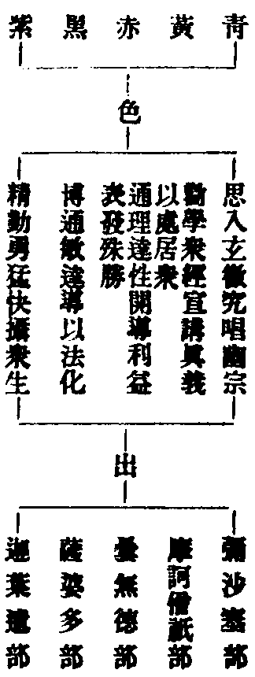
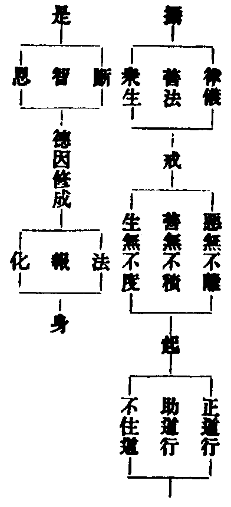
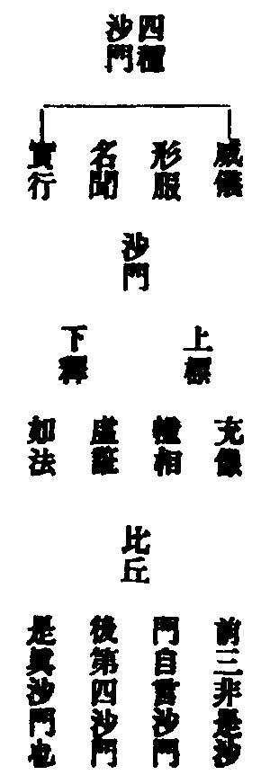
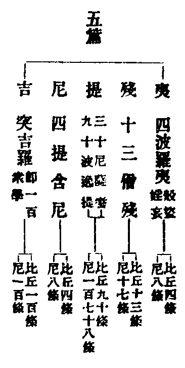
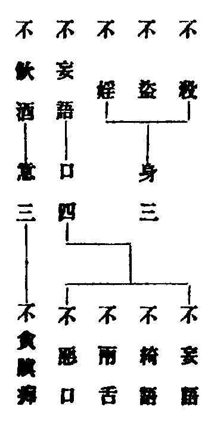
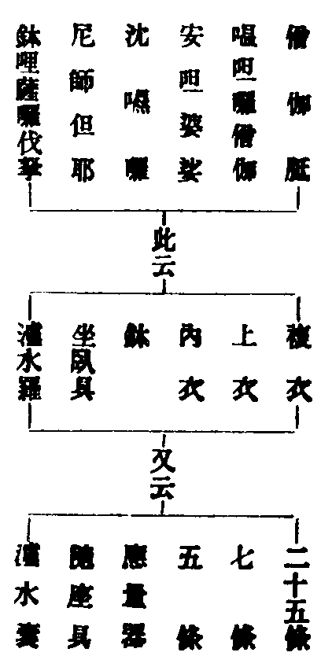
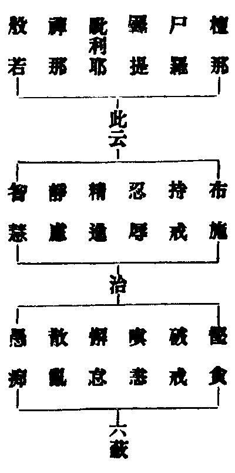
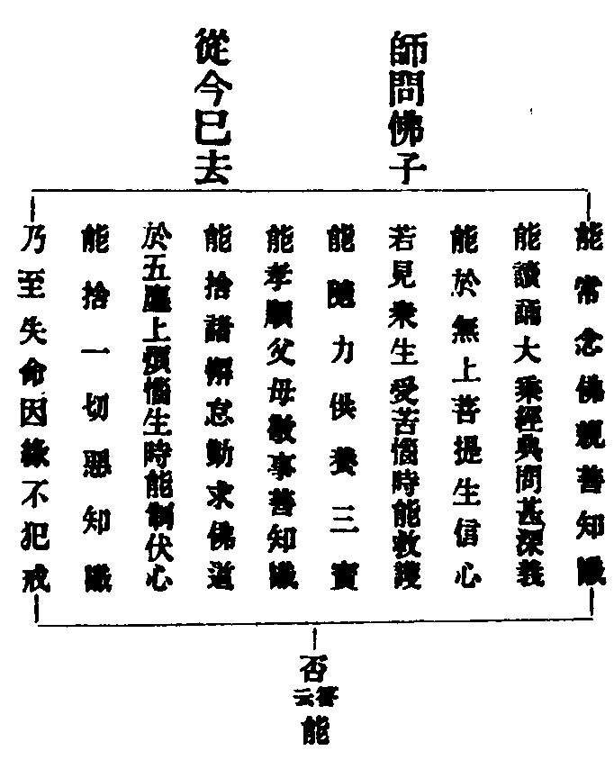
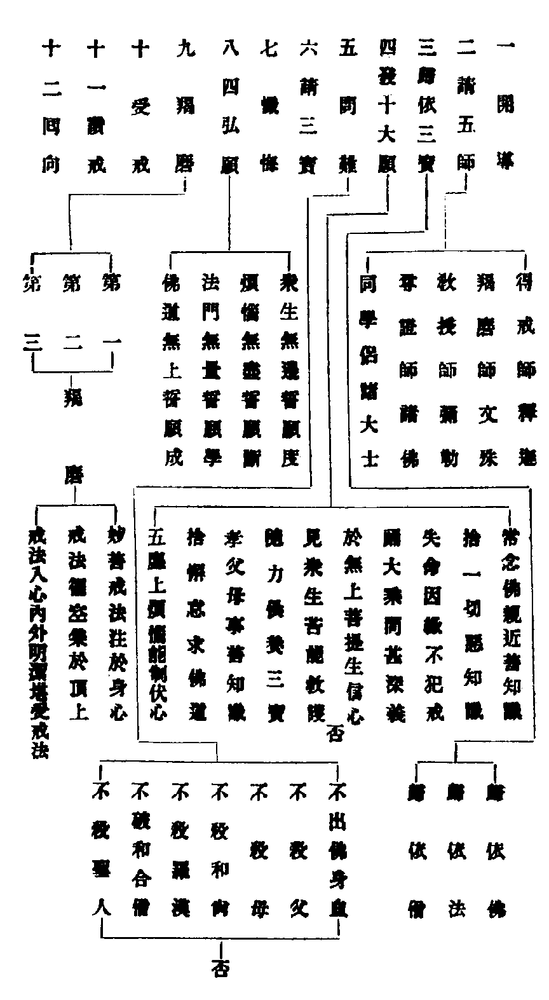

# 经律戒相布萨轨仪



> **藏经**：卍新纂大日本续藏经（新纂卍续藏）　**册次** 第 60 册（X60）　**编号** No. 1136（X1136）　**部类** 律疏部　**卷次** 1 卷　**篇幅** 27,331 字

> **卷／品**：1 卷 · 0 品



---



## 目录



- [善见毗婆沙律卷第十八](#善见毗婆沙律卷第十八)



---



经律戒相布萨轨仪



弘演毗尼沙门　(如馨)　纂要



闻夫大觉初成，始结菩萨波罗提木叉，终至双林入灭，亦教诸比丘，当珍敬尊重波罗提木叉，始终如是。佛在世时，以佛为师，去圣逾远，以何为师？诸圣所说，以戒为师。奇哉！戒乃登圣之梯行，越苦海之慈舟，缁素等流，凡登戒品，四仪严护，三业恒清，习马胜之威仪，效波离之轨范，动静禅思，心恒在道，常乐独间居，不近白衣贵士，衣食随缘，多得供物，有二弃一，三衣法器，常知止足，分外无求，昼夜专修净业，一行三昧，终身无怠，恶业氷消，佛境现前，百年报尽，无诸病苦，端坐而逝。



弥陀接引生方，亲蒙授记。得授记已，乘昔愿轮，回入尘劳，四恩总报，拔济三有，佛恩可酬，是真出家持戒第一，何不庆哉！末法转变，正季法门兴也。奇哉！令正法久住世间，众生正信不断，勘为后范，作大弘规尔。



颂曰：



> 三衣挂体越尘寰，恒沙诸佛也皆然。  

> 迦叶持衣待慈氏，历代高僧祖祖传。  

> 末法垂秋衣变白，正法不久住人间。  

> 孰能如法行将去，未得道果也超凡。



经律戒相，布萨轨仪，罗列于后。



受优婆塞优婆夷五戒相



一曰不杀生戒  

二曰不偷盗戒  

三曰不邪婬戒  

四曰不妄语戒  

五曰不饮酒食肉戒



和尚或阿阇黎，审在家男女所犯之事，不得细审中间所犯戒相，略问杀、盗、婬、妄，令其忏悔尔。五百问云：优婆塞！八关斋者，所谓防非止恶曰关，过午不食曰斋。若在家男女尽形受持，必获菩提。乃至一昼夜受持八斋戒者，超一生五戒。何故顿超？以戒多故。劝持半日微斋力，报感六十万年粮。而世人谬行择良晨，昼夜不饮浆者，讹也。



受优婆塞优婆夷八戒相



一、不杀生  

二、不偷盗  

三，不邪婬  

四、不妄语  

五、不饮酒食肉  

六、不著华缦璎珞及香油涂身  

七、不歌舞作唱妓乐，故往观听  

八、不坐高广大床  

九、不非时食



沙弥十戒相



一、不杀生  

二、不偷盗  

三、不破梵行人  

四、不妄语  

五、不饮酒食肉  

六、不著华缦璎珞，香油涂身  

七、不歌舞作倡伎乐，故往观听  

八、不坐高广大床  

九、不非时食  

十、不捉生像金银钱宝



比丘二百五十戒相



四波罗夷法  

十三僧伽婆尸沙法  

二不定法  

三十尼萨耆波逸提  

九十波逸提  

四波罗提提舍尼法  

一百应当学  

七灭诤法



比丘尼三百四十八戒相



八波罗夷法  

十七僧伽婆尸沙法  

三十尼萨耆波逸提  

一百七十八波逸提  

八波罗提提舍尼  

一百应当学法  

七灭诤法



诸部俱无二不定法，止三百四十八戒。此出四部广律，僧祇律止有二百七十七戒。



审比丘尼戒之时，亦不得细问中间所犯之事，略问四弃八弃，令其忏悔也。



审戒仪式。凡受戒者，请师对三宝前披陈发露，知事人敷设座席，罗列香花，维那领众请审戒阿阇黎执香迎至法堂，如法举香赞毕，诸佛子等拈香，各礼三拜，一心胡跪合掌。



众诵大悲呪一遍竟，举甘露王菩萨(三声毕)。



和尚差我为汝等请(某甲)阿阇黎，为汝等作审戒。阿阇黎今对此师座前，胡跪合掌，所有言教，须当谛听。从生以来，所犯戒相，对三宝前，一一披陈，发露忏悔，不得覆藏，洗涤净器，方盛甘露。



诸佛子等！请师之语，汝合自陈，恐汝未能皆随我道。



大德一心念！为我(某甲)，今请大德为我众等作审戒阿阇黎。我依大德故，得如实忏悔法。慈愍故！慈愍故！大慈愍故！



诸佛子等！汝既慇懃伸请，我为汝等作审戒阿阇黎，所有言教一心谛听。



(抚尺)。



诸佛子等！从无始已来至於今日，未识佛时、未闻法时、未遇僧时、未知善恶、造无间业，身三不善：杀、盗、婬、非，口四不善：妄言、绮语、恶口、两舌，意三不善：贪、嗔、邪见，弑父、害母、弑阿罗汉、破和合僧、出佛身血、坏僧伽蓝、焚烧经像、毁谤正法、作一阐提，一切罪恶无量无边。今对十方佛前发露求哀，愿乞消灭，如是名为总相忏者。善男子！别相忏者，我今逐一问汝，汝等逐一实答。若不实答，得故妄语罪。



善男子等！若在家时至出家时，过去现前所犯四根本罪中，有应忏悔者、有不应忏悔者。善男子！不应忏悔者，若夺人命、盗三宝财物、婬其所尊父母姑姊伯叔、污净行比丘尼，不应忏悔也。大妄语者，未得谓得、未证谓证，天来龙来、鬼来神来、旋风土鬼皆至我所，显异惑众、贪他供养、己自活命。若如是犯者，不应忏悔也。善男子！我今问汝应忏悔者，若杀𤛅牲者，许忏悔也。盗他财物、一针一艸不与取者，皆名偷盗。婬其等辈，应其忏悔也。妄言绮语、指有言空、指空言有及方便妄语，乞应消灭。善男子！我今又问汝等，从生至生、噉饮酒肉、迷真失性、鬬乱两家、不识尊卑，如斯等罪一一披陈发露忏悔，洗涤器皿甘露方贮。若不如此，并名非法，准律不容进受(各各逐一发露毕)。



审戒师，应令苦，祷礼千佛，消涤愆尤，戒可得受。



> 往昔所造诸恶业，皆由无始贪嗔痴，  

> 从身语意知所生，一切罪根皆忏悔。



审沙弥戒。同前请词。若僧尼受沙弥十戒，若久若近，五戒无犯，方受十戒。若有犯者，教令如法忏悔，堪受戒法。倘若会中有沙弥尼，另审毋得同众。若审不必细问中间所犯之事，略审四弃八弃发露，令他如法忏悔，可受十戒尔。



审沙弥戒仪式(沙弥受比丘戒，亦同前五戒仪式。忏法、请词同前。引请云：)



诸沙弥等闻磬声，各礼三拜，一齐胡跪，合掌称名。



阇黎抚尺。



重楼四级，次第而登。尔能欲登三级之重楼，秉受具圆，必须从前所受十戒之相，一一陈白。若有犯者，如实发露忏悔，不得覆藏瑕疵，隐覆在心，可举向人悔过。若不如斯发露，罪乃日增，不堪受汝戒法。诸沙弥等，我今如实问汝，一一实答。诸沙弥等，从受十戒，若久若近，所犯(其)戒，从实发露，令汝如法忏悔，净其器皿。诸师坐前，白四羯磨，方受大比丘戒。若不如实忏悔，不容进受，并名非法，不得戒也。审戒师亦令礼忏雪罪也。(众举往昔所造诸恶业云：)



审沙弥戒竟。



审比丘戒仪式(引请同前)



令五戒、八戒、十戒者出去，方审比丘戒。



诸大比丘等，今欲求菩萨戒者，各各一心拈香，胡跪合掌。



坛上宗师差我等敷设席座，请(某甲)阿阇黎为汝等作审戒。阿阇黎！汝比丘等各各慇懃伸请，汝合自陈，恐汝未能，皆随我道。



大德一心念！我(某甲)众等，求诸佛菩萨，欲受菩萨戒。今请大德为我作审戒阿阇黎，愿大德为我作审戒阿阇黎。我依大德故，得受三聚、十无尽清净戒。慈愍故！慈愍故！大慈愍故！



阇黎抚尺。



诸大比丘等！汝既慇懃伸请，我为汝等作审戒阿阇黎，所有言教，一心谛听。今(某)坛上宗师，差我为汝等作审戒阿阇黎。我今问汝，如实而答，不得妄识。有所犯则言犯，无犯者则言无，不得妄答。我今问汝，所受具圆，若久若近？戒相二百五十条，所谓：



四波罗夷法，有犯否？答：(有、无。)  

十三僧伽婆尸沙法，有所犯否？答：(有，无。)  

二不定法有所犯否？答：(无)。  

三十尼萨耆波逸提法，有所犯否？答：(无)。  

九十波逸提法，有所犯否？答：(无。)  

四波罗提提舍尼法，有所犯否？答：(无。)  

一百应当学法，有所犯否？答：(无)。  

七灭诤法有所犯否？答：(无。)



我今问汝等，若受三聚、十无尽大戒，若犯七遮罪者，不应进受。我今重问，汝等实答。若不实答，并不得戒。谓诸比丘：汝等曾出佛身血否？(答：无。)汝等弑父否？(答：无。)汝等弑母否？(答：无。)汝业弑和尚否？(答：无。)汝等弑阿阇黎否？(答：无。)汝等破羯磨、转法轮僧否？(答：无。)汝等弑圣人否？(答：无。)若无七遮罪者，甚是净器。引白和尚，求诸佛菩萨赐与菩萨戒。前无重罪，后无七遮戒，可得受众和(徃昔所造诸恶业，审戒功德殊胜行)(云云)。



经律云：半月半月布萨诵戒仪式。　前戒者，布萨之法有三十六种，所谓阿难布萨、贼布萨、舟中布萨、林间布萨、日暮布萨、晨朝布萨等。世尊俱不听。或太晚，或太早，诸方比丘来迟。会中诸比丘作布萨已竟，此来比丘不喜，往白世尊，告诸比丘言：晨朝太早，待诸比丘来，半月半月巳时布萨，敷设高座，香华供养。听者下坐，各披五条、七条、九条袈裟，各持经律卷至法师所，一心而听和尚沬师讲演。或不能可尔，直诵十重四十八轻戒，四众人等俱诣其所，一心摄耳谛听，故名布萨。比丘和合共住，亦名布萨等。非是发露罪相，名为布萨者，讹也。或无众中乃至一人，亦可虔对佛前自诵一卷，乃名一人布萨也。每於半月半月旧受菩萨戒者，布萨审戒之日，亦依前仪式，引请阇黎能作审戒羯磨之人，亦可在屏处无得无戒俗人前审之。若大会中四众大戒人所，敷设高座，香华罗列，如法安座(引请出班)。



大德一心念！(某甲)堂上宗师，差我等伸请大德，为众等作审戒阿阇黎。我依大德故，令得忏悔法。慈愍故！慈愍故！大慈愍故！



(抚尺)。



诸佛子等！汝既慇懃伸请，我为汝等作审戒阿阇黎，所有言教一心谛听。诸佛子等！半月已过应作布萨法，梵语布萨，此云我对说。彼此相向自陈己过，所犯罪相不得覆藏，如法忏悔。忏悔则安乐，不忏悔罪亦深。



先唤五戒、八戒出班，发露忏悔竟，令出。



次唤十戒沙弥出班，发露忏悔竟，令出。



再唤比丘戒出班发露，审其二百五十戒有所犯否？若无，默然清净故，是事如是持令出。然后方审菩萨戒，十重、四十八轻戒相随其轻重，毋得重罪作轻、轻罪作重，非制而制、是制便违。若不如斯审戒者，获其罪也。



审波罗夷罪十条



大德！若有犯者，一一发露不得覆藏。



第一、杀戒(有所犯否？答：无。)  

第二、盗戒(有所犯否？答：无。)  

第三、婬戒(有则言有，无则言无)。  

第四、妄语戒(犯否？答：无。)  

第五、酤酒戒(已下同前)  

第六、说四众过戒  

第七、自赞毁他戒  

第八、悭惜加毁戒  

第九、瞋心不受悔戒  

第十、谤三宝戒



若犯重者，令忏悔见好相；若无犯者，众清净故，是事如是持。



轻垢罪四十八条



诸大德！若有犯轻垢罪者，对三宝前、大众前，一一发露，彼此相向说罪，即得消灭，不同十重求见好相也。



第一、不敬师友戒(犯否？答：无)  

第二、饮酒戒(已下同前)  

第三、食肉戒  

第四、食五辛戒  

第五、不教悔罪戒  

第六、不供给请法戒  

第七、懈怠不听法戒  

第八、背大向小戒  

第九、不看病戒  

第十、畜杀具戒  

第十一、国使戒  

第十二、贩卖戒  

第十三、谤毁戒  

第十四、放火焚烧戒  

第十五、僻教戒  

第十六、为利倒说戒  

第十七、恃势乞求戒  

第十八、无解作师戒  

第十九、两舌戒  

第二十、不行放救戒  

二十一、瞋打报仇戒  

二十二、憍慢不请法戒  

二十三、憍慢僻说戒  

二十四、不习学佛戒  

二十五、不善知众戒  

二十六、独受利养戒  

二十七、受别请戒  

二十八、别请僧戒  

二十九、邪命自活戒  

三十、不敬好时戒  

三十一、不行救赎戒  

三十二、损害众生戒  

三十三、邪业觉观戒  

三十四、暂念小乘戒  

三十五、不发愿戒  

三十六、不发誓戒  

三十七、冐难游行戒  

三十八、乖尊卑次序戒  

三十九、不修福慧戒  

四十、拣择受戒戒  

四十一、为利作师戒  

四十二、为恶人说戒戒  

四十三、无慙受施戒  

四十四、不供养经典戒  

四十五、不化众生戒  

四十六、说法不如法戒  

四十七、非法制限戒  

四十八、破法戒



诸大德！若有犯者，出班发露；无犯者，是中清净。默然故，是事如是持。



佛在世时，常随众千二百五十人居山，各修异道，奉持邪见，禁戒苦形，非究竟法。谓耶舍长者子朋党五十人，优楼频螺迦叶师徒五百人，那提迦叶师徒二百五十人，伽耶迦叶师徒二百五十人，舍利弗师徒一百人，大目犍连师徒一百人。此千二百五十人，并先事外道，勤苦累劫，而无所证。承佛化导，各受具圆，即得证果。於是感佛之恩，远近游行，一一法席，常随佛不舍。故诸经之首，列众所知识千二百五十人俱者，此之谓也。



清凉国师缘起



华严六祖澄观，字大休，会稽人，姓百候氏，广造疏钞。生於开元戊寅，身长九尺四寸，垂手过膝，口四十齿，目光夜发，昼乃不眴，目顾十行，文供四笔。天宝七年出家，至肃宗二年受具足戒。是年奉诏入内，勅译华严。初至德中，即以十事自励，曰：



> 体不捐沙门之表，心不违如来之制。  

> 坐不背法界之经，性不染情碍之境。  

> 足不履尼寺之尘脇不触居士之榻。  

> 目不视非仪之彩，舌不味过午之肴。  

> 手不释圆明之珠，宿不离衣钵之侧。



六祖大师缘起外纪



大师名慧能，父卢氏，讳行瑫，唐武德三年九月左官新州。母李氏，先梦庭前白华竞发，白鶴双飞，异香满室，觉而怀娠，遂洁诚斋戒，怀姙六年，师乃生焉。唐贞观十二年戊戌岁二月八日子时生，产时毫光腾空，香气芬馥。黎明，有二僧造谒，谓祖师父曰：夜来生儿，专为安名，可上慧下能也。父曰：何名慧能？僧曰：慧者以法慧济众生，能者能作佛事。言毕而出，不知所之。师不饮母乳，遇夜神人灌以甘露。三岁父丧，葬於宅畔，母守制鞠养。既长，鬻薪供母。年二十有四，闻经有省，往黄梅参礼，五祖器之，付衣法，令嗣祖位，时龙朔元年辛酉岁也。南归隐遯，至仪凤元年，以子正月八日会印宗法师，诘论玄奥，风幡之动，印宗悟契师旨。是月十五日，普会四众，为师薙发。二月八日，集诸明德，授具足戒。西京智光律师为授戒师，苏州慧静律师为羯磨师，荆州通应律师为教授师，中天耆多罗律师为说戒师，西国蜜多三藏为证戒。其戒坛乃宋朝求那跋陀罗三藏剏建，立碑曰：后当有肉身菩萨於此受戒。又梁天监元年，智药三藏自西竺国航海而来，将彼土菩提树一株植此坛畔，亦预志曰：后一百七十年，有肉身菩萨於此树下开演上乘，度无量众。真传佛心印之法主也。师至是祝发受戒，及与四众开示单传之旨，亦如昔谶。



梵网经云：佛子谛听！若受佛戒者，国王、王子、百官、宰相、比丘、比丘尼、十八梵天、六欲天子、庶民、黄门、婬男、婬女、奴婢、八部鬼神、金刚神、畜生乃至变化人，但解法师语，尽受得戒，皆名第一清净者。



律至日本国开元十四年，融法师从日本国来至我大明国。日本国王命融法师持袈裟十领，上缀山河，至杨州奉与鉴真律师。师叹曰：外国君王亦有佛性。融乃请律师迫舟航海至日本国，领群臣迎一驿，请入内庭，筑坛秉受菩萨戒。夫人亦尔，乃至群臣咸登戒品，况我中国王臣耶？一切诸鬼神，乃至东岳大帝受戒于思大禅师，中岳帝君受戒于元珪禅师，乃至庐山神关将等，亦受尸罗戒法。既受戒已，向下更服应著袈裟，永不堕恶道。佛预授记，成就菩提。佛藏经云：宁噉烧石，吞饮羊铜，不以无戒，食人信施。



沙弥十戒，手不得捉生像金银钱宝。



比丘二百五十戒，亦勿手捉宝及宝庄饰具。出家人法，三衣知足，分外无畜，何况生相金银。云何生像？所谓金花、银花、钗钏、耳铛等。金银钱者，金钱、银钱等类。宝者，珠冠、璎珞、玲琅、玉珮等。以上生像宝物等，非等闲人之所有，俱属王臣富饶之家，男女庄饰之具也。



如来制戒，不得捉用，非比银钱。其物非善，贼人得之易犯，何况出家人手捉也。



菩萨戒不择无根、二根、黄门等，俱已受戒。四分律云：二根有三种者，人二根、非人二根、畜生二根。黄门者，有三种也：人黄门、非人黄门、畜生黄门。若言内䆠者，讹也。



梵网经云：不受佛戒者，名为畜生。生生不见三宝，如木石无心，名为外道。袤见人辈，犯轻垢罪也。



五种色衣著







又百缘经云：佛在世时，波斯匿王夫人生一男儿，端正殊妙，世所希有。身披袈裟，生已能语。问父王曰：如来世尊今者在不？大德迦叶在不？舍利弗、大目犍连在不？如是徧问，悉为在不？父王答曰：皆悉都在。惟愿大王为我设供，请佛及僧。王勅为请。佛入宫已，见其太子而问之曰：汝自忆念迦叶佛时，是三藏比丘不？答言：实是。处此胞胎，为安隐不？蒙佛道恩，得存性命，得过日耳。时王夫人见此太子与佛世尊共相问答，喜不自胜，而白佛言：今此太子宿植何福，生便能语，乃至与佛咸有问答？惟愿世尊敷演解说。尔时世尊即便为王而说偈言：



> 宿造诸善缘，百劫而不朽，善业因缘故。  

> 今获如是报。



依律造衣法



大衣僧伽黎衣，限五日造，过限成者，突吉罗罪。僧尼同。七衣郁多罗僧，限四日成，过者犯堕。五衣安陀会，限二日成，过者突吉罗。尼𭌯些那，又云泥伐散那，旧云涅槃僧，讹也。此云短裙也，无带襻连接裙幅，束带绦也。僧祇支，此云覆腋衣，用覆左肩，右开右合。魏王请僧入内宫自恣，宫人见僧偏袒，不以为善，遂作此衣施僧，因而受称褊衫。右边今作两袖，须开后缝截领，以存元式故也。



大迦叶！修头陀行法，四种粪扫衣应畜：一者冢间衣；二者往还衣；三者无主衣；四者弊垢衣。如是四种衣应畜。将来洗七次、染皂色、补作僧伽黎大衣、四层著，非破衲头，名外道衣。准律不听用迦叶尊者树下一宿、日中一食，佛称阿练儿也。五种粪扫衣不应畜：一者火焚衣；二者牛嚼衣；三者鼠咬衣；四者嫁女不净衣；五者产衣。如是五种不净衣不应畜。　雨浴衣、覆疮衣应畜。



世尊！听畜三囊，钵囊、药囊、鞋囊应畜。若有众生於我法中为我出家，剃除须发披著袈裟，虽不受戒及受毁犯，若有护持供养，是人得大果报，何况供养具持戒者。若未来世国王大臣及断事者，於我弟子及著袈裟，骂辱打缚或驱使，及夺财物资生之具，是人则坏三世诸佛真正报身，则挑一切天人眼目，则隐一切诸佛正法，令诸天人堕於地狱。



藏义经云：袈裟有十种利益：一者菩提上首，二者众处人天，三者父母反拜，四者龙子舍身，五者龙披免难，六者国王敬信，七者众生礼拜，八者罗刹恭敬，九者天龙护祐，十者得成佛道。永明寿禅师戒序仪文云：昔莲华色比丘尼曾为戏人，以披袈裟作戏。承此功德，无有诚心而受衣法，尚能值释迦牟尼佛所出家，证阿罗汉果。



比丘每日三时课诵仪



晨朝每用杨枝澡荳，三业清净，著七条衣，或诵经持呪，三时念佛，回向西方，虔修香灯奉献，稽首顶礼，右手捻无名指，念普供养真言：



唵𭌯日啰斛(七遍)



(若见佛时，当愿众生得无碍眼，见一切佛。)赞云：



> 法王无上尊，三界无伦匹，天人之导师。  

> 四生之慈父，我今暂归依，能灭三秪业。  

> 称扬若赞叹，亿劫莫能尽。三赞三礼已。



然后持诵，切须发愿，回向西方，不生中下品，决生上上品也。



比丘不得通肩著袈裟礼佛，死堕铁甲地狱。除坐禅、受食，通肩不犯。



比丘不得披禅衣礼佛，及礼尊宿，或经行塔殿前人前，死变团鱼龟鼋之类，切须戒之慎之。



比丘凡入空门，当准律仪，若老若少，若贵若贱，五夏依止，精通戒律，入阇黎位；十夏依止，一切经律尽解，入和尚位。当与四众传衣受戒。不依止者，获罪甚重，速求忏悔可尔。



比丘六事随身，若离衣钵界外一宿，犯舍堕。



比丘受食不著法衣，犯堕罪。除重病、无所觉知，不犯。



凡律中一切水，俱用漉水囊，或细熟绢，或细绵布可尔。若熟绢更好，生绢小䖝直过，餘则不堪。若无囊者，当用一块木牌，写此四句及呪牌上，放入水中或井中。若汲水之时，依法持呪。



> 若见流水，当愿众生：得善意欲，洗涤灭垢。



南无欢喜庄严王佛  

南无宝髻如来  

南无无量胜王佛



唵嚩悉波啰摩尼莎婆诃(二十一遍)



优婆塞戒经云：在家菩萨，若不储畜锡杖、钵盂、僧伽黎供养者，犯失意罪。



昔罗汉比丘於山岩入定，时有猕猴将坐具，偏袒右肩，合掌右遶三匝跪地。比丘出定叹曰：畜生尚有佛性。比丘即与受三归五戒，猕猴欢喜舞跳，失足坠岩而死，即生兜率天宫。



隋文帝请经法师受菩萨戒，而仁慈恭俭，号称平治，终始如初。



梁武帝筑坛禁中，延请释慧约师，发弘誓愿，受菩萨戒。暂屏衮服，著福田衣。当受戒时，有一鶴二孔雀，立阶不升，驱驰不去。至受戒已毕，然后飞腾。此帝王得戒之祯祥也。



四分律云：昔有在家首罗居士，财施已尽。佛𠡠诸比丘作学家羯磨，其家财宝更增三倍。于时首罗居士偏袒右肩，展尼师坛，脱革屣，礼诸比丘足：蒙佛与我作学家羯磨，财宝更胜。诸大德与我解学家羯磨，仍旧至我舍，四事供养。如是三白(云云)。



又大缘经云：以一日一夜出家，二十劫不堕三恶道。又出家功德经云：为出家作留碍破坏，抑制此人，即断佛种。故诸病集身，犹如大海，现得癞病，死入黑暗地狱，无有出期。尔时大王太子闻出家功德甚深，普皆发心。出家已，弟子问世尊：四天下中，无一众生在家者。俱出家已，衣食从何而得？佛言：不须种植。其地自然生诸秔米诸树，自然生诸衣服、三品□衣、袈裟钵具，一切诸天人供侍给使。若劝一人持律，胜造八万四千浮图宝塔。何以故？当得阿耨多罗三藐三菩提故。



齐邺东大觉寺释僧范，姓李，平乡人也。戒德清高，守禁无亏。常宿他寺，意欲闻戒。至於十五日说戒之夜，众议共亭说戒，乃为法集。有升座将欲竖义，叙云：竖论法相，深会圣言。布萨甞闻，击椎为胜。忽见一神，形高丈餘，貌甚雄俊，涌耸惊人。来到座前，问：竖义者是何日？答曰：是布萨日。神即以手搨之，拽下座来，委顿垂死。次问上座，问答同前，拽下座死。陵害二三上座已，神还掉臂而出。当时道俗，共覩非一。范师既见斯异，乃自勤力，兼筞大众，至於一生，无敢说欲。纵有病重，不堪胜轝，请僧就病人所，恭敬说戒。阖境僧尼，承斯徵诫，至布萨亦无亏缺。



普曜经云：若贤人闻是经典，叉手自归，舍八事懈怠之本，成八功德明勋。何谓为八？一、端正好色；二、力势强盛；三、眷属滋茂；四、辩才无碍；五、即得出家之奥妙；六、所行清净；七、得三昧定；八、得智慧明，无所不照。又阿输迦王为小儿以土施佛，得转轮王，王阎浮提，起八万塔，最后得道。施物至贱，小儿心薄，但佛田妙故，得大果报。当知大福从良田生。



又福田经云：有比丘名阿难，白世尊曰：我宿命生罗阅祗国，为庶民子。身生恶疮，治之不瘥。有亲友道人来语我言：当浴众僧，取其浴水，以用洗疮，便可得愈，又可得福田。我即欢喜，往到寺中，加敬至心，更作新井，香油涂浴具，洗浴众僧。以汁洗疮，寻蒙除愈。从此因缘，所生端正，金色晃昱，不受尘垢。九十一劫，常得清净，福佑广远。今复值佛，心垢消灭，逮得应真。



比丘沐浴，当择其日，所忌者六斋日，斯日诸神下降，察人善恶，宜修善作好事。所谓六斋日者，初一、　初八、　十四、　十五、　二十三、　二十九、　三十。



比丘入浴室，著五条衣，将净衣挂净竿上，触衣挂触竿上，入池默念：



沐浴偈呪



> 若洗足时，当愿众生：具神足力，所行无碍。  

> 洗浴身体，当愿众生：身心无垢，内外光洁。



唵，䟦折啰，恼迦咤，莎诃(七遍)。



五百问云：凡本界内，若大若小，所有亡僧衣物等件，属四方僧，或师亡物，或弟子亡物。小界内五众已上，应作羯磨分。若师弟子不作羯磨分，五钱已上，犯弃罪。若大众中亡僧物，查批估直已竟，众中鸣搥，佑唱羯磨。衣物等件，给散四方僧，或辨食，或分物。维那作白云：大德僧听！(某甲)比丘患病身亡，所有衣物等件，应作食，请四方僧。大德忍听！愿亡僧早生净土，居不退地也。如是三唱，是事如是持。若不尔，食者犯舍堕罪。慎之！慎之！



传授锡杖偈呪仪



梵语弃弃罗，此云锡杖，亦名智杖，亦名德杖。三世诸佛皆已持锡得阿耨菩提。斯杖上用锡，中用木，下用牛牙角为钻，不许铜铁，并名非法。行人如法受持，六道众生俱离苦，得解脱乐。经云：



> 执持锡杖，当愿众生：设大施会，示如实道。



若为慈悲覆护一切众生，当於此手。



唵，那㗚𠾱，那㗚𠾱，那㗚咤，钵底那㗚帝，娜夜钵儜，吽，发咤(三遍)。



永嘉云：降龙钵，解虎锡，两钴金环鸣呖呖。不是标形虗事持，如来宝杖亲踪迹。比丘受食，跏趺而坐，展巾单於膝上，捧钵念供养。左手捧钵，默念：



> 执持应量，当愿众生：成就法器，受天人供。



以右手大拇指捻无名指，念普供养真言：



唵𭌯日啰斛(七遍)



又念净法界真言：



唵㘕(二十一遍)，莎诃



结印同前。侍者送食时，十指相叉举於顶上，默念唵字二十一遍，然后捧钵举匙，三匙有节五观无违。三匙者，一匙愿断一切恶，二匙愿修一切善，三匙誓度一切众生。如是行者承此呪力，胜以河沙七宝百味饮食，供养十方诸佛、河沙菩萨及诸贤圣僧，普能周遍也。



> 佛制比丘，食存五观，散心杂话，信施难消。  

> 受供养时，当存五观。



受食五观法



一者，计功多少，量彼来处，一钵之饭，作夫汗流。  

二者，忖己德行，全缺应供，缺则不宜，可乃受。  

三者，防心离过，贪等为宗。离此三过，贪、嗔、痴也。  

四者，正事良药，为疗形枯饥渴病故，须食为药。  

五者，为成道业故应受食，不食成病。道业何从？



> 若见空钵，当愿众生：究竟清净，空无烦恼。  

> 若见满钵，当愿众生：具足盛满，一切善法。



唵部𡄦(一气七遍)。



> 三德六味，供佛及僧，法界有情，普同供养。  

> 若饭食时，当愿众生：禅悦为食，法喜充满。



三德者(一、轻软，二、净洁，三、如法德)，六味者(一、甘，二、辛，三、咸，四、苦，五、酸，六、淡)。



> 粥有十利，饶益行人，果报无边，究竟常乐。



粥十利者，僧祇律：因难陀母施众僧粥，佛说偈云：



> 持戒清净人所奉，恭敬随时以粥施，  

> 十利饶益於行者，色力寿乐辞清辩，  

> 宿食风除饥渴消，是名良药佛所说。  

> 欲得人天长受乐，应当以粥施众僧。



一色，二力，三寿，四乐，五辞清(辞谓训释言词)，六辩(展转言无滞碍)，七宿食消，八风除，九消饥，十消渴也。



随众念钵中出生偈呪



> 法力不思议，慈悲无障碍，七粒遍十方。  

> 普施周沙界。



唵度利益莎诃(七遍)



午斋出生



> 大鹏金翅鸟，旷野鬼神众，罗刹鬼子母，  

> 甘露悉充满。



唵穆帝莎诃(七遍)



侍者送食偈呪



> 汝等鬼神众，我今施汝供，此食徧十方，  

> 一切鬼神共。



唵穆力陵莎诃(七遍)



执钵偈呪



> 执持应量，当愿众生：成就法器，受天人供。



唵枳哩枳哩嚩日啰吽发咤(七、结斋，念准提遍呪毕，后诵偈)。



> 所谓布施者，必获其利益。若为乐故施，  

> 后必得安乐。



> 饭食已讫，当愿众生：所作皆辩，具诸佛法。



○受衬偈



> 财法二施，等无差别，檀波罗蜜，具足圆满。



比丘洗钵，或陆地，或江潮海中，将洗钵水饭，送江湖净地，斋诸天仙，受此法食，俱获证果，利益无涯。



洗钵偈呪诵曰



> 以此洗钵水，如天甘露味，施与诸鬼神。  

> 悉皆获饱满。



唵，摩休啰，悉莎诃(七遍)。



展钵偈呪



> 如来应量器，我今得敷展，愿供一切众。  

> 等三轮空寂。



唵，斯麻摩尼，莎诃(七遍)。



比丘取杨枝，或净人取者，须问主化。若无主者，则与树神问记而化，不得取中枝、傍枝可耳。嚼杨枝名齿木，嚼一头碎，用剔刷牙齿中滞。食有五利：一、口不苦；二、口不臭；三、除风；四、除热；五、除痰癊。嚼杨枝须在屏处，不得显露及往还洁净处。或弃齿木，先以水洗，乃謦欬、或弹指警觉，方可弃於屏处。若其异者，得越法罪也。



执杨枝偈呪



> 手执杨枝，当愿众生：皆得妙法，究竟清净。



唵萨吧嚩述答萨哩吧答哩麻萨吧嚩述恒[口*夯]唵㘕(二十一遍)莎诃



嚼杨枝偈呪



> 嚼杨枝时，当愿众生：其心调净，噬诸烦恼。



唵。阿暮伽。弥摩隷。尔啭迦啰。僧输駄祢。钵头摩。俱麼啰尔嚩。僧输陀耶。陀啰陀啰。素弥麼𠼐。娑嚩诃。(七遍)



> 潄口连心净。吻水百花香，三业恒清净。  

> 同佛往西方。



唵憨唵罕莎诃(七遍)



剃头择日　出藏内宝积经文殊菩萨集



初四  

初六  

初七  

初八  

初九



初十  

十一  

十四  

十五  

十六



十九  

二十二  

二十三  

二十四  

二十五



二十六  

二十九



剃头偈呪



> 剃除须发，当愿众生：远离烦恼，究竟寂灭。



唵，悉殿都，漫多罗，䟦陀耶，娑婆诃(七遍)。



展单敷具坐禅偈曰



> 若敷床座，当愿众生：开敷善法，见真实相。  

> 正身端坐，当愿众生：坐菩提座，心无所著。



唵，嚩则啰，阿尼钵啰尼，邑多耶，莎诃(七遍)。



> 结加趺坐，当愿众生：善根坚固，得不动地。  

> 修行於定，当愿众生：以定伏心，究竟无餘。  

> 若修於观，当愿众生：见如实理，永无乖诤。  

> (出)舍加趺坐，当愿众生：观诸行法，悉归散灭。



临睡眠时，当合掌观想，念佛十声，即诵此偈：



> 以息𥨊时，当愿众生：身得安隐，心无动乱。



○阿观，想阿字轮一气持(三十一遍)，　右脇而卧。



> 睡眠觉悟，当愿众生：一切知觉，周顾十方。



唵地利日哩莎诃(七遍)



> 闻鍾声，烦恼轻，智慧长，菩提生，  

> 出地狱，离火坑，愿成佛，度众生。



破地狱真言曰



唵，伽罗帝耶，莎诃(七遍)。



> 闻鍾卧不起，护法善神嗔，现前减福慧。  

> 后世堕蛇身。



著衣偈



> 若著上衣，当愿众生：获胜善根，至法彼岸。  

> 著下裙时，当愿众生：服诸善根，具足惭愧。  

> 整衣束带，当愿众生，检束善根，不令散失。  

> 下足住时，当愿众生：心得解脱，安住不动。



从朝寅且直至暮，一切众生自回护。若於足下丧其形，愿汝即时生净土。(凡下单时，鸣指三下。)



唵逸地律尼莎诃(七遍)



举足行步不伤䖝呪



> 若举於足，当愿众生：出生死海，具众善法。



唵，地利日利，娑婆诃(七遍)。



比丘登厕，先弹指三下，有二义：一者恐有人；二者恐噉秽之鬼令他避之，不得吐唾在板上。



> 大小便时，当愿众生：弃贪瞋痴，蠲除罪法。



唵狠鲁陀耶莎诃(默念七遍)



藏经云：蜀僧智超，诵华严经三十餘载。因洗手不如法净，坐时偶见一童子，风貌清爽，手高揖超曰：何来？曰：五台来。超曰：何远至此？曰：少事，欲相道故。超曰：愿闻吾师诵经，三衣齐整，固可喜矣。当登厕洗净时，触水淋其手背，而缺灰泥皂角。律制七度洗净，今但二三，缘此触尚存。礼佛诵经，悉皆得罪。言讫不见。超慙面改过。文殊化现，警於超也。经中入厕洗净，各有神呪。倘不默持此呪者，纵用七恒河水洗之，不清净。何以故？种子不净也。



出厕洗净偈呪



> 事讫就水，当愿众生：出世法中，速疾而往。



唵，室利曳，婆醯莎诃(七遍)。



左手后二指洗去秽偈呪



> 洗涤形秽，当愿众生：清净调柔，毕竟无垢。



唵贺囊蜜栗帝莎诃(七遍)



洗手偈呪



> 以水盥掌，当愿众生：得清净手，受持佛法。



唵，主迦啰耶，莎诃(七遍)。



洗面偈呪



> 以水洗面，当愿众生：得净法门，永无垢染。



唵囕(二十一遍)，莎诃



食□水等偈呪



> 佛观一钵水，八万四千虫，若不诵此呪，  

> 如食众生肉。



唵，嚩悉波罗摩尼，莎诃(七遍)。



> 若见众会，当愿众生：说甚深法，一切和合。



唵阿蜜栗吽发咤(七遍)



登道场遶塔偈呪



> 遶塔三匝，当愿众生：勤求佛道，心无懈歇。



南无三满多。没駄喃。唵。杜波杜波。娑婆诃(七遍)



搭衣展具偈呪



五衣云：



> 若著袈裟，当愿众生：心无所染，具大仙道。  

> 善哉解脱服，无相福田衣，钦奉如来命。  

> 世世不舍离。



唵悉陀耶莎诃(三遍)



七衣云：



> 善哉解脱服，无相福田衣，我今顶戴受。  

> 世世常得披。



唵度婆度婆莎诃(三遍)



大衣云：



> 著僧伽梨，当愿众生：入第一位，得不退法。  

> 善哉解脱服，无相福田衣，奉行如来命。  

> 广度诸众生。



唵，摩诃迦，婆波咤，悉帝莎诃(三遍)。



> 卧具尼师坛。长养心苗性。展开登圣地。  

> 奉持如来行。



唵，檀波檀波，莎诃(三遍)。



上来偈呪，周而复始，若能加工用行，与戒相应，则法财充足，善果可期矣。



律部中持戒略意，录明于后。



三聚净戒







三种羯磨(对首心念众)法(发心会境，口自传情，非谓不言而辨前事，各共面对，同秉法也。四人已上，秉於羯磨)。



十诵律云：若比丘，别众食，除餘时，波逸提。餘时者，病时、施衣时、作衣时、行道时、许二十里外船行时、大会时、沙门施食时、作务时。



佛在舍卫国。尔时诸比丘入舍卫城，乞食时得有衣请食，请主言：受我食者当以衣施。诸比丘言：佛未听我等为衣故数数食。诸比丘不知云何？是事白佛。佛以是事集比丘僧，种种因缘赞戒、赞持戒，赞持戒已语诸比丘：从今衣因缘故，听诸比丘数数食。从今是戒应如是说：若比丘数数食，波逸提，除餘时。餘时者，病时、施衣时，是名时。是中犯者，



若比丘有衣请，彼有衣食来，受请不犯，食者亦不犯。



又比丘有衣食请，彼无衣食来受请，不犯。食者，波逸提。



又比丘有衣食请，彼有衣食，无衣来受请，不犯。食者，波逸提。



若比丘，无衣食请，彼无衣食来，受请，突吉罗；食者，波逸提。



又比丘无衣食请，彼有衣食来，受请突吉罗，食者不犯。



又比丘无衣食请，彼有衣食、无衣食来，受请，突吉罗；食者，波逸提。



若比丘，有衣食、无衣食，请彼有衣食、无衣食来，受请，突吉罗；食者，波逸提。



又比丘有衣食、无衣食，请彼有衣食来，受请突吉罗，食者不犯。



又比丘有衣食、无衣食请，彼无衣食来，受请，突吉罗；食者，波逸提。不犯者，得多有衣食请，一一有衣食来，不犯。



菩萨三义



大道心众生、大道成众生、觉众生。



菩萨三名



大士大道心众生。



开土，开众生信心。



高士升出，凡夫小乘。



菩萨三大



愿行利生。



大比丘三义



破恶，修戒、定、慧，破见思恶惑。



怖魔魔王惧，出三界生怖惧。



乞士养、色身资、慧命利、檀那。



律有三名



毗尼律善制波罗提木叉尸罗戒。



亦云灭保解脱。



持戒三心



厌有为求趣菩提，悲愍有情。



持戒三乐



名誉利养死生天，



明人能护戒，能得三种乐，名誉及利养，死得生天上。



衣制三限



大衣。五日。七条。四日。五条。二日。



造衣如法制，违者不得衣，获其罪也。



锡杖三分



上分锡，中分木，下分牙角。



应器三法



体大要有二，谓泥及铁。



色熏黑赤，或孔雀咽色、鸽色。



量大受三斗，小斗半中可知。



诸佛菩萨以三轮示现度众生



三轮者，计心说法，神通。



三衣断三毒



五条断贪身，七条断嗔口，大衣断痴意。



大比丘三义



大、天主大人所敬故



多徧解内外经书故。



胜出九十五种土故。



四食时



早起诸天



日中三世佛。



日西畜生



日暮鬼神。



四利须食



资身为道，养身中虫，生施者福，破饿外道。



四分律



初分说比丘戒，二分说比丘尼并受戒犍度，三分说安居犍度，四分说房舍犍度等。



菩萨四心



广大心。所有一切，众生之类，



胜即第一心，我皆令入无餘涅槃。



常心实无众生，得度了生伤如也。



不颠倒心无我人众生等者，四相。



比丘四义



净乞食、破烦恼、净持戒、能破魔。



比丘四法



昼夜六时说罪忏悔，常忆念佛不诳众生，修六和敬心不恚慢，具修六念如救头然。



比丘四法



常念如来，立佛形像。闻经深义，即信奉行。虽不见佛，晓了本元。知十方佛，则一法身。



羯磨四法



一、法，二、事，三、人，四、界。



头陀四食



乞食、不作餘食、一坐食、抟食、一器盛。



头陀四位



衣衲衣三衣二种。



食乞食一座等。



处兰若冢间树下。



常座此无次，第。



乞食四意



福利群生，折伏憍慢，知身有著，除去滞著。



四根本烦恼



贪、瞋、痴、我慢。



毗尼四义



一是佛法中平地，万善由之而生。



二、一切佛子皆依戒住，一切众依戒而有。



三、是趣涅槃之初门。



四乃佛法璎珞，能庄严佛法故。



舍戒四缘



舍所学，即舍戒、二形生、男变、女变男、断善根、受恶戒、邪见、舍众、同分、身死。



尸罗四义



清凉义，离心热恼故。



安隐义能为，他世乐因故。



安静义，能建立止观故。



寂灭义，得涅槃因故。



摄心四戒



先断心婬，心有少爱，即为欲本。



次断心杀，心瞋为杀，故入神道。



三、断心偷诈匿邪，为贪而不舍。



四断妄语自言，得圣人法，名妄。



成就威仪四法



不染三有，知之为苦。



我与彼人，苦乐俱然。



常行忍辱。



在上不慢，在下不耻。



谦下获四种功德



远离恶趣。不受旁生。不被轻毁。常为人天恭敬。恶友怨敌不能陵突。



菩萨修行四法



善分别自心，现观外性非性，离生住灭见，得自觉圣智。善乐。



比丘具戒四分义摄



一受具足，谓白四羯磨。



二、随具足，谓从此向后，随二戒常持覆证。



三、护他心具足，谓比丘一分威仪具足，名护他心。



四、具足守戒，谓於小罪见畏不犯。若有犯，当发露。



菩萨四轮(欲权八难，当习四轮。)



生中国轮摧三途，北洲长寿天难。



修正愿轮摧，世智辨聦难。



植善轮，摧盲聋瘖痖难。



近善人轮摧佛前，佛后难。



乞食四分



一、奉同梵行者；一、与穷乞人；一、与诸鬼神；一、分自食。



修行四法



宁失身命，不舍菩提心；亲近善友，不舍忍辱；依寂静处。



持戒有四



怖畏戒、不浩恶、名洽罚、



希望戒贪财名誉等。



顺觉戒求解脱果等。



清净戒、无漏、离惑等。



四分优婆塞



无分但受三归，少分或受一戒，多分受二、三、四，满分具受五戒。



四种沙门







菩萨四自在法



一、戒，二、神通，三、智，四、慧。



弟子四心看和尚



一亲爱师，二敬顺师，三畏难师，四尊师。



戒品四等生处不同



破戒三：畜生、饿鬼、地狱。



下持戒一人道：



中持戒一六欲天，又能兼行四禅、四空定，生色、无色界。



上持戒三，下罗汉，中支佛，上佛道。



四种重恩



父母生身故，须报如来、大师、说法师。



四种比丘



毕竟到道比丘阿罗汉，又云无学果。



示道比丘三果圣人，又云初二三果。



受道比丘初果向，又云通内外凡。



污道比丘、凡夫破戒。又云：犯四重者。



佛应四处



降生迦维卫，成道摩竭提，说法波罗柰，入灭拘尸那。



四根本烦恼



贪烦恼、瞋烦恼、痴烦恼、我慢烦恼。



五种三皈



翻邪。五戒。八戒。十戒。具戒。



袈裟五色



赤色、青色(铜青)、黑色(杂泥)、木兰(树皮)、紫色。



五种忏悔



不必礼拜，应常想念，第一义空。



孝养父母，恭敬师长。



正法治国，不抂人民。



於六斋日，勅诸境内，令行不杀。



深信因果，知佛不灭。



五不赴请



晏然而居。诸天说法。观察病人。守护卧具。戒制学处。



五法助戒



信、惭、愧、善知识、宗、敬、戒、



受世间戒，奉佛戒。



五戒生天



不杀生四王天。



不盗，生忉利天。



不婬，生夜摩天。



不妄语，生兜率天。



不饮酒肉生化乐，他化天。



五种阇黎



出家师所依得出家。



羯磨师授戒作羯磨。



教授师教以威仪。



受经师，受经四句等。



依止和尚，学戒十夏，与人为师。



五种水罗



方罗，用绢三尺成一尺，随时作大小。



法瓶，阴阳瓶也。



军迟，以绢系口，绳悬水中，待满引出。



酌水罗，但取密绢，方一搭手，或系瓶口。



衣角罗或钵中滤水。



五不应答



试故问、无疑故问、不为悔所犯故问、不受故问、语难故问。



出家五法



发心出家，怀佩圣道，毁其形好，应被法服，委弃身命，尊崇法道，永割亲爱，毋适毋莫，志求大乘，为度众生。



比丘五法



怖魔。乞士。净戒。净命。破恶。



破戒五衰



求财不得，设得耗散，众不爱敬，恶名流布，死入地狱。



破戒五过



自害，为智所诃，恶名流布，临终方悔，死入恶道。



跏趺五利



最安隐，心不散，魔王布。畏外道，心易止。



苾𫇴五德



体性柔软，喻出家人能折伏身语粗犷。



引蔓旁布，喻出家人传法度人，连绵不绝。



馨香远闻：喻出家人戒德芬馥为应所闻。



能疗疼痛，喻出家人能断烦恼毒害。



不背日光，喻出家人常向佛日。



睡眠五过



恶梦诸天。不护心。不入法。不思明。相喜出精。



杨枝五利



口不臭，又口滋味。



口不苦。又除热。



能除风，又祛风。



亦除执，又消食。



除痰癊，又明目。



不嚼五过



口气臭、不别味、癊不消、不引食、眼不明。



旋绕有五事(比丘礼佛已，右绕不得左转，如日月星绕须弥山也。)



低头视地、不得踏虫、不得左右视、不得唾地、不与人语。



旋绕得五福



后世得端正好色，得好音声，得生天上，生王侯家，得泥洹道。



乞食遮五处



唱令家、旃陀罗、沽酒家、官家、婬女家。



入俗舍五法



入门小语，摄身口意，卑躬，善护诸根，威仪庠序，令人生善。



五不应游



官家。酒肆。屠儿家。婬女家。



五分戒律



一波罗夷法。二尼波罗夷法。三受戒衣药食法等。四灭诤法。五破僧法。杂法等。



五篇







比丘二百五十条，尼三百四十八条。今止四十一条者，更加二不定、七灭诤，俱至五十条。又见七数中七聚、六聚也。



忏悔五法



偏袒右肩，右膝著地，至心合掌，头向礼足，说罪名。



持律得五功德



戒品牢固，善胜诸怨，於众中决断无畏疑悔者，能开解善持戒，令正法久住。



安居须离五过



太远聚落，求须难得。



大近城布，妨修道业。



多蚊螘𠾱啮，践伤彼命。



无可依人，其人具五德，乃可依之。



无施主施饮食汤药。



菩萨施具四心



知施实相，三轮皆空。起慈悲心，拔苦与乐。发愿得无上果，回向回施法界。具足方便，偏修诸行。



五戒属对五阴



不杀对色阴，不盗对受阴，不婬对想阴，不妄语对行阴，不饮酒肉对识阴。



犯五戒被五星陵逼



杀戒，今被木星陵逼，夭伤身命。



盗戒今被金星陵逼，贫穷下贱。



婬戒今被火星陵逼，王法加刑。



妄语。今被土星陵逼，出语不信。



饮酒今被水星陵逼，愚痴聋塞。



袈裟五种功德



入我法中，犯重邪见等，於一念中敬心尊重，必於三乘受记。



天龙鬼神，若能敬此袈裟少分，即得三乘不退。



若有鬼神诸人，得袈裟乃至四寸，饮食充足。



若有众生，共相违背，念袈裟力，寻生慈心。



若持此少分恭敬尊重，常得胜他，乃至龙披一缕，皆免金翅鸟难。



五夏依止法



过五岁，知五事，知犯轻重，知羯磨，名阇黎。



十夏依止和尚位



不知律仪，尽形依止。精通戒藏，与人为师。



授人戒法，若不然者，获罪无量。



无解作师五百问云：应求忏悔，若不悔者罪日加增，受戒之人不得戒也。



受菩萨戒获五种利



一者十方佛，愍念常守护；二者命终时，正见心欢喜；三者生生处，为诸菩萨友；四者功德聚，戒度悉成就；五者今后世，性戒福慧满。



五篇罪配五刑五行



一，波罗夷死土。



二、僧残流水。



三、波逸捉徒金



四，提舍尼杖火。



五突吉罗笞木。



旧五刑



墨、劓、剕、宫、大辟。



午后不食得五种利



少婬少睡，得一心无下风，身安无病。



若过午，一切有形之类，片盐片醋入口中者，堕焦肠地狱。除病时、施衣时、造衣时、远行时、行舡时、大会时、施食时、作务时、八条许食，不犯。



大比丘五事故经营



报佛恩故。律中，比丘自营精舍故。



长养佛法故。



灭凡劣众，自贡高故。



将来弟子折伏憍豪故，发起将来福业故。



五戒对摄十善







僧伽六和



戒和同修，见和同解，身和同住，利和同均，口和无诤，意和同悦。



沙弥比丘六物(六物不具，乃名秃人。)







六聚华梵



波罗夷，此云弃，小乘云不可忏，大乘云他胜处。



僧伽婆尸婆，此云众残，如断人头，气喉在故。



偷兰遮，此云丑恶。



波逸提，此云堕，因治财犯舍堕未忏故。



波罗提提舍尼，此云可呵。



突吉罗，此云恶作。恶说六聚，加恶说为七聚。



六度华梵







七众



比丘清净活命云乞士，又名能破烦恼故，又名能怖魔故。



比丘尼，尼者女也。佛以仪法不便故在沙门后，姨母求出家不许，令行八敬乃许。



式叉摩那！此名学戒尼。十八童女应二岁学戒练身，知有胎无胎，即三法根本、六法行法。



沙弥，此云息慈，谓息恶行慈也。又翻勤䇿男。



沙弥尼，此云勤䇿女。



优婆塞，义翻信士男，亦名善宿男，又名清净士，又名近事男。



优婆夷义云：信士女亦名善宿女，二虽在家，能持五戒，男女各处。



七支戒



杀、盗、婬(身三)，妄语、绮语、两舌、恶口(口四)，身口造作名业，各加不字名戒。



持律获七功德



能持佛内藏，能善断诤，持戒外道顶住，以律故不咨他，於众说戒无畏故，能断有疑故，能令正法久住故。



法苑七事受胎



相触：男以身触女身分，即生贪著而成胎。



取衣优陀夷，共妇出家欲，不止精污衣，尼䑛衣成胎。



下精。鹿母嗅道士精，欲心而饮，因而有胎。



手摩腅。菩萨父母俱盲，出家为道，不合阴阳，手摩故，唯视男子而怀胎。



闻声白鹭鸟，悉雌无雄。春至闻雷声，有胎。



嗅香𤚩母牛，但嗅犊气，即便怀胎。



七遮罪



杀父、杀母、杀和尚、杀阿阇黎、破羯磨、转法轮、增杀十地圣人、出佛身血。



七灭诤法



应与现前毗尼，当与现前毗尼。



应与忆念毗尼，当与忆念毗尼。



应与不痴毗尼，当与不痴毗尼。



应与自言治，当与自言治。



应与多覔罪相，当与多覔罪相。



应与覔罪相，当与覔罪相。



应与如艸覆地，当与如艸覆地。



诸大德！是七灭诤法，半月半月说，戒经中来。若比丘有首事起，即应除灭。



优婆塞具八支



信、戒、施、听法、受持、解义、如说修行。



八大人觉



少欲、知足、寂静、精进、正念、正定、正慧、无戏论。



菩萨八法



一、乃至失命不说他过。二、化人令皈依三宝。三、安置一切於菩提心。四、梵行不染。五、造佛像安花座上。六、能除众生忧恼。七、於贡高人常自谦下。八、不恼他人。



大宝积云：菩萨成就八法，於诸佛前莲华化生。



八法信重袈裟



应起塔想，应起寂灭想，应起慈想，应起悲想，应起如佛想，应起惭想，应起愧想，应起令我来世离三毒具沙门。



经云：袈裟，圣人表帜，随顺寂灭，行慈悲心。未得沙门，行此八法。



尼戒八弃



杀，波罗夷，此云弃。若犯此戒，永弃佛法边外，犹如大海不受死尸。



盗、婬、大妄语、与男身触、与比丘四弃戒同。



於染心男，捉手捉衣，屏处共立，共语共行，身相倚相期。



覆他重罪。



随举六僧，供给衣食。



尼行八敬



不得骂谤比丘。



不得举比丘过，比丘得说尼过失。



应从僧中受具戒。



犯僧残半月，在二部僧中行摩那埵。



当於僧中求教授人。



不应在无比丘处结夏安居。



夏讫，诣僧中求自恣百岁尼，礼初夏比丘尼。



九等大衣



下三品。九条。十一条。十三条。



中三品。十五条。十七条。十九条。



上三品。二十一条。二十三条。二十五条。



制戒十益



一、摄僧故，二、极摄僧故，三、令僧安乐故，四、折伏无耻人故，五、有惭愧者得住持故，六、不信者令得信故，七、正信者增益故，八、於现法中得漏尽故，九、未生诸漏令不生故，十、正法久住为诸天人开甘露门故。



乞食十利



一、自用活命，自偶不属他；二、施我者，命住三宝，然后当食；三、长生悲心；四、随顺佛教；五、易满易养；六、破憍慢法；七、无见顶善根；八、见我乞食，餘者效我；九、不与男女大小，有诸事故；十、次第乞，生平等心。



受戒发十大愿







乞食十法



一为摄受诸有情，二为次第，三为不疲厌，四知足，五为分布，六为不躭嗜，七为知量，八为善品现前，九为善根圆满，十为离我执。



涅槃十戒



一、禁戒，二、清净戒，三、善戒，四、不缺戒，五、不析戒，六、大乘戒，七、不退戒，八、随顺戒，九、毕竟戒，十、具足戒。



沙弥十二有犯



一、不分别衣；二、离衣宿；三、触火；四、足食；五、害生种；六、青艸上弃不净；七、輙上高树；八、触宝；九、食残宿食；十、坏地；十一、不受食；十二、损生苗。



十二种恶律仪



屠儿。魁脍。养猪。捕鱼。猎师。网鸟。捕蛇。养鸡。呪龙。作贼。捕贼。狱吏。



婬女家、酤酒家、洗染家、压油家。加上四种，即名十六种恶律仪，智者勿犯。



授戒法十二科







菩萨随身十八种物



杨枝、澡豆、三衣、瓶、钵、坐具、锡杖、香炉、奁、漉水囊、手巾、刀子、火燧、镊子、绳床、经、律、佛像、菩萨像。



二十五护戒神



不杀生茶刍毗愈陀泥  

输陀利输陀尼  

毗楼遮那波  

阿陀龙摩坻  

娑罗桓尼和婆



不偷盗抵摩阿毗婆䭾  

阿须输婆罗陀  

婆罗摩亶雄雌  

婆罗门地鞞哆  

那摩呼多耶舍



不邪婬佛陀仙陀楼哆  

鞞阇耶薮多婆  

涅坻醯陀多耶  

阿罗多赖都耶  

波罗那佛昙



不妄语阿提梵者珊耶  

因台罗因台罗  

阿伽风施婆多  

佛昙弥摩多哆  

多赖叉三蜜陀



不饮酒阿摩罗斯兜嘻  

那罗门阇兜帝  

萨鞞尼乾那波  

阇鞞鬪毗舍罗  

迦摩毗那阇尼佉



犯五戒所招过咎，具於前章，行者勿令有损也。



佛住世八十年颂曰



> 十九逾城六苦行，五岁游历三十成。  

> 说法度生五十年，是则共当八十寿。



迦𫄨那。明了论云：为存略故，但言迦提。此翻功德，以坐夏有功，五利赏德也。西域记以迦提翻云昴星，昴星直此月故。律钞到明了论翻为坚实能感，实能感多衣，衣无败坏故。又名难活，以贪人取活为难，舍少财入此衣，功德胜如以须弥大衣聚施也。或云坚固，又云阴覆。古翻为赏善罸恶衣，赏前安居人(后安信人不得)也。亦翻功德衣，以僧众同受此衣，招五利功德。律中受此衣故，畜长财，离衣宿，皆请别众食，食前食后至他家。四分云：安居竟，应受功德衣。则前安居人七月十六日受，至十二月十五日舍。四分云：若得新衣，若檀越施衣，若粪扫衣。四分云：粪扫则非死人衣。新物揲作净，若已浣，浣已纳作净，即日来，不经宿，不以衰命得。应法四周有缘，五条作十隔，用袈裟色受舍。应鸣鍾集僧。羯磨具出自恣篇。



大明会典一欵



太祖洪武、永乐、高皇三次颁行天下大乘菩萨戒经，永为定例。



圣论许令僧俗受戒之人，抄白牒文，随身执照，凡遇关津把隘之处，騐寔放行。



洪武旧制



圣旨　洪武十年三月十三日，礼部尚书张吕本、孙　敏、李江懽，勅监承林英，奉天门奏准，钦奉圣旨，　就批本著落礼部知道。一切南北僧道，不论头陀人等，有道善人，许令浙江、广东、广西、湖广等处，但有行脚僧道、白衣人等，情愿归依三宝，或受五戒，或受十戒，持斋戒酒，习学经典，明心见性，理义圆明；僧俗善人，许令斋持戒牒，大乘菩萨随身执照，不论山林城郭、乡落村中，恁他结坛上座，拘集百千善男信女、僧俗人等，日则讲经，教化一方善人，夜则取静修心。在家修道者，孝顺父母，尊敬长上，和睦乡里，早辨税粮，生不遭王法，死不堕地狱；出家修道者，日则他饭充饥，夜则念佛看经，为善胜至，为国家保祐长生，祝延圣寿，理合自然。又於谨身殿奉洪武二十年四月十一日，礼部尚书崔、赵郎中，御台史、刘经历，依圣旨覆奉，颁行天下，重出晓谕知道。於永乐五年二月初六日，文武官等奉天门早朝，奏准圣旨，著落礼部知道。重新出榜，晓谕该行脚僧道：持斋受戒，大功大行。善知识！恁住他处，结坛说法，度人生死，救人苦厄，须用香烛茶菓、甘甜饮食供养。善知识！每日吃人间黄金千两，也消得施主的受人礼拜，受人供养，一日八万四千餘粮，功德无量无边，不可思议。但到寺观庵堂，用心供养，不可呵詈。但上座说法之时，若遇关津把隘、税课司、巡检司等衙门公人，不得阻当，许被害人告官，发边远充军；或里长老人阻当，俱发口外为民。恁他集众教化善法，如朕亲临教训圆明，无如佛上法宝。上祝皇国永固，风调雨顺，万民同乐，共享太平。吾朱门皇子皇孙，永为定例。



------



## 善见毗婆沙律卷第十八



舍利弗问优波离偈：　几罪以身得？几罪以口得？覆藏得几罪？相触复有几？优波离以偈答舍利弗：以身得六罪，口业复有六，覆藏得三罪，相触得五罪。



答曰：一者身得，二者口得，三者身口得，四者身心得，五者心口得，六者身口心得。身业得六罪者，婬怒为初。口业得六罪者，虗诳妄语为初。覆藏得三罪者，一者比丘尼覆藏重罪，得波罗夷；二者比丘覆藏他重罪，得波夜提；三者比丘自覆藏重罪，得突吉罗。是名覆藏得三罪。相触得五罪者，一者比丘尼摩触，波罗夷；二者比丘摩触，僧伽婆尸沙；三者比丘以身触女人衣，得偷兰遮；四者比丘以衣触女人衣，得突吉罗；五者比丘指桎他比丘，波夜提。是名五罪。



第二问答



明相出几罪？三唱复有几？於此几八事，一切聚有几？明相出三罪？三唱有二种，於此一八事，一切聚有一。



答曰：明相出得三罪者，一夜、六夜、七夜、十夜过一月明相出，尼萨耆波夜提。比丘尼独宿明相出，僧伽婆尸沙。比丘自覆罪明相出，突吉罗。是名明相出得三罪。三唱二种：一者比丘，二者比丘尼。当说戒时，三唱有罪不发露，得突吉罗。是名三唱二罪。於律中具八事成罪者，比丘尼波罗夷是。一一聚有一者，戒序中说，忆有罪应发露。发露者，分别戒相轻重。毗尼有二相者，身、口是。毗尼重有二者，波罗夷、僧伽婆尸沙是也。覆麤亦有二者，一波罗夷，一僧伽婆尸沙。



第三问答(解答于左)



如来分别结，毗尼有几相？毗尼重有几？复有几覆麤？如来分别说，毗尼有二相，毗尼重有二，覆麤亦有二。



第四问答



聚落间几罪？度江复有几？噉肉几偷兰？噉肉几突吉？聚落间有四，度江亦有四：一肉偷兰遮，九肉突吉罗。



聚落间有四者，一比丘与比丘尼共期行，比丘初去时得突吉罗；至聚落境界，比丘得波夜提罪；一脚在内、一脚在外，比丘尼得偷兰遮；一脚尽入，僧伽婆尸沙。是名聚落间四罪。渡江有四罪者，比丘与比丘尼共期船行，初去时比丘得突吉罗；上船，比丘得波夜提；比丘尼一脚上岸，得偷兰遮；二脚俱上，得僧伽婆尸沙。是名渡江四罪。一肉偷兰遮者，即是人肉。九肉突吉罗，象、马、狗等肉。



第五问答



夜语几得罪？昼日复有几？布施得几罪？受施复几罪？夜语有二罪，昼日复有二：布施得三罪，受施得四罪。



答曰：夜语有二罪者，若比丘尼共男子入暗室、屏处、耳语，得波夜提。若比丘尼共男子一处，去二肘外，得突吉罗。是名夜语二罪。昼日亦有二者，比丘尼共男子屏处，若二肘半内，得波夜提，二肘半外，得突吉罗。是名昼日二罪。布施得三罪者，比丘有杀心，布施毒药，杀人得波罗夷罪，非人得偷兰遮罪，杀畜生得波夜提罪。是名布施三罪。受施四罪者，女人以手施与比丘捉，得僧伽婆尸沙，女人以婬欲施比丘，得波罗夷罪，非亲里比丘尼施衣，得尼萨耆波夜提。若比丘尼染污心，知染男子受食，得偷兰遮。是名受施得四罪、五罪。



第六问答



几罪对首悔？几罪须羯磨？作已不可悔，如来分别结。五罪可忏悔，第六须羯磨，一罪不可忏，如来分别结。



答曰：可忏悔者，偷兰遮、波夜提、波罗提提舍尼、突吉罗、恶说，是名五罪可忏悔。第六，须羯磨者，僧伽婆尸沙一罪。不可忏者，波罗夷是也。毗尼有二重者：一、波罗夷；二、僧伽婆尸沙。身、口亦如是者，结戒不过身、口、非时糓。



第七问答(毗尼二重，先解于左)



毗尼重有几？佛说身口业，非时几谷味？几白四羯磨？毗尼有二重，身口亦如是，非时谷一味，一白四羯磨。



答曰：非时糓一味者，苏毗盐以糓作，得非时服，是名糓一味。一白四羯磨者，差教戒比丘尼是。波罗夷有二者，一比丘，二比丘尼是也。和合地有二者，一身和合，二法和合。



第八问答(波罗夷二条，和合地二条，先于解左)



波罗夷有几？几曰和合地，复有几失夜？结二指有几？波罗夷有二，和合地有二，失夜亦有二，结二指有二。



答曰：失夜亦有二者，一行波梨婆沙、二行摩那埵是也。结二指有二者，一比丘尼洒净、二头发长不得过二指。



第九问答



打身有几种？几种众僧破？作初罪有几？作白复有几？打身有二种，因二破众僧，初作有二罪，作白亦有二。



答曰：打身得二罪者，比丘尼打身得突吉罗，啼得波夜提是。因二破众僧，有一羯磨、二提舍罗是。作初有二罪者，一比丘九初罪、二比丘尼九初罪是。作白亦有二者，一白羯磨、二单白。



第十问答



杀生有几罪？重语有几种？骂詈有几种？行媒有几种？杀生有三罪，语重有三罪，骂詈亦有三，行媒事三罪。



答曰：杀生有三罪者，人得波罗夷，非人偷兰遮，畜生波夜提。语重有三罪者，教偷、教死、向人说得圣利法，是名语有三重。骂詈亦有三者，若欲心骂女根糓道二僧伽婆尸沙，骂餘身分得突吉罗，是名三罪。行媒有三罪者，受语时得突吉罗，往说偷兰遮，还报得僧伽婆尸沙，是名三罪。



第十一问答



几人受具戒，聚作有几罪？灭摈复有几，一语复有几？三人不得受，聚作复有三？灭摈亦有三，一语亦亦三？



答曰：三人不得受者，一远不闻、二身分不具足、三根不具足。衣钵不具足身分所摄，十三难人是根不具足所摄。聚作复有三者，一别众、二白不成就、三羯磨不成就，是名三。灭摈亦有三者，一比丘尼以身谤人如慈地比丘尼(灭摈法略开于末)、二沙弥坏沙弥就他糓道行婬、三者行婬欲法不障道者，是名灭摈。三罪一语亦有三者，一羯磨、三人、一时得戒，是名三。



第十二问答



盗戒有几罪，婬戒复有几，正断复有几，因弃掷有几。盗戒有三罪，婬戒有四罪，正断亦有三，因弃掷有三。



答曰：盗戒有三罪者，五钱波罗夷，四钱偷兰遮，三钱乃至一钱突吉罗，是名盗三罪。婬戒有四罪者，一女相波罗夷，死女半坏偷兰遮，不触四边突吉罗，比丘尼以物作根自入内根中得波夜提，是名四罪。正断亦有三者，一断人命波罗夷，二断艸木波夜提，三自截男根偷兰遮，是名三因。弃掷有三者，有杀心弃掷毒药，若人得死波罗夷，非人死偷兰遮，畜生死得波夜提，是名三弃掷。复有三，比丘弃掷精僧伽波尸沙，弃掷大小便生艸上得波夜提，水中净地得突吉罗者，



第十三问答



教比丘尼戒，几波逸突吉？於中几有新衣？有几种衣？教尼戒品中，波夜突吉罗，有四信佛说，与衣二种罪。



答曰：教诫比丘尼至日没，得波夜提。先说法后说八敬法，得突吉罗。有四信佛说者，一房舍、二戒、三如法作、四不如法作，是名四。与衣二种罪者，与非亲里具足比丘尼衣，得波夜提。与不具足戒比丘尼衣，得突吉罗。不具足戒者，从比丘尼白四羯磨，未从大僧白四羯磨，是名与衣二。



第十四问答



佛说：尼有几波罗提？有几食生糓？有几波夜突吉罗？佛说：比丘尼波罗提有八波夜得突吉，因乞生糓故。



答曰：波罗提有八者，比丘尼波罗提提舍尼是。波夜提突吉罗者，比丘尼乞生糓得波夜提，食时突吉罗。



第十五问答



行时有几罪？立时有几罪？坐时有几罪？眠时有几罪？行时有四罪？立时有四罪？坐时有四罪？眠时有四罪？



答曰：行时有四罪者，比丘与女人共期，初去时得突吉罗，至村得波夜提。比丘尼独行去得偷兰遮，至村得僧伽婆尸沙。立时有四罪者，比丘尼共男子立在屏处得波夜提，申手外得突吉罗。若比丘尼明相欲出，不随伴去住，离申手内偷兰遮，申手外得僧伽婆尸沙。坐眠亦如是。



第十六问答



波夜提有几？一切非一种，非前亦非后，同一时而得。波夜提有五，其类非一种，非前亦非后，一时俱得罪。



答曰：波夜提有五者，酥、油、蜜、石蜜、脂五器，各受过七日服，得五波夜提罪。其类非一种者，酥、蜜等也。非前亦非后者，取聚置一处并服，一时俱得罪。



第十七问答



有几波夜提？一切非一种，非前亦非后，同一时而得。有九波夜提，其类非一种，非前亦非后，一时俱得罪。



答曰：有九波夜提者，乞九种美食：一、乳；二、酪；三、酥；四、熟酥；五、油；六、蜜；七、石蜜；八、肉；九、鱼。是名九种，其数非一，种各异也。非前亦非后者，因食时俱得罪，一时食也。



第十八问答



有几波夜提，其类非一种，以身口忏悔，如来分别说。有五波夜提，其类非一种，以口业忏悔，如来分别说。



答曰：有五波夜提者，其五波夜提其数非一种，以口业忏悔、一时忏悔得灭。



第十九问答



有几波夜提，其类非一种，几以口业忏，如来分别说？有九波夜提，其类非一种，一以口业忏，如来分别说。



答曰：有九波夜提者，乞九种美食得九波夜提罪。其类非一种者，酥油鱼肉相异。以口业忏者，九波夜提罪一语忏便得灭也。



第二十问答



有几波夜提，其类非一种，口语成忏悔，如来分别说。有五波夜提，其类非一种，发语名字悔，如来分别说。



答曰：有五波夜提者，发语名字、忏列罪名而忏悔。



第二十一问答



有几波夜提，其类非一种，聚性成忏悔，如来分别说？有九波夜提，其类非一种，聚性成忏悔，如来分别说？



答曰：有九。波夜提者，取性成。忏悔者，列罪名而忏悔。



第二十二问答



第三罪有几？因食复有几？食时得几罪？因食得几罪？第三得三罪，因食有六罪，食时得三罪，因五食得罪。



答曰：第三得三罪者，随举比丘尼三谏不舍，波罗夷。比丘被僧三谏不舍，僧伽婆尸沙。比丘、比丘尼恶见三谏不舍，波夜提。因食得六罪者，云何得六罪？一为饮食故自称得过人法；二为饮食故行媒；三为饮食故言若人住此寺者得道果，不自道名字故得偷兰遮；四为饮食故无病乞食；五为饮食故比丘尼无病乞食，犯波罗提提舍尼；六为饮食故比丘无病乞饭，得突吉罗罪。是名因食得六罪。食时得三罪者，比丘食人肉偷兰遮，象马龙狗等肉突吉罗罪，比丘尼食蒜得波夜提罪。是名食时三罪。因五食得罪者，比丘尼知男子染污心，从乞得人肉、得蒜、得美食、象马肉，受染污心。男子食僧伽婆尸沙，噉人肉偷兰遮，噉蒜波夜提，乞美食波罗提提舍尼，象马等肉突吉罗。是名因五食得罪。



第二十三问答



一切第三过，至处复有几？复问：罪有几？诤事复有几？一切第三过，罪至有五处？善答：罪有五，诤事亦有五。



答曰：一切。第三过者，比丘尼随举，初谏不舍突吉罗，一羯磨不舍偷兰遮，二羯磨不舍波罗夷，是名三谏三罪。罪至有五处者，比丘尼随举，白不舍突吉罗，一羯磨不舍偷兰遮，二羯磨不舍波罗夷，若欲破僧三谏不舍僧伽婆尸沙，恶见三谏不舍波夜提，是名五罪。善答：罪有五者，比丘、比丘尼、式叉摩尼、沙弥、沙弥尼五众，具有三谏不舍罪。诤事亦有五者，五众俱有四诤。



第二十四问答



论事复有几？以几法用灭？有几不得罪？有几处成善？论事复有五，以五法用灭，清净有五种，三处中成善。



答曰：论事复有五者，论五众诤事。以五法用灭者，五众灭五众诤事。清净有五种者，五众犯罪忏悔得清净。三处中成善者，僧处、众处、白衣三处无诤，是名善也。



第二十五问答



身业夜几罪？见时得几罪？乞食得几罪？身业夜二罪？身业昼二罪？见时得一罪？乞食得一罪？



答曰：身业夜二罪者，比丘尼与男子共夜入屋，申手内波夜提，申手外突吉罗。身业昼二罪者，比丘尼昼日与男子共屏处，申手内波夜提，申手外突吉罗。见时得一罪者，比丘故看女根，得突吉罗。乞食得一罪者，比丘无病不得为身乞食，得突吉罗。



第二十六问答



见恩有几种，依人成忏悔？驱出复有几？善行复有几？见恩有八种，依人成忏悔，驱出说有三，善行四十三。



答曰：见恩有八种者，於拘睒弥揵度已说。依人成忏悔者，五众忏悔罪，要因依人得悔驱出。说有三者，一覆藏、二未忏悔、三恶见善。行四十三者，摈人行四十三法得入众，不行此法不得入众。



第二十七问答



妄语有几种？七日复有几？波罗提舍几发？忏悔有几？妄语有五处，七日法有二十二提舍尼，忏悔复有四。



答曰：妄语有五处者，波罗夷、僧伽婆尸沙、偷兰遮、波夜提、突吉罗。七日法有二者，七日药、受七日法、出界外，是名二十二。提舍尼者，比丘尼八波罗提提舍尼，比丘四波罗提提舍尼。舍十二忏悔复有四者，提婆达多遣人害佛、供养阿㝹留陀优婆夷离车子、众僧为作覆钵羯磨、娑婆伽比丘，此四种人就佛忏悔。



第二十八问答



妄语有几观？布萨有几观？使者有几观？外道有几法？妄语有八观，布萨复有八，使者亦有八，外道有八法。



答曰：妄语有八观者，发心欲妄、发口成妄语、妄语竟知是妄语、隐藏所知、妄道餘事、前人知解邪心，是名观也。布萨复有八者，八戒也。使者亦有八者，调达以非法欲破僧，僧差具八德人往说调达所作，非佛法僧是调达所作也。外道有八法者，外道欲出家行波利婆沙八法者，不往五不应行处，闻赞佛法僧欢喜。



第二十九问答



受戒有几语，复有几起敬？几人应预座，教诫尼有几？八语受具戒，起敬亦有八，预座复有八，八法教诫尼。



答曰：八语受具戒者，比丘尼白四羯磨。比丘白四羯磨起敬亦有八者，比丘尼八敬法也。预座复有八者，大众集时，上座八人次第坐，餘者随坐。八法教诫尼者，比丘有八德，堪教诫比丘尼。



第三十问答



几人不应礼不为作叉手？有几突吉罗？用衣复有几？十人不应礼不为作叉手？有十突吉罗？用衣复有十？



答曰：十人不应礼比丘尼、式叉摩那尼、沙弥尼、优婆塞、优婆夷、犯戒人、眠人、食人、大小便、嚼杨枝人。十人不为作者，如前十种人不得作叉手。有十突吉罗者，若为上十种人作礼及叉手，得突吉罗罪。用衣复十者，十种衣听著。



第三十一问答



有几作不善，如来分别说，於瞻部律中，一切不善作？十二作不善，如来分别说，於瞻部律中，一切不善作？



答曰：十二。作不善者，白不善、非法别众、非法和合众、法别众。白羯磨中有四非法，白二羯磨中有四非法，白四羯磨中有四非法，三四合十二非法。



第三十二总问答



随大德所问，我亦随意答，问问中即答，无有一狐疑。



善见毗婆沙律卷十八大德舍利弗问优波离律行出品终。同字函第八南藏号。



解明慈地比丘尼摈法出本函第十三卷中



灭摈比丘尼者，灭摈有三：一者灭身；二者灭不同住；三者灭罚，是名三灭摈。云何灭身？答曰：灭作者，是灭身也。云何灭不同住？若犯罪不出，复不舍邪见，名灭不同住。云何灭罚？汝但作罪自然灭，此是灭罚也。此慈地比丘尼，於三灭中自得灭身也。佛语诸比丘：汝等灭摈慈地比丘尼。法师曰：此慈地比丘尼，身清净为人所教，作如此谤，教者应灭摈。何以世尊教灭摈慈地比丘尼？为以其谤故摈、为以其犯罪故摈？若以其有罪摈者，沓婆摩罗子亦应有罪；以其谤故摈者，沓婆无罪。於律本中说：若比丘以无根波罗夷法谤比丘，得僧伽婆尸沙；若比丘以无根波罗夷谤比丘尼，突吉罗。比丘尼谤比丘亦如是。若尔，慈地比丘尼得突吉罗，妄语故波夜提。法师曰：以无根波罗夷谤比丘，得僧伽婆尸沙，无波夜提罪；慈地比丘尼犯突吉罗罪，亦无波夜提罪。所以摈慈地比丘尼，以其自言犯罪故。於是世尊从座起入房，诸比丘即教慈地比丘尼脱法服，觅白衣服与著，驱其令出。慈地比丘见摈慈地比丘尼，语众僧言：我瞋，瞋故教比丘尼谤，此是我罪，莫摈慈地比丘尼。瞋者，转善心也。不喜者，因瞋故失喜心，是不喜亦言心垢。无根波罗夷法者，此无宾波罗夷。谤者，



法律三昧经云：一切贤圣及外道五通仙人俱各修禅，云何得道各异？颂曰：



> 如来禅三祗，果满行周圆。菩萨禅众生，  

> 度尽趣涅槃。缘觉禅弃有，著无病亦然，  

> 仙人禅存想，飞升忆长年。



又永明寿禅师四料拣云：



> 有禅无净土。十人九错路。阴境变现前。  

> 敞尔随他去。无禅有净土。万修万归去。  

> 但得见弥陀，何愁不开悟。有禅有净土。  

> 犹如戴角虎，现世为人师，过去作佛祖。  

> 无禅无净土。戴床并铜鉒。万劫与千生。  

> 无个人依估。



或难曰：云何兼修？



> 有人来问老僧禅，呼汲弥陀直指传。  

> 行住坐卧皆如此，吃饭穿衣得自然。  

> 苦海之中无把捉，且将覊鎻系心猿。  

> 到家不用关捩子，即入无餘大涅槃。



又曰：



> 学道莫学口头禅，妄谈般若自招愆。  

> 脚踏实地行将去，兼修净土妙中玄。



经律戒相布萨轨仪(终)



律学沙门如馨，捐衣钵之资，锓梓流行。庶即过去师僧父母，历劫亲冤，法界有情，咸悟金刚宝戒，共造如来定慧之域。



伏愿尽此报身，速生安养，面礼弥陀，亲授记莂。

