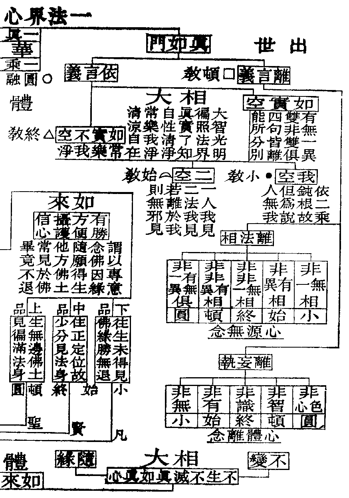
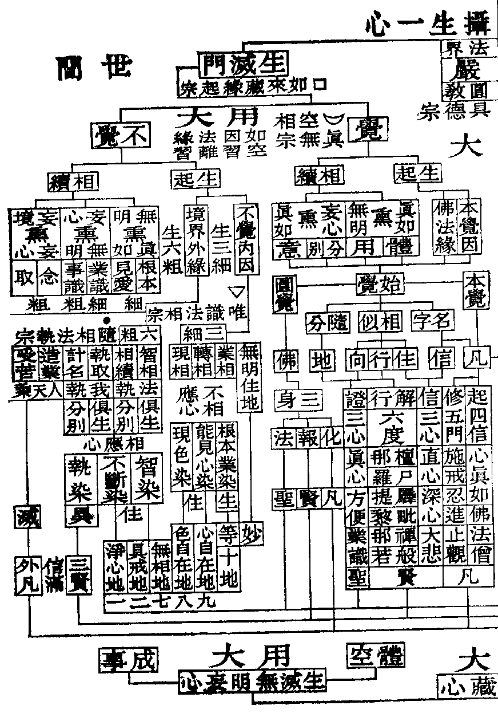

# 起信论疏记会阅卷首



> **藏经**：卍新纂大日本续藏经（新纂卍续藏）　**册次** 第 45 册（X45）　**编号** X0767　**部类** 论疏部　**卷次** 1 卷　**篇幅** 25,745 字

> **卷／品**：0 卷 · 1 品



---



## 目录



  - [疏序](#疏序)



---



起信论疏记会阅总目



首卷凡例  

缘起  

科判  

五祖传  

论主略录  

记主略录  

法相数  

真妄生灭法相图



一卷序二篇  

疏题  

记题  

疏主  

录主  

记主



------



### 疏序



悬谈将解此论(至)五教相摄  

音释



二卷悬谈二约法生(至)宗趣终  

论题  

论主  

译主  

论文初皈命(至)颂终  

音释



三卷论曰(至)二门不相离  

音释



四卷心真如者(至)生一切法  

音释



五卷云何为二一者觉(至)缘熏习镜  

音释



六卷所言不觉者(至)智碍  

音释



七卷分别生灭相(至)如来之藏  

音释



八卷真如用者(至)堕二乘地  

音释



九卷信成就发心者(至)双现前故  

音释



十卷若修止者(至)论颂终  

音释



No. 767-1 起信论疏记会阅凡例



论与疏记，总会成十卷，依次行列。餘外科传等，著另编为首卷别行，以俟参考。  

首卷中缘起，乃叙会本之因由，故居初；科判是析大部之条贯，故在次；五祖一家所宗，先命辑略，当第三；论主、记主二录，后重补载，当第四；法相提举论中之大纲，当第五；图章排出论内之旨趣，殿於后矣。至餘迂泛不切者，悉芟不录。  

旧有科文一卷，论科之后附赘疏科，殊觉障眼。今别本科中单编论科，疏科仍存记中，此则不唯省烦琐，且与圭山注本极为相应。  

戴序、自序并叙、论、疏、记，会之大意，宜冠部帙之前，故置於一卷初也。  

旧时开本分疏为四卷，记为二十卷。今会本疏、记通共合为十卷，卷帙多寡颇殊，文字语言不二。如并二十四瓶水泻置十瓶，其间点滴岂有异耶？具眼者鉴之。  

初卷至二卷，将末随文解。前顶格书者，疏文。低一格标记字者，记文。  

二卷随文解后，至十卷终。顶格书者，论文。低一格，标疏字者，疏文。标记字者，记文。  

论中分文章段，原依贤首大师科判，并无异立。论前序疏段落，例此可知。  

科门层叠，源委难明。交光大师科，楞严经创以干支，今禀承之以标其科，则曾玄生起有序，而前后脉络亦贯通也。  

论疏文义，次第生起，科章判释亦尔。譬如树木，初以一本，或分二支，三四五支，从大支出中支，从中支出小支，亦分二三四数。此则仍依云栖本中详注不简，俾首尾互相照应，披绎者不致混滥。  

科下注文及论下疏文，俱依圭山本录，拣异云栖本中疏前插入科下之注文也。  

科后标疏记者，是释科文；论后标疏记者，方释论文。虑或相滥，今先表出。  

圭山录本，逐句注疏，所以疏上不牒论文。云栖刻本，随科分章，章内疏长，疏上理应标牒论文。今亦倣云栖本式编之，然撮略词句，亦不尽与之同。  

旧本中疏，亦有不对论文而录者，今依原本正之。如释四相内，觉於念住，觉心初起等。注：  

旧疏本中有释疑者，尝叙疑难文，直置於释疑科前，此则太远，覧者难悉。若在科下注之，似乎先外难，后论释，文虽稳便，又恐混作解科之文，今俱移入本文疏下。其例先牒论文，次叙疑难，后用释通，则文义显了易解，如同相中及五识后释疑等疏文者是也。  

疏中文长难明者，记先科判，然后细释。今本亦准记科，分疏会记。凡习学者，须先阅疏，次单看记，后将疏记总研一遍。如是三复，则论旨自明，而疏记意趣，亦无不洞然也。  

疏文短，记文长，义可分者，则离疏就记，合记从疏。设疏记俱长，义有不可分者，亦不敢妄为割裂，以伤疏文血脉。  

论文有未科者，记重科之；有未疏者，记重解之。今皆会编记内，不另外列段。然亦各有拣别，解论者则标论云，解疏者则标疏云。如无论疏二字，必牒论之全文，疏之全句，究者自宜著眼。  

记内尝於解疏外，别又发挥上根利智，固圆通无碍，在下愚遂谓二三其说。今会编中太违者，略删去一二句(如始觉中疏曰七识不流转，记曰经云五识不流转，今云七识，疏笔悮尔。此据唐译斥也，殊不知疏依宋译，何可斥耶？类此者从删)，稍顺者仍存不动(如真如门会执与会相入实等诸记释文)，俾披绎者正遵疏义，兼取记意，可为助显。葢译楞伽、起信等经，论藏和尚亲在场中证义出疏，岂有差舛，以致疑误后学者耶？  

藏和尚疏三卷，记一卷，以传强学。圭山为论疏各本，恐中下之流不能备阅，遂将疏文随科注於论文之下，删繁取要，录成二卷。故清凉华严疏钞中所引起信疏记诸文并不见者，皆属和尚自述疏记，非今圭山略录之本，长水修定之记也。读一不读一，毋生疑议。  

论有标徵释结段落，疏有通章逐句释异，记有解论解疏之殊。若不𠃊(音钩，勾也)断，初进茫然。今论疏记中，或大段𠃊，或逐句𠃊，一展读间，便知节目，不使眸子有留难焉。  

旧刻原不圈(○也)句读(音橛，竖也)｜科章，今亦为益初机，略加圈｜，以便观覧。  

疏记向无音释，今於每卷尾详加释音，无烦查考。  

流通。疏记本中，字多差脱，此皆传写误耳。今依古本增定，或约义改正。设论疏有文，关系教观，而为法中紧要者，并於记内广加润释。但将新旧开会二本，对校一番，得失自知。倘若错谬，希垂慈示。



No. 767-2 起信论疏记会阅缘起



葢闻大小乘论，有本有末，有性有相。唯起信一论，原始要终，该空彻有，而为本末之枢机，性相之纲纽也。马鸣大士造五论，独行此者，与凡圣为依，众法之总，开示一乘理实缘起法界之旨，莫於斯矣。此论有两译，前梁武帝遣聘天竺取经，时摩竭提国王移送西印，优禅尼国沙门拘兰难陀译名真谛，三藏法师苦辞不允，就泛舟来朝，与瞿昙兼多侍从，并贡苏合佛像。及至未旬，遇侯景侵扰，三藏欲返舶，偶值京邑英贤慧显、智韶、昙振、慧旻与黄钺大将军太保萧勃敬请，属大梁承圣三年九月十日於衡州始兴郡建兴寺翻译斯论一卷，并译论旨玄文二十卷、大品玄文四卷、十二因缘经两卷、九识义章两卷，传语人月支国首那等、执笔人智恺等，首尾二年方讫。次唐武后长安年间，于阗国沙门实叉难陀，此云喜学，於东都佛授记寺重译斯论，翻成两卷，波仑玄轨笔授，复礼缀文，弘景、法宝、法藏等证义。贤首国师於二译中，因唐译是同在译场，恐涉情党，特解梁本，疏成三卷，别记一卷。石璧法师因其记略，仍贯义意，别为广录，传习者厌其支离。长水大师重考经论，再加损益，葢取中庸，则无有繁简之失也。康熈乙巳年，予在莲居听灵沧法伯讲，细研论文并疏记意旨，洵知三祖贤首国师立宗判教，发挥三乘顿渐之极致，皆凭於此论矣。戊午秋，顺天府府丞戴复斋先生劝予出论解。己未夏，开讲疏时，先生印施论文百餘卷，兼以私注疏本，示曰：某之入道，实以此论疏为发觉初因也。静阅之，始信先生好处林泉者，志在於佛法耳。后予不两月，摘成要解两卷，先生目之，即命人誊录，藏於箧中。十月间，先生因旧疏四卷、记二十卷，咸各自为帙，亦未句读，学者难於披对，重命予为疏记会本，务须章段句读并顺条理，科注疏文各安其所。予惟贤家宗承十大疏中，独赖此部存耳，今加分会，极畅本怀。遂於腊月八日编起，至二十初卷稿脱，就往正之，先生不胜庆赞，命餘九卷照此定例。庚申新正十一，又送二卷稿阅之，亦加印可。二月十二会三卷，三月初三会四卷，二十五会五卷，四月十六会六卷，二十六会七卷，五月初十会八卷，十九会九卷，六月初三会十卷，十一定科文一卷，七月初一述诸祖略记一卷。至中元，佛欢喜日图法相，会编功就。越辛酉正月十三后，不期先生身染微恙。至二月二十七，题自私注疏，面云：余留心此事，惜未竟志，解通而未实行。幸法师以此晓人，须行到也。题毕，嘱长公仁长曰：此疏持付与法师，会本宜刻之流通，毋以清贫为苦，有负我之久愿耶。二十八早，书辞世偈曰：本学天台禅，已到二三位。又参教外禅，已近虗空碎。士宦苦紏缠，不得竟斯志。今日撒手归，踪迹又何在。二十九子时分，语亲属曰：今生不能出家，不得定力，愿来世为僧，速成觉果。汝等可将道袍、禅衣、拄杖、念珠置之左右。昨午天目有僧来，此刻须请在佛阁朗称佛号，以助正念。一切世事皆如幻梦，会必有别，切莫悲啼。嘱竟，众念佛约千声。餘便问时候，与众辞谢，安庠而逝。次年壬戌五月朔旦，长公鸠集名手，在后园七佛阁中付剞劂。迨乙丑八月，移在慈云观堂。至丁卯七月，合刻功告成。然则会刊此典也，亦为一大事因缘矣。忆昔已未秋九月十四夜，梦一包巾帻者，状如武侯，称天帝师，登座说法，人天拥卫，香华缭绕。忽遣璎珞冠人劝一神曰：此乃天帝师起信疏记，尔是福德天，宜顶戴奉行。彼神随即授予书曰：座主使我嘱付汝耳。予拜受之。又见书面八金字云：上帝临汝，无贰尔心。以昔梦之徵，今包巾帻者，贤首祖师也；璎珞冠者，长水大师也；福德天者，复斋先生也；疏记，会本也；无贰，警语也。此一善举，简在天帝心矣，敢谓之微缘小事得乎？弗有多生之善愿，曷能预感梦兆若此？非受灵山之道记，曷能去住惺悟若此？先生之问法於梅坞老人，不异欧阳文忠公也；得省於天目和尚，不异襄州王常侍也；息妄转业，不异温尚书也；习止修观，不异陈参军也；屏翰佛门，不异裴刺史也；刊行教典，不异房相国也；请注楞伽，不异郑秘书也；节略禅波，不异梁学士也；遗命置坏色衣於柩中，不异王文正公旦也；至於举家信向佛法，不异庞居士父子也。今而后信论疏之得弘传矣，了修证之有门路矣，何患乎马鸣、贤首之教网致破裂耶？予实庆喜一大功德之终成，因记其颠末於卷帙之首。



康熈丁卯年七月十五佛欢喜日灌顶行者续法谨识



No. 767-3 大乘起信论疏科文



唐　西京太原沙门法藏　定



唐　终南草堂沙门宗密　录



宋　秀州长水沙门子璇　修



清　钱塘慈云沙门续法　编



清　顺天府府丞戴京曾　阅



▲将解论文大分为(二)初总叙宗旨(二)初叙论大意(四)初叙一心法(夫真)  

二显真如门(非生)  

三明生灭门(但以)  

四二门不二(三)初法(二)先正明不二(虽复)  

二释成无碍(故使)



二喻(其犹)  

三结(是以)



二明造因由(二)初反显(但以)  

二正明(二)初序谬述迷(二)初总叙(大师)  

二别显(二)初迷理(遂使)  

二迷教(加以)



二兴悲造论(三)初悲叹人法(爰有)  

二述造论意(将欲)  

三正造诸论(二)初广论(造论)  

二略论(三)初出所以(既文)  

二正造论(悲末)  

三彰功益(可谓)上初总叙宗旨竟



二开章释文○



○二开章释文(二)初悬叙义门(二)先略标(将欲)  

次详释(六)初起因(二)初总标(初辨)  

次别释(十)初智辨(一依)  

二法化(二示)  

三巧示(三云)  

四显明(四以)  

五依本(五依)  

六藉力(六藉)  

七为义(七为)  

八因缘(八以)  

九由起(九由)  

十机益(十机)



二藏摄(二)初标门(二约)  

二释义(三藏)



三教义(二)初总标(三显)  

二别列(二)初教(二)初开章(一约)  

次释义(二)初总叙诸教(五)初小教(一小)  

二始教(二大)  

三终教(三终)  

四顿教(四顿)  

五圆教(五圆)



二与论相摄(二)初定分齐(若於)  

二明相摄(若将)



二法(二)(第二卷)先开章(二约)  

次释义(二)初正明(五)初一心(五重)  

次二门(二依)  

三二觉(三依)  

四三细(四依)  

五六麤(五依)



二别示(若取)



四被机(二)初标门(四明)  

次释义(三)初总明所被(一切)  

二重辨兼正(二)初约三聚辨(然一)  

二据五性说(准此)



三别指下文(又因)



五诠体(二)初总标(五论)  

二别释(四)一随相(一随)  

二唯识(二唯)  

三归性(三归)  

四无碍(四无)



六宗趣(二)初标章(六示)  

二列释(二)初诸宗(三)初正辨明(二)先总(初总)  

次别(五)初小乘宗(一随)  

二破相宗(二真)  

三立相宗(三唯)  

四法性宗(四如)  

五法界示(五圆)



二指此论(今此)  

三会五教(然此)



二此论(二)先总(后唯)  

次别(二)初列释(别者)  

二结示(此五)



二随文注解○



上初悬叙义门竟



○二随文注解(二)初解名题(三)初论题目(大乘)  

二造论主(马鸣)  

三译论人(真谛)



二释文义(三)初归敬述意(二)初归依三宝(二)初能归分齐(归命)  

二所归三宝(三)初佛(最胜)  

二法(及彼)  

三僧(如实)



二述造论意(为欲)



二正述论文(二)(第三卷)初标益起说(论曰)  

二正陈所说(二)初标列(说有)  

二牒释(五)初因缘分(二)初正释(三)初标牒(初说)  

二假问(问曰)  

三举答(四)一举数(答曰)  

二徵起(云何)  

三详释(一者)  

四总结(有如)



二通难(二)初难(问曰)  

二通(二)初纵问略标(答曰)  

二以义具释(二)初明餘机不假此论(三)初胜机遇佛悟(所谓)  

二自力闻经悟(若如)  

三劣机因寻广论悟(或有)因缘分科竟



二明当机须造此论(二)初机(自有)  

二结(如是)



二立义分○  

三解释分○  

四修行信心分○  

五劝修利益分○



三总结回向○



○二立义分(二)初结前生后(已说)  

二正立义宗(三)一标总开别(摩诃)  

二寄问列名(云何)  

三依名辨相(二)初法(二)初举法总立(所言)  

二开门别立(二)初责总立难(何以)  

二开别释成(是以)



二义(二)初大(所言)  

二乘(一切)



立义分科竟



○三解释分(二)初结前生后(已说)  

二分门解释(二)初标数徵列(解释)  

二牒名辨相(三)初显示正义(二)初总(二)一依法开门(显示)  

二二门该摄(二)先立(是二)  

次释(此义)



二别○



二对治邪执○  

三分别发趣道相○



○二别(二)(第四卷)初别辨二门显动静不一(二)初真如门(二)初显体离言以明观智境(二)初正举法体(二)一正显如体(三)一就实略标(心真)  

二会妄显真(一切)  

三结真离妄(是故)



二会执释名(二)先释(三)一正会谓执(以一)  

二结名释疑(谓言)  

三约相释遣(此真)



次结(当知)



二问答断疑(二)一疑真绝修问(问曰)  

二举真劝修答(答曰)



二依言辨德以明生信境(三)一举总标(复次)  

二开章略辨(云何)  

三依章广释(二)初空(三)初略明(所言)  

二广释(当知)  

三总结(乃至)



二不空(二)初正释(所言)  

次释疑(亦无)



二生灭门(二)初释生灭心法(二)初染净生灭(二)先就体总标(三)一标体(心生)  

二辨相(所谓)  

三立名(名为)



二依义别解(三)初释上生灭心(三)初开数辨德(此识)  

二寄问列名(云何)(第五卷)  

三依名辨释(三)初觉义(二)初略辨本始二觉(二)初本觉(二)一显本觉体(所言)  

二释本觉名(何以)



二始觉(始觉)



二广明本始二觉(二)初始觉(三)初总标因果二觉(又以)  

二广寄四相释成(二)初正寄四相显其四位(二)先总徵(此义)  

次别释(四)初灭(如凡)  

二异(如二)  

三住(如法)  

四生(如智)



二引经释成心源无念(四)初引经以证(是故)  

二重释前文(又心)  

三举不觉失(是故)  

四显觉者得(若得)



三结明始不异本(而实)



二本觉(二)初随染本觉(三)初总标(复次)  

二徵列(云何)  

三辨相(二)初智净相(二)初直明净相(二)初因(智净)  

二果(破和)



二问答释成(二)初执真同妄问(此义)  

二简妄异真答(三)初法(以一)  

二喻(如大)  

三合(如是)



二不思议业相(二)初依体总标(不思)  

二约用别辨(所谓)



二性净本觉(二)初总标(复次)  

二别释(四)一如实空镜(云何)  

二因熏习镜(二者)  

三法出离镜(三者)  

四缘熏习镜(四者)



二不觉义○  

三双辨同异○



二释上生灭因缘○  

三释上生灭之相○



二染净相资○



二辨所示之义○



二会相入实显动静不异○



○二不觉义(三)(第六卷)初根本不觉(二)一依觉成迷(三)初法(所言)  

二喻(犹如)  

三合(众生)



二依迷显觉(以有)



二枝末不觉(二)一无明为因生三细(二)初总标(复次)  

二别解(二)初徵(云何)  

次释(三)一业相(一者)  

二转相(二者)  

三现相(三者)



二境界为缘生六麤(二)先蹑前总标(以有)  

次立名别释(二)初徵(云何)  

二释(六)一起计(一者)  

二生受(二者)  

三取著(三者)  

四立名(四者)  

五造业(五者)  

六受报(六者)



三结末归本(二)初正释(当知)  

二转释(以一)



○三双辨同异(二)先标列(复次)  

次解释(二)初同相(三)一喻(同相)  

二合(如是)  

三证(二)先正引(是故)  

次释疑(亦无)



二异相(异相)



○二释上生灭因缘(二)初明生灭因缘义(三)先总标(复次)  

次徵问(此义)  

三别释(三)初释所依心(以依)  

二释意转(三)初略明识相(不觉)  

二广辨五名(二)初标徵(此义)  

二列释(五)一业(一者)  

二转(二者)  

三现(三者)  

四智(四者)  

五续(五者)



三结归一心(二)初正结属心(二)初顺结三界(是故)  

二反结六尘(离心)



二释疑广辨(三)初问(此义)  

二答(以一)  

三结(当知)



三释意识转(五)初约人辨麤(复次)  

二出其惑体(计我)  

三执所依缘(随事)  

四制立其名(名为)  

五识起所依(此识)



二重显所依缘体(二)初略明缘起甚深(二)初标叹甚深(依无)  

二出深所以(二)初徵(何以)  

二释(三)初即净而染(是心)  

二即染而净(虽有)  

三结成难测(是故)



二广显缘起差别(二)初缘起体相(三)初显上不变之义(所谓)  

二显上无明缘起之由(以不)  

三显上缘起之相(三)初标(染心)  

二徵(云何)  

三释(六)初执取计名相(一者)  

二相续相(二者)  

三智相(三者)  

四境界相(四者)  

五能见相(五者)  

六业相(六者)



二更重料拣(三)初辨上无明约治料拣(不了)  

二释上相应不相应义(二)初释相应(言相)  

二释不相应(不相)



三举(上染心及无明)约境成二碍义(二)初标立(二)初惑障(又染)  

二智障(无明)



二重释(二)先徵(此义)  

次释(二)初释烦恼碍(以依)  

二释智碍(以一)



○三释上生灭之相(三)(第七卷)初牒前标数(复次)  

二徵列略显(云何)  

三广释其相(二)初约人对显(又粗)  

二辨相所依(二)初顺辨生缘(二)初明通缘(此二)  

二显别因(所谓)



二逆论灭义(二)初正辨(若因)  

二释疑(二)初问(问曰)  

二答(三)初法(答曰)  

二喻(如风)  

三合(无明)



○二染净相资(四)一举数总标(复次)  

二徵列别名(云何)  

三染净熏习(二)初总(二)先喻(熏习)  

次合(此亦)



二别(二)先染(二)初问(云何)  

二答(二)初略(所谓)  

二广(三)初明境界熏妄心(此妄)  

二明妄心熏无明(妄心)  

三明无明熏真如(无明)



后净(二)初问(云何)  

二答(二)初略(二)初正明熏习(所谓)  

二辨其功能(二)初因(自信)  

二果(无明)



二广(二)初明妄心熏习(妄心)  

二显真如熏习(三)初标徵(真如)  

次列名(一者)  

后辨相(二)初别释(二)先体相(二)一正显(自体)  

二释疑(二)初问(问曰)  

二答(二)初约染惑成缘明起有厚薄(答曰)  

二约净法赖缘成前后差异(二)初立理(又诸)  

二正释(二)初明因缘互阙之失(二)先显阙缘之失(二)初喻说(如木)  

二法合(众生)



次明阙因不成(若虽)



二明性用相应之得(若因)



二用大(二)初指事总标(用熏)  

二约缘别显(三)初标徵(如是)  

二列名(一者)  

三释义(二)初差别缘(二)初总(二)先明感用因(差别)  

次正明用相(二)初差别之用(二)初开总成别(或为)  

二摄别成总(乃至)



二辨用之益(以起)



二别(二)初就根生熟开近远二缘(此缘)  

二就前近远又各开为二(是近)



二平等缘(二)初明能作缘者平等(平等)  

二明对机宜显平等(所谓)



二合明(二)初标徵(此体)  

二释义(二)先未相应(一者)  

次已相应(二者)



四明尽不尽(二)初明染法违真无始有终(复次)  

二明净法顺理有始无终(净法)



○二辨所示之义(二)初释体相二大(二)初总标二大名(复次)  

二别释二大义(二)初体(一切)  

二相(二)初正显性德(二)先明德相(三)初总(从本)  

二别(所谓)  

三结(具足)



次显立名(名为)



二问答重辨(二)初执体疑相难(问曰)  

二相不违体答(二)初明虽差别而不二(答曰)  

二明虽不二而差别(二)初略(复次)  

二广(二)初明对染法表示之相(此云)  

二举彼染法一一对显(以一)



二别解一用大(二)(第八卷)初总明(二)初对果举因(三)初举本正行(复次)  

二举本大愿(立大)  

三举大方便(以取)



二牒因显果(以有)



二别释(二)初标徵(此用)  

二释义(二)初正显用相(二)先直显其用(二)初应身(二)初约识举人(一者)  

二释其所以(以不)



二报身(三)初约识举人(二者)  

二所见报相(身有)  

三结果由因(如是)



次重牒分别(二)初应身(又为)  

二报身(复次)



二问答除疑(二)初问(问曰)  

二答(二)初释法身能现(答曰)  

二释所现之色(所现)



○二会相入实显动静不异(三)初标(复次)  

二释(二)初观色(六尘)  

二观心(二)先喻(如人)  

次法(众生)



三结(若能)



显示正义竟



○二对治邪执(二)初就本总标(对治)  

二别明治障(二)初对治离(二)初标数(是我)  

二徵列(云何)  

三辨相(二)初人(三)初标(人我)  

二徵(云何)  

三释(二)初二於空谬执(二)初妄执事空以为法体(三)初举起执缘(一者)  

二正明执相(以不)  

三辨对治相(二)初虗空妄非真(三)初立(云何)  

二释(以对)  

三结(所谓)



二法身真非妄(此谓)



二妄执法体唯是空无(三)初执缘(二者)  

二执相(以不)  

三对治(云何)



二三於有倒智(三)初执性德同色心(三)初执缘(三者)  

二执相(以不)  

三对治(云何)



二执法性本有染(三)初执缘(四者)  

二执相(以不)  

三对治(二)先夺破(云何)  

次纵破(若如)



三执染净有始终(三)初执缘(五者)  

二执相(以不)  

三对治(二)初明(法体)离始则显生死无初(云何)  

二明(法体)离终则显涅槃无尽(又云)



二法(三)初执缘(法我)  

二执相(以说)  

三对治(云何)



二究竟离(二)初约法明治(二)初约法总显(复次)  

二举广类求(是故)



二会释伏疑(三)初正会伏疑(而有)  

二辨定圣意(其旨)  

三反以释成(以念)



对治邪执竟



○三分别发趣道相(二)初标意释名(分别)  

二开章释相(三)初标数(略说)  

二徵列(云何)  

三辨相(三)初信成就发心(三)初信成之行(二)初问(僧成)  

次答(二)初正答前问(二)初答三问(三)一答能修行人(所谓)  

二答所修之行(有熏)  

三答行成堪发(经一)



二结成位(如是)



二举劣显胜(二)初明微劣相(二)初内因力微(若有)  

二外缘力劣(或有)



二结成退失(如是)



二发心之相(三)(第九卷)初牒章以问(复次)  

二标徵列释(略说)  

三问答除疑(二)初问(问曰)  

二答(二)初正答所问(二)初喻(答曰)  

二合(三)先正合(如是)  

次委释(以垢)  

后顺真(若人)



二重显方便(二)初标徵(略说)  

二别释(三)初一不住道(一者)  

次二自利行(二)初断德(二者)  

二智德(三者)



后一利他行(四者)



三发心利益(四)初显胜德(菩萨)  

二明微过(然是)  

三通权教(如修)  

四叹实行(又是)



二解行发心(二)初总标叹胜(解行)  

二显其胜相(二)初时胜(以是)  

二行胜(二)先总(於真)  

次别(以知)



三证发心(三)初明发心体(三)初标地依(证发)  

二明行体(以依)  

三明胜用(四)初摄法上首德(是菩)  

二随根延促德(或示)  

三实行不殊德(而实)  

四应机殊行德(但随)



二明发心相(又是)  

三明成满德(二)初正显胜德(二)先总(又是)  

次别(谓以)



二问答除疑(二)初除一切种智疑(二)先问(问曰)  

次答(三)初直立正理(答曰)  

二举非显失(以众)  

三举是彰得(说佛)



二除自然业用疑(二)先问(又问)  

次答(答曰)



解释分科竟



○四修行信心分(四)初结前生后(已说)  

二就人标意(是中)  

三约法广辨(二)初兴二问(何等)  

二还两答(二)先答信心(二)初标徵(略说)  

二列释(一者)



次答修行(三)初举数标意(修行)  

二徵起列名(云何)  

三依门牒释(五)初施(云何)  

二戒(云何)  

三忍(云何)  

四进(二)先正显修行进门(云何)  

次别明除障方便(二)初障(复次)  

二治(是故)



五止观(二)先略明(二)初徵(云何)  

二释(三)初止(所言)  

二观(所言)  

三俱(云何)



次广释(三)(第十卷)初止(五)初修方便(二)初明胜人能入(二)初托静息心修止方便(二)初约外缘(若修)  

二安内心(二)初约坐时修止(二)先离境(不依)  

次除心(一切)



二约餘时修观(若从)



二止成得定除障不退(久习)



次显障者不能(唯除)



二显胜能(二)初能生一行三昧(复次)  

二能生无量三昧(当知)



三辨魔事(二)初略(二)初魔事(或有)  

二对治(当念)



二广(二)初魔事(五)初现形说法(或现)  

二得通起辨(或令)  

三起惑造业(能令)  

四据定得禅(亦能)  

五食差颜变(或令)



二对治(以是)



四简真伪(二)初举内外二定以别邪正(二)初邪(应知)  

二正(真如)



二对理事二定以明真伪(二)初真(若诸)  

二伪(以修)



五示益劝(二)初总标(复次)  

二别解(三)初善友摄护益(云何)  

二离内外障益(二)初离外恶缘(二者)  

二离内惑业(四者)



三行成坚固益(六者)



二观(三)初明修观意(复次)  

二辨观行相(四)初法相观(四)一无常观(修习)  

二苦观(一切)  

三无我观(应观)  

四不净观(应观)



二大悲观(如是)  

三大愿观(作是)  

四精进观(以起)



三结观分齐(若能)



三俱(三)初总标(若行)  

二别辨(二)初约法明俱(二)初即上之观(所谓)  

二即观之止(虽念)



二对障明俱(若修)



三总结(以是)



四防退方便○



○四防退方便(二)初明可起之人(复次)  

二明防退之法(二)先通举圣意(当知)  

次别引经证(如修)



修行信心分竟



○五劝修利益分(三)初结前生后(已说)  

二信谤损益(二)初信受福胜(二)先总举三慧利益(若有)  

次别显三慧益相(三)初闻时益(若人)  

二思时益(假使)  

三修时益(三)初时少德多(复次)  

二校量多相(假令)  

三徵释所以(何以)



二谤毁罪深(其有)



三结劝修学(当知)



上正述论文竟。



○三总结回向(诸佛)



大乘起信论疏科文(终)



No. 767-4



法界宗五祖略记引



庚申夏，予在七佛阁繙藏经，并阅僧史。一日，询华严五祖於慈云百亭法师，及闻其说，窃有疑焉，因而请编五祖行实。未至旬，法师辑为略记一卷，核之，始觉僧史乖舛也明矣。且如三祖贤首大师传，谓登封丙申，诏师讲新经，感口光震地，𠡠十德为师受戒。今按新经，乃证圣乙未年方译，圣历己亥年始毕，岂未译而先讲耶？况三祖咸亨庚午岁削染承旨，便讲至登封丙申，越二十七年，祖年五十四岁，道满天下，方与受戒，恐无是理。乃至以还源观讹为杜顺和尚作观，国师寿止七十。审如是，则史鉴记载之谬，甚彰灼矣。后又究略记所本，曰：初，二祖出会玄，三祖详崔传，四、五祖载诸疏，披騐之，毫无差忒也。葢佛以心法传於诸祖，诸祖以心法弘於法界，尽未来际，化化不绝，其道迹可无徵乎？无徵，人不信矣，又何从而倣傚之？岂不有参於佛祖也哉？今而后，知扶植佛教者，全在於诸祖；学习祖道者，全在於典章。则此一记，非小补矣。遂命刻以公诸所好，俾见闻随喜者，慎勿以此为赘语而忽之也。



虎林复斋居士戴京曾题。



法界宗五祖略记



钱塘慈云沙门　续法　辑



顺天府府丞　戴京曾　较



初祖杜顺和尚



初祖名法顺，𠡠号帝心，俗姓杜氏，雍州万年县杜陵人也。生於陈武帝永定二年，才三日，有乳母自来求哺养，满三月，腾空而去(一)。孩提时，常於宅后冢上，为众说法，闻者莫不信悟，因名为说法冢(二)。年十五，代兄统兵勦贼，桶水担薪，供给十万军众有餘。一夜，潜取诸营所著垢衣，浣净悉遍，未举锋刃，贼寇尽退，不乐官荣，请归养亲(三)。至十八，即於因圣寺魏珍禅师处，投礼出家，禅师亲与披剃，时感地动，地神捧盘承发，四众奇之(四)。后行化庆州，斋主请僧，止三百众，忽有五百贫人，相随赴应，主虑供不备，尚曰：但心平等，无有不办。斋毕，五百人化为罗汉，驾云而去(五)。张弘畅家畜牛马，性极弊恶，尚示以慈善，不复觝啮(六)。及引众骊山栖静，将种菜，地多虫蚁，乃巡疆定封，虫便外徙，遂得耕垦无伤(七)。尚患肿，脓溃外流，人有涑之者，香味难比，或以帛拭者，香气不散，寻即瘥愈，与人消肿(八)。三原县人田萨埵者，生来患聋，召之即能听(九)。又张苏者，亦患生痖，语之即能言(十)。武功县僧为毒龙所魅，众求救，即端拱对坐，龙遂托病，僧言：禅师既来，义无久住。顷即释然(十一)。故使远近瘴疠淫邪所恼者，莫不投造，尚亦不施餘术，但向之禅观，无弗痊者。乃至神树龙庙，见即毁除。巫觋所事，躬为屏。当世人皆异之，号之为炖煌菩萨。(十二)由此声闻於朝。隋文帝甚加信敬，给月俸供之。(十三)后因诣南山，属横渠泛溢，从者惊惧。尚率众同涉，水即断流，徐步而过。才登岸，水复如故。(十四)时分卫应供斋主，抱儿乞消灾延寿之记。尚熟视曰：此汝冤家也，当与之忏悔。斋毕，令抱至河边。尚抛之入水，夫妇拊膺号呌。尚曰：汝儿犹在。即以手指之，其儿化为六尺丈夫，立於波间。瞋责之曰：汝前生取我金帛，杀我推溺水中。不因菩萨与我解怨，誓不相赦。夫妇默然信服。(十五)偶将道履一䩫，置於市门，三日不失。人问其故，尚曰：吾从无量劫来，不盗他人一钱，报应如是。为盗者闻之，悉悔心易过。(十六)尚禀性柔和，操行高洁。学无常师，以华严为业。住静终南山，遂准华严经义，作法界观文集。成已，投巨火中，祷曰：若契合圣心，令一字无损。忽感华严海会菩萨，现身赞叹。后果无毁。(十七)时弟子中，唯智俨独得其奥。僧有樊玄智，安定人也。弱岁修道於京城南，投为上足。尚令诵华严，劝依法界观门，修普贤行。久之，每诵经际，口中频获舍利，前后数百粒(十八)。尚甞作法身颂曰：嘉州牛吃草，益州马腹胀。天下觅医人，灸猪左膊上。纵透达磨禅者见之，并皆卷舌(十九)。唐太宗仰慕神德，诏请入内。帝自亲迎，问曰：朕苦寒热，久而不愈。师之神力，何以蠲除？尚曰：圣德御宇，微恙何忧？但颁大赦，圣躬自安。上从之，疾遂瘳。因锡号曰帝心。宫庭内外，礼事如佛(二十)。贞观十四年十月二十五日，普会有缘於雍州南郊义善寺。声色不渝，忽言别众(二十一)。复入内辞太宗，升太阶殿，化於御床。帝留大内，供养七日。时年八十四也。遗体若生，异香时发。经一七已，勅同座送樊川北原，凿埪处之，即今会圣院也。京邑同嗟，制服亘野。龛中面色，经月弥鲜。安坐三周，全身不散。随建塔於长安南华严寺(二十二)。尚未示寂前，一门人来辞曰：往五台礼文殊。尚微笑说颂曰：游子漫波波，台山礼土坡。文殊秪这是，何处觅弥陀？彼不喻而去。方抵山麓，遇老人曰：子来何为？曰：礼文殊来。曰：大士已往长安，教化众生去也。曰：谁为是？曰：杜顺和尚也。僧耸然失声曰：是我师也。奄忽中，老人乃失，兼程而归。适浐水瀑涨，三日方济。到时，尚已前一日化去矣。以此验知，是文殊应身也(二十三)。餘广传记。



二祖智俨和尚



二祖讳智俨，俗姓赵氏。生於开皇二十年也。别号云华和尚。师居是寺，因而名之。又号至相尊者。亦因主化其中，人故称之。英敏特达，颕悟非常。经书过目，成诵不忘。(一)初剃染时，即於大藏前立誓，愿抽得华严第一。(二)遂往终南山杜顺和尚所，投为上足。师侍未久，尽得其旨。尚以所集观法，传与师习，令其讲授。(三)后志欲弘通，偶遇异僧来谓曰：汝欲解华严一乘法界宗者，其十地中六相之义是也。慎勿轻怠。可一二月间，静摄思之，当自知尔。言讫，忽然不见。(四)因即淘研，不盈累朔，豁尔贯通。时年二十七也。(五)随於至相寺，制华严经搜玄义钞五卷，题名华严经中搜玄分剂通智方轨。即明六相，开十玄，立五教也。(六)时京兆崇福寺慧祐，戒行精苦。向慕师德，特来亲事。师教专以华严为业。每清晨良宵，焚香䖍诵出现品后。时忽见十餘菩萨，从地踊出。现身金色，皆放光明。坐莲华座，合掌听诵此品。经毕便隐。(七)显庆四年，师於云华寺中讲华严。宗风大振，名徧寰内。缁素道俗，咸皆归礼。时法藏年十七，辞亲求法於太白山。后闻亲疾，出谷入京。至中夜，忽覩神光来烛庭宇。乃叹曰：当有异人，发弘大教。翌旦，就寺膜拜已，因设数问，皆出意表。师嗟赏曰：比丘义龙辈，尚罕扣斯端。何计仁贤，发皇耳目。或告曰：是居士云栖木食，久玩杂华。为觐慈亲，乍来至此。藏既餐和尚之妙解，以为真吾师也。师亦喜传炷之得人矣。(八)龙朔二年，海东义想公同元晓公入大唐国，夜宿古冢。晓公因达唯心旨故，即回新罗。想公来云华，礼事和尚，愿为弟子，与藏公同学。(九)总章元年，师将去世。藏公尚居俗服，乃嘱道成、薄尘诸大德曰：此贤者注意於华严，葢无师自悟。绍隆遗法，其惟是人。幸假餘光，俾沾制度。后梦般若台倾，高幢亦倒。告门人曰：吾将暂往净方也。不餘月，遂说法而逝。寿年七十二矣。(十)时义想传不思议经，归海东大弘。彼国推为华严初祖，并号浮石尊者。(十一)后长寿年间，藏公因胜诠法师回新罗，寄书於义想曰：夙世同因，今生同业。得於此报，俱沐大经。特蒙先师，授兹奥典。希傍此业，用结来因。但以和尚章疏，义丰文简。致令后人，多难趣入。是以具录微言妙旨，勒成义记。传之彼土，幸示箴诲。想乃掩室探讨，涉旬方出。召弟子真定、相圆、亮元、表训四人，俾分讲探玄记，每各十卷。告之曰：博我者藏公，起予者尔辈。各宜勉旃，毋自欺也。遂令教传一国，学徧十山。皆凭云华和尚法化力也。(十二)其神异德行，备如感应传说。



三祖贤首国师



三祖讳法藏，字贤首，帝锡别号国一法师，俗姓康氏。其先康居国人，高曾相继，为彼国相。祖自康居来朝，占风圣代。考讳谧，太宗赠左侍中。弟讳宝藏，为中宗朝议郎，行统万监(一)。师托胎时，母氏梦吞日光而孕，当贞观十七年十一月初二日生也(二)。及生而慕无上，至显庆三年十六岁时，炼一指於岐州法门寺舍利塔前，作法供养，誓悟佛乘(三)。次年志锐择师，遂辞亲求法於太白山，阅方等诸典(四)。后闻慈亲不悦，归奉庭闱，绵历岁月，能竭其力。时俨和尚於云华讲大经，师礼为弟子，深入无尽(五)。总章元年二十六岁时，往释迦弥多罗尊者所，请受菩萨戒。众告曰：是居士能诵华严，兼讲梵网。尊者惊叹曰：但持净行一品，已得菩萨大戒，况义解耶(六)。咸亨元年师二十八岁，属荣国夫人杨氏奄归武后，广树福田，舍宅为太原寺成尘。诸大德受俨和尚顾托者，连状荐举，由是奉𠡠削染於太原道场，仍诏为住持(七)。上元元年，有旨命京城十大德为师授满分戒，赐号贵首(即署字为号也)。复诏师於太原寺讲华严。端午节，天后遣使送衣五事(八)。调露元年五月间，壅州万年县何容师，嗜食鸡子无算，暴死，同七百人入镬汤狱。附信返魂者，令第四子行证恳求师赎罪，师令诵写华严经。至永隆元年八月，写就庄严，请僧斋忏会众。乃见何容师等七百鬼徒，到席礼谢。(九)师於晋译，每叹缺而不全。是年日照三藏，赍梵本至京。高宗诏於魏国西寺，翻译经论。师往就问之。照曰：晋第八会文，亦来至此。遂与三藏对校，果获善财求天主光等十善友文。乃请译补缺。就於西太原寺，译出法界品内，两处脱文。一从摩耶夫人后，弥勒菩萨前，中间天主光等十善知识。二从弥勒菩萨后，至三千大千世界微尘数善知识前，中间文殊申手。过一百一十由旬，按善财顶。依此六十卷本为定。(十)寻奉纶旨，与日照三藏，及道成律师，薄尘法师，大乘基法师等，同译密严等经，显识等论，十有餘部，合二十四卷。复礼法师润文，慧智法师度语。(十一)永淳元年四月间，雍州长安县郭神亮者，修净行暴终。诸天引至兜率内院，礼敬慈氏。有一菩萨谓曰：何不受持华严？亮以无人讲解为辞。曰：现有贤首菩萨弘扬，何得言无？(十二)文明元年，师与日照三藏，在西太原寺翻经。暇躬亲问曰：西域古德，於一代圣教，判权实否？答曰：近代天竺，有二论师。一名戒贤，远承慈氏无著，近踵护法难陀，立法相宗。二称智光，远宗文殊龙胜，近禀青目清辨，立法性宗。自是判教疑决。(十三)时成尘二德，问京兆有王明干，死入地狱。地藏菩萨，教诵偈曰：若人欲了知，三世一切佛。应当如是观，心造诸如来。入见阎王。王闻之放免。三日后方苏，向空观寺僧定法师说之，然不知有出否。师答曰：此乃华严第四夜摩会中偈。检之，果是十行颂也。(十四)埀拱二年，师於慈恩寺讲杂华。(十五)永昌元年二月四日，遇于阗三藏因陀罗般若於神都魏国东寺，告以沙弥般若弥伽薄升天诵华严，能破修罗阵事。(十六)天授元年，觐亲于夏州，郡牧邑宰，靡不郊迎。(十七)天授二年，曾州牧宰迎讲大经，因论邪正。会中有左道者，不信佛法，口发恶言，身面忽疱，眉须尽烂，遽来求忏。师诫劝曰：此犹华报耳。汝当礼敬三宝，䖍唪华严百遍，罪可灭矣。读经未半，形质如旧。(十八)长寿年间，师於云华讲百千经，有光明现从口出，须臾成葢，众所具载。(十九)延载元年，讲至十地品，天华四散，五云凝空，崇朝不辍，香彩射人。(二十)证圣元年三月，诏於东都大遍空寺，同实叉难陀再译华严。弘景、圆测、神英、法宝诸德共译。复礼缀文，师为笔受。译堂前陆地，开百叶莲华，众覩祯祥，竞加精练。太后时幸其寺，亲受笔削，施供食馔。次移佛授记寺译。(二十一)登封元年，诏师於太原寺讲大经。(二十二)神功元年，边寇拒命，出师讨之。特诏师依经呪法，遏除寇虐。师舋浴更衣，建立十一面观音像，准神呪经行道。始数日，蒯城之外，将士闻天鼓之声；良乡县中，贼众覩观音之像。月捷以闻，优诏慰劳(二十三)。圣历二年十月八日译毕，佛授记寺诸大德请师开演，𠡠令十五日启讲。至腊月十二晚，讲华藏世界海震动之文，讲堂及寺宇忽然震吼，道俗数千叹未曾有。难陀三藏并当寺龙象，具表奏闻。十九日御批下云：因敷演微言，弘扬秘赜。初译之日，梦甘露以呈祥；开讲之辰，感地动而标异。斯乃如来降迹，用符九会文耳。岂朕庸虗，敢当瑞应(二十四)？新译唐经，虽增现相、普贤世界、华藏、十定诸品，却脱日照三藏所补文殊。按善财文，师以新旧两经对勘梵本，将日照补者安喜学脱处，遂得文续义连。今之所传，即第四本(一晋译本，二日照补，三喜学译，四贤首补，今现行者二十五)。久视元年五月五日，诏於东都三阳宫，与实叉三藏同译入楞伽经(二十六)。长安二年，於西京清禅寺，与实叉译文殊授记经(二十七)。时礼部荥阳郑公持心经数千万遍，再三请解，师为著般若略疏(二十八)。长安三年，诏与义净三藏等华梵十四人，共译金光明最胜王经等二十一部一百十五卷，师为证译(二十九)。长安四年冬杪，𠡠众僧於内道场建华严法会，有双浮图放五色光现於冰内，师亲见之，指呈众德(三十)。时天后召师於长生殿，问六相十玄之旨，师指殿隅金师子为喻晓之。至一一毛头各有金师子，一一毛头师子同时顿入一毛中，一一毛中皆有无边师子，如是重重无尽，后乃豁然。随贡金师子章一篇(三十一)。因对扬，言及岐州舍利，是阿育王灵迹。特命凤阁侍郎崔玄𬀩，与师偕往法门寺迎之。时师为大崇福寺主，遂与应大德纲律师等十人，俱至塔所。行道七昼夜，然后启之。舍利於掌上腾光，随人福善，感见天殊。腊月除日，至西京崇福寺中。正月十一，达东都洛阳城下。凡摛瑞光者七，抱戴者再(三十二)。神龙元年，诏与弥陀山译无垢净光陀罗尼经(三十三)。其年张易之叛逆，因师内弘法力，外赞皇猷。及除凶徒已后，赐以鸿胪卿职。固辞固授，遂奏请与弟朝议郎行统万监康宝藏，归里养亲。中宗降𠡠褒之(三十四)。冬十一月朔旦，𠡠令写师真仪，御制赞四章(三十五)。神龙二年，诏与菩提流支，就於西崇福寺，译宝积经，命为证义(三十六)。景龙二年中夏悯雨，𠡠师集百法师於荐福寺，以法祷之。近七朝，遽致滂沱。诏曰：敷百座以祈恩，未一旬而获应。师等精诚，均沾法液。七月复旱，感验如初。𠡠曰：慈云演荫，法雨含滋。师等熏修，遽蒙昭感(三十七)。由是中宗礼为菩萨戒师，赐号国一(三十八)。师因万乘归心，八纮延首。遂奏请於两都，及吴越清凉山，五处起寺，均榜华严之号。仍写三藏，并诸家章疏贮之。於是乎像图七处，数越万家。故人於师，皆不称讳，而以大乘法师华严和尚名焉(三十九)。后又召师入内，同义净三藏译七佛药师等经(四十)。景云元年，诏与菩提流支译宝积经，帝亦亲躬笔受(四十一)。景云二年冬，不雪，召师入禁中问之。师曰：有经名随求即得大自在陀罗尼。若结坛作法，写是呪语，投於龙湫，应时必获。诏可其请，遽往蓝田山悟真寺龙池所作法。未旬大雪，表奏上闻。制报曰：𠡠华严师，启请祈恩。三宝流慈，两度降雪。精诚上感，遂乃盈尺。虑不周洽，且未须出。及六出遍四方，复降诏曰：𠡠华严师，法体如何？焚香才毕，旋降瑞雪。虽则如来演贶，实由启恳诚切(四十二)。太极元年七月，彗星现。睿宗诏华严和尚为菩萨戒师，受心地戒。遂传位，改号先天元年。脱屣忘机，褰衣养德(四十三)。是年十一月初二日，太上皇以师寿诞，锡衣财暨食味。诰曰：𠡠华严师，欣承载诞之祥，喜遇高禖之庆。乘兹令日，用表单心。故奉法衣，兼陈汤饼。愿寿等恒沙，年同劫石。别赐绢二千匹，俾赡兴福所须(四十四)。和尚虽为五帝门师(高中睿玄武后也)，王臣并皆礼事。然犹粪扫其衣，禅悦其食。惟以戒忍自守，弘法利生为务。前后讲华严经三十餘遍。间有不了无尽法界，重重帝网义者，又为设巧方便，取镜十面，八方安排，上下各一，相去一丈餘，面面相对。中安一佛像，然一灯以照之，互影交光。学者因晓刹海，涉入重重无尽之旨(四十五)。由此轮下，从学如云，莫能悉数。铮铮嗣法者，曰宏观、文超、东都华严寺智光、荷恩寺宗一、静法寺慧苑、经行寺慧英(四十六)。其著疏约百餘卷，晋译华严经探玄记四十卷、一乘教义分齐章四卷、指归一卷、纲目一卷、玄义章一卷、䇿林一卷、华严三昧观一卷、华藏世界观一卷、妄尽还源观一卷、翻译晋经梵语一卷、唐译新经音义一卷、华严佛菩萨名五卷、华严感应传五卷、楞伽经疏七卷、密严经疏三卷、梵网经疏三卷、法华经疏七卷、起信论疏三卷、别记一卷、十二门论宗致义记二卷、法界无差别论义疏一卷、三宝别行记一卷、流转章一卷、法界缘起章一卷、圆音章、法身章、十世章共一卷、晚述新经略疏共十二卷(四十七)。和尚预知时至，解到唐译第六行文，遂越次释十定品。仅了九定，便辞帝别众，於西京大荐福寺吉祥而逝，属先天元年十一月十四日也。世寿七十岁，僧腊四十三。帝听若惊，圣闻如失。越五日，赐诰赙赠鸿胪卿绢一千二百匹，葬事准僧例，餘皆官供(四十八)。以其月二十四日，葬於神禾原华严寺南，𠡠谥贤首(即依署谥号)。送葬之仪，皆用追宠典属国三品格式，礼也。门人请秘书少监阎朝隐撰碑文，槩表行迹。若欲详覧，具如西京华严寺千里法师别录与海东法师光严记、翰林侍讲崔致远传、明



四祖清凉国师



四祖讳澄观，字大休，俗姓夏侯氏，越州会稽人也(一)。身长九尺四寸，双手过膝，口四十齿，声韵如钟，目光夜发，昼乃不眴，日记万言，七行俱下。二生於玄宗开元二十六年，母诞之辰，光明满室，洞彻邻右(三)。每童戏聚沙建塔(四)。年九岁，礼本州宝林寺体真禅德为师，岁曜一周，解通三藏(五)。天宝七年，师十一岁，奉恩试经得度(六)。才服田衣，思冥理观，乃讲般若、涅槃、莲华、净名、圆觉等一十四经，起信、宝性、瑜伽、唯识、俱舍、中百、因明等九论(七)。肃宗至德二年，师受具戒於昙一大师门下，行南山，止作事，遂为众德讲演律藏(八)。又礼常照禅师，授菩萨戒，原始要终，十誓自励，体不损沙门之表，心不违如来之制，坐不背法界之经，性不染情爱之境，足不履尼寺之尘，脇不触居士之榻，目不视非仪之彩，舌不味过午之肴，手不释圆明之珠，宿不离衣钵之侧(九)。从牛头忠、径山钦问西来宗旨。又谒洛阳无名禅师，印可融寂，自在受用(十)。即曰：明以照幽，法以达迷。然交暎千门，融冶万有，广大悉备，尽法界之术，唯大华严。复参东京大诜和尚，听受玄旨，利根顿悟，再周能演。诜曰：法界宗乘，全在汝矣(十一)。次后名价日高。迨代宗大历三年，诏师入内，与大辨正不空三藏於大兴善寺译经，命为润文大德。帝一日问佛经大旨，师答条然有绪。帝於言下豁悟，遂事以师礼，恩渥弥厚。至六年，进所译经，凡七十七部，一百二十卷(十二)。及出译场，辞谢帝后，即开阐华严。讲至住处，品审文殊，随事观照五顶。遂不远万里，委命栖托於大华严寺，住锡十稔(十三)。山上缁侣，恳命敷扬。因思五地圣人，身栖佛境，心证真如。尚起后得智，学世间解。由是博覧六艺图史，九流异学，华夏训诂，竺乾梵字，四围五明，圣教世典等书，靡不该洽(十四)。至德宗建中四年，欲下笔著疏，先求瑞应。即於般若院，启曼拏罗，优游理观，祈圣佑之。一夕，梦金容挺持山岳，月满毫相，卓立空际。仍於𥧌内，捧咽面门。既觉而喜，知获光明遍照徵矣。是月也，设无遮会以庆之(十五)。从此落笔，恍若有神，绝无停思。当兴元元年为始，旧疏中唯贤首得旨，遂宗承之。经前开十门，谈玄释文，以四分分科。至贞元三年告就，疏成二十卷。其夕又梦自身为龙，头枕南台，尾蟠北台，鳞𩮻耀空，光逾皎日。须臾奋迅，化成百千小龙，分照四方而去。遂悟此是流通大疏之兆也(十六)。初为众讲，感景云凝停空中，逾时不散(十七)。后又为僧睿等百餘讲者，造随疏演义钞四十卷，随文手镜一百卷(十八)。贞元七年，河东节度使李自良，请师於崇福寺讲新疏。德宗闻其风，遣中使李辅光，宣诏入都，问佛法大意(十九)。贞元十二年，宣河东节度使礼部尚书李诜备礼迎师入京，诏同罽宾三藏般若翻译乌茶国所进华严后分梵夹。师承睿旨，於六月五日为始翻译。帝亲预译场，一日不至，即命僧寂光依律说欲云：皇有国事因缘，如法僧事，与欲清净。至十四年二月二十四日译就，共四十卷进上(二十)。是年四月，帝生诞，诏请师於麟德殿开示新译华严宗旨。群臣大集，师升高座说曰：我皇御宇，德合乾坤。光宅万方，重译来贡。特回明诏，再译真诠。观顾多天，幸承旨幽赞。极虗空之可度，体无边涯，大也；竭沧溟而可饮，法门无尽，方也；碎尘刹而可数，用无能测，广也；离觉所觉，朗万法之幽邃，佛也；芬敷万行，荣耀众德，华也；圆兹行德，饰彼十身，严也；贯摄玄微，以成真光之彩，经也。总斯经题之七字，乃为一部之宏纲。将契本性，非行莫阶。故说普贤无边胜行，行起解绝，智证圆明，无碍融通，现前受用。帝大悦，赞曰：妙哉言乎！微而且显。赐紫衲方袍，礼为教授和尚(二十一)。五月，遣中使霍仙鸣传宣𢕘入，诏令造新译华严后分经疏。师奉旨述后分疏十卷、行愿品经别行疏一卷(二十二)。贞元十五年，诏受镇国大师号，进天下大僧录(二十三)。四月，帝诞节，𠡠有司备仪辇，迎教授和尚入内殿，阐扬大经。师升座曰：大哉真界！万法资始。包空有而绝相，入言象而无迹。我佛得之，妙践真觉，廓尽尘习。融身刹以相含，流声光而遐烛。我皇得之，灵鉴虗极，保合太和。圣文掩於百王，淳风扇於万国。华严经者，即穷斯旨趣，尽其源流。故恢廓宏远，包纳冲邃，不可得而思议矣。失其旨也，徒修因於旷劫。得其门也，等诸佛於一朝。谛观一尘，法界在掌。理深智远，识昧辞单。尘黩圣聪，退座而已。帝时默湛海印，朗然大觉。顾谓群臣曰：朕之师，言雅而简，辞典而富。扇真风於第一义天，能以圣法清凉朕心。仍以清凉赐为国师之号(二十四)。由是中外台辅重臣，咸以八戒礼而师之(二十五)。时顺宗在东宫，以心要遣问於师。师答书曰：至道本乎一心，心法本乎无住。无住心体，灵知不昧。性相寂然，包含德用。迷现量则惑苦纷然，悟真性则空明廓彻。虽即心即佛，惟证者方知。又请述了义一卷，并食肉得罪因缘一篇(二十六)。永贞元年，顺宗登帝位，诏师於兴唐寺，为造普光殿、华严阁，塑华藏刹，图法界会(二十七)。宪宗元和二年，南康王韦皐、相国武元衡，请著法界观玄镜一卷(二十八)。元和五年，诏师入内谈法。帝问：华严所诠，何谓法界？师曰：法界者，一切众生身心之本体也。从本已来，灵明廓彻，广大虗寂，唯一真境而已。无有形貌，而森罗大千。无有边际，而含容万有。昭昭於心目之间，而相不可覩。晃晃於色尘之内，而理不可分。非彻法之慧目，离念之明智，不能见自心如此之灵通也。故世尊初成正觉，叹曰：奇哉！我今普见一切众生，具有如来智慧德相。但以妄想执著，而不能证得。於是称法界性，说华严经。全以真空拣情，事理融摄，周遍凝寂。是之谓法界大旨。帝听玄谈已，廓然自得。即𠡠有司，别铸金印，迁赐僧统清凉国师之号。统冠天下缁侣，主教门事(二十九)。穆宗、敬宗，咸仰巨休，悉封大照国师(三十)。文宗太和五年，帝受心戒於师，誓不食蛤(三十一)。开成元年，帝以师百岁寿诞，赐衣财食味，加封大统国师(三十二)。大经前后讲五十遍(三十三)，无遮大会一十五设(三十四)。凡著述现流传者，总四百餘卷。相国齐抗、郑餘庆、高郢，请撰华严纲要三卷。相国李吉甫、侍郎归登鲋、马杜琮，请述正要一卷。仆射高崇文，请著镜灯说文一卷。司徒严绶、司空郑元、刺史陆长源，请撰三圣圆融观一卷。节度使薛华、观察使孟简、中书钱徽、拾遗白居易、给事杜羔等，请制七处九会华藏界图心镜说文十卷。又与僧录灵䆳大师、十八首座、十寺、三学上流，制华严、圆觉、四分、中观等经律论关脉三十餘部。又述大经了义备要三卷。七圣降诞节，对御讲经谈论，文兼一家。诗牋表章，总八十餘卷(三十五)。弟子为人师者，三十有八。海岸寂光为首，禀受学徒一千。唯东京僧睿、圭山宗密，独得其奥。餘皆虗心而来，实腹而去(三十六)。开成三年三月六日，召上足三教首座、宝印大师、海岸等嘱曰：吾闻偶运无功，先圣悼叹；复质无行，古人耻之。无昭穆动静，无纶绪往复。勿穿凿异端，勿顺非辨伪，勿迷陷邪心，勿固牢鬪诤。大明不能破长夜之昏，慈母不能保身后之子。当取信於佛，无取信於人。真界玄微，非言说所显。要以深心体解，朗然现前。对境无心，逢缘不动，则不孤我矣。言讫，趺坐而逝(三十七)。师生历九朝，为七帝师。俗寿一百二，僧腊八十三。言论清雅，动止作则。学瞻九流，才供二笔。尽形一食，不蓄餘长(三十八)。文宗以祖圣崇仰，特辍朝三日，重臣缟素(三十九)。蜕经三七，颜光益润，端身凛岳(四十)。其月二十七日，承旨奉全身塔於终南山(四十一)。初朞，有梵僧到阙，表称於葱岭见二使者凌空而过，以呪止而问之。答曰：余乃北印度文殊堂神也。东震取华严菩萨大牙，归国供养。有旨启塔验之，果失一牙，唯三十九存焉。璨然如霜，面貌如生(四十二)。遂阇维，得舍利数千粒，明光莹润(四十三)。舌如红莲，火不能变(四十四)。上𠡠谥，仍号清凉国师(亦依号谥也四十五)。赐塔额曰妙觉(四十六)。诏相国裴休撰碑记(四十七)。𠡠写国师真仪，奉安大兴唐寺。文宗御制像赞八章(四十八)。餘如别传。



五祖圭峰大师



五祖讳宗密，号圭峰。师居是山，因得斯称。德宗建中元年生也。果州西充县人，俗姓何氏，家世业儒。一师髫齓时，精通儒学。洎弱冠，听习经论，止荤茹亲禅德。(二)宪宗元和二年，将赴贡举，偶值遂州大云寺道圆禅师法席，问法契心，如针芥相投，遂求披剃，时年二十七也。(三)为沙弥时，一日随众僧斋於府吏任灌家，师居末座，以次授经，得圆觉十二章。读一二章，豁然大悟，身心喜跃，归白於圆。圆曰：此经诸佛授汝耳，汝当大弘圆顿之教。汝行矣，无滞一隅。(四)遂当年受具戒，奉命辞去。谒荆南忠禅师，忠曰：传教人也。复参洛阳照禅师，昭曰：菩萨中人也。(五)元和五年，抵襄汉，遇恢觉寺灵峰阇黎，病中授与清凉国师所撰华严大疏二十卷、大钞四十卷，览之欣然曰：吾禅遇南宗，教逢圆觉。一言之下，心地开通；一轴之中，义天朗耀。今复得此大法，吾其幸哉！即为众讲一遍。(六)元和六年，往东都礼祖塔，驻锡永穆寺。四众再请讲第二遍，听徒中有泰恭者，不胜庆遇，断臂酬恩。(七)师因未见清凉，遂修书一缄，并述领解新疏钞中关节血脉一篇，遥叙门人之礼。差徒玄珪、智辉，驰奉疏主。疏主即批答云：不面不传，得旨系表。意犹吾心，未之有也。非凭圣力，必藉宿因。轮王真子，可以为喻。倘得一面，印所悬解，复何加焉(八)？讲毕，诣上都礼觐清凉国师。印曰：毗卢华藏，能从我游者，舍汝其谁欤？初二年间，昼夜随侍。次后虽於诸寺讲论，有疑则往来咨决不绝(九)。数年请益。后至元和十一年春，在终南山智炬寺，出圆觉科文纂要二卷(十)，誓不下山，遍阅藏经。三年(十一)，愿毕。十四年，於兴福寺，出金刚纂要疏一卷，钞一卷(十二)。十五年春，於上都兴福、保寿二寺，集唯识疏二卷(十三)。长庆元年，退居鄠县草堂寺(十四)。二年春，重治圆觉经解。又於南山丰德寺，制华严纶贯五卷(十五)。三年夏，於丰德寺，纂四分律疏三卷(十六)。至冬初，圆觉著述功就，大疏三卷，大钞十三卷(十七)。随后又注略疏两卷，小钞六卷，道场修证仪十八卷(十八)。太和二年庆成节，文宗诏入内殿，问诸法要，赐紫袍，𠡠号大德(十九)。朝臣士庶，咸皆归仰。唯相国裴休，深入堂奥，而为外护(二十)。山南温造尚书问：悟理息妄之人，不复结业。一期寿终之后，灵性何依？师曰：一切众生，莫不具有觉性。灵明空寂，与佛无殊。但以无始劫来，未曾了悟。妄执身为我相，故生爱恶等情。随情造业，随业受报。生老病死，长劫轮回。然身中觉性，未曾生死。如梦被驱役，而身本安闲。如池水作冰，而湿性不易。若能悟此性，即是法身。本自无生，何有依托？真理虽然顿达，妄情难以卒除。须常觉察，损之又损。但可以空寂为自体，勿认色身。以灵知为自心，勿认妄念。妄念若起，都不随之。即临命终时，业自不能系。虽有中阴，所向自由。天上人间，随意寄托。若爱恶之念已泯，即不受分段之身。若微细流注寂灭，则圆觉大智朗然。随机现化，名之为佛。偈曰：作有义事，是惺悟心。作无义事，是狂乱心。狂乱随情念，临终被业牵。惺悟不由情，临终能转业(二十一)。前后著涅槃起信、兰盆行愿、法界观等经论疏钞，并集诸宗禅言为禅源诠，及酬答书偈议论等，总九十餘卷(二十二)。武宗会昌元年正月六日，於兴福院诫门人，令舁尸施鸟兽，其骨焚而散之，言讫坐灭(二十三)。其月二十二日，道俗奉全身於圭峰茶毗，得舍利数十粒，皆白润。及火后，门人泣而求之，并得於煨烬内，乃藏之石室(二十四)。阅世六十二，僧腊三十四。门弟子僧尼四众得度脱者，凡数千人。相国裴休撰碑文，略曰：一心者，万法之总也。分而为定慧，开而为六度，散而为万行。万行未曾非一心，一心未甞违万行。故禅师之为道也，以知见为法门，以寂静为正味，慈忍为甲胄，慧断为剑矛。镇抚邪杂，解释缧笼。穷子不归，贫女不富，吾师耻之。三乘不兴，四分不振，吾师耻之。忠孝不并化，荷担不胜任，吾师耻之。故皇皇於济拔，汲汲於开诱。不以一行自高，不以一德自耸。人有皈依者，不俟请而往也。有求益者，不俟愤则启矣。虽童幼不简於应接，虽傲狠不怠於扣励。真如来付嘱之菩萨，众生不请之良友。其四依之一乎？其十地之人乎(二十五)？至宣宗追谥定慧禅师，塔曰青莲(二十六)。详载他集。



法界宗五祖略记(终)



No. 767-5 论主马鸣菩萨略录



菩萨，中天竺土波罗奈国人也。父名卢伽，母名瞿那。当佛入灭六百年后示生。(一)初降生时，感动诸马，悲鸣不已，故号马鸣，亦名功胜。以有作无作诸功德中，最为殊胜故。(二)未出家前，闻富那奢尊者，道证深邃，识见高远，往谓之曰：沙门，世间言论，我能毁坏，如雹摧草，屈则斩舌。尊者徐应之曰：诸佛法中，不出二谛。就世俗谛，假名为我。第一义谛，皆悉空寂。如是推求，我何可得？汝当思惟，定为谁胜？马鸣心念：世俗谛假，第一义空。如斯二谛，既无所得，如何可坏？我堕负矣。遂稽首谢屈。(三)尊者度令出家，语大众曰：此大士者，昔为毗舍离国王。有一类人，如马裸露。王运神力，分身为蚕，民乃得衣。王后复生中印度境，人马皆悉爱恋悲鸣，因号马鸣。摩诃摩耶经中，如来记云：吾灭度后，六百年已，诸外道等，邪见竞兴，毁灭佛法。有一比丘，名曰马鸣，善说法要，度人无量，降伏一切邪见外道。今正是其时也。(四)及剃度后，尊者复以神力化悟。先置经於暗室，寻令取之。白言：室暗不见。告曰：但能向往，何患无见？即以神光，彻照巨细。疑曰：此幻也。尽其术以除之，明相倍盛。始知尊者指光晃耀，心便谛信。(五)尊者将入涅槃，以法付嘱，告以偈言：譬如暗室，然大明炬，所有诸物，照悉无异。如来法炬，炽亦如是，流布人间，灭诸暗痴。诸贤圣人，守护委托，次至於我，用汝付嘱。汝当至心，受持不绝，令未来世，永得饶益。(六)大士受付嘱已，由是建大法幢，摧伏异道。遂造甘蔗论六百卷，释楞伽经。(七)又造一心遍满论、融俗归真论、真如三昧论等百有餘部，皆启深经妙旨，悉斥邪见颠眸。(八)后因文多义邈，浅识难窥，复依华严、密严、胜鬘、光明、大集、楞伽、璎珞、般若、法华、涅槃等百本大乘经，造大乘起信论，令其义丰文约，解行双备，上中下根，并入法界。(九)四众见闻者，起信受度，不可胜数。华氏国俗尚伎乐，遂作乐名𪢐咤唎罗，用化人民。於乐音中，调韵哀婉，宣说诸法无常苦空，感动贵贱等人，皆悉发心出家。后有五百王子，一闻开悟，厌欲离俗。王恐国内虗旷，世业废毁，严禁伎人，不得更作。(十)又善能抚琴，以宣法音，诸马闻之，咸悉悲鸣，名闻诸国，靡不仰慕。(十一)月支国王，弗能致奉，集四种兵，围华氏城，索金钱九亿，并马鸣，大士当相赦。王即备仪以行，遂解兵围和好。(十二)月支王还国，将欲试验，以行正法，取马七匹，绝其水草。经至七日，集内外沙门异学，王躬礼请，升座说法。令系七马於会众前，飤以草糓，马皆谛听法要而不食，唯悲鸣垂泪而已。於是王臣拜伏，魔外倾心(十三)。后复还华氏国，转大法轮。忽有老人，坐前仆地。大士告曰：此非庸流，当有异相。言讫不见。俄而从地踊出一金色人，旋复化为女子，右手指之，而说偈曰：稽首长老尊，当受如来记。今於此地上，宣通第一义。说已，瞥然不见。大士曰：将有魔来，与我校力。少顷，风雨暴至，天地晦暝。大士曰：魔来信矣，吾当除之。即指空中，现一大金色龙，奋发威神，震动山岳。大士俨然於座，魔事随灭。经七日，有一小虫，大若蟭螟，潜形座下。大士以手取之，示众曰：斯乃魔之所变，盗听吾法耳。放之令去，魔不能动。告曰：汝但归依三宝，即得神通。遂复本形，作礼忏悔。问曰：汝名谁耶？眷属多少？答曰：我名迦毗摩罗，眷属三千。问曰：尽汝神力，变化若何？答曰：我化巨海，极为小事。问曰：汝化性海得不？对曰：性海我未甞知。即为说曰：山河大地，皆依建立。三昧六通，由兹发现。摩罗闻已，遂发信心，与诸徒众，俱来求度。大士乃召五百罗汉，与授具戒(十四)。复告之曰：如来正法眼藏，今当付嘱於汝。偈言：隐显即本法，明暗元不二。今付悟了法，非取亦非离。嘱已，即入龙王奋迅三昧，挺身空中，如日轮相，然后示灭。四众以真体藏之龙龛(十五)。摩诃衍论云：若尅其本，大光明佛。若校其因，八地菩萨。西域造论兴宗，推为始祖矣。



No. 767-6 记主长水大师略录



法师讳子璇，杭之钱塘人也。俗姓郑，父名恢，别号东平，母张氏。一生於宋太祖乾德三年三月三也。质禀异人，智辨不类(二)。九岁礼普慧寺契宗为师，便诵楞严不辍(三)。十二进沙弥，十三度具戒(四)。太平兴国中，诣秀州灵光寺(即精严寺)，依洪敏法师听讲。至动静二相，了然不生，有省。告敏曰：敲空击木，尚落筌罤；举目扬眉，已成拟议。去此二途，方契斯旨。敏拊而证之，遂传华严教观。隐𧷤玄奥，无不深究(五)。厥后登法席，开诱缁褐，无虑三十餘会。感天雨华，即今嘉兴楞严寺中雨华堂也(六)。然欲探禅源，罔知攸往。闻滁州瑯琊山慧觉禅师道重当世，趋往参见。值上堂次，出问曰：清净本然，云何忽生山河大地？觉励声曰：清净本然，云何忽生山河大地？师当下豁悟，愿侍巾瓶。瑯琊曰：汝宗不振久矣！宜励志扶持，报佛恩德，勿以殊宗为介意也。乃如教拜辞(七)。后住长水会下，徒众千餘，语曰：道非言象得，禅非拟议知。会意通玄，曾无别致。由是二宗皆仰慕之，称为秀州长水大师(八)。仁宗天圣年间，撰楞严义疏十卷，并科旨二篇，丞相王公序以冠首。次又出金刚经刊定记，并起信论疏笔削记，并盛传於世(九)。又讲行愿钞、法界观、圆觉经、十六观等，亦无虑数十会(十)。大中祥符六年，翰林学士钱公易奏赐紫衣，署号长水疏主楞严大师(十一)。宝元元年夏四月，预先说法辞众，至望旦入灭，俗寿七十五也。逾月痊，塔於城南真如院(十二)。时有晋水法师源公，学华严宗於五台南，还听楞严、圆觉、起信、唯识等经论，於长水独得璇师之奥，长水遂以法传於晋水焉(十三)。元祐元年，高丽国王子祐世僧统义天航海来朝，请益於慧因源公之室，而为长水法孙。过真如，礼灵塔，请主客员外郎杨公杰题其额，并请朝散大夫紫金鱼袋章衡撰塔亭记(十四)。高宗建炎中，金人发其塔，见师颜如生，端坐缸中，爪发旋身。众皆惊悸，罗拜掩之而去(十五)。餘如僧史等述。



No. 767-7 起信论法相



因缘分(一)



八因缘：　一、令离苦得乐。　二、释根本之义。　三、令根熟不退。　四、令根少修信。　五、示方便消障。　六、习止观治过。　七、示念佛往生。　八、示利益劝修(初一总相，后七别相)。



立义分(二)



衍乘二相，　一法一心也。



　开二门：　一、心真如门；　二、心生灭门。



二义，三大也。



　三种大：　一、体大；　二、相大；　三、用大。



解释分(三)



解释三：　一、显示正义。　二、对治邪执。　三、分别道相。



△显示正义(二)　一心法(一法界心也，亦名众生心)。



二义门：　一、心真如门；　二、心生灭门。



△真如门开五种真如：　一、离言中法界真如。(相总门也。图教诠。)　二、离言中绝相真如。(离言说名字，心缘相也。顿教诠。)　三、依言中如实不空真如。(净法满足也。终教诠。)　四、依言如实空中法空真如。(法我染法不相应也。始教诠。)　五、依言如实空中我空真如。(人我染法不相应也。小教诠。此二在下对治中显。)



△生灭门开二义，　一心一识(如来藏心也，亦名黎耶识)。



二义：　一、觉义，　二、不觉义。



△觉义有三：　一、本觉，　二、始觉，　三、究竟觉。



始觉三位：　一、名字；　二、相似；　三、随分。



四觉：　一、本觉，　二、不觉，　三、始觉，　四、究竟觉。



二觉：　一、差别(四觉各别)，　二、平等(等同一觉)。



四相：　一、灭相(十信名觉)，　二、异相(三贤似觉)，　三、住相(十地分觉)，　四、生相(等觉至佛地究竟觉)。



本觉有二：　一、随染本觉，　二、性净本觉。



随染本觉二相：　一、智净相；　二、妙业相。



性净本觉有四大义：　一、如实空镜；　二、因熏习镜；　三、法出离镜；　四、缘熏习镜。



△不觉义开十：　初、根本不觉(妄念也)。　二、业相。　三、见相。　四、境相(无明不觉，生三细也)。　五、智相。　六、续相。　七、执取。　八、计名。　九、起业。　十、苦相(境界为缘，长六粗也)。



并名枝末不觉。



觉与不觉二相：　一、同相(同一真如性相)，　二、异相(无漏无明业幻差别)。



△生灭因缘成二：　一、黎耶因。　二、无明缘。



众生依转三：　一、心(梨耶)，　二、意(五意)，　三、识(意识)。



意有五名：　一、业识；　二、转识；　二、现识；　四、智识；　五、相续识。



二识依起：　一、业识，依无明熏起；　二、事识，依见爱增长。



六染心：　一、执相应染(三、贤信相应地离也)，　二、不断相应染(初、净心地离也)，　三、分别智相应染(七、无相地离也)，　四、现色不相应染(八、色自在地离也)，　五、能见心不相应染(九、心自在地离也)，　六、根本业不相应染(十、地终心佛地离也)。



二碍亦名二障，　染心名烦恼碍(障真如根本智)，　无明名智碍(障世俗自然业智)。



△生灭相二种：　一、粗(前三染与心相应)，　二、细(后三染与心不相应)。



粗细四句：　一粗中粗(初染凡夫境)，　二粗中细(二三染)，　三细中粗(四五染此二菩萨境)，　四细中细(六染佛境)。



六、染依因缘二法：　一、因不觉也(后三染)，　二、缘妄境也(前三染)。



△四、法相熏起染净法。　一、真如净法。　二、无明染因。　三、业识妄心。　四、六尘妄境。



熏起染法有三义：　一、境界熏妄心，又二：　一、增长念熏(智续)，　二、增长取熏(执计)。



二、妄心熏无明，又二：　一、业识熏(受三乘苦)；　二、事识熏(受六凡苦)。



三、无明熏真如，又二：　一、根本无明熏(能成业识)，　二、所见见爱熏(能成事识)。



熏起净法有二义：　一、妄心熏。真如又二：　一、事识熏(凡小厌欣)，　二、意熏习(大乘厌欣)。



二、真如熏无明，又二：　一、自体相熏；　二、用熏习。



体相熏令二益：　一、厌(厌生死苦)，　二、欣(欣涅槃乐)。



欣厌须二法：　一、内因(真如体相内熏，正因也，木中火性)；　二、外缘(佛菩萨等外熏，缘因也，人加钻燧)。



用熏二缘：　一、差别缘；　二、平等缘。



差别又二：　一、近(速得度故)，　二、远(久远得度)。



近远缘具二法：　一、增长行；　二、受道果。



体用熏二分别：　一、未相应；　二、已相应。



佛身有二：　一、应身(凡小依事识见)，　二、报身(菩萨依业识见)。



又二身：　一、法身(智性即色)，　二、智身(色性即智)。



△对治邪执。我见有二：　一、人我见(依凡夫起)，　二、法我见(依二乘起)。



△分别道相发心有三：　一、信成就发心。　二、解行发心。　三、证发心。



信成就发心又三：　一、直心(正念真如)，　二、深心(集诸善行)，　三、悲心(㧞众生苦)。



方便有四：　一、行根本(不住生死之智，不住涅槃之悲)；　二、能止(能止恶法)；　三、发起善根(礼供三宝)；　四、大愿平等(发愿度尽众生)。



菩萨示方便二：　一、为怯弱众生速成正觉；　二、为懈慢众生祗劫成道。



菩萨三平等：　一、种性根等；　二、发心等；　三、所证等。



发心相有三：　一、真心，无分别；　二、方便心，利众生；　三、业识心，微细起灭。



修行信心分(四)



一、信根本(念真如法)。　二、信佛(求一切智)。　三、信法(修诸波罗蜜)。　四、信僧(行二利行)。



修五门行：　一、施，　二、戒，　三、忍，　四、进，　五、止观。



忏悔四障：　一、恶业(过去障也)，　二、魔鬼，　三、世务，　四、病苦(现在三障)。



修真如三昧，得十利益：　一、诸佛护念，　二、不怖魔鬼，　三、外道不惑，　四、远离罪谤，　五、灭恶觉疑，　六、佛境增信，　七、生死不怯，　八、柔和无恼，　九、减损烦恼，　十、得定不惊。



观行相有四：　一、法相观；　二、大悲观；　三、大愿观；　四、精进观。



观法相三：　一、观过如梦；　二、观现如电；　三、观未如云。又四：　一、无常观；　二、苦观；　三、无我观；　四、不净观。



止观对治二门：　一、止治凡夫住著世间，　二、观治二乘不起大悲。



劝修利益分(五)



修成三益：　初、闻时益；　二、思时益；　三、修时益。



毁谤三报：　初、经劫受苦；　二、自害害他；　三、断三宝种。



起信论法相(终)



No. 767-8 起信论释教义中诠真妄生灭法相之图



覧斯图者，须熟读论文，深研义理，意旨自得矣。且就生灭一门而观，若背觉合尘，则翻净而为染。若断惑证真，则转凡而成圣。又兼真如二门而观，若依真起妄，则法性随缘，即真如门成生灭门。若会缘入实，则无明体空，即生灭门成真如门。复加圆融统观，染净妄真，总不离法界藏心矣。如此流变三叠，顺逆观之，或迷或悟，或佛或生，顾在当人用心何如耳，岂有一定法哉。发趣道相者，宜慎思之。



慈云灌顶行者续法题









