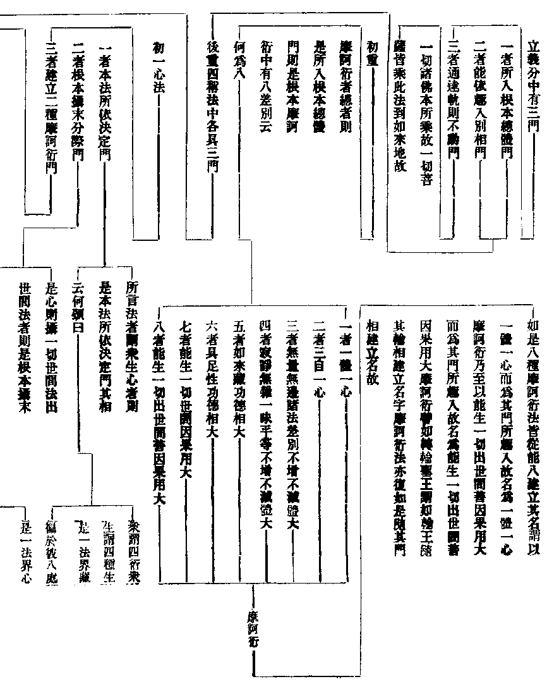
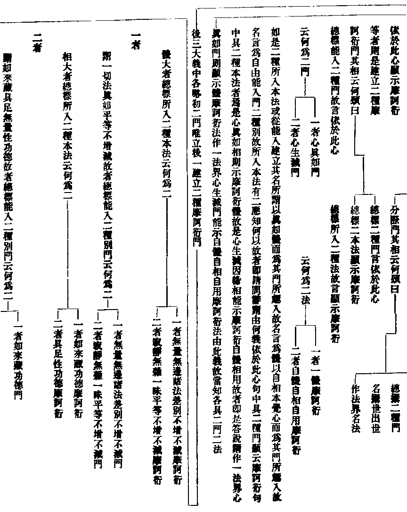
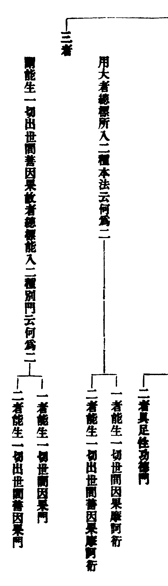

# 释摩诃衍论记



> **藏经**：卍新纂大日本续藏经（新纂卍续藏）　**册次** 第 46 册（X46）　**编号** X0774　**部类** 论疏部　**卷次** 6 卷　**篇幅** 140,882 字

> **作者（译者）**：皇宋光严无际大师　普观　述、皇宗光严无际大师　普观　述

> **卷／品**：6 卷 · 0 品



---



## 目录



- [释摩诃衍论记卷第一](#释摩诃衍论记卷第一)

- [释摩诃衍论记卷第二](#释摩诃衍论记卷第二)

- [释摩诃衍论记卷第三](#释摩诃衍论记卷第三)

- [释摩诃衍论记卷第四](#释摩诃衍论记卷第四)

- [释摩诃衍论记卷第五](#释摩诃衍论记卷第五)

- [释摩诃衍论记卷第六](#释摩诃衍论记卷第六)



---



释摩诃衍论记目次



卷第一释题目已下



卷第二释解释分已下



卷第三释后重能依义已下



卷第四释不觉本上显过门已下



卷第五释显示生灭相已下



卷第六释分别发趣道相已下至终



释摩诃衍论记目次(终)



No. 774



------



## 释摩诃衍论记卷第一



**译者**：皇宋光严无际大师　普观　述



释论分二：初、标题目，二、造论文。初中复二：初、本释名题，上五字正显名题，下三字因彰卷。次、显名题中，初、后二字翻梵成华，中间三字犹存梵语。释者有三义：一、谓释者，解也，即销散义。谓今论文破邪立正，除遣积疑，如鑛烁炎炉，坚顽销散故。二、谓释者，说也，即流通义。谓由此论演义疏文发明奥旨，若冰泮长川，凝积流通故。三、谓释者，成也，即安立义。谓今论文体标义释，略标广释，如良工建厦，善巧安立故。摩诃衍者，此云大乘。大以当体受名，乘以运载为称，名、题、标、立为论宗故。即目不二摩诃衍法，以是众乘通所依故，亦该能依三十二种总、别法故。论有二义：教诫学徒，决择性、相，故以为名。即取能诠声等四法，或取所依色等四尘。以声体间断，色性相续，由此不用语言，唯形翰墨，亦犹范金镂木，便为住持佛宝，故取四尘以为论体。准永泰疏以此论题总收五字，具陈十义：一谓三十三法名摩诃衍，佛经名释，本论名论，末从本名无所违故。二谓佛经名摩诃衍，本论名释，末论名论。三谓五分本文名摩诃衍及名为论，十轴末论称之为释。四谓本论名摩诃衍，末论通名释之与论。五谓法门、佛经俱摩诃衍，本论名释，末论名论。六谓法门、本论皆摩诃衍，虽引佛经但为所依，非正显示大乘法故。七谓佛经、本论俱摩诃衍，所依、能依皆大乘故。八谓法门、佛经并斯本论并摩诃衍，三法展转俱大乘故。上之三义，末论双通释之与论。九谓立义一分名摩诃衍，解释一分称之为释，餘之三分并属乎论。十谓一切所释性、相、教、理并摩诃衍，末论能释若教、若理俱称释论。以教释性，资教释相；以理释性，因理释相。废别从总，但为一解(云云)。彼具作释，此不繁陈。苟欲详明，宜应捡会。然准梁译，复加起信，此约宽通，理亦无爽。



二、造译人号中，初、标造人，二、明译者。初中，龙、阿周那是其别号，即华、梵双彰。梵语那伽阿周那，此云龙树。谓此菩萨树下生身，龙宫成道，故以为名。智者大师云：树为生身，龙为法身。亦云龙胜，或云龙猛。菩萨二字是其通名。具足应云菩提萨埵，翻觉有情。所言觉者，是所求果；云有情者，目能求人，是求菩提之有性故。又菩萨行有其二种：一者、自利，大智为先；二者、利他，大悲为首。菩提云觉，智所求果；萨埵有情，悲所度生。梵音存略，但云菩萨。造谓制作。唯识疏云：作者名造，今起新故；叙理名述，先来有故。



二、明译者筏提摩多，未详翻对。凤威姚秦弘始三年九月上日，於长安大庄严寺译兹论本，以成十卷。



二造论文，大分三分：初归趣悬明分，二开章正释分，三激物流通分。初中二：初归趣因缘二：初申归敬菩萨制作。先明归敬者，谓由三宝是吉祥境，标之在首以显胜故。



文中又二：初能敬至诚中言顶礼者，谓以头至地而申谦敬故。智度论明礼法有三：一者口礼，即问讯也，名下品礼；二者屈膝，头不至地，即长跪也，名中品礼；三头至地，即顶礼也，名上品礼。三种礼中此其上也。然於三业但举身仪影，兼餘二等修敬故。



二、所归胜德三：初、佛宝中圆满觉者。谓举身德，奉仰赞叹究竟果位大觉者故。三身具显，称之曰圆。四德齐彰，目之为满。备此身德，寂尔虗融，朗然鉴达，名圆满觉。又圆谓圆离三四相故，满谓满足三四德故。佛能照彻，故名为觉。又以圆满二字，合显幽微绝域，胜妙难名。离彼机根，得诸生佛，即是性德圆满海焉。



二法宝中，觉所证者，匪唯归佛，亦归法故。即就於佛而明其法，以表通归同体三宝。觉即是果，所证是理。法谓教法，藏谓行法。



三、僧宝中，初句言并，即兼及义。造论大士，即马鸣师。如瑜伽说：若欲造论，当先归礼二所敬师，方可启说。恭敬法故，先应归礼论本大师；恭敬义故，复应归礼开阐义师。言大士者，谓悟大法、发大心、修大行、证大果，故目之为大。推一合十，故名为士。一者，数之始；十者，数之终。靡不有初，鲜克有终。有始有卒者，其为大士乎？第二句中，举一兼餘，故言及诸。贤即三贤，圣即十圣。是则信心贯乎餘位，众通四衍，亦该二乘。若大若小，无所遗故；菩萨持心，等生敬故；影响真权，难可恻故。



二、陈本趣二：初、偈颂中，上句云开隔檀门者，为欲令彼利根众生乱住证故，开释真如门。次句云权显往向位者，为欲令彼钝根众生次位修故，显示生灭门。隔檀、往向，举喻以显真如、生灭二种门故。谓大海中有如意珠，具众功德，出生诸宝，龙王以是寘之秘藏，用千重门而为封护，即表龙王珍惜极故。亦由宝力，法应尔故，其最近珠门名之为隔檀。群龙之辈若开此门，即便获得如意宝藏，自在无碍。此犹行人入真如门，即能亲证一体法故，自然冥会不二心源，其外诸门名往向位。诸龙虽则经游出入，知有如是如意宝藏，然未亲得，犹如行人从生灭门秉心操行，但与真如作其方便。以生灭门假，真如门实，故从假入实，方为殊胜。此依解释分中作如是说。若依立义分中，有十六种能入门法：八真、八妄。真为隔檀，妄为往向，由世、出世渐顿异故。其八真门所入本法，皆能冥证不二法故，名隔檀门；其八妄门所入本法，方便解了不二法故，名往向位。於中不二摩诃衍法，以为诸法通所依故，犹如宝珠能与众宝为所依故。斯则珠唯不二，得兼解、证。若顺此论，解释分中唯诠四法，则初解为正；若兼诸论，立义分中通诠诸法，则后解为优。第三句中显上二门逗机胜利，利之与益，名异义同。若别说者，具乎多义，谓在身、在心，或因、或果，大智、大悲，现乐、后乐，离恶、摄善，遣妄、证真，福德、智慧，世俗、胜义，此观、证、观随应而配。诸众生者，统摄三聚一切众生，论所被故。有情差别，数类繁广，既其不一，是故言诸。第四句云报师恩者，释师自谓亲承指训，弥感生成，顾此深恩，岂能全报？故云分也。



二、长行三：初、标举，二、示相，三、结指。前标后结，贯通中五，随应率达上下而说。初中今重释者，谓本论师已造释故。摩诃衍义已见前解。



二为现下示相，文有五意：一显体用玄妙，二彰开显顿渐，三报深大恩德，四明止息诤论，五示亲承指训。初中言自师者，即指此论所宗法也。谓由不二摩诃衍法，本自成就非他轨则，故曰自师。其体则性德圆常深玄叵恻，其穷则业用周普微妙难思。或可体则两重所入总体，穷则两重能入别门，谓由能依所依三十三法，悉是立义所宗承故。又亦体目，一体三自二种本法，穷即真如生灭二种别门，以其散说唯释此故。未得等者，依人显法成上体用玄妙义故，谓十信三贤未亲证故，二乘外道未离邪故。漠漠冥冥有二义释：一约能迷心，即是昏钝不明相状；二约所迷境，漠漠广大㒵，冥冥深隐㒵。窥𮄛谓正视也，思惟即分别也，以其寂寥虗旷不可以形名得，微妙无相不可以有心知也。



二中，为利根者，开顿入门，名为隔檀；为钝根者，显渐进位，名为往向。所诠理者，即是二门所入本法，依门显示，故云趣入。



三中，亭毒即均养义，谓本论师均济养育法身慧命，深逾江汉，重等丘山。如斯恩德，非大而何？苟不传弘，何以云报？今既造释，可谓酬恩。释师谦陈，故言小报。四中，释师深入正受，密念当来劫未时浇，有多诤论，法轮失轨，甘露翻毒。今复重释，以息斯咎。



五中，梵语阿世耶者，此云意乐。既乃亲承本指，由是造释流通，显己所说与本意乐不相违故。



三、有如下，结指。起论因缘实有多种，略申此五，故置等言。



二、悬明依摄三：初、论差别二：初、结前生后。结前已说，生后当说。



二、论有下，问答释成二：初、通约诸论以明二：初、开三问。二、还三答二：初、结颂。答中，初一句答初问；次总十下，答次问；后三字答后问。二、散文释三：初、示其数。释颂初一句，谓始从佛世，终至论主之时，菩萨、声闻等造宗释之论，共推其数，计有若干，故云十万九千部焉。二、如是下，明所摄。释颂第三句已下之文，谓上十万九千部论，总相不出十种所摄：一、如意；二、广摄；三、本广释狭；四、本狭释广；五、一向义；六、字广摄；七、杂论；八、字轮；九、神呪；十、偈成。如次翻对。然兹所列，皆带论名，偈中句窄，故多不出。然此十论，且依永泰引据圣法，所翻名义，尚多在于竺乾，而亦鲜传兹土。



三、摩诃下，指此论释颂后三字，谓今此论於十种中属当第一摩迦罗摄。



二、马鸣下，别显马鸣所造二：初、开四问。二、还四答二：初、结颂答。颂中四句，如其次第答前四问。二、散文释二：初、总申四义三：初、示部数释颂初句。二、於百下，指文义释。颂中二句，谓於百部论中，其九十部则是九种华文论摄，所餘十部摄义论摄。此以宗释而分二种：花文，谓华饰经文，令生爱乐故；摄义，谓蕴集妙义，令生胜解故。初即释论，如佛地、金刚等；次即宗论，如瑜伽、宝性等。三、斯论下，判此论释颂末句。言宝𠕋者，西域尊崇，特标斯称，谓其文玄理妙，有如珠宝所成简𠕋，故於前文十种论中属摩迦罗如意论摄，如宝梁经、掌珍论等。



二、十种下，别辨十论二：初、开二问。二、还二答二：初、结颂。答中，初五句答能诠名字问，后一句答所诠同异问。二、散文释二：初、徵列名题，释颂前五句；二、如是下，结指同异，释颂后一句。谓上所列十种论中，建立门中，同一种类，备标本数；散说门中，随其所宗，各缺其数；颂但彰同，彰兼其异。



二、已说下，藏差别二：初、结前生后。二、藏有下，问答释成二：初、开三问。二、还三答二：初、偈颂。答中，初二句答初问，第三句答次问，后一句答后问。



二长行释二：初总明三义三：初明数二：初明诸藏释颂。初二句文中二：初五十一藏中，初示义有三：一别因果者，谓欲区别因行果德胜劣不同，有是数故。二表功德者，显示信等诸位障智功用德能故。三引行者者，引摄行人自凡之圣从因入果故。次金刚下引文显成，初义密含后二。



二、或有下，增数十藏二：初、标徵；二、一者下，别示。文有十段，谓由如来善巧应根开合自在，则从一藏次第而增至十种故。初中，如来法轮声者，言音实相，即法轮故。此经应是华严部类，大周新译有是说故。二中，则约上下乘别，各通因果，摄法略尽。三中，於前上乘之内复开果藏。四中，於前复开人藏，诱初根故。补特伽罗云数取趣，即是人义，谓数数造业，取於诸趣故。仁、义、礼、智及与信藏，在儒以之立身扬名，用而无替，则曰五常；在释以之防禁几微，遮制身口，则曰五戒。五中，天以光洁自在神用为名，经言清净，即光洁义。欲界天身如珠宝光，外有内无；色界天身如灯焰光，表里映彻；无色定果转加明净。欲、色、无色三皆虗幻，故云报空。辽本论中二乘藏下加四字，曰菩萨法藏。丽本论中无此四字。以余详之，不必须尔。前二藏中约上下乘，即摄缘觉以归声闻，谓由缘觉亦依声故。此既增数，当如前说。六中，捺落迦者，云不可乐，又云苦具，即地狱藏，具演苦轮令怖畏故。七中，魔啰鸠多耶者，此云鬼神，班母应是九子魔母。八中，键婆陀那䟦者，此云傍生，以傍行故；或云畜生，以畜养故。九中，器界即是依止，谓说净秽令欣厌故。十中，杂藏，谓三声、八啭、六释、五明、呪印等事，皆名杂藏。



二、如是下，显该通。谓上所明五十一藏并及十藏，总摄十亿八千法藏，无所遗矣。



二、根本下，辨摄释，颂第三句。根本三藏，即下所列素呾囕等，如其次第经律论藏，如前所明增数十等，以类相从，皆不离此根本三摄。



三、摩诃下，指论释颂后一句。此论该摄百亿契经所诠义故，通诸藏摄；克性为言，唯诠慧故，别属阿毗达磨藏摄。颂中通、别，准此知之。



二、持其下，别释藏名。持谓任持，即同摄论，摄故名藏。彼摄一切所应知义，此中任持何唯言行？佛所说教，意令修行证理成果，莫先於行。由教诠理，依理成行，以行克果，於此四中行法功用最殊胜故。论次又云：随应不失，亦何所遗？



三、已说下，经差别二：初、结前生后。二、经有下，问答释成二：初、开。三、何二还三答二：初、结颂。答中，初一句答初问中问，十句答次问，后一句答后问。二、散文释三：初、示其数颂，颂初一句。



二、如是下，明所摄释。颂中十句，指上百亿，故云如是。十二部经，谓契经、应颂、记别、讽诵、自说、缘起、譬喻、本事、本生、方广、希法、论议，如次翻对。部谓部类。经有十二，义类不同，带数以明，云十二部。有唐已来，恐滥部帙，由是翻云十二分教，委明行相，如别所说。百亿、百本所诠义类，皆此十二部中所摄。



三、摩诃下，辨所依，释颂后一句。文二：初、总释中，通依百亿，别依百本。别所依经，下文具列。



二、摩诃下，别明二：初、徵。释通所依中，初、徵。谓有问言：摩诃衍论文唯一轴，何以通取百亿百本无量契经为所依耶？则以宽狭不同为难。如婆萨下，答。有二喻以释彼疑。婆萨伊伽诺，此云精曜，其形微细，犹如兔毛，而能纳受满十方界明暗之色。标多罗嗢提，此云气丝，唯是龙王舌上有此甚极微细犹如头发，而能出生摄纳满十方中种种密云。前即一法，含容无量，摄入无碍故；后即一法，出纳无量，摄出无碍故。一切明暗之色，唯精曜普能含容十方无尽之云，皆气丝之所舒摄。方之此论，不为过词。千训备於一言，万像含于一字，唯依义语，岂在文为？是故通依，无有缺失。二、别所下，问。答别所依二：初、开三问；二、还三答二：初、结颂。答中，初一句答部数，次一句答名字，后二句答眷属。



二散文中二：初释颂文三：初标部数，释颂初句；二云何下列名题，释颂次句。所列经名对今藏录，但十餘部名义相符，有不同者难以详勘，或翻名有异，或未传此方。梵云三昧，或云三摩地，此云正受，或云观，又云等持，又云正心行处。阿黎耶，此云藏。维摩诘，此云净名，又云无垢称。楞伽，此云不可往，即山名也。唯得道者能到涅槃，云圆寂摩诃萨，云若，未详翻译。三如是下彰眷属，释颂后二句。



二、举经下，通妨难。恐有难云：何故但列能诠名字，而不略陈所诠义理？故为此通。谓但标举彼经题目，有以配属此论纲要。言下当等者，如立义分中明八总体，则引光明大觉契经；释众生心，则引甚深顺理契经等。



二、已说下，开章正释，分三：初、演畅因缘分；二、敷宣宗旨分；三、申明劝结分。初、释本论八因缘等，即当序分；二、释立义解释修行信心，即正宗分；三、释劝修回向，即流通分。初中分二：初、论师名位二：初、出兴时分，又二：初、结前徵后，即以数摄而为徵诘。



二、作答释，成二：初偈颂答中，上二句答初问，下二句通后问。



二、长行释二：初、释上半颂二：初、标徵；二、一者下，列示。经文有六：初中，谓马鸣大士闻佛宣说，欲入涅槃，说偈陈诚，亦随入灭。偈颂十句：初三句，叹佛修因，愍诸生类；次三句，为闻入灭，众皆乱失；后四句，举胜况劣，欲随佛往。世尊尚者，有二义释：一、谓如来大悲满足，而为世间之所尊尚，尚舍众生而往异界；况我慈悲未满足者，世间於我亦不尊尚，随佛而去，其孰谤乎？二、以尚字，文连上句，义属下文，亦自可晓。覩眼睛者，谓即安住念佛三昧，观佛相海。经说：於佛相海，随於何相，审谛观察，明了现前。今表如来入灭，法眼将亏，是故覩佛眼睛而奄化矣。二中，佛嘱弘法利生，入位圣人尚须承力，岂况凡庸不加能自？三中，预记灭后摧邪。四中，亦明破外立内，或现同真侣，或自入邪宗，逆顺显扬如来正法故。五中，同前。守护正法，即摧邪义；安立佛幢，即显正义。六中，文二：初、标指中，此经显示马鸣大士在於佛会，示为主伴，影响发明甚深法故。二、如来下，引。文三：初、广中问答中，迦罗诺、鸠尸摩未见翻译，两重问答即表主伴，圆音广略，无有障碍。初即问广答略，次即问略答广。二、如是下，如来赞劝中，言耐也，耐也者，耐谓能也，忍也，即叹马鸣於生死中化利有情，恒无休息，有其堪能忍耐力故。常如是修、如是行者，称理修行，唯如为是。小游行者，是其假故；普徧即大，是其实故。三、於是下，说偈钦承。十二句中，初四句闻经遣滞，次五句现相蒙知，后三句受教如行。颂曰：善哉！善哉！言者，即叹如来赞劝言词。以顺益故，称曰善哉。更重言者，叹之至也。经：听於我闻者，译者回文不尽，应云我听闻於经。假耶？实耶？自者，前所劝中，勿小游行、普徧游行，即假实义。耶即疑词，谓疑其假实，何所从自？既闻劝赞，即得开决，疑心穷尽，说之为极。是故科云：闻经遣滞。丽本实字，误写为害。今从辽本，於理为正。餘文可解。入寂室者，谓涅槃也。二、是名下，释下半颂。准上六经，所说有异，今马鸣师何所摄耶？然但一身，随机异说，出兴前后，互不相违。起信疏中唯取摩诃摩耶经者，盖与藏录马鸣本传出兴时分正符契故。机实菩萨，业相难思，同异一多，自在无碍。又由机心所感不同，或同时同处见、异时异处见、同时异处见、异时同处见、同异时处一人顿见等。今此显明异时异处密兼其餘，是故论云：随机现应，无相违过。问：若尔，何故下文引用楞伽王经，显说系属本愿力故，当佛灭后，出兴造作广略论耶？答：灭后出兴，经有四说，固难取一而废於餘。然则从彼文，亦是且约灭后根宜一相而说，非是融通尽理之义。於今所谈，理亦无爽。



二、马鸣下，位处名因二：初、开三问，谓问地位生处名因。二、还三答二：初、结颂。答中，上二句答初问，次一句答次问，后一句答后问。二、散文。释中，初文释颂第一句；二、若论下，释颂第二句。言住位者，有二义释：一、谓马鸣位居八地，故云住位；二、谓十地各具三心，谓入、住、出，今此马鸣正当第八地内住心，故云住位。三、西天下，释颂第三句。卢伽瞿耶，未见翻译。同生利益者，菩萨降灵，利益畴昔同缘众故，名曰同生。四、过去下，释颂第四句。此出马鸣得名之因。轮陀，未详翻译。马鸣之号，即从过去瑞应彰名。出声增德者，谓王闻鸟音，即身心适悦，遂行正化，亭育黎珉，亦犹凤凰来仪，麒麟现迹，山呼万岁，河变千年，皆表时君德及幽远使之然也。



二、已说下，归趣因缘二：初、结前生后。二、按文演释二：初、申明归趣二：初、二颂申归敬，又二：初、一颂觉宝二：初、唱本颂。二、作释文二：初、标分略示二：初、分门中，初门即能归至诚，次门即所归胜德。二、总摄下，随释二：初、总摄门中，初牒示，次嘱文。二、归向门中，如上牒嘱。二、论师下，问答广明二：初、寄问徵起。此有二问：一、问德数；二、问德相。二、作答释成二：初、偈颂。答中，初二句举德数，次四句示德相，后二句会数量。二、长行释三：初、总彰德数，释颂初二句。二、佛果下，会通数量，释颂后二句。恐有问言：佛德无边，何止是数？故今通会。虽有无量无边功德，以类相从，终不出此。为令宜感分际易知，论师且举总相为叹。三、云何下，别释德相二：初、按文辨德二：初、通问答七位色心功德。二、云何下，别徵释六类非色功德，有六。初中，谓离三种杂染以成十最，谓三界、五蕴并及六道是果报杂染，二乘、外道邪见定执亦报类故，住地、恶军、邪林、缠、结是烦恼杂染，其中行支是业杂染。二中，即约依、正二报以明十胜。十力、无畏、不共道品皆属意业，言音具足即是语业，三十二相并属身业，其能变化三界中尊具通三业。上皆正报，吉祥住处即是依报。於中梵音，数或有异。下论中说六十八梵，圆八十八妙音。诸教多明八种梵音。华严中说六十种音，一一音有五百分等。盖随根品所闻不同，是故诸说增减有异。三中，则约二相以明十业。平等、相应、同生、依止、无厌五种，即不思议业相。以如量智假观缘俗，成利他用故。具足、无著二种之业，即智净相。以如理智空观缘真，成自利用故。自然、无尽通达三种，通前二相。理、量齐鉴，即中道观。缘第一义，成二利用故。四中，则约如来身心、功德、眷属悉皆周徧。其所徧中，有处、有时、具人、具法。根、境、识三廓周法界，则徧於处。寿命周徧不思议劫，则徧於时。眷属、功德该通时、处。慈悲徧根，言说徧法，证智徧理，无等普徧，一切诸法皆无与等故。五中，四智合则成二，谓一、三二种即如量智，二、四二种即如理智。又此四种转舍识名以立智称，初即妙观察智，二即平等性智，三即成所作智，四即大圆镜智。讲者宜应详会说之。六中，无碍亦即智称，谓法、义、词、说四种皆是所缘之境，无碍即是能缘之智。又复名为四无碍解，前二知法，后二说法。初即了达诸法自相，是故说言实相、实性。次即了达诸法共相，故言差别，谓苦、空等相，生、住等相。词、说二种，义可知之。解脱即是无碍之称。



二、自在下，会义指广二：初、会通自在。恐有问言：自在之言，何不如上别别开释？如华严经中有十自在等，故今通云皆通上故。谓由自在徧上六类，以诸功德出障离缚，皆自在义，故不别开。二、色相下，指陈色相。八万四千色相差别，数义繁广，略难具述，故指如大总持论说。然如来相好亦诸说不同，华严说有十莲华藏微尘相海，无量寿说阿弥陀佛八万四千光明相好，般若中说三十二相等，但随见闻，广略有异。



二、已说下，一颂法僧二：初、结指。二、唱释二：初、唱本颂。二、作释文二：初、标分略示二：初、分门。二、体摄下，随释二：初、配释二门二：初、体摄门，亦即能归之至诚也。谓摄彼无量一切有情所有体相等，皆致敬故。体即依止总名，相即流转别义。既摄众身，难亡起尽，故云生灭流转无常。又身体即蕴之实体，四蕴五蕴通为体故。身相即表之假用，三业四位通名相故。谓屈伸俯仰，问讯称扬，觉观分别，名三业相。流转动乱，迁变不恒，名四位相。欲以生灭贸易真常，是以论师且言四相。剋论修敬，亦具三业。二、总达门，亦即所归之胜德也。如是众身，指上所摄甚深法藏，谓即教、理、行、果四法。如实修行，谓即十地诸菩萨众。又以归敬觉宝法僧，前后两颂融合而明。能归有三，谓命、体、相。所归有三，谓佛、法、僧。以命归佛，以体归法，以相归僧，有所表故。佛能任持，故以命礼。法作依止，故以体礼。僧可形求，故以相礼。以三对三亦应成九，由能归者胜解异故，总以三事以为能归，总以三宝而为所归，能敬礼周所归德备，详论所释。归者契也，及者达也，总将三事契达三宝，匪唯归托威加，抑亦冥合性德，能所玄同是真致敬。二等言下申明等字。言总通者，近通二门、远总两颂，能归所归悉皆等故。等有二义：一者齐等，二者平等。齐则总收多法，平则一体无差，谓所归胜德佛法僧异皆申敬慕，离分别故名为齐等。能归妙行圣贤凡殊同成虔捣，绝彼此故名为平等。下论自指此言甚深和南，则是致敬之相。



二、论师下，问答广明二：初、寄问徵起。此有二问：一、徵其数，二、问其相。二、作答释成二：初、结颂。答中，初句总标，答其初问；次句别释，答其次问；后之二句，会通违妨。二、散文释二：初、释上半颂二：初、依此释成二：初、总示。二、法谓下，别释二：初、释。法中，法谓教法者，谓由契经轨物生解故。理有二种：一者、义理，二者、真理。今性真如，即当后一。虗妄之假，即依他性，离故名真；执著之实，即徧计性，绝故名如。二既离绝，即圆成实，是性真如。海谓果法者，果分功德圆满具足，一一称性，甚深广大，故喻如海。无量德藏谓行法者，随应摄持，无所违故。二、如谓下，释僧。称理起行，名如实行。如即所证，智即能证。於真实智建立僧名，拣异地前非真证故。理、智等下，正释僧义。



二、何故下，通前问答三：初、徵释身命义别中，初释命根，以同体故而为所摄，广大圆满故标十方。次释身相，欲以生灭流转之身而易坚固真常之体，在文虽乃显明四相，於义亦即密含三业，非屈伸等礼不成故。二、何故下，徵释身命通他中，初约自他异体而徵，次约自他同体而释。一味者，同一平等味故。一相者，同一真实相故。马鸣论师虽知众生一切皆如同体相续，今既摄彼而亦不乖缘起相资异体相续。颂中等言极甚深者，举此证成平等义故。三、何故下，徵释取他成相中，初徵既知身命一切同如，何须摄彼成和南相。次释中，由摄众生顺本愿故，诸佛欢喜；摄持同体生随喜故，菩萨赞叹；依此修行合教理故，法不断绝。



二、马鸣下，释下半颂二：初、问答通妨三：初、约下地问。答中，初问：论主现居八地住心，但应归依自地出心及上二地，颂中何必通归前亡下位诸僧？次答：谓由依於同体意乐，通摄自他以申致敬。其所摄人通下诸位，乃至异生无不摄故。以彼皆非同於论主，是第八地住位人故。若不兼餘，唯归胜位。若尔，何以涅槃经说迦叶菩萨礼初发心，此岂不敬下下位耶？归敬、礼敬意趣别故。归敬求彼威神加被，礼敬但彰於他不慢，故於诸位通局不同。二、若尔下，约地前问。答中，初问：若摄一切为能归尔，何不归於地前等众？次非无下，答：非无所归三贤人等，但以影示，故不别举。三、法云下，约地满问。答中，初正问答。初问：谓法云地因位穷终，以何等僧而为所归？次於妙下，答：谓法云地因位虽满，果位未登，即以妙觉为所归敬，佛於僧中为上首故。后若雨下，转徵释。初徵意云：若妙觉位为所归敬，何以颂中不别举耶？次答释云：以下十地兼上妙觉，影略、影显无所遗故。



二、是故下，指归颂文。举颂印成，今说影兼，上下僧众有多种故。问：能归身命既乃同一，所归上下何以成差？答：彼望自宗，相续同故；此依望别，相续异故。文互出者，影显示故。



二、已说下，陈本趣二：初、结指马鸣大士根本意趣，为利三聚诸众生故，为令三宝不断绝故。二、唱释二：初、唱本颂。二、作释文二：初、标分总示二：初、分门。二、随释二：初、断绝门中有三：初、标徵；次、列释；后、合本。然本颂中总有四义：一者、所被三聚众生；二者、所除四种障缚；三者、所起四种净信；四者、所续三宝胜种。今此四门，如其次第，断其疑舍，邪执四障。二、连续门中三段如前。真如法界，为诸行者居体安神，依止游履，说名宫殿。正、后二僧，谓根本、后得之二智位，亲证疎变真如理故，皆说为住。佛、法、僧三，皆不断绝，论句窄故，但云佛种。亦可法是佛言，僧是佛子，举人摄言，明父包子，但云佛种，无所遗故。



二、颂众下，问答别明二：初、寄问徵起。二、作答释成二：初、偈颂。答中，上二句答初问，下二句答后问。二、长行释二：初、释上半偈二：初、总释。通缘三聚为境界者，谓於三种三聚门中，取其初一为通所缘，以此一门皆在因位，故云未得圆满果故。



二、然三下，别显三：初、标徵。二、一者下，列示三：初、无信已定未定聚。信前即指一切异生及外道等，於诸业果虽有泛信，亦名不信，皆名邪定。



二、无根已满未满聚。此中三聚该收果位。



三、无求已证未证聚，文并可知。



三、是名下，结指。佛果满位虽名正定，非蕴、处、界法门所摄，岂曰众生为论所被？三贤菩萨虽未正证，已获生空离诸疑畏，法空方便亦习现前，位行难量岂名不定？是故释师评取初解。



二、为欲下，释下半偈中，初、标徵；二、列示；三、结成。



二、已说下，辨释体缘二：初、开明体分二：初、开总体二：初、结前标后。二、唱本作释二：初、唱本论。二、作释文二：初、分门略显中，初标示；次能入下，牒释。能入门中所诠理者，诠谓诠显，依门显理，说名为诠，非取声等以为门体。所入门中善为彼者，彼即能入，谓所入法能与能入为所依止。



二、依义广明三：初、总明文义中门法作业者，依门起信，信彼法体。其所作业但起信者，冠众行故，通诸位故。问：於中不二摩诃衍体，今既说为所信之境，何故下论言离机根？答：若定离根，不应知有，但由彼法本自成就，不为随根而施设故，由是论说云离机根。



二、信决下，别释信根二：初两番释名位中，初番决定即是胜解，为信之因。进即精进，是信之果。心则同时所依心王，以依彼因果及与心王显信自体故。又由印决胜进等用，依用以显信之自体，是故名为决定进心。根以生长所依为义，六度万行依根而生，趣入真理不出此二。次番先配行位，后举喻释中，信行未立故名为初，信行已满故名为后。喻中梵语未见翻对，其初一喻应同浮萍、寄生之类，其次一喻应同药王、松栢之类。



二、信根下，十义显功能二：初、问起；二、答释二：初、偈颂。答中，初句答义数，次句答义相。澄净是信之初义，下转是根之初义。等言，各等其餘九义。



二、长行释二：初、信。十义中，初一属总用，餘九是别用。总中，诸论皆说心法为性，如唯识云：於实德能深忍乐欲，心净为性。别中，前三唯自利，次四通他利，后二通於二利成满。前总用中通治诸障，后别用中如次别治疑惑、忧悔、懈怠、嫉妬、憍慢、不信、悭悋、散乱、瞋恚障。故华严经说：信能永灭烦恼本，信能超出众魔路，断除疑网出爱流，灭除憍慢恭敬本等。二、根十义中，其前五义当三贤位。下贤十住，离慢见性，即初二义。中贤十行，生长行德，即出生义。上贤十向，摄持功德转转增长，即当四、五出离集成。茂、荣三义则通十地，具足等觉、高胜妙觉。释名位中，配位但至法云地者，影兼等、妙在乎十地，从合说故。



三、能入下，指陈能所。能入即十六门，所入即十六法。此中略故，指在下文。



二、已说下，明建立二：初、结前生后。二、唱本作释二：初、唱本论。二、作释文二：初、徵释其次第二：初、略示。二、此义下，广释二：初、承前问起；二、为欲下，依次述释。文有五段。初中有三：初、喻明；次、能化下，法说；后、疾前下，合结。二中，初、喻明。如意珠者，如意出生一切珍宝故。唯大海中有此宝珠，悉能出生海中众宝，而其宝体端严方正，龙王寘之最深密处，一切凡夫、诸龙神等悉不得见。次、摩诃下，法说。摩诃衍法虽唯等者，谓不二法，而为三十二种恒沙法门体性，以是众乘通所依故。后、重威下，合结。重威大龙，谓大龙王，於其宝珠及所生宝摄藏受用，得自在故。利根智者，即大菩萨，於其本体及诸法门领受解了，离疑谤故。三中，初、依喻显示。其如意珠寘於秘藏，以千重门而为封护，由却关钥，其诸龙等而得了知有是珠宝。次、大乘下，以法结合。所依本法虽能出生恒沙法门，其钝根者何由取解？由解释、分别释、散说，方得明了。虽此一论解释分中唯诠四法，下论既云依一心法有二种门，其一心法即是不二，通所依体，是故论说以为恒沙法门体性。复是诸论共所宗故，论文自说体唯一故。然其所依亦有二种：一、总；二、别。总则咸从不二法起，别则随近用为所依。又前法喻义趣宽通，若其本原、玄理二论所明本法唯是不二，若其一心、徧满等论所明本法即是一体、一心等法，各随所宗为定量故。四中，初依喻显示。虽眼等者，谓诸群龙虽则眼耳见闻妙宝，心亦了知，复出舌威，宣说宝德，而不奔竞，入於诸门，开通往向，近于隔檀，获如意藏，而亦无由登游台宫。决约法结合。诵持教义即是闻慧，观察广略即是思慧，而劝加行即是修慧。虽具三慧，然未发起坚固信心，添於胜进，方比金刚得法界藏，而亦何由契证殊胜深玄妙理？余详此中法合文义，恐是译者回文不尽，应云：虽口语中诵持教义之尊词，思心中观察广略之深理，而劝加行不起坚固信，添於胜进，方於金刚得法界宝藏，而无由契玄理故。第四、立修行信心分。学者於此更自思择。燕本论中云勤加行，丽本作劝。若对喻中出现舌威，宜作劝字。五中，初示义。广略之法即前二分，进入之门即信心分。怯弱众生闻广倦繁，其心猒怠，而无堪能胜进修行。钝根众生闻略难晓，心生舍离，不能受解。如是众生若遇知识劝请，即便修因证果。若不得其劝䇿之缘，於斯行德长久因循，远离退失，烦恼炎炽，焚烧善根，作一阐提，成无种性故。后马鸣下，结成。



二、有何下，问答不增减二：初、问；二、答二：初、偈颂答。二、长行释中，初、标所摄广论。嗢咤南者，此云集施，谓以少文蕴集多义，施及有情，令易持故。二、今此下，辨能摄略论中二：初、明略能摄广；次、所谓下，以广略对明。二、已说下，判说缘根二：初、结前生后。二、唱本作释二：初、八因起四分二：初、唱本论。二、作释文二：初、缘体行相，复二：初、约分明因，又二：初、指属分门中，初、指属，指其八因属归四分；次、初一下，分门。



二、今当下，举相随释二：初、标示；二、因缘下，正释四：初、初一立义因缘四：初、能化门中，初标指；次谓为下，释成中，初略释总相；次三十下，指陈说处。八种总体者，下论说有十六总体，对望别故，应作四句：一、唯总非别，初重八法；二、唯别非总，后重八门；三、亦总亦别，初门后法；四、非总非别，即不二法。今文所指，即当初句。二十四种分离别相者，初重八门，后重总别，法之与门各有八种，共二十四种。於四句中，当中二句皆依初重八法而有，是故说名分离别相。然前喻显如意宝珠唯明所依不二之法，今此但说能依法门三十二者，以前后文互相显故，学者应悉。二、所化门中，初标指；次谓摄下，释成。所化众生通缘三聚，不定聚人即是十信，随一各有上、中、下故，有三十种。正定聚中通摄四位，住、行、向、地亦各随一，而有三十四位，合成百二十种。三、作业门，标、释如前。分段、变易、麤细二苦既皆迁灭，说名无常。无常乃是众苦通相，故论说云离一切苦。获得根本总相乐者，谓前所说三十二种总相法中，各有菩提、涅槃乐故。得已不失，故云究竟。四、除诤门，标、释如前。释中，先述疑谤，后伸除遣。蓝修，梵语亦云兰若，或云练若，皆是梵音，声啭有异。此云空寂，谓由论主本居果位，迹托因门，权居八地，蓝修位中纯无相观，恒无间故，说名为空；功用烦恼永不动故，说名为寂。



二、次二解释因缘二：初、第二因缘有三：初、能化门。标、指、释、成，例皆倣上。根本义者：一、心是所依之本，二、门是所入之本，七种邪执是所治之本。二、所化门中。就显偏指邪定聚人，非於其中不通餘聚。三、作业门中。谓由前二教法开示邪正区分，转其邪定入不定聚，渐修此观，故成不谬。由显示故，正谬邪解；由对治故，摧逆乱见。或可二教各具二业。



二、第三因缘，有三：初、能化，谓门诸菩萨发心修行，趣向诸佛所证果道，皆悉由此信成就等三种发心故。二、所化门中，上品十信，即信成就发心；三品十解、十行、十向，即三贤位解、行发心；三品十地，即证发心。前九信心名成就者，以是上品形彼中、下，皆名成就。又十信心未成位故，许杂乱修，多人同修，齐成上品，得名成就。三、作业门中，言二聚者，正定聚全，不定少分。超过自分者，以得后位，功行胜前，故云超过。



三、次四信心因缘四：初、第四因缘三：初、能化门。信体唯一，随境有四，谓信真如、佛、法、僧故；行体具五，谓施、戒等。未明后一，故云四行。对邪定聚说四信心，对不定聚说修五行，未信令信，已信令修，进入次第，法如是故。二、所化门中五心中品者，虽后后下品胜前前中品，然於自分未殊胜故，望能诠法不相应故，论文多就显相说故。三、作业门，谓修八胜行满，后五信心即入三贤正定聚位。



二、第五因缘三：初、能化门。进门之终，即精进门末令礼忏等。引文超间，故云乃至。二、所化门中，初心下品宿障重故。三、作业门，种种业障深故如海。



三、第六因缘三：初、能化门。於五行中，此当后一，麤细次第，法如是故。止为伏结之初门，观为断惑之正要。止、观既成，定、慧双运。二、所化门中摄二少分，谓不定聚中摄二心下品；邪定聚中唯摄二乘，谓由二乘意乐狭劣，於大乘中犹如败种，是故判归邪定聚摄。三、作业门中，谓以止、观两轮通治凡、小过失。止治凡夫著有，二乘怯弱；观治二乘狭劣，凡夫情慢。论文合示，故总相说。



四、第七因缘三：初、能化门中，文亦超间，欲求正信，其心怯弱等。二、所化门中，亦即不定聚中少分，前四心中以其怯退，故是下品。三、作业门中，胜缘力者，谓观佛等。



四、后一劝修因缘三：初、能化门。二、所化门中，就显别指，唯邪定聚；若据通论，亦兼餘类。三、作业门中，谓示损益，令修离故。



二、一切下，依因遣滞二：初、分因合显二：初、问起。谓立义一分尽摄诸教，初一因缘尽摄三聚，何必更开三分别释，立七因缘而散说耶？二、为欲下，答释。利钝等者，谓立义一分，初一因缘被利根故，是广是总；其餘三分，七种因缘被钝根故，是略是别。



二、何故下，处品别明二：初、徵释处异二：初、问答。二乘中，初问何故等者，谓於前明一、二、六、八四因缘处，重叠取故，以之为问。次为欲下，答。谓由二乘妄耽寂灭，性少慈悲，比餘生类，发心极难，大士深慈，重加劝故。



二、何故下，问。答异生中，初问何故等者，谓邪定异生唯一、二、八三因缘处而显示故，以之为问。次为欲下，答。谓以异生形对二乘，过失轻故。由彼二乘耽著小教，发起大心，尤为难故。其犹素丝易染成色，变朱作绿，极切难故。



二、何故下，问答品别二：初、徵释不定聚中初问。不定人者，即是十信。别取三品者，谓三上、四中、五与六七，皆属下品。次为欲下，答。为显不定尚有暗钝，未成信根，发心难故，别开三品。二、何故下，问答正定聚中初问。正定聚中何不同前亦开三品，但合明耶？次为欲下，答。为显入位分见法身，动不逾矩，寡尤寡悔，胜前十信，所以合明。



二、有何下，缘数次第二：初、开；二、问；二、还；二、答二：初、偈颂。答中，上半答初问，下半答后问。



二、长行释二：初、释数量。释颂上半以一摄十，故云总摄；由一具十，故说云等。二、因缘下，明次第。释颂下半因缘等者，上明五分已辨能诠，今八因缘唯论行法。初一因缘是总相故，统收三聚皆为所被。第二因缘正为邪定，治阐提障，令趣十信，谓由十信深信真如三宝净德，能正对治阐提谤法不信障故。第三因缘具收五位，如其次第治障入位。十信位中虽无谤毁，犹带我、人，自谓堪任，餘非善巧；十住位中正念真如无我法理，能正对治著我障故。但由初起生空观智，犹畏生死长时苦蕴；十行位中生空自在，离诸怖畏，能正对治畏苦障故。虽离怖畏，然於长劫严因接物或起厌舍；十向位中大悲利物，离彼舍心，能正对治舍离障故。从此进入欢喜地等，能正对治异生性等十种障故。又地前菩萨由为断除四种障故，则能成就四位、四行、四因、四报：一、由断阐提不信障故，入十信位，成信乐大乘行，为净德因，感铁轮王报；二、由断外道著我障故，入十住位，成般若行，为我德因，感铜轮王报；三、由断声闻畏苦障故，入十行位，成破虗空器三昧行，为乐德因，感银轮王报；四、由断独觉舍有情障故，入十向位，成大悲行，为常德因，感金轮王报。此复断除异生性等十种障故，得入十地，唯感金轮，胜劣异故。餘五因缘，盖为邪定及不定聚重别取故。



二、已说下，四、根须二教二：初、结前生后。二、唱本作释二：初、唱本论。二、作释文二：初、科分。二、随释二：初、难问门二：初、牒指；二、谓光下，释成。中士，即指马鸣论师。以望上位，故称为中。此中难意，既无加显，应涉希求，如何决定尊崇信奉？由难尽了，重造理致，所以诘问。



二、决疑门二：初、正解此门二：初、根缘有异二：初、牒指。二、释成中，初明教理平等；次然而下，明根行差别；后谓或下，明兴论因由。伽陀修黎毗罗，此云广略经；遮陀尸修黎毗罗，此云广略论。初则依经，即能取解；次则依论，方得开通。为此类根，故须造论。



二、复次下，时分不同二：初佛住世中，初标示能化、所化二俱胜故，则不须论。次八万下，释成二：初正释中，初明能化具乎通、别二种三业，敷演异类者，佛一圆音，随类普应故。次或有下，明所化中有四类根：一根总观十业、十胜而得解者；三根别缘三业而解，所谓见色、聆音、观意；或有根宜观察二业而得解者，谓观身、语，身、意、语、意圣智巧便，影略显示。后如是下，结成主、伴俱胜，何假论为？二、佛灭后中，初标示能化、所化二俱微劣，经、论广、略，机、根有殊。次云何下，徵列，谓摄三乘之机以辨四种之根，有力、无力各通广、略。后如是下，结配初二经众、后二论众。忧婆萨提那，此云论议，谓佛灭后，无力二根得论方解，故须造论。



二、何故下，会通餘妨二：初、徵释根缘中，初、徵。前因缘门具收三聚，今根性门唯被无力，则以宽狭不同为问。次、为欲下，释。梵语僧那，此云誓愿。谓前门中，就其论主誓愿意乐，广大弘深，故无边际；今此门中，依彼根宜受道闻法，实行善因，故有分际。则以愿广根狭而答。



二、以何下，问答广略二：初、问起。谓经及论各通广略，故曰两重。



二、答释二：初、偈颂。答中，上半正答前问，下半因指说处。二、长行释二：初、释颂指经。二、尔时下，引文示相二：初、述昔缘二：初、师资缘。会中，初佛自说本生因缘；次于时下，说马鸣本事。因缘中，初投诚悔过；次投身下，说偈陈情。以头𪷽地，谓以其头畫地成文故。偈中，初八句述过去行慈，由瞋招苦；次六句明未来作伴，随师诵经；后二句示悔己过𠎝，以伸愿恳；后说是下，要期剋遂。



二、尔时下，广略愿兴中，初标示启愿；次我若下，正陈所欲中，初陈本师愿，次陈弟子愿。然则马鸣菩萨所造诸论，望佛在世亦有同时，今此但云佛灭后者，依一类根多分说故。



二、以此下陈今世。



第二、敷宣宗旨，分三：初、立义，分二：初、结前生后；二、立义下，正辨此门二：初、悬明法数二：初、问起；二、答释二：初、偈颂。答中，初句答初问，后三句答次问。



二、长行释二：初、标示名数，释颂初句。二、云何下，徵释行相二：初、总徵释。二、何故下，别徵释二：初、所入法中，初徵；次、根本下，释。此有二意：一、谓根本摩诃衍中开八种者，即是初重八所入法；一心、法界三大义中各开二者，即是后重八所入法，初、后两重共成十六。二、谓根本摩诃衍中开八种者，即是双标初、后两重所入本法，由对能入门皆名根本故；一心、法界三大义中各开二者，即是双释，谓依一心开成初重二所入法，即一体一心摩诃衍；三、自一心摩诃衍复开后重二所入法，即一体摩诃衍；三、自摩诃衍、一心、法界开成四故，三大义中亦各开四，故成十六所入本法。



二何故下能入门中，初徵，次一心下释。一心法界及三大义各二种者，即是初重八能入门。或各开二种者，或犹复也，谓於一心及三大义复开后重八能入门，此则唯依四法双开初后两重八种门故。谓依一心开成初重二能入门，即一体一心门；三自一心门复开后重二能入门，即一体门；三自门一心法界开成四故。三大义中亦各开四，故成十六能入别门。於中不二摩诃衍法，以是众乘通所依故，非法非义亦法亦义、非所入非能入亦所入亦能入，融通自在无定局故。



二、已说下，唱释本。文三：初、结指；二、唱本。马鸣菩萨宗摄百亿契经实义，以成宝𠕋立义一分，具足安立三十三种摩诃衍法。花文作释，备陈本数，录之为图，贻诸来学。















所出图目，庶知梗槩。更重述释，有其二门：初依现文，后伸异义。初中有三门：一者所入根本总体门；二者能依趣入别相门；三者通达轨则不动门。初二种门有其两重，图中虽已标具，今复委悉指陈。一初重门法摩诃衍者，总者即是初重所入根本八法。虽此总言通於两处，由后重法下文别说，是故此唱且属初法。法为所入，门即能入；法为体性，门即义用。以用随体，更不别明。说有等下四句论文，不唯作后重标举，抑亦为初重释成，盖亦望上及下临故，释师於是不偏指属。二后重门法二：初一心法，后三大义。初中有三门。所言法者，谓众生心，即是第一本法所依决定门，二种本法决定依於众生心故。是心乃至出世间法，即是第二根本摄末分际门，根本一心总摄枝末二门法故。依於乃至自体相用故，即是第三建立二种摩诃衍门，依众生心建立显示真如生灭二种门故，复由二门显示趣入二种本法摩诃衍故。后三大义中所言义者，则有三种等，亦如前法各具三门，举后摄前但影后一，建立二种摩诃衍门。言体大者，总标所入二种本法，谓无量无边诸法差别不增不减摩诃衍，寂静无杂一味平等不增不减摩诃衍，谓一切法真如平等。不增减故者，总标能入二种别门，所谓如本法名门亦尔故。此具显示二门二法四种法相，如是相大、用大门中亦各具四，例前体大说相可知。问：此立义分备标本数三十三法，於中何故不说不二摩诃衍耶？答：如上所陈三十二种，则是总别门法，形对差别显示不二，大乘离於观待绝诸差别，以为诸法通所依故。既明能依即己影示，由能所依不相离故。问：以本影末、以亲影踈，於理可尔。其不二法，众乘本体、诸教通宗，一切行人之所归趣，何不分明开示，反以影略显彰？答：论不云乎：是法极妙甚深独尊，离机根故、离教说故。三、通达门，文明不释。上依现文竟。



后伸异义中二：初述释，后会通。初中二：初建立法门而为宗本，后通达因果以彰甚深。初中三：初标举，二徵列，三释成。初中，摩诃衍者，总者，谓总标举。摩诃衍者，是三十三法总名故。总有二义：一者名总，摩诃衍名周徧该通三十三法，无所遗故。二者体总，谓即两重所入本法，对能入门是总体故。然亦不遮名总之义，说有二种，即别标举，谓将当建立法门名字以为宗本，故先牒属标举其数。二徵列中，云何为二者，承上标举而徵诘也。一者法下，依前问起而列示也。谓由八种依法开故，二十四种依义开故。三释成中，初一心法，后三大义，各有三门。初一心中，所言法者，谓众生心，即是第一本法所依。此即建立不二大乘，以是众乘通所依故。虽然，此法体绝对待，性离言思，非所建立。既其徧通总别法义，是故於此巧便现示，论说以为众生心耳。是心则摄一切等者，即是第二根本摄末。然此文中不唯显示摄法分际，抑亦出其为依所由。谓由能摄真妄诸法，是故与彼为通所依。依於此心显示等者，即是第三建立门法。於中有二：初标立，后徵释。前中谓依次前众生心体而为安立，能依八种法大乘故。何以故下后徵释中，初徵问。何以故者，即请问辞。谓由何义依於此心句中具四种门，显示摩诃衍句中具四种法？后是心下答释。是心真如相则示摩诃衍体故者，谓即双立初后两重二种别门、二种本法，所谓初重一体一心门之与法、后重一体门之与法，取意安立故成两重。以摩迦罗论所摄故，故说此文通立四种。若尔，何故但说则示摩诃衍体不言心耶？谓依大觉契经所说唯彰一体，即举一体影一心故。是心生灭因缘相能示摩诃衍自体相用故者，谓即双立初后两重二种别门、二种本法，所谓初重三自一心门之与法、后重三自门之与法，取意安立故成两重。以摩迦罗论所摄故，故说此文通立四重。若尔，何故但说能示摩诃衍自体相用不言心耶？谓依大觉契经所说唯彰三自，即举三自影一心故。后三大中各略初二，唯立后一建立门法。一者体大者，谓即双立初后两重四种本法。初重有二，谓无量无边诸法差别不增不减体大摩诃衍，寂静无杂一味平等不增不减体大摩诃衍。后重亦二，谓於初重二种去其体大二字，即是后重二种本法名字者焉。谓一切法真如平等不增减故者，谓即双立初后两重四种别门，所谓如本法名门亦尔，故但易摩诃衍字而为门焉。取意安立，故成两重。以摩迦罗论所摄故，故说此文通立四种。问：体大之言既属本法，即能入门缺於体大。其一切法真如等言不言体大，唯应诠示后重之门，云何亦立为初重问？答：但求旨趣周备，何责名言异同？必若同者，如所入法但言体大，何以得名摩诃衍耶？彼既许尔，此何不然？彼此异因不可得故。问：彼以体大为本法者，名言无缺。今初重门欲将何文名为体大？答：法者用之性，门者性之用，如是性用皆名体大。由一切法真如等言义含通别，通为依止即名体大，别彰胜用名法名如，是故一切法等之文便名体大。不尔，此文欲何所摄？今初重之门通别双具，故言体大。后重之门唯彰别用，但言诸法及真如等。又即体大通於门法，两处用之亦无所缺。如是相大、用大例前体大，说相可知。通达因果，不烦别释。



后会通者，恐有问言：释师以谓摩诃衍者总一句中即具初重十六法相，所言法下方开后重十六法相。窃观后义标释各具三十三法，通将上下论文建立两重门法，得非固违圣所说耶？答曰：佛说不得诸法正性，是则皆为名言所覆，何不忘诠会旨趣輙欲反义封文？且如初重门法名字全用后重文句安立，岂得初重唯标无释、后重唯释无标者耶？应知释师欲令初后义不杂故，预取下文别说意趣，於总标中率先现示，然亦不遮於下文处具含两重总别法体，以是会通宛然符顺，宜依智转无以情求，文义二途率皆圣意。



三、作释二：初分门标指中，初分门，次初二下标指。今论科节实异常途，若此之文即从义判，谓以两重所入总体判入初门，复以两重能入别相判入次门，欲使详明故令思审。



二、摩诃下，牒文消释三：初、所入根本总体门；二、能依趣入别相门；三、通达轨则不动门。初二种门，论文分三：初、开示两重；二、申通诸难；三、总结二门。初中二：初、初重十六；二、后重十六。初重中二：初、显示法门三：初、标门释相，又三：初、正明所入法；二、因彰能入门；三、引教成前义。初中复三：初、牒指，牒前本论指属门名；二、则是下，标徵；三、一者下，列示。一体一心摩诃衍者，所依名体，中实名心，二俱无差，皆说云一。以此为门，方能趣入摩诃衍法。若尔，能入是体是心，其摩诃衍是何法耶？谓由能入是其义用，其所入法是其体性，以用显体，巧便开示，令诸众生依之趣入。然其义用既名体心，即此体心便为本法。由性深隐，难可了知，总相名为摩诃衍法。如识了别为其功用，复以了别为其自性。如释初一，餘七准知。总收八种而为三对，谓即法、义、门、法、真、俗。初二名法，后六名义。一体一心等皆属门，摩诃衍字悉皆属法。一体一心，出世、胜义；三自一心，世间、世俗。其后六义准前各二，但与法中前后为异。法中先真后俗，义中先俗后真，以表真俗非定异故。



二、如是下，因彰。能入门中有法、喻、合。显示八法从门立名，因前所入以彰能入，为成初重十六种故。轮王有四种，谓金、银、铜、铁。谓如轮王随轮立号，摩诃衍法随门立称，义亦如是，故取为喻。



三、大觉下，引教成前义二：初、引经文。趣入彰其为门作用，身法即是本法异名，谓摩诃衍或名身法。然前二法不置心言，名参后重，经文略故，以一影一而显示故。以兹八法引对本论一心三大，文异义同。於中相大名显了者，功德之相显现明了故，出生作业功能自在，故说用大名为无碍。二、马鸣下，成前义二：初、论摄经文。显示本论安立意趣，依摄光明、大觉经故。二、此中下，总通初后，谓两重所入俱名总体，故指总言贯通上下。临犹至也。



二、大总下，显论该摄。显示略论该摄广文，以一具十，无所遗故。



三、由何下，立法因由。所入法体本无差别，能入义用有尔所数，体随用显，故亦成八。



二、能入下，徵释同异二：初、徵起。二、答释二：初、结颂。答中，上三句正答前问，下一句因通违妨。二、散文。释中，初释颂。正答中，初显平等，谓其能所、用体、果因非别异故，分量同故。次所以下，出因由。后若尔下，释颂通妨。谓若能所徧满平等无差别尔，则应本末、总别浑洞成杂乱耶？然其本末终不杂乱，及其总别，初后非无。然犹如是，评议辞也。谓如是本末及与总别，各各别别，以因用徧满平等无差，摄诸法尽，不滥果体；果体徧满平等无差，摄诸法尽，不参因用故。皆悉等下，即拣滥也。谓泛言平等，谓即一法，故称平等。今言平等，谓各各别别，皆悉等量，说名平等；不同一法，故称平等。



二、已说下，后重十六二：初、结指标分。言四称者：一、心，三、大，四、名。称中丽本云称，辽本作种，易称为种，其言似滥。



二、所言下，牒释法义二：初、法中三：初、本法所依决定门二：初、牒属标徵，谓牒本属门，标颂徵起。二、颂散答释二：初、偈颂答。二、长行释三：初、释。颂中，初、释上二句。圣绝结业，故立众名。颂言四衍，即四乘也。凡领痴缘，故标生目。次是一下，释下二句中，初、明心周徧。一法界心徧彼八处，不可分析令其体别，不离散令其相异，故说唯是一体一相。次以四下，显义该通。谓由一心广大圆满，故能摄尽凡圣众生。众生之心从人立号，故众生即心，人、法不二故。二、顺理下，引经。诸异生言具通四种：无所不通，通犹容也，即广容义；无所不至，至犹徧也，即普徧义；无所不当，谓上容、徧义相当故。三、今摄下，合结中，初、合归本论。以此二字摄彼十门，由摩迦罗论所摄故。次已说下，结说此门。



二、根本摄末分际门二：初、牒属徵起。二、颂散答释二：初、偈颂答。二、长行释三：初、释颂。一法界心则是二门所入本法，由此所入二种一心是其根本，故能总摄枝、末二门，依之以显诸法界性，故云皆作法界名法。又一法界心即是不二摩诃衍法，由前二法利根所了，不分一体三自差别，即名不二，谓於诸法中不生二解故。以此不二为根本故，能摄枝、末二门二法，是故名为根本摄末。由门义显，但彰摄门，不妨於中影兼法故。



二、自体下，引经广大神王以喻一心，能摄世、出世间法故。此文有二：初、明所摄诸法中，初摄世间，即生灭门。本末无明、麤细染心诸无为法，名净白品。次摄出世，即真如门。离杂染故，名清净法；离障碍故，名无碍法；离结缚故，名解脱法；相本尽故，名绝离法；性本显故，名满足法；无动乱故，名寂静法。如是二门，一切诸法皆是所摄之枝末故。次而广下，显能摄一心。不随所摄成二相故，非世间法、非出世法。



三、今摄下，合结。



三、依於下，建立二种摩诃衍门三：初、牒属徵起。二、举本答释三：初、举初总标二：初、偈颂答。二、长行释三：初、配文。徵列中，初指配论文，次徵列门法。然心真如及心生灭，义用宽通，能具该摄一体三自。二种一心，应通两重为门之用。由於总句已显初重，故但说为后重之门，即分初重能入之门，成此后重门法二种。一体三自，则是其门；二种一心，则为其法。根宜劣故，所得浅近。由此应知，体自唯门，一心通法。是故应作四句料拣：一、唯门非法，一体三自；二、唯法非门，初重本法；三、亦门亦法，谓即一心，望初作门，望后作法；四、非法非门，谓即不二摩诃衍法。三大义中，初后两重四句分别，准此知之。二、如是下，得名所以。谓不唯依自彰名，亦复从门立号，义既不定，故置或言。三自唯属自相本觉，与次三大慎勿相滥。三、由能下，立法因由。二、何以下，举后别释二：初、问辞。谓蹑上文而致此问：初句具门，后句具法，有何所以如是建立？二、答曰下，答。释中，初答真如门法，谓一法界心具於约体绝相义故，作真如门，依斯则示一体本法。次答生灭门法，谓一法界心具於随缘起灭义故，作生灭门，依斯能示三自本法。其心通二，总别如前。



三、由此下，结成上义。随句别明，故云各具。由前总句已显初重，故此但云二门、二法。



三大觉下引文归论二：初引经证成中，初叹所入法，次示能入门。法中自然即自用义，谓由业用自在无碍任运而转，故名自然。对上一体但云相用，影显示故。或即自相贯通三自，谓即体相、相相、用相。又由自相觉心殊胜，故曰自然。二今摄下归论指结中，初归本论，谓摄经文归论说故。次指广文，大总地中开八种者，彼兼初后故开八门，此唯后重故但四种。后结此门，此一称法具有三门。下解释分唯释后一，何以前二不别释耶？谓由此论散说门中正所开示四法相故，以后影前义准知故。又由三中前二种门是其所依及为能摄，本原玄理二论已明，是故此论不复开释。



二、三大下，义中分二：初指陈文意中，初举后摄前；次复次下，明前贯后。谓此前来一心法中，三门次第明了具足，於此义中不显说者，意将前二以贯于此。初门应云：所言义者，谓众生心。颂曰：众谓四衍众，生谓四种生，是体相用心，徧於彼八处。次门应云：是心则摄一切世间法、出世间法。颂曰：是体相用心，各总摄二门，名摄世出世，作法界名法。或可於下别别而说，应云：所言体大者，谓众生心。颂曰：众谓四衍众，生谓四种生，是一体大心，徧於彼八处。是心则摄一切世间法、出世间法。颂曰：是一体大心，总摄二种门，名摄世出世，作法界名法。如说体大，相、用准知。



二、一者下，显彰义相二：初、牒示二：初、体大中，初、明所入法，即是第三、建立二种摩诃衍门。具足应云：是心一切法不增不减相，能示摩诃衍体大故；是心真如平等不增不减相，则示摩诃衍体大故。然释师立名即顺经句，不同本论但取意故。然则初重门门名字，是预取此於前显示，故今但云二本法等。不尔，初重依何建立？次、谓一下，显能入门名。门亦尔者，谓门与法名不别故，但易法中摩诃衍字而为门焉，餘同本法，故云故尔。二、相大中，二法二门准前体大，说相可观。三、用大中，二法二门说相例然。名为世间、出世间者，有异常途有漏、无漏分世、出世。然此因果与相俱转，作业差别，世俗谛摄，故名世间。若谓有漏名世间者，岂有漏门能引行者证本法耶？不应理故。复由因果不与相俱，一味平等，胜义谛摄，故名出世。善因果者，准大觉经说之曰妙，超过世俗不可思议，故名善妙，不同三性中善性故。俗谛无为尚不相预，岂与不善为观待乎？



二、三种下，指广。二、何故下，伸通诸难二：初、徵释餘义四：初、问答不二法二：初、对缘问答二：初、正问答。谓不二所依，何以不立能依趣入之因缘耶？是法深妙，本自圆成，不随根宜而施设故。二、何故下，转徵释中非建立者，既其本自圆满成就，岂待证说因缘建立？诸教所说，废诠谈旨，非安立谛，义亦可例。



二、是摩下，依人问答二：初、正问答二：初、依果问答。谓此不二摩诃衍法，一切诸佛能成就不？此能成就一切诸佛，然一切佛不能成就。得不故者，译人翻对，回文不尽，应云不得得成就义。若尔，诸佛证此法不？既称圆智，何所不逮？但不二法，圣凡本具，因果恒成，不由断惑之所显证。其八本法，分分断障，分分显得，故有因缘能入彼法。其不二法，佛虽亲证，不同择灭新所得故；凡虽具缚，而於此法无所缺故，以是性德圆满海故。如说自性清净涅槃，不由断障之所显证，一切凡圣本来具故。又由诸佛融三世间为其身心，其三世间总聚无差，即不二法，则佛与法一体无异，云何更说能得、所得？故说诸佛不得彼法。若尔，亦应法不得佛，云何不二能得佛耶？由法轨持，名得於佛，非能、所异而为得故。二、菩萨下，例餘结属。以非修成，故名性德；本自成就，故曰圆满；深广难测，故喻如海。二、所以下，转徵。释中离根、教者，谓由不二性自圆成，众生证而非根，诸经诠而绝教，不待根、教施设安立，是故说言离根、离教。



二、何故下，问答八本法二：初、对缘问答二：初、正问答。谓其两重所入八法，建立能依趣入别相，法依门显，故说从缘。二、何故下，转徵释。以依证说而显示故。反上不二，义可知之。



二、如是下，依人问答二：初、正问答二：初、依果问答。谓由诸佛积功累德，鍊行严因之所证得，故说诸佛成就於彼。然彼诸法治惑方显，自无胜力成他凡圣，故说不能得於诸佛。此中翻译亦失回文，应云不得於诸佛故。二、菩萨下，例餘结属。由此八法逗根施设，具明因果，然犹在於无明边域，故论结属修行因海，究竟令归不二果故。然诸众生本来具足因行果德，故亦能成八种本法。二、所以下，转徵释



三、何故下，问答二门异二：初、问。谓依二门所入本法，云何体、自而成异耶？二、真如下，答三：初、他相有无答。染品名他，净品名自。以其妄染，违理损恼，故名不善。以真如门约体绝相，无彼所治他染法故，唯立体言；以生灭门随缘起灭，具能、所治自、他法故，兼立自言。二、复次下，法性非他答。谓真如门体平等一味，绝自、他相故，无有其私；生灭门中性、德、自相，天本有之故，非得他力。三、复次下，随宜无定答。谓二门体、自，理亦互通。以随宜乐，作是安立；由互通故，云无有定。



四、何故下，问答心大异二：初、四法齐诠问。言别说者，谓即此分后重之中，以其初重是总标故。一心是法，故别为一；三大属义，故总为一。既其三大总为一种，何以等同初一心法，三皆各诠二摩诃衍？三大义合，总为一故。比类一心，唯应诠显二摩诃衍，不应说有六种本法，由斯致问。二、大义下，三、大义通答。言大义者，谓即常徧是大义名，通体、相、用三法中故，总为一义。如是三中，诠法分际各不同故，有其六种。



二、今所下，问答法门二：初、问起；二、答释二：初、结颂答；二、散文释。此但问答后重门法，十六行相胜劣广狭，例前初重，义意无别。



三、已说下，一句总结初二种门。



三、一切下，通达轨则不动门二：初、牒属；二、谓微下，释。成中，初果、后因。果中，推其因故，云本所乘。但云总别三十二者，以其不二，徧诸乘故。因中，菩萨通三聚者，一切异生无不摄故。立义分竟。



论初卷终。



------



## 释摩诃衍论记卷第二



**译者**：皇宋光严无际大师　普观　述



二、已说下，解释，分二：初、结前生后。二、解释下，正辨此门二：初、本数，亦二：初、问起，谓前立义备陈本数，今所解释名字、数量、行相云何，是故问起。二、答释二：初、偈颂答。二、长行释三：初、正显此论，谓即别释后重之内一心法中二法门故。下文所说多约门者，谓令行人依此二门趣入所诠大乘法故。



二、何故下，因明餘论二：初、寄问生起；二、所谓下，依论释成。



三、何故下，问答具缺二：初、二门不齐问；二、为欲下，四义有殊答。初中谓备标本数，显法体不分；缺略其餘，示义门得别。二中欲令增其力者，力有二种：一、觉法力；二、思择力。但云思惟，彰觉法故。三中出生尊重赞叹心者，反显轻易，成谤毁故。四中显示教广如空，理深如海，非其言思之所及故。又法门即目三十二种，总别能所相对言故。义理以谓不二所依，出生无穷，如大海故。由斯四义，是故二门具缺有异，学者应审。二、已说下，别释二：初、结指。二、正明二：初、总标章二：初、唱本中有三种者，初即显示一心二门，三自四镜等正实义理，次则对治人法七种邪谬过失，三则分别三种发心趣向果道之行相故。二、论曰下，述释。显示、对治、分别三种是其能释，真如生灭一体三自四为所释。为令学者以是三种通游出入，故标门称



二、本曰下，别科释三：初、显示正义二：初、略说，分二：初、唱本。谓依一心建立四法，二门所显一体三自，总以一心为所依故。法门该摄云皆各总摄一切等，论自作释，无烦别解。下诸唱本皆亦如是。



二、作释二：初、总标分。二、依一下，别解释三：初、建立四种法相门二：初、牒属。二、二法下，释成二：初、法门名字门，二、同异分相门。初中二：初、总问答二：初、问起，谓问名数及其行相。二、答释二：初、结颂。答中，初句标名数，次句指经说，后二句示同异。一各十名，体性无别，随其功用，标目有殊。二、散文释，文相可解。



二、二种下，二法十名二：初、问起；二、答释二：初、结颂。答中十种梵语，散文如次，翻译可知。



二、散文释三：初、标徵，二、列。释有十。此之十名含於二义：一、谓一体，三、自二种本法，二、合。总标，则同名为广大神王，乃至一心分离；别举，则者名为金刚主海，乃至一一心、一切一心。二、谓广大神王等十。总名，则显二法平等一味，不可分析，不可离散，则是所依不二法故。如是二中，前则名同体别，后则体同义别。名同未必体同，体同必具名同，是故论云名同义别。又此十中，六、八与十直依法说，餘之七种法、喻对明。今初，分二：初、标名示义，二、引经证成。下有八门亦具此二。初中，神王言广大者，谓摄一切诸神王故，以此喻显於一总中开二法故。金刚神王以喻一体，主海神王以喻三自，依体显义，说名出生真如法等。次引成中，初妙德陈疑，谓於二种大乘本法同异之相，心犹豫故。次佛造下，世尊开决，谓法体深玄，难可宣示，故佛造作相用以显，谓但作相状，不假声名故。如楞伽中，或有佛刹瞩视显法，或有作相，或扬眉等，亦此之类。复举喻显二种别异，决众疑心不应谓一。谓如等下，法、喻对明二相别异。初一双举光明、眷属二种为喻，次一唯彰眷属一喻。二、虗空中，二体本法凝然绝离，不与相俱，故无住处；三、自本法与相俱转而有差别，故有住处。若尔，二法各有所依，何唯一体独无住处？为表此法平等绝相，其体非是取相心等可住之处说无住处，非无所依名无住处。初三昧经证成一体，后一地经证成三自。於诸障碍，谓即五种有为法故；无有障碍，谓即四种无为法故。谓由本法通与彼二为所依故，说云令住。三龙王中标示喻法，文相可知。初证一体，谓即真如而为宫殿，法性相身恒沙净德以为徒众。次证三自，澄水以喻平等诸法，标岚以喻差别诸法，由上二种动乱清润，犹如染净用差别故。标岚梵语，即风名也。或云毗蓝及名旋蓝，并翻迅猛，梵音呼召轻重成异。四如意中一体唯净，金主为对；三自通染，满主为对。初证一体，金翅鸟心为如意者，观佛三昧经说：金翅鸟王名曰正音，於众羽族快乐自在，在阎浮提日食一龙王及五百小龙，於四天下更食一日，数亦如上，周而复始经八千岁。终相既现，诸龙吐毒不能得食，饥逼慞惶求不得安，从金刚山直下，从大水际至风轮际，为风所吹还上金刚山，如是七返然后命终。以其毒故，令十宝山同时火起，难陀龙王惧烧此山，即降大雨滴如车轴，鸟肉消尽唯餘心存。心又直下七返如前住金刚山，难陀龙王取为明珠，转轮圣王得为如意，心珠德胜唯益龙王，如一体法能生真如，唯被清净圆满者故。后证三自遮多梨言，未见翻对，鬼变为珠通生诸物，济彼海中杂类有情，如三自法能生染净，通益二转诸众生故。五方等中谓方圆类等，故名方等。第一方等名白毫者，白色毫毛，以此方等唯现天像不现餘类，故名白毫。第二方等通现五趣杂乱色像，故名乱色。如是等下显彼功用，由能照达众生身分，故如明镜。或即二毫是其身分，如发爪等虽非执受，亦是有情身分所摄，照用分明故如明镜。然前所说白毫相状未见明文，但准观佛三昧海经比类而释。彼经说言：如来初生，眉间白毫满足五尺如琉璃筒，放已右旋如玻梨珠，太子渐大亦随长大，至坐道场端洁正直，一丈五尺有十棱现，映蔽众目如万亿日。今此方等多是轮王梵王福德天人所成就者，比於如来胜劣虽殊形相相似，故引成经文存乎梵语，对翻可见。六如来藏中一体本法相本自尽，故说名为远转远转。三自本法与彼能薰染净诸法俱行俱转，故说名为与行与相。初经觉者谓即灵知，如如谓理，由如来藏洞照凝然，故标觉如为其体性。次经总有四译不同，今即大唐实叉难陀，译名大乘入楞伽经，七卷成部。彼第五卷大慧菩萨问蕴处界生灭之相，若无於我谁生谁灭？佛答彼云：如来藏者是善不善因，能徧兴造一切趣生，譬如伎儿变现诸趣。此经偏明下转之义。真随妄转，故说为因。与彼妄合，名受苦、乐等。似生似灭，故说云若。是假非实，故如伎变。七、法界中，谓空劫时，绝於情器，依正俱尽，无差别相，故云纯白。住劫反上，故云无尽。空、有二法，类非一故，经说云种。徧谓周徧，即无尽义。八、摩诃衍，率向可观。九中，实中独明珠者，一切异物。若对此珠，烁同一色，以喻等住摄一切法，皆同真如，恒不变故。顺明珠者，若对异物，珠同异物，种种色现，以喻别住对於一切染净差别，随缘转故。经中离边，即当中义。真心实义，依即目其所入法体。十、一心中，初标名。二名之内，各具标、释。谓初标立云：是一是一切。次释成云：是一一心，是一切一心。后第一下，示义。随所作者，谓本法是体，门法是义。义从体生，说名所作。所作真如，平等一味。随所作门，名为一心。理实能作，亦即名一。今随所作，立其名者，为欲拣异生灭心故。随能作者，所作生灭，差别无量。今随能作，名为一心。第一一心，能作、所作，皆名为一。第二一心，能作名一，所作名一切。所作一切，随能作一，亦名一心。次引成中，初身子致诘三：初叙昔闻；次何因下，陈今说；后将非下，正致诘。谓昔甞闻一心法体，不可以形量取，故非大非小；不可以染净知，故非法非非法；绝於观待，故非同非异；离於数分，故非一非一切。略陈其四，广应成百。前三因举，后一正来以疑今说。因一故一，因多故一切，即此心体有数分可取，将非所说前本地经、后一心经自相违耶？后佛言下大觉申通中，先明真如一心，谓由心法本绝数量是故非一，因其所作真如门法与本等故，随其所作假名为一。后明生灭一心，谓由心法本绝数量故非一切，因其所作生灭门法与本别故，随其所作假名一切。若尔，所说何以不名一切心耶？以随能作立其名故，但说云一不言一切。虽复名一及与一切，但是假名，是故前后二经所说不相违背。问：如上十义皆同显示，真如一体唯是净法，生灭三自通染净法，徒益文繁有何差别？答：乍观似滥，详审无参。二种神王所生纯净杂染异故，二种空王能摄无住有住异故，二种龙王所具德用体性异故，二种如意利益解脱三聚异故，二种方等照达一味差别异故，二如来藏力用无转有转异故，二种法界自体无相有相异故，二种大乘运载一体三自异故，二种中实为依真如生灭异故，二种一心立名所作能作异故，以斯条别无所繁杂。下文分相唯三异者，理实有多，从显说故。又由此十影带门明，以类相从不离三故。



三、是名下，结成中，诸佛法藏名字虽多，殊途同归皆十所摄，由此十种是根本故。



二、次说下，二门十名二：初、真如十名二：初、标徵。二、开释三：初、颂答。不共称者，即别名也。二、散释。偈颂列名，俱存梵语；长行释义，并用华言。无杂乱者，无能、所藏杂乱义故。不二平等，谓无染、净之差别故。一道清净，谓无多相分异岐故。无上下者，谓由二转有去、来故。无别相者，唯理、自理，绝观待故。三、是名下，结成。



二、生灭下，生灭十名二：初、问起。二、答释三：初、颂答。一、散释中，与前真如相翻而立：一、翻前二不二平等；二、对前一如来藏门；六、翻前三一道清净。餘名翻对，行相可明。三、是为下，结成。



二、次说下，同异分相门二：初、二法同异二：初、标徵；二、开释二：初、颂。答中，初一句总标，中二句别释，后一句总释。二、散释中，如其次第解释前颂。初总标。次云何下，别释中二：初释三异。初依异中，若八别门是其能依，则八本法以为所依，今此本法云何说言各有所依摩诃衍耶？然其初重能入别门各依初重所入本法，今此后重分初门法为后法门，是故后法各依初重所入本法，由初八种是总体故。谓由后重一体本法转依初重一体一心，三自本法转依初重三自一心，是故论说云各有等。二门异中，能依趣入真如生灭各不同故，说名差别。三境异中，缘自依者，谓各取自所依本法为所缘境，既依彼转，故复缘彼，以义照体，故说为缘，如证自证，缘自证故。若尔，何以本有经说甚深真理非餘境界，唯自所依缘为境界故耶？应知彼法亦缘彼门，何故但云缘所依耶？然此为显二法境故而作是说，不妨亦各缘彼门故。次释二同，谓二种本法俱徧法界，俱具十名故。后何故下，总释上义。



二、二种下，二门同异二：初、问起，二、答释二：初、偈颂。答中，初一句总标，中二句别释，后一句总释。其别释中，但彰七异，不显一同。后总释云：异名异义，由前法中名徧俱同，今既名异，足显徧同，是故颂文更不复置一同之语。二、长行释二：初、略释颂文。准前如次释颂四句。初总标。次别释中，先明七异。初人众中，真如门中染相尽故，一切皆如，唯有清净解脱之者；生灭门中染净差别，是故备有三聚众生。二法门中，谓随二门各摄本法，虽彼本法非染非净，由体从用，法随门故，亦得说有清白染净。又能入门，性自任持清白染净，故名为有。三所依中，谓一体门依一一心，其三自门依多一心，故云各有所依法故。四行法中，初真如门云生缚者，谓诸烦恼说名为生，犹如生食能为损故，缠缚有情难出离故，说名为缚，亦生亦缚二用俱故。如是生缚本来寂灭，故云不生心一境性。明契此理，说之为行。次生灭门有二四相，谓其功德过患异故，行人能以德生德灭对治於彼过失生灭，即说为行。五体相中，真如门体对其本法能作所作皆是一故，说与本等；生灭门法能作是一、所作是多，一多异故，说与本别。所引经文即同十卷第一中说，为欲证成本等、本别二种义故。境界、位地率上达下，说相应知。后释徧同，二门皆各徧法界故。后何故下总释成上，义如上说。何故前法但明三异，不说人行及位地耶？谓人能作行，依行成位，如是之义相显为门，本法玄微隐故不说。



二、二门下，广明餘义二：初、问起中，蹑前异异而言相杂，往向住义依何经耶？二、答释二：初、偈颂答。二、长行释三：初、委释颂文二：初、总指经说。二、谓大下，各引经文二：初、明杂乱住二：初、别引三经三：初、大本楞伽。此经总明因、果、贤、圣杂乱住位。颂中四句：初、则二凡明，即次句；初、后明，即第三；果、因明，即第四；圣、贤明，即二分流。楞伽谓真如体性平等一味，无有差别位、地相故。准演义钞，引彼经文第四卷中，先长行云：大慧！於第一义无次第相续，说无所有妄想寂灭法。颂中有七偈，后二偈明不立位、地，即同今论所引之文。彼钞释曰：初之七句，以义配同；最后一句，据理都泯。十地则为初者，同证如矣。初则为八地者，初地不为烦恼所动，同不动矣。第九则为七者，第九同第七无生忍矣。七亦复为八者，纯无相观，与八同矣。第二为第三者，同信忍矣。第四为第五者，同顺忍矣。第三为第六者，第三地中获三慧光，第六地中得胜般若，同慧义矣。无所有何次者，结上经文於第一义无次第相续等，但彼所引而与今论文相小异，义意大同。三、真修契经颂文八句，举喻以明杂乱住义。前六句中约义相即，其一岁母喻初信心，五十岁儿以喻因位五十心也。然其开合则成二势，谓开则各别喻五十位，除初信心加后等觉；合则但喻法云一地五十一岁丈夫男子，以喻妙觉究竟果位。谓初信心即五十位，即是佛位，理应影兼。后即於初，中即初后，义相可解。其后二句以理双拂，谓真如理中不可定有，绝诸相故；不可定无，冥合证故。故论云：或岂如是有，如是无故。又取非取行相别故，离取非有，取则非无。如楞伽说：譬如水泡似摩尼珠，愚小无智作摩尼想计著追逐，而彼水泡非摩尼非非摩尼，取不取故。二、如是下，总示其意。依真如门建立位地，无次第故云杂乱住。结指经意归於颂文，遮餘位故说言唯乱。



二、餘契下，显往向住二：初、依经标位。依生灭门安立位地，阶级进趣不相杂乱，是故名为次第往向。二、於生下，准颂分门中，初分二门：始觉治惑，趣向上故，名向上门；本觉治惑，趣向下故，名向下门。生灭门中如是安立，是故颂文说言上下。后如是下，指说处。



二、心生下，略遣餘妨三：初、问答生灭理。生灭门中所证真如，於二门内何所摄耶？能证、所证相对显故，则属生灭门中所摄。二、二门下，徵释二门理。二皆真如，以何为别？绝待、对待各差别故。三、问答二门位。何以二门所明位地，唯乱上下，理不同耶？真如门中无所治障，生灭门中有治障故。



三、举是下，例餘总结。



二、是二下，法门该摄圆满门三：初、牒属。二、谓以下，释成三：初、释皆摄。真如摄法，无不皆如；生灭摄法，无非生灭。是故皆摄一切诸法。二、然真下，释各摄。谓真如不摄，随缘生灭；生灭不该，绝待真如。随其所作，义不同故。三、而言下，释总摄。随门摄法，无所遗故；总言通二，无不摄故。三、所以下，徵结。皆各总摄，故曰平等；义不相滥，故云各别。



三、此义下，发起问答显因门。谓此问答正显皆各总摄因由，由此二门与一心法不相离故，皆各总摄一切诸法。



二、已说下，广说，分二：初、结前生后；二、依文释相二：初、真如生灭不同门；二、门自入门、破异门。初中二：初、心真如门二：初、唱本论；二、作释文二：初、分门；二、第一下，释相三：初、依文随释；二、引文证成；三、据位料拣。初中三：初、根本体性真如门二：初、标分；二、心真下，解释二：初、别明三：初、建立名字门三：初、牒属略明。心真如者，唱上立故。一法界者，是上心字。下降建立二种别名：一者、名为纯白一法界；二者、名为无尽一法界。谓真如门所入，即纯白一法界也。大总相者，即真如门十异名中第九名为大总相门，随能、所作功用差别，安立如是二种名故。



二、一心下，问答广辨二：初、问答不立餘名。一心真如，谓即体义。如是二种，各有十名。谓今论中去餘九种，唯立此一。其故何耶？谓由造作业用契当，故唯立此，各其餘九。法望於门，作用义隐，从显说故，略不立餘。二、此义下，徵释。须标此目，显上二名契当义故，随立即徵，故言此义。谓心一之体，具於大义。体为义依，说之为作。性常包徧，故作大业。法具轨持，该通一切，故作总业。界具性分，区分诸法，一相无相，故作相业。上加心字，显一法界即一心故。法之门者，法对於门，体义异故，属主为名。然法与门，理应双立，从显说故，云法之门。门即体者，门望於体，性用同故，业声建号。



三、种种下，指陈劝结。言率向者，谓即取前建立四种法相门中引彼对此，义可知故，诫令应审。



二、次说下，直诠真体门三：初、诠真拣妄二：初、标示中，初标牒；次直诠下，拣对。言直诠者，谓正显也。由真如法不同生灭，以之为对，故置拣言。二、谓真下，释成二：初、遮表显无生灭。非生非灭即是遮诠，谓真如法非是生灭，起尽法故。无生无灭即是表诠，谓真如法是无生灭，疑然性故。不生不灭必该住异，是故释师具以释之。非如等下，正显真如门不同生灭门。以生灭门，诸有为法随缘起尽，体是生灭；诸无为法体虽常住，由与相俱，亦属生灭。如是二门，真如无相，生灭有相，以之为别。二、复次下，拣滥明超是非中，初拣言滥，谓显真如非是生灭，故置不言。论释云：非，慎勿谬解以为是非。次文徵释，则超是非。谓真如法绝百非故，百非非非；离千是故，千是非是。俱表俱遮，悉皆离故。二、一切下，假有显无。此说真如不生不灭，何以复言诸法等耶？故论释云：且假彼等诸戏论识即诸染心，若离染心，则无妄境，故说诸法依妄念有。



三、是故下，离相遣著二：初、第一传言正显绝离四：初、远离三相二：初、牒示。二、言说下，徵释二：初、徵起。二、答释二：初、偈颂答。前之三句，如次答前三相数量；最后一句，指陈经说差别行相。二、长行释三：初、言说三：初、依颂标名。二、楞伽下，引经说相中，初则前四，其前三种内因必具，复假外缘牵引而生；其后一种行相微细，唯依内种任运而起。就前三中，初一现在缘起，后二过去缘起。就后二中，初一泛缘前境，后一追念宿怨。初相言说，谓由妄情分别执著色等境相，发起言说，相之言说从境立名。二、梦言说，谓其畴昔所经境界虗妄不实，犹如梦境，名境界梦；觉已忆念彼受用境，发言宣说，即此言说依梦境生，名梦言说。三、执著中，言念本等，准其宋、唐二经所说，此言犹略。彼经皆云忆念怨雠先所作业等，谓追念执著宿怨作业，生起言说，名执著故。四、无始著，谓由前前惯习力故，熏成戏论烦恼种子，生起言说，如婴儿等所有言说任运而起。此等言说起灭动摇，不能诠示第一义谛。第一义者，但唯自心，无自他相，语言分别不能显故。后金刚下，明后一中，初、皇子諮询。一切万法悉言文者，谓所说教皆是能诠名言文字如实之义。性离文字，不可言说，今佛云何而说法耶？



二、佛言下，如来答说中，初应根起说。以汝众生在生说者，有二释：一、谓我所说法，由汝众生意在所生言说事故，不思实义，但攻言说，唯自恃著音韵、呼吸、语言、辨论。我为对治彼凡愚等，是故说之。二、谓我说法者，缘为汝等一切众生不能舍言观察实义，专心在彼所闻言说。我今令彼了达实义，是故说之。次我所下，所说不同中，初标二说，次非义下，释二相。非义语者，如前四种虗妄言说。如义语者，谓由称可如如说故。实空不空者，实有二义：一、空，二、不空。谓妄法本无，名之为空；真法本有，名曰不空。二皆名实故。空实不实者，空有二义：一、实，二、不实。谓真法名实，幻妄不实，二皆名空故。离二相者，谓即所说实空相故，中间不中。空实之中亦不住故，中边相寂。故离三相，不中之相亦不可得，是故说言不见处所。三世推寻，叵穷其际；十方观察，罔测其边。如是名为如如如说。上之如字，即称可义，谓即称可如如说故。准上所释，则离四句，谓空不空相、实不实相；成二单句，中、不中相；离两亦句，谓亦空不空、亦实不实，名中间故，不见处所；离双非句，非空不空、非实不实，名不中故。楞伽经云：复次，大慧！如来说法离四句等，



三、如是下，拣义合文。拣云：前四唯存后一，即言亡言，言相迹绝，然非於此一向缄默。



二、名有下，名字二：初、依颂释相二：初、名二：初、标列二种。字字名者，谓假多字成此名故。字影名者，谓能成字是如影故。二、楞伽下，引经释成中，初、字字名。谓诸教中四十二字名为字母，由此为本，出生一切声、名、句、文，及生一切菩萨妙行。华严经云：善男子！我唱如是字母时，此四十二般若波罗蜜门为首，入无量无数般若波罗蜜门。然诸经中所说字母，名言少异，义旨多同。如华严中，阿字为首，陀字居后；大般若中，阿字为首，择字居后。四十二字，观门经等并智度论皆以阿字在初，茶字在后；此经中说阿字为首，诃字最后。应是梵音，轻重不同，或恐译者禀承有异。今此名身依字母生，故说诸字从名差别。次、道品下，字影名。谓一真心如大明镜，诸佛身说悉於中现，同音宣示，故云共说。此名既是真心现影，故能诠示甚深真理。虽餘诸名皆从真生，然能助缘，向背别故。诸佛、菩萨称性施设，顺真理故，能诠真理；凡夫、二乘妄相安立，违真理故，不能显示。故楞伽云：展转缘生，不能显示第一义谛。言展转者，妄相言说，随情而转，违背真理，极疎远故。



二字有下，字中亦二：初标列二种，二楞伽下引经释成。初依声中谓声等者，长短高下屈曲差别方能成字，此则释成字身行相，即拣风铃迳定等声，不能建立名字等故。次依空中有法有喻，如虗空中飞鸟等者，即举喻显。日轮照烁说名明曜，飞鸟逾越则蔽其形身，虽隐空声传于下世，谓此声从空而出。虗空字轮亦复如是，虽假诸佛咽喉𦙄臆激发现前，由大智明以为前导，融鍊诸相悉不现前，称顺真空，故说此字依空而出。是故大般若经中说：如是字门是能悟入法空边际。际如是字表诸法空更不可得。何以故？如是字义不可宣说、不可显示、不可执取、不可书持、不可观察，离诸相故。譬如虗空是一切物所归趣处，此诸字门亦复如是，诸法空义皆入此门方得显了。二如是下拣义合文，准上可见。



三、心量下，心量中三：初、依颂标名。前六识心即小乘教所明分际，兼次二种大乘法相等教所诠，多一识心心生灭门，与行与相如来藏摄；一一识心心真如门，远转远缚如来藏摄。二、如是下，拣义合本。三、本有下，引经证成。谓第十心量是其真如所依本法，体能照用，故说为缘，如自证分、证见分故。



二、毕竟下，圆满三德二：初、牒示；二、谓一下，释成。如其次第，谓离言说、名字、心缘以成三德。一切差别并依前四言说而转，转谓随缘施设义故。而真体中离彼虗妄差别言说，是故说名毕竟平等。一切外道变论异执，咸依前说初字字名及依声字二种而转，真体离彼，是故说名无有变异。一切烦恼、所知二障，说名破坏。依前九种心品而转，真体离彼，是故说名不可破坏。若尔，与行、与相、如来藏心，非有为、非无为，非染、非净，云何亦说名为障耶？但说此心为所依故，能生彼障，非此心体障品所摄。又生灭门所入之法，对真如门悉是妄故，多一识心亦属障摄。



三、唯是下，总结真体。



四、以一下，显离因缘中，初、牒示；二、谓以下，释成。言说名字皆虗假故，说言无实。以其心缘即是妄念，无自体故，云不可得。不可言下，显体离相。真妄假实，如水火故，云极相违。



二、言真下，第二、传言复遣执著二：初、牒文释相三：初、遣执著。传者，传也。转转相传以望上文，为第二、传文。初、牒示；次、谓愚下，释。成中，初、叙疑；次、由如下，出计；后、是故下，明遣；二、谓言下，示因缘。谓由真如是其言说最后边际，诸佛菩萨而以此名遣彼前前名言及相，言说既亡，名亦随遣，犹如世间以声止声，后声不除，还成喧乱。故论说言：言说之极，因言遣言。极，犹尽也。此正显示立名遣相之所以也。三、於是下，显能所。五、言说中，一、为能遣，四、为所遣。



二、大本下，引教证成。此是大本，与今流行经本文义大同小异，详会可知。离言说言说者，谓离前四虗妄言说，表是后一如义言说。非不二说不二者，谓非八千一种言说不二，而说寂默离言不二。如言说如，如耳听如者，其能说者无说无示，以真如言复说真如；其能听者无闻无得，即真如耳还听真如。今者净名以默显理，如此说听皆称真如，故经说云如言说等。三、次说下，解释名字门二：初、标示。此释真如能诠名字，所诠之体无遣无立。谓以一切法相本自尽，故无可遣；以一切法性本自显，故无可立。二、此文下，徵释二：初、问答徵起。二、谓断下，依义释成中，初约真释名。既无所遣麤细染法，故无能治胜劣断道。次复次下，约如释名。既无所立差别位地，故无能立方便善巧。后生灭门说有九相麤细不同，四位始觉胜劣有异，则立阶降位地差别。此真如门一切皆如，无有位地定别相故。



二、当知下，总结中，初牒指；次已说下，结成。



二、次说下，发起问答决疑门二：初、问中二：初、牒指问词；二、问者下，释成问意二：初、正释问端二：初、显示起疑。文句中，初徵；次所谓下，释中，初指文句。谓依第一传言，离三假相，发起初疑。今云不可说念句者，前离言说及名字相，即不可说句；离心缘相，即不可念句。虽举结词，意取所结初传文也。依第二传言，遣执之文，发起后疑。如是二传，皆是直诠真体门中初后文句。次於是下，明行相。



二、所以下，徵释所疑位次二：初、承前徵起，谓即徵上因果行相。二、善巧下，依义释成二：初、疑因中三：初、立理。言说三慧皆是因故，说名随顺，以兹四法摄三相故。一切善教极於言说，即言说相及名字相；一切三慧尽於念法，即心缘相。二、若无下，陈疑。初一既缺，后三何有？谓由此四相因生故。若无三慧，地行不成。三、诸众下，致问。意谓众生修习因行，当以四法而为所依。若如前云不可说念，则诸众生以何为依而得进趣？由是问言云何随顺。二、行因下，疑果。金刚心者，即等觉位。自前诸行但为远因，唯金刚心说为能入。金金刚地，即妙觉果。重言金者，表异前故。萨般若者，云一切智。佛智深广，故喻如海。言已已者，已犹止也。问者意云：若如前文第二传言真如无相，则其已已无能入因，以何为门证入果海？由是发起得入之问。



二、如是下，结指疑意。加行善者，即闻、思、修。五等位者，即资粮等。此依生灭往向之义，以疑真如乱住之理。二、答曰下，答二：初、牒指答词。二、所谓下，释成答意三：初、答随顺疑二：初、标列二门。二、生灭下，决择二相二：初、生灭随顺三：初、标示。二、向上下，释成三：初、略释。向上随顺者，谓约始觉为次第故，从信乃至金刚为能随顺，即菩提果是所随顺。向下随顺者，谓约本觉为次第故，从自性净妙藏乃至第一念信为能随顺，则邪邪地为所随顺。邪邪地者，理应目其能熏染法，永泰亦云未详华梵，准义即当邪定聚位。曾奉常曰(讳旼，字彦和)：良恐未然，请诸来英详会思择。二、所言下，广明二：初、向上随顺。谓声、名、句、文、闻、思、修慧及诸行德五类之法，从劣向胜，次第引发。教及三慧即是地前虽复相似二位所摄，其诸行德即十地中随分位摄。虽此等法具通诸位，今就显相，故无违妨。言无常者，为表始觉从缘显故。二、所言下，向下随顺。行德、三慧并其言教，从胜向劣，次第显现。虽此等法本来齐具，然其法尔，胜为劣依，劣依胜转，义说前后，实则同时。而言常者，为表本觉性无起故。何故本觉次第如是？由无明力所熏发故，治惑行相法应尔故。又二种随顺皆是随缘始本二觉、清净二觉，唯有满转，唯具德熏，更无上下随顺差别。三、如是下，结指中，初、结前义。无前后者，由相资故。次、障智下，指后说。



三、真如下，通问三：初、正答前难二：初、述正理。真如门中作是说者，即初传言离三假相，无彼下上常、无常说，亦无下上常、无常慧，其诸行德略故不说，非无真如如义言说并及寂灭、寂静念故。二、以此下，遮妄难。前说离相正显真如，何依生灭輙伸此难？此有彼有，例之等故。二、若尔下，展转释成二：初、徵起。即蹑上文此有彼有等为问辞，故云若尔，以显真如说念行相。二、谓有下，答释。谓真如门所有言说非常、无常音声言说，亦非是彼名义系属能说、所说，但有第五如义言说，由能称顺如如理故。又真如门所有念者非常、无常三种慧念，亦非是彼心境相待能念、所念，但依第十一一识心自性无生，说名寂灭；性常安隐，名为寂静。三、所以下，出其所以。谓由此门所有说念不同生灭次位往向，唯是真如杂乱住故。



二、云何下，真如随顺二：初、寄问徵起。二、谓若下，顺反释成中，初、别释二：初、明真如言说中，初、顺释；次、若与下，反显；次、复次下，明真如心量。顺反如前。后已说下，总结。二、次决下，答得入疑二：初、标列二种。二、生灭下，释成二相二：初、生灭得入中，向上得入者，谓诸行人依其言教，闻、思、修、慧并诸行德为能得入，金金刚地妙觉如来为所得入。向下得入，谓诸行人依本行德，修、思、闻、慧及其言教为能得入，则邪邪地为所得入。须随顺句者，即前生灭随顺文句，说相可了，故劝应观。二、真如下，真如得入中，初、正示义。谓即自门所入法体，能作门故，说为所依。次、云何下，转徵释。此辨得入，即复离前随顺门中言说及念，方得名为真实得入。若尔，前说一一识心，岂非所入？云何说离？若此是离，应无所入耶？然离所存，说念念故。由此门中无能、所入门法别相，故复云离。重重遣拂，无迹可寻，方成绝待。



三、第一下，结成二传。由上所明理趣显了，则第一传离三假相，言得成就，初疑自除；其第二传真如无相，决断理明，后疑自遣。今此文中，初传标言，后传举疑，互相显故。



三、次说下，假说开相真如门二：初、标门。前明体性即当离言，今说开相即当依言，是故於此复开二门，显示真如空、不空义，令诸行者依言修证故。



二、如实下，释相二：初、牒释二门。空者离染，不空具德，皆非数分可得，故说过於？河沙。然则释师於此一门，摄义已周，消文尚略。今於本论复更指陈，文分为二：一、总标门，二、别释门。第一门中言复次等，前已显示体真如理平等一味，无有差别。复於此中假彼名言开释义相，为其二种，谓即释前立义分中心真如相。义当相字，其心真如，上已释故。前依法身随自证说，此约应化诱诸根说。虽真如门对生灭门是出世间真胜义摄，然於自门复有深浅。今此谓依言说分别，正为逗根随宜说故。又言说分别是此门中所空妄法，谓虗妄言说、虗妄分别本不相应，故说为空。由此以显真如性德名为不空，故论依彼所空虗妄言说分别以显二义，由此二门不相离故。如实空者，谓即真如第一义空，以能究竟显真实性。如实之空，谓其不同内外空等，彼为除遣虗妄相故。如实即空，谓真如性绝诸相故。如实不空者，真如妙有说名不空，谓由所显真胜义谛自体具有无漏性德。如实之不空，谓其不同世俗假有名不空故。如实即不空，称性功德真实有故。



二、所言下，别释门中，文分为二：初、如实空三：初、离染成空。所言空者，即牒标中如实空义。不同生灭所有妄染，由修圣道所已方空。今此真如所有妄染，不由对治，相本自尽，是故说言从本已来一切染法不相应故。谓离等者，谓离生灭、垢净、增减差别相故。云何离耶？出所由云：以无虗妄心念故，由无能取虗妄心故，则无所取差别之相。次当知下，离相显德。谓离四句，则成四德。入楞伽云：谓观一切法，离四句不可得。四句者，一、异、俱、不俱、有、非有、常、无常等。我以诸法离此四句，是故说言一切法离。言非有相者，即第一德，谓由真如非有相故，则离凡愚所执妄有增益之谤。非无相者，即第二德，谓由真如非无相故，则离凡愚所执妄空损灭之谤。非非有相、非非无相，即第三德，谓由真如百非非非，故非是彼非有非无，则离所执双非有无戏论之谤。非有无俱相，即第四德，谓由真如千是非是，故非是非有无俱相，则离所执双通有无相违之谤。非一异等，例以知之。此即泛明总遮一切虗妄邪执。或二四句各别遮非，谓有凡愚於诸法中妄计有空等，今此真如性非增减，故离有空等。复有凡愚妄计诸法为一异等，今此真如体绝数量，故离一愚等。后乃至下，例餘总结。乃至总说以例餘句，谓常无常、徧非徧等，今真如性悉皆远离。依一切下，须反结成所明空义。若离妄心，实无可空者，此遮愚夫妄生空解，谓所说空但空妄想差别之相，而真如性不可言空。譬如龟兔本无毛角，说之为无，非彼自体亦空无故。次所言下，如实不空二：初、不空具德。言不空者，则牒标中如实不空。已显等者，蹑前空义，显此不空既无妄染之所隐蔽，则是真心常恒不变。泛明常者，即相续义。今以不变以显常恒，由不变故，一切清净功德品法无减无缺，常恒满足，故名不空。次亦无下，绝妄冥真。亦无有相可取者，谓有众生闻说不空，即便取著。今云无相，遮其妄取。能取之念、所取之境二皆远离，冥合绝待真如理故，名曰相应。二、如是下，结显不离，谓即所明空不空义。随举其一，即具二种，谓本离妄染必具性德，本具性德必离妄染，故说二门不相舍离。



二、於是下，引文证成。谓由彼颂总摄真如一门义故，初颂以证体真如门离言说等三种假相，满毕竟等三种实德；次颂以证相真如门离有无等四种句相，满非有等四种法德。后二颂中释成数量不增不减，谓功德过患，量过？河沙。今此但说如是数者，谓由此数是其本故，通摄一切诸数量故。最后两句释师劝诲，或是玄理本有此辞。



三、以离下，据位料拣。然此唱论有其二意：一则远通体相位次，二则近成不空功德。今此科分从其初意。二、心生灭门二：初、结前生后。二、依文释相二：初、三义显法门之体，二、三自属为门之名。初中二：初、别显三义行相，二、总释四法熏习。初中有三：初、释心生灭，二、释生灭因缘，三、释生灭相。初中二：初、略显两重能所依，二、广释后重能依义。初中又二：初、唱本论。二、作释文三：初、标门总示。谓此唱中具有二重能所依义，故劝住思。



二、谓生下，配属二重。谓生灭门者，即是初重能依别相；一心为依者，即是初重所依总相。生灭门摄觉义、不觉义者，即是后重能依别相；梨耶为依者，即是后重所依总相。然今配属不如次者，谓举能依显所依故。



三、先说下，随门别释二：初、第一重一心梨耶总别门；二、第二重总识摄生圆满门。初中二：初标指中，初标门，次牒指。唱上立者，即立义分云心生灭，是标立故。今此正释，所以牒唱。二、依如下，释成中二：初略配二门中，初配所依总相门中，初牒指；次彼多下，释成。多一心者，是生灭门所入法故，即一心法，契经所说。第二一心亦名如来藏者，楞伽经云：一心者，名如来藏。上心字者，是所立中，下降於此，名如来藏，谓如来藏是异名故。降减杀义，分总成别，析宽作狭，降杀其义，立异名故。次有生下，配能依别相门，谓不生不灭与生灭和合，非一非异，大摄主识是此门体。



二、今当下，广明二门二：初、所依总相一心门，二、能依别相梨耶门。初中二：初、举经。发问中，将欲依经显示其义，故先问起。此有二问：初问数量，次问摄属。二、依义申答二：初、结颂。答中，上二句答初问，下二句答次问。二、散文释二：初、释颂。上二句二：初、标徵。今明十藏，具引六经。初总持藏，体唯不二，是立义分，通所依故。所餘九种，即散说分所明四法。二、三二种，唯法非门；四、五、六、七、八、九六种，唯门非法。后一隐覆，俱通门法。多一心体即是其法，自性净心则是其门。初一总持，俱非门法。又远转远缚真如真如，唯真非妄，真胜义谛出世摄故。与行与相生灭真如，并其后五，唯妄非真，隐显随缘，与相俱转，世间摄故。大总持藏，俱是双非，性德圆满，具遮表故。



二列示中，文有十段。初中有三：初标立，次引经，后示义，下九皆然。初标立中，大总持藏殊胜圆满，能总摄持一切藏故。次引经中有法有喻，大陀罗尼即是其法，宝及无尽殊胜圆满即通法喻。此中宝言谓即如意，由此宝珠具三种德：一者出生众宝无穷尽故，二者除毒济病最殊胜故，三者体状方正极圆漏故。大总持藏亦复如是，具诸功德，尽摄诸藏，无不通等一切所有。已下之文释成尽摄为所依义。何以故下，出其所由。谓由此藏望彼诸藏，为依胜故说名藏王，摄持胜故说名藏主，徧覆胜故说名藏天，出生胜故说名藏地。又由此藏大故如王，殊胜如主，圆满如天，无尽如地。从其德用周普彰名，故云大宝无尽等也。后此经下，示义。二中，初标立云远转远缚，远离动转惑因惑果，远离系缚觉因觉果，故说此藏一味清净、一味圆满。次引经云唯有觉者，即一一心能照达故。唯有如如，谓其绝待离诸相故。此藏无有能证所证，不应说言如智差别。由一一心无有惑相名离流转，无有觉相名离虑知。谓他门中染净因果，对於此法俱是妄念，皆为障缚。今皆离故，义言无杂。三中，标立。於觉与力说名与行，谓即上转；於惑与力说名与相，谓即下转。然如来藏平等与力，但由染净缘助不同、胜劣分歧而成二转。今此所明正唯下转，由与染力令彼覆藏法身体故。引经为善不善因者，由多一识心具二自在，受彼染熏故说为因，与彼妄合名受苦乐与因俱等。犹如伎儿者，彼经偈云：心如工伎儿，意如和伎者，五识为伴侣，妄想观伎众。示义譬如非幼幼人者，谓由彼人性非是幻，能知幻术，故於一人双标二目。由知幻术故，於诸幻事与和合力。由性非幻故，於诸幻事与破坏力。谓彼幻师幻化事讫，用非幻术解散幻事，与力各异故说随应。今多一心具二自在，由有为自在故，於诸染法与和合力；由无为自在故，於诸染法与离散力。故说名为与行与相，犹如彼人非幻幻力。或有本云作幻幻人，谓即表其幻类极多，与力不等名曰随应，义亦无爽。四中标立真如真如，拣彼生灭所显真如，显此真如绝对待故。引经中云非建立等，谓离有无常无常等，故非智证识缘之境，平等一味无差别故。五中标立生灭真如，谓真如理体本常住，由有为法所熏染故说名生灭。次引经中初叙妄执，谓一切法有为无为刹那生灭破彼真如。次明对治，谓如来藏不生不灭，犹金金刚性常坚固不变坏故。是诸如来所证之法，分明证知其体常住。次反显云：如来所证若是无常，则诸行人无由成圣。后示义中离无常相，即不生不灭。今名生灭，由被染故。六中，谓诸染法悉名为空，覆藏如来复名为藏。空即是藏，能隐覆故；如来之空藏，藏彼本觉故。言若离等者，谓诸烦恼而与本觉不相应故。佛性论云：由客尘故空，与法界相离。七中，谓自相本觉恒沙功德称性实法，总名不空。不空即藏，所覆藏故；藏之不空，被染覆故；如来即不空藏，未出现故。言不离等者，如是功德与真法界恒相应故。佛性论云：无上法不空，舆法界相随。八中，自性净心即是本觉为能摄藏，三智、四德清净之法为所摄藏。能摄即藏，性、用同故；如来之能摄藏，总、别异故。即此本觉清净功德，无始本际称顺真性，故经说为相应法体。九中，谓诸染法为始觉智所摄持故，名之为藏。所摄即藏，体、持用故；如来之所摄藏，染被断故。无始本际一切染法违背真性，故经说为不相应体。智明为外，障暗为内，故说染法为智摄持。若尔，明、暗理必不俱，何有妄染为智所摄？谓由佛智之所能断，即摄持彼令成净故。此与前门能摄藏中能、所净义有何差别？本净、新净，因位、果位，有所不同，故无相滥。十中，多一心体。自性净心为诸染法隐覆沈没，不令显现，故说为藏。经言恒及，即周徧义。谓由此性穷未来际，平等周徧，任持所有染、净法故。於世法中不离脱者，即隐覆义。



二、是名下，释颂下二句，谓此论所明即第三种，以是生灭总所依故，亦是此门所入法故。虽第十藏具多一心，今不指者，非全摄故。



二、次说下，能依别相黎耶门二：初、标门略示。阿棃耶识有其十种，谓大摄主识并根本无明识等。彼十种识各当其一，故名为分。今举通名，该诸识故，说名为满。又大摄主独名为满，通摄诸识故。其餘九识名之为分，互不通故。今论但云阿黎耶识，略去餘九分名之识，建立摄主满名之识。虽阿黎耶具该诸法，义已具足，然由不云大摄主故，言未具足。或阿黎耶具於三转，今论但言不生不灭与生灭和合。虽唯下转，影兼上转，故义具足。然由不云生灭与不生灭和合，故言未具足。



二、此中下，依义广明二：初、依此论解义；二、引诸教辨名。前中有三：初、六字显有为无为；二、三字示能所熏习；三、四字明同异差别。初中二：初、依文正问答；二、承前转徵释。前中二：初、问起；二、答释二：初、结颂答；二、散文。释中，初、释颂上二句，谓不生不灭四字之中诠显一切无为法故。虽无为法该通理智、身土、功德差别不同，然其悉以不生不灭而为总相。次、总摄下，释颂下二句，谓生灭二字诠显一切有为法故。虽有为法该通心境、因果、体用差别不同，悉以生灭而为总相。二、如是下，承前转徵释三：初、合徵释二法二：初、问起；二、答释二：初、结颂答。谓此二法无名过量，超越？河沙有名数量。略说四五，谓由设教应机根故，无分际中作分际说。二、散文释，谓依前颂徵列名数。



二、且四下，各徵释二法二：初、无为二：初、问起。二、答释二：初、偈颂答。上二句答，初问中一句答，次问下一句总结。劝谓体性业用各具通别，依谓所依即是体义，问体答依义同名异。



二、长行释二：初、申释颂文二：初、别释相二：初、明二依释。颂初二句，一中通依一心，谓即与行与相如来藏心，以是此门所入法故。如是九法，皆悉以此为通所依，良由此心具二自在，能作染净种种法故。别依中言寂静理者，由对智故，论说以为生灭门内拣非真如，门中所说绝待理故。问：寂静理法即是真如，何故更言依理为体？答：大摄主识具二种义，谓觉、不觉，今四无为。答：依黎耶一分觉义而为别体，故论说云：生灭门内寂静理法以为体故。二中通依，准前可解，餘皆例之。自下诸门准释别体。自然本智以为体者，不从缘起，故云自然。三中从缘起故，名曰随他。虽然，清净始觉般若无始本具，亦即从缘，是故说名随他起智。若尔，此智既乃从缘，何以摄入无为法耶？若法相宗缘心名智，则属有为。今不尔者，谓由真理本性识知，故属无为，亦说名智。四中空理容徧无碍为其体故，论说以为无所有事。是名二依通结四种。



二、复次下，明二用，释颂第三句。一中通用，谓徧与诸法为其共相，令彼转故，云令出生；别用，谓任持自性无转变故，云令不失。二中通用，谓受染熏故，云不守自性；别用，谓常守自性故，云不转变。三中通用，谓虽起净用，治诸惑染，由被染法之所诳故，云随妄转；别用，谓唯有满转，唯具德熏，自性对治诸染法故，云治自过。四中通用，谓一切法生、住、成、得并依空故，云欲有令有；别用，谓虗空自性无转变故，云令不失。是名二用通结四种。如是所明通、别二用，由彼各具通、别二体，是故依体而起其用。谓由二体俱行转，和合为一，发起二用；若其互缺，用必不俱，岂可施设令成别异？



二、此中下，总结劝。谓上所说体用通别，以他自义拣令无滥，是故结劝令广观察。



二、种种下，指陈餘义。至文处者，谓即向下能依等中。二、五种下，有为中二：初、问起。二、答释二：初、偈颂答。二、长行释二：初、申释颂文二：初、明二依释。颂上二句，一中通依，并准前释。别依，谓即根本不觉有大力故，能与一切住地烦恼并上烦恼为所依持，令彼得转，犹如大地为物所依故。二中细分，谓独力随相、独力业相俱合动相，始初生起极微细故，合为生相。三中鹿分，谓转相、现相、智相相续，住持业果稍鹿现故，合为住相。四中执取计名字相差别异解，转鹿动故，合为异相。五中业果灭善心事，极鹿动故，合为灭相。是名二依通结五种。



二、复次下，明二用，释第三句：一、无明中，谓生长诸染、障碍众善，为通、别用。二、生相中，於上无明、於下转现及六鹿相与其力故。又可别说：独力随相望上无明，望下八全二分；独力业相望上无明随相，并下八全一分；俱合动相望上无明二相，并下八全与其力故。三、如说下，例指住、异二相，谓住相则於上二、下四与其力故，异相则於上六、下二与其力故。自中相望，准生可知。四、灭相中，於上八相及自业果与其力故。是名二用，通结五种。然诸无为各具清净，染、净不同，故有通、别，自、他义异。今有为法一向杂染，故论於此不作是说。或即前后影略显示，应率上文於此安立。通谓他义，别谓自义，谓由一切有为诸法能生他故，自能碍故。如颂第四句云：随释应观察故。



二、种种下，指陈餘义。谓下能依不觉义中，即其文处。三、以何下，通证成。一、依二：初、寄问生起；二、尔时下，引经。证成中二：初、法说二：初、问答。诸法生处中，初、妙德諮询。阿黎耶识即大摄主，具足过患功德法故。如是诸法而以何法为其根本？而於何处是彼出生？次、如来赞说。将酬彼问，先叹殊胜，警䇿群情令欣乐故。如是诸法於非有为、非无为处为所依止而得生长。



二、文殊下，问答所依体性中，初妙德重徵，次如来再答。一心即是与行与相。如来藏心以其体性非是有为能作有为，非是无为能作无为，故为殊胜不思议处。犹如明镜，性非青黄，故能青能黄。若尔，摄主阿黎耶识具足染净一切诸法，何不说为殊胜处耶？谓由一心是总体故、是所入故、为根本故。既尔，一心、摄主齐等皆具有为、无为诸法，云何一心是本是总？摄主乃名枝末别相。然其有为、无为九法各具通别二所依故，一心本法通摄九法通别二体，大摄主识唯摄九法支分别体，是故总别本末分际有所不同。若不尔者，云何黎耶论说以为能依别相？



二、复次下，喻明中，然上法中以明依体，令此喻内以显依因。而有二喻，谓如黎庶之子并诸草木各有二依，取其通、别少分义故。又如庶子揽彼国王及与父母通、别力用以成自体，一切草木取彼大地及与种子二种气分方得生长。此二法、喻，义相均等。二、三字示能、所熏习，三、四字明同、异差别。此二合释，文中有二：初、依论正明下转，二、引经助成上转。初中有三：初、辨熏习，二、明同异，三、结满名。初中二：初、略显二转二：初、牒示。与即共义，谓所熏净法与能熏染法同事俱转，共相随顺，无违逆故，云与和合。



二、云何下，释成二：初、总说相。染法有力，净法无力，则染胜净劣；净法有力，染法无力，则净胜染劣。上下二转，由是而有。



二、今当下，别开门二：初、标列问起。二、颂散释成二：初、结颂答。由染熏故，背觉合尘，说名下转。由净熏故，背尘合觉，说名上转。转者，随缘动作义故。



二、散文释。二、今当下，广明下，转三：初、标门。二、根本下，释相二：初、显无明，二、例餘四。前中二：初、开，二、问，二、还，二、答二：初、结颂。总答中，初三句答初问，后三句答次问。



二、散文别释三：初、释颂前三句二：初、正明熏处。二、熏一下，展转释成二：初、熏一法界二：初、问起。二、答释二：初、结颂答。二、散文释中，初释颂，次引成。熏自所依者，谓有为自在是彼无明所依止故。非他所依者，谓即拣非无为自在，对无明自，说名为他。



二、熏真下，熏四无为二：初、问起。二、答释二：初、结颂答。问中所熏虽唯一种，答中具四，例餘而说。颂中前七句正答，后一句例指，以显无明熏真如等，通达作用而作熏事。



二散文释中，初释颂中前七句。然前所说二种用中，通达作用是随缘义，故说无明熏能於彼；其别作用是不变性，极清净故，不受染熏。次如说下释颂中后一句。真如既然，餘三亦尔。二根本下释颂后三句。燕本但云作熏时量，无上根本无明四字。今从丽本，其文似显。文中二：初释颂文。言时量者，谓依刹那前后分位以立三时，谓由无明缘生无性，举体全空，无有前后时分差别，故说非初亦非中后。虽即全真，不坏缘相，事体宛然，始成熏义，故云取初中后故。初即相不碍性熏之不熏，次即性不碍相不熏之熏故。次本智下引经证中言具取者，谓於三时俱取成熏，缺不成故。如一念中作熏事时，必假前念引发、后念助成，中间一念方得成就。念念常熏，念念皆尔。问：正作熏时，前后二念已减未生，云何引助？答：谓由缘起力用相资，前后与力法应尔故。



三、此中下，总辨熏习义三：初、承前徵起；二、谓能下，作答释成二：初、释熏习名义中，初、释能熏。谓能熏有力熏自气分置他法中，引彼所熏无力之法，随自、能熏和合似一，不相舍离，相随俱行，相顺俱转，同作业故，说为能熏。犹如磁石吸针，琥珀拾芥，能引他法随自转故。次、释所熏。谓所熏之法势力微劣，由彼能熏胜力牵引，遂便发起违自、顺他作业力用。於彼能熏随顺俱转，随但不违，顺复与力，故云所熏。二、谓五下，明熏习法数。谓下，转门。能熏有五，所熏亦五。其所熏五，随能熏五而来共会，同作业故，说名和合。三、是故下，由结归论。以其所说义未尽故，科云曲结。



二、如大下，例餘四。谓举无明以例餘四，熏习之义亦如是故。



三、如是下，结指。谓至下文不觉义中及熏习中，其义自显。



二、非一下，明同异二：初、牒文指属。二、云何下，寄问释相二：初、问。二、所谓下，答二：初、通别染净释二：初、通别成非一。谓一法界心具二自在，四种无为具二作用。今以一心无为自在四种无为别事作用，以对一心有为自在四种无为通达作用，以明非一。此中且约相梯显示，谓一法界心无为自在真如别用乃至虚空别用，对一法界心有为自在真如通用乃至虚空通用，不同理故，名为非一。又应单复交络以门，复中则有二合、三合，义可思准。又复当须对望而说，不异理故，名为非异，以对次文非异义故。由是此中略不开说。然准本论，但说不生灭法对生灭法非一非异，名黎耶识。释师何故唯以无为、不生灭法自互相望，明非一等？本论为欲且就染净异类相望，明非一异。释论意显，不但染净异类相熏，其同类中自有熏义，谓即无为熏无为等，由其二用互相熏发，互相随顺，名非一等。若依此义，本论应云：谓不生不灭与不生不灭和合、生灭与生灭和合、生灭与不生不灭和合、不生不灭与生灭和合等，绮互以明，文义方备。谛观本释，理周当然。由是染净及与本法单复相望，则应具有二十四类。单十二者，於染净中各将二种以为示法，餘并例同。染熏四者，一染熏染，如无明对生相；二染熏净，如无明对本觉；三染熏染净，如无明对生相本觉；四染熏非染净，如无明对一心。净熏四者，一净熏净，本觉熏真如；二净熏染，本觉熏无明；三净熏染净，本觉熏真如无明；四净熏非染净，本觉熏一心。染净四者，一者染净熏染，本觉无明同熏生相；二染净熏净，本觉无明同熏真如；三染净熏染净，本觉无明同熏真如生相；四染净熏非染净，本觉无明同熏一心。复有染染对染染、染染对净净等，熏复相对一十二类，如理应思，由染净法各过恒沙类聚群分互熏习故。



二、为欲下，染净成非异。所熏五法对彼能熏五种有为以明非异，亦应说云不同理故名为非一，以对上文非一义故，由是此中略不开说。亦具二合、三合等义，准上应知。



二、复次下，能、所相合释。五种有为生灭染法以为能熏，四种无为不生灭法而为所熏，此则不分通、别作用，而但总相相望为言。於中不说一心法者，以是所明非异因故，复是所依总相门故。



三、名为下，结满名。谓略去差别分名，但立黎耶满名。二、次说下，引经助成上转二：初、标示。释师欲加上转门义，复须经本示有所凭。



二、所谓下，引成三：初、引经文二：初、引经中世尊自陈畴昔本事。二、此经下，示义二：初、释成二转；二、此义下，指属法体。我谓即是法身真我，名为本觉如来藏佛。他谓即是根本无明，谓此二法恒共捔力。无明若胜，我来依他，则成下转；本觉若胜，他来依我，则成上转。二、依比下，成论旨四：初、依释下，转。谓本论中依依他义，说不生灭与生灭合，但唯成立下转门义。二、若欲下，进明上转。释师加此，助成本论上下二转，义方具足。三、以此下，他文显具。显非释师妄自增加，以玄理中具此言故。四、马鸣下，此论影略。则出本师不具意趣，比来所说已显彰故。举一下转，兼一上转，影略显示，义实周备。



三、上转下，指说处，谓即四位对治分中。



二、次说下，引诸教辨名二：初、该摄安立门二：初、契经异说二：初、标门问起。二、颂散答释二：初、结。颂答中，归本契经经差别中，第四十一标此名题。次文释义而无此目，应是颂散，上下互举。谓如法门现了经题，论中但举现了二字，第恐归本，名字亦尔。



二、散文释三：初、标徵；二、一者下，列释十：初、立一种识三：初、标立；二、一者下，释成四：初、一切一心识中，初正明，此即总相。如来藏心体用该通，能摄诸识二种自在，义如前说。次一心下，引证。多一一识者，谓由此识能作诸法，随彼彼法立种种名，名义虽多，体唯一故。二、立阿黎耶识，谓即能依大摄主识，具足障碍、无障碍者，即觉、不觉二种义故。引经中云通达总相者，谓具诸法，义宽通故。三、立末那识，具足十一义者，谓根本无明五相五识成十一故，以彼能摄种种识故。四、立一意识，谓由此识具彼能见、能闻，乃至第七为其依止七种功用，是故能摄七种转识。引经中云唯有意识无餘七者，谓以一意摄彼七故。约此即说一种意识亦具第八持缘作用。由是右来一意识师，或说八识体为一故，如依一镜现多影像，如依一水而有多波，故於一意亦含此义。三、是名下，结示。二、立二种识，谓三细相合为一故，前七识转合为一故。引经中云了别识者即第八识，分别事识即前七识。三、立三种识，谓即於前分别事识开出末那，故成三种。经说十识，谓开黎耶成三细相。相、用、体性皆微细故，名细相性。末那一种，相、用、体性俱能引发，故名根相。六识依根分离取境，名分离相。四、立四种识，於前更加与行与相，多一识心而成四故。五、立五种识，随顺徧转，谓即清净性真如理，随顺诸缘而徧转故。经云非彼彼识摄者，意表真如唯是识性，说名为识，非是彼彼了别识摄。虽非了别，由徧彼彼为其实性，故说名为徧行真如。六、立六种识，谓依所缘分位别故。虽应浅根但说六识，而於其中具餘识故。七、立七种识，谓於前中加末那故。由所具缘有顿、渐故，或一时转，或前后转。谓缘力顿具，诸识齐生；缘力渐兴，识次第转。故唯识云：五识随缘现，或俱或不俱。又由第七具有任持摄藏用故，即摄黎耶。又为前五分别依故，即名意识。以能造作持藏用等，是故说言有殊胜力。八、立八种识，谓立黎耶，增前为八，第八黎耶为异熟报。法相所明，正是此义。今宗辨果，即大摄主，或即总、别，随应皆得。九、立九种识，奄摩罗识，谓即本觉。经言转者，有二义故，谓得及舍。转舍妄染，转得清净，入本觉故。或转者，易也，谓易染成净，入唵、摩啰故。十、立十种识，谓加所依与行与相如来藏心，说名一切一心识故。



三、是名下，总结。如上所明有十种识，总引十二契经异说。然诸经中诠示差别，本末料拣而有三类：一、唯明本识，即立一种中初一契经；二、唯明末识，亦立一种中后三契经，并及二、三、六、七、八、九。此等经中开合虽异，俱诠能依枝末识故。三、通明本末，谓即四、五及第十中所依本识、能依别识，并诠显故。



二、如是下，宝𠕋该摄二：初、承前问起。二、颂散答释二：初、偈颂答。二、长行释二：初、总示。意谓本论中诠示诸识，虽即分明，然恐钝根未能了解，故将经文与论属当。



二、所谓下，别属。文二：初、正摄。初一种四：初、摄一切一心识。一法界者，谓即众生心中一分多一识心，名一法界。又即三自摩诃衍法及如来藏与一法界名异体同，故如此配。二、阿黎下，摄黎耶识。三、现了下，摄末那识。论中具列十一种名，今略指属，至文可了。四、七化下，摄意识。彼经意识即论相续，然其密意具摄诸识，由此一识能取六尘，名为意识。或密犹细也，谓此相续虽唯六识，然於其中具细意故。



二、如是下，例摄餘九识。上以四经与论对显，例餘八经所谈识义，亦应随文作是配属。



二、次说下，藏识剖字门二：初、标门问起。谓问名数，行相属当。



二、颂散答释二：初、偈颂答中，初一句答名数，次十一句答行相，后四句答属当。偈颂尽存梵语，长行俱就华言，不妨释名，便成翻对。



二、散文释二：初、正明此识三：初、标徵；二、一者下，列释十：初、大摄主识，义见上文，故指如前说。二、根本无明识中有三：初、标释名字，二、引经显相，三、属论说处。下皆倣此，分之为三。初中谓由无明隐覆法身，摄藏诸染，故名藏识。经有二意：一、谓无明是起妄因，故说不了一法界体；一为染法之所依，故说言出生、增长、不断。三、清净本觉识，谓由本觉能摄一切清净法故，说名藏识。此觉唯是果圆满转，唯有德熏、无患德熏，唯有满转、无分转故，唯作能熏、不作所熏，故经说言无受熏相。属论即当四种大义。然此下论说处非一，今就显指，餘可例悉。四、染净本觉识，然此本觉本唯纯净，由无明熏，说有其染，名为染净。前门唯净，即是别用不转变义；此通染净，即是通用不守自性受染熏故。经中难入未曾有会者，谓由所说法门希有故，此会宣说染净本觉总持自在，故名缘起陁罗尼智楞伽王身，不分而徧，一切神众共转不离，随缘本觉受彼染熏，徧於一切染法之中，不相舍离俱行俱转故。五、业相业识识。相即暗钝，识即神解，谓由分别阴覆摄持，合名藏识。此识微细，不可说其能缘、所缘心数差别，故经说言无能了等。唯由精动隐流义者，谓由无明本觉熏力，而有精细动转沈隐迁流义故，由是说名业相业识。属论三相，此当初一。六、转相转识识。此识比前稍麤动故，谓由虽无所缘境相，能缘作用分明现前，故说名为转相转识。经云有见见转等者，有能见见动转现前，则显已具能缘作用；无所见见而得生起，表犹未起所缘境故。实则已具，细故言无。又有见名识，谓神解故；无见名相，谓暗钝故。七、现相现识识。此位比前转麤动故，心境皆具，故说名现。经云别异别异等者，别谓了别，能缘作用差别非一，故说名异；相谓境相，所缘境界根尘不一，故说名异。如是心境，此位现前，行相具转。又别异名识，谓神解故；相异名相，谓暗钝故。此现相识是直异熟，心境具足报相显现故。八、性真如理识，无分别智证平等理，此如如理能摄持故，说名藏识。经言有识是识等者，谓此真如但是识性，非是虚妄了别识摄，属论约义故无显文，质犹实也。以清净智证真实境，故名清净。始觉识，始觉别用，对治自过不随他转，故名清净。然二种净觉义相多同，唯是满转、唯是德熏。有不同者，谓由始觉自能冶染，本觉从他方说断故。经云随是彼有等者，是犹此也。随此始觉有彼本觉，随彼本觉有此始觉，二义异故其种非同，一心贯故其种非异。十、染净始觉识，始觉通用，随妄转故受他染熏，说名染净。引经中说二种染觉例二净觉，义相可知。问：二种本觉、二种始觉及性真如皆说名识，虚空无为何不尔耶？答：识者神解明了之称，虚空暗钝无明了用，是故不说。又即十数以表於圆无增减故，虚空无为不入识数。末那及意虽皆名识，然是枝末摄藏义局，今明藏识彼不可入。



三、如是下。指义。上所属论，略指其处，备陈义趣，至于本文。



二十种下，例指餘识。后文中者，谓即生灭因缘文中次第开释故。



二、第二重总识摄生圆满门二：初、略释。此文二：初、标示。此正显示大总相识有二种义，摄生无量染净诸法，故说此识殊胜圆满。能依别相觉不觉义，下当别释。



二、此义下，释成二：初、徵列。二、功德下，示相二：初、明功德圆满。谓觉义字句能摄能生四种无为恒沙功德，如是功德与性相应，是故说言不离不断。二、过患下，明过患圆满。不觉字句能摄能生五种有为恒沙过患，如是过患与性相违，是故说言若离若脱。



二、如是下，指陈餘义。谓此黎耶所摄所生染净熏习种种行相，至下能依别相门中，自当分明显了开示。



第二，论毕。



------



## 释摩诃衍论记卷第三



**译者**：皇宗光严无际大师　普观　述



二、广释后重能依义二：初、结前生后。此中标门，对后能依差别相故，说言总相。若望前门所依总识，此属能依，亦名别相。或有本云：别相剖分。



二、依义释成三：初、觉开本始彰德门；二、不觉本上显过门；三、觉与不觉同异门。初中二：初、略说两觉安立门；二、广说两觉决择门。前中二：初、唱本；二、作释二：初、分门。二、云何下，释义二：初、束义悬明；二、按文随释。前中三：初、体相染净二字事差别；三、指陈餘义。初中二：初、本始二觉二：初、本觉，又二：初、清净本觉。由有别用，不随他转，无变易故，说名清净；不从缘生，说名本有；功德依止，说名法身。而此法身具恒沙德，常明净故。二、云何下，染净本觉。由有通用，不守自性，受染熏故，说名染净。自性净心即是通用所依之体，而此净心随缘流转，不断绝故。



二、云何下，始觉二：初、清净始觉，谓即别用，对治自过，出离无明，不受熏故；二、云何下，染净始觉，谓即通用，随妄转故。



二、如是下，如空二理二：初、承前徵起。智即所依如来藏心。密严经云：如来清净藏，亦名无垢智。今本始觉皆是彼智差别义用，故名眷属。又即诸觉说名为智，品类多故说为眷属。如是诸觉各证何理？为自境、体、分际相耶？



二、谓性下，举理答释二：初、标数。标示二理各有二种，是其所证境界分际。二、云何下，释成二：初、如空理异。谓此二理各取别用说名清净，如空之性令不失故；各取通用说名染净，出生诸法欲有令有故。二、云何下，觉智证殊。谓彼如空净染二理，如次是此净染二觉之所契证。理犹水性，觉如水相，以相合性说名证会。然其水性动静不同，而彼水相清浊有异，以彼清相合其静性，以彼浊相合其动性，应於智理如宜观察。



二、以何下，字事差别二：初、本始二觉二：初、本觉三：初、清净本觉二：初、问起。字即名字，谓即能诠。事即事义，谓即所诠。二、答释二：初、偈颂答。谓若本若觉义，各有十种颂，各举初一云谓根镜等，各各等彼后九义故。



二、长行释二：初、决择字事三：初、总标；二、云何下，别释二：初、本。十义中，初一从喻立名，餘九依法建号。根即持义，以能任持恒沙功德永不失故。本谓自然，不从因缘造作起故。远则离时，久远无际，非近成故。自即我也，体自真一，非他成故。体谓依义，作诸枝德复为依故。性即静义，静守自性，无动转故。住即定义，永离去来散乱相故。常即真义，性非虚妄流转法故。坚谓实义，无明风力不能坏故。总谓圆满，摄持诸法无不徧故。然以四德总收十义：根即乐德，任持出生真乐味故。本远净德，本性无际，离染缘故。自体我德，性自真一，诸德依故。性住常坚即是常德，静定绝妄，若金刚故。总通四德，无不徧故。



二、云何下，觉十义中法喻如上。镜开离察离染为名，镜净无尘、开通无碍、离脱结缚、察无迷乱，此四义当无间般若。满显二义具德立称，满足功德显现净品，此二义当解脱般若。照知二义对境彰名，照即如量徧缘诸境，知即如理穷法实性，一则超胜无伦觉，觉乃摄伴归主，此四义当胜进般若。又以十义归於四谛，知、断、证、修甚深智摄，知即了达无量苦故，镜开离察即能断除无量集故，满显能修无量道故，一照并觉能证甚深寂灭理故。又斯十觉可摄四镜，镜开离察即法出离，远尘离碍出缚无迷淳净明故。满显二义即因熏习具种种德，净品眷属严法身果熏众生故。一觉即摄如实空镜，独一无伦唯有觉照，远离一切心境界相，无法可现非觉照故。照知即是缘熏习镜，徧照诸境知一切法，随众生念能示现故。永泰以此十本十觉互相对望，有单复等广陈名数，显其本觉所具功德无有分量不可思议，自非得大总持，何以堪能具受？今依现文且略而已。



三、如是下，会体。十本十觉能诠名字、所诠事义虽各不同，然其所依本性法身自体一味无差别故。



二、此中下，料拣染净。谓上所明本觉字事，唯诠清净，非染净故。



二、染净下，染净本觉二：初、问起。二、答释二：初、偈颂答。二、长行释。染净本觉亦复十义，由前十本、十明、十种本义，以对此中十种真义。十真即理，十本即智，寂照相应，体用不离，故得本真同名表示。



二云何下十如同觉，谓向所明十种觉义，不唯诠觉亦即显如，心境玄符神理冥会，故得觉如同名表示。三所以下结意，谓由真理能为方便，令彼法身具恒沙德，证斯真理方名有德。复由如理能为方便，令彼般若具觉照用，证斯如理方名有觉。是故复以本觉之言，表示於此真如之义。



二、此中下，料拣染净。



二、染净下，染净真如二：初、问起。二、答释二：初、偈颂答。二、长行释三：初、总释颂文。谓依通用，离性受熏，说名染净。二、如是下，别明智证。三、如是下，指例令知。谓十种字事，观前所说清净真如，比类可了。



二、以何下，虚空二：初、清净虗空二：初、问起。此中所明性虗空理，以一心法而为通体，摄主黎耶以为别体，与真如性平等共出，皆是性德实有之法，不同相宗依真如性无障碍义而假建立，学者应知。



二、答释二：初、偈颂答。二、长行释二：初、总释。颂文二：初、十义成差。然今所明性虗空理，通依一心以为体故，有其十种义用差别。初、谓形显诸色。於中无碍，则以质碍显其含容。广容，则摄他归己。普徧，则舒自至他。平等，表一味无差。广大，则何有际畔？无相，谓形显俱泯。清净，谓染妄咸无。不动，则体性常然。有空，则灭诸分量。空空，谓於空不住。无得，则复拂空。空，谓遣之又遣，至於无遣故。二、如是下，一体无异。



二、此虗下，别明餘义二：初、明智证；二、二虗下，拣染净。



二、染净下，染净虗空二：初、问起；二、答释二：初、偈颂答；二、长行释。谓性虗空理，本无染净差别之相，由依通用，离性受熏，故名染净。



三、能熏下，指陈餘义。广说分者，即下四法熏习义中。



二、次说下，按文随释二：初、略指二句。所言觉义者者，即牒前唱标立之辞。上虽标立觉、不觉义，意显总识摄生圆满所依总相。今此别说，正是释成能依别相，谓觉、不觉九种法体皆依黎耶方得转故。觉义字中通摄诸觉，故为总句。心体等下，本始染净各别以明，故为别句。



二、就别下，广明别句二：初、标示。二、谓心下，解释二：初、清净二觉，二、离性二觉。前中二：初、本觉三：初、性自绝非，二、人资成德，三、觉因立称。初中二：初、牒指。二、谓心下，释成二：初、彰体性。自性清净心，即通所依一心本法。本有法身体，即别所依自然本智。二、离念下，绝过非。由迷一心，不觉起念，名为无明。念通本末，此为根本，故彰大称。生等四种暗钝过增，并名为相。谓由本觉离彼五法，云离念相。过失之法，无名过量，超越恒沙。为对此五是根本故，名末眷属。根本既无，枝末何有？



二、离念下，人资成德二：初、能成人。觉体依人故称为者，谓由行者是能成人，清净本觉是所资德。



二、等虗下，所资德二：初、所证理二：初、同空周徧。所证虗空具十种义，等虗空界无所不徧。略举十中，第二名为周徧功德，以为觉者之所资故，影餘九德无不具故。次第应云：能证之觉同所证理，无障碍故，平等义故，广大义故，如是乃至无得义故。二、法界下，称理和合。法界谓即所证真如一相，为表能所无别清净觉者，而与法界和合平等，同一无漏味，同一解脱相，俱行俱转无差别故。二、即是下，所成身。谓由善证如是二理，而能造作有德方便、有觉方便，如是觉者为功德法平等所依，故名法身。



三、依此下，觉因立称。谓由身觉互相依立，由有觉故，说名法身，复由法身说名本觉。本有法身性具光明觉照德用，归附依凭如是胜用，方得建立本觉名称。二、次说下，始觉二：初、依此伸问答，二、通前辨熏习。前中二：初、请问二：初、牒指问辞。将欲建立始觉义故，蹑前本觉以为问端。



二、问相下，开释问意三：初、正明问相。谓由论说本有法身具无量德，名为本觉，遂发问云：从何时分，有何所以，具如是德，名为本觉？



二、若作下，展转徵释三：初、徵非本觉二：初、牒答辞。谓有答云：今此本觉即於此时起智断惑，由此因缘具诸功德，说为本觉。故今牒定云若作是说者。二、则此下，伸难意中，初别伸难，含其二难：初难能摄本觉，谓前前迷惑，后后觉悟，则是从缘所起之觉，非是自性本觉智明。次即此下，难所摄功德，谓未断惑前，体皆沉隐，断惑已后，体方显现，则是断惑方便净摄，非是自性本来明净。后岂惑下，总结行。言惑觉者，即结初难。言隐显者，即结后难。谓若惑觉隐显相待，岂其本有义得成立？



二、若作下，徵是始觉二：初、牒答辞。谓救前难，复转答云：一切烦恼本常断讫，一切功德本常具足，由斯本断及与本德，是故本有义得成立。故今牒定云若作是说者。二、此义下，伸难意。指其所立，义亦不成。谓若本觉不假断惑，自性明净，具诸功德，则可成立本有之义。若说断惑方始具德，则应无有本具功德，便成大过。由前所立本断、本德，则是无始清净始觉，如何妄说为本觉耶？



三、是故下，引教证成。本断本德即是始觉，始惑之觉非本觉故。



三、以何下，结归问意。论主狭彼外人疑情，故假发端。云何以故？



二、本觉下，伸答二：初、沢所问二：初、牒示。二、谓马下，释成二：初、唯本绝思议。谓本论师作如是通：此本觉者，从本已来不生不灭，离起尽故；非立非诽，无增减故；非患非德，无染净故。本绝名相，言思莫及，不可说其断德差别。二、而有下，对始立名称。谓前说言离念相等名本觉者，良由无始清净始觉定慧俱转，对治惑障，具足功德，依此始觉而建立彼清净本觉之名称故。二、以始下，释所由。谓由二觉同出异名，故得依於自然始觉而显示彼清净本觉。



二、如是下，通前辨熏习二：初、问起。二、答释二：初、偈颂答。初颂显示从本已来离染清净，后颂显示唯有德熏、无患德熏。二、长行释二：初、解颂。文中，初释前七句；次若如下，释后一句。谓虽有熏义，不同染净互相资待而得成就。今此俱成自家真德，故说名为具足转熏。由是熏力能令性幻、随幻诸法皆同一味，不令染净相待成立，故说此熏，谓白白故。二、三身下，引经证。谓本有二觉，性无变故，唯有德熏；不随妄故，无患德熏；常究竟故，唯有满转；绝升降故，无分转事。



二、次说下，离性二觉二：初、明本始二：初、牒属徵起中，初总牒示；次谓依下，别属文；后此义下，徵义意。依本觉故，而有不觉者，以果显因。本觉为依，不觉得转，方显本觉有离性义。依不觉故，说有始觉者，以障显治。依彼所治本末不觉，方说能治离性始觉。



二、本觉下，依义释成二：初、本觉。谓由本觉通达作用随妄转故，名为离性，不守自然清净性故。



二、始觉下，始觉二：初、正明离性。谓由始觉通达作用，受染熏故，方能治染；被染诳故，说名离性。二、始觉下，展转徵释二：初、徵释诳义中，初、徵始觉善能断染证净。何以说言被染诳耶？然一切法本来一味，平等无差，非染非净，无德无过。今此始觉於无差别作差别解，见有断、证、德、过等殊，即是被他染法所诳。若尔，本觉於法不作如是胜劣差别等解，何以亦说名为离性？然彼本觉对此始觉体性同故，得对始觉显其本觉。犹如圆镜，光净无鉎，说为本明；后因昏翳，重磨发莹，即号新明。名虽不同，明体无异，以喻对法，义意照然。二、若尔下，徵释离时。今此始觉从无始来与染俱行，何时能离？谓解脱道中证得无念，尔时究竟离诸妄故。



二、满分下，指满分。满即果位，分即因位，次下论文即当说故。



二、已说下，广说两觉决择门二：初、结前生后。二、依文释相二：初、广说始觉分；二、广说本觉分。前中二：初、唱本论。二、作释文二：初、依义建立门二：初、分门三：初、总标。二、四相下，别示二：初、总建立二：初、建立四相中，初标列，次释相。麤细二种并以九相染法为体，但由时分延促分二。常、无常二并是随缘始觉功德以为其体，但由缘性始起本具而分二故。二、随觉下，建立随觉中，初标列，次释相。觉与不觉无二相故，名为满觉。觉与不觉观待别故，名为分觉。



二、云何下，别释成二：初、徵释四相。初、明长时。约治道释，始从十信，终至果满，因具德圆，方始能离，故名长时。二、释短时。就其因缘，刹那代谢，名为短时。



三、释无常。对彼所治过患四相，建立能治功德四相。为治所起过患灭异，遂起能治功德灭异；为治所起过患住生，遂起能治功德住生。若尔，何以灭、异二相不同住、生而彰德号？然由灭、异二位之中德力尚微，故略不说。理应此位亦立德名，以后例前，义准知故。如是四相皆从缘起，故说名为始起四相。后释常住。本来有者是性德故，故说名为常住四相。



二、云何下，徵释随觉中，初明满觉，次明分觉。若受染熏，方能治染，谓即能觉彼不觉故，故说名为觉、不觉、觉。或受熏者，显有所治之不觉故；或不受者，显示能治之行相故。又具受熏、治障二用，名觉、不觉。



三、如其下，结劝。谓向所明四相随觉，如次说相，应可观察。



二、此中下，释相二：初、标列。略明中，初正明；次彼无下，转释。前后次第，依彼始觉对治之时，先无灭相，后无生相，中无住异，是故前后为其次第。俱有次第，约彼无明迷乱之时，具起四相，是故俱有为其次第。此就显相，故作是说。不妨始觉对治之时亦通俱有，无明迷乱亦通前后。



二、俱有下，问答广释二：初、俱有次第二：初、总释二：初、问起。二、答释二：初、偈颂中，前偈标举，后偈释成。



二、长行中二：初、总明四相二：初、释初颂。谓此四相，由一时故，说名俱有；由前后故，说名次第。此中前后，但是麤细以分前后，非约时分以明前后。细故名前，麤故名后，以为次第。由得同者，得成就义。由彼无明迷乱真觉，一时成就四种相故。二、以何下，释后颂。二、此中下，别释一时。根本无明迷彼真心，一时具起四种染相，隐覆净心，令不显现故。



二、何故下，别明二：初、总问。二、别答四：初、生相二：初、偈颂。二、长行中，初标列；次独力下，释相。前二极细，未能相助，和合动作，故名独力。后一稍麤，别起胜用以成此相，谓无明、本觉互相助力，和合动作，故名俱合。后总举下，结名。如是三相最初生故，说名为生。下文所明三细中初一、六染中后一、五意中初一，并是此中生相所摄。



二、住相二：初、问起。二、答释二：初、偈颂。二、长行三：初、总解颂文。住相有四：一、转相者，由无明力，不觉前动，转成能见故。二、现相者，依前能见，不了无相，境界妄现故。三、智相者，依於境界，心起分别染净相故。四、相续相，依前分别，更复起念，相续不断故。四中，前二及初生相，并属三细黎耶所摄，亦是三种不相应染摄。其后二相，则五意中后二所摄，并后异相，亦是三种相应染摄。二、如是下，别辨名义二：初、徵。二、此中下，释。转相自体是能见心，故能住持心识熏习。住持谓即能熏作用，熏习即是所熏气分。由心现行熏心气分，故现相是色。熏色气分虽亦通心，然对转相，故但属色。智能分别拣择为相，於六麤中，此居最初。俱生法执行相甚细，由能住持分别智相，是故渐次成於后五，故说住持六种渐次。相续则属分别法执行相渐麤，故能住持分别事识。三、则是下，料拣麤细。此有二意：一、谓分别事识通於麤细，今此住相但摄细分；二、谓此四住相对后异等，说名为细，然亦不妨於其中间复有麤细。



三、异相二：初、问起。二、答释二：初、偈颂。二、长行二：初、总释颂文。异相有二：一、执取相，谓从能缘行解立名，执取即相。二、计名字，谓从所缘境界立名，名字之相。如是二相，正是人执。初即俱生，二即分别。二、如是下，别辨名义二：初、徵。二、若据下，释。谓执取相，於诸境相起别异解，异即是相，异属能缘，故论说言异自成异。其名字相，谓彼名字各各别异，是异之相，异属所缘，故论说言随相立名。又此二相，前从所诠色、心、法等而生执著，次依能诠声、名、句等而生执著。且约二相增胜而言，理实二相各互通缘一切诸法而起妄计，亦由分别人执通於即蕴、离蕴计执为我，其亦不但计名字故。



四、灭相二：初、问起。二、答释二：初、偈颂。二、长行二：初、依颂释。灭相有二：初一属因，次一即果。谓能招有漏业，所招异熟果，此二相合，名为灭相。坏前异下，辨名义也。理应坏前，通於三位，不言生住，由隔越故。二、复次下，进义明重。复次，前以明灭义，谓受苦果时，逼迫身心，无由进善，虽在人天并杂受处，苦相轻微，痴乐缠心，尤难作善，故皆名灭。又正发起三有业时，丧佛性善，本有不现，如起不生，故名为灭。然受苦轮亦灭佛性，发起业时亦灭善品，论从显相，故作是释。二、次说下，前后次第二：初、问起。二、答释二：初、偈颂答。初句标举次第之相，治觉治惑，从麤至细故。次三显示随位对治，智力胜劣增减有异。二、长行释中，初总释颂文；次此义下，别示义意。



二、已说下，按文随释，门二：初、结指标，分二：初、总标。谓依彼所治以明能治位行差别，有其五种：



二、云何下，别列二：初、举位名。然诸经论所明位地，或开惑合，有所不同。如仁王五忍，璎珞六性，摄论四地，瑜伽七地，唯识论等说有五位，华严所说住、行、向地各开为十，等妙各一，成四十二。因该果海，果彻因源，差别平等，二互无碍。今此论中开十信位而合三贤，地中分二，故成五位。随诸圣者善巧调生，施设、安立各不同故。二、前四下，列位事。前四因位有四事者：初、明趣向。就位彰人有五十种，於入时中，他来依我，渐胜进故。后之三种依人辨德，谓诸菩萨成满自位，造修进趣，故明因相；既具其因，必须成果，故明果相；为显上三治道行相，故明离俱。后一果位唯三事者：果圆满者，无所不觉，故非第四；无有趣向修因相故，所立有异。



二、第一下，牒文释相三：初、五位差别，二、二觉融通。前中四：初、十信位四：初、趣向行者，璎珞经说：未上住前有十种心，所谓信心、念心、精进心、慧心、定心、不退心、回向心、护心、戒心、愿心。此之十心无定前后，诸教列数次第不同，以未入位许杂修故。言凡夫者，谓即毛头难角凡夫，亦名毛道，谓由修断进退不定，犹如轻毛在道随风而飘转故。或领法心小，如毛孔道故。以此位中胜前劣后，由是双立凡、觉二名。



二、觉知下，修行因相三：初、牒指。谓即显示十种信心入法初因，厌求行相，惭愧知非，故言觉恶。远极初际，近隣信前，说名前念。二、谓末下，释成二：初、示所治二种灭相。谓即业果，由此轮转，无有休息，名大过患。邪定聚中，痴惑所盲，曾不惺悟，故说名为不知不觉。具造已下，出业果相。二、而今下，明能治。谓由今承善友知识微妙良缘，复依圣教清净轨则，所说由彼异熟果患，造非福业，受三涂果；胜义苦患，造福不动；定、散二业，受人天果。以是觉知业为苦因，苦随业转，无有穷极，得出邪定，进入不定，故能对治灭相过患。三、故言下，结属。



三、故能下，行因果相二：初、牒指。二、谓此下，释成二：初、故言明劣，后、治道力弱。故名故者，谓由故是作意义故。苟非作意，何由对治？若其入、住已去，发起治力转胜，说名自在。二、复次下，止恶表胜。前谓即复次是其重释。故者，即是因由义故。谓由觉知灭相义故，起惭愧心，能止恶业。昔在邪定，由不觉知，纯以恶业而自庄严，唯以恶人而为伴侣，纵修少善，但趣人天，或求异道，永失大果。今由觉知，遂起惭愧，崇重贤善，轻拒暴恶，是则名为止灭相秽。



四、虽复下，熏离俱相二：初、牒指。二、所谓下，释成二：初、二句义别二：初、正辨此位。谓即释上初句虽觉，说名熏离；后句不觉，说名熏俱。文相可见。二、此中下，远流餘位。准此餘位，理应说言：虽相似觉，即是不觉；虽随分觉，即是不觉；虽因满觉，即是不觉。果满智圆，纤瑕并尽，是故不说熏离俱相。二、复次下，一味体同。谓觉与不觉，皆缘起故；缘起无性，同一味故。



二、第二下，三贤位四：初、趣向行者二：初、牒示。二乘观智，谓即生空。初发意等，即三贤位：下贤十住，中贤十行，上贤十向。如是行人已入正位，隣於圣道，立以贤名。二、於此下，释成。三贤菩萨修习此观，了知五蕴无实主宰，观念现前，说名成就。障缚渐微，故能自在。於谛印决，於苦安忍，故无疑畏。二乘於此亦分得故，而与三贤相合显示。又由二乘得小果已，趣大菩提，诸有所作常为一事，所修之行无非佛因，渐渐修学悉当成佛。斯由论主与同体慈引摄小乘令归大道，故同菩萨相合以明。



二、觉於下，修行因相二：初、牒指。二、谓二下，释成二：初、示所治。二种异相，谓执取相、计名字相。此二更互与熏习力，於诸境界计我、我所展转炽盛，於名言相攀缘思虑弥更增添，是故终日无厌无息。二、而今下，明能治。此位菩萨，人、空、般若三道并起，所谓加行、根本、后得。其法空观但能修习加行方便，至十地中方能具起三种圣道。谓由今依生三法一微妙观门，知本净心为无明熏，随缘动转成诸染法，如处眠梦未能惺悟，於是梦中爱著分别，说名为障。犹未具获法空观智，说名分分。次第而起，故云惭惭。由与此智共相应故，则能远离异相妄念，名得觉悟。



三、念无下，行因果相二：初、牒指。二、谓始下，释成二：初、决择无异相。谓由行人依生法观照名境空，觉念清净中不容他，二种异相皆悉无有。二、以舍下，显示无异缘二：初、牒属。二、所谓下，释成中，初总末。识意即是分别事识，谓於诸法虗妄筹度，说名分别。次今所下，别配。麤即人执，细即法执。此位所断二种异相，直人执品；法执微细，属住相位，至初地断。



四、故名下，熏离俱相二：初、牒指离俱。准前，可解。二、此中下，释成相似。异类相似，谓人空似人空，以小同大，星日异故。同类相似，谓法空似法空，以贤同圣，悲愿等故。



三、第三下，九地位四：初、趣向行者二：初、牒示；二、九地下，释成。地上菩萨即以理智为自身心。垢累已出，谓即报障；缚障悉断，即业烦恼。由出垢累，故清净明白；由断缚障，故无碍自在。



二、觉於下，修行因相二：初、牒指。二、谓四下，释成二：初、起过功能。谓由无明熏於本觉，通达作用，起成转现智相续相。由斯法执流注长时，而能令彼离性本觉，处於眠梦不能𮄔悟，随缘动转，故云狂乱。二、今发下，治惑行相。此地菩萨发起法空始觉般若，对治於彼四种住相迷乱之暗。譬诸杲日，无幽不烛，智起惑亡，明来暗去，故说觉乱相违不俱。



三、念无下，行因果相二：初、牒指。二、以离下，释成二：初、显示。无住缘中，初牒指，次释成。四种住相，望前异相虽曰微细，对后生相则成麤现。恐杂乱者，谓生、住中，业、转、现三皆名细相，於三细中复有麤细，细属生相，麤属住相，恐於生、住二种边际麤细杂乱，故特拣辨。於此住中离其分别麤念相者，生相、细念未出离故。二、如是下，决择离住相。极喜地者，谓即初地，始获圣性，具证二空，能益自他，生大喜故，此地之中离相续相。过三有地，谓即七地，谓能超过欲有、色有、无色有故，从初发心二无数劫加功用行，今至有相功用后边，出过二乘世间道故，从於二地至此地中则离智相。寂灭净地，谓即八地，离色烦恼，无分别智任用相续，相用烦恼不能动故，至此地中则离现相。善慧地者，谓第九地，离心烦恼，作大法师四无碍辩，能徧十方善说法故，至此地中则离转相。



四故名下，熏离俱相。离俱说相，准前应知。随分觉者，四种住相分分离故，犹未出离生相念故。



四、第四下，因果相合二：初、二人合示二：初、牒属标名。如是二人合显示者，因位穷终与佛等故，同修一忍、同缘一谛、同断生相。故仁王经说：佛与菩萨同寂灭忍，入金刚三昧。下忍中行名为菩萨，上忍中行名萨婆若，共观第一义谛，断三界心习。无明尽相为金刚，尽相、无相为萨婆若。二、因圆下，依名显义。因果但极并称圆满，然十地中有入、住、出，理应出心得名圆满，以其入、住相隣近故。同一地故，不复别说，亦即摄入因圆满中。独力随相非断法者，以是本觉通、别用故。问：前论说言：根本无明熏本觉时生三种相，独力随相亦当其一。既名生相，何非所断？答：若由净法熏习力故，假染用息亦可名断。不尔，果分岂留一分假生相耶？但由不同独力、业等与能治道剋性相违，故言不断。应知随相非唯不断，亦作能治，学者宜审。



二、自比下，二、满别明二：初、总标。二、满足下，别释二：初、因圆满者二：初、牒属；二、谓此下，释成。谓由觉智性坚用利，能摧惑障，喻若金刚。於中方便属当本论满足方便，正体属当一念相应。或可方便如字而配，正体属当满足字句。二种金刚俱行俱转，应配一念相应字句。由是餘教复置慧名，即於此位二种金刚唯斯一念亲冥果海，故曰相应。以前诸位虽经劫海，练障严因，行德未圆，无由剋果，是故不说相应之义。或此一念通收前后无涯劫海，融通无碍，故曰相应，非如情谓之一念故。准贤首疏引对法说，满足方便是方便道，一念相应是无间道，即约加行、根本二道前后别起，宛符初义。前明位事，而指此中同前诸位具有四事，即方便金刚为修行因相，正体金刚为行因果相，名究竟觉，亦通於此。但因究竟熏离俱相应远流故，因满障尽说名无垢，即以坚固定为自体。举道标人，良在兹矣。



二、觉心下，果圆满者二：初、佛果相差别三：初、明果相二：初、正示二：初、合释前二相二：初、牒属。今第五位唯有三事：一、能圆满者；二、对治行相。此中二句如次可配，下文远离微细念等，属当第三满究竟相。释师於此通相牒属，但云显示果圆满者。



二、大圆下，释成二：初、释上句。能圆满者，大圆镜智，谓即觉心分明现前，释其初起。无初之初，不起而起，说言初起。无不徧穷，显示该通横竖分量。圆镜智体，即是法界。理智无二，说名一体。智用徧穷，故无与等。又徧穷等，约境成观。假观缘俗，无不徧故；空观缘真，无不穷故；中道观缘第一义谛，照达法界真俗理事一体平等，不可思议，无有与等。即斯一觉而具三观，即一而三，即三而一，常一常三，非三非一，名言莫状，思虑叵穷，究竟圆果，乃能轨范。然大圆镜智最胜故，即举此一，类示於餘，以显诸智於斯顿具。



二、独力下，释下句对治行相。谓由初相有其二种：一、谓所治业及无明诸染根本，故说名初；二、谓能治觉心创转，故说为初。今斯果满，觉智究竟，不见所治诸初染相，而亦不见能治初觉，了法平等无二相故，犹如虗空无诸相故。斯则显示同异归同，同同归空，空空归绝，成真无念。



二、以远下，别释第三相。然则离念应属第二对治行相。今欲显示见性名觉，必由离念，是故连带於此而说，以始觉智合本觉故。始、本不二，无去无来，到无生觉，说名究竟。然上所明五位障智，於中复有种现习气生法伏、断差别行相。准夫辽疏，略释有二：初、明法体，二、明断位。初中，此论所明染法，总有二种：一者、智碍，谓即无明，能障世间自然业、智故。复有本、末，佛所断者，唯是根本。地上菩萨所断十种，对佛所断，名为枝末；对所成染，亦名根本。是则唯本非末。最初一种唯末非本，所成九相亦本亦末。菩萨所断十种无明，观待各异，故通二目。此对初一，体、用异故，总、别异故。此则渐竭，彼唯顿断。二者、烦恼碍，谓即染心，能障真如根本智故。此即所成九种染相。初、后五相，行相细钝，不能分别计著我、法，但烦恼碍摄。中间四相，行相麤猛，能作差别我、法之解，是故亦名人、法二执。全依智碍及餘五相之所生起，是则碍宽执狭。自有是碍，未必能执；若是能执，必是碍摄。碍本执末，故成别、异。不同餘教，二执为本，二障随生。我执能生诸烦恼障，法执引起诸所知障。障、碍别相，下文当晓。后明断位，有四：初、十信位。此位行人，外资友教，内发惭愧，能至未来，新业不起。所有故业虽未永除，不复能为灭善事业。而说此位断、灭相者，伏故名断，治道初行未自在故。若望后位所断染法，治道力弱，全未能伏，但自位惑折伏不起，生空根本未现前故。二、三贤位能正断除二种异相，所餘诸相并彼无明未正对治，但修加行观察学断，令渐微劣。所断二相复有麤细及於种现，其麤种现能障生空根本圣智，道起必除，不尔生空何名自在？其餘细者障道力微，种子、现行俱留助润，不应别说伏现留种。菩萨之人於惑不怖，何偏伏现？不可说言但怖现行，不怖种子。菩萨福胜，少留残结即能助生，不同凡夫全界烦恼润之方起。然菩萨受生与声闻异，声闻之人治道圆故，唯种子润生，菩萨不然，故种现合润。故维摩经第二说：以要言之，六十二见及一切烦恼皆是佛种，若见无为入正位者，不能复发无上道心。譬如植种於空终不得生，粪壤之地乃能滋茂。譬如不下巨海不能得无价宝珠，如是不入烦恼大海则不能得一切智宝。由此应知，助行润生必须现惑，是故地前通於伏断。若自位障，麤则断而不留，细则留而不伏，后位诸障但能折伏，令转微劣。三、十地位能正断除四种住相、麤分生相并十无明，谓初地断除彼相续相并一无明，随地各共二种对治，随转对治断相续相，根本对治断於无明，如是所断麤细种现并皆断尽，习气渐除。其极细者，如来地尽，不障菩萨圣道转故。智度论二十卷说：佛及菩萨同得诸法实相，如人入海，有始入者，有尽其源底者。佛智慧尽诸烦恼习，则尽其底；菩萨未断诸烦恼习，势力少故，不能深入。由是应知，十地菩萨微细习气，唯佛能断。其麤习气能障菩萨所修圣道，道起必除；不尔，解脱道生，便成无用。如是二地至七地，能断智相及六无明；八地、九地，各断一相及一无明；十地能断业中一分，俱合动相及一无明。种现习气，义同初地。如是所明，十地菩萨自在种现决定断尽。习气有二：麤重障智，道起必除；细不碍因，佛位方尽。望后位障，但总折伏，令势微劣，不同凡小，别作品数，欣厌行伏。又八地已上断现相等，唯能除彼麤重正使。其微细者，佛位能断，例前诸地微细正使并细习气，皆果位断。四、如来位，独力、业相、根本、无明并前残习一切顿尽，是故不说断伏差别。如是总有四类不同：一、不定位人，伏而不断；二、无上觉者，断而不伏；三、三贤、十地，俱通伏断；四、邪定、异生，俱非伏断。上依诸位所明治道胜劣行相，如是差别，若依自宗，同一相续，一切诸法同成同断；及其望别，染净诸法互相融摄，行位修断，自在无碍。是故於惑一断一切断，於智一觉一切觉，其理一证一切证，其果一成一切成，圆通自在，微妙难思矣。



二、是故下，引成二：初、牒指引说。二、如是下，释成经意二：初、总标徵。二、谓佛下，别释相二：初、离妄念。言解脱者，即弃背义，道即智也。二种妄念与解脱道极相违故，名曰相翻；道生念灭，故曰不俱。



二、若无下，成正念二：初、蹑前徵释。无明念尽，正念现前，玄雾云披，白日斯显，沉疴既损，色力随增，十德相应，一时俱转。初标徵，次列释。十中，前五自利，次四利他，后一不著二利之相。又一、二、五离染成功，智德显故，即属报身；三、四二种凝然一味，断德圆故，即属法身；次四利生，恩德著故，即属化身；后一融拂三身之相，随相离相，同一味故。又此十德即是十身：出离功德即福德身，由福德故，离诸难处；同体功德即威势身，定心威力，摄伏他染，归於自故；常住功德即力持身，常能住持，无始起故，既无始起，则无终尽，由力持故；一味功德即庄严身，称性相好，一味无差，同本觉故；俱离功德即是智身，智能融鍊，不为染净相所拘故；还转功德即是化身，能於诸趣起化用故；无住功德即意生身，随意乐生，无非处故；修行功德即是愿身，酬愿度生，修诸行故；圆满功德即菩提身，觉道圆满，成菩提故；虗空功德即是法身，法身离相，无所有故。或可配属三世间十：出离诸难即声闻身，染法同体即众生身，远离始有即缘觉身，始本一味即是智身，染净俱离即是法身，周徧诞生即业报身，於处无在即国土身，为生修行即菩萨身，圆满觉道即如来身，自性空无即虗空身。果分功德，数超？河沙。但言十者，表无尽故。二、如是下，合归经意。



二、又心下，释除疑二：初、牒属。二、谓有下，释成三：初、陈疑二：初、有无双关难。谓即始觉同本觉时，微细无明初生业相，了知是有而断彼耶？了知是无而断彼耶？二、若知下，有无各别徵。谓若知所断无明又业体性是有，理应能治，复作有解，则解脱道不名无念，有初生起能、所念故。若其所知、能知无有，如何建立解脱道体？谓无所弃之染，复无能弃之觉，对待何法立解脱道？



二、今自下，通决二：初、存无遣有，答初难二：初、立理。谓今通云：所知生相及与无明，缘生无性，自体皆空。若定实有，堕於常边，云何能断、能知觉智？性自凝然，法界无生，本无有超，能断、所断不可得故。二、岂可下，遮难。如是义旨，理趣显然，何得难言心境俱有？二、而有下，会无不空，答后难。谓虽无所知、能知之相，然能通达无二之觉，不可言空，但除其病，不除法故，何得难言极解脱道当不能有？



三、是故下，结答。



三、是故下，成无念。众生及佛由念有无，有念名生，无念名佛。然诸染法皆名为念，但说业相及无明者，就佛所治最后边故。



二、自此下，始觉境周圆二：初、标指。二、谓大下，释成二：初、正释。论文二：初、明徧知。谓诸如来至无念时，正徧知觉一切众生由多一心有为自在，本觉无为，通达作用，转成生、住、异、灭相故。二、以何下，释所以中，初寄问徵起，即蹑前文而伸此问。次得自下，以义答释。谓由佛及众生无念理等，故知众生一心流转。如华严云：如来成正觉时，普见一切众生成正觉，乃至普见一切众生入涅槃等。



二、以何下，因通餘妨二：初、自他相例问答二：初、陈疑。龙吟云起，虎啸风生，因果感酬，物性如是。今一人修心至于克果，使餘未修者端然受赐，何异乎云生蚯蚓，风起螽斯？事既不然，如何开释？二、一一下，通会中，初正示义。蕴相异故，说言各各；觉性同故，云有本觉。次此义下，转徵释。令一行者始觉证会同本觉时，徧同一切众生本觉，非谓但同自一本觉。后所以下，出因由。谓由觉性一味无差，徧诸生界，何所不至？譬诸净月，影现水中，影像虽多，本月无二。亦如众灯，光徧一室，炷虽各异，光体不殊。斯则影像异而月必同，灯炷殊而光终一。众生相异，本觉性同，亦复如是。是故一人修因，一切得果。



二、清净下，断证相例问答二：初、断证相例，二、自他决断。前中二：初、叙难端二：初、蹑前立理。谓若一人得无念时，一切皆得，则应一人断无明时，一切皆断。是则断证皆齐，有何过失？二、若始下，举违设难。此有二失：一则违文，二则违理。今初。谓若一人断无明时，一切皆断，何故上说一切众生以未离念，不名为觉？则其所说，前后相违。其次违理。谓若众生不断无明，而与诸佛同得无念，斯则浊池发影，渴𦦨生鱼，但有虗言，曾无实义。二、岂可下，归难意。



二、决断下，自他决断三：初、标门。以此二门决择断除彼疑难故，皆名决断。



二、自宗下，释义二：初、自宗决断二：初、正明中，谓此论中生灭门内有其一义，所谓同体及异体故。其所宗尚会异归同，说诸众生同一相续。言相续者，谓即体义。众生及佛同一觉性，由斯觉性成诸事相。以相从性，生、佛元同，故说众生一同相续。虽然，此论通宗不二、别宗一体，今由生、佛观待而言，是故且就生灭门说。既其众生与佛同体，说一断时，一切皆断；说一得时，一切皆得。何得輙尔妄生弹诘？无念等义，唯有言说。二、是故下，引证。二、望别下，望别决断。生、佛对望相续别故，说名望别。文中有二：初、因果互摄。谓由诸法缘起相由，举圆满者为主，有力以为能摄；望众生界为伴，无力以为所摄。主既清净，伴亦随净。举诸众生为主，有力以为能摄；望无上尊为伴，无力以为所摄。其诸众生入无明藏，佛即随入，俱名不觉。称性缘起，法应尔故。然准清凉演义钞中，不立因、主、果、伴义者，彼依说法师资仪轨，礼别尊、卑，无相违过。又由诸法染、净随心，若以佛心缘众生境，悉皆清净；以众生心缘佛境界，俱为杂染。因果相摄，理不相违。二、皆悉下，文理无违。谓前约文理相违为难，故今亦以二义开决：初约佛主生伴皆悉清净，则前违理之难可通；次约生主佛伴皆名不觉，则前违文之难可通。心境相从，例之可了。如是二门，自宗决断，理事无碍；望别决断，事事无碍。又初门自宗但明同体，答违理难；后门望别，答违文难。谓举佛望生，可说诸佛悉皆清净；举生望佛，则诸众生入无明藏，诸染净法相待而立。若不相待，则无染净差别可得。佛名无念，由对生故；生名不觉，由望佛故。又自宗立同，而於同中亦有别义；望别立异，而於异中亦有同义。如是同异，应审思察。三、举此下，劝观生佛相对。常染常净，无染无净，俱通染净，俱非染净，无生无佛，无成不成，存泯不拘，心言莫寄。今但一向说染净者，略示方偶，影兼深旨。



二、自此下，二觉融通二：初、标指。二、谓五下，释成二：初、释论。文中，初融拂分满。谓五十分觉无转胜之异，一种满觉无究竟之极。次所以下，出其所由。谓由诸位始觉般若，资彼四相而共俱时，方能建立。若无灭、异、住、生四相，而彼始觉不能自立，则无渐次圆满之异，则与本觉平等一相，无差别故。后如本下，合归本论。二、大总下，引经证中，初别明相觉。觉随相立，故俱时有；融同本觉，故曰随无。次所以下，通释所由。



二、已说下，广说本觉决择，分二：初、结前生后，二、演义。疏文二：初、广说随染本觉门二：初、唱本论。二、作释，文二：初、标分。二、本觉下，释相二：初、总释随染名。本觉通用以为能随，无明染法以为所随。是染之随，我来依他故；随染之觉，拣非清净故。



二、自此下，别释所生相二：初、标指。二、分别下，随释二：初、总释。二相中，初牒文；次如是下，释义。谓由此本觉随染幻分别生起二相，本觉为体，二相是用，体用法尔不相舍离，故说名为俱行俱转。



二、如是下，别释二相二：初、本有性智清净门中有二：初、不守自性随缘门；二、对治一切业障门。二、门合释，有二：初、正辨二门二：初、问起；二、答释二：初、偈颂中，初三句配义，破一切障故，显现法身；灭一切障故，实智清净。颂文巧略，越次显示。后一句结名，理应名为法身智净。今由不约所显彰名，但据治惑相显立号。



二、长行三：初、总释。谓此本觉虽随缘转，然其不舍本断本修功德智慧，饰法成人故。



二断一下别明，有二：初治障显德三：初能治力中，初问答标徵，次列名释义。谓断除障染必由二力，初力在果、后力属因，天本如斯故非新起。二如是下所断障中，初依法界冥熏之方极殊胜故，十地果满能破无明独力业相。后依十种真如实智资熏之力次殊胜故，十地因满灭俱合业，九灭能见，八灭现相，七地至二灭分别智，初欢喜地灭相续相。然据本论，所治但齐相续相者，以是末那意之后边故，十地所治究竟处故，隣次影兼三贤位故。或即相续通相续识，乃是地前分别事识，虽此所明能治未周、所治已足，义准知故。三破根下所显德，无明乃是后得智障，今破无明显法身者，据通障故。无明及业力用相依，能生诸染说名和合，初故彰名，非后后法无和合义。体绝烦恼名为淳净，照境炳然故曰明白。



二、如本下，归本印成。



三、何故下，通好四：初、徵释地前具缺。谓向明二力，但明果满，并及地上。不说三贤及十信者，谓比前来始觉位中，如其次第分明显了，是故於此略不显示。或由已辨果及十地，则三贤等可类显故。



二、何故下，徵释治障次第。谓由本觉背圣向凡为次第转，不同始觉背凡向圣为次第故。若尔，本觉入无明藏，云何犹说能断诸惑？然由随染不失自性，如水成波岂无湿性？自性明净能净能治诸染，势虽未禁终不放舍，故下转去亦得说断，当待始觉相资转故。三、何故下，徵释二觉上下。如是二觉上下次第，实由本来法如是故。



四、如是下，徵释。二、转时，分二：初、五伸问答。谓由惑觉上下麤细，缘显虽殊，不离一心，故无前后。犹如白㲲数寻，彩𦘕成像，像虽前后，㲲乃同时。



二、如是下，引教证成二：初、门答生起。二、尔时下，广引经文二：初、指傍文。



二、则告下，明正义四：初、𠡠劝諮询。言一事者，即本始觉。诸佛如来唯为一大事因缘故，出现於世，所谓开示悟入佛之知见故。其知见性即是本觉，知见相者即是始觉。



二、尔时下，钦承请问中，初叙昔所闻。偈中十二句，前十句别明二转。於中，初句𠡠听，次四句始觉上转，后正句本觉下转。后二句总明时分，后我及下，正伸疑问。



三、尔时下，诫听为说中，开示前颂，决彼疑心。初标示；次善男子下，释相中，初始、后本。



四、於是下，闻皆开觉。谓即遮表显彰一事、一相、一体，即拂异相归於同相；亦无一相，亦无一体，则遣同相成一味空；亦空无言，复拂於前能诠之迹；空言亦空，更复以空遣前诠空；以空遣空，至於无遣，深玄妙理於焉而显。此皆遮诠一事之义。而诸法性亦是实相，翻前无相显真乐德；亦是常住，翻前无体即真常德；亦是决定，翻前无言即真净德，谓不同杂染，移转不定故；亦是实有，翻前亦空即真我德。此即表诠一事之义。然前一相即是无相，故不别翻。由遮空故，表不著有；由表有故，遮不沉空。空有无疑，一事显彰，总持闻诸，了然开觉。



二、自此下，委明餘义二：初、总标指；二、此义下，别释相，显示因缘。於中有二：初、徵释前破灭二：初、牒文属当；二、所谓下，依义释成。诸戏论识，谓即三细。攀缘虑知，即分别智；著境不舍，即相续相。智相、相续，皆依三细诸戏论识之所生起。如是诸法，悉皆是彼无明气分，过染尤重，故须破灭。



二、自此下，显示断、不断四：初、标指徵起二：初、总徵诘；二、若可下，别立难二：初、难可断中，初、约法说。谓诸染法，真、妄合成，妄若可断，真亦应断，由彼真、妄俱行不离，成一法故。次、举喻显。譬如一人具二种用：假寐名眠，惺觉曰悟。虽标二目，实即一人，不可说言斩眠存悟、得悟亡眠，由其相续体唯一故。谓若言其眠、悟用殊，遂说体异，妄增生、界，过失大故。二、若不下，难不可断。谓若无明不可断者，本觉净心常为染覆，无由出离，过失亦大。



二、如是下，依论答释三：初、法说二：初、总答。二、此义下，别释三：初、徵列。二、言同下，释成二：初、双释二义。初同义中皆是理者，谓由诸法全揽理成，相即性故，云皆是理。既皆是理，故不可断。若尔，前文自宗决断，由同体故，说言一断即一切断。此中同体，何云不断？然由事同、理同有异，故断、不断彼此无违。次异义中德患别者，谓由染、净体非一故，说言差别。既其差别，故亦可断。二、诸法下，双引二教二：初、证不可断。谓由诸法相不异性，故说三毒即是涅槃。见及非见、著与不著，本来一相，悉无差别。由此一相无诸相故，贪欲、恚、痴、涅槃、佛道皆无所有，故经说言无佛无法。若有众生能了知此，於世间中名智慧者。二、本地下，证成可断。谓由无明能持诸染，故云力大；能障十地一切智故，令不自在。始觉般若能断除故，说名为劒；十地万行能庄饰故，名之为宝。无明深广，故喻如海；於十地中分分而断，故云渐竭。谓由无明有麤细故，十地渐断十种麤用，至果顿断微细体性。十地所证真如法身渐高大故，如山徐显。三、如本下，归论



二、自此下，喻说二：初、标指；二、大海下，随释中，初依真起妄，以喻对法各有四事，此中黎耶即大摄主。次水相下，真妄相资。而水非下，释成本觉体性相用，本自离脱动念结缚，由有通用为无明熏，随缘动转作诸染相故。后若风下，妄灭真存。先明妄灭，谓本觉治惑，从细至麤为次第故，先灭无明，次治业等诸戏论识，后显真存，是故说言湿性不坏。谓风波虽止，湿性常在；诸识虽灭，本觉恒存。有如盐、朱同九异性，火烧汤沃，存遣自殊。法性本然，不可致诘，岂同眠、悟？其体定一，义无均等，非真同喻。故前所难，於我无咎。



三、自此下，合说二：初、标指。二、大海下，释相二：初、明喻相二：初、明风水所出。谓由龙王心念力故，头顶出水，尾末生风。华严经说：四大洲中，共二万五千河，相续不绝，流入大海。复有十光明等八万亿诸大龙王，并娑竭罗龙王太子，名阎浮幢，各雨大雨，连澍不断，入大海等。今此且约法喻一相道理而说。



二、何故下，显波动因由二：初、徵列。同类大种有其二义：一、谓同处，不相离故，更互涉入，无有鄣碍。二、谓和杂，不相离故，犹如众药和合成丸，相隣共住而不涉入。今有同类，即同处也。



二此义下释成二：初明大种二：初正显互有中，初顺明由互有故风水涉入，恒作诸波相续不断。次若水下反显若不互有则无波浪。二何以下转释所以。随一等者，谓随岚唯风、劫烧唯火，以随一增则成餘减。如是四大理应俱有，故说俱生俱转不离。云何大种而能造色？谓地坚住持、水湿滋润、火煖熟变、风动成长，四用互资於所造色而为五因。所谓生因能生诸色、依因为色之所依托、立因於色能建立故、持因於色能任持故、长因能令转增长故。如是诸色，无地空无所依、无水飘散难聚、无火败烂不恒、无风不能动长，是故此四决定恒俱。二复次下辨法尔。谓由法性本来如是，故得大海风水和合恒作波浪，说名法尔。亦犹豫樟作舟而龙鬪、橄揽入水而鱼死，斯皆法尔，安可致诘？



二、无明下，示法。合龙喻一心，即多一一心。尾、末以喻有为自在，头、顶则喻无为自在，为表真、妄、胜、劣不同。二、此论下，示意劝观。真、妄异相，是此正意，故说为初；同相是兼，故说为后。此中亦即潜通外妨。恐有问云：前说无明不离觉性，非可破坏，何故此云若风止灭，动相则灭；若无明灭，相续则灭，智性不坏耶？故今通云真、妄异相，是论正意。由智净相，破和合识相，灭相续心相，显现法身，智淳净故；若其同相，则无明等不可坏故。本、觉二相难以显示，故说同相为后兼说。



四、引经作证中，初显妄中有真，次明真中有妄，后叹境界甚深，非凡小所了。



二、已说下，业用自有无碍门三：初、结指。二、随释二：初、随顺根宜契当门二：初、应根生妙境。谓即本觉智用自在，随缘现起六种境界，饶益行者。如宝性论第二偈云：诸佛如来身，如虗空无相，为诸胜智者，作六根境界。示现微妙色，出於妙音声，令齅佛戒香，与佛妙法味，使觉三昧触，令知深妙法。意亦同此。



二、如其下，随德立嘉名。谓由六种胜妙境界，皆是本觉随缘用故，以用从体说名如来。如佛名经亦依六境以立佛名，谓色、陀罗尼、自在佛等。或此即是应化身佛，随於一境化物僧胜，即於此境而立嘉名，而与世间六尘有异。或随所见胜劣不同。随时等者，谓由本觉随其久近、净秽、利钝、分量、化利、远离、非时、非处、非器种种过失。



二、不动下，不动本性常寂门。一念徧三世，即念劫圆融；一身满十方，即一多无碍，则显随时应根等义。如是化用，皆依本有性智而起，不动而徧，不分而满，是故此门说名不动本性常寂。



三、如本下，归本。



二、广说性净本觉门二：初、结前生后，二、演义。疏文二：初、唱本，二、作释二：初、正释，二、结显。前中二：初、释标举，谓由清净本觉性智甚深微妙，不可思议，故以等空同镜之义而为表示，令其了悟。



二、云何下，释。列释四：初、如实空镜二：初、问起。二、答释二：初、偈颂中，初一句明觉体，次四句释镜名，后一句示影略。亦如亦实，如实即空，如实、空如镜，皆持业释。



二、长行三：初、依四名释通二：初、作释二：初、三名依法说，如其次第释上三名。二、镜谓下，一、约结喻明二：初、依喻辨明中，初标拣。摩奢趺婆，此云种受。种谓种类，此珠受现同类物故，以之为喻。取此拣餘油摩铜铁等种种镜。次何以下，释成现同遮异之相。二、如实下，以义合结。二、如本下，归本。二、何故下，据二义遮妨二：初、正通难。谓有难云：前总标中，四种大义各有等空、同镜二义。今此别释，何故但举同镜而不言等空耶？故今答之，举一兼一，影显示故。二、若如下，转释成中，初徵，次释。本名中，空即性虗空。此言等空，约喻表示。谓此觉体自性清净，生、住、异、灭所不能覆，犹如虗空清净无染，烟、云、尘、雾所不能覆。又由虗空广大无边，非有为故，过、现、未来所不能摄，故次合云如实空等。三、非觉下，明远离因缘二：初、牒指；二、谓如下，释成。石等鄙秽，珠、镜不现；妄法暗钝，非觉照故。



二、云何下，因熏习镜二：初、问起。二、答释二：初、偈颂中，初一句明觉体，次四句释镜名，后二句示喻相。因即熏习，能严果故。因熏习如镜，能鉴物故，皆持业释。



二、长行二：初、依法喻申明二：初、作释二：初、法二：初、正明。严法身者，以用严体，以法成人，所严名果，能严名因，非斯净觉有分转故。二、云何下，转释。此三世间摄诸依、正、凡、圣皆尽，佛虽出世，相待立故，无不统摄。声闻、缘觉通於二种，由互相待，义不定故，而不具出。



三、此中下，喻二：初、同镜义二：初、依喻辨明。轮多梨华云明耀珠，由此珠、镜，义现物、像，不分同、异。物由熏力，悉皆明净。亦犹众流涉於大海，味总成咸；万像烁於须弥，色皆同碧。类斯珠、镜，义可知之。又一切物而与珠、镜二互现前，皆各无餘。



二、因熏下，以义结合性净本觉。熏三世间同为一觉，此本德熏不同始起患德熏故。问：为先有染熏成净耶？为先无染名为净耶？答：非是先染而后成净名为本熏，谓若离觉应成杂染，由觉本熏故本来净。如上界惑应是不善，由定力伏，法尔已来恒成有覆。今此亦尔，法尔本熏、法尔本净。



二、复次下，等空义中，初标示，次牒释。虗空二义，谓即舒、摄。摄他在自，名为容受；舒自入他，说言徧一。色同空者，无有色法不具空义，由空徧满，故色同空。故华严说：譬如虗空具含众像，於诸境界无所分别。又如虗空普徧一切，於诸国土平等随入，前则容受，后则徧一。



二、如本下，归本。



二、如是下，约过患决择二：初、离过二：初、正明远离二：初、标指。二、云何下，释成中，初释远离四过：一、谓觉性包含无外，故非不徧；若有世间出居觉外，则不徧彼。二、若诸法从外来入，则有内外相杂之失；令本不入，故非杂乱。三、谓所现即同能现，一味清净，故非过失。四、谓所现皆是常住，不可灭坏，故非无常。次远离下，释常住一心。



二、自此下，熏释因缘中，初徵，后释。谓由诸法体性本来真实，岂可匿非诈饰而称觉耶？



二、自此下，决疑二：初、陈疑。若此本觉熏三世间，同成一觉，远离四过。且正觉及器，理则可通。其众生世间杂染流转，若此亦现本觉之中，岂得说言觉净离过？二、以此下，疏决一切染法所不能染者，智性本净，染法本空，虽现诸染，觉心不动；非唯自体不动，抑亦能熏众生，令同觉净，得离诸过。



三、云何下，法出离镜二：初、问起。二、答释二：初、偈颂中，前四句约法辨名，后二句就喻示义。法即出离法，出离如镜，二皆持业。



二、长行二：初、法二：初、总示出离三过。圆满三德名中，但云法出离者，以从简略而标立故。



二、云何下，别释三：初、明所离三过。然诸染法二碍摄尽，今别开者，所障三德有差别故。无明所成麤细染品皆烦恼碍，能障真如根本智故；根本无明具通麤细，皆为智碍，能障世间后得智故。俱合能障法身淳德，是故别说。二、云何下，显所成三德。法身一味，平等无差，故名为淳，即成断德；报身离垢，纤尘荡尽，故名为净，即成智德；应身接物，远离迷暗，故说为明，即成恩德。三、出离下，约过德对明所离三过。所成三德相翻敌对者，由法如是故。



二、此中下，喻二：初、同镜义二：初、依喻辨明。此颇黎珠具多功德，谓济贫、摄毒、疗病、除暗等种种胜用。今对所离三过，且明三义，谓即出泥、驱浊、辟秽。泥如烦恼，陷没有情，难净出离故。浊同智碍，覆水中事，令无所见故。秽香犹如俱合动相，熏净好物，带鄙杂气故。腾一丈量者，远离烦恼，高出十地故。唯止清水者，由除智碍，居常乐宫空寂舍故。福多伽者，即臭水也。出现香气碍彼秽者，谓戒、定等五分法身，能离俱合之秽气故。二、法出下，以义结合。此中喻意，但取本觉本净离过，非由始起修习离故。如彼珠镜本净离染，非假磨治令莹净等，然后始得出泥等故。



二、等空下，等空义二：初、依喻辨明。谓由本觉体性清净，犹如虗空，体非色等。二、法出下，以义结合。



四、云何下，缘熏习镜二：初、问起。二、答释二：初、偈颂中，前九句约法释名，次二句依喻显义，后一句合结劝观。然此颂初名言尚略，准前应加性净本觉智之一句。缘熏习者，缘有二义：一、谓所应众生感动之缘，缘之熏习依主受称；二、谓即此觉用对於果体说名为缘，缘即熏习。缘熏习如镜，皆持业释。两轮华者，功德智慧能摧运故，名之为轮；能感果故，说之为华。



二、长行二：初、作释二：初、同镜义二：初、依喻辨明。珠镜莹净，随所映物种种色现；本觉净镜，随所化根胜劣有异，现应化身大小不等。二、缘熏下，以义结合。



二、又譬下，等空义二：初、依喻辨明。谓如虗空无碍自在，一切情器生、住、成、得种种事业，皆依於空而能建立。二、缘熏下，以义合结。本觉亦尔，一切凡圣信、解、行、证种种功德，皆由本觉而得成立。二、如本下，归本。



二、如是下，结显四种大义以为能徧，凡圣四界是其所徧，住照通至应如次配。又此四种本觉大义，亦可属当诸教四智。如实空镜即大圆镜智，量等虗空，唯现同分身土智彰，不现异类诸杂染故。因熏习境即平等性智，熏三世间同为一觉平等性故。法出离镜即妙观察智，能观诸法自相、共相，拣取三德，择去三失，观察胜故。缘熏习镜即成所作智，起三业化熏诸众生，不空事业悉成就故。谓由始觉即同本觉，故以四义而对四智。然此本觉离过显德，咸依清净始觉义说，是故论中不别开示清净始觉四种大义，以本觉中已具显故。



第三，论毕。



------



## 释摩诃衍论记卷第四



**译者**：皇宋光严无际大师　普观　述



二、不觉本上显过门三：初、根本无明住地门；二、眷属无明住地门；三、无明得有决疑门。前中二：初、结前生后。二、唱本作释二：初、唱本。二、作释二：初、分门。二、初门下，释相二：初、异说相应契当门二：初、标徵。二、答释二：初、总明六种三：初、总标示二：初、偈颂答。二、长行释中，初标徵释，颂初三句；次列示释，颂中二句；后指体释，颂后三句。如是六种不离一心，故论说言据体无别。二、明无下，别解释六：初、明无明二：初、寄问徵起。二、作答释成二：初、结颂。准下引经，无明二字皆具五义。今此颂文各去餘三，略存二义。言虽总举无明之名，而意别属慧明之义。二、散文二：初、释颂中，初释上二句；次是故下，释下二句。圆满般若之日，谓即明、无明体。始本无二，满净觉智，体绝迷暗，圆照诸法，无所不明，故曰无明。



二、光明下，引经二：初身子问中，初叙所闻；次若如下，伸疑意。二、於是下，如来答二：初遮妄疑中，初立前义正；次汝智下，呵彼智劣。二、而此下，陈正理中，初总标义圆；次所谓下，别释义相。各五义中，前四是别，后一为总。贯通上四，谓究竟无餘故，乃至平等无餘故，通达无碍故，乃至现前无碍故。由此义故，名明无明。如涅槃经第十五云：佛告迦叶：善男子！如来世尊有大方便，无常说常，常说无常；说乐为苦，说苦为乐；乃至无明说明，明说无明等。如来以是无量方便为调众生，岂虗妄耶？彼经亦说：名言於法无局定相，故诸名字能摄一切无边义海。



二、暗无明二：初、问起。二、答释二：初、偈颂。二、长行二：初、释义中，初释法，后释喻。二、圆满下，引经。三智，谓即闻、思、修慧，是其所覆总持慧明，或即加行根本后得，生法俱空，随应皆得，唯闻、思、修义最亲当。



三、俱是无明二：初、问起。二、答释二：初、偈颂。二、长行二：初、释义中有法、喻、合。喻中迦罗鸠奢那者，此云眼赤鸟，谓即獯猴本兔之类。此等有情别业所感，於诸暗色而见明曜。二、密严下，引经。唯一无明具二种事，以随幻德人差别故。而言质者，谓即主义，或是体义。



四、俱非无明二：初、问起。二、答释二：初、偈颂。二、长行二：初、释义。谓体明深沈，不可名状，诠缘双离，故曰俱非。二、八胜下，引经中有六重问答。於中前四，谓非是彼有无俱非四句法故。第五问者，意云无明非彼四句，即用彼非便是无明，等云非非。上言非者，谓即不也，不用彼非而作无明。第六问答，释成上文双非之意，由其无有可明之事，故名无明。谓若定有定无、定是定非，则有有无等事可明。今既无有有无等事之可明，故诠缘俱离，名曰俱非。然斯经意不唯离其言了，抑亦泯绝是非，故俱非名通乎三义：一、谓双离心言；二、离有无是非；三、谓翻前俱是。虽就显文，唯彰前二，据其义意，应兼后一。



五、空无明二：初、问起。二、答释二：初、偈颂。二、长行二：初、释义。二、无始下，引经。徧计所执性者，谓由无明本性空无。妄情谓有，虽无自性，然力能为诸妄根本。如蝇、蛇、杌、鬼，虽无体用，能令众生惊怖而走，或失命等。妄情谓有，蛇、鬼元空。



六、具足无明二：初、问起。二、答释二：初、偈颂。二、长行二：初、释义。谓此无明体唯是染，能为一切染净之因，立名具足，故不同前俱是为明。彼说即体俱通德幻，故名俱是。二、佛性下，引经。从无明等者，谓由无明於其生涅，妄生欣厌，因是发起大菩提心。此心为质，渐圆万行而至果海。推其因本，并是无明，故云具足。



三、如是下，指论。文二：初、宝𠕋已明，谓於觉义、不觉义等文中分明显了说故。二、安立下，花文且略。本论安立既乃文明，由是末论不烦配属。



二、且暗下，别开十种二：初、问起。二、答释二：初、偈颂答。二、长行释二：初、明义用差别二：初、总明中，初标十种名字，释颂前九句；次明体一用殊，释颂后三句。然立十名，毗依六义：一、依对治，即见一及观满。见一依所证标名，观满从能治立号。二、依因义，报恩住地作无为因，具大恩故。三、依时分，无始有终，谓本具名无始，当断言有终。四、依生持，无等等生生得子藏。前二生长，总别成异，唯生生相通生诸法，是二别故。子藏能持隐显子等。五、依迷覆，即智碍不觉。不觉通迷诸法，智碍别障慧明。六、依能缘，觉了住地唯大觉者，缘於无明能穷了故。又无等等生生得智碍不觉，子藏五种望於下转有力，见一、观满对於上转无力位立。报恩、有终、觉了三种，通依上下有无力用。无明义用，理实有多，且依契经，略分十种。



二、见一下，别释十：初、见一虗住地二：初、问起；二、答释二：初、偈颂。见谓照见，即能缘慧。一处即是所证法界诸功德法，安立依止一心处故。能见之一处，一处之能见，所见即一处，属声、业声二名异故。今此无明从处立号，谓见一处之住地故。



二、长行二：初释义，次引经。下九住地准此科节。然楞伽中一切三界分别烦恼，入见道时一时顿断，名见一处。彼说三乘最初断者，此依如来不共对治最后断说。



二、报恩无尽住地二：初、问起；二、答释二：初、偈颂。恩即住地，无为因故；报即无尽，答无穷故。或报无尽之恩，住地属主释故；或无尽即住地，恩无边故。二、长行；二、释义引经。



三、无始有终住地二：初、问起；二、答释二：初、偈颂；二、长行中。然由始觉依缘显故，说名有始；会同本觉，故言无终。妄无妄源，名为无始；佛果无念，故曰有终。无始有终即住地故，持业释也。



四、无等等生住地二：初、问起，二、答释二：初、偈颂，二、长行二：初、释义。无等言其体胜，等生显其用均，以能均等出生诸染故。无等即等生，体持用故。又无等即是所生诸惑，数过恒沙，无与等故，一时出现，故曰等生。无等之等生，属主义故。又亦无等、亦等生，二用俱故。次引经中，谓於欲界第六天中，别有殊胜宫殿园苑，天魔波旬所受报处，对於天众最胜无匹，无明於惑独胜亦尔，故以为喻。



五、生得住地二：初、问起，二、答释。答中偈散，释引如前。随业俱相，名三种生，谓由此三最初生故，得成立义。无明於彼善成立故，生之得故，名为生得。虽与本觉并力而起，无明力胜，独得其名，取其初生隣近立故，说言生得。据子等者，经拣名滥，恐其有滥，自体创起，名为生得。今此不然，据果生起，说名生得。言子子者，所生果法待能生父，立以子名。三相不一，故云子子。六、观满住地，观字平呼，谓即待义，伺待始觉圆满位中而永断故。所观即满，故名观满。



七、智碍住地，谓依障用以立其名，智之碍故。此虽通障一切圣智，然於后得相违重故。



八、不觉住地引经般若。无知等者，谓无动摇情谓之知，故言无知。夫有所知则有所不知，是以圣心无知故无所不知，不知之知乃曰无知。诸戏论识是知无者，诸识戏论唯是妄念，无彼离念真实知故。



九、觉了住地。谓此体性微细甚深，而能徧缘一切因果作其境界。此徧缘用，唯佛穷了，餘皆不知。从彼能缘以彰自号，故说名为觉了住地。



十、子藏住地。子谓所持一切果种，即上烦恼待於能生，并对所生立以子称，谓即果子、种子别故。今此无明能摄持故说名为藏，子之藏故属主为名。譬如诸种持隐显子，其隐显者犹生熟也。世间之种所持果子，有即时便能生於果者，有经久方能生於果者。无明亦尔，所持之子被润已熟近能生果，未润犹生去果尚远。又所持之染具於种现，如其次第名隐显子。如天网者，诸天所有幢盖宫殿咸以网覆令无损失，持种不失义亦如是。又所持子子种种差别，犹如网孔数无量故。



二、何因下，释住地名字二：初、徵起。二、答释二：初、偈颂。二、长行二：初、释义。四重担者，担谓负也，即担住也。次引经中於有爱数四住地者：一、欲爱住地；二、色爱住地；三、有爱住地，如次三界俱生之惑；四、见一处住地，即是三界分别之惑，如次合上海、山、木、人。如是四种咸依无明，故云住地。



二、已说下，随次别释散说门二：初、结指。二、所言下，牒释二：初、粗述二相二：初、标示；次下，解释。根本则广，眷属则略，故劝应观。



二、谓不下，释成二：初、广释根本二：初、总标。



二、根本下，别释四：初、问答因起中，初问、次答，而有两重。



二、言不下，徵释行相二：初、二字显能迷；二、云何下，三、法显所迷中，初标名；次实知下，出体。实知真如即能入门，由斯理智入本法故。一心法者，即所入法，是彼理智通所依故。於中法字目一心者，别得总名，谓由一心即法界故。



三、於此下，结因合本。於此等者，则显无明迷覆行相。由迷实知一切觉故，妄认动乱戏论分别；由迷真如平等理故，横计虗妄染幻境界；由迷一心法界体故，妄取缘虑起灭之心。以其不能称顺於此实知等故，云不如等。



四、彼三下，别释一义。如是三法恒守一味中实之性，更互相依不相舍离，犹镜三事非一异故。一心如镜体，真如如镜净，实知如照用，以此三法属当三德。实知即般若，冥穷理事决断胜故。真如即解脱，一如烦恼皆远离故。一心为法身，无量功德所依止故。



二、自此下，略明枝末而有其念者。谓即无明所生染法，由本不觉，迷三法故，枝末妄念因此得生。



二、自此下，略辨二门：初、标分。此中显示根本不觉，对於本觉相资而起。归者，依也。依止真德，方成幻法。即真德有力，是能成故；幻法无力，是所成故。攀者，引也。援引妄法，方显真觉。即妄法有力，真觉无力，能显、所显二相别故。



二、归德下，释相二：初、归德成幻力。无力门中，初示义，后合文。无明无体，显幻虗妄，无自起力。依觉而成，显德真实，有成妄力。道路方域所迷之境，即喻本觉。能迷人心，犹如不觉。若准前说，不如三法。今此成幻但本觉者，真如、本觉同名示故，能入不离所入法故。



二、攀妄显真力无力门中，初示义，后合文。法身般若不能自显者，显示真法无自显之力。当待不觉然后现前者，显示妄法有显真之力。喻合可解。



二、已说下，眷属无明住地门二：初、结指标徵。二、依门唱释二：初、显示微细眷属门二：初、唱本。二、作释二：初、标门。二、第一下，随释二：初、总标略示门二：初、释。此文二：初、法。不觉三相，说名本末，谓由本末、上下、下上互相与力不相离故。末承本力，本受末养，不觉本觉对三相末作能生因，是故末相而得成立。三细末相对不觉本为枝养因，是故本体而得止住。二、譬如下，喻。父如无明，能生起故；子如三细，能枝养故。



二、若如下，通餘妨二：初、末尽本亡徵。谓若本末更互相资得成住者，八地已上诸菩萨等，渐除末相，根本不觉，失枝养力，则应随断同妙觉耶？二、是事下，麤断细存。答：断麤相者，谓由转现，形彼生相，极麤现故。微细三相，谓随业俱，麤相虽除，细相犹在，故与不觉相应不离，何得妄诘同果位耶？



二、自此下，标释俱成门二：初、正释此文三：初、依此解释三：初、业相二：初、示义，后、合本。初生业相极微细故，无有心境能所差别，亦不可分王数主伴，独以精细动作微隐迁流义用，说名为业。如是业相依不觉起，故曰动流。祇由不觉，反显觉心本无有动。业相虽细，然是分段变易生死根本故，由是说言动则有苦。业相初果不离於彼无明初因，是故说言果不离因。



二转相二：初示义，次合本。前中有三：初顺明依前业相转成能见，次若无下反显此了别转义同见分，后依此下结名。



三、现相二：初、示义，后、合本。前中三段同前，复增喻、结。依前能见现诸境界，戏论即是能缘之用，境界即属所缘相分，由於此中具能、所故。二、如是下，指前决择。前决择者，即黎耶中三种细相，同名显示。三、此中下，通辨能、所。



二、根本下，料拣餘义三：初、问答无明、业、识二：初、举疑意中，初、总相徵起。谓初业、识能、所无别，而与根本无明何异？次、此何下，别示疑意。无明自体不明了性，能、所未分，正同业、识。如是本、末，何以为别？



二、所谓下，转徵释二：初、遮妄立二：初、心动非无明二：初、纵立。谓即心体最初动时，说名元动，名为无明。今牒定云若如是者。二、此事下，夺破。今总非云此事不然，以违论文三相分中说言心动即名为业，则知元动非无明也。



二、若言下，念起非业识二：初、纵立。谓即元动既非无明，理应正属业识分位，今牒定云若如是者。二、此事下，夺破云：此亦不尔。以较量分，说言念起名为无明，念起心动，义一名异。念起既是无明，心动何属业识？则前所立，义定不然。



二、动起下，显正理中，初示二文，谓上心动、念起之文，皆就业识，非彼无明。论言念起名无明者，义通能所。次出所以，云随动者，即所动也。前说动是业识分位，即当所动。无明及业能所既殊，是故本末无滥失。



二、若尔下，问答无明动起二：初、问。谓由无明甚极微细，心境主伴俱不可分，如何乃能动心起念耶？二、此处下，答二：初、理深难了；二、然依下，教说强称。



三、业相下，问答业相名字二：初、何因立动。问：既此业相能缘行相、所缘境界俱不可分，云何说言动名为业？则应动义亦不可分，何故说言随动随起是业识耶？二、此事下，经说隐流。答：业识微细亦不可分，但凭佛语而作是说。若於此处妄作言说，徒成华绮，而非堪能决了说故。



二、已说下，显示麤重眷属门二：初、结前生后。二、唱本作释二：初、唱本。二、作释二：初、依经辨相二：初、标指。皆意识地者，意及意识同名表示，由彼末那即是意识微细分位，无别体故。



二、此决下，释成二：初、依分流释相二：初、寄问生起。谓本论中依於现相起后六麤。百本经中当依何经作此释耶？谓楞伽经。彼经说相当如何耶？



二、譬如下，引教证成二：初引文中偈颂，总有二十六句。初八句中举喻显法，明依本起末。次青赤下，三句颂文，约境明心，示六尘风相。三、日月下，有五句颂，复陈二喻，辨释同异。



四、譬如下，有八句颂，如水作波，本非内外。后有二句，明相无相，摄归真俗。如其次第，论文自释。



二、依此下，示义二：初、总示。谓本论师依此经文，说从现识生起六麤。



二、今此下，别释五：初、通显因缘二：初、释义。然准经文，法、喻对说；论取本义，直就法明。以喻对法，各具四事。喻中四者：一、所依海；二、能激风；三、所成波；四、相续时。此唯属海，非令风浪亦无断绝。又诸转识，缘恒具故，无断绝时。法中四者：一、现镜识，深广如海；二、六尘境，飘激如风；三、前七识，动转如波；四、常住时。现镜识海，作用无替，说名常住；如海发浪，恒无断故。七种转识者，其文犹倒，应云识转。现识具兼能缘、所缘。其能缘体，转成六相，亲故名因；犹如海水，亲变波故。其所缘相，为境牵生六麤动识，疎故名缘；如风激水，始成波故。二、如经下，配经。喻四、法四，在文可知。言溟壑者，鹏溟、鲲壑，海之异名。此表海是大身鱼鸟翔宅之所。今取溟壑，为风所激，鼓涌洪波，相续无间。又亦不唯风能激水，既成波浪，即互相激；如诸麤识，对境兴盛，互相增益，展转不断故。



二、云何下，别明境界二：初、释义四：初、徵。释境界中，初徵；次谓青下，释。翻译回文有所未尽，故於六尘有少不次。木罗应是石蜜之类，西方多以香油、石蜜和合成膏，用涂身等。华果即是意识所缘法尘之境，华喻於因，能生果故。理实法境具通诸法，今言因果，令诸有情生欣厌故，亦可举此影示餘故。二、今此下，影显诸识。今此正显所生诸识，文中但举六尘境界，影取诸识，无所遗故，兼令了知风相状故。释师劝审，其在于兹。二、彼末下，会摄末那。六种麤相具该七识，今说六尘，将非缺略？然由意识有其麤细，细即末那，既无别体，是故意识其摄末那。四、如是下，合属法喻。六尘能动，现镜心体，令起识浪，故喻如风。二、如经下，配经。



三、如是下，释其同异二：初依义解。释中，初问；次非同下，答，中三：初法，次喻，后合。现镜藏识为能生因，前七种识是所生果。如是因果，日光、水波相似法故，非同非异。二、如经下，举经印成。



四、如是下，辨於生处二：初、依义解释中，初问；次、如是下，答。如是七识依於现识众缘和合而得显现，不可说言诸识生时而於内根及与外境、根、境、中间三处而起，唯现镜识随缘转变而成七种，如水作波，而非内、外及与中间之所起故。



二、如经下，举经印成中，颂文八句：初六句正明藏识变成七识非同非异；后二句亦明一识具多种用，谓但一识能缘诸相，见青、赤等说名眼识，闻玤、珂等说为耳识，如是乃至缘华、果等说名意识。故七化经说：唯一识能作七事，凡夫见之谓有七事，而觉者见唯有意识无餘七事。今此亦尔，是故说言谓以彼等。



五、如是下，明相有无二：初依义解释中，初问。次如是下，答中，初说八种心识无动无迁，不可破坏，是常住相。次而如下，遣前八种常住相故，云无二相。唯一相下，复拂前说一相之义，乃至最后重重遣拂，云亦无相。至於无遣，方成绝迹。又此经意，真、俗对说。若在俗谛，不坏其相，有八差别；融归真谛，则无如是差别之相。故彼又云：真故相无别，俗故相有别。二、如经下，举经印成。



二、此楞下，据大本会违二：初、标列问起。二、谓一下，引经释成二：初、叙异说二：初、述广略三：初、略三广八。此中经文而与宋译文言少异，义旨全同。二、又一下，略二广八。此与元魏菩提流支、大唐喜学二本皆同。三、又一下，略四广七。此於略中增其业转，略去真识。然对宋、魏及与唐译皆无此语，应是经本未流于此。二、如是下，定真伪。真说应归，伪说当舍。



二、今当下，伸会通二：初、标示劝观。谓由此经总有三本，於中广本或在龙宫及于阗等，次本有三万六千颂现传西土，略本四千颂徧在诸华。所引三经对于此论，则前二经缺其业转及与末那，第三一经亦缺末那。马鸣大士依经作论，经既无文，何得於中增其法数？由此疑故，下广会释。今且总指，谓前三经分流别行，其中义门不出大本，故此总会令无违背。



二、初契下，正伸会释三：初、会初经二：初、略三识二：初、明所具。将会所缺，先明所具，令知体性，然后会释。第一、真识，即唵、摩罗、本觉为体。第二、现识，谓藏识海，随彼风缘，起诸识浪。第三、事识，唯是意识麤分所摄，以其细分属末那故。



二、何故下，会所缺二：初、三识文略问。二、即有下，二门义具答二：初、标列。二、初门下，释成二：初、举两显三备数门。谓初经中虽但标举现事两识，然亦影兼显示业转末那三识。谓举麤现识，当知必显微细业转。现识属果，业转为因，既明后果，定有前因。举强意识麤动功能，必示末那微劣体性。麤细双取，缘境方周。经论互明，故无所缺。二、后门下，率上达下，备数门。即用前后两节经文三细六麤，名义方足。率，犹取也。达者，及也。谓取上文所说三相及下文中略三种识，如是上下所说三细六麤，名数义方周备，故经与论无所缺失。然准宋、魏及唐所译上节经文，所说三识义旨皆同，但魏本中说末那识名为智相。二、此契下，广八识。



二、中契下，会中经二：初、明略二识二：初、配属现事。二、义如下，指会同异二：初、指同义。如前说者，谓应如前亦开二门，会其所缺业转末那。由义同前，故但例指。二、同说下，会异。谓会末那二经名异。由末那识与慧数俱，而能决断分别境界，故名智相；由执所缘为真实相，故名真相。名虽有别，体无异故。二、此中下，指广八识。



三、后契下，会后经二：初、指略四识。此经三细，文义自备，唯事识中应该麤细，故亦引会，令无违反。二、言七下，明广七识二：初、释前经。谓即现识并前六识共有七种，由彼末那及与意识麤细虽殊，但是一故。



二、法界下，会餘教二：初、麤细二种同别二：初、引违文。彼说六识缘境时中不能自转，必依第七为所依根方起取境。既此意识对彼末那能依、所依根识定异，何得说言总为一识？二、经意下，伸会释。谓彼法轮建立意识及与末那各别有种，故说意识依於末那方得生起。今楞伽中意识、末那同一种类，故无别体。由是相合，但成七识，则知二经各据一理，是故所说不相违背。



二、以何下，麤识所依根异二：初、难依末那。谓今楞伽经中但说广有七识，论主依何得知第六分别事识取境时中，不依末那而得生起令同种耶？



二、楞伽下，答依现识二：初、分流经二：初、标徵引释中，初经二识因缘义等，名无差别，迭互为因而得生起。次经二识坏不坏者，谓若此一根境坏乱不现前时，彼一亦尔。又若彼一根境不坏得现前时，此一亦尔。由坏不坏安危等故，展转为因而得生起。二、由此下，结依现转。由此二文，得知意识但以现识为依而起，不依末那。由与末那麤细虽别，同一种故，是故相合唯有七识。



二、复次下，大本经三：初、引经通辨。二、识中，初、妙严请问；次、佛言下，如来为说。能缘现识，自体变成，亲故名因；所缘六尘，作境牵发，疎故名缘。是故当知，麤细意识由此因缘得相续转。二、以此下，随难别释末那。此对天亲、护法等师，说第七识一向内缘第八见分，不缘餘法。今佛亲宣六尘为缘，则知末那通缘诸境。由经中说境风识浪，其境界风即六尘也。是故第七徧缘内外为其境界，理固无惑。三、复次下，固遮外人谬解。恐执法轮别种之义，强会楞伽所说现识即是末那，其言无准。谓由楞伽、大经双显麤细二识现镜为因，若以末那为现识者，岂其细识异末那耶？问：上引三本，分流楞伽所说识数开合不同，还依自经，率上达下，会释无违，何故说依十万六千大本经耶？答：虽取自经之文，依凭大本之意，以分流别部不出大本故。



二、已说下，牒论开章二：初、结指分门。二、以有下，随门牒释二：初、总标略示门二：初、释此文。谓本论说：一意识中六种麤相，皆依现镜因缘和合，而得相续具足方转。



二、若尔下，通餘妨二：初、散言徵释其因。此由本论文言少缺，谓但说其境界为缘，而不说彼识体为因，是故释师复加会释。以其因亲，义相显著，言虽不足，理应具有。



二、若尔下，依量徵释所依三：初、立量徵。由前所说现识为依，意识得转，滥同末那，故设立敌以尽玄理。谓现识是前陈有法，即应末那后陈宗法。前陈后说，互相差别，合以为宗。彼由未解，次陈因、喻，得成宗、果。因云：为彼意识亲所依故，同喻犹如意根。谓为意识亲所依者，皆是末那，犹如意根故。二、解释下，显过。答：此於前量出二种过：一者、遮意出违教过。谓有圣教遮彼现识及与末那，不令同种。今此比量违自所宗，何所承禀？非真能立。二者、许意显相符过。圣教已许现识、末那同一种故，立量本欲违他。今此既无所竞，枉费其功，故非能立。或即遮、许总为一意，但出相符，行相可了。又此两段论文但是散言，徵释二经本同一味，不假自、他立破。三、如是下，指下，说黎耶、末那同别等义。下论决择，理致可了。



二、自此下，标释俱成门三：初、二执因果。则将六相勒成三类：法执、人执、业因、苦果。二、复次下，三、断前后。此明六相断之位次。其麤重者，障智力强，随位先断，不遮微细，后后位除。今约多分，作如是说。三、复次下，五重麤细：初、法执名细，餘皆是麤；二、法执之中俱生名细，餘总成麤；三、在因名细，成果为麤；四、对於三细，六种皆麤；五、由此六相缘生无性，麤细俱离。如是诸法戏论不实，无有定相，但由相待权宜建立，是故麤细差别无定。



三、已说下，无明得有决疑门二：初、结前生后。二、唱本作释二：初、唱本论。二、作释文二：初、标门。二、初门下，释相二：初、直示得有门二：初、散徵颂答。颂中，上半举喻，下半明法。通目一切枝末不觉，名上烦恼。谓此烦恼迷胜德生，功德之上所起烦恼。故胜鬘说：上烦恼者，观上烦恼、禅上烦恼、正受上烦恼、方便上烦恼、智上烦恼、果上烦恼，乃至如是过恒河沙等上烦恼，皆依无明住地之所建立。二、论日下，解义合本中，初解颂文。法喻相对，以果比因，当知无明决定是有，由见所生染果法故。次如本下，合本论。



二、后门下，释相决疑门二：初、解义四：初、一能生多问。谓疑、无明唯一，所生染法而有无量，岂可一因生多果耶？二、若决下，依喻显功答。复将前颂法、喻对显。如一种子，功力胜故，生多果实；无明亦尔，业用胜故，能生一切烦恼果报。三、以何下，染皆无明问。四、由彼下，以果比因答。以其所生一切烦恼皆是漠冥不觉相故。二、如本下，合本。



三从上下觉与不觉同异门二：初结指标徵。言本上者，双结前说根本枝末二种无明，自下蕴聚有为无为染净相对有同有异，此由本师彰表显示造论真实根本意趣，故有此文。二唱本作释二：初唱本论。然此一唱，释师但以同异二门判说大略，今於本文复加委释。初总标。二言同下别释二：初同相中三：初喻明。谓诸瓦器行列虽异，皆同微尘为其性相，瓦器离尘不可得故。二如是下法说。无漏即是四种无为，无明即目五种有为，如是染净种种业用，相待显示皆非实有，故名业幻，皆悉同以绝待真如为其性相。三是故下引证中二：初证前义。一切众生本入涅槃，即真如门，唯有清净解脱者故。一切众生即寂灭相，不复更灭。非可修者，以相本自尽，非是了因修所显也。非可作者，以性本自显，非是生因所作起也。既非修作，何得之有？良以菩提本具，情求则永失其门；生死本空，念弃则长遭所缚。苟能亡怀则道现，离病则真全，不假劬劳肯綮修证。二、亦无下，通餘妨。谓有疑云：菩提之法，非可修作，毕竟无得。何故诸佛现不思议微妙相身，令其根熟，应可见者而得见之？如是色相，岂非修作而感得耶？故此释云：菩提之法，亦无本有色相可见，而有众生见佛色相，唯是随自杂染业用幻化所作，非菩提智本有色相，名不空性。所以者何？以其智相无可见故。二、异相中，依生灭门，真妄对立。无漏本真，由随染缘，故成差别；无明本妄，自性是染，而成差别。



二、作释文二：初、标门。二、为明下，释相三：初、明建立。初同相门，即约体绝相义；次异相门，即随缘起灭义。二、如是下，示依凭二：初、寄问生起。二、佛问下，引教释成二：初、同相门二：初、经依性演二：初、亡麤见细。所引经文，佛对文殊三番问答，问异答同，如是展转至百番数。文殊大士智慧观察，不见刹土、瓦器、地水等种种相，唯见微尘。二、佛问下，泯迹显玄。文殊以谓相本自尽，妄本全真，故久远来亦不见有微尘之相，由彼妄相无可见故。大智度论四十七说：诸凡夫人见诸微尘和合成地，谓为实地。餘天眼者，分散此地，但见微尘；慧眼分别，破散此地，都不可得等。其天眼见尘，即属前段慧眼无得，义当此文。如来称善能觉一相，其一相者，谓即无相。汝一等者，恐失回文，非字当在上句之前，应云：非唯汝一仁者如是觉了，依一相门，一切众生皆悉如是。所以者何？一切众生本来常住等，释其因缘。餘如本论，文不重出，故云乃至。又汝一仁者非由如是能觉了故，即便得依一相法门。所以者何？一切众生虽未觉了，亦得依於一相法门本来常住等。此中非觉及下非见，有本云作，文言亦显。二、马鸣下，论据经弘



二、异相门二：初、经随相演二：初、身子宣陈。慧缚未解，不能见性，故与妙德所答不同。二、佛言下，如来决断。唯汝等下，准前回文。妙德称真，说名为觉；身子著妄，故但云见。二、依此下，论逐经弘。



三、此二下，定傍正。然经所说破异归同，本论引凭二门峙立，释师表示论主本意，宗於初门无违经旨，以此正宗一体法故。



二、从上下，直释生灭因缘二：初、结前标；后此下，正释立义分中因缘二字。二、演义，疏文二：初、生灭因缘义，二、因缘殊胜相。前中二：初、唱本论。二、作释文二：初、分门。二、初门下，辨相二：初、摄义显宗生解门二：初、六重解释因缘义，二、三复遣拂因缘相。前中三：初、初二重二：初、标二名。三细黎耶名不相应，随缘起尽，说为生灭；根本无明，随缘本觉。二为因缘，起於三细，即不相应生灭之因缘，属声立称。前四麤相名相应生灭，现镜识体并六尘境。二为因缘，起前四相，相应生灭之因缘亦属主释。



二、初重下释二相二：初不相应生灭因缘二：初散徵颂答。答中初二句真妄相资明因缘体，次三句因果相对显因缘用，后三句由理微隐劝令详审。二论曰下释义指陈。各各因缘二义具足者，由所生法相识异故，无明能作相因识缘，本觉能作识因相缘，故说二法各具因缘。虽三细转通具众缘，然此二法有力亲胜，由是说言正作因缘，不遮餘法疎为缘起。



二、次重下，相应生灭因缘二：初、散徵颂答。答中，初句明因体，次句明缘体，后二句对於所生显因缘义。准前并释，颂文犹略，应云：麤生灭因缘，更作意观察，应审其义理。二、论曰下，释义。指餘识体为因，尘境为缘，能生三种相应染法。现识体中又有缘者，此明现识不但为因，亦能为缘，谓三相应麤动染法徧缘诸法，现镜识体亦与彼心作所缘境，据牵引用，复得名缘。又所生三法，智并不断，通於相识，能生现体具含真妄，如是真妄对於相识交络相望为其因缘，是故说言又有缘义。此以所生例於能生，作如是说。若依此解，论复应云：六尘境中又有因义。举一兼一，故论不说。



二、复次下，次二重二：初、标名。二、言本下，释相二：初、本徧，谓无明本觉体是根本周徧，能生六种麤相故。二、言末下，末徧，谓业、转二法体是枝末周徧，能生三相应染故。若尔，何不名为相应因缘？谓现镜识望三相应隣近亲胜，故得其名。今业、转相隔间疎远，故不名为相应因缘。虽不能生一切果法，然於相应染法之中，用已周徧立末徧名，谓能周徧相应法故。



三、复次下，后二重二：初、标名。二、言上下，释相二：初、上下。谓无明至果，本末下种隣次为因，非隔越故。然有四句：一、唯是因，谓即无明；二、唯是果，谓彼业系；三、俱有因果中间八法；四、俱非因果，谓即本法。二、言下下、下上。此但翻前，更无别体。问：前能引后，可得说有上下因缘；后不生前，何故说有下上因缘？答：然此十种，说虽前后，理实同时，麤细相资，方得显现，是故立有下上因缘。亦可前望於后生起因缘，后望於前枝养因缘，父子相依，方成住故。如是所明六重因缘，其不相应及彼本徧，具该真、妄，合作因缘。其餘四重，但说妄法为因缘性。又虽说妄法，真觉不无具足，应云本觉并现识作相应因缘，本觉及业转为末徧因缘。论不言者，令准知故。



二、复次下，三、复遣拂因缘相。如上所说六重因缘，恐诸行人展转推之，反入见网，故复遣拂，令无所滞。总有三番：初以有为刹那不住，即依他性无实因缘；次以因缘空而无主，自性无得，即徧计性无实因缘；后以所遣、能遣皆离，至於无遣，即圆成实无实因缘。初则由观有为不住，心绝希望，成无愿解脱；次则空无自性，成空解脱；后则法不可得，成无相解脱。斯则一心寂寞而繁兴，九相腾跃而常静，真源一味，缘起万殊，理趣深玄，故劝思择。



二、已说下，随文散说决疑门二：初、结指标门。二、复次下，依门解释二：初、总标门二：初、牒指。二、此文下，释成二：初、总示。二、云何下，别释二：初、徵释能所依。所言依者，即因缘义。谓本觉心能与三细六麤作因缘故，说名为依。由此为依，十一种意并其意识而得俱转。二、言众下，问答众生义。



二、已说下，广释门二：初、结指标门。二、此义下，依门释相二：初、牒指。二、此意下，释成二：初、广大末那转相门；二、分别事识转相门。前中三：初、能依末那行相门；二、相续业用差别门；三、唯心回转诸法门。初中二：初、引经明意；二、解义除疑。前中四：初、引文二：初、寄问生起；二、种种下，引教释成。此彰末那体用殊胜，摄诸心、识，皆名为意。心即黎耶，识即前六。虽有多种，不离於意。由此意具十一胜用，麤、细、内、外一切诸法无不作故。二、彼契下，示义。谓彼经中但举总数，不列其名。今马鸣师具足显示，令义圆故。三、如本下，合本。所依黎耶，谓即本觉。能依意中辨其次者：先说无明，染法本故；次说五相，由近无明，暗钝增故，我来依他，妄力胜故；后说五识，妄资真力，方得转故，明、暗相须，不舍离故。四、本地下，会违。彼经具说十二转者，谓举能依必有所依，真、妄通明，故成十二。此论意谓能、所依异，是故别开，但有十一。



二、相识下，解义除疑二：初、随相疏通四：初、相识差别二：初、寄问生起。二、谓一下，依义释成二：初、通明相识二：初、解神暗。一切眷属、染法，皆依本觉、无明二法力起。识依本觉气分，性自明了，故是神解义；相依无明气分，性自漠冥，故是暗钝义。由真、妄力殊，故神、暗义别。二、何故下，明顺背。如是诸法虽皆名妄，然对能成，而有向背。解了之识，接本觉气分，背暗向明；背本之相，揽无明气分，背明向暗。此则就彼显相而言，非识无暗，非相无明。然由真、妄互为缘故。二、是故下，别证识名。经言佛性，谓即本觉。初问：何因知有佛性？次答众生有性所以。将用比体，以妄显真，故说众生皆有心识，心识即是觉照用故。一切众生悉皆有心，谓有心者定当作佛，众生心识即佛性故。



二、以何下，神暗皆意。谓十一法皆名意者，以有能生依止义故。



三、以何下，因缘亲疎。前不相应因缘中说，无明、本觉各各因缘二义具足，故此徵问。其次答云：若望三识，觉为亲因，无明疎缘，故所生识明增暗劣。若望三相，无明亲因，觉为疎缘，故所生相暗多明少。中所生果神暗不同，故能生法因缘各异。



四、何故下，麤细同异二：初、正问答二：初、徵释。第七、前生灭中说六麤相皆意识地，非餘识法。彼末那识即是意识微细分位，何故此文智及相续别建立为末那摄耶？然为建立末那、意识一体无别，故此二相前属意识，此归末那，由此而知定非别体。



二、若尔下，问答第六。谓若此二无别体尔，则应具取六相成意，何故略去后四麤分，不名末那但摄智相及相续耶？然其约实六相皆意，虽但举二，其理已尽，故引经言无所不作，以显具摄无所违矣。又若末那麤细摄尽，何故论者意外别开意识转耶？然为显示能依、所依法门别故，麤细二识咸以本觉为所依故，故末那外别示意识为能依法，亦可通顺法轮经中别种义故，如是安立。



二、举此下，例餘法。谓有问言：末那既摄三种细相，何故别立三相黎耶？故例指云：意识为显能、所依义而别建立。此亦应尔，三细通依本觉心故，前能起后转为依故，麤细意识依现镜故。是故三相虽末那摄，为显依义，故别建立，故说举此意识决择通达别立黎耶之义。



二、复次下，顺性融拂二：初、示义二：初、拂三名。谓诸教所说，第八名心，第七名意，前六名识。今则不尔，由无定故，皆悉互通。文有数节：初则自名无定，谓黎耶、非定黎耶等，单论互通。次则自他互通，有二：初、二识互通，谓藏识、末那意识。藏识二二相望，更互通摄。末那意识同体无别，义已极成，故论不举。后、三识互通，谓三种识皆名藏识等。问：藏识对末那，末那对意识，上下论文互相通摄，曾无处说藏识对意识更互相摄，岂三细黎耶名分别事识？答：由法性无定故，更互通摄，不可偏令黎耶意识局守自位而不相通。论不说者，例应知故。次下复拂通名，故云亦复皆非，谓皆非藏识，皆非末那等。



二、如是下，归二谛中，初、彰俗谛。谓无定即是移转苦相，无常以表迁流行相，非真实故无实我相，皆幻化故染妄空相。如是诸识由斯等相相待无定，皆俗谛摄。以幻下，显真谛。谓由幻空显出真空，即空解脱。由性空故，本来寂灭，无所可取，无相解脱。寂灭亦寂灭，常寂之相亦即不存，故无所求，无愿解脱。由三空门显示诸识自性全真，皆真谛摄。



二、故金下，引证。缘生无性，故曰不生；由体全真，故云寂灭。如是总聚七、五、八、六并业转等，九相无体，故曰空无。有空无有，无空无有，重重遣拂，令无所著。如是诸法，心言罔及，故上叹言不可思议。佛言等下，遮遣诸见。万有无生、无相、无名，一切法相皆是所见，一切众生即所依身。其相及身尚空无有，能依之见岂得有耶？谓若有见，即堕邪妄。经文显证诸法真寂，於所遣中具含俗谛。



二、已说下，相续业用差别门二：初、结前标后。此但曲结，随文散说。能依末那行相一门相续业用，唯心回转、事识转相三门散说，次第当明，学者应悉。



二、唱本作释二：初、唱本论。二、作释文三：初、标。分二：初、义下，释相三：初、摄前不失义。此显相续住持作用，其能发润即爱、取等。犹如於水数数溉灌过去无明所起业种，令其生果。由此业种熏发之后，念念常兴取业作用，取彼当果，令成熟故。今得爱水溉润摄持，转前取用，成与果用，与彼果力令生起故。所以论言而能令作成果力用故。二、中义下，感果成就义。此相续识复能发起爱、取等惑，润其果种，令生现故。谓时节短长、受报好丑，业果相称，是故论说无有差违。前说润业，此明润果，由其所润有支之内具业果故。然业果种皆通三世，今此所说，业持过去，果成现未，互相显故。三、后义下，妄虑徧缘义。谓此相续攀缘等故。然犹不但住持故业成就旧报，亦能发起新新过失，於过、现境分别违顺，起贪、嗔等未来境中虗妄计度，增其过失，因兹生死流转无穷。问：此相续识体是末那法执所摄，何独说其起惑润业？答：然十一末那皆有此用，由彼相续居末那之后，接事识之初，力用增强故。三、如是下，结成



二、已说下，唯心回转诸法门二：初、结前标后。二、唱本作释二：初、唱本论。二、作释文三：初、解释总标。谓欲、色、无色，总言一切如是诸法悉皆虗伪，显前末那无实体性，唯由本心随无明熏回转显现。若离本心，则无所现餘六尘境故。



二、所以下，决择别释二：初、释唯心义，二、明回转相。前中二：初、以义徵释三：初、徵释。境从心起，谓心若有时，有差别法；心若无时，无差别法。此则将后心生法生，心灭法灭，释成此中唯心之义。二、诸法下，问答。心相叵得，不唯境界，离心无得，则其心法亦即无有。三、若尔下，徵释。无亦名心，谓若心法不可得尔，唯心之义安得成耶？故此释云：此亦心故，不唯有得方曰唯心。此无有义，真唯心故。唯识法相尚应说言：若时於所缘，智都无所得，尔时住唯识，离二取相故。况法性宗岂有得耶？二、以何下，引教证成。此同宋朝求那三藏所译经本。上半颂云：观诸有为法，离攀缘故缘。言无心者，心不见心，无相可得故。之心量者，即此无心是心分量故。



二、复次下，明回转相二：初、回转成异二：初、由心回转成空幻。此中二句：初论、后经，由经与论相符契故。言大空者，大品经说：何等为大空？东方、东方相空，非常非灭故。何以故？性自尔。南、西、北方，四维、上、下，南、西、北方，四维、上、下相空，非常非灭故。何以故？性自尔。是名大空。龙胜释意：非常非灭者，若人不习此空，必堕二边，若常、若灭。所以者何？若诸法实有，则无灭义，堕常边中。如人出一舍，入一舍，眼虽不见，不名为无。诸法亦尔，从未来世入现在世，从现在世入过去世，若如是，则常住不灭。今云非常，则离其过。复次，行、入以有为患，用空破有，心复贵空，著於空者，则堕断灭。今云非灭，故离此失。由离二边，云非常、断。斯则大品密谈诸法悉入真如，故皆言空。此论所说三界虗伪，不离真心，故言无相。由是论云由心不可得句，成立大空之义。次指经句，显示论文心不见心。既此心法随缘显现，无可见相，表亦虗妄，则拂归虗幻，无有真实。故云由无心之心量句，成立幻差别义。



二、复次下，由心回转显法理。初则依真成妄。大空义者，密显真如体绝诸相，非常非灭。即此所明本觉之心，诸法得成。谓即三界虗伪等法，咸资於空，体用方显。亦如埏埴为器，当其无，有器之用。此释本论心生法生，由大空真心生成诸法故。次则依妄显真。谓了幻非真，空理方显。如蛇鬼既亡，绳杌斯现。此释本论心灭法灭，由真心不动故，诸幻皆灭，一味空理方得显现。



二、复次下，相待即寂。相字平呼，观谓观行，谓上所明真心妄境互相观待而得成立。由相待故，一二等义悉皆无定，不得成立。成与不成亦即相待，既无所待之成，何有能待不成？相观之相本来寂故。



三、如其下，结劝令观。



二、已说下，分别事识转相门二：初、结前标后。二、唱本作释二：初、唱本论。二、作释文二：初、分门。二、拣择下，随释四：初、拣择假者，同分门。三种假者，其初则摄邪定聚全，以彼未能生长行法，故曰无根；缺於大乘闻慧法眼，故曰盲龙。第二则摄不定聚全，虽修十心，进退无定，如毛在道，随风飘故，名曰毛头。角犹立也，由其不定，未立位故，说名难角。又角者，竞也，与捔义同。创发大心，惊动魔众，与魔战竞，极难进故。第三则摄正定少分，由三贤位生空自在，分见法身，德类金刚，坚固不坏，无退变故。



二、生起麤重转相门三：初、无根凡夫，然此麤细诸染皆具，但说事识，由最后故。二、若据下，毛头凡夫，此位菩萨虽觉业果定是不善，起不作意，於生空智犹未成熟，自在根本名未现前，故缘境界及身分等计我、我所。三、若据下，金刚凡夫，此位菩萨虽已修鍊法空方便，根本真智犹未现前，故起法执，攀缘思虑而障碍於平等理故。



三、建立名字差别门二：初、标名。二、初名下，释义三：初、所依微细名字。此从所依微细根意以立其名，意之识故，名为意识。二、中名下，所依麤现名字。此从所依麤著色根以彰其号，谓依眼之识了别色故，乃至依身之识了别触故。本唯一识，分离功用，各别依根，各别取境。分离即识，体持用故；分离之识，根境别故。三、后名下，随顺境界名字。此但随境以立其名，此犹麤动，未能真证，但於事相而起分别故。四、显示安立所依麤。见即分别，修即俱生。俱生烦恼，无始时来虗妄熏习内因力故，恒与身俱，不待邪教及邪分别任运而转，故名俱生。分别烦恼，内因必具，亦由现在外缘力故，非与身俱，要待邪教及邪分别然后方起，故名分别。由此二惑熏於本识，遂令变生分别事识，即心所法，助心王力令增盛故。



二、从上下，因缘殊胜相二：初、结前生后。二、唱本作释二：初、唱本论。二、作释文三：初、分门。二、第一下，随释五：初、举人显示殊胜门三：初、标徵。二、一者下，释相三：初、分满俱绝人。凡夫、二乘因分、果分未修证故，说名俱绝。凡夫痴深，二乘慧劣，故於无明所起之识不能知觉。二、有分无满人。五十因位名之为分，未证果故，说名无满。从初正信，即十信位；发心观察，即三贤位；若证法身，得少分知，即是初地；乃至菩萨究竟地，即餘诸地。此上诸位虽修因分，未得果满，尚有餘障，故於无明所起之识不能知尽。三、有满无分人。证穷极果，故名有满。对前有分，此名无分，唯佛一人镜智徧现，能穷了故。三、是名下，结数。



二、已说下，显示深缘决疑门二：初、结指分门。燕本深缘误刻为染。二、言常下，依门释相二：初、正显二门二：初、常无常门。自相本觉性不变故，名之为常；无非无常及变化故，说名无常。二、言无下，无常常门。此本觉心常恒无常，恒变异故，名为无常；无非常住及不变故，说名为常。前常无常即不染而染，难可了知；此无常常即染而不染，难可了知，是故名为显示深缘。二、是故下，总结殊胜。如是因缘行相殊胜，故结此义，唯佛能知。三、自此下，重释上义。此即义句，不以文局，从后向前而为次第。所谓：心性常无念故，名为不变，此句释上无常常句。以不达一法界故，心不相应，忽然念起，名为无明，此句释上常无常句。



三、已说下，举障示治配当门二：初、结指分门。二、随转下，依门释相二：初、本随治位二：初、随转对治分位门。发心为初，即信成就，十信唯伏，故此不预。其初第一执相应染，剋性即当二种异相，眷属亦通业及果报，不尔，业果应非所断。信相应地即是三贤，十种信心已成就故。地论十解已去，总名信行菩萨。无著论中亦同此说。二、不断相应染，即相续相。三贤折伏，初地能断。三、分别智相应染，即是智相。二地至十地得究竟离。七地菩萨於无相观仍有加行方便功用，由无相观时有出入，对后八地淳无相位，故称方便。又无相即是空智，方便即后得智，由此位中能以即空方便智发起有中殊胜行故。四、现色不相应染，此后三种即是三细。八地菩萨色相国土随心转变得自在故，由斯自在，所以现相不能为碍。五、能见心不相应染，九地菩萨居法师位，善知众生心行稠林，智见无碍，故心自在，能离转相。六、根本业不相应染，等觉菩萨金刚心中离於麤惑，无垢地中一切全离，由见心性到无念故。



二、根本对治分位门。大力无明麤细体用俱是能成。微细之体，唯佛顿断；麤著之用，因位渐除。三贤比观，观察无明诸染根本，摧伏其势，令渐微劣，名为学断。入地已去，分分渐离，至妙觉果，一切顿尽。问：无明极细，云何能伏？答：智度论九十七说：破无明者，不唯一种，有遮令不起名破，有得诸法实相名破。又此无明种数甚多，有菩萨所破分，有佛所破分，有小菩萨所破分，有大菩萨所破分。由此应知，大力无明通诸麤细及与伏断。二、极喜下，本随治异二：初、直明极喜。此则徵释根随义别。谓后得智正缘事境，根本无明正迷於事，障治相违，故后得断。其根本智正缘真理，随相染法正迷於理，行相相违，故正智断。二、如说下，指例餘地。初地既尔，餘地皆然。虽诸地中真俗双运，障智义别，亦无相滥。



四、已说下，显应、不应差别门二：初、结指。二、云何下，释相二：初、相应义二：初、体异故相应。心品即是本觉之分，义当心王；念法则属不觉之分，义当心所。如是二种各有别体：心品为主，能导引故；念法为伴，能辅翼故。互相与力，故曰相应。二、念法下，相同故相应二：初、正问答。谓有疑云：念染、心净差别不同，何故说言成相应义？论释：谓由能知行相、所缘境相二二同故，名曰相应。问：心品念法真、妄和合，方得成就。何故今说心品单真、念法独妄，名相应耶？答：实由王所真、妄互有。今约亲胜作如是说，犹如识相就胜成异。二、云何下，转徵释三：初、释二同。初、智相同。心念不离和会转者，即是王所行相契同，谓心王、心所善、不善等定相随顺。如是二法行相相似，故名为同。次、缘相同。所缘境界，王所定同，谓心王缘色等时，心所决定同缘色等故。二、大本下，引经证。三种相同者，谓即三种相应染法，知相、缘相二皆同故。异故成同者，谓由王所体性各异，乃能成就知缘相同。若体无异，对何说同？若同不同者，反明上义，谓若心念法同，则不可说知缘相同成相应义。又此一句双结上义，谓若知缘相同，体性不同，名相应故。又可此句别释三种不相应染，即心不觉，名为若同；知相、缘相无相似义，名为不同。由心念是一，无有知缘彼此相似，望谁言同？若依此说，则上云三种，乃双显二三，即三相应、三不相应也。三、若尔下，会违文。若说此三知缘相同名相应尔，何故彼经说相违转？然彼为显三种麤染违於上转功德妙位，非是知缘二相相违。二、不相下，不相应。义但反前，故曰相违。略不别释，故劝审观。



五、已说下，立二碍别障用门二：初、结指。二、彼烦下，释相三：初、别明障碍二：初、烦恼碍。六种染心，名烦恼碍。照寂妙慧如理之智，名根本智。麤细染心性多散动，正能障彼寂静性故，说名为碍。二、彼智下，智碍。本末无明，名为智碍。通达俗谛如量之智，能观诸法自相、共相应根，运用用常寂，是故说名自然业智。一切无明漠冥性故，正能障彼聪明性故，说名为碍。今此但依本末根依而分二碍，谓所起染心不分麤细，一切皆属烦恼碍摄；能起无明不分枝本，一切皆是智碍所摄。不同诸教依人、法执，引生二障而为名故。二、此义中，总示因缘。此则显示能依染心、所依无明，各对所障立碍名故。三、二障下，料拣劝观。谓有疑云：障、碍二名以何为异？故今释云：立二障者，一向依彼能治圣道断除义说，由是立障皆就位说，谓信相应地离、净心地离乃至如来地离。立二碍者，通乎二义，谓断、不断。言不断者，据其生法之作用故。由烦恼碍违平等性，能生一切不平等法；由智慧碍违明利性，能生一切溟冥之法。是故二碍多不明其断之位次。良以诸教具含二义，谓生法次第、对治次第。二障唯局后一，二碍亦通前义，由是障碍无相滥失。又法相宗说二障者，唯是妄染，决定可断。今法性宗建立二碍，妄即真故，非定可断，故障与碍各别建立。三、从上下，通结



论第四毕。



------



## 释摩诃衍论记卷第五



**译者**：皇宋光严无际大师　普观　述



三、显示生灭相二：初、标示。此释标立。文云：是心生灭因缘相中相字，生灭一门所依总体，谓心生灭；能依别相，谓因缘相。因缘诠示生灭所待，由此因缘方成生灭。其相即表麤细差别，不同真如一味绝待无相之相。今生灭法由观待故而有差别，谓即理智、染净、内果等名为相。然此本论於诸法中但依六染显其相者，谓举中间影兼初后，本觉、无明并其业果，初后、本末定相随故。



二、唱释二：初、唱本论。二、作释文二：初、分门。二、言标下，随释五：初、标释俱成示相门三：初、释义；二、引经；三、合本。前中二：初、总释。麤重等者，三相应染，心念各异，执见增强故。微细等者，三不相应，心念未分，过失犹隐故。二、云何下，别明二：初、麤重中，徵释二事，谓其体性及与相应。三相应染，末中末故，说名末末，而与分别事识相应。智及不断，亦末那俱？事识体同，随举即得。二、云何下，微细。谓此即是根本之末，故单言末，与三位识而不相应。二、马鸣下，引经三：初、寄问生起。二、谓一下，引经成立三：初、初经二种。谓三不相应，由极微细，虽有生灭，行相未显，唯由精动，隐流义故，故说名为流注生等。其三相应，起尽行相，分明显现，名相生等。二、又一下，中经二种。相续流注，其义无别，但与初经前却不次。三、又大下，大经二种。三品细识，如其次第，即业转现，是前流注细生灭也。徧分别识，即三相应麤染法也。各别依根，各别取境，如镜对面，即现其像。今三麤染亦复如是，故论说为分离面镜。如是等法，常恒流注及与相俱，故皆说为非离生灭。三、如是下，以义指陈。如是三经，为显生灭麤细不同，各开二种：契谓相应，即麤生灭；不契谓即不相应义，即细生灭。三、如本下，合本。



二、已说下，率相属当假人门二：初、结指标，分二：初、人下，释成文义三：初、不退凡夫，谓三贤内凡，以相似觉能正了知执相应染，异相梦境为所断故。二、中人下，分清净者，谓即十地初净心地能正对治不断相应，二地乃至七地渐治智相应染，八地现色，九地能见，十地对治。根本业中俱合麤分。三、后人下，满清净者，俱合动相，通因果断。等觉断麤，摄入十地；妙觉断细，属今果位。独力唯细，故全属果。



三、已说下，显示麤细所依门二：初、结指标分。二、通者下，释成文义三：初、释义。通者，同也。谓前麤细二种生灭，同以无明为所依故，由此无明能作不相应及本徧因故。别谓各别，二种生灭各具因缘故。谓三不相应染，即不思议熏为因，不思议变为缘；三相应染，即妄想熏习为因，种种境界为缘。二二因缘各不同故。此依次下所引经文作如是说。若据本论显相而言，不相应染但说依因，相应染法唯说依缘，故名为别。二、如本下，合本。本文中，初显前二种通所依义；次所谓下，显其二种别所依义。谓由不觉为因，生不相应染；境界为缘，生相应染。论从简略，各明一法。次引楞伽，皆具二种。复於三细，具显麤细两重因缘。三、今此下，引经三：初、徵起。二、谓分下，引文二：初、分流。其不思议熏之与变，实通业、转，举麤兼细，故但说言是现识因。次种种尘及妄想熏，具足能生三相应故，是事识因。二、又大下，大本。不离染因，谓即三细不相应染可思议等。次下，自释。分离染因，即三相应。种种猛风，即六尘境能作踈缘。妄想，谓即现境识体，从无始来妄熏习故，能为亲因。又六尘境能作亲因，起於事识。妄想，即是见、爱熏习，能为踈缘，增长事识。三、何法下，示义二：初、分流。此释经中熏变之体，谓无明能熏，本觉能变。如是熏变极深细故，唯佛一人乃能觉了。至於等觉金刚心中，亦不能解云不思议。二、大本下，大本。此明思议及不思议位次差别，乃就金刚心位以辨。等觉已前，名金刚还；大觉果位，名金刚上。



四、已说下，本觉对治次第门二：初、结指。二、谓本下，释成三：初、明次第。本觉治惑法尔力用，从细至麤为次第转，是故最初对治无明，乃至最后对治业果。二、然此下，释行相二：初、正明本始。二觉治惑各异，本觉但为内熏之因，未遇助缘，势力微劣，於诸烦恼虽未断除，然不放舍；后得始觉，外缘相资，遂能除断。如浣垢衣，先以瓯水渍动其垢，后以灰水洗涤令净。二觉治惑亦复如是。故今论说：本觉断惑，不舍无明以为其断。二、若尔下，转释。初问：本觉不舍无明，云何成断？次答：谓由随染本觉，亦待始觉明其断义，令其染心不能生起。然由本始互相资待，是故本觉断义得成。三、如本下，归本论。谓无明因灭，则境界缘灭；由因灭故，三不相应微细心灭；由缘灭故，三种相应麤重心灭。本亡未丧，理数然矣。



五、已说下，发起问答决疑门二：初、结指科分。二、本觉下，依门释相二：初、两难闭关门二：初、妄断真何续二：初、叙理。由断无明，三细不起，即蹑前因灭，故不相应心灭。已无三细，六麤不起，即蹑前缘灭，故相应心灭。二、三六下，申难二：初、真应随妄灭。谓三六种麤细染心，由依惑觉真妄合成。今染因果既永不起，本觉性智岂独存耶？二、然若下，许灭违相续。若许本觉随染同灭，岂可得言本觉相续入无明藏，至邪定聚？二、若言下，真续妄岂断。若言本觉真故非断，常不绝者，则三六心岂得永灭不复起耶？良由本觉具通达用，遇缘则起。真既非断，云何妄法而得永灭？



二、自此下，开通决疑门。本论答释，於中有三：一、法说；二、喻说；三、合说。初中，答曰：所言灭者，唯心相灭，非心体灭。则双答前两重疑难。前言灭者，但是麤细染心相灭，非彼清净觉心体灭。犹如风止波澄，岂令水性亦灭？何得难言云何相续？又心自体虽则不灭，其诸染相真智力故，永灭不起。如水虽但风缘息故，波永不起，何得难言非究竟灭？次如风下，喻说；后无明下，合说。文明不释。



二、从上下，总释四法熏习二：初、结前生后。此总释上生灭因缘差别之相。由熏习故，得有如是总别法义相续不断。



二、演义疏文二：初、唱本论。二、作释文二：初、分门。二、第一下，释相五：初、总标纲要门三：初、标徵。二、一者下，列释六：一、相待相成似有意，谓由染、净一切诸法为果，则相待；在因，则相成。虗幻非真，故云似有。二、本无性空非有意，诸法寂灭，本绝诠缘，所有名字皆非实故。三、相待相成显空意，谓由染、净互相观待而得成立。相待即寂，以显其空。此前三意：初即缘集有故，法假所摄；次则随宜施设，名假所摄；后则由相观待能、所领受而建立故，受假所摄。总皆属当假观所缘世俗谛境，随缘施作差别相故。四、自然虗空无碍意，於此一意，文有三节，将前显后，次第释成。初则一切诸法非有，由非有故，成其自然。谓诸法非有，本自而然，非由他力使之然故。此以非有显其自然。次以自然故作於虗空，其文犹略。具足应云自然故作空，谓一切法本性自然，离诸相故，说言作空。后作空故非碍，谓由空故，无有他法能为障碍，故言非碍。最后结成无障碍义。此中属当空观所缘真谛之境，自然性空，无障碍故。五、非作非造自然意，谓一切法法尔熏生，非假缘力施设方有，即表法性不由造作自然熏生，不同外道说有神我空性微尘为因，造作一切法故。六、不守自性无住意，谓一法界具二自在，与一切法作大缘起，总持不失，故言无住。五、六二意属当中观缘第一义中道谛境。五则双遮以显中道，谓俱遣拂相熏之因、相生之果，非因非果，寂然中道故。六则双照以显中道，谓大缘起因果历然，常修常证，冥会中道故。三、总标下，结属



二、已说下，立名略示门二：初、结指分门。二、所言下，依门释相二：初、述释二：初、牒释真妄。本觉藏智则与真如同名，表示本始相待非定异故；常与虗空十德相应，所作不离能作心故。由是而知，虽举一名，具摄一切无漏法故。离脱体相者，谓根本无明及恒沙上枝末无明，与法界相离，皆可解脱故。二、一真下，决择本数。举一后有并兼中有者，会释本论，列名缺略。论言业识，举第一有；细识其境界者，举最后有。即远传缚，但举初后，影中传故，云兼中有。又於此中但明根本，并其细染，影取六麤。论不说者，义可知故。二、如本下，合本



三、已说下，通释熏习门二：初、结指分门。二、比量下，依门释相二：初、比量譬喻善巧门。梵云班多伽耶娑叉提邬，此云鬼集。𬾽末耶提(𬾽字音惠)，此云怖香。薄福鬼神所集林薮，多诸鄙秽怖畏恶香。梵檀枳多那，此云仙居。陀摩键多，此云仙香。诸仙梵志栖隐林薮，常有上妙芬馥可意好香。世间衣服本无香气，如有一人至仙居林，衣染好香；如有一人至鬼集林，衣惹恶香；或但一人至二林中，则带美恶异类气分。二、法喻下，法喻合说安立门。真如自性清净明白，本无漠冥垢黑之相，亦无憎爱染污之相。由彼无明而熏习故，则有垢黑染污之相。斯则体性实净，假说染相，如入鬼林，衣成秽气。本上无明自性黑暗，本无觉智聪明之用，亦无悲愿清白之用。由彼本觉而熏习故，则有聪明清白之用。斯则体性实染，假说净用，如入仙林，衣有芬香。然本论中於真说相、於妄说用，从显说故。又真如、无明一心贯故，性本无异，但随缘熏，幻德不同。实性本来非染非净，如衣本无香，由熏成异故。



四、已说下，分剖散说门二：初、结指标分。二、云何下，次第述释四：初、黑品相熏有力门二：初、总问。总答显宗门二：初、总问。此问染法熏生行相，作能熏时，名为相熏；能熏、所熏同起於果，名为相生。云何熏习相生不断？二、自此下，总答二：初、总指。净妙藏者，即是真如本觉自性，乃至麤熏，谓即业果。由此染法熏习力故，离觉合尘，背本向末，生死过患展转深重，难出离故。二、根本下，别释三：初、无明所依起二：初、依真中，初、正明。欲辨无明熏生行相，先明所依。由依真如方得建立，妄揽真成，无别妄故；如依方所，得有迷故。次、所以下，转释。谓此真如能为诸法至极总部真实主宰，由此能於障碍染法、无碍净法为通所依，如虗空界无有隔碍，即归凭真德成立幻法故。二、如是下，起妄。谓由无明得成立已，殊胜白在反熏真如。真如被熏，随他无明俱行俱转，同作一事。无明即是能熏之因，真如即是所熏之处。二法和合，生起妄心，谓即业识及与事识为所辨果。於境不明，名不了相；令智转昏，名暗钝用。净法力微，随熏成染，喻中爱父则目无明，男女以喻种种妄心。二、如是下，妄心生惑境。前所生妄心通於麤细，今能熏妄心但取业识，故言微细。业识因熏既得生已，功用殊胜，还熏无明。无明被熏，於彼真心迷暗转甚，业识能熏，无明所熏。由此因缘，则能生起转识惑念现相妄境。三、如是下，妄境起麤果。现识黎耶具通心境，境界嚣动，势力增强，反熏现识，成七转识。如风激海，起诸波浪，则境为能熏，心为所熏，生起七识为所辨果。如是七识既得生己，心著於境，境牵於心，发业受生，无有休息。合本中云令念著等，念即法执初二麤相，著即人执中二麤相，如赋浪也；后二如名，如轮环也。文虽似说四麤展转造业受报，义实通贯。由境界风击动藏海，能起念著及於业果。又此兼前，无明亲胜，名染法因；境界踈劣，名染法缘。中间业识，待前及后，具通因缘。



二、已说下，归总作别散说门二：初、标指次第。从后向前，逆次而释，即表诸法本来同时，是故麤细无定前后。二、初重下，解释行相三：初、境熏生二执二：初、述释。境风为能熏之因，藏海为所熏之处，人法二执是所辨果。今此但明所辨之果，其所熏处，前已说故。如实熏习者，由此为缘，增法执念，多执实故。如有熏习者，由此为缘，长人执著，计我有故。二执既具，一切烦恼及诸业果皆悉发起，如是之法悉由境界熏现识海之所建立。二、如本下，合本。



二、中熏下识熏受二苦：二、释、述释。今此业识上下二熏俱望无明为所熏处，由此熏习因缘力故，上熏成转现细苦所依，下熏成事识麤苦所依。如植种於地，处虽是一，作用别故，果报有异，所谓下向生根、上向结子。业识二熏义亦如是。此就显相分其二苦所依各别，其实二苦通依本末一切染法。若不尔者，分段岂无识等五支？变易岂不通法执耶？二、如本下，合本。一者、业识根本熏习者，谓此业识有上熏之力，能熏习根本无明生起转现，与微细苦为所依故。又此业识九相之首名为根本，根本即熏习体持用故。然此细苦法尔本具，分段未灭，苦相增盛，映夺细苦有而不觉。故今但说已离分段三乘圣人能受细苦，非於凡位不受此苦，但极微细不能觉了。二者、增长分别事识熏习者，谓此业识有下熏之力，熏於无明令其增长，分别事识与麤重苦为所依故，事识之熏习属声义故。



三、后重下，无明成二边三：初、正明。无明熏真，具二力用：一、熏成初末，则是业识；二、熏成后末，则是事识。其所熏处唯是真如，其所熏生初后二识。二、何故下，转释二：初、徵。释具缺中，初徵意云：无明熏真，真妄相资，无法不作，何以唯成初后，不说中间？转现及意，岂非所成耶？次有二下，释中二意。妙有、真空互相显示，斯则边有、中有，中空、边空，存泯不拘，成真缘起。由空成就，非作非造，双遮遣也；由有成就，不守自性，双照显也。则当初门六意之内自然无住之二意也。二、后义下，证成后义。言后义者，谓空成就。又问：三染，其后无明唯边成就，义相云何？引经释中，转现末那非无明成，根本无明唯边成故。由中三法不说所成，表性本空，中间空故；初后亦空，空性等故。又彼经文但说边成，非中成者，由於空有存遣无碍，故三染中后无明熏义得成立。三、如本下，合本。根本即熏习见爱之熏习。业属二声，如次可解。



二、已说下，白品相熏有力门二：初、结指。二、云何下，随释二：初、总问。总答显宗门二：初、总问中，将明上转净法熏习，故总问起。二、自此下，总答二：初、标列。二、无始下，释成二：初、总示。由无始熏，立本因果，谓无始来内因力故，具足因位及与果德。由始有熏，立始因果，谓依修行外缘力故，则能显其本有因果。



二、本因下，别释二：初、本地二：初、述释。由无始熏断，立本因果。今能熏有三，所断唯二，谓真智、如理、一法果心。三为能熏，根本、枝末二种无明为其所断。由熏十种枝末无明，建立十地；由熏一种根本无明，建立妙觉。三贤位中虽具本熏无明稍劣，然是此观未能正治微细障染，是故不说。一法界心者，即前十种如及真智寂照不分中实灵明，故说名为一法界心。又所入法多一一心，无始熏断根本无明，亦则说名一法果心。若尔，前说一法界心具二自在，但为所熏，何故今说亦作能熏？然此本法於觉与力成诸无为，熏彼有为令其息灭；於惑与力成诸有为，熏彼无为令其隐废。体为用依，何非能熏？前不说者，所熏胜故，诸法依故，是则前后不相矛盾。二、如本下，合本。谓即真如法之三字，如其次第显示无始三类能熏。前二即是智净相中如实修行之力，后一即是法力熏习之力，由斯二力对治本末二种不觉。



二、始因下，始地二：初、述释。由本熏之力立始因果，从邪定聚徵起猒求，入不定聚。始觉缘资，渐渐升迁三贤十圣，乃至最后得妙觉果，穷於未来，应用无息。二、如本下，合本。则令妄心起於猒求，即邪定聚。以此妄心至自信己性，即十信位。此位行人觉知灭相，是极过失。自信身中本有真性，具无量德，无所缺失。言猒求因缘，重习真如者，然依本位，真为能熏，妄为所熏。今此反说熏真如者，就所依处，谓本觉熏妄，依如理故。亦可论文双依二力：一、妄心猒求力；二、真如熏习力。即表亦依能作熏习之真如故。又此位中从其增胜，真为能熏，不妨通具所熏义故。知心妄动，即十住位。创见法身凝然寂灭，觉知动念皆虗妄故。无前境界，即十行位。修诸胜行，对治异相，法空方便了境空故。修远离法，即十向位。随修胜业，回向三处，则能远离倒求、异求种种作意故。以如实知至不取不念，则入初地乃至久远。熏习力者，谓从二地至于十地。无明则灭，即妙觉位。以无明灭故，心无有起，谓由根本无明尽故，业识妄心永不复起，以无起故，境界随灭。六则尘风相随因皆灭，以因缘俱灭，心相皆尽，则麤细染相尽灭无餘，廓然清净，故云名得涅槃等。如是因果，皆因修力之所显现。



二、已说下，归总作别散说门二：初、结指标分。二、染法下，依门释成二：初、妄染熏习门二：初、标指。二、意识下，释成二：初、意识熏四十心者，十信、三贤，此言意识，即末那外麤分意识，属当执取计名字相。如是意识，由揽本觉根本无明二种气分和合建立。其本觉分虽随缘成妄，然自性明白，终违其暗，从无始来，内熏痴分，令其息灭。如木中火大，虽与餘大和合成木，然其性能烧，从初生已来，便烧其木，卒成煨烬。是故谤经毁佛，犹植金刚胜种，还因此种，终成解脱。虽假境胜，实由谤心，真妄俱成。由此熏力，发无贪等，善根俱转，猒妄求真，位位升迁，趣佛道故。



二十一下，末那熏。现了经说：是末那识具十一义，根本无明五相五识成十一故。以真熏妄行相同前，麤细胜劣遂成别异。若尔，既说真为能熏应非妄染，对后净法复有何别？然真性一味本无染净，由随作用遂成差别，谓随染缘成诸染法，和合俱转非一非异，是故以觉从妄俱名妄染，如木中之火俱名木故。复有胜用持诸功德，所谓六度等行、三身等果，一切净德咸依真觉，以觉从德俱名真净，如空界之火非唯在木故。如是等用总别天隔，不应致惑。



二、已说下，净法熏习门二：初、结指分门。二、总标下，依门释相二：初、总标门。二、开释下，开释门三：初、标指。二、所言下，释成二：初、别明熏习二：初、法身自然熏习门，谓三自中体相之二熏习之义，即随染中智净相及清净中因熏习镜，由此性智本来无漏熏众生故。二、所言下，应化常性熏习门，谓三自中自用熏义，即随染中不思议业相及清净中缘熏习镜，由此觉用，或现身云，或作境界，令诸行者瞻相缘尘，种种施为皆成佛事，穷未来际，运用无替，故次论云常恒熏习。二、如是下，总显力用。如是二门则指体相及用熏习，以相即故，不相舍离。或可二门通指妄心真如熏习，理亦无违，极於三世，徧在十方，无间缺故，名曰常恒。谓由常恒熏习力故，令其行者起於十信，生於十解，建立十行，造作十向，心若金刚，永不退转。三贤位满，进入十地，以正体智及后得智通达真俗二谛之境，融归一心，令无障碍。合本中言，自信己身有真如法，即当十信发心，即属三贤位中解行发心，修行则目十地之中如实行故。三、由此下，结示。谓由此二熏习义故，法身应化众生本有，如是义理显然明了。



三、已说下，发起问答决疑门二：初、结指。二、此决下，释相三：初、陈述意旨。显斯教理罙更幽深，复加散释，令其开晓。二、一切下，决择义理二：初、总标二义二：初、标立有无理。谓一切众生对望本觉，皆通有无二种之义，有则皆有，无则皆无。如是有无皆有深理，非如权教定有定无各各别异。二、所以下，证成有无义。引佛所说，证成所立。谓若门法别明，则有人有觉；若废门入法，会用归体，唯有一味摩诃衍法，更不说有生觉差别。又依生灭门，皆有本觉；依真如门，皆无本觉。虽具恒沙不空性德，唯如一味，无有惑觉相待别故。



二、若依下，别释二门二：初、有觉门三：初、生觉一多，二、归本问答，三、蹑前遣疑。前中二：初、徵释同别二：初、正问答二：初、总问。一切众生皆有本觉，其所有觉为同为异？同则一觉共徧生界，体无异故；别则多觉各徧生界，体不同故。如涅槃经二十九卷，师子吼菩萨曾申此问，彼云：众生佛性为悉共有？为各各有？若共有者，一人得果时，一切应同得；若各各有，不应说言诸佛平等，亦不应说佛性如空。彼经佛性即此本觉，亦对众生问其同异。今此问意全同彼经。二、一切下，别答。一切众生唯一觉者，以本觉性无差别故。此论答词亦同彼经。经答前问而有二意：初、立同理。佛言：善男子！众生佛性不一不二，诸佛平等犹如虗空，一切众生同共有之。此即建立一切众生佛性同义，遣后同疑。经云：若有能修八圣道者，当知是人则得明见。谓前疑问：若共有者，一人得果时，一切应同得。佛今答彼性虽是一众生共同，然若修道则能明见，故不应难一切同得。



二、若尔下，转徵释二：初、生觉一多徵。谓本觉唯一，众生许多，是故相从一多为难。以生从觉，应一非多；以觉从生，应多非一。二、此事下，等差同异释二：初、立同异。谓法性各殊，何能一揆？觉心平等，不可析之成异；众生差别，何以混之令同？二、不能下，结一多。觉心不能异种，是故唯一；生性不能同种，是故成多。由是不应相从致难。



二、若尔下，会通违教二：初、引违文。总有四颂，别明二义：前二颂明本觉，后二颂明无明。皆初喻后法。本觉是一，正符前义，承便而引，非所相违。但彼无明对今有异，正当引会。由前所说一切众生差别性故，不能同种，岂不违彼玄文所说无明是一同种义耶？谓片云覆月，千器同昏；一惑熏心，万灵悉暗。云况无明，体是一故；器喻众生，类差别故；月如本觉，痴所覆故。



二、有二下，申会释三：初、立理会，亦三：初、标举；二、言自下，牒释。初自宗中显示同一相续义者，一切众生同一体故，本觉理性平等唯一，其诸事相全揽理成，是故有情命尽十方，生穷三有，皆唯是一。后引摄中显示差别相续义者，一切众生体各别故，由闻事体染净差别，方於修断励力而进，诱引摄受怠堕众生，故说无明各有别体。三、彼玄下，会通。彼玄文论显示同一相续义故，则说无明一体无二。此起信论显示差别相续义故，说诸众生而有无量无边无明，从本已来自性差别厚薄不同，是约方便引摄义故。如是二论各据一义，故得彼此不相违背。



二、是故下，引教成二：初、论证差别。有其二颂：初、喻；后、法。莲叶以喻无明各别，一器则喻众生体别。其所覆月轮，如在缠本觉；餘器喻佛不隐月轮，如出缠本觉。今起信论正同彼文，显示差别相续义故。



二、复次下，经明引摄二：初、引文。二、此文下，释义二：初、明文立异二：初、闻一增懈怠中，初、正明。谓闻众生同一无明，已有多人修心鍊行足可除断，而我今者何用劬劳肯綮修断？次、如见下，例显。譬如多人闻一怨敌，若其并力已能杀害，何须假我亲自加刑？由此放心，不勤念道。二、为欲下，说多长精进。为治如上懈怠众生，故说无明无边无量。由闻是说，勤加精进，求断方便，如救头然。二、以此下，密意彰同。经中显文虽说无量，原佛本意但一无明，是故玄文义得成立。



三、若尔下，广上义二：初、生惑一多三：初、进退徵中，文有三意：初谓无明体一，一人断时，一切皆断。次谓若言餘人未修，故不能断，则不得言无明是一。后谓若许一断，一切皆断，则众生界便成断绝。由无明故，住持生界，永不灭失。今既同尽，生界便断，则成大过。



二、此事下，一、多释二：初、斥非。谓前所难无明是一，有三失者，其事不然。二、无明下，立是二：初、立理徵起中，初立理云：所有无明虽则是一，能有众生相续别故。然诸有情各各承揽九相为体，缘助相貌彼此各异，斯则同中而有别义。次复徵起生下，答释。



二、颂曰下，举喻答释二：初、偈颂。颂中四句：初二句喻迷，次一句二字兼悟，后三字通上二义。二、长行二：初、喻况二：初、喻迷。一暗能徧，表无明共同；十室既殊，表众生各异。生惑相对，一多不同，故不可言生多惑多，惑一生一，犹如暗一室一，暗十室十，不可得故。二、於一下，况悟。一室暗尽，况佛出缠；九室暗存，如生在梦。言於一室中，人以明灯照室之中，暗尽灭无餘者，此喻觉智破尽无明。九室犹暗，喻诸众生未断无明。生佛相对，迷悟全殊，不可说言生迷佛迷，佛断生断，犹如一灭九灭，九有一有，不可说故。崇禄公曰：甞捡旧本，论剩三句一十三字，谓明圆至无餘。详此义趣，无则明显，有涉重繁，亦恐雕刻传写时误。按文释者，初言空中暗尽灭者，泛解前颂；次言明圆显等十三字，欲明九室暗未灭者不可相例，故重牒之，义亦可通。二、无明下，法合，可解。



三、是故下，依义结。谓诸众生惑同身异，若具修道能断无明，或未修因无明宛存，故不可言一众生断一切皆断。此约生佛体别一门义耳。



二、若一下，生觉同别二：初、在缠出缠成异难二：初、叙意。蹑前无明有断、不断，叙此疑意，谓觉性是一，徧於未断、已断人中。其未断者，觉性有障；已断之人，觉性无障。二、离障下，申难。离障出缠，为障在缠，二位殊别，何以说言一体无二，徧生界耶？



二、本觉下，一味一相无差答二：初、以理答三：初、立正理。本觉佛性具四大义，与虗空等，於众生界无所不徧，於二乘界无所不至，於菩萨界无所不通，於如来界无所不当。又此文中徧至、通当虽互变其文，然实唯二义，谓广容、普徧。通容摄受，故他法在已；周徧普至，故自法入他。当即契当，具收二义。二、而无下，遣妄难。无明中性即是在缠，法界外性即是出缠。若作是见，但是妄心所缘境界，而非离边真实心故。三、是故下，依义结。二、是故下，引教成。月生天际，圆朗澄空；影现器中，晦明在水。众生觉性亦复如是，岂以晦明不同，遂令本月成异？



二、一切下，归本问答二：初、正问。答中，初问三：初、叙意；次、何故下，申疑。有三意：一、疑得果迟速不同；二、疑体性勤惰有异；三、疑根器利钝各别。复云无量差别者，例指餘义。后同有下，结难。既其本觉是一非异，则诸众生发心时分、修行事业乃至得道，悉应齐等，无有差别。次、本觉下，答。由多一心，无为自在造作本觉，有为自在造作无明。本觉佛性从本已来，由彼无明强劣差别；无明烦恼从本已来，由彼本觉厚薄不同，遂令众生有多差别。若觉强惑薄，则根利性勤，疾成佛道；若觉劣惑厚，则根钝性惰，迟成佛道。二、若言下，转徵。释中，初、徵。若言佛性强劣别者，其事不尔，以佛性圆满过恒沙功德，无有增减故。今有强劣，应有增减，谓增者功德多，减者功德少。既尔，何名平等一味？若言无明厚薄别者，义亦不尔，以其圣说根本无明见一处断。今有厚薄应有多少，谓厚者过失多则通诸位断，薄者过失少则唯一地断。既尔，一地顿断之义不能成立。次如是下释众生本觉实无增减，皆依无明而有差别。谓无明既厚觉性便劣，虽性本具恒沙功德，由鄣深厚出离稍难，非关功德名数减少而说为劣。无明厚者发心极难，如积顽氷和风难泮，由本觉性经久内熏渐得微薄，复接诸佛外缘力助，虽复发心进退难定，外则慈父不舍、内则本觉恒熏，复经远时方渐调顺因行圆满。现见一中法界之心，根本无明始可顿断，非由厚故断通多位，何得妄难一地不成？问：多一心法有何别因，造作无明厚薄不等？答：法性差别理应尔故，如风动地坚熟能测其所以，况诸佛境界不可造次惑於心矣。



三、若如下，蹑前遣疑二：初、通显餘门法四：初、徵释满净行人二：初、双依二法徵。谓若说无明体虽是一，相续别故，有断、不断者。如诸行人断恶修善，因圆果满，如是行者为明、无明？若定言明，餘室中暗犹未灭故；若言无明，一室中暗灭无餘故。二、如是下，唯就无明释。一身烦恼虽已断除，众生无明犹故相续。如桂轮孤朗，不照铁围；骊珠独耀，但光海内。是故虽言觉了，犹在无明分位。又斯行德施设权宜，未能究竟真成，故说非明分位。



二、若尔下，徵释清净本觉二：初、徵清净本觉。法尔本具过恒沙德，非建立有，非诽谤无，出有空等四句言说，离增减等五边诽谤，自然清净心言绝离，如是净觉为明、无明。二、如是下，释。谓由如是清净本觉，虽唯满转亦对分故，虽唯德熏亦对幻故，与彼不觉相待建立，故说名为无明边域。



三、若尔下，徵释一法界心二：初、徵。谓即所入八本法中，一体一心，名一法界。或前本觉所证一心，由极微妙，难可发明，故约遮表，方便显示。即此一心，百非所不能非，千是所不能是。虽名中实，其性实非中与非中；虽名第一义天，本来常离天与非天。演水等者，演即流义，言谈迅疾，如悬河故。足依喻立，谈为义足，则如言蹄教迹之类。审虑等者，谓即审谛思虑之量。手依喻立，心能取境，如手拾物，则如信手、教手之类。口谈词丧，故足断而止；心缘虑息，故手亡而住。如是一心，为明、无明。二、如是下，释。虽此一心，因种至极，方於不二，犹未圆明，故说名为非明分位。



四、三自下，徵释三自一心二：初、徵。谓由彼法依门显故，犹如轮王从轮立号。今云三自及言一心，假能入门显所入法，是故说言一不能一、假能入等。如是三自一心本法玄远殊胜，为明、无明。二、如是下，释。能入、所入观待而立，是故亦属无明边域。



二不二下，别明不二法。谓此不二摩诃衍法最胜圆极，在因即因，在果即果，在法为法，在义为义，染净理事行位心境种种法中，无有对待差别相故，唯是不二摩诃衍法。如是之法，於明无明二中何摄？释师为欲显示此法甚深极玄独尊最胜，离机根故，离教说故，虽有问词而无答语。又由不二摩诃衍体，亦明无明非明无明，四句六句无不融摄，问及答词文义不异，表直不二无差别故。



二、已说下，无觉门。众生及觉皆依一心差别义用而建立故，今此门中会异归同、泯用存体，但是平等一味法界，何有能所生觉别耶？



三、率此下，结属论文。谓取有觉、无觉二门，通达本论问答深旨，俾诸疑情开决无壅。



四、已说下，举缘广说开通问二：初、结指。二、於第下，随释二：初、总标轨则决定门二：初、标示。二、又诸下，牒释三：初、法体说。谓诸佛法当待因缘得成立者，不同外道自然有故。本觉性种说名因者，谓即正因，亦名生因，正能出生诸佛法故。权实别用名为缘者，六度、万行、始觉等用说名缘因，亦名了因，助其正因令显了故。



二、次说下，譬喻说二：初、总明二：初、牒示；二、所言下，配合。二、第一下，别释四：初、木喻二：初、喻况。谓阿梨啰多掩尸者，翻云龙舌。此方亦有鄙秽之木，以为毒虫之所捿集。二、无明下，法合中，初一别合，后四通合。二、第二下，火喻二：初、喻况。此木中，火与木齐生，内烧其木，犹如本觉与惑俱转，内熏惑故。二、本觉下，法合。有六故字，如其次第，合前七事。熏习染法至灭尽者，如火在木，至枯死故；受熏流转，如火令木得生长故；不思议处，如火在木，不知处故；本觉隐没，如火藏木；出现无餘，如火出𦦨。随染有无，双合二事，染在觉彰，染亡觉隐。三、第三下，人喻二：初、喻况。婆罗利多提，翻有巧方便；那尸阿多罗，翻无巧方便。其第一人所知五事：一、谓有堪出者，无木非火；有堪化者，无生非佛。二、谓用其所宜，钻之得火，投教应根，依学见性。三谓能知其木得火迟速，观察根宜，见性先后。四谓知木何分火所住处，了五蕴空，性所依故。五谓知火出时成就次第，先以火茸引势，后以乾叶续𦦨。如证性时，先以本智合体，后以方便发用。其第二人无巧方便，终不得火，谓其凡愚乏巧方便，倒求异求，终不见性。二、修行下，法合，可知。四、第四下，烧喻二：初、喻况三事：一、令弃舍快利铦刺之用，成於钝物，不能损害诸人物等。谓由治道力故，令其鄣染，舍离发润猛利之用。由无作用，不能鄣碍诸修行者，即加行道，能伏诸种令无用故。二、令舍离枝干花菓别异钝相，同成灰烬。由治道力，令诸鄣染，舍离憎爱种种异相，同成寂灭一味真理，即无间道，能断诸种冥真理故。三、令灰烬复归其本，同成於地。由治道力，令所证理会归本心，更无别体，即解脱道，弃舍习气合一心故。二、治道下，法合，准知。



三、已说下，契合说二：初、结指。二、言总下，随释二：初、总说。二、言别下，别说二：初、标示。二、缘阙下，牒释三：初、缘阙单因无力门。谓虽具内火烧木正因，而阙人工、茸、钻等缘，终不得火。众生虽具本觉正因，而阙善友、始觉等缘，终不得果。二、因阙单缘无力门。谓虽具人工、茸、钻等缘，而湿木中阙火正因，终不得火。行人虽具修行等缘，阙於本觉正因之力，终不得果。然本觉内熏，无生不具，今对阙缘，假设无因。谓若无此正因之力，纵经多劫鍊行趣求，终不得道。又阐提断善，长劫未续，内减熏力，名缺正因，纵能䇿修，终不得佛。邪见缠心，倒趣求故。三、因缘具足圆成门。内外熏资，因缘具足，行因果德，由此圆成。



二、已说下，缘相散示生解门二：初、结指。二、就总下，随释二：初、总说二：初、标示。二、言能下，牒释二：初、能缘。此本论言用熏习者，则指能缘应化身佛，即不思议业相缘熏习镜，起用熏习现诸境界，引摄根宜，恒无休息。二、言所下，所缘。所缘生界通乎三聚，前应化佛为能化主，此众生界是所化徒，属论中言外缘之力，正属能缘。以随文便，牒入所缘，对彼本觉体相内熏，故此说言外缘之力。



二、就别下，别说二：初、标分属本。二、所言下，随门述释二：初、有拣择缘三：初、能缘、所缘分际别三：初、标示。有拣择者，即差别义。谓本觉作用应於凡小现种种形，各各不同。差别即缘，体持用故。又地前之众心行不同，名为差别。差别之缘，从於所化立其名故。二、能缘下，牒释。初能缘中，初徵次释。显示能缘位次分齐，谓从发心至於得果，始终与物能作缘故，非但至果方作能缘。次所缘中，初徵次释。邪定、不定二聚全收，其正定聚但取三贤，以十圣位平等缘摄。三、如本下，属本。此人等者，显示发心所托胜缘。从初发意乃至得佛，明其修因所经位次。於中，若见若念等下，即行因时所逢能化差别之缘，有多种故：或为眷属、父母、诸亲，示以慈爱，令其发心；或为给使，示居卑劣，翊赞道心；或作知友，示为同类，薰莸行心；或为怨家，现违怖相，愶令入道；或起四摄，常令不退，超间餘类。故云乃至无量行缘，令其见闻悉皆得益。二、自此下，善根已熟、未熟别。言得度者，谓度生死至不退转，非必成佛方名得度。三、自此下，近远各二因果别。谓由远近二缘之中俱能增长因果二位，近远增长十地行故，近远增长如来果故。但能为缘资助於彼，非差别缘所被之宜，已入地等，入后门故。



二、已说下，无拣择缘二：初、结指。无拣择者，即平等义。谓本觉作用应诸菩萨，唯现一类诸佛色身，相貌无差，故名平等。平等即缘，体持用故。又由地上是其所被，平等皆修甚深三昧，平等之缘从其所被以立名故。



二、总说下，随释二：初、总说三：初、悲愿缘中，初、牒指。诸佛菩萨皆愿度生，即本发大心，愿力平等。熏习不舍，即随愿起行，慈悲平等。次所谓下，释成。诸佛菩萨悲愿缘力，一切时处常恒熏习，众生身中无明所覆善根气分而得显现，常与善俱，故名不舍。又佛菩萨悲愿无替，名常不舍。二、以同下，实智缘中，初、牒指。诸佛菩萨以如实智照见自他本来同体，由此智力，随其根器现相作业，皆称性故，说名实行。次所谓下，释成。法报身佛，名应化上。根熟即应，名曰随时。感处即现，名曰随处。就根为说，名曰随宜。随应而作，名曰随事。令其希欲，名曰随乐。如是自在无碍之用，皆随行人所乐而转，无不称顺真如理故。八种业者，示现出胎等八种相，徧於生界，故曰无餘。三、所谓下，三昧缘中，初、牒指。由依三昧见佛法身，故说名为观佛正法。次谓一下，释成。角中毛者，角即盛毛之器，毛喻其数极多。诸佛出世，数虽无边，不修止门，何由得见？是故菩萨以三昧力见佛法身平等无别。若有众生所见异者，但唯自心妄见为异，而我自身本无差别。



二、已说下，别说二：初、结指。二、云何下，释相二：初、未入正位中，初、示义。十信等者，即是地前四十心位并及二乘。未得等者，谓虽已得生空自在，然犹未得法空根本，法空后得未能入证十地位故。后如本下，属论。以意、意识熏习者，前说地上菩萨方有末那熏习，此何地前得有意熏？然此末那熏习之义复通麤细，三细末那唯局地上，智相相续亦通地前，虽未正治，能折伏故。故前通依三细，此中但约二麤，故前后文不相违背。又前说末那本觉净分熏无明染分已极殊胜，故在地上；此说末那始觉缘熏未极殊胜，故属地前。如是熏习但依信力，未证法空根本与本觉体相应，未证法空后得与本觉用相应，是故此熏未入正位。问：今此行者犹在地前，与差别缘所被何异？彼亦化彼地前根故。答：彼差别缘唯化地前，此平等缘通於地上，宽狭各别，故不相滥。若尔，地前之众位行既同，如何分成二缘所化？答：地前菩萨不同地上，同证实理，同获圣智，已与本觉体用相应，种种施为悉皆平等。由圣教说，登地上已去名同生众。今地前菩萨由未证实理，根性欲乐各各不同，有乐修三昧得见佛者，平等根收；有杂修善根遇善友者，差别根摄。是故当知，有平等缘根未必有差别缘根，即十地菩萨有差别缘根兼具平等缘根，如地前菩萨及二乘人等。



二、云何下，已入正位中，初示义。入地菩萨内证本智，外证后得一分智用，由望果位犹未全故。如是智用与佛相应，故说言等。本熏力者，谓即法力，不假功能，自然熏真，灭痴暗故。后如本下，属论。



五、已说下，尽不尽别，门三：初、结指。二、此门下，释义，有三：初、则妄非真契，存遣有殊，则妄成过失。真具净德，以真治妄，是故真妄尽不尽别。二、则真妄明暗二法相违，妄法黑暗，不与明俱。真明既生，妄暗则灭，故说真妄断不断别。三、则真妄体等用同，以真收妄，则妄灭真存；以妄收真，则真隐妄显，故说真妄尽不尽别。三、如本下，合本。



论第五终。



二、三自属为门之名二：初、结前生后。此释标立。文云：能示摩诃衍自体、相、用故。谓此三义能治他染，立以自名。一切行人依此为门，趣入本法，则能显示自体、相、用。依斯三自，显彼一心，故将此名属门之目。



二、演义，疏文二：初、唱本论。二、作释，文三：初、总标别列；二、今当下，示说劝思。言总明者，谓即总持明慧之者，燕本论云大聪明者。三、复次下，依门释相二：初、正释此文，二、指陈餘相。前中二：初、决择三大差别，二、料拣二门具缺。前中复二：初、明体、相大义二：初、总标。二、自此下，别释二：初、标指。二、初、说下，正释二：初、自体大义门二：初、人平等门三：初、释义。谓依人显体，平等无差。人有五类，差别性故；体唯一味，平等性故。此真如体，於五人中在圣不增，处凡不减。是法平等，无高、下故；亦无大、小，绝形、量故；亦无有、无，离断、常故；亦无中、边，非内、外故；亦无去、来，离起、尽故。如是之体，百非斯绝。本论但言不增、减者，类示餘故。又亦无等，皆是释成不增、减义，谓非大增、小减，有增、无减等。本论但云无增、减者，具多义故。从本已下，显示自体真一之义，以从本来顺同、违异，厌舍、别异，互其文耳。二、是故下，引成金刚体一，能作五趣，以喻照法。行相，可解。三、如本下，合本。二、云何下，时不转门。自然等者，谓此真性不由他作，无有起、尽、移、转、改、易故。三、际等下，复释上义。不动即常住，不迁即不变，寂灭即自然，真实即决定。



二、次说下，自相大义门三：初、圆满功德门二：初、牒门显相。二、何等下，标数释成二：初、有名数量功德二：初、依论显示。此六德中，一、三、四、五治鄣建立，第二徧照了境圆明，第六清凉依用显示。前四唯是清净本觉，熏离无明以为其断，本性殊胜以为其德，非由修断名为断德，即是无始本断本德。第五则具本始二觉，由证涅槃有二种净，谓自性净、方便净故。第六双具二种本觉，通别作用持变异故。此依显相如是差别，据实六德皆具四觉，本始通别非定异故。五中四障，即无常、无我、苦及不净，谓由此四鄣於圆明常、乐、我、净四种德故。六中明镜南北相者，举喻显示二种本觉。南北谓即镜之面背。镜面发明随物现像，以喻染净本觉自在随缘造作物像故。镜背持暗不随物现，以况清净本觉守性不变非随缘现故。



二、广大下，引经会通二：初、举经示数。此二本经依前六德增演其数，成略、中、广中十七数，广二十五。法性虽一，义用别故。二、如是下，以论对明二：初、问起。一、论二经显略、中、广三类之数，差别云何？二、马鸣下，答释二：初、论约总持说。谓依三义，但说六德：一、言约义丰，总能摄持中广数故；二、论依含总，百本经中从此本故；三、名多翳，理简略说故。若尔，二经增广名数，岂非以此翳真实耶？然根有上、下，论被利根，乐於略说；经通中、下，故有不同。二、言十下，经依别相明二：初、圆满经数；二、言二下，心地经数。二变，谓即本觉二转。八不，中观亦释师造。彼初因缘品中颂云：不生亦不灭，不常亦不断，不一亦不异，不来亦不去。



二、次说下，无名过量功德三：初、总明过量。本觉性德过於恒沙所有心言不可思议，而经论中说数量者，以恒沙德不出如前略、中、广三本数量故。



二、如是下，别显殊胜二：初、依德显胜三：初、显不离。谓恒沙功德皆依一心之所建立，故对於体明其德相，即诸胜德并从法界所流，还为法界所摄。依於此义，说二自在：一心名自，德相名彼。以德收心，自不离彼，无心非德；举心摄德，彼不离自，无德非心。由能、所依互相周徧，故皆不离。二、如是下，显不断。谓恒沙德性唯中实，非可遣故，说言不断。亦可例前文意，说云自不断彼，彼不断自，由能、所依皆常住故。三、如是下，显不异。一心法界所依体性，恒沙功德能依义用，体用相望固无别异，例前应云自不异彼，彼不异自，由能、所依本真一故。



二、如是下，依人显胜二：初、三人非思议；二、三人下，大觉自轨则。



三、如是下，徧位结故。谓此性德，始从邪定，终至如来，无有少缺，本自圆成，非缘所立。由徧因位故，名如来藏；由徧果位故，亦名法身。



二、已说下，问答决疑门三：初、结指分门。二、问者下，依门释相二：初、问难门二：初、牒问微诘。问难意者，谓发略问，难相违故。



二、所谓下，引文结意二：初、引违。文二：初、真如决择。此即前文体真如义，谓即心性离三假相，满三实德，如是真如离於一切差别相故。二、自相下，自相决择。谓此显示真如具足有量、过量差别相故。二、如是下，结难意。前说无相，此言有相，前后相违，故今申难。此以异门难於异门。



二、已说下，答释门二：初、结指。二、於总下，正释二：初、指二门。於总门者，必对别言。其次别门，即是此下生灭总中后重问答，亦是大文第三别释广说门。由此一节，论文对望，通於多义，是故不定。若对二门总义，即得称别；若对大文第二问答决疑，即当第三别释广说。是故释师三处科指。



二、答曰下，明二相二：初、真如总二：初、明真遣妨二：初、牒指。谓牒本论，指归前门。如是所明恒沙功德，唯一真如，无差别故。二、谓虽下，释成。依生灭门说其相大，具恒沙德，非真如门。真如门中，一味一相，无差别故。二、自此下，作缘决疑中，初标示；次以无下，牒本；后真如下，释相。唯有同同，表唯一味；无有异异，显离别相。问：前说真如如实不空，常恒不变，净法满足。释师亦言：如如体中过於恒沙，一切净法皆悉满足，无所少故。详彼文理，与此正同。何所相违而伸问答？答：然彼功德绝於观待，非对所治染法而立。能治净德，德过恒沙，皆同一味，平等无差。不同於此自相大义，翻染成净，有差别故。



二、自此下，生灭总二：初、标指。两处问词广略无别，但於答释前略后广。二、初重下，释成二：初、开问中，初、徵释问词；次、谓若下，释出问意；后、则是下，结示所疑。二、自此下，答说二：初、标示。二、以依下，释相二：初、牒指。二、谓真下，会释二：初、会二门二：初、真如门。由一切法悉皆真故，无有所治染法可遣；由一切法皆同如故，无有能治净法可立。由绝染净能所对治，是故说言一体无二。二、而此下，生灭门。由对所治无边染法而立能治无边净法，故说本觉具恒沙德。二、次当下，释此唱。谓显示净法翻染而立故。其染法者，谓依业识。言转等者，谓从转识乃至事识，皆名识故，云等诸识。如是染相有起尽故，说为生灭门之总称。论言以者，即缘由也。谓由无明及业相等，相翻显示净功德义。以字远流至于三字，则曰以依、以业、以识。如是等下，结示无明及业相等为其净德所起结由，故言以依、以业等故。此即第一重略问略答竟。



三已说下别释广说门二：初结指标分，此下问答即第二重。本论起自此云何示，乃至自相大义文终。此中前后对望不同，应知释师指属三处。今以子段从於大门次第解释，学者宜审。



二、此云下，依科解释二：初、诘问。二、自此下，直答二：初、标示。二、以一下，正释三：初、自宗正理中，初牒指；次所谓下，释成。谓欲翻染显净，先明染净本体。然其本体唯一心故，能依之门一心用故。又即大觉自体名心，相大无边，不离体故。



二、而有下，非道邪行中，初牒指；次所谓下，释成。谓由一心具二自在，亦由本觉有通达用，生起本末一切无明。



三、自此下，具举对量二：初、标指。二、如上下，释成二：初、真妄相翻，二、法喻对显。前中二：初、有名数量功德二：初、承前问起。



二、所谓下，依次释成六：初、对立第一德二：初、对染。由多一心为其所依，得有无明，而此无明得自所已，返熏一心，成业等识，因斯建立三类染法，即是本上无明界量。二、明以下，成净。由多一心本性寂灭，洞照灵明，依此安立为智慧德。亦由觉心性自明利，能治不觉暗钝相故。二、自此下，对立第二德二：初、对染。谓妄心既生，定缘妄境，故不能了真实法界。由心发起有分际见，则不能见无分际相。亦犹虵情既生，但覩虵相，定不能见丝麻众分。二、自此下，成净。谓由真心离妄转见，故能徧照一切法界。如是智见至到周徧，故无所不至，即徧法界；穷尽照了，故无所不尽，即照法界。双明徧照，心境相应，故无所不当。既离能、所，何边之有？三、自此下，对立第三德。喧动颠倒，则是其妄；寂静正真，说之为真。翻妄显真，故立此德。此后四种，本论但明所翻之染，其所成净，例於前二，故略不说。又下文说无名过量，而总翻云心性无动有过恒沙净德示现，亦可以彼贯通于此，应云：心性无动即是真实识知义故，乃至心性无动即是清凉不变自在义故。由心性无动为净法通相，是故能翻有量过量一切染法，则能成立有名无名一切净法。四自此下对立第四德，妄法杂染性自本空，真心清净性自本有，如是染净悉由自心动不动殊相返显示。五自此下对立第五德，二种自在谓即身心或即人法，如涅槃经德王品说：有八自在名为大我，大我即是大涅槃故。彼经虽说八种自在，然亦不出身心二种，由证涅槃大我德故，则得身心二种自在。六自此下对立第六德，由心动故则生诸染，能於真法烧熟恼乱、破坏迁灭、衰损改变，令诸众生不得自在，观待此染是则建立清凉不变自在之义。



二、自此下，无名过量功德二：初、立过恒沙德三：初、标指；二、所谓下，释成。所治染法既有无量，能治净法亦复无边。此中复言心性无动，释成建立净法所由，亦是通收净法总句，一切真德皆是心性无动相故。三、如本下，属本。



二、自此下，结成圆满德三：初、标指。二、所谓下，释成三：初、妄见成差别；二、而本下，真德故平等；三、是故下，遍位显名称。结缚在因，名如来藏；解脱属果，名为法身。三、如本下，属本。



二、染净下，法喻对显二：初、寄问生起。二、尔时下，引经证成二：初、引文中，颂有八句：前六句明依表实，显染净法；后二句结依喻况，显真妄理。阿只多遮那尸帝七字，翻云无边从一，谓树所生果，数虽无边，而表实相依，一一齐等。从犹依也，一犹等也。表即皮肉，实谓子核，互相依从，数量一等故。



二、今此下，释义二：初、正释表实喻二：初、总明。谓染不自假，待实故假；净不自真，赖妄故真。如是染净相对而立，离真无妄，离妄无真故。



二、所言下，别释二：初、配合表实。喻中但言内外，法中唯明假实。若尔，法喻岂均等耶？然二互相照，理亦无爽，实必居中，假定当外故。二、云何下，徵释十等。一、数等者，譬如一树而生千果，表实相对，各成千数。染净二法亦复如是，同百同千，数无增减。二、尘等者，如将一果末为微尘，表实校量，数无别故。有为、无为九种种法析成细分，数亦等故。又或初喻有名数量，二喻无名过量。三、量等者，如将表实分之异处，称其分两，轻重正等。染净亦尔，惑细德微，鄣麤道著，力用相对，轻重等故。四、五、六、七表实如次，四尘同等。染净亦尔，如来藏中性色真空，性空真色弥满清净，周徧法界。此则真心所变净色，妄念攀缘，浩无边际，所变尘色亦周法界，况诸染境全揽理成，故随所依，广无边际。如是真妄二类之色，同形同显，皆无别异。今从譬喻，且指白色，此则染净色等之义。其香、味、触，准此而知。八、本等中，表实同依树木出者，木字恐误，应作本字。本即根柢，表实同故。此喻染净所依一心，无别异故。九、俱等者，染净虽分上下前后，然性融贯，实则同时。十、同等者，谓如餘果，生淡熟甘。今此不然，始终一味，无变易故。对前第六义不同者，彼依诸味无差，此约始终不变，故无相滥。染净始终一味一相，由所依心无别异故。



二、复次下，因加德暗喻。如涅槃经？圣行品说：功德天女、黑暗天女姉妹二人，动止必俱，益损事等。功德天女随所至处，能与种种珍宝资具；黑暗天女所至之处，能令其家所有种种珍宝资具一切衰耗。如是二人，一常作好、一常作恶，一作利益、一作衰损。彼经喻显生死二法，今论意取真妄相翻、势力齐等，盖同其文而异其意。



二、已说下，自用大义门二：初、结指劝观。二、言本下，依门释相六：初、本愿无尽门中三：初、总标。梵语僧那，此云誓愿。阿世耶，云意乐。谓由诸佛畴昔所修誓愿弘深，意乐广大，离诸缠盖，说名清净。次、谓诸下，别显中二：初、发五愿。谓即兴慈、鍊行、摄生、起誓、成果。如是五种，皆依因中最初愿力之所成就，是故总言本愿无尽。后、所以下，知一相。以如实知同一相续者，出其度生无倦所以。同体大智，了知众生与自己身一体无异，故於长劫摄生无息。后、如本下，合结。



二、次说下，离相不著门，三段，如初。佛虽度生而无所度，能度、所度无差别相故。



三、次说下，能所平等门三：初、依门显相二：初、决择三义中，初标，次释。文有三对：一、能成所成人法平等，二、能依所依体用平等，三、能证所证理智平等。法及应化能成之人，实假如理所成之法。真如名实，诸法性故；虗空名假，离碍义故。此随诸教通相理转。又清净真如名之为实，常守自体真功德故；染净真如名之为假，由随他缘假现染故。待缘有多，故重言之。如是人法一体无别。自性法身即是所依根本之体，枝末则属报化二身，即是能依麤细之用。如是体用平等无别。理智平等，如文可知。论从简略，但明三义：因果、行位、根境、依正种种之法，例皆平等。二、以一下，融拂一体。初则以一遣二，次乃一亦不存，后则至於无遣。冥归平等，具德无二，自然本性，岂他力焉？



二、甚深下，引教证成二：初、通依权实问答二：初、妙德宣陈。差别名为异，无差别名同。上二异字即种种义，上二同字即一一义。此则意问：云何名为种种别相、一一同相？二、佛言下，能仁演说二：初、彰权。此明二相观待假伪。异相即是本上无明，五种有为以为体故；同相即是理、智、明、法，四种无为以为体故。同异二相如牛两角，真俗差别相待峙立，而非消鍊融和一味，表是随根权宜施设。佛欲显实，先彰权义。二、如两下，显实。如将两法同归於空，空复泯绝，无迹可取，方成一味平等真谛，非是观待假伪权法。斯则上根了知二相本来一味，不见对待假伪别故。



二、於此下，唯约真实问答二：初、妙德宣陈。蹑前所说而伸此问。初问教道可说不可说耶，次问证道依何而觉知耶。初约闻慧之境，次约思修之境故。



二、尔时下，能仁演说二：初、会权。佛自会云：我昔所说染净相待，但为引导凡夫、二乘而权设故。二、而今下，归实。谓从浅至深，次第遣拂。初以二相融成一味，故曰归同；次恐执一以为实故，遣曰归空，则无可取一一相故；后谓有相虽遣，犹恐著空，故复遣空，所遣、能遣悉兼亡故，说言归绝。如是显扬非观伪法甚深极妙，即於此中如是而说，如是而觉。



三、如本下，配属本论。



四、次说下，无相现应门二：初、释义二：初、总示。兔本无角，名为空无；缘起相资，名生诸角。此则兔体无角，如法身绝相；无中生角，如依此起化。又无角义宽，故令众生拟一切角作其无解，名生诸角。今自性身由无相故，令其随情见种种相。二、谓法下，别释二：初、真身无相。谓法身体唯一、唯寂、非一、非寂，心言罔及，阿自然义。谓由法身心量、语言既不可及，常自然故。二、而诸下，权质应根。谓有众生见色、闻声获利益者，但业用故。二、如本下，合结。



五、次说下，随见麤细门二：初、标分。二、初门下，释相三：初、应报用差别二：初、应身。凡夫、二乘不达唯心，计有外境，由依麤动分别事识，妄想增强，徧思外量，见应化佛，而作胜劣分际解故。次、次门下，报身。十解，谓即三贤之初。金刚，则指因圆满位，乃至起间、中间。诸位，谓诸菩萨。此证观智，了法唯心，而依业识见报身土。既达唯心，故无分际。二、自此下，报应相差别二：初、标示。二、所言下，释成二：初、酬因名报。如是报相皆是出世善根所感，极乐自在，故名为报。诸度行熏即是始觉，不思议熏即是本觉，即由始本因缘力故，所感身土胜妙无量。二、所言下，随根名应。谓随劣根所现麤色，即长者、居士等诸异类身，非安乐相，故名为应。三、自此下，重释前所说二：初、寄问生起。二、若三下，依义释成二：初、决择诸位差别三：初、三贤分见。谓由此观分证真如，所见报身犹未圆满，观知色相唯依心现，既无分际，何有去来？然此犹为智相相续法执覆故，妄起分别凡圣身上胜劣差别，未入十地法身位故。二、若得下，十地转胜。入地证真，次第转胜，至等觉位，方得圆极，所见报用亦复如是。三、若佛下，佛位平等。戏论识尽，始本觉融，今古情亡，廓然清净。诸佛如来如智平等、身用平等、人法平等，由是唯有一味性空大法真智。所服之衣名遮伽利娑那提者，此云玉光耀罗，即帝释庄严衣。玉光耀者，即是素白鲜洁之义，以谓佛位唯依一味白白法服，覆护摄持功德法故。宫名键尸多陀摩者，此云安乐，法身所处寂静法界，常安常乐，无迁易故。自性身坐独存无二者，唯佛如来自受用身，何有彼此等二相故？二、何故下，徵释二身麤细中，初徵，次释。由能见识事业不同，故所见身胜劣有异。



六、次说下，问答决疑门二：初、标分；二、问者下，随释二：初、问。法身自体湛然常寂，思虑路绝，名言道断，云何能现报、化色相？既能现色，不应说言法身空寂，远离诸相。



二、自此下，答五：初、法身出现色相门。自性法身为色依止，依止体义。由为色体，故能现色。既唯一心，则无障碍。此文但以色与法身相对而辨，非色功德、根、力、觉、道种种德相，对真心体亦类可知。则真心体非相非用，而能出现种种相用。由与相用为依止故，能依、所依平等无二。二、言显下，智身形相门。佛身具摄无边功德，诸经表示立名不同，谓名虗空、业报、福德、威势身等。此中论意略明一二，义显餘身，理亦无别。今言智者，即是真心，具徧照义，故名智身。谓智为心，则色为境，举智摄色，无色非智，由色与智性无二故。三、言显下，法身形相门。举色摄智，无智非色。然此理应说名色身。今不尔者，法身之名，义宽通故，种种别相不离法身，以别从总，但名法身。涅槃经云：吾今此身即是常身，即是法身。四、言广下，广大圆满门。言二身者，近取法智，远收报应，所现色相及严好等徧情非情等之五界，一一各各无不通等。通则广容，至则普徧。作谓造作，当谓契当。会犹合也。凡所容徧、造作、契当，冥合无二。文不次者，表法无定，或可如次别配五界，以皆称性，故无分际，作用自在，故无障碍，能现、所现互不相妨，是故纯一不相杂乱。合本中言随心等者，即显真心殊胜之用，出现无边辅翼之众。又由菩萨感佛缘熟，是故出现无量身相。斯则由有无量菩萨，所以出现无量报身。虽所化生有共、不共，有见、不见，然由佛身所现业用互周徧故，而不相妨，如众灯光涉入无碍。五、言不下，不可思议门。如是深妙尊胜业用，唯佛与佛乃能觉了，一切凡夫及二乘等妄想分别所不能知。



二、如是下，料拣二门具缺二：初、问起。二、谓真下，答释二：初、依门显示。真如门中唯各立一，无双立者，谓立体大，相、用皆体；或立相大，体、用皆相；若立用大，体、相皆用，无有对待双立义故。生灭门中体、相、用三，由观待故，三法齐立。若无相、用，体是谁体？若无体、相，用是谁用？无体无用，则成空无。故此门中互为缘起，相资观待，方立诸法。由是三大一时成立，二门之义区以别矣。



二、是故下，引经证成。如其次第，属前二门。



三、餘种下，指陈餘相。



二、已说下，门自入门破异门二：初、结前生后，二、演义。疏文二：初、唱本论。二、作释文三：初、依法明真、妄二：初、释义四：初、破异执二：初、叙异执。一法界心有其二种，谓纯白一法界、无尽一法界，是其二门所入法故，名之为本，亦广亦大；真如生、灭二种之相，但为二法能入门故，名之为末，亦狭亦小。二、为欲下，显对治。谓真如门亦是所入，则与本法广、大量等。法为体性，门为义用，体、用相依，不可异故。云何妄执法大门小？虽则二门俱亦所入，然今但显真如一门，以是论主本意趣故。二、复次下，离差别。以真如门本无五阴、色、心、尘、境差别相故。三、复次下，彰平等。此则除遣生、灭门中差别相尽，方能趣入平等真如，谓即以智推求五阴、色、心等法。色即色蕴，心即非色，属餘四蕴、六尘、境界。若对六根，即十二处；复对六识，即十八界。今标六境，影兼根、识，即徧推求蕴、处、界法自体空、无，念不可得。复更观察起念之心无有形量、相状差别，故於方处求之叵得。所观之法既已成空，能观之心亦复无有，诸相皆寂，即是一味平等真如。四、复次下，分权、实。谓生灭门逗机权设，故名为假；其真如门称性安立，故名为实。废假从实，论所宗故。二、如本下，属文。



二、以何下，举喻显觉念三：初、总徵；二、为欲下，别释。东方西方即是大阳出没之所，东方日出发光辟暗，以喻觉日现智除惑；西方日没发暗覆明，以喻无明成染隐净，故以东西而喻觉念。三、如本下，合本。



三、自此下，得益彰顺入。了心无起，则离心缘等三假相，谓由心缘为过重故，所以徧说。既无别相，则成顺入而起自门。俱非说念，名为随顺；说念亦亡，则名得入。既得入已，融归一体。摩诃衍法甚深宗旨，随顺之因，得入之果，悉同一法，无差别故。



二、已说下，对治邪执正解门二：初、结前生后。由前显示诸契经中一心二门及三自等正实义理，令其行者舍权归实，造诣深理。犹恐凡小依之妄执实有实空、人法因果，由此复说七种对治。



二、演义，疏文二：初、唱本论。二、作释，文二：初、标分。二、言显下，随释四：初、根本总相门三：初、牒门释。此明邪执所依根本，即是人、法二种我见。言邪道者，谓即邪定聚中一切异生及其初学大乘、诸凡夫等所起染因，说名邪道。言定执者，谓即著相钝根二乘所起过失，坚确不舍，说名定执。如是邪执，其数无量，咸依我见得生长故。二、是故下，引经成。三、如本下，合论文。



二、次说下，人见对治门。准贤首疏而伸问曰：此五并於真如法计，云何说为人、我执耶？答：有二释：一云、此是初学凡夫有人、我者，作此执故，云人、我执。二云、由如来藏中有二义：一、本觉义，即当是人，於上妄计，故云人执；二、理实义，当所观法，今据初义，故说人执。五种人见，文中各二：初、明计执，后、示对治。初中复二：初、起执因缘，后、计执行、相。其对治中但明正理，邪解自除，不假宗、因次第破斥，以彼同是法内人故。五种见中，初一唯迷於果，餘四通约因、果；前二於空谬执，后三於有倒知。迷空二中，初执事空以为法体，后执法体唯是空、无。执有三中，一、执性德同色、心，二、执法性本有染，三、执染、净有始、终。初迷不空如来藏及能摄如来藏，次迷空如来藏并隐覆如来藏，后迷与行与相如来藏。



三、次说下，法见对治门。声闻、缘觉愚於法空，皆起如是法我妄见，以彼唯断人执心故，对於菩萨俱名钝根。今明蕴相无生灭等，是故不应妄增欣怖。此以大乘法空妙理诱之令入，名为对治。二种法见依人以说，或依所迷令见成二，谓生死可怖、涅槃可欣故。



四、次说下，俱非绝离门。前但随文以遮谬执，今彰正理令有所归。言断断者，以断遣断，其照则寂；言灭灭者，以灭遣灭，其虑则止。由寂止故无所不达，更无有法现其方寸，俱非绝离其在兹焉。



------



## 释摩诃衍论记卷第六



皇宋光严无际大师　普观　述。



三、分别发趣道相二：初、结前生后。谓即发心趣向诸佛所行之道。谓道之相名为道相，因果别故。发趣即道相，体持用故。又道即是相，俱所趣故。道相之发趣，境行异故。区分拣别其义理故，说名分别。



二、演义，疏文二：初、唱本论。二、作释，文二：初、标分。二、言总下，随释二：初、总标。总说门三：初、趣佛随相道。三世诸佛所誓愿等，是所发趣。誓愿因果，则自利道；所化徒海，则利他道；一切菩萨，则能发趣。重言如是，指前所趣誓愿海等，皆悉穪可，如如理故。履践、修行，相应而转，於中时、劫、数、量、位、地，如其次第，不超过故。二、复次下，趣佛离相道。诸佛所证，皆悉离念，故於自利、利他等中无所住著；由无住著，故无趣向。如是离相是佛真轨，而诸菩萨倣同先佛离相净，则於中行，故名为发趣。三、如本下，合属本论文。



二、已说下，别释散说门二：初、结指劝思。二、就第下，依门辨相三：初、三种发心分部门二：初、总科指。二、就初下，别释成三：初、信成就发心门三：初、标分。二、第一下，解释三：初、发趣开问总标门；二、显示答释广说门；三、发起问答决疑门。初二种门合分为二：初、第一重二种门二：初、开问门中，释义、合、结，可知。二、次说下，答释门二：初、总别标分。以此六门答前四问：初、假者门，答前初问能修人故；第二、第三熏习修行，答前第二所修行故；第四、第五时量因缘，答前第三得成就故；第六位胜，答前第四胜进相故。



二、言显下，随门释相二：初、别解二门；二、总明餘义。前中二：初、随问次第答释门六：初、显示修行假者门。虽所化生而有无量，今能修人唯摄十信，前因缘中但依善根成就位说，唯指上品，此通兼正，故具三品。



二、自然本有熏习门。众生身中本觉藏佛，即正因佛性，信等善根恒自内熏，令渐增故。



三、显示修行功德门。十信行人由内熏力始觉现前，止恶作善，猒苦欣觉，值佛亲承，修行功能转殊胜故。四、信心成就时量门二：初、标举徵起。二、一者下，引经释成三：初、引十五经三：初、引前五经。初二皆说十信成就，入於十住隣近言故。爱乐即信定金刚地，谓即十住於大乘位永不退转，坚若金刚故。次三但明成就自分，是故不说胜进后位。二、六者下，引中五经。七中善根、父母、天地，举喻以显信心功德，谓由信心能生众善，犹如世间父母、天地。依此能离阐提不信邪见株杌，故说信地平坦无草。八中初刹那中信圆满者，则约最上利根者说，谓从本来无明徵薄、本觉殊胜，初发心时即得成就。或初刹那念劫圆融，虽经远时不离初念，谓由一念即无量劫，故无量劫不离一念。九中三祇大无量劫，则约最下钝根者说，谓从本来无明厚重、本觉微劣，经久修鍊方成就故。或即密说信该诸位，故经三祇具足成立。三、十一下，引后五经。十一中言思极乐者，由信成就於大乘道，系念思惟极爱乐故。十三非远非近等者，由信举体全是真如，远离种种差别相故。此中示法略明十对：一、无长短时分相故，二、无增减断常相故，三、无尊卑差别相故，四、无因果能所相故，五、无起尽迁流相故，六、无上下胜劣相故，七、离劫非劫真妄相故，八、离位地外降相故，九、性非垢净，十、本绝得失。由遣如是种种别相，故结名为真实信心。十四、十信、十信等者，以信摄法，无法非信，是故十信具该诸位，乃至邪定一切诸法，无法非信。又由此信体即真如，故能周徧诸位诸法。二、是名下，结会差别。如是诸经有极促者，谓即一念；有极延者，备历三祇。餘所经时，短长不定，亦有总不。言其时者，良由众生心品无边，是故诸经所说各异。亦由此信真妄相资，妄则延促不同，真则本亡时分。如是深理，贤圣境界，故使学者应审思择。三、今此下，正明所取。谓前所引十五契经，此论且依璎珞所说。五、显示发心因缘门二：初、示意标分；二、言劝下，依标解；三、释。初、劝请因缘。不定地者，即目信心；不动域者，则指住位。二、救度因缘。六道有情沦没苦海，因兹发起猛利慈悲，欲拔令其得安乐故。三、护法因缘。言以种种方便等者，若非善巧方法便宜，虽欲扶持，反增其损。是故护法要随根宜，相应契当，若时若处，无所失缺，励力堪任，令法久住。由此事故，发起大心，匡正𬯎网，不令即灭。前则大悲利乐群品，此则大智住持遗法。



六、显示得益位胜门中，初标徵，次列示，后结合。由十千劫鍊信成熟，得入大乘十住初心，名正定聚，成不退位。所具十名，总成五对：一、离怖得乐对。二、种性友分对，谓信为手足，智为灯炬。依信发智，如手执灯炬；依信游境，如足涉修途。三、入海居家对，家者，相续绍继义故。此有多种，所谓如境家、行法家、法性家等。今既入住，分见法身，入如来室，著如来衣，行如来道，相续不断，故说安住如来家中。四、离凡出障对。五、摄生无碍对，谓由信力故，摄他从己，无量人天悉皆遵奉，随心所作，转变自在，悉无障碍故。



二、已说下，举劣显胜生解门二：初、结指。二、言举下，随释二：初、举劣显劣形相门。善根微少，则举其劣；小善种子，复显其劣。谓由此等善根劣故，虽得遇佛兴供，然犹倒求人天，异求二乘微劣道果，未能胜进大乘妙行。二、举胜显胜形相门二：初、正释。谓求大乘深妙法者，能求心胜，所求法胜，故说名为举胜显胜。二、若不下，通妨中，初问次答。中有二义：一、望自境；二、望他境。



二、自此下，总明餘义三：初、显信时无定二：初、标示；二、所谓下，释成。谓除璎珞，餘十四中，极远三祇，极近一念，中间延促，具如前引。随缘等者，因终具足，不假长时，信心即熟；因缘若缺，纵经多劫，信心不生。



二、自此下，释发心因缘二：初、标徵；二、列。释中四：一、见佛因缘，由观妙相，知有殊因，我不欣修，云何能得？由是勇猛发起大心。二、供僧因缘，谓福田冥助，令发大心故。三、惭愧因缘，小教狭劣，其可惭愧，今不依彼，故发大心。四、随兼因缘，谓从他教而自发心故。



三、自此下，示不定形相二：初、标示；二、以何下，释成。言顺当者，谓遇好时处及好师友，众具无缺，则便不退。逆违反此。



二、已说下，第二、重二种门二：初、结指。二、言复下，牒释二：初、开问门。二、略说下，答释门二：初、举数徵问。二、自此下，依义科释二：初、标示。二、言正下，随释三：初、正智方便门。言直心者，离屈曲故，谓以此心直缘真如，由此方便发起正智。二、福德具足门。言深心者，谓即大愿，由此方便积集福智殊胜功德。三、安乐成就门。由大悲心拔众生苦，与众生乐得安隐故。三、已说下，发起问答决疑门二：初、结指分门。二、言前下，依门释相二：初、前后相违。难问门中，初标徵；次谓上下，引释。谓上文说本觉、法身一相无二，则下文中唯应但以直心缘如，不应复说深心集善。后如本下，合结。



二、次说下，开通会释消难门二：初、标总别门。二、就譬下，依次第释七：初、正答决断彼难门三：初、开喻门二：初、标示。二、言宝下，释相四：初、宝喻；二、性净喻；三、垢染喻；四、人众喻。本论明文，唯彰懈怠；释师述释，义兼精进。由本论中影显示故。二、已说下，合说门二：初、结指；二、宝喻下，正合。文中亦有四段，对合前文，昭然可见。三、已说下，法说门二：初、结指令思；二、如本下，合属归本。



二、次说下，修善行者得益门。谓由行者断恶修善，善法顺真，自然成就甚深三昧，以三昧力故无疑畏。



三、次说下，修行善巧方便门二：初、立四门。二、就第下，解释义相四：初、一切修行根本门二：初、分门。二、言般下，释相二：初、别释义相二：初、般若门。谓由般若了知诸法无生无灭，本来寂灭，则於生死无所住著。此则从假入空，缘於真谛。若不了知诸法实性，妄著世间颠倒虗妄，则受种种身心大苦。今既见真离妄，是故不住生死。二、大悲门。谓由大悲观察诸法缘会而生，业果不失，则於涅槃亦无所住。此则从空入假，缘於俗谛。若不观见缘生法有，则便染著空寂涅槃，乃堕二乘无为深穽。今观业果不亡，故起大悲摄化。言大悲者，拣小悲故。悲者暂救，不能真救；大悲永救，恒不舍离。然有八异，如佛性论。此上二门互相资导，虽知法空，大悲力故不舍众生；虽知法有，般若力故不住生死。空有无碍取舍自然，即中道观缘第一义，故无住道是行根本。二以随下总示因缘，由顺性故则前所修智悲二行得成无住。二制伏恶业不生门，此下三门各有二段示义结缘，在文可了。今此门中谓依二法制止恶业令不生故。三出生善根增长门，谓勤修五行增长信心故。四誓愿无边平等门，谓愿行相依摄生成果故。三自此下显示殊胜中，初标指，次以何下徵释。体性广大无边际者，横该十方故。相用无碍无始终者，竖通三际故。欲令行者随顺法性，意乐广大志愿弘深，周於十方极于三际，鍊行度生无穷尽故。



四、次说下，显示发心功德门。谓住位菩萨依相似觉，此观心中少分得见真如法身，依愿起行能示八相，利群品故。



五、已说下，拣择上下，显异门二：初、结指。二、言拣下，释成二：初、拣异地上门中，初标拣；次所以下，释成。微细苦者，法执分别恒流注故。二、拣异具缚门。此位菩萨虽带无始有漏业果，以无系缚业因果报令其定受，唯由大愿方便力故，无定齐限，自在受生，而非麤重业系所摄。



六、已说下，通契经文决断门三：初、结指标徵；二、一者下，引经述释五：初、文殊师利经中，初引文，后示义。餘之四经皆具此二，十地菩萨亲证真如永不退转，故名定分。前四十心信解行向虽已成就生空自在，然由未得法空正智，而於诸禅现法乐等不能自在任运现前，故名退分。二、本觉大悲经四处皆名为退分者，四位初首各能退舍前位障故。信心即是不定聚初，能退邪定阐提障故。发心始入贤位最初，能退凡夫著我障故。净心才入圣位之初，能退三界异生性故。金刚心位入果之初，能退微细因地障故。此则皆依所退彰名。又此四位不能无始任运现前，由被四障之所退故。又此四心随位当初行相最劣，由起后位广大圆满无边胜法，则便退舍最初劣法，位位节节所退舍故，名为节退。各彼中间名不退者，信后住前，住后地前，净心之后，金刚心前，如是三位名为不退，各於初位治麤重障故，行相殊胜故，未即退舍故。理实中间亦有退义，由持初心退相隐故，所以不说。三、大证得经安即住义，谓此心中分见法身，永不转失大乘位故。四、五明经非退非进，由果圆成，无增减故；非来非去，由性常住，无起尽故；非出非入，寂用无碍，无定散故，谓离出散入定相故。十住位中说果满者，由见法身无所少故，一位即是一切位故，知一切法即心性故，本具慧身非他悟故。五、缨珞经谓第七住心方名不退，始获大乘位不退地，永不退入二乘地故，已前诸心犹未定位，故名退分。三、今此下，会义合本。论主但依缨珞经意，谓入十住菩萨名信成就发心，而会通经说住位有退者，为护初学輭弱根宜，恐怖逼愶，令勇猛故。



七、次说下，赞难发心功德门二：初、别显行相。下生怖畏，谓於二乘下劣道中生怖畏故；上生怖畏，谓於菩萨殊胜境中生怖畏故。今信成就发心位中，能远离此二怖畏故。二、以信下，总结因缘。由知诸法本来寂灭，故离虗妄种种怖畏。



三从上下结指中，初结成已释信成就门，次自此下指略不解自餘诸门。今就本论略陈大槩，则有二门：初明二种发心门，二释两重问答门。初中又二：初解行发心门，二证得发心门。前门文二：初总举解行叹胜门，二别奉时法叹胜门。初门云何？谓即以此解行发心而望於前信满入解，今此位中行满入向更深发心，是故说言当知转胜。次门有二：初举时显胜门，以是菩萨从初正信，即信成就位在初住，谓从信满来至此故。第一僧祇将欲满者，即世第一无间定时，齐是若干皆名第一解行发心，隣初地故云将欲满。二於真下举法显胜门中有二：初总、后别。总中於真如法深解现前谓即解胜，所修离相谓即行胜。别中六度皆具此二，知性无贪谓即解胜，顺修施度谓即行胜。餘皆傚此。行相可知。



第二、证得发心门。文中有三：初、发心因缘门；二、发心行相门；三、发心果报门。初门又三：初、指陈位地门。从净心地至究竟地，举其初后超间、中间，即摄十地二僧祇劫，皆证发心所历分量。



二、证何下，决择境智门。其正体智证真如时，心境冥然平等一味，不可明其心境差别。今此乃说由证境界而发心者，以依转识俱时后得而作是说。此智反观前所证理，周徧法界与一切法为其实性，则能获得多百明门种种功德，因此发生生量喜乐，由是境界发起称性广大愿海，极其时处奉佛接物，名证发心。问：二种细识心念未分，如何乃言后得俱转？答：虽说智俱，由极细故，不可分其王所别异。智亦识也，识亦智也，是故当知转识后得无有王所别异之相。又转识者，分别事识七转识故。王所既分，后得俱起，此后得智始觉所摄，岂与染识和合起耶？然随净熏成於德质，说其俱起亦无所失。



三是菩下显示胜用门四：初摄法上首中有二：初正明请法，次唯为下显其请意。二或示下随根延促中三：初促次延。皆先举用，后显意，后能示下结。三而实下实行不殊，中有四等：一因等，二行等，三证等，四时等，四但随下应机殊行。



二、又是下，发心行相门，有三种心：第一、真心，远离邪伪分别见故，谓即大智；二、方便心，徧修福慧，利群生故，谓即大愿；三、业识心，依止意生微细业识，发胜心故，谓即大悲。表是菩萨尚有微细生灭之累，不同果位纯净功德。



三又是下发心果报门中二：初总中二：初因位穷终，次於色下果德彰显。十地菩萨将成正觉，於彼天处受大軄位，其所示身世间无匹，名最高大。十地论云：现报利益，受佛位故；后报利益，摩醯首罗智处生故。二谓以下别中二：初明自利行。一念相应即无间道，谓由始觉隣契本觉，最近於果，名相应慧。无明顿尽即解脱道，根本无明独力业相皆悉断尽，显照诸法，故名种智。次自然下显利他德。上明二种发心门竟。其次释两重问答门二：初发起问答决疑门中有二：初开问门，蹑前所说种智为问。初且陈疑，谓有虗空处皆有世界，有世界处皆有众生，有众生处皆有心行，如是境界分齐难知。次若无下正设难，谓非直外境无边分齐难知，亦复内尽心想，云何可了？次答曰下，答释门中，即有三门：初立理正答门。祇由内尽妄想心故，能外广知。境虽无边，不出一心，既证心原，何所不了？真心之境离於忘念，故尽想念，方始能知。二、以众下，举非显失门中，初明妄见有限之境；次以妄下，释成不见所由，即明有妄见故，有所不见。三、诸佛下，举是彰得门。言离见相无不徧者，无妄见故，无所不见。心真等者，佛心离妄，体一心原，无始觉之异，故名真实。然此本觉在生灭门中为妄法之体，故云即是诸法之性。一切妄法并是本觉佛心之相，相既现於自体之上，以体显照其相，有何难了而不知也？故云自体照显等。故上文中辨佛报化之用则在众生心中，今辨众生妄法即在佛心之上，良以心源无二，故得然也。以同体智力起胜方便，摄化有情，故云有大智等。



二、又问下，因论生论。问答问二：初、开问门，谓即蹑前自然而有不思议业，而发此问。初、且陈疑；次、云何下，正设难；二、答曰下，答。释门中有法、喻、合，文相可解。



第七，论终。



三、修行信心分二：初、结指分门。二、能治下，次第作释七：初、能治所治契当门二：初、牒门徵起。二、唱本释成二：初、唱本。二、牒释二：初、区分能所中，初通示；次所化下，别指前因。缘分但说被於五心，中品从正显故。二、言契下，决择契当二：初、标徵。二、谓欲下，述释二：初、信行别契二聚。此分具宣四信、五行，令邪定聚修於四信，令不定聚修於五行，谓由二聚未信、未修法尔异故。二、复次下，信行通益二聚，二人俱通修九法故。



二、已说下，信心品类分部门二：初、结指；部，或作剖。二、唱释二：初、唱本；二、作释二：初、标分。二、言直下，随释三：初、直问信心品类门；二、直问修行品类门。三、就第下，略答显示信心门二：初、分门。二、言总下，释相三：初、总答门；二、总问门。三、就第下，广答门二：初、标分。二、随释四：初、信本令心平等门。谓信真如为法根本，根本之信依境立名，亦由此一信中最胜，出生餘故。信即根本，从用立名。一切诸心谓业识等，由无明力起成如是差别诸心，今皆和会，令成一味平等真如无差别理故。二、信佛欣有功德门。谓信大觉，欣求果位所有无量胜功德故。三、信法精进修行门。法有四种：教、理、行、果。佛依法有，故诸如来咸共尊为父母师长。虗空金刚性常坚故，不能败坏，不能生灭，由是名为不动轨则。如是轨则有大利益，心言罔及，故名殊胜。於诸时处顺修诸度，助成觉道，信法进修所存于此。四、信僧令心无诤门。因德钦人，依人求法，既闻法已，必当求学，令心和合无乖诤故。



三、已说下，修行方便善巧门二：初、结前生后。二、唱本作释二：初、唱本。二、作释二：初、标分。二、言总下，释相五：初、总标答前所问门；二、通达总问所说问；三、略答建立门数门。六度次第，谓由前前引发后后，及由后后持净前前。又前麤后细，易难修习，为次第故。今合后二以为一种，故名五行。诸论开者，禅智体用，所治障染，所引果利，各不同故。此论合者，互相资发，力用胜故；定慧双运，离诸障故。



四、略问广答散说门二：初、总别科分。二、第一下，次第作释五：初、施门二：初、略问门。二、就广下，广答门二：初、标分。二、言财下，释相三：初、财物施二：初、正释，又二：初、能施心无悋。此依上根，故言悉施。本论通兼中、下说故，则云随力。二、何等下，所施物有殊二：初、总标二类。二、就内下，别明二相中二：初、内财物。心识施者，谓即心智，令他役使，运筹设䇿，但成他事，自更不复专用心智也，为主故。问：智度论说：抟食可施，餘食非色，不可相与。何故此中亦施无色？答：彼对求者，馁乏正甚，当面相惠，但说抟食，餘食而无可与相故。次、外财物，在文可晓。二、如本下，合结。二、随应施。随其所应，除彼苦恼，令得安稳，即无畏施。三、教法施。为说教法，断疑除恼，增慧破恶，令趣果故。



二、戒门二：初、结指科分。二、依门解释四：初、建立戒相标宗门，谓以十善防禁杀等，令不转故；二、成就戒品胜处门，离喧处寂，则得具戒；三、具足戒行不轻门，谓诸篇聚是佛所制，固当尊重、珍敬、修习；四、守护不令诽谤门，护佛所制，则具自利，息世讥嫌，则具利他。已上四门，初一即律仪戒，中二即摄善戒，后一摄众生戒。又前三门并律仪戒，谓初明戒相，次持戒缘，后护戒心。其摄善法，不离二聚，故略不说。



三、忍门二：初、结指科分。二、依门解释二：初、略忍伏我门。此门义当耐冤害忍，见有违缘，调伏其心，不行反报，故云伏我。二、广忍无我门。此门双具安受苦忍、谛察法忍。由观实相，不见我人，受乐不欣，逢苦不戚，则於违顺八种法中审察安受，心不动摇，故言无我。荣财润己曰利，损耗侵陵曰衰，越过诽谤曰毁，越德称叹曰誉，依实德赞曰称，依实过论曰讥，逼迫侵形曰苦，心神适悦曰乐。不止于八，故复言等。



四、进门二：初、结指科分。二、依门解释二：初、通示精进门。瑜伽、显扬等论中说精进有五，即是五种修行所摄：一、被甲精进，欲摧勍敌，先被甲胄，即初发心修；二、加行精进，加功用行，极勇猛故，即长时修；三、无下精进，增其勇锐，不自轻懱，令卑下故，即无间修；四、无退精进，於善能成，遭苦不屈，即殷重修；五、无足精进，坚固欣修甚深胜果，不以少善生喜足故，即无餘修。今论含具如上五种。於诸善事，谓即被甲发心修善，虑值魔冤，擐甲胄故。心不懈退，则双显示加行无退。懈则所作缓慢，退则弃舍其业。由加行故，不慢所作；由无退故，不舍其业。立志坚强，谓即无足，志愿坚固，气槩刚强，自利利他，无厌足故。远离怯弱，谓即无下，意解弘深，趣向高大，无诸下劣狭小心故。二、别释精进门二：初、分门。二、释相二：初、无障门，谓能自䇿勤，具足二利，修因严果，易成就故。二、有障门，谓由先业使行难进，故示方便，令其离障，此被初心下品人故。



五、止观门二：初、结指科分。二、依门释相四：初、总标总释止轮门。安住一中寂静性者，摄敛其心在於一味真如静性，不令出缘诸餘境相，故名为止。标陀云主，阿罗云伴，止定为主，观慧为伴，互相依故。奢摩他者，翻为止品，由定亦具观察用故，复云观义。二、总标总释观轮门。谓即观察因缘生灭，通达徧知诸法相故。此即反上观慧为主，止定为伴，相资而转。毗䟦舍那，此云观也。三、略释决择随顺门。谓即定慧二法齐运，止能息虑，观能发慧。由息虑故，散乱之风不可倾动；由发慧故，愚痴之垢谁能障翳？即由此二互相随顺，是故说言具足不离。四、广释决择止轮门二：初、分门。二、就第下，释相三：初、标列缘数；二、言住下，辨示缘相。文有十五：初中空闲处者，空则离诸諠嚣，闲则息诸缘务。虽则内因具足，亦须外处空闲，阓閙不干，禅那易发。静处有三，缘务有四。静处三者：一、谓深山岩谷艰险，永绝人迹，毁誉不关，利名斯隔，专心在道，守志修禅，是处为上；二、空寂处，近城数里，交往亦稀，鍊障安心，是处为次；三、僧伽监，独处一房，不杂餘事，跏䟦正念，是处为下。此依出家菩萨修禅定处。若在家者，内袪贪恚，外绝色声，随处随宜，固难局定。缘务四者：一、生活缘，经营商贾，触事牵缠，弃少取多，治新换故，身犹不定，那得安禅？二、人事缘，庆吊吉凶，送迎宾侣，唐捐事业，枉费工夫，世务犹妨，岂能安道？三、技能缘，医药卜筮，射驭琴棋，图𦘕方书，呪术工巧，虽称世俗才能，实为圣道疣赘。四、学问缘，读诵经论，问难对詶，力弊心劳，妨禅费道。夫以至人息虑，达士守愚，君子缄言，声闻灭智，劣道犹资於寂静，深禅岂杂於喧嚣？其犹风静波澄，星月炳现，如提婆达多虽讽六万像经，犹不免其狱报。盖由口虽诵经，心常乖道，苟能以教照心，为禅定之龟鉴者，非所遮也。二中，谓初习禅者，得与师友同居鍊行，多即不许，少即无妨。今据上根，故唯独一。三中，东方日出，表本觉灵明；西方明没，如无明昏暗。今令行者观真治妄，故说居止东西两中。南方大暑，蚊蚤尤多；北方极寒，风雪频数。增长寻伺，习定为难。古说寻伺，名为觉观，动转不定，故置轮言。四中，毗刃罗虫，未详其致。五中，乾练伽摩、伊陀耶者，此云合集，即蒸糊之类；婆尼罗者，此云散离，即羮脽之类。有仙性者，能资定故，如参苓定志，蒜薤增瞋。若此之类，虽曰无情，能令心识喜怒无定。受食时节用自日中，过中食者无有定故，或随自心中欲受即受，以资身故不应局定。然则四五二种因缘，衣以蔽形遮其寒暑，食以充腹济彼虗羸，衣食既安止观可就，兼令行者心存所表，以惭愧忍辱为衣，用禅悦法喜为食。然修行者根性有殊，略分三品：一者上根，晦迹嵓阿不涉人事，编茅为席结草为衣，但资甘果清泉，或复飡松饵栢，专一禅寂更无餘事。二者中根，但服三衣不盈不畜，出聚入山被服齐整，分卫乞食趣尔支身。三者下根，即许檀那供衣送食，仍亦不得多求多积，妨乱自行复扰信心，但务资身常知止足。今论令用二种之食、三色之衣，通被三根事无缺失。六中结界因缘，依神呪力防护定心，魔鬼不入一俱卢舍，谓一牛吼量。然呪文词句有重叠，一字过於十数，今多此例。大唐西域求法高僧传说，释师特精呪藏，时有弟子厥号难陀，聪明博识清意斯典，恐呪明散失，遂便撮集可十二千颂自成一家，每於一颂之内离合呪印之文，虽复言同字同而乃义别用别，自非面传心授而实了悟无因。后陈那论师见其制作巧殊人智、思极情端，抚卷叹曰：向使此贤致意因明者，则我复何颜之有乎？是知智士识己之度量，愚者暗他之深浅矣。准斯传说，则有以见。今论呪法，文字虽同，义用各异，学者应知。七中所用金宝等事，此依行人具福德力，诸缘毕备。其或於此力微缘缺，则随便宜，亦非局定。八中言说，能乱定故。九中座像，谓即禅榻。黄陀罗帝，未详其语。十中十事，前七调身，第八调息，后二摄眼，亦即调心。虗空字轮，未详其状，意令於眼安住轮中，绝视外境，禅那易发。调身法者，若在定外，行住施为，悉应详审。身或躁动，气息随麤，由息麤故，心散难摄。兼令坐时烦愦不悦，常须调令缓急得所。其欲坐时，先缓衣带，正身而坐，半跏全跏，便宜随意。四体肢节，前后摇动，作七八返，如按摩法。次当开口，吐去秽气，当於身中脏腑筋脉有壅滞处，悉随气出。次当閇口唇齿之门，才相附著，举舌柱腭，不令䑛𠻳。复应闭目，断其外光，勿令紧急。然后端身，犹如贲石，不得搔动。举要言之，宽急适中，是身调相。调息法者，凡有四种，谓风、喘、气、息。风则出入有声，喘则出入涩滞，气则出入犹麤。息者，出入绵绵，不声不涩，不麤不浊，资神益道。前三不可调，调之必成患；后一可调，调之易定。凡欲调之，则有三相：一者下著安心，二者宽放身体，三者於息徧於毛孔，出入无碍。举要言之，不涩不滑，是息调相。调心法者，凡有二相：一者调伏散乱，不令越逸；二者当令沉浮，宽急得所。若於坐时，心虑惛昧，无所记录，头好低垂，是为沉相。尔时应当系念鼻端，住在缘中，则治沉相。若於坐时，心好飘动，身亦不安，念外异缘，此是浮相。则宜安心，下缘脐中，制诸乱念，其心则定。如是要轨，广如别说。十一中，出入禅定，要在二时，所餘时中，非所应故。十二中，言深智慧人以为友者，此聚教授之善友故。善友有三：一者外护，不拣缁素，但能营理，供给所须，於彼行人，不求过失，不生触恼，将护行人，安隐进道，是名外护。二者同行，谓量自力，福智鲜微，复念外缘，邪魔炽盛，非得善友拯引独力，岂能孤进？决须好伴，更相䇿发，不眠不散，日有其新，切磋琢磨，同心共志，彼此敬慕，如视於佛，是名同行。三者教授，能说般若，是道非道，内外方便，通达障碍，皆能决了，示教利喜，是名教授。今论从胜，但说教授。十二中，由印呪力，有字轮现，行者观察，邪正不杂。十四中，言善林树者，由观此树，境雅心怡，能生静虑，故名吉祥。十五中，言字轮服膺，膺谓𦙄臆，故以字轮置方寸处，以表行人修止定故。三、如是下，明论该摄。



二、已说下，直示修行止轮门二：初、结指标徵。二、列门解释七：初、存心决定门。二、不著身体门。此修理观，拣餘事相五停心等诸观行故。气息，谓即数息念观。形色，则是白骨锁观。空及四大并下心识，即界分别观。彼为对治著我之心，令其分别士夫六界。又上色言，具通青等四种显色，并下六界为十徧处所观之境。如是等观，皆治凡愚麤重病行。又由气息、形色、心识皆是妄缘戏论显现，今观法性一味无差，止妄还真，故言不依。三、不著心识门中，初明不著遣除想者，能除之想亦须遣拂，诸想皆寂，真如自现。然不同彼灭尽三昧，彼为麤动心、心所法，极劳虑故，深生厌患，欲求止息，所以厌灭，别无所观真法性故。次自此下，显因缘。此则双显身、心二门不著因缘，是故说言以一切法本无相等。四、不著不著门。重重遣拂，至无遣故。五、集散会一门中，初句集散，次句会一。六、显示正念门。外境唯心，说名正念。妄境既无，唯心亦寂，故复说言念不可得。七、不离恒行门。谓不但坐时修习止观，於诸时、处观念相应无间断故。



三、已说下，修行止轮得益门。谓止成得定，除障不退故。



四、已说下，拣入、不入分际门二：初、结指标分。二、言入下，依科解释二：初、示义二：初、入趣意；二、不入意。具六种过，随有一种，则不能入。二、如本下，属文。



五、已说下，赞叹三昧殊胜门二：初、结指标。分二：依门释相二：初、体大无边殊胜门。本论有三：初、标立；次、释相；后、结名。二、眷属无尽殊胜门。眷属三昧名金刚者，以表本末皆真实故。



第八，论终。



四、广释魔事对治门二：初、结前生后。魔是梵音，此云夺命，能作夺命之因缘故。亦心杀者，以其能害智慧命故。



二、演义，疏文二：初、唱本。二、作释，文二：初、总、别标分。二、言众下，次第释相二：初、略说略示总持门五：初、众生胜、劣不同门三：初、标具缺；二、云何下，释行相；三、今此下，明本指。



二、次说下，能作障事假人门二：初、所治四境二：初、标示主伴二：初、举人标数；二、如是下，指类结名。二、魔及下，指陈名义二：初、指略魔外。二、鬼及下，造释鬼神二：初、标指。二、言十下，释成二：初、鬼三：初、列名字。二、如是下，明作用三：初、示差别。此有十鬼，前三变现非情境界：第一、现色；第二、则现香、味、触、尘；第三、变现能作四大；四、五、六、七、第八、第十、现有情境，此皆化现有质境界；第九、能现空、无境界。二、如是下，出因由。三、如是下，显障碍。二、用之下，辨增胜。如前十鬼作用差别，各随增胜建立名字，实则於境更互能现，如第一称遮毗多提，则说名为作昼境鬼。餘依用立，类此可知。二、十五下，神二：初、列名字。二、此十下，明作用二：初、示差别。此所变现则胜前鬼，谓能变作利钝、有空、专散、坚固、移转等境。於中觉者及觉惑境，即佛菩萨相似之境。二、如是下，显障碍。三、魔及下，料拣差别。二、如是下，能治四相三：初、徵列四门。二、言随下，解释四相四：初、无碍自在对治。此以慈顺认为功德，是故名为随顺随转。诸邪见类伏从如化者，谓由行者顺彼所作，令其心喜，然后方便示以正法，令离魔邪，胜负不争，实真道矣。随见等者，一切诸见皆是本有本觉气分，由迷真故，遂成颠倒。若其随见有增损者，则使本觉无漏功德亦有大小，是故不应妄生厌骇。二、拣择别相对治。此以智拒想作过失，不应从顺，故言反违。三、具足俱转对治。此以慈智平等观察，顺违同时，得失一味故。四、无念无依对治。此既无念，彼何所依？逆顺兼亡，得失俱泯故。由兹四行，内袪诸障，外摄群邪，任运修禅，永无缚累。三、如是下，指广合结。



三、显示所作业用门二：初、标列二门。此初总门则属当文，其次别门预指后段，谓由魔邪两处释故。此略后广，总能含别，作此指陈，至下应悉。二、总相下，略明总相二：初、标门。二、第一下，释相二：初、现异类。此文通说现六趣形，不同下文差别显示。鬼神多造四趣，魔外多作天人，业用胜劣从其类故。二、言等下，现同类同品依正。谓随所恼行人形类，现其形仪一一相似，若依若正悉同等故。辽本论中正字作止，理亦可通。四、显示对治行法门，五、因治之力得益门。二、合，分三：初、结前标后。释师於前显示所作业用门中说有总别。总中有二：一、总相所作业用门，如上已释，为对下文广说广示。散剖门中是其别故，名为总相。二、通达对治行法门，今当作释，即是前标四、五二门，学者宜审。二、谓有下，别释二门：初、当念唯心行法门，即前标中第四门也。此释本论当念唯心，成对治行。二、无量下，境界即灭得益门，即前标中第五门也。此释本论境界即灭，终不为恼，为所得益。三、是名下，总相合结。五、次说下，广说广示散剖门二：初、标分。此由对前业用中总相略说，故此名为别相广说。



二、就门第下，释相八：初、出现人相令信门二：初、显示所治二：初、标列。二、若外下，释成二：初、能成六门二：初、徵列六门；二、言造下，释成六相。二、言造下，所成三像二：初、总微。二、且作下，别释三：初、造天人像六：初、造像门二：初、造九处二：初、总微释。二、谓若下，别显示中，文有九节，各各分二：初、造像持明；二、数圆像具。其所造像，即以呪力次第呪成总别九处。呪有前后，像则顿成。或先成总身，后成支分。呪文字畫，此方篇韵収录不尽，捡阅无从来者，不应檀为改易。二、若种下，造心识中，初付识持明；后若此下，数圆心具。标竭那罗，此云心怪。由呪术力，於所成根似有分别动作之相，假说名心，实则不分。所以者何？诸大菩萨尚不化心，况此诸魔能化心识？譬如医王知命将终，即以妙药及明呪力，令其终后身不分散，不萎不枯，威像视听与本不别。当知此中虽有动作，似彼医王无实心识，或由呪力请其所事自在天等暂来捿托。亦如大乘安像经说：共於寺舍殿塔之内造诸尊像，仪相已圆，即诵神呪，奉请诸佛安止像内。诵呪既毕，而启请言：如一切佛安住覩央陀天，亦如佛在摩耶胎藏，愿佛慈悲住此亦然。准斯理例，恐彼亦然，故有祸福动作等事。二、祷祀门二：初、徵起。二、以神下，释成三：初、显其祀意。二、祷祀下，明其祀事，谓歆享祭祀而随所乐求。三、今以下，明其定要，谓由祷祀经久得住故。三、神呪门二：初、徵起。二、所谓下，释成三：初、总标二事。二、若为下，别明二相二：初、明庄严；二、若为下，辨往来。三、今以下，结成门要，谓此门中欲以乐具严像身分，及令其像轻举自在。依此呪门，四、诵经门，为增威故；五、阿呼门，为成事故；六、劝请门，为述意故。



二、次说下，造菩萨像二：初、标指通别。二、别相下，唯明别相二：初、造像门二：初、寄问生起。二、若为下，依义释成二：初、造九处，即前九段，文各有二：初、造像持，明二数圆像具。二、造作下，造心识中二：初、付识持，明后数圆心具。二、诵经门。



三、次说下，造如来像二：初、标指通、别。二、造像下，唯明别相中，初总指根、心，后别明呪句二：初、所加呪句；二、付心别呪。



二、次说下，解释能治三：初、别治三像三：初、对治天像门二：初、邪正杂乱问。二、解释下，六门除遣答二：初、标列门名。二、言呪下，显示治相六：初、呪知根坏不坏门中，初诵外道邪呪，后诵内教正呪。见根增损，则知真伪。诵神呪相，即诵前文。外道造像，所有呪句、数量、法式，如前不异。餘之五门，文相皆显。何故此呪不造圆珠，不系发抄？邪正区别，法应尔故。又详此行状，非必实魔逼愶行人，鍊成正道。维摩诘说：作魔王者，多是住不思议解脱位菩萨。由此故现少差，令知邪正不杂。二、次说下，对治因像门中，有二文相明，故不别开释。三、次说下，对治果像门中，二门准上。二、有外下，通治众像二：初、问治方轨。外道变现，岂止前三？亦能造作殊形异类。欲明治法，故假问起。二、谓有下，答依神呪二：初、标呪徵起。二、谓彼下，引经释成二：初、文殊启请。二、於是下，善逝敷陈中，初标深诫听；次文殊下，显胜宣明；后若此下，依明获益。末世行人，福智微劣，文繁则倦，事简方行。今通治妙门，则正契时病。妙祥请问，意在于兹。欲离魔邪，宜应诵习。三、如本下，合本结成。



二次说下出现言说乱识门二：初总示，自此第二门至于第六门俱是所治，其七八二门是能治。二所说下别释三：初说陀罗尼门中释师别加能治神呪，餘门竝在后文对治。次说因果二门之中文各分三：初纵夺显说，次徵释说意，后合属本文。



三、次说下，得三世智惑人门二：初、标指徵起；二、所谓下，依义释成。中二：初、令达过未；后、令达现在。四、不离世间缚著门，外道邪论能缠缚故。五、心性无常生乱门中，及无性者，令至阐提无种性故。六、令得邪定非真门，外道邪定非真实故。七、劝请行者离邪门，此门通治出现言说乃至邪定五种邪执，由智观察，不生取著，则能对治一切障故。八、拣择真伪令了门，此则别治得邪定门。外道所修二十一种邪伪三昧，皆是世间见、爱、我慢；今修真如真实三昧，是出世间说言不住见相等故。是则真伪可以了知，令修禅者无所惑乱。



五、已说下，赞叹三昧功德门二：初、结前生后，二、演义。疏文二：初、唱本论。二、作释文二：初、分门。二、言总下，释相二：初、总标门。二、散说下，散说门二：初、标分。二、言总下，释义二：初、总问。二、就别下，别说三：初、标徵。二、一者下，列释十种功德：初一由定蒙加，次四依加离障，后五成行不退。三、如其下，劝修。



第九，论毕。



六、两轮具缺益损门二：初、结前生后。二、演义疏文二：初、唱本论。二、作释文二：初、标门。二、就第下，随释六：初、示缺观止轮失门三：初、举数标徵；二、一者下，依次释相。由缺观故，有四过失：一中嚤键诃尸，此云气盛凡炉，如入窑室，熏极心昧；二中阿那毗提，此云风病；三中婆多诃弥尸，此云无根；三、是故下，结劝俱行。



二、已说下，显示修行观轮门二：初、结指分门；二、就初下，依门释相三：初、苦相观中，初、标示。但有二苦，苦、苦相显，故论不说。次言坏下，释成二：初、坏苦中，初、示行相。有为净者，世间事定等，名清净；贪、瞋、邪见等，名不净。如是二种互相映夺，苦相随转，故言坏苦。具足等者，诸无为法具众德故、相俱转故，名为具足。一切世间诸有为法戏论相故、妄分别故，名为妄想。有为世间如是二种互相破坏，则令行人发生苦解。又外器界四大、六尘、日、月、星辰、山、河、草、木一切万像悉皆具足，故名具足。内有情界所有根、识种种诸法皆是妄想，故名妄想。如是内、外互相陵夺，发生坏苦。此上二类，坏相在境，苦现於心，故名坏苦。又此诸法互相破坏，非安乐相，便名坏苦；不必心缘，方名为苦。不同行苦随缘起灭，非寂静故，名之为苦。次若修下，明观益。二、行苦者，以是迁流、逼迫义故。二、无常观，约三世说，各有法、喻。三、不净观，自他不一，故言种种。杂秽充满，何净之有？审谛观察，则离贪欲。



三、已说下，缘众生界立愿门二：初、结指分门。二、言缘下，依门释相三：初、缘众生作思惟门；二、建立誓愿徧布门。文相皆显。



四、已说下，两轮俱转不离门三：初、承前问后。二、谓具下，引教遣疑三：初、标指经说。二、尔时下，正引其文二：初、文殊启请。二、尔时下，善逝敷宣二：初、𠡠听许说。二、於是下，演偈开迷三：初、举喻明。前颂四句，句各一喻；次颂四句，如次释成。二、若具下，依法合，有十三句：初三句按法总指，后十句通别配合。前文四喻，最初一句通贯四喻，中间六句明前三喻，喻各二句，后三句合前马喻。三、是故下，劝双行。三、今此下，决择经意二：初、徵起。二、谓为下，释成，有五，束为二段：初三约境明，后二依心解。初中有三，明其止观寂散俱行，有空齐照，理事双观，故皆说言不相舍离。后中有二：初约对待相收，后约融即一体。三、如其下，劝思合结。



五、次说下，显示两轮所治门中二：初、止轮所治；后、观轮所治。



六、次说下，总结两轮俱转门。缺则成过，俱则成德。



七、已说下，劝劣向胜。不退门二：初、结前生后，二、演义。疏文二：初、唱本论。二、作释文二：初、分门。二、言显下，释相七：初、显示趣向。假人门中前四心者，前三种心，诸教俱同。其第四心所说不定，有以定心为第四，有以慧心为第四。今怖劣求胜，惧有退转，良由缺慧，无勇猛故，应以定心居乎第四。或由无定，生於怖畏，慧居第四，义亦可通。如是四心，从初唯起下品熏习，未能胜进，所以欲退。



二、归依所学教法门。诸佛所师，所谓法也。自因至果之所游履，故名大道。



三、厌恶处所退信门二：初、标列退缘；二、言国下，解释。退相中，初国土，后胜缘。初谓恶缘多故欲退，后谓胜缘少故欲退。娑婆，梵语，正云索诃，此翻堪忍。谓诸菩萨行利乐时，多诸怨嫉，众苦逼恼，堪耐劳倦而忍受故，因以为名。法华会中诸阿罗汉各自誓愿他方国土广说此经。所以者何？娑婆国中人多弊恶，坏增上慢。进心面者，以对境故。随请，心镜有本作清，传刻者误。



四、如来方便殊胜门中，胜妙方便具通愿教，谓如西方弥陀如来，本愿摄受此土释迦，说教诱导皆方便故。然念佛求生实为要道，昔人述释而有三门：一、明加行，二、彰根本，三、显胜利。初加行者，方等经说：有诸菩萨，若在家、若出家，具修四法，则能得是念佛三昧：一、不坏信心，二、不破精进，三、智慧殊胜，四、近善知识。复有四法成就三昧：一、乃至於刹那时无众生想，二、於三月内不暂睡眠，三、三月经行唯除便利，四、若於食时布施以法不求名利无望报心。又有四法：一、劝他见佛，二、教人听法，三、心无嫉妬，四、劝发大心。复有四法：一、造佛形像勤行供养，二、书写是经令他读诵，三、慢法众生教令发心，四、护持正法令得久住。此三昧者亦名佛立，由三昧力建立诸佛，炳然显现现前立故。然诸行人修习诸行有总有别，若夙植胜善现过强缘，则能具修如是诸行；若德薄垢重中下之辈，则於前行四四别修，皆得成就如是三昧。若不尔者，经中何故於前诸行四四别说？由是而知总别修习，皆得念佛三昧现前。二、彰根本，略有二类：一、摄心别念，二、纵意宽缘。言别念者，十方净土无量无边，富乐庄严莫能殚纪，若非的指一方令人归趣，则心驰志散难以欣生。由是如来愍诸含识，或宣妙喜、或称极乐，现宝土於盖中、融刹海於尘内。方等经说：若有四众欲求生於西方净土，先当忆想弥陀如来。从此西过百千万亿诸佛国土，彼有世界名曰安乐，弥陀如来现今在彼诸大菩萨周迊围绕，处大众中说法教化。然求生者端坐系念，专心想彼阿弥陀佛如是相好、如是威仪、如是大众、如是说法，一心相续，次第不乱，或经一日，或经一夜，如是乃至七日七夜，是人必覩弥陀如来微妙相好，亦闻彼佛转妙法轮，亦见彼佛众会围绕。如是行人虽未获得天眼、天耳，一切墙壁及与诸山不能为障；又虽未得神通往诣三昧力故，而见自身在彼佛土听闻妙法，决疑请益，忆念修行，命终之后得生彼土。此经虽说但观西方弥陀一佛，所获功德与观十方一切诸佛正等无异。大灌顶经说：若有众生系念思惟无量寿佛，与观十方诸佛如来功德齐等。彼文意说，虽即行人归心未普，但念一佛，由诸如来悲愿等故，皆於此人齐垂护念，故令是人获多功德。如曾参行孝，众母咸思；子胥怀忠，诸侯共美，事可类焉。二、纵意宽缘者，谓诸如来望诸有情夙世因缘有共不共，或有一佛多人有缘，或有多佛一人有缘，众生望佛通别亦尔。此门意者，由其夙善难可测故，又令观心极宽广故，故令徧观十方世界无量诸佛。方等经说：有诸菩萨，若从他闻有佛世尊，随何方所，即向彼方志心顶礼，正念不乱。欲见彼佛，应念即见彼佛形像，或如琉璃，或纯金色。此经泛说方所，不标名号。大灌顶经则具彰其佛名、刹号，文多不录。如是菩萨观东方时，见多诸佛、百佛、千佛，如是乃至那由他佛，不假作意，自然现前。南、西、北方，四维、上、下，所现多佛，亦复如是。由三因缘，得见多佛：一、念佛三昧，二、彼佛加持，三、自善根熟。具足如是三因缘故，即能明见彼诸如来。如是观行，少时分、多时分、长时分，少修习、多修习、极修习，则得圆满佛立三昧。三、显胜利。谓由行者修习如是念佛三昧，后命终时，预知时至，心不颠倒，正念现前，十方诸佛亲来迎接，或复摩顶，或复授手，赞叹行者，令心欢喜，随意往生十方净土，即得成就无生法忍。行人修习念佛观时，若有众毒及以兵仗，一切水、火、恶王、县官能伤害者，无有是处。设令堕落大劫火中，三昧威神，彼火即灭，速得圆满六波罗蜜、三明、十力一切功德。取要言之，三世诸佛皆因获此念佛三昧，速能成就无上菩提，功德无边，广如经说。然此论中四、五、六门，泛令念佛，即前所谓纵意宽缘一切诸佛。其第七门，引经证说，专念西方阿弥陀佛，以狭证宽，即前所谓摄心别念之观行矣。如是诸门，文相明故，略不开释。



三、已说下，申明观结，分二：初、结前生后，二、演义。疏文二：初、长行劝修获益二：初、唱本论。二、作释文二：初、分门。二、言举下，释相八：初、举前所说总结。门中有三：初示义；次何故下，通妨；后如本下，属文。初重八法。总中总故，说名为本；餘法即目二十四种，分离别相，故名为末。则此总言结前八种，兼收餘法，无所缺失。



二举益劝人令修门中二：初示义，次属文。此门备举因果利益劝物今修，谓依三慧定至觉道。



三、显离疑信功德门中，二义如前。甚深极妙广大法门，谓即两重所入、能入名法门故，两重所入望能入门极深妙故，两重能入皆悉各各能广自法、能大自法、能为自法作名义故。行者既闻如是法门，则离疑畏等四过失，则发决定等四行德。本论举中影兼初后，但云怯弱。释师具述过德各四，劝进行者由能如是离过具德，故感诸佛亲所授记。



四、比类为对示胜门中亦二：大千行善，德虽极多，有作有穷故，如芥少分；食顷观法，功虽至鲜，称性无边故，如界尘数。以之对挍，胜劣可知。



五举受持功赞扬门中亦二：初中又二：初受持功胜，次若假下宣扬莫穷中文复有二：初举胜况劣，次一日下以少况多。诸佛菩萨能说舌端所经劫数，皆以十方尘数为量，如是皆以异口同音赞扬其人，一日一夜中间受持所得功德，辩才有尽功德匪穷。所以者何？以所持论称性说故，所生功德亦如法性无有边际，故佛菩萨称扬靡逮。



六、举诽谤过令怖门二：初、示谤罪报二：初、正示；二、是故下，结劝；二、自此下，释重因缘。断三宝种无续期者，邪见断善而有二类：一、因力邪见所断善根，地狱死时，其善方起，因势尤重，经久始续；二、缘力邪见所断善根，地狱生时，其善即续，本无恶心，现缘逼恼，忽生邪见，由卒起故，势分疾歇，善亦早续。今论说言无续期者，由诽谤者害己兼人，罪重时长，不能出离，欲垂警诫，故作是说。



七、殊胜广说离谤门中二：初示义中文复二意：初明殊胜为因果甚深之本，后彰毁谤断自他信入之原。三世诸佛皆依此法已今当得涅槃果故，三世菩萨已今当成清净信故。若於此法生不信心，如上所明自他因果一切顿失，是故行者应当信学。



八、是故下，总结修行劝人门。此中劝思如上所说，赞谤德过，择善从之。



二、已说下，偈颂结说回向二：初、结前生后。二、演义，疏文二：初、唱本论。二、作释文二：初、分门。二、释相三：初、摄前所说总结门二：初、标门劝观。二、诸佛下，依义牒释二：初、通总摄前所说门二：初、总标徵。二、言诸下，别解释三：初、释诸佛二字二：初、解义，二、会违。前中二：初、牒文属法，谓举人显法以彰胜、劣。诸佛，则举能依之人；不二，以自所依之法。人由法有，法作人依，故举彼人而显此法形於彼佛。其德胜者，不二是总，故为能；或诸佛是别，故为所成。总为别所依，别为总所成。总、别相形，胜、劣斯隔。举劣显胜，故取不二。如是菩萨、二乘、异生所依总体，咸曰不二，但云诸佛从胜而说。二、大本下，引教证成，谓由不二摩诃衍法性德周圆，功能备足，具深具广，立以海名，圆名通贯所餘门法。今超於彼，故复言圆。此法殊胜得诸佛者，得，成就义。由法周总，则能成就一切诸佛及菩萨等。然此法体本自圆成，非由修因断障而立。斯则诸佛证而不得，凡愚迷而不失，由人於法微劣故尔。



二、若尔下，会违二：初、举违文。此举摄持之文，难前成就之义。由三世间摄尽诸法，所谓理、事、因、果、人、法、依、正，一切皆是三世间摄，则圆圆海亦皆不离三世所摄，彼卢遮那复能摄持三世为体。既尔，何故前说诸佛不能成就圆圆海耶？二、庐舍下，伸会释。摄、不摄者，此有二门：初、差别平等门，后、依持成就门。初门云何？谓初器世间所依依报，餘二世间能依正报。众生，世间辅翼之伴；智觉，世间导化之主。如是依、正、主、伴虽各差别，佛能徧统，名摄三世。又斯三世本来融通，一味平等，常依常正，无依无正，即主即伴，非主非伴，自在无碍，不二无差，不可言其能、所摄异。大本依后，分流用前，故彼此文不相违背。后门云何？谓初器世间，佛能依止；餘二世间，佛能住持，由悲、智、德持自、他故。又斯三世，器由业致，生自妄分，皆依无明迷真而起，非是诸佛造作建立。广、略二经各依一势，故不相违。由是彼佛对三世间差则故、依持故，则名为摄；平等故、成就故，不得名摄。分流依前，大品依后，故论说言摄、不摄故。



二、释甚深二字。微妙至极，曰甚幽玄匹。测曰：深，谓由本法该罗万有，笼驾十方。众圣心源，诸佛智海。言语道断，心行处灭。各对自门，彰甚深称。



三、释广大义，即十六门能显本法与彼本法而作名义。谓由本法微妙甚深，是故不能自广自大，依能入门方能显示自所入法广大义故。



二、已说下，显示能说字相门二：初、结指。二、言我下，释成二：初、牒属字相；二、何故下，徵释因由。



二、已说下，絓舒功德令广门二：初、结指。絓者，展也。二、言回下，释成二：初、明回向二：初、牒又示回向；二、以何下，依义显因由。回向三处，即颂文中如法性字，字各当一。真如即照之寂，本觉即寂之照，一心寂照双流。又一心是所入本法，如觉即能入门法，谓欲令含识依门入法故。二、如是下，辨利益中而有三喻，谓一尘置地皆为厚载之功，一水入海等同润益之德，小有合空而无分量之别，一多即入无碍融通，论主本怀所存于此。



三、已说下，施於众生普利门二：初、结指；二、释成。



三激物流通，分二：初举人法以总劝，后约益损以别劝。前中二：初举人显位。欢喜大士，释师自指位居初地，初获圣性，具证二空，能益自他，故生欢喜。然陈己所证，能无矜衍乎？以勗物生信，不容隐匿故。位前十信，根不定故，喻若毛头。三贤已去，大乘位故，名之为角。贤位之后，有四加行，谓煖、顶、忍、世第一法，明得明增，印顺无间，功德显现，立以生名，相好庄严，复彰华称。释师既越，故曰已超。得入此地，已经第一僧祇大劫，故言粗满。方当第二无数大劫，次第进趣，故云始入。楞伽经说：南天竺国中，大名德比丘，厥号为龙树，得初欢喜地。即其证也。



二、如宜下，按法覃功二：初、通称本释二：初、约人起行；二、汝等下，依行成德。梵书伊字以喻三身，不纵不横，不并不别，阿耨达池出四大河，如大涅槃具四胜德。二、我从下，别叹本文二：初、龙宫徧窥。述目甞览百亿经故。二、如是下，宝𠕋具摄。显今摄造，义无不备。



二、有善下，约益损以别劝三：初、示持毁二：初、受持德广，亦二：初、举捧诵；二、何况下，况思惟；二、有善下，谤毁罪深；二、是故下，劝修学；三、当愿下，启誓愿。

