# 大智度论疏



> **藏经**：卍新纂大日本续藏经（新纂卍续藏）　**册次** 第 46 册（X46）　**编号** X0791　**部类** 论疏部　**卷次** 7 卷　**篇幅** 206,475 字

> **作者（译者）**：蜀地潼州迁善寺沙门释　慧影　抄撰、蜀地憧州迁善寺沙门释　慧影　抄撰

> **卷／品**：8 卷 · 35 品



---



## 目录



  - [释报应品第二](#释报应品第二)

  - [释习相应品第三之一(不完)](#释习相应品第三之一不完)

  - [释习相应品第三之餘(不完)](#释习相应品第三之餘不完)

  - [卷第十七释叹度品第五](#卷第十七释叹度品第五)

  - [释舌相品第六](#释舌相品第六)

  - [释三假品第七](#释三假品第七)

  - [释劝学品第八](#释劝学品第八)

  - [释集散品第九上](#释集散品第九上)

  - [释集散品第九下](#释集散品第九下)

  - [释行相品第十](#释行相品第十)

  - [释幻品第十一](#释幻品第十一)

  - [释义品第十二](#释义品第十二)

  - [卷第二十一释校量舍利品第三十七](#卷第二十一释校量舍利品第三十七)

  - [释校量法施品第三十八](#释校量法施品第三十八)

  - [释随喜回向品第三十九](#释随喜回向品第三十九)

  - [释照明品第四十](#释照明品第四十)

  - [释信谤品第四十一](#释信谤品第四十一)

  - [释叹净品第四十二](#释叹净品第四十二)

  - [释无作实相品第四十三](#释无作实相品第四十三)

  - [卷第二十四释灯喻品第五十七之餘](#卷第二十四释灯喻品第五十七之餘)

  - [释梦中入三昧品第五十八](#释梦中入三昧品第五十八)

  - [释恒伽提婆品第五十九](#释恒伽提婆品第五十九)

  - [释学空不证品第六十](#释学空不证品第六十)

  - [释梦中不证品第六十一](#释梦中不证品第六十一)

  - [释梦中不证品第六十一之餘](#释梦中不证品第六十一之餘)

  - [释同学品第六十二](#释同学品第六十二)

  - [释等学品第六十三](#释等学品第六十三)

  - [释愿乐品第十四](#释愿乐品第十四)

  - [释称扬品第六十五](#释称扬品第六十五)

  - [释称扬品第六十五之餘](#释称扬品第六十五之餘)

  - [释嘱累品第六十六](#释嘱累品第六十六)

  - [释无尽方便品第六十七](#释无尽方便品第六十七)

  - [释六度相摄品第六十八](#释六度相摄品第六十八)

  - [释六度相摄品第六十八之餘](#释六度相摄品第六十八之餘)

  - [释大方便品第六十九(不完)](#释大方便品第六十九不完)

- [大智度论疏卷第一](#大智度论疏卷第一)

- [大智度论疏卷第六](#大智度论疏卷第六)

- [大智度论疏卷第十四](#大智度论疏卷第十四)

- [大智度论疏卷第十五](#大智度论疏卷第十五)

- [大智度论疏卷第十七](#大智度论疏卷第十七)

- [释第四十卷第五](#释第四十卷第五)

- [智度论疏卷第二十一](#智度论疏卷第二十一)

- [大智度论疏卷第二十四](#大智度论疏卷第二十四)



---



大智度论疏目次



卷第一释序品中缘起义释论第一(不完)



卷第六释初品中三十七品义第三十一(不完)  

释初品中三三昧义第三十二  

释初品中四无量义第三十三  

释初品中八背舍义第三十四(不完)



卷第十四释初品中四缘义第四十九  

释初品中到彼岸义第五十



卷第十五释初品中信持无三毒义第五十二(不完)



------



### 释报应品第二



### 释习相应品第三之一(不完)



### 释习相应品第三之餘(不完)



### 卷第十七释叹度品第五



### 释舌相品第六



### 释三假品第七



### 释劝学品第八



### 释集散品第九上



### 释集散品第九下



### 释行相品第十



### 释幻品第十一



### 释义品第十二



### 卷第二十一释校量舍利品第三十七



### 释校量法施品第三十八



### 释随喜回向品第三十九



### 释照明品第四十



### 释信谤品第四十一



### 释叹净品第四十二



### 释无作实相品第四十三



### 卷第二十四释灯喻品第五十七之餘



### 释梦中入三昧品第五十八



### 释恒伽提婆品第五十九



### 释学空不证品第六十



### 释梦中不证品第六十一



### 释梦中不证品第六十一之餘



### 释同学品第六十二



### 释等学品第六十三



### 释愿乐品第十四



### 释称扬品第六十五



### 释称扬品第六十五之餘



### 释嘱累品第六十六



### 释无尽方便品第六十七



### 释六度相摄品第六十八



### 释六度相摄品第六十八之餘



### 释大方便品第六十九(不完)



大智度论疏目次(终)



No. 791



------



## 大智度论疏卷第一



也。一云：行者即是田义，前言归敬佛宝，即是果头大圣，今明僧宝，即次归敬因中诸圣，欲分别因果二圣，故云圣众行福田也。



学无学人以庄严者，上虽云圣众，未知何者是谓学无学人。学者，苦忍已上至罗汉向三果四向七种学人，此并怖求进习，名之为学。唯罗汉果既息驾玄厚，无一所进习，所作已办，故名无学。学人有十八，无学果有九，合为二十七圣。若煖等四心，名非学非无学。此义至后念僧章中别广释也。



就菩萨法中，一、未得无生法忍果名学，得无生法忍果已上是无学；二者、功用道中名学，无功用道名无学。若对小为言者，地前四十心应是非学非无学。若就因果明者，十地已来是学，唯佛果是无学。今此初既别归敬佛宝已，不论佛果无学也。以庄严者，一云：明此学无学人内有胜德、外有异容，共相光显生物益，故言庄严。一云：明此人外以戒庄严身、内以定慧庄严心，此等圣人唯以戒定智慧庄严身心，故云以庄严。所以大集经以四璎珞庄严，亦名戒璎珞庄严、亦名戒璎珞庄严，定慧亦然也。



后有爱种永已尽者，一云：初三句正明离过，即是断德；后一句次明集德，即是有为功德。於离过中，初二句明离烦恼，后一句明离业苦。初句离爱，第二句离见爱根本，所谓想、受生烦恼，想、受亦灭，故云已除。亦可前一云离三住地。我所既灭者，离见一处住地。根已除者，离无明住地。又云后有爱种永尽者，后有即是三有，明於果结。爱种者，即是子结，明举爱分烦恼。诸阿罗汉既断，三果或尽，子结永无。小乘虽有见、爱二轮烦恼，然三界受生去留，唯听我爱。以爱尽故，三界业坏，后更不生，受三界二十五有等诸有果报。故经云：唯爱能令诸有相续，有爱则生，爱尽则灭。爱既闰生，是诸有之本。以据爱为言，云后有爱种，但举其爱，则知五钝使俱亡。故下论云：若断一事，我则说汝得阿那含果。若阿罗汉，此未来子果。两结俱已永尽，虽有残身残习，是所不论。若三果四向各分乖尽，今偏据四究竟极尽之处为语，故云永尽。又且分尽都尽者，皆各永灭不复更生，故云永尽。不论如沙井退者，何以得知？今此中是叹德时，故但取其永尽之义，不取退义，明义意各有时。若贤圣义中，为分别贤圣有退不退义故，所以论之。今此中但取其永尽义，不取其不永尽义也。若论菩萨於初地时，三有果亦皆永尽，此之现身酬前因得前因业，烦恼已谢更不复论，受后分段身至於七地，二种生死皆悉永忘，亦云永尽。故楞伽经云：二种摄受生，智者应远离。即是无眼及四住有漏无漏二业，摄得二种二生死，即初地离之。此义略出之后，别释果结。未来生死尽，即是非智缘灭，如人王经说也。问：若生死无分尽义者，烦恼亦无薄义不？不言断餘三名为薄者，义亦六道餘三名为分尽也。



我所既灭，根已除者，有人言：我所既灭者，即是见分烦恼；根已除者，是爱分烦恼。今师解成实中虽有示相、不示相之名，而不解释。唯僧祇律中释言：诸贪瞋等，或明外章，名示相；或恨者，结在内心，不形於外，故名不示相；或前明爱种，即爱分烦恼；或所既灭者，是见分烦恼。而所在前明爱，在爱明见者，所以前明不受诸有者，只由无爱闰故，后有不生，业果相随，义相涉入，故在前说。今此既是随便所说，是於说时，非行时故，所以在后明见，於义无伤。一云：此是叹德，既难除，在后而灭，先举胜德叹之，故创云爱尽，成叹德义也。恨者，亦通於见、爱，学人亦有，亦有随见、随爱等恨。今云已除者，此二种恨悉除、分除、永除，故云已除。长法师乃云根已除，明以三毒为诸见根本。今三毒已尽，诸见亦亡，故云我所既灭，根以除。我者，是我见；所者，是我所见。今明圣智并除，故云既灭。但举我见，则知五利通除，故云根已除也。



已舍世间诸事业者，生死为世间法有为事，若造生死诸有之业，名为世间事业。明诸圣众必更不造世间生死三有之业，唯修出世涅槃清净之业，故言舍诸事业。又云：毕竟不造分段世间生死事业，故言舍诸事业。不无犹造无为生死之业，但尔时此业既出分段世间故，故云不造世间诸事业。又事者是苦，业者是感苦业，若断烦恼，业种自燋、苦种不续，故云已舍事业。一云：事者阴界入等，不造世间五阴等业，故云舍事业。



种种功德所住处者，此圣众等具诸禅定、智慧、三十七品等智断功德，积集庄严之所成就，有无量有为功德，亦有无量无为功德，故云种种。此诸圣众皆具此等无量二种功德为依住处。住言所住，如依因义，以功德为能依，诸圣人身心为所依，故云所住也。



一切众中最为上者，此句举德显胜，成上第一句义。欲论诸道既有九十六种，此九十六种皆悉有众，今此诸圣众於九十六种众中更无过者，最为第一，故云最为上也。



稽首真净大德僧者，此之一句，即是举德结成也。上明断德文，还为成此中真净义，总结归敬实僧。真净者，明此诸圣众等，既真证实相，断除烦恼，皆是真实清净之众，上圣众大海，还成此中大德僧义，此之烦或毕竟不生，故云真净也。大德僧者，此圣众等，於诸众中，其德高广，一切诸道众中，此之僧德最殊胜，故言大德僧。一云：智断有为无为功德，悉皆成就，故云大德僧也。问：龙树菩萨既是法身大士，云何乃归敬诸下位声闻僧等也？解言：僧名为众，如人虽复百臈，若人法座，虽唯有诸小比丘，亦须礼拜。何以故？然我本敬众，不敬於人，此诸声闻，虽言是小，为敬众故，龙树一人，应法须归敬。一云：释迦无别菩萨僧众，菩萨入比丘众中，还须依僧次第，作诸法事，此众之中，菩萨声闻，一切俱有，是故龙树应须归敬也。



一心恭敬三宝已者，三宝义此中应广说，自此文来即是第三归敬僧宝中第二别归敬权僧三人，次师弥勒及二经主。此初一句即是结上生下，明论主先既总归敬三宝已讫，今次欲别敬三人，是故经言一心恭敬三宝已。龙树所以云一心恭敬三宝者，明诸菩萨凡所施为终无乱意，归敬三宝亦不散心至成尊重，故言一心。一云唯为欲造此论合法流通，更不为餘事，故云一心。一云佛所以说此法者，为欲令物信解依教修行，我今承顺佛意造於论亦复如是，与佛心不异，故云一心也。师又引阿育王来呪释，龙树既是大菩萨，所以归敬僧者，龙树既迹生像法，欲显佛在世时诸人德胜，所以归敬。明佛在世时，须达长者以百亿斤金，为佛买地立精舍。阿育王是佛灭后一百六年，出世为阎浮提王，领地下一由旬鬼神。地上一由旬鬼神作䥫轮王，王一天下，问诸臣言：佛在时，谁作功德最多，名声最胜？诸臣答言：闻道唯有须达，用百亿金作功德最胜，此不可及。育王言：我为阎浮提王，领一天下，何为所作功德，名声远布，不如小小？长者子即以所有一切诸物，悉作功德。至临死时，始计算之，只得九十四亿金，少他六亿。佛灭度后，大䥫轮王功德，既不如佛在世时长者，又佛在世时，六群比丘威仪法则，犹胜佛灭度后忧婆崛多大阿罗汉。以此义故，龙树菩萨将欲显佛在时众僧德胜，令慕彼时。所以龙树今日虽是大菩萨，亦须归敬，故言归敬三宝已。



及诸救世弥勒等者，此句即是生下。问：弥勒既是僧宝，已入三宝中归敬已，今何故复言及诸救世弥等？解言：弥勒既是当来，此云绍尊位者，故须别归敬。言救世者，明世间众生行大黑暗轮回生死，造业无穷困烦恼病，若无诸佛出世授以法药，说诸大乘三乘妙典解脱等法救众生者，众生则常没世间无由得出，由诸佛慈悲本愿力故出现於世，说法教化世间众生，令远得涅槃出世间果。今日释迦既以本愿大慈悲力，在於今日为救世师，弥勒当来次补佛处，亦如今佛为救世师，是故归敬举德显人，故云救世弥勒等也。一解言：若身子善□等者，此当是别归敬二人。若弥勒者，非独自归敬弥勒一人。何以知然？偈云及诸救世弥勒等，既言及诸救世，复言弥勒勒等，云何只言一人？明诸佛道同。今日论主欲作论弘宣三世佛法，但寄於此经以明斯致，一一代佛法既尔，诸佛所说皆然，今日别明归敬一切十方以补佛处，如弥勒等为救世师，绍尊位者悉皆归敬，何但独自弥勒一人？所以偈中言及诸救世，又言弥勒等，若别唯敬一人者，岂得言及诸救世？岂得言等？一云及诸救世者，即是及二经主。弥勒等者，论其三人。何故知然？此中既别举名设敬，故不应论餘人也。



智慧第一舍利弗无诤空行等者，此下明别归敬经主两人此彼。若波罗蜜既是真实空解平等智慧无相之佛弟子中，智慧第一无过身子常修空观，无诤行第一无过善吉，是故如来命此二人对说波若，亦即是表出空慧二种法门。论主今日既将欲知经作论宣释，故别归敬对扬之主。虽知对扬不知其德，云何欲令众生生深敬信？故举德显人云智慧第一无诤行等，别明归敬也。二者明此二人既是声闻，如来今日对此二人说波若者，当知波若是小乘法。恐有此疑，论主既是法身菩萨，尚别归敬如此二人，当知此人非实声闻，此人所说非小乘法，故命说品言佛告须菩提：汝当为诸菩萨说般若波罗蜜。论主今欲拂迹归本断后代疑，故提名举德别中归敬。又此二尊者皆悉是过去诸佛，既为影响释迦迹现声闻示为弟子，明此波若之理其深微妙，若非诸佛如来不可穷尽，唯佛与佛乃能究之。故法华经言：唯佛与佛乃能究尽诸法实相。故前偈言：智度大海佛穷尽。如来将欲说此甚深微妙法，故命此二人。此之二人既是过去如来，论主今日欲断此疑，故所以别敬此二尊者耳。又法华云：内秘菩萨行，外现是声闻，少欲厌生死，实自净佛道。示众有三毒，又现耶见相，我弟子如是，方便度众生。今日时众几教相可正在二人，故如来命说，所以别归敬也。舍利弗等立名因缘，如后文释。



我今如力欲演说者，此两行偈即是归敬，文中大分第四明申造论之意，求听请圣加助，所以西国一切所作皆悉归敬请圣加助，今日此间行斯法用甚少，少多行之不如中国也。我今如力者，即是随力，明波若实相之法，平等大慧唯佛乃穷，其理玄远非义所测，然我今日既欲宣通此法齐我所知，随力随分欲演斯指，故云如如力等也。



大智彼岸实相义者，大智即是摩诃波若，故云大智。彼岸者，即是波罗蜜。实相者，即是常住。波若义者，是第一义。彼岸有三种，已如开经中说。今言彼岸实相义者，即是无彼此之彼岸。此中虽复亦明此三种波此岸，但诸佛如来所以说者，只欲令解於无说。今日经论宗指之意，为欲明第一义悉檀、实相波若、无相彼岸、性净涅槃、常住妙理，但其餘者三种悉檀既未尽其极，故非正意所明，但炎明之耳。今欲辨者，唯实相彼岸，故云实相义也。就以生死为此岸、涅槃为彼岸中，若以因果分门者，今刚已来犹有烦习等义故，故亦名为此岸。唯至佛果方便净涅槃、圆足不同相涅槃，名为彼岸。此是一□大判。如是但声闻所见，执此为实义，故下论云是声闻法中彼此岸。若言据二种生死为此岸、二种生死亡为彼岸者，即七地已上为彼岸，六地已来为此岸。若就其似义明者，约次第行人为言，地前既未真证明，曰断除生死，故云此岸。地上既真证明白，断除生死，名为大乘入涅槃流，如小乘初果名入流义，故云彼岸。若以得相似分常圣胎解等为彼者，则习种已上既得入佛道成於度义，亦得为彼岸。若习种前既未得圣胎，未能折薄生死，故名名此岸。若就声闻回心入者为言，则轻毛已上亦有得是彼岸，义当广说。二云六弊为此岸、佛道为彼岸者，若据得成度义为佛道者，则习种已上得是相似度义、是相似佛道、得是相似彼岸，初地已上为真佛道、为真佛道、为真彼岸。苦提者，此间名道。故胜鬘经云无明住地佛菩提智断者，此意云：於三乘道中，此属佛道智所断。佛道智者，即是大乘道智。此据因中为语，故云佛道。若至果时乃是佛果，非是佛道。佛道据因，当知初地已上智慧即是佛道智。当知初地已上断无明，佛断穷轻习尽。故涅槃经云须陀洹人亦名为佛。何以故？正觉见道断烦恼故。习种已前虽有布施，既未得成度义，故施属河中。未得属度，亦未名佛道。六弊等障人在此岸，若习种已上施，悉得为相似渡布施河已前施者。既未渡施河，犹名此岸。回心入者，已如上释。三以无彼此为彼岸等者，以彼此为此岸者，生死涅槃俱为此岸，无生死涅槃如为彼岸。故下经须菩提言：若有一法过涅槃者，我亦



------



## 大智度论疏卷第六



次解根力，於中有二：初别释根力，后总摄性分。初中分两：初别释五果，后略明力义。前中先牒后□。信道者，信无学道。及助道者，信於因道。又信道者□及助道者，谓戒定等诸善。云何而信？信道能断使，得证涅槃。信助道能相资助，断结证灭。问曰：应信三宝四谛，何故唯言信道？解言：若□境□实信四谛，今可说者，但是信可及，是故偏明，餘者文显。言是五根行阴中摄者，自下摄性分别，於中有二：初明诸门料简，二若有是法下显根力□胜。言若有是法必堕正定者，泛明五根有其四：一是福分，二解脱分，三决定分，四是无漏。若□生得方便回向三有者，是其福分。回向□□是解脱分。燸等善根是决定分。苦忍□□□漏也。𤏙等前二虽是退位，要□此善必□□□□名决定。今言若有是法者，有决定分。善□□别□是法者，无此四种，即是断善根人也。上诸□释别，上来数释不烦具记。



释七觉中有二：初□□□说，后问答摄性分别。言七觉如光说者，於□□解七位前后中说，料简之中先问后答。□□七觉□心数法故无色，非色入故不可见，非障碍故无对，离二缚故无漏，为相可迁故有为，假因藉缘而起故曰因缘生，是有为法故三世摄。軆非色故□□名摄，堕在法入名外入摄，以慧证之名为慧軆。非见或故不为治断名非断见，非修或□不可断，增进明□名为修法。軆是无漏名无□法，从见道生名为是果，能得无学□为有果。軆非色故不可逼裂名非受□，是心数法□四大造，有涅槃上法名有上法，不随二有名□有是心数法，故是相应因。二、善分摄七觉分者，喜觉是受阴摄，餘六是行阴摄，七觉摄三不尽，故言分也。餘者文显。



释正道中有二：初□、八道軆相；二、是八道有二分已下，以三行摄性分别。前中有二：初、略指上释；二、正语已下，广明□种。言除四种耶命摄口业者，下五种耶命中，初一身业摄，后四口业摄，皆是贪心可起故。若耶命，自餘瞋痴所起身业，名为耶业；瞋痴可起□□，名为耶语。今欲解正语，恐有相滥，故光甄除。□除贪心，可起口四耶命，以无漏智慧除。舍离餘耶业者，谓舍离瞋痴，可起口四耶语，故名正□。业者，亦除贪心，可起身□耶命。舍离瞋□□身三耶业，故名正业。□无漏□□舍离□□五种耶命，故名正命。问曰：见道不断□□□□因得有正语等也？解云：今断因等起□故□□□种耶命者，依十住毗婆沙云：一者矫异，二者自亲，三者激动，四者抑扬，五因利求利。亦初一身业，后四口业。第一、第五与此相似，餘三不同。自亲者，□与他人作其亲眷。激动者，导他好物，现己贪相。抑扬者，说他悭事，彰己是圣。



三行分别中三种为定分者，念、定、精进是。二种慧分者，正见、正思惟是。问曰：餘论明精进是观，上七觉中复名为发□，故此中是定门摄。解□精进有其二义：一、就其相，二、明能䇿。若就其相，体是动发，判属□门。此中据䇿，䇿定近故，在定分收。分别戒中□一善分摄三正者，是色阴善分也。摄之不尽，故言分也。餘门可解。



言是三十七品，初禅地具有者，自下约禅地分别。未到地三十六者，以方便倾危，□故无喜。第二禅中亦三十六者，以正行是觉数故，□餘无可解。问曰：三无色定中，云何得有正见等四？解言：若据位判，八正是见道，三无色不发，见道定亦应无。今就行道，故得有也。有顶之中二十二者，除七觉、八正，良由觉道是无漏，故有顶地无。问曰：四无色不观下地之色，当地复无其色，非想地中云何得有身念处也？解云：若依法胜，四□非想亦无身念处。今解：非想虽不得观下地有漏，得观四禅比智品边无漏也。问曰：观法云何？答曰：论身念处，有其二种：一者、别观不净，二、是谛观方便。今言非想有者，乃是谛含身境，前於有□，非是别观不净。上言方便者，非是谛外别□□位判念处，非是理观根本，故名方便。□□□有身念处者，何故无其正语业戒？答曰：□念无就观境为言，境通上下，故得遥观。下地无漏是□，或据当地防非，故地法无也。欲界非想，若据□□次第，亦无二十二种，以燸等四心，要依六禅而发故。□复欲界非想，不得正懃、如意及以根、力。今言有者，亦就行道。若依杂心，欲界无定，不得有如意等。依尊者瞿沙，欲界有定，论主与瞿沙同故，有如意等。七觉、八正是无漏故，不在欲界，此与杂心一同故。彼修多罗品言：二禅三十六，未来亦复然，三四及中间，是悉三十五。初禅说□□，无色三十二，最上二十二，欲界亦复然。是为声闻法中者，总以结之。



自下次就大乘解。初问后答。答中有二：初别明观行，二辨观利益。前中有五：初有念处、正懃及以如意一段，合释下四别解，故有五门。前中有二：初□释处，二类释正懃、如意之义。前中别释四念处，即为四段。就身念处中有二：初广释内身观，二类二身。前中有二：初广辨观行，二菩萨如是观身实相□下，并观行利益。前中有三：初作无常等五行之观；二菩萨观身如是知非我身相下，转入三空门观；三知身无作无作者下，转入无生门观。前中有五：初明无常苦观；二不净无漏下，明不净观；三先世受有漏业因缘下，明无我观及无常观；四是身相身中不可得下，明其空观；五八万户虫下，重明苦观。第三观中，言二世因缘以成身事者，先世烦恼业为因，今世父母为缘。就无生观门中，言知身无作者，明从本推末遣之。但从诸法因缘□生者，是现在成身因缘。是诸因缘作是□□者，明是身从缘而生，显非真实。言亦从虗妄颠倒故者，是现在成身因缘，亦从过去烦恼故□。是因缘中亦无因缘相者，是现在成身因缘中，亦无过去烦恼与业能成现在成身因缘也。是因缘生□□生相者，是现在因缘所生身相亦不可得。



就受念处中有二：初问，后释。释中有二：初广明内受，后类释二受。前中有二：初、正明观行；二、如是知下，结观利益。前中有三：初、作无常等三行观；二、观是三世诸受已下，转入三空门观；三、亦观诸生灭□下，转入无生门观。结观利益中，言心不受者，不受苦；不著者，不著乐；不依正者，不依正不苦不乐也。



就释心念处中有二：初问，后释。释中有二：初释内观二类二心。前中有二：初广辨观行；二以是心清净下，结观之利益。前中有二：初作无常三行观；二知心相无生已下，转入无生观。结观利益中云以是□清净□，不□客，烦恼可染者，明心軆离染，不为诸或可缠也。问曰：烦恼与心俱有，何以名客？答曰：心通三性，无时不有，名主。烦恼唯通二性，善中则无𫏐来可遣□，名为客也。餘文相显，学者自思。



就法念处中有二：初问，后释。释中有二：初广释内法，后类释餘二。前中分两：初明别相观，二如是观时已下总结观成。前中有二：初作三空内观，二无作故不见法若生若灭下转入无生观。



就释五根中有二：初略列观修二门，二别解二门。於中有二：初广释修行五根，二菩萨得是五根善知众生根已下释前观门。前中别解五根即为五段，一一之中各三：初举，次释，后结。依大集经，菩萨修行五根有七番，诸法无行唯有一番。言以信□首善住持戒者，是戒不坏净。若依成实，以戒为境，能信戒不坏名净。若依杂心，无漏之戒不可□□□不坏净，非是坏境界生信。今论主与杂心同一□□依业果报者，此是信佛不坏，明如来依无漏业□得果报也。离诸耶见者，不依外道苦行耶见，如□□竟之果，更不信餘语，但受佛法者，是法不坏净。言众僧住实道中者，是信僧不坏。解定根中言善知可缘者，善知有五种缘：一、名缘，二、义缘，三、心相缘，四、举相缘，五、舍相缘。於此五种分别了达，名为善知。於五退没，名之坏缘。乃至慧根，文相易解。菩萨得是五根，善知众生根者，自下次释前观内，於中有十五句：初、知三善三不善根；二、知欲堕恶道已下，明知一道众生根；三、知利钝众生根；四、知三品众生根；五、知罪福众生根；六、知逆顺众生根；七、知三界众生根；八、知厚薄众生根；九、知三聚众生根；十、知轻重众生根；十一、知六度六弊众生根；十二、知有畏无畏根；十三、知慢无慢根；十四、知耶正二道；十五、知退不退根，□守是不退，不守根是退，亦可守根者是念，不守□者非念，又守根者是定，不守根者非定；十六、知三乘众生根；



菩萨行是五根下，次明五力。於中有二：初则约法，第二对人。依大集经解五力有十一番，今此至略。



就释七觉中有二：初略释名义，后问答广释。前中有二：初牒，后释。释中依大集经云解七觉义有其三番，今解七觉正是诸法无行。经言不入三界者，观三界軆空不同凡夫；破坏法界相者，观法軆空不同二乘。彼经直云不取三界相，善坏三界相故，则似以后释前，二句无别。问答广明中有二：初略指四觉，后广明三。文相易知。



就八正中有二：初牒后释。释中分二：初指前类释，二广释后四。释中即为四段。



就解正思惟中有三：初举，次释，后结。释中有二：初广举耶显正，二菩萨信如是正思惟下明□相正行。前中有二：初略明耶正二行，二何以故下释耶正之义。前中言思惟涅槃思惟佛皆是耶思惟者，爱佛爱菩提行，此名正思惟。若依十地经四地道品，今解正思惟则似八地已上，如上解五力亦云得无生法忍，如下复云入菩萨位，大意难定也。若依大集经广解，诸法无行经略明，今此文中与无行经大同。



解正语中有二：初举、后释。释中有二：初则义释，第二引经。前中有二：初明菩萨知诸语皆定，二是菩萨行正语已下明能为正说。



就正业中有三：初举，次释，后结。释中有三：初略释正业；二问答破执，显於正业；三诸菩萨入一切诸业已下，明耶正平等以为正业。就第二破执中有四问答：初一问答破小乘执，明其业空；次三问；三破外道执，明业无定。此三问答展转破执。前中，初问，后答。问中，依中论破去来品有二十五偈。彼中问曰：世间眼见三时有作：已去、未去、去时。以有作故，当知有诸法。此中问意与彼大同。答中，明诸业軆、空、无三差别，故约三时明其无业。故彼论言：答曰：已去无有去，未去亦无去，离已去未去，去时亦无去。长行释言：已去无有去，已去故。若离去有去业，是事不然。未去亦无去，未有去法故。去时名半去半未去，不离已去未去故。第二问答中，问意与中论一种。故彼文言：问曰：动处则有去，此中有去时，非已去未去，是故去时去。长行释言：随有作业处，是中应有去。眼见去时中有作业，已去中作业已灭，未去中未有作业故，是故当去时有去。一答中，除去业，今去处不可得。依中论，离去□，去时不可得。去法当此去业，去时当此去□。□彼偈言：云何於去时，而当有去法？若离於□□，去时不可得。长行释言：去时有去，是事，□□□以故离法，去时不可得。今言若除去业，今去处可得者，是彼第二。复次，若离去法有去时者，应去时有去，如器中有菓。答：第二中，言一时有二去业者，道理解义，处不自处，藉业以辨，则处无定定；业不自业，藉处以辨，则业无定定。但因缘和合，假名为处，假名为业。然外人计意，处之与业，各有自性。然处不自处，有一去业成去处，有一去业在者处中去，故云有二去业。中论亦云：一者因去时有去，二者去时中有去。但业不自业，由□□□，既有三业，即有二者。若有二者，一人去时□□□，人去也。答曰：除去业，去者不可得者，依中□□复次。答：今略引初一。复次，故彼文言：若离於去□，去法不可得，以无去法故，何得有去者？是名实智慧，即是正业者，似当正业之体是实智慧。又依实慧可起之业，而不见耶正，方名正业。若当见有耶正，皆名为耶。不造者，不造耶业；不作者，不作正业。餘文可解。



释正命中有三：初举，次释，后结。释中有二：初对缘彰净命，二住不戏论智中已下就实彰净命。上来道品是尅灭之行。



论第二十



自下三三昧是行所入门，四禅无色是行之所依，四无量下是起行方便。又复分三：初明道品明涅槃胜行，行成要由门入，是故第二明三三昧为涅槃之门。门不自开由道品胜行，胜行成立要须方便，是故第三四禅以下讫於九相，有八种行法，明胜行方便助开门法。此三及四并论自称□。言空三昧者，此之三种名字不同，或云三三昧，□言三解脱门，或言三空门。



言三昧者，西域正音，此地往飜，名善心心性相续故。婆沙论云：问曰：何故名三昧？答曰：□三事故，名为三昧：一者以正，二者以摄，三以相续。言正者，无始已来，烦恼恶行，耶见颠倒，令心心数法娆浊，所以令其正直者，皆是三昧力故。言其摄者，无始已来，心心数法，散乱於声香味触法中，所以摄令不散，安住处中者，皆是三昧力故。言相续者，心心数法，生三种心，次第相生，以能舍二种心，但令善心相续者，皆是三昧力故。具此三义，故名三昧。三昧不同，有其三种，谓空、无相、无作。言其空者，五阴离我我所，名之为空，空观之智，相应静定，离乱调直，具上三义，名为三昧。言无相者，缘离十法，男女等相，皆无所有，故名无相，三昧同前。无作者，於三有因果，更不□作，故名无作，三昧同前。此并约小乘而释。若就大乘，诸法体如，名之为空，空无体状，名为无相，以无相故，更无愿求，称为无作。此则心境合目，空无相等是境，言三昧者是心。言三空门者，即上无我我所，名之为空，当体以空为门，故名空门。言无相者，无男女等十法，名为无相，即以无相为门，故名无相门。言无作者，□后不悕，名为无作，即以无作为门，故名无作门。



言三解脱门者，无餘涅槃是真解脱，即此三法能通慧行，达证涅槃，故言三解脱门。所以名门者，欲明此之三法有通生之义，故言门也。依名释义既尔，次辨得名不同。若言三昧者，此举境别法，故从境立名。若如此制名者，此之三门以定为性，将前境差别以列定名也。又依婆沙论，空三昧以对治彰名，以对治我见故。言无相者，从境受名，以离十相故。言无愿者，从期心得名，以於三有因果更不愿求故。若言三解脱门者，解脱者此是其果，其空无相等是因，故言因果合目。若如制名者，即取三境中定慧之性以为三门，不取前境二法。何以如此者，此以三法为因，故不取也。亦可言空等三门能通解脱，将解脱以别三门，即是从果立名。若言空等三门者，即是当体得名。若尔，即以三境为门。若总言三空门者，是乃从初立目，语其三法实体皆空，但初者彰空，餘二别目。若言此三三昧皆以智慧为体性者，得名复异。若言三三昧如此总名者，是从相应得名，以将智慧相应三昧以目三名。若别言空三三昧、无相、无作三昧者，是从相应五从境也。若言三空一向从境得名，此以空等三□目慧行故。若总□三解脱门，一向从果。若别言空解脱门乃至无作解脱门，即是从果从境得名，以解脱是果，空等是境，用此以别慧行故，从果从境得名。略解名义，广解如章。



言四禅者，西域正音曰禅那，此地往飜名功德藂林，欲明神通无量诸胜功德由禅而生，故言功德藂林。亦言思惟修，审意筹虑名曰思惟，增进明白目之为修，今存本称故名为禅。禅别不同有其四种，此则就数彰名。若言初之二禅名喜俱禅、三名乐俱、四名舍俱禅者，此就地中别受为目。若言初禅名智定、二禅名寂定、三禅名身心快乐定、四禅名不苦不乐定者，欲明初禅觉了境界义同智慧故名智定，二禅离於三识唯住二识故名寂定，三禅以彼乐受满足故名身心快乐定，四禅以彼舍受利益故名不苦不乐定，□就功能利益以得名也。广释如上禅波罗蜜。



言无量，或名四等。若言四等，此从内心彰名，谓齐欲与乐等心拔苦。若言无量，从境得名，谓缘无量众生拔苦。哀怜等无量不同，有其四种，谓慈、悲、喜、舍。哀怜与乐为慈，恻怆拔苦称悲，庆物除垢名喜，怨亲齐观为舍。广释如章。



四无色定者，厌色观识，名无色定。



八背舍者，一者内有色外观色，二者内无色外观色，三者净背舍身作证，四者空处，五识处，六无所有处，七非想非非想处，八灭受想定。此八是名数也。初言内有色外观色者，初习不净，观道未强，不能坏减内色，但观外相，死尸膖胀不净，故言内有色外观色。第二内无色相外观色者，习行稍久，观道增强，故能於自身作亡灭色相，亦观外色，死尸不净，故言内无色相外观色。此之二行，俱□不净，贪欲之过，此以不净□□，故言背舍也。第三净背舍者，青黄赤白可爱色等，名之为净。观此净色，以除欲过，故杂心言。又欲自观，知所堪能，作是念：以不净观，不起烦恼，未足为奇，净观不起，乃为奇特。此以净背不净，故言背舍。离过行成，遍身受乐，故言身作证。言空处者，厌色烦笼，悕於无色，名之为空。空是生观之所，故名为处。得上弃下，名为背舍。空境甚多，多缘则烦恼，厌境存心，故名为识。以识多故，令心劳乱，未若心境俱亡，名无所有。以心境麤想，不复现行，外道之人，谓无心行。佛法往圣，犹有细虑，今内外合说，故言非有想非无想处。此皆以上背下，以细背麤，咸言背舍也。言灭受想者，以受想二数，劳乱中强，生或之本，以方便息之，令不现行，故言灭受想。理实如□，非一切心法，此二□故，言灭受想也。此以离於心过，以无心背有心，□背舍也。略释名义，广解如章。



八胜处者，能胜前缘故名胜处。胜处不同有其八种：一者内有色相外观少，若好若丑是色胜见，是名初胜处。二者内有色相外观色多，若好若丑是色胜知胜见，是第二胜处。第三第四亦如是，但以内无色相外观色相以为异也。后四亦内无色相外观诸色，青黄赤白是为八也。前四胜处是初二背舍，后四胜处是第二净背舍也。此以观行渐胜於前也。此依离心此论，若依成实胜处，是劣背舍最胜也。



九次第定者，谓初禅第一终至灭定第九，九定相入不合餘心间离，名次第定也。



十一切处者，无间普周名一切处，谓青黄赤白、地水火风、空识二处，此是十数。前四是所造之色，中四是能造之本，后二皆当地观空识也。此犹是八背舍中三背舍也。前八是中背舍，后二是空识二背舍也。广释如章。



论释之中文别有二：初一问答总辨教起次第，第二别解经文。前中有二：初问、后答。问中言八种法者，始从三空终讫十一，初处有八种法也。答中有三复次：初对果辨次第，第二复次对道品明次第，第三复次对实观辨次第。前中言三十七品是趣涅槃道，涅槃城有三门者，然道品三空就行无别，今欲阶降故彰远近，以道品名中是道故远，三空名中是门故近也。



第二复次中有三：初法，次喻，后合。法中言依何地何方便者，此两句问。当依色、无色界诸禅定者，答所依地。於四无量下，答所依方便。十一切处亦如是下，从后向前逆说□□，明九次第定。言慈观众生皆乐，悲观众生皆□者，理实言之，慈悲二心齐应观苦，俱应见乐□。故然者，如慈心初见众生受苦，后心愿与其乐，前后二心苦乐俱观。悲心亦尔，初心见众生受苦，后心兴悲，拔之离苦，离苦之时，亦见受乐，实前后一心苦乐俱见。今言慈心见乐者，从后心彰名；慈心观苦，从初心受称。此为差别，慈悲二心别也。据实言之，慈悲二心尽能与乐，并皆拔苦，故地论中慈悲二心同拔三苦，慈拔苦苦坏苦，悲拔行苦，故知同观苦也。又依地持，前三无量同是乐想摄，故知同观乐也。问曰：慈心见乐，喜心见喜，此之二心竟有何异而分二也？答曰：更无别义，但麤细胜劣为异。乐者不如，喜是其胜，乐是初益；未能广普，喜者后利，下论更明。第三复次，文显易知。



就别释经中有六：初、释三昧；二、解四禅；三、明无量；四、辨无色；五、释背舍、胜处、一切处；六、解九次第定。



就三昧中有二：初问、后答。答中有二：初释、后结。前中分二：初广释三门，第二问答会通圣教。前中复二：初就小乘释三空门；第二复次有二种空义已下，就大乘解三空。前中有三：初释三空观行；二问曰：是三种是智慧已下，总辨名字癈立；三是空无相是空性已下，摄性分别。前中复三：初明空门；二知是无我我所已下，别明无相门；三无作者已下，别明无作门。



就空门中分二：初诸法缘和无性，第二复次指同上释。言空门如忍智品中说者，然此经中无别忍智品名，指上叹菩萨德得诸三昧已得等忍及大忍成就中释，即名忍智品也。如赞菩萨品、须菩提品，虽不落九十品例而得名品也。



释无相门中有二：初释，后结。释中有二：初、明众生取相起过；二、我今当观已下，正观无相。於中分二：初、就理明无相；第二、问答破执显无□。前中分二：初、明无我故无相；第二、复次已下，明假有故无相。前中有三：初、略明无相；二、何以故已下，释无相；三、以是故下，结。



第二复次明假有之中有三：初明六大假有非实；二若六种是界已下，纵情破执；三亦於地种中无男女下，顺结明无相。前中言四大造色围虗空者，若依成实围无为虗空，依杂心论六界成生是有为虗空。言於空六种中者，谓四大空识名为六种，此中无相故名为空。第三顺结明无相中分二：初法、后喻。



就第二破执之中有二：初则义释，后引偈证说。前中分两：初明破执显无相；第二但二世因缘已下，明起执因缘。前中分二：初别破一异二执；二若一若异中求身不得下，总结明无相。前中有二：初破其异，后破於一。前中复两：初外又立计，计有身相；二答曰已下，随执广破。前立计中虽神无有别者，谓神我之身无□，即身分别有男女之异，谓约形相有男女异也。是身不得离身分者，身分谓头足腹脊等，身者谓神我微细总分之身。外人立意执神我之身及以头足身分，虽非寘然是一，然非条异，故不得相离。言如见身分者，如见头足等身也。足知有分法名为身者，谓微细总分之身即是神我之身也。言足等身分异身者，此是别分之身异总分之身也。外人执意有一神我微细总分之身，遍在别分身中也。身即是男女相者，此是别分之身即是男女形相也。



破中有二：初、指前已说；二、今当重说已下，随执广破。前中云神先破，身相亦坏者，如上檀度之中破施者、受者不可得中说也。就广破之中有二：初、作两问，定其所执；二、若诸分中具足有身分下，正破外执。前中言若有是有分，名为身者，谓有有分之□，名为总分神我之身也。此牒所立。为各各分中具足有者，问言：为总分之身在别分身中，头中宛然具足有总分之身，乃至足、手之中亦皆然也？为身分分在诸分中者，问意：为有分头还在别分身，头中乃至於足亦皆然也？破中若诸分中具足有身者，头中应有脚者，既总分之身遍别分头中，理宜有脚。若头有足，理所不然，故以破之。若别分头中有总分之头，别分之头得是其头；别分头中既有总分之足，别分之头应名为足。既不名足，故知别分之中不得具足有总分身也。若身分分在诸分中，是身与分无有异者，尔为神我之身，应须寘然是一。若还随诸□有头足之殊者，是则与别分之身何差别也？若无差别，同无常、灭、坏也。进退二途，理无归趣，故知执有神我，谓身有相，妄说而谈也。



就破一之中有二：初外立计，后内破之。破中有三：初以颠倒门破；二又身分多有分二者下，多少不同门破；三复次因无故果无下，违世因果门破。前中言若足等身分与有分不异，头则是足者，此谓别分身头，即是别分身足，所以如此。若总分之身头足差别，即是无常差别之法，与别分之身无异。若当有分之身无差别故，与别分之身合时，头则是足。良由别分之身不与总分合时，则有头足之别。今以别分之身与总分之身寘然是一，更无头足之异，是故说言头即是足也。又复总分之足在别分头中，既寘然是一，故头即足也。问曰：上言头中有足，此言是足，有何差别？答言：上破异计，故言头中有足；此破即计，言头即是足，是为异也。若依百论，外人救云：身分有分不异，而身分中诸分自异，故头恒非足。论师破云：若诸分自异者，但有诸分，更无有分为身。然后外人救云：多因现一果，以诸分等多因成一，有分之果明知有身。论师破云：因既是多，果不应一。正当此中第二复次不应多作一、一作多等。又外人救云：汝破有分，不破身分。既有身分之因，还有有分之果。今破云：因无故果无，非果无故因无者，先立道理。若因果异体，得以因无类果无，非以果无类因无。今汝因果既一，则应以果无类因无。我已破果，故知因亦自破也。又复更解，如世间缘成因果，因果别异，但自有果必有其因，有因未必有果。如似栋梁，譬等是因，屋是栋梁等果，但有其屋必有栋梁，自有栋梁未必有屋。汝家立义因果是一，无果之时亦应无因。何以然者，以汝立义因果是一故。若无果之时犹有因在，此便是因果不一，何得说言因果是一？此并旧释。今更解者，将明无其有分之果，先立道理。但因先果后，后以因无类果无，非果先因后故，非以果无证因无。此立理讫。



身分与有分不异下，正明返诘以破之。言应果无故因无者，今求有分之果既无，便是果无故因无也。何以故下，释因果一故者，若因果是异，果无因仍在；因果既一，果无因亦无，以其是一故也。



言若一若异中求身不可得者，自下总结明无相，於中分二：初结一异明无相，二若有男女已下就即离明无相，餘文易解。言如是等诸相如先所说，此中应广说者，如先叹菩萨德中初释无相三昧中说。



问曰：已下明名字癈立，於中有二问答：初一问答释三昧名义，后一问答释解脱名义。前中初问、后答。答中有二：初释、后结。释中有三复次，义分为二：前二复次举定成慧，后一复次举智成定。前中分二：初明除鄣入实，第二复次能为实说。於中言是□异一切世间者，有漏智慧是世间，无漏智慧是出世间。今明无漏智慧，欲异世间有漏之慧，故作三昧名说。第三复次中有二：初则义释，第二引经。此中偈意，唯取能观空名行定人也。又三复次：初明从定发慧，欲异散心中智，故作三昧名说。第二复次明圣人在定能得实相，故作三昧名字。第三复次明三种智慧能资禅定不令退失，故作定名也。释解脱名义中，初问、后答。答中言此三法涅槃因者，似是有餘涅槃因，亦得望无餘为因。



言是空无相是定性者，自下摄性分别，於中五门：初明三昧体性，二辨三昧摄行，三是三解脱门，在心□已下摄地分别门，四喜根下明根相应门，五□学在欲界下修行次第门。前中言是空无相是定性者，以实言之，三解脱门体是其慧，今言定者，是与慧相应之定，以名中是三昧故，所以言定性也。言是定相应心心数法者，定数同时有二十二法，皆名通名三昧，谓通大地九除其定数，善大地十觉观心王等。言随行身业口业者，此是身口无作，有漏是定共，无漏是道共也。言心不相应诸行者，是四相及得也。总而言之，有二十九法，总名三昧。色中有一，谓无作色。不相应有五，四相及得。数有二十二，通中十，善中十，并觉观更帖。心王三昧摄行中，言是空三昧二行：一者观五受阴一相异相无故空，二者观我我所法不可得故无□。者，此中解十六行，与杂心论有同有异，各随一义。彼论之中解有两番，初番就体，后释据用，亦可两番之中随义即释，不必定就体用。此十六行名字诸处亦有异同，但知各随一义，不能烦说。何故道谛是无作三昧境？有人解言：道谛情中是忻，非不可乐。行者修道为无餘涅槃故，圣人舍入无餘。今就於理不就其情，故道为无作三昧境。今所解者，期心不愿於有名无愿门，非是不愿於道故。婆沙问曰：若以期心不愿於有名无愿者，期心亦不愿圣道，圣道岂是无愿？答曰：非是期心不愿於道，但期心不愿於阴而圣道依阴，期心不愿於苦而圣道依苦，故名无愿。何故然者，重无愿三昧欲入涅槃故，须厌无漏。单无愿三昧是不坏缘观故，不须缘道谛作无愿也。问曰：单无愿岂不缘道谛？答曰：虽缘道谛，但作道如迹乘，非为厌也。摄地门中言无漏性故，在九地者明所依，地后言不系者明体。言喜乐舍根者，在初二禅与喜根相应，在三禅中与乐根相应，在餘地与舍根相应。初学在欲界者，藉说力起故。言成就不成就者，有得属己名成就。修不修者，增明名修，如得修行修等。如阿毗昙中广说者，自餘诸门如婆沙广说。今略举五三以开觉意。言三昧体者，有其二种。若就行门论体，是其智慧。何以如此？以十六行观是慧之功能，非餘心数之力。若据所依以定为性，以有二义，故论两明。若论相从，同时心数及不相应无作色等，皆是其体。故论说言：三昧如王，智慧如大臣，餘者如营从。界者，有漏三界，无漏是不系。地者，有漏在十一地，无漏在九地。依身者，依三界。□行者，如论文解。缘者，空三昧有漏者缘一切法，无漏者缘苦谛，无愿缘三谛，无相缘灭谛。念处者，空、空、无愿四念处□□法念处。智者，空三昧与四智□，谓法智、比智、无相智、等智。无愿与九智俱，除灭智。无相与四智俱，谓法智、比智、等智、灭智。根者，总而言之，与三根相应。世者，空三昧缘三世及非世，无愿缘三世，无相缘非世。善缘者，空、无愿缘三种，无相缘善缘。系不系者，空三昧有漏缘三界系不系，无漏者唯缘三界系，无愿缘三界系不系，无相缘不系。体是非学非无学。缘者，空三昧有漏者缘三种，无漏者缘非学非无学，无愿缘三种，无相缘非学非无学。有漏者是修道行，无漏者是不断。缘者，空三昧有漏者缘三种，无漏者缘见道行、修道行，无相者缘不断。空与无愿缘名亦缘义，无相三昧唯缘义不缘名。空三昧有漏者缘自身、他身、非身，无漏者缘自身、他身，无愿缘自身、他身，无相缘非身。广如婆沙，不能具记。



言复次，有二种空者，自下就大乘解三空，於中有三：初、别释三门观行；二、三解脱门，摩诃衍中是一法下，明三昧体性；三、阿毗昙义已下，明缘境差别。就前别释三门，即为三段：初、释空门；二、如是观空已下，释无相门；三、若於无相中戏论已下，释无作门。就解空门中有三：初、举数列名；二、依名广释；三、以是二空已下，结观利益。释中有二：初释生空，后解法空。言众生空，如上说者，如上般若度中辨三种门，空门中说也。



就释法空中有二：初、略释法空；第二、问答破情显理。前中分二：初则义释，谓若色若心，有为无为，一切诸法性相皆如，故言空也。第二、引经证说。就破执之中有二：初问，后答。□是杂心人问。问中有二：初、明立宗；何以故下，释不空所以。答中分二：初、举空有，略辨是非；二、何以故下，广释是非。就中有二：初、释不空过相；二、法空中亦□法空相下，释法空为实。前中分二：初、明不空无罪福过；二、如是等人则不知恩义下，举人结过。解法空是实之中有二：初、明无性故空，不坏缘起；二、若法空有性已下，明定空有之失。前中有三：初、明法空无相，执之成过；二、是法空下，明悲心为说；三、复次，诸法实相下，正明证处绝。言是三解脱门摩诃衍是一法者，自下明三昧体性。言一法者，所观境界唯一诸法实相，以行因缘故说三者，行之言解，以作解不同，故有三种，异於杂心。境界亦三。若依地论，六地之中明三解脱门各有三相，如彼论广说。阿毗昙义中者，自下明三昧缘境。於中分二：初□小乘，后显大乘。文相易解。



问曰：已下此是第二会通圣教初问答。答中有三：初就义说三，第二复次对治故说三，第三复次劝学故说三。此论如□。若依杂心，正明理数说三，不得多少，明所观之境不出四谛。依谛行行，则有十六，摄行为门、为三解脱，二行是空，十行为无愿，四行为无相等。若依地持，亦但明三门，谓彼法有二，所谓有及无有。言有者，有为、无为法相不无，名之为有；妄计我、我法，名为无有。若於有为厌离不求，名无作；若於无为有欲乐摄受，名为无相。於上有为、无为妄起我、我所故，名为无相有。对此无有，故说空门。三义在此，不得说多。若依上文及成实论并餘大乘，则无异体。随事彰名，且作三番：一展转破患，故说三门；二者为治爱见，故说三种。当於此中，第二复次三者□随情所好，故说三门。言展转破患者，众生无智，於法不达，妄执有体，为是人故，说诸法体空。虽不玄会，於彼空中取空为实，为是人故，说无相门。□闻无相而不悟入，於此无相法中欲有造作，为说无作门。言对治爱见者，谓我见多者，为说空门；爱行多者，为说无作门；爱见等者，说无相门。对此三病，故说三门。问曰：若对患不同，说其三门，空治其见，无作除爱，不得还以上之二门除等分者，更以无相治爱见等者，何故治三毒门中，用其不净治爱，用慈治瞋恚，因缘之观治愚痴？等分行者，还以上三行往治，或两两杂、三三杂。二等者说二，名两两杂；三等者说三，名三三杂。又三行之外，别说十六特胜之行，用治三毒，即是治其等分，何故此中但将无相治等分，不得将上三门治其等分也？答□：互说不同，道理不局。彼治三毒等，若言特胜往治，即不明两两、三三杂等；若立杂行往治，即不立特胜行也。此即五举明之。今此三门治爱□者，道理亦得还以上二行往治，今但举无相门，故不明杂说也。言随情者，为好实众生说於空门，以空於诸法中最真实故；为好寂众生说其无相，以其涅槃最离相故；为好远离众生说无作门，以其远离众生无所求也。问曰：以何义故，空偏除见，乃至无相治其等分？答曰：但或性差别，且强弱有二，所谓见、爱。但内实无人，妄执为有，自非空观，无以能除，故见多者偏为说空。理实言之，亦除於爱，缘好自他，於境坚着，自非息求不愿，无由能遣，故为爱多者说其无作。自有众生爱见俱等，乱起交怀，自非无为，何以能治？为是人故，偏无相□实齐通。问曰：此之三门，为一人俱行？为三人共行？



答曰：此则不定。若爱见互增，或二分俱等。若见增者，以见为主，餘惑皆随。若用空断见，或餘或皆灭。若如此者，不具行三也。餘二亦然。问曰：或性既别，能治亦异，何故断一或时，众或皆尽？用一治时，不得众治皆用？答言：亦得。何者？但或门明义，互有强弱，以行治之，然复相似。如见行增者，餘或尽随，但断见时，餘亦皆断，只言除见，不言断餘。能治亦尔，以空治见，不言无相，以实论之，餘亦资助也。今二处相似，皆隐弱彰强。如此分别，则一人无三。若论遍学，则三皆备也。若依杂心入见谛无间次第者，无作治三谛下，或则是最多。空与无相对治多少，则亦不定。然此之三门，亦五论优劣。如地持论云：佛住空门，以其胜故。又如下灯炷品中□，上根说空，亦以空门为胜。如向论文，展转遣患，□无作在后。又依杂心，无作治三谛下，或则以无作□胜。今治等分，复似无相功强。如此优劣，各随一□。若依十地论，六地中云：灭鄣胜者，修行三解脱门，离三种相，谓离我相，离作者、受者，於离有无相。如是次第，於五地中远离平等深净心，四地中远离出没等相，此六地中远离法平法相。观彼论意，似三解脱门总离三相，复以所离三相别配三地，此中三解脱门则治一切。诸或虽言见多爱多，此就强弱以论。理实言之，未必爱见俱等，烦恼偏多；爱见迭增，诸或便少。餘文易解。



释四禅中有二：初就小乘，后就大乘。前中有三：初明列禅名字，二辨禅軆性，三摄性分别。解体性中有漏无漏五阴者，以二十八法为禅中五阴体，谓通大地十善、大地十觉观、心王、无作、色、生、住、异、灭。於中色是色阴，受是受阴，想是想阴，心是为识阴，餘二十四□尽为行阴。若通取得，则二十五法。言四禅中所摄身口业是色者，自下摄性分别总有九门：一者色非色门，二者可见不可见，三者有漏无漏，四者为无为，五者系不系，六者心数非心数，七随心行四句分别，八者约随觉观四句分别，九者四缘分别门。



第二门中言一切不可见者，若论法地亦有可见之色，今唯取共有因色，故云不可见。依众事分皆是有为已下，犹有因缘生等一十八门，今略不论。觉观相应已下犹有四门，亦略不说。言四禅中皆有因缘者，依果酬前。亦与因缘者，复能感果。次第缘中能牵於后，是次第缘。为他所牵不能生他者，但是次第而非缘也。文中思取，以第四禅中别有无想天故，更须分别。第四禅中次第非与次第缘，谓无想定若生若欲生者，以无想定是非心故。虽复已生，不能牵於后定令起，后方起定，要以定前心为缘故。生与欲生但是次第而非缘也，不同心法唯欲生为次第也。非次第亦非与次第缘中言除心次第心不相应诸行者，除欲生之心四相及得也。上缘缘中言身口业及心不相应诸行与缘非缘者，能作境界生心名与缘，不能缘境名非缘。餘残心法亦能缘境，复为心缘。



就大乘释中有二：初略指前解，二问答广论。前中言得禅方便者，谓念、慧、欲、精进、一心等。及禅相者，八味、八净、七无漏等。禅支者，十八支也。广明之中，初问后答。答中有二：初明大悲修禅，二复次已下明离相不取。前中有三：初明修禅之意，二系心缘中已下明修行次第，第三是菩萨虽知已下□辨修意。第二复次中有二：初一法喻为治患不取，后一法喻为净智离著。



释四无量中有七：初列名解释。二修慈心为除众生已下明修行对治。三问曰四禅中已下明教兴之意。四若念十方众生已下明摄生分别。五问曰已下有四问答明观行法用。六问曰悲喜舍心可知有别已下有八问答辨行离合癈立。七问曰此无量得何等果已下有四问答明无量报果。



初列名解释中，略辨名体。释名者，怨亲齐观，𥘴之为等，等心无限，故名无量。无量虽众，化宜有四，谓慈、悲、喜、舍。慈以哀怜为义，悲以愍怆为怀，喜本庆悦为心，舍以亡怀为趣。若辨功能差别，与众生乐，是慈之用；拔众生苦，是非之能；庆物得乐，是喜之力；息离怨亲，是舍之功。若对境辨异，慈缘乐受众生，悲缘苦受众生，喜缘喜受，舍缘不苦不乐。故杂心言：乐苦喜众生，众生无餘想，随其所应转，无量众生缘。若据对治彰别，慈断於瞋，悲除恼害，喜离嫉姤，舍亡憎爱。此之四种，或秤四等，等据内心，无量就境。故经论之中，有二名差别。又人释言：四等之名，亦约於境，谓於众生等，与乐㧞苦也。言其体者，无量虽四，体正有三：慈悲二等，是无瞋善根性；第三无量，以喜受为性；舍无量者，以无贪善根为体。故杂心言：二无量恚，最后说无贪，第三说喜根，谓彼欲界依。若依大乘及成实论，皆以智慧为体。问曰：若无量体性正有三者，何故涅槃经云：是四无量体性有四？答曰：导言四者，随治差别，故说有四。今言三者，就体数为语，餘之所以，至文更释。此中释名，并就功能以释。言喜名欲令众生从乐得欢喜者，喜是度□得乐，今似与众生喜，言虽左右，其意亦同。故维摩经言：有所餘益，欢喜无悔也。



言修慈心为除众生中瞋觉故者，自下明修行对治。依涅槃经，喜舍所治与此论同，唯慈治贪、悲断於瞋，则与此别。何故然者？若心有贪，则不能舍於己乐、互与众生，此据缘由而说，故以慈治贪；恼亦瞋摄，故以治瞋。此中据其正彰，故慈悲二心别治瞋恼。慈若其贪者，何故下文言行慈心时或时贪着心生？此以爱念是慈心义，故云贪着，亦可据未成就时。又杂心中引经所说云悲亦除害，此中直云除恼，故以恼害俱为垢性也。若依地论，四种皆治瞋恨，此论下文所引亦然，故以鄣有通别也。成实所治亦与此同，唯喜心之中彼除嫉垢、此除不悦乐，故以名别而义同也。依下论文，瞋则是轻、恼害为量，成实亦然，何故不同断结次第？解云：今是事观，随行成则除，故无次第。又解：烦恼轻重各有一义，若据发业则害重瞋轻，若就牵生鄣解，则瞋心是重，恼害为轻，故瞋为使性，恼害为垢。今先除瞋后除恼害者，亦不违断结次第之义也。故涅槃经云：慈治上瞋，悲治中瞋，杂心亦尔。若据通相，四无量俱治三毒。又依杂心云：四无量以三因缘故不断烦恼：一是解脱道摄，二是众生缘，三缘现在。此中所说虽通三缘，亦以禅果故悲正断，或但是远分对治，欲以所治以别行也。何以得知？瞋恼等惑并鄣初禅，此四无量要依禅发，若未除瞋等则不得禅，今无量既成又是禅果，故知先断非今始除。然今慈断瞋等者，故知正是远分对治，非为断对治也。



就第三教兴之中，初问后答。问意导言：夫文不再说，义不重彰，上禅中已明，何事烦言更述？答言之时，明禅中虽言总有，未别明之，以物不识宝，须赞其珍，复以情乐不同，须遍扬众德故也。此中为物故说，文相具明。若依地论，为人故入，故彼论言：为无色解脱憍慢众生故，入无色定；为苦恼众生，令安善处，承与乐故，应解彼苦，令不受故，入慈悲无量；为得解脱众生故，入喜舍无量也。



第四摄性分别中有二：初出体，二诸门分别。前中有二：初出慈体，后类餘三。言心数法中生法名为慈者，唯此论文则似别有四无量体，如涅槃经亦言是无量四体。性有四者，此等并皆随治用差别，故有四体道理，唯是一心。如成实所明，亦云唯一慧性，不同杂心。以体数相摄，故有三种：前二无善根性，第三是喜受性，第四是无贪善根性。若喜心令众生喜，而是喜受性者，慈心令众生乐，何故非乐受性？解云：喜是庆物之心，故是喜受之性。慈本与乐，非庆物心，故非乐受性。令言心□法中性法名为慈者，谓心数之中生无瞋善根法，与众生乐，起哀怜心，名为慈也。是慈相应受想行识下，就同时诸法以出体也。还有二十九法，谓通中十、善中十，并觉观心王、无作色、生住异灭得。今言起身业、口业者，是无作色；及心不相应诸行者，是四相得也。言以慈为主者，实是无瞋善根性，今就义用说慈名也。若准其喻，以思为况者，即似别有其慈。今所存者，以恶正体，况义用慈名也。



诸门分别中，言是慈在三界者，此明所依禅定。若依杂心，唯在四禅。未来中，此之六处，何故然者？小乘之人，明无量境界，唯在欲界，缘众生等法。无色界者，不□下地有漏，是故不发。无量唯依定起，故不在欲界。若依异师说，□欲界亦有，但非论主所存。未来中间，但三无量，除其喜受，彼非根本，故不生□喜也。初二禅中，具足有四。若依异师说时，但有三无量，无其悲心。言其悲者，忧戚行转，故彼无之。论主不存，谓非真实思惟故也。三禅四禅，但有三种，无其喜也。以彼麤故，不至上地。小乘如此。若依大乘者，具依八禅，皆得发起，不唯色地，以彼一切能广缘故。言或有漏，或无漏者，此明无量通於凡圣及三缘故也。於中二句分别：初就小乘，后约大乘。小乘之中有三：一者就人，二者约位，三就三缘。言就人者，人有凡圣。依杂心宗，凡夫外道，虽行烦恼，得四无量，此是事观非理，故是有漏。那含罗汉，虽是圣人，以是事观假想，亦是有漏。故定品文言：问：慈力不能令苦众生得乐，何故非颠倒也？答：善故安，悕望所起故正，思惟相应故，瞋恚相违故也。言约位者，虽复燸等四心位是有漏，见谛□上位是无漏，然四无量一向有漏也。言约法者，法是三缘，依杂心宗，唯是众生缘，无法缘及无缘也。故定品言：众生缘者，缘欲界众生。如所说：若思惟满一方成就住者，此说器及器中。以是义故，当知无量是有漏众生缘。此依杂心，四无量一向有漏。若依成实论宗，凡夫所得是有漏，未离取性故；罗汉所得是无漏，以离取性故。三果所成亦有漏亦无漏，由或未尽故有漏，当时分离取相故是无漏。若就位者，外凡乾慧一向有漏，闻思修慧亦有漏无漏，形前无漏望后有漏，见谛已上一向无漏。三缘亦唯众生缘，若依此论文，三缘之中唯取众生相者是有漏，入诸法定相是无漏。此以人约三缘分别，若菩萨缘众生不取相者，亦是无漏。今通凡夫及三果学人取众生相，故是有漏也。或可断或不可断者，有漏是可断，无漏不可断也。亦在根本禅亦禅中间者，实在六地，略故不云未来也。若依异师欲界亦有，但非论主所存，於中喜在初二禅，餘三通六地。异论师亦云：初二禅除悲，以忧戚行转故亦非所存，以悲是真实思惟故，不同忧苦之悲。然下论言行悲心或时忧悲心生者，此是愍念名忧，亦可据未成就时语。三根相应者，在初二禅喜根相应，三禅乐根未来中间，及以四禅与舍根相应。如是等阿毗昙分别者，依众事分亦同四念处等诸门分别，不能烦记取众生相，故下此就大乘分别。以是故无尽意问中说慈有三种者，此是大集经明三缘。言众生缘者，缘众生相而起慈心，此通凡夫下三果及地前菩萨，或是十解已前。言法缘者，此不取生相唯观五阴诸法，愍生不知而起慈心，此共罗汉辟支及地上菩萨。言无缘者，唯观诸法实相不缘餘二，名曰无缘。愍生不解而起慈心，此唯在佛不通二乘，若论菩萨亦分有也。



自下第五次明观行法用。於中分二：初一问答广辨行相，后三问答明习观方轨。前中初问后答。答中分二：初引经列章门，第二别释前经。前引经中有四：初出体性，二赞慈离鄣，三广大下就境释心，四善修下明善修满足。前中言以慈相应者，地论云：慈心随顺。若依地论，众生念有四种相：一与乐，谓慈心随顺广大无量不二。彼论云：不二亦是广大无量。二鄣对治，谓无对。三者清净，谓无鄣。四摄果，谓无恼害。此中略不云不二及无彰，以无瞋根怨恼皆为鄣对治。彼论无对，正当此中无怨。依下大誓庄严品亦云不二，而不说无怨也。言遍满东方者，地经则无此句，乃云遍至一切世间。论师以为法念，依下大誓庄严品云遍满十方，复云遍一切世间。遍满十方者，应同此中为众生缘。遍一切世间者，应同地论为法缘。此中所引略无遍一切世间也。



就第二别释经文中有二：初别释慈心义；二悲心亦如是下，类释三无量。前中有三：初法，次喻，后合。前法中分三：初释生缘，二解法缘，三辨无缘。前生缘中有二：初正释经文；二多在凡夫已下，约人辨慈。前中释上四句经文，即为四段：初解慈相应，二释慈所治鄣，三辨广大无量，四明善修遍满。解慈心有二：初牒，后释。释中有二：初法，后喻。法中分二：初出慈体，谓心数中无瞋善根也；二能除心中□浊下，显慈治鄣。此就相当远分对治也。譬如己□，喻相可知。



言无恚恨者，此第二、释慈所治鄣。初牒后释。释中两番：前番据作意发动身口，后番直据心中结恶。成实论中亦与此同。前番之中言以慈心力离此二事者，句虽有四，瞋恨为初，故言除一。下论本中除三事者，此合恨怨为一。若依广大无量中，则合瞋恨为一，随义俱得。言此无瞋恨者，明举鄣劝修。



言广大无量者，次释第三，於中有十：初、明方便别；二、就三品殊；三、就所缘不同；四、对治差别；五、约破小以明差别；六、就欣厌辨异；七、据三学明於不同；八、约所念别；九、就怨亲不同；十、约翻名有异。初中言广名一方者，此是下方。大名高远者，高是上方，远是八方。无量者，总前十方也。就第五中言一切烦恼心小人所行生小事者，总明烦恼皆是鄙下，故名为小。於中瞋恨怨□最重，故云复小於此也。



言善修者下，次释第四章门。言爱憎及中三种众生正等无异者，人情相转多作九品。今依婆沙云：欲行慈时於一切众生尽作三分：一亲、二怨、三非怨非亲。亲中有上中下，怨人亦尔。非怨非亲不可分别，唯作一种。行慈者先於上亲起，次观中亲下亲、非怨非亲、下怨中怨上怨，皆令得乐慈心乃成。悲喜亦尔。舍心先从非怨非亲起，以舍亲者生爱心、舍怨者生恚心故。先舍非怨非亲，次舍下怨中怨上怨，以恚以易遣非爱心故。次舍下亲中亲上亲，若於一切众生等心无异，则舍念成就。



言多在凡夫者，此第二、约人分别，此凡夫人未减我相故也。地持亦云：与外道共耳。良由学人难知生空而未穷尽，故此文中凡夫合说也。



法缘者，漏尽三乘圣人所行，此与法空何异？解云：法缘慈观众生空，但见五阴欲与其乐，法空则观五阴都空。故地持云：法缘者，与声闻共，以其未灭法相故。地持亦云：法念者，遍一切处，所有三界凡夫、学无学众生等法，及众生所有分别作者，皆能念知。若缘五阴名法缘慈者，何故涅槃经言：缘於众生所须之物，为施与之，名为法缘？解云：慈有二种：一是益物次第，二是观行次第。益物次第者，先以众生缘观贫穷众生，次以法缘观利乐之具，谓财物等。观行次第者，若但缘众生则我相不灭，欲破我相故，次明法缘缘於五阴，起唯法起、灭唯法灭。涅槃经又云：法缘者，缘一切法皆从缘生。又维摩经云：菩萨观众生相如幻已，自念当为众生说如斯法，是为真实慈也。



言无缘慈但诸佛有者，若依地持，亦通菩萨。故彼论但云：不与二乘共。彼则据通，此中彰别。□以故已下，解无缘义。佛以众生已下，释其慈义。若缘实相而起於慈，名无缘慈者，何故涅槃经云：缘於如来，名无缘慈？解云：如上分别。益物次第者，虽缘财物之益，而未是究竟，故次说无缘。缘於如来无上之乐，与彼众生，方名究竟。以如来非是与乐之境，故名无缘。亦可缘实相惠，名无缘乐。观行次第者，虽以法缘破於我相，而法相未亡，故次明无缘。虽缘一切法，而心无所缘，於中起慈，名无缘慈。故涅槃又云：不著法相及众生相。地论亦云：无念有二种：一、自相无念，观法无我，世间中最；二、遍至无尽观，慈观众生皆受乐。悲观众生皆受苦者，众生有苦，悲能拔济，可言悲缘苦受众生；众生无乐，慈能与之，云何为言慈缘乐受？解云：慈本欲令无乐众生得乐，同乐受众生，故言缘乐。非所利益，无有乐受。



言问曰有三种众生者下，此第二明习观方轨。於中分二：初一问答通明四等习观方便，第二后两问答别明修舍法用。就中有二：初一问答明修舍方轨，后一问答明观行利益。并文相可知。



言问曰：悲心、舍心可知有别者，自下第六辨行离合，於中分三：初三问答释慈喜差别，第二四问答别明修舍之意，第三一问答别释悲心之行。前三问答即分三别：初一问答明喜乐差别，第二问答明慈喜不同，第三问答辨行次第。前中有二：初问，后答。答中有八义不同：第一身心差别，第二五意不同，第三约尘分别，第四因果不同，第五欲色分异，六□界及识分别，第七麤细有殊，第八重明因果有异。此中前三复次名异义同。若据三受明义，总名为乐，於中分别，别□喜名。言麤名乐，细名喜者，若依杂心，五识分别少故名细，意识中分别多故名麤。若依成实，五识中从微相生故名细，意识中从麤想生故名麤。若尔，何故前文言三禅中一切乐名乐，二禅中一切乐名喜？解言：若就地上下，则三禅应细，二禅名麤。若据胜劣而论，则三禅乐胜，就相显为麤，以三禅胜乐遍身皆受，似於五识中乐，故名为麤。又复此中随类泛解，不可即定之优劣。言因时名乐，果时名喜者，何故涅槃经云：因时名喜，果时名乐？解云：此中就五识为因，意识为果。彼经之内，直於意识之中，前后相望，为因果也。有此不同。第二问答中，先问后答。问意噵言：乐喜虽殊，益人义□。故言若尔，何以已下，责。徵同责别。答意之中，欲分益有浅深，故□二种。文虽随坫，义意次明。何故无量之中，先乐后喜；禅地之中，先喜后乐？解云：无量之中，欲与欲界众生喜乐，欲界五受，先乐后喜。故无量之中，先与浅乐，后益深喜。若禅地之中，就喜受立枝，初二禅喜，从想分别生，故名为喜；第三禅喜，不从想分别，故名为乐。又此论中，明四无量，通益三界，何得偏云欲界之中，先乐后喜？今解：四无量次第者，就益物之行，难易不同。易者先明，难者后说。与乐是易，庆喜则难。故先乐后喜。禅支次第者，据修行利益，喜心分别，适悦犹浅；增至乐心，适悦乃胜。故先喜后乐。此就初二禅中，当地明其先后。



第二修舍门，有四问答，即为四段：初一同答明修舍之意，第二问答明益有虗实，第三问答释度生不尽之□，第四问答明化物有限。答初问中二：初明修舍□意，第二复次已下辨行难易。於中言此但忆想未实事者，此明凡夫二乘地前菩萨所行三心未□实益。若论诸佛及大菩萨，无非实利，但不取相，故名为舍。故维摩经云：舍心者，所作福祐，无所悕望。涅槃亦云：修前三行，得住极爱一子之地；修舍行时，得住空平等地。故知不取其相，名之为舍。言入是舍心，易得出离者，前云不舍众生，但念舍是三心，今何故云前三心舍？众生难入，舍心则易。解云：舍彼虗缘，为求实益，犹名不舍。第二问意，以多真少凡，行极果圆，尚不能令尽乐，何得三心忆想，言无实益？答意有三：初明实益不虗，第二复次明缘非一佛，第三复次明理不可尽。初中有二：初明发心实；二诸菩萨行是慈心已下，明起行实。第三问答，虽下答文，应有二问：初文外作度生不尽难，二依文作度少不度多难。此问因前第三复次而生。答中有二：初一答，一复次正破难辞，后一复次重释度生不尽义。前中分二：初略答难辞，后一复次重答同辞。前中有二：初作难负门过，答前文外度生不尽问；二汝於负处已下作迷宗负门过，答后度少之问。前言是为随负处者，但法性空，如求生不得而令尽度，宁非负处？后言重堕负处者，二种难辞皆是违理，负处众生多少两皆空寂，前难执多、后难执少，二种乖宗，故云重堕。下一复次中分二：初明释通正义，二汝於世俗法中下非其谬执。准此文意，应须文外为问。问意道言：若第一义空，诸佛应不度生。答意明世谛有度非关第一，不可以世谛有度而求，第一亦然，故言汝於世俗中求第一，是事不可。外复生疑：佛德无量度生应尽，而言不尽亦其理未申。第二复次答意明德虽无量然亦有穷，生既无边所以度之未尽。外复生疑：然佛在因中先愿度生后成，成正觉众生度之未尽，菩萨何因已成？解云：昔在因中欲度无力，虽有愿心未能秤遂，但积行因圆自然成佛，非故弃众生於先独就，犹如火杖欲烧无量柴薪，但烧之不已杖身先尽。今成佛果力能广度，利益无量满昔愿心，但众生无量缘非一佛，故度虽不尽而佛道得成，道虽得成度心无憩。故法华论云：众生界未尽愿非究竟。故云未满，非谓菩提不满足也。因上文意生此问答。答中有二：初明下情不测，第二复次观生无实。初长行，后偈讼。



自下次释悲心之行。初问后答。答中有二：初明随情辨离合，二明强弱辨离合。引事证成，其文可见。今此□中，名娄陀输，亦说未周悉。若依阿育王经，名宿大哆。故彼经言：昔阿育王弟，名宿大哆，信敬外道，不信佛法，讥毁沙门好衣美食，不能苦行，何有解脱？围陀常言：我兄阿怒伽，无所别知，为诸沙门之所欺诳。王闻弟言，共辅相臣，方便伏之，令其生信。王脱天冠，入室洗浴。臣语大哆：王若死者，汝当代之试著天冠，为好不耶？大哆那著御座上坐，王出见之，而语之言：我犹未死，汝已为王。命旃陀罗一手把劒，一手捉铃，𠡠令煞之。臣谏王言：是王亲弟，唯愿舍之，听令忏悔。王用臣语，即复听使七日为王，然后煞之。於七日中，王𠡠为作百千音乐，百千妓女围遶，给侍百千婆罗门，令常称善。四旃陀罗以血涂手，状似煞人，高声唱言：一日已过，餘六日在，屠裂尔身，断汝命根。日日如是。过七日□，将至王所。王问弟言：汝七日中，极为乐不？弟答言：我七日中，目不见色，耳不闻声，鼻不闻香，舌不别味。见旃陀罗捉劒唱言：一日已过，餘六日在。日日如是。我七日为死火所逼，思惟怖畏，通夜不寐，何有乐也？王言：汝忧一身之死，犹尚不以王位为乐，何况沙门昼夜常观生老病死、忧悲苦恼之所逼切，及三恶道种种诸苦？云何当言沙门释子不能苦行，何有解脱？弟即悟解，寻白王言：我於今日当归归依三宝。王闻弟言，即抱弟头而语弟言：我欲使汝信敬三宝，作是七方便，不欲煞汝。弟闻王言，即以香华供养佛塔，向鸡头寺，到上坐所，听其说法。既闻法已，寻乐出家。上坐教令先来曰：王噵出家意。王闻弟语，抱头大哭而语弟言：汝少婉药出家，名为受丑，随法舍荣餝，好著粪扫衣而行乞，汝宁堪此？弟语王言：生死轮转，未曾休息，会必别，何用哭为？我不□王，亦复不求生天之乐、钱财宝物。我畏生死，为得涅槃而求出家。王见意盛而语弟言：汝今且一可入其宫中，试学乞食，能堪以不？受教入宫，随乞得食，若好若恶，得即便食，不生增减。王见是是已，遂听出家。既出家已，得阿罗汉，三明六通，具八解脱，还来见王。王见下坐，五体投地，合掌泣泪，扶上御座，手自授食。食讫辞去，王与群臣、一切人民遶围送出。弟到城外，勇身虗空，飞腾而去。后到边国，为夜叉鬼斩头而死。诸比丘见而问尊者：忧波曲多有何因缘？尊者答言：过去久远，有一獦师，水边羂麤，有辟支佛於其羂傍，国下而坐。獦师见已，以劒斩头。由杀辟支佛，无量亿劫堕大地狱，受苦无量。今虽得道，犹为鬼煞。又由过去迦叶佛时，供养众僧，出家持戒。以供养故，得生贵族。由出家故，今得罗汉。以此文不足，故是录之。



有教演者说不任情。自下第七明无量果报，有四问答，义约为二：初三问答正释异报，后一问答会通圣教。前中有二：问答别明慈报，后一问答总明餘三门。前中分二：初一问答正释慈报，后一问答会通圣教。答前问中有二：初明现果，后明生报。第二会通中，初问后答。问中言生梵天上者，且据初禅为问。问中有三：初明随情故说，第二复次明梵名是通，第三复次明觉观难灭。言觉观难灭故不说上地名者，明二禅已上要灭觉观定行难成，若说修慈生彼则众生自绝，以初禅觉观未亡修慈则易，今欲接下情故但说梵天，亦随相通摄上地引喻自显。自下第二总释三门，初问后答。答中有三：复次初之第一以后类前，第二复次简大别小，第三复次以通破局。於中言三十二种悲者，此依思益经，总有四种：一、远离相应大悲；二、相应大悲；三、心大悲；四、修行大悲。远离相应大悲者，明一切诸法离我、我所，而情计为有，则受生死，此可悲之甚。相应大悲者，以心计我，则心、我相应。心大悲者，直是能计之心。此三通下诸句。此三种中有二十三：一、无我；二、众生；三、寿命；四、大夫。此四就生空。五、法无我；六、无住；七、无归；八、无我所；九、无常；十、无取；十一、无生；十二、无退生；十三、无业染；十四、无贪；十五、无瞋；十六、无痴；十七、无去生；十八、无来生；十九、无作；二十、无戏论。此二十是在家人所行。二十一、空；二十二、无相；二十三、无作。此三是出家人所行。於修行大悲中有三：一、欲求；二、有求；三、梵行求。欲求者，追求五欲。有求有二，谓求梵行、求异道。梵行有六：一、悲悭；二、悲悭边；三、悲悭者；四、悲行诳；五、悲懈怠；六、悲习气。合有三十二种大悲，如彼经广说。



就会通圣教中，初问、后答。问：是引何含经？答中有四义：初、明随机，故说无量；第二、复次，明顺定，故说无量；三、寄果，说无量；第四、破执，故说无量。从慈定起，向三禅易者，就因；后复次，据果。第四、破执中，正破杂心人义。杂心明四无量，但依欲界身、色界定发，缘欲界唯有漏故。今明通三界及无漏，此同实成，一切处生皆能现入，一切地中皆发，普缘三界，通有漏、无漏。言为断如是人妄见故，说无量心无色界中者，谓说无量心，得无色界地报。若尔，何故论云：摄果者，欲、色界中爱正果、习果，无常、苦事故。解云：彼论为明化物，以无色界中无身，难可施化，故□说无色。如十王果报，亦唯明欲、色界。此中据其□通，故明无色。彼论兼明欲界，此中兼明无色。总而言之，通得三界果报也。



释四无色中有二：初列无色名字，二依名别释。释中有二：初就小乘解无色，二约大乘释。前中分两：初略总释无色义二：一常有漏下摄性分别。前中有三：初总列名字，二依名别释，三如是观离色界染下结观利益。



别释，即为三句：初言有垢者，是隐没无记四阴，此似总地法烦恼不同。味定三十一结者，苦谛有九、集灭各六、道谛有七、修道有三，合有三十一结。言及起相应行者，谓意思等行，亦应云不想应行，略故无也。言生得者，报无记四阴。就第三行得中有三：初略明观行次第，第二问答明对治方轨，三佛说三种色已下释所引经。



言行得者，文意似唯明方便善四阴，亦应摄□漏善四阴及生得善四阴。依众事分，唯云有二种正受及受生正受，即当此中行得、受生摄有垢及生得。论空处方便，有其三种：一、假想灭色，二、随心灭想，三、厌坏方便。前二不能断结，但作假想，后一正断烦恼，能得空处。假想灭色者，伏第四禅烦恼，得空处方便，取先眼识所得色尘，意思惟作窓向等观，为观不已，尽见空无。随心灭想者，以色灭故，缘色之心亦灭，但心境两异，说为二种，非别观也。厌坏方便者，想心既灭，便能厌下地苦、麤、鄣、如、病等，忻上作心妙离，断第四禅烦恼，得空处根本定。此三种方便，经论之中多少不定，如地论中但有第二方便，故彼论云：过一切色想者，过眼识想故。灭一切有对想者，耳、鼻、舌、身识和合想灭故。不念一切别异想者，不念意识合和想故，但意识分别一切法，说别异想。依婆沙论，但明后二，不论前一，此中□有前二，复𨷂后一。厌坏方便，上禅度中已辨，故此中不说。今言过色相者，是可见有对色。入灭有对相者，五根、四尘是不可见有对色。不念别异相者，无作色是不可见无对色。但教门不同，故分三处，非灭有先后，此是第一假想灭色。初方便竟。



第二问答，初问后答。问意：一切说法各有自性，纵令作观云何能灭？答中有三：初明虗诳不实观，第二复次明无常无相观，第三复次舍劣求胜观。



第三释引经中两番，前者可知。第二复次中言眼见色坏故名过色者，次明第二随心灭想。言过色者，灭眼识相应想。此应离初禅欲时已过，何故今始说过依？婆沙解云：过有三种：一过所依、二过所行、三过住处。过所依复有二种：一过依、二过所依。离初禅欲时过色想依，依谓眼识。离第四禅欲时过无想所依，所依谓眼□。所行复有二种：一过所断、二过所行。离初禅欲时过所行，所行谓眼识想相应烦恼，是断相应缚。离第四禅欲时过现行，现行谓第四禅中虽无眼识想，犹得借初禅识现在前，以离四禅故借识心亦灭。过住处复有二种：一过欲爱、二过住处。离初禅欲时过欲爱，欲爱谓眼识想缘缚。离第四禅欲时过住处，住处谓色入。言耳、声乃至觉坏，故名过。有对想者，谓灭耳、鼻、舌、身相应想。然鼻、舌二识想，离欲界时已灭；耳、身二识想，离初禅欲时已灭。何故今始说灭？依婆沙云：如先答也。所言灭者，灭所为事故。诸所为事能生有对想者，离第四禅欲时都灭也。言於二种者：一、是色入；二、是四尘；餘色者，五根；及无数色者，无作色。欲明第四□意识想，能缘此十一入，名异想。空处已离，故云□念。故婆沙云：何故各种种想？以缘种种入故，染污者缘十入，不染污者缘十二入。若依成实，色相谓色、香、味、触，此之色相即有对碍；异相谓钟、皷等。若依大萨遮尼乾子经，色相谓四大、四尘，即此为有对相、异相，更无别法。彼经以四大、四尘是谓色之本，故唯明之。



言四无色一当有漏者，自下第二摄性分别。於中别分为十八门，总为十三门：初、有漏无漏，二、有为无为，三、有报无报，四、修不修，五、垢无垢，六、有非有，七、相应不相应。八、四句有五门：一、善，二、无记，三、漏，四、有漏，五、无漏，此皆四句。九、三断，十、心相应非心相应。十一、随心行相应四句。十二、从身见因三句分别。十三、四缘分别，即为四句。别则十八门也。今无色之中有五种四阴：一、隐没无记，二、执无记，三、方便善，四、生得善，五、无漏善。今广以法门分别。言一当□漏者，依众事分也。前犹有无色等三门，此中略无。一当有漏，谓非想地，以无漏大王不居边地故。三当分别者，空处有漏者，四种四阴；无漏者，无漏四阴。言一切皆有为者，未勉相迁故。言善有漏虗空处是有报者，谓生得善、方便善二种四阴；无记无漏是无报者，二种无记及无漏四阴。依众事方，於此之中犹有因缘生等五门。言善无色是可修者，生得善、方便善、无漏善三种四阴，得有增明进习之义，故可修。言无记非可修者，报及隐没二种四阴，故无进习增明之义。言隐没者，唯明一种隐没四阴；不隐没者，餘四种四阴。依众事分，於此之中犹有是果等四门。言一有者，言非想体是有漏系属，无一有。餘三可知。言不相应行是非相应因者，谓□尽定四相，及得命根、凡夫性、众生种类等。言有□法非四无色中□，及四无色不摄四阴者，谓下二界□四阴等，是善非无色。第四句中，虗空非智，尽是无记无为，故非善法及无色也。言不善法中不相摄者，上界无不善，所以无相摄。言一漏及二漏少分者，一漏谓欲漏，二漏谓有漏、无明漏，皆除无色，故云少分。此等是漏，而非无色。言漏不摄四无色者，谓无色中，报无记生，得善方便，善及无漏，悉非漏法，故云不摄。言非漏非四无色者，色阴体非烦故，非漏是色，故非四无色。言及漏无色不摄四阴者，谓下二界自净、无记、二善，及无漏四阴。此等诸法，一非漏摄，二非无色摄。但诸句中，言无色不摄者，皆是下地法也。问曰：漏与有漏何异，而须两种四句？解云：漏唯烦恼，有漏通烦恼、非烦恼，是为异。依众事分，於无色四句□后，犹有三世等三门。言三无色□分者，谓三无色中，五种四阴，唯取无漏四阴，取之不尽，故言少分。是无漏，故非有漏。无漏四句中，言一无色者，非想定有漏。及三无色少分者，除无漏四阴，故言少分。餘者，思之可知。心受随行中，言除随心行心不相应诸行者，除受及心边四相。此与心随行，将欲取非，故先除之。言餘残心不相应诸行者，谓餘心法边四相，不与心随行及受相应，依众事分。此等已后，犹有觉观等二门。言从身见因不还与身作因者，论主欲作初句，先除第二句，不别指出。初句差别出者，谓三世集下不遍使，及灭道修道下一切烦恼，及此相应心数四相等。此但从身见作遍因生，不能还生身见。何故然者，非遍使故，不得作遍因；不同种故，非自分因；异品故，非相应因。共有因得作所作因，但欲为三句故，不就所作因分别。从身见因还□身见作因者，上所餘者是。谓过现苦下诸使，及相应心数四相等，及过现集下遍使，并相应共有。此等诸法从身见生，还与身见作因。身见若望苦下诸使，作遍因、自分因；若望集下，但作遍因。苦谛诸使中，若是遍者，作二因生身见；若不遍者，唯作自分生集下遍使，但作遍因生身见。过现不云四相者，略故无也。亦除未来世中身见者，不除身见，但除身见边相应法，以此与身见得作相应共有因故。又若言未来世中亦有自分因、遍因者，则除身见，以未来身见於身见得为因故。若然，未来世中苦下烦恼及集下遍使，望身见皆有自分、遍因，何故不除？解云：未来实有自分因、遍因故。婆沙云：复有说者，未来世中亦有相似因、遍因。何故诸师□说者？以相似因、遍因不尽故，唯说为因。有力能与□取果者，未来望未来，不能与果取果，故不说。言亦除身见生、老、住、灭者，亦是未来身见边四相，以此亦与身见得作共有因故。前句已云未来，故此句更不别说。又解：此除三世身见边四相，是则未来四相望身见，但有共有因；过、现四相望身见，通有自分因、遍因。若然，过、现身见及相应法，何故不除？解云：通在现在见苦断诸使中，故不别除。言无垢虗空处者，谓报、无记、二善及无漏。依众事分，此中犹有业、报等二门。四缘门中，言阿罗汉㝡后灭时心心法者，以次前心起，故是次第；不更牵后识，故非次第。缘亦应非意界者，杂心释云：相故立界，业故立缘。其义不类，如彼论广说。何故四无色中，偏明罗汉㝡后灭时心者？此似众事分中，罗汉虽依□无色入涅槃，又以三界之穷，故偏於此中彰灭，理不局四无色也。依众事分，此后复对四流为一门也。餘文可解。



问曰已下，有三问答。就大乘解四无色，即分三段：初一、问答，以小徵大，辨大异小；第二、问答，辨实相空门；第三、问答，以色徵心，显心无实。文意可知。



论第二十一



自下次释背舍胜处一切处，於中分二：初别释三门，二总摄性分别。前中别释三门即为三段。



就释背舍中有二：初举、后释。释中有二：初列名总释，二不坏内外色下广解观行。前中言背是净洁五欲离著名背舍者，此是总释。依婆沙论，初二背色爱心，第三背舍弃不净心，四空背弃下地心，第八背弃一切有缘心。今此文中则无此释。



就广解中有三：初、合释前三背舍；第二、并释四无色背舍；第三、别释灭尽背舍。



释前三背舍中有二：初、别明观行；第二、问答辨观假实。前中有二：初、合释前二背舍；第二、别释净背舍。前中复二：初、别明观行法用；二、是二皆观不净已下，辨观差别。前释中言不坏内外色者，凡不净观有二种：一者、不净观；二者、不净中净观。不净观中复有二种：一、展转除色观；二、拆色离分观。就展转除色观中复有三种：一、过患不净观；二、无常变坏观；三、除去色相观。过患不净观者，观内身三十六物种种不净，观外身青瘀等，是为初观。三十六物者，依禅经说：外相三四丑，身器二六成，中合十二秽，九窍恶露盈。外相十二者，所谓发、毛、爪、齿、涕、泪、涎、唾、垢、汗、屎、尿，此十二种名外相不净；皮、肤、血、宍、筋、脉、骨、髓、肪、膏、脑、膜，此十二名身器不净；肝、心、脾、肾、肺、[腮-心+日]、腹、肱、胞、胆、淡[月*蔭]，此十二者名内相不净观。己及他亦然。於中涕、泪、涎、涶、汗、尿、血、脉、髓、膏、脑、胞、淡[月*蔭]之十四属水，餘二十二属地。为观不已，现见自身在未来死，名无常变坏观。转转观之，见火虫噉，忽然除灭，是为第三观。今言不坏内外色者，初解微弱，未能第二无常变坏观。言不内外灭色相者，未能第三除去色相观。言以是不净心观色者，是能作第一过患不净观。



第二背舍中，言坏内色者，是能作第二无常变坏观。灭内色相者，能作第三除去色相观。此谓假想灭色，非观色空。言不坏外色、不灭外色相者，於外色中不能作后二种观。言以是不净心观外色者，能於外色中作过患不净观。若依成实论，诸师解云：初解脱中，未得自身尘大空，观他身五根空。第二解脱中，内灭四大相，外观四大空。第三解脱中，内灭四尘相，外观四尘空。此三解脱，彼文甚隐，故人多异解。今具录论文，至时更须□别。彼云：初解脱者，以此解脱破裂诸色。何以知之？第二解脱中，说内无色想观外色，以破内色，故言内无色想。故知行者於初解脱中，渐坏身色。至第二解脱中，内色已坏，但有外色。第三解脱中，外色亦坏，故不见内外色，是名色空。中四解脱说心空。如六种经中说：若比丘於五种中，深生厌离，餘但有识。当知中四解脱坏裂诸识。是则彼论与文义不同。杂心宗等，与此相似。若依大萨遮尼乾子经，明如来八解脱：初名有色见色，二名内有色相见外色，三名信净。彼经解云：有色者，皆是因缘生法，见空无寿者，能如是见，得脱於缚。内有色相见外色者，见空无寿者，皆是因缘生法，能如是见，得脱於转。信净者，若分别净不净相，名为耶见。以信净故，得□於缚者，彼解意似同成实观空，而名义稍别，难可和会。



言是二背观不净者，自下第二辨观差别。於中分两：初解行差别，二有两问答广释。前中复二：初略明观别，二何以故下释差别。释中有二：初明对治不同，二复次行者初心已下就其修行始终有异。前中有三：初徵，二众生有二分下释，三以是故下结。释中言众生有二分，行者为爱多人说初背舍，为见多人说第二背舍。所以然者，但爱行之人情躭外色，是故观外色不净即能舍爱。见行之人执身一异，要除内身方能断见，故说第二内无色相也。问曰：若尔，爱行之人岂不能作第二背舍观？解云：道理爱见二人俱能得作，但欲位别利钝故彰先后。



就第二问答之中有二：初一问答，释能观外色义；二、有一问答，释不灭外色义。前中，初问后答。意噵言：凡身存道立，方能观外色；既身相□亡，谁当观外？下答之意，是为假想，非绝内身；内身非灭，不妨观外。



言行者念未来死及火烧虫噉埋著立中者，自下始明第二背舍中能作第二第三观行法用。今先明第二无常变坏观。念未来死者，念己身未来死也。皆磨灭者，是第三除去色相观。若现在观已下，是拆色离分观。问：论拆色离分观是假想观无，第三除去色相观亦假想观无，此之二种有何差别？解云：除去色相观，观自身在未来灭；拆色离分离观，但观见在。又除去色相观易，多是中下人观；拆色离分难，多是上根人观。义既殊途，论人亦异，义同差别。奉答如前。



释不灭外色中，初问、后答。问意噵言：凡内外相对无始同然，何以内有灭色之言、外无亡境之称？言二胜处见内外色者，此初二胜处是初背舍分之为二，以观外色多少之异故分为两。言六胜处但见外色者，二胜处是第二背舍分之，四胜处青黄赤白是净背舍分之，故此六种已灭内色但观外色。言一背舍见内外者，是初背舍。言二背舍但见外色者，谓第二第三背舍。何以故下徵出问辞。答文有二：初明假想之观内易外难是故不灭，第二复次离色界时外色亦灭。



释净背舍中有三：初广明净背舍观，二未漏尽故已下转入胜处观，三於净观虽胜已下明转入一切处观。前中有三：初释净背舍相，二复次行者先观身不净下明修净观方便，三缘净故名净已下释背舍名义。前中有二：初正释净观相，第二问曰行者以不净为净下简解异或。前中有三：初略明净观，二如八胜处已下广辨净观，三次一问答辨□门差别。初言不净中净观者，道理言之三十六物取令成身，一一观之净无可得，但背舍之观是意解思惟，调习自心令之自在，不净伏染此对治常仪，今净观止贪方称奇特，是以行者除之不净，系想骨人四色皎然流光白雪，推本至末净观今成，以是故言不净中净观也。言如八胜处说者，是后四胜处青黄赤白及前八一切处，总别虽异观境是同，故指下说因此生一。问答即辨教差别，所以须明。问意噵言凡，未声违本繁辞失实，以总收别背舍足明，何事於今更论一切胜处？答意所以说三之者，但行有三品不同，人有上中下异，此即文约而理丰，末是繁辞而失实。问曰：若言背舍是初行，乃至一切处是久行者，何故下云背舍唯圣非凡？解云：此中直就前三挍量，不据后五，故从不净观有二种已下即自行之。以前三直是总观未能部别，故名初行。胜处一切处能部别观色，故胜处为中，一切处为久行。下论为别四无色定，且复逐胜彰名，故言唯圣。人得道理背舍亦通凡圣，故婆沙云：灭尽背舍唯圣非凡。前之七种通於凡圣。问：依下句义品及四摄品，经云皆是出世间法，何故唯言为别无色定？解言：犹是逐胜相从，故八种道为出世间法。若依成实，一切处下胜处中八解脱上与此不同，释在彼文。



就简解异，或中初问后答。问意：凡心境相应方名非倒，以不净为净，如何非倒？答中有二：初明境实故非倒，第二复次心实故非倒。



言复次，行者先观身不净者，次明修净观方便。於中有二：初、正明净观方便；第二、然后观骨人散灭已下，正明净观成就。言行者先观身不净者，净背舍观前方便，欲想骨人故，□以先观皮宍不净中，净观有其四种：一、想身皮宍白骨观；二、骨人散灭观；三、除去光明观；四、青黄赤白外色观。前三观正报，后一观依报。今复次，乃至初门，是第一、想身皮宍白骨观；然后观骨人散灭者，是第二、骨人散灭观；但见骨光者，是第三、除去骨人光明观；取外净洁色相已下，是第四、青黄赤白外色观。今论主唯结初门，略不结后三门也。此之三门，文在观成中明，故不结初门也。言行者得受喜乐者，此明得定适神，遍身忻悦也。问曰：此净背舍要用第四禅心作，第四禅中既无乐受，云何而言遍身受乐？答曰：若依地持明乐乃有多种，今略明其六：一、寂灭乐，谓二种涅槃；二、是我受乐，谓二正受；三、是诸根丰悦，谓色身；四、依乐，谓轻系地狱中暂时息苦；五、猗乐，谓善大地中猗数；六、受乐，谓五受中乐。就受乐中复有三种：一、是染污乐；二、是报乐；三、离恼适悦乐。适悦乐中复有有漏、无漏乐。今言遍身受乐者，是诸根丰悦。所以然者，次第三禅中犹有出入息，圣人患之为苦。得第四禅作净背舍观时，离出入息，能令诸根四大丰悦，故名为乐，非受乐也。若非受乐者，何故后文言得是心乐，背舍五欲不复喜乐，是名背舍？



答曰：此明心作观时得此丰悦乐，非为心受名心乐也。又解：正可无浮动乐受，何妨舍念寂静得受欢乐？



释背舍名义中有三：初言缘净故名净背舍者解净义，二遍身受乐下释身证义，三得是心乐下解背舍名。问曰：八背舍中何故第三第八偏说身证非餘？解云：此二界地究竟故说身证，餘不同此故不说之。故婆沙云：八解脱尽应说身作证。而经多说二者，以此二种多有所作用功而得故。又第三尽四大造色而立，第八尽心心数法而立故。又第三取色净相而不生烦恼，第八无心在身不在心，以身力起现在前，不以心力故。



言未漏尽下，明转入胜处一切处观，文相可知。



自下大段第二辨观假实，初问后答。言问曰：是三背舍者，此谓第三背舍，非前之三种背舍，是中应加第字。言八胜处者，於中取后四胜处。十一切处者，此是十一切处中前八一切处。问中有二：初定，二关，二若实观下约之设难。言何以灭三大但观一地大者，谓还指骨人。答中明假实双有，言有实观亦有得解观者，何故婆沙云前三背舍一向是虗？解云：著此文意，则以背舍为实，胜处一切处为虗。然就背舍观行自有始终，若论始观一向是实，若论经观一向是虗。如初观少许净，若实为观不已能令不净，亦为净是虗。婆沙唯说终观，故云虗。此论通於始终，故有两种。如上云：由有色相始观为实，内无无相终观为虗。如下胜处中亦以少缘为实，多缘为虗。问曰：计背舍胜处等，乃是那含罗汉依第四禅游观心作，何故文中始治贪心？贪心是盖唯障初禅故。答曰：此是远分对治相当而说，亦欲令凡夫渐行渐学也。



释四无色中有二：初、总释背舍方便；二、背舍色已下，别释观行。前中有二：初、牒□释；二、欲得背舍下，辨观前方便。前中以背舍与定虽初后不同，以齐观无色，故得类释。问曰：四禅何故不立背舍？解云：禅中发法、比二智，得上下普缘，是故不立。又依婆沙解云：以禅是麤，现了了故，餘善根立背舍；无色是细，不现不了了故，尽立背舍。又禅中多诸功德故，餘喜根立背舍；无色中无多功德故，尽立背舍。第二中言无色定是背舍初门者，以无色定通方便，背舍唯在根本，先入无色定方得背舍，故云初门。



别释观行中有二：初别释空处，后类释餘三。前中分二：初略辨所观，第二问答明与定差别。前言背舍色者，舍下缘无量虗空处者，正明背舍之体。空处背舍体者，婆沙云：除第四禅、九无碍、八解脱及命终心，餘法尽为背舍体。第九解脱道者，若用下地无漏及第四禅无漏断第四禅烦恼，此第九解脱非空处背舍，以是下地第四禅心故。若用有漏道断第四禅烦恼，此第九解脱复是空处方便道，非根本故，亦非空处背舍。若当空处方便道是空处背舍者，不断第四禅烦恼时，应成就空处背舍。以不断第四禅烦恼，不得空处方便故□，如非也。若第四禅、第九解脱非空处背舍者，婆沙说云：何故不除？解云：十七心不得空处根本故除，第九解脱能得空处根本，是故不除。何故婆沙除第四禅九无碍、八解脱杂心？除空处九无碍及命终心？解云：若用有漏道断第四禅九品，或要以空处方便心。婆沙就所断明无碍解脱，以断第四禅九品。或故云：第四禅杂心就能除辨无碍解脱，用空处方便道断□，即名空处无碍解脱。文虽有异，义正是一。问曰：义是一者，何故婆沙除八，前八解脱杂心不除？解云：文略，故不除也。问曰：若用下地无漏断空处烦恼，此无碍解脱等是空处背舍以不？答曰：亦非空处背舍，以虽断空处，非空处心故。若还用空处无漏断空处或者，此无碍解脱悉是空处背舍，以有漏断或无碍下缘，无漏道是□智上缘故。空处既□，上地亦然。若依大萨遮尼乾子经，明无所有处解脱云：灭三毒烦恼，餘三色解脱亦皆观空故。九次第中亦尔。



第二中，初问后答。答中约凡圣分异，虽前七背舍通於凡夫，但不背不究竟，故不与背舍之名。



类释后三，其义可知。



释灭受中有二：初明观方便，第二问答对定辨异。言灭受想背舍者，此与九次第中灭受想定何异？解云：依杂论不异，二皆非色非心，是有为有漏法。若成实论则异，彼云：次第中灭名心心数灭，解脱中灭名诸烦恼灭。解八解脱云：一切灭尽。所以者何？若灭色灭心，则有为都灭，是名阿罗汉果。解九次解定云：想名有为缘心，受名无为缘心。若说想受灭者，则为说一切灭。若依大萨遮尼乾子经第八解脱云：灭一切受想入灭尽定，亦见受想皆空。第九次第定直不乃灭尽处，即於诸法不生不灭三昧现前，知一切法不生不灭，名得胜上清净无生法忍也。



辨二定异中，初问、后答。答中有二：初、明无想非，二、明灭受是。前中言不审诸法过失，直入定中，谓是涅槃者，依杂阿含经云：入灭正受想知灭，入无想正受想知不灭。此但权时息虑，意谓永亡，故言不审诸法过失，谓是涅槃也。言从定起时，还生悔心，堕在耶见者，杂阿含云：从灭正受起，不作是念：我从灭正受起，从无想正受起。有作是念：有想耶？无想耶？此以心悔，故非背舍。



第二是中言患猒散乱心故入定休息者，婆沙云：凡夫入无想定作离想，圣人入灭定作休息想。有心不动可名为定，此中无心云何名定？解云：便得非色非心替补心道，以离乱不动故名为定。杂阿含云：入灭正受初灭身行，次口后意。起时初生意行，次口后身。灭定之义如彼经广说。



解八胜处中有二：初举经文，二内有色下依名解释。释中有三：初列胜处名字，二依名释义，三问曰行者已下明观行方便。释中但解初胜处，就中有四：初解内有色相外观色，二解少，第三有三句解好丑，第四於缘中已下答释胜处胜知胜见。解少中初法次喻，略无合文。问曰：前二背舍不分多少，而前四胜处分之多少，此有何义？解云：背舍始观未能分别多少，胜处为解稍胜能分别多少，故有分不分。若尔，背舍亦应不分有无。解云：有无总观是易，能别前二背舍多少别观是难，故不分为四。若尔，胜处亦能分别好丑，何故不就好丑分之？解云：多少能阶降始终，故就分之；好丑不能阶降始终，故不就分之。少有二种：一者缘少，二自在少。今言缘少故名少者，是第一缘少；观道未增者，是第二自在少。但初解微弱故，不能自在广缘名少。



第三中言若好若丑者，何故背舍一切处中不云好丑？解云：虽有好丑，以始行不能分别，故不说之。一切处虽是终解，以作净观唯好无丑，故不分别。未若胜处解力渐强，复有净不净别，故分好丑。多少亦尔，背舍不能分别一切处唯多无少，故胜处分之。今解好丑，文别有四：一、就业报解，二、约观行得失，三、就违顺生心，四、据观解始终。前三在此文中，后一在下观行门中。



第四解知见中有二：初解知见，二释胜处。前言於缘中自在胜知胜见者，始解名知，终观明白名见。行者於能生已下释知见义。是名若好若丑者，此近约好丑二境解胜知见义，远结前文。好丑胜处者已下解胜处，文显可知。



明观行方便中，初问、后答。答中有二：初、总明观行方便；二、行者或时见内身已下，别明观行。言是八胜处深入定心调柔者可得者，此明定心调柔故，能内有色相外观色也。若尔，何故背舍中云初心未细摄，系心一处难，故内外观渐习调柔，内坏色相但观外？解云：背舍中直是前二内有内无相对以明优劣，今明内有色相，於外色中复能分别多少好丑，此行转胜形於背舍，故云深入定心者可得。



就别明观行中有二：初、释前四胜处；第二、摄心深入定中，坏内身下，并解后四胜处。前中有二：初、别明观行；二、内未能坏身，外观色下，举境结观。前中有二：初、释前二胜处；二、行者内外观时，心散乱下，解后二胜处。释前二胜处中有二：初、释观行；二、不净观有二种已下，释好丑。释后二胜处中有三：初、明观行；二、行者如□受观身已下，释多少；三、还复摄念已下，解胜处。前中言如阿毗昙中说者，如迦旃延阿毗昙中说。言得解观者，身实现假作未来死观，名为得解。乃至虫噉已来，是无常变坏观。言皆已灭尽，是除去色相观。此等名内无色相，但见虫火者，名外观色解。



胜处中有三：法、喻及合。法说中有二：初明自在故胜，后明破染故胜。喻中亦二，合中亦二：举境、结观。文相可知。



释后四中有二：初略明观行，后一问答辨观行差别。前中观於四色为四胜处。问曰：净背舍观及后四胜处齐观净境，何故背舍不分而胜处为四？解云：背舍之行虽观四色，未能部别，是故不分。胜处之行能部分观於青黄，故就青等离为四也。何故前四胜处分於多少而后四不分？解云：后四虽有多少，既是终观，位判为多，故不分耳。何故一切处观四大而胜处不观？解云：胜处虽於背舍能□别四色，犹劣於一切处，不能推寻根本，故不观四大。若尔，何故背舍之中观於四大？解云：总观是易，故能观也。



上来胜处文讫，从劣至胜。自下次明一切处经，於中有二：初牒经文，二背舍已下作名解释。释中分二：初总释名义，二问答料简癈立。前中分二：初指上释，二此以遍漏已下释一切处名。十一切处者，前之八种是净背舍，及从四胜处义同，故得指於上释。此云十种，谓青、黄、赤、白、地、水、火、风、空、识二处。前之八种是无贪善根性，后之二种以当地四阴为体。境界者，前八以色入为境，后二缘当地四阴。问曰：前八之中青、黄、赤、白可是色入，地、水、火、风应是触入，云何皆言以色入为境？解云：四大有二种：一假，二实。实是触入，假是色入。一切处中但缘假大□□色入为境，何故但缘假大？解云：一切处是广缘观，以眼识为方便。假大作广缘观易，实大假想观难，故唯取假大。何故后二但缘自地有漏，不缘他地及无漏无为？解云：一切处是根本故，不缘下地。复是广缘观，上地难可广缘，故非其境界。无漏无为亦然，不同背舍缘自地及上地。无漏无为得二体性，如空处背舍中说，不同昔来通取方便。若取方便□者，不断第四禅烦恼，应得空处一切处。以不得故，唯是根本。故下论云：诸妙功德在根本禅中。若依涅槃经，十一切处中无火大，以火与赤同相故，摄入赤中，而以无所有处立一切处。若然，此中既云无物可广，何故从经立一切处？解云：彼经以缘识灭故，名一切处。此中就少识观边，故云无物可广。



第二中初问后答。答中有二：复次初就体性分别，二就缘境分别。前中有二：初释前二名一切处，二无所有中已下释后二非一切处。前中分二：初别释空处，二一切处中已下别释识处。



第二缘境中，言空处近色界亦能缘色者，是空处一切入方便，非正是一切入。以空处一切入唯缘自地，不缘第四禅故。又一切入是根本，故知但是一切入方便。若依成实方便道，名一切入定，成已名虗空定。言识处能缘缘色者，亦是方便道能缘下地缘色之识。论本文中少於识字，餘文易解。



自下大段第二想分别三门，於中有四：初就修得分别，二就有漏无漏分别，三摄地长短，四缘境不同。前言是三种法皆行得者，何故婆沙云：前七背舍及胜处、一切处，通方便得、离欲得？解云：此非报法，要从修行而得，故名行得，非唯方便得名行。胜处、一切处及前三背舍，但是假想，非实观故。有漏、非想背舍虽是实观，以彼心羸劣，又是边地，故无无漏。灭尽背舍灭心求证，非理观相应，故唯有漏。中三背舍既是实观，复非边地，故通有漏、无漏。若依成实，一切处唯有漏，以不坏缘故。胜处先是有漏，以空坏色，则名无漏。解脱是性空，故一切无漏。言初二背舍、初四胜处、初禅、二禅中摄者，杂心解言：欲界有二种欲，谓心欲、身欲。初禅离此二种欲，故立二不净背舍及前四胜处。初禅亦有二种欲，故二禅亦立二背舍、四胜处。二禅无二种欲，故三禅不立背舍、胜处。又以乐多故，不能作此善根。此就究竟别相处说。若论通相，方便十地心皆得作。故彼论云：不净观十地心作。又彼论云：上地虽有不净背舍相似善根，而不建立。又婆沙云：欲界者四阴性，色界者五阴性。故知有通有别。言净背舍复四胜处、八一切处，第四禅中摄者，此据别相，以初二禅中为不净所坏，三禅乐多故，作之则难。若论通相，下地亦得作之。故杂心云：下地亦有净背舍相似善根，而不建立。言二一切处即名说者，以后二一切处即以当地心作故。既名说，中间四背舍亦用当地心作，此文略故不说。若依成实八解脱者，或下二界定能得色空，一切地中能得心空、胜处。前八一切处在欲色界，后二一切处各当自地。言八一切处皆缘欲界者，若依成实，缘欲色界后二一切处，今以略故不说。言后四背舍者，隐言后三背舍，惜言其四。此三无色缘自地及上地，并无漏。今先明灭受想，后明非想，不顺常途次第，莫知所由。非想不缘上地，故与前三无色别说。



上来别约界，先明禅中功德。自下九次第定一句，经文总明定□自在次第相生。释中有二：初明次第义，二问答料简差别。前中言从初禅起次第乃至入灭受想定者，明无餘心相间九次第定。如经中说：初禅灭忧根。灭法云何？解云：若依成实，初禅次第不起忧根。何故然者？欲界忧根从不净喜生，得初禅净喜，舍欲界不净喜。若生忧时，从初禅入不定心，起欲界不净喜，然后生忧。以初禅次第不起忧根，故云灭。若依杂心得初禅时，断欲界忧根，故云灭。杂心忧根通善不善，若不善忧根可得言灭。善忧根不与烦恼相应，云何言灭？解云：善忧根虽不与烦恼相应，然从不净想生。以不净想灭故，忧根亦不起。经中复说：初禅灭语言者，若依成实，初禅次第不起欲界意识语言之心。何故然者？若如法出定，次第不起欲界散心。若触刾出定，即起五识，复不与欲界意识为缘。以初禅次第不起语言心，是故言灭。若依杂心语言，有二处灭：一是二禅，二是空处。初禅有觉观起作业心，为语言因故，一向不灭。而经云初禅灭语言者，就其灭处，如忧根初禅灭，喜根三禅灭。经论复云：欲界中灭忧，初二禅除喜。故知就其灭处，要是二禅无有觉观起作业心，方灭语言。故婆沙复云：二禅灭声根本，所谓觉观。又云：二禅是贤圣嘿然法。若依此论，下解坏语。如口空三昧中云：有人言：二禅无觉观，是坏语三昧。贤圣嘿然者，何故复云空处灭语言？解云：杂心灭语言有二义：一、灭语言因体，二、灭现行语言心。得二禅时，灭语言因体，谓初禅觉观心故，二禅彰灭。得空处时，复灭现行语言心，以第四禅虽无语言因体，得借初禅无记心现行口语故，空处彰灭故。此下论解。坏语三昧中云：有人言：无色定以无身离一切色故。若依成实，初禅灭语言，觉观正是语言之心，何故不灭觉观？解云：语言之因，唯在意地，故云灭。觉观通五识，初禅与五识作次第缘，故云不灭。此初禅忧根语言灭，与离欲不善法灭何异？有人解云：若依成实，离欲灭者，是数缘对治灭；忧根语言灭者，是次第缘不起非数灭。若依杂心，忧根是数缘对治灭，语言心是次第缘不起非数灭。此解不然。若依杂心，初禅有语言心，云何次第缘？不起故灭。二禅灭觉观法云何？解言：若依成实，从二禅次第不起初禅觉观。何故然者？二禅不为声刾所牵，生觉观诸识，故云灭。不同初禅为声刾故，生觉观诸识。正以初禅住定心弱，二禅住定心强故也。若依杂心，二禅灭觉观者，得胜舍劣。语言亦尔。以得三禅时，不起语言心，故云灭。经复云：二禅灭苦根，云何而灭？解云：苦根在於五识，二禅本与五识为次第缘，故云灭也。然初禅有觉观，可说二禅灭。初禅无苦根，二禅何所灭也？解言：若依成实，以初禅近不定心。不定心者，能生欲界系诸识，於中生苦根，故初禅不云灭。二禅不定心，不与欲界五识为次第缘，故云灭苦根。若依杂心，初禅虽无苦根，而有所依之识，谓三识身，以有同性，故不云灭。二禅无有所依之识，故云灭苦根。若尔，初禅亦不灭忧根依，何故彰灭？上地亦尔。解云：五识但与苦作依，不与禅支作依，故苦根随依彰灭。意识非但与忧作依，亦与禅支作依，故不得随依彰不灭。又若依灭，有阶降故，随依



------



## 大智度论疏卷第十四



**译者**：蜀地潼州迁善寺沙门释　慧影　抄撰



释第三十二卷论



四缘释论者，何以次十八空后明此四缘者，云诸法虽空无非缘起，缘起之义不过四缘，今明义即寂缘时无缘，故次空后明此四缘。论主於初品之中自出三十六品以标指目，故云四缘释论也。



菩萨摩诃萨欲知诸法因缘次第缘已下，明因缘理微多生邪见，或时滞有或复著无，菩萨般若波罗蜜者则於缘有碍，为此义故举此四缘令学般若，达此四缘便无滞碍也。



一切有为法，皆从四缘生已下，即是论释。此初既是立论，故上意明其生法也。就此中大有七意：第一、立论明因缘体；第二、明波若观不坏缘起，而即法谈；第三、就以六因广释四缘；四、明诸法从缘生；五、明从因生；六、明菩萨解四缘不实，如水中月，而众生妄著；七、就阿毗昙破。所以说四缘者，为对外道四种邪因，以彼邪因缘坏起故，所以举缘来破，对说四缘也。故大本经云：非是自作非他作，亦非共作无因作，是故胜出诸外道。故中论中以破因缘品最在初，云：因缘次第缘，缘缘增上缘，四缘生诸法，更无第五缘也。



因缘者相应因已下，此即是第一明因缘体，以五因为体也。六因中唯阙不鄣因，不鄣因者属增上因缘义亲，以其疎故不邪为因缘体也。若毗昙云：所作共自然，普遍相应报，从此六种因，生诸有为法。乃名为所作因，亦名为名因。今此论名为不障因者，此最为善，故一法生时万法不障，亦万法生时一法不障因者，此寂为善，故一法生时万法不障，亦万法生时一法不障，名不障因。增上缘义亦尔，故此中解增上缘最疎也。若地持中虽明十因，但以六因收亦尽，若以正因、方便因收亦尽。正因者亦名生因，此即是业；方便因者亦名缘因，此是烦恼。今但以因缘一法收十因亦尽，但广则云十因，略则说六也。六因与四缘广狭云何？有师言：六因即是四缘，但六因则狭、四缘则广。何以然？今四缘中只以因缘、增上缘收六因则尽，故知阔也。他家亦有解言：六因则亲、四缘则疎，而今经论意不肯明。所以说四缘者，为破外道四种邪因，所谓自因、他因、共因、无因，为此四因失缘起义故说此四缘，须彼四因即说因为缘。若略说则言四缘生法，若广说则云六因生法。六因即是四缘，但作因缘名说故，所以名有广略不同，不可言六因义亲而四缘义疎也。但因缘之中各自有亲疎义，四缘中增上缘为疎，六因中以不障因为疎。他家解言：增上缘义为亲者，执解增上亦有多种义，若言胜他故名增上，如杂雌黄则成菉色者，此别是胜他故明增上义，故云亲。而今此中义意不尔，乃以一法生时万法不障故名增上义，以万法不障我生故为我增上缘，我不障万法故亦为万法作增上缘，故所以云疎也。又就缘因等中辩因亲缘踈义，如正因生因义则亲，缘因了因义则疎，如业为因则亲，烦恼为缘者则疎，如此辨因亲疎义则缘。今者四缘乃对彼四邪因言，非缘起法则说因为缘，但作缘名说之，不得云四缘疎而六因亲也。五因之义后当广释耳。若论收六因义者，二缘收则尽，已如上说。今若更别论以六因预四缘处相配说者，次第缘唯论心与心数一时相应起，故属相应因也，餘如上说。缘缘虽心境合说，但境通色心，心不但缘色亦缘於心，故从相应因中离出次第缘与缘缘也。问：若尔者，相应因据心数法等缘缘乃通，云何得属相应因，唯应得属共生因也？解言：共生因义乃据识与四相诸得等法共生等义，故名共生因。今缘缘义但论心缘於尘，心境合说为缘缘义，尘虽通色心，但心正是能缘，心复有属所缘义，以心具此两意故，缘缘属心义则强，今遂强。有为言：以心义强故所以得摄相应因，色义弱故不属共生因也，当广说。



复次一切有为法亦名因缘已下，此一意明因缘通一切色心法生，无不藉因缘，故云尔也。



次第缘者已下，明罗汉过去心是现在心次第而非缘，未来既无生故，现在最来后灭时心，更不能为后心作次第缘，生於后心但得是次第，不名次第缘，故言除之也。



诸餘过去现在心心数法已下，明餘人。此过去心能作现在心次第缘，次第生现在心心数法；现在心心数法能作次第缘，生未来心数法；未来心既未有，未能作次第缘生后心，故不论也。缘缘者，既心缘於尘，心境合说，故通一切法。增上缘既说一切生时万法不障、色生时心不障、心生时色不障，诸法悉尔，并通色心故，则通一切法。一切法无非缘缘及增上缘，故云一切法也。问：前言因缘通一切法，既以五因为体者，增上缘通法既最疎，故不论。今缘缘亦通一切法，亦有亲义，何故但有不障因也？解：虽复同云通一切法，就通之中非无亲疎。因缘通一切法，义则亲故，得以五因为体，亦即是五因。缘缘与增上缘通一切法，义同疎故，所以只各具一因也。当更别释。



复次，菩萨欲知四缘自相、共相已下，若别相名自相，共相者名总相。如言鸟为总相，白为别相等也。又自相者，四缘各各相，共相是同相。同相者，同是一实相也。又若一一就四缘历别作自相、共相者，如色因缘，非心因缘，名自相。但因缘义不殊，故名共相也。如人心次第缘，非畜心次第缘，故名自相。同以前心为次第缘，生后心，故名共相。九道心皆尔，缘缘者亦尔。九道心缘境各各异，故名自相。无非因缘於境，故名共相也。色增上缘，非心增上缘，故名自相。俱同是不障因，故名共相。故有就事辨自相、共相，就事与理辨自相、共相。菩萨若欲作如此分别，善达知此等四缘相，而於缘不滞、无障碍者，当学波若波罗蜜。若不学此波罗蜜者，则於缘有碍，故所以劝以之耳。又自相是实相，共相是缘起相也。



问曰：如般若波罗蜜中四缘皆不得已下，第二、明般若观不坏缘起而即法明。玄将欲明不坏法义，故此初告作破法明之，故兴问答，此即是总云不可得也。



所以者何已下，释结上难皆不可得义，即是别破四缘。解家明除病不除法，问家乃以除法为难，故此初且建两关破之也。若言因中先有果者，既已有果则不须因生，成无因有果义。故大本经云：若先有果者，如父母为因、儿子为果。若先有果者，则成竝头而有；若竝有者，则成兄弟。若先无果者，此果复以何为因？此因复以何义故得名为因，而言感於果？如水乳俱无酪，酪亦应从水得也。



亦从无因已下，此是足句难也。若空言此果先无者，此果亦可无因而生。何以故？因中无果故也。



复次见果从因生已下，此意复言既见果从因生故名之为因者，若先无果，云何说因名为果因？如见乳出酪，故名乳为酪因。若言无者，水中亦无，复应从水出，当知不得言先无也。



复次若果从因生已下，明此果从因生者则属於因，因既属缘不自在故。若尔者，亦可属餘因生。若尔，何故但言果从此因生不从出也？当说。



又过去心心数法已下，次破第二次第缘。上明除罗汉过去现在未后心，此心但得是次第，以其都灭无心故，不得作缘生后次第心。若尔者，此诸心亦尔，尽有都灭义。灭义名无，无既是无法，那得云过去心心数法能为现在有心心数法作次第缘？又过去心若有者，则非过去心；若无者，则不得作次第缘生现在心。若尔者，则无现在心也。生未来义亦然，当说。



如一切法无相无缘已下，次破缘缘义。既言心缘於境，心境合说故名缘缘者，既云一切法无相无缘，无相故则无境，无缘故则无心。若尔者，有何缘缘义也？



若一切法无所属已下，明一切法既其平等无属无依，平等之法有何增上义？而言一法生时万法不障，故乃以万法为我增上缘也。当说。



答曰：汝不知波若波罗蜜相已下，此意云：波若波罗蜜中言四缘不可得者，此乃但除其病、不除其法，即法明玄。波若波罗蜜中既无可舍、无所舍、无所破故，即色是空、即烦恼是菩提，故云四种异、空种异。又言四种性即空种性，此尽是即法明空，而不妨法异。汝那得乃破法说之，妨云不可得也？当说。



但以少智之人已下，明凡夫执见故为除其著，著若息者则万法无妨，如迷故则四方易位，悟则廓然无边，既不排方而得正，岂除法始得空？汝乃破法言空，故净名云眼见色与盲等，若能不著色者，前境云云无预我事，於我无碍故言空，於著者有碍故言有，但万法无性故空，空既无法实无所破也。此明不坏缘起义竟也。第三、明以六因广释四缘。



如心法从内外处因缘和合生已下，前云五因义后当广释者，即从此下者，次广释之。此初，先欲释相应因故，先明内外因缘生。虽言诸法虗诳，非无因缘而生。如水中月虽是不实，但藉水月而为因缘，不开生石。万法亦尔，心虽如幻，不无因缘相应共记。如梦事虽复不实，但因梦而生。心数法等亦如是，以无定性不实故，心生与心数而相应共起。心王者，所谓诸识，数谓受、想、思等。所以五阴中说三数一色一心者，为疑数众生故尔。说为疑色说十二入，疑色心说十八界等，义当说也。故如心欲缘色时，受、想、思等亦复随缘。如臣随主，欲缘声等皆然。此受、想、思等属通心数。数虽有五，不过通、别。通则云十大地，别则云五品。以大地竖通三界，傍通五品，故名通数别有。如五品中亦有通三界义，但善数不通不善，不善数不通於善，不如大地尽通善、恶等。此但各守其数，故云别也。若依毗昙，通数有十：谓想、欲、迦、乐、慧、念、思及解脱、作意、於境界、三摩提与痛。此中所以唯明三数者，亦有其义。十数中受、想二数各为其一，以思数长故，分为八数。若广则说十，略但说三。此是广、略之殊，亦非明不尽也。欲论心性唯有三，谓善、恶、无记。数乃有五者，此由立数之义各有其意之所然耳。凡立数大意者，自有体同而数别故，须遂数别立，分为三品。自有数同而体别者，但分体异而不分数，故不别立。其义者何？如不善与独头虽复同体，但不善之数唯从七便生，除身见、边见，此二见既唯属无记故，所以不善数等不从其生。无明者，为别生独头故，此不善数亦不从无明生，故不善有二十一。独头者，不与诸使相随，如无孤、杀害等，唯属独头无明，别有二十数起，但从无明生也。不善数即带相应无明，相应无明之义通两处也。若秽污数，唯从身、边二见生，属隐没无记，别有十九数，不隐没无记有十二数。就无记中，有此隐没、不隐没二种无记，数有多少，各自不同。此不善、无记二种，种虽是同，以数不同故；体虽是一，同是不善、无记性，而数别故，所以各立别数。两品心数，善唯有有漏、无漏异，以同有二十二数不殊故，名乃体别数同而不别立。所以今三性心只为五品，数意如此。今既为明数别故，数别者而分之别立，不为明体异故，所以体别数同者而不分也。此数等义，后当别广释，今且大洦论之如此，故云受、想、思等是心数。法师此中多不肯广释此义，何以然？师云：此是毗昙义。今此中本为明大指，所以出之。若广释者，义成流迈，乃解数义。但众生无量劫来，大乘根弱，若广闻说此，则遂生心，失大乘指，故不须广释也。同相者，明心王与心数既同是心相，故云同相也。同缘者，明心若缘时，数则随缘，故云同缘也。



故名为相应因。已下杂心云：同共一缘行，亦复常相应。明心与数既更互为因，相应而起，故名相应因。相应因者，三聚之中唯在心、心，数法等相应同不通，无作是色，故不通也。并通三性，亦通漏、无漏，以但明心法故，唯名有为，不得通无为也。



譬如亲友知识已下，欲论相应因则亲，共生因则疎。何故？以知识义况相应因，兄弟义乃况共生因师。言亲友者则是朋友，同师曰朋，同志曰友，知已曰知，别仁为识。此人既同师同志共相知别，此相成事重剧於兄弟，故论主明相应因义，亲则以朋友喻之耳。明心与数若不相应则不得起，故所以云尔也。当说。



共生因者已下，此亦名共事因。若前相应因，唯据心数法等名相应，故亲而狡。此共生因既通色心等共生，尽属此因，故疎而广。如眼识起，是要须有四相诸法等始乃得生，故云共生因。此因既言共生，故尽得通三性、三聚、有漏、有为、无为等法，但不得是无为也。



如兄弟已下，由如兄弟互相成济有乃得立，明色心尘境方得共生，故以为喻也。此因论通三聚者，无作乃属色聚故，属共生因义则亲。若四相十四不想应行等，以属非色非心聚故。若据此为共生因者，但从他色心等得共生名，故此义为疎也。师言：尔也，当说。



自种因者，已下亦名自分因，出杂心明善善自相生、恶恶自相生，故云自种。小毗昙云：自然因言，如种栗时后果自生，不须他教，故云自然。此翻不正。此禅师於众中言：我弟泛南海来。为此一句异众故，则被逐出走，径远法师所驴山中止也。当说此亦名相似因。今言自种为善，如豆但生豆、栗但生栗等，属自种因义，自种因义则通色心。若言四相不相应行等逐色心故，名自种义亦得，但极疎远，故此中言通一切法。既言通一切法，当知通於色心，不同习因但据心也。此因与习因，在有同异、通别、广狭义。何者故？如世法得为苦忍作习因，而非是苦忍自种因。何以然？为以有漏无漏异故。所以初无漏心但从三因生，谓相应、共生、不障等，则无自种因。若尔者，习因则通、自种则别。若言习因唯据心神，自种因通一切法，各自有种类为自种。自种者，自种因义复通习因，后别诸因通三世义等，并当别释。



遍因者已下，次就遍因明因缘体状。苦谛、集谛所断使者，欲论烦恼乃有五处，今唯言二行所断烦恼名为遍因者，若缘苦、集二谛，属有漏缘，能遍生诸漏烦恼，故得是遍使；若缘灭、道，属无漏缘，不能遍生有漏烦恼。今就有漏、无漏缘分遍、不遍使，故但云此二谛也。毗婆沙释云：问曰：几遍使？几不遍使？答曰：三十三遍使，六十五不遍使。就欲界苦下有十使，上二界十八，三界成二十八使。三界集下有十九使，三界苦集下合百四十七使。今所以但言二行下三十三是遍使者，欲界苦下虽有十使，爱、瞋、慢、痴四种乃属爱分烦恼，是缘事使，亦名别缘使。今遍使唯取缘三十二谛迷理而生者，属於遍使。无明虽通见、爱两处，亦属遍使摄。餘之三使唯属别缘，贪心不得起瞋，瞋心时无慢，不能遍生诸使，故不名遍使。既欲界苦下除此三使，欲界集下亦除三使，餘四使在，为十一遍使。以此十一遍使遍三界为三十三，故有三十三属遍使，餘六十五是不遍使。若苦、集二谛下所起烦恼，既缘有为有漏法生，还能遍生五行下漏法，因亦烦恼，果亦烦恼，能生有漏，根本深故，就立过使。若灭道下所起烦恼，乃缘无为无漏法生，不从有为有漏法生，故不立遍使。唯於二谛下明有遍使，而言苦谛集下所断结者，此出遍使体。云一切垢法因者，政出为因义。三性论之者，此因通二性，欲界遍缘属不善，除身边二见；上二界遍是无记，此唯是有为有漏，唯是心聚，此能遍生一切五行下使，故云一切垢法因。师言：案如夫人经言：从无明住地，生修道所断，心缘上烦恼。心缘上烦恼者，即是止、上观、上禅等诸烦恼，并属三爱住地，为修道所断也。如是从无明生有爱，有爱生色爱，色爱生欲爱，欲爱始生见一处住地烦恼。大本经亦但言从三倒生四倒，此言通漫，犹自难解。此论则分明说言：从想倒生心倒，从心倒生见倒，从见生四倒。从见生四倒者，此即是见分烦恼，为见道断；想倒、心倒则属爱分烦恼，为思惟道所断。前言从无明生修道所断烦恼者，亦唯是爱分。此经论等皆言从爱生见，而今者所取遍使及婆沙等，乃言从见分生爱分。经论如此相违，义云何通？师言：夫人经言：烦恼有二种：一者住地烦恼者，即是五住地烦恼；起烦恼者，即是五住地上所生所起烦恼。今据住烦恼地论，地论相生，故云从无明生三爱住地，从三爱住地生见一处住地。今者此中遍使之意，不论作地地相生，乃属及起相生，故得如此从见生爱也。问：若及起相生故，得从见生爱者，亦及起相生故，不得言以色无色爱为根本。修道断下界爱时，以上界根本爱未尽故，此爱支条犹生，亦应不得言尔也。解言：此三藏中虽不明住地相生义，但此义为快彼住地相生义故，所以如此。今遍使既是及起相生义乱故，所以生，或轻重见爱等不定耳。一解：遍使教意乃据谛辨明，於苦集二谛下立遍使，遍生五行下烦恼则通生见爱，相生义漫故，所以从见生爱。此是教意如此，而有从重生轻义。今爱分烦恼据种类相生，唯明爱还生爱，不作遍使明漫相生义，故得唯以上界轻爱为根本，从轻生重，断重时轻在，故由生也。



报因者已下，明有漏善恶业能得来果，故名报因，从果得名。论云：对因言果，对缘云报。故言因缘果报。三性论之善恶二种，有於作业及无作业得未来果，故属报因。无记唯有作业，无无作业不得来果，故非报因。如无记行住坐卧诸云为等，尽是无记家作业，故经说云无记业也。若三聚论之无作，是色亦得报，故报因亦通色聚，唯是有漏有为也。师言：报果虽有无量，不过五种：一者如言善恶业得苦乐等名报果。二者依果，如前世修善，今日之善还依前世善生，即是习因，义说为依果。三解脱果，始从初果乃至於佛，同是出世间果，故属解脱。如八正道品等要须修而得，此道品等复能得诸果，故论言是果亦有果，并属解脱也。四士夫果者，如士求营得禄，田夫种田得粟等也。五是增上果，如眼识一法生时有明有空也，色及眼不增等故得生。此一法生时，诸既不障不碍，故并属增上果。地持中以此五果收一切果也。师言：如身子见秽土、螺髻见净国等，此是同处而灾质异见，此是报果所感。以业力故应我，而彼虗应我，故所见不同。彼虗空不相障碍，尽属依报色。长厨乌白等属正报色。若作如此论者，一切诸法内诸色山河大地，无非是报色也。当广说。



是五因已下，总结也。



心心数法次第相续无间故。已下次释次第缘。若夫人经云：心唯刹那刹那生灭有间。此中那言无间？解言：彼为除众生断常二见故，所以云尔。众生此阴灭，不知三阴相续，故於色上起断见。见心从此生彼，故於心上起常见。彼经为除此见，故云心唯生灭有间，不论相续无间义。今此中为释次第缘，前后相续生无有断绝，故云无间。次第缘义前已释，此唯是有为通、漏无漏通、三性唯在心聚等义当说。



心心数法缘尘故生已下，次释缘缘。此明心是能缘之主，前境正是所缘之体，心境合说故名缘缘。此通三聚，有为、无为、有漏三性等也。



诸法生时不相障已下，此中应言是为增上缘，乃云是为无障者，论主为欲明四缘即是六因义故，所以云尔。此义既通一切法，最疎远故，亦得通有为无为、漏无漏、三性三聚等法也。当说。



又复次心心数法从四缘生已下，第四、明法从缘生也。明此心心数法等既是相应因，故从因缘生也。心心数法等次第相生，故从次第生也。心生之时必有所缘，故从缘缘生也。一法生时万法不障，故从增上缘生也。当说。



无相定、灭尽定从三缘生已下，明此定等要须修习始得，故属因缘生也。此定既是修法，夫论修习之义必在於心，此定从前心生，故云从次第缘生；但於现在时灭，故云从次第缘生也。是增上果，诸法不障其生，故云从增上缘生也。凡论缘缘者，必须心境合说论心缘尘义，尔时心灭息故，不得云从缘缘生也。问：若此定无心故，不得从缘缘生者，亦此定无心故，不得从次第缘生。解言：缘缘之意，但据当时心境相对而生，所以合说为缘缘。尔时既无心相对，故不得言从缘缘生。次第缘虽是心法，但次第缘义不但论当时，乃据前后相生。尔时此定等虽复无心，不可孤起，不无从前心生义，故得从次第缘生也。此定从前心上已来至现在即灭，无有缘用，故决无从缘缘生义也。当释。



诸餘心不相应诸行及色已下，若依甘露味毗昙，有十七不相应行，餘者唯十四。前无想定及灭尽定，即是二不相应行，明从三缘生已。今欲明餘十二、十五不相应行等从缘生义，故云诸餘不相应行也。此不相应行等，非如前二定，要是修习久久从心生始得，故不从次第缘生。是非色非心法，故不从缘缘生。此法起时，非无取由及有共生之义，故从因缘生。此法生时，诸法不障，故从增上缘生也。及色者，色有二种：一、正报色，二、依报色。色非心心数法，故不从次第缘生。缘缘据心境合说，色但是缘，非缘缘，故不得从缘缘生。此色生时，必有四相诸得等共生，故云从因缘生。此色生时，万法不障，故从增上缘生。若毗昙言极微在四根，十种应当知。身根有九种，餘八谓是香，是有香地，此云外色等。以无诸根故，但令有香微处，则具八微。如眼中则有性四大及四微，眼根复有身根，耳、鼻、舌等尽尔，故四根具十微。若身根中但有性四大、四微与身根，更无餘根，如眼、耳等，故唯得有九微也。此义等前亦已有释，当别广说耳。



报生心心数法从五因生已下，第五、明从因生法。心有二种：一者、果心；二者、因心。因心者，即是方便心，谓善恶诸心等；果心者，即是报心，谓麤心、细心、利心、钝心等也。今言报生心者，正据此心。此心唯酬报因所辨起，故属报因生；此心此心数法等俱生，故属相应因生；此心生时，必有四相，诸得等共生，故属共生因；心心自相生，故属自种因；一法生时，万法不障，故属名因生也。烦恼体是垢法，属隐故无记，此报生心非是烦恼，非垢法，属不隐没无记，故不从遍因生也。



诸烦恼亦从因生已下，明五行烦恼不一，故言诸烦恼。烦恼之记必须与心心数生，故属相应因。烦恼生时必须与四相诸得碍共生，故属共生因。烦恼虽复无量，但有贪自生贪、瞋生瞋，如是等自各各从生义，故属自种因。一法生时万法不障，故属名因。报因但感色心不隐没无记等烦恼，乃是隐没垢法，非是报法，故除报因。烦恼虽通是隐没法，但自有是无记品者，身边二见及上二界烦恼，并属隐没无记品。欲界诸餘烦恼，虽是隐没法而非无记，属不善品也。当说。



报生色及不相应诸行从四因生已下，前言报生心者是心聚，今言色者是色聚，不相应行者是非色非心聚，此明六因能生三聚法也。明此报色之记，必酬善恶业记，故属报因。此色生时必有四相，诸微等影和共生，故属共生因。色色相生，如前色生后色，故属自种因。一法生时万法不障，故属名因。色有二种，依正两报色尽，皆从此四因生也。不属相应因，义如论释。报因是隐没法，报色等是不隐没法，体非烦恼，故除遍因也。不相应诸行者，行有二种：一者相应行，二者不相应行。相应行者，谓心数诸业行等。不相应行者，或有十四或云十七，当数出之，谓无想天、无相定、灭受想定、名句味、众生性、众生、寿命、得绳、无作色四相。此既非色非心法，故云不相应行。此二种行皆悉是无常法，故大本经云诸行无常也。今不相应行等既是非色非心法，故除相应因。既是报生，是於报法属不隐没无记，非是烦恼垢法，故除遍因。此诸行等起时，更相影和共起，故属共生因。诸行各各自有相生义，故属自种因。此不相应行俱为报因，灭与色心俱起，是不隐没无记，故属报因也。



染污色及心，不相应诸行，亦从四因生已下，前释报生心，次释报生色。报生不相应诸行等义竟。今次释方便色及方便诸不相应行等义。染污色者，即是方便色也。如寺塔中，有人为欲作贼故，来入中行来举动者，即是恶色。若人为行道礼拜故，来入中所作诸业，名为善色。有人亦不为作偷及行道礼拜等，但无记心来入中行来等状白已者，是无记色。此色非是报因感起，别是於报色上起方便色，属於因门。此不相应行等，亦随此色等故，所以相随亦共从四因生。此色及不相应行等，更相影和共生，故属共生因。色还生色，诸行还生诸行等，故属自种因。向者报色及报生不相应行，逐本尽属不隐没无记性中，同是报法，故属法因。今染污色乃至方便色，非酬前报因辨起，乃是垢法。以遍因既是一切垢法因故，所以虽是於色及不相应行，而得从遍使生。如不相应行等，虽复非色非心，以属不隐没无记，故得从报因生，义相似也。



诸餘心心数法，除初无漏心已下，上明生报生心心数义竟，今次欲明生诸方便心心数法，谓善、不善、或解等心心数法，故云诸餘心也。前诸烦恼生义，三性心中已具含，不善与无记心生义已竟。今此中且据有漏、无漏善心心数法为语，此心不一，故亦云诸餘心色。除初无漏心者，苦法忍心既是初无漏心，此心乃从世第一法生，世法是有漏，忍乃是无漏，非自种因生，故除之。若第二苦法智心即从苦忍生，同是无漏得，有自种因生义，尔时始得从四因生。此有漏、无漏善心等生时，必须有心心数法，故属相应因。此等心生时，必有四相诸得等共起，故属共生因。生诸得义有多种，有因得、果得、色得。一切法生，必有此得绳为系，故成实论文云：灭定人识得在故，犹名众生也。此义当说。此善心等各各自有相生义，故有自种因。一法生时，若有障者则不得生，以万法不障我生，故我能得生。所以者，名因。此是善心，非垢心，故除遍因。此是因心，非是果心，非不隐没无记等果心法，故除报因也。



诸餘心不相应法，所谓色心不相应行已下，前释报生心色等不相应行，言从四因生义竟。次释染行方便色及心不相应行，亦云从四因生竟。今次欲释有漏无漏善心不相应行，就此善心等中自有自种因者、自有无者故，所以此别事举此不相应行等出作二门，云有自种因者从三因生、无者从二因生，已后则出云初无漏中色及不相应行义，出始解释此二门也。明此不相应行等虽亦遂於法具因多少，而此有师无漏善有具自种因者、有不具者故，如初有漏心中色正语正业正命等，此之色心等并无自种因，以非心心数法但长故无相应因，非垢法故无遍因，是於善色属方便色，但是因色非是报生色故无报因，此既是初无漏色始从有漏生故无自种因。尔时此色无此四因，以此色生时有四相，诸得业影和共生故有共生因，此法生时诸法不障故有不障故有不障因，此色所带不相应行等亦唯具此二因，故言若无自种因者，从二因生也。若有自种因者，则具三因。此有漏、无漏善心所带诸不相应行等，非无记故，除报因；非垢法故，除遍因；是非色非心法故，除相应因。此行等生时，必影和共起，故有共因。此行等有自相生义，故有自种因。此行等生时，万法不障，故有不障因。故云若有自种，则从三因生。而就有漏善心中，亦有是种类相生，亦有非种类相生者。若是种类相生者，除报因与遍因，则从四因生。而所带不相应行等，已须除相应因，故只得从三因生。若非种类相生者，所带四相诸得等，唯得从二因生，如上释也。若初无漏善心，以是心心数法故，得有相应因。此心生时，则有四相诸得等共生，故得有共因。一法生时，万法不障，故所以得生。若有障者，则不得生。此法既得生，故有不障因。以初从有漏生，故无自种因。四相等共起，故有共生因。诸法不障其生，故得有名因。故云初无漏心从三因生也。



诸无漏心中，色及不相应诸行，从二因生已下，已如上释。但初无漏心，虽从三因生，而所带不相应行，只得从二因生，故非心心数法，故无相应因也。无自种因、报因、遍因等义，皆同当说。



无有一法从一因生已下，明有为法性羸劣故，就因为语。若极少者，从二因生；多者，五因。若六因生者，则是总论诸法，始终具四缘生义也。从缘生义亦尔。无有法从一缘者，以六因即是四缘，故云若六因是名四缘，总结也。问：前缘生法中，言心、心数法等，但五因生。解言：虽六因即是四缘，但缘义广，含有诸因。生法义通，故得言从四缘生；因生法义别，故云从五因生。但广故言通，通而不疎也。上并未明有法从六因生，此中何故言若六因生者，是名四缘也？此是假设为语。从五因生，即是从四缘；从四缘，即是从六因生耳。



菩萨行般若波罗蜜，如是观四缘心无所著已下，第六、明菩萨解四缘相不实，犹如水月而众生妄著也。并临文当一一释。但破可取不破可见者，明但除其著病不除其法也。



问曰：若欲广知四缘应学阿毗昙已下，第七、明就阿毗昙破也。此意言毗昙名分别法相，此中广释四缘相义，若学四缘应当学波若度，波若度中乃无四缘相，云何劝学也？



答曰：已下当临文一一解释。



复次，诸法所因，因於四缘。四缘复何所因者？正破执四缘相义，以推寻不已，见不可得故，而生邪见。若能因波罗蜜学者，则离是愚也。当一一释。



欲知诸法如、法性、实际已下，何故次四缘后释此三法？上明空即缘起，故次十八空后明此四缘；今明缘义即寂，故次四缘之后明此三法。菩萨若欲如是即缘、无缘达此三法者，当学般若波罗蜜。



菩萨摩诃萨应如是住者，云菩萨若能通达诸法如此三法相而住波若，应以无住住也。此是经文，下当论释诸法。



如有二种已下，即是论释。就此中大有二意：一、举经文，二、论释。就论释中复有十意：第一、立论。先立二门有二意：明如、法性等；二、解释三义同异；第三、明三乘同有法性义；第四、明三世同如；第五、正释法性义及绝四句等；第六、明三种如义；第七、明九事中有法名如义；第八、就众生垢净义明三法；第九、就实相释三法义；第十、明法性无量非心所知义。今此初第一、先就别相门明如，二、就同相门明如，故云二种也。



如地坚相已下，明此法等各有自相，自相即如，故云有各各相也。



实相者已下，前就各各相中别明如义，今次就各各相中求实不可得，各各相亦无都无一相，故云不可破坏。无所取舍离於受者，故云无过失也。



如相空中设已下，彼中已破也当说。



法性者已下，次释法性义，如前说。各各法空者，即是前别相，明如义中此等诸法皆是空相，即是法性也。空有差品，故名如同。



为一空故名法性者，净名经云：不别不异故名如。此中何因乃言差品？师解言：欲论法性、如、实际等体不曾异，但圣人为众生故作种种说。今逐义为论，如义多逐别明同，法性义多就同辨同，故言色如、众生如、佛如、涅槃如、萨婆若如。如义多作如此说，为此义故而言空有差品名为如也。若法性必就同明多，不得言色法性、佛法性等唯多明一法性义，故经中以法性喻以一河而有三人之别，故河恒一、狩恒三，是以身子言我等同入法性。净名云法随於如者，明有种种如义。云法同法性者，言同一法性义也。若问言同一法性者亦同是一如，若言法同法性唯同一法性者，亦云法随於如同随一如。如此为问者，复何为不得？但义有亲疎，据总别不同，故论主作此释也。



一者、用无著心分别已下，明以无著心分别者即是无分别义，故亦属法性也。当说。



二者已下，明法性无涯故名无量也。当说。



如持心经说已下，前普华章中已释此义，明法性无量。此法性亦名佛性，亦名不可思议性，亦名涅槃性。二乘虽同入法性，而不得云见佛性。何以故尔？师言：大本经云：下智观故不见佛性，以不见故得。声闻菩提中智亦尔。故大本经云：佛性者名第一义空，第一义空名为智慧。又言：佛性者，亦因亦因因，亦果亦果果。因者谓十二因缘，因因者六波罗蜜。明此十二因缘即是法空，法空即是第一义空也。名为智慧者，即是智空，谓阿梨耶识波若真智慧。此只以法空为因，智空为因因，故云因者十二因缘，因因者六波罗蜜。今者法性义据受照，佛性义据能照，即是阿梨耶识。以声闻但得转识，不得此识，故言不见佛性。法性据受照，故言同入法性。故师言：以因有法智，故重因之名生；果有总别，故果果之义起也。据教义应尔也。下当一一说。



实际者已下，师云：今法性名为实者，即是性净涅槃。性净涅槃则不论证与不证，但方便净於无名法中以智慧证得，而得无所得。而今言实际者，据方便净证处为语，故云证处，故名为际也。若性净唯论体实，方便净据德，故名三点。所以经言涅槃无因者，据性净也。而言是果非因如涅槃者，此据果性，亦是方便净也。非因果故名为佛性者，据体性。是因非果如佛性者，据因性也。



如阿罗汉已下，明罗汉於实际作证，住而不出，论其住处，故名为际也。



问曰：如、法性、实际是三事为一为异？已下第二解释三义同异，故立宾主也。



答曰：是三皆是诸法实相异名已下，明此三种未曾有异。但大圣慈悲方便弘接众生，为众生根既非一、闻悟各异，故於无名法中以名相说，令众生随名得解虗会真如，故亦名佛性法。佛法住、法位、实际、不可思议性、金刚三昧、智印三昧、首楞严三昧等，此皆是一实相，故云实相异名说也。



所以者何已下，释所以须异名说义。此意言，但以凡夫於诸法中多生取著，若使圣人定作一名说者，则唯执一法为是，餘法言非，知由执故生常乐等倒义。今圣人教诸弟子如法本观，则是於空无所取著，是时如本不异，不见四法何生四倒？故为说名如则不可坏，以此四药除颠倒。若就相论倒者，据在三例。若就性论倒者，据在四倒。是性倒故从见生，为见道所断。心相二倒是相倒故缘事生，属修道所断。此义至随喜品中当释。



佛说三法以为法印已下，明以此无常、无我、寂灭等法，能治诸倒，破诸邪见，故以为法印。师言：涅槃只名灭度，亦名寂灭，故言寂灭涅槃也。



问曰：是三法印，波若波罗蜜中悉皆破坏已下，此则因论生论也。此问意言，如经佛告善吉：若观色常亦不行波若波罗蜜，观色无常亦不行波若波罗蜜，乃至苦乐、我无我、涅槃非涅槃尽然。若尔者，寂灭与无我、无常等皆亦不实。既皆不实，云何以之为印？复何须以不实之法还印不实法也？



答曰：二经皆佛说已下，答意云：言以无常等三法为印者亦是佛说，言此三法皆不实者亦是佛说，不相违也。佛於波若经中则了了说实相，二相俱遣，以众生但多著常不著无常等故，故以之为印。若俱著者则一切须舍，今取其不著义故得以为法印，不取其著无常义以之为印，此复何伤乃设此离？故云不破不受不著义也。当说。



灭诸观法不生异信，性自尔故。已下师言：此明声闻亦灭诸观，但灭邪观不灭转识，若菩萨灭观则灭转识。故下文言：声闻依生灭智慧除四颠倒，则是转识；依不生不灭智慧除於生灭，此是菩萨以阿梨耶识灭转识也。



问曰：声闻法中何以不说是如、法性、实际已下，第三、明三乘同有法性义也。此意言，三乘既同入法性、实际等法，何故此等三义但於大乘中说也？



答曰已下，答意云：声闻经中亦处处说，但如此经中了了明如、法性、实际义者则少。如杂阿含中说：有一比丘问佛十二因缘义，佛云：有佛无佛，此十二因缘诸法如、法相、法位常有者，此即是明法空，亦即是法性等义。而言是事有故是事有下，乃明声闻法中以十二因缘生灭名为如义。何所以然？十二因缘既是法空，为声闻不得故，但因十二因缘生灭无常义入於生空，所以但以十二因缘生灭等义为如，此只是以如家方便名为如也。故什公云无常是入空之初门者，此之谓也。故此中言是事故是事有者，谓有无明故，有诸行、十二因缘法等常在世也。是事生故是事生者，谓有此无明故，有十二因缘次第因续生，始从无明乃至老死等也。是事无故是事无者，谓十二因缘空，以无明无故，此十二因缘等法则不可得也。是事灭故是事灭已下，上明无明因缘灭故，诸行灭，乃至老死等不得相续生，故云是事灭故是事灭。此据相生义断，故云灭；上据十二法空，故云无也。



如是生灭法，有佛无佛常。尔者，谓十二因缘，生法灭法常，如此在世中。



舍利弗师子吼经中说已下，何所以引此经及三问等义事来？夫师子吼者，名决定说。向者身子未被佛教，以不能决定说故，所以不答。今既被佛示其义端，能决定说故，所以谓诸比丘云：说不可尽。比丘以事白佛，谓身子夸说而自赞叹。佛言：身子善达法性故，实能尔说。为此义故，所以引此文来，为证声闻法中明法性等义。又为证声闻但得生空故，以诸法无常生灭等四行为如，不得法空如义也。此一意小晦当说。灭诸观法者，已如上释。



问曰：是处但说如法性，已下当说。答曰：已下言此如法性二事，今有因缘故须说，无实际因缘事起故不须说也。



问曰：实际即是涅槃已下，问意云：实是性净，实际即是方便净，涅槃亦是声闻涅槃所证处。所以说十二部经者，只为令大得此涅槃。此涅槃即是因缘，何故言无因缘故不说实际？师言：大乘中唯有方广一部，但方广部中自有十二部；小乘唯有十一部，无方广部。今言十二部经得涅槃者，则是通谈两处也。至十二部经中当释。



答曰：涅槃种种若字已下，此意云，若明性时义，已含有实际之义，但不说名字，故言无因缘也。此中离妙出等义，当一一释。



复次，诸法如者，如诸法未生时已下，第四、明三世因。如诸法未生时如，亦不异生时如。如本空，不异三世平等，即法明如如，言色即是空等义也。当说。



问曰：若未来生法名为未有已下，此问意明以三世事别为难云，不可说言名为一如也。



答曰：已下答意云，世谛法中就法为语则万像参差，今实相法中则三世平等一而无异，无异故名如，此义何害？故引下大经如品中以证此义也。



复次如先论议中已破，已下明生时无性，三世皆尔，岂非如义也。



又复过去一世无始已下，明过去无过去故无始，未来无未来故无后，现在无现在故无住，三世平等故名一如。上言空有差品故名如者，此约法明义故则名不可。今言三世同如者，则正论如义也。



法性者已下，第五、正释法性义。明离四句等，明法名涅槃。此据性净，一切诸法无非涅槃，本来清净不可破坏也。明性净之体绝於四句，语言道断心行处灭，千非不能非、万是不能是，故云是不可戏论法也。



性名本分种已下，如广石中有金性。黄石者喻一切法，金性者喻涅槃，明一切诸法中皆有涅槃性，涅槃性者即是佛性也。当说。



诸佛贤圣以智慧方便已下，此下明圣人教令众生修诸方便，显得此本空性净之法。若菩萨等利根能即法知悬二乘，钝根分折乃得也。当说。



复次，如水下流故，会归於海已下，明作法同法性喻也。而言法随於如者，明色即是如，水即是如，火即是如，故云法随於如也。无所随故者，明如亦无如，故云无所随故也。法同法性者，明法性唯一诸法，虽复云云，终归空性，故云法同法性也。此之本空，遍诸法体，即是诸法体实，故言入诸法故。诸法同归，故言法性也。



如金刚已下，明本际。金刚，神通人取来，若置山顶者，则过下至本际乃住。诸法亦如是，若未至法性本际者，智慧推求诸法，则法与智慧皆悉云云。若推法相至於本际，到法性中，则一切都息。言到如中者，即是一切法如中也。入自性者，即是入法性也。如、法性等，体实不异，今但遂名字作次第明之，故云尔也。如者，只云如本不异。如本不异者，则是如本不生，今亦无灭，故云如本不生也。



又如犊子已下，此喻意亦同前，此义离明，欲重显之，故以重喻。犊子者，喻以智慧，此智慧有增长之义，故喻之以子也。周慞鸣呼者，喻推求法相也。得母乃止者，喻智慧推求至法性乃住，此之法性是诸法本性，故喻之以母也。诸法例此，本性之中无不皆寂，无出此者，故云无复过处也。



实际者已下，上言证处，此言入则是证，故云如先说也。



复次一一法有九种已下，第六、明於三种如义也。明一切诸法无不入在此九法中也。



一者体下，明一切诸法皆有其体也。



二者、各各有法已下，明一切诸法各自有法。如眼耳鼻舌等四根，虽同四大造为十微所成，而眼自有见法不得有闻，耳自闻法不得有见，鼻舌诸法等亦尔，但自有其法也。



三者诸法各有力已下，眼各自有其力用也。如论当说。



四者、诸法各各自有因已下，如乳为酪因、泥为瓶因等也，当说。



五者已下，如穋燸等为酪缘，轮绳扇植等为瓶缘义也。



六者、各自有果已下，如酪为乳果，非泥果等也。



七者、诸法各自有性已下，如水湿性、火热性、风动性等也。



八者各有限碍已下，如水灭火，羊角龟骨等碍金，猕猴畏猎等义也。



九者、诸法各各有开通已下，如眼识生时须有空明始能见，故言开通。又如水乳苏蜜等更相容纳不相违异也。诸法各有缘，正因缘求火攒木穿地不见水，故云方便也。若知此法各有体有法等义，一切诸法皆具此九法不异，从缘生者未得出世间，是名世间下如也。餘二临文当说。



复次，有人言：是九事中有法是名如已下，十重中第七意。师言：若以此复次合前意者，唯有九种；若离此为别复次者，则有十重也。欲论此中亦大有子复次意。今既就总释此三法中分为重数，若始从如释至於实际已，始取为一重；若释此三法不尽，则不取为重者，此义亦应好，当别推寻也。此言即有法谈，如言十二因缘既是法空，此之因缘常在於世，犹如本法体不曾异，故言如也。又如风性是动，虽被障故有碍，碍息时还复本性；水、火性等皆尔，故取其本性义为如也。法性、实际义，并如上释也。



复次诸法实相常住不动已下，第八、就众生垢净义明此三法也。以烦恼覆故不见本如也。当说。



实性与无明合故变异已下，此明不染而染离可了知义也。当说。



实际已下。明三乘所入证涅槃处也。当说。



复次知诸法实相中无常法已下，第九、就实相释三法义也。当一一说。



复次法性无量无边，非心心教法所量已下，是第十意释也。妙极於此故名真际者，明三乘妙果同所极处，更无所进故说为际，此解最前也。



复次，舍利弗！菩萨摩诃萨欲数如三千大世界中大地、诸山、微尘，当学波若已下，此下者，复举神通行来劝学也。明一切有为法中，地、水、火、风，此之四种，其力最大，离胜离知。若能善般若波罗蜜者，其力复过此四大力。故举此四门，劝学波若也。此是经文一一说。



问曰：佛何以故不赞叹诸菩萨？六波罗等已下即是论释，将欲释之故兴问答也。



答曰：众生有二种已下，先立此二门，下一一释所以。须举此等法来，令学波若之意，随其所乐所以然也。临文一一当说。



问曰：一石土之已下，此云一解之土，尘尚离知，何况三千也？



答曰：声闻辟支智慧尚不能知已下，如有一菩萨比丘尼问身子言：从色究竟天已来，傍及三千世界至於欲界，其中空分如针鼻许，凡有几段？身子答云：非我所知，此是诸佛菩萨境界，当知二乘不知、菩萨能知。又引法华经尘数等义来者，此欲证明此等尘数，诸佛菩萨尚知，何况三千也。当一一说。复次无量者，随人心说。



如大海水名为无量已下，此明以事来推释。如海但於诸餘众生为深广无量，於罗[目*(危-(夗-夕)+夫)]阿修罗王边则非无量，以其身力大故，所以如此，能於大海数量则知。大地诸尘亦复如是，於餘人边言不可知，於法身菩萨及佛边则可数知。不思议事等亦尔，於此菩萨及以佛边不得云不思议也。故净名经中云：诸菩萨等皆於不思议而得解脱也。当说。



问曰：云何般若波罗蜜得此智慧已下，此意云：波若乃是无相实智，此之智慧乃是分别，云何乃言由行波若得如此智也？



答曰：有人行般若波罗蜜灭诸烦恼已下，明一切众生以烦恼覆心故令心昏浊，不能一一了诸法。今诸菩萨修波若智慧断除烦恼，其心清净无有鄣等，故能了达一切诸法，悉皆分别而无所著也。



复次诸佛菩萨得无碍解脱已下，於障碍法而得解脱，五住斯尽能分别诸法无有滞碍，故云无碍解脱也。



复次有人言：谓地为坚牢已下，此下明为破病故，所以劝学也。以地具有四微故重，此良以有为碍法，因多故果重，因少则果轻也。故云餘八谓是香者，此明就外色四大之中，以地具香故有八微，餘者无香不具，如水无香故唯有七微。若就四大论种性者，地种性则坚多、水湿多、火热多、风动多。若就四微辨者，地前多香、水多味、火多色、风性触多，故以触为风，随多为义也。一一当释同者，言若云火色多为火者，如火浣布等，乃有食火鼠、食火𤢌等毛为此布。若火唯是色触无香味者，云何食之得活？解言：本以炎炎者为火，此狩乃食火遭得活，火遭属地大，以食火遭故言食火。亦如人食菜，菜中湿是水大，法热是火大，性坚是地大，破坏消化是风大也。此义何伤也？



心无四事故已下，所以明此四大具微多少力用不同者，只为欲显此义故，当知心力大也。当说欲论心力实为寂大，但诸众生以诸烦恼结缚其心，故令力用微薄耳。



有漏善心虽无烦恼已下，明诸凡夫禅定心中虽除烦恼，以不得实相故，分别妄著诸见秽浊故，心力亦少也。



二乘无漏心虽不取相已下，一一当释。



复次，若离波罗蜜，虽得神通已下，明若以此波若波罗蜜修神道，则与实相合，无有限碍，其用无尽。若不带此修诸法者，有限有碍，不能如此有无碍用。前举四法劝学，此释地大一周已竟，是故总结也。



复有人言一切诸物水中为最大已下，第二，次释水大也。以四天王节量龙故两得以时，一年中十日一雨须三十六雨，五日一风须七十二风，雨以时也。若无消水珠，则海水满溢多害众生，时人谓为泆焳山色，在海角傍当说。



复有人言火为最大已下，第三，次释火大力也。以火能涸水故言能灭，此是执者之义也，当一一说。



答曰：虽复因风已下，明风势若弱能燃火，若过则能灭火也。得神通能变身令口大口风亦大已下，此有两意释明。神者以不测为义，通者是无壅之能。菩萨此之神力既不可测无有壅碍，云何乃以有碍之心量他菩萨无碍之用也？致此离也。说说以小金刚置於山顶宣过无碍，故云破山也。



有人言风力最大已下，第四，次释风大力义也，当说。所以者何已下，始於此总结，释须学波若之义，明波若与实相合故，力用无边能行此等事也，当说。



菩萨摩诃萨欲以一跏趺坐悉满三千已下，此是经文。此下去意，皆是神通行分劝学义用未尽，故经言或现大身满虗空等也。



问曰：菩萨以何因缘如是坐已下，次是论释也，当说。



诸鬼神龙王恼众生已下，昔在乌场国东南角有一好山，甚多草木华果茂盛。离乌场五六日行此山中，有一大地其中在龙，遮赞此山人不能得入。时有通罗汉入坐池过，龙则两种种毒及风雨沙石刀杖不能如之，则出问言：尊者！於此欲何所为？答言：我欲从汝求一坐处，汝当施我。龙即许之。即时一坐则遍此山，唯有池在，唤龙语言：汝既施我坐处，汝当著之。龙已许施不能得悔，於是𠝶唤人物住中，名罽广国。此国本是龙山，如千波亦本是海，以大坐有如是等益，故须大坐也。



婆离陀龙王已下风，有八龙王，此是小王；唯婆伽罗最是大龙王，是十地菩萨；专是九地子，是八地菩萨。经言：若人被虵啮，称此八龙王名者，毒则歇也。当说。



菩萨摩诃萨欲以一毛举三千界已下，前唯明举而已，今乃言掷著他方，此力弥胜，故渐渐明之也。此是经文。



问曰：菩萨何以故举须弥已下？次论释也，当说。



如法华经说已下，明说法华三过变。上一过变六百万亿恒沙世界，十方皆尔，令受释迦分身化佛。一佛唯将一待者来，不能得受，是故三变。欲讲一针锋处，亦能令容之，当是欲说大法，明三乘平等，故三变。土田令同一会，菩萨为令国土清净，举山远掷而不扰众生，唯应度者乃见之耳。当说。



复以一食供养十方各如恒沙等诸佛及僧已下，亦犹属神通门也。此是经文，下当论释。



问曰：菩萨若以一食供养一佛及僧已下，次是论释。此意云：一佛从众则无量无边，若施一尚不可得，何况十方？复言恒河也。



答曰：供养功德在心已下，初一意，先以心为遍义也。彼人虽不得者，此有二意：一者、据物去来至未得，故云不得；二者、遣人不达，故言不得。但此人施心成就，无悔过心，故已得福也。



复次诸菩萨已下，明无量劫来所修功德皆成度义。此善习报二因皆悉无尽，故经言：纯陀施食果报无尽。当知报因不尽也。菩萨以此无尽报施，复何由尽？譬如酒泉，以泉有本故出之无尽。菩萨既有无尽之福为本，故报用无尽，施何由可赐也？二者以神通力无尽故施无尽也。故大集经虗空藏文中亦云：菩萨行檀波罗蜜与虗空等。无尽意品中言：菩萨行檀波罗蜜无尽。故无尽也。



如文殊下。引事来证菩萨施无尽义也。



譬如饿鬼已下，次以因果事来相证也。明鬼以恶业力故一出千傍，菩萨以无尽善力故有无尽之物也。当一一说。



复次舍利弗！菩萨摩诃萨欲使十方各如恒河沙等世界中众生悉具於戒等已下，次举化行劝学。此是经文，下当论释五众义。



如先说已下，即是论释。五众即是五分法身，上已释也。



须陀洹有二种已下，一是无为果、二是有为果。无为果中有二，若略说据三结尽处，广说云八十八结尽处，为无为初果义也。



二者、信行法行人住道比智已下，云信法者，举其利钝二人也。住道比智者，虽复利钝有殊，皆於道比智中结於初果。比处是三家果，今据次第行入，是故云尔。此是有为果义也。



名入流已下，故大本经云：流有二种：一者、道流，二、烦恼流。以道流故，名须陀洹。此明道流从八正道流入般槃。故金刚波若云：名为入流者，即是入涅槃流。流入涅槃，故云入流。与此中并合也。得入无碍法性者，法性即是涅槃。乘八正道入於法性，故言流入涅槃。此即是性净，但作异名说耳。故肇云：涅槃无名。论云：若以涅槃为涅槃，无法非涅槃。此论则有九折十衍，明孔子以易难解，故作十翼来解易。什云：对之以涅槃难解，故作十衍释之。以二乘不尽法性，唯得少许。故金刚波若云：一切圣人皆以无为法而有差别，故云分也。若不得此法，不名圣人。故金刚波若言：一切圣人皆以无为法得名。此之谓也。当说



息忌名一已下，次释斯陀含也。此人得第二果已，人天往来唯有两生，於第二生上得三果，即次得第四果，得灭烦恼尽故名往来也。此人断六品思惟结第二果，第二果上此人法唯有两也。为以餘一品惑在取为一种子人故，若断第七品有亦属往来人也。本以餘一品惑在亦一生在，以此二义始名一种子人也。是故此人虽断第七品，於此果上亦唯有二生，故属往来人也。从初果讫至一种子既是第三果，向故得是转世，今但交得前二果，欲界迳生者尽是转世，故无问往来家家七生一种子等并得名转世，不言但转身一生即灭者为转世也。若转身一生即得灭者，义乃可为一种子人，除一种子人已即次往来人，往来人则须有两生，若初果生极少者云二生，此但说一边故得，即是四生人，家家后三生，故前二果上无别者，转身一生得灭者为转世人也。大本经、婆沙、杂心、此论等并言转世人，必定不生色无色界，故那含果上决无转世。何以然？我若现身修得初果二果第三果，於那含果上复即得后果者，此人即得灭，故复属现灭人。若得那含果已死，於中阴𣫍厉得后果即得灭者，复属中阴灭人。此人有三种：一者随中阴去来离欲界即得灭者，二於欲色二界中间始得灭者，三於色界边垂至色界而得灭者，此并属中阴灭人。若生色界即得灭者，复属生灭。若假行行得灭者，复属行灭。唯不假行行而各各得灭者，复属不行灭。若迳生或生初禅第二天等，如是复属上行故。所以那含果上决无有转世人，而或於阿那含果中数转世者，此是合仍数之也。若须陀洹果上明二生者，此是四生人，如言七生则有十四生义，即此唯在初果上耳。家家人虽亦在初果，乃是第二果向人，属斯陀含行。此唯有三生，不者天上两生、人中一生，不者人中两生、天上一生，随其所厌而生，决须於一处重生，故云家家也。若往来人处，第二果上亦属那含向，故此经言：须陀洹家家不应住，斯陀含往来不应住。故知此家家人等，犹属於初果明之也。故杂心言：家家人断欲界思惟，九品中若三品若四品断家家人。即解云：何以然？若断前三品四品即住迳生者属家家人，圣人法用不得断第五品立家家。何故如此？若断第五品者必势至第六，若断第六品者尔时则结。斯陀含果乃属往来人，为断七品亦属往来人，以往来名因，故云往来属阿那含行。此人名通两处，而有行果之别也。当说故唯断若三若四品名家家，以此二种当知家家不在第二果中也。



阿那名不，伽弥名来已下，此那含言：於欲界死已生上，亦於上尽漏，必故不来也。



问：今现世灭阿那伽弥已下，此问意以名来微难。难云：汝言阿那含从此死已生上界，更不来欲界，故名阿那伽弥者，若从此去至彼已不更来者，可得名阿那伽弥。如现灭那含、中阴灭那含等，此人本不去至彼，何有不来之义，而得名为阿那伽弥也？



答曰：已下答意云，那含於此死生上界者多，如现灭者，故从多皆名阿那伽弥也。现灭有二义：若於凡夫身上一生，次第修得至第三果，於第三果上不死，复更得后果者，名现灭人。二者、得初果或二果皆迳生，唯得第三果不迳生，即得后果者，名现灭。有此二义。今若大都论者，但令於欲界得第三果不遥生，决於欲界第三果身上得后果者，即是现灭人。此中意唯据欲界中灭为语。既言於欲界第三果身上不迳生得灭者，属现灭故，当知上界无现灭人。若生上界得灭者，乃属生行等人也。若中阴灭者，则通色界也。当说



阿罗汉尽一切烦恼故已下，此九种中，唯俱慧、不退三是德，餘六是性。性德合说，故云九也。



舍此五众有，即是舍於果系。而诸大本经师言：以无明为果断者，等见此义。若五住则以无明为因。若依小乘者，成实文言：见谛诸漏因，思惟诸漏果。此并以遍便见分为因，通生见爱，何处得有无明为果系义也？当说后三果如初道说者，如初果中说有有为无为二种果义也。当说



复次舍利弗！菩萨摩诃萨行般若波罗蜜布施时，应作是分别。如是布施得大报已下，此次举深知劝学波若也。言得大果报者，即波罗蜜义，亦即是总明后果报等义也。



生刹利大姓已下则一一分别施家果报之义。前三大者即是人中胜果，下则次明三界诸天报处。从须陀洹果者则明出世间果，欲论人天身等要须持戒得之，今明由布施故快持戒业得此等胜报，故举施来明此世间出世间等法胜果报也。当说



菩萨摩诃萨知诸法实相无取无舍已下，即是诸释，当一一说。



随心优劣已下，此中初明心胜，次明田胜，故论主一一随事引来证之。若通论福从三处生，谓心、田、物，此义凡有三八二十四句，聊简后一一随文自当说也。佛福圆满亦更无福生，但以义说之，欲弘物心也，并当说。



而不如心已下，若心能施者，於处处施皆得成度，此福无尽田者难值，故云心胜也。



小儿心薄已下，前文言此小儿以所重土施得报多，今言尔者，当是据小儿心弱为语，故云薄也。



三事都具已下，如佛还以华施佛，此华非邪命物，故三事最净而妙，不可得也。



复次，又如以般若波罗蜜心布施已下，有三复次，总结前施得大果报义也。



问曰：云何布施得生刹利家已下，欲一一释前所明得三界果报等义，故先设同也。此只言施得生刹利等胜处，不言感此等身，身属戒业也。当一一逐文解释。此中皆明须以愿心为主，明布施方法等义不同，故得报有异也。当说。



化乐天者，亦名化自乐天。此天自化作五欲具，而自随意娱乐，故名化自乐天也。他化自在者，若他化作五欲自娱时，其能夺他自在娱乐，故云他化自在。此因时恼人，果亦恼人也。



修布施时其心得乐已下，明布施时须作欢喜心，布施者得报亦乐也。当说。



复次，未离欲心布施已下，明此人施时，心犹不欲舍离五欲也。



若离欲心施已下，明此人施时愿离五欲也。



乃至广果已下，明因布施所得果报处唯至於此，以五净居圣人别须修懃禅业生，故不论也。



复次舍利弗！菩萨摩诃萨行般若波罗蜜布施时，以慧方便已下，上初告身子开宗中已明，此中何故复说？解言：前唯云菩萨以不住法住得成度义而已，今此中乃约实智、方便智二种明之，故意为异来，但度义不殊也。当说。



具足义先已广说。已下此下是论释。慧即是实慧，能入实相也。方便者，是於巧用不住实相也。下一一当说。



得不可得者，不可得即是无义，此人定执一切法实无，故堕灭见也。不得者，此无亦无也。



则取无相已下，明若但有於慧无方便者，此慧则取无相之相也。故经言慧能将人入毕竟空，方便能将人出毕竟空也。一一当说。



乃至般若波罗蜜已下，明檀波罗蜜。上慧方便等义既尔，餘波罗蜜尽然也。



复次，舍利弗！菩萨摩诃萨欲得三世诸佛功德，当学已下，明菩萨若欲功德如佛，当学也。



问曰：已下是论释也。此意云：他功德不可得，功德法不可以与人，云何言尔也？



答曰：已下当一一释。



问曰：若尔者，何以言阿弥陀佛已下，明此佛只眉间白毫如五须弥山，眼如四海水，果报既胜，释迦唯之六，云何可等也？



答曰：已下明诸佛德齐同，皆有三种国土，谓一净、二秽。秽者，如释迦此土。杂者，如弥勤土。净者，如阿弥陀国。一一诸佛皆有此三种国教化众生，故引升忉利天经以证释迦有净土义也。并临文当一一说。



释第三十三卷论



到彼岸释论者，将欲解释彼岸之义，故以标初也。



欲到有为无为法彼岸已下，此是经文，下当论释。



彼岸者已下，明三乘同以烦恼尽处为无为波岸，以三乘道智果为有为彼岸也。当别一一说。今言边者，即边无边、边无边相，故云边也。



欲知过去、未来、现在诸法如已下，此是经文，亦下当论释。



问曰：上已说如，已下明上宜通明一切法如而已。今乃别广说三世如义，故不同前也。当说。



复次如先说二种，如已下当一一说。



问曰：如法相可分别有三世已下，明此执小乘意为难也，当说。



欲在一切声闻、辟支佛前，欲给侍诸佛已下说。更次举此六法，未劝学波若，此是经文也，当说。



问曰：若菩萨未得尽已下，即是论释。问意言：就大乘教语，唯佛一人断一切烦恼习尽，餘菩萨未得名为漏尽人。今小乘教中说言声闻断一切漏尽，云何有烦恼人乃得在无烦恼人前也？



答曰：已下明有种种过义。今此中言初发心者，即是发心过，种性过故所以言过。此初第一，先解在二乘前义也，一一当释。菩萨烦恼未尽时已，如一海酪利益处多故；声闻唯闻唯烦恼尽，如一外苏利益处少也。



欲为诸佛给使者已下，此中第二乃合给使与内眷属一时解释，此中并明菩萨在当出家给使及内眷属义也。当一一说餘四人是佛侍。密迹力士者，论是恒侍衙如来也。



大眷属者已下，次释方四事也，当一一说。



菩萨眷属已下，次释第五事也。当一一说：东方有国纯是七宝，其中唯是阿鞞䟦致；法身菩萨有国纯黄金，其中皆是大阿罗汉。



净报大施者已下，次释第六事也，当一一释。



如父母虽有结使已下，明应须供养也。当广说。



欲不起悭心、破戒心等已下，次举不生六𦿔。欲成就六波罗蜜，亦应学波若也。此是经文，是经文。



是六种心恶故已下，即是论释此义。前处处已解，当一一说。此初，是释第一意也。



不生破戒心已下，次释第二意也，当说。



小乘及诸凡夫尚不应生瞋恚心已下，释第三意也。



懈怠之人已下，释第四意也。



散乱之心已下，释第五意也。



智慧是一切善法根本已下，释第六意也，当说。



复次舍利弗！菩萨欲使一切众生立於布施福处等已下，次举一佛全众生住六福处来劝学波若也。此是经文。



问曰：云何为福处已下，即是论释。



答曰：阿毗昙言福名善，有漏身口意业已下，此是佛阿毗昙中作如此说也。



所以者何已下，即释所以不隐没无记得是福处义也。福亦是报亦名为福者，此明福义通於因果皆名福处，故论言福名福报、罪名罪报，亦通因果也。此义当说。



答曰已下，此初。既是释第一福处，故正欲出其施体，明饮食等只是施家事。今以舍财心相应善数中舍数为施体，故云物与时心中生法名舍，与悭心相违也。



是或有漏无漏已下，明凡夫等有漏心施是有漏，圣人无漏心施是无漏也。善心中施，故云常是善也。舍是别善，数中舍数，故云心数，故云心数法也。与心王相应，起也。随心王，行也。其心王，生也。是心数法，故无色无非也。是虑知心法，故云能作缘也。业相应者，明思是业体，思是行数，行数中造作义是业，施是舍数，与行相应也。舍数与业数相随喜，故云随业行也。共业生者，行数思数造作故，是业属通。心数舍数既与行数共生，故云共业生也。此舍数非不隐没无记，故云非先业果报也。本末曾施今始施，得修义也。前时已施后时复施，行修义也。慧心中行施，故云慧证也。身行此施，云身证也。凡圣俱行此施，故云得也。



有人言已下，是佛陀难提义也。此言舍，但是心上舍法，与心相应而已。施乃是业果，既是业体，布施得执，执由业得，不由舍法。思即是业，故以思为施体。此二家义恒异，各有其意，不得偏摄也。前家唯以舍法为施体，此以思为施体也。当一一细分别其意说之耳。



此布施有二种已下，就净、不净二门分此二施，复就菩萨、声闻二门分此二施也，当一一释。或被他瞋骂故始施等已下，并当说。不但宫殿、彩女等名物悉不知也，学仙人愚应须免肉食，菩萨即作免，往其前死而自炙令熟，仙人即得食之也。



如须陀比丘尼已下，明声闻施事也。案发菩提心论云同。问：若言由布施故富，悭故贫者，此人前世多施，今身亦应好施；此人前世悭，今身亦悭。何故有人富而悭，贪人而好施者？解言：此人失世，虽复好施，而不值好田，唯值破戒等诸恶因，故贫。所以经言：我若恶心受人信施，能令檀越果报减少，或空无报。以前身好施，今亦好施，故今亦好施，值此等田，故报少也。此人虽复少施，但行施之时，遇得好田，故富；以前身不好施，故而悭也。当说卒郁伽陀者，即是忽然居士，以忽然得富，故云尔也，亦名卒然居士。



持戒福处者已下，此释第二福处也。所以但言佛说五戒为福处者，今此中为解福处义，福报此五能得诸人天福报处，故唯言五戒。若八戒等是出家戒，义属道谛，故不以为福处也。



问曰：已下将欲解不杀义，先已杀相为同也。



答曰已下，明若如夜行谓人为杌等而误杀者，此人无罪。佛法中义不同外梵，误杀亦得罪也。如谓张为王错杀者，尔时虽错，但於此人具起杀心而故夺命，故所以得罪，若误杀则无罪。如不知人在墙外暗掷物著而死者，是误杀故亦无罪，所以此中言非不故也。作罪之时亦须安隐快心，故十大地中三摩提数得通五品也。



非散乱狂心已下，明狂心作罪不成也。夺命者，要命断也。非口教者，若但口教身业不用杀者，亦不成杀罪也。此中少口勅一句，应言不但心生，口勅亦得杀也。



如是等已下，总结也。或有人言谓不隐没无记者，此人谓此不杀戒是报色也。或欲界系者，明杀罪唯在欲界故，此戒亦唯在欲界系，故云欲界系也。无漏戒不惑报，故云不系也。戒是色，故云非心非心数法等也。



或共心生已下，此论作色与心共生，生无作色已则不名共生也。非业相应者，明业是思数、此是色，故言非业相应。二者、此戒正是业，故不得言与业相应也。非随业行者，业是思数、此戒是色，故云非随业行。又此戒正是业，故不得云随业行也。



或共业生已下，明业是思数，此戒从思数，此戒从思数等发，故云共生也。不共业生者，思正造作故名业，业是於数，戒是於色，不得如心王与心数等共生义，故云不共业生也。二者即是业，故不得云共业生也。此戒始修得，故云非先业思报也。得修等义，如前施福中说也。



或思惟断已下，为见谛唯国得三涂生，故不言见谛断。思惟既国得三界人天果报，此戒等是人天系法，得修道解时断此系法，故但云思惟断也。无漏戒无系义，故不断也。



离欲界欲时得断知已下，明此不杀戒唯系在欲界，故云离欲界欲时得断知也。当说。



修定福处有已下，释第三福处也。



修慈是修定福处以下，明就十二门禅等为论者，佛唯偏说慈三昧是定福处，但今者为明福处义，不论无漏出世间法，故通取有漏禅定能得果报者属定福处也。



以欲界多瞋等已下，此中既欲总明取诸有漏定尽为福处义，故先须释，所以经中佛唯说慈为福处五义也。



得慈方便愿与众生乐已下，此明得解。观云：慈三昧中，初但观一切众生得乐相，未能实与；后时智慧力大，始能渐渐与之。故经云有缘非自在等义也。若无缘之慈，唯在佛有，当说。



名为慈法已下，明慈法用，只欲缘无生作与乐法也。



是法或色界系已下，明此慈唯从禅生也。或不系者，无漏慈也。是为真慈者，此二种慈从禅生，欲明异欲界方便慈，故云名为真也。明方便慈非正禅中生，故但欲界系也。



常随心行已下，明慈属善数中不害数，故云随心行也，餘当说。此慈非如五识取五尘，故云无对也。思正造作是业数，此慈乃属不害数，故云非业也，但与思相应也，餘当说。



或思惟断已下，明此慈是系法，凡夫修之增梵天道，故思惟断也。



离色界时得断知已下，前杀戒唯在欲界，故说言离欲时得断知。今明此是色界法从禅中生，若圣人修之亦至遍净，故云离色界时得断此系也。有觉有观者，据初禅中慈三昧也。次据中间，次据二禅已上。或有喜已下，初二禅也。或有息者，三禅已来也。无息者，第四禅也。此慈三昧凡圣共得也。或乐相应者，三禅已来也。或不苦不乐相应者，第四禅也。根本四禅中者，论其生处也。亦过四禅者，明那含亦能乘此慈生三重处也。慈唯亲爱相也。



名为无量已下，亦名大名广也。



问曰：已下聊简也。当说明慈唯缘一切众生得乐福德大果，又能生无量福德，故经中多说慈功德大。所以四无量亦通名慈性，以慈通故福大，悲行等比慈则不得大通，故不所为福处。故论言餘者随从，明餘者但随从慈心，得名无量处等等义也。当说



复次已下，但慈有五利，餘者则无，以是唯取慈为福处也。当说。



劝导福处者，已下次第四福处也，当说。



财福者已下，次释第五也。



问曰：已下聊简也。当说以俗人多须行财施，故云俗施也。出家人法不得求财，应须法施，故名道施也。



法施者已下，释第六福处，当一一说。



复次舍利弗！菩萨摩诃萨欲得五眼已下，此中四根通因果，佛眼唯在果，故举因果二德劝学波若也。



肉眼见近已下，即是论体也，当一一说。上下悉见者，云见地上亦见地下，上地及下地等也。明此天眼所见非是实见，由是诳法妄见故修慧眼也。一一当广说。



菩萨摩诃萨欲以天眼见十方如恒河沙等世间诸佛已下，此次举欲见佛闻法悟解等三事劝学也。



天眼法所见不过三千已下，即是论释也，以波若波罗蜜无近远故。此中虽但言恒河，而明恒河复恒河也。当说。



问曰已下，聊简也。



答曰：已下眼，天眼是色界四大造色，来在欲界肉眼根中故，是不隐没无记也。般舟三昧虽通不离欲得，而功多天眼，以须以色界四大来在根中故，虽唯离欲人得，而功少也。当一一说。



问曰：如上地钝根已下，次聊简也。明诸禅中生他心智，钝人虽於二禅中得此智，而不能知初禅所得利人之心。多许佛心云何可知也？当广说。



答曰已下有三复次意释，此初明以佛神力故能知也。问：若尔者，佛神力能宜尔令一切人悉知，云何此中乃言令学波若得知也？解言：明以学波若乃因缘故，佛始加之令知如来不迦，不可迦故须有因缘，所以劝学也。第二复次言佛心如不异，菩萨学般若知一切故，说言知佛心也。第三复次言明希有难事不应知有，唯是佛心及实相法，以学波若遂得知之，故劝学也。



欲闻十方诸佛所说法，闻已已下，次举闻持与无忘二种陀罗尼，未劝学也。



问曰：已下是论释也，当一一释。



复次，舍利弗！菩萨摩诃萨欲见过去、未来诸佛世界已下，上但明举欲见十方诸佛劝学，今次举欲见世界义劝学也。



问曰：若见十方佛已下，是论释也，当说。



答曰：已下当一一释。复次清净佛国难见已下，明诸佛皆有种种国土。如法华云：我净土不毁，而众见烧尽。以难见应见故下，作深宫喻，明他但见佛麁形相者，不见佛真净国也。当说。



问曰已下，聊简也。不灭除三昧者，如前论引。他经中说者，即是不尽三昧，但翻家不同耳。故前经言：菩萨入不尽三昧，尽见过去灭度诸佛也。当说。



答曰：此是智慧假名为眼已下，前已有释。而此下有两复次释：初明比智义故言智，次明同一实相故言知也。当说。



复次，舍利弗！菩萨摩诃萨欲闻十方请佛所说十二部经已下，前言欲以天耳闻十方诸佛所说法，当学波若；次明欲闻佛说法，乃至菩萨而不忘有，当学波若。虽复如此，不知此是何法，即是十二部经，故次举此文来劝学波若也。后当别广释及出诸家，明得名不同、同体异体名义也。若旧时解十二部，或言从事事理等得名，故立十二部别。师今言只以体相不同，故有十二部别，十二但随皆从相别为名也。今但略言，大有五意：第一、翻名；第二、出其体相；第三、明摄三藏；第四、明通大小乘；第五、明诸经中但随当时所须故有。其十二部者，如说此经时，唯须十部，不须而偈等义也。当释



修多罗者，名为法本，祇夜名重诵，和伽陀名不等诵，优陀那名无。问曰：说尼陀那名因缘，阿波陀那名譬喻，伊帝越多伽名本事，亦名一竹多迦，亦云如是语，亦名界经，界别不同，故云界也。阇陀伽名本生，毗佛略名广，阿浮陀达摩名未曾有，忧波提舍名论议，如大本经中解也。当一一分别说，此即是第一意也。



诸声闻等闻与不闻已下，明小乘九部，除方广、授记，及为小乘非是不清之友，故除无问自说。旧如此解，大乘根利，故除因缘、譬喻、论议三部师。今言如是，并由当时所须不同，此时只须多种，不须餘者故然耳。就十二部论，小乘中亦不具足，自有佛为菩萨说，声闻等都自不闻，故言有闻不闻也。如下论当说。



先说尽欲闻十方诸佛所说法者已下，就此大有二意：一、举经文；二、论释。今即是第二、论释，明论主立论乘前生起此经来意也。



诸经中直说者，名修多罗已下，第二、出体相也。故成实论文亦言：修多罗是直说相。直说者，只是正说，正说法相不合餘因缘。正法相者，即是道理法，不假因缘、譬喻、论议等，但直说法相、道理、实相等法，故名直说。复不同，无同自说，无同自说经，但以美妙言辞赞叹诸行法等是也。此名本故，大本经中亦言本经，仁王中亦言法本，如重诵如等色。此修多罗义虽复众多，总其大归不过四种：一、是三藏中修多罗；二、是十二部中别部修多罗；三者、谓通修多罗；四者、广略修多罗也。三藏中修多罗者，即为二藏之本，故云修多罗。何等为证？婆沙解云：为未生信者令生信故，说修多罗藏；已信者令持戒故，说毗尼藏；已持戒者令生智慧故，说阿毗昙藏。故知此之三藏只以信为本，故修多罗藏得为二藏本也。此是三藏中修多罗，而云是定藏者，乃以此修多罗中多明定，故云定藏也。十二部中修多罗者，但交诸经中，非是因缘、本事等部，但有直说相者，即属修多罗部故。如大本经中为钝根之从云：我昔与汝愚无智慧，不能如实见四真谛，是故流转久处生死。直说此法相，正直说此道理之法，故名直说。亦直说实相，故云直说，即属修多罗部。此是别部修多罗，唯为祇夜作本，故名法本。故涅槃经云：即因本经而说偈言也。留支三藏云：西国作如此释同。若言唯为祇夜作本者，何故大本经云：从如是我闻乃至欢喜奉行，如是一切名修多罗？师解：言如是者，是於信相。故论云：欲入佛法大海，信为能入，智为能度。前有信心众生来至佛所，佛直为说四谛法已，此一



从众生欢喜奉行者已下，时复更有利根众生来，师即因本经而说偈言：我昔与汝等，不见四真谛等偈，前之一段即是本经属修多罗部，前一从闻之欢喜奉行已竟，故云从如是我闻乃至奉行也。如是一切名修多罗者，云一切如是奉行。直诸者，尽属修多罗，此是解十二部经中修多罗体别义，故云尔。谁言至四十卷未始名奉行？取此为十二部中修多罗，而言至四十卷未皆得名修多罗部也。通修多罗者，明教犹理生、理由教显，文理尽得互为本义。今既因教得理、教诠理，故名教为理本，则通以教为修多罗。如此义者，无问一切诸部皆得名为修多罗，此即是通修多罗。若言至四十卷末一切是修多罗者，但得他通修多罗义，则失十二部中修多罗也。当说



广略修多罗者，如十地中金刚藏初为说六种决定及十地名已而住，次为卢舍那但用意加已，后始为释迦用身口加。於云台中说偈等已，尔时法王加请及解脱月请，五请慇懃方乃广说十地行仪，即以前六种决定及十地名等以为本分。若依西国名为修多罗分，此以略为广本，故名广略修多罗，亦名先后修多罗也。又如百论第十四法师提婆菩萨所作，唯有百借，此甚文略义悬。后第二十法师婆薮槃陀，此曰天亲，始作注广释，先以论本置上，言修妬路已下始广释。若修妬路已上即是提婆论本，修多罗已下即是天亲解释，此亦以略为广本，故尽言修妬路，此等皆是先后广略修多罗相也。以此四义统修多罗，亦可为尽耳。



圣谓四阿含已下，即明出三藏中修多罗藏体相义，谓增一中长杂此四通属一藏，以为二藏本故，不问直说不直说者，通名修多罗藏，此乃就藏分本义故尔也。



摩诃衍经已下，此明诸大乘经中但有直说相者，即属法本也。



二百五十戒已下，此并不论制戒缘起所为事等，但直说制戒事而已。如朝𱷒所诵，有但直说二百五十戒心而已。是戒本故，属修多罗部也。



出三藏外已下，属第三、明摄三藏义。若十二经则广、三藏则狡，故云摄三藏也。而言出三藏外者，一云出此三藏中修多罗藏，经文已外餘经中诸直说者亦名修多罗，以为分三藏、用修多罗为二藏本，以明别有修多罗藏故，所以於三藏夜更出有别修多罗藏，谓出三藏修多罗藏外，别取诸中有直说相者为十二部中修多罗，故云出也。明三藏经唯有三十万偈、九百六十万言，自此之外有无量经，如大乘经一部则十万偈、三百二十万言及诸论等，但交有直说者，即属修多罗部也。



诸经中偈已下明有二种：一者通，二者别。如言三藏经有三十万偈，此经法华、大云、花首、不思议等诸经各有十万偈，如是等偈则属通偈。若如两偈者则属别偈。就别偈中若有本可诵者即属祇夜部，若无本可诵者即伽陀部。以有本可诵故名祇夜，如涅槃中说。即因本经而说诵曰：当知修多罗唯为祇夜作本也。



九道中受记已下，次释第三部。旧解但言如授弥勒记等名授记经，今言如记婆罗流支屈申臂顷入於地狱等授九道记，并属授记经。此初，先出九道授记缘起，皆有其相也。当说。



辟支佛后世得道已下，明此人出无佛世，无有於轮下得道义，故云后世也。应明入九道相，今中但有八相阙於神道，而他经云从齐下入也。当一一说。



一切偈已下，次释两偈经也。二种偈意已如前说，若使通偈则通十部，故不须别释。今此两偈既是别偈，故须别解。如西国法用者，此之两偈通名美音辞，如此七言五言六言四言等，要须音韵相着𭽊目前法歌叹法相者，始属此两偈经。若如大本经中因捕鸟因缘莫轻小罪以为无殃偈等者，此虽是偈说，但非是为歌叹法相故，乃是属於通偈，故还属因缘因缘经，以是故经家亦结言是名厄陀那。此既是通偈属於十部，故亦不须别释，故偈义尽通十二部。但十二部中唯取偈说音韵相着歌谣法相，有重诵不重诵者，为两偈经二部也。而此中六句者，此以六字为句，故云六句。三五悉然，阐陀偈法一切皆须以四句为偈也。以此字句其数不同，或七或五四三等为句，非是以六五四三等句为一偈，故云多少不定。虽复如此，就此偈中无同变只，但令重诵歌谣前法相者即是祇夜，不重诵者即属伽陀，但西国一法有种种名，故亦名路伽也。不同取四字五字为等不等诵义也。当说



优陀那者已下，次释第五、无同自说经也。无同大小乘经，若此法必应须说，故如来而自说之，不因人问者，皆属优陀那经也。



如佛在舍婆提已下，次一一出，无问自说相之体相也。此中意言，佛但令佛不因人问自开义端，已后虽有人问相从，亦属优陀那。若佛自说法相名字而自解释，如说四谛名而释四谛义，因义生义辨其相貌。如说若谛已，云何名苦？谓八苦等。云何生苦？所受生处是中生苦，是名生。若如是等，属论义经释，当一一说。



又如般若波罗蜜品中诸天子赞已下，上明三藏中优陀那义，故引比丘白佛，及云杂阿含中广说等义。此中次欲释大乘中优陀那，故引波若品中诸天子赞等也。



又如佛涅槃后已下，明诸弟子等抄集佛法以为品目者，亦属优陀那。此非如两偈之是於通偈也。如言大品有十万偈，而无两偈经。此只以一类法为一处，故云品。品中有於偈，故云偈也。此既不同他问，而自撰集聚置一处，故属优陀那。此亦无人问而自作，故属优陀那也。请有集佛法中众妙事等亦然也。当说。



尼陀那者已下，次释第六因缘经也。欲论就因缘中亦有本事、本生等义，本生中亦有本事、因缘等义，本事中亦有本生、因缘等义，但为所取之意各有所在。今或为取众生不取事，但为取事不取生，为唯取因缘不生事等义故，遂有其别。如说本生因缘、本事因缘等悉有因缘，乃属本生、本事经，不属因缘经。当知所取各自不同故，就相别分十二部而取，以说此因缘事有为有人同故说，只以所取所为各自不同故。虽有人问故说此因缘事，尔时但名因缘经，不名问答论义经。何以然？尔时唯为问因缘故说，但取说因缘义边。若为作辨明法相意，解释其相貌所以者，往复问答等，始属论义经也。因此事制是戒等义亦然也。当说但交佛法中一切所说，其有因因缘起事，皆属尼陀那。如大本经中说云：如诸经偈，所因根本，为他演说。以此根本因缘属因缘经，其偈即属偈经。故论云：诸经中偈，是名偈经也。



阿波陀那者已下，次释譬喻经也。为法相难明故，取世间相似事相，诸法浅近语言易解者随而说故，皆名阿波陀那。言长阿波陀那者，明譬喻事小长也。大问波陀那者明譬喻事小大者，明虽长阿含乃明大譬喻，虽名中阿含乃明长譬喻，不可以其名中故令解喻亦中，诸义例然也。



亿耳已下。明此人耳有二珠：一珠直一千亿金，故曰亿耳；两珠堪二十亿金，故曰二十亿。如上释俱为所取不同，此亦有因缘事，今但取其譬边，故属波陀那也。



解二百五十戒经中欲阿波陀那已下，明戒经中譬如为欲故制戒，则说为婬欲戒；为美食故制戒，名为美食戒。戒实非欲及美食等，故以为譬喻，故云欲阿波陀那也。



一部菩萨阿波陀那出一部已下，明於大乘经中别出有菩萨譬喻经一部十卷，故云尔也。一云出菩萨譬喻经外亦更有诸经中譬喻经，故云出一部也。当说。



如是语经者已下，次释第八部。此即是伊帝曰多伽，以面国楚下故，亦名一筑多迦。若前时翻多名为如是语，后时翻多为本事也。



有二种下，云结句。言我已说者，此即明本事义。如言鸠楼秦佛等，前佛时说戒经，乃名为分别空甘露皷及法镜等，体不曾异。但今说名戒经者，亦即是说本时甘露皷等事竟，此亦属如是语也。



二者、三藏摩诃衍外，更有经名一筑多迦。已下若小乘中，为多明定者，属定藏；明戒律者，属毗尼藏；明分别知解诸法相者，属阿毗昙藏。摩诃衍中，经实无量，为广明得诸法实相，得阿耨菩提义故，属於广释。此一筑多迦不为明戒、定、慧及得菩提等义，但唯说本时诸事，别为一部，不得言出十二部经外，唯得言出三藏等外，故言出。三藏摩诃衍外，更有经名一筑多迦。如论释，此是净饭王自令出家事等，非是佛三藏大乘中令出家事，故云出。虽非佛三藏大乘经，而佛因此事说故，亦属本事经。若磨偷罗国合譬喻本生诸事并戒者，正律心有八十部，此是广本。若罽宾所行十部者，但於八十部中略取律心为十部。今十诵行世故，除本生阿波陀那等事也。摩伽多罗者，即是阿毗昙处，是分别法句之异名。若云阿毗达磨者，即云无比法也。



有人言：目多迦已下一解，此是别置一名也。明於三藏摩诃衍中有明此本事者，亦得别属本事，故云出也。当一一分别释，已如上说。欲论本事中亦即有本生义，如妙庄严王本事品明净眼二子等者，亦即是本生义。但为取事不取生有为、取生有为取生不取事，各有其意，故唯名本事品。今一筑多迦亦尔，唯为取事也。当说。



何等是已下，政欲出其事体相也，当说。



以是三因缘故，说偈已下，明此公子等，前在家时，恣受五欲故，即觉夜短；今日出家修道，专精不睡故，则谓夜长。佛言：此夜与前时夜一种，但汝不𥧌，故谓夜长也。前在家时，恒乘车马，往反游行此处故，不觉路长；今既途步疲倦，故谓道长。此道理数亦不异前也。愚生死长者，此之师子，毗婆尸佛时为婆罗门王师，来至佛所，明大众为听法故，无与语者，即自瞋言：此秃辈不识好人，不复与谓，何异畜生？不者，即应得道，只以愚痴。为以此一口业缘故，经九十一切作畜生，至今佛出，始来至佛所，亦当得道迹故，佛为说言：愚生死长。此虽是偈说，以非是歌咏之辞，音韵相知故，还属本事经，但属偈也。当说如是经，不可得云离三藏，出摩诃衍，但为别出，为异部故，云出也。问：若因缘、本事等偈还属因缘、本事等，诸经悉然者，亦三文中八功能经还属三文不？解言：为於三文中离出八功能故，不得还属於三文不？於因缘、本事等中离出通偈故，此偈得还属因缘等经也。一解：偈等自属偈经，因缘、本事自属因缘、本事经也。此迦毗罗林者，即是林微尼薗也。



本生经者已下，即是阇陀伽经也。此出本生因缘体相也，当说。



广经者已下，即是毗佛略经也。地持是弥勒世尊所造，以释十地云十一部是声闻藏，方广一部是菩萨藏故。此中言广经者，名摩诃衍，取谓般若波罗蜜经等者，则与此论合也。若总言十二部经者，则通大小乘。若别论，小乘中唯十一部，大乘唯方广一部，但於方广部中离出十一部为声闻藏，就方广一部中自有大乘十二部故。前来论主解释修多罗及优陀那等诸经，悉先出三藏阿含中优陀那经体相已，则次别出大乘经中优陀那。言如般若波罗品中诸天子赞等，为大乘中优陀那相，此亦即是第四明十二部经通大小乘意也。有人言：大小两乘既同有九部，故亦得有十二也。今言菩萨既作如此解，言小乘无十二，至小乘九部中复无方广等者，此义亦合地持。而所以同有九部数者，俱是当时随人所须，当尔时中各皆须九故，所以同有九部。而九部之中有无所除，各自不同，此义何佛？此即是第五意也。故经言我此九部中，随顺众生说，故知但随时所须故然也。若言分别大小乘修多罗等义，上已说之。师言：经既言以偈颂修多罗，当知唯为祇夜本也。有人言：论既云无同三藏摩诃衍经，但令有直说相者，即属修多罗。修多罗者，只是本义故。如为此法难解故，作解喻显之。此法亦是譬喻家本，又亦是直说相，后非是因缘、论议等。经何不属修多罗，乃还属譬喻？此意为言修多罗唯是祇夜本，故作如此解耳。若言修多罗唯为祗夜本，不得作譬喻本者，如二百五十戒等下，既无别偈，不被於诵，而名修多罗部，得言修多罗但为祇夜作本。若言是祗夜本故，得是修多罗者，既是譬喻本故，何非修多罗？当知一切经中但令有直说相者，即属修多罗也。云何名直说相？并非是因缘、譬喻、论议等，但直明法相道理，令人生信悟解者，即是直说相也。问：若尔，与无问自说经复有何异？解言：无问自说者，直别自卓，亦而言说其妙事，赞叹法相而已。故大本经中亦言：善哉少欲！此中言：小乘无问自说经，亦无我、无我所。善哉大乘！无问自说，亦言诸天子赞叹。又言诸偈及众妙事等，当知皆据赞法相辞也。藏本者，十二部中修多罗亦得为十一部本也。有解言：若作戒、定、慧为论者，修多罗属定藏故，唯得为毗昙藏本。若言为未信者生信故，说修多罗者，为取信为本，言得为二藏本。有此二义也。当释



秦言未曾有。经已下，此中应言阿浮陀达摩，秦言未曾有，但阙此一句，但直出此间语，如似相滥。为此事故，束箱注论乃以未曾有错在毗佛略下明也。此但令明诸未曾有，诸事等悉属之耳。当广说。



论议经者已下，次释第十二优波提舍经也。明论有二种：一者、辨立法相宗指名之为论；二者、因问答往复名之为论。此中言问者释其所以者，明往复之论。又复广说诸义者，明释立诸义宗指论也。



如佛说四谛已下，明阿难共行弟子名末田地，末田地共行弟子名达摩多罗，此人造修行道地论，即是大达摩多罗。佛灭后八百年中有小达摩多罗，则以五义释修多罗，亦名出生、涌泉、显示、绳墨、结鬘。云出生诸义故，涌泉者出义无尽故，绳墨者分别邪正故，显尔者显示诸义故，结鬘者贯穿法相故。今言如佛故四谛行等，四谛行谓四圣谛苦集灭道等，下即是修多罗。后广释八苦相等者，属论议经，此义从修多罗中生，故名出生也。下文等并当一一释。摩诃衍中佛说已下，次明大乘中优波提舍经也。当说



具足者，有方便力已下，正据七地菩萨方便度成就也。当说亦明优波提舍部，通凡圣所造也。当分别释。



诸声闻所不闻者已下，释上十二部经文已竟，今次释上文言诸声闻闻所不闻义也。如论说当一一释不可思议解脱经者，即是华严等经、诸大乘深经也。当说：



受持者已下，论亦有释云：信故名受，念故名持。此中言奉行为受，不失曰持，义亦相同也(此十二部经义，当推寻诸经论广释)。



大智度论疏第十四(释第三十三卷论十二部经说)



永仁五年七月七日，炎天拭汗挍合毕，赖瑜(七十二)。



智积院方丈文库之中，唯有此一卷，即赖瑜和上御所持之本也。



安永八年己亥夏四月，以件御本写得之讫。慈忍



------



## 大智度论疏卷第十五



问曰：已下问答意，就分别无分别义明灭不灭也。当说。



我得阿耨三菩提时，十方如恒河沙等世界中众生闻我名者已下，即是第十明闻名果。欲论权果乃复无量，以此十种收之亦皆尽也。当说。



问曰：有人生值佛世已下，即是论释。先立此一问，下次第答也。



答曰已下，明法性身佛。如什公三轮义中，言时处众法皆同者，即此义也。明法性生身佛，以法性虗空为处，解脱为时，无生忍法为法，无生忍菩萨为众，以法性生身佛为化主，此即是时处众法皆同义也。若五凡夫论，明有四佛，谓自说自闻，理说理闻，报说报闻，应说应闻。若持心经明五佛，华严明十佛，此等但以义明之。若以三义取，即为三佛；十义取，即为十佛。今此中唯明二佛，法性生身佛者，还据是彼佛菩萨徒众闻者，即能必得菩提，永不堕恶趣等也。当说。



二者已下即是应佛，如影随形不相舍离，是故报应相遂明之。但随见而见有种种不同，不可言有身在而影自灭也。当说耳。



如喜见药者，即是阿伽陀药也。



如轮王梵释等者，皆明据於世间易可得愿等也。当说。



念观世音已下，本国有一人，极大学问，不信一切经书，唯信观世音。何以然？此人同村有一人，破落江南，去极远有数千里地，其母昼夜诵念观音，愿得早见。其子正为他犁地，忽有一众僧来语言：汝母为煎，我欲见汝，我当将汝还去，当送作具还他。此人言：道里极远，复无船乘，何由可到？众僧言：汝但送作具，我将汝去。其尔时送作具还家，中有无数人而无见者，来语言：汝当閇眼，捉我袈裟角。尔时[彳*〡*熏]忽之间，即到其村，语言：开眼，此是汝村不？即言：是汝，当还汝家去。即得至家，母子相见。若一切世界中众生，於诸佛菩萨有缘者，闻名皆得度也。当说。



又今佛但说清净涅槃已下，明如来但说涅槃法度众生故，得度者少。人犹被讥谤，言佛诱诳众生，若以种种世法度众生者，弥加起恶，是故佛不与一切人得世间小小诸乐愿故。此经教量，言教化令一切三千大千世界众生皆得人天乐者，不如教化一人得须陀洹；令一切如上众生得四果者，不如令一人发菩提心；令如上众生发心者，不如教一人相应实相波若一句。当知波若功高，出世间法胜，故佛唯化众生令出世间。所以引提婆达来证佛唯以涅槃教化众生尚被谤义，又证令众生得世间乐无益等义也。此人具三十相，唯无白豪相与千辐轮相耳。当说



有佛为众生说法令得道者已下，此下明诸佛各以种种为佛事所度不同义也。当说。



今复为有闻名国土，但闻佛名即便得度，故有此文来也。



复次下当说。



如须达已下，证明闻名而有必得道义也。当说。



问曰：然。经言已下，经文徵之也。



答曰：已下如人言我即时来，可得只是一时，但更不餘处行往而来，我云即时来耳。经云：即时亦尔，闻即修行，无餘事隔，能得於道。故云即时。不言即二心中闻即得道，故云一时也。



难者言：已下此意，言七觉唯是无漏。众生缘慈者，慈缘众生属於有漏，有漏无漏既异，云何言修慈心时得七觉也？



答者言已下，答意云：从慈三昧起已即修七觉，更修餘法间，我言一时还成上义也。复有二种，即时义也，当说。



复次有众生福德纯熟已下，此意复明有亦即得道义也。当说。



问曰：上欲得诸功德及诸愿已下，明初品经文既讫於此，故此下去总聊简上文义意也，一一当说。



母功重已下，若依此间俗典言，骨观肉踈故，资父三年，母只一年。若内典取功重为言，故母恩为重，害之得罪亦重。今二种波若，为母怀育生长，功德法身义重。三昧是禅，但相因藉生，我如父也。当说。



明权实二智，即是实智波若与方便波若故，如人两眼及鸟二翼也。当说。



释第三十五卷



第二奉钵品释论者，上初品中明如来创告、身子开宗，以以权实二果及因中行德，劝诸菩萨习行波若，名为赞般若功能，故皆言欲得如是如是者当学般若波罗蜜。此文已竟。今次明诸天欢喜，见有三种诸菩萨等修行波若必当成佛，故愿言欲当奉钵。因以为品，故云第二也。



佛告舍利弗：若菩萨摩诃萨行般若波罗蜜能作是功德，乃至云奉先佛钵已下，即是经文。就此品中大有二意：第一明诸天欢喜赞叹供养，第二舍利弗白佛言：世尊！菩萨摩诃萨云何应行般若波罗蜜下，复广开宗。就第一中复有四意：第一明诸天欢喜愿当奉钵供养行般若菩萨，第二明诸天欢喜乐为菩萨眷属，第三明诸天欢喜护行波若之人，第四明三种菩萨广习行波若。第一重中有此四意。此初即是第一明诸天欢喜见於菩萨行如上功德故，愿当奉钵如前天王。此是经文，下当论释也。



问曰：已下即是论释。问意言：上已说菩萨具足诸波罗蜜功德，今何以复说也？答曰：已下有种种意，当一一释。



问曰：菩萨增益六波罗蜜时已下，上但明此品来之缘起，未得释文，故设此问也。当说。



答曰：下当一一说。



如释提桓命欲终时已下，引此等事来，欲证明诸佛菩萨出世有益，诸天世人应须欢喜义也。当说。



问曰：四天王三十三天已下，此难意云：上明诸天见佛菩萨出时，减损阿修罗多众，故喜此向。言若尔者下，二、释可。然上诸天无阿修罗患，复何故喜也？



答曰：已下明若无佛菩萨者，修福处劣果报不妙，故今喜也。当释。



复次，诸天中有智慧者已下，明上界诸天若智慧胜者，则能知禅味为患；欲界诸天智慧胜者，能知五欲无常。以佛菩萨出世故，得於常乐，所以喜也。菩萨能令人遮三涂苦，如得荫答；得人天乐，如得华益；得三乘果，如得果益，故欢喜也。



问曰：诸天供养事多，何以奉钵已下明各有定法也？当一一释。



天上但以华开合为昼夜耳。



九百万岁已下，答：大本经言八百万岁，如目连问事经或言九百千岁，此义并是译经家错笇之，可知今九百万岁为是也。欲论如今贤劫中成佛菩萨，若一处兜率天四千岁者，则於四天王寿各有四倍，於人间数有五十六亿万岁。若弥勒经乃言五十六亿七千万岁，今此中乃以四天王寿格菩萨人间修行岁数。言应得值佛者，此当是蒋进学者据设有可得之义为言耳，当说。



三十三天乃至他化自在天及我等当请是菩萨转法轮已下，即是经文。就诸天赞叹中复有二意：上明奉钵义竟，此是第二明愿当给侍供养等义，第三明劝诸义也。当说



上唯明一须弥四天王及一欲界，但三千世界四王无数。前言奉钵者，但是当自界中四王也。今以请说事大故，论一切诸天也。当说。



舍利弗！是菩萨摩诃萨行般若波罗蜜，乃至云观族知识已下，即是第二大分经文，明诸人欢喜乐为菩萨眷属义也。



问曰：前已说，下论一一释也当说。



天上无布施，故为天说，但言作诸功德。人中六波罗蜜事尽有，故为人说，言增益六波罗蜜。又次后但云善男子女人等，故当知唯据人也。



问曰下，料简之。



复次三业已下，次举十七种德来显善人相也。答曰已下，明天有天眼、天耳、他心智等，自知善者供养菩萨，故不须言善天也。人以肉眼不知善者能供养菩萨，故须的说也。



问曰：何以但说男子女人善？已下当一一说。



问曰：善男子女人何因能作是愿已下，明何因能作是愿，愿欲为菩萨眷属等也。当说。



答曰：下当一一释。



如菩萨先为国王太子，见阎浮提人贫穷已下，恐人不信，言：谁无事乃愿为菩萨妻子眷属等？何以故？此下去广引事证，明他欲乐为菩萨作眷属等义也。一一当说。



我当作多闻弟子者，今阿难即是也。



我当作神足第一弟子者，即目连是也。



我当作智慧第一弟子者，身子是也，当一一说。



师言晋世石崇亦得如意珠也。喜德女愿，不同金地国王姤也。当说。



女得调伏心志者，即是柔顺忍也，当说。



六宝来应者，以喜德一人变为女宝，故唯六宝来也。



师言：此论云宝女决定不孕，若华严乃至言生子者，此论凡女未变之时有孕，至变为宝女时始生，故云尔。若一日作宝女者，无也。



尔时四天王天乃至阿迦腻咤及非不断已下，即是第三明诸天欢喜拥护菩萨令离五欲护行般若人经文也。



问曰：诸天何故作是愿已下，即是论释明五欲之中婬欲最重，能令众生失於本性，妨乱处甚，故须令离之也。



令诸女人恶心姤忌已下，明诸女形虽似人，心如罗刹，言气非人，故须离也。



童真行者，如小儿子虽根具足而无欲心，是真童子。今欲令菩萨离欲如之，故云作童真行也。或有人言：受五欲何妨？但令不著亦不妨圣道。为断此见，故言众生无始已来悉皆曾得。梵天以五欲鄣故，曾得之法由尚不得，何况圣道未曾得物而能得也？



淫欲根深已下，大集经言：瞋为䩕贼，爱为濡贼。如瞋恚之时能杀父害母，此极重。但濡贼难除婬爱烦恼，众生恒起为三住地故，所以言深。众生不恒瞋恚欲杀父害母等，故不言深也。当说。



舍利弗白佛言：世尊！菩萨摩诃萨要当有父母妻子等那已下，第四、明三种菩萨习行般若。上意云：菩萨增益六波罗蜜，诸人欢喜，乐为菩萨眷属故。今身子问言：菩萨要当有眷属那也。



佛告舍利弗：或有菩萨已下，或者是不定辞，有三意，明佛以三种菩萨来答：一者、在家未断爱欲菩萨；二者、出家离欲菩萨；三者、明法身菩萨为众生故，受变化身见受五欲，名为方便应化菩萨。有此三种菩萨行於波若故，所以或有实须有妻子者、或不须者、或方便须者也。当说。



释曰：已下明此三种菩萨中，若以在家、出家来命取者，初菩萨俱是在家，后二种菩萨唯据出家。若以生身、法身来命者，初菩萨唯是生身，第二菩萨通生、法二身，后一菩萨唯是法身。若以离欲、未离欲义来命者，初菩萨并未离欲，第二菩萨通离欲，第三菩萨一向离欲。菩萨之位虽复无量，以在家、出家、离欲、未离欲、生身、法身等三对收之，则各无不尽也。第二菩萨既是出家菩萨，应一向但言离欲，所以乃言或未离欲者，此是属出家菩萨位，不行欲行，故得云一向离欲。今言或未离者，以此菩萨中有未断爱分烦恼尽者，故云或未离也。若无生忍已来名生身，法流已上属法身也。



明法身菩萨常以四摄五生等摄化众生，今此中但明摄二生也。



言作阎浮提王等者，则是增上生义。作长者等已下，即是处胜生义。餘息苦随类最后生义，但意含之耳。当说。



譬如幻师及云为众生故受五欲已下，即是经文明唯为第三法身菩萨作譬。何故然？明第一菩萨既是在家法，有爱欲故不须譬显；第二菩萨既是出家法，须断欲故亦不须以譬显；唯第三菩萨但是法身无生菩萨，而为众生故以方便现在居家有眷属等，此义难明，故须譬说以显其德也。



下当论释，明人五情所见法变失不实，幻亦是五情所见而自不实，此事相当，故以为喻也。当一一说。



菩萨常以种种因缘毁訾五欲已下，前但总明经文来之大意，今此下去始次第释文也。当一一说。



如鱼吞钩，必为钩所贼害，故云如钩贼鱼，一也，当说。



舍利弗白佛言：世尊！菩萨摩诃萨云何应行般若已下，即是品之第二。上初品中虽告身子及举权实二果，因中万德劝波若，但赞波若功德，未好广明行波若义。今此下去，品品之中始是开宗，正说修行波若义也。当说。



佛告舍利弗已下，如来正举生法二空，明行波若，以答身子应行之义也。当说。



何以故？菩萨字字性空已下，次释所以，应如上行般若义也。当说。



色即是空，故云离色无空也。



空即是色已下，明无自即假有，故空即色；假有即无自，故色即空也。当说。



何以故？舍利弗！但有名字故谓为菩提已下，后释上色所以得即是空，空所以得即是义。以色之与空同，但有名字无有实义故，得即是也。当说。



所以者何已下，复释上所以，云但有名字而无实等义也。当说。



何以故？名字是因缘和合作法已下，上言但有名字，今次释上名字复不可得义也。



问曰：是而已下，即是论释此意言：上身子已言云何菩萨摩诃萨欲以一切种知一切法，当习行波若波罗蜜，今何以复问言菩萨摩诃萨云何行般若波罗蜜，如似烦重也？



答曰：已下有二意。初意云，上身子但因佛说故问，非是自意，为欲利益众生故问。今者始是自意，为益物问也。第二复次意云，身子闻上初品中但广赞叹波若功德无尽，心生欢喜故，今所以问言云何应行得如上功德等也。当说。



问曰：已下此意云，上身子已闻佛云：菩萨摩诃萨以不住法住波若波罗蜜中，三事不可得故，具足檀波罗蜜。此已明行般若义竟，今何以复问行也？



答曰：上总问，下当说。若般若波罗蜜功德无量无边，佛智慧亦尔已下，此意云：般若功德无尽，佛智慧又无尽，佛以无尽之智，复说无尽之功德。若身子不问行般若者，以般若功德无穷故，佛则叹说无已。若尔者，佛则唯得说般若功德，不得说行波若义。今日身子问故，如来始住也，当说。



问曰：下当说。



答曰：已下意云：夫论成佛，要须福德、智慧二种庄严。佛若但叹说波若功德者，尔时但得增益福德，无有智慧。今若因问得心，佛叹波若功德者，则佛须次说波若之行，得增益智慧。以是义故，身子发问止如来也，当说。



问曰：如人有眼已下，问答等当说。为令众生知实法故出已下，明此波若本为令人知实法故出。实法之中既无所有，是故波若人亦无所见也。



问曰：若入般中已下，还难上答意也，当说。



答曰已下，明答意，则复还引上意。答既云波若为实法故出，若言无波若可见者，此义则可信；若言出观还见波若者，非是实故，则不可信也。



问曰：已下此意言，若云入观见有者，此则是智，智强观法令无，是破法得空义，非是一切法本来无也。当说。



答曰：已下明依世俗故，於无名法中假名相说。所以说者，只欲令解於无说，当取说意勿取语言也。当说：



问曰：若波中贵一功法空已下，此意云：若言波若中无一法可存，言一切法皆空者，云何不顿说一切法空，而渐渐次第先说众生空？若尔说者，当知诸法则有空不空也。



答曰：初闻般若已下，明虽复一切法空，应须渐渐说也。当释。



不见我行般若，不见我不行者已下，此下有五复次意来释此一句文也，当一一释。



初就凡圣明行不义也当说。



复次佛为法王已下，此约因果明行不行义也。当说。



复次，行般若波罗蜜者，生憍慢心。言已下，次就慢、懈、进、怠，解行、不行义也，当说。



复次不见我行波若波罗蜜者，为破著有见，故言不见。下明破病互为药石义，释所以言行不行义。师此中引净名中童子说法不有亦不无等偈，及引不真空论言有本无名等来，释此义意，当一一广说也。



复次不见我行已下，次明约止戏调息懈怠等义来，释行不行义，以作乘马喻来也。当说。



复次佛自说因缘，所谓菩萨字字性空已下，释行不行义已竟。今次释云所以者何？菩萨菩萨字空等文句，还一一牒上经文来也，当一一释。



问曰：先已说此事已下，此云前已言菩萨但有名，波若波罗蜜亦但有名字，今何以复说也？



答曰：已下答意。先但正言波若实观不见菩萨，不见波若字故云但有名字。今乃说不见因缘，何故不见云菩萨般若等？以但有字无有实故，言不见也。



上菩萨义同此菩萨者，上言菩萨亦空，今云菩萨亦空，故言同也。



菩萨字即如菩萨中说者，明本为物设名，菩萨既空此字亦寂，故云如菩萨中说也。



般若波罗蜜不为二分已下，上言但有名字名为空，此等只同是一波若波罗蜜，但以因果名字分之，故云二分但名字，无有实也。当说。



生相实不可得，故名为无生。已下释上言无生无灭无垢无净等义也。当一一释。



菩萨能如是观，不见离是不生不灭法已下，释。此有二意：前就推法释不生等义，今就实观释此四法也。当说。



不可说者是实义，此据实教也。



可说者皆是名字，据教化义也当说。



慧眼所见，於无法可见中最第一，故云第一也。



问曰：若菩萨一切法中不著，何得不入涅般已下？此言若菩萨不著一切者，即是实相涅般，何不常住实际而在世间也？



答曰：下当说。



方便二事已下，明实智得入空巧因，故不住也。当说。



第三品释论者，此即是开宗中第三，名为习相应品。上既开宗明行波若义，今次明习应义故显之，出言第三品也。当说。



佛告舍利弗乃至云所说名字亦不可得已下，即是经文。就此品中大有三分：第一、就生空明习应义；第二、从舍利弗白佛言：世尊！云何菩萨摩诃萨习波罗蜜，与波若波罗蜜相应？佛告舍利弗：习应色空，是名与波若波罗蜜相应等已下，就於法空明习应义；第三、次品末双结，举上二空及明菩萨行报。



就初分中复有三意：第一明三时众生空；第二明菩萨德超等二乘；第三明说三脱门善会三空而不取证，故能超二乘为二乘所依。有此三意既明习应品，何故不明行品？但集散品中释言：习义但据始，行义通始终。今者举初明终，故唯明习应品。习於般若与波若相应，故云习应也。



此初，明菩萨但有名字者，是不净，净时生空。佛但有名字者，明善；净时生空，明义。言神我等者，即是不净时生空。此中虽明般若色等但有名字，即是法空义，但此中未释也。从身子白佛下，始释耳。



一切我常不可得说至於人属前八同，从作者已下讫至见者属后八句，故合为十六神我也。下论一一当释。



问曰：已下明第二品末已说无生灭垢净等空义，今何以复说也？



答曰：下当一一说。



佛后五百岁已下，就像正分之也，当说。



我我所心起故名为我已下，即释第一神我义也。



五众和合中生故名众生已下，明凡夫秽浊以五众为躯，圣人清高以五分法身为体，虽复凡圣有异，莫不皆於众法中有生，故曰众生也。



命根成就名寿者命者已下，此二合释。若成实乃以业为命根，今论乃以不相应行为寿命，业乃属因、命乃属果，今以因果分门故不得以业为命根。若言以业得命故以业为根者，业尽得二十二根，亦应以之为根也。此十六种当一一释。



乘数者，於此等众法中有於我数，故云众数也。



行人法已下，明犹我行信忠孝等人事，故名人也。



以五耶见及世间出世间已下，经云：七贤人圣亦名见，六十二见亦名见。见此等见名为见者，此见但在心也。当说。



餘四根者，六根中上已别明眼，下后别说意，故云餘四根也。



言此等皆是犹神使然也。



答曰：略说则十六已下，明此中略说，故云十六。若就五阴论，色即是我、色是我所有、色中我、我中色，如是五阴上各各有四，四五则成二十我见也。若他解言别有，即阴我、离阴我、和合中我三种异二十我见，故言有二十三也。



师言：一切经论唯言二十，但就二十中，如言色即是我等五种，是即阴我；言色是我所有等五，是离阴我；言色中我、我中色等十，即是和合中计我义，更无别有二十三也。若如婆沙释，或有二十种我见，如上释；或云有四十八，或言有七十二，如前言。色即是我、是我所有、色中我、我中色，第约十二入上作一入，入上皆有此四十二个四，则成四十八我见也。又约十八界上作如上说，一界上亦有四十八个四，即成七十二我见。若言色即是我、色是我所有、色是我行处、色是我童仆、色是我所使，如是作者，我见则无量无边也。当说



菩萨摩诃萨作如是行般若波罗蜜，除佛智慧，过一切声闻、辟支佛上，乃至云度脱一切众生故等已下，即是第二、教量明菩萨德超二乘。就此教量中复有二意：第一、作法、喻两说明过二乘；第二、就论义门教量明过二乘。此初，即是第一也。



而言菩萨作如是行般若者，即是作如生空智慧行波若也。当说。



过一切二乘上用不可得空故已下，明二乘但得不净时生空，得生空未尽，菩萨尽得三时众生空，不得此不可得亦空，故不住空，故云用不可得空故遍诸法性超出二乘也。当说。



所以者何已下，还释上过二乘义也，当说。



如满阎浮提竹已下，上作法说，今次作譬说也，当说。



释曰：有二因缘故已下，凡有六对十二句，明菩萨超二乘义也。一者、以空知一切法空已下，明二乘但得空三昧故住於空，菩萨得空空三昧不住於空，故云以空知一切法空，亦不见是空也。



空以不空，不一不异已下，明无空不空相也。



二者下，当释。



一者、般舟三昧者，即是见佛三昧。菩萨於三昧中见十方佛，闻说妙法，德超二乘；二乘无此，故胜也。



一者、常住禅定已下，明二乘不能即於禅中而兴大用，菩萨常在禅定而即静能散，弥寂边动、处空外化，不起灭定而现诸威仪，故胜也。



二者、能通达法性已下，明二乘兔马不能深达法性，菩萨深达故胜也。



二者、自舍一切乐已下，明菩萨不受一切解脱果报等乐，而处苦中化众生也。



问曰：诸钝根者可以为喻已下，释上法说义竟。今欲次释喻说，先立此问也。当说。



答曰：已下明须取二乘中极利根者喻之。若取钝根为喻者，他复应言利者或胜也。当一一说。



以眼见事已下，明以身子、目连、竹林等可现见事□之也。下当一一说。



如阎浮提者已下，上未释喻中经文，但且解所以取利根为喻义，今始次释喻文也。



师言：昔日州字，以重川为州字，不如今日州字也。故昔禹贡九州，亦取重川之地为州。其所以贡九州之计者，为民有上中下，上亦有三，中下亦各有三品。民既有九浇之调，故逐调亦唯欲立九州，此是州土之州。今言阎浮提者，乃是洲渚之洲，大者曰洲，小者曰诸。阎浮者，此间无物可对，故不飜也。提者名洲，此因树得名，故云洲也。



而言五百小洲为眷属者，师言：如来藉高离百济，南有于殿、师子、善国等，亦尽是小洲限也。



问曰：诸弟子甚多，下当说。



答曰：已下有三复次意释。而言於外法中亦大者，明身子七岁明已，论义无底。此之二人皆解十八种大经，能拂异学，故云外亦大也。当说。



今此名以假喻已下，明实无有此二人满阎浮提，但就设有为言，故云假喻也。



所以不以餘物为喻者，次释以竹麻等为喻义也，当说。



舍利弗！置阎浮提满中。身子、目连等已下，复次，广别喻也，当说。



释曰：此义同上。已下云此亦同一阎浮中教量之义，但以转转增多，故此之更来为异也。下当一一释。



复次舍利弗等已下，是别相说中经文也。



答：非重说也已下，明此经若无论释，何由可讲？其中云云，为说有千波若波罗蜜、万波若波罗蜜，只似烦重，比至论释之，则无一文重也。当说。



舍利弗白佛言：世尊！声闻所有智慧等已下，第二、次就论义门，明教量菩萨德超二乘义也。此问意言，二乘所得智慧与佛智慧同会无生性空理生，又此等智慧之体同是无生性空，以此义来取无有违背差别之殊，云何乃言菩萨一日修智慧则出过二乘也？



问曰：上已说，下当说。



答曰：不问智慧势力能度众生已下，答意云：佛上乃云佛菩萨智慧势力能度众生出过二乘，此义已如上说。今身果不问此义，今但以智慧体性法中同等无差别义以为问也。就此以同为问中凡有二意：一者以贤圣智慧皆从实相理生故，同名诸法实相慧，既同是出世间智慧故言同。二者此智慧等体性自无生、自性是空，以此二义同故为问，故言同也。



复次，如须陀洹以无漏智灭结以下，次以佛与诸圣俱以无漏智断结，得二种解脱为同义：一、就体同，二、就事同。以问也，当说。



同事者，同出世事也。



同缘者，同缘实相也。



同行已下，同一圣行也。同果报者，同出世间果报也。当说。



所以者何已下，所以即是义。此意言其义者何？此智慧同得无生性空故也。



问曰：破无明集诸善法已下，问意言：此智慧既是心数法，云何言无生性空也？



答曰：已下答意云：此智慧缘灭谛，灭谛是不生，故逐缘名不生。又从因缘和合生，无有自性，故名为无生性空。而言尔者，此智亦有从境，亦当体得名，故名无生性空义也。



无所分别已下当释。或有言真识，义亦然也。



所以者何已下，明以三谛入有为相，故言属。又言为灭谛故修行於道，故言属也。当说。



譬如人诸天子已下，作譬来明属义。餘人亦食，而但言供养天子也，当说。



复次灭谛说无生已下，欲论性空亦。



即是无生，但逐相扶义说之。以灭谛本来不生，故说无生。三谛是作法，无自性，故说性空也。



复次，有人言下，当释。



如火各各不同已下，明伊兰火臰，栴檀火香，香臰之火实异，但火俱灭时，香无之处不异。臰无所言一，故有则天悬，无则莫异也。当说：



佛告舍利弗於汝意云何已下，上如来以智慧势力度众生胜，故云过二乘，明身子乃以同相为难。论已释如上，今欲就别相一，显菩萨德过二乘义，故欲以反问答，还就其取定，可以告舍利弗於汝意云何等也，当释。



释曰：有四种论已下，明论主将欲释，此中须用反问答义，先广出四种论来也，当一一说。



如众生中应言世尊第一罗汉定不作凡夫，罗汉决亦不定等，并名定答也。当说。



如无畏太子已下，应分别答有瞋不瞋义也，当说。



诸尼揵了矣已下，明不解佛意横瞋，故言了也。



尔时无畏之子已下，当一一合说此喻也。



如后品中说，下三慧品中当广释也。



应度一切众生已下，释上度一切众生义，明以种种方便益之不舍也。一一当说。



舍利弗！於汝意云何？诸声闻、辟支佛颇有是念我等当得阿耨三菩提等，亦犹是反问之意。上反问言：二乘为益一切众生故不？今乃云：颇有是念我当得无上道，令众生得涅槃不？以此为异也。如论释：



佛告舍利弗：於汝意云何已下，亦如论释，当说净佛世界。以当说已下，如净土品中说也。



佛告舍利弗：菩萨摩诃萨能作是念我当行六波罗蜜乃至十八不共法等已下，上明二乘不作是念等义，今次明菩萨作是念等义，故出二乘也。当说。



释曰：已下论一一合释上文也，当说。



秋时腐草变为萤火也。



舍利弗！譬如日出时等已下，此是经文下，上以萤火喻二乘已，今次以日出为菩萨喻也，当说。



若小乘经及外典等云：日迳千里，周三千里。今大乘经乃云：日纵二万里，周六万里，周六万里。大小所说，实大有所教也，当一一说。



次释第三十六，即第三品中净佛道。释论者，上但明菩萨德超二乘，今明菩萨善会三空能净佛道，堪为二乘所依，故以题目也。



舍利弗白佛言：云何菩萨摩诃萨过二乘地住阿毗䟦致地净佛道已下，此即是初分中第三、明菩萨善会三空而不住空，德超二乘堪为依止义。此中身子凡设三问：第一、问云何菩萨得超二乘；第二、问住阿毗䟦地义；第三、问净佛道义也。



问曰已下，今论主先欲释身子所以发此三问之由也，当一一说。



问曰：小乘不任成佛已下，此就教迹为问也。下有五意，答、释、当说。



佛告舍利弗：菩萨摩诃萨从初发意行六波罗蜜等已下，明如来次答上身子三问意也。发心有二种：一者、毗䟦致发心，即是轻毛，亦名毛道凡夫，亦名信相菩萨，亦名十信心；二者、阿毗䟦致发心，谓习种已下心，名发心住，故云菩萨从初发心即住阿毗䟦致地，是不退发心也。当说。



问曰：是三事，后品中各有因缘，已下如后阿毗䟦致品中等，各自当说。



何故此中说也？



答曰：下当释。



问曰：入三解脱门则到涅槃已下，此有三意云：三解脱是涅槃城门、涅槃是城，若入其门则应住城，云何不住？又言：三脱是涅槃门，二乘乃得涅槃城。今云何乃以三脱门得过二乘城也？当说。



答曰：已下答意云：菩萨有方便巧用力故，但见而不住；二乘无故，直住涅槃。譬如善解参天射者，放於前箭，恐前箭落地，复放后箭，令住前箭。若急放后箭，射前箭则破；若宽放后箭，追前箭复不及。以方便力，令箭不迟不速，而箭箭相住，而不令堕地。若欲令堕者，要息后箭，前箭始堕。菩萨亦尔，居净惑地，以禅定弓，放智慧箭，射三空门，虽见化城，终无中止，以方便力，令不住涅槃等也。当说。



若过是二地者，二乘地也。当说明二乘不得四谛，故须观四谛以入生空。菩萨解苦无苦等唯有真受，故云入一谛。夫人经亦云菩萨但观一谛也。



所失之事者，是所有失事也，当说。



舍利弗白佛言：菩萨摩诃萨住何等地，能为诸二乘作福田？身子既闻菩萨德超二乘，故欲问出其位也。下论当释。



佛告舍利弗：菩萨摩诃萨从初发意行六波罗蜜乃至坐道场，於其中常为诸二乘作福田已下，此即是菩萨从初发心尽堪为二乘作依止处义。



师言：此论如此中说者，唯通作一依辨义如夫人经，乃作二依明义如大本经，作四依辨义如法镜经，乃作五依如仁王经，作十三依如地持，或约六住作六依，或作十二依明诸经如自遂义，故辨不同也。



此论所以为一依者，云菩萨从初发心乃至坐道场，於其中间常为二乘作福田故，总作一依。



言道场坐者，有其二义：一者、实坐道场；二者、权坐道场。实坐者，十地后心也；权坐者，去伽耶城不远也。故仁王云：是定人者，入生空位。华严云：种性菩萨究竟不退转故，当知堪为法师作依止处。故达摩坛池论言：地前菩萨是无明贪爱父母生身，是人清净，堪为法师也。



若夫经作二依义者，经云：一者通达甚深法知，即是无生忍菩萨。二者随顺甚深法智者，即是柔顺忍。唯取此二为可依上。三者怖推上圣，即是轻毛菩萨不定聚人也。四者腐败种子，即是耶聚众生属阐提位，故云腐败。此之二位不可依也。若如大本经立四依者，虽复众释不同，今且依经论作二种明之。经既言有人出世具涅槃性是名第一者，即是地前三十心菩萨也。须陀洹人斯陀含人是第二者，如仁王经以四地菩萨违五见流故通属见地，五地即属斯陀含位，故以五地已来为第二依。六地为阿那含位，属第三依。七地已上不名有烦恼者，故至十地并属第四依也。若案如流支三藏引神告论释四依者，既云有人出世具烦恼性，又言名为凡夫非第八人，第八人者名为菩萨不名为佛人。此若小乘据十五心，若大乘据初入地心已上未至满足地心已来，当知初依据於三贤。而云须陀洹人斯陀含人是名第二者，此唯在初地，但一地含两名。何所以然？初地菩萨既创会真如证心明白，故名见地。菩萨之家五住齐断，今此菩萨於五住之中除四住已尽，唯有无明未穷，故名薄地。是故一地含此两名，属第二依。故经云：是人未得第二第三住处。神吉论释云：未得第二住处者，未得第二地也。第三住处者，未得第三地也。从二地已去至於七地，既是修道属阿那含位，故名第三依。若小乘阿那含不还欲界，故名不还。若大乘阿那含不还二十五有，故名不还。欲论初地菩萨已得二十五三昧、坏二十五有，何况二地已上得名不还？但为初地已受前名，故不更彰说不还之名也。七地终心、八地已上是无学道，故属第四依。而经云住第十地者，此是但据其终为语耳。而法镜经立五依者，以地前唯为两住，谓种性、解行住为二依，地上见、修、无学三道则为三依也。若如地持云以六住即为六依者，地前二住还为二依，如前说。以地上初地为净心住，二地至七地为行迹住，七地已上至九地决定住，第十地为决定行住，但地上立四依也。若作十二依者，以地前两住为二依，义还如上说，於地上则立十依也。若如仁王经立十三依者，以十三法师为十三依，地前贤为三，地上为十也。当说



菩萨从初发心行六波罗蜜，乃至世间诸善法生已下，即是经文。上明堪为福田义，今复明胜故也。下当论释。



何等是善法已下，就此经文中因果相对凡有两周意：初从十善道至四无色定属世间善法因，从四念处已上明出世间善法因也，从佛十力至须陀洹果等属出世间善法果，从有刹刹大姓乃至非有想非无想天已来明世间善法果也。当说。



问曰：已下论一一释当说。



问曰：若世无菩萨，世间亦有五惑等已下，此意云如世间王法亦不听人杀盗耶？婬等者，亦即是五戒八斋等，义云言但由菩萨有也。



答曰：菩萨受身种已下，如须弥四域经言：宝吉翔菩萨为伏戏，宝应声菩萨为女娲，地藏菩萨为神农等。故大本经云：一切识记等，皆是佛说，非外道书。明诸佛菩萨立法济世，为世间作种种法用，渐渐引之，故皆由菩萨有也。当说。



世间诸贵皆从二乘出已下，此就忧劣相生为义，故说然耳。当说。



以是故已下，此言为发生下经，故云尔也。当说。



舍利弗白佛言：菩萨摩诃萨净毕施福不等，下论当释。



能令世间即是涅槃已下，明初发心菩萨观中亦能尔也。当说。



复次佛重说消施因缘故已下，亦为发起下经，故云尔也。



舍利弗！菩萨摩诃萨为大施主已下，此中所以复明十善、五戒等者，如下论释当说。



舍利弗白佛言：世尊！菩萨摩诃萨云何习般若波罗蜜？与般若波罗蜜相应已下，此即是品之大分第二。上初分中就生空明菩萨德超二乘习应之义，今此第二次就法空明菩萨习应之义。就此分中复大有七意：第一明法智俱悬内外双寂，第二明忘於果义，第三就中道实性，第四就忘於所为，第五明其果报，第六就合不合等不等下有七。复次至眼界不与法性合来，还释习相应义。第七明空行菩萨为第一相应等，明习相应行报，即是不堕声闻辟支佛地，乃至净佛国土成就众生速得无上菩提。若就生法二空辨内外者，以生空为外、法空为内。若就法空智空明内外者，以法空为所缘之境故为外，以智空为能照之智故为内。今此中既明法智双悬，亦不分内外法智等空别，但法智空只通名法空也。此文所以来、身子所以问等义，论释甚分明，当说



佛告舍利弗：菩萨摩诃萨习应色空等已下，即是第一意经文。就此初文中复有六意：第一、就五阴明习相应义，二、就十二入明，三、就十八界，四、就四谛，五、就十二因缘，六、就有为无为等明习相应义。此中顿举经文，下论当一一顿释也。



释曰：五众者已下，明论主还依上文，还从五阴次第释。此初先释色阴，就此释五阴中复大有五意：第一释於五阴体别；第二明难无五阴；第三明破病为疑数众生说於五众；第四明其次第；第五释其空义。所以立法者，只为欲明所立之法悉空，故第五始释其空义也。



色众者已下，第一、释出其阴体也。只就释色阴中凡有九十餘章也。是可见法者，唯是对眼色一人也。



亦有对有对者亦名色下，次释有对不可见色，谓扶根四尘及五根等九入摄也，当说。



如得道人者，喻有对可见色。餘出家未得道者，喻有对不可见色。虽有可见，异同名色也。



一处是可见者，即是十二中一入，亦名十二海，亦名十二处也。此中义等，道品中尽已广释当说。



色气分已下，明有对可见色，唯是对眼一可见色入。若通言不可见色者，谓九入一入少分也。即是声香味触五根色，及法入中有七法，唯一是无作色，故云一入少分也。五根等色皆不可见，如人鼻根色坏故，不得生识闻香，而面上非无鼻相，此是鼻根色，故五根色等尽不可见也。



若别言有对不可见色者，唯有九入无作色，一入少分乃属法入，无对不可见色故也。故大本经言：不作异色因，非色因果故。只为非前二种色，乃属法入，是无对不可见，故云尔也。若言非前二色，故云非心者，亦得但体是色也。此色唯天眼能见。



如经说色有三种已下，论主还引经证释也。当说复有四种，内有受等已下，谓现在扶根四尘及五根，此九入尽是内色，能受生於识，故名内有受色，此即是九受入也。不受者，谓过未四尘五根等九入，虽属内色，而不能受生我识，故云不受。而内色如发爪等，以不知痛故，虽是内色，亦不能生受，亦属不受色，不名根也。



外有受不受已下，如四尘及关我山河大地等，虽是外色，而有生我受义，故云外有受也。若已外远，不关我山河大地等，不生我受，故云受也。谓五尘已下，此色亦不定，於凡夫染，故名尘亦名色，於圣人不生染，故但名色也。



复有一种色已下，第二、始是增数明义也。



众生身色者，如身坏命终，妻亡子丧等色是也。



非众生色已下，如散失财宝、田宅、谷米等，虽非众生，亦能生恼及有破坏相也。



复有二种色已下，所谓四大及四大色者，若如舍利弗毗昙、杂心、婆沙等释义，前道品中已自广释。但杂心云：造色者，谓九入。餘二者，即是色、声、香、味五根等也。此九入一向属造色，故云九也。餘二者，即是触、法等二入少分也。何以然？但就触入中凡十一种触，谓坚、湿、暖、动，此四种体是四大，是於根本性故，不论造义，非造色也。餘有轻、重、忽、滑、冷、饥、渴等七法，从前四种生属造色。造色虽复无量，以此统无不尽也。触入中有十一种，但七种是造色。法入中有七法，唯无作是造色，故云餘二，即是二入中少分属造色也。有色能生受，有色不生受也。系色者，漏色也。不系色者，无漏色也。



有色能生罪、能生福者，如女色、佛色、可悲色、所爱色中等也。



业色者，业有二种色，谓作色、无作色。如运身口造业名为作色，此善恶之业一成已后，不复须更作而能得果，故名无作业也。一无记不得果故名非业色，二者外山河等色名非业色也。



业色果色已下，如持戒十善等业名业色，能得人天正果名果名果色，故云业色果色也。



业色报色者，如布施忍辱等业，能得富乐端正等依报，故云业色报色也。此中但就依正两报分之，故作此二周明义，以果据正，以报据作依也。当说。



果色报色已下，上以因果相对明依正两报色异，今者置因但直谈其果，以正报色为果色，依报色为报色也。



隐没无记色已下，此色不酬报因，属烦恼方便等色，或欲界系、色界系也。



不隐没无记色已下，此色酬报因所得，是报色也。



可见。色等已下，上就一门明，今就二门辨，故复须出之也。如上释当说。



复有三种色已下，三、如上。善色等者，如人入僧坊，有为善心故来，则步步得福；为作贼故入，则步步得罪；为求阴凉故入，则是无记。无记但有作色，故得有业色；无无作色，故不得报也。此论三性心中所行方便等色也。



学非学等已下，若前七方便中诸戒等，属非学非无学色也。若十八学人正诸正业正命等，属学色也。罗汉果上此三种戒，属无学色也。今既明三种学无学等色，故当知不据报色为言也。当说。



从见谛所断生色已下，明见道所断八十八使所得发生三种戒分也。



从思惟所断生色已下，一云：谓修道用禅定所断诸爱分烦恼，发定共无作色也。一云：断爱已入於见道，发生三种戒色也。



从无断生色也。已下明罗汉果上具五分法身，其中戒身非如前果断或所得，此戒身只从无学解脱果上无漏法生，不断或而生也。



复有三种色已下，明欲界业所感天人诸色属欲界系也，色界业所感色界诸色属色界系也。



不系者，无漏感色也。



有色能生贪已下，谓所亲爱色等也。



有色能生瞋已下，谓怨家色等也。



有色能生愚痴已下，谓不了不识色等也。



三、结已下。谓有色能生身见，此色能生戒取，有色能生疑等也。



三漏已下。明此色能生欲界一切烦恼，除五无明也。



有色能生色无色界一切烦恼诸使，除无也。有色能生三界十五无明，故云有色能生三漏也。



若三结唯据八十八结义，则挟三漏，乃通有八烦恼，故则广。以广略不同，故论主别出此二也。



有色能生不贪善根已下，明有色能生三毒。今次明三善根，如不净观，观内外诸色皆悉不净，故生不贪善根也。



如慈悲观，於诸众生色不生瞋，故不瞋善根也。



如因缘观、次第观，名色、六入等故，名生不愚痴善根也。



如是等已下，明有三慧三道等无量三法观色义也。



有色能生隐没无记已下，明此色唯是生身边两见所行，属於秽污无记，故名隐没也。如见言此是我见我物，如言我从始至终，从此边至彼边等，此亦过无诸恶，故此之二见唯是无记也。



能生不隐没无记已下，不隐没无记即是报色，如五惑等色。此色是业，能感此生果报色等起，故云有色能生不隐没无记。此义不得云据於果色自相生义，故须作此解也。



不隐没无记有二种，已下无记有四种。如人身色，不隐没无记属报生。如威仪、功巧、变化等无记色，此非烦恼故。虽是不隐没无记，但是学得，故非报生也。无记义极有多种，至句义品中当释。



复有四种色已下，已如上释。四大者，四大一一中尽具有性四大也。



师言：如风吹物破坏者，只以风有坚性故。然如风吹热气者，气中则有热性，但随相多者，即彼大摄故也。



问：若尔，如风吹乌色者，风中复应有情色不？今但以有碍用故说为色摄，但以触相多故，但以触为风大也。当释。



造色已下，如上说。



三种：善、不善、无记下，明四大造色，亦造善家作无作色、不善家作无作色、无记家作色等也。



身作无作色已下，若毗昙云教无教色也。如身礼拜等，属善家作业，名善作色。此后所生善能得果者，属善无作业，名善无作色。若晖刀儛刃等，属身恶作业，名恶作色。所恶得果报者，属身恶无作业，名恶无作色也。若口读诵恶骂等，所有作无作业义等亦然也。当说。



受色已下四法，如论注释也。



复有五种色已下，皆如上释也。



五情已下，此五是情根，能生情识，故云尔也。



五尘已下。此对五情故明之也。为此中但释色义，故不论意等也。



麤色者已下，如论释当说。



动色者已下，亦如论释当说。



问曰：影色、像色不应别说。已下问意。言女人面向镜者，镜中之像面还向人，以镜净故反自照见。影亦如是，遮光影现更无别法，云何作异说也？



答曰：已下有种种意，明影像之色若异。而论其大意异者，影遮光故，虽方种异色，同生一乌影，影色不异。论其像色者，随境则异，有种种不同，或阔或狭、或白或乌，故影像色为异也。当一一说。



如油中见像黑已下，明像随缘不定也。故今欲看色时，须镜镜也。长刀多长五尺，故云五尺力也。不同五尘等麤色也。



烟形於火，亦为细色。



问曰：若尔者已下，问意云：若言尔者，像之与影同是细色，故不应别说也。



答曰：镜中像有种种色，已下当说。



是二虽同，待形俱动。已下明形动之时影动也。



形质各异已下，明影像两色不同也。



诳色者已下。欲论诸色皆是诳法，但此色等於诳中最显，远则似有、近之则无，故编章诳名也。



十喻中已释无量色恼名色阴已下，如达磨多罗禅经中说：以无量尘沙诸色合为一色阴，无量尘沙诸心合为一识阴者，此言中也。



受众者已下，若论心生次第者，应云色、识、想、受、行。今为是观行次第，故云色、受、想、行、识也。此至复明次第义中当说。



内眼因外色等已下，明六缘得生识。今解受义，所以明此等者，为明受从触生，故出此等义也。触是通心数，犹眼触因缘所以生受，以触故生想生行等。识既是心王，数必随王起，故云识中生心数法名为触也。



是触为一切心数法根本已下，明家乐既是和合之数，诸心数法必从和合而生，故触为根本生三众也。当说。



师言：如十二因缘中亦因触生受，而别立触支者，此中亦因触生受等三众，何不立触为阴？解言：明义各有时，所须不同，对患有异故。然不可为强作所以释之也。若言尔者，彼何不立想支等也？当说。



问曰：眼识中亦有触已下，问意云：眼识起时亦有触，受、想、行等何不言识生三众也？



答曰已下，答意云：此论正三众生时之须，必由和合故生。此触既是和合数，以和合义生三众强，故言触生耳。此三众正从现在和合时生，故云现在也。非见因缘者，若见前法了境因缘但由於识，此触非是了境因缘，故云非见因缘也。了境因缘复非生三众因缘，虽复心与心数一时而起，但因缘义各异，自有强弱不同故然也。



问曰：心心数法生三众已下，明三众必从心心数法生，何得但言由触生也？



答曰：已下答意云：所用各异，又强弱不同。若眼识一念即灭，意识又微细，故不说生三众。如取了境义者，识则为强；取像㒵者，想义则强；领纳好恶，受数则强；起作善恶，行数则强。虽一时而起，非无强弱，所用不同也。故论云：觉时观不明了，观时觉不明了，随用时辨强弱。今只以心心数法和合生三众，触属和合数生三众，义强故，所以但言从触生，此义当来问也。



如眼触因缘生受、眼触因缘生想、眼触因缘生行，餘耳、鼻、舌、身、意等触因缘生诸数义尽。然此中以意识微细故，说为不了也。当说：



此受众一种，就释此受众中，凡有一百八十餘种受。今将欲解，故先举所谓受相也。身是受恼之器，心为觉苦之主，故云身心受。又云从缘身心生受，故云身受心受也。



五识相应受名外，意识相应受名内。又身受、心受亦然。亦五识心中受云麤，意识心中受言细。又缘麤细法生受故也。



以欲界心受为近，上界心受为远，亦缘近远法生受，故云近远受也。以不带烦恼生受为净，以带烦恼生受为不净，如三受后生三毒，不生三毒等也。



有三种已下，明增二以至三也。



善、不善、无记已下，明三性心中所生之受也。



学无学等已下，明九根通有漏无漏，谓信等五根及喜乐舍意也。若十八学人中九根受等，名学受。罗汉既无忧喜，故唯有舍乐等受，名无学受也。前方便中九根等，名非学非无学受也。



师云：大本经乃言罗汉果上有三种心，谓学心、无学心、非无学心者，通论罗汉属无学位，而有得无生智、不得无生智者。若得尽智时已名无学，以未得无生智故，於尽智上始修无生智。以尽智望无生智名为学心，以无生智望尽智名无学心。此之尽智非是十八学心，故云非学心；非无少智，故云非无学心。阿那含上复亦有此四种心者，今但据那含为语耳。通论前三上尽有此四心。何者？一解：若前三果上断或无处，又非是学心、又非是无学心，名无为三界，故名非学非无学心，此是无为心也。此二种心并是有餘涅槃，故言二是涅槃也。若前三果上有息求之心，不学故说为无学，前三果智名为学心，是有为果也。此二种心并非是有餘涅槃，故言二非涅槃也。故彼经云：是阿那含有四种心，谓学、无学、非无学，二是涅槃、二非涅槃耳。



一解言：无为那含果名非学非无学，若有为那含果即是学，此二种心并得是有餘涅槃，故云二是也。若那含果上有息求之心名为无学也，此息求之心亦非是学，故非学体是於学，故言非无学，此二种心并非是涅槃，故云二非也。今又一解，亦如上取无为之果为非学非无学，取有为果为学，故此二种得是涅槃也，亦取息求之心为之无学。今但依此论，那含果中既非燸等四心，故名为非学非无学，此后二心并非涅槃，故言二非也。此中文向既二处明非学非无学，故今所以并须取此婆沙、智度等二种非学非无学义释此文句也，当别广说。



与见分烦恼想应受，名见谛所断受也。与爱分烦恼相应受，名思惟所断也。无漏心中受，名不断也。因见谛所断生受已下，谓见道所断八十八使□□□乐舍等受是也。



因思惟所断生受□下。谓修道所断十使所生喜乐舍等是也。



不断生受已下，谓罗汉果上舍乐等，是又无漏所生受也。



或因身见生已下，明三十三遍使相应所生受从身见生，复还能为身见作因，以是遍因能遍生诸或故然也。



成因身见生已下，明非是遍使烦恼相应受，属六十五使相应受。虽从身见生，非遍因故，不能还为身见作因也(此义在前，错在后书)。或不因身见生已下，此明报心中受，非烦恼故，不从身见生，亦不与身见作因。又非遍使相生者，亦是也。



欲界系已下，明三界系心数法中，受有具五受、不具五受等义也，当说。



内身受已下，现在九受入也。外身受者，谓九不受入，即是过未九入也。餘如道品中释当说。



四流□□上明诸解相应受，今次明烦恼相应受也。



□三界十五无明使，属无明流。三界三十六见使，为见流。欲界一切诸使等，除诸见使等，除诸见使及无明，餘有二十六使，属有流。今为释受故，但取四流中相应诸受，故出此四也。



四缚者，明烦恼有种种名义，或名流，或名缚等，亦但为取受义也。



五受义已释。见苦所断生受已下明取断。四谛下或所生相应受义，今但就见苦为言也。思惟所断生受义亦然，如上释当说。



五盖者，取五盖相应诸受也。五结者，五下结等相应诸受也。



复有六受已下，就释受中凡有一百八十餘种受。上已解七十餘种受竟，今此下去，次释百八受也。明眼识后亦生三受，耳、鼻、舌、身、意识复尽，然三六为十八。此十八受数中，若与烦恼相应□为不净，不与烦恼俱起者为净，故垢净□□□六，复以三世分之为有八也。当说。



想众、相应行众、识众已下，就行众中有相应、不相应行等异，今为取相应者为行阴，故云相应行众也。



何以故已下，释上云下三众亦如是义也。何以然？明此三众等必与受相应共起，受既具上闻义，故下三众亦然。所以同名众者，以众多色成一色众，众多受成一受众，相行众等义亦然，故名众也。



复次佛说有四种想已下，上但作一周总释，今从此下去复当别释。今且烈出四种想名，下论一一解释也。



与小法、小欲、小信等相应想，名为小想也。小法者，得少许法也。小欲者，小有所求，所求事□也。小信者，无大信心也。



小色者，与小色□□想也。



小缘者，缘小法、小行等想也。



复次□□□一种释也。



缘诸法实相，名诸法实相想□□释。



行众者已下，佛或时说者，明一切有□□法，不问相应行、不相应行，无非是行。故经云：诸行无常，是生灭法。此中云：一切有为法名为行。此初一意，且广想举一切行义，故云尔也。



或说三行已下，论一一释当说。



受者，扶受著义，故名为受。见者，扶取像㒵义，故名相。此烦恼等唯在意地，有此相扶等义，故云此二属意行也。当释。



佛或诸十二因缘中三行下，当释。除受想餘心数法及无想定等是名行众者，既以有此法故，虽灭受想属不相应行，以得为行众所摄。就五阴摄法义如此，以是定故须属行众也，当说。



识众者已下，第五、以次释识阴。



也。佛者，觉是知义，是识之异名耳。以眼等为□□，识义强故，但名眼等识，不名尘识。如以尘□义强故，名尘为欲，不名眼欲，但强弱各有□□故然也。当说



答曰：已下摄大乘论破心善识□一异名义，不用分明，但因先生之意生后缘之意，故分为意根、意识。欲论意根亦有缘义，今但取其能生之义为根；意亦有生义，但取其了竟之义为识。故此中言先生意故，缘法缘生意识。若摄大乘论以阿梨耶识为种子，任持前灭识力不断，故能生后识种子，此种乃以相续力不断，故能生后识也。



九十六种道已下，唯九十五是异道。而此中所以通言九十六者，为佛法中亦有偏执不解者，故然当说。



问曰：不应□五众已下，就释五阴中大有五意：第一释□□体义已竟，今次第二明难无五五阴也。



问意言：一切法不过色心，合众多色以为□众。今就识中离为四众，但作异名说之，那□乃言识众是心，三众是数，数但是心法而非心也？此与大本经、净论中文亦相似。彼经佛说五阴，但云色乃至识亦如是。诸弟子不解佛意，乃言但是於识无心数法。若言有数，复但执言有数无心。以是故，彼经云或说有心数，或说无心数等也。当说



答曰：不然。已下答意云：受想行等是心数法，但识正是心，心但领数，不得言唯是於心，但异名说。又称谓不孤兴，名号不虗起，名必有所目，法必有所当。既有心心数法之名，岂无有心也当说？



问曰：汝不问我先说已下，此意云□心即是烦恼者，执言心即是烦恼，不云烦恼□心数法也。



答曰已下，答意云：若言□心即□烦恼者，不应垢心次第得生净心。何以故？□□是心故。今以垢净但是心法，非是心故，所以垢心次第得生净心，净心次第得生垢心。若言即是者，垢净解或既其相反，云何乃得为次第相生？当知垢净而非是心也。当说：



问：若尔，何以故复说十二入等已下，第三、明於对患也。此问意云：若言有定数，以色心等只分为五众者，五众色心等既不异十二入等，何故尔说多少不同也？



答曰：已下云我向言定数有五者，此乃是众义应尔。入界等既异，不得为难也。



或时略说，或时广说者，复是一种意释也。



有众生於识中已下，正出对患意也。为此众生於色识不大耶？或故合无□色心，只为二众。於心数法中不了，故为离数，为□众。三、分别令解，故说五众也。



复有众生□□总色中耶？或故为离色，五根、五尘等为十。□□入中虽有无作色，但从多为十入所摄，故□□出也。



为不疑或心心数法，故但以心为一意入□，数受想行等三种，在法入中为意识所缘，故属於法入也，故云心心数法为二处也。



有众生多不了色心故，为是众生。诸十八界为不疑或数故，只以心故，合为一法界。离色，五根、五尘等为十界。法界中无作色义不别出者，如上说。离心，五识、意根、意识等为七界，故云色心为十七界也。



或有众生不知世间苦已下，明为著乐众生说於四谛。何故此中乃释四谛？上经文既总举阴、入、界、四谛、十二缘、有为无等六法，论主今者但释此五阴，对患分中则因次总释而已，下不别□□，故於此中明此众生不知世间无常、苦法□，□说苦谛；不知爱等诸烦恼是苦因，故为说□谛。欲论乃业是苦因，今者乃言爱等烦恼为□因者，明业犹烦恼而起，如因无明故诸行生，今就根本为语故然也。不知灭苦之处，故为说灭谛；不知尽苦得灭方便，故为说道谛也。



或言世间无因无缘者，云如刾头尖，谁之所造？飞鸟异色，谁使之然也？



耶因者，如言梵天瞋时众生苦恼，梵天喜时众生受乐等。不知世间因缘相续失於正因，故为说十二因缘非断非常，法尔破断常病也。当说。



有人诸常法或说神常已下，明此众生不识有为诸法皆是无常，但缘会故有故，为此众生说有为法。以众生於无为法中生著少故，但说此有为一边而已耳。



譬如木□已下，为无常生法作，喻如木人内无神主，但□□关厉也。



师言：昔有一人，借他木驴，駄米□□□。此木驴行若迟者，应当打㨝。此人欲交木驴□疾故，为急打㨝。此木驴关戾既急，故一向走□，失此木驴去也。



问曰：是中说五众有何次第已下，既是第四，明其次第也。



答曰已下，若旧解之，有三种次第：一者、是观行次第；二者、生心次第；三者、是缘境次第。师云：遍观经论只云色、受、想、行、识，此既是观行次第，诸经多尔。二者、如仁王经云色、识、想、受、行，此即是生心次第。明心不孤兴，必藉境兴起，此心生次第即是缘境次第。今解唯有二种次第，无别有色、想、受、行、识为三种也。今此中凡作两飜解释次第之义，既是观行次第也，当说。



所以著此身者已下，次释受众，明□此身为受五欲乐故也。以众生取相，故已□□。



------



## 大智度论疏卷第十七



**译者**：蜀地憧州迁善寺沙门释　慧影　抄撰



## 释第四十卷第五



第五品释论者，名为叹度品。所以次往生品，后明叹度者，上初品中明为说此波罗蜜经故，如来现九种神力，八种神力现度人无笇；第九变立一力客诸来众，以表净国说大乘经。上来至此既明六波罗蜜有益无量无边，及令三百比丘发心得记生於净土，诸菩萨等随意往生成就胜行，皆由波罗蜜力故，所以能然，故次往生品，后明叹度品也。



尔时，慧命舍利弗等已下，即是经文。就此品文中，大有二分：一者、明四大声闻及菩萨等，皆悉同声叹波若大德，有十六句；二者、从佛告众弟子已下，明如来述成，可其所叹。就初叹中，复有二意：一、明正叹；二、明所以叹义，还自成上所叹。诸弟子等既即赞叹波若德大无边，如来若不述成，则不获然可信，是故第二、明其述诚。就初赞之中，复有三意：第一、先明叹法，有十六句经，即为十六门，明於度义；第二、明叹行法之人；第三、结劝供养行法之人。此初，即是第一、下论自释也。当说



是诸菩萨摩诃萨般若波罗蜜，诸菩萨摩诃萨行是波罗蜜等已下，即是第二、叹行法之人。经文也，当释。



得无等等色已下，佛名无等。佛果妙色非同碍色，故名无等色。今由菩萨行般若波罗蜜，能致此果得於妙色，与佛无等不同世间，故云无等等色。世间之色名为等色，今得佛果微妙无等之色，故云得无等之色。受、想、行、识亦尔，不同世间缘虑之心及无常受著心心数等，故云无等。今者逐得与此无等心心数法等，故云得无等等受、想、行、识也。



唯世尊已下，第三、结劝供养也。



佛告众弟子已下，大分第二、明如来述成。此中结劝供养及如来述成，所以并就人明述成者，明人能弘法，法在人则人尊，既本结劝供养行法之人，今若述成行法人者则得於法，是故但据人耳。



何以故已下，如来自释上来意，何故应叹波若及述成供养之义。但此经能出生五乘，菩萨既有修行，则能生世间出世间果，皆由菩萨行法故有，所以赞叹波若及述成供养也。



出生人道已下，明出生世间善正报胜果人天等乘也。当说。



出生须陀洹等已下，明出生二乘因果也。



因菩萨来故世间便有饮食已下，次明出生胜世间依报也。



舍利弗！世间所有乐具已下，此中有广略二固，明出生义。上则广明出生五乘因果，今次复佛略明出生诸乐具等也。



何以故舍利弗已下，次总释上所以。云因菩萨能出生此等诸果者，由行般若故然也。当说。



问曰已下，次论释上所以唯烈四大声闻等义也。明佛初成道先度五人，次度迦叶兄弟等千人，已后始度身子目连等二百五十人，上千餘人皆是具子等上座，故云千餘人也。



答曰：下当说。



摩诃迦叶已下，此人是第二大师，佛之长子。所以众僧作法以织衣与，而如来命之分座共坐者，正表当来次补佛处为第二佛，作大依止为第二大师，是故须烈前三人，如上说也。



问曰：下当说。



佛道於世间中最大已下，下向义品中释，有二意：一者、就法明世间、出世间；二者、就位明世间、出世间。就位明世间、出世间者，则以道种终心已来为世间，初地已上为出世间。就法论者，则以五众等法为世间，道品等法为出世间。今此中言世间者，乃据世帝，故云世间，故悉檀中言世界悉檀也。释上能叹之人已竟，今下次释於法，有十六句，此初即是第一，一一当说耳。



正导五波罗蜜者，明五波罗蜜如羮波若垆，如虽羮多垆少，而羮所以泔者，功於垆。五波罗蜜所以无相，亦得同常者，功由波若。波若无相，故五亦无相。波若常，故五亦常。亦如垆醎，故羮亦醎。故不可令垆醎而羮不醎也。当说。



五情已下，意能得过末法，及思微虑远，故胜五情也。



是诸阿罗汉赞叹因缘已下，上来至此释赞因行已讫，自此已下次释叹果德也。



诸佛法具平等，故云等。无与等者，故云无等等耳。



如舍利弗已下，证释所以，须别叹释迦义也。



世尊！诸菩萨摩诃萨欲遍知一切法已下，释上欲到一切法彼岸，当学般若义也。阿罗汉叹菩萨时已下，释上第三、应须结劝供养文也。



佛闻阿罗汉叹已下，次释上大分第二如来述成经文也，当说。



何以故已下，明论主还引佛说，证述成义，及释上出生五乘之义也。



问曰：已下意云：若世间财食由菩萨有者，只应从菩萨边得，何故须辛若求觅？但我自求自得，阿开菩萨也。



答曰：已下云：世间财食只由众生福力所感，众生福力由菩萨化导方有。若言自力能得者，何故饥世种不能得，求财人不尽获？当知由福。若由福德所致，则由菩萨得。如有好财食处，而肓不能往，将去者得。虽复自行，功由於导，故生盲众生得福果，功由菩萨也。当说。



乐因缘甚多已下，次释上略说三乐经文。上言离欲乐者，即是此中涅槃也。



此中佛自说已下，还引佛自说释，明已菩萨有自行化他二德故，所以能生世出世果也。



问曰：已下明於三乐为难也。



答曰：已下论主作数。复次法喻两释，明菩萨本欲与乐不令起过，众生自造而菩萨得福也。当说。



第五即是从苦生罪，故菩萨与乐也。



复次，唯佛一人已下，此一意释明菩萨有错谬行故，与众生乐，令得起贪等过；诸佛不尔，若使与之，必致解脱也。



第六品者，即是舌相品。此品所以来者，即是开宗之中为证说故来。上初品明放舌相光，正为和众。如佛入婆罗门聚落受老婢潘施，即为受记当来成辟支佛。有相师婆罗门子见之，即言：汝大种性净饭王子，云何为於麤食乃作妄语？佛则问言：汝之相法，舌覆何处，不能妄语？其答言：如我相法，舌若覆鼻，终不妄语。佛则出於舌相覆面。其始证知如来向说所记无差。今者如来开宗，对於身子说六品经已周於此，将欲命於善吉令说波若，故出舌相光以为证信。命说之人契会法相，所说不虗，故有斯品来也。



尔时世尊已下，上婆罗门聚落为证小事故出舌相覆面，今既欲将命须菩提说於大法，欲证成大事故出舌相遍覆三千。就此一品文中大有三分：第一、明出舌相覆於三千，光照十方召集有缘来众；第二、是时东方已下，明诸方菩萨有缘之众见光知指，各持供具往诣娑婆；是时释迦牟尼众中已下，第三、明诸人得益也。当一一说说门曰下，当释。



须菩提虽有种种因缘已下，明善吉虽有无量因缘，应须命说。但此经名为智慧，故先对身子说。今明智慧即空，与善吉空行相应，故须命说。二者、云慈悲深厚，若有众生嫌我坐者，我当常坐；嫌我坐者，我当终曰立不移处。诸佛所以说法，只为益众生，此人护众生心重，故须命说。



所以从此下，第七品去，是命说分也。



是舌相光明诸义既同初品，故此中不释。下经文句尽同初品者，论则不烦，有释须知也。



蒙佛神力见舌相已下，释十万亿人见光得益、作愿得记等义也。因见花台发心得益，故号觉花，如前所说。上初至此是佛自说六品经文，十周利益终讫。上九种神力中，前之八力皆明利益众生，尽云无笇，第九十力但变立而已。次往生品末明三百权行比丘、六万欲充十千人等，则是有数利益。此之品末明十万亿人，亦属有数利益。有此十周，师於此中悉一一还牒诵上八种神力所益经文，於此中牒释应当说也。



释第四十一卷论



第七品者名为三假品，上来至此有六品经，即是说分之中第一明佛自开宗唱说十周利益，发心无笇得解尘沙已讫於此说。此下去是说分中第二时命说分有十九品经，至无生品亦明无数人得无生忍。然此命说分中大有三意：此初一品明如来加命善吉为诸菩萨说於波若，善吉既其被命，请求如来示说方轨；第二劝学一品相，如来既命善吉承指，将欲显唱故所以劝学；第三集散品已去至无生品有七品经，将明善吉正说，善吉既被命说时，菩萨菩萨字与法皆不可得。是此此品名三假品，论主将欲解释，故举其次第云第七品释论也。



尔时，佛告慧命须菩提已下，此一品经文复有三分：第一、明如来加命善吉，令说波若；第二、从尔时，慧命须菩提！自佛言已下，时善吉既其被命，须依实法相说。而实法相中，菩萨、菩萨字与法等，三法皆空，不知为谁说，不知何所说，故诸佛亦其说仪；第三、佛告须菩提已下，明如来述答，成其所说，示说仪轨。如是说者，则是教菩萨般若波罗蜜义。此初无，即是第一、明佛加命善吉。但诸经不同，自但有加而无命者，自但有命而无加者，亦有加有命者。今此中虽但有命辞，而即是口加。口由发意故，亦有意等三业加助。若无如来三业加者，何由能於龙象众中及师子王前作师子吼？故地经云：光炎入我身，是力我能说。就此第一加命中复有二意：一者、明时众既见佛命善吉说，所以怀疑；二者、明善吉与身子先共释众疑。复有此二意，次当解释也。即时，诸菩萨摩诃萨已下，第一、明时众怀疑也。当说



须菩提知诸菩萨摩诃萨已下，第二、明善吉与身子为众决疑，明佛一切弟子诸天化人等，莫有不承圣力而自专说者，何但我一人也？当说。



佛所说法已下，明何故说法皆由神助？云唯佛穷尽法相，佛之所说法不相违背，若非佛加助则有伤毁，故置此一句文来也。



如灯者，如论释也。



尔时慧命须菩提白佛言已下，即是品之大分第二，明善吉承命请示说仪。此中就三假明义，凡有二请：一言菩萨菩萨字，何等法名菩萨者，此一请意，就名假受假明其请示之义。言菩萨字者即是名假，菩萨者即是受假，此之二法皆空，但是字名为谁说也？



第二世尊！我不见是法，云何教菩萨已下此意。然法假请示说之义，如五阴成人，阴是法假，人既为五法所成，故名受段，人上更设其名，故名为法假。如四尘成诸支，诸支中有树名，属於名假也。他解意，此中有三：请、示、著。此中唯有於二，故下佛答亦唯有二也。



佛告须菩提已下，第三、分明如来述答。言须菩提！般若波罗蜜亦但有名字者，前请示文中既见上云汝当为诸菩萨於说波若，故先从名、受二假不可得义请求示说，后始论段。今此中佛既见善吉先明二假，故乃先举法假以况答其义，始次受假、名假。何以然？凡论明假有二义：就空假以明假者，则先名假，始次受法，以逐难易明之故。然若就成假义故明假者，则光明於法，次受及名。若此中三假本以空为假，即是三空。故论云：从缘生法即为空义，亦名假名，亦名中道，即是生、法二空。故此中三假义则宽。若成实中三假但以体为异，具所成者是假有，故名为假，此义则狭。异宗论释云：中道之义既通空、有，是所不论。而圣人所以乃於一空法上立以两名，名为空法、假名等者，良以众生病有二故，为执实者说假，为执有者说为空耳。故此中言但有名字。然就答初意中复有二：第一、总答；第二、别答。临文当说。论释此中复为二意：一、明法空，正明生空。此初既创言波若亦但有名，即是□□明时众恐佛唯但明法空故，所以佛第二反问善言已下，则明生空也。并当说。



唤火时不烧口，故云字不在内。唤火时不得水，故故字不在外。内外既无，故云不在中间也。



譬如我名已下，就十六神我明不净时生空，即是明名假义也。



如众生已下至於见者等，是列十六神我名也。



譬如身知合故已下，次就身明受假义也。



譬如色已下，次就五阴明法假义也。譬如眼下，次就十二入明法假义也。



眼界已下，次就十八界明假法假义也。



须菩提！般若波罗蜜、菩萨、菩萨字亦如是者，上次第列明一周已竟，今次总结之也。



譬如内身已下，复别就人明受假义。下论云：菩萨有二种：一者、是座禅菩萨；二者、是读经菩萨。此当是据菩萨两德明之，故云二种。今言如内身者，据坐禅菩萨明於假义。下言如外物草木等者，据读经菩萨明於假义也。



菩萨但有名字者，明不净，净时生空也。



如过去诸佛已下，有疑言：应但因中下地二种众生是空，云佛不空。故次就善净时众生以明生空。故经云：有众生、大众生、大智慧，故名□众生。所以就明於生空也。



譬梦向已，不复有疑，言上既言过去佛但有名字，现在佛不然，故此文来以喻明之，意去三世皆尔也。



如是须菩提已下，明义既竟，次当总结也。



问曰已下即是论释。此初未释经文，且以宾主往复明所以命於善吉令说之由也。当释。



答曰：已下上明善吉有行空无诤慈悲等，故须命说。又此经明於智之与空，上对身子以表明智慧，今命善吉以会空门，所以须命。若作行解云：身子即是智慧门，善吉即是空门。智慧门已竟，今次欲明空门，故命善吉也。



复次佛威德已下，明如来道德特尊众所畏忌，设有问难不能尽情，故命弟子说，令得尽诚义论，故命善吉也。



复次佛知众中已下，明知众心所疑而畏不敢问。若善命吉令说则能问难，论难法相故问情亦尽、解释亦明，故所以致命也。



所以者何已下，还为释成上义。上云畏难，今云何故畏难？正见为佛身高大，而舌覆三千无量光明，持尊威重，为此畏难，虽复怀疑而不能致问也。当说。



复次已下，今为共二乘菩萨杂说故，所以先命善吉，后及弥勒等身也。



又所以此经初对具子，次命善吉者，此等是声闻中大烦恼斯尽，今欲说净教，所以须命之也。



尔时众会已下，次释上初分中第一时众怀疑经文也。



须菩提知众心疑已下，释上第二、善吉与身子共释众疑经文也。



譬如传语人者，明善吉传述佛意非己自情，随众生所见之应色身，诸佛亦然。若言丈六是应佛者，善吉等亦应是也。但是应智常满，由如月光亦遍在空瓶，但瓶空无水自不能见，非是瓶处无月光也。当说。



所以者何已下。释成须佛加义。唯有如来穷达二谛，谈有不有，说无不无，故不相违背也。当说。



今须菩提已下，次释大分中第二须菩提两问请示说之仪经文也。



菩萨不可得者，以受假施说故，无菩萨为谁说？字不可得故，名假施说则无菩萨名；般若不可得故，法施说则无无有法。凡说何等？以此三事假空故，请求示说也。



问曰：佛命已下，问意云：佛乃命善吉令为菩萨说，善吉乃就三假说，言无菩萨与佛语相违，云何佛乃述成同其所说也？



答曰：已下云善吉以不著心说空无菩萨，如来以不著心说有菩萨，此二心窴合故，所以如来述成不相及也。



佛即述成已下，次释上第三大分如来述答经文初意，而复更成如来述成所以，及成善吉不违反佛语，即是教菩萨义。何以知然？明善吉既观毕竟空说於三假，言无菩萨道理实尔，是故如是述成。上佛既合为诸菩萨说於波若，波若即是空义，今但言三事皆空不可得者，即是教诸菩萨说波若义，是故此释即是成上如来应述成善吉所说义，又即是善吉奉命教诸菩萨为说波若，非为相违反也。



复次凡有二法已下，欲释上菩萨善吉字不可得，不在内外中间义，故先立法明义，后乃推之云火明属造色，火热属火大也。



无第三业者，业者是作义，言火除烧照已，更无第三作用，故云无业也。



以是故已下，立法既竟，须总结之也。



是火不在内已下，第二、次复推之。此初，就内法中推，凡有二周：一、以二法来破；二、以烧口来破。火是一，不应名烧，复名照，故云义以名二，法不相合也。



若火在二法外已下，次以外法来破，云火若在烧照死者，复不应於烧照二法得作火想也。



菩萨如是已下，上既破名假竟，今次况释明受假空无，推於受假唯是名色，但於名色中强名菩萨，若实有菩萨应有第三事也。



佛说譬喻已下，明以法喻法，释受假义也。



众生乃至知者已下，明释上十六神我不净，明众生空义也。



菩萨、菩萨字亦如是者，明不净，净时生空义。般若波罗蜜亦如是者，法空义也。



皆是因缘已下，若小乘明义云：为异具所成者为假，不为异具所成者为实。今大乘中但令从因缘生者皆假，唯以实相为实。五众等但名为法，不得名为实也。



有人言已下，明有入。但以众生为假故言空，五等属实法故云不空也。



今众生五众已下，次释上就五众明假义，经文乃总释入界等义也。



复次有二种已下，次释。上云就坐禅读经二义，菩萨经文也。



如过去诸佛已下，为有疑言：但因虗可空，果应是实。故此中次释上善净时生空义也。



可说十喻者，为有疑言过去佛尔者，现在佛应不空，故以十喻十来也。



菩萨应如是学已下，明论主释三假说竟，复承经意亲劝学也。波罗聂提者，此假也。



五众等法已下，明论主解释文既讫，逐於世法而出三假体相也。



从法已下，明大乘中但得云从法有法说之为假，不得云从法有法说之为假，不得云以实成假义也。



是尘法和合已下，复更牒释上意也。当释。



先□名字已下，此言次第於假义。言先空名假，得名之实相已，始次空受假等义也。当说。



复次，须菩提已下，就如来述成，答善吉初问请示之意中，总明三假已竟。今此文来，亦由是答初问。而论家处分言：从此已去，是第二、别明三假。此初，先别释名假。就此别释名假文中，复有三意：自此已下，至□不作是知名假施设，一一历法，明名假义，当一一说。第一、从知假名字，以不著色等已下，一一历法，次就不著门明名假义。第三、从须菩提！菩萨摩诃萨行般若波罗蜜时，不著一切法，增益檀波罗蜜等已下，明其行报利益。从须菩提！於汝意云何已下，论意云：乃是答初请示。中间佛既初明法空，为有疑故，自此去，明於生空，复即是第二、别明受假义。此乃别是一徒经文也。今此初，第一、先别明名假义也，一一当说。



何以故已下，释所以不见之义也。当说：



不作分别者，不分别言，此名在无为法上。其由采尽虗空空中鸟迹法，既是无名，无所寄也。



住不坏法中已下，若除法始空者，则成坏法。今日菩萨即法明悬，修四念处至於实相，故云住不坏法也。



当作是知已下，上历法明於名假施说，无有於名义已竟，故此中总结也。



知假名字已下，第二、复一一历法，就不著门明名假义也。一一当说。



如是须菩提已下，第三意，明其如上所行得益。益，报义也，当说。



须菩提！於汝意云何已下，上就佛但说法空。为此义故，论意云此下已去，第二、佛反问善吉以明生空，而即是别释受假之义。此下佛凡有四翻反问：初就五众，次就六大，次就十二因缘，次就色如等。有此四意，言无菩萨即是生空，菩萨即是受假也。佛又一一领善吉上答反问，欲还令善吉对释非菩萨之意也。临文并当一一说耳。



佛告须菩提已下，明佛反问善吉奉詶合理已竟，故劝学之也。



於须菩提意云何已下，自此已去，次别释法假。今言义者，即是体义中有佛反问，亦有善吉对释也，当一一说。



佛告须菩提已下，明如来述赞也。



须菩提！汝言我不见是法已下竟品，是答上善吉第一问请示之仪义也。一一历就诸法明之也。当说。



何以故已下，释所以不见之义也。



何以故已下，次复一一历法，释上不畏怖等义也。当说。



须菩提白佛已下，有两问三意，问不怖畏义。如来一一历就心心数法、十八界等答之也，当一一说。



即是教菩萨者，上善吉既被命说，凡说两问：请、求、示、说。初问意云：菩萨、菩萨字不可得者，三假中就名、受二假请、问、示、说；第二、一问；次就法假请、求、示、说。於三假中所以就名、受二假为一问，法假为一请者，当是善吉为约生、法二空为问故然也。上既就三假为言，既云菩萨、菩萨字、波若波罗蜜皆不可得，令我为谁说？故请、求、示、说方轨。佛上来以与其往，往复示说已竟，则此中更可所说示其方仪。如汝上说，即是教菩萨义也。



释曰：已下此中论释甚略，乃随经文分齐总略释之。此初即是释上第二别释三假中、第一别释名假中分文意也。当说。



不见智慧故破著已下，次释上第二分不著门经文也，当说。



住是无碍智慧中已下，释上行报利益经文也，当说。



是一章已下，明论主自科文也。



次后章已下，释为有疑故反问善吉，明於生空四周经文，即是别释受假义经文也。当说。



诸法和合故有菩萨者，此一句总释上生空，别明受假中五阴、六大、十二入、十八界、十二因缘等五门义。上经文所以於受假中列明此五法者，为明菩萨属於生空即是受假故，但菩萨既由五法所成故列此五，论文既略故但明和合，故即是总释上五法文也。



以是故言不也已下，此一句复总释善吉上来多许不也义文也。当说：



佛言：善哉已下。释上如来述赞劝学经文也。



色是菩萨义已下，释上法假经文也，当说。



故佛赞已下，次释上第二、飜述赞劝学经文也。



一切法不可得空已下，此中复总释之也。



须菩提说我不见是法已下，次释上答善吉第二问，请求示说经文。此初，即是总释不见法性等一分文句，当说。



十二处等已下，亦总略释众入界有为无为等不可得经文也，当说。



是菩萨虽不见一切法已下，亦总释上无怖畏经文也，当说。



何以故已下，复释所以无怖畏义也。当说。



问曰已下，正释上善吉何故所以设於三问之由也。



答曰：已下云善吉。上本就实相言，三假施设皆不可得。善吉恐人不解，亦执世谛皆然无有因果，破坏正见随邪见中故，所以致问也。当说。



凡夫人已下，明凡夫修空处定时但除三种，外色不忌於心故所以有怖，菩萨内外俱忌是故无畏怖也。



问曰：若尔已下，明善吉为上善等周故，更设问耳，一一当说。



答曰：已下若心数法等，属法入界中破之。若意识意根界等及五识，属七识界中破之。心意识虽体一名异，但若在五众名识，在十二入中则说名为心，在十八界中说名为意。论主云：此三处故，置此三名也。当说。



若菩萨能行如是已下，即是总结及释。上即是□菩萨义，经文也，当说。



第八品释论，□名劝学品，即是命说分中第二大分。明善吉既被命说，将欲显唱，恐众有𫺭心，听不专至，故於此品明其劝学。今欲解释，故举之云第六品释论也。



尔时须菩提白佛言已下，就此品中大有二分：第一明善吉劝学，第二从舍利弗赞须菩提已下明身子劝学。就善吉劝学文中凡有七意：第一举六波罗蜜菩萨本业行以劝学，第二从色尽六受等举所知以劝学，第三从三毒四假等举所治以劝，第四从十善道尽九次第定超越三时等举遍学行以劝，第五从师子奋迅三昧讫毕幢相三昧举陀罗尼门胜行以劝，第六欲满众生愿者举慈悲下接行以劝，第七从常不随三恶道已下举离□行报所应以劝学。凡有四种，乃至不随□小是也。此初即是第一明善吉举於菩萨本业之行六波罗密以明劝学也。



欲断色已下，第二、举其所知，历就阴、入、界等以明劝学也。



欲断婬瞋已下，第三、就其所治以明劝学。此初，先就三毒明之也。



欲断身见已下，次就五上、五下分等结明之也。欲论菩萨，乃须五住齐断，但此中欲历别明之，故云尔耳。身见、戒取、疑、受、瞋，此五属五下分结。所以言下分者，有二意：是下界烦恼故，下果所断故也。上分者，上界烦恼，上果所断，故作如此分之也。色爱、无色爱、掉、慢、无明，此名五上分结，为罗汉所断。若五下分结，但为那含所断。身见或取疑等，名为三结，是初果所断。今以欲、瞋二来足之，成五下结。若作住他明义者，五下分结则具二住：前三结属见一处住地，广则有八十八结，为初果所断，成须陀洹；欲、瞋二结属於欲爱住地，为中间二果所断也。五上分结中，色爱即是色爱住地，无爱是有爱住地。掉属缠，慢、无明等属爱分，或是随爱烦恼，故合为五上分结。掉是缠，此缠通三界。若欲界所断十缠，唯在欲界，从使上生。若略说则十缠，中说则一，有一百九十六；广说则五百，并初品中已释也。



一切结者，谓九结等。使者，谓七使等。分之为五利五钝，五见属利，餘者属钝。若以见爱分之疑属见所断，则成六使。爱分烦恼唯有四使，四使难除分为三住，六使易断合为一住。若如涅槃经五十七烦恼者，不见正文，但诸师解释不同。又云：大乘五住，一住有十，为五十七使足之，为五十七。小乘五行，一行亦十，以七使足之，合为五十七。又云：五阴，一阴上各有十，为五十，亦以七使足之，为五十七也。



四缚者，上云至劝学品中当说，释今当说，谓欲、有见、无明等缚也。欲缚有十九，有缚有二十八，见缚三十六，无明缚十五。欲界五行下尽有爱、慢、瞋则为十五，疑唯通四行则为四，故欲缚成十九。欲论疑虽属见解所断，属於见分烦恼，今以利钝分之，属五钝使故，所以通於四谛，属四行下欲缚所收也。以非爱分不在思惟，故不通五行也。见缚三十六者，身边二见唯在苦谛，下断苦谛通三界，论之此二唯有六使。戒取通苦道二行，下通三界，取亦有六使，足上成十二使。邪见通三界四行，三四有十二，见取亦通三界四谛，下三四复有十二，成三十六使，属见缚。有缚二十八者，爱通上二一行，下为二十，疑通上二界四行为八，成二十八，属有缚。三界五行下十五无明属无明缚，故十九足二十八为四十七，三十六足四十七成八十，三十五无明足之成九十八，使相收摄如此也。烦恼有种种，亦名四结、四扼、四流、四取，尽属四住之惑耳。



四倒者，从见到生，为四念处所除，属见家麤。或故经云：从三到生四到。而言有四人到者，未见经文本以四念处治四颠倒。若云八到者，亦应有八念处也。而言声闻见上日月生回转相等者，乃属总论颠倒义，亦非八例也。



欲知十善道等已下，第四、就遍学行以明劝学也。当说。



欲入觉意三昧已下，第五、次就诸胜行以明劝学也。



欲满一切众生愿已下，第六、就满众生愿以明劝学也。



问曰：已下自此下去，若义涉初品者，论悉不释。故若具译此论，则有一千餘卷，则无人抄写，亦无人转读，何况讲说？所以什公裁而略之，良已此也。故此中但总略随经文分意而略释之，但述其指归望陌而已耳。此初有数。复次释上第一举本业行劝学文中大意，所以明於学之由也。



答曰：已下明上由未好广说波若，但赞初欲得功德当学。今论已闻波若□令更得增上功德，所以劝学有种种意，不同於上一一当说也。



故重说已下，此意云假使重说亦善。何以言之？明波若理深，非是一说可知，所以重劝令学。如人有美德，赞美之至，故重言善哉善哉，此义何伤也。



去五众者已下，释上第二举其所知观学文也，当说。



一切世间已下，释六触六受等义。此中所以徧释受者，明是□总之主，识是了别之主，相数是取相之主，行是作业之主，明义各有时。今为明受是系缚之主，故所以徧释也。



三毒十结等已下，明第三第四所断遍学等二意。劝学经文义涉於上，故但指而不释。第五举胜行劝学之文，指下文当释。第六满愿之□亦於上文，上文已释也，并当说。



欲得具足如意善根已下，即是第七举其所离四事以明劝学经文也。就此文中复有其二：第一明举离四事劝学，第二明身子论义论随顶义。此初退第一也，当说。



尔时慧命舍利弗已下，第二、明身子义，论随顶之义也。



须菩提言已下，正明答堕顶义。此中经文，则含二种顶义：一者、初地；二者、七地。亦□二种顺忍心，不得入菩萨位堕顶之义：一者、道种终心；二者、六地。此初，言不以方便行六波罗蜜等者，亦似是道种，亦似是六地，故知含此二意。何以知然？下论云：未得实相，火烧不熟，故名生。当知似是道种顺忍中，以起法爱故，鄣初地无生忍顶，故名法生。自为堕顶故，文言：不以方便行六波罗蜜，入三三昧，复不堕二乘地，复不得入菩萨位。此一翻义意，似据地前与初地言。地前顺忍，不得初地无生方便，故起法爱，鄣无生堕顶也。若案下论，复云：得无生忍，增长坚固，名为菩萨位。入是位中，一切结使、一切魔民不能动摇，亦名无生忍法。经又言：不以方便行六波罗蜜，入三三昧，不堕二乘地，亦不入菩萨摩诃萨，法生故堕顶。此一翻意释方便，似是七地无生方便。六地顺忍中，未得此七地无生方便，故起法爱；违七地无等，故堕顶。若经文中，但唯才此初一处含意明之而已。以下论有才二意解释此文故，当知此中经文，并含此二种顶义及二种顺忍。二处顶中，一处复有二种顶义：一者、据正位为顶，则据两处无生；二者、并据二无生忍，顺中间以为顶。今言法生故堕顶者，明以顺忍中起法爱，故曰生；不得大无生忍顶位，故曰堕顶。此复亦具二□堕义。何以然？明顺忍中起法爱故生，违无生忍，不得入菩萨位顶；堕在顺忍，不得於顺忍、无生忍中间住，宜取无生忍佛道，故云堕顶。下论中有此二意。所以则如具失此二义，故名堕顶。故下论释云：应得而不得，故名堕也。



舍利弗问已下，正问其所以言生义也。



须菩提答已下，有二意：初、就三三昧门答。言以空等为法，以菩萨受念著此空三昧示法故，顺於空三昧等法，起於法爱，生受念著。此爱既明，如恶烦恼等爱，故说言顺道法爱生。所以一一历法明之，皆云受念著也。当说。



第二、次就寂灭门明法爱也。义如上说。



是苦应知已下，第三、次就分别诸法门以生法爱也。一一当说。



是菩萨熟者，据得实相无漏火者也。是非菩萨熟者，据不得无生忍火者也。



问曰已下，次释上第七分初意中四事文也。



答曰：已下明就三善根明之也。



言爱等薄深入禅定者，此据禅定能断爱也。瞋等薄深入慈悲心者，此据四无量定除於瞋毒也。此四据十二门禅者得名为禅，若据十一地者，此四但从禅生不得名地也。不痴义当说。顶者是法位者，上论释言：法位亦名菩萨位，亦名菩萨顶，亦名无生忍。上已释竟，今何以复言也？



答曰：已下云上非是经说，乃是论主解释其义。今是经说，其名答异，故须问也。当说。



法爱於无生法中名为烦恼，烦恼是於生法，故无生法中说之为生，於凡夫中亦名善妙也。



无方便三解脱已下，释上无胜方便，故起法爱，堕顶文也。不得真实智慧，有如□器，不得火烧，不任盛水，以不得无生法，不能与相违，故名生。若得实慧，如被烧器，得无生忍，盛实相水，无有坏，故名熟也。无生忍中间已下，此别是一种顶，义如上说。



问曰：已下问意云：既言此中间为顶，住此上宜趣佛道，不复畏堕。若未得顶，则无顶可随；若已得顶，复不应随。今云何言随顶也？



答曰：已下云垂应得顶而起爱，不得以云随顶耳。当说。



名菩萨位者，此一义论正释菩萨位顶，已如上推说也。当说。



复次依止生灭智慧已下，师此中广引诸家释二鄣义，明转识转还不同云。有一家解引璎珞经云：等觉菩萨与佛法身不异，但生灭为异，故转识至金刚。又十地云：第十地菩萨此处有徵，智鄣不得自在，对治此鄣故说佛地，故智鄣至十地。有一家解言：初地如石出金，故转识生灭虗妄，於初地时忌尽。师今引言：昔周太祖令人往归兹请法师，得十餘人来，但解讲律与毗昙。太祖言：我欲弘大乘故。问言：何处有大乘？师答：于殿有。即遣王子良往请。彼国遣阿婆耶来，虽不解方言，始传语问之言：阿差末论说转识至七地还。此中复言：入法位无生忍菩萨离生灭智慧。与彼论合。既言依止生灭智慧离颠倒，即是转识也。离生灭智慧故不生者，即是本识，与神吉论合。临文当广释。师云：承师说云：轻毛亦得见性，得阿梨耶识用。故下论释十地中，言始从于地至十地，皆云知于地者，即是轻毛已上也，故名菩萨。二乘不得见性，故非菩萨也。师言：颠倒有二：一通、二别。若四到见别诸烦恼是通，今此中言离，通颠倒也。离生灭智慧者，言以真识除转识也。得不生灭者，言得无生真智也。此无生理难信难持，此菩萨能堪受之，宜入无碍不动不退，故名忍也。灭无一切观法，得无生忍，故名位也。不如是者，名法爱也。当说



案如上三假品不著门中文言：以此不著智慧，除无明等诸烦恼。言无明者，谓第五住；诸烦恼者，谓四住。故宝性论云：除恼等烦恼，名烦恼鄣。如言慧解脱人不得诸禅及灭禅，则悉据九定。当知此中言无明等诸烦恼者，则尽据五住。若如此者，亦似无有二智别除四住及第五住也。而言生灭智者，此据除别颠倒为语，但据念处。此处既未真证，故说为生灭。何以知然？论本释上除四到经文，不应越释也。而言离生灭智慧者，此据地前未证真之智，故说生灭。初地起时，离此智慧，故得无生，受初菩萨位，故言离也。故上论释中有此初地、七地二种无生义意，已如前说。此中应当广释诸二鄣义不同之意也。



舍利弗问已下，此经文所以来者，上来至此，释随顶中菩萨法生之义已竟，今欲释无生之义，故兴宾主。何以知然？上经文三问中，言见色空受念著，受想行识空念著，言为著此空故，起於□爱，乃至十八不共法等亦如是。文中何故皆多至十八不共而已？为此唯在果故然也。次就寂灭门亦尔，皆言著此寂灭受念著故。次就分别门亦尔已，即结云是名菩萨顺道法爱生。当知上释生义竟，并未论无生，今此中欲释无生，故问也。



须菩提言已下，明善吉。此复一一历法，答明不生之义。此初，先历就十八空，以不见义问答也。



复次舍利弗已下，第二、复次历法，举不念门答释也。



如是舍利弗已下，明三种心结释也。



何以故已下，正明释於上来所显心体。当知阿梨耶识心，其由树藏，非谓智也。故此中言：何以故？此心非心，心相常净故。当知此据自性清净心。树藏之心，若是智者，岂非心也？此义当广释。



舍利弗语须菩提已下，此即是因论生论。上善吉既释言是心非心，心相本净，故身子即因问之也。



须菩提言已下，答。既云若菩萨知是心相与婬等不合不离，当知此据如来藏自性清净心。故论释云：善吉思惟！当以实相答之。此据体实之心，非论智心。若据智者，云何言若菩萨知是心相？心相既据所知明之，故当知非智，但论体实耳。而言是心相与婬等不合者，此据如来藏体本来清净、自性清净。故夫人经云：心心不触烦恼，烦恼不触心，云何不触法，而能得染心？即是此义。据体为言，故不合也。



不离诸缠等者，此据如来藏义，是据被缠义，乃据上如来藏体，故云不合。今正据如来藏义，语其被缠之义，故云不离。故彼经言为无量烦恼藏所缠，如来藏即其义也。所以云不离诸缠，即是不染而染，难可了断义耳。若言如来义者，则据果论之。若如来藏义据在缠时，如来藏体据自性清净时，但明义为有时，不得相滥，故须分别也。当说。



舍利弗语须菩提已下，正明义论无心相。义论释甚分明，至论一一当释也。



不应问已下，即其内外有无俱无，云何乃问有心相无心相义？故非其问也。



尔时慧命舍利弗赞已下，即是品第二大分中身子述赞劝学之义也。至论当释。



释曰：已下释上就十八空中明平不相见之义也。



有人言已下，明欲明无，先立其有法，故出有人言也。



外四大者，即是饮食衣服，能增益内四大，故云入身中为内也。身若死时，还属外地水火风，故云为外也。



一切法已下，即明其空无无来去义，明一□□□法本无来去，若有外者可有其内，今即外而无所怖有内，故外空中不见内空，餘者悉倒然也。



复有菩萨已下，次释上不念六波罗蜜、十八不共等文也。



问：菩提已下，次先释三种心义，极有复次意释，一一临文当说。



答曰已下，案如伽耶山顶经有四种发心，言初发心如初日月，第二行发心如五日月，第三无生忍不退发心如月十日，第十地菩萨发心如十四日月，在佛圆满如十五日月者，言初月日非无其月，以小故不见，以月喻见理得常解义，当知初发心菩萨已常如初月，作圆月非圆月别智，经既明文义当广释，故此中云此菩提心与佛相似也。



因似果故者，明因果俱常。而佛答纳衣云：我佛法中，因虽无常，而果是常者，先尼意谓因亦块然，而有果亦块然，故说因果俱常。佛欲破此义，以生□□有其增长，渐渐增明义故，所以说因是无常，实非谢灭。故地经加分中云：法身、常身、智身故。岂复法身有其无常？但是分常故增，果是圆常，故碍然耳。当说。



复次檀尸已下，次就六波罗蜜释此三心。以初波罗蜜为菩提心位，中二为无等等心，后二为大心也。当说。



若能如是一行一行者，始是菩萨无生智慧；不者名生，属於法爱也。



心亦不高已下，总释无生之心不高之义也。



如虗空相已下，为本有了因等义作喻也，当说。



问曰已下，释身子所以致问之由也。



答曰已下，明为诸小菩萨多起著故问也。此中文句分明可见，一一当对上经文释也。



云何菩提亦复虗诳者，为明诸小菩萨问□□怖，故须问。故大本经为小菩萨说云：空者是□□，不空是大涅槃。若为大菩萨说，则□迦毗罗城亦空，大般涅槃亦空。此中为诸小菩萨闻无生怖故，所以问也。亦从虗诳生者，若是法佛，但为了因显体而已，不论其生。今据报佛，对於生因从缘生，故云从虗诳生也。此中说本有生、了缘、正等因，义亦善生。若了缘，此三因体不异，但逐义对说有别而已。若正因，则据如来藏性。今宜以生因对了因，缘因对正因说之也。



尔时舍利弗赞已下，释上第二大分身子述赞劝学经文也。



佛所以叹然者，袁为将欲可善吉所说，及可身子述赞之义也。



从佛口生者，释上叹辞，只应云教是佛说。今者善吉从教生解，依教修行，如佛所说，所说无谬，故云从佛口生。今者乃以此□□之，故云有人言也。人云：梵天王生於四姓众生，刹利从顶生，毗舍从齐生，首陀从脚生。今以婆罗门从口边生为贵，故於四色众生中第一。今善吉亦然，所以赞之云尔也。



有未得道者已下，释上不取财分义也，当说。



四信者，即是信三宝及戒也。



如舍利弗等已下，释述赞文中无净行第一义，故引四大声闻明之也。



是三昧已下，若依毗昙释云：此无净三昧从五处生，谓四禅及欲界。论今唯言从根本四禅生，但於欲界中用，故说为五处也。



问曰已下，次释身子劝学之辞。上身子言：欲得菩萨、声闻、辟支佛等，当学波若如说行。今此中问意云：若论大乘则生五乘，若论其事唯菩萨事。云何此中乃但据三乘明学波若也？



答曰：已下答云□：如波若出生五乘，但三乘人学皆为涅槃。今□据出世间为语，故言三乘。此当是据秘密道中论三乘同实相住净涅槃，今只说此实相净性以为无餘涅槃，故言即是也。师言：若三乘智慧及断烦恼无处，名有餘涅槃；生死尽处，名无餘涅槃。今据三乘生尽故，功德法身与空合德，故云三乘人皆同为无餘涅槃也。道凭法师读於此经，以见令三乘同学波若，故造五时教义，以於此经为通教。若以出生三乘名通教者，一切大乘经乃皆出生五乘，亦应并是通教。此经言：欲得刹利等四姓乃至六天、声闻、辟支佛、菩萨者，当学波若。华严经云：入患目三昧，能令无量众生离三恶道，无量众生得人天乐，无量众生得二乘果，无量人天得无生忍。夫人经云：如阿耨达池出八河，如是摩诃衍出生声闻、辟支佛世间、出世间善法。言世间者，据人天乘；出世间者，言菩萨乘。当知一切大乘皆出生五乘，无非通教，何独此经？此经乃播生五乘，今但说三耳。师言：波若乃是阿梨耶识实谛真心，二乘净智但是转识，不得此智，云何乃言当学波若波罗蜜？此是论三乘同观实相，据常住波若为语，非论真智。真智二乘不得，如涅槃经云：二乘之观，不见佛性也。今有人言：言不见性，据显示道；言其见性，据秘密道。此中据秘密道，真智皆同，故令学波若波罗蜜，故说言同得无餘一实涅槃。若显示道中，则言二乘无大悲故，不得见波若波罗蜜。有斯二意，经论明文，推之可知，此义当释。



复次已下，此一复次一意释，始徧据同□□□得道涅槃□始。前来诸意，是据秘密道论，非是据境。此复次意，始论据境也。当说。



复次，舍利弗已下，明波罗若波罗蜜相。前文已释，是故此中但劝三乘学而已耳。



释第四十二卷论



第九品者，名为集散品，即是命说分中第三大分。从此下去，始明善吉承命正说波若。就正说文中，大有四分：初、从此品、相行品、约品，此之三品，然三解然门，明说波若。第二、从句义品已下去，至缚解品，是就人大。就於波若，已知大法，故名为大人。第三、从摩诃衍品已下去，讫至会宗品，有七品经文。次就於法大，已说波若，以为大人所知，故名大法。第四、从十无品及无生品生，此之二品，初明除生，后明遣法。故约遣相门，以明波若。经云：不见诸法集散，而今言集散品者，□□□法师释中论意云：实为破生，而名生品；破於因缘，□名因经品者。□影法师涉释此经意云：此举所治以为品目，举能治以置经名，故云尔也。



尔时慧命须菩提白佛言已下，是第一大分三品中，第一约三解脱门明於波若。就此初分第一品中复有三分，来意并是论主自科。此初第一上就请示门以明，谦让门以明波若；第二从复次世尊已下，明善吉正说，次不住门明於波若；第三从第四十三品已下去，亦之第三正明波若体相。就初嫌让门中复有二意：一云我不觉不得菩萨已下，就於生空以明波若；世尊！我不得一切诸法集散已下，次就法空以明波若也。当说。



世尊！我不得一切法集散已下，即是第二就於法空以不住门明於波若。此中经文下，论主虽彼作种种义释集散及不住等义，至论其意品云诸法无生故无集，无灭故无散义也。



或当有悔者，既其皆是三假施说，菩萨与字悉不可得，实无菩萨。我若说有菩萨，言是菩萨而为说波若者，我之所说则违实法相，得妄语罪。或当有悔，则於我说无功。我今宁谈其实，说无菩萨则𱷒合实相也。



世尊！是字不住已下，一一历然世、出世法，以明不住义，并临文当说，下论亦分明也。是字不住已下，论主虽复化种种义释论，其大意只欲明请法本无，以法无故，则名无所寄。本以名招法，为法设名，既其无法，则也无名，无法无名，故云是字不住。本以不住故，有不不住，今既无不住故，所以亦无不不住。故经云：何以故？无所有故也。诸义例然。世尊！我不得也。



集散已下，一一□说。就阴、入、界、十二缘、六波罗蜜、因果等历法明之，并至论当释也。



无明尽集散者，形於上文十二缘中，唯长此一句也，当说。



云何当作字言是菩萨者？师言：此即是嫌让之义，故此中文有三四周明也，当说。



问：若尔，上三假品初亦有此辞，亦应是嫌让门波若不？餘言：善吉此辞但是请求示说，波若但佛为述成，言是教菩萨义，故非嫌让门明波若义。今此中始是善吉正说，故是嫌让门明波若义也。



我不得如梦已下，此一意为释疑。如来已至，论当释。



离寂灭不生不示等文，至论一一当释。



我不得如、法性、实际等者，上三假等品中，虽明於空法位等，无此三句。所以於今乃明者，师释云：上但多就世谛生空等明义，故所以不德。今此中就於法空谈义，则二谛双明，善论实相，故始相此中明之。□有一解言：上三假等品中，皆亦双明生法两空二谛等义，何以上无此中明者？就命说分中，有广有略，上之二品，但是略说，未广明法相，故所以不说。今此中始是命说分中正说之分，更广明法相，故始此明之也。



问曰：先品中已下，此意云上三假品中，以明善吉言我不见菩萨菩萨字，菩萨菩萨字不在内外中间等，云何言为菩萨说波若波罗蜜？今此中何以复言我不觉等义为谁说也？



答曰已下，所以列此四爱来者，只为明法爱难遣，故引三爱传以格之。为难遣故，所以重说令离法爱也。



复次，上法已下，初复次意云：重说无嫌。今此一意，则云不重，别言不见。今云只诸法本无故，不觉不得，此乃就不觉等二门明之，岂同於上不见门说也？又上示不见，乃请求示说；今云不觉等，乃据法寂不觉不得，非智力少。上据智少不见故，请求示说，有此等义不同，意趣名异也。



问曰：已下问意云：今言无菩萨者，为未行已无菩萨，非是行时始生。若言光有菩萨至行波若始言无者，菩萨则是本有今无。若未行般若已有菩萨，云何复言不见菩萨行於波若也？



答曰已下，此明即法谈无，本来大寂是故说无。若行般若始除法令无者，则坏法相成断灭见也。



譬如眼等已下，既欲解释无集散故，先就立法明之，后始明遣。今且约眼而谈，则诸法例然，有种种意释也，当一一说。



复次观世间灭谛故者，师言：此据世谛以论世间也。当说。



则无世谛语言已下，此去有二意，就接俗义释之。言非不住者，非不名字因缘和合共住。不尔者，则无世谛，假有便成众事都灭。本於世谛中对世谛故说有第一义谛，若无世谛亦无第一义谛。若如是者，则於世谛中二谛俱无，世间诸法大成错乱。故昙显法师云：二谛是接俗之近诠也。



复次，是中已下，始是至极之释也，如上说。



离有二相已下去，一一麼释。诸法寂灭，不生不灭，不示等义，一一并临文当释。



寂灭有二已下，上就离门明一切法文字性离等义已竟，今次就寂灭门以释上义，观一切法涅槃相从来寂也。



不生已下，次就释一切法不生义，既法本不生今亦无灭也。



一者、未来无为者，即是未来所得无为也。



不灭有三种者，此乃明三种灭义。何以而云不灭有三种？今次欲明不灭，故先举三种灭。就相违而言，故云三种。解此不同。若毗昙人释云：时差故名无为。若成实云：为真智数所得名为数缘，不为真智数所得名非数缘。数缘、非数即缘，是智缘、非智缘，但译经家不同耳。若婆沙释与仁王经同，今宜据此为言。婆沙云：须陀洹人断八十八结无处，名为智缘。何以然？此灭既为智所缘断得灭，故说此灭名为智缘灭。若初果人极钝者唯有七生，此之七生属智缘灭，是无餘涅槃。除此七生已，其餘无数未来生死三涂生等更不受者，皆名非智缘灭。何以故？然此智尔时但断烦恼，以无烦恼故，未来生死自然不受。此之生死不假智缘而得於灭，故说生死尽处为非智缘灭。所以仁王经云：菩萨云：菩萨住初忍时，未来无量生死不由智缘自然而灭，是名非智灭，无相无为相。以此义故，婆沙解以斯陀含人断六品思惟为智缘灭，除其人天往来之生已，其餘生死不受而灭者属非智缘灭。阿那含人断九十二使为智缘灭，欲界人天三涂生尽为非智种缘灭。罗汉三界生尽属非智缘灭，断九十八使无处为智缘灭。七方便中所有二种，种属相似智缘、非智缘灭也。当说



无常灭者，不假对治，据任运而灭。若并无此三种灭相，则名与此相违，属不生不灭也。



不示者，法华云：此法不可示，言辞相寂灭。与此论去合也。



问曰已下，此去更聊简上义，而但受一边、不受一边、不受一边，故□为问也。当说。



答曰：已下云此如性等实无集散，但据得用时名集，不得者云散。此之实相不可失，但据不得用故名为失耳。



如虗空已下，释上十喻中文，亦同上意。言虗空亦无集散，譬如舍内满中虗空，但周围不开门者，则不得此舍内空用。若凿其门开户牖者，则得入中得此空用，故名为集。若塞户时不得空用，则名为散。故说虗空有於集散。今既虗空亦本来是无，所以得云不不集散也。善不善等当说。



世尊！诸法因缘和合已下，论主自科云：上就不住门明於波若，释菩萨、菩萨字不可得等义竟。今第二、次就异门破菩萨、菩萨字等不可得义，以明波若。所以名异者，至论当说。



如强名虗空，亦无有法中可说，即虗空也。如是一一还累牒上文□意麼，法明之也当说。



释曰：已下此初，正明论主科文意意也。



何以故已下，释所以名异门义。上乃就不住非不住门等麼法破之，今乃就五众等中平相推之而破，故名异门也。当说入出息属身念处，故不属虗空也。色尽处亦非虗空，名色尽处，故虗空无碍。色是於碍，故与相违，如是则无虗空但名耳。



问曰：已下此亦但受一边故，所以致门也。当说。



答曰：已下当释。



但是事不然已下，如上观之，地相复无。若以禅观为实，言如一切入观者，佛亦说虗，但是地相。事既不实者，三大亦然，故云是事不然也。



如四大为身已下，明传传空之。既以身为本，身无故，身上所学当知悉无。如是次第麼？推至佛果也。



以是故已下，结释也。阿鞞䟦致性义，临文当释。



复次，世尊已下，论主自科。上躭嫌门让中，约住非不住门明义已竟，今此文即是善吉正说。次就不住门明於波若。就此文中，大有三意：第一、就不住门明不住者得；第二、言菩萨无方便色中住等，明其住者之失；第三、先尼已下，明以小况大。今以此为阴、入、界、十二缘等，成於上义，故约而辨之也。当释。



色即是空，空即是色者，师言：此明相即义。今谓二谛，若二亦不即，一亦不即，但於一法上有其二义，取其一体，故名为即。言色从缘无性，故说为无，此为无性之无，即是缘起之有。此色缘起，说故为有，此缘起之有，是即从缘无性之无。而言二谛相即者，未见经论说言相即，但言色即是空，空即是色，但是即是之即，非是二法相即之即，故云相即也。但人见此二义互谈，剩说相即，逐令一切传之。今以非一非二，乃谈其即，无有相即之即。若言相即者，应有二法共合，可说为相即。今唯即是之即，不得论相，此义当广说。



乃至十八不共已下。师言：前半经文列诸法门，皆至此而终。今者此不住门中，乃至诸神通无量陀罗尼门等法始穷，当是随使明之，可以然也。



释曰：已下此初，明论主自科文也。



今须菩提已下，明虽从此品初来半是命说分中善吉正说，但上乃就谦让门明未好是正说，今此第二不住门初始是正说，则正以善吉为主、世尊为客，宜说波若，故言复次世尊也。



波若有种种名字已下，此初，从观主至不住，但略举七门。言名字不同，必至论列释文，始从於行讫至不住，乃至十二门也。当一一说。



以众生闻种种名说欢喜故，所以须作多名说也。



此如解行，乃通上下因果。故大本经云：复有一行，是如来行也。既其念持，故须分别。波若虽无分别，此就立法道中解义，故须□尔也。



问曰已下，聊简上义，故问也。



答曰：已下明菩萨爱法情深，多智法爱恐鄣无生法，此爱难除，故复说不住也。



有无相三昧已下，明菩萨入此三昧，虽无所观而不灭心，不同入灭定，所以能处有循定、处空外化，於第一义中而双照二谛，皆是菩萨不思议力也。



问曰：已下明心必随缘。菩萨今不信，诸心境既寂，那不入灭定也？



答曰已下，明论主还引善吉辞，以经来释也。



复次，世尊已下，论主自释此文，为二种菩萨说之。欲论一一菩萨尽具此二，今但逐二义而谈，故言二种菩萨。为读经者多著字句故，为说不住字门；以禅□通故，为禅定者说不住神通也。至论当释。



释曰：已下正列二种菩萨也。



一字门者，明西国俗法，一切法一一法皆有十名，名之不同，此则一法或十或五，一二三等也。若就一字门明义者，地但言浮，只以一字而名之也。二字门者，如水一物，或有二字名，或有三字等名也。当说：



复次已下，今欲解释佛法中义故，先举西国俗法为端始，次明佛法向俗法中字门如此，今明菩萨闻一字门时即入实相。如闻阿者，此亦云初，亦云无，故闻阿字门时即作此解，言诸法从本已来毕竟空寂无有於生也。而不住阿字，明佛法之中闻一字门义如此，四十二字亦入一阿字，阿一一字亦入四十二字。头佉者，此云苦，若闻此名则起大悲不住苦字，闻二字门其义如是。



阿尼咜者，此云无常。若闻此辞，则入圣行，知字空寂。闻三字门，其义如此，故令菩萨不住字门。故就不住字门以明波若，而名字为门。门者通义，因字诠理，有其道用，故目为字门。菩萨既知文字性离，本来是空，所闻不住也。



餘文字已下，此为坐禅人。此陀罗尼义，至下当说。



复次，世尊已下，为法爱难除故，还牒上文意。复麼？诸法门一一更明观法等不应住义，以明波若也。当说。



寂灭者，即是涅槃，谓性净也。



世尊！如菩萨摩诃萨欲行波若波罗蜜无方便已下，第二、就於住门以明失义，亦一一麼法明之也。当说。



何以故已下，还释上所以住於诸法不得萨波若义，明此果既是无相无住著果，今以有住著行有相之行，则不能得无相之果故也。当说。



释曰：已下此初总略指释上不住色无常等圣行及如等义也。



问曰：已下同意云：而言不住者，三性之中只可不住垢法，以是罪过故，餘之二性复有何咎？所以不住也。



答曰已下。明论主自引经牒释也。若取相行者不到彼岸，故云非具足行。乃至陀罗尼门者。总结也。此中下。复还引经牒释也。



问曰：已下云若然者，言此色无常、苦、空等义，是罪过故，可得不受，何意复破此色？五众等譬如金丸，但以热故不取，非除金丸，今何故乃破五众如遣金丸？



答曰：已下明为离见著，须除五众等法，为遣法爱也。



问曰：已下释上不受三昧不与二乘共义也。



答曰：已下此中似以显示道释也。



二乘有习已下，至三慧品中释当释也。



如摩诃迦叶已下，引证二乘习义也。



复次是无受三昧唯佛遍知已下，此复次意似於秘密道释，明二乘三昧不异，但以忧劣不同故言不共也。



问曰已下，明何以用此十八空智，观诸法皆空而不受诸法也。



答曰已下，此中论主复还引上经文牒释也。



乃至有法微相可取者已下，明论主即因此释有行可取不得萨波若义，复即生起下经文，可以上经文显掘者亦然，只为生不经文。



先尼梵志已下，即是第三、明以等小证大。此一意，经文虽云是以小证大，似是秘密道意，明小乘之中虽多不说，法空中乃以小乘法空来证大乘，不住诸法，除法爱义。此之先尼本是外道，得於小果，只以不取诸法相故，信於佛法也。



云何为信已下，释其信体也。



住信行中者，非是十六心中信行，此乃是入佛法信行也。



何以故已下，释可以不爱之义也。



非内观得故已下，此明先尼得境智双绝，内外俱忘，故可以不住之义。下论自释也。



何以故已下，释可以先尼。能如是内外两忘者，以得生法二空故然也。



此中心得已下，明出先尼得解之处也。



此彼岸不度故者，明从彼此之岸，至无彼此之彼岸，亦无可度，亦无可越也。



问曰已下，明论主自断经文也。



答曰已下，正释科文之意，以小证大义也。



如那若婆罗门已下，此文可以来者，为欲证先尼生信之义也。



是大众师已下，出外道可记异佛之义也。



先尼问已下，正出先尼生信根本义也。



先尼言已下。述其可问。上说外道六师可记不同佛义，当还愿上六师所记不同□文，此中说也。



佛告先尼：已下挫其耶心，耶令伏也。



白佛言已下，述其生信之至也。



佛问梵志已下，明如来知其所执常作二我，作身我如器，常身我如器中果，故欲反质问之，言我应如去也。如去也去之义，下品当释。



答言已下，明其稍有见法之情，故答言不也。若汝既志言不也，岂应生疑於佛法中求定相也？



答曰已下。明其愿解，故言不应也。



佛告先尼已下，释上如来可以记别不同之义也。明初果人既但断八十八使，餘七生在，故说有生。二果人但除六品爱分，有四使往来生，故说有生。那含人但断九十二使，餘上界生在，故说有生。诸大弟子循得上果，三界或尽，故说无生。而但言由我慢残者，明慢是爱分烦恼人天往生，但由爱分二乘多生知足起增上慢，□是声闻多□行事，故於爱今中据慢为语耳。



先尼闻已下。明其领解得道之义。此经是佛成道五年说之，已明先尼得道。而大本经始言成圣者，当知非是实人，始於后廗得果。阇王亦然。故问夜月经云：阇王既见月明，问诸臣言：此是何日？答云：是十五日。十五日者，应须忏悔。即乘夜月至佛可忏悔，得於罪灭。当知双林非其实也。但乘前事，故言月爱三昧作异名说之，是秘密道教耳。



明我为宰主，既其无我，则法无可属也。



问曰已下。料简释上先尼可以不答之义也。



答曰已下，此初一意，由据系释可以不答也。



复次已下去，明就先尼得解来释。此初。先就因即离两我求之不得而生解悟，故答云不也耳。当说。



复次梵志推求已下，却亦如来反问答中四句义也。



而言於四处求之者，即是就即、离两我推之，云色如，去也？云不也，离。色如，去也？云不也，受、想、行、识如，去也？云不也，离。受、想、行、识如，去也？不也？即、离各有二句，於此四处求之不得，知无定相，得入空门，此之智慧即名得道智慧也。



观自身已下，次复明有可存观。虽是智慧而不得道，谓观身五众以为内观，观他身五众以为外观，总观彼此五众为内外观。若执见此三内外等法观者，此之智慧不名得道。虽复如此，若无智慧亦不得道，但须忘之不令无慧也。



复次内者已下，次就十二入等明内外义。以法无定故，以智慧观之得成诸观前缘。若使有之定相者，则不得观为诸观行，故言则无智用也。当说。



又此智慧已下，明境智相称。智本称法而生，法既无定，当知亦然也。



如称为物者，明上右之时，假为法立名也。



物为称者，明法当名也。



二事相侍者，明离物无名，离名无物也。既其如此，当知名后故法亦假，名假故无名，法假故无法耳。



无量数智者，明无量智数皆为道方便，可以方便之中皆属智缘灭，亦名数缘也。下文当说。



观无量法性相者，明此之法性既即是实相，实相即涅槃，涅槃即如来藏，如来藏即是佛性，故亦名涅槃性，亦名安乐性，安乐性即佛性。论云：法名涅槃，当知法性即涅槃性。既云谓如来藏性净涅槃，当知涅槃性即是藏性，藏性即佛性。而此中言先尼观无量法性者，其义可知也。当说。



复次已下，释上无取舍义。此中先释无舍义也。



此彼不度已下，释上文之度之义也。



非法者，云无法可得也。亦非非法者，非法亦无也。一解：言非法者，据真而谈，无法可得，故名非亦法。非非法者，据世谛语，非不有是法也。



释第四十三卷论



复次世尊已下，即是集散品之第三大，分明波若体相，及波若之名，及其波若所属等三义。一体，二名，三可属。论自科之。此中文意，临文一一当说。又论既广释，不须劳烦解也。



舍利弗！色法无所有已下，上宜就六波罗蜜等，明无可有不可得义。今次更广麼法，明可以不可得义也。



法性等无所有不可得者，即是真如法无我二谛义也。



相亦离相者，此据实相之相，亦无实相是真如法。二谛如上可说。



色等已下。明诸法既其空故，可以无生无成就等义也。



以如是学故，得三种清净也。



不生染心已下，经还自释上心清净义也。



不生母人腹中已下，释上身清净义也。得菩提时诸相好等，即释上相清净义也。



问曰：已下问意云：上如来自说六品经文命说分中善吉，此品正文广就谦让不位等门，明於波若已利益无量，今何以此中始门何者是波若也？



答曰已下，正明论主自科此一品三分经文之意。此中正欲广出波若常住体相，故可以致问也。



若有佛无佛常住已下，他言此经不明常。若如此中文释者，此经乃句句明常，及以佛性性净涅槃义。何以然？论自言波若是一切法实相常住，此经之意则以实相为宗，句句之中皆明波若，岂非句句明常也？欲论三佛皆常，此中何故乃云波若常住有佛无佛之义？既言无佛，当知佛有无常。解言：此据化道事迹为言，论其波若非迹现始有，感尽便无常在於世，据此为言也。



非佛等作已下，释可以常义也。



复次离是二边已下，次释观照波若。欲论为有二故可以说中，今既离二亦复无中，何故说言中观之智若为波若？



解言：既其无二亦复无中，但为对於二不取二故假说为中，实亦无中道可观，故以此无相智慧以为波若可影。法师释於中论，言此论能治为论名、可治为品目者，良以此也。此下文意并然耳。



复次离有离无已下，上释实相波若已竟，今次就三法门释真证波若体也。



师言：若实相波若，若据其智处，而言波若非心心数者，据真智波若，即是自性清净心，即是正因佛性，此是真证智慧也。若言波若是心心数法者，即据因名为缘照波若，转识法智属於无常，下去文意尽然。师云：如此言二乘不见佛性者，即不见此阿梨识智耳。若然者，便成智慧见於智慧，复成智慧为境义。若此真常识即是佛性，而言菩萨见佛性者，复成菩萨更有一智，见此真智复成二种波若。捡论中开宗唯明其二，此义别当广释，此即解波若体义也。



复次已下，还引经牒释也。



复次，无所有者下，亦引经释之也。



复次十八空已下，结释上初舍利弗已上一段经文也。



何以故名波若波罗蜜已下，释上云何名波若，欲生下解释，故设一疑也。



问曰：已下问意云，上初出波若礼，唯明实相波若常不异，今何故行说智慧波若第一？今将次出二种波若捡相，故生此问也。



答曰下。论主释生出也。



入不二者，既无於二，亦无於一，一於一一相者，何可谓无相？故名入不二也。



以是故汝难非已下，上就立法明义，故就於因果二法中说明二种波若。今就折中明义，故一无可存，云何乃问二波若异也？复次世间已下，欲解波若波罗蜜胜，故列三种智慧，始从劣至胜渐渐明之也。



离生已下，明诸禅世智。初禅世智离欲生，无所有处智离色生，故云离生智慧也。



复次是智慧已下，明智慧波波修即有增胜，故说为生住，非无常生灭，故不说言灭。师乃解云：是缘因转识波若生灭智慧也。当说。



是谁已下，释上波若所属句文也。无我无我所者，此以空为无我，即是三种二谛中无我义也。



既言凡夫虽复离欲，有吾我心著离欲故者，当知得禅见分不除，云何言随界并断也？



不能具足得般若波罗蜜者。师言：此明二乘但有缘因转识波若，无有正因波若真智，故云不能具足。而论但立二种波若，此复但言不能具足，不说金无者，有其意也，当释。



问曰已下，次聊简上分经文，今云何乃以六波罗蜜在前也？



答曰已下，明为述易解者故然也。五波罗蜜但非意而释也。然后续说已下，即释第二意。



舍利弗色等已下，经文也。



菩萨入此门已下，次释上得解不恐怖经文也。



舍利弗问已下，释上不生不成就经也。



若菩萨能如是行已下，释上三种身心相等清净经文也。法性生身实无复生，但以随可应见大愿力不住涅槃等义边，说为变化生身。其实内身不须变化常见佛，其中供养施作佛事，无量无边不可称说，非变化身始能供养，故此中言常不离佛也。



第十品者，名为相行品，即是善吉正说初大分中第二之分。次就相门明，波若论主将欲释解，是故举云第十品释论也。



尔时须菩提白佛言已下，就此品中大有五分：第一明菩萨无方便行於波若有行相义；第二从舍利弗问须菩提云何当知已下，明菩萨有方便故行於波若不苦行相；第三明身子问但不离不受三昧疾得菩提义；第四佛赞须菩提已下，明如来述成就。述成中复有二：初先述成；第二菩萨有方便行波若无著行义；第二始述成上第一无方便著行义；第五舍利白佛言已下，则双明有方便者得、无方便者失义。此初即是第一明菩萨无方便故行波若有於行相。方便者名巧用不证，今此菩萨逐著行故名无方便，有於过失不得圣道。下诸义例然也。



若色是已下，明既即色无色，何有常无常苦乐等义也。若菩萨於色上受念，即是忘解也。



若为色作行，不得离生老死者，出有行相之大失义也。



舍利弗问须菩提：云何当知菩萨摩诃萨欲行般若波罗蜜时不行也？已下第二、明菩萨有方便行波若无行相之得义，此中还反上文句而例之也。



色即是空者，论其无性。空即是色者，据其缘起。非色离空，非离色等，义皆然也。



是菩萨摩诃萨是般若波罗蜜能得阿耨菩提者，上就方便行般若中明著行之失故，如是行尚不得二乘果，何况无上菩提？今此中明有方便行般若不著行之行，故云胜得菩提也。



行亦不受已下，上初品中唯明两句，第二品中亦尔，第三品中明於三句。今此之中虽欲明四句，至不受亦不受乃成五句。为著有者，不行亦不受；为滞无者，云不行亦不受；为有无俱著者，云行不行亦不受；为著非有非无者，云非行非不行亦不受。不受亦不受者，即复遣第四句。不著非有非无，患始亦离四句，即复成并遣上四句皆尽，故有此第五句来，即是真如法无我义也。



何因缘故已下，问所以不受之义也。



舍利弗！以是故已下，明经即还自总释上不受等义也。



何以故下，须还释上也。



上无所受三昧者，据空门中不受三昧，今此中乃据无相门中无受三昧也。



是三昧不离，疾得菩提者，此明超时，非超行也。论自释：



释曰：已下明论主自科文也。



若菩萨无方便已下，总明释上初意文也。当一一释。如以瞋心已下，明诸法不定义也。



初自无相者，云本来无相也。



与上相违者，此一句即是总略释上第二不行经文也。



不远离者，释上不离如是行於波若得菩提义也。



入是三昧者，引华严经譬云：六地菩萨入此三昧，用如陆地乘船，名功用道；七地如大恒中船；八地如大海中船也。当说。



或时超已下。释上疾得菩提义。此是超时，非超行也。当广释。



舍利弗言：但不离不受三昧已下，第三、为有人疑，但言佛法中唯有此不受三昧能疾得菩提，故同善吉。善吉广以百八三昧始，从首楞严乃至离著虗空不染等未答之言，皆能疾得也。百八三昧义，至摩诃衍品当一一释。



没有无量已下，明但略说百八，乃有无量三昧，皆能令菩萨疾得菩提。不但三昧，亦有无量诸总持门能令疾得，明佛法之中方便无量也。



慧命须菩提随佛心言者，此是经家辞也，明善吉既蒙加命说也。佛说无异，故云随佛心言也。



被报言不也已下，上善吉自言行云随佛心言也。是三昧者以为诸佛授记，今身子问即言不也。何意如此？明善吉以无著心说授记义亦无记相，今身子乃以著相心问授记之义，故答言不也，非违前言也。



何以故已下，还释可以不也之义。明人即是法，法即是人，故无授记相也。



云何知已下，身子问云：若言人即是法等义者，云何言菩萨知一切诸法等三昧？若尔则有人法境智之殊，云何言即也？



须菩提言已下，释云是无入之人入无入相也。



尔时佛赞言善哉已下，第四、明如来述成善吉。上说有方便无方便二周经文，恐时众疑善吉非一切智所说，容有谬错不称法相，故如来述成赞叹，明佛所举不虗，可其所说善合於理。此初，即是述成中第一、先明述成上第二、不著行义一周经文也。当说。



问曰：已下是论释上文之意，当一一对牒上经文相当释之。



三事者，即菩萨三昧般若也。



舍利弗白佛言：世尊！菩萨摩诃萨如是学已下，此下由是属述，成上第二经文不行之意，当一一说也。



何等是毕竟净已下，经以不出、不生、无得、无作等四门来释之，论当说也。



佛言：诸法无所有者，云诸法无性相故也。



如是有者，谓假名道中强说为有也。



如是无所有者，此一句结释也，名无所有义。是事不知者，云若不知诸法如是无所有者，即是愚痴，故云名无明也。



舍利弗白佛已下，述成第二门经文及无受三昧义讫。此今复更欲麼法广释无所有义，即是第四、述成分中第二、述成上第一、无方便菩萨所行之义经文也。



舍利弗白佛言：世尊！菩萨摩诃萨作如是学亦不学已下，即是第五大分，双明有方便无方便行得失之义也。当说。



释曰：已下先明论主牒上经文，欲生下经文之意，故出身子问由也。当释。



诸三昧在波若中，皆同名无相智慧，故云波若，举分相在诸三昧中也。



毕竟清净者已下，释上四门禅毕竟清净义。前之两门立义释之，下之二句则传传相释，明诸法不从因边起故名为不出，亦不独从缘边起故名为不生，因缘法寂故名不出不生也。



无定生相不可得者，总结释也。



不出不生故者，则传释不可得义也。



不可得故者，则传释无作义也。



问曰：菩萨用是必竟空学六波罗蜜已下，释述成中第二飜无方便行经文也。



今诸法云何有已下，释上身子问诸法实相云何有意。上经中乃言诸法实相云何有，既本不曾说实相为有，此义难解。今此中释言身子上问诸法云何有者，则成可解。但上身子意问在於诸法，乃寄实相上以为问端耳。何以知然？善吉所说本无此辞，说实相为有，今不应问言实相为有，得论解释此义始相也。



失智慧明者，非是凡夫得而失，但应得而不得，故云失也。



明无方便菩萨以著法故不可圣道，堕凡夫数故有失也。



舍利弗问：若菩萨如是行已下，释上第五有方便无方便，无方便得□□，明经文也。若菩萨如是行者，即是著相之行□，行波若，故不得菩提也。



即为说因缘已下，出其无方便行分别著行，不能忘行有失之人也。与此相违者，即释上有方便菩萨行义也。



释第四十四卷论



第十一品者，名为幻品，即是善吉正说初分中第三就无作门以明波若。今欲解释，故题品来，云第十一品也。



尔时慧命须菩提已下，就此文中大有二分：第一名如幻人本空无作之义，第二明此理难信须内外因缘。内因缘者所谓方便波若，外因缘者谓善知识。此初即是第一明幻人本空无心相故，傥然无取无作无行亦无所得，无得相故所以举易解物，欲显难解举之为问也。



善吉所以举幻人为问，佛所以反问善吉令答者，并至论当释不也。



世尊者，明色幻俱□□皆同一实故。言不异者，义列然也。即是已□上就不异门明，今次即是门明也。



若法不生不灭已下，明无作之故然也。



以五受众但假名强名菩萨，实无菩萨，故即悬说五受众生垢净等义也。



若法但有名字者，则无其实；以实无故，则非是三业无垢无净。为明无作门故，所以须就业明也。



如是法能学已下，明若如是学诸法无垢净等者，则无所得，故云不也。



六情即是五众，已下论当释行。



问曰已下，正释上初善吉问意，明行人不得之义易知，何以何问也。



答曰已下，正出此经文生之处所。从上身子问佛，答言：诸法一相者，则幻不异实，实入先得佛，不同幻人，约修不成，云何为一？为此疑故，所以举□人为问，即为品目也。



问曰：下当说。



答曰已下，明但随愚者见故说为行。如四道头作幻人出家持，或作佛度人放光动地，作幻人复打幻人，令幻人复忍辱，坐禅人见之示而不知虗实无所为，菩萨亦然。善吉疑菩萨不尔故问，佛即答之云不异也。



答曰已下，此以善吉疏义释之耳。



问曰：已下意云，幻人有色，可言色不异幻；幻人无心，不应四众不异也。



答曰：下当释。



实得慧眼，亦不得为五众可诳，但据应得而不得故，说为诳耳。



须菩提作是念已下。释其疑意。明就俗论之，修行作佛；就实谈之，无修无得。善吉乃以俗谛疑第一义，故佛即答言五众虗诳也。



是假名中已下，释假名菩萨则无三业等文也。



是中亦有名色等者，论释云：中阴、五阴，名为识支，中阴之耳。就□五众、六情等法，是故云识即是六情，六情即是五众也。



未熟故者，明中阴五众但是现阴家方便，故说言未熟，所以唯受识名也。而大本经云现在中初一念识名为识支者，此明三阴相续，父母会时，此中阴身初始欲来受生阴胎时，名为识支。据此为言，故云初始。若托胎已，即属名色支，无有单识独行名为识支义也。若有孤识，不依於色，名识支者，则无三阴相续，如葛印印泥，印与泥合，印怀文成等义。何故但有单泥而无印？故亦无此阴，此阴灭，彼阴阴生也。今十二因缘时，自有长对麤细品，一刹那中亦有具足义，有长望一期始具足义。故大本经云现在世识即得说为未来世生，复何妨中阴五众得属现在识支也？



从识生六入，是二时俱有五众者，明识支之时亦有五众，六入之时亦有五众，故大论二时诸时悉有也。□色成故故者，明以有色故则有五根，故云色成故名五情也。



名成故者，明识即是意根，故云名成，故名意情也。



六情不离五众者，明六情具足则有，有五众故，故云不离也。



以是故者，明论主就俗立法，法解释此一周义竟，故结之也。



问曰下，当释。



答曰：已下明中阴支是现阴之本，父母交时要须有此中阴身来托於现阴，无识来则不得胎，是故言本。父母有重舍中会时，中阴之身尚能从屋外来入无有滞碍，如﨟印印泥，何容使佛妙色说为碍也？有为之法必有栖托，故色无孤行，必中现生等三阴相接，如大本经说也。



复次佛知五百岁后已下，明为破邪见。若以单识为支，即随此破也。



是法内空中，不可得□□。上是接俗之释，立法解之。今次就实谈，始□□说也。



须菩提白佛言已下品之大分第二，明此理难信，应须内外因缘闻於深法不生恐怖。然此文中复有其二：一者明具内外因缘闻不怖义，二者明不具内外因缘闻有怖义，故生此问也。一一当说耳。



佛告已下，此内外无故恐怖也。



须菩提白佛言已下，此乘义即问，亦名因论生论也，当说。



应萨婆若心者，明以无相真心行於波若，不取诸法与佛相应，故云示诸义列然也。



是名已下，明波若波罗蜜有二种：一者、据体；二者、方便。复有二种：一者、财施；二者、法施。於方便者，一二施中以法施胜故，所以结说法施不可得义，为菩萨檀波罗蜜也。



不以声闻心等已下，明菩萨戒虽无量，若起二乘心，即为第一破戒鄣道，故以不起二乘心结为戒波罗蜜也。



忍欲乐已下，欲论忍有二种：一者、生忍，二者、法忍。今以法忍胜故，举胜结之，以忍欲乐等为忍波罗蜜也。



不舍不息已下，明菩萨懃修诸观而无取著，故名进波罗蜜也。不起声闻等意已下，明菩萨若起二乘之心，明大成乱想与不善无异，故结为禅波罗蜜也。



不以空色故空已下，明菩萨智慧深知诸法本性自空，非是空智强使令空，故为波若波罗蜜也。



须菩提白佛言已下，此问从上有菩萨无内外缘因缘，有菩萨有内外因，外因与萨婆若心相应义生。今欲出内外因缘之体，故说斯问也。



佛告须菩提已下，正出善知识等义。善知识者，是外因缘；波若智慧，为内因缘。故阿难语佛言：善知识者，名半梵行。何故云尔？阿难意谓：内有智慧□，半梵行；外善知识，复为半梵行；内外因缘□□，全梵行。所以云：道理实然。但佛欲美善知识，故言善知识。故言知善识者，名全梵行。即复释言：内之智慧，皆由外善知识教道得之，无则不得。故善知识，名全梵行。故经文：善知识者，是大因缘。所谓将人得见於佛也。



不向二乘道已下，上多许品经虽明不著诸法，并不道回向，今於此中始长此一句。所以长者，为明善支有教导之功，为是三脱门之终故也。



问曰已下，此初，论主将欲解释，先出经文生起之意也。



答曰已下，明善吉上闻诸法如幻，一切皆虗，性自无故，恐人不解。今欲解事实两徒修不修义，故生此问。佛即以内外因缘答之也。当说。



不生中国者，则其难悟，故书云礼出四夷，此云礼出四夷之外，四夷之内，礼所不化，故非中国亦化，所难□□。此中一一对上文当释可知耳。



须菩提白佛言已下，明广出恶知识义也。复有十，复次当说。



离一切智心者，上明以因缘具足佛心相应，今明近恶知识缘不具著相所行，违於佛心不得於佛，故云离一切智心。若教众生二乘义者，皆是离一切智，名恶知识也。随恶知识已下，明若教众生二乘智解，即非大乘离於诸度，名恶知识也。



复有恶知识已下，上说人难，今说天难，形说两乱为难，有种种说。若人先学学小，后还学小者，此直是小器，亦不开魔事。若先学大，当舍大学小者，即是魔遣。若先学小，弃小学大，则为大乘所摄也。



释曰：下论自科文，一一当释。



魔名害者，波旬王也，当释。



第十二品者，即是命说分中□□□大分，就菩萨大人以明波若。上之三品约□□□然门说波若者，是明菩萨德之由藉。今次明其人以行大法，故名为大人，故约说波若。就此分中复有二分，此初一品明菩萨义，次摩诃萨品明摩诃萨义。今就句义以明菩萨，故此名为句义品。今论欲解释，故举之言第十二品释论也。



尔时须菩提白佛言已下，上来虽尽是命说分，但就善吉正说之中，善吉唯说一品半经，集散一品是善吉全说及次上半品，其餘皆是身子善吉等问佛，佛因当说。今此品初善吉既问，故佛复次说下十无无生之中，复是善吉全说。今此一品经文复有二分此物：第一就於句义以明菩萨，第二从有为世间出世间有漏等六对十二门已下明菩萨之德。此物即是第一经□□欲出善吉问辞，故云尔时自善吉可以问□□至论当释也。



佛告须菩提已下，就此第一文中复有二意：初明法说，次明喻说。今明文字性离、字实但空，故云无句义，是菩萨句义也。



譬如鸟飞已下，就譬中复有二种：一者、以事喻法；二者、从譬如如法性已下，明还以法喻法。此初，即是以事喻法也。下文等当释。



如佛眼无处所已下，明如来既有常住五众，故亦说有入界等实无所有也。当释。



有为性中无无为性已下，此一意虽就平无明无句义，但有性中本来无无为性，是故就之以明本无之义也。



譬如日出时已下，次就对治，明无句义也。



不合不散者，明诸法非一故不合，非异故不散，无所有故无色众对等也。



一相者，明诸法虽复有法云云。从□已来，同是一毕竟空相，故云一相，所谓无相□。亦无一毕竟空相也。一解明万法同如，如本不异，故云一相，所谓无相。无相者，亦一如相也。



问曰已下，此初，正释善吉所致问之由，明上三假之中已破，何以复说也？



答曰：已下释云：上善吉初立三假，正破菩萨、菩萨字等法。佛今不破，乃谈诸法毕竟是空，性自是无，不假除敌。故上佛答善吉言：无句义是菩萨句义。只以菩萨、萨假名无实，故佛即悬说假名为无，故不破也。



复次诸佛已下，明佛法无量不可思议。善吉於上就三假等空说波若已竟，复欲闻佛自说菩萨句义字实自性本空故，所以致问也。



复次已下，此一意明。所以问者，为如来音声微妙，众情乐闻，能有益无量，是故须问。今□□说佛之音声，乃有无量庄严，但约一方云□□理耳。



未发意者已下，出有益之事也。善吉有无量因缘故问，但略说大意如此也。



佛告须菩提无句义已下，上并未释经文，但释善吉所以致问因缘义竟。今次释经文，以生法二空来解，故举之出也。当释。



问曰：何等是菩萨句义已下，既明无句义，须出句义之体，故立法问之也。



答曰：已下明天竺语法，以众字为语、众语为句、四句为偈也。



如菩萨两字，始得合为一语乎？为菩提也？萨埵者，以上菩提两字一语，来足萨埵二字一语，则成四字两语合为一句也。



或名众生者，即飜释之也。为无上智慧故出大心者，即是句下所以名之为义也。此中作两飜释之，所以云无上智慧，次释所以云无上道义，如是次第相成故，是名为众字成语，众□成句，句下所以出大心等义，名为菩萨句义也。



若说亦字已下，明名字既假，语句皆然，故云无在也。是波陀有种种义者，或有长句、短句、语类等义也。



答曰：已下明只以众生所乐不同故，所以佛说十二部经因缘本事譬喻等之法，良以宜闻不同、取悟各异，故合圣说不一，非是实如之。以此义知，所说十二部经皆教化教也。



如佛所化，皆从缘起，故是虗诳也。



如三十七品已下，上来至此释前多许无为垢净等一段经文已竟。今此三十七品文所以来者，释上云四念处净文，经略说故但云四念处净，今论欲广释故云如三十七品也，一一对上经文当释。



须菩提白佛言：世尊！何等是一切法已下品之第二大分，即就是□□相之门以明菩萨。上就句义明菩萨者，是□总相门明。今此中就六对十二门，明菩萨所知之法，故名别相之门，明菩萨义也。善吉！此问文从何处生？乃从上言一切诸法不合不散，无色无形无对中生。善吉既闻上说云尔，故今所以问出一切相，欲就别相门以明菩萨，故生此问也。顺理益化，故名善法也。



违理损他，故名不善法也。



不能得果报，名无记法也。世出世有漏无漏尽有二义，或约位约法等明之，一一当释。



应学应知者，上善吉凡设二问，今此中已下去，且解何等为一切法一问，云何一切法中无碍相应知等一问，乃至品末始释。今此中佛且总作一过结之耳，非是并释二门也。



何等为世间善已下，此下去，一一还约上六对经文，佛自一一解释。此初，即□□□一对也。若出世间善法，乃属世间出世间章明故，所以今此中但问何等世间善法也。



孝顺已下，欲论菩萨所行如是等善，皆悉无相，尽得名出世间。但今据凡夫人小行为故，作如此约法分之耳。此中九相，既是五门中不净观，但属五门中一门所摄，故名世间法。若四念处中不净观等，属出世间也。当释。



此四无量心已下，明十二门禅，据是凡夫所修增梵天道者，故属世间法也。十念属世间，两处明之，当释。



无记身业口业等已下，欲论三业四大五众入界等并尽道三性，今无记门中唯据无记者为言，故云无记三业等耳。此一性五众等义，初品已释当成实。言善恶不在五尘性中者，只但得其无记色等一义，不得解者也。



三三昧已下，此三三昧亦即是□禅等不异，何故复名出世间法？



解言：禅有□□，谓味、净、报、无漏。上据前三，故言属世间法。今据无漏为语，故云出世间也。



明者，三明也。



解脱者，二种解脱也。



慧者，十智也。



正忆者，实相智慧也。



八背舍唯圣人得，故属出世间初品中。论主乃牵此中名，已於上解释也。



九、次第定唯通八禅，但凡夫不能次第无间而入，故不名次第。今以唯圣人得，故属出世间法；论其体也，属有漏法耳。



圣人能说能舍者，佛只以此等义，据圣人所得禅为语，故作此释也。



何等为有漏法已下？若据位，在道种世法已不来；若据法，唯三界五受众诸有漏禅等也。



何等为无漏法？已下四念处，若据法为语，属出世间；据位为语，则属有漏。而今所经以言属无漏者，大本经云：世第一法虽是有漏，而能破坏有为有漏。今只以似於无漏向於无漏，破坏有漏燸心等亦爱亦筞，故今唯取破坏似向筞等义，故念处上尔，得名无漏也。问：若言破坏有漏故，得名相似无漏者，亦云破坏有为故，得名相似无为不？



解言：例亦得是分常所伏或有无，复得是相似智缘灭无为也。



何等为有为已下，此中并合明二种有为：据三相有为，二据作法有为。今经家欲以门门摄法悉令尽故，所以二种皆明也。



何等为无为已下，亦据二种无为，烦恼尽等义，名智缘灭无为。



如不异等已下，明第一义谛无为也。并当释。



何等为共法已下，明十二门。



禅等是凡圣失得也。



何等不共已下，明念处等既属出世间法，非外凡所得，属相似圣人所行，故名不共也。



菩萨摩诃萨於是自相空法中不应著已下，即是佛。於此中正释上善吉第二问，明入不二法门等义也。当说。



问曰已下，即是论一一释上六对下二门经。此初，先释其问意所以也。



先知世间相者，谓世间出世间善相也。世间善法者已下，上释所以先问之意已竟，今次释文也。



有今世后世已下，所以不言过去者，明过去因果已也。谢故所不论，今正谈当得果之义，故但论今后，如三报业义等，亦不论过也。



大本经云：十二部经，但信六部，不信六部，是则名为信不具足，故须明信。此据凡夫，故属世善也。



沙门、婆罗门等禁，即身、口善乐，学门、婆家法。若生至七岁，一日唯一食，以一生百二十年，唯得三万六千食故然也。比丘亦然，若粥□□，不属食也。



伯寂曰：尊姉兄曰长也。



修家法者，法即是典，若使书外经等属国典，家中子孙相承常行如是，是法用等名为家典也。



方便生福已下，如今朝暮日日行五法等，不损财力而能获无量福，既是巧用之福，故名方便也。行空不著空等义，应是出世善，但明方便之义，故炎言之耳。



即是身念处者，上云四念处属出世法，今释出善而言即是者，据五门中不净观故云身念处，逐彼方言故云善念也。



与善法相违者，即是不孝父母、不敬尊长等，故名不善也。当说。



此中亦以不行行失福故，说为不善。如大本经云：不礼拜者，不名为善。如不行十念等，未必即是造恶不善也。



无为法者已下，此中明威仪工巧十四变化等，此心□性非是恶故，但习性能尔，故说为无记。如为持戒摄守威仪，此方便之心亦是於善，但威仪之体既是报法，故性是无记也，记也。但教是烦恼法，即属隐没无记；是於报法，即属不隐没无记也。



及是所起身业口业等者，明此三业通於三性。今既解无记门中，故唯取无记三业，故云尔也。



既明无记，故云除善不善五众也。明五众皆通三性，就无记中有威仪工巧变报生等五众，善中有世间出善五众复为二，分段变易复为二，不善唯一常住五众等，凡有十种五众也。当释。



餘五众者，除善不善五众等已，其餘无记五众等，故云餘也。



及虗空非数缘灭者，若就小乘三藏明义，三无为中，唯以□缘灭无为为善，虗空无为属无记。既以时□为非数缘灭，故亦属无记。故大本经云：佛性常故，非三世摄，非有为。佛性是善，故非无为者，此状小乘意言，佛性既是诸法实相，但同智缘灭无为，是於善，非是无记。不同虗空非数缘灭无为，故云是善，故非无为也。若大乘为论，三无为但是善法。故仁王云：佛得三无为果，以法性虗空为虗空无为，故是善法。未来生死尽等，亦是善法。既云佛得三无为果，岂是无记？令佛得无记果也。世间法者，明三界五众，俱通三性也。



十二入中，八无记四通三种者，五众虽即是入界等，但五众是总略法门，是故不分。若善，则五俱属善、不善、无记等，然俱通三性。今入界等既是分别门，广门明义故，所以分之，以八为无记，但四通三性也。八者，谓五根但是报根，通识而已，更无餘用，故唯是无记，以五尘中香味足之为八也。色声二尘则通三性，如身属报色，报色之身、报身之色一向是无记。若礼拜作善等色属善色，作恶时色则属恶色，是故五众俱通三性，良以此也。但教是方便，色声等即属善恶，如报得之声，或破清浊长对等声属无记，若读经叹佛等声属善恶，口骂声等属恶，故通三种。就法入中，凡有七法，若三无为中，一是善，如上说；二属无记，如上说受、想、行等。若报得边属无记，方便用边属善恶故，则通三性。若餘身色等，则通三性。若法入中有无作或色，则唯是善。意入中，若报生意入是无记，方便意入则属善恶，故有此四入通於三性。舍利弗！毗昙中如是凡有有餘飜释此十二入，云几是善，几是不善，几无记，几是报，几非报等义也。



十八界中，八是无记，如十二入不异。餘六识与意根合，名为七识界。若报识是无记，方便识等属善、恶二性。餘有色、声、法界等，则通三性。三性义，亦如入中释。故云八无记，十通三种也。



十善道已下，论自云：此据凡夫人成就得此等利而不能出，故名为世间法，不论圣也。当说。



出世间者已下，如如已下，释。



十一智中有世智，亦属世间法。今以少从多想来为言，故云出世间也。



正忆者，明以达正为圣，唯实相理能生圣智，故名正理。今随顺实相，故名正忆也。



如随身法观者，即是观身实相等，能令善能。今善法永固，说善法之本也。



复次，八背舍等已下，亦□□□释论自解，亦极分明也。受四念处等已下，□□二道分，虽是凡夫有漏，但一心为道，是方便中功德智，更无餘事，故属出世间也。



又背舍已下，论主自释所以名出世间义也。



念慧正忆虽有二种已下，念者十念可通凡圣，慧者乃是十一智，唯据圣人方得。而今此中言有二种者，但十一智中有一世智通於凡圣，今且大陌相从为语，故云有二也。正忆内凡亦相似，观於实相故亦得有二也。



有漏法者，下如上释。



四念处既是相似无漏，故据此一义取为无漏出世间等也。亦如上释。



有为为已下有二：一者是三界系五众四众等有三相，故名有为。二者念处乃至佛等，并属作法有为，非三相有为。经论自作此分别释，当知念处□□智法身等，悉有分不迁。故解上经文，但云有生住，不言有灭也。当说。



有为相违已下，亦有二义：明三毒等是烦恼断，属智缘无为；五众等相不续，据生死断，属非智缘无为。此则对上三相有为义。如法相、法性等为无为者，则对上作法有为义也。



问曰：已下次料简相即义，此中当说。



答曰：已下圣人心上亦知色实，盖达一谛。但为今以凡圣相对分之，以凡夫不得色实相，故各徧据一边为语，非是圣人但知色实相而不知色。而下文等并当释。



无相无碍等已下，上来至此释佛答善吉上第一问已竟。今从此去讫入不二法门，释答第二问也，当说。



------



## 智度论疏卷第二十一



**译者**：蜀地潼州迁善寺沙门释　慧影　抄撰



释第五十九卷论



第三十六品者，名舍利校量品。上来诸品先皆明功德，次及校量。此品之初创以舍利校量为指，故以为目。将欲解释，故举之云第三十六品释论也。



佛告释提桓因已下，此下去正明舍利对校经卷。此中文意乃复无数，且大而论之者，三周校量：第一、举满阎浮中舍利对校经卷，第二、次以三千大千世界满中舍利对校量经卷，第三、以恒沙世界满中舍利校量经卷。此初即是第一，佛将欲校之，故告天主也。当释



何以故已下，此意释以舍利是迹之等，波若乃是佛之本，故宁取波若。且如金光明经云：舍利为六波罗蜜功德所熏，故须礼敬也。当说。



尔时舍利弗问已下，明身子因此而更论议也。当释。



何以故已下，从不为取至净，凡有五对，明於出义，临之当一一释。



不与诸佛法已下，明请佛请圣果等法不可得故不取，诸凡夫法等不得故不舍也。皆例尔。



如是如是已下，明天主述问，即以为答也。



尔时佛赞已下，明天主能依第一义故说不二相，依於一帝分别校量，宁取波若义含法相令当来可得，故致如来高赞而述成之也。当释明波若与於法性等，既境智俱冥无有二相，故云无别也。诸义皆尔。



释提桓因白佛言已下，明身子论义，天帝解释。如来赞成此义已竟，今欲复宗说於校量，所以白佛也。



何故已下，此即是初分中第二意，明波若所以胜舍别义也。至论当释，以善法堂喻波若经卷也，当也。



复次世尊已下，第三意，明波若法中能生无畏。舍利是无记法，故不然也。当释。



何以故已下，释所以无畏之义也。当说：



是人不随恶道等已下，是第四意，校量明其胜义也。当说。



复次世尊满三千大千世界已下品之第二，次以满大千界中舍利校量经卷也。何以故已下，释所以宁取波若之义，明波若能生诸佛，舍利不能生佛，所以供养舍利能得胜果者，只由波若故。然舍利若无波若薰修者，与餘骨何异？是故宁取波若也。



何以故已下，释波若智慧即是於佛，故云无异也。



问曰下。当一一释。而满阎浮提已下。明舍利不如故言满，波若胜故但言经卷，只一部一卷经等皆胜也。



复次出家人已下，此中为复大陌解之，辩道俗情异故所以然也。当释。



芥子许已下，明佛入涅槃灭时，入如金刚三昧，自碎其身为八斛四斗舍利，佛身只长丈六，今并□等益为舍利，故得多故。若骨舍利色则红白，□舍利者色则红赤，八国王分各得一斛，只有八斛但量舍利，人以曰蜜涂斗，刮取得於四斗，故云八斛。此舍利色妙体实胜於金刚，故昔日有康僧会来至吴主处飜经，善说佛法不可思议。孙权道言：若然者，何不令我见之？僧会即为请得一舍利，随铜槃上得埳，则唤人将置䥫镰上，打之则没鋞中，错取乃得，则起建初寺於中供养也。此下去当一一对文意释之。



是时佛赞已下，明若依第一义万法同如，则无波若胜於舍利；若依世帝则舍利不及。今天主所说善须二帝，故致佛赞也。当释。



己身喻佛已下，释上第二意，善法堂喻经文也，当释。



不见怖畏已下，释上第三意经文也。



不随恶道已下，释上第四意经文也。



为一切众生故增至三千已下，即生下第二大分经文，又即是释第二意中初二意经文也，当释。



复次世尊已下，即第二大分中第三意校量，明佛性能住三事示现化物，说十二部经与持说波若无异。何以故下，释所以无异之义。三事示现者，即是神通、说法、知他心等，此亦名三业示现益物，亦名三密，亦名三轮也。当释。



复次世尊十方诸佛已下，上就释迦三事益物校之，今第四次就十方诸佛住三事校之也。并至论当说。



复次世尊已下，是第五，飜次十方佛校之也。当释。



复次世尊已下，第六、意校之。上但直明功德而已，今此中文义亦复与前为对，校量故来非为重也。当释。



复次世尊已下，第七、复作员责人喻来校量经卷也。至论当释。



复次世尊已下，第八、次作摩尼珠喻，来对经卷校量也。至论当释。



作种种色已下，明波若无相故无定色也。当释。



尔时阿难已下，明珠所出家也。



世尊！佛般泥洹后已下，第九、总明波若力用功能胜义也。当释。



复次世尊量三千大千世界满中舍利已下，是品之第三大分。次以十方恒沙世界舍校量经卷造经功德，此中当应说。今者舍利一立由不可得，何况满十方家。但凡夫不解故偏贵舍利，故上论言：出家人多求智慧及解脱果故爱经卷，俗人多求世乐故乐重舍利。所以天主上云：我非是轻佛舍利故作如此说。今欲令诸新发意菩萨深知此理故如实校量，宁取波若经卷，良以功高道大故所以然也。就此第三分中复有以意也。



世尊已下，第一意，校量报不可得边，及入菩萨法位等故胜也。当释。此中经既云菩萨法位，已得菩萨神通，从一佛界至一佛界，为众生故受身，随其所应，或作接报□将化，当知此非业报。当知法身但随所应见，非为起动化也。当释。



复次世尊有人欲见十方无量已下，第二意，次以见二种法身来校量也，当说。



复次，佛住三事示现已下，此初，明论主须牒上经文，将欲释之也。



问曰：已下问意云：佛既具说十二部经，云何乃言以受持读诵波若之人与佛无异也？



答曰：已下而言十二部中波若所为大者，此是总说。然明一切大乘经皆一种，无有优劣。言波若大者，即是十二部中方等㝡大，㝡大十一部也。故十一部经是声闻藏，方等一部是菩萨藏。以方等经中有十二部，皆名方等大乘，故但云一部。声闻藏中无菩萨藏，故云十一部。今以方等大，故言波若大也。



所以者何已下，此明法身菩萨但说波若劝道大乘，故云多有发菩萨心。餘者说十二部经，以新发意但说波若发大心多也。当释。



复次三事示现已下，此总合意，释上第三第四第五第六等四意校量经文也，当释。



如负责人已下，释上第七意，作负责喻校量经文也。所以以负责来喻者，明此舍利若无波若修薰者，为先世业因所追受诸报对，今以波若薰修宿对永免而判得供养，故作此喻也。



今说摩尼珠已下，释上第八校量意。经□□中，复作同释，复作别释。此初，且总出其力□□气也，当释。



问曰已下，欲明其出处也。当一□□，唯帝释用打物始得破也。已涉前临文。当释三乘解脱者，此据方便净涅槃。若小教中唯具事灭及方便净，以罗汉第九解脱智为有为果，九十八结无处无为果等，即是方便净义。灰身是事灭义，不明诸法本净体性，故无性净。大乘则是三也。当释四病根本者，即风热冷杂，亦名等分。三病据偏发为言，等分据三种等起。四有四义，已如上释。



亦能除八万四千病根已下，此中据三毒偏多为语，故有六万三千，等分杂起为二万一千，故成八万四千，故贤劫经应释八万四千。故诸波罗蜜始从光矅度，终至分舍利度，凡有三百五十度，一一度中复有六度，则成二千一百，一一度中皆有十善，则成二万一千度，以四善根分之，故成八万四千度也。他家之取华严中十法来，足师云：恐非如是，一一波罗蜜中既皆有十法，则成二万一千，对此四病所起烦恼，则成八万四千诸波罗蜜，名为八万四千法门，故此中言波若波罗蜜能除八万四千病也。此义已涉前，不能具释。根本四病者，贪痴等分等各二万一千，论四病上所起鄣诸波罗蜜，或为八万四千诸尘劳门，今者复以不净观除贪等来者，以四观但对根本四病，不论餘义也。当释



珠除热已下，此即合释上能除风冷热杂等四百四病等义，临文当一一释也。日珠属阳精，月珠属阴精。若但有月者，万物则湿烂；若但有日者，万物则燋枯。故此日月为阴阳之化万物，以有月故，万物湿润；以有日故，万物生长。他乃言寒热犹阴阳之气者，四月六阳㕛并起，何不极热？十月六阴㕛并起，何不极寒？今品以日冬行南道，故短而寒；春秋行中道故，所以昼夜亭等，而暑寒调适；事天日行北道，故长而热也。当一一合释，明以波若以修诸皆舍须陀洹果等故，则无碍波若，互能同之也。当释第六缥色者，以上来诸果皆舍等义，对於五色，第标色灵空天色，但遥望虗空，似空青色，故谓为缥色。还以此色以合修空之义，故别举也。当释



今当别相说已下，上来至此亦名同相亦等喻，合释波若义。今从此已下亦名别相亦名过喻，以合释波若也。当一一释。波若能除二事者，亦能除鬼及以天魔也。心病天龙鬼神所不能治病、无始世来未曾所治病等者，此盖是据生死烦恼病等也。当一一释。相应无明者，是九使所带起无明也。不共无明者，是十使中不随诸使别起无明也。及一切法中不了痴黑暗者，即是一切诸知见中分别无明，以不达正理故有分别说为不了也。自下文等并一一当释。际此二毒者，谓内四大毒及外至毒药等毒也，能治慧眼令得明净也。心癞者，谓五逆等罪也。



问曰下。料简也。当释。珠只能令水清，随世物等变波；若能令心水清，与心数善法问色也。六觉者。谓欲慧害亲衰国生不死等觉也。当释。舍利世出世受乐人等并贵，故不同珠函箧也。当释。



如是总相别相已下，既合喻释竟，次总结结也。问曰下，当释。



是义先已说，已下第三分中，中间多许意，经文并皆略之，义已涉上，故指於前释也。



复次，世尊！有二种法相已下，由是前第三大分校量中最后意也，当一一释。



是名有为诸法法相已下，此中以一切世间出世间去慧，尽属有为功德，是作法故，名有为法。从无生法等，非作法故，说为无为法相也。并当一一释。



尔时佛告已下，明天主既非一切起人，时座难信，故如来述成也。当释。非第一义者，是上来所说，虽言不垢不净无取舍等，犹是滋俗谛所摄。若第一义中，此等卷无也。而言二帝摄法尽者，是寄俗为语，故以色等为俗、如等为真，此是接俗之辞故尔。若论第一义中，实无所摄也。当释。



知一切众生心亦不得众生心已下，明双照二谛义也。当释。



不行餘波罗蜜耶？下当一一释。



譬如阎浮提，诸树下当释。



释提桓因白佛言已下，明天主复以五句赞叹波若也。当释。



与他人已下，上来未校与他之祢，故此下去次校量之，明与他胜义也。一一当释。



何以故已下，此经是佛成道五年十二年前说佛，今为明与他他胜，故悬说碎身之事为证。所以碎令尔者，只欲令他多人得故也。当释。



我供养是法已下，明诸佛所师，所谓法也。以法常故，诸佛亦常。法者，即是波若，此之谓也。故如来恭敬，如金光明经中，佛亦为六度故礼舍利，礼舍利在於诸波罗蜜，不在舍利。此中佛自以己身为证，佛尚自供养恭敬波若，何况餘人？以其利大，令人深知修福之处故然也。当说。



问曰：下当释。答曰：下亦当释。



已有还无已下，此不同灭无之无。本来得一切种起，今得之大用，故名为今有。此起即寐，故云今无也。与上相违者，明本来不有，今亦不无也。当释。有为善法是行处者，据其用。无为法是依止处者，据其体。即是依如来藏，依正法身等义也。当释。



此是新发意已下，明新学菩萨既未能深入法相，故为作如此分别，无生忍菩萨不然也。当一一对上文释之也。



答曰：已下云本以蔽光之阴为影，阴色不异是故定一，不以大小名为影义，不须此问也。



此事为难已下，次释上自他校量中教文也。当一一释佛功德满，故云不用也。



应释其义已下，释上后校量意文也。当一一说，一心听受，属法供养，最为胜也。当释。



释第六十卷论



第三十七品者，即是校量分中第九品，应名法施品，但以初明十善故即以为名，名为十善品。校量功德讫於此品，论欲解释，故举之云第三十七品释论也。



佛告释提桓因已下，此之品各为法施校量明波若胜义。就此文中凡大有四周校量：第一、以教一阎浮人令行十善及十二门禅、五神通等，不如教人一句波若与他经卷各为世善校量；第二、以教一阎浮提人得声闻四果，不如与他经卷教人波若是出世善校量；第三、以教人得辟支佛校量；第四、自以大乘诸位行次第校量。就第一、世善校量中复有三周：第一、举教人行十善校量；第二、举四禅、十二门禅等为校量；第三、以互通校量。今此初是第一，其中虽亦有四果等义，但是承势而来，非是第二意也，当一一说。



何以故已下，释所以与他得福多义也。当说教一人令得须陀洹果者，以永隔三涂故胜；教一阎浮人行十善，不能永隔三涂故劣；教一阎浮人并得四果，复不如教人波若令发心也。



何以故已下，释所以教人发心胜义也。当释。



置阎浮提已下此下，此下去复作增上喻之也。当一一释。小千者，即是千日月、千须弥、千四天下等也。中千者，复以此小千为一，数之至千，千中之千，故曰中千也。大千者，以中千为一，复数至千，千中之大，故曰大千也。并当一一释。此化主教多许人，福虽多，由不如与一人波若经卷令持也。



令立四禅已下，世善中第二、第三意合校量也。当释正忆念者，只以不以二法、不以不不二法受持读诵波若故，名为正忆念；不以著心分别读诵故，名不以二法；亦不著空故，名不二法也。诸义例然，并当释。



不应以二相观已下，以明说波若义，以法施校量，当一一释也。



应如是演说波若波罗蜜义已下，明法施方法。如是说者，始名法施也。当一一释。



何等是相似已下，欲显是法施非法施义，故作斯问。若如前说是名法施，相似者非法施也。当一一临文释。



之。说色无常已下，明为治常颠倒故。说色无常至观色无常已。无常观亦舍，名为真波若。若不舍观求色无常者，则名相似，非为法施。故大本经云：是无常想，能除欲、受、色、无色爱、无明、憍慢及无常相也。餘义悉然，当一一释。



白佛言已下。明天主欲令来世离於相似得真波若，故发斯问。如来答之，色性自空有何常等义，始名正观，异前邪观也。当释。



如上与相似相违已下，此中亦应一一如上相似中列明诸法，但不能烦文但云尔耳。当释。



论者言已下，此初，释上初世善校量中经文也，当一一释。



先是已下，分别世善中炎明诸果，及前后所明意气异义也。并一一当释。



答曰：已下明持读诵等但福德多，正忆念者则能具二，故别说之则摄得持说等也。



初以经卷胜已下，论主欲释后分校量为他说胜义故，先次第述。上经文来生起下意，明自正忆念等虽胜，不知为他人说，为令知故作如此说也。当一一释。



复次，憍尸迦！阎浮提中所有众生皆教令得须陀洹已下，即是品之第二，以声闻四果等出世善教量也。当一一释。



此中一一何以故已下，皆一一释其所以胜义也。并临文当说。教十方恒河沙等世界众生，令得声闻四果，此化主福虽无量，摄不如教人波若也。



何以故下，一一当释。令得辟支佛道已下品之第三，次以中乘为校量也，当一一释。



汝当得阿耨菩提已下品之第四，次以大乘中行位次第自校量也。此初明虽教人发心不如波若，何以故一一当释。



复次已下，明教一阎浮提发无上心众生波若，乃至十方不如教一阿鞞䟦致菩萨波若也。当释。阿鞞䟦致阿耨多罗菩提者，此是出到菩提。若教十方恒沙世界阿鞞䟦致菩萨波若，不如教一阿鞞䟦致中速得菩提菩萨也。当释。



转转近已下，明菩萨虽复行迹转高，转须应教，故十地中地地之中尽有发趣果，须善智识教上地行修治地业，乃至四念处等亦通至十地，故至第十地中十方诸佛始来为云雨说法也。当一一释。



善哉善哉已下，明善吉既见天主说校量分竟，劝进新学，善令道理，故致称叹也。当说：



论者言已下，若上缘中别以中乘为一，校量今此，此初论主乃总令释第二、第三两意经文也。当释是法诸实相者，明波若即是实相，起慧照用即实，故云是也。



正遍知已下，此明佛最胜。菩萨小不如，辟支佛、罗汉复不如，菩萨如是，阿那含等转不如，故以校之也。当释。



爱念供养已下，明若以著心读诵供养波若，虽如是实相等，但得世间尊豪果报，诸天及刹利大姓等也。当释复次教一阎浮提乃至恒河沙世界中人已下，次释上第四大分，自以大乘位次校量经文也。



问曰下，当释。



答曰已下有三种者，若以佛来足此二种，菩萨亦成三。若除佛，以凡夫法师能如经论说波若者，足亦成三种也。此中但言法身菩萨不生不死者，据法身犹用为言，欲论生身菩萨功德，法身亦复不死。今但据生死业报位行，故云尔也。当释。



是菩萨但说过阿鞞䟦致菩萨事已下，上法性身菩萨但据如住阿毗䟦致正位为语，今云随为阿鞞䟦致菩萨一人说过正位法者，则功德无量也。



又复下，并当释。



福田大故已下，若就心田为论，随施畜生、菩萨、佛无在，悉皆平等，得成波罗蜜义，无有分别。今者校量之意，是分别法相优劣之时，故就田为语，章其胜如，欲令人知也。当释。



譬如已下。作喻释出胜劣之义也。当释。



尔时，帝释了知法力下，当一一释。



释第六十一卷论



第三十八品者，即是诸分之中大分第三，明慈氏菩萨与善吉更复复宗因随喜回向明於波若，何故次校量之后明随喜等义？论随喜者，要须以诸功德用为随喜，上教量分中既应明功德不可思量，今欲以上来功德普一切共回向佛道，故次校量之后明随喜等义。按如千住婆沙释者，应名随喜回向品，故彼论说言如摩诃衍随喜回向品中所说，今此中略故但言随喜品，论将欲释故举之云第三十八品释论也。



尔时弥勒菩萨已下，论自解云：从命说分后中间多说功德，慈氏菩萨欲须佛本意，是故复宗更与善吉因随喜义以明波若。就此品中虽有四圣所说，大而论之唯有三分：第一明弥勒菩萨初以五义说於波若，次有善吉两问、慈氏两答，第二是善吉说，天主亦设三。虽善吉亦三答之已，次弥勒设一问，善吉以七复次意答，次复更一问复次意答，第三是佛自说竟於品末。此初即是第一创明五义。所以此初是弥勒说、次善吉说、后佛自说者，明慈氏既次绍尊位为补处，佛知上教量既终，故语善吉欲更复宗因随喜义说於波若。第二善吉既是命说之人，虽知弥勒德超补处，然今大众诚在善吉说此，虽此二圣所说，若不如来闻之容难成信，是故次复佛自说之。今此初言有五义者：一者随喜；二者与众生共；三者回向；四者以无所得；五者校量福多。所以在初明随喜者，一切凡圣三乘善根所有福德先须随喜，既随喜已则得功德与彼人闻，既得此随喜功德已则摄取此功德将与一切众生共之，既与众生共已复摄此所共功德将回向无上菩提，虽能回向若不无相回向则非正真回向义，故次以无所得来令成无相回向。若能如此行四法者则得福无量，故次校量上初品中言若声闻辟支佛人所有一切布施持戒修定等福，菩萨摩诃萨若欲以随喜心过其上者当学波若波罗蜜，今此中只欲复宗广於其上义，故有此品来也。应当昼夜六时偏露右肩行此四法，此中以愿既尽通此四故不别谈，但孝父皇帝以发愿居后足成五法而举世共行也。当一一释。



若声闻等已下上明五义，先出其随喜等意，今此下次复出所用回向之法，谓三乘众生等布施持戒修定等福，且举此三以摄诸善法也。



是菩萨已下，出其回向之人也。



阿耨菩提已下，出其回向之处也。



其福最上已下，校其福多之义。只以能如是等方便力故，能得无量功德，遇他自作。如作人得钱少，近得宜多，实不用力，但以巧故。随喜亦然也。当释。



尔时慧命已下，次明善吉设难。虽有两问，此初问中则亦含生。下问意云：若言菩萨从初发心到於涅槃乃至却尽，此等功德既其𰩑寂至入无餘涅槃，忽以缘事之心强缘取此功德已为回向者，此乃起於法相，於常法中生无常想，当非是想心见等三到四颠倒也。如是取相回向义相，故设此问也。当一一释。



乃诸声闻已下，论云此中有四段，即是三乘因果圣人及凡夫人四分善根也。功德等至论当释，一云是随喜，二与众生共，三回向菩提，四用无所得。今此中言及声闻善根，即是从世法已来凡夫也。及学无学者，明三道圣人及上果善根等也。佛者，独据果头诸善等也。当释。



及诸佛所说法，是中得须陀洹果等已下，上论佛在世时诸果善根，今次明佛灭度后像法中依教修行取得诸果善根。辟支既出无佛世，故於此中明之。或有言像法中有辟支佛，若阿兰若禅经乃云无有佛法，经及佛弟子时始辟支佛出也。当释。



是悉缘事已下，此等是取相回向，如所念故不得名为回向，不如所念始是回向也。当说。



须菩提语弥勒菩萨：若诸事诸缘无所有已下，即是第二问。问意云：就实为言，诸事诸缘诸善根等皆无所有，人法皆空。菩萨忽以有心而缘三乘圣人及三乘所有功德等以为回向，便者成於无相法中而生相想，将非颠倒？如无常谓常等义也。当说。



以无相故已下，云此等法既是无相，菩萨乃以回向，是菩萨将无颠倒也。



想颠倒已下，此明从於三倒生四倒义也，至论当释。如缘者，即是诸佛菩萨等三乘人所有功德等也。如事者，即是如三乘人功德等，至论当释。



若尔何等是缘已下，结难。言此等法皆是无想者，何等而言回向也？当释。



释曰：已下此初，论主先科经文。举上生下，初至多说功德事，即是举上。今弥勒顺佛本意已等者，即是生下也。当说。



复次，帝释已下，次释其经来之意也。当释。



菩萨摩诃萨义，如先说。已下次释经文也。



随喜福德者已下，次释上五义文也，当一一释。若不能随喜福德者，则与畜生俱具三事无异也。



诸无漏法虽无福报已下，此扶小乘意释。自一云无世福报，故云无也。当一一说。



共一切众生者已下，次释上第二义也，当一一释。以果中说因者，明果可共、因不可共，今说共者足於共果，而言福德与众生共者，此是果时事，以果自因故之果中说因也。



用无所得者已下，此虽是第四意，但回向之义后别广谈。复次涉前说，是故不言也。当释。



比一切声闻等已下，次释第五校量义也，当一一释。



复次自调者已下，以二乘等所修三学但为自调度，是故菩萨随喜之心乃过其上无量无边。前据三学明自调度等者，乃据律仪等戒。今此中正语等，乃据无漏道品中戒。此三分正八，则还对上三学义也。正方便者，即是正精进。精进虽通众行，戒但是於色，定是静𢰳，进是心数发勇，与慧义相扶故，以属慧分所摄。若律仪戒但是道，具非是道。唯八正中无漏之戒是道品故，始是道体。为安於戒在八正故，道品之中无有漏戒。但有无漏戒已前，虽有相似道共戒，非道品意，不入道品，只得名为方便道品，乃属方便家功德戒定慧等也。当释。



布施、持戒等遮故不解。已下只以三十七品等是趣涅槃近因故，唯论无漏戒，餘布施、律仪等遮故。所以道品之中无律仪戒，但有道具也。当释。



答曰：已下明一佛力实能度一切众生，但须因缘具足方乃得之。如国王家新生小儿，王实有力能与其州郡马乘妻妾等事，而其不堪无内因缘，但有外因缘，则无如之何？若云我自有得度因缘时何须佛者，如自有眼夜暗应见，如自能食故饱应不须饭，如自能渡水应不须船等义也。当说。



尔时须菩提以毕竟空知慧难已下，次释上善吉论义之意，明弥勒则以二事推答，知不如所念也。当一一释。



随喜者已下，释其初问答之意已意，次释其难辞中文意也，当一一释。



亦如是无分别已下，结释上难中文意也，当说。



所谓须菩提问下，一一当释。



从初发心已下，即是释上从初发心及至法尽，乃诸功德和合等文也，当释。



相应者已下，明六度之外诸餘功德，皆摄入六度中次之回向，故云相应六度和合等也。当说。



若求声闻等已下出其人，布施等下出其福也，当释。



一者、漏尽下，当一一释。



诸佛祈说法学是法已下，上释佛在世时诸凡圣一段意竟。今此下，次释佛灭度后依教修行。得道等者，一徒也，当释。是上四段者，即是上佛在也，及灭后三乘人善根及凡夫等为四。师云：若以三乘因果学无学论，以是凡夫善根等应成七段，但今合论故唯言四也。一云是上五义中四义善根为四段也。行者心下，当释。



即是实福德已下，明此等既即是念佛三昧及六念等行，此行等实能生实福，故非虗也。所缘已下，释上如所缘诸缘诸事等文也，当释。



须菩提语弥勒已下，次释上第二问中文意也，当释。



四颠倒三种分别者，明从想倒生心，心倒生见倒，三倒生四倒故也。当释。



是譬喻者，明以此颠倒等义，喻於无佛之中而生佛想，念佛功德以心回向义。若尔者，由无常之中而生常想等义，故以此颠倒等文义来也。



问曰：见为颠倒已下，婆沙释云：三倒之中唯见为倒性，唯从见倒生四颠倒。此意以见违理故说为倒性。心想二倒但缘事起，是爱分故，非正是倒也。



答曰：已下若大乘诸义，皆言从想倒生心倒，从心倒生见倒，从见倒生四倒颠，此是从爱生见，故断见之时四倒永灭。若小乘中乃言从遍使生诸烦恼者，即是从见生爱。此中既扶大乘义，故云生时异、断时异也。师释言：云从见生爱者，是及起相生；从爱生见者，据住地相生耳。此义当释。若凡夫则具三倒，学人既断见故唯有二倒也。当释。学人若起想心二倒，如水渧大热䥫上即灭也。当说。



复次诸事如实毕竟空已下，此一复次更结释，出上善吉第二问意云若使诸法如是皆毕竟空者，有何回向等义也。当释。



弥勒菩萨语须菩提已下，正明慈氏答，释上第二问云：若诸菩萨能如是无相回向者，是名回向，不随三倒也。当释。



以不二法等已下，义皆涉前，临文当释。



若诸菩萨已下，明取相回向非回向义，以足非相对来释也。当释。



是心灭尽变离者，论释云：初以无当门入实相，为推法明之，故云念念尽灭变离已，即次明此心入毕竟空无有遗餘，故云尽。此心即寐，故云灭。心同实相，故云变。自性不可得，故云离。若使然者，有何回向？非是据无常生灭变等义也。当一一释。



释曰：弥勒意以诸法甚深已下，正释弥勒答第二问之元意也。当释。



此是先世已下，正出其二世之福义也。当释。



譬如䥫性坚已下，明众生心虽弥勒，若入波若𬬻，则得随意证诸圣果等也。当释。



与上相违者，是不回向已下，释上是非相对之意也。当一一释。



譬如鸟子羽翼已下，此为二种菩萨作喻，明发心生身菩萨无有波若方便权实二智故，不能深入实相而行行也。



六、[(其-(一/八)+(冗-几+羊))*州]成就下，明法身菩萨具此二知，能深入实相，能信上法，能行下法也。当一一释。



是说随喜体竟。已下从上已来至此，并随喜体也。



复当更以种种异门释已下，即是下第二善吉说分中明也。



是心愈愈尽灭已下，释上尽灭变离等义。此初，先明欲从无常门观入实相故作此说，非是实生灭义也。当一一释。



尔时释提桓因已下，即是品之第二次须菩提说随喜回向义也。就此分中，天帝初设三问，善吉亦复三答。第二次弥勒设一问，善吉则以七复次意答已。第三复更说一问，善吉复以四复次意答。此初即是天帝设三问，第一问新发意菩萨闻是无相回向将无怖畏，第二问云何作诸善根回向，第三问云何随喜福德回向也。释



语释提桓因已下，此初，释第一问，云以不受著诸法故，所以不怖也。当释所以。云多信解者，有二种：一者、是信具足；二者、是证具足。下文又言：一者、观具足；二者、行具足。此中云信解者，明新发心菩萨观彻后际，信解诸法来能证解，故但云信也。行具足者，即是证具足也。当释。



是菩萨不受一切法故已下，结上不怖畏义也。



是菩萨亦常不离诸佛已下，答上第二问云何作诸善根回向义也。当释。



复次，新发意菩萨摩诃萨於过去十方已下，答上第三问云何随喜福德回向义也。当一一释。



断道已下，若别行经则云断生死道，若论中经唯但言断道，至论释之始云断道者，断生死道也。此中文论释甚分明，一一至论当释。



尔时弥勒菩萨语须菩提已下，第二、明弥勒菩萨初设此一问，善吉以七复次意答。此初、明弥勒既欲设难，先领牒其回向之意也。



云何菩萨不随相颠倒已下，此问亦问上善吉问弥勒中，第二问上弥勒已答之意。今弥勒复以此难还问善吉者，上如来既命善吉令为诸菩萨说波若波罗蜜，则善吉为主，弥勒但寄说之。今此时座既诚在善吉，无相回向其义难明，故此二人为宾主，以明此义欲令众解。上弥勒既是容略说而已，今所以更问善吉，欲令广释无相回向之义，故设斯问云：此等功德善根既无有相，云何於无相中强作相缘？岂不随三倒也？



须菩提言已下，即是七意之中初复次意答。先明於三宝善根等上不生心想，名回向义，不随三倒也。当释。



取相已回向已下，今此意来，次举非显是，以成於上正回向义也。当释。



若菩萨摩诃萨用是心念诸佛已下，第二意，以诸善根尽哉不可得名回向之义也。此下一一意中尽皆应有，明非对是之意，但经家不能烦文，故上一意有也，则可知故不须也。当一一释。



复复次已下，第三意，明以解自性空回向等义来答也。当释尽灭等义，并如上释，是据观门为言，非实生灭也。



复次若菩萨如是知已下，第四意，明以无有法能回向法来答之也。当释此问虽有七意来答，但论家於此四复次后已作一段释之，餘三复次意乃隔论明之也。



论问曰：已下云弥勒已言不应於新学菩萨前说此无相回向等义，上答之已竟。何故此初天主复问？此初先释所以问意也。



答曰下，当一一释。不受是波若以无所得故已下，释上答第一问辞也，当一一释。



复次是新发意菩萨已下，释上答第二问意也。当一一释。



所以者何？今弥勒问已下，释善吉答天主三问之文意竟。今次愿释答弥勒问中四复次意。此初，即是释其问意也。



须菩提答已下，次释善吉初答之意。於三宝善根等不生想，名回向之义也。当释。



与上相违已下，即释上举非对是意文也，当说。



复次菩萨以是心念诸佛等已下，释上第二意答经文。此初先就无常门无相义，次入实此复次等意中尽，须还一一领牒上答意中文来，於此中对释也。当一一释尽相亦如是者，是总结上来诸法悉如此无回向相也。当释。



问曰：已下此意，为有人见此文句，执以佛为无常，故生此问。此当释。



答曰：下当释。



复次非正非邪回向已下，次释上第三答意，以无相回向故云非正非邪，若为举非形是始立邪正也。当领上文意，於此中一一对释之也。



复次若菩萨知一切法从缘生故已下，次释上第四复次答意，亦当取上意来，此中对释也。



复次若菩萨摩诃萨知所起福德已下，善吉答中有七复次意、四复次文已竟，於上论主亦已释说。今此文来，即是第五复次来，就所起福德善根等自性离门已答之，名回向义也。当一一释。



复次若是菩萨摩诃萨随喜福德已下，第六、复次，上就所起福德离门以明回向义，念镜就随喜福德离门以答明回向义也。当一一释。



复次菩萨摩诃萨诸过去灭度诸佛善根已下，第七、就寂灭门答，以明回向义。论释云：明一切诸法同涅槃相皆悉寂灭。但翻经家乃云灭度，翻虽不正，但之为举灭度以明寂灭，亦无伤也。当一一释人皆见此文说此教无常也。



取诸佛善根廻向已下，上来一一复次，后尽应一一如此，举非对是及明三倒等义，但不能烦恼文故然也。当释。



尔时弥勒菩萨同须菩提已下，慈氏。上设一维，善吉用七复次广齐已竟，今此第二，以众生著有情重无相难明，众犹未解故更致此问，善吉复以四复次答，故假四圣相系善也。



须菩提言：以是事故已下，此初，即是第一复次以有方便义来答。只以此无相回向事故，波若波罗蜜中有方便力能如此回向也。当释应有者，为诸菩萨有如此方便，无方便者故云尔也。



何以故已下，释所以无相回向三义也。当释。



诸佛不许者，明於此等寂灭法中作相缘故，诸佛不许也。是回向杂毒者，此是立譬之本也。



譬如已下，明立譬也，至论当释。不谛取相者，以不谛故，不能分别取无相相也，当一一释。



得法者下，当释。



是善男子善女人等佛道已下，是第二意，答明以如无上智慧回向义也。当一一释。



释曰：所起福德离五众者已下，释上善吉答弥勒初问中第五复次意，答就所起福德离五众等诸法明回向之义也。当释。



复次若菩萨知随喜福德已下，释上第六复次答意，就自性离明回向之义也。



随喜福德者，总说已下，明聊简释此二意离义。上云所起福德离者，是别相门；今随喜等离者，是总相门，明随喜义。故论云：随喜福德自性离，诸佛及善根并诸起无上道心回向也。当释。



菩萨自缘所求已下，释上菩提心、心离等义也。



是菩萨随喜功德果已下，明回向心是随喜心果，菩提是回向心果等义也。当说。



假名字为菩萨已下，释上菩萨波若等，亦离义也，当说。



复次菩萨念过去已下，次释上第七复次答竟，就寂相回向义也，当释。



复次已下，释上举非对是之文意也，当释。以离二边故说名为中道，论其会也，亦无中可得也，当释。



是事难故已下，释上善吉答弥勒初问中七复次意已竟，今次释弥勒第二问意，以无相回向等义难故，慈氏重问也。



须菩提！是中不决定答已下，次释善吉所答四复次意。此初，先释第一复次答意也。所以言不决定答者，上经文云：以是事故，波若波罗蜜中有方便力。若有方便者，能无相回向；无方便者，则取相回向。以此二事不定，故云应以此二事，故云不决定答也。当释不诳道者，是因故名波若菩提，即是不诳道果，故云一法实也。当释



何以故已下，释所以无回向相等义也。若离波若波罗蜜者，非无相故，亦非正回向。若不离波若波罗蜜者，是著相故，亦非回向也。当释。



菩萨应作是念已下，次释上菩萨作是思惟等经文也，当释。



不疾得佛已下，明此是取相回向，但得世间果，故不得疲得佛也。当释。



即是大生已下，明於无相法中而生缘想，以之回向故是大生也。



譬如杂毒已下，出上譬本也。



食是随喜福德已下，此中一一合上譬，义甚分明，并临文当一一释也。



不审谛受已下，释上不谛受等文意也，当释。



则为谤佛已下，释上若说取相回向是谤佛义也。



与此相当已下，释上举非显是之义也。



复次正回向菩萨应作是念已下，释上第二复次答意，应用无上知回向之义也。当一一释。



复次求佛道善男子等已下，即是善吉答上第二问中第三复次意答也。明色之实相既不系三界，亦非三世摄，故诸法尽然。若其尔者，岂有回向相之可得而言回向也？诸法皆然，并当一一释。



何以故已下，释所以无回向相之义也。当说。



次取相得法已下，以明举非对是也。当释。



复次已下，是方四复次答意，明如诸佛所知无觉回向之义也。当释。



尔时佛语须菩提善哉善哉已下品之第三，大分明如来述赞广说也。何故者？此文来为有众疑，慈氏善吉既非一切知人说无相随喜回向之义，容有错失，若不假如来述成，恐难生实信，故次第三如来述赞，成上二圣所说天主所问，但为之所摄，故不别论也。但就此如来赞述之中凡有两周，初明略赞略说略校量，次后则广说广校量中，别明二界诸天赞成上说等，第三须菩提更清如来复广说广校量也。并当一一释。



善哉善哉已下，是赞辞也。



所应回向已下，是说辞也。义已涉前，当一一释。



若三千大已下，次校量也。明供养布施须陀洹等，虽果报无尽，以是取相福故，但得世间果报，随在者尽法中。今者无相回向，乃成波罗蜜得到彼岸。又草报无尽得出回向，是故非可以譬喻为比也。当一一释，不据有相回向也。



复次须菩提已下，第二、校量也。当释。



复次须菩提已下，第三、校量也。当释。



佛告已下，明复重赞善吉，复广更增上校之也，当释。



何以故已下，举取相福，释所以无相回向得福多义也。



尔时四天王已下，次明诸天赞成上说也。



以方便力故已下，以上初问及七复次文违故。所以此中诸天等，但领牒上善吉答弥勒第二问中四复次意来赞成之。以方便力故者，即是初复次意。以无所得故者，是第二复次意。以无相法故者，是第四复次意也。当说。



与千天子已下，此中列天子所少者，至论当释。



尔时诸梵已下，次列色界诸天，非但赞而已，亦复说法，其众复还多也。当释。



尔时佛告四天王天已下，从此下云复举非形，是明广校量也。当释。



尔时须菩提白佛言已下，次善吉！诸如来广说校量也。并文当一一释。



与解脱等已下，此明无为解脱即是实相，实相之法则一切法等无有分别，故此下云明切诸法与解脱等名正回向也。当一一释。



复次须菩提！十方如恒沙等已下，次广校量也。当一一释。



释曰：已下此初即是释上善吉答弥勒第二问中第三复意也。常舍行无错谬等唯据与佛，此义至相行品中当释。缘一切诸佛及弟子等功德随喜名随喜心，所得诸功德等名所用回向法，无上菩提名回向处。菩萨名回向者，以此诸功德与一切众生回向无上菩提名回向心，以无所得故名无相回向，是名正回向也。



尔时菩萨作是念已下，当释。



何以故已下，释色所以出三界非三世等义也，当一一释。



菩提心色受想行识等已下，此总结，释上多许文句，名无相回向义也。



杂毒者已下，释上举非对是取相回向义也，当释。



复次菩萨应作是念已下，释上第四复次答意，明以无觉法故回向义也。当释。



是略说。诸回向品已下，若十住毗婆沙乃云作四品，此中只作三品。四品者，明菩萨礼佛时，一者悔过，二者诸佛，三者随喜，四者回向。以愿通於四，四尽有故不别明。此中乃合随喜回向为一品者，此是逐经故。然经以合之，所以不别说。诸佛居复亦复无伤，此是略说。如若广说者，则无量品也。



善哉善哉已下，次释品之第三，大分如来广说二周赞成之文也。当释汝作佛事者，若教化声闻及取相回向等并非是佛事，今既为诸菩萨说无相回向等法是佛事也。



开菩萨道已下，所以令声闻说者，只欲别令发大心诸菩萨修於上行，故令声闻对说方便度之，致如来重赞也。



复次，佛自说因缘下，当释。



与上相违已下，释取相回向义也。



有三种相已下，即还释上相违之义。相虽无量总此三种至无相相也，当释。



如车下，当一一释。



离是二相已下，明虽离此假名相、法相等二，以著无相相故，复还成相也。当释。



是中无所得已下，释上无相无出等文也，并当一一释。



故赞言善哉善哉已下，就佛初说分中有两周赞，此即释上第二赞意也，当释。



若三千大千已下，释上校量之文也，当释。



问曰已下，次释中间诸天赞成之文，即复料简诸天来多少等义也。当释第四天少，故言不来也。



问曰：先种种因缘说已下，次释第二周善吉问佛，更诸如来广说广校量文也。当一一释。



问曰：六波罗蜜等已下，此意云：六波罗蜜之中，戒及施等亦是色，云何言与解脱等？此即释如来广说解脱等文，故生此问也。



答曰：已下今论无相解脱诸实相悉等，不可以如肉眼见故执云不等也。当一一释。



名道人已下，作喻来明等义也。当释。



佛是中分别说已下，次释校量之文。若就实明义，则如不异；若就俗论之，则天悬地隔。以一如莫二故，则色如不异佛如。故上尽言与解脱等，以天悬地隔故，色异萨婆若。色乃是无知之顽器，萨婆若乃是圣人之灵，何以可比方今者？此为就俗淡辩校量故，则须明优劣等义也。当释。



何以故已下，释上取相福故有量，今随喜等福是无相福故无量也。当一一释。



释第六十二卷



第三十九品者，名为大度品。此品所以来者，上佛与弥勒、善吉、帝释等，既广说无相、回向、校量等义，今身子欢喜，所以致叹波若德深。此下有数品经文，皆赞叹波若功大，今论将欲释，故举之第三十九品释论也。



尔时，慧命舍利弗白佛言已下，就此品中，法门虽复大有，而总有三分：第一、明身子众上义意，赞叹演说；第二、如来自说；第三、善吉赞叹。此初，即是第一、明身子先以十八句赞叹波若，明般若照一切五法藏等，悉毕竟净也。论解甚分明，一一并至，论一一对释。



除诸暗冥已下，谓除见爱二轮百八烦恼，我见六十二等成也。至论当释。能除二死故云安隐也。当释。



十二行法轮已下，谓示转劝转，证三四成十二，如初品中释也。



不退不还故已下，上来文句等，并至论一一释之耳。



世尊应云何应云何供养已下，明波若既无相供养亦难，故须请问令后人解也。



佛言：如供养世尊下至论等释。



何以故已下，释波若不但不异佛，复能生五乘因果故胜也。当释。



尔时释提桓因念已下至论当释。波若者，是实智将人入空；沤和拘舍罗力，是方便智将人出空。菩萨以具此二智故，不证空、不住有也。当一一释。



释提桓因语舍利弗：如所言已下，明天主论义也。当一一释。



舍利弗白佛言尊云何应生已下品之第二。明因身子发问，如来广说也。当释。



佛告已下，明如来广说。而言色不生故波若波罗蜜生者，明波若智慧若能观色等不生，始名为实照，故云色不生。欲论波若亦有生，但说此实照之义以之为生，生义亦不可得也。下诸义等并一一例然，当释。云何色不生故下，当释。



佛言已下。明色既本来不起，有何生可得生等。知此等义，始名波若，故说生也。



与何等合已下，此问意云既其尔者，与何等法得合波若也。



佛言：无所合已下，明一切诸法无有二相，一相无相故无所合也。当一一释。不如名字等下，当一一释。



作是念已下，明起此等相心则生波若，此岂是故云舍也。当释。若言波若空不坚固，则生波若无常也。当释。



为信何法已下，明此理深妙，非浅识能知，故善吉諮问生信之义，令人得解也。



佛告已下，言不信色至一切种等家，佛因律之，甚分明也，当释。



释曰：已下此初，明论主先生起经来之定也。当释。



合手白佛言已下，释今初文意也，当释。



毕竟清净故。能遍照已下，释今第一句赞文也。五种法藏者，明波若经生过去一切诸佛、佛弟子等，波若亦不尽；虽生未来一切诸佛、佛弟子等，波若亦不尽；诠生现在一切诸佛、佛弟子等，波若亦不尽；隆过去一切诸佛及佛弟子已证波若，波若亦不尽；不增不减未来、现在诸佛之弟子等，今证、当证等，义亦然故。约此三除，为三法藏。以妙法性、实相、佛性、不可思议性、实际等，为、无为法藏。不可说法藏有二种：一者、如犊子毗昙中说，以人为不可说法藏摄，谓不可说离五众有人，亦不可说即五众有人，亦不可说人有五种，亦不可说五众。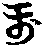



人如是历法明，即皆云有人，但不可说也。是三藏中不可说法藏。今大乘中明不可说法藏者，明诸法本寂，言语道断，不可以识识，不可以起知，不可说其有，不可说其无。故实相论云：断圣心之所能知，非神、口之所能辨。神、口非不能辨，但经无法可辨；望心非不能知，但无相可知。此即是实教，故云不可说法藏。立法藏既摄，法即尽故，举释今云照一切法藏也。



是故已下，即举经来牒释。若如地论、金刚波若论等，释义既竟，并一一还举经牒释之。今此中经论既多，不可一一如此举来，故但时时有无也。



能守护已下，此下云并一一还牒今十八赞中经文，当一一取今之举此中意一一对释也。临文当释。



不转生死中已下，释不退不还义。以不离生死故云不转，亦不入涅槃故云不还。故天复牒言：不生故不转，不或故不还。若然，解如此者，始名为转十二行法轮也。



如是等已下，释之既竟而捴结之也。



次当广者已下，面名千佛经，可等品中复广叹也。



释曰：已下佛释今身子问。供养即义也，当释。



当如供养佛已下，上校量中言供养波若为波若，今但以众生著相情多贵重佛故，但云如佛也。当释。



等即无异已下，释今彼若与佛不异之文也，当释。



佛因说因缘已下，还引佛说为证，明波若能出五乘等故胜也。



尔时，帝释作是念已下，释今天生问身子等之意也。当一一释。



譬如四大已下，如树木中亦皆具四大，但随相多故属地。接五波罗蜜中亦尔，若於舍相多故，偏受檀波罗蜜名，至一一波罗蜜中皆有波若和合，不相舍离也。当释。



帝释问已下，次释今帝释论义中经文也，当释。



譬如和合散已下，隆有三十、二十种草，叶但五石、三石等得名。草药喻五事，石喻波若也。



又如大早已下，兵喻五事，将喻波若也。并一一当释。



舍利弗已问供养已下，以释今第二大分如来因身子发问广说之。文云波若生藏也，当一一释。



尔时舍利弗问意已下，次释今波若与何等法合义也，当释。



若善不善已下，当领今不与善不善、世间出世间法合等义来，可此中牒释也。今无所合者，一明切诸法实皆无相，与波若无实，故言入波若教中无所可合。所以净名经云：佛为增上慢人说离婬怒痴而得解脱。婬怒痴性即是解脱，故此中言善不善等皆入波若数中也。帝释意重菩萨婆若，言波若是因应与果合，故设斯问。如来答之亦不合也。当释此中佛破断哉明见故说。说合下，当释如佛心合者，明佛心中无合相，合亦无所合也。



答曰已下，明若能不取相不受不著等者，名如佛心合也。



帝释欢喜已下，释今天主叹说之文也。



须菩提已下，释今菩萨作是念则舍波若等文也，当释。



是故问若信已下，释今善吉问佛云何信波若之文也，当释。



须菩提白佛言已下，即是品之第三大，分明须菩提叹说波若十度之名，良在安此。今品初身子叹言波若波罗蜜照一切法毕竟净故者，即是大义，但主不显，今此中始显大度之名也。当释。



何因缘故已下，明佛还问所叹，还今自释也。



须菩提言已下，明善吉奉答。此初，先立五对历法释之：第一、以不化大小为一对明之，第二、以不化合散明，第三、以不化无量明，第四、以不化广狭明，第五、以不化有力无力明。以波若中无如此等法，故名大也。当释。



世尊！若新发意菩萨已下，还牒今五门来释之也。一一当释。



何以故？是是非般若波罗蜜相已下，复牒今门来，明举次显是义也。



所以者何？众生不生故已下，复更举十门等牒成今义。第一、就不生门明，乃至第十、就不成就门。此等法中皆据实相以明诸法，若论主乃化二帝释之也，当一一释说。



释曰：已下明善吉闻今如来为说波若生义及信等义得解欢。



故所以致叹波若为大佛，佛问之，还令因解也。



答色等诸法化大不化小故已下，释今善吉初答中五门经文，将欲明无大小之立、大小之相，然以复更之也。当一一释皆舍等中随所化故，心之与境或大或小也。



又如凡夫前见色中已下，指动时名为指等，指之分寸长短等名指量，或问指等名指数，或云指一指异等名一异。此之五法实如是，色不为尘所成，但指是色，故人乃化和合成大色解也。有人眼见色可见处名色，下当释。



有人言：尘色灵诳已下，此家执言：以细微四尘等，成人柱等。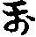



假色四尘等是实故，说为真色。亦有执言：微尘是常，名真色也。



是名色化小已下，明以微尘和合，故前微尘色化小解也。当释。



如是等已下，结。今诸凡夫既化如此等解故，破坏诸法性。今波若中观色等实性故，不化大小等解也。



不合散者已下，次释今第二对义意亦。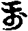



前但前和合之中，假设名字，无别法起也，当释。



色无边故已下，此初，先就俗谛道释之。以色无处不有，故说无边无量等也。



不以麤色散故已下，明波若但即法明无，不论散合也。



无量者已下，释今第三对，明凡夫所见以空故说为无量，有故说量。今波若中空实俱无，故无此等法也。



前色化广已下，释今第四对也，当释。



言色有力已下，释今第五对，明云色和合说教有力，如众丝制象，若细分之，则说言无力。今波若解之，故不言有力无力也。是故名摩诃波罗蜜者，释今善吉初答如来大度义，五对经文既竟，故捴结之也。



复有大因缘已下，次释今。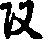



复次，意明大因缘义，不远离六波罗蜜等也。当释。



则调柔不错已下，明五事与波若互由维纬，若和合者始成，故作八圣道譬。成，明也。当释。



无有一法犹自性者已下，故前六因四缘中云无有法从一因生，亦无有法经一缘生，当知当法从众因缘生也。当释。



所以者何已下，还於善吉自说，以证成今义也。当释众生不生，故次释今文中。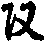



十门义中第一门也。此中论主以□相似，由如破竹，一节既同，餘苦亦去，故所以但广释初门，中间例尔也。当释



众生力不成就故已下，此第十门，数释义故来，所以别释也。当一一说。



第四十品者，名为泥梨品，泥梨是西国语，此间名为地狱。此品所如来者，此中有数品经皆明波若功德，今既明波若德不可思议，能信能了得福无量，今欲次明谤者重罪弥轮，故次大度品以明。前此品论既欲释，故举之云第四十品释论。



尔时，慧命舍利弗白佛言已下，就此品中大有三分：第一、明其信人；第二、明至谤者；第三、叹此法甚深故。所以信者福高，谤人罪大。此问意，今往生品、下方便品、轻毛品等中悉有此问，但所为不同，并至文当释。既欲明谤者，故此初身子先问信人，凡有四问：第一、问来生处；第二、问发心久近；第三、问供养几佛；第四、可行行几时也。当释。



佛告舍利弗已下，此初，答上第一问，意云从地佛云来也。



是菩萨发心已下，答第二、问发心久近义也。



从初发心常行檀波罗蜜等已下，乃答第四问行行久近义也。



供养无量无边已下，始答第三问，此是逐便答之故尔也。



作是衾乘从佛闻已下，明大乘经即是法身。舍利弗诸佛之母，故此菩萨若见经时则如见佛，闻经之时如从佛闻也。当释。



须菩提白佛言已下，为佛。今既言是菩萨若见经闻法，即如见佛闻佛说等，故致到问也。至论广释。



佛告已下。以无见无闻无所分别，故云钝也。诸义例然，当释。



是菩萨能几时行佛道已下，此意反有利根菩萨虽近发心而能信行，因有钝根菩萨久发心而不能如是信行，故发此问，不同今也。至论当释。



佛告已下，当释。



示生母人腹中已下，明信者之报。下则广说不信人报也。



须菩提！有菩萨摩诃萨多见诸佛已下品之第二。次明至谤者，明执着之人报诸法相故，闻波若说空则不生信，分别诸法乃复须情，如此之人悉名为谤也。当一一广释。大地狱者即是阿鼻，五逆之罪只可五劫，此人起谤害处深，是故无有出期。若劫大起者，明十方世界四天下中，唯阎浮提造善最胜，亦唯阎浮提人造五逆罪，餘三天下无有五逆，故无阿鼻狱。阿鼻狱唯阎浮提有，就一三千大千世界中有百亿阎浮提，则有百亿阿鼻。今若此问劫火起世界坏时，此地狱亦坏故，则复移往他方地狱，如是展转地狱之义，如进波罗蜜中广释也。不信之人以自不欲见波若经，破坏他正见眼故无眼，口舌谤故无舌，耳不耐闻故无耳，以手如拔故无手也。当一一释。



释曰：已下释上品初身子所以问信之义也。



何处终已下，次释今四问之文也，当一一释。



成就今四因缘故已下，明成就如上如来四答之中因缘也，当释。略说三相者，谓见经如见佛，闻经如从佛闻，及见闻人等，如似有着，故善吉问也，一一当释。



复次众生离法不能闻已下，明根识等若离人便同木石，故亦不能见闻。人若离根识等便是死人，故亦不能见闻也。



问曰：上已问菩萨意哉时已下，次释上善吉以分问意经文也，当一一释。



一者、分别是道已下，明佛法中有此二种智，但须解用之耳，当释。



略说义已下，释上善吉前以分中问言有异不同，前上等义如此，故云略说义也。



有菩萨虽新发意深信受已下，释今品之第二谤人果报等经文也。临文并当对上文意一一释之也。



即起愚痴业因缘已下，故前论云：我言痴者，非如牛羊等，但以执着不信，故名痴耳。当一一释。各有十六小地狱者，明大地狱但有八一大地狱，复有十六小地狱，泉一十则成八十六，人复成四十八，是根本八大地狱，合成一百三十六所。合此一百三十六所狱，唯有三种：一者是热，二者寒，三者暗也。当一释。



如入正位者已下，此明初果正位天人生义也，当一一释。



赞五法已下，明调达乃以常乞食、纳衣、树下坐、断苏盐等五法，以为正道，代八正处，令为为比。亦未得道者，皆经慕从，作前异法，故名破僧。五逆罪有轻重等义，如优婆塞经，佛为善生说，是五逆罪，杀母则重，杀父则轻，杀阿罗汉复重，杀母出佛身血重阿罗汉，破僧复重出佛身血。不同俗典，以帝释之所以杀罗汉等有轻重，破法等优劣之义。论自解释佛法，以母重故，谤法罪深也。并当一一临文释耳。



未得阿鞞䟦致菩萨见至多人供养已下，此据习种别也。



释第六十三卷论



第四十品中名摄身口意释论者，释上品经文义犹未竟，但约诫有更徒，须令知不谤善制三业，故举之云应摄身口意释论也。



尔时，须菩提白佛言已下，正明佛法理深，应当供慎敬。若纵三业，则罪过弥论。谤法之殃，由三业相资，和合所作。是故，善吉！自佛应制三业也。并当一一解释。



须菩提白佛言：世尊！以积集口业故已下，以世人见身能行杀、盗、婬等故，但说身业为重，不知口业谤罪为深故。善吉白佛：以口业故，有是破法重罪也。



佛告下，当一一释。



此中既云造罪已始得众在，当知罪福但据因也，当释。



须菩提白佛言已下，明有四因缘能毁正法，至论当释也。



问曰已下，明论释之也。当一一释。



须菩提自说因缘已下，明莫造身口意业故，谤法受诸者也。当一一释不解。波若隆言：至无而不复至有，但以缘集假聚故名有，说为如无；无性故说为无，名为如有。不解此义，故如力复心也。并对上文等，一一当广释。



复次魔有四种已下，释上四因缘义也。临文当释。



五众结使厚已下，如欲界凡夫，并为九结所系、九十八使所使；欲界圣人，以断三结八十八使故，为六结所系、十使所使；色界凡夫圣人等，为结所系、为使所使等来，并当释。



须菩提白佛言已下，此经文意临文当释。



须菩提白佛言：世尊！是般若波罗蜜云何甚深难信难解已下，是品之第三，明由波若理深故，所以信者福高、诱人罪大。就此文中复有广略二周：初略明无缚解等义，第二广明一切法净。净即是空，但以众生闻空怖故，所以作异名说也。并临文当一一释。



何以故已下，即释所以不缚不解义也，当说。



本除不缚不解已下，次就二除明也，当释。



何以故色净是亦净已下，第二、次就净一明波若深义也。当一一释。



无断无坏已下，明波若等诸法非可断法，故云无断；非灭坏法，故云非坏也。释曰：下当一一释。



佛答已下，亦释明无缚解义。先云缚解也，当释。以诸烦恼等虗诳不实，亦无所断，故无缚无解也，当释。



复次一切心心数法已下，此中多许意论，并为释今无缚无解经文，故先云缚解，以明无缚解义也。当释。



复次色等诸法三世中不缚不解已下，释今诸法三除不可得，明无缚解等经文也，当释。



是时须菩提已下，释今善吉知此理甚深难解，故谤入罪大，信者福高义也。当一一对今文释。



问曰已下。问意云：佛既还领牒善吉上意，何因乃更云魔事也？



答曰：已下云善吉，但明内无信心，外值恶友，明外因缘未尽，今佛即云说之，故更增魔事也。



佛更亦说甚深难解相。已下，次释上。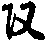



分中。明一切法净经文，故论主以此文意，即生六经文，即以六经为答也。当释。



何以故已下，释初观念处中色为不净等故，即得身念处观成。得此观成时知色实相，得无浅解断诸烦恼。此之念处即是前果色等为因，今果既净故知因亦净，故云色净，故四念处净也。当释。



问曰：上当释。答曰：已下明作不净观时未得至实，但实观家初一得十六圣行时始至实观也。当释。



净颠倒故生婬已下，明凡夫人等只以□五亦欲净故，所以爱著故皆舍中，名为净紧五欲。今以前不净中生此净想起爱，故名颠倒。但以婬欲破净，故言非净。非净非是实观，实观则无净不净相也。当释上言净者据空为言，今以净相亦无为语可



色实相净故果亦净已下，上明念处为果、以色为因，以果净故因亦净。此中即以色实相教因、波若为果，明色实相既净故波若亦净，反覆明之也。



复次佛此中自说因缘已下，复以经来牒释也。当一一释。



复次如是我法已下，明复以十六神我等义来，例释净义也。



复次须菩提婬净故已下，此下云犹是今第二广说一切法净。经文中意犹未尽，明三毒等实相净故，与种智实相同一，故言不二不别也。诸法例然，当一一释。此中本言净等不异，净义即空，故云不二不别。以据前事言其不二，故此中云色净乃至前一切种智净，不二乘不别也。当说。



有为净故无为净已下，明三相是有为。三相无生，云义为无为。今三相不可得，故云有为净。无生亦不可得，故云无为净。此净义不异，故云不二不别也，当释。三世净义亦然，当释。



问曰：已下明诤理甚深能。今信诸之人罪福无量，若无疑似处，但世论解释而已。今言色等净者，事在可疑，故初世宾主。世论之意良前此也，当释。



答曰：下当释。



及三毒清净果报因缘故已下，如过去无明即是三毒，能生前行，行即是果。从前诸行复生前识，如是次第生六触六受等，讫至老死三阴相续。今以三毒净故诸行净等，诸即是因净故果亦净。若诸行净故无明诤等者，即是果净故因亦净，口以空故言净也。当释。



如破无明十喻中说。已下上破，言无明不在因，不在外，不在中间，不从过去世来，亦不去至以世，但缘集说有。如是求之，无明之性实不可得也。乃至种智例然，当释。



复次用十人空故已下，此意云所以得智色等皆本来自净者，以十八种空智观之故得智也。当一一释。



略说有为无为已下，次释上有为无为等净经文也，已如上释当释。



在三世中已下，明论主。此中则乘势释三世净经文也，当一一释。



问曰已下，释文既竟，次断易之也。当释答曰已下，论将欲释，先出三种破人，对明二种信者，此初，即是第一破人也。



或有人著心，分明取相说已下，此是第二、破人。若如上随喜品，亦言此人名谤三宝。今此中言，虽以着了论议说故，名之为破。以心不为非，拨破波若言教，故不名为破也。



如调达已下，引事例来证。如佛言我今有疾，祇城名治佛，故亦以针铁出佛身血，而非是逆罪，不同调达。如著相说，波若人隆以着相说，故遍前之相，说名为破，而说为故，不同不信拨者也。



如尽作佛像已下，复更引例释。如此中论解者，以好心坏像，亦无罪也。



复次，或有人破般若，虽不瞋不轻佛已下，明此人着有情多，唯果分别阴、入、界等名色，着别言之。是义不信前空，不解佛意，故成毁谤也。当释。



前此二种信中，以信理福多，信文福少也。当释。



耶见罪重故已下，先明此二种信谤人相对出已，今如□释。今问辞明不信，云人以邪见所坏故，虽有持戒精进等为之所染，并成邪业堕恶道也。



五逆罪人已下，次释今问中第二意，若此人以重罪覆心故信微福弱，虽写经卷亦无如之何。二者此人虽复重罪覆心，或遇善知识教授智慧利故，能深信波若则得善果，则引事证如闻王遇善友，亦由波若力故得五逆罪哉，乃至得道记。故今校量中言此经如摩尼珠能除五逆愿创，当知大乘诸经皆不可思议，故谤之罪深，不同谤餘小乘经隆得逆罪也。当释。



第四十一品者，名为叹净品。今泥梨品未既广明，净义理深，故信、谤两人罗福高大，令此中身子、善吉等见此净理深妙，所以致叹，故次泥梨品。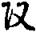



有此品来，论将欲释，故举之云第四十一品释论也。



尔时，舍利弗白佛言已下，就此叹净文中，门户亦极多，但大捴分之，凡有四分：第一、明身子致叹，如来一一成之；第二、善吉叹净，如来一一成之；第三、是天主问前善吉，以明碍相；第四、如来自对善吉，为说微细碍相。此初，即是第一、明身子致叹，一一问佛取足，如来又一一成之也。并临文当释。



世尊净明已下，即是第二句叹。今言色净故乃至种智净等者，此据体论净故，所以通贯上六明之，即是性净涅槃。今此中据叹经为言，即是方便净涅槃，唯据前果故云净明也。至论当一一释。



世尊！是净无得无着已下，此第五句，叹论释，乃至云：若小乘中以下五心为得，以须陁洹为着；大乘中柔顺忍为得，无生忍为着。今波若实照之□，此等悉无，故云无得无着。若无论者，此则不可解也。并一一临文当释。



诸法钝故已下，明波若实照之有无，知无有分别，故云钝也。



色无知是净净已下，明色无知即是前净，此净亦净故云净净。是故圣人以空遣空令不滞空，空亦复空故名空空。今者亦尔，以净遣净净亦复净，故者净净也。餘义例然，当释。



无益无损已下，当释上来摠令，凡有十三门叹也。



释曰：已下此即是上叹净。文中初句既欲明至净无净相，故先云二种净义，令人知指，方乃折中。言智慧净者，即是照实相智；言缘净者，即是实相之理。次境非智不知，智非境不照，故出此二净相待之名也。



所以者何已下，还释上所以二净相待而有者，以如心心数法等来证□□也。上品经言：波若非心心数法，法相本净。故论释言：依生灭智慧离四颠倒，依不生不灭智慧以波若离生灭智慧数。言非心心数法心相本净故者，据圣体净也。今此中以波若是智慧，故言心心数法。如大本经云：憍陈如！舍无量色获得常色，受想行识亦复如是常住五众。上既得说心心数法等义者，此波若言是心心数法，亦复无伤也。当释。



譬如火已下，初云论释，第二、引证。来释已竟，今次作譬来明。云论大意亦不出此三，此中非折中时，是云法时，故作此喻。火喻前智，薪喻前境，由境智相应故有二净。故大本经云：一切诸法本性自空，亦因菩萨修空。是空也当说。



世间当法已下，此据世□言世间也，当释。



是中说离智离缘已下，上直法既竟，次今明折中故。所以万化非无生宗，而宗之者无相；灵宗非无主照，而照之者无心。故圣人以无心即真智，照彼无相之灵宗，此即据明直法之义。故内外两冥，缘智从寂者，即据折中为言，与此论合。取此论意，故所以然也。当释。



譬如有种美食已下，明为善着相缘智慧作喻也。当释。



不坏相在颠倒中已下，即是不染而染义也，当释。



舍利弗观是已下，欲释六人，即以此言生起六意，明身子所以问佛所答等义也。当释。



复过汝所见已下，明如来答言毕竟空故，实相净义乃复过汝所叹也。



无所着已下，还毕竟净义也。



复次清净主已下，明诸佛穷照本净故名为主也。当释。



佛答已下，释上佛广答初句经文也。诸法本者，即者实相，未者谓色等诸法，实相既净诸法即实，故云诸法本末清净，是名甚深也。因果清净故者，色即为因、实相为果，推色以至前实，色既即前实，实本净故说色亦净，故云因果净故也。



故上品中已下，明因净故果亦净，果净故因亦净等义也。当释。



是净能破一切法中已下，次释第二句叹也。能与有餘涅槃者，此据烦恼身五住及习尽也。今与无餘涅槃者，据二种生死尽也，当释。



是净不相续已下，释第三句，明是净既能与此二种涅槃生死永不相续，故云是净不相续也。



百八烦恼已下，释第四句也，当释。



如是诸法实相已下，释第五句，先化大小两乘与法辨义已，次折释也。当释明须陀洹果复无漏果证已，永著圣法无有堕落，故名为着也。



如是法已下，次释第六句，不作罪福不动等三种行业等义也。



一切世间无生已下，次释上第七句，明释法无生不生三界等义也。当释。



是净无智诸法钝故已下，明净无知相故曰无知，法无分别是故名钝也。当释舍利弗得声闻彼岸，佛为一切智人俱无着故共论此法也。当广释。



如虗空下，当一一释。



尔时慧命须菩提白佛已下，即是品之第二，明善吉叹净。此中乃先举生净以况法净，佛亦一一成之也。当一一释。



佛言我无所有故已下，下言果毕竟净者，是略述成。今言无所有者，是广述成也。当至论释之也。佛言自相空故已品，亦至至论当释。



以二净故已下，亦至论当释。



无始空故已下，上言毕竟净义以成法空，今言无始空者以成生空，亦至论释可然。



如是智已下，明善吉致叹，而如来答言毕竟净故，此据智相寂知无知相，故云尔也。



佛言知道种故已下，上据知相寂故，云毕竟净故。今言寂，寂之用云故，知通种故故也。当释。



以方便力故已下，此下云出至义，明色无色性故不知色，非无方便之用而能知也。当一一释。



无诸忆想分别内空、外空等已下，此中前事，是故唯明十三空。餘诸法空、不可得空、无法空者，法空、无法有法空等五空，既是为总破诸法明故，此中不具说也，当释。释曰：已下此初意，释今叹净品。初身子所以叹深者，以见上泥梨品未说净理甚深故，所以致叹须释主因缘。今善吉既是命说之主，故此中致叹不须释主因缘。若餘人所说，须求因果，故如如释身子叹之因缘等义也。



今须菩提说下，即是科门也。



我净故已下，次释文也。此以生空易解，故举况法空也。当释。



问曰：已下料简所以。上云无所有，下云自相空等义也。



答曰：已下意云，上据有为果法是着处，故云不可得。不可得者，对无着处。今须陀洹等言自相空者，乃据无为果。无为果既是烦恼无处，非所着处，故但云自相空也。当释。



以菩萨深着故。无相无念已下，明论主即用此无相无念，释上一切种智等净义。无相者下，复始别释无。无相无念，释上一切种智等净义。无相者下，复始别释无相等义也。当释。



用二净故已下，二法清净者者，是智净、缘净，名二法净。今此二净亦无，故名不二法净。无得着义，已如上释也。



问曰：常言毕竟清净故已下，问意云：今我等无边之中，复何故乃云无始空也？



答曰已下，明今以无始空来成生空义故。何以云尔？毕竟空乃以成法空□□义也。



问曰：能如是知已下，释上善吉叹波若之文。此中意明知之空，空之智，用即寂，寂即用，非癈用。然以寂亦可以寂故而无用，但以知故，所以言毕竟空。空即能智，故言知道种智也。当一一释。



尔时须菩提白佛言已下，释云以云色不知色等文也。并当一一释。



第六十四卷论　第四十一品六分



尔时释提桓因门已下，即是品之大分。第三、明天主问前百相。所以然者，上文既明诸法皆净，恐人不解而生取着成础相，故天主欲令无滞，所以问也。当一一释。



汝今更听乘释已下，即是品之第四，明天主请前善吉说百相已，如来赞成。而善吉非一切知人，知有相不尽，是故如来复为广说微细有相等法。下当一一释可。



佛言一切法一性非二相者，即是毕竟空性也。是一法性亦无性者，明亦无此一毕竟空性也。是无性即是性者，明无性之性即是一切体性也。当释。



问曰下。并当一一解释也。



譬如食虽美已下，明善法虽好。若着之对，广也，当释。



问曰：佛以赞须菩提说无有相已下，次释上第四大分如来自说之文。问意云：上善吉已说百相，如来证成。若说之非留，佛不应成；说之若是佛对，不须更说。今何以赞成而复更说也？



答曰：下并当一一释。



五众及至十八不共法可与般若作因缘已下，隔此中有二解：一解云：此五众、十八不共法等是前法空，法空但能为波若作缘，发显波若，非正生波若，故云等也。一解云：此五众、十八不共法等无生相，故言不能生波若也。有解云：此五众等是成菩萨法，十八不共唯在前果，果不生因，因中五众等及十八不共并非波若家生因，但能作缘因，故言但作因缘也。譬义当释。



第四十二品者，名面名千佛品。上既明百相已，次说波若无有。今明者，佛道同说无异辙，故次此后明前此品。今论将欲释，故举之云第四十二品释论也。



须菩提白佛言已下，就此品中，虽得门户极多，而大有三分。上既明有相，即明波若无过，即是法无百相。今次欲明人无百相，故云作者不可得故。所以此初第一明前既作无而所不作，明前无行而无所不行。第二明诸佛道同法无异辙义故，所以面名现千佛同法无异辙义故，所以面名现说波若。第二次明至行报诸根无恼无缺。此初即是第一先明无作无行，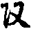



则次明无所不作无所不行等义也。并临文当释。



尔时，慧命须菩提白佛言已下，正叹波若不增不减义也，当一一释。



譬如佛卷形寿已下，明佛寿无尽，故以为喻也。当释。



须菩提白佛言已下，前明叹法，今明叹人也。并至论当释。



世尊！是众生性亦不减已下，以众生性无故，众生界亦不减；以圣人性无故，诸佛界亦不增；以佛界不增故，圣人亦不无满；以众生界不减故，众生则不可尽也。当释。



释曰：已下明前品既说有相，今次说无有相。善吉既闻，闻品未言波若波罗蜜无起无作，故即问言：若尔者，菩萨不应行前波若波罗蜜得萨婆若。故此品初云波若无作，佛即答言化者不可得故等义也。当一一释。



应云何行已下，上明无作，今次明行相也。当释。



示诸法毕竟实相故已下，明波若实相法中，不明诸法常故，不同无智愚人；不明诸法无常故，不同相人愚家。两忌内外双寂也。



不受是法者，明隆为破常，倒为无常，观即舍也。



问曰：色等罪法已下，问意云：此中明法皆言从色至前种故，色等为苦无常可共种故。云何？



答曰：已下云此是名字，说之随人何乐，以闲者为安隐。闲法好法不闲之者，说之为在种，故诸善法等。若众生不闲，则说为在，亦无伤也。



不行色等不宜即已下，明若但前色等法法化无常想种相等上作常想者，不宜是。若於色种智等上作常无常想，名为具足。今波若中亦不行色等无常义，故云不行色不具足也。当释。



复次已下，此一意，明若十地菩萨观则名具足，餘菩萨观云不具足也。



佛言：出众生於常中不当释。



碍者，是非道。已上下品明碍相，此中明无碍相，令善吉总结上下，故云尔也。当释。



罪业因缘生故已下，欲论行者亦非罪业所得，但因缘之义是虗诳法，故说为罪，可当释。



何以再说已下，答言：相说欲度众生者，今得以世闲；以说欲度众生者，今得涅槃等乐，故再说也。



复赞是菩萨大精进已下，释上问第二周赞菩萨勇猛等文也，当释。



尔时释提桓因语须菩提已下，明天主现闻上佛与善吉了了说法诸实相，欲与守护故发到门也。当释。



为习空下，至论当释。



汝颇见是法可守护者已下，明善吉意云：此法无相故。又波若力自无量故，不须外护也。然至论释之。



是善男子已下，上明法不须外护，今明人然不须外护，欲论佛法之中然须内外两护。但今此中欲显波若是诸佛师自有大力，又诸佛何护不须世人所护？故尘外护非是都不须也。论自释之，临文当一一对释。



不念梦、不念是梦、不念用梦、不念我梦等已下，明天主发四句。上善吉欲明不须外护义，故举此十喻等，以易解况难解，反问天主，明不可护义。但内行波若即是前护，今者天主复还举此四句问善吉也。



不念是色已下，上为举易解况难解，故以梦中反问天主。今复欲以难解况前易解，明色等既至不念，何况梦等。故着者，此中复还举四事答之，乃至一切种。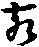



上四法亦然也。并至论当一一释之可。



释曰：已下此中论主释前上文，意极分明，可见临文当一一对上文意释耳。



须菩提及一比丘出家法敬礼而已下，明天主是俗人多设事供养，善吉等既是出家人但须设法供养，故云敬礼而已，为别异道俗故。



然诸恶鬼等，下当释也。



应无生法。若已下，此中言观实相慧，即应法忍，入菩萨位。若言佛性是能照者，上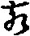



观故得见，佛性便成，更别有知见此佛性故。若言上转识然见者，转识既同，则应三乘皆见。若云阿梨耶识见佛性，不用转识见者，便成佛性。见前佛性，复不应言观诸法实相毕竟空智慧，应无生法忍。若言此真知本有，今日始显出得用者，便成道理。但有了因，无有生因，报佛亦不成本无。今有生因，亦成感本有之义。何以故？此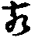



本有故。既真知与法佛俱本有，但今日显之，始得至用。说为始有者，五度共行波若与常住波若等，悉皆本有。同是今始体显，今始得用，都无有异。同是了因了出，有何生因生法义也？当释。



若人少时应行已下，此明应可外护义也。



如伽罗夜叉已下，於事证上地人，不须外护义也，当一一释。



尔时帝释贪贵是如梦等智慧已下，释上天主四问善吉以难况易四答等中经文，当一一释。



餘喻亦如是已下，梦上一喻，云念梦，念是梦，念用梦，念乘梦。四事相貌既然，餘影、炎、化等九喻，上四相亦尔也。当说。



尔时，须菩提答帝释。若行者已下，明善吉还。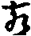



色等。上以四相况释上义，当一一对释也。



尔时佛神力故，三千大千世界已下，即即是品之第二，明波若法同十方诸佛，何说不殊？故所以为贵。就此中复有二意：第一明十方同，第二明三世同。有此二意。今此初先明诸天闻说实相了了分明，故说供养也。当释。



亦如是相、如是名字者，明现教不殊也。



皆字须菩提已下，欲论一切十方诸佛所说皆尔，但此中为遂当时之座所见为语，故只言十方各千，唯据万佛土也。明说波若时皆须解空第一人对，故尽言名须菩提天主。既是地居天主，又当念波若天名为净，一切佛所说皆须净人之主问此净法，故云皆字释提桓因也。当释若华严云：一切十方说十地相菩萨皆名金刚藏，一切请问者皆名解脱月。此明地相常住深奥难明，故一切菩萨说地相者同名金刚藏。解脱者据无缚黑，月者前暗夜时明之，此地行善除缚黑，前生死重昏之中能为照明，故所请问人皆名解脱月。为大乘理深不同，小教文理俱常，十方诸佛实无异说，一切群圣所禀不殊，故以然也。



尔时佛告须菩提：弥勒菩萨摩诃萨已下，第二、次明三世诸佛亦同无异嗢。上举十方论理在说同，今明弥勒云三世莫易。所以举弥勒者，欲以未来说同证现在义，未来既同现在佛说，当知现在佛说然同过去，欲以此为证故於之来。



然当於是处已下，次明处然，同明一切诸佛然，常等此处说於波若。故法华云：我净土不毁，而众见烧尽，常在灵鹫山，及餘诸住处。凡说大乘皆明实相，故据此实相，净土处然未曾异也。



何相何因何义已下，明善吉因之，复设三问也。



佛告已下。此正答初问，明弥勒出时说波若相，然复如是如今无异。次色时无色故，非常无常缚解垢净等也。当释。



须菩提白佛言已下，答第二问。上明色净等义，据於相净为言。今云净者，据於因净，以色中实相为因生於波若，故云等也。当一一释。



世尊！云何色清净故已下，明善吉因之复问也。当释。



复次须菩提虗空清净故已下，上善吉设三问答两问已竟，今次答第三问，明弥勒出时然以如是等义说於波若也。当一一释色本来无染，故云不行也。当释虗空等可用而不可用，故云清净波若然然也。



虗空可说已下，明空体无说故，设复说之体然清净。波若然尔，体无说故，设复说之亦复清净也。



因虗空中二声出已下，明六大成。众生以四大围虗空，识於中住心，即陀那报风从齐而。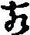



𦒱打七处，故有声出。以声出声空，故有向。若内外不空，则无声向，故云因虗空故二声出。虽因空有二声出，空然不行；虽因波若故有可说波，若然不染。性常清，就不可得明。如虗空相，皂不可得故清净，波若无相故清净也。当一一释。



释曰：已下上初品中以如来自说故，列诸天大众等来。次舌相品，为命说故来。次请分，初为请说故来，此中为明了了显说诸法实相故复来也。



问曰下。答曰已下。意云尽有新奋诸天等来也。



十方面各千佛现已下，释上十方同义也，当一一释。



佛欲证其事故已下，次释上古今通义。欲知贤劫中诸佛所说不异，欲与诸佛作因缘者，当於此中解也，当释耳。



王舍城已下，次释上处同义也，当释。



如弥勒经中说已下，明论主於经成证，佛昔於此处说波若义也。迦叶是第二大师，住持佛法二十餘年已，始於狼迹入灭尽定。次付阿难，住持二十餘年，付商那和修。那和修住持二十餘年，付优波崛多。优波崛多住持二十餘年，付提遮迦。提遮迦已，次马鸣、龙树、提婆、天亲、师子等。二十三人中，龙树最臣。二十三法师及迦叶入灭定、弥勒度人因缘等，此中当广说。师云：若揣食身入灭定，过七日已，出定则死。此迦叶乃是法身菩萨，非贪身故，所以出定能然也。有解云：若住常入灭定，入过期限者，出则须死。若是佛所遣使入等者，假使非法身菩萨，出亦不死，要须事办，然亦乃终。故前十力论中云：若佛遣使中不达，无有是处。若非法身菩萨出定则死者，便成佛所遣使。有不达义，故有此意也。当释。



以何相何因何行已下，次释上三问三答中经文也。上言以何义，此中乃云以何门，此是以义为门也。



佛言：如我说色诸法非常非无常等已下，释上答第一问中经文也，当释。



尔时须菩提欢喜已下，释上答第二问经文。此中以缘为名，因为缘因也，当释。



譬喻欲令事明了故已下，次释答上第三问经文也。



八万四千法聚皆是波若波罗蜜一事已下，明此中所说皆是波若中所说一事，而分别说成多许法聚作，所以云一切诸法从波若生也。当释。



有人声从口中空出已下，已如上释当说。



诸小菩萨等，以圣法涅槃等为实，如人以声为实。以生死凡夫等法为虗，如人以向为虗。若言世间法有名无实，世出间法有实等者，皆是为诸小菩萨说故然也。当释。



问曰：已下当释。



答曰：已下言自然有者，此是作因已，以果不须更作而自得之，故云自然。如不作於向而但有声，向自出也。当一一释虗空是无作法，只释上虗空无取文也。



复次，如虗空无所得相已下，释上无所得经文也。如因虗空造无量事，而空无造相，亦无可取相。以因虗空造故，虗空则为非无；无虗空相可得故，则为非有；非有非无，则为虗空。波若亦尔也。当释。



------



## 大智度论疏卷第二十四



**译者**：蜀地潼州迁善寺沙门释　慧影　抄撰



第五十七品释论者，名为净土品。何故次灯炷明净土品论？自生起言，明不退菩萨具智断二德，自行既足，唯应以严国为事接化众生，故次此后明净土品论。将欲举之，云第五十七品释论也。



尔时舍利弗已下，就此品中大有二意：第一明乘於前品入三三昧广化众生，则因生论义齐於梦觉；第二从佛告须菩提有菩萨摩诃萨行檀波罗蜜时已下竟品，明菩萨之行净佛国愿。此初即是第一身子。所以此初作此问者，意谓梦是诳法，三昧是实。又有餘处说言，梦中亦有善恶。若有善者，梦中行此三昧，亦应集成增益波若。故设此问也。须菩提报已下，欲论梦中只可得为集业之因，不得集成业报。但善吉意欲齐梦觉、一是非、冥同异、会虗实，故作此报。就实答之人行波若故，卧梦安稳身体和悦，乃至梦中亦行善事利益众生。今既欲就入实解，故云无异也。当说



若梦中作业已下，是第二翻难。善吉既就实答言觉梦一等，若昼行能益、夜行亦益，故尽能增益。波若若昼行不益、夜亦不益，此意云：实相中昼日行尚无增益，何况梦中行？又昼以有相心行由尚不益，况睡眠覆心行而当有益？当知梦觉一种故。今者身子次更别进设此问。业名造作，集者招集，成者成辨义。若言尔者，则引佛语为难，梦既不实应无集成也。当说。



何以故已下，还释上梦中不应有集成义也。当说。



语舍利弗已下，明善吉既被问，则反质答之也。当说。



舍利弗言已下，明身子既被反质，则云若无因缘时业不生思不坐者，业据身口业，思据意业，思业若无因缘并不生，要须有缘方生，昼日既有思业等始生，夜梦亦有缘故思业等方生，无缘则不生，故当知一种也。



如是如是已下，明善既也。反质得其事理皆同，故而印可之。明昼日业亦因见闻觉知等生，梦中造业亦因此四法生，故无异也。是中心有净有垢者，谓梦中心也。当如论说。



诸思息相离已下，是身子第三飜难也，当说。



取相故有缘业生已下，善吉答意云：欲论一切诸法实自相离无缘无业及思等法，但众生不解於自相离法中取相，故横超诸业从因缘生，若无缘时则不得生也。



梦中布施持戒等已下，是第四难。意云：上既云梦中有缘故业生亦得是思业等者，菩萨尽日以取相心行此六波罗蜜等法，尚非实回向，岂有梦中惛晦痴心行之得是回向？故设此问耳。若以己自善根回向者，宜名善根回向。若缘他家善根等回向者，名为随喜回向也。弥勒菩萨今现在已下，若如前来所说，善吉意气极高乃众圣所伏，而今所以推弥勒者，善吉上既自就实为答梦觉一齐，欲令群圣悬同众无异说，故推慈氏。二者弥勒既是次师，欲令现在未来诸佛所说法相同等，故假四圣而慇勤共说，故推弥勒。但论主意欲显菩萨智胜，故云以难答故致推弥勒也。既亦云弥勒授不退记者，当知不退之名通於上下，故毕定品中乃大作三分明毕定位：一者谓初发心菩萨；二者无生忍菩萨；三者最后身菩萨也。弥勒今者复还就实益也。当说



受记处者，谓攘佉王城，妙梵、梵摩波提所住处也，当说。



如仁者已下，既见慈氏说悬应得深法，致此问也。



不证已下。明菩萨入法性中，如鸟飞空迹不可寻，不如二乘於实际作证有於证处也。



尔时佛告已下，次明如来最后卒成此义也。当说。



问曰已下，即是论释。此初，先释身子所以以此为问之意也。当一一说。



须菩提意谓已下，明实相之中昼行尚无益，何况梦行而当有益。为此义故，所以齐梦觉也。当说。



何以故已下，还释上所以齐梦觉义。波若中既无分别，汝云何乃以梦觉为问，欲令波若增益也。



今更因餘事问已下，释上身子第二问意，明善吉既齐觉梦事理皆同意，今更因餘处经说梦中有三性等事，故发斯问也。当一一说。



若觉已下，明梦中心弱，眠覆心故，不能集成果报。故律中云：除梦中，但梦觉已，境想分别，梦中诸事思生，始可成业得果。今善吉上意欲为入实由渐，又欲明梦事亦是成思业善恶因缘，故作此说。非是梦中能怜怜成业得果，故此中言觉已分别。次下文言无有势力，不能集成果报善恶业，要须从强功用心生也。当说。



云餘处言梦有善恶等者，恐当据善恶因缘为语耳。故论云：觉已分别，方乃成业也。当说。



何以故已下，释。善吉言：梦觉心等义既俱从因缘生，故云无异也。



舍利弗以空难已下，次释第三难文也，当说。



复问：若菩萨梦中行六波罗蜜已下，释上第四难意也，当说。



今此中以昼日著相心，眠睡覆心为难也。



问曰下。料简也当说。



如所说空已下，次释后难文也，当一一说。



是故佛还问已下，释上佛告身子中文也，当说。



声闻不得法眼，故不论也，并当说。



佛告须菩提已下品之第二，明菩萨之行净佛国愿。就此文中有三十复次。就此三十复次中复有三意：第一有六复次，明菩萨一一波罗蜜中各兴其愿，故名别行别愿。二从第七复次已下有二十三复次，明菩萨总行六波罗蜜兴净佛国愿，名为总行总愿。论释云：上六波罗蜜中明其别行别愿者，明一因灭一果。第二总行总愿中明多因感多果，亦明一因感多果等义。三者第三十复次，明教菩萨观行



今此初，即是第一先就因於檀波罗蜜为始兴净土行愿也，当说。



无如是事等者，明其所无。衣服饮食已下，明其所有。一一波罗蜜中意尽然也。



复次已下，第二、戒波罗蜜中，唯明其所无，不出其所有也。当说。



复次已下，第三、因忍波罗蜜明也，当说。



复次已下，第四、因进波罗蜜中明净土行愿也。当说。



能如是总结也。复次已下，第五、因禅波罗蜜明之。此之五盖虽属烦恼鄣，而初禅慧解脱人亦除此五盖而不得禅，为不能除三昧鄣故。有解言：三昧鄣既是第五住成，故二乘不能断，但伏而已。有解言：此虽是第五住或，或有二种：一者、鄣空；二者、鄣有。鄣空者，属智慧鄣，故要须空解断；二者、鄣有，是於事或还用於事解断。如见、爱虽同是烦恼鄣，以爱分鄣事故，为事解断；见鄣理故，为理解除。其力用治道各异故，然亦不关见性之义也。但有漏道断根本多不尽故，又有漏道力钝故，所断之或多得有还生之义，非是都不断也。当释



复次已下，第六、就波若波罗蜜明也，当说。



复次，须菩提！菩萨摩诃萨行六波罗蜜时，见众生往於三聚已下，第二、从此已去，有二十三复次，明总行、总愿、多因感多果、一因感多果等义。此中既不一一别明诸波罗蜜，但总言六波罗蜜一切诸善尽入六波罗蜜中，下头复次，明种种果报，故是多因感多果。如一檀波罗蜜亦能得端正、富贵、长寿等义，则是一因感多果义。前时不说，今於此中乃明，故云尔也。净土之义虽有无量，今且论真、应二十三种净土，摄一切国亦无不尽。若使实智法身报佛，则住实相净土，无量色像、无量光明、无量音声，纯无生法忍菩萨以为徒众。如十地菩萨受佛軄时，如华严云其菩提树围十万亿微尘数佛土等，则是实报功德净土。若如去伽耶城不远道树及西方净国等，则皆是应土。今此中正论果报法，佛既非因非果，自性清净，故所不论也。然感应净国大有三种：一者、是行行所致；二者、是愿力；三者、是众生善根。行、愿虽复亦由众生善力，而菩萨自行、愿力满，复外化众生方得成办，此国众生得往中生，是故篇名净佛国土，不名众生国也。三聚者，大、小两乘俱有。若忍法已上是小乘正定聚，𤏙、顶之中是小乘不定聚，故八乾度、毗婆沙皆云𤏙法退断善根，𤏙法已前名为耶聚，大乘系珠之前名为耶聚，系珠之中名不定聚，种性已上名正定聚。今此中所明净土，皆是正定众生得生其国，故名净土。故净名佛国品云：宜心布施、忍辱、持戒、禅定、智慧等，是菩萨净土。菩萨成佛时，不谄、大富、长寿、端正、不乱、智慧等众生来生其国也。若如无量寿经云：生彼国者，尽往定聚。若如无量观经：佛为韦提希现二百亿净土，乃云三辈、九品、四重、五逆，皆生彼国。就上辈中有三品，谓上品上生、上品中生、上品下生。中辈上亦有三品，谓中品上生、中品中生、中品下生。下辈中三品者，谓下品上生、下品中生、下品下生。唯上品上生最难得，若犯四重、五逆，能至心悔过者，只可得下品下生。若上品上生者，亦入华中，即开即见佛，即住正定聚。若下品下生之流，一往华中，动迳劫数，不能得见佛；迳劫数已，始华开见佛，得住正定聚。今此土贤劫中，有於千佛出世，始四佛过去，餘有九百九十六佛在。若在九百九十九佛，唯共住半劫数教化众生，楼至一佛独住半劫。若能於前九百九十九佛结缘者，楼至一佛尽皆度之净尽，当懃与此千佛结缘，礼拜发愿，循行习学，令於此劫中无有空过。此事最善最善，宜如下品下生之徒，亦未必佳也。当说



复次已下，第三、复次，亦解释不同。一解言：凡论诸土所以有见净秽者，是同质异见所然也。如摩男之金玉，即是贫者之瓦砾，此但属异见，质无别也。今依释道安法师解，经云：多欲则有深壑之报，憍慢则有高山之应，两舌则有荆棘之果，耶见则有地狱之报。若言但同质异见者，净土应有金山宝棘、珍妙地狱、七宝深壑也。若言有者，净土众生既无爱欲、憍慢、两舌、耶见等业，何因有之？若言有者，终自不免荆棘深壑、地狱高山，何谓净土？如被金鏁，终成系缚，与䥫何殊？若言无者，岂是同质异见？故今摩男所见等，尽是属同处，异质异见。如螺髻所见，此土如自在天宫；身子所覩，则丘陵荆棘。以我业之所感应我，而彼虗故，所以身子所见於螺髻令无，螺髻所见於身子全无，各不相鄣。故释安净土论云：彼虗故，不相鄣也。故以此文言地平如掌，以秽国所有，令净土所无；以净土所无，秽国所有。故菩萨作愿，令同净土所有，除秽土所无也。净土义，此中应广释。故净秽之义，实则俱实，虗则俱虗。何以然？不但净土於身子独虗，秽国於螺髻亦虗。螺髻之虗，既是身子之实；身子之实，既是螺髻之虗。是故当知，实则俱实，虗则俱虗，各不相鄣。若然者，应摩男宝柱，则自有宝屋；贫者木柱，自有草舍。可一处则有二舍、二柱、二感、二见，故各不相鄣也。今谓若如身子、螺髻所见，各自不同可尔。今既言摩男所执瓦石变为金玉者，似是同质异见。如变水为苏，何得别水？未必同净土义也。当释摩男乃捉时始变，未捉之时，还是土石净土之义。今但以不见而已，见则为异；全有全无者，为同异质异见者；半有半无者，则为同质异见。此中一一复次，似各有一菩萨作愿不同，亦可有一人作众多愿也。当说



有所应著已下，明有众生应著五欲故，菩萨见之则起大愿，教化众生令行不著。菩萨成佛时，无著众生来生其国也。见四性已下，当说。



见众生有上中下，此据人，正报家据处所也，当说。



见众生种种异色已下，明菩萨愿净土中纯一净业所感，无此杂报也。当说。



见众生有主已下劫，初时众生无主，后时有轻操众生多贪地肥故，共立一好中良人为分地主。后复有轻操众生，自分不取乃贪取他分，为此事故共至地主所而呵责之。后尔已来遂有制约次第相承，刹利王种良始於此。尔时王者但知有民而已，亦无所劳伇；民但知有王而已，亦无所献奉。尔后已来人情转薄多作恶故，王遂有劳伇於民，民则有恭伇之事。今菩萨见此故，愿众生无主亦无主影也。当说。



是神已下，以善有上中下，故有神道，此文为正。若言属鬼道者，则但恶有三品，善唯有二，於义不成。人虽果报，不如神受道为胜，是佛法所贵，故为中品善感也。胎生多患，故愿化生也。当说。



若如此中经文者，生净土众生亦似报得五通，五通通凡圣也。当说。



诸欲天等，虽复皆有揣食，而皆消化去，无大小便利，不同人五藏六府更相业节，大小便利分口流出也。当说。



无有光明已下，菩萨教化众生施诸灯烛故生净土，有如是报也。



见有日月已下，菩萨见诸众生夏热冬寒共不调适，故愿无时节，令诸众生自有光明，故不须日月也。一解云：无有时节日月岁数，故云无日月也。



离诸善根已下，谓无贪嗔痴等三种善根也。



见众生有三毒已下，菩萨见众生心有耶三毒病，身有风冷热杂四患故，菩萨净土愿令无此身心两病。欲论一切众生皆有三毒，而今云无者，如前论释云无有耶？见所带三毒非无，直尔瞋贪等也。师言：若三乘净土多唯有此一聚，若一乘净国多有二聚，以轻毛菩萨能发大心故，所以然也。



纯一大乘已下，如佛升忉利天经说：东方有国纯七宝界，其中皆是诸大菩萨，佛寿七百万亿阿僧祇，亦是释迦所化也。



无增上慢已下无未得，谓得人等也。



若我光明寿命有量已下，如释迦常光一丈寿唯八十，慈氏十里寿八万四千岁，此犹群根故尔。令此菩萨净土众生福深故，令佛寿无边常光无量也。释迦常随徒众唯千二百五十，今此菩萨愿常随徒众僧数无边，非据一域所化及放光等也。当说。



若我国土有量已下，净名云：众生种类是菩萨净土，以菩萨所化众生多故国土广博，众生净故佛土亦净。今所化既大故国土无边，诸佛皆尔也。当说。



当作是念虽生死道长已下，第三十、复次，即是第三、明教菩萨正观。菩萨若见众生性多言度不可尽，则起懈怠息追之心，故须教令作此正观除懈怠意也。当说：



问曰：有何次第已下，先释净土经文所以来意，故兴问答也。



答曰：已下若地前菩萨，则种性过、发心过，初地菩萨观大法故过，今七地无生菩萨断五住斯尽故，则行德俱过，唯当严国故说此事。若言七地始断四住尽者，只得云齐，岂得言过也？当说。



三种福德果报中，若轮王、天王，是摄报果化；若作神道圣人，则属应化，法身教化也。当说。



如欲界第六天已下，欲论净土实胜第六天，但取其随意之义，是故言如。如云石蜜味如甘露，亦不得及甘露也。



复次众生破尸罗已下，释第二复次因於戒波罗蜜兴净土愿也。当说。



餘残诸愿亦如是已下，此净土中凡有三十复次经文，今且释一两，餘者可知，故云尔也。



最后愿义不明了已下，第三、释第三十复次为患菩萨起退没心，故教正观令兴进求化接无息也。当说。



生死虽长已下，明破其长远之相。如人梦中懃筞作业，见从生至老至其觉也，只未可一句之间。此事亦尔，於先生死中烦恼怋晦故见长久，若解悟其理则无长久相，故不应生厌，当度众生也。



又未来者，上破过现，今次破未来也。



众生虽多已下，次破多相也。



佛智慧亦无量无边已下，明无量之智慧还度无量之众生，故无厌也。



第五十八品者，此品以人为名，名为恒伽提婆品。所以次净土品后明此品者，上如来既对於海会明净土行愿，今此女人即对於佛兴净土行愿，是故经家以为品目。论将欲释，故举之云第五十八品释论也。



尔时女人已下，就此品中大有四分：第一、明恒伽女人白佛兴净土行愿；第二、明供养於佛；第三、明佛授其记；第四、明其发心行行。文近。



此初即是第一。论自释言：尔时有无量诸人生念兴净土愿，但此女发言，故以标首也。如佛般若波罗蜜中所说已下，此经两处明净土品，此中一品下有一品明净土行愿极为妙尽，故言我当尽行也。



是时女人已下，第二、明其兴致供养。此女尔时亦以无生心施，犹如摩纳施定光佛，得□檀波罗蜜也。若能壬三、事施。施畜生一钱，亦檀波罗蜜具足，故福等难胜。若不然者，虽以四海之财施佛，唯名为施，非波罗蜜，况施餘人也。



尔时世尊已下，第三、明如来为其授记。还从顶入者，表授佛记、授九道记相应当记。



若一切应佛授记者，皆是授权果记，亦但一佛授记。若授实果记者，则一切诸佛皆悉来集，是功德法身报佛授记，其义相㒵不可思议，亦唯菩萨功德法身受之。师言：若修报佛实果，亦言修六度等行；修权智应身，亦言修六度行。但有德用之异，故无别因也。当释既无别因，当知无别色耳。



佛告阿难已下，此同西国俗法，故皆唤女人为姉，表无耶心之义也。



劫名星宿已下，大云经言：从此贤劫后有六万八千劫中空无有佛，过六万八千劫后始有星宿劫中有五百佛出。而法华云：过百三十劫空过无有佛者，恐当据过去九十一劫前百三十劫时空过无佛，今此贤劫中有佛，此出其成佛处所也。



佛号已下，出其名也。



当生阿閦者，此名为不动，佛国名妙乐，亦名妙善也。



从一佛国已下，明法身菩萨以应化法身生也。若论其功德，法身但冥会法性，而有妙智增明，故名法性生身。亦不论从国至国，常见报佛说法也。当说。



当如佛会已下，明阿难愿上净土经文之意，明此佛国如上净土，故云当如佛会也。



是女从何处殖德本已下，第四、明其发心久近也。三藏中解云：从然灯佛来至毗婆尸佛时，一大阿僧祇劫；从毗婆尸佛来至今释迦，有九十一劫。此义亦与大乘合。此女发心已来，凡得多时也。当说。



问曰：已下正欲解释何天女人所以对佛兴净土行愿之由，故申宾主也。当说。



答曰：下当一一说。



若佛嘿然已下，如胜鬘女人从如来乞记，佛乃授之。此女亦尔，要因发言也，当说。



问曰：已下次释其名也，当说。



是女人已下，释第二、供养之文也。上经中但言以水陆生华及雨张牒，今此乃云上下衣及身璎珞，上下衣即是僧伽梨安陀会也。



佛报已受记已下，释第三为其授记文也。明此女既以无生心施，故须授记也。如先说已下七种咲义，如初品中说也。



五碍者，谓不得作轮王、释王、摩王、梵王、佛也。



应久转女身已下，料简也当说。



尔时此女既得现前授记，五住都尽，而言诸烦恼折薄者，折薄义通，今据餘习为薄也。



是女人从何处已下，释第四发心久近经文也，当说。



释第七十六卷论



第五十九品者，名为学空不证品。何故次河天品后明於此品？明金华是不退菩萨，所以於如来前中净云行愿得现前记者，由善入三脱而不住空不实际作证，所以能然，成菩萨大德故。次此后明於此品论欲解释，故云第五十九品释论也。



须菩提白佛言已下，就此品中大有三分：第一、以法、喻两周，明菩萨善入三脱而不住空；第二、明三三昧别有所益，各有所治；第三、明是验知阿鞞跋致菩萨。



此初，即是第一，明善吉致问，云何菩萨能善学三空，虽学道品而不取证等义也。



佛告下当说。



菩萨不化城中止取小涅槃，故云不有餘；不住实际，故云不有分也。



须菩提白佛言已下，第二问也，当说。



上文言不令心乱，今此中乃言不专摄心系在缘中者，上云不令心乱者，据明菩萨善解学空入三三昧；今言不专摄心系在缘中者，据菩萨不专住空实际中证也。当说。



作是念：我今是学时，非是证时者，此为大善妙法成就义也，当说。



作是念：我今是学时，非是证时者，此为大善妙法成就义也，当说。



学空观住空中已下，明菩萨虽於空中学诸道品而不作证，若证诸果即是住空也。



譬如壮夫已下，次於譬说。就此譬说之中凡有三譬，次第展转相生：第一、作壮夫喻；第二、作鸟飞空喻；第三、作善射喻。此初，即是第一、先作壮夫喻。壮夫者，以喻菩萨如三世壮夫劲勇猛健，善於兵法六十四能，能御怨贼过度崄难，扶将老弱所至安隐无所恐怖。劲去亦言壮，亦云坚靳，明菩萨智慧坚壮过於急风，善知沽法破烦恼贼，神通猛徤直去无碍，将诸老弱烦恼可化众生，过度生死恐怖崄难，安置涅槃无所畏处也。今言善於兵法六十四能等者，此且据俗事欲以譬况。释云：当以菩萨对人间壮夫一一合说之也。若如此间多言六艺，谓礼、乐、射、书、筭，此亦属六十四能。六十四能解者甚少，大庄严论极广释，今且略说。就阎浮提中唯太子初生时具解此六十四能，次庵罗女亦解，次耆婆，此两子母俱解。于时佛初在世只三人解：一者、善知天文，谓日月博食、星宿运变、违失度数、时节好恶、祸变凶衰等，此属一能；善知地理，有於伏藏地之所出、百谷所生、草木所宜、风雨所及，如是等属一能；善识一切医方草药属一能；善别一切病属一能；善知数法属一能；知解一切书法属一能；能善射法属一能；能善调御、善知礼乐功巧、伎术兵法、进退得失等，尽各是一能。如是等有六十四种，摄天下一切俗法伎术皆尽，此是俗法中六十四能。若佛法中六十四能者，如实性论释以十力、四无所畏、十八不共法、三十二相，以此六十四种三十二相为外庄严，十力、无畏、十八不共法等三十二种为内庄严，内外庄严皆悉具足，故为六十四能。今此中欲譬菩萨所举，故举此六十四能来也，当说。



坚持器杖已下，喻菩萨以诸神通智慧广度众生而用即寂，不远十方而去，不起灭定现诸威仪，故云安立而动也。喻菩萨方便广博，故云巧诸伎术也。



菩萨智慧方便，德行备足，故云端正。善除或累，故云净洁也。



菩萨内德既充，外堪利物，人天宗仰，故云人所爱敬也。



菩萨方便善巧，能修少福，得报利多也。



如是因缘故已下，上多许因缘故，为众敬重也。



菩萨欲摄化众生，众生既自爱重，称其功用之心，故生欢喜也。



少有因缘已下，如世壮夫多诸伎术，以少因缘或饥馑急难，能扶将老弱亲属知友至安隐国内，明菩萨有种种方便智慧功能，将可度众生至大涅槃安乐之国也。众生有六十二等诸见故曰老，有百八等烦恼故曰弱，生死二乘故曰崄难怖处，菩萨将此等可化众生，得度此等致大涅槃，故曰过也。



菩萨博爱，以法界众生皆为亲属慈怜化导，故云安慰父母妻子也。菩萨能以方便令得度脱，故云莫有恐懅也。



崄难道中已下，明生死之中多有四魔，伺求人便恼害众生也。



其人智力已下，明菩萨有智慧方便故能如此，无方便故能如此，无方大用广化众生，度生死崄道二乘难地，即用即寂而不离毕竟空，故云还归本处也。菩萨方便既大智力无边，一切烦恼诸魔异见不能侵损，故云不遇贼害也。



既至涅槃，恬然快乐，故云欢喜也。常恒清凉，故云安乐也。菩萨摩诃萨亦如是已下，合上壮夫也。



於一切众生中已下，合上多诸伎术，坚持器仗，安立不动，扶将老弱，过恐怖处等也。此中合譬，极成总略也。当说。



尔时，菩萨摩诃萨已下住前来诸法入三脱门而不取证也，当说。



譬如有翼之鸟已下，次作鸟飞空喻。何故此譬复来？上虽言菩萨具多种事而不住空，而时众疑言空无所有，云何可行而言不住？故次生此譬如鸟飞空也。鸟者是菩萨，有翼者譬二智，飞腾下喻学入三空，而不堕者不堕二地也。菩萨亦如是，在空门中而不住空证实际也。



菩萨亦如是已下，合上有翼鸟譬也。学空，则合上飞腾空譬也。



亦不作证。已下合上合，不堕坠也。



未具足佛十力已下，合上亦不住空也。



譬如健人已下，第三譬。此之三譬皆为学空不作证喻。初譬明菩萨虽广化众生修学空等而不住空，次明菩萨修学二智如鸟二翼虽飞於空而不住空。今此譬来，次明菩萨善以方便持於智慧不令得住，如世间善射人放箭欲令相注时，若急后箭前箭则破，若缓后箭则不运前箭，须善得中令不堕落射法中，此名为参天射也。今菩萨亦尔，以禅定弓放智慧箭，以方便前复注智慧箭，不令住空堕於二地也。



菩萨亦如是已下，合上健人也。



以方便力已下，合上后箭射於前箭也。



若善根成就已下，合上便止后箭也。



以是故已下，总结三譬也。



须菩提白佛已下，明善吉既见三周譬说，所以惊叹也。



不舍众生已下，明菩萨不住涅槃，不舍世间故然也。



众生没在三界生死虗妄无可有法中也。



众生长夜著四颠倒已下，第二、即别明三空各有所益各有所治也。四倒义如先释。今菩萨为此著四颠倒众生故求佛道，令欲拔出说无作门也，当一一说。空解脱门为除著此等法，无相门为除著此等诸相也，当一一说。



助道行助道法已下，第三、明不退菩萨应当验知也。当说。



若答言当懃学空等者，此菩萨既不解空亦空故，不应令学空。当知非不退菩萨相，不得受记也。当说。



若闻者，从诸佛菩萨闻也。



若不闻者，息思惟得也。如是人是似阿鞞跋菩萨，非真不退菩萨也。功用道是菩萨学道，无功用道是菩萨无学道也。当说！



问曰已下，释上善吉问云何学三三昧入三三昧等文，故兴问答也。



答曰：已下以初攒求为学，学已深达为入也。当说。



如是二道已下，此三昧道品等，各各皆有学有入之异，故云二道也。是三解脱门下当说。



须菩提作是念已下，次释善吉上第二问佛答等文也，当说。



菩萨得法空故，解空亦空，故云不证。二乘不得法空故，有空可证也。当说。



佛虽答已下，明上问中佛已答善吉言菩萨善达诸法空故不证空竟，但其未悟故更设问，此亦非是善吉未达，为时座故然也。



以深入故已下，深入故应证，那乃云不证？解言：二乘但得生空，不能深入法空，故於空作证。菩萨既得二空，深入法空，知自相空，解空无空，故云深入故不证也。具足者，明具足二空，即是深入也。



譬如已下，论作譬释也，当说。



复次菩萨未入空时已下，释上我是学时非是证时经文也。



我应遍观已下，论云：诸法相实相，唯佛能遍观。今菩萨未成佛，未能遍知，故不证也。



不专心摄念已下，菩萨若摄心系在空缘，则住於空不能出空。今不尔故，所以能出入随意也。



问曰：已下料简也当说。



为不能自出故者，恐住空故也。



是中说譬喻已下，释上法说经文已竟，但法说理悬听者难悟，故假譬况令其会解。所以今者，次释譬文也，已如上释当说。



以四无量心已下，释上安慰父母及合譬等经文也。下二譬一一当说。



须菩提欢喜已下，释上善吉叹文也，当一一说。



长夜已下。释上生死长夜文。欲论生死实其长远未得其边，初果之人尚损无量生死，但餘十四生在，况菩萨也。当说。



破四颠倒义已下，释上第二别明三三昧所益所治不同文也，当说。



问曰：云何知已下，释上第三不退菩萨应当验知文也。当说。



唯未得无生忍，得明利顺忍亦能尔。答：也。当一一说。



第六十品释论者，名为梦中不证品。何故次学空不证品后明於此品？不退菩萨乃至梦中尚不取证，何况昼日明白心学而当取证？故次此品后明此品也。



佛告须菩提已下，就此品中大有三分：第一、明阿鞞跋致行类相貌及非不退相，对挍而辨；第二、明修学之来须托善知识；第三、明波若体扶修学仪轨。



就此初分之中，复有二别：第一、有八复次，明不退相貌；第二、从远离六波罗蜜及方便力已下，明非不退相。今此初，则是第一、复次，明菩萨不但学三脱门而不取证，乃至梦中亦无贪证，名不退相也。诸复次，应意当一一说。



烧一里已下，上明灭地狱火，今次明人间火。外书春秋云：二种火，若人自失火烧者名火，若天火名灾。若佛法中有天火、鬼火、神火、人火，人火属火，餘三种名灾。古者五家为隣，五隣为里，今言置一里者亦属灾。师云：昔汉时风吹绝炎，或七里、十里等，度汉水烧他村，亦属灾也。破法餘殃者，即是破波若等法，执义自是，各随其见，不依经论。南地多有火烧，亦恐当是也。



远离六波罗蜜及方便力已下，初分中第二、明非不退相。上明是不退相即是佛事，今明非不退相即是魔事也。当一一说不涂足非是头陀法，但是省事法故说之耳。此中起增上慢退堕二地者，多是轻毛，若凡夫起之则堕地狱也。



若虽在城湟，能离二乘心，即是菩萨修远离行。若不尔者，虽处山间，犹名散乱也。



当亲近恭敬供养善知识已下品之第二，明修学之来必须托善友。就此中，论主云：有二：第一、明三乘圣人等为人善知识，六度及实际等属法善知识。有人言：有三种：以三乘圣人为人善知识，以六度等为法善知识，实际等为理善知识。此亦无妨也。如大本经：若离四法得涅槃者，无有是处也。当说。



罗汉既云是菩萨善知识，此义可知。当知餘处说，但贬抑之言，非为实语也。当说：



六波罗蜜能生万德，为世崇重，故云是世尊也。乘之至佛，故云是道。於生死暗夜能为照明，於诸烦或能为炬火，能照总别，故名智慧。能㧞众生，是众生所归趣处，是众生州所居地，是究竟生死之路，是三世佛母等也。当说。



是诸菩萨摩诃萨世尊等已下，更载而赞之也。



问曰已下，论主将欲解释经文，先出经来之意，故兴问答也。



答曰：已下亦有数意。论主就说分中自大分为三分：从逆耳品去已前至初品，有三十品经，是说波若相分；从魔事已下至问相品，就留难门说波若；从轻毛品来至称扬品，就能信之人以明波若。轻毛品中虽开三信门，上中下等但通为明信相。自从不退品来至此，并是上信门中说於波若。今言皆是阿鞞跋致相者，但据从上不退品已来皆说故。此初亦以八复次说也。当说



有人言已下，明不退之相说不可尽，为於后人作异名说，故非为复重也。



有人言：有二种已下，前论已释有四种授记，谓未发心、适发心、发心已、无生忍等四种。若首楞严经四种，乃云以不现前授记为密授记。金刚仙论但以未得无生忍为不现前，得已为现前。师言：今此初言一者，得记据现前，未得者据未得现前记也。有解云：下既言得受记有二种，故当知上云未得者，是金未得也。不现前受记有二种下当说。



是菩萨能如已下，上品末善吉问言：未得不退菩萨亦能如是答不？佛言：有。今论主登於上经生下文意，为欲说如此等不退相故，更申复次明不退相也。是菩萨昼日常习行空故已下，次释第一复次经文意也，当一一说。



复次若菩萨梦见佛在人天大众中已下，释上第二复次经文也。



菩萨能亡心於内、亡境於外，境智俱真，是故言心与法合，亦无合相也。



复次诸佛秘密法已下，明见佛以三密益物也，并当一一说。



是菩萨常行毕竟空故，我我所等诸烦恼折薄已下，次释第三复次，尽当一一对上八复次文意释之也。



有菩萨未得无生法忍已下，释上初分中第二非不退相经文也，当一一说。



四重中，若实心谓言我是真罗汉，属第四重罪；若非实，为名利故轻而说之，属增上慢。今说是佛，所以故重也。若五逆五劫堕地狱已，则出三大阿僧祇劫修行得佛；若堕二地，则三十六大阿僧祇劫留住生死。此事重，故云罪过。五逆非据入地狱，故云过也。当说。



复次菩萨欲深心得无上道已下，次释品之第二须善知识经文。故大本经云：善知识者是大因缘，所谓将人得见於佛。如阇王若无耆婆信六臣者，却后七日必定当堕阿鼻地狱也。



外名诸善知识者，以此内外异故。阿难语佛：名半梵行。佛言：是全也，当说。



何等是已下，善吉问之，佛则以人法二种为答也，当说。



问曰已下，聊简也。如身子是过去法明佛，善吉是青龙陀佛，今日以权况实。当知实声闻亦是菩萨善知识，但其不能求大，非不知大。凡夫尚解大乘，况菩萨也？当说。



六波罗蜜虽摄道品，而道品乃属入道近因，已如上释也。波若如日，禅如月也，当说。



会此如时，能令生死尽，除诳法，出虗诳，故名如为善知识也。



复次已下，释上叹文，是世尊之道等义也。



如上说者，上善知识品中已广释也，文等当说。



释第七十七卷论



尔时须菩提已下，即是品之第三，明波若軆相修学仪轨及校量功德等。则论自释云：所以善吉於此乃问波若相者，佛上既赞叹波若是世间是道是大明等，善吉既闻此义故，所以於此中更问其軆相也。



佛告已下。明波若照相既寂，故云如虗空也。



颇有因缘已下，师言：颇者，是偏义。今者善吉既不敢正言一切诸法如波若相，故云颇也。有人训字解云：颇者，即是可辞。言可得如此文也。



一切法离已下，明善吉既闻诸法如波若相，故设此问也。



佛告已下，明众生不解此我我所心等法皆离故而忘行之，忘行之故往反生死，故名垢，不行故名净也。当说。



如是行为不行色已下，次类解也。



若阎浮提众生已下，次校量之。所以校量者，欲劝人以波若教人，此法施利大故也。



一时皆得人身已下，次明以五乘法施也。



佛言：不如已下，明五乘法施杂故，不如纯教波若也。当说。



何以故乃至於一切众生中起大慈等已下，上明校量福田大小，今次欲明福田所以大义也。



见诸众生轮回入於生老病死法中，故云趣於死地也。



不与想俱已下。明菩萨教化众生断除烦恼，故不与想俱便得大舍也。



是为已下。总结也。下文等并当一一说。



应当行般若已下，明波若有上来诸德，能与众生五眼等故，应须学之，是劝修也。当说。



须菩提白佛言：世尊！切念离已下，佛上既言常忆念波若乃至相应念不息等义，善吉今乘此意则设此问也，当说。



佛告已下，如来答也，当说。



与波若波罗蜜等者，即是与般若波罗蜜合也。



佛告下当说。



须菩提白佛言乃至无所有不坚固等已下，此分中明波若軆相及校量功德修进仪轨及衍无生之道等义。明軆相及校量等义已竟，今此文来，次明修进仪轨及衍无生之道，此下善吉凡设十一问，问修进之方。前四句是其问正宗，次色是行般若等下有六句，是其别历法助难之意，第十一问是总上十意，更设此一总问也，当一一说。世尊若是诸法皆不行已下，第十一总问之辞也。佛告已下，如来反质答之也，当说。



是名已下，若能解此等诸法不可得不生等义者，即是菩萨无生法忍也。



是名诸佛所畏已下，此等法是诸佛无所畏法也。诸法无生相此中已下，善吉因佛上云若解诸法不可得，当生不？不也。是无生法忍得授记等义，故更设此问。上以不著无生故言得记，今此中有二意：一者言无生法中无得记相，二者言若著心说无生者亦无得记，故云不也。当说



非生非不生已下，此四句中少第三句，论中有之。记法既离此四句，故并言不也。佛告已下，反质答也，当说。



问曰已下，欲释上问相之意，非为复重故先设问答，亦因生起经文也。当说。



波若既无定相，何意乃难？云何更问也？



上闻已下，因答。问相则因生起，此经文因上意故问，非为重也。当说。



佛因已下，次释文，并当一一对上经文说之，以可见故不说。



思惟已下，释上领解之文也。



是行者已下，世间人多行虗诳法，是行者行真实法，云何乃为行诳法人所伏？故云不能伏也。



又复一切声闻已下，次明二乘圣人尚不能伏况三善道，三善道尚不能伏况三恶道，故不说也。



佛欲以如是智慧已下，释上校量福田等意也。诸法平等忍者，即是无生忍也。当说施恶人畜生等尚有报，但大本经中是自贬之辞，故云或空无报，欲使人进德，令如此中行者不空食施故也。当说



欲令得五眼慈行般若已下，即释劝修之意也。



相应念者已下，即是牒上经文。佛𠡠弟子已下，即是论释也。下文等并一一当对上文说之耳。



不增不减即是般若波罗蜜者，据实相波若无量无边等义亦尔，菩萨智慧与此合也。



信力故已下，明下从凡夫上至诸佛，悉皆具有信等五根，通漏无漏。若言观中无信者，亦应无慧。何以故？佛法中必须信慧相随，慧无信者属於耶慧。若言为入空故须有慧者，亦为入佛法故须有信。释上信不疑等义也。当说。



我想断故已下，若六识分别存於生，则有怖也。



是菩萨正行已下，次释上十一问中经文也，当一一说。



佛以反问已下，释上佛答经文也，当说。



诸观灭已下，明诸观法既是分别鄣，不见无分别理，故亦属无明也。复问下，当说。



佛语下当说耶？因缘者不得正果，今此中论正果报也。因缘少已下，明须万行具足方得妙果。菩萨於法性中智慧功德，法身冥於法性而增长盛明，故云法性生。变化身者，是法性身上用也，当说。



末后身者，是无功用道，末后身即是十地菩萨也。



具足正因缘者，此即是说生因为正因，谓六波罗蜜等也。当说。



未得无生忍已下。此据世心菩萨。故相续解脱了义经云：地前菩萨与诸烦恼共行，但能缚之。初地已上虽亦与烦恼共行，而能断制七地上一切烦恼不行。与此论合也。



譬如已下，为功用道、无功用道等作譬也，当说。



以是贵故已下，释善吉所以问意也。当说。



此二俱有过故已下，若言不生，则同上第一句不生过；若言生，同第二句过，此是第三句。上经中乃有第四句无第三，此中有第三句无第四句，若别行经中则具足四句也，当说。



问曰：已下料简上意也当说。



第六十一品者，名为同学品，即是上信门中大分第三。自此已下有四品经文，明厉於中信同於上达，波若道中说分一周终此四品。此品明修和敬成就生忍，令同上信明於一学，次等学品明因於平等得於法忍。上既明波若相状，善吉既问学仪轨竟，帝释上来又对佛校量书持信行福胜，今欲劝励令修，故更有四品之生。良以於此论将欲释，故举之云第六十一品释论也。



尔时释提桓因已下，就此品中大有二分：第一明天主赞叹修者之德，及校量胜劣明华报等义；第二明示行同住和敬视如世尊成於生忍。此初即是第一也，当一一说。



亦胜菩萨行五波罗蜜等已下，此是美初发心，所以云尔也。当说。



无方便力者已下，夫人经云若於无量世行六波罗蜜，不如守此经卷者，有师即执此文释言：行六波罗蜜不如此经，何有此理？故此中云无方便者，彼经亦尔，题云胜鬘师子吼一乘大方便经。彼意言：若无方便者，虽无量时学行六波罗蜜，不如有方便者守此经卷。所以此中前言胜行五度，后言胜行波。若无方便者，为美方便义故尔。彼既云是大方便经，故所以言守此经卷为胜者，只是言守此方便为胜也。当说。



所有世间厄难已下，校量已竟，次明华报也。当一一说。



若干劫已下，若人於上地菩萨生恶心者，随若干念，一念则受一切生死之罪也。



我不说有出者，只以长远故尔说耳。当说：



共住云何已下品之第二。明修和敬具足生忍，不行杂学修一大乘，明同学之义也。当说。



释曰：已下今论主先出经来之意。天主既对佛校量，今复欲说其义，故所以来也。当说。



餘心心数法杂者已下，上云不令餘心心数法杂，令欲释餘心心数法义，故举来文而生之也。此中并当一一对上文意释耳。



闻帝释得声闻道已下，上论乃云是大菩萨，而阿含经亦言是须陀洹等者，并是谈其迹也，当说。



不能下意共悔已下，以此义故说不出，非是永不可出也。当说：



第六十二品者，名为等学品。何故次同学品后明於此品？上品明因六和敬等事得於生忍，今明因行平等得於法忍成等学义，故次此品后明於此品。论次释，故举之云第六十二品释论也。



须菩提白佛言已下，就此品中亦大有二分：第一、明就十八空明法等义；第二、广明波若之行及校量等义，亦明生等。此品所以前明法等、后明生等者，将是为欲次第接连前品之意，所以如此。此初即是第一也，当说。



须菩提白言已下，第二、广明波若之行及校量等义，并一一当说。



为尽诸学边已下，明菩萨观彻真原，心穷后际，广大如法界，究竟如虗空，故云尔也。



直到阿鞞䟦致地已下，上上信之中皆云不退行类相貌，今此中乃始云得到不退地者，当知是列於中下令修上地也。并当一一说。



欲撞系佛鍾皷已下，在鍾名撞，在皷名击，故云撞击品，以振於佛法为撞击也。貌者，是大声之相，明以佛法音声普告一切，故云尔也。代佛扬化，故云升高座也。



若作是念是般若波罗蜜已下，有三飜云：若作是念，若不作是念，作是念。文意极相似，至论意分别之也。



释曰：已下论主将欲解释，先牒上生下出经卷之意也。当说。



如称两头已下，欲论生法，既各自参差，今得此二等，则生法均平，故云如称也。当说。



须菩提复问已下，释第二分经文也。并当一一对上文说。六波罗蜜既是因性，总摄万行，故云尽诸学边也。



或时有大人已下，明学大法、行大智慧，如是等故名为大人，所谓思诸实法也。当说。



以欲界已下。明菩萨以欲界众生多诸恶欲等故，生於欲界度之，但为调心故修诸禅而不随生也。



为是人故行六波罗蜜等已下，若诸小菩萨，或为破悭贪故行檀波罗蜜，为除破戒故行尸罗；若谓大菩萨本无悭贪、破戒等事，所行诸波罗蜜但为众生而行之也。



问曰：已下云五见等，既有各各相不同，云何言摄入我见中也？



答曰：已下明诸见。虽复云云，我见为本，故云摄入也。



人以无明因缘故已下，次出生五之由及以生之次第也。欲论五众本来是空，但众生不解此众空故，而於空法中横生我想起於身见，生我见故言是身死。如去等，谓如未来世去，不如未来世去。



若如去已下，次因此身见则起断常二见，下论自言谓常边断边，故属为边见也。



若谓断灭已下，明从耶见生见取也。



若谓常已下，明从常见生戒取也。



或时见断常俱有过故已下，次从断常二见见取戒取等上生於耶见，五见之生良以此也。



住是五见中已下，师云：若以五见足五十七见为六十二见者，此则为易。若言见世间常、无常等有四句，历五阴上为二十；见前际、后际即是边、无边四句，历五阴上为二十。此四十见可解，然餘十七见而不可解也。若言就如去、不如去二十见中，以如去、不如去二句即是断、常二见，故除之；次第三句即同上二句，故亦除之。既言身即是神，身若灭时，神亦皆灭，属断见故，亦须除之。身异、神异既是耶见，不异五见中耶见，故亦除之。除此五见，餘有五十七在，足根本五见为六十二见，此义亦极成难也。



问：若言除此如去等中三见，及身即神、身异、神异等五见，云餘有五十七见者，五阴中为除色上此三句？为除受上、想上等三？若此三句於五阴尽除者，即成除十五见，及身即是神、身异、神异等十七见。若言但云除此三而已，不论於五阴上明者，数既不成，则为无除。若言但除色上此三句者，想、受、行、识等何故不除受上者？餘者上何故复不除？若言五众生尽除者，复成除十五见，及后二见为十七，则不成餘有五十七见义，终自不合也。当说解言：如去、不如去，即是断、常二见，第三句还同上二句。身即是神，既是断见，故亦同不如去义。身异、神异是耶见，今以此五为根本生诸见，抽故出三句。既是根本生诸见，故但随於一阴上抽取无在。一云：色阴既在初，又多是一阴，故但抽取色阴上三句，属根本生诸见无妨也。一云：今就所见为论，多执识为我，但取识上三句，餘数但随识故不取，所以但抽取此五见出以为根本，餘者有五十七，合成六十二见也。



今解云：既言住是见五中，见世间常无常、前后际等生五十七见，是故说身生六十二见无咎。此恐当但取五见为根本已，餘五十七见从此五见上各自随其所生，或横相生等并属五十七见，故云生五十七见。此为扶六十二义故作此说，未必如六十二见如此从诸阴生历而数之，抽简除却令满五十七。看此中意，乃言於五见上更生五十七见，不如前所明六十二见，此义似当。诸见虽多，不过六十二种摄尽。今既欲不乖六十二见义，故以五见为本，诸所生者则名为五十七见，此别是一种意明六十二见。若如上所明六十二见者，乃以十四难为根本，历五阴上离作之，虽合诸见亦不论五等名字。今此中乃於十使中抽取五见为本生五十七，虽不相离，当知别是一义明之。如大集、阿含经等释六十二见义，已如佛母品中说也。当说



复次佛告已下，次释上经文中后之三句，作是念等文句义异之意也。当说。



释第七十八卷论



第六十三品者，名为愿乐品。所以次等学品后明此品者，上品明菩萨具於生法二忍，内德既充，外为世间人天所乐，及为一切众圣爱念，此品之生正以於此，故次等学品后明愿乐品。论将欲释，故举之云第六十三品释论也。



尔时释提桓因已下，就此品中大有二分：第一明叹美波若行般若德，及随喜回向功德无量无边；第二从须菩提白佛已下，明无分别波若不可思议，虽复冥悬而无方大用。今此初即是第一赞叹等义也，当说。



得人天中之善利，寿命中最等。已下释三。善利有四种，寿命有二种，并至论当释。



我既度已下，明菩萨行四弘誓愿也。当说。



随喜心下当说。回向已下明菩提是众生还原反本之处，今诸随喜一念已下，善根福德与一切众生共之，以无相心只愿令得此菩提，故云回向。一者以此功德不愿得餘果，唯愿得佛向己菩提反本之处，故云回向。二者以此功德愿一切众生皆得菩提，不得餘果向己归本之地，故云回向也。



非心已下。明无相之心回向。心相即寂，心无心相，故云非心。虽心相即寂，亦不离此心而得回向，故云不离也。



须菩提白佛言已下品之第二，明无分别波若不可思议，虽寂冥悬而能有大用也。当一一说。



佛告已下，明慧眼所见，无法可见故然也。当说。



二离中已下，此意云：若言波若亦离，菩提亦离，以波若离为因，菩提离者，便是以离得离，故云二离中云何能有所得也。



佛告已下，佛答意云：若波若离异菩提离，有此二离者，可云二离，不应以离得离。今波若与菩提同是一如，若能解波若离者，即是菩提离。只以波若能解此波若离，即是菩提离故，所以因於般若得於菩提。既无二离，是故不以离得离，而因波若得菩提也。



能为难事已下，明圣人说法但益物而已。如来为益一类众生故说难，善吉为益一徒众生故说易，虽云难易其理实冥，同佛甚深义故云难，善吉以无难相故云易，是故悬同不相反也。菩萨行波若心无有分别无有滞碍，故云如虗空也。



譬如佛已下，为除伏疑故。有人言：若波若无分别者，恐当无心，同於木石。引佛为义，如佛有心无分别也。当说。作化人已下，亦为除伏疑。有人言：若波若无心，则无所作，不能得果，故作此化男等喻。虽复无心分别，而能有所作。波若亦尔也。如化人木男女牛马等，虽复无心，而有所作。般若亦尔，虽无心相，而有大用，大有所作。只以无心相故，始能作无极之用。若有心相，则有疲怠懈废用。有有极限，何能有无尽之用？非木石，故云无心也。用时有鲁班，亦善能剋木也。作人还令作木人，及令锄㭉也。当说。



波若色知识等法，尽无分别也。



报舍利弗已下，身子向者总以为问，善吉以此二业异故，乃分为二分答之。以六道是生死，属颠倒业，故为一分答也。



汝言已下，次领答，后分明。一切圣人皆以无为法故而有差，无为法者即是无分别法，以得此无分别法故得诸果差别。若无为果不论差别，但据有为果也。当说。



释曰：已下明大众闻上说於波若及行菩萨道发心之者福德无量，所以祥共欢喜作念深生赞叹也。当说。



问曰：下当说。



虽未即位者，云未经位也。但空发心者，据凡夫发心未能具行诸波罗蜜，故云空也。在㲉中者，喻菩萨在生死无明㲉藏中心力已胜也。



如沙弥已下，所以说此者，只欲令人发心，欲示凡夫趣尔。发心罗汉尚为员衣钵，何况发心菩萨也？当说。



此事不可论者，明未来功德故当具胜，但今犹劣也。



小乘人言已下，此是小乘偏说也。中道义如上说者，即是初解，谓发心胜非禅定解脱等诸德胜义，此是处中而说，称於义理，故云中道也。



得人中善利已下当说。



梵王等是六波罗蜜家草莠报，法王是正报也，当说。



所以者何已下，释发心所以胜义也。



以种无量无边田中已下，明诸佛圣人是无尽之田。今以於此无尽田中兴随喜心，故名於此田中种善，所以其福无量。此最是胜福，冥应懃行也。



须菩提闻已，取空无有心相已下，释上品之第二经文也。当说。



世尊！今波若已下，释善吉问意也，当说。



譬如以指触虗空已下，明指是有，虗空是无。以虗空无故，指尚不能得触虗空，何况二法皆是一空，而当有触也。



若一切法定有相非空者已下，明法相既定故，则生死不可断，涅槃不可证，无三世四谛三宝等义。只以诸法并无定相，故有此断证等义也。当说。



毕竟离相中无鄣碍故，虽一切诸法同是一离，而得有差别也。



甚深相，下当说。



如木人无心而有所作，波若无分别而能得诸果也。是故断法即是空。无有分别已下，此据无为果辩无分别义也。



世谛故已下，释有分别义也。



及毕竟空已下，次就軆实释无分别义，明此人法皆毕竟空，故无分别也。



第六十四品者，名为称扬品。何故次愿乐品，后明於此品？上明菩萨修平等行，具生法二忍，故为一切众生爱乐。今次明为诸天人所敬，众圣叹美，故次明此品。论将次释，故云第六十四品释论也。



舍利弗语须菩提已下，就此品中大有二分：第一、明菩萨行不二法，不证实际，而广度众生；第二、从何以故去，明十方诸佛称扬菩萨。此初即是第一，明善吉既是命说之主，故身子致问也。当一一说。



是乃为难已下，至论当释。



虗空既是对有之无，故云无坚固虗诳等也。



众生离即是色离者，当知生空即是法空，但从诠为异也。当说：



佛告已下。明次佛为宾，善吉为主也。至论当释。



不但已下，明佛成其所说也。



释曰：已下论主。此初先起经来之意，明身子闻上品末说无分别波若相故，所以致问生此经来也。当一一对上经文说之。



众生虗诳已下，明众生无始已来著有情，皆今不著，故为难。众生是空，而欲度是空众生，故为难。不著无为，故不为难也。当说。



问曰：已下上命说分中已有此义，而所以於此品中更明此义者，上云后分嘱累为命说故来，次嘱累品既明嘱累之事故明之。一云二周嘱累，为波若与方便二道经文故为二周，不开命说。当此品为生下分一周嘱累故，所以此中释此命说等义也。当说



释第七十九卷论



观一切法空不舍一切众生已下，明菩萨虽軆一切法空，不住於空而能起大慈悲，以不舍众生故尔。若此慈悲等不解一切法空者，则起众生相而度。众生相而度众生，名为爱见大悲，则於众生有疲惓想。今以菩萨慈悲从实相生，属无缘慈悲，故无穷尽所度无极。所以具此二法，魔不能坏也。



复有二已下：一者、所作如所言；二者、为诸佛所念。明菩萨从发心已来，言之与行未曾相违，如受戒时亦终不违前语而毁禁戒等也。当广说。



何以故已下品之第二，明十方诸佛各自称扬菩萨也。当说。



从初发意已下，就称扬中有通有别。今言从初发意至四十一地是通称扬，次明阿鞞跋致是别称扬，次明未得无生忍、顺忍之中复是一种称扬，悉属别也。当说。



如是，须菩提！但闻波若波罗蜜门大利益，何况信解？信解已下，上明总、别、称扬三种菩萨已竟。自此已下，次明菩萨能如说住、行，得於大果也。



白佛下，当说。



佛告下当说。



佛言：如是已下，此则问答一种，但领上而已。云何得显宾主义？论论释云：以有著为问，以无者为答，故得成往复也。何以故已下，释如是之义也。当说。



释提桓因白佛已下，明天主高赞也。当说。



释曰：已下明佛。上云假使一切皆成为魔，此一一魔复化为无量魔，遍满十方亦不能坏。是菩萨时众闻此生疑故，所以善吉致问也。



佛答：以菩萨具此二缘故，魔不能坏也。



此日月因缘故已下，作况来释之。外书云：以阴阳化万物。阴阳者，谓六伴、六吕。以侯月属阳，故为伴；偶月为阴，故名吕。所以天下寒热等，只由此阴阳律吕支气等也。若尔者，故如十一月名为黄钟之月，是阳支之始，故名律。一阴支起，一阳支则伏；一阴支起，一阳支则伏。从十一月去至四月，六阳支悉起尽，六阴支悉伏尽，何不大热？五月则一阴支造起，至十月六阴支起尽，六阳支伏尽，何不大寒？当知外家所解，末必为合。如佛法中解：日行三道：夏行北道，正对人上，故热；春秋行中道，故冷；燸、停等冬行南道，过水山上，击彼气来，故来寒。此中言以日月故化万物者，此义为正。曰：是黄金、水精等作，属阳精，故热；月是白银、瑠璃作，属阴精，故泠。日中下火气，月中下水气故，所以日月能乾湿万物生长。若五月、六月等，以热势盛，消月中水气，令无故露少。非如外书



解云：露出百草也。今菩萨以此二行化物，其由日月化万物成长也。当说。



诸天神轻贱妄语人已下，次释后之二行也。若不能如说行者，则是大妄语人，故为天神轻也。当说。



五种执金刚神已下，上不退品中言五性，今言五种，餘经中五方，即是一义也。已如上说。



诸天则来已下，次释上诸天赞叹，欲当奉钵等文也。当说。



问曰：下当说。答曰：已下如法华中云今相如本瑞，我见灯明佛本光瑞，如此等以比知也，当说。



如我今已下，次释上称扬文也，当说。



诸佛虽无著心已下，明诸佛道同，若一佛称扬则诸佛同尔，故云诸佛也。虽无著心所以赞善者，欲令一切行善及近善人，所以毁恶者，欲令人离恶及以恶人也。当说。



问曰：何经中说已下，上既云释迦偏常赞叹宝相、尸弃二菩萨者，凡出何经也？



答曰：下当说称扬三菩萨已下，一者是总称扬菩萨，谓从初发心乃至十地也；二者是阿鞞䟦致菩萨；三者是未得无生忍住顺忍中菩萨。为欲明此总别称扬三位菩萨义故，善吉所以别致问也。当说



皆是无常、苦、无我等法已下，释上菩萨未得无生忍，能观一切法空、虗诳、不坚固、无生等义。今已此无常等三门，释虗诳、不实、不坚固义也。一切法空者，即是空门义也。



一切法无生者，下当说。



复次已下，次就三脱门释也，当说。



是人出宗顺忍已下。师言：此是顺忍、无生忍中间出凡夫地。是初地已下，上菩萨无生有种种，今语未得七地无生，故云出凡夫地也。此义当释。



能断二地者，经论多云离二乘地也。一解云：断离十地、性地、二地，或故云断二地也。



得八人地已下上，故云出凡夫地。初地未满，故云未入圣法也。一云未入得七地无生忍圣法也。



今以信力胜故已下，明信等五根三十七品通於上下，乃至於佛亦有信根力等，但燸等四心不通耳，当说。



若但闻波若已下，次释上能闻波若得无量福及将来大果文也，当一一对上文说之。若法无三相已下，若经中明四相大小，四相通法则有文，论就三相明之，通法有此七，是圣人说法广略故然也。



无有是处，下当一一说。



众生亦不离如已下，明众生即如故无所拔出也。当说。



第六十五品者，名为嘱累品，此即是波若道中第三大分流通分也。就此经一部论主，自大分为二分：从此中嘱累品已上，有六十五品经文，名为波若道；次从不尽品已下讫后嘱累，有二十四品经文，名为方便道。就波若道中有於三分：第一序分，第二说分，第三流通分。



欲论前之序分，不但为波若道中作序，亦为方便道作序，但文属波若道中分此三分也。



就说分之中复有三分，谓说波若相分、留难分、信分等义，已如上释。若以命说分足之则成四分，请分足之应成五分。



所以於此品后次明嘱累者，明如来所说本为益物，不但欲利当时，乃欲远传千载。说波若分一周既竟，应须付嘱，令二世得益，故次属阿难。若餘处经名为中嘱累品，今此中经只云嘱累品，论将欲释，故举之云第六十五品释论也。



尔时释提桓因白佛已下，就此品中大有二分：第一明将欲嘱累，先当分别乘校量胜劣，及授大记劝修赞叹行波若等义；第二从是故阿难已下竟品，正明其嘱累之事。有此二分。师言：他家於此品中为复种种科之，亦恐失其指。今此初即是第一明帝释乘上品所说之意。於此初諮问也，当一一说。



佛告已下。明既其生法二空，何有得义？故如善吉所说也。



欲比菩萨已下，次明校量。所以设校量者，只欲为明嘱累义也。当说。



是时会中已下，闻於校量，故致供养也。



是时八百比丘已下，明既闻如此校量能致大果，是故发心以五色华供养也。



尔时佛知已下，明为授记也。



於如宿劫已下，若星宿劫去此贤劫六千八千，劫既无量，如宿劫者不知近远也。



佛名散华已下，以上比丘以五色华散故，权果中明相当因果，故名散华也。



以是故下。明劝修也。



当知是菩萨已下，明闻波若及以行。以者，非少功德之所致也，要从先闻始能信解，少福之人不得闻此生信爱乐修行也。当说。



是故阿难我以般若已下品之第二，正明嘱累。上所以如此说者，只为成付嘱，以有如上来多许授量等义，故以此经嘱累於汝，故云是故也。此经唯校量广博，嘱累慇懃二义异於餘经，故什师解云：所以慇懃嘱累者，以宝重故防深；所以校量广濶者，以功高故校广。一切大乘诸经皆尔，非但一部而已，但以时处众别，故令圣说有殊，无妨法理是同。大乘诸经皆尔，何有涅槃为胜、法华劣也？故姚主问什师云：来至秦地有何播益？答云：贫道至此飜二百二十六部大乘经，皆明常住佛性因果，理足以此为益。一切大乘经典，西国尽名为法身，故经云：若此经典所在之处，当知此处即为是塔，皆应恭敬作礼围绕，以诸香华而报其处。而今岂可於大乘经中辨其优劣？言五时差别故，遂有常无常义，可谓頺网既驿，设救为难也。当说



其过小小已下，就嘱累中亦有多种意嘱累。今此初明有十二部经接化於世。十一部经是声闻藏，唯为益二乘所利处小，有落失者无有大罪。方等一部是菩萨藏，唯为菩萨是大乘典，能致得佛利益处广，是故失之能得大罪也。下文等当一一说。



供养我已下，次明劝供养也。



信心清净已下，明净信也。



皆从波若波罗蜜中生已下，金刚波若亦云：三世诸佛从此经出，一切诸佛从此经生也。



是菩萨摩诃萨母已下，上明生佛，今次明菩萨一切因果皆从此生也。



非我弟子事已下，次更校量付嘱。如佛话经说者，此中阿难既持大乘法藏，故属阿难海菩萨也。



一食者，从旦至食时也。须臾者，无问四时，但令一日一夜，则有三十须臾也。



何以故已下，释所以校量胜义也。



说是波若波罗蜜品时已下，於此嘱累之中，为欲更衍波若法相，故现神力也。



不与眼作对已下，欲明波若相寂。上所以先现神力者，只为发生此法之由也。



何以故已下，还释法法不相见等义也。



得无碍知见已下，上明波若无知，知见相寂，是用即寂义。今以明波若照穷万品寂，是即用义也。



名众句众已下，如众字为名，如菩提两字始得成名，故云名众。众名成句，故云句众。众点成字，故云字众。如此等名句字众等。或云有十万偈、万八千偈等文字句众，名为有量。今论波若之軆，故云无量也。



何以故已下，以无尽释无量义也。过去诸佛下，复就於三世明无尽义也。何以故已下，复以无生释无尽义。尽则是灭，生则是生，今云波若既无生灭，云何乃言是无常也？



佛出覆面舌已下，明时众既见佛为复如是种种赞叹校量付嘱波若，便生疑故，如来出舌欲证说不虗也。



则是一切字门已下，明波若能生诸陀罗尼，总持一切字门等义，无有忘失也。



是行者足已下，足是身之本，明此波若是法身之本，故云足也。



问曰已下，释上天主疑问之文也，当一一说。



佛说有三种慧已下，欲明下人能与上人义论之，故引此三慧义来耳。大乘习种虽是闻慧，皆是据其得处，此至十地始满，故通上下也。当说。



如阿难虽未离欲已下，大本经亦云：我诸弟子未离欲者，悉皆四散，唯除阿难。与此论合也。



好乐说空已下，此等文意，尽陟称扬品末，何故乃属此品？解言：此中本为接上品意，欲生下文，故属此品，不属上品也。当说。



欲比菩萨已下，释上分别三乘校量胜劣经文也。当说譬如破暗已下，当知前灯与暗共住，故后灯来时前灯更明，佛智起时金刚更明，那言佛果不断？佛果不断者，则后灯来时不更大明，亦不须后灯也。故大本经云：佛智能善断，我等无明暗，譬如日出时，除云光普照。前初品中论又云：无明有二分：佛所断分、菩萨所断分也。当说



复次二乘得空下当说。



若欲於一切众生最上已下，释上劝修文也，当说。



答曰：言智慧有分已下，如以文释。约虗空二乘所得有餘不尽故，教名不了智有分、证理有量也。当说。



尔所分是须陀洹已下，明一切三乘圣人只以得实相理有浅深分齐，故有圣位差别。故金刚波若云：一切圣人皆以无为法而有差别。此中言尔所分，亦与彼经合也。一切圣人若不得此实相无为之理者，则不能断惑成圣。故金刚波若云：一切圣人皆以无为法得名也。微咲义已下，彼品则指初品，此品复指彼品者，此是次第相乘故然也。



当知是人人道中乘已下，释上赞闻受行等者，皆先世久习等文也，当说。



常有一生补处已下，弥勒虽复八十年在此方，至佛灭度后始生彼天上，八十餘年始往彼生，然此间四百年始於彼一日一夜，此间假使百岁，於彼只是须臾之间，故不妨云常有也。



问曰：已下问意云，但交於佛田中种，自得佛及三乘涅槃，如法华中说等义为善，何故乃云要行空也？法华论留支三藏，以景明二年欲飜为有小小国不宁事，故不得译，但出要意一卷，云此以一华一称南无佛等，乃据习种已上菩萨所有诸善，悉以波若相和故，皆得感佛，近得初地已上佛道菩提。若习种已前所有诸善，不与波若相和故，没在世间有尽法中，不能感佛。与此论合也，当说。



答曰：已下当说。



如是功德利益故已下，明波若以有上来多许事故，所以令佛懃懃嘱累也。



佛以般若经卷已下，其理一定，不可迁易，文有失坏，故须付嘱也。



如意宝已下，如如意珠无有定色，而能出生一切诸宝及餘杂物，故须别自慇懃付嘱。明波若之宝軆无定相，而能出生三乘诸宝及世间善法，故付属不同餘宝。餘宝者，诸餘经也，当合说。



除波若虽有十二部经已下，持地云：十一部经是声闻藏，方广一部是菩萨藏，应云除十一部。而言除十二部者，此明就大乘经中亦独自校量故尔。所以前论文云：虽有无量摩诃衍经，波若波罗蜜最为第一。就方广部中，亦有为明发大道心者，亦有为明得阿鞞跋致地者，亦有为明合得菩萨道者，亦有合得佛道者。今据波若为诸佛母、出生诸佛、得佛道者为语，是故言胜。故前校量分中，自就大乘中校量，言以波若教三千界发心菩萨，不如教一阿鞞跋致菩萨；教三千界阿鞞䟦致菩萨，不如教一近佛道者。今此中自以大乘方广部中亦合共校量，云此云波若为生佛道故，生之为重故。次此上文言此波若为出生三世诸佛故，亦言为菩萨摩诃萨母。今者为唯取是佛母义边故，所以言胜餘十二部也。一云：如来实解小乘亦有十二部，所谓广经，亦不为解义、论义、因缘、本事等，但令广说，或复善恶、因果、色心等法属於广经。如此为论者，波若故宜胜十二部也。当说



何以故已下。释所以胜义。以此文验，当知波若唯据为是出生诸佛及近佛道者，故云胜。与校量胜义经文等合也。



问曰已下，释上以大小乘校量文也，当一一说。



如意树者，大本经名为天意树，此中为善也。



尔时佛欲明了是事故已下，释上示现神力，为欲更说波若无知。照即寂义。此中意以天肉二眼通报得，故说为见虗诳，餘三眼唯修得。法眼虽照别，亦无别相，故无别可别。慧眼虽知同，以同无同相，故亦无同而可同，故云无作。诸佛菩萨天肉二眼亦能尔用，但今据有同报得照用之义，故云尔也。当说。



但以大慈悲故已下，欲论诸佛智慧本寂，但以慈悲本愿度众生力故，随众生见现种种说及赞波若等义，实无所说亦实无所赞。故华严云：如来不出世，亦无有涅槃，以本大愿力，显现自在法。大本经云：若知如来常不说法，是名菩萨具足多闻。所以现出世间及有说等者，唯为众生。如来今但说法相寂、慈悲亦寂，但诸佛本意唯为众生。今以众生不可尽故，所以佛出世不可尽；以众生不可尽故，诸佛亦慈悲不可尽；以慈悲不可尽故，现说亦不可尽。若其众生可尽能解无说相者，诸佛终无有出及说法等义。何以故？从本以来性自尔故。所以说者，只欲令解无说；所以出者，欲令众生至於无出；所以悲者，欲令众生得於无悲。此皆由波若无尽、本愿不穷、慈悲深重，故令然也。当说



佛智慧不可尽已下，释上无量、无尽、无生等经文。若上经中以无尽释无量、以无生释无尽，今论中乃以无量释无尽、以无生无灭释无量，此是如小品已下。如此经有十万偈、小品有四千偈、放光有一万八千偈、光赞八千偈等，名为有量也。



未来现在亦如是已下，欲明波若体是常住，非时节所迁，故约三世明之，皆不可尽等也。



不尽已。不尽已下，更以三世显其不尽之义也。当说。



如人以香油瓶已下，如瞻卜香油以瓶盛之，所以慇懃付属不令破瓶者，畏失油故。今嘱经卷亦复如是，以文诠理义从文得，文不正义不成，违文失指恐失义故，所以嘱文不令忘也。当说。



但以本愿誓度众生，下当说。



能入一切文字已下，释上陀罗尼文也，当说。



如须尸摩已下，此外道亦得文持陀罗尼，以不得波若和故，则有忘失，外道详共差令入佛法中偷法。有一比丘於佛边自云：我生已尽，梵行已立，所作已办，不受后有。还房已，尸摩则随以诸禅、五通、三明等问，皆言不得，云：汝若尔者，云何於佛边言我生已尽等？比丘答言：我是慧解脱人。即复问言：云何是慧解脱人？比丘复言：汝虽不解，然我只是慧解脱人。尸摩云：汝说法简略，我未能解。往问佛，佛云：我佛法中先用法智，后用比智，法智知现在，比智知过、未。成实但用此一义，言法智断现在烦总，比智断过、未，或以法、比二智断三世，或此乃属知三世之法，比智非断或智也。法智知法，比智知义，法智知欲界，比智知上二界，汝应先用法智知其现在所得，云何乃先用比智？以过、未之义来比之，乃用五通、三明等问也。此人既是慧解脱人故，但於未到地尽诸漏，不得诸禅及灭禅，并无五通，无五通故，无三明。所以不但有学有八智，无学亦有八智，为无他心智及无生智故。而将此事来者，只以证外道所得陀罗尼不和波若，有忘生故，不能先用法智，乃先以比智问他，违三量故，菩萨不尔也。当说



在小乘心中已下，师言：小乘虽有转识法智，以得波若气分故云尔。今谓波若既常，此智那是无常？既云尔者，当有其意，此文为正当说耳。



释第八十卷论



第六十六品者，名为不尽品。上来至此明菩萨波若道，自此品已下讫於经末明菩萨方便道。上波若道中明权实二果、因中万行，语其归宗为明波若。今此中亦明真应二果、因中万行，论其指趣为明方便。欲论圣心亦未曾二，言其智慧亦未曾一。波若有入实之功，方便有功用不证。故论云：波若能将菩萨入毕竟空，方便能将菩萨出毕竟空。以有此二智出入之殊故，所以经中遂有此二道之别。就方便道中，论主自科有於二分：从此品去至昙无竭品，通明方便道义；嘱累一品，明其付嘱。流通师言：就此断经文，亦极有多家。自有符姚时诸法师科者，自有光律师弟子道场法师，后听留支三藏讲说，为被三藏小小瞋故，入嵩高山十年，读大智度已，出邑欲讲此论。于时有一尼僧，善乐读此论故，遂为檀越劝化，令此法师讲说，智度之兴正在此人。此人科略亦为细碎，但苻姚时诸大法师既在译论之际，又值什师应善其意，今且依此苻姚时诸法师科有於三分，始从此品至梦化品有十一品经，明其内行方便即是自行；第二从四摄品去於化品有十品经，明菩萨外化方便；第三从萨陀波崘品至昙无竭二品，明其举人劝修劝学波若，波若道中则初劝学，今方便道中乃后明欢修者，此是圣人随从方便，显始终说异所以以然也，亦为显波若道、方便道二说之殊所以然耳。若以流通足之则成四分，所以次此名不尽品者，故是乘上生下之义。上品云：三世诸佛学波若波罗蜜悉皆不尽，已不尽、今不尽、当不尽。今此品来为接上文生於下意，明方便道中不可尽义，故名不尽品。论将欲释，故举之云第六十六品释论也。



尔时，须菩提作是念已下，就此品中有於二分：第一、明波若因果微妙深理，既无所除，亦无所得；第二、明有所除，亦有所得。大有此二意。今此初即是第一、明善吉作念。上明波若不可尽，今此中善吉作念乃云阿褥菩提不可尽者，师言：欲明常因感常果义。上明因深故果深，故云波若不尽；今欲明果深故因深，云菩提不可尽也。



白佛言已下，即明波若不可尽义也。如虗空者有二种：一者世间虗空，二者法性虗空。若世间虗空以喻来明，法性虗空者谈其体性。今只以此虗空不可尽故，能生无尽波若，波若从无尽之法生故无尽。所以阿兰若习禅经云：以此智无常生灭故，求诸实相。当知解此无尽之法，始般若波罗蜜生，得成常解也。当说



色不可尽故，只以色体空故，故不可尽。色无自性，波若无自性故，所以波若得生。若使此等法各有自性者，波若则不可得生也。乃至种智亦然也。当说。



痴空不可尽故已下，次就十二因缘明不可尽义。以菩萨解此等空不可尽故，波若智慧得生也。至论当释。



是十二因缘独是菩萨法，已下品之第二明有所除，故亦对明有所得。若使二乘实不能如此解十二因缘不可尽义，如此中所明十二因缘者，唯有菩萨能如此解，故云是十二因缘是独菩萨法也。能除诸边颠倒者，此是通辞，若能如此解此十二因缘者，则不坏缘起，善达诸法从因缘生都无自性，不坏因缘而说实相，亦不违实相而说缘起，因果义立实相道存。此初但通据诸边颠倒为语，后始明解此十二因缘能除二乘转还三种见及魔难等六法也。



坐道场时已下，欲明此是高观非下所行，故云道场时应如是观。欲论诸边颠倒等四念处中已除所有诸见，见道已灭，今此中何因言坐道场时作此等观，复云除诸边颠倒？师云：为有三种断义故，此义始可得解，谓推实对治也。今此中诸边等等处前时已除，但为解十二因缘对治此等诸或，故乃对治说断，非为实断。坐道场时复何有此或可断？故如云罗汉断三界或，餘或前时已尽，但今者据於无处章名故说断，实无此或可断，此义亦然也。当说。



不堕声闻、辟支佛地已下，第一、明离二乘过也。



而转还者已下，第二、明离转还过也。



不见法无因缘生已下，第三、明除诸边颠倒耶？因无因等坏缘起见也。



不见法有我已下，第四、明除我见也。



不见法无常等已下，第五、明除法见。此中所明除诸见义亦可通上下，然今恐当见道时并尽，不应至上也。当说。



如是下。总结也。



恶魔愁毒已下，第六、明离魔难事也。当说。



释曰：已下论主。此初先接上生下解释也。当说。



是时已下。释善吉作念明果深之义也。当说。



所以者何已下，还释所以说少分义。九地已来尚不能受，况餘众生？故说少分也。若人取如相已下，次释上甚深之义也。当说：



作是念已下，还乘上品义白佛。初作念时乃明果深，今者白佛次明因深，以因果理深故不可尽也。当说。



佛答已下，释上佛答善吉经文也。就此答中有三：初作譬答，二约色至种智等作一段答，三就十二因缘答。此初，先作譬说也，当说。



佛答色无尽故已下，次就色等。答云：只以色之实相不异波若实相，解色无尽故，即解波若无尽，如此相应，得生波若智慧，故云应生而生，无所生也。



加色初后已下，此中将欲解无尽义，先建四句来破：前二句破法，言色不可得；后二句破相，言生相不可得。既无能相、所相，故色等即体，体是无；体是无，故无尽也。



生不可得者，是大生生；不可得者，是小生生。大生既不可得，故大生亦无也。当一一说。



二法不可得故已下，明能相所相不可得故也。当说。



无明虗空不可尽故已下，次释上第二意，约十二因缘明不可尽义也。当说。



如经中说已下，释痴从因缘生义也，当一一说。



问曰：已下将欲分别三种十二因缘异故，先兴此问也。



答曰：已下一者明是凡夫所造所见，顺於生理十二因缘，构造烦恼无明业行往来生死也。当说。



二者已下，谓诸圣人所观十二因缘。就圣人观中有二：一者据未得无生忍菩萨，二者据得无生忍菩萨。此中先得，明小圣未能观十二因缘遍如虗空无尽，故无推求，生理不可得也。当说。



故上经文言乃至坐道场如是观，论主欲广释令解故，出此三种也，当说。



老是不相应行已下，正明推扸十二因缘。今且就小乘中释，四相之中老是异相，故云是不相应行也。



头白等已下，此并非老相，乃属老相家法，非老相也。



二事不可得故者，谓如上说，能所二相皆不可得，何有於老也？复次世人下，当一一说。



若有住则无无常已下，明有为之法必须具足。若但有住相可住不具餘相者，有为法不具足故则无常，无常故无老。若常住复无老，何况空中无此二法而得有老也？当说。



然不著是事已下，明菩萨虽观於空，以不住空故而生大悲也。众生愚痴故已下，当说。



如是深观因缘法离诸边颠倒已下，释品之第二，明菩萨方便既有所除亦有所得经文也。离诸边者，释上以此观故能离诸边颠倒等六患。今此初先释总离之文也，当说。



一者、外道耶见已下，外道亦有颠倒，餘人亦有耶见，但论主此中分而释之也。是二种烦恼者，所谓诸边及以颠倒也。



是第三已下，明此菩萨实无，此或可断，但举能治明其所治，故云除也。



所谓数数生已下，故大乘方便经云：佛初成道何故大咲？释云：佛言：我与此等无量众生同时受生，而彼懈怠不懃精进，故今者往来由在生死受无量苦，我今得佛来供养我，以是故咲。欲论诸佛深愍众生亦应不咲，但欲厉之使修故云尔也。过於二乘已下，释上第一离二乘患义也。



若有人於佛道退者已下，释上第二、离转还患义也。



复次能如是观已下，释上第三离诸边颠倒及耶因无因等义也。微尘已下，僧佉经中明此义云：微尘世性等是常故，法从此生也。虗空不与物作因者，此论不作生因，非论名因等也。



不自在已下，释第四离我见文也。尔时菩萨安住毕竟空已下，释第五除法见文也。



尔时诸魔已下，释第六、除诸魔事文也。捕鱼人喻魔也，一鱼者喻菩萨也。



深入大水者，喻见菩萨深入诸法实相水也。网所不及者，喻魔为得所不能得也。



绝望者，喻魔息扰乱心也。



复次下当说。有二种人下当说。



第六十七品者，名为六度相摄品，即方便门中第二品也。上品正明方便体，明於菩萨以方便力故遂有所除亦有所得，明一度之中具足六度成方便义。从此下文去有数品经文，还广上方便义，明有所除故能具足诸波罗蜜，故次此品后明六波罗蜜相摄品。论将欲释，故举之云第六十七品释论也。



须菩提白佛言已下，师云：此中既明六波罗蜜相摄，但以一波罗蜜为头，则摄五波罗蜜，故亦不须科略。而就相摄之中凡有五种，谓位、行、地位、同体、相生、一心等相摄，已如上释。但上满愿品中说大庄严义，乃明同体相摄，云：菩萨施时，以此施与一切众生共之，回向阿耨多罗三藐三菩提，名为檀中之檀。布施时不杂二乘心，即是尸波罗蜜；能忍此施，即是忍波罗蜜；不见三事，即是慧波罗蜜。於一檀中具此六波罗蜜，六六成三十六波罗蜜，同体相摄。今此品中明菩萨布施回向菩提，是檀波罗蜜；於众生住慈身口意业等，为尸波罗蜜。此乃始明因於檀波罗蜜生三种慈业，故是相生相摄，五六但成三十波罗蜜相摄，为无檀中檀故。论其尸罗以十善为体，今取其根本为语，明十善之兴以慈为本，故先举三业慈，以标尸波罗蜜为二种戒。若是下品，则明一念相摄，至文当道。位、行、地位等相摄义，已如上释。今此初即是以檀为头，摄生五波罗蜜也。当一一说甘露地者，不死地也。



释曰：已下当一一对上文说之。



不求涅槃者，二乘涅槃也。



何以故已下，释所以不见有益无益之义也。



多闻、思惟、持戒等已下，此尸波罗蜜中尽有此等法，但以戒为头也。



何以故已下，释所戒为出义。如毗昙小乘尚说戒为出法，谓出欲界系戒学无学等故，宜也当说。



内著最深已下，若位格为论，轻毛十心是舍国城妻子位，习种已上是舍身肉头目等位。以身子、法王子、净目天子等昔日过分行施，於轻毛六心舍内物故，遂便退也。



多是出家人已下，明出家人有无量律仪故，虽后受菩萨戒，不得在在家俗人先受菩萨戒者后，以其无无量律仪故，如此中释也当说。



是三种戒者，三业、三支等戒也。



烦恼虽未断已折伏故已下，明禅定。若爱分烦恼则实断，若鄣定无明烦恼既是第五住，或故但折伏而已。为此义有，虽断诸使烦恼而禅定有退也。



释第八十一卷论



第六十七品中经文也。



须菩提白佛言已下，第三、次明以忍为头摄生诸波罗蜜义。若言节节支解等是忍义。菩萨住於忍辱作是念：我应布施等已下，明因於忍生檀义。持是功德乃至不生二心等已下，明其波罗蜜义。一一波罗蜜相生摄中，尽於具足有此三意义也。当一一说。



三种心不生已下，所以上明二心，今云三种者，为作增数辩之，所以如此，在於上意亦非无三也。菩萨住羼提波罗蜜离欲恶等者，明因羼提义。



乃至入第四禅已下，明其生禅之义皆回向。乃至云诸禅及支以不可得等，明其波罗蜜义也。诸波罗蜜例然耳。



不懈不息已下，明精进遍通众行。众行中有懃筞义，悉是精进，故作此说也。下经文明通义甚分明，当说。



色如聚沫已下，若大本经中明五众如五栴陀罗等者，此据为其始行，欲令生厌故作此说。今此中言如法等者，据其久行作此空观，故云尔也。



取相生种种神通等已下，明精进通众行，义正在於此也。当说。



住是十四空已下，亦应云十八，但圣人说法但为益物而已。今者此中说十四空，始从内空至一切法空，於事为足，更不须故，但云十四也。



入师子奋迅三昧已下，明菩萨因波若波罗蜜入八背舍、九次第定，因背舍、九定入奋迅三昧，因奋迅三昧入超越三昧。欲论此中解奋迅三昧，亦言从初禅次第入灭定，超越三昧亦云尔，此有何等异，而言因奋迅三昧入超越三昧？今解者，经文初次第入如似不异，如奋迅三昧从下次第入已上，从上还次第已下则超至下，但一如经文作之，不须自作法用也。若超越三昧者，乃从下次第上，上入已则从上超入下，复下超入上，次第超越出入者，名超越三昧。二乘但能超一，不能尔也。得诸法等相者，明其波罗蜜义也。



问曰：何以但一波罗蜜为主已下，论主欲解经文，先释以一波罗蜜为头摄诸波罗蜜，所以故兴此问答也。



答曰：已下明修行因缘中法须如此。一波罗蜜中有此五义，如一檀中有四种舍义，一戒之中有三种戒义等悉尔。若如地论中十波罗蜜相收，以一波罗蜜为头摄生九度，以本相收亦得云百波罗蜜相摄。此等皆是修行因缘，应须具足有此等义也。当说。



菩萨有二种已下，此初。既欲释以忍为头，从於忍波罗蜜主檀波罗蜜义故，先出此二种菩萨，欲明所行之法异故。若使总论只云出家、在家，然就二种中凡有七众，谓出家五众、在家二众，就此七众中菩萨必是七众，而七众未必是菩萨，故上论云菩萨必在七众中，七众不在菩萨中。今欲出应行二施之人有别故，明此二种菩萨今就一一波罗蜜相摄中尽有三种，如今此一波罗蜜相摄中则有忍义、檀义、波罗蜜义，诸一一波罗蜜相摄中皆具三义，悉尔宜应分别其相，分别对上释之也。当说。



若欲终时二波罗蜜力即生好处者，以戒得人身，以此忍、施二波罗蜜得好处。此据生身菩萨也，当说。



取尸罗下当说。



答曰：已下明此中欲说诸波罗蜜相摄、忍戒相异之义，故云从忍生戒，非是论决次第相生义也。当说。



戒名不奋他命已下，次分别解戒忍相别之义也，当说。



持戒是色法已下，明从於身口生无作色，是可持法故，所以诸根具足受之乃得。忍非受法，但须内心自行，是故为异。忍亦能生戒，戒亦生忍，但以内外色心等为别也。当说。



离三种心已下，二、明人法皆空。回向处者，明其果寂也。



取毗梨耶已下，明以忍为头，次生进波罗蜜也，当说。



取禅已下当说。



取波若已下当说。



住毗梨耶已下，次明以进波罗蜜为主，摄生五波罗蜜义也。当说更无别体已下，上论释云：如无明遍通五品，而别立一不共无明；精进遍通众行，而别须立一进波罗蜜，以其多故。今以有相多故，所以别立。若以相明体，得有别体；以体明体，无有别体；以相遂体，亦得云无别相。但今者据其遍通之义，故云无别体也。问：若尔，亦据其遍之义，亦得云无别相？解言：亦得，已如上释也。当说



如劫尽已下，大本经云：非无因缘，所谓火灾。此时一切众生以火急故，自能离欲、不眠等，得初禅。若罪重者，入他方地狱去，餘者悉得。菩萨亦不须此禅等也。



或有退得已下，明无漏禅有二种得，谓离欲得、退得。又言退有漏禅时，无漏禅成就不失，故云退得。净禅有二，谓生得、离欲时。得已如上禅波罗蜜中释也。或上地生已下地得者，谓生二禅时成就，得初禅不失也。



有人言：不因五法为主已下，明菩萨不唯为除上来五欲等法因缘故修禅。若为除五欲因缘故修禅，若为除五欲因缘故修禅者，此则但欲自为，亦非好精进，但自专精为生智慧，广度众生除诸惑累，始名精进修禅。故论言：菩萨不为破悭贪故修行檀波罗蜜，但为教化悭贪众生故行檀也。当说。



譬如有福之人已下，此唯为钝根难制、修禅难得者作喻，非为精进人作喻也。当说。



二事因缘故者，谓禅、进二事也。



除四波罗蜜者，谓施、忍、禅也，当说。



住禅波罗蜜为主已下，次释以禅为头摄生诸波罗蜜义也。心调已下，正明禅之功用生实慧等义也，当说。又加怜愍已下，明其禅中檀忍进义等也，当说。



住波若已下，次释明波若为主义也，当说。



答曰：已下前说十八空者，通总一切诸法，为一切人说具此十八。今唯为所行之者，故随於事得辨而已也。



或行二空已下，后明唯行无始空与毕竟空，即是具足生法二空也。



所以者何已下，若通为一切诸外道等，须说十八，为除有无等见故。今唯为行人故，随说无咎也。



何以说菩萨如诸佛已下，释文也，当说。



何以言柔顺忍已下，上亦不云柔顺忍，但言无生忍。但论主大判作优劣分之，以顺忍为生空，无生忍为法空。前既言无受骂者法者等，故云说柔顺忍也。当说：



问曰：超越三昧已下，释超越三昧等文也，当说。



波若力故已下，始更一一次别释波若中生诸波罗蜜义也，当一一说。



菩萨若布施时生种种好心已下，明波若中檀则具除诸使，如初品释也。



复次已下，次明波若中戒也。



餘当一一说。虽离智慧已下，明非禅不智、非智不禅义也。



复次是菩萨於无量劫为佛道故种善根已下，上来至此明相生相解义竟。自此已下，论主既以此之六波罗蜜是菩萨本业行故，复更作一种解释，明一念之中具足六波罗蜜之义，此义乃复下品明之。但论主此中因便解释欲令他行，亦皆就一一波罗蜜辨明，一一度一念之中即具六波罗蜜，不明相生义也。临文当一一说。



戒律仪者，是律仪戒唯是有漏，禅律仪通有漏无漏，是定共戒。无漏律仪唯是道，道品中道共戒也当说。



善法皆因恶生已下，如大本经说：一切烦恼不善无记，皆名佛性。何以故？佛性因故也。此中虽明一念之中具足六波罗蜜义，亦各各以一一波罗蜜为头，明具足六义也。如仁王云：初地一念心，具足八万四千诸波罗蜜义也。当一一说。



释第八十二卷论



第六十八品者，名为方便品，即是方便门中第三品也。所以次六度相摄品后明此品者，上明菩萨於一度中而能具足诸波罗蜜，今明所以然者，由菩萨善巧方便故，所以如此，故次六度相摄品后明方便品。将欲释故，举之云第六十八品释论也。



尔时须菩提白佛言已下，就此品中大有四分：第一就人辨方便，是故善吉问成就久近、供养佛多少、发心时节，菩萨即是方便之人，波若即是方便之法。第二从譬如日月周行照四天下，明波若方便导成众行。第三明修因得果，名为因果方便。第四明菩萨善学波若双照二谛，名为照达方便。有此四意。今此初。



即是第一，也当一一说。



譬如日月已下，明譬如日月周行阴阳、周行四域，多有所益。波若、方便二法亦尔。其犹日月，葢众行也。当说。若无轮宝已下，萨遮尼乾经云：虽有六宝，千子具足。若无轮宝者，但名似转轮王，唯王一天下也。合喻等义当说。



三宝在前已下，谓金轮主兵明珠宝等也。



尔时须菩提白佛言：世尊！若一切法自性空，云何菩萨摩诃萨行六波罗蜜当得阿耨多提已下，第三、明因果方便。就因果门中亦有明生法二空，善吉赞叹、示道非道、劝学等义，并一一至文，当一一释也。除智慧不可以餘法度脱众生已下，如师子雷音佛国，种种宝玩皆胜诸天，亦无行戒施等福德事，但彼诸树等皆能出实相音，令众生得解得无生法忍至萨婆若。此国唯以智慧得佛，如诸天等虽有福德而不能至佛，唯智慧可有独得佛之义，故云除智慧。若此间国土等始须福智二事得佛，如彼国者唯智慧得佛道也。师亦解言：六波罗蜜是因性，如弥勒上生经说弥勒冠中中有波若波罗蜜，及首楞严字分明者，此表因性。又引大本经云：凡夫所有佛性如杂血乳不可分别，声闻如乳、缘觉如酪、菩萨如生熟苏、佛如醍醐。而言声闻佛性如乳等者，此据菩萨通教中以佛道声令一切闻之声闻，不据别教中声闻，别教中声闻则无此性也。一解有者，不妨当说。



四种兵皆随已下，四兵者，谓车、马、步、象等也，当说。



多有所学实无所学已下，第四、明菩萨善学波若双照二谛照达方便也。当说。



若略若广相已下，略相即是总相，广相即是别相，大小两乘尽有此总别二相也，当说。



佛告须菩提如是如是已下，上善吉既其高赞，故如来可之。明菩萨以波若方便故，能即总知别达一切法略广相也。



云何菩萨摩诃萨知一切法略广相已下，欲广明之，故设此问也。

