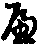
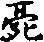
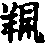
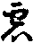

# 俱舍论疏



> **藏经**：卍新纂大日本续藏经（新纂卍续藏）　**册次** 第 53 册（X53）　**编号** X0836　**部类** 论疏部　**卷次** 7 卷　**篇幅** 186,976 字

> **作者（译者）**：大慈恩寺沙门　神泰　述

> **卷／品**：5 卷 · 12 品



---



## 目录



  - [卷第一分别界品第一之一](#卷第一分别界品第一之一)

  - [卷第二分别界品第一之二](#卷第二分别界品第一之二)

  - [卷第四分别根品第二之二](#卷第四分别根品第二之二)

  - [卷第五分别根品第二之三](#卷第五分别根品第二之三)

  - [卷第六分别根品第二之四](#卷第六分别根品第二之四)

  - [卷第七分别根品第二之五](#卷第七分别根品第二之五)

  - [卷第十七分别贤圣品第六之三](#卷第十七分别贤圣品第六之三)

  - [○分别界品第一之一](#分别界品第一之一)

- [俱舍论疏卷第一](#俱舍论疏卷第一)

  - [○分别界品第一之二](#分别界品第一之二)

- [俱舍论疏卷第二](#俱舍论疏卷第二)

  - [○分别根品第二之二](#分别根品第二之二)

- [阿毗达磨俱舍论疏卷第五](#阿毗达磨俱舍论疏卷第五)

  - [○分别根品第二之四](#分别根品第二之四)

  - [○分别根品第二之五](#分别根品第二之五)

- [俱舍论疏卷第十七](#俱舍论疏卷第十七)

- [俱舍论疏卷第二十五](#俱舍论疏卷第二十五)



---



俱舍论疏现存目次



------



### 卷第一分别界品第一之一



### 卷第二分别界品第一之二



### 卷第四分别根品第二之二



### 卷第五分别根品第二之三



### 卷第六分别根品第二之四



### 卷第七分别根品第二之五



### 卷第十七分别贤圣品第六之三



俱舍论疏现存目次(终)



No. 836  

俱舍论疏论本第一



大慈恩寺沙门　神泰　述



------



### ○分别界品第一之一



阿毗达磨俱舍论一部之通名。分别界品第一部内之别目。阿毗此云对，达磨此云法，俱舍此云藏。无流忍智向观为功，四谛涅槃轨持性尔，境果并举故称对法。言俱舍云藏者，此论一部具其二义：一能摄藏本藏胜义，二为本藏之所摄藏。具能所藏故称为藏，对法藏义如下文辨。言玄像表理蕴於辞，寄之宾主故称为论，剖折玄旨故云分别，性持类别故称界品。此论一部品有其九，此品建初故名第一。言尊者世亲造者，本音云婆薮槃豆，真谤师翻为天亲，此录文人谬也。今奘法师译婆薮此云世，槃豆此云亲，谓西方有天庙是婆薮天庙也。其婆薮天像多为世人亲近供养，西方人呼为世亲天。其世亲菩萨父母於世亲天处祈请，得於此子从所祈请处为名，故云婆薮槃豆。本音云提婆此云天，本音既不言提婆槃豆，何得翻为天亲也？良由婆薮槃豆总是天之别名，真谛三藏总云婆薮槃豆天，多为世人亲近供养，故录文者总言天亲也。此论一部始末九品，奘法师依西方传世亲菩萨判释云：佛说诸经有三法印，谓一切行无常、一切法无我、涅槃寂静。一切经法为此三理所印，即真佛法。就三印中，一切行无常唯局有为，涅槃寂静唯无为，少分诸法无我理通一切有为无为故。今世亲菩萨依诸法无我法印以造斯论。就九品中，前之八品明诸法，第九一品明无我。就前八品明诸法中，法虽无边，略就有漏无漏以明诸法。以无漏慧所简择法是四谛理，苦集是有漏，灭道是无漏，故约有漏无漏以明诸法。故下论云：何法名为彼所简择？因此传佛说对法耶？颂曰：有漏无漏法等。就前八品中，初界根二品总明漏无漏，后之六品别明漏无漏。就初二品中，初之界品明漏无漏性，以性义是界义故。第二根品明漏无漏用，以增上胜用是根义故。就后六品中，初世间业随眠品宗明苦集谛有漏之法，於中虽有无漏之法相从而来。随眠品末明断烦恼九遍知等，寄明灭谛无漏之法，以灭谛无相无别品明。圣者定品宗明道谛无漏之法，於中虽有有漏之法相从而来。就初三品中，初世间品明三界上下异熟差别，宗明苦谛设有业随眠相从而来。就业随眠中，业为正集所以先明，随眠缘集所以后说。第二差别相续别，又业为差别集所以先明，随眠相续集所以后说。又释初界根世品总明苦谛有漏果报，设明无漏及业随眠相后而来。於中界品明苦谛性，根品明苦谛用，世品明苦谛位。餘品判释与前无异，所简择法苦集灭道义次第也。此论一部傍正总有六百七颂，於中初有三颂辨造论缘起义当序分，次有六百颂正明所简择漏无漏法义当正宗，末后四颂谦退造论劝求脱服义当流通。於中前三后四非是正明漏无漏法故名傍颂，中有六百颂正明漏无漏法名正颂也。就初三行颂中复分为三：初之一颂论主归敬佛宝请求加力明造论缘，第二行颂出对法体释俱舍名，第三行颂说对法意。就初行颂中复有其三：初之两句先赞佛德，第三一句自申敬礼，第四一句许当说释归敬意。就初两句中复分为三：初言诸一切种冥灭，显佛世尊灭一切种不染无知智德圆满。第二诸冥灭者，显佛世尊四谛修道染污冥灭断德圆满，此智断二德自利德也。第三拔众生出生死泥者，显佛世尊恩德圆满利他德也。第三第四句如下文释。就论释中大文有二：初总述颂意，今欲我当造对法藏论故，此第四句意也。先显自释迦本师其体三德，二德尊高超诸二乘圣众，故先两句赞佛三二德满，第三句方申敬礼也。第二诸言所表以下别释颂本，於中有四：初释初句显自利德，文复有五：初释诸字，诸言所表谓佛世尊，此能永破染不染暗，故下言冥灭。如其别言释迦牟尼佛，一切种诸冥灭者，诸外道等咸起谤言：世亲菩萨朋党己师，故偏叹德。故今论主不述己师别名，但言诸有九十六内外诸师，能灭染不染污诸冥灭，我皆归敬，是故但言诸有一切种诸冥灭者，我皆归敬，显己无有朋属之心。然九十六种内外师中，以佛世尊灭二冥故，诸言虽通显无朋属，然能别表，谓佛世尊灭二冥也。二、言一切种诸冥灭者，牒颂六字。三、谓灭诸境冥者，迷四谛修道五门境，染污冥故，显佛断德。故正理论云：诸境界冥亦永灭故，断德圆满。此释颂中诸冥灭也。言一切品冥者，迷一切品类种别不染无知也。正理论云：一切种冥皆永灭故，智德圆满。此释一切种冥灭也。四、别释冥，以诸染不染无知，能覆理事实义，及障理事真见，故说为冥。五、别释灭，唯佛世尊得理事永，对治於一切四谛修道境，一切品类种别法冥，证择灭非择灭不生法，故称为灭。二乘虽灭诸冥，以五门染无知毕竟断故，非迷一切种不染无知断。所以者何？由於佛法所明，过去八万劫前，未来八万劫后极远时，及三千世界外极远处，及诸草木藂林等根茎枝叶，其体义类极微多少无边差别，不染无知犹未断故，不称灭也。上来虽有五文，合为第一释初句也。



自下第二释第二句，文中有四：初结前生后；二牒颂本；三由彼生死下，释生死泥；四众生於中下，释拔众生出。虽有四文，释第二句。自下第三释第三句，文中有五：初结前生后；二牒颂本；三释敬礼。稽者，至也，屈也。首者，头也。世亲论主屈己之首，相接尊足，故称敬礼。四释如是。诸有具前自他利德，故牒云如是。五释如理师。世尊称机授法，如实无倒，教授诫勗，名如理师。下重释如理师言，重显世尊前利他德，能方便善巧，说如理正教，从生死泥拔众生出，不由威力与愿神通也。轮王虽以轮宝威力降伏四方，令修十善，父母深恩，有愿於子，独觉现通，令𫏐生信，但可𫏐益，皆不能拔众生出生死泥也。虽有五文，合释第三句。



自下第四释第四句，文中有五：初结前问后；二举颂本答，释我当说；三释论字，教诫学徒舍有漏苦集、取无漏灭道，故称为论；四问：其论者何五？答：谓对法藏也。



上来一行，颂论主归敬佛宝，请求加力，明造论缘。自下第二行，颂辨对法名体，释俱舍名。於中，初有两句辨对法名体，后有两句释俱舍名。就初文中有三：初、问：何谓对法？二、举颂答。於中，初句四字及第二句辨对法体。初句中名对法，三字结对法名。三、释颂本。於中有七：初、释慧，谓择法。以推求名见，决断名智，简择诸法名慧，故以择法释慧也。二、释净，谓无漏，简有漏也。三、释随行，即前净慧相应、共有及无漏得，随净慧起，名曰随行。四、释名对法。如是净慧自性及随行，总说无漏五蕴，名为对法。此同杂心。若取自相，即觉法是阿毗昙，谓净慧也。若取众具，即五阴性，谓随行也。此二对法皆是无漏，故云此则胜义阿毗达磨。五、释第二句。若说有漏世俗阿毗达磨，即能得此诸慧及论也。慧谓能得此苦忍已去无漏净慧，即是煗、顶、忍等有漏修慧，以修慧通无漏故。以有漏别之，思慧是总、别念处，闻慧是五停，生得慧是七方便，前及随行是上四慧，相应、俱有及彼诸得是随行法。此从无漏慧向前数故，故云修、思、闻生得慧也。论谓传生无漏慧教者，阿毗达磨教也。摄论释云：择法因故，亦可通取十二部经。故婆沙云：受持、读诵十二部经，名生得慧。因生得慧，传生闻、思、修苦忍净慧，故言论谓传生无漏慧教。六、重结初句名对法。此诸四慧及随行并论，是彼无漏净慧资粮，故从所资果为名，亦得名阿毗达磨。自古诸师立五种毗昙：一、自性毗昙，谓无漏慧同此净慧；二、共有毗昙，同此随行；三、方便毗昙，同此诸慧；四、名字毗昙，同此传生无漏慧教。此论总束为二：前二名胜义，后二名世俗；五、境界毗昙，谓四谛境。此论无文量，由前四是对，故文具有；第五是法，故对中不论。七、释此对法名者。一切诸法皆能持自相，故名为法。於中若是善、是常、胜义法者，唯是涅槃。若法相之法通四圣谛，此无漏慧对胜义法，以因对果。此无漏慧能对向涅槃，断惑证灭，从用及果为名，故称对法。若对法相四谛之法，以慧对境，观四圣谛，或能对观，故称对法。真谛三藏云：对有三种：一、如其相起对。无流忍智见分上有十六谛影像相，如其谛本性相起。如眼识见分上有青等影像相，如其青等本性相起，故名如其相起对。二、趣向至得对。谓无碍道能趣向至得，得无为，名为趣向至得对。三、至得对。解脱道起时，同时有得，得无为，名为至得对。且如见谛十六心对八谛境，皆是如其相起对，比则对观，故名对法。若以八忍、八智对於灭谛，於中具对不同。如苦、集、道三法忍比，此忍以不缘灭故，非如其相起对；非解脱道故，非至得对；以是无碍道故，是趣向至得对。若苦集道三法智、三比智，以不缘灭故，非如其相起对；非无碍道故，非趣向至得对；以是解脱道故，是至得对。若灭法忍、灭比忍，以缘灭谛故得，是如其相起对；以是无碍道故得，是趣向至得对；非解脱道故，非至得对。若灭法智、灭比智，以缘灭谛故得，是如其相起对；以是解脱道故得，是至得对；以非无碍道故，非是趣向至得对。修道、无碍道中，以无碍摄方便，以解脱摄胜进。四法、四比智，约四道分别，具三对多少，类可知之。依毗婆沙，身作证、慧见灭有两种四句。初多刹那四句云：初句身作证非慧见灭，谓见苦集道时，断见苦集道所断使；修道，以苦集道智等智，断修道所断使。第二句慧见灭非身作证，谓见灭时，见苦集道所断使。第三句身作证亦慧见灭时，断见灭所断使；修道中，以灭智离欲。第四句除上尔所事。第二一刹那四句者，以灭法智得斯陀含果时，初句身作证非慧见灭，谓色无色界见道所断使。第二句慧见灭非身作证，谓欲界餘不断使。第三句身作证慧见灭，谓欲界先所断使及今所断使。第四句非身作证亦非慧见灭，谓色无色界修道所断使。古德释云：身中有得，得无为，名身作证；慧心缘灭理，名慧见灭。今改身作证无碍道，名趣向至得对；解脱道，名至得对；慧见灭，名如其相起对。於多刹那四句中，约无碍解脱有两种四句，约一刹那无碍解脱亦有两种四句，具三对多少，类以可知。旧传梵音云阿毗昙，真谛师以来传梵音云阿毗达磨。梵音具说，皆云达磨，汉听不了，总谓云昙也。然诸经论解释不同，有三十六释。依分别功德经，有其二释：一云阿毗昙者之大法也，二云阿毗昙者无比法也。依杂心论，亦有二释：一云诸论中胜，二趣向解脱，名阿毗昙。若依旧，婆沙有九，大论师约二十一复次释阿毗昙。依今新译，婆沙有十二，大论师二十四复次释阿毗达磨。故婆沙第一卷云：以何义故名阿毗达磨？阿毗达磨论师言：於诸法相能善决择，能极决择，故名阿毗达磨。复次於诸法性能善觉察，能善通达，故名阿毗达磨。复次能於诸法现观作证，故名阿毗达磨。复次法性甚深，能尽源底，故名阿毗达磨。复次诸圣慧眼由此诸净，故名阿毗达磨。复次能善显发幽隐法性，名阿毗达磨。所知法性无始幽隐，离此无有能发故。复次所说法性无有乖违，故名阿毗达磨。若有能於阿毗达磨，若有能於阿毗达磨，自相共相极善串习，必无有能如法问难，令於法性有少达故。复次能伏一切外道他论，故名阿毗达磨。阿毗达磨诸大论师，邪徒异学无能敌故。尊者世友作如是说：常能决择契经等中诸法性相，故名阿毗达磨。复次於十二支缘起法性能善觉了，故名阿毗达磨。复次以能现观四圣谛法，故名阿毗达磨。复次善说修习八圣道法，故名阿毗达磨。复次能证涅槃，故名阿毗达磨。复次能於诸法以无量门数数分别，故名阿毗达磨。大德说曰：於杂染清净系缚解脱流转还灭法，以名身句身文身次第结集安布分别，故名阿毗达磨。脇尊者言：此是究竟慧，此是决断慧，此是胜义慧，此是不谬慧，故名阿毗达磨。尊者妙音作如是说：求解脱者修正行时，能为分别所未了义，谓此是苦，此是苦因，此是灭，此是趣灭道，此是加行道，此是无间道，此是解脱道，此是胜进道，此是向道，此是得果。能正分别如是等义，故名阿毗达磨。法密部说：此法增上，故名阿毗达磨。化地部说：慧能照法，故名阿毗达磨。如契经说：一切照中，我说慧照最为上首。譬喻者说：於诸法中涅槃最上，此法次彼，故名阿毗达磨。声论者言：阿谓除弃，毗谓决择。此法能除弃决择，故名阿毗达磨。何所除弃？谓结、缚、随眠、随烦恼、缠。何所决择？谓蕴、界、处、缘起、谛、食及沙门果、菩提分等法。尊者佛护作如是说：阿毗者，是助言，显现前义。此法能引一切善法，谓诸觉分皆现在前，故名阿毗达磨。尊者觉天作如是说：阿毗者，是助言，显增上义。如增上慢者名阿毗慢，增上觉者名阿毗觉，增上老者名阿毗老者，此亦如是。此增上故，名阿毗达磨。尊者左受作如是说：阿毗，助言，显恭敬义。如恭敬稽首者名阿毗稽首，恭敬供养者名阿毗供养，此亦如是。此法尊重，可恭敬故，名阿毗达磨。解云：依俱舍论，有四种阿毗达磨：一、自性，谓净慧；二、共起，谓随行；三、方便，谓诸有漏慧；四、言教，谓诸论。毗婆沙中诸论师释，皆不起此四义释也。初师名阿毗达磨论诸师，旧论名阿毗昙者，即是萨婆多部古昔诸大师，谓造六足阿毗达磨师，及迦多衍尼子造八蕴阿毗达磨论身师等，有八复次释：一、以方便自性释诸法；二、以自性达诸法；三、以自性证诸法；四、以自性尽原底；五、以自性净慧眼；六、以言教显幽隐；法、以言教推问难；八、以言教制外道。二、尊者婆须密多罗，此云世友，有六复次释：一、以言教决契经；二、以方便觉缘起；三、以自性观四谛；四、以自性修八道；五、以自性证涅槃；六、以言教数分别。三、婆檀陀，此云大德，即是萨婆多部中达磨多罗，此云法救。萨婆多部敬重其人，故呼为大德。大德说曰：以言教名句文次第结集分别法。四、尊者波奢，此云脇。其人年过八十，方始出家。时人讥调：老冐出家，此何所益？彼既闻已，三年修道，脇不至床。第一年中，修得初果，颂得修罗多藏。第二年中，修得第二果，颂得毗奈耶藏。第三年中，修得第三第四果，颂得阿毗达磨藏。时人号为脇尊者。脇尊者说曰：此自性无漏慧，是究竟慧等。五、尊者瞿沙，此云妙音，作如是说：以言教阿毗达磨，分别所未了义等。六、昙摩堀部，或云昙模德部，此云法密部。法密部说：此自性无漏慧，是增上法。七、弥沙塞部，此云化地部。其人本国王，能化国地，后舍国出家修道，得罗汉果，善知三藏，化佛法地，故名化地罗汉。彼说自性慧，能照四谛法。八、譬喻者，说於诸法中，涅槃最上。此自性无漏慧，是涅槃其次法，同杂心论趣向解。九、学毗伽罗论者，名声论者言：本音云阿，此云除弃。本音云毗，此云决择。本音云达磨，此云法。谓此自性无漏慧法，离除弃决择，故名阿毗达磨。此依毗伽罗论释也。十、尊者佛护说：本音云阿毗，此云现前，非正目无漏慧，但是助言。本音云达磨，此云法。正目无漏慧，以阿毗言助达磨，故名阿毗达磨。此云现前法，谓此自性无漏慧法，能以一切善法皆现在前，故名阿毗达磨。十一、佛陀提婆，此云觉天。觉天说：阿毗者，是助言，显增上义。此无漏慧，是增上法，故名阿毗达磨。十二、此云左受。此罗汉便用左手受取衣食等，故名左受，或名左取。彼说阿毗亦是助言，非正目慧。阿毗，此云供敬。此无漏慧法尊重可供敬，故名阿毗达磨。若依世亲菩萨摄大乘释，论以四义释，谓：一、对，二、伏，三、数，四、解。若依无性菩萨摄大乘释，论以二义释：一、择法因故，二、世共了故。依今俱舍，复有二义释：一云对向，二云对观，故称阿毗达磨。弉法师云：阿毗达磨名含多义，义有傍正，皆无违也。如分别功德经，就义傍翻，名大法、无比法。杂心所云，诸论中胜同无性，摄论第二义世共了故。西方世俗呼阿毗达磨论，名为胜法，世人皆知，言世共了故。杂心第二义趣向解脱，同俱舍，或名对向。此正释也。毗婆沙中二十四复次释，约自性共有诸慧及论四种阿毗达磨释，如前分别。世亲菩萨摄大乘释云：对者，是法对向无住处涅槃故。同俱舍论，或名对向。二、伏，三、数，四、解。约教以释，同杂心论。诸论中胜同无性释，世共了故。无性菩萨唯约言教，以二义释。所云择法因故者，同俱舍云：论谓传生无漏教故，数与择法为因，从果为名，说教名阿毗达磨也。二云世共了故。依西方世俗释，阿毗达磨教名为胜法，世人皆知，故云世共了故。前云择法因故，学者方知，非世共了。俱舍二义唯约无流慧释，故但云对向，或云对观，不约言教释，故不云诸论中胜世共了故、择法因故，伏、数、解等诸义释也。



上来两句辨对法名体，自下两句释俱舍名。文中，初结前问。后已释对法，何故此论名对法藏？本音云俱舍，此翻名藏，故问此论名对法藏所由。次举颂答。颂中，初句举二摄义，第二句结立藏名。后释颂本，文中有三：初释颂摄彼胜义。将释此文，先列本藏及造论人。六足阿毗昙，五人所造：一、摄门足，舍利子造；二、法蕴足，大目犍连造；三、施设足，大迦旃延子造。此上三人，佛在世时造三论也。四、识身足，提婆设摩造。提婆设摩，此云天寂和须蜜多罗。独造二足：一、名品类足，旧云众事分；二、名界身足。此后二人，佛去世后大阿罗汉也。迦多衍尼子集前六足义，造八犍度阿毗达磨身，以前六论为枝、为分、为足。足与枝、分者，其义一也。此之七论是萨婆多本藏阿毗达磨论也。由彼七对法论中胜义入此俱舍论摄，故此论得俱舍名也。阿毗达磨是本藏七论所摄论也，俱舍是能摄论，此从所摄及用为名，故云阿毗达磨。俱舍论，此云对法藏论也。二、释颂依彼故。或俱舍论依彼本藏七论，从彼七论引生，是彼七论所藏，故亦名藏，此从能藏相对受名也。阿毗达磨是七论能藏，俱舍是所藏，故云对法藏也。三、释第二句结名。是故此论名对法藏。正理论云：此就依士及多财释。藏谓坚实，犹如树藏，对法论中诸坚实义皆入此摄，是彼藏故，名对法藏，即是对法之坚实义。藏或所依，犹如刀藏，谓彼对法是此所依，引彼义言，造此论故。此论以彼对法为藏，名对法藏，即是对法为所藏释。云此就依士及多财释等者，如言君之臣、主之民、提婆达多之物等类，皆依彼士夫，名依士释，或名依主释。言藏谓坚实者，如金银等诸坚实物置库藏中，故名为藏；如草木等非坚实物在外居停，不名为藏；犹如树心坚实在於树内，故名树藏。六足阿毗昙及迦延经，此七部论总名本藏对法论，对法论中诸坚实义皆入此末俱舍论摄，此末俱舍论是彼本论坚实义藏，故此末论名对法藏，即是本论对法之藏名对法藏，如提婆达多之物，故是依士释也。言藏或所依等者，此就多财释，如多财物皆能资人，财物是人所依，用七部对法为藏，故名对法藏，如外道用解脱名天，名解脱天也。若依前依士释，对法之藏名对法藏，藏是能依。此下依多财释，以彼七部对法为藏，名对法藏，故藏亦是所依，以藏能依所依不定，故言或也。犹如刀藏者，是刀鞘也，刀鞘名藏，是刀所依也。谓彼七部对法藏是此末论所依，引彼义言，造此末论，故此末论以彼对法为藏，名对法藏，引彼对法藏言义资造此论，如人以藏中多财物资身，名多财释，即是用对法藏为所依义也。



上来第二行，颂辨对法名体。自下第三行，颂辨对法胜用及法主名。文中有三：初、问生起；二、举颂答；三、长行释。问中有二：一、问所说择法有何胜用因缘，须说彼择法阿毗达磨；二、问此择法根本是谁，先说彼之择法。若有胜用，是胜人所说，此可论主，而今造论恭敬解释；若无此二义，不应造论恭敬解释。颂中有二：初有两句辨择法胜用，答初问；次有两句传佛先说对法，答第二问。长行释中，文亦有二：初、释初两句；二、诸惑能令下，释后两句。於中有六：初、明诸惑能令众生漂生死海，释第三句。由惑造业，由业得报，惑为根本，故三法相续，无有边际，如大海之无边，众生无始漂转生死海中。二、因此传佛下，释第四句。因此择法是能灭诸惑胜方便故。婆沙师去，传闻诸佛先说彼对法，欲令世间弟子得择法故，越生死海，得涅槃彼岸。三、反释。若离佛先说对法，弟子不能於诸法相如理简择，得择法故也。四、然佛世尊下，明佛先散说，后弟子总集。然佛世尊在世之时，随诸方邑，处处散说。阿毗达磨佛灭后三百许年，大德迦多衍尼子等诸大声闻，总结集安置为八乾度阿毗达磨等。言迦多衍尼子者，旧云迦毡延尼子者，音讹也。迦多，此云剪剃；衍，此云种。尼是女声，谓是上族婆罗门剪剃种家女之子也。其母族胜，故以名焉。婆罗门法，七岁已上，从父而学；十五已上，从师而学。受婆罗门小法，如佛法中受沙弥戒；学至二十，受婆罗门大法，如佛法中受大戒；三十已上，方始取妻，留其后嗣；年至五十已上，入山修婆罗门法。其上古时，有一婆罗门，一如其法，入山多时，须发皆长，无人剃剪。其婆罗门有其二子，入山看父，须发皆长，为父剪剃，顶留少发，以简道俗。山中多有众仙，因请二子剪剃。其大子不违所请，与众仙剪剃。诸仙愿云：愿汝种族於后世常尊贵。其第二子，众仙请剃，云：非我父不能剪剃。众仙瞋恨，遂为愿云：愿汝种族生生贫贱。二子种族至于今世，如仙所愿，贵贱不同。其迦多衍那，是其大子与众仙剃剪之贵种女，故从母立名，名剪剃种女之子也。五、举颂释。犹如大德达磨多罗，此云法救，所集诸经无常义，立为无常品等。邬陀喃颂本音云：邬陀喃，此云无问自说。经云：以在定故，能知世间生灭法相无常之理。散乱之人无定故，不自觉知，无人问佛，佛多自说。故是无问自说经。旧云优陀那经者，音讹也。六、毗婆沙师传说如此者，举执义人。论主不皆信诸阿毗达磨师所说，悉得佛意，故言毗婆沙师所传。若传之有谬，则失不在我。论主后破毗婆沙执，故先置此言也。



上来二行颂是序分，自下六百行颂是正宗。於中界品有四十四行，根品有七十四行，世品九十九行，业品一百三十一行，随眠品六十九行，贤圣品八十三行，智品六十一行，定品三十九行。就初界品四十四行颂中，初有二十五行，总明漏、无漏法蕴、界、处等；后一有见，谓已下有十九行，诸门分别十八界，故界品从此立名。就初二十五行颂中复二：初三行颂，总明漏、无漏法；后二十二行，别明漏、无漏蕴、界、处法。就初文，初问生起，次举颂答，后释颂本。初问意，前明择法是对法体，能净济慧，相隐难知，故问何法名为彼慧所简择，因此传闻佛先说对法也。杂心诸师以见杂心云：问：世尊说何法？答：有漏、无漏如是一切。即言杂心论以有漏、无漏法为宗者，不然。杂心云：若取自相，即觉法是阿毗昙。故知亦以慧为宗也。有漏、无漏慧是所简择，约所简择辨能简择，与俱舍文同也。成实论师云：成实论以四谛为宗者，不然。四谛亦是所简择法，但是诸论皆以慧为宗也。故婆沙云：分别慧一，云名阿毗昙。就三行颂中，初句总举有漏、无漏，次有三句别明有漏，后有八句引明无漏。就八句中，初一句别明有为无漏，后七句别明无为无漏。於七句中，初句举无为数，第二句列无为名，后五句辨无为相。就释颂中，文有其九：初、释初句；二、有漏法云何下，释餘三句。於中有五：初、问有漏法云何；二、举颂第二句答；三、所以者何下，以第三句释有漏义所以。除道餘有为是有漏者，何以诸惑漏於餘有为中等皆随增故？故杂心云：若增诸烦恼，是圣说有漏。四、缘灭道谛下，释第二句中除道所以。五、不随增义下，指同后说。虽有五文，合为第二别释有漏。



自下第三别释无漏，於中有九：初结前问，后二举颂第五第六句答，三何等为三下释颂第七句，四此虗空等下总结无漏，五於略所说下释第八句虗空无为，六择灭已下释第九句择灭无为。即以离系为性，诸有漏法远离能系缚时，随所系法量证得解脱无为，名为择灭。下释其名，择谓简择，即慧差别忍智之功能也。推求名见，决断名智，简择名慧故也。慧能各别简择四圣谛境，苦谛可知、集谛可断、灭谛可证、道谛可证、道谛可修，慧简择力所得灭法名为择灭。譬如牛所驾车名曰牛车，法中略去力所得三言，喻中略去所驾两言，故作是说。七一切有漏法下释第十句，於中有七：初问一切有漏法同一择灭耶？二答不尔，三徵云何，四举颂释随系事别。谓随所系一一极微等所系事量无为，离系事亦尔，一一极微色等，一一想受心心法等，一一生住异灭不相应等，各别得无为也。五若不尔者，下萨婆多反难正量部：若不随所系事量离系事亦尔者，於证见苦所断烦恼灭时，应证一切餘四门所断诸烦恼灭，以择灭是一故。若如是者，修餘四门对治则为无用。六正量部问：离系事别者，灭有多体应有同类，依何义故灭无同类？七萨婆多答：依灭多体相望，自无同类因义，亦不与他作同类因。故经作是说：非无多体同类灭也。正理论第七十二云：断等三界，即分前说无为解脱以为自体。然三界体约假有异，若就实事则无差别。云何名为约假有异？谓离贪结名为离界，断餘八结名为断界，灭餘一切贪等诸结所系事体名为灭界。何缘三界如是差别？谓有漏法总略有三：一者能系而非能染、二者能系亦是能染、三者非二顺系染法。断此三法所证无为，如次名为断等三界。有餘师说：唯断能系别有无为，断餘不尔。彼说：能系有缘八结、有缘餘事。断此三种所证无为，如次名为断等三界。有餘师说：唯断能染别有无为，断餘不尔。彼师说：受有缘八结、有缘爱结、有缘餘事。断此三种所证无为，如次名为断等三界，随所系事别得择灭。故三说中初说为善。释云：断等三界，即分前说无为解脱以为自体，随所系事别得解脱无为。如人被缚离缚之时，但约所缚人说得解脱，不约能缚断说能缚解脱。然三界体约假有异，若就实事一一无无上假，说三界体即无差别。云何名为约假有异？谓如一一极微等上离贪系义边名为离界，断餘八结义边名为断界，灭餘一切贪等诸九结所系体事义边名为灭界。有餘第二师说：唯断能系使缠垢等别有无为，断餘不尔。彼说：使缠垢等有缘八结、有缘爱结、有缘九结，餘所系事。断此三种所证无为，如次名为断等三界。有餘第三师说：唯断能染爱结别有无为，断餘不尔。彼师说：爱有缘八结、有缘爱结、有缘餘事。断此三种所证无为，如次名为断等三界。后之二师皆随能系事别，别得无为，三界体别。今评家评取初师随所系事别，别得择灭，一一灭上假说三界有异，三界实事则无差别，故三说中初说为善。然苦集遍使同一系缚，断苦下十使时，虽为集下遍使所缚未断，而说苦下使等得离系者，以自种系近，离自种能系时，所系得解脱。如人离自身上近枷鏁时，说人得解脱。他种使远，虽复未离，而说解脱。如人狱中，虽复未离狱门远鏁，而狱中人已离身上近枷鏁故，名已解脱也。修道门中九品相缚亦尔，断初品时，自品近系，离说得脱。八品远系，虽复未断，而初品染污，说已解脱，得无为也。其餘八品例释可知。唯染污色及餘不染污五蕴，断九品能系尽时，所系之事方说解脱。婆沙三十一云：评曰：应作是说：随有漏法有尔所体，择灭亦尔。随所系事体有尔所离系，亦有尔所体故。问：已知择灭随所系事有尔所量，诸有情类证择灭时，为共证一？为各别证？设尔何失？二俱有过。若共证一，云何涅槃名不共法？又若尔者，若一有情得涅槃时，一切有情亦应皆得。若尔，则应不由功用自然解脱。若各别证，云何涅槃名不同类？又契经说当云何通？如说：如来解脱与餘阿罗汉等解脱无异。答：应作是说：诸有情类证择灭时皆共证一。问：若尔，云何涅槃名不共法？答：涅槃体虽实是共，而约得说名不共，以离系得一一有情自相续中各别起故。问：若一有情得涅槃时，诸餘有情何故不得？答：若身中有涅槃得者名得涅槃，无则不尔，故无一时一切有情得涅槃失。有餘师说：诸有情类证择灭时各各别证。问：若尔，云何涅槃名不同类？答：遮同类因故作是说。谓诸择灭无同类因名不同类，非诸有情无别择灭展辨相似。问：苦法智忍无同类因，亦应名为不同类法，何故有为皆名同类，但说涅槃名不同类？答：苦法智忍虽无同类因，而能与他作同类因故亦名同类，涅槃不尔。复次诸有为法同蕴界处三门所摄、同随三世、同有生灭、同下中上、同有先后、同从因生、同能生果，故名同类。涅槃不尔，名不同类。复次一切法中唯有涅槃是善是常，餘不尔故名不同类。谓所餘法有善非常、有常非善、有二俱非，涅槃独具善常二义，是故独名不同类法。问：契经所说复云何通？如说：如来解脱与餘阿罗汉等解脱无异。答：三乘身中解脱虽异而善常同，故说无异。复次此显示一相续中有三乘道同证解脱，谓望他身所证解脱各有异，而一身中有三乘性同证解脱，随依何乘引起圣道，望能证得此涅槃故。评曰：彼不应作是说。应作是说：诸有情类普於一一有漏法中皆共证得一择灭体，前说择灭随所系事多少量故。由此前说於理为善。问：於外物中为亦证得择灭体不？设尔，何失？若尔，证得择灭体者，既於外法无成就义，云何成就彼择灭耶？又契经说当云何通？如说：尊者舍利子言：我断诸爱得内解脱。若外物中不得择灭，契经所说复云何通？如说：一切行断故名断界，一切行离故名离界，一切行灭故名灭界。答：应作是说：於外物中亦得择灭。问：若尔，既於外物无成就义，云何於彼得择灭耶？答：虽於外物无成就者，而亦於彼有得择灭。如不成就过去未来命等八根，即有於彼证得择灭。外物亦尔，何所相违？问：契经所说复云何通？如说：尊者舍利子言：我断诸爱得内解脱。答：说於内蕴得解脱故，当知於外亦得解脱。复次外物解脱依内得故亦名为内，谓内身中修道方得。复次外物解脱得是内故亦名为内，谓得彼得是内蕴摄。复次断内烦恼而得彼灭故亦名内，谓外物中所有择灭断内能系烦恼方得，是故经言得内解脱。有餘师说：外物中无择灭可得，唯断能系诸烦恼缚得择灭故。问：若尔，契经说当云何通？如说：一切行断故名断界，乃至广说。答：彼经应说：诸行断故名为断界，乃至广说。不应言一切。而说一切者，当知彼说少分一切。谓一切有二种：一、少分一切；二、全分一切。彼经但说少分一切。有作是说：诸外物中虽有择灭而不可得。评曰：彼不应作是说：宁说为无？不应说有而不可得。既不可得，何须如是无用灭为？应作是说：亦有亦得。所以者何？诸有漏法无始时来烦恼所系不得解脱，若断烦恼彼离系故便得解脱。如人被缚，后解脱时人名解脱，非谓绳等。既於所系证得解脱，故外物中亦得解脱。若不尔者，与品类足所说相违。如说：云何得作证法？答：一切善法若外物中虽有择灭而不可得，应有善法非得作证。便违彼说，故外亦有择灭可得。婆沙三十二云：问：择灭与非择灭何者为多？有作是说：择灭多、非择灭少。所以者何？择灭通於三世法得，非择灭唯於未来不生法得故。有餘师说：非择灭通於有漏无漏法得，择灭唯於有漏法得。如是说者，应作是说：非择灭多、择灭少。所以者何？非择灭如有为法数量，择灭但如有漏法数量故。若不尔者，诸可生法若得不生，应不得非择灭。二灭自性多少虽尔，而依得者应作四句，有法於彼得择灭、不得非择灭等。问：诸有情类於非择灭，为皆共得、不共得耶？答：此不决定，於共有法非择灭则共得，於不共法非择灭则各别得。诸异生类各住一趣，於餘趣法刹那刹那得非择灭，以色等境念念灭时，缘彼眼识等毕竟不生故。如住一趣，一界、一地、一处亦尔。问：由何善法，诸修行者於诸恶趣得非择灭？答：或由布施、或由持戒、或由闻慧、或由思慧、或由修慧，诸修行者於诸恶趣得非择灭。问：三恶趣非择灭，为一时得、为别得耶？有作是说：必一时得。问：若尔，天授如何已得二恶趣非择灭非地狱耶？答：彼於地狱唯除一生，餘一切生与二恶趣皆顿得非择灭。问：既除一生，岂非别得？有餘师说：施戒闻等若於恶趣得非择灭，或别或总，顺决择分得必总得。问：天授岂不得顺决择分耶？如是说者，忍位总得，前位不定。已说恶趣得非择灭，当说善趣得非择灭。增上忍时，唯除欲界人天七生，色界一一处各一生，於餘一切生皆得非择灭。预流者，趣一来果时。不起定者，加行道时於欲六生得非择灭。若起定者，要至第六无间道时於欲六生得非择灭。一来者，趣不还果时。不起定者，加行道时於欲一生得非择灭。若起定者，要至第九无间道时於欲一生得非择灭，尔时得欲界一切生择灭。不退法者，离初静虑染时。不起定者，加行道时，於初静虑一生得非择灭。若起定者，要至第九无间道时，於初静虑二生得非择灭，尔时於初静虑一切生皆得择灭。若退法者，离初静虑染时，若起定、若不起定，俱至第九无间道时，得初静虑一切生择灭，不得非择灭可退生故。乃至离无所有处染，应知亦尔。不退法者，离非想非非想处染时。不起定者，加行道时，於非想非非想处一生得非择灭。若起定者，要至第九无间道时，於非想非非想处一生得非择灭，尔时於一切生皆得择灭。若退法者，离非想非非想处染时。不起定者，加行道时，於八地生得非择灭。若起定者，要至第九无间道时，於八地生得非择灭，尔时於一切生皆得择灭。已说生处得非择灭，当说烦恼得非择灭。增上忍时，於三界见所断烦恼得非择灭，至见道中随无间道得彼择灭至於修道。不退法者，离欲染时。不起定者，加行道时，於欲界修所断烦恼得非择灭。若起定者，随至彼彼无间道时得非择灭，尔时得彼烦恼择灭。若退法者，离欲染时，若起定、若不起定，随至彼彼无间道时，得彼烦恼择灭，不得彼非择灭。乃至离非想非非想处染，随所应当说。问：诸退法者，何时於修所断烦恼得非择灭？有作是说：信胜解练根得见至时，时解脱练根得不动时，於修所断已断烦恼得非择灭。评曰：应作是说：若得决定不复退起彼烦恼时，於彼烦恼得非择灭。已说烦恼得非择灭，当说圣道得非择灭。随信行者，於随法行道得非择灭。随法行者，於随信行、信胜解、时解脱道得非择灭。信胜解者，若决定依信胜解道得无学果，於见至道得非择灭。见至者，於信胜解、时解脱道得非择灭。时解脱者，若决定依时解脱道得非择灭。究竟者，於不时解脱道得非择灭。不时解脱者，於时解脱道得非择灭。声闻种姓，於声闻道得决定时，於佛、独觉道得非择灭。独觉种姓，於独觉道得决定时，於佛、声闻道得非择灭。佛种姓，於佛道得决定时，独觉、声闻道得非择灭。阿罗汉果有六种姓：退法种姓，若依退道至究竟者，於上五道得非择灭。思法种姓，若依思道至究竟者，於上四道及下一道得非择灭。乃至堪达种姓，若依堪达至究竟者，於上一道、於下四道得非择灭。不动种姓，於下五道得非择灭。问：若胜进时得非择灭，此灭何故非道果耶？答：不为此灭而修道故。谓为涅槃及为离染勤修於道，以修道故，於恶趣等得非择灭。若为此灭而修道者，於恶趣等不得此灭，非於生死不深厌患，可於恶趣得非择灭，故非择灭不名道果。



上来虽有七文，合为第七释第十句。自下第八释第十一十二句，於中有三：初结前已说择灭；二举颂本，永碍当来生法别得非择灭；三释颂本，谓非择灭能永碍未来生法。得、灭异前，名非择灭。以得不因慧简择，但由阙缘。下指其事，如眼论助与意专取一色之时，餘所不取。五尘谢往过去，应缘彼过去五境。五识身等住未来世，毕竟不生，由缘定故，不应餘境起。又由彼五识不能缘过去境，以所缘境不具故，於五识等上得非择灭。第九於有为法上得二灭，应作四句：或於诸法唯得择灭，谓诸有漏、过、现世、全未来应生法。或於诸法唯非择灭，谓未来不生法、无漏、有为。或於诸法俱得二灭，谓未来不生诸有漏法。以不生故，得非择灭；以有漏故，得择灭也。或於诸法不得二灭，谓诸无漏、过、现世、全未来生法。以无漏故，不得择灭；非未来不生故，不得非择灭。



上来三行颂总明漏、无漏法，自下二十二行颂别明蕴、界、处漏、无漏法。於中，初两行颂总明五蕴；第二、色者，唯五根下，别明五蕴。就前两行颂中，初一行颂总明漏、无漏蕴，第二行颂别明有漏蕴。就前文中，初结前问，后次举颂答。於中，初两句总出有为体，下两句列有为众名：一、世路，二、言依，三、有离，四、有事。后释颂本。於中，文别有八：初、释第二句；二、如是五法下，释第一句。众缘聚集共所作故，众缘所为，故名有为。无有少法一缘所生，故众缘作也。未来世法虽未众缘所生，是彼过、现类，故未来世无妨。如犊饮乳，如薪火烧，名乳名薪，未食未烧之时亦名乳薪，是食是烧乳薪类也。三、释世路。此有为法亦名世路，过去已行，现在正行，未来当行。此有为法，三世路中行之体性也。正理论云：色等五蕴生灭法故，未来、现在、过去路中而流转故，诸不生法众缘阙故。虽复不生，是彼类故，立世路名，亦无失也。或为无常所吞食故。无常是世法，色等五蕴是无常世法所吞食路，故名世路。真谛师云：万里之路，行行不已，终则尽极。五蕴亦尔，为无常所吞食，终则尽灭。四、释言依。此有为法，或名言依，言谓语言。此言所依者，即名与言俱起义，以与言便起法是言依故。如是言依，具摄一切十八界有为法。若不尔者，应违品类足论所说。彼论说：言依十八界摄。正理论云：或名言依，言谓言音，或谓能说。此即语声相续差别。依得名俱义，即具摄五蕴。如经说：言依有三、无四、无五。由此善通品类足论。彼说：言依五蕴所摄。岂不亦依无为起说？何故彼义不立言依？彼义与名无俱理故。如说：言依谓名俱义。若义与名可俱说者，立为言依。以无为义与有为名不可俱说，无俱义故，不立言依。五、释有离。离谓永离。一切有为法有彼离故，名有离也。六、释有事。以有因故，事是因义，如下五事中释。七、述执义人。毗婆沙师传说如此。八、总结。如是等类是有为众，名



自下第二行颂明有漏蕴众名，文中初牒前生起，次举颂本：一名取蕴，二有诤，三苦，四集，五世间，六见处，七三有。后释颂本，於中有八：初释名取蕴，文中初问：此有漏名於何所立？次答：谓立取蕴，於取蕴上立其取蕴，以蕴通漏无漏故。有漏取蕴亦得名蕴，或有唯蕴而非取蕴，谓无漏行也。后释取名，烦恼名取，润业受生，取自身故。蕴从取生，从因为名，故名取蕴。如草糠火，火非糠草，从草糠生，从因为名，名草糠火，同杂心论从漏生故。或蕴属取，从所属为名，故名取蕴。如帝王臣属帝王，名帝王臣，同杂心论漏处故。蕴为惑所使，如因瞋欲等有杀等事，即是蕴随於取，如王臣随王所使。或蕴生取，从果为名，故名取蕴。如华果树，树非华果，从果为名，名华果树，同杂心论生漏故。二释亦说为有诤，可解。三释及苦，违苦忍智圣心故。涅槃颂句：无为无漏，圣人常求，故顺圣心；有为有漏是苦，故违圣心。四释集，能招后苦故。五释世间：一念念生灭性，自可毁坏故；二是有漏，有对治道坏故。具斯二义，故名世间。道谛唯一坏，无为无二坏，故是出世间。六、释见处。正理论云：或名见处，萨迦耶见等五见，住其论中，随增眠故。岂不有漏一切烦恼皆随增耶？答：虽有此理，而彼诸见，於有漏法，一切种时，相无差别，坚执无动，随增眠故。贪等疑、痴，则不如是。以彼贪等，有一切种，无一切时；痴一切时，非无差别；疑无差别，而无坚执。是故有漏，不说见处。释云：五见具四义：一、缘一切五种；二、一切时任运而起；三、唯有任运起相，更无差别；四、坚执无动。具此四义，随增眠故。诸有漏法，但名见处。贪等疑，则不如是。以彼贪等，等取瞋、慢、十缠、六垢，缘五种故，有一切种义，无一切时任运起义。故杂心论云：贪、恚、慢，不能不见、不闻、不思惟起，由方便故。炽然痴，虽有一切时任运者，非无差别。以不共无明，及五见俱相应无明，於一切时任运而起。若与贪、瞋、慢、十缠、六垢相应无明，则不一切时任运而起。有此差别，故非无差别也。疑虽一切时任运而起，无有差别，犹豫不定，而不坚执。是故有漏，不说名彼贪等处也。七、释三有。惑、业是有因，异熟等四无记是有依，皆三有摄也。八、总结。如是等，是有漏别名。



上来两行颂总明五蕴。自下二十行颂别明五蕴及处、界。於中，初五行半颂别明色蕴及处、界摄；二、受领纳随触下一行半，颂别明三蕴、处、界相摄；三、识谓名了别下两行，颂别明识蕴、处、界、处相摄；四、总摄一切法下一行，颂以一蕴、处、界总摄一切法；五、类境识同故下一行，颂释眼、耳、鼻处二界；一、六聚生门种族下一行，颂释处、蕴、界义，说三科所由；七、净根生死因下一行，颂释别立受、想蕴；八、有半行，颂释蕴不说无为；九、随麤染器等下一行半，颂释蕴、处、界次第；十、为差别最胜下一行，颂释处名通、别；十一、牟尼说法蕴下四行，颂摄异名蕴、处、界。就初五行半别明色蕴及处、界中有五：初半行颂总列十一种色；二半行颂辨五根色；三、色二或二十下一行，颂辨五境色；四、乱心、无心等下三行，颂辨无表色；五、此中根与境下半行，颂以色蕴与处、界相摄。初半行颂总列十一种色，如文可解。次半行颂明五根色。文中，初颂结前生起，次举颂本，后释颂本。於中有二复次：释初复次，云彼谓次前文所说色等五境识，即能缘五境识。彼五境能缘识所依五种净色，如其次第，应知即是眼等五根。下引经证。五根是净色，如文可解。第二复次释。或复彼者，谓次前文所说眼等五根识，即能依眼等五识。彼五根能依五识所依五种净色，名眼等五根，是眼等五识所依止义。如是后复次释，便顺品类足论。如彼论说：云何眼根？谓眼识所依净色为性。故知彼者，是眼等所依。眼识者，五根能依识。彼五根能依识所依净色，为五根性也。次一行颂辨五境文中，初结前生后，次举颂本，后释颂本。於中有六：初释色境文中，初牒颂色，二释，一显，二形。显色有四，谓青、黄、赤、白为本，餘烟、云、尘、雾、影、光、明、暗八显色，是此四显色差别也。后之八色，或青、或黄、或赤、或白，故后八色前四色收。离前四色为后八色，故后八色是前四色差别色也。若后八色所不摄四色，是前四色摄也。如十二部经，皆通名修多罗。故经云：修多罗者，始从如是我闻，终至欢喜奉行。故后十一部修多罗部之差别义。若十一部所不摄者，唯是初修多罗部摄。此中四八相对亦尔。形色有八，谓长为初，不正为后。



上来释颂色。二、自下释颂或二十。於中有五：初、举数；二、谓青黄下，列二十名。正理论云：有说色有二十一种：空一显色，第二十一。此即空界色之差别，与此文问。有餘师说：虗空中有一显色，名空界色。婆沙云：昼为明色所覆，夜为暗色所覆。非前二十色所摄，故为第二十一。依下文，空界色是前光、暗色摄，故但二十也。三、此中正者已下，辨二十色相。此中正者，谓形平等。成业论云：见面齐平，起於正觉；见面参差，起不正觉。释云：谓诸色面上平等名正，面上参差不平等名邪。地水气腾，说之为雾，可解。日炎名光，月等炎名明。真谛师云：光具二义：一、远照灼，二、带热触。日炎具二，故得光名：一、月，二、星，三、火，四、药，五、宝珠，六、电炎等。皆不具二，名明。谓月、星虽能远照，而不带热触；火虽带热触，而不远照；四、天下药等，二义皆阙。如云障日成阴，餘色於中由显现可见，说名为影；须弥障日成阴，餘色於中隐昧不复可见，说名为暗。餘色易了，故论不释。问：长与高何别？短与下何殊？答：成业论云：见一面多，便起长觉；见一面少，便起短觉；见四面等，便起圆觉；见中凸出，便起高觉；见中拗凹，便起下觉。释云：长短据色四面，外相高下据色处中，中凸名高，中凹名下。婆沙云：火气名烟，龙气名云，地气名雾，风吹细土名尘。四、或有色处界下，以显对形四句分别。或有色处有显无形，谓青、黄、赤、白、影、光、明、暗。真谛师云：如天中琉璃地纯青色，真金地纯黄色，如此等天中四宝色地，犹如火明日光等，但有显色，无长短等形。或有色处有形无显，谓长等一分身表业性。释云：长短等形中随有一分身表业，非餘物中任运长短。问：此业形色亦无离青黄等显色，而言有形无显，其餘长短等亦不离青黄等，何故有形必有显耶？答：餘非业色，长短等任运恒有，与青黄等必俱生，故有显有形。有表业形由心发起身业之性，显非业性不必俱生，岂得为例？或有色处有形有显所餘色。释云：餘非业色，形必与显俱生，故具形显也。婆沙云：有色无形者，谓青、黄、赤、白、光、影、明、暗。有形无色者，谓身有作色。有色有形者，谓长、短、方、圆、好、不好、高、下、烟、云、尘、雾等十二种是也。准真谛师解，非业等长短等与青黄俱是有形有显，即应有形有显有十六种。今既俱说十二种，故知一切青黄赤白皆是有色无形所摄。今更释三句：前八种色相别显著，故名有显；无麤形质不能鄣光成影，故是无形。如长短等鄣光，则有长短影；如青黄等鄣光，影无青黄等也。身有作色有形质，是方圆等色鄣光，则有方圆等影，故是有形。与报色俱不可分相别，名无显也。餘十二种非业之色相显可知，名有显；有麤形质十二种鄣光，发十二种影，故是有形。方圆等八种，若是业色，迄三性第二句摄；若非业色，唯无记第三句收。前八种一向是初句，烟云尘雾唯是第三句。五、叙餘师说唯光明色有显无形，文中有四：初、餘师立唯光明色有显无形，以光明二色中长短等形不可见故，现见世间青黄赤白影暗色处有长等故。二、论主责如何一质事具有显形。三、餘师释由於此一质中俱可知故，此中有者是有两智义，非有两境别质义。四、论主破若尔，身表中亦应有显形两智别起义，非有两境别质义。正理论云：於显色中青黄赤白影光明暗唯显可知，於形色中身表业性唯形可了，餘色形显俱可了知。如何一事有二体者，非宗所许，故无此过。辨业品中当更思择。上来辨色境



自下第二辨声境，文中有四：初举数声唯八种，二谓有执受下列名，三执受大种为因下辨相。执受大种为因声，谓言手等所发音声。正理论云：执受大种，谓现在世有情数摄长养、等流、异熟地等。与此相违，名无执受。此中执受大种为因声有二种，谓有情类加行所生及餘不待加行所起。其有情类加行所生复有二种：一者手等加行所生，二者诸表业为自性。此语表业复有二种，谓依名起及不待名。依名起者复有二种：一者有记，二者无记。不待名者二种亦然，是有执受大种为因声相差别。其无执受大种为因声亦二种：一者有情加行所起，二者诸界扰动所生。初谓螺贝钟皷等声，后谓风林河等所发。有情数者，语手等声，餘声即是非有情数。如是诸声闻生悦者，名可意声。与此相违，名不可意。八中唯有初二应理，以有情数、非有情数即有执受及无执受大种为因声所摄故。於色等中亦应可说可意等异，何独在声？色等亦应说有执受及无执受大种为因，理实应说。然由声处自性难知，故但就因说有二种。色等不尔，是故不说。释：无执受中，此论但举诸界扰动所生，故言风林河等所发音声，略不举有情加行所起螺贝钟皷等声。言有情名声谓语表业，以语表业必与有情名味句合故也。餘手等声则是非有情名声，不同正理论有情数声即有执受，非有情数声即无执受大种为因。四、叙。有餘师说：声通有执受及无执受大种为因，如手皷等合所生声。下论主破：如不许一显色极微，二四大造声亦应尔。正理论云：岂不有声用有执受及无执受大种为因而得生起，如手皷等合所生声？无如是声，二具四大各别果故。二四大同得一果，为俱有因，成过失故。虽有执受与无执受二四大种共相扣击，而俱为因各别发声，彼声各据自所依故不成三体。虽有执受与无执受手皷大种相击为因发生二声，而相映夺随取一种，其差别相不易可知，是故声处唯有二种。



上来释声处，自下第三释味处。文中有三：初结前生后，二举数，三列名。正理论云：越次说者，显彼境识生无定故。



自下第四释香处，文中有三：初结前生后，二举数香有四种，三列名。正理论云：等不等者，增益损成依身别故。有说：微弱、增盛异故。本论中说：香有三种：好香、恶香及平等香。若能长养诸根大种名为好香，与此相违名为恶香，无前二用名平等香。或诸福业增上所生名为好香，若诸罪业增上所生名为恶香，唯四大种势力所生名平等香。此虽增上果而亦有差别，故唯大种势力所生亦是有情增上果摄。释云：微弱者多名等，增盛者少名不等。如世人无智者多与众人相似名等，有智少越於众人名不等。已说香处，当说触处，文中有四：初结前生后，二举数有十一，三列名，四辨相。此十一中四大种后文当说，滑涩轻重如文可解。谓冷触所逼必欲得暖，故约暖欲以释冷触。食欲名饥，饮欲名渴，此皆於因立果名故。作如是说者，如人不食，胀𦝩空虗，火大动发生触，触身起食欲，名食欲为饥。如人不饮，肺𦝩虗燥，火大动发生触，触身起饮欲，名饮欲为渴。欲是心数，不关触触为饥渴因，以於因立果名，故呼触名饥渴。如有颂言下，引於因立果名颂证。诸佛出世，体非是乐，以能生乐，故於因立果名，呼佛出世名乐。餘亦如是。正理论云：食欲名饥，饮欲名渴。岂不欲是心所法故，违触相耶？以於因中立果名故，无相违失。餘所未说。问：力劣等摄在此中，故不别说。闷不离滑，力即涩重，劣在软煗，轻性中摄。四、於色界中下，约界分别。於色界中无饥渴两触，段食性故，有所餘九触。彼界衣服，别无铢两，则不可称；积聚众多，有铢两故，则可称也。



上来别释五处，自下第六明五识取境总别。文中有四：初结前，此中已说多种色处。二明眼识取境总别。有时眼识缘一事生，谓於尔时各别了别。有时眼识缘多事生，谓於尔时不别了别，如远观察军众山林等三类应知。耳鼻舌等诸识亦尔。婆沙第十卷云：问：为缘一色能生眼识、为缘多色能生眼识？若缘一色能生眼识者，此云何通？如说：眼识能缘五色。若缘多色能生眼识者，云何不有二觉意？有二觉意即有多体。答：缘一种色能生眼识。问：若然者，能缘五色云何通？尊者和须密答曰：於缘据疾，故佛说俱缘，如旋火轮而实不匝。佛陀提婆说曰：於色不决了，故言俱缘，如观藂林。复有说者，如五色能生色，见一色时名见五色。复次若诸色集聚，则见多色生一识。若诸色别异，则见一色生一识。香入有四种。问：为缘一香能生鼻识、为缘多香能生鼻识？若缘一香生鼻识者，如今一时能嗅百种和香。若缘多香生鼻识者，云何不有二心？答：应作是说：缘一香能生鼻识。问：若然者，不能一时嗅百种香耶？答：或有说者，百种香能生一种香生於鼻识。如是说者好。如多香聚集，则嗅多香生於一识；若香别异，则嗅一香能生一识。释缘色有四师：初、和须密唯别缘；第二、佛陀提婆不了总缘、了了别缘；第三、师五色缘生异一色。如成实论云：青黄色合，缘生缘色。是成实论义，非萨婆多宗。准下缘香中，第四师是评家义。众色聚集，则见多色生於一识；若诸色别异，则见一色生一识。若总若别，俱通了不了，是评家正义。初师唯别，第二师不了总见、了了别见，第三师缘生异色，见一言见多，并非正义。今此文中同毗婆沙第四、评家正义。四、明身识缘境极多，以有大造不同故，与前四境异。有两师说：初师说身识极多，缘五触起；第二师说总缘一切十一触起。论主难：若尔，五识总缘境故，应取共相境、非自相境，何故经中说五识唯取自相、非共相取？下第二师救：约十二处自相故，经中许五识身取自相境，非约十一触事取自相境，斯有何失？婆沙云：问：为缘一触能生身识？为缘多触能生身识？答：十一种触能生十一种身识。复有说者，五触能生。问：若然者，云何不名总缘境界？答：同一触入故，不名总缘境界。评曰：不应作如是说，如前说者好。杂心云：问：几触能起身识？答：有说从涩至渴，有说五触能起四大与涩，如是乃至饥渴。复有说者，十一种起身识等是身识境界，故无过。空法师云：杂心、俱舍唯有异说，亦可杂心前略举者，应是正义。今解诸论所以不同者，婆沙为乘前问云：为缘一触能生身识？为缘多触能生身识？以先问为缘一触能生身识故，即答云十一触生十一种身识，即是缘一触生一识也。次有师云：如味中若味别异，即尝一味生一识。今触中四大造色既不别异，一所造触必有四大，故极少五触方能生识。计不合理，故评非之，如前说好。如评家意，触尚能生十一，今生不待言也。俱舍论意，乘前文云：有时由多物眼识得生，若是时中无所分别，应知耳等识亦尔。以前四识明总缘故，即类身云：身识若极多，由五触能生。此总极多，计不合理。复有师说：具足十一能生身识。下会通总别，合正理故。后总结云：斯有何失？俱舍据极多总缘，故言十一能生身识；若据极少别缘，亦十一种触生十一身识。故俱舍下云：身尘不定，或身缘四大，或缘所造，或复俱缘。能造、所造既得别缘，故知十一亦得别缘，不同前师能造、所造不别缘故，必缘五也。杂心乘前问云：几触能起身识？初师答云：七所造触得别异故，从涩至渴，一一能起；四大不别异，故不说。第二师云：所造七触自得别异，能造、所造必不别异，故五触能起。乘五触后第三师云：若据诸触聚集，即有十一种能能起身识，何但五也？皆乘前文意异说不同。据其道理，若多触聚集，即十一触生一识；若据别异，即缘一触生一身识，与前四尘说不异也。五、明身舌二识取境先后文中，初问：今应思择，身、舌二根两境俱至，识既不并，何识先起？下答：随境强盛，彼识先生；两境均平，舌识先起。无始久习，食欲引身令相续故，食中欲味，识强故先起。舌识有声，九微虽不相离，色、声离中，知风吹微香，独发鼻识，故不须释。触、味二境俱合中，知起识先后，以不定故，须思择也。



上来第三一行颂辨五境色，自下第四有三行颂次辨无表色。於中，初一行颂正辨无表相，后两行颂因论、生论辨能造大种。文中有三：初结前生后。已说五根、五境及五识取境总别先后相，无表色相今次当说。二举颂本，三释颂本。於中有十：初牒乱心。释乱心者，谓此定心，餘乱心也。二牒无心者，谓入无想及灭尽定，此二定中无表色行，无想报中无表不行，故不说也。三牒等言释。显示乱心等取不乱定心，无心等取有心，此四位中无表恒行。四释随流。无表一起前后相似相续，说名随流。五释净、不净。无表、不表无记，唯善、不善，名净、不净。六释大种所造性。为简别诸得亦相似相续，是故复言大种所造。得虽一起相似相续，非色性故，非大种所造。毗婆沙说：造是因义，谓作生等五种因故。如下文辨。七、释由此。显立名所因，故言由此。八、释无表。无表虽以身语色业为性，如有表身语业同是色性，而无表业非表示令他人了知内心善恶，故名无表。由此非表示令他了知，是立名因也。身语表业，表示令他了知内心善恶，故名有表。故成业论云：何故名表？此能表示自发业心，令他知故。为显此义，故说颂言：由外发身语，表内心所思，譬彼潜渊鱼，皷波而自表。九、释说。说者，显此是萨婆多师宗言说也。正理论云：说者，显此是餘师意，经主不许如是种类无表色故。十、略说无表色。一、从身语表业，二、及定心所生善不善色，名为无表。



上来一行颂正辨无表相，自下两行颂因论、生论辨能造大种。於中，初一行颂辨实四大，第二行颂辨假名四大。就初行颂文中有三：初、牒前问，后二、举颂本，三、释。颂本文中有六：初、释第二句。二、释，谓四界能持自相及所造色，故名为界。三、释大种，如是四界亦名大种，一切餘所造色所依性，故是种类。正理论云：种与能生名差别故。下以三义释大：一、体宽广故。十种所造色中，一一极微皆有四大围绕，一一四大极微处不必有餘十所造色，故四大体宽应也。二、於地等增盛聚中形相大故。世界初成时，地大增盛，遍满世界，地形相大。后三灾起，水、火、风增盛聚中，水、火、风形相大。或起种种大事用故者，於世间中有所营造大事用，皆由四大起：初是体大，次是相大，后是用大。正理论云：又於此中，由大及种二言具故，唯四义成：虗空有大而无种，义与能生名差别故；造色及餘有为非色性能生故，是种非大。如前所说，大、种二义互不相成故。随阙一种，不能生灭成所餘造色，故大种唯四。不增不减，毗婆沙者作如是言：减即无能，增便无用，如床座足。四、此四大种下，释第三句长，谓吹物增盛，或复吹水流引。五、业用既尔，释第四句，如文可解。六、会释经论。品类足论及契经问言：云何名风界？答：谓轻等动性。以轻与动相顺相似，故言轻等於动。品类足论及契经复说轻性为所造色道理，故应风界动为自性。然前经论答言轻等动性者，举所造轻业显能造动体，故经论亦言轻为风界，而实轻是所造果也。所造轻果，七啭声中是，是第二啭业声，故说轻为业也。其七啭声，如摄大乘论疏释。正理论第四卷云：对坚等三，动最难了。故举轻果以显风因。虽四大种皆是轻因，而就增强，故作是说。火虽增强，而不决定。又轻与动相须相似，故论经言：轻等动性。



自下第二颂辨假名四大，文中有三：初问生起，二举颂本，三释颂本。於中有二：初别释颂本，如文可解；二何故此蕴下，总释十一说为色义。文中初问：故此色蕴十一种色，眼为最初，无表为后，说为色耶？下答有二说：初说由变坏故名色，二有说变碍故名为色。就初文中有八：初立宗由变坏故名色，二如世尊说下引经证，三问谁能变坏，四答谓手触故等，五转释变坏即是可恼坏义，六故义品中下引经证恼坏，七重问色复云何欲所恼坏，八答欲所扰恼变坏生故。就第二说中文有其七：初萨婆多立宗，有说变碍故名为色。二论主难：若尔，极微应不名色，无变碍故。三萨婆多救：此难不然，无一极微各处而住，众微聚集变坏义成。正理论云：无一极微现在独住，积集住故变碍义成。有说：亦有独住极微，然后变碍而不发识，五识依缘要积集故。如立极微，虽虽无方分亦无触对，而许极微有碍有对有障用故，应知变碍义亦如是。四论主难：现在众微集，变碍义可成，遇未众微散，应不名为色。立萨婆多救：此亦曾当有变碍故，及彼现在种类故。如所烧薪，正被烧时可名为薪，虽未烧已烧亦名薪者，是烧薪种欵故也。六论主重难：十色曾当有聚集，变碍义可成，无表非极微，三世无聚集。诸无表色应不名色，



自下第七有三毗婆沙师展转救此第六难，文中三师即为三别。就初文中有二：初毗婆沙师以法喻救云：表色有变碍故，无表随彼表亦受色名，譬如树动，影亦随动。二论主破，此释不然。先破其法，无表非极微无变碍故，何得无表随彼亦受色名？若无表随表亦受色名者，无表随表应是极微变碍，可见有对也。次破其喻，若无表随表亦受色名，譬如树动，影亦随动者，有表灭时，无表应随灭，如树灭时，影必随灭故。若影随灭，可言影随树动，无表既不随表灭，何得无表随表受色名耶？正论云：有释表色有变碍故，无表随彼亦受色名。此不应理，随心转色不从表生，应非色故。次明第二婆沙师救，文中五：初述彼师救，有第二毗婆沙师释前第六难，所依大种变碍故，无表业亦得色名，定散无表皆依大种也。二论主难，若尔，所依五根有变碍故，眼等五识应亦名色。三彼师救云：此难不齐，无表依止大种转时，亲依大种生故。迦延经缘品云：四大造色因增上。新毗婆沙释云：四大望造色，作生等五因，造皆是因缘摄故。新毗婆沙十因为因缘，谓相应、俱有等五因，及生依等五因也。譬如影亲依树发，光亲依宝生也。眼等五识依眼等时，则不如是亲依而生。五根望五识，唯为能作增上助生缘故，五识不随疎依有变碍也。四论主先破其喻，此影依树、光依宝言，且非符顺毗婆沙义。彼毗婆沙宗，八微不相离，影光等显色极微，各自依止影光中四大种故，何得说言影依於树，光依於宝？次破其法。假设许汝影光依止树宝，而无表色不同彼影光依树宝，彼毗婆沙宗许所依大种虽灭，而无表色常相续生，不随灭故。若无表色同影光依树宝者，如树宝灭，影光随灭，应四大灭，无表随灭，不相续也。五、结。是故如上所言，未为释难。次明第三毗婆沙师重救五识随根应亦名色难。文中有三：初、述。复有第三毗婆沙师别释彼所五识难言：眼识等五所依根不定，或有变碍，谓眼等同时根；或无变碍，谓无间灭意。无表所依则不如是，唯依变碍。二、结前难。是故前引五识所难，定为不齐。三、结本宗。变碍名色，理得成就。正理论云：又理不应六识自性一法种类亦色非色，无有无表不依色生，故应所依有变碍故，能依无表亦得色名。又言色者，如牛、孔雀，依少分类以立想名，非无差别，不应为难。释云：西方呼水牛为地眠，孔雀为地叫。如水牛在水，非则不得眠，要出在陆地方眠。然在水中亦名地眠者，从少分立名。孔雀飞时则不能鸣，要在地上方能鸣故，呼为地叫。此亦从少分立名。依萨婆多宗，四法非变碍：一、极微，二、过去色，三、未来色，四、无表色。而名变碍者，亦从现在十聚集色少分立名也。



上来第四有三行颂辨无表色，自下第五以色蕴与界处相摄，如文可解。



上来五行半颂，别明色蕴及处界相摄。自下第二有一行半颂，别明受想行三蕴及处界相摄。文中有三：初结前生后，二举颂本，三释颂本。文中有四：初释初句受蕴，谓三受领纳苦乐等三触，行解即乐等受。二想蕴下释第二句，如文可解。三除前已下释第三句，文中有六：初正释颂本，除前说色受想三蕴及后颂说识蕴，餘一切四十四心数及十四不相应行，此五十八法名为行蕴。二会契经，然经中说六思为行蕴者，由最胜故偏说。三是故佛说下结经，偏说造作名行。四若不尔者下，萨婆多师反难经部，如正理论有经部别师，心王之外唯立三数，谓受想思，故今反难。若不就胜说者，餘四十四心所法及十四不相应非蕴摄故，应非苦集谛。若非苦集谛，则不可为苦谛应知、集谛应断，应无能得罗汉果者。五引经证遍知遍断，如世尊说：若於一有漏果法，未为无碍道达、未为解脱道证知，我说不能作苦边际得罗汉果。有漏因义，未为无碍道断、未为解脱道灭，故亦如是。六是故定应下总结，虽有六文，合释第三句。四即此所说下释餘三句，可解。



上来第二有一行半颂，明受、想、行三蕴及处、界相摄。自下第三有两行颂，别明识蕴及处、界相摄。就初颂文中有三：初、结前生后，二、举颂本。於中，初句正辨识蕴，下三句辨处、界相摄。三、释颂本，文中有三：初、释初句。将释此文，先述正理。论第三卷云：识谓了者，是唯总取境界相义，各各总取彼彼境相，各各了别。谓彼眼识虽有色等多境现前，然唯取色，不取声等；唯取青等，非谓青等；亦非可意、不可意等；非男、女等；非人、杌等；非得、失等。如彼眼识於其自境唯总取相，如是餘识随应当知。释云：谓如眼识缘青本性相时，於眼识上有青影像相现，即此相现名为行相。然此行相无别体性，即随见分蕴、界、处摄。谓识蕴上现，即识蕴摄；受、想等上现，即受、想等蕴摄。界、处亦尔，非是所缘缘摄，即当大乘相分。然大乘相分，若似色，即色蕴摄；似受、想等，即受、想蕴等摄。界、处亦尔，随所似本性相，判蕴、界、处亦是所缘缘摄。言识谓了者，是唯总取境界影像相义，简受、想等别取境相也。谓六识各各别缘六尘，总取彼彼六尘境界影像相名了别，各是各别。各别缘六尘影像相义了别，是总取自境界义。谓彼眼识虽有色等六尘多境现前，然眼识唯取色，不取声等四尘，简异耳等四识唯取青黄等二十种色义，非谓青等名，简异意识取青义亦取青名，是各各义。若如受数总取青相，别取违顺中容可意境；想数总取青义，别取男女人杌等相；思数总取青相，别取得失等相，皆有总别两解。识即不尔，唯总取青等相，不取可意不可意等；受所取别相，非取男女等，非取人杌等；想所取别相，非取思得失等所取别相。如彼眼识，於其各自境，唯总取青相等。如是餘识，随应当知。问：想受等数若有总别二解，云何无二体？何故杂心言无二决定？答：有二用，无二体。无二决定者，无二决定体也。今文唯言各各了别者，彼彼六尘境界六识缘别，释各各义，总取自境影像相。影像相现时，各为了别，释了别义，故名识蕴。此复差别，有六识身可解。二、应知如是下，释。餘三句可解。三、如是此十下，总结。五蕴与十二处并十八界相，即



上来一行颂正辨识蕴与处界相即，自下半行颂即六识身说名为意。文中有四：初牒六识青异法意，二答更无异法，三即於此无异法中与颂本，由即六识身无间灭为意，故无异法也。四释颂本，如文可解。



自下半颂建立十八界，文中有三：初前为问，二举颂本答，三释颂本。文中有三：初释颂本，如是所依六根、能依六识、所缘六境，应知各六界成十八。二若尔下难，三不尔下释阙餘润，生烦恼故后识不生。



上来第三有两行颂，别明识蕴处界相摄。自下第四有一行颂，以一蕴处界总摄一切法。文中有三：初牒前问后，亦可牒别问总；二举颂答；三释颂本。文中有四：初释第二句，由一色蕴摄十一色，意处摄一切心，法界摄四十六心所、十四不相应、三无为。二应知总摄一切法尽，释第一句。三谓於诸处下，就胜义摄自非他，释餘二句。四若於诸处下，就世俗摄他



自下第五有一行颂释眼耳鼻处二界一。文中初牒眼耳鼻处各有二，责十八界体非二十一，此难非理下举颂本答。於中初二句正释前难，颂释俱可解。后二句释眼耳鼻各二处所由，文中有三：初牒前为问，二举颂本答，三释颂本。文中有五：初叙古释，二此释不然下论主非古释，三若尔下古师问论主，四为所发识下论主述今释，五是故三根下结。三根各二处，如文可解。



自下第六有一行颂释蕴界处义，文中有三：初结前问后，二举颂本答，三释颂本。文中有四：初释聚义，於中有四：初正释颂，诸有为法和合聚义是蕴义。二如契经言下，引经五门，略为一聚，证聚释蕴：一三世，二内外，三麤细，四胜劣，五近远，三结。由此经证，聚义得成。四於此经中下，述两师释。释经五门：初述毗婆沙师释，於此经中无常已灭等释三世色，可解。次以三义释内外：初约念处门，自身五根六尘色名内，所餘他身非众生数五根六尘色名外。次约十二处辨内外，自他五根色名为内，自他六尘及非众生数色名为外，故言或约处辨。於中以内念处对内入处有一种四句，以外念处对外处复有一种四句，思而可解。次二义释麤细门，於中初约十色有对名麤，无表无对名细。次约十色相待释麤细，故言或相待力，如以桃待枣名麤，待瓜名细。若言相待，麤细无别，体故不成。此难不然，所待异故。如桃待彼枣为麤，未曾待枣为细；待彼瓜为细，未曾为麤。犹如父子苦集谤等，亦相待立。杂心有对无对门，与相待合释者，谬也。次释胜劣远近门，可解。次类释餘四蕴，故言乃至识蕴，於中亦然。如麤细一门有差别，四蕴俱无对，故不可言有对名麤等。四蕴谓依五根名麤，依意根名细。或约地辨，欲界地四蕴名麤，初禅地四蕴名细，乃至以无所有处对非想亦然。毗婆沙师所说如是。结执义人，次述法救师释。五根所取五尘名麤色，所餘意根所取五根无表名细色。非可意二十一名劣色，可意二十一名胜色。不可见处色尘或十一色名远色，在可见处名近色。过去等三世门、内外门，如自名显，受等四蕴亦然。随所依力，依自身名为近，依他身名为远。麤细同前。毗婆沙释虽有四文，合为第一。释颂聚是蕴义。



自下第二、释颂。生门是处义，谓六根、六尘、心、心所法。生长门义是处义，释名可解。



自下第三释颂种族是界义，文中有九：初法说诸法种族义是界义。二如一山中下举喻显。三如是一身下举法同喻。四此中种族下重释种族是生根本义，如父母是生身根本名种族也。五问：如是眼等谁之是生本？六答：谓自种类同类因是生本。七难：若尔，无为应不名界，非同类因生根本故。八释心心所法同性类所缘缘生之本故。九叙餘师有说界色表种类义。虽有九文，合为第三释颂种族是界义。



自下第四重问答分别，文中有二：初述经部难。萨婆多！若言聚义是蕴义者，蕴应役有多实积集共所成聚故，如声聚，如假我。二述三毗婆沙师释难。初师释云：此难不然，一实极微亦名蕴故。次述经部破。若尔，不应言聚义是蕴义，非一实物有聚义故。正理论云：若以聚义释蕴义者，蕴则非实，聚是假故。此难不然，於聚所依立义言故，非聚即义，义是实物之差别，聚非实故。此释显经有大义趣。论如言聚，离聚所依，无别实有聚体可得。如是言我，色等蕴外不应别求实有我体，蕴相续中假说我故，如世间聚，我非实有。又一极微，三世等摄，以慧分折，略为一聚，蕴虽即聚，而实义故，餘法亦然，故蕴非假。又於一一别起法中亦说蕴，故定非假，如说俱生受名受蕴，想名想蕴，餘说如经於一切时和合生故。蕴虽各别，而聚义成。第二毗婆沙师有说能荷果重担义是蕴义，由西方世间说肩名蕴，物所聚处故。第三毗婆沙师释，文中有八：初述彼释可分段义是蕴义故。世间有言：三分放钱，汝加三还我，我当与汝钱。然言：汝三蕴还，我当与汝。故知分是蕴义。二、此释越经下，论主破。三、若谓此经下，论主重牒救非。四、故彼经言下，论主引经略为一聚，释前非意。五、结。是故如聚，蕴定假有。六、毗婆沙师反难论主：若尔，应许诸有色十处亦是假有，眼等极微要多积聚成生门故。七、论主非此难，非理。根、境多积聚中，一一极微皆有因用故，一一极微皆生成成生门。如一丝不能制象，多丝聚集方能制象，多丝制象时，一一丝皆有制象力。极微生门亦然，以聚义是蕴义故，要多极微方成聚，一一极微不名聚故，不可以蕴例处也。若不一一极微有因用尔者，六根、六境相助共生识时，别无因用者，应不立别处，是则应无十二处。别根、境共生识，和合有因用，但应有六处。虽根、境共生识，别有因用故，分为十二处。故知眼等极微聚生识，一一极微有因用，一一极微皆是处。八、论主述毗婆沙义。然毗婆沙作如是说：六、足对法。诸师云：若形观总假蕴，彼说极微是一界一处，以界、处非聚故，一极微是一假蕴少分。若不形观总假蕴者，彼说极微即是一界一处一蕴。如林是有分，有众多树分故，树是分，是林一分故。极微对蕴亦尔，亦假蕴是有分，有众多极微分，极微实是分，是假蕴一分故。彼说极微名一蕴者，此应於极微分假说有分蕴，如烧少衣缕分假说烧衣有分，言我烧衣也。



上来半行颂释蕴处界义，自下半行颂说三科所由。文中有三：初问三种说，二举颂答，三释颂本。文中有二：初总举宗，所化有三品，故世尊说三科。二传说有情下，释颂本。或愚心所总执我者，有诸众生於色心不迷，知色蕴众分所成，说蕴有六非真实物，但迷心所法，谓受苦乐分别异相，能造善恶悉是我功能，总执为我。为破此执故，说五蕴开心法为五，色心不迷故不开也。或唯愚色执色为我，谓见色闻声等皆是我用。佛为破此愚执故，说十二处开色为十处，心心法不迷，说意处法处，显色是聚众分所成，色非是我。或愚色心者，有诸众生迷色及心，谓见色闻声等，了别色声等皆是一我用。为破此执故，说十八界开心为七、开色为十，不迷心法等故总立法界。根三乐三如文可解。



自下第七有一行颂，释别立受相蕴。文中初问：何缘世尊说餘四十四心所总置行蕴，别分受想为二蕴耶？二举颂本答。三释颂本，文中有四：初释诤根。诤根有二，谓著诸五欲起爱分诤，及著诸见起见分诤。此见爱二分烦恼诤，受想二数如其次第为最胜因。以贪味受力故，贪著诸五欲起爱分烦恼诤；以倒想力故，贪著诸见起见分烦恼诤也。二又生死法下，释生死因，可解。三由此二因释下，释下两句。由此颂中二所以及后颂，当说五蕴次第所以，故应知别立。四其五蕴次第因隣次，后两句当辨。



自下第八有半行颂，释蕴不说无为所以。文中初问，二举颂答，三释颂本。文中有三：初释颂本。无为不可说在色等蕴中，与色等五义不相应故，谓体非色变碍义，乃至体非识了别义。亦不可说为第六蕴，与彼聚义不相应故。无为非如色等有过去等五门品类，可略一聚名无为蕴。又第二师言：取蕴为显染净所依，染净二依蕴言所显，以蕴通漏及无漏故。无为於此二义都无，故不立蕴。第三又师说：如瓶破非瓶，如是蕴息应非蕴。论主破云：彼於处界例应成失，处界息得无为为应非处界？摄正理论云：经主难言：彼於处界例应成失，谓处界息处应非处界。便违所宗全於蕴门。众生计我入无餘位，诸蕴顿息。处界不然，非全生故，唯取蕴起假说为生。若诸蕴息亦立为蕴，般涅槃已餘蕴应存。众生畏蕴有多过患，应於涅槃无安稳想。非处界中全有多过，故无餘位。处界犹随，故不应例彼成失。此息言意非显断空择灭，体非断故。此息言意显若於此处诸蕴相都无，名为蕴息。三无为上聚义都无，可名蕴息。非门族义於彼亦无，故不应例



自下第九、有一行半颂辨蕴、处、界次第。於中，初半行颂明五蕴次第。文中，初、结前生后；二、举颂本；三、释颂本。文中有六：初、释随麤次第立。色有对故，诸蕴中麤，是故先说四无色中麤，唯受蕴行相故。世说我手等痛言，不说我手等想对。行、识二蕴，想蕴最麤，男女等想先了知故。行麤过识，贪、瞋、痴等取别行相，易了知故。识最为细，总取境相，难了知故。二、从无始下，释随染次第立。此行及前色、受、想三，皆染污识。餘文可解。三、或色如下，释随器等次第立。如世间饮食，必须器置，故色如器。为先有器，须置饮食，故受类饮食为第二。饮食不可单进，必须𦵔肴，想同𦵔肴助味，故为第三。虽有可食之物，又须厨人炊㸑调和，故行似厨人第四。营之必有所拟食者，故识喻食者第五。四、释随界别次第立。谓欲界中有妙五欲，色相续了。受修诸禅，色界受相显了。想修无色，三无色中取无边空相等，想相显了。第有中思感八万劫，行相显了。前四即是四识住，识住其中，识为第五，显似世间田种次第四。识住如田，识如种子。五、结。是故诸蕴次第如是。六、以后成前。即由如是诸四义次第，因离行蕴外，别立受、想二蕴。谓受与想，於诸行中相麤，是麤细门；生染，是起过门；受类饮食，想同助味，是器等门；二界中强，是界别门故。由此四义故，前颂别立受、想蕴。



自下有一行颂，释处界次第。文中初颂前举宗，处界门中应先辨说六根次第，由斯六境六识次第可知。二举颂本。三释颂本，文中有四：初释初句，於六根中眼等前五唯取现境，是故先说。意境不定有三世无为，或唯取一或二三四，隐故后说。二释第二句，所言四境唯所造者，初句中前字流至此，第二句中应言前四唯所造，五境之中前四唯所造色，显故先说。身境不定，或取能造大种，或取七所造色，或能造所造二俱通取，隐故后说。三释第三句，餘谓前四境中如其所应用远速明，是故先说。就前四中眼耳二根取离远境，故在鼻舌二先说也。眼耳二中眼用远耳，故先说眼，如远见山阿耳不闻声故。又眼用速耳，先速见人撞击钟皷，后耳方闻声故。鼻舌两根用俱非远，合中知故。先说鼻者，由速明故，如对香美诸饮食时，鼻先得香舌后甞味，先得香故速，八微不相离。细味中香，鼻明故先得。细香中味，香味故不得。四释第四句，或於身中随所依处上下差别说根次第，谓眼所依扶根四尘最居其上，次耳鼻舌身根多居下，意无方处，是故第六有即依止。五根生者是意根故，云在后说。



自下第十有一行颂释处名通别。文中初问：何缘十处皆色蕰摄，唯於一种立色处通名，餘九立别名？又十二处体皆是法，唯於一种立法通名，餘十一处立别名耶？二举颂本，三释颂本。文中有八：初释为差别，为令了知五境、五根有境性种种差别，故於色蕰就差别相建立十处差别名，不总为一。色界之上若无眼等九差别想名而体是色者，从通立名，名为色界。此一色界为眼等九名所简别，眼等九种从别立名，唯色界一。从总受称，总名唯一，不通餘九。虽标总称而即别名，故十处名皆为差别立。二释最胜，又诸十色中色界㝡胜，故从通立名：一由有对故，手等触时即便变坏显现；二及有见故，可示在此在彼差别；三又诸世间唯於此色界同说为色，非眼等九。由此三义最胜，故立通名。四又为差别，餘十一处立一法界，非於一切十一皆名为法。如前色释，虽标总称而即别名，应知最胜即是增上，故不说也。五释摄多法，又於此法界中摄受、想等六十四种众多法，故从多论文应立通名。七释增上法，又增上法所谓涅槃，此法界中摄，故从胜为名，独名法界。八又餘师说下，叙达磨多罗释，如文可解。



自下第十一、有四行颂摄异蕴、处、界。於中，初一行颂摄经法蕴，第二行颂辨法蕴量，第三行颂摄餘经中诸蕴、处、界，第四行颂因论、生论，释阿含经六十二界中六界体相。就初颂文中有五：初、举释经有餘蕴、处、界、名，名从想发，说名为想。二、问：为即此蕴、处、界摄，为离此蕴、处、界耶？三、答：彼皆此蕴、处摄，如应当知。四、且辨摄餘经诸蕴、名、想，故举颂本摄。五、释颂本。依毗婆沙，有二师说：诸初师说佛教语为体者，彼说法蕴皆色蕴摄；诸第二师说佛教名为体，彼说法蕴皆行蕴摄。自古诸师依萨婆多出教体性，或言音声为体，或言名、味、句为体，或言令取音声、名、味、句为体。今依新译毗婆沙，评家义唯取音声为体，故新译毗婆沙云：问：如是佛教以何为体？为是语业耶？为名等耶？若语业者，此后所说当云何通？佛教名何法？谓名身、句身、文身，次第行列，次第安布，次第连合。伽陀所说复云何通？欲为颂因，文即是字，颂依名转，造者为依。若名等者，此文所说当云何通？佛教云何？谓佛语言乃至语表，是谓佛教。答：应作是说：语业、名、体。问：此后所说当云何通？佛教名何法？谓名身、句身、文身，乃至次第连合。答：后文为显佛教作用，不欲开示佛教自体，谓次第、行列、安布、连合、名、句、文身是佛教作用。问：伽陀所说复云何通？答：有於名转、有於义转。此中且举於名转者，有说佛教名等为体。问：此文所说当云何通？佛教云何？谓语言乃至语表，是谓佛教。答：依展转因故作如是说，如世子孙展转生依，谓语起名、名显义。如是说者，语业为体，佛意所说他所闻故。问：何故佛教唯是语表非无表耶？答：生他正解故名佛教，他正解生但由表故。又说佛教耳识所取佛语表业，耳识能了无表不能，故非佛教。又说佛教二识所取佛语表业，二识能了无表不能，故非佛教。又说世尊三无数劫求佛语表，今得成满，非无表业。



自下第二颂辨法蕴量。文中，初问，次举颂答，后释。颂本有三释。初师释言：八万法蕴一一量等，六足阿毗达磨中大目犍连所造法蕴足论有六千颂，谓彼八万四千法蕴一一有六千颂。如六足对法中法蕴足说，如来八万四千法蕴有八万四千六千颂。今据总数，但言八万法蕴。第二师说：随所诠蕴处界等言，所诠法门一一差别数有八万四千，故能诠法蕴有八万四千。今文中略举所诠：一、五蕴，二十二处，三、十八界，四、十二缘起，五、四谛，六、四食，七、四静虑，八、四无量，九、四无色，十八解脱，十一、八胜处，十二、十遍处，十三、三十七觉品，十四、六神通，十五、无静智，十六、愿智，十七、四无碍解等。餘一切有八万四千所诠法门，一一能诠教名一法蕴，故法蕴量有八万四千。第三评家如实说者，所化有情有贪瞋等八万行别，为对治彼八万行故，世尊宣说能对治行八万四千法蕴。如彼世尊所说八万四千法蕴，皆此五中二蕴所摄。以初师色蕴摄，第二师行蕴摄，二师合说，故言二蕴摄。若依婆沙评家，语业为性，故唯色蕴摄。亦可教体是语业，教用是名味句，体用合说，故二蕴摄。故毗婆沙云：应作此说，语业为体。问：此后所说当云何通？佛教名何法？谓名身、句身、文身。答：后文为显佛教作用，不欲开示佛教自体。



自下第三行颂摄餘蕴处界，文中初类摄餘蕴处界，次举颂本，后释颂本。文中有三：初摄异名蕴，於中有三：初释上三句，二如此论中下释第四句，三且诸经中说戒等五蕴。彼中戒蕴此色蕴摄，彼餘四蕴此行蕴摄。若依婆沙，无学道共戒是戒身，无学空无相即是无学定身，尽智、无生智、无学正见相应解脱数是无学解脱身。问：慧身、解脱知见身何差别？答曰：无学苦集智是慧身，此二智缘缚法故。无学道智、灭智是解脱知见身，缘无缚法故。复次无学苦集灭智定慧身，此三智缘解脱，不缘缘解脱无漏智故。道智是解脱知见身，缘於解脱，亦缘缘解脱无漏智。解脱有二种：有为者苦集智所缘，无为者灭智所缘。道智是解脱知见身，以道缘三智故。戒身在六地，餘身在九地。依迦延，有两义异。初义云：云何无学慧身？答：无学思惟相应缘择法、择观、种种观分别，是谓无学慧身。云何无学解脱知见身？答：尽智、无生智。第二义云：复次无学苦智、集智、道智无学慧身，无学灭智无学解脱知见身。释云：初以无学正见智为慧身，以尽智、无生智为解脱知见身，以尽、无生在解脱身中故。第二义以苦集道智为慧身，以不缘无为解脱故。灭智是解脱知见身，以缘无为解脱故。



上来摄异名蕴，自下第二摄异名处。於中初摄十遍处，二摄八胜处，三摄四无色胜处，如文可解。五摄五解脱处。长阿含经第九卷中亦说：云何五难解法？谓五解脱入。何谓五？若比丘闻佛说法、或闻梵行者说、或闻师长说，思惟观察分别法义心得欢喜，得欢喜已便得法爱，得法爱已身心安稳，身心安稳已则得禅定，得禅定已得如实智，是为初解脱入。於是比丘闻法欢喜，受持讽诵亦复欢喜，为他人说亦复欢喜，思惟分别亦复欢喜，於法得定亦复如是。六摄无想非想二有情处，如文可解。又多界下，第三摄异名界。中阿含第四十七心品多界经第十：云何比丘知界？世尊答曰：阿难！若有比丘见十八界，眼界乃至法界，地界、水界、火界、风界、空界、识界，欲界、恚界、害界、无欲界、无恚界、无害界，乐界、苦界、喜界、忧界、舍界，无明界、觉界、想界、行界、识界，欲界、色界、无色界、色界、无色界、灭界，过去界、未来界、现在界，妙界、不妙界、处中界，善界、不善界、无记界，学界、无学界、非学非无学界，有漏界、无漏界，有为界、无为界。如经所引，有六种三、三种六、两种二、一种四，更加十八界，故有六十二。



自下第四有一行颂，因论生论释阿含经六界体相。文中有五：初问。且彼阿含经中所说六界，四界前已说空识，二界上来未说其相，为即虗空无为名为空界耶？为一切漏无漏识名识界耶？二答：不尔。三问：云何？四举颂答，五释颂本。於中有五：初释初句，二如是下释第二句。文中初问，次答。婆沙传说窍隙即是明暗，非离明暗二显色窍隙可取，故说空界明暗为体。应知此体不离昼夜，昼以光明为体，夜以暗色为体，即此明暗说隣阿伽色。婆沙传说阿伽谓门牕口鼻等，积集麤色极能为障碍，故名阿伽。本音云：阿伽此云极碍。此空界细明暗色与彼阿伽麤色相隣，是故说空界色名隣阿伽色。有第二婆沙师说，阿伽即空界能隣色，此空色明暗色为他所碍、不碍於他，此明暗中无碍他故，名阿伽色。本音云：阿伽，此云无碍。即阿伽无碍色与餘门窓等碍色相隣，是故说名隣阿伽色。前师释：阿伽极碍色是所隣，空界色是能隣，空界能隣阿伽故，名隣阿伽色。此师释：阿伽是能隣色，阿伽能隣餘碍色故，名隣阿伽色。三诸有漏色下，释第三句。四云何不说下，释第四句。文中初问：云何不说诸无漏识为识界耶？次举颂答，由许六界是诸有情生所依故。如是诸六界，从初续生心乃至命终心，恒能持生故。诸无漏法则不如是，是断生故，不取无漏识。五彼六界中下，摄六入。十八前四界，即此十八界中触界所摄。第五空界明暗色，即此十八界中色界所摄。第六识界，即此十八界中七心界摄。彼阿含经餘五十六界，如其所应，皆即此十八界中十八界摄。



------



## 俱舍论疏卷第一



俱舍论疏论本第二



大慈恩寺沙门　神泰　述



------



### ○分别界品第一之二



就界品正宗中，上来有二十五行颂，总明漏、无漏法蕴、处、界等。自下有十九行颂，诸门分别十八界。於中，初行颂有三门：一、有见无见门，二、有对无对门，三、三性门。文中，初牒前十八界问三门，次举颂答。於中，初句答有见无见门，第二句答有对无对门，第三句答三性门。后释颂本，文中有十一：初释初句，十八界中色界有见，以可示现此彼差别故。由此义，凖说餘十七界无见。正理论第四卷云：云何说此名有见耶？由二义故：一者、此色定与见俱，故名有见；由色与眼俱时起故，如有伴侣。二者、此色可有示现故，故名有见；可示在此、在彼别故，如有所缘。有说：此色於境等中有像可现，故名有见；可示如彼，此亦尔故。不可说声有谷、响等应成有见，不俱生故。由说此相，餘界无见，义准已成。今此文中但以第二义释，以可示现此彼差别，能有眼根见用故，说色名有见；如心有所缘境，说心名有缘也。旧云可见、不可见者，谬也。二、释第二句。文中，初结前二，唯色蕴摄十界有对是碍义，正释颂本。三、此复三种下，因此广释有对义，此即举数。四、列三有对名：一、障碍，二、境界，三、所缘碍故。五、辨三有对相。障碍有对，谓十色界为体，如以手碍手、以石碍石故，或手、石二更相碍也。境界有对，谓五根、七心界，全法界一分，即是十二界一少分。诸有前境法，於色等境中为境所碍也。下引论证。如大迦旃延子所造施设足论，有两四句，如文可解。毕舍遮，旧经中名毗舍阇鬼，鬼中胜者也。室兽磨罗，形如象也。旧经律或云失收磨罗，或云矢守磨罗，梵音转耳，译云杀子鱼也。善见律云：鳄鱼也。长二丈餘，有四足，似鼍，齿至利。有禽鹿入水，啮腰即断。广州土地有所缘有对，谓心、心所於自所缘境为所缘境碍也。六、辨二碍差别文中，初问：境界有对，所缘有对，复有何别？次答：眼等五根，若於彼境法，此五根有取境功能力，说彼境法为此五根法境界；心、心所法，执彼所缘境有体，起彼所缘於心、心所等，名为所缘。此问意：根对尘明碍，然说根为境界碍，说心、心法为所缘碍，此之二碍复有何别？下答意：五根、五尘各自有体，各相续生，非由尘故五根体生，俱五根取境功能，由境故生，越境则不生，故五根约功能为境界碍也。心及心法亦有别体异於所缘，但以心、心所法体不能自生，必由所缘生，越所缘境，心、心法体不能得生，故约心、心法体名所缘碍。就心、心法中分境界、所缘碍差别者，约碍功能名境界碍，约碍法体名所缘碍。七、释有碍名义文中，初问：云何眼等五根於自境，心、心所法於所缘功能法体转起之时，说名有碍？下答：越彼境界所缘，於餘境界所缘，此五根及心、心法不转起故。如人目覩南壁，但见南壁之北，不见南壁之南，说眼根为南壁之北之色碍也。或复碍者，是和会义。谓眼等法，五根於自境界，五识於自缘，和会转故，为自境所缘碍。不得越自境所缘而起，故名境界所缘碍。前引施设足论两种四句，可取此中意释也。正理云：唯色蕴摄十界有对。对是碍义，此有彼碍，故名有对。此复三种，境界、所缘、障碍别故。境界有对，谓眼等根、心及心所诸有境法，与色等境和会被碍，得有对名。故施设论作如是言：有眼於水有碍，非陆及至应说。彼论意言：有眼、水中与境和会而被拘碍，非於陆境所缘有对。谓心、心所於自所缘和会被碍，得有对名。境界、所缘复有何别？若於彼法，此有功能，即说彼以此法境界。如人於彼有胜功能，说彼为我之境界。心、心所法执彼而起，彼於心等，名为所缘。八、应知此中下，拣别异通。上来虽通明三种有对，应知此颂中唯就障碍有对而说。故第二句但言十有色有对，更相障碍，有他碍故，名为有对。故正理论云：对是碍义，此有彼碍，故名为有对。由此颂中十有色有对义，准说餘八界无对。九、若法境界有对下，四句分别辨三对通局。於中以境界对障碍，应作四句，谓：七、心界全，法界一分心相应法，以能取境故，是境界有对；非极微性故，非障碍有对。是第一句，餘句可解。次以境界有对对所缘有对，但作两句。依毗婆沙，若以宽问狭，顺后句答；以狭问宽，顺前句答。若互有宽狭，四句分别。诸若狭相似，答曰如是。今文中境界有对，宽通五根；所缘有对，唯心、心所。以宽问狭故，应顺后句答。谓若所缘有对，定是境界有对也。有虽境界有对，而非所缘有对，是眼等五根也。障碍有对唯色，所缘有对唯心、心所，性各别故，不须分别。十、此中大德下，引大德说，证有对、无对义。鸠摩罗多，此云童子，是经部师。彼大德说：如人目覩南壁北时，是南壁南处心欲生他，南壁北碍令不起，应知是有对、无对。此相违虽是经部说，不违萨婆多义，故云此是所许也。十一、释颂下，两句文中，初结前；次於此所缘下，正释颂本。於此所说十有对中，除色及声，餘八无记。谓五色根、香、味、触境，不可记为善、不善性，故名无记。正理论云：应赞毁法，可记说在黑、白品中，名为有记。若於二品皆所不容，体不分明，名无记法。有餘师说：不能记异熟果，故名无记。论主破云：若尔，无漏应唯无记，其餘十界通善等三。谓七心界，与无贪等五自性善相应为善，与贪等五自性不善相应名为不善，餘名无记。法界中，若是无贪等五自性善、猗等相应善、二定四相得无表等起善、择灭胜义善，皆名善；若此贪等五自性不善、不信等相应不善四相得无表等起不善，皆名为不善，餘名无记。色界、声界，若是善、不善心力等起自语表业，是善、不善，餘名无记。



自下一颂第四、系不系门。文中，初结前问后，次举颂答，后释颂本。系谓系属，即被缚义。欲界所系具足十八，色界所系十四种，除香、味境及鼻、舌识。一、萨婆多立宗，除香、味等者，段食性故。二、论主难，若香、味段食性故无尔者，触界段食性於彼应无。三、萨婆多答，彼色所有触非段食性。四、论主难，若尔，香、味类亦应然，色界应有非段食香、味。五、萨婆多救，香、味离食无别受用，故色界无；触离段食有，造五色根及衣服等用，故色界有。复有餘毗婆沙师说：住此欲界，依彼静虑现起等至，起眼、耳通，见闻上界色、声；入静虑时，有轻安触起。是故此色、声、触三生彼静虑，犹相随逐，生彼犹有；香、味不尔，故生彼无。六、论主难，鼻、舌彼应非有，如香、味境，彼无用故。七、萨婆多答，不尔，二根於彼有用，舌根起言说用，鼻根庄严身用。八、论主逐，若为严身及起言说，但须二根依处色、触二尘。九、萨婆多类释，如色界无男根，亦无依处；色界二根无者，依处亦无。十、论主逐，於彼可无男根依处，彼色界无用故；鼻、舌依处，彼有起言说及严身用，离根应有。十一、萨婆多救，有虽无用而有根生，如定报业处胎定死，根虽无用而复得生色界鼻舌，生彼无用何妨得生？十二、论主责有：胎中定死虽无有用，定报业根而非无因，色界鼻舌彼从何因有根得起？十三、萨婆多答：於鼻舌有爱因发殊胜业，此业即是鼻舌根因。十四、论主难：若尔，香味境爱於根定然，彼离香味境贪无爱发业，应无鼻舌二根。若言彼虽无有根境界爱业，而彼得有鼻舌二根，亦应彼离男根境爱，或应许彼男根亦生。十五、萨婆多救：男根丑陋於彼不生。论主牒救云：若谓不生由丑陋者。十六、论主难：若如世尊马阴藏相隐密百福庄严，上有华文甚可爱乐，何容丑陋？又责：谓根生非由妄有用，若有因力无用亦生，如胎定死者无用根生。男根於彼虽为丑陋，设许有因於彼应起，男根在彼无根爱业非有，鼻舌在彼无根爱业应无。十七、萨婆多反难：若无鼻舌尔者，更违经说。经说：彼无支缺，不减诸根。十八、论主释经重难：随彼眼等五根应可有者，说为不减。何所相违？若不随有不减要具诸色根者，男根应有。十九、如是说者下，论主许立鼻舌二根所由，释无男根所以。二十、故於色界下，结会本宗十四义成。次释颂第四句。无色系后三，如文可解。



自下有一行颂第五、漏无漏门，如文可解。



自下有一行半，颂有寻有伺门。於中，初两句正分别，后一行颂因论生论。就初文中，初结前问后，次举颂答，后释颂本。於中，初释初句，可解；次后三下，释第二句。后三谓是意、法、意识、六根、六境，六识中各居后故。此后三界皆通三品：一、意界，二、意识界，三、及相应法界。除寻与伺，此二界全一少分。若在欲界，初定有寻有伺，中间定无寻唯伺，第二定以上乃至有顶无寻无伺。三界中，法界所摄非相应色、无为、不相应法，初定、中间、伺亦如是，同第三句无寻无伺摄。



自下问：如欲界初定寻一切时，无寻唯伺同时俱起，无第二寻故言无寻，但与伺相应故名有伺，此可是第二句摄。伺在欲界初定中，三品不收，应名何等？次答：此应名云无伺，唯寻第四句摄。同时俱起无第二伺故名无伺，但与寻相应故名曰有寻，由此摄法尽故言有寻。有伺地有四品法，如文可解。次释第二句，餘十色界寻伺俱无，常与寻伺不相应故。



自下一颂因论生论。文中初牒前问，若五识身有寻有伺，如何经说五识无分别耶？次举颂答，后释颂本。婆沙传说分别有三，由五识身虽有自性，无餘二分别，说无分别如一足马，名为无足。自性分别体唯是寻，后文自释，餘二分别如其次第。意地散慧，意地诸念为体。散谓非定，意识相应散慧能计度诸法，名为计度分别。在定之慧无分别故，不能分别计度诸法也。若定若散诸念，意识相应皆能随念过去等境，名为随念分别。正理论第四卷云：散简定，意识相应散慧名为计度分别，定中不能计度境故。非定中慧能於所缘如此如是计度而转，故於此中简定取散。若定若散意识相应诸念，名为随念分别，明记所缘用均等故。五识虽与慧念相应，择记用微，故唯取意。夫分别者，推求行相，故说寻为自性分别。简择明记片似顺寻，故分别名亦通慧念。由此三行差别摄持，皆令於境明了转异。於已了境遮简行生，故分别名不通於想；於未了境不能印持，故分别名不通胜解。释云：想於未了男女等境便能简择。行解生云：此是男，此是女等。若於已了境等不须简择，故於已了境亦遮彼想，拣择行生不得起故，故分别名不通於想也。若於已了境胜解能印持，於未了境不能印持，故分别名不通胜解。三种分别皆通分别已了、未了，故不同此二。然此二数於未了、已了有简择、印持少分分别，故须对简；其餘诸数少分分别亦无，故不须简。



自下一颂有两门：一、有所缘、无所缘；二、有执受、无执受门。如前七门也。文中，初牒前问后，次举颂答后。释颂本文中，初释上两句。有所缘是境，七心、法界并能取境，故名有所缘。前有是门，境有眼见，说境名有见；此中心有境，所缘说心，名有所缘。如文可解。十八界中下，释下两句。十八界中，九界无执受。前明七心界及法界全，此八及声九界皆无执受也。所餘九界各通二门：眼等五根住现在世，名有执受；过去、未来，名无执受。色、香、味、触住现在世，简异过、未；不离五根，简离五根，名有执受。色、香、味、触若住现在，离於五根，简不离根；或在过去、未来，名无执受。毗婆沙文：过去、未来极微散在，处处不扶根故。又如在身内，若与根合发、毛、爪、齿，皆名执受；如不与根合发、毛、爪、齿，及大小便利、洟、唾、血等，及身外地、水等中色、香、味、触，如是法虽在现在，而无执受。周易云：自目云涕，自鼻曰泪。问：有执受者，此言何义？答：心、心所共所执持摄为所依处，名有执受，根识损益展转更相随故。即诸世间说有觉触五根及扶根四尘，此之九界众缘所触时能觉苦乐，故说此九界名有执受。如人舍宅主所执受，他人触时主便执受起苦乐觉，与此相违名无执受。正理论第四卷云：谓心心所执为己有，即心心所共所执持摄为依处，名有执受，损益展转更相随故。若尔，色等即应一向名无执受，心心所法不依彼故、非根性故。不尔，色等若不离根，虽非所依而是心等之所亲附，故无此失。毗婆沙说：若诸色法逼迫诸断坏便能生苦。与此相违即能生乐，是己身摄名有执受。有餘师说：若诸有情执为自体，一切时方便防护茅灰火刺霜雹等缘，是己身摄名有执受。释云：正理论有三释：初释与此文同，第二毗婆沙释杂心同。毗婆沙说：若诸九色法逼迫生苦。与此相违饶益生乐，执此九法是己身摄，执为己身能生苦乐，名有执受。三有餘师说：若诸有情执此九法以为自体，一切时处方便防护，不使茅灰火刺等损，执为己身名有执受。



自下一颂有两门：一、大种所造门，二、积集非积集门。如前九门文中，初结前问后，次举颂答。颂中初三句答初门，第四句答后问。后释颂本文中有五：初释初句，二餘九色界下释第二分，三法界一分下释第三门。如文可解，义准餘七。心界法界一分除无表色，餘三法界俱非大造二种。四尊者觉天下破佛陀提婆计。文中有八：初牒计明不然。二契经以下以四义释非意：一契经唯说坚等为大种故，二此四大种唯触摄故，三非坚等眼等所取，故知坚等非色等四尘。四非色声等等身根所觉，故知色等四尘非四大摄。下结由此四义，是故彼说理定不然。



上来四义合为第二。自下第三、又契经说下，引经证非。四、如是经中释证非。如是经中唯说触处摄四大种，分明显示餘九色处皆非大种。五、若下，觉天引经，反难论主：若餘九界非四大种尔者，何故契经中言：谓於眼肉团中，若内各别坚性，是地界坚，类餘三大。故知眼根是四大。六、论主释：不离眼根肉团有坚性等，以极微在四根，十种应当知。不言四大即是眼根，故无违经过。七、入胎经下，释文外难。觉天文外难云：若四大之外别有九色界者，何故入胎经中唯说六界？今论主牒入胎经中唯说六界。为士夫者下，释。为显能成士夫本事，识界心、心所本事，四大是九色本事。然士夫更有想、受等心所，九色界等非士夫，唯有尔所六界。彼入胎经复说六根为六触处，故知四大之外别有眼等五根。若六界中唯说四大故，则无别九色界者，亦应六界中唯觉识界故。又诸想、受、思等诸心所应非有。若尔，众生应不有蕴，觉天执心所即心。故今遮云：亦不应执心所即心，以契经言：想、受等心所法依止心故。岂可自体依自体耶？如指端不自触故。又经亦说：贪心等心所故。八、结会本宗。由此破觉天执故。如前所说，诸界大种所造义成，虽有八文，合为第四，破觉天执。如是已说下，第五、结前生后，释颂第四句。十色可积集，如文可解。



自下一颂有三门：一、能斫所斫门，二、能烧所烧门，三、能称所称门。如前十二门文中，初、结前问后，次、举颂答，三、释颂本。文中，初、释能斫所斫。色、香、味、触成，假名斧、薪。此即四界，名能、所斫。问：何法能斫？答：薪等色聚极微相逼续生，斧等破断令各续起，此法名斫。身等五根不名所斫，非可全断令成二。非身等根可成二分，支分离身但有四尘，则无根故。有身等五根亦非能斫，以净妙故，如珠宝光。二、释第三句。如能、所斫，唯外四界所烧之薪。能称之称其体亦尔，唯外四界名薪、名称。身等五根亦非一事，如珠宝光。声界总非能、所斫等三门，以不相续故。三、释颂第四句。谓能烧火、所称金等，有异诤论。谓或有说：能烧、所称体亦如前，唯外四界，以八微不相离故。或复有说：唯有火界可名能烧、所烧，唯重触对性说故。据义不同，二说无违。



自下一行半颂五事分别门，加前十三门。文中初问，次举颂答，后释颂本。文中有六：初释初句，文中有四：初略释颂本，二释无等流。离异熟生及所长养，无别等流性故不说。正理论第五卷云：岂不前生眼等五界，应言与后生及未生眼等诸根为因，决定如是。眼等应有等流，同类因生等流果故，何缘乃说遮等流性？不说眼等全无等流，但即长养异熟生性，无别等流，故应遮止。如异长养有异熟生，异异熟生有所长养，非异此二有别等流。为辨异门，癈总论别。三释异熟生名义，於中有四释：初释其异熟生。从异熟因所生，名异熟生。如牛所驾车，名牛车。略去因所中言，故但言异熟生。说此异熟因言是总，下三义是别。二或所造业至得果时，变异有力成熟，异未熟时，故名异熟果。从彼异熟生，从因为名，名异熟生。三或所得果是无记因，是善恶果，与因引类而是所熟，故果名异熟。而因从果名，名异熟因。果从异熟因生，果名异熟生，亦是果从因名。四、或於因上假立果名，故因名异熟。如於果上假立因名，如契经说：今身六根、六触处，应知即前身所造业，说果名业。故是果上假立因名。第三、因从果名，说因名异熟。第四、因上假立果名，说因名异熟。前是相从得名，后是假立，故有异也。正理论更有一义，谓离因而熟，故名异熟；异熟体生，名异熟生。四、释长养。饮食资助睡眠等持，胜缘所益，名所长养。有杂心说：梵行亦能长养。论主破云：此唯无损，非别有益，长养所起也。长养之色，起己相续，常能护持异熟相续，犹如外墎防援内城。正理论云：饮食等缘，於异熟体唯能摄护，不能增益。别有增益，名所长养。无异熟生，离所长养；有所长养，离异熟生。如修所得天眼、天耳。问：识支一念身根初起，如何得有长养身根？答：一念根起，即有微风皷击。为众具缘，故有长养身根而起。故下文言：外四大为因，故得有声。若初受皷，无风击者，云何迦旃延言：欲、色界众生定成就声？



上来虽有四文，合为第一释颂初句。自下第二释颂第二句，文中有四：初释颂本。声有流养，无异熟生，所以无者，随欲转故。二外人难：若尔，不应施设。足论说：如来因地善修远离麤恶语故，今成佛时，感得三十二大士相中梵音声三。有二毗婆沙师释。有初师说：声属第三转，虽远由彼业生，而声非异熟。谓从彼业生诸大种，从诸大种缘击发声，业为第一转，大种为第二转，声为第三转。从持不恶口戒，生霜佉四大，霜佉翻为蠡，如来喉中骨白，形相如蠡，从此生梵音，和雅远彻。霜佉四大是报，而声非报。有第二师说：声属第五转故，虽由彼生，而非异熟。谓彼业生异熟大种等，业为第一转，异熟大种第二转，长养大种第三转，等流大种第四转，声为第五转，故声非异熟。四论主破前第三转。若尔，身识相应受缘从业所生异熟大种触入生故，身受亦是第三转故，应非异熟。若身识相应受如声非异熟，便违萨婆多正理也。正理论云：岂不如彼施设？论言：善修远离麤恶语故，感得大士梵音声相，虽由业感，而非异熟，以声起在第三转故。谓从彼业生诸大种，从诸大种缘击发声。若尔，身受因业所生大种发故，应非异熟。此难不然，非诸身受皆因大种及因业生大种所发，亦非一切皆是异熟，然诸身受亦因非业所生大种及非大种而得生故。谓身受起要假身触身识等缘，由此亦缘外大种起，非要待业所感大生，於理无违，故通异熟。若执声界是异熟生，如是声界唯因大种、唯因异熟大种而生，不离如前所说过失。若说声界非异熟生，如是声界唯因大种、通因异熟及非异熟大种而起，於理无违，亦无如前所说过失。故应如是分别声界非诸身受唯因大种是异熟者，非异熟大种为因。又不同彼有违理失，是故所例理极不齐。有餘师说：声非异熟，如何异熟大种所生？故应许声属第四转或第五转，故非异熟。谓从业生异熟大种，从此转生长养大种，此复转生等流大种，长养大种发长养声，等流大种发等流声。此说非理。岂不如从无记大种发善恶声，从有执受发无执受，从身境界发耳境界，如是若从异熟大种发非异熟，有何相违？是故彼说定为非理。释云：世亲论主破第三转存第五转，正理论师救第三转成立第四第五，总立声属第三第四第五转。救云：此难不然，非诸身受皆缘大种为因而起，及缘业生大种所发，亦非一切身受皆是异熟。下重释云：然诸身受亦因非业所生大种为所缘缘生，谓长养大种等及所造触非大种而得生故。谓身受起要假身根触尘身识等缘，由此身识亦缘外山可大种起，非要待业所感大种为所缘缘生，於理无违，故身受通异熟。若有人执声界是异熟生，如是声界唯因大种，唯因异熟大种而生，不离如前所说过失，应非数数间断后还生，应非随欲生。若说声界非异熟生，如是声界唯因大种，通因异熟及非异熟大种而起，於理无违，亦无如前所说过失，故应如是分别声界。非诸身受唯因大种是异熟者，非唯异熟大种为因，又不同彼有违理失，是故所例理极不齐。有餘师说：声非异熟，如何异熟大种所生？故应许声属第四转或第五转，故非异熟。谓从业生异熟大种，从此转生长养大种，此复转生等流大种，长养大种发长养声，等流大种发等流声。此说非理。岂不如从无记大种发善恶声，从有执受发无执受，从身境界发耳境界，如是若从异熟大种发非异熟，有何相违？是故彼说定为非理。婆沙一百二十七云：问：一四大种为但造一造色极微、为能造多？答：应作是说：一四大种但能造一造色极微。有说：造多。评云：如前说者好。婆沙第九十云：身色声触界，欲色界成就，无色界不成就者。问：身色触界可尔，声界云何恒时成就？有作是说：大种合离必生声界。有情若在欲色界中，大种恒有故常发声。评云：彼不应作是说。若四大种必恒生声，此所生声何大种造？若即此造，应多有对色一四大种生。若说餘造，餘四大种复必生声。如是展转有无穷过。应作是说：生欲色界有有情身中，多四大种在一身内，有相击者便发生声，不相击者即无声起。虽一身中必有声界，非诸身分皆遍发声。解云：一身四大种唯造一极微，故知声属第三转。造声异熟四大，更不造餘异熟。色香味触未发声时，此异熟四大任运恒起而生造色。故发智云：有成就四大，不成就造色也。若言击异熟四大更生餘四大发声者，便有无穷过。若击长养等流四大别发声者，自属第四第五转也。



上来虽四文，合为第二释颂第二句，自下第三释颂第三第四句。八无碍者，七心法界非极微色故无碍，此有等流异熟生性。正理论云：诸有碍法极微所成，同时积集可名长养。诸无碍法非极微故，无积集义不名长养。四释颂餘三，餘谓餘四，色香味触皆通三种，可解。五释颂实唯法，实谓无为，以坚实故此法界摄，故唯法界独名实有。六释颂刹那唯后三，意界、法界、意识界名为后三，於六三中最后说故。唯此三皆有一刹那，谓初无漏苦法忍法无同类因，非等流故名一刹那。此苦法忍，凡夫位时在未来世皆名刹那，然非究竟。以在圣位，未来苦法忍有同类因，是过现苦法忍等流果故。今此文中说过去现在苦法忍品究竟非等流者，方名一刹那。除过去现在苦法忍品，餘有为十八界法无非等流。苦法忍相应心名意界意识界，餘同时俱起法名为法界，故云刹那唯后三。正理论云：谓初苦法忍性非等流故名一刹那。此说正现行亦非等流者，等无间缘势力强故，前因虽阙而此得生。等无间缘势力强者，与初圣道品类同故，无量善法所长养与初圣道性相等故，为此广修诸加行故。释云：依正理论，有二师释五事。初正理论师释：实唯法界，不通十七。实谓无为，以坚实故。餘有为法性不坚实，非实法也。刹那唯后三，不通十五。餘有为法无非等流，异熟、长养亦有等流，为辨异门废总论别。若唯等流、非熟养者，立等流名。俱舍同此说，杂心论不同。正理论述第二师云：复有餘师此中异说，谓一切法皆有实事，有实相故。除无为法，皆一刹那速谢灭故。除初无漏心及助伴，餘有为法皆是等流。十界少分是所长养，十七少分是异熟生。由此眼等五内色根各有二种，谓所长养及异熟生。虽有餘三而无别性，义杂乱故，所以不说。餘皆准此。声界有二，五识亦然。意、意识三，色等亦尔。法界有四，除所长养。释云：杂心论同此。第二师说：谓一切法皆有实事，有实相故。然无为法唯有实事，无餘四事，故无为法得实事名。餘有为法虽皆是实事，亦为辨异门癈总论别。故杂心论云：眼根无别依性故，不说刹那事亦尔。俱舍同初师义，但云无等流者，离异熟生及所长养无别性故，不言无别刹那实也。次除无为法，皆一刹那速灭坏故。於中唯苦法忍俱品五蕴，若对实事，为辨异门废总论别；若对餘三，唯总无别熟养等流，故苦法忍得刹那名。就熟养流中，等流是总、熟养是别，俱是熟养皆是等流，为辨异门废总论别，但名熟养不名等流。若唯等流非熟养者，立等流名。等流望熟养，是总而非别，就总而立名；若望实刹那，是别而非总，为辨异门故，废总而论别，从别立名也。异熟、长养二不相通，对餘刹那等流实事，癈总论别立熟养名。故正理论第二师云：由此眼等五色根各有二种，谓所长养及异熟生，虽有餘三而无别性，义杂乱故所以不说。同杂心论无别依性故不说依，刹那事亦尔。然法师准俱舍论，无为贞实故名实事刹那，唯苦法忍品不通餘有为，即释杂心云但应言无别依性故不说依，不应言刹那亦尔者，谬释也。俱舍是正理论初师义，杂心是正理论第二师义，故不可以俱舍释杂心也。



自下半行颂有两门：一、得门；二、成就门。加前十五门，文中有三：初、不定问。今应思择：若眼界是不成，今得成亦眼识界耶？若眼识界先不成，今得成亦眼界耶？二、如是等问下，举颂答。眼与眼识界独者，此得眼不得识，得识不得眼，两单句也。俱得者，眼识俱得，第三俱是句也。非者，眼识俱不得，第四俱非句也。等者，等取。以眼对识，四成就句；以眼对色，以眼识对色，得成就句。三、释颂本。将释此文，先述毗婆沙论。若依迦延，有五门：一、成门；二、不成门；三、得门；四、舍门，亦名弃门；五、退门。前之四门通功德过患，第五一门唯功德有退也。婆沙唯有前四门。依此论，成有八句，不成亦八句，得有十，舍有十二。成八句中，以眼对色有两句，以眼对识有四句，以识对色有两句。故论云：若成眼亦成色。即答：成就眼亦成色。颇成就色非成就眼耶？答：有。生欲界，若不得，复得便失。若成眼亦成识耶？答曰：作四句。成眼不成识者，第二、第三、第四禅，眼识不现在前。成识不成就眼者，生欲界，不得眼，设得便失。俱成者，生欲界，得眼不失。若生初禅，若生第二、第三、第四禅，眼识现在前。俱不成者，生无色界。若成色亦成识耶？答：若成识亦成色。颇成色不成识耶？答：有。生第二、第三、第四禅，眼识不现前。得门十者，以眼对色有两句，以眼对色有四句，以色对识有四句。故论云：若不成就眼界，得成就眼识亦尔耶？答：有。若不成就色界，得成就眼界亦尔。颇不成就眼界，得成就非色界耶？答：有。生欲界，次得眼界。若不成就眼界，得成就识界亦尔耶？乃至作四句。不成眼得成非识者，无色命终，生第二、第三、第四禅，生欲界，次第得眼。不成识得成非根者，生第二、第三、第四禅，识现前。俱不成得成者，无色界命终，生欲界、初禅。非俱不成得成者，除上。若不成色，得成色识界亦尔耶？乃至作四句。不成色得成非识者，无色命终，生第二、第三、第四禅。不成识得成非色者，生第三、第四禅，识现前。俱不成得成者，无色命终，生欲界、初禅。非俱不成得成者，除上。尔所事释此宗，得唯新得，若先得今得不论得，先不得今不得亦不论得，唯先不得今得方论得。成通新旧，故先成今得亦亦论成也。文中初释颂本，以眼对识得四句。独得者，谓或有眼先不成今成非眼识，谓生欲界胎、卵、湿三生，渐得眼根，及无色界没，生上三禅时也。二、得识不得眼，谓生上三禅，眼识现起，及从彼三禅没，生下欲界及初禅。眼根先得今得不论得，眼识先不得今得方论得也。俱得者，谓有二界先不成就今得成就，谓无色界没，生於欲界及梵世时。非者，俱非也，谓除前相也。等谓等取，以眼对识。四成就句，如文可解。如是眼界与色界得有两句：一、得色必得眼；二、得眼不得色。谓生欲界，渐得眼根。成就两句者：一、成眼亦成色；二、成色不成眼，谓生欲界，未得眼根，设得便失也。眼识与色界得有四句：一、得识不得色者，谓生上三禅，眼识现在前，及上三禅没，生欲界及初禅；二、得识不得色者，谓无色界没，生上三禅中；三、俱得者，谓无色界没，生欲界及初禅；四、俱不得者，除上尔所事。成有两句：一、若成识亦成色，或成色不成识，生上三禅中，眼识不现在前，故言得成就等，如理应思。为摄如是颂中所未说义，是故颂中复总言等。正理论云：后五种三得与成就并相望及於不成，如毗婆沙广文示现。问：如下文二通变化三世得，何故此中生上三禅中，眼识不现在前，则不成就？答：奘法师释云：二通初禅系，依初禅地发自地通三世成就，如善习自地成仪工巧三世得。下文言二通变化三世得者，据初禅二通说。此中据身生上地，起下地二通故，唯有法俱得，如身生上地，借下三识及仪心，非是善习法俱得。化心在意地，不类二通也。又依正理论师释，二通取意地胜无记慧，非眼耳识相应慧。故正理论第七十六卷云：经主於此作此释言：天眼、天耳，无记性摄，是眼耳识相应慧。此释不尔。六通皆是解脱道摄，眼耳二识是解脱道，理不成故，应作是说：四静虑中有定相应胜无记慧，能引自地胜大种果，此慧现前能引自地天眼、天耳令现在前，为所依根，发眼耳识。故眼耳二识相应慧非通，但可说言是通所引。



自下半行颂第十六内外门。文中，初结前问，后次举颂答。文中，初释颂本，可解。二、立宗。我依名内外，谓此餘三。问：我体既无，内外何有？四、答：众生多执心王为我，心王我执依止，故佛假说心为我，故引经证心名我。故契经说：由善调伏我，智者得生天。世尊餘经处，又说调伏心。如契经言：应善调伏心，心调能引乐。故佛但於心，假说为我也。眼等十二界为此心所依，亲近心故，说名为内也。色等六境为此心所缘，疎远故，说名外。六、问：若尔，未来、现在六识应不名内，未至过去意位非心依故。七、答：六识至过去意位时，不失六识界；未来、现在未至过去意位，亦非越意相。八、若异此者下，反难外人有违宗过。九、又若未来、现在六识无意界相，过去意界亦应不立相，於三世无改易故。



自下半行颂第十七同分彼同分门。文中初结前问后，次举颂答，后释颂本。於中有八：初释法同分，可解。二牒餘二释，谓餘十七界皆有同分及彼同分。二问：何名同分彼同分耶下，释颂第二句。於中初问。二谓作自业下，举颂答。三此中眼界下，释六根问分彼同分。此中眼界於有见色，过去已见、现在正见、未来当见，乃至意界各於自境应说自用，名为同分彼同分。五根有二说不同。迦湿弥罗国师说：彼同分眼但有四种。西方诸师说：有五种，谓不生法。复开为二：一有识属，二无识属。若依正义，一切眼皆有识属应依，故无识属不正义也。四彼同分色下，释五境彼同分，可解。五若对自根下，五境各对自根辨同分彼同分。然意识约生不生辨同分彼同分故，虽缘五境生不生，亦名同分彼同分。六眼若於下，明根境对人辨同分别。眼若於一人是同分，於餘一切不见色人亦同分。彼同分亦如是。乃至意界亦然。色等即不然，望於见者是同分，望餘不见者是彼同分。所以者何？色有是事，是一人所见，亦多人所见，如观明月等。眼无是事，一人眼根，二人能用见色，以眼不共故。依一人相续立同分彼同分，色是其见故。望他人相续立同分彼同分，如说色界，餘四亦然。正理论第六卷云：或有诸色在妙高等山而住，於一切有情皆是彼同分。有天眼者，以无用故，亦不观彼。或有诸色唯於一有情名为同分，如独於幽已、正、当观。或有诸色於百千有情名为同，如共观月等，麤类大同，细有差别。故言声可如色，香、味、触三至根方取，是不共故。一人取非餘，理应如眼等，不应如色说。杂心论云：第一义如眼说，俗类如色说。正理论亦云：然诸世间依假名想，有言我等同嗅此香等。今论主不同二论释，故云：虽有此理，而容有失。所以者何？香等三界在未来世，於一人及餘人皆有可生鼻等识义，眼等不然，故第一义如色说也。七、眼等六识下，辨六识约生、不生辨同分。彼同分如意界说。八、释同分。彼同分义文中，初问：云何同分下，以三义释。初义云：根、境、识三更相交涉，故名为分。如识依根时，根必能取境，识必能了境，境必为根取识了。根、境、识三同有交涉分，故名同分。第二义或复分者，是已作用，如眼能导养己身等作用。根、境、识三同有作用分，故名同分。第三义或复分者，是所生触。根、境、识三同有此触分，故名同分。与此三义相违，名彼同分。由非同分与彼同分种类分，同是彼同分之同类，故名彼同分。



自下半行颂第十八见断等门。就释颂本中有三：初释初句；二复三界者下释第二句，可解；三岂不下释下两句。於中初问：岂不更有见所断法？谓异生性及招恶趣身语业等，此皆与见道极相违故。次答：虽尔与见道相违，此法并非见所断。略说彼非所断相有三：一不染污法、二非六生、三色。此三定非见断。其异生性是不染污无记性摄，已离欲者成就非染污断，善根者犹成就故非善，以非善非染故是不染无记摄。此异生性若见所断者，苦法忍位犹成就故应是异生，如苦下十使是见断法。苦法忍位犹成就六，谓意处异此而生名非六生，是从眼等五根生义，即五识等色，谓一切身语业等前异生性。五识及此色决定非见断。所以者何？此三法非迷谤理亲起故，不同见断相应法亲迷谛理四相得等，亲见断法发起故也。



自下第十八有两行颂见非见门，就释颂本等。初释初两句，法说可解。譬如夜分等者，如是世间诸见，有漏世间故如夜分，五见有染故如有云。善有漏慧是卅间故如夜分，无染故如无云。无学见出世间故如昼分，在有染位如有云。无学见出世间故如昼分，是无漏位故如无云。故四见观察法相明昧不同也。二何故世间正见下，释第三第四两句。於中初问，何故世间正见唯意识相应？次举颂答，以五识相应俱生慧，如文可解。准此所餘五钝使及十，十惑及悔等，俱染无染慧，及诸餘十七界，全法界少分，非见应知。



上来第一、萨婆多立宗。二、论主述毗婆沙中昙摩多罗部难：若尔，眼根不能决度，云何多见？婆沙论云：昙摩多罗说眼识见。奘法师云：昙摩多罗是昙暮德部。三、萨婆多答：以能明利观照诸色，故亦名见。四、论主难：若眼见者，餘识行时亦应名见。五、萨婆多释：非一切眼皆能见。六、论主问：谁能见？七、萨婆多以颂第五句答：谓同分眼，非餘。八、论主难：应能依识见色，非眼。九、萨婆多以颂餘三句释：不尔，眼识定非能见，不能观视被障色故。下反难论主：若识见者，识无对故，应见障色。十、论主释难：於被障色，眼识不生；识既不生，如何当见？十一、萨婆多重问：眼识於彼何故不生？若如我宗许眼见者，眼有对故，於被障色无见功能；识与所依一境转故，可言於彼眼识不生。如论主许识见者，眼非见故，识不与眼同一境转，何缘眼识障外不起？十二、论主反责：眼岂如身，根根、境合，方取而言眼有对故，为境所碍，不见被障耶？又颇胝迦有对所障，云何得见？是故不由眼有对故，於被障色无见功能。十三、萨婆多问：若尔，论主所执眼识，云何於壁色不见耶？十四、论主释：若於是颇胝迦等处光明无隔，於被障色眼识亦生；若於此壁处光明有隔，於被障色眼识不生。然经说眼能见色者，是见所依假说能见，或就所依根说能依识业用，如世间说床坐言声。又如经说：眼所识色。然实非色是眼所识，亦就所依说能依业。又如经说：以眼为门，唯为见色。故知眼识依眼门见，亦不应言门即是见，岂容令经作如是说：以眼为见，唯为见色。经无此说，故知如前识依门见。十五、萨婆多问：若识能见，识外有谁复能了耶？十六、论主释：见与了别二用何异？以即见色名了别故。譬如八忍少分慧，能推求故名见，亦能简择故名慧。然见即慧，少分尽无生智慧而非见。如是六识中少分眼识名能见，亦能了别见即识也。十七、有餘犊子部难萨婆多言：若眼能见，眼是我见者，谁是我之见用？如人是斫者，外别有斧之斫用。十八、萨婆多非云：此言非难。如彼此共许识是能了别，然无了者，了用不同，见亦应然。十九、有餘昙摩多罗部复通前经说眼能见色，言实眼识能见。眼是见所依故，眼亦名能见。譬如钟是鸣所依故，亦说钟能鸣。二十、萨婆多难：若尔，眼根识所依故，应说眼名能识。二十一、述昙摩多罗部释：无有此失。世间同许眼识是见。如人失牛，诸方觅时，问他人言：见我牛不？不言：识我牛不？随世言故。由彼眼识生时，说眼根能见色，不言眼根能识色。汝萨婆多毗婆沙中亦作是说：眼识所受色，说名所见。是故经中但说眼名能见，不名能识。唯约识现前时说能识色，识外无别能识。譬如日现前时，说日能作昼，日外无别昼。二十二、经部诸师下，述经部师无定执者。二十三、然迦湿弥罗国下，皈宗述毗婆沙义。正理论第七卷云：彼谓佛说方域言词不应坚执，世俗名相不应固求。此言非顺圣教正理，於眼见性亦不能遮。虽复有为皆从缘起，而说诸法相用故。谓有为法虽等缘生，而不失於自定相用。故世尊说法从缘生，亦说地等有别相用。如地界等虽从缘生，而有如前坚等自相，亦有持等决定作业。如是眼色及眼识等虽从缘生，而必应有种种差别决定相用。由此差别决定相用，眼唯名眼，非色非识；色唯名色，非识非眼；识唯名识，非眼非色。此中虽无总实相用可名能见、所见、能了，而於如是无有总实相用理中，如是可说有眼色等缘生於眼识，如是亦说色识等缘生於眼见。於如是等无有总实相用法中，随逐世情似有总实相用显现。世尊於此总实相用，劝智者令除封著，故作此言：方域言词不应坚执，世俗名相不应固求。谓於世间执有总实能见作用所起实能见体相所起言调，不应坚执，此相无故。及於世间执有总实能见作用所起名相，不应固求，此用无故。如见相用，餘类应知。不可以无总实相用，便越世俗假立名言，一向依随胜义而住。亦不可执别实用无，是故定应不违胜义，随顺世俗假立名言。由此但遮世间所起总实相用坚执固求，非谓亦遮诸法胜义各别相用坚执固求。以一切法缘起相用各实有故，非缘一切一切果生。是故我宗双依二谛，说眼能见两俱无失。而於彼中妄兴弹斥，拨世俗理，蔑胜义宗，揸掣虗空，定唯在彼也。



自下有五行颂因论生论分别根境识义，非是诸门分别十八界义。於中有七：初半行颂分别一眼、二眼见色之义。文中，初问；次此无定准下，举颂答；后释颂本，如文可解。第二有半行颂明六根取境有离有合。文中，初问自举颂答，后择颂本。文中有二：初释初句及第二句不至。文中有六：初举宗；二谓眼能见下，指事；三若眼耳根下，反难外道。如成实论？根尘离合品说，外道立六根皆取至境，故今反难也。四若眼能见不至色者下，外道反难论主。五如何碍石下，论主反难外道。如磁石能吸不至铁，如何非吸一切不至铁耶？若言近铁势力及能吸，远方不及不能吸者，眼远见色亦尔，何得难耶？又如鼻等，内外同许能取至境，然不能取一切与眼俱有至香。如是眼根虽见不至，而非一切色。耳根亦尔，例同眼说，意无色故，非能有至也。正理论第七卷云：有说耳能取於至境，声相续转来入耳故，又自能闻耳中声故。此说非理，手才执铃声顿息故。若声相续来入耳中，手执铃时依铃声可息，从彼传生中间离质相续不息，此声应可闻。然执铃时现见一切铃声顿息都不可闻，不可息餘餘亦随息，不闻餘故餘亦不闻。若谓如灯灭时近远明皆灭者，此亦不然，俱不俱时转差别故，非一与一相续异故。谓灯与明现见俱转，灯焰才灭则不见明。声即不然，彼许离质展转相续来入耳故。彼定应许闻至声时，初附质声久已谢灭。若不尔者，初所起声闻位犹存，失刹那性，故声与彼灯明不同。然自能闻耳中声者，非如香等隣鼻等根，虽在耳中仍非至境，由语逼耳字句难知，欲审听者遮其苦逼，故耳唯能取至境



上来虽有六文，合为第一、释颂不至。真谛师云：声来入耳，是正量部计。自下第二、释颂三相违文中，初、萨婆多立宗，所餘鼻等三有色根，与上相违，唯取至境。二、外人问：如何知鼻唯取至香？三、萨婆多答：由断息时不齅香故。正理论第八卷云：此因非证。设有息时能齅香气，何能证鼻唯取至香？以诸极微不相触故，实有息时触取香气。然不相触，至义岂成？今观至义，谓境与根隣近而生，方能取故。三、外人问：云何名至？四、萨婆多答：谓无间生三根，至境中间，无有极微不间生，故名为至。五、经部问：又诸极微为相触不？六、毗婆沙师答：不相触。所以者何？若诸二极微遍体相触，即有实物体相杂过。若触一分、不触一分，极便成有细分失，亦成有方分失。然极微既无细分，故不可说触一分也。遍身触、分触并皆有过，故不相触。七、经部问：若尔，何故相击发声？八、萨婆多答：但由极微无间生故，极相逼近，说击发声。若汝经部许相触者，击石拊掌，极微体应相糅。九、经部难云：不相触者，聚色相击，云何不散？十、萨婆多释：风界摄持，故令不散等。十一、经部问：云何三根由无间至，名取至境？十二、萨婆多答：即由无间，名取至境，谓於中间都无极微片物。依正理论，萨婆多宗有三师说异：一、说极微相逼，中间空隙有空界色。故正理论云：虽於中间有少空隙，而无有对力拒遏其行。间隙者何？有餘师说：是无触色。释云：中间空隙是空界极微，空界极微不能碍他，名无触色。触是碍义，故前论云：阿伽色名无碍色也。第二师云：中间空隙假说，可如半极微量，不容一极微。故正理理论云：复有说者，都无所有。此是毗婆沙师正义。今此文中云：谓於中间都无片物。许有中间空隙，然无空界极微色，故云都无片物，是正理论中第二师义也。三、大德法救说：极微相逼，中无空隙，然不相触，如下文述。



上来三师是萨婆多计。自下第四述经部执。鸠摩罗多，此云童首，是经部祖师，故云上坐。彼立极微有方分，同类不相受，异类得相容，不相障碍，同类得相触。故正理论云：然彼上坐於此复言：诸极微体即是方分，如何有体言无方分？此言非理，若许极微更无细分，由有体故是方分者，诸无色法既有自体，无差别故，应是方分。又彼所宗色有和合，亦不应理，应成一故，不应一体可名和合。又上坐说：二类极微俱无分故，住处无别。此亦非理，违圣教中有体言故。又彼所言，即由此故，许依同处说不相离。又言：极少许五极微同在一处，不相妨碍。解云：彼立四大四极微造一极微色，俱是异类，不相妨碍，如一微量同处也。论云：此皆非理，若容五微同一处者，何物为障？有千俱时不许同处，如是便应一极微处苞容一切所有极微，是则世间总一极微量。或应不许极少五微同在一处，不相妨碍，多微聚集处宽广故，是故应许极微有分。或许诸微互不相触。上坐难云：岂不一切鼻舌身根皆取至境，无差别故，则应能触通鼻舌根，所触亦应兼於香味。此亦非理，隣近虽同，而於其中有品别次。又如眼等取非至同，非至境中非无品别。鼻等亦尔，取至境同，於至境中应有品别。又滑涩等世间共起所触想名，对彼身根说名能触，故无有过。十三、毗婆沙师说：又和合色许有分故，相触无失。由许此理，毗婆沙文义善成立，乃至谓向游尘同类相续。正理论云：若诸极微定不相触，毗婆沙论即不应言非触为因生此触等四句。毗婆沙宗决定不许极微展转更相触义，应知彼言有别意趣。且向游尘多极微集，而论说非触为因生於非触，故知彼言定有别意。有何别意？谓於和合说是触言，毗婆沙师咸作是说：但由风界力所摄持，令诸极微和合不散。众缘合故，聚色生时，说非触因生於触，即离散因生聚集义。岂不无有不集极微待缘方集，则应一切是触为因生於是触？有作是说：亦有极微不聚集者，故无此失。有说：待麤和合色故，於细和合立非触名。故非触因生是触者，是细聚因生麤聚义，故彼所言於义无失。众缘合故，摄持聚色，风界成时，与此相违。离散色起，即於此位说是触因生於非触，是麤聚因生细聚，或生自类，或转生麤，说是触因生於是触，是麤聚因生麤聚义。由此道理，诸向游尘能摄持麤，风界不起，细聚相续，不转成麤，名非触因生於非触，是细聚因生细聚义。此谓彼言所有别意。又於非色亦说触言，如契经说：生灭定时，当触几触？当触三触，谓不动触、无所有触及无相触。然非此中可计实有相触义，是故所言此彼大种定不相触，其理极成。十四、叙尊为婆须密多罗，此云世友。说诸极微相触，即应至后念者，前师就有分及方分推无相触，此师就时推无相触。初念两微并住未相触，如下明刹那量物，度一极微为一刹那。若初刹那二微相近未相触，中有空隙不相触，及若欲相触，须越其空隙刹那，故极微相触即应住至后念。以诸极微初念并住，中有空隙未得相触，才欲相触，便谢过去。若越空隙相触著时，即应住至后念。若得住至后念，亦可住至无量刹那，色即常住过也。十五、叙大德达摩多罗，此云法救。为敬其德，不称其名。彼说一切极微实不相触，但由中间无空隙间，假立触名。论主云：此大德意应可爱乐，如毗婆沙师中有空隙。今非彼执。若如毗婆沙师异此法救所立中者，是诸极微中间应有空间隙。中间既空，更有谁法障其行？不得前进极相近，成无空间。若各各住，中间悉空，即不相碍，如何许为障碍有对？正理论云：经主此中显彼胜德作如是言：此大德意应可爱乐等。今说大德如是意趣，非即可乐，亦非可恶，应寻究如何无间仍不相触，理未显故。意趣虽知，若说诸微全无间隙，然不相杂，应成有分。释云：二微并住，中无空间，仍不相触，即是东微之近西微之东，西微之东近东微之西。然东微之东、西微之西不相近故，是诸极微应成有方分，亦成假有多分，非实一分也。正理论云：不许相触处，同复无间住。既许无间，何有相触？二、法救师责：常怖处同，遮无间住，许有间隙而无趣行。三、众贤师答：非有所怖，法性应尔。诸有对者，处必不同，勿使彼处同故，遍体相触。勿相近无空隙或有分，故无间住。理必不然，虽於中间少有空隙，而有对力拒遏其行，许为有对。四、法救师问：间隙者何？五、众贤师叙：有餘毗婆沙师说是无触色，复有都无所有。释云：有二师释。初师云：中间空隙是空界明暗极微色，不能碍他，名无触色。触是碍义，故前论云：阿迦色名无碍色。第二师云：中间空隙都无有色，极微假说，可如半极微量，不容一极微故，都无所有。十六、论主破前师和合相触云：又虽极微，无别和合色，若和合相触，即应触极微。如和合可变碍一微之处，碍餘微故。此触亦应尔，若和合可相触，即应触极微也。又释初论主难，次如可变碍下，前师释：如和合可变碍极微一，一则不碍。此亦应尔，和合可触，极微不可触也。十七、世亲论主进退成立：又许极微假说，若有方分，从触、不触皆应成有分，是假非实；若无方分，设许相触亦无，斯有分过。正理论云：经主复说：又许极微若有方分，触与不触皆应有分；若无方分，设许相触亦无过者。此说非理，有分、方分名异义同，立无分言已遮方分，如何於此复更生疑，谓许极微若有方分？次破彼言：既无方分，如何可触？而复说言若无方分说许相触耶？又遍体触或触一分，二皆有过，前已具论，如何复言若无方分，设许相触亦无斯过？是故所言无极微量，触所间故名无间。如是无间，大种极微隣近生时，假说为触，其义成就，非如经部住处同，或如法救无间住故，可许有对无分义成，非如经部同处非有对，非如法救无间，非无分也。



自下第三有半行颂，明六根取境大小。文中初问。又眼等根为於自境唯取等量？蒲桃葆等速疾转故，如旋火轮。言见大山等，为於自境通取等量不等量耶？次举颂答，后释颂本。文中有四：初释颂本，鼻等三根唯取等量。二眼耳不定或大小等，如是耳根听蚊取小、听雷取大、听琴取等。正理第八卷云：耳根亦取蚊雷琴声小大等量。意无形质，不可辨其形量差别。三云何眼等下明眼等五根安布差别。眼根安布有二说：初说傍布是萨婆多义，有说重累是餘部义。故旧俱舍云：有餘师说，如聚重累。乃至女根极微如皷𣞙者，外小中大里小，故言如皷𣞙。四眼等极微有时一切下明眼等根同分。彼同分别前四根可解。身极微定无一切皆是同分，乃至极热捺落迦中猛炎缠身外烧其外，身内犹有无量身根极微是彼同分。传说身根假说遍发身识，身应散坏，以身根合中知。若遍发识有，便须傍散布，犹如散沙各对触尘方各发识。然以无根境各一极微为所依缘，一能发身识，以五识决定积集多微，方成所依所缘性故。若聚方发，故知前发后不发也。即由此以无根境各一极微为依缘理故，亦说极微一一名无见体，以一极微不可见故，如前所说。正理论第七卷云：有彼上坐论宗所说，全身没在冷煖水中，身根极微遍能生识。以中或表身根损时，虽生身识而不明了。故知身识明了生时，定由所依宽广遍发。对法者说，身根极微理应无定，一切同分十三僧残感地狱火聚缠逼身时，身根极微犹有无量，是彼同分不生身识。设遍生识，身不散坏。言发识处应散境者，何缘定知彼身不坏？如等活等那落迦中，随发识处身分便坏而不全坏。若全坏者，彼应数数命终受生。



自下第四有半行颂，明六识所依或俱不俱。文中初以缘因依识有六种，为如五识唯缘现在，意识通缘三世，如是六识所依亦如所依耶？二答不尔。三问云何。四举颂答。五释颂。本文中即释初句。二眼等五识下释第二句，如文可解。



自下第五有半行颂，释根得依名。文中初举通责别。问：何因识起通𫍡二缘？然得所依名，唯在根非境。次举颂答，后释颂本，如文可解。



自下第六有半行颂，明六识随根立名，不从境立目。文中初问：何缘色等正是所依，而随根立名，名为眼识乃至意识；不从境立目，名色识乃至法识？次举颂答，后释颂本。文中有三：初释彼及第二句。彼谓前半颂说眼等名依，意根是依，故随根说识。二释及不共因并第二句。言及不共因者，谓眼唯自眼识所依，故眼是眼识不共因者也。色是通为他身眼识所取，及通自他意所取，乃至身触应知亦尔。若名色等识者，意识亦成五识过也。三结。由彼所依身及不共因，故识得名，随根非境。如名皷声及麦芽等，亦有二义：一皷是声依处，声随皷变异，不随餘缘变异。二皷是声不共因，皷唯生皷声，不生餘声。人手捊等是共因，能击皷出声，亦能击钟出声。麦芽亦然。一麦是芽依处，随麦变异。二麦是芽不共因，水土人功是共因也。



自下第七有两行颂约四法辨，三望身同地异地差别。文中初颂前分别，次举颂重辨，后释颂本。就初文中有二：初约眼色识三界分别，二餘界亦虑下类释餘十五界。就前文中有三：初总问，随身所住唯见色时，身眼色识地位同不同。二总答，应言此四或同或异。三谓生欲界下别约地辨，於中有三：初约身生欲界分别，二生初静虑下约身生初定分别，三如是生三四静虑下类释生上三定。就初身生欲界中文有其四：初明以自地眼见自地色，四皆自地。二起初定眼有两句：一若以初定眼见欲界色身，欲界眼识初定；二见初定色身属欲界，三属初定。三起二定眼有三句：一以二定眼见欲界色身，色欲界眼属二定，识属初定；二见初定色身属欲界，眼属二定，色识初定；三见二定色身属欲界，眼色二定，识属初定。四类释。如是若以三四静虑地眼见下地色或自地色，如理应思。



上来约身生欲界分别，自下约身生初定作法。文中有三：初明起初定眼，有二句：一以自地眼见自地色，四皆同地；二以初定眼见欲界色，三属初定，色属欲界。二起二定眼，有三句：一以二定眼见初定色，三属初定，眼属二定；二见欲界色身识初定，色属欲界，眼属二定；三见二定色身识初定，眼色二定。三类释如是。若以三四定眼见自地色，或下上色，如理应思。言下上者，望身为下上也。



上来约身生初定分别，自下第三类释。如是身生二三四定，以自他地眼见自他地色，如理应思。



上来合为第一约眼色识三界分别，自下第二类释餘十五界，故言餘界亦应如是分别。上来颂前分别，次举颂本，后释颂本。文中有八：初举宗。身眼色三皆通五地，眼识在欲界初定。二此中眼根下释初句。三色识望眼下释第二句。四色望於识下释第三句。五色识於身下释第四句。色识二望身成等下，上如色望识，故云亦然。六广说取界下释第五句。七鼻舌身三下释第六句。第七句八应知意界下释第八句。初举宗。应知意界四事不定，身据色，身唯五地，三通九地，於由等至及受生时，随其所应或同或异，如后定品当应分别。



自下一行颂有三门：一、识识多少门，二、常无常门，三、根非根门。如前二十二门文中有四：初、结前生后。



上来五行颂因论生论，故云傍论已周。自下应辨正论分别十八界。二、今问：应思择十八界中谁为六识？内几识、所识？几常、无常？几根、非根？三、举颂答。四、释颂本。文中有三：初、释初句。同杂心论色界二识，识乃至触亦然，诸餘十三界一向意缘。二、十八界中下，释第二句。十八界中无有一界全是常者，唯法界一分无为是常，义唯无常。法界中餘三种法界，故云法餘及餘十七界，故云餘界皆无常也。三、又经中说下，释下两句。於中有三：初、依修多罗，列二十二根次第；二、依六足、阿毗达摩诸大论师，言皆经中六处次第，於命根后方说意根，前八无所缘，意根有所缘故。三、释颂本。如是所说二十二根，十八界中内十二界，法界一分摄也。法界一分者，谓命、五受、行等五根，十一根也。后三无漏根，九根合成八根一分，法界摄故。内十二者，眼等五根如自名摄，五界、意根通是七心界摄，后三一分意界、意识界摄，女根、男根即是身界一分摄，如后根品应辨。义准所餘色等五界，法界一分者，皆体非根也。



------



## 俱舍论疏卷第二



俱舍论疏论本第四



大慈恩寺沙门　神泰　述



------



### ○分别根品第二之二



一、问：今应思择，一切有为如体相不同，生亦各异，别生耶？为有诸法决定俱生？二、答：有定俱生；三、总举一切法，略有五品等；四、简无为无生。此中不说。今先辨色决定俱生，自下二十七行颂明三聚法。於中，初一行颂辨色聚俱生。文中，初举宗，次举颂本，后释。颂本文中有十六：初、释初两句。色聚中极细之者，立微聚之名，为显更无细极於此者。此在欲界，无声无根，生山河地等八事俱生，随一不成。云何八事？谓四大种及四所造：色、味、香、触。二、无声有根下，释下两句。无声有根诸极微聚，此俱生事或九或十，谓有身根聚九事俱生，八事如前，身为第九。有餘眼等四根聚十事俱生，九事如前，加眼等一，以眼、耳、鼻、舌必不离身根故。四极微聚十事俱生，四根展转相望处，论受各别，故不相加也。上来文同杂心论，极微在四根，十种应当知，身根九餘八。念法师等依此以为正义。然婆沙有两师释：初师云：一切四大必不离色、声，一切欲界色必不离香、味。第二师云：一切四大不必有色、声，一切欲界色不必有香、味。念法师依杂心论，判婆沙二师义皆为不正。两师合取，方是正义。初师云：一切四大必不离色，一切欲界色不离香、味，是正义；一切四大必不离声，不正义。第二师云：一切四大不必有声，是正义；不必有声及一切欲界色不必有香味是不正义。若依正义，应云一切四大必不离色、不必有声，一切欲界色必不离香味，方顺杂心是正义者，此大谬也。迦旃延云：谁成就声持？答曰：欲色界。又杂心云：无想众生入十入性。故知婆沙初师一切四大必不离色声，一切欲界色必不离香味，是正义也。故今论云：於前诸聚若有声生，如次数增九十十一，以有声处不离根生。谓论有执受，大种因起。然杂心论及此论颂不说声者，以声因大种相击方生故。此论别加杂心，略而不说。故正理论第十卷云：无声无根，八事俱生。此若有声，即第九事。而不说者，显因大种相击故生，非如色等恒时有故。问：内身中声何大种相击故生非？答：如内身之中常为外风击发故生。故正理论云：表色在欲界初静虑中，非上地可言有表。问：语表已无，何有声处？答：外大种为因发声，不遮外色，故无有失。又成实论破萨婆多云：有论者言：四大种相击触同故有声。是义不然。故知众生身中常为外四大相相触碍，故常有声。故欲色界定成就声，无想众生十入性也。问：若言身中常触故有声者，何故正理论云显因大种相击故生，非如色等恒时有故？答：外大常触碍内大，故言大种相击故生。色等四尘不由常相击，任运恒有，故别说也。婆沙第九十云：身色声触界，欲色界成就，无色界不成就者。问：身色触界可尔，声界云何恒时成就？有作是说：大种合离必生声界，有情若在欲色界中，大种恒有故常发声。评曰：彼不应作是说：若四大种必恒生声，此所生声何大种造？若即此造，应多有对色一四大种生；若说餘造，餘四大种复必生声。如是展转有无穷过。应作是说：生欲色界有情身中，多四大种在一身内，有相击者便发声，不相击者即无声起。虽一身中必有声界，非诸身分皆遍发声。婆沙一百二十七云：问：一四大种为但造一造色极微？为能造多？答：应作是说：一四大种但能造一造色极微。有说：造多。评曰：如前说者好也。三经部问：若四大种不相离生，於诸聚中随一可得，非餘四於彼聚中。下论主述萨婆多答：於彼四大聚中势用增者，明了得一，餘三大体非无。如触针锋与筹合触，针锋与筹合为一束，但触身时针势用强，但觉针锋不觉筹也。又如盐味与𪎊合味，人若甞时盐势用强，但觉盐味𪎊体非无。正理论第五卷云：今应思择：若诸大种色聚中增，为体为用？何缘复劝如是思择？为欲蠲除不实过故。经主自论有处说言：此是彼宗所有过失。彼宗谓彼毗婆沙师，言诸聚中一切大种体虽等有，而或有聚作用偏增，如心心所，又如所觉团中盐味。未审此中经主意趣，定谓谁是毗婆沙师？若谓善释阿毗达磨诸大论师，彼无此说。彼说大种由体故增，石水焰风诸色聚内坚湿煗动体相偏增，一一聚中各了一故。若诸聚内大种体均，不应此中各唯了一。又随世想立地等名，应全无因空有言说，以诸色聚形显皆同。若执坚等体均无异，因何得生地等别想？若谓因用，理必不然，用与自体无差别故。用若是实，即体增成，实即体故。用若非实，亦体增成，不异体故。无非实用，异体有增。由此即释彼心心所团中盐喻，谓盐受等用即体故，即体用增总说如是。然有差别，谓诸大种有对碍故、可积聚故，方处差别分明可了。受等无对不可积集，但由用别了增微异。是故大种体可积集就体说增，心心所法就用差别说增微异。岂不色法亦见用增？如酢和水、良药和毒、盐和水等，虽两类同而用有异，如何言色就体说增？此不相违，以酢与水触微虽等而味不同，酢味微多、水味微少，故酢味胜还由体增。於诸聚中有味等物，体增强故，谓是用增。良药毒等缘起理门有差别故，体类如是。由此虽少而能伏多，非异体类有别用生，故执用增是为邪计。五经部重问：云何於彼一一聚中知亦有餘三大种？六萨婆多答：由一一大聚中有水摄、火熟、风长、地持、业四大业，故知具有四大。有餘师说：过缘坚等便有流等相故，故知坚等中先有水等大。又如水聚中由极冷故有煖相起，虽不相离而有冷用增者，如云中水由冷相击则出电，电即火大也。又如人作石灰烧石，后石已冷，用水没之即便火出。又如受及声用有胜劣故，但觉胜受不觉劣受，闻声之时但闻胜声不闻劣者。有餘师说：於此一大聚中，餘有三大种子功能，未有体相。故契经说：於本聚中有种种界，界谓种子。七经部问：如何风中知有显色而不可见？八此我但可信教故知，不可以理比知。或风所合香现可取故，香与显色不相离故，亦可比知有显色也。九类释色界，前卷说色界香味并无，故彼无声有六七八，有声有七八九俱生。此可准知，故颂不别说。十外人问：此颂中言事，为依法体说、为依十二处说？十一论主反责外人：若尔，何过？十二外人出过，二俱有过。若依体说，八九十等便为大少，由诸微聚必有长短等形色，有多极微共聚集故。重触轻触定随有一，滑触涩触随一亦然。或处有冷有饥有渴，故於八中有长有重有滑有冷有饥，成十三种，九成十四，十成十五，是则所言八九十者有太少过。若依十二处说，八九十等便为太多，由四大种触处摄故。八应说四，九应说五，十应说六，是则所言八九十等有太多失。十三论主释：二俱无过。应知此颂中所言事者，一分依体说，谓所依四大种；一分依十二处说，谓能依造色五根、四尘。十四外人问：若尔，大种事应成多。如八事中，四所造色各别依一，四大种故，所造有四。能造四大种，四四十六便成二十，何故说八、九事应说二十四，十事应说二十八也？十五论主释：应知此中依体类说，诸四具五、具六、具四大种，类无别故，不别说也。正理论云：若谓事言依体依处太少太多成过失者，所依、能依、依体、依所差别说故，无有过失。谓所依事依体而说，若能依事依处而说，或唯依体，亦无有失。由此中说定俱生故，形色等体非决定有，光明等中则无有故。或唯依处，然为遮遣多诽谤故，别说大种。多诽谤者，或谓谤言大种造色无别有性，或复谤言无别触处所造色体，或复谤言非一切聚皆具一切，或复谤言数不决定别说大种，此谤皆除。若言大种各各别生造色果故应成多者，其理不然，约类说故。解云：此有三说：初约依体依处说，与俱舍同；第二唯依四大体说，由此说造四根。四大体中说决定与造四根大种决定俱生者，故说有十种或十一种，如长短形色等体。非一切四大种中决定有色，光明等中唯有显色光明，即无长短等形色。今言造根大种聚中十色等决定俱生，第三说此中或唯依处，能为遮遣多诽谤故，处外别说大种。十六论主责外人：何用分别如是语为？语随欲生，显数多少，随欲不定，应思择义，何须多语？



自下十二行颂辨心聚，於中初五行颂辨五大地，次有四行颂辨五品心起数多少，次有两行颂辨心所差别，后有一行颂辨心所众名。就初五行颂中，初有四句辨心心所俱行相得，并文中初结前生后，次举颂本，后释颂本。文中初释初句，心与心所决定俱生，如自在名我，我必有所，於所自在，心自在故，如非心王自在，故必於所，故心数名心所也。次释第二句，诸行即是一切有为三聚诸行，前句必俱言流至於此，第二句中谓色心等二聚诸行生时，必与有为四相俱起，故言诸行相也。言或得者，谓诸行内唯有情法与得俱生，餘无情法不然不定，故言或因，明心与所俱，故通举行与相并，然意欲明心亦与相或得俱也。次有两句举五大地数，就释颂中初举心所且在五品，此即举数释初句也。二何等为五下问答，列五品名释第二句也。三地谓行处下总释数名义，地谓所依行处，如世间地是人所依行处，若此心王是彼心所所依行处，即说此心王为彼心行法地。正理论第十卷云：若此是彼容心所行，即说此法为彼法地。次有一颂辨通大地法，文中有四：初释大地名义，想等十数名为大法，心王与十大法为地，从果为名，故说心王名为大地。地辨大地名义中，若十法为心王所有，从能有为名。想等十法名大地法，谓大法恒於一切心有，故名为大，非餘心所。正理论云：地即是心，大法地故，名为大地。此中若法大地所有，名大地法，谓法遍与一切品类一切心俱生，由此故心非大地法，外心俱生故。二问：彼大地法是何？三举颂答，四释颂本。文中有三：初释第四句。婆沙传说：如是十法，诸心刹那和合遍有。自古诸师建立大地种种不同，如犹论师五义建立通大地：一通三界，二通六识，三通三性，四通漏无漏，五通并头起。餘三十六不具五义，故不立也。长耳三藏具八通，无八居，立通大地。烋法师具九义，立通大地。今依俱舍，但一义立，谓通於一切心。餘三十六不遍一切心，故不立也。二此中已下，释上三句十法名义。文中七法可解。言慧谓於法能有简择者，依此论宗，推求名见，决断名智，简择名慧也。作意谓能令心惊觉者，杂心名忆，此云作意。正理论第十一卷云：谓於所缘能作动意，名作意相。问：若於所缘唯作动意，诸餘心所应不能缘。若此难非理，诸心所法依心转故，但动於意，餘动亦成，故无心所不能缘过。心王若无作意，应如人眠，无所觉知。由作意故，能令心王不眠，名惊觉也。胜解谓能於境印可者，杂心论名解脱，今名胜解，於境解脱印可必尔，名胜解也。三叹心聚难知，诸心心所以无形故，异相微细前后一一相续分别尚难，况一刹那十法俱时而有也。有色百味诸药，其色根取其百味差别尚难了知，况无色法唯觉慧取耶？四结。如是已说十大地法，次一行颂辨十善地法。文中初释地名义，信等十法名大善法，心王与大善法为地，从果为名，名大善地。此释名中，若信等法为大善地所有，从能有为名，名大善地法。谓十法恒於诸善心有，故名大善，亦简心王。二问：彼十法是何？三举颂答，犹论师具五义建立善大地：一遍三界，二通六识，三通漏无漏，四并头，五唯是善。今颂但一义释，谓唯遍善心唯简通大地地，大地虽遍善心而不唯善，通三性故。遍善心简餘二十六数不遍善心。四释颂本文中，初释唯遍善心，如是信等诸法唯遍善心。二牒信释，初释令心澄净，二释於四谛三宝善恶本论业果中现前忍许。三牒不放逸释，谓能修诸善法。三问：离诸不善法外，复何名能修三？答：谓此於善法专注修习性。四餘部经释，能守护心不造诸过，名不放逸。四、牒轻安释：一、萨婆多立宗：轻安者，谓心堪任性。二、经部难：岂无经亦说身轻安耶？三、萨婆多释：虽非无说，此如身受，依色根身故名身，而体是心。应知五识相应轻安亦尔。四、经部责：若五识相应有轻安心法者，五识不与意识同时，如何可立此为猗觉支耶？五、萨婆多释：应知此觉支，经中身轻安是七种所造，触中轻触令身轻举，身堪任性与无漏意识同时起也。六、经部难：轻安、轻触体是有漏色法，复如何说此为猗觉支？谓七、萨婆多释：能顺觉支故无有失，以身轻触、色轻安，能引觉支心轻安故。八、经部问：餘亦见有，是随顺相从说耶？九、萨婆多答：有。如经说：喜及顺喜相应法名喜觉支，嗔及生嗔相应俱有自分遍因缘法名嗔恚盖等。正理论第十一卷云：有作是言：此中既说身轻安故，非唯心所说名轻安。此言非理，受等亦应同此说故。然五识相应诸受说名身受。有作是说：设有轻安，体非心所。然此中说心所法故，不应说彼以能随顺觉支体故亦名觉支，谓身轻安能引觉支心轻安故。亦见餘处嗔及嗔因名嗔恚盖，见思唯勤亦名慧蕴。虽彼嗔因思惟及勤非嗔非慧，然顺彼故亦得彼名。此亦应尔。五、释舍：一、萨婆多立宗：心平等性无惊觉性，说名为舍。二、经部问：如何可说於一心中有作意惊觉性、舍无惊觉性相应起？三、萨婆多释：岂不前说诸心心所其相微细难可了知？四、经部责：有法虽能了，由审推度而复可知，此中作意舍最难可知，如何相违背俱起不乖反？五、萨婆多释：此作意有惊觉，於餘舍则无，二体既悬殊，俱起何乖反？六、经部难：若尔，不应同缘境，或应一切贪无贪等别体相违皆亦相应。七、萨婆多释：如是相违俱起种类所餘诸法，此中应引来为例释。如疑智相违，无明与慧明乖反，皆同时起。或想取相受不取相，即是有想无想相违而同时起。如彼所引理趣相违法得同时起，今於此有警觉无警觉中应知亦尔。然贪无贪障治别故，不俱起也。六、释惭愧二种，指后当释。七、牒二根释，谓无贪无嗔无痴善根大地法故，不重说也。八、牒不害释，谓无损恼。九、牒勤释，谓令心勇悍。十、结。如是已说大善地法。此十法中，自古诸师皆云：翻八有体，谓翻信为不信等；翻二无体，谓轻安无不轻安，翻舍无不舍者。不然。今依俱舍、正理论释，翻十皆有体，谓翻轻安为昏沉。故旧俱舍云：翻安为不安，不立烦恼大地，於谁有失？又翻舍为掉，故正理论第十一卷云：心平等性说名为舍。掉举相违，如理所引，令心不越，是谓舍义。



次半行颂，释烦恼大地，文中有四：初释大烦恼地名义，类同前释。二问：彼法是何？三举颂。答：自古诸师，亦五义建立：一通三界，二通六识，三通二轮，四并头起，五唯不善及无记。今依俱舍，但一义释，谓恒唯染，恒简三十，数唯染，简通十也。四释颂本文中，初释痴。释痴者，所谓愚痴，即是无明无智，无所显照。放逸、懈怠、不信，如文可解。次牒昏释，昏谓昏沉。二对法中说下，引本论证。五识相应，名身昏沉性，意识相应，名心昏沉性，是名昏沉重无堪任，昏沉异名也。三问：此是心所，如何名身？四答：如身受言，故亦无失。次牒掉释，掉谓掉举，令心不静。唯有如是六种，名大烦恼地法。



上来第一、论主立宗。二、法救问：岂不释本对法中说有十种，又於彼本论不说昏沉等？三、论主释答：天爱，汝今但知本论至言，不闲意旨。西方呼愚痴人为天爱养，名天爱也。四、法救问：意旨者何？五、论主答：论失念等五法，已说在大地法中，如无痴慧为体，故非大善法。彼五数亦应尔，即通中染污念，名为失念等。故本论说：若是大地法，亦大烦恼法。应作四句，如文可解。念等五法，大烦恼地中重说者，古师释云：受生爱分相，不生见分；思是业性，从烦恼发，不顺生烦恼；触有和会释尘之功，无有生惑之用；欲生爱分，不生见分。此之五法，生惑不能，故唯通大地。念等五法，通生见、爱二分烦恼，生惑中引，故重说也。又释念、定、慧、作意、胜解，皆是功能法名，恐非染引心俱，故重说也。又餘师执邪等持性非即心乱竟，彼师作四句，与此四句不同。第一句谓受想思触欲等持，第二句谓不信懈怠无明掉举放逸心乱，第三句谓失念不正知非理作意邪胜解，第四句谓除前相。又云：大谓许昏沉，通与一切烦恼相应，不说在於大烦恼地法，於谁有过？六法救。又作是言：应说在此大烦恼地，而不说者，顺等持故。彼法救。谓诸有昏沉行者，速发等持，非掉举行。七论主问：谁昏沉行非掉举行等？此未尝不俱行故。八法救。答：虽尔，应知随增说行。九论主结本宗，虽知说行随用偏增，而依同时有体建立地法，故此地法唯六识成。此六唯遍染心俱起，非餘故。亦释颂本恒唯染也。十总结前。如是已说大烦恼地法。



次半颂辨大不善地，文中初释大不善法地名义，类同前释。二问：彼法是何？三举颂。答：古师亦以五义建立：一通六识，二通二相，三并头起，四唯不善，五唯欲界。今依俱舍但一义释，谓唯遍不善心唯简遍十，遍不善心简三十四数也。四释颂本，如文可解。



次一行颂释小烦恼地法，文中有四：初释小烦恼法地名义，二问彼法是何，三举颂答，四释颂本。古师亦以五义建立：一不通三界，二不通六识，三不通三性，四不通二轮，五别头起。今依俱舍以三义建立：一如是类法唯修所断，二意识地起，三无明相应分别现行。具此三义，名为小烦恼地法。此法如后当广分别。二总结上文。如是已说五品心所。三复有此五品心所餘不定心，所谓恶作、睡眠、寻、伺等取、贪、嗔、慢、疑。以上八法不定入五大地，故名不定心所。



上来五行颂辨大地等五，自下四行颂辨五品心起数多少。於中，初三行颂辨欲界心品起数多少，第四行颂明上二界心起数多少。既前文中，初问，次举颂答，后释。颂本文中，初且明欲界举数列名有五品心，次然欲界心下别明三性五品心起数多少，即为三段。就初明欲界善心中，文有其七：初释初颂。然欲界心定有寻、伺，故善心品必二十二心所俱生，谓通十、善十及寻为伺。非诸善心皆有恶作，若有恶作时，增数至二十三。将释此文，须知心聚相应自力四句多少：一、相应非自力有二十九，谓通九，除慧、善十；大惑五，除无明、不善；大地二，地外寻、伺及眠。二、自力非相应有十五，谓小惑十地外，爱、恚、慢、疑、悔。三亦相应亦自力有二，谓通中慧。大惑中无明，如通中慧，若作五见，则自力起，餘则相应也。大惑中无明，若与九使、十小惑及悔俱，则相应也。不共无明则自力。四非相应非自力，谓心王也。又须知心所三性染净差别，有二十二，唯染非净，谓大惑六，不善二，小惑十，爱、恚、慢、疑。有十唯净非染，谓善大地十，有十四通三性染净，谓通十地外，寻、伺、悔、眠。今文中善心品俱必二十二，谓十大地相应通净，十大善地唯净相应，地外寻伺相应通净，故必定俱。恶作及眠不恒起，虽通净品，别加增至二十三四，餘二十二唯染非净，故不俱也。非诸善心皆有恶作，若有恶作，增体增数至二十三，恶作自力起，餘二十二相应从也。



上来第一立宗。二、问：恶作者何？三、答：恶所依体名为恶作。应知此中缘恶作法，从境为名说名恶作。谓缘恶作心追悔性，从行解名应名为悔，从所缘名说名恶作。如缘空解脱门说名为空，缘不净无贪说为不净，皆随境立名也。或随所依立名。又见世间约所依处说能依事，如言一切村邑国土皆来集会，村邑国土人所依故，说人为村邑国土也。恶作即是追悔所依，故约所依说为恶作。又於果上假立因名，恶作境是因生追悔心，果於追悔果体假立恶作因名也。如说此眼等六根六触处，应知名宿作业，亦是於果立因名也。四、问：若缘己作恶事，心追悔生可尔。若缘未作业，云何名恶作？五、答：於未作业亦立作名。如追悔言：我先不作如是事业。是未作事而言是我恶作也。六、问：何等恶作说名为善？七、答：谓於善不作，於恶作中心追悔生说名为善，与此相违名为不善。此二善恶悔，各依善恶二处而起。



上来虽有七文，合为第一明善心品俱。自下第二明不善心。於中初明不共心品。文中初泛举。若於不善不失心品，必有二十心所俱生，谓十大地法，以通染相应故。六大烦恼法、二不善地法，以是染相应故。并二不定，谓寻为伺，以是通染及相应相三。问：何等名为不共心品四？答：谓此四品唯有不共无明，以无明使通相应自力故。自力起者，见道所断名不共无明，无有所餘贪烦恼等九随眠故。不说与餘二十六俱者，以十善地唯净非染故，十小烦恼爱、恚、慢、疑、悔自力起故，有时眠俱复别加故。次明不善餘烦恼品。於不善三见相应心品，亦有二十心所俱生，名则如前不共品说，非见增故。有二十一，以即於十大地法中慧用差别说为见故，慧是相应自力起故也。言不善见相应心者，谓此心中三见也。於四不善贪、恚、慢、疑自力心品有二十一，心所俱生二十，如不共加贪等随一。於前所说忿等十小惑亦二十一，心所俱生二十，如不共加忿等随一。不善恶作亦二十一，二十加不共恶作。第二十一下总结略说。不善品中不共无明及三见相应心唯有二十，餘四大烦恼及十小惑并悔随烦恼，此十五相应心品有二十一。心品俱生杂心但说爱、恚、慢、疑有二十一，文略也。



自下第三、明无记品。於中，初明欲界无记有覆心。若於无记有覆心品，唯有十八心所俱生，谓十大地法通染、相应故，六大烦恼地法相应、染故。并二不定者，谓寻为伺，通染及相应故。欲界无记有覆心者，谓与身、边二见相应。此中不增见通，数如前释。次明於餘四无记无覆心品，许唯十二心所俱生，谓十大地法并二不定、寻、伺，以通无记及相应故。外方诸师欲令恶作亦通无记，此相应品便有十三心所俱起。正理论云：有执恶作亦通无记，忧如喜根，非唯有记。此相应品便有十三心所俱起。释云：外方诸师欲令忧通三性，故执恶作为无记忧俱。然杂心论悔增三品，是外国师义。有说忧唯善、不善，前后相违也。四、明眠增五品。应知睡眠与前所说一切五品心皆不相违，通一、善，二、不善，三、无记性故。随何品有，即说此增。谓如前欲善二十二，增二十三善；悔二十三，增至二十四；不善、不共品及三是二十，增至二十一；爱、恚、慢、疑十小惑及悔二十一，增至二十二；有覆无记十八，增至十九；无覆无记十二，增至十三。外方诸师自悔十三，增至十四，不正义也。若眠增五品，增体亦增数；若悔增二品，如善二十二。增悔二十三，增体亦增数；悔是自力起，二十二随从。若於不善品，增体不增数。如不共无明自力起，一向不增悔，悔亦自力起；爱、恚、慢、疑十小惑自力起，悔亦自力起，故於十四惑不增悔也。悔亦自力起，餘并随从，故亦大一增体不增数也。



次一行颂，明上二界心所多少。文中初结前生后，次举颂本，后释颂本。於中初释上一句，初定中於前欲界所说五品说心所法，除唯不善恶作睡眠，餘皆具有。唯不善者，谓瞋烦恼除谄诳憍，所餘忿等七小惑及无惭愧。此十唯不善并悔眠餘皆具有者，如欲界说。餘三十四，谓通十善。十大惑地六：谄、诳、憍、寻、伺、爱、慢、疑。次释第三句，中间定除前所除十二，又更除寻十三，餘三十三皆具有。次释第四句，第二定已上乃至无色，除前所除十三。又除伺等三等者，显除谄诳，餘三十皆具有。次引经证，上地无谄诳。经说谄诳极至梵天，众相依故，上地无有。正理论云：以从欲界乃至梵天，皆有王臣众生等别故。有云：谄诳上地无。马胜比丘思惟：四大何处永灭？为欲知故，遍问六天，并皆不解，故往问梵王。梵王不知无餘灭位，耻於众故，便矫乱答：我於此梵众中尊，故是大梵。统摄一切皆得自在，故名自在。能作器世间名作者，能化有情世间名化者，下重释。以能生器世间者，故名作者。以养育有情世间者，是一切有情世间父，故名化者。作是谄诳以引出众外，谄言惭谢，令还问佛。婆沙九十八云：问：此中是梵、是大梵、得自在，有何差别？答：是梵者，谓执梵王五取蕴果是真清净寂静安乐。是大梵者，谓执梵王五取蕴果是诸真净寂乐中尊。得自在者，如谓梵王五取蕴果有最胜用，统摄一切皆得自在。如是皆名取劣为胜，谓执秽苦为真净乐，及有净乐最胜用故。真乐净者，诸灭道谛，灭道二谛俱是真胜。一切法中涅槃最胜，是善是常超餘法故。有为法中所王道最胜，能永超越生死法故。问：於梵世中梵王最胜，观彼为胜应是正见，何说彼是恶见耶？答曰：若谓唯於梵世中胜容非恶见，然彼谓於一切最胜故恶见摄，彼於诸佛独觉声闻及上诸天皆为劣故。又彼妄执五取蕴果同真灭道，故恶见摄。问：此中於世间、能造化、能生生、是彼父等，有何差别？答：於世间者，谓於有情世间及器世间。能造化者，谓能造作器世间及能化作有情世间。能生生者，谓能生生非情数物，重显造义。是彼父等者，谓是一切有情之父，重显化义。此执皆是非因许因，谓执梵世五取蕴果能造化作一切世间。然诸世间有情数者，各从自业烦恼而生。非情数者，一切有情业增上力共所引起。彼於劣果执为胜因，既非因计因，故戒禁取摄。此及前见取俱迷果处，苦谛生故，皆见苦所断。又我常执力所引故，如彼皆成见苦所断。婆沙百二十九云：诸四大种依何定灭？乃至广说。答：如佛昔在室罗筏城住誓多林，时有比丘名曰马胜，是阿罗汉，独於静室作是思惟：诸四大种何处永灭？为欲知故入胜等持。即以定心於誓多林没，欻然出在四大王众天，从定而起问彼天众：诸四大种何处永灭？天众告曰：我等不知是四大种何处永灭，然我所事四大天王，智慧威德普殊胜，彼或能了，可往问之。尊者即时诣四王所，作如上问，皆云不知。彼共推三十三天众，三十三天复推帝释，帝释仰推夜摩天众，夜摩天众推苏夜摩天子，苏夜摩天子推都史多天众，都史多天众推珊都史多天子，删都史多天子推乐变化天众，乐变化天众推妙变化天子，妙变化天子推他化自在天众，他化自在天众推妙自在天子，妙自在天子推梵天众。如是尊者遍问欲天，竟不能知大种灭处。欲往梵世入胜等持，复以定心自在宫没，梵众天生从定而起，化如上问。梵众咸曰：我等不知有大梵王，是非大梵作者化者，为一切父自在生育，具大威德无与等者，无有不见不了不识。彼定能知，仁者应往问。尊者复问大梵所在，梵众答曰：我亦不知大梵天王定所在处，仁欲见者，随处谛求。即有光明，於中而现。尊者马胜，遂起诚心，愿大梵王，於此众现。应时大梵，即放光明，便自化身，为童子像，首分五顶，形貌端严，在梵众中，随光而现。尊者前进，问曰：大仙！诸四大种，何处永灭？梵王不达，作矫乱言：比丘当知，我是大梵，是自在者，作者化者，生者养者，为一切父，此是谄诳所发语业。尊者告曰：我不问仁梵非梵等，但问大种何处永灭。尔时大梵，如此比丘，非憍乱言，卒能翻造，便执两手，引出众外，此是谄诳所发身业。出众外已，谢尊者言：我实不知大种灭处，然诸梵众，咸谓我是自在作者，无不知见。若我众中，云不知者，是诸梵众，便见轻蔑，尊者自失，近舍如来，远劳见问，致无所获。今可速还，诣佛请问，如佛所说，应正受持。马胜既闻梵王推佛，欢喜辞退，复入等持，即以定心，於梵世没，欻然还生誓多林中，从定而起，整理衣服，往世尊前，恭敬作礼，问四大种何处永灭。尔时世尊，即告彼云：汝欲问者，当是问四大与短长细麤净不净，於何处永弃，名色灭无餘。佛经虽作是说，而尔广分别，今欲广辨，故作斯论。诸四大种，及所造色，依何定灭？答：依四定，或依未至灭。依四定者，谓依四静虑。依未至灭者，谓依初静虑近分，及四静虑中间空无边处，皆名未至，并未能入胜根本地，而现前断烦恼故。



次两行颂辨四对八心所差别。文中，初、结前生后；二、无惭下，举两对心所问其差别；三、举颂答；四、释颂本。於中，先释初两句。此辨差别中，无渐无愧别者，於诸尸罗等功德及亲教师等有功德者，於此二境无敬无崇，是无惭相，即是敬崇所歒对法。正理论云：诸功德者，谓尸罗等；有德者者，谓亲教等。於此二境无敬无崇，是无惭相，即是敬崇能障碍法。或缘诸德，说为无敬；缘有德者，说为无崇。无所忌难，无所随属，总显前二或随次第。无敬故，无所忌难；无崇故，无所随属。一、立宗。为诸善士所呵厌法，说名为罪。於此罪中无见怖畏，说名无愧。此中怖言，显非爱果能生怖故。二、问。不见怖言，欲显何义？为见而不怖，名不见怖谓？为不见彼怖，名不见怖谓？三、论主反责：若尔，何失？四、外人何论二俱有过？见而不怖应显邪智，若不见彼怖应显无明。五、论主答：此言不显见与不见。六、外人问：何所显谓？七、论主答：此显别有无愧法是随烦恼，为彼见、无明二因，说名无愧。正理论云：前应显无明，后应显邪见。此言不显见与不见为无愧体，但显有法是随烦恼，能与现行无智、邪智为隣近因，说名无愧。有餘师立宗，谓於所造罪自观无耻名曰无惭，观他无耻说名无愧。二、外人问：若尔，此二所观不同，云何俱起？三、论主答：不说此一时俱起，别观自、他。然有无耻，观自时胜说名无惭，观他时胜说名为无愧。惭、愧差别，翻前两释，可解。



次释下两句明爱敬别。爱谓爱重，体即是信。然泛解爱有二：一有染，谓贪爱，如爱妻子等；二无染爱，谓信，如爱师长等。下四句分别可解。有餘师说：信者谓忍许有德，由此为先方生爱乐，故爱非信。正理论云：信复有二：一忍许相，二愿乐相。若缘是处现前忍许，或即於中亦生愿乐，此中爱者是第二信。或於因中亦立果称，前信是爱隣近因故，名爱无失。释云：前说据初义，后说依后义。敬谓敬重，体即是惭，如前解惭谓有敬等。下两句分别可解。有餘师说：敬者有所崇重，由此为先方生惭耻，故敬非惭。正理论云：然复有言，有所崇重故名为敬，由此为先方生惭耻，故敬非惭。彼师应许无惭愧者能起恭敬，以执先起敬时未有惭耻，故应无惭耻者能起恭敬。若谓敬时已有惭耻，则不应说由敬为先方生惭耻。若谓敬时非无惭耻，然敬非惭，此亦非理。言敬非惭，无证因故，非敬为先方生惭耻。勿无惭者能起恭敬，又勿有敬而无惭耻。然复确执敬体非惭，但有虗言都无实义，故应敬体是惭差别。谓或有惭名有崇重，此惭差别说名为敬。望所缘境四句分别，如文可解。补特伽罗，此云数取趣，谓五道众生数取诸趣，此名通五趣假者。若言人，唯在人趣假者之名，不通餘四趣也。



次下一颂辨寻伺憍慢差别。文中，初结前问后，次举颂答后。释颂本文中，初释初句。心之麤性名寻，心之细性名伺。问：麤细相违，云何此二一心相应？下有两师释。有初师作是释：如冷水上浮，以熟苏上烈，日光之所照触，藉因水日，非释非凝。如是一心下，举法同喻。二、论主难：若尔，寻伺是麤细心王因，非细论体等。又责麤细性相待，而立界地九品相形，乃至有顶，应有寻伺。又责麤细相待性无别体类，不可依之以别寻伺体类。复有第二曰：婆沙师释云：寻伺二法是语言行。次引经证，可解。此语言行，麤者名寻，细者名伺。於一心内有别寻法是麤，别伺法是细，於理何违？二、论主难：於一刹那心品中，若有相形麤细别体类俱起，理实无违。然无相形别体类，故成相违。一体类中无容相形，形下地名上故细，形上地名下故麤，上下细麤俱时起故也。若言上下细麤体类亦有差别，应说体类差别云何？三、婆沙师释：此二体类别相难说，但由相形上下显其别相。正理论云：虽一心中二体可得，用增时别，故不相违。如水与酢等分和合，体虽平等而用有增。麤心品中寻用增故，伺用被损，有而难觉；细心品中同伺增故，寻用被损，有而难觉。若谓酢用一切时增，故非喻者，此言非理，我不定说。以酢喻寻，伺喻於水，但有用增者，即说如酢故。若心品中寻、伺二法随用增者，即说如酢，微便喻水。由是寻、伺虽一心中体俱可得，用时别故，而无一心即麤即细。如贪、痴性虽并现行，而得说心为有贪行。四、论主破：非由上下能显寻、伺有体类相，以一一体类中相形有上下故。由是应知，寻、伺二法定不可执一心相应。五、婆沙师问：若尔，云何经说初定具五支？六、论主述：经部释具五支，言就一地前后起说，非一刹那，故无有过。次释上三句辨慢、憍差别。慢谓对他心自举性等；憍谓染触自法，贪心为先，复令心放逸无所顾性。有餘师说：喻如因酒生欣，举差别说名为醉。如是贪如酒生憍，举差别如醉，说名为憍。



次一行颂，辨心心所众名。文中初结前生后，次举颂本，后释颂本。先释初句。集起故名心，如树有心能集起枝条花果。思量故名意，了别故名识。复有婆沙师释言：令三界六道净不净果种种差别，故名为心。亦同前集起义也。即此心为他后识作所依止，故名为意。作能依止，故名为识。故心意识名异体一。



次释下三句心心所众名文中，初结前生后，次辨众名。谓心心所皆名有所依，或名有所缘，或名有行相，即於所缘本性相品类差别等境起影像相，此影像相由行解现故名行相，或名相应，以等和合故。次问：依何义故有等和合？下答：有五义故，谓心心所五义平等故说相应，谓一所依根同、二所缘本性相境同、三行相影像相同。大乘影像相是蕴界处摄，得为所缘缘，心心所等现影像相各各不同，故瑜伽论云：所依同、所缘同、行相不同。今依萨婆多，影像相非蕴处界摄，亦非所缘缘，然心心所同，取意所现影像相名行相同，如下智品中说。四时同，同一刹那故。五事同，五义皆平等也。下重释事平等者，一相应中如心体一，诸心所法各各亦尔。既事平等外别说行相，故知行相非心心所体也。行相如大乘相分，事平等如大乘见分也。



上来初一行颂辨色聚，次有十二行颂辨心聚，自下有十四行颂辨非色非心聚。於中，初一行颂列十四不相应名。颂中，初句总举心不相应行，下三句列名：一、得，二、非得，三、同分，四、无想，五、二定加前，六、命根，七、四相加前，十一名身、句身、文身合成十四。若作十四不相应释等类，等取句身、文身。依正理论师十五不相应释，等者，等取句身、文身及和合性。类者，显餘师所计度法蕴得、处界得等性故。正理论第十二卷云：等者，等取句身、文身及和合性。类者，显餘师所计度法即前种类，谓有计度离得等，有蕴得等性。如是诸法不与心相应故，说名为心不相应行，非如心所与心共一所依所缘相应而起。说心言者，为显此中所说得等是心种类，诸心所法所依所缘皆与心同亦心种类，为简彼故言不相应。诸无为法亦心种类，无所依缘故亦是不相应，为欲简彼故复言行。释云：等者，颂举名身，等取句身、文身。和合性、不和合性，非得中摄，故不别说。问：不和合性既是非得，翻不和合立和合，和合应是得所収？答：诸法不必相翻立。如以凡翻於圣，凡性是非得；不可以圣翻於凡，圣性即是得。然婆沙说圣性苦法忍，是言类者，显是餘师所计度法，得蕴、处、界性苦，为第十六不相应，即是前十五不相应种类，故言类也。谓有餘毗婆沙师，离前得等十五不相应外，别计度有蕴、处、界得性。前十五中，得、得诸法属行者，唯在於内。今明蕴、处、界身得，令蕴、处、界得成蕴、处、界性，通於内外。如是或十四、或十五、或十六诸法，不与心相应故，说名为心不相应行。非如心所想、受等，与心共一所依、所缘相应而起也。颂中说心言者，为显此颂中所说得等十五不相应，与心同是非色法故，是心种类。然诸心所法想、受等所依、所缘，皆与心同，亦心种类。为简彼想、受等故，言不相应。诸三无为法，是非色故，亦心种类；无所依缘故，亦是不相应。为欲简彼无为，故复言行。



自下五行颂别辨得、非得。於中，一行颂辨得、非得自性，后四行颂辨得、非得差别。文中，初颂前生起，次举颂本。上两句辨得、非得相，下两句辨得、非得处。后释颂本，文中有三：初释第一句。得有二种：一者、先未得，或得已失，今初获；二者、先得、已不失，相续成就。初得名获，后得名成就。获与成就，皆是得义。二、释第二句。故言应知非得与此得相违。非获、非成就，是非得义。三、释下两句。於中，问：初二字於何法中有得、非得？次举下七字。答：唯於自相续及二灭中有得、非得。谓有为法，若有堕在自身相续中有得、非得。非他身相续，无有成就他身法故；亦非成就非相续法，无有成就非得法故。一期命不断，名相续；非情无命，名非相续。成实论云：色心相续，名之为命。命是假法。萨婆多宗：命是实法。即命辨相续。无为法中，唯於二灭有得、非得。然一切有情无不成就非择灭者，以念念中常得诸法非择灭故。故本论对法中传说如是言：谁成就无漏法？谓一切有情，除初苦法忍刹那具缚圣人，及餘一切具缚异生，诸餘凡圣有情皆成择灭，决定无有成就虗空可解。诸自相续及二灭中有得者，亦有非得，义准可知。故颂不别释。



上来第一萨婆多立宗，自下第二论主述经部。问：何缘知有法体之外别物名得？三萨婆多答：契经说：於彼十无学法，尽智名以生，无生智名以得，无学正见智名以成就。以断五支上分结，乃至广说。十无学分者，八正道上加正智、正解脱，如下文释。经言以得、以成就故，知有别物名得。四论主难：若尔，非情及他相续亦应成就。经说轮王成就七宝，於中轮珠宝是非情，餘宝是他相续故。五萨婆多释：此经中说：轮王於彼七宝有自在力，随乐转故，说名成就。六论主难：此轮王既於七宝自在说名成就，餘十无学经亦应起自在故说名成就。复何因知法体之外有别物得耶？正理论救云：若谓经说有转轮王成就七宝有大过失，此难不然，王於七宝自在无碍名成就故。若谓餘经所说成就亦应尔者，此亦不然，以现在者唯於现在有自在力，非过未故。谓转轮王於现七宝有自在力，增上果故、恒现前故，随乐而转可名成就，善不善法则不决定。且如善法现在前时，补特伽罗於现善法可说成就，彼於过未不善法中应更指陈。若无现得，由何别法说为自在？不善现前微善亦尔。况执过未全无体者，於何自在说名成就？若於未来有能生力名成就者，理亦不然，是则应有非爱过故。谓诸异生住最后有定生无漏，应是圣者；诸阿罗汉住最后心决定不能复生无漏，应非阿罗汉。便退成异生，住世俗忍，见所断烦恼必不复生，应是预流果。七、萨婆多反责论主许有别物，有何非理？八、论主为生非理。如是非理，谓所执得无体可为证量所知，如色声等五尘为五识证量所知，或贪嗔等五为他心智证量所知。又无用为比量可知，如眼耳等五根有生识用，故为比量智所知。上来以明轮王经成就七宝，故不可以十无学经成就十无学为教量，故今但约二量责也。谓所执得非二量知，故无容有别物名得，执有别物是为非理。次财计破。若谓此得亦有作用为比量知、为作所得，色心诸法生因作用能生诸法，是则二无为应无有得，以不生故。又所得法先未得或先得已舍，谓三界九界九地转易时及杂染时，如从欲界转易生无色界，於欲界有本得法亦有得已舍法，复从无色界命终将生欲界时，彼无色界命终时现无欲界得，当云何生欲界法耶？若言欲界中有初受生时取俱生法俱得名欲界法生因者，法俱大生者与生生复何所作耶？又非情法无得应是不生。此中进退难。若言得与诸法作生因者，二无为无生应无有得，非情无得应定不生。覆并重成前难。然非情无得而复得生，无为无生而复有得，故知得法非生因也。又责诸具缚者，下中上品烦恼起差别应无，三品有得无差别故。然具缚人三品或得现起无别，然由习下中上品人不同故，三品烦恼现行有其差别，故知不由得为生因。次财救破：若破言由餘久习自分因有差别故，三品现行差别者，即应由彼自分因故诸法得生，得复何用耶？故彼所言得有作用，诸法生因理不成就。九萨婆多云：谁言此答作诸法生因？十论主问：若尔，此得有何作用？十一萨婆多答：谓於差别凡圣，为建立凡圣差别因。所以者何？若无有得，异生圣者同起世俗心，应无异生及诸圣者建立差别。十二论主示差别因：岂不烦恼圣人已断、凡夫未断有差别故，应有凡圣差别不由此得。十三萨婆多反责论主：若执无得，如何可说烦恼已断及与未断？如我萨婆多许有得者断未所成等。十四论主为释：由所依身五根及心王中有或种无或种有差别故，烦恼已断未断义成。谓诸圣者见修道力，令所依身六根等中断或种故，转变有种身成无种异。本有种身於彼二道所断见修惑中无种子故，无复功能令惑现起。犹如种子火所焚烧，转变异前无能生芽用。如是圣者所依身中无生惑种子能，名烦恼断。或凡夫用世间六行等智道损伏所依身中烦恼种子，无近生惑功能，亦名为断。与上相违，名为未断。诸未断者说名成就，诸已断者名不成就。如是成就不成就二种，但假建立得非得非实有体。



上来约惑种辨得非得，自下约善种子辨得非得。善法有二：一者生得，二者加行得。生得善者，若所依身中种未被损，名为成就；若所依身中种已被损，名不成就。谓断善者，由邪见力损，所依身中善根种子不能生现行等智，名断；非所依身中善根种子毕竟被害，说名为断。邪见断善，但断生得，不断加行。要由功力而修得者，若所依身中彼闻思修法已起，生彼现行种子功力自在无损，说名成就；或久不修习，或退起障，或生异地，彼法不起，生彼现行功力不自在，与上自在相违，名不成就。如是善种子上，成就、不成就二种，亦於善种子上假建立，非实有体故。所依中唯有烦恼种子，未为圣道援，未为世道损，善根种子增长自在，於如是位立成就名，种子之外无有别物。十五萨婆多：问：此中何法名为种子？十六论主：答：谓五蕴名色中有功能，於生自类果所有展转隣近生果功能。此功能由三义：一由相续，二由转变，三由差别。种子义成。问：何名第二转变？答：谓自身相续中前后变异性，如种子由水土故𫏐胀大变异也。何名第一相续？谓望后为因，望前为果，相续通三世诸行。问：何名第三差别？答：谓有展转无。问：生果功能与餘不生果法有差别也，亦可取最后一念无间生后念果功能与餘念不生果功能差别。经部因果不同时，故说无间生果功能也。



自下会释经。若约种子有生果功能名成就者，何故经说若成熟贪便不能修四念住耶？如七方便中乃至世第一法犹成就贪能修七方便，岂成就贪种子便不能修五停之后四念住邪？今论主释。然有处经说若成就贪便不能修四念住者，彼经意说躭著贪现行者，不能厌舍现行贪故，名现行成就。由随耽著贪爱时分现行之时，於四念住必不能修，不约种子成就，故不相违。对法论云：有三种成就：一、种子成就，二、自在成就，三、现行成就。经部同此说。十七、论主结经部宗：如是成就遍一切种，内法尚有，或通内外，唯假非实。唯遮於此三种成就名不成就，亦假非实。十八、述毗婆沙师说：此得、不得二种皆有别物，实而非假。十九、论主评：如是经部及萨婆多二途皆为善说。所以者何？经部不违理故，萨婆多我所宗故。正理论云：名色者何？谓即五蕴。如何执此为种子性，能为善等诸法生因？为总为别自种类？且汝所执唯应尔所。若言是总，种体应假，假为实因，不应正理。若言是别，如何可执无记色种为善不善诸法生因？若自类种善法无间不善法生，或复相违以何为种？天爱非汝解种子性，前心俱生思差别故，后心功能差别而起，即后心上功能差别说为种子，由此相续转变差别当来果生。此中意说，不善心中有善所引展转隣近功能差别以为种子，从此无间善法得生。或善心中不善所引展转隣近功能差别以为种子，从此无间不善法生。今汝所执功能差别种子，与彼善不善心为有别体、为无别体？此无别体是不许善为不善种，及许不善为善种耶？谁有心者执烟为火无有别体，而复执言唯烟能烧、火不能烧？云何感那落迦等诸异熟果，不善心中安非能感可爱异熟善恶差别所引功能差别种子？复云何感末奴沙等诸异熟果，净善心中安非能感非爱异熟恶思差别所引功能差别种子？释云：末奴沙，此云人。责意云：复云何能感人等诸异熟果，净善心中安置能感非爱异熟恶思差别所引功能差别种子？



上来一行颂辨得非得自性，自下四行颂辨得非得差别。文中，初结前。问：后已辨得非得自性，得非得差别云何？次答有二：初两行半颂辨得差别，后一行半颂辨非得差别。就前文中，初一行半颂五门辨得差别，后一行颂重辨三世得差别门。就初门中有三：初举宗且应辨得，次举颂本。於中，初句三世门，第二句三性门，第三、第四句系界、不系界门，第五句学等三门，第六句见断等三门。后释颂本，文中有五：初释初句三世法各有三世得；二、又善等下，释第二句三性法各同性得；三、又有系法下，释第三、第四句系、不系门。於中，有系法得唯自界，谓三界法各自界系得；若无系法得通四种，谓无染法。总而言之，得有四种，即三界得及无漏得。别分别者，非择灭得通三界系，以得随受身处系故；若择灭得色、无色界系及与无染法，择灭得随治道故；其道谛得唯有无漏得，随所得故。四、释第五句学等三门。又有学法得唯有学，若无学法得唯无学，以得随所得故。非学非无学得有差别，此法得总说有三别。分别者，一切有漏及三无为，皆名非学非无学等。且有漏法唯有非学非无学得，以得有为得随所得法故。非择灭得及非圣道等智所引择灭得，亦如论是非学非无学，以非择灭得随受身处故，等智所引择灭得随治道故。若有学道所引择灭得即有学，若无学道转根所引择灭得即无学，皆以得随治道故。五释第六句见断等三门。有见修所断法，如其次第有见修所断得，以得有为随所得故。非所断法得有差别，谓此法得总说有二别。分别者，诸无漏法名非所断，非择灭得唯修所断，随受身处故。若非圣道智所引择灭得亦修所断得，随治道故。圣道所引择灭之得及道谛得皆非所断，以圣道所引择灭得随治道故，道谛得随所得故。



自下一行颂重辨初三世门，文中初财前生后。前颂初门虽总说三世法各三世得，今重简别其中差别相。次举颂文，文中有二：初释初句无覆无记得，从多唯俱起；二一切无覆下释第二句，文中一问，二答，不尔，三徵，云何，四举颂。答：眼耳通及能变化，一以势力强故，二以加行差别所成办故。虽是无覆无记性故，而有前后及俱起得。若工巧处及威仪路极数习者，得亦许尔，前后及俱起也。威仪、工巧、不隐没无记心，依识身论从上界生，欲界亦成就故。彼论以善心对不善心有四句：一成就善非不善，谓欲界离欲人；二成不善不成善心，如断善根人；三成善心不善心，如不断善未离欲；四俱不成，谓生上界。以善对隐没无记亦有四句，若以善对不隐没无记心但有二句，初句若成欲界善心，必成就不隐没无记心；二成就欲界不隐没无记心，不成欲界善心，谓生色界成就欲界变化心也。若从上界没生欲界时，不得欲界威仪工巧心者，何不有但成欲界善心，不成欲界不隐没无记心邪？以欲界久习威仪工巧，命终生上界，后退还生欲界，初心愿得威仪工巧不隐没无记心也。若依杂心及俱舍，从上界没生欲界时，皆不得欲界不隐没无记心，与识身论共违，能作论主者立义别也。亦可杂心、俱舍据欲界不极数习威仪工巧者，命终生上界，后退生欲界，初心不得欲界不隐没无记心也。三释第三句文中，一问：唯有无覆无记法得，但俱起耶？二答：不尔。三徵。云何四释？有覆无记色得亦尔。谓有覆无记表色得亦如前，但有俱起。虽有上品烦恼发，而亦不能发无表故，势力微劣。由此定无法前后得。四释第四句文中，一问：如无记法得有别异，善不善得亦有异耶？二答：亦有三徵。云何四释？谓欲界系善不善色得无前起，唯有俱生及后起得。婆沙百五十七云：所得法类有十一种。欲界有四，谓善、不善、有覆无记、无覆无记。色界有三，除不善心。无色界亦尔，及无漏法。欲界善不善无覆无记各具五蕴，有覆无记唯有四蕴，色界三各具五蕴，无色界三各唯四蕴，无漏法具五蕴及择灭非择灭，除虗空无为非所得法故。此中欲界善不善色，若过去有三世得，若在未来唯有未来得，若在现在有二世得，谓未来现在。善不善有覆无记四蕴，及无覆无记中通果心俱生品四蕴，彼得世杂刹那杂，谓在过去未来现在皆具三世得故。无覆无记一切色蕴异熟生四蕴，及威仪路工巧处多分四蕴，彼得世不杂刹那不杂，若在过去若在未来得亦未来，若在现在得亦现在。威仪路四蕴中善串习者，如佛马胜及餘有情所善串习。并工巧处四蕴中善串习者，如佛妙业天子及餘有情所善串习。彼得亦皆世杂刹那杂，谓在三世各有三世得故。色界善五蕴有覆无记，及无覆无记中通果心俱生品四蕴，彼得世杂刹那杂，谓在三世各有三世得故。不定善色蕴，如欲界善不善色蕴说。一切有覆无记无覆无记色蕴，及威仪路异熟生四蕴，彼得世不杂刹那不杂，随在彼世愿唯有彼世得故。无色界善有覆无记四蕴，彼得世杂刹那杂，谓在三世各有三世得故。异熟生四蕴，彼得世不杂刹那不杂，随在彼世愿唯有彼世得故。无漏五蕴，彼得亦世杂刹那杂，谓在三世各有三世得故。此则总说。若别说者，诸未曾得无漏五蕴，及未曾得有漏修所成，并未曾得闻思所成，彼最初得若在未来，彼法唯有未来得；若在现在，彼法则有未来现在得；若在过去，彼法则有三世得。择灭法虽非三世摄，而有三世得。然择灭得有二种，谓有染、无染。有染择灭得，由离欲界染乃至无所有所染故起，是世俗道类；若未离染，彼灭唯有过去未来得；若已离染，彼灭愿有三世得。无漏择灭得，由离三界见修所断染故起，是圣道类。欲界见苦所断法择灭，若苦法智未现在前，彼灭唯有未来得；若现在前，彼灭则有未来现在得；若已灭，彼灭则有三世得。如是乃至有顶第九品法择灭，若尽智未现前等，如理应知。非择灭得唯是有染，彼最初得。若在未来，彼灭唯有未来得。若在三世得，彼灭则有未来现在得。若在过去，彼灭则有三世得。此中初问答显一一世法得，第二问答显一一世得，世得三世及离世法。是谓此处略毗婆沙也。婆沙百五十八云：问：何故得与所得法性类或同或异邪？答：得有三种：一、有为法得，二、择灭得，三、非择灭得。有为法得随所得法性类差别，以有为法能有作用引自得故。择灭得随能证道性类差别，以诸择灭自无作用，但由道力求证彼时引彼得故。非择灭得随自所依性类差别，以非择灭自无作用非道所求，彼得但依命根众同分而现前故。问：非得随何性类差别？答：彼定不随所不得法，以相违故。又不随道非道所求故，但依命根众同分转，故随所依性类差别。问：若诸非得非择灭得随所依性类别者，所依或异熟或唯等流，此二随何性类差别？答：随等流性以义遍故，异熟非遍故不随立。问：非得若随所不得法性类差别，有何过邪？答：断善根者应成就善，已离欲染者应成就不善，诸无学者应成就染，异生应成三乘无漏法，退果应成果，舍向应成向，二灭非得应是无为。由此等过，非得不可随所不得性类有异。问：为一一法各别有得、为不尔耶？乃至如是说者，法与生等同一得得，相与所相极亲近故，由此善通色蕴行蕴一得得等。又云：如前无穷过失，如说得。如是非得与得相违，应随广说。然无同时非得非得，有情数法现在前时必与得俱，是故非得起时决定不与非得非得及彼法俱起。由此三法互相违故，异时说有，此则不遮。然得总有四种：一在彼法前、二在彼法后、三与彼法俱、四非彼法前后及俱。若所得法则有六种：一有所得法唯有俱得，如异熟生第。二有所得法唯有前得，如三类智边世俗智等，有说此等亦有俱得。三有所得法唯有俱得后得，如别解脱戒等。四有所得法唯有俱得前得，如道类智忍等。五有所得法具有前后俱得，如所餘善染污等。六有所得法不可说有前后俱得，如前有诸得，谓择灭非择灭必无有法唯有法后得者，现在前时必有得故。一切非得总有三种：一在彼法前、二在彼法后、三非彼法前后及俱。所不得法亦唯有三：一有所不得法唯有法前非得，谓一切未来定不生法，及入无餘涅槃时最后刹那心等。二有所不得法通有彼法前法后非得，谓诸餘随应有情数法。三有所不得法无彼前后及俱非得而有非得，谓择灭非择灭必无非得可与法俱，以法现在前时是所得者必有得故，非所得者无得无非得故。亦无唯有法后非得，非无始来恒成就彼，未舍必起，彼类尽故。然诸非得生类羸劣故，唯成就现在一一刹那得已即舍，於未得彼法及已舍位恒有此非得。问：何故诸得随所得法成善等性而不成色等邪？答：善等是诸法性类，诸法性类可相随转。色等是诸法自体，诸法自体无相随义。有说：善等是共相可随而转，色等是自相无相随义。问：何故诸得随所得法定是善等，不随所得法定是过去等耶？答：所得诸行世不定故，能得得世亦不定。舍得诸法善等性定故，能得得善等亦定。问：颇有舍得而不得非得邪？答：有。谓入无餘涅槃时，舍诸法得而不得非得，所依断故。问：颇前恒成就故。问：颇有诸法本有诸法先起非得，一得已去更不起非得邪？答：有。谓诸非择灭及无生智等一得已去，乃至无餘涅槃未有得无非得邪？有说：无。以有得者必有非得故。有说：有。如三类智边世俗智等非择灭法，本来有得无有非得，以彼本来定不生故。问：如有一得能得彼法及得得，亦有一非得能舍彼法及非得非得邪？答：无。以非得同时无非得非得故。问：颇有法无得无非得，彼法灭有得有非得邪？答：有。谓一切非有情数法。



上来两行颂辨得差别相，自下一行半颂辨非得差别相。文中一、问：非得如得，亦有如上品类别耶？二、答：不尔。三、徵。云何？四、举颂答。五、释颂本。文中有五：初、释初句性差别者，一切非得皆唯无覆无记性摄，是自净无记，故颂云非得净无记。二、释第二句世差别者，过去、未来法各有三世非得，谓现在法决定无有现在非得，唯有过去、未来非得。正理论云：以现在法与不成就、不俱行故。有说：现法无记、非得，性相违故。旧俱舍云：现在法有现在非得者，翻译谬也。若过去、未来法，一一世各有三世非得。三、释第三句界差别者，三界系法及不系法各有三界系非得，谓欲界系法有三界非得：身在欲界，欲界法非得，即欲界系；乃至身在无色界，欲界系法非得，即无色界系。正理论云：由所依力非得转故也。色、无色界及不系法非得，又通三界系。依婆沙，亦约学等三门及见断等三门分别。今此文中但明非无漏，即是非学非无学及修断。四、释第四十五句。文中初、立宗定无非得是无漏者。二、举颂本释。所以者何？由许圣道非得，说名异生性故。三、如本论言下，引本论。四、问：不获何圣法名异生性？五、答：谓不获一切三乘圣道，方名异生性，以本论不别说故。若异此不获一切圣法，但不获少分圣法，即名异生性者，诸佛世尊亦不成就二乘种性圣法，佛世尊身中有二乘不得性，应名异生性。然佛身中虽有自身二乘不得性，但名不得，不名异生性。故知凡夫身中乃至世第一法时不得，一切三乘圣道不得，方是异生性。入苦忍已去，於圣法有少分得、少分不得，故其少分不得，但名不得，不名异生性。故婆沙论云：若不得不破，是凡夫性；若不得破，非凡夫性。六、责若不获一切圣法，方名异生性尔者，彼本论应说纯言，应云谓纯不获圣法也。若入苦忍已去，有获圣法，有获凡法，即是杂也。七、释不要须说纯言，此不获圣法一句中含纯义故。如说此类外道食水，即知纯食水不食餘；此类外道食飞，不食餘物，即知纯食飞。以西方九十五类外道各别，略引二类为喻。



上来虽有七文，合为第一毗婆法师释。自下第二毗婆沙师释云：有说不获苦法智忍及俱生法名异生性。二、遮外难。不可难言：道类智时舍此苦法忍，故有苦法忍不得起，应成非圣异生性。前初得苦法忍时，已永害彼异生性非得，以苦法忍前非得具足不破，方名异生性。今道类智时虽有苦忍不得起，於道类智品不得已破，故苦法忍不得，但名不得，不名异生性。三、问：若尔，此苦法忍既通三乘不获，何乘苦法忍不得名异生性？四、释：此亦应言不获一切三乘苦法忍。五、难：若尔，此亦应同前难，本论应说纯言，谓纯不获苦忍圣法。六、此难复应如前通释，此一句中含纯言故。七、若尔，重说不获苦法忍，唐捐其切，应如初师不获一切圣法名异生性也。



自下论主评取，如经部师所说为善。次问：经部所说，其义云何？后答：谓曾未生圣法相续分位差别，名异生性。正理论云：岂不如圣法，即说是圣性，成就此性，故名圣者。如是异生法，应即异生性，成就此性，故名异生。此例不然。以诸圣法，唯圣者有，可即圣法说为圣性。诸异生法，圣者亦有，如何可立为异生性？释云：自古诸师已见杂心十四不相应中立凡夫性，其餘断善不成就、退不成就等，别立为不成就性，非凡夫性。今依俱舍，但立不得。其不得中，於圣法不得，名凡夫性。断善不成就等，皆是不得性摄也。五、释第六句舍非得时文中，初问：如是非得，何时当舍？二、举颂答。如此苦法忍，忍法非得，得此苦法忍时舍；乃至尽智法非得，得此尽智法时舍。餘一切法非得亦然。然此非得，随所依身系故，或凡或圣，转易生诸地时，舍此地非得，得彼地非得也。下指其事。如圣道非得，说名异生性。后得此苦法忍圣道时，舍此非得；或在凡位易地时，便舍非得。餘一切法非得，类此应思。三、问：若苦法忍上非得，苦法忍起时，其非得上得断不续，故於苦法忍非得上有非得生，如是名为舍於苦法忍非得。既非得上有非得生，未知得与非得上，岂复有餘得非得邪？四、答：应言此二得与非得上，各复有餘得及非得。五、外人生过。若尔，岂不有无穷过？六、论主释云：无无穷过，且就得辨，许大小得展转更相成就故。下指其事。且如苦法忍生时，并其自体三法俱起：第一、苦忍本法，第二、苦忍法得，第三、得得。谓自身相续中，苦忍法大得起故，成就苦忍本法及得得；以得得起故，成就苦忍法大得。是故此中无无穷过。下类释。如是若善、若染污法，除不隐没无记，多无法后得，故不说其自染污。一一自体初生起时，并其自体三法俱起，如前释。第二刹那六法俱起，谓三法大得，得过去善念三法及三得，得能得同时三大得。第三刹那十八得俱起，谓於第一刹那三法、第二刹那六法，合有九法得，得过去九法及九法得，得能得九大得。如是诸得后后转增，一切过去、未来大小惑并生得善，刹那刹那相望俱有，无始无终有无边得。且一有情刹那刹那起无边得，如是一切有情各别刹那无边得起，如秋细雾遍满十方。如是诸得法界，众生所起极多集会，若是色法应不相容，以非色法无对碍故互相容受。若不尔者，一有情得若是色法，十方虗空不容，况次第二有情等耶？



俱舍论疏第四



杀、盗、婬等恶。　疏显扬二至，细勘无之者，净定、染定、无漏三种定中，皆不言未至定起染也。　疏唯染定烦恼等者，定灭者，即其生之惑生在彼地。



------



## 阿毗达磨俱舍论疏卷第五



**译者**：大慈恩寺沙门　神泰　述



○分别根本品第二之三。



上来辨得非得，自下一句辨同分。文中初结前问后，次举颂答，后释颂本。文中有七：初述萨婆多宗，於中有五：初略述宗。色心之外有别实物，名为同分。谓诸有情展转类等，故名为同分。是因义，因此非色心法，令诸有情展转同，故名同分。正理论云：此中方形乘同乐欲，展转相似，故名为同分。是因义，有别实物是此同因，故名同分。此从果及用为名也。六足本论说：此名众同分。众多有情展转同因，名众同分。此众同分杂心，名众生种类，唯说人同分，不说法同分。婆沙名受身处，唯说法同分，不说人同分。此论名同分，通人法也。二此复二种下，辩人同分。有其二种：一无差别，谓诸有情皆有有情同分，一切有情各等有故。等有无差别，名无差别同分。二有差别者，即前无差别同分。二有差别者，即前无差别同分。令诸有情：一界、二地、三趣、四胎卵等生、五刹利婆罗门等种、六迦叶瞿昙等姓、七女、八男、九优婆塞此云近事、十比丘、十一学、十二无学等各别同分，随一类有情各等有故。正理论十四云：问云：云何异熟？谓地狱等及卵生等趣生同分。云何等流？谓界地处种姓族类沙门梵志学无学等所有同分。有餘师说：诸同分中，先业所引生是异熟同分，现在加行起是等流同分。



上来第二明人同分，自下第三明法同分，故云复有法同分，谓随蕴、界、处法展转等相似义有法同分，令蕴、界、处法展转同也。古师多言人同分外别有法同分者，不然。依萨婆多宗，人外无别法，即於五蕴法上假立名人，故知人同分外无别法同分，即於法同分上假立人同分也。蕴、界、处三科法同体义分，故知同分上同体义分为三科同分。四、反难经部。若无实物无差别相名同分者，展转差别诸有情中，有情望有情等，是有情无有差别，作此觉解及施设言说，云一切有情不应得有，以觉解必缘境，言说必有所言说故。若无境无所说，则亦无能觉解及能说也。



下类释。若无法同分，如是蕴等等无差别，觉解及言说如理应知。亦不应得有五，以死生对反舍，得四句分别。颇有死生对不舍，得有情同分？应作四句。第一句者，谓是人趣处死，还生人趣处。是有死有生，不舍不得人趣同分也。第二句者，谓入正性离生作时，舍异生同分，得圣者同分。第三句者，谓是人趣死，生餘天趣等。是有死生，是舍人趣同分，是得天趣等同分。第四句者，谓除前相，



上来虽有五文，合为第一述萨婆多宗，自下第二论主述经部责。萨婆多初责：若别有实物名异生同分，何用别立异生性耶？非异人同分别有人性故。正理论云：异生同分入离生时舍，有情同分入涅槃时舍，是不异生性即异生同分耶？此不应然，所作异故。谓彼身形、作用、乐欲互相似因，名为同分。若与圣道成就相违，是异生因，名异生性。入离生时，於众同分亦舍亦得，於异生性舍而不明。释云：既异生同分与异生性所作异故，异生同分外别立异生性，人同分外无别有人性所作故，人同分外不别立人性。二责：又非世间现说量见同分，以非色故，亦非觉慧比量所能了别，以无用故。世人虽不了别色心□外别有实体有情同分，而於有情觉及言说谓无差别，同是有情，故设有体，亦何所用？正理论云：同分非色，如何得知有用能生无事类？由见后果智有彼故。如见现在业所得果，知有前生曾所作业，又观行者现趣知故。释云：问：同分非色不可说知，如何得知有用能生有情无差别事类展转相似？答：由见彼同果，知有彼分因故。如见现在业所得果，比知有前生曾所作业因，此即有用觉慧比知，何得说言亦非觉慧所能了别，无别用耶？又萨婆多诸罗汉等修定心观行者，现量说知，何得说言又非世间说量现见同分，以非色故耶？世间散心不修观门，但证量知色等五玄同分，虽非色修观行者定心证知也。世间散心不修观行故，虽不了别有有情同分因，而於有情谓无差别果得知者，皆是同分体之作用，何得说言故设有体亦何所用耶？三责：又何因不许有无情同分？一谷、二麦、三豆、四金、五铁、六庵罗树、七般娜娑树等，亦有自类互相似故。庵罗树子色形相似，木苽始终色相似，生熟难知也。般娜娑树极大，子如冬苽，大味甚甜。正理论责云：何不亦许庵罗树等立为五趣，绿豆等立为四生？又佛世尊曾不说有无性同分，且我於中作如是解：一由彼草等无有展转业用乐欲互相似故，世尊於彼不说别有同分。二又必因有情草木等方生，由有情故令草木相似，故唯有情说有同分。三谓由先业作异熟因，感得现在异熟同分，及因现在懃勇得现在等流同分，於彼□等二事皆无，故无同分，即由此事说有实物。四责：又诸同分展转差别，如何於彼更无同分，而起无别觉施设也？正理论救云：由诸同分是同类事等因性故，即为同类展转相似觉施设因。如眼耳等由大种造方成色性，大种虽无餘大种造而色性成，同分亦必虽无同分而同性成。五责：又应显成胜论所执，彼宗执有总同句义，於一切法总同言智由此发生。彼复执有同异句义，於同异品类、同异言智由此发生。释云：外道有论，名吠世师。旧经论中，真谛师云鞞世师，罗什师云卫世师，言讹也。吠世师，此云胜论。有说六句义：一、实，二、德，三、业，四、同异，五、有，六、和合。实有九种，谓地、水、火、风、空、时、方、我、意。复有十八种，谓色、声、香、味、触、数、量、各合。离此彼智，苦、乐、欲、嗔、功力。业有六种，谓举、下、屈、申、行、动。同异，谓同异顺逆。智因如牛，有牛法故，令牛与牛类同异。於马类智，若缘牛时，一切牛同生牛智，牛出时智则是顺。一切马不能生牛智，马於此智即是逆。汝萨婆多执有差别同分义，与此外道同异句义何殊？有谓有智，智因此生，名为有智，即是大同义。彼执有一大有法，此法常住，能令诸法有，诸法若与此法相应，故得是有。汝执无差别同分，与此有句义何别？和合，谓果在因中，由此和合句义故，令因果和合□。文中六句义中，以两句义责汝是佛法弟子。立此二种同分，应显成胜论所执乃是外道弟子。彼宗执有第五有句义，名总同句义，能令一切法有故，总同言智由此发生。汝萨婆多立无差别同分，即是外道第五有句义也。彼复执有第四同异句义，令牛类同与马类异，同异言智由此发生。汝立差别同分，则是外道同异句义。故汝所立二种同分，即应显成胜论所执也。



上来虽有五责，合为第二论主述经部师责萨婆多。



自下第三萨婆多救。於五责中□同外道，故但救第五责。毗婆沙师作如是救：彼执有句义、同异句义，与此同分义类不同。彼说有句义是一常住物，於多物上转，令一切法成有。我立无差别同分，一一有情各各别有，念念生灭，其性无常，岂同彼执耶？人彼执同异句义，如牛同异句义，有一法其性是常，於法界多牛上转，令法界牛同异於马等。我立差别同分，亦一一牛上别有，其性念念无常，岂同彼执？婆沙师重救云：又从於外道，若显成、若不显成，然此同分必有实物，契经说故。如世尊言：若还来此，得人同分，乃至广说。正理论云：若胜论执此二句义其体唯一，刹那无常，无所依止，展转差。设令同彼，亦无多过。非胜论者执眼等根能行色等，即令释子舍如是见，别作餘解。故彼所难是朋党言，求正理人不应收采。四经部破：虽有是说，而不说言别有实物名为同分。五婆沙师问：若尔，所说同分是何？六经部答：即如是类诸行生时，於中假立人同分等，如糓等同分。七论主评：此经部非善说，违我萨婆多宗故。



自下三句，颂辩无想异熟。文中，初结前问后，次举颂答后。释颂本文中有二：初、释两句。若生广果天上、无想天中，后非色、心异熟法，能令未来心、心所灭，名为无想。是实物能遮未来心、心所法，令𫏐不起故。古师多言：於过去心、心所灭处得无想者，不然。如非数灭，遮未来法故，於未来法上得。今无想异熟亦尔，能遮未来心、心所法故。於未来心、心所法𫏐不起者，无想异起，遮未来心，譬如垣、塘、堰、江、河也。二、释第三句。此法一向是异熟果。问：谁之异熟？答：谓无想定。正理论云：此法一向是无想定所感异熟，由彼无想有情天中，无想及色唯是无想定所感异熟故。此定无力引众同分及与命根，以众同分及与命根唯是有心第四定果故，彼处餘蕴是共异熟。婆沙□问曰：无想定与为受何报？答曰：或有说者，受无想及色、命根、受身方处，是第四释有心报，其餘阴报是共执报。复有说者，无想定唯受无想报、命根、受身处，是第四释有心报，餘阴是共报。复有说者，无想定受无想报、命根，是第四释有心报，餘阴是共报。复有说者，无想定受无想报，餘阴是共报。复有说者，无心时亦受第四释有心报，有心时亦受无心报。问曰：云何无心时亦受第四释有心报，有心时亦受无心报耶？答曰：若尔，有何过？如受色报时亦受非色报，知受非色报时亦受色报。尊者奢摩达多说曰：无想定报得无想得受身处，有心报得色得命根，餘心不相应行心心数法非是报。评曰：不应作是说。如是说者好，无想定不能造受身处。所以者何？非是业故。业能造受身处及能得报命根，无想定报得无想，诸餘复是彼报果。释云：若依婆沙评家，十一说之中评取第二说。今俱舍论：问：谁之异熟？答：谓无想定。同婆沙第二师说，评家所存。然正理论及之，无想及色唯是无想定所感，异熟同婆沙初师说，非婆沙评家所存也。问：无想有情居在何处？答：居在广果。谓广果天中有高胜楼处，广果天众向下，海水尔所由旬向上看，楼顶亦尔。所由旬如中间定，梵王所居楼逈生梵辅天。如梵辅天向下去，海水尔所由旬向上看，梵王楼顶亦尔。可就义别判其文。



上来初出无想报体。二、此法一向下，幻五果分别是异熟果。三、难之异熟下，出无想异熟因体。四、无想有情居在何处下，辩住处所。五、彼为恒无想下，辩始终有想、中间无想。文中初问：彼五百劫为恒无想、为亦有想？答：初生将死位中多时有想。真谛师云：可如刀兵劫量多时有想。然言无想天者，由彼有情生后死前，中间五百大劫长时想不起，从多为论故名无想天。下引经证。将命终时由想起故，彼从处没。然后有情将命终时，如久睡觉还起於想。六、从彼没已下，明退生处。从彼无想天没已必生欲界，非餘三定处所。先修无想定行为异熟因，势力尽故报尽命终，於彼不能更修四定，故不生四定。如箭射空力尽堕地，欲界如地，故必生欲界。若诸有情应生彼欲界五道处，必有欲界五道中随有一道顺后受定业得生五道，义如前说。如应生彼北俱卢洲，必定应有生六欲天后报之业。婆沙百五十四：生无想天，几根灭？答：八，谓眼、耳、鼻、舌、身、命、意、舍根。问：此说从何处生无想天耶？答：此说从无想中有生、无想生有。问：尔时亦有信等亦根现在前灭，何故不说？答：此文应作是说：或八或十三中有最后心，无记者八、善者十三。而不作是说者，应知此义有餘。有作是说：此中但依灭位生位皆有者，说信等五根唯灭位有、非生位有，是故不说。何系心心所灭？答：色界系。几根现前？答：八如前说。何系心心所现前？答：色界系，死生必起同地心故。无想天殁，几根灭？答：八如前说。何系心心所灭？答：色界系。几根现前？答：或八或九或十。无形八，谓眼耳鼻舌身命意舍根。一形九，加男女根。随一二形十，加男女根。何系心心所现前？答：欲界系。由此证知，从无想天殁定生欲界。问：定生何处？答：有说生地狱，有说生恶趣。如是说者，定生欲界。处所不定，或生恶趣或天或人。问：何故从无想天殁定生欲界？答：由异熟思势力尔故。随异熟思所有势力，唯令如是异熟起故。有餘师说：无想寿尽，餘处寿业不增长故。谓先增长无想寿业，今已受尽，餘处寿业先不增长，故从彼没定生欲界。问：彼亦曾起下三意，何故不引彼起寿果？答：彼虽曾起下三意，非坚执故不引彼寿。唯坚执著第四意，故引彼寿。有说：彼虽曾起下三意，而非所求彼唯求，彼唯求於第四意。有说：彼虽曾起下三意，但如所涉路而非所趣。第四意是正所趣，非如所涉路，故引彼寿。有说：若造无想天顺次生受业者，法尔亦造欲界顺后次受业。如造北俱卢洲顺次生业者，法尔亦造欲界天顺后次次受业。有说：欲界是一切有情退所归处，谓诸有情由业力修力往色无色界，彼业若尽还堕欲界。譬如大地是诸飞鸟退所归处，谓诸飞鸟由翅翮力飞腾虗空，翮力尽时还堕於地。有情、无想有情经五劫住於无想，如熟睡眠，觉已不能取餘异熟，便随欲界。如人在树端倚枝而眠，多时歘觉手忘攀揽即便堕地，彼亦如是。有说：求无想者执无想定为真道，彼异熟为涅槃，乃至生彼天中。此执随逐彼后，从无想将命终时，见当生相便作是念：定无涅槃。若实有者，我已证得，於今何故生相现前？由谤涅槃及圣道故，从彼处没生恶趣中。尊者妙音亦作是说：彼谤涅槃及圣者故，从彼命终定生恶趣。问：无想定、无想事何差别？答：名即差别，此名无想定、此名无想事。复次因是无想定，果是无想事。复次异熟法是无想定，异熟是无想事。复次无想定是善，无想事是无记。复次无想定是定，无想事是生。复次无想定加行功用作意所起，无想事非加行功用作意所起。复次无想定通在此彼得、此彼现在前，无想事唯在彼得、彼现在前。复次无想定是加行得，无想事是生得。是谓无想、无想事差别。问：无想天在何处摄？外国师说：第四意处别有九，此是一处。迦湿弥罗国诸论师言：即广果天摄，然以为胜寂静故别立名，犹如村边阿练若处。彼天身量云何？答：五百逾缮那。寿量云何？答：五百劫。作何等威仪住？有说：结加趺坐，如沙门释子。有说：却踞而坐，如婆罗门。如是说者，如先入此定所住威仪，即以此威仪於彼五百劫住。无想有情生时，当言有想耶？无想，乃至广说。问：何故作此论？答：欲止他宗显己义故。谓或有说：无想有情生时死时俱无心想。为遮彼意，显彼有情生时死时俱有心想，非无心想有死生故。或复有说：无想有情生时有心、死时无心。为遮彼意，显彼死时亦有心想，非无心想有命终故。或复有说：无想有情生时死时虽俱有心，然唯一念非无相续。为遮彼意，显彼生时生已经久心犹相续后方无想，从无想出有心多时后方舍命，是故如是说。颇有处唯二刹那有心，谓结生及命终时耶？答：应说无。尊者妙音说：有。谓即无想天。颇有处结生心为等无间缘命终心起耶？答：应说无。尊者妙音说：有。谓即无想天。颇有处结生心为四缘命终心起耶？答：应说无。尊者妙音说：有。谓即无想天。为遮此等故作斯论。无想有性生时，当言有想耶无想耶？答：当言有想。此即遮止执无想天生时无心者意。如世尊说：彼诸有情由想起故从彼处殁。从彼殁时，彼想当言灭耶不灭耶？答：当言灭。此即遮止执无想天死时无心者意。当言住何处彼想灭耶？答：当言即住彼处。此即遮止执无想有情非死时生时一念有者意。问：无想有情前心多耶后心多耶？答：有说：前心多非后心，以彼未入无想位时，异熟相续势力猛盛故，多时有心方入无无想。出无想已，异熟相续势力衰微故，少时有心即便舍命。有说：后心多非前心，以彼未入无想位时，欣求无想其心猛利故，少时有心即入无想。出无想已无所欣求故，多时有心后然舍命。如是说者，此事不定，或前多后少、或前少后多，随彼意乐有差别故。彼想当言善、若为无记耶？答：或善、或无记。彼想几随眠随增？答：色界有漏缘。几结系耶？答：六。彼想者，谓出无想想。或善或无记者，善谓生得善，无记谓有覆无记或无覆无记。色界有漏缘者，谓第四意有漏缘随眠。问：何故无漏缘随眠於彼想不随增耶？答：彼计无想为涅槃、无想天为真道，乃至生彼及从彼没，唯如是执还复随转，於真灭道不谤为无，故无漏缘尔时不起。六结系者，除恚、嫉、悭，有餘结转。问：出无想想为五部所断、为但修所断耶？若尔，何失？若五断者，十门所说当云何通？如说：过去法为等无间生二心。若修断者，此文复云何通？如说：彼想色界有漏缘随眠随增。有作是说：此通五断。问：十门所说当云何通？答：彼文应言：过去法为等无间生六心，谓色界五、无色界一。而不作是说者，有何意耶？当知彼文作依二无心定出心而说，不说无想。所以者何？二无心定加行功用作意而起，无想不尔。有餘师言：唯修所断。问：此文所说当云何通？答：此文□言：彼想色界



同。及修所断随眠随增。而不作是说者，有何意耶？当知此中应说和合。彼有命终时心通於五部，非但说出无想心，以命终心是前眷属，故此应说。评曰：应知前说者好，无别道理遮餘心故。



自下三行颂辨二无心定。於中，初一行颂别明无想定，次一行半颂别明灭尽定，后有两句颂总分别二定。就初文中有五：初、结前问二定名，二、答二定名，三、别问。初无想定其相云何？四、举颂答，五、释颂本。文中有七：初、释初句。如前所说，有无想异熟法，能令心、心所灭，名为无想。如是复有别，非色非心善法，能令未来心、心所灭，名无想定体。次、释其名。得无想人定，名无想定，此从人及体受称。或定能令想无，名无想定法，从用体为名也。颂说如是声，唯显此定能灭心、心所，与无想异熟同，故类释之。如是善、无记等法门，则不同也。一、释后意。问：此无想定在何地？答：谓后定即在第四定，非餘。二、释颂求脱。问：修无想定为何所求？答：谓求真解脱。彼执无想执是真解脱，为求证彼真解脱故，修无想定。四、释颂中善。前说无想报是异熟，故无记性摄，不待说自成。今无想定一向是善，故能招无想有情天中五蕴异熟。五、释唯顺生受。问：既是善性，为顺何受？答：唯顺生受，非顺现后及不定受。所以者何？成此定者，亦容得入正性离生，入已必无现起此定。由约现行，说无想定名异生定，非约成就。又许此定通是此法，外法异生可得非圣。六、释非圣得。又许此定唯异生得，非诸圣者，以诸圣者於无想定如见深坑，不乐入故。圣人於生死法无颠倒心，知修此定必生无想天，於五百大劫空过义得，修道难可得出。若受生竟，又必还退生欲界，故见此定如见深坑也。又要执无想报为真解脱，於此无想定是能出离生死道谛想而修此定。一切圣者不执有漏无报为真解脱涅槃，及不执有漏无想定为真出离圣道，故於此定必不修行。七、释一切世间。若诸圣者修得第四意□□，无始生死去来有心定皆悉得之，为如有心定亦得去来无始生死无想定不？答：举凡况圣。餘凡夫得第四定时，亦不得无想定，况圣人也。所以者何？彼无想定虽无始生死曾习，以无心故，要待加行方便修得，故初得时唯得一世，谓得现在，如初受得别解脱戒等。



次一行颂别有明灭尽定相文中，初问，次举颂答，后颂本文中初释。初句如文可解。二释为静住，前无想定为求无想报解脱，以出离生死想作意为先；此灭尽定为求寂静住，以止息想为先。三释有顶，前无想定在第四定，此灭尽定唯在有顶。四释善，此同前定，性唯是善非无记，染善心为因等起故。五释二受不定，前无想定唯顺生受，此灭定通顺生后及不定受。问：此定所招何地几蕴耶？答：招有顶四蕴异熟。六释圣，前无想定唯异生得，此灭尽定唯圣者得，非异生能起怖畏断灭数，唯圣道力所能起故，见法涅槃胜解入故。释云：修无想定灭心有色，不怖畏断。修灭尽定在於非想，先已灭色，今故灭心，色心俱无，命根无所依止。凡夫有见或我见未断，怖我断故，不能修灭尽定。圣人断见或不怖我断，故修灭定。正理论云：非诸异生能起灭定，彼有自地起灭定障犹未断故，未起有顶见所断。或於起灭定毕竟无能，非诸异生超有顶见所断，或故□圣者得灭尽定。有餘所说：由诸异生怖断灭故，圣者於此现法涅槃胜解入故，唯圣者得，非诸异生。彼说非理，於无想定与此同故，彼此心断涅槃胜解无差别故。此中有说：第四意心心所麤犹有所依，故不怖断。彼亦非理，修无想定为灭心故，为求解脱起出离想，修无想定怖畏灭心，不为正理。既出离想修无想定，亦应涅槃胜解而入，是故彼说非为正因。七、释由加行得。此灭尽定亦如前无想，非离染得。问：由何而得？答：由加行得等可解。八、释成佛得。一、问：世尊亦以加行得耶？二、答：不尔。三、最云何？四、举颂释成佛时得，谓佛世尊尽智时得，佛无一法由加行得等。问：世尊曾未起灭尽定得尽定，得尽智时云何得成俱分解脱？答：於起灭定得自在故，如曾已起者，故成俱解脱。正理论云：世尊亦以加行得耶？不尔。云何成佛时得？彼谓世尊尽智时得。岂不尽智於成佛时亦不名得，况灭尽定？以诸菩萨结金刚喻三摩地时名得尽得，体生时名为得故。於成佛时应说尽智不由加行而现在前，暂起欲乐现在前时一切圆德随乐起故，非佛身中所有功德成佛时得。如何可说佛尽智时得灭尽定？由菩萨时永离一切烦恼染故，令佛身中功德得起，故说如来所有功德皆离染得。故彼所言亦有过失。随宜有彼而通释者，谓於近事而说远声。或金刚喻三摩地时必成佛故亦名成佛，无间刹柳定成佛故。且置斯事，世尊曾未起灭於定，得尽智时如何得成最上圆满俱分解脱？永离定释故、舍不成就故、於起灭定得自在故，如已起者成俱解脱。释云：正理论师责论主云：岂不尽智於成佛时亦不名得，况灭尽定耶？以诸菩萨住金刚定现在前时名得尽智，以尽智得体在生相时名为得智。杂心上云：无碍道力得有为无为果也。答：於成佛时得尽智者，应说尽智亦不由加行而现在前，𫏐起欲乐现在前时，一切圆德随乐起故。下反责论主，非佛身中所有功德成佛时得，如何乃说佛尽智时得灭尽定耶？由诸菩萨住金刚定时，无碍道力永离一切涅槃染故，令佛身中功德在生相中得然而起，故杂心云：生时心解脱也。彼说如来所有功德皆离染得，故彼论主所言亦有过失随宜。为待论主而通释者，谓於金刚喻定近事而说远成佛声，或金刚喻定时必成佛故亦名成佛。且置斯事，世尊曾未起灭尽定，得尽智时如何得成俱□解脱耶？答：得尽智时永离灭尽定鄣故说名得定，实未有得灭尽定，得灭尽定无法前得故，又舍不得不成就性故。问：前论云：由得彼法舍於不得。既佛尽智时未得灭定，如何乃言舍定不得不成就耶？答：奘法明解云：不成就有二种：一、为菩萨时起不自在不成就，二、得佛之时有起定自在不成就。今言得成佛时舍不成就者，舍起定不自在不成就，以来得定故，然后起定自在不成就在也。后起定时於所起定有得得故，舍起定自在不成就，於餘未来未起定未有得得故，来舍起定自在不成就也。九、释非前三十四念故。於中一西方师说，菩萨前在学位先起此定，云何此中不许彼西方师说？若许彼西方师说，令顺尊者邬波毱多理目足论。旧云优波毱多吉，讹也。彼师造论，名理目足论。如彼云说，当言如来先起灭定后生尽智。二迦湿国师说，旧云罽宾国，音讹也。彼国师说，非前起灭定后方生尽智。所以者何？传闻说菩萨三十四念得菩提故。论现观中有十六念，谓八忍、八智。离有顶贪有十八念，谓九无碍、九解脱道。如是十八，足前十六成三十四。前三十三行法圣收，第三十四佛宝所摄。一切菩萨菩提树下降魔之时，决定先於无所有处已得离贪方入见道，不复须断无所有处下地修道烦恼。於此中间无容得起不同类非想有漏心，故诸菩萨学位不有起灭尽定。三外国师责，乾陀卫国在罽宾国西，故前云西方沙门。即西方沙门是罽宾国外，故此中言外国。诸师如是责罽宾国师，若道比智心后中间起非想不同类心得入灭定，斯有何过？四迦湿国师答，若尔便有越其心过，然诸菩萨不越其心。其外国师释，理宝菩萨不越其心，然非不越无漏圣道。六迦湿国师问，若尔其心如何不越？七外国师答，请我未得诸漏永尽，终不解斯结跏趺坐等。八论主评，前迦湿国师说，为吾我所宗故。



次下两句诸门分别。上之文中，初结前生后，因释颂本，灭尽定义相对人故。虽已二定有多同异，而於其中复更有同异。次举颂本，后释颂奉。文中有八：初释句辨二定同相，此二定俱依欲色而得现起。若依上坐部，身在色界不得修无想定，今牒破故。故若有不许，亦依色界起无想定，便违此文。谓迦延本论言：或有足色有，此色有众生，不具五蕴行，谓色缠有情。若依本音翻为色行(胡刚反)，若作行宗，此方人即俱行(胡更反)音读，故今为廛。廛者是市廛，有其行肆，故名为廛。三界有四十居止，由如市廛行肆，故名廛也。谓色界众生名色廛有情：一或除生无想天外，餘有想天住异心及无漏心，名不同类心，此人俱有色界、色行二蕴，故此有非五蕴行也；二若入无想定；三若入灭尽定；四或生无想天已，得正入无想报，是谓是色有，此有非色界五行。由此迦延本论文，若入无想定，证知如是二定俱依欲色起，是名同相。二言异相者下，释第二句。於中文别有初萨婆多立宗，谓无想定欲色二界皆得初起，以无始曾得故。灭定初起唯在人中，无始未得，由佛说力起故。人中初修起已，由退为先，方生色界。依色界，依色色身，后复修起。二、上坐部问：灭尽定亦有退耶？三、应言亦有。若不退尔者，即便违定。邬陀夷经，旧云优陀夷经。论主释经文，此意成天，佛说是色界。不由段食成身，但由定意成身，佛说是色界。灭受想定，唯在有顶断无所有。顶断无所有处，或方得灭定。若得此灭定，必无退。无所有处已下，或者如何得住也界受生？四、有餘上坐部执第四意亦有灭定。彼部计云：凡夫得第四定，尚能入无心。次圣人得四定，而不入灭尽。依彼上坐所执，灭定无退，不违邬陀夷经，故此义亦成。五、萨婆多部破第四定有灭尽定，义必不成。所以者何？九次第定，契经说故。四禅、四无色、八有心定后，方说灭尽定为第九。故知从非想定后，方入灭尽定。若灭尽定在四禅者，从第四禅有心定入灭尽定，故灭尽定应是第五也。六、上座部责萨婆多云：此若必然，依起次第立九次第者，如何得有超越定义？如从初禅超二禅入三禅时，三禅应是第二。从三禅超入空处，空处应是第三。答：依九次第建立九定者，即无超越定义。七、萨婆多释此定第九次第，依初学时次第而说。后得自在时，随乐超越入



上来虽有七文，合为第二释第二句，自下第三诸门分别。初举宗云：如是二定有多种意，一地有异，第四意有顶地故。外道但以苦乐为生死，苦在欲界，乐是第三禅。外道不立舍受第四禅，既出苦乐地故即出生死。然有想在故未得涅槃，故修无想定证无想涅槃，故无想定在第四禅。灭尽定在有顶者，正理论云：前无想定在色界边地，今灭尽定在无色边地。以在非想非非想处所受生身，是最上业所牵引故，说名有顶。或有边际故名有顶，如树边际说名树顶。唯此地中有灭尽定，何缘下地无定耶？厌背一切心及边际心断，方能得此胜解脱故。谓由二缘立此解脱：一者厌背一切心故，二者边际心暂断故。若於下地有此定者，便非厌背一切种心，以未能厌上地心故。亦不名为边际心断，以上地心犹未断故。应名厌背少分诸心，亦故应名中际心断。二加行有异，出离止息作意先故。三相续有异，异生圣者相续身起故。四、异熟有异，无想异熟有顶意熟以为果故。五、顺受有意，顺定不定生二受故。正理论云：前无想定能顺生受及不定受。与俱舍不同。俱舍前云：前无想定唯顺生受，此灭尽定通顺生后及不定受。今文中言顺定不定生二受故者，无想定顺定生，灭尽定顺不定及二受，谓生后也。六、初起有意，二界人中最初起故，谓无想定欲色二界皆得初起。正理论云：有说唯在下三意入无想定，非在第四，勿因与果极相隣故。有说亦在第四意入无想定，除无想天，已生彼天受彼果故。灭定初起唯在人中，唯人中有说者释者，及有强盛加行力故。有在人中初修得已，由退为先方生色界，依色界身后复修起。非在无色能入灭定，无所依故，命根必依色心而转。若在无色入灭定者，色心俱无，命根应断，诸蕴展转相依而住。故无有情唯具一蕴，有心心所不相离故。亦无有情唯具三蕴，



上来虽有六门，号为第三诸门分别。自下第四释二定名，文中初问：二定想以心心所灭为其自性，何缘但说名为无想灭定想耶？答：二定加行中，唯厌逆此故，如亦知受等，唯名他心智。释云：无想定前加行中，外道意谓生死不过苦乐，第四定已出苦乐故得出生死，然由有想在故未证涅槃。外道不了舍受及餘心心所法，故加行中假厌逆想，及想灭时餘心心所通十善十及与心王，二十一法一时俱灭，得二十一非色心法，替补二十一心心所处。有无想定体，从加行厌逆为名，故名无想定。灭受想定加行之时，以受修诸禅、想修无色，此之二数一界疲劳，故加行中但厌受想。想灭时二十一法一时俱灭，得二十一非色心法，替补二十一心心所处。从加行厌逆为名，名灭受想定。如他心智加行，但欲知心根本成时，亦知受等心所从加行为名，但名他心智。二定亦尔也。五、释出二定时生心方法。文中，初问：今二定中，心久时断，如何於后心复得生？次下，答。文有诸师释：初述毗婆沙师许过去有过去定前心为定后心，等无间缘能生定后心，二心有余。经部师云：如生无色，色久时断，或二万劫乃至八万，如何於后色复得生？彼色生时，定应由心王中色种子生，非从过去色生。如是出定心应然，由定中有五根身，内有新种子生出定心，非由过去定前心起，故彼经部先代诸师咸言：二法牙为种子。二法者，谓心王及有五根身。三、尊者婆须密多罗，此云世友。问：论中说：若执灭定如前二部，令无有心，所有此过。我说灭定由有细心生出定心，故无因生失。四、述瞿沙破世友执。瞿沙，此云妙音。说此有，所说非理。所以者何？若此定中由有诸者，根共识三和合故，必应有触为缘，应有受想，经证可解，则此定中受想等法亦应不灭，何得说名灭受想定？



自下牒救破。若尔，世友！谓如经说受缘生爱，阿罗汉唯有诸受而不生爱。触亦应尔，非一切触皆受等缘，二定中触不生受故。此例不然，有差别故。经自简言：若凡夫学人无明触所生诸受为缘生爱。曾无有处简触生受，故有差别。由此道理，毗婆沙师说灭定中诸心皆灭。



上来唯有问答两文，合为第五，释出二定生心方法。



自下第六释名义文中，初问：如婆沙师，若都无心，如何名定？次婆沙师答：三摩地，此云平等至。以无心定力故，令四大平等。当入定时，无有风、淡热等病别缘，亦不能损坏入定人四大，故称平等。定为因，四大平等为果，从果为名，故称平等。至此无心平等位中，故名为至。或由心力平等至此，故名为定。此第二释云：由定前心力离沉浮平等故，至此无心位中。从因用为名故，若平等至。若平等至，是定义也。第七辨定假之文中，初问：如是二定，为是实有？为是假有？次萨婆多答：应云二定实有，以能遮碍未心，令不生故。



自下经部师破萨婆多述自宗义。有经部师说：时证理不应然，由定前有心定力能遮，是故谓定前心与所餘定中应生心相违三起。由此定前心起故，准餘餘定中应起心𫏐时不转。於定中五根内有定亦厌心种子，又於种子上防现行心不起功能假说为定。定中五根内有厌心种子违心现行，故名违心所依。此定前心能引发定中五根违心所依令相续故，唯於五根厌心种子上现行心不转位假立为定，无别实物。此唯不转分位假定入定，前无出后无，前后两位皆无故。前无后无中间𫏐有，即是本无今有有已还无，故假说此是有为摄。或即所五根内厌心种子防心不起功能灭尽，定前心引令如是定中厌心种子防心不起功能起。由定前心生，从定前有心定为名，故假立为定。



上来释灭尽定，下类释应知。无想定亦复如是，谓由定前心与所餘定中应起心相违而起，由此定前能厌心起故，唯令餘定中应生心𫏐时不转。五根之内厌心种子上防心不转时，唯不转位假立为无想定，无别实体。餘文所说如前。灭尽定第八。论主评：此经部师非善说，违我宗故。



自下半行颂辨命根，文中初结前问后，次举颂答，后释颂本。文中有二：初释初句，命根体即寿下引本见证。二释第二句，文中初问，此复未了何法名寿？次举颂答，谓有别法能持煗识说名为寿。下引经证，所舍身僵(居良反)仆(蒲北反)，仰死谓之僵，伏死谓之仆，依经所说，故有别法能持煗识，令煗识相续住，因说名为寿。



上来第一、萨婆多立宗。二、经部问：若尔，此寿何法能持？三、萨婆多答：即煗及识还持此寿。四、经部难：若尔，三法更互相持，相续转故，何法得先灭？由此先一灭故，餘二随灭。若无一先灭者，是则此二应常无谢。五、萨婆多释：既尔，此寿应业能持等。六、经部难：若尔，何缘不许唯业能持煗、识而须寿耶？七、萨婆多责：理不应然，勿使一切识从始至终恒异熟故，煗恒异熟可尔。八、经部反责：既尔，应言业能持煗，煗复持识，何须此寿？九、萨婆多反难：如是□在无色界中应无能持，彼无煗故。十、经部释难：应言彼无色界识业缘能持。十一、萨婆多逐难：岂得随情数为转计等？又指同前说破。前说者何？谓前说言：勿一切识从始至终皆是异熟。十二、萨婆多计本宗：是故定应许有别法能持煗、识，说名为寿。十三、经部自述：今亦不言今无寿体，但说寿体，非别实物。十四、萨婆多问：若尔，何法说名寿体？十五、经部答：谓三界业所引假众同分，於假众同分上住时势分说为寿体，乃至如糓种等所引茎枝叶熟时势分，又如放箭所引住时势分。十六因经部以放箭所引住时势分为喻，故因论生。论叙外道吠世师执我有九德，谓一智、二乐、三苦、四欲、五增、六功用、七法、八非法、九行，亦名速疾。其行若在内，令智慧知境速疾，或令色身去来速疾。若在外箭上，由与此速疾行法相应故，箭去速疾令叙获计。有吠世师谓有速疾行法是得句义之至别，依外箭等上生，由彼速疾行力故，乃至箭未堕地恒行不息。十七论主破彼速疾行体一故，又非色法无鄣碍故，令箭往趣餘方，初急、中缓、后至地，三时分位至别应不得有，以速疾行体是一故一。又应其箭毕竟无堕落时，以速疾体无鄣碍故。若汝吠世师谓由风所鄣碍箭故令箭堕地者，应初发即堕，或复无堕时，以能鄣碍风前后无至别故。十八结会本宗有别实物能持煗识说为寿体，是为善说。上来文虽十八，合为第二释颂第二句。



上来初、释初句，二、释第二句。虽有两文，合为第一、释颂本竟。自下第二、颇设问答，以寿尽死对福尽死四句分别。文中初问：为寿尽故死，为更有餘因？自举本论答。施设足论说有寿尽故死等四句，可解。论主云：又亦应言舍寿行故，如佛、罗汉舍寿入涅槃，非自、他害故。亦第四、摄正理。论主云：不应复言舍寿行故，义一已摄在初句中。故释云：既转寿业成富业，故知第一句寿业尽故死也。论主重料简第三句云：寿尽位中，福尽於死，无复功能故；俱尽时有死，说为俱尽故死。真谛疏有两释：初人若寿业尽，自应死。既无重死义，福业尽复有能令死。若尔，不应有第三句。若偏说福业尽死，寿命业尽於死，复有何能？亦应反作此问。二业尽为死义既齐，故得於二业尽说俱尽死，立为第三句。二、释前两开，并属难。两尽在无能，故不应立第三句。故俱尽时下，是答。二业若偏尽，立为前两立。由俱尽不偏，不可分别一有能、一无能，故合二尽以为第三句。将法师直按文释：二业尽中，寿业感寿，正因胜故。举寿业尽位，正令寿尽不可再死，故福尽於死，无复功能。然在俱尽时有死，说为俱尽故死。



自下第三会释本论文中，初牒本论问答。问：发智论说：此寿当言随相续转，乃至一起便住。彼本藏问，答言何义？二论主释：若所依身可损害故，寿随损害，是第二句寿随相续转义。若所依身不可损害，如起而住，是名第二一起便住。三引婆沙师释云：初显有障，后显无障。由此决义，有非时死。故婆沙百五十一云：寿当言随相续转，为一起便住？却答：若欲界有情不住无想灭尽等至，及色无色界有情当言一起便住。问：何故作此论？答：欲止他宗显己义故。谓譬喻者不许有非时命终。所以者何？如契经说：寿终不可救。由此故知无非时死。为止彼意，显有非时命终，故作斯论。问：云何名为随相续转？有说：灾横名为相续。谓生欲界，不住无想灭尽等至，寿随灾横相续而转。所以者何？若有於寿非恒作非恒转、非受作非受转、非时行非处行、不修梵行、食非冥食非非重、生者不熟熟者持之、於宜匪宜不能观察、不服医药不用医言、不避灾厄作诸凶戏，由此等故寿便中夭。若有於寿恒作恒转、受作受转、时行处行修梵行、食所宜食庖重、生者令熟熟者弃之、於宜匪宜能审观察、服医药用医言、遐灾厄远凶戏，由此等故寿不中夭。有说：色身名为相续。谓生欲界，不住无想灭尽等至，寿随色身相续而转。所以者何？若身平和寿则无夭，若身损坏寿则中夭。有说：他身名为相续，谓生欲界，不住无想灭尽等至，寿随他身相续而转。所以者何？若有他身，於己寿命不为损害寿便无夭，若为损害寿便中夭。问：云何名为一起便住？答：随因起已便相续住，不随灾横自身他身违害而转。谓生欲界，现住无想灭尽等至及生上界，寿皆不随外缘而转。问：欲界不入二意定，亦有寿量不随缘转，何故不说？答：应说而不说者，当知此义有餘。有说：此中说决定者，谓若住二无心定，寿行决定不随缘转，餘或随缘是故不说。有说：欲界虽复更有不随缘转，然为显示二定威力故偏说之。如经说：有情所得自体有四种：一、有所得自体可为自害不为他害，二、有所得自体可为他害不为自害，三、有所得自体可为自害亦为他害，四、有所得自体不为自害亦不他害。云何有情所得自体可为自害不为他害？谓有欲界戏忘诸天，时好爰身耽著嬉戏，过时疲极失念而死。复有欲界意情诸天，有时忿恚角眼相视，亦愤不胜从彼殒没。复有一类，或龙妙翅、或鬼及人，或复所餘可为自害非他害者。云何有情所得自体可为他害不为自害？谓处卵壳或胎藏中，诸根未满诸根未熟，复有一类或龙妙翅、或鬼及人，或复所餘可为他害非自害者。云何有情所得自体可为自害亦为他害？谓诸禽兽或龙妙翅、或鬼及人，或复所餘可为自害亦他害者。云何所得自体不为自害亦不为他害？谓生色无色界一切中有一切地狱，住无想定、灭尽定、慈定、随信行、随法行，最后有菩萨并母，菩萨处胎时转轮王、轮王母，轮王处胎时王仙佛使，佛所记者。如𣩦耆罗殊底穑迦长者子、嗢怛罗长者子、达弭罗长者子、治奢胜织师子、时缚迦鸠摩罗，佛所记者。住最后有补特迦罗所作未办，北俱卢洲劫初时人，哀罗伐拏龙王、善住龙王、睒摩王等，及餘一类俱不害者。是名四种所得自体。世尊说是有情所得自体不为自害亦不他害。时尊者舍利子从座而起，偏袒一肩右膝著地，合掌恭敬而白佛言：何等有情所得自体不为自害亦不他害耶？佛告舍利子：非想非非想处有情不为自害亦不他害。问：下地自𥘴亦有俱非自他可害，何故但说非想非非想处耶？答：前举后显初，故作是说。世尊！有处举后显初，如此文等。有处举初显后，如说离寿定不善法，有寻有伺离生喜乐，初意具足住如是等。如举后显初，举终显始、举出显入、举究竟显加行，应知亦尔。有说：下地不定，是以不说。谓下地有情所得自体，或无灾横，如住无想定等。或有灾横，如戏忘诸天等。非想非非想处定无灾横，是故偏说。有四意、三无色中亦有，如欲界戏忘死等事。非想非非想处都无此事，是故偏说。有说：下地有情皆有烦恼势力增上，彼若现前即便夭殁。非想非非想处无此烦恼，以是故世尊但说彼地。尊者法救说曰：此中为自所害者，谓为自地对治道所害。为他所害者，谓为上地边对治道所害。初意自体为自所害，谓自地圣道。为他所害，谓第二意边世俗道。乃至无所有自体为自所害，谓自地圣道。为他所害，谓非想非非想处边世俗道。非想非非想处自体非自所害，自地无圣道故。亦非他害，无上地边世俗道故。由此但说非想非非想处所得自特，非但所害。解云：𣩦耆是恒耆罗，此云取。此人於𣩦耆河边乞取得，名𣩦耆罗也。河神□若男声中说言𣩦，如若女声中说中名𣩦。珠底穑迦，此云火出。母死火焚中出得，故名火出。旧云树提伽，音讹也。火中出得，如涅槃经说。嗢怛罗，此云上胜。达弭，此云有法，是神名也。罗，此云取。谓此长者子於有法神边乞取得，故名达弭。罗长者子，此云有法，取长者子也。耶舍，此云时。缚迦，此云活命。鸠摩罗，此云童子，谓活命童子也。如上五人皆是佛所记者，并无二害。今俱舍文，初三句如婆沙释。俱非害者，一谓在欲界中有；二色无色界一切有情；三那落迦；四北方；五见道；六慈定；七灭定；八无想定；九王仙，谓昔有轮王舍国位修道得五通神仙；十佛所使人；十一佛所记。别有五人：一达弭罗，此云有法取长者子。嗢怛罗，此云上胜长者子。𣩦耆罗，此云𣩦者取长者子。耶舍，此云时。鸠摩罗，此云童子。时婆，此云活命，谓能活命童子也。此等五人合是第十一佛所说记别，故无二害。十二后身菩萨，十三菩萨母怀菩萨胎时。十四轮王，十五轮王母怀轮王胎时。四论主难：色无色界一切有情俱非害。若尔者，何故契经中但说非想非自他害耶？五婆沙师释：传闻说所餘三无色四意所得自体，可为自地圣道所害，亦上他地近分所害。有顶自上二害俱无，是故说为俱非所害。六论主破：是不有顶亦为他地圣道所害，应名他害。正理论云：或除有顶，其餘无色诸意中受生有情，亦如欲界戏忘念天、意愤恚天，唯可自害，彼亦由起如是种类烦恼力故从彼处殁。或餘无色诸意中所得自体，可为自地圣道所害，亦上他地近分所害。有顶自上二害俱无，是故说为俱非所害。是不有顶亦为他地圣道所害，应名他害。若依此说，理亦应通。然今言他，意说上地，以於殊胜事亦他声转故。或此於彼无自在力方说为他，上地於下皆得自在不名他故。然於此中应作是责：若佛意说自他地道断诸烦恼名自他害，则不应言因自他便有致死，非因断惑不断惑故有死不死。又与前释理不相应，谓那落迦等非自他所害。然彼尊者於前所说自他害义心已领解，为显餘义复作是言：大德！彼诸有情为从彼处有殒没不？舍利子！若彼有情未断烦恼便有殒没，已断烦恼即於彼处而般涅槃。何缘尊者但依最后所得自体？复问：世尊！由彼俱无自他害故，有於彼起举增上增。为令业舍，故复问言：彼诸有情，乃至广说。七论主会释：如是应说举后显初，故说如想为俱非害，理实色无色界一切有情皆非俱害。下摄其例，可解。八外人难论主：彼梵众天经如声显譬喻义，可作是说：举一显餘法，举一显同类故。此舍利子经俱言：随在非想无如声。故不例彼梵众天经。九论主反难外人：若显喻义譬喻义方得有如声者，是则如声，餘非喻经应不得有。如餘七识住经说：有色有情身异想异，如人及一分天是第一识住。但指其事，故云如人及一分天。故知非喻亦有如声也。



自下一行半颂辨四想。於中，初两句辨大四想，次两句辨大小相更互相，相非无穷。复有两句辨生、能生、所生，非离众因缘。就初两句中，文有其三：初结前生后，次举颂本，后释。颂本文中有三：初释初句，由此四种是有有为法家相故。法若有此四相，应是有为四相能为诸法。法上有此四相为，故名有为。无为法上与此相违，无四相为，故是无为法。二、此中已下，释第二句，可解。三、会释经文。於中，初牒经。问：岂不经说有三有为之有为相，於此经中应说有四，但说三，不说者何？次答：有三释。初释不说者，所谓住相。然经说住，意言非是住相，是此异相别名，是住之异，故名住异。如生别立起，灭别名为尽，如是应知异别名住异。若三相法能令有为行三世迁流，此经说为有为三相，令诸有情情生厌畏故。谓彼未来诸行，未来生相生力所迁，令从未来流入现在。生相未来有生力用，所相诸法未有用。所相诸法至现在住相用时，方有聚集、受果等用，名诸法生，用起名生故也。所相之法初至现在时，住相力用令住。所相法至异相用时，方名住也。住相用后，异相力用令所相法衰异。然所相法力用未衰，至灭相用时，所相之法约力方衰异也。异相用后，灭相用起，能令诸法力用坏灭。然所相法力用未灭，以现在诸法有力用故。所相之法至过去时方名为灭，力用无故。息用名灭，法体不灭，是萨婆多宗义也。文中但举三相力用，谓彼未来诸行，未来生相力所迁移，令从未来起用之时名入现在，以有用名现在故。异及灭相力所迁迫，令从现在流入过去，以异相力令其所相力用衰异，以灭相力令其所相力用坏灭。次引其喻，从三相於行应知亦尔。举法同喻可解。住於彼行，摄受安立不令生厌，故经不说。第二释云：又无为法有自体相住，住相滥彼，故经不说。第三释云：有谓此住，说住与异总令为一，名住异相。故经说言：有三有为之有为相。问：经何用如是总令说为？答：经意住是有情有情所爱著处，为令厌舍故与异令说。如世人示黑可女与吉祥女俱不相舍离，为厌黑天亦舍吉祥。旧云功德黑暗天者不然。西方佛在世时有其二女：一女天黑，所至之处必有衰横；二名吉祥，所至之处如有利益。然彼二女常相随逐不相舍离。西方愚人贪染吉祥，必为黑天作其衰损。有智之人为厌黑天亦舍吉祥。故今此中引以为喻，是故定有四有为相。



次下两句辨大小相，更文中初问。此生等大四相既是有为，应更别有生等四相。二出有过。若更有相，相复有相，便致无穷，彼相复有餘生等相故。三答。应言大相更有不相，然非无穷。四所以者何下举颂双释，此大四相更有生生等故。大相是有为，以於八於一有功能，然非无穷也。五释颂本，文中有二：初释颂本，述萨婆多宗；二经部师说下与经部诤论。前文中复二：初释初句，此谓前说四本相。生生等者，谓四随相，谓生生等。四大相有三名：一名本相，对随相故；二名大相，对小相；三单名生住灭，对生生等故。四小相亦有三名：一名随相，随本相故；二名小相，形大相故；三名生生等，以生大生故。初生字是用，第二生字是大生，从用及所生为名，故名生生。住住、异异、灭灭、异灭亦尔。次释有字。诸行有为由有四本相，本相有为由有四随相，故言此有生生等。依此中释，诸有为法体上有四相能为法，故名有为，以皆相故名能为也。诸无为法体上无四相能为法，故名无为。二释第二句，文中初问。岂不本相如所相一极微法上有四大相，一一大相上应有四种随相，四四便有十六，此十六四随相复各四随相，应有六十四相，此六十四随相复各有四，展转应无穷。下举颂答，无斯过失，四本、四随於八，一切能别故。问：何谓功能？答：谓八相作用，如世士夫现有作用故，或名上用。四本相於八有用，四随相於一有用，重问具义云何。谓法生时下，重答可解。就第二与经部诤论中，文有十二。初经部责萨婆多：何缘如是分拆虗空？所立四相无三量证，体是实有，如虗空无别。然於其中分别有四，故与分拆虗空为多分无别。以非生等相有实法体，如汝萨婆多所分别也。所以者何？无定三量故。谓此诸相非如色等五光有定现量，眼等五根有定比量。此十色界契经说故，有至教量。由三量故，证体实有。正理论第十三卷云：且彼经主缘他故说：何缘如是分拆虗空？非生等相有实法体，如所分别。所以者何？无定故。谓此诸相非如色等有定现比或至教量证实有者，是生等相有实法体，如餘分别不尔。若如是所言，非生等相有实法体如所分别，便为无用。又此诸相若如瓶等有定现比或至教量证体假有，既遮实有，故彼定应许生等相体是假有。第三计有，理必无故。由遮差别作知，定应非许生等毕竟无故。但无现量证彼生等体是假有，诤论事故；亦无至教证彼生等体是假有，无处说故。若假有比量，实有亦应同。是则汝曹由执假有是非倒是，钻校虗空。又三相经是为至教，谓彼经说有三有为之有为相，有为之起亦可了知，想及住异亦可了知。若异此者，经但应言三有为，谓诸有为起尽住异。是则再说有为之言，及亦可知皆应无用。彼执生等三有为相，离所相法无别有体，应求此文有何义趣。若谓不说有为之言，则不了知谁之相者，说有为相是可了知，相属有为无劳此。既离此说，义亦得成。就标释中皆置第六，故知能相能相离所相有，现见故餘表示餘故。若谓亦见置第六声，体非异体故因不定，岂不能相离所相无？是则经文应如向说，离第六转义亦成故。又彼所引无异第六，释此经文因亦不定，如何由此定判经文所说三相是假非实？释云：且彼经主缘他经部故，说责萨婆多云：何缘如是分拆虗空非生等相有实法体，如萨婆多所分别耶？萨婆多反责经部云：岂生等相有实法体，如餘经部所分别？经部答云：不尔。萨婆多云：若不如餘经部所分别有实法体尔者，即应如我萨婆多所分别有实法体。如是前所责言，非生等相有实法体，如所引别便为无用。又此谓相若假有者，有如瓶等，有定现比，或至教量证体假有耶？既第一遮异有故，第二彼定应许生等相体是假有，第三计非假实有理必无故。相之假实是差别义，差别义必依自性。



上来由遮差别假实义，准知定应非许生等毕竟无自性，故知生等法体之外别有自性。且无现量证假生等身体是假有，诤论事故，如色等五皆现量证，故无有诤论言体有无。亦无至教证彼生等体是假有，无处证说，故若假有比量实有，亦应同如下所辨第六转等，是则汝经部岂非倒是赞𢸒虗空？又此三相诤论事，故无现量证体是有。又三相经是为至教证体实有，如所引经。若异此者，经但应单言三有为相，谓诸有为起尽住异，是则再摠说有为之言，及后别说亦可知言，皆应无用。言亦可知，告经言有为所相是可知，能相同所相是可知，故言亦可知。汝执生等三有为相，离所相法无别有体者，应求此经文再说有为言，及亦可知有何义趣。若谓不再说有为之言，则不了知是谁之相者，经但单说有为相，足可了知相属有为，无劳此重说有为言也。既离此重说相属有为，义亦得成。体经初标云有为相，释中云有为之起等，皆置第六属主之声，故知能相离所相有。现见以餘白露经部师与萨婆多因犯不定过，云：汝三相是第六转声所论相之因，为如色之自性是第六转声所论法无别体耶？为如水之白露是第六转声所论故有别体耶？萨婆多云：是不如汝经部能相离所相无。是则经文广如向说。经但应言三有为相离第六转之有为相属於有为，义亦成故。又彼经部引色之自性无异第六转声，释此经文三有为相，言三有为相离所相无(宗)，以是第六声所论故(因)，如色之自性(喻)。萨婆多云：此因亦有不定之过。有为三相为如水之白露离所相有，为如色之自性离所相无耶？其因既有不定之过，如何异此定判经云所说三相是非非实？二、萨婆多责经部云：若法体外无别生等相，尔者何故经言有为之起亦可了知等第六转声属主声耶？



三、论主嘲萨婆多云：天爱！汝等执文迷义等。然经重说有为言者，令知此相表是有为，故说有三有为之相。勿谓此相衰所相有，为是有故能相同，所相有言亦可知。第六、转属主声也。如居处有白露边相，表水有非无。亦句谓表有为法有善恶。如童女相，表男女有善非善等。童女於好忿事有相，若脚膝纤圆，皮肤软细，皓齿薄唇，则无防害，必生善子。若脚膝笨大，皮肤麤忽，涅齿厚唇，则多妨害，必生恶子。若有如此相，别表童子好恶。正理论云：又汝应说无明所盲行相续中起我见者，於行相续生等诸相，未闻说前为现见不？若言现见，便越所宗，或复为说，应成无用。若不现见，佛为说后，应亦不知，无异因故。若言教力令其知者，刹那诸相理亦应同。若相续相麤易知者，离佛教力，彼亦应知。若诸行中相续诸相虽非现见，而许教力令其了知能作我执，刹那诸相亦应如是。如何乃计刹那生等非彼现说？无所益。然诸行等中相续生等，谁不了知而更须说？故彼所释违经义理。又一刹那生等诸相，微细觉慧所能了知，谓於刹那无间展转善观察者能了知故。微细觉慧由教力生，了行无常，能除我执。既是微细觉慧所知，於一刹那起等三相不可知者，非如理说。又彼所说非不可知应立相者，不应定说不可知故为非相用，受等诸相麤觉慧者不能了知非非相故。言不可知故为非相用，受等诸相麤觉慧者不能了知非非相故。不可知便非相者，如是所说非应理论。又此经言有为之起亦可了知，尽及住异亦可了知者，依刹那说。此经意说，刹那起等审观察时可了知故，世尊为观诸受他者令审观察，故说此言亦经主言。然经重说有为言者，令知此相表是有为，勿谓此相表有为，如居白露表水非无，如是所言违自宗义。许未生位有为有者，可说非生表有为有，以未生时彼久有故。既未生位执有为无，岂得非生表有为有？白露表水正见彼宗生表有为有性同喻。若生不表本无今有有者，便似且掕唯许有为是有宗义。彼执有为唯得自体，即说名生，生体即是有为有性。生与有为既无别体，有为与有复无若别，如何此相能表有为不表於有？又若为此重说有为，前所说言便为无用，有为之起亦可知等，足能成立如斯义故。是故此言应表别义。解云：若凡夫先现见，或复为说教成无用，先已见故。若凡先不现见，佛为说后应亦不知，无异因故。应立量云：相续生灭说复不见(宗)，先不见故(因)，如刹那生灭(喻)。先不见相续生灭因，与先不见刹那生灭不异故，言无异因故也。如上所明，白露表水是有，正是彼经部宗，非我宗未有。生表有为及有性，二义皆同，喻具二义。若生不表本无，今有有为体是有者，便似亦掕经部唯许有为是有宗义。若萨婆多通许有为、无为是有，若经部唯许有为是有，不许无为是有，彼立无为体是无故。彼执有为唯得自体，即说名生，生体即是有为性。生与有为既无别体，有为与有复无差别，如何此相能表有为、不表於有？又若为此表是有故重说有为者，前所说言三有为相便为无用，以后说有为之起亦可知等，是能成立如斯有为义故。是故此前所说三有为相言，应表能相与所相别义。又释此言，应表餘别义，不表有为义也。



四、述经部相续四相。诸行相续，且如一执识支初起名生，命终一念诸名为灭，中间相续后念续说名为住，此前后念别名为住异。约前后相续住已辨前后异，故名住异。难陀未得道时多起爱欲，不知诸受生住异灭，得道已后常现诸受生住异灭。佛於一时在大众中欲显生住灭义，约难陀说，此言非㔁难陀说也。若生等有别物，三佛约受现生等。若生等并在一刹那中，云何得并现之？既约受次第现之，故知生等无别物，非一刹那中，故世尊依此说难陀言等。真谛师本疏云：此下三颂中，初颂大迦旃延造经优波提舍中有此偈，优波提舍应翻为取正离邪。第二颂佛陀察多罗所造经优波提舍中有此偈。第三颂鸠摩罗摩罗多法师所造论中有此颂。初颂证前长行四相义。第三颂明未来本觉现在令有名生。餘三相同前，亦证前长行相续四相义。第三行颂证诸法刹那生已无住而有灭，彼法生已不待外缘方灭，由彼生已自然灭故。执刹那有住非理，是故唯於前后相续说住相也。下引本论证，由㔁法师说相续住理成立故。彼论言：云何名住？谓一切行已生未灭，中间相续说名为住也。非约刹那生已不灭名刹那法性也。下会释难迦延发智论。他如是说，於一心中说生住等，而彼论久住一报众同分相续心说名一心，非一刹那名一心也。



五、述经部於一刹那即得四相，故云：又一一刹那诸有为法，离执法外实有四相物，四相亦成。问：云何得成？答：谓一一念未来本无、现在今有名生，有已过去还无名灭，后后刹那法续前前名住，即彼前后刹那法有差别，故名为住。异於前后两念法相似生时，前后两念相望细论，非无差别。彼差别相云何应知？外道谓金刚等物是常，无有生灭，故下约金刚以辨生灭。谓有金刚等置一处不被掷，有时被掷，此即是异。掷中复有异，若强力掷则久方落，若弱力掷则连堕落。若细论掷，金刚一刹那度一隣虗，至第二刹那时，第一刹那隣虗处与复金刚，如此次第后有前无。由其体是有为，故有如此差别；若无为法，则无如此差别。此事中差别变异比度其体，故知其体恒刹那刹那变异。若圣人心通，慧力折之，即便破坏。劫初之时从因缘生，劫尽之时从因缘灭。若性非生灭，则不应有始生终灭。由其体性是生灭，故始时有生，终时有灭。故知从本来恒刹那刹那灭，迟速堕落时差别故。金刚等物大种转变刹那生灭义成，以金刚等诸行相似刹那刹那相续生时，前后相望无多差别故。前后法体虽异，而见前后相似。次难：若彼前后有差别故名住异尔者，一最后声刹那、二最先刹那、三及无餘涅槃持最后六处，但有前念无后念续，故后后刹那前前起名为住，即彼前后有差别故名住异，皆不成故。应无有住异二相，是即所立四相应不遍有为。次答：此明异相中不欲说住为有为相。其义云何？谓约住辨异故言住之异。最后声等虽更无后念法，然续前念声等故亦得名住。对前若有前后相续，住亦必有前后刹那法异，由此立相无不遍失。然此刹那经中世尊所说有为之相略显示者，谓有为法未来无现在今有名生，现在有已过去还无名灭，及前后相续名住，即此前后相望法体别故名异。此中何用法体别生等别物？正理论云：岂不汝宗先有所怖，故不许有生等别物，今还失念自成立。如何有为一刹那生顷住异灭四法为性，而无一法一时有即生即住即衰即坏过失？



六、萨婆多责经部：色心法外无别生等别物，云何所相法即立为能相？



七、经部约四喻及责萨婆多如何书等三十二大士相非异於大士等。此有为相，理亦应然，非异所相，以几分能所故。难了有为色等五蕴自性，乃至未了先无今有生、先有后无灭、前后相续住、前后相续住、前后相续住差别异，仍未知彼体是有为故。非彼色等性即有为相，然非离彼色等性外有生性外有生等实物。八、萨婆多反责经部，若离有为色等自性有生等物，复何非理？



九、经部反难一色等法一刹那时应即生、住、衰、异、坏、灭，汝宗许法体外四相假有故。



十婆多非此难，不然。四相体虽同时，用时别故。谓生相作用在於未来，未至生相时名欲生，生相用时久正生，住相已去名已生，故言现在已生不更生故，未来生时非住异灭也。诸法生已，正现在时住等三作用方起，非未来生用时有餘三相用故。四相体虽假有，而用前后，故不相违。正理论云：执离有为无别生等，如斯过失不可救疗，一法一时功能差别，理不成故。许离有别生等无斯过失，如体不同，用有别故。



十一论主述经部劝萨婆多：且应思择未来法体为有为无，然后可成生於彼位有用无用。设许未来生有作用，作用是现在，如何成未来？应说生用在未来相。法现在时生用已谢，无用非现在，如何成现在？应说现在相。正理论第十四卷云：设许未来生有作用，如何成未来？应说未来相。法现在时生用已谢，如何成现在？应说现在相。此无所违，无非现在有作用故。岂不生未来生时能生诸法即是作用，行故乃言此非现在。天爱！作用非汝所知，此是功能非关用论。有为法若能为因引摄自果名为作用，若能为缘摄助异类是谓功能，如前已辨。一切现在皆能为因引摄自果，非诸现在皆能为缘摄助异类。谓暗中眼识有功能，彼损害者便於眼识不能为缘摄助令起。然其作用非暗所损，定能为因引当眼故，由斯作用功能有别。然於同类於续果生，有定不定摄引势力，名为作用亦名功能。若於异类相续果生，但能为缘摄助令起，此非作用但是功能。岂不论言：苦法、智忍、光明、生相，如是三法皆於未来能起作用。天爱！汝今执文迷义。我宗释言：此但约近缘功能假说作用，以於多种法生缘中生是近缘，理极成立故。以除住因用作用名，於此位中假立名想，如是住等随应当知。苦忍、光明亦於用位有胜功力假立此名，实非引果方名作用。



上来破生相，自下破餘三相，故言有住等三用俱现在。应一法体一刹那中即有安住、衰异、坏灭。若时住相能住此法，即时异灭能衰坏者，尔时此法为安住？为名衰异？为名坏灭？诸萨婆多说住等三相用不同时，彼说便违刹那灭义。若萨婆多言我说一法在二书，诸四相用皆究竟名刹那者，先别破住相。汝今应说，何缘住相与灭异二相俱现在生而住，先能住相？汝今应说，何缘住与异灭二相俱现在生而住，先能住、所住法非异非灭？若言住力强能先用者，后时何故成劣，而并本法体俱遭异灭所衰坏乎？若言住相已起作用，不应更起作用，犹如生者，生应可然。夫生用者，谓引所生法令入现在，已入不应后引入故。住不应尔。夫住用者，谓安所住令不衰灭，已住可令重永安住故。由斯住相用应当起，不可例生令无再用。又诈住用令𫏐有还无，不常起乎？若言异灭能为障者，异灭力圣强，何不於先用在住后用乎？



上来别破住相，自下总破异灭二相，故言又住用息，异灭及本法自然不住，即至过去。异灭二相既无，本法在何处？二相无用，如何而起作用？



上来约处责，自下重约用责，故言复有何事须二用乎。次出道理，由住摄持诸法生已𫏐时不灭，住用既舍法定不住，即自然灭在於过去，故灭异用住相之后更无所为。



上来总破异灭二相，自下别破异灭二相。文中先破异相，故言：又应一法生已未坏名住，住已坏时名灭。理且可然。纵，许也。异於一法体上，进退推徵，理不应有。所以者何？异谓前后两法相对，性相转变。后法非即此，前法可言异。此先举异相道理也。故说子诵推徵言：后法答前法异不成，进推也；后法异前非一法，退徵也。下两句结。是故於一法，立异终不成。真谛师本疏云：此偈亦於大迦旃延经、优波提舍正理论颂之句，体名有异，由胜因



损。如何於一法，立异终不成？



自下别破灭相。若如萨婆多部等，灭不待外因，如下业品说。虽餘上坐部、正量部说过，外灭因缘灭相方能灭所灭法，如火烧物等。彼为譬一，前虽欲令住灭异时故作此释，而彼所说众生，如有言：服写药时，虽写药有因缘未能令利，待诸天来令下方复得利。若不须诸天，但由药因缘自能得愈，应即灭因缘应灭所灭，何须别执有灭相为？又心心所上座、正量部等，许刹那自灭，不须待餘。外灭因缘应灭与住，用无先后，住时即自然灭故。是则一法於一时中亦住亦灭，不应正理。十二论主评取经部，故依相续说有为相，不违正理，善顺契经。



上来初两句辨大四相，次两辨大小相，更来立相相。



自下两句辨生能生所生非离众因缘。文中初问：若生在未来生所生法者，未来一切法上皆有生相，何不顿生？次举颂答，后释颂本。文有，初释颂本，正释前难。二、经部难：若非离餘因缘尔者，我等经部非见因缘有生功能无别生相，功能有因缘合诸法即生，无则不生，何劳生相等？正理论云：生相虽作俱起近因能生所生诸有为法，而必应待前自类因及餘外缘和合摄助。若尔，我等唯见因缘有生功能无别生相，此责不然。唯许未来诸法因缘和合而得生者，此责亦同。未来诸法因缘无别，何不顿生？又因缘中随阙一种是所餘故，果亦应生。亦如眼根先业所引，虽离大种而亦应生。或应但由大种功力，不由先业眼根得生。或诸眼根随业所引，能生大种无不合时，於一生时餘亦应起。或应大种於眼无能，不见离前眼大种独生故，但因前眼后眼得生。执大种能生，应成无用於眼等生。地等大种长生功力非所现见，尤不现见大种功力，应不为因生於眼等。又汝所执有业种子相续转变，谁为障碍不能顿生一切业果？若因缘助业种方能生，应但缘能生，何劳业种？以众缘助业果乃生，众缘若无，果不生故。既赖缘助而业种非无，虽藉众缘，宁拨无生相？三、萨婆多释：岂诸有法皆汝所知？生等四相，法性幽微，甚难知故。如造眼根四大，虽现有体，而不可知。生相若无，应无生觉，此心证法有也。又第六转属主之声，言应不成，谓色之生、受之生等。如不应说色主色言，如责无生，乃至无灭皆如是责，随其所应。四、经果难：若生相无，应生觉尔者，为成空无我觉法外，应执空无我性。正理论云：又餘难言：若无常相离无常性别有体者，何不离苦别有苦相？如斯例难其不成。若说无常性由无常相有，可依此说而设难言：苦性亦应由苦相有。然有为法性是无常，但由灭为缘故灭。如有为法性是无常，要待生缘为缘故起。如是苦性，设复更有苦相为缘，此设何用？故所例难，其理不成。由此已遮空无我难。又即无常相亦是苦相，体无体故，苦经所说故。又彼亦应遭如是难：若所生法别有生缘方得生者，应许苦法别待苦缘方得成苦。或所生法应离生缘自然而生，犹如苦等。又前已说。前说者何？如汝行中有时有者，必待餘法生用方成。如是我宗一切时有，故法有性不待因缘。苦无我等应同有性，灭应如生，要待餘法。故知别有能灭内因，离所灭法名无常相。若谓诸行无别灭因，生亦应然，不待因有。此二与体但异法故，或应说二差别所因。解云：有餘难言：若无常灭相离三世五蕴无常性别有体者，何不离三世苦性别有苦相？论主云：如斯例难，其理不成。我说三世无常性由无常灭相有，可依此说而设难言，苦性亦应由苦相有。然三世有为法性是无常，至现在时但由灭相为缘故，灭取果用，息入过去。如未来有为法性是无常，要待生相为缘故，起白现在。然三世无常性，不由无常灭相方是无常性，如是三世违圣意苦性。设复更有苦为缘，此复何用？故所例难，其理不成。由此已遮空无我难，亦由性体空无我，不由空无我相方成空无我性故。不可难言：若尔，为成空无我觉，法外应执空无我性量。由三世诸法性不恒生，将入现在，由生相生，故法体外别有生相，方起生觉及第六转色之生等空无我理。一切法性恒空无我，不由法外空无业相方空无我，故空无我觉但缘法性空无我理，不缘法外空无我性也。又即无常灭相亦是苦相，体无常故，苦经所说故，违圣意故。苦通一切有漏法，苦性恒尔，不须苦相。



上来外人以灭为难，自下论主以生相反难。又彼亦应遭如是难，若所生法别有生众缘方得生者，应许三世违圣意苦法别待苦缘方得成苦。或所生法应离生众缘自然而生，由如苦等性。又前已说。前说者何？如汝经部有为行中有时现在有者，必待餘缘法有为生用方成。如是我萨婆多宗，一切三世时有故。故法有性不待因缘苦空无我等，应如有性一切时苦空无我故，不须别立法外苦空无我相。灭应如生，要待餘生相法，故知别有能灭内因离所灭法，名无常灭相。若谓诸行无别灭因，生亦应然，不待因有，此生灭二相与所相体俱异法故。或应说二差别，所因有待不待。言为成三等者，为成一二等，如大小等量。此物异彼物名各别，聚为合、散为离，物在他处为彼、自处为此。



上来是德句义，吠世师立亦句义：一、实，二、德，三、业，四、有，五、同异，六、和合。今言有性等，举有句义等，取餘三句义。有句义能令一切法有体法故，有句义名有性也。缘三等少生觉解，汝萨婆多应如吠世师外道实句义法外执有一二等，如大小等量异物各别，或离彼此有句义等，取同异句义业、句义和合、句义别性。吠世师说德句义有二十一种，谓色、香、味、触、声、如、量、别、合。离此彼者，苦、乐、爱、憎及功用、忆念、法、非法。此二十一种有三类：色等五种是五大别德，如等七种是九宝通德，知等九种是我别德。彼立实句义有九种，谓谓地、水、火、风、空、时、方、成，及今文中但举七种通德为难也。又为成立第六转言色之聚性，色外应别有聚体。又如说言色之自性，然色外无别色之自性，此第六转何得成？是故生等唯假建立，无别实物。为了诸行未来本无、现在今有，假立为生。如是本无今生相，依色等五蕴。五蕴法种类众多，为简所餘蕴，说第六转，言色蕴之生、受蕴之生等。为今他知此生唯色蕴，非餘受蕴等，故言色之生。餘蕴例亦然。如世间说栴檀之香，为简餘薰陆等香；石子之体，简餘转凡等体。此色之生亦应尔。如是色之住等，随应当知。五、萨婆多反难经部：若行离生相而得生者，虗空、无为等三无为，何故不生？六、经部反责：诸行名生，由本无今有。无为体常有，何得言生？又如法尔言：不说一切有为、无为法皆有生。如是应许非一切有为、无为法皆可生。又如汝宗，有为同有生相，而许因缘望有为，色、心、法自类因缘各不同。色自类因缘，望生色有功能，望生心无功能；生心自类因缘法，望生心有功能，望生色无功能。如是应许我经部一切有为及无为法同无生相，而诸生有为自类因缘，望彼二法：一有为有生用，一无为无生用。无为无自类因缘，故不可生也。七、毗婆沙陈说下，镇本宗义，如文可解。



自下两行颂辨名味句。於中初两句辨名味句相，次有两句诸门分别名味句，后一行颂通分别同分等。就初文中，初颂前问后，次举颂答后释。颂本文中有初释等字。等者，等取句中文身二旧应知。此中下释相劝知。此中名味作想者，名为想所作故天作想，此从因受称。又释名能发想，故云名谓作想。从果受称，故呼名为想。正理论云：想谓於法分别取著，共所安立字所发想，即是眼耳瓶衣车等。释云：想谓於法分别取著相邈，共众人所安立字所发想，字能发想故名作想，因想起名因眼耳等，是即眼耳瓶衣车我等名。若准彼释，应知此中名谓由字发作於想，因想生名显色声香味等，名由想生从因受称，故云如说色声香味等想。三释章句者，谓章章者明也，诠明义究竟，如说诸行无常等，文或能辨。子一业用、二德、三时，诠此三义相应差别。此受称句，旧俱舍云：善友一时遇。举此一句以示其相。友是人，善是人家德，一时是时，遇是业用，此三共成一句为相应，诸句不同为差别。佛为菩萨时作王，名修约。苏摩为萧陀沙王说此偈因缘，如别记。四、释字文。谓字，如说衰、阿、壹、伊等字。此音前长后短，外国多以复字为名。若呼阿，此无所诠辨。但是字，亦合餘字，方能诠辨。如言阿遮梨令竟，方能诠辨。未合之时，但得称字。此间一字，即有所诠，如色、声等。诠故成名，非谓为字。亦有复字为名，如言林檎、枇杷。若单呼林，即未成名。单呼杷，亦不成名。合方成名，但林字自有所诠，杷亦自有所诠，不同阿、阿一向无所诠。问：岂不此中阿字，能目纸中书分，亦应是纸上书分名耶？答：非为显纸上书分，制造口中谓阿字等。但为显口中诸阿字，制造纸上阿字书分。云何当令他人，虽不闻了我说口中阿字，但见纸上阿字书分，而亦得解，故造纸上书分。是故口中诸阿字等，非目纸上书分名也。言书分者，如此间篆书，有一万二千五百字，去分类𭭳，至有一万七千字书分类。如旧摄论及佛本行经说，有六十四种方土异书分类。五、释总说。



上来释想章字，即是单名字句，但名名不名名身，但名字不名字身，但名句不名句身。今言总说，即是名身、句身、味身故。问：云何名等身？答：谓想等总说，即是复名等总说。言总说者，见合集义中。於合集义中，梵本诵说唱遮界。唱遮者，是合集义。前诵中云总，是合集义故。以总飜唱遮界是体性义，唱遮是字体性，如讫埵等是字缘，非字体性也。此总说中，名身者，色声香等两名，两名共聚，即是名身。句身者，谓诸行无常，一切法无我等两句身。名句文身者，谓迦佉伽等两字共聚，即是文身。前云文谓字，如说哀阿壹伊等字，以哀阿一一字别说，故是单文。迦佉迦𣩦义等，必须五字聚，故是文身也。正理论广：文者，谓能有所彰显，依此由彼，此彰显故。解云：文者，谓能彰显名句，依此文，由此文，彼名句彰显故。有餘师说：哀壹等字，能彰名句，故说为文。



上来释诵本。自下问答分别文中，有旧祠论主问：岂不此三语为性故，闻声为体，色自性摄，如何乃说为心不相应行？二、萨婆多答：此三非以语为自性，语是音声，非唯音声即能了义。三、论主重问：云何令了？四、萨婆多重答：谓语发名，名能显义，乃能令了。五、经主云：非但音声皆称为语，要由此声义可了知，如是音声方称语故。六、萨婆多问：何等音声令义可了？七、经主答：谓能说者於诸义中，己共众人立为能诠定量。且如古者於九义中，众人共立一惧声为能诠定量。九义如颂说诸有萨婆多，执名能诠义者，亦定应许如是诠义之名，谓众人共立为能诠定量。若此句义由共立名方能显者，但由音声显用已。



何须横计别有实名？次下第一、以两开责。又未了此名如何由语发？为如外道立名是常，由语显常名故名发耶？为如萨婆多名是无常，由语生故名发耶？若如萨婆多由语生者，语声性故，应一切风铃等声皆能生名。谓生名声有音韵差别，此差别声能显义，何待别名？若由语显者，语声性应一切风铃等声皆能显名。若谓显名声有音韵差别，此差别声足能显义，何待别名？正理论云：执声能诠，斯难亦等。谓若声体即能显义，应一切声无非能显。若谓能显声有差别，如是差别应即是名。故所推徵，未为过难。第三、责。又诸令声不可聚集，亦无一法分分渐生大，如何必生可由语发？经主自反释云：云何待过去诸表刹那、最后表刹那能生无表？经主又自难云：若尔，最后位声乃生名，但闻最后声应能了义。



上来破名能显义故，即约声长生名以破，然非萨婆多本计。自下破其本计。若作是执：语能生文，文复生名，名方显义。此中过难，应用前语生名语。以诸念文不可聚集，亦无一文法分分渐生，是过难也。亦来辨语生名过。自下类释语显名过，应例如生。又诸念声不可聚集，亦无一法分分渐生，如何名显可由语发？餘文皆同前也。正理论云：又经主说：诸刹那声不可聚集，亦无一法分分渐生，如何名生可由语发？又自释言：云何待过去诸表刹那、最后表刹那能生无表？复自难言：若尔，最后位声乃生名，但闻最后声应了义。若作是执：语能生文，文复生名，名方显义。此中过难，应同前说。以诸念又不可集故，语显名过，应例如生。又文由语，若显若生，唯语於名，皆不应理。此难违害自所□宗，彼说去来皆无自体，声前后念不可顿生，如何成文、名成、成句？若前前念传相资，最后刹那成文、成名句，但闻最后，应了义成。又无相资，去来无故，既恒恒念，如何相资？既无相资，前后相似，后如初念应不能诠，闻后如对应了不义。故彼所执前后相资，声即能诠，理不成立。我宗三世书皆有非无，故后待前能生名等。虽最后念名等方生，而但闻彼不能了义，由不具闻，如先共立名等契经约能发声故。然闻一声亦有了者，由串习故。依此比餘，故经主言破彼非此。第二责。又有异语文，诸明慧者住心思择，冀辨其相，故知语外无别文也。



上来明名由语发，约显生破。自下第四类责。又文由语若显若生，准上语发於名，皆不应理。真谛师云：上来破名在声中，此义不立。外人云：若名在声中不立，旧在义中。今更破名在义中，与义必俱时起，如生等相与有义俱生。故今第五彼计破云：又若有执名如生等与义俱生，现在书世，名自去来，义不旧得有。又父母等生子已后，随意所欲立子等名，子前名云何可言如生等与义俱起？又无为法旧无有名，无为无生义故，而不旧许。既名在声中不立，又在义中不立，故知别无有名。第六会经。然世尊说欲依於名及造文士夫者，此於说义众人共立分量，声即是名，声外无别名也。此即声之名安布差别为颂。由如是义，说颂依即声声名，此欲是即声之名安布差别。名既声外无别物，颂亦声外无别物。若执外声有名，颂别物不旧正理，如树行等及心次第。如以众树成行，树外无别行；多心次第起，心外无别次第。其颂亦尔，即声之外无别颂也。



上来破音声之外别有名体，自下第七经主且纵许音声之外别有文体以破名句。自破之，或唯旧执音声之外别有文体，即总集此为名等身，更执有餘名及名身、句及句身，便皆无用。正理论受经主言：或唯旧执别有文体，即总集此为名身等，更执有餘便为名等身，更执有餘便无用。此亦非理，无有诸文俱时转故，由斯总集理不成故，非一一受文中皆不显义故。或如树等大造合成，非不缘斯别生於影，影由假发而体非似。如是诸文且旧总集别生名句，而彼名句虽由似发而体如似，此为善说理极成故。若尔，则应一切假法皆可安立为实有性，无如是过。所以者何？於一字中二有名故，无假有法揽一实成，故假与名名义不相似。既於一字亦将有名，宁知此名离字而有？如是一字知无实义，字无有所诠，依此为缘别有名起方能表义。然极相近，别相难知，如譬上先先色难辨。



上来第七、经部因答萨婆多，广以诸义责。自下第八、述非婆沙师说有别物为名、身等。心不相旧，以蕴所摄，实而非假。所以者何？非一切法皆是寻思所能了故。言名、身等，无别实物。正理论云：如婆沙说：名、句、文三，各有三种。名三种者，谓名、名身、多名身。句、文亦尔。名有多位，谓一字生、或二字生、或多字生。一字生者，说一字时，但可有名；说二字时，即有名身。或作是说：说三字时，即谓多名身。或作是说：说四字时，方谓多身。名二字生名者，说二字时，方可有名；说四字时，四时即谓名身。或作是说：说六字时，即谓多名身。或作是说：说八字时，方谓多名身。多字生中三字生者，说三字时，但可有名；说六字时，即谓名身。或作是说：说九字时，即谓多名身。或作是说：说十二字，方谓多名身。此为门故。餘名字生名身、多名身，如理应说。句亦多位，谓处中句、初句、后句、短句、长句。若八字生，名处中句，不长不短故。谓处中三十二字生第四句，如是四句成室路迦。经论文章多依此如。若六字已上生名初句，二十六字已下生名后。若灭六字生名短句，过二十六字生名长句。且依处中句辨三种，说八字时但可有句，说十六字时方谓句身。或作是说：说二十四字时即谓句身。或作是说：说三十二字时方谓多句身。文即字故，唯有一位。说一字时但可有文，说二字时即谓文身。或作是说：说三字时即谓多文身。或作是说：说四字时方谓文身。由此理故，应作是说：说一字时，有名、无名身、无多名身，无句、无句身、无多句身，有文、无文身、无多文身。说二字时，有名、有名身、无句等三，有文、有文身、无多文身。说四字时，有名等三、无句等三、有文等三。说八字时，有名等三、有句、无句身、无多句身、有文等三。说十六字时，有名等三、有句、有句身、无多句身、有文等三。说三十二字时，名、句、文三各具三种。由此为门，餘如理说。



上来两句辨名字句相，自下两句诸门分别。文中初问有四：一问系界；二问情非情；三问熟养等流事，唯无为刹那，唯苦忍等，故不问也；四问三性。次举颂答，后释颂本。文中有四：初释系界，此名身等唯是欲色界所系。有说：亦通无色界系，然不可说。旧俱舍云：亦有说於无色界相应，但以思惟依止。真谛师云：正量部於无色界立有思惟名，非言说名，故云此不可言说依。思惟心现，故云但以思惟依止。旧婆沙第一卷云：问曰：名为随身处所、为随语处所？答曰：或有说者，名随语处所。诸作是说名随语处所者，生欲界中，语是欲界、名是欲界、人是欲界所说，义或三界系或不系。生欲界作初禅语，语是初禅地、名是初禅地、人是欲界所说，义或三界系或不系。生初禅中作初禅地语，语是初禅地、名是初禅地、人是初禅地所说，义或三界系或不系。生初禅中作欲界中语，语是欲界、名是欲界、人是初禅所说，义如前说。由二禅三禅四禅中作初禅地语，语是初禅、名是初禅、人是二三四禅所说，义如前说。生二三四禅中作欲界语，语是欲界、名是欲界、人是二三四禅所说，义如前说。问曰：诸作是说名随语处所者，名界初禅，餘三禅地为有名不？答曰：或有说者无。复有说者者，有而不可说。评曰：不应作是说，如前说者好。复有说者，名随人处。若作是说名随人处者，生欲界中作欲界语，语是欲界、名是欲界、人是欲界，所说义如前说。生欲界中作初禅语，语是初禅地、名是欲界、人是欲界，所说义如前说。生初禅中作初禅地语，语是初禅、名是初禅、人是初禅，所说义如前说。生初禅中作欲界语，语是欲界、名是初禅、人是初禅，所说义如前说。生二禅三禅四禅中作初禅地语，语是初禅、名之与人，即是彼地，所说义如前说。生二三四禅中作欲界语，语是欲界、名之与人，即是彼地，所说义如前说。问曰：若作是说名随人处者，二三四禅地有名，无色界为有名不？答曰：有说者无。复有说者，有而不可说。评曰：不应作是说，如前说者好。天天一心能起一语，一语不能说一字。问：如说河，此非一字耶？答曰：尔。所时已经多刹那世，当一心起一语、一语说一字。唯佛书世尊，其言轻疾，言声无过。辞辨第一解云：言生欲界作初禅语、生初禅中作欲界语等，皆是他心发语文也。问：诸作是说名随语处所者，名是欲界初禅系，餘三禅地为有名不？答曰：或有说者，无此萨婆多，唯立言说名，故上三禅无。复有说者，有而不可说，是正量部计上三禅虽无言说名，而有思作名故，有非言说名故，而不可说，以非萨婆多义故。评曰：不应作是说，如前萨婆多说者好。问：若作此说，名随人处者，二、三、四禅地有名，无色界为有名不？答曰：有说者，无萨婆多，无言说名也。复有说者，有而不可说，正量部有思惟名，以非言说名，故不可说。旧俱舍云：亦有说於无色界相应，此不可言说，俱以思惟依止。评曰：不应作是说，如前说无色界无者好。评家但评取无色界无，不言上三禅有，亦与前评又上三禅无，不相违也。二、释有情摄。又各身等有情数摄，能说者成，非所显义。若如外道及餘了名在义中，由语故显者，名非能说成，是所显义有也。三、释等流。又名身等唯是等流，断已更续，故非异熟；非极微色，故非长养。四、释无记性。故言又唯无覆无记性摄。正理论云：又名等三，唯是无覆无记性摄。故断善者，说善法时，虽成善名等，而不成善法；离欲贪等，不成不善；诸无学者，不成染污；成能诠名等，非所诠法。故释云：名、字、句是自性无记，非四无记摄。



自下一行，颂通分别餘不相应。文中，初举宗许辨，次举颂正辨，后释颂本。文中，初释初句，亦如是言类释同分，如名身等：一、通欲色，二、有情，三、等流，四、无覆无记。二、释第二句，并无色言，显同分非唯欲色界，并通无色界；并异熟言，显同分非唯等流，菩萨通异熟。下经是界通三，类通二义。杂心论云：事及长养报，刹那与依种。故长养报等名五种种者，是种类义。故今俱舍长养、异熟等名五类法也。正理论云：云何异熟？谓地狱及畜生等趣生同分。云何等流？谓界、地、处、种性、族类、沙门、梵志、学、无学等所有同分。有餘师说：诸同分中，先业所引生是异熟同分，现在加行起是等流同分。三、释第三句，得及诸相类并通三，谓有刹那、等流、异熟，非极微故；无长养，非无为故事。四、释第四句，非得二定唯是等流，唯言为明非异熟等，非业感故；非异熟，非苦忍俱有法故；非刹那，非极微故；非长养，非无为故事。五、释已说如是所未说义。无想、命根如前广辨，故今不释。何缘不说得、非得等唯是有情？如摄已说有情所成等故。何缘不说相通有情、非有情摄？前文已说一切有为俱故。餘所未说者，随应准知。婆沙十四云：问：何故名名？答：名者，为随名、为召名、为合。随者，如具所作，即往相应。名者，为此义立，如便应。合者，随造颂转，令与义会。此中名具三义，故名为心。心所法有随有名，而无合义，故不名名。餘不相应色无为法，有随有合，而无名义，故亦非名。问：名身者是何义？答：是二名聚集义，是故一名不名名身。问：多名身是何义？答：是多聚集义。如一象二象不名多象身，安众多象名多象身。马等亦尔。句身、多句身、文、多文身亦复如是。此中有名、有名身、有多名身。有一字所起者，有二字所起名、有多字所起名。一字所起名中，於一字但有名、於二字。有名身、多名身者，有欲令依三字、有欲令依四字。二字所起名中，於二字但有名、於四字。有名身、多名身者，有欲令依六字、有欲令依八字。三字所起名中，於三字但有名、於六字。有名身、多名身者，有欲令依九字、有欲令依十二字。四字所起名中，於四字但有名、於八字。有名身、多名身者，有欲令依十二字、有欲令依十六字。以此为门，餘多字名应知亦尔。有餘师说：一字所起名中，於一字一呼但有名，即於此字再呼有名身，即於此字或三呼或四呼有多名身。於二字所起名等应知亦尔。云何多句身？答：诸句能满，未满足义於中连合，是谓多句身。为成此义，引经为证。如世尊说：诸恶莫作，诸善奉行，自净其意，是诸佛教。如是四句各能满足，未满足义於中连合，是谓多句身。如是四句一一能满，各自句中未满足义於中连合者，於四句中一一各别连合诸字显未满义，或复连合诸句显成颂义。为多句身一一句中有标有释，谓诸恶者是标、莫作是释，乃至是诸佛者是标、教者是释，故此颂中有四事满：一标、二释、三句、四颂。若说诸恶，於标名满、於释於句、於颂未满。复说莫作，於标释句三种名满、於颂未满。复说诸善，若於总颂标释句满、若於别旬标满非餘。乃至复说是诸佛者，乃於总标释句满、若於别句标满非餘。复说教者，一切皆满。此颂处中不长不知，八字为句、三十二字为颂，诸经论颂多依此法，计书写数亦依法。又从六字乃至二十六字皆得为句，然六字者名为初句，二十六字者名为后句，减六字者名知句，过二十六字者名长句。云何多文身？答：诸字众，是谓多文身。为成此义，引经为证。如世尊说：欲为颂本，又即是字。颂依於名及造颂者，此中欲者是欲造颂。欣喜爱乐为颂本者，此欲是颂因集生缘。文即字者，巧便显了，故名为文。此即是字，无转想故。此即显亦能显颂文，以字为体。颂依於名者，颂是假有，依名而立，亦依文句，且说依名。此中依言，如林依树。及造颂者，思非观察，作诸伽陀。名造颂者，颂依造者，如蛇依穴、水依於泉、乳依乳房，与依依名异应知。此中有名、有名身、有多名身，有句、有句身、有多句身，有文、有文身、有多文身。於一字，有名、无名身、无多名身，无句、无句身、无多句身，有文、无文身、无多文身。於二字，有名、有名身、无多名身，无句、无句身、无多句身，有文、有文身、无多文身。於四字，有名、有名身、有多名身，无句、无句身、无多句身，有文、有文身、有多文身。於八字，有名、有名身、有多名身，有句、无句身、无多句身，有文、有文身、有多文身。於十六字，有名、有名身、有多名身，有句、有句身、无多句身，有文、有文身、有多文身。於三十二字，有名、有名身、有多名身，有句、有句身、有多句身，有文、有文身、有多文身。由此为门，於诸字众所说多少，如如理应知。第十五卷：若云尸弃是有相名，云阿耆居是无相名。解云：随者，如其所作诠义，其名即往，随所诠相应故。言随名者，为此中马义立牛马名，如牛马名求便有牛马应，故言召。合者，其名随颂转，令颂与义会，故言合。此中名见三义，故名为名。心心所法有随所缘转，故名随。心牛马求时便牛马应，故亦名召。不随造颂转，不令颂与义会，故无合义。以名是显体，心心所法非颂体故，心心所法不名为名。餘不相应色无为法是所诠义，与能诠相应故名随，与能诠会故名合。而无诠召亦无缘召，故不名召。然心心所为所诠义边，与能诠会亦有合义。今据心心所法不成颂体，不随造颂转，不令颂与义会，故不名合。问：诸恶莫作等但四字为句，何故乃言此颂处中不长不短八字为句，三十二字为颂耶？答：依此方言四字为句，若依本音有八字。本音云：萨婆(此云诸)钵(此云恶)写(此云莫)羯剌南(此云作)，此八字是初句也。本音云：俱舍剌(此云善，前句诸字流至此句)须波三钵陀(此云奉行)，此八字是第音。云：翳怛(此云是)勃陀(此云诸佛)奴賖萨男(此云教)，此八字是第四句。尸弃，此云顶，谓火炎顶也。火若有炎，其火有炎顶相，是有相名。阿耆居，此云火，若直言火，是无相名。以热触证者，乃知无相也。



俱舍论䟽论本第六



大慈恩寺沙门　神泰　述



------



### ○分别根品第二之四



文中有五：初、结前；二、前言生相下，牒前文；三、此中何法下，徵问因缘；四、且因六种下，有二十五行颂。於中，初十二行颂辨六因；次此谓心、心所下，十三行颂别明四缘。就初十二行颂中，初六行颂辨六因相；次遍行与同类下，六行诸门分别。就初六行中，初一行颂列六因名，后五行颂辨六因体相。就初行文中，初问：何等为六？次举颂答。於中，上三句列六因名，第四句结因唯六种。后释颂本，於中有三：初、举六因类；二、列六因名，释上三句；三、对法诸师下，释第四句。就五行颂别辨六因相中，初一句辨能作因相。文中，初问：且初能作因相云何？次举颂答，后释颂本。文中有三：初、释颂本，辨因体相；二、虽餘因性下，释因名字。虽餘五因性皆能作果，故亦名能作因。其餘五因有通、别二名，皆从别受名，不从通受称。然能作一因更无别称，异餘五因从别受称，虽标总称而即别名，如色处、色界等，总称即别名。此能作因唯除自性，以一切法为能作因，由不障果生能作果义，名能作因，此从用为名也。



自下第三问答分别，於中有三问答。初问：岂不未知诸法谛理故，九十八惑等诸漏当起。由以知诸法谛理故，九十八惑诸偏不生，智於漏生能为障碍。又如日光能障眼识现覩众星，日光於眼识生能为障碍。如何有为唯除自体，以一切法为能作因耶？次答：智且光起，於漏於识实能为障，于时非因。应知此诸漏生时及夜，眼识观星生时，智及日光并皆不起，彼皆无障住故。彼智及光於此漏识是能作因。第二问答：於此果生，彼因能为障。如智光於漏识而不为障，可立为因。如国主於国人能容而不害者，犹此果生，彼因必竟无能用。设不为障，何得为因？下指其事。且如涅槃及未来不生法，审望一切有为生法中地狱众生，望於无色界诸蕴生中涅槃等虽有，如兔角等非有。等非有相似无能障用，如何为因？次答：虽无障用，以果生时亦无障故，而亦为因。如无力国王虽无能损用，亦得如前有力国王说：我因国主不损我故，而得安乐。此中通说无能生力诸能作因。正理论云：非有障力而不为障，与无障力不为障者，於无障时少有差别，俱有无障力，同无胜用故。若就别胜为言，非无生力，如眼色等望眼识等生，饮食望於身，种等望於芽等也。第三、有作是难者：一切法无障住故，皆能作因，何缘诸法非顿起？一人杀生时，餘人皆无障，何缘一切人非如杀者皆成杀业？次释：此难不然。但由无障，许一切法为能作因，非由於果生，皆有亲因作力，故一切法非皆顿起。一切人非亲有杀力，故非如杀者皆成杀业。正理论第十五卷云：故能作因望所生果，非唯无障，亦有生力。然阙亲因及因等起，故一切法不可顿生，非如杀者皆成杀业。解云：虽一切法皆有无障，阙亲因故，不可顿生。一切人阙杀业因等起心，故非如杀者皆成杀业。



上来明因有其二种：一、无生力，但无障故立能作因。且如涅槃及未来不生法，普望於一切有为生中。二、有生力，如眼色等於眼识等生中。自下有餘师：诸说能作因，皆於果生有能作力。问：且如涅槃及未来不生法等，於眼识果云何名为有能作力？答：意识缘彼涅槃等为境而生，或起生见善心、或起邪见恶心，因此意识后时善恶眼识次第得生展转因故，彼涅槃等於眼识生有能生力。如是餘法，由此方隅展转应知有能生力。未来望现在虽有展转能生力，然无取果与果能生力故。正理论云：过去诸法与餘二世为能作因，彼二世法还与过去为增上果。未来诸法与餘二世，由无障故为能作因，彼二世法非俱后故，不与未来为增上果。果必由因取，故唯有二；因唯据无障，故许通三世。现在诸法与餘二世为能作因，彼二世中唯未来法为现在果。有为无为是因是果、有为无为非因非果、无为有为非因非果、无为有为是因非果，由此义故说如是言：能作因多非增上果。以一切法皆能作因，唯诸有为是增上果。



自下七句辨俱有因，於中有三：初有三句正辨俱有因相，次有三句辨心随转法，后一句释心随转义。就初文中有三：初结前问，后次举颂答。於中，初句举宗俱有诸互为果，方为俱有因。次指其体：一、如四大互相望，二、能相、所相互相望，三、心於心随转互相望。后释颂本文中，初释初句为问；二、如四大种下，释下两句。如四大种更互相望为俱有因，如释大；如是诸相与所相法，释相；所相心与心随转亦更互为因，释第三句。下总结。是则俱有因由互为果，遍摄有为法尽，如其所应品，非一切法与随相□□□□□。正理论云：岂不心与心随相非互为果，而心与随相为俱有因。大与所造亦应如是，何故非因？此例非等。心与随相虽复相望非互为果，而彼相望互为果法，定有与心互为果义。又心随相与心一果，故心与彼为俱有因。大与所造无如是事，故大於彼非俱有因。旧婆沙云：诸作是说：四大势无漏者，地大、水大、风大共生因中因，三大於地大共生因中因。诸作是说：四大势有漏者，地大於三大共生因中因，三大於地大共生因中因。所以者何？地大则有多体，一体与多体是共生因，多体於一体是共生因，乃至风大亦如是。评曰：如是说者好。四大若有漏势、若无漏势，地大於三大，三大於地大，作共生因。所以者何？地大不因地大生於造色。正理论云：如四大种更互相望为俱有因，虽有体增、体不增者，而皆三一更互为因，自体不应待自体故，亦不应待因缘体故，亦不应待同类体故。一一大种唯待餘三，要四大种异类和集，方有功能生造色故。此中所说因相太少，谓诸心随转及诸能相，各应说互为俱有因故。又不应说唯互为果，俱有因法与随相非互为果，俱有因法与随相非互为果。然为因故，此为因相，彼应更辨。



自下三句辨心随转法。文中，初问，次举颂答，后释颂本。文中，初释心所；二、静虑下，释二律仪；三、彼法，谓彼心所三律仪法，释颂中彼；四、释及心心之生等相，是亦彼法及心之生等相；五、释诸相也；六、如是下，释第三句。正理论云：何因不说彼之随相？不说所因，后自当辨。次下句释心随转义。文中，初问，次举颂答，后释颂本。文中有初释颂本十因，略说二等：一、由时等，二、由果等，三、由善等。由时等者，谓此上随转法与心同一生、住、灭及同堕一世。由果等者，谓此与心同一果、同一异熟及同一等流法。应知此中前一时等显俱义，后一果等显共义，各不同。由善等者，谓此与心同善等性故。由此十因，名心随转。正理论云：岂不但言一生、住、灭即知亦是堕一世中？虽亦即知堕於一世，而犹未了此法与心过去、未来亦不相离。或为显示诸不生法，故复说言及堕一世。若尔，但应言堕一世；不尔，应不令定知堕一世。岂不等流、异熟亦是一果摄，如何一果外说等流、异熟一耶？实尔，此中言一果者，但摄士用及离系果。岂不此言通故，亦摄等流、异熟？虽言亦摄，非此所明。然士用果总有四种：俱生、无间、隔越、不生。此显与因非俱有果。为遮唯执与因俱生和合聚中有士用果，此和合聚立为果故，自非自体士用果故，即显非彼俱起和合士用果中有一果义，是故别举等流异熟。释云：岂不是言等者，问云：岂不但言一生住灭，即知亦是堕一世中耶？下答意：生是未来生相，住灭是现在。虽亦即知堕於未来世相在及现在，而由未了此法与心过去世及除生相外，餘未来世亦不相离，故生住灭外别说堕一世言也。又或为显示未来世诸不生法堕在未来世，亦是心随转法，故生住灭外更须别说堕一世言也。前言生者是未来世，可应生法住灭是现在法。又问云：若尔，但应言堕一世摄法周尽，何须言一生住灭耶？若不尔，若但言堕一世，应不令他知始终是共堕一世故。如未来世有多念法，初在未来时同堕在未来世，后时有一念法流来在现在，或过去世餘念法犹在未来，则非言同堕在一世，故须别说一生住灭言。若法同一生住灭时，应令他知定同堕一世，故堕一世外别须说一生住灭言也。就时同中有此义别，故须具说也。又问：岂不等流异熟果亦是随转一果摄，如何一果外别说等流异熟果耶？下答通说。实尔，此中言一果者，据别说但摄士用及离系果也。又问：岂不此一果言通故，亦摄等流异熟果耶？下答：虽据通言一果亦摄等流异熟，此中但明别一果通一果义，非此所明也。然士用果通说总有四种：一、相应俱有因，是生；二、次第缘，是无间；三、田夫，是隔越；四、离系，是不生。如下文广辨。此中文意，欲显与因非同时俱有之士用果，非互为果法，必定同共有一果。此意为遮唯执果与相应俱有因俱生和合聚中有士用果，此相应共有和合聚中互为果故。如想与受为士用果，想望自体非自体士用果故。同一俱生和合聚中有士用果，有非士用果，故须遮之。既遮同聚相应俱有因士用果故，即显非彼同时俱起和合士用果中有一果义。是故一果之外，别举等流异熟时之果，同聚随转俱得等流异熟果，不须除自体士用果。亦能唯取无间不生之士用果，亦显俱起随转聚法同得一士用果，不须除自体也。若相应俱有和合聚中论士用果，须除自体，故有同一果，有不同一果也。如受与想为果，受不与想共一果，受望自体非果故。又如想为受为果，想不与受共一果，想望自体非果故。然想受互相望是随转，相望互名果，然不共一果故。俱起和合聚中士用果者，非一果义也。婆沙云：一果者，谓解脱果。杂心云：一果者□□□□□，



自下第二、约心随转法中，心所法对心为因、通、局。念法明云：约二禅已上报心，心法十一法，大小相八十八，合有九十九。亦可且就心王及通，如作法也。此俱有因中，心王对心随转法极少，谓二定已上无记心对九十八法，犹与五十八法为俱有因，谓十大地彼四十本相，心八本随四相为五十八法，餘通大地上四十随相非因。若以九十八望心王，五十八中除心四随相，餘五十四为心俱有因，餘四十四非因。心王上大生於九十八，五十八是因，四十非因。九十八於生五十五是因，谓通十四十本相。心王三大相及小生，餘四十二非因，谓通上四十小相及心上三小相。如心王上大生，餘三大相亦尔。如心王上四大相，餘通上四十大相亦尔。若以心王上小生望九十八，唯与一大生为因，九十七非因。若以九十八望小生五因，谓心王及四大相，餘五十三非因。如心王上小生，餘三小相亦尔。如心王上小四相，通上四十小相亦尔。问：心上小相不相心王，餘通上大相相似，何故通上大相与心王为因，非心心上小四相耶？念法师已前以二因分别，通如望王具相应、俱有二因，故通上大相非望心王为俱有因，心王上大相望心俱为俱有因，故大相上小想望心王非俱有因。念法师云：通上四十大相生法力与所相法等故，望心王为因；心王上小相生法力劣，不等所相法故，望心王非因。正理论云：何缘心随相非心俱有因？答：一、不由彼力心得生故，二、心非与彼互为果故，三、彼於一法有功能故，四、又与心王非一果故，五、聚中多分非彼果故。即由如是所说多因，随相不名心随转法。若尔，云何心能与彼为俱有因？由随心王生等诸位彼得转故。岂不应如大种生等心亦用彼为俱有因？正理论云：岂不应如大种生等心亦用彼为俱有因？谓如造色非生等果，生等非不与诸大种为俱有因，此亦应尔。如是所例，其理不齐，展转果一界多非彼界故。非诸造色是诸大种，展转果中一果所摄容造色，非诸大种生等果故，例此为共。又如前说。前说者何？不由彼力心得生故。释云：岂不等者。问：岂不应如四大种上生等四相，四大种同得造色果，大种上生等不与四大同得造色果，然四大以生等为俱有因。小四相望心王虽不共心王同得一果，心王亦应用彼小四相为俱有因。下指其事，谓非造色非大种上生等一果法，四大上生等非不与诸大种为俱有因。此小四相亦应尔，虽而与心王同得一通大地等果，亦应非不与心王为俱有因，何得言又与心王非一果故，小相非心俱有因耶？下答：如是所例，其理不齐。同一心聚展转果法同得一果中多法，非彼心王上小四相一果法故，唯心王上大四相是小四相一果法也。非诸所造色是诸大种展转果中一果所摄，何容得造色非诸大种上生等四相果故？然与大种为因，例小四相与心王不同得一果，亦应心以小心相为俱有因之失耶？又指同前说者，何前云不由彼小四相心得生故，小四相望心为俱有因？然诸四大种与大种上四相相望展转力生，故无小四相望心王同大种生等之失。第二师有说：为心因唯十四法，谓十大地法界心本相四，餘八十四非因。下论主破云：此说非善。所以者何？十四法为因，违品类足论所说故。如彼论第九卷云：或有苦谛以有身见为因，非与有身见为因者，於未来世中除未来有身见及彼相应法生住老无常，以是第二俱句故除之。诸餘秽污苦谛，即是未来世身见体及得身上小四相，及得及相应法相应法，得及相应法上小四相，及得未来苦下餘九便及相应俱有得等。过去现在见集所断非一切遍使相应俱有得及四相等，未来见集所断尽种法，三世见灭断见道断尽种法，修道断染污法，皆是诸餘秽污苦谛初句所摄。第二句或有苦谛以有身见为因，亦与有身见为因，亦前所除法。既身见相应法生老住无常从身见生，亦与身见为因，入所除俱句中，故知通大地上四十大相与心王为俱有因也。有餘唯十四法为心俱有因，餘师颂众事，开文乃不颂。及彼相应法五宗俱颂，除未来有身见生、老、住、无常，故身见相应法上大四相不入所除中，故知通大地上大四相不与心王为俱有因。毗婆沙师言：彼品类足文，心应作如是颂，除未来身见及彼相应法生、老、住、无常。若不颂及彼相应法义，应作俱有因义，故略说是有餘正理。论述第二师，彼作如是言：我等不诵及彼相应法随义理，简择论文方可颂持，故以此使坏俱有因相。或应许随第六心俱有因。释云：彼第二师意，心上随相隔本相故，望心非俱有因，故知通上大相；隔通大地故，望心非俱有因。若通上大相，虽隔通大地，然与心为俱有因；心上小相虽隔大相，亦应与心为俱有因。毗婆沙师释心随相，以五义故，非心俱有因；通上大相，翻前五义故，与心为俱有因故。若不颂及彼相应法，言住五义违前小相，故说有餘正理。论复有第三师说言：一切同聚皆即相望为俱有因，於同聚中随阙一种，所餘诸法皆不生故。此诸说中，初说为善。又此俱起和合聚中，有是能转而非随转，谓此心王；有唯随转，谓色及心不相应心；有是能转亦是随转，谓心所法随心转故，能转心不相应行故。有二俱非，谓除前三句相，餘随相等。



自下第三以俱有对因辨其通局。诸由俱有因故成因，彼必俱有因义局也。或有俱有非由俱有因故成因：一谓诸随相有於本法，二此诸随相各互相对，三随心转法随相於心，四此诸随相展转相对，六少分散心所发俱生无对造色展转七支相对，七一切俱生造色与大种展转相望，八一切俱生得与所得展转相望。如是等八对诸法虽名俱有，而非由俱有因故成因，以非一果、一异熟及一等流故。得与所得非定俱行，或前或后，虽或俱生疎，故非俱有因。一经部问：如是上来一切因果道理，纵汝理且可然，而诸世间种等芽，世间共许极成因果，前后相生事中未见如斯同时因果，故今应说云何俱起诸法聚中有同时因果等。二萨婆多答：岂不现见灯焰与灯明同时为因果，牙与影同时亦为因果耶？三经部反责，此并详辨。为即如萨婆多计三寸灯焰同时与室内明为因耶？为如我经部由前人功灯器油炷因缘和合，后时焰明俱起耶？后时焰之与明俱是前众缘果耶？如日在东初出本有，从土初生众微共起，牙之餘东极微物障光明，牙西极微西而自有影现，牙东极微障光不现影，牙西极微西现影不障光，如何说此影用牙为因耶？四萨婆多非经部无同时果，理不应然，果法必随因有无故。世间善因明道理者说因果相，言若其因有无、彼果随有无者，皆所随定为因，彼能随定为果。俱有法中，一切法为因有，一切法为果有；一法为因无，一切法为果无，道理成因果。五、经部纵责俱起因果：纵汝理且可然，次责如何可言互为因？六、萨婆多答：即由前说，更互相望有无，一切有无故，皆亦无违理。七、经部难：若然，如前所说，造色八微，或九、或十、或十一等，互不相离。如是所造色，与诸能造大种，心随相等，与心等法，皆不相离，应互为因。八、萨婆多救：如地大虽有多体，俱起地大，不因地大而造诸色，故非俱有因。八微造色，虽不相离，相望无力，相依住故，非俱有因。若俱法中，一大望三大，二大望一大，相望有力，如世三杖，互相依住。如是俱有法，因果义成。今经部牒救破云：所谓等。九、经部劝萨婆多：此应思惟，如是三杖：一、为由三杖俱起，更相依力住耶？二、为由前生人功聚集因缘和合力，令彼三杖俱起住耶？三、又於彼中，亦有别物同时绳、钩、地等，连持令住耶？十、萨婆多答：此三杖四缘中，亦有餘同类同等：一、由三杖相依俱起力住，喻俱有因；二、由前生三杖同类因缘和合，令从三杖起，是同类因；三、亦有别物绳、钩、地等，连持令住，是能作因。是故如三杖互相依住，俱有因义得成。西方外道行，恒将三杖自随，以安食器等，以绳三杖中央栏三脚，开置地也，上安其钩，以物栏之。今相者，方安食器□□。癸亥岁六月生十六，此成日，穴穗生寸，写书文献主



上来明俱有因，自下一行半颂辨同类因。文中，初结前问后，次举颂答后。释颂本文中有三：初释初句，谓善五蕴与善五蕴展转相望为同类因，染污与染污亦尔，更无异说。无记五蕴有四说不同。婆沙云：不隐没无记五蕴或有说者，展转为因。复有说者，不隐没无记四阴与不隐没无记色阴为因，色阴不与不隐没无记四阴作因。何以故？性羸劣故。复有说者，不隐没无记色阴与不隐没无记四阴作因，不隐没无记四阴不与不隐没无记色阴作因。所以者何？四阴是胜法，色阴是下法，胜法不与下法作因。复有说者，不隐没无记四阴不与不隐没无记色阴作因，色阴不与四阴作因。今俱舍文亦同。婆沙有四说，皆无评文。准迦延经，第四师为正，故迦延云：四大意入一增上，四大是色阴，意入是色阴，故知无记色阴不与无记四阴为因。有云：无记有缘根不与无记无缘根为因，故知无记四阴不与无记色阴为因。次约十时相望。旧婆沙云：复有说者，色法有相似因，亦不与相似法作因。与相似法作因者，与此身相似作因，不与餘身相似作因。与此身相似作因者，如此身歌罗罗时，与歌罗罗作相似因。作不相似因者，如歌罗罗与老作因，如此身阿浮陀时与阿浮陀作因，乃至老时亦作因与歌罗罗作缘。如是此身老时与老时作因，与餘时作缘非因。若作如是说者，初歌罗罗则无因，最后色则无果。复有说者，色法有相似因与相似法作因，亦与此身相似法作因，亦与餘身相似法作因。餘身相似法与此身相似法作因，此身相似法亦与餘身相似法作因，於餘时作缘非因。如是餘身老时与此身老时作因，此身老时复与餘身老时作因，於餘时作缘非因。复有说者，色法有相似因与相似法作因，亦与不相似法作因，与此身作因，亦与餘身作因。如餘身歌罗罗与此身歌罗罗作因，此身歌罗罗乃至与老时作因。此身歌罗罗与餘身歌罗罗作因，乃至与餘身老时作因。餘身阿浮陀与此身阿浮陀作因，乃至老时作因。此身阿浮陀与餘身阿浮陀作因，乃至老时作因，於歌罗罗时作缘非因。餘身老时与此身老时作因，此身老时与餘身老时作因，於餘作因。评云：应作此说：餘身十时与此身十时作因，此身十时与餘身十时作因。外法当知，随所应亦如是说。今此文中同评家说，此一身中初羯剌蓝位能与十位为同类因，頞部昙等九位一一皆除前位与餘为因，若对餘后身同类，一一皆与后十位为因，由此方隅类麦稻等自类为因。次破譬喻部，若不许色为色同类因，彼执便违本论文所说。故迦延本论说：过去大种、未来大种因增上等。婆沙云：譬喻者说色法无相似因，以缘力故生。其事云何？如凿地深百肘出埿，亦天雨日曝风吹而便生草，如是泥土未曾生物。如屋上生草树，此处亦未曾生物，推与彼作相似因。问云：若然者，彼文云何通？如说：过去四大、未来四大因威世缘。彼作是答：我无如是经。欲知如是文故，作如先说。以是事故，不必显通。若欲必通者，当云何通？彼威世缘有二种：有近、有远。有在此身、有在餘身者，说名为因；若远在餘身者，说名为缘。阿毗昙人作如是说：色法有相似因。问曰：若有者，譬喻者所说云何通？答曰：以有种子在彼法中住，未得生牙因缘故不生，若得便生。屋上生草树者，若鸟啣种来、若风吹来，然后乃生。以是事故，色法有相似因。



二、释自部地文中，初、问为诸相似，於相似法皆为同类因；二、答不尔；三、徵云何；四、举颂答自部他地；五、唯与自部自地为因。下广释，可解。



三、释前生文中，初、举宗，又此自部地非一切。二、问：何者？三、举颂，答谓前生。四、重问：云何知然？五、答：本论说故。如迦延发智论说：云何同类因？谓前生善根与后生善根及相应法，自界同类因故成因。婆沙云：问曰：以何等故，前生善根不说相应法，后生善根说相应法？答曰：应说而不说者，当知此说是有餘。复有说者，为止相似法沙门或故，彼作是说：善根与善作相似因，非善根相应法；善与善根相应法作相似因，非善根。为止如是意，故作是说。自界者，欲界还与欲界，无色界还与无色界。如说：自界自地，如是□□。如是过去等者，婆沙云：过去善根与未来、现在，过去、现在与未来善根作相似因。问曰：何以复作此论？答曰：别世说，於文不乱。六、然即彼论下，依毗婆沙，明未来世若有自分，有二难：一者、经本不说过；二者、二心展转为因过。若无者，有六难故。婆沙云：问：未来世有相似因不？若有者，此中何以不说？如说：如是过去与未来、现在，过去、现在与未来作相似因。不说未来与未来作相似因。若有者，云何不二心展转为因？若无者，此说云何通？如说：若法与彼法作因，或时而不与彼法作因耶？答曰：不也。问曰：此法与彼法，或时作因，或时而不作因。若法生者，则作因；若不生者，则不作因。何以言不耶？若无者，彼迦罗耶说云何通？如说：云何非心因法？答曰：得正决定人初无漏心是也，诸餘凡夫必当得正决定者初无漏心。问曰：如未得正决定者，一切无漏心是非心因法，何以但说初无漏心耶？若无者，复与此经餘所说相违。如说：苦谛或以有力见为因，不与有身见为因，乃至广说。身见为因不与身见作因者，除过去现在见苦所断使及使相应法苦谛，除过去现在见集所断一切遍使及使相应法苦谛，除未来身见及身见相应法诸餘染污苦谛，是谓以身见为因不与有身见为因。问曰：如未来身见不与未来身作因。何以故？除未来身见及身见相应法。若无者，识身经说云何通？如说：过去染污眼识。诸使亦所使，亦是亦因耶？若是因亦使耶？应广作四句。是因不为使所使者，诸使在彼心前，是自界一切过不缘，若缘已断相应使解脱。为使所使非因者，诸使在彼心后，是自界一切遍缘而不断。亦因亦使者，诸使在彼心前，是自界一切遍缘而不断相应使不解脱。非因非使者，诸使住彼心后，是自界一切遍非缘，缘者已断他界一切遍使。如过去，未来现在亦应非是，广作四句。问：过去现在四句可尔，未来云何通？若无者，施设经说云何通？如说：诸法有四事故决定：一因、二果、三所依、四所缘。若无者，云何不无因而有因、无果而有果？答：应作是说：未来世无相似因，以无故所以不说。亦无二心展转相缘过。



次通六难。就通初难中有八：初、引经本，然即彼迦延论作是问言等。二、世亲论主释：此依俱有、相应、异熟三因通三世，无时非因。彼作是说，故无有过。三、有毗婆沙师，谓未来正生位法定能向现在，至住相时与彼未生为同类因，是故彼迦延文依未来最后正生位。彼作是答：无时非因。故婆沙论云：此说最后生时能作一切遍相似因义，从是已后生者无不以此法为因。四、论主非毗婆沙释，彼於所难非为善释。以未来法正生位前，未在正生位时非同类因，最后至生位时方成定能为因，即是有时非因，何故答言无时非因？五、又若依最后位答无时非因，尔者彼迦延复问言：若法与彼法为等无间，或时与彼非等无间耶？彼迦延即答言：若时此法未至，现在已生。若如彼婆沙师释，依最后正生位答无时非因，等无间缘中依最后正生位应亦答言无时非缘，如何乃答若时此法未至已生？六、然彼毗婆沙师复释为现二门。如彼等无间缘处释，若时此法未至已生，此因中亦应尔；若时此法未至已生，故有时非因。如此因处说，依最后正生位无时非因，彼缘中亦应尔；依最后正生位无时非因，彼缘中亦应尔；依最后正生位无时非缘。七、非如是作文，获何功德？唯显迦延论主非善於文，故作斯答。八、论主评：是故应知前依俱有、相应、异熟三因释为善也。正理论第十六卷云：岂不诸法於正生时已能蠲除一切障碍，望未生者得说为前？答：要依前后立同类因，非正生时已越后位，未有作因，如餘未来。解云：法体之上有生相用，名正生时。然其法体与未有生相用时相似，未有取果用故，不可说为前，如餘未来。未有生相用法相似，应立量云：正生时法未越后位宗，未有取果作用故因，如餘未来。同喻。有餘师释：虽此通依六因，依论而无有失。问：未来既无同类遍行，如何可说无时非因？答：未来虽无，而此意说能为因，后无时非因。解云：未来虽无，而此意说未来至现在能为因，后无时非因。又此未来亦应定有，谓有为法於正生时定能为因，除诸障故。依此，彼说无时非因。解云：前释约未来一切时能现在为因，后无时非因；今释唯於正生时定能至现在前为因，故与前释异。然经主彼言非善释，以未来法正生位前非同类因，后方成故。如是过难，前已释通，谓非未来有前后故。就三世说无时非因，意显更无第四时故。解云：正理论云：如是经主过难，前已释通，谓非未来有前后故。何得说言正生位前非同类因，后方成故？又就三世说无时非因，迦延问云：若法与彼法为因，或三世时此法与彼非因耶？彼经即答言：无三世时非因，就未来正生时定能为因故。就三世说无三世非因，意显更无第四时故。何得将正生位前非同类因为难，言非善释？论云：若尔，等无间缘应同此说，然本论不许。故本论言：若时此法未至、已生，非等无间。解云：若约正生时说三世时，无时非因，尔者等无间缘应同此因说。约正生时亦无时非缘，然本论不许。故迦延本论言：若时此法未至、已生，非等无间。不言未至正生非等无间。论云：无斯过失。所以者何？等无间缘据开避力，非正生位有开避能，要已生时有开避力。若至已灭，名已开避同类因者，如种子法於正生位住种法中，至已生时已能取果，故因非类等无间缘。解云：无斯过失。所以者何？等无间缘据前开避后力，彼未来正生位有前因开避后果能，要至现在灭相，名已生时有开避后果，在生相力故。杂心论云：次第缘作业，谓彼法生时，若至过去已灭，名已开避同类因者，如种子法亲能生后，於未来正生位住种子亲生法中，定至现在住相已生时，正能取后果，故因非类等无间缘。论云：有餘师释：次正生后，此同类因定取自果，等无间缘则非决定。有已灭位住方取自果，故不可依正生时说。解云：有餘师释：次未来正生后，至现在住相时，此同类因定取自果，故约正生时说三世，无一世时非因，等无间缘则非决定。二无心定，前心望出定心，至过去已灭位方取自果，故不可说依正生时，故不可依正生时说定能取果，故因非类等无间缘。论云：毗婆沙释为现二门，如彼所说，此亦应尔；如此处说，彼亦应尔。然经主说：如是作文，获何功能？唯显论主非善於文无斯过失，转彰论主於文巧故，谓能显示诸作文有有餘意、有无餘意。次通第二难。婆沙论云：如彼伽罗耶说：非心因法，乃至广说。云何通？答曰：此说究竟非心因法。未得正决定者，一切无漏心未生尽，是非心因法。若得正决定时，初无漏心是非心因法，诸餘无漏心是心因法，是故彼经说初无漏心是非心因法。复有说者，此中不说相似因。此说二种凡夫，所谓能得涅槃者、不能得涅槃者。此中说不能得涅槃者，言是非心因法。何以知有不得涅槃者？答曰：如此所说必得正决定，当知亦有不必得正决定者，如是则所说善通。解云：此说究竟非以心为自分因法。如未得正决者，一切未来无漏心尽，是非以心为自分因法。若得正决时，唯初无漏心是非以心为因法，诸餘无漏心即是以心为因法，是故彼经唯说初无漏心是非以心为因法。复有说者，此中不说相似因。此说二种凡夫，所谓能得涅槃者，有初无漏心与涅槃为了因；不能得涅槃者，无初无漏心与涅槃为因，名非心因。此经中说不能得涅槃者是非心因，非心之言无初无漏心与涅槃为因也。何以知有不得涅槃者？答曰：如此经所说必得正决定者，义准当知，亦有不必得正决定者。此经中初问：云何非心因法？答中乃举得正决定是心因，反显不得正决定非无漏心与涅槃为因。



次通第三难。将释此文，先述品类。足论旧云：众事分第九卷千难品云：问：身见彼四谛，为身见四谛因、四谛身见因？答：二身见非彼因彼亦非身见因，二当分别。苦谛或身见是彼因彼非身见因，或身见是彼因彼亦身见因，或身见非彼因彼非身见因。或身见是彼因彼亦身见因者，谓除过去现在见苦断使及彼使相应苦谛，除过去现在见集断一切遍使彼使相应苦谛，除未来身见相应苦谛，除身见生住灭及彼相应生住灭，若诸餘秽污苦谛。身见是彼因彼亦身见因者，谓前所除尔所法者是。身见非彼因彼亦非身见因者，谓不秽污苦谛。如苦谛，集谛亦如是。解云：二身见非彼因彼等者，灭道二谛身见非彼因彼亦非身见。二分别者，苦集二谛当分别。苦谛望身见有三句：一或身见是彼因彼非身见因，二或身见是彼因彼亦身见因，三或身见非彼因彼亦非身见因。初单句。言身见是彼因彼非身见因者，除第二俱句外，餘染污法是。谓除过去现在见苦断十使彼使相应苦谛四相得等，随所得所相法，故不别说。又除过去现在见集断一切遍使彼使相应苦谛，未来世中又除三句：一除未来身见相应苦谛，此举身见取相应法入所除中，身见非所除也。二、除身见上生住灭。上来所除之外，若诸餘染污苦谛是初句，谓过去现在见集断一切不遍使，彼使相应苦谛。未来世身见体，乃身见上小四相，及彼相应法上小四相。又身见相应法等上诸得，及得大小相。未来世除身见餘九使，彼使相应苦谛得及四相。未来世集谛尽种，三世见灭断、见道断尽种，及修道染污法。如是等不皆是从身见生，不与身见作因，初单句摄。第二句身见是彼亦身见因者，谓前所除尔所法者，是上来一两句摄五门染污苦谛尽。第三句身见非彼因，彼亦非身见因，谓修道断一切不染污苦谛。如苦谛作三句，集谛亦如是，应作三句，以苦集一物因果说二故。苦集谛中无有与身见为因，不从身是生句也。今文中牒此为难，若未来世无同类因尔者，何故品类足说？初句或有苦谛以有身见为因，非与有身见为因句，就未来世作难故。但约未来出所除，谓除未来有身见及彼相应苦谛外，诸餘染污苦谛。第二句或有苦谛以有身见为因，亦与有身见为因，即初句所除法。若未来世无同类因，何故身见入所除中？以身见望身见，非相应共有异熟因。然身见从身见生可尔，从过去现在身见生故。与身见作因云何可尔？故知未来有前后故。未来前身见与后身见故，入所除中也。论主释云：彼品类足文但应说除未来身见相应苦谛，不应言及彼。举身见取相应苦障入所除俱句中，身见非所除俱句，故非成难。设有如彼说及彼之言，由未来无前后义，应知彼说非也。问：何故前俱有因中有餘师不颂及彼相应法为不正义？毗婆沙师言：彼文必应作如是颂，即以不颂及彼相应言为不正义，颂及彼相应言是正义。今同类因中即以颂及彼言为不正义，不颂及彼言为正义耶？答：品类足本文未来世中有三句，除未来身见相应苦谛，此举身见取相应法入所除中，身见非所除也。第二句除身见生、住、灭，亦举身见取大生、住、灭入所除中，身见非所除。第三句及彼相应生、住、灭，此亦举相应法取大生、住、灭入所除中，相应法已是初句除也。焚法师云：餘师谬颂第三句及彼两字，置初句中，言除未来身见及彼相应苦谛，故两处为难。以初句中除未来身见及彼相应苦谛故，难同类因；不颂第三句及彼相应生、住、灭，难俱有因。故毗婆沙师前俱有因中言：彼文必应作如是颂第三句及彼相应法生、住、灭，故五十四法为俱有因。同类因中毗婆沙师言：彼文第一句但应说除未来有身见相应苦谛，不须言及彼。设有如彼说及彼义，应知非故。前文取及彼相应法，后文取及彼，二文俱无违也。



次通第四难。婆沙云：如识身经说，复云何通？答曰：如过去作四句，现在亦应作四句，未来世应作三句。或有是因非使所使、或是因为使所使、或非因非使所使。是因非使所使者，诸使与彼心相应已断。是因为使所使者，诸使与彼心相应不断。非是因为使所使者，如餘缘他使所使，他界一切遍。应作是说而不说者，有何意耶？答曰：欲现未来世有前后义故。正理论云：过去四句，其理可然。未来如何可立四句？有作是释：彼於未来应立三句，除所随增不能为因，彼无后故。然说未来如过去者，显正生时必入现在，望餘未起可立为前，对此可说餘名后故。有餘师释：此说未来亦有四句，不言未来有在心后同於过去，谓有同类遍行随眠在未来世，於彼未来染污眼识缘而未断，是所随增不为因故。婆沙云：欲现未来世有前后义故。据正生位，如正理释。



次通第五难。复云何通施设足论？彼说诸法四事决定，所谓因、果、所依、所缘。答：应知彼文，因者谓能作俱有相应异熟因，果者谓增上士用异熟果，所依者眼等六根，所缘者谓色等六境。因果决定中，不说同类遍行因及等流果，故无过也。



次通第六难，文中有八：初、问：若未来无同类因尔者，同类因应同经部，未来本无，现在而有。二、答：许故无过。同类因约过去、现在位建立，非约法体。未来有因体，以无前后，故不建立。由自分因至现在世和合作用，有前后故，能生后果，但是前后位果，非体果也。若经部师过、未无体，未来本无现而有现，入过去有已，还无所立因果。法体皆是本无因而有因，本无果而有果也。三、问：若同类因未来世有，如异熟因，当有何过？四、答：未来若有，本论应说。本论但云如是过，与经二世，过去、现在与未来世，不说未来与未来世。五、外人云：本论唯说能取与果，诸同类因在过、现世，不说未来无取与因，故无有失。六、论主非外人无如是义，以同类因引等流果，此未来有。理必不然，无前后故。若未来世有同类因，则有二心展转为因过。如有一心，未来应为因失，生缘不生；复有一心，未来应为果，遇缘便生。故已生法与未生法作等流果，故今非云不应已生性为未生等流果，如过去法非现在果。故知现在已生法不应未来未生等流果，勿有果先因后过失，故未来世无同类因。七、重问：若尔，异熟因应未来非有，不应异熟果在因前及因俱故，又未来世法无前后故。八、答：无如是失，以异熟因与果不相似故。谓同类因与果同性相似，未来无前后，应互为因；既互为因，应互为果。同类因果前后相望，互为因果，与同类因果道理相违，非异熟善恶因与异熟果同性相似故。虽离前后，而无上互为因果过。故同类因就过去、现在前后位建立，未来非有；若异熟因就因，就不善、有漏三世体相建立，未来非无。上来明未来无自分因。婆沙正理论有六难，次第会通。此论但会通四难，略不会通第二、第四难。诸师有立未来有同类因，毗婆沙作二过：一、经本不说过，此论亦有，故前论云：未来若有，论本应说。二者、二心展转为因过，此论亦有，故前论云：若无前后，应互为因。外人会通二过，广如婆沙。



上来释颂前生。自下第四、释道有展转九地。文中，初、牒前为问。言同类因唯自地者，定依何说？二、答：定依有漏。三、释颂本。若无漏道展转相望，一一皆与九地为因。五、释唯等胜为果。文中有六：初、举宗，唯得与等胜为因，非为劣因，加行生故；二、且如已下，旨等与等因；三、又即此忍下，旨出等与胜因；四、又诸已生见道、修道下，约三道明等胜因；五、又於此中下，约三道利、钝根辨等胜因。六、问答分别。初、问：诸上地道为下地因，云何名为或等或胜？答：由因增长及由根故。谓见道等三道下，下品等九品后，后位中下地因转增长故。上地见道与下地见道为因，是名为等；上地见道与下地修道为因，是名为胜。此释前由因增长，略不释及。由根亦可说在见道等中，以根约道而分别故，以说在见道等中故。会通妨难云：虽一身相续中，无容可得随信、随法行二道现起，而已生随信行为未来随信、随法行因。正理论云：若尔，有情各别相续，法尔安立三乘菩提，如是亦应声闻乘道得作独觉、佛乘道因，独觉乘道作佛道因。无斯过失，性极远故。若已升陟声闻道者，无容更生餘乘道故。若尔，已升随信行、随法行道无容更生，是则前生随信行道与未来世必竟不生，随法行道应不为因。亦无斯失，诸钝根道可有转成利根道故。谓即由彼随信行根诸蕴相续，不可转得属随法行蕴相续根，非曰已升声闻乘道诸蕴相续，可有转得独觉、佛乘蕴相续道。依如是理，故不说言虽无是理而假分别。若见道中有出观者，随信行道亦有转得随法行根，然无出义，故根差别与乘不同。六释加行生亦然两句，文中有十：初问：为唯圣道但与等胜为同类因？二答：不尔。三徵：云何？四释：餘世间法加行生者，亦与等胜为因非劣。五问：加行生法其体云何？六举颂答，谓闻所成等，如文可解。正理论云：有解师说：思所成法与修所成为同类因。岂不欲界有思所成、无修所成？若於色界有修所成、无思所成，然世间法唯与自界为同类因。前说自部自地为因，依有漏故，如何彼说思为修因？有作是释：即於欲界有胜方便所摄善根，虽思所成而极寂静似修慧故，名修所成。思为彼因，说亦无过。有解师释：得尽智时所修欲界思所成法，是阿罗汉修慧果故。似修慧故，名修所成。思为彼因，说亦无过。七、生得善法下，明生得法及染法展转为因。八、无覆无记下，明四无记下与胜因。九、又欲界化心下，明欲界四定果化心下与胜因。十、因如是义下，颇设问答，於中有三问答。初问因如是，同类因义故。有问言：颇有已生诸有漏法非与未生位无漏法因耶？答：有。谓过去、现在已生苦法智品，望於未来未生位苦法忍品。又以生一切胜，望於未生一切劣。第二问：颇有一身诸无漏法於前所定得，然非后生因耶？答：有。谓前所定得未来苦法忍品，望於后过去、现在已生苦法智品，以果必无，在因前故。或同类因，未来无故。第三问：颇有前生诸无漏法非后过、现已起无漏法因不？答：有。谓前生胜无漏法，望於后过、现已起劣无漏法，如退上果望下果现前。又前已生苦法智上得，望於后已生苦法忍上得，非同类因，以彼劣故。前明已生一切胜望於未生一切劣非因，今明已生一切胜於已生一切劣非因，故与前别。



上来明同类因，自下半行颂明相应因。文中，初结前问后，次举颂答，后释颂本。文中有九：初释初句及心心所。二问：若唯心心所是相应因，尔者所缘行相别者亦应为因。三答：不尔，所缘行相同者乃可为因。四问：若尔，异时所缘行同者应说为因。五答：不尔，要须缘行及时同为因。六问：若尔，异身缘行及时同有应说为因，如众多人同观初月。七答：为上众多妨难，颂中总以一言遮之，故颂说同依。此中同言显所依释一等解。八问：相应因体即俱有因，如是二因义何差别？九答：由互为果义立俱有因，彼此相望俱有为因义名俱有因，如众多商侣相依共游崄路道更互相依。由五平等共相应义立相应因，即如商侣一同受食等、二同作事业，其中阙一皆不相应，是故极成互为相应义是相应因义。旧俱舍云：次两句辨遍行因。文中，初结前问后，次举颂答，后释颂本。文中有七：初总释颂本；二遍行诸法下旨后品说；三此与染法下明与五部染法为通因故，同类因外别更建立，由此苦集十一遍行世力，餘五部烦恼及彼眷属亦生长故。四问：圣者身中诸染污法，岂亦用此见所断法为遍行因耶？婆沙云：问曰：见道所断法尽为一切染污法因不？若见道所断尽为一切染污法作因者，断亦为因、不断亦作因，断与不断有何差别？若见道所断法尽为一切染污法作因者，何故圣人修道所断染污法，或起现在前、或不起现在前？不起现在前者，谓无有中爱嗔恚缠诸慢。起现在前者，谓诸餘爱恚缠慢。若见道所断法尽为法染污作因者，施设经云何通？如说：颇法不善以不善为因耶？答曰：有。谓离欲圣人於彼退寂，初染污思现在前。若见所断法不为一切染污法因者，彼伽罗明说云何通？如说：何者是见道所断作因法？答曰：染污法亦见道所断报。若见道所断法不为一切染污法作因者，复与此经相违。如说：云何无记作因法？答曰：无记有为法、不善法。若不作因者，复违此文。如说：以身见为因、不为身见作因，乃至广说。若不作因者，复与识身经相违。如说：颇有不善眼识以不善无记为因，乃至不善意识以不善无记为因耶？答言：有。解云：若见道所断法尽为一切染法作因者，有三难：一、断与不断何差别？二、何故圣人修所断惑有起无起？三、复经说云何通？若见道所断法不为染污法作因者，有四难：一、波伽罗明说云何通？如说：何者是见所断作因法？答曰：染污法。二、复与此经相违。如说：云何无记作因法？答曰：不善法。三复违此文，如说：以身见为因等。四复与识身经文相违，如说：颇有不善眼识以不善为因等。五答：迦湿弥罗国毗婆沙师言：一切染污法，见所断为因。此立宗也。婆沙中若见所断不为一切染污作因，有四难，於中三是波伽罗明经，第四是识身经。波伽罗明经，此云品类足论。今文中但引波伽罗明经三难为证，略不引识身经。初证云：故品类足说如是言：云何见所断为因法？答：谓诸染污，乃见所断法所感异熟。圣人起修断污法，既以见所断为因，故知一切染污法以见所断为因也。见道所断不善法所感异熟，亦以见所断法为因，一段教门相随来也。第二证。问：云何无记为因法？答：谓诸无记有为法，以无记通无为，故以有为简之。但是一切无记有为法，皆以无记为因，及欲界五部不善法，亦无记身边二见边因。既圣人起欲界修道不善法，以无记为因，故知见所断法尽与一切染污为因。第三证。或有苦谛，以有身见为因，乃至诸餘染污苦谛中，有圣人所起修道所断染污苦谛，以有身见为因，故知见道所断法尽与一切染污法为因。第四识身经说：颇有不善眼识以不善无记为因，不异品类足。第二证。无记作因法，谓不善法，故略不说六。若尔，云何通施设足论？如彼论说：颇有法是不善，唯不善为因耶？答：有。谓圣人离欲，退最初已，起染污思。七、通依未断因，密作是说：见所断法虽是此因，而由已断，故癈不说。依婆沙，若见道所断尽为一切染污法作因，有三难：一、断与不断何差别？二、何故圣人修断染污法有起、不起？此之二难不引经论，故略不会通。第三、引施设经为难，故此通也。次有两句辨异熟因，文中初、总前问，后二、举颂答。三、释颂本，文中有三：初、释颂本，於中有四：初、总释颂本；二、何缘无记下，释无记非因；三、何缘无漏下，释无漏非因；四、餘法具二下，释不善、善有漏具二义是因。二、异熟因义下，释异熟因名义，於中有五：初、总问异熟因义如何可了；二、为异熟之因下，两关徵责；三、答义兼两释，斯有何过；四、若异熟之因下，两关覆难；五、两释俱通，指同前辨。正理论云：然异熟因或持业释，故契经说异熟生眼；或依士释，故契经言业之异熟。解云：或所造业至得果时变而能熟，此异熟因持此变熟业用，名持业释。或契经言业之异熟者，业如士夫异熟果等，是业之熟；异熟依业，如物依士夫，名依士释。三、所言异熟，其义云何下，释异熟名义，於中有三：初、问所言异熟，其义云何。二、毗婆沙师作如是释：因是善恶，果唯无记，异类而熟是异熟义。谓异熟因唯异类熟，俱有、相应、同类、遍行唯同类熟，能作一因兼同异故，唯此一名异熟因。正理论云：然经主言：毗婆沙师作如是释：异类而熟，乃至唯此一因名异熟因。皆不应理。毗婆沙师非决定说六因所得皆名熟故。设许尔者，是异果名亦无有失。三论主释云：熟果不应餘因所得果具二义方得熟名：一由其业相续转变差别，其果体得生；二由异熟果随因势力胜劣时有分限。非彼俱有、相应二因所生果体，要由因多时相续转变差别方乃得生，由取果时即与果故。虽具随因胜劣时分，而阙初义。又非能作、同类、遍行三因之果，亦由随因时有分限，由善恶等穷生死边，果数数生，时无限故。由此二义，但应作如是说：若因若果变易而熟是异熟义。不应如毗婆沙师但异类熟简别餘因。正理论云：言异熟者，或离因熟，或异因熟，此二属果；或所造业至得果时变而能熟，此一属因。上来虽有三文，合为第三释异熟名义。依正理论有三释：一离因熟，二异因熟，此二属果；三或所造至得时变而能熟，此一属因。此论有二释：一述毗婆沙师释异类而熟是异熟义，二论主释若因若果异变而熟是异熟义。正理及此论合有五释也。



自下第四、就三界，约俱有因蕴之多少，为异熟因，共感一果。於欲界中，有时一蕴为异熟因，共感一果，谓有记得及彼生等。此明得及四相是俱有因，故同为异熟因，共感一果。诸师言：共感一异熟果者，不然。此中明俱有因法同得一果，一等流，一异熟。此中明异熟因故，辨俱有因作异熟因，得异熟果必定不别，故言共感一果也。婆沙云：问：诸得为交何？答曰：得亦不造交身处。若造交身处，业交彼报，亦交彼报，色、心、心数法、心不相应行。色者，四入。四入者，色、香、味、触。心、心数法者，苦受、乐受、不苦不乐受及相应法。心不相应行者，得、生、无住、无常。论云：有时二蕴为异熟因，共感一果，谓善、不善，身业、语业及彼生等。正理论第十六卷云：此异熟因总说有二：一、能牵引，二、能圆满。且众同分及与命根，非不相应行独所能牵引，非心随转。身、语二业定不能引命、众同分。不尔，便第一契经正理，经言：劣界思所引故。此说欲有命、众同分，唯意业感，非身、语业。身、语表业，众多极微，一心所起。於中唯一引众同分及与命根，解无此能，不应理故。若许同时共感一果，则应更互为俱有因。有对造色为俱有因，非宗所许，此非展转力所生故。又非次第一一极微牵引命根及众同分一心起，无异功能别引生后而无过失。非为满业亦有斯过，於一生中各别能取色香味等圆满果故。依此无表亦同此释，多远离体一心起故，不许互为俱有因故。若无对造色有非俱有因，说有对言便为无用，显有对造色皆非俱有因，故作是说。说有无对造色得为俱有因，不可同彼。若欲界系身语二业不能牵引，便第一契经如说：杀生若修若智若多修习，生那落迦，乃至广说。又第一本论如说：於此三恶行中何罪最大？谓能随增破妄语。此业能取无间狱中劫寿异熟寿定，说为前牵引果。此说所起，显能起思麤易了故，无相第一失。有时四蕴为因共感一果，可解。於色界中有时一蕴为因共感一果，谓得无想定及彼生等，皆不能感命众同分。有时二蕴为因共感一果，谓初定善有表业及彼生等，亦不能感命众同分。解文可解。



自下第五、感处多少。有业唯感一法处，即命根等。等者，等取四相。婆沙云：有业得一入根，谓法入中命根。杂心亦言：有业一入果报生，谓命根。皆不言交身处者，交身处是诸入所依，若得交身处，即得十一入。如身入是五入所依，若得身入，得六入也。若感意处，定感二处，谓意与法。



上来是正义，自下明婆沙中初师不正义。五尘相离诸作果，说一切四大不能生色声，一切欲界色不必有香味，故自有业感忽滑等七所造触，能造大同触处摄。餘四尘不必有，虽不离身根，如人趣中，身根善业感忽触等，恶业眼触处，但与四相同感故。言若感触处，应知亦尔，准感二处也。感餘多少可解，皆是初师不正义。有业能感或五已下，是婆沙中第二师正义。故婆沙第十五卷云：诸依是说，一切四大能生色声，一切欲界色香味终不相离。若业报得眼入，尔时得七入：眼、身、色、香、味、触、法。如眼，耳、鼻、舌入亦如是。若得身入，得六入：身、色、香、味、触、法。若得色入，得五入：色、香、味、触、法。如色入，香、味、触入亦如是。有业报得八入、九入、十入、十一入。尔文中言有业能感或五者，若得色入，得五入。如色入，香、味、触入亦如是。俱舍前云：如人中二形根体，善业感根处色、香、味、触，恶业眼故。感色等时，不感身入也。言或六者，若得身入，得六入也。言或七者，若得眼入，得七入也。



上来随其业力所感诸处定不相离说。自下八九十等是不定果，如得眼入则得七入，加耳为八、加鼻为九、加舌为十、加意十一。所以尔者，业或少果或多果故，如外种果或少或多。种果少者，如糓麦等，具二义故名果少：一者一种唯一年、二者一房有一子。种果多者，如莲、石榴、诺瞿陀等，亦具二义名果多：一者一种得多年、二者一房有多子。



自下第六明约世约念因少果多。有一世业三世异熟，如现报业现在一念是一世造，其果现报落谢过去是过去异熟、相续现在是现在异熟、种类未来是未来异熟，无三世业共感一世异熟，以三世业相望非共有因故。又善不善因作意起，勿设劬劳，果减因故。菩萨相报业虽百劫造同一身受，然所感相报极微刹那各不同，非百劫业共感一果，以非俱有因故感各别也。又一念业多念异熟，类同前释。婆沙第二十云：复次但由不善引众同分业生地狱中，既生彼已，唯交不善法异熟色、心心所法不相应行。色者九处，除声。心心所法者，苦受。及相应法不相应行者，命根。众同分得生老住无常。但由不善引众同分业生傍生鬼趣中，既生彼已，受善不善法异熟色、心心所法不相应行。不善法异熟色者九处，除声。心心所法者，苦受。及相应法不相应行者，命根。众同分得生老住无常。善法异熟色者四处，谓色、香、味、触。心心所法者，乐、喜、舍受。及相应法不相应行者，得生老住无常。有餘师：善法於傍生鬼趣无异熟色，唯有异熟心心所法不相应行。问：若尔，何故现见傍生鬼趣中有形色妙好或丑陋耶？答：彼不善业，或有以善业为眷属、或有以不善业为眷属。若以善业为眷属者，形色妙好，善伏不善弊恶力故。若以不善业为眷属者，形色丑陋，不善增彼弊恶力故。评曰：善业於彼傍生鬼趣亦能感异熟色，於理无违，是故应知初说为善。但由善引众同分业生欲界人天中，既生彼已，受善不善法异熟色、心心所法不相应行。善法异熟色者，九处，除声。心心所法者，乐、喜、舍受及相应法。不相应行者，命根众同分得生老住无常。不善法异熟色者，四处，谓色、香、味、触。心心所法者，苦受及相应法。不相应行者，得生老住无常。有餘师说：不善法於人天趣无异熟色，唯有异熟心心所法不相应行。问：若尔，何故现见人天趣中有形色丑陋或妙好耶？答：彼善业，或以不善业为眷属、或以善业为眷属。若以不善业为眷属者，形色丑陋，不善伏善美丽力故。若以善业为眷属者，形色妙好，善业增彼美丽力故。评曰：应知此中初说为善，不违理故。问：现见人中有二形者，彼为是善业异熟、为是不善业异熟耶？有作是说：彼是不善业异熟。有餘师说：如处如时一形生者，是善业异熟；非处非时第二形生者，是不善业异熟。评曰：应作是说：彼二形者，男女根体是善业异熟，於彼处所色香味触是不善业异熟。但由善引众同分业生色界中，既生彼已唯受善法异熟色心心所法不相应行。色者，七处，除声香味。心心所法者，乐喜舍受及相应法。不相应行者，命根众同分无想事得生老住无常。但由善引众同分业生无色界，既生彼已唯受善法异熟心心所法不相应行。心心所法者，舍受及相应法。不相应行者，命根众同分得生老住无常。复次有作是说：但由上品不善引众同分业生地狱中，既生彼已唯受彼上品不善法异熟果。但由中品不善引众同分业生傍生趣，既生彼已唯受彼中品法异熟果。但由下品不善引众同分业生鬼趣中，既生彼已唯受彼下品法异熟果。有餘师说：但由上品不善引众同分业生地狱中，既生彼已受上中二品不善法异熟果。傍生、鬼趣如前说。或复有说：但由上品不善引众同分业生地狱中，既生彼已受彼三品不善法异熟果。但由中品不善引众同分业生傍生趣，既生彼已受彼中下二品法异熟果。鬼趣如前说。或有说者：但由上品不善引众同分业生地狱中，既生彼已受彼三品不善法异熟果。但由中品不善引众同分业生傍生趣，既生彼已，受彼三品法异熟果。但由下品不善引众同分业生鬼趣中，既生彼已，受彼下中二品法异熟果。复有说者，但由上品不善引众同分业生地狱中，既生彼已，受彼三品不善法异熟果。但由中品不善引众同分业生傍生趣，既生彼已，受彼三品法异熟果。但由下品不善引众同分业生鬼趣中，既生彼已，受彼三品法异熟果。评曰：应作是说：有三品不善引地狱趣众同分业，随由一种生地狱中，既生彼已，随其所应受彼三品不善法异熟果。有三品不善引傍生趣众同分业，随由一种生傍生趣，既生彼已，随其所应受彼三品法异熟果。有三品不善引鬼趣众同分业，随由一种生鬼趣中，既生彼已，随其所应受彼三品法异熟果。复次有作是说：但由界上品善引众同分业生他化自在天，既生彼已，唯受彼上品法异熟果。但由欲界中品善引众同分业生下五天，既生彼已，唯受彼中品法异熟果。但由欲界下品善引众同分业生人趣中，既生彼已，唯受彼下品法异熟果。此中亦有五师异熟及评家义，同前不善说，故不具录。复次有三品善引初静虑无别异众同分业，随由一品生初静虑，既生彼已，随其所应，受彼三品无别异善法异熟果，但由下品善引第二静虑众同分业；生少光天，既生彼已，唯受彼下品善法异熟果，但由中品善引第二静虑众同分业；同生无量光天，既生彼已，唯受彼中品善法异熟果，但由上品善引第二静虑众同分业；生极光净天，既生彼已，唯受彼上品善法异熟果，但由下品善引第三静虑众同分业；生少净天，既生彼已，唯受彼下品善法异熟果，但由中善引第三静虑众同分业；生无量净天，既生彼已，唯受彼中品善法异熟果，但由上品善引第三静虑众同分业；生遍净天，既生彼已，唯受彼上品善法异熟果，但由下品善引第四静虑众同分业；生无云天，既生彼已，唯受彼下品善法异熟果，但由中品善引第四静虑众同分业；生福生天，既生彼已，唯受彼中品善法异熟果，但由上品善引第四静虑众同分业；生广果天，既生彼已，唯受彼上品善异熟果，但由下品杂修静虑引第四静虑众同分业；生无烦天，既生彼已，唯受彼下品杂修静虑法异熟果，但由中品杂修静虑引第四静虑众同分业；生无热天，既生彼已，唯受彼中品杂修静虑法异熟果，但由上品杂修静虑引第四静虑众同分业；生善现天，既生彼已，唯受彼上品杂修静虑法异熟果；但由上上品杂修静虑引第四静虑众同分业生善见天，既生彼已，唯受彼上上品杂修静虑法异熟果；但由上极品杂修静虑引第四静虑众同分业生色究竟天，既生彼已，唯受彼上极品杂修静虑法异熟果。有三品善引空无边处无别异众同分业，随由一品生空无边处，既生彼已，随其所应受彼三品善法异熟果。有三品善引识无边处无别异众同分业，随由一品生识无边处，既生彼已，随身所应受彼三品善法异熟果。有三品引无所有处无别异众同分业，随由一品生无所有处，既生彼已，随其所应受彼三品善法异熟果。有三品善引非想非非想处无别异众同分业，随由一品生非想非非想处，既生彼已，随其所应受彼三品善法异熟业。问：何故初静虑三品善业无别异异熟果，上三静虑三品善业受有别异异熟果耶？答：初静虑中有众有主离乱而住，上三静虑无此事故。有餘师说：初静虑中即寻有何有诸识身及起自地身语表业，上三静虑无此事故。解云：不善业中评家说，随由一品不善业生地狱中引众同分，唯是一品总报，既生彼已，随其所应受彼三品别报不善法异熟果。乃至有三品不善引鬼趣三品众同分业，随由一业生鬼趣，但受一品众同分。既生彼已，随其所应，三品圆满，受彼三品别报圆满异熟果。对前五说，与评家不同，故非正义。於善业中亦有五异说，皆非正义。评家云：评曰：应作是说：有三品善引他化自在天众同分业，随由一品生他化自在天。既生彼已，随其所应，受彼三品法异熟果。有三品善引下五天众同分业，随由一品生下五天。既生彼已，随其所应，受彼三品法异熟果。有三品善引人趣众同分业，随由一品生人趣中。既生彼已，随其所应，受彼三品法异熟果。解云：释意如前不善业说，为以欲界是不定地故，於一品众同分引果之上得受三品圆满果。初静虑中虽是定地，以是有众有主杂乱而住故，亦由一品生初静虑，唯受一品众同分引果总报。既生彼已，随其所应，受彼三品圆满别报。奈别异善法异熟果，以定地中上三静虑、三天则受三品引满果，有别异处所故。初静虑及无色界名无别异业受无别异果，欲界不定地中无有别异业受三品别异果故。欲界不说无别异业，理实而言。欲界一品众同分上得受三品异熟圆满引报果，亦是无别异业果。



自下第七辨异熟果与因隔越，故言然异熟果无与业俱，非一念造业时即此念受果，纵是现起业必隔多念果方得地，亦非无间生，由次刹那等无间缘力所引故。又异熟同感异类果，必待因时相续转变方能辨故。



上来辨六因相。自下两句，三、三世分别。文中，初、问：如是六因，定居何世？二、答：因居世定，义虽已说，而未颂摄，故应颂辨。三、举颂本。四、释颂本，於中有三：初、释遍行与同类二世；二、相应俱有下，释三世三因；三、颂既不说能作因、所居，义准应通三世、非世。正理论云：不可说定时分。故颂中不说。



自下两句辨五果体，文中即结前问后，次举颂本，后释颂本。文中有二：初释颂本，二经部师说下与经部诤论。前中初释初句，二若尔下释第二句。於中有十六，初两关徵责。初关云：若尔，择灭无为许是果故，则应有因。第二关：又此三无为许是能作因故，亦应有果。要对彼有为果，乃可说此无为为因故。二举颂答：唯有为法有六因、有五果，非诸无为。所以者何？三无为六因无故，无五果故。旧俱舍云无为非六因、非五果者，大谬也。三无为是能作因，何得言非六因？择灭无为是解脱果，何得言非五果耶？三问：何缘不许诸无间道与离系果为能作因？四答：於生不障立能作因，无为无生道何所作名能耶？五、覆问：若尔，谁果？果义云何？六、覆答：谓是道果。答：谁果？道力得故。答：果义。酬通力得，故是果义。七、问：若尔，道果应唯是得，於得生功能，非於择灭故。八、答：不尔，於得、於择灭中，道之功能有差别故。十、问：云何於得道有功能？十一、答：谓能生故。十二、问：云何於灭道有功能？十三、答：谓能生故。正理论云：我说此果非从六因，前说六因生所类故。若尔，应评此证得因离前六因别为第七。十四、总由此理，故道虽非灭生，六因而可得，说择灭为道，证得了因果。十五、问：既诸无为无增上果，如何可说为能作因？十六、答：以诸无为於他有为他生位不为障故，立能作因。然无果者，由离世法无能取果与果用故，说为无果。



上来释颂本。自下第二与经部诤论，文中有四十六：初述经部师说无为非因，无经说因是无为故，有经说因是有为故。二萨婆多问：何处经说因唯有为？三经部答：如有经说诸因诸缘能生色者皆是无常等。四萨婆多问：若尔，无为亦应不与能缘识等作所缘缘，所缘缘境能生识故亦应无常。五经部答：唯说因能生识是无常故，无为得作所缘缘非因故是常，不重释。谓经唯说诸六因诸缘能生识者皆是无常，不说一切为识四缘者皆是无常，故不成难。六萨婆多问：岂不经说唯能生取果与果因是无常故，不拨无为虽非能生因，唯不障故为能作因耶？七经部答：有契经中说无为法为所缘缘，无经中说为能作因。八萨婆多责：虽无经说为能作因，亦无处经遮无为是因。又无量经合千年时已隐没，汝皆不见，云何定判无经说耶？九经部问：若无为得为因尔者，牒颂问何法名为离系。十萨婆多答：即本论中所说择灭。十一经部责：岂不先初卷中问谓择灭，前答是离系，今问何法是离系，复答是择灭，乃至故应别门开示自性。十二萨婆多答：此法自性实有离言等。十三述经部师说：一切三无为皆非实有体，如色受等五蕴别有实物，此无为所无故。十四萨婆多问：若尔，何故为虗空等？十五唯无所触，假说为虗空种子随眠。未来将起现在生相，正起过去灭相，名已起随眠。前念过去灭时，即是后念生时，如秤两头低昂停等，故言已起随眠生种灭位。若无对治慧力，前念随眠灭时，能合后念随眠相续生相时生。若由自分对治简择慧力，於前念已起随眠灭相生种灭位，餘后念随眠不更续生，说名择灭。若离简择力，由众缘阙故，餘果不更生，名非择灭。如人应受百年玉，五十岁餘残，五十岁众同分中夭者，餘五十年餘蕴缘阙不生，名非择灭。此三无为皆非实有。十六述餘上座部师说：金刚定时，由慧功能，三界随眠不生，名为择灭，是有餘涅槃。由三界随眠缘阙，后三界苦不生，不由慧能灭三界苦故，三界苦不生，名非择灭，是无餘涅槃也。十七述经部师云：由金刚定时简择慧力，令三界随眠不生。由因亡果随丧故，亦令三界后苦不生。若慧不断因，此果灭不成故。言离简择力，此苦灭不成故。此三界苦不生，是无餘涅槃，亦即择灭摄。十八述大众部有说：诸法现在生已，过去复无，自然灭故，过去法灭非择灭。十九经部师难：如是所执，过去法上非择灭体应是无常，未灭时无故。二十大众部反难经部：岂不择灭择为先故，此灭先后有应亦无常？二十一经部释：非择为先后方有择灭，如何乃责择灭亦是无常？所以者何？非先有择后未来生法方有不生。二十二大众部问：何者？二十三经部答：诸法众缘和合故生，无自性故。不生之理本来自若无圣慧简择，诸三界法众缘具故应生圣慧，简择生时三界诸法因亡果丧永不得起，显不生理於此不起。不生之理择有功能，谓於先时三界诸法未有生障，今圣慧起为三界生障，令三界生不起，显不生理非新造不生。二十四大众部问：若唯未来不生是涅槃者，此文句当云何通？经言：五根见道、若修修道、若习无学、若多修习，令三世苦永断，即是涅槃。唯於未来有不生义，非於过现，岂不相违？二十五经部答：虽有此文而不违义。此经意说，缘过现苦烦恼断故，境随心名名众苦断。如世尊言：汝等於色应断贪欲。境随心名便名色断，无碍道也，及色遍知解脱道也，广说乃至识蕴亦尔。过现苦断义亦应然。设有餘理断三世惑者，准前理释义亦无违。以未来惑缘三世烦恼，未来能缘惑断故，境随心名说过现烦恼断也。或此经中别有意趣，过现生中所起烦恼，名过现烦恼。如十八界行，约三界起说。如是二世生中所起烦恼，为能薰因？为生未来世？谓烦恼故，於现相续五根等中，引起所熏种子果。此所熏种子果断故，彼过现能薰烦恼因亦名断。如异熟果尽命终时，亦说名业尽。此过现烦恼断者，果丧因亡断也。若未来众苦及诸现行烦恼断者，由斯种子无故，未来众苦及诸烦恼毕竟不生，因亡果丧，说名为断。若异此者，过现烦恼自然灭无，何须说断？非於过去已灭及现正灭时，须设劬劳为令其灭。二十六萨婆多问：若无为法其体都无，乃至如何无法可於其中立为等一？二十七经部答：我亦不说诸无为法其体都无，但应如我所说而有。如说此声有，先未来非有，不可过未非有说为有故，有义得成。说有无为，应知亦尔。但说有无为，不言无为体。有有择灭，体虽非有而可称叹，故诸烦恼等实体毕竟非有，名离染。此择灭无为，於一切三无为有非有中，择灭无为最为殊胜，为令所化有情深生欣乐，故应称叹。此为第一。二十八萨婆多问：若无为法唯非有者，无故不应名灭圣谛。二十九经部反责：且言圣谛，其义云何等？三十萨婆多重问：如何灭谛非有，而可立为第三圣谛？三十一经部答：第二见集无间，后圣见灭无及为他说灭无之理，故成第三。三十二萨婆多难：若无为法其体唯无，缘虗空无为及缘涅槃识，应缘无境得生心也。三十三经部答：此缘无境亦无有过，辨去来世中当广思择。三十四萨婆多问：若许无为别有实体，当有何失？三十五经部责：复有何得？三十六萨婆多答：许便拥获毗婆沙宗，是名为得。三十七经部嘲：若有可护，天神定知自当拥护毗婆沙宗，何须汝护？然许实有，明虗妄计与外道同，是名为失。所以者何？此无为非实有，可如色等五尘五识证量知，可如受等心法为他心智证量知，亦非有用可得如眼耳等比量知。又若无为贪瞋等外别有体者，如何可立彼贪等事之灭第六转属主声耶？由灭与贪等事非互相属，此彼相望，有为无为非因果故。如我经部唯遮彼贪等事不生第六转属主声，可成彼贪事不生之无名为灭故。三十八萨婆多云：灭虽贪等外有体，而由彼贪等事或得断时方得此择灭，可言此择灭属於彼贪等事。三十九经部责：何因此择灭定属此惑，得断惑得时说得此灭耶？四十萨婆多引经责经部：如契经云：比丘获得现法涅槃。如何非有可言获得？四十一经部答：由得对治道，便获永违烦恼及后有果故，所依五根身中对治种子故，名得涅槃也。复有圣数能显涅槃唯以非有为其自性，谓契经言：所有众苦皆无餘断，乃至名为涅槃等。众名广如四谛论释。四十二萨婆多责经部言：云何不许言不生者？依此择灭无为，令惑苦无生，故言不生。四十三经部答曰：我等见此第七转所依声，於证择灭是有，都无功力。亦责何意故说依此无生？若依此言，属已有择灭义，惑苦应本不生，涅槃常故，无始本有也。若依此言，属已得涅槃义，是则应评依道之得，得是道谛摄故，故唯依道谛，不依灭谛。或依道谛之得，若不生，不依灭谛得也。又汝应信受经说喻言等。此经意说：如灯涅槃，唯灯焰谢，无别有灯灭实物。如是世尊心得解脱，唯诸蕴灭，更无所有。上来引经证，次引阿毗达磨亦作是言：无事法云何？谓诸无为法。经部释：言无事者，谓无体性。四十四毗婆沙师不许经部此释。四十五经部问：若尔，彼萨婆多释事义云何？四十六述萨婆多释：彼萨婆多言事者，略有五种等。今於此阿毗达磨中说：第一说因名事，显无为法都无有因。是故无为虽实有物，常无取与用故，无因无果，说名无事。不同经部无第一自性事也。



次一行颂辨五果别因得文中，初结前问后，次举颂答后。释颂本，於中有四：初释初句；二言前因者已下，释第二句，於中有五：初释颂本；二释果名，增上因之果名增上果，从因受称也；三问：唯无障住，有何增上四、增上四？答：即由无障得增上名，因若为障，果不生故；五或能作因亦有胜力名增上，乃至耳等根对於眼识生等亦有展转增上，通一切法，如上能作因中释，应当思也；三释第三句，同类、遍行二因得等流果，此二因果皆相似故；四释第四句，於中有八：初释颂本，俱有、相应得士用果；二释喻，非越士夫体别有士用，即此士夫所得名士用果；三问：此士用名为因何法？四答：而因相应、俱有诸法所有作用；五从喻立名，相应、俱有二因，如士夫现用故，得士用名，如世间说药艸似鸦足，名鸦足药草，将军如酔象，名醉象将军；六问：为唯此二因有士用果，为餘四因亦然？七答：有说餘三因亦有此果，唯餘异熟，由士用果与因俱生，谓相应、俱有因及能作少分，或无间生同类、遍行能作少分，异熟不尔，一向隔越，故非士用；八有餘师说，此异熟因亦有隔越远士用果，譬如农夫春夏士用，秋冬方收果实。正理论云：士用果有四，谓俱生、无间、隔越、不生。此师据隔越士用故，亦通异熟。若据四士用，具摄六因。今明士用别餘四因，但约俱生立士用果。



次两行颂辨五果相，文中初问，次举颂答，后释颂本。文中有初释初二句，文中有五：初释颂本问，为此亦通非有情数？次举颂答，唯局有情。又问：为通等流及所长养？次举颂答，应知唯是有记所生。一切不善及善有漏能记异熟，故名有记。从彼后时异熟方起，非俱无间，名有记生。如是名为异熟果相。二问：非有情数亦从业生，何非异熟？三答：以共有等故。四问：其增上果，山河大地亦业所生，何得共受？五答：共业生故。正理论云：唯於无覆无记法中有异熟果。若尔，则应非有情数亦是异熟。为欲简彼说有情言，唯於有情有异熟故。若尔，於彼有情数中长养、等流应是异熟。又为简彼说有记生，一切不善善召有漏能起异熟，故名有记。从彼后时异熟方起，非俱无间，名有记生。如是名为异熟果相。岂不异熟亦前位异熟果体为同类因，是前异熟等流果故，则应亦说从无记生是等流性，如何乃说从有记生非等流性？无如是失，异熟异体由同类因相有杂乱，由异熟性以等流乱，是故但说从有记生。由此唯知非等流性，以等流果与因相似有杂乱故。若异熟果与因相殊无杂乱故，非有情数从业生，何故不说为异熟果？此不应难，唯不共业所得之果名异熟，何故非情？非唯不共业所得果，以非情法餘可於中共受用故。岂不大梵所住非情是别业果，亦应说彼名业异熟，何乃言非？有作是言：大梵住处一切大梵业增上生。有解复言：大梵住处相续未坏，餘可於中有受用理，故非不共。



自下第二释第三句等流果相，文中有三：初释颂本。似自因法名第等流果，谓似同类、遍行二因，谓果似因故名为等，是因流类故名为流，此从因相为名也。二问：若遍行因亦得等流果，何不许此即名同类因？三答：此果但由九地故、染污故，与因相似，不由三性种类。若由三性种类，果亦似因，此果所因乃名同类。故正理论云：如同类因善、染、无记，彼等流果其相亦然。如遍行因唯是染污，彼等流果其相亦尔。又释：此果但由九地染污故，与因相似，不由五部种类各别。若由五部种类各别，果亦似因，此果所因乃名同类。以自他部染污为遍行因，以五部种类各别为同类因，故引四句证也。正理论云：岂不俱起士用果性亦似自因，如何可言似自因法名等流果？无等流果不似自因，有士用异与自因异，故似自因名等流果，定无滥彼士用果失。岂不亦有等流异因？如遍行因在於异部，用异部法为等流果，他部等流自部因性染污同故，非不相似。其士用果性亦有殊，是故与因非定相似。有餘师释：似自因言，谓果似因具二相似：一者体类、二者性类。言体类者，谓受相等。言性类者，谓善染等。若於俱起士用果中，性类虽同，体必有异，受等士用果故。若於后起士用果中，体类性类皆容有异，故不可说果定似因。若等流果性必似因，於中亦有体似因者，唯等流果定似自因，故言无相滥失。若遍行因亦得等流果，何不许此即名同类因？於自部果实即同类，若望餘部唯遍非同类。然非遍法随其性类，各望自部唯同类因。若诸遍法望於他部，同染污类唯遍行因。此望自部其二因义，故遍行因虽染等流果，而不可许即名同类因。



自下第三释第四句离系果相。由慧尽烦系缚法，名离系果。灭谛名尽，简择名慧，即说择灭名离系果。正理论云：由择为因，离诸系缚，证此灭故，说名为果。



自下第四释第五第六句士用果相，文中有三：初释颂本，若法因彼势力所生，即说此果法名士用果。二指其事，如因下地加行心力，等无间缘上地有漏无漏定生，及因净定心力，等无间缘变化心生，如是等类皆是等无间缘士用果。三明择灭，应言由道力得，是无碍道士用果。正理论云：此有四种：俱生、无间、隔越、不生。言俱生者，谓同一时更互为因力所生起。言无间者，谓次后时由前念因力所生起。言隔越者，谓隔远时展转为因力所生起，如农夫等於谷青等。言不生者，所谓涅槃，由无间道力所得故。谓全未离欲界贪者，入见道时，苦法智忍断十随眠所证择灭，名离系果及士用果。若全已离欲界贪者，入见道时，苦法智忍不断随眠证得择灭，非离系果，先离系故是士用果，由此忍力更起餘得而重证故。若全已离欲界贪者，入见道时，苦法智忍於十随眠有断不断，如其次第二果一果。



自下第五释七八句增上果相，文中有四：初释颂本，诸有为法除前已生，是餘有为之增上果。二问：士用、增上二果殊三？答：士用果名唯对作者，增上果称通对此餘。四指事，如匠所成车舍等事，对能成匠具得士用、增上果名。四士用中是隔越士用果，对餘非匠唯增上果。



自下一颂约世辨因取与差别。文中，初牒因为问，次举颂答，后释颂本。文中有六：初释初句，五因取果唯於现在，定非过去，亦应如是说能作因现在取果，如婆沙说六中世取果。然以无为不能取果，非定有果，故此不说。正理论十八卷有餘师说：此能作因取果与果时无决定，故取与中俱不分别。彼说非理。所以者何？此因取果无非现在。又非取果而有与义，如何乃言时无决定？然能作因能取果者定唯现在，与通过、现，应如同类、遍行二因，俱非一切有增上果可取成与，故此不说。岂不此因能取果用亦通过去，如何乃言能取果者定唯现在？故本论中作如是说：过去诸法为等无间能生二心，若生无於灭尽定心，由入定心现在取者，则应二定永不现前。又非不取而有与义，故应取果亦通过去。无如是事，入二定心唯现在时，能取二定及生心果。然由二定是正所求，必应先起，由此为障，令生定心非於入心无间即起，故上所言此因取果无非现在。又非不取即有与义，其理极成极成也。然毗婆沙有如是说：其能作因取果与果俱通过、现，理不应然。法居现在，亦如同类、遍行二因，总取生为自果故。解云：毗婆沙师有说：等无间缘能作因摄，故能作因取果与果俱通过、现。正理论师不许，故云理不应然。二释第二句，俱有、相应二因与果亦然，唯於现在世，由此二因住异灭相，取果与果必俱时故。三释第三句，文中有十：初释颂本同类、遍行二因与果通於过现。二问：过去可然，如何现在与等流果？三答：有等流果，无间在生相，二因在灭相，与等流果。四善得同类因取与有四句：第一句者，善根断时最后所舍得；第二句者，谓续善根时生相最初所得得。应说尔时续善根者，前无始过去善得在现在时取而不与，今初生相得续之时前得与而不取。正理论云：经主於此谬作是言：应说尔时续者前得。合详彼说，理不应然。所以者何？非唯断位最后所舍得与今续时初得等流果，以於断位先已灭得亦与续时得等流故。如何前位多刹那得为同类因皆取今得，而时但说最后一刹那得与今得果？是故应如本文为善。解云：安慧菩萨是世亲菩萨弟子。救言：经主但云应说尔时续者前得，通於无始过去世得，谁言唯取最后所舍得与今续时得等流果耶？故应如本文续善根时最初所得得，此说为善。第三、第四句可解。五又不善得同类因中亦有四句，如文可解。六有覆无记得同类因中亦有四句，於金刚喻定得罗汉时最后所舍，非於软软得取而不与，退时与而不取，未得时亦与亦取，及餘罗汉时不与不取，如理应说。七、无覆无记得同类因中有顺后句。答：谓与果时必亦取果，或取果时而非与果，谓阿罗汉无餘时最后诸蕴得。八、约有所缘心、心所法。三、性同类因有三种四句，如文可解。九、问：取果、与果，其义云何？十、答：能为彼种，故名取果；正与彼力，故名与果。正理论云：言取果者，是能引义。谓引未来令其生等於同体类，能为种子於异体类，由同一果於非一果，由同类性於异性类，而由有是自聚相续，是故一切皆名能引。如是能引，名为取果。言与果者，谓此谓因正与彼力令其生等，其能作因正居现在。彼增上果，有现已生，如眼根等为能作因，生眼识等诸增上果；有无间生，如世第一法等为能作因，生苦法智忍等诸增上果；有隔越生，如顺解脱分善根等为能作因，生三乘菩提等诸增上果。四、释第四句异熟。一、因与果唯於过去，由异熟果无与因俱及无间故。五、述餘师前五果外别立四果。正理论云：西方诸师说果有九，前五果外别立四果。如文可解。六、毗婆沙师摄。如是四果，皆是士用、增上果摄。第二、第四是士用果，第一、第三是增上果。



次下一颂本辨诸法从因生多少，文中有六：初总前问，后二答。法略有四：一染污法，二异熟生法，三初无漏法，四前三所餘法，三重。问：餘法者何四？答：谓除异熟餘三无记法，除初无漏诸餘无漏及善有漏法。五如是四法举颂本。六释颂本，文中有八：初诸染污法释初句，染污除异熟因释如次，除异熟餘五因生释第四句餘生。二异熟生法释初句，异熟生除遍行因释如次，除异熟餘五因生生释第四句餘生。三云所餘法释第二句餘覆，除异熟遍行二因释如次，除二餘四因生释第四句餘生。四初无漏法释第二句初圣覆，除前二及同类因餘三因生释第四句餘生。五问：如是四法为说何善？六举第五句，答：谓心心所法也。七问：不相应行及色四法复几因生？八举第六句，答：如心心所所除因外及除相应，应知餘法从四三二餘因所生。下指其事，可解。於上两种四法，因中生法决定无有。



俱舍论疏论本第六



俱舍论疏论本第七



大慈恩寺沙门　神泰　述



------



### ○分别根品第二之五



自下有十二行半颂辨四缘，於中有三：初一行半颂举四缘数生四缘体，文中初结前问后，次举颂本，后释颂本。文中有六：初释初句，文中初问此四缘於何处说，次答谓契经中说，后释经中性义，此经中性者是四缘种类，种义是性义。二释第二句，於六因中除能作因，所餘五因是因缘性。三释第三第四句等无间缘性，於中有初生缘性释颂本，除过去现在三无学通名罗汉，临无餘涅槃时最后一刹那心心所法，以诸餘过去现在已生心心所法是等无间缘性。二释缘名义，初总述，萨婆多释心心所缘生之法，前后多少相似故名为等，中间无隔故名无间，依如是义立等无间名。正理论云：谓一相续必无间缘，二法俱生故说名等，此缘对果无同类法，中间为隔故名无间，由此前后多少相似方立等无间缘。故举色等皆不可立等无间缘，以前后多少生不等故。下指其事，谓初念但有欲界无表色；第二念入有漏初定时，有欲界、色界二无表色；若第二念入无漏初定时，或无间生欲界、无漏二表色。以诸色法前后多少杂乱现前，等无间缘生无杂乱，故色等不立等无间缘。二别述尊者婆须密多罗作如是言：於一身中，初一长养色相续不断，后更遇长养缘。复有第二长养色生，与前长养色不相违害，杂乱现前，故不可立等无间缘。二述大德释，於中有七：初述大德释，以诸色无间生起或少或多等。二问：岂不心所无间生时亦有少多品类非等？谓欲善二十二，不善心品中心法二十一，无记说十二，三性相生少多非等。或从有寻有伺三摩地入无寻有伺三摩地等，从多生少。三答：此於异类实有多少，然自类中无非等义。下指其事，谓无少受生多受等。四问：岂唯自类前能为后等无间缘？五答：不尔。六徵：云何？七释：前心品法总为同类、异类等无间缘，非唯自类前文。且於受等自体类中无少生多，以释等义。



上来虽有七文，合为第三述大德释。自下第四述相似法沙门义。文中初述彼义，唯执同类相续者，说唯自类有等无间缘心，唯生心等。又若从无染无间染生，此染心中所有烦恼，用先灭烦恼为等无间缘。下引类释，如出灭定心，还用先灭正入灭定心为缘故。次论主破，彼说非善，初无漏心前无无漏心故，应阙此缘而得生故，应初无漏心不具四缘也。正理论云：且初无漏等应不生，无等无间缘为能取故。既尔，解脱毕竟应岂不如无同类因取而有无漏初心等生？如是虽无等无间缘取，何妨无漏初心亦生？此例非等缘，初无漏心及心所法有所缘故，如餘一切心心所法定四缘生。执同类宗二事皆阙，此心心所如何得生？非有极成心心所法从三缘起可为同喻，是故解脱毕竟应无。若尔，唯应此心心所生由异类等无间缘，如无同类因，唯异类寿是。此亦非理，种子理故立同类因，有漏不应为无漏种，故非许此有同类因等无间缘。由开避理，同类异类皆有此能，与所牵生力无别故。诸心心所随其所应，同类异类皆能引起，许皆能作等无间缘，於教及理并无违失。无无想等喻与法不同，谓不相应非心心所，故不能作等无间缘。没及出时心心所法，可还用彼生及入时心心所法为此缘起。餘有心位，刹那刹那等无间缘曾无暂阙，何劳以隔越为等无间缘？夫等无间缘，谓与处牵起。异类心等与处牵起，义同而非等无间缘，斯有何理？



上来明唯心心所为等无间缘，色法杂乱故非等无间缘。自下类释十四不相应行，亦如诸色杂乱现前故非等无间缘，三界及不系四种不相应行可俱现前故。正理论云：若尔，命根无二俱起，何不许说等无间缘？此例不然，命与生躰俱先行力所引起故。谓此命根非无间灭，命力所引要是先位所作行业力所引生。既尔，命根应一念顷一切顿起，一切同依一念行业力所引故。先业所引心心所法，起应不藉等无间缘。且诸命根无顿起失，即由业力生决定故。因果法尔，一刹那业引多刹那异熟令起。又无用故命不顿生，谓为任持同分故引。命根起一命相续，足能任持多便无用。心心所法虽先业引，而非不待等无间缘，托诸根境而得生故。既托根境和合故生，没多并生亦非无用。然无第二等无间缘，故同类中无二俱起。又心心所非唯先业力所引生，异熟及餘杂乱起故。若不更托等无间缘，未应一刹那有多俱起。谓命根体唯是异熟，虽由先业力所引生，可言同类决定而起。心心所法无如是事，异熟灭已有等流生，等流无间有刹那起，或起异熟非定同类。故心心所虽有异熟生，而亦不可言与命根等。正理论第二十卷云：二定何缘是心等无间，而不说是心等无间缘？由心等力所引生故。如心、心所生必系属前心灭故，非如色法可与餘心俱时转故，非如得等可有杂乱俱现前故，非如生等是餘伴故。然心方便加行引生，故可说为心等无间。与心等起定相违害，故非心等等无间缘。问：如名不乱起，味、句亦然，何故不立等无间缘？答：如化主、化人同时言语，一时得起，多名、味、句亦乱起，故非等无间缘。上来虽述四释，合为第二释缘名义。等无间缘体，以过去、现在除三无学后心，餘四十七心、心所为体。然无等无间者，等与无间俱是果名。故下论云：第一自者，谓无心定出心、心所及第二等，二定刹那是心等无间，非心无间。故知等无间俱是果名。而名无间者，等无间是果，缘是其用，此从果及用为名也。然其果名等无间者，依正理论有五释，故彼论云：谓一相续必无一类二法俱生，故说名等。此缘对异无同类法中间为隔，故名无间。若说此果无间缘生名无间者，生无想等，心等望前应非无间。或无等法於中间起名等无间，是二中间无容得有等法生义。或前俱生心、心所品等与无间后品为缘，非唯类同名等无间，唯执同类相续者说言唯心、心所二自类，前能为后等无间缘。或法前等而无间，彼法可立等无间缘。谓现行心，若此所系或非所系俱行受等，此皆同，故名为等。无心受等同一类法，二体俱生。色法不尔，谓一心时有欲界系及色界系二色并生，或欲界系及不系色俱时而起，故色无有等无间缘。解云：初释后果，必无同类心受等俱生，同类果必一法，故说名等。此缘对果，或有异类中间为隔，必无同类中间为隔，故名无间。第二唯约定前心释，以定前心望二定及生定心心所中间，或无心心所等法於中间起，从无自类为名，故名等无间。第三释前俱生心心所如聚等，与无间同类异熟为缘，非唯同类，名等无间。等是齐等义，无间是隔义，此从用及无他为名也。第四唯执同类者，言唯心望心，唯受望受，三性及漏无漏等，与同类无间果为缘，故名等无间，此从果为名也。初释彼同类果无多少，故名等合。第四释后果，体类及性类皆同，故名为等。第五唯约现行一念缘说，初及释现行一念心，若此三界所系或非所系俱行受等，与此皆同，是受等义，故名为等。下顺释无心受等同一类法，二受等体俱生，故名等无间。间之言隔，无心受同一类法，漏无漏等间隔杂生，故名等无间。以此等无间法为缘，名等无间缘，此亦从无自类为名也。此五释中，前三及第五是萨婆多，第第四是相似沙门义。又前四释，俱舍具有，如文可见。



自下大文第三问答分别。於中，初问辨未来世非等无间缘；第二诸阿罗汉下，问答辨罗汉最后心非等无间缘。就初辨未来世非等无间缘中有六：初问：何缘不许未来世有等无间缘？二答：以未来法杂乱而住，无前后故？三问：答未来世无前后者，如何世尊知未来世此法无问，此去应生？



自下第四有三师释。初述萨婆多释此过而现知故，是第四定凡智所隔。论立破。若尔，世尊未见前际，於后际法应不能知。次述餘部释。有餘部复言：有情身内有未来世果因先兆，是不相应行蕴差别。佛起欲界等智，唯观此现在先非，便知未来非要现。由根本定起生死通慧，定得知也。下论主破。若尔，诸佛便於未来占相故知。正理论云：复有餘师为如是说：有情身内现有未来果因先相，由如影像或色或心不相应行。佛唯观此，便知未来非要现。由定虑通慧，然非於彼占相故知。以於未来现证见故，非占相智能於所占现前证见分明记别。后述经部故。如经部诸师所言：世尊举意遍知诸法，非如萨婆多比，非如餘部占。论主评取此说为善。下引经证诸佛境界不可思议。



上来虽述三师，合为第四释第三问。自下第五重牒前宗，指事为难。若於未来无定前后次第安立，何故但言世第一法无间唯生苦法忍，不生餘法，乃至金刚喻定无间唯生尽智，不生餘法？六萨婆多释：若此果法生，系属彼因法，要彼因无间，此果乃得生。如芽等果生，要藉种等，然此芽等色法乱故，非有等无间缘。未来苦法忍等亦尔，虽要藉世第一等生，如婆沙说：且如未至定，未来世中世第一及苦法忍皆有众多，不知何世第一生何苦法忍，亦以乱故，非等无间缘。正理论云：若执未来有定前后，如何世第一於苦等，彼据何界说定前后？非未来治前后可成，谓非未来世第一法於苦法忍可说前后，以彼本唯一世摄故。夫前后义历世方成，世第一法至已生位，苦法智忍方名为后。故前后义於未来无，等无间缘由此非有。又设未来有定前后，亦不可立等无间缘，如芽等生属种等故，虽有前后而无此缘。若此法生系属彼法，要彼起已此乃得生，故等无间缘唯生已方立。若尔，未来应无异熟因，由此因果定有前后，然非未来有前后故。无斯过失，虽定前后而不约之立此因故。谓虽异熟因定有前后，而不约前后立异熟因。若尔，如何立此因果？谓如是业因感如是异熟，此相可说亦未来，故於未来亦可安立。然约法性预说未来，此因前生、此果后起，因已生位果后义成，尔时方名真实前后，非未来位有异前后。诸因可说未来有者，彼因不待历世而立，如俱有因、相应因等。岂不俱有因待中世而立？此责非理，不了义故。以俱时有故名为俱有因，是更互相望为因果义。



上来虽有六文，合为第一问答辨未来世无等无间缘，自下第二问答辨罗汉后心非等无间缘。文中初问：诸罗汉后心何缘故说非等无间缘？二答：无餘心等续此起故。三举意界例。岂不如是无间灭心亦名为意，后心无间识既不生应不名意？四萨婆多释意是依所显，非作用所显。正理论云：或复能牵能与等无间心心所处名等无间，谓正灭时心心所法能与在正生位等无间法处名等无间缘。诸阿罗汉最后心等於正灭时无有正生等无间法，故不可说等无间缘。若尔，无想及二定前心心所法於正灭位正生位中无等无间心心所法，望没出位诸心心所应不可说等无间缘。无斯过失，没生心等定当生故，生入心等於正灭位即能为彼等无间缘。由不相应中间为隔，没生心等不得即生，彼若生时名等无间，故此可说等无间缘。或此灭时彼虽未起中间隔越，而由为此等无间缘力所取故，义已可说等无间生。有餘释言：无餘心等续此起故。诸阿罗汉最后心心所非等无间缘，然非此心更无后念诸续生故。有非意失，以立意根依所显故。然最后心有所依义，阙餘缘故后识不生。等无间缘作用所显，若法此缘取为果已，彼法无间必定当生，彼所说因都不应理。若阙餘缘故后识不生，则唯具餘缘后识应起。既不如是，应说此心由阙餘缘无此缘用，此缘无故后识不生，何乃说言无餘心等续此生故非此缘体？若谓最后心亦能取果，唯餘缘阙故后识不生，如是所依得名意界，亦应说是等无间缘。等无间缘作用所显，此既有作用，餘何不续生？由此彼应更说餘理，故前二释为无遍因。



上来初辨未来世非等无间缘，第二辨罗汉心非等无间缘。虽有二文，合为大文第三问答分别。自下大文第四四句分别，於中有二四句：初以心等无间果对心无间四句分别，第二以心等无间果对定无间四句分别。正理论云：二定刹那前望於后，何缘不立等无间缘？诸念皆由前心等引，不能后，如前已说。又最后念应无果故，出心无果，无斯过失。岂不已说此非心等无间缘，如何可言最后念定出心为果？又出定心依前心等加行起故，不可说作最后刹那定所引果。入定心等望出定心非无间灭，出心望彼，如何可说等无间耶？无等无间缘於中为隔，故无间、等无间义各有差别。前心等力引后法生，后心名为前等无间，刹那无间立无间名，是故二言其义各别，故作是说。若法与心为等无间，彼法亦是心无间耶？应作四句。就初文中，初问：若法与心为等无间果，彼法亦是接后心起心无间耶？次举宗答，应作四句。第一句者，谓从二无心定出所法，及第二念等二定刹那，从等无间缘生故，是心等无间果；不接心后起故，非心无间。第二句者，谓初念所起二定刹那，及有心位诸心心所上生住异灭，接心后起故，是心无间；不从心等无间缘生故，非心等无间果。第三句者，谓初念二定刹那，及有心位心心所法为俱，是句可解。第四句者，谓第二念等二定刹那，及二无心定出生心心所上生住异灭为俱，非句可解。



次下第二以心等无间果对定无间四句分别文中，初问：若法与心为等无间果，彼法亦是接定后起，与无心定为无间耶？次举宗答，应作四句。谓前第三句，初念所所起二定刹那，及有心位心、心所法，从心等无间缘生故，是心等无间果；不接二无心定后起故，非无心定无间故，为合第一句。前第四句，谓第二念等二定刹那，及无心定生心、心所上生、住、异、灭，不从心等无间缘生故，非心等无间果；皆接无心定后起故，是定无间故，为合第二句。即前第一句，谓无心定生心、心所，及第二念等二定刹那，皆从等无间缘生故，是心等无间缘果；皆接无心定后起故，是定无间故，为合第三句。前第二句，谓初念所起二定刹那，及有心位诸心、心所上生、住、异、灭，不从心等无间缘生故，非心等无间果；不接定后起故，非定无间故，为合第四句。问：从二定生诸心、心所，望入二定心，中间远隔，非是无间。如何为法入定心等无问果耶？答：中间不隔心、心所，无等法所间故，还以定前心为等无间缘。



上来第三释第三、第四句。自下第四释第五句，文中有六：初、结前生后；所缘缘性下，正释颂本生所缘缘性，即一切法为体。三、望心、心所随其所应下，明六识及相法所缘缘不同。四、若法与彼法下，法喻辨所缘缘性，定纵不缘时，亦所缘缘摄故。五、心、心所法下，牒所缘三定例。问：所依亦有如是三定耶？言所缘三定者：一、处定，如眼识心、心所决定，唯以色处为所缘。二、事定者，就色处中有二十种色体事，若眼识等应以青色事为所缘决定，不缘餘色事。三、刹那定者，若眼识应依此刹那定生，依餘时则不依。毗婆沙云：依定、缘定、刹那定者，依定之言悟也。六、答：应言亦有如是三决定，以刹那、刹那所依根事各别故，就时辨所依事别也。五识所依有此三定，第六、意识所依但有处、刹那定，无事定也，以未来二心展转为因故。然五识等於现在世亲附自所依，以现在与根聚集故；过去、未来与所依相离，以过去、未来散在处处故。有说在过去亦亲附所依，此不正义也。若所缘缘体以一切法为体，然名所缘缘者，以影像相於心、心所上现故，说境为所缘，以有体能生识故名缘。此相形就用为名，广如大乘思尘论破萨婆多义中释，及如佛地论记中释。



自下第五释第六句，文中有三：初结前；二释颂本生，增上缘性即是能作因，以能作因为增上缘故；三释缘名义，此缘体广，名增上缘。问：既一切法亦所缘缘，此增上缘何独体广？答：俱有诸法未曾为所缘，然为增上故，唯此缘体广。婆沙云：所缘缘，以体言之，摄一切法；以刹那言之，除相应、俱有。合据刹那，故言俱有诸法未曾为所缘；据体，故所缘缘性即一切法。又释：或所作广，名增上缘，以一切法各除自性与一切有为法增上故。



自下第六颇设问答。一问：颇有法於法全非四缘否？答：有，自性於自性。问：於他性亦有不？答：有，谓有为於无为，无为於无为。



上来一行半颂举四缘数，出四缘体。自下第二有一行颂辨四缘与果时节，以取果时依正理论师俱现在无差别故不说。文中初问，次举颂答，后释颂本。文中有四：初释初句。於五因中，二因与果作用於正灭时。正灭时言，显法现在灭相现前用故，名正灭时。若如正理论师释，住异灭三相同时作用故，正灭相用时摄现在尽。若如婆沙师释，三相前后作用，正灭相用时住异用息。如前四相中说，据用究竟时，但言正灭时。答：据少分亦通住异俱有相应，於果法灭位方与作用，由此二因令俱生果有作用故。正理论云：如是二因虽俱一时取果与果，而今但约与果功能。二牒第二句释。所言三因於正生者，谓未来果法於正生位生相现前用故，名正生时。同类、遍行、异熟三因，於果法生位作用方兴。三释餘二句。已说因缘二时作用，二缘作用与此因缘二时相违。前明二因作用於正灭时，今明等无间缘取与二因时相违，於果法生位而兴作用，以彼果生时前心心所与其处故。正理论第二十卷云：等无间缘非即诸因，然果是五果士用果摄。若所缘缘能缘果灭位而兴体用，以心心所要现在时方取境故，与前三因於正生时相违。既心心所三相时皆能取境，故知所缘缘三相时皆能与果。而言正灭时者，以未来名正生时故，现在三相总名正灭时，以生灭相对故。正理论云：其所缘即为因不？有作是说：能作因以体与果俱相似故，岂不所缘缘士用果为果？有作是说：此所缘缘果唯增上，或复能作因亦有士用果，故无有失。四、释：唯增上缘於一切位皆无障住，故彼作用随无障位一切无遮。诸师释言：增上缘疎所作因，故通三世及无为，於一切位无遮。今解不然。前明二因於正灭遮正生时，三因於正生遮正灭时，等无间缘於正生遮正灭时，所缘缘於正灭遮正生时。今明增上缘通生灭位皆能与果，故言一切无遮。故正理论云：其增上缘法生灭位皆无障住，故彼作用随无障位一切无遮。此亦与所作因与果果时，因若与果俱，果灭时与果，若与后果，果生时与果。



自下第三有一行颂辨诸法从缘生多少。文中初问，次举颂答，后释颂本。文中有四：初释初句，如文可解。二灭尽无想下释第二句，亦可解。正理论云：岂不无想亦三缘生，是心心所等无间缘故，亦应说为心等无间，但非心等加行引生，故於此中废而不说。或此无想但声所显，非如二定相对立故。二定何缘是心等无间而不说是心等无间缘？由心等力所引生故，如心心所生必系属前心灭故，非如色等可与餘心俱时转故，非如得等可有杂乱俱现前故，非如生等是餘伴故。然心方便加行引生，故可说为心等无间，与心等起定相违害，故非心等等无间缘。有为此说理相违故，谓修行者厌恶现行心心所法入无心定。若无心定复为此缘引心心所，则修行者应於此定无乐起心。为离现行心心所法入无心定，此复引生心心所法，不应道理。三餘不求应下释第三句，亦可解。四一切世间下释第四句，文中有七：初释颂本，一切世间唯从如上诸六因诸四缘所起：一非自在天、二非吠世师实我、三非僧佉胜性等一因所起、二总。问：此有何因非一因所起、三总。答：若一切立宗因喻或许因者，岂不便舍一因生论？四、又诸世间下，别破自在为因论。於中，初总举宗。又诸世间非自天等所乐欲一因所起，以次第因等取。又彼自在作大功力，及又若信受一切世间也。於中，先以次第因破，文中有八：初、牒计以次第理破。谓诸世若自在等一因生者，劫初之时则应一切六道俱时而生，非次第起。现见六道等诸法次第而生，故知定非一因所起。二、牒转计。若执自在天从自在天乐欲故，然乃至是则应成非一因起，天外亦由乐欲差别生故。三、重难。先后差别欲应一时生，所因自在天无差别故。四、牒转救。若先后欲差别，除自在外更待餘因故不俱起者，则非一切唯用自在天一法为因，便违本宗。五、进责。或所待因亦应更待餘因，应无边际。六、退徵。若更不待餘差别因，乃至则令诸法先后起差别欲，非次第生。七、若许诸因下，重牒因无边不起释门理。八、牒转计。若自在欲虽顿生，而诸世间不俱起者，汝言由随自在欲所生故，理亦不然。彼自在欲前位与后一时顿起无差别故，世间亦应顿起



上来虽有八文，合为第一释次第因，自下第二释所等。初又文中有三：初以理责。又彼自在天作大功用，生诸六道世间，得何义利？二牒许。若为自发生善故，劫初时生诸世间者，此喜离餘生诸世间方便不发，是则自在乃至应非自在於喜。既非自在，於餘亦然，差别因缘不可得故。三以生苦发喜责。或若自在生地狱等，乃至何用此自在为？若自在天生他苦者，依彼事天婆罗门等颂，成为善说。彼事天婆罗门说自在天有三身：一法身天，遍周法界；二报身天，居自在天宫，为大梵王，或为摩醯首罗天王；三化身天，在世间护国土。言曲险利能烧者，真谛师云：有三阿修罗，将三国土飞行空中，从摩醯首罗天上过。其天意不耐，以火箭射之，烧三国土，一时俱尽。火箭险利，能烧三国也。可畏恒通害者，以龙贯人体髅，系其首领。又以龙缚煞象，虽取皮带，血反披之。乐食血肉髓者，凡所饮食，是此事故。今祭祀者，皆以血肉髓祭之，故名鲁达罗。鲁达罗者，奘法师言：此云暴恶。彼事天婆罗门说此颂，颂化身天。今论主云：生地狱等苦，发生自喜。故知彼颂亦是报身天事，成为善说。



上来虽有三文，合为第二释所等初。又自下第三释所等第二。又文中有四：初牒计，以拨现量责。又若信受一切世间唯自在天一因起，则为诽拨现量所见人功等事，造作车舍等、种糓麦等应不须人功。二牒计，若言自在待餘人功因缘，乃至但是明敬天言，离人功外不见天用。三重难，或彼自在乃至应非自在。四牒转计，若执劫初起自在为因，餘劫末后续生待餘因者，则世间初所起不待餘因，应无始来不待餘因成，由如自在天无始来有故。



上来第四破自在天一因论。自下第五我胜性等下，类破餘二论。六、奇哉世间下，伤难妄执。七、且止破邪下，止破显立。



自下第四有一行颂，辨大种所造为因多少。文中，初牒前为问，次举颂答，后释颂本。文中有四：初释初句。正理论云：是诸大种更互相望，但为俱有同类因义，俱起前生为因别故。谓随阙一，餘不生故，更互相望，有俱有因。性类虽别，而因一事，更相随故，有同类因。二释第二句。文中有六：初释颂本，大於所造能为五因。二问：何等为五？三答：谓生、依等。四摄五因，入六因，如是五因但是能作因之差别。五辨五因相，初从彼大种起，说为生因等。六如是则显下，总结。正理论云：大於所造能为五因。何等为五？谓生、依、立、持、养别故，虽同时生而随转故，如形起影，灯焰发明。大於所造得成因义，如是五因俱是能作因之差别。大望所造色，非俱有因，非一果故。岂不大种与生等相，非同得一所造色果，非不相望为俱有因。虽非因得一所造果，而更有餘同一果义。大与所造必无一果，故例生等，理定不齐。又诸大种与生等相，设互相望，不同一果，而互为果故，得成俱有因。大与所造无如是义。岂不心与心之随相非互为果，而心与相为俱有因？大与所造亦应如是，何故非因？此例非等。心与随相虽复相望非互为果，而彼相望互为果法，定有与心互为果义。又心随相与心一果，故心与彼为俱有因。大与所造无如是事，故大於彼非俱有因。又所造色有善不善，大种一向无记性摄，非如是相成俱有因。若尔，大种望无记造色应成俱有因。不尔，所造善不善无记同一种类故。同一类色，少分以大种为因，少分非大种为因，无如是理。如一类法，少分与心相应，少分非心相应，无如是义。又许大种在过去世，所造之色通去来今，非俱有因，有如是理。又成就别故无此因，谓有成就诸所造色非四大种，或有成就能造大种非所造色。非俱有因，有如是相，故大与造非俱有因。非相应因，不相应故。亦非遍行及异熟因，大种无覆无记性故。非同类因，俱时起故，设后起者非同类故。虽有无记同，而种类异故。如心受等种类虽别，而互相望为同类因。大与所造亦应尔者，理亦不然。受等与心种类虽别，而同一果故得为因。由此应知说缘道理。又本论中亦有文证，大望所造色无五种因。如说：有色处非无记为因，亦非无记，谓善色处。若诸大大种望亦造色，於五因内随作一因，则此句义应不成立。若尔，应与经相违。如契经言：因四大种施设色蕴。本论亦言：大种所造因增上等俱不相违，据生因等说此言故。大与所造五性生因者，从彼起故，如母生子。为依因者，随彼能故，如臣依王。为立因者，能任持故，如地持物。为持因者，由彼力持令不断故，如食持命。为养因者，能增长故，犹如树根水所沃润。或生因者，一切大种生所造色，非离诸大种有造色生故。造色生已，因类相续不断位中，火为依因，能令乾𤍜不烂坏故；水为立因，能为沃润令不散故；地为持因，能任持彼令不坠故；风为养因，能充发彼令增长故。如是大种虽与所造无俱有等五种因义，而有生等五种别因，故与经论无相违失。解云：谓有成就现在别解脱戒诸所造色，非过去四大种；或成就六地四大所造无漏道共戒，非下地四大种；或有成就现在能造四大种，非未来所造别解脱戒。又六足本论中亦有文证，大望造色无相应等五种因。如本论说：有色处体非无记，其因亦非无记，谓无记。善色入处体非无记，其因缘亦非无记。若诸大种望所造色，於相应等五因内随作一因，则此本论句义应不成立。问：若尔，应与经相违。如契经言：因四大种施设色蕴。经既言因四大种，故知四大望造色有俱有因等义。迦延本论亦言：大种所造因增上等。迦延据四缘作论，既言大种所造因增上，故知大种望所造得有因缘增上缘。答：俱不相违。前言有色处非无记为因亦非无记者，非俱有因等五因也。后经言因四大种，迦延言因增上者，据生等五因说此言故。然据婆沙，十因为因缘，生等五因，四缘中亦因缘摄。俱舍及正理论，生等五因是能作因摄。生等五因义，说前后与有对造色俱时而生。故论云：虽同时生，而随转故，如形起影，灯𦦨发明。大於所造得成因义。若过去四大造现在未来别解脱无表，则前后为生因等。三、诸所造色自互相望容有三因等，释第三句。四、所造於大但为一因下，释第四句。



自下第五有八行颂广明心义，重辨等无间缘。文中有二：初牒前生起。前已总说等无间缘，然未决定说何心无间后有几心生，复从几心后有何心起，故今当定说。二举颂辨，於中有三：初有五行颂辨十二心相生多少，次有两行颂辨二十心相生多少，后有一行颂辨一界三性心得十二心多少。就初十二心中，文复有二：初颂前生起，谓且略说有十二心，云何十二等。二举颂辨，於中初一行颂列十二心，后有四行颂正辨十二心相生多少。就释颂中，文有初释。初句欲界善心无间生九，自界四色，色界二心於入定时及缘生位。正理论云：生何善心？复何地摄？答：此於初位生加行心，若於后时生离欲得，随顺住故，无容得起。彼生得善心，生在此间，不能令起现前故。有说：彼未至地摄。有言：亦摄在初静虑。有说：亦在静虑中间。尊者妙音作如是说：乃至亦在第二静虑，如起定时隔地而起。有作是说：非等引心无力能牵隔地心起，是故彼说理定不然。就十二心中，六心命终不受生，谓三界善心、三界无记心。二心受生不命终生上界，谓欲界二染心。有二心亦受生亦命终，谓上界二染心。有二心不受生不命终，谓二无漏心。餘文可解。



次辨安心文中，初结前问，次举颂答，后释颂本。文中有九：初释第二第三句，二欲界无覆无记下释第四第五第六句，三色无覆心下释第七第八句，四如是一二下释第一句。五威仪等三，六辨三无记心缘境次差别。威仪工巧三无记心，色香味触为所缘境。工巧处等取变化心，亦缘於声。如是三心若发业者，唯是於识。故婆沙云：威仪工巧心者，谓能起威仪工巧心。五识是威仪工巧方便，不能起威仪工巧心。意识能起威仪工巧，亦能起威义工巧心。合文同婆沙发业心，故言如是三心唯是意识。报心不发业通六识，通缘十二入故。此中不说威仪加行通四识，以声非威仪故。工巧加行亦通五识，此文同婆沙五识为工巧方便等。有餘师说：有威仪工巧所引意识，能具足缘十二处境。唯婆沙生处得智，威仪工巧心中得缘他心，故知具缘十二处是正义也。六如是等下广辩二十心相生多少。二十心中八心命终不受生，谓三界生得善心、三界报心、二界威仪心。二心受生不命终生上，谓欲界二染心。二心亦命终亦受生，谓上界二染心。八心不命终不受生，谓三界加行心、二界变化心、欲界工巧心、二无漏心。餘如文可解。六、问答辨通局，有四对。辨初对。问：复有何缘加行无间能生二无记心，非彼三无记无间生加行善心耶？答：异熟无记势力劣故，非作功用所引发故，乐作威仪工巧功用引发工巧威仪转故。三无记心不能顺起加行善心，以出心不由功用转故，加行无问可能生彼三无记心。第二对。问：若尔，染污无间不应生加行善心，不相顺故。答：虽尔，厌倦烦恼现行，谓欲了知烦恼心后容起如行。第三对。欲界生得以明利故，可有从彼学无学心色界加行无间而起。欲界生得非作功用所引发故，不能从此欲界生得引生彼三心。第四对。又欲界生得以明利故，防护上定可从色染无间而生。色界生得不明利故，不能防护上定非无色染无间而起。七、明三种作意出入圣道通局文中，初举数列名辨三作意相，次述三师释。初师释云：三种作意入圣道，三种作意生圣道。若作是说，便顺此经言不净观俱行念等觉分，以不净观是胜解作意，能入圣道前后俱也。第二、有餘师说：唯从共相作意无间圣道现前，圣道无间通起三种。经言不净观俱修行念等觉分者，修不净观调伏心已，方能引生共相作意，从此共相作意无间圣道现前。依之传传密意，故说不净观俱修行念等觉分。第三有餘师复言：唯唯。从共相入圣道、共相生圣道下，毗婆沙师破。若唯俱相出尔者，有依未至定等三地，证入正性离生圣道无间，可生欲界共相作意。若依第二、第三、第四定，证入正性离生圣道无间，起何地作意耶？非得起欲界共相作意，以极远故。若起当地未曾得共相作意，即是圣道。又非於彼地已有曾得共相作意，异於曾得顺决择分可起现前。又非诸圣者顺决择分可复现前，以非得果已已可重发生加行道故。若汝谓有别共相作意顺决择分同时已得修，由系属彼，是彼决择分种类。如观三谛诸行皆是非常，观一相四谛法皆是非我、涅槃、寂静，从圣道无间引彼现前，以不部分观四谛故，非决择分。毗婆沙师不许此义。决择分中唯须同类决择分者，此非决择分。如何决择时已得修耶？言此义违正理也。於三师中，若据修道、无学道三种作意入圣道，三种作意生圣道；若据见共相，入三种出。故前二师皆为正义，唯第三师义不正故，毗婆沙师不许也。文中破第三师唯共相出，故且纵许未至定等三地证入正性离生圣道无间，可生欲界共相作意，然后就依第二、三、四定出圣道破。然依正义，三种作意俱得出圣道，故出见道时与罗汉同。若依未至定出见道，或起欲界三种作意中随一，或起未至定自相、胜解二作意中随一。若依餘五地出见道，唯起自地二作意中随一。若起共相作意，即是圣道，故不得起共相作意也。八、明初得罗汉后出观心，地别不同。若依未至得果后生观心，或即彼地，或是欲界，以欲界心初得为圣道，他地修者故。依无所有处亦尔。餘地学位，以得圣道修他地心，故无学不起他地心出观也。九、於欲界中有三作意下，明三界八种作意出入圣道，通局可解。正理论云：若生第二定已上，起初定三识时，诸有未离自地染者，彼从自地善、染、无记作意无间二识现前，三识无间还生自地三种作意。诸有已离自地染者，除染作意唯善、无记体意，唯善、无记作意无间三识现前，三识无间亦唯起此二种作意。



自下有一行本颂，辨三界三性心得十二心多少。於中有三行颂，初一行是本颂，后两行因论生论是子颂。就初文中，初牒前为问，次举颂答，后释颂本。於中有六：初释欲界染心中得六心。六心先不成，合得成故。断善人由疑续善，及上界没退，还生欲界善心，尔时名得。虽有两时得心不同，以同是欲界善心故，合名得一心也。又由凡圣起欲界惑退，及凡夫界退，还得欲界不善、有覆二心，尔时名得。此二心及得色界一有覆心，如前四心。由无学人起，或退得无色界一有覆心及得学心，如前四心，故名得六。二释色界染心得六。凡夫由界退，还得无色一无覆无记变化心及色界三心。色界染心亦由凡圣起，或退得。又由无学起色界，或退得无色界一有覆心及得学心，故名得六也。三释无色界染心中得二种。无学人由起惑退，得彼染心及得学心，故名得二。正理论第七十卷云：岂不顺退分各於自地离染时舍，如何无学者未退起惑，彼心现前？理实如是。然顺住分品类有三：一少顺退、二少顺进、三守自位。前言自地顺退分定，即顺住分中少分退分者，少顺退故得顺退名。然此定心与守自位多相涉，顺住分摄。诸有未失顺退分者，彼心无间烦恼现前。若舍彼心，从顺住分少顺退者起烦恼退，故於文义无所相违。若起欲缠而退失者，从自善无覆无记二心无间皆容现前。诸从学位起惑退者，起色无色烦恼退时，若先全离此地染者，唯从此地顺退分定相应善心无间而起。若未全离此地染者，从此地摄善及染法二心无间皆容现前。起欲界缠而退失者，若先全离欲界系染，从自地善无覆无记二心无间皆容现前。若未全离欲界染者，从欲善染无覆无记三心无间皆容现前。若未现前获得清净静虑无色，必无能起色无色缠退失所得，彼惑从彼无间起故，但起欲缠退失所得。若现前得清净虑，由未现前得净无色，必无能起无色缠退，起欲色缠退失所得。若已现前获得清净静虑无色，通起欲界无色界缠退失所得。诸有退失先所得时，若起上缠现在前退，不失下善，不成二惑。若起下缠现在前退，定失上善，定成上惑。复有欲令要先退已，后时对境惑方现前，於此二说前说为善。四释色善三，色界善心正现前位容得三心，初得未至定得彼善心，第九解脱道得欲色界化心，皆由升进故得。五释学四，若有学心正现前位得四心，由初证入正性离生苦法忍时得学心，及由圣道离欲界染，第九解脱道得欲色界化心，圣道离色界染，初无碍道同治修得无色界善心。六释餘皆问可得可解。正理论第二十卷云：得六心等有一刹那。应言：不尔。且起欲界染污心时，或界退还、或续善本、或退胜得，於此三位随容有数总得六心。界退还时，除自无覆，定得自界善等三心，色界染心亦容可得。续善本位得自善心，以疑心中续善根故。退胜德位，三界染心及有学心皆容可得。若起色界染污心时，或界退自德，随容有数亦得六。界退还时，得自三种及欲通果。退胜德位，得色、无色色二染污心及有学心皆容可得。若起无色染污心时，顿得二心，谓学、自染。此中唯有退胜德位，色界善心正现前位容得三心，谓自善心及欲色界无覆无记，由升进故。有说：根本静虑起时顿得三心。若泛说得，此义非无，然於尔时唯得后二，以前一种先已得故。若不尔者，此位学心亦容可得，应言得四。若有学心正现前位容得四心，若初证正性离生，尔时学心即名为得。若以圣道离欲界染，最后解脱得欲色界无覆无记。若以圣道离色果染得无色善，此中离言非究竟离，以於色染未全离时，无色善心已可得故。有说：全离色界染时，得无色界根本地善。若尔，应说亦得学心离欲染时亦得色善，是则应说学心得五。餘谓前说染等心餘，谓三界三无覆无记。欲、无色善及无学心，应知彼心正现前位唯自可得。色无覆心正现前位都无所得，前已得故，不应说言皆自可得。岂不无学心正起时亦容得四？谓三界善，初尽智时未来修故，非先已得。有未来修，如何可言此唯自得？又无色善正现起时亦得学心，宁唯自得？合言得者，非先所成，如后颂说，故无此难。有餘但言心有十一，以学无学同无漏故。即约此义总说颂言，慧者说染心等。俱舍云：有餘於此总说颂言者，餘说有十一。心师总说此颂，杂心论主以此颂颂十二心。世亲论主言：於善心中应言得七，谓由正见续善根时，欲界善心起位名得。离欲界染第九解脱，顿得欲色无覆无记二心，加前为三。得色无色定时，彼二善心说名为得，加前为五。初入正性离生位证罗汉时，学无学心说名为得，加前为七。正理论云：如经主难，应言得七。然学无学同无漏故，总说一心，言六无失。解云：餘师心有十一，言六无失。杂心论主心有十二，言六有失。为摄前三界染心中得六六二种颂义，复说颂言：一由托生，是界退还。二由入定，是色无色界善心及有学心正现前位。三由离染，是由圣道离色无色染。四由退时，是三界染心起或退时。五由续善，是由疑正见续善时。此五位得心，皆非先所成故。



俱舍论疏卷第



------



## 俱舍论疏卷第十七



**译者**：大慈恩寺沙门　神泰　述



○分别贤圣品第六之三　论卷二十五。



自下第四有七行半颂明六种种性。於中初一行半颂有明阿罗汉。文中初牒前，如前所说不动应果，初尽智，后起无生智。二问：诸阿罗汉如预流等有差别不？三答：亦有。四问：云何？五举颂答，六释颂本。文中初释上两句，二於此六中下释第三第四句。即此五种总名时爱心解脱，以恒时爱护无摄圣道及心解脱择灭故。亦说名为时解脱者，以要待众缘具时方能入定，及具众缘方得解脱故。略初要待言故但言时解脱，如世具言此成苏瓶，略初此成言故但言苏瓶。由此五人要待众缘具时方言入定，谓待资具无病处等胜缘合时方入定故，虽复得定及具胜缘方得解脱。三释第五第六句。不动法性说名为后，即此名为不动心解脱，以无退动定及退心解脱故。亦说名为不时解脱，以不待时入定及不待时心解脱故，谓三摩地随欲现前不待胜缘和合时即能入定及解脱故。或依暂时解脱建立时解脱名，或依毕竟解脱名，或依毕竟解脱建立不时解脱名，以时解脱容有退堕时，不时解脱无退堕时故。此不动性从学位见至性生



自下第二有半颂明罗汉六性本始不同。文中初问：如是所明六罗汉性，为是学地无有，为后无学方得？二答不定，三问云何，四举颂答，五释颂本。文中初释颂本退法种性。如是学地先有思法等五，亦有无学方得。谓有学地先来是思法性，后得罗汉亦是思法性。或有先来学地及罗汉是退法性，后念根成思乃至不动，随应当说。正理论六十七云：言退者，谓彼获得如是类根，安住此根，为退缘会便退所得，无退缘者便槃涅槃。或有勤精进得胜姓，说彼修集此种姓时，谓有一类由他缘力，方於佛法至诚归趣。彼极少时取少分相，便乘速进奢摩他力所持慧光入无学地。於无学地趣入相中，彼先不能审谛取故，无有恒时尊重行故，傍乐寂止背胜观故，与顺退法相随顺故，数失正念远於道器，所获胜德容数退失。如於圣教习诵究竟，由遇散乱病逸等缘，於习诵文不能记忆，名为退失先所习诵。由此譬喻应知退法。言思法者，谓有获得如是类根，安住此根，能於诸欲极多厌恶，由思厌恶起自害思。或此类根虽性殊钝，而多缘力之所集成，於加行中念力坚固，多住厌观少有欣情，恒作是思：勿遇病等便於正念有所忘失，於加行中致有慢缓，由加行慢缓令我有退失。由斯筹虑起自害思。或由难辛方建胜位，观诸财宝追求贮积，守护受用咽弃等时，无不□生种种苦恼。彼审观已，由此苦缘，身命虽存都无胜用。又观身器是粪秽车，避危就安摄养无益，犹如牢狱丘冢秽尸，受乐此身岂名智者？由斯观解起自害思。复有餘师作如是说：彼类法尔禀斯种性，不顾身命躭求解脱，执刀自拟用以励心，如说以刀扣於自颈，由斯励己心得解脱。此类名为思法种性。言护法者，谓有一类，恒於时爱心解脱中，系念现前专精防护。彼作是念：我且未能修习练根达安住法，但於时爱心解脱中，能不放逸精勤防护。如是种类名为护法。安住法者，谓离胜退缘，虽不自防而亦能不退，虽胜加行亦不练根多住处中，故名安住。有餘师说：彼所获德非劣非胜，故名安住。堪达法者，谓性堪能好修练根速达不动。有餘师说：彼性能得一切功德，故名堪达，然非一切功德之器。不动法者，谓有一类根性殊胜，於行自在，於断烦恼随烦恼中得方便智，不为一切随顺退法之所倾动，具无生智性不怯弱，获得第一安隐住处，内分力强胜观行摄，於一切义殷重妄解，已能善取摄尽地相，不护所证故名不动。此论言退法者，谓遇少缘便退所得，非思法等遇少缘退。言思法者，谓具退失，以刀扣颈恒思自害。言护法者，谓於所得多憙防护。安住法者，离胜退缘遇少退缘，虽不自防亦能不退；遇胜退缘自防不退，不防则退，虽胜加行亦不增进，起胜加行加能增进。堪达法者，彼性堪能好修练根。不动法者，彼必无退。此六种性，先学位中初退及思，皆阙恒时及尊重加行，由根有异故有差别。第三唯有恒时加行，第四唯有尊重加行，第五第六皆具二种，由根利钝差别为二。退法种性非必定退，乃至堪达非必能达，俱约容有建立此名，故六罗汉通三界有。若执退者必定应退，乃至堪达必能达者，彼至欲界具足有六，色无色中唯安住不动，彼无第一退失、第二自害、第三自妨、第五堪达能修练根，故唯有二。



自下第三有半行颂，明六种性退果退性。文中初牒如是六种罗汉中为谁退性、为谁退果，次须举颂答，后释颂本。於中初总料简不动种性必无退理，前之五种皆有退义。二释初句，於前五中后四皆有从种性退，如堪达法退至安住等，退法一种无退性理，由此种性最居下故。三释第二句，五种皆有从果退义。虽俱有退，能思等四并非先性，谓诸无学先学位中所住思等，彼从此性必无退理，以学无学道所成坚故。若诸有学先凡位中所住思等种性，后入至位，彼从八性亦无退理，世出世道所成坚故。若住此学位及无学位，后修练根所得思等四种种性，彼从此性容有退理。二先位中住思等性必亦无退者，一先凡位中住思等性，后入圣位必亦无退。二先学位中住思等性，后入无学必亦无无。退此所得罗汉果中，唯先学位是退法根有退果义，就四果中又亦无退。先所得预流果，后所得三果容有退义，是故定无退预流果。由此义故，应果退法有三：一增进根、二退住学根、三住自位而般涅槃。若先学地是退种性，后得无学亦退种性，从退种性转至思根。此有四事，三如前说，谓退思根、退住无学、退根种性，餘三如次。护法有五、安住有六、堪达有七，应知后二一一增故。思法等四退，住学位时还住学地，退根非餘。若异此者，先学地是退根，今退住思等根，得胜种性故，应是进不退。正理论六十八云：诸学位中从退法性修练根行，转成思等及得学果，皆容退失。诸无学者先学位中所住种姓，故从此性必无退理，学无学道所成坚故。诸有学者先凡位中所住种性，彼从此姓亦无退理，世出世道所成坚故。二先位中住思等姓，必无有退此所得果，此姓二道所成坚故。彼从思等修练根行，转得护等唯可退姓，转所得姓进得学果亦有退义，由此种姓非二道成，不坚牢故。若就四果并退果义，虽五种姓皆可退果，而先所得必无有退。谓四果中先所得者，即预流等，前三随一。从此先果必无退义，是断见惑所得果故，圣断见惑必无退故。正理论云：何缘练根成思等者，退彼应果住学位时，住先退姓非所退者，得思等道今已舍故。岂不学位转成思等得应果时，虽舍所得学思等道，而住应果思等种姓？此亦应然。此例不齐，以彼学道摄彼无学道为等流果故。非无学位所舍思等，与此学道为同类因，可能引学思等种姓，故应退住先所舍者。有餘於此别立证因，谓若退住所退种姓，得胜种姓故，应是进非退。此非证因，若无二义，可有是进非退过故。然得胜姓虽可名进，而起惑故亦名为退，由此彼难於理无失。又彼退起障涅槃法，圣忻涅槃过於圣道。设得胜姓退涅槃故，但应名退不应名进。四明诸部诤论四果退不退。若依萨婆多，初果不退，后三果退。若依经部，罗汉亦不退。今文中先明萨婆多部初果不退。文中初问：何缘定无退先果者？二答：以见所断依无事故。三难：应说此或缘无。四通：非此缘无谛为境故，然於谛境不如实缘。五徵：诸烦恼中谁不如是？六释：虽皆如是而有差别，如文可解。乃至色等境中，唯染著是贪、增倍是瞋、高举是慢、不了是无明。七又见断惑，於谛理中执我我所是有身见，断常是边见，无是邪见等取。疑及无明亲迷谛起，非谛中有少我等事，见断贪瞋慢见惑，二取缘此我见等生，是故皆名依无事。或修所断或於色等中，谓好丑等而生贪瞋等，然色等境皆极微性实无好丑，於聚集时非无少分好丑等别，是故可名依有事。或八又见断或迷谛理起，名依无事，以理非事故。谛理真实揩定可依，圣慧已证必无退理，事相快为无定可依，断迷彼惑有失念退。九或修断惑非审虑生，乃至圣不审虑於麤事中失念惑生，乃至非由率尔可起。见或圣若审虑便见谛理，故圣见断定无退义。



上来虽有九文，合明萨婆多初果无退，后三果退。次明经部罗汉亦无退，唯一来、不还、世俗道得亦有退理。故正论六十八言：然经主意作如是言：阿罗汉果亦无有退，一来、不还、世俗道得容有退义。引经证言：圣慧断或名为实断。初后二果俱由圣慧断或而证，故无退理。此论文中，初述经部师说：从罗汉果亦无退义。论主评云：彼说应理。二、总问：云何知然？三、总答：由教理故。四、别明由教。於中，初问：如何由教？次答由教。於中，初引经言：圣慧名实断故。又经言：有学恐放逸退。故佛诫言：应不放逸，非阿罗汉。二、会释经。虽有经言：佛告庆喜：我说利养等。亦鄣罗汉，而不说退圣慧及无为阿罗汉果，但说退失现法乐住事观静虑。三、引经证。经言：不动心解脱，我说不退故。四、牒萨婆多引经难释。若谓有退，由经说：有时爱解脱，我经部亦许。然但应观察彼之所退，为如萨婆多退无漏圣慧及择灭应果性邪？为如我经部退有漏静虑邪？如我经部释时爱解脱，但约有漏静虑释。然彼根本静虑等持，钝根之人要待众缘具时方现前故，名时解脱。彼为获得现法乐住，有善法欲数希现前，故名为爱。有说：此有漏定是贪所爱味法，故名为爱。诸阿罗汉果圣慧性及无为解脱恒随逐故，不应名时。一得永得更不希求，故不名爱。五经部反难萨婆多：若无漏应果性容有退者，如何世尊但说所说现法安乐住有可退理邪？由此证知，无漏应果性必是不动。然於有漏定退失者是钝根，若诸利根则无退失，故约有漏定辨退不退法。思等餘五种性如理应思，但约有漏定辨六种性，无漏定一向是不动也。无明三性不同文中，初问：第六名不退，又名不动，第四名安住，义既相似，有何别邪？答：第六种性中非练根得名为不退，练根所得名为不动。此二所起有漏殊胜等至，设遇退缘亦无退理。第四安住法者，但於己住无漏诸胜得中能无退失，住於本性不能更引餘胜得生。设复引生有漏胜得，从彼可退，是不退等三种差别。七会释乔底迦六反退失者，非是退失无漏应果。然乔底迦昔在学位，於有漏时解脱极散味故，又钝根故，六反数数退失，深自厌责，执刀自害。由於身命无所恋惜，至第六反临命终时，方得罗汉，便般涅槃。故乔底迦亦非退失阿罗汉果。八、引增十经难萨婆多：增壹阿含从一法门增至於十，名增十经。彼增十经中作如是说：一法应起，谓有漏定时爱心解脱；一法应证，谓无漏定不动心解脱。若汝萨婆多无漏应果性名为时爱心解脱者，何故於此增十经中再说应果，言一法应、一法应证邪？九、重责萨婆多：又曾无处说阿罗汉果名为应起，但说应证。十四、更责萨婆多：又说钝根所摄应果名为应起。为显何义？次牒计破。若显能起，利最能起；若显应起，利最应起。故时解脱俱是有漏定，非应果性。十、萨婆多难：若尔，何故说时解脱应果？十一、经部答：谓有应果根性钝故，要待时故，有漏定方现前。若与彼相违，名不时解脱。唯约有漏定辨时不时，非约无漏应果性辨时不时，故不应难。十二、别阿毗达磨：三因起惑证应果不退，以应果起惑不具三因故。若谓彼据具因生说，复有何法不具生？如心心法具四因生，无不具四而得生者，三因起惑应亦复尔。



上来十二文合为第二别答由教，自下第三总结，是名由教。



上来虽有三文，合为第四明由教。自下第五明由理文中，初问：如何由理？次答：若阿罗汉有令烦恼毕竟不起，有漏治已生，是则不应退起烦恼。若阿罗汉此毕竟治道未生，未能永拔烦恼种子，故应非漏尽。若非漏尽，宁说为阿罗汉？阿罗汉，此云应已漏尽，故应受供养也。后是名由理。



上来虽有三文，合为第五明由教六。萨婆多引经难：若罗汉不退尔者，汝经部师应释炭喻契经。如彼经说乃至有时失念故生恶不善觉，此经唯说阿罗汉。由此经言乃至临入涅槃，故知唯说罗汉。以餘经中有何说此随顺远离等言名应果力，故知此炭喻经唯明应果。



上来引炭喻经前文证应果退，次引后文。又此炭喻经后文说：彼於一切顺漏，以能永吐已得清凉。既言永吐，故知不退。又言已得清凉，由此定知是阿罗汉。七萨婆多为释炭喻经实后所说，经言：於一切顺漏已能永吐等是阿罗汉。然彼所引前文，如说：多闻诸圣弟子，於行住时未善通达，有时失念故生恶不善觉。容有此事，谓有学者一来不还，以世俗道证此二果，於行住时由失念故容起烦恼，后以圣慧断非想或成无学果，则无起义。叹经前文依学位故，有时失念生恶不善觉，说退无失。八序本宗婆沙师说：罗汉亦退。



自下第四有半行颂，明学异生六性练根。文中初问：唯罗汉性有六，为餘学异生亦有六性耶？二问：设有六性，皆能练根不？次举颂答。於中初句答初问，次句答第二问，后释颂本。於中初释初句，有学异生种性亦六，以六种果彼为先故。次释第二句，然见道位必无练根，此位无用起加行故。修道唯於信解见道，前异生位中皆能修练根，如无学位。相似婆沙第七卷云：顺解脱分亦有六种，谓退法种性乃至不动法种性。转退法种性顺解脱分，起思法种性顺解脱分，乃至转堪达种性顺解脱分，起不动法种性顺解脱分。转声闻种性顺解脱分，起独觉及佛种性顺解脱分。转独觉种性顺解脱分，起声闻及佛种性顺解脱分。若起佛种性顺解脱分已，则不可转，极猛利故。



自下第五有一行颂，明三乘六性具退多少。文中初引经，如契经说：乃至行法乐住随一有退，不动心解脱定说无因缘。从此退二。问：如何不动法退现法乐住？三举颂答。四释颂本，於中总举退有三及列三退名，释上两句。二於此三中下释第三句，明佛唯有最后受用退。三餘不动法下释第四句，明餘不动罗汉辟支具有受用及未得退，餘五种性具有三退。四释前难，约受用退说不动法退现法乐，无相违过。五述经部初二果无退。论者作如是说：诸无漏解脱六种罗汉皆名不动。然别立第六不动法者，唯约有漏定辨六种性。如前释通有漏定有退，不应为难。正理论六於三退中前二非得为体，第三唯彼不现在前。



自下第六有一行颂明退果相。文中初牒前问：诸阿罗汉几许退果？初问：为更生不？次问：诸住果时所不作事，退时作不？二、答：不尔。三、问：何缘？四、举颂答。於中上两句答初问，下两句答后问。五、释颂本。文中初释上两句，退果不命终，义释引经，如文可解。次释下两句，有住果位所不应为，身语二业违果事业，由惭愧增上故，於暂退持亦必不造，譬如非夫虽蹷不仆，还复如本。威仪正理论第七十云：若有寿量将临尽者，必无退理，无失念故。要餘寿方有退理，退以不久必还证得。又住果位所不应为，违果事业虽暂失念，烦恼现行，如住果时必无作理，如高族者暂失位时。不等凡庸造鄙下业，修不净观入圣道者容有退失，修治息念入圣道必无退失。尊重正观无贪痴增，如次应知有退无退。何界何趣容有退耶？唯欲界人三别有退。六欲天处得圣果者，有说利根故无有退，以有胜智能制伏心，令背妙境入圣道故。有说退者由阙资缘，或所依身不平等故。六欲天处二事并无，虽有钝根随信行性，生彼得圣亦无退理。云何心无间起惑退耶？且依无学起惑退者，若起色缠无色缠退，唯从自地顺退分定相应善心无间而起，非住欲界有上地摄无覆无记心现在前，唯除通果心，然无从彼退。岂不顺分各於自地离染时舍，如阿无学者未退起惑彼心现前，理实如是。然顺住分品类有三：一少顺退、二少顺进、三守自位。前言自地顺退分定，即顺住分中少分顺退者，少顺退故约顺退名。然此定心与守自位多相涉故，顺住分摄。诸有未失顺退分者，彼心无间烦恼现前。若舍彼心，从顺住摄少顺退者起烦恼退，故於文义无所相违。若起欲缠而退失者，从自地善无覆无记二心无间皆容现前。诸从学位起或退者，起色无色烦恼退时，若先令离此地染者，唯从此地顺退分定相应善心无间而起。若未令离此地染者，从此地摄善及染污二心无间皆容现前。起欲界缠而退失者，若先令离欲界系染，从自地善无覆无记二心无间皆容现前。若未令离欲界染者，从欲善染无覆无记三心无间皆容现前。若未现前获得清净静虑无色，必无能起色无色缠退失所得，彼惑从彼无间起故，但起欲缠退失所得。若现前得清净静虑，犹未现前得净无色，必无能起无色缠退。起欲色缠退失所得，若已现前获得清净静虑无色，通起欲色无色界缠退失所得。诸有退失先所得时，若起上缠现在前退，不失下善不成下惑；若起下缠现在前退，定失上善定成上惑。复有欲令委先退已，后时对境惑方现前。施设足论当云何释？如彼论说：无色三缠一一现起，退无色尽住色尽。识身足论复云何释？如彼论说：无色界系染心现前，舍无学善续有学善，退无学心住有学心。此俱不相违，依学时说故。谓先虽退而未觉知，后起惑时方自觉退。如有先诵四阿笈摩，中发多时虽忘不觉，后诵不得方自知忘。此亦应然，故无违失。住何心退后起惑耶？住欲界中无覆无记威仪工巧异熟生心，退已后时方能起惑。然此欲界系无覆无记心，惑有总三界烦恼此心正起，无有退得三界惑义；惑有但违欲色烦恼此心正起，容有退得无色惑义；惑有但违欲界烦恼此心正起，容有退得二界惑义；惑有不违三界烦恼此心正起，容有得三界惑义。一切退已，随其所应起惑前心皆如上说。於此二说，前说为善。



自下第七、有两行颂，明转根义。文中，初牒前问。如上所言，有练根得：一、问无学、有学练根，各几无间、几解脱道？二、问何性摄？三、问何所依？次举颂答。於中，初三句答初问，无漏答第二问，依人三下三字四句答第三问。后释颂本。文中，初、释上两句及久习故。二、释学一。有学位中，转一一性各一无间、一解脱道，如得初果，上相违故。彼加行道，学、无学位各一。三、释无漏。如是无间及解脱道，一切唯是无漏性摄，圣者必无用有漏道而转根理，以有漏道非增上故。正理论云：我所永禀诸大论师，咸言练根皆为遮遣见断惑力所引发无覆无记无知现行。故学位中修练根者，正为遮遣见惑所发；无学位中修练根者，正为遮遣修惑所发。如如断彼能发惑时，所起无间、解脱多少如是；如是断彼所发无知现行，道数亦尔。是故无学修练根时，用九无间、九解脱道，学位、练根二道各一。然见、修惑所发无知，随所障殊，有多品类，故转退等、成思等时，诸□现前，各有所遣，由此无有起得胜姓。有餘师说：一切练根皆一加行、无间、解脱。前说为善，理如前故。如是无间及解脱道，一切唯是无漏性摄，圣者必无用有漏道而转根理，以世俗法体非增上无堪能故。一切加行皆通二种，如是所说但据现行兼未来修。复有差别，谓无学位修练根时，加行未来亦通修二；九无间道及八解脱道，未来所修亦唯无漏；第九解脱未来修二兼修三界，所有功德与初尽智所修同故。若有学位修练根时，加行未来亦通修二；无间、解脱未来所修亦唯无漏，如得初果。若尔，岂不广论相违？如广漏言：从信解性修练根行得见至时，十四化心尔时亦得。宁不许学解脱道中亦於未来修有漏道？此无违失。所以者何？彼论但依得俱生说。如下地道现在前时，上地化心亦说为得，谓如已离三静虑染，依初静虑入见谛者，亦说彼得四定化心。然理不应由下见道现在前故修上地法，彼久但依见道与彼得但生说，此亦应然。然无学位修练根时，道数所修如断有顶。若有学位修练根时，道数所修如断上界见道所断，由彼但与邻得果时道相似故。学无学位修练根时，加行皆通曾未曾得；无间、解脱唯是未曾，一切皆通法智类智。四、释依人三及后一颂。依谓所依身及所依地。此所依身唯人三洲，餘无退故。此所依地无学通九，有学唯六，谓际[俖-口+及]三，如文可释。正理论云：修练根者唯三洲人，唯依此身有悕退故。以何等故名为练根？调练诸根令增长故。谓道力故令根相续，舍下得中、舍中得上，渐渐增胜名为练根。故练根名目转根义。虽八解脱渐得胜根，而由本心求胜姓故，未得胜性不舍前劣，如得后见方舍前向。如在圣位，种姓有六能修练根，於见道前𤏙等加行应知亦尔。有差别者，若圣位中得胜种姓必舍前劣，𤏙等位中修练根者但胜姓，劣姓不行名为转根，非舍劣得。无学练根通依九地，谓四意、未至、中间及三无色，唯此九地有无漏道，餘地无故。有学练根唯依六地，除三无色。所以者何？以转根者容有舍果及胜果道，所得唯果非胜果道，心欣果故。又诸学圣位修练根时，与本得果地同或异，记约二果依地必同，彼作依未至地故。不还应果依地不定，或依本地或上或下。有差别者，为诸不还依下练根不得上果，阿罗汉不尔，如本得果故。



自下第八有半颂，约根建立人。初问法、无学人总有几种？二问由何差别？次举颂答。於中初句答初问，第二句答第二问，后释颂本。无学有九，记七□□，及二觉者，退法等五人。不动分二，谓后转根得不动，及先因中本性不动别故。此七名□□，独觉、大觉名二觉者。次释第二句，由下下等九品根异，令无学圣成九差别。



上来七行颂合为第四明六罗汉性。自下第五有一行半颂明七圣人。文中初牒学无学位有七圣者，摄一切圣及别七名：一问依何立七，二问未别有几。次举颂答。於中上两句答初问，下两句答后问。后释颂本。於中初释上两句，如文可解。此名虽七下释下两句，名虽有七事别唯六，谓见道、二信行、法行。此至修道别立二名：一信解、二见至。身证即是此二摄，故有名无事。此信解见至至无学位复立二名，谓时解脱、不时解脱。慧俱二人，亦皆通时不时所摄应知。此六中一随信行根故成三，乃至离染故成七十三，谓欲界具缚为一，离八地染。八九七十二，如前具缚为七十三。依身故成九，谓三州及六欲天为：一根、二性、三道、四离染、五依身。五门相乘合成一亿四万七千八百二十五亿。餘随法行等五人如理应思。



次半行颂重辨慧俱，文中初问：何等名俱及慧解脱？次举颂答，后释颂本。文中初释初句应果。得异定者名俱解脱，由慧力解脱烦恼障，由异定力解脱烦恼障。所餘罗汉未得异想定者名慧解脱，俱由慧力於烦恼障得解脱故。正理论云：何等名为解脱障体？诸阿罗汉心已解脱，而更求解脱，为解脱彼障。谓於可障诸解脱中，有劣无知无覆无记性能障解脱，是解脱障体。於彼彼界得离染时，虽已无餘断而起解脱，彼不行时方名解脱。彼有餘所说：此解脱障即以於诸定不自在为体。有餘所说：此解脱障即以诸定不得为体。有餘所说：於彼加行不勤求故、亦听闻故、不数习故，解脱不生，即此名为解脱障体。初说应理。所以者何？必有少法力能为障，令彼於定不自在转。为不尔者，彼有何缘於诸定中不得自在？不得定故者，必有所因，不可说言即因不得，自体不应还因自故。或罪障亦应可说即以应果不得为性。彼既不然，此云何尔？阿罗汉果亦由於加行不勤求等故，体不得生，岂便无别罪障体？故后三说皆不应理。解云：於四说中，初说应理。所以者何？必有不染无知少法力能为障，令彼於定不自在转。为不尔者，彼有何缘於诸定中不得自在？此破第二所也。第三所者，即以诸定不得为体者，不得定者必有所因，不可说言即因不得，自体不应还因自体故。或罪障亦应可说即以应果不得为性。彼既不然，此云何尔？此破第三所也。第四所言，於彼加行不勤求故，解脱不生，即此名为解脱障体。今破云：阿罗汉果亦由於加行不勤求故，体不得生，岂更无别罪障体？故后三说皆不应理。



自下第六、有一行颂，明学、无学满。文中，初牒经问。世尊说五下分罪障不可牵引来生欲界，未名满学，以五上分犹未断故。问：学、无学位各由几因，於同位中独称圆满？次举颂答。於中，上两句明学满，下两句明无学满。后释颂本。文中，初释上两句。学满具三因，谓根、果、定：一、但由根故，谓见至未离染；谓、但由果故，谓信解、不还未得灭定；三、由根果故，谓见至、不还未得灭定；四、由果定故，谓信解得异定；五、具由三故，谓见至得异定。但得灭定，必是果满，故文不说。於学位中，得一有二、得二有二、得三有一，故合有五。但得定满，必得果满，无有学者但由定故及根定故亦得满名。故一中但有二，具二中无三。次释下两句。学位有三果，初二非果满，第三名果满。无学唯一果，无非果满故，不立果满名。一、但由根满，谓不时解脱未得异定；二、但由定满，谓时解脱得异想定；三、见由二，谓不时解脱唯得异定。



自下第七有十四行颂广明诸道。於中初一行颂明加行等四道。文中初牒广问略，广说诸道差别无量，乃至略说几道能遍摄明。次举颂答，后释颂本。加行道者，谓后生无间道。无间道者，谓能断障。解脱道者，谓已解脱鄣，与解脱得俱。最初所生如前说。有多念对胜进道后生，故言最初所生。胜进道者，谓前三餘道多时相续。问：道义云何？答：谓涅槃路，乘此能往涅槃城故。或复道者是求所依，如人依道寻求财物。此亦如是，依圣道故求涅槃果。问：加行无间求得择灭可名为道，解脱胜进不求择灭如何名道？答：与加行无间道类同故。即前加行无间转圣解脱胜进，上品名为解脱胜进，故亦名通。或前前道力能至后道，故亦名道。或能趣入无餘涅槃，故亦名道。



自下第二有一行颂，明四通行。初牒通行同。道於餘处立通得名，以能通达谛理趣涅槃果故。一问此有几程，二问依何建立。次举颂答。於中初句答初问，餘三句答第二问。依地辨苦乐，约根辨迟速。后释颂本。文中初举数列名释初句。二释第二句。道依根本四意生，名乐通行所摄受支。二以止观平等任运转故。三释第三句。道依无色未至中间，名苦通行所不摄受支。二以正观不等艰韦转故。谓无色定观灭，但发修道，故止增定是根本故。未至中间观增，双发见修，故止灭定如根本故。四释第四句。即此苦乐二通行中，钝根名迟，於境通达稽迟转故。利根名速，於境通达捷疾转故。次约人释。或迟钝人所起通行，名迟通行。速此相违，谓速利人所起通行，名速通行。正理论第七：一云：大觉独觉到究竟□□，依何通行入圣证极果？大觉唯依乐速通行，谓以第四意为依，由极利根入正决定，证得无上正等菩提。於独觉中建角喻者，如大觉说。餘则不定。於到究竟二□□中，舍利子等依速通行及乐速通行入圣证极果，彼依未至入正决定，依第四定得漏应故。目连唯依苦速通行，谓依未至入正决定，依无色定得漏想故。二圣先来乐慧乐定，故证极果。依色无色许到究竟法，大□□法不唯应漏，次得果故。彼入圣道皆依未至地



自下第三、及七行颂明菩提分法。於中，初一行颂明菩提分数。释菩提分名文中，初牒前问道亦名为菩提分法：一、问此有几种；二、问名义；三、次举颂答。於中，初两句答初问，下两句答第二问。后释颂本文中，初引经举数列名释上两句，次释下两句。本音云菩提，此翻名觉，谓想无生智说名为觉。随觉者，别立三菩提：一、无明惛睡永断故觉；二、如实知四谛境已作已事故名觉。因中三十七法随顺菩提，是故皆名菩提分法。



自下第二出菩提分体文中，初问此三十七体各别所，二答不尔，三问云何，四举颂答，五释颂本。七十五法中依此颂本，菩提分法唯以十法为体。七十五法中二种无为非是行法，不顺菩提非菩提分。餘三有为，谓色及心、非色非心乎？漏自断简，就心聚中正果漏七十一。何故心王不立觉分？理亦摄在念住等中，彼实摄诸加行善故。然不别立如慧等者，心於杂染清净分中势用均平无所偏党，觉分唯在清净分中势用增强，是故不立。有餘所说：觉分多缘诸法共相，心王多分缘自相生，是故不立。有餘复说：修习学分本为对治一切罪，然诸罪心所非心故，能治法非心唯所，障治相翻而建立故。有说：觉分辅佐於觉，觉是心所慧为体故。不可心王辅佐心所，如王不可辅佐於臣，所以心王不立觉分。有餘所说：心道世间於界趣生轮回无绝，修习觉分为断生死，由此心王不立觉分。有餘师说：无始时来心为众多罪杂染驰散诸境𢘙戾难调，为调伏心修习觉分，非所调伏即是能调，是故心王不立觉分。何缘诸大心所法中唯立四法为菩提分？实总摄在念住等中，彼实摄诸加行善故。然别建立念定慧者，由此三种顺清净品势用增强可立觉分，应思触欲於染分中势用增强故不别立。於假想观胜解偏增，觉分唯摄顺真实观，由此胜解非觉分摄。有餘师说：至无学位胜解方增，经但立为无学支故。菩提分法有学位增，由此为因力能引起三菩提故，所以胜解非觉分摄。作意势力能发动心，令於所缘易脱不定，觉分於境审谛观察令心专一，与故相违，是故作意非觉分摄。若尔，宁立寻为觉分？寻於境即虽筞发心，而欲令心推求至理，非令於境浮飘易脱。於谛观察有筞发能，说此力能䇿正见故，由此作意不可例寻。有餘所言：为染为净？约取境位作意力增，说为非理。如理作意至境相续，彼势力微，故不立为烦恼觉分，烦恼觉分要於至境相续位中方增盛故。受於杂染清净分中势用增，故立觉分。由此流转缘起支中立为受支，及於还异菩提分中立喜觉支。有餘师说：受於杂染虽是增上，而与净品作饶益事亦有功能，如栴茶罗性虽鄙劣，能与豪族作饶益事，故於意为饶益支菩提分中立觉支号。何缘三受皆通无漏，觉分唯喜非餘二耶？觉分可为行相猛利，未舍行相迟钝故非。有餘师言：未舍二受为轻安乐，行舍所覆相不明了，是故不立。何缘大善心所法中唯立四法为菩提分？实亦总是念住等摄，彼实总摄加行善故。然别立信勤安舍者，由此四种顺觉强故。如何此四顺觉用强？发趣菩提信为上道，将修众行信为初基，清净果因以信为本，若无信者修趣不成，故立信根以为觉分。有餘所说：如清水珠置浊水中水便澄洁，令诸有目鉴众色像。如是以信置心品中，能令俱生心品澄净，由此能见四圣谛理，渐次增长成菩提，故信最应立为觉分。勤於众行道能筞发，令其速趣三乘菩提，若无正勤虽已发趣，中间懈癈终无所成，是故立勤以为觉分。有餘所说：无始时来所以不能见四圣谛，劫由懈怠不乐听闻如理思惟四圣谛理，勤能治彼令乐听闻如理思惟四谛理故，能见四谛速证菩提，故勤亦应立为觉分。轻安息务令心调适，行舍正直令心平等，故能增长诸出世行，令其速趣三乘菩提，故立安舍以为觉分。有餘师说：无始时来惛掉乱心不见谛理，由此不证三乘菩提。轻安舍惛、行舍止掉，由斯见谛速趣菩提，故此亦应立为觉分。若尔，慙愧自性善摄，於众善品得白法名，亦应立为菩提分法。彼不应立，以形慙愧唯为一切恶心相应，於散惑中为胜障碍，於见谛理为障力微，与彼相违名为慙愧。自性善摄得白法名，虽於散惑有胜功力，而於定善为助力微，菩提分中取顺定善助觉谛理，故彼不立。若尔，应立无贪无瞋，彼是善根自性善故。亦不应立，以诸贪瞋六识相应，遍通五果是随眠性，发麤恶业为胜加行，断灭善根障散善强，远见谛劣，翻彼故立无贪无瞋。得善根名自性善摄，於散善业功力虽强，助定善中势用微劣，菩提分法取顺定善助觉谛理，故彼不立。若尔，不放逸应立为觉分，不放逸故众行皆成，佛每叹令修不放逸。亦不应立，於散位中放逸令心驰散五欲，能违施等散善用强，非定位中此障用胜，翻彼故立不放逸。但於五欲能防护心，令不驰散专修施等，故於散善力用虽强，助定善中势用微劣，菩提分法取顺定善助觉谛理，故彼不立。若尔，不害应立觉分，害能逼恼无量有情堕三恶寻，彼能治故。亦不应立，害缘即生恼诸有情障修散善，不害翻此助定力微，故亦不应立为觉分。有餘师说：大善法中若所治论自性胜者立为觉分，餘则不然。所治强者，谓与一切染心相应。自性胜者，谓助见行。如先所说，信勤安舍具足二义，慙愧等六无具二者，谓慙等五二义并无，不放逸一种唯阙自性胜。何缘欣猒非觉分耶？理实亦是念住等摄，彼实总摄加行善故。然不别立为觉分者，由此二种行相相违，俱不遍漏四圣谛境，无一地位容恒现前，心品随少是故不立。有餘师说：夫欣厌者，由慧观境势力引生，觉分谓能顺生觉慧，义相违故不应别立。何缘寻伺二种皆容有加行善及有无漏，而於觉分一是一非？实亦俱通，义如前说。然别立寻及立伺者，寻於圣道筞正见强，由彼起时行相猛利，寻求谛理有助见能立为道支。伺则不尔，以行相起极微劣故。有餘师说：二俱行时，寻行相鹿映蔽於伺，唯伺起位行相转微，故觉分中不别立伺。䇿发正见自有正勤，何更立寻以为觉分？勤筞正见有异於寻，故道支中应并建立，谓勤筞彼令速进修，寻力筞令速观圣谛。何缘表业不立觉分？觉分唯是顺定善法，心俱无表有胜顺能，表业不然，是故不立。何缘不立不相应行以为觉分？彼於助觉无别胜能，不相应故。非如无表虽不相应，而於道轮有为毂用，故於觉分不别建立。有餘师说：二无心定能灭心故，与觉相违。四相及得，於所相成有还成用，此於染净起用平等。菩提分法顺净用增，故不别立。然此十法，大地有四，谓念、定、慧、受。大善地四，谓信、勤、安、舍。不定数一，所谓寻也。色法有一，谓心俱戒。十为觉分，如漏所明。餘非学分，亦如前释。就此十中开六合四，多少不同，故说颂曰：慧定进开八，念根离为四，戒品分为三，信根力为二，安喜舍寻一，故有三十七。今此文中，初总举宗，此觉分名虽三十七，实事唯十，即信、勤等。次摄三十七以为十体，谓四念住、慧根、慧力、择法觉支，故与正见，此八觉分以慧为体。又四正断、进根、进力、进觉、正进，此八觉支以懃为体。又四神足、定根、定力、定觉、正定，此八觉支以定为体。此慧、勤、定势用最强，通於四位别立四门，故此三种各开为八。又信根、信力，此二觉支以信为体。又念根、念力、念觉、正念，此四觉支以念为体。正语、业、命，此三觉支以戒为体。又勤、舍、安及正思惟势用最微，各一觉支以自为体。如是觉分实事唯十，即信等五，加喜、安、舍。菩萨戒及寻，是十事也。毗沙婆师说有十一，身业、语业不相杂故，皆分为二。餘九同前，故有十一。



自下第二、有一行颂，释四念住、正勤、神足，以慧、勤、定三法为体。文中，初问：念住等三，据相应、俱有、共念住等，遍摄一切诸加行善，名无别属，如何独说慧、勤、定？次举颂答，后释颂本。文中，初总释颂本。念住、正释及与神足三品善根，据共念住等同品善根，体实遍摄诸加行善。然随同品增上善根，如次说为慧、勤及定。二、释念住名。文中，初问：何缘於慧立念住名？次答：毗婆师作如是说：慧由念力持令住故，从因为名，故名念住。经主释云：理实由慧令心住境，慧如实见，令心明记故，从果为名，故名念住。如前四念住中已广成立。三、释懃名正断。文中，初问：何故说勤名为正断？次答：於正修习勤、断两。



勤、修二善位中，此勤力能断懈怠故，是故四种通名正断，或名正胜。於正持筞身、语、意中，此懃胜故。四、释定名神足。文中，初问：何缘於定立神足名？次答：五神通等诸灵妙德，说名为神。定是所依，故名为足。从果及用为名，故称神足。即此神足为四法求成，从因及果，就用为名，故名四神足也。有餘师说：神即是定，足谓无念、心、慧。经主破云：彼应觉分事有十三，毗婆师事有十一，更增欲心，故有十三。以念、慧二足前十一摄，欲心二足非十一摄，故增欲心。自古诸师皆言：心如意足体是其定。若尔，但应唯增欲也。今增欲心，故知心如意足者是心王也。又若神即定，亦违经说。如契经言：吾今为汝说神足等。神谓受用种种神境，分一为多，乃至广说。故知神者是神通也。足谓欲等四三摩地，故知神通所依三摩地名足。此中佛说定、果、神通等名神，欲等四数所生等持名足。此中乃与等持立名，定果名神，定体名足。定足乃为欲等四法所是能生，因有四故，说名为四。此乃从果、就用及因为名，故名四神足也。五、释根力文中，初问：何缘信等五法体同，先说为根，后名为力？次答：由此五法依上下品，先根后力。又依可属名根，不可属名力。又问：住等何缘次第如是？谓於因果下，答，如文可解。



自下第三有一行颂，约位建立觉分。文中初问：当言何位何觉分增？次举颂答，后释颂本。谓五停总别，初业位中乃至说念住增，煖法位中能证决择分异品功德说正断增，顶法位中趣忍无退得故神足定增，法忍位中必不退堕得增上义故说根增，第一位中无屈伏义故说力增，修道位中近菩提位助觉胜故说觉支增，见道位中速疾而转说道支增。然契经中随数增说，先七后八非修次第，乃至毗婆师所说如是定执义人。有餘师说：不破契经所说次第立念住等，谓修行者将修行时，於多境中其心驰散，先修念住制伏其心，乃至是故念住最初由此势力乃至正断，第二由精进故乃至神足，第三胜定为依乃至根为，第四根义既立乃至五力，第五於见道位建立觉支，如实觉知四圣谛故。通凡圣位建立道支，俱通直法涅槃城故。如契经说：於八道支修圆满者，始於四念住终至七觉支亦修圆满。故知道支通凡圣位。又契经说：比丘当知，宣如实言者，喻说四圣谛，以四圣谛是如实理故。说如实言，喻说四圣谛也。令依本路速出者，喻令修习八圣道支，以八道支过去诸佛本游路故。经既但说八圣道支出生死路，故知八支通凡圣位。上来约位建立。然总摄者，念住、正勤及四神足，慧、勤、定体入五根中，是慧、勤、定根即此五根，至世第一总名五力。此五根中，信根唯在见道位前，其餘四根通见及修七觉、八正。以是根故，正语、业、命四唯见道，安、喜及舍三唯修道，进、念、定、慧四通见、修，信根一种唯见道前。故杂心论云：问：何故喜、猗、舍立觉支非道支，正思、正语、正业、正命立道支非觉支，信俱非耶？答：随顺觉故，乃至知缘常生喜，乃至生喜常生觉，谓息一切事，及舍常生觉，於进不随顺，故非道去。是道不喜者，不去乐住处故。猗、舍与去一向相违，故不说道支。惑者於道轮为毂，故立道轮支，非相应故非觉支。正思、筞、正见故，於进去随顺非觉，故立道支非觉支。信者始习庆觉，道者已度，是故俱不立正理。论云：何缘不立信为觉及道支？初发趣时信用增上，以入圣位立道支。信於尔时势用微劣，故不立在觉道支中。何缘於觉支，立喜轻安舍？非亦立彼在道之中，彼偏顺觉不顺道故。云何随觉？且修道中地地各修九品胜觉，如如於谛数数觉悟，如是如是发生胜喜，由生胜喜复未观谛。如人堀地获宝生喜，由生喜故复不更堀。於觉随顺力增，妄由轻安息诸事务，及由舍力令心平等，方能於境审谛观察，故立安舍在觉支中。云何此三不顺於道？速疾运转是圣道义，此於速运少有相违，并能令信安隐住故。何缘於道立寻戒支？於觉支中非亦立彼，彼偏顺道不顺觉故。云何顺道？且见道中寻筞正见，令为上下八谛境中速疾观察。戒能为毂成见道轮，令於谛中速疾回转，故寻及戒假立道支。此复云何不顺於觉？且寻於谛不寂静转，於圣谛理寻求相故。觉以见谛安静而转，故寻於觉少有相违。觉是相应有所缘境所依行相，戒此相违，故於觉支不建立彼通运为道，不可为例。



自下第五、有一行，颂漏、无漏分别。文中，初牒前问，随增位说。次第既然，理实应言：此三十七，几一问通有漏，二问几无漏耶？次举颂答。於中，初两句后答，问下两句答。初问后释。颂本文中，初释上两句。此中，七觉、八道支唯是无漏，唯於修道、见道位中方建立故。见道以前，世间亦有正见等法是有漏故，而彼不得圣道之名。次释两句。所餘三、四、二、五觉分，皆通有漏及无漏位。正理论云：谓修道位七觉支增，隣近菩提，谓治有顶，故觉支体一向无漏。一切觉分皆助菩提，唯此独标觉支名者，以最隣近菩提果故。由此理趣，证七觉支，应知但依治有顶说。此为上首，类治下地，唯於无漏立觉支名。若不许然，宁不通二？或於一切□分中，依近菩提立觉支号。修道中，修道位近菩提，性近菩提唯是无漏，故无漏修道方立觉支名。见道中，八道支胜，故此一向无漏性摄。虽正见等亦通有漏，然彼不得圣道支名，圣道支名目无漏故。又诸漏者，许觉分法，觉支后说，定是无漏。有说：若说在前，便通二种。既觉支后方说道支，故道支一向无漏。所餘通二，义唯已成。谓觉分中前位增者，彼於后位势用亦增；后位增者，非於前位。故毗婆沙作如是说：从初业位至想无生，念住常增，乃至广说。



自下第六有两行颂。约地具道品文中，初问此三十七何地有几，次举颂答，后释颂本。初意具三十七，未至除喜，二定除寻，由此二地各三十六。第三第意中间双除喜各三十五道，前三无色除色除戒，三支并除喜寻各三十二，欲界有顶除觉道支各二十二，以此二地无无漏故。正理论云：如是诸地随其所应，觉分现前少多无定，谓随位列后必兼前，可一体上义分多种，故有多种俱时起不？唯四念住必不俱生，以约所缘分为四故，尚无二慧俱时而生，况有一时四慧并起？不可一慧约境分多，以若总缘法念住摄，必无一慧於一刹那缘四境生四行相故。由此理趣，初意中总而言之具三十七，然於一念顿现在前，极多但容有三十四。成实漏第二十二卷止观品云：问：佛处处说应念二法，所谓止观。若一切禅定等法皆悉应念，何故但说止观？答：止名定观。四证净，初牒前问。觉分将时必得证净，一问此有几种，二问依何位得，三问实体是何法，四问有漏无漏耶？次举颂答，於中初两句答初问，次四句答第二问，第七句答第三问，第八句答第四问。后释颂本文中，初举数列名释初两句，二释第三第四第五第六句。且见道位见三谛时，一一唯得法即证净，所证三谛境是理法宝故。无漏信体名法证净，同时道共戒是戒证净。见道谛位兼得佛僧二种证净，谓於尔时兼於成佛诸无觉法、成菩萨僧、学无学法，行修虽是法不增净，得修别缘三实，故更别得佛僧二不坏净。兼言为显见道谛时亦得於法及戒证净，后更兼得佛僧证净。以得修无漏信，别缘菩萨二根、辟支三根信是法证净，别缘诸佛具知根信是佛证净，别缘菩萨三根信是僧证净，同时俱有道共戒体是戒证净。然所信法略有二种：一别、二总。总通四谛并皆是法，别唯苦集异三谛，令菩萨二根、独觉三根道唯是法宝摄，故见四谛时皆得法证净。圣所爱戒与现观俱，故一切时无不亦得皆证净也。三释第七句，由所信别故名有信，应知实事唯有二种，谓佛法僧。三种证净以信为体，圣戒证净以戒为体，故唯有二。四释第八句，如是四种唯是无漏，以有漏法非证净故。五释证净名文中，初问：为依何义立证净名？答：如是见知四圣谛理故名为证，正信三宝及妙尸罗是色心中净故皆名净，以离不信垢及破戒垢故。由证理故得四种净，立证净名。六明次第，如出观时现起次第，故说观内次第如是。问：如何出观时现起次第？答：谓出观位先信世尊等法喻可解，乃至戒此四种，佛如导师、法如道路、僧如商侣、戒如乘□。



自下第九、有三行颂，明十无学分建立正智、正解脱支。於中，初两行颂辨二支体。文中，初举经问：学位八支，无学成十一。问：何缘不说有学位中有正解脱及有正智？二、问：正脱、正智其体是何？次举颂答。於中，初两句答初问，餘六句答第二问。后释颂本。文中，初释上两句。有学位中，上有餘法未解脱故，无解脱支；学位非离少缚可名脱者故。学位非无解脱涅槃体可立证解脱智；无学已断诸罪故，立解脱支。后能起了有为、无为二解脱智故，立解脱知见身，立名为正智。由无学位解脱及解脱知见二支显可，可立二支；有学不然，故唯成八。二、释第二、第四句，出解脱体。解脱体有二：谓有为、无为。有为解脱谓无学胜解，无学解脱有一切惑灭。三释第五第六句。有为解脱名无学支，以立支名依有为故。无学支摄解脱复有二种，即餘经言心慧二脱，即是心慧相应胜解数。应知此心慧二解脱，五分蕴身中即解脱蕴也。次序外难：若解脱蕴体是胜解尔者，不应契经说：云何解脱清净最胜？答：心从贪离染解脱，及从瞋痴离染解脱，乃至故解脱蕴非唯胜解。次二十八多责：若尔是何？答：有餘师说：由真智力遣贪瞋痴，即心离垢义名解脱蕴。四释第七第八句。初结前。如是已说正解脱体，依二十多胜解为体，依餘师心王为体。正智体者，如前三十七觉分中说，谓即前说想无生智为解脱知见身，名解脱正智体，以解脱、解脱知见身俱名解脱故。有学有缚位中无，唯无学无缚位中立。



自下第二因明无学立解脱支，故明无学心解脱时。文中初心於何世正得解脱，而言无学心解脱耶？次举颂答，后释颂本。如六足本论说：初无学心在未来生相时，从障得解脱。问：何谓为障？答：谓罪得。由彼罪得能遮此无学心在生相故，无始世来无学心王不得在生相。金刚喻定在现在正灭位中彼罪得正断，不能牵未来得在生相故，不能遮未来无学心不在生相故。初无学心於未来正生位正得解脱，罪得也。金刚喻定过去已灭位中彼罪得已断，初无学心於现在已生位名已解脱。初无学心世正生位正解脱时，未来世未至生相无学心，及世无学身中世俗心，当於无学心世生相时亦名解脱。名今且说正世生相决定生者，已於尔时初无学心得行现世身中，及行现在世中故。问：诸无学未来世俗心从何障得解脱？答：亦即从故遮心生障罪得。问：未解脱位此世俗善心无不生耶？答：未解脱位有学身中虽有已生世俗心，然不似今者无学身中所起世俗心。问：彼何所似？答：似餘一切与或得俱心。此无学心后世俗若生，无俱或得，故名解脱。



自下第三有半行颂，明道断障时。文中初问道於何位令生障断，次举颂答，后释颂本。正灭位言显居现世，与灭相用俱故，现在名正灭。正生言显未来世，故现在名正灭也。道能断障，唯居现在正灭相时，令其或等不能生后名为断障，餘位定无断障惑故。非如解脱世正生时亦通未生者，已生未生离障同故。



上来三行颂合为第九，明十无学分建立正智、正解脱支。自下第十有一行颂明灭、离、断三即。文中，初牒经问。经说三即，谓断、离、灭：一、问以何为体，二、问差别云何。次举颂答。於中，初句答初问，下三句答第二问，后释颂本。文中，初释初句断等三即。即分前说无为解脱以为自体，次释餘三句。言离即者，谓但离贪，能缘缚、所缚法得解脱、择灭。言断即者，谓餘八结，能缘缚、所缚法得解脱、择灭。言灭即者，谓灭所餘贪等九结随眠所随增事，离能缘缚九结时，所缘缚事体得解脱、择灭。以此三即皆是择灭，故经说三即即无为解脱。正理论第六十三云：然三即体约假有异，若就实事则无差别。云何名为约假有异？谓离贪结名为离即，断餘八结名为断即，灭餘一切贪等诸结所系事体名为灭即。何缘三即如是差别？谓有漏法总略有三：一者、能系而非能染，二者、能系亦是能染，三者、非二顺系染法。断此三法所证无为，如次名为断等三即。有餘师说：唯断能系别有无为，断餘不尔。彼说：能系有缘八结、有结爱结、有缘餘事，断此三种所证无为，如次名为断等三即。有餘师说：唯断能染别有无为，断餘事尔。彼师说：爱有缘八结、有缘爱结、有缘餘事，断此三种所证无为，如次名为断等三即。随所系事前得择灭，故三说中初说为善。解云：然三即体，约义差别假说三即，说名有异。若就无为，实第一□无为上皆说为三即，则无差别随所系事量别得解脱无为。如人被缚离缚之时，但约所缚人说得解脱，不约能缚断说得解脱，此是评家义。故上论文随所系事别得择灭，故三说中初说为善。此初文是初说也。云何名为约假有异？答：如一极微上离贪结义边名为离即，断餘八结义边名为断即，灭所见事体边名为灭即。问：何缘三即如是差别？答：谓有漏法总略有三：一者八结能转而非能染，以非爱染故；二者爱结能系亦是能染；三者体非能系亦非能染，谓顺系染法。断此三法所证无为，如次假名断等三即。然此三即体实无异。此初师说：说约所系事量别得无为。如有亦所极微所系色，一一极微别得无为，此是正义。又餘第二师说：唯断能系九结别有九无为，断餘不尔。彼说：能系九结有缘八结、有缘爱结、有缘餘事，断此三种所证无为各有九种，如次名为断等三。即第三师说：唯断能染贪爱别有无为，断餘不尔。彼师说：爱有缘八结、有缘餘事，断此三种所证无为，如次名为断等三。即后二师说：断等三即体性各别，皆非正义。今评家义，随所系事量，一一法上离能系时，所系时解脱别得择灭，故三说中初说为善，以三即假说异，一一体无异故。然见苦所断十随眠，苦智生时得十择灭时，已离自种亲能系故，说十随眠所系事以得解脱。虽有见集遍行随眠，能系未断，以是他种疎故，见苦所断所系之事说已解脱。见苦所断缚餘四了亦复如是，苦下能缚他种疎故，苦智生时虽断餘四部能系，然餘四了所系未得解脱无为也。修道门中九品相系亦复如是，自品相望能系亲故，断自品能系时，同品所系别得无为。异品相望能系疎故，虽断能系，异品所系不得无为。若系非法，要第九品断能系尽，随所系法别得无为。



自下第十一、有一行颂，明状、离通、局。文中，初、问：若第能状，必能离耶？二、答：不尔。三、问：云何？四、举颂答。五、释颂本。文中，初、释初句，唯缘苦、集所起忍、智说名为状，餘则不然。二、释第二句，四谛境中所起忍、智能断惑者，皆得离名。三、释餘二句，广陿有殊，故成四句。如文，可解。



------



## 俱舍论疏卷第二十五



嘉禄二秊五月十四日书写毕，求法沙门藏胤之本

