# 禅林象器笺



> **藏经**：大藏经补编（大藏经补编）　**册次** 第 19 册（B19）　**编号** B0103　**部类** 诸宗部　**卷次** 30 卷　**篇幅** 523,908 字

> **卷／品**：0 卷 · 2 品



---



## 目录



  - [禅林象器笺序](#禅林象器笺序)

  - [●东序西序](#东序西序)



---



### 禅林象器笺序



五叶结果之后。禀承祖胤者。多附居律寺而已矣。百丈和尚。创意而设禅居。震耀仪表规矩。以谋令法久住。乃覩有师徒焉。有堂舍焉。有礼则焉。有器服焉。以义定各。论云语於名转。名於义转。(止此)名义既穊矣。须是䌷绎其义。而发明其名也忠颛蒙。有志于兹。大凡佛教儒典。诸子历史。诗文小说。目之所及。意之所诣。远搜近罗。或对斜阳。或挑残灯。多累岁月。稍觉无遗漏焉。且辍简。而题其稾。以禅林象器笺矣。易曰。见乃谓之象。形乃谓之器。如今所谓。象器者。名义之所竞趣也。



宽保元年辛酉秋九月　日



葆雨堂主八十九翁道忠无著题



禅林象器笺



神京妙心龙华沙懑道忠无著甫辑



第一类　区界门



●丛林



智度论云。僧伽秦言众。多比丘一处和合。是名僧伽譬如大树丛聚。是名为林。一一树。不名为林。除一一树。亦无林。如是。一一比丘。不名为僧。除一一比丘。亦无僧。诸比丘和合。故僧名生。



祖庭事苑云。梵语贫婆那。此云丛林。大论云(如上所引)。又大庄严论云。如是众僧者。乃是胜智之丛林。一切诸善行。运集在其中。又杂阿含二十五。佛告阿难。汝遥见彼青色丛林否。唯然已见。是处名曰优留曼荼山。如来灭后百岁。有商人子。名优波掘多。当作佛事。教授师中。最为第一。即四祖优波毱多。梵音楚夏尔。以祖师居之。今禅庭称丛林也。



忠曰。优留曼荼山在摩偷罗国。见杂阿含。又以优波毱多所居青色丛林。今禅庭称丛林者。睦庵附会也。固无根据矣。



宝积经菩萨见实会云。过去有王。名曰尼弥。了达诸法。如法为王。(乃至)三十三天欲得见彼尼弥王。帝释天主即告御臣名摩多棃庄严千马宝车。往阎浮提鞞提呵国迎尼弥王。(乃至)尔时摩多棃又复将王到须弥顶。尔时尼弥王遥见青茂丛林。告摩多棃言。彼林定是不颠倒众生。所居之处。摩多棃言。大王。此是忉利诸天善法之堂(广说如彼)。



宋高僧传石霜诸禅师传云。诸得石霜山。便议终焉之志(云云)。堂中老宿。长坐不卧。屹若椔杌。天下谓之石霜枯木众。是也。南方谓之丛林者。翻禅那。为功德丛林也。



大乘义章云。禅者。是其中国之言。此飜名为思惟修习。亦云功德丛林。(乃至)功德丛林者。从果为名。智慧神通。四无量等。是其功德。众德积聚。说为丛林。定能生之因。从果目。是故说为功德丛林。



中峰本禅师东语西话云。世称丛林者。盖取喻於草木也。法道之所寄。材器之所从出焉。然草木培植则丰。沾濡则荣。霜雪则雕。斧斤则败。丛林以无上大道为培植。以慈悲喜舍为沾濡。以偷安利养为霜雪。以贪欲瞋恚为斧斤。主丛林者。不谙其培植之道。沾濡之理。则草木病矣。况偷安利养之霜雪。贪欲瞋恚之斧斤。时时斫伐。而殒获之。故其草木。区萌芽蘖。犹不暇。而欲望丛林之盛。材器之萃。难矣哉。



联灯会要。智门光祚禅师章云。示众云。汝等诸人。横担拄杖。出一丛林。入一丛林。儞道。丛林有几种。或有栴檀丛林。栴檀围绕。或有荆棘丛林。荆棘围绕。或有荆棘丛林栴檀围绕。或有栴檀丛林荆棘围绕。只如四种丛林。是汝诸人。在阿那个丛林里。安身立命。若无安身立命处。虗踏破草鞋。阎罗王徵儞草鞋钱。有日在。



忠按四种丛林出智度论说。彼荆棘作伊兰。



智度论云。如栴檀譬喻经中说。有栴檀林伊兰围之。有伊兰林栴檀围之。有栴檀栴檀以为丛林。有伊兰伊兰自相围遶。佛诸阿罗汉。亦复如是。佛住善法解脱中。诸阿罗汉亦住善法解脱中。住法相应。眷属庄严。佛以大众围遶。如须弥山王十宝山围遶。如白香象王白香象围遶。如师子王师子众围遶。佛亦如是。佛为世间无上福田。与诸弟子围遶共住。



华严经净行品云。若见丛林。当愿众生。诸天及人。所应敬礼。



长阿含经世记经阎浮提洲品。说阎浮树边空地。种种丛林名。



●五山



支那五山者。一径山兴圣万寿寺(在杭州临安府)。二阿育王山鄮峰广利寺(在明州庆元府)。三太白山天童景德寺(在明州庆元府)。四北山景德灵隐寺(在杭州临安府)。五南山净慈报恩光孝寺(在杭州临安府武林县)。



宋濂护法录觉原禅师遗衣塔铭序曰。浮图之为禅学者自隋唐以来。初无定止。惟借律院以居。至宋而楼观方盛。然犹不分等第。惟推在京鉅刹为之首。南渡后。始定江南。为五山十刹。俾其拾级而升。黄梅曹溪诸道塲。反不与其间。则其去古也。益远矣。元氏有国。文宗潜邸在金陵。及至临御。诏建大龙翔集庆寺独冠五山。盖矫其弊也。国朝因之。锡以新额。就寺建官。摠辖天下僧尼。



虎关鍊和尚曰。唐土五山。起於大慧已后。当时灵隐寺兄弟。会于直指堂(在法堂傍)议定五山。非朝廷之制矣。一径山二灵隐等也。或问灵隐何因得独议定耶。答曰。灵隐之在京都内也如日本平安城有北山。径山则隔远。如平安於东大寺。故灵隐兄弟。得专定之。又径山本小刹。至大慧初为巨刹。此时王都在杭州也。



中峰本禅师山房夜话云。及达磨东迈。百丈未生。牛头横出一枝。南北宗分两派。皆腰镰荷锸。火种刀耕。执爨负舂。鹑衣丐食。铁石身心。氷霜怀抱。以佛祖大事因缘。一肩负荷。了无畏怯。盖行处既亲所到必的矣。彼时安有五山十刹之广居。三玄五位之奇唱。放收杀活之异作。拈颂判别之殊音。不加雕琢。而玉本无瑕。安用规模。而眼元自正。自百丈建丛林已来。广田大宅。指顾如意。其柰正因日坠。谬妄日滋。纪纲日繁。礼义日削。



敕修清规游方参请云。住持遇名胜相看。就送客位回礼(云云)。而五山大方。则不回礼。



日本皇都五山者。一灵龟山天龙资圣寺(五山第一)。开山梦窓疎石(嗣高峰)。号正觉心宗普济玄猷佛统大圆国师。二万年山相国承天寺劝请梦窓为开山。春屋妙葩(嗣梦窓)。为第二世号智觉普明国师。三东山建仁寺开山明庵荣西(嗣虗庵)号千光祖师。四慧日山东福寺开山圆尔辩圆(嗣无准)号圣一国师。五京师山(又名九重山)万寿寺两开山。十地觉空上人。及东山湛照宝觉禅师(同嗣圣一)。瑞龙山太平兴国南禅寺(五山之上)。开山无关普门(嗣圣一)号大明国师。此山为五山之冠矣。盖准中华天界大龙翔集庆寺冠於五山也。



日本镰仓五山者。一巨福山建长兴国寺。开山兰溪道隆(嗣无明)号大觉禅师。二瑞鹿山圆觉兴圣寺开山子元祖元(自号无学嗣无准)号圆满常照国师佛光禅师。三龟谷山金刚寿福寺。开山明庵荣西(嗣虗庵)。四金峰山净智寺开山大休正念(嗣石没)。号佛源禅师。准开山南洲宏海(嗣兀庵)。号真应禅师。五稻荷山净妙寺。开山退耕行勇(嗣明庵)。



梦岩应和尚旱霖集云。应子从容曰。二三子。欲闻五山十刹之故乎。五山之称。古无今有。今有何。贵寺不贵人也。古无何。贵人不贵寺也。古者虽穷乡远地。蟒岩虎穴。有有道之人处。则有志之士。四方万里麇至。王公大人。望山而拜。过者不敢唾其地。如佛之所住。何寺院大小之问乎。厥后檀信。竞造大寺。择名德主之。人以为道德之所在。而食之丰约。众之多寡。不较矣。今者。乃官差住持。僧园加富。而费用殷繁。五山之称。由此而著。彼方乃吴越钱王置之。后世沿焉不革。此方乃关东平元师置之。平氏亡。南朝先皇。升南禅为第一。近代又加天龙餘并如旧。法运将季。外卫者不视不择。由此妄庸之徒。埀涎声利。以机巧以狐媚。滥膺窃据。纷焉沓然。成风成俗也。虽谓聚学者。但以濡沫小惠。羁縻其心。学者又貌敬腹非。上下交相欺。盖牙侩履狶之不如也。遂使古佛丛林。忍訽于柳柳州铁炉步志者。盖斯辈欤。不思五山位名之弊。臻于此极。呜呼尧舜如在井。则以为鼃黾乎。鼃黾如在天。则以为蛟龙乎。果无此理。则托物焉欲身之立名之扬者。不亦甚惑乎。浮光幻影。须臾变谢。来报之说不诬。则吁可恐哉。二三子。一日意行出通衢。偶见禅衲有远行之色者。问之何往。曰京师南禅。或曰相阳建长。住持者谁欤。曰不知。或曰某人。某人言可为法行可为师否。三种住持。十科僧业。具阙何如。曰不知。且其人与子亲旧而省觐耶。又以富囊褚好施予有所于求耶。曰并无之。若尔远趋奚为。曰天下之望刹也。滥厕僧伦。不一日挂锡於其间不亦恨乎。主人贤否何恤。遂行。余自语曰。甚哉后生之无识也。假如啸此等之族。千百围遶。钟鼓闛鞳。饭气饙馏。但是一閧之市。而住持盖其平也。岂佛祖建立。永延慧命之本意也耶。



忠曰天竺亦有五山名。或言准之立支那五山。我未见其本说。今且录於兹。



智度论云。问曰。佛何以多住王舍城答曰。以坐禅精舍多故。餘处无有。如竹园鞞婆罗跋恕。萨多般那求呵。因陀世罗求呵。萨簸恕魂直迦钵婆罗。耆阇崛。五山中。有五精舍。竹园在平地。



法华文句云。有五精舍。鞞婆罗跋恕此云天主穴。萨多般那求诃。此云七叶穴。因陀世罗求诃。此云虵神山。萨簸恕魂直迦钵婆罗。此云少独力山。五是耆阇崛山。　又云耆阇崛山者。此飜灵鹫。亦曰鹫头。云狼迹。



●十刹



忠曰。刹者刹竿之义。寺前树刹竿。故称寺为刹也。刹竿见器物门。



支那十刹者。一中天竺山天宁万寿永祚寺(在杭州临安府)。二道塲山护圣万寿寺(在湖州乌程县)。三蒋山太平兴国寺(在建康上元府)。四万寿山报恩光孝寺(在苏州平江府)。五雪窦山资圣寺(在明州庆元府)。六江心山龙翔寺(在温州永嘉县)。七雪峰山崇圣寺(在福州侯官县)。八云黄山宝林寺(在婺州金华县)。九虎丘山云岩寺(在苏州平江府)。十天台山国清教忠寺(在台州天台县)。



日本十刹者。历应五年所定。一净智寺(在相模)。二禅兴寺(在相模)。三圣福寺(在筑前)。四万寿寺(在山城)。五东胜寺(在相模)。六万寿寺(在相模)。七长乐寺(在上野)。八真如寺(在山城)。九安国寺(在山城)。十万寿寺(在丰后)。



康历年中。重议定。一万年山等持寺(在山城一山号凤凰)。开山梦窓疎石。二灵龟山临川寺(在山城)。开山梦窓疎石。三安国山圣福寺(在筑前博多)。开山明庵荣西。四万年山真如寺(在山城)。开山子元祖元。五神鸡山安国寺(在山城旧号北禅寺)。开山大同。六蒋山兴圣万寿寺(在丰后)。开山直翁智侃。七巨鳌山兴国清见寺(在骏河)。开山关圣。八瑞云山定林寺(在美浓)。开山高峰显日。九觉雄山大福田宝幢寺(在山城)。开山春屋妙葩。十龙嵨山崇禅寺(在出羽)。开山春屋妙葩。



尔后历代沿革。不得悉记。



●甲刹



十刹之外。甲於禅刹者。为甲刹支那甲刹。有龙翔山集庆寺。华藏山显报寺等。不得尽录。



日本甲刹有平安山佛心寺。灵龟山景德寺等。不得尽录。



●隣封



忠曰。隣寺隣山言隣封。封者封疆也。



敕修清规。尊宿迁化有隣封遗书。



●山隣



忠曰。大德寺妙心寺称山隣矣。吾闻诸先师。盖为其在五山之隣封也。或曰。五山僧。自称丛林。贬大德妙心。称山林。故五山僧。制大德妙心长老入寺疏。多用山林两字。意在轻侮。谓我辈居公方官寺。渠自居山林也。余谓。此说差矣。夫大德妙心。天子敕愿寺。岂可贬称哉。五山亦各有山号而各称丛林岂非山林耶。故支那五岳。亦有以山林称之者。居顶圆庵集木庵再住天童京城方外交疏云。圣人同一心。岂分竺乾洙泗。天下无二道。何论钟鼎山林(止此)盖钟鼎。谓儒在朝廷。山林谓释在佛寺。又愚庵及禅师录。净慈冬至小参云。千载南屏古道塲。目前无法可论量。群阴销尽阳生也。四海同瞻化日长。如是则钟鼓山林依旧。太平气象维新(止此)。夫天童净慈皆居五山之一。住天童疏。而居顶有此词。净慈小参。而愚庵有此言。则山林之目。何在贬抑。故其说无谓矣。又敕修清规。圣节疏语曰。山林钟鼓乐化日之舒长。草木昆虫被膏泽之渗漉(止此)。此之疏。五山大方。蕞刹巨刹。可皆通用而取苏轼句。成山林钟鼓之语。五山亦可称山林矣。又丛林者。凡众僧所集处之称。五岳何得专称而令他不称哉。



东坡赠清凉寺和长老诗云。老去山林徒梦想。雨餘钟鼓更清新。



●十方刹



忠曰。请诸方名宿住持。不拘甲乙。故为十方刹也。敕修清规请新住持云。凡十方寺院住持虗席。必闻于所司。伺公命下。库司会两序勤旧茶议。发专使。修书制疏茶汤榜。请书记为之。



义堂信禅师日工集云。上杉兵部来。和会报恩永式。堂曰。昔十方诸檀为先师造寺。不可胜计。特以天龙为十方刹。兵部曰。吾闻临川以下。大小寺院。皆为度弟院。今此瑞泉又然。



空华集云。天龙资圣寺以本备十方之居。故先师不允徒弟者挂搭(详职位门净头处)。



飜译名义集云。裕师寺诰云。寺是摄十方一切众僧。修道境界。法为待一切僧经游来往。受供处所无彼无此无主无客。僧理平等。同护佛法故。其中饮食众具。悉是供十方。凡圣同有。鸣钟作法。普集僧众。同时共受。与檀越作生福之田。如法及时者。皆无遮碍。是宜开廓远意除荡鄙怀。不恡身财。护持正法。



忠曰。寺诰十方义与请十方僧住持少异焉然寺通十方。则其义同。



●度弟院



忠曰。未详何义。盖对十方刹为言。则己所度之弟子令住持之。甲乙而传者(又见称呼门度弟处)。



义堂日工集云。神崎某。以寺施与。余坚却之曰。凡今时以度弟院为资者。天下皆是也余则不然。以有三宝互用之诫也。　又云府君赐东荣寺。为度弟院。　又云承新规。改度弟院为十方。则许预十刹。余伏以临川已为十刹首。是度弟也。当寺及普门亦皆度弟诸方以为何如哉。府君僧录皆颔之。



●受业院



首受出家业寺院也(受业义见称呼门受业师)



传灯录云。福州古灵神赞禅师。本州大中寺受业。后行脚遇百丈开悟。却廻本寺。受业师。问曰。汝离吾在外得何事业。曰并无事业。遂有蜂钻窓纸因缘



●常住



敕修清规副寺云。掌常住金谷钱帛米麦出入。　又典座云。护惜常住不得暴殄。　又庄主云。有补常住。而消祸未萌。　又办道具。滤水囊云。常住若不滤水。罪归主执之人。



忠曰。常住者。行事钞随戒释相篇云。僧物有四种。一者。常住常住。谓众僧舍宇什物。树木田园。仆畜米麦等物。以体局当处。不通餘界。但得受用不通分卖故重言常住也。云云(器物门常住物处详引四种)今禅林总辖常住僧物之所。又谓之常住。所谓千年常住也(二者十方常住三者现前现前。四者十方现前详释如彼)。



释氏要览云。增辉记。梵云拓鬬提奢。唐言四方僧物但笔者讹。拓为招。去鬬奢留提。故称招提。即今十方住持寺院。是也。



广灯录洞山聪禅师章云。僧问。无根树子。向什麼处栽。师云。千年常住一朝僧。



罗湖野录云。明州启霞宏禅师。院之山林深秀。有贵人卜葬所亲迎柩至。宏坚卧其穴。不克丧事。郡守仇待制遣人谕之曰。千年常住。一朝僧。长老何苦争耶。宏曰。不可以一朝僧。坏千年常住。贵人亦贤者。善其言而改图。



中峰本禅师山房夜话云。今之苾𫇴。於所为处。动背至理。惟务恶求。如片地之不获。或多财以压之。或重势以临之。或搆罪以恐之。或挟术以胜之。虽成就於一时。皆烦恼业根。岂福田利益者哉。竞以千年常住一朝僧之说。为张本。殊不思千年常住苟非定慧资熏自他兼利。必何所从而得耶。或罔其所自。是犹舍池而招明月。弃树以集众鸟。理岂然哉。



禅林宝训云。妙喜曰。安著禅和子。不过钱谷而已。时万庵以谓不然。计常住所得。善能撙节浮费。用之有道钱谷不胜数矣。何足为虑。然当今住持。惟得抱道衲子。为先。



虗堂和尚径山录有朝廷降赐度牒二十道。入常住修造上堂



●公界



公道之疆界也。



敕修清规日用轨范云。不得以两边公界手巾拭头面。公界手巾。系著衣后净手拭之。以披五条也。



●塔头



祖师塔处也。



临济玄禅师录云。师到达磨塔头。塔主云。长老先礼佛。先礼祖。师云。佛祖俱不礼。塔主云。佛祖与长老是什麼冤家。师便拂袖而出。



●子院



丛林诸院。依附本寺者。为子院。



●都道塲



都道塲者。每郡县。建祝寿道塲。以为一郡一县聚会祈祷之处。义堂日工集云。唐土每城里有都道塲。诸宗集会祝圣(止此)。是也。



敕修清规圣节云。或住持赴郡县都道塲所归时。鸣钟集众。门迎。诣方丈问讯。



僧史略云。魏大武帝始光二年。立道塲。至神䴥四年。敕州镇。悉立道塲。庆帝生日(报祷门圣节详引)。



●定额



忠曰。朝廷定天下佛寺之数有限。此云定额。定额外。不许私建寺(凡定僧数或定赋税数皆称定额)。



本朝文粹前中书王。请以施无畏寺为定额寺。状云。伏愿陛下鸿慈特降龙涣。准之前例。列之定额。



●宣政院



朝廷管僧道衙门。此谓宣政院。



忠曰。元朝初置之。日本寺社所也。



元史百官志云。宣政院秩从一品。掌释教僧徒。及吐蕃之境。而隶治之。遇吐蕃有事。则为分院往镇。亦别有印。如大征伐。则会枢府议。其用人。则自为选。其为选。则军民通摄。僧俗并用。至元初。立总制院。而领以国师。二十五年。因唐制。吐蕃来朝。见於宣政殿之故。更名宣政院。置院使二员。同知二员。副使二员。参议二员。经历二员。都事四员。管勾一员。照磨一员。二十六年。置断事官四员。二十八年。增佥院同佥各一员。元贞元年。增院判一员。大德四年。罢断事官。至大初。省院使一员。至治三年。置院使六员。天历二年。罢功德使司。归宣政。定置院使一十员。从一品。同知二员。正二品。副使二员。从二品。佥院二员。正三品。同佥三员。正四品。院判三员。正五品。参议二员。正五品。经历二员。从五品。都事三员。从七品。照磨一员。管勾一员。并正八品。掾史十五人。蒙古必阇赤二人。回回掾史。二人。怯里马赤四人。知印二人。宣使十五人。典吏有差。



续文献通考云。宣政院古无之。元立。掌释教僧徒。佛祖通载云。迨我皇元世祖皇帝混一海宇。条纲制度。一出睿思。谓以俗制於僧殊失崇敬。谕天下。设立宣政院。僧录僧正都纲司。锡以印信。行移各路。主掌教门。护持教法。赖圣天子。不负佛嘱也。然而裨贩之流。好爵縻贤恃其所贵而贵之。奔走伺候。处污不羞。以敲朴喧嚣。牒诉倥偬。为得志。不夺不厌。致有囊加巴僧录。枉取栲栳山僧钱。罔咈律行。可谓师子身虫也。仁宗皇帝居储宫日。目击其弊。降旨。除宣政院外。一例革之。是亦不负灵山付嘱也。



中峰本禅师录师子正宗寺升座云。今乃与宣政院使平章相国。及王子宰相。尚书侍郎。舍人。宣使一行官从。同时会集。



●行宣政院



旧说曰。在朝廷曰宣政院。在诸道。曰行宣政院。行奉行也。谓遐方州县。难通治。故置之。奉行宣政院事。



敕修清规两序进退云。泰定间。脱欢丞相。领行宣政院。分上中下三等寺院。额定岁请知事员数。



佛祖通载云。元仁宗。延祐五年戊午。六月。再立行宣政院。　又云。文宗天历元年戊辰。革行宣政院。设立十六处广教总官府。以摄僧。



续文献通考云。行宣政院。顺帝元统二年。革罢广教总管府十六处。置行宣政院於杭州。除院使同知副使各二人。同佥院判各一人。至元二年。西蕃宼起。又置行宣政院。以也先帖木儿为院使。往讨之。至正二年。江浙行宣政院。又设崇教所。拟行中书省。理问官。以理僧民之事。



虞集撰笑隐䜣和尚行道记云。江淛行省丞相脱欢公。故荅剌罕顺德王之子也。以世勋。名德靖重。知大体。兼行宣政院事。领东南浮图之教。凡大刹。非名德。不轻授。



中峰本和尚录。示脱欢丞相法语云。贤宰相。以是光。沛仁泽。宣大政。



忠曰。脱欢兼行宣政院。故有宣大政之语。



忠按日本昔时亦有此职名。　义堂日工集云。贞治三年甲辰夏。有朝旨。关东幕府。始置行宣政院。以十州管内禅教诸刹系焉。



●涅槃台



涅槃台。焚化亡骸之处。



敕修清规尊宿迁化云。丧至涅槃台。



●化坛



涅槃台。又名化坛。



幻住庵清规云。默持经咒送至化坛。　又云。公界与乡人。往化人坛上。收骨。



第二类　殿堂门



●伽蓝



慧苑华严音义云。僧伽蓝。具云僧伽罗摩言僧者众也。伽罗摩者园也。或云众所乐住处也。



忠曰。法堂。佛殿。山门。厨库。僧堂。浴室。西净。为七堂伽蓝未知何据。各有表相如图。



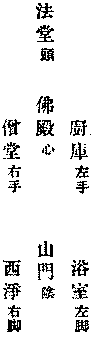



止观辅行云。如大经云。头为殿堂。



摩诃僧祇律云。厕屋不得在东在北。应在南在西。



忠曰。此图。净所在西南。则合僧祇律说。



●招提



增壹阿含经云。毗沙鬼。白世尊曰。我今以此山谷。施招提僧。唯愿世尊。与我受之。



悲华经云。智华无垢坚菩提尊王如来。正法像法中间。诸比丘比丘尼。无惭无愧。或断招提僧物。断现前僧。衣服饮食卧具医药。



释氏要览云。招提。增辉记。梵云拓鬬提奢。唐言四方僧物。但笔者讹拓为招。去鬬奢留提。故称招提。即今十方住持寺院。是也。



飜译名义集云。经音义云。梵云拓鬬提奢。唐言四方僧物。但笔者讹。称招提。此翻别房施。或云对面施。或云。梵言僧鬘。此翻对面施。音义云。体境交现曰对。辍己惠他。名施。后魏太武。始光元年。造伽蓝。创立招提之名。



杜子美游龙门奉先寺诗云。已从招提游。更宿招提境。



柳河东集衡山中院律师。塔铭注云。凡官赐额者为寺。私造者。为兰若招提。



●寺



僧史略云。寺者释名曰寺嗣也。治事者。相嗣续於其内也。本是司名。西僧乍来。权止公司。移入别居。不忘其本。还标寺号。僧寺之名。始於此也。



释氏要览云。后汉明帝永平十年丁卯。佛法初至。有印度二僧摩腾法兰。以白马駄经像。届洛阳。敕於鸿胪寺安置(鸿胪即司宾寺也)。至十一年戊辰。敕於雍门外。别建寺。以白马为名。即汉土佛寺始也。吴孙权立建初寺为始也。



大日经一行疏云。寺者毗诃罗此方译为住处。



●山门



忠曰。山门者。山对城市之言。城市俗。山林真。凡兰若反俗居。本宜在山。所谓远离处也(兰若智度论翻远离处)。故纵在城市者。亦用山号。夫归向真道者。当由此而入。故言山门也。



或援刘熙曰。山产也。产生物也(释名)。盖今谓产生丛林法材也。　忠曰。此解几乎附会。不可取也。



临济玄禅师录云。师栽松次。黄檗问。深山里栽许多。作什麼。师云。一与山门作境致。二与后人作标榜。



又有山门为本寺总称者。　传灯录牛头慧忠禅师章云。威禅师以山门付嘱讫。出居延祚寺。



又有阖山住持已下大众。称山门者。　敕修清规诸方名胜挂塔云。首座请知事等。白住持发批。山门相送之意(详文疏门送榻位批处)。



●三门



山门之制。排列门有三。故亦称三门。



敕修清规圣节云。堂司备榜。张三门之右。



日用清规云。药石罢。出寮。不得出三门。



传灯录。睦州陈尊宿章云。一日有天使问。三门俱开。从那门而入。师唤尚书。天使应诺。师云从信门入(联灯睦州章天使为吴尚书)。



五灯会元仰山章。陆希声相公机语。与此因缘相类。



释氏要览云。凡寺院有开三门者。只有一门。亦呼为三门者。何也。佛地论云。大宫殿。三解脱门。为所入处。大宫殿。喻法空涅槃也。三解脱门。谓空门。无相门。无作门。今寺院。是持戒修道。求至涅槃人居之。故由三门入也。



罗湖野录云。死心禅师。以大观元年丁亥九月。从洪帅李景直之命。住黄龙山。明年揭牓于门曰。仰门头行者。宾客到来。划时报覆。即不得容纵浮浪小辈。到此赌博。常切扫洒精洁。凡置三门者。何也。即空。无相。无作。三解脱门。今欲登菩提塲。必由此门而入。然高低普应。遐迩同归。其来入斯门者。先空自心。自心不空。且在门外。戊子九月十八日。死心叟白。



护法录育王山碑铭序云。三解脱门。则僧伽智华作之(止此)。即谓三门也。



三门阁上。必设十六罗汉像。中安宝冠释迦。以月盖长者善财童子。为挟侍(释迦或为观音)。



又有妥五百罗汉者。　释氏资鉴云。宋元丰元年。天尝久旱。帝禁中斋祷甚力。一夕梦。有僧乘马。驰空中。口吐云雾。既觉。而雨大作。翌日遣中贵。道梦中所见物色。相国寺三门五百罗汉中。至十三尊。畧彷佛。即迎入内观之。正帝所梦也。



●隔子门



忠曰。子助字。盖方丈小门。隔外庭。故云隔子门。



雪窦显禅师录云。玄沙与地藏。在方丈说话。夜深。沙云。侍者关隔子门。汝作麼生出得。地藏云。唤什麼作门(又联灯玄沙章。传灯会元并但作门)。



无准范禅师录结夏小参云。佛殿里隔子门。碍塞杀人。



●偏门



非正门也。有罪犯者。自此门驱出焉。



禅苑清规百丈规绳颂云。犯重焚衣钵。应当集众人。山藤聊示耻。驱摈出偏门。



敕修清规肃众云。或彼有所犯。即以拄杖杖之。集众烧衣钵道具。遣逐偏门而出者。示耻辱也。



●佛殿



文字禅白鹿山灵应禅师。大佛殿记云。余闻。百丈大智禅师之训曰。世尊遗教弟子。因法相逢。则当依法而住。饮食服玩。经行宴坐。必为丛林。营建室宇。必先造大殿。以奉安佛菩萨像。使诸来者知归向故。昼夜行道。令法久住。报佛恩故。



传灯录丹霞然禅师章云。一日石头告众曰。来日刬佛殿前草。



正宗赞德山鉴禅师传云。师凡住院。拆却佛殿独存法堂而已(传灯录德山章不载之)。



忠曰。世谓拆却佛殿独存法堂。德山独有此作。殊不知。本是百丈立意也。传灯所载禅门规式云。不立佛殿。唯树法堂。当代为尊也(详法堂处)。盖虽百丈本规。诸方犹立佛殿。而德山特准其令尔。



历代三宝记云。孝明帝。熙平元年。灵太后胡氏。造永宁寺。(乃至)浮图北有佛殿一所。形如大极。中有丈八金像。



空华集贺知殿颂轴序云。昔吾震旦之祖。自达磨至大寂之世。凡八叶。三百五十餘祀。未有禅居。故吾徒多栖律寺。及乎百丈祖兴。创意别营禅宇。以居其徒。僧史所谓。利不百不变格。是也。然犹未立佛殿。以表佛祖亲承当代为尊也。而后祖师。以惧吾徒去佛逾远。而忘乃本也。而乃有佛殿之制。既有佛殿矣。则不可无掌之者。於是置乎知殿之司。班于头首之末矣。本朝当丛林盛时。尚置是职。而迩年稍稍而废者何也。意以其班序庳。而吾徒不肯就焉耳。由是殿堂也。像设弗严。芗火弗装。灯烛弗燄。尘埃也𡋯如。几案也暗如。管籥之启闭也。弗谨。往来之瞻礼也。弗便。於虖致使吾觉皇宝殿。寂寂焉。而曾路旁古庙之不若。不亦可惜也哉。



联灯会要。古灵神赞禅师章云。其师一日澡浴。命师去垢。师抚其背云。好所佛殿。只是无佛(传灯作好所佛殿。而佛不圣)。



忠曰。佛殿甎面。白土畫者。拟夏中楞严会行道。此亦律有据。见丛轨门经行处。



西域佛殿。名香殿。　毘柰耶杂事。佛为外道现神通因缘云。世尊即以右足踏其香殿。是时大地六种震动。　注西方名佛所住堂。为健陀俱知。健陀是香。俱知是堂。此是香室香台香殿之义。不可亲触尊颜。故但唤其所住之殿。即如此方王阶陛下之类。然名为佛堂佛殿者。斯乃不顺西方之意。



●佛坛



敕修清规报恩章序云。於是设圣容。具佛坛塲。



忠曰居家必备漳郡张一栋祭礼考云。古者庶人无庙。而祭於寝。注云。寝者前堂也(止此)。余谓此方寺院。无佛殿处。则方丈设佛坛。而祭佛祖亡者。即是无庙而祭於寝者也。



●撑天柱



凡殿堂。正面左右二露柱。此谓撑天柱。



●雨打



凡殿堂。四壁与露柱之间。曰雨打。盖殿堂宇有二重。第一重为正屋。第二重更足造者。若无第二重。则第一重簷霤。可零此处。故名雨打。



义堂日工集云。三门两廊。雨打既成。



●月坛



凡殿堂壁外露坛。名月坛。盖月光常到处也。



东福寺入寺记云。新命过佛殿西月坛。



东坡诗集扈从景灵宫诗云。道人幽梦晓初还。已觉笙箫下月坛。



忠曰。近水户侯(光国)造大学明伦堂。其壁外坛曰月台。老者得乘舆到于此(水户侯依清儒朱之瑜指挥。造二十分一之明伦堂云)。月台即月坛也。



永觉晚录重建鼓山涌泉寺记云。大殿乃谋再造。即命石工。甃殿前月台。及大庭石。



无怨公案抢劫类云。县主即起乡夫七八人。抬其石而至。令放于月台之下。(抬击也。非义。恐讹扛对举也。)



隋史遗文云。秦叔宝贩马。到潞州二贤庄单雄信所。见主人立在簷前。只得站立於月台傍边。



忠曰。是农家。亦称月台。



水浒传云。梁中书起身。走出堦前来。从人移转银交椅。直到月台栏干边放下。



●祖师堂



祖师之堂。设于佛殿西边。



白云端和尚禅录祖堂纲纪序云。吾道盛於此土。初祖菩提达磨之纲焉。剏立禅林之制。百丈大智之纪焉。此实天下之共知。而奈何天下祖堂中。各以开山传次者。为其祖。殊不思乃宗乃祖。所传所持之最者乎。呜呼教来。五百年后。达磨始来。向之诸家之贤者。岂不知性即乎圣。何为竟自以性以圣之泥乎。乃须少林之后。犹弹指顷。不假文字语默有无。释然亡其所待。而自得还其本。又古之岩居穴处者。但以法为胜为味。殊不虑今日其间者骄。独大智禅师虑之。而廓以禅林之度。由是资之。而少林之风。至今蔼然於天下。吾欲天下祖堂中以达磨大智正其位。以开山传次者陪之。贵来者尊其始。而归其大。岂不然乎。熙宁三年。岁次庚戌。十月初一日立。



林间录云。白云端禅师曰。天下丛林之兴。大智禅师力也。祖堂当设达磨初祖之像於其中。大智禅师像西向。开山尊宿像东向。得其宜也。不当止设开山尊宿。而略其祖宗耳。



敕修清规䜣笑隐尊祖章序云。海会端公谓。宜祀达磨於中。百丈陪于右。而各寺之开山祖配焉。见於祖堂纲纪序云。



忠曰。纲纪序无左右说。然清规言百丈陪于右。而今禅林安像。例而达磨南面。百丈在东。则陪于祖左也。临济在西。则陪于祖右也。依此旧说纷纭。或曰。林间录已言。大智像西向。是亦可约达磨南面。则陪于祖左明矣。故今右字写讹。当改左字。即百丈配昭位(左东)。某寺开山配穆位(右西)。正为当理也。或曰右字不可改也。但某寺崇开山。故开山安祖左(东也)。百丈安祖右(西也)矣。



或曰。右者。谓向真人之右也。则北面向真故。右则东也。合现今禅林安像法。



忠曰。向真人之右之说甚失义也。何故。谓凡规制书。无此例。圣节榜张于三门之右者。言门西也。圣节上堂。侍者往法座左侧立者。言座东也。儒礼亦然。文公家礼云。凡屋制不问何向背。但以前为南。后为北。左为东。右为西。后皆倣此(止此)。何遽作向真人之左右说耶。其尊开山。抑百丈。固不足取焉。改左字者。义同林间。故不在痛削。然以余观之。笑隐云陪于右大有深意。盖达磨为太祖。二祖昭。三祖穆。如此次第配之。则百丈穆位。而在达磨之右(西也)。笑隐之意。岂在兹乎。犹如周后稷为祖。文王穆。武王昭矣。纲纪序本不言左右。觉范之配定。与改左字者。一状领过。



或曰。今禅林以临济代开山配祖。若依其昭穆说。则临济亦当穆位。答曰。若置黄檗像。则固可如所论。然除黄檗但安临济。故可配左边空位耳。不可为此难。唯是安像法。本於清规百丈陪于右说。故临济可在左也。实与今禅林安位。相反焉。如今之配置。盖依林间录而已。



罗湖野录云。隆禅师及住虎丘。道大显著。因追绎白云端和尚立祖堂故事。乃曰。为人之后。不能躳行遗训。於义安乎。遂图像奉安。题赞于上。达磨曰。阖国人难挽。西擕只履归。只应熊耳月。千古冷光辉。百丈曰。迅雷吼破澄潭月。当下曾经三日聋。去却膏肓必死疾。丛林从此有家风。开山明教大师曰。春至百花触处开。幽香旖旎袭人来。临风无限深深意。声色堆中绝点埃。呜呼百丈创立禅规以来。丛林卒不至於弛废。实本于此。白云。以百丈配享达磨。有识靡不韪其议。可谓知本矣。隆既能遵行奉先之礼。又从而为赞。发明其道。有足多也。



●土地堂



土地神。护法神之堂。设佛殿东边。



南禅规式曰。或曰。宋国土地祖师二堂。在法堂左右。义堂云。但随宜处立之。不必於法堂左右也。



勅修清规住持章念诵云。侍者随住持。到祖堂土地堂大殿。烧香礼拜。



三隐诗集拾得录云。於土地堂壁上。书语数联。



●关庙



关帝之庙也。关帝见于灵像门。



佛祖通载。无尽居士撰。玉泉皓长老塔铭序云。玉泉寺宇。广大弊漏。悉坏法堂。方丈。寝堂。钟楼。慈氏阁。关庙。而鼎新之。



●祠堂



居家。本设祠堂。而祭祖宗亲族矣。今祭在家亡灵於佛寺者。为祠堂。



汉书龚胜传云。胜敕以棺敛丧事。衣周於身。棺周於衣。勿随俗动吾冢。种柏作祠堂。



孔圣全书云。君子将营宫室。先立祠堂于正寝之东为四龛。以奉先世神主。高祖考妣居左。曾祖考妣居右。祖考妣居次左。考妣居次右。祖考妣皆南向。考左妣右。置祭田具祭器。主人辰谒于大门之内。出入必告。正旦冬至朔望则参。俗节则献以时食。有事则告。若无力之家。只择明洁空室一间。以奉四世神主。再无别室。可於寝堂正间祀之。



后汉书马援传云。更修封树。起祠堂。　又李固传云。新营祠堂。



●法堂



忠曰。演说大法之堂。故云法堂。故黄溍百丈山师表阁记云。东阳嗣住是山。既新作演法之堂(止此)。又宋景濂护法录妙辨大师塔铭序云。元季。寺焚于兵。公奋然有为。创演法堂。及方丈室。



三才图会宫室部云。堂者当也。谓当正向阳之屋(玉海)。又堂明也。言明礼义之所。



华严经世主妙严品云。大智日勇猛慧菩萨说颂言。世尊凝睟处法堂。炳然照曜宫殿中。　又入法界品无忧德章云。善财童子。将升法堂。　又摩耶夫人章云。时有守护菩萨法堂罗刹鬼王。名曰善眼　疏护正法堂也。



大方等日藏经云。於当来世。是中皆应起立塔寺。造作法堂。安置舍利。经法形像。



佛本行集经云。有诸比丘。或在露地。说法之时。或寒或热。我许造堂。堂下说法。若虽有堂。露无四壁。风吹尘草。污诸比丘。我今当听起四壁障。遮诸尘草。时诸比丘。在说法堂。若地不平。应以种种。若麻若草。泥涂其地。使令净好。



毘奈耶杂事云。佛告阿难陀。此拘尸那城。往古有城。有拘奢伐底。有王名大善见。国人奉诸金银末尼等宝。王曰。如是诸宝。我自丰足。不受。国人置宝而去。王念。今此珍宝。非枉求。我今宜用修造法堂。时有八万四千。诸城小王。闻之。咸诣王所白言。愿不烦神虑。臣等望。为王营造。再三请而许。诸王白王。於城东形胜地。兴建法堂(庄严广说)。严饰既毕。愿亲临幸。王念。此胜法堂不应先自受用。宜请一切沙门婆罗门。有德行者。如法供养(略钞)。



右法堂文字。出经律者。



历代三宝记隋录云。法堂佛殿。既等天宫震旦神州还同净土。



六学僧传隋罗云传曰。上明东寺法堂十二间。盖道安昙翼所造。



唐高僧传罗云传云。释道安。於上明东寺。造堂七间。昙翼后造五间。连甍接栋。横列十二。



传灯录牛头慧忠禅师章云。众请入城。居庄严旧寺。师欲於殿东。别创法堂。先有古木。群鹊巢其上。工人将伐之。师谓鹊曰。此地建堂。汝等何不速去。言讫。群鹊乃迁巢他树。初筑基。有二神人。定其四角。复潜资夜役。遂不日而就。繇是四方学徒。云集座下矣。



宋高僧传香育(嗣神秀)传曰。州将韩𨳝。供施交骈。树造法堂。严饰奇丽。时来问道。



右并百丈已前。有法堂称者。



传灯录百丈章禅门规式云。不立佛殿。唯树法堂。者。表佛祖亲嘱受。当代为尊也。



德山拆却佛殿。独存法堂(见于佛殿处)。



忠曰。窃以百丈制禅苑规绳。取意於朝制。其东西两序。犹如文武排行。五参上堂。犹如五日一参。到法堂制造。亦是拟太极殿矣。予尝闻日本大极殿之制。盖一依中华法。地面碁布甎瓦。中央有高台。皇帝即位登此座。则可四方瞻礼之。由此观今法堂之制。无一所异。而今法堂座后。有大板屏。非可移动者。盖非古也。何以知之。清规上堂云。设罣罳法被。夫板屏罣罳也。若常在则何言设之。乃知。古制不造板屏。临时设罣罳耳。既无板屏则在座上者。可四方仰望之。然古有佛殿。拟太极殿者。编年通论云。魏胡太后作永宁寺。极土木之美其佛殿如太极殿。三门如端门。僧房千楹。玉珠锦绣。骇人心目(前佛殿处。引历代三宝记)。予之法堂。形太极之说。殆得类证矣。



或曰。禅刹法堂。象帝释善法堂。故名法堂也。予谓不然。古人或命文命扁。只取类似。以资言藻。或上堂小参。亦临时假借。未可取以为本义也。若实谓象帝释之堂。则义不亦涉焉。师表阁记。明言演法之堂。何须别说。且掇古人以善法堂称者。附见于此。



佛祖通载。唐张说法池院二法堂賛序云。法池西。三归院二法堂。兹院。长老初上禅师所造也。三归堂。以长安元年辛丑。子月。望日癸卯立。善法堂以开元元年癸丑。丑月。望日戊辰。建。又云至哉初上人。建立善法堂。彩翠三世佛。



广灯录觉华普照禅师章云。僧问。如来以一音演说法。未审和尚。何法示人。师云。白云无定止。出没太虗中。进云。恁麼则善法堂前师子吼也。续灯录。兴化绍清禅师章云。上堂云。祖师门下。佛法不存。善法堂前。仁义休说。　又云。兴化今日。不上天堂。不入地狱。於善法堂中。登王座上。为母说法。



叶县省禅师录云。问善法堂中。伸一问。未审师还接也无。师云。蜀地锦观陶绵。



云峰悦禅师法轮录云。开堂升座。僧问。善法堂开於此日。第一义谛。请师宣。师云何不早问。



石溪录小参。颂赵州访茱萸。上法堂。从东过西因缘。云。善法堂前探浅深。寒涛平地涌千寻。



贞和集。北磵彰教建法堂颂云。善法堂倾法不倾。欲支一木要重新。



南堂欲禅师本觉录小参云。从教灵山会上。退席五千。善法堂前。草深一丈。



大休念禅师录寿福寺。挂善法堂额佛事云。善法堂前双树阴。微风吹动奏清音。如来宝座亲踪迹。天上人间亘古今所以释迦世尊。初於普光明殿。成等正觉。不离菩提树下。上升忉利天宫。乃至七处九会。徧登宝华王座。一音演唱。随类得解。一雨所沾。随根受润。而况寿福禅苑。古佛道塲。标善法之名模。遵先觉之懿范。雷音大震。普示人天四众。慈云广被。仰瞻天雨四花。



忠曰。是已以善法命扁。故援世尊升忉利。且实其事。然假借缘饰。非为本义也。



清拙澄禅师录小参。引临济洞山等五尊宿因缘云。这五员老冻脓。只今同在善法堂上。大开铺席。互显家风。



●法座



忠曰。演法之座。即须弥座也。



敕修清规圣节云。侍者往法座左侧立。候众集。



●开山塔



●享堂



忠曰。安祖像牌之堂。设祭享於此。故云享堂也。今谓之照堂者。讹矣(详照堂处)。



大鉴清规末后事仪云。龛安正客殿。或卵塔前享堂。龛於此安之。本是飨堂。享同祭享之堂也。日本人名照堂错也。



忠曰。日本人。以开山享堂。谬称照堂。盖其转谬有所由也。抑照堂。本在僧堂之后。而或处佛殿后。设开山塔。有似彼僧堂后之照堂。故称佛殿后开山塔。为照堂矣。遂不在殿后者。亦例谓照堂也(又照堂处辨之)。



癸辛杂识别集云。平江虎丘。有虎十餘据之。同里叶氏墓舍在焉。其一大享堂。虎专为食息之地。



●方丈



敕修清规圣节云。维那上方丈。请住持佥疏。



传灯录。禅门规式云。长老既为化主。即处于方丈。同净名之室非私寝之室也。



祖庭事苑云。今以禅林正寝。为方丈。盖取则毗耶离城维摩之室。以一丈之室。能容三万二千师子之座。有不可思议之妙事故也。唐王玄策。为使西域过其居。以手版纵横量之。得十笏。因以为名。



法苑珠林感通篇云。吠舍厘国。宫城周五里。宫西北六里。有寺塔。是说维摩经处。寺东北四里许。有塔。是维摩故宅基。尚多灵神。其舍垒甎。传云。积石即是说法现疾处也。於大唐显庆年中。敕使卫长史王玄策。因向印度过净名宅以笏量基。止有十笏。故号方丈之室也。



释氏要览云。方丈。盖寺院之正寝也(引王玄策事)。



忠曰。头陀寺碑。有方丈字。先唐玄策。且附见。



文选王简栖头陀寺碑文曰。宋大明五年。始立方丈茅茨。以庇经象。　注高诱曰。堵长一丈。高一丈。面环一堵。为方丈。　铣曰。宋孝武皇帝时也。言立方丈之室。覆以茅茨之草。以置经象也。



●堂头



忠曰。方丈称堂头。住持人居处。



禅苑清规。请尊宿云。专使先看知事计会讫。上堂头人事。



广灯录三圣然禅师章云。师到道吾。道吾以绯𥿉额。持神杖。师见乃云。逐便祗候。道吾应诺。师参堂了。再上堂头。人事。道吾却具威仪。方丈内坐师才近前。道吾云。有事相借问。得麼。师云。也是适来野狐精。便出去。



联灯会要香严闲禅师章云。造沩山。山问。我闻汝在百丈先师处。问一答十。问十答百。此是汝聪明灵利。意解识想。生死根本。父母未生时。试道一句来看。师茫然。不能加答。遂归寮。将平日看过底文字。从头检寻。无一句可将酬对。乃自叹云。畫饼不可充饥。屡上堂头告沩山为说。山云。我若说似儞。儞已后骂我去在。



●正堂



一山曰。正堂。方丈室也。



传灯录。龟洋山无了禅师章云。师告寂。瘗于正堂。酉阳杂爼云。嵩山普寂禅师。洁正堂焚香端坐。未久忽闻叩门。连云。天师一行和尚至矣。一行入诣寂作礼(云云)。



●衣钵阁



忠曰。藏住持衣财之处。此方所谓眠藏也。衣钵义见于金宝类。



校定清规入院视篆云。住持看封。预都寺开封。呈过住持。就状先押字。次书日子。行者使印於日子处。状系都寺收。印子随封押。归衣钵阁。付与衣钵侍者。或亲随行者。



备用清规侍者云。密庵和尚赴灵隐。如侍者掌衣钵阁。



又有阁作合者。　校定清规新住持入院云。印子随即封押。归衣钵合。付与衣钵侍者。　又云。检旧例。下嚫衣钵合贴𫎪。　又法嗣师忌辰云。就衣钵合。支羞设钱。



●寝堂



住持正寝之堂也。



忠曰。盖拟世之路寝。周礼注云。六寝者。路寝一。小寝五。玉藻曰。朝辨色始入。君日出而视朝。退适路寝听政。使人视大夫。大夫退。然后适小寝。释服。是路寝以治事。小寝以时燕息焉。



疏云。路大也。人君所居。皆曰路。



竺仙仙和尚宗门千字文自注云。寝庙者。前曰庙后曰寝。今之曰方丈者。谓之寝室。大者曰寝堂。室则幽奥深邃。堂乃堂堂明显也。今法堂者。正谓之堂。佛殿可曰庙也。



旧说曰。凡禅刹堂舍位置。法堂后有茶堂。接茶堂而有寝堂。连寝堂而有方丈。盖寝堂者。住持讲礼之处。今日本禅院。於丈室前。置礼间者。是也。



忠曰。依此说。则日本方丈前。不别建寝堂。以方丈前一间。名礼间。充寝堂也。



敕修清规圣节云。上堂。住持於鼓初鸣。出寝堂坐。又小参云。小参初无定所。看众多少。或就寝堂。或就法堂。



又游方参请云。凡寝堂中。必设参椅。示尊师道也。新到相看。住持当居中位。令其插香展礼。侧坐受茶。於礼无损。



●轮藏



设机轮。运转法藏也。傅大士创造。



释门正统塔庙志云。复次诸方梵刹。立藏殿者。初梁朝善慧大士(傅翕玄风)。愍诸世人。虽於此道。颇知信向。然於赎命法宝。或有男女生来。不识字者。或识字。而为他缘逼迫。不暇披阅者。大士为是之故。特设便方。创成转轮之藏。令信心者。推之一匝。则与看读同功。故其自誓曰。有登吾藏门者。生生不失人身。又能旋转不计数者。是人所获功德。即与诵经无异。今称龙宫海藏者。乃约龙树入海而言。又称天宫宝藏者。乃附慈氏居处而说。然一切如来。只令口诵心惟。转我法轮。饶益群品。今大士。特兴慈悲。在在处处。创此机轮。运转不息。欲俾一切含灵。同沾利益。尽未来际。成等正觉。大哉神力。讵可思议耶。先民所谓。智者创物。大士其有焉。若夫诸处俱奉大士宝像於藏殿前。首顶道冠。肩披释服。足蹑儒履。谓之和会三家。佛印禅师(了元)为王荆公賛其所收畫像曰。道冠儒履释加沙。和会三家作一家。忘却率陀天上路。双林痴坐待龙华。又列八大神将。运转其轮。谓天龙八部也。又立保境将军助香火之奉。谓是在日乌伤宰也。兹三者。攷录无文(录六卷。弟子结集。进士楼颖修定)。不能自决。



佛祖统纪云。梁傅大士。愍世人多故。不暇诵经。及不识字。乃於双林道塲。创转轮藏。以奉经卷。其誓有曰。有三登吾藏门者。生生不失人身。有能信心。推之一匝。则与读诵一大藏经。正等无异。藏前相承列大士像。备儒道释冠服之相者。以大士常作此状也。列八大神将者。八部天神也。保境将军者。在日乌伤宰。发誓护藏者也。　注云。义乌县旧名乌伤。



善慧大士录云。大士在日。常以经目繁多。人或不能遍阅。乃就山中。建大层龛。一柱八面。实以诸经。运行不碍。谓之轮藏。仍有愿言。登吾藏门者。生生世世。不失人身。从劝世人。有发菩提心者。志诚竭力。能推轮藏。不计转数。是人即与持诵诸经功德无异。随其愿心。皆获饶益。今天下所建轮藏。皆设大士像。实始於此。



白氏文集苏州南禅院千佛堂转轮经藏石记云。堂之中。上盖下藏。盖之间。轮九层佛千龛。彩绘金碧以为饰。环盖悬镜。六十有二。藏八面。面二门。丹漆铜锴。以为固。环藏敷座。六十有四。藏之内转。以轮止以柅。经函二百五十有六。经卷五千五十有八。



护法录日本瑞龙山重建转法轮藏禅寺记云。我佛如来。其正法之流通者。有三藏焉。一曰修多罗藏。二曰阿毘昙藏。三曰毘尼藏。惟此三藏。谆谆化导。使一切有情。灭妄趋真。诚昏衢之日月。苦海之舟航也。琅函玉轴。多至五千四百四十八卷。众生根钝。莫能融贯。善慧大士。以方便力。造为毘卢宝藏。函经其中。一运转间。则与受持读诵。等无有异。



已下辨轮藏字义。



北磵文集。金粟洞天三教藏记云。金粟洞天在泉南胜处。住山人凝云黄去华总三家之书于山中。寘诸大轮藏所谓藏也者。藏也。涵藏之谓也。



又澄心院藏记云。佛所说经。一味之雨。三草二木。所泽各异。根差性殊。岂雨之咎。车轴之滴。匪海莫容。大心溟渤。乃克堪受。涵摄其义。曰藏。运行其说。曰轮。舍藏无以蕴其奥。非轮无以发其用。第二义门。特出巧思。制成八觚。八窻玲珑。面面层室。以贮琅函。以绚金碧。以拟覩史大庄严藏。枢正厥中。以静以应。一机潜发。飘风疾旋。若翻地轴。使海水立。荡胸决眦。倐尔如砥。曰此权道。会心以境。



释氏要览云。经律论。谓之三藏。又佛藏。菩萨藏。声闻藏。名三藏。藏者摄也。谓摄人摄法故。　又云。八藏。菩萨处胎经云。胎化藏。中阴藏。摩诃衍藏。戒律藏。十住菩萨藏。杂藏。金刚藏。佛藏。是为释迦文佛经法具足矣。若今安置经律论处。名藏者。梵云俱舍。此言藏。谓库府之总称也。



文苑英华。谭铢庐州明教寺转关经藏记云。经心也。藏藏也。如心之含藏万法者也。故曰一心生万法。万法由一心。其动静弛张在我。而宁穷其义。略举其大。斯藏也。本於一心。灵通无碍。动用自在。静则万法空寂。动则三界弥纶虗伪。唯心所造作。其在斯乎。周廻八角。角觉也。佛以眼为八邪。耳为八患。鼻为八苦。舌为八难。廻八邪为八觉。廻八患为八解脱。廻八苦为八安乐。廻八难为八王子。指四八为三十二相。由此八关。返邪归正。成佛之境矣。止则寂然无用。引则转而不竆。动虽有声。静乃无迹(云云)。赞曰。修多罗教。函于藏轮。周廻八角。正道斯陈。动用一心。为万法因。忘因无法。得本归真。镌于金石。用导迷人。



忠曰。记中铢自谓。常学释氏。然眼为八邪已下。未知何据。



法轮者。释氏要览云。大毗婆沙论云。何名法轮。答是法所成故。法为自性。故名法轮。如世间呼金轮等。轮是动转不住义。舍此离彼义。能伏怨敌义。又圆满义。谓毂辐辋三事具足故。轮体法。即八圣道支也(云云)。



镡津文集崇寿禅院转轮大藏记云。夫转轮藏者。非佛之制度。乃行乎梁之异人傅翕大士者。实取乎转法轮之义耳。其意欲人皆预於法也。法也者生灵之大本。诸佛之妙道者也。诸佛以是而大明。群生以是而大昧。圣贤乃推己之明。而正人之昧。故三藏之取谕者。谕於此也。五乘之所归者。归於此也。然其理幽微。其义广愽。殆非众人槩然而辄得。故益其藏而轮之。姑使乎扶轮而转藏者。欲其槩众普得渐染佛法。而预其胜缘。则於道其庶几乎。是亦至人摄化群生之一端耳。其意远且大矣。备用清规藏殿祝圣讽经云。住持领众。绕藏行道三帀。以表法轮三转。



法轮三转者。示劝证也。　俱舍论云。云何三转十二行相。此苦圣谛。此应徧知。此已徧知。是名三转。即於如是一一转时。别别发生眼智明觉。说此名曰十二行相。



净名略疏云。三转法轮者。即是趣波罗柰。说生灭四谛也。轮者佛证四谛法。有可转之义。故名为轮。又解。能坏烦恼名之为轮。如轮王宝。能坏怨敌。佛法轮宝。能坏烦恼。故名法轮。如来成道经三七日。方趣波罗㮈。生生虽不可说。以悉檀方便。赴天人小机。而说四谛。转入彼心。坏彼烦恼。故名转法轮也。三转者。一示转。谓是苦是集是灭是道。二劝转。谓苦应知。集应断。灭应证。道应修。三证转。谓苦我已知。集我已断。灭我已证。道我已修。初转示见道。劝转示修道。证转示无学道。是三转十二行法轮。



大藏以千字文命函。见经录门大藏经处。



●东西藏



敕修清规知藏云。后以众多。列东西藏。



●十僧阁



建长寺有十僧阁。



禅居附录清拙禅师塔铭序云。师居建长。起十僧阁。各立扁。以居大耆旧。



●千僧阁



径山有千僧阁。



大慧杲和尚年谱云。绍兴七年丁巳。师四十九岁。主径山。又云。十一年辛酉。师五十三岁。千僧阁成。师遣介泉南。求记於李汉老参政。其略曰(云云)。院去城百里。自唐国一禅师。始斩蓬藋。驱龙虵而居之。寺无常产。山之神龙。实助其缘化。公至之始众才三百。二年法席大兴。众将二千。而院有僧堂二。不足以容。剏意於寺之东。凿山开址。建层阁十楹。以卢舍那南向。嶤然居中。列千僧案位於左右。设连床。斋粥於其下。经始於十年春。越明年春。告成(云云)。又云。一阁之成。任公何足道。而循袭龌龊之者。以为奇特。不亦陋甚矣哉。



陆放翁渭南文集圜觉阁记云。淳熙十年某月某日。径山兴庆万寿禅寺。西阁落成(云云)。东偏有千僧阁。绍兴中。大慧禅师宗杲法门之杰。方住山时。众溢千数。故以是名阁。



虗堂愚和尚径山录。有千僧堂上梁上堂。又有开炉移众僧单钵。归千僧阁上堂。　盖度宗咸淳元年乙丑。八月虗堂住径山。三年丁卯。冬十月。赐绫牒贰拾道。银券等。一新僧堂浴室行堂也。



●三默堂(浴室　僧堂　西净)



相传。浴室。僧堂。西净。不许语笑。故此总曰三默堂(又见浴室西净等处)。



供养次第法不可思议疏云。默然者。有三处。一食时。二大小便时。三洗浴时。



忠曰。浴室默然。不思议疏。洗浴时。又见毗奈耶杂事(殿堂门浴室引)。僧堂默然。不思议疏。食时。是也。西净默然。不思议疏。大小便时。又见文殊经(殿堂门西净处)。故三默堂。皆有据矣。



●僧堂



传灯录禅门规式云。所裒学众。无多少。无高下。尽入僧堂。依夏次安排。



敕修清规日用轨范云。不得僧堂内聚头说话。不得在僧堂中。看经看册子。



北磵文集南翔僧堂记云。连长榻。敷广座。容数千指。开单盔。必搜梁栋。选柱石。然后可以帡幪震风陵雨。虽然非古也。古之人一生打彻於冢间树下(云云)。　又庆宁僧堂记云。僧堂之作。非古人意。古无拓提。况堂耶。自枯木留香后。天下较奇策胜。翚飞炫耀。床榻囟几。惟恐不壮丽。耄耋疾疢。无雾霾风雨暴露之惨。既适既宁。精励胜进。当倍蓰异时。冢间树下。不三宿者。何反无闻焉。



兴禅护国论述宋国二十种胜事中云。经藏僧堂庄严。如净土。



雪峰存禅师录云。师示众云。望州亭与儞相见了也。乌石岭与儞相见了也。僧堂前与儞相见了也。



玄沙备禅师广录云。我今问儞。还见溪水麼。还见佛殿麼。还见僧堂麼。



僧堂名。已著於西竺。　智度论云。迦叶结集法藏时。以阿难残结未尽。摈出阿难入金刚定。破诸烦恼。作大力阿罗汉。即夜到僧堂门。敲门而唤。



禅林有设二僧堂者(又见千僧阁处)。又有设三僧堂者。



无文印笑翁堪禅师行状云。雪峰僧堂二。曰留香曰众香。师至。众集如海。更辟妙香。处之。



佛祖通载云峰高禅师传云。迁保安江阴教忠霅川何山。云衲四来三堂皆溢(止此)。盖此亦有三僧堂也。



僧堂。但在禅刹。而天台宗。有傚之者。　佛祖统纪了生法师传云。谒东灵钦师。时效禅林。群居僧堂。当元夕。众往观灯。钦师行香。见其跪坐床上。



僧堂十六板首钵位图。见图牌门。



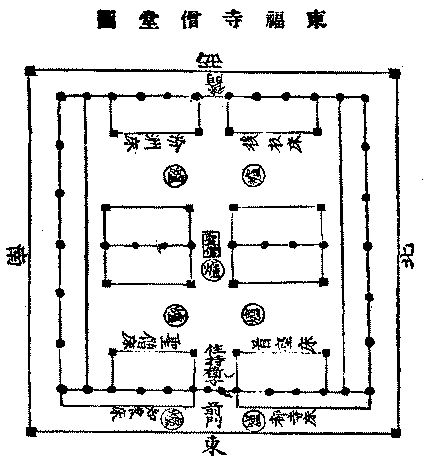



东福清规云。外僧堂东边。亦上下间有床。历兵乱。坏却之。故今则亡矣。东福清规云。后堂床之南床。曰汾洲也(忠按分手讹作汾洲)。知客床。有暂到者。上古有下斋时。行脚僧。据此床受斋。故云暂到也。　又云。住持赴僧堂坐禅者。盖为点捡大众也。故入堂。先巡堂一帀。是便捡众之仪也。又专主僧堂者。首座也。住持者非主僧堂。故僧堂无住持床。唯别设椅子而已



●云堂



忠曰。僧堂亦曰云堂。谓众集如云多也。



开福宁禅师录。冬夜小参云。赖遇库司置办土仪果子。下座云会堂中。大家东咬西咬(止此)。字义可见。



敕修清规受嗣法人煎点云。请云。来晨就云堂。聊具菲供。伏望慈悲。特埀降重。



诸祖偈颂。阮中大仰山饭歌云。五更云堂门尚闭。普供厨中人已起。



大慧杲和尚。郑成忠请普说云。斋云堂清净禅众。请普说功德。不为别事专用回向无上佛果菩提。



●禅堂



忠曰。僧堂亦谓禅堂。言众僧坐禅於此也。文字已出首楞严经。云若诸末世。愚钝众生。未识禅那。不知说法。乐修三昧。汝恐同邪。一心劝令持我佛顶陀罗尼咒。若未能诵。写於禅堂。或带身上。一切诸魔。所不能动。



摩诃止观云。身开常坐。遮行住卧。或可处众。独则弥善。　辅行云。或可处众者。谓禅堂中。别处最胜。故云弥善。



续高僧传后梁法聪法师传云。聪住禅堂。每有白鹿白雀驯伏栖止。



人天宝鉴云。圆觉慈法师。解行兼备。东掖虗席。能文二师。然指请师主之。慈至法席鼎盛。盛暑讲罢。归方丈偃息。而文适至。谓师曰。东掖道塲。世世皆有道者主之。讲罢不在忏室。即在禅堂。未有偃卧自恣者也。慈闻曰。敢不敬命。自后不少怠。



僧宝正续传月庵果禅师传云。初至鹅湖。宴坐禅堂。闻二童子戏争蒲团。其一举起云。儞道不见。遮个是什麼。师恍然有省。



柳河东集巽公院五咏中。禅堂诗云。发地结菁茆。团团抱虗白。山花落幽户。中有忘机客。涉有本非取。照空不待柝。万籁俱缘生。窗然喧中寂。心境本同如。鸟飞无遗迹。



●前门(僧堂)



忠曰。佛殿法堂。皆有前后门。今举僧堂者。



敕修清规大挂搭归堂云。参头领众。前门右手入堂。至圣僧前排立。



日用轨范云。打定钟后。不得於前门出入。



●后门(僧堂)



敕修清规大挂搭归堂云。参头送维那出。注云。斋前后门。斋后前门。



●前板(僧堂)



僧堂圣僧龛左右。为出入板。自出入板已前。为前板。亦曰前堂。即前堂首座。管领之。自出入板已后。为后板。亦曰后堂。即后堂首座。管领之。



●后板(僧堂)



说见于前板。



●堂内三板头



禅苑清规维那章云。众中。新到挂搭礼。须勤重。诸方辨事。及名德人。别选上寮安排。退院长老。须依住持帖。及开堂疏内资次。於堂内三板头。安排斋粥座位。



●四板头



忠曰。首座板。后堂板。分手板。圣僧板也(又见礼则门。四处问讯处)。



敕修清规。方丈特为新首座茶云。四板头。不安香几。无巡堂请茶。



●首座板头(僧堂)



敕修清规圣节云。维那於僧堂。往住持前问讯。从首座板起。巡堂一匝。



备用清规方丈特为茶云。侍者往特为人前问讯。从龛后。转首座板头。巡问讯一匝。



●西堂板头(僧堂)



忠曰。即是圣僧板头也。



东渐清规。勤旧钵位图云。内僧堂。如有西堂。则一班圣僧板排之。



敕修清规专使特为新命煎点云。於僧堂内。铺设主席。西堂板头。排专使位。



●圣僧板头(僧堂)



忠曰。圣僧前。下间板。为圣僧板头。盖圣僧侍者板也(见校定兄弟相看章)。即前堂首座分手。亦名西堂板头(见僧堂处。东福僧堂图)。



校定清规兄弟相看礼仪章。新到归堂云。参头领众。僧堂前门下手入。(乃至)仍至圣僧前。问讯。自末先移步。过圣僧侍者板头。进三两位。次第而立。



敕修清规念诵云。住持入堂。前堂首座入。次名德西堂插入。归圣僧板头立。　又大挂搭归堂云。参头领众。巡堂。排立问讯。从班尾先移步。退圣僧板头立。维那入堂烧香。上间立。



解云。维那与挂搭人。对立也。



又结制礼仪云。次知事入堂。烧香大展三拜。巡堂一帀。至圣僧板头挂立。



●后堂板头(僧堂)



僧堂后门上间。是后堂板头也。即住持对面位也。勅修清规。专使。特为受请人煎点云。於僧堂内。住持对面。设新命位(止此)。是新命位。即后堂板头也。



●立僧板头(僧堂)



立僧床。此方曰分手板也。盖僧堂后堂首座。分手位也。



敕修清规两序章云。维那鸣椎。俟首座唱食。至第三句将毕。转身退。至立僧板头立。



●立僧首座床



即立僧板头也。



●分手板



忠曰。立僧板。又名分手板。言后堂之分手位也。



东渐略清规云。烧香首座板。后堂板。分手板。圣僧板(详礼则门。四处问讯处)。



东福清规作汾洲床。依音近讹文。惑人多矣。



●出入板(僧堂)



圣僧龛左右。为出入板。前堂首座。领自出入板已前大众。后堂首座。领自出入板已后大众也。



敕修清规两序进退云。知事一班(云云)。从圣僧左。出住持前。两展三礼。(乃至)退身从圣僧右。出圣僧前。大展三拜。



备用清规坐禅云。如众头首起位抽解。惟前堂首座。从住持面前出入。其餘皆从出入板。出入。



敕修清规坐禅云。头首大众。并从出入板往来。



南禅规式僧堂图。录出入板。



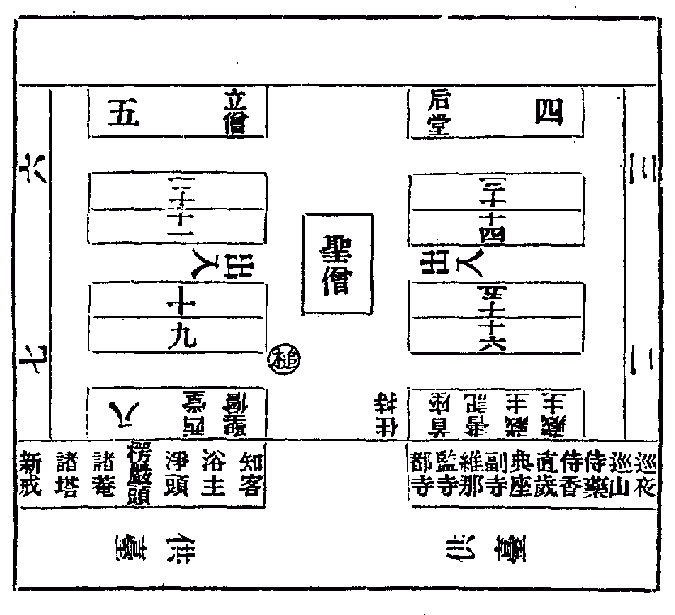



忠曰。此图二三四等。是被位也。非十六板首图。



●床前三净头(僧堂)



敕修清规日用轨范云。床前一尺为三净头。一展钵。二安袈裟。三头所向。　解云。展钵者。食时展钵於此也。安袈裟者。卧时。函柜在脚边。不便置袈裟。故安於此也。然床椽或怕盗窃。故但安函柜上。而作在枕边之想念。为妙。头所向者。卧时。床椽为枕也。



●三条椽(僧堂)



续灯录西禅继图禅师章云。上堂(云云)一一法上。一如来。一一尘中。一弥勒。若也不知。且向三条椽下六尺单前。快须究取。



碧岩录第二十五则评云。儞诸人。若见得。与莲花峰庵主同参。其或未然。三条椽下。七尺单前。试去参详看。



忠曰。僧堂之床。每人座位。横占可三尺许。乃各各头上之椽。有三条。故言三条椽下(七尺单前。笺于座位门单位处)。



●地炉(僧堂)



临济玄禅师录云。师一日与河阳木塔长老。同在僧堂地炉内座(云云)。



僧宝传清凉益禅师传云。与善修洪进。自漳州抵湖外。将发而雨。谿壮不可济。顾城隅有古寺。解包休于门下。雨不止。入堂。有老僧坐地罏。见益而曰。此行何之。曰行脚去。又问。如何是行脚事。对曰不知。曰不知最亲。益疑之(老僧地藏琛禅师也)。



五分律云。听因地作火𬬻。



●明窻(僧堂)(又方丈)



僧堂之制大。而复前后架屋。堂内暗矣。故当前板首座板头。西堂板头之上。屋上开窓(如今烟窓)。故第一座板。言明窓下。



旧说云。僧堂宏构掩蔽。故作窓受明。名明窓也。



五灯会元佛日空禅师章云。师十七岁。参夹山问答。山曰。冷灰里有一粒豆爆。乃唤维那。明窓下安排著。师曰。未审明窓。还解语也无山曰。待明窓解语。即向汝道。(忠曰。维那掌僧堂事。故特唤命之也。)



虗堂愚和尚宝林录。结夏小参云。若得个插手处。莫待期满。便请说看。何故。盖老僧急欲明窻下安排。



诸祖偈颂慈受箴规云。虗占案分。挂物明窓。不合律仪。丛林安许。



忠按慈受所言。似明窓在壁。



又方丈有明窓。　传灯录石霜诸禅师章云。师居方丈。有僧在明窓外问。咫尺之间。为什麼不覩师颜。师曰。我道徧界不曾藏。



忠曰。此亦明窓於壁开者也。



●明楼



在僧堂前也。僧堂广深。又前有外堂。故堂内昏暗。乃於堂前外堂间。高架楼。开窓接明。此云明楼。



物初賸语育王库阁阴记云。更其制为阁。五间三正两挟。前后横庑。前后穿堂。以覆砌级。如明楼之制。



枯崖漫录泉山子愚初禅师。承天寺僧堂记云。拥以照堂。明楼在前。



卧云日件录云。东福众寮。请颂题於梦岩。岩与牮明楼三字。盖时明楼将崩也。牮支也。　又云相国寺明楼崩矣。



●明堂



敕修清规念诵巡堂之图。僧堂与外堂之间。左右题云明堂。



忠曰。僧堂正前。高架明楼。明楼左右空处。曰明堂也。



●内堂



虗堂愚和尚净慈录结夏小参云。竺土大仙。於九夏之月。布漫天网子。笼络天下衲僧。谓之禁足护生。尅期取证。致於南山内堂外堂。排单下榻。个个如生铁橛。



●外堂



在僧堂外面。故曰外堂。又曰外僧堂。凡暂到客僧皆食於此。知客接不时宾客。故不食於内僧堂。而食於此。又凡知事。不时有所辨。故并就外堂钵位而食。



敕修清规赴粥饭云。都监寺。维那。直岁。侍者等位。在外堂上间。知客。知浴。知殿。化主。堂主等位。在外堂下间。



●知客板头



忠曰。在外堂后门内南边。



敕修清规受嗣法人煎点曰。住持引手揖煎点人坐。位居知客板头。　又专使特为受请人煎点云。住持对面。设新命位。堂外知客板头。设专使位。



●知客床



即知客板头也。



●照堂



旧说曰。照堂在僧堂之后。若住持事繁。不遑上堂。则立僧首座。令挂牌。代住持。入室普说。皆於是处。故堂内架法座矣。此屋连僧堂邃暗。故高其制。而取敞明因名照堂。后来此处构尿所。未知其是也。又今时有法堂后。造照堂者。固不足。则也已。



枯崖漫录子愚初禅师。承天寺僧堂记云。拥以照堂明楼在前。



敕修清规方丈特为新挂搭茶云。至日侵晨。洗面时。备卓子笔砚。列照堂请。各於名下书云。某甲谨拜尊命。



破庵先禅师行状云。至平江万寿旦过。值天大雪。夜坐。乃自念言。行脚十年矣。此回若不彻去。又是虗生浪死。正闷闷间。不觉钟动。趍后架。举头见照堂二字疑情顿释。



敕修清规念诵云。先鸣方丈板照堂板。



解者曰。僧堂后。众寮后。皆有照堂。而今鸣众寮之照堂板也。



忠曰。但是僧堂有照堂。不用曲说。云章解圣节巡廊鸣板曰。巡廊鸣板者。先鸣方丈板。次鸣照堂板。次鸣众寮首座寮等板(止此)。云章已照堂之次。别言众寮。则可知照堂板。但是僧堂后照堂板耳。故不用众寮后。有照堂之说。



旧说曰。今时称影堂为照堂。实无本据。或云照当作昭。乃昭穆之谓也。本当谓昭穆堂。而略称昭堂。此说亦杜撰矣。



忠曰。大应国师建长录有新开昭堂升座。乃作昭字。盖日本禅林。有忌火字。去列火者。如照牌作昭牌。录者从作昭堂乎。此升座语中。不亦见祖塔飨堂事。又无文印痴绝行状曰学徒中分遗骨。塔于照堂窣堵波之左(止此)。痴绝录赵若琚撰行状。作中分其半。建塔径山菖蒲田玉芝庵(止此)。此亦非谓影堂也。故影堂曰照堂讹矣。余辩复见享堂处。



●后架



照堂之后。有后架。大众洗面之处。



永平正法眼藏洗面章云。云堂洗面处者。在后架里。后架在照堂之西。



敕修清规日用轨范云。取手巾转身下地。巾搭左手。念偈云云。轻手揭帘。出后架。轻手取盆洗面。



莹山清规云。往后架洗面。往东司屙屎。



传灯录兴化存奖禅师章云。师谓众曰。我只闻长廊也喝。后架也喝。诸子汝莫盲喝乱喝。



厕亦有后架。东净处。引幻住清规。



●廊下



联灯会要兴化存奖禅师章云。师谓众云。我闻长廊下也喝。后架也喝。诸子莫盲喝乱喝。



日用轨范云。不得衩袒归僧堂。并廊下行。



佛祖通载。海云简禅师传云。一日於廊下。逢数僧(云云)。



东海一沤集自历谱云。延文二年冬。吉祥寺廊下库司。灾。



外典亦有廊下　说苑云。介子推。行年十五而相荆。廊下有二十五俊士。堂上有二十五老人。仲尼曰。合二十五人之智。智於汤武。并二十五人之力。力於彭祖。



常朝录云。元稹为翰林承旨。朝退。行至廊下。时初日映九英梅。隙光射稹。



●斋堂



忠曰。斋堂。即食堂也。食堂。即僧堂也。今日本黄檗山僧堂外。别设斋堂。盖大清禅林如是。非古也。



佛祖统纪云。司马光。暇日游洛阳诸寺。廊庑寂寂。忽声钟伐鼓。至斋堂。见沙门端坐。默默方进匕箸。光欣然。谓左右曰。不谓三代礼乐在缁衣中。



●食堂



忠曰。禅林僧堂。本食堂也。食堂即斋堂也。



蒲室集扬云岩居士。作蒋山僧堂偈序云。寺古制。皆有僧堂。然惟会食而已。至於寝处。则有别室。如今教律院犹然也。独禅林。自唐开元中。百丈海禅师作清规。设长连床於堂。率众尽入居之。床端为木函盈赤。以贮三衣一钵。外无餘畜也。坐卧起居有时。凡晨昏午夜。以及旦。长老首座。加巡警焉。惰者罚。不率教而摈之。至於禅寂。䇄若枯株。湛然止水。众千百肃如也。由贞元距今。六百年。他规尽废僧散处寺内外。甚者一己占屋数十间。积产业以万计。舆马仆从。拟巨室。冐刑法污宗教。有不可胜言者矣。而堂之规。犹独得如古。使天下之凡若僧者。尽撤其私室。禁而私畜。而会之于一堂。申以吾祖之规教之。庸有如前所陈之敞乎。而僧者。能终身不越堂户。继之以不昏不乱。虗而照。寂而应。超生死。越三界。虽古圣贤。不出乎是也。



南山教诫律仪。二时食法云。初入食堂随门颊举足。出时亦尔。



释氏要览云。毗柰耶云。给孤长者。造寺后作念。若不彩畫。便不端严。即白佛。佛言。随意。未知畫何物。佛言云云。食堂畫持饼药叉



祗园图经云。最巷北大院。名僧食所。自开三门。中门之北。有大食堂堂前列树方维相对。交阴相接。渠流灌注甚可观阅。凡僧食者。多止此林



酉阳杂爼续集寺塔记云。平康坊菩提寺食堂前东壁上。吴道玄。畫智度论色偈变偈。



不空三藏奏代宗。天下食堂中。置文殊为上座。详见灵像门圣僧处。



十诵律自恣法中曰。扫洒食堂扫除竟。入室坐禅。



佛本行集经曰。尔时世尊。日在东方。著衣持钵。共诸比丘。来至食堂。於所敷设。次第而坐。



杂阿含经曰。比丘低舍。与众多比丘。集於食堂。语诸比丘言。诸尊。我不分别於法。不乐修梵行。多乐睡眠。疑惑於法(佛广呵责)。　又云。佛住舍卫国祇树给孤独园。前三月。夏安居竟。有众多比丘。集於食堂。为佛缝衣。



三隐诗集闾丘胤序云。国清寺有拾得知食堂。寻常收贮餘残菜滓於竹筒内寒山若来。即负而去。　又拾得录云。拾得者。知库僧灵熠令知食堂香灯供养。忽於一日。与像对坐。佛盘同餐。联灯会要药山俨禅师章云。师问僧。甚处来。云南泉。师云在彼多少时。云粗经冬夏师云恁麼则三十年后。成一头水牯牛去也。云某甲虽在彼中。且不曾上他食堂。师云。口饮南风那。云和尚莫错。自有把匙筯人在。



僧宝传大通本禅师传云。移住钱塘净慈继圆照之后。食堂日千餘口。仰给於檀施而供养庄严之盛。游者疑在诸天。



儒家亦有食堂。　柳河东集𥂕厔县新食堂记云。贞元十八年。五月某日。新作食堂于县内之右始会食也。又云。其上栋自南而北者。二十有二尺。周阿峻严列楹齐同。又云。既成得羡财。可以为食本。月权其赢羞膳以充。乃合群吏于兹新堂。升降坐起。以班先后。又云。惟礼食之来古也今京师百官咸有斯制。甸服亦王之内邑。且官有联属。则宜綂会以齐之也。向之离。而今之合。其得失也远甚。我是以肃焉而庄。衎焉而和。群疑以亡。嘉言以彰。旨乎其在此堂也。



●茶堂



茶堂必在法堂后。寝堂前也。今之茶堂。元是方丈也。住持行礼之处。



芙蓉道楷禅师。唯置一茶堂。自去取用(详饮啖门米汤处)。



校定清规告香云。斋退鸣鼓。特为茶。或就法堂。或茶堂。首座相伴。特为参头。有饭。



传灯录。东山慧和尚(嗣百丈海)章云。大于和尚。与南用。到茶堂。见一僧近前不审(云云)。



又传灯录黄檗慧禅师(嗣踈山仁)章云。师下堂。参第一座。(乃至)於言下顿省。礼谢。退於茶堂。悲喜交盈。广灯录黄檗断际禅师章云。师一日。在茶堂内坐。南泉下来问。定慧等学。明见佛性。此理如何。师云。十二时中。不依倚一物(云云)。



鼓山神晏国师录云。师见保福共僧。在茶堂说话。师云。莫葛藤。保福云。葛藤即不得。商量佛法还得也无。师作掴势。保福云。过在什麼处。师又行一掴。



玄沙备禅师广录云。一日僧问讯(云云)。师云。儞适来。从什麼处来。云某从茶堂里来。师云。儞今若去也从茶堂里去。因什麼不识去来。



大慧杲禅师录。岁节秉拂云。今日一队奴仆。在茶堂里。村歌社舞。弄些神鬼。



●茶寮



焦竑类林云。僧寺茗所曰茶寮。



●寮舍



传灯录禅门规式云。置十务。谓之寮舍。每用首领一人。管多人营事。令各司其局也(主饭者。目为饭头。主菜者。目为菜头。他皆倣此)。　又职位门。十务处。



丹铅总录云。左传。同官为寮。文选注。寮小窓也。宋王圣求号初寮。高似孙号踈寮。谢伋号灵石山药寮。唐诗。绮寮河汉在斜楼。皆指窓也。古人谓同官为寮。指其斋署同窓。为义。今士子同业。曰同窓。官先事。士先志。官之同寮。亦士之同窓也。



尔雅云。采寮。官也。　郭璞注。同官为寮。　刑昺疏。言同寮者。皆谓居官者。云同官为寮者。左传文七年。荀林父告先蔑之辞也。



周祈名义考云。杨用修。谓寮为小窓。以斋署同窓为义。不知窓竂之竂。从穴。不从宀。说文竂穿也。玉篇竂舍也。后人遂以竂。为窓。是窓竂之竂。与采寮之寮文既不同。义亦自别。安得以同窓释同寮乎(采采。俱音菜。宀音绵)。



忠曰。周祈不取丹铅同窓义。直取同官为寮之义。则禅林亦可同职者为寮也。



●四寮



敕修清规嗣法师遗书至云。两序四寮。江湖乡人。法眷小师办事。皆有祭。　又尊宿迁化。遗书云。知客引专使巡寮。先库司。次头首寮。单寮。蒙堂四寮。



又云。两序四寮。江湖办事乡人。皆致祭。



义堂曰。蒙堂之四寮也。所谓佛国白大觉琏。参寥潜。九峰韶。四人所居也。



忠曰。昔四名德。居蒙堂。后人慕之。存四寮名耳。



旧说曰。四寮者。库司。头首。单寮。蒙堂。是也。非别有名四寮者(止此)。忠曰。此讹读尊宿迁化章。先库司。次头首寮。单寮。蒙堂四寮之语者也。四寮义。可依义堂之说耳。



敕修清规亡僧云。所封行李。首座。维那。知客。侍者(烧香侍者)。四寮人力。擡归堂司。



云章曰。四寮不足疑焉。清规亡僧章。明言。首座。维那。知客。侍者四寮。是也。又住持章。下遗书云。头首寮(西单寮)单寮(东单寮)蒙堂(西蒙堂东蒙堂)四寮。蒙堂分东西。此亦可称四寮。



忠曰。云章第二说。强以东西单寮。东西蒙堂。作四寮。不足信焉。



忠曰。清规四寮。盖有二种。亡僧章四寮。即其所列首座。维那。知客。侍者。是也。嗣法师遗书章。两序四寮。及迁化章蒙堂四寮。并可依义堂说。余曾清规嗣法师遗书中。详辨



●蒙堂



忠曰。蒙堂名。昉于大觉故事。后来勤旧退职者。安息处。乃称蒙堂也。见称呼门。蒙堂处。又可与下蒙堂并看。



宋景濂潜溪集四明阿育王山广利禅寺碑铭云。其主僧。自宣密素公始可考见。宣密五传。至大觉琏公。名振天下。(乃至)大觉日与九峰韶公。佛国白公。参寥潜公。讲道一室。扁曰蒙堂。丛林取则焉。又云。修演法之堂。并撤其房庐。为下蒙堂。则白云住山智珠营之。



周易蒙卦彖云。蒙以养正。圣功也。　疏云。能以蒙昧隐默。自养正道。乃成至圣之功。



月江印禅师育王录大觉禅师忌。拈香云。代圆通应诏而起。为九峰草疏而来。对使者焚却龙脑之钵。创蒙堂如筑黄金之台。此是大觉老人平生受用不尽底三昧。虽相去二三百载。而声光炜烨。犹百千之迅雷。稽首僧伽真古佛。鄮峰千古碧崔嵬。



又月江贺友竹改牧石寮作蒙堂颂云。幽居改作蒙堂住。湖海高人不用招。大觉断弦今复续。可无佛国与参寥。



●下蒙堂



玄极顶禅师圆庵集阿育王山下蒙堂记云。四明阿育王山广利禅寺沙门某。成下蒙堂有年矣。今住山弘辩裕禅师图记其事于石。而属笔於某。辞弗获。乃记曰。昔大觉琏禅师。尝辟一室。列四榻。延其友九峰韶公。佛国白公。参寥潜公。相与居之而榜曰蒙堂。盖取蒙以养正之语也。是后禅林咸効为之。今是堂之设于育王者有二。其一则大觉所居者。其一所谓下蒙堂者。即某始作也。初某之师雪窓光公。法席盛时。名缁鳞集。乃谋别创蒙堂以处之。未果而化去。於是述先志。损己赀。撤所居房卢而创焉。名下蒙堂。其屋凡若干楹。而为室十有六。室置一榻。奉像设。肃宾客。与夫庖湢之舍。无不完。经始於戊戌之秋。落成於明年之冬。惟百丈起禅规。会众僧於云堂。食息咸在焉。而蒙堂由大觉礼贤增置。自非齿隆德优者。诚未易处也。然世降道衰。诸方往往。空其云堂而不居。而吾人始劳於形生矣。尝闻古之学道者。咸能忘其躯。是故日中一食。树下不信宿。身愈竆。而道愈通。其果何术哉。今云堂聚众之规未复。是以某承其师志。益为蒙堂。以养隐德晦行之士。不亦善用其心乎。然入是堂者。宜思蒙之为义。及其身之安也。务深蓄其道德。使九峰。佛国。参寥三人者复生。吾不让焉。则大觉始立之意。某氏别创之勤。斯无负矣。



●单寮



忠曰。单寮者。独寮也(详于称呼门。单寮处)。寮义。见寮舍处。



敕修清规。西堂首座挂搭云。如大方名德。欲作住计。语次露意。住持度有单寮可处。及行坐位次。上下安顺。则畱之。



人天宝鉴云。无畏久法师餘姚人。依慧觉壁公。得旨。后徧历禅会。尝入径山佛日之室。佛日夜坐。必召师至。命说天台旨趣。及楞严大意。深遇之。出世清修。学者云集。师患后生单寮纵恣。辟屋为众堂。净几明牎。蒲褥禅板。洒然有古丛社之风。



●侍者寮



联灯会要百丈怀海禅师章云。师契悟(野鸭子因缘)。浃背汗流。却归侍者寮。哀哀大哭(云云)。



虗堂愚和尚录普说云。一日在侍者寮思之。古帆未挂。有甚难会(云云)。



侍者寮。扁择木。　大慧年谱云。师三十七岁。抵天宁挂搭。圜悟令居择木堂。作不厘务侍者。(左传哀十一年云。鸟则择木。木岂能择鸟。)　大慧普说作择木寮。



侍者寮扁小玉。　日本禅蓝志。南禅寺侍者寮。曰小玉。(联灯云。圜悟勤禅师归五祖。入侍者寮。偶五祖为陈提刑举小艳诗云。频呼小玉元无事。只要檀郎认得声。师问答云云。忽然大悟。)



●侍司



侍者寮也。



敕修清规告香云。每夏前告香。新归堂者。推参头一人。维那和会定。同众诣侍司。禀云。新挂搭兄弟。欲求和尚告香普说。



●众寮



忠曰。众寮之制南向也。



敕修清规。大挂搭归堂云。新挂搭人。转东边。寮主转西边。又触礼一拜。寮主引挂搭人。排列朝观音问讯(止此)是可证南面之制也。



敕修清规列职杂务云。寮元掌众寮之经文什物之类。



禅居附录清拙大鉴禅师塔铭(东陵永玙撰)。云。大元泰定丙寅八月至博多。明年正月。上京。关东使来迎居建长。三月十二日入寺檀信禀以大国禅林所宜行事。悉举行之。师开堂。告香普说新造众寮。规制如灵隐者。国中始有也。



众寮图　诸书所载。似有讹差。今多依南禅规式之所图。



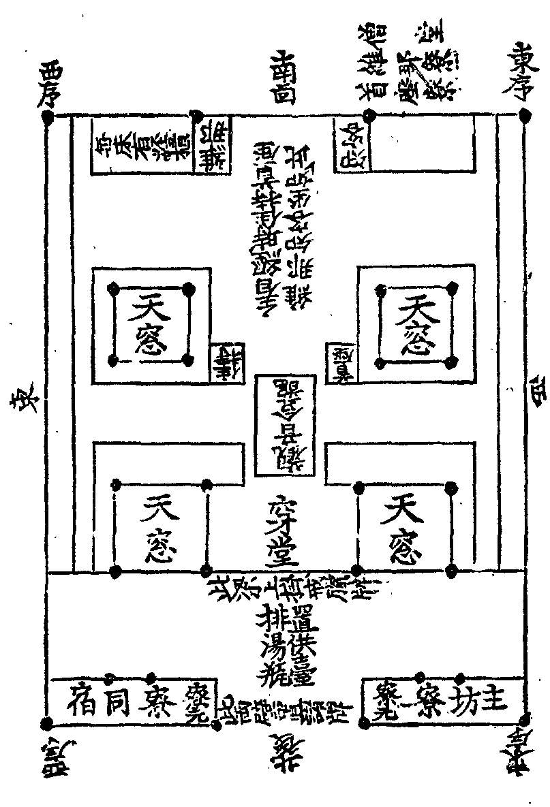



镰仓清规众寮图(二十八位者。结解小座汤图也。)



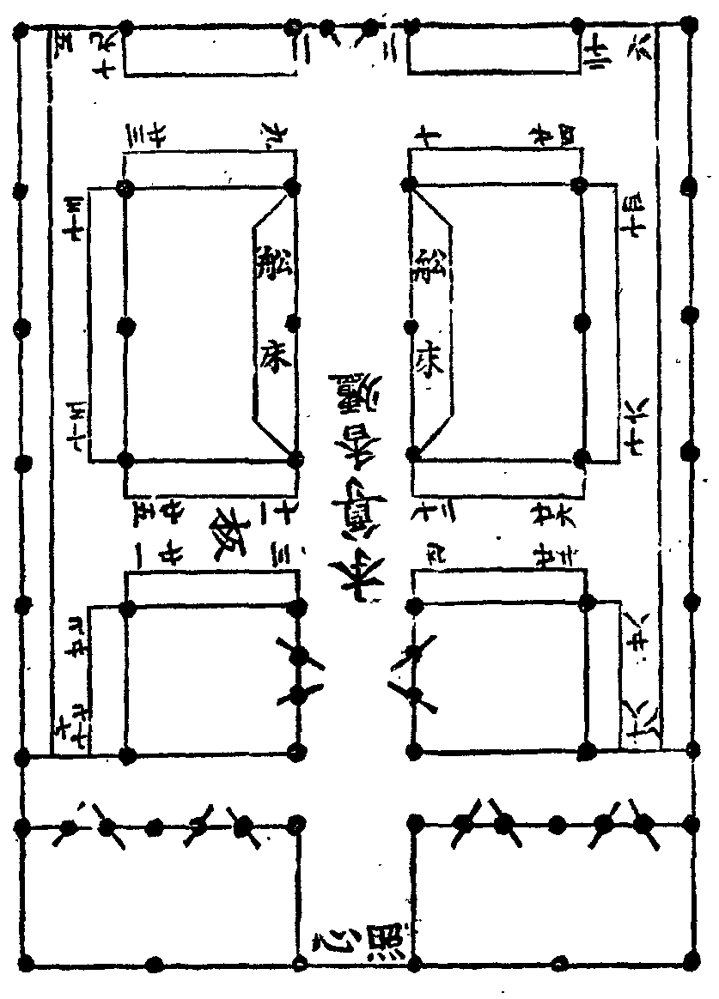



●穿堂(众寮)



众寮观音龛后曰穿堂。乃众寮之后。堂名也。



日用轨范云。僧堂不得上下间行道。穿堂直过(止此)。又慈受箴规云。穿堂直过。岂不厚颜(止此)。此等穿堂者。非堂名。谓自前门穿过后门之义。



敕修清规新挂搭人。点入寮茶云。瓶须从穿堂入。又众寮结解特为众汤云。寮元依戒。排经柜图茶汤问讯图等。图成大众和南时。俱出於穿堂。



●衣阁(众寮)



忠曰。盖众寮。安众资具处。



备用清规日用清规云。众寮登衣阁白寮主上名。打板三下。上阁开笼



●维那寮



●纪纲寮



维那寮。又曰纪纲寮。



毛诗大雅棫朴篇云。勉勉我王。纲纪四方。　笺云。张之为纲。理之为纪。　疏。说文云。纲网纮也。纪别丝也。然则纲者网之大绳。以举纲能张网之目。故张之为纲也。纪者别理丝缕。故理之为纪。以喻为政。有举大纲赦小过者。有理微细穷根源者。



正字通云。六书故纲要而纪详纲以举纪。纪以举目。谓纲大纪小者非。



南禅规式。录南禅诸寮名。曰表率寮(前板云门)望仰寮(后板仰山)龙蟠寮(书记黄龙)虎啸寮(东藏主虎丘)结集寮(西藏主虎丘)纪纲寮(维那应庵　或桃洞或悦众)择木寮(烧香侍者)思忠寮(请客侍者)小玉寮(汤药侍者)内史寮(书状侍者)景雪(知客)。



忠曰敕修清规维那云。纲维众僧。曲尽调摄(止此)维那寮名纪纲寮。本于此。僧史略云。知事之三纲者。若网罟之巨绳。提之则百目正矣(止此)。若依此。则知事三纲。总可称纪纲耳。



●堂司



堂司者。维那寮也(若呼人为堂司则维那是也)又见职位门。



●藏司



藏司者。藏主寮也(若呼人为藏司则藏主是也)。又见职位门。



僧宝传云居齐禅师传云。法灯使知藏司。法灯偶见齐呼曰。每见举祖师西来意话。藏主如何商略。齐曰。不东不西。法灯曰。若与麼会了无交涉。曰未审尊意如何。法灯良久曰。西来有甚意。



●知客寮



●客司



客司者。知客寮也(若呼人为客司则知客是也)



敕修清规知客云。官员尊宿相过者。引上相见。仍照管安下去处。如以次人客。只就客司相款。



密庵杰禅师录小参云。佛眼。五祖会中。在客司。因夜坐拨火。忽然猛省。(应庵华禅师蒋山录载之。作充知客)



●前资寮



忠曰。副寺已下知事。退休者。所归寮也。



大慧普说莹上座请普说云。老和尚会里。有元禅客(乃至)一日见元在前资寮里坐。老汉拍他背云。来。同去钟楼上看雪去。



●沙弥寮



敕修清规沙弥得度云。祇就沙弥寮安下。俟他时登檀受戒谢戒。



●客位



忠曰。宾客。及新命安息室也。旦过外。别设焉。



敕修清规游方参请。初叙住持旦过回礼。又云。住持遇名胜相看。就送客位回礼(止此)。可知。旦过之外。有客位也。若一则同回礼。何别举之。谓旦过之外别设客寮。若名胜。则送客寮也。



敕修清规迎待尊宿云。汤罢。两序勤旧。同送。客位。拈八方珠玉集云。宝盖来访渐源。源卷却帘子。在方丈内坐。盖乃下却帘子。却归客位。



明极俊和尚语要云。大慧会中。有一尼僧来参。送归方丈客位歇(云云)。



●安下处



忠曰。安下者安息税下行李也。宾客或新命。税驾之馆。此名安下处。又名旦过。日本不特置安下者。借一子院。安息。谓之宿房。安下或作安驾。非也。下驾音近。转讹也。



敕修清规住持章。受法衣云。专使相看。汤罢。两序同送安下。　又尊宿迁化。下遗书云。侍者烧香点汤。送专使。归安下处。　又游方参请云。侍者云。且回安下处。容某通覆。



东林云门颂古云。琅琊和尚。问举和尚。近离甚处。(乃至)琊遂去安下处。见问。莫便是举师叔麼(云云)。



正法眼藏举此话。安下处。作旦过堂。



释氏资鉴云。腾兰二僧。於鸿胪寺安下。翻译四十二章经。



龙舒居士净土文云。譬如人入大城中。必先觅安下处。却出干事。



大平广记薛调撰唐无双传云。刘震曰。汝易衣服。押领此物。出开远门。觅一㴱隙店安下。



剪灯餘话还魂记云。夫人曰。郎君母还邸中。只在寒舍安下。



安下处或单言下处。　隋史遗文曰。秦叔宝领刑具。到下处吃饭。



●旦过寮



忠曰。游方人。到某寺。先税袱子。入旦过堂。憩息。然后与师家相见。或谓旦当作且。即暂时来过之义。妄说不足从。按陆放翁诗集。病中柬仲弥性诗云。心如泽国春归鴈。身是云堂旦过僧(止此)。是以春对旦。又城西联句。庚韵云。十载旦过轼。同时寒食翃(止此)。是以寒对旦。故旦夕之旦。明矣。盖夕来宿而旦过去也。



禅苑清规龟镜文云。旦过寮。三朝权住。尽礼供承。敕修清规知客云。其旦过寮。床帐什物。灯油柴炭。常令齐整。　又装包云。如游山。到处将及门。下包捧入旦过。　又游方参请云。游方挂搭。初到旦过。推熟於丛林能事者一人。为参头。



又月分须知云。四月初一日。锁旦过。



解者曰。自四月朔。止行脚。故锁旦过也。



正法眼藏云。琅邪和尚。问举和尚。近离甚处。(乃至)琅邪问侍者。此是甚麼人。曰举上座。琅邪遂亲下旦过堂问莫是举上座麼(云云)。



大慧武库云。叶县省和尚。严冷枯淡。衲子敬畏之。浮山远。天衣怀。在众时。特往参扣。正值雪寒。省诃骂驱逐。以至将水泼旦过。衣服皆湿。其他僧。皆怒而去。唯远怀并叠敷具整衣。复坐於旦过中。省到诃曰。儞更不去我打儞。远近前云。某二人。数千里特来参和尚禅。岂以一杓水泼之。便去。若打杀也不去。省笑曰。儞两个。要参禅。却去挂搭。



大川济和尚天章录。开旦过上堂云。开门待知识。知识不来过有个来不入门。去不出户。问他洞山麻三斤。赵州柏树子。便恶发。吽。吃茶去。



护法录会堂缘禅师塔铭序云。师道经宁海。日已暮。悲风号林莽间。师遑遑急走。欲求憩泊之地。竟不可得。夜行三里所。乃逢逆旅主人。破屋一间。不能蔽风雨师竟夕不寐。明发指天自誓曰。所不能建庵庐以延旦过者有如日。



丛林盛事有旦过字。见称呼门兄弟处。



破庵先禅师录行状云。至平江万寿旦过。值天大雪。夜坐。乃自念言。行脚十年矣。此回若不彻去。又是虗生浪死。



清拙澄禅师日本录晚参云。二十三上。出闽入浙。至净慈。先佛心愚极和尚。门庭高峻。旦过中八十餘人。不得相看(云云)。　又圆融寺钟铭序云。大唐天目山中峰本禅师行脚时。止金陵一小寺旦过寮(云云)。



宋景濂护法录净慈逆川顺公塔铭序云。师走闽之天宝山。参铁关枢公师欲住。公叱师下旦过寮澘然而泣。或悯之慰曰。善知识。门庭高峻。拒之。即进之也。



●浴室



敕修清规知浴云。其入浴资次。当刊揭浴室外。



南海寄归传云。世尊教为浴室。或作露地甎池。(乃至)洗浴者竝须饥时。浴已方食。有其二益。一则身体清虗。无诸垢秽。二则痰癊消散。能餐饮食。饱食方洗。医明所讳。



十诵律云。外国浴室。形圆犹如圆仓。开户通烟。下作伏渎出外。内施三擎阁。齐人所及处。以瓨盛水。满三重阁。火气上升。上阁水热。中阁水暖。下阁水冷。随宜自取用。无别作汤。故云净水耳。



增一阿含经曰。尔时世尊。告诸比丘。造作浴室。有五功德。云何为五。一者除风。二者病者得差。三者除去尘垢。四者身体轻便。五者得肥白。(乃至)若有四部之众。欲求此五功德者。当求方便造立浴室。



浴室安跋陁婆罗像说见灵像门。



入浴法毘奈耶杂事详说(往看)。



毘奈耶杂事云。浴室内。漫为言话。佛言。不应漫话。然洗浴时。有二仪式。一者法语。二圣默然。



六学僧传云。后唐智晖。姓高氏。咸阳人。少从圭峰温禅师鬀𩭄。梁乾化四年。自江表来京邑。历观诸刹。以为所须皆备。而独於浴室。似有缺典。於是相攸洛汭。治屋若干楹。购山给薪。凿沼储水。轮汲而槽受。其汤之富。未易言。则瓶锡之侣。冠簪之伦。搢绅先生之流。其至者。日不暇给。而脱履则木舄承足。卸衣则枲裙障身。五日一开。开凡七十有二。而岁周矣。其所浴。殆数万人。不啻。又辟浴圣室於西庑。以象十六应真。其内中则观自在堂也。侍郎扬凝式。笃重晖为作碑颂德。



又六学僧传云。宋常觉。姓李氏。陈留人。游庐山。投归宗寺出家。(乃至)后唐天成三年。始得地於汴京丽景门右。治屋数间。以营浴事。每月以三八日。一设。僧无远近皆就浴。岁约费千万𦈏。虽一出檀施。自非觉维持之力。畴克尔尤与北海陶谷湘东张仲荀。厚善。皆有遗寄之文。可考(右二件并宋高僧传载今爱文简明故引六学耳)。



●浴室头首板头



敕修清规知浴云。如住持有故。欲同头首。先浴。则不用设屏障。不入小合内。只头首板头解衣。



●厨库



临济玄禅师录云。黄檗因入厨次。问饭头。作什麼。饭头云。拣众僧米。



云门偃禅师录云。古人道。人人尽有光明在。看时不见暗昏昏。作麼生是光明。代云。厨库三门。



厨品字笺云。烹餁之所也。



库释名云。舍也。物所在之舍也。



●槽厂



六祖法宝坛经云。五祖云。这獦獠。根性大利。汝更勿言。著槽厂去。慧能退。至后院。有一行者。差慧能破柴踏碓(又见行者房处)。



忠曰。旧解。言行者寮非也。但是厨房边。卑贱杂务之处。行者亦当服役于此耳。



槽正字通云。音曹。说文畜兽食器。　品字笺云。槽草平声。刳木令空曰槽。又酒槽。又以木槽饲马。谓之马槽。



厂正字通云。音敞。屋无壁。又音昌。义同。　篇海类编云。厂昌两切。音昶。马屋。又露舍无壁。　品字笺云。棚厂。薄有橕架。而覆不以瓦曰棚。虽以瓦覆而门牕不设曰厂。厂敞也。言其厂然高旷。不狭隘也。



●磨院



正宗賛雪峰真觉禅师传云。师亲书牌於磨院云。山前竟日无狼虎。磨下终年绝雀儿。至今虎雀绝无。



大慧武库云。五祖演和尚。依舒州白云海会端和尚。咨决大事。深彻骨髓。端令山前作磨头。演逐年磨下。收糠麸钱。解典出息。雇人工。及开供外。剩钱入常住。每被人於端处𩰚谍是非。云演逐日磨下饮酒食肉。及养庄客妇女。一院纷纭。演闻之。故意买肉沽酒县于磨院。及买坯粉。与庄客妇女搽畫。每有禅和。来游磨院。演以手与妇女揶揄语笑。全无忌惮。端一日。唤至方丈。问其故。演喏喏无他语。端劈面掌之。演颜色不动。遂作礼而去。端咄云。急退却。演云。俟某算计了。请人交割。一日白端曰。某在磨下。除沽酒买肉之餘。剩钱三百千。入常住。端大惊骇。方知小人嫉妬。时秀圆通为座元。受四面请。即请演为第一座。



永平清规引演祖事云。磨下者。磨院也。称磨司。椎米磨面之局也。寺边五六町。若十餘町建之。磨院主一人。请之。演祖之职掌。乃是也。



●水磨坊



置水碓磨之房舍也。



雪峰存禅师录云。师在枯木庵坐禅。於水磨坊前晒麦。乃亲题云。庵前永日无狼子。磨下终年绝雀儿。　注山中至今。竝无狼虎。凡於磨坊前。晒麦亦无鸟雀。皆如师记耳。



●净头寮



大慧年谱云。师二十五岁(在宝峰湛堂处)。在净头寮因书雪峰悦和尚小参语於座右。一日广道者至寮。见之。乃私语湛堂曰。宣州杲兄。以雪峰小参。为警慕。非碌碌餘子之比。湛堂曰。此子他日必能任重致远(净头义。见职位门净头处)。



●行堂



行者所居之堂。即行者寮也(若呼人为行堂则行者是也)。



敕修清规训童行云。行堂前。挂牌报众。　又沙弥得度云。自行堂鸣钹引剃头人出。



又敕修清规方丈点行堂茶云。节腊僧堂茶罢。侍者同客头。至行堂点茶。侍者至库司。典座接入。参头堂主。领众行者门迎。



忠曰。盖行堂在库司。故侍者至库司也。



东福寺扁行堂曰选僧堂也。　忠曰。选个中人。为僧也。



●童行堂



即是行堂也。



禅苑清规训童行云。新到於库司。参礼讫。将行李。入童行堂。



●行者房



行堂也。



传灯录丹霞天然禅师章云。师抵南岳。石头曰。著槽厂去。师礼谢入行者房。随次执爨役。凡三年。



●西净



西序所上之厕曰西净。



忠曰。和俗呼西净。为雪隐。谓雪净之也。见其称西净。却为怪焉。余谓。雪若净之义。则隐又何义。按竺仙和尚说云。灵隐净头寮名曰雪隐。即今圆觉净头寮。二草字。不知何人好事者模来(净智寺录)。又按日本禅刹一览。建仁寺亦揭雪隐字。皆用雪窦显禅师曾在灵隐隐潜于净头职之事。然雪隐西净。唐音适近。遂以为雪隐。而失本名。隐者潜隐义。非取灵隐之隐也。况复雪隐。是净头寮扁字。而不宜扁于西净。益见不当也。或有以西净。为厕通名。而其在东者亦呼西净者。实讹称而已(雪窦事见职位门净头处)。



旧说曰。净者。谓厕易秽处。可以净洁故特以净称。



小补韵会云。史记。楲窦厕中行清器也。释名行清。即粪槽。谓之清者。以其秽浊当常清除之也。



忠曰。旧说解净。正合释名。然今流行刘熙释名语不同。唯云。厕或曰圊。至秽之处。宜常修治使洁清也。



天竺精舍。厕院在西或南。故摩诃僧祇律云。厕屋不得在东在北。应在南在西。小行亦如是。



祇园图经云。次北第六院。名为流厕。有大高屋三重而立。飞桥双上。甚自清净。下施厕坑。砌以伏窦。天帝手作。上无臭气。大渠。从大院北西注。南入厕院。伏流入窦。北出会於大河。人无见者。一切比丘。皆此便利。余闻此说。深为获相。故江淮已南。诸古寺者。皆设都清一所。中已北。周屏绕院。臰处蓬勃。伊何可言。



厕字义。见器物门。厕筹处。



缁门警训云。文殊经曰。大小便时。身口状如木石。不得有声。



●东净



东序之厕。曰东净也。



幻住庵清规营辨云。后架乃粪秽之聚。其称为东净西净者。其净在人。不在境也。



●东司



东净又曰东司也。或以东司为厕通名。而在西者亦呼为东司。实讹言也(如下引武库)。



敕修清规。辨道具滤水囊云。僧行东司。亦皆滤水。又慈觉龟镜文云。涕唾墙壁。狼藉东司。非所以报净头也。



大慧武库云。钱弋郎中。访真净。说话久。欲登溷。净令行者引从西边去。钱遽云。既是东司。为什麼却向西去。净云。多少人向东边讨。



释氏要览云。屏厕。或曰圊。圊清也。至秽之处。宜洁清故。今南方释氏。呼东司。未见其典。



事物异名云。登司同郭登厕神也。登主也。今人误曰登司。　忠曰。东讹作登。更随作厕神之义。转误矣。



无住杂谈集云。东司。可诵乌𫇴沙摩真言。是即不动明王埀迹。而号不净金刚。人上东司时。或有鬼恼人。则此金刚。誓护念矣。



忠曰。不动化不净金刚。见大日经一行疏。



大威力乌枢瑟摩明王经下卷云。复次乌枢瑟摩明王教法。不拘净秽。恒示忿怒相。诵满三十万徧。得验。　又云。复次不拘净秽。诵三十万。乌油麻和酥。进火中。一千八徧。得验。



忠曰。世传。凡人悬佛像於颈者。书乌枢瑟摩明王名号。加之。则不蒙秽罪。然未得经律本据。乌枢瑟摩经说。但如右耳。



●起止处



忠曰。起止处者。正屙粪之处也。吴越春秋云。盛夏之时。人食生瓜。起居道傍。子复生秋霜(止此)。所谓起居屙屎也。



毗尼母经云。上厕有二处。一者起止处。二者用水处。用水处坐起褰衣。一切如起止处无异。



僧祇律云。作厕屋。若坑底有水出者。当使净人先起止中。然后比丘行。



●用水处



忠曰。屙屎已。正洗净之处。　见起止处处。



●尿闼



续宗门统要云。明招谦禅师到招庆。(乃至)招云。是儞诸人。一时缚作一束。倒卓向尿闼下。来日相见。



正字通云。凡士民所居。门内曰闼(统要作跶。正字通云。跶俗字。禅苑瑶林作闼。今从之)。



●安乐堂



见于次延寿堂。



●延寿堂



禅林宝训音义云。延寿堂。抚安老病之所也。古者丛林老僧送安乐堂。病者送延寿堂也。又今涅槃堂是。



校定清规住持入院云。古者建立丛林。为老病设。所以命堂主。司以药饵。戒常住。足其供需。此先佛规制也。又况八福田中。直病为第一。今诸方。延寿堂。有名无实。衲子遇病。如囚其间。良可悯也。万一乡曲。无人看亏。公界当差人直之。速期病安。惟是天童。凡一病僧。差一小仆供过。为住持者。当推菩萨慈悲之心。留意於此。



行事钞瞻病送终篇云。若依中国本传云。祇桓西北角。日光没处。为无常院。若有病者。安置在中。以凡生贪染。见本房内。衣钵众具。多生恋著。无心厌背。故制令至别处。堂号无常。来者极多。还反一二。即事而求。专心念法。其堂中置一立像。金薄涂之。面向西方。其像右手举。左手中系一五彩幡。脚埀曳地。当安病者。在像之后。左手执幡脚。作从佛往净刹之意。瞻病者。烧香散华。庄严病者。乃至若有屎尿吐唾。随有除之。亦无有罪。



释氏要览云。西域传云。祇桓西北角。日光没处。为无常院。若有病者。当安其中。意为凡人内心贪著房舍衣钵道具。生恋著心。无厌背故。制此堂。令闻名见题。悟一切法。无有常故(今称延寿堂。涅槃堂者。皆后人随情爱名之也)。



庚溪诗话云。唐以前。僧寺中。或僧有疾病者。未有安养之所。唐末。一山寺有僧。卧病久。因自题其户曰。枕有思乡泪。门无问疾人。尘埋床下履。风动架头巾。适有部使者。经从过寺中。见其题因询其详。恻然怜之。邀归坟庵。疗治之。其后部使者贵显。因言於朝。遂令天下寺院。置延寿寮。专安养病僧也。罗湖野录曰。佛眼禅师。住舒州龙门。尝题语于延寿壁间曰。佛许有病者。当疗治容。有将息所也。禅林凡有数名。或曰涅槃。见法身常住了法不生也。或曰省行。知此违缘。皆从行苦也。或曰延寿。欲得慧命扶持色身也。其实使人了生死处也。多见少觉微恙。便入此室。不强支吾。便求补益。及乎久病。思念乡闾。不善退思。灭除苦本。先圣云。病者众生之良药。若善服食。无不瘥者也。又尊宿云。须知有不病者。故明书示。以告后来观其规咏风巾尘履者。岂特令退思苦本而已。抑欲使遵乍可有戒而死之训。其明切精审。可谓药石之言矣。呜呼是大医王其佛眼之谓乎。



忠曰。延寿为目。道诚以情爱贬。赵令矜以鄙俚弹(见省行堂处)。至佛眼有慧命扶持之说。不但令名美。抑义亦深矣。



北磵文集妙湛延寿堂记云。疾病相扶持。无憾於养生送死。以明王道之本。佛世寖古建幢刹栖冷灰槁株蜡穹德茂者。却冢间桑下。岚昏雾蚀之患又为省行堂。以别不老不病。欲其循省日用事。若学之正偏。业之勤荒。行之缺全。思之沈掉。好恶之失中。喜怒之或私利养是崇。进修是怠。应病授药。法惟一味。以治其内。剂砭针艾。以攻其外。正命小康。幻体亦宁。或又谓之延寿堂延寿云者。延此者也。寿此者也。非人间世。短修延趣之谓也。今者反是。乐便安者。巧图其居。耽燕佚者。曲求其处。先之以货赂。申之以强援。弗知廉与逊为何物。尽巧致曲畴知志於道者。袖手傍顾。泚颡芒背。忍死不为也。一念之忍。傲睨黄发鲵齿。累然困踣於其外。祖宗成宪。遂为具文。往往大丛林亦如之。今妙湛鼎新斯堂。故书近世丛林坠典以告。覆车在前。冀革斯辙。虽然水沫巴焦。匪石匪金燕安鸩毒。少壮勿恃美疢恶石。老病无忽。作如是观。以度生死。则住山月岩某之宰制耆旧执事某之裁割。勤劳百囏。不徒其为是伇也。作於绍定三年仲夏晦。落之於冬书云。



橘洲文集焦山延寿堂记云。丛林老病菟裘之地也。百丈悯此。剏为延寿堂。床敷厚温。牖户宽爽。供给使令。左右毕出。惟少与健者。不得而与也。自都城下京口。两峰屹立波面。所谓山围屋者焦山也。山故海窟。世世皆有道者尸之。四方鼎来。如水云合。今住山朴庵性公。赴太守待制陈公之招。周旋逾年。眎山之寿老堂。自靖康至今。多历年所。屋有震风凌雨之患。过者未尝问焉。公於是。命执事相与经营。轮奂一新。老者居之。如入宝所。病者得之。如饮良药。有来观者。心目适悦。朴庵曰。吾道盖是也。使余挝鼓掉舌。号令佛祖。指㧑人天。而老病有时乎不闻。今此堂。朝明夕昏。夏凉冬燠。木章竹个。皆代余说法时也。所得与法喜禅悦等。岂不壮哉。朴庵书来。属余记之。因书以为记。



清拙澄和尚。圆觉寺延寿堂。题亡僧名牌云。十方聚会。生死任缘。既同归寂灭之塲。尚没记雪泥之爪。圆觉延寿堂置牌。以纪亡僧名。或临终有遗偈之类。悉详书之。或亲知眷义。寻访遗踪。庶几知其死所。虽然如是。名在这里。且道人在甚麼处。涅槃堂里事犹危。妙在全机独脱时。火后茎眉如拾得。不刊名字有人知(雪泥之爪用东坡诗中事)。



又与职位门延寿堂主。杂行门看病并看。



●省行堂



即延寿堂也。



黄檗清规云。省行堂者。有病比丘。摄养之所也。



幻住庵清规云。身属报缘。谁无老病。百丈建立。意在於斯。古宿扁延寿堂。为省行。使其省察行苦。而兴悲智。



北磵文集说。见于延寿堂。



缁门警训。超然居士赵令矜撰。南岳法轮寺省行堂记云。尝谓。诸苦之中。病苦为深。作福之中。看病为最。是故古人。以有病为善知识。晓人以看病为福田。所以丛林。为老病之设。今丛林聚众。凡有病使归省行堂。不唯修省改行以退病。亦欲人散夜静。孤灯独照之际。究索大事。岂徒然哉。既命知堂。以司药饵。又戒常住。以足供须。此先佛之规制。近世不然。堂名延寿。鄙俚不经。病者不自省咎。补躳乖方。汤药妄投。返成沈痼。至有酷疾不参堂。以务踈逸者。大失建堂命名之意也。知堂名存实废。或同路人。常住急於日用。殊不存抚。又复失优波待老病之意也。由是病人呻吟痛楚。日益增极。过在彼此。非如来咎。纵有亲故问病。率皆乡曲故旧。心既不普。事忽有差。今法轮病所。奂然一新。盖有本分人。是事色色成办。无可论者。惟有病人。宜如何哉。省躳念罪。世之有识者。皆能达此。衲僧分上。直截机缘。当於头痛额热之时。荐取掉动底。於声冤叫苦之际。领略彻困心密密究思。是谁受病人。既不见病从何来。人病双亡。复是何物。直饶见得分明。正好为他将息。



忠曰。堂名延寿。鄙俚不经者。此即贬不言省行而称延寿也。



●涅槃堂



即延寿堂也。说见于延寿堂。



传灯录泉州莆田县国欢崇福院慧日大师。福州侯官人也。姓黄氏。生而有异。及长名文矩(嗣长庆大安)。落发至灵观和尚所观曰。我非汝师。汝去礼西院(大安)去。师携一小青竹杖。入西院法堂。安遥见而笑曰。入涅槃堂去。师应诺。轮竹杖而入。时有五百许僧。染时疾。师以杖次第点之。各随点而起。闽王礼重。创国欢禅苑。以居之。



大光明藏云。此黄涅槃也。入西院涅槃堂。故号涅槃。



联灯会要赵州谂禅师章云。南泉埀语云。今时人。须向异类中行始得。师便问。异即不问。如何是类。泉以两手托地。师近前一踏踏倒。却向涅槃堂。叫云。悔悔。泉令侍者问。汝悔个甚麼。师云。悔不更与两踏。



●无常堂



即延寿堂也。天竺称无常院。见于延寿堂处。



释氏要览云。南山钞云。无常堂内。置一立像。金薄涂之(云云同前延寿堂处引行事钞)。



●重病闾



盖亦是延寿堂也。



大慧武库云。圆悟到五祖室中。平生所得。一句用不著。出不逊语。忿然而去。祖云。汝去游浙中。著一顿热病打时。方思量我在。圆悟到金山。忽染伤寒。困极移入重病闾。遂以平生参得底禅试之。无一句得力。追绎五祖之语。乃自誓曰。我病稍间。即径归五祖。



●将息寮



盖亦是延寿堂也。



续传灯录叶县省禅师章云。师因去将息寮看病僧。僧乃问曰。和尚四大本空。病从何来。师曰。从阇黎问处来。僧喘气又问曰。不问时如何。师曰撒手卧长空。僧曰。㖿。便脱去。



●卵塔



忠曰。无缝塔。形似鸟卵。故云卵塔(下有辨)。



雪峰存禅师录难提塔铭云。土主曰松山。卵塔号难提。



正宗賛。雪峰赞云。松山小塔卵石子。乱叠几层。祖庭事苑云梵云。塔婆。此言方坟。或云支提。或云难提。此言灭恶。或云抖薮波。此言賛护。或云窣堵波。此云灵庙。或云高显。



说文云。塔西域浮屠也。从土荅声。土盍切。



正字通云。汉以前无塔。故说文有荅无塔。塔字徐氏新附。尔雅俞畣肰也。畣即荅。塔亦作墖。



林间录云。云居祐禅师曰。吾观诸方长老示灭。必塔其骸。山川有限。而人死无竆。百千年之下。塔将无所容。於是於宏觉塔之东。作卵塔。曰凡住持者。自非生身不坏。火浴雨舍利者。皆以骨石填於此。其西又作卵塔曰。凡众僧化。皆藏骨石於此。谓之三塔。



普灯录天衣义怀禅师章云。弟子智才问。卵塔已成。如何是毕竟事。师举拳示之。遂就寝。推枕而寂。



文字禅谒灵源塔诗云。瓦灯已照宫商石。卵塔分藏服匿瓶。



僧宝传瑞鹿先禅师传曰。大中祥符元年。二月谓门弟子如昼曰。为我造个卵塔。塔成我行矣。丛林盛事云。涂毒老人示寂。放翁以诗哭之曰。尘侵白拂绳床冷。露滴青松卵塔成。



陆放翁渭南文集祭勤首座文云。卵塔告成。欲往不果。



古南牧云登天童玲珑岩诗云。卵塔依空住。香台若砥平。



已下辨卵塔妄说。



世有援藏经说云。昔有一女。产五百卵。皆破成人。母按乳。乳分为五百道。洒五百儿口。所破卵㲉。聚之埋地。上建一塔。因名卵塔。五百儿。即五百阿罗汉也。



忠曰。何从得斯说耶。藏中人产卵。累有证。唯瘗㲉名卵塔。都不见本据。夫般遮罗王妃。生五百卵。放乳验子。在俱舍颂疏世间品(俱舍论略引)。又莲华夫人生五百卵。为五百力士。出杂宝藏经。又南本涅槃经云。如施婆罗比丘。优婆施婆罗比丘。弥迦罗长者母。尼拘陁长者母。半阇罗长者母。各五百子。同於卵生(止此)。又毗舍离女。生三十二卵。皆为力士。为波斯匿王见杀。见于贤愚经(智度论作毘舍佉弥伽罗母)。须达长者女苏曼。生十卵。卵开。有十男儿。后见佛。得罗汉。又见贤愚经。妇人产卵缘。如是不一。稗秃附会。搆幻卵塔因缘。惑乱未学。若实有之。自古该博君子。岂不录出示人耶(又有鹿女生莲华。华千叶生千子。后自外国来。鹿女试按乳。流为千岐入千儿口。缘出于杂宝藏经西域记。等然非卵生。故今不用援证)。



梅峰信和尚曰。凡安舍利。用铜缾金坛。藏之於塔中。今函骨身於𨭛缾。庀镴缾於铜瓷。盖拟金棺银椁之制乎。卵形盖缾瓷之遗形也(止此)。若依忠所见。亦不然。昔南阳国师。对代宗曰。与老僧作个无缝塔。后之禅者。托斯语乃窆亡僧。削坚石。团圝无缝棱。无层级者。呼为无缝塔矣。无缝塔之形。适如卵。因名卵塔耳。



已下录先德告诫。



物初賸语笑翁堪禅师行状云。竺西用阇维。自先佛以然。其后佛法入中国。间於道大德备之衲。始用葬法。然出於后人追崇。如此耳。后世㳂袭之弊。住山者。虽妄一衲。亦龟食形胜。为朽骼腐胾之藏。十室而九。昔云居佑禅师尝病之曰。山川有限。人死无竆。乃建三塔。随尊卑藏其烬餘。师奏用其法。俾禅教律同焉。



梦岩和尚旱霖集坟塔之戒云。塔庙之所以为世所。贵者。果何为耶。考之圣典。上从诸佛。下至轮王。殁皆建塔。而其制有差。盖因其功德之大小。为品级耳。夫轮王但以十善济世。则其为功也小。佛以度生死之法益物。则其为德也大。由是观之。埀裕之实在功德。而不在塔庙也。崇奉之事在它人。而不在自己也。而近代法末。号大有道者。大率自营坟塔於死前。嘱其徒守之。享祀於无竆。由此大方巨刹主者。塔院四环棋布。后来者容无地。则诡计争夺。无所不至。窃惟迦叶守定鸡足。阿难分形恒流已来。僧牒所载。支竺名德。未有一人以遗骸累人者矣。其上世则化火焚身。空中雨舍利示业不亡。刃下涌白乳。四众建塔。供养灵感。与佛靡殊。其次则临终告其徒。使舁尸林下。𫗪肉鸟兽。或水葬省柴。或归骨石於普同塔。而其门人。不忍忘德。或收舍利塔之。或髹全身奉之。乌如今日挟豪势。炫惑无识。先言往行。不一顾之。极轮奂美。高立标牓。自示尊大之者乎。智愈明迹愈晦。道愈高位愈卑。若彼明者高者。未始逐蕞尔土木而存泯。俗谓廉颇蔺相如死向千年。凛凛常有生气。曹蜍李志虽无恙。奄奄如九泉下人。端不虗语。易曰。古之葬者。厚衣之以薪。葬之中野。不封不树。圣人之意。岂不尚古乎。孔子葬母於防曰。丘也东西南北之人也。不可以不识。为四尺坟。遇雨而崩。弟子修之。以告孔子。孔子流涕曰。吾闻古不修墓。延陵季子适齐而返。葬长子於嬴博之间。穿不及泉。敛以时服。封坟掩坎。其高可隐也。号曰骨肉。复归于土。命也。魂气则无不之也。而遂行。孔子孝子也。季子贤父也。共存名教者。而其葬者如斯。是亦凡为人资者之所宜知焉。师已薄德。资又无忠孝信义之实。而事外饰过奉之则不止。已陷非谊。怕累尔师於地下。吾佛县知今日告之。我灭度已一千年。恶法渐兴。不修道德。竞造塔寺。佛之塔庙。尚不许尔造。况其餘乎。又说比丘之法曰。寄於残生。旅泊三界。示一往还去已无返。又曰。比丘不修比丘法。大千无唾处。而今留无益不灵之枯腊。自爼豆于圣贤之间。不妄人而如此为乎。是特世谛之一近事也耳。尚能省识者少。达观绝识。宜乎乏其人。仅有好古不流俗耶。不可不告以戒。



●无缝塔



卵塔也。



忠曰。凡造塔相。叠累或木或石而成。故皆有缝棱。而今卵形塔。一块石而造。无缝棱。仍托南阳语。称无缝塔而已。如南阳云无缝塔。则别有意旨在。



传灯录光宅寺慧忠国师章云。师以化缘将毕。涅槃时至。乃辞代宗。代宗曰。师灭度后。弟子将何所记。师曰。告檀越。造取一所无缝塔。曰就师请取塔样。师良久曰。会麼。曰不会。师曰贫道去后。有侍者应真却知此事。(乃至)代宗后诏应真入内。举问前语。真良久曰。圣上会麼。曰不会。真述偈曰。湘之南潭之北。中有黄金充一国。无影树下合同船。瑠璃殿上无知识。应真后住耽源山。



●普同塔



忠曰。凡藏亡僧骨植同归于一塔。故云普同塔。



文字禅普同塔记云。自佛法入中国。奉持之者。缆𦁕其法度。参差不齐。独百丈大智禅师。以禅律之学约之人情折中而为法。以寿后世。故其生。依法而住。谓之丛林。及其化也。依法而火之。聚骨石为塔。号普同塔。(乃至)沩山空印禅师轼公。住山十餘年。百废具兴。独以普同塔未建。为忧。一旦与侍者。登山之西崦相其形胜施长材。鸠工以为之。开大穴以石为宫。又屋於其上。栋楹翔空。云烟蔽亏。万众懽呼。声应山谷。



●普通塔



即普同塔也。



僧宝传宝峰英禅师传云。呼维那。鸣钟众集。叙行脚始末曰。吾灭后火化。以骨石。藏普通塔。明生死不离清众也。言卒而逝。(普灯作普同塔)



●海会



亦是普同塔也。盖与海众同会於一穴也。



僧宝传黄龙佛寿清禅师传云。公遗言藏骨石於海会。示生死不与众隔也。



第三类　座位门



●座前



敕修清规圣节上堂云。头首领众出堂。至法座前。列一行问讯归西序立。(又见座下处)



忠曰。凡清规。言座前。即橕天柱之间也。



●座下



敕修清规圣节上堂云。待住持敛衣趺坐。侍者先末班。引过座下。列一行问讯。烧香侍者。引班归位。次首座领班出。列座前问讯。



忠曰凡清规言座下即须弥座直下也。



●住持转位(东序上首)



旧说曰。都寺立班。宜在后堂对面位。若其前堂对面位。乃是住持转位也。



敕修清规亡僧大夜念诵云。龛前念诵。知事先烧香。上茶汤。住持至烧香。居东序上首立。维那出烧香。请锁龛佛事。受请人出班。



忠曰住持避锁龛人中立。故转居东序上首也。故知。住持若离中位立班。则必居东序右边也。



又云。知客平举楞严咒。回向(云云)住持仍归东序上首立。江湖道旧。乡人法眷。次第设祭。



忠曰。此是住持。避江湖等设祭中立也。



镰仓清规众寮讽经云。住持入烧香。而立都寺上位。时寮元从西序班末。知客之侧。出烧香。



忠曰。此是住持避寮元中立烧香也。



●入牌小师班位(居浴司右)



前住入祖堂。小师居浴司班右边。出位烧香问讯。向住持。请安牌佛事。



南禅规式前住入祖堂云。小师亲度牌於侍者。小师在浴主后立。法语毕。侍者接牌。度於都寺。



清拙小清规云。入祖堂。孝子僧。从头首之末。进炉前问讯。烧香了。向长老请佛事。



●单位



敕修清规日用轨范云。昏钟鸣。须先归单位坐禅



忠曰单者用小红纸片。题众僧名贴各各位上壁别源东归集。云一单一钵标一名(止此)。是也。有己名单之位。此谓单位也。又僧堂床前之板。曰单。濶八寸。日用轨范。言床前一尺。盖依周尺也。凡言七尺单前者。非帐帷之长。谓自床后至前六尺(日本谓之一间)。更加单板一尺。合成七尺也(又见文疏门单处○东福僧堂。床深六尺。前单板一尺)。



七尺单　碧岩录云。三条椽下。七尺单前。试去参详看。



又有称六尺单。盖除单板。为六尺乎。　续灯录西禅继图禅师章云。且向三条椽下。六尺单前。快须究取。



晦庵光禅师录。石庵玿禅师录(𡘋续古尊宿录)。皆有六尺单前语。



又有称五尺单。盖亦六尺单。用周尺则得四尺八寸。存大数言五尺也。　佛果击节录雪窦普请话评云。也须是三根椽下。五尺单前。静坐究取始得。



●隣单



忠曰。己之单位左右也



敕修清规日用轨范云。以枕子安脚下。未要拗。恐惊隣单。　又云。吃食之法。不得抓头。恐风屑落邻单钵中。　又云。不得与邻单语话。邻单生疎。当以善言诱喻。不得生嫌恶心。



●被位



日用轨范云。上被位。眠单收一半坐定。



敕修清规出图帐云。写被位图。钵位图。



旧说曰。被位是大众(平僧)排僧堂之位。钵位是蒙堂众。排僧堂之位。



忠曰。按敕修清规钵位图注云。被位倣此。不分板首(止此)。盖钵位分板首(十六板等)。被位不分板首以为异也。其分不分图。见图牌门。被位图处。



敕修清规坐禅云。或有留被在堂。不随众者。



忠曰。被者。是坐禅之单也。



●钵位



见于被位处。图见图牌门。



敕修清规入院云。大众先归钵位立定。



又日用轨范云。或归众寮吃汤药。或茶堂经行。次第归钵位。



忠曰。永平清规辨道法云。粥了归众寮。吃茶吃汤。或复被位打坐(止此)此即以轨范钵位又为被位。可知被位钵位非别余谓。僧堂。大众粥斋坐位。故谓钵位。其坐禅则谓之被位而已。但钵位分板首。被位不分板首。以为异也



●副钵位



敕修清规出图帐云。旧以送蒙堂者。排副钵。后因争竞不排。



忠曰。副钵者。钵谓十六板头也。副相亚之意也。今言。只今但以单寮西堂首座勤旧。排副钵位。古者蒙堂。亦排副钵。遂有争竞。故停之。与大众同。依戒次排之也(副钵位图。见图牌门。被位图处)。



校定清规图云。或六出。八出。十二出。随僧堂大小众之多寡。又各排副钵一位。其餘并依戒次循转。



●四案位(众寮)



敕修清规众寮结解特为众汤云。大众依戒四案位。



忠曰。四案位。如僧堂四板头。备用清规日用清规云。归众寮。鸣大板三下。问讯不归。轻侮大众。入门分四板头。依位立定(止此)此谓众寮四板头。即今四案位也。



又众寮结解点汤行礼图。见图牌门。



●特为位



敕修清规方丈小座汤云。第一座分二出。特为。东堂西堂请首座光伴。



旧说曰。方丈特为位者。主之对面位。是也。光伴位者。主之分手位。是也。二出者。除主伴外。分二出也(图见二出座处)。



又曰。若僧堂。则分手床头。立特榻矣。



又特为照牌。见图牌门。



●光伴位



旧说曰。方丈光伴位者。住持右边。即是住持分手位也(又见特为位处)



●主位



忠曰。室南乡者。以东为主位。以西为宾位(如方丈)室东乡者。以北为主位。以南为宾位(如僧堂)。室西乡者以南为主位。以北为宾位(如库司)



礼记曲礼云。主人入门而右。客入门而左。主人就东阶。客就西阶。客若降等。则就主人之阶。主人固辞。然后客复就西阶。



鹤林玉露云。四方以西为尊(云云)今朝廷之上。群臣皆自东阶而升。不敢升自西阶。非特嫌若宾主敌体。亦以西为尊也。班孟坚西都赋曰。左墄右平。左东也。东则为墄。若世所谓澁道。乃群臣所由登降之阶也。右西也。西则为平。而不为墄也。凡宾主之席。主东而宾西。亦所以尊宾也。非谓东尊於西。而使宾次主也。故礼客降一等。则就主人之阶。盖客不敢自西阶。为宾主礼。欲自东阶。随主人而升也。主人辞。客乃复位。盖主人不许客。然后自西阶升也。



唐赵璘因话录云。人道尚右。以右为尊。先宾客。故西让客。主人在东。盖自卑也。今人东让客岂礼哉。



文选司马长卿。喻巴蜀檄云。位为通侯。处列东第。　注善曰。东第甲宅也。居帝城之东故曰东第。张揖曰。列东第在天子下方。翰曰。第次也。西为尊。东为下。言为通侯。列在天子之下次。



●宾位



见于主位。



顾元庆簷曝偶谈云。古者宾位尚右。史记陈平愿以右丞相让周勃语云。无能出其右者。及行尚西。礼记曰主人就东阶客就西阶。谚呼主人为东道则古人坐让右。行尚西。亦甚明矣。后世不察。遂以东左为尊耳。



佛经尊右卑左。



观佛三昧经云。佛母摩耶。生忉利天。佛从阎浮提上忉利天。为母说法。龙王为佛。作三道宝阶上忉利宫。梵天释提桓因等。侍左阶。声闻菩萨。大众。侍右阶。佛处其中(取意)。



又佛说海龙王经云。佛愍龙王。受其请。龙王从海边。化作三道宝阶。金银瑠璃。下至其宫。佛升宝阶陟於中阶。诸菩萨众。住右阶。诸大声闻。住在左阶(略钞)。



长阿含经游行经云。世尊到巴连弗城。诸清信士。起大堂舍。世尊与大众俱。诣彼讲堂。处中而坐。时诸比丘。在左面坐。诸清信士。在右面坐。



忠曰。尊比丘。卑诸信士则左右。与前二经违。



●分手位



旧说曰。分手。己之左右也。



又曰。分手不可定也。有住持之分手。有后堂之分手。



忠曰。但分手。依或并向内。或竝向外者。言之。若己之左右班。相对向者。不称分手。自此名埀手耳。



敕修清规施主请升座云。僧堂内。设施主位。与住持分手。



又留请两序云。客头先报。迎住持入分手坐。



忠曰。左右坐曰分手坐。今须住持主位。知事宾位。



又唱衣云。首座。与主丧分手。两序大众。次第而坐。



●垂手位



忠曰。在主席前。东西对向。如埀左右手然。



备用清规唱衣云。主丧首座分手。两班埀手坐。



●对面位



敕修清规山门管待新命。并专使云。寝堂中。敷住持高座。专使附位于右。两序如常。列左右。勤旧对面位。侍者知事下位。



●上板　下板



僧堂上间板头。下间板头也。



补僧宝传。云岩新禅师传云。一日默坐下板。会知事捶行者。新闻杖声。忽大悟。



禅林宝训云。万庵曰。先师窜衡阳。贤侍者录贬词。揭示僧堂前。衲子如失父母。涕泗愁叹。居不遑处。音首座诣众寮。白之曰。人生祸患。不可苟免。使妙喜。平生如妇人女子。陆沈下板。缄默不言。故无今日之事。



文字禅石台夜坐诗云。故乡乃有此丛林。下板何妨著寂音



●上堂　下堂



僧堂之上间下间也。



敕修清规大挂搭归堂云。参头烧香。同众大展三拜。巡堂一帀。自上堂至下堂。仍如前排立问讯。



又日用轨范云。在上堂。左足先入。在下堂右足先入。(忠曰。此约僧堂后门出入。而言其左右也。)



禅苑清规浴主云。入浴之法。老宿上堂。后生下堂。



忠曰。此浴室。言上堂下堂也。



●上间



忠曰。凡人乡堂。己身右为上间。法堂方丈(南向)则东。僧堂(东向)则北。库司(西向)则南。此曰上间。



敕修清规大挂搭归堂云。维那入堂烧香上间立。



●下间



忠曰。凡人乡堂己身左为下间。法堂方丈。则西。僧堂则南。库司则北。此曰下间。



敕修清规告香云。参头领众。法堂下间。谢维那侍者。触礼一拜。



校定清规。书之云。众人随参头。於法堂西北角。谢维那侍者。触礼一拜



●左间　右间



敕修清规受法衣云。嗣法师。已迁化。法堂右间设灵几。



忠曰。右间即下间也。身南面乡堂外时。右边为下间。故言右间也(法堂则西也)。反之。可上间言左间也已。



●上肩　下肩



忠曰。己之上位为上肩。己之下位为下肩。不拘己之左右矣。譬如东序人。以佛座为上。则其在己之右肩者。为上肩。在己之左肩者。为下肩。



敕修清规念诵云。暂到於侍者下肩立。　又两序交代茶云。西序请茶。则知事分手座。於同列头首中。请肩下一人光伴。如肩上人赴。坐位相妨。　又谢挂搭云。参头立於侍者下肩。　又日用轨范云。闻徧食椎。看上下肩。以面相朝。揖食(此与上肩顺转之上肩别)。



若己身左为上肩。右为下肩。别见身肢门。



●肩次



下肩也。下位也。



敕修清规谢挂搭云。副参趱向前。接联参头肩次。伺住持至。



●上手　下手



敕修清规谢挂搭云。参头居末。至众寮门外。下手立(云云)参头门外转上手立。　又住持迁化。挂真举哀云有亲书遗言丧司行者。贴法堂中间上手幙上。



备用清规结制行礼云。巡寮(云云)库司。蒙堂。前资。众寮列门外下手立。接住持入。



●左手　右手



敕修清规谢挂搭云。参头退左足。侧转身於香几右手空处出。行过复位。



忠曰反之。可言左手也。



●团座　合座



圆形坐者。此名团座。圆形坐而开一方者。此名合座。　此图见敕修清规云桃解方丈特为新挂搭茶处。



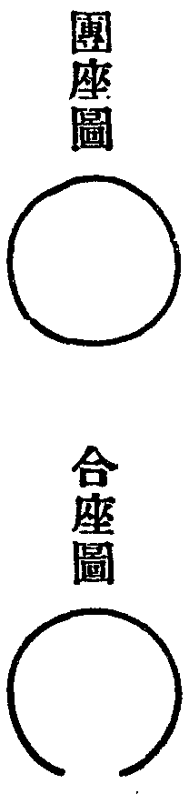



●第一座　第二座



飨礼第一筵谓之第一座。第二筵。谓之第二座。



敕修清规嗣法师忌云。如有三五人西堂则分作两座。第一座西堂吃汤。住持行礼。第二座两序吃汤。侍者行礼。



●小座汤二出座　四出座　六出座



敕修清规方丈小座汤云。四节讲行。按古有三座汤。第一座分二出。特为东堂西堂。请首座光伴。第二座。分四出。头首一出。知事二出。西序勤旧三出。东序勤旧四出。西堂光伴。第三座位。多分六出。本山办事。诸方办事。随职高下分座。职同者次之。首座光伴。



忠曰。出者特也。盖取首出杰特之义。



正字通云。出特也。过人之称徐稺传。角立杰出宜稺为先。



凡几出者皆除主位及光伴位而论之。



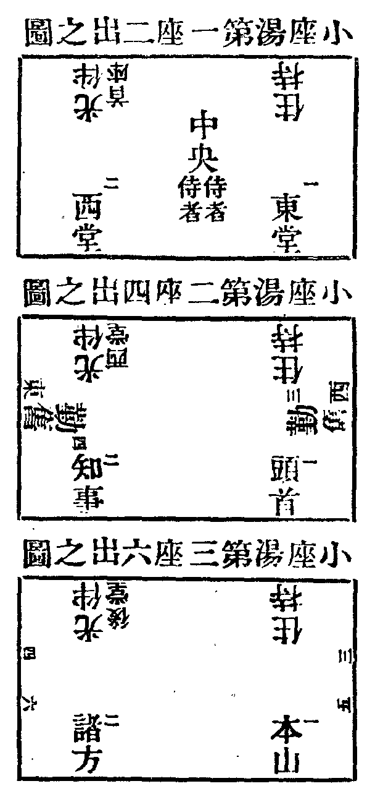



●特为汤四出



敕修清规方丈特为新旧两序汤云。新头首一出。新知事二出。旧头首三出。旧知事四。出餘勤旧预光伴者。列主伴两边。西序居左。东序居右。



●特为茶六出



校定清规夏前。住持特为新挂搭茶。六出之图。



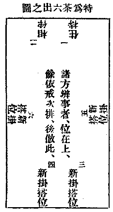



●特为茶八出座



校定清规知事头首。特为新挂搭茶。八出之图。



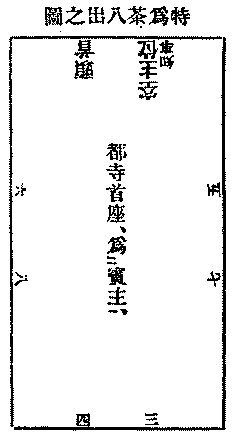



第四类　节时门



●四节



结夏。解夏。冬至。年朝。谓之四节。



义堂日工集云。凡称四节。乃百丈丛林也。结解则天竺佛制。冬年则中华俗节。百丈以随方毘尼。礼贵同俗。遂有四大节之仪。



校定清规云。今时丛林。每遇解结冬年四节。小参。盖为叙谢两班及大小职务。



敕修清规节腊章云。今禅林。结制以四月望。解以七月望者。若先一日。讲行礼仪。(乃至)中土以冬为一阳之始。岁为四序之端。物时维新。人情胥庆。礼贵同俗。化在随宜。故以结解冬年。为四大节。周旋规矩。耸观龙象之筵。主宾唱酬。兼闻狮子之吼。



杜氏通典云。汉高帝。十月定秦。遂为岁首。七年长乐宫成。制诸侯群臣朝贺仪。　又云。后汉岁首正月为大朝。受贺。



居家必用引之云。贺正名。自此始。



居家必用云。贺冬汉杂事曰。冬至阳生。君道长故贺也。



杜氏通典云。大唐开元八年。十一月。中书门下奏曰。伏以冬至一阳始生。万物潜动。所以自古圣帝明王。皆此日。朝万国。观云物。礼之大者。莫逾是时(云云)。从之。因敕。自今以后。冬至日。受朝。永为恒式。



●夏安居



安居义见于丛轨门。



四分律藏安居揵度法云。佛在舍卫国祇树给孤独园。时六群比丘。於一切时。春夏冬。人间游行。时夏月天暴雨。水大涨。漂失衣钵坐具针筒。蹈杀生草木。时诸居士见。皆共讥嫌。沙门释子。不知慙愧。蹈杀生草木。自言。我知正法。如是何有知正法。(乃至)诸外道法。尚三月安居。此诸释子。而於一切时。春夏冬。人间游行(云云)。诸比丘。以此因缘。具白世尊。世尊以无数方便。诃责六群比丘已。告诸比丘。从今已去。听诸比丘三月夏安居。白所依人言。我於此处夏安居。长老一心念。我比丘某甲。依某甲聚落。某甲僧伽蓝。某甲房前三月夏安居。房舍破修治故。如是第二第三说。后三月夏安居法。亦如是。



又见安居处。



西域记云。如来圣教。岁为三时。正月十六日。至五月十五日。热时也。五月十六日。至九月十五日。雨时也。九月十六日。至正月十五日。寒时也。　又云。印度僧徒。依佛圣教。坐雨安居。或前三月。或后三月。前三月。当此从五月十六日。至八月十五日。后三月。当此从六月十六日。至九月十五日。前代译经律者。或云坐夏。或云坐腊。斯皆边裔殊俗。不达中国正音。或方言未融。而传译有谬。



又云。印度僧徒。依佛圣教。皆以室罗伐拏月。前半一日。入雨安居。当此五月十六日。以頞湿缚庾阇月。后半十五日。解雨安居。当此八月十五日。印度月名。依星而建。古今不易。诸部无差。良以方言未融。传译有谬。分时计月。致斯乖异。故以四月十六日入安居。七月十五日解安居也。



善见律云。梵本律。五月十六日。为前安居。六月十六日。后安居。若安居中。有因缘移去。无罪。不成安居。



行事钞安居策修篇云。律通制三时。意存据道。文偏约夏月。情在三过。一无事游行。妨修出业。二损伤物命。违慈寔深。三所为既非。故招世谤。以斯之过。教兴在兹。　又云。春冬过少(又见丛轨门安居处)。



忠曰。三时。春夏冬也。天竺立三时。尽一年。故一时。各有四个月。



又云。初四月十六日。是前安居。十七日已去。至五月十五日。名中安居。五月十六日。名后安居。故律中。有三种安居。谓前中后也(又见丛轨门安居处)。



忠曰。事钞安居篇资持记云。一时四月。约过是同(止此)。按西域记。自五月十六日。至九月十五日。都四个月为雨时。乃佛教立三时。然即前安居者。开后一月。以五月十六日结。至八月十五日解。然事钞云。前安居。自四月十六日。此犹在热时。则为跨热雨二时。岂得言一时耶。亦不可称唯雨安居矣。是故以四月十六日结。顺传译乖谬也。若自五月十六日结。则一时四月之言。无爽。亦称雨安居无失。其后安居者。以六月十六日结。至九月十五日解。亦是在一雨时内。可称唯雨安居矣。



四分律云。尔时舍利弗目连。欲共世尊安居。十五日从所住处往。十七日乃至。不知当云何。即白诸比丘。诸比丘以此事白佛。佛言。听后安居。有二种安居。有前安居。有后安居。若在前安居。应住前三月。若后安居。应住后三月。



●结夏



忠曰。结夏安居之制也。又名结制(又见丛轨门。安居处)。



禅苑清规结夏云。行脚人。欲就处所结夏。须於半月前挂搭。所贵茶汤人事。不至仓卒。



中峰杂录示。众云若以至理言之。最初发心向道时。此夏已曾结了也。十二时中。看个所参底无义味话头。未即决了。便是坐夏时。三十年二十年。推到神消识尽。冷地里忽尔猛省得著。便是解夏之时。自恣之日。岂以区区九十日为限哉。



●一夏九旬



忠曰。从四月十五日。至七月十五日。都九十日。为一夏。复有禅祖。不拘时月。只数九十日为一夏者。传灯录。曹山本寂禅师章云。师曰。曹山一生行脚。到处只管九十日为一夏。



普灯录雪庭元净禅师章云。死心和尚道。山僧行脚三十餘年。以九十日为一夏。增一日也不得。减一日也不得。取不得。舍不得。不可得中只麼得。



有以八十日为期者。　中峰和尚杂录。冬安居示众云。以八十日。立为长期。欲诸人屏除心念。荡涤外缘。断绝妄情。纯一无杂。单单究此事。所云期者。廼相约之义。必期成佛作祖。必期及第心空。必期超越死生。必期续佛慧命。或不与所期相应。便是过此八十日之期。亦不肯懡㦬而休。须做一回倒断。



觉浪禅师尊正规云。结制之法。一年分为四期。一期是九旬。今定八旬为度。餘十日。宽其规矩。与学人。料理身分上事。或迁移别堂。及暂时告假干辨等。



忠曰。八十日为期。圆觉所谓下期也。



圆觉经圆觉菩萨章云。若法末时。具大乘性。欲修行者。即建道塲。当立期限。若立长期。百二十日。中期百日。下期八十日。安置净居(畧钞)。



●白夏



禅林类聚云。世尊在摩竭陀国。为众说法。是时将欲白夏。乃谓阿难云。诸大弟子。人天四众。我常说法。不生敬仰我。今入因沙旧室中。坐夏九旬。忽有人来。问法之时。汝代为我说。一切法不生。一切法不灭。言讫掩室而坐。(忠曰。此缘出诸佛要集经。)



行事钞安居策修篇云。安居。上座於一切僧。集时食时粥时浆时。应白言。尔许时已过。餘有尔许时在。若行此等行法者。是名僧父母。亦名僧师。　资持记云。白法中(云云)。今准义加。於小食上。维那打槌告云。白大众安居已过一日。餘有八十九日在当勤精进。谨慎莫放逸(餘日准此加减)。



●半夏



忠曰。结夏与解夏之中间也。



临济玄禅师录云。师因半夏上黄檗。见和尚看经。师云。我将谓是个人。元来是揞黑豆老和尚。住数日。乃辞去。黄檗云。汝破夏来。不终夏去。师云。某甲暂来礼拜和尚。黄檗遂打趁令去。师行数里。疑此事。却回终夏。



●破夏



忠曰。不守禁足之制。出界外游者。见半夏处。



行事钞自恣宗要篇云。若破夏不安居人。虽不得岁。以举罪义通。理必依众恣僧治举。　又云。问十五日自恣已。得出界不。答不得。破夏。离衣。由夜分未尽故。



北磵诗集云。藉甚参寥子临平破夏归。



参寥子诗集。临平道中诗云。风蒲猎猎弄轻柔。欲立蜻蜓不自由。五月临平山下路。藕花无数满汀洲。



●解夏



解夏安居之制也。又名解制。



禅苑清规解夏云。七月十四日晚。念诵煎汤。来日升堂。人事巡寮煎点。并同结夏之仪。



●自恣日



行事钞自恣宗要篇云。然九旬修道精练身心。人多迷己。不自见过。理宜仰凭清众埀慈诲示。纵宣己罪。恣僧举过。内彰无私隐。外显有瑕疵。身口托於他人。故曰自恣。



飜译名义集云。钵剌婆剌拏。音义指归。译为随意。寄归传云。凡夏罢岁终之时。此日应名随意。即是随他於三事之中。任意举发。说罪除𠎝之义。旧云自恣者。是义飜。然则自恣之言。涉乎善恶。今局善也。



释氏要览云。十诵云。好恶相教。以三语自恣。注三语者。谓见闻疑。



十诵律自恣法云。诸比丘。一处集。应三事求他说自恣。何等三。若见若闻若疑。(乃至)应差能作自恣人(广说)。应如是语。长老忆念。今僧自恣日。我某甲比丘。长老僧自恣语。若见闻疑罪。语我怜愍故。我若见罪。当如法除。



首楞严经云。属诸比丘。休夏自恣。　释要钞云。自恣。凡有二种五德。一举罪五德。谓知时不以非时。如实不以虚妄。利益不以损减。柔輭不以麤犷。慈心不以瞋恚。二自恣五德。谓不爱。不瞋。不怖。不痴。如自恣不自恣。然自恣通三日。七月十四。十五。十六。又修道安乐。亦通延日自恣。可延至八月十五日。(忠曰。释要依行事钞自恣宗要篇。)



行事钞自恣宗要篇云。然律中。但明十四日。十五日自恣。及至急施衣中。次第增中。十六日自恣。增三中。三日自恣。律云。安居竟自恣。则七月十六日为定律。又云。僧十四日自恣。尼十五日自恣。此谓相依问罪。故制异日。及论作法。三日通用。克定一期。十六日定。若有难者。如五百问中。一月自恣。



法苑珠林云。增一阿含经云。尔时世尊在舍卫国东鹿母园中。与大比丘众。五百人俱。是时世尊。七月十五日。於露地敷坐。比丘僧前后围遶。佛告阿难曰。汝今速击揵稚。今七月十五日。是受岁之日。阿难叉手。便说此偈。净眼无与等。无事而不练。智慧无染著。何等名受岁。世尊以偈报曰。受岁三藏净。身口意所作。两两比丘对。自陈所作短。还自称名字。今日众受岁。我亦净意受。唯愿原其过。是时阿难。闻已欢喜。即升讲堂。手执揵稚而说此偈。降伏魔力怨。除结无有餘。露地击揵稚。比丘闻当集。诸欲闻法人。度流生死海。闻此妙响音。尽当云集此。尔时阿难。击揵稚已。至世尊所。白世尊言。今正是时。唯愿世尊。何所敕使。是时世尊。告阿难曰。汝随次坐。当坐艸座。时诸比丘。各坐艸座。是时世尊默然。观诸比丘已。便敕诸比丘。我今欲受岁。我无过咎於众人乎。又不犯身口意耶。如来说此语已。诸比丘默然不对。是时再三。告诸比丘已。时尊者舍利弗。即从座起。长跪白世尊言。诸比丘众。观察如来。无身口意过。世尊今日不度者度。不脱者脱。不般涅槃者令般涅槃。无救护者为作救护。盲者为作眼目。为病者作大医王。三界独尊无能及者。以此事缘。如来无咎於众人。亦无身口意过。是时舍利弗白世尊言。我今自陈。无咎於如来。及比丘僧乎。世尊告曰。汝舍利弗。都无身口意。所作非行。汝今智慧。无能及者。汝今所说。常如法义。未曾违理。是时舍利弗。白佛言。此五百比丘。尽当受岁。尽无咎於如来乎。世尊告曰。亦不责此五百比丘身口意。此舍利弗。大众之中。极为清净无瑕秽。今此众中。最小下坐。得须陁洹。必当上及不退转法。以是之故。我不恐责此众。(忠曰。所援增壹经第二十四卷。善聚品文也。今以珠林略钞简明。依珠林所载耳。)



●法腊



敕修清规节腊章云。或曰坐夏。或曰坐腊。戒腊之义始此。如言验蜡人氷以坐腊之人验其行。犹氷洁。或谓埋蜡人於地。以验所修之成亏者。类淫巫俚语。庸非相传之讹耶。且吾所修证。圣不能窥。岂外物。可测其进退哉。



玄应众经音义云。腊力盍切。案风俗通曰。夏曰嘉平。殷曰清祀。周曰大蜡。汉曰腊。腊猎也。猎取禽兽。祭先祖也。此岁终祭神之名也。经中言腊佛者。即此义也。或曰腊者接也。新故交接也。诸经律中。亦名岁。如新岁经等。尔雅注云。一终名岁。又取岁星行一次也。夏曰岁。商曰祀。周曰年。唐虞曰载。皆据一终为名。今比丘。或言腊。或云夏。或言雨。亦尔。皆取一终之义。案天竺多雨。名雨安居。从五月十五日。至八月十五日也。上人罗诸国。至十二月安居。今言腊者。亦近是也。此方言夏安居。各就其事制名也(路史餘论云。蜡与腊异。腊者祭先祖。蜡者报百神)。



万卷星罗云。自冬至日去后。第三戌为腊也。若冬至日值戌日。此便为一戌之数。或三戌日。在十一月内。须用第四戌日。在十二月之内。是定之。



僧史畧赐夏腊章云。所言腊者。经律中。以七月十六日。是比丘五分法身生来之岁。首则七月十五日。是腊除也。比丘出俗。不以俗年为计。乃数夏腊耳。经律又谓十五日。为佛腊日也。



盂兰盆经。孤山释云。腊者以七月十六。是比丘五分法身。生来岁首。则以七月十五。为岁除者非。以七月十六方始入腊。八月十六。是岁首。十五为岁除耳。学者宜知。



忠曰。盖孤山依玄奘前安居。以五月十六日入之说。故八月十五日。为岁除矣(玄奘说。见夏安居处)。



祖庭事苑风穴众吼集。蜡人氷注云。蜡当作腊。谓年腊也。按增辉记。腊接也。谓新故之交接。俗谓腊之明日。为初岁也。盖腊尽而岁来。故释式以解制受腊之日。谓之法岁是矣。天竺以腊人为验者。且其人腊有长幼。又验其行有染净。言腊人冰者。是言其行之冰洁也。今众中妄谓。西天立制。唯观蜡人之冰融。然后知其行之染净。佛经无文。律范无制。未详得是说於何邪。今此集以腊为蜡。深误后人。良可叹也。



东谷禅师。解夏普说云。西天铸蜡人为验。行全则氷。不全则冸。



宋曾三异同话录云。僧家所谓。伏蜡者。谓削发之后。即受戒。若或断酒色等若干件。每岁禁足结夏。自四月十五日。至七月十五日。终西方之教。结夏之时。随其身之轻重。以蜡为其人。解夏之后。以蜡人为验。轻重无差。即为验。定而无妄想。其有妄想者。气血耗散。必轻於蜡人矣。汤朝美作本然僧塔铭。写作伏腊之腊。盖未详此也。



忠曰。曾儒必得之妄僧。敢作此说。佛教所无。其造语艰滞。可笑。以朝美作腊。却为非。犹如己倒悬。而嘲人之正立矣。



●戒腊



同法腊。



忠曰。自受具足戒。同大僧。归僧堂办道。安居满而受法岁。故凡为僧者。从此年数去。言戒腊几多。或言坐几夏也。



旧说曰。古者以安居禁足。数几腊。僧传所谓。世寿若干。法腊若干。是也。今时不必然。但自剃度年。数为几腊而已。



忠曰。从为僧数夏腊。亦有例证。如云峰悦禅师七岁剃度。佛祖通载书云。住世六十六年。为僧五十九夏(止此)。岂七岁非年满。而受具耶。



●法岁



比丘以七月十五日。受法岁。见自恣处。义同法腊也。



释氏要览云。夏腊即释氏法岁也。凡序长幼。必问夏腊。多者为长。故云。天竺以腊人为验焉。经音疏增辉记。皆云腊接也(蔡邕独断云。腊者。岁之终也。晋博士张亮议云。腊接也。新故交接)。俗谓腊之明日。为初岁也。今释氏自四月十六日前安居入制。至七月十五日。为受腊之日。若俗岁除日也。至十六日。是五分法身生养之日。名新岁也。自夏九旬。统名法岁矣。



四分律云。前安居者。欲自恣。后安居者。不知得自恣不。佛言。听受自恣。住待日足。前安居人。自恣已数岁。后安居人。不知得数岁不。佛言。不应三月未足。便数岁。



●八朔



镜堂圆禅师建仁录。八月旦上堂云。扶桑八月初一。古谓天中佳节。各祈妖怪潜踪。皆愿口舌消灭(云云)。



忠曰。八朔为天中节。盖日本传习耶。　月令广义云。道书正月一日。天中节会之辰。献寿之日。又云。提要录。五月五日午时。为天中节。



汉制攷云。法言𦝼腊。注𦝼八月旦也。今河东俗。奉以为大节。祭祀先人也(杨子法言问道篇。注光曰。𦝼落侯切)。



月令广义云。音义冀州北。八月朔作饮食为𦝼。俗曰𦝼腊。



忠曰。八朔𦝼之说。如此著矣。然公事根源云。八朔风俗。此事更无本说(止此)。何耶。



●授衣节



镜堂圆禅师建仁录。授衣节上堂云。人间九月授衣时。破绽禅和犹未知。趁暖急须先补缀。待寒方觉已迟迟。



●冬安居



和汉禅林。夏安居之外。坐冬安居。即以十月十六日结。到明年正月十五日。以谓其便于禅坐。胜夏安居焉。既为古矣。行事钞云。律通制三时(前夏安居处引)。故知佛制。亦有冬安居也。



梵网经故入难处戒中云。若佛子。常应二时头陀。冬夏坐禅。结夏安居。常用十八种物(经具列)。常随其身。头陀者。从正月十五日。至三月十五日。八月十五日。至十月十五日。是二时中。此十八种物。常随其身。如鸟二翼。



忠曰。盖言行头陀。可於夏冬二安居之间。其云从正月十五日。便可知有冬安居也。冬安居了之明日。始头陀也。



永平道元和尚云。梵网经中。虽有冬安居文。其法不传。但九夏安居法传焉。



荣西和尚兴禅护国论云。夏冬安居。谓四月十五日结夏。七月十五日解夏。又十月十五日受岁。正月十五日解岁。二时安居。并是圣制也。不可不信行。我国此仪绝久矣。大宋国比丘者。二时安居无阙怠。不安居。而称夏腊之二名。佛法中可笑也。



忠曰。言十月十五日受岁者。恐未晓增壹七月十五日受岁之说耶。



五灯会元。第二世宝寿和尚(失名嗣宝寿沼)。章云。在先宝寿为供养主。寿问。父母未生前。还我本来面目来。师立至夜深。下语不契。翌日辞去。寿曰。汝何往。师曰昨日蒙和尚设问。某甲不契。往南方。参知识去。寿曰。南方禁夏不禁冬。我此间禁冬不禁夏。汝且作街坊过夏。若是佛法阛阓之中。浩浩红尘。常说正法。师不敢违(传灯广灯。第二世宝寿章。不收此缘)。



大隋真禅师录云。老僧行脚时。看他眼目稍似根性有些些器量。方欲过一夏或一冬(详于参请门。徧参处)。



月江印禅师再住淀山录解制上堂云。南方禁夏不禁冬。北方禁冬不禁夏。



又覩货逻国。以十二月十六日。安居　西域记云。覩货逻国气序既温。疾疫亦众。冬末春初。霖雨相继。故此境已南。滥波已北。其国风土。并多温疾。而诸僧徒。以十二月十六日。入安居。三月十五日。解安居。斯乃据其多雨。亦是设教随时也。



云栖山房杂录即事诗云。春开讲演席。挂钵声相鸣。秋结禅那期。孤存二三僧。



忠曰。由此云栖结秋安居也。



●冬夜



忠曰。冬至前夜也。



幻住清规。十一月冬至云。其冬夜。土地堂念诵。及冬朝讲礼。



●分冬



冬夜也。



虗堂径山后录云。僧问(云云)。僧云。只如径山。今冬果子贵。将什麼与诸人分冬。师云。铁酸豏。



●冬朝



忠曰。冬至之朝也。见于冬夜。又贺冬义。见四节处。



●分岁



联灯会要北禅贤禅师章云。岁夜小参示众云。年竆岁尽。无可与诸人分岁。且烹个露地白牛。炊黍米饭。向骨柮火唱村田乐。何故免见倚他门户。傍他墙。刚被时人唤作郎。便下座。



●年朝



忠曰。正月朔日也。贺正义见四节处。



●善月



忠曰。此三个月特可修善。故正五九。为善月。



敕修清规善月云。正五九为善月。　又云。始由隋开皇三年。诏天下。正五九。并六斋日。各寺建祈祷道塲。不得杀生命。取藏经中。有毗沙门天王。每岁巡按四大部洲。正五九月。治南瞻部洲。故禁屠宰。而唐之藩镇。每上任。必犒士卒。不下数万人。须大烹宰。故以正五九。不上官。为禁杀也。而俗以为忌者非(开皇诏。依三宝纪。见三长斋月处)。



群谈采餘辨惑类云。正五九月。新官到任。今人多忌。不知所谓。考之。唐时以此三月。断屠宰。上任必有大宴。宰割遍及下人。缘禁不便。故於正五九不上任。非其利也。今无禁而不用。至於移居忌之。岂非因袭之弊耶。又一说。以正五九月建乃寅午戌也。寅午戌属火。臣音为商。商属金。恐火之尅於金。故忌之。未知是否。



忠曰。寅午戌火。尅商金之说。儒家不晓三长斋月。出于佛书。断屠妨犒宴矣。



教苑清规云。正五九月。为三长斋。世称善月。每月建祈福道塲。提谓经云。诸天帝释。太子使者。阎罗鬼神。俱用正五九月旦日。案行王民等。为善恶者。四时交代。岁终三覆。以校。与四王。一月六奏。使无枉错。覆校众生罪福。作善降祥。不善降殃。自隋开皇三年。诏天下。正五九月。及六斋日。不得杀生命。唐武德二年。诏天下。正五九月。十斋日。不得行刑屠钓。逮今圣朝。遵行尤笃。各寺凡届斯期。[母-(、/、)+〡]或怠也。



●三长斋月



即善月也。斋义。见杂行门持斋处。



释氏要览云。三长月。不空羂索经云。诸佛神通之月。智论云。天帝释。以大宝镜。从正月照南郯部洲。二月照西洲。至五九月。皆照南洲。察人善恶。故南洲人。多於此月。素食修善。故经云年三长斋也。又一说。北方毗沙门天王。巡察四洲善恶。正月至南洲。亦如镜照。至五九月皆察南洲故。



忠曰。智度论无帝释照镜之文(智论但有六斋日说而已。见六斋日处)。要览妄引。



梵网经诈亲害生戒中云。於六斋日。年三长斋月。作杀生。劫盗。破斋。犯戒者。犯轻垢罪。



梵网传奥疏云。三长斋月者。智论说。天帝以大宝镜。共诸天众。从正月一日。照南洲。善恶具录。如是二月东。三月北。四月西。五月还至此。九月亦然。



梵网明旷疏云。年三长月者。正月是众生现生之初。五月是兴盛之中。九月是敛藏之始。



忠曰。释门正统举二说。正是用传奥明旷疏耳。又明旷义。正依提谓经意(次下引)。又通月令义(见于后引鼠璞中)。敛藏。疏作欲藏。写讹也。



梵网私记云。年三长斋者。正月初半。五月上半。九月初半。并是也。



补忘钞云。既云初半。乃知白月也。法苑珠林亦云。从一日至十五日。



资持记云。年三者。正五九月。冥界业镜。轮照南洲。若有善恶。镜中悉现。　注。或云天王巡狩四天下。此三月对南洲。又云。此三月。恶鬼得势之时。故令修善。



法苑珠林云。提谓经云。提谓长者白佛言。世尊岁三斋皆有所因。何以正用正月三月九月。六日斋用月八日。十四日。十五日。二十三日。二十九日。三十日。佛言。正月者。少阳用事。万神代位。阴阳交精。万物萌生。道气养之。故使太子。正月一日持斋。寂然行道。以助和气。长养万物。故使竟十五日。五月者。大阳用事。万物代位。艸木萌类。生毕百物。怀妊未成。成者未寿。皆依道气。故持五月一日斋。竟十五日。以助道气。成长万物。九月者。少阴用事。乾坤改位。万物毕终。衰落无牢。众生蛰藏。神气归本。因道自宁。故持九月一日斋。竟十五日。春者万物生。夏者万物长。冬者万物藏。依道生没。天地有大禁。故使弟子乐善者。避禁持斋。救神故尔。长者提谓白佛言。三长斋。何以正月一日至十五日。复言。如何名禁。佛言。四时交代。阴阳易位。岁终三覆以校。一月六奏。三界皓皓。五处录籍。众生行异。五官典领。校定罪福。行之高下。品格万途。诸天帝释。太子使者。日月鬼神。地狱阎罗。百万神众等。俱用正月一日。五月一日。九月一日。四布案行帝王。臣民。八夷。飞鸟。走兽。鬼龙行之善恶。知与四天王。月八日。十五日。尽三十日。所奏同。无不均天下。使无枉错。覆校三界众生。罪福多少。所属福多者即生天上。即敕四镇。五官。大王。司命。增寿益算。下阎罗王。摄五官除罪名。定福禄故。使持是三长斋。是故三覆八校者。八王日是也。亦是天帝释。辅镇五官。四王地狱王。阿须伦。诸天。案行。比校。定生注死。增减罪福多少。有道意无道意。大意小意。开解不开解。出家不出家。案比口数。皆用八王日。何等八王日。谓立春。春分。立夏。夏至。立秋。秋分。立冬。冬至。是谓八王日。天地诸神。阴阳交代。故名八王日。月八日。十四日。十五日。二十三日。二十九日。三十日。皆是天地用事之日。上下弦望朔晦。皆录命上计之日。故使於此日自守持斋以还。自校使不犯禁。自致生善处。



已下录三斋月断刑屠。



历代三宝记。大隋录云。开皇三年。降敕旨云。好生恶杀。王政之本。佛道埀教。善业可凭。禀气含灵。唯命为重。宜劝励天下。同心救护。其京城及诸州官。立寺之所。每年正月五月九月。恒起八日。至十五日。当寺行道。其行道之日。远近民庶。凡是有生之类。悉不得杀。



陆游老学庵笔记云。唐高祖实录。武德二年。正月甲子。下诏曰。释典微玅。净业始於慈悲。道教冲虗。至德去其残暴。况乎四时之禁。毋伐麛卵。三驱之礼。不敢顺从。盖欲敦崇仁惠。蕃衍庶物。立政经邦。咸率斯道。朕祇膺灵命。抚遂群生。言念亭育。无忘鉴昧。殷帝去纲。庶踵前修。斋王舍牛。实符本志。自今每年。正月。五月。九月。十直日。并不得行刑。所在公私。宜断屠杀。此三长月。断屠杀之始也。唐士大夫。如白居易辈。盖有遇此三斋月。杜门谢客。专延缁流。作佛事者。今法至此月。亦减去食芋钱。盖其遗制。



事物纪原云。断屠。唐刑法志曰。武德二年诏。断屠日不行刑。会要曰。武德二年。正月二十四日诏。自今后。每年正月五月九月。及每月十斋日。并断屠。按此则是断屠之制。起於唐高祖也。杜佑集历代沿革事。为通典。前此无文。而首载武后圣历二年事。验此可知也。宋朝因之。临时限日云。



(忠曰。十斋日者。佛祖统纪云。十斋经。於六斋日加月旦。十八。二十四。二十八。四日也。今国律令诸州十直日。不得行刑。正据此义。)



忠曰。老学笔记。事物纪原。并以唐高祖武德。为善月断屠之始制。盖在唐此可为始焉。若远论之。隋文帝开皇。为正五九月断屠之始。见三宝记。敕修清规依之(见善月处)。



宋许观东斋纪事云。高承事物纪原。唐刑法志。武德二年。诏断屠日。不行刑。会要曰。武德二年。正月二十四日诏。自今以后。每年正月五月九月。及每月十斋日。并断屠。按此。则断屠之始。起于唐高祖也。承所纪非也。隋高祖仁寿三年诏。六月十三日。是朕生日。宜令海内为武皇帝后断屠。则此制。隋已有之。不始於唐已。



忠曰。东斋总论断屠。言不始於唐。是也。其言始於隋仁寿。犹未是也。若论天子生日断屠。则以隋仁寿为始。若论正五九月断屠。以隋开皇为始。凡儒氏不得历代三宝记说。往往失攷。



询𫇴录(阙撰人名)云。新官到任。多忌正五九三月。不知所谓。唐以此三月。断屠宰。节度使上任。必有大宴。宰割遍及下人。缘禁不便事。故於此三月不上任。非不利也。今无斋禁。而亦不用。岂非因袭之弊哉。



宋戴埴鼠璞云。今俗人。食三长月素。按释氏智论。天帝释。以大宝镜。照四大神洲。每月一移。察人善恶。正五九月。照南赡部洲。唐人於此三月。不行死刑。曰三长月。节镇因戒屠宰。不上官。是以天帝释为可欺也。妄诞可笑。然月令。於孟春言。无伤胎卵。毋聚大众不可称兵。於仲夏言。君子斋戒。必掩身毋躁。薄滋味。节嗜欲。静事毋刑。於季秋言。命众百官。无不务内。以会天地之藏。无有宣出。岂时令当然耶。



忠曰。如埴言。实十二月。只三月戒屠宰。而餘九月。否则为欺天帝。汝若然。当全十二月。禁屠杀奉戒善。有何不可耶。若言不能之。则且帝释亲临三月。奉杀禁。犹优都无戒矣。譬如世人闲居汰傲。若君父来视。则改容示恭焉。



瑯邪代醉编云。正五九月。不上官。戴埴云。释氏智论。天帝释以宝镜。照四大神洲。每月一移。察人善恶。此三月照南赡部州。唐人以此不行死刑。曰三长月。节镇因戒屠宰。不上官。后世因之。欧阳永叔治平丁未三月。出知亳州。陛辞乞便。道过颖。许之。公与曾舍人书云。在颖无所营为。所以少留者。盖避五月上官尔。此老未能免俗。亦可笑也。王元美曰。宋人以是三月。食素诵经。已可笑矣。今人不断屠宰。但不上任。尤为无谓。或曰。宋朝火德。火生于寅。旺于午。墓于戌。此三月谓之灾月。官员例减。禄料无羊。故又谓无羊之月。众皆避之。似胜。但长生帝旺。禄命家所喜。何以谓灾。至胡太仆汝嘉谓火君象。臣下宜避。尤无谓。



容斋随笔云。释氏以正五九月。为三长月。故奉佛者。皆茹素。其说云。天帝释。以大宝镜。轮照四天下。寅午戌月。王临南赡部洲。故当食素以徼福。官司谓之断月。故受驿券。有所谓羊肉者。则不支。俗谓之恶月。士大夫赴官者。辄避之。或人以谓。唐日。藩镇莅事。必大享军。屠杀羊豕至多。故不欲以其月上事。今之他官。不当尔也。然此说。亦无所经见。予读晋书礼志。穆帝纳后。欲用九月。九月是忌月。北齐书云。高洋谋篡魏。其臣宋景业言。宜以仲夏受禅。或曰五月不可入官。犯之。终於其位。景业曰。王为天子。无复下期。岂得不终於其位乎。乃知此忌相承。由来已久。竟不能晓其义。及出何经典也。



野客丛书云。随笔云。齐书高洋谋篡魏。其臣宋景业言。宜以仲夏受禅。或曰。五月不可入官。犯之不终於其位。景业曰。王为天下。无复下期。岂得不终其位。乃知。此忌相承已久。不晓其义。仆观前汉张敞。为山阳太守奏曰。臣以地节三年五月视事。其言如是。则知前汉之俗。未尝忌五月也。然张敞在山阳。监护骄贺。其责甚难。卒以无事。其后徵为胶东相。亦不闻有凶横之说。又观后汉朔方太守碑云。延嘉四年。九月乙酉。诏书。迁衙令五月正月到官。乃知拘忌之说。起於两汉之后。然又观独孤及集。有为舒州到任表曰。九月到州讫。乃知唐人亦有不忌九月者。因考诸州唐人题名。见不避正五九处亦多。



●神通月



三长斋。又名神通月。神变月。神足月等。



不空羂索神变真言经云。修此法者。当于十方一切诸佛神通月修。所谓正月五月九月。白月一日至十五日。如法清净。读诵受持。即得成就。



神变月　杂阿含经云。於月八日。十四日。十五日。及神变月。受戒布萨。



神足月　杂阿含经云。於法斋日。及神足月。受持斋戒修功德。



●四孟月



敕修清规月分须知云。正月初一日。有处四孟月。大众行道。讽经祈保。



群书拾唾云。四孟。孟春(正月)。孟夏(四月)。孟秋(七月)。孟冬(十月)。



●旦望



敕修清规。住持日用云。凡旦望。侍者隔宿。禀住持云。来晨祝圣上堂。



幻住清规云。一年十二月。遇初一十五。是谓朔望。须就粥前。讽大悲咒祝圣。



兴禅护国论云。报恩。谓每月朔日。奉为今上皇帝。讲般若经。十五日。奉为先皇。讲大涅槃经。有祈请句。



忠曰。旦望礼仪。亦是随世俗焉。



居家必用云。朔望广州记。尉陀立朝台。朔望升拜。名此始也。



杜氏通典云。大唐永徽二年。八月二十九日。下诏。来月一日太极殿受朝。此后每五日。一度。太极殿视事。朔望朝。即为恒式。



旦谓朔日　忠曰。清规朔日十五日。为旦望。或言月旦月望(见四齐日处)。而韵书无朔曰旦之训。按西京杂记云。月之旦为朔。车之辀亦谓之朔。名齐实异(止此)。又后汉书。许劭论乡党人物。每月辄更其品题。故汝南俗。有月旦评焉(止此)。月令广义每月令。载此。以系初一日。可证月旦为月朔也。又叶隆礼辽志岁时杂记。题正旦。其中记正月一日事。



望谓十五日　品字笺云。朢说文月满与日相望如朝君也。从臣从月从壬壬朝廷也。徐曰。假借作望。增韵今经典通作望。



●五旦望



五参日。朔日。十五日。此谓五旦望也。皆有上堂。



敕修清规赴斋粥云。近时诸方住持。大钟鸣时。先入堂坐。至堂前钟鸣。方下地普同问讯。只遇五旦望讲行一次。新入众者。不知所自。



●五参日



五日一参。故曰五参。即五日。十日。二十日。二十五日也。详埀说门五参上堂。



校定清规云。如初五。初十。二十。二十五。此四日。谓之五参(详垂说门)。



忠曰。准春明退朝录。则五日。十一日。二十一日。二十五日也。



密庵杰禅师灵隐录上堂云。五日一参。诸方常例。不说少室单传。不说灵山受记(云云)。



中岩月禅师崇福庵录云。五参众立定。师出来。大众如例问讯。师云。五日前。山僧来到这里。诸人恁麼问讯。今日来到者里。亦是恁麼问讯。但恁麼去。有甚了期。便归室。



忠曰。可知日本此时有此规。



●三八日



古以每旬三八日念诵。乃一月有六日。今以上八。中八。下八。为三八。乃一月有三个八日也。故备用清规圣节云。圣节内遇八。佛殿念诵(又见讽唱门　诵)。



敕修清规念诵云。古规。初三。十三。廿三。初八。十八。廿八。今止行初八。十八。廿八。



盖上八中八念诵。祝祷帝道昌。法轮转等。下八念诵。令众观无常。其意见敕修清规念诵囘向文。



敕修清规圣节云。节内遇三八日。佛殿念诵。



荣西兴禅护国论云。念诵。谓每月。初三。十三。廿三。初八。十八。廿八。六个日。有仪式念十佛名。奉祝皇风远扇。帝道久润。佛法永弘。利生广大兼报一草一叶施主恩矣。



三八日入室　敕修清规入室云。今时以三八入室者。备故事也。



三八普说　西禅舜禅师上堂云。五日一参。三八普说(详垂说门五参上堂)。



●六斋日



忠曰。每月八日。十四日。十五日。二十三日。二十九日。三十日。此为六斋日。名义集云。逋沙他。此云斋日(止此)。斋义。详杂行门。持斋处。



智度论云。问曰。何以故。六斋日受八戒。修福德。答曰。是日恶鬼逐人。欲夺人命。疾病凶衰。令人不吉。是故劫初圣人。教人持斋。修善作福。以避凶衰。是时斋法。不受八戒直以一日不食为斋。后佛出世。教语之言。汝当一日一夜。如诸佛持八戒。过中不食。是功德将人至涅槃(论详说受八戒法)。



佛说四天王经云。佛告诸弟子。斋日责心慎身守口。诸天斋日伺人善恶。须弥山上。即第二天。天帝名因。福德巍典主四天。四天神王。即因四镇王也。各理一方。常以月八日。遣使者下。案行天下。伺察帝王臣民。龙鬼蜎飞。蚑行蠕动之类。心念口言。身行善恶。十四日遣太子下。十五日四王自下。二十三日使者复下。二十九日太子复下。三十日四王复自下。四王下者。日月五星。二十八宿其中诸天。佥然俱下。四王命曰。勤伺众生施行吉凶。若於斯日。有归佛归法归比丘僧。净心守斋。布施贫乏。持戒忍辱精进禅定。玩经散说。开化盲冥。孝顺二亲。奉事三尊。稽首受法。行四等心慈育众生者。具分别之。以启帝释。若多修德精进不怠。释及辅臣。三十二人。佥然俱喜。释敕司命。增寿益算。遣诸善神营护其身随戒多少。若持一戒。令五神护之。五戒具者。令二十五神。营卫门户。凶疫众邪阴谋消灭。夜无恶梦。县官盗贼。水火灾变。终而不害。禳祸灭怪。唯斯四等。五戒六斋耳。犹如大水。而灭小火岂有不灭者乎。临其寿终。迎其魂神。上生天上。七宝宫殿。无愿不得。若有不济众生之命。秽浊盗窃。婬犯他妻。两舌恶骂。妄言绮语。厌祷咒诅。嫉妬恚痴。逆道不孝。违佛远法。谤比丘僧。善恶反论。有斯行者。四王以闻。帝释及诸天。佥然不悦。善神不复营护之。即令日月无光。星宿失度。风雨违时。以现世人。欲其改往修来。洗心斋肃。首过三尊。四等养亲。忠于帝王。慈心谏诤。至诚无欺。反前修来。捐秽浊之操。就清净之道。若有改邪行。就正真者。帝释四王。靡不欢喜。日月即清明。星宿有常。风雨顺时。毒气消歇。天降甘露。地出泽泉。水糓滋味。食之少病。华色奕奕。寿命益长。生不更牢狱。死得上天。



智度论云。如四天王经中佛说月六斋日。使者太子。及四天王。自下。观察众生。布施持戒。孝顺父母。少者。便上忉利以启帝释。帝释诸天。心皆不悦。说言。阿修罗种多。诸天种少。若布施持戒。孝顺父母。多者。诸天帝释。心皆欢喜。说言。增益诸天众。减损阿修罗。是时释提婆那民。见诸天欢喜。说此偈言。六日神足月。受持清净戒。是人寿终后。功德必如我。佛告诸比丘。释提桓因。不应说如是偈。所以者何。释提桓因。五衰三毒未除。云何妄言持一日戒。功德福报。必得如我。若受持此戒。必应如佛。是则实说。诸大尊天。欢喜因缘故。得福增多。复次此六斋日。恶鬼害人。恼乱一切。若所在丘聚。郡县国邑。有持斋受戒善人者。以此因缘。恶鬼远去。住处安稳。以是故。六日持斋受戒得福增多。问曰。何以故。诸恶鬼辈以此六日。恼害於人。答曰。天地本起经说。劫初成时。有异梵天王子。诸鬼神父。修梵志苦行。满天上十二岁。於此六日。割肉出血以著火中。以是故。诸恶鬼神。於此六日。辄有势力问曰。诸鬼神父。何以於此六日。割身肉血。以著火中。答曰。诸神中。摩醯首罗神。最大第一。诸神皆有日分。摩醯首罗。一月有四日分。八日。二十三日。十四日。二十九日。餘神一月有二日分。月一日。十六日。月二日。十七日。其十五日。三十日(法苑珠林其字在月二日上)。属一切神。摩醯首罗为诸神主。又得日多。故数其四日为斋。二日。是一切诸神日。亦数以为斋是故诸鬼神。於此六日。辄有力势复次诸鬼神父。於此六日。割肉出血。以著火中。过十二岁已。天王来下。语其子言。汝求何愿。答言。我求有子。天王言。仙人供养法。以烧香甘果。诸清净事。汝云何以肉血著火中如罪恶法。汝破善法。乐为恶事。令汝生恶子。噉肉饮血。当说是时。火中有八大鬼出。身黑如墨。发黄眼赤。有大光明。一切鬼神。皆从此八鬼生。以是故於此六日。割身肉血。以著火中。而得势力。如佛法中。日无好恶。随世恶日因缘。故教持斋受戒。



忠曰。诸偈类要。援四天王经。全依智论引彼经捡此方藏中四天王经。无修罗增减文。按增壹阿含高幢品。杂阿含第四十。楼炭经忉利天品。正法念处经第六十八。竝说六斋日。有修罗增减文。大同智论说。



智度论云。从四天王。乃至净居天。是大力诸天来。小鬼避去。菩萨能生清净大心。是故来随逐法师。六斋日。诸天来观人心。十五日。三十日。上白诸天。复次是六斋日。是恶日。令人衰凶。若有是日受八戒。持斋布施听法。是时诸天欢喜。小鬼不得其便。利益行者。



优婆夷堕释迦经云。何等为佛正斋法。是间有贤善人持戒。一月六斋。(乃至)斋日朝起。告家中言。今日我身斋。家中莫饮酒。莫鬬诤。莫道钱财。



观普贤行法经云。刹利居士。於六斋日。敕诸境内。力所及处。令行不杀。



梵网经疏云。三斋六斋。并是鬼神得力之日。此日宜修善。(乃至)年三长斋。月六斋斋。本为在家。出家尽寿持斋。不论时节。



提谓经说见三长斋月处。



摩诃般若经云。佛告须菩提。是善男子善女人。若六斋日。月八日。二十三日。十四日。二十九日。十五日。三十日。在诸天众前。说是般若波罗蜜义。是善男子善女人。得无量无边。阿僧祇。不可思议。不可称量福德。何以故。须菩提。般若波罗蜜。是大珍宝。何等是大珍宝。是般若波罗蜜。能拔地狱畜生饿鬼。及人中贫竆。能与刹利大姓。婆罗门大姓。居士大家。能与四天王天处。乃至非有想非无想处。能与须陀洹果。斯陀含果。阿那含果。阿罗汉果。辟支佛道。阿耨多罗三藐三菩提。



四分律云。佛在罗阅城。时城中诸外道梵志。三时集会。月八日。十四日。十五日。众人大集。来往周旋。共为知友。给与饮食。极相爱念。经日供养。时瓶沙王。在阁堂上。遥见问左右人。(乃至)瓶沙王。即下阁堂。往诣世尊所。头面礼足。白佛言。罗阅城中。梵志。三时集会。善哉世尊。今敕诸比丘。令月三时集。(乃至)我及群臣。亦当来集。时世尊。默然受王语。集比丘僧。告。八日。十四日。十五日。大众集。瓶沙亦将群臣来集。诸长者。欲闻说法。佛听比丘说契经(畧钞)。



忠曰。白月三时。黑月三时。即是六时。



大毘婆沙论云。三十三天。於白黑月。每常八日。若十四日。若十五日。集善法堂。称量世间。善恶多少。见造善者。便拥护之。见造恶者。即共嫌毁。



●四斋日



敕修清规。四斋日祝赞云。月旦。月望。初八。廿三。四斋日。隔宿。堂司行者报众。挂讽经牌。　又知殿云。四斋日。开殿门。以便往来瞻礼。



旧说云。六斋日中。举此四者朔望。及白黑二月之分中也。乃初八上弦。二十三下弦也。



幻住清规朔望回向。称月旦月望令辰。　又云。初八廿三日。但称斋戒令辰。



●寅旦



日用轨范偈云。从朝寅旦直至暮。一切众生自回互。



旧说曰。凡报时钟及某时正中。而击之。或以击钟时。为初入某时者谬矣。譬如击丑时钟。而经半时。为寅时之初又击寅时钟而经半时。为寅时之终。即是卯时之初也。每每如此。



传灯录载宝志和尚十二时颂。其十二时者。曰平旦寅。曰日出卯。曰食时辰。曰禺中巳。曰日南午。曰日昳未。曰晡时申。曰日入酉。曰黄昏戌。曰人定亥。曰夜半子。曰鸡鸣丑也。



●明相



法苑珠林云。若欲解斋。要待明相出时。始得食粥。不尔破斋。何名明相。如萨婆多论云。明相有三种色。若日照阎浮提树。则有黑色。若照树叶。则有青色。若过树叶。则有白色。於三色中。白色为正。始得解斋。食其粥也。



释氏要览云。四分律云。明相出。始得食粥。餘皆非时。婆沙论云。明相有三。初日照剡部树身。天作黑色。二日照树叶。天作青色。三日过树。天作白色。三色中。取白色为正时。须舒手见掌文分明。始得食粥。



澂彧前闻记云。天龙第二代佛慈禅师者。名志玄。号无极。初住临川。一日粥早。师不展钵。首座以为不安。候之。师曰。古规不云乎。掌文见而吃粥。老僧何病之有。至今临川。晓钟虽绝。开静待明者。师遗范也。



忠曰。无极不展钵者。谙律文也。首座以为不安者。盲于佛制也。开静待明。本是律法。不可必为师遗范也。



四分律云。非时者。从日中。乃至明相未出。若比丘。非时受食食。咽咽波逸提。



大般若经云。如见东方。赤明相现则知。不久日轮当出。若闻般若波罗蜜多。当知是人。去佛不远。



●粥罢



吃粥之后也。



敕修清规圣节云。至五更。住持行香回。再覆粥罢上堂。



●半斋



旧说云。在粥与斋之半。故曰半斋。



又见讽唱门。



忠曰。半者。犹如备用清规半晚之半。然世有不辨半斋义者。妄引杂譬喻经半日斋因缘(杂譬喻经云。昔大檀越。请佛僧饭。有一卖酪客至。因留其饭。劝持斋戒听法暮归。妇言。我朝未饭。延待至今。强令相伴败坏其斋半斋之福。七生天上七生人间。一日持斋。有六十万岁粮)。令其义。益隐矣。或援寄归传半者蒲膳尼。半者珂但尼。亦不当也。又半斋者。时名也。然以半斋讽经称诵半斋则成歇后语。今援数语。证粥时与饭时之半义。



敕修清规告香曰。次早请参头茶。半斋请参头维那侍者点心。　又迎待尊宿云。半斋点心。　又两序进退云。方丈请半斋点心。斋时草饭。　又方丈特为新旧两序汤云。粥罢请新旧人茶。半斋库司点心(备用清规两序进退。亦有此语)。



●临斋



旧说曰。临斋者。临午斋之时也(又见讽唱门临斋讽经处)。



校定清规。住持出入云。或久出归时就临斋径入僧堂。伴众食毕。於挂钵时。令行者报云。堂头和尚巡堂问讯。



宗门统要。药山俨禅师章云。师一日临斋。院主报云。打钟也。请和尚上堂。师云。汝与我擎钵盂去(云云)。



●斋罢



午斋之后也。



敕修清规圣节云。至日斋罢。堂司行者。覆住持两序诸寮。挂念诵牌。



●斋退



即斋罢也。



敕修清规。山门特为新命茶汤云。斋退鸣鼓集众。



●参前



晚参之前。此曰参前。若无晚参。则放参已前也。



敕修清规圣节云。挂念诵牌。报众。参前巡廊鸣板。集众。



●参后



晚参或放参之后。曰参后。稍近薄暮也。



敕修清规坐禅云。参后坐禅。如常。



●参退



即参后也。



真净文禅师归宗录上堂云(云云)。今日庄主。设饡饭。俵𫎪钱。参退。僧堂内。普请吃茶去。



●半晚



斋了与晡时之半时也。



备用清规。知浴云。半晚。浴头覆首座方丈维那。鸣鼓三下。　律苑事规全同。



敕修清规知浴。半晚作斋罢。



●晚刻



敕修清规。山门特为新命茶汤状式云。今晨晚刻就云堂点茶。



●昏钟鸣



敕修清规达磨忌云。昏钟鸣。再鸣僧堂钟集众。



又晚参云。移於昏钟鸣而谓之小参。　又对灵小参云。候昏钟鸣鸣鼓集众。



●人定



亥时也。宝志歌。见前寅旦处。



经国大典注解云。人定罢漏。人定初更三点。禁人行。罢漏。五更三点。放人行。



敕修清规钟云。人定时。一十八下。



白氏文集人定诗云。人定月胧明。香消枕簟清。



●隔宿



忠曰。前日也。与当日隔一宿。故言隔宿。



敕修清规景命四斋日祝赞云。隔宿。堂司行者。报众。挂讽经牌。



●念日



忠曰。日本禅林回向文。二十称念。如念一日。念二日也。古老解云。念字从八二。是十六数。心有四畫。合为二十也。余谓。此杜撰耳。此义出兼明书。又吾千山祖翁曰。禅苑用念字。自大德寺起。其祖忌。二十二日。维那举唱时。觉音累重。故以二十代念。言念二日。餘寺倣此用念字。又不必拘字音烦否。



忠按。禅林二十。用念字。亦尚矣。　奥山方广寺无文禅师录云公大师拈香云。今月念二日。兹值先妣云公大师。七周之忌辰。



月庵光禅师录拈香云。今月念日。恭值先妣宗城禅尼。三十三回之忌辰。



兼明书云。吴主之女。名二十。而江南人呼二十。为念。而北人不为之避也。



字林云。廿音念。二十并也。



小补韵会缉韵云。按廿字诸韵书皆音入。市井商贾。或音念。学士大夫。亦从其误者。惟程篁墩文集中。书廿日。作念字。



焦氏笔乘云。颜之推稽圣赋。魏妪何多。一孕四十。中山何夥有子百廿。廿音入。而集反。说文二十并也。俗音念者误。



●大夜



敕修清规。尊宿迁化。对灵小参云。拜请主丧人。大夜对灵小参。　又亡僧云。大夜念诵。



天如则禅师录。有徐氏大夜小参。



旧说曰。物故之夜。曰当夜。次夜曰大夜。又次荼毘夜也。大夜者。女之婚嫁。谓之大归。一往不复反也。人之死类此。无复反理。故曰大夜。又曰迨夜。宿夜。伴夜。赠别夜等。或世称忌辰前夜。为大夜者。非也。大鉴清规末后事仪云。入灭第三日荼毘。先第二日晚夜。此时名大夜。大夜之义。谓只此一夜之留。明日出而不归也。故慇懃供养小师围绕。终夜不寐。名曰伴夜。唯诵金刚经鸣磬。



忠曰。东渐清规云。物故之夜。谓之大夜(止此)。误矣。小尔雅云。讳死谓之大行。



前汉书霍光传云。受皇帝信玺行玺大行前。



注韦昭曰。大行。不反之辞也。



正字通云。春秋庄四年。纪侯大去其国。传曰。大去者。土地人民。仪章器物。悉委置之。而不顾也。



忠曰。今大夜者大行之夜之谓也。大行之大。须以大去之大解也。



●迨夜



物故次夜。同大夜。



备用清规。对灵小参云。迨夜。法堂面真设座。对灵小参。　注迨夜者。乃宿夜。



忠曰。迨明日荼毘之夜也。诗经匏有苦叶篇云。士如归妻。迨氷未泮。



●宿夜



即迨夜也。



忠曰。明日荼毘之前夜。故曰宿夜。



幻住清规津送云。宿夜念诵。



●伴夜



大夜伴灵。故亦曰伴夜。



大鉴清规云。入灭第三日荼毘。先第二日晚夜。此时名大夜。大夜之义。谓只此一夜之留。明日出而不归也。故慇懃供养。小师围绕。终夜不寐。名曰伴夜。唯诵金刚经鸣磬。



●赠别夜



大夜也。见前大夜处。



大鉴清规云。今晚大夜。则午后。道旧辨事小师讽经。此名赠别经。以表生死道义也。



●正日



正日者当日也。



敕修清规帝师涅槃云。正日。鸣钟集众。　又灵骨入塔云。正日。鸣钟众集。



礼记礼器云。质明而始行事(止此)。质明者。正日也。



●忌日



释氏要览云。二月十五日。佛涅槃日。天下僧俗。有营会供养。即忌日之事也。俗礼。君子有终身之孝。忌日之谓也。又谓不乐之日。不饮乐故。或云讳日。或云远日(远日。犹滥曲礼丧事先远日)。释子师亡。可称归寂之日。盖释氏无忌讳故。



首楞严经云。时波斯匿王。为其父王。讳日营斋。



长水疏云。先王崩日。忌讳之辰。故云讳日。讳忌也。以忌举吉事。讳避其名。



●归寂日



见忌日处。



●七七日



释氏要览云。人亡。每至七日。必营斋追荐。谓之。累七。又云斋七。瑜伽论云。人死中有身(冥间化起一相似身传识谓之中有)。若未得生缘。极七日住(中阴经云。中有。极寿七日)。若有生缘即不定。若极七日。必死而复生。如是展转生死乃至七七日住。自此已后。决定得生。又此中有。七日死已。或於此类。由餘业可转。中有种子。便於餘类中有生。今寻经旨。极善恶无中有。既受中有身即中下品。善恶业也。故论云。餘业可转也。如世七日七日斋福。是中有身死生之际。以善追助。令中有种子。不转生恶趣。故由是此日之福。不可阙怠也。



地藏本愿经云。鬼王无毒。答圣女曰。此是南阎浮提造恶众生。新死之者经四十九日后。无人继嗣为作功德。救拔苦难。生时又无善因。当据本业所感地狱自然。



灌顶随愿往生十方净土经云。普广菩萨。语四辈言。若人临终。未终之日。当为烧香。然灯续明。於塔寺中。表刹之上。悬命过幡。转读尊经。竟三七日。所以然者命终之人。在中阴中。身如小儿。罪福未定。应为修福。愿亡者神。使生十方无量刹土。承此功德。必得往生。



●周祥



一周之祥祭。乃小祥忌也。



普灯录佛鉴懃禅师章云。五祖周祥上堂。去年今日时。红炉片雪飞。今日去年时。曹娥读夜碑。



●三年忌



叶县省禅师录先师(首山念)三周年忌颂云。师真似日。三周已毕。遍布乾坤。翘足七日。大展壃风。狐魅屏迹。香茶供养。光漆谁识。



●远年忌



虎关散语云。四十九日追荐。见于经文。百个日。一周忌。第三年忌。中华俗礼见于外典。十三年。三十三年等。始于日本。少纳言入道信西者卒。其子中有才人。始修十三年。三十三年追荐。尔来日本有此佛事。



梦语集云。十三年忌。三十三年忌。日本始行之。其十三年忌。见元享释书明遍传。今时更有十七年。二十五年佛事。



卧云日件录曰。南禅云卧庵。竺华。为一色泰云居士二十五年忌升座散说中。论二十五年忌。特设佛事出於近时。



清拙日本录普说。有三十三年忌说。可知。此时已有此忌祭。



忠曰。七七荐亡。经有明文。如前引证。一百日。一周忌。三年忌。儒家亦祭焉。所谓卒哭。小祥。大祥也。十三年忌。起於日本。元亨释书明遍传云。国俗荐十三年者。迎先支。而寓追慕。余谓。二十五年。亦本支再廻。故荐之。如七年。十七年。二十三年。二十七年。三十三年。则盖取乎三七之数矣。古云。三者数之小终(章怀太子)。七者天之纪数(空同子)佛教说七佛三遶有所表(事苑)礼云。祭不欲数。数则烦。祭不欲疏。疏则怠(祭义)。故先亡当三七年者。特祭而荐之。有慧空法师云。昔在尊氏薨。二十一年。而追荐之。大猷相公薨。二十一年。攀尊氏之例。追荐焉。盖二十一者。三累七数也。如日本神社。有二十一年。而新造其祠。伊势。春日。谈岑等是也。亦据斯义又荐五十年。一百年等。取其满数而已(梨窓随笔)。



近大德大心和尚。著修祭说云。明遍传。修十三年忌之外。东鉴有修二位禅尼。如实。十三年忌。又世传。建久(后鸟羽帝年号)壬子。镰仓赖朝。为父义朝。建胜长寿院于本府荐其三十三年忌。又宽元(后嵯峨帝)丙午。宋兰溪隆禅师来朝。明年修千光禅师三十三年忌於筑前州圣福寺(语录无语)。如二十五年忌应永(后小松帝)已后。禅祖诸录。间见。五十年忌。起乎应仁(后土御门)以后。一百年忌。创乎建武(后醍醐帝)之时。其后有十七年。二十一年。二十三年。二十七年之忌。又天长(淳和)丁未。弘法大师。应诏就乙训寺。修推古帝二百年忌(大师游方记)。又延德(后土御门)辛亥三月。阿波州主。细川源久之。请建仁天隐泽公於本州补陀禅寺。升座。荐其七世祖。永泰院源赖之一百年忌。泽公普说略云。兹承文安(后花园帝)丁卯。𨳝二月。细川某。当先祖光胜院源赖春(赖之之父)一百年忌。请相国寺竺云连禅师。就某寺佛事。是在家一百年忌之权舆也。其后长禄丁丑。将军尊氏公。一百年忌。文正(后土御门)丙戌。将军义诠公。一百年忌。皆开法筵於洛北等持院。盖取法於光胜者也。夫百年斋会。未见经典。盖十十满数。又分作三。预营为三十三年。复分其半。为十七年。不待十三年者。分半为七年(止此)。今按。普说配数。一时附会。或剩一。或欠一。不足据矣。



忠曰世有公事大成经。余闻。是伪造。非圣德及河胜作。其中有年忌说。或援之为实出于圣德。后生请莫信焉。



第五类　灵像门



●拈华释迦



联灯会要释迦牟尼佛章云。世尊在灵山会上拈华示众。众皆默然。唯迦叶破颜微笑。世尊云。吾有正法眼藏。涅槃妙心。实相无相。微妙法门。不立文字。教外别传。付嘱摩诃迦叶。



宗门杂录云。王荆公问佛慧泉禅师云。禅家所谓世尊拈花。出在何典。泉云。藏经亦不载。公曰。余顷在翰苑。偶见大梵天王问佛决疑经三卷。因阅之。经文所载甚详。梵王至灵山。以金色波罗花。献佛。舍身为床座。请佛为众生说法。世尊登座。拈花示众。人天百万悉皆罔措。独有金色头陀。破颜微笑。世尊云。吾有正法眼藏。涅槃玅心。实相无相。分付摩诃大迦叶。此经多谈帝王事佛请问。所以秘藏。世无闻者。



山庵杂录云。明善韩先生。书陆放翁普灯录叙草后云。放翁先生。手书普灯录叙。草本。报恩净上人之所藏也。余故有先生遗文二帙。其间误处。皆手自涂乙。传灯言。世尊举华。迦叶一笑。今讲者以为经无此事。诋其妄传。或曰。金陵王丞相。於秘省得梵王决疑经阅之。有此语。有所避讳。故经不入藏。今先生以为。书之木叶旁行之间。不知即丞相之所见。以否。其言如此。必有所考矣。并书其后云。夫二先生。学广理明。其言岂妄。近翰林宋公。为余叙应酬录。亦曰。予观大梵天王问佛决疑经。所载拈花(云云)。宋公既亲观之。则此经世必有之。而或者诋以为妄。前云。有所避讳。故不入藏。斯言尽矣



宋文宪公护法录瑞岩和尚语录序云。予观大梵天王问佛决疑经所载。梵王以金色波罗夷花。献佛。请为说法。佛拈花示众。人天百万。悉皆罔措。独金色头陀。破颜微笑。佛云。吾有正法眼藏。涅槃玅心。实相无相。分付摩诃迦叶。呜呼此非禅波罗蜜之初乎。



●宝冠释迦



忠闻佛匠说。十六罗汉中尊。必用宝冠释迦。宝冠有五佛像。中央大日。左边阿閦宝掌。右边弥陀释迦。



东福寺。山门阁上中。安宝冠释迦像(东福古刹。书畫像器。夥矣。先年发开秘藏纵四来观瞻者。凡两回。忠每回。往而徧览。如诸堂像设皆贴纸片题其像名到山门阁上中尊题云。宝冠释迦如来)。



华严合论云。畧说大相。有九十七种。大人之相。随好无尽。顶著华冠。项著璎珞。手著环钏。非同三乘厌俗出家。



●诞生佛



像长可四寸。右手指天。



澄彧前闻记(记无极玄禅师事迹)云。天龙始铸佛降诞像。其指天手。莫识左右。遣使问师(无极)。师曰。举右手耳。但去藏殿探取。合在某字函。某经第几叶。检之无差。



彧云。方广大庄严经降生品。及普曜经。并不言



左右。唯言字函。过现因果经云。太子生时。堕莲华上。无扶侍者。自行七步。举其右手。而师子吼云。我於一切天人之中。最尊最胜。宜字函。佛本行集经树下诞生品。及彩字函。释迦谱。同之。不知当初所指何函。



忠曰。经唯言右手。而不言左手。而现今释迦降生像。右手。指天。左手。指地。盖应天上天下。唯我为尊(瑞应经本起经长阿含等)之语矣。复按。左手指地者。降魔印也慧琳经音义云。如来成正觉时。身安吉祥之坐。左手指地。作降魔之印。



●文殊　普贤



见次迦叶阿难处。



●迦叶　阿难



释门正统云。今殿中。设释迦文殊普贤。阿难迦叶梵王金刚者。此土之像也。阿难合掌。是佛堂弟。理非异仪。迦叶擎拳。本外道种。且附本习。以威来象。盖若以声闻人辅。则迦叶居左。阿难居右。若以菩萨人辅。则文殊居左。普贤居右。今四大弟子。俱列者。乃见大小乘。各有二焉耳。梵王执炉。请转法轮。金刚挥杵。卫护教法也。



●达磨　百丈　临济



三祖之像。安於祖堂。见殿堂门。祖师堂处。



●普庵



普庵肃禅师录云。师讳印肃。号普庵。袁州之宜春人也。世姓余。绍临济十二世孙。牧庵忠禅师之绪。有宋之时。生於县之太平里。初师未生时。隣夜有望其室者。祥光烛天。远近相谔。已而莲生道周。或现阡陌。众愈异之。及师生。五相丰润。即善世言。由是人始知为至圣之徵。实乙未政和五年。十一月二十七日辰时也。庚子宣和改元之二年。师梦。一僧点其胸曰。汝他日当自省。既寤。白母黄氏。视点红莹。大似世之樱珠。至高宗。甲寅绍兴四年。八月。遣师寿隆贤和尚。贤授以法华。师曰。诸佛元旨。贵悟于心。数墨循行。何益于道。贤甚器之。辛酉绍兴十一年。四月八日剃染。壬戌绍兴十二年五月。受甘露大戒於袁州之开元寺。闻牧庵忠公。唱导沩山。师入湘访。问。万法归一。一归何处。牧庵䜿拂示之。有省。归寿隆。时癸亥绍兴十有三年。师甫二十有九矣。癸酉绍兴二十三年。使牒请主慈化寺。孝宗丙戌乾道二年。正月一日。始营梵宇。至四年十二月落成。弟子圆通圆融圆成。勤勤賛襄。与有绩矣。旧传。殿址本李仓监施。而莫详开迹何代也。师利世不伐。尝言。舍家出家。当为何事。披缁削发。本属何因。若不报国资家。虗负皇恩敕命。若不导化檀那。枉作空门释子。每楮衣粝食。藜杖芒𪨗。脇不沾席者。十有二年。一日诵华严论。至达本情忘。知心体合。豁然大悟。徧体汗流。廼曰。我今亲契华严法界矣。遂示众曰。李公长者。於华严大经之首。痛下一槌。击碎三千大千世界。如汤消雪。不留毫发许。於后进者作得滞碍。普庵老人一见。不觉吞却五千四十八卷。化成一气。充塞虗空。方信释迦老子出气不得之句。然后破一微尘。出此华严经。徧含法界。无理不収。无法不贯。便见摩耶夫人是我身。弥勒楼台是我体。善财童子是甚茄子。文殊普贤与我同参。不动道塲。徧周法界。悲涕欢喜。踊跃无量。大似死中得活。如梦忽醒。良久云。不可说不可说。又不可说。始信金刚云。信心清净。即生实相。实相既生。妄想生灭。全体法身。徧一切处。方得大用现前。即说偈曰。揑不成团。拨不开。何须南岳又天台。六根门首无人用。惹得胡僧特地来(云云)。俄有僧称道存。自蜀冐雪而来。既见师。曰。此吾不请友也。遂相徵诘。棒喝交驰。心心密契。僧曰。师再来人也。大兴吾道。非师其谁。因指雪书颂而行。自是广津梁。崇塔庙。御灾捍患。天动物与。虽鬼神莫测其变。符颂药水验世非一。尝自赞云。苍天苍天。悟无生法。谈不说禅。开两片皮。括地该天。如何是佛。十万八千。己丑乾道五年。七月二十一日。沐浴书偈于方丈之西壁云。乍雨乍晴宝象明。东西南北乱云深。失珠无限人遭劫。幻应权机为汝清。○枯木救度。书毕。跏趺而逝。至冬十一月一日。奉全身于塔。



普庵传。更见于五灯严统。佛祖通载。搜神大全等(续传灯载名无录。又载普庵法嗣二人曰。佛慧清禅师曰。铁牛礼禅师。并有名无录)。



搜神大全云。师示众曰。诸佛不出世。亦无有涅槃。入吾室者。必能元契矣。善自护持。无令退失。索浴更衣。跏趺而寂。时则乾道五年。七月二十一日也。享年五十五。僧腊二十八。年十一月一日。全身入塔。是时四众云集。悲号之声。振动山尽。　普庵寂感妙济正觉昭贶禅师。　圣朝大德四年。岁次庚子。秋七月。加封大德二字。餘封如故(大德。大元第六主成宗年号)。



佛祖通载云。元仁宗延祐三年丙辰。是年封普庵禅师。加号。其诏曰。上天眷命。皇帝圣旨。朕闻。佛氏以空寂为宗。则凡学所遵者。宁欲建名号。殊称谓。以示天下后世哉。而国家非此。无以昭尊德乐道之意也。朕自即位以来。闻袁州路。南泉山慈化禅寺普庵寂感妙济真觉昭贶大德慧庆禅师。绍临济之绪。超华严之境。德映当代。泽被方来。其道甚尊显。心切慕之。既累锡大谥。唯塔号未称。可加定光之塔。曰定光灵瑞之塔。者主者施行。



续文献通考云。大明成祖。永乐十八年。十二月。封普庵师制曰。朕惟。佛道以慈悲为体。方便为用。超卓万有拯拔群伦。广利济以无边。妙神道而莫测。不有丕承於法绪。曷能茂振於宗风。惟普庵禅师。万行圆融。六通具足。端严自在。变化无方。誓觉悟於群迷。普利益於庶类。如溥甘霖於六合。膏泽均沾。犹现满月於千江。光辉旁烛。眷此弘彰於灵化。式宜荐锡於名称。今特加封普庵至善弘仁圆通智慧寂感妙应慈济真觉昭贶惠庆护国宣教大德菩萨。於戯教阐宗乘。传千灯之派系。功施幽显。福四海之生灵。翊我皇明。永臻至治。



普庵录三卷明成祖御制序。又续文献通考载。恐繁不录。



天如则禅师录吴郡慧庆禅寺记云。姑苏城西五里许。松林柳泾。暎带如畫。有重阁广殿。飞出林杪。与西山争高者。慧庆禅寺也。寺视他刹。虽不古。而化声藉藉。缁白归之如市者。普庵禅师之化也。初普庵振化於袁之南泉山。道塲之盛。甲天下。没世虽久。扬扬有灵。凡官民旱潦病横。与夫拘忌营搆之事。咸祷之。厥应如响。皇元加赠大德慧庆禅师。岁时香币与民施交委。食无寸壤。居徒常数千人。江湘淮汉之间。其化殆遍。独未至於吴。其至有待於时邪。亦必待人而后行邪。延祐甲寅春。南康无瑕沙门宗𤧚。访道至吴门。诵寒山夜钟。江枫渔火之句。恻然有感于中。乃谋结庵以延游锡。且以奉禅师。郡人金国宝。首率财营地。相其成。户屦日满。日持钵以饷之。阊关驿道滨长河。民苦泥淖。𤧚募众。以甓之桥之。圮者新之。凡利人之事。靡不为。为必徼灵於普庵。江艘海舶。有获冥应而脱风涛者。至则拜普庵为更生。由是施者翕然。遂建无量寿阁。以祠佛及五百尊者像。阁后为普光明殿。普庵之像居焉(云云)。　又云。余谓。世尊以正法眼藏。涅槃妙心。付摩诃迦叶。凡廿八传。至达磨。又十传至临济。临济十三传。为普庵。普庵以临济峻机大用。陶鍊学徒。不历阶梯。深达佛祖堂奥。此其化之大本者也。彼弭灾救患。应祷於有为功用者。餘事也。



忠曰。禅林或妥普庵於佛殿背后。以慧庆寺无量寿阁后为普光明殿。居普庵像。为据。不必然耳。



又天如答江陵性海书。说普庵事。



清拙澄和尚录普庵賛云。佛眼之孙。牧庵之子。金刚无量镇长存。百万天龙常守护。其灵玅如如也。圆等太虗。其神通赫赫也。震同天鼓。故其不动道塲。恩加四海。与一切人。成就华堂绀宇。缁白归依。浩若百川之朝水府。夫是之谓定光古佛再来。普庵肃公和尚。江西袁州慈化禅寺开山之祖者也。谢肇淛尘餘云。郑一观者。隆庆时。福清农家也。雅好持斋诵经。凡桑门之徒过者。无不留宿。罄家所有。资其衣粮。先是有一年少。不知何自而来。挟数百金。占籍於隣村。容貌清俊。器度温雅。一观因许以女。招之入赘。具日适有道士求宿。一观以婚辞。强之。乃许。趺坐中堂。手结普安印。凝然不动。须臾壻至。鼓乐沸天。灯光载道。及入门见道士。一时俱没。道士叱之曰。畜生来前。复汝故形。赦汝死罪。壻即化为老猴。伏地乞命。道士敕遣之。一观大惊拜请。何居。道士手指前山。化为电光而去。明日寻其迹。得废寺故基。丛莾中有普安佛像。俨然道士也。



忠曰。普安乃普庵也。音近讹安而已。



●开山



文字禅云庵真净和尚行状云。丞相舒王。舍第为寺。以延师为开山第一祖。又以神宗皇帝问安汤药之赐。崇成之。是谓报宁。



蒲室集。有当湖新建福源寺。请林平山开山。杭诸山疏。



贞和集。古田寄集庆开山偈云。如意来尸释梵宫。雨花狼藉湿春风。自惭老矣。无灵骨。日在深云听讲钟。



●准开山



东渐略清规云。道行崇重。功被山门者。谓之准开山。或号中兴祖。



●中兴祖



见准开山处。



●观音



众寮。以观世音菩萨为本尊。



敕修清规谢挂搭云。副参引众。自观音后转。出炉前。



清拙澄和尚录有建长寺众寮。栴檀林观音大士安座佛事。



●跋陀婆罗



浴室。设跋陀婆罗菩萨像。本水因圆通之说。



首楞严经云。跋陀婆罗。并其同伴十六开士。即从座起。顶礼佛足。而白佛言。我等先於威音王佛。闻法出家。於浴僧时。随例入室。忽悟水因。既不洗尘。亦不洗体。中间安然。得无所有。宿习无忘。乃至今时从佛出家。令得无学。彼佛名我跋陀婆罗。玅触宣明。成佛子住。佛问圆通。如我所证。触因为上。



智度论云。𩙥陀婆罗。秦言善守。　又云。善守等十六菩萨。是居家菩萨。𩙥陀婆罗居士菩萨。是王舍城旧人。



大宝积经。无尽慧菩萨会云。有十六在家菩萨。跋陀婆罗。而为上首。



忠曰。今浴室所揭畫像。作僧形著袈裟者。盖依楞严文。若准宝积智论等。则为在家菩萨。故止观辅行云。跋陀和。智论及诸经。名跋陀婆罗。音轻重耳。是在家菩萨(止此)。余谓。出家者。在家者。名同人别。



七佛所说神咒经。跋陀和菩萨。说菩萨妙行八事(如彼)。



●圣僧



忠曰。僧堂中央所设像。总称圣僧。然其像不定。若大乘寺则安文殊。小乘寺则安憍陈如。或宾头卢。有处用大迦叶。复用空生。如禅刹。则通用不拘。乃下文援证。



或说曰。释迦法中。以憍陈如。为僧宝之始。盖陈如腊大於迦叶一夏。故以陈如为僧堂中上座。然从唐大历已后。用文殊为上座。



梵网经法藏疏云。又闻。西国诸小乘寺。以宾头卢为上座。诸大乘寺。以文殊师利为上座。



叡山光定法师一心戒文云。凡佛寺有三。一者一向大乘寺。初修业菩萨僧所住寺。二者一向小乘寺。一向小乘律师所住寺。三者大小兼行寺。久修业菩萨僧所住寺。凡佛寺上座。置大小二座。一者一向大乘寺。置文殊师利菩萨。以为上座。二者一向小乘寺。置宾头卢和上。以为上座。三者大小兼行寺。置文殊与宾头卢两上座。小乘布萨日。宾头卢为上座。坐小乘次第。大乘布萨日。文殊为上座。坐大乘次第。(普通广释引惠苑)



有迦叶为圣僧。　别源旨禅师东归集。和竺仙和尚贺太虗侍者侍圣僧韵偈云。子今勤侍大迦叶。即能超宗还异目。



又大休念禅师录。法源寺安奉圣僧佛事云。恭惟圣僧大迦叶尊者。意根灭尽。玅法开明。分宝华座於多子塔前。破金色颜於灵山会上。



有须菩提为圣僧。　大休念禅师录禅兴寺圣僧点眼佛事云。恭惟灵山会上空生尊者。达法不二。解空第一。



日本黄檗山万福寺僧堂。安布袋和尚为圣僧。未闻其有所据。



●僧形文殊



旧说云。古东福寺有一维那。适见圣僧像背。贴纸题云。陈如尊者。告众云。戒腊簿。宜改书陈如尊者。老僧议云。曾文殊大士为簿中上座。既经百年餘。而今不可遽改。遂止(止此)。忠曰。此盖不知僧形文殊。妄题为憍陈如欤。然则固不违戒簿耳。智度论云。释迦法中。无别菩萨僧。是故文殊弥勒等。入声闻众次第而坐(止此)。故大乘寺文殊为圣僧。其像僧形不异声闻众矣。夫内证大乘法。外现声闻形。内外相兼。方称圆备。



忠曰。东福寺圣僧。僧形文殊大士。披袈裟。手结定印。



宋高僧传兴善寺不空传云。大历四年冬。空奏天下食堂中置文殊菩萨。为上座。制许之。此盖慊憍陈如。是小乘教中。始度故也。



不空三藏表制集。天下寺食堂中。置文殊上座制云。大圣文殊师利菩萨。右京城大德。特进试鸿胪卿大兴善寺三藏沙门大广智不空等奏。忝迹缁门。久修梵行。习译圣典。颇悟玄门。大圣文殊师利菩萨。大乘密教。皆周流演。今镇在台山。福滋兆庶。伏惟宝应元圣文武皇帝陛下。德合乾坤。明并日月。无疆之福。康我生人。伏望自今已后。令天下。食堂中。於宾头卢上。特置文殊师利形像。以为上座。询诸圣典。具有明文。僧祇如来尚承训旨。凡出家者。固合抠衣。普贤观音犹执拂而为侍。声闻缘觉。拥彗而居后。斯乃天竺国皆然。非僧等鄙见。仍请永为恒式。　祠部牒云牒。奉敕大圣文殊师利菩萨法王之子。威德特尊。为诸佛之导师。洗群生之心目。康我兆庶。是拯无边。不有尊崇。人何瞻仰。今京城大德。恳兹申奏。雅合圣典。所请宜依。牒至准敕。故牒。大历四年。十二月十九日牒。



●宾头卢



或曰。律宗圣僧。不立文殊。而用宾头卢。其说言。文殊已取涅槃。宾头卢现在世。故立以为圣僧。



释氏要览云。传云。中国僧寺立鬼庙。次立伽蓝神庙。次立宾头卢庙。即今堂中圣僧也。始因道安法师梦一胡僧。头白眉长。语安云。可时设食。后十诵律至。惠远方知。和尚所梦即宾头卢也。於是立座饭之。寺寺成则。法苑云。圣僧元无形像。至宋泰初末。正胜寺僧法愿。正喜寺僧法镜等。始图形像矣。今堂中圣僧。多云是憍陈如。非也。缘经律。不令为立庙故。不赴四天供故。又安法师梦。是宾头卢故。梁高僧传道安传云。安常注诸经。恐不合理。乃誓曰。若所说不甚远理。愿见瑞相。乃梦见梵道人。头白眉毛长。语安云。君所注经。殊合道理。我不得入泥洹。住在西域。当相助弘通。可时时设食。后十诵律至。远公乃知。和尚所梦宾头卢也。於是立座饭之。处处成则。



日本南都。大乘寺安宾头卢。　南京招提寺觉盛撰菩萨戒通受遣疑钞云。问文殊上座。尤顺大乘。由此大唐不空三藏。准天竺例。奏於玄宗皇帝。帝好其说。制可。我朝诸寺。何不然耶。答夫於宾头卢上座者。如来教敕。圣教有文。汉地诸寺。不空以前。渡天归朝圣人贤哲。更无异论。经数百岁。其寺岂皆小乘寺耶。其戒岂皆小乘戒耶。况不空奏。敕制以后。大唐诸寺。始学大乘。始受大戒哉。若许尔者可有多疑。若不尔者。何由此事。知寺大小耶。明知不空三藏新制文殊上座。虽无教文。觉母之德。独超众圣。出家菩萨。其形相顺。唐国台山。殊有缘故。食时常礼。为消信施。窥於天气。安置之。彼奏状文。有明文者。出家菩萨。灭罪生善。超他之文乎。非谓有明上座文。若不尔者。显戒论中。何不引之。其所引。但是文殊般涅槃经。彼经无上座文。若虽有教文。澄师不得之。北众祖师。所见何狭耶。就中。彼状宾头卢上。安文殊像(云云)。是非竝安旧上座耶。如山门义。则当于唐国诸寺。不空以后。大小兼行寺也。已安二上座故。何以彼为证。立于唯大寺哉。但彼奏状。谓天竺诸国皆然者。为西域三寺传教之证。岂竝皆安文殊上座耶。自证文中。似有相违。盖天竺诸寺。亦上代多分。信圣教文。安宾头卢。末代少分虽无教证。归依觉母。副置文殊。渐遍诸国。不空见之。云尔乎。若然。则南都依教明文。顺释迦法。虽大乘寺。安宾头卢。有何失耶。是即化身国土之法。以声闻外。无别僧故。虽大乘众。表其相也。文殊在世。既入声闻。次第而坐。何至灭后。私以文殊。隔声闻耶。上座文殊。既自如是。何况於其下座凡夫耶。宾头卢。设实类声闻。住声闻位。尚可如是。何况既廻心菩萨。何况既是大圣应化哉。



法苑珠林云。宾头卢。为树提伽长者。现神通。坐取象牙杙上。栴檀钵。佛呵责。云何为外道钵。於未受戒人前现通。尽汝形。摈不得住阎浮提。宾头卢如教。往化西瞿耶尼。阎浮四众。思见。白佛。佛听还。不听涅槃。自誓。三天下。有请。悉赴(略钞又见罪责门摈出处)。



杂阿含经云。宾头卢。告阿育王言。世尊。住舍卫国。五百阿罗汉俱。时给孤独长者女。适在於富楼那跋陀那国。彼女请佛及比丘僧。比丘各乘空而往。我尔时。以神力。合大山。往彼受请。时世尊责我。汝那得现神足如是。我今罚汝。常在世不得取涅槃。护持我正法勿令灭也。



可知宾头卢留身。非但取钵事。



藏中有请宾头卢经一卷。宋三藏慧简译(法苑珠林受请篇引全文)。



又南山感通传。说请宾头卢法。



法住记云。第一尊者。名宾度罗跋啰堕阇。与自眷属。千阿罗汉。多分住在西瞿陀尼洲。



●憍陈如



敕修清规夏前草单式云。威音王戒。陈如尊者堂头和尚。



忠曰。僧堂圣僧。用憍陈如。故书戒腊。此为首也。旧说曰。天竺僧宝。憍陈如为始。释迦法中。出家之椎轮也。憍陈如等得度。不用剃刀。佛一呼善来。则须发自落。得具足戒。此名见谛戒。袈裟自在肩。钵盂自在手。威仪具足。不劳造作。此名善来得度矣。其用剃刀。落发度僧。以阿难为始。



忠曰。陈如度僧之始。则腊最高於释迦法中可知。崇之为僧堂圣僧。无复间然矣。



编年通论云。天台拾得。尝掌供献。於憍陈如像前。诃斥之曰。小根败种。何为者耶。寺僧深怪之。不使直供。



忠曰。盖天台圣僧用憍陈如也。



又见前圣僧处。



普灯录。尼慈鉴大师文照章云。上堂(云云)老胡四十九年说梦。即且止。僧堂里憍陈如上座。为儞诸人。举觉底。还记得麼。良久曰。惜取眉毛好。



●十六罗汉



山门阁上。多安十六罗汉。其名号住处眷属。详於法住记。记云。难提蜜多罗曰。如来先已说法住经。今当为汝。粗更宣说(止此)。故知。十六尊者。本是佛说。庆友后述说。(难提蜜多罗唐言庆友)今唯列其名。



第一宾度罗跋啰堕阇尊者。第二迦诺迦伐蹉尊者。第三迦诺迦跋厘堕阇尊者。第四苏频陀尊者。第五诺距罗尊者。第六跋陀罗尊者。第七迦理迦尊者。第八伐阇罗弗多罗尊者。第九戌博迦尊者。第十半诺迦尊者。第十一啰怙罗尊者。第十二那伽犀那尊者。第十三因揭陀尊者。第十四伐那婆斯尊者。第十五阿氏多尊者。第十六注荼半托迦尊者。



又法住记云。如是十六大阿罗汉。一切皆具三明六通。八解脱等。无量功德。离三界染。诵持三藏。博通外典。承佛敕故。以神通力。延自寿量。乃至世尊正法应住。常随护持。及与施主。作真福田。令彼施者。得大果报。　又云。若此世界。国王大臣。长者居士。若男若女。发慇净心。为四方僧。设大施会。或庆寺庆像。庆经幡等。施设大会。或诣寺中经行处等。卧具饮食。奉施僧众时。此十六大阿罗汉。及诸眷属。随其所应。分散往赴。现种种形。蔽隐圣仪。同凡常众。密受供具。令诸施主。得胜果报。此南赡部洲人寿极短。至於十岁。刀兵劫起。(乃至)人寿渐增。至百岁时。此十六大阿罗汉。与诸眷属。复来人中。称扬正法。度众出家。作饶益事。人寿七万岁时。正法永灭。时十六大阿罗汉。用七宝造窣堵波。释迦如来遗身。皆集其内。香花供养。绕百千匝。作如是言。敬礼世尊释迦如来应正等觉。我受教敕。护持正法。及与天人。作诸饶益。法藏已没。有缘已周。今辞灭度。说是语已。一时入涅槃(畧钞)。



●十六善神



丛林转读大般若经。揭释尊十六善神像。



> 陀罗尼集经载。般若波罗蜜多大心经云。尔时世尊。正在大会。说般若波罗蜜。及说是真言法。利益方便。能令一切人非人等。闻此陀罗尼者。悉发无上菩提之心。廻向十方诸佛国土。当得阿耨多罗三藐三菩提。常生欢喜。尔时众中。有十六大药叉将。其名曰。　达哩底啰瑟咤大将　禁毗噜大将　嚩日噜大将　迦尾噜大将　弥覩噜大将　欶怒毗大将　阿儞噜大将　娑儞噜大将　印捺噜大将　波夷噜大将　摩尾噜大将　娇尾噜大将　真特噜大将　嚩咤徒噜大将　尾迦噜大将　俱吠噜大将　有如是等十六大药叉将。各将七千诸眷属等。即从座起。顶礼佛足。而白佛言。世尊。今此众中。一切天人。既闻佛教。灭一切罪。不堕三涂。植於佛种。我等药叉将。亦复如是。既蒙佛恩。我等归命佛法僧宝。常随拥护佛法僧众。若王大臣。比丘。比丘尼。优婆塞。优婆夷等。及一切众生。受持此法。若读若诵。若听若念。又复念佛。若坐禅者。我等十六药叉将。及诸眷属。随其行处。而卫护之。若国城邑。若聚落中。若空闲林中。如是等处。若有念此般若波罗蜜多名者。我等眷属。悉皆拥护。若人持此般若波罗蜜多时。忽遇一切诸难事者。我等眷属。共相拥护。若复有人。欲得般若波罗蜜多成就者。我等眷属。使满其愿。尔时佛赞诸药叉大将言。善哉善哉。汝等眷属。能於般若波罗蜜多。所在之处。而作卫护。为未来世诸众生故。说修行之法。尔时诸药叉王等言。若王。若比丘比丘尼。优婆塞优婆夷。若能深心信解我般若波罗蜜多。功德自在。威力陀罗尼成就故者。又须我等十六眷属。来佐卫护。汝等有能依我此法。如前结护。广建道塲为之坛法。求诸利益。国祚延长。人民安乐。四方无事。灾祸不侵。保守贞干。无诸疾苦。当请清净持明师。无问道俗。道体相同。行纯熟者。七人。乃至二七。三七人等。净持戒行德尊长者。当於一所。别立厨膳。供给师等。任取胜地无问寺内宽大堂宇庭院之所。若近舍利浮图塔庙。若好园林。名山净处。起作道塲。其坛塲法。掘去恶物。净土筑平。如前所说。筑平正已。又以净牛粪。和香汤泥。摩涂其地。以五色粉。作三重院。三重各开四门。第三重内院。作一圆月。中心安般若波罗蜜多菩萨像。面向西门。其像右边。安帝释天。左边安梵摩天。东面安使者。西面持明者。第一重外。四方各列四神王像。四方各四。总数即是十六神王。若欲畫者。第一重内。畫著亦得。其持明师者。入第三重内。正在般若波罗蜜多像前。先请般若波罗蜜多菩萨。次请梵天等。次请召四面。十六神王。而安置之。及使者等。欶(玉篇所角切)



忠曰。此经。印相有十三。真言有九。而揭谛呪。其一也。又有请十六神呪。若诵其呪。则不须供养。即得成就。十六神即到。任行者驱使。功德无竆。须往览。又有般若坛法。及畫大般若像法。所谓般若菩萨也。



𡏖囊钞云。大般若十六善神之名。及其本尊不定。唯其脇士。必法涌常啼也。或曰。十二神将加四天。为十六神。而不记名字。常喜院要集记。列十六夜叉名云。　毘首羯摩夜叉　劫比罗夜叉　法护夜叉　眉目夜叉　广目夜叉　护军夜叉　珠贤夜叉　满贤夜叉　持明夜叉　阿咤缚夜叉　缚苏松龙王　苏摩那龙王　补沙毘摩龙王　诃利帝大天佛　医罗缚蹉大天佛　双目大天佛　其本尊三种。而脇士随本尊有异。若本尊药师。则脇士。日光月光也。本尊释迦。则脇士。普贤文殊也。本尊般若菩萨。则脇士法涌常啼也。当寺(北山观胜寺)法用如此。凡文殊般若部总部主也。般若菩萨。大般若别部主也。故立为本尊。释迦说教之主。药师主息灾故。并立为本尊焉。



忠曰。要集记十六夜叉名。未知何据矣。陀罗尼集经。明列名。不用别说。



寂照堂谷响集。列十六善神名毕曰。又问。十六神形相如何。答一书云。　提头攞咤善神。身绿青色。怒颜开口。著赤衣。被甲胄。右手持刀。左手杖𫓴。须发赤黑色。　毗卢勒叉善神。身赤紫色。忿颜闭唇。著白青衣。擐甲胄。右拔刀。左按腰。须发绀青色。　摧伏毒害善神。身赤肉色。著白色衣。擐甲胄。右执刀。左手掌向外当胸。须发皆䜿绀色。　增益善神。身赤肉色。怒颜。四臂。右第一手持刀。第二把剑轮。左第一手执杨枝。第二擎半月。著绿色袈裟。红裳。颈悬璎珞。　欢喜善神。身绿青色。忿颜。头顶金色孔雀。右手持钩。左按腰。著赤衣。披甲胄。须发赤色。　除一切障难善神。身黄色怒相。六臂。右手第一持三戟。次捧经卷。次擎塔。左第一红莲华。次执钩。次把螺。首戴宝冠。埀璎珞。披白衣。挂袈裟。风飜环佩。　拔除罪垢善神。身赤黄色。躶体著杂色袈裟。右手持五叉棒。左作拳。置顶上。瞋目开口。利牙上下出。发毛竖立。　能忍善神。身绀青色。裸体。被铠。头著素帽。垂下。右手持剑。左手执矟。须发赤黑。



已上右方。



吠室罗摩拏善神。身青黑色。瞋面合唇。右手杖金刚棒。左手擎宝塔。披赤衣。著甲胄。须发赤黑色。　毗卢博叉善神。身青黑色。笑颜。著绿衣。带甲胄。右手握笔。左执卷。如欲书之势。须发赤色。　离一切怖畏善神。形相全似帝释天。但头戴髑髅。髑髅上。有三𦙶杵。是异彼天耳。　救护一切善神。身白青色。形相全如毗沙门天。但两手合掌。指端插红色微敷莲华。　摄伏诸魔善神。身黑肉色。右手持剑。左埀掌向外。以璎珞庄严。能救诸有善神。身白绿色。颜貌如玉。二手合掌。屈二头指。著中指背第一节。著铠。带红裙。披白色袈裟。　师子威猛善神。肉色。忿怒相。具四臂。右第一持斧。第二剑。左第一擎梵箧。第二三戟。首戴师子冠。著绀色袈裟。披虎皮小服。　勇猛心地善神。身绿色。微笑。擐甲胄。形如能救诸有。二手外缚当心。



已上左方。



世有金刚智所译。般若守护十六善神王形体一卷三纸。读之。明知非是金刚智笔语。缀文甚拙。想先达。依金刚智图畫。录之。而假金智名矣。不自揣之甚。今予所注。名及形相。粗摘彼卷中。前却语而已。



●梵释四王



忠曰。东福土地堂。安梵天帝释。又凡道塲疏。陈白等劝请回向梵释四王。实有因由。往昔释尊。远攀古佛之例。以灭后正法。亲付此三众。其成道时。必四王授钵。梵释同请转法轮。无非歆付嘱。不然。欲色二天。犹有增胜功德诸天在。何得独举此三天耶。余今引方等典故。而证此义。



大集经云。尔时释迦牟尼佛。告诸梵天帝释四王。善男子。我为如是恶众生故。本愿力故。大怜愍故。於此恶处。成阿耨多罗三藐三菩提。(乃至)我涅槃后。所有正法。当付汝等。汝等便当深心守护。



月藏经云。尔时世尊复问娑婆世界主。大梵天王言。过去诸佛。以此四大天下。曾付嘱谁。令作护持养育。时娑婆世界主。大梵天王言。过去诸佛。以此四天下。曾付嘱我。及憍尸迦。令作护持。(乃至)我等曾於鸠留孙佛。已受教敕。乃至令三宝种。已作炽然。拘那含牟尼佛。迦叶佛所。我受教敕。亦如是。於三宝种。已勤炽然。地精气。众生精气。正法味。醍醐精气。久住增长故。亦如我今。於世尊所。顶受教敕。於己境界。言说教令。得自在处。休息一切鬬诤饥馑。乃至令三宝种。不断绝故。三种精气。久住增长故。遮障恶行众生。护养行法众生故。休息众生三恶道。趣向三善道故。为令佛法。得久住故。勤作护持。佛言。善哉善哉。妙丈夫。汝应如是。



忠曰。凡四天王。各分护四洲。北毗沙门。东提头赖咤。南毗楼勒。西毗楼博叉(月藏经说)。然又有别义。四王并护南洲。



月藏经云。大梵天王言。大德婆伽婆。此四天下。南阎浮提最为殊胜。何以故。阎浮提人。勇健聦慧。梵行相应。佛婆伽婆。於中出世。是故四大天王。於此倍增护持养育(广说分国护持相)。



又月藏第七卷。佛告四王。令护阎浮提佛法。广说如彼。



●密迹金刚



禅刹山门。亦有安金刚像者。所谓二王也。



联灯会要净果守澄禅师章云。问会昌沙汰时。护法善神。向甚麼处去。师云。三门外。两个。一塲懡㦬。西岩惠和尚。开善录云。元宵上堂。屋上山桥下水。三门八字打开。左右青叶娄至。头顶天脚蹈地。



南堂欲禅师开福录云。山门头楼至德如来。两脚踏地。



明极俊禅师再住建长录。山门语云。山门八字开。金刚两边立。



忠曰。二王是法意化身。名密迹金刚(下详说)。然禅录皆称青叶楼至。此二佛。现力士形。见陆游所记。



陆务观入蜀记云。游二圣报恩光孝禅寺。二圣谓青叶髻如来。娄至德如来也。皆示鬼神力士之形。高二丈餘。阴威凛然可畏。正殿中为释迦。右为青叶髻。号大圣。左为娄至德号二圣。三像皆南面。予按藏经驹字函。娑罗浮殊童子成道。为青叶髻如来。青叶髻如来再出世。为楼至如来。则二如来。本一身耳。有碑言。邑人一夕同梦。二神人言。我青叶髻娄至德如来也。有二巨木。在江干。我所运者。俟鄯行者来。令刻为我像。已而果有人。自称鄯行者。又善肖像。邑人欣然请之。像成。人皆谓。酷类所梦。然碑无年月。不知何代也。



忠曰。娑罗浮成佛。号青叶髻。持大力於青叶髻涅槃后。成佛。号楼至。见于大乘悲分陀利经第四卷。悲华经第六卷。悲华经青叶髻作那罗延胜叶耳。今入蜀记言青叶髻再出为楼至。二身本一。讹矣。按联灯会要仰山寂禅师章。言有僧作楼至势。传说亦久矣。



大宝积经密迹金刚力士会云。过去久远。有佛。名无量勋宝锦净王。现世。有转轮圣王。名曰勇郡王。有千子具足。其二正夫人。一名不行步。二名无虗损。有二孩童。自然来。上夫人膝上。一名法意。二名法念。异口同音。而说颂曰(云云)。其上方境界。不可计佛土。彼土而有佛。号名曰时节。从彼佛土来。以用法故举。亦欲见功勋。国土之所有(云云)。勇郡转轮王自心念言。是吾诸子。皆发无上正真道意。今当试之。何所太子。先当逮致无上正真之道。为最正觉者。便敕工师。作七宝瓶。作七宝㼤。高四十九尺。使诸千太子。各各疏名。作七宝筹。著瓶中。举瓶著㼤上。咸共夙夜七日供养。过七日后。取瓶在中宫夫人婇女。诸太子众前。举著紫金案上。使人举瓶。令诸太子各各探筹。有太子。名曰净意。得第一筹。拘留孙如来是也。从次太子。名离名闻兵。则拘那含牟尼佛。是也。(乃至)有太子名意无量。得最后筹。时其诸太子。轻易笑之言。我当成佛时。度脱众生。令至灭度。众生尽后。何所设。当何救济。意无量愁恼。五体投地。口自宣言。诸佛道法。不可称量。众生之界。亦无有限。愿所教弟子。所度多少。其寿长短。适同仁等。无异。所言不虗。为吾现瑞六反震动意无量立斯誓时。三千大千世界。六反震动。天雨众华。乐器自鸣。诸天叹曰。当如所愿。最后成佛。名曰楼由如来。尔时愁感。自投於地。由斯号楼由(楼由者晋言涕泣)。王千太子。后二子。各念言。所志云何。法意太子曰。吾自要誓。诸人成得佛时。当作金刚力士。常亲近佛。在外威仪。省诸如来。一切秘要。常委托依。普闻一切诸佛。秘要密迹之事。信乐受憙。不怀疑结。法念太子曰。诸正士听。吾心自誓言。诸仁成佛道。身当劝助使转法轮。适见相劝。辄转法轮。尔时勇郡王过去定光如来。是也。其时诸子。此贤劫中千佛兴者。是也。从拘留孙为始。作佛。至楼由。竟千佛也。其法意太子。则今金刚力士名密迹。是也。其法念太子者。今识其梵天是也。彼时圣王。中宫夫人婇女。今诸来会者。是也(经及十纸今畧钞)。



密迹因缘。又出于如来不思议秘密大乘经第五。意无量作无边慧。　经曰。最小无边慧太子者。当得成佛。号乐欲如来。於贤劫中。最后成佛。



注云。古经不译。但云楼至。



金光明经文句知礼记云。据经唯一人。今状於伽蓝之门。而为二像者。夫应变无方。多亦无咎。



释门正统云。五分律云。佛四面。有五百金刚。今状其二。无可疑也。又前文。云於门两颊。应畫执仗药叉。是也(前文者正统引毘奈耶律云佛告给孤长者於门两颊应畫执杖药叉)。



忠曰。圆觉经集解引千子成佛。二子为梵王金刚因缘。辨云。依之。寺三门。只合一身金刚。一身梵王。今为对故。塑二金刚。非也(止此)。予谓。此胸臆妄谈也。夫安金刚於门首。为有护教之约。如梵王。正掌请法。若安之门。则果是何义。



玄应众经音义云。密迹。梵言散那。此译云密主。密是名也。以知佛三密功德故也。主者夜叉主也。按梵本。都无迹义。当以示迹为神故。译经者。义立名耳。



忠曰。此未捡寻宝积文也。经云。法意自誓。普闻一切诸佛秘要密迹之事。信乐受憙(止此)。盖密主者。密迹之主也。迹义属佛。非示迹耳。心有佛密迹。有财得名。



清凉华严疏云。密迹者。古译为力士。



忠曰。以密迹为梵语。讹矣。



嘉祥法华疏云。金刚神。属四天处住。实是楼至佛。楼至。此云啼哭佛。



忠曰。金刚误为楼至。其来尚矣。光明文句记云。世传楼至化身。非也。乃法意王子耳。



智者观音义疏云。金刚手执此宝。护持佛法。或言。在欲色天中。教化诸天。即大权神也。经云。是吾之兄。



忠曰。恐弟字。误作兄。然慈恩上生经疏。引金刚力士经云。诸兄。愿作金刚。拥护小弟(止此)。慈恩亦以弟为兄。



又曰。光明文句记。说二弟为金刚梵王因缘。为出正法念经。余徧检彼经七十卷。都无文。名义集。释门正统。圆觉集解。并承讹一律矣。一人传虗。万人传实。故实学难矣。又普通广释说。一千二子外。别有密迹。亦是不亲见经本缘之过也。又曰。义楚六帖载此因缘引上生经。亦妄也。诸天传云。集要引佛名经。及上生经说。昔有王生千单二子。千兄同诣佛所。发心修道。二弟不知。一弟发愿。千兄成道。为魔恼害。一弟发愿。我为力士。护千兄法。(乃至)一为调达以魔恼。一为力士以护持(止此)。是说。又与宝积大异也。



风调雨润像　升庵文集云。按兵书云。东海出气如鼈。渭水出气如蜃。蜃形似蛇而大。今寺门金刚。风调雨润。手执剑者风也。弹琵琶者调也。执伞者雨也。手中如蛇者蜃也。则与蚌蜃。字同物异。



忠曰。日本不见此四像。又无本据。恐中华末代妄造。今且附见于金刚下。又可言手中握如蛇者润也。如蛇者蜃也。写者以为累文。讹脱。



●月盖长者



山门阁上。观音像右边。安月盖长者像。盖依请观音经事缘。以为观音脇士也。



请观世音菩萨消伏毒害陀罗尼咒经云。时毗舍离大城之中。有一长者。名曰月盖。与其同类五百长者俱诣佛所。到佛所已。头面作礼。却住一面。白佛言。世尊。此国人民。遇大恶病。良医耆婆。尽其道术。所不能救。唯愿世尊。慈愍一切。救济病苦。令得无患。尔时世尊。告长者言。去此不远。正立西方。有佛世尊。名无量寿。彼有菩萨。名观世音。及大势至。恒以大悲。怜愍一切。救济苦戹。汝今应当五体投地。向彼作礼。烧香散华。系念数息。令心不散。经十念顷。为众生故。当请彼佛。及二菩萨。说是语时。於佛光中。得见西方无量寿佛。并二菩萨。如来神力。佛及菩萨。俱到此国。往毗舍离。往城门阃。佛二菩萨。与诸大众。放大光明。照毗舍离。皆作金色尔时毗舍离人。即具杨枝净水。授与观世音菩萨。大悲观世音。怜愍救护一切众生。(乃至)毗舍离人。平复如本。



●善财童子



山门阁上。观音像左边。安善财童子像。盖依华严经说相。以为观音脇士也。



华严经入法界品云。尔时文殊师利童子。知福城人。悉已来集(乃至)复於是时。观察善财。以何因缘。而有其名。知此童子。初入胎时。於其宅内。自然而出七宝楼阁。其楼阁下。有七伏藏。於其藏上。地自开裂。生七宝牙。所谓金。银。瑠璃。颇梨。真珠。砗磲。码碯。善财童子。处胎十月。然后诞生。形体支分。端正具足。其七大藏。纵广高下。各满七肘。从地涌出。光明照耀。复於宅中。自然而有五百宝器。种种诸物。自然盈满。所谓金刚器中。盛一切香。於香器中。盛种种衣。美玉器中。盛满种种上味饮食。摩尼器中。盛满种种殊异珍宝。金器盛银。银器盛金。金银器中。盛满瑠璃及摩尼宝。颇梨器中。盛满砗磲。砗磲器中。盛满颇梨。码碯器中。盛满真珠。真珠器中。盛满码碯。火摩尼器中。盛满水摩尼。水摩尼器中。盛满火摩尼。如是等。五百宝器。自然出现。又雨众宝及诸财物。一切库藏。悉令充满。以此事故。父母亲属。及善相师。共呼此儿。名曰善财。



又入法界品。善财从文殊师利发心。渐次南行。参五十三善知识。而观自在菩萨。居其第二十七善知识。如经广说。



●韦天将军



忠曰。三洲护法者。韦琨将军。世称韦駄天。讹矣。



法苑珠林云。长安西明寺道宣律师。大唐乾封二年。仲春之节。身在京师城南清宫。故净业寺。逐静修道。遂感冥应。时有诸天。四王臣佐。至律师房门。律师问言。是谁。答言弟子张琼。第一欲界。南天王之第十五子(云云)。又有天人韦琨。亦是南天王。八大将军之一臣也。四天王。合有三十二将。斯人为首。生知聪慧。早离欲尘。清净梵行。修童真业。面受佛嘱。弘护在怀。周统三洲。住持为最。亡我亡瑕。殷忧於四部。达物达化。大济於五乘。所以四有佛教。互涉颓纲。僧像阽危。无非扶卫。屡蒙展对。曲备嘉猷叹律师缉叙餘风。圣迹住持。删约撰集。於是律师。既承灵属。扶疾笔受。随闻随录。合成十卷。



道宣律相感通传云。有一天人。来礼敬。叙暄凉已。曰弟子姓王名蟠。是大吴之兰台臣也(云云)。弟子是南天韦将军下之使者。将军事务极多。拥护三洲之佛法。有鬬诤陵危之事。无不躳往和喻令解。今附和南太欲即来。前事拥隔。不久当至。且令弟子等。共师言议。　又云。次又一天云。姓费氏。礼敬如前。云弟子迦叶佛时。生在初天。在韦将军下。诸天贪欲所醉。弟子以宿愿力。不受天欲。清净梵行。徧敬毗尼。韦将军。童真梵行。不受天欲。一王之下。有八将军。四王三十二将。周四天下。往还护助诸出家人。四天下中。北天一洲。少有佛法。餘三天下。佛法大弘。然出家人。多犯禁戒。少有如法。东西天下。少有黠慧。烦恼难化。南方一洲虽多犯罪。化令从善。心易调伏。佛临涅槃。亲受付嘱。竝令守护。不使魔挠。若不守护如是破戒。谁有行我之法教者。故佛埀诫。不敢不行。虽见毁禁。愍而护之。见行一善。万过不咎。事等忘瑕。不存往失。且人中臭气上熏於空。四十万里。诸天清净。无不厌之。但以受佛付嘱。令守护法。佛尚与人同止。诸天不敢不来。韦将军三十二将之中。最存弘护。多有魔子魔女。轻弄比丘。道力微者。并为惑乱。将军恓惶奔赴。应机除剪。故有事至。须往四王所。时王见皆起。为韦将军修童真行。护正法故。　又云。最后一朝韦将军至。致敬相问。不殊恒礼。云弟子常见师在安丰坊。初述广弘明集。割断邪正。开释明显。异於前者。甚适幽心。常欲相寻。但为三天下中。佛僧事大。鬬讼兴兵。攻伐不已。弟子职当守护。慰喻和解。无暂时停。所以令前诸使者。其师言议。今暂得来。不得久住。师今须解佛法衰昧。天竺诸国。不及此方。此虽犯戒。太途慙愧。内虽陵犯。外犹慎护。故使诸天。见其一善忘其百非。若见造过。咸皆流涕。悉加守护。不令魔子所见侵恼余问。欲界主者。岂非魔耶。以下诸天。皆非魔属耶。答曰。魔。若行恶。四天帝释。皆所不从。若下二天。行诸善法。魔及魔子。无如之何。此方僧胜。於大小乘。曾无二见。悉皆奉之。西土不尔。诸小乘人。获大乘经。则投火中。小僧。皆卖於北狄。耆者夺其命根。不可言述。今菩提大寺寺主威猛。象有八万。僧户数十万。王征不得。遶塔之下。日有金帛。收已自纳。厨内生鱼。积成大聚。羊腔县之。剧屠宰肆。然亦守护。不令恶鬼害之。余问曰。可无善神龙王。何因纵其造罪。答曰。血食之神。咸来向卫。诸受佛语者。守护大乘寺僧。余曰。常见此国。以杀戮为功。每愿。若死生龙鬼中。有大势力。令其不杀。如何此神。还纵其杀者。答曰。并是众生恶业所致。鱼羊还债是其常理。余问。还债之业。诚是可嘉。然后杀噉。无不由惑。惑是贪瞋痴。贪痴之惑。结在恶道。如何诸神。故纵造耶。答曰。亦是业定。诸佛不能除。况诸神者。生此国中。正念既失。便纵其杀。余曰。先有此愿。脱生失念堕彼如何。答曰。自非观行明白在涅而不缁。方可得行此也。韦将军所言既终。作礼而退。(释门正统第三卷亦引之)



忠曰。世称道宣律师所感见。三洲护法者。为韦駄天讹矣。释氏资鉴。大慧普说。无准。清拙。虎关。诸录。皆从世传。恐未深稽焉。三洲护法者。称韦琨。余按感通传中云。有天。性姚氏。云弟子天人。自有姓字。语同天竺师既不解。还述本音(止此)。例此韦琨二字。亦可皆从汉语焉。如韦駄天。其名著於四卷金光明经。大方等大云经。涅槃经等。竝无叹德。况三洲护法等事迹耶。独金光明云。大力勇猛。常护世间。昼夜不离(止此)。此叹德文。亦通诸神说。非特为韦駄天。可考经知之(韦駄天神处引)。韦駄梵语。此云智论(见诸天传)。北本涅槃。作违陀。故知韦琨将军。与韦駄天神。异而不同。道宣所感见。三洲护法者。宜称韦天将军也。释门正统述感通传。作韦天将军。可为是矣。



宋鲁应龙括异志云。有住庵僧王了因。事母至孝。母病危笃。日夜祷於所事韦天护法神诚意感格。忽神降其身。作蛮语云。悯汝孝诚。故救汝母。教以药饵。遂愈。自是神常降之。言人休咎。多验。远近趋之。一日有人。请祷。僧不谨。神怒责。遂发狂不可止。索浴左右。不得已。具汤与之。汤百沸。犹以为冷。投於中。宛转为快。众拜祈哀。神曰。姑薄惩之尔。遂免。及出浴。举体畧无少损。病亦愈。神不复降矣。



明极俊和尚录。宣上人礼补陀。现韦天像颂云。志山愿海浩无边。不涉程途入妙玄紫竹林中参大士。白花岩畔见韦天。运心平等门应普。任性逍遥通自圆。只此别无修证法。光明智照口难宣。



教苑清规云。韦天回向式。藩屏佛化。盖本证之以深。保障山门。示大权而利益(云云)。伏愿。道塲镇山岳之固。教海源河汉之长。三学兴隆。四檀成集。公私并秦(秦字可疑)。火盗双沈。



忠曰。明极自应(撰教苑)鲁应龙。皆称韦天。能得不顺世谬矣。



行霆诸天传。韦天将军传云。灵威要略曰。天神姓韦讳琨。南方天王。八将之一臣也。四王合三十二将。而为其首。生知聪慧。早离尘欲清净梵行。修童真业。面受佛嘱。外护在怀。用统三洲(用珠林作周)。住持为最。亡我亡瑕。殷忧於四部。达物达化。大济於五乘(已上文。又出于法苑珠林)。光明鬼神品中。有韦駄天神。梵语韦駄。此云智论。今此则以韦为姓。虽类华夏一经之裔。而其天神隐显。其号乌可测量。唐高宗乾封岁。京师净业寺道宣律师。因覩韦天。尝问律相等事。律师述灵威要略。并律相感通二传。备载其实。如要略中。天神姓费。自述云。弟子迦叶佛时。生在初天。在韦将军下。诸天贪欲如醉。弟子以宿愿力。不受天欲。清净梵行。徧敬毗尼。韦将军。童真梵行。不受天欲。若有事。至四王所。王见皆起。自唐高宗已来。诸处伽蓝。及建立熏修。皆设像崇敬。彰护法之功。其间感应。录於文集者。甚多。然童真乃十住中第八住。而贤乎圣乎。孰可知之。赞曰。四王三十二大将。南方韦天以为先。生知聪慧离尘欲。清净梵行威仪全。修童真业持禁戒。迦叶佛时志已坚。四部殷忧常守卫。三洲护法应机缘。名姓随凡安可测。示迹唐朝。遇道宣。备言佛教深幽事。律相灵威二集传。或见四王王起接。是知无染所当然。爰自乾封崇至化。逮今名位列诸天。每在伽蓝或兰若。熏修之所现威权头顶金兜横宝杵。合十指掌儿童年。或警行人令进行。或随方所护其边。却除外障令无恼。庶几佛日照三千。



忠曰。行霆作天神隐显。其号。乌可测量之说。意似欲混同韦琨韦陀然三洲护法者。韦琨将军而足矣。混之韦陀果有何益耶。予以谓国清百录。依光明鬼神品。而列次诸天焉。行霆传於百录诸天。自餘诸天。并有事缘可述。独韦駄天阙焉。遂取韦琨事迹以混合韦駄。文饰资笔舌。又自辩防揑合之责故有乌可测量之言矣。



又曰。天神费氏言。韦将军童真梵行。不受天欲(止此)。所谓童真者。真元不丧。欲恶不行。如童穉真净。大般若云。常修梵行。不壤童真(止此)。是也。然行霆托此语。遽以韦天。为第八童真住人。岂非举烛燕说乎。如十住中童真住。则大乘义章云。所行真实。离过清净。如世童子。心无欲染。名童真住(止此)。此是菩萨阶位。不可与但不行欲染之童真。槩论也。余非必为韦天非菩萨位中人。只恶其假托传会。失语之实。而已。又赞中云。头顶金兜横宝杵。合十指掌儿童年(止此)。盖造此天像。顶兜横杵。由将军号。如言儿童年。雕作童形。亦当原童真之言。然童真但喻童子无欲。何必童形矣。韦天见道宣时。其童壮不可审焉。日本佛匠。或安须。若三四十岁人。亦未必为失也。



以韦琨讹称韦駄者。今陈一二。



释氏资鉴云。宣律师问韦陀天(云云)



大慧果和尚为卢时用普说云。唐时有个宣律师。为他持戒殊胜。戒光直透天宫。感得韦駄天神。每日供天厨食。



无准范禅师录入内升座云。唐宣律师。尝问韦陀尊天(云云)。



偃溪闻禅师录韦駄天变相賛云。横两腕中杵。现堆云里身。权中示权处。依旧是天人。



清拙澄禅师录升座云。韦䭾天神。有大愿力。东胜身洲。西牛货洲。南赡部洲。於此三大部洲。守护正法独北俱卢洲。佛法不到。故不护之。



虎关鍊禅师录。厨司韦駄天点眼云。凤翅兜高金甲新。繁华堆里独童真。上方香积四天是。扶起法轮转食轮。恭惟苏迷卢山第四层中。艮颇黎𣐟。吠室罗摩那王。第二真子。韦駄尊天。二九世中。曾居将军之位六九生内。又为宰辅之身。擎北天之贡牙。照耀此界。持南山之趺足。卫护吾人。臂上横安金宝杵。重轻八万四千斤。以笔作点势云。一点毫端乌律律。烁迦罗眼自威神。



忠曰。诸天传云。近有伪书。号总圣录。出十六天。并韦天昔因。其间曰。几世为国王。几世为长者等。考之藏典。并无所据。又云。一千二百卷在西竺。一百二十卷在唐士。皆不根之语。若果西域有之。而传此方。合有译师飜传之事。请见者详之(止此)。忠谓。虎关。二九世居将军。六九生为宰辅之语。盖依总圣录说耶。又按宋高僧传。擎北天之贡牙。持南山之趺足。皆那叱太子事也。非韦天矣。



忠曰。禅林韦天像。安之厨房。未知何据。传说。韦天为宣律师。送天厨。故大慧普说云。宣律师感得韦駄天神。每日。供天厨食(前已引)。今安厨司。有托此说乎。稽古略但云。宣律师感天送馔侍卫。而不言韦天矣。



大明寺月庵光和尚录。韦駄天安座语云。汝是三洲护法。最胜天子。今特请来。且作庖厨之主。切嘱严修斋供。不亏钟鼓。拥护佛僧。令法久住。傥违吾言。柱杖与汝吃取。



●监斋使者



监护僧食之神也。大清僧寺。称监斋菩萨。



剪灯餘话。听经猿记云。袁秀才逊。戏舞跳梁。好为儿态。有时箕踞龛中。以靛涂面。令厨人致敬曰。此洪山大圣监斋也。　注。寺厨至今奉洪山大圣监斋。青面朱发。



普庵肃禅师录。香积厨法语云。咦。[○@好][○@辨][○@心]。以此三法为三昧。无量无边世不会。我今修供佛众生。万圣千贤悉同共。摩诃般若味真如。十波罗蜜同受用。大家著力要精专。一粒微尘不许动。为报龙天并八部。莫入厨中乾打哄。监斋使者在眼前。守护普庵无罅缝。针劄不入起馨香。十八元来佛不共。教苑清规监斋回向式云。奥者宰一寺之封疆。灶者典众人之喉舌。威灵有正。正直无私(云云)。法轮当运。食轮为先。欲令香积之充餘。须藉神祇之匡护(云云)。伏愿晨炊夕爨。无徒薪曲突之忧。斋鼓粥鱼。有法喜禅悦之味。



●韦駄天神



与韦天将军不同也。



四卷金光明经鬼神品云。世尊说偈言。释提桓因。及日月天。阎摩罗王。风水诸神。韦駄天神。及毗纽天。大辩天神。及自在天。火神等神。大力勇猛。常护世间。昼夜不离。



大方等大云经云。见事韦駄。作韦䭾像。见事天母。作天母像。



北凉涅槃经云。梵天。大自在天。违陀天。迦旃延天。



违陀。南本作韦陀。



释门正统云。金刚密迹。执持宝杵。韦駄应机。最存弘护。



明仁孝皇后劝善书云。宋僧净梵。嘉禾人。姓笡氏。母梦。光明满室。见神人似佛。因而怀娠。生甫十岁。依胜果寺。出家祝发。从湛谦二法师。学教得其传。初住无量寿陀。凡讲法华经十餘过。大观中结二十七僧。修法华忏。每期方便正修。二十八日。连作三会。精恪上通。感普贤受羯摩法。呼净梵比丘名。声如撞钟。时长洲县宰王公度。亲目其事。题石为记。又尝梦。黄衣人请入冥。见王者。令捡簿云。净梵比丘累经劫数。讲法华经。即遣使送归。一日禅观中。合众皆见金甲神人。胡跪师前。又在他处忏期。蒙韦駄天点捡大众中。有戒不严净者。先以预定。后果忏法不全。时姑苏守应公有婢。为祟所恼。请师授戒。其妖即灭。葛氏请施戒荐夫。见夫遶师三帀而去。待制贾公。睹师道行。即补为管内法主。师住持十餘年。亡后焚躯。有舍利五色。



●傅大士



轮藏妥其像。详于殿堂门。轮藏处。



善慧大士录云。大士姓傅。名翕。字玄风。东阳郡乌伤县稽停里人。乌伤即今义乌县也。父名宣慈。字广爱。母王氏。世为农。以齐建武四年丁丑岁。五月八日生。端靖淳和。无所爱著。少不学问。时与里人渔。每得鱼。常以竹笼盛之。沉深水中。祝曰。欲去者去。止者留。时人以为愚。梁天监十一年。年十六岁。娶留氏。名曰妙光。有子二人。曰普建普成(云云)。又曰。大士欲导群品。先化妻子。令发道心。即舍田宅。请四众。设大会。而说偈曰。舍抱现天心。倾资为善会。愿度群生尽。俱翔三界外。归投无上士。仰恩普令盖。是年饥馑。设会之后。家无㪷储。同里傅昉傅子良等。入山供养。大士化谕妻子。鬻身助会。妙光受命。乃曰。唯愿一切众生因此同得解脱。大通二年三月。同里傅重昌傅僧举母。以钱五万买之。大士得钱。即营设大会。乃发愿曰。弟子善慧。稽首释迦世尊。十方三世诸佛。尽虗空。遍法界。常住三宝。今舍卖妻子。普为三界苦趣众生。消灾集福。灭除罪垢同证菩提。后月餘傅氏。悉遣玅光等还山。



传灯录善慧大士章云。陈太建元年己丑。四月二十四日。示众曰。此身甚可厌恶。众苦所集(云云)。弟子问。师之发迹。可得闻乎。曰我从第四天来。为度汝等。次补释迦。及傅普敏。文殊。慧集观音。何昌阿难。同来賛助。故大品经云。有菩萨。从兜率来。诸根猛利。疾与般若相应。即吾身是也。言讫趺坐而终。寿七十有三。



联灯会要善慧大士章云。大士一日。披衲顶冠。靸履朝见。帝(梁武)问是僧耶。士以手指冠。帝云。是道耶。士以手指靸履。帝云。是俗耶。士以手指衲衣。



忠曰。今造像。为道冠。儒履。佛衣之状。原此。



云卧纪谈云。佛印禅师谒王荆公於定林。公以双林傅大士像。需赞。佛印掇笔书曰。道冠儒履佛袈裟。和会三家作一家。忘却率陀天上路。双林痴坐待龙华。



搜神秘览云。钱塘龙山伽蓝中。有傅大士真身在焉。因观大士之遗物。可得而纪矣。藕丝织成弥勒内院一。其巧玅法度。出於自然。惜其历年。如在髣髴之间耳。王补之以谓。其功非鬼非人。以予观之。故非人力之所能为也。叩门槌一。云叩九重门者。乃此槌也。不甚昂大。亦无特异者。铜钟一。叩之其声杂踏。然无清越声。似铜而非铜。若铁而非铁。妙光檀香枕一。人之有疾病者。剽其香。煑汤饮之。其患。未始有不差者。笔架二。砚屏一。皆陶器木朴之所为。又大士尝斋餘。遗饭及蔬茹於山。皆化为石。今有二焉。白者饭石也。青者菜石也。尚能辨其形迹。可考证之。圣人以身显化。或出或没。随世之缘又况於物耶。人之於此。不原其心。特有异以待焉耳。诚物之所化也。



●普建　普成



或谓。轮藏傅翕像左右。往往置普建普成非也。盖傅翕已卖二子。而设会。岂可设此像耶。忠谓。按大士录。鬻妻子。月餘。而买者复遣归。二子为法师。随侍。而今二子像。非法师。又大士制轮藏。虽不纪年月。测之可在末年。若在末年。则非二子童孩时。进退龃龉。佛祖统纪。列轮藏前像设。而不及二儿。故不设亦可也。其安二儿像处。一拍手笑。一指父笑。或曰。是即傅大士与嵩头陀。临水观影。乃见圆光宝盖。二子笑之也。忠曰。噫此何从得之耶。按传唯大士自笑。无二子事。况今像非临水者。余谓。二子笑态。只可据现成说。谓大士道冠。而儒履。而佛袈裟。其异形。儿见之笑而已。佛匠巧意。以作儿态也。何好凿说。



●八大神将



释门正统云。藏殿列八大神将。运转其轮。谓天龙八部也(详于殿堂门轮藏)。



忠曰。今轮藏八面。排列八天像。所谓密迹金刚分二躯。梵天帝释四天王也。异正统说。



又依释门正统佛祖统纪。立保境将军像谓是在日。乌伤县宰。发誓护藏者也。然此方少设此。又一说曰。八天中。除一躯密迹金刚。加乌伤将军。为八数矣。余谓。此甚得之。且如密迹分二躯。盖欲对立门左右无偏焉。如今轮藏。则与餘天杂列。而分身。固无谓也。



●耐重



凡堂阁四棱。椽下柱上。所蹲鬼形。头上及两掌。作擎举之势者。称耐重。



杂毒海。卒庵。耐重颂云。坐断孤危未肯休。荷担杰阁与层楼。祖翁活计丘山重。得力全归顶𩕳头。



人天眼目十智同真。十同得入下语云。耐重打金刚。



●十王



禅刹。亦有位十王者。



大慧普说云。𭰤潭湛堂和尚。一日因修钟楼。楼下元有地藏十王塑像。普请移出。安在三门头。是时山僧。亦捧一身。堂问。儞手里大王。姓甚麼。山僧云姓梁。盖湛堂姓也。堂遂以手作展朴头脚势云。争奈姓梁底。少这个。对曰。虽然少这个。鼻孔不多争。堂云。杜撰禅和。如麻似粟。



幻住清规。岁旦普回向云。下界鄷都大帝。冥府十殿慈王。善恶诸司。功曹典吏。燄摩罗界。牛首马面阿旁等众。



清拙澄和尚日本录。近江大守直庵居士。七七日升座云。今大孝千代松殿。与诸兄。命僧於七七日内。众僧十员。看经礼忏。坐禅诵咒。每遇七日。印造法华经。绘畫十王化现本尊。佛菩萨像。



忠曰。十王者。一秦广王。二初江王。三宗帝王。四五官王。五阎罗王。六变成王。七泰山王。八平等王。九都市王。十五道转轮王也。见十王经。此经前哲。判为伪妄。然禅刹。犹或存十王之像者。意在弘劝惩之道欤。



又西游记云。孙悟空道。快报名来。十王道。我等是秦广王。初江王。宋帝王。忤宫王。阎罗王。平等王。泰山王。都市王。卞城王。转轮王。



忠曰。西游记。妄诞之书。不足信用矣。



韵语阳秋云。欧阳永叔。素不信释氏之说。既登二府。一日被病丞。梦至一所。见十人冠冕环坐。一人云。参政安得至此。宜速反舍。公出门数步。复往问之曰。公等岂非释氏所谓十王者乎。曰然。因问。世人饭僧造经。为亡人追福。果有益乎。答云。安得无益。既寤。病良已。自是遂信佛法。文康公得之於陈去非。去非得之於公之孙恕。当不妄。



忠曰。十王藏典不谈。不应凭欧阳之梦。而实其事。昼日所闻见。夜间成梦境。不应诘欧阳之所覩。饭僧造经为福。经说明白。祇欧阳因此。方信佛法则其见浅近。不可望玄妙。可知也。



刘须溪十王殿修造疏云。江村古寺。托於长者之间。风雨颓廊。谓是何王之殿。睠焉修复。赖尔众多。列为十地十观。以象三公三又(又字可疑)。宣室但言鬼神事。不也世尊。天堂必有君子登。存乎人者。



释门正统云。有所谓十王者。按正法念经。祇有琰摩罗王。此翻为双王。以兄主男狱。妹主女狱。故也。据冥报记云。天帝统御六道。是谓天曹。阎罗王者。是谓地府。如人间天子。泰山府君。如尚书令录。五道大神。如六部尚书。自餘鬼道。如州县等。此外十殿之名。乃诸司分者。乃唐道明和尚。入於冥中。一一具述。因标其号。报应符合。初匪罔世。往往犹历代官制不同。随时更变也。又有十王经者。乃成都府大圣慈寺沙门藏川所撰。又水陆仪文叙曰。图形於果老仙人(唐张果老畫帧)。起教於道明和尚。虽冥司有十王之号。在藏殿无一字之谈。稽攷所因。粗知其故。由双王之示实。分十殿以强名。或崇追荐之方。或启预修之会(云云)。



佛祖统纪云。世传唐道明和上。神游地府。见十王分治亡人。因传名世间。人终多设此供。十王名字。藏典传记。可考者六。阎罗。五官(二名见提谓经)。平等(华严感应传。郭神亮为使者追。至平等王所因诵若人欲了知四句偈得放廻)。泰山(译经图纪。沙门法炬。译金贡泰山牍罪经孝经援神契。泰山。天帝孙。主召人魂)。初江(夷坚志。池州郭生。梦入冥府王揖坐。谓曰。我是西门王郎。冥司录我忠孝正直。不害物。得作初江王一纪)。秦广(夷坚志南剑陈生既死。其弟之女。见二鬼导至宫殿曰秦广王也。王谓女曰。欲救伯苦可转八师经。女寤。家人求得经。请僧诵千徧。兄梦弟来谢曰。已获生天)。



忠曰。五杂爼云。藏经云。泰山为天帝之孙。为五岳祖。主掌人间生死修短。此俗说之鼻祖也(止此)。泰山天孙。孝经援神契之说。而谢肇淛诬以藏经。何也。



●掠剩大夫



掌世人饮食神也。



云卧纪谈云。无尽居士张公。为玉泉皓禅师。撰塔碑。纪。其入厨见馔晚饍问。待过客耶。为众僧耶。既以实对。即呼知事。杖而数之曰。吾昔参禅。为人汲水舂米。今现成米面。烝炊造作。与供养诸佛菩萨无异。饱吃了。并不留心参学。百般想念。五味馨香。假作驴膓鱓生。羊骨鼈𦞦。喂饲八万四千户虫。开眼随境摄。阖眼随梦转。不知注禄判官。掠剩大夫。随汝抄剳。消凿禄簿。教汝受苦。有日在。徒众不堪其枯寂。谮於县宰曰。长老不能安众。唯上来下去。点捡零碎。县宰召皓至。语之曰。大善知识。何不在丈室端坐。两廊下三门前。来去得许多耶。皓曰。大通智胜佛。十劫坐道塲。长官。以坐是佛耶。坐杀佛去也。县宰笑而已。



春渚纪闻云。陈秀公丞相。与元参政厚之。同日得疾。陈忽寄声。问元安否。曰参政之疾。当即痊矣。某虽小愈。亦非久世者。续请其说。秀公曰。某病中梦至一所。金碧焕目。室间罗列瓮器甚多。上皆以青帛羃之。具题曰。元参政香饭也。某问其故。有守者。谓某曰。元公自少至老。每食度不能尽。则分减别器。未尝残一食也。此瓮所贮。皆其餘也。世人每食不尽。则狼藉委弃。皆为掠剩所罸。至於减算夺禄。无有免者。今元公由此当更延十年福算也。后数月而秀公薨。元果安。享耆寿(其孙中大公绍直云)。



异闻总录云。杨州节度推官沈君(失其名及乡里)。居官颇强直。通判饶惠卿。尤知之。惠卿受代归临川。一府僚属。出祖於瓜洲。前一夕沈闻书窓外人语曰。君明日禄尽马绝。为妻子言。愀然不乐。明日将上马。厥子牵衣止之。沈曰。饶通判相与甚厚。方为千里别。安得不送。策马径行。所乘马。盖借於军中者。恶甚。始出城。奔而坠。足絓𩍐间。不可脱。驰四十里。及瓜洲方止。驭吏追及之。则面目俱败。血肉糢糊。不可辨识。舁归舍。气息殜殜。经一日而绝。惠卿怜其以己死。赙钱二十万。郡遣夫力十餘辈。护柩归。诸人在道相顾。体如冰霜。或时稍怠。则头辄痛。类有物击之。两旁行者。皆见一绿袍官人。坐柩上。执挺而左右顾。至家乃已。后岁餘。其妻阎氏。白昼见旗帜奄冉行空中。一人跨白马。蹀躞而下。至则沈也。相慰拊良久。又徧呼诸子。诲以读书耕稼之务。曰吾今为掠剩大夫职业雄盛。无忆我。翩然而去。自是不复来。阎氏之客。传其事。(夷坚志。作阎氏之弟楁传其事。)



徐铉稽神录云。广陵法云寺僧珉楚。尝与中山贾人章某者亲熟。章死。珉楚。为设斋诵经。数月忽遇章於市中。楚未食。章即延入食店。为置胡饼。既食。楚问。君已死。那得在此。章曰然。吾以小罪。未得辞脱。今死为杨州掠剩儿。复问。何谓掠剩。曰。凡市人卖贩。利息皆有常数。过数得之。为掠剩。吾得而掠有之。今人间如吾辈甚多。因指路人男女曰。某人人。皆是也。顷之有一僧。过于前。又曰。此僧亦是也。因召至。与语良久。僧亦不见楚也。



忠曰。所指路人男女。及僧。皆鬼也。



●伽蓝神



或单称伽蓝。



品字笺云。伽蓝释氏护法神名。



敕修清规念诵云。皇风永扇。帝道遐昌。佛日增辉。法轮常转。伽蓝土地。护法护人。十方檀那。增福增慧。　又沙弥得度云。伽蓝土地。增益威光。护法护人。无诸难事。



继灯录云居即庵慈觉禅师章云。师始登云居时。先一夕。宿瑶田庄。梦伽蓝安乐公。谓曰。汝与此山。祇有一粥缘(云云)。后数年。蜀士有宦达於朝者。与师亲。故以云居虗席。请师补其处。师欣然承命。将复徵往梦。竟至瑶田庄而寂。



镜堂圆禅师录。示作无头榜者偈云。损他常住恶徒党。尽付伽蓝掌握中(详文疏门无头榜处)。



释氏要览云。七佛经云。有十八神。护伽蓝。一美音。二梵音。三天鼓。四叹妙。五叹美。六摩妙。七雷音。八师子。九妙叹。十梵响。十一人音。十二佛奴。十三叹德。十四广目。十五妙眼。十六彻听。十七彻视。十八遍视。道世法师云。寺院既有十八神护。居住之者。亦宜自励。不得怠惰为非。恐招现报耳(凡寺壁。有畫大神者即是此神也。或问。世界之内。伽蓝无数。何只十八神。而能遍护耶。答一切神。皆有无数眷属即是分任守护。也无妨)。



编年通论云。天台拾得。尝掌供献。伽蓝神粥饭。多为乌鸢所残。拾得杖击神。而嫚骂曰汝食犹不能护。焉能护伽蓝乎。神遍梦寺僧曰。拾得鞭我。至旦互以语及。一一皆同。由是众骇之。



镰仓建长寺。伽蓝神五躯相竝。　张大帝　大权修利　掌簿判官　感应使者　招宝七郎



●土地神



忠曰。守护其封境之神。称土地也(又见殿堂门。土地堂)。



餘冬序录云。爵尊德尊齿尊之人。往往没而得祭於里社。俗谓土地神。是也。里人或为之立庙。



径山土地神。名灵泽龙王。寺有龙王殿(无准径山录云。灵泽之殿)。　大慧年谱云。师住径山时。绍兴九年己未。以神龙未有封号。敷奏于朝。蒙赐侯。曰广润庙曰灵泽。



灵隐护法神。名灵鹫山王。　正宗賛月堂昌禅师赞云。抛掷冷泉。灵鹫山王忙忙寻讨。　解者曰。灵鹫山王。灵隐护法神也。



雪峰土地神。名松山。　雪峰录难提塔铭云。土主曰松山。卵塔号难提。



嘉兴府兴圣寺土地神。名千圣小王。　虗堂兴圣录云。千圣小王怒发。将鸳鸯湖。一脚踢飜。



僧宝传云居简禅师传云。先是高安洞山有神。灵甚。膺公住三峰时。受服役。既来云居。神亦从至。舍於枯树之下。而树茂。号安乐树神。



雪堂拾遗录云。真州长芦登和尚。数年鼎新。起长芦寺。既就。一夜梦有神人来。乞为土地。登曰。儞做我土地不得。神曰。何故。登曰。儞见我僧家过。神云某有长誓。遂断一臂呈。登曰。若如是则可。遂与建祠堂迨塑土地。一臂堕落。屡修复尔。方见愿力之重也。



清拙清规云。近年杭州灵隐寺都寺(忘其名字)。晚间土地堂烧香。土地神。执其手令之算常住钱米帐。此僧伸手。立於神像前。竟动不得。行者走方丈。方丈遂与告白。免罚。此僧方得退出。明日此僧自将衣物尽净。僧堂前估唱。钱归常住毕。僧堂插单坐禅。　又平江府承天寺僧。义首座因时疫病。前堂寮僧。卧病十餘人。义首座。白日见土地神领瘟神同入看病人。义公告土地神求免。土地神乃说与瘟神云。此僧无过可免。义公时有俗姪。在旁亦病。义公又告土地神。求免俗姪。神答云。我只管寺内僧。此俗人非寺人。我不管。神皆出。后义公病愈。　又天童土地神。依人而降言寺中事。又言。我闻觉和尚住持六年。我未曾得见其面觉和尚宏智也。乃知。道德行解之师。神鬼不能见。



洞山见撒米作色。土地神得见礼。见碧岩录。



南泉见撒米起心。土地神得见礼。见大慧普说。



方舆胜览泉州云。粥院在开元寺。古传有兵官。就院索两大粥桶。盛草𫗪马一宿。主僧曰。本院土地不能守护之卷畫像。压磨石下。后一夜。於长廊诵经。忽见一人曰。容为取之。是夜兵官两马俱毙。丞敲门还两粥桶。后复见神曰。愿从今去。守香积厨。永无鼠雀耗。遂许之。仍立庙像焉。



晋干宝搜神记云。蒋子文者。广陵人也。嗜酒好色。挑挞无度。常自谓。己骨清。死当为神。汉末为秣陵尉。逐贼至鍾山下。贼击伤额。因解绶缚之。有顷遂死。及吴先主之初。其故吏见文于道。乘白马。执白羽。侍从如平生。见者惊走。文追之谓曰。我当为此土地神。以福尔下民。尔可宣告百姓。为我立祠。不尔将有大咎。是岁夏大疫。百姓窃相恐动。颇有窃祠之者矣。文又下巫祝。吾将大启祐孙氏。宜为我立祠。不尔。将使虫入人耳为灾。俄而小虫如尘虻入耳。皆死。医不能治。百姓愈恐。孙主未之信也。又下巫祝。若不祀我。将又以大火为灾。是岁火灾大发。一日数十处。火及公宫。议者以为。鬼有所归。乃不为厉。宜有以抚之。於是使使者。封子文为中都侯。次弟子绪为长水校尉。皆加印绶。为立庙堂。转号鍾山为蒋山。今建康东北蒋山。是也。自是灾厉止息。百姓遂大事之。



忠曰。土地神之称。亦久矣。



●火德星君



禅林佛殿。安南方火德星君牌。每月四日。十八日。讽经。



罗泌路史后纪炎帝纪曰。炎帝神农氏。姓伊耆。名轨。一曰石年。炎精之君也(乘火德)。　赞。火德开统。连山感神。谨修地利。粒我烝民(云云)。



淮南子天文训曰。南方火也。其帝炎帝。　汉高诱注炎帝。少典之子也。以火德王天下。号曰神农。死托祀於南方之帝。



湖海新闻后集云。衡岳有岳麓寺。重新修建。金碧辉煌。光彩铄人。有胡僧。云游诣寺。与寺主言。若於东北角上小溪中。造一座兜率桥成。则类西天矣。寺主。翌日集大众题化。积年桥成。山门下二圣。忽现梦於寺主云。本寺类西天。上界今差火德星君来焚取。可急集大众。南去十里。溪桥边迎之。梦觉。寺主惊。遂集僧众前去往候。自朝至晚。无往来者。天将昏。忽有一道人。鬓发鬅鬙。身衣䍀缕。徐徐然来。僧众见之下拜迎至寺。大作斋会。待之甚至。哀恳之曰。此寺缘化修造。以十数年之辛勤。方能圆就。若一旦为煨烬之塲。宁不可惜。欲望星君。特发慈悲。姑与原宥。道人惊曰。贫道安有此。僧众再三哀告不已。乃问曰。谁与汝说我是火德星君。言若明白。当与料理。寺主不得已。直云。山门下二圣现梦。道人云。可打粘大纸数十幅。一一彩绘本寺殿宇房廊样式。多将纸钱前来烧化。庶可消禳。僧众如其教。焚讫。五更初众送道人出山门下。乃指骂二圣云。谁使汝饶舌。教汝骨不见肉。肉不见骨。及送至昨日桥边。云雾四起。道人倐然不见。众回山门则二圣泥土皆落。只有木胎。寺主再装塑之。越旬日又落。至今本寺山门下。无金刚二圣也。



三国志传云。东海胊县人。居淮安。姓糜名竺。字子仲。此人家世富豪。庄户僮仆等。万餘人。糜竺尝往洛阳买卖。回归。竺坐于车。路傍见一妇人。甚有颜色。来求同载。竺乃下车步行。让车与妇人。妇人再拜。请竺同载。竺上车。目不邪视。竝无调戯之意。行及数里妇人辞去。临别对竺曰。我天使也。奉上帝敕往烧汝家。感君见待以礼。故私告耳。竺曰。娘子何仰也。妇曰。吾乃南方火德星君耳。竺拜而祈之。妇曰。此天命。不敢不烧。君可速往搬出财物。吾当夜来。竺飞奔到家。搬出财物。日中厨下。果然火起。尽烧其屋。竺因此济贫拔苦。救难扶危。



●大权修利菩萨



忠曰。右手加额。为远望势像。是也。大唐阿育王山护法神矣。修利或谬作修理非。吕氏春秋三月纪云。修利隄防。导达沟渎(止此)。又见淮南子时则训。



物初賸语育王库阁阴记云。严奉大权修利菩萨於阁之正中。以警执事者。　又与壑翁相国书云。侥迁玉几(育王)。故冬进寺(云云)。修舍利殿。剏阁以奉大权。　又与壑翁书云。库堂之大权菩萨阁。已有成効。　又云。其护塔之神。曰大权修利菩萨。洎夫鳗井二龙。皆果位贤圣。隐实扬权。威灵昭假。如响应声(止此)。此皆述育王山事缘也。



希叟昙禅师雪窦录。谢育王知客上堂云。争奈育王通师公未肯点头在。



忠曰。通师公盖土地神名。修利别称乎。



月江印禅师育王录云。僧问。大权菩萨。因甚以手加额。师云。行船全在把梢人。



忠曰。传说。育王山临东大海。渡海者。每望山祈稳济於此神。而大权加额者。遥望其船。保护之状也。今月江之答。似可据。



清拙澄禅师录。大权賛云。威权广大。赫赫煌煌。神通电也非速。愿力金兮未刚。护佛真身舍利。依前不识佛光。如何是佛光斫额望扶桑。



东明日禅师白云录云。长芦寺深沙大神。把定蛇头。鄮峰山大权菩萨。加额有分。



天境和尚无规矩。大权修利菩萨賛云。华冠绛服仪堂堂。佛伽真身护法王。愿力坚兮劫石难比。威权大兮群邪退藏。咸谓飞来浙江东松峰孤顶上。焉知不离西竺土。真机徧十方。



忠曰。或云。大权修利。亦名张大帝(止此)。此大谬矣。盖出於梦语集。大帝斫额之纰缪(张大帝处辨之)。大休念禅师寿福录上堂云。白山祠山与修利。拍手呵呵笑不彻(止此)。是与字。隔别上下。可证祠山修利二人也。育王山大权。归宗寺张大帝。何得混为一人耶。



忠曰。传说。大权修利。是天竺阿育王郎子。为护育王所建舍利塔。以神力。来支那国。止明州招宝山。加手於额。回望四百州。育王山祀之。为土地。自尔刹刹惯之。或曰。斫额者。育王令鬼造塔时。罗汉神力。展手掩日。日光分八万四千道。以照示可建塔之所。此时大帝斫额。望视其异也(止此)。余谓。如此无稽之谈。并祖於瑞溪臆说。阿育王弟有大帝。误以为同大权。遂附会掩日之缘。而浪作斫额之义。又有招宝讹作小蓬。小蓬山大蓬山在蜀地。实东西相绝矣。



●招宝七郎



洞家诸刹。所祠土地。称为招宝七郎。道元和尚归朝时。潜形随来护法。



或云。亦是大权而已。大权修利是封号。本名招宝七郎。招宝山在鄮峰。此神祠于此。七郎盖行第乎(止此)。忠谓。此未辄信。可更攷。



梅峰信和尚云。祀招宝七郎为护法。是唯局育王山。盖按陶弘景。名胜力菩萨。有事缘于育王山。招宝七郎恐是弘景乎。



永平道元和尚行状云。宝庆三年冬。解缆发舶。天寒白雪霏霏。忽有化神现前。师云。汝何神。曰我是招宝七郎。知师佩祖印还乡。愿相随护正法。师叹曰。汝若然。须现小身。神乃为白虵三寸许。自入钵囊而屈蟠。



肥前州平户嵨有祠。神名七郎权现。盖招宝七郎也。昔者唐船来。皆著於平户。故唐人祭之。为护舶之神。犹如今时长崎妈祖。此祠至今存。其祠扁绍法二字。盖讹招宝也。



五国故事云。闽王延彬。圭之子。审知姪也。嗣圭封泉州。初圭领兵。至泉州。舍于开寺(疑有脱乎)。始生延彬于寺之堂。既生。有一白雀。栖于堂中。迄延彬之终。方失所在。凡三十年。仍岁丰稔。每发蛮舶。无失坠者。人因谓之招宝侍郎。



忠曰。招宝七郎本护船神。而延彬无失于船。故雅称也。非延彬实是招宝神。



三才图会有招宝山图云。招宝山。在定海城东一里所。雄峻特立。郡志。山名候涛。以蕃舶货宝。来集其下故。又名招宝山。(一统志云在定海县东五里)



浙江名胜志定海县云。与巾子(山名)形势相控者招宝山也。旧名候涛山。后以诸蕃入贡停船于此。故改今名。



忠曰。按名胜志。鄮山阿育王山。皆在浙江宁波府鄞县。招宝山在宁波府定海县。故旧说招宝山在鄮峰。七郎亦是大权者。余未信之。



广舆记宁波府云。招宝山。一名候涛山。四向海天无际。朝鲜日本。诸夷之域。皆在指顾中。



●祠山张大帝



归宗寺土地。与兰溪和尚有因缘。建仁寺祀之。为土地神。见梦语集。



义堂日工集云。建仁月心云。祠山大帝。庐山归宗土地神也。大觉禅师。在唐时。梦感示日本有缘。如此三度矣。江东祠山府前有穴。深广丈餘。每岁祭祀。饮食等物。内其穴中。未尝作堆。如消化者。谓之埋藏。或云穴通南海。



建长开山。大觉禅师兰溪和尚行状云。有时游山之次。有峩冠异人。招手谓师曰。汝缘在东方。师回首之顷。便不见。偶到归宗寺祠山大帝灵祠。而物色。前所现异人是也。师深疑之。东游。挂锡於明州天童。时闻日本船。在来远亭。往观之於浮桥头。异人又现师前曰。时已至矣。速去速去。师过桥半里许。有一古庙。入门顾。便是祠山大帝也。师烧香。誓曰。我若建立伽蓝。请汝为土地神。善自记取。乃偕义翁龙江等数人。登日本船。到博多上岸。



桂林和尚(名德昌嗣和甫忍公)东山建仁寺语录云。吾西来祖(千光)。董此山之初。请神君。为护法神第一。此即张大帝旺化於东方之权舆也(桂林大觉法孙故指大觉可称西来祖乎)。



广搜神记云。祠山圣烈真君。姓张。讳渤。字伯奇。武陵龙阳人也。父曰龙阳君。母曰张媪。其先龙阳君。与媪游於太湖之陂。正昼无见。风雨晦冥。云盖其上。五采青黄。雷电并起。忽失媪处。俄顷开霁。媪言。见天女。谓曰。吾汝祖也。赐以金丹。已而有娠。怀胎十四个月。当西汉神雀三年。二月十一日夜半生。长而奇伟。宽仁大度。喜怒不形於色。身长七尺。隆准修髯。发埀委地。深知水火之道。有神告。以地荒僻。不足建家。命行。有神兽前导。形如白马。其声如牛。遂与夫人李氏。东游吴会稽。渡浙江。至苕霅之白鹤山。山有四水。会流其下。公止而居焉。於白鹤得柳氏。於乌程桑坵。得赵氏。为侍人。王九弟。五子。一女。八孙。始於吴兴郡。长兴县。顺灵乡。发迹。役阴兵。自长兴荆溪。疏凿圣渎。长十五里。岸高七丈。至十五丈。总三十里。志欲通津於广德也。复於后村毕宅保小山枫树之侧。为挂鼓坛。先时与夫人李氏密议为期。每饷至鸣鼓三声。王即自至。不令夫人至开河之所。厥后因夫人遣飧於鼓。乃为乌啄。王以鸣鼓而饷至。洎王诣鼓坛。乃知为　所误。及夫人至鸣其鼓王反以为前所误。而不至。夫人遂诣兴功之所见王为大豨。役阴兵。开凿渎河。王见夫人。变形未及。遂不与夫人相见。圣渎之功息矣遁於广德县西五里。横山之顶。居民思之。立庙於山西南隅。夫人李氏。亦至县东二里而化。时人亦立其庙。圣渎之河。涸为民田。即浴兵池为湖。灌溉濒湖之田。仅万顷。挂鼓之坛。禽不敢栖。蚁不敢聚。云。唐天宝中。祷雨感应。初赠水部员外郎。横山改为祠山。昭宗赠司农少卿。赐金紫。景宗封广德侯。南唐封为司徒。封广德公。后晋封广德王。宋仁宗封灵济王。至宁宗朝。累加至八字王。至理宗淳祐五年。改封正佑圣烈真君。至咸淳二年。十二月十二日。准告加封正佑圣烈昭德昌福真君(二月十一日诞生)。封正宁昭助灵慧顺圣妃(李氏初二日诞生)。封协应济惠慈昭广懿夫人(赵氏)。封协顺承济慈佑广助夫人(杨氏)。此外神眷。不胜计。不耐记。



陈继儒群碎录云。祠山张大帝。张秉。武陵人。一日行山泽间。遇仙女。谓曰。帝以君功在吴分。故遣相配。长子。以木德王其地。故且约逾年西会。秉如期往。果见前女。归子。曰。当世世相承。血食吴楚后生子渤。为祠山神。神始自长兴。自疏圣泽。欲通津广德。便化为狶。役使阴兵。后为夫人李氏所见。工遂辍。故避食狶。



宋程棨三柳轩杂识云。广德祠山神曰张。避食豨。按祠山神事要云。王始自长兴县。疏圣渎。欲通津广德。化身为豨。从使阴兵。后为夫人李氏所觇。其工遂辍。食之避豨。盖以此。淮南子载。禹治水时。自化为熊。以通轘辕之道。涂山氏见之。慙而化为石。右二事实相类



清拙小清规。祠山大帝诞生看经榜云。山门二月初八日。恭遇当寺护法。大宋国祠山正顺昭显威德圣烈大帝。圣诞良辰。谨集合山大众。肃诣灵祠。看诵大乘经典。聊伸庆赞之诚。仰答匡扶之德者也。粤以。戒禀归宗。僧夏预堂前单钵位。庙居广德。诗仙称天下鬼神爷。朝诵法华六万餘言。功辟隋河。几千百里。方仲春蓂敷八叶。应昌期灵降九天。阴兵肃卫。铁骑云屯。在在作伽蓝之主。圣烈尊严。玉炉香霭。堂堂现居士之身。摧邪去恶雷击电奔。翊正扶公。波腾岳立。爰自建长年。东临日域。宏恢少室心宗。始知大宋国西有祠山。夙秉鹫峰口嘱。祷号如鸿钟答杵。昭然若宝镜当台。背忘恩义之者先诛。侵盗常住之人重罚。今此海众。同披梵典。仰谢帡幪。未来劫数。确护禅林。益坚城堑。谨榜。



又云。元号祠山正顺威德圣烈大帝。洪名元朝改称祠山正祐昌福崇仁真君。归宗寺里。请作土地神。本社正在江东广德军。埋藏灵验天下闻。二月八日诞生辰。与大觉禅师。为有因缘。不易言陈。毕竟无异事。要在弘法度人。祠山处名。大帝官名。



忠曰。祠山事要十卷。详记神事迹。显应。封爵等。无遗矣。然不载归宗寺缘。其行状中。唯有天宁寺事。而今清拙明言。可为据。按一统志归宗天宁同在南康府。



江西名胜志。南康府星子县云。庐山归宗寺。在城西二十五里。



张大帝生辰。祠山事要。广搜神记。为二月十一日。南京名胜志。翰墨大全。清拙清规。作二月八日。



忠曰。禅林疏文。所谓祠山正顺昭显崇仁威德圣烈大帝(止此)。皆见于历代封号。据祠山事要。正顺者。宋绍兴五年。加封正顺忠祐灵济昭烈王。昭显者。宋开禧三年。改封正祐昭显威德圣烈王。崇仁者。宋德祐元年。加封正祐圣烈昭德昌福崇仁辅顺真君。



元史泰帝本纪云。泰定元年。加封广德路。祠山神张真君。曰普济。



南京名胜志广德州云。广惠王祠。在横山。亦呼为祠山。　又云。国朝慎蒙。广德纪游云。从吴兴西行九十里。至长兴之银㘰。舟行过四安。又陆行五十里。至广德。出西门三里。有广惠殿牓。殿高计九丈。以沈香雕神像。甚奇怪。面色似经烟火。虬髯如铁。祝史。谓是海马騣。乃水神也。像有袴。乃元天历二年。制布为之。至今不朽。我太祖龙兴时。尝来登谒。有诗云。天下英灵第一山。白云为阙石为关。高台近斗当空出。老树如龙挟雨还。兵革累经香火旧。鬼神常护道人间。从军幸得来瞻此。麾指干戈动笑颜。　又云。庙记云。祠山神以二月八日诞。七日必风。九日必雨。相传。诞神延其小姨饮。必风雨者。欲以露其足为乐。虽涉虗妄。然风雨不爽。



湖海新闻后集云。广德军祠山张大帝。初发灵时。尝化为猪以治水。故郡人多不食猪。自为讳物郡人事之甚谨。戒不食猪肉。唐士罗隐。名彰天下。所至之处鬼神。无不为之讥讽。尝过其庙。题诗於壁曰。踏遍天涯路。平生不信邪。方欲题后二句。俄手如人拽起状闻人语曰。若后二句不佳。能折尔手。罗悚惧曰。如不佳。甘照神语。手遂如故。续题曰。祠山张大帝。天下鬼神爷。宋景定年间。大平州城北四里外。有行宫。极灵。富家巨室。重新庙宇。计用筒瓦数万口。临时起窰三五所烧造。其土瓦尽皆变成青色琉璃。结盖将毕工。尚少三百口续行烧造。匠者复以数万入灶。意其皆变琉璃。庶可转鬻。以图小利。及出窰。则三百口为琉璃。餘者皆土瓦也。周密(字公谨)齐东野语云。余世祀祠山张王。动止必祷。应如蓍龟。姑志奇验数事於此以彰神休。先子需澄。江次为有力者攘去。再以毘陵等三垒千祀第。餘月不报。先妣时留霅。祷於南关之祠。有水边消息的非遥之语。及收杭信。则闻霍山所祈。亦得此签。越日临汀之命下矣。戌辰年。铸子甫五岁病骨蒸势殆甚。凡药皆弗效。祷签得蛊之上九云。蛊有三头。纷纷扰扰。如蛊在皿。执一则了。退谋之医。试投逐虫之剂。凡去蚘蛔二。其色如丹。即日良愈。甲寅春。往桐川。炷香得签。云。不堪疾病及东床。云云。是岁外舅捐馆。壬午五月二十八日。杭城金波桥冯氏火作。次日势益张。虽相去几十里。而人情惶惶。不自安。时杨大芳。潘梦得。皆同居。相慰劳曰。巫言神语皆吉。毋庸轻动。余不能决。因卜去就於神。得五十六。云遭人弹劾失官资。火欲相焚盗欲窥。於是挈家湖滨。是夕四鼓。遂成焦土。



劝善书云。宋台郡都监赵训武。所居与曹显大尉第三子耘相近。耘尝梦。到天宫。自西厢迤𨓦。过东北角。望塑神一躯。甚大。瞻仰而行。长松巨柏。阴森满庭。肃然起敬。傍有两凳。将就坐少憩。神摇手止之曰。不可。知为祠庙。急从东趍出。所经履处屋。以间计者。逾数百。觉而恍然。其婿赵亮夫。为广德太守。遣信来。其女寄祠山图一轴。展玩之。宛是宵梦所覩。始萌奉事张王之意。俄有携三畫。诣其质库。求十千。掌事者靳之。客曰。吾买时。用钱三十万。此名笔也。特以急缺之故。暂行权质。勿虑不来赎也。阅其一。乃寿星像。以白曹。曹命如数付与。旋又求益。至三。凡满二万而去。徐视其二。乃祠山像貌。丹青烨如。其人后不复来。於是决意香火。训武之子。唤工摹写。卷纳筒中。置於佛堂。久而忘加褾饰。都监忽若为物击。晕仆不醒。遂作神语曰。汝儿子。柰何抛我於污秽处。家人莫知其旨。或曰。三哥。心忽慢。必其所为。问之果然。急使取之。已失所在。一小儿言。前日见。某婢掷一个竹筒。在后园枯井内。试令下取。乃像卷也污泥满外。而绢素不湿。都监少顷即复常。而婢疾作。符疗不効。夜卧叫呼彻晓。头发为鼠啮尽。经三日稍愈。全如痴迷。遂遣其出。听其自如。曹氏举家。自后不食猪肉。



张大帝感应。悉於事要。不可枚举。请看其书。



应庵华禅师归宗录。有灵济王生日上堂。



竺仙仙禅师建长录。土地堂语云。祠山张大帝。天下鬼神爷。谁知乡曲里。由来共一家。便烧香。



天境和尚无规矩大帝赞云。於昭祠山。谁不仰止。护持佛门。摧破魔垒。临机辨正邪。犹如镜中视。唤作鬼神爷。未知其所履。挂锡於归宗。□□跏趺耳。夏满去无踪。异迹多如是。



瑞溪梦语集云。予万年先庐。佛龛右畫达磨像。左畫一神人。盖拟土地祖师二堂也。所谓神人。斫额而立。傍有一人擎盖。或说。阿育王一日起八万四千塔。此神斫额。望塔起处。谓之大帝。偶看飜译名义集曰。摩诃释提。飜曰大帝。阿育王弟也。按释迦谱曰。阿育王问道人曰。何处可起塔。道人即以神力。左手掩日。日光作八万四千道。散照阎浮提所照之处。皆可起塔。今塔处是也。予谓大帝斫额。必在此时。



忠曰。育王起塔时。大帝斫额。望塔起处。全无据矣。盖依护法神。有归宗张大帝。故谬取大帝名。酿斯妄说。瑞溪匪啻不质误。随援飜译集。实其事。复附会云。斫额必在掩日时矣。自梦语集一倡此以来。或有大权为育王郎子者。或有斫额为望日势者。流言不止。可伤哉。夫张大帝。中华人。以张为姓。大帝天竺人。摩诃释提。是其梵语。阿育王之弟。固没关涉矣(又道人掩日。作八万四千道。阿育王传无斯文。余别处辩之)。



贵耳集云。高九万越人。号菊磵。好作唐诗。辇下酒市。多祭二郎祠山神。有诗云。箫鼓喧天閙酒行。二郎赛罢赛张王。愚民可煞多忘本。香火何曾到杜康。



●关帝



蜀关羽也。又称关大王或关壮缪。河东解梁人也。续文献通考云。荡宼将军都督荆州事。汉寿亭侯关羽字云长。后主时。追谥壮缪。



三国志蜀书关羽传云。关羽字云长。本字长生。河东解人也。亡命奔涿郡。先主於乡里合徒众。而羽与张飞。为之御侮。先主与二人。寝则同床。恩若兄弟。建安五年。曹公东征。先主奔袁绍。曹公禽羽以归。拜为偏将军。礼之甚厚。绍遣大将军颜良。攻东郡太守刘延於白马。曹公使张辽及羽。为先锋。击之。羽望见良。麾盖策马。刺良於万众之中。斩其首还。绍诸将莫能当者。遂解白马围。曹公即表封羽。为汉寿亭侯。初曹公壮羽为人。而察其心神无久留之意。谓张辽曰。卿试以情问之。既而辽以问羽。羽叹曰。吾极知曹公待我厚。然吾受刘将军厚恩。誓以共死。不可背之。吾终不留。吾要当立效以报曹公乃去。辽以羽言报曹公曹公义之。及羽杀颜良。曹公知其必去。重加赏赐。羽尽封其所赐。拜书告辞。而奔先主於袁军。左右欲追之。曹公曰。彼各为其主。勿追也(云云)。二十四年。先主为汉中王。拜羽为前将军。假节钺。是岁羽率众攻曹仁於樊。曹公遣于禁助仁。秋大霖雨。汉水泛溢。禁所督七军皆没。禁降羽。羽又斩将军庞悳梁郏等(云云)。曹公议徙许都以避其锐。司马宣王蒋济以为。关羽得志孙权必不愿也。可遣人劝权。蹑其后。许割江南以封权。则樊围自解。曹公从之。先是权遣使。为子索羽女。羽骂辱其使。不许婚。权大怒。又南郡太守糜芳。在江陵。将军傅士仁。屯公安。素皆嫌羽自轻己。羽之出军。芳仁供给军资。不悉相救。羽言。还当治之。芳仁咸怀惧不安。於是权阴诱芳仁。芳仁使人迎权。而曹公遣徐晃救曹仁。羽不能克。引军退还。权已据江陵。尽虏羽士众妻子。羽军遂散。权遣将逆击羽。斩羽及子平于临沮。追谥羽曰壮缪侯。子兴嗣。兴字安国。少有令问。丞相诸葛亮。深器异之。



释门正统云。无尽居士张天觉(商英)。鉅儒硕学。笔大如椽。尝记玉泉寺关王祠堂云。过去陈隋间。有大法师。名曰智𫖮。一时圆证诸佛法门。得大总持。辨说无碍。敷演三品摩诃止观。是三非一。是一非三。即一是三。即三是一。是三是一。非一非三。随众生根。而设初后。至自天台。止玉泉。冥坐林间。身心湛寂。此山先有大力鬼神。与其眷属。怙恃凭据。以通力故。知师行业。即现种种诸可怖畏。虎豹号掷。虵蟒盘瞪。鬼魅嘻啸。阴兵悍怒。血唇剑齿。毛发鬅𫘽。妖形丑质。歘忽千变。法师愍言。汝何为者。生死於幻。贪著餘福。不自悲悔。作是语已。迹言悄绝。颀然丈夫。鼓髯而出。我乃关羽。生於汉末。值时纷乱。九州爪裂。曹操不仁。孙权自保。义臣蜀主。同复帝室。精诚激发。洞贯金石。死有餘烈。故王此山。所嗜惟杀。所食惟腥。谛观法师。具足殊胜。我从昔来。本未闻见。我今神力。变见已尽。而师安定。曾不省视。汪洋如海。非我能测。大悲我师。哀悯我愚。方便摄受。愿舍此山。作师道塲。我有爱子。雄鸷类我。相与发心。拥护佛法。师问所能。授以五戒。神复白言。营造期至。幸少避之。其夕晦冥。震迳掣电灵鞭鬼箠。万壑浩汗。湫潭千丈。化为平地。黎明往视。精蓝焕丽。簷楹栏楯。巧夺人目。海内四绝。遂居其一(智者造寺。三十六所。樱（樱字凄之误乎）霞。灵岩。天台。玉泉。天下四绝)。以是因缘。神亦庙食。千里内外。同共云委。稽违有咎。怠慢有罸。捐施金币。匍匐恐后。玉泉以甲。实神之助。岁越十稔。魔民出世。寺纲颓乱。槌拂虗设。神既不祐。庙亦浸弊。元丰甲申。襄有蜀僧。名曰承皓。行年七十。所作已办。以大众请。翛然赴感。有陈氏子。忽作神语。自今已往。祀我如初。远近播闻。瞻祷逾肃。明年辛酉。庙宇鼎新。尔时无尽居士。闻说是事。廼其赞之(云云)。



佛祖统纪智者传云。一日天地晦冥。风雨号怒。妖怪殊形。倐忽千变。有巨蟒。长十餘丈。张口内向。阴魔列陈。砲矢如雨。经一七日。了无惧色。师闵之曰。汝所为者。生死众业。贪著餘福。不自悲悔。言讫众妖俱灭。其夕云开月明。见二人。威仪如王。长者美髯而丰厚。少者冠帽而秀发。前致敬曰。予即关羽。汉末纷乱。九州瓜裂。曹操不仁。孙权自保。予义臣蜀汉。期复帝室。时事相违。有志不遂。死有餘烈。故王此山。大德圣师。何枉神足。师曰。欲於此地。建立道塲。以报生身之德耳。神曰。愿哀闵我愚。特埀摄受。此去一舍。山如覆船。其土深厚。弟子当与子平(蜀先生。拜羽前将军率众攻曹仁不克。孙权已据江陵羽因遁走。吴马忠获羽及其子平於章乡斩之唐书羽生侍中兴其裔孙播相德宗)建寺化供。护持佛法。愿师安禅七日。以须其成。师既出定见。湫潭千丈化为平阯。栋宇焕丽。巧夺人目神运鬼工。其速若是。师领众入居。昼夜演法。一日神白师曰。弟子今日获闻出世间法。愿洗心易念。求受戒品。永为菩提之本。师即秉𬬻。授以五戒。於是神之威德。昭布千里。远近瞻祷。莫不肃敬。



三国志传云。却说云长。英魂不散。悠悠荡荡。直至荆州当阳县玉泉山。有一僧人。名普静。原是泛水关镇国寺长老。是时普静禅师。云游天下。来到此处。因见山明水秀。就此结为草庵。每日里坐禅参道。止有个小行童。下山化饭度日。是夜月白风清。正当三更。普静只闻空中有人。大呼还我头来。普静仰面观之。见空中一人。骑赤兔马。手提青龙刀。左有关平。右有周仓。口中但呼如前言不息。普静见是。云长骑马在庵前。静乃将手中麈尾。击其座曰。颜良安在。云长即叉手。立于庵前曰。吾师何人也。愿求清号。静曰。昔泛水关前。镇国寺中。已曾相会。今日何为不识普静耶。云长曰。羽质愚鲁。愿闻其教。静曰。昔非今是。一切休论。只以公今生所为。言之。往日白马坡前。颜良文丑。不曾与公鬬力。忽然刺之斯人于九泉之下。安得不抱恨乎。今吕蒙。一旦诡计。害公。正犹此也。公何迷惘。于是。云长方始解脱。礼玉泉山普静长老为师。就山间。往往显圣。里人于山顶建庙。四时以猪羊祭之。后至大唐高宗仪凤年间。东京开封府。尉氏县。有一秀才。屡举不第。遂乃舍族出家。法名神秀。拜蕲州黄梅寺五祖禅师弘忍。为师。学大小乘经法。后云游天下。到玉泉山。忽然困棬。坐于怪树之下。见一大蟒于前。神秀端坐不动。至次日。于树下得金一藏。遂于玉泉山。剏建道塲。因问土人。此何庙也。土人答曰。三国时关公显圣之祠也。神秀拆毁。忽然阴云四合。见云长提刀。跃马于黑云中驰骤。秀问之。云长具言前事。神秀乃破土建寺。立关公为本寺伽蓝。至今古迹尚存。神秀即六祖师兄。我圣朝。封云长义勇武安王。



忠曰。三国志传迂诬谬悠。不足信之。七修类稿辨其普静事妄诞唯七修并受戒护法。皆归虗妄。又称智者为妖僧。太过矣。



吕真人(洞宾)文集。真人本传曰。政和中(宋徽宗年号)。宫禁有崇。白昼现形。盗金宝。奸妃嫔。独上所居无患。自林灵素王文卿。诸侍宸等治之。息而复作。上精斋虔祷。奏词凡六。一日昼寝。见东华门外。有一道士。碧莲冠。紫鹤氅。手持水晶如意。前揖上曰。臣奉上帝命。来治此崇。良久一金甲丈夫。捉劈而啗之。且尽。上问丈夫何人。道士曰。此乃陛下所封崇宁真君关羽也。上勉劳再四。复问。张飞何在。羽曰。飞乃臣累劫兄弟。世世为男子身。今已为陛下。生于相州岳家。他日辅佐中兴。飞将有功焉。上问卿姓名。曰臣姓阳。四月十四日生。梦觉录之。召侍宸言之。意其为洞宾也。自是宫禁帖然。遂诏天下有洞宾香火处。皆正妙通真人之号。



瑯邪代醉编云。王元美曰。宋崇宁时。蚩尤神壤盐池。帝敕天师张虗靖召关羽胜之。盐池复故。封羽为真君。今所传祠庙。尚有破蚩尤画壁。按黄帝经序云。黄帝杀蚩尤。其血化为卤。今之解池。是也。则蚩尤之主盐池。其说久矣。



文海披沙云。关壮缪之神。自唐以前。未闻威灵。至宋真宗祥符间。解州盐池。忽为蚩尤所据。池盐耗竭祈祷无验。帝梦城隍语其故。敕龙虎山张天师。擧关王谕旨。果大风雷。一昼夜而池盐俱溢。遂赐敕封嗣后屡显神灵。至今日。则家祀户奉。即儿童蛮貊。无不知崇信者。乃知鬼神之显晦。亦自有时耶。



麈餘云。福清民。林某女。幼喜斋素。得香木数寸许。刻为关王像。甚爱之。每食必祭及嫁藏之袖中。以行其夫家素事山魈。娶妇初夕。壻必他往让崇先宿。而后合卺。女都不知。临宿袖中出神像。置寝阁上。夜半崇至。但闻室中剨然有声。如物被击之状。更无他异。天明起视。床前有血一团。自是怪绝。小大惊问。具说所以。始信神力也。



宋许观东斋记事云。绍兴中。洞庭渔人获一印方仅二寸。制甚古。纽有连环四两两相贯。上有一大环总之。盖所以佩也。鱼者以为金竞而讼于官。辨其文。乃寿亭侯印四字。关羽尝封为汉寿亭侯。人疑必羽佩也。遂留长沙官库。守库吏。见印上时有光焰。回白于官。乃遣人。送荆门关羽祠中。光怪遂绝。淳熙四年。玉泉寺僧真慈。将献之东宫。印已函而未发。或光焰四起。众皆惊愕。遂不复献。



暌车志云。忠愍李公若水。宣和壬寅。尉大名之元城。有村民。持书至云。关大王有书。公甚骇愕。视其缄云。书上元城县尉李尚书。汉前将军关云长押。诘民。何自得之。云。夜梦金甲将军。告某曰。汝来日诣县由某地逢著铁冠道士。索取关大王书。下与李县尉。既觉惊异。勉如其言。果遇道士。得书。不敢不持达。公发书。其间皆预言靖康祸变以事涉怪即火其书。遣其人。不复问。作诗纪之云。金甲将军传好梦。铁冠道士寄新书。我与云长隔异代。翻疑此事大荒虗。公后果贵显。卒蹈围城之祸。朕兆之萌。神告之矣。公始名若水。后改赐今名。其子浚淳。记其事刻之石。



媚幽阁文娱载。姚希孟撰。关壮缪定本序云。自古忠义之士。亦多矣。忠而谋勇。则为廉颇李牧。忠而成功。则为郭汾阳李西平。忠而无成。则为诸葛武侯宗观文。忠而蒙难。则为颜常山。为张睢阳。为岳少保。皆烨烨於青史。而寂寂於愚贱之口。独至于关壮缪。则自贩夫走卒。儿童妇媪。上而千古之諠辟。一代之兴王。争先而尸之祝之庙貌之。褒美之。甚而王之帝之。圣之。吾不得其解也。即曰。有稗史。有传奇。有耳语耳。讹承讹。俚鄙不足稽之谈。浸灌於人之肺腑。而不可湔浣。则说者何尝不与张桓侯同称。此何赫濯。彼何澹漠也。或云桓侯武侯。各自圣於其地终不若壮缪之浃远近。而亘古今也。吾愈不得其解也。记云。神也者。聪明正直。而壹者也。不聪明则冥愦。乌知善淫。然聪明而不正直。正直而不壹。则回互欹侧。人得以荧矞。其肹蚃而不足灵。且毋论逖听遐瞩。为下民。作纲维也。就其生前。微有回互欹侧。则必文致其美。而匿其丑。饰其所长。而使人莫闚其所短。忮者矫而让。褊者袭而宽。其闪忽藏露之态。纯是宇内之阴气则皆死气也。人之生也直。不直者死之徒。生而死矣。宁死而生乎。壮缪之见辱于操也。他人感其礼遇。必委心焉。否者。且结嗉绝粒以死。而壮缪不然。一饭之德必报。终身之谊。弗易也。刺良而归。封其所赐。致书拜辞。何光明磊落也。马超来奔。孔明心知其护前。拜前将军。羞与老兵同列费诗得而说之。心曲中事。荡荡然落落然。不独与孔明见。亦可与费诗辈见也。愈忮愈阳。愈褊愈平也。日月之食。良玉之斑。晓然与天下共质之。岂若柴栅其内。函盖其外。效鼠辈。喔咿嗫嚅哉。绝孙权。恶糜芳。口如其胸。行如其口。灏气可以贯白虹。而呓语可以通碧落。直之至神之道也。婴儿顺之则喜。拂之则怒。无造适。无献笑。有时乎匍匐入井。而不自知。古之至人。与婴儿同体。抱天地之大朴。而无少刓。其壮缪之谓与。至若天台智者。当阳清溪一事。舍覆舟山。奉师安禅。神运鬼工。栋宇焕丽。师即秉炉。受以五戒。是不特外护金汤。亦且为新发意菩萨。以天大将军身。得度。即现天大将军身。而为说法矣。今之明神。载在祀典者。岳渎而外惟神为正。非直道之挺特。则宏誓之所摄受。戴君而刻此书也。岂独媿夫淫滥。其有昭对之思乎。吾于此。占其人焉(壮缪大节。不可枚指只一至诚无伪。足以括之。区区秉烛达旦云尔哉)。



戴埴鼠璞云。如今东三班之祠关王。秘书省之祠苍史王。及各建天王堂之类。军废。此祠遂存。庙碑无攷。



五杂爼云。唐以前。崇奉朱虗侯刘章。家祠户祷。若今之关王云。然自壮缪兴。而朱侯之神。又安之也。今世所崇奉正神。尚有观音大士。真武上帝。碧霞元君。三者与关壮缪。香火相埒。遐陬荒谷。无不户而祝之者。凡妇人女子。语以周公孔夫子。或未必知而敬信。四神无敢有心非巷议者。行且与天地俱悠久矣。岂神佛之中。亦有遭遇。而行世者耶。抑神道设教。或相禅而兴也。



刘氏鸿书载。宋南宫靖关壮缪侯賛云。呜呼篡汉者瞒也。成瞒篡者权也。瞒名汉臣也。实汉贼也。权阳瞒敌也。阴瞒翼也。公批亢於前。而不虞奸於腋。七军甫淹。六师随厄。使永安之恨。不在许昌而在公安。建兴之师不出樊城。而出祁山。安乐之𤖆。与归命之璧。而相后先。惜哉。虽然不以间关而废兄弟。不以乱离而废君臣。其峙如者山岳。澄如者川流。而炳如者日月星辰。呜呼此其所以亘万古。而犹神也耶。



清拙澄禅师录关大王賛云。蜀帝熊虎之将。义勇武安之王。受智者大师戒法。护普庵古佛道塲。喑恶叱咤。皎日无光。语其威。则吴朝魏国不敢仰视。语其猛。则独入百万军中。叉取颜良。敬之者霸。梦之者昌。此盖是手提百二十斤刀。摧锋破关。关大将军。号曰云长者焉。



忠曰。日本黄檗山伽蓝堂神。三目。问之则云。关帝也。关帝见智者时。未始言三目。未知唐人何据矣。



●掌簿判官



忠曰。是土地神之属从者。凡张大帝大权修利等。一切神前。不妨皆安此像。盖护法神天。各执赏罚之权。须备掌簿录之官吏也。



慧日山东福寺土地堂。安梵天帝释据床像。像东安掌簿判官立像。其像著襆头。左手持卷轴。右手握笔。梵释像西。安感应使者立像。右手持棒担于右肩左手持槌(东福。曾此诸像。各题其名云尔。事记于前宝冠释迦处)。



襆头者。杜氏通典云。全幅巾。而向后幞发。谓之头巾俗人谓之幞头。后周武帝。因裁幅巾。为四脚。大唐因之。　又云。唐太宗谓侍臣曰。幞头起於周武帝。盖取便於军容耳。



广灯录叶县省禅师章云。问如何是衲僧活计。师云。城东太山庙。学云。不会。意旨如何。师云。判官手里笔。



忠曰。近见中华人撰。禅林方语。其神祇门载判官手里笔句。可知此判官。谓神之属官者。而握笔者。是掌簿判官也。



又按左采簿右握笔者。记录众之善恶行事。以备赏罚之证也。同彤管。记功书过之义。



竹窻三笔云。夫剃削者。应离世绝俗。柰何接踵於长途广化。募化者。罕遇道流。而恒见缁辈也。有手持缘簿。如土地神前之判官者。



忠曰。已称判官。而在土地神前。则可证大帝大权等属官矣(法山掌簿。旧著幞头近加庄饰佛工改著帝冠又呼为张大帝讹甚)。



旧说云。土地神。十九用祠山张大帝。或用掌簿判官感应使者。



忠曰。余观诸禅刹。少安张大帝。多祀大权。所谓十九者。旧说以大权。讹称张大帝故有此妄说。梦语集云。建仁祀张大帝(前祠山处引)。



又言。或用掌簿判官感应使者。此亦讹也。夫掌簿感应。是正神之属官。当先立正神。然后有部属。岂有无主。虗设从之理耶。纵令有之。犹如不立本尊。而但置挟侍像而已。



●感应使者



忠曰。盖位在判官下。东福寺所设像。左手持槌。右手持棒。而担右肩。三圣寺土地堂感应像。右手持槌。左手提棒。与东福像。左右相反。皆被发不复著巾。所谓作卑下之容也。



●旷野神



天竺中华。多畫于门壁。出食祭之。见祭供门出生处。



●鬼子母



诃利帝母也。诃利帝此飜恶贼。今已受戒护法。须称鬼子母。天竺中华。畫於门屋或食厨处。出生祭之。见祭供门。出生处。



●顶相



忠曰。祖相本无相。犹如如来顶相不可见。故名顶相。



大法炬陀罗尼经云。如来顶相。肉髻圆满。一切天人。所不能见。



瑜珈师地论云。一切所有诸相。随入福聚。除白毫相。乌瑟腻沙。增至千倍。尔所福聚。能感如来眉间白毫。乃至白毫随入福聚。增至百千倍。尔所福聚。能感如来其顶上现。乌瑟腻沙。无见顶相。



竺仙天柱集。顶相朝向所宜跋云。凡畫宗师顶相。宜面西向。或谓生前作者则东。此言勿听。若作执竹篦。为学者入室之状。学者从右而入。是尤不可背之。其或升堂小参之时。虽四众满前。顾视不拘定方。然龙象多众。皆居於右。而亦偏多右盻。抑东面者宾也。是主人者。将为宾乎。若夫游山行道等相。或回头转脑。临时出格。则无固必。传神写照之士。宜知之。



忠曰。余闻。凡祖像其生前畫者主位。面向像右。死后畫者。客位面向像左。其书賛法。书起一随像面所向也。今见竺仙所辩。存没须皆主位也。抑死后所畫者。果何也。亦是畫生前形状耳。若言死者在宾位。其像当宾位。则死者有何形状可图。呜呼竺仙所论。可谓至当。



永平道元和尚云。江浙禅刹自称临济远孙者。间有恶模样者。谓在善知识会下。参禅。恳请顶相一幅。法语一轴。以备嗣法之标准及晚年讨得一个院子。不嗣法於前法语顶相之师。但择当代名誉王臣亲附者。而改嗣之。噫如此辈。岂梦见佛祖道耶。大凡法语顶相。虽教师及在家男女。行者商客。可亦授之。诸家语录。具在。或非其人。而谩望嗣法之证。虽是有道所伤。遂不得已。而援笔也耳。乃不凭古来书式。聊记嗣我之由矣。



●写照



忠曰。畫肖像言写照也。照者镜也。行事钞钵器制听篇。明坐禅具。有好照。资持记云。好照。有说坐禅处。多悬明镜。以助心行(止此)。又骆丞集题。有咏照。陈继儒注云。镜也(止此)。盖写照。视镜所照。一倣模。写其面像。故谓写照也。



阅耕餘录云。国语越王命工。以良金写范蠡之状。史记燕世家。宋王无道。为木人。以写寡人射其面。后世言写照写生。义出於此。



碧岩录。三教老人序云。昔人写照之诗曰。分明纸上张公子。尽力高声唤不𮘻。



晋书顾恺之传云。尤善丹青。图写特妙。每畫人成。或数年不点目精。人问其故。答曰。四体妍蚩。本无阙少。於妙处传神写照。正在阿堵中。



普灯录。内翰苏轼居士章云。过金山。有写公照容者。公戯题曰。心似已灰之木。身如不系之舟。问汝平生功业。黄州。惠州。琼州。



僧宝传。佛印元禅师传云。李公麟伯时。为元写照。元曰。必为我作笑状。



●三十佛配日



五祖师戒禅师所定也(戒云门宗)。



虗堂愚和尚录。杨御药奉圣旨。请跋每月念佛图云。每月念佛之图。戒禅师所编。自初一定光佛为首。三十日至释迦世尊。终而复始。犹若贯华。新新不住。念念不停。口诵心思。光明发现。为人天福。此念佛精诚之感验也。



虎关和尚云。配一月三十日。以佛名者。无有本说。但宝积经第六十一卷。有说佛之日。然与今之三十佛。全异也。



忠曰。捡彼经无文。如三十五佛。第九十卷说。恐言之乎。



卧云日件录云。三十日。配佛菩萨名号。未知何人所定。其二十八日。大日如来。一本为大日菩萨。问律宗僧。其答不分明。



忠曰。瑞溪未知五祖戒所定。大日菩萨恐笔误耳。今本皆作大日如来。



第六类　称呼门



●国师



祖庭事苑云。西域之法。推重其人。外内攸同。邪正俱有。举国归依。乃彰斯号。声教东渐。唯北齐高僧法常。齐主。崇为国师。国师之号。自常公始。陈隋之代。天台智𫖮。为陈宣隋炀菩萨戒师。故时号国师。唐则天朝。神秀召入京师。及中睿玄。凡四朝。皆号为国师。后有慧忠。肃代二朝。入禁中说法。亦号国师。元和中。敕署知玄。号悟达国师。若偏覇之国。则蜀后主赐右街僧录光业。为祐圣国师。吴越称德韶为国师。见賛宁僧史(钞畧僧史畧而此文义明。故引此不引彼)。



忠曰。高丽国称国尊。　高丽国华山曹溪宗麟角寺普觉国尊碑铭序云。国尊讳见明字晦然。诏住云门寺。上曰。我先王。皆得释门德大者。为王师。德又大者为国师。今云门和尚。道尊德盛。行阖国尊师之礼。改国师。为国尊者。为避大朝国师之号也。　忠曰。大朝。指中华也。



●大师



传灯录菩提达磨章云。师以化缘已毕。传法得人。端居而逝。即后魏孝明帝。太和十九年。丙辰岁。十月五日也。代宗(李唐第九主)谥圆觉大师。塔曰空观。释氏要览云。师范也。大简小之言也。



瑜伽论云。於善说法毗柰耶中。略有五种大师功德。若有大师具成就者。便能映蔽外道沙门婆罗门师。何等为五。一於诸戒行。终无误失。二善建立法。三善制立所学。四於善建立法。善制立所学中。随所疑惑。皆能善断。五教授出离。



又佛称大师。



瑜伽论云。能善教诫声闻弟子。一切应作。不应作事。故名大师。又能化导无量众生。令苦寂灭。故名大师。又为摧灭邪秽外道。出现世间。故名大师。



●禅师



忠曰。称禅师有二。一天子褒赏有德。赐徽号称某禅师。二凡禅僧。呼前人称某禅师。通师家众僧。



义堂日工集云。禅师号。自神秀号大通禅师始焉。国师之称。亦起於神秀。即唐朝也。生前赐之者。宋朝大慧禅师。是也。有四字者。有六字者。如今风俗好名。以多字为荣。非正论也。四字号。始于宋南渡卖师号助役。未为好事。(神秀赐号。详䟽榜门。谥号处。)



日本禅师号者。兰溪名道隆。蜀人也。松源三世。嗣无明性。来朝为镰仓建长兴国禅寺开山。示寂之后。谥大觉禅师。是此方禅师号之始(建长第八十八主后深草帝年号。以为寺名)。



顿悟要门论云。有客问云。弟子未知。律师。法师。禅师。何者最胜。师曰。夫律师者。启毗尼之法藏。传寿命之遗风。洞持犯而达开遮。秉威仪而行轨范。牒三番羯磨。作四果初因。若非宿德白眉。焉敢造次。夫法师者。踞师子之座。泻悬河之辩。对稠人广众。启凿玄关。开般若妙门。等三轮空施。若非龙象蹴蹋。安敢当斯。夫禅师者。撮其枢要。直了心源。出没卷舒。纵横应物。咸均事理。顿见如来。拔生死深根。获现前三昧。若不安禅静虑。到这里。总须忙然。随机授法。三学虽殊。得意忘言。一乘何异。故经云十方佛土中。唯有一乘法。无二亦无三。除佛方便说。但以假名字。引导於众生。客曰。和尚深达佛旨。得无碍辩。



善住意天子所问经云。文殊师利言。何等比丘。坐禅。禅师於一切法。悉无所得。彼无忆念。若不忆念。彼则不修。若不修者。彼则不证。(乃至)天子问。何等比丘。得言禅师。文殊师利答言。天子。此禅师者。於一切法。一行思量。所谓不生。若如是知。得言禅师。乃至无有少法可取。得言禅师。不取何法。所谓不取此世彼世。不取三界。至一切法。悉皆不取。谓一切法悉无众生。如是不取。得言禅师。天子。若彼禅师。无少法取非取不取。以是义故。得言禅师。



楞伽经百八问中云。禅师以何法。建立何等人。传灯录。韶州净法章和尚禅想大师(嗣云门偃)章云。广主刘氏问。如何是禅师。师乃良久。广主罔测。因署其号。



双杉元禅师。上书丞相。言买师号。金环象简。不便。见枯崖漫录。



●堂头和尚



忠曰。方丈和尚。称堂头也。



敕修清规告香云。侍者出小榜云。奉堂头和尚慈旨。名德西堂。首座。并免告香。



临济玄禅师录行录云。首座云。汝何不去问堂头和尚。如何是佛法的的大意。



又方丈曰堂头。见殿堂门。



●方丈和尚



忠曰。住侍人也。



敕修清规小参云。客头行者喝请云。方丈和尚。请西堂。两班。单寮。耆旧。蒙堂。侍者。禅客。即今就寝堂献汤。



又单言方丈。　敕修清规训童行云。喝食行者喝云。奉方丈慈旨。晚参。　又四节秉拂云。秉拂人提纲。叙谢方丈及两序勤旧。诸寮大众毕。举方丈小参公案。或拈或颂。



明极俊禅师报恩录上堂云。只如桶箍一爆。忙急上方丈。方丈云。且喜大事了毕(云峰因缘)。这个还伤锋犯手麼。



又秉拂头首。多称堂头和尚。为方丈老人。



传灯录石头和尚草庵歌云。方丈老人相体解。上乘菩萨信无疑。



石溪月禅师录天童西堂寮。结夏普说云。方丈老人云。释迦老子。全身在草窠里。扶持不起(云云)。



●上方



忠曰。上方本称山上佛寺。而今呼住持人。为上方。其所居。在寺最高深处。亦可称上方也。



五车妙选曰。初学记。常琮侍炀帝游宝山。帝曰。几时到上方(上方寺也)。琮曰。昏黑应须到上头。左右大笑。帝曰。淳古君子也。



唐诗选郎士元赠钱起秋夜。宿灵台寺见寄。诗云。月在上方诸品静。心持半偈万缘空。　注上方是僧寺最深处。



无文印。与明月涧书中云。比闻以翰墨。入侍上方。朝夕相从。所得当浩无涯涘。



清拙附录南屏德海诗序云。寄呈前鸡足清拙和尚。及上方月江和尚。　又德海诗题云。奉谢真净上方清拙和尚老师。



别源南游集凤台藏主寮。结夏秉拂云。且道上方拂子。因甚麼。在旨上座手里。



●堂上



忠曰。堂头。亦言堂上。



虚堂愚和尚录。送镜空西堂上堂云。景德堂上镜空禅师。蕴前辈典刑。有尊宿礼貌。



●和尚



传灯录达磨大师章云。神光悲泪曰。惟愿和尚慈悲。开甘露门。广度群品。



善见律云。和尚者。外国语。汉言知罪知无罪是名和尚。



慧苑华严音义云。和尚。按。五天杂言和上。谓之坞波陀耶。然彼土流俗。谓之殟社。于阗䟽勒乃云鹘社。今此方讹音。谓之和上。虽诸方舛异。今依正释。言坞波者。此云近也。陀耶者读也。言此尊师。为弟子。亲近习读之者也。旧云亲教师者。是也。



行事钞云。问云何名师和尚阇梨。答此无正飜。善见云。无罪见罪诃责。是名我师。共於善法中教授。令知故。是我阇梨。论传云。和尚者。外国语。此云知有罪知无罪。是名和尚。四分律。弟子诃责和尚中亦同。明了论正本。云优波陀诃。飜为依学。依此人。学戒定慧故。即和尚是也。方土音异耳。相传云。和尚为力生(道力由成)。阇梨为正行(能紏正弟子行)。未见经论。杂含中。外道亦号师。为和尚。



业䟽云。中梵本音。邬波陀耶。在唐谛言。名之依学。依附此人。学出道故。自古飜译。多杂蕃胡。胡传天语。不得声实。故有讹僻转云和上。如昔人解和中最上。此逐字释。不知音本。人又解云。翻力生。弟子道力。假教生成。得其远意。失其近语。真谛所译明了论䟽则云优波陀诃。稍近梵音。犹乖声论。余亲参译。委问本音。如上所述。彦琮译云郁波弟耶。声相近也。



翻译名义集云。和尚。或和阇(云云)。传云。和尚。梵本正名邬波遮迦。传至于阗翻为和尚传到此土什师翻名力生。舍利弗问经云。夫出家者。舍其父母生死之家。入法门中。受微妙法。盖师之力生长法身。出功德财。养智慧命。功莫大焉。又和尚。亦飜近诵。以弟子年少。不离於师。常逐常近。受经而诵(云云)。义净云。邬波陀耶。此云亲教师。由能教离出世业故。故和尚有二种。一亲教。即受业也。二依止。即禀学也。毗柰耶云。弟子门人。才见师时。即须起立。若见亲教。即舍依止。



●长老



传灯录禅门规式云。凡具道眼。有可尊之德者。号曰长老。如西域道高腊长。呼须菩提等之谓也。



敕修清规。住持章云。始奉其师为住持。而尊之曰长老(见职位门住持处)。



慈觉龟镜文云。开示众僧。故有长老。　又云。晨参莫请。不舍寸阴。所以报长老也。



释氏要览云。长阿含经云。有三长老。谓耆年长老(年腊多者)。法长老(了达法性内有智德)。作长老(假号之者)。譬喻经偈云。所谓长老者。未必剃须发。虽复年齿长。不免於恶行。若有见谛法。无害於群萌。舍诸秽恶行。此名为长老。我今谓长老。未必先出家。修其善本业。分别於正行。设有年齿幼。诸根无漏缺。此谓名长老。肇法师云。内有智德可尊。故名长老。恩法师云。有长者老年之德。名长老。



祖庭事苑云。今禅宗住持之者。必呼长老。正取长阿含经有三长老中。所谓了达法性内有智德之人。以训领学者。



增壹阿含经云。世尊说偈。所谓长老者。未必剃须发。虽复年齿长。不免於愚行。若有见谛法。无害於群萌。舍诸秽恶行。此名为长老。我今谓长老。未必先出家。修其善本业。分别於正行。设有年幼少。诸根无漏缺。此谓名长老分别正法行。



大庄严经论云。诸沙弥说偈言。所谓长老者。不必在白发。面皱牙齿落。愚痴无智慧。所贵能修福。除灭去众恶。净修梵行者。是名为长老。



智度论云。如佛说偈。所谓长老相。不必以年耆。形瘦须发白。空老内无德。能舍罪福果。精进行梵行。已离一切法。是名为长老。



金刚经纂要云。长老者。德长年老。唐译云具寿。寿即是命。魏译云慧命。以慧为命。　刊定记。德高曰长。年多曰老也。智慧超伦。即是德长义也。然以慧为命者。约喻显法也。谓人身以命为本。佛法以慧为本。命尽则六根俱废。慧丧则万行不成。此约别义释长老也。若通意者。但有德业。便名长老。如云先生。未必年老矣。



增壹阿含经云。阿难白世尊言。如今诸比丘。当云何自称名号。世尊告曰。若小比丘。向大比丘。称长老。大比丘称小比丘。称姓字。



十诵律云。佛在舍卫国。尔时有下座比丘。不恭敬唤上座。上座闻已。心不喜。诸比丘不知云何。是事白佛。佛言从今。不得不恭敬唤上座。若不恭敬唤上座者。突吉罗。尔时诸比丘不知云何唤上座。是事白佛。佛言。从今下座比丘唤上座言长老。尔时但唤长老。不便。佛言。从今唤长老某甲。如唤长老舍利弗。长老目犍连。长老阿难。长老难提。长老金毗罗。



世尊称长老。却成不敬。　方广大庄严经云。阿若憍陈如等。白佛言。长老瞿昙。面目端正。诸根寂静。身相光明。如阎浮金。今者应证出世圣种智耶。尔时世尊。语五人言。汝等不应称唤如来。为长老也。令汝长夜。无所利益。



后生亦称长老　五灯会元华严休静禅师章云。后唐庄宗。请入内斋。见大师大德总看经。唯师与徒众。不看经。帝问师。为甚麼不看经。师曰。道泰不传天子令。时清休唱太平歌(云云)。帝曰。既是后生。为甚麼。却称长老。师曰。三岁国家龙凤子。百年殿下老朝臣。(联灯作僧问)



北磵简禅师录普说云。远录公召东山至方丈。与语奇之曰。我老矣。不能与汝说话。近此有一后生长老。名端我也不识他。只见他颂临济三顿棒。极是净洁。汝若信我说。必了大事。(端即白云守端禅师也)



●前住



忠曰。退某寺。在东堂者。此称前住。



枯崖漫录双杉元禅师上丞相书云。景德灵隐禅寺前堂首座前住持嘉兴府天宁寺。僧中元。谨熏沐。献书枢使大丞相国公(云云)。



●故住



京师伊藤儒门弟。览妙心祖堂牌。语一僧云。现存可称前住。迁化后。可称故住也。



忠曰。此言是也。明极俊和尚。东院主入祖堂语云。故我瑞云堂上旸谷院主(云云)。



文苑英华权德舆马祖塔铭云。唐故洪州开元寺石门道一禅师塔铭(云云)。



然古名德。有迁化人称前住者。



清拙和尚石梁入祖堂语云。前住当山第二十二代石梁和尚大禅师(云云)。



●东堂



忠曰。当寺前住人。称东堂。盖东是主位。前住人是旧主。故居东堂。



旧说曰。东堂当山前住也。西堂他山前住也。本非谓位之高下。与日本㳂袭义别也。昔龙华和尚(春屋葩。开基南禅龙华院)慈氏和尚(义堂信。开基南禅慈氏院)武州管领等。胥议。定东堂西堂。及其衣相。坐具等之色。



又曰。如中华。虽甲刹。某寺前住则称东堂於本寺。虽五山之前住。来居餘寺。则称西堂。日本称呼不如此耳。



莹山清规云。如当寺退院长老。称之东堂。



敕修清规入院云。若前代住持。别迁未赴。或退居东堂。未据室前。讲交代礼。　又退院云。若留本寺居东堂相继住持者。须当尽礼温存。



又圣节云。住持趺坐。西堂东堂。出座下问讯。又云。次东堂西堂。出班上香。



五灯会元临济玄禅师章云。师后居大名府兴化寺东堂(又临济录序云)。



僧宝传白云端禅师传云。圆通讷禅师。让圆通以居之。而自处东堂。



祖庭事苑解风穴众吼集东堂云。晋却诜。辽迁雍州刺史。帝於东堂。会送。问诜曰。卿自以为何为。诜对曰。百举贤良对策。为天下第一。犹桂林之一枝。昆山之片玉。帝笑之。



忠曰。风穴众吼集。今不传。古尊宿录风穴语录。无东堂语。未知解何东堂也。诜郗传。东堂於禅家东堂。没干涉。



●东庵



东堂又言东庵。



普灯录雪峰妙湛思慧禅师章云。绍兴甲子。罢寺居东庵。



东山空和尚录送南泉入庵。上堂云。去此善法堂不远。有卧云老人旧隐之东庵。伏望禅师。不忘廼祖。暂此韬藏。



佛祖通载松源岳禅师传云。师有栖遯之志。即上章。乞罢住持事。上察其诚。许之。退居东庵。　又佛照光禅师传云。师於育王创数椽。以自处。号曰东庵。掩关自娱。



●西堂



忠曰。他山前住人称西堂。葢西是宾位。他山退院人。来此山。是宾客。故处西堂(又详东堂处)。



莹山清规云。如他寺退院长老者。称之西堂。



敕修清规告香云。其特为茶。请西堂光伴。



碧岩录云。此是涅槃和尚法正禅师也。昔时在百丈作西堂。开田说大义者。



●西庵



西堂又名西庵。



●庵主



敕修清规开堂祝寿云。庄库庵塔。法眷乡人。暂到展贺。　忠曰。庵塔者庵主。塔主也。



五灯会元沩山祐法嗣。有蕲州三角山法遇庵主。传灯录临济玄法嗣。有桐峰庵主杉洋庵主虎谿庵主覆盆庵主。



●名胜



敕修清规有诸方名胜挂搭规。



旧解名胜者。非泛常人。或大方兄弟之类也。



●江湖



敕修清规开山历代祖忌云。或乡人或江湖举咒又尊宿迁化祭次。蒙堂次有江湖。



庄子大宗师云。泉涸鱼相与处於陆。相呴以湿。相濡以沫。不如相忘於江湖。



忠曰。江湖二水名也(文选注)。今言江湖者。江外湖边。本是隐沦士所处。如莲社高贤传。周续之曰心驰魏阙者。以江湖为桎梏。骆宾王序。曰廊庙与江湖齐致。范希文记。曰既而动星象归江湖是也。故禅士之散处名山大刹之外。江上湖边。此为江湖人。或不出世为名山大刹住持者。聚会在一处。亦为江湖众也。然相传以江西马祖湖南石头。往来憧憧为解。此说浸染学家肺肠可浣濯之难矣。此方禅林江湖䟽。题名。曰平沙某。远浦某等。亦足粗知其字义。如传灯录石头章云江西主大寂。湖南主石头往来憧憧竝凑二大士之门矣(止此)。则二祖师之法席盛昌。非今隐沦义也。(又见文疏门江湖疏处)



●耆旧



敕修清规日用轨范云。古云。衩袒登溷。草履游山。莫践法堂。回互耆旧。



校定清规。参前特为新旧人汤云。请西堂。或大耆旧一人。相伴。



备用清规交代茶云。随令茶头请两班耆旧光伴。华严经离世间品云。见有耆旧久修行人。不起逢迎。不肯承事。是慢业。



增壹阿含经云。是时世尊。住尼拘类树下。成佛未久。将千弟子。是皆耆旧宿长。(千弟子者。优留比迦叶弟子五百人。江迦叶弟子三百人。伽耶迦叶弟子二百人。)



毘尼母论云。从无腊乃至九腊。是名下座。从十腊至十九腊。是名中座。从二十腊。至四十九腊。是名上座。过五十腊已上。国王长者出家人所重。是名耆旧。长宿。(又上座处引行事钞)



阿毗达磨集异门足论云。诸有生年尊长耆旧。是谓生年上座(详于上座)。



王充论衡卜筮篇云。夫蓍之为言。耆也。龟之为言。旧也。明狐疑之事。当问耆旧也。



晋习凿齿作襄阳耆旧传。



杜工部集。赠别郑鍊。赴襄阳诗云。为於耆旧内。试觅姓庞人。



●上座



广灯录临济玄法嗣。有定上座奯上座。



传灯录雪峰存法嗣。有太原孚上座。



行事钞云。毗尼母云。二十夏。至四十九夏。名上座(详于耆旧)。　资持记云。母论四名。局据夏限。若如五分取上无人。随时受称。则通大小。今时禅众无论老少。例称上座。不知孰为下座乎。



阿毗达磨集异门足论云。三上座者。谓生年上座。世俗上座。法性上座。云何生年上座。答诸有生年尊长耆旧。是谓生年上座。云何世俗上座。答如有知法富贵长者。大财大位。大族大力。大眷属大徒众。虽年二十。皆应和合推为上座。云何法性上座。答诸受具戒。耆旧长宿。是谓法性上座。有说此亦是生年上座。所以者何。佛说。出家受具足戒。名真生故。若有苾刍。得阿罗汉。名为法性上座。



释氏要览云。五分律云。齐几名上座。佛言。上更无人名上座。十诵律云。具十法名上座。谓有住处(言住处者。婆沙论云。谓道及果空。三摩地。能引彼力殊胜能令身心安住不动故名上座住处矣)。无畏。无烦恼。多知识多闻。辩言具足。义趣明了。闻者信受。善能安庠入他家。能为白衣说法。令他舍恶从善。自具四谛法乐。无有所乏。名上座。　律中。僧坊上座(即律三纲上座)。僧上座(即坛上上座。或堂中首座)。别房上座(即今禅居诸寮首座)。住家上座(即计齐席上座)。　婆沙论云。夫上座者。心安住故。不为世违顺倾动。是名上座。



祖庭事苑说。见职位门。前堂首座处。



上座又作尚座。　从容录云。曹山问德尚座。佛真法身。犹若虗空(云云)(曹山录作强上座)。



●勤旧



敕修清规圣节云。坐堂。西堂勤旧。蒙堂诸寮。并外堂坐。



旧说云。东序都寺退职者。曰勤旧。葢知事勤山门世务。故曰勤。已退职故曰旧也。



敕修清规都监寺云。所在单寮。勤旧不满五六人。　又两序进退云。近来诸方大小勤旧动至百数。仆役倍之。脱欢丞相。额定岁请知事员数。正为此也。



忠曰。此等语。皆可以证知事退职者曰勤旧矣。又有侍者退职。曰勤旧。有藏主退职曰勤旧。有书状退职曰勤旧。



忠曰。勤旧不止称东序退职。而西序退职。亦称勤旧。故敕修清规方丈小坐汤云。第二座分四出。头首一出。知事二出。西序勤旧三出。东序勤旧四出(止此)。故知勤旧名。通东西序。



又须与单寮及前资合看。



●单寮



敕修清规小参云。客头行者喝请云。方丈和尚。请西堂。两班。单寮。耆旧。蒙堂。侍者。禅客。即今就寝堂献汤。



敕修清规受嗣法人煎点云。令客头请两序单寮诸寮。



品字笺云。同官为寮。文选注寮小窗也。杨升庵曰。古人谓同官为寮。亦指斋署同窗为义。



敕修清规都监寺云。都寺非三次。不得居单寮。再请出充者。公界封钥元房。以避嫌疑。



忠曰。头首知事。退职居独房。及名德西堂首座。居独房者。皆称单寮。言单身专寮。无同舍者也。



敕修清规西堂首座挂搭云。如大方名德。欲作住计。语次露意。住持度有单寮可处。及行坐位次。上下安顺。则留之。



备用清规。西堂首座挂搭云。住持两班。送归单寮。若辞即蒙堂。亦两班相送。



此是西堂首座。归单寮者。



敕修清规两序进退云。古知事职满。鸣椎白众。告退归堂随众。初无单寮榻位。　又都监寺云。所在单寮。勤旧不满五六人。(忠曰。盖知事难得其人故退称勤旧而居独房者。亦少也。○知事告退归堂者。如灵隐都寺。估唱衣物归钱常住插单僧堂见灵像门土地神。)



此是知事退职。归单寮者。



备用清规两班进退云。送旧首座都寺。归单寮。



此是头首退职。归单寮者。



又与蒙堂合看。



人天宝鉴云。无畏久法师。徧历禅会。尝入径山佛日之室。出世清修。学者云集。师患后生单寮纵恣。辟屋为众堂。净几明窻。蒲褥禅板。洒然有古丛社之风。(法久法师天台宗。佛祖统纪为慧觉玉法师法嗣。)



此教家有单寮称也。



●蒙堂



敕修清规圣节云。集众坐堂。西堂勤旧蒙堂诸寮。竝外堂坐。



蒙堂名。基于大觉故事(见殿堂门蒙堂)。后来。两序退职者居之。



敕修清规都监寺云。监寺非三次。不归蒙堂。



旧说曰。三度充都寺者得退归单寮。此谓单寮。三度充监寺者。得退归蒙堂。此谓蒙堂。



忠曰。都寺退职居单寮者。称单寮众。监寺已下知事退职。居蒙堂者。称蒙堂众。今按后堂已下头首退职者。亦须居蒙堂。得称蒙堂。证如次引。



敕修清规。两序进退云。各喝云。大众送旧首座都寺归寮。鸣钟送贺毕各喝云。两班勤旧。送以次旧头首知事。归蒙堂前资。



忠曰。首座前已送毕。可知以次旧头首者。后堂已下而归蒙堂也。又都寺前已送毕。可知以次旧知事者。副寺已下。而归前资也(监寺归蒙堂)。



旧说曰。都寺是大蒙堂。而居后堂上。



敕修清规出图帐云。除单寮西堂。首座勤旧。排板头外。其餘竝依戒腊。旧以送蒙堂者。排副钵。后因争竞不排。



忠曰。旧时。则以蒙堂众。排於单寮西堂首座勤旧之傍。此为副钵位。后为其生争竞。终停不排之。余谓。既以蒙堂。排板头傍。则可知蒙堂位。卑於单寮西堂首座勤旧矣。



古林茂和尚拾遗录。送林藏主入虎丘蒙堂。颂云。一气转得大藏教。衲僧觑著眼睛枯。中峰故是口门窄。虎阜不妨牙齿踈。放去乾坤千句有。收来佛祖一毫无。飜身百草头边看。大地从教似燄炉。



义堂信和尚录寿天锡真赞叙云。天锡寿公。外柔而内刚。言雅而行端。禅苑之职。自侍局至后板。率以序迁。虽居蒙堂。户外之屦已满矣。



●蒙堂寮主



主蒙堂者。曰蒙堂寮主。



敕修清规入寮出寮茶云。入蒙堂者。白寮主挂点茶牌。



●前资



敕修清规尊宿迁化祭次。江湖次有前资。



又都监寺云。副寺以下。非历三次。不归前资。



普灯录净慈混源昙密禅师章云。之泉南教忠求决於晦庵俾悦众。会解事归前资。



物初賸语。代净慈前资。祭北磵文云。服勤众事。随职所操。解职宁居。录兹微劳。获依我师。优存吾曹。春风和气。以相薰陶。有过则饬。有美则褒。



忠曰。以敕修清规及物初所言。推之。副寺以下东序职。勤历三次。而退休者。为前资也。葢谓前之资助事务者也。若副寺已上都寺。勤而历三次者。为勤旧。居单寮矣。监寺勤而历三次者。居蒙堂耳矣。



敕修清规两序进退。送旧首座都寺。次送以次旧头首知事。归蒙堂前资(详蒙堂处)。



忠曰。前已送都寺毕。可知以次旧知事者。副寺已下。而归前资也(监寺归蒙堂)。



备用清规云。浙翁退知客后。鞱晦前资十七年。



旧说曰。或见备用语。妄谓。前资。但是知客已下退职者。讹矣。



忠曰。东序归前资。如前辨。然知客班西序。今见备用所言。西序亦归前资也。



●久住



云门偃禅师录云。示众云。儞等诸人。每日上来下去问讯。即不无若过水时。将什麼过。有久住僧。对云。步。师深喜之。　又云。问新到。甚处过夏。云云盖师云。多少人。僧云七十人。师云儞为什麼不在数。代云恐久住瞋。



玄沙备禅师广录云。师见三人新到。打鼓三下。却归方丈。僧具威仪了。却去打皷三下。却归堂内。久住来。白师云。新到。轻欺和尚法席(云云)。



●旧住



久住。又作旧住。



无明性和尚尊相录。有旧住至上堂。



石溪月和尚报恩录。有谢首座旧住上堂。



法华经如来神力品云。尔时世尊。於文殊师利等。无量百千万亿。旧住娑婆世界。菩萨摩诃萨。(乃至)一切众前。现大神力。出广长舌(云云)。



五分律云。若旧住比丘。闻上座客比丘。游行人间。当来至此。应修饰房舍。(乃至)应出门迎(云云)。



●位头



忠曰。在众位之最上人。云位头。葢日本称呼而已。敕修清规虽有位头字。其义别也。



●主盟



忠曰。禅林主道聚者。呼为主盟。



密庵杰禅师灵隐录安抚疏云。径山天目之奇峰。久尸法席。灵隐钱塘之胜槩。愿得主盟。



左传文七年云。无德何以主盟。　襄九年云。非礼何以主盟。　昭十三年云。晋礼主盟。



群玉韵府云。凡盟割牲。以玉敦承血。诸侯共歃血。主盟者。执牛耳。掘坎埋牲。加载书堙之言。背盟者。如此牛也。　又云。礼记疏割牲左耳。盛以朱盘玉敦。用血为盟书。乃歃之。



忠曰。禅林主盟名义。准拟世典。



●善知识



忠曰。或称师家。或称道友。或师家呼学者。皆为善知识。知识者。友之义。谓知识其面也。非博知博识之谓也。维摩经什法师注云。众生利钝有五品。第一但见他无常。其心便悟。第二见知识无常。其心乃悟(云云)。正法念处经云。诸凡夫。若见知识。若见妇女。心则生贪。僧祇律云。阿难有一知识檀越家。合门疫病死尽(止此)。毘奈耶杂事云。火生长者。与诸亲朋友知识共辞别(止此)。皆谓友也。辅行释善知识引大经云。佛告大众。菩提近因。莫过善友(止此)。善知识。即是善友。可知也。



传灯录长沙景岑禅师章云。僧皓月问。天下善知识证三德涅槃未。师曰。大德。问果上涅槃。因中涅槃。曰问果上涅槃。师曰。天下善知识未证。曰为什麼未证。师曰。功未齐於诸圣。曰功未齐圣。何为善知识。师曰。明见佛性。亦得名为善知识。



碧岩录云。大凡宗师。须与人抽钉㧞楔。去粘解缚。方谓之善知识。



僧宝传玄沙备禅师传云。夫为人师匠。大不容易。须是善知识始得。



联灯会要洞山初禅师示众云。夫善知识者。驱耕夫之牛。夺饥人之食。方名善知识。即今天下。那个是真善知识。诸人参得几个善知识来。也。不是等闲。直须是参教彻。覰教透。千圣莫能证明。方显丈夫儿。



忠曰。已上称师家者。



法宝坛经云。大师告众曰。善知识。菩提自性。本来清净。但用此心。直了成佛善知识。且听慧能行由得法事意(云云)。



忠曰。此即师家。谦呼学者。为道友也。



法华经云。善知识者。是大因缘。



摩诃般若经云。云何菩萨。亲近善知识。佛言。能教人入萨婆若中住。如是善知识亲近諮受。恭敬供养。是名亲近善知识。



释氏要览云。摩诃般若经云。能说空无相无作。无生无灭法。及一切种智。令人心入欢喜信乐。是名善知识。华首经云。有四法。是善知识。一能令人入善法中。二能障碍诸不善法。三能令人住於正法。四常能随顺教化。瑜伽论云。善知识。具十功德。一调伏。二寂静。三惑除。四德增。五有勇。六经富。七觉真。八善说。九悲深。十离退。且初调伏者。谓与戒相应。由根调故。寂静者定相应。由内摄故。惑除者。信念以慧相应。烦恼断故。德增者。戒定慧具不缺减故。有勇者。利益他时。不疲倦。故经富者。多闻故。觉真者。了实义故。善说者。不颠倒故。悲深者。绝希望故。离退者。於一切时恭敬故。



涅槃经云。阿难比丘说半梵行。名善知识我言。不尔。具足梵行。乃名善知识。(又第二十三卷。广说善知识义。)



忠曰。止观作半因缘全因缘。然半梵行者。值遇善友。则成己身梵行半分也。全梵行者。启发己行。得全备也。



根本说一切有部毗奈耶杂事云。阿难陀言。诸修行者。由善友力。方能成办。得善友故。远离恶友。以是义故。方知。善友是半梵行。佛言。阿难陀。勿作是语。善知识者。是半梵行。何以故。善知识者是全梵行。由此便能离恶知识。不造诸恶。常修众善。纯一清白。具足圆满梵行之相。由是因缘。若得善伴。与其同住。乃至涅槃。事无不辨。故名全梵行(又杂阿含经说)。



●贫道



忠按。沙门一飜乏道。乏即贫然则贫道本沙门飜语。而世不省何也。乃修道断生死贫穷之义。



释氏通鉴。齐世祖武帝纪云。僧鍾初见武帝於乾和殿。称贫道。时畅(元畅)献(法献)见帝。每称名而不坐。帝因问尚书王俭。先辈沙门。见帝王。何所称。及预坐否。俭答。东晋时。诸国僧。皆称贫道而预坐。中代庾氷桓元。欲使僧尽敬。朝议纷纭。事皆休寝。自宋至今。多预坐而称贫道。帝曰。畅献二僧。道业如此。尚自称名况复餘者。挹拜则太甚。称名亦无嫌。自是僧称名於帝王。自献畅始也。　又梁武帝纪云。上以宝亮法师。德居时望。每延谈说。亮每对上。唯称贫道。



僧史略云。此方对王者。汉魏两晋或称名。或曰我。或曰贫道。故法旷上书於晋简文称贫道。支遁上书乞归剡亦称贫道。道安谏苻坚。自称贫道。呼坚为檀越。于时未为定式。



避暑录话云。晋宋间。佛学初行。其徒犹未有僧称。通曰道人。贫道亦是当时仪制。定以自名之辞。不得不称者。疑示尊礼。许其不名云耳。今乃反以名相呼。而不讳。葢自唐已然。而贫道之言。废矣。



百论胡吉藏疏云。沙门者云乏道。亦云息心。乏道者。以道断於贫乏也。



飜译名义集云。沙门。或云具名沙门那。此云乏道。以为良福田故。能断众生馑乏。以修八正道。故。能断一切邪道故。　又云。世言。沙门名乏那者名道。如是道者。断一切乏。断一切邪道。以是义故。名八正道。为沙门那。从是道中。获得果故。名沙门果。



忠曰。沙门那见宝积。　宝积经善住意天子会云。大士所言。沙门那者。义何谓也。文殊师利言。天子。若非沙门。非婆罗门。是则名为真沙门。



世说云。支道林。常养数匹马。或言。道人畜马不韵。支曰。贫道重其神骏。



释氏通鉴云。唐代宗召忠国师。验大白山人。忠云。算三七。是多少。曰国师玩弟子。三七岂非二十一。忠云。却是山人弄贫道。三七是十。何谓二十一。



忠曰。唐时。废贫道称者。言对王者耳。如於士庶。则今古何妨焉。



●道旧



忠曰。道旧谓道友也。以道相交。故言道。旧旧识也。



旧说。西序头首。退职者曰道旧。犹如东序退职曰勤旧也。葢头首在僧堂。专办道。故言道。已退职故言旧。



忠曰。此杜撰说。如西序退职者。亦名勤旧。前勤旧处已辨。



忠曰。敕修清规。不多言道旧。只头首就僧堂点茶榜式云。乡曲道旧禅师。又病僧念诵云。凡有病僧。乡人道旧对病者榻前。排列香烛佛像念诵(止此)。详味此语。只是道友也。



大慧果和尚。示苏知县法语云。苏明甫妙喜与渠廼翁三十年道旧。



断桥伦禅师行状云。问道旧藏密赵公曰。似地擎山不知山之孤峻。如石衔玉不知玉之无瑕。公曰自己。师云。自己𫆏公於言下有省。



此皆在俗曰道旧。非西序退职明矣。



●山主



传灯录有抚州龙济山主绍修禅师(嗣罗汉琛)。又称修山主。



广灯录有杭州南山资国。圆进山主(嗣崇寿稠)。



续传灯。有衡州茶陵县郁山主(嗣杨岐会　五灯会元。为未详法嗣)。



明极俊禅师语要。有堪翁本忍山主。



●静主



黄檗清规云。本山住持与各院静主。既同宗派。



●老宿



敕修清规。尊宿迁化。祭次。勤旧之外。有老宿。次前资。



临济录云。有一老宿。参师。未曾人事。便问。礼拜即是。不礼拜即是(云云)。



●受业师



忠曰。得度受教之师名受业师。又曰亲教师(又见和尚)。



释氏要览云。律云。师有二种。一亲教师。即是依之出家。授经剃发之者。毘柰耶亦云亲教。二依止师。即是依之禀受三藏学者(但是依学一切事业乃至一日。皆得称师)。　又云毘柰耶云。邬波陀耶。此云亲教。由能教离出世业故。称受业和尚。



古灵神赞。大中寺受业。见于区界门。受业院。



史记孟子传云孟轲受业子思之门人。



●依止师



忠曰。依随住止於诸方名德座下。仰为受学参禅之师者。是名依止师(又见受业师处)。



五分律云。佛言。有五种阿阇梨。始度受沙弥戒。是名出家阿阇梨。授具足戒时。教威仪法。是名教授阿阇梨。授具足戒时。为作羯磨。是名羯磨阿阇梨。就授经乃至一日诵。是名授经阿阇梨。乃至依止住一宿。是名依止阿阇梨。



羯磨阿阇梨。四分律名受戒阿阇梨。



●大师祖



忠曰。师祖之师。称大师祖。



应庵华禅师。蒋山录上堂云。顷在虎丘。闻先师举佛眼叔祖。初作无为军化士。因道中著攧。有个省处。归来举似师祖。后令充知客。因夜坐拨火。忽然猛省。虽然如是。每至入室。未能深入阃奥。从容请益。太师祖云。我为儞说个喻子。正如一人牵一头牛。从窻櫺中过。两角四蹄。悉皆过了。唯尾巴过不得。



忠曰。是应庵。於五祖演。称太师祖。



元叟端禅师录。跋张紫岩墨迹云。紫岩张魏公。为宋南渡第一人物。其宣抚四川。时圆悟大师祖。尝把其手嘱曰。杲首座真得法髓。苟不出。无支临济宗者。叮咛再三。至於忍泣。故公造朝。首以径山。奏请大慧师祖。出世。



忠曰。是元叟。於圆悟。称大师祖。



●师祖



忠曰。师之师。称师祖(见大师祖处)。



闲极云公(嗣虗堂愚)撰虗堂愚和尚行状中云。运庵师祖。谢事真之天宁。



又有大师祖。称为师祖者。　禅林宝训云。演祖曰。山门执事。知因识果。若师翁。辅慈明师祖乎。



忠曰。是五祖演。於慈明称师祖。於杨岐称师翁。



●师翁



忠曰师之师。又称师翁。见师祖处。



●叔祖



忠曰。师翁之兄弟。称叔祖。应庵於佛眼称之(见大师祖处)。



●法叔



忠曰。师之兄弟。称法叔。



应庵华禅师蒋山录。径山大慧禅师至上堂云。苟非法叔老师到来。小姪此生。无因拈出。



●弟子



维摩经孤山埀裕记云。所以称弟子者。言弟则显师之谦。言子则彰我之敬。谦敬俱陈。故言弟子所以自称为弟子。师亦谓之为弟子。故知其名含谦敬也。



维摩经慧远义记云。声闻学在佛后。故名为弟从佛化生。故复称子。



维摩经嘉祥(胡吉藏)疏云。问诸声闻菩萨。皆弟子。何意。声闻云弟子。菩萨不称弟子耶。解云。通例而不尔者。声闻亲侍佛。形仪如法。故云弟子。菩萨形无定方。反常合道。如文殊安剑欲刺佛。非弟子之法。故不得云弟子也。而言弟子者。外书云。夫子视门人如弟。自处如兄。弟子亲夫子如父。自处如子。师资合举。故云弟子。佛法即通。众生亲佛如父。自处为子。佛亦视众生如子。自处为父。故云。吾世间之父。众生皆是吾子。前悟为兄。后悟为弟。故云弟子也。



●小师



忠曰。弟子曰小师。师葢僧通称。如师僧之师也。



旧说曰。小於师。故云小师。减师半德也。(忠曰。非也。)



敕修清规嗣法师忌云。小师师孙。不可同席。　又尊宿迁化祭次。有小师。



马祖道一禅师录云。有小师耽源。行脚回(云云)。



临济玄禅师录云。嗣法小师慧然。



大慧普说云。时有因佛鉴。是老杲和尚小师。



联灯会要。归宗常禅师章云。师因小师大愚辞。师问。甚处去。云诸方学五味禅去(云云)。



释氏要览云。寄归传云。铎曷攞。唐言小师(受戒十夏已前。西天皆称小师)。毗柰耶云。难陀比丘。呼十七众比丘。为小师(此盖轻呼之也)。亦通沙门之谦称也。昔高僧名僧导。为沙弥时。叡法师。见而异之。问曰。君於佛法。且欲何为。导对曰。愿为法师作都讲。叡语曰。君当为万人法主。岂可对扬小师乎。



●师孙



弟子之弟子。称师孙。



敕修清规尊宿迁化祭次。有师孙(又见小师处)。



●法眷



法中眷属曰法眷。或同办道者。总名法眷。如敕修清规亡僧入塔。云乡曲法眷。同收骨是也。



敕修清规尊宿迁化祭次。乡人次有法眷。　又游方参请云。侍者详询来由。或乡人。法眷。办事。分明。



忠曰。详问住持人。同乡人否。住持人法眷否也。



●法兄



忠曰。受业於师。先於己者。唤之为法兄。此文字又在佛经。



大集经云。宝女。语无畏言。法兄。如来出世。不可思议(止此)。已下文。累称法兄。葢同是释迦世尊之弟子。故称也。



●度弟



日工集云。慧珙童子。即绝海度弟也。



又见区界门度弟院处。



●同门



忠曰。法之兄弟。言同门。或泛称法眷。言同门。



敕修清规云。法眷尊长。同门兄弟(见于兄弟处)。



大光明藏关南道吾章云。同门有漳州罗汉和尚。



忠曰。罗汉道吾。同嗣关南道常。



白虎通云。礼记曰。同门曰朋。同志曰友。



忠曰。天中记同门曰朋。引公羊。按公羊传朋友相卫注。有此语。非传本文。用礼记可也。



●兄弟



忠曰。自少壮居丛林。谙熟清规者。曰山中兄弟。便反晚达之人。



或作品丽者无㨿。又作之说曰。义满公临相国寺日。无位者。不得充供过。乃以沙弥喝食。权授五品。而充之。故言品丽也。此说益无根据。又不得字义。



敕修清规旧解云。藏主当兄弟人转之。然昔竺仙和尚。特自书记。转于藏主。葢时无兄弟人故(书记非兄弟之职也)。　又解名胜云。名胜者。非常人之称。如大方兄弟者。



敕修清规。嗣法师忌云。讽经罢。备汤果。如有法眷尊长。同门兄弟。皆当请之。



丛林盛事云。宏智禅师。一笠过东浙。抵天童。及归旦过。虽不言名字。而兄弟已有识者曰。此乃长芦长老也。主事即申使府。使喜。出帖差官。至旦过。请之。师坚不肯。乃被旦过兄弟。硬舁归方丈。　又云。柏堂雅禅师。兄弟。多归之(见座元处)。



已上兄弟。有一类人也。



增壹阿含经云。佛临涅槃时。告阿难曰。自今已后。敕诸比丘。不得轻心相向。大者称尊。小者称贤。相视当如兄弟。



敕修清规告香云。新挂搭兄弟。欲求和尚告香普说。　又谢挂搭云。出榜报众云。新归堂兄弟。来日粥罢。诣方丈谢挂搭。　解云。兄弟者。修道和合。如兄如弟。故曰兄弟。



南泉语要云。兄弟。近日禅师太多。觅个痴钝人。不可得。



雪峰存禅师录云。兄弟。我道。秖三寸。能杀人能活人。



痴绝冲禅师录。金山普说云。如今兄弟。志愿不坚。力量不大。



虗堂愚和尚径山录云。兄弟家。还有东去西去底。



已上呼大众为兄弟。



大慧普说。礼侍者断七普说云。可惜遮兄弟。方始於竹篦子话。有个发明处。



此呼一个人。为兄弟。



左传襄三年云。寡君。愿与一二兄弟相见。　林尧叟注。列国之君。相谓兄弟。言晋国。愿与列国之君相见。



●门派



忠曰。宗派同门者。



清拙澄禅师录。示讷侍者法语云。吾观此方学者。不得其正者。以其局於门派。为学之士。唯守其家传之业。不能广入作家炉鞴。



●同行



忠曰。结友徧历者。相谓为同行。



杨岐会和尚录云。一日三人新到。师问。三人同行必有一智。提起坐具云。参头上座。唤者个作什麼。僧云坐具。师云。真个那。僧云是。师云。唤作什麼。僧云坐具。师顾左右云。参头却具眼(云云)。



正宗賛真净文禅师传云。师游方时。与二僧偕行。至谷隐薛大头处。问三人同行。必有一智。如何是一智。二僧无语。师立下肩。应声便喝。薛举拳作相扑势师云。不劳再勘。薛拽杖趁出。



●平交



敕修清规。迎待尊宿云。若诸山平交。斟酌中礼。可也。



忠曰。平交者。同位等辈也。谓道德位年。皆与我斋等也。



●社中



忠曰。凡结众。讲磨道学者。曰社中。



北磵简和尚行状云。社中饱参。硕望。忘年与交。



石城遗宝。虗堂愚和尚虎丘十咏题云。虎丘十咏。奉呈社中龙象。幸笑览。



●乡人



敕修清规。议举住持云。为勤旧知事者。不可以乡人法眷。阿党传会。　又游方参请。挂搭规云。侍者详询来由。或乡人。法眷。办事。分明。



又敕修清规。开山历代祖忌云。或乡人。或江湖。举呪。　又尊宿迁化孝服云。勤旧辨事。乡人法眷。诸山。生绢腰帛。　又亡僧大夜念诵云。江湖道旧。乡人法眷。次第设祭。



或解迁化章。乡人曰。此有二解。一与迁化尊宿。同生缘乡里人。二尊宿取灭处。乡里人。亡僧章乡人例解。



忠曰。以议举住持。参请挂搭中。乡人语。观之。初同生缘乡里之义。是也。



雪窦显禅师录云。问僧。近离甚处。僧云温州。师云还识永嘉大师麼。僧云。是乡人。师云。与儞隔海。僧云。酌然(云云)。　又云。师在大龙。为知客。李殿院到山。茶话次。问师。知客是长老乡人。师云不敢。院云。且在者里。不得乱走。师云。本为行脚。院云。行脚为甚事。师云。看乱走底。院微笑。(联灯大龙作大沩)



死心新禅师录。小参云。便被世间情爱。缠缚得来。七颠八倒。江南人护江南人。广南人护广南人。淮南人护淮南人。向北人护向北人。湖南人护湖南人福建人护福建人。川僧护川僧浙僧护浙僧。道我乡人住院。我去赞佐他。一　有个不周全。飜作是非。到处说。(周全。普灯作周旋。)



●乡头



忠曰。诸乡人中。为其首者。曰乡头。



雪岩钦禅师录告香普说云。诸路乡头。力到侍者寮。陈请。



忠曰。诸路乡头者。葢大众十百。每路数人。其各数人中。拣老成有德者。以为之首名为乡头。已每路有乡头。此为诸路乡头也。



幻住清规津送云乡头出龛前烧香。乡末举经。



●乡长



乡头。亦曰乡长



敕修清规亡僧云。乡人举呪。乡长出烧香。



●乡末



乡人之末位者(见于乡头)。



●新到



忠曰。新到某寺挂搭。谓之新到僧。



敕修清规游方参请云。新到相看。住持当居中位。令其插香展礼。



●暂到



忠曰。暂时到某寺。当不久而去。故曰暂到僧。



敕修清规圣节云。堂僧堂司给由。暂到客司给由。



又游方参请云。参头领众。白云。暂到相看。



●新戒



忠曰。沙弥新受戒。故称新戒。



敕修清规新戒参堂云。得度受沙弥戒已。覆住持。於何日参堂。(乃至)新戒参头。领众入堂。圣僧前。列问讯。



忠曰。如有新戒数人。其初得度者。为参头。



●恩度



忠曰。葢特恩赐度者。为恩度。



张无尽。东林善法堂记云。以弼恩度。而为上首。



●座主



忠曰。禅家凡称教者。为座主。



马祖一禅师录云。有讲僧来。问曰。未审禅宗。传持何法。师却问。座主传持何法。主曰。忝讲得经论二十餘本。师曰。莫是师子儿否。主曰不敢。师作嘘嘘声(云云)。



释氏要览曰。摭言曰。有司谓之座主。今释氏取学解。优赡颖㧞者。名座主。谓一座之主。古高僧。呼讲者为高座。或是高座之主。



●大众



忠曰。大众者。谓多众也。



旧说曰。疏家谓。众者。四人非一。崇成众法。梵言僧伽耶。和合义。非四人则不成和合义故。记家。谓三人曰众。众字从三人故(泉涌寺。南山为疏家大智为记家)。



国语周语曰。兽三为群。人三为众。女三为粲。



善见毗婆沙律云。众者。如律文说。三人名众。从此以上名为僧。



净名疏云。梵言僧伽。此翻为众。直一比丘。不名为众。众多共集。名为众也。律明。四人已上。皆名为众。如众树共聚。乃名为林。



四分律云。众者。若四人。若过四人。



十诵律云。佛语诸比丘。清净同见。四比丘。是名众僧。若五比丘。清净同见。十比丘。二十比丘。清净同见。皆名众僧(畧钞)。



放光般若经曰。佛告须菩提。大众者。谓须陀洹。斯陀含。阿那含。阿罗汉。辟支佛。初发意菩萨摩诃萨。至阿惟越致地住者。是为大众之聚。



智度论云。大众者。除佛。餘一切贤圣。



●僧



僧伽耶之畧言也。



僧史畧云。若单曰僧。则四人以上。方得称之。今谓分称为僧。理亦无爽。如万二千五百人为军。或单己一人。亦称军也。僧亦同之。



行事钞云。僧者。以和为义。　资持记。僧者。通目七位。一二三人。虽不秉众法。亦得名僧。以僧假别成。从因彰号。和者。有六。戒见利三。名体和。身口意三名相和。



五分律云。僧者。从四人已上。



毘尼母论云。比丘僧者。一二三人不成僧。四人成僧。五人僧。十人僧。二十人僧。



●比丘



释氏要览云。梵语云比丘。秦言乞士。谓上於诸佛乞法。资益慧命。下於施主。乞食。资益色身。　肇法师云。因果有三名。一名怖魔。即因出家时。魔宫震动。故至果上。名杀贼(有云。出家者。具正信正因发勇捍心求佛果大菩提誓度一切众生真实大心者。方能震动魔宫尔)。二因中名乞士。果上名应供。三因中名破恶(即持戒名破恶)。至果上名无生。　涅槃经云。能破烦恼。故名比丘。破我等想。修戒定慧。度三有四流。安处无畏道。故名比丘。　大庄严经云。破无明藏。故名比丘。　瑜伽论云。比丘者。舍离家法。趣非家等。具足别解脱律仪众同分。是其自性。於其形色。勤精进故。怖畏恶趣。自防守故。摄无损故。名比丘。　毗婆沙论偈云。手足勿妄犯。节言顺所行。常乐守定意。是名真比丘。　杂阿含经偈云。所谓比丘者。非但以乞食。受持在家法。是何名比丘。於功德过恶。俱离修正行。其心无所畏。是则名比丘。　大威德陁罗尼。有一长者。名选择。投佛出家剃发已。时有尊者婆难陁。唤言长者。选择答曰。我今出家。剃发为比丘。非长者也。时婆难陁语曰。不但剃发。名为比丘。乃以偈说云。若断欲希望。复断诸漏尽。诸法无希望。不可说有法。随顺向涅槃。随顺趣厌离。入信到彼岸。此成为比丘。有四种比丘。一毕竟到道比丘。谓阿罗汉。二示道比丘。谓三果圣人。三受道比丘。谓初果向四污道比丘。谓凡夫破戒者(凡夫持戒比丘。随信随戒法故。必在受道下称也。问污道比丘堪为福田否。答大婆娑论云。污道比丘。虽破戒而不破见。虽破加行不破意乐信有因果如是正见意乐。九十六种外道所无。但施主於彼。起正信不生嫌恶自生大福矣)。



智度论云。比丘名乞士。清净活命故。(乃至)复次比名破丘名烦恼。能破烦恼。故名比丘。复次出家人。名比丘。譬如胡汉羗虏。各有名字。复次受戒时。自言。我是某甲比丘。尽形受持戒故名比丘。复次比名怖。丘名能。怖魔王及魔人民。当出家剃头。著染衣受戒。是时魔怖。何以故怖。魔王言。是人必得入涅槃。如佛说。有人能剃头著染衣。一心受戒。是人渐渐断结离苦入涅槃。



维摩经注云。肇曰。比丘秦言。或名净乞食。或名破烦恼。或名净持戒。或名能怖魔。天竺一名该此四义。秦言无一名以译之。故存义名。焉



忠曰。比丘号。不必局声闻僧。



马鸣遗教论云。此修多罗中。每说比丘。者。示现远离相故。复示摩诃衍方便道。与二乘共故。又於四众。亦同远离行故。　住法记释第二义云。欲明比丘之号。不局声闻。取其所修。皆受斯目方显遗教。普被群机。



●尼大师



忠曰。比丘尼称大师。与徽号赐大师之类。别也。



正宗赞雪峰真觉禅师传云。师象骨岩接人。后欲往松山建寺安众。问大师。借庵基。尼不肯。因与坐禅。约曰。未满七日出定者。输。尼至六日开眼。师遂夺其基。建寺。



宗门统要续集云。都尉李文和公。临薨时。膈胃躁热。因尼道坚就枕问云。都尉。众生见劫尽。大火所烧时。切要照管主人公。尉云。大师与我。煎一服药。来。尼无语。尉云。者师姑。药也不会煎。投枕而去。



忠曰。可作李和文。往往字倒。非也。



大慧杲和尚普说有尼慈明大师请普说。



普灯录。甘露仲宣禅师法嗣。平江府妙堪尼。慈鉴大师文照。　又枯木成禅师法嗣。东京妙慧尼。净智大师慧光。　又石门易禅师法嗣。遂宁府香山尼。佛通大师。



云卧纪谈云。东都妙慧尼寺住持。净智大师慧光(乃普灯所载者)。



倦游杂录云。熙宁中。王禹玉丞相奏。亡妻庆国夫人郑氏。临终遗言。乞度为女真。敕特许披戴。赐名希真。仍赐紫衣。号冲静大师。



宋庄绰鸡肋编云。京师僧。讳和尚。称曰大师。尼讳师姑。呼女和尚。



> 近有名执弊集者曰。按毘那耶律云。尼女十夏以上。其徒尊之。为大姉。二十夏以上。其徒尊之为大师。燕南记谭同此。



忠曰。此大妄说。惑后生者也凡律藏有毗奈耶名者。一一点捡。绝无此语。



●师姑



尼称师姑。



传灯录五台智通禅师章云。初在归宗会下。时忽一夜巡堂。叫云。我已大悟也。众骇之。明日归宗上堂。集众问。昨夜大悟底僧出来。师出云。智通。归宗云。汝见什麼道理。言大悟。试说似吾看。师对云。师姑天然是女人作。归宗默而异之。



宗门统要云。郑十三娘。年十二岁。时随师姑。到大沩。才礼拜起。沩便问。这个师姑甚麼处住。姑云。南台江边住。沩便喝出。又问背后老婆。甚处住。十三娘放身。近前叉手立。沩再问。娘云。早个呈似和尚了也。沩云去。



●道人



尼称道人。



云卧纪谈云。无际道人。乃张侍郎渊道之女。超宗道人。乃刘侍郎季高犹子之母。其於大慧老师之门。俱受记莂者。



普灯录。死心新禅师法嗣云。空室道人智通者。龙图范峋女也(峋会元作珣)。　又圆悟勤禅师法嗣。觉庵道人祖氏。建宁游察院之姪女也。



诚斋朝天集云。临川蔡教授诜之母。徐氏讳蕴行。自号悟空道人。



●檀那



南海寄归传云。梵云陁那钵底。译为施主。陁那是施。钵底是主。而云檀越者。本非正译。略去那字。取上陁。音转名为檀。更加越字。意道。由行檀舍。自可越渡贫竆。妙释虽然。终乖正本。旧云达𫎪者讹也。



资持记云。檀越亦云檀那。并讹略也。义净三藏云。具云陀那钵底。此翻施主。



●檀越



敕修清规普说云。有檀越特请者。有住持为众开示者。则登法座。



首楞严经云。阿难心中初求最后檀越以为斋主。



长水疏。檀越此云施者。



飜译名义集云。称檀越者。檀即施也。此人行施。越贫竆海。　又见檀那处。



祖庭事苑云。檀那。此云施者。越谓度越彼岸。



忠曰。或越为汉语。或兼越为梵语。以余观之。两字为梵语者近是。



又唐时安秀诸师。对天子称檀越。见贫道处。



●功德主



檀施之人。曰功德主。



虗堂愚和尚显孝录云。次拈香。奉为革律为禅。功德主。侍读尚书。资陪禄算。



●居士



祖庭事苑云。凡具四德。乃称居士。一不求仕官。二寡欲蕴德。三居财大富。四守道自悟。又菩萨行经云。有居财之士。居家之士。居法之士。居朝居山之士。通名居士也。



法华文句补注云。外国。居财一亿。为下居士。乃至居财百亿。名上居士。此士居家。德业充备。故名居士。又居家大富多财之士。名居士也。



五分律云。瞻婆城长者子。名首楼那。大富有二十亿钱。人号曰首楼那二十亿。有三人居士。并二十亿为四。瓶沙王问言。汝各有几财。得为居士。第一人言。我钱有十三亿。第二人言。我有十四亿。第三人言。我有十四亿。又有一无价摩尼珠。二十亿言。我有二十亿。复有五百摩尼珠。一摩尼宝床。



首楞严经云。若诸众生。爱谈名言。清净自居。我於彼前。现居士身。而为说法。令其成就。　长水疏。博闻强识。不求士官。居财大富。秉志廉贞。故名居士。



又长水云。守道自怡。寡欲蕴德。故曰居士。



维摩经云。若在居士。居士中尊。断其贪著。　注什曰。外国白衣多财富乐者。名为居士。肇曰。积钱一亿。入居士里。宝货弥殖。故贪著弥深。



智者观音义疏云。居士者。多积贿货。居业丰盈。以此为名也。



中阿含经云。生闻梵志问曰。瞿昙。居士何欲何行。何立。何依何讫耶。世尊答曰。居士者。欲得财物。行於智慧。立以技术。依於作业。以作业竟为讫。



礼记玉藻云。居士锦带。　郑康成注。居士道艺处士也。　孔颖达疏。居士锦带者。用锦为带。尚文也。



辍耕录云。今人以居士自号者甚多。考之六经中。惟礼记玉藻有曰。居士锦带。注谓道艺处士也。吴曾能改斋漫录云。居士之号。起於商周之时。按韩非子。书曰。太公封於齐。东海上有居士。任矞华仕昆弟二人。立议曰。吾不臣天子。不友诸侯。耕而食之。掘而饮之。吾无求於人。无上之名无君之禄。不仕而事力云。然则居士云者。处士之类。是已。



张无尽护法论。议欧阳修排佛曰。及其致仕也。以六一居士。而自称。何也。以居士自称。则知有佛矣。知有而排之。则是好名而欺心耳。岂谓端人正士乎。



又志磐佛祖统纪曰。居士者。西竺学佛道者之称。永叔(欧阳)见祖印。排佛之心已消。故心会其旨。而能以居士自号。又以名其文集。信道之笃。於兹可见。



又竺仙续丛林公论云。欧阳子好排佛。而乃自称居士。居士者。乃奉佛弟子。在家之流。能通佛道者也(已下引维摩证)。



忠曰。儒亦有居士之称。而所援数书。以谓其称但在佛氏。而欧阳取之。以为渠信佛之证矣。欠深攷也。



大明录广辨居士。今不取之。



忠曰。居士之服。别一样。　释氏资鉴云。忠肃公马亮。历探竺典尤邃华严忽一日。告所亲曰。吾大期非远。乃绝荤澡颒。更居士服泊然而逝。



●女居士



妇人亦称居士。



物初賸语重刊古尊宿语录序云。觉心居士。出善女伦。秉烈丈夫志操。



天如则禅师录普说云。如徐氏了心居士。虽现女人身。同行世间事。其不昧者。终自了然。



圆庵集。贤母沈氏传云。母名善清。字本然。族出苏之昆山。湖川乡沈氏母年及笄。即绝荤食。衣不华饰。好清絜自处。父母强之。於是赘邑之李氏福成。为其配。既生伯莹。遂与夫异室而居。清修苦行。乡隣多誉之。因称为女居士。



明极俊禅师语要。有妙清女居士。求坐禅诀语。



徐氏笔精云。范君和妻。姚氏自号青峨居士。



容窓随笔云。赵明诚挺之之子。妻李氏。能文。号易安居士。



尧山外纪曰。李清照。号易安居士。济南李格非女。适赵明诚。明诚乃赵挺之子也。



●大姉



旧解云。大姉老女称。



碧岩录云。七贤女。游尸陁林。遂指尸问云。尸在这里。人在什麼处。大姉云。作麼作麼。一众齐证无生法忍。



敬函七女经。无大姉字。



●老郎



敕修清规开堂祝寿云。次直厅轿番。庄甲作头。老郎人仆。参拜。　又尊宿迁化祭次。轿番次。有老郎。



旧解云。老郎者。力者之上首。所谓兄部也。



●人力



力者也。



通鉴纲目。宋文帝元嘉元年云。台官众力。　集览力谓仆从也。



俗事考云。俗语人力见北史。



敕修清规知浴云。第四通。人力入浴。



罗湖野录云。玉泉皓禅师。有示众曰。一夜雨霶烹。打倒葡萄棚。知事头首。行者人力。拄底拄撑底撑。撑撑拄拄到天明。依旧可怜生。



●人仆



敕修清规尊宿迁化祭次。有方丈人仆(又见老郎)。



●某甲



正字通云。某以代名。凡未知主名。与不敢斥名者。皆以某代之。礼天王某甫。语某在斯。是也。今书传凡自称不书名。亦曰某。



忠曰某召事物辞。甲以十干分人也。可言某甲某乙某丙等。文字出周礼注。



困学纪闻云。某甲。出周礼职内注。



周礼职内注云。某月某日某甲。诏书出某物若干。给某官某事。



祖庭事苑云。某甲。某如甘在木上。指其实也。然犹未足以定其名。甲次第之言。亦犹某甲某乙也。



辍耕录云。有部民。某甲与某乙鬬殴(云云)。



旧说曰。凡书某甲两字者。可知双字名。书某一字者。可知单字名。然不必如此。如臣僧某(敕修清规圣节上堂)。岂单字名而可哉。必须双字名。



忠曰敕修清规迁化下遗书书云。令某驰送。又请名德首座榜云。侍司某(止此)。此等岂复单字名耶。



●名讳



敕修清规游方参诣云。住持问乡里名讳。及夏在何处。



品字笺云。生时曰名。没则称讳。檀弓卒哭而讳。讳之不称也。今问人名。而曰尊讳者。失其义矣。



左传桓六年云。公问名於申𦈡。对曰。名有五。有信。有义。有象。有假。有类(申𦈡。鲁大夫)。以名生为信(若唐叔虞。鲁公子友)。以德命为义(若文王名昌。武王名发)。以类命为象(若孔子首象尼丘)。取於物为假(若伯鱼生。人有馈之鱼因名之曰鲤)。取於父为类(若子同生。有与父同者)。不以国(国君之子。不自以本国为名也)不以官。不以山川。不以隐疾(隐痛疾患。辟不祥也)。不以畜牲(畜牲。六畜)。不以器币。



●释氏



敕修清规肃众云。悉称释氏。准俗同亲。



大般若经云。非沙门非释迦子。



高僧传道安传云。初魏晋沙门。依师为姓。故姓各不同。安以为。大师之本。莫尊释迦。乃以释命氏。后获增一阿含。果称。四河入海。无复河名。四姓为沙门。皆称释种。既悬与经符。遂为永式。



开元释教录云。秦晋已前。出家者。多随师姓。后弥天沙门道安云。凡剃发染衣。绍释迦种。即无殊性。宜悉称释氏。时皆未然。洎译出阿含经云。佛告比丘。四大河水。入海无复本名。同名为海。四姓之子。於佛出家。剃除须发。著三法衣。无复本姓。但云沙门释子。弥沙塞律云。汝等比丘。杂类出家。舍本姓同称释子。今称沙门释者。葢天竺出家外道。亦自称沙门。今以释字简之。或单称释亦可。若彼此是僧。即不用称。葢同释家。法兄弟故。



僧祇律云。佛言。譬如恒河。遥扶那。萨罗。摩醯。流入大海。皆失本名。合为一味。名为大海。汝等如是。各舍本姓。皆同一姓。沙门释子。譬如刹利。婆罗门鞞舍。首陀罗。各各异姓。共入大海。皆名海商人。如是比丘。汝等各各异姓。异家。信家。非家。舍家。出家。皆同一姓。沙门释子。



避暑录话云。晋宋间。佛学初行。其徒犹未有僧称。通曰道人。其姓则皆从所授学。如支遁。本姓关。学干支谦为支。帛道猷本姓冯。学于帛尸棃密。为帛是也。至道安始言。佛氏释迦。今为佛子。宜从佛氏。乃请皆姓释。世以释举佛者。犹言杨墨申韩。今以为称者。自不知其为姓也。



慧能大师。上唐高宗辞疾表云。韶州曹溪山释迦慧能辞疾表。　慧能生自偏方。幼而慕道。叨为忍大师。嘱付如来心印。传西国衣钵。授东土佛心。奉　天恩。遣中使薛。　召能入内。慧能久居山林。年迈风疾。　陛下德包物外。道贯万民。育养苍生。仁慈黎庶。旨弘大教。钦崇释门。恕慧能居山养疾。修持道业。上答　皇恩。下及诸王太子。谨奉表释迦慧能。顿首顿首。



忠曰。释迦慧能。即释慧能也。释具言释迦耳。



●法名



忠曰。凡名加祖字宗字者。祖之宗之之意也。祖宗者。尊崇之也。其所尊崇者。下某字是也。而今人不详此义。浪加祖宗字。非也。今以明极语。证之。



燄慧语要。金庵主警策云。庵主名宗金。求语为警策。余曰。古人既说。金多乱人心。汝苦要宗他作麼。莫是以其为世间至重之宝欤。莫是以其有坚刚不坏之德欤。　又宗禅禅人警策云。汝既名宗禅。宜宗此禅。便须二六时中。提赵州狗子无佛性话。



东都事略。张齐贤传云。自言。慕唐李大亮之为。人。故字师亮(止此)。此以大亮。为师之义。



传灯录丹霞天然禅师章云。初造江西。马祖曰。南岳石头。是汝师也。遽抵南岳。一日石头告众曰。来日刬佛殿前草。至来日。大众诸童行。各备锹镢刬草。独师以盆盛水。净头。於和尚前胡跪。石头见而笑之。便与剃发。又为说戒法。师乃掩耳而出。便往江西。再谒马师。未参礼。便入僧堂内。骑圣僧颈而坐。时大众惊愕。遽报马师。马躳入堂。视之曰。我子天然。师即下地。礼拜曰。谢师赐法号。因名天然。



联灯会要。道吾智禅师章云。师见南泉泉问。阇梨名甚麼。师云宗智。泉云。智不到处。作麼生宗。师云切忌道著。泉云。酌然道著即头角生。



雪窦显禅师录云。问僧。阇梨名什麼。僧云宗雅。师云雅即不问。作麼生是宗。僧无对。师云。且限三日。其僧频来下语。师皆不诺。僧却问。某甲见处。只恁麼。和尚作麼生。师云。尔何不问我。僧方拟问。被师连打数下。



●道号



忠曰。以号表所得之道也。即是表德号。今时以字为道号。而道号之外。有表德焉。



礼记郊特牲云。冠而字之敬其名也。



大慧杲禅师。答许寿源书云。左右具正信。立正志。此乃成佛作祖基本也。山野因以湛然名公道号。



又答杨彦侯书云。承需道号。政欲相涂糊。可称快然居士。



明极俊禅师语要曰。诹方性了居士。过门需字。以号其道。余摭达空二字。授之。　又云。崇福胤公藏主。问号於予。予曰。夫胤者继也嗣也。受经所禀师训。名既曰胤。宜以嗣宗二字。号其道。



忠曰语要所言。道号字义。自炳然。



虎关鍊和尚曰。圣一在中华时。需道号於无准。准曰。汝乡里名何。一曰骏河州久能。准云。不可别求。但久能为号。可也。



劝善书云。宋僧惠询。道号月堂。俗陈氏。



古今印史云。道号之称。虽起於末世。然义各有取。或因性急。而以韦自勉。或因性缓。而以弦自厉。有思亲而号望云。有隐江湖。而号散人。纷然不同。然皆士流则有之。今也不然。而胥吏之徒。往往而有。以号者众也。恒虑其相同。崇尚新奇。有名木者。号曰半林。有姓管名箫者。号曰四竹。穿凿亦甚矣。於义何居。且习以成俗。而称谓之间。有不谙大义者。或责其友曰。我长於汝也。曷不以号称。而字我邪。嗟夫孔子祖也。子思孙也。尝称仲尼。明道兄也。伊川弟也。尝称伯淳。葢字之者乃所以尊之也。何独取於号乎。古者相语名之质也。周人尚之以字文矣。末世别以号称。弥文也哉。



●别号



又言别称。即表德也。



释氏通鉴。梁武帝普通四年纪云。制中外。毋斥法师慧约名。别号智者。沙门别号。自是而始。



杨升庵外集云。幼名。冠字。长而伯仲。没则称谥。古之道也。未闻有所谓别号也。杜甫李白倡和互相称名。张仲吉甫雅什。但闻举字。近世士夫。多称别号。厥名与字。瞢然不知。传刻诗文。但云张子李子。或云。某庵某斋。当时尚不谙其谁何。后此安能辨其甲乙。慎所著诗篇。多举交游之字。或书其名于下。庶乎观者。俾言与事谐情景相对。不知者。或以为轻之。异哉。又近日民风漓猾。白衣市井。亦輙称号。永昌有锻工。戴东坡巾。屠宰号一峰子。一善谑者。见二人竝行。遥谓之曰。吾读书甚久。阅人固多。不知苏学士善锻铁。罗状元能省牲。信多能哉。相传以为笑。



丹铅总录云。战国策。秦惠王时。有寒泉子。注云。秦处士之号。史记索隐云。甘茂居渭南阴乡之樗里。故号曰樗里子。又范蠡去越。自称鸱夷子。此固后人别号之所昉乎。



●表德号



忠曰。禅祖。昔但有名而已。临济之义玄。德山之宣鉴之类也。后世便有道号。谓字也。后又道号外。有表德号。其实道号即表德耳。



华严经清凉疏云。召体曰名。表德为号。名别。号通。一切诸佛。通具十号。名释迦等。则不同故。　钞亦有释云。表德为字。响颁人天曰号。



忠曰。号通者。禅林称和尚禅师等也。



丛林盛事云。庵堂道号。前辈例无。但以所居处呼之。如南岳青原百丈黄檗是也。庵堂者始自宝觉心禅师谢事黄龙。退居晦堂。人因以称之。自后灵源死心草堂。皆其高弟。故递相法之。真净与晦堂。同出黄龙之门。故亦以云庵号之。觉范乃云庵之子。故以寂音甘露灭自标。大抵道号。有因名而召之者。有以生缘出处而号之者。有因做工夫。有所契。而立之者。有因所住道行而扬之者。前后皆有所据。岂苟云乎哉。今之兄弟。才入众来。未曾梦见向上一著子。早已各立道号。殊不原其本。故瞎堂远禅师因结制次。问知事云。今夏俵扇多少。知事曰。五百来柄。远曰。又造五百所庵也。葢禅和。庵才得。柄扇子便写个庵名定也。闻者罔不大笑。余以母氏。梦梵僧顶一月。而投之怀中。既觉遂育。因以古月自号。以安稳眠呼之。盖彷觉范甘露灭也。二号皆维摩宝积所出。故橘洲昙公。为余作古月说云。万古长空。一朝风月。惭愧古人模写得成也。融禅未生之夕。其母梦得月。是为生子之祥。愧今人不去却模子也。融禅不负其母。兼不忘古人。古月名庵。不为忝矣。



忠曰。禅祖表德。大珠可为始。按传灯。师名慧海。姓朱氏。嗣马祖。祖因览其所撰顿悟入道要门论。告众云。越州有大珠圆明。光透自在。无遮障处也。众中有知师姓朱者。迭相推识。结契来越上。寻访依附。时号大珠和尚者。因马祖示出也。



西京杂纪云。礼曰。字以表德。



颜氏家训云。名以体正。字以表德。



老学庵笔记云。字所以表其人之德。故儒者谓夫子曰仲尼。非嫚也。先左丞每言及荆公。只曰介甫。苏季明书张横渠事。亦只曰子厚。



辍耕录。论印章制度云。汉张安字幼君。有印曰张幼君。唐吕温字化光。有印曰吕化光。此亦三字表德式。(详器物门印处)



事林广记云。仲尼者。孔子字也。字是表德也。



已上以字为表德。



祝允明猥谭云。道号别称。古人间自寓怀。非为敬名设也。今人不敢名。亦不敢字。必以号称。虽尊行贵位。不以属御为重。而更重所谓号。大可笑事也。士大夫。名实副者。固多。餘唯农夫。不然自闾市村陇。嵬人琐夫。不识丁者。未尝无号。兼之。庸鄙狂怪。松兰泉石。一坐百犯。又兄山则弟必水。伯松则仲叔必竹梅。父此物则子孙引此物於不已。愚哉愚哉。予每狥人为记说。多假记以规讽。犹用自愧。近闻妇人亦有之。向见人称冰壸老拙。乃嫠媪也。又传江西一令讯盗。盗忽对曰。守愚不敢。令不解。问左右。一胥云。守愚者其号也。乃知。今日贼亦有别号矣。此等风俗。不知何时可变。



南堂欲禅师录云。承天毅首座号木翁。松月翁更曰刚中。求正於余。余曰。刚中其字也。木翁其号也。北磵文集云。妙喜称觉范。曰甘露灭。何以字称。



宋濂护法录。灵隐朴隐塔铭序云。其讳元瀞。其字天镜。别号为朴隐。



江湖纪闻后集云。人面虵呼之曰。黎观主。黎不应又连呼其孺名。及道号表字。俗时排行。黎终不应。乃不复呼。



已上字外别立表德。



周书谥法解云。谥者。行之迹也。号功之表也。车服者。位之章也。



白虎通曰。帝王者何。号也。号者功之表也。所以表功名德。号令臣下者也。



●雅号



忠曰。有雅而呼者。有谑而名者。有诮而称者。



罗湖野录云。湖州西余净端禅师。字表明。观弄狮子。顿契心法。齐岳禅师。住枕之龙华。端往参礼。机缘相契。不觉奋迅飜身。作狻猊状。岳因可之。自是丛林雅号为端狮子。



祖庭事苑云。白头因。因事立号。丛林素有之。因以少年头白。故得是名。如[日*扁]头副。赤头璨。镢头通。安铁胡。觉铁觜。刘铁磨。清八路。米七师。忽雷澄。踢天太。鉴多口。不语通。黑令初。明半面。一宿觉。折床会。岑大虫。独眼龙。矬师叔。周金刚。简浙客。陈蒲鞋。泰布衲。备头陀。大禅佛。王老师。浏阳叟。皆禅林之白眉。闻其名者。莫不慕其所以为道也。



●谥号



僧史畧云。僧循万行。故有迹焉。善行则。谥以嘉名。恶行则人皆不齿。自汉魏晋宋。无闻斯礼。后魏重高僧法果。生署之以官。死幸之而临。乃追赠胡灵公。此僧谥之始也(果为沙门统封公爵追赠胡灵谥也)。后周隋世唐初。皆不行。至天后朝。有北宗神秀。居荆州。神龙二年。诏赐谥大通禅师矣。



白虎通云。谥者何也。谥之为言引也。引烈行之迹也。所以进劝成德。使上务节也。故礼特牲曰。古者生无爵。死无谥。此言生有爵。死当有谥也。死乃谥之何。言人行终始。不能若一故据其终始。从可知也。



晋书刘毅传云。王宫上疏曰。臣谨按。谥者行之迹。而号者功之表。今毅功德竝立。而有号无谥。于义不体。



经国大典注解云。谥诔其平生行迹。以易名也。



竺仙仙禅师净智录云。帝诏径山钦禅师至。赐国一禅师。此诚有道德。感於君王召赐。如此。而本无道德。而求讨一个虗号。不知何用。后来六祖。也不讨。不知何人。也谥他。为大鉴禅师。达磨也有人。谥他曰圆觉大师。如今才讽经回向时。便口里念。我道。也不消得。他达磨六祖。心里也不以为荣。也没甚麼懽喜。者般说话。若如今人。本师已死。有师号者。必定怪杀我。其师未死。无号者。未定。我死后。必定小师。也者般弄我。必在阴空里打。莫言不道。又有好笑底事。儞道是甚麼事。释迦老子。却没人谥他。不知如何。毕竟无德耶。



佛祖统纪。善月法师传云。善月字光远。将入寂顾左右曰。人患无实德。为后世称。若但崇虗誉。我则不暇。千载之下。谓吾为柏庭叟。则吾枯骨为无愧。幸勿为请谥。以污我素业。言已。累足而化。



●徽号



谥号又言徽号。本旌旗之名。借用。



陈后山诗集追尊皇太后挽词云。典册尊徽号。钦慈焕德名。　注徽号字。见礼记。后人借用。



康熙字典曰。徽尔雅释诂。善也。疏。徽者美善也。书舜典慎徽五典。又与幑通。帜也。礼大传。圣人南面而治天下。必改正朔。殊徽号。注。徽号。旌旗之属也。



●安名



为新戒者。初命法名也。



增壹阿含经云。世尊告阿难曰。自今后。不得称父母所作字。　又云。诸比丘。欲立字者。当依三尊。此是我之教戒。



联灯会要。丹霞然禅师章云。师再谒马祖。未参礼。便入僧堂。骑却圣僧项而坐。(乃至)马大师入堂见。即笑云。我子天然。师跳下作礼云。谢师安名。因名天然。(详法名处)



广灯录黄檗断际禅师章云。裴相一日。托一尊佛。於师前䠒跪云。请师安名。召云裴休。休应喏。师云与汝安名竟。相公便礼拜。



●具位



具载位名。言具位也。



敕修清规迎待尊宿。请汤状尾云。年月日具位状。文选任彦升撰。宣德皇后令云。宣德皇后。敬问具位。　注济曰。具位。谓在位百官也。



●人氏



敕修清规。大挂搭归堂榜式云。挂搭一僧。某甲上座。某州人氏某戒。



干宝搜神记云。汉时有杜兰香者。自称南康人氏。



尧山堂外纪云。唐权龙褒。夏日侍皇太子宴。献诗云。严霜白皓皓。明月赤团团。或曰。岂是夏景。答曰。趁韵而已。太子援笔讥之曰。龙褒才子。秦州人氏。明月昼耀。严霜夏起。如此诗章。趁韵而已。



忠曰。人氏。又作人事。葢事与氏音通。假借而已(人事义多详礼则门)。作氏为正。



传灯录虎谿庵主章云。有僧问。和尚何处人事。师云陇西人。



法华举和尚录云。天使牛太保入寺。师云。天使甚处人事。使云。东京城里人。



大慧武库云。湛堂准和尚。初参真净。净云甚处人事。准云兴元府。　又云。真净和尚小参云。人人有个生缘。那个是上座生缘。便道。某是某州人事。是何言欤。



普灯录佛海远禅师章云。老僧本贯。眉州眉山县人事。



西岩慧和尚东林录。拈睦州偷果话云。陈尊宿将谓。是睦州生缘。元来却是普州人事。　又法语云。西岩老汉。是蓬州人事了也。



●上肩　下肩



忠曰。在己位上人言上肩。在下人言下肩。



日用轨范云。看上下肩。以面相朝揖食。



又左肩谓上肩义别。见身肢门。



●肩上　肩下



己位上下也。同上肩下肩。



敕修清规两序交代茶云。西序请茶。则知事分手坐於同列头首中。请肩下一人光伴。如肩上人趣。坐位相妨。



●一行人



忠曰。一列之人也。



康熙字典云。行集韵寒冈切。音杭。类篇列也。左传隐十一年。郑伯使卒出豭行出鸡犬。注。百人为卒。二十五人为行。行亦卒之行列。



敕修清规。请新住持发专使云。山门管待专使一行人从。至起程日。讲茶汤礼。　又尊宿迁化入塔云。主丧同丧司一行人。巡寮致谢。



瑯琊代醉编云。维志。王文恪。留守西京日。长水县申请买木钱。数百千。王视其状。亟呼吏作教。下县令追买木。一行人。械送府(云云)。



●合干人



忠曰。凡合会干预一种事务人。曰合干人。



正字通云。唐万年公主传。无干时事。注干预也。



敕修清规。请丧司职事云。丧司合干人仆。排单揭示。　又唱衣云。丧司合干人。贵在公心主行。



第七类　职位门



义堂日工集云。古人以名位为称者。何也。谓借位明功也。今时禅宗。弊于名位。夫名位皆职也。百丈两序之设。为安众也。安众之本。在乎行道。然今人取以为私。侥幸乎官家。求名及位。自生至死。此念不断。可痛复可笑。庄周曰。道隐小成。余亦曰。禅隐名位矣。



水浒传云。大相国寺知客。语鲁智深道。僧门中职事人员。各有头项。且如小僧。做个知客。只理会管待往来客官僧众。至如维那侍者书记首座。这都是清职。不容易得做。都寺监寺提点院主。这个都是掌管常住财物。儞才到的方丈。怎便得上等职事。还有那管藏的。唤做藏主管殿的。唤做殿主。管阁的。唤做阁主。管化缘的。唤做化主。管浴堂的。唤做浴主。这个都是主事人员。中等职事。还有那管塔的塔头。管饭的饭头。管茶的茶头。管东厕的净头。与这管菜园的菜头。这个都是头事人员。末等职事。假如师兄。儞管了一年菜园好。便升儞做个塔头。又管了一年。好升儞做个浴主。又一年。好才做监寺。智深道既然如此也。有出身时。洒家。明日便去。



●僧录



僧录者。僧官也。录僧之事。



释氏资鉴云。唐史唐宪宗元和二年丁亥。二月制。法师端甫。掌内殿法事仪注。录左右街僧事。僧录自甫而始也。



忠曰。高僧传僧䂮传云。姚兴曰。凡夫学僧。未阶苦忍。安得无过。过而将极。过遂多矣。宜立僧主以清大望。因下书曰。大法东迁。於今为盛。僧尼已多。应须纲领。宣授远规以济[(禾/几)*責]绪。僧䂮法师。学优早年。德芳暮齿。可为国内僧主。僧迁法师禅慧兼修。即为悦众。法钦慧斌。共掌僧录。给车舆吏力(止此)。葢职虽异正副。僧录名。既在端甫已前也。



僧史畧云。唐文宗开成中。始立左右街僧录。寻其人。即端甫法师也。俗姓赵。德宗召入禁中。与儒道论议。赐紫方袍。令侍太子於东朝。顺宗重之。若兄弟。相与卧起。恩礼特深。宪宗数幸其院。待之若宾友。掌内殿法仪。录左街僧事。标表净众。一十年。即元和中也。由此观之。僧录之起。自端甫也。甫公文宗开成中卒。　又云。伪秦始立僧正。则以法钦慧斌二人。掌僧录也。有唐变态。正乃错诸。录则用矣。葢礼乐自天子出也。时既所高物无我竞。仕使魏统如草。秦正若林。皆归唐录区宇中矣。



日本僧录　第一百主后圆融帝。康历二年庚申正月。春屋妙葩。赐国师号。任僧录司。此为始也。自义满公义持公时。住鹿苑院者。任僧录司。以荫凉轩为其副矣。掌五山十刹。出世举荐。武家赐公帖。



●副僧录



僧史略云。至唐元和长庆间。始立僧录。录左右街僧。亦无贰职。次有三教首座。昭宗乾宁中。改首座为副僧录。得觉晖焉。副录自晖公始也。



忠曰。日本古以荫凉轩。副於僧录。而今废之。



●住持



敕修清规住持章云。佛教入中国四百年。而达磨至。又八传而至百丈。唯以道相授受。或岩居穴处。或寄律寺。未有住持之名。百丈以禅宗寖盛。上而君相王公。下而儒老百氏。皆向风问道。有徒实蕃。非崇其位。则师法不严。始奉其师。为住持。而尊之曰长老。如天竺之称舍利弗须菩提。以齿德俱尊也。



禅苑清规尊宿住持云。代佛扬化。表异知事。故云传法。各处一方。续佛慧命。斯曰住持。初转法轮。命为出世。师承有据。乃号传灯。得善现尊者长老之名。居金粟如来方丈之地。私称洒扫贵徒。严净道场。官请焚修。葢为祝延圣寿故。宜运大心。演大法。蕴大德。兴大行。廓大慈悲。作大佛事。成大益利。权衡在手。纵夺临时。规矩准绳。故难拟议。然其大体。令行禁止。必在威严。形直影端。莫如尊重。量才补职。略为指踪。拱手仰成。慎无彻时。整肃丛林规矩。抚循龙象高僧。朝晡不倦指南。便是人天眼目。



备用清规住持云。佛祖传持。延洪慧命。轨范三界。开凿人天。明向上事。转大法轮。居金粟如来方丈之位。得善现尊者长老之名。入室升堂。告香普说。世出世间。法如法说。行说俱到。名实相当。举古明今。师承有据。或单提直截。对接上根。或设化随机。诱劝中下。成就胜缘。权衡纵夺。致若行道说法之暇。勾稽钱谷簿书。丰俭随宜。供众。修造虽曰世间餘事。古今亦号难齐。苟能兼济。斯谓全才。不及此者。竭力运谋。修造尽心。供众安僧。列职任贤。庶[母-(、/、)+〡]旷役。斯谓三等住持。良非细事。焚修祈祷。贵在专诚。临众闲居。无宜慢易。丛林之设。老病为先。照拂矜怜。尤须介念。方来高士。加礼送迎。率身以先。无事不办。如密庵披衣夜卧。代先师持戒。克振家声。地藏指石说心。与弟子投机。得大智慧。此皆千古典刑。佛法重任也。



明教嵩禅师广原教云。教谓住持者。何谓也。住持也者。谓藉人持其法。使之永住。而不泯也。夫戒定慧者。持法之具也。僧园物务者。持法之资也。法也者大圣人之道也。资与具。待其人而后举。善其具。而不善其资。不可也。善其资。而不善其具。不可也。皆善可以持而住之也。昔灵山住持。以大迦叶统之。竹林住持。以身子尸之。故圣人之教盛。圣人之法长存。圣人既隐。其世数相去。茫然久乎。吾人侥幸。乃以住持。名之势之利之。天下相习。沓焉纷然。几乎成风成俗也。圣人不复出。孰为之正。外卫者。不视不择。欲吾圣人之风不衰。望圣人之法益昌。不可得也。悲夫。吾何望也。



禅林宝训云。密庵曰。住持有三莫。事繁莫惧。无事莫寻。是非莫辨。住持人。达此三事。则不被外物所惑矣。



僧宝传黄龙宝觉心禅师传云。谢景温师直。守潭州。虗大沩。以致公。三辞不往。又嘱江西转运判官彭汝砺器资。请所以不趣长沙之意。公曰。愿见谢公。不愿领大沩也。马祖百丈已前。无住持事。道人相寻於空间寂寞之滨而已。其后虽有住持。王臣尊礼。为天人师。今则不然。挂名官府。如有户籍之。民。直遣伍伯追呼之耳。此岂可复为也。师直闻之。不敢以院事屈。愿一见之。公至长沙。



清拙澄禅师圣因录云。古德住持有三种。一说法。二安众。三修造。舍此之外。不为住持。昔汾阳感石门排闼。喻以佛法大事。靖退小节之言。而起。大觉为九峰一疏而来。晦堂愿见谢公。不住大沩。应庵云。衲僧家。著草鞋住院。何至如蚖虵恋窟。此皆中古传道名师。可为后世法。



罗湖野录云。五祖演和尚。付法衣佛鉴曰。大凡应世。略为子。陈其四端。虽世俗常谈。在力行何如耳。一福不可受尽。福尽则必致祸殃。二势不可使尽。势尽则定遭欺侮。三语言不可说尽。说尽则机不密。四规矩不可行尽。行尽则众难住。大慧杲和尚。与鼓山逮长老书云。沩山谓仰山曰。建法幢立宗旨於一方。五种缘备。始得成就。五种缘。谓外护缘。檀越缘。衲子缘。土地缘。道缘。山庵杂录云。大凡住持人。须要钳辖仆隶。亦宜时时以善训之。庶不为恶。而无累焉。千濑住嘉兴天宁。仆隶盗街坊人狗。煑而食之。千濑得煑狗名。荆石住姑苏承天。驾舟趣檀家请。经墅落仆隶盗居民羊。煑而食之。荆石得煑羊名。夫盗狗盗羊。於二人何与。而当其恶名者。盖寻常失於钳辖严训。而致然也。后之人。亦当以彼二人为戒。　又云。夫住持者。葢住一切菩萨。智所住境。护持诸佛正法之轮。所谓佛子住持。而百丈立斯名。岂偶然哉。近代为住持。而名焉利焉者。不知其所系之重。间有好交俗子。从事饮啖。吁可惜哉(云云)。



●名德西堂



敕修清规上堂云。或有诸山住持。名德西堂。座右设位。　又告香云。名德西堂。首座。并免告香。　又念诵云。住持入堂。前堂首座入。次名德西堂插入。归圣僧板头立。　又受请人升座云。名德西堂。前堂首座。方举行此。



名德义。见名德首座处。



●五侍者



侍香。侍状。侍客。侍药。侍衣。此之谓五侍者。



敕修清规云。侍者之职。最为近密。观道德於前后。听教诲於朝夕。亲炙参扣。期法道底于大成。而礼节常宜恭谨。庆喜之侍瞿昙。香林之侍云门。佛祖重寄。其可忽诸。



空华集赠侍客俊上人叙云。原夫侍客之职。非古也。古之亲炙师长者。总曰侍者而已。百丈师祖创立丛林。以虑后世住持者事繁。於是分其职为五。侍客其一也。凡住持者。迎官客。接尊宿之礼系焉。故侍司五局之中。独以侍客为美。而古之为人师长。而得其侍者。机缘契合。咸有所待焉。泐潭以野鸭而待雄峰。临济以鲤鱼。而待洛浦。云门待香林於纸袄鸟窠待会通於布毛。乃至盐官犀牛。赵州大王。南阳呼唤。西睦商量。白云佛果煨芦菔吟小艶。是其样子也。而其所待虽异。而至於克成大器则同矣。



释氏要览云。侍者。即长老左右也。肇云。恭己顺命。给侍之者。菩萨从兜率下生经云。侍者具八法。一信根坚固。二其心觅进。三身无病。四精进。五具念心。六心不憍慢。七能成定意。八具足闻智。



空华集。题侍者寮偈叙云。南禅侍司之职。迩来送归寮者。惟烧香一人而已。其他书状以下寮。皆借人居之。由是为侍司者。不复亲近住持。视如路人。岂容听教诲於朝夕者哉。及余住山。俾四员侍者。咸归寮。明年夏有侍香者曰广。侍状者曰铿。侍客者曰春。侍药者曰曙。是四人者。各具牌额。请予扁题。遂扁曰择木。取诸佛日故事也。曰内史取诸主文翰也。曰思忠。取三平接韩侍郎也。曰小玉。取圆悟小艶诗句也。



侍者字。亦出国语。鲁语云。展禽侍者曰。若有殃焉在。



●六侍者



觉浪尊正规云。方丈有六侍者。一巾瓶。二应客。三书录。四衣钵。五茶饭。六干辨。是皆▆▆亲炙。必须为法忘躯。英奇严密之子。以任此职。庶不孤此法乳也。



●立班小头首



忠曰。侍者云小头首。葢对西序头首。言小矣。



校定清规云。侍者谓之立班小头首。在方丈。所以多不与位者。犹父子一家也。若外客至方丈。为主人煎点。侍者亦同坐。但俟主人坐定。侍者於住持前问讯。方可就坐。在住持前。虽为位卑。然亦压寺中诸小头首。



禅苑清规维那云。院中小头首。如堂头侍者。圣僧侍者。延寿堂主。炉头。众寮寮主。首座。阁主。殿主。并维那所请。



空华集贺侍者颂序云。古之欲弘吾宗於天下后世者。先整丛林。欲整丛林者。先正住持之名。欲正住持名者。先选头首之材。欲选头首材者。先选侍者之职。谓之立班小头首。葢以此也。而其职欲久。久则朝亲暮炙。砥砺陶冶。厥材底于大成。是以庆喜侍佛者二十年。香林侍韶阳者十八载。老慈明之侍汾阳。行雪堂之侍佛眼。皆十餘祀。亲近益久而所学益进。而后克续乃焰。联乃芳。宗风盛于百世。其职如斯。可不选哉。



忠曰。立班者何谓也。葢择於衣钵侍者之不立班。而称餘四侍者。为立班小头首乎。



●山门三大侍者



旧说曰。烧香侍者。书状侍者。请客侍者。称山门三大侍者。



●烧香侍者



敕修清规侍者云。凡住持上堂小参。普说开室。念诵放参。节腊特为。通覆相看。挂搭烧香行礼。记录法语。烧香侍者职之。



●书状侍者



敕修清规侍者云。凡住持往复书问。制作文字。先具草呈。如阙书记。山门一应文翰。书状侍者职之。别源旨和尚东归集。贺建长书状侍者颂云。云门一字误乌焉。纸袄抄来不得全。万树松杉池蘸碧。未知侍者若为编。



●内记



书状侍者。又曰内记。



敕修清规书记云。犹存书状。列於侍者。使司方丈私下书问。曰内记云。



虗堂愚和尚录。示内记藻侍者颂云。当年济北辞黄檗。索火之机屈未伸。今日子孙开活眼。老南元是读书人。



清拙澄禅师录。送讷侍者行轴跋云。予内记道人讷。辞入京觐师。



●内史



侍状又名内史。



空华集无文印后叙云。凡人之群居也。非一人职其事代其劳。则众人必烦。烦则其业必荒矣。故吾祖百丈氏。创禅刹安众。设东西两序。曰头首。曰知事。犹朝廷置文武官。其才宜文者相之。宜武者将之。而又统其众者。曰住持。住持之职。尤为难矣。事日百端。应接弗暇。则於是置侍司。以代其劳。犹朝廷近侍之职也。而厥头首。侍司之主文者。曰书记。亦云外史。曰书状。亦云内史。皆以禅文兼备者。充之故厥职每乏其人矣。苟非禅文兼全之才。则阙焉。乌乎难矣哉。才之兼全也。或禅全者文缺。或文长者禅短。然则今之世。欲得其禅文兼全者。俾居是职。不亦难矣乎。



●请客侍者



侍客掌住持之内客。若外客则知客主之(又见五侍者处)。



敕修清规侍者云。凡住持应接宾客。管待尊宿。节腊特为具状行礼。请客侍者职之。



●汤药侍者



旧解曰。汤药者。汤果药石也。见饮啖门汤果。



敕修清规云。汤药侍者(立班)。朝暮供奉方丈汤药。左右应接。佐助衣钵侍者。抚恤近事行仆。或暂缺侍者。客至通覆。烧香或缺人。回向。皆宜摄行。须择年壮谨愿者充之。



空华集贺侍药灵仲集叙云。详夫法身无相。岂患风寒之侵陵。色体有形。须资汤药以摄养。故吾祖百丈氏。为老病者。剏禅林。以安其居。为住持者。置汤药而奉其养。则侍药之职。其来也尚矣。



佛国高峰和尚行状云。兀庵自大宋至。相阳平副帅最明寺殿。请住相之建长。一日入室。举大力量人为甚麼擡脚不起之话。使众下语。师出众。擡一足曰。脚跟下𫆏。庵便称赏。命侍汤药。凡日域丛林少年辈。以侍药为荣登。寔自师始。



●衣钵侍者



衣钵侍者。掌住持钱帛。



忠曰。住持资具钱帛之有处。谓之衣钵阁。葢蓄资财。非僧人本志。故讳露言之。称衣钵矣。而此侍者掌此。



敕修清规曰。衣钵侍者(不立班)。先辈多以丛林老成之士。为之。葢能纳忠救过。罗致人才。内外庶事。通变圆融。庶几上下雍肃。如密庵有如侍者。而得松源世其家。东叟得升首座。而家法益严。今诸方往往任后生晚辈。甚至败德悮事。可不慎欤。



●不厘务侍者



厘理也。一山曰。不治事也。



忠曰。在侍者寮。不理侍者职。曰不厘务侍者。



大慧年谱云。师三十七岁。四月。抵天宁。圆悟令居择木堂。作不厘务侍者。每日同士大夫入室。



物初賸语。西岩禅师行状云。师名了惠。时主雪窦席者。佛鉴无准范也。师造席下。自陈来历。范呵曰。熟歇去。已而令充不厘务侍者。语之曰。覰不透处。只在鼻尖头。道不著时。不离口唇皮上。



枯崖漫录云。铁鞭韶禅师。见密庵六年。为不厘务侍者。



虗堂愚和尚行状云。运庵师祖赴道塲。擕师过霅上。薙染为不厘务侍者。



忠曰。不厘务语。本在外书。



宋史礼志云。元丰八年。二月诏。诸三省御史台寺监长贰。开封府推判官。六参职事官赤县丞以上。寄禄升朝官。在京厘务者望参。不厘务者朔参。



春明退朝录云。本朝视朝之制。文德殿日外朝。凡不厘务。朝臣日趣。是谓常朝(详垂说门五参上堂)。



事物纪原。知县云。宋朝会要曰。建隆四年六月。诏。河朔右地。魏为大名。分治剧邑。当用能吏。思慎厘於县务。



●入院侍者



南堂欲禅师行道记云。皇庆初。佛性被上旨。复居开元。四众推师。为入院侍者。



●秉拂侍者



旧说曰。圣僧侍者任之。而无其班位。故立方丈侍者下位。



敕修清规。四节秉拂云。秉拂侍者。同方丈侍者。出座下问讯。



●四寮



有数说。详殿堂门四寮(库司。头首。单寮。蒙堂)。



●两班



忠曰。朝廷制。有文武两班。禅林拟之。故有东西两班也。



敕修清规两序章云。两序之设。为众办事。而因以提纲唱道黼黻宗猷。至若司帑庾。历庶务。世出世法。无不闲习。然后据位称师。临众驭物。则全体备用。所谓成己而成人者也。古犹东西易位。而交职之。不以班资崇卑为嫌。今岐而二之。非也。甚而党鬬。强弱异势。至不相容者有矣。惟主者申祖训。以戒之。欲其无争。必慎择所任。使各当其职。人无间言可也。



明极俊禅师再住建长录。谢新两班上堂云。百丈已前无住持事。也无两序之称。亦无进退之说。百丈已后。古风渐散。法出奸生。选贤择能。量才补职。以宗眼明。戒行洁者。为住持。谓之长老。以参请多。丛林熟者。归西序。谓之头首。以廉於己。世法通者。归东序谓之知事。匡持法社。左辅右弼。可谓至矣尽矣。无以加矣。逗到末梢。无贤可选。无能可择。不陈其力。而就其列者。往往有之。以故。丛林凋弊。佛法陵阺。深可伤叹。



明通纪集略。宪宗纪云。上御奉天门视朝。侍卫忽惊扰。两班亦喧乱。



------



### ●东序西序



东序者知事。西序者头首。此谓两班也犹如朝廷有文武两阶也。



尔雅云。东西墙。谓之序。　注所以序别内外。　疏此谓室前堂上。东厢西厢之墙也。所以次序分别内外亲疎。故谓之序也。尚书顾命云。西序东向。敷重底席。东序西向。敷重丰席。及礼经每云东序西序者。皆谓此也。



忠曰。文武官。列班东之序墙。西之序墙。故云东序西序。



品字笺云。序说文东西墙也。徐曰。序之言序也。所以序别内外也。增韵序堂前之两庑也。内则注。引崔氏云。宫室之制。中央为正室。正室左右有房。房外有序。序外有夹室。然则序也者。其正室前。夹室后。东西两墙下之廊庑与。



唐书仪卫志云。文班自东门而入。武班自西门而入。



敕修清规两班图云。



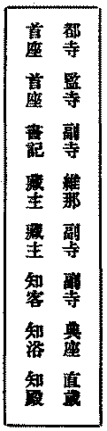



●头首



西序此谓头首。明极曰。以参请多。丛林熟者。归西序谓之头首(详两班处)。



敕修清规两序章。列西序头首云。前堂首座。后堂首座。书记。知藏。知客。知浴。知殿。烧香。侍者。书状侍者。请客侍者。衣钵侍者。汤药侍者。圣僧侍者。是也。



忠曰。茶礼请全班。止知客。



敕修清规方丈特为新挂搭茶云。次日首座。鸣照堂板。全班行礼。　又云。头首当列名止於知客。



旧解头首全班。自首座到知客也。　忠曰。前堂后堂书记。知藏。知客。知浴。知殿。皆为西序头首。也。然今但止知客耳。



敕修清规迎待尊宿云。如大尊宿。则首座众头首。禀住持劝请。为众开示法要。



●秉拂五头首



前堂首座。后堂首座。东藏主。西藏主。书记也。



竺仙仙和尚南禅录。结夏上堂。举柏树话。拈云。赵州。拏空塞空。直得天下人。无出气处。莫有为众竭力者麼。来夜问取五头首。珍重。



明极俊和尚建长录。谢头首秉拂上堂云。建长头首五座说法。第一座玄中玄。第二座妙中妙。第三座玄中妙。第四座妙中玄。第五座玄妙俱到。



●六头首



禅苑清规列首座。书状。藏主。知客。库头。浴主毕云。已上竝为六个头首。



忠曰。六中。库头之一是知事。然槩称六头首者。随多得名也。



●前堂首座



敕修清规云。前堂首座。表率丛林。人天眼目。分座说法。开凿后昆。坐禅领众。谨守条章。斋粥精粗。勉谕执事。僧行失仪。依规示罚。老病亡殁。埀恤送终。凡众之事。皆得举行。如衣有领。如网有纲也。虽大方尊宿。若住持能以礼致之。亦请充此职。谓之退位为人。如文殊为七佛师。犹助释迦扬化。为众上首。吾宗睦州於黄檗。云门於灵树。光昭前烈。诒训后来。名位之重。可轻任耶。(前堂义。见殿堂门前板处。)



祖庭事苑云。首座。即古之上座也。梵语悉替那。此云上座。此有三焉。集异足毗昙曰。一生年。为耆年。二世俗财名与贵族。三先受戒。及证道果。古今立此位皆取其年德干局者。充之。今禅门所谓首座者。即其人也。必择其己事已辨。众所服从。德业兼备者充之。



慈觉赜公龟镜文云。表仪众僧。故有首座。　又云尊卑有序。举止安详。所以报首座也。　又云。三业不调。四仪不肃。非首座所以率众也。　又云。坐卧参差。去就乖角。非所以报首座也。



禅林宝训云。张侍郎子韶。谓妙喜曰。夫禅林首座之职。乃选贤之位。今诸方不问贤不肖。例以此为侥幸之津途。亦主法者失也。然则像季固难得其人。若择其履行稍优。才德稍备。识廉耻节义者。居之。与夫险进之徒。亦差胜矣。



幻住庵清规曰。首座之称。居一众之首也。在丛林。与长老平分风月。在庵中。与庵主同展化仪。事在精勤。行存洁白。情忘憎爱。念绝是非十方之仪范所鍾一众之道业所系。凡打板坐参。放禅行道。种种动静。靡不关心。惟恐道缘未辨。法化不周。众有怠惰者。当策之以精勤犯众者。当制之宽厚庵居法令。又非大丛林所比。凡礼貌供需。厨堂受用。或丰或俭。一切折中。常以火种刀耕。形影相吊为怀自然不落今时道用在其中矣。



黄檗希运。在南泉作首座。又在盐官作首座。



有请和尚。充首座者。　痴绝冲禅师蒋山录。有请旌忠和尚充首座上堂。举黄檗在南泉会中作首座因缘。



●第一座



首座。在僧堂前板第一位。故亦言第一座。



联灯会要沩山祐章云。师在百丈充典座。丈选沩山主人。命师往。时华林为首座。乃云。某甲忝居第一座。而不得往。典座却往。百丈令首座与师。对众下语。出格者行。遂拈净瓶置地上云。不得唤作净瓶。汝唤作甚麼。首座云。不可唤作木𣔻也。丈却问师。师踢倒净瓶而去。丈笑云。首座输却山子也。因命师行。



●座元



首座言座元。



忠曰。葢僧堂座位之元首也。



敕修清规谢挂搭云。参头云。即刻恭惟。座元。都总。诸位禅师。尊候多福。　解云。都总都寺。此举两序之首也。



续灯录翠岩可真禅师章云。在归宗南禅师堂中为座元。南问。首座常将女子出定话为人。是否。真云无。



普灯录。五祖表自禅师章云。初依祖。令看德山小参不答话因缘未有省。时圆悟为座元。师往请益(祖者五祖法演)。



林间录云。佛印禅师。再归云居。灵源叟。初自龙山来。与众群居。痛自韬晦。佛印升座。白众请以为座元。其礼数特异。灵源受之。丛林学者日亲。知晦堂老人法道有在矣。



大慧武库云。五祖演和尚。依舒州白云海会端和尚。咨决大事。时秀圆通为座元。受四面请。即请演为第一座。



大慧年谱云。师五十一岁(时住径山)。是年龙象骈集。坐夏者。一千七百有奇。举悟本道颜二座元。分座训徒。



丛林盛事云。圆极岑和尚。抱节孤高。近世罕及。依正堂辨於道塲。未几令董座元。　又云。柏堂雅禅师。闽人。嗣懒庵需。初住紫箨。以佛照居冷泉叔姪之故。特往辅佐之居座元二年。兄弟多归之。然雅刚正。佛照惮之。后住龙翔灵岩其道大振。



寮元亦称座元。　敕修清规。大挂搭归堂云。新挂搭人。行者引见寮元。对触礼一拜云。即日恭惟。座元禅师。尊候起居多福。



解云。座元即寮元也。



教家亦有座元称。　唐高僧传昙选传云。晚住并部兴国寺。川邑奉之。以为师傅。每有众集居于座元。酬问往还。以系节为要。



●禅头



首座称禅头。



大鉴清规净智寺首座寮牓云。僧堂坐禅。号令之权在首座。不在住持。首座谓之禅头。众僧皆听命於首座。切须力行勉励后学。



祖庭事苑。天衣怀禅师传云。晚谒翠峰明觉。因营众务。汲水担忽堕地。师豁然知归。由是名振丛林。皆目之为禅头云。



僧宝传。法昌遇禅师传云。大宁宽禅师至。遇畫地作此[○@牛]相。便曳镢出。翌日未升座。谓宽曰昨日公案如何。宽畫此[○@牛]相。即抹撒之。遇曰。宽禅头。名下无虚人。



大慧为秦国夫人请普说云。睦州唤僧。大德。僧回首。州云担板汉。曾有个禅头。举遮话问僧。儞作麼生会。　又为礼侍者断七普说云。我既会了。却倒疑著几个禅头。乃问老和尚。老和尚曰。能有几个。得到儞田地。　又方外道友请普说云。庆藏主。在沩山。虽僻地里。与先师入室。其实真如不曾举他立僧。一日真如问先师。儞去庆藏主处入室否。曰未曾。真如云。因甚不去。他古今好。先师曰。某待都去禅头处入室。



僧宝正续传。泐潭照禅师传云。示众曰。禅头首座。同行道伴。亦皆教儞参学。



●首众



首座称首众。



虗堂愚和尚。径山录云。举黄檗在南泉会中。为首众。一日捧钵。向南泉位中坐(云云)。



●立僧首座



旧说曰。立僧者。谓成立众僧也。无定人。首座头首之外。别於西堂或前堂。及诸耆宿中。择有道博达之人。敦请。为众开法焉。或有请大方尊宿。充之。极为重任矣。夫前堂首座之代主说法者。尚乏人。日本古有阙之。况立僧之名实相符。岂易多得耶。如名德首座。则前堂中择稍有德者。为之。不甚难得其人也已。



敕修清规请立僧首座云。其事严重。不可轻举。如大方西堂。名德首座。行解素为众所推服者。委曲陈情。如有允意特为上堂言。此间多众。宜得当人。相与建立法幢。开大炉鞴。山中幸有某人。知见高明。慧命所寄。少刻下座。同两序大众拜请。为众开室。伏望慈悲。特埀开允。下座(云云)。



禅苑清规请立僧云。退院尊宿。首座藏主。如合众望。可举立僧。即住持人升座。举白讫。知事大众。诣寮礼请(请辞云大众倾心久思示诲伏望慈悲俯赐开允)。如不允。更不答拜云(自救不了岂可为人)。如允。即时还礼(云既蒙坚请不敢固辞)。乃上方丈陈谢。礼数随宜。退院尊行(谢云本欲依凄贵藏衰拙既蒙见举不敢奉违答云象驾既临法轮常转虽然不合奉烦告以佛法为念)。退院平交(谢云方图自养岂复为人上命虽违下情多愧答云不合奉烦且以佛法为念)。诸方名德。及参学小师(谢云此蒙和尚指挥今受兄弟问讯虽无深证不敢固辞下情无任惶恐感激之至答云既有餘光且以佛法为念)。并相看。陈谢知事。次日堂头库下特为煎点(置食随意)。



备用清规请立僧云。若名德之士。受此请。住持座上说及。即抽身归寮闭门。下座。领大众扣门。开门接住持入。插香同众触礼一拜。呈纳普说入室牌。



已下略举事缘。



大慧杲和尚。为礼侍者断七普说云。老和尚(圆悟)曰。如今方知道。我不谩儞。我既会了。却倒疑著几个禅头。乃问老和尚。老和尚曰。我个禅。如大海相似。是儞将得个大海来。倾取去。始得。若只将得钵盂来盛得些子去。便休。是儞器量。只如此。教我怎柰何。能有几个。得到儞田地。旧时只有一个璟上座。与儞一般。只是死了。过得几时。便举我立僧。后来在云居首座寮。夜间常与兄弟入室。老和尚。爱来听。



人天宝鉴云。慈航小参。长灵卓禅师。命无示立僧。法席严肃。不事堂厨。唯安禅以当佳供。夜参以当药石。其间衲子。有不任者。无示告卓曰。人以食为先。若是则众将安乎。卓愠之曰。表率安可为此。无示云。某不争。堂厨教谁争耶。



丛林盛事云。应庵初依蒋山圆悟。会中与此庵元为友。及元住虔之连云。华从虎丘隆会中来。初到便令作首座。未久令立僧。元上堂云。西河有师子。连云出虎兕。亲从猛虎窟中来。文彩爪牙悉皆备。虽未及惊群。已有食牛志。痛念杨岐宗。今之如埽地。竖起铁脊梁。与先师出气。诸人还识麼。两眼大如环。当头立底是。　又云。谷山旦。初参佛性泰和尚。泰问。前百丈不落因果。因甚堕野狐身后百丈不昧因果。因甚脱野狐身。且曰。好与一坑埋却泰徵之。语皆不凡。未几令立僧。名动一时。



应庵华禅师天童录。有举杰首座(密庵)。立僧上堂。密庵杰禅师。径山录。有举演首座。立僧上堂(云云)。



下座诣首座告香。



无准范禅师录。有请渊首座。立僧上堂。　又有上元请首座。立僧上堂。



增续传灯灭翁礼禅师章云。时松源唱道饶之荐福。师往参焉。蒙印可。辞源巡礼江淮间祖塔。至蒋山浙翁命充立僧首座。晋陵尤公焴。数入山听师提唱语悦服。



虗堂愚和尚录。有灵隐立僧普说。



已下略举请尊宿立僧事缘。



应庵华禅师蒋山录。有举西堂正法和尚立僧上堂。



密庵杰禅师。径山录。请前堂首座鹤林印和尚。立僧上堂(云云)下座烦知事头首大众。诣首座寮扣问。



松源岳禅师录。举首座凤山义和尚立僧上堂云。诸佛不出世。祖师不西来。佛法遍天下。谈玄口不开。既是谈玄。因甚口不开。问取凤山和尚。



痴绝冲禅师天童录。请蒋山石溪和尚立僧上堂云。正法眼。破沙盆。贵时倾国不换。贱时不直分文。不作贵不作贱。分付石溪老子。共结佛祖深冤。



破庵先禅师录行状云。师既归蜀。初住果之清居。梓之望川。未几。复振锡而南至夔门。时尚书杨公辅。素闻师名。以卧龙招之。留三年。出峡至常州华藏。遯庵演。始延师分座立僧。众皆倾服。



山庵杂录云。破庵和尚。退资福。趣径山蒙庵招委以立僧首座职。有宝上座者。具大知见。遇住持首座开堂。必横机㨗出。迎锋取胜。一日破庵开室。宝上座至。破庵埀语云。乾坤之内。宇宙之间。中有。宝拟议。被打出其时宝待破庵举语尽。乃进语。既於中有处。被打出。以谓破庵故摧我。归衣单下脱去。火后。乡人收舍利。呈破庵。破庵拈起云。宝上座饶儞。有舍利。八斛四斗。置之一壁还我生前一转语来。掷地。惟见脓血。闻之於先辈。



●名德首座



旧说曰。名德非位职之称。前堂首座中。择有名誉德行者。为名德首座。其事最重。故诸头首中。首座为重。首座中。名德为重。名德西堂例知。



敕修清规请名德首座云。住持须预禀露。如有允意。方丈先请茶。两序光伴。即鸣鼓升座。更不报众。住持委曲致恳。下座与大众同伸拜请。鸣钟。送归寮。



中阿含经云。乌陀夷。妄非舍梨子说法。世尊面呵尊者乌陀夷已。语尊者阿难曰。上尊名德长老比丘。为他所诘。汝何以故。纵而不捡。汝愚痴人。无有慈心。舍背上尊名德长老。



释氏要览云。名德。名者实也。实立而名从之。仲尼云。所贵名实之名也。德者得也。所谓内得於己。外得於人。常无所失。合而称之。阿含经呼舍利弗已下。为名德比丘。皎法师高僧传序云。寡德适时。名而不高。实德潜光。高而不名。



●却来首座



敕修清规前堂首座云。虽大方尊宿。若住持能以礼致之。亦请充此职。谓之退位为人。



旧说曰。退位为人。是为却来首座。



忠曰。却来洞家举唱。向正位为向去。自正位来于偏位。为却来。



●后堂首座



敕修清规云。后堂首座。位居后板。辅賛宗风。轨则庄端。为众模范。葢以众多。故分前后。斋粥二时过堂。及坐禅。则后门出入。如缺前堂。住持别日上堂。白众请转前板。插单唱食。其坐禅坐参。只众寮前第三下板。即入堂。不必鸣首座寮前板。餘行事。悉与前堂同。(后堂义。见殿堂门前板处。)



义堂信禅师日工集。贞治三年甲辰记曰。四十岁。东林和尚领圆觉寺。请余充后板。余以年少。坚卧不起。



忠曰。义堂以四十岁。为犹未老。不胜任后板。而不就。由此可验昔时厚纯。亦可痛今日轻躁矣。



●书记



古称书状。今分内外。内为书状侍者。外为书记。



敕修清规云。书记。即古规之书状也。职掌文翰。凡山门榜疏书问。祈祷词语。悉属之。葢古之名宿。多奉朝廷徵召。及名山大刹。凡奉圣旨敕黄住持者。即具谢表。示寂。有遗表。或所赐所问。俱奉表进。而住持专柄大法。无事文字。取元戎幕府。署记室参军之名。於禅林。特请书记以职之。犹存书状。列於侍者。使司方丈私下书问。曰内记云。而名之著者。自黄龙南公始。又东山演祖。以是职。命佛眼远公。欲以名激之。使兼通外典。助其法海波澜。而先大慧亦尝充之。凡居斯职者。宜以三大老为则可也。



忠按。联灯普灯会元正宗赞等。皆云。佛眼为知客。未见为书记。普灯云。佛鉴主五祖书记。恐今误为佛眼乎。



忠曰。记室参军。武官也。　杜氏通典。武官大将军云。晋增置司马一人。从事中郎二人。主簿记室督各一人。



事文类聚。引续汉百官志云。三公大将军。皆有记室。主上表章报书记。虽列於上宰之庭。然本於从事之职。



禅苑清规云。书状之职。主执山门书疏。应须字体真楷。言语整齐。封角如法及识尊卑触净。僧俗所宜。如与官员书信。尤不得妄发。每年化主书疏。预先安排。即时应须子细点检恐封角差赚。及漏落施主名衔。如写常住书信。即用常住纸笔。如写堂头书信。即用堂头纸笔。如发自己书信。不宜侵用。轻尘积岳。宜深戒之。新到茶汤。特为礼。不可阙。院门大榜。斋会疏文。竝宜精心制撰。如法书写。古今书启。疏词文字。应须遍览。以益多闻。若语言典重。式度如法。千里眉目。一众光彩。然不得一向事持笔砚。轻侮同胞。不将佛法为事。禅月齐己。止号诗僧。贾岛惠休流离俗官岂出家之本意也。



备用清规云。书记。声名清雅。翰墨典严。制文须合古规。发语当为新鉴悚动观听。辉映林泉。若曰佛祖慧命。岂在兹乎。黄龙南和尚。遇云峰悦禅师。指见慈明。方决大事。谋西江。华藏遁庵会下充书记。代赴张循王府升座。到府门问曰。书记若会禅。家间自有教授谋即归寺。焚却所蓄文字。径造天童默耕此道。凡十年。不出僧堂。方了大事。后住雪窦至天童。法道大振。任重致远。丛林共知。



慈觉龟镜文云。为众僧典翰墨。故有书状。　又云。手不把笔如救头然。所以报书状也。　又云。书状不工。文字蔑裂。非书状所以饰众也。　又云。事持笔砚驰骋文章非所以报书状也。



无文印寄隆瘦岩书云。古无书记。见於清规。惟书状。书记云者。创置於中古诸老。非百丈意也。第数十年来。谬谬相承。冐其氏名者多耳。



旧说曰。书记虽班藏主上。然其职掌卑。犹如知客虽在侍香上。其职却卑。



已下略出事缘。



碧岩录云。唐宣宗乃大中也。武宗即位。潜遁在香严闲和尚会下。后剃度为沙弥。未受具戒。后到盐官会中。请大中作书记。



林间录云。嵩明教。初自洞山。游康山托迹开先法席。主者以其佳少年。锐於文学。命掌书记。明教笑曰。我岂为汝一杯姜杏汤耶。因去之。居杭之西湖。三十年闭关。不妄交。



僧宝传。黄龙慧南禅师传云。登衡岳。寓止福严。老宿号贤叉手者。大阳明安之嗣。命公掌书记。



北磵文集。送梦书记序云。古无书记。自积翠老南领徒行脚。丛林称之。后世嗣具遗响仅得积翠之一体。餘则百步半百也。



普灯录佛鉴懃禅师章云。师见五祖演。大豁所疑。令主翰墨。



普灯录大慧杲禅师章云。师至天宁。见圆悟。於言下。去尽知见。悟曰。始知吾不汝欺。遂命掌翰墨。



普灯录。宏智正觉禅师章云。丹霞(子淳)领大洪。师掌𤖆记。



有比丘尼命书记者。　燄慧语要有比丘尼廓然圣书记者。



●外史　外记



书记又名外史。或名外记(又见内史处)。皆准朝制。



周礼云。外史掌书外令(注王令下畿外)。掌四方之志(注志记也。谓若鲁之春秋晋之乘楚之桩杌)。



雪庐槀云。江左外史番易释克新仲铭。



金玉编序云。天历初。文宗皇帝。以金陵潜邸。为大龙翔寺。起笑隐禅师主之。而天下学者。云输川涌。今水西新公仲铭晚至。以雄才硕学。为书记。



●记室



书记又名记室。



大慧年谱云。师三十八岁。居天宁记室。



●藏主



备用清规云。藏主。掌握金文。严设几案。常备汤茶香烛。延迎。兄弟看经。初入经堂。先白堂主。同到藏司。相看。送归案位。对触礼一拜。此古法也。今人物骈集。藏列东西。务在驰名。所职何事。直须宗乘洞达。圣教该通。点对出入经卷。书填残缺字畫焙拂补粘。尽心成美。亦为报佛之恩。名实无辜矣。



大藏教贰副。分庋东西。见殿堂门。遂有东藏主。西藏主。



慈觉龟镜文云。为众僧守护圣教。故有藏主。　又云。明窓净案。古教照心所以报藏主也。　又云。几案不严。喧烦不息。非藏主所以待众也。　又云。慢易金文。看寻外典。非所以报藏主也。



藏主本兄弟职。　旧说曰。昔竺仙和尚。由书记转藏主。葢时乏兄弟。而藏主。本兄弟职故也。



已下略录事缘。



传灯录云居道齐禅师章云。法灯(泰钦)住上蓝院。师乃主经藏。一日侍立次。法灯谓师曰。藏主。我有一转西来意话。汝作麼生会师对曰。不东不西。法灯曰。有什麼交涉。曰道齐只恁麼。未审和尚尊意如何。法灯曰。他家自有儿孙在。师於是顿明厥旨。



续传灯录。虎丘隆禅师章云。谒圆悟。悟问曰。见见之时。见非是见。见犹离见。见不能及。举拳曰。还见麼。师曰见。悟曰。头上安头。师闻脱然契证。悟叱曰。见个甚麼。师曰。竹密不妨流水过。悟肯之。俾掌藏教。有问悟曰。隆藏主柔易若此。何能为哉。悟曰瞌睡虎耳。



按虎丘录行状。圆悟移道林师从焉。遂有见见之问答。乃知。掌教在道林时也。



虗堂愚和尚录行状云。时笑翁和尚住灵隐。以虎丘旧职。命师再尸藏事。



●知藏



即藏主也。



敕修清规云。知藏职掌经藏。兼通义学。凡看经者。初入经堂。先白堂主。同到藏司。相看。送归按位对触礼一拜。此古规也。今各僧看经。多就众寮。而藏殿无设几案者。然充其名。当尽其职。函帙目录。常加点对。缺者补完。蒸润者焙拭。残断者粘缀。若大众披阅。则藏主置簿。照堂司所排。经单列名。逐函交付。看毕照簿。交收入藏。庶无散失。



●藏司



忠曰。知藏之人居处言藏司(藏主及知藏处引备用敕修)。故亦呼知藏为藏司。又见殿堂门。



普灯录。楚安慧方禅师章云。佛鉴指往大别。既至职藏司。



●经藏堂主



忠曰。藏主之外。有堂主焉。藏主不居藏殿。堂主。守经。常在藏殿也。



敕修清规云。凡看经者。初入经堂。先白堂主(见知藏处)。



●知客



敕修清规云。知客职典宾客。凡官员檀越。尊宿诸方名德之士。相过者。香茶迎待。随令行者。通报方丈然后引上相见。仍照管安下去处。如以次人客。只就客司相欵。或欲诣方丈库司诸寮相访。令行者引往。其旦过寮床帐什物。灯油柴炭。常令齐整。新到须加温存。维那在假。则摄其行事。僧堂前检点。行益客僧粥饭。遇亡僧。同侍者把帐。暂到死。主其丧。雪窦在大阳。禅月在石霜。皆典此职。毋忽。



联灯会要雪窦重显禅师章云。师在大沩为知客。李殿院来问云。知客是长老乡人那。师云不敢。李云。且在这里。不得乱走。师云。本为行脚。李云。行脚当为何事。师云。看乱走底。李大笑。



●典客



知客又名典客。



僧宝传雪窦显禅师传云。尝典客大阳。与客论赵州宗旨。客曰。柏树子因缘。觉铁觜言。先师无此语。法眼肯之。其旨安在。显曰。宗门抑扬。那有规辙乎。时有苦行名韩大伯者。貌寒寝。侍其旁。辄匿笑而去。客退。显数之曰。我偶客语。尔乃敢慢笑。笑何事。对曰。笑知客智眼未正。择法不明。显曰。岂有说乎。对以偈曰。一兔横身当古路。苍鹰一见便生擒。后来猎犬无灵性。空向枯桩旧处寻。显阴异之。结以为友。显盛年工翰墨。作为法句。追慕禅月休公。



破庵先禅师录行状云。见密庵於乌巨。众才满百。然皆一时龙象。命师为典客。常随众入室。密庵为傍僧。举不是风动。不是幡动。师闻豁然大悟。从此机语相契。一日密庵遇师於众寮前。谓师曰。不得问讯。不得叉手。总不得作伎俩。儞试露个消息看。师应声云。方丈里有客。密庵呵呵大笑。



●典宾



即知客也。



普灯录。佛眼远禅师章云。依太平事祖(五祖)。数载。后典宾海会。雨夜读传灯录。至破灶堕因缘。忽拨火大悟。



明极俊禅师录。南洲和尚远忌普说云。大日本国有善知识名南洲禅师。生平履践确实。工夫精专。游唐七载。参知识於南屏山中。掌典宾任。只一玻𭹳盏子。验尽五湖四海龙象。奏凯回来本国。见兀庵。於洗钵盂话。深领其旨。



●客司



忠曰。知客之人居处。言客司(见殿堂门客司处)。故亦呼知客为客司。



敕修清规圣节云。堂僧堂司给由。暂到客司给由。



●知浴



敕修清规云。知浴凡遇开浴。斋前挂开浴牌。寒月五日一浴。暑天每日淋污。铺设浴室。挂手巾。出面盆拖鞋脚布。参头差行者直浴。斋罢。浴头覆维那首座住持毕。鸣鼓三下。浴圣。桶内皆著少汤。烧香礼拜。想请圣浴。次第巡廊鸣板三下徧。鸣鼓。第一通。僧众入浴。第二通末。头首入浴。第三通行者入浴。此时。住持方入。以屏风遮隔而浴。第四通。人力入浴。监作行者。知事。居末浴。就弹压之。并点视。令息灶中火。及炭煤水洒乾净。有餘柴。搬於远处(云云)。能妙触宣明成佛子住则功不浪施矣。



传灯录。太原孚上座章云。参雪峰。尝问师曰。见说临济有三句。是否。师曰是。曰作麼生是第一句。师举目视之。雪峰曰。此犹是第二句。如何是第一句。师叉手而退。自此雪峰深器之。室中印解。师资道成。师更不他游。而掌浴室焉。一日玄沙上问讯。雪峰曰。此间有个老鼠子。今在浴室里。玄沙曰。待与和尚勘破。言讫到浴室。遇师打水。玄沙曰。相看上座。师曰。已相见了。玄沙曰。什麼劫中曾相见。师曰。瞌睡作麼。玄沙却入方丈。白雪峰曰。已勘破了。雪峰曰。作麼生勘伊。玄沙举前语。雪峰曰。汝著贼也。



●浴主



知浴又曰浴主。



慈觉龟镜文云。为众僧浣濯。故有浴主水头。　又云。轻除静默。不昧水因。所以报浴主水头也。　又云。汤水不足寒暖失宜非浴主水头。所以浣众也。　又云。桶杓作声。用水无节。非所以报浴主水头。也。



●浴头



直浴行者曰浴头。



敕修清规知浴云。斋罢。浴头覆维那首座住持毕。鸣鼓三下(详知浴处)。



传灯录。镜清道怤禅师章云。因普请锄草次。浴头请师浴师不顾。如是三请。师举镢作打势。浴头乃走。师召曰。来来。浴头廻首。师曰向后遇作家。分明举似。



●知殿



掌佛殿事者。曰知殿。



敕修清规云。知殿。掌诸殿堂香灯。时时拂拭尘埃。严洁几案。或遇风起。须息炉内香火。及结起旛脚。防顾使勿近灯烛。施主香钱。不得互用佛诞日浴佛煎汤。供大众。四斋日。开殿门。以便往来瞻礼。



●殿主



知殿又曰殿主。



禅苑清规殿主云。拂拭尘埃。列正供具。以时洒扫。庄饰香灯。参后展席。以待众人瞻礼。



宗门统要。药山俨禅师章云。师因遵布衲作殿主。浴佛次。师乃问。汝秪浴得这个。还浴得那个麼。遵云。把将那个来。师休去。



断桥伦禅师瑞岩录。有请殿主上堂。



●直堂



禅苑清规云。直堂之法。从上间第二座被位为头。次第轮转。终而复始。主看守堂中众僧。被位衣钵。早晨长板时。大众集。持直堂牌。於当日上座前。问讯云。上座今日直堂。交牌讫。问讯归位(如食位与被位相远即须记被位不看之人。於何粥饭所贵至时不烦寻讨如只在邻位亦当下床纳牌。受牌人但口所问讯纳之。并不下床)。直堂人。常在堂中。於上下间照管。如有所干。须请熟分兄弟。暂时看守。并不得趣升堂。及延寿堂。并外请。念诵诸处茶汤。如全众出入。除维那指挥锁堂。并不得擅离所守。至放参后方可随意。如堂中去失。系是放参已前。方是直堂人位责(直堂以放参为限也)。欲开函柜。或抽衣被。并先白直堂人知。如不先报。即当审问。开静已前。放参已后。众中兄弟。并不得开函柜。及抽取衣被。如送入衣被。则不妨。如有所犯。即邻位及众人。呵止。不得规避直堂。预迁被位。令堂众动念。



敕修清规坐禅云。堂中有直堂牌。刻云。输次直堂周而复始。住山押。



●阁主



禅苑清规云。阁主殿主。维那所请(详立班小头首处)。



●塔主



临济玄禅师录云。师到达磨塔头。塔主云(云云。详区界门塔头处)。



●主塔侍者



传灯录慧能大师章云。塔中有达磨所传信衣。中宗赐。摩衲宝钵。方辩塑真。道具等。主塔侍者尸之。



●侍真



忠曰。侍祖塔真影者。曰侍真。即塔主也。真者。祖师形像也。



传灯录盘山宝积章云。师将顺世。告众曰有人邈得吾真否。众皆将写得真呈师(云云)。



●圣僧侍者



敕修清规云。圣僧侍者(不立班在众后行道。堂外粥饭)。贵有道心。斋粥二时上供。鸣下堂椎。朝夕交点被位。中夜剔灯。同维那。交收亡僧唱衣钱。住持迁化。把帐。头首秉拂。则为烧香。或代鸣椎念佛。职满在本山。当预侍者名。退耕断桥二老。在众时。常充此职。以能结众缘。而励志于道也。



义堂日工集云。府君(义满)问。衣钵侍者次。是何侍者。曰。圣僧侍者。即秉拂侍者也。常在僧堂。侍于圣僧者。君曰。其职为贵为贱。曰此职多以道者充之。或虽勤旧。亦发心自请充者。有之。



●寮元



旧说曰。维那司僧堂。寮元司众寮。



江西曰。禅林。寮元立班。起於大慧充云居寮元。为众普说。(按大慧年谱大慧四十岁。四十一岁。在云居首座寮焉。)



寮元亦称座元(见座元处)。



敕修清规列职杂务云。寮元掌众寮之经文什物。茶汤柴炭。请给供需。洒扫浣濯。净发椸巾之类。　又大挂搭归堂云。新挂搭人。行者引见寮元。



备用清规云。寮元之职。随处毘尼。江左丛林盛时。大慧挂牌普说。班列西序之下者。当知所自也。



清拙清规栴檀林须知云。寮元。总管众寮大小事务。好经文杂文字。语录。家私什物等。各依目录。交割。维那眼同见。众兄弟借文书。寮暇。请暇。病暇时。须便送还。



丛林盛事云。证西林号老衲。长沙人。月庵之嗣。月庵居道林。证为寮元。已为兄弟。挂牌入室。其为人至诚郑重。虽处暗室。如临大宾。兄弟见之。其容必庄。



●寮长



敕修清规寮元云。每日粥罢。令茶头行者。门外候众至。鸣板三下。大众归寮。寮长分手。寮主副寮对面左右位。副寮出烧香归位。茶头喝云。不审大众和南。



解曰。寮长分手者。寮长位于寮元分手也。



●寮主



旧说曰。寮主。辅佐寮元者。侍者类也。



敕修清规列职杂务云。寮主副寮。凡安众处。寮元照戒次。自下而上。请充之。写定名字。预贴牌上。十日一替。佐寮元办事。旦暮僧众归堂。巡视经案。或有遗忘什物者。眼同收拾。付还。及交点本寮什物。提调香汤茶汤。毋容外人止宿。及寄卖物件。犹预定望寮一名。使以次挨补副寮。若寮主遇满。从维那请交代。副寮遇满。从寮元请交代。　又大挂搭归堂云。参头领众。行者引至众寮鸣内板三下。寮主相接。入门对触礼一拜。



清拙清规栴檀林须知云。寮主副寮二人。日夜不离众寮。坐禅时。同寮元。佛前坐禅。讽经过堂。一切随众竝免。专看守上下间。及前后门。凡讽经过堂时。竝关闭前后门。日夜坐禅时。竝锁前后门。其后门打给粥饮。打炭打水时开。餘时常锁。诸寮大小。人工不许入。凡取点茶之汤。只沙弥喝食入取茶盏及台并圆盘盆汤瓶。系副寺管领。日间。寮主看管上间。副寮看管下间。凡有失物。分上下间倍偿。如捡点不在寮。令起单。放参后。寮行者。鸣出寮版。一声。众随意锁柜先出。行者掩大门一扇。二声众尽出。三声门双闭。昏钟鸣下锁。钥匙寮元收寮内。夜间不许通僧来往。定钟时。寮主副寮。及行者。执烛。三人同巡视案柜。或忘锁者。与锁之。或忘收物者。与收起。明日送还之。十日管领。递相照应义也。五更钟鸣。行者装香炉火。点灯。请钥匙。门开一扇。住持知事行香。此时多是贼入。寮主副寮。轮番人。各一日看守。粥时全闭。亦恐有贼。此粥时外寮。莫来烧香。粥罢全开。众入问讯毕。耆旧随意烧香。



慈觉龟镜文云。为众僧。守护衣钵。故有寮主。　又云。一瓶一钵。处众如山。所以报寮主。　又云。打叠不勤。守护不谨。非寮主所以居众也。　又云。以己方人。慢藏诲盗。非所以报寮主也。



●知寮



知寮者。即寮主也。



诸祖偈颂慈受禅师示众箴规云。放参开笼。须白知寮。



日用轨范云。粥前斋前。放参后。不得开函柜。如有急切白主事人。寮中白寮主。僧堂白圣僧侍者。　解曰。此寮主者。慈受所谓知寮也。



●副寮



备用清规云。副寮之职。其事繁重。寮中什物。逐一交割。分明。职务一旬。关摄诸事。粥前参后。不许登阁。有急切干者。须白寮主。书日书名。打板上阁。庶免后患。时时提点汤瓶。夜看火烛贼盗。扫地拭桉。换水添香。勿容外人止宿。寄卖物件。子细收藏。衣竿熨斗。洗衣桶。众人所用之物。各收元处。善用其心。获胜玅功德也。　又见于寮主处。



●望寮



旧说曰。望寮。转副寮。副寮转寮主。葢自腊少者。次第请向上。



忠曰。副寮阙。则可转上补之。故云望也。



备用清规副寮下。有望寮云。望寮之职。先辈深有意焉。受职到寮。预知寮中细大。副寮出盏点茶。相与收拾。放参药石。行醋行盐。结缘边事也。



又见寮主处。



●洞脚



旧说曰。住侍巡寮。住持倚各各寮椅子时。寮主与寮之洞脚。皆进插香。



古解者为洞脚未详。　忠曰。葢各寮属寮主之众也。未详字义。



日工集云。守亨书记求预会下。乃容石屏洞脚。　又云。步往石屏。语诸同脚曰。屋子破损。在在皆是。吾无以为忧。今经像墨宝无恙。幸矣。



忠曰作同。未知孰是。



●禅客



旧说曰。宋国圆悟大慧之后。禅刹例置禅客僧。大刹二人。小刹一人。择得言句三昧者。葢官人入寺。屡请升座说法。及时禅客。出众问答。名之曰问禅。今丛林差禅客。此其遗风也。或禅客中。有得法者。则让其主位云。



晦堂祖心(宝觉)禅师语录。长沙安抚谢通议。请就北禅。升座云。僧问。昔日李翱登药峤。云在青天水在瓶。今日通议临宝座。乞师一句定宗乘。师曰。潭上无风浪自平。僧曰。还有承当处也无。师曰。尔作麼生承当。僧曰。金乌迥出青霄外。玉兔辉时四海清。师曰。不如退后看。僧曰。大众证明。学人礼谢。



忠曰。此禅客。出众作颂。又有入众语。大似今时禅客模样。而宝觉时。已有之。此可以证旧说。禅客事也。



敕修清规上堂云。古之学者。葢为决疑。故有问答。初不滞於语言。近日号名禅客。多昧因果。增长恶习。以为戏剧。哗然喧笑。甚失观瞻。况举扬宗乘。端祝圣寿。



忠曰。夫问话者。不凭佛心宗渊源。乱以口头声色。粉饰语句。或戏谑模样。欲动视听。或坐具拟棒。打地云效临济打爷。弄法之罪因。莫大焉。无间之狱果。难逃矣。然自拨无因果。增长此恶弊。可不痛哉。或有恶之。都禁绝问话。此亦过甚。非令法久住之计。只当止火灾。何废爨烛之用。世之师法。须委悉。　又见参请门。问话处。



庞居士录云。居士因辞药山。山命十禅客相送。至门首。士乃指空中雪曰。好雪片片。不落别处。有全禅客。曰落在甚处。士遂与一掌。全曰。也不得草草。士曰。恁麼称禅客。阎罗老子。未放儞在。全曰。居士作麼生。士又掌曰。眼见如盲。口说如痖。



江湖风月集。复岩己和尚。赠禅客颂云。倒飜一问没来由。拶得通身白汗流。梅雨打窓声沥沥。重添公案上心头。



行者亦为禅客。　虗堂愚和尚录赠禅客智仁偈云。法战塲中树胜旗。话头何似问头危。古人减灶添兵处。切忌交锋蹉过伊。　又云。问话行者智仁。炷香请语。以此赠之。景定癸亥。至节。虗堂老僧书于雪窦西庵。



●放禅客



忠曰。秉拂预定禅客外。放出问答。名放禅客。



敕修清规秉拂云。秉拂人。令茶头行者。请圣僧侍者禅客。烧香献茶毕云。今晚秉拂。辄烦侍者烧香。禅客问话。



旧解曰。见此语。预差定禅客也。唐土则兄弟名胜秉拂。定禅客外。自他寺他山来者。忽放出於众前。问答。称放禅客。日本亦如东福虎关秉拂时。乾峰俄出众问答。成丛林绝唱。



●参头



有行者参头(见下)。有四来参头。今是四来参头也。即告香普说等。新归堂众中。推旧参。能谙礼乐人一员。为参头焉。



敕修清规告香云。每夏前告香。新归堂者。推参头一人。　又云。若大众均预告香。则首座为参头。



又游方参请云。今时游方挂搭。初到旦过。推熟於丛林。能事者一人。为参头。领众至客司。具威仪。列门首右白云。暂到相看(云云)。



大慧武库云。慈明瑯瑘大愚等数人。辞汾阳。相让不肯为参头。汾阳云。此行不可以戒腊推。听吾一颂。天无头。吉州城畔展戈矛。将军疋马林下过。圆州城里閙啾啾。慈明出班云。楚圆何人。敢当此记莂。遂领众拜辞。



广灯录罗汉院继宗禅师章云。师行脚时。与数僧。参一老宿问五人新到。阿那个是参头。师云不怕三冬雪。惟忧午夜风。宿云。平地上吃交作什麼。师云。言犹在耳。宿云。且坐吃茶。师云吃茶即得。



联灯会要雪窦显禅师章云。一日六人新到相看。师问参头。夫为上将。须是七事随身。两刃交锋作麼生。云久响和尚有此一著。师云。一著放过。还我草鞋钱来。僧便喝。师便打。僧约住棒与师一掌。师云。未到翠峰时。与儞三十棒了也。僧无语。师云。且过一边著。却问第二僧。副将作麼生。僧茫然。师云一状领过。吃茶了。师把住参头云。适来公案。这里只恁麼。堂中作麼生举。僧拟议。师打一坐具。便推出。



●小参头



敕修清规谢挂搭云。参头当具小图习仪。三人一引。每引一人。为小参头。须详记词语。进退折旋。合度免致临时参差。



●副参



忠曰副贰参头者。此云副参。



副参亦有两。曰行者副参(见下)。曰四来副参。今是四来副参也。



敕修清规告香云。住持就座。副参递大香一片。与参头。同众问讯。



●望参



旧说曰。日本南禅寺。定望参名。参头阙。则补其职。犹望寮之例。



忠曰。望参当补副参之阙矣。



●开堂请主



云峰悦禅师录云。保寿开堂。三圣为请主。才升座。圣推出一僧。保寿便打。圣云。似恁麼为人。瞎却镇州一城人眼去在。寿掷下柱杖。便归方丈。(联灯无请主字又见丛轨门开堂处)



●三纲



有数说。一僧史略为寺主上座维那。二名义集为上座维那典座。又旧说。为寺主知事维那。



僧史略云。寺之设也。三纲立焉。若网罟之巨纲。提之则正。故曰也。梵语摩摩帝。悉㬱那。羯磨那陀。华言。言寺主。上座。悦众也。



求法高僧传云。那烂陀寺。但以最老上座。而为尊主。不论其德。诸有门钥。每宵封印。将付上座。更无别置寺主。维那。但造寺之人。名为寺主。梵云毗诃罗莎弭。若作番直典掌寺门。及和僧白事者。名毗诃罗波罗。译为护寺。若鸣犍稚。及监食者。名为羯磨陀那。译为授事。言维那者略也。众僧有事。集众平章。令其护寺。巡行告白一一人前。皆须合掌各伸其事。若一人不许。则事不得成。全无众前打槌秉白之法。若见不许。以理喻之。未有挟强便加压伏。



飜译名义集云。音义指归云。僧如网。假有德之人。为纲绳也。隋智琳。润州刺史李海游。命琳为断事纲维。尔后寺立三纲。上座。维那。典座也。



●山门三大禅师



都寺。维那。烧香侍者。为山门三大禅师。



东渐清规秉拂礼仪云。山门三位禅师(都寺。维那。侍香)。同往首座前问讯。首座受请。



●主事



杨亿古清规序云。长老上堂升座。主事徒众。鴈立侧聆。



释氏要览云。主事四员。一监寺。二维那。三典座。四直岁(其义注于各职下)。　又云。上之四人。皆不用本处徒弟。并於十方海众内。佥选道心身干。知因果者。打键椎白众。请之。用无常人。其或心力劳倦。告众归堂。则别请能者也。



传灯录。太原孚上座章云。初上雪峰。参雪峰礼拜讫。立于座右。雪峰才顾视。师便下。看主事。



又渐源兴禅师章云。师在道吾处为典座。一日随道吾往檀越家。吊丧。师以手拊棺曰。生耶死耶。道吾曰。生也不道。死也不道。师曰。为什麼不道。道吾曰。不道不道。吊毕同廻。途次师曰。和尚今日须与仲兴道。傥更不道。即打去也。道吾曰。打即任打。生也不道。死也不道。师遂打道吾。数拳。道吾归院。令师且去。少间主事知了。打汝。师乃礼辞(云云)。



●知事



东序此言知事。乃主事也。



敕修清规两序章。列东序知事云。都监寺。维那。副寺。典座。直岁。是也。



忠曰。知事之知。犹如知州之知也(知寮。知浴。知殿等。例解)。



品字笺云。知主也。易乾知大始。又如今之知府州县知字。皆作主字解。



明极俊禅师云。以廉於己。世法通者。归东序谓之知事(详于两班处)。



僧史畧云。按西域知事僧。总曰羯磨陀那。译为知事。亦曰悦众谓知其事悦其众也。稽其佛世。饮光统众於灵鹫。身子涖事於竹林。及沓婆摩罗。年甫十六。已证应真。其后念身不牢固。请为僧知事。



宝积经入胎藏会曰。世尊告阿难陀曰。汝今宜去告彼难陀。令作知事人。即便往报。世尊。令尔作知事人。问曰。云何名为知事人。欲作何事。答曰。可於寺中。检校众事。问曰。如何应作。答言。具寿。凡知事者。若诸苾刍。出乞食时。应可洒扫寺中田地。取新牛粪。次第净涂。作意防守。勿令失落。有平章事。当为白僧。若有香华。应行与众。夜闭门户。至晓当开。大小行处。常须洗拭若於寺中。有损坏处。即应修补。(永平清规引之)



大方等日藏经云。频婆娑罗王言。世尊。有何等人。堪为知事。守护僧物供养供给如法比丘。佛言。大王。有二种人。堪持僧事。守护僧物。何者为二。一者具八解脱。阿罗汉人二者须陀洹等三果学人。此二种人。堪知僧事。供养众僧。诸餘比丘。或戒不具足。心不平等。不令是人。为知僧事。



宝积经宝梁聚会营事比丘品云。摩诃迦叶白佛言。世尊。云何比丘。能营众事。佛告迦叶。我听二种比丘。得营众事。何等二。一者能净持戒。二者畏於后世。喻如金刚。复有二种。何等二。一者识知业报。二者有诸慙愧。及以悔心。复有二种。何等二。一者阿罗汉。二者能修八背舍者。迦叶。如是二种比丘。我听营事。自无疮疣。何以故。迦叶护他人意。此事难故。迦叶於佛法中。种种出家。种种性。种种心。种种解脱。种种断结。或有阿兰若或有乞食。或有乐住山林。或有乐近聚落。清净持戒。或有能离四枙或有勤修多闻。或有辩说诸法。或有善持戒律。或有善持毗尼仪式。或有游诸城邑聚落为人说法。有如是等。诸比丘僧。营事比丘。善取如是诸人心相。(乃至)迦叶。若营事比丘。数得僧物。悭惜藏举。或非时与僧。或复难与。或困苦与。或少与。或不与。或有与者。或不与者。营事比丘。以此不善根故。堕秽恶饿鬼。常食粪丸。此人命终。当生是中。尔时更有饿鬼。以食示之。而复不与此鬼。尔时悕望欲得。谛视此食。目不曾眴。受饥渴苦。於百千岁中。常不得食。或时得食。变为粪屎。或作脓血。何以故。有持戒人。人所敬礼。僧所有物。以自在故。而难与之。迦叶。若营事比丘。以常住僧物。若招提僧物。及以佛物。辄自杂用。得大苦报。若受一劫。若过一劫。何以故。以侵三宝物故。迦叶。若营事比丘。闻如是罪。知如是罪。而故生瞋心於持戒者。我今说此。诸佛世尊。所不能治。迦叶。是故营事比丘。闻如是非法罪已。应当善护身口意业。自护亦护他。迦叶。营事比丘。宁自噉身肉。终不杂用三宝之物。作衣钵饮食。尔时摩诃迦叶。白佛言。世尊。未曾有也。如来自以慈心。说如是法。为无慙愧者。说无慙愧法。有慙愧者说慙愧法。



行事钞随戒释相篇。盗戒云。然盗戒相隐。极难分了。若广张体貌。徒盈卷轴。至於披检。取悟必繁。故畧列犯缘。粗知梗概。意存省事知足。忧心念道者。缘境既局。少应清洁。若多众务。而欲高升者。必罗盗网。终无有出。何者由心怀胜劣。倒想未倾。初果无学。方可营事。有心怀道者。细读附事。深思乃知。



人天宝鉴云。石窓恭禅师。久依天童宏智禅师。细大职务。靡不历试。一日归省母。母曰。汝行脚。本为了生死。度父母。而长为人主事。苟不明因果。将累我於地下。恭曰。某於常住。毫发不欺。虽一炬之灯。亦分彼此之用。无足虑我。母曰。然过水得不脚湿。



忠曰。世尊说须陀洹。阿罗汉。而方可知事。葢其滥盗犯也。恭师之母。惧果因。如此。深得佛意。呜呼贤哉。今之知事。若秉意不低细。则为不及一妇人之智焉。



●执事



即知事也。



虗堂愚和尚报恩录曰。谢执事上堂。一跳一踯。师子嚬呻。一新一旧。和气如春。报恩。尺不如寸。赢得痴坐。何也。家里有人。



周礼天宫大宰曰。前期十日。帅执事而卜日。遂戒。　注执事。宗伯大卜之属。



●都文



南禅清规都寺上有都文。



相国寺。亦古有都文。而班都寺上(心华桂长老云)。



备用清规被钵位图。都寺下。监寺上。有都文。



梦岩应和尚录。安持国佛事云。慧日山东福禅寺都文比丘某(云云)。



希叟昙禅师法华录。谢坤都文。并客西堂。上堂云。电卷风旋。摇乾荡坤。一伸怒臂。相助扶颠听古洞生姜。倍增高价。与杨岐破屋。重整颓塼。法华赢得日高眠萝窓清梦觉。引客步松门。春昼永。鸟声喧。拍禅床一下。我行荒草里。汝又入深村。



忠曰。希叟用宝生姜会监寺事。都文职掌。可粗知之。



●都闻



忠曰。葢都文也。文闻音近。或作闻耳。



东福清规云。东序转位。自都闻寮嘘达。　又云。都闻转位。则令都寺退。而都闻立班其位。新住持入院。则都闻立都寺之班。



镜堂圆禅师录。示法平都闻。法语云。平都闻。不惮鲸波之险。随侍建长和尚。而来此。同住一夏。



忠曰。建长。葢隆兰溪也。法平自中华侍来。乃知都闻之称尚矣。



清拙澄禅师录。有都闻惠磬颂。



灵山隐禅师(嗣雪岩钦)业识团。有▆都闻起龛佛事。义堂日工集云。天龙都闻能公(云云)。　又云。趣相国寺新都闻局。奉接府君之伴。也(府君义满公)　又云。中季藏主。送公帖。与南禅都闻。都闻即持公帖来。余乃受请。



●都寺



忠曰。位在监寺上都总诸监寺。故曰都寺。又曰都总。



旧说曰。或谓。知事卑於头首。殊不知。都寺是大蒙堂。位居后堂上。凡三历都寺。则归单寮。



僧史略云。夫言寺者。嗣也。治事者。相嗣续於其内也。既用官司之名。无亏佛事之业。故子续其父资逾於师。此相嗣而接踪。当克勤而成事也。



永平清规云。古时监寺而已。近日称都寺。即监寺也。称副寺亦监寺也。近代寺院繁务。仍请两三监寺也。



备用清规云。都监寺。山门重任。贵在得人。百丈监院干办公私。今都寺是也。大刹多职。书记方任荷负。贵得翰墨清新。黼黻宗社朝夕勤於香火。岁计攷於簿书。参辞官员。贺谢檀越。出纳收支。准备供众。斋粥常运。胜心待物。不可轻易。行仆有犯。量过行移。罪亡重科。诚告听恕。庄库职务。择举公心。尊贤容众。和气霭然。供众缺乏。竭力运谋。修造事务。尽心成美。同事才德。推扬行止。涉私密谕。或大过累及山门。密覆住持。毋闻清众。方便处置。万不失一也。二时拨忙趣堂。他营语及同事。公私纤粟分明。种种爱护常住。如杨岐之佐慈明。石牕之辅宏智。异日遇缘。即宗。人天模范。盛大光明。未可量也。



虚堂愚和尚径山后录。谢知事上堂云。杨岐挟纸衾。出入库司。三十年。力辅慈明用都寺不点常住油。买大椀造食。供养大众(用都寺。婺州双林。德用禅师也。嗣高庵悟普灯录载)。



●都监寺



忠曰。即都寺也。都监寺。畧言都寺而已。或以为双举都寺监寺二职。者非也。



敕修清规都监寺云。古规。惟设监院。后因寺广众多。添都寺。以总庶务。早暮勤事香火。应接官员施主。会计簿书。出纳钱谷。常令岁计有餘。尊主爱众。凡事必会议。禀住持方行。训诲行仆。不妄鞭捶。设当惩戒摈罚。亦须禀议。量情示警。毋纵威暴激变起讼。差设庄库职务。必须公平。毋用私党。致怨上下。昔丛林盛时。多请西堂首座书记。以充此职。而都监寺亦充首座书记。否则必腊高历事。廉能公谨。素为众服者。充之。既无取於公。而道福殊胜。上下美留。虽连年不易。或数请再充。又何伤焉。故所在单寮。勤旧。不满五六人。副寺以下。非历三次。不归前资监寺非三次。不归蒙堂。都寺非三次。不得居单寮。再请出充者。公界封钥元房。以避嫌疑。斋粥二时。必趣堂。则行仆行益。自然整肃。如杨岐之辅慈明。石窓之辅宏智。可为法则。　又圣节黄榜式云。都监寺臣僧某言。



旧说曰。天竺唯有监寺耳。如都寺。汉土始置。故当监寺为本。然都寺。却班监寺上。



忠曰。旧说云天竺无都寺。葢依要览主事四员之说(前主事处引)。而有此言。又云汉土始置都寺者。依敕修清规添都寺之语。而有此言。但如曰都寺汉土后置。故可在监寺下。则拘事昧义。夫事务繁故。增监寺之员。在数员上位者。可总下位。总之者名都寺。其名虽后有。岂都总者。而可得班所属之下耶。



睦州陈尊宿录云。睦州僧正并诸大德众。请师上堂。师问僧正。僧正应诺。师云监寺𡁠。正云。不在。师云。都监阇梨𡁠。正云。不在。师云。上座𡁠。正云。不在。师云。三段不同。今当第一。向下文长。赴在来日。不词谨退。便起。诸大德罔措。



●都总



都总即都寺也。



敕修清规。谢挂搭云。座元都总。诸位禅师。



●都管



都寺亦名都管。



清拙澄禅师南禅录请都管上堂云。有荷众之力。复有容众之量。有忧众之心。复有供众之念。能具此力量。更存此心念。方可総众僧之庶务。广梵刹之宏规。佛法与世法无殊。公事与己事一体。护惜常住。如护眼睛。如杨岐之辅慈明。三脚驴辽天声价。石窓之佐宏智。漏灯盏动地光辉。须是大丈夫儿。方显大丈夫事。还知麼。瑞龙。此日宗风盛。栗棘金圈大播扬。



大休念禅师录。月岩颂轴跋云。建长兰溪和尚神秀。照都管。毗赞丛席历试诸难。观其处己清廉。虗明自照。见其履践卓绝。高而不危。因命曰月岩。非其父不知其子。非其子不承其父(云云)。



希叟昙禅师开善录。谢首座藏主秉拂。都管冬斋上堂云。兜率天宫初说梦。修多罗藏又谈空。一人人饱纯陁味。不与寻常至节同。娟娟萝月。瑟瑟松风。四壁生涯贫彻骨。敌君王富乐无竆。



义堂信和尚录。玖都管预修拈香曰。乾坤之内。宇宙之间。中有一宝。秘在形山。(乃至)今有大功德主。等持禅寺现职都管。宝山玖公。凭此宝力。辅我山门。法轮食轮。左转右转。大屋小屋。东橕西橕(云云)。



高峰妙禅师录。有明山都管下火。



朝廷有都管职。　元周密著。天基圣节排当乐次云。都管。周朝清。陆恩显(二人名)。



市豪亦有都管。　水浒传云。卢俊义。管家私的主管。姓李名固。卢俊义。见他勤谨。直擡举他。做了都管。一应里外家私。都在他身上。手下管著四五十个行财管干。一家内。都称他。做李都管。



●库司



敕修清规国忌云。库司报堂司。令行者覆住持两序。



解者曰。库司。都寺也。



●监寺



释氏要览云。会要云。监者总领之称。所以不称寺院主者。葢推尊长老。(又见主事处)



旧唐书刘子玄传云。夫言监者。葢总领之义耳。



祖庭事苑云。僧史曰。知事三纲者。若网罟之巨绳。提之则百目正矣。梵语摩摩帝。此云寺主。即今之监寺也。详其寺主。起於东汉白马也。寺既爰处。人必主之。于时虽无寺主之名。而有知事之者。至东晋以来。此职方盛。今吾禅门。有内外知事。以监寺为首者葢相㳂袭而然也。大集等经云。僧物难掌。佛法无主。我听二种人。掌三宝物。一阿罗汉。二须陁洹。所以尔者。诸餘比丘。皆不具足。心不平等。不令是人为知事也。更复二种。一能持净戒。识知业报者。二畏后世罪。有诸惭愧者。今吾禅门。必择心通法道。而不著诸有。身忘利养者。以掌僧务。此先德之遗意也。



普灯录杨岐会禅师章云。慈明自南源。徙道吾石霜。师皆佐之。总院事。依之虽久。然未有省发。每咨参。明曰。库司事繁。且去。他日又问。明语如前。或谓曰。监寺异时。儿孙遍天下去。何用忙为。



禅林宝训云。雪堂曰。高庵住云居。普云圆为首座。一村僧为书记。白杨顺为藏主。通乌头为知客。贤真牧为维那。华姪为副寺。用姪为监寺。皆是有德业者。用姪寻常廉约。不点常住油。华姪因戏之曰。异时做长老。须是鼻孔端正始得。岂可以此为得耶。用姪不对。用姪处己虽俭。与人甚丰。接纳四来。略无倦色。高庵一日。见之曰。监寺用心固难得。更须照管常住。勿令疎失。用姪曰。在某失为小过。在和尚。尊贤待士。海纳山容。不问细微。诚为大德。高庵笑而已。故丛林有用大碗之称(大碗义见都寺处)。



●监院



监寺。古称监院。



禅苑清规云。监院一职。总领院门诸事。如官中应副。及参辞谢贺。僧集行香。相看施主。吉凶庆吊。借贷往还。院门岁计。钱谷有无。支收出入。准备逐年受用斋料。米麦等。及时收买。并造酱醋。须依时节。及打油变磨等。亦当经心。众僧斋粥。常运胜心。管待四来。不宜轻易。如冬斋年斋。解夏斋。结夏斋。炙茄会。端午七夕重九。开炉闭炉。腊八二月半是。如上斋会。若监院有力。自合营辨。如力所不及。即请人勾当。如院门小事。及寻常事例。即一面处置。如事体稍大。及体面生剏。即知事头首。同共商量。然后禀住持人行之。自住持人以下。如有不合规矩。不顺人情。大小诸事。竝合宛转开陈。不得缄默不言。亦不得言语麤暴。



敕修清规云。古规。惟设监院。后因寺广众多。添都寺。以总庶务(详于都寺处)。　又两序进退云。知事古规。只列监院。维那。典座。直岁。库头。五员而已(见单寮处)。



黄龙南禅师书尺与让监院书云。固宜乘时适变。毕力毗赞。不可须臾有倦色。异日他时。因缘会遇。皆归于己。先佛所说。岂可妄言。



慈觉龟镜文云。荷负众僧。故有监院。　又云。外遵法令。内守规绳。所以报监院也。　又云。容众之量不宽。爱众之心不厚。非监院所以护众也。　又云。意轻王法。不顾丛林。非所以报监院也。



碧岩录有则监院。丙丁童子来求火因缘。



●院主



监寺。古称院主。后为尊住持。改称监寺(见监寺处)。又名寺主(见监寺处又见三纲)。



马祖道一禅师录云。师示疾。院主问。和尚近日尊候如何。师曰。日面佛月面佛。



临济录云。师问院主。什麼处来。主云。州中粜黄米去来(云云)。



广灯录兴化奖禅师章云。师后到大觉为院主。一日大觉唤院主。我闻。儞道向南方行脚一帀。拄杖不曾拨著一个会佛法底人儞。具个什麼眼。便漝麼道。师便喝。大觉拈棒。师拟议。大觉便打。师又喝。觉又打。两家便休(云云)。



明极俊和尚录佛事云。瑞云堂上旸谷院主(云云)。



宋高僧传昙一传云。诏置开元寺。长史张楚。举为寺主。



●院宰



院主又名院宰。



传灯录。魏府大觉禅师章云。兴化存奖禅师为院宰。



●主首



监寺亦曰主首。



正宗赞。云居膺禅师传云。师示寂。主首白师。谁可继席。曰堂中简。时简密受师印。人无知者。以腊高为第一座。众不晓师意。谓令拣择。欲命第二座住持。且备礼。先请简。简不让。即自持道具。入方丈。众不惬。简察其情。乃弃去。　又南堂静禅师传云。师住大隋。旧有龙。居方丈寝室。累代不敢近。师至欲卧。主首白。师不顾。竟去卧。见龙卧床上。师以手推曰。老畜生。留老僧半榻。就卧。及醒龙不见。从此不来矣。



●权管



忠曰。葢监寺也。执一寺权柄。而管领事务也。



愚中及和尚丱餘集云。尝见江南丛林。不论寺院大小。不问住持有无。必立权管一位。而待之。



●副寺



篇海类编云。副音富。贰也佐也。



敕修清规云。副寺。古规曰库头。今诸寺称柜头。北方称财帛。其实皆此一职。葢副贰都监寺分劳也。掌常住金谷钱帛米麦。出入随时上历。收管支用。令库子每日具收支若干。佥定飞单。呈方丈。谓之日单。或十日一次结算。谓之旬单。一月一结。一年通结有无见管。谓之日黄总簿。外有米面五味各簿。皆当考算。凡常住财物。虽毫末。竝是十方众僧有分。如非寺门外护。官员檀越。宾客迎送庆吊。合行人事。竝不可假名。支破侵渔。其上下库子。须择有心力。能书算。守己廉谨者。为之。病僧合用供给之物。即时应付。如仓库疎漏。雀鼠侵耗。米麦蒸润。一切物色。顿放守护。有不如法者。竝须及时照管处置。



备用清规云。副寺之职。职小任重。众人命脉所系。米面当须细洁。粥饭贵得精丰酱黄豆豉。合办及时。盐醋姜油。满足供众。缺乏预谋上首。尅落常慎。下流无徇私情。勿图己计。推情保惜。如护眼睛。先德分司列任。本为众人。今昧原。深加刻削。麤饭薄粥。臭醋淡齑。非惟任责者之无知。实在住持之有过。



●上副寺　下副寺



敕修清规告香图。东序凡有副寺三人。维那上。一人。维那下二人(图见东序西序处)。



敕修清规。两序交代茶云。如维那。位居东序请茶时。肩下副寺一人趣。



忠曰。肩下副寺。所谓下副寺也。既言肩下副寺。须知有肩上副寺。乃如告香图所记。



旧说曰。观肩下副寺一人趣语。副寺本是维那肩下也。或有副寺肩上於维那者。即是监寺退职后。为却来副寺者。位在维那之上矣。



义堂日工集云。梦岩默庵。与中岩此山。会於等持。梦岩问中岩。以日用规中。浴室之仪。上下知事。中岩一一分晓指陈。葢江南丛林常仪。不必疑问也。



忠曰。上下知事。葢上副寺。下副寺也。



●库头



副寺之旧称也(见副寺处)。



幻住清规云。古丛林。无副寺之名。惟称库头。掌一切支收出内即知库之职也。



禅苑清规云。库头之职。主执常住钱谷。出入岁计之事。所得钱物。即时上历。收管支破分明。斋料米麦。常知多少有无及时举觉收买。十日一次计历。先同知事签押。一月一次通计。住持人已下。同签。金银之物。不宜谩藏。见钱常知数目。不得衷私借贷与人。如主人并同事。非理支用。即须坚执不得顺情。常住之财。一毫已上。并是十方众僧。有分之物。岂可私心专辄自用。如非院门供给檀越。及有力护法官员。并不宜将常住之物。自行人事。如有借贷米麦钱物。除主人及同事。自辨衣钵外。常住之物。不可妄动当库行者。须有心力。解计算。守己清廉。言行真的。众所推伏。方可委付。如山野寺院。城市稍远。众僧所用。及药蜜茶纸之类。亦宜准备僧行回买。常存道念。不可惮烦。病僧合用供给之物。不得阙少。如遇打给。即时应副。如仓廪踈漏。雀鼠侵耗。米麦蒸润。常住物色。顿放守护。若不如法。并系库头照管。白同事人处置。



慈觉龟镜文云。为众僧出纳。故有库头。　又云。常住之物。一毫无犯。所以报库头也。　又云。畜积常住。减剋众僧。非库头所以赡众也。　又云。多贪利养。不恤常住。非所以报库头也。



传灯录沩山祐禅师章。库头击木鱼(见火头处)。



●知库



库头。又名知库(见库头处)。



虗堂愚和尚录质知库锁龛语云。无矫伪多质直。䜿百横千。对本收息。质知库。日暮也收取钥匙。



●柜头



副寺亦曰柜头(见副寺处)。



贞和集雪岩钦和尚。贺梅溪副寺颂云。柜头一面日黄簿。列祖玄关无少差。算得透时参得透。油盐酱醋与姜茶。



●财帛



中华北方丛林。称副寺为财帛(见副寺处)。



事文类聚云。户部尚书。汉置尚书郎四人。其一人主财帛委输。



●掌财



忠曰。葢财帛也。



希叟昙禅师开善录。谢新旧知客。掌财。维那。上堂云。茶迎过客无新旧。秤定须弥有重轻。活弄手头虽得妙。何如闻爆桶箍声。　又份掌财秉炬(曾充直岁)。云。渤涂直岁。寺基掌财。网市利不求龙断。开荒田先务烧畬。无星秤较锱铢。丝毫不忒。破镢头埋佛祖。深浅无差。掀飜死货。别立生涯。石火电光机路活。涅槃生死等空花。(忠曰。寺基葢镃基字也。)



元叟端禅师径山录。为泳掌财下火云。秤盘上。分斤定两。是汝。算筒边。横千竖百。是汝。且道。生死海中。涵泳游戏。是汝不是汝(云云)。



●典座



僧史略云。典座者。谓典主床座。九事举座一色。以摄之。乃通典杂事也。(现刊僧史略九作凡非。)



释氏要览云典座。僧祇律云。典次付床座。此掌僧九事之一也。(又见主事处)



祖庭事苑云。按僧史。谓典主床座。九事。今举一色以摄之。廼通典杂事也。今禅门相㳂。以立此名耳。僧祇律云。佛住舍卫城。有比丘。名陀𩦾摩罗子。众僧拜典知九事。九事者。典次付床坐。典次差请会。典次分房。典次分衣服。典次分华香。典次分果蓏。典次知煖水人。典次分杂饼食。典知随意与堪事人。是名僧拜典知九事。付床坐时。是长老。右手小指出灯明随品次付(广说)。(忠曰。次者次第也。次第付与。次第差择等也。)



四分律云。佛在罗阅城。耆阇崛山中。尔时尊者沓婆摩罗子比丘。众中差令典众僧。床座。卧具。及分饮食(广说)。



禅苑清规云。典座之职。主大众斋粥。须运道心随时改变。令大众受用安乐。亦不得枉费常住斋料。及点检厨中。不得乱有抛撒。选拣局次行者。能者当之。行令不得太严。严则扰众。不宜太缓。缓则失职。造食之时。须亲自照管。自然精洁。如打物料并斋粥味数。并预先与库司知事商量。如酱醋淹藏收菜之类。并是典座专管。不得失时。常切提举火烛依时。俵散同利。务要均平。如合系监院直岁库主所管。同共商量即可。并不须侵权乱职。厨中灶釜什物。如故旧损坏。则逐旋抽换添补(云云)。



备用清规云。典座之职。无真心供养者。不宜徇关节妄请之。当与前堂首座谋议。从众擢用。万不失一也。当广种蔬菜。力除草秽。四时合种杂物。勤看老圃须知。园丁当以私惠优其寒暑。调和羹菜五味。须全油酱椒料。常住有限。须出己囊。助办堂供。一人办心。诸天办供。多见所在假名。职图监收。园地半占。栽麻苎。以为园丁补洗。递代相承习。以成弊。厨中不许弃贱诸物。执役选用苦行老成。若设大斋。食次与上首知事商议。过多减除。皆不可也。行者不律。诲而至再。不受训者。责之罚之。同利均俵。粥饭上桶。焚香望僧堂设拜。常把众人。顶在头上。自获福利。不汝欺也。



敕修清规云。典座职掌大众斋粥。一切供养。务在精洁。物料调和。检束局务。护惜常住。不得暴殄。训众行者。循守规矩。行益普请。不得怠慢。抚恤园夫。栽种及时。均俵同利。二时就厨下粥饭食不异众。粥饭上桶。先望僧堂。焚香设拜。然后发过堂。



慈觉龟镜文云。供养众僧。故有典座。　又云。为成道业故。应受此食。所以报典座也。　又云。六味不精。三德不给。非典座所以奉众也。　又云。贪婪美膳。毁訾麤飡。非所以报典座也。



沩山祐禅师。在百丈充典座(见第一座处)。



渐源兴禅师。在道吾为典座(见主事处)。



五灯会元芙蓉楷禅师章云。谒投子(义青)。於海会。后作典座。子曰。厨务勾当不易。师曰。不敢。子曰。煑粥邪蒸饭邪。师曰。人工淘米著火。行者煑粥蒸饭。子曰。汝作甚麼。师曰。和尚慈悲。放他闲去。佛果击节录云。雪峰担笊篱木杓行脚。到处作典座(详杂行门把针处)。



物初賸语。诸公赠净慈印典座语跋云。大沩雪峰。皆典香积。而策勋者也。必躬必亲。随变发机。乃自作活计。非勤劳之谓。至踢倒净瓶。鼇山半夜。而其活计一空。印也职此。斡无为有。调众口若一。虽午盂九文之积。亦以资之。噫亦勤且劳矣。为而忘其勤。随变而发其机。审是则太虚为口。万象为舌。赞之不及。又岂在诸衲。谤沈无香哉。



●提点



忠曰。掌常住金谷者。



南堂欲禅师灵岩录请提点上堂云。杨岐栗棘蓬。东山铁馂馅。多处添些子。点即不到。少处减些子。到即不点。万机俱趣。八面玲珑。一句全提。风行草偃。击拂子。龙得水时添意气。虎逢山色长威狞。



山庵杂录云。径山惠洲提点虎岩徒弟。颇聪明有干蛊才。掌常住众务。三十餘年。一切金谷。恣其糜费。或以果报谕之。乃答云。满载戴角来。洲只戴得一双。至正初。高纳麟领行宣政院事。其属净珂具状诉之结罪。杖断归俗。既而潜於化城院。得风痺疾。挛拳如猬。两手握拳。承其两颊。两脚反承其尻。看病人欲伸之。痛不可忍。日夜但闻霍霍之声。如是者三年。始气绝。洲平昔以麤心任事。轻视因果。乃言。满载戴角来。只戴得一双。余谓。三途报中。岁月长久。一双去一双来。至无量劫。戴此角。何止一双而已。凡司常住金谷人。宜以洲自鉴。　又云。洪武八年秋。余访同门友报复元于象山智门寺。寺有提点彝正堂者。四十餘年。管领常住出纳廉能谋。断有方。抚众和易。历六代住持。终始如一。是年七月二十四夜梦。两童子并立榻前。问之。何干抵此。答曰。请提点考算单帐。答云。我无单帐可算。觉而再睡。得梦如前。次日到方丈说其梦。禀云。夜得此梦。恐今岁库司知事人懒慢。常住日黄簿未成。和尚宜促之。观其言貌。绝无愧赧态。少选报彝归房跌仆地上。如熟醉。至夜半始苏。急处分后事。然后瞑目。彝於智门可谓有功矣。临终尚尔。诸方执事者。遇常住物。如鹰拏燕趠。不以罪福为事。闻此自须改行。



宋史职官志云。提点刑狱公事。掌察所部之狱讼。而平其曲直。所至审问囚徒。详覆案牍。凡禁系淹延而不决。盗窃逋窜而不获。皆劾以闻。



事物纪原云。宋朝会要曰。景德三年三月。敕置开封府界提点司。即置提点之官。吕夷简三朝宝训曰。真宗谓近臣曰。诸道刑狱。皆遣官提振。惟京师无之。去夏开封府讯进士蹇符。暴於日中。裂其背而鞠之。无状。炎暑之际未见情。枉罹虎毒。令置司命。京师刑狱处。悉纠之。



忠曰。提点。本朝廷官职名。而僧寺拟立也。提点者。提振其壅滞也。按山庵所言。库司知事外。有提点。



●免僧



义堂日工集云。鸣板坐禅。议曰。自今轮番圣僧侍者。四时装香鸣板。且为众说。勤行精进。则成就道业。懒惰懈怠则灭亡佛法。轮番众。每三日一更。自外典座免僧直岁三人。免坐堂。各守其职也。



●纳所



虎关鍊禅师曰。当时丛林之司。言纳所者。日本样也。



忠曰。天如则禅师录。师子林菩提正宗寺记云。崇佛之祠。止僧之舍。延宾之馆。香积之厨。出纳之所。悉如丛林规制(止此)。依之纳所称。非为日本样也。



●火客



火客。执爨者也。



敕修清规尊宿迁化祭次。庄甲之次。有火客。



●火佃



忠曰。火客。亦云火佃。



备用清规尊宿迁化祭次。庄甲之次。有火佃。



●火伴



忠曰。司灶火之伴类也。世作火番谬矣。



虚堂愚禅师净慈后录。谢执事上堂云。火伴得人。宋龚熙正续释常谈云。古木兰词云。出门见火伴。



●十务



禅门规式云。置十务。谓之寮舍。每用首领一人。管多人营事。主饭者。目为饭头。主菜者。目为菜头等(见殿堂门寮舍处)。　忠曰十务未稽一一目。



传灯钞云。一山曰。十件事务。令人主领也。今两班职也。



忠曰。见禅门规式所注。以饭头菜头等。为十务。则必当但东班中分此职。然言今两班也。恐不是。



●办事



常庵崇和尚曰。辨事。言小寮等。



忠曰。辨事无旧解所的指。余谓。山门列职杂务人。总名辨事也。敕修清规列职杂务。所谓。寮元。寮主。副寮。延寿堂主。净头。化主。园主。磨主。水头。炭头。庄主。监收等。此一行人。不可称勤旧。蒙堂。前资等。故可以为办事人也。



敕修清规尊宿迁化祭次。众寮次有办事。　又头首就僧堂点茶榜式云。本山办事禅师。　又方丈小座汤云。第三座。本山办事。诸方办事随职高下分坐。



解者曰。本山办事者。本寺勤旧也。



忠曰。上第二座有勤旧。而今以办事为第三座。何得言办事即勤旧耶。又住持迁化祭次。勤旧之外。有办事。其别。益可知也。



●饭头



幻住清规饭头云。粥饭乃一众命脉所系。不可不留心於其间。故丛林自典座而下。至应接。无虑数十人。皆职司五味。供给二时之。至公之道也。今庵居但设一饭头。总柄其事。凡任此责者。须拳拳以大众心食之。重观察时分之早晚。酌量食指之寡多。捡看米谷之精麤。分别水浆之清浊。撙节菜蔬之多少。顾虑柴薪之有无。乃至收藏洗涤等。勿令秽污。毋致馊淹。弗及则食观不充。过多则遗弃何益。使生熟之得所。令醎淡之合宜。一朝不动众人心。万古积成身后福。然出家。以利他为行。今此职务。庄严保社。安慰众心。助转食轮。远资法化。诚利他之极致者也。前辈如雪峰大随沩山诸老。自此而高登祖位。盛播遗风。岂猥屑之谓哉。有力於道者。宜审之。



已下略录事缘。



传灯录药山俨禅师章云。师问饭头。汝在此多少时也。曰三年。师曰。我总不识汝。饭头罔测。发愤而去。



临济玄禅师录云。黄檗因入厨次。问饭头作什麼。饭头云。拣众僧米。黄檗云。一日吃多少。饭头云。二石五。黄檗云。莫太多麼。饭头云。犹恐少在。黄檗便打。饭头却举似师。师云。我为汝勘这老汉。才到侍立次。黄檗举前话师云。饭头不会。请和尚代一转语。师便问。莫太多麼。黄檗云。何不道来日更吃一顿。师云。说什麼来日。即今便吃。道了便掌。黄檗云。这风颠汉。又来这里。捋虎须。师便喝出去。



大光明藏大隋真禅师章评云。此老为定光古佛示现。在沩山造饭七年。洞山负薪三年。苦处先登。力量如此。非古佛而何(沩山大安也。事出大隋示众见柴头处)。



联灯会要雪峰存禅师章云。师在洞山作饭头。淘米次。山问。淘沙去米。淘米去沙。师云。沙米一时去。洞云。大众吃个甚麼。师覆却米盆。山云。据子。因缘合在德山。　又云。师在德山作饭头(见杂行门托钵处)。



南京名胜志云。苏州承天能仁寺。吴地记云。有饭头。号宗本。每饭熟。必礼拜。然后供僧。一日忽悟。恣谭皆经中语。仁宗召见。赐金襕衣。号圆照禅师。



●粥头



禅苑清规。有粥头名(见般若头处)。



●汤头



石溪月禅师录贺镇汤头颂云。甜似黄连微带涩。苦如甘草略含辛。一回点过一回别。只恐难瞒无舌人。



●茶头



茶头在诸寮舍。或曰。即茶头行者也。



敕修清规。新首座特为后堂大众茶云。呈纳状讫。受特为人。令本寮茶头。递付供头。贴僧堂前下间。



解者曰。此是后堂寮茶头行者。



●四寮茶头



四寮者。首座寮。维那寮。知客寮。侍者寮也。各有茶头。



敕修清规亡僧板帐式。有四寮茶头。



●库司茶头



敕修清规亡僧板帐式。有库司茶头。



●菜头



菜义。见饮啖门。贴菜处。



赵州谂禅师录云。师问菜头。今日吃生菜熟菜。菜头提起一茎菜。师云。知恩者少。负恩者多。



●姜头



传灯录投子同禅师章云。师问僧。久向疎山姜头。莫便是否。无对。　法眼代云。向重和尚日久。



●酱头



禅苑清规有酱头名(见般若头处)。



●米头



传灯录石霜诸禅师章云。抵大沩山法会为米头。一日师在米寮内筛米。沩山云。施主物。莫抛撒。师曰。不抛撒。沩山於地上。拾得一粒云。汝道不抛撒。这个什麼处得来。师无对。沩山又云。莫欺这一粒子。百千粒。从这一粒生。师曰。百千粒从这一粒生。未审这一粒。从什麼处生。沩山呵呵笑归方丈。晚后上堂云。大众米里有虫。



●麦头



东山外集送麦头颂云。渊明非达士。乞食拙言词。谁知我辈人。佳处正在兹。所化果何物。持来复是谁。山前小麦熟。行矣今其时。



●麻头



白云端禅师法华录。上堂云。法华收得三般稀奇之宝。寻常未曾拈出。今日麻头。谷头。进发。不免将出奉送二公。乃拈起拄杖。卓三下云。前头第一不得擘破。又须分交两手。纵遇南番舶主。也须换却眼睛。



●谷头



见麻头处。



●园头



慈觉龟镜文云。为众僧执劳。故有园头磨头庄主。　又云。计功多少。量彼来处。所以报园头磨头庄主也。　又云。地有遗利。人无全功。非园头磨头庄主。所以代众也。　又云。饱食终日。无所用心。非所以报园头磨头庄主也。



已下畧录事缘。



传灯录药山俨禅师章云。师见园头栽菜次。师曰。栽即不障汝栽。莫教根生。曰既不教根生。大众吃什麼。师曰。汝还有口麼。僧无对。



又末山尼了然(嗣高安大愚)章云。灌溪闲和尚游方时到山。礼拜问。如何是末山。然云。不露顶。闲云。如何是末山主。然曰。非男女相。闲乃喝云。何不变去。然云。不是神不是鬼。变个甚麼。闲於是伏膺。作园头三载。



又永安静禅师章云。唐天复中。南谒乐普安禅师。安器之。容其入室。仍典园务。力营众事。有僧辞乐普。普曰。四面是山。阇黎向什麼处去。僧无对。乐普曰。限汝十日内。下语得中。即从汝去。其僧冥搜。久之无语。因经行偶入园中。师怪问曰。上座岂不是辞去。今何在此。僧具陈所以。坚请代语。师不得已。代曰。竹密不妨流水过。山高那阻野云飞。其僧喜踊。师嘱之曰。祇对和尚时。不须言是善静语也。僧遂白乐普。普曰。谁下此语。曰某甲。乐普曰。非汝之语。僧具言园头所教。乐普至晚上堂。谓众曰。莫轻园头。他日住一城隍。五百人常随也。(乃至)节帅创永安禅苑以居之。徒众五百餘。



佛果击节录云。岩头行脚。到处做园头(详杂行门把针处)。



碧岩录云。风穴在南院会下。作园头。一日院到园里问云。南方一棒。作麼生商量。穴云。作奇特商量。穴云。和尚此间。作麼生商量。院拈棒起云。棒下无生忍。临机不让师。穴於是豁然大悟。



联灯会要。首山念禅师章云。师与真园头。同上侍立风穴次。穴问。作麼生是世尊不说说。真云。鹁鸠树头啼。意在麻畬里。穴云。儞作许多痴福作什麼。何不体究言句。复问师。师云。动容扬古道。不堕悄然机。穴顾真云。汝何不看念法华下语。



●园主



即园头也。



敕修清规云。园主不惮勤苦。以身率先。栽种菜蔬。及时灌溉。供给堂厨。毋使缺乏。



●园夫



艺菜蔬之人夫也。



敕修清规典座云。抚恤园夫。栽种及时。



●磨头



慈觉龟镜文见园头处。



大慧武库云。五祖演和尚。依舒州白云海会端和尚。咨决大事。深彻骨髓。端令山前作磨头。演逐年磨下收糠麸钱。解典出息。雇人工及开供外。剩钱入常住。每被人於端处鬬谍是非云。演逐日磨下。饮酒食肉。又养庄客妇女。一院纷纭。演闻之。故意买肉沽酒。悬于磨院。及买坯粉。与庄客妇女。搽畫。每有禅和。来游磨院。演以手。与妇女。揶揄语笑。全无忌惮端一日唤至方丈问其故。演喏喏。无他语。端擘面掌之。演颜色不动。遂作礼而去。端咄云。急退却。演云。俟某算计了。请人交割。一日白端曰。某在磨下。除沽酒买肉之餘。剩钱三百千。入常住。端大惊骇。方知小人嫉妬。时秀圆通为座元。受四面请。即请演为第一座。



●磨主



即。磨头也。



敕修清规云。磨主。兼主碓坊。米面供众。极有关系。须择有道心人。谙晓舂磨等事者。充之。



●水头



敕修清规云。水头五更烧汤。供大众颒盥。手巾面盆。灯烛牙药。毋令缺少。冬月烘焙手巾。须早起铺排。勿致临时动众念。



慈觉龟镜文见浴主处。



普灯录天衣怀禅师章云。晚至姑苏。礼明觉於翠峰。徐为水头因汲水折担。忽悟。作投机偈曰。一二三四五六七。万仞峰头独足立。骊龙颔下夺明珠。一言勘破维摩诘。觉闻拊几称善。



●火头



传灯录沩山祐禅师章云。师在法堂坐。库头击木鱼。火头掷却火抄。拊掌大笑。师云。众中也有恁麼人。唤来问作麼生。火头云。某甲不吃粥。肚饥。所以喜欢。师乃点头。



又逍州谂禅师章云。抵池阳。参南泉作火头。一日闭却门烧。满屋烟。叫云。救火。救火。时大众俱到。师云道得即开门。众皆无对。南泉将锁於窻间过。与师。师便开门。



碧岩录云。大隋真和尚。承嗣大安禅师。昔时在沩山(大安)会里。作火头。



传灯录伏龙山奉璘禅师章云。师问火头培火了未。曰低声。师曰什麼处。得者消息来。曰不假多言。师曰。省钱易饱。吃了还饥。



●柴头



人天宝鉴云。大隋真禅师示众云。诸禅德。老僧行脚时。到诸方。多是一千。少是三百众。在其中经冬过夏。未省时中空过。向沩山会里。做饭七年。洞山会中。做柴头三年。重处即便先去。只是了得自己。时中干他人甚麼事。



忠曰。光明藏言洞山负薪者。是也(见饭头处)。



传灯录嵇山章禅师(嗣云居膺)章云。曾在投子。作柴头。投子吃茶次。谓师曰。森罗万象。总在者一椀茶里。师便覆却茶云。森罗万象。在什麼处。投子曰。可惜一椀茶。师后谒雪峰和尚。雪峰问。莫是章柴头麼。师便作轮椎势。雪峰肯之。



●炭头



敕修清规云。炭头预备柴炭。以御寒事。或化施主。或出公界。须令足用。



慈觉龟镜文云。为众僧御寒。故有炭头炉头。　又云。缄言拱手。退己让人。所以报炭头炉头也。　又云。预备不前。众人动念。非炉头炭头所以向众也。　又云。身利温暖。有妨众人。非所以报炉头炭头。也。



云峰悦禅师。在翠岩化炭。见堂司处。



慈受深禅师慧林录。上堂云。炭头今日地炉开。澁雨悭风恼破怀。老僧向火吃酸豏。谁管檀那来不来。



●炉头



禅苑清规云。炉头虽维那所请。亦系炭头和会选举。十月一开炉。二月一日闭炉。放参前装炉。粥前添炭。相度寒暖。临时添减。如天暖炭多。则枉用信施。如天寒炭少。则大众冷落。扫箒拂拭。常令严净。兄弟围炉。递相回避。不畫灰拨入。敲火筯作声。聚头闲话。擅便取火。熨焙等用。



慈觉龟镜文见炭头处。



赵州谂禅师录云。师在南泉作炉头。大众普请择菜。师在堂内。叫救火救火。大众一时到僧堂前。师乃关却僧堂门。大众无对。泉乃抛锁匙。从窓内入堂中。师便开门(传灯作火头见火头处)。



●锅头



东山外集送锅头偈云。白云生处踈山寺。无水无柴世得知。若问道人今日事。木虵钻破铁锅儿。



●灯头



禅苑清规有灯头称(见般若头处)。



续传灯录洞山聪禅师章云。游方时。在云居作灯头。见僧说。泗洲大圣。近在扬州出现。有设问曰。既是泗洲大圣。为甚麼却向扬州出现。师曰。君子爱财。取之以道。后僧举似莲华峰祥庵主。主大惊曰。云门儿孙犹在。中夜望云居拜之。



●桶头



传灯录玄沙备禅师章云。文桶头下山。师问。桶头下山。几时归。曰三五日。师曰。归时有无底桶子。将一担归。文无对(归宗柔代云。和尚用作什麼)。



联灯会要。招庆匡禅师章云。师在长庆作桶头。常与众僧语话。一日长庆入寮见。乃问。儞终日口唠唠地。作甚麼。师云。一日不作。一日不食(云云)。



●树头



虚堂愚禅师录。谢树头上堂。僧问。栽松道者借路周氏之家。后来为第五祖。此意如何。师云。灯笼㳂壁上天台。僧云。友直岁为二林树头。获何福报。师云。说向儞也不难。僧云。学人也要种一片树。只是未有人分付镢子。师云。何不便领。僧云。谢和尚镢子。便礼拜。师云得少为足。　又树头祖用秉炬语云。黄梅不坠腰间石。鄮岭惟栽带雨松。四十餘年今有验。长长短短用无竆。祖衣未得人手。万缘先以顿空。无柄镢头何处著。一时分付丙丁童。



●庄主



敕修清规云。庄主视田界至。修理庄舍。提督农务。抚安庄佃。些少事故。随时消弭。事关大体。申寺定夺。近时丛林。凋弊百出。而庄中尤甚。略举其三诸方通害。初争庄职。安能徧及。搆怨住持。上下不睦。一也。一充其职。离寺相远。靡所不为。致争起讼。供众钱粮。尽皆耗费。复积逋负。以累于后。因而纪纲不振。庄佃生侮。租课不还。其弊二也。纵使老成能事充之。而州县应酬。吏胥管干。乡都职役。邻里富豪。皆合追陪。既启其端。稍有不及。便生衅隙。虽不明支。而巧立除破。公私无益。故庄中之费。或半於寺。其弊三也。只如大家业产巨富。不闻分遣子弟。徧居庄所。葢耕种有佃。提督则有甲干。收租之时。自有监收僧行。此外纵有输纳。修圩俵粮等项。只临时分委勤旧知事。限期使办。事毕旋归。非唯省费。有补常住。而消祸未萌。公私攸济。今诸方之癈。如逃亡家。住持勤旧。能恤念寺门。欲撙费救弊。汰除滥冗。请自此始。其初例有当重难。而应充庄职者。别议酧补之。



慈觉龟镜文见园头处。



●都庄



忠曰。葢庄主也。



普灯录别峰宝印禅师章。举南泉到庄因缘云。金山今日新请都庄。万一山僧到庄。第一不得鬼语。东山空禅师录。亡僧迁化上堂云。洞山道。天晴葢却屋。乘时刈却禾。输纳王租了。鼓腹唱讴歌。古人住山。得与麼了事。得与麼快活。雪峰有屋葢未了。有禾收未上。有租未纳破。方待鼓腹讴歌。而𫖮都庄又迁化。苦苦。敢问大众。一等是出家儿。一等是住山人。为甚苦乐不同。会麼。曹溪波浪如相似。无限平人被陆沈。喝一喝。



●副庄



忠曰。副贰庄主者。



石溪月禅师录。淑副庄下火语云。閙处番交。静处插脚。伟哉淑副庄。举火云。透过这一著。这一著那一著。开眼也著。合眼也著。



●监收



敕修清规庄主云。收租之时。自有监收僧行。



又诸庄监收云。古规初无庄主监收。近代方立此名。此名一立。其弊百出。为住持私任匪人者有之。因利曲徇者有之。为勤旧执事人。连年占充者有之。托势求充者有之。树党分充者有之。角力争充者有之。蠹公害私。不可枚举。虽欲匡救。未如之何。倘得廉正勤旧。辅佐住持。公选区用。或对众阄拈。充之。充此职者。当克己为念。奉众为心。毋苛取佃户。毋亏损常住。则自他俱利矣。



备用清规云。监收之职。众人命脉。贵在择人。当请公心大小耆旧。无任小师乡人。苟用非其人。不识因果。隐瞒常住。苛取佃甲。无所不至。非特岁计不足抑且累及山门。晦堂见黄龙(云云如次下引)。诸庄成熟时至。审细和会。廉谨久历。大小耆旧。或十方兄弟。定已。至日请两班大耆旧茶。劝率寝堂。一一请已。转位献汤了。送归客位。两班领众作贺。次第巡寮。草饭特为汤。库司特为汤药石。进退两班礼同。唯天童诸庄。古式不坠。监收无人已望望畏之。每年至再和会。加礼敦请。特为了。至下庄日。山门首钉挂。讲茶汤礼。鸣楼钟集众。门送上轿。至今遗风在焉。



禅林宝训云。晦堂一日见黄龙有不豫之色。因逆问之。黄龙曰。监收未得人。晦堂遂荐感副寺。黄龙曰。感尚暴恐为小人所谋。晦堂曰。化侍者稍廉谨。黄龙谓。化虽廉谨。不若秀藏主。有量而忠。灵源尝问晦堂。黄龙用一监收。何过虑如此。晦堂曰。有国有家者。未尝不本此。岂特黄龙为然。先圣亦曾戒之。



又云。演祖自海会。迁东山。太平佛鉴省觐。祖问佛鉴舒州熟否。对曰熟。祖曰太平熟否。对曰熟。祖曰诸庄共收稻多少。佛鉴筹虑间。祖正色厉声曰。汝滥为一寺之主。事无巨细。悉要究心。常住岁计。一众所系。汝犹罔知。其他细务。不言可见。



五祖演禅师录谢监收上堂云。人之性命事。第一须是○。欲得成此○。先须防於○。若是真○人○○(按大慧普说稻稻盗道道道六字)。



●都场



希叟昙禅师法华录。中秋谢都场监收。并知客维那上堂云。明月可中庭。鴈影沈寒水。烹金炉冷岁华深。九鼎遗言犹在耳。拈拄杖云。深深拨著。宿火通红。不假一槌成大器。刈禾镰子疾如风。



●都仓



雪岩钦禅师光孝录谢都仓副寺侍者。并秀才上堂云。丛林虽未整肃。更点却要分明。粒米须还粒饭。八两定要半斤。折衡剖斗。移风易俗。固是格外提持。为什麼却道。将谓汝孤负吾。元来却是吾孤负汝。逢人但恁麼举。



●甲干



敕修清规庄主云。耕种有佃。提督有甲干。收租之时。自有监收僧行。　又尊宿迁化孝服云。甲干。庄客。诸仆。麻布巾。



甲正字通云。诗卫风。能不我甲注甲长也。才能不足长于我也。　干品字笺云。能干。言其能为凡事之根干也。



忠曰。甲干属庄主。催促作务者也(旧解。言掌纳收者非也。掌收。已有监收。今言提督。则其职亦可知也)。



●庄甲



忠曰。庄甲。即甲干。属庄主。故曰庄甲也。



敕修清规开堂祝寿云。参头领众行者。插香礼拜。次直厅。轿番。庄甲。作头。老郎。人仆。参拜。　又尊宿迁化祭次老郎之次。有庄甲。



●庄佃



农夫之属庄主者。其名见庄主处。



小补韵会云。佃堂练切。广韵营田。增韵治田。又亭年切。治土也。



居家必用云。佃客。谓治田分利之人也。



和名类聚云。唐韵佃作田也。音与田同(和名豆久太)。



●庄客



忠曰。庄客即庄佃也。见甲干处。



●地客



忠曰。即庄佃也。



禅林宝训云。妙喜曰。佛性住大沩。行者与地客相殴。佛性欲治行者。祖超然(佛日文祖嗣天衣怀)。因言。若纵地客摧辱行者。非惟有失上下名分。切恐小人乘时。侮慢事不行矣。佛性不听。未几。果有庄客弑知事。者。　又云。妙喜曰。祖超然住仰山。地客盗常住谷。超然素嫌地客。意欲遣之。令库子行者。为彼供状。行者欲保全地客。察超然意抑令供起离状。仍返使叫唤。不肯供责。超然怒行者擅权。二人皆决竹篦而已。葢超然不知阴为行者所谋。乌乎小人狡猾如此。



●廨院主



禅苑清规云。廨院主之职。主院门收籴买卖。僧行宿食。探报郡县官员交替。应报公家文字。或收簇院门供施财利。或迎待远方施主。



永平道元和尚曰。妙信尼仰山之弟子也。仰山选廨院主曰。信淮子虽是女流。有大丈夫志气。正堪为廨院主。遂充之。信在廨院。与蜀僧商量风幡话。



●街坊化主



或单言化主。或单言街坊。



忠曰。劝化市𮠔街坊。索得檀施。以为大众供料者。古德曰。东山外集。多送街坊颂。葢到处若不持师家送偈。则人疑为赝索。故必作颂送之。



敕修清规云。化主。凡安众处。常住租入有限。必藉化主。劝化檀越。随力施与。添助供众。其或恒产足用。不必多往。干求取厌也。



慈觉龟镜文云。为众僧乞丐。故有街坊化主。　又云。忖己德行全缺应供。所以报街坊化主也。　又云。临财不公。宣力不尽。非街坊化主。所以供众也。　又云。不念修行。安然受供。非所以报街坊化主也。



觉浪大师尊正规云。予尝谓。化主是门外知宾。知宾是门里化主。葢法不孤起。仗缘方生。所谓诸法性无常。佛种从缘起。



五灯会元芙蓉楷禅师章云。示众曰。山僧行业无取。忝主山门。岂可坐费常住。顿忘先圣付嘱。今者辄𢽾古人。为住持体例。与诸人议定。更不下山。不赴斋。不发化主。唯将本院庄课。一岁所得。均作三百六十分。日取一分用之。更不随人添减。可以备饭则作饭。作饭不足。则作粥。作粥不足。则作米汤。新到相见。茶汤而已。更不煎点。唯置一茶堂。自去取用。务要省缘。专一办道。



联灯会要云居舜禅师章云。师自洞山。如武昌行乞。首谒刘公居士家。居士高行。为时所敬。意所与夺。莫不从之。师时年少。不知其饱参。颇易之。居士云。老汉有一问。上人语相契。即开疏。如不契。即请却还。遂问。古镜未磨时如何。师云。黑似漆。士云。磨后如何。师云。照天照地。居士长揖云。若恁麼。上人且请还洞山。拂袖入宅。师懡㦬。即还洞山。山问其故。师具言其事。山云。儞问来。我与儞道。师理前问。山云。此去汉阳不远。师进后语。山云。黄鹤楼前鹦鹉洲。师於言下大悟。机锋不可触。



希叟昙禅师录。为元街坊下火云。赤脚走红尘。全身入荒草。本命元辰都失了。掀翻海岳觅无踪。



云峰悦。在大愚为众乞饭(见于堂司处)。



天竺亦有化主仪。　付法藏因缘传云。於东方国。有族姓子。信乐佛法。出家学道。善能营事。无不成办。经历多时。便生疲厌。即往尊者忧波毱所尊者观察。知此比丘。为福未具。故不得道。即令为僧游行教化。受教入城。处处求索。有一长者见而问之。答言。长者。尊者毱多。使我教化。今此城中。谁是笃信。长者复言。慎勿餘去。一切所须。当相奉给。即为辨具。比丘得已。於上座前。持食长跪。一切众僧。皆为咒愿。咒愿已竟。成阿罗汉。



杂阿含经云。尊者大目犍连言。我於路中。见一大身众生。以炽然铁鍱。以缠其身。衣被床卧。悉皆𤍠铁。炎火炽然。食𤍠铁丸。乘虚而行。啼哭号呼。佛告诸比丘。此众生者。过去世。於此舍卫国。迦叶佛法中。出家作比丘。为众僧乞衣食。供僧之餘。辄自受用。缘斯罪故。已地狱中。受无量苦。地狱餘罪。今得此身。续受斯苦。



●粥街坊



禅苑清规街坊云。粥街坊。米麦街坊。菜街坊。酱街坊。水头。炭头。灯头。华严头。般若头。经头。弥陀头。并是外劝檀越。增长福田。内助禅林。资持道果。若非契圣运心。何以普酬众望。



●米麦街坊　菜街坊　酱街坊



并见粥街坊处。



●供养主



葢即街坊化主也。



广灯录第二代宝寿禅师(失名嗣宝寿沼)章云。师在先宝寿处。为供养主。得数年。一日宝寿问云。供养主。父母未生时。还我本来面目来。师道不得。三两日后。却来下供养主。宝寿云。汝不用下。后经月十日间。因在街坊。见二人买卖不和相打。师见忽然大悟。归院举似宝寿。宝寿云。儞悟也。不用道。



叶县省禅师录云。师勘五人新到云。总是云居供养主那。僧云是。师云是即一齐坐。



传灯录王敬初。常侍视事次。米和尚至。王公乃举笔。米曰。还判得虚空否。公掷笔入厅。更不复出。米致疑。至明日。凭鼓山供养主。入探其意。米亦随至。潜在屏蔽间侦伺。供养主才坐。问云。昨日米和尚。有什麼言句。便不得见。王公曰。师子咬人。韩獹逐块。米师窃闻此语。即省前谬。遽出朗笑曰。我会也。我会也。



●修造局



忠曰。掌山门作事者。局义。见六局行者处。



敕修清规尊宿迁化祭次。火客次。有修造局。



西岩惠和尚开善录。有谢璧都管。郁修造上堂。



广灯录。四面山宝津禅师章云。师问修造僧。本自圆成。何得开山造寺。造云。担枷过状。师云。未在更道。造云。两重公案。师拈棒。造拟议。师便打。



●诸色作头



忠曰。山门匠人。隶修造局者。



敕修清规开堂祝寿云。直厅。轿番。庄甲。作头。老郎。人仆。参拜。　又结制礼仪云。参头领众行者。插香礼拜。次作头。领老郎。诸直厅。轿番。人仆等。参拜。　又尊宿迁化孝服云。方丈人仆。作头。麻布巾衫。　又同祭次。修造局之次。有诸色作头。(又见庄甲处)



忠曰。旧说曰。作头者。园头乎(止此)。非也。余引无准录好生录。正其谬说。



无准范禅师录入城归。上堂云。张都料。李作头。凿窍底凿窍。著楔底著楔。



好生录云。杏花寺八长老。一夕至丹墀。见巨蛇。即时打死。出山门。暗中忽有声曰。八长老。我与夏作头有讐。欲来相报。汝何无故杀我。八长老惊。汗浃背。急趍出至街。恰遇夏匠。曰儞好造化。夏问其故。长老具述前事。夏曰。此蛇在否。引至蛇所。夏大怒。拔斧斫之。破脑出髓。髓溅入眼。眼遂烂。三年而死。长老亦因讼弊於狱。



忠曰。已呼夏作头为夏匠。此作头。是工匠之证。



●监作



忠曰。监作隶修造局。监作头者。葢人力之上首。



敕修清规亡僧板帐式云。监作。差拨人力。



忠曰。旧解训监作。为古乃加宇倍。即兄部也。葢非当训也。监作头者。是人力之上首。故为此训矣。已言差拨人力。则其上首可知。



忠曰。备用清规当代涅槃。对灵小参中云。作下寮参拜。声喏讽经(止此)。作下寮。葢亦监作也。



●兄部



日本禅林。力者上首。称兄部(和言古乃加宇倍)。



●直岁



忠曰。正字通云。直当也(止此)。葢当一岁干事。故谓直岁也。



敕修清规云。直岁。职掌一切作务。凡殿堂寮舍之损漏者。常加整葺。动用什物。常阅其数。役作人力。稽其工程。黜其游惰。毋纵浮食。蠹财害公。田园庄舍。碾磨碓坊。头疋舟车。火烛盗贼。巡护防警。差拨使令。赏罚惟当。并宜公勤。劳逸必均。如大修造。则添人同掌之。



释氏要览云。三千威仪经。具十德堪充直岁(文多不录)。今但掌园民直岁调也(又见主事处)。



大比丘三千威仪云。直岁有十德。一者为三法尽力。二者若有比丘从远方来当迎安隐。三者当给与床席若灯火。三日至七日。四者设房皆满。当自避持处与之。五者当数往问讯占视。六者当为说国土习俗。七者当忧所不具足。八者若中有共诤者。不得有所助。常当和解令安隐。九者若宿与不相便安。不得於众中呵骂。亦不得呼人使共作某令主不可。十者不得与摩波利共诤求长短数於众中。若行说之。亦不得取三法中所有物。持行作恩惠。如法行者。可作直岁。



僧史畧云。或立直岁。则直一年。或直月。直半月。直日。皆悦众也。



祖庭事苑云。按僧史。谓。直一年之务。故立此职。今禅门虽不止定岁时。立名亦法於古制也。



慈觉龟镜文云。为众僧作务。故有直岁。　又云。安处僧房。护惜什物。所以报直岁也。　又云。寮舍不修。什物不备。非直岁所以安众也。　又云。居处受用。不思后人。非所以报直岁也。



五灯会元仰山寂禅师章云。师在沩山为直岁。作务归。沩问甚麼处去来。师曰。田中来。沩曰。田中多少人。师插锹叉手。沩曰。今日南山大有人刈茅。师拔锹便行。



●直月



见直岁处。



●直日



见直岁处。



俗事考云。俗语直日。见礼记注。



●巡更



尊正规巡更云。重门击柝。以待暴客。此圣人防微杜渐之意也。丛林每夜轮二人巡更。打板念佛。直欲唤起光天彻地主人公。无使偷心白拈之所欺瞒也。其中兼有五种大利。一警觉提昏。出于梦宅。二敲破参头。悬崖撒手。三使小人不敢私自交接。四令灯火明慎。门户常严。五能令虚空作舞。露柱扬眉。此巡更人。莫往往向犍椎下。打失自家眼睛鼻孔也。



●直厅



旧说曰。直厅者。力者也。



忠曰。僧寺亦当拟官有厅事。今直厅。直於厅事者。小补韵会云。毛氏曰。听事。言受事察讼於是。汉晋皆作听。六朝以来乃始加广。



敕修清规开堂祝寿。有直厅名(见庄甲处)。　又侍者进退云。方丈行者。直厅。轿番。拜贺。



●轿番



轿番者。荷舆仆人也。



忠曰。轿肩舆也(见器物门轿处)。番正字通云。番符山切。音翻。广韵更递也。汉纪贤良直宿更番(止此)。今轿番者更递擡舆者。



敕修清规迎待尊宿云。方丈执局。及参头。领众行者。人仆。轿番。以次参拜(又见庄甲处)。



●轿从



轿番。又名轿从。



敕修清规迎待尊宿云。带行侍者。行者。人仆。轿从。参拜。



●额定知事数



敕修清规两序进退云。泰定间。脱欢丞相。领行宣政院分上中下三等寺院。额定岁请知事员数。



解者曰。上五山。中十刹。下甲刹。为三等。额定者。题定之也。



●维那



十诵律云。祇陀林中。僧坊中。无比丘知时限唱时。无人打楗槌。无人扫洒涂治讲堂食处。无人次第相续敷床榻。(乃至)饮食时。无人行水众散乱语时。无人弹指是事白佛。佛言。应立维那。(乃至)成就五法应立作维那。五法者。不随爱。不随瞋。不随怖。不随痴。知净不净。即时一比丘。僧中唱言。大德僧听。是某甲比丘。能为僧作维那。若僧时到。僧忍听僧立某甲比丘。作维那。是名白。如是白二羯磨。僧立某甲比丘。作维那竟。僧忍默然故。是事如是持。



祖庭事苑云。维那。寄归传云。华梵兼举也。维是纲维。华言也。那是略梵语。删去羯磨陀三字。此云悦众也。　又云。声论飜为次第。谓知事之次第者也。今禅门。令掌僧籍及表白等事。必选当材。



南海寄归传云。授事者。梵云羯磨陀那。陀那是授。羯磨是事。意道以众杂事。指授於人。旧云维那者非也。维是周语。意道纲维。那是梵音。略去羯磨陀字也。



求法高僧传云。那烂陀寺。若鸣犍稚。及监食者。名为羯磨陀那。译为授事。言维那者略也。众僧有事。集众平章(详三纲处)。



行事钞集僧通局篇云。维那声论翻为次第也。谓知事之次第。相传云悦众也。　又讣请设则篇云。十诵为知请故。须立维那。出要律仪。飜为寺护。又云悦众。本正音婆逻此云次第。



资持记云。寺护。谓监护寺事也。



备用清规云。梵语维那。唐言悦众。丛林典则。一一举行。位列东班。职居清要。送往迎来。礼须勤重。病僧将息。令得其宜。兄弟麄心。委曲调护。挂搭归堂。检示度牒。上帘收帐。闭炉打扇。当计寒暖。亡僧衣物。务要分明。念诵举经。详缓合节。(乃至)若楞严会。化香烛。或有他缘。戒腊簿。假簿。当送过客司。并请假。烦打槌回向。细大事务。列诸条章。凡僧堂关系。水头炭头供头。一一提点。便众为怀。若夫兴化会里。克宾棒下。罚钱出院。百世标准也。



敕修清规云。维那纲维众僧。曲尽调摄。堂僧挂搭。辨度牒真伪。众有争竞遗失。为辨析和会戒腊资次。床历图帐。凡僧事内外。无不掌之。举唱回向。以声音为佛事。病僧亡僧。尤当究心(云云　此说食时鸣槌法今在呗器门槌砧处)。或有他缘。或暂假出入。将戒腊簿。假簿堂司须知簿。亲送过客司。令摄之。



慈觉龟镜文云。调和众僧。故有维那。　又云。六和共聚。水乳相参。所以报维那也。　又云。修行者不安。败群者不去。非维那所以悦众也。　上下不和。鬬诤坚固。非所以报维那也。



菩萨处胎经云。迦叶语优波离。卿为维那。唱阿难下。即受教唱下。阿难。卿是佛侍者。今有大过於我等所。卿自知不也。阿难白迦叶言。不审有何过。迦叶言。佛所说经。若有得道罗汉。六通清彻者。修四神足。多修多行。能住寿一劫有餘。卿何故默然。而不报佛。时阿那律。将阿难出在外。联灯会要。太行山禅房克宾禅师章云。兴化一日谓师云。儞不久为唱道之师。师云。不入这保社。化云。儞会了不入。不会不入。师云。总不恁麼。化便打。复云。克宾维那法战不胜。罚钱五贯。设饡饭一堂。至明日斋时。化白槌云。克宾维那法战不胜。不得吃饭。即便出院。



广灯录守廓上座章云。师行脚。到襄州华严和尚会下。华严一日上堂云。今日赐卿无畏。若是临济德山高亭大愚鸟窠船子儿孙。不用如何若何。直须单刀直入。华严与汝证据。师出礼拜。起便喝。严亦喝师又喝。严亦喝。师便礼拜起云。大众看。者瞎汉。一场败阙。便喝。拍手归众。严下座归方丈。风穴时为维那。上去问讯。严云。维那儞来也。叵耐守廓。适来把老僧。细揑一上。待集众打一顿。趁出。穴云。趁他迟也。况和尚言过。他是临济下儿孙。本分恁麼。严方息怒。风穴下来。言前事举似师。师云。维那著什麼来由。劝者汉。我未问前。早要棒吃得我话行。如今不打我。榻却我话也。遂与风穴同过夏。各话南北家风。递相举论。



松源岳禅师录普说云。应庵师祖。依圆悟教。特去宣州彰教。参隆和尚。门庭孤峻。直是不容凑泊未经数时。迁虎丘。亦参随去。续请充维那。一日室中。举五祖牵牛过窻话。拟祇对次。被他劈胸一拳。自此打断命根。是时隆和尚。欲命首众。会中有圆悟耆旧云。华维那嫰在。师祖闻得。遂书偈於壁间云。江上青山殊未老。屋头春色放教迟。人言洞里桃花嫰。未必人间有此枝。不辞便行。



●纲维



忠曰。维那亦云。纲维。纲纪维持堂中事也(详维那处)。



敕修清规圣节经单式云。纲维臣僧某(详文疏门经单处)。



小补韵会云。大曰纲。小曰纪。总之为纲。周之为纪。　篇海类编云。维持也。一曰纲也。



●堂司



忠曰。维那掌僧堂事。其所居言堂司。又呼其人。为堂司(若呼居处为堂司则维那寮是也)。



敕修清规圣节差单式云。堂司某具。



僧宝传云峰悦禅师传云。悦至筠州大愚(守芝)芝升座曰。大家相聚吃茎齑。若唤作一茎齑。入地狱如箭射。下座。无他语。悦大骇。夜造丈室。芝曰。来何所求。曰求佛心法。芝曰。法轮未转。食轮先转。后生趁有色力。何不为众乞饭去。我忍饥不暇。暇为汝说法乎。悦不敢违。即请行。及还自冯川。芝移住西山翠岩。悦又往从之。夜诣丈室。芝曰又欲求佛心法。乎。汝不念。乍住屋壁疎漏。又寒雪。我日夜望汝来。为众营炭。我忍寒不能。能为汝说法乎。悦又不敢违。入城营炭还时维那缺。悦夜造丈室。芝曰。佛法不怕烂却。堂司一职。今以烦汝。悦不得语而出。明日鸣楗椎坚请。悦有难色。拜起欲弃去。业已勤劳久。因中止。然恨芝不去心。地坐后架。架下束破桶盆。自架而堕。忽开悟。顿见芝从前用处。走搭伽梨上寝堂。芝迎笑曰。维那且喜大事了毕。悦再拜汗下。不及吐一词而去。



●楞严头



敕修清规楞严会云。维那先期。择有音声者。为楞严头。　又云。维那。白佛宣疏毕。楞严头。喝楞严众和毕。仍作梵音。唱念经首序引毕。方举咒。咒毕喝摩诃。众和毕。维那回向。　又云。每日集众。讽咒毕。楞严头。举普回向偈。大众同声念。　又云至七月十三日。满散。礼同。但楞严头。唱念咒尾之末章。维那回向而散。



有众寮楞严头。与佛殿楞严头。别也。



敕修清规。众寮结解特为众汤云。设照牌。特为寮主。副寮。楞严头。行瓶盏人。



解者曰。此是众寮楞严头也。非佛殿楞严头。



卧云日件录云。宝寿祖师月舟(名周勋)。少年在天龙为楞严头。梦窻自教授佛母。　又云。东福楞严头普庆字廸元。与绝海联句。破题曰。凉雨城南寺。绝海续曰。清标天上仙。



义堂日工集云。府君(义满)见楞严头喝食。唱佛母曰。彼少年者。俊快如斯。可爱也。曰禅家雏道者。虽七八岁。亦犹於大众前。作法事。他时荷大法。住持巨刹威仪可观。葢自少年薰陶而然。



空华集云。鹿峰宗辅道者。年十三。适值解制选於众。为楞严头。已能唱念。其声和雅。听者咸悦之。今归武陵梵音禅院。欲省今师大全记史。其志可嘉。故以偈为饯云耳。偈曰。正宗辅教岂无人。年少头陀已出尘。见说楞严胜会日。迦陵落落梵音新。



水拙文集与东江书云。侧闻令弟仁叔(梦窓之孙)。今夏钧选楞严首唱乃祖七朝帝师(梦窓)。曾任此职。此职增重。尊丈前程可知。



●小维那



相国寺兴彦龙半陶槀云。秀峰佳丈。今兹结制。膺小维那显职。仆闻。吾山盛时。於童发队。设楞严首唱得其选者。荣莫大焉。中兴以还。斯举实为阙典。嘑今之有小维那。葢古之楞严头也。以此接彼。可谓华矣。



●般若头



禅苑清规云。如请街坊化主。庄主。炭头。酱头。粥头街坊。般若头。华严头。浴主。水头。园头。磨头。灯头。之类。应系助益常住。头首须当及时。禀住持人。请之不可怠慢迟延(又见粥街坊处)。



●华严头



见般若头。及粥街坊处。



●经头



见粥街坊处。



●弥陀头



见粥街坊处。



●导师



忠曰。观音忏法式。有导师。香华。自归。三职其导师。谓表白者。



僧史略云。导师之名。而含二义。若法华经中商人白导师言。此即引路指迷也。若唱导之师。此即表白也。故宋衡阳王。镇江陵因斋会无有导师。请昙光为导。及明帝设会。见光唱导称善。敕赐三衣瓶钵焉。



法华经涌出品云。是四菩萨。於其众中。最为上首唱导之师。



补注云。启发法门。名之为唱。引接物机。名之为导。



又禅史称唱导之师者。谓唱教法导引有情之义。今援一二。



广灯录百丈海禅师章云。仰山云。百丈得大机。黄檗得大用。餘者尽是唱导之师。



传灯录兴化奖禅师章云。师谓克宾维那曰。汝不久当为唱道之师(详维那处)。



●香华



见导师处。



●自归



见导师处。



●钟头



禅苑清规钟头云。付法传说。罽宾咤王死。作千头鱼。常为剑轮斫首。痛不可言。每闻钟声。则剑轮不下。晨昏扣钟。无非佛事。高僧传。释智兴。如法鸣钟。声震地府。受苦者皆解脱。



校定清规念诵云。报钟头候鸣大钟。



又劝化铸钟者。曰钟头。　应庵华禅师录。示圆钟头法语云。归宗年来寂寞太甚也。思得六十棒吃。谁为下手。忽然圆上座出来道法圆下手。秖向伊道。待儞铸钟了。则分付拄杖子。



●净头



厕本不净之处。故掌之者。可令极净洁故以净命名。



禅苑清规云。净头之职。五更上灯。日出收茆筹。净布浸之。次刷洗筹槽。并叠扫地。添换茆筹净巾。并灰土皂角。打当水廨。斋后洗濯筹布。晚后烧汤上油。常令汤水相续。无使大众动念。净头者。行人之所甚难。当人之所甚恶。可谓无罪不灭。无病不愈。无福不生。同袍拱手上厕。宁无惭愧之心。



备用清规云。净头之职。果自因生。每朝扫地。装香及时。剔灯点烛。换筹洗厕。出桶拖鞋。手巾乾净。汤水宽容。澡豆频添。灰土常满。或时狼藉打并。宜勤讨柴洗筹。俯恤人力。触边明净。道业圆成。雪窦在灵隐。牧庵妙喜。宝峰会中。皆服勤斯务矣。



敕修清规云。净头。扫地装香。换筹洗厕。烧汤添水须是及时。稍有狼藉随即净治。手巾净桶。点检添换。凡供此职皆是自发道心。将交替时。堂司预出小榜云(下次净头缺人如有结缘请留芳字)。愿结缘者。收榜白堂司。然后覆住持请充之。



慈觉龟镜文云。为众僧涤除。故有净头。　又云。酌水运筹。知惭识愧。所以报净头也。　又云。懒惰并除。诸缘不具。非净头所以事众也。　又云。涕唾墙壁。狼藉东司。非所以报净头也。



大慧年谱云。师二十四岁(在宝峰)。居侍者寮。一日侍次。湛堂视师指爪云。想东司头筹子。不是汝洗师即承训。交代黄龙忠道者。作净头。九个月。按普说。某自闻湛堂和尚此说。终身不养爪甲。才长一菽不剪。湛堂和尚。便於手指上出现。此乃诚服其训导也(又见殿堂门净头寮处)。



云卧纪谈云。佛心禅师才公。趋西禅海印隆禅师法席。于时西禅众。逾万指。才发心领净头职。一夕汛扫次。隆适夜参。至则遇结座。掷拄杖云。了即毛端吞巨海。始知大地一微尘。才豁然有省。



真净文禅师录云。净头端上人。求洗涤之说。因而成偈云。段食共滋养。皆名有漏身。焉知大小事。不昧往来人。历历随闻见。惺惺应屈伸。变通元自在。鉴照本天真。由逐江湖客。耻为尧舜臣。所依投旅舍。妄计困风尘。病故嫌王膳。饥仍预国民。既能分皂白。须解别疎亲。朽宅蚖虵会。浮泡屎尿陈。何妨观秽恶却要灭贪瞋。除垢超凡果。谈空入圣因。迦文教虽旧。释子道应新。革屣排朱户。禅衣挂缘筠。摄心彰戒定。弹指觉坑神。吐唾防涂壁。抛筹怕动隣。为僧当异俗。学佛便行仁。伏忍冤憎尽。兴悲鸟兽驯。汲汤宜让伴。盥手忌淋垠。受用生惭愧。供承识苦辛。堦甎同镜面。瓦宇若鱼鳞。狼藉欣欢少。光明赞叹频。桶盆还次第。灰土最精淳。塞鼻奢红枣。迎宾炽绛唇。去骄终远害。习慢必遭迍。匾器易盈满。旷怀忘贱贫。沙门修慧命。菩萨振慈纶。总具如莲性。谁偏可意珍。莫迷臭皮袋。苦海枉沈沦。



竺仙仙禅师。南禅录。重阳谢志首座为净头上堂云。尽十方虚空。是个厕坑孔。三世诸佛。诸代祖师。头出头没。尽十方大地。是个垃𡒁堆。三世诸佛。诸代祖师。十字纵横。坐断去来今。不落第二见。超出法报化。分开三八九。僧问云门如何是佛。门云乾屎橛。南禅则不然。如何是佛。不昧主人翁。不昧主人翁。眉间剑化龙。笑他陶靖节。醉倒菊华丛。



又竺仙净智录普说云。山僧少年时。每见人诵祖英集。自亦观其语句。雄伟超拔。亦慕敬之。乃想其人物。必英姿气槩。方颐大耳。巍巍不可近者。及游雪窦。观众寮前石碑。所镌顶相。大不相似。心中想者。如绝无福之人。而有大福。(乃至)儞道其大福。从何而来。他昔在灵隐做净头。今灵隐净头寮。名曰雪隐。即今圆觉净头寮二草字。即是不知何人好事者模来。他做净头时。将众人用过筹子虽把水浸渍洗涤。其上有乾涂之物不去者。躳以指甲剔洗。又恐不光滑。或少伤儞所用处身体。乃於自面上荡试之。如此。若看其顶相。竆寒寂寞。而其语言道德。如此之行。人之敬慕。



月江印禅师录。赠省净头偈云。拟续当年雪隐弦。行菩萨行更加鞭蓦然自屎不觉臭。插翅蒲鞋飞上天。



义堂空华集。贺净头颂轴序云。易曰。谦亨君子有终。卑而不可逾。又曰。地中有山谦。君子卑以自牧。牧者养也。夫山之为体也。宜峻拔乎天上。而反居地中。然而人莫敢逾越其巅者。犹君子抱才德者。宜居崇班。而反隐乎下位。以自养。然而以居人之所恶故。莫或争之。其道自亨。而有终也。宜矣。古之宗门祖师。发心入道。必先历试诸难而役于杂务职职之最卑。而人所甚恶。莫过乎持净。然若雪窦明觉居众。司此职于灵隐。至今有雪隐之美称。大慧师以承湛翁之训。洗筹於宝峰。几一朞。有终身不养爪甲之誓。是岂非卑以自牧也欤。惟二老也。出乎云门临济之后。回狂澜於既倒。支大厦於将颠之际。可谓君子有终矣。而后学者。抑止不啻如泰山北斗之尊。不亦卑而不可逾之谓乎。今也不然。初机后辈。乍入吾门。则辄欲身心以逸豫。衣食以丰美。名位以崇重。屋庐以安便。由是杂务剧职。每乏其人。寔主法者。所忧也。我不闻大禅师。主瑞鹿。明年丙午春。适净头缺人。前主正传明岩师之徒。有阮其名者。被褐怀玉。匿乎缁伍之间。有年於此矣。及兹慨然而起。请就厥职。凡东司器皿。什物之类。莫不修整焉。牏之污者刷而涤之。屐之缺者。缀而补之。桶盆脱者。椸巾弊者。或篐而束之。或换而新之。至若扫地装香之勤。烧汤汲水之劳。莫不竭力焉。见者咸悦服矣。於是禅师特唱四句伽陁。以赞厥美。且告于乃师。洎山中耆英硕衲。赓歌以助成之。轴成命予。文以冠于首。惟历应间。朝廷有旨。革故龟山行宫。鼎建一大禅刹。赐天龙资圣之额。仍命先师。为开山祖。然以寺本备十方之居故。先师不允徒弟者挂搭。小子方十七岁。投师易服。恳乞隶名。师悯予诚心。乃允予既而发心持净。期一周。而职未满。俾迁于侍司。而后出入丛林。每欲终其职。而未遂矣。嗟今老且病矣。窃感诸阮公。克继雪窦大慧之踵。合乎君子有终之道。而有愧于内。故不辞。书以告来者庶乎哉。



●持净



忠曰。净头又名持净。



虚堂愚禅师录普说云。如玄沙和尚。精持头陀苦行。日间开畬种粟。引水灌蔬。夜间勤於香灯。持净扫地。



断桥伦禅师录行状云。佛鉴奉诏登径山。因再参焉。命掌法藏。既复自惟曰。宴安鸠毒。苟劳身利众。何为不勉。持净一年。拂垢涤秽。皆躳为之。佛鉴亟称於众。遂延为第二座。



清拙澄禅师。住建长时。请持净偈云。妙喜宝峰持净日。隐之灵隐结缘时。芳尘郁郁今如昔。直下承当者是谁。



月江印禅师录。振寮元持净。求警策。偈云。执持粪器著弊垢衣。入净入秽。入水入泥。日用常行三昧。发挥古德风规。赵州东司头不说佛法。狼藉不少。湛堂指甲上放光动地。诚不自欺。生苕帚。破粪箕。得便宜是落便宜。这般标致谁相似。灵鹫山中有隐之。



杂毒海实虚暗侍者。持净颂云。银甲纤纤剪断时。黄金殿上掘东司。一筹不获翻身去。秃箒拈来好画眉。



虎关济北集持净歌略云。汉也少年誓持净。胸怀不干高下职土灰堆器似丘陵。波浪鼓槽如溟渤。卢公何处惹尘埃。神秀时时勤拂拭。夜灯焰长常耿晖。晨香烟细恒馥郁。谁言此所幽阴地。何知变作光明国。谁言此所臭秽地。何知熏作芝兰室。三回引出赤钧天。一推推倒悟瓦塔。应识寺圊真法场。不与俗间溷厕匹。鹙子婆罗潜坚信。赵州文远工鬬劣。巍峩乳峰百世师。突兀凌霄万人杰。道价盛起洞明争。赞叹不及衡梅谪。二老在众共於斯。奚翁宝峰李灵岳。想汝要透祖师机。岂必敢学淮南迹(奚翁。大慧奚氏。李。雪窦显李氏。灵岳灵隐也)。



义堂日工集云。康永元年壬午。十八岁复参梦窓。挂名天龙。发心持净者一年。国师一日。闚见余躳自洗涤厕牏。用爪甲。清除秽污。感其精勤。乃命侍于汤药。而职未满。俾迁于侍司。



●延寿堂主



或畧称堂主(又见殿堂门。延寿堂处)。



禅苑清规。延寿堂主云。堂主须请宽心耐事。道念周旋。安养病僧。善知因果之人。堂中所用。柴炭米面。油盐酱菜。茶汤药饵。姜枣乌梅。什物家事。皆系堂主缘化。如其无力。唯米面油炭。就常住打给。如病僧入堂将息。令行者打叠床位。如法安排。煎煑汤药。供过粥饭。逐时问讯。务令适意。如病人苦恼。多生瞋怒。粥饭汤药。动不如意。及呻吟叫唤。屎尿狼藉。并须悯念看承。不得心生厌贱。如欲沽酒下药。及以浸药为名。食啖鱼肉葱薤。贵图补益。是时堂主。当以禁戒因果。善言开谕。令(丙)坚正念。勿纵邪心(甲)。严戒供过行者。剪剃针线之人。不得潜隐藏带酒肉入堂(合药如须用酒。当令院外浸渍及以酒糊为丸。煎药用葱。及合药肝肾鱼肉。尚犹不可。何况恣心食啖也)。病僧若可担擎及稍进粥饭。劝令持斋。不宜轻毁禁戒。堂中锅釜。不得令人练帛。有妨病僧使用。非系堂中将息之人。不得延容粥饭(有处病僧在堂。并上文历以凭库司打给。并请斋嚫)。病僧如稍困重。报堂司抄剳。迁重病阁(若非道眼精明并劝令专念阿弥陀佛祈生净土若劝率同袍打磬念之。极妙)。八福田中。看病最为第一(佛法僧。父母。师长。贫穷。桥梁。义井。疾病。乃八福田也)。况出家之人。云游萍寄。一有疾病。谁为哀怜。唯藉同袍慈悲安养。诚为重任。岂可轻心(延容。作延客)。



备用清规云。延寿堂主。奉养病僧。常备姜枣。油烛五味。以时管遇。病者呻吟。当生愍念。病稍轻安。勿纵补益。恣噉无厌。久占房榻。病是众生良药。当改过日新。孤灯独照时。正好著力。



敕修清规云。延寿堂主看视病僧。汤药油烛。炭火粥食。五味常备供须。公界倘缺。若自己丰裕。结缘应付。或劝化施主。措辨。床席衣被。狼藉秽污。为其洗浣。母生憎嫌。八福田中。直病为第一也。



慈觉龟镜文云。为众僧。供侍汤药。故有堂主。　又云。宁心病苦。粥药随宜。所以报堂主也。　又云。不闲供侍。恼乱病人。非堂主所以恤众也。　又云。多瞋少喜。不顺病缘。非所以报堂主也。



已下畧录事缘。



禅林宝训云。高庵住云居闻衲子病。移延寿堂。咨嗟叹息。如出诸己朝夕问候。以至躳自煎煑。不尝不与食。或遇天气稍寒。拊其背曰。衣不单乎。或值时暑。察其色曰。莫太热乎。不幸不救。不问彼之有无。常住尽礼津送。知事或他辞。高庵叱之曰。昔百丈为老病者。立常住。尔不病不死也。四方识者。高其为人。及退云居过天台。衲子相从者。仅五十辈。间有不能往者。泣涕而别。葢其德感人如此。



春渚纪闻云。钱塘净慈寺古道者。主供侍病僧寮。一日病僧有告之。曰我病少愈。念少𠒎血为味。汝能为我密致之。幸甚。至暮夜袖血饷。僧食之美甚。一二日复多以金付之。再有所须同寮僧雏。窥道者於隙处。披其胸取漆盂。以利刃刺心血。覆盂其上。解衣带缠遶。久之开视盂中。血凝矣。即以葱醯。依前法制之。以进病僧。僧雏大骇。出以所见。语其徒。且告病僧。皆大惊异。



又见殿堂门延寿堂处。



●涅槃头



忠曰。葢掌涅槃堂事者。涅槃堂即延寿堂也。



云门偃禅师录云。师问僧。儞作什麼。僧云。涅槃头。师云。还有不病者麼。僧云。不会。师云。恁麼不会。不恁麼不会。僧无语。师云。汝问我。僧便问。作麼生是不病者。师指傍僧。



●本师



受业之师也(受业师见称呼门)。



敕修清规。沙弥得度云。引请领沙弥。至本师前。胡跪合掌。本师执刀云。最后一结。谓之周罗唯师一人。乃能断之。我今为汝除去。汝今许否。答云可尔。



●戒师



为沙弥。授戒品者。



敕修清规沙弥得度云。戒师用净瓶灌顶。以指滴水於顶上。执刀剃头。(乃至)秉炉请三宝受戒。



●作梵阇梨



忠曰。沙弥得度时。作梵呗者。葢声明。止息喧乱。然后方行事。



敕修清规沙弥得度云。作梵阇梨。鸣大磬。作梵云。神仙五通人(云云)。又作云何梵(云云)。场歇。又鸣磬作处世界梵。



梵梵呗也。释氏要览云。梵音。梵云呗匿。华言止断也。由是外事。已止已断。尔时寂静。任为法事。长阿含经云。其梵声有五种(详讽唱门声明处)



阇梨南海寄归传云。阿遮利耶。译为轨范师。是能教弟子法式之义。先云。阿阇梨讹也。



●引请阇梨



忠曰。得度沙弥。未谙进退。故此阇梨。引导之指挥。行礼。而请戒师受戒焉。



敕修清规。沙弥得度云。引请阇梨。至戒师前。大展三拜。(乃至)引请收坐具。起鸣手磬。引剃头人。入堂圣僧前三拜。次戒师前三拜了。就跪(云云)。(乃至)引请秉炉。教沙弥云。请师言句。汝合自陈。汝若不能。随我声道。凡称某甲处。当称自己名(详如彼)。



行事钞沙弥别行篇云。先请和尚。应具仪教云。大德一心念。我某甲。请大德为和尚(云云)。　资持记云。教云者。准须旁人教示。今时所谓引请人也。



●专使



忠曰。专为某事发使。非托便。故曰专使。或又用鲁论文字。



论语云。子曰诵诗三百。授之以政不达。使於四方。不能专对。虽多亦奚以为。　朱熹曰。专独也。



敕修清规。请新住持。发专使云。库司会两序勤旧茶。议发专使。修书制疏茶汤榜(云云)所请专使。或上首知事。或勤旧。或西堂首座。或以次头首。充之。若非知事充专使。亦须以下知事一人同去。掌财议事。



备用清规。住持涅槃。下遗书云。须择能事人。充专使。如大慧见无尽。丛林未致寂寥。



敕修清规尊宿迁化云。主丧请侍者办事人。充专使。分路驰送诸山法眷。檀越官员遗书。唯尊宿相见下语。须择能事人。充专使。



临济玄禅师录云。师为黄檗驰书去沩山。时仰山作知客。接得书便问。这个是黄檗底。那个是专使底。师便掌。



●带行侍者



忠曰。宾客。自带从之人也。



经国大典注解云。带行率行也。



敕修清规。迎待尊宿云。吃茶罢。侍者方插香礼拜。带行侍者。行者。人仆。轿从。参拜。　又尊宿迁化。对灵小参云。丧司维那。同小师。怀香诣客位。拜请主丧人。大夜对灵小参。(乃至)主丧人。用带行侍者烧香。无则圣僧侍者代之。



●带行小师



敕修清规入院。受两序勤旧煎点云。住持寝堂中位。两序勤旧位。如常坐侍者带行小师。问讯住持毕。两序勤旧末坐。



●带行知事



敕修清规。受嗣法人煎点云。若法嗣到寺煎点。令带行知事。到库司。会计营办合用钱物。送纳。



●带行僧行



敕修清规。尊宿迁化。请丧司职事云。主丧人须存公正。不可徇私。带行僧行。不得干预执役。



●沙弥



飜译名义集云。音义云。沙弥二字。古讹略也。唐三藏云室利摩拏路迦。此翻勤策男。寄归传云。授十戒已。名室罗末尼。译为求寂。最下。七岁至年十三者。皆名駈乌沙弥。若年十四至十九。名应法沙弥。若年二十已上。皆号名字沙弥。



法苑珠林云。沙弥者。耶舍传云。隋云劳之小者。以修道为劳也。又翻息慈。谓息世染之情。以慈济万物也。又创佛法。俗情犹存。须息恶行慈也。



十诵律云。沙弥法者。沙弥不应轻慢和尚。有所作事。皆应白和尚。行时当随从和尚后。常供给一切所须。随顺和尚意。不得有违逆。若所作。不白和尚。不得作。除礼佛法僧。用齿木。大小便。沙弥住和尚边。知不能增长善法。应白和尚。持我付嘱某甲比丘。和尚应筹量。是比丘教化法何似。弟子众复何如。若知是比丘。具足善法。当付嘱。若知不具足。当更付嘱餘比丘。若和尚不好。应舍去。应令取草树叶。取果齿木。除僧坊中草。扫洒。授饮食汤药。是名沙弥法。



人天宝鉴云。慈航朴禅师。凡童行剃染。令入沙弥寮习登坛受戒仪轨。及诵遗教经。方令受具戒。受具毕。入新戒寮。受持三衣一钵。夜则展坐具。披五条而睡。复请一精诵戒经者。与之教授。诵至通利。方许参堂。越二三夏。山门方督掌务。愿游方者。师必欣然。动于眉睫。赠道具促其行。



赵州谂禅师录云。师初随本师行脚。到南泉。南泉问。儞是有主沙弥。无主沙弥。师对云。有主沙弥。泉云。那个是儞主。师云。孟春犹寒。伏惟和尚尊体。起居万福。



传灯录。药山高沙弥(嗣药山俨)章云。高沙弥。药山住庵。初参药山。药山问师。什麼处来。师曰南岳来(云云)。山便召维那云。这跛脚沙弥。不任僧务。安排向后庵著。



●驱乌沙弥



四分律云。阿难有檀越。家死尽。唯有一小儿。将至佛所。头面礼足。在一面坐。佛知而故问。此何等小儿。阿难具白因缘。世尊言。何不度令出家。答言世尊有制。不得度年减十二者。是以不度。佛问阿难。此小儿。能驱乌。能持戒。能一食不。若能如是者。听令出家。阿难言。此儿能驱乌。能持戒。能一食。佛告阿难。若此小儿。尽能尔者。听度令出家(畧钞)。



十诵律。作阿难亲里二小儿。又作能驱僧食上乌未。



五分律作二小儿。大者八岁。小者七岁。恒教驱食上乌。如上座所得食分。驱乌小儿。亦应等与。



僧祇律云。沙弥有三品。一者。从七岁至十三。名为驱乌沙弥。二者。从十四至十九。是名应法沙弥。三者。从二十上至七十。是名名字沙弥。



●沙喝



忠曰。日本禅林。剃度为沙弥。而著喝食之服者。称为沙喝(喝食义见下)。



瑞龙山南禅寺方丈有牌。开山大明国师时物也。题曰。阖山清众七百员。沙喝百三十人(止此)。此方沙喝之称亦旧矣(或谓沙弥喝食畧言)。



日工集云。南禅。佛生之辰。纪纲预命沙喝。装花亭。沙喝行力。走山野。采众色草花(详花亭处　观之非沙弥喝食畧言)。



●童行



忠曰。童行投佛寺求僧。未得度者。即少年行者也。释氏要览云。智度论云。梵语。鸠摩罗伽。秦言童子。寄归传云。白衣诣苾𫇴所专诵佛典。求落发。号童子。西天出家国无制止。但投师允可。即和僧剃发。即无童子行者之属。今经中呼文殊善财宝积月光等诸大菩萨。为童子者。即非稚齿。如智论云。如文殊师利。十力。四无所畏等。悉具佛事。故住鸠摩罗伽地。又云。若菩萨从初发心。断婬欲。乃至菩提。是名童子。今就此方释之。释名曰。儿年十五曰童。童独也。自七岁止十五。皆称童子。谓太和未散故。南海寄归传云。凡诸白衣。诣苾𫇴所。若专诵佛典。情希落发。毕愿缁衣。号为童子。或求外典。无心出离。名曰学生。



童行训诲法。详埀说门。训童行处。



六学僧传晋昙徽传云。徽年十二。师事安公。为童子。精神大於其身。安使受诗礼。又四年乃落发。



普灯录。天衣怀禅师章云。长游京师。依景德寺。为童行。天圣中。试经得度。



●道者



忠曰。童行又称道者。义堂曰。禅家雏道者。虽七八岁。亦犹於大众前作法事。又曰鹿峰宗辅道者。年十三。选於众。为楞严头。共详楞严头处。



僧宝传。天台韶国师传云。十八诣信州开元寺。受满分戒。后唐同光中。谒舒州投子庵主。不契。造龙牙遁禅师。问天不盖地不载。此理如何。遁曰。合如是。韶惘然。固要为说。遁曰。道者汝向后自会去。



释氏要览云。智度论云。得道者名为道人。餘出家者。未得道者。亦名道人。　注道者亦同此说。旧说曰。渡唐人说。中华丛林。称僧道者。其得度牒。披剃。此谓僧。未得度牒。有发而与僧同诵经者。此谓道。即行者也。



忠曰。敕修清规圣节云。僧道。岁一供帐(止此)。是即僧及道士也。然解者。谓道是行者。非道士。辄引渡唐人说非也。余左觹中辨。



●童侍



即童行也。



宋高僧传。贯休传。云。贯休七岁。父母雅爱之。投本县和安寺圆贞禅师出家。为童侍。日诵法华经一千字。耳所𫏐闻。不忘於心。



●僧童



即童行也。



劝善书云。宋师賛雍州人。为僧童。年十四。念佛不绝。



东海一沤集。示僧童道秀颂云。蔗苗地不腴。道秀亦何如。童穉无攸往。昏蒙可击虗。今年天大旱。盈科。讵庸需。为怜山下水。竟弗知所於。而矧若尔辈。育德少居诸。吾诗有新诫。似示城南符。龙鱼各异志。争取怪豫旦。



●听叫



忠曰。侍住持左右听其叫呼。受使令者。



敕修清规亡僧板帐式云。方丈听叫。捧香合。



●行者



忠曰。禅林行者。卢能为始。尔后凡求剃度。而未得买度牒。有发而依止僧寺者。称为行者。



旧说曰。中华行者。与日本所谓行者别。日本行者。剪除须发。而行事同俗。中华则凡剃发者。唯有僧及沙弥而已。如行者则不剃落。不披帽。其发岐二。长下埀背后。又中华行者。受五戒。五戒。本在家所受。但第三为不邪婬。行者则不婬欲。以为异焉。昔六祖受衣钵於黄梅时。亦以行者之形矣。从行者转得为僧。故有行堂之额。题选僧堂者。



又曰。行者有二种。谓方丈行者。库司行者也(详见下)。



释氏要览云。善见律云。有善男子。欲求出家。未得衣钵。欲依寺中住者。名畔头波罗沙(未见译语)。今详。若此方行者也。经中多呼修行人。为行者。行是所修二种行也。者即五蕴假者。是能修行之人也。凡十六岁已上。应呼行者。谓男生八岁毁齿。十六阳气全。以其有意乐信忍。修净梵行。故自晋时。已有此人。如东林远大师下。有辟虵行者。



宋高僧传。南华寺慧能传云。咸亨中。往韶阳。遇尼无尽藏。恒读涅槃经。能听之。即为尼辨析中义。尼深叹服。号为行者。



虚堂愚和尚录。示行者智潮法语云。优婆塞者。吾佛会中。四众之一数也。精持苦行。承事佛僧。先道业。而后得度。世尊入灭。道法遐被五天竺国。佛舍僧庐。莫不有之。逮教入中国。译梵语而正唐言。名之曰行者。葢有德有行之所称也。其数既广。汉唐以来。设官置局。试经得度。至於海内奇髦俊彦。冐历寒暑。竆经讨论。以试所业。其间获中僧科者。官给黄牒剃度为僧。然后肩云顶丝。履艰涉险。不惮数千里之遥。寻师访道。究明人天性命之学。酝酿既久。文彩发露。王臣尊礼。为人天师。一言一句。光明殊胜。为后世法。此古今通论。出家儿之大体也。南渡之后。为见吾教日兴。出绫纸易楮币。庶欲得者寡。而入者稀。殊不知。物随事变。一堕利域。百计纷拏。以谋进纳之计。得之者。形服虽殊。升沈事海。失之者。竆困相煎。老毙山泽。要如前人优游教海。披寻文义。试所得而披法服者。无复得也。



忠曰。翻优婆塞曰行者。未知何据。



忠曰。如日本今时行者。带妻啖肉。全非求僧也。然中华上古行者。有复带妻者。　传灯录池州。甘贽行者(嗣南泉)。章云。有住庵僧。缘化什物。甘曰。若道得即施。乃书心字问。是什麼字。僧云心字。又自问其妻。什麼字。妻云心字。甘云某甲山妻。亦合住庵。其僧无语。甘亦无施。



联灯会要。亡名尊宿云。昔沩山有一僧。下山。觅住处。偶宿一行者家。者问。上座何处去。云觅个住处。者书佛字问。这个是甚麼字。云佛字。者却唤妻子问。是甚麼字。妻云佛字。者云。上座与拙室。见解一般。争解住得。其僧却回沩山。



赵州谂禅师录云。有俗行者。到院烧香(云云)。



已称俗。葢亦是带妻子者。



义堂日工集云。圆觉行者。实恩至。戒其勿带刀器。谓行者是僧之基。岂可自弃哉。



●行堂



忠曰。行者居行者堂。故以居呼人。又曰行堂也(若呼居处为行堂则行者堂也。见殿堂门)。



敕修清规。尊宿迁化祭次。方丈行者。六局行者之次。有行堂。　解者曰。此公界行堂也。



中峰本禅师录示行堂偈云。至道常湛然。万古绝成坏。良由妄想生。轮回三有界。



●行堂主



行者堂之主首。或单称堂主。



敕修清规。为行者普说曰。参头堂主。诣侍司。同请住持。下行堂。



●六局行者



敕修清规尊宿迁化祭次。有六局行者(旧解阙)。



品字笺云。局曹也。部分也。曲礼各司其局也。



忠曰。六局古无解。葢谓六头首欤。六头首所属行者。故云六局行者欤。且阙疑(六头首者。禅苑清规列首座。书状藏主知客。库头。浴主云已上并为六个头首)。



●执局行者



敕修清规迎待尊宿云。方丈执局。及参头。领众行者。人仆。轿番。以次参拜。　又开堂祝寿云。展贺毕。据座。侍者。小师。插香大展三拜。次执局行者。插香礼拜。次参头。领众行者。插香礼拜。



忠曰。方丈及六局行者。就诸职者。此谓执局也。次言参头领众行者。是无职掌者。



●参头行者



行者中。高年旧参者。首于诸行者。曰参头行者(又有四来参头见前参头处)。



敕修清规。训童行云。参头行者。令喝食行者。报各局务。行堂前。挂牌报众。



●副参行者



忠曰。副贰参头事务者(又有四来副参见前副参处)。



敕修清规。为行者普说云。参头报众。请两序立班。副参领众。门迎两序入堂。



●望参



南禅寺往昔有望参之行者。若副参阙。则此人将补之。故曰望参。犹如副寮之有望寮焉。



●堂司行者



维那为堂司。而此行者。属堂司。受其使令。故名堂司行者。



敕修清规。堂司特为新旧侍者茶汤云。维那令堂司行者。请新旧侍者。并圣僧侍者。参前就寮献汤。



●客头行者



属知客。受其使令者。



敕修清规知客云。凡官员檀越。尊宿。诸方名德之士。相过者。香茶迎待。随令行者。通报方丈。然后引上相见。　又云。或欲诣方丈库司诸寮。相访。令行者引往。



忠曰。此皆知客寮客头行者也。



●方丈行者



旧说曰。行者有两部。谓方丈行者。库司行者也。



敕修清规上堂云。方丈行者。覆住持。次覆侍者。鸣鼓。　又尊宿迁化祭次。六局行者上。有方丈行者。　又侍者进退云。与旧人交代。头首礼同。方丈行者。直厅。轿番。拜贺。



●库司行者



见方丈行者处。



禅苑清规库头云。当库行者须有心力。解计算。守己清廉。言行真的。众所推伏。方可委付。



●方丈客头行者



请客侍者。所使令者。



敕修清规。专使特为新命煎点云。两序单寮。系方丈客头。同专使行者。一一诣寮禀请。　又方丈特为新旧两序汤云。请客侍者。令客头行者。备盘袱炉烛。诣新旧前堂首座处。



●库司客头行者



都寺寮。客头行者也。



敕修清规。山门请新命斋云。库司客头。铺设僧堂内。住持位。　又库司四节特为首座大众汤云。都寺预於斋退。具汤榜。即令客头行者。备盘袱炉烛。诣前堂首座前。插香。



●库子



副寺寮行者。属副寺。造单具收支者。见副寺处(又见前地客处。及杂行门公差处)。或曰。禅苑清规所谓。当库行者。是也(见库司行者处)。



●茶头行者



茶头在四寮(库司头首单寮蒙堂。见殿堂门四寮处)。故茶头行者。亦可在四寮(又见茶头处)。



敕修清规。寮元云。每日粥罢。令茶头行者。门外候众至。鸣板三下。



●喝食行者



禅苑清规赴粥饭云。十声佛罢。良久打槌一下。首座施食(粥云。粥有十利云云。斋云。三德六味。云云。饡饭云。施者受者云云)。施食讫。行者喝食入。喝食须言语分明。名目不赚。若有差误。受食之法不成。须令再喝。



永平清规赴粥饭法云。喝食行者。先入前门。向圣僧问讯讫。向住持人前。问讯住持人讫。到首座前。问讯讫。到前门内。南颊板头之畔。面向圣僧问讯讫。叉手而立喝食。



莹山清规云。闻展钵槌。喝食童行。入堂。圣僧主人首座前问讯罢。经圣僧后。到南颊版头。问讯。待首座施食呪愿了。喝食如常。



南禅规式云。旦望喝食二人。列立僧堂门右边。同音喝食。粥则曰饮汤。次白粥。次汁菜。次再请。次泼水(或云钵水)。次折水(折者弃义)。斋则曰。香饭。次汁菜。次再请。次请折。次泼水。次折水。次第喝之。如粥时饮汤。低声而永曳。盖表大众谨慎也。若四节。则请上座喝之。或阙其人。则新戒转上座唱之。随唱某物。参头行者。低声报铃之沙喝。粥毕。自圣僧龛右边。转左。至首座前问讯。高声唱曰。请首座大众。祝圣讽经毕。下堂。



旧说曰。喝食者。喝是唱义。当众僧斋粥时。唱喝汤香饭等名。



古说曰。喝者其音速烈者。如日本禅林。斋粥二时喝食之声。则只是唱食。而非喝食。



忠曰。或见禅机下咄喝声紧烈。作此说可笑。清规云。长声喝。缓声喝。岂怒声义耶。



旧说曰。喝食行者。属方丈(行者分二类谓方丈。及库司也)。住持上堂。立班侍者之后。　又曰。日本禅林。有发童子。称喝食者。绮罗𫓪粉。恧口言饭羹。名实相失。有如此者。可笑。



古德曰。喝食者。喝大众吃饭也。　或曰。往昔东福寺。斋时喝食人。候其饭羹等尽未尽。以异名呼之(盐称柳絮之类)。供头即行益焉。今时司席人。指挥供头。故喝食名义。到有无识者。



忠曰。禅苑清规已言。喝食言语。若有差误。受食之法不成。须令再喝(止此)。依此。则喝大众吃饭之说。为当矣。但可依敕修清规喝言请大众下钵(见受嗣法煎点处)。此语不明。实应受食不成。岂有但误唱饭羹等而受食不成之义哉。然初喝请大众下钵。次第喝香饭羹菜等。可如南禅规条。



敕修清规训童行云。凡旦望五参上堂罢。参头行者。令喝食行者。报各局务。行堂前。挂牌报众(云云)。如住持他缘。则喝食行者。喝云。奉方丈慈旨。晚参。众云不审。次长声喝云。放参。众云。珍重。问讯退。　又亡僧板帐式云。喝食行者撮阄。　又大坐参云。若不晚参。则堂司行者。进首座前问讯云。堂头和尚。今晚放参。转圣僧后右出。令喝食行者。中立问讯。长声喝云放参。



忠曰。按此敕修清规数条。皆是粥饭喝食之外。有名喝食行者者明矣。然旧说曰。非有定行者。名喝食者。只临时掌此职者。为喝食行者而已(止此)。此无稽之谈。不可取也。



日本禅林。喝食权舆。有数说未知孰是。　一说。曰。始於东福圣一国师法嗣。双峰源公(东福塔头。桂昌院开祖也)。　一说曰。圣一法嗣。无外然公。称应通禅师。是为喝食之始。



忠曰。此时喝食。不拘齿老少。但掌其职而已。非如今时喝食。但少年者。何以知之。如无外。初称道空房。葢更教入禅者。其岂少年耶。



一说曰。东福开山时。有监寺勤旧。死后现形於僧堂。请圣一国师曰。我某监寺也。某平生希望秉拂分座。而事未果。遽死。今也托生山前某家。愿和尚他后。允为头首。言毕不现。国师访求山前民家。果产一男子。国师嘱曰。此是某监寺后身。善能抚育焉。稍长取之。训导。某额所埀发。剪刀断之。令掌喝食(后居实相寺)。是喝食之始。



忠曰。今时喝食。分取额上发少许。下埀额面。剪断其末。葢此故事欤。又左右发。抽取少许。下埀左右肩前。此是中华行者。岐发下埀之遗法欤。



一说曰。大觉禅师法嗣。桃溪悟公(宏智禅师)。为喝食之始。



传说曰。天龙开山时。名公鉅卿之子。求僧入寺。未堪剃度受具者。皆为喝食。



忠曰。葢失喝食名实者。起於此。



僧祇律众学法中。看大众食。徧不徧者。名监食人。又行益者。名行食人。



●供头行者



忠曰。粥饭时。行益饭羹茶果等者。或但称供头。



敕修清规两序进退云。堂司行者喝云。大众送新知事。归库司。供头行者。鸣僧堂钟。住持送入。对触礼一拜。



敕修清规念诵云。住持入堂。供头鸣堂前钟七下。　又亡僧板帐式有供头。　又坐禅云。令供头僧堂内。装香点灯。



忠曰。此方供食果人名言给仕。讹矣。当称供头。按给仕(法华经安乐行品云。天诸童子。以为给仕不动经云。如亲友童子。给仕行人)。给侍(慈觉龟镜文云。为众僧给侍。故有净人)。给使(搜神记云。朱诞给使妻。有鬼病其夫疑之。为奸。赵与时宾退录云。市民间子女以备给使)。皆在人左右辨事之泛称。不可局供茶饭之事矣。葢给仕。与供头音似近。故有此转讹。



普灯录月庵果禅师章。谢供头上堂云。解猛虎颔下金铃惊群动众。取苍龙穴里明珠。光天照地。山僧今日。到此赞叹不及。汝等诸人。合作麼生。竖起拂子曰。眨上眉毛。速须荐取。掷拂子。下座。



应庵华禅师录。示璋供头法语云。本色道流。夙有般若种智。才出头来。其气槩劲直。於最初一步。卓然超绝。与泛泛者不同。葢末上亲近真正宗匠。至於一言半句。终不妄诞。然此一段事。初非明悟知见可拟。又岂是世智辩聪。而能彷佛者哉。是故罗山云。上士脚才跨门。便知宗旨。犹怕绳床上老汉瞌睡。更回头与一探。若是作家。暂挂瓶盂。亦恐绳床上老汉。瞌睡未醒。口里水漉漉地。不是泊船处。便去俗人家。寄宿去。看他透底人。蓦露个消息。直使天下衲僧。无丝头许凑泊。亦不令守住无凑泊蹊径。所谓驱耕夺食手段。诚间世而出。又安可与时辈和泥合水。瞎学者眼耶。



●供过行者



即是供头行者。



禅苑清规。延寿堂主云。病僧如欲沽酒下药。及以浸药为名。当以禁戒因果。善言开谕。严戒供过行者。剪剃针线之人。不得潜隐。藏带酒肉入堂(详前延寿堂主处)。



痴绝冲禅师蒋山录上堂云。举显英首座见慈明。明问云。近离甚处。英云。金銮。明云。夏在甚处。英云。金銮。明云。去夏在甚处。英云。金銮。明云。前夏在甚处。英云。金銮。明云。先前夏。在甚处。英云。和尚何不领话。明云。我也不会勘得儞。教库下供过儿子。来勘且点一椀茶。与儞湿口。



●直殿行者



守佛殿行者。



敕修清规圣节云。堂司行者。直殿行者。常加伺候。毋令怠慢。



●众寮行者



大鉴清规栴檀林须知云。寮行者。常常在寮。凡事听寮元。主副。号令。如新来副寮。未知。行者详细白知。每日点茶之汤。行者管。寮主提点之。



●门头行者



罗湖野录云。死心住黄龙山。揭牓于门曰。仰门头行者。宾客到来。划时报覆(详殿堂门三门处)。



●监作行者



忠曰。名义。见前监作处。葢即监作也。



敕修清规知浴云。第四通。人力入浴。监作行者。知事。居末浴。　又亡僧送亡云。库司。预分付监作行者。辨柴化亡。



●净人



旧说曰。净者。非自净之义。能代他而净他也。



忠曰。净人投寺。未得剃染。给使众僧者。



释氏要览云。毘柰耶云。由作净业。故名净人。若防护住处。名守园民。或云使人。今京寺呼家人。缘起者。十诵律云。瓶沙王。见大迦叶。自蹋泥修屋。王於后。捕得五百贼人。王问。汝能供给比丘。当赦汝命。皆愿。王遂遣往祇园。充净人。谓为僧作净。免僧有过。故名净人。又梵云。吃栗多。唐言贱人(今见童行自称净人盖不知端也)。



慈觉龟镜文云。为众僧给侍。故有净人。　又云。宽而易从。简而易事。所以报净人也。　又云。禁之不止。命之不行。非净人所以顺众也。　又云。专尚威仪。宿无善教。非所以报净人也。



六学僧传。宋常觉(嗣归宗章)传云。觉游庐山。乐其间静。遂投归宗寺。出家为净人。梁乾化二年。始易形服。从剃染。



高峰妙禅师录。志藏净人煆骨语云。一大藏教。全体是火若有岭南灵骨。便好赤身担荷。虽然更入红炉重煆过。



明极俊禅师录示智有净人偈云。智妙玄机有也无。须从槽厂著工夫。一朝踏碓忘移足。肯许传衣与老卢。



●苦行



忠曰。净人亦名苦行。



传灯录。天台丰干禅师章云。师居天台山国清寺。本寺厨中。有二苦行。曰寒山子拾得。二人执爨。终日晤语。潜听者。都不体解。时谓风狂子。独与师相亲。



宋高僧传常觉传云。洎登弱冠。往庐山。乃礼归宗寺禅师。克苦行焉。



忠曰。六学僧传常觉传。作净人(见净人处)。



僧宝传雪窦显禅师传云。有苦行名韩大伯者。笑知客智眼未正(详前典客处)。



●五戒



五戒者。行者也。但受五戒。未剃染者。



义楚六帖云。行者五戒。律云。行者依师。先受五戒。修行之者。近事堪可承事比丘罗汉故。名为行者。五戒故。名为五戒示名。



赵州谂禅师录。十二时歌。人定亥云。刘维那赵五戒。口头说善甚奇怪。



石溪月禅师杂录。为智举五戒下火语云。天台临海举五戒。灵隐堂中几岁华。扫地添炉新活业。拾薪供水旧生涯。不忧衣钵不入手。且喜身心已出家。举五戒。劫火洞然无退转。却来领取一袈裟。



●毛头



日本月庵光禅师录。志杲毛头请自賛云。三尺吹毛。当面提起。杲日照天。清风匝地。　又宗聑毛头请自賛云。利剑高提。杀佛杀祖。死中得活。是寻常。空手谁击涂毒皷。



忠曰。毛头未详。葢净人毛发者。净发待诏类乎(净发待诏。见灵山业识团)。



●主丧



忠曰。自代亡人。指挥后事。总主领丧事者。其职甚重。



敕修清规尊宿迁化云。请人主丧。须诸山名德。隣封老成。或法眷尊长。或只本寺首座。如有遗命遵行举请。　又请主丧云。主丧人至。鸣大钟集众门迎。至龛前炷香。首座大众问讯。　又云。凡主丧者。须老成名德。如圆悟为开福宁和尚主丧。接月庵果公以嗣其法。可为标格。



校定清规云。隣封当代归寂。如请主丧。一看亡者遗言。二者其徒虔请。尤宜审及。若亡者遗言。固不可辞。非其徒虔请。如得回互。最逃谤议。切不可有心希酬谢也。事稍违式。多致争讼。有玷法门。如圆悟与宁道者。主开福之丧。接月庵果一人。便是承当后事。之标格也。



东渐畧清规云。凡丧主。须老成宿德。圆悟为开福宁主丧。宏智作书。遗大慧禅师。属以后事。晦堂祖心入灭。命门人黄庭坚。主后事。岂可忽乎。



庞居士请于[田*頁]为丧主。　宗镜录云。昔有庞居士。命女灵照曰。吾当先逝。汝可后来。专候日中。可蜕斯㲉。灵照曰。午即午矣。有蚀阳精。居士怪之。自临窓下。其灵照忽尔廻。登父座。俄尔坐亡。居士笑云。甚为锋捷。空华落影。阳燄飜波。吾道于先。吾行于后。遂往于相公。为丧主。告于公曰。但愿空诸所有。慎勿实诸所无。言讫而逝。



有缘禅师。嘱杨习主丧。　六学僧传。唐有缘传云。宣宗皇帝。尝戏书其衫背云。此童子。与朕有缘。由是名之有缘。而薙落焉。天祐丁卯岁终。时司空杨公习。方制置浙右。遗命主后事。



雪峰迁化。玄沙为丧主。　联灯会要。玄沙备禅师章云。雪峰迁化。师作丧主。三朝集众煎茶。师於灵前。拈起一只盏云。先师在日即且从。汝道如今作麼生道。若道得。即先师无过。若道不得。即过在先师。还有人道得麼。如是三问。众无对。师扑破盏子。归寺。



香林远禅师寂。宋珰主丧。　普灯录。香林远禅师章云。知府密学宋公珰。请至普安院。安下(云云)。



示众讫坐逝。府主为师作丧主。



黄龙心禅师。命山谷主丧。　雪堂拾遗录云。山谷尝问道於晦堂。晦堂入灭。山谷主后事。请胜寺长老秉炬。而火不𦶟山谷顾谓死心曰。老师之意无他。葢欲这风颠汉。说数句。死心曰。某拘丧制中。拒不出。山谷强之。死心执炬曰。不是殃门累及我。弥天过犯不容诛。而今两脚捎空去。不作牛兮便作驴。遂以火炬。打一圆相云。只向这里雪屈。撺下火炬。应手而𦶟。



大慧为宏智主丧。　人天宝鉴云。大慧主育王。一日执宏智手曰。吾二人偕老矣。尔唱我和。我唱尔和。一旦有先溘然者。则存者为主其事。越岁宏智告寂。大慧竟为主丧。不逾盟也(不逾盟。逾恐渝)。



丛林盛事亦云。宏智入灭。妙喜主后事。



月林观禅师灭。陈贵谦作丧主。　无门开禅师(嗣月林师观)录。告香普说云。先师圆寂后。陈提刑讳贵谦。作丧主临时令为先师挂真(详丧荐门挂真处)。



教家。善无畏化。诏李现护丧。　编年通论云。开元二十三年。三藏善无畏卒。春秋九十有九。诏鸿胪丞李现监护丧事。



儒家梁明山宾卒。昭明使王颙监护丧事(详丧荐门。举哀处)。



君实卒。诏程伊川主丧。　程子遗书云。司马温公薨。朝廷命伊川。为主丧事。子瞻周视。无阙礼。乃曰。正叔丧礼。何其熟也。



●押丧



送亡之时。镇行列之最后者为押丧人(义见丧荐门。押丧处)



敕修清规亡僧板帐式云。首座主丧。都寺押丧。



●丧司书记



凡丧事。山门公界职事外。别请丧司职事。并加丧司两字。择于公界。如公界职事。称山门书记。见职书记。山门维那。现职维那等。



敕修清规云。议请丧司职事。书记。维那。知客。侍真。侍者。



校定清规云。次商议。请诸执事人。掌财。或二人。丧司维那。书记。知客。侍者。即四人。请执事。如寻常请人礼。



●丧司维那



见丧司书记处。



●丧司知客



见丧司书记处。



●侍真侍者



即丧司侍者。侍于灵者(见丧司书记处)。



敕修清规。尊宿入塔云。山门维那。送见职侍者。侍真侍者。归众寮。



●丧司行者



敕修清规。尊宿迁化云。如有亲书遗言。丧司行者。贴法堂中间。上手幙上。



●直灵行者



敕修清规亡僧云。直灵行者。每日上粥饭。



第八类　身肢门



●周罗发



敕修清规沙弥得度云。戒师用净瓶灌顶。以指滴水於顶上。执刀剃头。(乃至)本师执刀云。最后一结。谓之周罗。唯师一人。乃能断之。我今为汝除去。汝今许否。答云可尔。



行事钞沙弥别行篇云。与剃发时。当顶留五三周罗发。来至和尚前。互跪。和尚问云。今为汝去顶发。可不。答言尔。便为除之。　资持记云。周罗。经音义云。此翻为小。梵僧云小髻也。留五三者。趣举其数。留一亦得。准知。落发本是和尚。恐其烦久。故令阇梨为除。餘者但留少许。和尚亲落。



释氏要览云。周罗发。即今亲教和尚。最后为剃。顶上发也。梵语周罗。此云小结。且三界九地烦恼。见修所断有八十一品即第九地。末品烦恼。名小结。微细难除。今此顶发。喻彼烦恼。九十六种外道。皆不能尽除。唯佛弟子能断。故亲教师。最后剃者。表为除残结。令出三界故。



玄应经音义云。周罗此译云小。谓小髻也。



●上肩



日用轨范云。以上肩顺转。注谓左肩也。



忠曰。己身之左。为上肩。己身之右。为下肩。其己身左为上义。详礼则门。上肩顺转处。



又曰。凡上肩下肩。有二义。其自他相望。以上位下位。为上肩下肩者。别见座位门。



●下肩



忠曰。己身之右也。上肩处笺。



●触指



日用轨范展钵法云。以两手大拇指。迸取𫔁子。从小次第展。不得敲磕作声。仍护第四第五指。为触指。不得用。



忠曰。上厕毕。洗净时。用第四第五指故常以此二指为触指。不用。触者污也。虽左右四五为触指。就中洗净用左(日用轨范)。故特忌左手四五指矣。



第九类　丛轨门



丛轨不止视篆开堂之类。凡礼则埀说。报祷丧荐。无非丛轨矣。今就中。更条分类从。贵易捡寻焉。又诸清规所列。详细行事。皆是丛规。若逐一举之。不若但从头阅清规。故今特撮其中名色显著者。



●出世



禅士得法之后。隐退长养。一旦龙天推毂。而住大小寺院。此谓出世焉。葢比佛世尊之瑞于世。其为代佛扬化也。其所住寺院。须奉纶命公帖。方著黄紫之服。世俗遂见著黄紫。以为出世。可笑。



旧说曰。自首座转西堂。可谓之出世。自诸山转十刹。不可谓之出世。



忠曰。诸山转十刹。如清拙由南禅住临川。



联灯会要南泉愿禅师章云。有一庵主。人谓之曰。南泉近日出世。何不去礼拜。主云。非但南泉。直饶千佛出兴。亦不去。师闻。令赵州往勘之。州才见庵主。便作礼。主不顾。州从西过东。从东过西而立。主亦不顾。州云。草贼大败。拽下帘子便行。举似师。师云。我从来疑著这汉。



法华经方便品云。诸佛世尊。唯以一大事因缘故。出现於世。



●入院



出世入某院也。



敕修清规入院云。古人腰包顶笠。到山门首。下笠入门。炷香。有法语。就僧堂前。解包。屏处濯足。取衣披搭。入堂炷香(云云)(其如彼)。



●视篆



旧说曰。中华寺院。有其寺印。如天童印。以玲珑岩主四字篆刻。凡住持退院时。小轴列书阖山大众名。轴尾使寺印。又别片纸。打寺印。不动其纸。贴印仰之。纳于印笼。若少动印。则所粘纸可破(唐纸易破)。是阙住之际。禁盗挂搭之法也。住持封其印笼托都寺。令传后住之人。都寺至新住持入寺日。於室间度与之。　忠曰。日本禅刹。皆亦有寺印。



敕修清规入院云。知事捧呈寺印。新命看封。付知事开封。新命视篆。



唐书百官志云。节度使入境。州县赍印。迎于道左。视事之日。设礼案。三日洗印。视其刓缺。



潜确类书云。职官分纪。节度使视事三日。洗印视其刓缺。故曰视篆。又曰涤篆(篆印也。仕满曰解篆)。



●涤篆



视篆亦曰涤篆(见视篆处)。



旧说曰。小器盛水备傍。削细木。以为涤印之用。



●拈衣



敕修清规。受请人升座云。若新命。是嗣法弟子。住持付法衣。有法语披衣。　又开堂祝寿云。如受请时。未拈衣。当举法语。披衣毕。



旧说曰。衣表信而已。不可数拈之。　又曰。凡开堂拈法衣。一生当唯一度也。昔慈氏和尚入寺。公方(义满)请拈衣。答曰。贫道。尝在镰仓。一回拈黄梅衣。今若再拈。近乎衒名。不可也。



日工集云。义堂受南禅钧帖。三会院大义来曰。先师所留金襕。洎先祖法衣。二顶。当探府君意。以入寺日护送。堂曰。按清规。凡入院。有嗣法之师。送法衣至。则拈衣佛事。乃披为嗣法之信。不复还於师处。今则不然。吾先师。尝以衣为争端。留在三会院不许外出。然先师灭后。好名者。出而披之。夸入院观瞻。不为玩弄哉。余昨告府君曰。无相为衣。况尝拈黄梅所传衣耶。固辞。又按无准行状。破庵迁寂之日。以密庵法衣。及顶相等。付无准准不受。惟领圆悟墨迹。及密庵法语。葢不必贵衣。故曰。衣表信而已。



东渐清规曰。如初出世人。在别处受请已。拈衣。有法语。此处更不重叠。如未拈出。当先拈衣。有法语。然后披衣。



●一家宴



入院不请列刹。名为一家宴。宴亦作燕醼筵。或不局入院。凡不请他寺。皆一家宴也。



五祖演禅师四面录云。结夏无可供养大众。作一家醼。管顾诸人。遂擡手云。啰逻招。啰逻摇。啰逻送。莫怪空踈。



古林茂和尚永福录。举五祖作一家燕。　又小参云。开东山家筵。



南浦明禅师崇福录。举五祖。作一家宴。



物初观禅师智门录云。山僧未免作一家宴。以当赏劳。



清拙澄禅师录小参云。山僧未免。将无作有。作一家宴。也要大家暖热。



●开堂



敕修清规云。古之开堂。朝命下。或差官敦请。或部使者。或郡县。遣币礼请。就某寺或本寺。官给钱料设斋开堂。各官自有请疏。及茶汤等榜。见诸名公文集。近来开堂。多是各寺自备。至时入院(其规详清规)。



祖庭事苑云。开堂。廼译经院之仪式每岁诞节。必译新经上进。祝一人之寿。前两月。二府皆集。以观飜译。谓之开堂。前一月。译经使润文官。又集。以进新经。谓之开堂。今宗门。命长老住持。演法之初。亦以谓之开堂者。谓演佛祖正法眼藏。上祝天算。又以为四海生灵之福。是亦谓之开堂也。



春明退朝录云。太平兴国中。始置译经院於太平兴国寺。延梵学僧。翻译新经。始以光禄卿汤公悦。兵部员外郎张公洎。润色之。后赵文定。杨文公。晁文庄。李尚书维。皆为译经润文官。天僖中。宰相丁晋公。始为使。天圣三年。又以宰相王冀公为使。自后元宰继领之。然降麻不入衔。又以参政枢密为润文。其事寖重。每岁诞节。必进新经。前两月。二府皆集以观飜译。谓之开堂。亦唐之清流尽在也。前一月。译经使。润文官。又集。以进新经。谓之闭堂。庆历三年。吕许公罗相。以司徒为译经润文使。明年致仕。章郇公代之。自后降麻入衔。



湘山野录云。景祐中。景灵宫锯佣解木。木既分。中有虫镂文数十字。如梵书旁行之状因进呈。仁宗遣都知罗崇勋。译经润文使夏英公竦诣传法院特诏。开堂导译(每圣节译经则谓之开堂)。冀得祥异之。



联灯会要。香严闲禅师章云。师开堂日。沩山令人送书并拄杖到。师接了云。苍天苍天。僧问。和尚为甚如此。师云。只为冬行春令。



已下。畧录先入院。后开堂者。



禅苑清规入院云。至晚小参。三日为准。次日早晨看官。次第人事。择日开堂。



佛果击节录云。第二代保寿。参前保寿。后前保寿迁化。祝三圣云。且令作山主住十年。始得开堂。后三圣作请主令开堂。开堂日。三圣推出一僧。保寿便打。三圣云。恁麼为人。瞎却镇州一城人眼去在。寿便归方丈。



慈受深禅师慧林录云。师宣和三年。五月五日。入院。五月二十二日。就大相国寺中三门上。开堂。



密庵杰禅师径山录云。淳熙四年。正月初七日。在常州华藏受请。次有入寺上堂。次云。淳熙四年。五月初十日。恭奉圣旨。就景德灵隐禅寺开堂。　又灵隐录云。淳熙七年。六月二十四日。在径山受请。次有入寺上堂。次云。淳熙七年。八月二十九日。恭奉圣旨就本寺开堂。



已下。略录先开堂。后入院者。



杨岐会禅师录云。住潭州云葢山海会寺。於兴化寺开堂。



云峰悦禅师翠岩录云。师在同安。受翠岩请。在上蓝开堂。次云。师入山。大众出接。入院升座。



大慧杲和尚年谱云。绍兴七年。丁巳。师四十九岁。张浚造朝。遂以临安府径山延之。七月十七日。至临安。二十一日开堂於明庆寺。二十四日入院。　又云。绍兴二十八年戊寅。师七十岁。正月初十日。被旨。迁住径山。二月二十八日。就灵隐寺开堂。三月初九日。入院。



已下。畧录入院开堂。同日者。



五祖演禅师海会录云。师入院开堂日。僧问。白云山下祖令当行。如何是祖令。师云。一二三四五。学云。恁麼。则昨日太平。今朝海会师云高着眼。



忠曰。今时。入院开堂。例在同日。凡新命。自入门到视篆草贺。为入院也。自后法座祝圣寿。为开堂也。



虎关鍊禅师。禅仪外文序云。唐宋之间。迄于汴京。入院开堂。两也。南渡后。合为一焉。是我门之大仪也。以故疏榜出焉。



忠曰。如上所录。保寿在五代时。杨岐云峰慈受在宋南渡已前。大慧密庵在南渡已后。而皆入院开堂。隔时月别行之。五祖演禅师在南渡已前。而入院开堂。同日行之。故外文序所言。未必如此矣。



开堂。就三门行之者。如前录慈受。　又僧宝正续传佛鉴懃禅师传云。政和二年。有诏。请住东都智海。十月九日。就大相国寺三门。开堂。



就本寺开堂。如前录密庵住灵隐。



有请首座开堂者。　联灯会要含珠哲禅师章云。师因檀越。请堂中首座开堂。主事报师。师云。是即是。欠悟在。首座闻得。束装而去。师拈拄杖。随后打出。



有尼师开堂者。　联灯会要谈空和尚章云。有尼欲开堂。师云。儞有五障。不得开堂。尼云。龙女成佛。有几障。师云。龙女现十八变。儞试变看。尼云。不是野狐精。变个甚麼。师便打。



又祝圣之外。有新堂庆赞。称开堂者。　明极俊禅师录。胜因寺庆赞观音开堂普说云。由是涓卜今月二十七日吉旦。命诸山宿德。安宝座。点光明标悬寺额。仍命建长住持比丘。升于宝座。举唱宗乘。谓之开堂演法庆賛妙严楼阁观音圣像。　又新法堂开堂普说云。大日本国。相模州。巨福山建长禅寺新造法堂成。主事者与大檀越。敦请当寺住持某。於结制日。升此宝座。普说一切法要。谓之开堂演法。



开堂叙得法。　普灯录。五云悟禅师章云。乾道戊子秋。回冷泉为西堂。十二月望。示微疾至二十四夜。请堂头首座龙华本禅师为众普说。叙师出处及得法。　注师未开堂故也。(忠曰。堂头当作堂中。)



●祝圣拈香



刘熙释名云。拈黏也。两指翕之。黏著不放也。



忠曰。拈香者。拈起香而烧之也。



忠曰。开堂拈香祝天子。葢叶县神鼎为始。



叶县省禅师录云。师开堂捻香示众云。此一瓣香不从他方得。即汝州水土然。愿皇帝万岁。重臣千秋。文武百僚。常居禄位。



忠曰。此录。无别嗣法香。其不从他得等。似寓嗣法意。又以臣僚香。合拈。往时朴畧如此。



神鼎𬤇禅师录云。开堂日拈香。此一炷香。奉为今上皇帝。圣寿无疆。



尔后。香语稍文。有对语四六。见演祖佛眼等录。



●将军拈香



忠曰。日本禅林开堂。祝圣香次。必有为将军拈香。约翁俭禅师。建长录。祝圣香次。拈香云。此一瓣香。𦶟向炉中。奉为征夷大将军。增崇禄算。伏愿。华夷一致。车书混同。八埏风清。四海浪静。



镜堂圆禅师圆觉录。征夷大将军香云。伏愿。寿山高耸。福海渊深。永佐圣明。长居禄位。



●臣僚拈香



忠曰。开堂。为官僚拈香。亦叶县神鼎为始。



神鼎𬤇禅师录祝圣香次云。第二炷香。为府主学士。合郡尊官。伏愿。长光佛日。永佐明君。



●敕使拈香



忠曰。如大德妙心两刹。敕差住持。故开堂日。天使临法筵。便为敕使拈香。



●檀那拈香



忠曰。日本禅林开堂。为大檀那拈香。



兰溪隆禅师建宁录。丞相。文武官僚香次。拈檀越最明寺禅门香。



约翁俭禅师建长录。将军香次。拈香云。此一瓣香。𦶟向炉中。奉为本寺大檀那。最胜园寺殿。伏愿。除细行之枝蔓。竆大德之渊源。福海愈广。寿山弥坚。



●嗣法拈香



忠曰。开堂。为师拈香。发露得法所由。兴化奖禅师为始(又信香见器物门)。



兴化奖禅师录云。师开堂日。拈香云。此一炷香。本为三圣师兄。三圣为我太孤。便合承嗣大觉。大觉为我太赊。我於三圣处。会得宾主句。若不遇大觉师兄。洎乎误却我平生。我於大觉处吃棒。见得临济先师在黄檗处吃棒底道理。此一炷香。供养我临济先师。



石门山慈照禅师凤岩集云(师嗣首山念)。师开堂。拈香云。西天二十八祖。唐土六祖。过去圣人。尽得传衣付法。至唐代六祖之后。得道者。如稻麻竹苇。不传其衣。只传其法。皆以香为信。今日一瓣香。为什麼人通信。某甲虽不言。大众已委悉𦶟此一炷香也。祖庭事苑云。世典所谓。人而无信。不知其可也。曰大车无𫐐。小车无轨。其何以行之哉。是以释氏之作佛事。未尝不以拈香为先者。是所以托香而表信。经曰。信是道源功德母。长养一切诸善根。此其意也。今开堂。长老必亲拈香者。以所得之法。必有所自。所行之道。其外卫者。必藉乎王臣。俾福慧双资。必图报於此日。岂偶然乎。



敕修清规开堂祝寿云。拈香祝圣。次拈帝师省院。台宪郡县。文武官僚香。侍者逐一度香。惟法嗣香住持怀中拈出。自插炉中。



普灯录诸方广语。本觉法真一禅师示众云。古人虽则徧参知识。承嗣烧香。只为最初发明之师。非是别底不如此人。拣人承嗣。葢不忘本也。今时见人曾参某人。却不承嗣。却承嗣某人。便谓前人不如彼人。生轻重心。又有般底。或受他摩捋。或希他势望。便忘本逐势。既负渐怍。欲释人非。返生毁谤。如斯之辈。阎罗王未放儞在。古人接得弟子。却指令承嗣他人。则睦州与云门。大愚与临济。是也。不似今时勾爬人家男女。硬断送与三间屋子。令承嗣他。若总如此。佛法岂得殊胜。败坏宗门。有现世报者。自不省耳。



有数回拈嗣香者。　圆悟勤禅师。金山录云。此一瓣香。佛眼也觑不见。江淮十载。受尽辛懃。一旦白云打破漆桶。六处忝领大刹。七回拈出此香。奉为蕲州五祖山真慧禅院。第十二代。演禅师以酬法乳。　又次云居真如禅院开堂。为演禅师拈香。



虗舟度禅师。径山录云。拈香云。此一瓣香。三十年。八回拈出。更看末后慇懃。奉为前住常州褒忠显报华藏禅寺。先师无得和尚𦶟向炉中。用酬法乳之恩。



中岩月禅师建长录云。此香。本无许多。五回拈出供养金华草堂先师。



有为曾见知识拈香者。　义堂信和尚曰。东福白云和尚。嗣香之次。更拈香云。供养曾所见诸知识。



●从香



忠曰。开堂祝圣。侍者插瓣香。更拈一炷。或新住持。为嗣法师。亲插炉。却中立。侍者进。更撮香炷。并谓之从香。



旧说曰。从者副也。檀弓。所谓涕之无从之从也。或曰。从者随也。小瓣香。随从大瓣香之后。故东福则左手插大香。未放手。而右手烧从香矣。可式也。



礼记檀弓云。孔子之卫遇旧馆人之丧。入而哭之哀。出使子贡说骖而赙之。子贡曰。於门人之丧。未有所说骖。说骖於旧馆。无乃已重乎。夫子曰。予乡者入而哭之。遇於一哀而出涕。予恶夫涕之无从也。小子行之。　疏谓我感旧馆人恩深。涕泪交下。岂得虗然客行更无他物易换此马。女小子。但将骖马以行之。副此涕泪。



敕修清规圣节云。侍者接香。以左手插炉中。右手拈从香一炷。畧问讯。



校定清规告香入室请益云。再进前。烧大香一片。有处初请开示前。不烧香。但同大众问讯。便往请开示因缘。此际烧大片香。又烧小片。谓之从香。



●行香



忠曰。有巡堂烧香曰行香。有出班上香曰行香。有官人来寺行香曰行香。有施主自来寺行香。曰行香。



汉书高帝纪。行田宅。注。苏林曰。行音行酒之行。犹付与也(止此)。诸韵书。欠此训。已下录巡堂烧香曰行香者。



敕修清规圣节云。烧香侍者。覆住持。来早上堂。至五更。住持行香回。再覆。



忠曰。住持巡堂烧香。在朝暮二时。故敕修清规钟云。殿钟。住持朝暮行香时。鸣七下(止此)。葢住持人。巡库堂韦天。东司乌瑟砂摩明王。山门观音。浴室跋陁婆罗菩萨。僧堂圣僧。炷香。



尚直编云。行中仁禅师。每旦行香。至世尊前。於小合中。别取好香一炷。进之。(详器物门大香合处)



已下录出班上香。曰行香者。



备用清规达磨忌云。行者鸣行香钹。维那转身炉前。揖住持上香(云云)。



已下录官人来寺行香者。



僧史略。行香唱导云。香也者解秽流芬。令人乐闻也。原其周人尚臭。冥合西域重香。佛出姬周。远同符契矣。经中长者请佛。宿夜登楼。手秉香罏。以达信心。明日食时。佛即来至。故知。香为信心之使也。大遗教经曰。比丘欲食。先烧香呗赞之。又经中。虵呼比丘。自说宿缘。令为忏悔。并将仙提来。取我行香。此方教法既行。经律散漫。故安法师。三例中。第一是行香。定座上讲。斯乃中夏行香之始也。后魏及江表。皆重散香。且无沿革。至唐高宗朝。薛元起李义府。奉敕。为太子斋。行香。因礼奘三藏。又中宗设无遮斋。诏五品以上。行香。或用然香薰手。或将香粖徧行。谓之行香。后不空三藏奏。为高祖太宗七圣忌辰。设斋行香。敕旨。宜依。寻因多故。不斋。但行香而已。文宗朝。中书崔蠡上疏曰。国忌设斋百官行香。事无经据。伏请停废。敕曰。崔蠡所奏。遂遗。讨寻本末礼文令式。曾不该明。其两京天下州府。国忌於寺观行香。今后竝宜停罢。尝试论之。崔蠡言无经据者。蛇之行香。岂无经也。安公引教设仪。岂无据也。敕曰。讨寻本末。礼文令式。曾不该明者。三代之礼。何尝言饭释子。而行香耶。且令式。唯是历代沿革之法律。如代宗后之条格。岂标在隋末唐初之令式乎。矧以礼出儒家。讵可将释书为据。事因释氏。无宜用儒典为凭。就体证之。方曰合理。儒流不许。还引儒书。何异狱讼之人。召亲党而作证。若欲除废其无辞乎。夫孝子事祖考。唯善是从。徇葬不益於生生。固宜寝也。行香是荐於冥漠知无不为。观文宗。薄於祖宗。宜其寄坐矣。或曰。何必行香为通。曰如周之尚臭燔柴。血膋芗萧。言天歆其臭也。天岂食血膋芗萧之气耶。由人尚其臭。故以臭而事天也。若然者。佛教重香。宁可夺乎。况百官行香。代君也。百官事祖宗。亦臣子也。苟欲废之。如忠孝何。宣宗即位再兴斯道。大中五年。敕京城及外州府。国忌行香。竝须清洁。不得携酒肉。入寺烹炮。既失严恪之心。颇乖追荐之道云。自此至于哀帝。行香如旧。朱梁废唐七庙方止。开平三年。大明节。百官入寺。行香祝寿。后还荐祖宗。行香。于今不绝。晋天福五年。窦贞固奏。国忌。宰臣跪炉。百官列座。今欲宰臣跪炉。百官立班。行香后。饭僧百人。永为常式。宋太宗淳化三年。虞部员外郎李宗讷奏。国忌行香。请宰臣已下行香后。禁酒食。表其精洁敕下御史台。依行。



困学纪闻云。忌日行香。始於唐。崔蠡奏罢之。本朝宋景文公奏云。求於非福。则是谄祭。忏於无罪。则是诬亲。其言不行。



行香历代兴废。宋姚宽西溪丛语详说。同僧史畧。



宋洪迈容斋四笔云。枢密行香。唐世枢密使。专以内侍为之。与它使均。称内诸司。五代以来。始参用士大夫。遂同执政。案实录所载。景德二年三月。元德皇后忌。中书枢密院文武百官竝赴相国寺行香。初枢密院言。旧例国忌行香。惟枢密使副。依内诸司例不赴。恐有亏恭恪。今欲每遇大忌日。与中书门下。同赴行香。从之。枢密使副。翰林枢密直学士。竝赴自兹始也。然则枢密之同内诸司久矣。隆兴以来。定朝臣四参之仪。自宰臣至于郎官。御史皆班列殿庭拜舞。惟枢密。立殿上不预。亦此意云。释氏资鉴云。唐高宗永徽三年。上壬子。幸感业寺。忌日行香。



唐玄奘三藏传云。高宗显庆元年。敕遣朝臣行香。



已下录施主行香。



广灯录济上座(嗣克符)章云。师行脚。到洛京南禅安下。有朱行军设斋。入僧堂内。顾视上下云。直下是又作麼生。行香次。口不住道。至下间。师便问。直下是。个什麼。行军便喝。师云。行军幸是会佛法底人。又恶发作什麼。军云。唤作恶发即不得。师便喝。军云。钩在不疑之地。师又喝。



法苑珠林云。增一阿含经云。若有设供者。手执香罏。而唱时至。佛言香为佛使。故须烧香。徧请十方。既知烧香本拟请佛。为凡夫心隔。目覩不知。佛令烧香。徧请十方一切凡圣。表呈福事。腾空普赴。正行香作呗时。一切道俗。依华严经。各说一偈云。戒香定香解脱香。光明云台徧世界。供养十方无量佛见闻普熏证寂灭。又三千威仪经云。坐受香亦得。为女人行香。恐触手染著。故开坐受。若恐讥慢。令悬放下亦得。男子行香。女人受香。翻前即是。



行事钞趣请设则篇云。贤愚经虵施金已令人行香置僧手中。乃至执香炉。遥请佛僧。如富那奇中说。　资持记云。贤愚。即行香缘。彼第七云。佛告阿难过去无量阿僧祇劫。阎浮提有一大国。名波罗捺。时有一人。好修家业意偏爱金。勤力积聚。因得一瓶。於其舍内。掘地藏之。如是勤身。乃得七瓶。悉取埋之。后遇疾终。作一毒虵。守此金瓶。如是展转受形。经一万岁。最后受身厌心忽生。见有一人。顺道而过。虵呼之云。吾今此处。有一瓶金。欲用相托。供僧作福。设食之时。持一阿先提(此云草笼)。来取我。彼至日。担虵至寺。著众僧前。食时已到。僧住行立。虵令彼人次第赋香(赋者给也)众僧食讫。为虵说法。欢喜转增将僧维那。到本金所。餘六瓶金。尽用施僧。命终生忉利天。佛告阿难。尔时持虵人者。则我身是。是毒虵者。今舍利弗是。富那奇亦即彼经第六云。佛在舍卫。放钵国长者有子。名富那奇。后出家。证阿罗汉。化兄羡那。造旃檀堂请佛。各持香炉。共登高楼遥望祇桓。烧香归命。念佛及圣僧香烟乘空。至佛顶上。作一烟葢。佛知。即语神足比丘。同往。



儒礼有言行香者。　月令广义云。行香。国初。诏正诸臣封号。惟孔子封爵。特仍其旧。每月朔望。遣内臣降香。朔日则祭酒行释菜礼。洪武二十四年令。各处儒学。每遇朔望。有司官至。日早诣学谒庙行香。



●烧香



传灯录睦州陈尊宿章云。问教意。请师提纲。师云。佛殿里烧香。三门外合掌。



法苑珠林云。佛言。香为佛使(见行香处)。



禅苑清规。煎点烧香法云。两手捧香合起。以右手拈合。安左手内以右手捉香合葢。放香台上。右手上香。向时为入焚之。却右手葢香合。两手捧安香台上。并须款曲低细勿令敲磕。或坠地。



宋吴曾能改斋漫录云。李相之贸已集。谓焚香之始。云本佛图澄传襄阳国城堑水源暴竭。石勒问澄。澄曰。今当敕龙下取。水乃至。澄上坐绳床。烧安息香。咒数百言。水大至。予按。江表传。有道士干吉。来吴会立静舍。烧香读道书。制作符水。以疗病。又按汉武帝故事。亦云。毘邪王杀休屠王。以其众来降。得其金人之神。置之甘泉宫。金人者。皆长丈餘。其祭不用牛羊。唯烧香礼拜。然则焚香自汉已然矣。



●插香



插瓣香於炉也。



敕修清规告香云。住持就座。副参递大香一片。与参头。同众问讯。插香。各大展三拜。



●答香



凡有来插香者。我亦为彼插香。此谓答香。



●还香



答香亦名还香。



备用清规。方丈特为新首座茶云。请客侍者。写茶榜。诣首座寮。炷香。首座还香。触礼一拜。还拜。　又交代茶云。具威仪怀香。躳往交代人前。插香。触礼一拜(云云)。茶毕。交代人。诣炉前。还前请香。触礼一拜。敕修清规两序交代茶云。新职事。具威仪。怀香。躳诣各受代人处插香。对触礼一拜(云云)。茶毕。受代人起。将元请香。插炉中触礼。拜谢而退。



●安居



敕修清规节腊章云。西域。三时。以一时为安居。出入有禁止。　又云。五竺地广。暑寒霖潦。气候之弗齐。故结制。有以四月五月十二月然皆始以十六日。所谓雨安居者。因地随时。惟适之安。或曰坐夏。或曰坐腊。戒腊之义始此。



行事钞安居策修篇云。律通制三时。意存据道。文偏约夏月。情在三过。一无事游行。妨修出业。二损伤物命。违慈寔深。三所为既非。故招世谤。以斯之过。教兴在兹。然诸义不无指归。护命故。夏中方尺之地。悉竝有虫。即正法念经云。夏中。除大小便。餘则加趺而坐。故知。护命为重。佛深制之。　又云。上总三时分别。今但就夏。亦有三时。初四月十六日是前安居。十七日已去。至五月十五日。名中安居。五月十六日。名后安居。故律中。有三种安居谓前中后也。前安居者住前三月。后安居者。住后三月。虽不云中三月。然文中。具明前后日数。中间不辨。於理自明。



羯磨疏。诸众安居法篇云。出家慕道。驰散非业。故当计时择念。义无浮逸。今乃㳂随邑野。追逐情尘颠仆巨壑。无思返迹是以大圣。以法遮防。不许游涉。当居静虑。故律文中。三时通制然有待之形。许缘不一。必量过起夏暑偏多。一则损生害命。深乖慈道。二招世讥谤。不及禽兽。三为过既深。故非道业。春冬过少。待缘开赴。有斯别故。名曰安居。释名者。形心摄静曰安。要期在住曰居也。



忠曰。讥谤不及禽兽者。僧祇律云。安居法者。佛住舍卫城。尔时诸比丘。雨时游行。多所践害。为世人所嫌。九十六种出家人。尚知安居。如鸟隐巢。而自守住。沙门释子。自称为善好。而不安居。诸比丘。以是因缘。具白世尊。佛言。正应为世人所嫌。从今已后。雨时应安居(广明安居法)



梵网经古迹记云。夏坐安居处者。北并洲疏云。昔来经论。或名坐夏。或名坐腊。或名夏腊。皆由不善方言也。今依大唐三藏译。云雨安居。谓雨时安居故。然西方。立时不同。或立四时。谓从正月十六日。至四月十五日。为春时。从四月十六日。至七月十五日。为夏时。如此秋冬。竝各三月。至正月十五日。总为一岁。或总一年。分为三时。谓即佛法。依此为定。谓从正月十六日。至五月十五日。以为热际。从五月十六日。至九月十五日。立为雨际。从九月十六日。至正月十五日。即为寒际。雨际虫多。令人讥谤故制安居。　又云。今此四月十六日。至七月十五日。实为疎谬。既非夏时。言雨安居。



忠曰。太贤意谓。佛制。自五月十六入。为初安居。自六月十六入。为后安居。然此方结制。以四月十六。既不依佛制。实为疎谬矣。又称坐夏夏腊。尤谬矣。葢初安居。至八月十五日。则自七月十六已后。非天竺夏时。此方亦自七月朔已后。非夏时。其后安居。滋晚焉。不待论之。依彼此。不可谓坐夏。夏腊等。但当称雨安居耳矣。诸律讲。解古迹文。纷纷没甄别。故我今赘言。



圆觉经云。世尊。告圆觉菩萨言。若经夏首。三月安居。当为清净菩萨止住。心离声闻。不假徒众。至安居日。即於佛前。作如是言。我比丘。比丘尼。优婆塞。优婆夷。某甲。踞菩萨乘。修寂灭行。同入清净实相住持。以大圆觉。为我伽蓝。身心安居平等性智。涅槃自性。无系属故。今我敬请。不依声闻。当与十方如来。及大菩萨。三月安居为修菩萨。无上妙觉。大因缘故。不系徒众。善男子。此名菩萨示现安居。



僧祇律云。比丘。至四月十六日。应安居。不安居者。越毗尼罪。到后安居。复不安居者。得二越毗尼罪。



●结制



结安居之制也(见安居处)。结制礼仪。如敕修清规。



●坐夏



安居曰坐夏(其辨见安居处)。



●过夏



敕修清规谢挂搭云。近时衲子。到处坐席未温。移单东西。多致不谢挂搭。既曰经冬过夏折中当在冬前夏前两期。报谢。



广灯录。庐山庆云禅师章云。问僧。什麼处来。僧云洪州来。师云。什麼处过夏。僧云翠岩。师云。踏破多少草鞋。(又见节时门。冬安居处)



碧岩录云。天平和尚行脚时。参西院(有两错因缘)。西院云。且在这里。过夏。待共上座。商量这两错(云云)。



忠曰。科举名目。有过夏。取佛书准倣也。或看此。为此目出俗书。非也。



唐国史补云。进士籍而入选。谓之春关。不捷而醉饱。谓之打毷氉。匿名造谤。谓之无名子。退而肄业。谓之过夏。执业而出。谓之夏课。



遯斋闻览云。长安举子。六月后落第者。不出京。谓之过夏。多借静坊庙院作文。曰夏课。



太平广记。引卢氏小说云。唐德宗。至西明寺。宋济在僧院过夏。上忽入济院。方在窻下。犊鼻葛巾抄书。上问曰。作何事业。兼问姓行。济云。姓宋。第五。应进士举(云云)。



●坐腊



安居。亦曰坐腊(其辨。见安居处)。腊义。节时门。法腊处。详说。



●赏劳



梵网古迹作偿劳。



韵会阳韵云。偿辰羊切。说文还也。广韵报也。增韵酬也。



行事钞作赏劳。



祖庭事苑。赏劳注云。劳郎到切。尉也。



忠曰。国史补云。大出金帛赏劳(止此)。此般赏劳。劳。当从郎到切耳。



行事钞安居策修篇云。五事赏劳。(忠曰五事。即五利。次下笺。)



羯磨疏安居法篇云。迦提赏劳使作衣服受用。资身弘道。利俗也。



梵网经古迹记云。然初安居。即从五月十六日。至八月十五日。良以雨时将毕。恐至寒时不济。故开。一月为偿劳月。若后安居。从六月十六日。至九月十五日。即无偿劳。三月雨时尽故。　善圆钞云。从八月十六日。至九月十五日。三十日。为偿劳月。



已上。证赏劳字毕。已下辩其义。



行事钞安居策修篇云。问何为但结三月者。生死待形。必假资养。故结前三月。开后一月。为成供身衣服故。



忠曰。如来圣教。岁为三时。乃一时有四月。故有此问。言何故不结一时全四个月耶。



又云。若四月十六日结者。至七月十五日夜分尽讫。名夏竟。至明相出。十六日后至八月十五日已来。名迦提月。明了论云。本言迦𫄨那。为存略故。但云迦提。此翻为功德。　注。以坐夏有功。五利赏德也。



忠曰。由是可知。赏劳者。赏坐夏功劳也。又宗觉律师语余曰。此一月。二百五十戒中。开五种戒。恣意出入往来。而造功德衣。以偿前九旬功劳也(止此)。依此说。则劳即刀切。老平声。疲也。勤也。功也(字汇)。事苑为去声郎到切。慰劳义。恐不知律文赏劳目。谩下义乎。若知则必可辩其义。而欠之。五利者。行事钞自恣宗要篇云。次明五利通塞者。律中受此衣故。畜长财。离衣宿。背请。别众食。食前食后。至他家等。各如随相所明(随戒释相篇)。



僧祇律云。衣时中间。舍五罪。别众食。处处食。离同食。不白畜长衣。离衣宿。无罪。



毘尼[母-(、/、)+〡]论云。佛听畜迦𫄨那衣。有五种利。一得中前数数食。二得有檀越来请。得别众食。三得畜长财。不说净。四得离衣宿。五不白得出界。是名受迦𫄨衣利。



迦𫄨那衣者。自恣篇云。二明衣体。四分云。若得新衣。若檀越施衣。若粪埽衣。新物揲作净。若已浣。浣已纳作净。即日来不经宿。不以邪命得。不以谄曲得。不以相得。不以激发得。不舍堕。作净者应法。四周有缘。五条作十隔。若过是条数。应自浣染。舒张碾治。裁作十隔。缝治。又云。不得大色染衣。听用袈裟色(此云不正色也)。



释氏要览云。迦提梵语。具云迦栗提迦即九月望宿名也。谓。西国三月安居。至九月十六日。解后安居。比丘行化故。取望宿。为名也。



忠曰。是与事钞义大异。未知何据。



已下。禅录用赏劳语。



普灯录大通本禅师章云。僧问。九夏赏劳即不问。从今向去事如何。曰光剃头净洗钵。



虗堂愚禅师宝林录。结夏小参云。於是九十之期。各证本法。然后升双梼堂。入息耕室。向无星等子上较其重轻。以凭赏劳。　又净慈后录上堂云。忽有个眼皮绽底。出来道。乞师赏劳。只向他道。三贯嚫钱三味食。相招携手上高台。



忠曰。律则五事赏劳。其文明皎。今按录所举。似以施财供养等。为赏劳焉。



●坐堂



忠曰。坐堂与坐参规同。但上堂已前。少时坐禅於僧堂。此曰坐堂。小参已前。及每日晚参已前。少时坐禅於僧堂。此曰坐参也。今以小参已前称坐参。例解之。坐堂之堂者。上堂之堂也。上堂之堂者。法堂也。故非坐僧堂之义。谓坐禅於上堂已前也。



敕修清规圣节上堂云。鸣方丈板三下。鸣鼓。堂司行者。预鸣众寮前板三下。集众坐堂。如寻常坐禅。向内坐。鼓鸣。则转身向外坐。头首先集堂外。候鼓鸣即入堂。首座后入就坐。西堂勤旧蒙堂诸寮。并外堂坐。



忠曰。集众者。集於僧堂也。



一山宁禅师曰。坐堂不赴者。首座罚之。众头首。自末班次第入堂。故首座自最后入也。



大众坐堂时。住持亦坐堂。　敕修清规大坐参云。待住持入堂坐定。堂司行者。鸣首座寮前板三下(云云)。　又坐参云。鸣堂前钟三下。众就位。普同和南。住持头首。次第出堂。



忠曰。依此可知。住持参前。陪大众坐参。坐参既然。亦当上堂前。陪众坐堂而已。



旧说曰。住持说法已前。亦自澄心静虑。葢世尊说法华时。先入无量义处三昧。即从三昧。安详而起。方说法华。此其榜样也。



又凡坐禅於僧堂。曰坐堂。　日用轨范云。住持并首座。坐堂时。不得从前门出入。



入众日用云。莫待打坐堂板。次第归堂坐禅。



忠曰。轨范所谓坐堂。乃四更一点坐禅也。入众所谓坐堂。亦是每日坐禅也。并非上堂已前者。故此堂。乃僧堂也。



●坐参



坐参者。坐禅於参前也。住持晚参已前。大众集僧堂。坐禅澄心。以待参。谓之坐参。若住持有事息参。则行者报曰。和尚今晚放参。



敕修清规晚参云。丛林坐参。犹旦望五参升座。将听法时。大众坐堂也。　又坐参云。葢古者每晚必参住持。以求开示。故率众齐集。坐待鼓鸣。而往参之。名曰坐参。因汾州地寒。昭公罢之。遂有放参之说。



忠曰。坐参。坐堂。名异规同(见坐堂处)。清规已云。坐待鼓鸣。而往参之。乃知。禅於僧堂毕。往参於住持之处。故曰坐参。非禅坐即是参之义。



备用清规云。诸方谓。放参不披袈裟。转身方搭衣。非法也。唯径山寺。古规不坠。披衣坐参。当力行之。清拙澄和尚录晚参云。每日晚参已前。坐以待参。谓之坐参。且如坐参。又参个甚麼。莫是参父母未生前事麼。莫是参空劫以前自己麼。莫是参宗乘向上向下事麼。莫是参古人玄言妙句。一机一境麼。若与麼。总是将心凑泊。拟心承当。拟心领解。本分事上。总没交涉。



又不游方而参禅。曰坐参。　大慧正法眼藏云。或者道琅邪被举公道个杜撰。心中疑惑。即时倒戈卸甲。遂挽留举公。咨决此事。谓之坐参。一犬吠虗。千猱啀实。



忠曰。此不离己住处。居参禅於他之义。葢大慧举俗说。故其义不足取焉。



●大坐参



敕修清规大坐参云。今时丛林。有多众处。犹特讲晚参。以存古意。谓之大坐参。与常坐参同。但首座入堂。不烧香(云云。具如彼)。



●放参



旧说曰。住持有事。或修临时祈祷。则放免晚参。此谓放参。即鸣钟三下。此谓放参钟(又见坐参。及垂说门。晚参处)。



禅苑清规首座坐堂云。大众入堂。依单位相向而坐。堂司行者。先禀堂头。挂放参牌。然后堂前上帘。行者於首座前问讯。低声云。和尚放参。复於圣僧前。躳身正立。喝放参。然后打放参钟。展单下帐罢。归寮问讯。吃汤随意。



僧宝传慈明圆禅师传云。公冬日牓僧堂。作此字。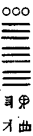



。其下注云。若人识得。不离四威仪中。有首座者。见之谓曰。和尚今日放参。



白氏文集昭国闲居诗云。时暑放朝参。



忠曰。可知放参之目。本在官制。



又有晚食名放参者。见饮啖门。放参饭处。



忠曰。此方禅林。晡时念经。为读诵放参。失义。当曰念经。或诵晚课。葢放参钟后诵经。故转讹。



●展单



旧说曰。无晚参时。鸣放参钟三下。其时展半单。葢为黄昏坐禅也。然放参钟。名展单者。隣近释也。



日用轨范云。坐参了。各出半单下地。



●坐禅



敕修清规坐禅。详叙其规。



敕修清规坐禅云。大众归堂。向里坐。　又圣节云。坐堂如寻常坐禅。向内坐。



永平清规辨道法云。早晨坐禅。首座大众。搭袈裟入堂就被位。面壁坐禅。首座不面壁。自餘头首。一如大众面壁而坐。住持人就椅子坐禅。　又云。后夜坐禅。大众不搭袈裟。住持人袈裟。挂于椅子而坐禅。是法也。



忠曰。住持就椅坐。则知亦是不面壁矣。夫面壁坐禅。匪但准依初祖风规。复可摄定散心。然今清朝禅僧。例向外。诚失古矣。



日工集云。典座。免僧。直岁。三人。免坐堂(详职位门免僧处)。



南禅规式云。四月廿一日。旧规。自今日四时坐禅。不赴佛殿勤行者。罚金壹斤。不赴坐禅者。罚金同此。　又云。初夜并晓天。二时坐禅。住持巡堂。若有被位空处。则令听叫取被巾。归方丈。若两班寮之看寮。而空被位者。僧堂坐牌前。植看寮简板。则不取被巾。



忠曰。坐禅用心。诸祖有箴有铭。有仪有论。不可悉录。今且举其目备办道士检寻。



杭州五云和尚坐禅箴　传灯录载  

鹅湖大义禅师坐禅铭　缁门警训载  

天台大静禅师坐禅铭　诸祖偈颂载  

同安察禅师坐禅铭　诸祖偈颂载  

佛眼远禅师坐禅铭　缁门警训载  

长芦赜禅师坐禅仪　禅苑清规载  

佛心才和尚坐禅仪　普灯录载  

中峰本禅师坐禅论  

兰溪隆禅师坐禅论  

明极俊禅师坐禅诀　焰慧语要载  

永平元禅师坐禅仪并铭  

莹山瑾禅师坐禅用心记及三根坐禅说



大慧杲禅师告香普说云。近来诸方。打板坐禅。若要庄景即得。我不信儞坐得定。往往闻恁麼道。却谓妙喜不教人坐禅。又是错认何曾解方便。我只要儞行亦禅坐亦禅。语默动静体安然。山僧有时夜里睡。才觉便起来坐。坐既久。都无所思。自谓诸佛境界只这是然不要把为极则。不是放身命处。况更言静是根本。悟是枝叶。此处误人。诸方说。静了方悟。我是悟了方静。不敢相瞒。未悟时心识纷飞。悟了方贴贴地。



大比丘三千威仪云。欲坐禅有五事。一者当随时。二者当得安床。三者当得輭座。四者当得闲处。五者当得善知识。复有五事。一者当得好善檀越。二者当有善意。三者当有善药。四者当能服药。五者当得善助。尔乃得猗。随时者谓四时。安床者。谓绳床。輭座者。谓毛座。闲处者。谓山中树下。亦谓寺中不与人共。善知识者。谓同居善。善檀越者。谓令人无所求。善意者。谓能观。善药者。谓能伏意。能服药者。谓不念万物。善助者。谓禅带。禅带有五事。一者当广一尺。二者当长八尺。三者当头有钩。四者当三重。五者不得用生韦。亦不得用金钩。



又天台次第禅门。详说坐禅用心。内外方便。其第二第三卷。最为要(无住云)。



日本坐禅规矩。道元禅师为始。　无住和尚杂谈集云。建仁荣西入宋。虽传禅门戒律仪。归朝之后。且顺国风。兼行天台真言。未得专讲禅规。其坐禅。但据狭床而已。佛法上人(道元)入宋归朝。始行广床坐禅於深草(兴圣寺也)。道俗初见闻此规。故敬信者众。当时所目击之僧。为予说之。自后东福开山(圆尔)渡宋。久住径山。归国。行其坐禅法。兰溪隆长老。宋国僧也。故建长寺坐禅规。一依宋朝。自此后。天下禅院。仪礼通行矣。



坐禅坐法。见礼则门。结跏趺坐处。



坐禅累手法。　请观音经云。若欲得见观世音菩萨。端身正心。使心不动。心气相续。以左手置右手上。举舌向腭。令息调匀。　智者疏。约世间。阳上阴下。随世俗故。右阳居下。左阴处上者。欲将定静之法。镇於阳散也。世俗既有威仪。此即是以戒法。禁约麤犷。即对戒也。二阳动相。阴静相。以静镇动。是制乱方便。即对於定。三者右表方便。属权。而居下。左是实智。居上。是则自权而显实。此即表慧(阐义钞释之。恐繁不录)。



或曰。一夏九十日坐禅。即一行三昧也。　摩诃止观明四种三昧(常坐。常行。半行。半坐。非行。非坐)。中云。一常坐。出文殊说文殊问两波若。名为一行三昧。(乃至)居一静室。或空间地。离诸喧閙。安一绳床。傍无餘座。九十日为一期。结跏正坐。项脊端直。不动不摇。不萎不猗。以坐自誓。脇不拄床。



●四时坐禅



四时者。依永平清规辨道法黄昏坐禅(戌辰)。后夜坐禅(四更三点)。早晨坐禅(粥后巳辰)。晡时坐禅(申辰)也。



又幻住庵清规云。装香一盘。且以三炷为率。自黄昏烧起。至第三炷。约四鼓时分也。灶下烧面汤。堂前鸣板三下。大众收枕。推被於里床。收半单。下地洗面。归堂坐禅。(忠曰。是后夜也。)至开静板鸣。即折被搭衣。佛前礼拜。归钵位坐。展钵受粥。粥罢佛前讽经。经毕小歇。堂前复鸣板三下。自主至伴。归堂坐禅。(忠曰。是早晨也。)至斋时火板鸣。下地。少顷长板鸣。归钵位。受食。食毕小歇。堂前鸣板三下。复归堂坐禅。(忠曰。是斋罢。永平为晡时。)至晡时分。鸣板放参。至黄昏。烧香盘。大众搭衣讽经施食事毕。堂前鸣板三下。归堂坐禅。(忠曰。是黄昏也。)至放参板鸣。开枕展被。右脇而息。　又云。凡一日夜之间。四次坐禅之际。宜各屏心绝虑。息念忘缘。深究死生。力竆道业。



大比丘三千威仪云。坐禅有五事。一者当随时。谓四时(详前坐禅处)。



梦窓石国师录临川家训云。四时坐禅。唯除浴日坐参。其餘极寒极热。修正兰盆时节。亦不可开(若於坐禅时特有事可作。则可开之)。赵州和尚云。我在南方三十年。除粥饭二时。是杂用心处。赵州宁谓粥饭二时。不是正用心处耶。只是言其除粥饭外。更不杂餘事耳。(乃至)古德又云。大事未明。当如丧考妣。大事已明。亦当如丧考妣。古人苦口叮咛。其意岂在令人限日约时。工夫不纯乎。上古道人。皆是卜僻洞深岩。居树下石上。更有何事可作。废寝忘飡。一味存道。百丈建立丛林。以来。普请作务。其事不少。虽然人人以道聚头。故辨道工夫。不曾为事缘所夺。百丈灭后。迨于三百年。丛林规绳渐衰。缁流少有惭愧。始有击版坐禅之仪。谓之四时坐禅。葢是主法尊宿。曲设方便。以诱懈怠者耳。今时后生。犹嫌四时坐禅。动则欲令省略。无惭无愧。莫甚於此。



义堂日工集云。在黄梅院训众曰。夏安居。三时讽经。四时坐禅。本朝不论大小刹。皆例行之。合不怠。怠者罚。



●三时坐禅



四时坐禅中省后夜也。



瑜伽师地论云。言初夜者。谓夜四分中。过初一分。是夜初分。言后夜者。谓夜四分中。过后一分。是夜后分。



●再请禅



忠曰。定式坐禅。到定钟鸣而止。此后再禅坐。此曰再请禅。



敕修清规大坐参云。如坐再请禅。住持后门入。归位。不巡堂。头首随众。或抽解者。即归被位。更深住持出。闻首座开枕响。众方偃息。在道兄弟。不以此拘。



●伴禅



旧说曰。住持五更行香之次。入僧堂。伴於大众坐禅。此谓伴禅也。



●陪禅



陪禅同伴禅义。



旧说曰。住持烧香巡堂之次。入僧堂。陪众之禅坐少时。以励众。故曰陪禅也。住持已是得法人。非是为自修行。坐禅於僧堂而已。



又道话曰陪禅。葢讹名也。　愚中及和尚年谱云。应永十三年丙戌。师八十四岁。尼松岩。兴造含晖为师塔所。师一冬。宴安于此。檀施甚厚。普施众僧。轮次斋会禅坐。道话曰。陪禅曰夜话。



●放禅



敕修清规坐禅云。堂司行者。候斋次第覆首座。放禅。转从圣僧后右出。撑帘下牌。轻撼作声。住持头首出堂。



莹山清规云。凡坐禅者。首座之管领也。己香欲了时。圣僧侍者。问讯首座。是禀放禅也。



幻住清规。首座云。凡打板。坐参。放禅。行道。种种动静。靡不关心。



●经行



日用轨范云。开小静折被。或归众寮。吃汤药。或茶堂经行。次第归钵位。



莹山坐禅用心记云。坐中。若昏睡来。常应摇身。或张目。又安心於顶上发际眉间。犹未醒时。引手应拭目。或摩身。犹未醒时。起座经行。正要顺行。顺行若及一百许步。昏睡必醒。经行法者。一息恒半步。行亦如不行。寂静而不动。



南海寄归传云。五天之地。道俗多作经行。直去直来。唯遵一路。随时适性。勿居閙处。一则痊疴。二能销食。禺中日昳。即行时也。或可出寺长引。或於廊下徐行。若不为之。身多病苦。遂令脚肿肚肿。臂疼䏝疼。但有痰荫不销。并是端居所致。必若能行此事。实可资身长道。



释氏要览云。慈恩解云。西域地湿。叠塼为道。於中往来。如布之经。故曰经行。十诵律云。经行有五利。一勦健(勦音巢。轻捷也)。二有力。三不病。四消食。五意坚固。三千威仪经有五处。可经行。一闲处。二户前(自房户前)。三讲堂前。四塔下。五阁下。



瑜伽师地论云。言经行者。谓於广长。称其度量。一地方所。若往若来。相应身业(经行。断惛沈睡眠法。如彼)。



佛陀波利修禅要诀云。问行法云何。答行即经行也。宜依平坦之地。二十二步以来。十四五步以上。於中经行。经行时。覆左手。以大指屈。著掌中。以餘四指。抱大指作拳。然覆右手。抱左手腕。即端立少时。摄心令住(谓住鼻端等)乃行。行勿太急太缓。亦摄心行。至界畔。即逐日廻身。还向来处。住立少时。如前后行。行时即开目。住即辄闭。如是复稍倦。即休。经行唯在昼。夜不行也。问多人同处经行。得不。答稍须相离。全近不得。问绕塔行道。与经行何别。答。经行者。直往直来。岂同绕塔耶。又塔是多人往来处。不可於中经行。问此方有逆日行道。称为右旋。未知是不。答西方旋塔。并逐日轮。曾无逆行。



忠曰。逐日者。自东而南而。西而北也。逆日者。从东而北。而西而南也。逐日者。顺日轮之行。与上肩顺转同。



十诵律云。经行法者。比丘应直经行。不迟不疾。若不能直。当畫地作相。随相直行。是名经行法。



摩得勒伽云。经行不能直者。安绳。



●行道



敕修清规。藏殿祝赞云。住持领众。合掌绕藏。行道三帀。多众则一帀。　又佛降诞云。维那举唱浴佛偈。行道浴佛。



幻住清规津送云。举楞严咒一遍。行道。



村寺清规云。行道尤须端谨。叉手当胸。徐行细步。瞻顾前后。须使疎密得中。或出入门户。上下阶级。皆当先举左足。须照应。袈裟不得拖地。衣服领袖。须当齐整。



万善同归集云。行道一法。西天偏重。绕百千帀。方施一拜。经云。一日一夜行道。志心报四恩。如是等人。得入道疾。　又云。南山行道仪云。夫行道障尽为期。无定日限。若论障尽。佛地乃亡。



翻译名义集云。半行半坐。方等云。旋百二十匝。却坐思惟。法华云。其人。若行若立。读诵此经。



忠曰。禅林忏摩法。楞严咒。或住立。或行道。葢是半行半坐三昧也。



●炙茄会



禅苑清规监院云。如冬斋(乃至)炙茄会(详职位门监院处)。



五祖演和尚。海会录。炙茄会上堂云。六月三伏天。火云布郊野。松间临水坐。解带同欢奲。毳侣弄荷花。宾朋倾玉斝。红尘事繁华。碧洞何潇洒。重会在明年。相期莫相舍。白云曾有约。愿结青莲社。



酉阳杂爼云。茄子茄字。本莲茎名。革遐反。今呼伽。未知所自。茄子。僧人多炙之。甚美。



忠曰。炙茄会。葢炙茄开筵也。依酉阳言。僧家炙茄尚矣。



●茶汤会



松源岳禅师录茶汤会求颂。曰春风吹落碧桃花。一片流经十万家。何似飞来峰下寺。相邀来吃赵州茶。



●冷淘会



石庵玿禅师录。有结冷淘小参云。湖南人卖上面。福建人吃冷淘(云云)。(正字通云。淘音陶。淅米也。)



●销菑会



无学元禅师支那真如录。有销菑会。烧骆驼秉炬偈。



●莲华会



圆悟勤禅师天宁录。有莲华会上堂。



慈受深禅师慧林录。有资福作莲花会。供养罗汉升座。



●菩提会



大慧杲禅师普说。有雪峰建菩提会普说。



●拈阄会



西岩惠和尚能仁录。有谢干拈阄会上堂。



阄义。详执务门。阄拈处。



●焙经



旧说曰。设火炉。焙藏经。去其蒸湿也。



忠曰。葢煆绵拭经也。



敕修清规知藏云。函帙目录。常加点对。缺者补完。蒸润者。焙拭。残断者粘缀。



北磵文集。常熟道友。焙经得舍利无数。榜云。蠹不在鱼。在执纸上语者。焙非待火。待忘言外诠时。



明极俊和尚录。跋天目净海真禅人焙四大部经。得舍利颂什后云。天目西峰净海真禅人。发心焙四大部经。一一用绵拂拭。及火煆其绵获设利一颗。



偃溪闻禅师雪窦录。谢众僧焙经上堂云。罏𫖔之所钝铁犹多。黄面老子。具正徧知。只知撒土抛沙。欺胡谩汉。不知性命落在弟子手中。二千年后。横拕倒拽。只如雪窦恁麼举。也是把火助热。



南浦明禅师崇福录。有焙经上堂。



●拭经



以绵拭经。见焙经处。



镜堂圆禅师禅兴录。拭藏经上堂云。五千餘轴眼中尘。不识无端贵似金。尽底掀飜知落处。扫堦松影又沉西。



佛祖通载云。元世祖。诏僧大内念经。行香。侍臣奏云。僧多不识字在。帝乃云。但教舒展。拭去尘埃。亦有功德。



●上堂(斋粥)



粥饭上僧堂。此谓上堂。与法堂说法称上堂别。



传灯录。药山俨禅师章云。院主报。打钟也。请和尚上堂。师曰。汝与我擎钵盂去。　又云。师曰。二时上堂不得𫜪破一粒米。



联灯会要石梯和尚章云。师见侍者托钵上堂。乃唤云。侍者。者应诺。师云。甚处去。云上堂斋去。师云。我岂不知儞上堂斋去。云除此外。别道个甚麼。即得师云。我只问儞本分事。云和尚若问本分事。某甲实是上堂斋去。云汝不谬为吾侍者。



教诫律仪云。师欲上堂。为师涤钵。看闭门户等事。



已下录世典称僧上堂。



酉阳杂爼云。玄奘言那兰陁寺僧。食堂中。热际有巨蝇数万。至僧上堂时悉自飞。集于庭树。　又云。著谣於军中曰。斋钟动也。和尚不上堂月餘。



天中记云。摭言王播客杨州木兰院。僧厌苦之。饭后击钟。后二纪。播镇杨州。访旧诗。有曰。上堂已了各西东。慙愧阇梨饭后钟。碧纱笼之矣。续云。二十年来尘拂面。如今始得碧纱笼。



已下录官人饮食。亦称上堂。



李肇国史补云。郑相珣瑜。方上堂食。王叔文至。韦执谊遽起延入阁内。　又云。三院上堂。有除改者。不得终食。



●过堂



上僧堂吃食。亦云过堂。



备用清规送钵位云。两班退职。维那先送首座。入钵位。次接都寺。送钵位。首座都寺。挂钵过堂。



六学僧传惟俨传云。二时过堂。不得咬著一粒米(传灯作上堂如上堂处引)。



大休念禅师录颂古。举云。鹅湖孚禅师。侍者请过堂。湖云。我下庄吃油糍了(会元作赴堂)。



●赴堂



忠曰。与上堂过堂同义。



敕修清规都监寺云。斋粥二时。必赴堂。则行仆行益。自然整肃。



五灯会元鹅湖孚禅师章云。师一日不赴堂。侍者来。请赴堂。师曰。我今日在庄。吃油糍饱。者曰。和尚不曾出入。师曰。儞但去。问取庄主。者方出门。忽见庄主。归谢和尚到庄。吃油糍。



●陪堂



客僧陪僧堂之外堂受食。此曰陪堂。



●下堂



粥饭毕。下僧堂此谓下堂。与上间下间。称上堂下堂别。



敕修清规。每日祝赞云。斋粥二时下堂。僧众必须登殿。(又见呗器门下堂椎处)



●喝食



见职位门。喝食行者处。



●光伴



敕修清规告香云。请客侍者。预依戒次。具茶状。备卓袱笔砚。告香罢。列法堂下间。请茶。各佥名。请首座光伴。



金鳌新话龙宫赴宴录云。神王开润笔宴。王曰。余欲与秀才光伴。故邀尔。酒进乐作。



或曰。光伴者。言我得前人恩光。允容我。令相伴也。不敢自专之谓矣。此义未是。



忠曰。光者。犹如荣也。字系伴人。言我得伴此人。是己之光荣也。如入院展词。云光据法筵又王梅溪小简云光膺宸命。荣陟台端。当例此而解耳。



竺印先师曰。明朝百丈清规沦亡久矣。隐元来朝。秃翁怀百丈清规。质难解处元皆不能通。翁问光伴义。元曰。光者空也。谓不设茶果药石。而空伴之谓也。然观清规光伴。皆是备茶果点心者。非空伴之义。



●相伴



联灯会要柏岩哲禅师章云。洞山与密师伯到。师问。二上座。甚处来。洞云。湖南来。师云。观察使姓甚麼。洞云不得姓。师云。名甚麼。云不得名。师云。还理事也无。云自有廊幕在。师云。还出入也无。洞云不出入。师云。岂不出入。洞拂袖而出。师次日侵晨入堂。召二上座。二人便出。师云。昨日老僧。对上座一转语。不称意。一夜不安。今请上座。别转语。若惬老僧意。便开粥相伴。过夏。洞云。请和尚问。师云。不出入。洞云太尊贵生。师乃开粥同过夏。



传灯录仰山寂禅师章云。若说禅宗。身边要一人相伴亦无。



敕修清规嗣法师忌云。方丈客头。请西堂两序。晚间对真。相伴吃汤。



外典有接伴名。且附此。　事物纪原云。宋朝会要曰。契丹使至。命乐黄自康宗元诣雄州接伴。廻日充送伴使。此疑接伴之始也。



宋史袁韶传云。韶为右司郎官。接伴金使。



●巡堂



忠曰。巡僧堂也。有数种。谓住持巡堂(入院旦望茶坐禅)。大众巡堂(三八念诵)。首座巡堂(坐禅大坐参结制)。维那巡堂(圣节)。参头巡堂(挂搭)。都寺巡堂(库司汤)。知事巡堂(结制旦望茶)。请客烧香巡堂(方丈茶)。沙弥巡堂(参堂)。也。此有数义不同。谓点捡义(坐禅时住持首座)告报义(圣节时维那)。请谢义(茶汤时)。礼贺义(入院时挂搭时结制时也　三八念诵后巡堂葢亦是住持大众互相礼也)。



中峰杂录。冬安居示徒云。为懒堕懈怠之旧习之所障。(乃至)其巡堂人。三回五度警省。畧不肯少加精进。似如此参禅。要明心地。要敌生死。要脱略情尘。要勦除窠臼。莫说八十日。便是八十年。八十劫。惟增业识。但长痴迷。



忠曰。此巡堂人者。住持首座之外。别设人巡堂。以警策坐禅者。睡惰也。



住持巡堂　敕修清规坐禅云。住持入堂烧香巡堂。自上间至下间。一帀。归位坐定。



东福清规云。住持入僧堂坐禅者。葢为点捡大众也。其入堂巡堂一帀。是点捡之仪也。



又入院云。鸣僧堂钟。大众先归钵位。立定。新命入堂炷香。参随人。同展三拜。维那当面问讯。引巡堂一帀。参随人先出。两序送新命。归钵位。触礼三拜。旦望住持巡堂。见次下知事巡堂。



大众巡堂　敕修清规。念诵(外堂念诵毕)云。住持入堂。前堂首座入。次名德西堂插入归。圣僧板头立。头首领众。三人一引。圣僧前问讯。转身住持前问讯。合掌巡堂顺左肩转。依图位立。暂到。侍者。随众入。只巡半堂。至圣僧后。侍者向后门立。暂到向侍者立。次知事入堂。圣僧前问讯。转身住持前问讯。合堂巡堂出。暂到接侍者后随出(云云)。



首座巡堂。　敕修清规坐禅云。首座圣僧前。烧香。巡堂。自下间至上间。一帀。就归被位坐。



校定清规云。巡堂之法。住持从上堂巡至下堂。首座从下堂巡至上堂。葢首座未出世人。故从下巡上。若已出世人。则不拘。以理论之。亦合从下巡上。免得於住持位前行故也。



忠曰。校定初义。位阶区别。亦义敬师法式。葢此时虽住持未入堂。若首座圣僧前烧香了。直向上间。则横过住持空椅前也。若圣僧前烧香了。直向下间巡堂。自圣僧后至上间。而归自被位。则得不横过住持空椅前也。故校定云。免得於住持位前行也。区别义见后。



又敕修清规大坐参云。首座入堂不烧香。便归位。待住持入堂坐定。堂司行者。鸣首座寮前板三下。大众转身向外坐。首座下地从后门出。复转从前门入。圣僧前烧香。如常巡堂。归被位坐少定。



忠曰。如常者。择坐禅时首座巡堂也。如坐禅时首座巡堂。自下间至上间一帀。葢自下间巡起者但是已。私推其理。坐禅则首座巡之后。随有住持巡堂。故首座先巡时。欲异于住持。而示其位阶区别矣。今大坐参巡堂。则自上间巡起。是寻常巡法。乃如圣节维那巡堂。自上间至下间也。



又敕修清规结制礼仪云。首座离位。圣僧前烧香大展三拜。巡堂一帀。归位。行者喝云。首座礼谢大众。触礼三拜。



维那巡堂。　敕修清规圣节云。维那於僧堂。早粥遍食椎后。再鸣椎一下云(白大众粥罢闻钟声各具威仪诣大佛宝殿启建圣节谨白)。复鸣椎一下。往住持前问讯。从首座板起。巡堂一帀。出外堂下间至上间。归内堂中间。问讯而出。



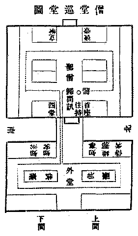



参头巡堂　敕修清规。大挂搭归堂云。参头领众。前门右手入堂。至圣僧前排立。参头烧香。同众大展三拜。巡堂一帀。自上堂至下堂。仍如前排立。问讯。



都寺巡堂　敕修清规。库司四节。特为首座大众汤云。鸣斋鼓一通。大众归钵位。头首一班。齐归前板。都寺随入。揖首座离位。却揖以次头首。进板首。随送首座归位。从圣僧后。右出堂外。迎住持入堂。供头缓鸣堂前钟七下。送住持入位。仍往首座前揖坐。仍如前出。从首座板起。巡堂一帀。外堂上下间。归堂中立问讯。(忠曰。此是揖坐巡堂。次有揖香。揖汤。巡堂问讯。)



知事巡堂　敕修清规。结制礼仪云。知事入堂烧香。大展三拜。巡堂一帀。至圣僧板头排立。行者喝云。知事礼谢大众。触礼三拜。



又旦望巡堂茶云。鸣堂前钟七下。住持入堂烧香。巡堂一帀归位。知事入堂。排列圣僧前问讯。转身住持前问讯。从首座板起。巡堂一帀。



请客巡堂。　见巡堂请茶处。



烧香侍者巡堂。　敕修清规。方丈四节。特为首座大众茶云。鸣鼓集众。烧香侍者行礼(同库司汤都寺巡堂)。



沙弥巡堂。　见参堂处。



●巡堂请茶



忠曰。住持请众。故请客侍者巡堂。



敕修清规方丈四节特为首座大众茶云。挂点茶牌。长板鸣。请客侍者。入堂圣僧前。烧香一炷。大展三拜。巡堂一匝。至中问讯而退。谓之巡堂请茶。



●巡寮



校定清规云。侍者先於上堂时。令行者挂巡堂牌。住持巡寮。自东廊第一寮巡起。寮众各出外接入。仍送出。众寮人多处。但寮元一人。迎送出入。大众只立门外。(忠曰。巡堂牌之堂当作寮。)



备用清规云。方丈客头。先行通覆。住持至。寮主先於门前下手立。迎入。请趺坐。插香。住持答香。略叙寒温。致谢送出。听叫收香。蒙堂四寮众。皆列门外下手。同接入。同送出。谓众寮人众。只寮元接送非法。次第巡寮毕。归方丈。照拂官客诸山。



敕修清规结制礼仪云。住持次第巡寮。各寮严设坐椅香几。於门外。候住持。从东廊第一寮巡起。至各寮香几前。寮主同众。插香云(此日礼常拜贺返沐降重)。答香云(适辱礼贺专此致谢)。送住持数步。复侧立香几之右。合掌问讯。待众行尽。就随其末。次第巡过。各寮人。随后接巡。至法堂上。住持於香几内中立。大众三人一引。问讯而过。　又巡寮云。古规。住持巡寮。僧堂前。挂巡寮牌报众(云云如彼)。或旦望巡行则不挂牌。今惟以四节报礼为巡寮。餘日不讲。能复古者。当行之。祖庭事苑云。僧祇云。世尊以五事故。五日一按行僧房。一恐弟子著有为事。二恐著俗论三恐著睡眠。四为看病僧。五令年少比丘。观佛威仪庠序。生欢喜故。禅门巡寮。正拟大圣之遗范。今天下。率丛林为师匠者。莫不遵依此式。



按韵会云。按察行也。考也。抚也。



●巡案



僧堂则曰巡堂。众寮则曰巡案。



敕修清规。大挂搭归堂云。行者引至众寮(云云)。寮主引挂搭人。排列朝观音问讯。引巡案一帀。复朝观音问讯而退。



●喝参



喝参者。唱参。盖报某伺候在此之义也。



品字笺云。参趋承也。晋谒也。



敕修清规训童行云。凡旦望五参上堂罢。参头行者。令喝食行者。报各局务。行堂前。挂牌报众。昏钟鸣。行堂前鸣板三下。集众行者。先佛殿。次祖堂。僧堂前。前堂寮。喝参。方上寝堂。排立。参头入方丈。请住持。出就坐。参头进前插香。退身归位。缓声喝云参。众低声同云。不审。齐礼三拜。　又为行者普说云。侍者烧香请法。参头领众鴈立。插香喝参三拜。传灯录瑞鹿先禅师章云。黄昏唱礼了。僧堂前喝参。僧堂前喝参了。主事处喝参。主事处喝参了。和尚处问讯。



沙弥亦喝参。　传灯录赵州谂禅师章云。师闻沙弥喝参。向侍者云。教伊去。侍者乃教去。沙弥便珍重去。师云。沙弥得入门。侍者在门外。



祖忌有喝参。　敕修清规达磨忌云。维那举楞严呪毕。回向(云云)次参头领众行者。排列喝参礼拜讽经。　忠曰准事生也。



●开浴



又见殿堂门。浴室处。



敕修清规知浴云。凡遇开浴。斋前挂开浴牌。寒月五日一浴。暑天每日淋汗。



●施浴



传灯录普净院常觉禅师章云。师以时机浅昧。难任极旨。苟启之非器。令彼招谤讟之咎。我宁不务开法。每月三八施浴。僧道万计。师常谓诸徒曰。但得慧门无壅。则福何滞哉(又见殿堂门浴室处)。



佛说温室洗浴众僧经云。耆域欲请佛及僧菩萨大士。入温室澡浴。佛告医王。吾当为汝。说澡浴及报之福。澡浴之法。当用七物。除去七病得七福报。七物。一然火。二净水。三澡豆。四酥膏。五淳灰。六杨枝。七内衣。除七病。一四大安隐。二除风病。三除湿痺。四除寒氷。五除热气。六除垢秽。七身体轻便。眼目精明。如是供养众僧。便得七福。一四大无病。二面貌端正。三身体香洁。四肌体润泽。五多人从。拂尘垢。识宿命。六口齿香好白齐。所说肃用。七所生处。自然衣饰珍宝(乃至广说澡浴及报之及丽本作反)。



●入浴



敕修清规知浴云。鸣鼓第一通。僧众入浴。第二通末。头首入浴第三通。行者入浴。此时住持。方入。以屏风遮隔而浴。第四通。人力入浴。监作行者。知事居末浴。



日用清规云。如遇入浴。浴具携右手。入下间门阃内问讯。归空处。挹左右人(云云具如彼说)。或有疮。或洗灸疮或使疥药。宜随后入浴。



寄归传云。须饥时浴(详殿堂门浴室处)。



五灯会元石梯和尚(嗣茱萸)章云。因侍者请浴。师曰既不洗尘。亦不洗体。汝作麼生。者曰。和尚先去。某甲将皂角来。师呵呵大笑。(传灯联灯不收)



●淋汗



夏月入浴。曰淋汗(见开浴处)。葢热时。常有污。故每日淋沃也。　又见文疏门。淋汗疏处。



正字通云。淋音林。说文以水沃也。



清拙澄禅师录淋汗颂云。陕府铁牛遭日炙。嘉州大象汗交流。有人浴得这个佛。万两黄金也合收。



●洗脚



旧说曰。洗足。多於西净矣。



日用轨范云。洗脚板鸣。不得争夺脚桶。



●净发



剃头发也。



敕修清规坐禅云。或山门有迎接祈祷。普请。看诵。送亡。及众寮净发洗衣。则不坐禅。



行事钞诸杂要行篇云。五分佛制半月一剃发。除无人难缘。论家四种次第。一上座。二发长。三先洗头。四有缘欲行。并前为剃。毗尼母剃发者。但除头上毛及须餘毛一切不合却。所以剃者。为除憍慢自恃心故。四分。比丘不得为白衣剃发。除欲出家者。若头极长。若两月。若广两指。一剃。爪极长如一麦。翦之。不得用剪刀翦发。听畜盛发器。十诵发当薶坑中。涅槃头须爪发。悉皆长利。破戒之相。增一佛告比丘。沙门出家。有五毁辱法。一头发长。二爪长。三衣裳垢圿。四不知时宜。五多有所论。



逆剃顺剃　毘奈耶杂事云。阿难入城乞食。有婆罗门。於高堂见已。以拳攉阿难头。时邬波难陀闻已。口中唱。我今解治彼小人。使剃头人。逆顺净剃。揩摩以油。著衣入城。捉婆罗门臂。至王门。见王。白其事。王大怒。斩婆罗门手(畧钞)。



●煆发



焚得度人之发也。



断桥伦禅师录。新化炉煆发佛事云。铜头铁额。马颔驴腮。倒顺刬除千万万。零星收拾几堆堆。作者出手。炉𫖔新开。从前毛病到此一时灰。红个白个青个紫个赤个。以火打圆相云。尽从者个流出来。应庵华禅师蒋山录焚众僧发佛事云。拈火把云。一呼善来。须发自落。积累既多。无处安著。普请大众。把火烧却。且道烧却后如何。不用拨灰求舍利。无边顶相放毫光。



长翁净禅师录煆发上堂云。活刬群牛脑后毛。风吹日炙转腥臊。不堪狼藉薰天地。罪恶重将业火烧。恁麼见得。切忌死灰寻舍利。臭烟蓬㶿燄头高。



●开炉



敕修清规月分须知云。十月初一日开炉。方丈大相看(又见职位门炉头处)。



僧宝传法昌遇禅师传云。法昌在分宁之北。千峰万壑。古屋数间。遇至止。安乐之。火种刀耕。衲子时有至者。皆不堪其枯淡。坐此成单丁。开𬬻日。辄以一力挝鼓。升座曰。法昌今日开𬬻。行脚僧无一个。唯有十八高人。缄口围𬬻打坐。不是规矩严难。免见诸人话堕。直饶口似秤槌。未免灯笼勘破。不知道绝功勋。安用修因证果。喝一喝云。但能一念回心。即脱二乘羁销。



●闭炉



敕修清规月分须知云。二月初一日。僧堂内闭炉。或山寺高寒。毋拘。(又见职位门炉头处)



●向火



日用轨范云。寒月向火。先坐炉圈上。然后转身正坐。揖上下肩不得弄香匙火筯。不得拨火飞灰。不得聚头说话。不得煨点心等物。不得炙鞋焙脚。烘衣裳。不得揽起直裰。露袴口。不得吐唾。并弹垢腻於火内。



传灯录南泉愿禅师章云。师在方丈与杉山向火次。师云。不用指东指西。直下本分事。道来。杉山插火箸叉手立。师云。虽然如是。犹较王老师一线道。



曹山寂禅师录云。师一日入僧堂。向火。有僧曰今日好寒。师曰。须知有不寒者。曰谁是不寒者。师䇲火示之。僧曰。莫道无人好。师下火。僧曰。某甲到这里却不会。师曰。日照寒潭明更明。



四分律云。向火。有五过失。一令人无颜色。二无力。三令人眼暗。四令多人閙集。五多说俗事。



僧祇律云。佛告诸比丘。然火有七事无利益。何等七。一者坏眼。二者坏色。三者身羸。四者衣垢坏。五者坏床褥。六者生犯戒因缘七者增世俗言论。有此七过故。从今日后。不听然火。



行事钞引僧祇。资持记释之云。坏色。谓面无神色。生犯戒缘。即露地然火掘坏等戒。因而成犯。



●普请



忠曰。集众作务。曰普请。



困学纪闻云。普请。出吴吕蒙传。



根本说一切有部毗奈耶杂事云。如世尊说。若埽地时。有五胜利。时有老宿苾刍。弃禅诵业。入逝多林。皆亲埽地。佛言。我於知事人。作如是说。非诸耆宿苾刍修行业者然於我所。依善法律。而出家者。有二种业。一者习定。二者读诵。苾刍闻佛为知事人。密作是说。其知事人。不能遍埽逝多林地。佛言随要当埽。若月八日。或十五日。应鸣犍稚总集众僧。共为洒埽。　古德以此鸣犍稚集众作务。为丛林普请之据。(五胜利。见执务门。埽地处。)



传灯录禅门规式云。行普请法。上下均力也。



僧史畧别立禅居云。共作者。谓之普请。



敕修清规云。普请之法。葢上下均力也。凡安众处。有必合资众力而办者库司先禀住持。次令行者。传语首座维那。分付堂司行者。报众挂普请牌。仍用小片纸书。贴牌上云(某时某处)。或闻木鱼。或闻鼓声。各持绊䏝。搭左臂上。趋普请处。宣力。除守寮直堂老病外。竝宜齐趣。当思古人一日不作。一日不食之诫。



幻住清规云。公界普请。事无轻重。均力为之。不可执坐守静。拗众不赴。但於作务中。不可讥呵戏笑。夸俊逞能。但心存道念。身顺众缘。事毕归堂。静默如故。动静二相。当体超然。虽终日为。而未尝为也。临济玄禅师录云。一日普请。(乃至)黄檗竖起镢头云。祇这个。天下人拈掇不起。师就手掣得。竖起云。为什麼。却在某甲手里。黄檗云今日大有人。普请。便归院。



联灯会要。华严休静禅师章云。师在洛浦作维那。普请。白槌云。上间般柴。下间锄地。首座云。圣僧作甚麼。师云。当堂不正坐。不趣两头机。



大慧普说如山主请普说云。乾峰示众云。举一不得举二。放过一著落在第二。云门出众云。昨日有人。从天台来。却往径山去。峰云。今日不得普请。旧时丛林中。日日普请不似今时禅和家。十指不沾水。百事不干怀。著好衣服要受人天供养。不生惭愧。旧时无这般衲子。每人有一柄畬刀。一柄锄头。谓之一日不作。一日不食。若是普请处。有一人打发时。一众赖他便免普请。所以道。今日不得普请。后来众中。多把作禅会了。



联灯会要佛日和尚章云。师到夹山。一日大众普请次。维那令师送茶。师云。某甲为佛法来。不为送茶来。那云。和尚教上座送。师云和尚尊命。即得。乃携茶。去作务处。撼盏作声。夹山回顾。师云。酽茶三五盌。意在镢头边。山云。瓶有倾茶势。篮中几个瓯。师云。瓶有倾茶势。篮中无一瓯。便倾茶行。时大众一时举目。师云。大众鹤望。请师一言。山云。路逢死虵莫打杀。无底篮子盛将归。师云。手执夜明符。几个知天晓。山云。大众。有人也。归去来。归去来。



忠曰。大众有人也。归去来。此即是大慧所谓赖他免普请者。



已下。录非作务。而但集众。称普请者。



敕修清规送亡云。白大众。粥罢普请送亡。除守寮直堂外。并当齐趣。



雪峰存禅师录云。师示众云。尽大地撮来如粟米粒大。抛向面前。漆桶不会。打鼓普请看。



联灯会要真净文禅师章云。今日庄主。设钻饭俵衬钱。参退。僧堂内普请。吃茶去(俵衬钱之衬一本作嚫)



清拙澄禅师录。除夜小参云。爆竹已催残年去。明朝普请贺新年。



●交代



新职者。与旧职者。相代也。



困学纪闻云。交代。出盖宽饶传。



敕修清规两序进退云。与旧人交代。互转身对触礼一拜。送旧人出。



●交承



交代。亦曰交承。承继也。



康熙字典云。承继也。诗小雅。如松柏之茂。无不尔或承。疏新故相承。无雕落也。



物初賸语。净慈请无极。诸山疏云。先与东寺。交承於凤城南畔。



虗堂愚禅师录。有芝峰交承惠茶偈。



官人交代。亦曰交承。　鲁应龙括异志云。当湖酒库有四圣庙。在炊淘之后。立祠以来。阅岁滋久。前后交承。祀之奉之甚谨。每一任初到。则上两幡。既解印。则复两幡。酬神之庇。以为定例。



●交堂



僧堂直堂人交付。曰交堂。



大鉴小清规僧堂众僧须知云。直堂。须自开静后。看守众僧被钵一日。至晚不讽经。不出外。不入寮舍。专此一日至放参了。名曰交堂。交付圣僧侍者。看管。



●挂搭



初入丛林者。挂衣钵袋於僧堂单位钩也。故凡住持。容行脚人依住。曰许挂搭。



杨亿古清规序云。所裒学众。无多少。无高下。尽入僧堂。依夏次安排。设长连床。施椸架。挂搭道具。



敕修清规。游方参请云。如求挂搭。参头领众。回身进住持前。禀云。某等。生死事大。无常迅速。久闻道风。特来依附。伏望慈悲收录。禀讫。不伺允否。即普触礼一拜云。谢和尚挂搭(云云如彼)。



住持亦有挂搭仪。　敕修清规入院云。就僧堂前。解包。屏处濯足。取衣披搭。入堂炷香。圣僧前大展三拜。参随人同拜。挂搭已。到佛殿拈香。



大鉴小清规侍者寮牓云。昔雪窦明觉禅师。在众日。与曾侍郎。谈道交契。一日明觉入浙。曾公与书一封。至灵隐珊和尚处。求挂搭。明觉至灵隐相看。得挂搭。匿其书。明年曾公访灵隐问。去年有书。送僧挂搭。到否。珊和尚云。无。取床历看。有重显上座名问之。乃作净头。曾公乃相见。问其书。明觉出其书还之。缄封未开。曾公大悦。知其远大之人也。今日本僧。人人求举书。挂搭。全无羞耻。实使人愁。有高见远识兄弟。别有格外相见。不举书为妙。



忠按。雪窦显公。不达曾公赠灵隐书。以显荐达珊禅师故不传也。见僧宝传。



●挂锡



挂搭。亦曰挂锡。



祖庭事苑云。西域比丘。行必持锡。有二十五威仪。凡至室中。不得著地。必挂於壁牙上。今僧所止住处。故云挂锡。二十五威仪。具锡杖经。



●挂钵



粥饭毕。挂钵於单后之钩也。



敕修清规挂钵时。请知事云。预分付堂司行者。於僧堂。早粥罢。挂钵时。喝云。大众少立。请新知事。



有官人挂钵於禅刹者。　普灯录。徐师川居士章曰。为尚书外郎。与朝士同志者。挂钵於天宁寺之择木堂。力参圜悟。



●止挂塔



敕修清规夏前出草单云。丛林以三月初一日。出草单。方丈止挂搭。　又月分须知云。四月初一日。锁旦过(见殿堂门旦过寮处)。



●谢挂搭



敕修清规谢挂搭云。古规。挂搭归堂者。即时谢挂搭。后以冬节岁节夏前三次。谢挂搭。近时衲子。到处坐席未温。移单东西。多致不谢挂搭。既曰经冬过夏。折中当在冬前夏前两期。报谢(其规具如彼)。



●参堂



沙弥归堂曰。参堂。堂者谓僧堂也。



敕修清规。新戒参堂云。得度受沙弥戒已。覆住持。於何日参堂。(乃至)至期。早粥遍食椎后。新戒参头。领众入堂。圣僧前。列问讯。插香大展三拜。(乃至)转身住持前。列问讯。从首座板起。巡堂。至外堂。复归内堂中间。问讯而出。然后归堂插单。随众禅诵。



●暖寮



忠曰。入寮人。辨茶果等。飨先居人。曰暖寮。予闻大德寺亦曰暖寮。妙心寺此谓暖席矣。



清拙小清规云。凡入祖堂。当一一历代位牌。平等供养(云云)。比之生人。入寮暖寮同。



辍耕录云。今之入宅与迁居者。隣里醵金治具。过主人饮。谓之曰煖屋。或曰煖房。王建宫词。太仪前日煖房来。则煖屋之礼。其来尚矣。



忠曰。此煖房。隣里煖於入宅者之房。故与禅林煖寮。义少异焉。



●暖洞



义堂日工集云。守亭书记。求预会下。乃容石屏洞脚。　又云。劝净智长老春谷。令停止两班官钱。且告云。今时佛法。属吾宗门。宗门弊在名。名之弊在暖洞。暖洞之弊。至官钱极矣。与古之卖爵无异。请和尚。誓革此弊。以为永则焉。　又康历二年记云。承僧录之命巡报建仁两序西堂诸寮。禁止暖洞之仪。葢余之宿志也。



●插单



初厕众插单位於僧堂众僧之间也。



敕修清规。新戒参堂云。归堂插单随众禅诵(详参堂处)。又移单位。亦曰插单。



敕修清规后堂首座云。如缺前堂。住持别日上堂。白众。请转前板。插单唱食。



●起单



忠曰。会里僧。辞去某寺。曰起单。言起其单位也(又详请假处)。



敕修清规月分须知云。八月本色衲子。未遽起单。碧岩录云。则监院。说丙丁童子来求火。法眼云。监院果然错会了也。则不愤。便起单渡江去(云云)。



密庵杰禅师录云。应庵一日喝恭上座云。儞常在此。作什麼。恭烦恼。打并起单。



●抽单



起单亦曰抽单。抽下单位也。



大慧武库云。保宁勇禅师。初更衣。依雪窦显禅师。问道。雪窦呵。为央庠座主。勇不意。堂仪才满。即抽单。望雪窦山礼拜。誓曰。我此生。行脚参禅。道价若不过雪窦。定不归乡。



●请假



旧说曰。暂请假外出者。须不过十五日却回。若外出过十五日。则称为起单。非是请假也。须更讲挂搭仪(挂搭仪者。到侍司附名。侍司发榜。下维那维那出度牒上床历送归堂也。详敕修清规游方参请)。



篇海类编云。假去音驾。假告休沐。



正字通云。假暇。音义别。旧注与暇同。非。



居家必用云。丧病告报曰假。谓借勾当月日也。节朔旬休曰暇。谓公务空闲日也。



忠曰。诸韵书并假字。下旬休休沐注。而必用独暇字为旬休。按禅林请假。非休沐例。故不可用韵书假义为辨私事。请假。故可用必用假义。又今时起单称请假。更假作暇。皆谬矣。



敕修清规游方参请云。或有故出入。须守堂仪半月。方可请假。古云。请假游山者。常将半月期。过期重挂搭。依旧守堂仪。



南禅规式云。请假。先上方丈报之。次报维那寮看寮。看寮出纸榜贰片。壹片。再上方丈呈之。便贴衣钵阁壹片。贴僧堂己单名肩。呈牓时。首尾粘糊。以便贴。书牓法。



> 　请假　(公界)某甲限来几日堂司某甲书



请假(或病假)堂司字印也。本寺用。则书公界二字。亦不书日限。



又云。义堂和尚。住南禅日。罚榜式中云。某上座不请假出京。不趣四更坐禅。理合出院。且从宥恕。罚油四斤。



已下。录住持亦言假。



敕修清规钟云。僧堂钟。遇住持每赴众入堂时。鸣七下。住持或不趣堂。或在假则不鸣。



忠曰。在假出外也。此住持。亦言暂假也。



传灯录僊宗守玭禅师章云。一日不上堂。大众入方丈参。师曰。今夜与大众同请假。未审还给假也。无。若未闻给假。即先言者负。珍重。



请假本世礼语。　朝野佥载云。权龙襄不知忌日。谓府史曰。何名私忌。对曰。父母忌日。请假独坐房中不出。襄至日。於房中静坐。有青狗突入。龙襄大怒曰。冲破我忌。



●暂假



请假亦曰暂假。谓暂时请假也。



敕修清规维那云。或有他缘。或暂假出入。将戒腊簿。假簿。堂司须知簿。亲送过客司。令摄之。



云卧纪谈云。真净和尚住宝峰日。洪明一祖。同在侍寮。祖请暂假。真净不许。及上巳日。呼俱侍行。为宝莲庄主具饭。真净题偈于壁曰。元符二年三月三。春饼撮餤桐饭兼。真净来看信道者。洪明一祖相随参。祖匿笑。谓同列曰。元来老和尚。以我名厕於偈。故不给假也。



●寮假



寮假。书上中下。限在十五日。



清拙小清规云。浴佛在近。沙弥喝食。不可请假病假寮假。



●病假



忠曰。为养病请假者(见寮假处)。



幻住清规云。忽遇病缘。宜白之公界。移单屏处。(乃至)病或少间。当具威仪。谢直病人。归堂参假。



●参假



凡暂假者。不过十五日而再归堂。曰参假。若过十五日。则抽籍。故初出外。为起单。非请假也。若归则可再行挂搭礼。故不可言参假矣。



忠曰。今时新依栖某寺。曰参假讹也。须称挂搭。



清拙小清规云。参假僧。无维那寮。先请假礼者。不可免参。维那照了。



莹山清规云。不请假而起单人。不可免再参假。　又云。或为请假参假参禅白事。诣方丈。及诸寮首座等寮。不拘时候。必搭袈裟也。



雪岩钦禅师录普说云。顿起乡念。且请假归乡自此一放。都放了也。两月后。再来参假。又却从头整顿。



忠曰。过六十日再来。亦曰参假。依清规非礼。



住持亦有参假。　虎丘隆禅师录参假上堂云。病起云山草木秋。浮华世事谩悠悠。从来万法不为侣。何似韶阳六不收。喝一喝。下座。



参假本世礼语。　戴植鼠璞云。唐文武职事官。九品以上。望朔朝。文官五品以上。及两省供奉。监察御史员外太常博士。日朝为常参。武官三品以上。三日一朝为九参。五品以上。及折冲当番。五日一朝为六参。三日不趂常参。即横行参假。时多御宣政。正衙立仗。廊飧而退。



●分散



大众一同退去。曰分散。



临济玄禅师录云。径山有五百众。少人参请。师到径山。装腰上法堂。见径山。径山方举头。师便喝。径山拟开口。师拂袖便行。寻有僧问径山。这僧适来有什麼言句。便喝和尚。径山云。这僧从黄檗会里来。儞要知麼。且问取他。径山五百众。太半分散。



●得度



忠曰。落发为沙弥。此谓得度。葢生死比海。今超之到彼岸。故言度。因中说果也。



增壹阿含经云。佛在道场树下。初得佛。作是念。罗勒迦蓝。诸根纯熟。应先得度。空中天曰。已死。复念。欝头蓝弗。先应得度。空中天曰。已死。世尊。便往波罗柰国。度阿若拘隣等五人。



●试经得度



佛法金汤编云。唐中宗神龙二年八月。诏天下。试童行经义挑通无滞者度之(唐史)。试经度僧始此。编年通论云。唐肃宗至德二年听白衣能诵经五百纸者度为僧。



佛祖统纪云。宋仁宗诏试天下童行。诵法华经中选者得度。参政宋绶夏竦监试。



又见簿券门。祠部牒处。



欧阳修归田录云。宋宣献公绶。夏英公竦。同试童行诵经。有一行者。诵法华经不过。问其习业几年矣。曰十年也。二公笑。且闵之。因各取法华经一部诵之。宋公十(一作五)日。夏公七日。不复遗一字。人性之相远(一有也字)如此。



●忏悔



敕修清规。沙弥得度云。戒师云。汝今至诚随我忏悔。举云。我昔所造诸恶业。皆由无始贪瞋痴。从身口意之所生。一切我今皆忏悔。



华严经疏清凉钞云。忏者梵云忏磨。此云请忍。悔即此方。体是恶作。厌先过失。求请三宝忍受悔过。单云悔者非是六释。合二即是依主。



根本说一切有部毗奈耶音释云。言忏摩者。此方正译当乞容恕。容忍收谢义也。若触误前人。欲乞欢喜者。皆云忏摩无问大小咸同此说若悔罪者本云阿钵底提舍那。阿钵底。是罪提舍那是说。应云说罪。云忏悔者。忏是西音。悔是东语。不当请恕。复非说罪。诚无由致。



毘奈耶杂事义净注云。忏谢。所言忏者。梵云忏摩。是谓容恕义。后人加悔。唤为忏悔。此即与说罪义不同也。



义净言后人加悔。不然。经律中。皆有忏悔字。



四分律毗尼增一法云。佛告比丘言。汝自忏悔。於我法中。能至诚如法忏悔者。便得增益。汝忏悔应生厌离心汝比丘。至诚如法忏悔。我为受之。



合部金光明经忏悔品云。愿当受我诚心忏悔。令我恐惧。悉得消除。



●登坛受戒



禅苑清规云。三世诸佛。皆曰出家成道。西天二十八祖。唐土六祖。传佛心印。尽是沙门。葢以严净毘尼。方能洪范三界。然则参禅问道。戒律为先。既非离过防非。何以成佛作祖。受戒之法。应备三衣钵具。并新净衣物。如无新衣。浣染令净。入坛受戒。不得徣借衣钵。一心专注。慎勿异缘。像佛形仪。具佛戒律。得佛受用。此非小事。岂可轻心。若徣借衣钵。虽登坛受戒。并不得戒。若不曾受一生为无戒之人。滥厕空门。虚消信施(云云)。



●纳戒



传灯录赵州谂禅师章云。从谂禅师。曹州郝乡人也。姓郝氏。童稚於本州扈通院。从师披剃。未纳戒。便抵池阳。参南泉(云云)。



虚堂录纳牌普说。举之。作诣南泉请戒。



●谢戒



敕修清规沙弥得度云。俟他时登坛受戒。谢戒。词云。某等获登戒品。滥厕僧伦。仰荷庇庥。特此拜谢。答云。宿承佛记。僧戒圆成。坚忍受持。力扶宗教。



传灯录中邑恩禅师章云。仰山初领新戒。到谢戒。师见来。於禅床上。拍手云。和和。仰山即东边立。又西边立。又於中心立。然后谢戒了。却退后立。



●白四羯磨



忠曰。如沙弥得度。戒师先云汝应受某戒。白也。次三说某戒相。汝能持不。三羯磨也。通初白。名白四羯磨。翻译集羯磨飜业。或所作。或辨事。或作法。



宗觉六物纂注云。就众法有三。一者单白。事或轻小。或常所行。或是严制。一说告僧。便成法事。二者白二由事参涉。义须通和。一白牒事告知。一羯磨量处可不。便辨前务。通白及羯磨。故云白二。三者白四。受戒忏重。治举诃谏。事通大小。情容乖舛。自非一白告知。三法量可。焉能辨得。以三羯磨。通前单白。故云白四(单白有三十九白二有五十七白四有三十八三位八品总数则有一百八十四种羯磨)。



四分律藏云。佛告诸比丘。有三羯磨。摄一切羯磨。何等三白羯磨。白二羯磨。白四羯磨。是为三羯磨。十诵律云。白者白众是事。故名白。有僧事。初向僧说。故名白。白羯磨。受具足戒。布萨说戒。自恣等。是名白羯磨。白二羯磨者。若白已。一唱说。如是白二羯磨。是名白二羯磨。白四羯磨者。若白已。二唱说。是三羯磨。并白为四。是名白四羯磨。



又见杂心论行事钞等。



慧苑华严音义云。羯磨。此云办事。谓诸法事。由兹成办也。



第十类　礼则门



四分律云。佛告比丘。云何摄持威仪。比丘。若出若入。屈伸俯仰。执持衣钵。若饮若食。若服药。大小便利若眠若觉。若来若去。若坐若住。若睡若觉。若语若默。常尔一心。是谓比丘摄持威仪。



●礼拜



道宣归敬仪云。礼者。履也敬而已矣。经云。恭敬塔庙谦下比丘者。是也。



礼者履也。出说文敬而已矣。出孝经广要道章。经云。出法华。



六祖法宝坛经云。僧法达。常诵法华经。来礼祖师。头不至地。师诃曰。礼不投地。何如不礼。(乃至)听吾偈曰。礼本折慢幢。头奚不至地。有我罪即生。亡功福无比。



大鉴小清规云。礼拜之法。自谦之法。坐具不敢全展。须上两角。折转些子。若新为僧。坐具但半展两重。狭而礼拜。又拜时。合掌低头问讯。次先两手托地。次两膝至地。低腰妥身。仰展开两掌。头额至地。两手两膝。皆至地。名五体投地。又拜佛之法。仰开两掌。接承如来双足。叩头而礼拜佛也。故曰头面接足礼。今此方人。以两手捏拳。不知何义。　又云。礼拜之法。低头问讯。先两手掌至地。徐徐五体投地。低腰伸手掌而拜。有一等执拗之人。礼拜时。先跪两膝至地。次方两掌至地。威仪不雅。如俗人不知次第。此大䚹谬之人。不依真正法度。误后来。错习恶相之甚也。



大鉴展坐具法。见服章门。坐具处。



飜译名义集云。那谟悉羯罗。此云礼拜。今谓礼之与拜。名有通局长短。经曰。礼者履也。进退有度。尊卑有分。谓之礼。礼记云。礼也者犹体也。体不备。君子谓之不成人。故孔子云。非礼勿视。非礼勿听。非礼勿言。非礼勿动。是则凡所施为。皆须合礼。此显礼名通也。白虎通云。人之相拜者。何所以表情见意。屈节卑礼。尊事。者也。拜之言服也。故周礼明九拜。此显拜名局也。若依释氏。如南山云。四仪若无法润。乃名枯槁众生。故天台明四种三昧之法。是知四仪法则名礼。身业恭敬名拜。此亦礼通拜局。今此飜译。礼即是拜。故大论云。礼有三种。一者口礼。二者屈膝。头不至地。三者头至地。是为上礼。一口礼者。如合掌问讯也。观音义疏云。此方以拱手为恭。外国以合掌为敬。手本二边。今合为一。表不散诞专至一心。僧祇律云。礼拜不得如痖羊。当相问讯尔雅云。讯言也。地持论云。当安慰舒颜。先语平视。和色正念。在前问讯。善见论云。比丘到佛所。问讯云。少病少恼。安乐行不。二屈膝者。即互跪也。音义指归云。不合云胡跪。葢梵世遗种。居五竺间。葱岭之北。诸戎羗胡。今经律多翻互跪。以三处翘耸。故名互跪。即右膝著地也。涅槃疏明三义。一右膝有力。跪能安久。二右膝有力。起止便易。三右膝躁动。著地令安。若两膝著地。则名长跪。毗奈耶云。尼女体弱。互跪要倒。佛听长跪。三头至地者。即五体投地。故大论云。人之一身。头最为上。足最为下。以头礼足。恭敬之至。辅行云。准地持阿含。皆以双膝双肘及顶。至地。名五体投地亦名五轮。五处圆故。



华严经十廻向品疏云。勒那三藏说七种礼。今加后三。以成圆十。一我慢礼。谓依次位立。无敬心故。二唱和礼。高声喧杂故。此二非仪。三恭敬礼。五轮著地。捧足殷重故。四无相礼。入深法性。离能所故。五起用礼。虽无能所。而礼不可礼之三宝。一一佛前皆影现故。六内观礼。但礼身中法身佛故。七实相礼。无内无外。同一实故。八大悲礼。前虽有观。未显为生。今一一礼。普代众生故。九总摄礼。总摄前六。为一观故。十无尽礼。入帝网境。若佛若礼。重重无尽故。　钞。礼佛十重。初二非仪。令其知非。故辨之耳。三通权小。四是始教。顺空义故。五是终教。通事理故。六七顿教。但礼心佛。无礼礼故。八通终教。同教一乘故。后三合成圆教。八是能礼一。具一切故九融深浅。事随理融。事事无碍故。而言摄前六。二非仪故。十重重无尽故。下经云。一毛孔中。悉明见不思议数无量佛。一切毛孔。皆如是。普礼一切世间灯。举身次第恭敬礼如是无边诸最胜。亦以言辞。普称赞。竆尽未来一切劫。一如来所供养具。其数无量等众生。又普贤行云。於一微尘中。见一切诸佛菩萨众围绕。法界尘亦然。一一如来所。一切刹尘礼等。若依此礼。一礼则无有尽。功德岂可量哉。



忠曰。勒那七礼。广说。如法苑珠林致敬篇。及道宣归敬仪。



西域记云。致敬之式。其仪九等。一发言慰问。二俯首示敬。三举手高揖。四合掌平拱。五屈膝。六长跪。七手膝踞地。八五轮俱屈。九五体投地。凡斯九等。极唯一拜。跪而赞德。谓之尽敬。远则稽颡拜手。近则䑛足摩踵。



智度论云。何名头面礼足。答曰。人身中。第一贵者头。五情所著。而最在上故足第一贱。履不净处。最在下故。是故以所贵。礼所贱。贵重供养故。复次有下中上礼下者揖。中者跪。上者稽首。头面礼足。是上供养。以是故。佛毗尼中。下座比丘。两手捉上座两足。以头面礼。　又云。天竺以捉足。为第一恭敬。



忠曰。清拙仰开两掌。接承如来双足(止此)。固无间然。而智度论已言。毗尼中。两手捉上座两足(止此)。今且引律。证覆开两掌执触前人足上。



毘奈耶杂事云。难陁执持衣钵。入城乞食。巡至鹿子母家。时毗舍佉见彼容仪光饰。便起净信。礼其双足。将手触著。彼身柔輭。女是触毒。近便损害难陀。便起染心(畧钞)。



又十诵律云。尔时诸比丘。以油涂足上。是国多尘土。著比丘脚。诸居士妇。以两手。接比丘足。作礼。然后洗手捉钵下食。比丘言。先洗手已。捉钵。答言已洗。若汝不油涂足者。当有何过佛见妇呵责。还僧房。语比丘。从今不应油涂足上。入白衣家。



又十诵律云。毗舍佉鹿子母。信众僧。两手接足。头面作礼。



释氏要览云。长阿含经云。二肘二膝头顶。谓之五轮。轮者。圆转之义也。亦云五体凡礼拜。必先并足正身。合掌俯首。以手褰衣(衣即袈裟也五百问云不褰三衣礼拜得众多罪)。先以右膝著地。次下左膝。以二肘著地。舒二掌。过额承空。示有接足之敬也。以头在地。良久方成一拜。若以中拇指。相拄或以掌承面。或捺地。并非仪也。　又云。大方广宝箧经。智灯声闻。问文殊言。云何礼佛。文殊言。若见法净名见佛净。若身若心。不低不昂。正直而住。不动不摇。其心寂静。行寂静行。是名礼佛。



万善同归集云。若行道礼拜时。不生殷重。既无观慧。又不专精。虽身在道场而心缘异境。著有为之相。迷其性空。起能作之心。生诸我慢。不了目他平等。能所虚玄傥涉兹伦。深当客舂磨牛责。



野客丛书云。古者拜礼。非特首至地。然后为拜也。凡头俯膝屈手动。皆谓之拜。按周礼辨九拜之仪(云云)。肃拜。但俯下手。即今之揖也。何尝专以首至地为拜邪。乃知禹闻善言则拜。如揖之类。是也。岂仆仆之谓哉。



周礼九拜。解见顿首处。



朱子语录云。古人之拜。正如今道士拜。二膝齐下。唐人。先下一膝。谓之雅拜



李济翁资暇录云。夫拜者。礼之特。所以申敬恭之仪。故周礼有稽首顿首。振动吉凶。奇褒肃九等之拜。以示威灵。而观容止也。其非至亲行卑者拜。则接捧示止之。不敢当之意。今卑谦大过。反不敢接捧。而鞠躬侧立惕受。翻令前人。得以尽礼深拜。又书状吊庆辞竭。竝削去拜字。以敬尊官。都乖古风。



周祈名义考云首与要平。为拜。荀子平衡曰拜。平衡谓磬折。正首与要平。(荀子注。首与腰。如衡之平。)



●再拜



史记周本纪云。商人皆再拜稽首。武王亦答拜。



通鉴前编载之。作载拜稽首。



大鉴附录云。中吴承天南楚师悦载拜。



正字通云。载与再同。小雅宾载手仇。



忠曰。释氏要览再拜为俗法(见三拜处)。然师悦有载拜。



白虎通姓名篇云。人所以相拜者。何。所以表情见意。屈节卑体。尊事之者也。拜之言。服也。所以必再拜。何。法阴阳也。尚书曰。再拜稽首也。



忠曰。尚书云禹拜稽首。臯陶拜手稽首等。无再之言。



●三拜



敕修清规圣节云。出班上香。(乃至)大众同展三拜。



广灯录菩提达磨章云。命门人曰。汝等盍各言乎。(乃至)二祖出礼三拜。依位而立。师云。汝得吾髓。



释氏要览云。俗中两拜者。盖法阴阳也。今释氏以三拜者。盖表三业归敬也。智论云。内式礼拜。大约身口业也。佛法以心为本。以身口为末。故三拜为礼数。



南海寄归传云。凡礼拜者。意在敬上自卑之仪也。欲致敬时。及有请白。先整法衣。(乃至)足跟双䜿。脊项平直。十指布地。方始叩头。然其膝下。廻无衣物。复还合掌。复还叩地。慇懃致敬。如是至三。必也寻常一礼便罢。中间更无起义。西国见为三拜。人皆怪之。(乃至)如经律云。来至佛所。礼佛双足。在一边坐。不云敷坐具。礼三拜在一边立。



祇洹圆经受戒登坛仪云。当佛礼三拜。运想请十方现在诸佛。诸大菩萨等。又云。面北礼佛。三拜。



又法苑珠林引西国寺图云。行至佛所。礼三拜竟。围绕三帀。呗赞三契。礼佛既已。方至僧房。房外一拜。然后入。见上座。次第至下。各设三拜。僧多一拜。



忠曰。若据此说。则天竺非无三拜法。



外典亦有三拜。　国语云。蔡声子曰。子尚良食。吾归子。湫举降三拜。纳其乘马。　注拜善言也。夷俗亦有三拜法。　宋史外国传云。阇婆国王。椎髻。戴金铃。衣锦袍。蹑革履。坐方床。官吏日谒。三拜而退。



●大展三拜



敕修清规告香云。参头同众。问讯插香。各大展三拜。　又大挂搭归堂云。参头。至圣僧前。排立。参头烧香。同众大展三拜。



睦州踪禅师录云。问僧。莫是从河北来麼。僧云某甲。近离江西师云。大展坐具。礼三拜著。其僧礼拜了。便出去。



大隋真禅师录云。投子和尚。呼侍者。令装香大展坐具。望西川大隋山遥礼三拜。



联灯会要保宁勇禅师章云。少习天台教。后更衣谒雪窦显禅师。显熟视之。呵曰。殃祥座主。师气不平。发愤下山。望雪窦山。大展坐具礼三拜。誓曰。我此生。行脚参禅。名不过如雪窦。誓不归乡。



五祖演和尚太平录上堂云。将四大海水。为一枚砚。须弥山作一管笔。有人向虚空里。写祖师西来意五字。太平下座。大展坐具礼拜。为师。



虚堂愚和尚录普说云。踈山云。若教某甲道。须还师资之礼。始得。香严乃下座。大展坐具礼三拜。准前问。



南堂欲禅师开福录云。众中忽有忍俊不禁底。出来。掀倒禅床。喝散大众。山僧大展坐具。礼他三拜。



忠曰。或解。展开手也。将合掌时。先大开展两手於左右。却合掌。此谓大展矣。然此说无据。诸录已言。大展坐具。非开手明矣。禅苑清规入室云。有处大展。有处触礼(止此)。此亦以触礼。对大展。则展开坐具义。为正焉。若大展开手拜者。大仪式时然。表恭恪也。



敕修清规沙弥得度云。沙弥插香。大展三拜。



解者曰。侍者小师拜。不全展坐具。然今言大展也。



忠曰。大鉴小清规云。礼拜之法。自谦。坐具不敢全展。须上两角。折转些子。若新为僧。坐具但半展。两重。狭而礼拜(止此)。解者凭之。恐清规失辞。



●同展三拜



敕修清规圣节云。出班上香。大众同展三拜。



备用清规圣节云。出班毕。大众同展三拜。此拜佛。为告天祝寿也。



忠曰。凡圣节。二祖。三佛会。皆有此规。行者先高声喝云。大众列拜(止此)。大众一同。展坐具三拜(展有二切一旃上声。一知辇切。见次下两展三礼处)。



●九拜



旧说云。禅林九拜者。展坐具三拜者。三度。遂成九拜。



敕修清规当代住持受请云。专使插香。大展三拜。进前云(某蒙山门使令攀屈尊严得奉慈颜下情不胜感激之至)。又三拜词云(即日时令谨时。共惟新命堂头大和尚。尊候起居万福)。复三拜。收坐具。



村寺清规行脚云。行脚须见尊宿。见尊宿。须预见侍者。托通名。候见合致九拜敬。乃请尊宿趺坐。当中问讯。出所怀香。双手把进。插香炉中。退展坐具礼三拜。即穿鞋自坐具左。以进尊宿坐右。鞠躬叉手云。某久仰道风。此日幸遂展拜。下情不胜多感之至。复侧身。顾尊宿。归坐具。再礼三拜。又进云。即日共惟。某山堂上老师大和尚。尊候动静多福。复退礼三拜。合掌问讯。尊旨就坐。吃茶。茶罢。复出香炉前。问讯。谢茶而退。



律苑事规云。大展九拜词语。先叙事。次寒暄。并同禅规。



右证三拜三度。而成九拜。



禅苑清规挂搭云。入室弟子。洎法眷卑行。并大展九拜。



备用清规。结制行礼云。方丈客头行者。进罣罳椅子。住持即趺坐。侍者一班。进前插香九拜。次辨事小师。插香九拜。　又开堂祝圣云。进罣罳椅子。据坐。侍者插香。大展九拜。小师插香。大展九拜。



敕修清规。为行者普说云。参头缓声喝云。不审。众低声和毕。同礼九拜。　又请益云。侍者引入住持前。问讯。插香大展九拜。(乃至)谛听埀诲毕。进前插香。大展九拜。谓之谢因缘(详参请门请益处)。



雪岩钦禅师录普说云。闻天目和尚。久侍松源。是松源的子。必得松源说话。移单过净慈挂搭。怀香诣方丈请益。大展九拜。



圣一国师年谱云。弘安三年庚辰。师七十九岁。无传(嗣径山𤤴荆叟)自越后来。插香作礼。师曰。最后相见。须致九拜。拜毕而坐。



永平元和尚曰。结解冬年。及旦望。参师烧香九拜。或十二拜。若请益。则不必用九拜十二拜。或触礼一拜。或三拜。或稽首拜。或六拜。其一拜三拜六拜。竝额叩地。此名顿首拜。



永平清规典座教训云。斋粥辨了。典座搭袈裟。展坐具。先望僧堂。焚香九拜了。乃发食也。日本国僧食之法。先德未记。僧食九拜之说。未梦见在。



唐叚成式。续酉阳杂爼云。长乐坊安国寺弥勒像。法空自光明寺移来。初移像时。索火如虎口。数十牛曳之。索断不动。法空执炉。依法作礼九拜。像身忽迸分。不终日。移至寺焉。



人天宝鉴云。道昙法师。凡阅经。炷香九礼。趺坐良久。然后开帙。常训诸徒曰。夫窥圣教。意在明宗。若不端己虗心。争到如来境界。



忠曰。面墙之徒。妄谓。禅林门状。及文翰。言九拜。非也。夫周礼有九拜。此依位高下。分九品拜也。又佛祖忌九拜。乃三回三拜也。岂有一时为九拜者哉。故今略录数证。



敕修清规附一山书云。了万九拜。复前智者堂上和尚。云翁老师兄尊几。



雪峰存禅师录二十四景总诗尾云。当代住山。远孙比丘。智明九拜书。



南堂欲禅师录。松源老祖家书跋云。顿首九拜。谨志乎下方云。



月江印禅师录应庵与乌巨书跋云。三复感慨。焚香九拜。而为之书。



清拙澄禅师录示寂前一日。预代小师。作祭文云。谨以汤茗果蓏之仪。九拜。致祭于真慈。　又附录瑶首座(字玉渊大元国人)悼清拙偈后云。小师坚瑶九拜。　又祖柏和瑶首座悼偈序云。梓末比丘祖柏九礼。



明极俊禅师录。附宝屏云长老诗序云。口占数语。尚希慈盻。门人大云九拜。



●佛祖忌九拜



敕修清规佛降诞云。住持上香三拜。不收坐具。进前上汤进食。请客侍者。递上。烧香侍者。捧置于几毕。复位三拜。再上香。下𫎪点茶。又三拜收坐具。　又达磨宿忌云。住持上香三拜。不收坐具。上汤。退身三拜。再进前问讯。揖汤。复位三拜。收坐具。



餘忌例同。不用烦录。



旧说曰。九拜法。诸规相同。惟建仁寺所讲。上香三拜。次上汤上食下𫎪点茶毕。三拜。次进揖三拜。颇异餘刹。东福寺进食之次。献果子。建仁点茶之次。献果子。葢果子是为茶子之谓欤。中华则供具外。无更备果。而日本则更备果矣。



●祖忌十八拜



敕修清规达磨忌云。住持上香三拜。不收坐具。进炉前。上汤上食。请客侍者供递。俟烧香侍者。就祖位侧。捧置几上。退就位三拜。仍进前烧香。下𫎪毕。三拜收坐具。鸣鼓讲特为茶。如汤礼。



忠曰。特为汤。宿忌记之。故不烦重录。特为汤有九拜(佛祖忌九拜录之)。今亦如此。合前成十八拜。



十八拜两回九拜也。先住持上香归。行者展席。住持三拜。不收坐具。进上汤进食。归三拜。进上香下𫎪。归三拜收坐具。行者卷席。复住持进上香归。行者复展席。住持三拜。不收坐具。行者鸣茶鼓。住持进上茶。归三拜。又进深揖。归三拜。行者止鼓。住持收坐具。行者卷席。



●百拜



希叟昙禅师正宗赞序云。宝祐甲寅西蜀比丘。绍昙百拜书于灵鹫放山室。



忠曰。百拜。直为一百度礼拜也。或又但言数多耳。不必礼拜百度矣。论衡儒增篇云。百与千。数之大者也。实欲言十则言百。百则言千矣。是与书言协和万邦。诗曰子孙千亿。同一意也。



儒亦有百拜。　礼记乐记云。壹献之礼。宾主百拜。　疏。谓士之飨礼。唯有壹献。言所献酒少也。从初至末。宾主相答。而有百拜。言拜数多也。



明圣君初政记曰。洪武三年。五月。谕中书省曰。今人书剳。多称顿首再拜。百拜。非实礼也。宜定其式。凡致书于尊者。称端肃奉书。答则称端肃奉复。



儒论再拜礼重。　野客丛书云。漫录曰。晏元献与兄手帖曰。殊再拜。庄客至。知大事礼毕(云云)。



此外希顺变。不备。殊再拜。十一哥十一㛮。仆家有富郑公一帖。正与晏元献一同。前后皆云弼再拜。几叔几婶。乃知。前辈以再拜二字。施於尊长。不肯轻用。而今人或用此二字。则以为轻己。虽平交亦不敢。况兄与叔乎。



儒有四拜。　李涪刊误云。夫郊天祭地。止於再拜。其礼至重。尚不可加。今代妇。谒姑嫜。其拜必四。予辄详之。妇初再拜。次则跪献衣服支史承其筐篚。则跪而受之。常於此际。授受多误。故四拜相属。因为疑。又妇拜夫家长老。长老答之。则又再拜。即其事也。士林威仪岂可傚诸下俚耶。谒拜姑嫜。宜修典故。再申插地(周礼妇拜插地)。其仪可观。



儒有八拜。　邵伯温闻见前录云。韩魏公留守北京。李稷以国子博士为漕。颇慢公。公不为较待之甚礼。俄潞公代魏公为留守。未至扬言云。李稷之父绚。我门下士也。闻稷敢慢魏公。必以父死。失教至此。吾视稷犹子也。果不悛。将庭训之。公至北京。李稷谒见。坐客次。久之公著道服。出语之曰。而父吾客也。只八拜。稷不获已。如数拜之。



儒。天子前。有二十四拜。　水浒传云。宋江等朝觐东京。侍御史引至丹墀玉阶之下。宋江卢俊义为首。上前八拜。退后八拜。进中八拜。三八二十四拜。扬尘舞蹈。山呼万岁。



儒有万拜。　群谈采餘谄媚类云。罗志仁姑苏笔记。贾似道当国时。浙曹朱浚。每有剳子白事。必称某万拜复。时人谓之朱万拜。浚晦翁曾孙也。(餘冬序录亦载之云。朱浚字深源。)



赵世显客窓随笔云。李涪谓。唐世郊天祭地。止於再拜其礼至重。不可加。而以妇拜姑章。必四。为非礼。然则彼时。不行四拜也。方干处士。每拜必三。时谓之方三拜。宋朱元晦孙。为淮东提刑。与显者书。必云万拜。时谓之朱万拜。方未免好奇之过。朱则䛕佞。丧厥祖风矣。



●千拜



忠曰。又有千拜者。



大宝积经护国会云。福焰王子。即乘吉利意如来光。至如来前。举身投地。如大树倒。礼彼如来。一千拜已。说偈。



●不住拜



永平元和尚曰。法益之时。亦有不住拜。谓礼拜而不止也。可到百千拜。是皆佛祖之会。所用来拜也。



●两展三礼



字汇云。展之辇切旃上声。开也。舒也。



小补韵会云。展知辇切。舒也。



旧说曰。展者。初欲展坐具。师家揶揄止之。故作折势。复欲重展。复止之。复作折势。然不拜则情不足。故不展坐具而手持触地拜而已。　或曰。展者。插手於坐具也。至第三度。抽之点额而礼。



忠曰。或曰展者。展礼话也。谓叙事寒暄。予谓展固系坐具。初欲展具。师家约免。即不展具。但叙事情。第二展义同。叙寒暄耳。非展礼词之义。



敕修清规游方参请云。起至炉前。两展三礼。谢茶。初展云。某等重承煎点。特此拜谢。下情不胜感激之至。再展云。即日时令谨时。恭惟堂头和尚。尊候起居多福。退身触礼三拜。　又谢挂搭云。参头一展坐具。住持展手约免之。即收起。参头进前云。某等宿生庆幸。获遂依栖。下情不胜喜跃之至。仍如前退身。香几右手转。归位问讯。再展坐具。住持复如前约免。收坐具。再进前云。即日时令谨时。恭惟堂头和尚。尊候起居多福。仍如前转。归位问讯。触礼三拜。住持答一拜。(又大鉴说。见触礼处。)



忠曰。上来所录。到第三度。触礼三拜。其三拜但是三度点额也。然又有第三度。真三拜者敕修清规受法衣云。插香两展三礼。免则触礼(止此)。此既免真三拜。故但触礼。点额三度也。



校定清规云。两展三拜。亦有议论高者。凡前两展。住持不答拜。只以两手。作分开势。葢彼欲展拜。此以手免之。故彼抽之。彼又展。此又免之。故彼触拜。则住持亦当触拜酬之。



僧史略云。近以开坐具。便为礼者。得以论之。昔梵僧到此。皆展舒尼师坛。就上作礼。后世避烦。尊者方见开尼师坛。即止之。便通叙暄凉。又展。犹再拜也。尊者还止之。由此。只将展尼师坛。拟礼。为礼之数。所谓蓌拜也。如此设恭。无乃太简乎。然随方为清净者。不得不行也。



祖庭事苑。引僧史略文了云。今丛林尊宿。亦行此礼。所未便者。僧方展坐具即反答一拜。实为倒置。往往辄谓。一展即当二拜。不知据何。而为此言。所谓蓌者诈也。卑以诈拜。而尊实答之。既重轻之不分。使后世将何以为法邪。而今而后。慎勿言答拜之礼。以取笑於傍观。蓌祖卧切。



释氏要览云。南方以抽坐具为礼。律检无文(已下引僧史略)。又云。蓌音挫。拜失容。又云诈也。



村寺清规叙九拜了云。然今丛林。多只两展三拜。或谓。昔有梵僧。来参仰山。僧方展。而山怜其远来。特止之。僧即进前切叙云。久仰道风。意欲展拜。山又止之。僧故只通寒温。而后触礼三拜(云云)。后世因之。而为叙见之礼。又或更简。而只触礼三拜(云云)。但梵僧参仰山之事。清规诸书所不载。后学。不知两展三礼之由。竟昧见尊宿。当九拜之敬耳。



村寺清规万一山跋云。予初游方。一尊宿曰。昔仰山有西土僧来参。手展坐具。山挹而辞之。遂通仰参。复欲展礼。山又止。乃通寒温。僧则触礼三拜。丛林若不本此说。则此礼无义理。后予任职。众中睹师徒行礼。其徒方展坐具。而师乃答拜。次日。予诘曰。讵有为徒者。方展具。而师即拜。於理未通。师曰。近代宗师。皆然。予举前话以应。遂以予言为是。兹事。盖清规所不载。



忠曰。僧史略。开坐具为礼。引梵僧缘通慧博该。必有所据。后世因作梵僧参仰山两展三礼之说。夫仰山别有梵僧来参缘。乘之傅会矣。宜哉清规诸书不载。



律苑事规云。禅规二展三礼。今律规。并作大展三拜。词语。先寒暄。次叙事。一并称之。住持不答拜。



旧说曰。两展陈辞。每展别。初展言某事。再展言起居。



旧说云。或规有初展叙时令。异于敕修清规。忠曰。言或规者。指律苑乎。若然。则卒见律苑云先寒暄次叙事。谬解为二展三礼事。而自以为异餘规然律苑实以禅规二展三礼。合为一个大展三拜。故拜间不交词语。拜前一并称唱之。其语先寒暄。次叙事也。若到大展九拜。则每三拜展词。其语先叙事。次寒暄。并同禅规(九拜处引律苑)。敕修清规亦一并称之。则先起居次叙事。见游方参请。及谢挂搭。敕修何异律苑耶。旧说又云。泽山清规。先叙时令(止此)。妄谬惑人。有如此者。备用两展皆先叙事。次寒温。与敕修全同。



因录一并唱语法。



敕修清规游方参请云。参头领众。至客司。(乃至)词云。即日恭惟。知宾尊长禅师。尊候起居多福。久钦道誉。获奉瞻际。下情不胜感激之至。　又云。知客词云。移刻恭惟。诸位尊长禅师。尊候起居多福。适承降重。特此拜谢。下情不胜感激之至。



一并词语。先拜。次词语。　敕修清规谢挂搭云。参头转身。至炉前。对触礼一拜。词云。移刻恭惟。堂头和尚。尊候起居多福。某等重荷收录。礼合拜谢。兹蒙降尊。下情不胜感激之至。　又云。次揖两序入。对触礼一拜。词云。即刻恭惟。座元都总诸位禅师。尊候多福。某等获遂依附。迺承隆重。下情不胜感激之至。



●触礼



见两展三礼处。



旧说曰。以头触地。故云触礼。　忠曰。以坐具触地。三叩头。故云触礼三拜。



旧说曰。触义未详。义堂岐阳皆不明说。　忠曰。触义。明见大鉴清规语。亦何疑焉。



大鉴小清规云。古法小比丘。见大比丘。必须展拜。一问讯。便展坐具。大比丘。坚以手约免之。或以坐具。约而免之。小比丘。收折了。又慇懃必欲展拜。又展坐具。大比丘又坚约免之。小比丘。又收折了。敬礼之心未息。乃以坐具触地三而拜之。大比丘。遂答之一拜。此其两展三拜之本意也。



旧说曰。触礼三拜。有数说。一曰三折坐具。当额於其一折面。三叩也。一曰执坐具正半。四折当额於其上面。三叩也。一曰前两展后一拜。合称三拜。



忠曰。第三说非是。敕修清规中。有但触礼三拜。而无前两展者。



敕修清规。方丈四节。特为首座大众茶云。首座至住持前谢茶。两展三礼。初展(云云)。再展(云云)。退触礼三拜。住持每一展。则约止之。至触礼则答一拜。



旧说曰。触礼。如军中蓌拜(僧史畧说。见两展三礼处)。蓌拜。畧拜也。军中负兵器。身体不自在。故然。　小补韵会云。蓌祖卧切。说文拜失容也。礼记介者不拜。为其拜而蓌拜。朱氏曰。蓌犹言有所枝拄不利屈伸。



律苑事规云。原其坐具之制。为护身护衣故。触礼之法。头若至地。身衣有污。非所宜也。　又云。禅规触礼之法。有污身衣。尽除去之。



●触礼一拜



敕修清规圣节云。维那诣书记寮。触礼一拜禀云。启建圣节。烦制疏语。书记制毕。具草。先呈住持。亲送堂司。触礼一拜。答先礼也。



●对触礼



敕修清规入院云。新命受草贺了。鸣僧堂钟领众。躳送前代归寮。对触礼一拜。



●对转触礼



备用清规。侍者进退云。当日批下堂司。请旧侍者茶。送归众寮。维那上首。对触礼一拜。对转触礼一拜。送维那出门。



敕修清规侍者进退云。与维那交互。对触礼一拜(止此)。即是对转触礼也。



备用清规。小挂搭归堂云。参头同到众寮。维那上间入。对触礼一拜。对转对触礼一拜。



敕修清规小挂搭归堂云。维那居上间。对触礼一拜。转下间。又对触礼一拜。



●普触礼



敕修清规诸方名胜挂搭云。凡欲求挂搭。次日赴茶罢。禀云。某等为生死事大。特来依栖。伏望收录。普触礼一拜。



备用清规。侍者进退云。受请人。进前。普触礼一拜。



忠曰。众人一时触礼。故曰普也。



●普同作礼



敕修清规结制礼仪云。行者喝。云大众普同作礼。触礼三拜。



解者曰。大众各各。互礼也。



●丈夫拜



雪峰存禅师录云。师领徒南游。时黄涅槃。预知师至。搘策造前途。接之。抵苏谿。邂逅相遇。师遂问曰。近离什麼处。槃云。离辟支岩。师云。岩中还有主麼。槃以竹策叩师簥。师乃出簥相见。槃云。曾郎万福。师遽展丈夫拜。槃亦作女人拜。答。师云。莫是女人麼。槃又设两拜(云云)。



●女人拜



传灯录南泉愿禅师章云。师与归宗麻谷。同去参礼南阳国师。师先於路上。畫一圆相云。道得即去。归宗便於圆相中坐。麻谷作女人拜。师云。恁麼即不去也。归宗云。是什麼心行。师乃相唤廻。不去礼国师。(又见丈夫拜处)



传灯一山解云。女人拜。女人立拜。屈膝而已。又曰。以两手当胸前。些子鞠躳。



事物纪原云。礼曰。男拜则尚左手。女拜则尚右手。又居丧之礼。男拜稽颡。女子则否。是古者男女之拜一也。古诗曰。长跽故夫前。五言之作。自汉李陵。推此则由汉而来。其拜犹同耳。孙甫唐书云。唐武后。欲尊妇人。始易今拜。是则女屈膝而拜。始於唐武后也。(忠按。女屈膝。恐屈上。脱不字。)



鹤林玉露云。宋朱文公云。古者妇女。以肃拜为正。谓两膝齐跪手至地。而头不下也。拜手亦然。南北朝有乐府诗。说妇人曰。伸腰再拜跪。问客今安否。伸腰亦是头不下也。周宣帝令命妇相见。皆跪。如男子之仪。不知妇人。膝不跪地。而变为今之拜者。起於何时。程泰之以为。始於武后。不知是否。余观王建宫词云。射生宫女尽红糚。请得新弓各自张。临上马时齐赐酒。男儿跪拜谢君王。则唐时妇女拜。不跪。可证矣。



事言要玄事集云。代醉篇。礼妇人与丈夫为礼。则侠拜。侠者夹也。谓男子一拜。妇人两拜。夹男子拜。今妇人之拜。不跪。则异於古所谓侠拜。江浙衣冠之家。尚通行之。闾巷则否。江邻几嘉祐杂志。载司马温公之语。乃谓陕府。村野妇人。皆夹拜。城廓则不然。南北之俗。不同如此。　又曰。古者。男女皆跪。男跪尚左手。女跪尚右手。以此为别。自唐武后。尊妇人。始为今拜。而不屈膝。此见张建章渤海国记。不谓无据。然大观北史。周时诏内外命妇。拜宗庙及天台。皆俛伏。则知。前此妇人。葢已不跪者矣。



文海披沙云。妇人拜而不跪。自古已然。宋王贻孙对赵中令。谓古诗。长跪问故夫。则古妇人亦跪。不跪。自唐则天始。今制妇人亦跪。但拜时不如男子一揖。间一拜耳。然连拜。不起揖者。俗谓之叩首。乃贱者之礼。非贵之也。至於揖。则男子双手至地。妇人略缩膝而已。此礼。不知与古同否也。



●团拜



众人聚拜。曰团拜。



敕修清规库司四节。特为首座大众汤云。各乡曲。依所出榜。诣各处团拜。



●答拜



敕修清规尊宿迁化。奠茶汤云。主丧炷香。礼真。小师真左答拜。



尚书顾命云。太保受同降盥。以异同秉璋以酢。授宗人同拜。王答拜。



春秋左氏传。文十三年云。郑伯拜。公答拜。



周礼九拜有褒拜。正字通云。诗诂。谓褒拜为答拜。古文报。亦作褒。



宋陈宾桃源手听云。史越王罢相归里。经从慈溪。邑宰蒋鹗远迎。既见邑吏而下。皆参。罗拜庭下。越王答拜。蒋宰局脊。请免。王曰。阁下与之有名分。某与之为乡曲。



●还拜



答拜亦曰还拜。



敕修清规尊宿迁化。下遗书云。住持诣灵几前。炷香。点汤上祭。点茶展拜。专使座右还拜。



●顿首



九拜之一也。



周礼大祝云。辨九[揣-而+(屾/本)]。一曰稽首。二曰顿首。三曰空首。四曰振动。五曰吉[揣-而+(屾/本)]。六曰凶[揣-而+(屾/本)]。七曰奇[揣-而+(屾/本)]。八曰褒[揣-而+(屾/本)]。九曰肃[揣-而+(屾/本)]。　注稽首。拜头至地也。顿首拜头叩地也。空首拜头至手。所谓拜手也。吉拜拜而后稽颡。凶拜稽颡而后拜。奇拜谓一拜。褒拜报拜也。肃拜但俯下手。



振动者。正字通云。振动。如仪礼之揖厌。推手曰揖。引手曰厌。今谓之打躳连拱手。诗诂谓。战栗变动。恐悚迫蹙。而下手。(忠曰。凡九拜解释。正字通用舍注䟽欲得其详者。须捡彼。)



文献通考云。朱文公熹。白鹿礼殿塑像说曰。其为顿首。则又以头顿手上也。其为稽首。则又却其手。而以头著地。



野客丛书云。今人或以顿首。施於卑下。不知拜头叩地。岂卑下之所安乎。



经国大典注解云。臣之於君。稽首。稽首者。引首稍久在地。稽者稽留之意。下官於上官顿首。顿首者。额至手。即起也。上官於下官。空首。空首者。头不至手。即起也。平交者。亦空首。



宾退录云。其为顿首。则又以头顿于手上也。其为稽首。则又却其手。而以头著地。



●叩首



永平元和尚云。凡礼拜。以头叩地。或至血出。此名顿首拜。



●磬折



史记滑稽传云。西门豹簪笔磬折。



注磬折。谓曲体揖之。若石磬之形曲折也。磬一片黑石。凡十二片。树在虡上击之。其形皆中曲。埀两头。言人腰侧倾也。



后汉书马援传云。公孙述警跸就车。磬折而入。



注磬折者。屈身如磬之曲折。敬也。



礼记曲礼云。立则磬折。　疏偻折。如磬之背。故云磬折也。



韩诗外传云。立则磬折。拱则抱鼓。



艺圃球瑯威仪篇云立以磬折。坐必抱鼓。　注磬折鞠躳也。抱鼓手拱也。



庄子渔父篇云。夫子曲要磬折。



孝经援神契云。孔子作孝经。使七十二子。向北辰磬折。



●叉手



洪武正韵云。叉。手相错也。今俗呼拱手。曰叉手。



事林广记载。王日休速成法云。叉手法。小儿六岁入学。先教叉手。以左手紧把右手。其左手小指。则向右手腕。右手皆直其四指以左手大指向上。如以右手掩其胸。不得著胸。须令稍离。方为叉手法也。



敕修清规装包云。途中云水相逢。彼此叉手朝揖而过。



十诵律云。民大居士。从座起叉手合掌。白佛言。世尊。愿佛及僧。受我舍宿。佛默然许之。



佛说方等般泥洹经曰。佛告阿难。汝为空无菩萨(自西方乐园世界来者)叉十指。说是偈言。其雄根为寂定。空无出大光明。我为勇猛叉手。为师子大吼礼(云云)。佛告阿难。汝用是叉手功德。我般泥洹已后。六月中。当独作佛。天上天下人。皆当稽首向汝作礼(云云)。如来今现在。若泥洹后。以直心无䛕谄之意。一心叉手向说法者。诸佛天中天。皆当授其决及少功德者。皆当具足得是法。何况乐喜。无瑕秽者。



忠曰。须知此经所谓。叉手者。舍妄心。收归一真法界者。故其功德。如经所说。



后汉书马援传云。岂有知其无成。而但萎腇。咋舌叉手从族乎。



传灯录南泉愿禅师章云。有僧问讯。叉手而立。师云。太俗生。其僧便合掌。师云。太僧生。



忠曰。合掌西竺之法。叉手本中华古法。为俗礼。故南泉以为太俗生。



旧说曰。凡进退法。进前叉手。退后合掌。是其通式也。



●合掌



日用轨范云。合掌手指不得参差。须当胸。高低得所。不得以手托口边古云。参差合掌不当胸。两手交加插鼻中。拖履揭帘无款细。呕声泄气逞英雄。永平清规赴粥饭法云。合掌。指头当对鼻端。头低指头低。头直指头直。头若少斜。指头亦少斜。其腕莫教近於胸襟。其臂莫教筑於脇下。



又与问讯同看。



智者观音义疏云。合掌者。此方以拱手。为恭。外国合掌为敬手本二边。今合为一。表不敢散诞专至一心。一心相当。故以此表敬也。观解者。昔权实不合。而今得合(乃至广说)。合掌表於返本还源。入非权非实。事理契合。故合掌也。(前礼拜处。名义集畧引之。)



法苑珠林致敬篇云。律云。当令一心。合十指爪掌。供养释师子。或云。叉手白佛者。皆是敛容呈恭。制心不令驰散。然心使难防。故制掌合而一心也。今礼佛者。多有指合掌不合。或有掌合而指开。良由心慢而惰散也。宁开指而合掌。不得合指而开掌。本欲来求福。却反招慢过。



释氏要览云。合掌。若此方之叉手也。法苑云。若指合。其掌不合者。良由心慢而情散故也。必须指掌相著。不令虗也。



资持记云。合掌者。定心想也。两掌相抵。指掌齐合。今人但合指耳。



忠曰。禅林有人。但合十指头。不合其掌。像未开莲。因名莲华合掌矣。夫莲华合掌。别在仪轨。逍遥园记。罗什答秦王问供养法华。正用莲华合掌。葢依供养莲经。若寻常合掌。则不可徒虗掌黏指端。既当诸师剉折。好善兄弟。勿从非法焉。又理趣六波罗蜜多经云。以无量功德庄严之手。如新生莲华。合掌恭敬(止此)。是谓手之清净。非合掌如莲华也。



●和南



敕修清规圣节云。住持和南登座。



又寮元云。每日粥罢。大众归寮。(乃至)副寮出。烧香归位。茶头喝云。不审。大众和南。



翻译名义集云。槃那寐。或名槃谈。讹云和南。皆飜我礼。



行事钞僧像致敬篇云。四分至上座前。脱革屣。偏袒右肩。合掌。手执两足。云我和南(义云度我)。而作礼也。出要仪云。和南者。为恭敬也。声论云。槃那寐。此翻为礼。



法苑珠林云。依经。云和南者。梵语也。或云那谟婆南等。此犹非正。依本。正云槃淡。唐言我礼。或云归礼。归亦我之本情。礼是敬之宗致也。或云归命者。义立代於南无也。理事符同。表情得尽。俗人重南无而轻敬礼者。不委唐梵之交译也。况复加以和南诸佛迷之。弥复大笑。又南无者。善见论翻为归命觉。亦云礼大寿。又和南者。出要律仪。翻为恭敬。善见论翻为度我。准此而言。恭敬度我。义通凡圣。岂和南偏在尊师。亦通上圣。(忠曰。和南诸佛之南字。当作尚也。)



僧祇律云。佛言。和南有三种。身口心。身者。前人若坐。若立住。头面礼足。是名身。口者。若前人远遥。合掌低头。作是言。和南。是名口。心者。若以背去。应合掌作敬。是名身口心恭敬。



玄应一切经音义云。南无。或作南谟。或言那模。皆以归礼译之。言和南者。讹也。正言烦淡。或言槃淡此云礼也。或言归命。译人义安命字。



●普同和南



同普同问讯。



敕修清规念诵云。供头鸣堂前钟三下。众普同和南。



●问讯



祖庭事苑云。讯亦犹问。古之重语也。



释氏要览云。尔雅云。讯言也。善见论云。比丘到佛所。问讯云。少病少恼。安乐行否。僧祇律云。礼拜不得如痖羊。当相问讯。地持论云。当安慰。舒颜。先语。平视和色。正念在前问讯。(见礼拜处。口礼中。)



敕修清规圣节云。维那往住持前。问讯。巡堂一帀。归内堂中间。问讯而出。



忠曰。旧说谓。日本问讯。但合掌低头。阙不审词。太简乎(止此)。葢见僧祇痖羊之诫。云尔欤。然不可一定说。清规问讯。合掌低头(如大鉴说)。不必叙言词。圣节中亦云。两序对出。向佛问讯上香(止此)。日用轨范云。折袈裟了。亦当问讯而去(止此)。此般岂亦出语。曰不审耶。



大鉴小清规云。两掌相合。但名合掌。若合掌低头敬揖。此名问讯。今此间人。但合掌。名曰问讯。此亦错误传习也。　又云。凡两掌相合。只名合掌。如十佛名时。大众合掌。默念佛名。不名问讯。如揖香揖茶。此时合掌低头揖众。此名问讯。如自己。於佛前。合掌低头。敬揖诸佛。此名问讯。如主宾相见。合掌相揖。此名问讯。如合掌巡堂。不名问讯巡堂。



村寺清规云。事毕或转身。团栾问讯。或只就位。略转面。相顾左右。和南。却须以头面。随手略转。相揖左右而问讯。不得但俛首。以手摇拽左右。



旧说曰。凡问讯。但曲腰而直项非也。须倾首寓敬意。



僧史略云。如比丘相见。曲躳合掌。口曰不审者。何。此三业归仰也(曲躬合掌。身也。发言不审。口也。心若不生崇重岂能动身口乎)。谓之问讯。其或卑问尊。则不审。少病少恼。起居轻利不。上慰下。则不审无病恼。乞食易得。住处无恶伴。水陆无细虫不。后人省其辞。止曰不审也。大如歇后语乎。



智度论云。问曰。宝积佛一切智。何以方问讯释迦牟尼佛。答曰。诸佛法尔。知而故问。复次大贵大贱不应相问讯。佛力等故。应相问讯。问曰。何以问少恼少病不。答曰。寒热饥渴。兵刃坠落。外病。四百四病内病。如是二病。有身皆苦。故问少恼少患不。人虽病差。未得平复。故问兴居轻利。虽病差。能行步坐起。气力未足。不能造事携轻举重。故问气力。虽举重携轻。有贫穷恐怖。不得安乐。故问得安乐不。复次有二种问讯法。若言少恼少患。兴居轻利。气力。是问讯身。若言安乐不。是问讯心。内外诸病。名为身病。贪瞋嫉妬。九十八结等。名为心病。问讯二病故。言少恼少病。兴居轻利。气力安乐不(畧钞)。



华严经梵行品云。若语业是梵行者。梵行则是起居问讯。略说广说。(乃至)随俗说。显了说。



●普同问讯



忠曰。有二种普同问讯。一行事人。普问讯大众。如上堂登座时。二大众一时问讯。名普同问讯。



敕修清规迎待尊宿云。尊宿。往住持前。问讯。归中普问讯登座(云云)。说法毕。下座。住持前问讯。普与大众问讯。　又四节秉拂云。秉拂人。往住持前问讯。次知事前问讯。巡至班末。次至同班前问讯。亦巡至班末。即举手与大众普同问讯。　又大夜念诵云。维那请锁龛佛事。受请人。出班烧香。退身问讯。次住持前问讯。转东序前问讯。巡至班末问讯。次西序前问讯。然后与大众。普同问讯。



右行事人。与大众问讯者。



忠曰。行事人。与众普同问讯之法。先低头问讯了。以其合掌。直下身左边(少磬折)。更以其合掌(直身)。转下身右边(少磬折)。即以合掌致胸前。解合掌叉手。或处称十问讯。谓若畫十字然。



敕修清规告香云。普说竟。仍齐向法座立。参头插香。同众三拜。免则触礼。进云(云云)。普同问讯而退。　又赴斋粥云。古规。每日住持赴堂。早粥时。先於堂外坐。待堂前鸣钟即入堂。大众齐下床。普同问讯就坐。



日月轨范云。堂前钟鸣下床。为迎住持入堂。大众普同问讯。不得以手。左右摇曳。



右大众一时相问讯者。



●普通问讯



即普同问讯也。见东福寺入寺规。



●普问讯



即普同问讯也。



敕修清规迎待尊宿云。尊宿。往住持前问讯。归中普问讯。登座。(详普同问讯处)



●十问讯



即普同问讯也。合掌横竖。若畫十字故名。



东福清规上堂曰。住持到法堂。东月坛。冬则脱帽子。到中央。十问讯登座。



●畧问讯



忠曰。不深低头也。



敕修清规圣节云。侍者接香。以左手插炉中。右手拈从香一炷。畧问讯下座。归班。



●小问讯



即略问讯也。



敕修清规谢挂搭云。参头小问讯。叉手进炉前。左手插香。



●趺坐问讯



忠曰。秉拂人。请堂头趺坐故令侍者问讯。此谓请趺坐问讯或省言趺坐问讯。堂头到此据椅矣。如日本禅林入院开堂比住持举埀语。侍客为请趺坐。到列刹和尚。上位前。问讯。转身到末位(西堂末位)。问讯。此谓趺坐问讯。



敕修清规开堂祝寿云。住持当令侍者。请官员坐。　又四节秉拂云。秉拂人。就座云。侍者请堂头和尚趺坐。秉拂侍者。至住持前问讯。



忠曰。此问讯。即是趺坐问讯也。



●座前问讯



忠曰。座前者。谓法堂正前。撑天柱之间也。按上堂凡有两次座前问讯。初住持未出时。西序东序。望空座。座前问讯。后住持登座。两序复座前问讯。请法。日本禅林未闻行初空座问讯焉。



敕修清规圣节云。头首下床。圣僧前问讯领众出堂。至法座前。列一行问讯。归西序立。大众鴈列于后。知事待西序归位毕。亦列一行。座前问讯。上首居后。都寺引。归东序立定。　又云。住持和南登座。(乃至)首座领班。出列座前。问讯。大众同问讯。知事转班列座前问讯。行者随问讯。



忠曰。头首知事。空座问讯。初未知何义。后於教中得其意。



大般若经百二十七卷云。天帝释言。我坐在三十三天善法殿中天帝座上。宣说正法。无量天子。听说。恭敬礼拜而去。我不在时。诸天子亦来咸言。此处是帝释为诸天说法之座。我等皆应如天主在供养。右绕礼拜而去。



又正法念处经云。迦迦村陀佛。上忉利天。为诸天说法。还阎浮提。后天帝释。入俱咤殿。以清净心。举身投地。礼师子座。心自念言。此是如来所坐之处。以敬重心。念如来故。



忠曰。今空座问讯。亦此义也。堂头说法座故。虽堂头未坐。亦礼揖。或不得其意。妄为两序互问讯之义非也。固依百丈淹贯大藏所制作。有渊源矣。



●座下问讯



忠曰。座下者。法堂须弥座前。直下也。



敕修清规圣节云。待住侍敛衣趺坐侍者先末班。引过座下。列一行问讯。烧香侍者。引班归位(次有首座知事座前问讯)。西堂东堂。出座下问讯。



忠曰。两序座前问讯。侍者座下问讯。葢侍者左右乎住持。可谓亲於两序所以座下问讯也。其西堂东堂之於座下者。彼无有别问讯位。况其人与侍者。位阶悬隔。无混杂之嫌。故亦用座下也。



旧说曰。侍者位卑於两序。故於座下(止此)。予不与此义。



●四处问讯



忠曰。僧堂四板头。烧香问讯。此谓四处问讯。



敕修清规专使特为新命煎点云。专使揖众坐。圣僧前烧香。次上下间。次堂外烧香。仍归堂内。住持前上下间及外堂问讯。仍归中问讯。　又库司四节特为首座大众汤云。都寺揖坐巡堂。归堂中立。问讯。众坐。进前烧香。次上下间。外堂。归香合安元处。即往特为人前。问讯。右出。住持前问讯。仍巡问讯一帀。及外堂。归堂中问讯。侧立。



东渐略清规四节别式云。库司特为首座大众茶。(乃至)都寺进前。烧香四处。或七处。首座板。后堂板。分手板。圣僧板也。次外堂上下间。归即往首座前问讯。右出住持前问讯。仍巡堂问讯一帀。及外堂。归堂中问讯侧立依圣僧板头立。



镰仓清规烧香侍者巡堂礼云。待大众坐定而进龛前。把香合。烧香圣僧之前。次自首座床始。而於四所烧香。及外堂。香合置本处。又向四所问讯。及外堂。然而立中央问讯。是揖香之礼也。



莹山清规云。圣僧。上下间。堂外。问讯。是云四处问讯。



忠曰。东渐云四处。但是僧堂四板头也。外堂则不在其数。镰仓及言。亦为外堂在四处之外。然莹山历指圣僧上下间堂外。以为四处。太可疑。葢取僧堂上下间。为二处。四板中。舍何二耶。又取外堂为一处。外堂有上下间。舍何间耶。若共问讯。复成五处矣。我恐莹山卒见敕修等清规圣僧上下间外堂问讯语。不及审订。妄加外堂。为四处也。



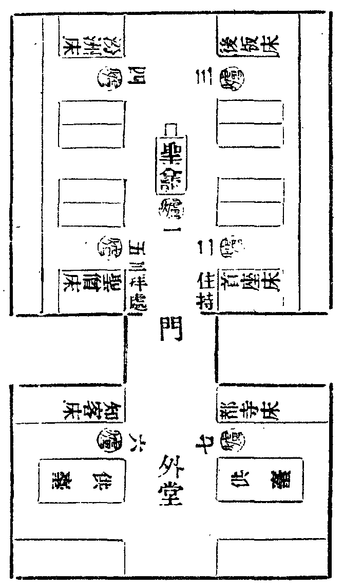



僧堂巡问讯图。



依东福清规。



●七处问讯



忠曰。东渐清规云。都寺烧香四处。或七处(见四处问讯处)。虽不指七处名。僧堂及外堂。有炉七处(见四处问讯。僧堂图)。七处烧香了。七处问讯。是揖香之礼。此可称七处问讯也。



忠又按。众寮茶汤礼。亦七处安炉。中间上下间烧香问讯。亦可称七处问讯。谓中间观音前一上间三。下间三也。



敕修清规众寮入寮出寮茶云。进中间上下间烧香。复中间上下间问讯。仍中央问讯。



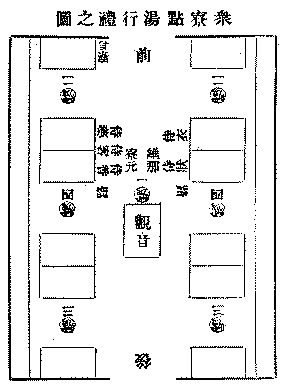



此图见于清规旧解。



●三巡问讯



敕修清规方丈小座汤云。客集。侍者揖。引至住持前问讯。依照牌入位立定。烧香侍者。请客侍者。分往特为人前。巡问讯揖坐已。复位竝立。烧香侍者进前烧香。仍归位。与请客侍者。同时转身。分巡问讯揖香。候鸣板二下。行汤遍。仍巡揖汤毕。烧香侍者进烧光伴香。鸣板一下。收盏。鸣鼓三下。退座。



解者曰。此揖坐。揖香。揖汤。三次问讯。是谓三巡问讯。烧香请客二侍者。各合掌而巡。及至末班。畧问讯了。各叉手归位。僧堂汤礼。亦有三巡问讯(见饮啖门大座汤处)。先住持前问讯。次第巡堂如常。



●一问讯



竺仙小清规云。住持并侍者。接入大众时。合掌立而已。是名接入一问讯。



大鉴小清规。求挂搭礼云。方丈行者。请粥罢方丈献茶。粥罢。参头领众。方丈前候住持入了。参头领众进。门外肃立。侍者一问讯。接入香炉前。　又四节日。巡堂礼云。凡茶汤礼。侍者门外立。俟两班耆旧皆集。但一个问讯。众入。无人人问讯之理。与众寮不同。



●借香问讯



揖班上香。有借住持香者。即先向住持问讯。此为借香问讯。烧香了。复向住持问讯。此为谢香问讯。敕修清规。两序出班上香云。两序相朝而出。转身问讯住持。谓之借香。然后上香。若圣节。佛祖嗣法师忌。无借香问讯。(详报祷门出班上香处)



大鉴小清规。两班出班拈香法云。三佛。初祖。百丈。临济。开山。嗣法师。无借香问讯。其餘前住忌。则两班人人。借住持香合内香。烧之。故先问讯住持。借香。又回身问讯。谢住持也。　又诸祖忌云。维那揖两班烧香。借香问讯。先问讯住持转身烧香问讯。了。又问讯住持归位。



莹山清规土地堂念诵云。维那出班烧香。倚卓左边。向主人问讯。请主人烧香。侍者开香合。分香於函葢置。两班一位。出班进前。问讯主人。转身问讯土地烧香。又转身问讯主人。还位。诸位皆如此。



●谢香问讯



见借香问讯处。



●茶礼



禅苑清规赴茶汤云。院门特为茶汤。礼数慇重。受请之人。不宜慢易。(又见汤礼处)



忠曰。禅林茶汤礼。诸清规具在。不用烦记。今录朝廷所讲。使知有所本。



梦溪笔谈云百官於中书见宰相。九卿而下。即省吏高声唱一声。屈躳趍而入。宰相揖。及进茶皆抗声赞唱。谓之屈揖。待制以上。见则言请某官。更不屈揖。临退仍进汤。皆於席南。横设百官之位升朝则坐。京官已下皆立。后殿引臣寮。则待制已上。宣名拜舞。庶官但赞拜。不宣名。不舞蹈。中书略贵者示与之抗也。上前则略。微者杀礼也。　又云。礼部贡院。试进士日。设香案于堦前。主司与举人对拜。此唐故事也。所坐设位。供帐甚盛。有司具茶汤饮浆。



●汤礼



见茶礼处。



南禅规式云。特为汤。雪峰为云峰讲。此为始。



●送入席



大鉴小清规。四节僧堂茶礼云。侍者叉手。至首座前问讯。便至后堂面前问讯。便至特为人前问讯。此名送入席。却从圣龛后转。出堂外报住持。住持入堂立定。侍者从住持前。直至特为人前问讯。此名揖坐。又从龛后转。从上间一问讯。合掌巡堂。内外一帀。炉前中立问讯。此名揖大众坐。



●送归位



忠曰。与送入席同。



备用清规。方丈特为首座大众茶云。侍者外堂。俟头首一班归前板。次首座入堂揖请。离位。揖次肩上位。即送首座归特为位从龛后出堂前。报住持。入堂。鸣堂前钟七下。住持归位。侍者往特为人前问讯。从龛后。转首座板头。巡问讯一帀。外堂自下而上间。归中问讯。大众就坐(先名送归位住持入堂后方名揖坐)。圆照和尚会中。盛讲此礼。



●揖(附长揖)



敕修清规圣节云。维那转身炉前。揖住持上香。



旧说曰。僧家言揖者。即问讯是也。若叉手著胸。是在家所谓揖也。



忠曰。如揖班。揖坐。揖香。揖汤茶。皆问讯名揖也。但祖忌真前之揖汤。揖茶。及触礼之后相揖。正是叉手低头。故僧家亦非无此法。



智度论云。有下中上礼。下者揖。中者跪。上者稽首(详礼拜处)。



释氏要览云。揖。即周礼第九肃拜也。又是内法下品礼也。书云。揖如磬折。若仰首直身。叉手不谨。即慢甚也。故孔子曰。为礼不敬。吾何以观之。



日用轨范云。闻徧食椎。看上下肩。以面相朝。揖食。不得正面。以手摇曳两边。



经国大典注解云。揖。下官於上官隔等。则举手齐眼下。致敬。差等则举手齐口下致敬。上官於下官隔等。则无答。差等则举手齐心答礼。相等者。各举手齐心下致敬。



居家必用载。王虗中训蒙法云。凡揖人时。则稍阔其足。其立则稳。揖时。须是曲其身。以眼看自己鞋头。威仪方美观。揖时。亦须直其膝。不得曲了。当低其头使(丙)手至(乙)膝畔(甲)。又不入膝内。则手随时起。而叉於胸前。揖时须全出手。不得只出一指。谓之鲜礼揖尊位则手过膝下。亦以手随身起。叉手于胸前也。



困学纪闻云。郑司农注。肃𱠹但俯下手。今时擡。是也。项氏云。古之拜。如今之揖。折腰而已。介胄之士。不拜。故以肃为礼。以其不可折腰也。其仪特敛手向身。微作曲势。此正今时。妇人揖礼也。汉时妇人之拜。不过如此。



周祈名义考云。手与胷平为揖。诗诂推手曰揖。引手曰厌。推手手与胷离也。厌则著手於胷。



正字通云。揖手著胷也。六书故拱手上下左右之以相礼也。周礼秋官。诏王仪南乡见诸侯。土揖庶姓。时揖异姓。天揖同姓。注。郑氏曰。土揖推手小下之也。时揖平推手也。天揖推手小举之也。



小补韵会云。仪礼注。推手曰揖。引手曰厌。今详上手当曰厌。谓手厌於胷引手当曰揖。揖而左揖而右。(又见顿首处)



程大昌演繁露云。公羊僖二年。晋谋伐郭。荀息进。献公揖而进之。注。以手通指曰揖。



史记周本纪云。武王乃揖诸侯。



湖海新闻云。宋徽宗宣和元年。降手诏曰。寺院改为宫观。自今设礼。合掌和南不审。并改作擎拳稽首。



长揖(附)　前汉书高帝纪云。郦生不拜。长揖曰。足下。必欲诛无道秦。不宜踞见长者。　注。师古曰。长揖者。手自上而极下。



●声喏



敕修清规迎待尊宿云。侍者烧香。行者问讯。仆从声喏。



忠曰。本寺仆从。要中尊宿之使用。故唱喏敬揖。相随侍也。



品字笺云。喏尔者切。敬言也。俗以长揖呼为作揖。又转而谓之唱喏。永言之谓唱。喏敬词也。言人於作揖时。必有喃喃之辞。以将其敬。故不仅曰作揖。而直谓之唱喏耳。　又唱注云。古人谓长揖。为唱喏。唱声之长。喏辞之敬也。



正字通曰。喏尔者切。音惹。俗谓长揖。曰唱喏。旧注音社非。餘冬序录曰。揖相传曰唱喏。或古人相揖作此声。唱喏者。引气之声也。宋人记卤庭事实云。揖不声。名曰哑揖。不如是。则为不知礼法。众所嗤笑。契丹人置手胷前。亦不声。谓之相揖。宋人以为怪。宋以前。中国揖。皆作声。今日承元之后。揖不作声久矣。而其名唱喏。犹存。官府升堂。公坐舆皂排衙。独引声称揖。岂非唱喏之谓与。此固自有本也。又六书故喏应声也。古无此字。疑即诺字。六书统言部。诺奴各切。古文从若从口。作喏。篆作



。据二说。诺喏同。俗音惹。或曰。今舆皂无称揖者。伏地叩首而起。序录说非。



周祈名义考云。唱喏(喏音惹)。左传使训群驺知礼。注驺。喏喝声也。喏玉篇敬言也。喝诃也。贵者将出。唱使避己。故曰唱喏。亦曰鸣驺。即孟子行辟人也。今俗谓揖。曰唱喏。不可晓。



老学庵笔记云。古所谓揖。但举手而已。今所谓喏。乃始於江左诸王。方其时。惟王氏子弟为之。故支道林入东见王子猷兄弟还。人问诸王何如。答曰。见一群白项乌。但闻哑哑声。即今喏也。(忠曰。此说大异餘冬序录。)



广灯录洞山聪禅师章云。上堂云。闻鼓声来到法堂上。佛法向什麼处去也。还有人道得麼。莫是去来叉手当胸。唱一声喏。东边却过西边。是麼(云云)。



皇朝类苑云。英宗即位。赦天下。皆加恩。荆南所给缣帛。皆故恶。军士睨之。扬言不肯受赐。偶语纷纷不已。时张师正为钤辖。呼将卒前曰。朝廷非次之恩。州郡固无预备。今帑中所有。止如此。汝辈不肯拜赐。将何为也。必欲反。则非杀我。不可。遂掷剑於庭下。披胸示之。群校茫然自失。遽声喏。受赐而去(东轩笔录)。



●连珠喏



忠曰。连珠喏。盖数人连声唱喏。如珠连环也。



夷坚志云。昆山县一老叟。钱三万。买满舱鼈。尽解缚。放诸水。是夜梦。数百人被甲。於门外。唱连珠喏。惊出视之。相率列拜。谢再生之恩(云云)



●揖坐



忠曰。立为敬。坐为懈。今请坐者。欲弛勤就安。故智度论云。若得道诸阿罗汉。如舍利弗目连须菩提等。所作已办。是故听坐。餘虽得三道。亦不听坐。大事未办。结贼未破。故譬如王臣大有功勋故得坐。敕修清规山门特为新命茶汤云。知事揖住持入堂。归位揖坐。烧香一炷。住持前揖香。从圣僧后转。归中问讯立。行茶遍。瓶出。往住持前。揖茶。



又见送入席处。



●揖大众坐



见送入席处。



●请坐问讯



南禅规式。入院方丈煎点云。法堂人事毕。侍者立方丈门左。揖众而入。(乃至)揖坐。揖香。劝汤毕。侍者引一班侍者入。至住持前问讯(住持左边为上首)。谓之请坐问讯。侍者各归位坐。行者进饭卓。饭毕收卓。次茶礼。



清规畧要新旧两序管待云。届时住持出接。或遣侍者接。各依位立定(或侍香独入。揖坐问讯。次请坐问讯入位)。住持复归位。侍香侍客。分上下间。先至新两序前问讯。巡至末问讯。叉手复至旧两序前。问讯。巡至末问讯。同归中问讯。众坐。侍香引同列。住持前一行问讯。左肩为首。入位。饭毕鸣鼓。侍香侍客。离座至炉前立。侍香炷香。转身如前。新旧前行礼。归中问讯。而行者入汤盏行瓶。候吃了。又如前行礼。归中问讯而立。侍香即烧光伴香侍客同问讯。复归位。乃点果子并茶毕。收盏。鸣鼓三下。退座。



●请香



校定清规特为新旧人汤云。烧香请客二侍者。分东西两边。巡位揖坐讫。各归中央立。客人就坐。烧香侍者。进前烧香一炷。至炉前。小问讯。谓之请香。然后开合取香(云云)。



忠曰。东渐清规侍者进退。亦如此。予谓。管待新旧两序。新旧侍者。故烧香侍者。亦在客中。故此香亦系为自一分。故有请香之礼欤。



●揖香



敕修清规新挂搭人。点入寮茶云。新挂搭人。列众寮前右边立。候众下堂。茶头即鸣寮前板。众至揖迎归位立定。点茶人。列一行问讯。揖坐。坐毕分进中炉上下间炉前。烧香。人多不过九人。则三三进前。退步转身。须相照顾详缓。列一行问讯。仍分进炉前问讯退。仍一行列问讯而立。谓之揖香。鸣寮内小板二下。行茶遍。仍如前进前问讯。复退作一行问讯。谓之揖茶。



又见揖坐处。



旧说曰。如巡揖香时先炷香了。次巡堂揖。如前揖坐法。



●揖大众香



大鉴小清规。四节僧堂茶礼云。众坐定。侍者小问讯。进炉前烧香。次上下间。堂前烧香。安香合毕。直至特为人前问讯。此名揖香又从龛后转。至上间巡堂内外。又炉前中立问讯。此名揖大众香。



●光伴香



旧说曰。烧香谢光伴人。谓之光伴香。



备用清规。方丈特为首座大众茶云。首座转身龛后。右出。住持略送。复位执盏陪众。烧光伴香一炷。鸣钟一下。收大众盏。



敕修清规受嗣法人煎点云。若诸山煎点。煎点人。待行食徧。起烧香。往住持前问讯。下𫎪。俵众人𫎪。烧光伴香。归位伴食。



旧说曰。凡煎点人。烧光伴香揖时。但光伴人。举盏而答之。餘人不用举盏。



●揖茶



见揖香。及揖大众茶处。揖而劝茶也。



旧说曰。如巡揖茶时。理应俟揖毕而吃茶。然巡揖经时稍久。若俟毕。恐冷。故各少报左右。先吃了。及巡揖人归堂中立问讯。但当举空盏而应之也。



●揖大众茶



大鉴小清规四节僧堂茶礼云。行者行茶汤。瓶出侍者。直至特为人前问讯。此名揖茶。又从龛后出上间。圣僧前。大展三拜。外入中立。此名揖大众茶。行者收茶盏。



●劝茶



忠曰。劝茶。亦是揖茶义。但至特为人前问讯。名劝茶也。



敕修清规受嗣法人煎点云。行食徧。煎点人。起烧香下𫎪。问讯住持。及行众𫎪。厨司方鸣斋板。就行饭。饭讫众收钵。退住持卓。煎点人烧香。往住持前问讯。从圣僧后出。炉前问讯。鸣钟行茶徧。往住持前劝茶。复从圣僧后出。进住持前。展坐具云(此日薄礼屑渎特辱降重下情不胜感激之至)。二展。寒温。触礼三拜。送住持出。备用清规煎点住持云。煎点人。炉前问讯。鸣钟。行茶徧。往住持前劝茶(仪同敕修清规)。



校定清规诸山尊宿相见云。至吃饭时。侍者烧香下𫎪至吃茶时。行者鸣茶鼓。侍者烧香一炷。至特为人前问讯劝茶。仍转身。上手侧问讯。进前烧相伴香一炷。归位问讯而退。



●谢茶



禅苑清规谢茶云。堂头置食点茶。特为罢。如系卑行之人。即时於住持人前。大展三拜。如不容。即触礼三拜。如平交已上。即晚间诣堂头陈谢。词云。此日伏蒙管待。特为煎点。下情无任。不胜感激之至。古人云。谢茶不谢食也。



●揖汤



忠曰。汤礼则有揖汤。当准揖茶而知之。揖而劝之。即劝汤也。敕修清规达磨忌揖汤。备用作劝汤。



●劝汤



忠曰。亦是揖汤义。可准劝茶知之。



敕修清规迎待尊宿云。寝堂钉挂帐幕。排照牌。设特为光伴位。鸣鼓行礼。揖坐。揖香。劝汤。汤罢药石。



●谢汤



忠曰。谢汤之礼。有汤前预谢者。有汤毕炉前谢者。敕修清规念诵云。请客侍者。即往西序问讯。请汤巡过。次请东序。就归位。(乃至)各出全单而散。住持出。两序随出。至堂前谢汤。住持止之(下八赴汤寝堂鸣板侍者烧香行礼如常式汤罢药石)。



右汤前预谢者。旧说曰。谢汤当触礼。故住持止之。



敕修清规。库司特为新旧两序汤药石云。汤罢起身。出诣罏前谢汤毕。抽之就座药石。



右汤毕谢者。



●谢众临屈



敕修清规。新挂搭人点入寮茶曰。寮元出炉前。对点茶人。代众谢茶。众人就位。同时合掌。谢毕。寮元复位。点茶人。复一行列问讯。再各分进罏前问讯。谓之谢众临屈。仍退作一行问讯。鸣寮前板三下。大众和南而散。



●退座



敕修清规。专使特为新命煎点云。鸣鼓三下。退座。



●门送



清拙澄禅师录晚参云。庞居士。因辞药山。山命十人禅客。门送。



●草贺



旧说曰。草贺者。小贺也。



或曰。草贺。权贺也。



忠曰。入院草贺者。草草先贺也。草畧也。谓入寺次后礼繁。故且省畧五侍。沙弥。喝食。行者等三拜。其受全贺在开堂下座之后。



论语子路篇云。裨谌草创之。　朱注草畧也。



敕修清规入院云。住持起身。知事全班进列。上首插香。(乃至)诸山。及头首勤旧。进前插香。草贺毕。客头行者喝云。请诸山两班勤旧。就座献汤。



●展贺



忠曰。开堂说法毕。下座后。大众贺入寺。是名展贺敕修清规开堂祝寿云。客头行者。即进炉烛。一字排列座前。专使插香。两展三礼毕。堂司行者喝云(诸山人事)。次喝云(西堂人事)。展礼。喝云(知事人事)。两展三礼。又喝云(首座大众人事)。勤旧蒙堂。前资诸寮。齐插香。同大众两展三礼毕。庄库庵塔。法眷乡人。暂到。展贺毕。据座。侍者小师。插香大展三拜。次执局行者。插香礼拜。次参头领众行者。插香礼拜。次直厅轿番。庄甲作头。老郎人仆。参拜毕。



●相看



敕修清规月分须知云。九月重阳日。住持上堂。许方来相看。



●大相看



敕修清规月分须知云。十月初一日。方丈大相看。



●人事



忠曰。人事有三义。一见人行礼。曰人事。二餽赠物。曰人事。三姓氏生缘。曰人事。



已下。录见人行礼。称人事者。



永平元和尚曰。人事者。相礼拜也。



观心论疏云。人事者。庆吊俯仰。低昂造聘。此往彼来。来往不绝。(摩诃止观全同此)



敕修清规告香云。入院后。人事定。为众告香。　又开堂祝寿云。堂司行者喝云。诸山人事。　又结制礼仪云。先与西堂人事。触礼一拜(乃至)堂头和尚。与大众人事。普触礼三拜。



临济玄禅师录云。有一老宿参师。未曾人事。便问。礼拜即是。不礼拜即是。师便喝老宿便礼拜(云云)。



大慧武库云。兜率悦禅师。张无尽。徐语。及宗门事。悦曰。今日与运使。相陪人事。已困。珍重。睡去。



论语学而篇云。礼之用和为贵。　朱熹注。礼者天理之节文。人事之仪则也。



已下录餽赠物。称人事者。



一山宁和尚曰。以物赠人。曰人事。



广灯录西院思明禅师章云。师未住时。在许州。闻汝州南院和尚住。元是同参。特往看。人事了。启和尚。某甲别无人事。买得江西剃刀。献上和尚。南院便问。汝从许州来。甚处得江西剃刀。师把南院手。掐。院唤侍者收收。师以衣袖拂一拂。院云。阿莿莿阿莿莿。(忠曰。初人事。谓行礼。后人事。谓餽赠物。)



叶县省禅师录云。因僧人事一个书筒(云云)。　又有人事手巾颂。



大慧杲和尚。示方宋辅法语云。临行袖此纸。求指示。以颂继之云。惠然访我鄮峰下。剡溪兴尽归心起。禅家无物赠君行。前面有山兼有水。要知妙喜。敢将常住物。作人事耳。



韩昌黎集。谢许受王用男人事物状云。缘臣与王用。撰神道碑文。令臣领受用男沿。所与臣。马一匹。并鞍衔。及白玉腰带一条者(云云)。令臣受领人事物等承命震悚。



宋许观东斋纪事云。今人以物相遗谓之人事。韩退之。奏韩弘人事物状云。奉敕。撰平淮西碑文伏缘圣恩。以碑本。赐韩弘等。今韩弘。寄绢五百疋。与臣充人事物。未敢受领。谨录奏闻。又杜牧谢许受江西送撰韦丹碑。彩绢等状云。中使奉宣圣旨。令臣领受江西观察使许于泉。所寄撰韦丹遗受碑文。人事。彩绢共三百疋。乃知此称。自唐已有之。



徐充暖姝由笔云。今人凡交游往来。及贽见。不论贵贱。但有餽送之礼。货物不等。皆谓之人事。白乐天奏。于𬱖裴均。欲入朝事宜状云。上须进奉。下须人事。其来已久。昌黎集。亦有奏韩弘人事物状。



人之姓氏生缘。称人事者。见称呼门。人氏处。



●揶揄



忠曰。揶揄。亦作歋𢋅邪揄禅录多为约免义。



僧宝传汾州善昭禅师传云。时洞山谷隐。皆虗席众议归昭。太守请择之。昭以手耶揄曰。我长行粥饭僧。传佛心宗。非细职也。　又西余端禅师传云。端听僧官宣至此。以手耶揄曰。止。



后汉书王霸传云。市人皆大笑。举手邪揄之。



章怀注。说文曰。歋𢋅手相笑也。歋音弋支反。𢋅音逾。或音由。此云邪揄。语轻重不同。



通鉴集览云。邪揄音耶喻。说文举手相笑也。



正字通云。歋歈。舞手相弄笑也。



世说新语补云。晋阳秋曰。罗友。同府人。有得郡者。温为席起别。友至尤晚。问之。友答曰。於中路逢一鬼。大见揶揄。云我只见汝送人作郡。何以不见人送汝作郡。(温者桓温也)



孤树裒谈云。蒋君廷贵。应试。经行教坊。群婢夹拥蒋不一顾。妓揶揄引其裾。蒋绝裾去。亦不怒。



●约免



忠曰。约免者。省约烦礼。而放免之也。乃出手。作止之势。或曰揶揄。



正字通云。约简也。节省也。礼内则适子庶子。不敢以贵富。入宗子之家。虽众车徒。舍于外。以寡约入。



敕修清规谢挂搭云。本引三人。一展坐具。住持展手。约免之。即收起。(详两展三礼处又见触礼处)



●回礼



忠曰。回礼者。答他之礼也。



敕修清规游方参请云。参头领众至客司。(乃至)归旦过。知客寻往回礼。



希叟昙禅师开善录。有回诸山礼归。上堂。



●还礼



回礼又谓还礼。



禅苑清规请立僧云。退院尊宿。首座藏主。如合众望。可举立僧。知事大众。诣寮礼请(请辞云大众倾心久思示诲伏望慈悲俯赐开允)。如允。即时还礼(云既蒙坚请不敢固辞)。



●复礼



回礼又曰复礼。



玄沙备禅师广录云。师问招庆云。我如今去。看王太傅。(乃至)来日太尉出招庆复礼。



●习仪



居家必用云。习仪学制礼也。谓凡有大典礼。必预先习仪也。



敕修清规告香云。预集众习仪。　又谢挂搭云。参头当具小图习仪。三人一引。每引一人。为小参头。须详记词语。进退折旋合度。免致临时参差。



春秋左传昭公五年云。女叔齐曰。礼所以守其国。行其政令。无失其民者也(云云)。而屑屑焉。习仪以丞。言善於礼。不亦远乎。



●具威仪



永平元和尚云。参师具威仪者。著袈裟。持坐具。整理鞋袜。带一片沈香栈香等也。



敕修清规圣节云。维那鸣椎一下云。白大众。粥罢。闻钟声。各具威仪。诣大佛宝殿。启建天寿圣节。谨白。



教诫律仪入温室法云。具威仪持坐具。　赞行钞云。具威仪者。著五条也。



旧说曰。大觉大鉴并曰。具威仪者。谓带坐具也。忠曰。具威仪。当随处通解之。教诫具威仪。著五条义。则是入温室时具威仪也。永平所言者。是参师时。具威仪也。大觉大鉴。但为带坐具义夫如启建圣节。岂但持坐具披五条而可耶。凡七条坐具帽袜。一切服章具足。方可言具威仪而已。　又曰。带坐具也者。恐由教诫文。有此转解。余谓。教诫文。若持业。而具威仪。即持坐具义。则与著五条解违。与大觉大鉴顺。若相违。而具威仪。更别持坐具义。则著五条解成。大觉大鉴义不成。我恐此解。非出於二师。若具威仪。即是带坐具义。则不可重言持坐具矣。



因录佛说具威仪。



长阿含经云。世尊。告诸比丘。云何比丘。具诸威仪。於是比丘可行知行。可止知止。左右顾视。屈伸俯仰。摄持衣钵。食饮汤药。不失仪则。善设方便。除去阴葢。行住坐卧。觉寐语默。摄心不乱。是谓比丘。具诸威仪。



大宝积经云。有四法威仪具足。一者知时。二者知处。三者寂静。四者真实。



●朝



忠曰。朝者。面相向前人也。



小补韵会云。朝驰遥切。觐君之总称。又礼记王制耆老。皆朝于庠。注云。犹会也。疏云。恐有朝王之嫌。故云会。耆老聚会於乡学。



康熙字典云。朝驰遥切。音潮。尔雅释言。陪朝也。注臣见君曰朝。又曰。又同类往见亦曰朝。史记司马相如传。临邛令。谬为恭敬。日往朝相如。



敕修清规圣节云。出班上香。两序对出。向佛问讯。上香毕两两相朝。转身归位。　又日用轨范云。闻徧食椎。看上下肩。以面相朝。揖食。



●朝立



忠曰立为敬。揖坐处详说。朝立者。向佛祖及灵位立也。



校定清规迁化遗书云。住持升座。(乃至)下座。诣灵位前朝立。



●庙立



忠曰。中立南面。如太祖庙位。故曰庙立。



备用清规谢挂搭云。至时侍者。同参头。入。请住持出。庙立。参头归众。同问讯。



律苑事规新来挂搭云。至时侍者同参头。入请住持出。庙位立。参头归位。众同问讯。



●鴈立



忠曰。鴈立者。凡列立。或横或竖。总此谓鴈立也。与鴈行班不同。



杨亿古清规序云。长老上堂升座。主事徒众。鴈立侧聆。



敕修清规四节土地堂念诵云。众集相对鴈立。



右竖列立者。



敕修清规帝师涅槃云。鸣钟集众。向座鴈立。



右横列立者。今为下有揖班上香。故预向座耳。



●鴈行班



村寺清规云。若横列佛神而立。谓之鴈行班。事毕。或转身团栾问讯。或只就位。畧转面相顾左右。和南。



忠曰。又见前人背后。次第列行。言鴈行。



四分律云。佛言。若檀越来。白时到。上座应在前如鴈行而去。



教诫律仪食了出堂法云。出堂门外。须旁廊一边行。令威仪庠序。鴈行而行。



战国策云魏朱忌曰。为天下鴈行顿刃。　注。鴈行。言以次进。(此义通四分律等)



又竝行而稍后也。



礼记王制云。父之齿随行。兄之齿雁行。　注。鴈行。竝行而稍后也。



又次第行。言鹅行。



十诵律云。起行时。来往故相乱。佛言。应如鹅法次第行。



●鸳班



村寺清规云。凡讽经。面面相看。而对立。谓之鸳班。事毕。候回向人归位。与众俛首和南。不必更转身。面佛神而问讯。



●朝坐



忠曰。朝坐者。面於前人坐也。与朝立之朝同义。譬如新命辞众茶汤。东序西序。同面於新命坐。是也。敕修清规。新命辞众上堂茶汤云。中敷高座。向内。首座。向外摄居主位。西堂勤旧。分手光伴。东西序两边朝坐。



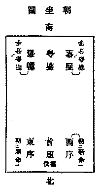



●庙坐



忠曰。中位坐。如庙位。故云庙坐。庙义。见庙立处。



山门管待新命并专使座次图。



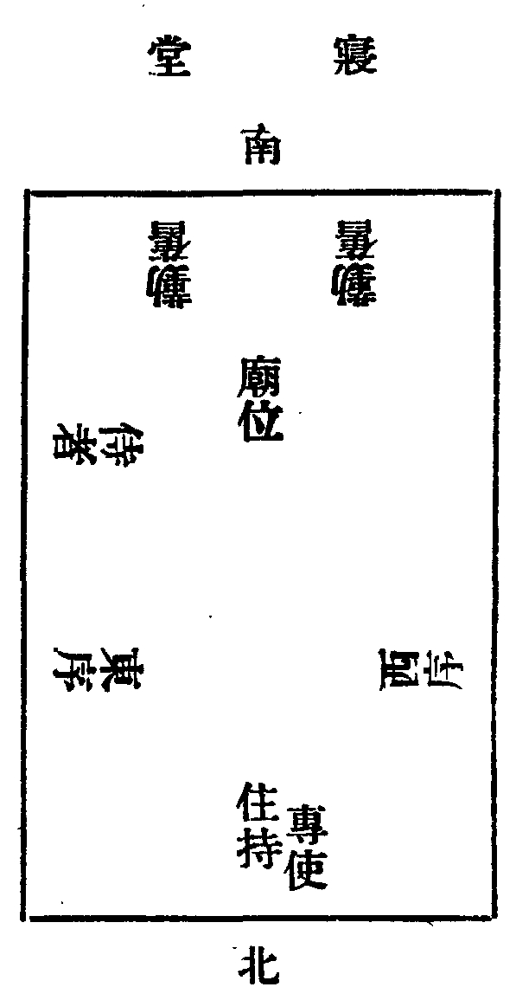



特为诸山尊宿汤果药石管待庙坐之图。



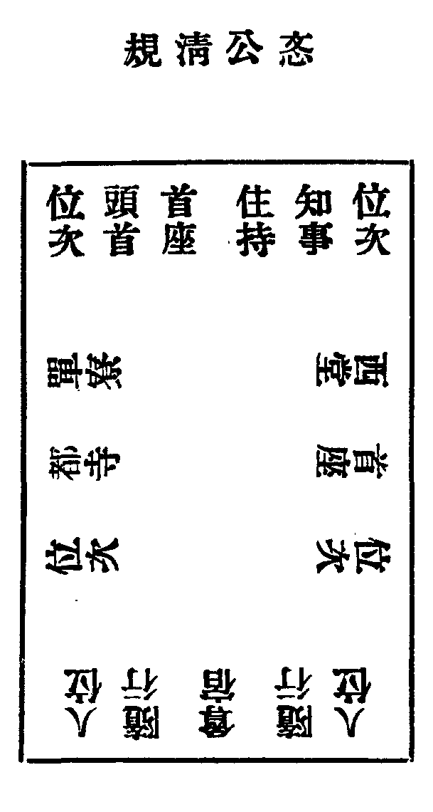



校定清规。特为住持煎点云。煎点人。请特为人出。有处只就主位坐。有处庙坐。或是法嗣。亦当庙坐。在住持意。



忠曰。住持或坐主位。若法嗣人煎点。则住持庙坐。以此可知。庙坐尊於主位矣。



诸山法眷特为住持煎点寝堂庙坐之图。



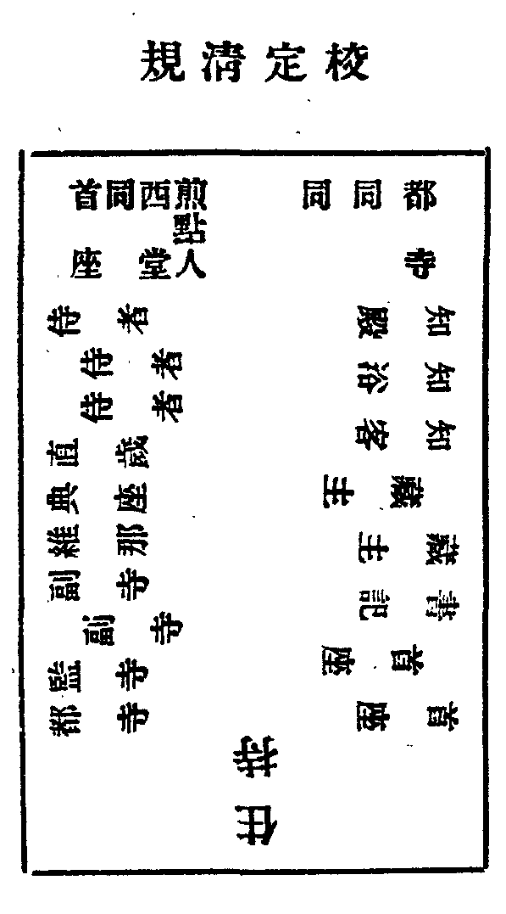



忠曰。备用清规。犹言庙坐。敕修清规。皆改为高坐实惟。庙之言关天子。东阳换词。或有意于避之乎。



●分手坐



忠曰。住持在煎点人分手位也。分手义。见座位门。



诸山特为住持煎点。寝堂分手坐位图。



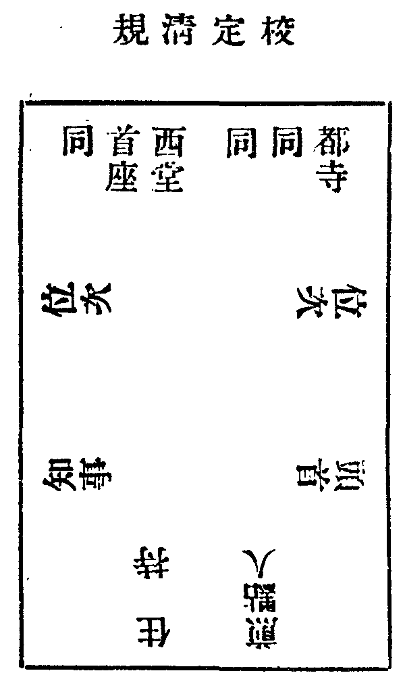



●胡乱坐



东福清规云。两序交代礼。东西新两班人。共到无价轩。先东序。与住持触礼。外出。次西序。与住持触礼。外出。两序共到茶堂。据堂内床。东序西首列东。西序东首列西。位次未定。故谓之胡乱坐。亦谓不腊次也。住持坐中央椅子。点茶。盖为定两班。集众点茶也。请客头呈目子。住持下椅。向西立。先读东序目子。侍客进次第请。东序受请了。都寺引维那监寺。到住持前。都寺植香。两展触礼。都寺引班。到茶堂横廊。东壁北首向西立。次读西序目子。礼如东序。首座引班到茶堂横廊。西壁北首。向东立。



又侍者交代胡乱坐。见饮啖门。七香汤处。



忠曰。胡乱坐者。盖对新职之位次得名。谓若欲受请。未受已前列坐时。未知谁人可为何职。且依旧位坐。以后受职位。视今坐位。则成杂乱。故为胡乱坐矣。及受职毕。交互转位。依某职位次。於是位方定。所谓东序。都寺监寺副寺等。西序前堂后堂书记等。五侍。烧香书状请客等。如此列次。敕修清规两序进退。言转位者。是也。



●不腊次



即胡乱坐也。见胡乱坐处。



●趱近



敕修清规圣节云。粥罢上堂。(乃至)众行者。列知事后。稍离远立。(乃至)住持至法座前。行者趱近。知事后立。



正字通云。趱则板切。赞上声。逼也。走也。六书故行第相趣也。



品字笺云。趱催趱也。俗以紧行谓之趱步。



忠曰。众行者。初少离知事后者。为开住持出路。若过己背后。则成失礼。况复住持至。迎问讯(见清规)。故退立。今住持既过前去。故进走近知事背后立。此谓趱近也。



●右绕



敕修清规藏殿祝赞云。绕藏行道(见行道处)。



忠曰。绕者。须右绕也。



四分律云。客比丘。於塔边左行过。护塔神瞋。佛言不应左行过。应右遶塔而过。



萨婆多毘尼毘婆沙云。右绕者。顺佛法故。所以右绕。又密迹力士。若有左绕者。即以金刚杵碎之。又佛。世世已来。常顺三宝父母师长。一切教诫。无违无逆。令得果报。无有逆者。又佛身净。众生於中。各见所事。或天或神。莫不见者。是以畏敬。右绕而去。大毘婆沙论九十八云。不吉祥故。说名为左。如有於佛贤圣制多。及天灵庙。不右绕者。以不吉祥。故名为左。



万善同归集云。绕塔功德经云。勇猛勤精进。坚固不可坏。所作速成就。斯由右绕塔。得妙紫金色。相好庄严身。现作天人师。斯由右绕塔。



净源法师楞严道场修证仪云。夫右绕者。顺向殷重。瞻望不足也。如是三帀。乃至百帀。亦无定数。



行事钞僧像致敬篇云。大论如法供养。必应右绕。　资持记。诸经论。皆令右遶。古今诤论。纷纭不息。都缘不晓遶佛遶坛。两仪自别。且直据祖教。略明大途。餘广如别。初明遶佛者。归敬仪云。右遶者。面西北转(如像面南。行者面北举步廻身。面西而去。从北而廻)。右肩袒侍。向佛而恭(此示正仪)。比见有僧。非於此法。便东廻北转。此为右遶(出错见也)。西竺梵僧。阗聚京邑。经行旋遶。目阅其踪。并乃西廻。而为右遶。以顺天道。如日月焉(此引亲见之事证成上义)。次明遶坛者。感通传。天人述西竺戒坛云。众僧登坛。受戒说戒事讫。东廻左遶。南出而返。戒坛经。祖师对真懿云。律师勿见东廻左遶。以为非法耶。此乃天常之大理也(感通传云。天常乃左。人常乃右)。祖训明显。人妄穿凿。或曲引俗书(如执天文志。李长者之说是也)。或妄凭世事(如执牛踏稻。蜘蛛结网之类)。且遶佛者。本乎致敬。遶坛者。便乎行事。致敬则必须右遶。表执侍之恭勤。行事。则必须左遶。使上下而伦序(如入食堂及说恣时。入堂之式)。必依此判。宁复疑乎。若尔坛经云。东廻北转。遶佛一帀者。答此本登坛。为行受法。因旋佛后。故云绕佛。岂同殿塔。特申卑敬耶(古记引秀州灵光舍利左遶为证。予亲瞻礼但覩金铎动摇岂见舍利左右此亦欺罔之甚)。



忠按。禅林巡堂者。左遶。而准遶坛仪。寻常行道者。右绕。而准遶佛仪。资持记云。行事。则必须左遶。注云。如入食堂(止此)。禅规巡堂左遶。正合律文。又资持云。有僧。东廻北转。此为右遶(止此)。余按。此亦非无据。天文家曰。天左旋。日月五星。逆右旋(止此)。此以东廻为右旋。然天文家说左右。反常途。葢人仰面於北斗。而以人左右。为天左右乎。记曰西廻为右遶。如日月者。且约现见耳矣。



●上肩顺转



日用轨范云。以上肩顺转。



注。谓左肩也。



敕修清规念诵云。顺左肩转。依图位立。



忠曰。左为上者。古者尚右。后世尚左。丛林亦从时尚而已。如上堂已前。寝堂侍者东立。行者西立。是尚住持左也。住持登法座趺坐时。侍者及东西序。请法问讯(并在清规圣节规中)。必以住持左为上位。而列行。皆斯义也。如今於己一身亦尔。以左为上。故左肩曰上肩也。顺转者。即以左肩。自面前向右方而廻转。此为顺转矣。若以右肩。自面前向左方而廻转。或以左肩。自背后向右方而廻转。是逆转也。



僧祇律云。经行时。不得背廻。应面向右廻。



忠曰。是即言上肩顺转也。



战国策赵策云。赵国豪杰之士。多在君之右。注。右者人道所尊。补曰。秦汉以前。用右为上。



史记廉颇传正义云。秦汉以前。用右为上。



忠曰。秦汉已后。用左为上。可知也。



瑯邪代醉编云。朱承爵曰。古者宾位尚右。史记陈平愿以右丞相让周勃。语云。无能出其右者。及行尚西。礼记主人就东阶。客就西阶。谚呼主人为东道。则古人坐尚右。行尚西。甚明矣。后世不察。遂以东左为尊。



齐东野语云。按古人主当阼。以右为尊。而逊客。而己居左。则左非尊位也。后世以左为主位。而贵不敢当。则以左为尊也。如魏无忌迎侯主而虚车左。何也。地道阴道尚右。故后世之祀。以右为上。今宗庙亦然。(野语详。载古今左右之辨。)



●结跏趺坐



禅苑清规坐禅仪云。欲坐禅时。於闲静处。厚敷坐物。宽系衣带。令威仪齐整。然后结跏趺坐。先以右足。安左䏶上。左足安右䏶上。或半跏趺坐亦可。但以左足压右足而已。



瑜伽师地论云。何因缘故。结加趺坐。谓正观见五因缘故。一由身摄敛。速发轻安。如是威仪。顺生轻安最为胜故。二由此宴坐。能经久时。如是威仪。不极令身速疲倦故。三由此宴坐。是不共法。如是威仪。外道他论皆无有故。四由此宴坐。形相端严。如是威仪。令他见已。极信敬故。五由此宴坐。佛佛弟子。共所开许。如是威仪。一切贤圣。同称赞故。正观如是五种因缘。是故应当结加趺坐。



大毘婆沙论云。问诸威仪中。皆得修善。何故但说结跏趺坐答此是贤圣常威仪故。谓过去未来。过殑伽沙数量。诸佛及佛弟子。皆住此威仪。而入定故。复次如是威仪。顺善品故。谓若行住。身速疲劳。若倚卧时。便增惽睡惟结跏趺坐。无斯过失。故能修习殊胜善品。复次如是威仪。违恶法故。谓餘威仪。顺婬欲等。诸不善法。惟结跏坐能违彼故。(乃至)复次住此威仪。怖魔军故。谓佛昔於菩提树下。结跏趺坐。破二魔军。谓自在天及诸烦恼。故今魔众。见此威仪。即便惊恐。多分退散。复次此是不共外道法故。谓餘威仪。外道亦有。惟结跏坐。外道无故(乃至)问结跏趺坐义。何谓耶。答是相。周圆而安坐义。声论者曰。以两足趺。跏致两䏶。如龙盘结。端坐思惟。是故名为结跏趺坐。脇尊者言。重叠两足。左右交盘。正观境界。名结跏坐惟此威仪。顺修定故。大德说曰。此是贤圣吉祥坐故。名结跏坐。



慧琳经音义云。跏趺。上音加。下音夫。皆俗字也。正体作加跗。郑注仪礼云。跗足上也。顾野王云。足面上也。案金刚顶及毗卢遮那等经。坐法差别非一。今略举二三明四威仪。皆有深意。结跏趺坐。略有二种。一曰吉祥。二曰降魔。凡坐皆先以右趾押左股。后以左趾押右股。此即左押右。手亦左居上。名曰降魔坐。诸禅宗。多传此坐。若依持明藏教。瑜伽法门。即传吉祥为上。降魔坐。有时而用。其吉祥坐。先以左趾押右股。后以右趾押左股。令二足掌。仰於二股之上。手亦右押左。仰安跏趺之上。名为吉祥坐。如来昔在菩提树下。成正觉时。身安吉祥之坐。手作降魔之印。是故如来。常安此坐。转妙法轮。若依秘密瑜伽。身语意业。举动威仪。无非密印。坐法差别。竝须师授。或曰。半加或名贤坐。或象轮王。或住调伏。与此法相应。即授此坐。皆佛密意有所示也。



又慧琳经音云。结加趺坐。趺音府。无反。三苍云。足趺也。郑注仪礼云。足上也。案摄持鞋履之处。名为足趺慧琳云。结加趺坐者。加字。只合单作加。盘结二足。更互以左右足趺加於二䯗之上。名结加趺坐。其坐法差别。名目颇多。不可繁说。今且略叙二种坐仪。先以右足趺。加左䯗上。又以左足趺加右䯗上。令二足掌。仰於二䯗之上。此名降魔坐。二手亦仰掌展五指。以左押右。安在怀中。诸禅师。多传此坐。是其次也。若依持明藏。教灌顶阿阇梨。所传授。即以吉祥坐为上。降魔为次。其吉祥坐者。先以左足趺。加右䯗上。又以右足趺。加左䯗上。亦令二足掌。仰於二䯗之上。二手准前。展指仰掌。以右押左。此名吉祥坐。於一切坐法之中。此最为上。如来成正觉时。身安吉祥之坐。左手指地。作降魔之印。若修行人。能常习此坐。具足百福庄严之相。能与一切三昧。相应。名为最胜也。



止观辅行云。结跏者。先左后右。与两䏶齐。大论第九问云。有多坐法。何故但令跏趺坐耶。答最安稳故。摄持手足。心不散故。魔王怖故。故偈云。得道惭愧人。安坐若龙蟠。见畫跏趺坐。魔王亦惊怖。不同俗坐。及异外道翘立等也。字书云。跏趺者。大坐也。故知。此方未晓坐法。但云大坐。今佛法坐。其相如结。二趺相加。故云结跏。



释氏要览云。结加趺坐。毗婆沙论云。是相圆满安坐义。声论云。以两足趺。加致两䏶。如龙盘结。脇尊者云。是吉祥坐。念诵经云。全加趺。是如来坐。半加趺。是菩萨坐。



智度论云。问曰。多有坐法。佛何以故。唯用结跏趺坐。答曰。诸坐法中。结跏趺坐。最安隐。不疲极。此是坐禅人坐法。摄持手足。心亦不散。又於一切四种身仪中。最安隐。此是禅坐。取道法坐。魔王见之。其心忧怖。如此坐者。出家人法。在林树下。结跏趺坐。众人见之。皆大欢喜。知此道人。必当取道。如偈说。　若结跏趺坐。身安入三昧。威德人敬仰。如日照天下。除睡嬾覆心。身轻不疲懈。觉悟亦轻便。安坐如龙蟠。见畫跏趺坐。魔王亦愁怖。何况入道人。安坐不倾动。　以是故。结跏趺坐。复次。佛教弟子应如是坐。有外道辈。或常翘足。求道。或常立。或荷足。如是狂狷。心没邪海。形不安隐。以是故。佛教弟子结跏趺。直身坐。何以故。直身心易正故。其身直坐。则心不嬾。端心正意。系念在前。若心驰散。摄之令还。欲入三昧故。种种驰念。皆亦摄之。如此系念。入三昧王三昧。



萨婆多毘尼毘婆沙云。结跏趺坐。为正身故。所以正身。为正心故。是正於心。必先正身。又云。九十六种外道。皆不结跏趺坐。欲异外道故。为此坐法。又云。欲止睡眠故。又云。欲生前人信敬心故。如一时有异国。来罚罽宾。入其界内。见诸比丘。在山林树下。结跏趺坐。正身正意。即生信敬。寻归本国。又云。佛坐道树时。结跏趺坐。利根辟支佛。亦结跏趺坐。以是诸缘故。结跏趺坐。



供养次第法不可思议疏云。跏趺坐者。凡坐法。圣善之寺三藏和上边。面受。左足先著右䏶上。右足次著左䏶上。名为莲华坐。单足著左䏶上。名为吉祥坐也。别此坐者。非圣坐也。若欲求菩提。学佛坐为得。　又云。莲华座者。结跏坐。是所谓先左脚著右䏶上。后右脚著左䏶上也。吉祥坐者。右脚著左䏶上。亦言半跏坐是也(莲华座作坐)。



忠曰。不思议所谓。莲华坐者。慧琳所谓吉祥坐也。不思议所谓。吉祥坐者。半跏趺坐。而又异于禅苑坐法。余谓。禅苑是降魔之半跏。以左压右故。不思议是吉祥之半跏。以右单足。压左䏶故。



●半加趺坐



以左足。压右䏶。是菩萨坐。见结加趺坐处。



四分律曰。比丘尼结跏趺坐。血不净出。污脚跟指奇间。佛言。比丘尼不应结跏趺坐。彼疑不敢半跏趺坐。佛言听半坐。



毘奈耶杂事云。诸苾刍尼。受用随时供身卧具。跏趺而坐。宴默思惟。遂有虫来。入不便处。因生苦恼。世尊闻已。告诸苾刍。诸尼不应跏趺而坐。以修寂定。应半跏坐。



●胡跪



敕修清规沙弥得度云。引请阇梨。至戒师前。大展三拜。胡跪合掌。



归敬仪云。言胡跪者。胡人敬相。此方所无。存其本缘。故云胡也。或作胡跽者。捡诸字书。跽即天竺国屈膝之相也。俗礼云。授立不𧻜𧻜谓屈膝。俗所讳之。凡有所授。膝须起立。　通真记授立不𧻜。文出曲礼。俗所讳者。由是受刑之状故。



刘熙释名。释姿容云。跪危也。两膝隐地。体危倪也。跽忌也。见所敬忌。不敢自安也。



文献通考云。朱文公熹。白鹿礼殿塑像说曰。古人之坐者。两膝著地。因反其[蹗-比+(人*人)]。而坐於其上。正如今之胡跪者。



瑯邪代醉编云。古者席地而坐。即今之跪也。故礼记称跪。皆曰坐。以愚意观之。跪则两膝用力。坐则臀近于肱。



宾退录云。庄子云跪坐而进之。则跪与坐似有小异处。疑跪有危义。故两膝著地。伸腰及股。而势危者。为跪。两膝著地。以尻著[蹗-比+(人*人)]。而稍安者。为坐也。



●互跪



归敬仪云。言互跪者。左右两膝。交互跪地。此谓有所启请。悔过授受之仪也。佛法顺右。即以右膝拄地。右𮪭在空。右指拄地。又左膝上戴。左指拄地。使三处翘翘。曲身前就。故得心有专志。请悔方极。此谓心随其身。行慢失矣。



忠曰。三处者。右膝右指左指。此三拄地。餘皆在空也。



释氏要览云。互跪天竺之仪也。谓左右两膝。互跪著地故。释子皆右膝。若言胡跪。音讹也。



文献通考云。跪与坐。又自有少异处。疑跪有危义。故两跪著地。伸腰及股。而势危者为跪。两膝著地。以尻著蹗。而稍安者为坐也。



宋史卫肤敏传云。肤敏使金及受书。欲令双跪。肤敏曰。双跪乃北朝礼。安可令南朝人行之哉。争辨逾时。卒单跪以受。



又见礼拜处。



●长跪



归敬仪云。僧是丈夫。刚干事立。故制互跪。尼是女弱。翘苦易劳。故令长跪。两膝据地。两胫翘空。两足指拄地。挺身而立者。是也。



南海寄归传云。言长跪者。谓是双膝踞地。竖两足以支身。旧云胡跪者。非也。五天皆尔。何独道胡。



释氏要览云。长跪。即两膝齐著地。亦先下右膝为礼。神足无极经云。月天子即从座起。更整衣服。前下右膝。叉手长跪。毗柰耶云。尼女体弱。互跪要倒。佛听长跪。



忠曰。今人所为互跪者。右膝著地。右蹗承尻。植左膝屈之。左蹗蹈地。都无在空者。不知所谓三处翘翘。为何物。如此互跪。易於长跪。宁长跪可踣。互跪不可倒。翻令人疑互跪难为。长跪易为之说。



●𫏃跪



长跪又作𫏃跪。



慧琳一切经音义云。𫏃跪。上丈良反。方言云。东郡谓跪曰𫏃跪。广雅。𫏃。𨂣拜也。古今正字。从足长声。𨂣音务。下逵位反。双膝跪地也。



●住持位前不可行过



住持座位之前。横行过。为失礼。



校定清规云。巡堂之法。首座。从下巡上。免得於住持位前行故也。



第十一类　垂说门



●上堂



杨亿古清规序云。长老上堂升座。主事徒众。鴈立侧聆。



传灯录弘忍大师章云。能居士跪。受衣法。(乃至)礼足已。捧衣而出。是夜南迈。大众莫知。忍大师。自此不复上堂。凡三日。大众疑怪致问。祖曰。吾道行矣。何更询之。　又南岳让禅师章云。后马大师。阐化於江西师遣一僧去云。待伊上堂时但问作麼生。伊道底言语。记将来。僧去。一如师旨。廻谓师曰。马师云。自从胡乱后三十年。不曾阙盐酱。师然之。　又百丈海禅师章云。马祖上堂。大众云集。方升座良久。师乃卷却面前礼拜席。祖便下堂。



忠曰。五祖章。已有上堂语。葢其盛行。自马祖百丈时而已。



祖庭事苑云。或问。每质诸佛经。所集四众。未尝不坐今禅门上堂。必立而听法。何谓也。曰此百丈禅。师之深意也。且佛会说法。四众云萃。所说法义。不局性相。所会时节。未知久暂。今禅门。自佛教东流后六百年。达磨祖师。方至汉地。不立文字。单传心印。直指人心。见性成佛。所接学者。俾於一言之下。顿证无生。所聚之众。非久而暂。故不待坐而立也。百丈曰。上堂升座。主事徒众。鴈立侧聆。宾主问醻。激扬宗要。示依法而住。此其深意也。



古德曰。睦庵所辩如此而后代不然。如诸录普说。五六纸。或至十餘纸。岂可谓一言下。证无生。所聚非久哉。



忠曰。质之佛经。四众皆坐者。葢经首听法。往往有退坐一面文。又十诵律云。比丘尼到祇洹听法。诸比丘敷敷具竟。多有残在。比丘尼语比丘言。餘者。借我等坐。比丘白佛。佛言。听敷敷具竟。残与比丘尼坐。又毘奈耶杂事云。听法之时。应敷座席(止此)。此亦容坐听。然而立听。是佛制也。智度论云。佛法中。诸外道出家。及一切白衣。来到佛所皆坐。外道他法。轻佛故坐。白衣如客。是故坐。一切五众。身心属佛。是故立。若得道诸阿罗汉。如舍利弗目连须菩提等。所作已办。是故听坐。餘虽得三道。亦不听坐。大事未办。结贼未破故(止此)。由此。出家五众。除得道者外。不许坐而听法者。西竺古制。而龙树之论。如揭日也。非百丈深意。为说不多。集不久创立此规。睦庵不援智度而酬问。而臆断。为百丈新立者殆乎诬矣。智论复言。坐者於供养不重。立者恭敬供养法重(止此)。是故华严善财听法。无不言起立合掌白言。顶礼其足。合掌而立等。又大集经云。金刚光藏世界大众。至娑婆世界。觐见释迦牟尼如来。头面礼足。右绕三帀。却在一面。合掌而立(止此)。此是宾客亦立。葢敬法重於供养也。



旧说曰。以上堂对小参。则可称大参也。



忠曰。凡四节。开炉。元宵。佛祖忌。国忌。请两班。谢秉拂。谢都寺斋。祈雨雪。禳旱涝。出队。病起。客至。讣至。一切因事。无不上堂。不可枚举。载在诸录。



又曰。粥饭过僧堂。云上堂(见丛轨门)。又上间下间。称上堂下堂(见座位门)。皆义别也。



●旦望上堂



敕修清规上堂云。凡旦望。侍者隔宿。禀住持云。来晨。祝圣上堂。住持登座。拈香祝寿。(其规如彼)



又见节时门。旦望处。



旧说曰。上古朝参暮参。中古五日一参。近代旦望参而已。(忠曰。备用所说。见五上堂处。)



春明退朝录云。唐在京文武官职事。九品以上。朔望日朝。又曰。其武官准令。五品以上。每月六参(五参上堂处详引)。



忠曰。六参中。亦有朔望。云章曰。旦望上堂。且循俗礼也(止此)。其说有据。



●五参上堂



校定清规云。如初五。初十。二十。二十五。此四日。谓之五参上堂。座上不铺设。众中有未尽齐整及常住缺典事。畧而提之。欲众知也。不可多谈世谛。厌人听。古人朝暮咨参。何有限日。今从简要。於五日。一升堂也。侍者当隔宿。覆住持。恐住持事繁。或有失记。是日开静前。令行者。报覆知事头首寮舍。及再请后。挂上堂牌。



忠曰。朔日。五日。十日。十五日。二十日。二十五日。一月総有六参。但旦望。别有祝圣上堂。故除之。餘四日。名为五参。即每五日。一参也。非谓一月五度参矣。葢拟朝制。五品以上官。五日一朝。若鼠璞及退朝录。则十日作十一日。二十日作二十一日。餘同此。参义见小参处。



敕修清规上堂云。五参上堂。两序至座下。径归班立。住持登座。不拈香。



旧说曰。五参上堂。同小参。鸣法鼓唯一通。



唐书百官志云。文武官。职事九品以上。及二王后。朝朔望。文臣五品以上。及两省供奉官。监察御史员外郎太常博士日参。号常参官。武官三品以上。三日一朝。号九参官。五品以上。及折冲当番者。五日一朝。号六参官。



五代史李琪传云。明宗初即位。乃诏群臣。五日一随宰相。入见内殿。谓之起居。琪以谓非唐故事。请罢五日起居。而复朔望入合。明宗曰。五日起居。吾思所以数见群臣也。不可罢。而朔望入合可复。



宋宋敏求春明退朝录云。唐在京文武官。职事九品以上。朔望日朝。其文官。五品以上。及监察御史员外郎太常博士。每日参。武官。五品以上。仍每月五日。十一日。二十一日。二十五日。参。三品以上。九日。十九日。二十九日。又参(王沂公家一本云。四品以上。九日。十九日。二十九日。再参)。其长上折冲果毅。若文武散官。五品以上。直诸司。及长上者。各准职事参。其洪(正字犯宣祖庙讳)文馆。及国子监博士学生。每季参。若雨雪沾服失容。及泥潦并停(以上唐仪制令)。凡京百司。有常参官。谓五品以上。职事官。八品以上供奉官(以上唐六典)。正(正字犯仁宗嫌名)元二年。敕文官充翰林学士。皇太子诸王侍读。武官充禁军职事。并不常朝参。其在三馆等。诸职掌者。并朝参讫。各归所务。是年。御史中丞窦参奏。常参文武官。准令每日参。自艰难以来。遂许分日。待戎事稍平。即依常式。其武官准令。五品以上。每月六参。三品以上。更加三参。顷并停废。今请准令。却复旧仪。十三年御史台奏。诸司常参文官。隔假三日以上。并以横行参假。其武班。每月先配。九参六参(九参谓。一月九次。六参谓。一月六次)。今后每经三节假满。纵不是本配入日。并依文官例。横行参假(以上唐会要)。后唐同光二年。四方馆奏。今后除随驾将校。及外方造奉专使。文武两班。三品以上官。可於内殿对见。其餘并诣正衙从之。天成元年。御剳赐文武百僚。每日正衙常朝外。五日一赴内殿起居。每月朔望日。赐廊下食。唐室承平时。常参官。每日朝退赐食。谓之廊餐。自乾符乱离罢之。惟月旦入合日。赐食。明宗即位。谏官请。文武百僚五日一起居见帝於便殿。李琪以为非故事。以五日为繁。请每月朔望日入合。赐廊下食罢五日起居之仪。至是宣旨。朔望入合外。五日一起居。以为常。天成元年。敕。今后若遇不坐正殿日。未御内殿前。便令合门使宣不坐放朝。班退。是年御史台奏。凡新除官。及差使者。合於正衙谢辞。每遇内殿起居日。百官不於正衙叙班。其差使及新除官辞谢。不令参谢。每内殿起居日。百僚先叙班於文明殿庭。候辞谢官退。则班入内殿。从之。晋天福二年。中书门下奏。在内廷诸司使等。每除正官。请令赴正衙谢。后不赴常朝。其京官未升朝官。祇赴朔望朝参。从之(以上五代会要)。国朝诸在京。文武升朝官。每日朝。其有制免。常朝者。五日一参起居(国朝令文)。按唐制文武职事官。并赴常参。武班五日一参。又有三日一参(五日参。并朔望为六参三日参乃九参)。所谓常参官。未有无职事者。由后唐同光中乃分常朝内殿。凡随驾将校外方进奉使。文武三品以上官。即於内殿对见。其餘并诣正衙至天成初诏。文武百官。每日常朝外。五日一赴内殿起居。其趋朝官。遇宣不坐放朝。各退归司。本朝视朝之制。文德殿日外朝。凡不厘务朝臣日赴。是谓常朝。埀拱殿曰内殿。宰臣枢密使以下。要近职事者并武班日赴。是谓常起居。每五日。文武朝臣。厘务令厘务。并赴内朝。谓之百官大起居。是则奉朝之制。自为三等。葢天子坐朝。莫先於正衙。殿於礼群臣无一日不朝者。故正衙虽不坐。常参官。犹立班俟放朝。乃退(唐有职事者。谓之常参今隶外朝不厘务者。谓之常参)。



又鼠璞说。见丛轨门。参假处。



大慧为真空道人慈行普说云。方是时。大沩(真如慕喆)法席甚盛。龙象蹴踏。每遇升堂。三通鼓罢。大众鴈行而立。风渗渗地。趺坐良久。乃举个古人颂子云。欲识本来心。青山绿水深。不是身心境。徒将闻见寻。识得便识取。不用更沈吟。参。便下座。后五日。又当参。复举。是柱不见柱。非柱不见柱。是非已去了。是非里荐取。参。但是升座。除拈提公案外。其餘多类此有个川僧滑稽。从沩山下来。有问。大沩法道如何。僧云。规矩法度甚好。只是念诵多㬠。曰。三八念诵。丛林定法。何言甚多。僧云。大沩独不然。三八日。僧堂前维那念诵了。五日法堂上。长老又念诵。衲子传以为笑。



普灯录佛海远禅师章云。上堂。昨夜来报五参。正值老僧洗脚。起来抖擞精神。末上输他一著。



雪岩钦禅师录云。凡遇五参。见曲录床上个汉。胡说乱道。何不也历在耳根。　又云。前日有两个兄弟。来侍者寮说。要上方丈请益。我与侍者说。每遇五参。须说做工夫一段。他何不领畧。又何须到方丈听说。方才便是。这里无口传心授底佛法。待此后五参。把我自己。为伊再说一遍。



普灯录西禅舜禅师章云。上堂曰。五日一参。三八普说。千说万说。横说竖说(云云)。　又简堂机禅师章云。上堂曰。五日一参。三八普说。自扬家丑。更苦问理问事。问心问性。克由叵耐。



别峰印禅师录。慈航到上堂曰。每遇五日一参。虽是诸方旧例。今日宗师面前。岂容乱呈懵袋。虽则恁麼。不可放过(云云)。



别峰云禅师录云。上堂。支提门下。五日一参。我才合掌。汝便和南(云云)。



无准范和尚录普说云。凡遇五日。须要上堂。三八须挂牌。勉强以塞方丈之责。亦不是矜夸学解。眩曜见知。及造妖捏怪。只据自家所见。赤骨律地。与兄弟相见。



偃溪闻禅师香山录上堂云。五日不升堂。三八不入室。供是众人办。饭是借米吃。



清拙澄禅师建长录。举龙济修山主。诸佛不出世。四十九年说颂。师和二首。代五参上堂。



忠曰。日本古亦有五参。　中岩月禅师崇福录云。五参众立定。师出来。大众如例问讯(云云)。



●五上堂



五参上堂。又名五上堂。



备用清规五日上堂云。古宿。朝夕激扬此道。晚参曾不越宿。今时遇五上堂。单提正令。亦不易得也。



●九参上堂



退朝录云。九参。谓一月九次。又云。三日参。乃九参(见五参上堂处)。



古德有行九参上堂者。



传灯录罗汉琛禅师章云。众僧晚参。闻角声。师曰。罗汉三日一度上堂。王太傅二时相助。



●圣节上堂



天子生日为圣节(详报祷门)。上堂祝寿。详敕修清规。



续灯录禾山志传禅师章。有圣节看经上堂。



日本亦行圣节上堂。　清拙澄禅师建仁录。有天寿节上堂。



●谢秉拂上堂



四节。头首秉拂之后。住持上堂。谢劳。此谓谢上堂。



敕修清规。四节秉拂云。次日方丈请茶。如都寺办斋。并请茶。半斋点心。别日上堂叙谢管待。



虗堂愚和尚宝林录谢头首秉拂上堂云。以坛拜将。为求活国之英。以拂授人。要见枯心之士。云黄峰下。象龙所归。虗堂薄处先穿。引得证龟作鼈。



●谢都寺斋上堂



四节秉拂。都寺办斋。住持上堂。谢之(见谢秉拂上堂处)。



虗堂愚和尚育王录谢秉拂夏斋上堂云。一称南无佛。皆已成佛道。若说到金轮水际。昆仑山椒。功归何所。击拂子。吽吽。有甚饆𫗩𫗰子。快下将来。



希叟谢都管冬斋上堂(见职位门都管处)。



南堂谢秉拂冬斋上堂(见饮啖门冬斋处)。



北磵简禅师续集。化斋偈云。解结冬年办四斋。赤洪崖打白洪崖。信心檀越家家是。只告诸天次第排。



●出队上堂



出队义。见杂行门。



大川济和尚天章录。出队上堂云。为众持钵去。七佛旧仪式。庵园塔庙间。处处遍敲击。施主一声惭愧。化主当面著贼。贼已著了。且道如何拔本。太无厌生。



元叟端禅师录出队寄归。示众偈云。太湖三万六千顷。埀白西来把钓竿。虾蟹鱼龙都不见。月明空照夜涛寒。



北磵简禅师道场录。出队归上堂云。半月出去。鼻孔不见眼睛。一日归来。眼睛不见鼻孔。失却惺惺。换得骨董。虽然只是泼骨董。贪者不与。廉者不取。卓拄杖云。打归常住。



●出乡上堂



密庵录多出乡上堂。葢即出队也。



密庵杰禅师灵隐录。出乡归上堂云。持钵去持钵归。草鞋跟断通消息。玲珑八面尽光辉。游魔宫入虎穴。当机撞著恶声头。直教心地顿休歇。且据个什麼道理。便乃如是。老不以筋力为能。



●因事上堂



忠曰。虽其事不定。多是有毁逆违难。因此说法。不露言其事。故称因事也。



虗堂和尚育王录因事上堂云。天之有云也。可以蔽日月。降甘雨。地之有水也。可以济舟楫。润焦枯。人之有心。可以兴祸福。制刚柔。三才既明。理归一揆。所以然者何也。卓拄杖。大鹏展翅葢十洲。篱边燕雀空啾啾。



祖庭事苑云。丛林或说因事。往往妄议当日猥琐世谛杂事。岂其然也。夫宗师唱道。无不因此事。而有语言偈颂。以接引学者。岂存诚於世谛者哉。若宗师。因世谛。彼非此是。以出示人天。又何足为后世法耶。至如初洞山因事颂曰。五台山上云蒸饭。佛殿前头狗尿天。刹竿头上煎锤子。三个猢狲夜簸钱。又慈明因事颂。时来开钵展巾单。饭了收盂困即眠。石人抚掌呵呵笑。木女弹筝儞自筝。又韶九峰因事颂。收得便除四足。两耳却挂金镮。好是月明深夜。一声清透松关。此皆因事而作。岂留情於是非动静之间者哉。



忠曰。睦庵以因事。强为因此事。不因世谛。若然。则宗师语言。上堂偈颂。无不因此　。则都可名因事上堂偈颂矣。特标因事何为。凡佛祖出乎五浊恶世埀化。动则遇魔难。宗师即托魔难。开示道法。此云因事上堂。因事偈颂而已。何复彼非此是耶。



●引座



忠曰。引座者。导引他升座也。若突然敷演。则众可惊疑。故住持先表白。故语尾。必有恐人无凭等语。旧说曰。引座有二。一他寺尊宿来访时。首座劝请说法。住持为之先引座。以申尊宿。当为众阐扬之意。二他刹虗席。请本寺西堂。或首座等。迁补。即专使。先请本寺住持引座。次受请新命升座。



敕修清规上堂云。若尊宿相访。特为上堂。或引座举扬。　又迎待尊宿云。如大尊宿。则首座众头首。禀住持。劝请为众。开示法要。住持先到客位。陈意。若允。首座具状。两序大众。同诣客位。插香拜请。次请住持引座。(乃至)住持先引座。与常上堂同。



右为尊宿引座者。



敕修清规受请人升座云。住持出升座。与五参礼同。令请客侍者。请新命趺坐。褒美新命为法而出。劝请举扬。慰众渴仰。举话有无不拘(松源为掩室引座。笑庵为松源引座。皆不举话石桥为简堂引座。息庵为复庵引座。皆举话)。



无准范禅师径山录。为石谿和尚赴蒋山。引座云。宝公宝山之宝。非青黄赤白等色。亦非大小方圆等相。三贤莫辨。十圣那知。是故公亦秘惜。若非其人。未易分付。今日石谿不涉安排计较。突然在前。无心而得。既得之已。亦不以为奇特。眩曜於人。是则故是。争柰我此千百衲子。虗心久矣。皆欲一见。是以鸣鼓集众。慇懃虔请。愿升此座。於香烟起处。放此宝光。令我一众。因此宝光。获见此宝。同得受用。尽未来际。永无退失。然虽恁麼。更有一事。不得不疑。或有个没意智汉。不识好恶。犯众出来道。蒋山蒋山。不得将常住物。作自己人情。吾姪却须自作支遣。莫教累及老叔。恐人无凭。先此奉白。



右为受请新命引座者。



●升座



旧说曰。普说为升座。或上堂亦称升座。



忠曰。古有上堂称升座者。如临济录。后世升座与上堂不同。诸录已分二名。不可槩为一也。又日本称升座者。多有散说与普说同。如唐僧。无学大休竺仙清拙等日本录中升座。亦有散说葢观土风。惬时机而已。按升座有散说。无学为滥觞焉。



瑞溪卧云日件录云。妙智太岳曰。升座与普说。有异。然此方升座。全同普说。有散说。其弊自绝海矣。予按绝海已前尊宿升座。早有散说。(忠次下引。)



敕修清规。受请升座云。侍者覆住持。鸣鼓。如常上堂式。



联灯会要释迦牟尼佛章云。世尊一日升座。大众才集定。文殊白槌云。谛观法王法。法王法如是。



六祖法宝坛经云。韦使君请益。师升座。



临济玄禅师录云。府主王常侍。与诸官请师升座。师上堂云。山僧今日事不获已。曲顺人情。方登此座(云云)。



已下畧录来朝唐僧。日本录中。升座有散说者。



无学元禅师建长录。庆忏释迦图绘像。升座。先提纲。次散说(百六十言)。后说偈。　又越州太守夫人。请庆赞释迦像。楞严经。升座。先提纲。次散说(三百七十言)。后四句偈。　又圆觉录开堂。大光明殿庆忏升座。先拈香。次趺坐提纲。次散说(四百七十言)。后长偈。



忠曰。无学录。升座数则。但此三则。有散说。然不如后人繁长。



大休念禅师寿福录。武藏守三祥。供净智寺开山。升座。先拈香。次就座散说。后说偈。



竺仙仙禅师净妙录。足利观心公周年忌。升座。先问答。次提纲。次散说。后长偈。



清拙澄禅师录。近江太守直庵居士。七七日。升座。从头散说。次回向。后拈提。　又直庵百日拈香。升座。先拈香。次问答。次散说。次回向。次叙谢。后四句颂。



已下畧录日本禅祖。升座中。有散说者。



南浦明禅师万寿录。龟山法皇大祥。奉敕就嵯峨殿升座。先拈香。次就座。索话问答。次提纲。次散说。后拈提。



梦窓石禅师天龙录。后醍醐天皇十三回忌。就多宝院。升座。先拈香。次就座问答。次提纲。次散说志趣。回向。后长偈。　又庆赞京城东山八坂宝塔。升座。全同上。



月庵光禅师录。前豫州太守。为先考正受院殿。升座。先拈香。次志趣回向。次就座。索话。问答。次提纲。次散说志趣。回向。后拈提。说偈。



忠曰。支那诸录。升座无散说。且如续灯录所载。净因臻。圆通秀。佛国白等。自餘不遑枚举。



●说禅



忠曰。日本禅林。有说禅一规。而今详之。只是升座耳矣。其必挂文殊像者。葢行之於僧堂也。有处。没意智。对机之后。不提纲。直叙志趣。或初埀语。叙志趣。皆失体裁。其提纲之后。说志趣者。如宋时慧林德逊(佛陀禅师)。净因惟岳(佛日禅师)。慈德殿升座。见续灯录。夫说禅者。何谓也。但是谓提纲说法而已。故大鉴禅师丛林细事云。秉拂提纲。不必押韵。但据平生参学所见。滔滔地说将去。所贵宗眼正。手段高。如临济德山赵州云门。可以为法。若能如是。古风可复。古来但云说禅。不言做禅(止此)。然说禅。而无提纲。何说禅之有。



忠曰。中华未有规矩。詺说禅者。其禅史祖录中。唯有说禅文字。畧录一二。



联灯会要仰山寂禅师章云。沩山云。寂子说禅。如师子吼。惊杀狐狼野犴之属。



传灯录归宗常禅师章云。师上堂云。吾今欲说禅。诸子总近前。大众进前。师云。汝听观音行。善应诸方所。



大慧为照超二大师普说云。有个月和尚。法嗣大通自信禅不及。每日在方丈内。修长忏。所以端师子有颂。讥之曰。何山长老修长忏。坛上阇梨爱说禅。子细思量无别事。都卢只为大光钱。



中峰山房夜话云。今之禅流。将欲据大床。挥麈尾。首取诸家语要。拣择记持。及渔猎百氏之杂说。以资谈柄者。是说禅之师也。不惟不能与人解黏去缚。而亦自失本真丧坏道眼。



●小参



旧说曰。小参。不时讲之。鸣鼓唯一通。其规约於大参。故曰小参。大参者。上堂也。参者。交参义。



敕修清规云。凡集众开示。皆谓之参(见晚参处)。



祖庭事苑云。禅门诘旦升堂。谓之早参。日晡念诵。谓之晚参。非时说法。谓之小参。夫是皆以谓之参者。何乎。曰参之为言。其广且大矣。谓幽显皆集。神龙并臻。既无间於圣凡。岂辄分於僧俗。是以谓之参也。其主法者。以平等一心。应勤植万类。令法久住。岂曰小补。或以小参。为家训。愚未之前闻。



敕修清规小参云。小参初无定所。看众多少。或就寝堂。或就法堂。(乃至)鸣鼓一通。众集两序归位。住持登座(与五参上堂同)。提纲。叙谢。委曲详尽。然后举古。结座。　又晚参云。如住持入院。或官员檀越入山。或受人特请。或为亡者开示。或四节腊。则移於昏钟鸣。而谓之小参。可以叙世礼。曰家教者。是也。



禅苑清规小参云。小参家训。纲纪丛林。夫小参之法。初夜钟鸣。寝堂设位。集知事徒众。宾主问酬。并同早参。提唱之外。上自知事头首。下至沙弥童行。凡是众中。不如法度。事无大小。并合箴规(广说乃至)。出家行脚。入众参禅。粥饭茶汤。晨参暮请。语言事业。动止威仪。应系众中规矩。并当委曲提撕若其缄口无言。迤逦玄纲坠地。后进如蒙法药。应当刻骨铭肌。敛片善以无遗。剔纤瑕而必去。小参之设。意在斯焉。



有行堂讲之者。　希叟昙禅师录。有行堂小参(又见立参处)。



义堂日工集云。建长众寮。听长老中岩讲清规。云天童净和尚小参。不必於法堂。随处行之。故今日本永平寺犹讲此规。



传灯录药山俨禅师章云。大众夜参。不点灯。师埀语曰。我有一句子。待特牛生儿。即向汝道。时有僧曰。特牛坐儿也。何以不道。师云。侍者把灯来。其僧抽身入众。



联灯会要德山鉴禅师章云。小参示众云。今夜不答话。问话者三十棒。时有僧出作礼。师便打。僧云某甲话也未问。为甚便打。师云。儞是甚处人。云新罗人。师云未跨船舷时。好与三十棒。



汾阳小参。见提纲处。



元亨释书藏山空禅师传云。空曰。石林老(行巩)禅海波澜。吾虽不得而尽。偏洲傍渚。傥打浮泳。我昔辞林。林告曰。小参。虽家训。又自有家法。子归故里。敲唱宗乘。妙叶之一路。不可乱做也。即与二篇冬至曰。拟著即错。铁牛掣断黄金索。不拟犹乖。撒手还同万仞崖。这里一咬便断。如花开铁树。似笋迸石头。无阴阳地。尽自宽闲。争柰东山山前。一片松根竹脚。未曾踏著在。蓦拈拄杖一畫云。不得侵疆越界。除夜曰。似地擎山。不知山之孤峻。凤萦金网。趋霄汉以何期。如石含玉。不知玉之无瑕。蛇护神珠。蕴风雷而未化。设使翱翔霄汉。鼓荡风雷。闻者震惊。见者眩惑。也只间闲地可可地。岂不见。僧问洞山。年竆岁尽时如何。山云。家家门底野狐儿。拍床云。鲸吞海水尽。露出珊瑚枝。



●家教



小参又曰家教(又见小参处)。



黄龙死心禅师录云。夫小参者。谓之家教。何谓家教。譬如人家。有三个五个儿子。大底今日干甚事。小底今日干甚事。是与不是。晚间归来。父母一一处断。丛林中亦复如是。院门今日干甚事。是与不是。住持人当一一处断。



清拙澄禅师圣因录云。古德小参。谓之家教。说些细大法门。汾阳六七人。夜夜小参。德山小参。不答话。问话者三十棒。令行千古。如在耳目。云峰悦禅师小参。举百丈示众语至今丛林。脍炙人口。莫不皆是从悲智海中流出。血滴滴地。亲切为人处。岂似后来攒花簇锦。对句押韵。以当宗门提唱。　又日本录小参云。古德小参。谓之家教。细大法门。一一指陈。后来法道不古。竞出新样。攒花簇锦。以巧妙为奇特。不知古人实头处。正是拙中之巧。



云峰小参。联灯录载。



笑隐䜣禅师龙翔录云。明日结制。今夜小参。谓之家教。如家里人。说家里话。



●家训



小参曰家训。见小参处。



校定清规云。小参谓之家训。初夜鸣鼓。寝堂排设(有处只就法座)。事无大小。竝合箴规。众中规矩。委折提撕。若其缄口无言。迤逦纲宗坠地。小参之法。意在斯焉。鸣鼓一通。侍者候众集定。请住持。出踞座。侍者於法座前问讯(云云)古之丛林。每夜咨参。汾阳以夜寒罢参。不特为规矩家训。而设意专激励学者。箴其做处偏枯。各自讨生涯。立地成佛作祖。今时丛林。每遇解结冬年四节。小参。葢为叙谢两班。及大小职务。又缘诸方专系都寺干斋。故当晚小参时。叙谢心力为众之勤。若常住自辨。不必言也(云云)。如施主请小参。观其来意。或咨扣因缘。则又与家训不同也。或斋后。或夜静。俱得。又有所至处。官员请小参者。又有出队处。众人裒率。请小参者。虽名为小参。乃与升座。事体一同。此尊宿家。遇缘即宗之谓也。



备用清规小参云。百丈谓之家训。古法只就寝堂。箴诲埀示。委曲提撕。(乃至)前辈时时。激扬宗旨。开发后昆。



忠曰。祖庭事苑云。或以小参为家训。愚未之前闻(止此)。余谓。死心敷衍小参谓家教义(见家教处)。睦庵与死心同时人。或怪其说乎。然备用已言。百丈谓之家训。葢其目在古清规。而睦庵偶不见也。



中岩月禅师建长录。入寺当晚小参。埀语问答毕。师乃云。小参者。家训也。古德喻之。有一大家底主人。朝暮使令屋里儿女姪弟。排列座下。分付家中行事云。大儿当行其事。小底当作何事。以至奴婢仆辈。一一示其当行事。便如我宗门中。两序诸职事人。教它排列法座下。一一标示当行底事。乃至四来兄弟。在僧堂里。究明己躬大事。斯乃最要紧事。近来佛法弊甚。在小参时。长老力作文言。谓是提纲。或举古则。拈之颂之。以当宗旨。以予观之。当得甚麼椀脱丘。兄弟家。莫说道。新长老不会说法。只会弄口觜才方入院。杂谈恶言。以当佛事。便是杂恶言谈。不会文章词语。他后到阎王面前。未知他爱儞文言耶。又听我条直言语乎。兄弟各自谛审思惟。勉之(次结座。其语见结座处)。



●朝参



早朝参禅也。



禅门规式云。阖院大众。朝参夕聚。



僧史畧别立禅居章云。有朝参暮请之礼。随石磬木鱼。为节度。



忠曰。禅林朝参於粥罢。



普灯录杨岐会禅师章云。一日当参。粥罢久之。不闻挝鼓。师问行者。今日当参。何不击鼓。云和尚(慈明)出未归。师径往婆处。见明执爨。婆煑粥。师曰。和尚今日当参。大众久待。何以不归。明曰。儞下得一转语即归。下不得各自东西。师以笠子。葢头上。行数步。明大喜。遂与同归。(忠曰。当参者。当五参之日也。)



忠曰。世礼言朝参者。盖入朝参谒义(见五参上堂处)。



杜工部集。重过何氏诗云。颇怪朝参懒。应耽野趣长。



皇明通纪集畧。弘治纪云。今朝参外。不得一覩天颜。



●早参



朝参。又名早参。



祖庭事苑云。禅门诘旦升堂。谓之早参(详小参处)。



广灯录洞山聪禅师章。夏日早参颂云。晨参暮请无别事。古代相传直至今。折旋俯仰。全体是。莫累曹溪与少林。三月莺啼春树老。九旬时雨日霖霖。滴滴不离毗卢界。海上番人笑夜深。　又早参颂云。曙色才分便即参。九年面壁过多谈。俱胝一指虗劳力。禅客岂待口喃喃。



●晚参



旧说曰。晚参。对朝参为言。



敕修清规晚参云。凡集众开示。皆谓之参。古人匡徒。使之朝夕咨扣。无时而不激扬此道。故每晚必参。则在晡时。至今丛林坐参。犹旦望五参升座。将听法时。大众坐堂也。若住持至晚不参。则堂司行者。禀命住持。覆首座。鸣僧堂钟三下。谓放参钟也。备用清规坐参云。若晚参。堂司行者。不覆首座。不鸣僧堂前钟。方丈客头。鸣法堂鼓。住持出堂。首座头首领众。随至法堂。或寝堂。随方毘尼。上座坐定。侍者出班。两班东西堂。各出班问讯。晚参毕。众散各归寮。药石。



临济玄禅师录云。师晚参示众。



僧宝传汾州昭禅师传云。并汾地苦寒。昭罢夜参。有异比丘。振锡而至。谓昭曰。会中有大士六人。柰何不说法。言讫升空而去。昭密记以偈曰。胡僧金锡光。请法到汾阳。六人成大器。劝请为敷扬。　又杨岐会禅师传云。慈明。饭罢。必山行。禅者问道。多失所在会阚其出未远。即挝鼓集众。慈明遽还。怒数曰。少丛林。暮而升座。何从得此规绳。会徐对曰。汾州晚参也。何为非规绳乎。慈明无如之何。今丛林。三八念诵罢。犹参者。此其原也。



清拙澄禅师录晚参云。晚参之举。盛起於汾阳。汾阳老人。日日晚参。杨岐挝鼓逼慈明晚参。正谓此也。或暂止参。则云和尚今晚放参。



祖庭事苑云。日晡念诵。谓之晚参(详小参处)。



忠曰。晚参。直如临济晚参示众。杨岐所谓汾州晚参。是也。然目之於日晡念诵者。当时讹言。又如晡时念经。言诵放参也(丛轨门放参处辨)。



●广参



忠曰。大众一同参。故言广。



盐山拔队和尚行录云。大众广参次。国师(三光)还问师曰逍州因什麼道个无字。



●立参



忠曰。立地说法。故云立参而已。即晚参也。



希叟昙禅师法华录。及小参中。有为行者。立参四则。　又晚参普说云。慈明出游。杨岐乃挝鼓。请归立参。



●训童行



备用清规训童行云。五参上堂罢。当训童行。参头行者。令喝食行者。报各局务行者。行堂前挂牌。报众。昏钟鸣。行堂前。鸣板三下。集众。行者上寝堂排立定。参头入方丈请住持出。就座。参头进前插香。喝参。同问讯九拜。进前屏息。拱听规诲已。又同众三拜。珍重而退。



禅苑清规训童行。有立身。陪众。作务。三章(文繁)。　又监院云。训诲童行之法。宜以方便预先处置。不得妄行鞭捶。设有惩戒。当库堂对众行遣。不过十数下而已。不虞之事。不可不慎。



村寺清规云。童行方入寺。须先训之。以祖师偈颂。近世所刊缁林宝训。及了禅师训童行歌。沩山警策证道歌。永安僧堂记等。是也。次训之。以大悲楞严诸秘咒。观音圆觉金刚诸经。若语孟中庸大学周易礼记。并可兼训之。(乃至)早以佛祖书。入诸肺腑多应作好人。葢先入者为主。他日虽中之杂毒。亦不足以害其正念。(乃至)亦不可只训其歌呗鼓钹以规𫎪。施。(乃至)宜教观音聪明神咒。久而渐渐聪明。纵未即聪明。亦足以资性长福消灾。(观音聪明咒见经咒门)



童行义见职位门。



禅月大师戒童行偈。　诸祖偈颂载。  

月窟清禅师训童行。　诸祖偈颂载。  

慈受深禅师训童行颂。　慈受偈颂载。  

中峰本禅师训童行。　幻住清规载。  

慈航朴禅师沙弥训练法。　人天宝鉴载。



●说规矩



希叟累行说规矩。葢有所特警诫。敕修清规备用清规等。训童行之类也。



希叟昙禅师开善录上堂。谢远首座。并说规矩云。结绳为政。畫地为牢。尧舜之君。犹有化在。拈杖。拄杖子罪犯弥天。刚强难化。非结绳可以取其信。非畫地可以格其非。商令至严。恶心转炽。瑞严老朽。既司其职。当言不避截舌。卓杖。轻轻点著。返朴还淳。何故。不过虎溪桥谁识东林远。　又为新归堂兄弟晚参。注云。说规矩不录。　又众寮晚参。说规矩云。妙断去漫。巧运风斤之手。专工修月。细无玉斧之痕。木之就规矩。在梓匠轮舆。金可作瓶盘。假洪炉烹炼。学道谨鞭羊之戒。希贤思畫虎之羞。蝇附骥。千里可期。葛倚松。九霄有望。马胜热威仪。摄众忍不步趋婆罗门聚会无殊。速须敬远隄防六贼。守心城。莫使穿窬。埽荡群邪。行正路。须教透彻。百丈颓纲。要人提掇。杨岐破屋要汝支撑。灼然皮下有血人。终不随他语脉转。倘能深信。彼此无辜。其或未然。拍膝一下。啼得血流无用处。不如缄口过残春。



教苑清规训童行云。训童行之法。当说出家因缘。或说规矩礼度。或说经中大意。



●听教



义堂日工集云。中华禅院。每夜坐禅罢。随意就于诸寮而夜话。商量古今事。谓之听教。今日本不然。是以兄弟。见闻局於册子上。而不通方。



●普说



旧说曰。普说即升座也。上堂亦升座也。但普说不炷祝香。不搭法衣。以为异。普说自真净始。三佛亦行之。到大慧方盛。普说。须是知见广博人而始得。或曰。今时升座。即普说也。多唯演五部大乘经本缘。施食法来由耳。中华宗师。岂如是耶。少赞檀主者。则有之。如今时普说。与唱导之师经供养何异(经供养者檀家请供养其经则为作之也)。又曰。升座如讽经。拈香如愿文。正述讽经之功德。



忠曰。如供养五部大乘经。普说。则何得不演五部功德。若复餘时升座。而演五部功德。则或剥可当也。原夫末代道薄。无开示宗要之普说。多是檀那荐亡。供养经时。为普说。故语路自然。不似中华宗师普说而已。或不鉴其本。而但责其末。何足针起膏肓哉。



敕修清规普说云。有大众告香。而请者。就据所设位坐。有檀越特请者。有住持为众开示者。则登法座。凡普说时。侍者令客头行者。挂普说牌。报众。铺设寝堂。或法堂粥罢。行者覆住持。缓击鼓五下。侍者出候众集。请住持出。据坐普说。与小参礼同。



旧说曰。普说者。一时说。普於一切时也。或曰。普说一切法也。或曰。说普法也。普法者。即普贤法也。随缘真如曰普。不变真如曰贤。随缘不变。圆融无碍法门也。



忠曰。华严经毘卢遮那品。演义钞云。言普法者。一具一切。一一称性。同时具足等。



太清曰。普说非明眼人。则不可也。语中必演自家悟道缘。葢人天众前。吐露自悟境界。岂未悟人。而得普说哉。



忠曰。眼若不明。何说而可是。太清之言可笑。又云。普说中。必说自悟处。古人普说。何必如此。是太清自枉立格式。



大慧杲和尚为虎丘沼长老普说云。一百年前。本无普说。因熙宁元祐间。真净和尚。居洞山归宗时。方有普说。大意以开悟学者为心。然古人立个法门。亦自有出处。何以知之不见。大华严经离世间品。普慧菩萨。云兴二百问。普贤菩萨瓶泻二千酬。於中有一问。曰何等名为普说三世。答曰。佛子菩萨摩诃萨。有十种说三世。何等为十。所谓过去世说过去世。过去世说未来世。过去世说现在世。未来世说过去世。未来世说现在世。未来世说无尽。现在世说过去世。现在世说未来世。现在世说平等。已上是九世。却把当人这一念。如贯数珠相似。穿过九世。以此一念。通为十世。故曰。现在世说三世。即一念是为一。所以李长者有言。无边刹境。自他不隔於毫端。十世古今始终不离於当念(云云)。



忠曰。按华严普慧问。但云何等为说三世(五十三经)。乃无普字普贤答云。有十种说三世。何等为十(云云)是为十菩萨。以此普说三世(止此)。至此。方有普说字。　又离世间品云。有十种智慧观察。(乃至)於一切世界。普说正法。智慧观察(五十四经)。亦有普说字。



又永大师请普说云。师云。丛林旧无普说。有来方五六十年。始因真净和尚。寻常不入室。时便为大众。普说。如普说。入室一般。



东山外集答普贤书云。正月二十九日。坚上座自衡阳归来。得玅喜老书。此老名虽未脱罪籍。其身甚安乐。道愈光。衡之伊山开福花药三院。与之馆参徒。无事即骑马入三处。坐方丈与之入室普说。来者皆湖海英爽。有志之士。是临济一宗。未至委地矣。



备用清规普说云。洞下尊宿。每遇朔望。众寮设位。为众普说。惟大慧和尚。宗通说通。不拘时节。不择方所也。



虚堂愚和尚录告香普说云。古之宗师。为人直截。凡有所问。只就问处与之破执。初无实义。后来垛生招箭。形於语言。乃有普说。普说首出於真净和尚。三佛以来皆有普说。无非怒骂呵咄。鞭策诲励。使其大心衲子。勇於进工。近世宗师。间有普说。尚多文体。不见古人直截为人处。大似场屋中论策一般。及攻其所从。乃药贴上语。不能疗人之病徒使其末流。纷纷传集秘蓄。以当本参殊不知。我王库内无如是刀。



明极俊禅师普说。举华严普说三世法毕云。由是东震旦禅林中。有普说之举。即宗此法。然此普说亦不易举。无非法性宽。波澜濶。有变通逸格之才。回乾转坤之作。方可任此责。前辈大珠南阳临济德山岩头罗山。亦不敢举此。黄龙南。死心新。灵源清。长灵卓。亦不敢举此。至於真净文。方有普说之举。以后圆悟大慧应庵。皆宗此式。中峰密庵下。惟无准石田痴绝虗堂外。餘者法性不宽。波澜不濶。虽有此举。终是不能通畅。况乎山僧肤浅末学。孤陋无闻。讵敢当此责耶。



华严经离世间品云。佛子菩萨摩诃萨。有十种说三世。何等为十。所谓过去世说过去世。过去世说未来世。过去世说现在世。未来世说过去世。未来世说现在世。未来世说无尽。现在世说过去世现在世说未来世。现在世说平等。现在世说三世即一念。是为十。菩萨以此普说三世。　又十定品云。此菩萨。普入一切世界。而於世界无所著。(乃至)於一念中。普得一切三世智。普知一切三世法。普说一切诸佛教。普转一切不退轮。於去来现在一一世。普证一切菩提道。於此一一菩提中。普了一切佛所说。



忠曰。禅林普说目。当援十定品为证。贵径截。而易晓人耳矣。又大慧言。真净和尚。方有普说。捡古宿录中。真净语录。不载普说。



●告香普说



普说。有告香者。



小补韵会号韵告居号切。增韵启也。又沃韵。姑沃切。增韵启告也。尔雅请也。注云求请也。



正字通云。告古到切。音诰。启也。尔雅请也。



忠曰。今告香者。谓插香于师家。请求普说。或启求开示之意也。韵会姑沃切。正字通古到切。竝有启也请也训。则二音相通。



汉书高帝纪注。孟康曰。古者名吏休假曰告。师古曰。告者。请谒之言。谓请休耳。



忠曰。今告香。请谒插香求开示也。汉书注。告音如嘷呼之嘷。又音喾。



云章曰。告字。上之告下音郜。下之告上音谷。学者就师家。插香以告之请法。则用谷音。师家顺学者之请而说。则用郜音。日本禅林。未曾行之。为可憾焉。



忠曰。韵会毛氏曰。凡告命告假之告。止音去声。餘经史告示。有音无音。合二韵通用(止此)。云章。何从得二音义别耶。葢周礼大祝作六辞。一曰告上曰告。发下曰诰(止此)。此是文告之辞也。云章依此妄说。至今学徒。传妄无辨。



敕修清规告香云。每夏前告香。新归堂者。推参头一人。维那和会定。同众诣侍司。禀云。新挂搭兄弟。欲求和尚告香普说。敢烦侍者咨禀。(乃至)如住持允从。即报堂司。出告香图。(其规详彼)



备用清规告香云。四月五日。告香。开示方来。



校定清规云。夏前。例於四月初五日已前。看新挂搭兄弟若干人。就中推一人。为参头。



忞公清规云。或头首中。有未告香者。亦可为参头。北磵简禅师录告香普说云。告香乃丛林盛礼。前辈未尝尽行。道大德备。如慈明和尚。尚且至再至三。然后受南禅师告香。况非慈明乎。



旧说曰。夏前新挂搭人。请普说者。葢列刹宗师。自证虽可无异。为人演法。门风或不同。新到要识之。或意在若说入做因缘。可以为榜样焉。



瑞溪梦语集云。即庵录曰。告香普说。丛林典故。予谓。普说寻常可行之。告香普说行之不多。何以知之。普说之盛。无如大慧。然六十则内。告香唯一耳。大慧曰。一百年前。无普说。然则告香。葢有普说以来。有此式也。大慧引经证普说字。其告香字。亦可证。而未捡出矣。



入寺之初。告香普说。是又丛轨也。今畧录。



敕修清规告香云。住持入院后。人事定。库司备香。首座领众恳请。为众告香。然后开室(古法未预告香不许入室)。大慧有告香普说。在其普说第二卷。



偃溪闻禅师录灵隐告香普说云。丛林新人入门。例有开室告香二事。诸方临夏。告香一节。不举行久矣。山僧叨冐此来。已及两月。汩汩人事。日不暇给。向后入室之际。两班单寮。暨诸宿德。不必访及。若是晚学。有志慕道者。来自大方。不妨商确。



清拙澄禅师录。夏前告香普说云。诸方旧例。今古常仪。入寺之初。为众普说。近日堂中首座。诸耆德。同上方丈。坚请。告香普说。务欲复见古道颜色。



●开室



忠曰。开室即入室也。言开室。令众入参也。犹如公孙弘开东合。延贤人之开矣。



敕修清规云。住持入院后。为众告香。然后开室(详告香处)。　又入室云。遇开室时。粥前侍者。令客头行者。僧堂前诸寮。挂入室牌。



偃溪录新人入门。例有开室告香二事(详告香处)。



虗堂愚和尚录灵隐立僧普说云。旦夕必为诸公开室相见。



●入室



旧说曰。入室者。师家勘验罢参的学者。见解深浅。教其无底滞矣。



敕修清规入室云。入室者。乃师家勘辨学子。策其未至。捣其虗亢。攻其偏重。如烹金𬬻。𫓪汞不存。玉人治玉。碔砆尽废。不拘昏晓。不择处所无时而行之。故昔时衲子。小香合。常随身。但闻三下鼓鸣。即趋入室(今时以三八入室者备故事也)。　又云。粥罢。下堂。客头即缓击鼓三下。住持至达磨前炷香。同侍者三拜。入据室坐。侍者问讯。班左立。行者问讯。班右立。头首领众。达磨前。各炷香三拜。联接而至室前。后至者。依次炷香展拜。接排而立。次第相趱。不许搀先乱序。侍者烧香问讯。出外揖首座入。入先左足。仍以左手上香。进前问讯。至禅椅右侧立。听举话。或下语。或不下语。随意。过禅椅左。问讯退步。触礼一拜。举左足出。揖次人入。一出一入。相向问讯。联接不绝。　又告香云。古法未预告香不许入室。



云章曰。凡有入室。侍者以竹篦。度与住持云。请入室。是即天童如净和尚之规也。



禅苑清规入室云。或分郭(作廊)。或分寮。或隔日。或排日。或早或晚。各逐住持人建立。入室时到。侍者令行者装香。当面设拜席(有处不拜更不展席)。竟咨禀住持人。如有指挥入室。则挂入室牌。或打鼓。或打板。或敲入室牌警集大众。住持人坐。侍者方丈外东边。叉手立。如众稍集。排立定。或一行面东。或两行相对。侍者入方丈。当面问讯。转身禅椅东边香台后。面南立。先问讯。左手上香问讯讫。当面问讯。出於大众前问讯。请入室。侍者归寮。入室人。略转身问讯。大众依次第。叉手而进。不得搀前。令众动念。於方丈门右边入。先举左足。当面问讯讫。转身叉手。禅椅西南角。问讯而立。又先问讯。然后吐露消息。不得语话多时。亦不得说世谛闲话。久滞大众。吐露竟。问讯退。当面礼拜(有处一拜有处三拜有处大展有处触礼)。面东转身叉手。从左边出。先举左足。所以避后来之人。免有冲撞。出方丈外。望住持人问讯乃去。大众前又问讯而出。或作两行。入室。入门便分两向。东西次第送进(有处或举话或通话或请益各分一时不许相杂有处混而为之)。大众入室竟。侍者入室。仍卷席而退(入室礼。合烧香。烧香之法。初入方丈当面问讯讫。转身叉手。於香台南立。向住持人问讯。右手上香。当面问讯。禅椅角立。今以滞时妨众。故不烧香。有处门外设席。一拜而退。亦恐妨众也。入室人。常令衣服完净无带垢腻。及令威仪齐整。举止安详。以表敬重人之意也)。晓谕侍者。非紧急人客。要切事务。於入室时。不得通报。仍令行者。不得出声说话。敲磕喧众。



校定清规云。入室之法。或三八日。或不定时节。鸣皷三下。集众。侍者预。令行者挂牌。住持於方丈内坐。侍者於室外东边。列一行立。仍於室门限外。设席。众人烧香。大展三拜。不问戒腊。鴈行而立。於室外西边。如头首知事。插入。不妨餘人搀行。令人动念。俟排稍定。侍者入室内。住持前问讯了。烧香。复当面问讯。出室外。对入室上首人。问讯揖入。当先举左足。叉手进。住持前问讯。转身於禅倚角西南叉手而立。住持举话。下语毕。复正面问讯。叉手。从东边出。亦先举左足。出门外席内。触礼一拜而退。据清规所载。入室例合烧香。烧香之法。初入方丈。当面问讯。转身叉手。於香倚南面。向住持问讯。右手上香。却当面问讯。方过禅倚西南角。听举话。今以滞时妨众。故不烧香。就门外设席。一拜而退。亦恐妨众。或行古法。烧香。亦在住持意。当於寝堂中。或挂达磨顶相。设香烛供养。其住持。当展拜了。方归室中坐。侍者随住持后拜。入室弟子。次第於像前。烧香一炷。设三拜。如前鴈行而立。次第入室。



备用清规入室云。开大炉𫖔。煆炼方来。真正举扬。克尽厥责。晓昏不拘时也。近代三八。聊应故事。渐寂无闻。可不痛心耶。　又云。按大慧竹庵云门议集。入室罢。住持复出。达磨前。炷香大展九拜。仰遵遗教。𫖯谢证明。令法久住。



禅林宝训云。万庵曰。古人入室。先令挂牌。各人为生死事大。踊跃来求决择多见近时。无问老病。尽令求纳降款。有麝自然香。安用公界驱之。因此妄生节目。宾主不安。主法者。当思之。



已下。略录上古言入室者。恐非用今入室规者。



传灯录牛头融禅师章云。命入室上首智岩。付嘱法印。令以次传授。　又百丈海禅师章云。属大寂阐化南康乃倾心依附。与西堂智藏。南泉普愿。同号入室。　又禅门规式云。除入室请益。任学者勤怠。或上或下。不拘常准。



广灯录。大阳坚禅师章云。在灵泉入室。灵泉问云。儞从什麼处来。师云。僧堂里来。泉云。儞为什麼。不筑著露柱。师於言下省悟。



松源岳禅师录云。上堂。举马大师入室罢。西堂百丈南泉。随侍玩月。



已下。略录规矩入室者。



黄龙书尺。答筠阳圣寿禅师书。题注云。来书勉夏中。为僧入室。



痴绝冲禅师雪峰录云。上堂。举善侍者。在大愚芝。入室次。大愚趯出一只履。善侍者退身而立(云云)。



文字禅。泐潭凖禅师行状云。师槌拂之下。常三百人。而宿户外者。又百餘许。求入室就学。师难之。



僧宝传大沩喆禅师传云。迁住大沩。众二千指。无所约束。人人自律。唯粥罢。受门弟子问道。谓之入室。斋罢。必会大众茶。诸方才月一再。而喆讲之。无虗日。



大慧。礼侍者断七普说云。有时入室了。却上方丈。见老和尚。同在火炉头坐。老和尚曰。或有个禅和子。得似老僧。儞又如何支遣。老汉曰。何幸如之。正如东坡说作刽子。得一个肥汉剐。我却倒与老和尚入室。被我拶得上壁。老和尚呵呵大笑。思量遮老和尚。粉骨碎身。亦未能报得(老和尚圆悟也老汉大慧自言)。



又大慧。为苏宜人普说云。马祖百丈已前。无入室之说。要识真个入室麼。寻常钟鸣鼓响。鹊噪鵶鸣。尽是宣扬第一义谛。



大慧武库云。师云。今时一般宗师。为人入室。三五徧。辨白他不出。却教他说悟处。更问。儞见处如何。学人云。某见处说不得。却云。儞说不得。我如何见得儞去。若恁麼地。如何为人。不见泉大道到慈明。明云。片云生谷口。游人何处来。泉云。夜来何处火。烧出古人坟。明云。未在更道。泉便作虎声。明便打一坐具。泉推明向禅床上。明却作虎声。泉云。我见八十四人善知识。惟师继得临济宗风。看他恁麼问答数句子。那里便是见他处。须是如此始得。



隐元琦和尚录。有入室。每人为埀一语勘捡。其中有居士二人。侍者亦进。



已下。略录入室之后。行普说者。



破庵先禅师录云。径山西堂寮入室罢。众请就座普说。



雪岩钦禅师录有入室后普说。



大休念禅师寿福录。有相模守殿府中。入室升座。永平元禅师曰。如净和尚。入室已前。行普说。



已下。畧录日本国行入室者。



荣西兴禅护国论云。入室。谓遇和尚闲暇之日。建立之。此宗一大事也。



圣一国师年谱云。后宇多天皇。建治元年乙亥。师七十四岁。九月。藤丞相实经。洎其子家经。率诸官从。入山请师上堂。且复行入室礼。



约翁俭和尚塔铭序云。上躳入山。请师为众入室。御龙床於筹室之左。顾谓侍臣曰。此丛林盛典也。朕深敬悦(师时住南禅上后醍醐天皇也)。



大休念禅师寿福录相模守府中。入室(见前)。　又法光寺百日升座云。法光寺殿。休沐之暇。会诸山知识茶话。命僧入室下语。激扬宗旨。要使未信宗乘者。知有自己一段大事因缘。



义堂日工集云。府君问。古人入室。仪式如何。余答曰。日本。则吾先师住天龙时。有入室之仪。近来不闻行之。



入室。有每三日行之者。　曹源生禅师录。岁夜小参云。死心和尚云。丛林小参。谓之家训。莫是谈玄说妙。举古明今。五日上堂。三朝入室麼。错莫是行须缓步。语要低声。严净律仪。精持戒行麼。错。



入室。有隔日行之者。　介石朋禅师柏山录上堂云。柏山小小丛林。安居九十日。五日不升堂。隔日不入室。



日本入室。不妨人观听中华亦有例。　东坡外纪云。师民瞻诗注云。佛印禅师。法名了元。饶州人。公久与之游。时住持润州金山寺。公赴杭过润。为留数月。一日值师。挂牌。与弟子入室。公便服。入方丈见之。师云。内翰何来。此间无坐处。公戏云。暂借和尚四大。用作禅床。师曰。山僧有一转语。内翰言下即答。当从所请。如稍涉拟议。所系玉带。愿留以镇山门。公许之。便解玉带。置几上。师云。山僧四大本无。五蕴非有。内翰欲於何处坐。公拟议。未即答。师急呼侍者云。收此玉带。永镇山门。公笑而与之。师遂取衲裙相报。因有二绝。公次韵答之(其诗今畧之又见东坡诗集)。



祖庭事苑云。入室参问。祖师传云。五祖大师。至夜。密令侍者。於碓坊。召卢行者入室。遂传衣法。又法华云。著如来衣。入如来室。阿含经云。佛告苾𫇴。吾欲两月宴坐。汝等不须参问。唯除送食及洒地时。可至於此。应知。佛祖当时有入室参问之仪也。



旧说曰。大慧谓。马祖百丈已前。无入室之说(止此)。可知事苑所援可证入室文字耳。其实非今之所谓入室也。



●受牌



忠曰。立僧首座。奉堂头命。或普说。或入室。堂头先令送某牌。立僧谨受之毕。或普说或入室。



虗堂和尚。灵隐立僧普说云。兹蒙堂头举众。俾山野受牌。与兄弟举话。此亦丛林任重之责。既不敢宁居。恐旦夕必为诸公。开室相见。



●纳牌



忠曰。立僧奉堂头命。受入室牌。为众开室毕。却纳其牌於方丈也。



虗堂和尚。立僧纳牌普说云。兹来至节在迩。久在首座寮入室。殊觉不便。恐妨山门请人次第。方丈纳牌。既缘会许时。以道义故。遂举些古人履践处。以当末后殷勤。第衰老。出语太过。望兄弟救之。幸甚。



●示众



六祖法宝坛经云。师示众云。善知识。我此法门。以定慧为本。(此外坛经示众多)



忠曰。诸录示众。此为最古也。



●垂示



忠曰。埀示。即示众也。语见诸录。



临济玄禅师录云。第二代德山埀示云。道得也三十棒。道不得也三十棒。



●登座



敕修清规受请人升座云。指座有法语。



忠曰。登座语。永兴禄和尚为始(禄嗣玄少备)。



传灯录。福州莲华山永兴禄和尚章云。闽王请师开堂日。未升座。先於座前立云。大王大众听。已有真正举扬也。此一会。总是得闻。岂有不闻者。若有不闻。彼此相谩去也。方乃登座。



●垂语



又是埀示也。



雪窦显禅师录云。云门埀语云。十五日已前不问汝。十五日已后。道将一句来。自代云。日日是好日。敕修清规受请人升座云。指座有法语。登座埀语问答。　又开堂云。住持埀语问答。



忠曰。上堂埀语。称索话非也。见索话处。



●索话



校定清规。住持受请云。次索话问答。提纲。



虗堂愚和尚育王录云。师敛衣就座。索话。人天交接。两得相见。莫有不承言。不滞句底麼。



备用清规云。古之学者。有疑未决。出众请问。宗师答话。贵在解粘去缚。今之索话。已失古意。先大慧㴱非之。



清拙澄禅师录圆觉前堂首座寮铭序云。古德未说法已前。先埀语。令学者有疑请问。问以决疑。一言之下。超越生死之岸。后来变其名。曰索话。此二字。已䚹谬矣。



●索语



索话又曰索语。



敕修清规秉拂云。秉拂人。索语问答了。提纲。



竺仙东度语。建长寺结制。秉拂埀语云。凡到者里。必须埀语。俗曰索语。去古既远。源流益别。本其宗猷。无有是处。虽然。者里亦不妨。随例颠倒。正恁麼时。还有并却咽喉唇吻。出来。道得一句底麼。



●钓语



索话又曰钓语。或曰钓话。葢钓学者问话之义。



禅林宝训云。万庵曰。古人上堂。先提大法纲要。审问大众。学者出来请益。遂形问答。今人杜撰四句落韵诗。唤作钓话。一人突出众前。高吟古诗一联。唤作骂阵。俗恶俗恶。可悲可痛。前辈念生死事大。对众决疑。既以发明。未起生灭心也。



●提纲



说法曰提纲。提起宗旨大纲。而说。又曰提要。万庵曰。古人上堂。提大法纲要(见钓语处)。是也。



敕修清规开堂云。住持埀语。问答。提纲。(又见叙谢处)



睦州踪禅师录云。问佛法大意。请师提纲。师云拈将来。与儞提纲。



广灯录汾州善昭禅师章云。师因北地寒。僧众难立。云。且住小参。候春暖。不经旬日。忽有一僧。两耳带环。手持金锡。来到方丈云。和尚何得住却小参。众中自有不惮寒暑。为佛法者。堂中见有六人。是法器。言讫而退。不知处所。师却小参。乃成一颂。胡僧金锡光。请法照汾阳六人成大器。今我为提纲。　又普安道禅师章。提纲。商量颂云。若欲正提纲。直须大地荒。欲来冲雪刃。不免碎锋铓。　又桃园朗禅师章云。若是唱道门风。权且强名。若论祖宗提纲。直下难为开口。



雪岩钦禅师录。有乾会节提纲。



杜工部诗集。石犀行云。安得壮士提天纲。再平水土犀奔茫。



已下。略录论提纲体裁。



忠曰。古德语录。上堂提纲。有押韵。有不押韵。有用偈颂。其体不一定。本无挂唇齿法。何有拘章句式。旧说曰。提纲拈提。不用押韵。只据自家所见。宣发道蕴。滔滔地说将去。为妙。



大慧示铦远二禅人法语云。近世前辈老衲。皆已化去。正宗日益淡薄。丛林日益凋弊。邪法日益增炽。裨贩之流。各各自谓。得上人法。以无义语。绮饰言词。砌鬬排叠。裒糅佛祖教乘。累句荐出。谓之秘密心要。魔魅凡庸。幻惑无识。称有道之士者。如麻似粟。末世光明种子。未具择法眼。遭其邪毒。入其心腹者。不可胜数。致使后生晚学。随例骨董。临济和尚曰。有一般秃兵。向教乘中取。意度商量。成於句义。如把屎块子。口中含了。却吐与别人。呜呼如来正法眼藏。达磨单传之宗。如以一丝引千钧之石。安得此老复出。为后进。针膏肓。而起废疾乎。



清拙澄禅师录晚参云。只如马祖百丈黄檗临济德山云门诸大老宿。不得已。为人开口。莫不直截。指示根源。河倾海涌。汗漫无际。又何曾譔述言词。逐句下语。张王李赵为人注解来。末代大法浇醨。无此大模范大力量。弄出小巧禅道。制作奇言妙语。攒花簇锦。风月烟云。对句押韵。如作诗一般。当知此是做禅。非说禅也。说禅早是不中。况禅可做乎。使佛祖正法眼藏。流为戯论。法道下衰。莫甚乎是。若是大丈夫汉。争肯咂啖这般野狐涎唾。



竺仙仙禅师南禅录。为二品太夫人普说。判玉泉皓开堂。两言君不见云。是又岂可与念语录。习答问。制造提纲。对以四六藻绘文词。以悦时流者。同日语哉。



永觉寱言云。少室心印。岂落文彩。古人聊为接引之计。始挂唇吻。然皆浑朴简真。刻的示人。非夸会逞能。外饰观美而已也。后世即大不然。雕章琢句攒花簇锦。极意变弄。各竞新奇。岂独淫巧之意。乖衲僧之本色。而理因辞晦。道以言丧。欲其一言半句之下。触发灵机。不亦难乎。



元叟端禅师录答慈云玨长老书云。上堂提唱。务在单提个事。开悟人天。前则马祖百丈德山临济。后则大慧应庵。纵横波辩。直达心源。得大自在。无出曹溪卢祖。皆可为法。



●自叙



忠曰。叙说自不才不德。常有谦逊之语。



大鉴清规开堂云。埀语。问答。提纲。自叙。叙谢。



●叙谢



忠曰。叙谢。或为二。所谓自叙。及谢语也。或为一。如此所引。及自叙处。谓叙临筵知识。两序。侍者。单寮。蒙堂等之德。而谢也。又名谢语。



敕修清规小参云。住持登座。提纲叙谢。委曲详尽。　又秉拂云。叙谢方丈。及两序。勤旧。诸寮大众。　又云。近时叙谢。循袭繁赘。使人厌听。取诮识者。葢秉拂以法为施。苟徇时仪。但摠标名。或畧提过。足矣。



●结座



旧说曰。结座有二种。一举古拈提。名结座。此是提纲之后。有叙谢。遂以举古结一会也。二提纲语尾。直为结座语。此是无叙谢拈古。故以此结说法也。



已下。畧录举古拈提。名结座者。



敕修清规小参云。提纲叙谢。委曲详尽。然后举古结座。　又受请升座云。登座提纲。叙谢。结座。　又开堂祝寿云。住持埀语问答。提纲。叙谢。结座。



大鉴清规云。提纲自叙。叙谢。拈提。结座。



已下。畧录提纲尾。有结座语者。



保宁勇禅师录。在蒋山受疏上堂。提纲毕。乃云。炉治钳锤枉用工。吹毛何必在磨砻。灵光昨夜辉牛斗。坐致升平宇宙中。久立(止此)。是结座语也。



北磵简禅师净慈录。朝廷供罗汉。祷雨禳火祈江。结座有八句偈。



希叟昙禅师开善录。郡王忌提纲毕云。结座。亲随弥勒下长汀。一字王书奉化名。辅国功成归内院。子孙恩被锦衣荣。



断桥伦禅师国清录入寺次日。为太师越国公上堂。提纲毕。结座。有七言四句偈。



如净和尚清凉录入寺上堂。提纲毕。结座云。复举三圣道。逢人则便出。出则不为人。兴化道。我逢人则不出。出则便为人。此两则公案。验尽衲僧。难为著眼。忽被我大檀越建康府主。等闲覰破。举似清凉。可谓龙吟云起。虎啸风生。未免借尚书鼻孔。为丛林出气。有个口号。举似诸人。一举首登龙虎榜。太平亲到凤凰池。全生全杀超言象。更透机先向上机(止此)。此结座举古又有颂。



明极俊禅师建长。录入寺上堂。提纲毕。结座云。法流东去。觉花开浩劫之英。道自西来。慧辩泻银河之碧。铁网罥出。珊瑚万树春。金锤敲出。凤凰五色髓。纵说横说。无是不是。三世诸佛。没觜。六代祖师没觜。天下老和尚没觜。须弥峰顶浪滔天。大洋海底塳尘起。



宗峰超禅师大德录。入寺上堂。提纲后。复云。昔日世尊云云。此结座也。



已下。畧录普说小参之结座。



无学元禅师录长乐庆赞普说终。有结座。五言长篇偈。



中岩月禅师建长录入寺。当晚小参。提纲后。结座云。生缘抛离十三霜。威加海内归故乡。溪谷山川总依旧。殿堂楼阁转昌昌。久立。



●拈提



拈弄古则也。



大鉴清规云。拈提结座(见结座处)。



●拈古



即同拈提。



碧岩录第三十九则云。僧问云门。如何是清净法身。门云。花药栏。僧云。便恁麼去时如何。门云。金毛狮子。雪窦颂云。花药栏。莫颟顸。星在秤兮不在盘。便恁麼。太无端。金毛狮子大家看。　圆悟评云。雪窦相席打令。动弦别曲。一句一句判将去。此一颂。不异拈古之格。



东山外集法语云。建祖禅人问东山拈古。山曰。拈古之法。无他。只要眼正有出古人手段。若只到古人田地亦动他底不得。先德虽谓之公案。欲后人就其节文轻重。而断之使合其宜。然亦不只於此。汝不见。世间造泥孩儿乎。或揑聚击碎。或击碎揑聚。为之心肝五脏。为之眼耳鼻舌。衣服鲜明。机关动转。见者随其好丑。爱恶。而形之语言。造之者方且袖手仰视。而不知其为泥孩儿矣。若能如是。乃可於古人公案中。出一只手。若见他心肝五脏。不得。捏聚击碎他底不破。切不可动著。然则东山此语。不独施之於拈古。会麼。祖伫思。东山曰。我与麼弄泥团也不会。乃喝出去。



●代语



忠曰。代语有二种。一代现前众。谓师家埀语。令众下语。不契则自下语代众。此是代语。可通别语名。云门录多代语。盖宗门代别。云门为始焉。二代古人。谓举古则。而他古人无语处。我代他下语。



碧岩录云。云门埀语云。人人尽有光明在。看时不见。暗昏昏。作麼生是诸人光明。自代云。𢊍库三门。又云。好事不如无。　评云。寻常代语只一句。为什麼。这里却两句。前头一句。为儞略开一线路。教儞见。若是个汉。聊闻举著。剔起便行。他怕人滞在此。又云。好事不如无。依前与儞扫却。



大慧为永大师普说云。近世为宗师者。老婆心切。为人代语。这个最教坏人家男女。未说别人。如死心和尚。也有这个病痛。有个宜大头。是灵源禅子。来云嵓挂搭。死心要请充维那。宜不肯。死心云。儞与我做维那。待老僧非时。为儞入室。宜乃受之。其时参灵源底兄弟。多不肯死心。一日宜以职事。当禀方丈。上去。见死心。心错认他来入室。叫行者装香。宜郎忙退身。借香匣坐具。去烧香礼拜了。倒问死心。守宜非时上来。请和尚答话。心云。恰值死心不在。宜云。何得当面讳却。心云。不好。儞作老僧。我却答儞。宜便云。恰值死心不在。心云。谢答话。可知是难得人。死杀那汉。如此尊宿。尚自与人代语。教学者自道始得。常记。山僧在夷门。一日送亡僧。老和尚问。亡僧迁化。向甚麼处去。山僧答一转语。老和尚云。儞这语。只道得八成。儞问我。与儞道。山僧掩耳云。莫恶口。老和尚呵呵大笑。这老子古锥。有时室中。见禅和子。下得语不是。忍俊不禁。也为他代语。山僧每见他挂牌。爱去外头听。一日又要为人代语。望见山僧。乃云风汉在外面壁听遂休。山僧在云居秉拂。曾举。有一僧。辞覆船去。见雪峰。峰问。近离甚处。僧云覆船。峰云。生死海未渡。为甚麼覆却船僧无语。却回举似覆船。船云。何不道渠无生死。其僧欢喜。复往雪峰。峰问。还道得也未。僧云。道得。峰云。试道看。僧云渠无生死。只见。雪峰从禅床上走下来。把住这僧。云此不是汝语。僧云不敢。实是覆船恁麼道。峰云。我有二十棒。打覆船。二十棒老僧自吃。不干阇梨事。妙喜云。是即是。不干这僧事。二十棒雪峰何须自吃。当时杲上座。添作四十。只打覆船为甚麼如此。老老大大。不合与人。代语。老和尚闻而笑曰。这汉无状。葢师资相忘敢尔。所谓代语。只成教坏他。於他何益。



●别语



举古则中。虽他古人有语。我复别下一转语。谓之别语。见於诸录。与代语不同。



●拣话



五位显诀中。有别拣语。是也。



传灯录瑞鹿先禅师章云。师有时云。大凡参学佛法。未必学问话是参学。未必学拣话是参学。未必学代语是参学。未必学别语是参学。未必学捻破经论中。奇特言语。是参学。未必捻破诸祖师奇特言语是参学。若也於如是等参学。任儞七通八达。於佛法中。傥无个实见处。唤作乾慧之徒。



●对机



忠曰。师家答学者问也。见参请门。问答处。



●秉拂



敕修清规。四节秉拂详录。



秉拂五头首。见职位门。



●分座



敕修清规云。前堂首座。表率丛林。人天眼目。分座说法。开凿后昆。



分座本迦叶缘。　中本起经云。世尊。在舍卫国祇树给孤独园。为众说法。天龙鬼神。四辈弟子。严整具足。於时摩诃迦叶。埀发弊衣而来。诣佛。世尊遥见叹言。善来迦叶。豫分半床。命令就坐。迦叶进前。头面作礼。退跪自陈曰。余是如来末行弟子。顾命分座。不敢承旨。大众佥念。此老道士。有何异德。乃令世尊分座命之。此人俊乂。唯佛明焉。於是如来察众所念。欲决所疑。广论迦叶大行齐圣。



书记有分座者。　大慧年谱云。圆悟著临济正宗记。以付之。俾掌记室。分座训徒。师乃握竹篦。为应机之器。



●茶话



永觉晚录。有晚间。师学问答。次师说法。名曰茶话。



●夜话



佛通寺愚中和尚会里。道话。曰夜话。见丛轨门。陪禅处。



●佛事



忠曰。禅林凡托事。开示佛法。谓之佛事。文字出净名经。复次反魔事。故谓之佛事。见放光说。凡开光。安座。拈香。入牌。起龛。秉炬等。无不称佛事。



维摩经菩萨行品云。阿难白佛言。未曾有也。世尊。如此香饭。能作佛事。佛言。如是如是。阿难。或有佛土以佛光明。而作佛事。有以诸菩萨。而作佛事。有以佛所化人而作佛事。有以菩提树。而作佛事。有以佛衣服卧具。而作佛事。有以饭食而作佛事。有以园林台观。而作佛事。有以三十二相。八十随形好。而作佛事。有以佛身。而作佛事。有以虗空。而作佛事。众生应以此缘。得入律行。有以梦幻影响。镜中像。水中月。热时炎。如是等谕。而作佛事。有以音声语言文字。而作佛事。或有清净佛土。寂寞无言。无说无示。无识无作无为。而作佛事。如是阿难。诸佛威仪进止。诸所施为。无非佛事。阿难有此四魔八万四千诸烦恼门。而诸众生。为之疲劳。诸佛即以此法。而作佛事。是名入一切诸佛法门。　注肇曰。佛事者。以有益为事耳。如来进止举动。威仪俯仰。乃至动足。未曾无益。所以诸所作为。无非佛事。放光般若经不和合品说魔事毕云。若有是善男子善女人。书持讽诵般若波罗蜜者。便具足五波罗蜜。及萨云若已。当知是为佛事。



●立地



忠曰。佛事名立地。盖语不多故。立地而成也。



虎关鍊禅师十禅支录序云。师(虎关)曰。予考订古今禅册备十门。一曰开堂。二曰上堂。三曰小参。附升座。四曰拈提。五曰普说。六曰法语。七曰对机。八曰立地。九曰偈賛。十曰秉拂。



●拈香



旧说曰。拈烧义也。凡佛祖等前。烧香。皆是拈香也。



敕修清规入院云。到佛殿拈香。有法语(止此)。又开堂。为王臣檀越嗣法师。拈香是也。今以拈香为佛事名。备用清规达磨忌云。住持举拈香佛事(止此)。是也。又旧说曰。升座。如讽经。拈香佛事。犹如愿文也。又犹如诸经之流通分也。



海藏纪年录云。康永三年。师六十七岁。六月。武州刺史高师直。遇亡父六七日忌。因金吾卫长史平氏明。劝师为其拈香。师诿氏明曰。拈香。盖有丛规。非可常用者。古德未及此。老僧日在众也。窃哂。据师位者。忽遗往哲远业。以习近图。繇是往既获拒武州之须於府命(源将军)。今乌可失先拒于此邪。君善为我辞焉。氏明曰。祖佛出兴。随机赴感。何常之有。师曰。噫。荡然无反。吾谁与归。使者三反。师终不可。识者尚其节义也。



忠曰。拈香。盖有丛规者。盖为佛祖拈香。不待言之。其为居家者。如建寺檀主。德业稍大。则入院人。为之拈香矣。以习近图者。日本国俗。荐亡灵忌辰。请拈香佛事。师僧为之。属四六文。广赞亡灵事业。其间非无虗褒。或以香。直供灵。则其德难当。故说道。檀家借手山僧。供养十方三世佛祖。大小神祇等。回此功德。庄严亡者报土。此般古德。未曾为之。盖虎关之所恶。在于此。又如宁兀庵。为尤木石拈香。直供其灵。木石参禅彻悟人。应供无愧。不可以为例矣。



●小拈香



旧说曰。凡升座已前。有甲长老。拈香。此为大拈香。大拈香毕。次乙长老。出拈香。此拈香。名脚踏佛事。拈香毕。乙长老升座。若无大拈香人。则长老直出拈香。转身升座。则此拈香。为小拈香。



东渐清规。临时行事升座云。如本寺开山。或本山前住讳日。当代住持。升座。或就本庵安排。若法堂铺设。挂真於座上。对灵而设座。(乃至)施主守塔比丘。出众。真前烧香。请佛事。受请人出烧香。先住持前问讯。又至证明人前问讯。巡与大众普同问讯。举法语毕。住持前问讯归位。又施主如前。请住持佛事。受毕。离位进炉烧香。径往证明人前。巡问讯。蓦直头首背面透过。次普同问讯据座。两班转位排立。法座左边头首。住持方为上。右边知事排立。侍者后至立。住持先小拈香(或云。若无拈香人则谓之小拈香有拈香人则谓之脚踏佛事)。毕趺座(已下礼与上堂同)。



●脚踏佛事



见小拈香处。



●庆忏



禅苑清规看藏经云。如施主。於看经了日。设斋供庆忏。更须读。



应庵华禅师录云。檀越张子明。装佛庆忏。请小参。如净和尚录云。新起妙严庆忏升座。



忠曰。碧岩录云。长庆云。大似因斋庆赞(止此)。即作赞。恐作忏者讹。然诸录多作忏。



●开光明



忠曰。凡新造佛祖神天像者。请宗师家。立地数语。作笔点势。直点开他金刚正眼。此为开眼佛事。又名开光明。



大慧杲禅师录云。江给事请。开佛光明。师执笔云。教中道。清净慈门刹尘数。共生如来一妙相。一一诸相莫不然。是故见者无厌足。又道。如来眼有大人相。名自在普见云。以众妙宝。而为庄严。摩尼宝光。清净莹彻。普见一切。皆无障碍。既然如是。为甚麼。却要他人点眼。还有道得底麼。若也道得。非独为黄面老子出气。亦使徧法界众生。悉沾利益。若道不得。听取一颂。举头忽覩明星现。因兹眼病见空华。遂以笔点云。今日还渠旧光彩。碧眸烱烱照尘沙。



应庵华禅师录希叟昙禅师录已下。不遑枚举。



教家开眼法。　黑谷语灯录云。问佛之开眼。及供养。答开眼者。本是佛匠雕开眼是事开眼。次僧家诵佛眼真言。而开眼。诵大日真言。而成就佛一切功德。此谓开眼也。供养者。持香华灯明。及珍宝等。奉上佛。此谓供养也。



●安座



忠曰。不拘新像古像。凡奉之安殿内时。请宗师家。立地数语。此谓安座佛事。或有新像未点眼。则点眼安座。一时讲之。语中自具两意者。或有虽一时讲之。点眼安座。各别请一师者(如日工集云)。



大川济禅师大慈录云。门前七塔坚庵主。造石佛。请师奉安。云。一二三四五六七。古佛不曾过去。七六五四三二一。妙转如是法轮。庵主向崖崩石裂处领话。三十二相。八十种好。一时出丑。直得西风阵阵高。秋雨番番急。塔户镇长开。无出亦无入。且道毘婆尸佛之前。释迦文佛之后。还有者个消息麼(弹指一下)。唵毘卢枳帝挲诃。



●鸣钟佛事



虗堂愚和尚录鸣钟佛事云。烹金鍊玉。煆圣镕凡。不假钳锤。便成大器。霜清月皎。证圆通三昧之门。云淡天低。破劳生昏迷之梦。寿同空有。永镇化城。最初一椎。如何话会。声钟一下云。劫石有销日。洪音无尽时。



●行新桥佛事



无门开和尚录请行新桥佛事云。云根架就笑谈中。凡圣如今一路通。个个脚跟亲蹈著。人人足下起清风。不似天台滑石。半巇半崄。胜如赵州略彴。度马度驴。虽然欲行千里。要知一步为初。从兹不用频题柱。来往都乘驷马车。



第十二类　参请门



●请益



传灯录禅门规式云。除入室请益。任学者勤怠。或上或下。不拘常准。



敕修清规请益云。凡欲请益者。先禀侍者。通覆住持。(乃至)如允所请。定钟后。诣侍司。候方丈秉烛装香。侍者引入住持前。问讯。插香。大展九拜。(乃至)肃恭侧立。谛听埀诲。毕。进前插香。大展九拜。谓之谢因缘。免则触礼。次诣侍司。致谢。



论语子路篇云。子路问政。子曰。先之劳之。请益。曰无倦。　疏。请益者。子路嫌其少。故更请益之。礼记曲礼云。侍坐於先生。先生问焉终则对。请业则起。请益则起。　注尊师重道也。起若今抠衣前请也。益谓受说不了。欲师更明说之(引论语)。



忠曰。有所已与。更复请餘分。言请益。禅家借儒典字。以命入室请法也。



碧岩录云。久参先德。有见而未透。透而未明。谓之请益。若是见得透请益。却要语句上周旋。无有疑滞。久参请益。与贼过梯。其实此事。不在言句上。　又云门倒一说话评云。这僧不妨。是个作家。解恁麼问头边。谓之请益。



僧宝传佛印元禅师传云。尝谓众曰。昔云门。说法如云雨。绝不喜人记录其语。见必骂逐曰。汝口不用。反记吾语。异时裨贩我去。今室中对机录。皆香林明教。以纸为衣。随所闻即书之。后世学者。渔猎文字语言。正如吹网欲满。非愚即狂。时江浙丛林。尚以文字为禅。谓之请益。故元以是讽之。



祖庭事苑法英序云。睦庵卿上人曰。曩游丛林。窃见大宗师。升堂入室之外。复许学者记诵。所谓云门雪窦诸家禅录。出众举之。而为演说其缘。谓之请益。



忠曰。此是江浙丛林。所谓请益也。



联灯会要洞山价禅师章云。师问忠国师无情说法。后到沩山。沩云。我这里。也有些子。便以拂子点一点。师辞沩山。直造云岩。请益前话。岩云。不见。弥陀经云。水鸟树林。悉皆念佛念法。师因有省。



八方珠玉集云。金峰和尚上堂。至晚。有僧请益云。和尚今日埀语。有僧出问。为什麼不答。峰云。大似失钱遭罪。



雪岩钦禅师录普说云。移单过净慈挂搭。怀香诣方丈。请益。



●谢因缘



见请益处。



忠曰。因缘者。佛祖差别因缘也。师家为学者说之。睦庵所谓。为演说其缘者(详请益处)。学者听毕。谢之。故言谢因缘。



雪岩钦禅师录普说云。寻常请益。末上有一炷香礼三拜。谓之谢因缘。



●代众请法



敕修清规圣节上堂云。侍者登座。左手上香。转身提坐具问讯。谓之代众请法。



竺仙仙禅师录示烧香侍者法语云。海印提藏主。为吾侍者。数以左手。代为大众烧香。请吾说法。於是莫不即为或拈拂子。或拄杖等。并口唠舌沸。无量作用。其犹描畫虗空也。　又送辉藏主偈云。如来大藏教。演出复演入。光明一照中。眨眼覰不及。手操乌号弓。射落日与月。拾得兔角杖。拨出火中雪。由是与我左手烧香。转身问讯。八万高人。似鹄立。三千刹界如雷震。相别如九州。写作赠行句。他日再相逢。清风动寰宇。(盖辉侍于烧香)



●问话



传灯录瑞鹿先禅师章云。师云。大凡参学佛法。未必学问话是参学。(详拣话处)



广灯录宝觉𬤊禅师章云。师云。今时师僧问话。印本打就。个个一般。未有一个本分问话者。看他茱茰和尚上堂道。汝诸人。莫向虗空里钉橛。有僧便出来道。虗空是橛。茱茰便棒。且道者僧。出来恁麼道。具眼。不具眼。茱茰当时便棒。且道。打他什麼处。大家验看。



缁门警训。佛眼远禅师。诫问话云。近代问话。多招讥谤。葢缘不知伸问致疑。咨请之意。后生相承。多用祝赞顺时语。并非宗乘中建立。如古人问。若为得出三界去。又问。声色如何透得。又问。此间宗乘。和尚如何言论。并是出众当塲决择。近时兄弟。进十转五转没巴鼻语。或奉在座官员。或庄严修设檀信。俱不是衲僧家气味。又抽身出众。便道数句。或时云。某甲则不恁麼道。又云。和尚何不道云云。夫问话者。激扬玄极也。不在多进语。三两转而已。贵得生人信。不至流荡取笑俗子也。



又见职位门。禅客处。



●问答



忠曰。学问师答。谓之问答。若唯属师家边。则谓之对机也。



缁门警训佛眼远禅师示禅人心要云。近世多以问答。为禅家家风。不明古人事。一向逐末不反。可怪可怪。昔人因迷而问。故问处求证入得一言半句。将为事。究明令彻去。不似如今人胡乱问。趁口答。取笑达者。



续灯录崇福祖印禅师章云。师云。问在答处。答在问宗。一任诸人点头。忽若问不在答处。答不在问宗又且作麼生摸𢱢。乃展手云。无遗丝发。一时分付。请诸人。各各子细观瞻。甚生门风。甚生标格。傥一念回光。千圣共彻。不历僧祇。岂劳修证。截生死河。踞祖佛位。便乃高超三界。永出四流。万德圆明。十方独步。可不同酬佛恩。共显王化。



●问禅



见职位门。禅客处。



●出阵　入阵



大鉴小清规秉拂云。问话禅客。始谓出阵。终谓入阵。此皆讹谬。古人胸中。疑情未泯。出来对众决择。安有出阵入阵之意。可削除之。古来虽有法战之语。不专在禅客分上。



杨岐会和尚录云。一日七人新到。师问。阵势既圆。作家战将。何不出阵。与杨岐相见(云云)。　又曰。一日八人新到。师问。一字阵圆。作家战将。何不出阵与杨岐相见。僧云。和尚照顾话头。师云。杨岐今日抱马拖旗去也。僧云。新戒打退鼓。师云。道。僧拟议。师云道。僧抚掌一下。师云。谢上座答话。僧无语。师云。将头不猛。累及三军。且坐吃茶。



●出众　入众



忠曰。出阵入阵。大鉴已呵之。则须言出众入众也。



●下语



敕修清规告香云。参头进椅侧问讯。禀云。某等为生死事大。无常迅速。伏望和尚慈悲。开示因缘。住持举话三则随下语。



忠曰。葢住持自下语。示学徒也。



敕修清规下遗书云。专使进前问讯云。请和尚趺坐。若住持埀语。须下语插香展礼。



传灯录。洞山价禅师章。　师埀语曰。直道本来无一物。犹未消得他衣钵。这里合下得一转语。且道下得什麼语。有一上座。下语九十六转。不惬师意。末后一转。始可师意。师曰。阇黎何不早恁麼道。有一僧。闻请举。如是三年。执侍巾缾。终不为举。上座因有疾。其僧曰。某甲三年。请举前话。不蒙慈悲。善取不得。恶取。遂持刀向之曰。若不为某甲举。即便杀上座也。上座悚然曰。阇黎且待。我为汝举。乃曰。直饶将来。亦无处著。其僧礼谢。



续传灯录大慧杲禅师章云。勤(圆悟)举。僧问云门。如何是诸佛出身处。答云。东山水上行。令师下语。师参及一年。凡下四十九转语。皆不契。一日勤赴一达官宅升座。擧东山水上行。若是天宁即不然。若有人问。如何是诸佛出身处。只向道。薰风自南来。殿阁生微凉。师闻擧。豁然省悟。



痴绝冲禅师录。尤木石序云。痴绝师。得处超轶。用处洒落。故平生室中不许人下语。专以此著。罗龙打凤。而学者鲜能凑泊。



●厮禅



忠曰。问答挨拶。谓之厮禅。厮相也。



餘冬序录云。唐人诗中字音。有以十读如谌。相读如厮。如恰似春风相欺得。如何不相离等句。皆思必切。



老学庵笔记云。世多言。白乐天用相字。多从俗语。作思必切。如为问长安月。如何不相离。是也。然北人大抵以相字。作入声。至今犹然。不独乐天。老杜云。恰似春风相欺得。夜来吹折数枝花。亦从入声读。乃不失律。俗谓。南人入京师。效北语。过相蓝輙读其牓。曰大厮国寺。传以为笑。



大慧答张提刑书云。将心意识记取遮杜撰说底。却去勘人。一句来一句去。谓之厮禅。末后我多一句。儞无语时。便是我得便宜了也。



大慧为永大师普说云。真净和尚。爱与学者厮禅。或问。监寺近日如何。或问。首座近日作麼生。或问。沩山水牯牛。儞如何会。学者便答一句。看来又似好。又似不好。何故字。经三写乌焉成马。引得后来丛林。有一般兄弟。专以厮禅为事。不管道理是不是。末后多一句。便是赢得禅。



●行脚



释氏要览云。游行人间。今称行脚。未见其典。毗柰耶律云。如世尊言。五法成就。五夏已满。得离依止。游行人间。五法者。一识犯。二识非犯。三识轻。四识重。五於别解脱经。善知通塞。能持能诵(别解脱经即戒本也)。



祖庭事苑云。行脚者。谓远离乡曲。脚行天下。脱情捐累。寻访师友。求法证悟也。所以学无常师。徧历为尚。善财南求。常啼东请。盖先圣之求法也。永嘉所谓。游江海涉山川。寻师访道为参禅。岂不然邪。中阿含帝释偈云。我正恭敬彼能出非家者。自在游诸方不计其行止。往则无所求。啀无为为乐。又高僧慧乘。事祖强为师。年十六。启强曰。离家千里。犹名在家沙门。请远游都鄙。以广见闻。强廼从之。夫是行脚之利。岂不博哉。



村寺清规云。从上出家。参学之士。未有不发足超方。千里求师者。故永嘉云。游江海。涉山川寻师访道为参禅。大慧师喜离得业偈曰。古佛放光留不住。铁牛无脚也须行。虽然未踏曹溪路。且喜今朝离火坑。古人既如是。今可不然耶。



赵州谂禅师录云。师初随本师行脚。到南泉。(乃至)其后自携瓶锡。遍历诸方。常自谓曰。七岁童儿。胜我者。我即问伊。百岁老翁。不及我者。我即教他。年至八十。方住赵州城东观音院。



忠曰。从谂。自盛年行脚。到八十岁。初住院。此谓赵州八十行脚。世误言八十岁。而行脚者。非也。



广灯录兴化奖禅师章云。常云。我南方行脚。一帀。拄杖。不曾拨著一个会佛法底人。



林间录云。云峰悦禅师见僧荷笼至。则曰未也。更三十年。定乘马行脚。法云秀禅师。闻包腰至者。色动颜面彼存心於丛林。岂浅浅哉。



丛林盛事云。密庵杰禅师。初出岭。至婺州智者。有老宿问曰。上座此行何处去。曰四明育王见佛智和尚去。老宿云。世衰道丧。后生家行脚。例带耳不带眼。杰曰。何谓也。老宿云。今育王一千来众。长老日逐接陪不暇。岂有工夫著实。与汝辈发机。杰下泪曰。若如此。某今往何处。宿云。此去衢州明果。有华匾头。虽后生。见识超卓。汝宜见之。杰依教。往明果依华。



慈受深禅师录示小师行脚语云。前辈打包。意在省缘。无冗细。无玩好。如德山挟复子到大沩。是也。今人打包即不恁麼。钵盂以梅花衲作袋。祠部用古蜀锦为囊。净瓶交枕。总要光鲜。拄杖戒刀。莫非济楚笠顶上。闲文泼字。须及数斤。线贴里。韈样针筒。将看一担。只要别人道好。忘却自己辛勤。若是脱洒衲僧。必不如是。草草地挈个包子。卓卓地做个道人。直似野鹤孤云。切忌无绳自缚。汝等更听一偈。古人只蓄两枚针。夏葛冬裘逐旋寻。汝辈盛年脚力健。好携复子历丛林。



汾阳昭禅师录行脚歌云。发志辞亲。意欲何能。投佛出家异俗。专心慕法为僧。既得尸罗具备。又能法服沾身。父母不供甘旨。王侯不侍不臣。洁白修持。如氷似玉。不名不利。去垢去尘。受人天之瞻敬。承释梵之恭勤。忖德业量来处。将何报答为门户。专精何行即能消。唯有参寻别无路。苦身心历山水。白眉作伴。为参礼。冐雪冲霜。不避寒。渡水穿云。伏龙鬼。铁锡飞铜缾满。不问世间长与短。丛林道侣要商量。四句百非一齐翦。探玄机明道眼。入室投针须锻鍊。驱邪显正自应知。勿使身心有散乱。道难行尘易漫。头头物物须明见。区区役役走东西。今古看来忙无限。我今行勤自辨。莫教失却来时伴。擧足动步要分明。切忌被他虗使唤。入丛林行大道。不著世间虗浩浩。坚求至理。不辞劳。剪去繁华休作造。百衲衣云水袄。万事无心离烦恼。千般巧妙不施功。直出轮廻生死道。劝同袍求正见。莫似愚夫频改变。投岩立雪猛身心。方得法王常照现。请益勤恭敬速。不避寒暄常不足。只缘心地未安然。不羡荣华不怕辱。直教见性不从他。自家解唱还乡曲。度平生实安乐。荡荡纵横无依托。四方八面应机缘。万象森罗任宽廓。报四恩拔三有。问答随机易开口。五湖四海乍相逢。一击雷音师子孔。悠悠自在乐腾腾。大地乾坤无过咎。分明报尔水云僧。记取面南看北斗。



领众行脚　碧岩录第七则评云。韶国师。久依疎山。自谓得旨。乃集疎山平生文字顶相。领众行脚。至法眼会下。他亦不去入室。只令参徒。随众入室。



●徧参



五灯会元。应化圣贤云。善财参五十三员善知识。末后到弥勒阁前。见楼阁门闭。瞻仰赞叹。见弥勒从别处来。善财作礼曰。愿楼阁门开。令我得入。寻时弥勒至善财前。弹指一声。楼阁门开。善财入已。阁门即闭。



大隋真和尚录云。祇如老僧行脚时。不拣丛林。有供养无供养处。祇要看他眼目。稍似根性有些些器量。方欲过一夏或一冬。若是根性鄙劣者。三朝两日。便行。算来参六十餘员大知识。有大眼目者。那无一二。餘者岂有真实知见。祇是图儞诸人供养。欲望福报。儞又有什麼福报与伊。



传灯录。玄沙备禅师章云。雪峰召曰。备头陁。何不徧参去。师曰。达磨不来东土。二祖不往西天。



僧宝传。汾州昭禅师传云。剃发受具。杖策游方。所至少留。不喜观览或讥其不韵。昭叹之曰。是何言之陋哉。从上先德。行脚。正以圣心未通。驱驰决择耳。不缘山水也。昭历诸方。见老宿者。七十有一人。皆妙得其家风。尤喜论曹洞。



传灯录龙会道寻徧参三昧歌云。天涯海角参知识。徧咨惠我全提力。师乃呵余退步追。省躳廓尔从兹息。覩诸方埀带直。善财得处难藏匿。棒头喝下露幽奇。纵去夺来看殊特。赵州关雪岭陟。筑廅峰前验虗实。据证灵由辟万机。横挥祖刃开三域。卷舒重重孰可委。休呈识意谩猜揣。衲子攒眉碧眼咦。黄河倒逆昆仑觜。沩山牛道吾唱。马师奋迅呈圆相。执水投针作后规。把镜持旛看先匠。广陵歌谁继唱。拟续宫商调难况。石人愠色下鞭挝。木马奔嘶梵天上。丽水金蓝田玉。祝融峰攒湘浪蹙。满月澄谿松韵清。云从龙腾好观瞩。



●办道



修行曰办道。



敕修清规侍者进退云。旧侍者咨禀云。某等久侍和尚。今欲告退随众办道。伏望慈悲。



雪岩钦禅师录普说云。修兄问我。在这里作甚麼。对他道。辨道。他云。儞唤甚麼作道。遂不能对。



永平清规有辨道法章。　又典座教训章云。嘉定十六年癸未。五月。在庆元舶里。有一老僧。来问和客。讨买倭椹。山僧请他吃茶。僧云。吾是西蜀人。离乡四十年。今年六十一岁。充阿育王山典座。明日。五日一供。浑无好吃。要做面汁。未有椹在。仍特特来讨椹。欲供养十方云衲。山僧话次问。座尊年。何不坐禅办道。看古人话头。烦充典座。只管作务。有甚好事。座大笑云。外国好人。未了得辨道。未知得文字在。山僧惊且惭。便问。如何是文字。如何是辨道。座云。若不蹉过问处。岂非其人麼。山僧不会。座云。他时后日。来育王。与汝商量。便起去。七月山僧挂锡天童。典座忽来相见。山僧喜踊。说出前日未了因缘。座云学文字者。要知文字所由。务辨道者。要会辨道所由。山僧问他。如何是文字。座云。一二三四五。又问如何是办道。座云徧界不曾藏。



●罢参



了毕大事。罢休参禅也。



传灯录京兆草堂和尚章云。自罢参大寂(马祖)。游至海昌。　又镜清怤禅师章云。师罢参。受请。止越州镜清禅苑。唱雪峰之旨。



虗堂愚和尚录普说云。则监院。谓法眼曰。某甲曾见青峰和尚。得个安乐法门。所以罢参。



●嗣法



祖庭事苑云。嗣音寺。从口以言传。从册以书记。记而主之。必有传嗣者矣。宗门之嗣法。犹诸侯之嗣国也。



云外岫禅师嗣法论云。参禅学道。贵在乎续佛祖慧命。非荣身之事也。余尝曰。嗣其法者。有三。上士嗣怨。中士嗣恩。下士嗣势。嗣怨者在道。嗣恩者在人。嗣势者在己。在道者。如大火真金。在人者。如岁寒松柏。在己者。如春风杨柳。立志有殊。真伪不等。古今丛林。皆有之。余作此论。自愧学陋才谫。不敢褒贬是非。明人之功过。后必有班阳史笔。作春秋者。详而补之。延祐己未夏。为玙书记。



班阳史笔。本录阳作杨



第十三类　执务门



●轮番



罗湖野录云。雁山能仁元禅师。居连江县福严庵。揭偈於伽蓝祠曰。小庵小舍小丛林。土地何须八九人。若解轮番来打供。免教碎作一堆尘。



护法录朴隐禅师塔铭序云。皇明龙兴。诏天下名桑门建会钟阜。升济幽灵。轮番说戒。



宋史兵志云。枪手。自十一月至二月。月轮一番。阅习。凡三日一试。择其技优者。先遣之。



辍耕录云。汴梁宫人。绝句曰。殿前轮直罢。偷去赌金钗。怕见黄昏月。殷勤上玉阶。



●直堂



直僧堂也。



敕修清规坐禅云。堂中有直堂牌。刻云。轮次直堂。周而复始。(又见守寮处)



●守寮



忠曰。看守众寮也。又曰看寮。



敕修清规普请云。除守寮。直堂老病。外并宜齐赴。



●直浴



敕修清规知浴云。参头差行者直浴。



●佥疏



忠曰。佥作签为正。签书姓名也。见佥押处。



敕修清规圣节云。维那用黄纸书疏。带行仆。捧盘袱炉烛香合。上方丈。请住持佥疏。



佥疏法。疏首尾。及可漏上三处。住持比丘下。空阙不书。及佥疏。住持於空处。书两字名。维那命行者。疏中及可漏。使三宝印(使印法。见器物门。三宝印处)。



●佥状



忠曰。佥作签为正。见佥押处。



敕修清规议举住持云。两序勤旧。列名佥状。保申所司。请之。



●佥押



敕修清规圣节云。每日堂司行者。将轮差僧簿。须预先一日。请住持头首众僧。各书双字名。佥押。量众多少。依戒具写差单。排定日分。周而复始。



忠曰。签押。本官吏语。禅林循用。佥书双字名也。押书华押也。



敕修清规入院云。新命视篆讫。就状上。先佥押。次题日子。使印於上。



三国演义云。庞统拜。求榜文。以安宗族。曹操命写榜。佥押。付统。



建仁常庵曰。禅苑清规作签押。今佥当改签。签者书住持比丘。头首比丘等也。押者。打华押也。古解言。佥皆也。佥押。众皆集书押也。此解非。



忠曰。如言新命就状上佥押。则独押。亦言佥押。非皆集押义。明矣。又佥当作签。签作签为正。



禅苑清规库头云。十日一次。计历。先同知事。签押。一月一次。通计。住持人已下同签。



梦溪笔谈云。唐中书指挥事。谓之堂帖子。曾见唐人堂帖。宰相签押格。如今之堂剳子也。



十八史畧宋英宗纪云。韩琦。一日出空头敕(敕出未书姓名)。欧阳修已佥。赵槩未佥。修曰。第书之(修劝槩次第佥署)。韩公必有说。



续通鉴纲目书之。作欧阳修已签。佥签通用。



正字通云。签同签俗省。从签为正。　又云。签仓先切。音千。说文验也。通雅曰。签求。犹今之佥叙也。通鉴马仙琕。签求应赴。李延寿南史。故事。府州部论事。皆签。前直叙所论之事。后云谨签具日下。当时王府。有典签官。今吏书承行。亦以红签。裁贴其旁。以便批决。故外官坐穿堂。谓之签押。今作签。



杨升庵外集云。签押。梁书马仙琕(音骈)签求应赴。李延寿南史。故事府州部论事皆签。前直叙所论之事。后云。谨签具日下。又云。某官签。此即近日。佥押之佥。古今字变尔。



品字笺云。佥押。佥佥日。押押字也。



建仁常庵曰。签与检同。检书署也(说文)。署者位之表识也(国语注)。签者书住持比丘。头首比丘。知事比丘等。若官人。书某官位职等也。



忠曰。考韵书。未见签检通。然按十八史畧注。签书姓名也。韵会检居奄切。说文书署也(止此)。则签检虽字别音异。皆书名位也。



唐国史补云。宰相判四方之事。有堂案。处分百司。有堂帖。不次押名。曰花押。



宋张淏云谷杂记云。予按。东观餘论云。唐文皇令群臣上奏。任用真草。惟名不得草。遂以草名为花押。韦陟五朵云是也。魏晋以来。法书。至梁御府藏之。皆是朱异姚怀珍等。题名於首尾纸缝间。故谓之押缝。或谓之押尾。祇是书名耳。后人花押。乃以草记其自书。故谓押字。葢㳂袭此耳。唐人及国初前辈。与人书牍。或只用押字。与名用之无异。上表章亦或尔。近世遂施押字於移檄或不书己名字。而别作形模。非也。又孙公谈圃云。先朝人。书状简尺。多用押字。非自尊也。从简省以代名耳。今人不复识。见押字便怒。予顷在武陵。於毕文简公诸孙处。见文简与寇莱公一帖。尾用押字。押字之下。劫有拜咨二字。此正以押字代名也。景德间。士大夫质厚。故此风尚存。至元丰间。相去方七十餘年。已为罕见。今固不复有矣。



群谈采餘云。古人花押。所以防伪政。以名而花之。凡官府文移。人间私简。俱前书名姓。而后押字。国朝押字之制。上下多用一畫。盖取地平天成之意。凡释褐入官者。至吏部。畫字三日。以验异时文移之真伪也。



经国大典注解云。押署也。以草书名为押。古者书名。破真从草。取其便于书记。难于模倣。复有不取其名。出于机巧者。唐韦陟。始以押字为记。



●佥名



忠曰。佥作签为正。及佥名义。见佥押处。



敕修清规告香云。请客侍者。预依戒次。具茶状。备卓袱笔砚告香罢。列法堂下间。请茶各佥名。



●佥单



佥义。见佥押处。单帐也。见文疏门。



敕修清规唱衣云。唱衣毕。结定钞数。主丧佥单。



●鸣钟



敕修清规。钟云。大钟。引杵宜缓。扬声欲长。凡三通。各三十六下。总一百八下。起止三下稍紧。鸣钟行者。想念偈云。愿此钟声超法界。铁围幽暗悉皆闻。闻尘清净证圆通。一切众生成正觉。



禅苑清规警众云。打大钟之法。先轻手拟钟三下。慢十八声。紧十八声。三紧三慢。共一百八声。当职行者。烧香礼拜。诵偈讫。然后击之。偈云。三涂八难。息苦停酸。法界众生。同(闻乎)声悟道。念竟即时辍之。



群谈采餘云。钟声晨昏。叩一百八声者。一岁之义也。葢年有十二月。有二十四气。又有七十二候正得此数。浙杭州歌曰。前发三十六。后发三十六。中发三十六声急。通共一百八。越州歌曰。紧十八。缓十八。六遍凑成一百八。台州歌曰。前击七。后击七。中间十八徐徐发。更兼临后击三声。三通凑成一百八。



忠曰。传说。钟一百八声。表破百八烦恼。未见经论说。葢出乎世典。取一岁数之义。为正。如律文。鸣犍稚曰。作相。鸣之　十下。三通合一百二十下也。未闻百八声之说。



忠曰。行事钞集僧通局篇。明打犍稚法。简古难见。今窃合资持记所解。取意。缀文。直下录去。贵易通解。　文云。寻常所行。始终四十下。初十下渐发声。此为虗揩。中间二十七下。渐希渐大。后三下。声尽。方打一通。如是至三。名为三通。集三乘也。长打百二十下。接前四十。增两四十。共百二十。其第二四十下。虗揩渐大。十八下。中间四下声尽方打。此救四恶趣。自二十三已去。后十八下。渐穊渐小。乃至微末。次第三四十下。同前。亦有少异。三十六七八三下。名三通。末后二下。名息槌。图经云。念三宝。存五众。众各八辈。故以四十为差。三道乘之。则百二十为节(八辈。谓四果四向。三道。谓三乘)。



南山增辉记作相偈云。虗揩十下。渐希渐大。二十七下。大长三下。



●装香



敕修清规坐禅云。令供头僧堂内。装香点灯。



●埽地



正法念处经云。若埽如来塔。命终。生意躁天。身香气。熏百由旬。



无垢优婆夷问经云。佛告无垢优婆夷言。埽佛塔地。得五福报。何等为五。一者自心清净。他人见已。生清净心。二者为他所爱。三者天心欢喜。四者集端正业。五者命终。生於善道天中。



毘柰耶杂事云。世尊在逝多林。见地不净。欲令彼乐福众生。於胜田中。植净业故。即自执篲。欲埽林中。时舍利子大目乾连大迦叶波阿难陀等。诸大声闻。见是事已。悉皆执篲。共埽园林。时佛世尊。及圣弟子。遍埽除已。入食堂中。就座。而坐。佛告诸苾刍。凡埽地者。有五胜利。云何为五。一者自心清净。二者令他心净。三者诸天欢喜。四者植端正业。五者命终之后。当生天上。



增壹阿含经云。佛言。埽地之人。有五事。不得功德。云何为五。於是埽地之人。不知逆风。不知顺风。复不作聚。复不除粪。然埽地之处。复非净洁。是谓比丘。埽地之人。虽有五事。不成大功德。复次比丘。埽地之人。成五功德。云何为五。於是埽地之人。知逆风。顺风之理。亦知作聚。亦能除之。不留遗餘。极令净好。是谓比丘。有此五事。成大功德。



四分律云。有五种扫地。不得大福德。不知逆风顺风。扫地不灭迹。不除粪。不复扫箒本处。有五法得大福德。知逆风。顺风。扫地灭迹。除粪复扫箒本处。若上座在下风。应语言。小避。我欲扫地。



缁门警训。杭州净慈寺守一法真禅师。扫地回向文云。以此扫地功德。回向法界众生。色尘清净。尘清净故。眼根清净。根清净故。眼识清净。声香味触法。亦复如是。又愿。一世界清净。乃至尽法界。虗空界。皆悉清净。同诸如来。光严住持。圆觉伽蓝。清净觉地。永断习气。净秽二边。凡圣垢染。一尘不立如是愿清净。智亦复清净。



赵州谂禅师录云。刘相公入院。见师埽地。问。大善知识。为什麼却埽尘。师云。从外来。



碧岩录云。大隋真如和尚。承嗣大安禅师。一日沩山问云。子在此数年。亦不解致个问来看如何。隋云。令某甲问个什麼即得。沩山云。子便不会。问如何是佛。隋以手掩沩山口。山云。汝已后。觅个埽地人也无。(又见职位门。净头处。)



礼记郊特牲云。扫地而祭。於其质也。



●钉挂



忠曰。钉挂者。总言铺设也。或钉柱。或挂帷幕等。



敕修清规。迎待尊宿云。寝堂钉挂帐幕。排照牌。　又请新住持。发专使云。三门下钉挂帐设。向里设位。讲茶汤礼。　又方丈特为新旧两序汤云。钉挂寝堂。铺设坐位。(乃至)烧香侍者。预排照牌。　又方丈小座汤云。寝堂钉挂排位。秉烛装香。



旧说曰。钉挂者。朱漆板书名位。以钉挂之也。非照牌。葢如钵位图者。



忠曰。旧说谬矣。若如所言。则迎待尊宿。岂可挂漆板。既言钉挂帐幕。何求异解。又若挂名位。为钉挂。则何以下。复重言排照牌耶。故旧说必谬矣。



墨庄漫录云。两京牡丹。闻於天下。花盛时。太守作万花会。宴集之。所以花为屏帐。至于梁栋柱拱。悉以竹筒贮水。簪花钉挂。举目皆花也。



●喝火



忠曰。巡寮警火。言喝火。所谓照顾火烛也。见呗器门。火铃处。



备用清规日用清规云。喝火过。放禅。



开福宁和尚录偈颂云。夜深闻喝火号声。故经云。即时观其音声。而得解脱。偈曰。火号更深喝道来。普门关捩一时开。圆通大士呵呵笑。不是峨嵋与五台。



●行益



忠曰。行者行食也。益者。益食也。行犹付与也(见行香处)。



僧祇律九十二。波夜提中云。若比丘尼。请一比丘食。一比丘尼。共比丘坐。一比丘尼。来往益食。益食比丘尼去时。比丘随一一时。得波夜提。



法显佛国记云。法显到于阗僧伽蓝名瞿摩帝。是大乘寺。三十僧共犍槌食。入食堂时。威仪齐肃。次第而坐。一切寂然。器钵无声。净人益食。不得相唤。但以手指麾。



梁高僧传佛驮跋陀罗(此云觉贤)传云。陈郡袁豹。届于江陵。贤诣豹乞食。豹素不敬信。待之甚薄。未饱辞退。豹曰。似未足。且复少留。贤曰。檀越施心有限。故令所设已罄。豹即呼左右。益饭。饭果尽。豹大慙愧。



太平广记云。张简栖。见狐凭几。寻读册子。其旁有群鼠益汤茶。送果栗。皆人拱手。



右证益字。为增益食物之义。



禅苑清规赴粥饭云。行食之法。当净人自行。僧家不得自手取食。净人行益。礼合低细。羹粥之类。不得污僧手。及钵盂缘。点杓三两下。良久行之。曲身敛闲。手当胸。粥饭多少。各随僧意。　又监院云。非疾病官客。并当赴堂。所贵。二时行益。行者齐整。



敕修清规知客云。僧堂前。检点行益客僧粥饭。　又都监寺云。斋粥二时。必赴堂。则行仆行益自然整肃。　又典座云。训众行者。循守规矩。行益普请。不得怠慢。



传灯录瑞鹿先禅师章云。师有时云。晨朝起来洗手面。盥漱了吃茶。吃茶了佛前礼拜。佛前礼拜了。和尚主事处问讯。和尚主事处问讯了。僧堂里行益。僧堂里行益了。上堂吃粥。上堂吃粥了。归下处打睡。



忠曰。言僧堂粥饭。行益毕。自家方粥饭也。



传灯录夹山会禅师章云。小师省觐。师曰。汝蒸饭吾著火。汝行益吾展钵。什麼处是孤负汝处。小师从此悟入。



续灯录大觉琏禅师。拈云门沙喜世界百杂碎话云。山僧遮里。秖是维那白槌。首座施食。山僧展钵。行者行益。与麼说话。一任诸方裁断。



大慧为秦国大夫人普说云。儞诸人。每日上来下去。寮舍里。吃茶吃汤庄上般盐般面。僧堂里行益。长廊下择菜。后园里担粪。磨坊下推磨。当恁麼时。佛眼也觑儞不见。



虗堂愚和尚录普说云。儞看。雪峰一出岭来。先买一把杓头。绾一条手巾。到处行益结缘。



诸祖偈颂。阮中大仰山饭歌云。维那白槌似雷吼。十声佛号慵开口。行益才迟忿怒生。第二念中都忘了。



●供递



忠曰。传送供物也。



字汇云。递更迭也。又传递也。



敕修清规达磨忌云。住持上香三拜。进炉前。上汤上食。请客侍者供递。　又告香云。住持就座。副参递大香一片。与参头。同众问讯插香。



●化米



●化炭



云峰悦禅师。在翠岩化炭。见职位门。堂司处。



如净和尚录化炭偈云。一刀两段没商量。透出无明大火坑。再入死灰烹得活。岁寒声价转峥嵘。



●化盐



杂毒海少室和尚化盐偈云。逆浪堆中淘汰出。大炉鞴里衮将来。遍身洁白谁能比。点著须教百味回。



忠曰。凡化斋。化浴。化灯。化柴。化姜。化茶。化席。化钟等。有所阙乏。无不抄化。不胜枚举。载在集录。



●禀



忠曰。白事曰禀。



敕修清规圣节云。维那诣书记寮通报。书记出接。维那触礼一拜。禀云。启建圣节。烦制疏语。



小补韵会云。禀笔锦切。受命曰禀。左传禀命。则不威。俗作禀非。毛氏曰。今俗以白事为禀。古无此义。



●覆



忠曰。白事曰覆。



敕修清规圣节云。行者就。覆住持。来早殿上启建讽经。



小补韵会云。覆。通作复。　又云。复房六切。又白也。礼记愿有复也。孟子有复於王者。



●通覆



忠曰。白事通达其意也。



敕修清规汤药侍者云。或暂缺侍者。客至通覆。



又游方参请云。到侍司通覆。诣方丈。礼拜。



●守请



旧说曰。守请。犹言内报也。



敕修清规两序进退云。粥罢。行者守请新人。至寝堂。



●和会



忠曰。凡有可议。则与预事人。和同会论。拣善行之。敕修清规祈祷云。维那和会。堂司行者。报众。挂祈祷牌。　又开堂祝寿云。预先和会。维那宣公文。首座宣山门疏。　又都监寺云。凡事必会议。禀住持方行。



经国大典注解云。和会。和两顺也。会相应也。



●提调



敕修清规。寮主副寮云。提调香灯茶汤。



又方丈特为新旧两序汤云。仍提调。送旧人粥饭三日。　又尊宿出丧云。库司丧司相关。提调丧仪。　又月分须知云。六月入伏。堂司提调晒荐。



忠曰。日本禅林。撰入院同门疏同门众中。一人干蛊。率众告谕。成之。及疏后列众名。其人在最末。此谓提调人。提调者。提起其事。调辨之也。



冥枢会要卷尾云。提调锓梓。万寿耆旧比丘慧朗。



宋史卷头。列修史人名云。提调官。光禄大夫中书平章政事(臣)纳麟等。



经国大典注解云。提调。提举也。调和也。言举一司之事。而调和之也。



●提点



忠曰。提振点起其事。令无壅滞也。



敕修清规下遗书云。侍者一一提点。



备用清规衣钵之职云。方丈一应礼节。究心提点。　又职名。有提点。见职位门。



●点对



敕修清规。寮舍交割什物云。数日前。副寺带行者。赉簿到各寮。预先点对分晓。



忠曰。总簿所记。与寮舍所有物。对校点捡有无也(总簿详交割处)。



●照拂



敕修清规圣节云。维那烧香。点汤。照拂。



律苑事规住持云。丛林之设。老病为先。照拂矜怜。犹须介念。



云章曰。照者鉴视也。照拂。点捡也。



忠曰。照拂者。照顾辅弼也。拂音弼。



经国大典注解云。照谓具见始末也。



前汉书葢宽饶传云。欲以太古久远之事。匡拂天子。　注师古曰。拂。读曰弼



正字通云。拂与弼通。荀子谏诤辅拂。



●铺设



敕修清规百丈忌云。至日。隔宿如法铺设法堂。



品字笺云。铺。俗以排列。谓之铺设。



忠曰。或单言铺。亦是铺设义。



敕修清规上堂云。俟铺法座毕。堂司行者。覆首座。



●交



忠曰。相共交参。取与物也。



敕修清规谢挂搭云。堂司行者。收香钱足。交侍者。纳方丈。　又云。侍者付大香一片。与参头。交副参。收。



●交点



忠曰。相共交参。点检也。



敕修清规寮主副寮云。交点本寮什物。　又圣僧侍者云。朝夕交点被位。中夜剔灯。



忠曰。寮主。共副寮点捡。圣僧侍者。共被位主。点捡。故云交点也。



●交割



敕修清规入院云。交割砧基什物。



又退院云。方丈什物。点对交割。具单目。一样两本。住持两序。勤旧佥押。用寺记印。　又寮舍交割什物云。库司当置总簿。具写诸寮什物。住持知事佥定。仍分置小簿。付诸寮。两相对同。新旧相㳂交割。



忠曰。新旧人。相共交参。故言交。分割公私之物。故言割。凡常住寮舍。迁居人。必有自己用度。而杂公界物。及交代。与新迁人。共对交。分割公器私物也。



旧说曰。如常住交割。方丈及库司。各有簿。如寮舍交割。库司及寮舍。各有簿。若簿唯一本。则有改写剽窃之疑。一簿二本。置两处。交代时。对同照勘。得无疑焉。



又曰。交割字。未见据。交者交考两簿也。割一一陈列物也。　忠曰。对勘二簿也。义可尔。以此解交字。非也。割字亦解不得。交割字。余下引证。或不得交义。而妄改校。尤非。



大慧武库云。五祖演和尚。依舒州白云海会端和尚。端令山前作磨头。每被人於端处鬬谍是非(云云)。



端咄云。急退却。演云。俟某算计了。请人交割(云云)。



战国策曰。苏子。说齐闵王曰。明於诸侯之故。察於地形之理者。不约亲。不相质(质子)而固。不趋而疾。众事而不反(众事犹其事)。交割而不相憎(交言彼此割地)。俱强而加以亲。



唐郑还古博异志。敬元颖传云。仲躳移居。牙人云。价直契书。一无遗阙。并交割讫。



元史河渠志云。分监新官至。则一一交割。然后代还。



棠阴比事云。唐李德裕镇浙西。有甘露寺主僧。诉交割常住物。被前知事僧。隐没金若干两。引前数辈为证。递相交付。文籍在焉。新受代者。已伏盗取之罪。未竆破用之所。德裕疑其非实(云云)



三国演义云。鲁肃曰。前者皇叔有言。公子刘琦若在。荆州暂时居住。今公子去世。必然见还。肃正为此事而来。几时可以交割。　又云。孔明欲云长任荆州。设一宴。交割印绶。云长双手来接。宋志传云晋主。命赵莹桑维翰等写定文字拨取十六州。请契丹主。差人前去交割。



桂苑丛谈云。太尉朱崕出镇浙右。有甘露知主事者。诉。交代得常住什物。被前主事隐用。却常住金若干两。引证前数辈。皆有递相交割。文字分明。众词皆指。以新得替者。隐用之。且初上之时。交领既分明。及交割之日。不见其金。鞠成具狱。伏罪昭昭。然未竆破用之所由。或以僧人不拘细行。而费之。以是无理可伸。甘之死地。一旦引虑之际。公疑其未尽徵。以意揣之。髠人。乃具寔以闻曰。居寺者。乐於知事。前后主之者。积年已来。空交分两文书。其寔无金。群众以某孤立。不杂辈流。欲乘此挤排之。因流涕不胜其冤公乃悯而恻之曰。此固非难也。俛仰之间曰。吾得之矣。乃立从召兜子数乘。命关连僧。入对事。咸遣帘子毕。令门不相对。命取黄泥。各令模前后交付。下次金样。以凭证据。僧既不知形段。竟模不成。公怒令刻前辈。皆一一伏罪。其所排者。遂获清雪。



杨诚斋江湖集。腊里立春。蜂蝶辈出。诗云。嫰日催青出冻荄。小风吹白落疎梅。残冬未放春交割。早有黄蜂紫蝶来。　又朝天集和张功父园梅未花之韵。诗云。前夕三更月落时。东风已动万花知。江梅端合先交割。春色如何未探支。只欠梁溪氷柱句。追还和靖暗香诗。张家剩有葱根指。不把琼酥滴一枝。　又答刘修武诗云。解道征鸿数字秋。清於雪椀映氷瓯。老来笔底心无毒。交割风光与子休。



●收管



忠曰。收纳管领也。



敕修清规副寺云。掌常住金谷。钱帛米麦。出入随时上历。收管支用。令库子。每日具收支若干。佥定飞单。呈方丈。谓之日单。



●交收



敕修清规。圣僧侍者云。同维那。交收亡僧唱衣钱。



●把帐



敕修清规。请丧司职事云。圣僧侍者。把帐。



又估唱单式云。把帐执事人。两序典丧。各书名佥押。　又知客云。遇亡僧。同侍者把帐。　又亡僧板帐式云。把帐。侍者某押。知客某押。



幻住清规。亡僧板帐式云。把帐押。



旧说曰。把帐者。造帐历也。



三国演义云。曹操唤典韦。就中军帐房外。安歇。提调把帐亲军。二百餘人。非奉呼唤。不许辄入。



忠曰。依此。非帐簿之帐。而帐帷也。把者把守把断义。葢把守帐帷不滥通外人也。犹言守把关隘也。



云葢本禅师录上堂云。释迦老子。横眠竖卧。楼至如来。把却三门。



孤树裒谈云。今南京孝陵城。西门之内。有吴孙权墓在焉。当时筑城者。奏欲去之。太祖曰。孙权亦一汉子也。宜留以把门。遂不得毁。



●支用



支分也。分用钱物等也。



见收管处。



●结算



敕修清规副寺云。或十日一次。结算。谓之旬单。



●阄拈



敕修清规诸庄监收云。倘得廉正勤旧。辅佐住持。公选区用。或对众。阄拈充之。



松源岳禅师录云。绍熙元年。九月十五日。云居荐福专使同至。对众拈阄。得云居。乃受帖。



忠曰。凡事理无优劣。两可难决。则可用阄拈。实息争解疑谤法也。



篇海类编云。阄举有切。音九。手取拈阄也。



品字笺云。说文阄取也。凭公拨定。仍复各书片纸。撚纸如丸。随人自取。谓之拈阄。



已下录唱衣阄拈法。



敕修清规唱衣云。今多作阄拈。甚息喧争。其法。用小片纸。以千字文。次第书字号。每一号。作三段。写於上。仍用印记关防。量众多少。与丧司合干人。封定。至期。呈过主丧两序。首座开封。知客分俵。堂司行者。捧盘随侍者。侍者剪取其半。置盘内毕。以盘置首座侧。安水盆於下抖匀。维那。拈衣唱价讫。首座。临时呼一童行。信手拈盘中半阄递与首座。开看字号。分晓。说与堂司行者。喝某字号。众人各开所执半阄。字号同者。即应。如不愿唱此号衣物。则不应。三唱不应。首座以半阄。投水盆中。再令撮起半阄。复唱起。应者。堂司行者。往收半号。到首座处。对同。报与维那。称云。某物唱与某人。鸣磬一下。知客上单。侍者发标。供头行者。递与唱得人。



忠曰。右且录唱衣阄拈之法。



第十四类　杂行门



●吹嘘



忠曰。日本禅林。賛成某禅士。称扬於主人。而请其许达。是曰吹嘘。联灯会要。睦州陈尊宿。指临济参黄檗。接云门。嗣云峰。皆师之力也(止此)。此即吹嘘榜样也。



魏志郑浑传云。浑兄泰。字公业。对董卓十事曰。孔公绪能清谈高论。嘘枯吹生。



杜工部集。赠献纳起居田舍人澄诗云。扬雄更有河东赋。唯待吹嘘送上天。　又谒文公上方诗云。愿闻第一义。廻向心地初。金篦刮眼膜。价重百车渠。无生有汲引。兹理傥吹嘘。



山谷诗集。东观读未见书。诗云。诸生起孤贱。天子自吹嘘。



●轮差



旧说曰。轮差轮番也。



忠曰。自上位差。次第到下位。复还及上位。若车轮环转。故云轮差。



正字通云。差又皆韵。音钗。使也。唐宣宗诏。每役事。委令轮差。



敕修清规圣节云。轮差僧簿。依戒次。各书双字名。　又祈祷云。轮僧十员。廿员。或三五十员。分作几引。接续讽诵。



雪峰存禅师录规制云。众中或有老者病者。不任自取索即差了事童行。终始看侍。如无童行。轮差沙弥。如无沙弥。轮差大僧。始终看侍。无至违越。



宋史食货志云。轮差壮丁。



忠曰。轮差音训。今得正字通不复费辨。古解圣节轮差者曰。差叉宜切。次也。今谓戒腊次第也。若如所解。则雪峰轮差。亦若何通。至唐诏。宋志。皆在俗事。岂有戒腊次第哉。可笑。



●公差



公界差人也。



敕修清规请丧司职事云。丧司。公差库子客头。茶头。一行人。管辨事。



●差定



丛林盛事云。混融然。有小师大骥者。淳熙间。住衢之灵曜。时朝廷。方行役法。二浙江淮处。并差定。骥乃纠率衢婺处三州。僧尼道士。造朝。免之。今天下僧。由此获安。不为国家之差役者。葢骥之力耶。



宋史食货志云。收租。掌纳官吏。以限外欠数。差定其罚。　又云。铜钱。阑出江南塞外。及南蕃诸国。差定其法。至二贯者徒一年。五贯以上。弃市。募告者赏之。



经国大典注解云。差定。差择也。言差任也。定安也。



●暗封



旧说曰。暗封者。暗昧选封也。不以公举。而私请也。藏叟摘槀。跋赵大监请愚谷住法石书后云。法石二十年间。主僧更代不一。类非本色。寺日入於坏。前守赵大监。一日集诸禅主首曰。法石坏於暗封久矣。欲革斯弊。非得江湖名衲子。不可。某等退而举三人。愚谷元智其一也。时愚谷谢事常之芙蓉。居灵隐。为第一座。有声丛林间。守焚香拈得之。且询其出处。喜甚。亟驰书招致。寺僧咸谓。泉取浙二千里餘。如费何。某谕之曰。昔以暗封。今以公举。计道路费。视暗封。不能十之一。何患焉。愚谷至。众果悦服。未二年。百废具举。



日工集云。府君。欲付以天龙。而东归兴。切也。赴三会忌斋。与等持物先。和会退建仁事云。余日者闻。诸山新命。暗封已定。而以南禅天龙未动。且期今日忌斋烧香。欲告退。先曰。可也。



●接待



正宗賛香林远禅师传云。师后归蜀。於水晶宫。接待往来。茶汤。



碧岩录云。大隋真如和尚。承嗣大安。后归川。先於堋口山路次。煎茶。接待往来。凡三年。后方出世。开山住大隋。



●打给



忠曰。送食於别处。曰打给。打义饮啖门。打饭处笺。日用轨范云。木鱼响。不得入堂。或令行者取钵。堂外坐。或归众寮打给。



禅苑清规库头云。如遇打给即时应副。　又延寿堂主云。堂中所用。柴炭米面。油盐酱菜。茶汤药饵。姜枣乌梅。什物家事。皆系堂主缘化。如其无力。唯米面油炭。就常住打给。　又云。有处。病僧在堂。并上文历。以凭库司。打给。并请斋嚫。



●隶籍



六祖坛经缘起外纪云。师游境内山水胜处。辄憩止。遂成兰若一十三所。今曰花果院。隶籍寺门。



字典云。隶即计切。音丽。说文附著也。后汉书冯异传注。隶属也。又孔融传。皆隶名而已。



宋马缟中华古今注云。牛亭问。籍者。何云。答曰。籍者。一尺二寸竹牒。记人之年。名字物色。悬之宫门。案省。相应。乃得入也。



●出队



忠曰。小补韵会云。队群队也(止此)。出队者。住持出大众之队。在外。劝化财粮也。又见埀说门。出队上堂处。簿券门。右具如前处。



传灯录招福和尚(嗣投子大同)章云。僧问。东牙乌牙。皆出队。和尚为什麼。不出队师曰。住持各不同。阇梨争得怪。



一山曰。东牙乌牙俱寺名。出队劝化也。



应庵华禅师录示章化士法语云。善章禅人。有志参学。不惮数千里。来此道集。期透生死大事。未肯端坐。固効古为众持钵。继洪州出队目录。袖轴求法语。挥汗。聊书大槩。



●出乡



出队。又曰出乡。见埀说门。出乡上堂处。



●游山



忠曰。已事了毕人。不要参问。玩览胜槩也。



敕修清规装包云。如游山。到处将及门。下包捧入旦过。安歇处解包。取鞋韈。濯足更衣。搭袈裟。与知客相看。



联灯会要巴陵鉴禅师章云。师问僧。为佛法来。游山来。云清平世界。说甚麼佛法。师云。好个无事底禅客。云早是多事也。师云。上座去年。在此过夏了。云不曾。师云。恁麼则先来不相识。下去。



禅林类聚云。茱茰禅师问僧。阇梨为复游山玩水。为复问道参禅。僧云。和尚试道看。师云。雕蚶镂蛤。不𧑁之泥。劳君远至。云浑身是铁。犹被一桡。师云。降军不斩。



已下。畧录与上义异者。



联灯会要仰山寂禅师章云。师问僧。近离甚处。云庐山。师云。曾到五老峰麼。云不曾到。师云。阇梨不曾游山。　又云。一日有一异僧。乘空而来。作礼而立。师问。近离甚处。云早晨离西天。师云。何太迟生。云游山玩水。师云。神通妙用。即不无尊者。佛法须是老僧始得。云特来东土。礼文殊。却遇小释迦。遂出西天贝多叶与师。作礼。腾空而去。



又长沙岑禅师章云。师游山。归至门首。首座问。和尚甚处去来。师云。游山来。云到甚麼处来。师云。始随芳草去。又逐落花回。云大似春意。师云。也胜秋露滴芙渠。



日用轨范云。衩袒登溷。草履游山。莫践法堂。回互耆旧。



●闭关



永觉贤禅师。禅餘内集。示三峰泰水法师法语云。余闻。古之学道者。博参远访。陆沈贱役。劳其筋骨。饿其体肤。百苦无不备尝。并求有晏坐一室。闭关守寂。以为学道者也。自入元始有闭关之说。然高峰闭死关於天目。乃是枕子落地后。非大事未明而畫地。以自限者也。自入明。乃有闭关学道之事。夫闭关学道。其最初一念。乃是厌动趋寂者也。秖此一念。便为入道之障况关中。既不受知识钳锤。又无师友策励。痴痴守著一句话头。如抱枯桩相似。日久月深。志渐糜力渐疲。话头无味。疑情不起。忽然转生第二念了也。甚至身坐一室。百念纷飞者。有之。又何贵於关哉。



文选江文通恨赋云。闭关却扫。塞门不仕。



●持斋



旧说曰。儒佛取斋义有异。儒氏则欲先祖来歆。故齐心也。佛氏则过日中。不食也。



小补韵会云。经传斋字。多作齐。



洪武正韵云。古单作齐。后人於其下。加立心。以别之。



请观音经智者疏云。斋者齐也。齐身口业也。齐者只是中道也。后不得食者。表中道法界外。更无别法也。中前得啖。而非正中。此得明表前方便。但似道之中。得有证义。故得啖也。亦是表中道法界外有法也。



智圆阐义钞云。齐身口业者。祭统云。齐之为言齐也。齐不齐。以致齐者也。是故君子。非有大事也。非有恭敬也。则不齐。不齐。则於物无防也。嗜欲无止也。及其将齐也。防其邪物。讫其嗜欲。耳不听乐。今释氏。以不过中食为齐。亦取其防邪讫欲。齐不齐之义也。毘罗三昧经云。早起诸天食。日中三世佛食。日西畜生食。日暮鬼神食。佛制断六趣因。令同三世佛故。今约理解。故云齐者祇是中道。后不得食者。者。即佛制。中后不得食也。今表初住初地圆证中道。心外无法。如中后不得食也。中前得噉者。佛制中前非正食。皆得噉之。



释氏要览云。斋起世因本经云。乌脯沙陁。隋言增长。谓受持齐法。增长善根。故佛教。以过中不食名斋。



飜译名义集云。毗婆沙论云。夫斋者。以过中不食为体。以八事。助成斋体。共相支持。名八支斋法。　又云。处处经。佛言。中后不食。有五福。一少婬。二少睡。三得一心。四无有下风。五身得安稳。亦不作病。杂譬喻经云。佛言。一日持斋。有六十万岁粮。复有五福。少病身安。少睡。少婬。得生天。识宿命。



佛祖统纪天台智𫖮禅师传云。师曰。非但步影为斋(日影不过午)。能无缘无观。即真斋也(无所缘无能观是为境观俱亡)。



步影　善见律云。受戒已。应步影。步影者。正立住。取住脚为初。随身影长短步影。步影竟。教其时。其时者。或冬时。或春时。或夏时。



庄子人间世篇云。颜回曰。吾无以进矣。敢问其方。仲尼曰。斋。吾将语若。有而为之。其易耶。易之者。皡天不宜。颜回曰。回之家贫。唯不饮酒。不茄荤者。数月矣。若此。则可以为斋乎。曰是祭祀之斋。非心斋也。回曰。敢问心斋。仲尼曰。若一志。无听之以耳。而听之以心。无听之以心。而听之以气。听止於耳。心止於符。气也者。虗而待物者也。唯道集虗。虗者心斋也。



又见饮啖门。非时食处。



●持钵



忠曰。乞食於城市。曰持钵。



续灯录拈古门云。临济持钵。到一婆子门前。云家常婆子开门云。太无厌生。济云。饭犹未曾得。何责人无厌。婆子闭却门。



传录灯风穴沼禅师章云。师初见南院。不礼拜。便问曰。入门须辨主。端的请师分。(乃至)南院曰。三十年住持。今日被黄面浙子。上门罗织。师曰。和尚大似持钵不得。诈道不饥。　又漳州罗汉和尚章云。始於关南常禅师拳下。悟旨。乃为歌曰。咸通七载初参道。(乃至)从兹蹬蹬以碣碣。直至如今常快活。只闻壮里饱膨脝。更不东西去持钵。



普灯录。怀玉用宣首座章云。一日自临川持钵归。值泐潭(景祥)晚参。有云。一叶飘空便见秋。法身须透閙啾啾。宣闻领旨。



大慧武库云。叶县省和尚。严冷枯淡。浮山远参。(乃至)省一日。见远独於旅邸前立。乃云。此是院门房廊。儞在此住许多时。曾还租钱否。令计所欠追取。远无难色。持钵於市。化钱还之。



密庵杰禅师录示殊禅人法语云。回观此山。食指既多。常住不给。不忍坐视。发心为众持钵。余嘉其志不凡。临行欲语。故书此以赠之。



曹源生禅师录送闻兄持钵偈云。闻声悟道鸟投笼。秖麼无闻道未充。利剑拂开悭悋穴。全身辊入是非丛。脚头脚尾无虗弃。山北山南有路通。一笑归来能事毕。真金百鍊见全功。



金刚般若经云。尔时世尊。食时著衣持钵。入舍卫大城乞食。於其城中。次第乞已。还至本处。



首楞严经云。阿难。汝常二时。众中持钵。其间或遇酥酪醍醐。名为上味。於意云何。此味为复生於空中。生於舌中。为生食中(广说)。



广弘明集。沈约述僧设会论云。出家之人。本资行乞。戒律昺然。无许自立厨帐。并畜净人者也。今既取足寺内。行乞事断。或有持钵到门。便呼为僧徒鄙事下劣。既是众所鄙耻。莫复行乞。悠悠后进。求理者寡。便谓。乞食之业。不可复行。白净王子。转轮之贵。持钵行诣。以福施者。岂不及千载之外。凡庸沙门。躳命仆竖。自营口腹者乎。



●托钵



乞食曰托钵。或作拓。正字通托同拓。手承物也。



续传灯录净土院惟正禅师章云。有愿输奉岁时用度。俾继加之院务。亦复谢曰。闻托钵乞食。未闻安坐以享。闻历谒诸祖。未闻废学自任。况我齿茂气完。正在筋力为礼。非从事屋庐之秋也。



恕中愠禅师录松岩杂言云。念念无生自入微。瓶中米尽腹中饥。夜深月下敲门急。道者蕉溪托钵归。



又粥饭时。擎钵赴僧堂。曰托钵。　联灯会要。雪峰存禅师章云。师在德山作饭头。一日饭迟。师晒饭巾次。见德山托钵。至法堂前。师云。这老汉。钟未鸣鼓未响。托钵向甚麼处去。山便归方丈(云云)。



●乞食



见持钵托钵处。



佛祖统纪云。善见论。梵语分卫。此云乞食。宝云经。凡乞食。为四分。一奉同梵行。一与竆乞。一与鬼神。一分自食。法集经。行乞食者。破一切憍慢。十二头陁经。食有三种。一受请食。二众僧食。三常乞食。前二食起诸陋因缘。若得请。便言我有德。若不请。则嫌恨彼。或自鄙薄。是贪法。则能遮道。共僧食者。常随众法断事摈人。料理僧事。心则散乱。妨废行道。有如是恼乱。应受乞食法。



●把针



佛果击节录云。岩头担锄头行脚。到处只做园头。雪峰担笊篱木杓行脚。到处作典座。钦山将熨斗剪刀针线行脚。到处与人做衣。到个所住处。三人互为宾主。作小参。举公案。钦山承当不得。后来却到洞山契证。法嗣洞山。



贞和集。龙岩庐山东林十题。把针颂云。豆花和雨落缤纷。络纬催寒彻夜闻。不费机梭衣不尽。白绵山顶自牵云。　清拙和云。千山黄落正纷纷。月下村碪远近闻。寒衲一条重补缀。自怜剪破半溪云。



●卧眠



摩得勒伽云。云何卧。比丘。不病。不得昼日卧。不得灯中卧。若疲极者。应起去。不得恼第二人。　云何眠。世尊。听比丘。昼日经行。坐除睡葢。初夜过。四揲郁多罗僧。敷。卷揲僧伽梨。为枕。右脇卧。脚脚相累不得散手脚。不得散乱心。不得散乱衣。作明相正念。起想思惟。然后眠至后夜。疾疾起。经行坐。除去睡葢。



●带刀卧



宋高僧传。百丈山怀海传云。海创意不循律制。别立禅居。不论高下。尽入僧堂。堂中设长连床。施椸架。挂搭道具。卧必斜枕床唇。谓之带刀睡。为其坐禅既久。略偃亚而已。(又见僧史畧别立禅居章)



六学僧传。唐怀海传。云。坐长连床。昼夜不息。倦则斜枕床唇。偃仰。谓之带刀卧。使不安於寝寐也。



传灯录百丈海禅师章云。设长连床。施椸架。挂搭道具。卧必斜枕床唇。右胁吉祥睡者。以其坐禅既久。略偃息而已。具四威仪也。



忠曰。僧传带刀卧。即传灯右胁吉祥睡也。葢带刀者於左脇。故不得左脇而卧。因名右脇卧。为带刀卧也。



白云端禅师录云门糊饼颂云。云门糊饼圆漠小。争似法华炉灶大。饱来一任带刀眠。谁问西来闲达磨。



续灯录澄惠诩禅师章云。更有一般堪羡处。长连床上带刀眠。



普灯录法真一禅师章云。问如何是玄中玄。曰长连床上带刀眠。



●抽解



敕修清规坐禅云。坐定久之。僧众方可次第起身抽解。又须看上下肩。起止急缓。免见成连单位空缺。　又大坐参云。如坐再请禅。住持后门入归位。不巡堂。头首随。众或抽解者。即归被位。　又云。头首与大众。暂从后门出。换衣换头袖。抽解。即归守被位。



备用清规坐参云。与坐禅一同。但促鸣板耳。葢不起抽解故也。



禅苑清规挂搭云。维那云。请某上座於某寮。抽解。问讯而别。新到归寮。　又云。或自监院首座藏主退下。於独寮抽解。　又云。新到挂搭。如经本院曾作知事头首化主。并於前资寮。抽解。　又下头首云。以次头首。合入前资寮抽解。



忠曰。或坐禅中间。出僧堂。少休息。或新挂搭人。归寮安息。皆曰抽解也。抽解者。抽解袈裟也。敕修清规库司特为。新旧两序汤药石云。谢汤毕抽衣就座药石。又游方参请云。抽衣就坐药石(止此)。抽解义可例知也。



旧说曰。抽解同抽脱。放大小便也。



忠曰。如坐禅坐参抽解。则解衣休息时。亦应行便利。故可通便利义。如挂搭抽解。则唯是休息义。不通便利。故抽解。不可直以放便利解之。



竹窓三笔云。念弥陀。饮食抽解。皆无间断。



忠曰。此但言便利。婉词称抽解矣。



或有蕃船抽贡货物。曰抽解者。甚与前义。不相涉。且录广闻见。



宋史食货志。互市舶法云。熙宁初。立市舶。以通物货。旧法抽解有定数。而取之不苛。如犀角象齿。十分抽二。珠十分抽一。



元史食货志市舶云。每岁招集舶商於蕃邦。博易珠翠香货等物。及次年廻帆。依例抽解。於是定双抽单抽之制。双抽者蕃货也。单抽者土货也。



●抽脱



旧说曰。放大便云抽脱。抽脱上衣也。



忠曰。如厕抽脱袈裟僧祇支。故云抽脱。婉辞也。故行事钞诸杂要行篇云。应脱袈裟。僧祇支。大小便。敕修清规日用轨范云。若抽脱。古例披五条(即挂络也)。以净巾。搭左手。解绦系笐竿上。脱五条直裰。令齐整。以手巾系定。作记认。不得笑语。不得在外催促。右手提水入厕(其规如彼)。



大慧武库云。泐潭深和尚。河东人。真净之子。有悟侍者。偶在知客寮。见掉下火柴头。忽然有省。直上方丈通所悟。深和尚喝出。自尔失心。引绳於延寿堂东司自缢。夜后常在藏院。知客寮。东司。三处。出没。移鞋度瓶。一众苦之。湛堂游浙回。充首座。闻其事。中夜故入延寿堂东司。抽脱。壁灯微明。忽然扑灭。方脱衣。悟便提水瓶至。湛堂云。未要。且待我脱衣。脱衣罢。便接瓶子。去当时悟自缢间。抽脱。须㬰又送筹子来。及出。唤云。接瓶去。悟才接。捉住摸其手。或似輭或似硬。问曰。汝是悟侍者麼。汝便是当时在知客寮。见掉下火柴头。有省处底麼。参禅学道。秖要知本命元辰下落处。汝在藏殿移端首座鞋履。岂不是汝当时悟得底。又在知客寮。移枕子。岂不是汝当时悟得底。逐夜在此。与人提瓶度水。岂不是汝当时悟得底因甚不知落处。秖管在这里。恼乱大众。作麼。我明日劝大众。为汝看藏经。裒钱设粥。追悼汝。汝当别求出离。不得滞著於此。言讫乃推一推。如瓦砾塔子倒。索然有声。由是绝迹。湛堂一臂。冷如冰。逾半月方平复。葢非人附阴而至。冷气侵人如此。



上厕法。十诵律毘尼母论等。详说。



●看病



敕修清规延寿堂主云。看视病僧。汤药油烛。炭火粥食。五味。常备供须。(详职位门延寿堂主处)



释氏要览云。瞻病人五德。四分律云。一知病人可食不可食。二不恶病人。便利唾吐。三有慈愍心。不为衣食。四能经理汤药。五能为病人说法。令欢喜已。增长善法。瞻病人六失。增壹经云。一不辩良药。二懈怠。三喜瞋好睡。四但贪衣食。五不以法供养。六不共病人。言语谈笑。(忠曰。增壹为五法。以今一二合为一。)



增壹阿含经云。疾病之人。成就五法。不得时差。恒在床蓐。云何为五。於时病人不择饮食。不随时而食。不亲近医药。多忧喜瞋。不起慈心。向瞻病人。是谓比丘疾病之人。成就此五法。不得时差(反此得差畧之)。又云。瞻病人。成就五法。不得时差。恒在床蓐。云何为五。於是瞻病之人。不别良药。懈怠无勇猛心。常喜瞋恚。亦好睡眠。但贪食故。瞻视病人。不以法供养故。亦不与病人。语谈往返。是谓比丘。若瞻病之人。成就此五法者。不得时差(反此得差且畧之)。



教诫律仪看和尚阇梨病法云。一怀孝养心。作父母想。二不得嫌有臭秽。三常经营汤药。四所忌之食。不与食。五饮食常令得所。六洗濯衣裳。七数除粪秽。八勤烧香。九常令衣被。厚薄得所。十常具火烛。十一常须作意细心。不得麤躁。十二常念观音菩萨。愿师所苦。早得痊平。



梵网经云。若佛子。见一切疾病人。应供养。如佛无异。八福田中。看病福田第一福田。若父母师僧。弟子病。诸根不具。百种病苦。皆养令差。



华严经净行品偈云。见疾病人。当愿众生。知见空寂。解脱众苦。



缁门警训。勉僧看病偈(灵岩石刻)。三首。云。四海无家病比丘。孤灯独照破床头。寂寥心在呻吟里。粥药须人仗道流。　病人易得生烦恼。健者长怀恻隐心彼此梦身安可保。老僧书偈示丛林。　气湿风劳犹可疗。不知禅病若为医。衲僧更拟论方药便把拳头蓦口搥。



已下。畧录事缘。



僧祇律云。佛住舍卫城。按行。到一破房中。见一病比丘。卧粪秽中。不能自起。佛问。气力何似。所患增损。答言。患。但有增无损。复问。得食不。世尊。我不得食来。已经七日。佛问。此间有和尚阿阇梨不。无有。无比房比丘耶。答言以我臭秽不喜故。徙餘处去。佛语比丘。汝莫忧恼。我当伴汝。取衣来。我为汝浣。阿难白言我当与浣。佛语阿难汝浣衣。我当灌水。浣已日曝。阿难抱病比丘。举著露地。除去粪秽。出床褥诸不净器水洒房内。埽除已。巨磨涂地。浣晒床褥。更织绳床。敷著本处。澡浴病比丘。徐卧床上。世尊以无量功德庄严。金色柔輭手。摩比丘额上。问言。所患增损。比丘言。蒙世尊手。至我额上。众苦悉除。世尊。随顺说法。发欢喜心已。重为说法。得法眼净。比丘差已。世尊至众多比丘所。以上事具说。呵责比房比丘。汝等同梵行人。病痛不相看视。谁当看者。若比丘病不看者。越毗尼罪(畧钞)。



智度论亦载此缘。为舍婆提国事。舍婆提。即舍卫也。又增壹阿含。有佛罗阅城。瞻病比丘缘。与僧祇大同小异。罗阅即王舍城。王舍城在摩伽陀国。葢事相似而缘别也。西国传云。唐三藏。亲至王舍城东北。礼佛洗病僧塔(止此)。然西域记以此缘。系舍卫国。则玄奘所礼者舍卫塔也。恐西国传讹录。



第十五类　罪责门



●梵坛



长阿含经云。阿难白佛言。阐弩比丘。虏扈自用。佛灭度后。当如之何。佛告阿难。我灭度后。若彼阐弩不顺威仪不受教诫。汝等当共行梵坛罚敕诸比丘。不得与语。亦勿往反教授从事。



梵网经法藏疏云。梵坛者。此翻为默摈良以非理违犯。不受调伏。故以此治之。



行事钞云。言默摈者。五分云。梵坛法者。一切七众。不来往交言。智论云。若心强犷。如梵天法治之。以欲界语地亦通色有。不语为恼。故违情故。不语治之。此法最要。　资持记云。梵坛者。有云。梵王宫前立一坛。天众不如法者。令立坛上。餘天不与往来交语。五分因阐陁恼僧。故用此治。语地以语为乐故。通色有者。梵天行故。言故违者。谓特意也。



智度论云。佛告阿难。车匿比丘。我涅槃后。如梵天法治。



维摩经畧疏。引智度论释云。恶口车匿。梵法治者。其自恃王种。轻诸比丘。僧法事时。即轻笑言。如似落叶旋风所吹。聚在一处。何所互论。佛去世后。犹自不改。佛令作梵坛。谓默摈也。亦云。彼梵天治罪法。别立一坛。其犯法者。令入此坛。诸梵不得共语。



忠曰。梵坛。法藏为梵语。智者元照。引有义为汉言。其说稍类左传履薪事。阐陁即车匿也。



春秋左传。僖公十五年云。穆姬闻晋侯将至。以太子䓨弘与女简璧。登台而履薪焉。　杜预注。䓨康公名。弘其母弟也。简璧䓨弘姉妹。古之宫闭者。皆居之台。以抗绝之。穆姬欲自罪。故登台。而荐之以薪。左右上下者。皆履柴乃得通。



梵坛拟世间死刑。　杂阿含经曰。世尊。告调马聚落主。调伏马有几法。答言有三种法。一柔輭。二刚彊。三柔輭刚彊。佛告。若犹不调。当如之何。言便当杀之。聚落主言。瞿昙无上调御丈夫者。当以几法调御丈夫。佛告。我亦以三法。一柔輭。二刚彊。三柔輭刚彊。聚落主白。若三种犹不调。当如之何。佛言。便当杀之。所以者何。莫令我法有所屈辱。聚落主言。瞿昙法中。杀生者不净。而今说不调伏者。亦当杀之。佛告。我以三种法。调御丈夫。彼不调者。不复与语。不复教授。不复教诫。岂非杀耶(畧钞)。



●默摈



即梵坛也。详于彼。



忠曰。僧祇律杂诵跋渠法中。有舍不语羯磨法。恐繁不录。大抵悔前过。随顺五事(比丘事。比丘尼事。眷属事。羯磨事王事)。一一如法。学教律。知罪相者。应与舍。



●摈出



南本涅槃经云。善男子。譬如国王。诸群臣等。有犯王法。随罪诛戮。而不舍置。如来世尊。亦如是也。於毁法者。与驱遣羯磨。诃责羯磨。置羯磨。举罪羯磨。不可见羯磨。灭羯磨。未舍恶羯磨。善男子。如来所以与谤法者。作如是等降伏羯磨。为欲示诸行恶之人。有果报故。　又云。有持戒比丘。威仪具足。护持正法。见坏法者。即能驱遣。诃责纠治。当知是人。得福无量。不可称计。



忠曰。经驱遣。即律中驱出。即今摈出也。自餘诃责等义。彼疏中详释。恐繁不录。



又涅槃经云。是菩萨。摈治诸恶比丘。令清净僧。得安隐住。流布方等大乘经典。利益一切诸天人故。大方等日藏经云。彼破戒人。无有惭愧。以劫盗心。取彼僧物。以为己有。是如法比丘。随其住处。若在林中。或在伽蓝。不应共住。应生慈愍。方便示教。遣令出众。语言。长老。汝等不应住此。如是三谏。是破戒人。若去者。善。若不出众。如法比丘。不得瞋骂。应告国王。刹利。婆罗门。毗舍首陀。及有势力者。言。此有比丘。不如法行。恒相扰乱。不令我等。安心行道。惟愿检校。勿令侵恼。而彼国王。刹利。乃至聚落主等。应当治之驱逐令出。若彼刹利王等。取彼破戒比丘。饮食财物。而不驱遣者。如法比丘。亦不应瞋。莫贪住处。及资生等。默然舍去。更求餘处无难之所。若在山林窟中。或阿兰若地。随其静处。就彼而住。



行事钞僧网大纲篇云。摈出者。谓对俗人。倒说四事。广如律文。又如随戒中。污家恶行。倒乱佛法污他俗人净善之心。以非为是故。须遣出本处。折伏治之。使世俗。识非达正。无复疑惑。此之过罪。人多有之。特须禁断。　资持记云。摈出者。佛在䩭离那国。因阿湿卑。富那婆娑。二比丘。污家恶行。为缘。故制。羯磨罚已。驱出当界。故得名也。



释氏要览云。瑜伽论云。驱摈由三因缘。一为护他故。二彼不堪为上法器故。三彼能令僧无威德故。问今僧中。有先驱出人。后却容入。未知可耶。答亦有此理。何者。瑜伽论云。犯下中品过。为教诫餘者。权时驱摈。后还摄受。若犯上品过罪。应可驱摈。尽寿不与共住。



十诵律云。宾头卢颇罗堕。座上伸手。取树提居士栴檀钵。世尊诃责。云何名比丘。为赤裸外道物木钵故。於未受大戒人前。现过人圣法。诃责已。语颇罗堕尽形寿摈汝。不应此阎浮提住。宾头卢受佛教已。头面礼佛足。右遶。还自房。所受僧卧具床榻。尽以还僧。持衣钵。入如是定。於阎浮提没。瞿耶尼现。(又见灵像门宾头卢处)



迦叶命优波离。摈阿难。见职位门。维那处。



兴化摈克宾出院。又见维那处。



忠曰。僧祇律。杂诵跋渠法中。有舍摈出羯磨法。大抵随顺行五事(默摈处笺)。一一如法者。应与舍。是名舍摈。



●摈罚



即摈出也。



敕修清规尊宿入龛云。或盗窃常住。住持依公。摈罚。



●出院



大慧武库云。抚州明水逊禅师。在法云侍者寮。时道林琳禅师挂搭。方丈特为新到茶。逊躳至寮请之。适琳不在。有同行。与琳联桉。曰汝去。俟渠来。我为汝请。逊去。僧偶忘之。斋后鸣鼓会茶。琳不到。圆通问曰。新到在否。趣请之。琳到。圆通令退坐榻立众前。责曰。山门特为茶。以表丛林礼数。因何怠慢不时至。琳曰。适闻鼓声。忽内逼。趋赴不前。圆通呵曰。我鼓又不是巴豆。击著。儞便屎出。逊前白云。是某忘记请之。某当出院。时同行出众曰。不干侍者与新到事。是某不合。承受为渠请。偶忘记。某当代二人出院。圆通高其风义。并宥之。



又克宾出院。见职位门。维那处。



出院出去呼。若依正字通则入声。



正字通云。毛诗古音考曰。增韵自内而外曰出。凡物自出则入声。使之出则去声。书寅宾出日。出纳朕命。皆此音。又陆德明释文出字。皆直类切。易系河出图。王弼读坠。按出虽有去声。出纳出图。当入声如本音。陆王说泥。旧本引增韵非。



又去入互用。



康熙字典云。出。正韵凡物自出。则入声。非自出而出之。则去声。然亦有互用者。



●灭摈



削僧籍也。



行事钞僧网大纲篇云。言灭摈者。谓犯重比丘。心无慙愧。不肯学悔。妄入清众。滥居僧限。当三根五德举来。请僧忆念。示罪令自言已。与白四法。　又足数众相篇云。灭摈者。谓犯重已。举至僧中。白四除弃也。



释氏要览云。弥沙塞云。梵罚此有二法。一默摈。谓一切人。不与来往言话等。二灭摈(灭即灭名也尔雅云点灭如今勾点糊灭名字也)。律谓。犯重罪。心无惭愧。众所不容。不可共住。举来僧中示罪驱出。多论云。但实犯罪。大众有知。不须自言。直尔灭摈驱出。所谓贵安善人也。地藏十轮经云。佛言。善男子。如来成就善巧知根机智。若诸弟子。远离福慧巧方便智。及以布施调伏寂静。失念心乱。来至我所。归依於我。而我善知彼根意乐。随眠胜解。随其所应为说治罚毘柰耶法。若诸众生。其性很戾。於诸学处。不能奉持。为令久住我之圣教。多有所作。或为制立忆念治罚或以言教恐怖呵责。或暂驱摈。或令折伏归诚礼拜。或不与语。不共同利。或如草布。或复灭摈。



忠曰。灭摈者。当世之死刑。谓。律乘犯四重者。为波罗夷罪。於是人。方行灭摈矣所谓灭者。除去名籍也。行事钞篇。聚名报篇云。四分云。波罗夷者。譬如断人头。不可复起。若犯此法。不复成比丘故。



●削籍



灭摈也。谓削去僧籍名。



世典亦有此目。　明通纪集畧云。高攀龙溺园池死。有遗疏曰。臣虽削籍。旧属大臣。大臣不可辱。辱大臣。则辱国矣。谨北面稽首。以效屈平之遗。



籍义。见前隶籍处。



●诫罚



僧史略别立禅居云。或有过者。主事示以拄杖。焚其衣钵。谓之诫罚。



●箠摈



敕修清规肃众云。若僧人。自相干犯。当以清规律之。若鬬诤犯分。若污行纵逸。若侵渔常住。若私窃钱物。宜从家训。毋扬外丑。盖悉称释氏。准俗同亲。恪守祖规随事惩戒。重则集众。箠摈。轻则罚钱罚香罚油。而榜示之。如关系钱物。则责状追陪。惟平惟允。使自悔艾。



●罚钱



见箠摈处。又克宾罚钱。见职位门。维那处。



●罚香



见箠摈处。



●罚油



见箠摈处。



南禅规式义堂罚榜。多罚油(又见丛规门请假处)。



●罚茶



南禅规式义堂和尚。住南禅日。罚榜式中云。某甲上座。众寮点茶。不赴行益。无礼甚。罚茶一斤。今后不赴行益者。皆准此。维那照营。



●还俗



居家必用吏学指南篇云。还俗。谓僧道犯罪。归家者。



经国大典注解云。还俗。僧道出家曰弃俗。若犯罪。令其还归本俗为民也。



●归俗



居家必用吏学指南篇云。归俗。谓僧道无罪。自愿归家也。



第十六类　报祷门



●圣节



忠曰。天子生日。曰圣节。



敕修清规。圣节云。钦遇圣节。必先启建金刚无量寿道场。(其规详彼)



小补韵会云。圣武正切。说文圣通也。通论曰。通而先识曰圣。於文耳呈为圣。心通万物之情。若耳之通声。



尚书洪范云。睿作圣。　传。於事无不通。谓之圣。正义曰。郑玄周礼注云。圣通而先识也。是言识事。在於众物之先。无所不通。以是名之为圣。圣是智之上。通之大也。



书言故事云。尊称天子。曰圣皇圣帝。东都赋圣皇乃握乾符。注班固称光武。为圣皇(文选)。晁错策。五帝神圣。其臣莫能及(前汉书晁错传)。故后人尊称天子。曰圣帝。



僧史略云。生日为节名。自唐玄宗始也。魏大武帝始光二年。立道场。至神䴥四年。敕州镇。悉立道场。庆帝生日。始光中。是帝自崇福之始也。神䴥中。是臣下。奉祝帝寿之始也。自尔以来。臣下吉祝。必营斋转经。谓之生辰节道场。于今盛行焉。　又云。昔汉祖。与卢绾同日生。有奉酒馔相遗。此为庆生之权舆也。后则束帛壶酒。孩儿服玩。以加祝贺。大则玉帛。长生久视之意。属于物品。以为庆生之丰礼也。及闻佛法中。有弭灾延命之说则以佛事。为庆也。元魏后周隋世。多召名行广学僧。与儒道对论。悦视王道。亦庆生之美事矣。唐高宗。召贾公彦。於御前。与道士沙门。讲说经义。德宗诞日。御麟德殿。命许孟容等。登座。与释老之徒讲论。贞元十二年。四月诞日。御麟德殿诏给事中徐岱。兵部郎中赵需。及许孟容韦渠牟与道士葛参成。沙门谈筵等。二十人。讲论三教。渠牟最辩给。文宗九月诞日。召白居易。与僧惟澄。道士赵常盈。於麟德殿谈论。居易论难锋起。辞辩泉注。上疑宿搆。深嗟揖之。庄宗代。有僧录慧江。与道门程紫霄。谈论。互相切磋。谑浪嘲戏。以悦帝焉。庄宗自好吟唱。虽行营军中。亦携法师谈赞。或时嘲挫。每诞辰饭僧。则内殿论义。明宗。石晋之时。僧录云辩。多於诞月谈赞。皇帝亲座。累对论义。至大宋太祖朝。天下务繁。乃罢斯务。止重僧讲。三学为上。此无乃太厚重。而贞实乎。



宋洪迈容斋三笔云。唐德宗。以诞日。岁岁诏佛老者。大论麟德殿。并召给事中徐岱。及赵需。许孟容。韦渠牟。讲说。始三家若矛盾然。卒而同归于善。帝大悦。赉予有差。此新书列传所载也(云云)。国朝命僧。升座祝圣。盖本於此。



宋喻文豹唾玉集云。德宗每年生日。令僧道。及给事中等官。大论麟德殿。相与问难。赉赐有差。时以为上仪。白乐天有三教论衡。我朝圣节升座本於此。



居家必用云。圣节唐太宗以前有宴。而无节。至明皇。始曰千秋节。历代节名。不同。



事物纪原云。唐会要曰。开元十七年。八月五日。源乾曜张说等。请以是日。为千秋节。休暇三日。至长庆七年。十月十日。穆宗诞日。令天下州府。置宴。文宗开成二年诞日。始禁屠宰。此圣节禁屠置宴之始也。宋朝俱循用之。



忠按。旧唐书文宗本纪。开成二年。有圣节断屠之制。然实圣节断屠。始於隋高祖。仁寿三年。东斋纪事办事物纪原之误。见节时门三长斋月处。



隋书文帝纪云。仁寿三年。夏五月癸卯诏曰。哀哀父母。生我劬劳。欲报之德。昊天罔极。但风树不静。严敬莫追。霜露既降。感思空切。六月十三日。是朕生日。宜令海内。为武元皇帝。元明皇后。断屠。



周必大淳熙玉堂杂纪云。钱文僖公惟演。金坡遗事云。旧规。学士六人。遇圣节。共率百二十缗。寺中设斋。今送五十千。与枢密使同开道场。前一日赴宴。当时所记如此。近岁枢密院满散圣节。及贡院赐宴。则学士待制皆与。而无送钱故事。



●六好日祝圣



帝王诞生。支干相当之日。讽经祝赞。一年有六个本命好日。故曰六好日也。



幻住清规云。一年内有六日。是本命好日。此六日亦与朔望同。粥前讽大悲咒祝圣。切惟。皇恩如天之覆。林泉懦弱之者。仰承帝泽。而获终身之安。其賛祝之诚。岂可择日而为之。盖二六时中。俯仰折旋。皆是谢恩祈祷之时也。今特取本命朔望。而为者。乃表而出之之意也。



又云。如遇本命好日。回向。称甲子令辰。



庄子天地篇云。尧观乎华。华封人曰。嘻圣人。请祝圣人使圣人寿。



忠曰。祝圣祝寿语。出于此。



●景命日祝赞



天子即位之日。祝赞讽经。



忠曰。或以六好日。为景命好日。非也。



敕修清规景命祝赞云。景命好日。隔宿。堂司行者报众。挂讽经牌。



忠按。景命日。葢每月有祝。蒲室集。奉敕。重修百丈清规疏语中。十二个月。但除正月三月。餘皆有景命日祝香语。都十道。



诗经既醉篇云。君子万年。景命有仆。　笺云。成王女。既有万年之寿。天之大命。又附著於女。谓使为政教也。



文选刘越石劝进表云。高祖宣皇帝。肇基景命。



注良曰。肇始。景大也。



●每日祝赞



敕修清规每日祝赞云。斋粥二时。下堂。僧众必须登殿。维那举无量寿咒。三遍。回向。



旧说曰。每日三时。祝祷皇风永扇。帝道遐昌者。唯有禅林而已。餘所未闻之。



●万岁祝君



敕修清规圣节黄榜式云。逐日轮僧上殿。披阅真诠。宣持密号。所萃洪因。端为祝延今上皇帝。圣寿万岁。万岁。万万岁。



禅林开堂祝圣。有万岁语。盖叶县省禅师为始(见丛轨门祝圣拈香处)。后代例有万岁。万岁。万万岁语。



虗堂愚和尚育王录入寺云。师升座拈香云。此一瓣香𦶟向炉中。恭为祝延今上皇帝。圣躳万岁万岁万万岁陛下。恭愿。尧仁广被。舜德日新。(净慈录。径山录。皆有万岁万岁万万岁语。)



无学元禅师建长录入院云。骤步登座。祝圣拈香云。此一瓣香。恭为祝延今上皇帝。圣躳万岁万岁万万岁。陛下。恭愿。如日之明。如天之普。九州共贯。并包有截之区。三景同光。申锡无疆之祚。



忠曰。日本有万岁万岁万万岁语。此为始。自后大休念禅师。一山宁禅师。皆有此语。



明极俊禅师。建长录入寺云。祝圣。拈香。大日本国相模州巨福山建长兴国禅寺。新住持。传法(臣)僧。入院开堂之次。虔𦶟此香。端为祝延今上皇帝。圣躳万岁万岁万万岁。皇帝陛下。恭愿。统一国圣明之尊。如日如月。恢万世鸿熙之祚。同地同天。



忠曰。大日本国等语。似今时造语者。此为始。



前汉书郊祀志云。武帝登中岳太室。从官在山上。闻若有言万岁云。



祖庭事苑云。呼万岁。自古至周。未有此礼。按春秋后语赵惠王。得楚和氏璧。秦昭王闻之。遗王书。愿以十五城易之。赵遣蔺相如。奉璧入秦。秦王见相如奉璧大喜。左右呼万岁。又田单守即墨。使老弱女子。乘城上。伪约降。燕军皆呼万岁。冯瑗之薛。召诸民债者。合券。券既合。瑗乃矫孟尝君之命。所债赐诸民。因烧其券。民皆呼万岁。至秦始皇殿上上寿。群臣皆呼万岁。见优孟传。盖七国之时。众所喜庆於君。皆呼万岁。自汉已后。臣下对见於君及拜恩庆贺。以为常制。又谓山呼者。汉武帝。至中岳翌日亲登崇高。御史乘属在庙旁。吏卒盛闻呼万岁者三。山呼万岁者。自汉武始也。



野客丛书云。东汉臣下。多呼万岁。冯鲂既降群盗赦其罪。各返农桑。皆称万岁。耿恭於虏围中拜井得泉众皆称万岁。马援曰。今赖士大夫之力。蒙被大恩。纡佩青紫。吏士皆称万岁。岁旦门下掾王望请上太守寿。掾史皆称万岁。臣下往往若此。不以为僭。此犹可也。观汉刻中有故民吴仲山碑。其铭中。有子孙万岁之语。民犹称万岁。官吏可知。鲜有非之者。惟窦宪为将军。至长安。尚书以下。议欲拜之伏称万岁。韩棱正色曰。礼无臣下称万岁之制。议者皆惭。所避忌者惟此语。此语在当时。不无讳避。但不至如后世之切耳。



事物纪原云。万岁考古。逮周未有此礼。战国时秦王见蔺相如奉璧。田单伪约降燕。冯瑗焚孟尝君债券。左右及民。皆呼万岁。葢七国时。众所喜庆於君者。皆呼万岁。秦汉以来。臣下对见於君。拜恩庆贺。率以为常。



宋许观东斋纪事云。万岁之称。不知起於何代。商周以来。不复可攷。吕氏春秋。宋康王饮酒。室中有呼万岁者。堂上悉应。战国策。冯驩烧债券。民称万岁。蔺相如奉璧入秦。秦王大喜。左右皆呼称万岁。韩非子。巫觋之祝人曰。使君千秋万岁之声聒耳。新序梁君出猎。归入庙中。呼万岁曰幸今日也。纪信乘黄屋。载左纛曰。食尽汉王降。楚呼万岁。陆贾奏新语。左右皆称善。呼万岁。汉武帝登嵩高呼万岁者三。元帝送许后。入太子家。谓左右酌酒贺我。左右呼万岁。冯异传。赵臣将兵助异。并送缣糓。军中皆称万岁。王望曰。今日虽击牛酾酒劳飨。军士皆称万岁。伏王马援封侯。乃首请上雅寿。掾史皆称万岁吴甘宁入魏营。斩数十级还入营。作鼓吹称万岁。是则庆贺之际。上下通称之。初无禁制。不知自何时始专为君之祝也。



孔氏(平仲)杂说云。人臣不嫌称万岁。马援传。援酿酒享军士。皆伏称万岁。是也。



居家必用云万岁大雅云。虎拜稽首。天子万年。始於战国以来。臣下对君庆贺。呼曰万岁。



又诗经大雅既醉篇云。君子万年。介尔景福。又小雅瞻彼洛矣及鸳鸯篇。有君子万年语。



宋史外国传云。勃泥国。在西南大海中。太平兴国二年。其王向打。遣使赍表入贡。其表以华言译之云。勃泥国王。向打。稽首拜皇帝。万岁万岁万万岁。愿皇帝万岁寿。今遣使进贡(云云)。



三才图会仪制类。蕃国接诏仪云。司賛唱。搢笏鞠躳。三舞蹈。三拱手加额。山呼万岁山呼万岁再山呼万岁。出笏俯伏兴。



元史礼乐志云。通赞赞曰。搢笏。曰鞠躳。曰三舞蹈。曰跪左膝三叩头。曰山呼。曰山呼。曰再山呼(凡传山呼控鹤呼噪应和曰万岁传再山呼应曰万万岁)。曰出笏。曰就拜。曰兴。



忠曰。累言万岁。万岁。万万岁。见宋史勃泥国事中。及图会蕃国。接诏仪中。其於中国。见元史礼乐志。然则如上累言者。本是西戎北狄之祝语欤。



●修正



义堂日工集云。永和五年己未正月。在报恩。正旦对众说云。吾国丛林。或三日或五日。修正勤行。亦是同国俗也。吾山。例定坐七日。以祈国家安全。亦成办自己修行也。



●二祖三佛忌



二祖者。达磨及某寺开山也。或云。达磨百丈二忌也。三佛者。涅槃忌。诞生会。成道会也。



忠曰。诞生成道非忌。然言二祖三佛忌。随多得名也。



正月十七日。为百丈忌。十月五日。为达磨忌。然日本古来不修百丈忌。故加某寺开山忌。以为二祖忌矣。凡开山忌。自常住经营之。达磨百丈二忌。率众财营辨。非常住措致之。



●佛诞生会



四月八日。其规如清规。



忠按。佛生日。当以二月八日为正。何缘作此说。曰周书异记云。昭王二十四年。甲寅岁。四月八日。江河泉池。忽然泛溢。井皆腾涌。宫殿震动。其夜五色光气。贯于太微。徧于西方作青虹色。时王问太史苏由。由对曰。有大圣。出于西方。故现此瑞。王曰。於国无损乎。对曰。一千年后。声教当被于此(僧史略引)。忠以谓。周书异记。周时记录。必当用周正。则其四月(建卯)。是夏小正二月(建卯)也。故当定二月八日。为佛生日。然今例用四月。是以周四月(建卯)。谬为夏小正四月(建巳)而已。



僧史略云。今东京。以腊月八日。浴佛。言佛生日者。案祇桓图经。寺中有玻黎师子。形如拳许大。口出妙音。菩萨闻之。皆超地位。每至腊月八日。舍卫城中士女。竞持香花。来听法音。详彼不言佛生日。疑天竺以腊八为节日耳。又疑是用多论二月八日。腊月乃周之二月也。东西辽敻。故多差异焉。(萨婆多论云。佛。二月八日。沸星现时生。)



忠曰。东京。腊八称佛生日者。以余观之。周书异记四月八日佛生。而周四月。即夏小正二月(建卯)也。然或以夏小正二月。又谬为周二月(建丑)。周二月。即夏小正十二月。故以腊八。为佛生日也。又萨婆多所谓。二月八日佛生者。取夏小正二月(即合周书异记)。然賛宁。以为周二月。而以合夏小正腊月。非也。又自引周书异记现瑞。证佛生。何不主张周四月(建卯)佛生义耶。又腊八浴佛。出于譬喻经说(次佛成道会处引)。然賛宁不得之。强援祇桓图经。未足成浴佛义。



忠曰。佛诞生。或省生。但言佛诞者。非也。



赵与旹宾退录云。诗诞弥厥月。诞大也。朱文公则以为发语之辞。世俗误以诞训生。遂有降诞庆诞之语。前辈辩者多矣。书曰。诞膺天命。诞亦大也。范晔賛光武。乃有光武诞命之语。尤不可晓。殇帝纪云。诞育百餘日。亦误。



●佛成道会



十二月八日。其规如清规。



> 忠曰。八相事略云。佛成道。五大院安然出五说。一二月八日(出因果经)。二四月八日(出方等泥洹经)。三三月八日(出西域记)。四三月十五日(又出西域记)。五八月八日。忠按。佛祖统纪正宗记等。取二月八日说。似以因果经为正。然中华日本。古今用十二月八日。僧史略会之云。腊月乃周之二月也(止此)。名义集引周书异记云。周穆王二年癸未。二月八日。佛年三十成道。正当今之腊八也(止此)。



忠曰。周书异记者。周时记录。必可用周正。则其二月(建丑)。是夏小正。十二月也。



腊八有浴佛者。　丹霞淳禅师录腊八上堂云。屈指忻逢腊月八。释迦成道是斯辰。二千年后追先事。重把香汤浴净身。诸禅德。古有十六开士。因僧浴时。随例入室。忽悟水因。洞明妙触。尽入圆通境界。大洪今日普请。往灵济殿上。灌沐释迦如来。个中亦有悟底消息。诸人还会麼。香汤潋灔两三杓。便向如来顶上倾。



腊八浴僧有本缘。　法苑珠林云。譬喻经云。佛以腊月八日。神通降伏六师。六师不如。投水而死。仍广说法。度诸外道。外道伏化。白佛言。佛以法水。洗我心垢。我今请僧洗浴。以除身秽。仍为常缘也(今腊月八日洗僧。唯出此经文)。



释氏要览。引譬喻经。作请佛僧。洗浴身垢。注云。今淮北及至三京。皆用腊八浴佛。



又宝积经云。波斯匿王女无垢施。始年八岁。二月八日。沸星现日。与五百婆罗门俱。持满瓶水。出至城外。浴洗天像。婆罗门。见诸比丘。在门外立。皆谓不吉(广说)。　依之。二月八日浴像。本是天竺风俗。



●佛涅槃忌



二月十五日。其规如清规。忌义。见节时门。忌日处。



●达磨忌



十月初五日。其规如清规。



●百丈忌



正月十七日也。



清拙澄禅师圆觉录。百丈祖忌。拈香语尾云。白丈祖忌。日本未曾讲行。今次初设此礼。百丈以前。无住持。今之住持。两序大小职任。堂宇规式。皆百丈祖立之。为长老者。不肯设忌。可谓昧本。本且不知。末奚取焉。闻之者。足以劝。



●开山忌



某寺开山入灭日。修供养。其规见清规。



●嗣法师忌



某寺住持之嗣法师。入灭日。修供养。其规见清规。碧岩录云。巴陵。众中谓之鉴多口。常缝坐具行脚。深得他云门脚跟下大事。所以奇特。后出世。法嗣云门。先住岳州巴陵。更不作法嗣书。只将三转语。上云门。如何是道。明眼人落井。如何是吹毛剑。珊瑚枝枝撑著月。如何是提婆宗。银椀里盛雪。云门云。他日老僧忌辰。只举此三转语。报恩足矣。自后。果不作忌辰斋。依云门之嘱。只举此三转语。



备用清规嗣法师忌云。巴陵三转语作忌。不堕流俗。后世道不及古务在广设祭筵修营厚供可无愧乎。近代大川。做浙翁和尚忌。横川设天目和尚忌。方丈设位。置食一分。烧香一炷。大展九拜。不许讽经。二大老。深有意焉。



●愍忌



诞生日。曰愍忌。



中峰本禅师录。吴江州太湖。简村顺心禅庵。高峰和尚愍忌拈香云。顺心庵里。太湖中央。俄然逢愍忌。世相未能忘。大众高峰老和尚来也。雨蒸苗叶绿。风撼稻花香。



岐阳曰。幻住清规云。三月廿三日。高峰和尚愍忌。按高峰行状。师生宋嘉熙戊戌。三月廿三日申时。乃知愍忌。是诞生日也。或云。尊宿示寂后。称其诞生日。为愍忌也。



云章曰。高峰生日。中峰设愍忌斋。依此。诞生日亦言忌也。



或曰。善知识。为哀愍众生出生应世。故其诞生日曰愍忌。　忠曰。此义杜撰。按痴绝冲禅师录普说云。为令尊堂戴氏小一太君愍忌与百日。同时辨香积供(止此)。是则妇人言愍忌非哀愍应世之义。明矣。亦不必局尊宿善知识也。



●入牌祖堂



入祖师牌於某寺。祖师堂也。



敕修清规尊宿全身入塔云。每日三时。上茶汤。集众讽经。俟迎牌位入祖堂。则止。或待新住持至。方入祖堂有佛事。



有存日逆修入牌者。　卧云日件录云。无极和尚在世时。入自牌於天龙祖堂。后其孙鹿苑寺东岳攀例。又入自牌於天龙。近时景南愚极。皆有是举矣。



●千佛会



圆悟勤禅师天宁录。乔贵妃设千佛会上堂云。千华显瑞应。万善积灵台。广辟解脱门。大开无价藏。(乃至)集无涯福禄。祝睿算无彊(云云)。



●知识会



忠曰。供养华严入法界品。五十三善知识也。



北磵简禅师续集。灵隐散知识会。首求颂云。无识无知五十三。劳他童子遍咨参。朝来灵隐罗斋去。添得从前满面惭。



●祖师会



圆悟勤禅师天宁录。祖师会上堂云。西天二十八祖也恁麼。唐土六祖也恁麼。天下列刹相望。诸老宿也恁麼。山僧也恁麼(云云)。



中峰本禅师广录。历代祖师畫像赞序云。临济十七传。而至仰山雪岩和尚。先师入岩翁之室。於群弟子未造之先。误中其毒。口耳俱丧。既而深栖天目。影不出山三十年。无一法与人领荷。杭之妙行寺。尝集五宗传道之师遗像数千轴。每遇岁旦展挂。缁白瞻礼。目之曰祖师会。有好事者。图少林至天目。直下相承。二十八代。祖师遗像。岁遇少林讳日。荐羞粢盛。以酬递代传持之意。



退庵先禅师录有祖师会上堂。



雪岩钦禅师录。啸岩居士请。自赞题注云。入钱塘北关祖师会。



备用清规达磨祖师忌云。住持专诚。山门执事备辨。维那侍者提点。法堂敷陈玩具书畫。



忠曰。祖师会在岁旦。其达磨忌。张列祖像。亦是祖师会而已。备用称。敷陈书畫似不局祖像。日本东福寺。每岁十月十七日。圣一国师忌。展挂名畫珍墨数百轴。观者如堵。盖攀中华仪也。



●楞严会



敕修清规云。楞严会。乃祈保安居(其规详彼)。



又云。四月十三日启建。至七月十三日满散。



备用清规楞严会云。古法放参后。山门首讽诵。真歇和尚住径山。谓众不专诚。则在粥罢。　又云。普回向偈。真歇和尚自制。信知。名行尊宿一举。四海一律也。



旧说曰。夏中楞严会始於真歇了禅师。真歇初住明州补陀山。僧行悉病疫。歇祷观音大士。大士梦中告云。佛在世时。有楞严咒。须令僧行。依戒腊行道诵持。回向圣凡。觉而依教行法。果众病平愈矣。自此丛林依行。但逐一回向。歇后住径山。方作普回向偈。天下遵用。



忠曰。真歇作普回向文。及观音梦告。诵咒脱疫。没可疑焉。但如言夏中楞严会。始于真歇。为难信耳。备用云。古法放参后。山门首讽诵。真歇住径山在粥罢。既言古法。则真歇已前。有楞严会。



又普陀山志有十五卷。第三卷云。高宗绍兴元年。真歇清了禅师。泛海。结庵于山椒。题曰海岸孤绝处。郡请于朝。易律为禅。　又第六卷。载真歇小传云。此山禅宗。盖自师始。称开法第一世云(止此)。不言观音灵梦。诵咒病愈事。



曹源生禅师录。散楞严会上堂云。将闻持佛佛。何不自闻闻。曼殊室利五脏心肝。尽情吐露。这里荐得。九十日内。异口一音。讽演摩诃悉怛多。般怛罗无上神咒。声声无间。无见顶相。无为心佛。时时见前。若也踌躇。龟峰。不免重下注脚。卓拄杖一下。遂高声唤云。侍者收取拄杖。



●盂兰盆会



盂兰盆经云。大目犍连。始得六通。欲度父母。报乳哺之恩。即以道眼。观视世间。见其亡母。生饿鬼中。不见饮食。皮骨连立。目连悲哀。即以钵盛饭。往饷其母。母得钵饭。便以左手障钵。右手抟食。食未入口。化成火炭。遂不得食。目连大叫。悲号涕泣。驰还白佛。具陈如此。佛言。汝母罪根深结。非汝一人力。所奈何。汝虽孝顺。声动大地。天神地祇。邪魔外道。道士。四天王神。亦不能柰何。当须十方众僧威神之力。乃得解脱。吾今当说救济之法。令一切难。皆离忧苦。佛告目连。十方众僧。七月十五日。僧自恣时。当为七世父母。及现在父母。戹难中者。具饭百味五果。汲灌盆器。香油挺烛。床敷卧具。尽世甘美。以著盆中。供养十方大德众僧。当此之日。一切圣众。或在山间禅定。或得四道果。或在树下经行。或六通自在。教化声闻缘觉。或十地菩萨大人权现比丘。在大众中。皆同一心。受钵和罗饭。具清净戒。圣众之道。其德汪洋。其有供养此等自恣僧者。现在父母。六亲眷属。得出三涂之苦。应时解脱。衣食自然。若父母现在者。福乐百年。若七世父母。生天。自在化生。入天华光。时佛敕十方众僧。皆先为施主家。咒愿。愿七世父母。行禅定意。然后受食。初受食时。先安在佛前。塔寺中佛前。众僧咒愿竟。便自受食。时目连比丘及大菩萨众。皆大欢喜。目连悲啼泣声。释然除灭。是时目连母。即於是日。得脱一劫饿鬼之苦。目连复白佛言。弟子所生母。得蒙三宝功德之力。众僧威神之力故。若未来世。一切佛弟子。应亦奉盂兰盆救度现在父母。乃至七世父母。为可尔否。佛言。大善。快问。我正欲说。汝今复问。善男子。若比丘。比丘尼。国王。太子。大臣。宰相。三公百官。万民庶人。行慈孝者。皆应先为所生现在父母。过去七代父母。於七月十五日。佛欢喜日。僧自恣日。以百昧饭食。安盂兰盆中。施十方自恣僧。愿使现在父母。寿命百年。无病。无一切苦恼之患。乃至七世父母。离饿鬼苦。生人天中。福乐无极。是佛弟子。修孝顺者。应念念中。常忆父母。乃至七世父母。年年七月十五日。常以孝慈。忆所生父母。为作盂兰盆。施佛及僧。以报父母。长养慈爱之恩。若一切佛弟子。应当奉持是法。时目连比丘。四辈弟子。欢喜奉行。



佛祖统纪云。盂兰盆经言。是佛弟子。修孝顺者。应念念中。常忆父母。乃至七世父母。年年七月十五日。以百味饮食。安盂兰盆中。施佛及僧。以报父母长养。慈爱之恩(止此)。盂兰。此翻解倒悬。言奉盆供於三宝福田。用以解饥虗倒悬之急。　又述曰。目连托救母。以兴缘。如来云奉盆。以埀法。所以教人道。以报重恩也。自大教东流。古今帝王。所以奉盆供者为多矣。然今之寺舍。多於此日。施斛供亡。如常法者。虽无奉盆之仪。而不失盂兰之意。



忠曰。依玄应意。连盆字。为梵语。



玄应一切经音义云。盂兰盆。此言讹也。正言乌蓝婆拏。此译云倒悬。按西国法。至於众僧自恣之日。盛设佛具。奉施佛僧。以救先亡倒悬之苦。以彼外书云先亡有罪。家复绝嗣。无人祭神请救。则於鬼处受倒悬之苦。佛虽顺俗。亦设祭仪。乃教於三宝田中。深处功德。旧云盂盆。是贮食之器。此言误也。



又见祭供门。盂兰盆供处。



云栖正讹集云。世人以七月十五。施鬼神食。为盂兰盆大斋之会。此讹也。兰盆缘起目连。谓七月十五。众僧解夏自恣。九旬参学。多得道者。此日修供。其福百倍。非施鬼神食也。施食自缘起阿难。不限七月十五。所用之器。是摩竭国斛。亦非兰盆。盖一则上奉圣贤。一则下济饿鬼。悲敬异出。恶可等混。



群谈采餘云。中元七月十五日。俗传地官赦罪之辰。人家多持斋诵经。荐奠祖考。摄孤判斛。僧家建盂兰盆会。放灯水中。及塔上。谓之照冥官府。亦登郡邑厉坛祭祀。



又群谈采餘云。七月十五日。盂兰盆之说。诸皆主佛经目连救母。於是日。以百味。著盆中供佛。然不知何谓盂兰盆也。及读释氏要览云。盂兰犹华言解倒悬似有救母之说矣。而盆字。又无著落。问之博识。不知也。后见老学庵笔记。父老云。故都於中元。具素馔享先。织竹为盆盂状。贮纸钱於中。承之以竹。迨焚倒。以视方隅。而占冬之寒煖。谓盂兰盆。乃知风俗祀先。全无佛氏之意。因而考梦华录亦云。以竹斫成三脚。上织灯窝。谓之盂兰盆。又买素食。擦米饭。享先。以告报秋成。但多目连经搬其杂剧数言。反覆思之。盂兰盆实起於风俗。而目连救母之事。偶符是日。且佛氏盂兰盆。二字之音。又与之同。遂讹而为盂兰盆也。或当是此箊篮盆三字。亦不可知。但佛教与祀先之事日崇。而风俗之事日远且微也。故不复知前知义。并笔记华录。抄过亦错。但於三字难通。因得其说。赘之於稿。



忠曰。欲通盂兰盆字义。何不读大盆经小盆经。此三字。本出于佛经。而灯窝为盂兰盆。告报秋成或视焚倒占寒煖。皆起於俚俗谬作。倪绾不言世俗讹转佛氏盂兰盆。而为盂兰盆实起於风俗不辨本末也。要知俗儒有此说。故收录。



释氏通鉴。唐代宗大历元年纪云。七月壬午。作盂兰盆会于禁中。设高祖太宗已下。七圣位。建巨幡。各以帝号。标其上。自大庙迎。入内道场。铙吹鼓舞。旌𣄢烛天。是日立仗百僚。於光顺门迎拜。导从。自是岁以为常。(忠按。唐书元载传。载此事。)



水浒传云。七月十五日。盂兰盆大斋之日。年例各处。点放河灯。修设好事。



忠曰。河灯。小片板树烛。流之於水上。今大清僧寺。七月修水忏作此。其实。事系水忏。而不关盂兰矣。



●祈祷



旧说曰。有灾则祈祷。无灾则不用之。故祈祷。无定式。



敕修清规祈祷云。凡有祈祷。须如法严治坛场。铺陈供养。住持专心加谨。僧众各务整肃。



义堂日工集云。余告恕义天曰。禅家大尊宿。病中或临终。祈祷。是何义。儒尚言。丘之祷久矣。况出家。视生死如幻乎。又今时例为住持本命。祈祷于方丈是则取笑於有识者。公他日据师位。莫随例颠倒矣。



●祈保



忠曰。祷保安也。



敕修清规楞严会云。楞严会。乃祈保安居。　又月分须知云。有处。四孟月。大众行道讽经。祈保。



●祈晴



敕修清规有祈晴。祈雨。祈雪。遣蝗。禳日蚀。禳月蚀。等疏语。凡有灾厉。则无不祷焉。



旧唐书五行志云。大历四年秋。大雨。是岁自四月。霖澍至九月。京城闭坊市北门。门置土台。台上置坛及黄幡。以祈晴。秋末方止。



忠曰。土台。土剋水。黄亦土色。剋水义也。



●祈雨　祈雪



祈雨。祈雪等见祈晴处。



法藏别传云。景云再春。时雨罕润。冬又不雪。人皆吁天君命。召藏禁中。恳讯救农之术。乃启沃曰。有经名随求。则得大自在陀罗尼。若结坛净写是总持语。投於龙湫。应时必获。诏可其请。遽往蓝田山悟真寺龙池所。作法。未旬大雪。



●禳日蚀　禳月蚀



见祈晴处。



●遣蝗



见祈晴处。



●青苗会



祈保田稼也。



敕修清规月分须知云。五月端午日。住持上堂。次第建青苗会。堂司预出诸寮。看诵经单。



幻住庵清规云。五月二十八日。起青苗经会。三日。至六月初一日散。须预备香烛供料。并立疏文。及预出经单。请大众。结缘披阅。然后聚其经目。入疏回向。　又青苗经疏云。岁遇中夏当植物长茂之时启建青苗胜会。用保田畴。仰祈护祐。



南堂欲禅师本觉录上堂云。毘卢藏中。有大经卷。主伴互融。理事俱显。及乎点读开科。多是讨头不见。山门保护青苗。为汝提掇一遍。卓拄杖。乃合掌云。稽首文殊普贤。却须管取一百四十大愿下座。



忠曰。葢青苗会转华严经也。



介石朋禅师能仁录。有保苗上堂。



明极俊禅师宝林录。有散青苗经上堂。



石溪月禅师报恩录。清拙澄禅师圆觉录等。有青苗会上堂。



●不断轮



敕修清规祈祷云。如祈晴。祈雨。则轮僧十员廿员。或三五十员。分作几引。接续讽诵。每引讽大悲咒消灾咒大云咒。各三七遍。谓之不断轮。终日讽诵。必期感应。方可满散忏谢。



忠曰。轮者。自第一引。次第精修。数引终。则复第一引临场。如轮环然。故言轮。



●浴佛



佛祖统纪云。摩诃利头经。四月八日。是佛生日。人民念佛。浴佛形像。



旧说曰。浴佛香汤方。沉香(壹两)。白檀(壹两)。甘松(半两)。丁子(半两)。熏陆(半两)。芎䓖(半两)。郁金(壹钱参分)。此七种。盛净布囊。投於铛内。用净水三揆。煎减二揆。移铛冷之。然后盛浴盆。



天中记云。四月八日。浴佛。以都梁香。为青色水。郁金香。为赤色水。丘隆香。为白色水。附子香。为黄色水。安息香。为黑色水。以灌佛顶。



诞生佛像法。见灵像门。



传灯录。药山俨禅师章云。师见遵布衲洗佛。乃问。这个从汝洗。还洗得那个麼。遵曰。把将那个来。师乃休。



腊八浴佛。见佛成道会处。



●浴圣



浴圣僧也。



敕修清规知浴云。浴头覆维那首座住持毕。鸣鼓三下。浴圣。桶内皆著少汤。烧香礼拜。想请圣浴。



高僧传道安传云。安立誓。愿生兜率。忽有异僧。形甚庸陋。来寺寄宿。寺房既窄。处之讲堂。时维那直殿。夜见此僧。从窓隙出入。遽以白安。安惊起。礼讯问其来意。答云。相为而来。安曰。自惟罪深。讵可度脱。彼答云。甚可度耳。然须更浴圣僧。情愿必果。具示浴法。安请问来生所之处。彼乃以手。虗拨天之西北。即见云开。备覩兜率妙胜之报。尔夕。大众数十人。悉皆同见。安后营浴具。见有非常小儿。伴侣数十。来入寺戯。须臾就浴。果是圣应也。



法苑珠林。洗僧法云。敷扬玄教已自周圆。严仪洗具。后皆备讫。唯众一心。奉请三宝。稽首归依。上请。十方诸佛。三世慈尊。五分法身。真应两体。九十八使。惑缠已尽。三十二相。微妙庄严。实无四求。假同四事。为众生故。有感便来。唯愿各各。乘摩尼宝殿。坐码碯云中。放百亿光明。照三千刹土。梵王持盖。帝释布华。降此道场。入温室浴。次请发心已上。补处已还。欢喜离垢之人。善慧法云之士。三贤十圣一切诸菩萨。惟愿运天人於掌内。安法界於毛端。齐驭四足之灵鹏。俱骋六通之神骥。不见相而见。不来相而来。降此道场。入温室浴。次请。山中宴坐。独觉大人。言下证真。四果高士。及向趣圣僧。宾头上座等。惟愿空中振锡。戏六神通。云内持瓶。具十八变发波斯之正信。伏劳度之邪心。及此现前和合大众。百千腊已下。乃至无腊。竝入温室浴。次请。弘慈本誓。誓度四生。方便善权。权形六道。随声即至。如影赴身。不念即彰。不请之友。竝入温室浴。次请。三界天众。四海龙王。八部鬼神。一切含识。有形之类。蠕动之流。竝入温室浴。



又南海寄归传。出灌沐尊仪法。



●焚疏



忠曰。日本禅林。修正满散。解夏满散。焚疏及经马纸钱。在讽经后。而诸清规未录此。(化纸钱见钱财门)



大慧为孟宗丞普说云。本朝仁宗皇帝时。京师有言法华者。不知从何所来。常行阛阓中。饮啖无所择。道俗莫能凡圣之。时吕文靖公作相。欲验其真伪。遂焚疏。请明日就府第斋。言公如期果至。文靖遂释所疑。



●跪炉



敕修清规圣节云。两序分班对立。住持就跪。知客跪进手炉。侍者跪进香合。维那白佛宣疏毕。知客跪接炉。住持收坐具。



备用清规圣节云。或住持。受州县关请。上首知事。偏位跪炉。库司客头。跪进手炉。复跪接炉。库司茶头跪进香合。　又如来降诞云。如或住持它缘。首座偏位跪炉。圣僧侍者。堂司库子。跪进手炉香合。方丈侍者亦得。为法重也。古宿公论。唯佛祖忌。当首座代住持。为传法故。圣节知事代。为山门也。大慧笑翁皆行之。



旧说曰。圣节。知事代住持跪炉。由山门设供矣。若三佛二祖。率众财设供。则首座代住持。偏位跪炉。圣僧侍者。进手炉。库司行者。进香合。如今日本。三佛二祖。山门设供。而住持不在。则须都寺偏位跪炉也。



忠曰。备用重法。故首座代住持。旧说则众财设供。非由山门。故首座代焉。若依备用意。则三佛二祖。虽山门设供。须首座代住持也。又按备用言知事代。为山门也者。谓圣节事。系山门世谛也。非谓为山门设供。旧说庶於野矣。



敕修清规楞严会云。原夫大众拜。与住持跪炉宣疏者。以祝圣寿。报佛恩。当严其礼。以示特重。



僧史略云。据寄归传中曰。焚香胡跪。叹佛相好。合是导师胡跪尔。(胡跪法。详礼则门。)



忠曰。跪炉。亦见世礼。　戒环法华要解云。偏右肉袒。示降志尊法。右膝虔跪。示屈节致钦也。袒跪。不唯西竺之礼。此方春秋。郑伯肉袒降楚。示为臣仆。及祷则跪炉。祭则跪奠。皆致钦也。



宋史礼志忌日云。命行香群臣。班殿下。宰相一员。升殿跪炉。而罢通揖。　又云。宰相执政官。分左右。行香讫。执笏俱复位。次引班首升殿。诣香案前俛伏跪。搢笏执炉。俟读疏毕。执笏俛伏。兴降阶复位。又再拜退。



●出班上香



敕修清规圣节云。行者鸣钹。维那转身炉前。揖住持上香。烧香侍者。捧香合。次东堂西堂。出班上香。次两序对出。向佛问讯。上香毕。两两相朝转身归位。大众同展三拜。　又两序出班上香云。凡出班上香。行者鸣钹。维那出炉前。向外偏立。揖住持上香(侍者捧合)。次揖两序。相朝而出。转身问讯住持(谓之借香)然后上香。若圣节。佛祖。嗣法师忌。无借香问讯。有立班西堂。当先上香或谓首座已出世。当先上香者非。盖必与都寺。同出班故也。



忠曰。出班烧香。亦见世礼。宋史所谓。宰相执政官。分左右行香(止此)。是也。见跪炉处。



●揖班上香



即出班上香也。



敕修清规。佛降诞云。维那揖班上香。



●放生



佛祖统纪云。放生光明经。述流水长者救鱼。十千天子报德。此缘起也。智者买断簄梁。悉罢江上采捕。此立法也。赴计诩狱中之难。报修禅堂上之恩。此显验也(此三事并见知者纪)。唐肃宗乾元二年。诏天下。置放生池。凡八十一所(颜真卿为碑)。本朝真宗天禧元年。诏复天下放生池。㳂江淮州郡。上下水五里。并禁采捕(二事详见通塞志)。慈云奏西湖为放生池。以四月八日。会郡人。纵鱼鸟。法智於南湖以佛生日。放鱼鸟。祝圣人寿。枢密刘均。奉敕撰碑。此皆放生之梗槩也。



释门正统曰。复次精舍所踞。号曰仁祠。式警群迷。聿形悲济。於彼坊佐。或临江湖川泽。污沼隄防之处。多有因高就下。普化博施。捐以为放生池者。滥觞虽非於真经。渗漉实推於佛陇。自天台海曲。买沪梁之地。绵亘三百里。敷奏王家。全宥潜蛰。因艸庵曰。海上渔人。截流一网。巨尾纤鳞。皆为所有。一日何止万死耶。智者尝剏放生池於海涯。当其放之也。则为授归戒。说大法。然后纵之海中。圉圉洋洋。得其所也。而不知日活几千万亿乎。智者没至唐末。中国台道渐息。而海东诸国极炽。忠法师谓。智者缘在此方。而道敷于海东者。此必放生诸鱼所致耳。闻者莫不笑之。以余观之。其语若诞。教理有凭。流水十千天子。即脱鱼报。岂非此乎。中兴以来。祥开延庆。化广葛川。金塘大堤。歌放刘礼部之颂。溍浔渌浦。酬於王丞相之恩。故教行录金园集。各有放生仪轨。鳞番叠幅。率土化之。佛生之旦。众大和会。浮泛彩蠲。演唱竺坟。悟流水胜因。识啣珠善报者。举袂扬尘。挥汗成雨。固不待於百年。而后胜残去杀也。况动以祝圣为名。则忧国爱君。顾不韪欤。　又利生志中广说。文繁不录。



放生事。在外典。　列子说符篇云。邯郸之民。以正月之旦。献鸠於简子。简子大悦。厚赏之。客问其故。简子曰。正旦放生。示有恩也。客曰。民知君之欲放之。竞而捕之。死者众矣。君如欲生之。不若禁民勿捕。捕而放之。恩过不相补矣。简子曰。然。



第十七类　讽唱门



●讽经



敕修清规祈祷云。鸣钟集众。讽经。



南禅规式。夏中罚不赴讽经者。法云。签书众僧双字名。实筒。每日勤行时。堂司行者。置签筒於佛前。讽经毕。住持指筒。堂司行者。取筒振掉三。而至住持前。维那出班。至住持右边。住持抽签度之。维那接之。呼所书名三度。若无答者。则知不赴。乃以签度听叫。不赴人。上方丈乞签。若懈及数回。则住持小片纸。书罚金式。贴佛殿柱。罚金壹片。懈者纳之方丈。



●六讽经



忠曰。每月两回。六讽经。谓初二日土地。初三日祖师。初四日火德。初五日韦天。初六日普庵。初七日晚镇守。自十六日。至二十一日。亦如上次第矣其初二及十六土地讽经。见幻住清规。自餘未得中华书所载。又未知此方何人肇制也。



●二日。十六日。土地讽经



幻住清规云。每月初二十六。是众圣衙会之辰。常住营备香华灯烛。茶果珍羞。就土地堂。铺设供养。大众讽楞严咒。



兴禅护国论云。土地神事。谓每月初二十六两日。诸神法施。随处不同。



忠曰。禅林土地讽经。用此日。而荣西时。已立规焉。



●每日三时讽经



忠曰。每日。粥罢。斋罢。放参罢。此三时。上殿讽经也。盖粥前坐禅。不可讽经。斋前亦坐禅。不可讽经。故敕修清规亡僧云。斋粥殿堂讽经罢。及放参罢。首座领众。至龛前。维那举大悲呪。



备用清规日用清规云。食讫。鸣槌一下。住持下地。次第挂钵出堂。上殿讽经。



祖庭事苑云。日晡念诵。谓之晚参(详小参处)。



无住杂谈集云。东福开山(圣一)。常令众早朝诵楞严咒。日中讽尊胜陀罗尼渡宋僧启曰。若依宋地规。则此山。事行多矣。师曰。宋地僧专修坐禅。四时坐禅外。更有常坐者。故事行少矣。如日本僧。疎于定坐。若不修诵咒。何以消信施。或修禅如宋土。则止讽诵。亦可也。尊胜咒功德。消信施。见于其经。



梦窓国师梦中问答集云。唐土禅院。每朝粥后。唯诵大悲咒一遍耳。盖坐禅为急务故。若诵楞严咒。名为楞严会。亦是近代始起。然但於夏中矣。每晚诵楞严咒。名放参者。日本始行。如唐土放参。别有规矩。建长寺。本无日中讽经。弘安年中。有蒙古袭我之流言。日中始。诵普门品。以祷宁谧。自此为永式。遂成朝中暮。三时勤行。虽非宗意。惯习既旧。后代长老。不得停罢焉。虽然末世僧。多懒惰。不勤禅坐。苟有此辈。则徒略讽诵。无益。且当负彼重世法。好祈禳。檀主之意。故禅院。不可缺三时讽经。其回向意。专祈天下太平。檀信安稳耳矣。



㧞队和尚和泥合水云。教家未闻有诵经咒。成佛道之理。况乎禅宗。若依看经成佛。则世尊用六年端坐为什麼。何禅录。载事三时勤行耶。原之。日本弘安年中。有蒙古袭我之说。时官家。令佛寺。行祈祷。此为滥觞矣。山僧熟思。者般实非祈祷。却是佛法王法。衰替因缘也。其故何。谓若不为如此勤行。乃至俗学文笔费时日。直从出家本志。放下一切。单单以坐禅行道。为专要。扶竖教外别传宗猷。则应当佛法王法繁兴。师檀同游戯解脱大海。然则诸神加拥护。天龙生欣悦。魔外悉屈伏矣。现当二世祈祷。何以加焉。



忠曰。朝午讽经。敕修亡僧章。可以为证。晡时讽经。事苑文可以为证。然则中华亦有三时讽经梦窓所议。盖在日本以此为专行。不务坐禅乎。



●日中讽经



忠曰。中华斋罢讽经。可在日中。见三时讽经处。如日本日中讽经。正在斋前。



义堂日工集云。府君赴西芳精舍。临斋。君就于僧堂。听众僧诵金刚经云。每寺如是乎。余曰。日本号日中讽经者。昔为外国敌来袭建长寺始诵法华普门品。尔来每寺。或诵金刚法华圆觉等经。今天龙临川等。则以南禅为准。等持则读圆觉经。君信心增发。形於面貌。



●半斋讽经



旧说曰。早粥已过。午斋未及。在其中间讽经。故曰半斋讽经。又见节时门。半斋处。



敕修清规达磨忌云。堂司行者覆。来日半斋。各具威仪。散忌讽经。



●临斋讽经



旧说曰。祖师半斋讽经。亡者临斋讽经。临斋者。临午斋之时也。又见节时门。临斋处。



●结缘讽经



敕修清规开山。历代祖忌云。或乡人。或江湖。举咒。



解者曰。结缘讽经也。



●念诵



觉苑大日经演密钞云。梵语瞿醯。此云念诵。



忠曰。今禅林念诵。谓念十佛名也。　三八日念诵见节时门。三八日处。



敕修清规念诵云。维那先离位。至门首。向住持立。合掌念诵。上八中八(云云)下八云。白大众。如来大师入般涅槃。至今大元重纪至元元年。已得二千二百八十四载。是日已过。命亦随减。如少水鱼。斯有何乐。众等当勤精进。如救头然。但念无常。慎勿放逸。伽蓝土地。护法护人。十方檀那。增福增慧。为如上缘念。清净法身。十号(云云)。



忠窃按。下八念诵。本於西竺法。何以知之。中论吉藏疏云。外国祇洹精舍铭。出在古涅槃经后。载之云。佛正法千年。像法千年。末法万年。天竺朝夕。众中恒唱此事云。佛法若千年已过。佛法欲灭。老死至近。宜须精进。



每日念诵。於食时念之。　大鉴小清规。维那须知法曰。凡斋粥二时。僧堂念十佛(云云)。先出声念逐日小回向。满堂闻回向声。次大出声。念十佛名。多有维那。不依唐僧说坚执日本古例。不念小回向(云云)(逐日回向。如彼。文繁不录)。



传灯录。甘贽行者章云。於南泉设粥云。请和尚念诵。南泉云。甘贽行者设粥。请大众。为貍奴白牯念。摩诃般若波罗蜜。甘乃礼拜。便出去。南泉却到厨内。打破锅子。



●十佛名



旧说曰。凡十念之称。可通一切佛号。然道安所制。食时十念。特称为十念矣。即今十佛名也。十是存大数。实佛名不到十。或复除阿弥陀大势至。拘十句之数。非也。释迦是秽土佛文殊普贤。其弟子而表理行。弥陁是净土佛。观音势至。其弟子而表悲智。此六名。净秽相待而标举。已取伴之观音。岂可去主之弥陀耶。凡释迦现秽国。教众生。厌此求彼。弥陀居净邦。迎众生接取不舍。此谓遣迎矣。而今之拣意。亦在此。故弥陁势至。不可除也。又弥勒是秽土东宫。观音势至。是净土东宫也。若然则可配于何位次。偶览一书。弥勒次云。极乐世界阿弥陀佛。又观音次云。大智势至菩萨。吴尅己所录释道安食时念三宝列次。亦同此(吴尅已编释门正统今本宗鉴述。多资彼)。



释门正统云。佛图澄有弟子。曰道安。令僧食时念佛。取法。报。见未。摄摄。及二土四大弟子。为十声。餘为结句也。或者昧之。溺於数。而缺其所念。过矣。



忠曰。法报可知。见现在释迦。未未来弥勒。二土娑婆极乐。四大弟子。彼土观音势至。此土文殊普贤也。摄摄者何。旧说曰。弥陁是摄取不舍之佛。故云摄也。次摄。总摄义。谓十方三世一切诸佛也。



东福云章庆和尚。制十佛科图。自述意曰。十佛名。古来诸祖。未检得本据。明国亦无明答者。予顷。於道安法师传得之。仍作科线如左。



总念——稽首薄伽婆。圆满修多罗。大乘菩萨众。功德难思议。(忠曰。上三句。如次佛法僧。)别念  

佛  

别  

法  

(清净法身)毘卢遮那佛



报  

(圆满报身)卢舍那佛



应  

此土  

本师  

(千百亿化身)释迦牟尼佛



补处  

(当来下生)弥勤尊佛



他土  

西方无量寿佛



总  

(十方三世)一切诸佛



僧  

别  

此土弟子  

理  

(大圣文殊)师利菩萨



行  

大乘普贤菩萨



他土弟子  

悲  

大悲观世音菩萨



智  

大智势至菩萨



总  

诸尊菩萨摩诃萨



法  

摩诃般若波罗蜜



忠曰。弥陁报身。科何为应身谓胜应身也。复观音补处乎乐土(见观音授记经)则弥陁当入涅槃。入涅槃之佛。岂非应身耶。又文殊言大圣者。华严演义钞云。言大圣者。即文殊也。不指其名。直言大圣。今山中称念。但云大圣菩萨。即举总称。别指吉祥耳。(忠曰。山中者。谓五台山也。)



又曰。毘卢遮那。此云徧一切处。卢舍那。此云光明徧照又翻净满。释迦牟尼此云能仁寂默(翻译集)。



忠曰。律苑事规。载佛名。十方三世一切诸佛下。加大小两乘毘尼戒藏。一切法宝。大势至菩萨下。加十方三世诸大菩萨。南山圣师菩萨。大智律师菩萨西天此土传法祖师。声闻缘觉。得道真僧。而无诸尊菩萨已下两句。盖以古来十佛名。无己宗祖名。所依法名。为阙典矣。



又曰。永平清规赴粥饭法。举之。加大乘妙法莲华经一句。古东福寺十佛名。岐阳和尚。势至下。加圣一国师。



忠曰。十佛名。每日粥饭二时。唱之。道安云。令僧食时念佛(止此)。已言食时。则粥时饭时。应皆念也。



●五观



日用轨范。展钵法云。作五观想念云。一计功多少量彼来处。二忖己德行全缺应供。三防心离过贪等为宗。四正事良药为疗形枯。五为成道业故应受此食。



忠曰。此全依释氏要览所载。而要览不言出处。行事钞对施兴治篇云。约食时立观。以开心道。略作五门。明了论如此分之。



行事钞随戒释相篇云。食须观门五别。一计功多少量彼来处。二自忖己德行全缺多减三防心显过不过三毒。四正事良药取济形苦。五为成道业世报非意。　又对施兴治篇云。初计功多少量他来处。智论云。思惟此食。垦植耘除。收获蹂治。舂磨洮沙。炊煑乃成。用功甚多。计一钵之食。作夫流汗。集合量之。食少　多。须臾变恶。我若贪心。当堕地狱。噉烧铁丸。从地狱出。作诸畜生。偿其宿债。或作猪狗。常噉粪除。故於食中。应生猒想。僧祇云。告诸比丘。计此一粒米。用百功乃成。夺其妻子之分。求福。故施。云何弃之。二自忖己身德行。毗尼母云。若不坐禅诵经。不营佛法僧事。受人信施。为施所堕。若无三业。知故而施。俱为施堕。比丘强饱食施主食。憍慢意。或自食己食。强饱过分。为施所堕。以其食。亦从施主得故何以故。佛长夜中。常叹最后限食(谓末后减口食)。施持戒者。能受能消。施持戒。果报大。破戒果报少(如是呵责如上律文)。足食已。更强食者。不加色力。但增其患故。不应无度食。三防心离过。明了论疏云。律中说。出家人受食。先须观食。后方得噉。凡食有三种。上食起贪。应离四事。一喜乐过。贪著香味。身心安乐。纵情取适故。二离食醉过。食竟身心力强。不计於他故。三离求好颜色过。食毕乐於光悦胜常。不须此心。四离求庄严身过。食者。乐得充满肥圆故。二者下食。便生嫌瞋。多堕饿鬼。永不见食。三者中膳。不分心眼。多起痴舍。死堕畜生中。作诸噉粪乐粪等虫。初贪重故。并入地狱。且略如此。反此三毒。成三善根。生三善道。谓无贪故生诸天。中下二可知。四正事良药。观分二。为除故病。饥渴不治。交废道业。不生新病。食饮减约。宿食消灭。又以二事为譬。初如油膏车。但得转载。焉问油之美恶。二欲度险道。有子既死。饥竆饿急。便食子肉。必无贪味五为成道业观。三种。一为令身久住故。欲界之身。必假抟食。若无。不得久住。道缘无托故。二为相续寿命。假此报身假命。成法身慧命故。三为修戒定慧。伏灭烦恼故。持世云。若不除我倒。此是外道。不听受人一杯之水。佛藏亦尔。必厌我倒。於纳衣麤食。不应生著。



佛藏经云。舍利弗。乞食比丘。乞食得已。心无染污。持所得食。从聚落出。在净水边。可修道处。置食一面。洗脚而坐。以食著前。应生猒离想。不净想。屎尿想。臭烂想。变吐想。涂疮想。猒恶想。子肉想。臭果想。沈重想。又於身中。应生死想。青想。胀想。烂坏想。舍利弗。比丘应生如是想。以无贪著心然后乃食。但以支身除饥渴病。令得修道。应作是念。我食此食破先苦恼。不生后苦。心得快乐。调适无患。身体轻便。行步安稳。又念。食此食已。我应当得须陀洹果。斯陀含果。阿那含果。阿罗汉果。无生法忍。舍利弗比丘。如是食者。我听乞食。舍利弗。若乞食比丘。於所得食生贪味心。以为甘美。而作是念。我食此食。当得好色气力充盛。不作是念。我食此食勤行圣道。如是比丘。我乃不听受一饮水。何况饮食。舍利弗。若於食中。不见过恶。不见出道。而便食者。宁自以手割股肉噉。何以故。我听行者得者。受他供养。不听餘人(经广说行者得者相大意谓行道者得道者)。



忠曰。此经文中。有五观中。后四观意。第一观。依智度论意。又第二观。所谓德行。乃佛藏得者行者也。德者得也。



瑜伽师地论云。若饮食时。常当安住为疗病想。



●咒愿



旧说曰。斋粥咒愿。前堂首座唱之。粥时咒愿云。粥有十利。饶益行人。果报无边。究竟常乐。斋时咒愿云。三德六味。施佛及僧。法界有情。普同供养。



南本涅槃经云。其食甘美有六种味。一苦。二醋。三甘。四辛。五咸。六淡。复有三德。一者轻輭。二者净洁。三者如法。(粥十利见饮啖门)



增壹阿含经云。世尊。告诸比丘。咒愿有六德。施主檀越。成就三法。信根成就。戒德成就。闻成就。施物复成三法。物色成就。味成就。香成就。



忠曰。物色。味。香。是咒愿六德中三法。亦可称三德。



禅苑清规赴粥饭云。十声佛罢。良久打槌一下。首座施食。粥云。粥有十利。饶益行人。果报生天。究竟常乐。又云。粥是大良药。能除饥渴消(一本作除消饥渴)。施受获清凉。共成无上道。斋云。三德六味。施佛及僧。法界人天。普同供养。饡饭云。施者受者。俱获五常。色力命安。得无碍辩。已上。竝引声高喝(一本作唱)也。



南禅规式云。僧堂粥斋咒愿。第一座唱之。若阙则书记。或藏主。代之。后堂首座。必不得代之。在后堂故。



释氏要览云。十诵律云。佛言。应为施主种种赞叹咒愿。若上座不能。即次座能者作。



旧说曰。凡吃食。每三口咒愿。此名三口咒愿。盖为防杂念。然机劣不堪。故但於初三口而已。



释氏要览云。摩德伽论云。若得食时。口口作念。凡食限三匙为一口。第一匙。默云。愿断一切恶。第二匙云。愿修一切善。第三匙云。所修善根。廻向众生。普共成佛(准论须口口作念若省繁但初口三匙总念亦得)。



僧史畧云。西域上座。凡赴请咒愿曰。二足常安。四足亦安。一切时中。皆吉祥等。以悦可檀越之心也。



忠曰。一切事缘。皆可咒愿。如华严净行品。又法苑珠林受请篇。行事钞讣请设则篇。广明咒愿。无住和尚杂谈集。亦详说。



●唱食



食时咒愿。曰唱食。谓唱食之咒愿也。或作喝食非也(喝食见丛轨门)。



敕修清规维那云。俟首座唱食。至第三句。将毕。转身退。至立僧板头立。



备用清规维那云。首座唱食。至有无字。朝龛转身。退立板头。



敕修清规后堂首座云。如缺前堂。住持别日上堂。白众。请转前板。插单唱食。　又法器章椎云。斋粥二时。僧堂内。开钵念佛。唱食遍食。施财白众。皆鸣之。



●施食



唱食。又名施食。与施饿鬼食。不同(施饿鬼食。见丧荐门)。



禅苑清规云。首座施食。粥云。粥有十利(云云)。斋云。三德六味(云云)。施食讫。行者喝食入。(详咒愿处)



传灯录睦州刺史陈操章云。一日斋僧。自行食次。曰上座施食。上座曰。三德六味。陈曰错。上座无对。



●施财



禅苑清规赴粥饭云。维那打槌一下。首座施财。喝云。财法二施。等无差别。檀波罗蜜。具足圆满。库头或维那。次第行嚫。轻手放僧前单上意在恭敬。众僧合掌受嚫。不得眼覰。及不得将嚫钱。掷被位。作声。斋毕收之。



敕修清规维那云。若施主斋僧行𫎪。徧食椎后。从圣僧后。转左边。朝首座问讯。复鸣椎一下而出。为请施财也。



资持记云。达嚫。梵言。此翻财施。世谓以财衬食故名嚫者。不识华梵。又召说法。为施财者并非(详钱财门达𫎪处)。



联灯会要甘贽行者章云。甘到南泉。设粥。时黄蘗为第一座。甘云。请施财。蘗云。财法二施。等无差别。甘舁钱出去。须臾复云。请施财。蘗复云。财法二施。等无差别。甘便行钱。



●忏法



释氏资鉴云。梁武帝妃。郗氏。有三女。帝为雍州刺史。而妃薨。其性酷妬。至是化为巨虵。入于后宫。通梦于帝求功德拯㧞离苦。帝阅大藏。制慈悲忏法。请僧礼佛忏罪。寻化为天人。於空中谢帝。功德已得生天。帝毕世。不复议立后。



南史云武德郗皇后。讳徽。齐建元末。嫔于武帝。及武帝为雍州刺史。殂于襄阳官舍。年三十二。及武帝践祚。追崇为皇后。谥曰德。后酷妬忌。及终。化为龙。入于后宫。通梦於帝。或见形。光彩照灼。帝体将不安。龙辄激水腾涌。於露井上。为殿。衣服委积。常置银鹿卢。金瓶。灌百味。以祀之。故帝卒不置后。



历代三宝纪。大隋录云。文帝开皇元年。七月制曰。伏惟太祖武元皇帝。间关二代。造我帝基。追仰神猷。事冥真寂。思欲崇树宝刹。经始伽蓝。增长福因。微副幽旨。其襄阳隋郡江陵晋阳。并宜立寺一所。建碑颂德。庶使庄严宝坊。比虗空而不坏。导扬茂实。同天地以久长。所以每年。至国忌日。废务设斋。造像行道。八关忏悔。奉资神灵。



忠曰。忏悔法。追荐先亡。梁隋时已见焉。



神僧传云。悟达国师知玄。与一僧。邂逅京师。时僧患迦摩罗疾。人莫知其异也。皆厌恶之。知玄视候。无倦色。后别。僧谓知玄曰。子后有难。可往西蜀彭州荼陇山相寻。有二松为志。后知玄居安国寺。懿宗亲临法席。赐沈香为座。恩渥甚厚。忽膝生人面疮。眉目口齿俱备。每以饮食𫗪之。则开口吞啖。与人无异。求医莫效。因忆旧言。乃入山相寻。见二松於烟云间。信所约不诬。即趋其处。佛寺焕俨。僧立于山阴。顾接甚欢。天晚止宿。知玄以所苦。告之。曰无伤也。山有泉。且濯之。即愈。黎明童子。引至泉所。方掬水间。疮忽人语曰。未可洗。公曾读西汉书不。曰曾读。既曾读之。宁不知袁盎杀晁错乎。公即袁盎。吾晁错也。错腰斩东市。其冤何如哉。累世求报於公。而公十世为僧。戒律精严。报不得其便。今汝受赐过奢。名利心起。故能害之。蒙迦诺迦尊者。洗我。以三昧法水。自此不复为冤矣。时知玄魂不住体。急掬水洗之。其痛彻髓。绝而复苏。其疮亦旋愈。回顾寺宇。莽不复见。因卓庵其处。遂成大寺。知玄感其异。思积世之冤冤。非遇圣贤。何由得释。因述忏法三卷。葢取三昧水。洗冤业之义。名曰水忏。



释氏稽古畧云。匡宗大德。讳知玄姓陈氏。咸通四年。制署号悟达国师。总教门事。十二年五月。帝幸安国寺。赐师沈香装饰宝座。高二丈餘。珍丽绝甚。僖宗中和二年。驾幸蜀。避黄巢至成都。遣御史郭遵。赉玺书。召师赴行在。次年师自成都行宫辞。还九陇山。一珠隆起于左股。楚甚。是曰人面疮。遇异僧。引水洗疮。知为晁错袁盎冤对也。今之水忏三卷者。缘起於师也。师亦自知时谢。右脇安然而逝。师三学洞贯。名葢一时。世称陈菩萨。



●圆通忏法



六学僧传隋智𫖮传云。永阳王伯智。出抚吴兴。就山受戒。且建方等忏法。七日夜。在郡昼治事。夜习观。𫖮一日。谓门人智越曰。吾欲劝王修福禳灾。越以为。王已勤於进道。若更有所言。不知者。以为佞也。乃止。俄王出猎。堕马几绝。𫖮为率众作观音忏法。因而起。凭几坐。见僧擎罏进慰问王。时王流汗。未知所答。僧乃绕王一帀。痛遂止。(续高僧传载今爱文简明故引六学)



清拙澄禅师圆觉录上堂云。元正五日。或演唐音。修礼圆通忏法。而作佛事。或出日本音。唱念法华忏法。而作佛事。　又日本录铁庵和尚七周忌升座云。贤弟子。出家在家。同心竭力。修建报恩佛事。看读五部大乘尊经。修礼圆通忏法。



愚中及禅师年谱云。历应四年秋。发博多。冬到明州。船中水尽数日。师与同志。修圆通忏摩法。以祈雨水。密云忽布。大雨滂注。船中数百人。饮之得活。



卧云日件录云。诚中住相国时。林光院某为衣钵侍者。一日胜定相公。来听忏法於方丈。及忏悔文毕。俄起到茶堂召林光某曰。长老不唱忏雪罪愆增延福寿之语耶。明日忏法。宜唱之。盖等为法界之等字下。有此八字。或唱或否。相公试来听。果不唱。故告之而已。相公以丛林为念。至细鎻如此。



●转经会



卧云日件录云。宝德二年庚午。九月。天龙寺梦窓国师一百年忌。修转经会。曰廿九日早晨。闻转经钟。众集云居。伶人作舞。六长老鸣铙。一长老唱摩诃般若波罗蜜多。景南引众行道。众各手把一卷经。自云居。出天龙总门。到三会院。院内及临川诸堂。诸廊行道旋绕。无不到处。却出经旧路。复到云居门外。导师未及一帀。而行道才毕。



传灯录荐福弘辩禅师章云。唐宣宗问曰。禅师既会祖意还礼佛转经否。对曰。沙门释子。礼佛转经。盖是住持常法。有四报焉。然依佛戒修身。参寻知识。渐修梵行。履践如来所行之迹。



碧岩录云。古人道。手不执经卷。常转如是经。



(法华经玄义云。如此解字。手不执卷。常是读经。口无言声遍诵众典。)



●转藏



忠曰。转读大藏经也。盖转藏。与看藏不同。看者每行阅过。自首彻尾。转者唯读每卷初中后数行而已。(初七行。中五行。后三行。)



敕修清规。旦望藏殿祝赞云。旦望。古来转藏祝寿。今则必先侵晨登殿。御座前祝赞於礼为恭。



●圆觉会



北磵续集云。圆觉会首求颂。颂曰。大圆觉海胜伽蓝。七佛之师首发谭。引得上乘菩萨子。大光明藏作同参。



无门开禅师录圆觉会颂云。十二呆郎欲决疑。瞿昙嚼饭𫗪婴儿。若教知有衲僧事。终不人前鼓口皮。



●华严会



曹源生禅师录散华严会上堂云。一多相入。理事圆融。一门通贯一切门。一法徧含一切法(云云)。



大慧杲和尚年谱云。孝宗隆兴元年。师七十五岁(时住径山)。出衣盂。命阖山清众。阅华严经七百餘部。用祝两宫圣寿。保国康民。



●读法华千部



竺仙仙禅师南禅录左武卫将军源公。为乃母二品太夫人请。普说云。左武卫将军。为二品太夫人。真归以来。不知已作多少功德了也。今当五七之辰。只於昨日一日之间。命诸山僧众。同时看诵妙法莲华经一千部。



●读大般若经



义堂日工集云。康历三年。二月四日。率众。就于上府。真读大般若。祈祷府君疱疮平安。



●转大般若经



忠曰。转读法。见转藏处。转读般若。见苏悉地经。



苏悉地羯罗经。成就具支法品云。犹不成者。当作此法。决定成就。所谓乞食精勤念诵。发大恭敬。巡八圣迹。礼拜行道。或复转读大般若经七遍。或一百遍。



梁高僧传慧皎论云。天竺方俗。凡是歌咏法言。皆称为呗。至於此土。咏经则称为转读。歌赞则号为梵音。



●药师号



敕修清规圣节云。如官员入山拈香。鸣钟集众。讽无量寿咒。举药师号。



义堂日工集云。康历二年(时住建仁)五月十三日。府君入山。入佛殿。炷香三拜。余送归特榻。乃烧香。归知事班首。与官榻对立。行者鸣磬。真珠西堂。举唱药师如来。侑艺正仁二僧和之。维那举大悲咒。余炷香三拜。回向毕。余引君。入方丈而点心(详图牌门接官牌)。



卧云日件录云。普明国师。住南禅日。以药师如来声明废绝。及五十年。欲复兴立择山中能音者。五十人。习之。皆不称国师意。时诚中为书状勤旧。在方丈。国师命之。一唱得其妙。遂与梅靖梅隐同唱之。



●四圣号



如如居士录。藏眼语云。清辰请念四佛圣号。



注南无阿弥陀佛。南无观世音菩萨。南无大势至菩萨。南无大海众菩萨。



敕修清规。尊宿迁化起龛云。山门维那。向内合掌。中立举往生咒。或四圣号。大众齐念。　又病僧念诵。白賛云。仰凭尊众念。南无阿弥陀佛。一百声。观世音菩萨。大势至菩萨。清净大海众菩萨。各十声。



解者曰。清净大海众者。总举西方净土。诸菩萨也。



●金刚无量寿佛



忠曰。祝圣回向。畧三宝。有金刚无量寿佛。无量寿者阿弥陀飜名。葢今祝天子寿考。故特举此佛名。以充佛宝焉。金刚者。坚固义。所以祷皇基巩固也。又有佛说一切如来金刚寿命陀罗尼经。不空译。今祝圣回向。无量寿上。蒙金刚二字。或取此等文乎。



●仁王菩萨



忠曰。祝圣回向。有仁王菩萨摩诃萨。葢非定有一人所名。经有仁王护国般若。今畧三宝。取之。充僧宝矣。又祝圣。所以窃对配今上也。



仁王护国般若经吉藏疏云。施恩布德。故名为仁。统化自在。故名为王。护国者。仁王是能护。国土是所护。由仁王如法治道。万民适乐。国土安稳。若仁王望般若。般若是能护。由持般若故。仁王安稳。由人柄法。仁王是能护。般若是所护。今仁王般若。皆是能护。国土是所护。　又云。略简仁王波若位地。名字不同。仁王者。依璎珞经云。有十四王。一粟散王。十善下品。二习种菩萨。铜轮王。王性种菩萨。银轮王。四道种菩萨。金轮王。亦名转轮王。五初地菩萨。四天王。六二地菩萨。忉利天王。七三地菩萨琰魔天王。八四地菩萨兜率天王。九五地菩萨化乐天王。十六地菩萨他化自在天王。十一七地菩萨初禅王。十二八地菩萨二禅王。十三九地菩萨三禅王。十四十地菩萨四禅王。今言仁王者。即是十善下品。粟散王。十四王内。最下品也。



●浴佛偈



敕修清规佛降诞云。维那宣疏毕。举唱浴佛偈云。我今灌沐诸如来。净智庄严功德聚。五浊众生令离垢。同证如来净法身。行道浴佛。



忠曰。偈出浴像功德经。唐宝思惟译。有一卷。



莹山清规浴佛偈云。稽首大圣薄伽梵。天上天下两足尊。我等今以功德水。灌浴如来净法身(止此)。未攷出何典。洞家诸刹唱此偈。



佛说浴像功德经云。清净慧菩萨白佛言。世尊。若佛在世。及灭度后。未来世中。诸众生等。云何浴像。佛言。不作执空有想。於诸善品。心怀渴仰。不生疲厌。何以故。为成就如来法报身故。我今为汝说浴像法。诸供养中。最为殊胜。应以牛头栴檀。紫檀。多摩罗香。甘松。芎䓖。白檀。郁金。龙脑。沈香。麝香。丁香。如是等妙香。随所得者。以为汤水。置净器中。先作方坛。敷妙床座。於上置佛。以诸香水。次第浴之。用诸香水讫。复以净水淋洗。其浴像者。各取少许洗像水。置自头上初於像上。下水时。应诵以偈。　我今灌沐诸如来。净智功德庄严聚。五浊众生令离垢。愿证如来净法身。



●启请



忠曰。凡讽经前。奉请佛菩萨。此为启请。



敕修清规楞严会云。白佛宣疏毕。楞严头。喝楞严众和。



忠曰。喝楞严者。即启请也。谓楞严会上诸菩萨之梵音。是也。备用清规作佛菩萨。



备用清规楞严会云。楞严头。喝楞严会上佛菩萨。三声。众和。



东渐清规楞严会云。维那归位。向佛宣疏毕。行者鸣磬。楞严头。举启请众和。



忠曰。莹山清规。作启唱讹矣。



●序引



忠曰。楞严会启请后。咒前。念楞严经文。



敕修清规。楞严会云。楞严头。喝楞严。众和毕。仍作梵音。唱念经首序引毕。方举咒。



备用清规楞严会云。楞严头喝楞严会上佛菩萨。三声。众和了。起尔时世尊云。举咒讽毕。



忠曰。尔时世尊。即楞严经。咒前文。所谓经首序引也。莹山东渐。并名为佛母。无义。如下辨。



序引文云。尔时世尊。从肉髻中。涌百宝光。光中涌出千叶宝莲。有化如来。坐宝华中。顶放十道百宝光明。一一光明。皆徧示现十恒河沙。金刚密迹。擎山持杵。徧虗空界。大众仰观。畏爱兼抱。求佛哀祐。一心听佛无见顶相放光如来宣说神咒。



●咒心



忠曰。七月十三日。楞严会满散。诵楞严经咒后文。此为结咒心。



敕修清规。楞严会云。至七月十三日。满散礼同。但楞严头。唱念咒尾之末章。维那回向而散。



备用清规楞严会云。满散。楞严头。须结咒心。维那宣疏。礼与启建同。



忠曰。结咒心者。所谓咒尾末章也。莹山东渐并名为佛母。无义。如下辨。



咒心文云。阿难是佛顶光聚悉怛多。般怛罗。秘密伽陀。微妙章句。出生十方一切诸佛。十方如来。因此咒心。得成无上正徧知觉。十方如来。执此咒心。降伏诸魔。制诸外道。十方如来。乘此咒心。坐宝莲华。应微尘国。乃至。十方如来。传此咒心。於灭度后。付佛法事。究竟住持。严净戒律。悉得清净。



忠曰。乃至字。越却经文贰伯字。莹山清规所载如此。



●摩诃



忠曰。楞严咒尾。唱念摩诃般若波罗蜜。是也。



敕修清规楞严会云。咒毕。喝摩诃。众和毕。维那回向。



●佛母



敕修清规。旦望藏殿祝赞云。鸣钟集众。往藏殿。维那举云。摩诃般若波罗蜜多。(乃至)回向云。绕旋行道。称念摩诃佛母圣号(云云)。



大品般若经云。佛告须菩提。般若波罗蜜。是诸佛母。般若波罗蜜。能示世间相。(乃至)何以故。是般若波罗蜜。出生诸佛。　又云。须菩提白佛言。云何诸佛。从般若波罗蜜生。云何诸佛。说世间相。佛告须菩提。是深般若波罗蜜中。生佛十力。乃至十八不共法。一切种智。须菩提。得是诸法因缘。故名为佛。



仁王般若经云。佛告大王。般若波罗蜜。应说应受。是诸佛母。诸菩萨母。神通生处。



智度论云。般若波罗蜜。是诸佛母。父母之中。母功最重。是故佛以般若为母。般舟三昧为父。



忠曰。敕修清规念摩诃般若毕。回向。言念摩诃佛母。则佛母是称般若波罗蜜。明白也。然东渐清规莹山清规等。指楞严咒前序引。咒后咒心。皆名为佛母。且有何凭据备用但言。起尔时世尊。又言结咒心为经有咒心语也。敕修但言经首序引。咒尾末章。始无名佛母。予谓楞严咒尾。唱咒心。次喝摩诃摩诃是佛母。谬和咒心为佛母也。是犹可辨。至经序引称佛母。则都失义。葢咒尾楞严文谬称佛母以谓楞严文在前后者。皆是佛母也。其訿谬有如此者。犹如楞严会上诸菩萨。是启请语。而咒后摩诃般若。亦称后启请也。试点捡。摩诃般若。有何启请义。又咒尾理可奉送。却复启请。有何事。岂非愚昧可笑者耶。



●开启



初开法事之场也。



敕修清规圣节云。预於某月某日。启建金刚无量寿道场。一月日。逐日轮僧上殿。披阅金文。今辰开启。



●满散



忠曰。凡建会行法事毕。临散场讽诵。曰满散。见咒心处。



●散经



忠曰。转大藏。或某经毕。修满散佛事也。



真净文禅师录。檀越散藏经请上堂云。奉佛至孝四郎。及孝眷等。为先考二郎。终七追荐。乃请真如圣寿二禅众。开转大藏经。一遍。供僧一千员。斯晨阖郭斋。以用表忏(云云)。



应庵华禅师录。檀越散藏经请小参(云云)。



●散忌



修忌法事。满散也。



敕修清规达磨忌云。堂司行者。报众。挂讽经牌。当晚讽经并覆来日半斋。各具威仪。散忌讽经。



●普回向



敕修清规楞严会云。每日粥罢。(乃至)集众讽咒毕。楞严头举普回向偈。大众同声念。



普回向偈。敕修清规载。备用云。普回向偈。真歇和尚自制(止此)。见报祷门。楞严会处。



●回向



忠曰。讽诵之后愿文。以所修善业。回向所愿事也。



敕修清规圣节云。维那举楞严咒。回向。



摩诃止观云。廻向者。廻众善。向菩提。一切贤圣。功德广大。我今随喜。福亦广大。众生无善。我以善施。施众生已。正廻向菩提。如廻声入角。响闻则远。廻向为大利。



知礼修忏要旨云。修回向者。所谓回事向理。回自向他。回因向果。初回事向理者。元由理具。方有事用。一切修证。不出理性。众生强执。计是有为。今回此心。向於实际。回自向他者。昔迷理徧。凡所修善。庄严自身。及己眷属。今顺本性。回向众生。回因向果者。一毫善种。三业熏修。不趣二乘。宁滞三有。修既顺性。则成缘了二因。因必显真。同归究竟三德。是名回因向果。此三种回向。一切菩萨共修。是故行人依此回向。



华严经十回向品疏云。廻者转也。向者趣也。转自万行。趣向三处。故名回向。三处。谓众生。菩提。及以实际。上二皆随相。实际即离相。(疏更开三为十会十归三今恐繁不录)。



忠曰。菩提与实际。见在回向文。其众生者。所谓四恩总报。三有徧资。法界有情。同圆种智。是也。又华严出现品疏云。真如语其体。法界生法所依。实际是竆事至实。



●宣疏



敕修清规。圣节云。维那。白佛宣疏(详报祷门跪炉处)



凡祈祷。三佛。二祖忌。皆有宣疏。



又见执务门。佥疏处。文疏门。道塲疏处。



●白佛



忠曰。疏及回向首。叹佛语。言白佛。白者表白义。



敕修清规圣节云。维那白佛宣疏。　又千秋节云。维那举楞严咒毕。白佛回向。　又佛降诞云。维那白佛云。一月在天。影涵众水。一佛出世。各坐一华。白毫舒而三界明。甘露洒而四生润。



●叹佛



忠曰。同白佛。或俪语一联。或四句偈。叹佛功德也。祝圣回向首。巍巍金相。堂堂觉皇。是也。



敕修清规景命四斋日祝赞云。维那举楞严咒唱药师号。叹佛毕。回向。



续酉阳杂爼云。平康坊菩提寺。李右座(林甫)每至生日。常转请此寺僧。就宅设斋。有僧乙尝叹佛。施鞍一具卖之。材直七万。又僧广有声名。口经数年。次当叹佛。因极祝右座功德。冀获厚𫎪。斋毕。帘下出彩篚。香罗怕籍一物。如朽钉。长数寸。僧归失望。遂携至西市。示於商胡。惊曰。此宝骨也。直一千万。



忠曰。依此叹佛之目。来尚矣。



●赞佛



叹佛又言賛佛。



敕修清规病僧念诵云。排列香烛佛像。念诵賛佛。云。水澄秋月现。恳祷福田生。惟有佛菩提。是真归仗处。



●白賛



叹佛。或名白賛。



敕修清规。病僧念诵云。如病重。为十念阿弥陀佛。念时先白赞云。阿弥陀佛真金色。相好端严无等伦。白毫宛转五须弥。绀目澄清四大海。光中化佛无数亿。化菩萨众亦无边。四十八愿度众生。九品咸令登彼岸。



●白真



祖师忌回向文首。唱俪语或偈文。言白真。



备用清规达磨祖师忌云。维那白真宣疏。



●叹真



即白真也。



旧说曰。祖师回向首语。言叹真。谓宝明空海。湛死生漩澓之波。是也。



●叹灵



旧说曰。亡俗回向首语。言叹灵。净极光通达。寂照含虗空。是也。



忠曰。叹佛叹真。其义自存矣。如亡俗。则不可例佛祖。以叹其德也。唯修善凭佛德。而拔济其灵耳。何用叹灵德。故如施食法回向首语曰。佛身充满於法界。普现一切群生前。岂是叹亡灵德者哉。故予谓。叹灵之目。杜撰也。



●叹经



敕修清规。旦望。藏殿祝赞回向云。大圆照中。有华藏海。功超造化。道绝名言。三光电卷。而实相涵。六合雷奔。而湛然寂。



解者曰。此是叹经也。



●畧三宝



旧说曰。凡回向之尾。必有十方三世等语此名略三宝。谓十方三世一切诸佛。是佛宝。诸尊菩萨摩诃萨。是僧宝。摩诃般若波罗蜜。是法宝也。其鸣磬法。十方一下。诸尊一下。摩诃般若一下。分三宝也。如祝圣回向。金刚无量寿佛。乃佛宝。仁王菩萨摩诃萨。乃僧宝摩诃般若波罗蜜。乃法宝也。鸣磬法。准前可知。



●声明(梵呗梵放)



忠曰。称号讽演。流畅其声。此曰声明。瑜伽论说五明曰。内明处。医方明处。因明处。声明处。工业明处(止此)。佛家声明。亦彼摄也。传灯录声明三藏。善别音声(止此)。此辨五音。亦是五明学流类。



瑜伽师地论。说声明中。分六相。第一法施设建立曰。谓名身句身文身。及五德相应声。一不鄙陋。二轻易。三雄朗。四相应。五义善。



忠曰。所谓五德。亦可用梵音声明。阿含五声。稍同此。



释氏要览云。梵音。梵云呗匿。华言止断也。由是外事已止已断。尔时寂静。任为法事。又云。诸天闻呗。心则欢喜。故须作之。十诵云。比丘跋提。於呗声中第一。长阿含经云。其梵声有五种。一其音正直。二和雅。三清彻。四深满。五周遍远闻。法苑云。夫呗者。赞咏之音也。当使清而不弱。雄而不猛。流而不越。凝而不滞。远听则汪洋。以峻雅。近属则从容。以和肃此其大致也。昔魏陈思王曹子建。游鱼山。忽闻空中梵天之音。清响哀婉。其声动心。独听良久。乃摹其节。写为梵呗。撰文制音。传为后式。梵音兹为始也。



宋刘敬叔异苑云。陈思王曹植。字子建。尝登鱼山。临东阿。忽闻。岩岫里。有诵经声。清通深亮。远谷流响。肃然有灵气。不觉敛衿祇敬。便有终焉之志。即效而则之。今之梵唱。皆植依拟所造。一云。陈思王游山。忽闻空里诵经声。清远遒亮。解音者。则而写之。为神仙声。道士效之。作步虗声也。(法华文句疏引梁宣验记)



行事钞说戒正仪篇云。彼说戒者。坐已。维那打静。小者供养。梵呗作之。若准律文。呗匿如法。出要律仪云。如此郁鞞国语。翻为止断也。又云止息。由是外缘已止已断。尔时寂静。任为法事也。



玄应经音义云。呗匿。蒲芥切。梵言婆师。此言赞叹。言呗匿者。疑讹也。婆音蒲贺切。



又高僧传。慧皎详论天竺此土歇赞梵呗。



毘尼母论云。佛告诸比丘。听汝等呗。呗者。言说之辞。佛虽听言说。未知说何等法。复諮问世尊。佛言从修多罗。乃至。优波提舍。随意所说。(乃至)佛听诸比丘。引经中要言妙辞。直显其义。



梵呗亦称梵放。



文字禅。雨后得无象新诗。次韵。落句云。入门庭院度飞萤。梵放哀声满深殿。



又潭州开福转轮藏灵验记云。宝坊精舍。楼观追逐。烟云蔽亏。梵放酬酢。如钱塘之西湖。伊洛之嵩少。



无文印送西苑径上人诗云。西苑宝峰麓。占地宽一弓。梵放殷青冥。与峰相长雄(云云)。



杜工部诗集。大云寺賛公房诗云。梵放时出寺。钟残仍殷床。　千家注洙曰。梵放。葢佛事至梵音。必唱而诵之。



●平举



敕修清规。大夜念诵云。知客平举楞严咒。



解者曰。送亡维那。不举启请。直举南无萨怛多。曰平举。以不举启请。亦不举摩诃梵。盖恐妨诸方人。结缘讽经也。



东渐清规送亡式云。维那平举楞严咒。不启请曰平举。



●表白



忠曰。宣读咒愿。凡表显事。以白告众。此谓表白。



慈受深禅师慧林录拈疏云。却请表白宣过。



僧史畧云。唱导者。始则西域上座凡赴请。咒愿曰。二足常安。四足亦安。一切时中皆吉祥等。以悦可檀越之心也。舍利弗多辩才。曾作上座。赞导颇佳。白衣大欢喜。此为表白之椎轮也。



●白槌



碧岩录云。世尊一日升座。文殊白槌云。谛观法王法。法王法如是。世尊便下座。



广灯录。金沙禅师章曰。开堂。有僧问。昔日梵王亲请佛。迦叶白槌。事若何。师云。从古至今。进云。恁麼即徧天徧地也。师云收。



旧说曰。凡鸣椎白事。皆是白椎耳。然禅林。独於开堂称白椎。乃鸣椎一下。息静群喧。方白众。发法筵云云语也。或谓。为肃众。听长老说法也。



忠曰。后说非也。



敕修清规开堂祝寿云。预请诸山一人白椎。　又云。诸山上首出白椎。鸣椎一下云法筵龙象众。当观第一义。(乃至)结座。白椎人。复鸣椎一下。白云。谛观法王法。法王法如是。



杨岐会禅师海会录开堂云。净行大师白槌云。法筵龙象众。堂观第一义。(无结座白槌)



五祖演禅师四面录开堂云。龙门和尚白槌云。法筵龙象众(云云)。(无结座句槌)



大慧杲禅师育王录云。於明州报恩光孝禅寺。开堂。天童和尚白槌云。法筵龙象众(云云)。拈提毕。天童和尚。再白槌。云。谛观法王法。法王法如是。师召大众云。记取天童和尚语。便下座。



祖庭事苑云。白椎。世尊律仪。欲辨佛事。必先秉白。为穆众之法也。今宗门白椎。必命知法尊宿。以当其任。长老才据座已。而秉白云。法筵龙象众。当观第一义。长老观机。法会酬唱。既终。复秉白曰。谛观法王法。法王法如是。此盖先德之真规。皆不失佛意。且见丛林。多举世尊升座。文殊白椎。或谓。徧阅藏乘。不见其缘。然秉白仪范。既出圣制。复何区区。求文殊之说。以恣无益之论耶。



忠曰。事苑以秉白为义。可知白者告事也。犹言谨白大众也。　旧说。白明白也。鸣椎令众明白知其事(止此)。此义。固不足取也。



品字笺云。今以下告上。曰禀白。同辈述事。陈义。亦曰白。又梵言羯磨。此云作白。言受戒三番。每月自白其所犯。作白者。令其白也。



翻译名义集云。律云。若作羯磨。不如白法作白。不如羯磨法。作羯磨。如是渐渐。令戒毁坏。以灭正法。随顺文句。勿令增减。



已下。畧录维那白槌于开堂说法者。盖阙尊宿当任人故。如是乎。



传灯录法灯泰钦禅师章云。师住金陵龙光院。上堂升座。维那白椎云。法筵龙象众(云云)。　又慧济禅师法安章云。江南国主。请入居报恩。署号摄众。师上堂谓众曰。此日奉命。令住持当院。为众演法。适来见维那白槌了。多少好令教。当观第一义。且作麼生是第一义。　又归宗柔禅师章云。师初上堂升座。维那白槌曰。法筵龙象众(云云)。



广灯录兴教守芝禅师章云。师才升座。僧正宣疏毕维那白槌云。法筵龙象众(云云)(又景清居素章灵台令岑章)。



汾阳无德禅师录云。师初开堂。读疏罢。维那白槌云。法筵龙象众(云云)。



雪窦显禅师开堂录云。僧正宣疏了。维那白槌云。法筵龙象众(云云)。



云峰悦禅师翠岩录云。师在上蓝开堂。跏趺而坐。维那白槌云。法筵龙象众(云云)。



已下。畧录开堂外。维那白槌。



传灯录华严休静禅师章云。师曾在乐普。作维那。白槌普请曰。上间搬柴。下间锄地。时第一座问。圣僧作麼生。师曰。当堂不正坐。不赴两头机。



●礼话



禅苑清规挂搭云。参头曲躳。近前云。久响和尚道价。此日获奉尊颜。下情不任喜跃之至。退身依位。又一展云。某寒暄。伏惟和尚尊体。起居万福。　注正月孟春犹寒。二月仲春渐暄。三月季春极暄。四月孟夏渐热。五月仲夏毒热。六月季夏极热。七月孟秋犹热。八月仲秋渐凉。九月季秋霜冷。十月孟冬渐寒。十一月仲冬严寒。十二月季冬极寒。



忠曰。某寒暄处。随时以此语也。



敕修清规告香云。即日时令谨时。共惟堂头和尚。尊候起居万福。



忠曰。谨时语通十二月。时令处可用孟春孟夏等也。如结制礼仪中。云即日孟夏谨时。



翰黑大全通叙时令警语部正月单句类云。孟春谨时　春谨孟月　孟春犹寒　孟春渐暄等。



二月单句类云。仲春谨时　春谨仲月　仲春犹寒　春半渐暄等。



三月单句类云。季春谨时　春谨季月　季春极暖等。



四月云。孟夏谨时　孟夏谨月　孟夏渐热　首夏清和等。



五月云。仲夏谨时　仲夏谨月　炎景方中等。



六月云。季夏谨时　季夏谨月　季夏极热　朱夏告阑。



七月云。孟秋谨时　孟秋谨月　开秋兆凉等。



八月云。仲秋谨时　仲秋渐凉　素景适中等。



九月云。季秋谨时　季秋谨月　三秋向杪等。



十月云。孟冬谨时。　孟冬谨月　小春暄妍　初冬薄寒等。



十一月云。仲冬谨时　冬谨仲月　冬半寒隆仲冬严寒等。



十二月云。季冬谨时　季冬谨月　冬晚极寒等。



第十八类　祭供门



●罗汉供



忠曰。十六罗汉。见灵像门。五百罗汉名。莫闻藏乘说。近有南宋江阴军乾明院罗汉尊号碑一卷。刊布。亦不载本据矣。罗汉供。别有式。



又曰。东福寺每岁修正。讲罗汉供。昔明兆殿司。妙于绘事。曾画五百应真。一日遇异人。授以一轴书。不知所往。展视之。则罗汉供祭文也。时人以为画像感应。至今为东福宝物。故此轴不识何人书。



佛祖统纪云。佛灭时。付嘱十六阿罗汉。与诸施主。作真福田。时阿罗汉。咸承佛敕。以神通力。延自寿量。若请四方僧。设无遮施。或所住处。或诣寺中。此诸尊者。及诸眷属。分散往赴。蔽隐圣仪。密受供具。令诸施主。得胜果报。



传灯录翠微无学禅师章云。师因供养罗汉。有僧问曰。丹霞烧木佛。和尚为什麼。供养罗汉。师曰。烧也不烧著。供养亦一任供养。又问。供养罗汉。罗汉还来也无。师曰。汝每日还吃饭麼。僧无语。师曰少有灵利底。



密庵杰禅师径山录建会上堂云。千岩酿秀。万木回春。罗汉会兴。贯通今古。一愿龙王福护。瑞雪快晴。二愿施主归崇。骈臻辐辏。三愿大众同心同德。扶掖丛林。滴水氷生。始终一致(云云)。



●盂兰盆供



释氏要览云。盂兰盆。此释子。申孝报恩。救苦之要。以目连救母为始也。梵语盂兰。此云救倒悬也。盆则此方器也。此经目。华梵双举也。若梵语从声。其盂字不须从皿。必执笔者悮尔。若于阗等。可知也。义净云。盂兰者。西域之语。此云救倒悬。即饥虗危苦。谓之倒悬也。盆乃东夏之音。此则救苦之器。所以仰大众之恩光。救倒悬之窘急。此从义以制名也。古师云。盆或是钵。但译时。随俗称盆。盆之与钵。皆器故也。经云。七月十五日。僧自恣日。当为七世父母。及现在父母。厄难中者(此文。又通。保安现在父母)。具饭百味五果。汲灌盆器。香油挺烛。床敷卧具。尽世甘美。以著盆中。供养十方大德众僧。又云。初受食时。先安在佛前塔寺中。众僧咒愿竟。便自受食(若供养佛食。回供僧者。即此日得。他日不通。今却於寺中设供亡人盖悮之也)。



法苑珠林祭祠篇云。问曰七月十五日。既开道俗造盆献供。未知得造宝盆种种襍珍。献佛以不。答曰。并得。若依小盆报恩经。略无宝物。依大盆净土经。即有。故十六国王。闻佛说目连救母。脱三劫饿鬼之苦。生人道中。母子相见。时瓶沙王。即敕藏臣。为吾造盆。藏臣奉敕。即以五百金盆。五百银盆。五百瑠璃盆。五百𤥭璖盆。五百码碯盆。五百珊瑚盆。五百琥珀盆。各各盛满百一味饮食。事事如法。将来。献佛及僧。准此定得。问曰。依小盆经云。佛告目连十方众僧。七月十五日。自恣时。当为七世父母。及现在父母。厄难中者。具饭。百味五果。汲灌盆器。香油。挺烛。床卧众具。尽世甘美。以著盆中供养十方大德众僧。初受盆时。先安在塔前。众僧咒愿竟。便自受食。不论襍华供养。今时诸寺。有力富者。广造襍华。或用襍宝。或用襍缯。或用米面。或用诸蜡。或用铅锡。或用襍色等。亦有道俗贵胜。讥论此事。目连为母生在饿鬼。佛令设百味饭食。献佛及僧。何因将此宝华襍物献之佛僧。岂得食此宝华襍色等不。答曰。不得以己狭劣。妨他大福。故大盆经云。瓶沙王造五百金钵盛满千色华。五百银钵。盛满千色百木香五百瑠璃钵。盛满千色紫金香。五百𤥭璖钵。盛满千色黄莲华。五百码碯钵。盛满千色赤莲华。五百珊瑚钵。盛满千色青木香。五百琥珀钵。盛满千色白莲华。王视如法。即敕兵臣。严驾。十四万众俱。到祇洹寺礼佛奉盆。及僧。以七宝盆钵俱施与佛及僧。僧受用竟还驾归国。七世父母。超过七十二劫。生死之罪。其次须达居士。毗舍佉母。二百优婆夷。波斯匿王。末利夫人等。颁宣国内依目连盆法。为吾造盆。各用五百紫金盆。黄金盆盛满百一味饮食。后以五百紫金轝。五百黄金轝。盛满百一物。事事具足。遂至王及夫人前。见其如法。时王即以严驾。十八万众共。至佛前奉千金盆千金轝等。竟。敬礼还归。七世父母。超过七十二劫生死之罪。



事物纪原云。今世每七月十五日。营僧尼供。谓之盂兰斋者。按盂兰经曰。目连母亡。生饿鬼中。佛言须十方众僧之力。至七月十五日。具百味五果以著盆中。供养十方大德。后代广为华饰乃至割木割竹。极工巧也。今人第以竹。为圆架。加其首以荷叶。中贮杂馔。陈目连救母画像。致之祭祀之所失之远甚矣。



忠曰。是亦不见大盆经者也。然依之。足知中华当时风俗。故录之。



又见报祷门。盂兰盆会处。



●入门欢



大鉴清规云。一代住持。入祖堂。新安位牌。则前历代诸住持。皆相迎接。问讯欢喜。住持之小师。当为本师。修设历代供养。点心肴馔。作入门欢。若独设一位。新入住持自飨。令历代住持空坐。看别人受供。是何道理。两无面目。



忠曰。或作劝勉之劝。非也。又有作款者。款曲也。希叟昙禅师开善录入院提纲云。入门款。无改换。芝峰一一从公断。事涉春缘。何妨花判。



●传供



大鉴清规佛诞生云。住持至。烧香一炷。大展三拜。不收坐具。侍者一班。进卓排立。传供。



敕修清规圣节云。住持上茶汤。上首知事。递上。



忠曰。递上。即传供也。



●贴供



见职位门。贴供行者处。



●上供



备佛饷祖饷也。



敕修清规圣僧侍者云。斋粥二时上供。



●发供



●斛食



忠曰。施食法。方木函。堆盛饭食备三界万灵牌前。此即斛食也。



汉书律历志云。斛者。角斗。平多少之量也。



敕修清规月分须知云。七月盂兰盆会。预率众财。办斛食供养。



释氏要览云。若比丘。各自备一斛食。施者。即依焦面大士经。施与饿鬼也。



佛祖统记云。六道斛。净名经云。以一食施一切(言一切则全收六道)。供养诸佛。及众贤圣。然后可食。南岳随自意三昧云。凡得食。应云。此食色香味。上供十方佛。中奉诸贤圣。下及六道品。等施无差别。天台观心食法。鸣钟后。敛手。供养一体三宝。次出生饭。称施六道。此皆等供十界。即是今人施六道。修水陆供之明证也。述曰。妙乐云。世人设六道者。是梁武见江东多淫祀(杀生命祭邪鬼)。乃以相似佛法。权宜替之。此盖荆溪一往。以祭祀恶法。对佛法论之。将以止天下之杀。故未论十界等供之义。燄口经。令供养三宝。即是四圣。供婆罗门仙。即是人道。供燄口众。即是鬼道。餘四道。虽不备。盖是当时赴机未普。故经文隐略耳。若大乘行人。圆观法界。则当依净名经中义。若慈云谓鬼道得食。餘五道不得者。此等意。亦是用婆沙论云(丙)若因祭祀唯鬼神得之。餘趣不可尽得。此是约人世祭祀。言之耳。若依出世法。用平等心。修无碍供。则当仰观净名南岳天台三处之文。则理无不在。今有营小斛。曰散洒者。或一巨斛者。或至四十九斛者。皆所以等供六道群品也。可不信哉。



阿难斛食缘。见丧荐门。施食法处。



●香馔



敕修清规。达磨宿忌回向云。率比丘众。营备香馔。以伸供养。



忠曰。说文馔具食也。宿忌具九味。葢谓之香馔。



旧说曰。不烹熟者。言香馔。烹熟者言羞。或曰香馔此方俗所谓洗米也。　忠曰。并杜撰。



●九味斋



忠曰。或作鸠美菜。盖集美味也。或作供备菜。大鉴清规作九味斋。今依此为正。盖果糍类。有九味。而已。如今时。小器长脚者。金银装饰。高饾饤馒头羊羹等。及诸珍果。或十二器(左右各六器)。或十六器(左右各八器)。予曾观建仁千光祖师。五百年忌。其器银碗雕华形。横列四行。每行十器。凡有四十器。



大鉴清规。末后事仪云。正大夜时。念诵讽经。九味斋畧之。



忠曰。九味斋。本是宿忌供物。可以之证焉。



云章和尚讲敕修清规。到达磨忌曰。儿孙者。遇祖忌。则须尽如在之诚。以酬恩德。前晚备设供具鸠美菜等者。见慇懃之情也。本是前晚供物故。来早宜撤之。然犹留之。严饰灵筵耳。或曰。僧家不可晚食。况祖师乎。是故宿忌回向。但举茶汤。到半斋回向。列举珍羞供物。及茶汤也。予谓。圣贤虽道高。世相须同凡。若诸供一时进之。则匕箸难周。调摄违法。故宿夜进鸠美菜。来早献饭羹。於理得处。又当日供养。寻常也。若不以前晚供具。则无可以表丹悃者。徒不可以晚食。作难。而妨诚心矣。但茶汤礼。则以当日为本。学者须知之。



江湖纪闻云。至元归附后。胡雨岩游学湖湘道永之境。投宿敝寺。有老僧。背灯而坐。曰客来何暮。胡曰。店艰乏食。行路良苦。僧袖中出二斋。令食。席地就卧。僧诵偈云。百补袈裟旧钵盂。几年同我此山居。寒灯夜照青莲座。得伴看添贝叶书。旦觉衣湿而冷。扪席乃知。露宿草上。青天旷野。一无所有。行至一寺。俨然夜所宿处。惊语行者以故。曰此祖师葬处。祖师顺寂。十五年矣。夜供五斋。讶缺其二也。



忠曰。五斋。盖九味斋。五器也。此可以证九味斋。书斋字。及九味斋。前晚供养也。



●珍羞



敕修清规。佛降诞上堂云。严备香花灯烛。茶果珍羞。以伸供养。



小补韵会云。羞膳也。一曰致滋味为羞。周礼享人注疏。牛羊豕调。以五味。盛之於豆。谓之羞。又食也。礼记月令。群鸟养羞。注羞谓所食也。疏云。若食之珍羞相似。



又作馐正字通云。馐𦟤。竝俗字。旧注音修。膳也。荐也。义与羞同。误分为二。经传本借羞。



李太白诗集。过汪氏别业诗云。我来感意气。搥炰列珍羞。



●生饭



敕修清规日用轨范云。钵刷安第二饙子缝中。出半寸许。盛生饭。不得以匙筯出生饭。不过七粒。太少为悭食。凡受食则用出生。或不受食。却不可就桶杓内。撮饭出生。



旧说曰。施鬼界众生之饭。故曰生饭。出饭不可过七粒。面不可过一寸。馒及饼。可指甲许。生饭不可饤请菜中。为受饭鬼。与受菜鬼。相争也。凡鬼中。专受生饭者。旷野鬼也。专受施饿鬼食者。面然鬼也。



或说曰。生饭者。人之生气。在左掌。故先用右手拇指中指。而撮之。少点左掌。熏著生气於饭。然后置钵刷唱偈。施与鬼子母。故曰生饭。或曰。生字义。古德未下解。有谓。生是熟之对。未下筯之新饭。是生义。以供鬼也。



忠曰。人生气在左掌。未得本据。谓生者。众生也。非生熟义。佛自言出众生食(后引)何不见经文。生曲说而为难解哉。资持记云。施生。不必多也(出生处引)。乃出於施众生之食也。



佛祖统纪云。出生饭。此有二缘。一者涅槃经令施旷野鬼。毗柰耶律。令施鬼子母等。此曹本食肉啖人。佛化之。受戒不杀。乃嘱弟子。随处施食。今斋堂。各各出众生食。是也。此唯出家人行之。二者燄口经托阿难为缘。令施饿鬼食。今斋堂。别具小斛。於食毕。众作法施之。或各具小生斛。夜间咒施。此通道族行之。



旷野鬼缘。　涅槃经梵行品云。善男子。如我。一时游彼旷野聚落丛树。在其林下。有一鬼神。即名旷野。纯食肉血。多杀众生。复於其聚。日食一人。善男子。我於尔时为彼鬼神。广说法要。然复暴恶。愚痴无智。不受教法。我即化身。为大力鬼。动其宫殿。令不安所。彼鬼於时。将其眷属。出其宫殿。欲来拒逆。鬼见我时。即失心念。惶怖躃地。迷闷断绝。犹如死人。我以慈悯。手摩其身。即还起坐。作如是言。快哉今日。还得身命。是大神王。具大威德。有慈悯心。赦我愆咎。即於我所。生善信心。我即还复如来之身。复更为说种种法要。令彼鬼神受不杀戒。即於是日。旷野村中。有一长者。次应当死。村人已送。付彼鬼神。鬼神得已。即以施我。我既受已。便为长者。更立名字。名手长者。尔时彼鬼。既白我言。世尊。我及。眷属。唯仰血肉。以自存活。今已受戒。当何资立。我郎答言。从今当敕声闻弟子。随有修行佛法之处。悉当令其施汝饮食。善男子。以是因缘。为诸比丘。制如是戒。汝等从今。常当施彼旷野鬼食。若有住处。不能施者。当知是辈非我弟子。即是天魔徒党眷属。善男子。如来为欲调伏众生故。示如是种种方便。非故令彼生怖畏也。



诃利帝母缘　鼻柰耶杂事云。懽喜夜叉神。生子至五百。其最小者。名曰爱儿。欢喜入王舍城。所有男女。次第取食。人民痛恼。当往告佛。时诸人曰。此鬼噉我男女。则是恶贼。何名欢喜。因此。竞呼。为诃梨底母。众往白佛。佛持钵入城。以钵覆其爱儿。母归不见爱儿。上从天宫。下至地狱。寻觅不见。佛问言。汝有几子。答言。五百。佛言。五百失一。何甚苦恼。况他一子。汝何食之乎。母曰。愿以示诲。佛言可受我戒。得见爱儿。母曰。我依佛。佛举钵见爱儿。从佛受三归五戒。白言。我今与子。何所食噉。佛敕声闻弟子。於食次出众生食。呼汝等名字。施之(略钞)。



佛祖统纪云。诃利帝。此飜恶贼。盖是鬼子母。未受戒时。食王城男女。居人怨之。故作此目。



又别有阿利陀因缘。　灌顶封印大神咒经云。阿利陀。复白佛言。我等鬼神。官属七百。常以精气血肉为食。今日归命於佛世尊。既授戒法。不杀物命。唯愿天尊。敕诸弟子。法食之时。惠施少少饭食之餘。



又与出生交看。



传灯录杉山智坚禅师(嗣马祖)章云。师吃饭次。南泉收生饭云。生。师云无生。南泉云。无生犹是末。南泉行数步。师召云。长老长老。南泉廻头云。怎麼。师云。莫道是末。



逍州谂禅师录云。师因见院主。送生饭。鵶子见。便总飞去。师云。鵶子儿。见儞为什麼却飞去。院主云。怕某甲。师云。是什麼语话。师代云。为某甲有杀心在。



●出生



忠曰。生饭亦言出生。出众生食之畧言也。



行事钞讣请设则篇云。明出众生食。或在食前。唱等得已。出之。或在食后。经论无文。随情安置(资持记云。虽通前后理合在前。准宝云经乞食分四分一与同梵行人一与乞人一与鬼神一分自食。故知。前出。后方自食)。涅槃因旷野鬼(云云)。四分僧伽蓝中。立鬼神庙屋。传云。中国僧寺。设鬼庙。伽蓝神庙。宾头卢庙。每至二食。皆僧家。送三处食。餘比丘不出。爱道尼经令出如指甲大(资持记云。旧云。晋法猛。游西国传。鬼庙即旷野神。或鬼子母。今多畫於门首本为出食祭之。今人乃谓门神讹替久矣。爱道下。示多少下引智论鬼能变食。故不在多。恐费信施)。智论云。鬼神得人一口食。而千万倍出也(资持记云。以鬼有通力变少为多。此明施生不必多也)。



教诫律仪云。凡欲出生粥。不得令净匙。拄著净人出生器中。若著处。即须更受匙又云。凡所出生。饼当如一半钱大。饭不过其七粒。自餘饭食。亦不得多。又云。凡所出生食。须事事如法。又云。出生食。不得将所弃恶食物致生中。又云。凡出生法。须安床边浅处。令净人掠取。不得自用手拈。意在护手。



忠曰。饭出生。用右指。粥出生。用匙。可按律仪文而知也。



释氏要览云。今详若食是米面所成者。方可出之。或蔬茹不用。缘物类不食。翻成弃也。如爱道经云。出生饼。如指甲大。又出生偈云。汝等鬼神众。我今施汝供。七粒遍十方。一切鬼神共(以食出生时。默诵此偈)。



孤山智圆法师闲居编出生图纪序云。儒礼。食必祭其先。君子有事不忘本也。释氏之出生。具云出众生食。盖祭旷野鬼神。及鬼子母。沙门用心。悯异类也。不忘本仁也。悯异类慈也。两者同出。而异名。今观后学。鲜测厥由。遂使出生事。乖谨洁。於檀越家。则或杂以所弃。处众堂。则盘器污杂。因图其形容。纪其事迹以示来者。且祭神如神在。享于克诚。在儒尚然。况禀佛制。今众居。宜以净器聚敛。安此像前。良久施飞走鳞介之属。檀越家。当於僧食毕。取其生饭并著一器。供彼形像。然后散之。然律亦许二。食时先送食供养(寄归传亦云。复於行末安食一盘以供诃利帝母也)。若或先供。则众僧不须各出。窃恐於时未安。今宜各出。然后聚而供之。既人别用心。则咸思佛制。庶几上士。勤而行之。所谓贤者之祭。必受其福也。



涅槃南本第十五云。佛游旷野聚落(云云。如前引)。寄归传第一云。施主初置圣僧供。次乃行食。以奉僧众。复於行末。安食一盘。以供呵利底母其母先身。因事发愿。食王舍城所有儿童。遂受药叉身。生五百儿。日飧王城男女。佛遂藏其稚子。名爱儿(云云。如前引)。故西方诸寺。每於门屋处。或在食厨边。案畫母形抱一儿子。於膝下。或五或三。以表其像。每日於前。盛陈供食。母乃四天王部众也。大丰势力。其有疾病无儿息。飨祷焉。皆遂愿。详说如律。神州先有名鬼子母也(今详。此方佛寺。皆於门壁畫二神神后一女。盖其遗像。既二俱受祭。故并畫之。或有立居士像者盖手长者也。西壁即旷野之身。东壁即佛所化者。今明受祭。唯图旷野之像焉)。



三餘赘笔云。古人每饮食。必祭。未有不祭而饮食者。今之释老食时犹祭。而士大夫。乃反不行。古云。礼失而求之野。此亦可见。



史绳祖学斋占毕云。余尝观张横渠语云。曾看相国寺饭僧。因嗟叹。以为三代之礼。尽在是矣。诚哉斯言。余亦曾观成都华严阁下。饭万僧。始尽得横渠之所以三叹。盖其席地而坐。不设倚卓。即古之设筵敷席也。未食。先出生。盖孔子乡党所谓。疏食菜羹瓜祭。必齐如也。朱文公注云。陆氏鲁论释。瓜字作必。谓古人饮食。每种各出少许。置之豆间之地。以祭先代。始为饮食之人。不忘本也。孔子虽薄物。必祭。祭必敬。如齐严。此圣人之诚。余又於礼记及左传有云。子曰。吾食於少施氏而饱。少施氏遇我以礼。吾祭作而曰。疏食不足祭也。古人以此为礼。今之腐儒。匪惟不能祭。见有学者行之。则指以溺佛。为笑。是不曾读书也。而反使髠徒得窃吾教而坚持之。又终食之间。寂然无声。此子所谓食不语也。只此三者。非三代之礼而何。及到石室。亦看士人会饭。则攫拏如猿猱者。有之。吼詈斋仆庖人者。有之。打损器皿者。有之。亵谈喧笑。视饭僧。为有愧。匪独士也。余尝出入制总两幕。士夫会食。亦犹是也。得不动横渠之叹耶。



忠曰。佛氏出生。非𢽾孔子乡当之行。自有旷野神鬼子母事缘。皎在𫄧文。史氏唯知责腐儒。不曾读书。亦自不曾读内典。妄以出生。为窃儒教矣。呜呼士大夫。何物。而不践三代礼乐。其会食。招猿猱喧杂之讪耶。僧人何物。而致使异教发礼在是之叹耶。盖儒佛之小大浅深。於此乎见。不待劳辩焉。史氏遂不少转脑。反思释迦大圣之教化。薰陶倍万於汝儒而折其慢幢。犹轩轩有轻侮之言。实可悯哉。



●献粥



●献斋



●斋僧



云卧纪谈云。池州梅山愚丘宗禅师。因练塘居士洪庆善持江东使节。夜宿山间。相与夜话。洪问。以饭僧见於何经。其旨安在。宗曰。四十二章经有云。饭恶人百。不如饭一善人。乃至饭千亿三世诸佛。不如饭一无住无作无证之者。其无修证则是正念独脱。能饭斯人。则功超诸佛然前辈知此旨者多矣。洪曰。其为谁乎。宗曰。且以近说。如秦少游滕州贬所。自作挽章。有谁为饭黄缁之句。东坡既闻秦讣。以书送银五两。嘱范元长。为秦饭僧。及东坡北归。至毗陵以疾不起。太学生裒钱。於东京慧林饭僧。苏黄门撰东坡墓志。首载之。洪曰。嚫金有据乎。宗曰。公岂不见。毛诗小雅鹿鸣。燕群臣嘉宾也。既饮食之。又实币帛筐篚。以将其厚意。盖饮食不足以尽敬而加赠遗。以致慇懃也。於是为诵丁晋公斋僧疏曰。佛埀遍智。道育群生。凡欲救於倾危必预形於景贶谓白衣干禄。叨家宰之重权。丹陛宣恩。忝先皇之优渥。补仲山之衮。曲尽巧心。和傅说之羹。难调众口。尝於安寝。忽梦清容。妙训泠泠。俾尘心而早悟。真仪隐隐。恨凡目以那知。盖智未周身。事乖远害。至祸临而莫测。成灾及以非常。黜向西京。感圣恩而宽宥。窜於南裔。当忠宪以甘心。咎实自贻。孽非他作。念一家上散地。望万里以何归。既为负国之臣。永绝经邦之术。程游湘土道假灵山。正当烦恼之身。忽接清凉之众。方知富贵。难保始终。直饶鼎食之荣。岂若盂羹之美。特形归命恭发精诚。虔施白金。充修净供。饭苾𫇴之高德。答嬾瓒之深慈。冀保此行。乞无佗恙。伏愿。天回南眷泽赐下临。免置边夷。白日便同於鬼趣。赐归中夏。黄泉再感於天恩。虔罄丹诚。永繄法力。洪曰。向读名臣传。只见补仲山衮和傅说羹一联而已。今获全闻。其精祷若此。



大慧为卢时用普说云。我初到衡阳。诸处道友。送得千百贯钱来。自家遣两个侍者。去岳山沩山诸处。斋僧一巡。衡阳人。初不知有斋僧之说。有来问妙喜者。对他道。只是把钱。雇和尚吃饭。过得几时。因普说。方与他说斋僧功德。后来稍稍知归向。唐时有个宣律师。为他持戒殊胜。戒光直透天宫。感得韦駄天神。每日供天厨食。因问天神。世间功德。何者最大。曰斋僧功德。最大。



梵网经不行利乐戒第九云。若疾病。国难。贼难。父母。兄弟。和上。阿阇黎。亡灭之日。及三七日。乃至七七日。亦应读诵讲说大乘经律。斋会求福。



●夏斋



忠曰。结夏秉拂。都寺辨斋。曰夏斋。见埀说门。谢都寺斋上堂处。



●冬斋



忠曰。冬至秉拂。都寺辨斋。曰冬斋。



南堂欲禅师本觉录。谢秉拂冬斋上堂云。法离见闻。言诠罔及。道非色相。智照洞然。首座用处。即是藏主用处。藏主用处。即是都寺用处。一即三。三即一。木马火中嘶。黄昏候日出儞诸人。向个里。著得眼。便见。都寺用处。要且不是藏主用处。藏主用处。要且不是首座用处。还会麼。曹溪波浪如相似。无限平人被陆沉。



●罢参斋



忠曰。参禅了毕。设斋供养大众也。



传灯录洞山价禅师章云。因夜间不点灯。有僧出问话退后。师令侍者点灯。乃召适来问话僧出来。其僧近前。师曰。将取三两粉来。与这个上座。其僧拂袖而退。自此省发玄旨。遂罄舍衣资设斋。



忠曰。是所谓罢参斋也。



云栖袾宏和尚禅关策进序云。警策在手。疾驱而长驰。破最后之幽关。徐而作罢参斋未晚也。



●罢讲斋



忠曰。教家参禅。有省悟分。即罢讲教辨斋。供养大众也。



虗堂愚和尚显孝录拈提云。良遂座主。参麻谷。谷见来。携鉏去鉏草。次日又来。谷便闭却门。遂因此契悟。乃云。和尚莫谩良遂好。若不来见和尚。几被十二分教。误却一生。遂将房计卖却。作一罢讲斋。



忠曰。联灯不言罢讲斋事。



皇甫冉送陈法师。赴上元诗云。延陵初罢讲。建业去随缘。



忠曰。此但是休讲。游方也。不必参禅之谓也。



●茶汤



忠曰。凡佛前。祖前。灵前。每日供茶汤。为恒礼。



宋刘敬叔异苑云。剡县陈务妻。少与二子寡居。好饮茶茗。宅中先有古冢。每日作茗饮。先辄祀之。二子患之曰。古冢何知。徒以劳祀。欲掘去之。母苦禁而止。及夜。母梦。一人曰。吾止此冢。二百餘年。谬蒙惠泽。卿二子。恒欲见毁。赖相保护。又飨吾佳茗。虽泉坏朽骨。岂忘翳桑之报。遂觉。明日晨兴。乃於庭内。获钱十万。似久埋者。而贯皆新。提还告其儿。儿竝有慙色。从是祷酹愈至。



第十九类　丧荐门



●迁化



联灯会要。百丈海禅师章。野狐因缘云。师令维那白槌云。食罢送亡僧。众皆怪讶云。又无人迁化。何得送亡僧。



临济玄禅师录云。普化绕街市。叫云。我往东门迁化去(云云)。



玄沙备禅师广录云。雪峰举。神楚阇梨问我。亡僧迁化。向什麼处去。我向伊道。如冰归水。师云。是即是。某不与麼道。峰云。儞作麼生。师云。如水归水。



释氏要览云。释氏死。谓涅槃。圆寂。归真归寂。灭度。迁化。顺世。皆一义也。随便称之。盖异俗也。



忠曰。迁化者。谓迁移化灭也。其实可通在家。要览且从世之偏称而已。然或设义曰。尊宿出世。能事毕。迁化度事於他方世界也。如涅槃经说。如来见阎浮众生。受大苦。说甘露法药疗治已。复至他方。有烦恼毒箭处。示现作佛疗其病(略钞)。又唐慧持临终曰。吾欲往他方教化(续高僧传)。又佛眼寂。圆悟上堂云。此方缘尽。他方显化。此界身死。他界出现(圆悟录)。明极讣至。竺仙上堂云。前月二十七日。明极和尚与三世如来。把手共行。转化他国而去(净智录)。是迁於化之义。余谓非也。亡僧已言迁化。固非出世尊宿何化度事之有。故可知迁化之目。通出世未出世。出家在家矣。



前汉书外戚传云。李夫人卒。武帝自作赋曰(云云)。忽迁化而不反兮。魄放逸以飞扬。



文选魏文帝典论论文云。日月游於上。体貌衰於下。忽然与万物迁化。斯亦志士之大痛也。



华严传记。樊玄智传云。人见龛内有光。怪往观之。乃见居士久从迁化。



忠曰。此三事。竝在家之死言迁化。则此目不必局释氏矣。



●浴亡



敕修清规尊宿迁化云。小师侍者。亲随人。安排洗浴。著衣净发。人龛。　又亡僧云。如病僧瞑目。延寿堂主。即报维那。令堂司行者。报烧汤。覆首座知客侍者。库司差人。擡龛浴船。安排浴亡。浴毕。净发拭浴衣被。酌量俵浴亡人。手巾与净发人。维那提督。著衣入龛。



●入龛



敕修清规。尊宿入龛云。维那领小师。炷香。请首座。入龛佛事。安排寝堂。置龛炉烛几筵。供养。



又见浴亡处。



幻住庵清规。亡僧津送云。入龛之法。须预备麻骨篾等类。置叠亡僧两腋之下。次用乾柴。四面挨排定当。然后掩龛。用长条合缝。公界印押。封闭龛门。龛前立位牌一座。书云。新圆寂某上座觉灵。



忠曰。麻骨乾柴等。拟便火化也。又有儒家入椁之法。或可用全身入塔乎。



朱子语录丧葬云。椁外四围上下。一切实。以炭末。须厚七八寸许。避湿气。免水患。截树根。椁里用石灰。又以筛过细沙。相杂。灰与沙相乳入。其坚如石。



圆悟勤禅师录有为智海法真和尚入龛佛事。



●移龛



敕修清规。尊宿移龛云。入龛三日。揜龛铺设。法堂上间。(乃至)中间法座上挂真。(乃至)下间置龛。用麻布帏幙。前列几案炉瓶素花。香烛不绝。二时上茶汤粥饭。供养讽经。仍备挑灯铙钹花旛。鸣僧堂钟集众请移龛佛事。



●锁龛



敕修清规尊宿移龛云。请移龛佛事罢。移龛下法堂。请锁龛佛事。　又亡僧。大夜念诵云。维那出烧香。请锁龛佛事。受请人。出班烧香。退身问讯。次住持前问讯。转东序前问讯。巡至班末问讯。次西序前问讯。然后与大众。普同问讯。从西序末过。若见职头首。各依本位空处过。至龛右侧立。堂司行者。以盘托锁。候举佛事毕。行者以锁锁龛毕。住持复位。



●盖棺



锁龛又曰盖棺。韵会阖辖猎切。闭也。通作盖。



韩诗外传云。孔子曰。学而不已。阖棺乃止。



杜工部集简苏徯诗云。丈夫盖棺事始定。



佛通愚中和尚年谱云。师参金山即休。一日有亡僧。请耆宿并头首。各演佛事。众中有忌休厚於师者。俄於阇维场请盖棺佛事。师卒出唱。云云。一众吐舌。诸方传誉。是年二十五。



●挂真



忠曰。真者真仪。即迁化尊宿。肖像也。有两处挂真。一法堂挂真。二山门首真亭挂真。



敕修清规尊宿挂真云。移龛就法堂。锁龛已。请挂真佛事。　又云。龛至山门首。请真亭挂真奠茶汤。俱有佛事。



无门开和尚录告香普说云。先师(月林观)圆寂后。陈提刑讳贵谦。作丧主。临时令为先师挂真。不容辞避。山僧捧起真云。老贼一喝。虚空迸裂。侬家当下。如桶底脱。连伸三拜。纳尽败缺。这些怨恨。怎生消灭。而今高挂祖堂。千古号令不绝。



●举哀



敕修清规。尊宿迁化云。主丧白云。堂头和尚归寂。理合举哀。举佛事罢。举哀三声。大众同哭。小师列幙下哀泣。



大清曰。理合举哀者。非谓举哀佛事。佛事毕。唱哀哀哀三声。此为举哀也。



圆悟勤禅师录。有为佛眼和尚举哀佛事。语尾云。要知末后句。分明普请。大众齐声举。乃云哀哀。



东渐清规云。东福定山和尚。辞世偈尾书云。烦堂头和尚。举哀。时住持性海和尚。为举哀佛事。论者曰。定山意。谓下火。但忌火言。故为举哀。而性海不谕本意可憾。



已下畧录外书举哀。



梁书明山宾传云。山宾卒。昭明太子为举哀。赙钱十万。布百匹。并使舍人三颙监护丧事。　又夏侯亶传。亶卒於州镇。高祖闻之。即日素服举哀。



●奠茶汤



敕修清规尊宿迁化。举哀之后。有奠茶汤佛事。又对灵小参之后。有奠茶汤佛事。又真亭挂真之次。有奠茶汤佛事。　又见起龛处。



●直灵



守亡者龛。曰直灵。



敕修清规亡僧云。直灵行者。每日上粥饭。



●伴夜



大鉴清规。末后事仪云。入灭第三日。荼毘。先第二日晚夜。慇懃供养。小师围绕。终夜不寐名曰伴夜。唯诵金刚经鸣磬。



●送亡



敕修清规送亡云。凡出丧。库司预分付监作行者。办柴化亡。差拨行仆。铙钹鼓乐。旛花香烛。擡龛丧仪。一切齐备。堂司行者。隔宿覆住持两序。挂送亡牌。次早。行粥。遍食椎后。再鸣椎一下云。白大众。粥罢普请送亡。除守寮直堂外。并当齐赴。谨白。



大灌顶神呪经云。贤者阿难。问佛言。阎浮提界。有几种葬法。佛语阿难。葬法无数。吾今当为略说。我此国土。水葬。火葬。塔冢之葬。其事有三。(乃至)震旦国中。人民葬法。庄严之具。金银珍宝。刻镂车乘。飞天仙人。以为庄严。众妓鼓乐。钟铃之音。歌咏赞叹。用为爱乐。终亡者。身衣服具足。棺椁微妙。香烟苾芬。百千万众。送于山野。庄严山林。树木郁郁。行行相对。无亏盈者。坟栢茂盛。碑阙俨然。人民见者。莫不欢欣。



毘柰耶杂事云。佛言。苾刍身死。应为供养。苾刍不知云何供养。佛言。应可焚烧。邬波离曰。如佛所说。於此身中。有八万户虫。如何得烧。佛言。此诸虫类。人生随生。若死随死。此无有过。身有疮者。观察无虫。方可烧殡。欲烧殡时。无柴可得。佛言。可弃河中。若无河者。穿地埋之。夏中地湿。多有虫蚁。佛言。於丛薄深处。令其北首右脇而卧。以草稕支头。若草若叶。覆其身上。送丧苾刍。可令能者。诵三启无常经。并说伽陀。为其呪愿。事了归寺。应可洗身。若触尸者。连衣俱洗。其不触者。但洗手足。



行事钞瞻病送终篇云。中国四葬。水葬投之江流。火葬焚之以火。土葬埋之岸旁林葬弃之中野。为雕虎所食。律中。多明火林二葬。亦有薶者。五分云。尸应薶之。若火烧。在石上。不得草上安。　资持记。水葬饲鱼鼈林葬济禽兽。诸部文中。但无水葬。(忠曰。钞所谓中国。谓天竺也。)



忠曰。事钞云。律中。多明火林二葬。亦有薶者者。谓其水葬稀少。非谓绝无。而资持云诸部文中。但无水葬者。失矣。如予所援毘奈耶杂事。



佛不听塔下葬。　四分律云。彼於塔下。埋死人。佛言。不应尔。彼於塔下。烧死尸。佛言。不应尔。



忠曰。中华亦有四葬。而人不自省察。却以火葬。为佛氏之法。　列子云。晏平仲曰。既死。岂在我哉。焚之亦可。沈之亦可。瘗之亦可。露之亦可。衣薪而弃诸沟壑。亦可。衮衣绣裳。而纳诸石椁。亦可。(忠曰。焚火葬。沈水葬。瘗及纳椁土葬。露及弃壑。林葬。　又此四葬。济北集已辩。)



> 周易上系辞云。古之葬者。厚衣之以薪。葬之中野。不封不树。丧期无数。后世圣人。易之以棺椁。盖取诸大过。此亦可见汉土古葬法也。



●津送



送亡曰津送。



敕修清规尊宿迁化云。遗戒。一切佛事并免。但举无常偈。同亡僧津送。



幻住庵清规津送云。其餘袈裟钵盂。并种种行李。抄剳既定。待出龛日。估唱钱物。入板帐。支收以为津送。



正宗賛。百丈大智禅师传云。老人作礼曰。某已脱野狐身。住在山后。敢乞依亡僧。津送。



一山曰。津发也。



旧说曰。津送不必局送亡送生人亦云津送。谓送人至津而止也。今谓送亡。盖准生者也。



忠曰。津字韵书无发也训。余谓。津送者。人之去。譬如舟发津。而人送之也。



津字非局於送亡名。今畧引数证。



传灯录招贤会通禅师章云。师乞归宁省。帝厚其所赐。敕有司津遣。



禅林宝训云。晦堂曰。先师闻衲子省侍亲老。气色穆然。见於颜面。尽礼津遣。　又云。死心住翠岩。闻觉范窜逐海外。道过南昌。邀归山中。迎待连日。厚礼津送。



六学僧传宋道猷传云。宋文帝问慧观。生公顿悟成佛义。谁能复通者。观以猷对。即诏临川津发至都。



痴绝冲禅师录夏中普说云。是时圆悟。道尊一代子苍先遣书。探圆悟口气。然后津发妙喜。归云居。



古林茂禅师录行实云。省剳下建康津发者再。翦灯餘话。芙蓉屏记云。高公赠崔英奴婢各一。津遣就道。



朱子语录云。逆亮临江。朝臣震怖。各津遣其家属。他走。



●押丧



旧说曰。押管押也。都寺殿于丧事。点捡仪礼。令不乱行列也(又见职位门)。



忠曰。押者。弹压义。殿于送丧列行。镇压其扰乱矣。



正字通云。押与压通。



敕修清规尊宿出丧云。主丧领众。两两分出。左右俵散雪柳。齐步并行。毋得挨肩交语。各怀悲感。都寺押丧。　又亡僧送亡云。维那随龛。都寺押丧。



●起龛



敕修清规。亡僧送亡云。维那出烧香。请起龛佛事。举毕。行者鸣钹。擡龛出山门首。若奠茶汤。转龛。龛则向里。安排香几。首座领众。两行排立。维那炷香。请佛事。候举佛事而行。



山庵杂录云。天童西岩和尚。蜀人。南游徧参。至径山。见无准。机语相投。容入室。欲授藏主职。或者以力攘之。次日为亡僧讷侍者起龛。怯众一辞不吐。无准即令维那。请惠侍者起龛。惠至龛前。连唤讷侍者者三。人亦以为怯。乃曰。三唤不譍。果然是讷。顶门放出辽天鹘。无准黜或者。而以惠侍者。代其职惠侍者即师也。



●转龛



送亡中路。有奠茶汤佛事。则暂转龛向里。见起龛处。



●转骨



敕修清规。尊宿迁化佛事云。如衣钵丰厚。每日奠茶汤。添转龛转骨等佛事。



忠曰。转骨者。在入塔时。即自寝堂起骨。向塔所时。中路转回骨。向里税下。行转骨佛事。此局唯荼毘者。



●秉炬



敕修清规尊宿荼毗云。丧至涅槃台。丧司维那。俟都寺上香茶了。进前烧香。引小师。拜请秉炬佛事。



旧说曰。秉炬与下火同。然因师集贤录。分为二。或曰。秉炬语长。下火语短。又下火一人行之。秉炬数人递为之。凡立地佛事。忌语繁。唯秉炬有及数句者。秉炬佛事。语长。而复数人行之。若用真火。移刻易烬。故刻木炬涂朱。拟火状。或红绵缯造花。著炬首。而不点火。备更把焉。是故其语落句。可言火处。或言花而已。



有弟子。为师秉炬者　普灯录黄龙祖心禅师入灭。黄庭坚强得法上首死心秉炬(详职位门主丧处)。有子。为母秉炬者。　群玉集云。黄檗运禅师。得道之后。忽思省侍父母。一婆子出问。何处。曰江西。婆曰。我家亦有一子。在江西。多年不归。因借宿。婆亲为洗足。运足心一志甚大。婆失记是其子。次日运辞去。於三里外。说与乡人云。吾母不识山僧。但母子一见。足矣。乡人报知其母。母赶至福清渡。运已登舟。母一跌而终。运不回。但於隔岸。秉炬。法语云。一子出家。九族登天。若不生天。诸佛妄言。掷炬火然。两岸人。皆见其母。於火焰中转为男子身。乘大光明。上生夜摩天宫。后官司改福清渡。为大义渡。



●下火



见秉炬处。



●荼毘



释氏要览云。阇维。或云荼毘。或耶维。阇毘。正梵云阇鼻多。此云焚烧。



荼毘。又作茶毘。　升庵外集云。茶即古荼字也。周诗记荼苦。春秋书齐荼。汉志书荼陵。颜师古陆德明。虽已转入茶音。而未易字文也。至陆羽茶经。玉川茶歌。赵赞茶禁。以后。遂以茶易荼。



戒环法华经要解云。佛设火化之法。在已。则显三昧之力。播薰练之功。故化火自焚。舍利迸透。在人。则掩臭。腐之秽。免蝼蚁之食。使其魄不滞。其神清升。而此方以卧淤脓於荒郊埋腐骸於朽坏。为是。且以火化为不忍。方其穴地负土。全体而坑之。为可忍耶。二皆出於得不已耳。达者观之。一等归尽。则卧淤埋腐。不若火化之愈矣。自道观之。沈之可也。露之可也。衣薪而弃诸沟中衮文而纳诸石椁。无不可者。奚足为焚瘗之竞。



东都事略太祖本纪。建隆三年曰。三月丁亥。诏曰。王者设棺椁之品。建封树之制。所以厚人伦。而一风化也。近代以来。遵用夷法。率多火葬。甚愆典礼。自今宜禁之。



●收骨



忠曰。荼毘之后。收拾化骨也。俗作取骨。讹矣。



敕修清规。尊宿茶毘云。小师乡人法眷。守化收骨。斋罢鸣僧堂钟。集众。仍备仪从。迎骨。回寝堂。安奉。请安骨佛事。　又亡僧入塔云。茶毗后。执事人。乡曲法眷。同收骨。以绵裹。袱包函贮。封定。迎归延寿堂(位牌上去新字)



●安骨



见收骨处。



●起骨



敕修清规。尊宿灵骨入塔云。鸣钟众集。都寺上香毕。请起骨佛事。送至塔所。请入塔佛事。



●入塔



见起骨处。



●全身入塔



忠曰。不火化。而以全骸入塔也。



敕修清规尊宿全身入塔云。龛至塔所。都寺上香茶毕。丧司维那。进烧香。引小师。拜请入塔佛事。



●入骨



忠曰。盖僧曰入塔。居家类曰入骨。



西岩慧禅师录。净日行者入骨佛事云。三日已前。可怜甘贽到南泉。五日已后。堪笑卢公连夜走。正今日赤骨律。四顾寥寥。谁委悉。流水遶孤村。白云抱幽石。



●撒骨



忠曰。盖入骨撒土也。



北磵简禅师录。有陆氏孺人撒骨佛事。



●撒土



旧说曰。撒土者。全身入塔行之。或曰。盆内铺纸。盛土呈之。佛事人接之。作撒土势。或曰。以米钱土三物。撒之地上。即是入塔佛事也。或曰。古者有执锹子行之者。吁唐土固不可有之。可笑。



敕修清规尊宿全身入塔云。候掩圹一切毕备。然后请撒土佛事。迎真回寝堂。供养。



●掩土



忠曰。全身埋葬也。



义堂日工集云。凡掩土之法。掘地作窖。切石布底里。且随龛样侧立。其畔岸涂以泥粉。塞其孔隙。是俗之所谓窀穸也。龛中立椅子。安身跏趺坐。椅前置机。机上陈设笔砚水瓶。平日资具。龛户锁封。钥子折而弃之。投龛於窖中。覆以石盖。亦粉其罅。掩土而深埋。立石浮图。而为表。



应庵华禅师录。有为留守枢密大资。掩土佛事。



●上祭



敕修清规尊宿移龛云。中间法座上挂真。安位牌。广列祭筵。用生绢帏幙。以备上祭。　又云。每日或两次三次上祭。无拘。盖檀越诸山。来有先后。随时。若法眷门人。上祭。到门。知客接已。即报丧司。随送孝服。然后上祭。



忠曰。上祭则有祭文。见文疏门。



●下祭



碧岩录云。陆亘大夫。作宣州观察使。参南泉。泉迁化。亘闻丧。入寺下祭。



忠曰。下者犹言安置也。同下嚫之下义。宋高僧传不空传云。帝诏高品刘僊鹤。就寺置祭(止此)。乃下祭义也。　又录下字例。



敕修清规圣节云。烧香侍者。就佛座前。下茶汤。　又历代祖忌云。就祖堂。下食一位。



备用清规念诵致祭云。上祭人。龛右上汤茶。行者下。



庞居士录云。石林一日。自下茶。与居士(云云)。



●估唱



估衣唱衣也。



敕修清规尊宿迁化云。示疾。觉沈重。预请两序勤旧。点对封收衣钵行李。就留方丈。差公谨行仆。看守。以俟估唱。



幻住清规津送云。衣盂估唱。板帐支收。既无间於死生。安可昧其因果。



●估衣



敕修清规亡僧估衣云。维那分付堂司行者。请住持两序侍者。就堂司。或就照堂。对众呈过包笼。开封出衣物。排地上席内。逐件提起。呈过维那。估直。首座折中。知客侍者上单。排字号。就记价直在下。依号写标。贴衣物上。入笼。仍随号依价。逐件别写长标。以备唱衣时用。



●唱衣



敕修清规尊宿唱衣云。至期。僧堂前。或法堂。上下间设大众坐位。中间向里。横安长卓。置笔砚大磬其上。鸣僧堂钟集众。(乃至)维那鸣磬一下。白云。夫唱衣之法。盖禀常规新旧短长。自宜照顾。磬声断后。不得翻悔。谨白(云云详彼)。　又亡僧唱衣云。扛包笼住持两序前。巡呈封记。於首座处。请锁匙呈过。开取衣物照字号。次第排席上。空笼向内侧安。(乃至)维那解袈裟。安磬中。却换挂络。堂司行者。依次第拈衣物。呈过递与。维那提起云。某号某物。一唱若干。如估一贯。则从一伯唱起。堂司行者。接声唱众中。应声次第。唱到一贯。维那即鸣磬一下云。打与一贯。餘号并同。或同声应。同价者。行者喝住云。双破。再唱起鸣磬为度。堂司行者问定某人名字。知客写名上单。侍者照名发标。付贴供行者。递与唱得人。供头行者。仍收衣物入笼。一一唱毕。鸣磬一下。



又唱衣阄拈法。详执务门。



释氏要览送终云。唱衣。律亡僧轻物。差　五法比丘。分与现前僧。为分不均故。佛听集众。先以言白众。和许可卖共分(言五法者不随爱。不随瞋。不随痴。不随怖。知得不得亦名五德)。



十诵律云。卖衣未三唱。比丘益价。后心悔疑夺彼衣(疑是夺前刚价者)。佛言。未三唱竟。益价。不犯。目得迦云。佛言。初准衣时。可处中。勿令太贵太贱不应。待其价极。方与之。若不买者。故增价。犯恶作罪。大毗婆沙论。问命过比丘衣钵等。云何得分。答。彼於昔时。亦曾分他如是财物。今时命过。他还分之。增辉记云。佛制。分衣本意。为令在者。见其亡物。分与众僧。作是思念。彼既如斯。我还若此。因其对治。令息贪求。故今不能省察此事。翻於唱卖之时争价上下。喧呼取笑。以为快乐。悮之甚也。仁者宜忌之。



义楚六帖云。萨婆多论云。估唱衣物。未三唱。得益价。三唱已。不应益。众亦不得与。唱衣已。不得悔。得罪。



校定清规云。唱衣。昔世尊在日。古佛示迹。号乌波难陀比丘。好聚敛衣盂。身死之后。佛令集众。以所畜之物。尽情估唱。使现前比丘。观前人悭鄙。为他人所积。因兹有证二果者。对治他缘。修己行。所有法衣。不唱。当分留与嗣法弟子。



大川济禅师净慈录有因唱衣上堂。



●提衣



唱衣。亦名提衣。



敕修清规尊宿迁化唱衣云。开笼出衣钵。依号排席上。请提衣佛事。



●对灵小参



敕修清规。尊宿迁化云。丧司维那。同小师怀香。诣客位。拜请主丧人。大夜对灵小参。预设座。候昏钟鸣。鸣鼓集众。两序座下问讯(如常式)。主丧人。用带行侍者。烧香。无则圣僧侍者代之。小参下座。小师罗拜。致谢。



●赠别经



大鉴清规末。后事仪云。今晚大夜。则午后。道旧辨事小师讽经。此名赠别经以表生死道义也。



又见节时门。赠别夜处。



毗奈耶杂事云。送丧苾刍。可令能者。诵三启无常经。并说伽陀。为其呪愿。(前送亡处详引)



忠曰。此即佛制。有送亡讽经事。



●龛前念诵



敕修清规尊宿迁化云。首广领众。龛前上香。立定。请奠茶汤佛事毕。山门维那念诵。



解者曰。此即此方所谓。龛前念诵也。



●山头念诵



敕修清规尊宿茶毗云。丧至涅槃台。(乃至)秉炬佛事。山门维那念诵。



解者曰。是即山头念诵也。　古剑曰。大唐火浴。多在山头。故曰山头念诵。



敕修清规亡僧板帐式云。参拾贯。维那山头佛事。



解者曰。即谓山头念诵也。



幻住庵清规云。凡对灵回向。但入龛。宿夜念诵。山头念诵。此三遍。公界回向。称亡僧两字名。



●追荐



忠曰。俗作追善。非也。



丹𫓪总录云。荐者。祭之名。士无田则荐。是也。



慈受深禅师慧林录云。只如今日。了初侍者。追荐二亲。试问诸人。且道。他父母。在地狱中受苦耶。在人天受乐耶。



宋史礼志云。及周朝忌日。尚有追荐。



春渚纪闻云。明皇时。太真妃。得白鹦鹉。聪慧可爱。妃每有燕游。必置之辇竿。自随。一日鹦鹉。忽低首愁惨。太真呼问之。云鹦鹉夜梦甚恶。恐不免一死。已而。太真妃。出后苑。有飞鹰。就辇攫之而去。宫人多於金花纸上。写心经。追荐之者。



灌顶十方净土经云。命终之人。在中阴中。身如小儿。罪福未定。应为修福。愿亡者神。使生十方无量刹土承此功德。必得往生。　又云。普广菩萨言。众生不信三宝。不行法戒等。命终堕三涂八难。亲族为修福。得福不。佛言。七分之中。为获一也。何故尔乎。缘其前世。不信道众故。使福德七分获一。若以亡者严身之具。堂宇室宅。园林浴池。以施三宝。此福最多。功德力强。可得拔彼地狱之殃。便得解脱。往生十方佛土(畧钞)。



法苑珠林云。往生经云。亡后作福。死者七分获一。餘者属现造者。



宗镜录云。问。若言须与所熏和合一处。方名能熏者。且如先亡父母。及先亡子孙等。后人为作功德。此亦是熏他识。以获福故。如何不许。答此有二解。一云。此但为增上。令亡者自发心。非熏他识。二云。七分之中许获一分。难。只此所获一分功德。便是此人造福。他人受果。应乖唯识义。答有五力。唯识不判。一定力。二通力。三借识力。四大愿力。五法威德力。



优婆塞戒经云。佛言。或有说言。子修善法。父作不善。因子修善。令父不堕三恶道者。是义不然。何以故。身口意业。各别异故。若父丧已。堕饿鬼中。子为追福。当知即得。若生天中。都不思念人中之物。何以故。天上成就胜妙宝故。若入地狱身受苦恼。不暇思念。是故不得。畜生人中。亦复如是。若谓饿鬼何缘独得。以其本有爱贪悭悋故。堕饿鬼中。既为饿鬼。常悔本过。思念欲得。是故得之。若所为者。生餘道中。其餘眷属。堕饿鬼者。皆悉得之。是故智者。应为饿鬼。勤作福德。



大毘婆沙论云。生闻婆罗门。白佛言。乔答摩。我有亲里。命过。欲施其食。彼为得我食不。世尊告言。此事不定。所以者何。诸有情类。有五趣别。若汝亲里。生地狱中。食地狱食。以自存活。彼不能受汝食。生傍生趣。天趣。人趣。亦复如是。若汝亲里。生鬼趣中。则能受汝所施饮食。婆罗门言。若我亲里。不生鬼趣所施饮食。谁当受之。佛语彼言。饿鬼趣中。无汝亲里。无有是处。(乃至)广说。



冥报记云。眭仁蒨。问鬼成景曰。人死当分入六道那得尽为鬼。景曰。君县内万餘户。狱囚常二十人已下。万户之内。五品官无。九品已上官。数十人。六道之内。亦一如此耳。其得天道。万无一人。如君县内。无一五品官。得人道者。有数人如君九品。入地狱者。亦数十。如君狱内囚。唯鬼及畜生。最为多也。如君县内课役户。就此道中。又有等级。因指其从者曰。彼人。大不如我。其不及彼者。尤多。



忠曰。世尊说应为鬼道作福善。而诸道中。鬼畜居多之理。景鬼之言。尽矣。审惟彼此。追荐之业。不可废焉。



●大行追严上堂



忠曰。天子追荐上堂也。



史记景帝纪注云。服虔曰。天子死。未有谥。称大行。



又见节时门。大夜处。



希叟昙禅师雪窦录。大行追严上堂云。统御金轮。四十年拱埀衣。化育黎元。万机休罢升遐去。四海无思不断魂(云云)。



●水陆会



释门正统云。水陆者。取诸仙致食於流水。鬼致食於净地之义。亦因武帝梦一神僧。告曰。六道四生。受苦无量。何不作水陆。普济群灵。诸功德中。最为第一。帝问沙门。咸无知者。唯志公劝帝。广寻经论。必有因缘。於是搜寻贝叶。置法云殿。早夜披览。及详阿难遇面然鬼王建立平等斛食之意。用制仪文。三年乃成。遂於润之金山寺。修设。帝躳临地席。诏祐律师宣文。世涉周隋。兹文不传。至唐咸亨中。西京法海寺英禅师。因异人之告。得其科仪。遂再兴焉。我朝苏文忠公(轼)。重述水陆法像賛。今谓之眉山水陆。供养上下八位者。是也。熙宁中。东川杨锷。祖述旧规。又制仪文三卷。行於蜀中。最为近古。然江淮京浙所用像设。一百二十位者。皆后人踵事增华。以崇其法。至於津济一也。



事物纪原云。今释氏教中。有水陆斋仪。按其事始出於梁武帝萧衍。初帝居法云殿。一夕梦。僧教设水陆斋。觉而求其仪。而世无其说。因自撰集铨次。既成设之於金山。实天监七年也。大抵取救焰口经事。云尔。



释氏资鉴云。唐高宗咸亨二年。西京法海寺英禅师。有异人。来谒曰。弟子知有水陆斋。可以利益幽明。自梁武殁后。因循不行。今大觉寺。吴僧义济。藏此仪文。愿师往求。以来月十五日。於山北寺。如法修设。苟释狴牢。敢不知报。英公寻诣济处。得仪文以归。即以所期日。於山北寺。修设。次日曛暮。向者异人。与十数辈。来谢曰。弟子即秦庄襄王也。又指其徒曰。此范睢穰侯白起王剪张仪陈轸。皆秦臣也。咸坐本罪。幽囚阴府。大夜冥冥。无能救护。昔梁武帝。於金山寺。设此斋时。前代弑纣之臣。皆免所苦。弟子。尔时。亦暂息苦。然以狱情未决。不得出离。今蒙吾师设斋。弟子与此辈。并列国诸侯。众等。皆乘善力。将生人间。虑世异国殊。故此来谢。言讫遂灭。自是仪文布行天下。作大利益(赜师苇江集)。



月江印禅师录。朝廷金山寺。建水陆会。普说云。大元佛心圣主。於杨子江。建金山万僧之海会。修水陆无碍之大斋。披阅五千四十八卷之尊经。讲演教禅。直指难思之妙法(云云广说)。复举。梁武帝梦。神僧告曰。六道四生。幽囚者众。何不建水陆大斋。而济拔之。帝既寤。诏十大高僧。披寻大藏。撰成仪文。始於金山。建此大会。於初夜分。悉停灯烛。帝亲临筵祷曰。若此仪文。理协圣凡。愿我拜起。灯烛自明。如未符圣意。烛暗如故。帝一拜。灯烛皆明。二拜宫殿震动。三拜天雨宝花。当时灵异。不可胜数。至於历代。修建显验。犹多。当今佛心天子。以梁武之心。为心。特降御香七宝彩缎。修设斋供。建此大会。宰相百官。光临法会。诸山硕德。共阐玄音。凡圣混融。人天交接。直得娑竭罗龙王。从海涌出。亲献宝珠。天帝释空中雨花。殷勤賛叹。



佛祖统纪。录梁武英师事讫。述曰。昔真隐史越王尝过金山。慕水陆斋法之盛。乃施田百畮。於月波山。专建四时水陆。以为报天地君亲之举。且亲制疏辞。刻石殿壁。撰集仪文。刊板于寺。既而孝庙闻而嘉之。赐以水陆无碍道场宸翰。扁于殿。逮今百年。修供惟谨。去月波里所。有梵苑曰尊教。师徒济济。率沙门族姓三千人。施财置田。一遵月波四时普度之法。先是尊教同人有谓。越王疏旨之辞。专为平昔仕官。报效君亲之举。美则美矣。而於贵贱贫富。未见平等修供之意。乃力挽志磐。续成新仪六卷推广斋法之盛。而刻其板。复依准名位。绘像㡧者。二十六轴。及今创立斋会。於是仪文像轴。皆得其用。时主其事者。寺沙门处谦清节文学师竑以法施者。月波住山宗净也。以文字施者。则志磐也。当愿十方伽蓝。视此为法。大兴普度之道。



●悲济会



忠曰。水陆会。又言悲济会。盖慈悲拯济之义。



应庵华禅师报恩光孝录。悲济会水陆升堂云。大智洞明。体无去住。明逾日月。宽若太虗。天地以此为覆载。日月以此为照临。山岳以此为崔嵬。江河以此为流注。贤圣以此为威灵。凡夫以此为安养。阵亡以此为超升。冤雠以此为解脱。诸佛以此为示现。祖师以此为单传。诸人以此为悲济。(乃至)以拄杖卓一卓云。愿今得果成宝王。还度如是恒沙众。



●施食法



敕修清规月分须知云。七月十五日。晚设盂兰盆会。讽经施食。(又见施饿鬼食处)



幻住庵清规。载普施法食文。与日本禅林所行。异也。



救拔焰口饿鬼经云。阿难独居静处中夜忽见一饿鬼。名曰焰口。口中火然。咽如针锋。白阿难言。汝三日后。死我趣中。阿难惶怖。问何方便。饿鬼答言。汝於明日。若能布施百千那由他。恒河沙数饿鬼。并百千婆罗门仙等。以摩伽陀国所用之斛。各施一斛饮食。并及为我供养三宝。汝得增寿。令我离於饿鬼之苦。得生天上。阿难白佛。佛告阿难。勿怖。我能方便。有陀罗尼。名曰无量威德自在光明胜妙力。即能充足俱胝那由他。百千恒河沙数。饿鬼及婆罗门仙等。上妙饮食。一一皆得摩伽陀国所用之斛。七七斛食。能食彼众。解脱苦身。得生天上。阿难汝今受持。福德寿命。皆得增长。说陀罗尼曰。曩谟萨缚。怛佗孽跢。嚩路枳帝。唵三跋罗三跋罗吽。佛告阿难。若人欲求长寿福德增荣。满足檀波罗蜜。每於晨朝。及一切时。悉无障碍。取一净器。盛以净水。置少饮𪎊。及饼饭等。右手按器。诵前陀罗尼七徧(云云广说不能具引)。



●施饿鬼食



施食具言施饿鬼食。



释门正统云。若夫施食之法。又非一切人天所知。惟如来。以大慈普覆。不忍一切含灵。受其饥饿苦恼。故假面然鬼王缘起。令阿难尊者。以一抟食。诵咒施之。今缁素通行。谓之施饿鬼食。经律所出。有三不同。一涅槃经。谓之旷野鬼。二焰口经。谓之焰口鬼。三鼻奈耶律。谓之诃利帝母。皆由如来善权示迹。俾后之学者。依而行之。观其所行。用力甚约。收功甚博。回视夫灵輙倒戈。漂母返哺之俦。诚有天渊之间所谓旷野鬼并诃利帝母者。今为佛弟子。每食必出生饭者。是也。所谓焰口鬼。及婆罗门仙者。今为佛弟子。至心所辨。斛食者。是也。



●开甘露门



施食法。亦曰开甘露门。



幻住庵清规详载其法。



●冥阳会



忠曰。盖施食法也。与水陆会不同。冥者谓冥界。饿鬼众。阳者谓阳界。婆罗门仙众。今普供施彼群生。故名冥阳会。是故日本艺州佛通寺施食会之牌。第二世。一笑和尚书曰。天地冥阳一切灵位。



因师集贤录云。建水陆冥阳二会。设大斋。献天地水府万灵。



物初賸语育王植善库记云。都钤邵君谓。夫导往福存。莫善於冥阳大会。乃年设之。斥己财。千五百缗足有奇。入寺之植善库。存本取息。以足厥用。



●顿写



忠曰。一座疾书法华经。为顿写矣。此方荐亡修之。或谓。昉於唐僧法僧行。或谓。起於日本法藏也。



竺仙仙禅师真如录。为征夷大将军仁山大居士预修。拈香云。命僧顿书妙法华经一部。及仁山大居士。亲手躳书。



愚中及禅师丱餘集。顿写法华经祝语云。中有纯孝沙门。而为一日顿写之权舆。良有深旨。可不信哉。(乃至)严饰斋会。延之僧众。於一日内。同心戮力。顿书八轴。以伸供养。　又供养顿写法华经语云。钦惟佛所护念。一乘妙法莲华经。开五种行门中。以书写功德为胜。书写功德中。以顿写功德。为最尊最上者。久矣。



空谷应禅师录起峰大祥忌。升座云。预就西山景德。开建道塲。敦请僧众。三日看阅五部大乘经。计二百卷。一日顿写大乘妙典六万餘言。



僧祥法华传记云。绛州有孤山。西河造立堂舍。多树林木。颇得山居形胜处也。永徽中。有二人僧。同房而住。一人名僧行。行三阶佛法。一人名僧法。行法华三昧。二人要契。先亡者。必告生处。如昔无著世亲。后僧行先亡。虽思慕之。三年无示告生处。堂有观音像。断食祈誓。必有感应。僧法断食五日。在堂不出户外。至五日夜。梦。有一沙门。谓法曰。汝执取我裳角。将见僧行生处。即执裳角。须臾至地狱。猛火炽然。不可亲近。铁网七重而覆其上。铁扉四面。闭甚固。百千沙门。犯净戒。不调身心者。在中受苦。沙门谓防守罗刹曰。此中有沙门僧行不。答有。又曰。欲见。答不可见。沙门语罗刹昔同行思慕而来。我等佛子。汝如何固惜。答若欲见。随意即见。时罗刹。以𫓴贯黑炭。示之曰。此是僧行也。僧法见黑炭。流泣。沙门释子。如何受重苦。愿欲见昔形。时罗刹唱活。宛如平生。但身体烧烂。谓法曰。吾昔贡高恣犯。汝将救吾苦。法曰。如何救之。答为造法华经。曰如何造。答一日之中。以可毕其功。法曰。贫道岂可一日中毕。答吾苦不可忍。刹那难过。非一日猛利行。焉得苦息。尔时罗刹瞋呵。以𫓴贯之。投地狱中。法随前沙门而出。梦觉。即日舍衣钵资。雇书生四十人。一日写之。供养礼拜。其夜又梦。前沙门来告。僧行早离地狱苦。近生第二天。



元亨释书法藏传云。天帝屈法藏。庆赞绀瑠璃观自在像。藏曰。所生之母。去阎浮久。不知报生为何处乎。天威严尊。柄持此权。乞令贫道。详得见知。言已澘然。於是天帝。敕一天子。将藏往燄王宫。燄王受天敕。捡罪簿。藏之母。在烧热地狱乃付冥使。令藏至狱所。四旁燄烟。叫呼音不堪闻。狱卒开一铁扉。猛火迸出。不可向迩狱卒以铁𫓴。探釜底。羂一物而出。宛似炭头。置藏前。曰是师之母也。藏心神夺褫。不能正视。熟看似人。藏白母言。生平何殃。受此极苦。对曰。只是生育儿孩。痴爱之故耳。藏曰。修何拔济。对曰。冥中资粮。无过法华。愿子为我。一日写之。母子相语之间。狱卒曰。狱中无闲时。今已移刻。何其久乎。便捉引母。母把藏袖大叫。狱卒强牵。以𫓴贯母。掷釜中。藏见之。放身投地。闷绝而卧。冥使曰。是师母自作。非他所为。早归阎浮。促拯济方。天使又把藏手置肩。须臾在东大寺西室藏乃一日内写妙法华。回母冥资。其夜梦。庄服之天。告曰。我因经功已出苦轮。生忉利宫。是人命终当生忉利言。不食乎哉。



无住和尚杂谈集云。南都大安寺勤操僧正。曾梦。一僧告曰。请为我及吾母。一日书写法华经。供养之。则庶几得超拔矣。操觉。而一如其言。南都以此。为一日经缘起(操即弘法大师求闻持之师也)。　又云。一日经。未见经文本说。日本传曰。昔信州国司。任满还京。一虵相随逐。趁之不去。从者太恶之。曰请杀之。国司曰。勿杀。必有故。夜梦。虵启曰。我於君。无祸福。但君辎重内。有长时怨夫。愿捉而与我。觉后开柜。见有一鼠。从者曰。所谓怨夫。必是也。欲执与虵。国司仁慈。亦不许。便请近寺僧。一日写妙经一部。供养之。以济拔。其后虵鼠同时死。复梦。白衣二人来。告言。吾辈多生怨害。轮环无竆矣。今蒙君慈济。共生忉利天。欢喜礼谢。而升天去。



●疾书



顿写亦曰疾书。



忠曰。疾书法华。则表猛利行。又大品般若经云。若欲书是般若波罗蜜时。应当疾书(止此)。此是恐魔障故也。然疾书文字。亦有据。



●渐写



以数日。书法华也。



竺仙仙禅师净妙录。足利殿观心公。周年忌升座云。同音诵持秘密伽陀。并其顿书渐书。妙法华经(云云)。



愚中及禅师丱餘集。开光禅门拈香云。沼田居住某。预为先考某。大祥忌辰追荐。渐写法华经二部



●逆修



灌顶随愿往生十方净土普广菩萨所问经云。普广菩萨。白佛言。若四辈男女。善解法戒。知身如幻。精勤修习。行菩提道。未终之时。逆修三七。然灯续明。悬杂(高丽藏作缯)幡葢请召众僧。转诵尊经。修诸福业。得福多不。佛言。普广。其福无量。不可度量。随心所愿。获其果实。



云栖正讹集云。世人未死。先作七七小祥大祥。经忏道场。名曰预修。此讹也。言预修者。令人趁色身尚在。早自修持。莫待临渴掘井。逼馁菑田。也。且请他课诵。孰若自我修之之为胜乎。然肯破悭囊。而作佛事。良愈於不为者。此理或通。高明之士。自不应尔。



忠曰。逆修说。出乎随愿往生经。袾宏以为俗传而剥其妄。恣作胸臆论矣。袾宏不远攷往生经。尚可原之。何不近览佛祖綂纪释氏要览所载哉。所谓随愿往生经。在灌顶经第十一卷。　又经三七。綂纪要览。讹写作生七寂照堂谷响集云。生七者。谓累七斋也(止此)。从讹文。无所辨。亦是不阅本经之过也。



竺仙仙禅师真如录。为征夷大将军仁山大居士。预修拈香云。奉佛弟子。征夷大将军。乙巳本命。当於今岁。谨发善念。预修功课。於咋三月二十七日。以为初七。至於七七已过。百日复满。当於今月初六日。为一周忌。乃倩畫工。图绘大势至菩萨圣像一尊。命僧顿书妙法华经一部。及仁山大居士。亲手躳书。特命比丘某。拈此信香。供养尽虗空界。一切三宝(云云)。



愚中及和尚年谱云。应永十六年。己丑。八月十七日。师示微疾。先是相公。请预修佛事。涓取廿四日。知事因师不安。屡乞前日营辨。师云。相公。涓取某日老僧行脚。有何妨乎。廿四日。设大会斋。诸般佛事毕。自书香语。付持实。速归京师。持实迫入灭时到。而不忍去。日将晡。师知持实未去叱曰。老僧行脚。决在明日。预修者。延寿之善也。这回以庆而复命。岂可兼凶而闻乎。速去速去。



●物故



刘熙释名云。汉以来。谓死为物故。言其诸物皆就朽故也。



前汉书苏武传。物故注云。师古曰。谓死也。言其同於鬼物。而故也。一说不欲斥言。但云其所服用之物。皆已故耳。而说者。妄欲改物为勿非也。



后汉书牟长传。物故注云。按魏台访问物故之义高堂隆。答曰。闻之先师。物无也。故事也。言死者无复所能於事故也。



第二十类　言语门



●尊候



敕修清规告香云。参头云。即日时令谨时。共惟堂头和尚。尊候。起居万福。　又谢挂搭云。参头云。移刻。恭惟堂头和尚。尊候起居多福



旧说曰。候者脉之证候也。又曰。八刻为一辰。十二辰。为一日夜。五日为一候。三候为一气。六气为一时。四时为一岁。每候人脉变换。故问人起居曰尊候如何。言无有病恼也否也。



马祖一禅师录云。马祖示疾。院主问。和尚近日尊候如何。师曰。日面佛月面佛。



●不审



忠曰。不审。礼话也。其义见僧史畧。须与珍重交看。



困学纪闻云。不审。出韩诗外传(止此)。此但原语本据。不必拘礼话。



敕修清规训童行云。参头入方丈。请住持。出就坐。参头进前插香。退身归位。缓声喝云。参。众低声同云不审。齐礼三拜。　又寮元云。每日粥罢。(乃至)茶头喝云。不审。大众和南。



僧史畧云。如比丘相见。曲躳合掌。口曰不审者何。此三业归仰也(曲躳合掌身也。发言不审口也。心若不生崇重岂能动身口乎)。谓之问讯。其或卑问尊。则不审。少病少恼。起居轻利不。上慰下。则不审。无病恼。乞食易得。住处无恶伴。水陆无细虫不。后人省其辞。止曰不审也。大如歇后语乎。



旧说曰。单言不审。犹是歇语。日本禅林。但合掌低头。而不审二字。亦不唱。母乃太简乎。



已下。畧举事证。



临济玄禅师录云。麻谷拽师下座。麻谷却坐师近前云。不审。



云门偃禅师录。室中语要云。举夹山语云。百草头上。荐取老僧。师合掌云。不审不审。



●珍重



敕修清规训童行云。屏息拱听规诲。毕。又三拜。参头喝云。珍重。众齐低声和。问讯而退。



僧史略云。临去。辞曰珍重　何。此则相见既毕。情意已通。嘱曰珍重。犹言善加保重。请加自爱。好将息。宜保惜。同也。



释氏要览云。释氏相见。将退。即口云珍重。如此方俗云安置也。言珍重。即是嘱云善加保重也。若卑至於尊所。尊长命坐。及受经。后去。即不云珍重。但合掌俯首。示敬也。



已下。略举事证。



传灯录瑞鹿先禅师章云。初夜唱礼了。僧堂前喝珍重。僧堂前喝珍重了。和尚处问讯。　又国清院奉禅师章云。如何是出家人。本分事。师曰早起不审夜间珍重。



续灯录香林远禅师章云。问如何是平常心。师云。早朝不审。晚后珍重。



传灯录无等禅师(嗣马祖一)章云。师住武昌大寂寺。一日大众晚参。师见人人上来。师前道不审乃谓众曰。大众适来声。向什麼处去也。有一僧竖起指头。师云珍重。　又岩头豁禅师章云。夹山会下一僧。到石霜。入门便道不审。石霜曰不必阇梨。僧曰恁麼即珍重。又到岩头。如前道不审。师曰嘘。僧曰。恁麼即珍重。方廻步。师曰。虽是后生。亦能管带。



续灯录天衣怀禅师章云。上堂。大众集定。云上来打个不审。能消万两黄金。下去打个珍重。亦消得四天下供养。若作佛法话会。滴水难消。若作无事商量。眼中著屑。且作麼生即是。良久云。还会麼。珍重。



忠曰。或问。已言早起不审。却晚参道不审。何也。答曰。凡上来。见师主。则不拘早晚。言不审。下去则言珍重。若常随者。早起见时。可言不审。夜间退时。可言珍重而已。



●降重



敕修清规迎待尊宿云。请客侍者。具状诣客位。禀云。方丈拜请和尚。今晚就寝堂。特为献汤。伏望慈悲降重。



旧说曰。请和尚。则言降重。请首座。则言光降。盖分尊卑也。



忠曰。按库司头首。特为新挂搭茶云。众慈同埀降重(敕修)。故降重语。不局请和尚也。



品字笺云。重物之不轻者也。又慎重。厚重。迟重。持重。皆不轻举妄动之意。论语。君子不重。则不威。



●光降



敕修清规。库司四节。特为首座大众汤云。都寺令客头行者。备盘袱炉烛。诣前堂首座前。禀云。今晚就云堂。特为首座大众。点汤。伏望慈悲。特埀光降。



又见降重处。



●拜覆



敕修清规。谢挂搭回礼。榜云。堂司行者。某拜覆。



禅居附录云。希陵顿首。拜覆淀山堂上和尚。月江禅师席前。



忠曰。覆申覆也。俗讹为反覆酬答之义。非也。



前汉书冯唐传云。赏赐决於外。不从中覆也。



注师古曰。覆。谓覆白之也。音芳目反。



正字通云。又官府吏文之。申请于上者。曰𦥔。曰覆。冯唐传(云云)。



●承准



敕修清规谢挂搭。回礼榜云。客头行者。某承准。



忠曰。承受堂头命。而依准其所命也。



居家必用云。承受纳其事也。　又云。准法则也。



●一中



敕修清规新首座。特为后堂大众茶状云。今晨斋退。就云堂。点茶一中。特为后堂首座大众。　又方丈。特为新挂搭茶状云。今晨斋退。就库司。点茶一中。特为。伏望众慈。同埀降重。



联灯会要洞山价禅师章云。师於咸通十年。三月一日剃沐。端然坐逝。大众号恸。移时。师忽开眼云。夫出家之人。心不附物。是真修行。劳生息死。於悲何有。乃令主事。辨愚痴斋一中。盖贵其恋情也。至八日。方坐逝。



曰。传灯作一普。一普者。普及一堂也。



一山曰。表众人愚痴。不了生死本空之理。故曰愚痴斋。一中一堂之谓也。



旧说纷纭。解一中。或谓中字平呼。盏有大中小三品。而茶汤用中盏。即如马上盏者。故云一中矣。或谓一座之义。或谓中者满也。诚斋诗。有斋一中语。或谓。梦语集云。近入唐人。问彼土尊宿。答曰。中与鍾音同。鍾盏也。一中即是一盏义(止此)。忠谓。数说皆未是。



忠曰。一中者。中坐一筵之义也。卧云梦语集云。常光国师。曾讲传灯录及法眼传中。中坐茶筵未起之语。国师曰。中者。如茶汤榜。一中之中也。予谓。盖特为座。必在中央。故谓一中也(止此)。瑞溪所解。得中正矣。



已下。略举中坐之证。



敕修清规迎待尊宿云。若法眷尊长至。先讲诸山相见礼。送客位。请居中座。住持插香礼拜。讲法眷礼。方丈内坐。当让中位。　又云。若嗣法。办事。法妷。相访。当躳至方丈。住持即令鸣僧堂钟。集众人事。先请住持中坐。行弟子法眷礼。



解者曰。中位。主人所居。请令居之。示尊敬也。住持让自中位。尊法眷也。



传灯录清凉益禅师章云。初开堂日。中坐茶筵。未起。四众先围绕法座。



南禅规式开堂中座云。寝堂有上中下三座。中座为上。传灯清凉章。中坐茶筵是也。



忠曰。可言寝堂有左右中三座。已有上座。复言中座为上。造语拙矣。



莹山清规云。半夏。或法堂或方丈斋。立中座。接名德等。此谓中筵斋。或施主接之。



忠曰。中筵斋仪。见禅苑清规。但未辨中义。而今莹山。以立中座。解中筵。则亦可以证一中也。



俗仪。亦以中座为崇宾。　湖海新闻云。海东伯。视浙西宪洪起畏曰。是我前生父母。若不遇此恩人。安能有今日富贵。掖宪中坐。把盏周密。问劳浃洽。



又徽宗畫。题一中字。事虽不涉。且录之。　卧云日件录云。在鹿苑寺。看宋徽宗畫。题曰宣和殿御制一中。未知何义也。　忠曰。盖惟精惟一。允执厥中(大禹谟)。之语。用为廋名也。



欧阳文忠公全集内制集云。开宝寺福胜院。开启道塲。於乾元节日。支散袈裟。并设大会斋一中。



江湖纪闻前集。秦桧阴狱章云。就城隍庙。建水陆一中。



中峰杂录示众云。前日之晚。首座与维那。到庵言。结夏在近。请为众。道话一中。



忠曰。此一中。似一座义。然且随俗谈耳。未必求正义。



梁高僧传。法庄传云。元嘉初。出都止道塲寺。性率素。止一中而已。



忠曰。此言日中。一食也。



●诸色



忠曰。犹言种种也。



敕修清规月分须知云。岁终。结呈诸色簿书。



●公用



忠曰。凡公界器物等。不可妄私用。此谓公用。



元经世大典赋典。有公用钱篇。



●眼同



旧说曰。众眼一同观。而为事也。



忠曰。盖元朝俗语。



或谓。眼同者。如两眼不可阙一。凡一具一双之物。若阙一不全。则令之完备。此云眼同。



忠曰。此解可笑。固不足取。



敕修清规。寮主副寮云。或有遗忘什物者。眼同收拾。付还。



幻住清规摄养云。或抱病之人。药饵不灵。势将顺寂须宛转。与首座乡人。眼同抄剳行李。



佛祖通载云。元世祖圣旨曰。应有收藏道家一切经文本处。(乃至)分晓。分付差去官眼同焚毁。



●差拨



忠曰。又作差发。差役人发命令也。



品字笺云。差初皆切。差遣役使也。



篇海类编云。拨转之也。发也。



敕修清规直岁云。差拨使令赏罚惟当。　又亡僧送亡云。库司。预分付监作行者辨柴化亡差拨行仆。



禅苑清规。亡僧云。库司知事。预前差拨行者。



宋史食货志云。必无肯就招者。势须差拨。



敕修清规。卷首。圣旨云。不拣甚麼。差发休当。



●合用



忠曰。所欲用之物也。



敕修清规副寺云。病僧合用供给之物。即时应付。



●合行



忠曰。合行者。宜作为之之事也。



敕修清规副寺云。常住财物。如非寺门外护。官员檀越。宾客迎送。庆吊合行人事并不可假名。支破侵渔。



经国大典注解云。合行移关。行犹为也。言合为移关也。



●合干



忠曰。干关也。可关系其事之人也。



敕修清规。尊宿唱衣云。丧司合干人。贵在公心主行。　又云。与丧司合干人。封定。



●作声



敕修清规坐禅云。撑帘下牌。轻撼作声。住持头首出堂。　又日用轨范云。折被。不得抖擞作声。



解者曰。作声者。俗话也。



●生疎



忠曰。生者未熟也。疎荒疎也。生疎。谓居动麤糙也。



小补韵会云。生熟之对。



山谷诗集谢送银茄诗云。蜀人生疎不下箸。



注。生疎盖用俗语。



敕修清规两序进退云。受职新知事云。某等乍入丛林。诸事生疎。过蒙使令。下情不胜恐惧之至。　又日用轨范云。邻单生疎。当以善言诱喻。不得生嫌恶心。



刘仕义。新知录云。欧阳文忠公曰。富医之至人家也。仆马鲜明。进退有礼。为人诊脉。按医书。述病证。口辨如倾。听之可爱。然病儿服药云。无効。则不如贫医贫医。无仆马。举止生疎。为人诊脉。不能对。病儿服药云。疾已愈矣。则便是良医。



第廿一类　经录门



●大藏经



宋景濂护法录。宝积三昧集序云。释氏之书。有三法藏焉。曰经。曰律。曰论。经则佛与菩萨等所说。论则诸贤圣僧所著。唯律必佛口亲宣。而非诸大弟子之得与闻也。然而三藏之间。綂为十二部。分为大小中三乘。广大殊胜。无所不摄。其文久流中国。至秦而绝。汉遣郎中蔡愔及秦景。往使天竺。受其书以归。自是译师叠至。代有所增。以卷计者。梁则五千四百。隋则六千一百九十八。唐承隋乱之后。稍有废逸。开元之目。则五千四十八。至贞元中。则又增二百七十五。宋太平兴国以来。或翻译。或编纂。或收贞元未附藏者。又增七百七十五。逮元有国。又增二百八十六。其中颇不能尽知。今以千文纪之。自天至遵。为号者。五百八十六。通为六千二百二十九卷。噫嘻其广矣哉。



旧说曰。大藏以千字文命函。未知始於何人。智升开元目录。犹未言天地玄黄等。忠按唐智升撰开元释教录略出四卷。自大般若经六百卷已下。以千字文。天等字。命函帙。直到群字。都四百七十九字。旧说云智升未命之。葢不核及略出也。



释氏通鉴唐开元十八年纪云。沙门智升。撰开元释教录二十卷。铨次大藏。经律论。凡五千四十八卷(自天地玄黄字。号止笙字函后数十函。系传录。及唐宋新译经)。



又护法录赠令仪藏主序云。三藏灵文。琅函玉轴。世所严奉者。凡五千四十八卷。六百亿三万一千八百八十八言。其刊定因果。竆究性相。则谓之经。埀范四仪。严制三业。则谓之律。研真显正。核伪摧邪。则谓之论。三者莫不具焉。



应庵华禅师录。有散藏经小参。



●五部大乘经



法华玄义云。究竟大乘。无过华严大集大品法华涅槃。



忠曰。大乘经。拣出五部。正从智者大师说(隋文帝时)。又曰。相传。此五部。华严。则取六十经(盖智者时。无八十经)。大集六十卷(大集三十卷。日藏月藏地藏十输各十卷)。大品三十卷。法华八卷。涅槃则取四十经(是亦智者时经)。总一百九十八卷(若以法华为七卷则一百九十七卷)。



云栖正讹集云。世人相传诵五大部谓是华严。涅槃。心地观。报恩。金光明五经。此讹也。五大部者。一大藏之总名。所谓般若部。华严部。宝积部。大集部。涅槃部。部统所属诸经如六曹为总。而统所属诸职也。若云五部中。各取其一。则般若部。一经不取。何名五部。



忠曰。五大部。可谓五部大乘也。云栖正世传之讹。则可尚矣。惜乎不原智者之说。私择五名。以为大藏总名焉。又惟云栖不取阿含部。岂可为大藏总名哉。若如此。则更重一讹。何能正讹。



兰溪隆禅师建长录。有檀越写五部大乘经上堂。南浦明禅师录。有大通忌。赞五部大乘经。升座。相国空谷应禅师录有升座数篇。皆能言五部纲领。



天境和尚无规矩。小笠原泰山居士拈香云。爰有海东宗师证公。抽出华严。方等。般若。法华。涅槃等。名为五部大乘经。



忠曰。不辨五部。智者抽出。乃是三尺之暗也。



忠按。法华经二译。一西晋时。竺法护译。为十卷题云正法华经。二东晋时。鸠摩罗什译。为七卷题云妙法莲华经。然世唯用罗什译焉。如法护译。语意艰澁。利益不饶。故世不用之(扪虱新话亦论二译短长)。



忠又按。智者择出五部。而其华严经智者之时。但有六十经矣。然今时五部。取八十经者何。盖六十经。竺法护之译。而语意不圆。利益惟少。故取八十经而已。



●四大部经



敕修清规祈祷云。或看藏经。或四大部经。或三日五日七日。随时而行。



佛祖统纪云。冯楫问道於杲佛日。顿悟心旨。南渡之后。所在经藏残阙。楫以奉资。造大藏经。四十八所。小藏四大部者。亦如其数。　注云。世以华严。涅槃。宝积。珠林。为四大部。



忠曰。珠林二字讹。当作般若。见物初賸语。及北磵文集。



物初賸语资寿教院经藏记曰。今所匦藏。特杂华。般若。宝积。涅槃四大部。与夫珠林之文而已。如不足何。



北磵文集江东延庆院经藏记云。教有半满。藏无小大。般若。宝积。华严。涅槃。合八百四十一卷。自五千四十八卷出。



忠曰。葢世俗。以五千四十八为大藏。以四部八百四十一卷者。为小藏。北磵欲辨此讹。故云藏无小大也。



●金刚经



忠曰。禅家专诵此经。弘忍慧能二大师。有劝奖语。又依慧能。初闻诵此经。心即开悟。又忍大师。为说此经。至应无所住。而生其心。慧能言下。大悟一切万法。不离自性。如坛经说。



法宝坛经六祖自说行由云。见一客诵经。慧能一闻经语。心即开悟。遂问。客诵何经。客曰。金刚经。复问。从何所来。持此经典。客云。我从蕲州黄梅县东禅寺来。其寺是五祖忍大师。在彼主化。门人一千有餘。我到彼中礼拜。听受此经。大师常勤僧俗。但持金刚经。即自见性。直了成佛。　又般若品云。善知识。若欲入甚深法界。及般若三昧者。须修般若行。持诵金刚般若经。即得见性。当知此经功德。无量无边。经中分明赞叹。莫能具说。



●楞严咒



首楞严经长水疏云。首楞严者。梵语也。涅槃云。首楞者。名一切事竟。严者。名坚。即一切事。究竟坚固也。得此三昧。观法如幻。於法自在。　又咒末疏云。此咒。四百二十七句。前诸句数。但是归命诸佛菩萨。众贤圣等。及叙咒愿加被。离诸恶鬼病等难。至四百十九。云跢姪他。此云即说咒曰。从四百二十唵字去。方是正咒。如前云六时行道诵咒。每一时。诵一百八徧。即正诵此心咒耳。如或通诵。更为尽善。



大明仁孝皇后劝善书云。白伞盖者。二千一百三十字。



首楞严经圆通疏云。临川克立曰。昔天台智者大师闻西域有是经。夙夜西望愿见。而未及见也。唐武后长安末。般剌密帝三藏。始持梵本。自南海至广州。会宰相房融。知南铨在广。请就制止寺译出。而笔受之。中宗神龙元年乙巳。五月念三日。经成。誊写入奏。适朝廷多故。未遑颁行。有神秀禅师。入内道塲。见所奏本。传写归荆州度门寺。时慧振法师。访度门而得之。经始传。天宝十年。西京兴福寺惟悫法师。复於故相房融家。得其笔受之本。始作疏解。而广传之。



旧说曰。禅刹诵楞严咒。始自唐北宗神秀大师。忠曰。克立但言。神秀传写此经。归度门寺。未得神秀。始诵此咒之证。旧说附会。此类不一。然既写得。则理可诵咒。



荣西兴禅护国论云。楞严经云。佛言。阿难。持此四种律仪。皎如氷霜。一心诵我般怛罗咒。要当选择戒清净者。以为其师。著新净衣。燃香闲居。诵此心佛所说神咒。一百八遍。然后结界。建立道塲。求於悉地。速得现前。於道塲中。发菩萨愿。出入澡浴。六时行道。如是不寐。经三七日。我自现身。至其人前。摩顶安慰。令诵持众生。火不能烧。水不能溺。乃至心得正受。一切咒诅。一切恶星。不能起恶。阿难当知。是咒。常有八万四千。那由他等。金刚藏王菩萨种族。一一皆有诸金刚众。而为眷属。昼夜随侍。设有众生。於散乱心。心念口持。是金刚王。常随从。何况决定菩提心者。阿难。是娑婆界。有八万四千。灾变恶星。二十八大恶星。出现世时。能生灾异。有此咒。地悉皆消灭。十二由旬。成结界地。诸恶灾障。永不能入。是故如来。宣示此咒。於未来世。保护初学诸修行者(文)。禅院恒修。此是白伞盖法也。镇护国家之义明矣。



僧史略曰。灌顶坛法。始於不空。代宗永泰年中。敕灌顶道塲处。选二七人。为国长诵佛顶咒。及免差科地税云。



释氏资鉴云。唐代宗大历九年甲寅。道士史华以术得幸。因请立刃梯。与沙门觕法。有旨。两街选僧。剋日较胜负。沙门崇惠常诵楞严咒。表请挫之。帝率百僚。临观。史华革履。刃梯而上。命惠蹑刃而升。往复无伤。惠乘胜。命聚薪於庭。举烈焰。惠入火聚呼华入。华惭汗不敢正视。帝大悦。赐崇惠号护国三藏紫衣。



●白伞盖神咒



楞严咒称白伞盖神咒。即八句陀罗尼也。



首楞严经曰。一心诵我佛顶光明摩诃萨怛多般怛啰无上神咒。斯是如来无见顶相。无为心佛从顶发辉。坐宝莲华。所说心咒。　温陵会解云。摩诃萨怛多般怛啰。此云大白伞盖。即藏心也。量廓沙界曰大。体绝妄染。曰白。用覆一切。曰伞盖。神咒从此流演。故名心咒。



智广编密咒圆因往生集。载大佛顶白伞盖心咒云。



捺麻厮怛(二合)达(引)须遏怛(引)也啊啰诃(二合)矴萨灭三莫𭊁薛怛涅达(引)。唵　啊捺令觅折宁。觅(引)啰末𠷌啰(二合)𭊁呤。末(舌齿)𭊁末(舌齿)𭊁祢。末𠷌啰(二合)钵(引)祢癹(怛)。吽𠹌[口*(隆-一)](二合引)癹(怛)莎(引)诃。



●大悲咒



敕修清规。旦望藏殿祝赞云。维那举大悲咒。



千手千眼观世音菩萨广大圆满无碍大悲心陀罗尼经一卷。唐西天竺伽梵达摩译。



经咒功德。如彼说。



大慧普说云。如大悲咒云阿游孕。杜撰者。辄敢易游字为逝。且言。是鬼名。因鬼告以名阿逝孕。由是易之。此由可怪。既云秘密伽陀。又是古圣师译。岂可信鬼语。而诬先圣耶。信知学不经师。岂免邪解。丛林公论云。乾道间。伊庵权和尚。董天台平田。有士人陈德夫。访之曰。大悲神咒。旧本作阿游孕。新改为阿逝孕。谓神人现而正之。如何。庵曰。咒乃如来秘密之言。十师未尝译也。字或可改。咒已译矣。



●消灾咒



敕修清规祈祷云。如祈晴祈雨。则讽大悲咒消灾咒大云咒。



佛说大威德金轮佛顶炽盛光如来消除一切灾难陀罗尼经一卷。施护译。



佛说炽盛光大威德消灾吉祥陀罗尼经一卷。



经云。我今说过去娑罗王如来所说。炽盛光大威德陀罗尼。除灾难法。(乃至)受持读诵此陀罗尼者。能成就八万种。吉祥事。能除灭八万种。不吉祥事(详如经说)。



●尊胜陀罗尼



宋高僧传。唐五台山佛陀波利传云。释佛陀波利。华言觉护北印度罽宾国人。忘身徇道。徧观灵迹闻文殊师利在清凉山。远涉流沙。躬来礼谒。以天皇仪凤元年丙子杖锡五台。虔诚礼拜。悲泣雨泪。冀覩圣容。倐焉见一老翁。从山而出。作婆罗门语。谓波利曰。师何所求耶。波利答曰。闻文殊大士。隐迹此山。从印度来。欲求瞻礼翁曰。师从彼国将佛顶尊胜陀罗尼经来否。此土众生。多造诸罪。出家之辈。亦多所犯。佛顶神咒除罪秘方。若不赍经。徒来何益。纵见文殊。亦何能识。师可还西国。取彼经来。流传此土。即是徧奉众圣。广利群生。拯接幽冥报诸佛恩也。师取经来至。弟子当示文殊居处。波利闻已。不胜喜跃。裁抑悲泪。向山更礼。举头之顷。不见老人。波利惊愕。倍增虔恪。遂返本国。取得经廻。既达帝城便求进见。有司具奏。天皇赏其精诚。崇斯秘典。下诏鸿胪寺典客令杜行𫖮。与日照三藏。於内共译。译讫。𫎪绢三十匹。经留在内。波利埀泣奏曰。委弃身命。志在利人。请帝流行。是所望也。帝愍其专切。遂留所译之经。还其梵本。波利得经。弥复忻喜。乃向西明寺。访得善梵语僧顺贞。奏乞重翻。帝俞其请。波利遂与顺贞。对诸大德翻出。名曰佛顶尊胜陀罗尼经。与前杜令所译者。咒韵经文。少有同异。波利所愿既毕。却持梵本。入于五台。莫知所之。



无住和尚杂谈集云。圣一国师。住东福日。行事稠於餘禅院。朝诵楞严咒。日中讽尊胜陀罗尼七遍。有渡宋老僧。启国师曰。若欲行宋样。则何不一随彼事例。国师曰。宋土僧则如法坐禅。四时坐禅外。犹有常坐者。凡彼国。无道无俗。多务坐禅故省於行事耳矣。如日本禅僧。不然。不专於禅定。若复疏畧乎行事诵咒何以消信施。若汝辈修禅。如同宋僧。则废行事。亦可也。其僧无以答焉。尊胜经说消信施功能。复令魔外远潜。一时天狗魔凭人言。我亦欲往东福。但怖他尊胜陀罗尼。



●无量寿咒



敕修清规圣节云。讽无量寿咒。举药师号。



佛祖通载云。弘教集云。元世祖。命僧念无量寿王陀罗尼经。能念者。赐疋帛称赏。



圣节。诵无量寿咒。必是此经陀罗尼也。非谓往生咒。



佛说大乘圣无量寿决定光明王如来陀罗尼经一卷。那烂陀寺法天译。



经云。佛言。今此阎浮提世界中。人寿命百岁。於中多有造诸恶业。而复中夭。若有众生。得见此无量寿决定光明王如来陀罗尼经。功德殊胜。及闻名号。若自书写。若教他人。书是经竟。或於自舍宅。或於高楼或安精舍殿堂之中。受持读诵。遵奉礼拜。种种妙华。烧香。粖香。涂香。华鬘等。供养无量寿决定光明王如来陀罗尼经。如是短寿之人。若能志心。书写受持。读诵。供养礼拜。如是之人。复增寿命。满於百岁。



●观音聪明咒



村寺清规云。童行方入寺(乃至)宜教观音聪明咒久而渐渐聪明。



忠曰。陀罗尼集经。有观世音说咒药服得一闻持陀罗尼。又有观音闻持不忘陀罗尼。又续观音感应集有观音智慧咒。所谓聪明咒。是乎。



续观音感应集云。赵师炳。事观音大士甚虔。行徽严道中。壁间有大士所说智慧咒语。且云。若人受持。满二百万遍。智慧不与我等。我誓不成正觉。咒曰。唵婆啰婆啰。三婆啰。三婆啰。印涅唎野。弥输陀尼。唵噜唵噜。折唎曳鏁诃。



●经马



忠曰。日本禅刹祈祷。或盂兰盆会等。印造心经及马图。加之纸钱。先挂殿柱。经罢而焚化。未知何时起。必是宋国禅林之法。此方传习而已。盖人鬼道异。若火化之。则得他受用。详钱财门纸钱处。今绘马。火化之。则鬼得取而乘。亦如此。



丰后州大分郡真萱村。松冈有松冈山长兴寺。东福门派要翁纲禅师。为开基祖。其扁额。宁一山书。寺有马经之印板。是要翁时物。经则心经马图亦如今所绘也。要翁即圆尔之第四世。



已下畧引事证。



空谷尚直编云。浙右有人。印造佛天三界纸马。开张店业。店屋楣间。平铺阁板。作卧室於阁上。一夜触翻尿器。淋漓污马。仍将此马。晒乾卖之。本年从店中。提出此人。雷打死於门前。



王同轨耳谈云。蕲水薛府尹均。永乐时人。往巴河镇。平生清苦。上亦甚称之。橐无一钱。在任积俸。置纸马板数副。以贻子孙。今巴河薛铺纸马。独易售。人犹称薛府尹纸马。可谓厚於贻矣。



博异志云。开元中。琅邪王昌龄。自吴抵京国。舟行。至马当山。属风便。而舟人云。贵贱至此。皆合谒庙以祈风水之安。昌龄不能驻。乃命使。赉酒脯纸马。献于大王。而以一首诗曰。青骢一疋昆仑牵。奉上大王不取钱。直为猛风波里骤。莫怪昌龄不下船。



宋史礼志云。大中祥符二年。十二月。北朝皇太后。凶讣。遣使来告(云云)。焚纸马。皆举哭再拜。



归元直指临终四关云。不求出世善根。为爱家园长旺。以致临终遭病。怕死贪生。信受童儿呼神唤鬼。烧钱化马。杀戮众生。缘此心邪。无佛摄护。



忠曰。此是责贪生谄鬼。不求出缠。非必言烧钱化马。是邪业。



元亨释书云。释道公。居天王寺。持法华有年矣。尝诣熊野安居。夏终还本寺。暮过一村。无居宅。宿大树下。夜半有骑马者。三十餘人。至树下。一人呼曰。翁在乎。答曰在。曰何不前去。答曰。马足损。不任乘。龄又衰老。不能徒步。诸骑过去。明旦公怪。巡见树下。有小神祠。其像朽弊。前有片板。上图马形。前足之处。其板破裂。公便以丝系补。欲试神言。次夜犹宿树下。中夜前骑又来。呼翁。乘马而出。向晓更。翁归来。谢曰。承师赐治马脚。不堪幸也。乃出甘饍饷公。公曰数骑何人。翁曰。行疫神也。神巡管内。我为前驱。若不出。必受笞骂。今蒙师惠。嘉庆深矣。



忠曰。焚马多见本据。焚经难得其证。适得焚尊胜咒施鬼事。是可以证焚心经也。



异闻总录云。李泳子永。平生常印尊胜陀罗尼幡。焚施鬼道。淳熙六年。为坑冶司干官。分局信州。次年十二月。被檄至弋阳。邑宰招饮。归已侵夜。卧驿堂。睡未交睫。见二妇人。一冠一髻。徘徊往来於室中知其为异物。不及问。少焉微寤。则已逼床下。李祝之曰。若有所言。可明告我。不然。托诸梦可也。展转间。复睡。梦两人来拜曰。见公无所求。只欲得常印尊胜幡耳。李曰。吾在役。固未尝携来。柰何。曰候公归信州见赠。未晚。扣其姓氏。曰无用问。当自知之。明旦访诸人其从行虞候能言。云。比年广州卢彝通判之妾。以产终此室。今顶髻者。是矣。其冠者。不知何人。李还舍。为印数十本。焚与之。



●语录



忠曰。禅祖语要。不事华藻。以常谈直说。侍者小师。随而笔录。此名语录。



正字通云。录音鹿。誊写曰录。又书篇名。梁阮孝绪七录(云云)。宋诸儒。有语录。名臣言行录。



文心雕龙云。录者领也。古史世本。编以简策。领其名数。故曰录也。



●话则



丹𫓪总录云。佛书以一条。为一则。洪景卢容齐随笔。史绳祖学斋占毕。用之。



品字笺云。则法则。凡制度品式之有法者。皆曰则。



祖庭事苑云。宗门因缘。不言一节一段。而言一则者。葢则以制字。从贝从刀。贝人所宝也。刀人所利也。所发之语。若刀之制物。以有则也。故人皆宝之。以为终身之利焉。是知谓一则者。不无深意也。



忠曰。佛祖说话。可为学者法则。故言话则又言话几则。不必用事苑凿说矣。



●公案



中峰山房夜话云。或问。佛祖机缘。世称公案者。何耶。幻曰。公案乃喻乎公府之案牍也。法之所在。而王道之治乱。实系焉。公者。乃圣贤一其辙。天下同其途之至理也。案者。乃记圣贤为理之正文也。凡有天下者。未尝无公府。有公府者。未尝无案牍。盖欲取以为法。而断天下之不正者也。公案行。则理法用。理法用。则天下正。天下正。则王道治矣。夫佛祖机缘。目之曰公案。亦尔。盖非一人之臆见。乃会灵源。契妙旨。破生死。越情量。与三世十方。百千开士。同禀之至理也。



联灯会要黄檗运禅师章云。次日升堂云。昨日寻羚羊僧。出来。其僧便出。师云。昨日公案。老僧休去。作麼生。僧无语。师云。将谓是本色衲子。元来是义学沙门。拈拄杖。即时打出。(盖禅帖公案之言。始见于此。　广灯文异。)



碧岩录。三教老人序云。尝谓。祖教之书。谓之公案者。倡於唐而盛於宋。其来尚矣。二字。乃世间法中。吏牍语。其用有三。面壁功成。行脚事了。定槃之星难明。野狐之趣易堕。具眼为之勘辨。一呵一喝。要见实诣。如老吏据狱谳罪。底里悉见。情款不遗。一也。其次。则岭南初来。西江未吸。亡羊之岐。易泣。指海之针。必南。悲心为之接引。一棒一痕。要令证悟。如廷尉执法。平反出人於死二也。又其次。则犯稼忧深。系驴事重。学奕之志。须专。染丝之色。易悲。大善知识。为之付嘱。俾之心死蒲团。一动一参。如官府。颁示条令。令人读律知法。恶念才生。旋即寝灭。三也。具方册。作案底。陈机境。为格令。与世间所谓金科玉条。清明对越诸书。初何以异。祖师所以立为公案。留示丛林者。意或取此。



虎关鍊和尚曰。公案者。寄世事而立名。唐土有六省。日本有八省。省者。俗云奉行者。武士诉武家刑罚事。则属兵部省刑部省决之。民诉田壤事。则民部省决之。判文事。则治部省决之。凡诸奉行者。以自古公界所定法式。聚置之於案上。仍拟于今之所讼。而理之。日本法家人。以延喜式目弘仁式目沙汰而理之。即是也。宗门公案亦尔。提撕古人相师。所定之法。是非一人之私法。便天下公共之理也。



云栖正讹集云。公案者公府之案牍也。所以剖断是非。而诸祖问答机缘。亦只为剖断生死。故以名之。总其问答中。紧要一句。则为话头。如一归何处。因甚道无。念佛是谁。之类。是也。千七百则。乃至多种。皆悉如是。



居家必用。吏学指南册籍类云。公案。谓公事始末也。



又埀说部。拈古处。东山外集说。



●偈颂



飜译名义集云。伽陀。此云孤起。妙玄云。不重颂者名孤起。亦曰讽颂。西域记云。旧曰偈。梵本略也。或曰偈他。梵音讹也。今从正音。宜云伽陀。唐言颂。



又云。祇夜此云重颂。妙玄云。重颂上直说。修多罗也。亦曰应颂。颂长行也。



忠曰。禅宗偈颂。寻源。二十八祖。有传法偈。慧能神秀呈偈。见己所解。尔降倡於赵宋。而炽於胡元。汾阳作广智歌。雪窦圆悟。铿訇。埀模范矣。



禅林宝训云。万庵曰。颂始自汾阳。暨雪窦宏其音。显其旨。汪洋乎不可涯。后之作者。驰骋雪窦。而为之。不顾道德之奚若。务以文彩。焕烂相鲜。为美。使后生晚进。不克见古人浑淳大全之旨。乌乎。



山庵杂录云。竺元先师谓。做颂。须事理俱到。譬如打索。两股紧缓不同。则不堪矣。大川和尚。作蜘蛛颂。固好。但其中三字。於理固无害。於事则不然。其颂云。一丝挂得虗空住。百亿丝头杀气生。上下四围罗织了。待无漏网话方行。末后三字。於蜘蛛却无交涉。又题出山相云。龙姿凤质出王宫。垢面灰头下雪峰。誓愿欲竆诸有海。不知诸有几时竆。以雪峰易雪山拘韵耳。而此地有雪峰。其名既显。似觉有妨。所以不纯也。



竺仙疑问云。宗门偈颂。唯是发明佛祖大事。非达佛祖之知见。孰能为之。颂者诵也。称述也。美盛德之形容。歌诵盛德也。谓以偈言。称颂其事。以美其德也。所谓游扬德业。褒赞成功。是矣。而佛菩萨。正当宣扬之时。皆以宝音梵呗。演而为微妙清雅之韵。悠扬讽咏。优游彬蔚。婉而成章。乃涵不尽深长之意。令人乐闻。今兹翻译。莫能写之。唯掇其大意耳。是故经偈。亦无有押韵也。东土诸祖。始稍体之。是皆悟明通达。冲口而成。非假造作。法滋既久。华竺两狎。人心转巧。机变迭出。遂寄调於风雅之音。播扬西来不传而传之意也。且诗者。止乎六义而已。宗门玄唱。则有俨若。含於六义者。有超然於六义之表。而绝去世间翰墨畦迳之外。来不知踪。去不知迹。非意可求。非情能测。若或体其所飜经偈之作。则逼似之。唯其达人。千变万化。所谓青出於蓝。冰寒於水。而成亹亹者欤。自古至今。代不乏贤。然虽近今。而能超於前作者。时亦有之。第不多耳。梦岩旱霖集。跋北磵诗集云。诗也者。人之情性也。因感触而生(云云)。吾释偈颂。据彼之方。有祇夜者焉。有伽陀者焉。昔人曰。偈或偈佗。盖梵音之讹略也。按梁僧史。罗什语慧叡曰。天竺国俗。甚重文制。其宫商体韵。以入弦为善。凡见佛觐王。咏歌功德。经中偈颂。皆其式也。但改梵为秦。失其藻蔚。传译大意。以诏后世。有如嚼饭与人。非特失味。乃令呕哕也。什辄制偈。赠沙门法和曰。心山育明德流薰万由延。哀鸾孤桐上。清音满九天。此土之偈。滥觞于此。自尔以降。达磨对扬衒之作偈。以至。汾阳雪窦或古或律。偈颂独盛于吾门。向所谓情性之本。发为玄言奇唱。葢诗律特其寓也耳。卿睦庵曰。诗而非诗。乃此也。然悠悠后学。不本宗猷。肆笔而成。全无羞愧。如峨嵋鵶臭。十倍隐之。何其多耶。至若黄龙之由有没二字。服其妙密。则葢寡矣。其末流甚者。闻云秋云秋水共依依。则曰此诗也。闻云倒骑佛殿上天台。则曰此颂也。欲不笑而得乎。夫内无所得。语言惟贵。则虽咸池三百首。金薤千万篇。竟何补於吾道之万一耶。北磵老子。从涵养酝藉之中。获超然自得之妙。离文字之缚。脱笔墨之畛畦。文章鉅公与交。则寂寥乎短章。舂容乎大篇。谓之诗也亦得。衲子与酬唱。则痛快过乎棒喝之用事。谓之颂也亦得。与夫休己岛可之徒。雕肝镂肾。抽黄对白。以诗著名者不亦邈乎。



旧说曰。妙喜中岩月和尚云。诗与颂别。颂者倒骑佛殿。出山门等。活语。是也。诗者秋云秋水共依依等。细调柔和语也。



忠曰。野哉斯言。此必逐弊风文字禅者之说。非中岩也。纵作倒骑佛殿等语。若不具眼。则非颂。亦非诗。无可名焉。纵作秋云秋水等语。若具禅意。则可为颂也。昔麟一庵。颂於应无所住而生其心。用司空曙诗全篇曰。罢钓归来不系船。江村月落正堪眠。纵然一夜风吹去。只在芦花浅水边。绝海特赏之。可知颂与诗之辨。在意旨而不在言语。



●颂古



小补韵会。宋韵云。颂。似用切。说文。颂。貌也。广韵歌也。



子夏毛诗大序云。颂者。美盛德之形容以其成功告於神明者也。



周礼大师。六诗注云。颂之言。诵也容也。诵今之德广以美之。



毛诗注疏。周颂正义云。颂之言容。歌成功之容状也。



诗经。周颂朱熹注云。颂者。宗庙之乐歌。大序所谓美盛德之形容。以其成功告于神明者也。盖颂与容。古字通用。故序以此言之。



唐贾岛二南密旨云。颂者。美也。美君臣之德化。



忠曰。颂名。本起于六诗(风赋比兴雅颂)。歌诵盛德。以告于神明者也。如禅家颂古。则举古则。为韵语。而发明之。以为人。亦是歌诵佛祖之盛德。而扬其美。故名颂古。



汾阳无德禅师录有颂古一百篇。禅家颂古。以此为权舆。



禅林宝训云。万庵曰。颂始自汾阳。暨雪窦。宏其音显其旨。汪洋乎不可涯。　又云。心闻贲和尚曰。天禧间。雪窦以辩博之才。美意变弄。求新琢巧。继汾阳为颂古。笼络当世学者。宗风由此一变矣。



碧岩录云。大凡颂古。只是绕路说禅。拈古。大纲据款结案而已。



云卧纪谈云。大沩佛性禅师。为其嗣者。潭州惠通旦公。尝颂觉铁觜先师无此语话曰。谁道先师无此语。焦尾大虫元是虎。胡蜂不恋旧时窠。猛将不归家里死。急著眼。勿回顾。若会截流那下行。帀地清风随步武。佛性见而谕之曰。颂古拈古。要奢俭得所。如人解使钱。不必多也。及颂黄檗示众。噇酒糟话曰。荆棘林中宣妙义。蒺䔧园里放毫光千言万语无人会。又逐流莺过短墙。佛性颔之。



竺仙疑问云。颂古之作。譬之儒家。则犹咏史也。复几数百载矣。盖始於宋国初汾阳。是时尊宿。皆悉浑厚蕴藉。不尚浮靡。天禧间。雪窦以辩博之才。恢宏其音。莫不卷舒抑扬。纵横得妙。后之作者。莫出其右。然亦有以其美意变弄求新琢巧。变其宗风。失古淳全之作矣。至於景定咸淳之间。所谓大道衰。变风变雅之作。於是雕虫篆刻竞之。倣効晚唐诗人。小巧声韵。思惟炼磨。而成二十八字。曰道号颂。时辈相尚。迨今莫遏。於中虽有深知其非。而深欲绝去之者。然以久弊。不能顿除。勉随其时。曲就其机。亦复不拒来命。时或秉笔。觌面信手赋。塞所需。聊为方便接引之意也。然以其音律谐和。与夫事理句意俱到。而　脱者。使或哦之。诚亦可人。然譬如食蜜中边皆甜。宜乎人其爱之。若夫欲济饥馁。不可得也。



●道号颂



竺仙和尚说。见颂古处。



●赞



丛林盛事云。前辈赞佛祖偈句。并自赞语。各有矜式。今之例多杜撰。如自赞。亦如赞佛祖之语。良可笑耶。唯密庵。最得其体。赞云。在家不读书。行脚不参禅。随流闲打閧。掘地觅青天。如今老大空追悔。捻人痛处力加鞭。涂毒亦云。眼瞎耳恒聋。鼯鼠技已竆。要见岩中主白云千万重。咄。具眼者宜辨之。



●法语



东明日禅师录。示嗣芳侍者语云。法语之作。为进道勉励之助。先辈是皆不得已。而出一言半句。示一机一境。如穿杨之箭。不发而已。发则必中。近习师法不严。以法语为称己长。发越胸中不平。何益於本分事。况复发越己长不平之者。其亦鲜矣。



希叟昙禅师录示日本平将军法语云。昨承建长乡老禅师。赐书为阁下需语。三思。前辈大老。与士大夫。交游未深。不知造蕴。不敢轻易通信。恐悮於人。况小僧耶。



东山空禅师法语云。今时一种风范。直是好笑。如袖纸烧香。求偈颂。觅法语之类。是也。更有一般瞎老师。不辨来机。便向他雪色纸上。屙一堆。学家珍藏。以为护身符子。苦哉苦哉。



痴绝冲禅师录。示巽升维那语云。所谓法语者。盖前辈有道之士。提持佛祖不传之妙。警悟学者。余之不敏。乌足以能之。



寂室光禅师录。示真源禅者语云。法语者。道眼明白底。本色宗匠事业。以其宗说俱通。意句圆活。而衲子。取为参禅之标式而已。是故得之者。如袖隋珠卞璧而归家也。实非单见浅识之流。容易所议。纵使勉强而作。非唯无益於他。恐招谤乎己之必矣。



恕中愠禅师录题无准书浮山远录公语后云。昔玉山痴翁。凡有学者。求警训。往往伸纸。丝墨作斗方。书般若心经。及古德语。以酬之。於纸尾惟记年月。署己名而已。更不别加一字。盖其与佛祖。同一舌头。同一宣说。贵在控人入处。实不在驰骋翰墨。且与古人。述而不作之意合。



大集经云。佛言。法语者。凡所演说。依法而语。观法念法。奉行於法。行至处法。求法欲法。乐法修法。法幢法仗。庄严。法器法灯。法明法念。法意法有。法所庄严璎珞。法床法仪。法护法财。法无竆尽。广大无边。法事法身。法口法意。菩萨。具足成就如是等法。是名法语。法语者。真实之语。守护法语(云云广说)。　又云。法者则不可获。无有文字。而无言说。亦无辞。无色无见。亦无所趣。无言诲。亦无所教。无心意识无有尘垢。无明无暗(云云广说)。



智度论云。菩萨。知能利益者。皆是佛法。若不能利益虽种种好语。非是佛法譬如种种好药。不能破病。不名为药。趣得土泥等。能差病者。是名为药。



●行状



忠曰。状书名德行业曰行状。



正字通云。状形象也。又形容之也。



文选文宣王行状。注云。良曰。述其德行之状。



文心雕龙云。状者。貌也。体貌本原。取其事实。先贤表谥竝有行状。状之大者也。



第廿二类　文疏门



●敕黄



敕修清规书记云。古之名宿。多奉朝廷徵召。及名山大刹。凡奉圣旨敕黄。住持者。具谢表。示寂有遗表。或所赐所问。俱奉表进。而住持专柄大法。无事文字。特请书记。以职之。



山堂肆考云。唐太宗。用黄麻纸。写诏敕文。故杜诗。紫诏仍兼绾。黄麻似六经。唐玄宗别置学士院掌内命。凡拜免将相。皆用白麻。注云。黄麻。诏纸用黄蘗染成。取其辟蠹也似六经者。谓诏诰之词。浑厚如六经之文也。



野客丛书云。敕旧用白纸。唐高宗上元间。以施行之制。既为永式。白纸多蠹。遂改用黄。除拜将相制书。用黄麻纸。其或学士制。不自中书出。故独用白麻纸。所以有黄麻。白麻之异也。



又见经单处。圣节黄榜处。



●谢表



见敕黄处。



●公文



忠曰。知府所降公凭文也。



居家必用云。公文。谓官遣文字。故曰公文。



敕修清规开堂祝寿云。先呈公文。举法语毕。接付维那。宣白。次山门诸山江湖疏。一一递上。有法语分送宣读。



雪窦显禅师开堂录小参云。僧问。四明侯伯。远降公文。未涉程途。请师速道。师云剳。



大慧武库云。洪州奉新县慧安院。偶法席久虗。太守移书宝峰真净禅师。命择人主之。时有渊首座。向北人。孤硬自立。白真净曰。惠渊去得否。真净曰。汝去得。遂复书举渊。渊得公文。即辞去。隐山璨禅师录云。入院。指座云。隐山无量罪过。复被公文追到。要得重整颓纲。不免再升此座。



已下畧记外典公文语。



魏书高祖纪云。二年夏四月癸酉。诏沙门。不得去寺浮游民间。行者仰以公文。



春渚纪闻云。江淮发运使卢秉。元祐初。发解赴阙。至泗州。夜梦。肩舆诣郡守。而回。过漕司。有顶帽执挝。而督视工役。丹饰门墙者。问之。云。修此以俟新官也。卢曰。新官为谁。执挝者。厉声而对曰。卢秉(云云)。既觉。未及盥濯。而郡将公文一角至。即除卢领大漕事。



为善阴隲曰。王缙为两路提刑。每断死囚。必焚香奏天。然后行下。一日暮坐。恍见一玉女。长披大袖手持一角公文。立于簷前。遥告缙曰。此汝平生。所奏事目。一一皆合情法。无有枉滥。上帝嘉汝。已为汝父延寿一纪。兼为汝倍增福矣。汝之子孙。异日亦皆当作监司。更宜自勉。言讫而殁。后果如其言。



●府帖



公文也。



校定清规新住持入院云。都寺。预请维那首座宣疏帖等人。　注先读敕黄。省剳或府帖。山门疏。诸山疏。次第宣读。



●诸疏帖



文体明辩云。疏者。布也。



正字通云。疏去声。暮韵。音数。条陈也。



忠曰。疏者。条畅布陈其所蓄望也。



禅苑清规。请尊宿云。具合用钱物。行李。人轿等。或舟船。要用之物。官疏。院疏。僧官疏。诸院长老疏。施主疏。闲居官员疏。住持帖。本州县开报。彼处州县文牒。官员书信。院门茶榜。并须子细备辨。如法安置。



旧说曰。士大夫为僧制请疏。泛论之。则南北朝时。沈休文发讲疏为始。禅林请住持疏。韶州防御使何希范等。制请疏。令云门偃禅师。住灵树。为始。其疏。载在云门语录后也。僧疏。则九峰韶公。作疏请大觉琏和尚。住阿育王山。此为始矣。



●官府疏



旧说曰。凡请住持。有官府疏。山门诸山道旧法眷江湖勤旧等疏。官府疏者。宣政院选举之也。



又曰。古者官府疏。有祝圣寿之语。今则山门疏。有祝语。盖无官府疏时。如此而已。若有官府疏。则山门疏。非必作祝天子语。也。



●路疏



忠曰。某州路官府。请住持疏也。



古林茂禅师永福录。有拈路疏语。



●县疏



虗堂愚和尚录续辑云。府疏已刊前集。县疏。知府陆盘隐撰。



●府僚疏



忠曰。僚官僚也。府中官僚。荐住持疏也。



居顶圆庵集。有青远禅师住昌国普慈。府僚疏。盖居顶代府僚制也。



●山门疏



旧说曰。请住持山门疏。叙劝请。诸山疏。叙促驾。江湖疏。道旧疏。叙展贺(又见官府疏。法眷疏处)。



敕修清规请新住持云。库司会两序勤旧茶。议发专使修书(头首知事勤旧蒙堂前资僧众)。制疏(山门。诸山。江湖)。茶汤榜。



●同门疏



新命。同门人。制疏。贺其入院也(见法眷疏处)。



同门义。见称呼门。同门处。



●诸山疏



本寺隣封之诸山。制新住持。入寺疏也(见山门疏处)。



●江湖疏



忠曰。江湖上禅刹人。制新命入寺疏也(见山门疏处)。



有东江湖西江湖二疏。　南禅规式入院云。首座宣山门疏。行者两人扛疏。住持在椅。其餘疏。以次头首宣读。道旧疏。书记。诸山疏。后堂。东江湖西江湖疏。东西藏主宣之。但道旧同门等疏。头首出众向法座立定。读之。盖无可宣扬位也。



忠曰。江湖者。江外湖边蕞刹也。凡禅刹名山大刹之外者。称江湖矣。然旧说。援江西马祖。湖南石头。学者憧憧往来之说。实无交涉。如今此方江湖疏。题名衔曰。平沙某甲。远浦某乙等。是足粗知江湖义。庄子云。鱼相忘於江湖。莲社高贤传云。周续之曰。心驰魏阙者。以江湖为柣梏。文选刘孝标广绝交论云。寄通灵台之下。遗迹江湖之上(止此)。此等江湖。其义相通(又见称呼门江湖处)。



●道旧疏



忠曰。新住持道旧。制其入寺疏也(见官府疏山门疏处)。道旧者。道友也。详称呼门。道旧处。



●法眷疏



忠曰。新命法属。制其入寺疏也(见官府疏处)。



天隐曰。今时山门疏语。如上表文。例祝天子。如山门疏。以山门事为发端。以祝天子终之。同门疏。以同门事终之。江湖疏。以江湖事终之道旧疏。以道旧事。终之。法眷疏。以兄弟故事。终之。



竺仙来来禅子集。有杭州大慈成止岩。住西兴明化法眷疏。蒙头云。时止时行。何用隔江招手。难兄难弟。倒却门前刹竿。收结云。懽恊人天。光增法社。



●法亲疏



法眷疏。又名法亲疏。见义堂空华集。



●方外疏



在家士大夫。为新住持。制疏也。



居顶圆庵集有方外交疏。其柄语云。窃闻。今浙东天童木庵禅师。靖退已久。一旦虗席。其徒失依。遂劝师。以轻车熟路。复镇其虗。人谓师之此举。足以崇重天童。而师固无加损也。凡吾荐绅。所尚在道。道由人兴。故疏以贺。



元叟端禅师。杭州灵隐录。拈方外疏。　又抗州径山录拈方外疏语云。言言见谛。句句朝宗。西天昔日净名老。东土今朝庞蕴公。



●江湖友社疏



相国寺香渚和尚告忠曰。江湖疏外。复有江湖友社疏。但新命杰出人。而敢当之。非寻常用之。



居顶圆庵集。有青远禅师。住昌国普慈。友社疏。　又有应中法师。住延庆。禅林友社疏。盖今为教家发。故有禅林目也。



●林泉友社疏



旧说曰。山门。诸山。江湖疏外。有林泉友社疏但非寻常有之。



香渚和尚告忠曰。林泉友社疏。例江湖友社疏。必新命杰出人。而敢制之。



义堂空华集。有芳少室住净智。友社疏。



●乡曲疏



居顶圆庵集。有元素住开寿乡曲疏



●淋汗疏



忠曰。为化柴烧浴。制疏也。曾闻。五岳学制疏者。必先制之。试手。琳汗义。见丛轨门。



清拙澄禅师录。化琳汗颂云。陕府铁牛遭日炙。嘉州大象汗交流。有人浴得这个佛万两黄金也合收。



●化疏



忠曰。凡丛林。化米化炭等。皆造疏。化主赍之去。一展示其意。二证非假窃也。



已下略录诽僧好化。



笑隐蒲室集与友人书云。不肖。多与士大夫交。尝闻其言。与僧往来。每惧其袖中有物。便杀风景。谓其持疏也。故五年於此。修造已十成七八。忍贫自力。未尝妄造人门。颇似倔强。



云栖竹窓三笔云。有道者。告予曰。我辈冠簪。公等剃削。夫剃削者。应离世绝俗。柰何接踵於长途广行募化者。罕遇道流。而恒见缁辈也。有手持缘簿。如土地神前之判官者。有鱼击相应。高歌唱和。而谈说因缘。如瞽师者。有扛擡菩萨像神像。而鼓乐喧填。賛劝舍施。如歌郎者。有持半片铜铙。而鼓以竹箸。如小儿戏者。有整衣执香。㳂途礼拜。挨家逐户。如里甲抄排门册者。清修法门。或者有玷乎。予无以应。



●草疏



忠曰。疏语多四六成之。而间有散文者。此名草疏。禅月集上新定宋使君诗云。水叠山层擎草疏。砧清月苦立霜风。



已下。畧录古今草疏。



九峰韶禅师。请大觉。住育王疏。



圆庵作。竺芳住道塲江湖疏(见圆庵集)。



又作。性初住雪窦诸山疏(见圆庵集)。



又作。岱宗住中竺。京刹疏(见圆庵集)。



笑隐䜣禅师。请虗谷。住径山。江湖疏(见蒲室集)。



清拙澄禅师。请明蒙山。住圣福。山门疏(见清拙录)。



又请梦窓。住建仁疏(见清拙录)。



袁中疏集多草疏。



又有以诗准疏。宣读者。　义堂日工集云。建长中山入寺。以余所寄禅诗。拟疏。付西藏主令读。拈云。镡津语脉。筠溪词源。华衮之赠。感佩何言。盖日本。以诗准疏读者。始於此。



●柄语



忠曰。山门同门等疏。小序。名柄语。盖如器有柄也。山门疏柄语。造语多一律。同门疏等柄语。有语意不同者。



瑞溪卧云日件录云。普广院僧。持本寺同门疏来。疏语。意句不到。柄语亦冗甚。今时后生。不依师授。叨作文。往往如此。



●道塲疏



旧说曰。道塲疏。多满散用之。然启建。亦有之。凡启建有疏。则满散必亦有疏。启疏。发头用儒典语。散疏。发头用释典词。



又与讽唱门宣疏交看。　佥疏法。见执务门。佥疏处。



文体明辩附录云。按道塲疏者。释老二家。庆祷之词也。庆词曰生辰疏。祷词曰功德疏。二者皆道塲之所用也。



●右语



忠曰。道塲疏。首叙某州某寺某甲值某事。讽某经等毕次正有四六疏语。故疏语首必蒙右伏以三字。是以疏语称右语也。右者指已前事缘讽诵等。伏以已下。详述其志趣祷愿等事也。



东渐畧清规。佛降诞云。维那宣疏。至右语。住持跪炉。



忠曰。住持跪炉。必在右伏以时。东渐言右语跪炉。则以右伏以为右语。正同余所解也。



文体明辩附录云。按右语者。宋时。词臣。进呈文字之词也。谓之右语者。所进文字。列于左方。而先之。以此词。实居其右。故因而名之。盖变进书表文之体。而别其称耳。然考之诸集。唯欧阳修王安石等。有进功德疏右语。岂其特用於此等文字。而他皆不用欤。词皆俪语。而短简特甚。



忠曰。徐氏言所进文字在左。此词居右。故名右语者失矣。余谓功德疏。先列数般功德品目。在右方。而次之。以述其志趣之疏语。在左方。而此疏语之首。必加右伏以三字。故以骈俪疏文。名为右语耳。非为此词在右矣。徐氏见诸家文集。唯载右伏以已下俪语。未见功德疏全文。故谬以谓。疏前词。在疏语右。故名右语。然则不名于本疏为右语。而却以前序为右语也。夫一篇文字题。不题本体。却题前序。岂有此理耶。



忠按山门同门等疏。凡有右伏以者。皆当称右语。然古来右语名。唯於道塲疏。不可称於餘疏。矣。



旧说曰。祈祷等疏语。名右语。书记制之。其文四六也。凡右方为尊。故右语。犹言尊语也。非疏文在右方之义。　忠曰。此亦一重臆解。固不足取也。



欧阳文忠公集云。



太祖皇帝忌辰。道塲功德疏。右语(九月八日)。



右伏以。当天开运。聿隆创始之功。继綂承休。方罄奉先之孝。爰戒彻昔之日。用资作善之祥。严法会於金园。启灵文於贝叶。伏愿。超登妙果。高证真乘。瞻不动以常存。祐无疆而永固。下均氓庶。咸获又宁。



白玉蟾集。忏谢朱表云。



上清大洞宝箓弟子五雷三司判官知北极驱邪院事(臣白某)。



右(某)言。伏以。紫鸾啸月。青皇埀羽葆於枢宫。白鹤呼云。赤帝降霓旌於玑舍(已下文繁故畧)。



●榜



品字笺云。说文榜木片也。古无纸。凡有示告。皆用板。言简。悬之牌。文繁列之榜。后虽有纸。而牌牓之名。犹昔焉。



敕修清规肃众云。大慧禅师。住育王时。榜示堂司。僧争无明。决非好僧。有理无理。竝皆出院。



南堂欲禅师录。大慧和尚墨迹。跋云。参学兄弟。未有正见。而务外学。故先德有杂毒入心之诫。老妙喜榜之於门罚及隣案。在洋屿一夏打发一十三。人夫岂偶然。雪峰龙岩翁。得此牓。时以示人。不为无补。



死心。揭牓于门。见殿堂门。三门处。



●茶汤榜



文体明辩云。张于食所者。曰茶汤榜(详道塲榜处)。



敕修清规。请新住持云。库司会两序勤旧茶。议发专使。修书制疏茶汤榜(专使署名)。请书记为之。如缺书记。择能文字者。分为之。用绢素写榜。



解者曰。山门疏。及茶汤榜。书记作之。分为之者。一人作茶榜。一人作汤榜也。



忠曰。新住持。茶汤榜。有入寺前者。有入寺后者。



敕修清规。专使特为新命煎点云。茶汤榜。张于堂外两侧。



是即专使与请疏。共持去。於新命本居处。设煎点时。所张也。



又敕修清规。山门特为新命茶汤云。茶汤榜。预张僧堂前上下间。



是即新命入寺之后。煎点所张也。



●回礼榜



敕修清规。谢挂搭云。当日侵早。方丈客头。堂司行者。各写回礼榜。贴众寮前。方丈榜。贴上间。两序榜。贴下间。



榜式云。



> 堂头和尚。粥罢回礼  

> 新归堂首座。  

> 今月　日客头行者　(某)　承准



> 头首知事。粥罢。回礼  

> 新归堂首座。  

> 今月　日堂司行者　(某)　拜覆



●免告香小榜



敕修清规。告香云。侍者预出小榜。贴法堂柱上云。奉堂头和尚慈旨名德西堂。首座。并免告香。侍司某谨白。



●免人事榜



敕修清规。库司四节。特为首座大众汤云。方丈预出免人事榜云。某节。并就来日。法堂上人事。例免到方丈。伏希众悉。



旧说曰。榜有古式今式。敕修所载。今式也。



古式免人事榜云(结制。解制。冬节。岁节)。礼数并就来日。法堂人事。头首。知事。耆旧。法眷。私下往复。不必讲。切希悉及。住山某。咨白。



新式。免人事榜云。某节。礼数。并就来日。法堂上人事。例免到方丈。幸希众悉。



●免人事颂



禅苑清规。冬年人事云。节前一日。堂头有免人事。颂。贴僧堂前。



贞和集。天衣怀禅师元旦免人事颂云。休把僧仪混俗情。江头野草几回青。无角铁牛眠少室。当初岂是贺新正。　又云。日日相逢日日新。何须特地致慇懃。百年三万六千日。祇是南柯梦里人。



芙蓉楷禅师录。岁旦免人事颂云。日出东方夜落西。急须著眼莫迟疑。新年不用来相贺。江月松风是旧时。



圆照本禅师别录。山中岁旦。免人事颂云。报尔玄徒休贺岁。出家弗比在家同。老僧自看生来事。七十年过一梦中。　又云。自谓居山且免闲岂劳心力贺新年。百千万岁今朝事。成住坏空弹指间。



●闲人不辄入榜



卧云日件录云。察堂省西堂入寺。据室。有闲人不辄入之语。问之。省答曰。唐土尊宿之室。例揭闲人不辄入之榜。



●诸寮报榜



敕修清规大挂搭归堂云。维那发诸寮报榜。



榜式云。



> 挂搭　一僧某甲上座。某州人氏。某戒。  

> 某甲上座  

> 某甲上座  

> 今月　日堂司　(某)　报



报侍司曰申。尊住持也。前堂首座。侍司。众寮。必具戒次州名。餘皆不具。



●挂搭报榜



敕修清规游方参请云。求住。如允。仍触礼一拜。就求帖子。到侍司。附名云。适奉方丈慈旨。令就上寮附名。侍者次第。发榜头下堂司。(详帖子处)　又大相看云。次早。赴方丈茶。求挂搭。候发榜下堂司送归堂。



榜式云。



> 奉　方丈慈旨。挂搭　一僧。某甲上座。  

> 某甲上座  

> 今月　日侍司　(某)　报



●谢挂搭率香钱小榜



见钱财门。谢挂搭香钱处。



●参榜



参榜。即门状也。见门状处。



翰墨大全云。凡榜子用白纸濶四寸许。就中心。写一行。横卷之。平常见人。添取覆两字。其餘贺谢辞违。并临时於名下。改之。　写榜子式云。



> 僧家某院住持僧　(某)　参



●无头牓



镜堂圆禅师录。示作无头榜者。偈云。白壁无头榜字浓。不知虗费半宵功。损他常住恶徒党。尽付伽蓝掌握中。



义堂日用工夫集云。石室出示无头榜一卷。大槩举丛林辨事。不公之论。　又云。石屏寮有无头榜之嗤。盖以余不党门徒之议。独立弗移也。



一休顺和尚年谱云。岐岳请师。题无头牓。



忠曰。李肇国史补云。匿名造谤。谓之无名子(止此)。无头牓者。所谓无名子也。盖无头名也。若人无头。则不可认其人。今作榜谤人者。藏己姓名。故言无头榜。张汤传。言蜚变。亦此类也。寂照堂谷响集作无住方。素无据。



尧山堂外纪云。唐魏扶(太和中进士)知礼闱。入贡院题诗云。梧桐叶落满庭阴。锁闭朱门试院深。曾是当年辛苦地。不将今日负初心。及放榜。无名子削其梧桐。锁闭。曾是。不将。二字为五言诗。以讥之。



忠曰。所讥。只在削不将二字。



史记张汤传云。河东人李文。尝与汤有却。汤有所爱史鲁谒居。知汤不平。使人上蜚变。告文奸。　评林云。刘奉世曰。蜚变。谓如无姓名。上变者。岳珂裎史云。熙宁七年。四月。王荆公罢相。镇金陵。是秋江左大蝗。无名子。题诗赏心亭曰。青苗免役两妨农。天下嗷嗷怨相公。惟有蝗虫感恩德又随钧旆过江东。荆公一日饯客。至亭上。览之不悦。命左右物色。竟莫知其为何人也。



●道塲榜



文体明辩附录云。按道塲榜者。释老二家。修建道塲。榜示之词也。品题不同。而施用亦异。其迎神驭者。曰门榜。净坛塲者。曰监坛榜(亦曰卫坛)。燃灯者。曰灯榜。戒孤魂者。曰戒约榜。限孤魂者。曰结界榜。浴孤魂者。曰浴堂榜。施法食者。曰施斛榜。施水灯者。曰水灯榜。张于造斋之所者。曰监斋榜。张于设供之所者。曰供榜。张于食所者。曰茶汤榜。已上数榜。二家错陈。而互有遗阙。其或用或不用。亦不可知。



●圣节黄榜



敕修清规圣节云。启建之先。一日。堂司备榜。张于三门之右。用黄纸书之。　又黄榜式云。



> 某道某路某寺。  

> 某月某日。钦遇。  

> 天寿圣节。本寺预於今月某日。恭就  

> 大佛宝殿。启建  

> 金刚无量寿道塲。一月日。逐日轮  

> 僧上殿。披阅真诠。宣持密号。所萃  

> 洪因。端为祝延  

> 今上皇帝。圣寿万岁。万岁。万万岁。  

> 右恭惟  

> 佛日洞明。  

> 龙天昭格。  

> 某年某月　日都监寺(臣)僧(某)　言  

> 住持(臣)僧　(某)



幻住清规云。榜用黄纸书。如臣僧之名。用红纸贴。可高四尺阔三尺。此亦随屋大小。为挂之佛殿上。俟道塲满散收起。榜用木作骨子。



春明退朝录云。唐日历。正(正字犯仁宗嫌名)观十年十月。诏始用黄麻纸。写诏敕。又曰。上元三年。闰三月戊子。敕制敕施行。既为永式比用白纸多有虫蠹。自今已后。尚书省颁下诸司。及州下县。宜竝用黄纸(魏志。刘放孙资。劝明帝召司马宣王帝纳其言即以黄纸令放作诏)。



旧说曰。圣节榜。及经单。用黄纸防𧉓也或谓一月日间。岂怕𧉓灾哉。但是敬之至也。



黄纸。以黄蘗染。　遯斋闲览云。古人写书。皆用黄纸。以蘗染之。所以辟蠹。故曰黄卷。



●看经榜



忠曰。七月十五日。盂兰盆会。维那预於朔日。发看经榜榜语左方。列写经咒名题。张之僧堂。众僧随意。读诵某经咒几卷讫。书己名於某经咒目下。维那依所诵。列写之疏中。至十五日。临会宣读。



榜式云。



> 山门  

> 宓以衲子自恣之日。乃是兰盆救苦之辰。  

> 鹅护雪清调御之真规不坠。蜡人氷冷。目  

> 连之报劳有效。真读至教。课持秘咒所鸠  

> 良因。　仰赞  

> 常住三宝。果海圣贤。　专祈。　亡没七世  

> 父母亲眷心镜初拭。照破万劫之昏迷慧  

> 剑忽磨。斫开千生之覊锁四恩总报三有  

> 齐宝。法界含灵。均登觉道者。　具列功课  

> 品目于后。  

> 大乘妙典　圆觉了义经  

> 金刚般若经　梵网经  

> 盂兰盆经　般若心经  

> 普门品　寿量品  

> 楞严神咒　大悲咒  

> 提婆品　尊胜陀罗尼  

> 光明真言　随求陀罗尼  

> 八句陀罗尼　破地狱咒  

> 一字金轮咒　阿弥陀名号  

> 右具在前  

> 伏希　众悉  

> 今月　日堂司(某甲)榜



右经咒名。一行一名。



正月修正。或亡僧结缘等。皆有看经榜。



●经单



忠曰。单者。纸片也。经目录单纸。故云经单(单有数种见名单处。及座位门单位处)。



敕修清规。圣节云。启建之先。一日。堂司备榜。及上殿经单。俱用黄纸书之。(用黄义。见圣节黄榜处。)



旧说曰。经单式。似看经榜。



敕修清规经单式云。



> 今具经文品目于后。  

> 大方广佛华严经  

> 大佛顶万行首楞严经  

> 大乘妙法莲华经  

> 大乘金光明经  

> 大方广圆觉修多罗了义经  

> 大乘金刚般若波罗蜜经  

> 大仁王护国经  

> 右具如前  

> 今月　日纲维(臣)僧　(某)　具



●茶状



旧说曰。请于茶之状子也。



敕修清规告香云。请客侍者。预依戒次。具茶状备卓袱笔砚。告香罢。列法堂下间。请茶。各佥名。　又方丈特为新挂搭茶云。次日库司客头行者。依戒单字名。具茶状。列众寮前。请佥名。书云。某甲敬依来命。　新挂搭茶状式云。



> 新挂搭某甲上座。列名。  

> 堂头和尚。今晨斋退。就寝堂点茶。  

> 特为伏希  

> 云集今月　日侍司(某)　拜请



库司头首式云



> 新挂搭　某上座。列名。  

> 右某等。今晨斋退。就库司。点茶一中。  

> 特为。伏望  

> 众慈同埀  

> 降重。　今月　日库司比丘(某)等拜请



头首当列名。止於知客。就照堂餘同前。



●门状



敕修清规月分须知云。正月初一日。有处四孟月。大众行道讽经祈保。次具门状。官员檀越。诸山。贺岁。



旧说曰。门状者。谒见人时。所呈单状也。纸濶六七寸。内不书文字。自在方卷之。用丝束分中少已上。题姓名於其上。又名参榜。或曰参状。



翰墨大全云。凡名刺门状。用好纸。濶三四寸。左卷如箸大。用红线。束刺腰。须真楷细书。或仓卒无丝线。则剪胚红纸一小条。就名上束定。亦得。若辞人。则於名下书拜辞。谢人则於名下书拜谢。送人则於名下书拜违。　又写门状式云。



> 具衔姓某。  

> 右某。谨祇候。  

> 参  

> 某官称呼。伏候  

> 台旨。  

> 月　日具衔。姓　(某)　状



凡门状。用大白纸一幅。前空二寸。真楷小书。字疎密相对。如前式。武官不用全幅纸。但濶四五寸。后不用具年。但云某月日。姓某状。公吏同武官式。僧道。同官员式。尤贵细书。



太平老人袖中锦云。古者未有纸。削竹木。以书姓名。故谓之刺。后以纸书故谓之名纸。唐李德裕为相贵盛。人务加礼。改具衔候起居之状。谓之门状。李济翁资暇录云。门状。文宗朝以前无之。自朱崕李相贵盛於武宗朝。且近代稀有生一品。百官无以希取其意。以为旧刺轻(刺则今之名纸)。相扇留具衔候起居状。而今又益竞。以善价纸。如出印之字。巧谄曲媚。犹有未臻之遗恨。井丹祢正平生於今日。其亦如是乎。



丹铅总录云。古以通名为谒。至汉犹然。晋人谓之门牋唐人谓之投刺。今人谓之拜帖。史记郦生踵单门上谒。案剑叱使者。使者惧而失谒。跪拾谒。还走入报。汉徐穉传。吊丧醊酒毕。留谒则去。注谒刺也。



忠曰。门状。辞别则主还之。见宼准事。



古今诗话云。宼莱公写刺。访魏仲先。议论骚雅。相得甚懽。将别。谓莱公曰。盛刺不复还。留为山家之宝。



●参状



门状又名参状。见门状处。



●目子



忠曰。凡人名。或事条等。其数多。而不可谙记者。列写其品目於片纸。以备遗忘。此名目子。



敕修清规。入院。当晚小参云。提纲毕。叙谢。行者秉烛。侍者呈目子。庶得详尽。



忠曰。清规上文云。或有相送官客。诸山留宿者。逐一条列。预用呈禀(止此)。今所呈目子。列其名者。



敕修清规两序进退云。住持以择定人名目子。并西堂勤旧。令客头行者。请。粥罢会茶。　又挂钵时。请知事云。维那至住持前。问讯侧立。住持付所请人名目子。



忠曰。又丛林。请入牌祖堂等语於住持人。其孝子。详录其入牌祖师。屋里缘语等。呈之住持。以充造语之用。此亦云目子矣。又请禅师号等。於　朝廷时。列书其祖师行状。缘语等。呈之内记。以备造文之资。此亦云目子矣。故目子之名。广焉。



●批子



忠曰。敕修清规两序进退云。择定人名目子(详目子处)。



校定清规书之。目子作批子。然批子。少异目子。笑隐改名。固有意。批者小片纸书事要。示人也。



旧说曰。批者。但书事简要者。如禅林批子。曰谁某挂搭。或充某职等也。有首尾语。复用年月日。日本俗言折纸者。类此。庄子庖丁解牛说云。依天理。批大却导大窾。林氏曰。大却。骨肉交际之处也。批击也(止此)。盖以刀背。击其骨肉间。戞戞然。骨肉自分离。书要者。类之。故云批。凡诗文批语。亦此义。如注语多。批则评至要。仅下三五字。



品字笺云。批手书评隲曰批。进学解。手不停批於六艺之编。



正字通云。批示也。唐李藩传。藩迁给事中。制敕有不便者。黄纸后批之。帝称其有宰相器。



已下。略录批式。亦文有长短。



华严经玄谈云。藏和尚开讲。忽然震动。具以表闻。则天大圣皇后。亲运御笔。批云。省状具云。皆因敷演微言。弘扬秘赜。初译之日。梦甘露以呈祥。开译之辰。感地动而标异。斯乃如来降迹。用符九会之文。岂朕庸虗。敢当六种之应披览来状。欣畅盈怀尧山堂外纪云。唐中宗。内出彩花。赐近臣。武平一应制赋诗(云云)。中宗手敕批云。平一年虽最少。文甚警新。悦红蕊之先开讶黄莺之未啭。循环吟咀。赏叹兼怀。今更赐花一枝。以彰其美。



宋史张方平传云。方平进诏草。帝亲批之曰。卿文章典雅。焕然有三代风。　又云。新法。鬻河渡坊场司农。并及祠庙。宋阏伯微子庙。皆为贾区。方平言。宋王业所基。阏伯封於商丘。以主大火。微子为始封之君。是二祠者。亦不得免乎。帝震怒。批牍尾曰。慢神辱国。无甚於斯。於是天下祠庙。皆得不鬻。



宋李忠定公奏议。多御批。皆书议后。或云。依奏。或云。不允所乞。今封还卿奏。勿复有请。



王梅溪集御试策卷末云。御批。任贤辉。经学淹通。议论醇正。可作第一人。



●免远迎批



敕修清规入院云。专使预当计禀住持。必先发批。免众远迎。



●送榻位批



敕修清规诸方名胜挂搭云。凡欲求挂搭(云云)。住持如允。随职名高下。送蒙堂前资(云云)受送人。怀香。诣方丈。拜谢榻位或方丈发榜头。烦首座。请送。则首座。令堂司行者。请知事一人。维那侍者。及受送人。同至寮。首座烧香献茶。白住持发批。山门相送之意。



●请侍者批



敕修清规。侍者进退云。住持。批下堂司。请新侍者。维那。令行者照批请。



●帖子



敕修清规。游方参请云。不拘早晚。不择处所。各知进退。伺候住持求住。方丈近事人。毋得呵禁。如允。仍触礼一拜。就求帖子。到侍司附名云。适奉方丈慈旨。令就上寮附名。侍者次第。发榜头。下堂司。维那令行者。请新到。吃茶毕。出度牒。上床历。



忠曰。旧说。言帖子。即目子也。差矣。但小片纸。书挂搭一僧某甲。烦侍者附名。之语也。



又敕修清规。亡僧云。用小片白纸。写帖子云。



> 新圆寂。某甲上座。某州人。  

> 秉炬  

> 佛事  

> 堂头和尚　堂司比丘　(某)　拜请



其餘佛事。并准此写。



旧说曰。祖东传。入元国。求挂搭於龙翔寺。辉东阳抛出剪刀。令试颂。祖即时呈颂。杀人刀矣活人剑。一句当机不让师。自此豁开门户了。丧身失命在斯时。东阳亲书帖云。挂搭一僧。烦侍者附名。有住持躬书帖。如此者。



●检子



校定清规。侍者职事云。凡上堂。及法语。当随即编录。预呈检子。臻志书写。



正字通云。检程式。今俗谓文书藁。为检子。



●日子



敕修清规入院云。行者进卓笔砚。知事具状。备盘袱。捧呈寺印。新命看封。付知事。开封。新命视篆讫。就状上。先佥押。次题日子。使印於上。知事收状。衣钵侍者。收印退卓。



忠曰。日子子。非助词。乃十二支之子也(餘冬解见于次)。题日子者。书朔日子。二日子等也。



岐阳和尚曰。状上者。状尾也。寺印。是山门重宝。不可容易。但入寺事繁。不暇别纸造收纳状。即就送来状子尾。仅题日子。使印於其上。年月已详于彼状。故今只书某日甲子而已。使印於上。者。谓日子字上也。或曰。佥押下。日子上之中间。使印也。



忠曰。岐阳。言书某日甲子者。岐阳意谓。若入寺朔日甲子。则押下书甲子字。若二日乙丑。则押下书乙丑字。而其支干上。使住持私印也。是讹矣。但既书某月下书某日子。而日子上。使印而已。



餘冬序录(何孟春撰)云。年月称某年月日。有云日子者。或谓。此俗语。按文选陈孔璋。檄吴将校文。年月朔日子。云云。则日子之称。有自来矣。南史刘之遴。与张缵等。参校古本汉书。称。永平十六年。五月二十一日己酉郎班固。而今本无上书年月日子。隋袁充上表。宝历之元。改年仁寿。岁月日子。还共诞圣之时日。十二时每日必起子。日子之称。其是乎。



孔氏杂说(宋孔平仲)云。俗所谓日子。亦有所出。文选曹公檄吴将校部曲文。年月朔日子。注。发檄时也。然则日子日时也。(忠曰。陈孔璋。为曹公作此檄文。)



忠曰。文选注。以子为发檄时。则与餘冬解子。较异也。夜半子时。恐非发檄时。余谓餘冬之解。得理也。



叶子奇草木子云。北人无识字。使之为长官。或缺正官。要题判署事。及写日子。七字钩不从右(七)转。而从左(七)转。见者为笑。



●标



敕修清规唱衣云。行者。瞻顾前后。喝定名字。知客写名上单。侍者依名发标。　又亡僧估衣云。排字号。就记价直。在下。依号写标。贴衣物上。入笼。



正字通云。标表也。立木为表。系采于上。为标记。忠曰。发者发遣也。发纸片标记与买人。后时以此标照之。而取某物也。



●长标



忠曰。联纸列写。故言长标。



敕修清规。亡僧估衣云。随号依价。逐件别写长标以备唱衣时用。



●引标



黄檗清规梵行章。第五云(三师七证共十条)。



第一引票上(某)下(某某)宗师。为得戒大和尚。  

第二引票上(某)下(某某)宗师。为羯磨阿阇黎。  

第三引票上(某)下(某某)宗师。为教授阿阇黎。  

第四引票上(某)下(某某)宗师。为尊证阿阇黎。



(至第十引票俱倣此)　票用红纸长二尺餘。阔五寸。



忠曰。票。标俗省。　上(某)下(某)者。檗山僧。称隐元。言上隐下元老和尚之类也。



●单(名单)



忠曰。以名书单片纸。故言单也。凡清规称单者。数种。名同物别。有名单。有单板。单位(见座位门)。眠单(见服章门)。并但言单。又有经单。差单。簿单。单帐等(见簿券门)今此即名单也。



又曰。僧堂单者。红纸小片。书各位名。一纸一名。以贴各位床上。壁外面(今太清僧寺如此)。别源东归集。贺太虗侍者。侍圣僧偈云。五湖四海堂内客。一单一钵标一名(止此)。是也(又见座位门单位处)。



敕修清规坐禅云。大众归堂向里坐(止此)。解者曰。面己坐牌坐(止此)。依此。似名单在后壁如东福僧堂。后壁。当对面处。各畫一圆相。艺州佛通寺僧堂亦后壁当坐可对面处。畫圆相圆相中。次第书竺土大仙心。东西密相付。云云(参同契语)。一圆一字。即是第二世。一笑和尚亲迹(忠亲览)。



敕修清规请丧司职事云。丧司合干人仆。排单揭示。



●单票



丛林两序须知(费隐撰)知客须知云。在寺及新到僧众。有恳求进堂者。预先引拜方丈。给出单票。然后送入。白维那安单



●花押



见执务门佥押处。



●遗嘱书



敕修清规尊宿迁化。遗嘱式云。



> 某寺住持某。世缘报谢。风烛不停。所有随  

> 身衣钵。檀信施利。非常住物。烦两序抄剳。  

> 端请  

> 某人。主行丧事。餘俵众僧。看经行丧。毋致  

> 繁多。侵用常住。幸察此意。伏希  

> 悉及。年　月　日。住山　(某)　押。



●遗书



敕修清规尊宿迁化云。有官员檀越。诸山法眷。遗书。即当遣送。　遗书式云。



> 早忝  

> 游从。柰合离之有数。继承推挽。遂黾勉於  

> 微缘。电露俄空。  

> 云山益渺。敢祈  

> 保护。以  

> 寿斯文。拜梼。不备。



邻封式云



> 住山无补。每依  

> 邻壁之光。梦境元空。幸谢世缘之幻。莫谐  

> 面别。惟切心驰。冀  

> 佛日以流辉。俾  

> 宗风而益振。伏惟  

> 珍重。



法眷式云



> 叨滥住山。有媿  

> 同门之友。因循抱疾。将为毕世之人。敬奉  

> 手书。聊伸  

> 面别。光昭  

> 先师之令德。道在  

> 吾属之力行。无任倾勤。伏惟  

> 珍重。



可漏子书云



> 书拜　某人称呼　某寺比丘　(某)　谨封



●病僧口词



敕修清规病僧口词云。



> 抱病僧某。右某。本贯某州。某姓。几岁。给到某处度牒为僧。某年。到某寺挂搭。今来抱病。恐风火不定。所有随身行李。合烦公界抄剳。死后望。依丛林清规津送。年　月　日。抱病僧　(某甲)口词。



又见幻住庵清规。



●讣状



敕修清规尊宿入龛云。首座同两序勤旧。商议。发讣状。　状式云。



> 某寺丧司比丘　(某)。  

> 右某山门不幸。  

> 堂头和尚。今月某日。遽尔归真。谨以讣  

> 闻谨状。  

> 年　月　日。某寺丧司比丘(某)状。



可漏子书云



> 讣告　某处堂头和尚禅师　具位　谨封



●祭文



敕修清规尊宿迁化云。凡祭文。皆丧司书记为之东渐清规送亡式云。祭文不拘时节若为师为父。则倒展读之。可也。



●谥号



僧史略云。僧循万行。故有迹焉。善行。则谥以嘉名。恶行。则人皆不齿。是以六群比丘。终非杜多之号。六和胜士。方旌所易之名。自汉魏晋宋。无闻斯礼。后魏重高僧法果生署之以官。死幸之而临(去声)。乃追赠胡灵公。此僧谥之始也(果为沙门统封公爵追赠胡灵谥也)。原此出於太常寺矣。后周隋世唐初皆不行。至天后朝。有北宗神秀居荆州。神龙二年。诏赐谥大通禅师矣。



日本禅林谥号。始於大觉。见称呼门。禅师处。



●可漏子



忠曰。纳文疏纸筒也。书柬袋。亦名可漏子。可漏即是壳漏。壳漏者卵㲉也。比人身骸。又言封皮。可壳唐音相近。故假用。犹如弄引作弄胤。此类甚多。



敕修清规。迎待尊宿请状云。可漏子。状请。某处堂头和尚禅师。具位。谨封。　又山门请新命斋状云。可漏子状请。新命(云云)尊座前。具位谨封。



容斋三笔云。蔡京。盗弄威柄。有一兵。赍一双缄及紫匣来。乃福建转运判官。直龙图阁郑可简。以新茶献。即就可漏上。书秘撰运副四字。授之。潜确居类书云。敕黄。用蜀中麻纸为之。其可漏子。又长於敕黄一尺。　可漏子注云封皮。



孤树裒谈云。内阁题本。用小揭帖。楷书斜折。内封。外则可漏。封以文渊阁印。方银铸。五筯篆。大如御史印。



忠曰。书柬可漏。糊封上下。启之之法。截开其底。如疏可漏上下不封。如竹筒然。行者度疏於维那时。维那亦自底。抽取之。或曰。可漏者。上下通透。可脱漏之义。余谓若然。则上下糊封者。亦名可漏。当如何解之。故此义不足取也。



已下。录可漏即是壳漏之证。



圆悟勤禅师录普说云。先师常云。莫学瑠璃瓶子禅。轻轻被人触著。便百杂碎。参时须参皮可漏子禅。任是向高峰顶上扑下。亦无伤损。



碧岩录举之。作但参皮壳漏子禅。



已下。录身骸称壳漏子。



传灯录洞山价禅师章云。师将圆寂。谓众曰。离此壳漏子。向什麼处。与吾相见。众无对。



掌珠故事。载此。注云。壳漏子。身尸也。



传灯录长庆棱禅师章云。保福迁化。人问师。保福抛却壳漏子。向什麼处去也。师曰。且道保福在那个壳漏子里。　又南阳忠国师语云。有知识。示学人。但自识性了无常时。抛却㲉漏子一边著。灵台智性。迥然而去。名为解脱(是外道量)。



已下。录衣称可漏又壳可通用之证。



恕中愠禅师录云。洪祐和尚。送归源法衣至。上堂。拈衣示众云。者个是先归源。向异类中。遗下皮可漏子。日炙风吹而不坏。刀斫锯解而不开。



旧说云。疏可漏贴小黄纸者。为防蠹灾也。虽少时用之。表其谨至。　忠曰。此义不然。余谓。可漏贴黄纸者。引黄之遗范也。施食法疏可漏。贴黑纸者。盖黑北方水色。取救渴义也。



引黄者。正字通云。贴黄。即古之引黄。唐制。诏敕有更改。以纸贴之曰贴黄。其表章。略举事目。见于前封皮者。谓之引黄。后世即以引黄。为贴黄。不用黄纸。龙川志曰。富郑公上章。贴黄言。臣与韩琦言。不当。起复。是以引黄为贴黄也。李肇曰贴黄。或曰押黄。



第廿三类　簿券门



●凭由



居家必用云。凭由。谓叙其事因也。



敕修清规圣节云。圣节启散。古规所载。堂僧堂司给由。暂到客司给由。随身照证。盖往时僧道。岁一供帐。纳免丁钱。官给由为凭。故游方道具。度牒之外。有每岁免丁由。有何处坐夏由。有启散圣节由。以备徵诘。各亦畏慎。今虽不用。存其事。以见古也。



解者曰。古规校定备用也。由者公凭也。谓叙其事因由也。论语云。观其所由。张籍内宴诗云。共喜拜恩侵夜出。金吾不敢问行由。皆谓来历也。



镡津文集。上仁宗皇帝万言书云。其徒苟欲求师访道千里之远有司不以凭由而阻之。使人无迫戚之心。往来裕如也。然凭由之制。本用防恶。及其小吏侮之。而返更防善。此又在百执事。而宜深察之。



●免丁由



敕修清规云。往时。僧道岁一供帐。纳免丁钱。官给由为凭。(详凭由处)



忠曰。僧人免民丁役。故纳钱於官所。官收钱。了与凭文。此为免丁由。



又与供帐处。及钱财门。免丁钱处。交看。



小补韵会云。丁民丁。唐志男子二十为丁。一说二十以上。为丁。人寿百年为期。一干十年。则丁当四十。强壮之时。故曰丁。



忠曰。十岁甲。二十岁乙。三十岁丙。四十岁丁也。



杜氏通典。食货篇。丁中云。晋武帝平吴。后。有司奏。男子年十六以上。至六十为正丁。十五以下。至十三。六十以上。至六十五。为次丁。十二以下。六十六以上。为老小。不事。宋孝武大明中。王敬弘上言(云云)。十五至十六。且为半丁。十七为全丁。帝从之。北齐武成清河三年。乃令。男子十八以上。六十五以下。为丁。十六以上。十七以下。为中。六十六以上。为老。十五以下。为小。隋文帝颁新令。男女三岁以下。为黄。十岁以下。为小。十七以下。为中。十八以上。为丁。以从课役。六十为老。乃免。开皇三年。乃令。人以二十一成丁(云云)。大唐武德七年。定令。男女始生为黄。四岁为小。十六为中。二十一为丁。六十为老。玄宗天宝三载。十二月制。自今以后。百姓宜以十八以上。为中男。二十三以上成丁。



通鉴纲目唐武德七年集览云。三宗史编解曰。黄谓穉幼发黄也。四岁为小。小谓细弱也。十六为中。中者谓上下通也。二十为丁。丁者当也。当彊壮之旹。



●坐夏由



忠曰。行脚僧。在某寺过夏者。本寺给由文。



敕修清规云。有何处坐夏由。(详凭由处)



●启散圣节由



见凭由处。



备用清规。圣节路由式云。



暂到一僧。某甲上座。今月几日。恭遇



天寿节。已於本寺。启散讫。凭此为照者。



> 年月　日某寺知客(某)押给。



●公验



忠曰。自官出与。证据文也。



广灯录。三圣然禅师章云。师参德山。参众。堂中踢天太为首座。问云。夫行脚人。须具本道公验。作麼生是本道公验。师云。嗄。首座再问。师以坐具便打云。者漆桶。前后触忤多少贤良。首座自后更不勘僧。



虗堂愚禅师兴圣录。知府吴状元。蠲芦租公据立石上堂云(云云)。且道。有何凭据。卓拄杖。公验分明。



●祠部牒



康熙字典云。牒达恊切。音叠。说文札也。广韵书板曰牒。又增韵官府移文。谓之牒。



忠曰。祠部给度牒。故度牒称祠部牒。



释氏要览云。祠部牒。自尚书省祠部司出。故称祠部。



编年通论云。天宝五年。五月制。天下度僧尼。并令祠部给牒。今谓之祠部者。自是而始。



僧史畧云。案会要曰。则天延载元年。五月十五日敕。天下僧尼。隶祠部。不须属司宾。知天后前。系司宝也。此乃隶祠部之始也。义取其善攘恶。福解灾之谓也。　又云。案续会要天宝六年。五月制。所度僧尼。仍令祠部给牒。给牒。自玄宗朝始也。



忠曰。往时依试经得度。鬻祠部牒。起於后代。



困学纪闻云。治平末年。始鬻度牒。攷之唐史。肃宗时。裴冕建言。度僧道士。收赀。济军兴此鬻牒之始也。(又见后供帐处　又按。淮南子齐桓公。欲征伐甲兵不足。乃令轻罪者。赎以金刀讼不胜者。出一束箭　依此。收赀济军兴亦有所本。)



容斋三笔云。唐末帝(后唐潞王)清泰二年。二月。功德使奏。每年诞节。诸州府奏。荐僧道。其僧尼。欲立讲论科。讲经科。表白科。文章应制科。持念科。禅科。声賛科。道士。经法科。讲论科。文章应制科。表白科。声賛科。焚修科。以试其能否。从之。此事。见旧五代史记。不知曾行与否至何时而罢也。盖是时犹未鬻卖祠部度牒耳。周世宗废并寺院。有诏。约束云。男年十五以上。念得经文一百纸或读得五百纸。女年十三以上。念得经文七十纸。或读得三百纸者。经本府。陈状。乞剃头。委录事参军本判官试验。两京大名京兆府青州。各起置戒坛。候受戒时。两京委祠部。差官引试其三处。秖委判官。逐处闻奏。候敕下。委祠部给付凭由。方得剃头受戒。其防禁之详。如此。非若今时。只纳钱于官。便可出家也。念经读经之异。疑为背诵与对本云。(忠曰。鬻度牒自唐肃宗洪迈失攷。)



●度牒



即祠部牒也(与祠部牒交看)。



敕修清规。沙弥得度云。凡行者。初受度牒以盘袱托呈本师两序各处。插香礼三拜。选日设供。剃头。　又维那云。堂僧挂搭。辨度牒真伪。　又亡僧唱衣云。拈度牒於亡僧名字上。横剪破云。亡僧本名度牒一道。对众剪破。



虗堂愚和尚录。示行者智潮法语云。自唐以来。设官置局。试经得度。其间获中僧科者。官给黄牒。剃度为僧。



旧说曰。中华人。为僧不易。必可受度牒。若未得买度牒。则只有发。而随僧修学而已。谓之行者。如中峰本禅师。二十四岁。而方得度牒剃落。



陆游渭南文集。为行者雷印定求度牒疏云。故乡逾八千里路。空手要七十万钱。



江湖纪闻云。真西山帅潭州时。有裎二者。开旅店。有子年二十餘。屡谋於所厚者。欲弑其父。时西山以精明称。所厚者。恐累己。赴官首之。唤其父母问之。亦云。逮其子。赴左院。推勘。随即准伏。索到鼠尾刀解官。但问其故。则卒无说(云云)。狱已成。西山疑之(云云)。西山一夕穿秉炷香。告之天地神祇。梦神告之曰。此毋怪其然。乃是二十年前事了。旦起唤裎二。屏去左右曰。尔二十年前。做什麼事来。此事我知。已悉。尔其无隐。裎乃哑然曰。然。二十年前。有沩山行者。在店安歇。欲买度牒。某贪其财物。杀而有之。所杀尸。见瘗厨中。西山委官。籍其家产。可千缗。并掘其尸。果在。遂将裎二。送左院。禁审其子。准伏。与前词无异(云云)。西山曰。儞若做甚生计。我自与儞一千贯钱去。其子曰。若得千贯钱。我买本度牒。沩山出家去。西山遂将所籍家产千缗。与之。裎二编管建昌军。时嘉定壬午年也。



忠曰。度牒不易买。可以此知。



今录中华度牒式。



> 行在礼部捡会到  

> 大明律内一[款-士+止]。若僧道。不给度牒。私自簪  

> 剃者。杖八十。若由家长。家长当罪。寺观住  

> 持。及受业师。私度者。与同罪。还俗。除钦遵  

> 外。本部　今填释字玖千陆百捌拾玖号。  

> 度牒给付灵珍。　收执凭照。须至出给者。  

> 释字玖千陆百捌拾玖号。  

> 灵珍参拾捌岁。系日本国向州人  

> 熊谷长男。永乐年间。凭父舍送前  

> 住南禅禅寺出家。披剃为僧。投礼  

> 中和德辉为师。习经。宣德柒年。捌  

> 月内。蒙本国差来朝  

> 贡请给度牒  

> 右给付僧人灵珍。　收执准此。  

> 宣德捌年。伍月。贰拾伍日。  

> 资善太夫行在礼部尚书胡　一押  

> 右　侍郎章　一押  

> 奉政太夫祠祭清史司郎中郑　一押  

> 奉直太夫员外郎易　一押  

> 承德郎主事马骏　一押  

> 沈餘庆　一押  

> 都吏徐政　一押  

> 令史张寿　一押



日本国度牒式(圣一国师度牒)



> 治部尚书  

> (骏州有渡郡久能寺沙弥圆尔。俗姓氏  

> 平。见年十八。投於当寺住持尧辨礼为  

> 本师赐度僧牒剃发受具者。)  

> 右被太政官符称右大臣宣奉  

> 敕件度者姓平。宜仰治部省与剃度牒至。  

> 准  

> 敕。故牒。



> 承久元年(乙)卯十月廿日。左大史(小槻宿祢国宗)给  

> 参议郎(兼)　治　部　郎　(藤原信行)　押  

> 典主　宰事官(阙)  

> 鸿胪　丞正六位上行　(平　贞弘)　押  

> 鸿胪　少　卿(阙)  

> 典　客郎中署令正五位上　(橘　成恒)　押  

> 治　部主事正六位(阙)  

> 治　部郎中正六位上行　(源　盛庆)　押  

> 治　部侍郎从五位　(纪　赖成)　押



右度牒。白纸。纸高壹尺壹寸捌分。濶壹尺陆寸陆分。文字皆板刊。盖出牒繁故。省写功也。但所新加者。初骏州有度等细字。又件度者姓平之平一字。元年之元一字。乙卯字(年号亦刊)。十月廿日之十字。廿字。人名花押。此等笔书耳。三大印。字不可辨。盖治部省印也。三印皆同。



●绫牒



虗堂愚和尚录。示行者智潮语云。南渡之后。出绫纸易楮币(详行者处)。



佛祖统纪法运通塞志云。南宋高宗。绍兴三年八月。自治平末(北宋英宗年号)。始鬻度牒。旧以黄纸。印造伪为者多。户部朱异始奏。令僧道用敕绫牒。　述曰。唐明皇天宝中。度牒已用绫素。本朝太宗初年。普度十七万。真宗天禧。普度二十三万。应此时。但用纸牒。使之易辨。今既污卖。欲重其价。故用敕绫。比同品官之告身。亦见朝廷之重僧也。



●供帐



敕修清规云。往时僧道。岁一供帐。纳免丁钱。官给由。为凭。(详由处)



佛祖统纪云。唐玄宗开元十七年。敕天下僧尼。令三岁一造籍。供帐始此。　志磐曰。出家学道。要以从师受戒。为之制。初未尝挂名於官籍。自汉明至唐初。莫不然至则天延载。始令二众隶祠部。而明皇正观。始令三岁造籍。肃宗至德。复令鬻牒。谓之香水钱。逮我本朝南渡。则又创免丁之赋。谓之清闲钱。嘻。律言。非我所制。餘方为清净者。不得不行。岂如来。以佛眼观末世。为吾徒者。当勉顺国法乎。嘻。(忠曰。正观字讹。当作开元。)



僧史略云。夫得果之人。且无限剂。出家之士。岂有司存。既来文物之朝。须设纠绳之任。其有见优闲竞入。惧徭役而奔来。辄尔冐名。实非高士。僧之内律。岂能御其风牛佚马邪。故设僧局。以绾之。立名籍以纪之。周隋之世无得而知。唐来主张。方闻附丽。文宗太和四年。正月。祠部请。天下僧尼冐名。非正度者。具名申省。各给省牒。以凭入籍。时入申名者。计七十万。造帐入籍。自太和五年始也。若然者。前岂无籍帐耶。监福曹昭玄寺崇玄署。将何统断僧务乎。对曰。勘造僧帐。体度不同。或逐寺总知。或随州别录。或单名转数。或纳牒改添。故不同也。然则出时君之好恶。乃入籍之解张。今大宋用周显德条贯。三年一造。著于律令也。



事物纪原曰。僧帐。唐会要曰。旧制。僧尼簿。三年一造。其籍。一本送祠部。一本留州县。又开元十七年。八月十日。敕。僧尼宜依十六年旧籍。则僧尼供帐。始於此耳。僧史略曰。唐文宗大和四年。正月。祠部请。天下僧尼。具名申省。以凭入籍。入籍造帐。自太和始也。二文不同。以会要为正。本朝用周显德事。三年一造帐。定著於令。



●籍



前汉书功臣表注。师古曰。籍谓名录也。



琅邪代醉编云。籍者。一尺二寸竹牒。记人之年。名字物色。悬之宫门。



●簿



篇海类编云。簿去声。读如步。籍也。帐也。



正字通云。簿薄故切。蒲去声。籍也。又手版也。周礼司书注疏。古以简策记事。若对君以笏记之。后代用簿。簿今手版。



●戒腊簿



旧说曰。戒腊簿者。小僧籍也。



敕修清规维那云。或有他缘。或暂假出入。将戒腊簿。假簿。堂司须知簿。亲送过客司。令摄之。　又谢挂搭云。侍者先期。取堂司戒腊簿。检看。新挂搭戒腊。在上者一人。为参头。



●轮差僧簿



敕修清规。圣节云。轮差僧簿。依戒次。各书双字名。



又见差单处。



●堂司须知簿



见戒腊簿处。



●假簿



见戒腊簿处。



旧说曰。假簿。即请假帐也。



●砧基簿



敕修清规交割砧基什物云。入院后。须会两序勤旧茶。详细询问山门事务。砧基契书什物。逐一点对交割。



中峰本禅师录拟寒山诗云。十册古传灯。转作砧基簿。



旧说曰。砧基础石也。南海寄归传。结净地法。谓初造寺时。定基石已(止此)。是也。砧基簿者。始建寺。所定。殿堂廊庑柱础之图。虽后日无用物。然住持人。不可不知。故入寺后。询问两序勤旧矣。今中峰意谓。今时参徒。泥语不彻本源。故传灯不益人。犹如砧基簿。无用於后年也。



●日黄总簿



旧说曰。常住总簿。黄蘗染成纸。避蠹灾。故言黄簿也。



敕修清规副寺云。收管支用。令库子每日。具收支若干。佥定飞单。呈方丈。谓之日单。或十日一次结算。谓之旬单。一月一结。一年通结有无见管谓之日黄总簿。



山庵杂录云。提点彝正堂云。今岁库司。知事人懒慢。常住日黄簿未成。(详职位门提点处)



雪岩钦禅师。贺梅溪副寺颂云。柜头一面日黄簿。列祖玄关无少差。(详职位门柜头处)



●衣钵簿



僧家钱财。曰衣钵。见钱财门。



西岩惠禅师录行状云。忽索衣钵簿。大书其后。缄付寺之执事者。趣辨后事。



●单(簿单)



单偏纸列写目录也。



敕修清规。尊宿唱衣云。行者瞻顾前后。喝定名字。知客写名上单。侍者依名发标。　又亡僧抄剳衣钵云。收拾经柜函柜衣物。抄剳具单。



●差单



旧说曰。差单者。差帐也。



敕修清规圣节云。每日堂司行者。将轮差僧簿。须预先一日。请住持头首众僧。各书双字名。佥押。量众多少。依戒具写差单。排定日分。周而复始。



差单式云(用白纸书)



> 今具逐日轮僧上殿名员于后  

> 某日　住持(臣)僧　某甲首座　某甲书记  

> 某甲藏主　某甲知客　某甲西堂  

> 某日　某甲称呼　某甲上座　某甲都寺  

> 右具如前  

> 今月　日堂司　(某)　具



●草单



敕修清规。夏前出草单云。丛林以三月初一日。出草单。方丈止挂搭。



草单式云。(戒次朱书。名字墨书。)　又见图牌门。戒腊牌。



> 众戒腊  

> 威音王戒  

> 陈如尊者  

> 堂头和尚  

> 至元几戒　元贞几戒  

> 某甲上座　某甲上座  

> 大德几戒　至大几戒  

> 某甲上座　某甲上座  

> 右具如前。恐有差悮。请自改正。伏幸  

> 众悉。今月　日堂司　(某)　具



忠曰。至元元贞等。修撰敕修清规。在此年间。故笑隐权书。示例而已。实可依某人受戒年。历号第几年而已。余昔游一寺。仰观贴草单。题曰文明戒。盖往时文明年间草单。没意智。次第写将去。素不晓文明何义。余拍同游肩语言。此间一众非凡。同游怪问。为甚得知。余指言。文明戒人。犹不死在兹。却后。必可与仙真争年庚矣。同游大笑绝倒。



●单目



忠曰。簿单。记品目也。



敕修清规退院云。方丈什物。点对交割具单目。一样两本。住持两序勤旧佥押。用寺记印。



●月单



旧说曰。副寺收管支用。一月一结。曰月单。



忠曰。敕修清规云。一月一结(详日黄总簿处)。是也。或清规脱谓之月单四字。



●旬单



副寺十日一算。谓之旬单(详日黄总簿处)。



●日单



副寺。每日佥定收支。谓之日单(详日黄总簿处)。



●飞单



日单呈方丈。此谓飞单(详日黄总簿处)。



忠曰。飞单者。盖一日所记。条目不多。数纸往来。如飞。故名之。



●床历



旧说曰。床者。僧堂床也。历者。记其著床僧籍之帐也。凡堂僧。依戒腊次第。而定位。以首座为首。



敕修清规。维那云。戒腊资次。床历。图帐。凡僧事内外。无不掌之。



僧宝传。雪窦显禅师传云。显与学士会公会。厚善。曰灵隐天下胜处。珊禅师吾故人。以书荐显。显至灵隐三年。陆沈众中。俄曾公奉使浙西。访显於灵隐无识之者。时堂中僧千餘。使吏检床历。物色求之。乃至。曾公问向所附书。显袖纳之曰。公意勤。然行脚人。非督邮也。曾公大笑。珊公以是奇之。



●文历



簿帐。曰文历也。



禅苑清规退院云。如常住钱物。僧供之类。须与知事结绝。文历分明。及堂头公用。合行交割。亦具文历。拘管。用院印印押。通知事知之。



人天宝鉴云。通明集。南岳让和尚。有院主二十年。管执常住。不置文历。一日有司磨勘。囚禁。在狱。乃自惟曰。我此和尚。不知是凡是圣。二十年。佐助伊。今日得此苦毒之报。马祖於寺中觉知。令侍者装香。端然入定。院主於狱中。忽尔心开。二十年用过钱物。一时记得。令书司口授笔写。计算无遗。



●帐



正字通云。今俗会计事物之数。曰帐。



又云。具来岁课役。以报度支为计帐。即今之文簿册籍。



旧唐书食货志云。每岁一造计帐。三年一造户籍。周祈名义考云。今俗谓簿籍。曰帐目。韵书帐帱也。帷也。无有以簿籍为义者。按汉制。郡国岁时。上计。颜师古曰。计若今诸州之计帐。是。师古亦用帐字。其来久矣。



忠曰。计数记曰帐。唐书已见。师古亦唐人。正字通。云今俗。非也。



丹𫓪总录云。吏胥下流。市井米盐帐簿。则用省讹俗字。如钱作[(豕-一)-(必-心)]。圣作圣。尽作尽是也。



●单帐



敕修清规尊宿唱衣云。造单帐。



单式云。



> 堂头和尚示寂。谨具衣物估唱钞数收支  

> 于后。  

> 一收钞若干(系某件唱到)  

> 一收钞若干(系某项收到)  

> 一支钞若干(系某项用度)  

> 一支钞若干(系某项支使　逐一列写)  

> 已上共收钞若干  

> 共支钞若干  

> 除支外。见管钞若干(准斋七追修。僧行经资用)。  

> 右具如前  

> 年　月　日丧司行者　(某)　具  

> 呈　把帐执事人。两序典丧。各书名佥押。



●图帐



敕修清规。抛香相看云。若图帐已定。则诣堂司。禀添名入图。或人多。列戒次后。　又谢挂搭云。既曰随众。当依戒腊。依戒佛制也。况诸图帐。及众寮戒腊牌。不以名字分高下。



忠曰。图与帐二物也。图谓楞严会图。念诵巡堂图。被位图。钵位图等也(见图牌门。戒腊牌处)。帐谓诸记名帐也。



又曰。旧解者谓。图者。戒腊牌等图也(止此)。此说非也。已言图帐及众寮戒腊牌。可知。图不摄戒腊牌矣。



●火帐



忠曰。饭头计人口。打饭之帐也。



雪岩钦禅师录。仰山普说云。莫教被一阵业风吹。入十八重无间地狱中去。被阎罗老汉。与儞打算火帐问儞索饭钱。



●板帐



敕修清规亡僧。板帐云。板帐之设。葢古者凡立成式。必书诸板。示不可移易也。故丛林亡僧。有板帐。焉。凡僧亡。以其所有衣物。对众估唱。惩贪积也。估唱得钱。必照板帐。(板帐式。详彼。)



●契书



入院后。询问契书什物。详砧基簿处。



忠曰。契书和俗所谓手形也。田产等。买收之证状。或无尽财等。证文也。



正字通云。契约也。今谓之券。



●印纸



忠曰。禅林以小片纸。朱印其寺号。谓之印纸。凡俵𫎪金。先俵散印纸。后日受𫎪人。各持印纸(自书己名)。来收𫎪去。



朝廷亦有印纸目。　宋史选举志考课云。太宗励精图治(云云)。诸州掾曹。及县令簿尉。皆户部南曹。给印纸历子。俾州郡长吏书其绩州愆过。秩满送有司。　又职官志都官郎中云。以役之轻重。均其劳逸。给印纸。书其功过展减磨勘岁月。



●俵子



忠曰。俵子。盖印纸之类。



湖海新闻云。张居士宋朝都吏也。讳道纯。好道甚坚。至元庚辰。常斋僧道。一日先散俵子一百个。至日凭此赴斋。临期收俵子。只九十九个。不见一个。居士付之不问。径支斋九十九分。此心终不满。次夜梦一道人来。告曰。俵子在我拐上。觉而细思。其日并无策拐者。想是道院。铁拐先生。亟於井亭下。觅舟往道院。叩门观之。果见拐上有俵子。题得四句云。特来赴斋。见我不采。空腹且归。俵缚我拐。因知。仙亦赴凡斋矣。



●开具



忠曰。具者。详举物数。列记也。



正字通云。具者物数。可目见。故从目。物具可收持以克用。故从廾。会事物兼备意。



敕修清规亡僧板帐式云。开具内。几贯文(云云)。



江湖纪闻云。苏州张烈卿孙剥庐於桷角。得板尺餘。篆书云。此屋某年某月某日毁。某人买去某间。某人买去其料。该得价钱若干。开具甚悉。造屋时都料尚在。其孙问之。但云。当造屋时。有贫子求役月餘告去。酬价不受。人皆异之。由今思之。必此人所为。



东都事略。徽宗本纪曰。宣和七年诏曰。有司凡有侵渔蠧耗之事。理宜裁抑。应不急之务。无名之费。令讲议司条具。以闻。



●右具如前



凡开具尾。书此四字。为结语。



敕修清规。圣节经单式云。今具经文品目于后(经名)(云云)。右具如前。(详文疏门。经单处又见此单帐处。)



或曰右具在前。



北磵续集。圆悟和尚出队疏跋云。圆悟老人还乡。昭觉产薄。亦有广文饭不足之态。发一先驰。葛藤如许。寻常教人。信口道。则右具在前。若信脚行。则未敢相许。



第廿四类　图牌门



旧说。以敕修清规。念诵巡堂图。西为上头书。为非。曰。凡造图。挂之壁。则北方可在上头。盖挂之必於北壁也。若书籍中造图。反此。须南方在上头。盖看书者。倚南窻取明。则图南成南方也。



忠按。行事钞结界图。律苑事规戒坛图。皆南方在上头。又文献通考。宗庙考。大袷图。南方在上头。又三才图会。七庙图。及公刘相阴阳图。竝以南为上头。故清规图。实背本式。如余此书中。但随便。不拘本式准古图而已。览者须知之。



●楞严图



敕修清规。出图帐云。堂司依戒腊。写楞严图。念诵巡堂图。被位图。钵位图。戒腊牌。



●念诵巡堂图



见楞严图处。



●告香图



敕修清规告香云。住持允从。即报堂司。出告香图。



告香图详彼。



●入室图



入室见埀说门。其规详敕修清规。



忠曰。解敕修者。造图多谬。余今依旧图改正。



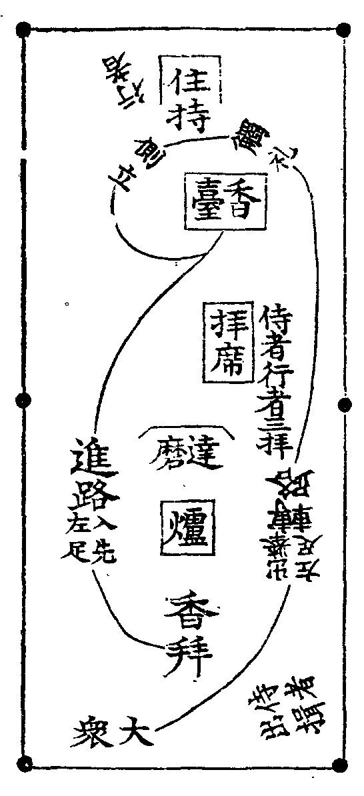



●茶汤问讯图



见经柜图处。



忠曰。众寮。一切茶礼汤礼。炉前三巡问讯等图也。



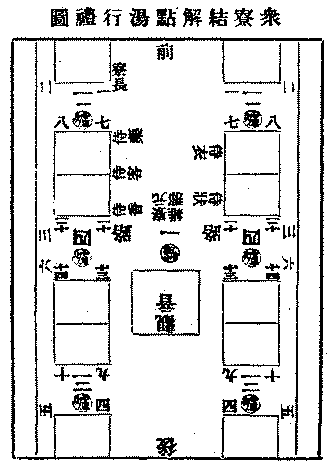



●夏中行茶汤瓶盏图



见经柜处。



敕修清规注云。兄弟结缘。随意书名



解者曰。结缘行礼也。然今日本。预差人定之。



●僧堂图



见殿堂门。僧堂处。



●僧堂出入板图



见殿堂门。出入板处。



●钵位图(十六板首)



旧说曰。被位图。平僧排僧堂图也。钵位图。蒙堂排僧堂图也。



敕修清规出图帐云。惟钵位图。当分十六板(餘随僧堂大小不拘)。除单寮。西堂。首座。勤旧。排板头外。其餘竝依戒腊。旧以送蒙堂者排副钵。后因争竞不排。



又与被位图交看。



敕修清规。僧堂十六板首。钵位图云。



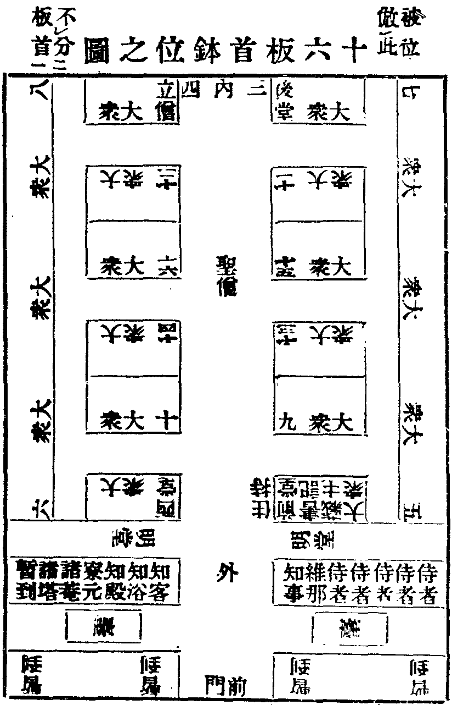



按永平赴粥饭法。圣僧侍者位。在侍者最末。又律苑事规僧堂图云。



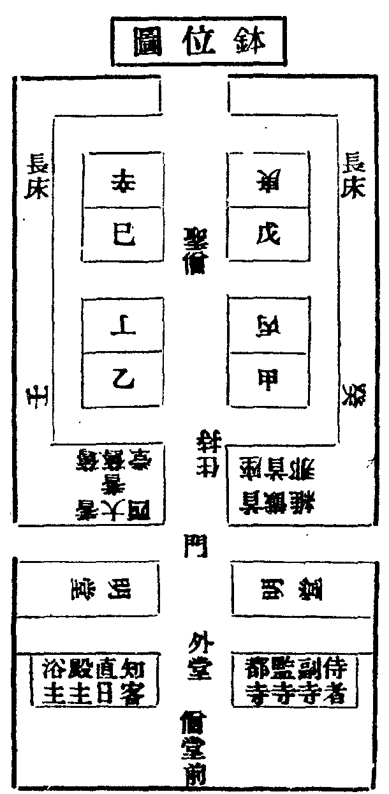



●被位图



旧说曰。被位图者。僧堂大众位也(又见钵位图处)。



敕修清规钵位图云。被位倣此。不分板首(见钵位图处)。



忠曰。被位。不分板首。如今所录。备用清规甲乙丙丁次第坐。是被位也。板首者。第一首座。第二西堂。第三后堂。第四后堂分手。第五第六七八如图。是钵位也。板首侧一位。是副钵位也。且第一副钵位。首座右侧。是也。第二副钵位。西堂左侧是也。已下例知。



备用清规被位钵位图云。



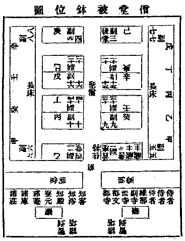



副钵位。非备用图忠因加之令易晓。



●众寮图



见殿堂门。众寮处。



●经柜图



忠曰。众寮排位图也。僧堂曰函柜。众寮曰经柜(见器物门)。



敕修清规。众寮结解。特为众汤云。堂司图帐已定。寮元依戒排经柜图。茶汤问讯图。清众戒腊牌。入寮资次牌。净发牌。夏中行茶汤瓶盏图。



●三牌



三牌。排列於佛殿。本尊前。



元朝禅刹。三牌式云。



左　皇后齐年　齐年者。齐等皇帝万岁也。  

中　皇帝万岁  

右　太子千秋



建仁寺禅居庵大鉴禅师所建三牌云。



南方火德火部圣众



今上皇帝圣寿无疆



檀那本命福禄寿星



品字笺云。广韵牌牓也。以张官府之谕言者也。词之长者。列于牓。其短者。则书之牌。即今榜文牌票之谓。



续灯录净因道臻禅师章云。如何是净因境。师云。法广殿牌。仁宗亲写。



●位牌



义堂日工集云。位牌。古无有之。自宋以来有之。



敕修清规尊宿移龛云。法座上挂真。安位牌。广列祭筵。



朱子语录云。主牌。荀勗礼据隋炀帝所编礼书有一篇。荀勗礼乃是。云濶四寸。厚五分。八分大书某人神座。不然。只小楷书亦得。



忠曰。八分者。八分字也。据此位牌自宋已前有之。



●三界万灵牌



牌云。



> 三界万灵。十方至圣。六亲眷属。七世父母。



大鉴小清规。月中。每日。粥时念文。廿九日云。祝献三界万灵十方至圣。



古德曰。或谓。先万灵后至圣。倒语。非也。有深义在。



●善月牌



敕修清规善月云。预先一日。维那令堂司行者。覆住持。报库司。挂善月牌于殿门前。



●祈祷牌



敕修规清祈祷云。维那。和会堂司行者。报众挂祈祷牌。



梦窻梦中问答云。弘安年中。有蒙古来寇之流言。时法光寺禅门(时宗)无惊懆色。但日日请建长长老。佛光禅师。及诸宿达。法谈而已。其奇特事业。具载佛光普说中。其后创立圆觉寺。大兴禅宗。蒙古不复来寇。父子保世清平。临终亦自在矣。尔后子孙相续。崇敬佛法。虽然其见世法也重。信佛法也轻。故天下大祸未现。数数命禅刹。行禳祓。於是乎禅刹祷事稠故。皆挂祈祷牌。其众僧。唯以诵经讽咒。为日用。而禅床工夫。废而不做。如诸小院。复有小檀主。例请祈禳。僧家专利名者。亦以此为第一义。遂忘失本分一大事。岂非禅法破灭因缘耶。



●讽经牌



敕修清规。圣节云。行者覆住持。来早殿上。启建讽经。仍报诸寮。挂讽经牌。



●念诵牌



敕修清规圣节云。节内。遇三八日。堂司行者。覆住持两序诸寮。挂念诵牌。报众。



●戒腊牌



敕修清规戒腊牌云。堂司侍司众寮。预依戒腊。写造至十四日午后。堂司牌。列僧堂前上间。侍司牌。列法堂下间。众寮牌。列寮内。各备香几炉烛供养。大众各炷香展拜毕。仍各收牌挂起。



又见楞严图。经柜图处。



旧说曰。如蒙堂勤旧。则位不依戒次。但侍者。以戒腊。为次第矣。又蒙堂中。勤旧者。不上戒腊牌也。



永平道元禅师戒腊牌式云(草单是也)。



> 某国某州某山某寺。今夏结夏。海众戒腊。  

> 如后。  

> 陈如尊者  

> 堂头和尚  

> 建保元戒  

> 某甲上座　某甲藏主  

> 某甲上座　某甲上座  

> 建保二戒  

> 某甲西堂　某甲维那  

> 某甲首座　某甲知客  

> 某甲上座　某甲浴主  

> 建历元戒  

> 某甲直岁　某甲侍者  

> 某甲首座　某甲首座  

> 某甲化主　某甲上座  

> 某甲典座　某甲堂主  

> 建历三戒  

> 某甲书记　某甲上座  

> 某甲西堂　某甲首座  

> 某甲上座　某甲上座  

> 右谨具呈。若有误错。各  

> 请指挥。谨状。  

> 某年四月三日　堂主比丘　(某甲)　谨状



●入寮资次牌



见经柜图处。



旧说曰。入寮资次义未详。



●接住持牌



敕修清规入院云。隔宿挂接住持牌报众。



东渐清规入院仪式云。凡入院前日。挂接住持牌於堂前下间。当日挂上间。用黄纸。



又东渐清规云。梦窓国师。粥罢挂接和尚牌(清规隔宿挂之)。愚谓。隣封名德。江湖尊宿。来访。则挂接和尚牌。考钟伐鼓耳。若入院则挂接住持牌。不可言接和尚也(又见接尊宿牌处)。



书言故事延接注云。延引也。接迎也。



●接和尚牌



敕修清规报谢出入云。住持出入。则知事探伺归期。令堂司。挂接和尚牌。报众。鸣钟门迎。住持。先令传语免之。



旧说曰。住持外出。经四五日。或十日。归则挂接和尚牌。而迎之。



忠曰。东渐曰。隣封江湖尊宿来。则挂接和尚牌(详接住持牌处)。余谓。虽本寺住持。已入院后。外归。则亦可挂接和尚牌。但入院时。不可挂接和尚牌耳。



已下。畧举门迎因缘。



联灯会要。长沙岑禅师章云。师游山归。至门首。首座问。和尚甚处去来。师云。游山来。云到甚麼处来。师云。始随芳草去。又逐落花回。云大似春意。师云。也胜秋露滴芙渠。



●接尊宿牌



敕修清规。迎待尊宿云。尊宿相访。须预挂接尊宿牌。鸣钟集众。门迎。彼若尚简。则潜入寺。住持必於寝堂。具香烛相接。



义堂和尚曰。接尊宿牌。可书和尚。接住持牌。可但言住持也。　忠曰。即书接尊宿和尚也。



●接官牌



义堂日工集云。康历二年。五月十三日(时义堂住建仁)。挂接官牌。奉迎府君(义满公)。临期。大小钟鼓皆鸣。余率两班大众。出迎三门。钧旆入门。余引自正门。入佛殿。府君炷香三拜罢。余送归特榻。乃烧香。归知事班首。与官榻相对而立。行者鸣磬。真珠西堂举唱药师如来。侑艺正仁二僧。和之。维那举大悲咒。余炷香三拜。回向毕。余引君。入方丈。点心。官伴。管领一人。僧伴。普明国师。东堂兰洲。天龙大清。等持物先。烧香清祖侍者。点心罢。余引君。归歇处。道话。少顷鸣鼓上堂。府君特榻。诸山列在座下。钓语。问答。提纲。自叙。谢辞。拈提。罢。斋会。会罢还驾。



●上堂牌



敕修清规上堂云。凡旦望。侍者分付客头行者。挂上堂牌报众。



●小参牌



旧说曰。小参牌。入院。则小片纸。书今晚两字。贴牌左肩。四节。则书昏钟鸣三字。贴之。



敕修清规。入院当晚小参云。侍者令客头报众。挂小参牌。



●普说牌



敕修清规普说云。侍者。令客头行者。挂普说牌。报众。



若告香普说。牌左肩。贴告香两字。　校定清规云。侍者寮行者。粥后挂普说牌。小书告香二字。



●告香牌



敕修清规告香云。堂司行者。预逐一报众。挂告香牌。



备用清规告香云。堂司。预晚挂告香牌。牌左云。告香罢。普说。



●入室牌



敕修清规入室云。遇开室时。粥前。侍者令客头行者。僧堂前。诸寮。挂入室牌。



●秉拂牌



敕修清规。四节秉拂云。秉拂人。令行者僧堂前。挂秉拂牌。



●坐禅牌



永平清规辨道法云。早晨坐禅。挂坐禅牌。餘时坐禅。不挂坐禅牌。



忠曰。餘时者。晡时。黄昏。后夜。三时也。



●静牌



坐禅牌。又言静牌。静者。静虑也。



诸祖偈颂。慈受深禅师示众云。静牌才挂。宜各默然纵不挂时。岂可谈笑。



●坐参牌



敕修清规坐参云。斋罢。堂司行者。覆首座。僧堂众寮前。各挂坐参牌。



●放参牌



永平清规辨道法云。放参时。挂放参牌。昏钟鸣。收放参牌。



●照牌



敕修清规赴茶汤云。先看照牌。明记位次。免致临时仓遑。



忠曰。看照牌。明记位次。照义解得过半矣。凡照者。二物相照。而鉴识也。如照牌。座间早有座牌。贴各位了。然著座人。不得入席预见之。故於外面。别设牌。造座间样式。小片纸。书众名。贴各位。著位人。审视之。记己所著位毕。然后入座间。照看外牌位而坐。贵免致仓遑败阙矣。



旧说曰。照牌者。座间不排名牌。只门外设木坐牌。造排坐位图。而树之。大众审照视己之上下位。及时著席而已。其照视左右者。为能知隣位。则於己位不迷也。是以照视上下为照义。或曰。能明视己位故云照。或曰。就照牌能视己位。在某人下某人上。故云照。或曰。照视己位在自上几位自下几位故云照。皆解不得照字。故今不取之。



忠曰。今时照牌。用纸数十幅。连接令方。上横题第一筵照牌图等字。其下图席样。以小片纸书名。以糊排贴。一如本席。众及时入席。照依外牌著坐。



敕修清规迎待尊宿云。寝堂钉挂帐幕。排照牌。　又方丈特为新旧两序汤云。烧香侍者。预排照牌。至时鸣鼓。　又方丈管待新旧两序云。寝堂设位排照牌。客集报住持。出接。各入座依照牌立定。　又方丈特为新挂搭茶云。各依照牌。归位立定。　又尊宿迁化管待主丧等云。排照牌。都寺行礼。　又嗣法师忌云。若讲特为伴真汤。斋罢。方丈客头请西堂两序。晚间对真。相伴吃汤。排照牌位。



禅林照牌似朝廷混牓。　事物纪原云。宋朝会要曰。大中祥符四年五月。晁迥等奏。引试进士。预令於贡院纳案子。试前一日。贡院出牓。晓示。逐人排坐位处所则引试之有坐位牓。自此为始。今亦为之混牓。



●坐牌



忠曰。日本丛林行礼。用小纸片。书一众名位。而随二出四出等座。逐位次排之。牌首以糊少许。贴床。大众未著座已前。先入认记己位毕。而出。及时次第。著其牌位。贵免颠沛矣。



传灯录金州操禅师章云。一日请米和尚斋。不排座位。米到展坐具礼拜。师下禅床米乃就师位而坐。师却席地而坐。斋讫米便去。侍者曰。和尚受一切人钦仰。今日座位。被人夺却。师曰。三日若来。即受救在。米果三日后来云。前日遭贼。僧问镜清。古人遭贼意如何。清云。只见锥头利。不见凿头方。



●木座牌



旧说曰。小木牌书众名。牌首穿小穴。别设大板。板上列植小钉。而以小牌。逐位次排。挂定之。



又有板上直书名者。　敕修清规。方丈特为新旧两序汤云。钉挂寝堂。铺设坐位。



解者曰。是非纸座牌。又非木座牌。但朱漆板上。书众名位。而钉挂其板也。犹如钵位图。



●煎点牌



敕修清规受嗣法人煎点云。法嗣令客头请两序单寮诸寮。挂煎点牌。



●点茶牌



敕修清规方丈特为新首座茶云。客头报众。挂点茶牌。



●点汤牌



敕修清规库司四节特为首座大众汤云。都寺分付客头。请勤旧蒙堂诸寮。各挂点汤牌。



备用清规寮元云。朔望。系寮元。自烧香。令挂点汤牌。烧汤出盏。



●特为照牌



敕修清规方丈四节特为首座大众茶云。请客侍者。巡堂请茶。堂前排特为照牌。



特为位。见座位门。



●特为牌



敕修清规。方丈特为新挂搭茶云。侍者令客头依戒列名。写特为牌。或作四出六出。首座光伴。诸方名胜。必与住持对面位。若有异议。则於名胜内。推戒最高者坐之。参头与光伴对面位。盖受送者。先谢榻位。此同赴茶耳。



解者曰。书照牌。以名胜排定之特为位。此谓特为牌。特为位。即是住持对面位也(特为位。见座位门)。



●巡寮牌



见丛轨门。巡寮处。



●直堂牌



敕修清规坐禅云。堂中。有直堂牌。刻云。



　轮次直堂。周而复始。　住山押



两面刻。　照依被位资次。每日五更钟绝后。交下次人。终日看守。



●开浴牌



见丛轨门。开浴处。



●浴室内小牌



敕修清规知浴云。室内。挂小板。旁钉小牌书云。



　鸣板一声添汤。二声添水。三声则止。以此为节。



备用清规知浴云。室内小牌。白字。



　一汤。二水。三满。打小板。



三满。有作三止者。



●入浴资次𥳑板



敕修清规知浴云。其入浴资次。当刊揭浴室外。



解者曰。资次者。第一通僧众。第二通头首。第三通行者。第四通。人力。监作行者。知事等。如此书。镌板。挂浴室外也。



●普请牌



见丛轨门。普请处。



●净发牌



见经柜图处。



●拾遗牌



禅林宝训云。山堂住黄龙日。有智恩上座。为母修冥福。透下金二钱。两日不寻。圣僧才侍者因埽地而得之。挂拾遗牌。一众方知。盖主法者清净。所以上行下効也。



镜堂圆禅师录。示兄弟拾得物。不挂拾遗牌者。偈云。丛林百丈古清规。遗者应须挂拾遗。若也便将为己有。亦名偷盗罪无疑。



孔子家语相鲁篇云。孔子初仕。为中都宰。男女别涂。路无拾遗。



史记田敬仲完世家云。梁王曰。若寡人国小也。尚有径寸之珠。照车前后各十二乘者十枚。威王曰。寡人之所以为宝。与王异(云云)。吾臣有种首者。使备盗贼。则道不拾遗。将以照千里。岂特十二乘哉。



淮南子览冥训云。昔者黄帝治天下。而力牧太山稽辅之(云云)。田者不侵畔。渔者不争隈。道不拾遗。市不豫贾。



●触落牌



敕修清规净头云。稍有狼藉。随即净治。



解者曰。厕有触落牌。若有狼藉。自不洗之。则挂牌。报净头。令洗净焉。



或曰。牌一面书触字。一面书落字。触是不净义。落是遗落义。若有不净秽污。则挂触牌。而报净头。若鞋履等。落厕内。则挂落牌。而告净头也。



●唱衣牌



敕修清规。亡僧唱衣云。荼毗后。堂司行者。覆住持两序侍者。斋罢。僧堂前。唱衣。仍报众挂唱衣牌。



●送灰牌



敕修清规。亡僧入塔云。堂司行者。预报众。挂送灰牌。



忠曰。送煆骨入塔。兼其荼毘时餘灰。故曰送灰也。



●过渡牌



江湖集敬叟庄和尚。送人之污水颂云。小朵峰前绊草鞋。奯公帆挂待君来。风休水面平如镜。下却江头过渡牌。



联灯会要。岩头豁禅师章云。师因沙汰。遂於鄂州湖边。作渡子。两岸各挂一板。有人过渡。打板一声。师云。阿谁。或云。要过那边去。师乃舞棹迎之。



第廿五类　饮啖门



●粥



四分律云。毗舍佉母白佛言。世尊。听阿那频头国诸比丘食粥。若世尊。当听比丘食粥者。我当尽形寿供给。



十诵律云。佛言。毗舍佉。汝见何因缘故。欲常与比丘僧粥。答言。大德。若比丘。不食粥。有饥渴恼。或时腹内风起。我常与粥。故则无众恼。



释氏要览云。读五部律文。粥之缘起有三。初僧祇律云。佛住舍卫国。难陁母。令作釜饭。逼上汁自饮。觉身中风除食消。便作念。阇梨是一食人。应当食粥。乃取多水少米。煎去二分。然后入胡椒荜拨末。盛满甖。持诣佛所。白言。唯愿世尊。听诸比丘。食粥。佛许。仍为说偈云。持戒清净人所奉。恭敬随时以粥施。十利饶益於行者。色力寿乐辞清辩。宿食风除饥渴消。是名良药佛所说。欲得人天长受乐。应当以粥施众僧。次四分律云。佛在那频头国。因㝹沙施粥。佛许之。后十诵律云。婆罗门王阿耆达。施八般粥。谓乳。酪。胡麻。豆。摩沙。荏苏等。佛许之。　又云。粥不正食摄。僧祇律云。粥出釜。划不成字。始名不正食。(是名良药佛所说。欲得人天长受乐。律。作是名为药佛所说欲生人天常受乐。)



忠曰。依寄归传四分律等。五噉食。谓饭。麦豆饭。𪎊。肉。饼。此为正食。五嚼食。谓根。茎。叶。华。果。此为不正食。若已食前五。必不合餐后五。先食后五。则随意噉前五。(忠曰。肉者。初听三种净肉。至楞伽涅槃方断肉食。)



又释氏要览云。今析粥十利者。一色。二力。三寿。四乐。五词清。俱舍云。词谓训释言词也。六辨。俱舍云。辩谓展转言。无滞碍也。七宿食消。八风除。九消饥。十消渴(辨当作辩)。



守千崆峒记。附法数中。载粥十利云。一僧徒安乐。二施主长寿。三不阙修道。四不生饥馑。五当来胜报。六佛果现前。七众善庄严。八先云离苦。九不值刀兵。十当生净土(八先云。先云二字可疑)。



四分律云。食粥有五事。善除饥。除渴。消宿食。大小便调适。除风患。食粥者。有此五善事。



义堂和尚日工集云。因雪示众。大雪。人民冻馁。薪贵如玉。洗面汤不用烧。湛堂准和尚。以小杓汤洗面。尚餘用濯足。古人用心如此。况斯时乎。又粥羹宜暂停之。凡粥贴羹汤。日本风俗而已。中华但用盐豉韲等。如今建长寺。每日堂中粥菜用七纹钱。买胡麻盐。是也。因举神鼎𬤇和尚住山十年。始有酱食讫曰。古人住山安众。不论粥饭精麤。唯道是行。幸诸人不患暂时粥无羹矣。



●小食



忠曰。和训古豆计。



释氏要览云。增辉记云。小食者。粥是。



海龙王经请佛品云。尔时海龙王。白佛言。唯佛加哀。诣我宫中。屈神小食。



野客丛书云。漫录谓世俗例以早晨小食。为点心。或谓小食。亦罕知出处。仆谓。见昭明太子传。曰。京师谷贵。改常馔为小食。小食之名。本此。



忠曰。小食本出佛经律文。葢昭明时。王公好佛学。故用其目。王儒攷出。未尽原。



●五味粥



大慧武库云。叶县省和尚。严冷。浮山远在众时。特往参扣。请远充典座。众苦其枯淡。省偶出庄。远窃钥匙。取油面。作五味粥。粥熟。省忽归赴堂。粥罢坐堂外。令请典座。远至首云。实取油面煑粥。情愿乞和尚责罚。省令算所直。估衣钵还讫打三十拄杖。出院。



事文类聚云。南方专用腊月八日。灌佛。皇朝东京。十二月初八日。都城诸大寺。作浴佛会并送七宝。五味粥谓之腊八粥。



忠曰。杂谷众味。随意合造。言五味粥而已。月令广义云。宋元腊八日。都城诸寺。作浴佛会。并送七宝。以诸果品。五谷煑粥。谓之腊八粥。



春渚纪闻云。湖州孙略教授家婢。名吕媪者。服勤孙氏。有年矣。性谨朴。无他能。但常日晨起。就𢊍中。取食器洁之。聚所弃餘粒。间有落沟渠者。亦拾取淘濯。再於釜中。或加五味。煑食之。未尝一日废也。年七十餘。一日微疾。即告其家人曰。为我髠发。著五戒衣。我将去矣。家人从之。因起以左手。结印而化。家人遂龛。置开元寺中。观者餘月。了无秽气。而发渐生。因与剃之。后一月一剃。



●红糟



敕修清规月分须知云。十二月初八日。佛成道。库司。预造红糟。



解者曰。昔佛成道。随牧牛女。乞牛乳吃。今红糟学牛乳者也。未知加何红物矣。红糟或作温糟。



忠曰。按红唐音俱牟。而和字俱似宇。故错为字牟。仍作温糟。温糟讹音而讹字者。



义堂日工集云。十二月八日。吃红糟。有人问红糟缘起。余曰。牧牛女献乳糜於世尊。今红糟。其遗意也。



忠曰。红糟即五味粥也。腊八噉之(见五味粥处)。下学集云。红调粥。正月十五日所食。赤豆粥也(止此)。然则红是赤豆色。下学糟作调。讹矣。余又谓。果品五谷杂和造粥。米白色为之变。故言红。数味相合。故言糟而已。



刘侗帝京景物略云。十二月八日。家效庵寺。豆果杂米。为粥供。而朝食曰腊八粥。



菊坡丛话云。陆放翁。腊八日诗云。腊月风和气已春。时因散策过吾邻。草烟漠漠柴门里。牛迹重重野水滨。多病所须唯药物。差科未动是闲人。今朝佛粥更相餽。更觉江村节物新。



●缨络粥



永觉贤禅师禅餘外集。山中有感诗云。春垦半亩畦。秋收一担粟。每挑野菜根。和儞缨络粥。



忠曰。粥糜品不载缨络粥。盖糁野菜。加米造。菜牵连。如缨络也。



梅山历然禅师普说云。见秖对次的。即浩浩作得主的。作得主的。即吃璎珞粥的。



●蒋簿粥



五灯严綂金陵蒋山昙芳忠禅师章云。梁王。至建康。王诣寺问曰。衲子所谓。蒋簿粥者。何也。师曰。将谓殿下忘却。王曰。衲子所谓三只袜者。何也。师曰国内山川都踏遍。今朝亲到帝王家。



●晚粥



敕修清规。坐参云。堂司行者。候晚粥熟。覆首座云。放参。(乃至)归众寮药石。



虎关和尚曰。唐样非时煑粥。二百年来事也。



无准范和尚录。解夏小参云。径山寺里。每日两粥一斋。是汝诸人。九十日内捧钵盂。向长连床上。恣意咂啖。於中还有知饱底麼。



忠曰。两粥者。朝粥晚粥也。



●斋



佛祖统纪云。毗婆沙论。斋者。以过中不食。为体。　又云。请观音疏斋者齐也。齐身口业也。齐者祇是中道。后不得食者。表中法界外。更无别法也。



释氏要览云。起世因本经云。乌脯沙陁。隋言增长谓受持斋法。增长善根故。佛教以过中不食名斋。　又云。斋正时。毗罗三昧经云。佛为法慧菩萨。说四食时。一旦时为天食。二午时为法食时。佛断六趣因。令同三世佛。故制日午。为法食正时也。僧祇律云。午时日影。过一发一瞬。即是非时。



斋字。和训登几。即是时字也。经律往往请佛者。先请而再请白时至。　萨婆多毘尼云。问曰。先已请佛。何以重请。答曰。欲生增上功德。故先日。以请。今更重请。又欲成三坚法故。又佛时到自行。何由得知。一居士在静处烧香。遥供养请佛。香来绕佛三帀。又云。佛自知时。不须外缘。



●草饭



忠曰。草饭者。麤饭也。



史记陈丞相世家云。更以恶草具。进楚使。　注草粗也。



战国策云。左右以君贱之也。食以草具。　注草不精也。具馔具。正曰。草菜也。陈平传。恶草具。注去肴肉。



敕修清规请立僧首座云。方丈备草饭。请特为汤药石。



●水饭



敕修清规迎待尊宿请状云。当寺住持比丘某。右某。辄以来日。就寝堂。聊备水飰。



忠曰。水飰。以水浇饭。如日本汤食(和语。由豆计)。也。然旧说曰饭味淡如水也。盖谦词者。讹甚。



本草纲目云。飧饭。飧音孙。即水饭也。



正字通云。飧苏昆切。音孙。食也。字林水浇饭也。礼杂记。孔子曰。少施氏。食我以礼。吾飧。作而辞曰。疏食也。不敢以伤吾子。注礼食竟。更作三飧。以助饱。飧谓以饮浇饭也。郑康成释飧为劝食误。



字汇云。飧以饮浇饭也古者。食后更飧。以尽主情。礼杂记孔子食於少施氏。曰。吾飧。



正字通云。飰同饭。六书故曰。陆德明。飰扶万切。食飰。曰饭扶晚切。谓二字不同。非也。饭与飰一字。而二音也。



老学庵笔记云。集英殿。宴金国人使九盏。第一肉咸豉。第二爆肉。双下角子。第三莲花肉。油饼骨头。第四白肉。胡饼。第五群僊𮌉。太平毕罗。第六假圆鱼。第七柰花索粉。第八假沙鱼。第九水飰。咸豉。施鲊。瓜姜。看食枣锢子膸饼。白胡饼。𩟁饼。



睦州踪禅师录云。师云。后园生菜。熟水淘饭。



●黑飰



敕修清规月分须知云。四月初八日。佛诞浴佛。库司预造黑飰。



本草纲目云。陶隐居登真隐诀。载太极真人青精乾石𩛓饭法。𩛓音信。𩛓之为言。飧也。谓以酒蜜药草辈溲而曝之也。亦作𨑏。凡内外诸书。并无此字。惟施於此饭之名耳。陈藏器本草。名乌饭(登真隐诀饭法文繁今畧之)藏器曰。乌饭法。取南烛茎叶捣碎。清汁浸粳米。九浸九蒸九曝。米粒紧小。黑如瑿珠。袋盛。可以适远方也。时珍曰。此饭。乃仙家服食之法。而今之释家多於四月八日。造之以供佛耳。造者。又入柿叶。白杨叶。数十枚。以助色。或又加生铁一块者。止知取其上色。不知乃服食家所忌也。



潜确类书云。青精。一名南天烛。又曰黑饭草。以其可染黑饭也。道家谓之青精饭。故仙经云。服草木之王。气与神通。食青烛之精。命不复陨。谓此也。



忠曰。南烛异名云草木之王。见本草。



又与桐饭交看。



●桐饭



云卧纪谈云。真净和尚偈云。元符二年三月三。春饼撮餤桐饭兼。(详丛轨门暂假处)



旧说曰。以桐叶染成饭。言桐饭。其色黑故。又名黑饭。但未知桐染饭。是何义。



忠曰。以南烛叶汁。染饭。色青黑。故名黑饭。南烛异名杨桐(见本草)故又言桐饭。旧说为梧桐叶染饭。太误。欲知染义。即仙家服饵也(见黑飰处)。



山堂肆考云。零陵总记。杨桐叶细冬青。居人遇寒食。采其叶染饭。色青而有光。食之资阳道。道家谓之青精乾石𲋔。杜诗。岂无青精饭。使我颜色好。郑畋诗圆明青𲋔饭。光润碧霞浆(𲋔音信)。



●饡饭



玉篇云。饡子旦切。以羹浇饭。



一山和尚曰。饡饭古多用之。川僧最好造之。乃五味饭也。　或曰。日本所谓芳饭是也。



联灯会要克宾禅师章云。兴化云。克宾维那。法战不胜。罚钱五贯。设饡饭一堂。(详职位门维那处)



普庵肃禅师录。举克宾话作纂饭。



●特为饭



校定清规迎待尊宿云。次日特为饭。系具状。作都寺名请。



●非时食



敕修清规沙弥得度章沙弥十戒。第十云。不非时食。



萨婆多毘尼毘婆沙云。非时者。从日中。至后夜后分。名为非时。从晨至日中。名时何以故。以日初出。乃至日中。明转盛。中则满足。故名为时。从中至后夜后分。明转减没。故名非时。又从晨至日中。世人营救事业。作饮食。是故名为时。从中至后夜后分。燕会嬉戏。自娱乐。时比丘游行。有所触恼。故名非时。又从晨至日中。俗人种种事务。婬恼不发。故名为时。从中至后夜后分。事务休息。婬戏言笑。若比丘出入。游行。或时被诽谤。受诸恼害。名为非时。又比丘。从晨至中。是乞食时。应入聚落。往来游行。故名为时。从中至后夜后分。应静拱端坐。诵经坐禅。各当所业非是行(行或往乎)来。入聚落时。故名非时。



五分律云。佛在王舍城。尔时未为比丘。制非时食。迦畱陀夷。著杂色衣。面黑眼赤。暗中乞食。怀姙妇人。电光中见。大惊唤言。毗舍遮。毗舍遮迦畱陀夷言。我是沙门。非毗舍遮。便骂言。汝何冥夜乞食。餘沙门婆罗门。一食便足。汝云何食无昼夜。长老比丘。白佛。佛呵责结戒。若比丘。非时食波逸提。非时者。从正中以后。至明相未出。名为非时。



法苑珠林云。毗罗三昧经。世尊。为惠法菩萨说云。食有四种。旦天食时。午法食时。暮畜生食时。夜鬼神食时。佛断六趣因。令同三世佛。故日午时。是法食时也。过此已后。同於下趣。非上食时。故曰非时。也。又萨婆多论云。释时有四。一始从日出。乃至日中。其明转炽。名之为时。从中已后。至后夜分。其明灭没。故名非时。二从旦至中。是作食时。乞不生恼。故名为时。从中已后。至於夜分。是俗人醼会游戏之时。入村乞食。多有触恼。故名非时。三从旦至中。俗人作务。婬乱未发。乞不生恼。故名为时。从中已后。事务休息。婬戏言笑。入村乞食。喜被诽谤。故名非时。四从旦至中。是乞食时。得食济身宁心修道。事顺应法。故名为时。从中已后。宜应修道。非乞食时。故名非时。



佛祖统纪云。僧祇律时食。若午时日影。过一发一瞬。即是非时。四分戒本若比丘。非时食者。波逸提(十诵律波逸提义翻为堕堕在烧煮地狱)。



法苑珠林云。僧祇律云。食已若渴。佛令取一切谷豆麦。煑不破者。非时取汁得饮。若酥油蜜。及石蜜。诸生果汁等。要以水净得饮。若器底残水。被雨湔。亦名为净。善见论云。舍楼伽果浆。澄汁使清。非时得饮(谓藕根是)。摩德勒伽论。沙糖浆。亦得非时饮。



老学庵笔记云。佛经戒比丘非时食。盖其法过午。则不食也。而蜀僧招客草食。谓之非时。董仲舒。三年不窥园。谓勤苦不游嬉也。馆中著庭有园。每会饭罢。辄相语曰。今日窥园乎。此二事。甚相类。



●放参饭



竹窓二笔云。越地。安禅夜作斋。其名曰放参饭。竞为侈靡。胜於午斋。相沿成习。久矣。昔有尊宿。闻隣房僧。午后作食。不觉泣下。悲佛法之凌夷也。故僧禁过午食。况夜食耶。律言。人间碗钵作声。饿鬼咽中起火。乃於漏深人静。而砧几盘盂音响。彻其耳根。又煎煑烹炮。馨香发其鼻识。忘慈悲之训。恣口腹之欲。於心安乎。或曰。中夜饥。如之何。则代以菓核饼饵之类。不烦锅铫者可也。况持过午者。午后至明。不食纤物。我等晚有药石。何不知足之甚。



蒙山和尚录云。我从在家。不吃放参。



解者曰。吃放参者。谓吃非时食也。盖讳非时之言也。此方亦有此称。其吃食在放参钟时。故云尔。此隣近释。



●药石



敕修清规达磨忌曰。念诵毕。或请就坐药石。



又告香云。当晚方丈。请参头维那侍者。药石。　又游方参请云。当晚特为汤。(乃至)汤罢。起就炉前。谢汤。须两展三礼。抽衣就坐药石。　又大坐参云。若住持晚参。则不鸣堂前钟。(乃至)开示毕。众散。归寮药石。若不晚参。则堂司行者。进首座前问讯云。堂头和尚。今晚放参。(乃至)众各出全单。归众寮药石。



旧说曰。药石谓晚间之粥。盖隐语也。凡禅林清规。所举戒相。止沙弥十戒而已。不举具足戒。故禅僧行事。於此十支。无缺漏。足矣。可谓简易。然犹不坚持。过午食可耶。抑吃晚粥。为养体疗病。进修道业。故称为药石也。粥咒愿。所谓粥是大良药是也。



黄檗清规云。药石。晚食也。比丘过午不食。故晚食名药石。为疗饥渴病也。



玄应经音义云。攻病曰药石。古人以石为针。今人以铁。皆谓疗病者也。



春秋左氏传云。臧孙曰。季孙之爱我疾疢也。孟孙之恶我。药石也。　杜预曰。常志相违戾。犹药石之疗疾。



唐书高季辅传云。数上书。言得失。辞诚切至。帝赐钟乳一剂。曰而进药石之言。朕以药石相报。居家必用云。圆散曰药。针砭曰石。



●药食



古刊古尊宿录睦州录云。问大众云。三乘十二分教。成得个什麼边事。有僧云。今日大众。普请不易。师云。不要将出来。僧云。打鼓吃药食(新刊作药石)。



云门偃禅师录云。师岁夜问僧。饼餤是罗汉药食。还将得饆𫗩𫗰子来麼。无对。代云。今日东风起。



今本作药石。盖依事苑改。



春渚纪闻云。龚彦和正言。自贬所。归卫城县。寓居一禅林。日持钵随堂供。暇日偶过库司。见僧雏具汤饼问其故。云具殿院晚间药食。龚自此不复晚飡云。



祖庭事苑辨云门录罗汉药食云。食当作石。取疗病义。故曰药石。夫攻病曰药。劫病曰石。古以砭石为针也。全元起欲注素问。访以砭石。王僧孺答曰。古人当以石为针。必不用铁。说文有此砭字。许慎云。以石刺病也。东山经高氏之山。多针石。郭璞云。可以为砭针。春秋美疢。不如恶石。服子慎注云。石砭石也。季世无复佳石。故以铁代之尔。又以服石子止饥。如高僧僧善传。善疾笃将殛。告弟子曰。吾患腹中冷𦀽者。昔在少年。山居服业。粮粒既断。懒往追求。噉小石子。用充日夕。因觉为病。死后可破腹看之。果如所言。愚窃详二意皆不然也。又神仙传。或以药煑石而食之。又非先圣之意。今丛林习以为常。未有非之。者焉。又况四果真人。讵肯辄违佛制。来享非时之餐。云门欲以诱接学者。而正言似反。后世或资以为口实。岂不误乎。疢音趁。热病也。



忠曰。窃惟。云门示众。不在定盘星睦庵欲辨药石。强言正言似反。可笑。是他时世。早有晚食耳。但药食当作药石。音近讹也。虎关和尚曰。中华二百年来。煑晚粥。今自虎关寂年。溯算云门寂年。得三百九十八年。故知。虎关只言煑粥而已。如饼𩝐为药石。云门时。已有之。



●送食



忠曰。此方俗称送膳者。



敕修清规。四节秉拂云。方丈请秉拂人药石。免赴。当送往。



忠曰。往者。遗药石也。



●陪贴



忠曰。本饭本菜外。陪增贴附也。



正字通云。贴音帖。依附。又增益赠人。又黏置。



敕修清规。尊宿迁化云。计会所遗衣钵多少。默作三分。一分。准丧司孝服。讽经灯烛之费。一分。归常住。陪贴供养。一分。俵大众看经。并佛事。板帐等用。



●贴菜



常住所飰菜外。自别贴附。表供养意。曰贴菜。



日用轨范云。如有菜滓。安钵后屏处。



素问藏气法时论云。五谷为养。五果为助。五畜为益。五菜为充。气味合而服之。以补精益气此五者。有辛酸甘苦咸。各有所利。



忠曰。按素问。五菜谓葵甘。韭酸。薤苦。藿咸。葱辛。



格致餘论云。凡人饥则必食。彼粳米甘而淡者。土之德也。物之属阴。而最补者也。惟可与菜同进。经以菜为充者。恐於饥时。顿食。或虑过多因致胃损。故以菜。助其充足。取其疏通而易化。此天地生物之仁也。



礼记曲礼云。羹之有菜者。用𬂩。其无菜者。不用𬂩。　注。𬂩。犹箸也



●再请



旧说曰。请受食也。再请者。两受食也。



忠曰。俗作再进讹。



日用轨范云。未再请。不得刷钵盂。



●请折



旧说曰。请受食也。折韵会毁弃也。请折者。舍所受饭羹等餘残也。



日用轨范云随量受食。不得请折。



●打饭



鹤林玉露云。陆象山家人。计口打饭。



欧阳修归田录云。今世俗。言语之讹。而举世君子小人。皆同其缪者。惟打字尔(打丁雅反)。其义。本谓考击。故人相殴。以物相击。皆谓之打。而工造金银器。亦谓之打可矣。盖有槌檛作击之义也。至於造舟车者。曰打船打车。网鱼曰打鱼。汲水曰打水。役夫饷饭。曰打饭。兵士给衣粮。曰打衣粮。从者执伞。曰打伞。以糊黏纸。曰打黏。以丈尺量地。曰打量。举手试眼之昏明曰打试。至於名儒硕学语。皆如此。触事皆谓之打。而徧检字书。了无此语(丁雅反者)。其义主考击之打。自音谪(疑当作滴)。耿以字学言之。打字从手从丁。丁又击物之声。故音谪。耿。为是。不知因何转为丁雅也。



俗呼小录云。俗牵连之辞。如指其人。至某人。物及某物。皆曰打(丁晋公诗所谓赤洪厓打白洪厓是也)。



●煎点



敕修清规。受嗣法人煎点云。若法嗣到寺煎点。令带行知事。到库司。会计营辨合用钱物。送纳。　又游方参请云。参头云。某等重承煎点。特此拜谢。　又方丈特为新挂搭茶云。特为人。谢茶云。某等此日。重蒙煎点。特此拜谢。



忠曰。煎点者。谓煎熬煎熟食物。以点於心也。



正字通云。煎音笺。熬也。方言有汁而乾。之曰煎。今俗凡以水煑物。亦曰煎。



旧说曰。煎点者。但是谓点煎茶也。然日本以点心为煎点。非也。纵有点心。亦以茶为本。谓若请人进唯茶。则太简故先进点心。次进茶矣。点心本为茶。故称点心。为煎点。失辞。



五灯会元芙蓉楷禅师章云。新到相见。茶汤而已。更不煎点。(详米汤处)



忠曰。凡进茶汤时。可有煎食果糍等之供。吃毕。方进茶汤矣。茶汤外。别有煎点。以芙蓉章。可为证焉。故旧说言但点煎茶。为煎点者。非也。



●点心



敕修清规圣节云库司严设香烛备点心。



又告香云。半斋请参头维那侍者。点心。(更半斋点心者多。详节时门。半斋处。)



旧说曰。点心。谓点于空心也。早旦阴阳未分时。少吃食。此摄养法。



文公家礼云。妇具农羞。俗谓点心(农疑晨)。



煎灯新话注云。点心之点。与点茶之点。同义盖少食镇心也。



忠按。点心之点。与点茶之点义别。点茶用茶筅点汤。又点冷水之义。见文公家礼(点茶处笺)。点心以食点空腹耳。



宋吴曾能改斋漫录云。世俗例以早晨小食为点心。自唐时。已有此语。按唐郑傪。为江淮留后。家人备夫人晨馔。夫人顾其弟曰。治妆未毕。我未及餐。尔且可点心。其弟举瓯已罄。俄而女仆。请饭库钥匙。备夫人点心。傪诟曰。适已给了。何得又请。



辍耕录云。今以早饭前。及饭后。午前午后。晡前小食。为点心(引郑傪)此语唐时已然。



俗呼小录云。午前午后小食。谓上昼点心。下昼点心(唐郑傪为江淮留后夫人曰。尔且点心。昭明太子别传曰。京师谷贵。改常馔为小食即点心之说也)。



●糍果



旧说曰。糍果者。搅𩝐(和语。加为毛知)之类。



忠曰。本木实曰果。然饼𩝐之类。亦通称。故武林旧事市肆记中。果子部。多列餹饼之名。



敕修清规。库司四节。特为首座大众汤云。惟冬节汤罢行糍果。方行药石。



●油糍



竺仙和尚出油糍之法。



白云端禅师禅录。慧超问佛颂云。一文大光钱。买得个油糍。吃向肚里了。当下便不饥。



忠曰。碧岩录载之。作油糍。而韵书不收糍字。



正字通云。糍才时切。音慈。说文稻饼也。周礼笾人。羞笾之实。糗饵粉糍。注。皆粉稻黍米。为之。饵言糗。糍言粉。互足其义也。合烝曰饵。饼之曰糍。疏云。今糍餻之名。出于此。



●汤果



敕修清规。嗣法师忌。云讽经罢。备汤果。



解者曰。汤称入面。果称果子。凡食有汁者。言汤也。　又解汤药侍者曰。汤药者。汤果药石也。汤果者。凡称食有汁者。此方所谓入面是也。



忠曰。后说以汤果为一物。盖初说近是。



敕修清规。迎待尊宿云。汤罢药石。又客头诣客位请云。方丈请和尚。今晚汤果。　又西堂头首受请云。晚请新命专使。特为汤。药石汤果。



●糟鸡



忠曰。撮裂蒟蒻。浇淡酱汁。煎者。日本禅林煎点用之。然未识所以名之。若以似在家糟藏鸡肉名之。则改换其目。可也。昔在玉泉皓和尚。责药石。米面假作驴肠膳。生羊骨。鳖臛。喂饲八万四千户虫(通载)。大通本禅师。伊蒲塞馔。以鱼胾名者。不食(僧宝)。谁不矜式耶。



●菖蒲茶



敕修清规。月分须知云。五月端午日。早晨。知事僧堂内烧香。点菖蒲茶。



忠曰。居家。此日饮菖蒲酒。僧家以茶代之。准世礼也。



瞿佑四时宜忌云。五月五日。午时。饮菖蒲雄黄酒。辟除百疾。而禁百虫。



月令广义。五月令云。神农书曰。午日以菖蒲。或缕或屑。泛酒。助阳气延年。以山涧九节者。佳。笑谈录。五日。菖蒲末。酒服。亦解酒。痛饮不醉。



●茱萸茶



忠曰。世典。有九日佩茱萸。饮菊花酒之说。其点茱萸於茶。却见于禅策。



敕修清规月分须知云。九月重阳日。早晨。知事烧香。点茱萸茶。



北磵简禅师诗集九日诗云。瓦鼎松声涨苦荼。替杯中物泛茱萸。白衣不识缁衣客。自撷寒英插古壶。



西岩慧禅师开善录。重阳上堂云。孟嘉已前。渊明去后。谁家篱畔欠黄花。那个杯中无白酒。重阳只是九月九。阿呵呵。始信茱萸茶苦澁。展眉人少皱眉多。



南堂欲禅师灵岩录上堂云。今朝九月九。万物随时候。满泛茱萸茶。何用菊华酒。毕竟醉兀兀。不似长醒醒(云云)。



镜堂圆禅师建仁录。重阳上堂云。紫萸满泛赵州茶。清香直透顶门烈。



西京杂记云。戚夫人侍儿贾佩兰。后出为扶风人段儒妻。说。在宫内时。九月九日。佩茱萸。食蓬饵。饮菊花酒。令人长寿。



瑯邪代醉编云。重阳佩茱萸囊。相传费长房故事。然武帝宫人贾佩兰。佩茱萸。食蓬饵。饮菊花酒。则西汉时。已有此俗。不自长房始也。见西京杂记。



●茶末



敕修清规日用轨范云。不得包藏茶末。



忠曰。细末茶也。言不可未行汤已前。包末茶。而怀之也。



文公家礼云。古人饮茶用末。所谓点茶者。先置末茶于器中。然后投以滚汤(详点茶处)。



云门偃禅师录云。因园头请师吃茶。师云。儞若煎茶我有个报答儞处。园头云。请师报答。师云多著水少著末。



●点茶



敕修清规。新命辞众上堂。茶汤云。山门首。预钉挂帐设。中敷高座向内。首座向外摄。居主位。(乃至)上首知事行礼。揖坐揖香。归位点茶。收盏。再起烧香揖香。归位点汤。汤罢。起谢。上轿。



文公家礼云。主妇执茶筅。执事者。执汤瓶。随之。点茶。盖以神主椟前。先设盏托。至是乃注汤于盏。用茶筅点之耳。古人饮茶用末。所谓点茶者。先置末茶于器中。然后投以滚汤。点以冷水。而用茶筅调之。今人烧汤煎叶茶。而此犹云点茶者。存旧也。



宋蔡襄茶录曰。点茶。茶少汤多。则云脚散。汤少茶多。则粥面聚(建人谓之云脚。粥面)。钞茶一钱七。先注汤。调令极匀又添注入。环廻击拂。汤上盏可四分则止。眎其面色。鲜白。著盏无水痕。为绝佳。建安鬬试。以水痕先者为负。耐久者为胜。故较胜负之说曰。相去一水两水。



宋徽宗大观茶论曰。点茶不一。而调膏继刻。以汤注之。手重筅轻。无粟文蟹眼者。谓之静面点。盖击拂无力。茶不发立。水乳未浃。又复增汤。色泽不尽。英华沦散。茶无立作矣。有随汤击拂。手筅俱重。立文泛泛。谓之一发点。盖用汤已。故指腕不圆。粥面未凝。茶力已尽。云雾虽泛。水脚易生。妙于此者。量茶受汤。调如融胶。环注盏畔。勿使侵茶。势不欲猛。先须搅动茶膏渐加击拂。手轻筅重。指遶腕旋。上下透彻。如酵蘖之起面。疎星皎月。灿然而生。则茶之根本立矣。第二汤。自茶面注之。周回一线。急注急上。茶面不动。击拂既力。色泽渐开。珠玑磊落。三汤。多寘。如前击拂。渐贵轻匀。周环旋复。表里洞彻。粟文蟹眼。泛结杂起。茶之色十。已得其六七。四汤。尚啬。筅欲转稍宽而勿速。其清真华彩。既已焕发。云雾渐生。五汤。乃可少纵筅。欲轻匀而透达。如发立未尽则击以作之。发立已过。则拂以敛之。结浚霭结凝雪。茶色尽矣。六汤。以观立作乳点勃结。则以筅著居。缓遶拂动而已。七汤。以分轻清重浊。相稀稠得中。可欲则止。乳雾汹涌。溢盏而起。周回旋而不动。谓之咬盏。宜匀其轻清浮合者。饮之。桐居录曰。茗有饽饮之宜人。虽多不为过也。



●特为茶



忠曰。特为此人点。故曰特为茶。



敕修清规。堂司特为新旧侍者茶汤云。请新旧侍者特为茶。



●普茶



忠曰。点茶。普及一众。故曰普茶。



黄檗清规云。常住设普茶。



●入寮茶



忠曰。新入众寮。为众点茶也。



敕修清规。新挂搭人。点入寮茶云。新挂搭人。入寮后。照例。纳陪寮钱若干。候寮元。轮排当在何日。挂点茶牌。报众(云云)。候点入寮茶毕寮元逐日。依戒具名。点戒腊茶。



●戒腊茶



见入寮茶处。



忠曰。寮元依众戒腊。自上位。次第请于众寮。点茶。盖众多。不可一时讲。故逐日行之也。



●米汤



芙蓉楷禅师录云。示众云。夫出家者。为厌尘劳。求脱生死。(乃至)山僧行业无取。忝主山门。岂可坐费常住。顿忘先圣付嘱。今者辄欲効古人住持体例与诸人议定。更不下山。不赴斋。不发化主。唯是本院庄课。一岁所得。均作三百六十分。日取一分用之。更不随人添减。可以备饭。即作饭。作饭不足。即作粥。作粥不足。即作米汤。新到相见。茶汤而已。更不煎点。唯置一茶堂。自去取用。务要省缘。一向办道。



忠曰。与淫汤交看。



醉菩提济颠曰。王婆与我。吃粉汤(止此)。亦是米汤。



●淫汤



旧说曰。或谓淫汤。饮之则能折薄淫心故名。此义非也。淫当作饮。僧堂鸣开钵槌时。唱饮汤而行之。



忠曰。续字汇云。淫王粲七哀诗。何为久滞淫。文选注留也(止此)。盖米粉点汤。混浊滞留。故言淫汤。即米汤也。



旧说曰。洞山价禅师。辞母出家。母爱惜。遗书不许。既而随其志。告曰。汝须如目连救母。后其母忆价不已。躳往寻求四方。遂毙于道路。洞山适知之。为收遗骸荼毘。母囊中。蓄米粒少许。山欲行大众。结良缘。则米少而不及。便投之釜中。以汤普进大众。此淫汤之始也。



林间录云。丛林相传。洞山悟本禅师。见母行乞。佯为不识。母竟死於路旁。往视之。有米数合。为投大众粥锅中。以荐冥福。悟本独庵寒溪。百结最有年。至住新丰。已六十餘。自岩头雪峰钦山三人。相寻而至。於是积众。几千人。则母盖不翅八十岁矣。借使闻其子显著。自东吴孤行来。不亦难乎。此直不情者。记之。以自藏。安知诬毁先德。为罪逆。必有任其咎者。不可不慎也。



忠曰。依寂音之议。则淫汤。为洞山事缘。妄矣。



●七香汤



东福寺入寺记云。五侍者交代(名小官代)。除侍衣。餘四人。宾位立班。新命主位对立。各问讯。触礼毕。坐(此名胡乱坐)。茶礼。复各立定。客头取香案上目子。渡与新命。新命开读之。客头接之。安卓上。四人转位。侍香植香归班。新命答香。与四人。对触礼毕。复坐。入盏行七香汤。入汤瓶。吃毕。撒盏。各起小问讯。退。



七香汤方。　陈皮(中)茯苓(中)地骨皮(小)肉桂(小)当归(小)枳壳(小)甘草(少)



敕修清规。知殿云。佛诞日。浴佛煎汤。供大众。



忠曰。盖此亦七香汤之类欤。凡中华俗。早朝吃汤。如水浒传。宋江。五更从县前过。遇卖汤药王公赶早市。为夜来伤酒。便进醒酒二陈汤。是也。律家有甘露汤。早朝吃之。居家必用。载汤药法。自天香汤。至沃雪汤。凡有三十品。



律家甘露汤。未知其方。古杭高濂法制品。载甘露丸法云。百药煎一两。甘松诃子各一钱二分半。麝香半分。薄荷二两。檀香一钱六分。甘草末一两二钱五分。水拨丸晒乾。用甘草膏子入。麝香为衣。



●粗汤



忠曰。粗不精好也。为人点汤。谦所称也。



敕修清规。库司四节。特为首座大众汤云。都寺行礼。初展云。此日粗汤特沐慈悲降重。下情不胜感激之至。



●点汤



见点茶处。



●特为汤



特为义。见特为茶处。



敕修清规。迎待尊宿云。请客侍者。具状。诣客位插香。拜请特为汤。



●小座汤



敕修清规。众寮。结解特为众汤云。鸣寮内小板。先讲小座汤。亦设照牌。特为寮主。副寮。楞严头。行瓶盏人也。



解者曰。小座汤。名行药。



忠曰。行瓶盏人者。行瓶盏兄弟也。清规上文云。夏中行茶汤瓶盏图注。兄弟结缘随意书名。



东福清规云。小座汤者。众寮讽经时。先但为夏中执役人。进汤也。寮元坐主位。寮头坐宾位。



敕修清规。方丈小座汤云。东西堂。前堂。首座。都寺。系请客侍者。各诣寮。触礼拜请(云云)。餘头首。办事。名胜方丈客头行者请(云云)。



●大座汤



忠曰。敕修清规。库司四节。特为首座大众汤。是也。东福清规云。四月十四日。大座汤。都寺所点。故都寺。自以榜。诣首坐寮。　又云。凡大座汤。则有揖坐。揖香。揖汤。三度巡堂(其规详于彼)。



旧说曰。小座汤。长击内板。大座汤。长击外板。



●三巡汤



旧说曰。四节汤。名三巡汤。



忠曰。四节大小座汤。皆有三巡问讯。谓揖坐。揖香。揖汤也。故曰三巡汤(三巡问讯。见礼则门)。



●陪食



敕修清规达磨忌云。次日早。住持上香礼拜。上汤上粥。座下侧坐陪食。



旧说曰。达磨忌。住持不赴僧堂粥。於法堂。与祖师相伴。吃粥。此曰陪食。萧师。曾遇达磨忌。伴祖吃粥曰。月中岩讲此礼矣。义堂东渐住南禅。皆准敕修清规。行陪食焉。



●品食



备用清规达磨祖师忌云。山门设供。无嚫。有品食三拜者。恐礼过成谄。



忠曰。品食。亦是陪食也。相陪如品字。故曰品食也。



●伴真汤



敕修清规。嗣法师忌云。若讲特为伴真汤。斋罢。方丈客头。请西堂两序。晚间对真。相伴吃汤。排照牌位。列座右。住持揖就座。烧香上汤。并下相伴人汤。退身烧香展拜。起身问讯。谢相伴。鸣鼓三下。退座。



●送汤



备用清规众寮楞严云。寮元亲送方丈汤。分送诸寮汤。



忠曰。日本僧家。有送饭果者。亦有所据。



●罗斋



忠曰。罗。犹如罗欲之罗也。品字笺云。包罗。若纲罗之无不包。今罗斋。乞食于四方。无遗餘之义。



破庵先禅师录。上堂。举普化大悲院里有斋云。者风颠汉。不妨令人疑著。及至被人竆诘将来。却只道得个罗斋打供。也。似熟处难忘。　又举临济同普化赴斋。踢倒饭床因缘云。世谛门中。罗斋打供。则无可不可。若是少室门风。未梦见在。



北磵简禅师。散知识会颂云。朝来灵隐罗斋去。添得从前满面惭。(详报祷门知识会处)



有作啰者。韵书不见义。



冷斋夜话云。予往临川景德寺。与谢无逸辈。升阁得禅月所畫十八应真像甚奇。而失第五轴。予口占嘲之曰。十八声闻解埵根。林丛林汉乱山门。不知何处啰斋去。不见云堂第五尊(云云)。



有作逻者。字汇逻巡也(止此)。有次第乞食义。



月江印和尚录。罗汉賛云。不为自己逻斋供。只要众生破吝悭。



山庵杂录云。杭下天竺。凤山仪法师。教门少有龃龉。必整理之。高丽驸马瀋王。被旨。礼宝陁观音。过杭就明庆寺。设斋(云云)。师后至。竟趋座上。问王曰。今日斋会。为何。王曰。斋诸山。师曰。大王既言斋诸山。主人今无位。而王自处尊位。诸山列两庑。至有席地而坐者。与逻斋何异。於礼恐不然。王闻之惶愧。请谢。即下法座。



贞和集。葛无怀谢少林蒲鞋偈云。四棱踏地老无怀。正好重新买草鞋。成现送来虽著了。诸方无处可逻斋。



普庵萧禅师录。训行童云。三家村里逻茶汤。十字街头觅饭吃。　又示小师圆契语云。向野狐口边。逻些骨头。吃了。又东覰西覰。



第廿六类　服章门



义堂日工集云。本觉庵主曰。日本禅苑。剏於千光。禅僧衣服礼数。始於般若房法印了心。了心亦曾入宋。



●袈裟



释氏要览云。袈裟者。盖从色彰称也。梵音。具云迦罗沙曳。此云不正色。四分律云。一切上色衣。不得畜。当坏作迦沙色。今略梵语也。又名坏色。业疏云。本作迦沙。至梁葛洪。撰字苑。下方添衣。言道服也。



●法衣



敕修清规。受法衣云。专使送法衣至(云云)。词云。某人和尚法衣。表信。专此奉上。



忠曰。禅林所谓法衣者。金襕衣。而以表传法之信也。但说法时。披此衣。故言法衣也。须是大衣。自九条。至二十五条矣。(与传衣交看)



旧说曰。凡法衣。上堂升座可披之。如小参五参上堂。立地佛事。拈香。皆不可披之。达磨忌。百丈忌。开山忌拈香。犹不可披也。况在家拈香耶。



飜译名义集云。西域记云。僧迦胝。旧讹云僧伽梨。此云合。又云重。谓割之合成。义净云。僧迦胝。唐言重复衣。灵感传云。每转法轮。披僧伽梨。南山云。此三衣名。诸部无正翻。今以义译。大衣名杂碎衣。以条数多故。若从用为名。则曰入王宫聚落时衣。乞食说法时著。



忠曰。禅林金襕大衣。独说法时著之。今灵感传及南山所言。少通之。但我局金襕又金襕。不用於乞食耳。



又曰。凡释法衣。作可通三衣之义者。非禅林所谓法衣义。故今不取之。但暂录之。令识者择焉。



祖庭事苑云。法衣者。如法之衣也。



忠曰。三衣皆如法裁之。睦庵以此释禅宗传法之衣。恐失辞。



释氏要览云。西天出家者衣。律有制度。应法而作。故曰法衣。　又云盖法衣有三也。一僧伽梨(即大衣也)。二欝多罗僧(即七条也)。三安陁会(即五条也。此是三衣也。若呼七条。编衫裙为三衣者。悮之也)。



释门章服仪云。或经云法衣者。谓怀道者服之。名法衣也。　应法记云。此就所学法。立号指经云者。如杂含云。修四无量。服三法衣。业疏云。四分亦名三法衣。法是轨用之名。被则心行正法。颇同此释也。



业疏云。世称福田衣。以法畦畔之相。世田用畦盛水。长嘉苗。养形命也。法衣之田。弥弘四利之益。增三善之心。养法身慧命也。　济缘记云。四利即四等(慈悲喜舍。又名四无量心)。三善。谓无贪瞋痴也。



●传衣



忠曰。即是法衣。谓表传法信之衣也。



最澄将来六祖慧能大师传法宗旨云。忍大师。即将所传袈裟。付能大师。遂顶戴受之。大师问和上曰。法无文字。以心传心。以法传法。用此袈裟何为。忍大师曰。衣为法信。法是衣宗。从上相传。更无别付。非衣不传於法。非法不传於衣。衣是西国师子尊者相传。令佛法不断。法是如来甚深般若。知般若空寂无住。即而了法身。见佛性空寂无住。是真解脱。汝可持衣去。遂则受持不敢违命。然此传法袈裟。是中天布。梵云婆罗那。唐言第一好布。是木绵花作。时人不识。谬云丝布。



旧说曰。达磨大师法衣。以木绵布裁。青黑色。有里。七条也。名屈眴。以传于二祖。又杨岐和尚法衣。青色也。



忠曰。达磨传于二祖。是屈眴。则传衣不必局金襕也。



忠曰。释迦衣传弥勒。



佛说弥勒成佛经云。尔时弥勒佛。与娑婆世界前身。刚彊众生。及诸大弟子。俱往耆阇崛山。到山下已。安详徐步。登狼迹山。到山顶已举足大指。蹑於山根。是时大地。十八相动。既至山顶。弥勒以手两向擘山。如转轮王。开大城门。尔时梵王。持天香油。灌摩诃迦叶顶。油灌身已。击大犍椎。吹大法螺。摩诃迦叶。即从灭尽定觉。齐整衣服。偏袒右肩。右膝著地。长跪合掌。持释迦牟尼佛。僧伽梨。授与弥勒。而作是言。大师释迦牟尼多陀阿伽度。阿罗诃。三藐三佛陀。临涅槃时。以此法衣。付嘱於我。令奉世尊。(乃至)尔时弥勒。持释迦牟尼佛僧伽梨。覆右手不徧。才掩两指。复覆左手。亦掩两指。诸人怪叹。先佛卑小。皆由众生。贪浊憍慢之所致耳。



忠曰。迦叶授弥勒。即瞿昙弥。奉释尊。金缕衣也。



●金襕袈裟



传灯录。释迦牟尼佛章云。世尊告迦叶。吾将金缕僧伽棃衣。传付於汝。转授补处。至慈氏佛出世。勿令朽坏。　又摩诃迦叶章云。迦叶持僧伽棃衣。入鸡足山。俟慈氏下生。



联灯会要二祖阿难尊者章云。祖问迦叶云。师兄世尊传金襕袈裟外。别传个甚麼。迦叶召阿难。祖应诺。迦叶云。倒却门前刹竿著。



忠曰。今禅宗传衣。必用金襕。原于此。



中阿含经云。佛游释羇瘦。在迦鞞罗卫尼拘类树园。尔时摩诃波阇波提瞿昙弥。持新金缕黄色衣。往诣佛所。稽首佛足。却住一面白曰。世尊。此新金缕黄色衣。我自为。世尊作慈愍我故。愿埀纳受。世尊告曰。瞿昙弥。持此衣。施比丘众。施比丘众已。便供养我。亦供养大众。大生主瞿昙弥。至再三白(云云)。愿埀纳受。世尊。亦至再三告曰。瞿昙弥。持此衣。施比丘众。施比丘众已。便供养我。亦供养众。



智度论曰。摩诃憍昙弥。以金色上下衣宝。奉佛。佛知众僧堪能受用。告憍昙弥。以此上下衣。与众僧。以是故知。佛宝僧宝。福无多少。



西域记摩揭陀国部云。如来化缘斯毕。埀将涅槃。告迦叶波曰。我於旷劫。勤修苦行。为诸众生。求无上法。昔所愿期。今已果满。我今将欲入大涅槃。以诸法藏。嘱累於汝。住持宣布。勿有失坠。姨母所献金缕袈裟。慈氏成佛。留以传付。(乃至)迦叶承旨。住持正法。结集既已。至第二十年。将入寂灭。乃往鸡足山。(乃至)既入三峰中。捧佛袈裟。而立。以愿力故。三峰敛覆。慈氏世尊兴世。至迦叶所慈氏弹指。山峰自开。时大迦叶。授衣致辞。礼敬已毕。身升虗空。示神变。化火焚身入寂(畧钞)。



毘柰耶杂事云。大迦摄波。欲涅槃。往鸡足山中。於三峰内。敷草而坐。作如是念。我今宜以世尊所授粪埽纳衣。用覆於身。令身乃至慈氏下生。彼薄伽梵。以我此身。示诸弟子及诸大众。令生厌离。即便入定。三峰覆身。犹如密室不坏而住。



忠曰。释迦传慈氏之衣。西域记。为金缕袈裟。毘柰耶杂事。及付法藏传。为粪埽纳衣。　又毘柰耶杂事。及大毘婆沙论。智度论等。无以释迦衣转付於弥勒之文。但增壹阿含。付法藏传。竝云。弥勒取迦叶僧伽梨著之。



菩萨璎珞经云。菩萨露形。求袈裟。时有天子。名曰福盖。知菩萨所念。奉八万四千金缕织成袈裟。菩萨自念。过去诸佛法服。云何。进趣行来。斯用何法。虗空神天。叉手白言。过去诸佛。皆著织成金缕袈裟。亦如今日诸天所献。菩萨即受八万四千织成金缕袈裟。以道神力。而合为一袈裟。著体。三十二相。八十种好。尽皆外现。



旧说云。迦叶捧。而入鸡足山。转授于弥勒者。金襕十三条也(下品下衣也)。



忠曰。金襕事。见于西域记。十三条无本据。盖依元照妄说。



元照芝园集。送衣钵。献净慈圆照本禅师书云。昔者迦叶如来。授我释迦本师。智论所谓。十三条麤布僧伽梨。是也。洎至埀灭。遣饮光尊者持之。於鸡足山。以待弥勒。有以见佛佛之所尊也。(忠检智度论。无十三条麤布僧伽梨文。)



智度论第三云。迦叶。即著从佛所得僧伽梨。持衣钵。捉杖。如金翅鸟。现上升虗空。(乃至)与衣钵俱作是愿言。令我身不坏。弥勒成佛。我是骨身。还出。以此因缘。度众生。如是思惟已。直入耆阇崛山石头中。如入软泥。入已还合。(乃至)弥勒佛。以足指。扣开耆阇崛山。是时长老摩诃迦叶。骨身。著僧伽梨而出。礼弥勒足。上升虗空。现变。即於空中。灭身。而般涅槃。　又第六十四。略说云。弥勒以足指。开山顶。摩诃迦叶骨身。著僧伽梨。执杖持钵而出。(并无以释迦衣转付弥勒文)



增壹阿含经云。世尊告大迦叶。不应般涅槃。要须弥勒出世。(乃至)摩竭国界。毗提村中。大迦叶於彼山中住。弥勒如来。将众至此山中。见迦叶禅窟。伸右手。指告人民。过去久远释迦文佛弟子。名曰迦叶。今日现在。人民叹末曾有。诸尘垢尽。得法眼净。(乃至)弥勒当取迦叶僧伽梨著之。是时迦叶身体。奄然星散。弥勒取华香供养。



付法藏传云。迦叶至鸡足山於草敷上。跏趺而坐。作是愿言。今我此身。著佛所与粪扫之衣。自持己钵。乃至弥勒。令不朽坏。使彼弟子。皆见我身。而生厌恶。(乃至)阿难言。弥勒出时。当将徒众九十六亿。至此山上。见迦叶。时众作是念。释迦如来弟子。身形卑陋若此。彼佛亦当无异。於是迦叶踊身虗空。作十八变。变为大形。充满世界。时弥勒佛即就迦叶取僧伽梨。时大众见神力除憍慢心。成阿罗汉。(上经传并言弥勒取迦叶僧伽棃著之)



祖庭事苑云。如西域记云。商那和修九条衣。绛赤色。入灭时。以智愿力。留待遗法尽方坏。奘云。今已少有损。详此。传法大士。所被绛色衣。乃绍传授之风。　又云。碧色衣者。或谓。则天尝取曹溪衣。入内供养。以碧绢裱之。故后世当位者。尚之。又法眼传通记云。衲衣。或青绢者。或贴相者。始於唐。肃宗诏南阳国师。入内。衲衣损坏。宫嫔以青绢。帮紫绢贴相。国师多著。由此相承矣。(裱篇海音俵领衣也帮六书故裨帖也贴相。於衣上安贴。见释氏要览)



又有留衣非付法者。　备用清规。当代住持涅槃云。先辈迁化。纸袋封留法衣一顶备请住持非付法也。以表世尊付衣。待弥勒应世说法。后之来者审所自也。



●屈眴衣



祖庭事苑云。按宝林传。达磨所传屈眴衣。此云第一布。正青黑色。



义楚六帖云。屈眴。宝林传云。唐言第一布。纺木绵华心。为之。即达磨所传之衣。七条也。碧里。自师子尊者传与。



释门正统。亦作第一布。独名义集云。屈眴音舜。此云大细布。



忠曰。虎关。作屈眴辨以达磨屈眴。为佛衣。引刘眴旧唐书。云达磨自释迦相传有衣钵。刘禹锡曹溪第二碑云达磨与佛衣来以为证焉。又立总衣别衣说。谓总衣。屈眴。正传表信。别衣。自衣。师子付斯多。斯多不传密多(止此)。噫世尊所传迦叶。国师所谓总衣者。金襕白矣。非屈眴布衣。抑专於成办。偶遗之乎。又凡外俗之叙佛家。多取乎传闻。而言其大畧。虽云通书间有讹谬矣。不足以为凭据。余今於二刘言亦云。



●大衣



释氏要览云。大衣。有三品九种。萨婆多论云。僧伽棃有三品。自九条。十一条。十三条。名下品衣。皆两长一短作。十五条。十七条。十九条。名中品衣。皆三长一短作。二十一条。二十三条。二十五条。名上品衣。皆四长一短作。



●九条衣



大衣分三品。下品之一也(大衣处详笺)。名僧伽棃。



翻译名义集云。僧伽梨。西域记云。僧伽胝。旧讹云僧伽梨。此云合又云重。谓割之合成。义净云。僧伽胝。唐言重复衣灵感传云。每转法轮。披僧伽梨。南山云。此三衣名。诸部无正翻。今以义译。大衣名杂碎衣。以条数多故。若从用为名。则曰入王宫聚落时衣。乞食说法时著。(前法衣处引全同)



玄应经音义云。僧伽𦙆。陟尸切。旧言僧伽梨。此云合。谓割之合成也。又云重。谓重作也。王宫聚落著之伏外道衣。



毘奈耶杂事云。佛言。僧伽胝者。是衣中主。是故不应随处著用作诸事业。苾刍不知。何处应著。佛言。入聚落时。行乞食时。随噉食时。入众食时。礼制底时。听佛法时。昼夜听法时。礼拜二师及同梵行者时。如是等处。可披大衣。嗢多罗僧伽。应於净处披著。及食等事。其安怛婆娑。住於何处。随意著用。悉皆无犯。



●七条衣



翻译名义集云。郁多罗僧。或郁多罗僧。此译上著衣。即七条也。南山云。七条名中价衣。从用云入众时衣。礼诵斋讲时著。



大宝积经。菩萨藏会云。时长老阿难陀。既覩世尊微笑光明。以七条衣。覆左肩已。偏袒右肩。右膝著地。合掌礼足。以颂问(云云)。



云门偃禅师录云。上堂。因闻钟鸣。乃云。世界与麼广濶。为什麼钟声披七条。



●五条衣



日用轨范云。开浴以五条。手巾。挂笐竿上。



忠曰。禅家称挂络。是五条衣也。



大慧为政信寺如山主普说云。旧时佛光无碍禅师。一生袈裟。常不离身。若大小二事时。便折叠放净处。事毕。洗漱了。依前披在身上。睡时也。须披个五条就寝。



空谷尚直编云。宋理宗时。灵隐痴绝冲禅师。令门下之僧。常衣直裰等服。昼夜不释其身。临睡则披五条袈裟。囊佩大衣而卧。



●三事衲(三衣同)



忠曰。五条。七条。九条。三种衲也(或为袈裟钵拄杖者杜撰)。



传灯录瑞鹿先禅师章。见色便见心。颂云。若是见色便见心。人来问著方难答。更求道理说多般。孤负平生三事衲。



大慧杲禅师录自赞云。身著如来三事衣。口中谤佛法僧宝(云云)。



世尊制但三衣缘。　四分律云。尔时世尊。在净处思惟。心自念言。诸比丘。在道路行。多担衣。有头上戴。有肩上担。有带著腰中。宁可为制衣多少。时世尊。初夜在露地坐。著一衣。至中夜。觉身寒即著第二衣。至后夜觉身寒。著第三衣。世尊念。畜三衣足。夜过已。集比丘僧。告如上缘言。我听诸比丘。畜三衣。不得过畜(略钞)。



忠曰律家有粪扫。一衣三衣诤论。资持记云。欲令节俭少欲省事。一衲之外。更无餘物(止此)。三衣师曰。三衣各一衲。故云一衲。亦无相违。悲华经云。当出家时。即得成就粪扫三衣。常在树下。独坐思惟(止此)。故粪扫三衣。不可复疑。



缁门警训载。大智律师三衣赋云。吾有三衣。古圣真规。粗踈麻苎。为其体。兽毛蚕口。害命伤慈。青黑木兰。坏其色。五正五间。涉俗生讥其奉持也。如鸟两翼。其敬护也。如身薄皮。信是恒沙诸佛之标帜。贤圣沙门之轨仪。九十六道。起信之首。二十五有植福之基。是以坚誓兽王。忍死而频加称叹。莲华色女。作戏而尽断贪痴弘誓甚重。至德难思。龙披免金翅之祸。人得息战敌之危。末流浮薄。正教衰迟。竞贸乱朱之服。率遭滥吹之嗤。壮大於贡高我慢。欺压於硕德厖眉。习以成俗。愚不知非。汝当敬遵彝范仰荷恩慈。时时自庆。步步勿离。潜神乐国兮。铢衣自被。埀形忍界兮。报服常随。劫石可销。想斯言而不泯。太空有尽。谅此志以难移。



●挂络



敕修清规日用轨范披五条。注云。即挂络也。



旧说曰。挂络何义。谓挂而络身也。或曰。上中下衣。皆挂而络身。独称此何也。答曰唯络子。通挂左右肩。故言挂络。餘衣不然。曰若以通挂左右肩。则须名通络也。若但称挂络。则可三衣通名矣。然今敕修清规。解五条。言挂络也。则不可复名於餘衣。可以弭纷说矣。但此注。见于敕修清规。餘处未见也。



又旧说曰。律家呵络子曰。禅僧通肩。搭袈裟。此不如法也(通肩者凡袈裟偏披左肩然今通披左右肩故云通肩)。天台遵式曰。此挂络不如法。须焚弃之。



忠曰。昧者字作挂罗。谓以罗纱造。又作挂落。谓挂而落胸前。皆杜说也。



释氏要览云。络子或呼挂子盖此先辈僧创之。后僧効之。又亡衣名。见挂络在身。故因之称也。今南方禅僧。一切作务皆服。以相不如法。诸律无名。几为讲流非之。予因读根本百一羯磨第十卷云。五条有三品上者竖三肘横五肘。下者减半。二内名中。又佛言。安陀会有二种。一者竖三肘横五肘。二者竖二肘横四肘。此谓守持衣。最后之量。限盖三轮(上盖脐下掩膝)。因详。颇是今络子之量也。若作之。但五幅一长一短。或𫌇或贴。呼安陀会。即免谤。一切处著。合律。无过。实胜空身矣(今详律言肘但用自肘盖度身而衣也若用尺八之肘者下文即无臂短不及之言也)。



祖庭事苑引之云。予每观此说。益见法师之公议。而嗟乎丛林禅人。凡所制作未尝取此为则。而又不更挂络之名。复何意邪。世典尚云。必也正名。况释氏乎。



●挂子



挂络也。见挂络处。



传灯录慧日大师章云。姓黄氏。生而有异。及长名文矩。谒万岁塔谭空禅师。落发不披袈裟。不受具戒。唯以杂彩为挂子。



忠曰。慧日嗣长庆大安。唐乾宁中示灭。乾宁唐十九主。昭宗历号。可知彼时。已有挂络。



●钩纽



忠曰。今时禅林。例代钩。以环。代纽以绦。



释氏要览云。钩纽。僧祇云纽𫄬。集要云。前面为钩。背上名纽。先无此物。因佛制尼师坛。安左臂衣下。则肩上无镇。衣不整齐。乞食时被风吹落。佛遂许安钩纽。佛制一切金银宝物。不得安钩纽上。惟许牙骨香木之属。



四分律云。舍利弗入白衣舍。患风吹割截衣堕肩。诸比丘白佛。佛言。听角头安钩纽。



毘奈耶杂事云。佛在室罗伐城。时有苾刍。入城乞食。上衣堕落。置钵于地。整理上衣。居士婆罗门。见已生嫌。佛言。为护衣。应安𢂁纽於肩上。安𢂁胸前缀纽。纽有三种。一如蘡薁子。二如葵子。三如棠棃子应於缘后四指安𢂁应重作帖。以锥钻穴。𢂁出其内系作双𢂁。其纽可在胸前缘边缀之。叠衣三𫌇。是安𢂁纽处(音释。蘡。伊盈切。薁於六切。蘡薁草名)。



旧说曰。观唐王摩诘。畫僧形。其袈裟无绦环。盖唐时僧。犹不用绦环。绦者五代时。始有。环者宋朝始有。



●袈裟袋



毘奈耶杂事云。苾刍作三衣。在肩上。路行污沾。佛言。应以袋盛置肩而去。袋可长三肘。阔一肘半其一肘半。中叠缝之。当中开口。安钩纽。常用者。在上。非常用者在下(畧钞)。



●㡌子



敕修清规圣节云。钦遇圣节。粥罢上堂。(乃至)住持至法座前。行者趱近。知事后立。冬月则众去帽问讯。四分律云。世尊。在舍卫国。尔时比丘。裹头。至佛所。白言。大德。此是头陀端严法。愿佛听。佛言。比丘不得裹头。是白衣法。若裹头。如法治。时诸比丘。头冷痛。白佛。佛言。听以毳若结贝。作帽裹头。



西域亦脱帽为礼。　大比丘三千威仪云。有五事。应相入室。一者当於外弹指。二者入当脱帽三者当作礼。四者当正住人教坐。乃坐。五者不得妄持经入。　又云。事师有五事。一者朝暮往问讯安否。二者往当著袈裟脱帽。三者。往至户当三弹指。不得纵横入。四者当头面著地作礼。前长跪。问消息。五者若师言。贤者某人来说。卿所作不如法。汝自知犯过不。设有。即当悔过言。某实愚痴。若无有。不得还语(云云)。



忠曰。著帽时。随山有别。如南禅自十月五日著。相国。自九月晦日(梦窓忌)著。大德。有四重。前住自九月九日著。前堂自九月廿一日(大灯宿忌)著。后堂藏主。自十月朔日著。侍者自十月四日(达磨宿忌)著。妙心。前住自十月朔日著。前堂已下。自十月四日(达磨宿忌)著。至大清僧。黄檗派下。常时著之。无复脱著之礼。大违清规。如清规。则夏月不著帽。故无脱著礼。冬月著帽。有敬住持而脱去帽之礼矣。



虎关济北集帽子颂云。六棱一贯一丝通。机事机心本不同。可惜眼中罗縠隔。又安头上几重重。



●头巾



日本洞家帽子。名头巾。其制异于济家(如济家行者所披者忠谓。相传。济家六棱帽者。自梦窓国师始焉。然则梦窓已前。济家帽。亦同今洞家帽而已)。



传灯录。疎山仁禅师章云。问如何是和尚家风。师曰尺五头巾。曰如何是尺五头巾。师曰圆中取不得。



●头袖



敕修清规。大坐参云。四鼓鸣。住持出。钟鸣。首座出。以次头首与大众。暂从后门出。换衣换头袖。抽解即归守被位。



禅苑清规。上堂云。大众赴参。不得戴帽子头袖(住持人同)。



备用清规。圣节升座云。行者列知事后。众去头袖问讯。



忠曰。头巾形。似衣袖。故言头袖也。盖即是帽子。故备用清规。圣节头袖。敕修清规。作帽。或曰。与帽子别。故禅苑清规。帽子头袖并呼。余谓。头袖之目。本国一乎。



径山无准范禅师录。入内引对升座云。唐代宗。尝宣召本山国一祖师。每加礼敬。适遇天寒。代宗以销金龙袖。覆其顶。后竟以龙袖为帽。至今祖师遗像。俨然犹存。



西岩惠禅师录。国一见代宗来。起立。颂云。立在威仪外。全身在里头。重重赐龙袖。难掩面门羞。无门开禅师录。头袖颂云。四海英灵俱套下。铜头铁额总兜来。莫怪无门施毒手。揭翻脑盖顶门开。



教家有缥帽子。　燕南纪谈云。台家密家。有缥帽子。又名裹头。宗凤杂集云。隋炀帝请天台(智𫖮)大师。受菩萨戒。时祁寒。帝解御衣缥袖。令裹大师头。又日本桓武帝请叡山传教大师。受圆顿菩萨戒。帝准隋帝故事。赐缥帽。自此台家得其位者披之。未得位。则不得著之。



忠曰炀帝解衣袖。裹智者头。中华记传。未见所载。



●禅巾



忠曰。亦是头巾。画维摩所被者。



大休念禅师录。送禅巾越后守殿。仍举文殊问疾话。偈云。头载禅巾居丈室。当机一默坐千差。文殊举众同声赞。天女空中雨宝花。



●菩萨巾



忠曰。菩萨巾。俗谓观音帽子。



法苑珠林云。慧振法师。於寺后山上。起头陀屋二间。恒有善神卫护。(乃至)中大同元年。二月五日。摄山神现形。著菩萨巾。披袈裟。形貌极端正。



●偏衫



忠曰。合祇支覆肩二物。名偏衫。资持记作褊衫。说文褊衣小也。



释氏要览云。偏衫古僧。依律制。只有僧祇支(此名覆膊亦名掩腋衣)。此长覆左膊。及掩右掖。盖衬三衣。故即天竺之仪也。竺道祖魏录云。魏宫人。见僧袒一肘。不以为善。乃作偏袒。缝於僧祇支上。相从。因名偏衫(今开脊接领者。盖遗魏制也)。



忠曰。偏袒。疑字讹。当作偏袖。



六物图云。此方往古并服祇支。至后魏时。始加右袖。两边缝合。谓之偏衫。截领开裾。犹存本相。故知偏衫左肩。即本祇支。右边即覆肩也。



賛宁僧史略云。后魏宫人。见僧自恣。偏袒右肩。乃一施肩衣。号曰偏衫。全其两扇衿袖。失祇支之体。自魏始也。



忠曰。诸文说偏衫。有缪戾。惑人者。余试论辨如下文。



西域记云。沙门法服。唯有三衣。及僧却崎。泥缚些(桑个反)那。三衣裁制。部执不同。或缘有宽狭。或叶有小大。僧却崎(唐言掩腋旧曰僧祇支讹也)覆左肩。掩两腋。左开右合。长裁过腰。泥缚些那(唐言裙。旧曰涅槃。僧讹也)。既无带襻。其将服也。集衣为𫌇。束带以绦。𫌇则诸部右异。色乃黄赤不同。(忠曰。法苑珠林法服篇。出五部服色　襻正字通俗䙪字。䙪普玩切。音盼。衣䙪衣下系也。)



唐义净南海寄归传云。其僧脚崎衣。即是覆膊。更加一肘。始合本仪。其披著法。应出右肩。交搭左膊。房中恒著。唯此与裙。出外礼尊。任加餘服。　又云。准检梵本。无覆肩衣名。即是僧脚崎衣。此乃祇支之本号。既不道裙。多是传译参差。



资持记云。僧祇支经音义翻为掩腋衣。谓覆左腋。著带系右腋下。长七尺二。广四尺五。次加覆肩。(忠曰。覆右肩也。次文谓。褊衫右边即是覆肩是。)又云。但世人。不识褊衫即是祇支覆肩二物。故复於其上。重更覆耳。当知褊衫右边。即是覆肩。但顺此方。缝合两袖。截领开裙。犹存本相。



道宣律师章服仪云。大圣本制三衣。西方但有此衣。餘无别服。故文云但三衣也。后有覆肩。裿支之服。相亦畟方。故僧祇云长四肘。广二肘。是也。元制所兴。本唯尼众。今僧服著。僭通下位。而裿支上狭下广。坏绝淳源。　元照应法记云。覆肩。覆右膊也。裿支梵语。上有僧字。正云僧却踦此飜掩腋衣掩左腋以衬袈裟。祇律约量。可验畟方元下。示本制尼弱故须。僧非所用。阿难美貌。女见心迷。故独开耳。住法图賛云。今僧服者。滥矣。即今褊袖。左是裿支右是覆肩。二衣缀合。非本制耳。而下。别点裿支。相本畟方。而世谓是上狭下广。故坏淳源也。然律云。得上狭下广。听作裿支。谓裁作耳。



忠曰。元照在资持应法中。辨祇支覆肩。如此详悉矣。　或曰。元照云僧祇支覆左腋。著带系右腋下。以衬袈裟。语路未明。若言覆左腋又系右腋。则衣总不在左右肩上。岂得衬袈裟耶。故疑谓。左腋之腋字。恐膊字乎。膊音博。肩膊(篇海)。乃是僧祇支覆左膊。著带系右腋下。则方得衬袈裟耳。余曰。不然。祇支覆左肩。则左腋亦隐。亦应言覆左腋也。非衣不在左肩之上也。祇支梵言翻云掩腋。故元照言覆左腋。而解掩腋之义也。又按西域记僧却崎。覆左肩。掩两腋。左开右合(止此)。其制可知。先覆左肩。出右肩。而绕掩右腋著之则自左腋亦掩。其开处。在左也。



忠又曰。要览云祇支覆左膊。掩右腋。足以大显衬袈裟之义。或疑资持应法左腋。为左膊者盖自此来矣。但要览以覆膊。为僧祇支飜名。者讹矣西域记及应法师音义。僧祇支。唯翻掩腋衣事钞从相。翻上狭下广衣耳。六物图云。覆肩华语未详梵言(止此)。夫覆膊。即覆肩也。而覆肩是别物。非掩腋衣矣。



忠又按。古有谬为僧祇支名覆膊。而搭右肩。覆右臂之说者。要览不正此滥名。却随同於其讹谬矣。　根本百一羯磨。唐义净三藏注云。僧脚欹迦。即是掩腋衣也。古名覆膊长盖右臂。定匪真仪。向使掩右腋。而交搭左臂。即是全同佛制。



虎关和尚直裰辨云。律者来谒曰。禅拒律。律拒禅。如枘凿之不相入。是大患也。予曰。相拒者。庸流也。真僧不尔。曰律家屡言形服。曰形服何异之有。夫三衣者两家皆同。直裰偏衫。虽似异。亦一物耳。曰忌其连缀而不合梵裁。曰子惑也。今之偏衫不必梵制矣。我今详说所由。梵语僧祇支。此云覆腋衣。用覆右肩。右开左合。(忠曰。西域记云。僧却崎。左开右合与此反。)是梵制也。然魏时。请梵僧。自恣於宫内。宫人。见僧偏袒体露。不以为善。遂作此衣。(忠曰。宫人所作。覆肩衣。非僧祇支。)施僧。覆肩。通著两袖。是偏衫之起也。梵语涅盘僧。此云裙。衫裙亦二物也。连缀而称直裰焉。变制相同。何赞彼毁此。



忠曰。济北祇支之翻。云覆腋衣。覆亦掩也。同西域记资持应法翻掩腋衣。但其云用覆右肩者。谬矣。覆右肩者。覆肩衣也。非僧祇支。僧祇支。实覆左肩耳(辨寄归传如下)。盖济北卒见资持应法等。祇支覆左腋之文。以为衣覆左腋。则其掩肩之宜右也。终曰用覆右肩。不知陷以祇支覆肩。混为一物之谬矣。又或见要览以覆膊掩腋。同为祇支翻名。遂从其错欤。又按。济北语。自矛盾。夫梵僧偏袒者。左肩有袈裟。而偏露右肩耳。若祇支素覆右肩。则两肩皆掩。宫人见何体露。而丑焉。故济北语。自不成义。或曰。覆肩衣。若已在竺制。则魏宫梵僧。何不著之。而招露裸之恶耶。答。覆肩虽已在梵制。本是为尼众制。是故梵来比丘。不服也已。



或救要览云。僧祇支。此名覆膊衣者。依寄归传传云。其僧脚崎衣。即是覆膊。更加一肘。始合本仪。其披著法。应出右肩。交搭左膊(止此)。所谓覆膊即覆肩也。何谬之有。忠曰。寄归云僧脚崎衣。即是覆膊者。谓覆左肩而已。故寄归次文云。披著法。应出右肩。交搭左膊。又寄归。云即是覆膊者。非以覆膊。为僧脚崎翻语。故寄归传言。准检梵本无覆肩衣名(止此)。言未见有覆肩衣之梵语。如僧祇支。泥洹僧等。定称呼也。非谓未翻梵本中。不言覆肩衣事也。今已翻诸律中。皆有覆肩衣事。岂谓诸律中。无覆肩衣事耶。僧脚崎。已翻掩腋衣。非翻覆肩矣。元照六物图。亦云。覆肩华语。未详梵言(止此)。若复覆膊。是僧脚崎翻名。则是为覆肩衣有梵语也。义净元照。岂浪言妄说哉。故要览僧祇支。此名覆膊之𠍴。不可救焉。直裰辩祇支覆右肩之谬。不费弹斥而自破。



昔教者难虎关曰。律谈五衣。祇支。覆肩。五条。七条。九条也。然师直裰辩云。梵语僧祇支。此云覆腋衣。盖祇支。覆腋二也。而今合为一。如何。(忠曰。尝时早有疑僧祇支。覆右肩者但难问。误以覆腋为覆肩而诘其二物为一。盖僧祇支翻掩腋衣掩亦覆也。故此翻语未必讹祇支。覆腋名分梵汉元是一物。是故教家唯可难他言僧祇支覆右肩耳。)关答曰。凡四分五分十诵摩诃僧祇诸律。其说非一途。或以祇支覆腋为一。或以为二。吾辩。只取大意。为一物。(忠曰。答话迂濶。欠分晓祇支。覆腋。是一物。何律。以为二耶。盖问者答者。皆以覆腋衣谬为覆肩衣而交辊相难酬。若其覆肩衣。则何律。以祇支覆肩为一物耶。正须明文引证。以斥他疑难焉。然但言诸律异说。吾取大意为一。岂莫不饰过遁辞耶。四分律僧祇律等。皆僧祇支。覆肩衣。为二物如余所引证。)



四分律比丘尼戒中云。彼人当往受戒人所语言。妹此是安陁会。此是欝多罗僧。此是僧伽梨。此是僧祇支。此是覆肩衣。



忠尝访宗觉律师於久修园。质僧祇支。觉曰。僧祇支。三衣之衬也。先著之左肩。如著袈裟法。次加覆肩衣於右肩。为左腋有僧祇支。不可遶著。故祇支左腋处。穿穴而覆肩衣施纽。贯其穴。而结定。次著袈裟焉。觉又曰。有左衽右袵异义。先著僧祇支。后著覆肩。则为左袵。左袵天竺仪相也。其右袵师。先著覆肩。后披僧祇支。右袵义。不过言顺中华风俗耳矣。



六物图云。尼女报弱。故制祇支。披於左肩。以衬袈裟又制覆肩。掩於右膊用遮形丑。是故尼众必持五衣。(忠前后引四分僧祇皆明五衣。)



南海寄归传云。东夏诸尼。衣皆涉俗。所有著用。多并乖仪。(乃至)南海诸国尼众。别著一衣。虽复制匪西方。共名僧脚崎服长二肘。宽二肘。两头缝合。留一尺许。角头刺著一寸。举上穿膊贯头。拔右肩。更无腰带。掩腋盖乳。下齐过膝。若欲此服。著亦无伤。线则唯费两绦。弥堪掩障形丑。若不乐者。即可。还须同大苾刍。著僧脚崎服其寺内房中。俱苏洛迦。及僧脚崎。两事便足(准检梵本无覆肩衣名即是僧脚崎衣。此乃祇支之本号。既不道裙多是传译参差)。应舍违法之服。著顺教之衣。僧脚崎。取一幅半。或绢或布。可长四肘五肘。如披五条反搭肩上。即其仪也。



尼众露丑。佛制僧祇支。覆肩衣缘。　僧祇律云。佛住舍卫城。比丘尼。年少端正。著衣道行。时两乳现出。男子笑之。佛言。从今已后。比丘尼。应作僧祇支。(乃至)长四修伽陀磔手。广两磔手。　又云。佛住舍卫城。尔时偷兰难陀比丘尼。大乳。著一僧祇支。於阁上经行。俗人遥见言。是似如水上浮瓠。佛言。从今日后。当作覆肩衣。覆肩衣者。襞叠他。覆肩上。若不作不著。越毘尼罪。



五分律云。有诸贵姓女。出家。不著覆肩衣。诸白衣。见其肩臂。共调弄之。皆怀惭耻。诸比丘尼。以是白佛。佛言。听著覆肩衣。



忠曰。章服仪所谓。元制所兴。本唯尼众(前引)。者。是也。



十诵律比丘尼坛文。受持三衣。次云。覆肩衣长四肘。广二肘半。是覆肩衣持。　又云。僧伽梨。郁多罗僧。安陀会。覆右肩衣。俱修罗。(此文加右字)



智度论云。阿难端正清净。如好明镜。老少好丑容貌颜状。皆於身中现。其身明净。女人见之。欲心即动。是故佛听阿难。著覆肩衣。



赵州谂禅师录十二时歌云。鸡鸣丑。愁见起来还漏逗。裙子褊衫个也无。袈裟形相些些有。裩无腰袴无口。头上青灰三五斗。比望修行利济人。谁知变作不唧溜。



●裙子



释氏要览云。裙此方之名。周文王制也。西域记云。泥缚些那。唐言裙(些字桑个切)。根本百一羯磨云。梵语泥伐散那。唐言裙。诸律旧译。或云涅槃僧或云泥洹僧或译为内衣或云圌衣(圌音船即贮米圆器似圌而无盖盖取圆义)。



西域记说。详偏衫处。



行事钞二衣总别篇云。十诵。作时。著小泥洹僧。三千云。泥洹著法。一不持下著上。二使四边等。三襞头近左面。四结带於右面。五当三绕不埀两头。



南海寄归传云。准如律说。尼有五衣。一僧伽知。二嗢呾罗僧伽。三安呾婆娑。四僧脚崎。五裙。四衣仪轨。与大僧不殊。唯裙。片有别处。梵云俱苏洛迦。译为篅衣。以其两头缝合。形如小篅也。长四肘。宽二肘。上可盖脐。下至踝上四指。著时入内。擡使过脐。各蹙两边。双排擪脊。系绦之法。量与僧同。胸腋之间。迥无击抹。



行事钞云。十诵云。泥洹僧破。应权作俱修罗。若软体比丘。揩𬧅。破下开五寸许。应受之(此似裙周缝合)。五分有著俱修罗衣者。俗人诃言。何异我等著贯头衣。便不许著之。　资持记云。俱修罗。经。音义云。此翻为圌。像其衣形。而立名也(谓如圌鄣)。若准注文。即周圆缝合。而无两头。名俱修罗耳。五分俗呵。则知俱修。本同俗服。故并权开。贯头衣。古云。南海人。开衫窦著之。穿头先出。次出两袖。谓之贯头。



●直裰



忠曰。以偏衫与裙子。直缀合。故曰直裰。



敕修清规云。直裰。相传前辈。见僧有偏衫。而无裙。有裙而无偏衫。遂合二衣。为直裰。然普化索本直裰。大阳传革履布裰。古亦有矣。



虎关和尚直裰辨。见偏衫处。



忠曰。敕修清规。尊宿迁化。孝服云。方丈行者。麻布巾裰(止此)。巾裰二物。头巾直裰也。余谓。行者虽亦著直裰。其相须与僧直裰有异焉。何以知之。沙弥得度章云。圣僧案前。置袈裟直裰度牒於上。又云。拜父母。即更僧衣(止此)。此时未及披袈裟。故知僧衣。僧之直裰。而初置案上者。今脱行者裰。而更僧裰也。故余谓。行者裰相。须异僧裰焉。



临济玄禅师录云。普化一日。於街市中。就人乞直裰。人皆与之。普化俱不要。师令院主。买棺一具。普化归来。师云。我与汝做得个直裰了也。普化便自担去。绕街市叫云。临济与我。做直裰了也。我往东门迁化去(云云)。



僧宝传。浮山远禅师传云。至大阳机语与明安延公相契。延叹曰。吾老矣。洞上一宗。遂竟无人耶。以平生所著直裰皮履。示之。远曰。当为持此衣履。求人付之。如何。延许之曰。他日果得人。出吾偈为证。偈曰。杨广山前草。凭君待价焞。异苗翻茂处。深密固灵根。其尾云。得法者。潜众十年。方可阐扬。远拜受辞去。



在家有著直裰者。　谈宝云。富郑公致政。归西都。尝著布直裰。跨驴出郊。



瑯邪代醉编云。至如上衣下衣。各为长短之制。衣才至膝。裳乃裙也。今之祭服是也。后魏胡服。便於鞍马。遂施裙於衣。为横幅。而缀於下。谓之栏。今之公裳。是也。则戎狄之服也。



忠曰。今时明僧。裙下。横缀一幅。左右作斜折。此所谓。栏乎。



●汗衫



日用轨范。开浴云。取出浴具。放一边。解上衣。



忠曰。中华人。上下二衣。上衣如此方羽蔽。为汗衫。又名中单下衣如此方前埀。是名裙也。



慈受深禅师慧林录。寿春府檀越。就天清寺。散千僧汗衫。升座云。娘生袴子。脱体皆空。逍州布衫。更无样度。袖头打领。腋下剜襟。自然缝罅难寻。直是针锋不露。然虽如是。说食终不饱。著衣方免寒。争似者个衫子。是檀越段时升。向清净心中。流出布施。诸人正当恁麼时。一句作麼生。道良久云。一片信心清似水。满天和气暖如春。



广灯录林谿彻禅师章云。问如何是祖师西来意。师云著体汗衫。



事文类聚。引炙毂子云。燕朝。兖冕有白纱。中单有明衣。皆汗衫之象。以行祭接神。至汉与项羽交战。汗透中单。改名汗衫。贵贱通服。



●衲衣



忠曰。文字。虽出经论。禅僧常著之。故称有衲僧。问有衲衣下事。



类书纂要云。衲补缝也。



衲。本作纳。　佛祖统记慧思尊者传云。平昔御寒唯一艾纳。　注法华经。纳衣在空闲。律文。谓之五纳衣。谓纳受五种旧弊。以为衣也。俗作衲字。失义。



五纳衣者。释氏要览云。粪扫衣有五种。一道路弃衣(脱厄衣也)。二粪扫处衣。三河边弃衣。四蚁穿破衣。五破碎衣。又有五种。一火烧衣。二水渍衣。三鼠咬衣。四牛嚼衣。五妳母弃衣。已上衣。天竺人。讳忌故。弃之。以不任用。义同粪扫。故共纳成衣。名粪扫衣也。



又应法记云。五纳。谓五色鬬成也(止此)。此亦一解异要览。



智度论云。佛意。欲令弟子随道行。舍世乐故。赞十二头陁。如转法轮时。五比丘。初得道。白佛言。我等著何等衣。佛言。应著纳衣。



释氏要览云。十诵云。若纳衣。不贴田相。不许披入聚落。此衣有十利。一在麤衣数。二少所求索。三随意可坐。四随意可卧。五浣濯易。六少虫坏。七染易。八难坏。九更不餘衣。十不失求道。又云。体是贱物。离自贪故。不为盗所贪。常得资身故。少欲者。须济形苦。故上士著之。



诸善根经云。世尊。告诸比丘。大迦叶。常修阿兰若。行乞食。衲衣麤弊三衣。边外远住。少欲知足。乐远离行。於一切法。心不与合。声闻功德。皆悉具足。



传灯录多福和尚章云。问如何是衲衣下事。师曰。大有人疑在。曰为什麼如此。师曰月里藏头。



●粪扫衣



即衲衣也(又见衲衣处)。



行事钞云。纳衣者。四分云。舍檀越施衣。著粪扫衣。十住婆沙云。以有十利故。一慙愧。二障寒热毒虫。三表示沙门仪法。四一切天人。见法衣。尊敬如塔。五厌离心。著染衣非贪好。六随顺寂灭。非为炽然烦恼。七由著法衣。有恶易见。八更不须餘物庄严故。九随八圣道故。十我当精进行道。不以染污心。於须臾间。



四分律云。世尊在波罗奈国鹿野苑中。时五比丘白佛。我等当持何等衣。佛言。听持粪扫衣。及十种衣。拘舍衣。劫贝衣。钦跋罗衣。刍摩衣。叉摩衣。舍㝹衣。麻衣。翅夷罗衣。拘摄罗衣。嚫罗钵尼衣。如是十种衣。应染作袈裟色持。　又云。粪埽衣。有十种。牛嚼衣。鼠啮衣。火烧衣。月水衣。产妇衣。神庙中衣。若鸟衔风吹杂处者得取。冢间衣。求愿衣。受王职衣。往还衣。是谓十种粪埽衣。



●磨衲



六祖法宝坛经云。神龙元年。九月三日。有诏曰。朕积善餘庆。宿种善根。值师出世。顿悟上乘。感荷师恩。顶戴无已。并奉磨衲袈裟。及水晶钵。



东坡全集。磨衲赞。并序云。长老佛印大师了元。游京师。天子闻其名。以高丽所贡。磨衲。赐之。客有见。而叹曰。呜呼善哉。未曾有也。尝试与子。摄其斋袵。循其钩络。举而振之。则东尽嵎夷。西及昧谷。南被交趾。北属幽都。纷然在吾箴孔线蹊之中矣。佛印听然而笑曰。甚矣。子言之陋也。吾以法眼视之。一一箴孔。有无量世界。一一世界。满中众生。所有毛窍。所衣之衣。箴孔线蹊。悉为世界。如是展转。经八十反。吾佛光明之所照。与吾君圣德之所被。如以大海注一毛窍。如以大地。塞一箴孔。曾何嵎夷昧谷交趾幽都之足云乎。当知此衲。非大非小。非短非长。非重非轻。非薄非厚。非色非空。一切世间。折胶堕指。此衲不寒。烁石流金。此衲不热。五浊流浪。此衲不垢。劫火洞然。此衲不坏。云何以有思惟心。生下劣想。於是蜀人苏轼。闻而赞之曰。匣而藏之。见衲而不见师。衣而不匣。见师而不见衲。惟师与衲。非一非两。眇而视之。虮虱龙象(别本。斋。作被。斋。作放)。



鸡林志云。高丽僧衣磨衲者。为禅法师。衲甚精好。



●紫衣



忠曰。僧赐紫服。中华以唐法朗等为始。日本以建仁寺荣西。永平寺道元。为始。



僧史略云。古之所贵。名与器焉。赐人服章。极则朱紫绿皂黄绶。乃为降次。故曰。加紫绶必得金章。今僧但受其紫。而不金也(方袍非绶)。寻诸史。僧衣赤黄黑青等色。不闻朱紫。案唐书则天朝。有僧法朗等。重译大云经陈符命言。则天是弥勒下生。为阎浮提主。唐氏合微。故由之。革命称周(新大云经曰。终后生弥勒宫不言则天是弥勒)。法朗薛怀义九人。并封县公。赐物有差。皆赐紫袈裟。银龟袋。其大云经。颁於天下寺。各藏一本。令高座讲说。赐紫自此始也。



延宝传灯录建仁寺明庵荣西禅师章曰。建仁二年。金吾大将军赖家源公。施地於洛东。营大禅刹。先是平侍郎。奏赐紫衣。



永平道元和尚行状云。后嵯峨帝。听师道誉。赐紫方袍号佛法上人禅师。师力辞不许。作偈奉谢曰。永平虽山浅。敕命重重重。却被猿鹤笑。紫衣一老翁。



僧史略云。东观奏记曰。大中中。大安国寺。释修会能诗。尝应制。才思清拔。一日闻帝。乞紫衣。帝曰不。於汝吝耶。观若相有缺然。故未赐也。及赐归寺。暴疾而卒。



资持记云。今时沙门。多尚紫服。按唐纪。则天朝。薛怀义乱於宫庭。则天宠用。令参朝议。以僧衣色异。因令服紫袈裟。带金龟袋。后伪撰大云经。结十僧。作疏进上。复赐十僧紫衣龟袋。由此弊源一泄。于今不返。无知俗子。滥迹释门。不务内修。唯夸外饰。矧乃辄预耆年之上。僭称大圣之名。国家之所未详。僧门之所不举。致使贪婪啬恡之辈。各逞奢华。少欲清净之风。於兹坠灭。且儒宗人伦之教。则五正为衣。释门出世之仪。则正间俱离。故论语云。红紫不以为亵服。文中子云。君子非黄白不衣。尚非俗礼所许。岂是出世正仪。况律论明文。判为非法。苟不信受。安则为之。



六物图云。轻纱紫染。体色俱非。佛判俗服全乖道相何善之有。或云分宗途者。佛教但以三学分宗。而谓形服异者。未之闻矣。



忠曰。则天何因以紫服为贵。而赐法朗耶。杜预注在传曰。紫衣君服(止此)。即以君服色。宠之也。杜预注。见哀公十七年。而僧赐紫以此发挥者少。又僧殊意痴撰白河燕谈云。日本玄昉道镜。净家然阿。赐紫始也。(盖言教家赐紫耳)



●黄衣



僧史畧云。后周忌闻黑衣之谶。悉屏黑色。著黄色衣。起於周也。



山堂肆考云。僧旧著黑衣。元文宗宠爱僧欣笑隐。赐以黄衣。其徒。后皆衣黄。故欧阳原元。题僧墨菊诗。苾刍元是黑衣郎。当代深仁始赐黄。今日黄花翻泼墨。本来面目见馨香。按今制。禅僧衣褐。讲僧衣红。瑜伽僧衣葱白。瑜伽。今应赴僧也。



忠曰。群谈采餘尧山堂外纪亦载此事。然予按龙源清禅师录。有谢杭州赐黄衣师号上堂。源则元成宗(第六主)大德年中人。此时已有赐黄衣。非始於文宗(第十二主)也。又天隐筠溪牧潜集。初改黄衣诗云。宣诏亭前受牒还。御黄新赐满城看。臣僧记得沙弥日。齐著青衣上戒坛(止此)。至公亦元世祖(第五主)成宗间人也。又按僧史畧云。寻诸史。僧衣赤黄黑青等色(止此)。可知黄衣。非始於元朝。但元朝盛赐之耳。



续文献通考云。洪武十四年令。凡僧道服色禅僧。茶褐常服。青绦。玉色袈裟。讲僧。玉色常服。绿绦。浅红袈裟。教僧。皂常服。黑绦。浅红袈裟。僧官皆如之。道士常服青。法服朝服。皆用赤色。道官亦如之。惟僧录司官袈裟。道录司官法服朝服。皆绿纹。饰以金。(忠曰。教僧恐当作律僧。)



云栖竹窓二笔云。如吾郡则净慈虎跑铁佛等禅寺也。三天竺灵隐普福等讲寺也。昭庆灵芝菩提六通等律寺也。衣则禅者褐色。讲者蓝色。律者黑色。(字汇褐黄黑色。今俗谓之茶褐色。)



●禅带



忠曰。修禅定时。以带绕束腰。便於澄虑矣。



五分律云。诸比丘。广作禅带。以是白佛。佛言。不应过人八指。诸比丘。复狭作禅带。以是白佛。佛言。不应减五指。诸比丘。复作杂色禅带。以是白佛。佛言。应一种色作。若杂种色。应浣坏色。然后听畜。



●平江绦



日用轨范。抽脱法云。解绦。系笐竿上。



解者曰。绦者。平江绦也。



篇海类编云。绦他刀切。香滔。缨饰编丝绳。亦作縚绦。



忠曰。绦两头有总。绕绦束腰。而总下乘右左腋下。名平江绦。然支那书。未见平江绦名。方舆胜览。潼川府有平江县。湖北岳州有平江。大明一统志南京苏州平江。岳州平江县。并无出绦之说。



忠按。临安。亦有平江。见湖海新闻。余谓。禅林平江绦。恐出於此。且何以言之。彼土五山。多在临安府。府中平江。出此绦。而日本渡唐禅人。取其样式。而传於斯乎。



卧云日件录云。永安和尚。住相国寺时。胜定相公。赐金襕袈裟。平江绦。及钱贰百贯。以助开堂之仪也。



彻书记纪谈云。前探题了俊。岁八十餘。尝著墨色无裳衣。以平江带总长者。束腰矣。



有悬平江带。以装宾席者。　太平记云。佐佐木道誉。拉众客。游大原野。赏花。挂平江带於紫藤枝。炷鸡舌香於螭头炉。



忠曰。曾观相国寺。修梦窻国师三百五十年忌。方丈室中。北壁。左右柱上。悬同心结两条矣。



毘奈耶杂事云。佛在室罗伐城。苾刍乞食之时。下衣堕地。置钵于地。整理下裙。(乃至)佛言。应用腰绦。绦有三种。一匾。二方。三圆。



●坐具



释氏要览云。梵云尼师坛。此云随坐衣。根本毗柰耶云。尼师但那。唐言坐具。净法师注云。文言坐具此乃敷具坐卧皆得。佛制者。本为𠋆。替卧具。恐有所损不拟餘用也。五分律云。为护身护衣。护僧床褥。故蓄坐具。僧祇云。若在道行。得长叠中叠。安衣囊中。至本处。当敷而坐。律应量作。长佛二搩手。广一搩手半(佛一搩手长二尺四寸此合长四尺八寸广三尺六寸)。律云。更增者。即向四边各益。如今坐具。四缘有贴。即象也。不许单作。若新物作。当用故物贴中。盖坏其好也。若自无故物。又无求处。不贴无过。记云。佛先许安左肩上镇衣。因有外道。问一比丘曰。汝肩上片布。何名。何用。比丘答云。名尼师坛。是坐具。又问。汝所披衣何名。有何功德。答忍辱衣。三宝之相。上制天魔。下降外道。又问。此衣。既有是功德可贵。岂得以所坐之布。居其上若汝自为。师何不教。若师教者。此法不足可尊。比丘白佛。佛因制移安左臂衣下(衣即三衣也。以此证是触不得净用)。



慧琳一切经音义云。尼师坛。梵语略也。正梵音具足。应云𩕳史娜曩唐译为敷具。今之坐具也。𩕳音宁顶反。



四分律云。世尊听诸比丘。作新坐具。取故者。纵广一磔手。贴新者上。以坏色故。　又云。若故坐具未坏。未有穿穴。当取浣染治。牵挽令舒。裁割取纵广一磔手。贴新者上。若贴边若中央。坏色故。



忠曰。今於坐具四边。别贴布或绢纱者。所谓贴边之象乎。



南山感通传云。天人黄琼云。元佛初度五人。及迦叶兄弟。并制袈裟左臂。坐具在袈裟下。后度诸众。徒侣渐多。年少比丘。仪容端美。入城乞食。多为女爱。由是制衣角。在左肩。后为风飘。听以尼师坛镇上。后外道达摩多。问比丘。肩上片布。持将何用。答曰。拟将坐之。达摩多云。此衣既为可贵。有大威灵岂得以所坐之布。而居其上比丘白佛。由此佛制。还以衣角。居于左臂。坐具还在衣下。但不得埀尖角。如象鼻羊耳等相。



南海寄归传云。礼拜敷其坐具。五天所不见行。致敬起为三礼。四部罔窥其事。凡为礼者。拜数法式。如别章所陈。其坐具法。割截为之。必须复作。制令安叶。度量不暇详悉。其所须者但拟眠卧之时。护他毡席。若用他物。新故并须安替。如其己物。故则不须。勿令污染。亏损信施。非为礼拜。南海诸僧人。持一布巾。长三五尺。叠若食巾。礼拜用替膝头。行时搭在肩上。西国苾𫇴。来见。咸皆莞尔而笑也。



湛堂律师。六物图依释坐具下云。问。今每作礼。必敷者何。答坛经明。阿难结集时。迦叶敷尼师坛。礼阿难等。则知。为法中定式耳。



关中创立戒坛图经(南山道宜撰)。云。案别传云。迦叶结集。来戒坛上。使小目连鸣钟。召百亿四天下。凡圣众(乃至)大迦叶从座而起。披麤布僧伽棃。捉尼师坛。至阿难前。敷尼师坛。礼阿难已。右遶三帀。大梵天王。执大宝盖。覆阿难上。忉利天主。进七宝案。置阿难前。(乃至)迦叶礼拜已至阿难前。问讯起居。如世尊在时不异(广说如彼)。



忠曰祇园图经(亦是南山感灵出)之说。大同此。　法苑珠林七百结集部。所说亦同。



忠又按。僧史略云。昔梵僧到此。皆展舒尼师坛就上作礼(礼拜部两展三礼处详引)。乃合大迦叶礼阿难旧轨。然南海寄归传云。礼拜敷其坐具。五天所不见行(止此)。大不与上所援数说同。恐义净疎漏耳。已下。录坐具搭臂。及展开法。



大鉴小清规云。坐具搭手。须在袈裟之下。坐具开展处。向外搭之。多见。误以坐具背向外。又妄言。前辈。一大尊宿。以坐具背向外。坚执此说。殊不知。初与客人相见时。便相背也。又展时。亦颠倒反逆。大非礼法。前辈。岂不知礼法如此。乃知作此说者。齐东之人也。坐具展时。须从衣袖内边。拈起坐具角。展开。此为顺也。今时多从衣袖外边倒拈坐具。展开。此为逆也。顺则吉。逆则凶。知礼人。皆从吉也。



村寺清规云。礼佛。披大袈裟。展坐具。不得不具威仪搭坐具折口向外。拜则先以右手。拈起向里一头略侧身牵开。展拜。



忠曰。观自大清来僧。皆坐具背向外。日本从他者。例学之。可谓愚矣。



已下。录坐具不得令他人展开。



释氏要览云。凡礼佛。须自展尼师坛。不得令他人展。或至塔殿上。先有地席。便就上礼。先无。不得立伫布席。不得於低床上礼。须脱屣履勿以无仪。自招深罪矣。



释门归敬仪云。行事之时。既脱足已。可践土地。应在坐具。寻讨经律。无敷坐具之文。但云脱屣礼足。今据事用。理须坐具故制坐具缘云。为身为衣。为僧卧具。既为身衣。明知前设。又坐具之目。本是坐时之具所以礼拜之中。无文敷者。故如来将坐。如常自敷。准此比丘。自敷而坐。不合餘人为敷今见梵僧来至佛前礼者。必先褰裙。以膝拄地。合掌长跪口赞於佛。然后顶礼。此乃遗风犹在。可准用之。无坐具明矣。比有行敬。在佛僧前。仍令侍者为敷坐具。此乃行憍。未是致敬。又有要待设席。方始礼者。亦不可也。如见尊长。即须下拜。安待觅席耶。以事详准。随时设礼。不可待席。有则从席。无则从地。可也。如在清庙阙庭。公衙之所。何有设席。以此准例。则敬慢两分。(忠按寻讨经律已下。全依法苑珠林致敬篇敷座部。)



忠曰。此中如来自敷者。大般若经第一。第四百一。第四百七十九。皆云。尔时世尊。於师子座上。自敷尼师坛。结跏趺坐(止此)。夫三界独尊。尚自敷矣然今观清国僧规主者跨立佛前。令侍者展具。敢乃作礼。日本僧出於其下者。亦效尤矣。夫佛之所为。而尚不为憍高自大。亦极焉。



缁门警训载。大智律师坐具赋云。吾有坐具。裁量有据。其色相。则一类袈裟。其物体。则两重踈布。长四广三。坏新揲故。彼形之大者。可用开增。吾身之小兮。从初制度。好大恶小但责他非。反制为开。焉知自误。尝闻比丘身者。五分之塔也。尼师坛者。四方之基也。是则道者所资。岂宜身之为护。安禅讲法敷之喜失於威仪。入聚游方。持之勿离於跬步。不然诸律有违制刑科。一生无如法坐处。



●袜



释名云。袜末也。在脚末也。



释氏要览云。钞云。袜亦是衣。四分律云。寒听著袜。



敕修清规。装包云。下裳鞋袜有袋系於后。



日用轨范云。不得赤脚著僧鞋。



忠曰。言须著袜。而方著皮鞋也。



解者曰。清规言可著袜之义唯在此耳。凡著袜者。非为礼也。盖僧鞋皮造。若跣而著。则具腻污脚。故诫赤脚著鞋而已。非赤脚为无礼。如天竺风俗。皆赤脚也但日本国。以赤脚为失礼。支那国。则士庶皆著袜褁足盖其俗据床埀足故血下。令足大。故褁之。防其鄙丑。复非为礼也。



旧说曰。佛通寺愚中和尚。不带坐具。不著袜子。



马缟中华古今注云。三代及周。著角袜。以带系於踝。至魏文帝。吴妃乃改样。以罗为之。后加以彩绣畫。至今不易。至隋炀帝。宫人织成五色立凤朱锦袜靿。



群谈采餘云。袜实录曰。自三代有之。谓之角袜。魏文帝吴妃。裁缝。以绫罗䌷绢为之。洛神赋云。罗袜生尘。是也。



后汉崔骃集。袜铭云。袜衡建子。万物含滋。黄鍾育化。以养元基。长履景福。至于亿年。皇灵既祐祉禄来臻。本枝万世。子子孙孙。



●脚絣



入众日用云。寒月向火。不得炙鞋臭。焙脚絣衣裳等。



敕修清规。亡僧云。须留装亡衣服。直裰挂络。内外衣裳。数珠香合。脚絣鞋袜。净发巾。收骨绵子等。



篇海类编云。絣补绯切。音崩。布名。



祖庭事苑云。脚絣律所谓护腨衣也。僧祇云。我弟子。著三衣。足遮寒苦。若性不忍寒者。弊故衣。随意重著。五分云。三衣。𠋆身衣。被衣。雨浴衣。护髀衣。护踝护腨衣等。皆御寒。故许畜之。然此衣。最为凡下。趣得不破足矣。今见禅人。行界细刺。动废时序。而又烦暑如焚。高裙紧礼。自谓雅合禅规岂知佛为御寒而设。(忠曰。紧礼之礼。必字讹。　字典肉部云。腨。市兖切。音踹。正字通俗曰脚肚　篇海云。腨。又柱兖切。音篆。又胫腨也。足肘也。　忠曰。腨和训。古武罗。)



●行缠



忠曰。亦名行滕。礼记内则名偪。日本俗曰脚绊。



联灯会要。云居舜禅师章云。夜间脱袜打睡。早朝旋系行缠。



东坡诗集。答宝觉诗云。芒鞵竹杖布行缠。　又寄吴德仁诗云。我游兰溪访清泉。已办布袜青行缠。



●打眠衣



旧说曰。夜间须著打眠衣。到天晓。方换好衣。



永平清规辨道法云。若换直裰莫离被位在位而换。先将日里者。先盖身上。潜解打眠直裰之两带。脱肩袖而落于背后之与膝边譬如遶蒲团。次结日里者之两带。著定了。收打眠直裰窖在于被位之后。脱日里者。著打眠衣。须准之而知。



东福清规正月忏法云。期日维那者。先著打眠衣。赴方丈。请导师等诸职。大悲咒毕。至一心时。归寮改威仪。至观音经。更赴方丈。



●被



忠曰。卧息以葢身。章服仪。所谓被单。是也。



马缟中华古今注云。被。语云。必有寝衣。长一身有半。



日用轨范云。折被之法。先寻两角。以手理伸。向前先折一半。次折身前一半。不得横占隣单。亦不得抖擞作声。不得以被扇风。



永平清规辨道法云。折被之法。因闻开大静。以两手。执被两角而把合。纵折而作两重。次又纵折。而作四重。次向内横折。而作四重。都计十六重也。以安眠单之奥头。次叠敛眠单於被下。插枕子於被里。安被之时。有重之头。向身以安之。



●纸被



希叟昙禅师广录。禅房十事。纸被颂云。通身不挂寸丝。单明一色边事。要知结角罗纹。径问床子枕子。



●眠单



旧说曰。卧时铺之。或谓坐时铺之。本是坐具也。



忠曰。或以眠单。为章服仪被单。非也。又和俗以眠单。称蒲团。讹。蒲团以蒲造。与眠单不涉



日用轨范云。上被位。眠单。收一半坐定。



祖庭事苑云。时佛在给孤园。有一比丘。赤体而睡。不护旃褥卧具。人皆讥嫌。佛言。宜令著卧具。即今禅家所用眠单。是矣。寄归传云。礼拜敷坐具。五天所不见行。其所须者。但拟眠护它旃席也。若用它物。新故并须安替。不令污染亏损信施



禅苑清规首座云。堂司行者。打放参钟。展单下帐罢。归寮问讯吃汤。随意如遇念诵。归寮问讯吃汤罢。然后入堂。展单下帐昏钟下窓帘。明即卷之。堂中大众。未开静前。不得令卷单叠被上帐。恐喧大众。



敕修清规。念诵云。堂司行者。往首座前。覆云。放参。(乃至)供头鸣堂前钟三下。众普同和南。各出全单而散。　又坐参云。堂司行者。候晚粥熟。覆首座云。放参。(乃至)众下床。各出半单。



忠曰。此中言单。皆眠单也。



旧说曰。凡出半单。为坐禅矣。日用轨范。云眠单收一半坐定。是也。初夜坐禅毕。出全单。为偃息也。所谓单者可铺而坐卧之物。要不损坏常住床席也。



传灯录。白水仁禅师章云。镜清行脚到。师谓之曰时寒。道者清曰。不敢。师曰。还有卧单得盖否。曰设有。亦无展底功夫。师曰直饶道者。滴水滴冻。亦不干他事。曰滴水冰生。不相涉。师曰是。



●浴具



日用轨范云。如开浴。浴具携右手。入下间门内。



忠曰。浴裙脚布等。总称浴具也。



●浴裙



日用轨范云。以脚布围身。方可系浴裙。



忠曰。虽言裙。而非脚布类。但是浴衣耳。故轨范又云。以脚布。折浴裙内。恐湿浴袱(止此)。依此知。浴裙非湿水物也。系者。挂之笐竿也。



旧说曰。浴裙。以单绵布造。浴衣也。



●脚布



见浴裙处。入众日用作脚巾。



忠曰。脚布围肚腰。入浴之具。与备用清规云知浴铺脚布者。别物也(见器物门脚布处)。故日用轨范云。以脚布折浴裙内(止此)可知。浴众随身者。而非浴主所铺设矣。



忠曰。此脚布。律称洗裙者。　毘奈耶杂事云。苾刍洗已。湿体披衣。佛言。应畜拭身巾。无巾可得。洗已片时蹲地。以洗裙。拭体。然后披衣。　义净注。言洗裙者。可用绢布一幅半。长六尺许。横绕腰髁。㩎勿令脱。更不安带。是西国法也。



●履



日用轨范。抽脱云。古云。入厕用筹分触净。出时脱履忌纵横。



行事钞二衣总别篇云。五百问云。净洁靴鞋履。得著礼拜四分听为护身护衣。护卧具故。在寺内。著一重革屣。



归敬仪云。此土群臣。朝谒之仪。皆在殿庭。故履屣不脱。有时上殿。则剑履皆舍此古法也。天竺国中。地多湿热。以革为屣。制令服之。如见上尊。即令脱却。自餘寒国。随有履之。行事之时。既脱足已。可践土地。应在坐具。



群谈采餘云。履屦舃履者礼也。饰足以为礼。屦拘也。所以拘足也。草履曰屝。单底曰履。复底曰舃。麻履谓之不借。言贱者易有。不相假借也。舃以木置履下言乾腊。不畏泥湿也。黄帝臣于则作屝屦。鲁国孔民。尚有仲尼车舆冠履。狼跋美周公曰。赤舃几几。



●鞋



日用轨范云。不得拖鞋。咳嗽作声。



敕修清规装包云。下裳鞋袜。有袋系於后。



群谈采餘云。鞋实录曰。夏商皆以草为之。周以麻。晋永嘉中。以丝。或云。唐马周。始以麻为之。名鞋也。



马缟古今注云。麻鞋起自伊尹。以草为之。草𪨗。周文王。以麻为之。名曰麻鞋。至秦以丝为之。令宫人侍从著之。庶人不可。至东晋又加其好。公主及宫贵。皆丝为之。



祖庭事苑云。皮鞋。央掘经云。施主买施。不见杀故。如有施主。牛死。卖与屠生。转买皮。令人作革屣。施。许受用著。



●拖鞋



旧说曰。拖鞋。木鞋也。浴室及西净。用之。



忠曰。拖鞋。鞋名。鞋首植一小椿。上开下狭。用将指第二指。插持之。拖曳而得步。故言拖鞋。



敕修清规知浴云。出面盆拖鞋脚布。



日用轨范开浴云。其所脱衣。作一袱。覆转。方换拖鞋。



拖鞋。又名木舃(见殿堂门浴室处)。



●衩衣



诸祖偈颂。慈受深禅师示众云。衩衣登殿。草履游山。莫践法堂。回互耆旧。(忠曰。殿字恐讹。当作厕。○入众日用全引此。)



永平众寮清规云。寮中兄弟。在案头之时。见他人来。先下床立地。或著衣或衩衣。须随来者之仪。或问讯。或触礼。



永平清规辨道法云。后夜晡时。不挂袈裟。但坐禅耳。晡时衩衣入室。就单位。出蒲团。而用坐禅。未展单矣。或者有半展单之古法。脱衩衣叠安被上。而坐禅矣。



篇海类编云。衩楚懈切。音瘥。衣衩也。博雅䘯结䙞。谓之褛衩。又丑亚切。音𫍡。注同(䘯篇海音梢衣袵。䙞音登。毛带也。褛音娄。裳际也)。



正字通云。衩旧注。楚懈切。音瘥。引博雅。䘯结衽。谓之褛衩。又衣袒也。按亵服。谓之衩衣。唐僖宗乾符元年。王凝崔彦昭。同擧进士。凝先及第。尝衩衣见彦昭。宋太祖。召窦仪。入禁闱问事。仪行至屏障间觇见上衩衣。因却退。中宫趣出见仪曰。圣上衩衣。必未知仪来。但奏云。宣到翰林学士窦仪。太祖闻之。起索衫带著。后方召见之。据此说。衩在䘞韵。读若咤。旧本音训。竝非。



忠曰。衩衣义。自古欠分晓。近及正字通来。一埽旧滞矣(窦仪事见代醉编)。



康熙字典云。衩唐韵集韵韵会。竝楚懈切。差去声。玉篇衣衩也。又篇海衣袒也。又类篇楚嫁切。音汊。义同。



山堂肆考云。宋帐文定公安道。平生未尝不衣冠而食。尝暑月。与其壻王巩同饭。命巩褫带。而已衫帽自如。巩不敢。公曰吾自布衣诸生。遭遇。至此一饭。皆君赐也。享君之赐。敢不敬乎。子自食某之食。虽衩衣可也(衩音瘥)。



●衩袒



衩衣。又言衩袒。



康熙字典云。袒音但。仪礼注。袒左免衣也。



备用清规日用清规云。古云。衩袒不许登殿。草履莫践法堂。



日用轨范云。古云。衩袒登溷。草履游山。莫践法堂。回互耆旧。



群谈采餘清逸类云。清晨烧香。食罢便可岸巾衩袒。



旧说曰。义堂信和尚。曾观唐画人形。屏开衣衿於背后。曰。此所谓衩袒也。谓胸前襟迫吭。似叉字。亦有袒容。故曰衩袒。乃懒放之貌。俗言钱持颈。盖悬钱於颈者。屏襟以肤受。防损衣也。



●卸衣



忠曰。日本禅林僧。折敛七条九条等。挂在左臂。此言卸衣。盖卸下在肩衣也。或作叉衣者非也。又与衩衣。义不涉。



杨慎千里面谭云。诗有出于率易。而神妙者。如西子洗籹。巫娥卸服。固胜于罗纨绮缋也。



字汇云。卸。司夜切。写去声。舍车解马。脱衣解甲。皆曰卸。



●孝服



忠曰。尊宿迁化。法眷会里。著凶服也。



敕修清规。尊宿迁化。孝服云。侍者小师。麻布裰。两序。苎布裰。主丧。及法眷尊长。生绢裰。勤旧办事。乡人法眷。诸山。生绢腰帛。檀越。生绢巾腰帛。方丈行者。麻布巾裰。众行者。苎布巾。方丈人仆。作头。麻布巾衫。甲干庄客。诸仆。麻布巾。



六祖坛经云。师曰。吾灭度后。莫作世情。悲泣雨泪。受人吊问。身著孝服。非吾弟子。亦非正法。但识自本心。见自本性。



六物图云。今时纵怠。加复无知。反以如来正制之衣。用为孝服。且僧无服制。何得妄行。释氏要览辅教孝论。相循讹说。慎勿凭之。近见白布。为头经者。斯又可怪。法灭之相。代渐多。有识者。宜为革之。则法得少留矣。



●腰帛



忠曰。尊宿迁化。孝服者。白带围腰。言腰帛(见孝服处)或作腰白。



枯崖漫录岊翁淳禅师语云。二月初一。好个消息。桃花煞红。李花煞白。剑池边杨大伯。笑中打失拦腰白。直至如今寻不得。喝云。有甚交涉。



三才图会文公家礼。有腰帛图。



第廿七类　呗器门



●诸法器



敕修清规入院云。至时鸣大钟。诸法器。大众门迎。又法器章云。新住持入院。诸法器。一齐俱鸣。



忠曰。旧说以之为大开静非也。大开静。但鸣厨前诸堂版而已。不鸣钟鼓。如今入院。接住持。则钟板鼓一同鸣。故云诸法器也。



●犍椎



敕修清规维那云。十诵律云。以僧坊中。无人知时打楗椎。(乃至)众乱时。无人弹压等。佛令立维那。



忠曰。须知。丛林鸣器。维那掌之。



玄应经音义云。犍椎。直追切。经中或作犍迟案梵本。臂咤犍椎。臂咤此云打。犍椎此云所打之木。或檀或桐。此无正翻。以彼无钟磬故也。但椎稚相滥。所以为误已久也。



释氏要览云。五分律云。随有瓦木铜铁鸣者。皆名犍稚。经音疏云。犍虔音。稚直利切。此云击木声。五分。比丘问。以何木作犍稚。佛言。除漆树。餘木鸣者。听作。智论云。迦叶於须弥山顶挝铜犍稚。增一经云。阿难升讲堂。击犍稚者。此名如来信鼓也。今详律但是钟磬。石板。木板。木鱼。砧槌。有声能集众者。皆名犍稚也。



业疏云。犍槌者。梵本声论云。犍(巨寒切)地。此云磬。亦曰钟也。乃金石二物耳。故五分云。随鸣者作之。意取闻声来集。召僧法也。



行事钞集僧通局篇云。出要律仪。引声论翻犍(巨寒反)稚(音地)此名磬也。亦名为钟。　资持记云。若诸律论。并作犍槌。或作犍椎。如字而呼。乃是梵言讹转。唯独声论。正其音耳。今须音槌为地。又羯磨疏中。直云犍地。未见稚字呼为地也。后世无知。因兹一误。至於钞文前后。以及一宗祖教。凡犍槌字。并改为稚。直呼为地。请寻古本写钞。及大藏经律。考之。方知其谬。但以稚椎相滥。容致妄改。今须依律论。并作犍槌。至呼召时。自从声论(或作椎亦尔。世有不识梵语云是打钟之槌。及砧槌等此又不足议也)。若准尼钞云。西传云。时至应臂咤犍槌。臂咤。此云打犍槌。此云所打之木。或用檀桐木等。彼无钟磬。故多打木集人。此则与今全乖。不可和会。且依钞疏。钟磬翻之。谓金石二物也(应法师经音义。大同尼钞然祇桓图中。多明钟磬而云彼无者。或恐少耳)。音义又云。旧经云犍迟。亦梵言讹转。宜作稚。直致反(明知。稚字不呼为地。此迷久矣。故为辨之)。



正字通云。椎。俗作槌锤。



忠曰。元照意。须字从艸木之木。而其音地也。



大比丘三千威仪云。揵稚有五事。一者常会时。二者旦食时。三者昼饭时。四者暮投槃时。五者一切无常。　复有七法。一者县官。二者大火。三者大水。四者盗贼。五者会沙弥。六者会优婆塞。七者呼私儿。　当复知十二时揵椎。常会时。先从小起稍至大。大下击二十。稍小二十一下。小小十下。复大三下。旦食大下八。昼食一通。投槃亦一通。无常者。随视时。县官。水火。盗贼。亦随时。会沙弥。三下。会优婆塞。二下。呼私儿。一下。持一通至。比丘楗稚。无后音。教乘法数图五事七法(七法易知。今畧之)。



一常会时(说四羯磨讲法等集。五十四下。谓之一通。)  

二旦食时(八下。即小食时也。)  

三昼食时(同上一通即中食时。)  

四暮投盘时(同上一通。如今昏钟投盘。疑是梵语。)  

五无常(多少随时。谓人临终闻钟声生善。)



马鸣菩萨传云。比丘鸣揵椎。外道即问。今日何故。打此木耶。



●大钟



忠曰。禅刹钟。有三。大钟。殿钟。堂钟也。大钟者。号令阖山诸堂者。



敕修清规圣节云。鸣大钟及僧堂前钟。集众。列殿上。向佛排立。　又法器章云。大钟。丛林号令。资始也。晓击。则破长夜。警睡眠暮击。则觉昏衢疏冥昧。引杵宜缓。扬声欲长。凡三通。各三十六下。总一百八下。起止三下。稍紧。鸣钟行者。想念偈云。愿此钟声超法界。铁围幽暗悉皆闻。闻尘清净证圆通。一切众生成正觉。仍称观世音菩萨名号。随号扣击。其利甚大。遇圣节。看经。上殿下殿。三八念诵。佛诞成道涅槃。建散楞严会。讽经。斋粥过堂。人定时。各一十八下。如接送官员。住持尊宿。不以数限。库司主之。



行事钞集僧通局篇云。增一阿含云。阿难升讲堂。击犍稚者。此是如来信鼓也。



续高僧传。释智兴传云。亡者通梦其妻曰。不幸病死。生於地狱。赖蒙禅定寺僧智兴。鸣钟。响震地狱。同受苦者。一时解脱。有问兴曰。何缘鸣钟。乃感斯应。兴曰。余无他术。见付法藏传罽腻咤王劒轮停事。及增一阿含钟声功德。敬遵此辙。苦力行之。鸣钟之始。愿诸贤圣。同入道塲。然后三下。将欲长打。如先致敬。愿诸恶趣。闻此钟声。俱时离苦。如斯愿行。志常奉修。岂唯微诚。遂能远感。众服其言。



增壹阿含经曰。阿难即升讲堂。手执楗椎。并作是说。我今击此如来信皷。诸有如来弟子众者。尽当普集。尔时复说此偈。　降伏魔力怨。除结无有餘。露地击揵稚。比丘闻当集。诸欲闻法人。度流生死海。闻此妙响音。尽当云集此。



●百八钟(附百二十下)



忠曰。大钟一百八下。昏晓鸣之。



敕修清规云。大钟。晓击。则破长夜。警睡眠。暮击。则觉昏衢。疏冥昧。引杵宜缓。扬声欲长。凡三通。各三十六下。总一百八下。起止三下稍紧。



禅苑清规云。打大钟之法。先轻手拟钟三下。慢十八声。紧十八声。三紧三慢。共一百八声。



群谈采餘云。钟声。晨昏叩一百八声者。一岁之义也。盖年有十二月。有二十四气。又有七十二候。正得此数。浙杭州歌曰。前发三十六。后发三十六。中发三十六声急。通共一百八。越州歌曰。紧十八。缓十八。六遍凑成。一百八。台州歌曰。前击七。后击七。中间十八徐徐发。更兼临后击三声三通凑成一百八。



刘氏鸿书云。四季须知。五更鸣钟。前十八缓。后十八急。缓急每三转。共一百零八击者。盖应十二月。与二十四气。七十二候之数。亦按阴阳也。



忠曰。俗说。佛寺朝暮百八钟。醒百八烦恼睡。非也。天竺作相。本一百二十下(见事钞及。资持记)。未闻百八下。其百八数。出中华世典。所谓。十二月。二十四气。七十二候。合成百八。乃应知。觉百八烦恼眠者。举烛燕说也。



或曰。慈照相公时。命京师五山。击二十五点。其晓钟先鸣九十下。遗十八下。及开静时鸣之(详二十五点处)。未知何据也。



百二十下(附)



道宣撰。释门集僧轨度图经云。念三宝。存五众。众各八辈。故以四十为差。三道乘之。则一百二十。为节也。　资持记引图经注云。八辈。谓四果四向。三通谓三乘。



●殿钟



忠曰。佛殿钟也。



敕修清规楞严会云。鸣大钟。僧堂钟。殿钟。住持至佛前烧香。　又法器章云。殿钟。住持朝暮行香时。鸣七下。凡集众上殿。必与僧堂钟。相应接击之。知殿主之。



●僧堂钟



忠曰。僧堂前钟。其制稍小。或单称堂前钟。



敕修清规。请立僧首座云。堂司行者。鸣僧堂钟。大众同送归寮。



又法器章云。僧堂钟。凡集众则击之。遇住持每赴众。入堂时。鸣七下。斋粥下堂时。放参时。旦望巡堂。吃茶下床时。各三下(住持或不赴堂或在假。则不鸣)。堂前念诵时。念佛一声。轻鸣一下。末叠一下。堂司主之。



云门偃禅师录云。师在僧堂前。问僧。这个钟子是什麼物作。无对。师云。儞问我。僧便问师云。衲僧作。代但打钟一下云。摩诃般若波罗蜜。又云。众僧堂前。



●集众钟



旧说曰。僧堂钟。谓之集众钟。



敕修清规国忌云。至期。鸣僧堂钟。集众。　又法器章云。僧堂钟。凡集众。则击之(详僧堂钟处)。



首楞严经云。此祇陀园中。食办击鼓。众集撞钟。释氏要览云犍稚。今详律。但是钟磬。石板。木板。木鱼。砧槌。有声。能集众者。皆名犍稚也。



●敛钟



禅苑清规念诵云。住持知事以下。上间立。首座以下。下间立。维那敛钟念诵。



校定清规新住持入院云。挂搭之法。敛僧堂前钟。大众。先归钵位(云云)。　又两序进退云。首座领大众人事。送出库堂门(云云)。又敛钟。首座入寮。占西手。与住持人事。　又四节。堂中。三日点茶云。行者敛钟七下。住持归位。



备用清规尊宿相访云。若法眷尊长。即敛僧堂前钟。随至方丈人事。(忠曰。谓住持人法眷也。)



宗门统要云。台州幽栖道幽禅师。一日敛钟上堂。大众才集。乃问。什麼人。打钟。僧云维那。师云近前来。僧便近前。师遂打一掌。却归方丈。(忠曰。盖是念诵敛钟。)



教诫律仪二时食法云。待敛钟声发。即如法夹巾把钵。令匙柄向身。　又云。入堂。未敛钟声。礼拜。且收坐具。上床坐



解者曰。食时。初后各鸣云版。今敛钟者。谓初云版也。或曰。长板。是也。



泉涌开山(俊仍)作相式云。先三下钟(撞钟三下。大小食时。俱用此钟)。次三鼓(击鼓三下)。次云版(挝板三通。少急打之)。次长板(三三连打。但后一缓打也。此时众僧具仪。入堂。至所坐处放巾置钵。於床前席各展坐具三拜已。即上床坐)。次云鼓(击鼓三通。少急打之。此时长老入堂。众从座起)。次云版(挝板三通。极急打之。诸僧同时。上床前席各展坐具)次直日打静(维那鸣槌。唱十佛名众僧随唱。同礼佛名礼已收具。上床而坐)。次引呗(如来妙色身等)。次诵展钵偈。开钵行饭。次诵此食色香味等偈。及作五观。诵食偈等。次众僧正食。食已行水。用盥漱口。次后呗(处世界如虗空等)。次食竟偈。次云版(一通急打。此时众僧下坐出堂)。



敕修清规念诵云。大板鸣。方归图位。住持入堂。供头鸣堂前钟七下。　又维那云。每日二时。赴堂。堂前钟鸣。离位入堂。圣僧前。左手上香。　又库司四节。特为首座大众汤云。都寺从圣僧后右出堂外。迎住持入堂。供头缓鸣堂前钟七下。送住持入位。　又法器章云。僧堂钟。遇住持每赴众。入堂时。鸣七下。



解者曰。堂前七下钟。此名敛钟。斋粥二时。住持将自外堂入僧堂。稍到明楼边时。正鸣之(及入堂少紧打)。与库前下钵鼓。同时交鸣。其实九下。起尽二下。叠鸣。此触钟而不与数。故言七下。敛收也。以其紧撞之也。



忠曰。旧说紧鸣为敛义(二十五点图。亦以敛为缓反言)。捡韵书。敛字无紧急训。但律家。食前云版急鸣。此云敛钟(前引)。解者依之。以名於清规斋粥。住持入堂七下钟。然清规却有云缓鸣堂前钟七下者(此引)。则紧打义。不当也。不宜名敛钟。仍知敕修清规。但言堂前钟七下。而不言敛钟。固有以也。



忠按。行事钞集僧通局篇。说长打钟法云。如是渐渐敛椎。渐穊渐小。乃至微未(止此)。资持记敛谓收声(止此)。由是观之。长打钟。及渐敛收乃紧其打。此云敛也。而今七下。亦紧鸣。故例长打之敛声。而亦云敛钟乎。



●入堂钟



忠曰。堂者僧堂也。斋时大众入僧堂时。鸣大钟十八下。谓之入堂钟(一说。十八钟。住持入堂。如下文)



永平清规赴粥饭法云。粥时。开静已后。斋时。三鼓已前。先於食位就坐。斋时三鼓之后。鸣大钟者。报斋时也。城隍先斋钟。山林先三鼓。此时若面壁打坐者。须转身。正面而坐。若在堂外者。即须息务洗手令净。具威仪赴堂。次鸣板三会。大众一时入堂(已下。详说入堂法恐繁不录)。



敕修清规法器章云。大钟。斋粥过堂。十八下。



萨婆多毘尼毘婆沙云。若僧祇。食时。应作四种相。一打揵椎。二吹贝。三打鼓。四唱令。令界内间知。此四种相。必使有常限不得或时打揵椎。或复打鼓。或复吹贝。令事相乱。无有定则。不成僧法。若不作四相。而食僧祇食者。不清净。名为盗食。



忠曰。今鸣钟入僧堂。而食。出于佛制



●下堂钟



敕修清规上堂云。挂上堂牌。报众。粥罢不鸣下堂钟三下。



旧说曰。粥罢下堂钟三下。是罢参之钟也。寻常鸣之。若有祝圣。更复鸣之。若旦望上堂。则不鸣下堂三下。盖有大参(上堂)。故不可鸣罢参钟也。



永平清规赴粥饭法云。大坐茶汤罢。住持人。圣僧前问讯出。即打下堂钟三下。如监院首座。入堂煎点。送住持人。出却来堂内。圣僧前。上下间问讯罢。盏托出。方打下堂钟三下。



●粥罢钟



旧说曰。粥了后。打钟三下。此名粥罢钟。或曰。此是展单钟也。非为粥罢。



忠曰。此三下。但是下堂钟也。



●放早参钟



校定清规五参上堂云。粥后。更不鸣下堂。放早参钟。



旧说曰。粥罢三下钟。谓之放早参钟。若旦望。五参上堂日。不鸣。



忠曰。放早参钟。即罢参钟也。古法每日粥后。有早参。早参住持说法也。今亡之。故粥罢鸣钟三下。此报无早参。犹如晚间放参钟也。然今有上堂。故不鸣早放参钟也。



●小开静



或曰。开犹放也。静静虑也。开静谓大众。自四更一点。入堂坐禅。到此放禅。故曰开静矣。忠谨按。鸣库前版。为小开静。行者齐起。固不关堂僧坐禅者。到大开静。库前板。诸堂板。一齐鸣。亦起阖寺大众也。固不局堂僧坐禅者。故余谓。开静者。开觉静睡也。开言发觉。静是睡眠之婉辞也。



莹山清规云。五更四点后。库前版鸣三会。名小开静。行者齐起也。卯时将终。五更五点后。鼓版击动。长打三会也。名大开静。大众折被。(禅苑。大开静。但一会。)



忠曰。五更三点之后。鸣百八钟。次戞鼓磉了。次鼓五声(五更)。版四下(四点)。如此三反。次小开静。打云版三会也。次大开静。先戞鼓磉。直打鼓五声(五更)。版五下(五点)。次又戞鼓磉了。版鼓一时和鸣。自缓渐到急如此三通(按禅苑清规大开静。长打一会)。



古来相传。二十五点图。到百八钟。但云。然后开静鼓版俱鸣(止此)。后得一图。详说如上。



禅苑清规击法。小静二会。大静一会(详次下)。异此。



●开小静



小开静。又称开小静。



禅苑清规警众云。凡闻钟鼓鱼板。须知所为。五更鸣大钟者。警睡眠也。次厨前打小钟子者。开小静也。诸寮供过行者。及灯头等。并皆先起。次击厨前云板者开大静也。众僧齐起。方得折叠单被。及上蚊厨次打长板者。众僧下钵也。众僧一时入堂。次打木鱼。众僧集定也。后至者。更不得入堂。三通鼓鸣者。住持人赴堂也。堂前小钟子鸣者。众僧下床祇候。问讯住持人也。　又云。开小静之法。先击板三声。渐渐高大。令声调畅。从慢至紧。从重至轻。为一会。至二会。杀声。徐徐打三下。



日用轨范云。开小静。方折被。拗枕子。



忠曰。轨范所言。与敕修。大坐参。及禅苑永平莹山诸规说相违焉。诸规皆以谓。开大静折被。然今云。开小静折被。余谓。恐小字讹。当作大也。



校定清规日用小清规开小静注云。钟绝后版。



忠曰。折被者。开大静时也。此时。大钟(百八)方绝。矣。若开小静(五更四点)。则钟未绝也。可知。小清规所谓。开小静方折被者。可作开大静也。



竺仙和尚曰。日本人。以下钵长板。称小开静。非也。长击三通者。当名小开静而已。



忠曰。下钵长板者。火鼓后。长击三通者也(大板)。今竺仙所言。长击三通者。五更四点。厨下小钟三会者也(禅苑为二会)。校定下钵长板。亦言长击三通。故今当加厨下小钟。四字。而拣其滥也。



解日用轨范者。曰。开静后。长击板三通。名长板。此谓开小静(或为大鉴语或为竺仙语皆是妄说)。



忠曰。是即竺仙所非。下钵长板。称开小静者。全不可取之。若又依此说似小开静。在大开静之后。太非也。



●小静



小开静也。



校定清规进退两班云。次早五更。小静鸣。堂司请旧首座都寺。吃汤。



●大开静



忠曰。大开静者。库前鼓板。长打三会(禅苑一会)。是也。此时诸堂前板。一齐鸣。起阖寺大众(又见小开静处)。



或和俗。闻百八晓钟。为开静钟鸣者。非也。然旧说曰。慈照相公。命京师五山。击二十五点。及三更。寻击四更五更。次鸣钟九十下。遗十八下。及开静时鸣之(详二十五点处)。此十八钟。与开静鼓版。同时鸣。故有此滥。



禅苑清规云。次击厨前云板者。开大静也(详开小静)。　又云。开大静之法。如开小静之法。但只长打一会也。



敕修清规。大坐参云。四鼓鸣。住持出。钟鸣首座出。(乃至)钟绝。开静板鸣。众方折被。　又赴斋粥云。早晨闻开静板。后。斋时候巡火板鸣。先归钵位。　又法器章云。方丈。库司。首座寮。及诸寮。各有小版。开静时。皆长击之。



忠曰。敕修清规。不出大小名。所谓开静者。皆大开静也。击法。见小开静处。



●开大静



大开静。又称开大静见禅苑(开小静引)。



永平清规辨道法云。未开静前。不得收单折被。方候开大静。所谓厨前云版。及诸堂前板。一时俱击。



●放参钟



敕修清规晚参云。若住持至晚不参。则堂司行者禀命住持覆首座。鸣僧堂钟三下。谓放参钟也。如住持入院。或官员檀越。入山。或受人特请。或为亡者开示。或四节腊。则移於昏钟鸣。而谓之小参然亦不鸣放参钟。谓犹有参也。



●昏钟



初更一点后。大钟百八下。此名昏钟。



敕修清规大坐参云。每日如有缘故。不坐参时。供头行者。代首座。出半单。与大众同。至晚。众寮前。鸣板三下。众出寮。归堂。昏钟鸣(如居城市则候鼓鸣)。头首入堂。首座待钟鸣。入烧香巡堂。次住持入烧香巡堂。候定钟鸣。住持出堂。次头首出。



●定钟



敕修清规云。候定钟鸣。住持出堂(详昏钟处)。



又法器章云。大钟。人定十八下。(忠曰。人定亥时也。)



莹山清规云。打一更三点三遍。后鸣大钟十八声。是称定钟。是时。主人出堂。



旧说曰。初更五点之后。经少时。鸣钟十八下。此名定钟。又名十八钟。正当亥时。其后少时。打二更也。凡坐禅。到定钟。而止。众便出僧堂(今日本禅林众出僧堂则鸣鼓一。板五毕。即时鸣十八钟者。畧规也)。若欲更坐禅。则报言。定钟坐禅。乃再入堂也。定钟后锁前门。众皆自后门出入。



忠曰。旧说。言初更五点后。鸣定钟。如二十五点图。亦言初更五点后。然莹山言一更三点后。鸣定钟也。盖大钟一通半(总五十四下)。可经一点时。乃自第一点。打钟五十四下。而至第二点。更钟五十四下。而至第三点。总一百八下毕。未到四点。直鸣定钟也。又见一图。有初更二点后。鸣定钟者。盖钟百八下毕。次鸣定钟。次打初更第三点也。盖早打定钟。懈怠之相。不可尚焉(余又按。若初更打第三点则可省第一点第二点方合中华省点法余於二十五点处有辩之)。



义堂日工集云。定钟。乃今初夜坐禅钟也。谓之坐钟。



忠曰。坐禅到定钟而止。非定钟鸣。方坐禅。或定钟后坐禅者。陪修也。此名再请禅(见敕修)。又曰。俗言初夜钟者。正是定钟也。



旧说曰。大鉴竺仙。皆怒鸣定钟之早。盖定钟鸣。则罢坐禅。故怒其早也。



忠曰。旧说言。定钟之制。大半於大钟(止此)。此恐谓定钟鸣堂前钟。故作此说谬矣。敕修法器章云。大钟人定十八下(止此)。莹山云。鸣大钟十八声。是称定钟(止此)。可知。定钟直鸣大钟。非别设焉。亦非用堂前钟。如堂前钟制小。见僧堂钟处。



●触钟



忠曰。凡鸣钟法。其起止一声。名触钟(见敛钟处)。



●法鼓



旧说曰。法堂设二鼓。其东北角者。为法鼓。西北角者。为茶鼓。



敕修清规法器章云。法鼓。凡住持上堂。小参。普说。入室。并击之。击鼓之法。上堂时。三通。先轻敲鼓磉三下。然后重手。徐徐击之。使其紧慢相参。轻重相应。音声和畅。起复连环。隐隐轰轰。若春雷之震蛰。第一通。延声长击。少歇。转第二通连声稍促。更不歇声。就转第三通。一向缠声击之。候住持登座毕。方歇声。双椎连打三下。小参一通。普说五下。入室三下。皆当缓击。



忠曰缠声者。一大二小。相交长击。则如绳缠木。一显一隐之状。故言缠也。然昧者。妄改作缓。大失意义。



续灯录偈颂门。甘露舒禅师法鼓颂云。一击隆隆徧九垓。云奔雨骤尽趋来。须知不是寻常韵。惺得人天醉眼开。



●登座鼓



敕修清规法鼓云。上堂。候住持登座毕。方歇声(详法鼓处)。



忠曰。住持登须弥时。每蹈一阶。鼓一声。古德云。蹈鼓而登(止此)。是也。余谓。此可得名节步鼓也。



慈恩三藏(玄奘)传云。戒日王行时。每将金鼓数百。行一步一击。号为节步鼓。独戒日王有此。餘王不得同也。



●茶鼓



见法鼓处。



敕修清规法器章云。茶鼓。长击一通。侍司主之。



忠曰。祖忌。献茶汤时。鸣之。又茶礼汤礼。鸣之。故言茶鼓。



敕修清规迎待尊宿云。请客侍者具状。诣客位。插香拜请特为汤。(乃至)寝堂钉挂帐幕。排照牌。设特为光伴位鸣鼓行礼。　又专使特为新命煎点云。俟折水出。鸣鼓。　又山门特为新命茶汤云。斋退鸣鼓集众。知事揖住持。入堂(云云)又方丈特为新旧两序汤云。烧香侍者。预排照牌。至时鸣鼓。客集。　又方丈特为新挂搭茶云。至日斋罢。鸣鼓集众。侍者揖入。　又方丈小座汤云。寝堂钉挂。排位。秉烛装香毕。客头行者。覆侍者。次覆方丈。鸣鼓。



忠曰。所谓鸣鼓。皆是用茶鼓也。



旧说曰。头首秉拂。得借茶鼓以代法鼓。盖恐滥住持上堂也。



●斋鼓



忠曰。斋鼓。在库司前。



备用清规僧堂特为汤云。鸣库堂前斋鼓一通。



敕修清规法器章云。斋鼓三通如上堂时。但节会稍促而已。



忠曰。节会者。一通为一会。节裁节也。言斋时鼓。不可如上堂鼓。长久系也。



●云鼓



忠曰。盖斋鼓也。此鼓在库前。



莹山清规云。午时鱼鼓后云版长打一会。大众下钵。次库前云鼓三会。第三会。堂前小钟合鸣。报主人入堂也。



●问讯鼓



忠曰。鸣库司前斋鼓。即莹山谓云鼓三会者。



旧说曰。住持问讯鼓。可入堂(详早晨鸣器。品次处)。



禅苑清规警众云。三通鼓鸣者。住持人赴堂也。堂前小钟子鸣者。众僧下床祇候。问讯住持人也。



忠曰。问讯鼓。盖言此三通欤。依旧说问讯鼓鸣。下钵。问讯鼓际。鸣敛钟(详早晨鸣器。品次处)。



●下钵鼓



即问讯鼓也。见敛钟处。



●放参鼓



首山念禅师广教录云。问如何是学人自己师云放参三下鼓。吃粥五更钟。



●昏鼓



忠曰。初更一点已前。鸣鼓三通。此为昏鼓(见二十五点处)。



敕修清规法器章云。鼓。早晚平击三通。



旧说曰。击昏晓鼓法。先戞鼓磉三通。每通一百二十挝。三通。合三百六十挝。次鸣鼓三通。复每通一百二十挝。三通。合三百六十挝。盖表一岁日数矣。昏鼓。初大击大声。后渐小击小声。以象日没。晓鼓。反之。初小击小声。后渐大击大声。以象日出焉。



陈继儒书蕉云。挝鼓。鼓三百三十三槌为一通。鼓止。角动十二声。为一叠昏鼓四通为大[壴*(癸-天+虫)]。夜半三通。为晨戒。旦明三通为发昫。(篇海云。[壴*(癸-天+虫)]七迹切。音戚。夜戒守鼓者礼昏鼓四通。为大鼓夜半三通为[壴*(癸-天+虫)]。晨旦三通为发明今作[鼓/(癸-天+虫)]。　又云。昫许御切音酗日出温也亦与煦同。)



●晓鼓



见昏鼓处。



●更鼓



详二十五点处。



周祈名义攷云。更鼓。鼓谓之更者。率更官名。师古曰。掌刻漏。故曰率更。以漏筹更易为义。更鼓义。又祖此。



敕修清规法器章云。更鼓早晚平击三通。餘随更次击。库司主之。



解者曰。更鼓早晚平击三通者。早者。大开静。三通。与板同鸣。此时处处板。亦同时鸣也。晚者。昏钟鸣之先。鼓三通。是也。



江湖风月集九峰升和尚。鞔更鼓偈云。烂木头边钉钉著。死牛皮有活机关。须弥槌子轻拈出。撼动一天星斗寒。



●浴鼓



敕修清规法器章云。浴鼓四通。次第候众击(其详见知浴章)知浴主之。



●普请鼓



敕修清规法器章云。普请鼓。长击一通。



●火鼓



校定清规云。长板者。火鼓后。长击三会者(详长板处)。



●鼓磉



敕修清规云。轻敲鼓磉(见法鼓处)。



忠曰。现见戞鼓两耳。而磉。韵书但有柱础之训。与今全无交涉。余窃按。磉当作颡。或𣞙。音近讹写耳。鼓颡者。即鼓额也。引楞严证之。



楞严经云。因名身体。如腰鼓颡。　解蒙云。熏闻云。颡或作𣞙埤苍云。鼓𣐎也。补遗颡息朗切。额也。𣞙桑朗切。鼓匡也。字书鼓材也。



字汇云。𣐎音瓦。博雅鼓𣞙谓之𣐎。



篇海云。𣞙苏朗切。音颡。鼓匡木。玉篇鼓材。



莹山清规云。戌时。打钟三会。终后。库前打鼓三会。先以鼓槌。拟鼓唇三下。后以左槌小打。以右槌大打。缓声三打。又以左槌小打。以右槌连打。如此三打后。自缓至紧。为一会。如前三会终。又拟鼓唇。三下。一打名为一更。打版为一点。



●大板



敕修清规圣节云。节内遇三八日。佛殿念诵。(乃至)参前。巡廊鸣板集众。向佛排立。住持至。鸣大板三下。



云章曰。库司前板。言大板。以其制大於餘堂板也。



板又作钣。　镜堂圆禅师禅兴录。举善哉三下钣。知识尽来参话。作钣。



续字汇云。钣与版同。庄子金钣六弢。



●云版



库司大版。又称云版。



云章曰。版形铸作云样。故云云版。



莹山清规云。巳香欲了时。圣僧侍者。问讯首座。是禀放禅也。即库前云版三下鸣。是称火版(详火版处)。



俗事考云。宋太祖以鼓多惊寝。遂易以铁磬。此更鼓之变也。或谓之钲。即今之云板也。



三才图会云。云板。即今之更点击钲。唐六典皆击钟也。大史门有典钟。二百八十人。掌击编钟。即此是也。



●铁板



丛林盛事云。广教会和尚川人。嗣石头回。初依此庵于护国。因行者干铁版。皆有颂送行。会曰。空奋双拳与麼去。打成一片早回头。归来挂在三峰顶。恼乱春风卒未休。兄弟皆爱之。



●方丈版



敕修清规圣节云。堂司行者报方丈客头。先覆住持。次覆侍者。鸣方丈板三下。鸣鼓。　又念诵云。先鸣方丈板。照堂板。次巡廊鸣板。　又法器章云。方丈库司首座寮。及诸寮各有小版。



●库堂板



此小板也(见方丈板处)。与前库堂大板异。



敕修清规。方丈特为新挂搭茶云。次日库司(云云)。库堂排位。首座光伴。鸣库堂板。上首知事。与维那。行礼。



●照堂板



敕修清规方丈特为新挂搭茶云。次日。首座众头首。具状请佥。(乃至)照堂排位。都寺光伴。鸣照堂板(云云)。



●首座寮板



敕修清规坐禅云。鸣首座寮前板三声。初声出门。二声约到半途。三声入堂。　又坐参云。不鸣首座寮前板。若大坐参时。却鸣三下。　又大坐参云。堂司行者鸣首座寮前板。三下。大众转身向外坐。首座下地。从后门出复转从前门入。圣僧前烧香。



●众寮前板



敕修清规圣节云。堂司行者。预鸣众寮前板三下集众坐堂。



●众寮外板



众寮前板。称外板。其内板小。外板大也。



敕修清规法器章云。众寮内外。各有版。外版每日大众问讯时。三下。坐禅坐参时。各三下。候众归堂次第鸣之。点茶汤时。长击之。内板。挂搭归寮时三下。茶汤行盏二下。收盏一下。退座三下。小座汤长击之。



●众寮中小板



敕修清规。入寮出寮茶云。斋退鸣寮中小板。点茶人。门外右立。揖众入。



●众寮内板



众寮中小板。称内板(详众寮外板处)。



敕修清规。大挂搭归堂云。行者引至众寮。鸣内板三下。寮主相接入门。



●诸寮小板



敕修清规法器章云。方丈。库司。首座寮。及诸寮各有小板。开静时。皆长击之报众时。各鸣三下。



●坐禅板



敕修清规月分须知云。六月初一日。隆暑。首座免鸣坐禅板。　又法器章云。众寮外版。坐禅。坐参时。各三下。候众归堂。次第鸣之。(见众寮外板处)



●斋板



忠曰。库司大板。斋时鸣之。此名斋板。



敕修清规受嗣法人煎点云。厨司方鸣斋板。就行饭。



●下钵板



忠曰。粥时长板名下钵板。斋时三下板。为下钵板。禅苑清规云。开大静。(乃至)次打长板者。众僧下钵也。众僧一时入堂。次打木鱼。众僧集定也。(打法见长板处)



忠曰。下钵板。有异说禅苑清规校定清规。则以木鱼已前。长击三通为下钵板(校定说见长板处)。入众日用。敕修清规则以木鱼之后。三下叠叠者。为下钵板。如详辨长板处。



又按禅苑下钵板。粥时则以长击三通板为下钵。斋时则以三下板。为下钵(但打三下非三下叠叠)。皆在木鱼已前。



禅苑清规赴粥饭云。早晨开静之后。斋时三下已前。先於食位就坐候长板鸣及打三下。即起身下钵。



忠曰。禅苑粥饭双说。谬解者多。今言。早晨开静之后。先於食位就坐候长板鸣。即起身下钵。此为粥时也。斋时三下板已前。先於食位就坐。及打三下。即起身下钵。此为斋时也。



又禅苑清规警众云。斋前闻三下板鸣者。众僧下钵也。次鸣大钟者。报斋时也。自餘长板鱼鼓。堂前小钟。维那打槌食毕。下堂。并同晨粥之法。



旧说曰。板方二下时。可下钵。或曰。第三下。可下钵。



旧说曰。一说下钵板七下。此或可然。何以言之。云第三下起身故。　忠曰。下钵七下。何从得此说。盖转讹敛钟七下而已。固不足论矣。又第三下起身者。葢谬解禅苑及打三下起身下钵之语耳。彼所谓三下者。斋时板名。又非言第三下也。



●长板



忠曰。下钵板。言长板。长击三会。故名长板。



日本俗。讹为板通名。而称铸长板挂长板等。非也。其通名云板也。



旧说。以三下叠叠板。为长板。其义曰。三下非但三击。以三下为一叠叠叠击之。及住持入僧堂其击之久长。故云长板。(忠曰。此因击得名。)云章以斋时三下板。为长板。令其声长。故云长板(详三下板处　忠曰此因声得名)。



忠曰。长板异说。须以禅苑清规为正。



禅苑清规警众云。击厨前云板者。开大静也。次打长板者。众僧下钵也。众僧一时入堂。次打木鱼。众僧集定也。后到者。更不得入堂。　又云。打长板木鱼之法。并轻手引声。渐渐高大。令音声调畅。然后紧慢相参。轻重相应。凡至一会。略歇少时。所贵节会分明。令听者不悮。至三会杀声。徐打三下。



校定清规云。长版者。火鼓后。长击三会者。是也。非木鱼后三下者。今丛林。皆以三下板。为长板。方行礼。今只随时可也。(忠曰。三下者。三下叠叠也。行礼者。下钵也。随时者。本当火鼓后板下钵。然今时诸方。例讹。不得行独。故但随时世。以三下叠叠为下钵而已。)



入众日用云。木鱼响。不得入堂。(乃至)闻长板鸣。下钵。(敕修清规日用轨范作闻木鱼后长板鸣下钵)



敕修清规法器章云。大版。斋粥二时。长系三通。木鱼后。三下叠叠击之谓之长板



旧说曰。斋粥二时。十八钟后。所击下钵之板。此名长板。



竺仙和尚曰。此说非也。开静后。长击三通者。名长板。



忠曰。十八钟后。鸣木鱼。次鸣三下叠叠。故知旧说。依入众敕修。　竺仙本禅苑及校定。盖大开静后。火鼓三下。次长击板三通。众僧下钵。次鸣木鱼。



忠曰。如禅苑。以火鼓已后。十八钟已前之。长击三通者。名长板。下钵。然寿无量时。丛林早讹。故入众日用。以木鱼后。三下叠叠。为长板。校定虽识其非。而循习难为辄革。故只随时焉。敕修亦以三下叠叠。为长板。盖同校定意。



敕修清规。山门特为新命茶汤云。近时有斋时闻长板鸣。知事入堂。炷香展拜。巡堂一匝。请茶。　又新首座。特为后堂大众茶云。长板鸣。僧堂内。巡请茶。



●长击板



忠曰。下钵长板外。又有长击者虽可通名长板。餘长击不受长板名。



敕修清规法器章云。方丈。库司。首座寮及诸寮。各有小版开静时。皆长击之。又云。众寮内外。各有板。外板。点茶汤时。长击之。内板。小座汤长击之。



●三下板



禅苑清规云。斋时三下已前。先於食位。就坐。及打三下。即起身下钵。　又云。斋前闻三下板鸣者。众僧下钵也。



云章称此三下板。为长板。其说曰。每下令其击声长缓。盖欲有少时刻使众迟速齐一。故云长板。



忠曰。早粥。本长击三通下钵(禅苑)。后讹。木鱼后三下叠叠下钵。余窃推其转谬源。如斋时。则单三下板下钵。是即三下板下钵也。终以三下名。讹为三下叠叠之三下。至此下钵欤。



传灯录般若启柔禅师章云。师上堂。闻三下板声。大众始集。师因示一偈曰。妙哉三下板。诸德尽来参。既善分时节。今吾不再三(联灯作知时节)。



忠曰。上堂者。食时上僧堂也。凡板打三下者。皆当称三下板。然特名斋时者。为三下板矣。



●火板



斋前三下板也。



旧说曰。火板挂在库司灶上。及饭熟。饭头打之三下。则火头灭火。故名火版矣。但今食前三钟盖拟火板也。



敕修清规受嗣法人煎点云。火板鸣。大众赴堂。



日用轨范云。仍嚼杨枝。归堂坐禅。火板未鸣。不得先归寮。



忠曰。及火板鸣。坐禅罢。今言火板未鸣者。坐禅未了也。若火板鸣后。则与长板有少时。此时须归寮矣。



莹山清规云。己香欲了时。圣僧侍者。问讯首座是禀放禅也。即库前云版三下鸣。是称火板。是坐禅罢也。



●巡火板



旧说曰。掉火铃。击板。巡诸寮舍。而向僧堂。意报众警火灾也。



敕修清规赴斋粥云。斋时候巡火板鸣先归钵位。



忠曰。盖寮众。赴僧堂斋粥。诸寮人少。故警之令埋火慎灾也。与火板别也。须与火铃交看



敕修清规法器章云。版儆戒火烛三下。



●报廊板



敕修清规圣节云。节内遇。三八日。佛殿念诵。(乃至)参前巡廊鸣板。集众。向佛排立。



云章曰。巡廊鸣板者。先鸣方丈板。次鸣照堂板。次鸣众寮。首座寮等板。谓之报廊板也。



敕修清规念诵云。先鸣方丈板。照堂板。次巡廊鸣板(止此)。解者曰。照堂在僧堂之后。亦可在众寮之后。而今可言众寮之照堂也。　忠曰。但是僧堂之照堂也。不用复曲说。今见云章所说。照堂板次。有众寮板。可知云章亦是为僧堂之照堂也。又曰。巡廊鸣诸寮所挂板也。非持版巡诸寮鸣之。



日用轨范入浴法云。古云。三通鼓响入堂时。触净须分上下衣。



解者曰浴时虽听鼓声。可有惑第几浴者。故巡廊鸣板以报浴之第一次。鸣板每一下。第二次。二下。第三次。三下。第四次。四下。名报廊板。



忠曰。浴第一次。板一下等。又是一法。如敕修知浴中言。但是巡廊鸣板三下(止此)。又云。鸣板三下徧。鸣鼓(止此)。然旧解言。听鼓后。方鸣板。恐谬说。



●巡廊板



即是报廊板也。



敕修清规知浴云。次第巡廊鸣板三下徧。鸣鼓。



解者曰。诸餘清规。但鸣库司板。今怕有不闻者。故巡诸寮而鸣板。此名巡廊板。亦云报廊板。每寮鸣三下也。



忠曰。徧者。徧于诸寮也。



●浴室内小板



敕修清规知浴云。室内挂小板。旁钉小牌书云。鸣板一声添汤。二声添水。三声则止。以此为节。



备用清规知浴云。室内小牌。白字一汤。二水。三满。打小板。



●洗脚板



日用轨范云。洗脚板鸣。不得争夺脚桶(其规详彼)。



●圆板



觉浪大师尊正规钟板云。旧来钟板。有横板直板。而方其式者。予兹独以圆板。如满月轮相盖以取诸从上圆相之仪。此圆相。不特沩仰家用。究其源来。自忠国师徒。六祖已上。遽相传授。即五家亦何尝不用。亦非曹洞宝镜与五位有圆相也。世传临济打板。则有一二三板之殊。打钟则直是一槌以表单行。曹洞则一板一钟。二板二钟。三板三钟。以表兼带。此亦世谛流布。无可不可也。虽然如是。祇如今以圆板。挂诸堂中。毕竟是个甚麼意旨。𫆏。



●梆



沙弥律仪入浴云。汤冷热。依例击梆。不得大唤。



忠曰。即是浴室内。小板也三才图会有梆图。龙头鱼形。余辩见木鱼处。



正字通云。梆博康切。音邦。斲木三尺许。背上穿直孔。今官衙设之。为号召之节。或以竹截作筒两头留竹节旁凿小孔。击之有声。亦曰梆。似古之用𣔳。六书故因字从邦。谓声邦邦肰。



三才图会云。梆即柝易系辞曰。重门击柝以待暴客。盖取诸豫。说文𣝔夜行。令击木为声。以待更筹者。是。俗曰虾蟇更𣝔即柝。乃古今字耳。



●椎



正字通云。椎直回切。音锤。击物具。俗作槌锤。集韵作桘。



北凉涅槃经云。世法有五种。名世。句世。缚世。法世执著世。(乃至)云何法世。如鸣椎集僧。严鼓诫兵。吹贝知时。是名法世。



敕修清规维那云。钟鼓绝。鸣椎一下。众展钵(云云)。又法器章云。椎斋粥二时。僧堂内。开钵念佛。唱食遍食。施财白众。皆鸣之。维那主之。下堂时。圣僧侍者鸣之。



禅苑清规警众云。维那最初打槌一下者。众僧开钵也(随槌声白念心经三卷)。次打槌一下者。白设粥意也(或表叹读疏)。次打槌十下者。念十佛名也。次打槌一下者。首座施粥也。又打槌一下者。粥遍也。粥罢打槌一下者。众僧下堂也。(斋时。维那打槌。同晨粥之法。)　又赴粥饭云。清净法身等。下槌太疾。即打著佛脚。下槌太慢则打著佛头。



联灯会要。邓隐峰禅师章云。师在襄州破威仪堂。只著衬衣。於砧槌边立。拈起槌云。道得即不打。众默然。师便打一下。



正宗赞大通本禅师賛曰。没巴鼻处。抛出八棱槌。



解者曰。造槌为八角。像须弥八方也。　忠曰有须弥为椎之语。故作此说。



●槌砧



旧说曰。承槌打之木。言槌砧。拈打小木。言槌矣。槌为本器。为槌而有砧。然交割簿。言椎砧附槌子。可笑。



敕修清规维那云。左手按砧(云云)。右手鸣椎。高不过五寸。声绝方下椎。急缓合度。



旧说曰。天竺那兰陀寺。众多堂广。故七处设槌。方得其声及众。



龙龛手鉴云。碪砧通。正。陟林切。捣衣石也。又跗也。又铁碪等。



忠曰。打椎言打静。　行事钞。说戒正仪篇云。维那。至上座前打静处。立。左手捉筹。右手捉打静椎。其柄亦须香水净已。(乃至)维那打静一下云(云云)。　又诸杂要行篇云。打静法。维那先户外。具仪敛掌。傍门面入已。至打处立。合掌。右手取椎。举起拟砧讫。然后打一声。不得有重响方乃卧椎。手从柄处捋之。然后合掌。有所启白。若有施与咒愿。唱告等得等。维那口陈其缘。不得打椎以为事用。除为众乱等。　资持记云。傍门面者。随左右颊而举足也。拟砧使椎砧相当也。等得亦云等供。即大小食时。唱食平等。不下。制非法。准知。打椎。止为白告静众。不同钟磬。打为事用也。



旧说曰。槌砧。又名槌静。



忠曰。事钞云打静闻律家言曰。静有南北异义。北京曰静是能打。谓打椎静众之义。南都曰。静是所打。谓静即砧也(止此)。按旧说是南都义也。



●槌墪



槌砧。又曰槌墪。



备用清规维那云。至清净法身处。左手作盖势。侧按槌墪。右手打槌。高不过五寸(详如彼)。



正字通云。墩音敦。平地有堆者。尔雅注。江东呼地高为墩。墪同墩。



●遍粥椎



校定清规。两序进退云。堂中徧粥槌后。知事从后门入。都寺打槌一下(云云)。



●遍食槌



忠曰。通食名。通斋粥。



旧说曰。遍食椎者。众将揖上下肩。而吃三口食已前。所击一下。是也。



禅苑清规。警众云。十佛名。次打槌一下者。首座施粥也。又打槌一下者。粥遍也。



敕修清规。圣节云。早粥遍食椎后。再鸣椎一下云。白大众(云云。白启建事)。　又维那云。若施主斋僧行𫎪。徧食椎后。从圣僧后。转左边。朝首座问讯。复鸣椎一下而出。为请施财也。　又新戒参堂云。至期。早粥遍食椎后。新戒参头。领众入堂。圣僧前列问讯。



●下堂椎



禅苑清规。警众云。粥罢打槌一下者。众僧下堂也。住持人出堂。众僧方可上钵(斋时下堂同晨粥之法)。



敕修清规。法器章云。椎。下堂时。圣僧侍者鸣之(详槌处)。



解者曰。维那鸣遍食椎后。出堂。故斋粥罢。众下堂之椎。圣僧侍者击之。



●戒尺



敕修清规。沙弥得度云。设戒师座几。与住持分手。几上安香烛手𬬻戒尺。



教苑清规鬀发仪云。凡上安香烛花瓶戒尺。



忠曰。两小木。一仰一俯。仰者在下稍大。把上者拟下者。击而鸣之。受戒专用之。故得戒尺之称。余得古德受戒之具。其戒尺在下者。长七寸六分。厚六分。阔一寸一分餘。下面四边。有缕面。在上者。长七寸四分。厚五分餘。阔一寸。上面四边有缕面。上木正中。竖安木钮钮长二寸五分。高七分。把钮击之。



●尺



戒尺。或单称尺。



幻住清规。开甘露门法云。入座鸣尺一下。



忠曰。傅大士。以尺挥桉者。界尺也。见器物门界尺处。



●磬



敕修清规。沙弥得度云。作梵阇梨。鸣大磬作梵。



又法器章云。磬。大殿早暮。住持知事。行香时。大众看诵经咒时。直殿者鸣之。唱衣时。维那鸣之。行者披剃时。作梵阇梨鸣之。



祇园图经云。佛衣服院。阿难所止。常护佛衣。有一铜磬。可受五升。磬子四边。悉黄金。缕作过去佛弟子。又鼻上以紫磨金。为九龙形。背上立天人像执玉槌。用击磬。闻三千世界。音中。亦说诸佛教诫弟子法。磬是梵王造之。及佛灭度。娑竭罗龙王收入海宫。



石湖梅谱云。蜡梅凡三种(云云)。经接花疎虽盛开。花常半含。名磬口梅。言似僧磬之口也。



忠曰。僧磬与乐器磬。其形全别。乐器磬。板样曲折。考工记所谓倨勾。一矩有半者。僧磬。如钵形。祇园图经云。可受五升。可知。天竺磬亦如钵器矣。又梅谱。以梅花半含。比僧磬。支那僧磬之制。可知焉。



文献通考云。铜磬。梁朝乐器也。后世因之。方响之制出焉。今释氏所用铜钵亦谓之磬。葢妄名之耳。齐梁间文士。击铜钵赋诗。亦梵磬之类。胡人之音也。



宋祁笔记云。乐石有磬。今浮屠。持铜钵亦名磬。世人不识乐石。而儒者往往。不晓磬折义。故不独不识磬。又不能知钵。



●手磬



敕修清规。达磨忌云。行者鸣手磬。维那出班。



又法器章云。小手磬。堂司行者。常随身。遇众讽诵。鸣之。为起止之节。



解者曰。手磬日本禅林所谓铃也。



忠曰。小磬。手捧桴鸣者。日本禅林。此名铃矣。然铃。本木舌内悬。倒掉鸣之。与所谓手磬全别。未知。手磬何因。得铃名耶。



●引磬



忠曰。大清禅刹。小磬如桃大。底有窍。贯绪。连缚小竹枝为柄。以小铁桴击之。名为引磬。盖因导引众故名。



忠义水浒传云。宋江参五台山智真长老鸣钟击鼓。合寺众僧。都披袈裟坐具。到於法堂中。坐下。宋江鲁智深。并众头领。立於两边。引磬响处。两碗红纱灯笼。引长老。上升法座。



忠曰。罗贯作此传。是时有引磬目。



敕修清规沙弥得度云。引请收坐具。起鸣手磬。引剃头人入堂。　又亡僧云。斋粥。殿堂讽经罢。及放参罢。堂司行者。即鸣手磬。前引。首座领众。至龛前。住持烧香毕。维那举大悲咒。



忠曰。敕修清规云。小手磬。行者常随身(见手磬处)。其制似极小。已言鸣手磬前引。则即是可引磬矣。



●铙钹



敕修清规。法器章云。铙钹。凡维那揖住持两序。出班上香时。藏殿。祝賛转轮时。行者鸣之。遇迎引送亡时。行者披剃。大众行道。接新住持。入院时。皆鸣之。



忠曰。清规铙钹非为二物。然按杜氏通典文献通考三才图会等。金铙与铜钹。全二物。诸韵书亦尔。到正字通。初得铙钹为一物之解。



正字通云。钹。蒲括切。音拔。铜钹今铙钹也。



江湖纪闻后集云。宋咸淳乙丑年。汀州范宅。凿畦为沼。得铙钹一面。铃杵无舌。方悟荒畦元废寺也。杜氏通典云。铜钹。亦谓之铜盘。出西戎及南蛮。其圆数寸。隐起如浮沤。贯之以韦。相击以和乐也。南蛮国大者。圆数尺。或谓齐穆王素所造。



文献通考云。铜钹。亦谓之铜盘。本南齐穆士素所造。其圆数寸。中间隆起。如浮沤。出西戎南蛮扶南高昌疎勒之国。大者圆数尺。以韦贯之。相击以和乐。唐之燕乐清曲。有铜钹相和之乐。今浮屠氏清曲用之。盖出於夷音。然有正与和。其大小清浊之辨欤。



湖海新闻云。宋徽宗宣和元年。降手诏曰。按先天纪。钹乃黄帝战蚩尢之兵器。胡人之凶具。中国自不合用(云云)。开封尹盛章奏。本府所纳铜铙钹一万六千六百三十六只。计二万六百二十斤一两。



忠曰。三才图会。有金铙。其制大异铜钹。今附录解惑。　图会云。金铙。如火斗。有柄。以铜为匡。疏其上。如铃。中有丸。执其柄而摇之。其声𫍢𫍢然。以止鼓。



又曰。文献通考。有铜铙。与金铙制全别。其形如铜钹小。日本名登比与宇志者。巫觋辈呜之。大清来朝寺。用之。日本古禅刹。无此器。今亦附录。　通考云。铜铙。浮屠氏所用。浮沤器小。而声清。世俗谓之铙。其名虽与四金之铙同。其实固异矣。



四言对相有铙图。大似钹。通考所谓。铜铙也。



●铜锣



忠曰。日本教家用之。搓布帛以为桴。



正字通云。锣。郎何切。音罗。筑铜为之。形如盂。大者声扬。小者声杀。乐书有铜锣。自后魏宣武。以后。好胡音。铜钹沙罗。沙罗即䤬锣。六书故曰。今之金声。用。于军旅者。亦以为盥盆按锣非独军行用之。盥用锣。尤迂泥。



●火铃



忠曰。斋时振火铃(见巡火板处)。又二更一点。四更一点。并振火铃(见二十五点处)。儆戒火烛。故得火铃名。



莹山清规云。火版鸣。从库下。诸寮前。遶寺。振火铃。　又云。二更二点后。振火铃。呼照顾火烛。遶寺。自三门至方丈。还库下打二更三点。



忠曰。莹山云二点与二十五点图少异矣。又照顾火烛者。告众警火之词。



破庵先禅师秀峰录。上堂云。开口即错。拟心即差。倒携席帽。飜著襕衫。看看。暮天欲雪。普请各宜照顾。且道。照顾个什麼。自云。照顾火烛。



●巡更铃



火铃。又称巡更铃。



普灯录道宣知藏章云。久侍天衣(法聪)。无所契。衣叱之。宣忘寝食者月餘。一夕闻巡更铃声。忽猛省曰。住住。一声直透青霄路。寒潭月皎。有谁知。泥牛触折珊瑚树。衣闻。命职堂司。后住投子。凡有所问。以拂子。作摇铃势。



忠按。巡更铃。本官家。有传夜铃之法。而丛林拟之乎。　史记李广传。刀斗注云。荀悦云。刀斗小铃。如宫中传夜铃也(止此)。又文献通考云。汉书旧仪。中宫卫宫城门。击刀斗纂文曰。刀斗。特时铃也(止此)。又扬子方言云。无升谓之刁斗。注谓小铃也。音貂。见汉书。



●木鱼



日用轨范云。木鱼响。不得入堂。或令行者取钵。堂外坐。



敕修清规。法器章云。木鱼。斋粥二时。长击二通。普请僧众。长击一通。普请行。　二通。



宋孟元老东京梦华录云。每日交五更诸寺院行者。打铁牌子或木鱼。循门报晓。亦各分地方。日问求化。诸趋朝入市之人。闻此而起。



忠曰。铁牌子。盖谓铁板也。



已下。录象鱼义



敕修清规。法器章木鱼云。相传云。鱼昼夜常醒。刻木象形。击之。所以警昏惰也。



释氏要览云。今寺院木鱼者。盖古人。不可以木朴击之。故刻鱼象也。又必取张华相鱼之名。或取鲸鱼一击蒱劳为之大鸣也。



刘斧摭遗云僧舍木鱼者。鱼昼夜不合目。修行者。忘寐修道。鱼可化龙。凡可入圣。



教苑清规云。木鱼婆沙云。有僧违师毁法。堕鱼身。背上一树。风涛摇摆。出血苦痛。本师渡海。鱼遂作孼云。汝不教我。致堕鱼报。今欲报怨。师曰。汝名甚麼。鱼曰某甲。师令忏悔。复为设水陆追拔。夜梦。鱼曰。已脱鱼身。可将我树舍寺。以亲三宝。师果见鱼树。刻鱼形悬挂警众。



又或。引玄奘指归曲云。玄奘自天竺归经蜀道。有一长者丧妻。有儿甫三岁。后母恶之。伺长者出猎楼上掷儿。投水中。长者悲哀为设斋僧。适遇奘至。喜迎。请第一座。奘不食。语曰。我历长途疲矣。欲得鱼肉吃之。一座大惊。长者欲出买之。奘嘱云。非大鱼不可也。长者如教。求获而回。方上爼割之。所没之儿。啼在鱼腹中。长者大欢。奘曰。此儿夙世持不杀。故今虽被鱼吞。不死。长者曰。如何报鱼恩。奘曰。木雕鱼形。悬之佛寺。斋时击之可以报鱼德。今之木鱼。是也(元本和语。忠今改缀)。



忠曰。余曾捡阿毘达磨大毘婆沙论二百卷。阿毘昙毗婆沙论八十卷并无木鱼缘五百问经。有师不教诫弟子。死堕龙中。害昔师。盖妄汉。依托搆说。玄奘鱼腹得儿事。慈恩传不载。亦恐以薄拘罗事揑合。今故录标其妄矣。



三才图会云。木鱼。刻木为鱼形。空其中。敲之有声。释氏谓。阎浮提乃巨鳌所戴。身常作痒。则鼓其鬐。川山为之震动。故象其形。击之。此荒唐之说。然今释氏之賛。梵呗。皆用之。



忠曰。巨鼇戴山出乎列子(汤问)。释氏本无此说。释氏说世界。有水轮。金轮。风轮而已。且道。何经律论。说鼇戴阎浮提哉。然则荒唐之咎。归于汝矣。大抵腐儒。诬罔如此者不一。又按图会木鱼图。鱼头尾自相接。其形团𪢮。今清国僧。称木鱼者。作龙二首一身。鳞背两口相接。衔一枚珠之形。亦空肚团𪢮。盖与图会木鱼同。讽唱时。专敲之以成节。如粥饭所击木鱼。却非首尾团聚者。按图会梆图。龙头鱼身。形挺直。即是粥饭所击。木鱼也。余以谓。梆未见为鱼形之说。恐图会以粥饭所用。库堂木鱼。误成梆图欤。今摸图会二图。令识者拣焉。



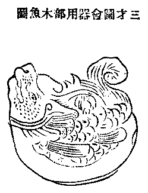



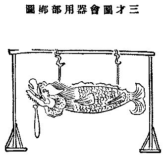



已下。畧录机缘。



传灯录。沩山祐禅师章云。库头击木鱼(详职位门火头处)。



神鼎𬤇禅师录云。官人指木鱼问。这个是什麼。师云惊回多少瞌睡人。官云。洎不到此间。师云。无心打无心。



雪岩钦禅师佛日录云。佛殿脊金鸱。𨁝跳上天。厨堂口木鱼。走入沧海。



已下。略录赋咏。



联灯会要。智门宽禅师章云。师访白兆。兆云。老僧有个木鱼颂。师云。请举看。兆云。伏惟烂木一橛。佛与众生不别。若以杖子击著。直得圣凡路绝。师云。此颂有成褫。无成褫。兆云。无成褫。师云。佛与众生不别。𫆏。左右救云。有成褫。师云。直得圣凡路绝。𫆏。当时白兆一众。失色。



叶县省禅师录木鱼謌云。木鱼謌木鱼謌。横身三界卧。摆头掉尾瞬金鳞。凡圣纵横不柰何。老胡闻。耸耳听。声声振动古佛心。逍遥自在无私曲。荡荡行时任腾腾。指日月。太山崩。踊踊跃跃魔军惊。哮吼吟时云队队。大洋海底霹雳声。



佛眼远禅师录木鱼颂云。无端击此沟中断。钟鼓相参无杂乱。能闻所闻非二缘。以此及此通回换。凡夫何故作追攀。达士若为成智观。可怜流入萨婆若。醉眠尚尔排鱼贯。



东山外集。和寿山木鱼韵。颂云。透出波澜外。横身任探寻。只知打我腹。不觉痛他心。香积晨炊熟。秋廊夜月深。重重报君道。千眼是观音



东坡诗集宿蟠桃寺诗云。板阁独眠惊旅枕。木鱼晓动随僧粥。



●桐鱼



藏叟摘藁崇福讲经修两廊兼化粮疏云。风銮鸣槛看两行铁凤高飞。晓粥上锅。听三叠桐鱼普说。晋书张华传云。吴郡临平岸崩。出一石鼓槌之无声。帝以问华。华曰。可取蜀中桐材。刻为鱼形。扣之。则鸣矣。於是如其言。果声闻数里。



●鱼鼓



木鱼。又名鱼鼓。



普灯录神鼎𬤇禅师章云。僧鼓未鸣时如何。曰看天看地。云鸣后如何。曰捧钵上堂。



已下。畧录赋咏。



赵州谂禅师录鱼鼓颂云。四大犹来造化功。有声全贵里头空。莫怪不与凡夫说。只为宫商调不同。雪峰存禅师录咏鱼鼓颂云。我暂作鱼鼓。悬头为众苦。师僧吃茶饭。拈槌打我肚。身虽披鳞甲。心中一物无。鸬鹚横谿望。我誓不入湖。　又云。可怜鱼鼓子。天生从地养。粥饭不能飧。空肚作声响。时时惊僧睡。懒者烦恼长。住持閙喧喧。不如打游漾。



●石鱼



忠曰。佛寺又有用石作鱼鼓者。



秦淮海集石鱼诗云。佛宫琢琳瑯。悬鱼警群聪缓扣集方袍。急拊趋百工。虽无荀虞器自恊徵与宫。犂然当人心。邈有炎氏风。山泉自疏数。珮玉相玲珑。朝昏间钟鼓清响传无竆。惟有宝陀山。於音获圆通。一闻如得解。石巩亦投弓。



●开枕



日用轨范云。候首座开枕后。困重者。就寝。



敕修清规。大坐参云。闻首座开枕响众方偃息。在道兄弟。不以此拘(详丛轨门再请禅处)。



忠曰。言开者。开阖之开也。开折枕备于卧用。首座示众可安息之意。故展开枕。故令有响也。



旧说曰。枕制令可折。名桥枕(见器物门)。更深。住持亦出堂。故困重者。闻首座开枕。可少偃息耳。若其全身。在道中者。可不问时节。竖起脊梁骨。何必事卧息耶。



●二十五点



○鼓(更)　●版(点)



白圈鼓。为更。黑圈版。为点。　点局更点。此为准(唐书百官志云。漏刻博士。更以击鼓为节。点以击钟为节)。



●版(更)　□柝(点)



黑圈。版。为更。白方。柝。为点。　巡点更点。此为准。



初更



昏鼓三通(击法见昏鼓处)。　次戞鼓磉三通。



一点。○●。○●。○●。点局鼓板(库司大鼓大版同　已下例知此三板为出寮板卷帘也)。



●□。●□。●□。巡点版柝(堂前。首座寮。众寮。方丈。巡廊合鼓板击之。已下例知)。



(忠曰。余观日本更点之图数本并打初更一点今按谢肇淛说。初更不打第一点。第二点而自第三点发。於此禁夜行人五更到第三点而止。於此放行人乃不打第四点第五点余此图之后。详引。依此。则日本更点打初更一点者。非也。)



大钟一通半(以三十六下为一通一通半实五十四下。其法。初十八缓打。次十八敛打。又次十八缓打。都五十四下)。候二点(若打二点则可到此打二点鼓板然后鸣次下大钟然二点省不打。故直接此大钟又鸣大钟一通半)。



又鸣大钟一通半(合前三通。都一百八下也)。



(此名昏钟昏钟鸣。点灯。钟第一通。都寺入佛殿烧香。鸣殿钟三下。正面三拜。自库司山门至僧堂龛前炷香归位。　第三通时。住持入殿烧香。鸣殿钟七下。盖祖堂一下。普庵一下。土地一下。三尊三下。正面礼拜一下。自库司山门至僧堂龛前烧香。巡堂一帀。归位。　住持入堂时。昏钟三通终。)



(首座闻住持烧香钟出寮入堂龛前烧香归位。)



次戞鼓磉三通。



三点○●●●。○●●●。○●●●。



●□□□。●□□□。●□□□。



(忠按。中华初更。省第一点第二点与五更省四五二点都二十一点矣。如日本二十五点图去五更四五同中华至初更但去第二点然则打者。二十二点。故敕修清规大坐参旧解云。初更一点。鼓一板一。如此三度。次初更二点间。鸣大钟三通。总百八下。钟绝。初更三点之后。钟鼓不共鸣去可鸣大钟一通半之顷然后初更四点。鼓一板四。如此三度。又少时。初更五点。鼓一板五。如此三度。更经少时鸣钟十八下。此谓定钟。)



四点○●●●●。○●●●●。○●●●●。



●□□□□。●□□□□。●□□□□。



五点○●●●●●。○●●●●●。○●●●●●。



●□□□□□。●□□□□□。●□□□□□。(南禅规式。版柝。但於初更五点。及四更五点鸣之。餘不鸣版柝。)



定钟十八下(初更五点后。经少时鸣之。坐禅於是止。又有少时打二更)。



(莹山清规云。一更三点之后。鸣定钟如前定钟处辩。)



二更



一点○○●。○○●。○○●。



●●□。●●□。●●□。



鸣火铃(呼照顾火烛巡廊警火。点局行者掌之　或云。鸣火铃在二更二点后火铃之后。诸寮收灯　自次二点至四更一点库司番头者主之)。



二点○○●●。○○●●。○○●●。



●●□□。●●□□。●●□□。



三点○○●●●。○○●●●。○○●●●。



●●□□□。●●□□□。●●□□□。



四点○○●●●●。○○●●●●。○○●●●●。



●●□□□□。●●□□□□。●●□□□□。



五点○○●●●●●。○○●●●●●。○○●●●●●。



●●□□□□□。●●□□□□□。●●□□□□□。



三更



一点○○○●。○○○●。○○○●。



●●●□。●●●□。●●●□。



二点○○○●●。○○○●●。○○○●●。



●●●□□。●●●□□。●●●□□。



三点○○○●●●。○○○●●●。○○○●●●。



●●●□□□。●●●□□□。●●●□□□。



四点○○○●●●●。○○○●●●●。○○○●●●●。



●●●□□□□。●●●□□□□。●●●□□□□。



五点○○○●●●●●。○○○●●●●●。○○○●●●●●。



●●●□□□□□。●●●□□□□□。●●●□□□□□。



(三更五点后。报方丈首座寮都寺寮以打四更之点。)



四更



一点○○○○●。○○○○●。



(诸寮点灯。)



戞鼓磉(收时大疎七下)。



(都寺诸堂烧香。入室龛前烧香。归位坐禅。)



○○○○●(南禅规云。戞鼓磉毕。复打四更一点者一遍)。



●●●●□。●●●●□。●●●●□。



鸣火铃(警火也。　点局行者掌之。)



(众僧入僧堂坐禅。　大坐参云。次早三下板鸣。众起。圣僧侍者牵堂内手巾辘轳惊酣眠者起洗面。众归堂。)



二点○○○○●●。○○○○●●。○○○○●●。



●●●●□□。●●●●□□。●●●●□□。



(前堂首座入堂。住持随后入堂。　大坐参云。首座入烧香巡堂。次住持入烧香巡堂。)



三点○○○○●●●。○○○○●●●。○○○○●●●。



●●●●□□□。●●●●□□□。●●●●□□□。



(住持於二点三点前后随意入堂。　南禅规式云。住持入堂。龛前烧香。巡堂归位。)



四点○○○○●●●●。○○○○●●●●。○○○○●●●●。



●●●●□□□□。●●●●□□□□。●●●●□□□□。



五点○○○○●●●●●。○○○○●●●●●。○○○○●●●●●。



●●●●□□□□□。●●●●□□□□□。●●●●□□□□□。(南禅规见初更五点住持出堂。次首座出堂。大众随意。　大坐参云。四鼓鸣。住持出。)



五更



一点○○○○○●。○○○○○●。○○○○○●。



●●●●●□。●●●●●□。●●●●●□。



二点○○○○○●●。○○○○○●●。○○○○○●●。



●●●●●□□。●●●●●□□。●●●●●□□。



三点○○○○○●●●。○○○○○●●●。



戞鼓磉。



○○○○○●●●(南禅规云。戞鼓磉复打五更三点者一遍。)●●●●●□□□。●●●●●□□□。●●●●●□□□。



大钟三通(每一通三十六下。初十八缓。后十八敛。如是三通。合一百八下然后鸣开静　大坐参云。钟鸣。首座出。　南禅规式云。五更四点五点。不打鼓板鸣大钟配之。　忠曰。约大钟一通半。到四点复一通半。到五点禅苑清规警众云。五更鸣大钟者。警睡眠也。)



> 戞鼓磉。次晓鼓三通。(兼板同击。　击法。见晓鼓处。)



宋洪迈俗事考云。汉书斥候士百餘人。五分夜。击刁斗自守。师古曰。夜有五更。故分而持之。唐六典太史门典钟二百八十人。掌钟漏。故诗云。促漏遥钟动静闻。其漏五五相递。凡二十五。故李郢诗云。二十五声秋点长。韩退之诗。鸡三号更五点。宋宫而及州县更漏。皆去五更后二点。又并初更去其二点。首尾止二十一点。至今仍之。故曰。一更三点禁人行。五更三点放人行。宋太祖以鼓多惊寝。遂易以铁磬。此更鼓之变也。或谓之钲。即今之云板也。陈履常诗。残点连声杀五更。汪元量诗。乱点传筹杀六更。今报更。𭽸𭽸。鼓将尽。则云板连敲。谓之杀更。卫公兵法曰。鼓三百三十三槌。为一通。角吹十二声为一叠。鼓止角动也。司马法曰。昏鼓四通为大[壴*(癸-天+虫)]。夜半三通。为晨戒。旦明三通。为发饷。今早晚各止三通也。其钟声。则一百八撞。以应十二月二十四气。七十二候之数。



杨升庵外集云。夜漏。五五相递。为二十五。唐李郢诗。二十五声秋点长。韩退之诗。鸡三号唐五点。是也。至宋世。国祚长短谶。有寒在五更头之忌。宫掖及州县更漏。皆去五更后二点。又并初更。去其二。以配之。首尾止二十一点。非古也。至今不改焉。



品字笺云。宋时有寒在五更头之谶。始绝去五更之后二点。因而又去初更之前二点。以配之。嗣后相㳂。初更以三点起。五更以三点终。世遂有一更三点禁人行。五更三点放人行。之说。



琅邪代醉编云。宋祖(匡胤)建隆庚申。受禅。后闻陈希夷只怕五更头之言。命宫中。转六更。方严鼓鸣钟。殊不省庚与更同音也。至理宗景定元年。历五庚。申越十七年。宋亡。而希夷五更头之数。信矣。到元朝延祐七年庚申。而至正帝(顺帝)生。帝乃宋少帝赵显(南宋孝恭)子。我大明兵入燕都。遁去。当时人。只呼庚申帝。刘尚宾庚申帝大事记。是也。后方号顺帝云。由是观之。则宋祖命转六更数。亦不爽。



谢肇淛文海披沙云。入夜每更五点。递为二十五点。李郢诗。二十五声秋点长。是也。今禁漏首尾二更。去二点者。盖昏钟禁鼓一动。郎禁人行。初更二点。夜未深。后二点。天将曙。皆不宜禁者。故以三点为起止耳。今人不知。以为起於宋太祖因五更头之谶。遂去之。不知宋太祖。因此谶。令宫中皆转六更。然后鸣钟。又何尝禁初更耶。



代醉编云。蟫精隽云。宋内五更绝。梆鼓遍作。谓之虾蟆更。其时禁开。而百官入。所谓六更也。如方外之攒点。即今之发擂耳(七修类纂)。



杨诚斋江东集诗。醉眠管得银河鹊。天上归来打六更。自注云。予庚戌考试。殿卢夜漏。杀五更之后。复打一更问鸡人。云宫漏有六更。



忠曰。余观日本禅林二十五点图数本。皆未得初更后更省点来由。或曰。五更四点五点。则混开静声。故闻之不分明。可笑。又除前后二点之义。至谢肇淛。初得其理焉。又如中华。初更省第一点第二点。此方但去第二点。又有以钟十八下为一通者。竝非也。



又旧说曰。昔慈照相公。命京师五山。令击二十五点。而今已废焉。但今略法。初更如常式二更唯一点而止。及三更。相接击四更五更。不管时辰。次相接鸣钟九十下。遗十八下。及开静鸣之。总一百八下也(止此)。忠谓。敕修清规大坐参云。钟绝。开静板鸣(止此)。然则非钟与开静板同时鸣。可知之。



因录天竺城门开闭。　杂阿含经云。王家常法。待远使命来往。至初夜尽。城门乃闭。中夜已尽。辄复开门。欲令行人早得往来。



五更义　颜氏家训云。或问。一夜何故五更。更何所训。答曰。汉魏以来。谓为甲夜乙夜丙夜丁夜戊夜。又云鼓。一鼓。二鼓。三鼓。四鼓。五鼓。亦云一更二更三更四更五更。皆以五为节。西都赋亦云。卫以严更之署。所以尔者。假令正月建寅。斗柄夕则指寅。晓则指午矣。自寅至午。凡历五辰。冬夏之月。虽复长短参差。然辰间辽阔。盈不至六。缩不至四。进退常在五者之间。更历也经也。故曰五更尔。



●早晨鸣器品次



五更三点后。一八钟(禅苑　南禅规)。



(旧说曰。百八钟。先九十下。遗十八下及大开静鸣之。　忠曰。若然。十八下。可在小开静后。)



戞鼓磉。　晓鼓三通(南禅)。



(敕修云。更鼓。早晚平击三通。)



厨下小钟三会。小开静(禅苑　莹山)。



(此候五更四点时)(禅苑云。诸寮供过行者。及灯头等。并皆先起。日用轨范云。开小静。折被。盖非也。)



厨前云版三通。大开静(莹山　禅苑为一会)。



(此候五更五点时　众僧齐起)(鼓版一时和鸣。自缓到急。此时处处板。亦同时鸣。)(禅苑。永平。莹山。皆云。大开静折被。　大坐参云。钟绝开静板鸣。折被。　此是大开静。盖百八钟。经四点五点时到此声绝。)



火鼓(校定)。



长击版三通(鸣大版　禅苑　校定)。



(禅苑此名长板方下钵。)(禅苑云。次打长板者。众僧下钵也。众僧一时入堂。次打木鱼众僧集定也)(校定清规云。长板者。火鼓后。长击三会者。是也。)



(非木鱼后三下者。今丛林。皆以三下板为长板方行礼。今只随时可也)



(忠曰。禅苑长板。未言几通到校定方言三会。日用清规云。闻木鱼后长板可知寿无量时。已谬以三下叠叠为长板也。校定所谓今丛林。皆以二下板为长板者。是也。)



(竺仙曰。开静后。长击三通者。此名长板)



(忠曰。竺仙说。合禅苑校定不合日用清规敕修清规也。如日用敕修以三下叠叠名长板且随时讹耳。　又竺仙时。敕修清规未撰成。)



十八钟(鸣大钟　敕修)。



(按敕修法器章十八钟。在堂前钟七下已前　又赴斋粥云。近时诸方住持。大钟鸣时。先入堂坐。)



木鱼三通(长击　禅苑)。



(众僧集定。　旧说曰。十八钟后。鸣木鱼　禅苑云。次打木鱼众僧集定也。)



版(三)下叠叠(大板　敕修)。



(日用。敕修。此名长板下钵)



(日用清规云。闻木鱼后长板鸣下钵　敕修云。木鱼后。三下叠叠击之。谓之长板。)



(忠曰。敕修已前。日用清规时。已谬。校定亦只随时。敕修亦从流传乎。)



(竺仙曰。十八钟后。三下板。名长板非也。)



(忠曰。竺仙说。合禅苑校定。)



问讯鼓三通(禅苑　此鼓在库前　又名下钵鼓)。



(禅苑云。三通鼓鸣者。　住持人赴堂也。)



堂前钟七下(与问讯鼓同时鸣。　禅苑　敕修　旧说。此名敛钟)。



(禅苑云。堂前小钟子鸣者。众僧下床。祗候问讯住持人也。)



(敕修云。僧堂钟。住持入堂。时鸣七下　莹山云。库前云鼓三会。及第三会堂前小钟同鸣。报主人入堂也。)



旧说曰。竺仙曰。住持十八钟可入堂。或曰。住持问讯鼓可入堂。何故。曰十八钟时未下钵。(忠曰。此依敕修。)至问讯鼓方下钵。为钵妨下床。且屏之。(禅苑云。放钵。须当上肩。)及住持入堂。即下床迎住持。住持上床毕。众却就座。安钵正面。按二说。住持问讯鼓入堂者。近理。葢堂前敛钟。与问讯鼓。同时鸣之。而清规每云堂前钟七下。住持入堂故。



忠曰。敕修清规赴斋粥云。近时诸方住持。大钟鸣时。先入堂坐(止此)。乃知。竺仙谓十八钟入堂者。诸方异规。何校是非。又或谓十八钟未下钵。只依敕修三下叠叠下钵也。然竺仙固主张开静后。长击三通板下钵。故十八钟已前。既下钵而已。



●斋前鸣器



巡火板。



(敕修赴斋粥云。斋时。候巡火板鸣先归钵位。)



三下板(禅苑　众僧下钵。是名火板)。



(忠曰。单三下也　日本此谓三钟　按禅苑如晨粥时以长击三通下钵。斋时以三下板下钵。)



长板(长击三通)。



(敕修法器章云。大版。斋粥二时。长击三通。)



大钟(十八下　禅苑　报斋时)。



木鱼(二通)。



(敕修木鱼云。斋粥二时。长击二通。)



三下叠叠板。



(敕修云。大版。斋粥（云云）。木鱼后。三下叠叠。)



问讯鼓。三通(又名下钵鼓)。



(禅苑云。三通鼓鸣者。住持人赴堂也。堂前小钟子鸣者。众僧下床。祇候问讯住持人也。)



堂前小钟。



禅苑云。斋前闻三下板鸣者。众僧下钵也。次鸣大钟者。报斋时也。自餘长板鱼鼓。堂前小钟。维那打锤。食毕下堂。竝同晨粥之法。



第廿八类　器物门



●常住物



碧岩录云。洞山和尚。一生住院。土地神。觅他踪迹。不见。一日厨前。抛撒米面。洞山起心曰。常住物色。何得作践如此。土地神。遂得一见便礼拜。



忠曰。常住物。谓四方僧物也。



释氏要览云。律有四方僧物。钞言十方常住。有师释云。四则摄彼方隅。十则该乎凡圣。谓此一住处。所有之物。虽局一界。而体属十方一切僧伽。　又云。钞云。僧物有四种。一者常住常住。谓众僧舍宇什物。树木田园。仆畜米麦等物。以礼局当处。不通餘界。但得受用。不通分卖。故重言常住也。二者十方常住。谓如一寺中供僧。成熟饮食等。以体通十方唯局本处。善见律云。不打钟食。犯盗罪。(今诸寺同食。食既成熟。乃打钟鼓者。此盖召十方僧故。以此物。十方有分故。)三现前常住。此有二种。一物现前。二人现前。但此物。唯施此处现前僧故。四者十方现前常住。谓亡僧轻物。施体通十方。唯局本处现前僧得分故。(大毘婆沙论。问云。盗亡僧物於谁处得根本业道。答若已作羯磨者。於羯磨众处得。若未作羯磨者。普於一切善说法众得。今详分亡僧物十方来僧。在羯磨数即得。羯磨后来。不得。)



忠曰。所援行事钞。在随戒释相篇要览依彼文取意润删。太便於辨相。故今却引用。



又与区宇类。常住。交看。



大宝积经。宝梁聚会云。佛言。若所用物。所谓常住僧物。及与佛物。若招提僧物。彼营事比丘。应当分别。常住僧物。不应与招提僧。招提僧物。不应与常住僧。常住僧物。不应与招提僧物共襍。招提僧物不应与常住僧物共襍。常住僧物。招提僧物。不与佛物共襍。佛物。不与常住僧物。招提僧物共襍。



十诵律云。佛迦尸国游行。迦罗山诸比丘。闻之以僧房作四分。避藏。诸客比丘。诸处立。待卧具分。佛告阿难约敕旧比丘。言。此处僧房。作四分与四比丘。非是僧物。佛不听分僧房(略钞)。



●什物



敕修清规当代住持受请云。知客引专使。巡寮毕。次第呈纳本寺须知。仪从什物。　又交割砧基什物云。入院后。须会两序勤旧茶。详细询问山门事务。砧基契书什物。逐一点对交割。



华严经入法界品。天主光女章云。我忆念过去。供养恒河沙数。诸佛。造僧伽蓝。营辨什物。



瑜伽师地论明十种身资具。第八云。什物之具。



玄应一切经音义云。什物。时立切。三苍什十也。什聚也杂也。亦会数之名也。又谓资生之物也。今人言家产器物。犹云什物。物即器也。江南名什物。北土名五行。史记舜作什器於寿丘。汉书贫人赐田宅什器。并是也。



慧琳一切经音义云。什物。音十。旧音义云。什众也。杂也。会数之名也。资生之物。谓之什物也。字镜云。物即万物也。牛为大物。天地之起牵牛故。物字从从牛勿声也。



史记五帝本纪云。舜作什器於寿丘。　索隐云。什器。什数也。盖人家常用之器非一。故以十为数。犹今云什物也。



经国大典注解云。什物。什数也。所用之物。非一。故曰什。举成数也。犹言若干也。



后汉书宣秉传云。秉性节约。常服布被。蔬食瓦器。帝见而叹。赐布帛帐帷什物。　章怀注。军法五人为伍。二五为什。则共其器物。故通谓生生之具。为什物。(忠曰。此本前汉平帝纪师古解什器字者也。)



传灯录甘贽行者章云。有住庵僧。缘化什物。甘曰。若道得即施。乃书心字问。是什麼字。僧云。心字。又自问其妻。什麼字。妻云心字。甘云。某甲山妻。亦合住庵。其僧无语。甘亦无施。



文中子云。邳公好古物。钟鼎什物珪玺钱。具不具。



●调度



传灯录。苏溪和尚牧护歌云。一条百纳缾盂。便是生涯调度。



永平清规典座教训云。盘桶。并什物调度。精诚净洁洗灌。



行事钞钵器制听篇注云。房舍众具。五行调度。



资持记云。谓调养具度。即众物之通名。



史记五帝本纪云。舜作什器於寿丘。　正义云。颜师古云。军法伍人为伍。二伍为什。则共器物。故为生生之具。为什器。亦犹从军及作役者。十人为火。共畜调度也。



●道具



忠曰。凡三衣什物。一切资助进道之身物具。名为道具则此目。齐于僧家。然和俗通称度世器物。为道具。失义远矣。丛林谚语。亦名罗纱直裰为道具衣。道具名。岂独在兹哉。



传灯录禅门规式云。施椸架。挂搭道具。(详椸架处)



敕修清规办道具云。将入丛林。先办道具。



清规所列。三衣。坐具。偏衫。裙。直裰。钵。锡杖。拄杖。拂子。数珠。净瓶。滤水囊。戒刀。



华严经入法界品宝髻长者章云。如诸菩萨得不思议功德宝藏。(乃至)修无分别功德道具。　又观自在章云。善财。作如是念。善知识者。至一切智。助道之具。



释氏要览云。道具。中阿含经云。所蓄物。可资身进道者。即是增长善法之具。菩萨戒经云。资生顺道之具。



摩诃僧祇律云。随物者。三衣。尼师坛。覆疮衣。雨浴衣。钵。大犍镃。小犍镃。钵囊。浴囊。漉水囊。二种。腰带。刀子。铜匙。钵支。针筒。军持。澡罐。盛油皮瓶。锡杖。革屣。伞盖。扇。及餘种种所应畜物。是名随物。



十八物者。一杨枝。二澡豆。三大衣。四七条衣。五五条衣。六瓶。七钵。八坐具。九锡杖。十香炉。十一漉水囊。十二手巾。十三刀子。十四火燧。十五镊子。十六绳床。十七经律。十八佛菩萨像(详杨枝处)。



百一物者。　释氏要览云。百一物。大槩之辞也。萨婆多论云。百物。各可蓄一也。



行事钞二衣总别篇云。萨婆多云。百一物。各得蓄一。百一之外。皆是长物。



俱舍论遁麟记。解百一杂宝云。有餘云。百者。凡义。谓凡是诸物皆一。故言百一。



传灯录云居道简禅师章云。师久入云居(道膺)之室。密受真印。以腊高居堂中。为第一座。属膺和尚。将临顺寂。主事僧问。谁当继嗣。曰。堂中简。主事僧。虽承言。而未晓其旨。谓之拣选。乃与众僧。佥议。举第二座。为化主。然且备礼先请第一座。必若谦让。即坚请第二座焉。时简师既密承师记。略不辞免。即自持道具。入方丈。摄众演法。主事僧等。不惬素志。罔循规式师詧其情。乃弃院潜下山。其夜山神号泣。诘旦主事大众。奔至麦庄。悔过哀请。归院。众闻。山神连声唱云。和尚来也。



●公用



忠曰。公界器具。不得私用者。曰公用也。非器别名。



敕修清规亡僧估衣云。不许以公用为名。分去物件。



东都事略。祖无择传云。无择与王安石。同为知制诰。时词臣许受润笔物。安石因辞一人之馈不获义不受。以其物。置舍人院梁上。安石既以母忧去。无择取为本院公用。安石闻而恶之。以无择为不廉。



●刹竿



忠曰。刹表居处。义近刹土。此方刹竿者。长竿上。有宝珠焰形。皆用金铜造。植之于寺前。葢与塔上表刹异矣。如四天王殿前。树刹柱。见大宝积经。



玄应经音义云。梵言差多罗。此译云土田。经中或言国。或云土者。同其义也。或作刹度者。存二音也。即刹帝利。名守田主者。亦是也。案刹。书无此字。即㓼字略也。㓼音初。一切浮图名刹者。讹也。应言剌瑟胝。剌音力割切。此译云竿。人以柱代之。名为刹柱。以安佛骨义同土田。故名刹也。以彼西国墖。竿头安舍利故也。



止观辅行云。言佛刹者。具存。应云刹摩。此云田也。即一佛所王土也。或云表刹者。以柱表刹。表所居处故也。



联灯会要。阿难尊者章云。祖问迦叶云。师兄。世尊传金襕袈裟外。别传个甚麼。迦叶召阿难。祖应诺。迦叶云。倒却门前刹竿著。



传灯录资福邃禅师章云。师谓众曰。隔江见资福刹竿便廻去。脚跟也好与三十棒。岂况过江来。



●水磨



佛祖通载云。牧庵忠禅师。闻佛眼远禅师。居淮西龙门。於是出蜀。兼程至彼。造次不忘提撕其未至处。适纵步水磨。歘睹牌额。书法轮常转。师於是碍膺之疑。泮然氷释。遂说偈曰。转大法轮。目前包裹。更问如何。水推石磨。而作圆相。呈佛眼。眼曰。其中事作麼生。师曰。㵎下水长流。眼曰。必竟如何。师曰。水推石磨。眼曰。归堂歇去。切不得举著。后五日来。却向女道一句子。曰这一句子。也不消得佛眼为之解颐。师遂作礼。



罗湖野录云。冯给事济川。尝有请忠。住胜业疏。略曰。佛眼磨头。悟法轮之常转。死心室内。容慧剑以相挥。世以为实录云(慧剑事。详彼)。



湛堂准和尚水磨记。见大慧武库。



江湖风月集。石桥思首座水碓磨颂云。得如飞雪下千岩。下处如流上未甘。劈箭一机能两断。磨推西北碓东南。



●葛笼



日本禅林。入寺视篆。纳寺印器也。



●经柜



旧说曰。众僧贮衣服道具之器。其在僧堂。曰函柜。其在众寮。曰经柜。



忠曰。众寮是看经之所。故曰经柜。



备用清规寮主云。公界坐禅看经。看守经柜。夜间同寮元。巡视经桉。



敕修清规。亡僧抄劄衣钵云。直病者。同执事人。收拾经柜函柜衣物。抄劄具单。　又众寮结解特为众汤云。寮元依戒。排经柜图等。(详图牌门。经柜图处。)



●函柜



见经柜处。



旧说曰。函柜。僧堂之众。贮衣服等。之器也。



禅苑清规装包中。挂搭云。如堂中有函柜。即收行李。安函柜中。锁之。笠子拄杖归寮。如堂中无函柜。收行李赴寮。



日用轨范云。粥前斋前。放参后。不得开函柜。如有急切。白主事人。寮中白寮主。僧堂白圣僧侍者。



人天宝鉴云。德山密禅师会下。有一禅者。用工甚锐。看狗子无佛性话。久无所入一日忽见狗头如日轮之大。张口欲食之。禅者畏避席而走。邻人问其故。禅者具陈。遂白德山。山曰。不必怖矣。但痛加精彩。待渠开口。撞人里许。便了。禅者依教。坐至中夜。狗复见前。禅者以头极力一撞。则在函柜中。於是㸌然契悟。后出世文殊。道法大振。即真禅师也。



●钥匙



敕修清规。两序进退云。旧知事一班。诣方丈。插香告禀触礼一拜。纳库记钥匙而退。



●寺印



如天童有玲珑岩主印(详丛轨门。视篆处)。日本禅刹。皆有某山印。住持人。不得为私用。



玲珑岩主印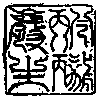



见备用云外跋。



●三宝印



镌佛法僧宝。四篆字。故名三宝印。



忠曰。道场疏。使三宝印。其法。初南瞻部州行使三。一正一斜一正。第二行使一正。第三行使一正。自下每至纸接处。使一。正(接处。必有疏文一行)。至尾三宝证明行。使一。正。次诸天洞鉴行。使一。正。次年月日行。使三。一正。一斜。一正。可漏。亦使三。同疏中法皆穷行上位使(使三法。正斜间阙一字斜正间阙二字　可漏。皆但阙一字)。



○已下系庄严具。



●厨子



忠曰。安像柜也。



校定清规云。暂到随大众后。巡半堂。至后门。对圣僧厨立。侍者接暂到后。巡堂。至圣僧厨后。



●龛



敕修清规。结制礼仪云。侍者暂到。巡半堂。侍者於圣僧龛后立。暂到向侍者立定。



忠曰。安像之柜。即厨子也。



正字通云。龛。克憨切。音堪。增韵浮图塔。广韵塔下室。唐褚遂良书。久弃尘世。与弥勒同龛。



东坡诗集。自金山放船。至焦山诗云。老僧下山惊客至。迎笑喜作巴人谈。自言久客忘乡井。只有弥勒为同龛。



●花亭



敕修清规佛降诞云。至日。库司严设花亭。中置佛降生像。於香汤盆内。安二小杓佛前。



忠曰。造小亭。以红白众花。交覆。学甍瓦之样。宝盖埀旛。亦皆累葩萼。巧成之。名为花亭。



义堂日工集云。本寺(时住南禅)每至佛生之辰。纪纲预命沙喝。装花亭。一时沙喝行力。俱走山野。采众色草花。而𢽾朱甍碧瓦之样。拟华鬘旛盖之庄严。各争优劣。遂及鬪诤。虽似敬重供养。实末世荒本勤末之所致也。於是余舍私赀。命工新造花亭。五色彩画。金碧光耀。缯盖𣄢旛。宝珠璎珞。不假生华。凡所可有者。悉备焉。乃归之常住。以充每岁浴佛之设矣。自是诸刹。皆倣此。



●毗蓝园



忠曰。花亭。亦名毗蓝园。



备用清规。如来降诞云。库司。预令行者。严设毗蓝园。内安太子铜像。



律苑事规。如来降诞。所云。全同备用。



●毗蓝园额



忠曰。花亭当阳。揭额题毗蓝园三字。



大鉴小清规浴佛云。幡四首。四柱。每柱一幡。额一。毗蓝园。



●义成殿额



花亭。或揭义成殿额。



东福寺清规。佛诞生云。花堂额。义成殿也。



翻译名义集云。西域记云。萨婆曷剌他悉陀。唐言一切义成。旧云悉陀。讹也。此乃世尊小字耳。



●旛



观心论灌顶法师疏云。圆坛者。即实相不动地也。缯幡。即翻法界上迷生动出之解。幡坛不相离。即动出不动出。不相离也。



摩诃止观辅行记云。五色旛者。总举五色。绣畫间色。亦应无在。字应作旛。旛者。旌旗之总名也。经中多作此幡。幡帤字耳。今佛法供具。相状似彼。故云旛耳。凡造旛法。切不得安佛菩萨像。旛是供具。供於所供。如何复以形像为之。



忠按。幢幡不妨书法文。　华严经十廻向品。菩萨。施上妙幢幡。廻向云。愿一切众生。常以宝缯。书写正法。护持诸佛菩萨法藏。　疏就幢幡。书字故。



已下录荐亡旛。



释门正统云。黄白旛者。释氏类苑云。或荐亡黄旛者。灌顶经云。若四辈男女。若命终时。若已命过。於其亡日。造作黄旛。悬著刹上。使获福德。离八难苦。得生十方诸佛净土。旛盖供养。随心所愿。至成菩提。旛随风转。破碎都尽。至成微尘。其福无量。旛一转时。转轮王位。乃至吹尘。小王之位。其报无量。诸经要集。问曰。何故经中。为亡人。造作黄旛。挂於冢塔上者。答曰。虽未见经释。可以义求。此五大色中。黄色居中。用表忠诚。尽心修福。为引中阴。不入恶趣。莫生边国。



释氏要览云。斋七幡子。北俗亡。累七斋日。皆令主斋僧。剪纸幡子一首。随纸化之。按正法念处经有一十七种中有。谓死时。若生天者。即见中有。如白㲲埀下。其人识神。见已。举手揽之。便受天人中有身。故今七七日。是中有死生之日。以白纸幡子。胜幢之相。示之。故北人招魂帛。皆用白练。甚合经旨也。



●盖



摩诃止观云。五色盖者。观五阴。免子缚。起大慈悲。覆法界也。



义楚六帖云。本行经云。摩纳童子。以花供养定光佛。其花乃於上。化成华盖。佛行即行。佛住即住。



●斗帐



忠曰。帐形如覆斗。故名。其以组成饰。即是同心结也(隋书。宣华夫人。陈氏传云。太子。赍金合子署封。赐夫人发见有同心结数枚)。



汉刘凞逸雅云。帐张也。张施於床上也。小帐曰斗。形如覆斗也。



三才图会衣服部。结帛式云。







用白绢一匹。结如世俗所谓。同心结者。朱子所谓。结绢。盖如此云。



佛本行集经路逢死尸品云。作缾天子。化作一尸。卧在床上。众人轝行。复以种种妙色刍衣。张施其上。作於斗帐。



起世经云。妇女丈夫。命终。作种种斗帐幰盖。而普周帀。



●卓围



见卓子处。



忠曰。鬬彩金襕等。周围卓四面。到地者。言卓围也。与卓袱不同。大鉴已言袱子。并卓围。二物可知也。水浒传云。香车龙亭。擡放忠义堂上。中间设著三个几案。都用黄罗龙凤卓围。围著。正中设万岁龙牌。将御书丹诏放在。



●卓袱



忠曰。鬬彩锦绣之类。缝合令方。而覆卓上。或覆时其角在正中与左右埀下。此言卓袱。此物正在卓围之上面。



字汇云。袱房六切。音伏。包袱。



敕修清规告香云。请客侍者。预依戒次。具茶状。备卓袱笔砚。　又受嗣法人煎点云。至日。僧堂住持位。严设敷陈。及卓袱𫎪币之具。



备用清规告香云。请客侍者。预日令客头至。堂司具新到戒次写茶状。客头备卓袱。



和俗。用亡者衣物等。作佛祖位前。庄严卓袱斗帐等。亦有据。



随愿往生十方净土经云。佛言。若以亡者严身之具。堂宇室宅。园林浴池。以施三宝。此福最多。功德力强。可得拔彼地狱之殃。以是因缘。便得解脱忧苦之患。长得度脱。往生十方诸佛净土。



○已下系供养具。



●炉。瓶。烛台。



忠曰。香炉。华瓶。烛台。三物也。



敕修清规谢挂搭云。法堂设住持位。排列香几。罏。瓶。烛台。



大鉴清规达磨忌云。前列炉。瓶。烛台。



或问。佛经有列三器者耶。忠曰。陁罗尼集经云。当设二十一种供养之具。作般若波罗蜜多法会。(乃至)若不能具二十一种。五种亦得。何等为五。一者香水。二者杂华。三者烧香。四者饮食。五者然灯(止此)。此中具三物也。



●四板头香炉



见四板头。香几处。



●众寮香炉



忠曰。众寮行礼。安七个香罏(见图牌门。茶汤问讯图处)。



敕修清规新挂搭人。点入寮茶云。进中炉。上下间炉前。烧香。



●手炉



敕修清规圣节云。知客跪进手炉(详报祷门。跪炉处)。



又沙弥得度云。几上安香烛手炉戒尺。(乃至)戒师秉炉白。



幻住清规开甘露门云。执手炉。戒香定香(云云)。



释氏要览云。法苑云。天人黄琼。说迦叶佛香炉。略云。前有十六师子白象。於二兽头上。别起莲华台。以为炉。后有师子蹲踞。顶上有九龙。绕承金华。华内有金台宝子盛香。佛说法时。常执此炉。比观今世手炉之制少有倣法焉。



虗堂愚和尚育王录云。朱行军。一日。入南禅寺斋僧。行香次。以手炉摇曳云。直下是。直下是。时有僧云。直下是个甚麼。行军便喝(云云)。(广灯联灯此缘。无手炉字但云。有朱行军设斋。入僧堂内顾视上下云。直下是。又作麼生。行香次。口不住道。云云。)



●香盘



希叟昙禅师广录禅房十事。香印颂云。要识分明古篆。一槌打得完全。烧炷旃檀牛粪。衲僧鼻孔校穿。



●四板头香几



忠曰。僧堂内。首座板。后堂板。分手板。圣僧板。各安香几。行礼炷香(详礼则门。四处问讯处)。



校定清规。特为住持煎点云。如就僧堂。上下间内外。不用设香炉。为主者一人。大众光伴也。如节腊朔望。设香案者。为大众故也。



●堂外香几



忠曰。外堂。有二香几。在上下间。行礼炷香。(详礼则门。四处问讯处。)



●香合



敕修清规圣节云。维那用黄纸书疏。带行仆。捧盘袱。炉烛。香合。上方丈。请住持佥疏。　又云。知客跪进手炉。侍者跪进香合。　又念诵云。烧香侍者。捧香合。



三才图会仪制门有图。



●大香合



空谷尚直编云。虎丘行中仁禅师。凡得沈檀异香。则以小合贮之。置於大香合中。每旦持以行香。至世尊前。於小合中。别取好香一炷。进之。除外。不复他用。客至。惟𦶟常香而已。



忠曰。丛林。现有此法。而人不知祖行中矣。



●小香合



敕修清规告香云。众集。依图位立。各备小香合坐具。(又见大香合处)



●香



增壹阿含经云。须摩提女。手执香火。上楼。向如来说偈。唯愿尊屈神。尔时香如云。在空中。遍满祇桓。住在如来前。阿难白世尊言。此是何等香。世尊曰。此香是佛使。满富城中。须摩提女。所请(广说如彼)。



僧史略云。香也者。解秽流芬。令人乐闻也。香为信心之使也。(详丛轨门。行香处。)



观心论云。烧香者。亦非世间有相之香。乃是无为正法之香。薰诸臰秽。断无明恶业。悉令消灭。其正法香有五种。一者戒香。所谓能断诸恶。能修诸善。二者定香。所谓深信大乘。心无退转。三者慧香。所谓常於身心。内外观察。四者解脱香。所谓能断一切无明结缚。五者解脱知见香。所谓觉察常明。通达无碍。如是五香。名最上香。世间无比。佛在世日。令诸弟子。以智慧火。烧如是无价宝香。供养十方一切诸佛。今时众生。愚痴钝根。不解如来真实之义。唯将外火。烧世间沈檀薰陆。质碍之香。希望福报。云何可得。



●瓣香



敕修清规祈雪疏云。庸致瓣香之诚。愿集六花之瑞。



祖庭事苑云。古今尊宿。拈香。多云一瓣。瓣皮苋切。瓜瓣也。以香似之。故称焉。或作𤖭。步还切。片也。后世相袭。皆为此言。何必尔也。当云一片一炷。庶免薄俗之讥。



小补韵会云。瓣皮苋切。说文瓜中实从瓜辡声。广韵。瓜瓠瓣也。又薄闲切。瓜中实也。又片也。诗硕人注。瓠瓣。



诗人有学禅者瓣香语者。　陈后山诗集。观衮文忠公家。六一堂图书诗云。向来一瓣香。敬为曾南丰。　注。诸方开堂。至第三瓣香。推本其得法所自。则云。此一瓣香。敬为某人(云云)。　曾巩子固建昌南丰人。於欧公。犹宗门中嫡子。而后山又师南丰。乃其孙也。



杨诚斋朝天集。双峰定水璘老。送木犀香诗云。传语。双峰老。汝师是如来。如何一瓣香。却为杨诚斋。　又退休集。祷雪响应诗云。老夫与雪亦久别。滕六参侬求普说。为渠拈此一瓣香。今身胡姓前身黄(云云)。



忠曰。瓣香之制。上圆下方。表里条条。竖雕畦。上如指头然。葢像枯枿之状。以作文而已。然或处直雕造人之手。而指掌宛然。施爪甲。谓是形二祖断臂之手也。予曾在周州覩之。尤为可笑也。



●大香



瓣香曰大香也。



敕修清规。尊宿迁化。下遗书云。专使起。炉前谢茶。再插大香一片。



●中香



校定清规告香云。一大二中。



解者曰。谓大香一片。中香二片也。



●笺香



大鉴清规末后事仪云。龛内。满安笺香。



忠曰。恐讹线香。



●线香



忠曰。或言仙香杂抹众香。加糊粘。造之。其炷烟长久。故称仙香。又云长寿香。其制纤长。如线。故称线香。线又作线。



●信香



忠曰。开法出世。赍香寄师。通嗣法之信。此言信香。大慧杲禅师。答鼓山逮长老书云。专使来。收书并信香等。知开法出世。唱道於石门。不忘所从来。为岳长老拈香。续杨岐宗派。



忠曰。逮公於杲师。是师祖也。亦可通信。逮嗣蒙庵岳。岳嗣大慧杲。



石门慈照禅师凤岩集云。师开堂。拈香云。西天二十八祖。唐土六祖。过去圣人。尽得传衣付法。至唐代。六祖之后。得道者。如稻麻竹苇。不传其衣。只传其法。皆以香为信。今日一瓣香。为什麼人通信。某甲虽不言。大众已委悉。𦶟此一炷香也。(慈照嗣首山念)



祖庭事苑云。托香而表信。(详丛轨门。嗣法拈香处。)



●长明灯



敕修清规亡僧云。夜点长明灯。



观心论云。长明灯者。正觉心也。觉知明了。喻之为灯。是故一切求解脱者。常以身为灯台。心为灯盏。信为灯炷。增诸戒行以为添油。智慧明达。喻如灯光常然。如是觉灯。炤破一切无明痴暗。能以此法。转相开悟。即是一灯然百千灯。以灯续明。终无尽故。故号长明。过去有佛。名曰然灯。义亦如是。愚痴众生。不会如来方便之说。专行虗妄。执著有为。遂然世间苏油之灯。以炤空室。乃称依教。岂不谬乎。传灯录长庆棱禅师章云。有人问僧。点什麼灯。曰长明灯。曰什麼时点。曰去年点。曰长明何在。僧无语。师代云。若不如此。争知公不受人谩。法眼别云。利动君子。



本事诗云。宋考功。游灵隐寺。夜月极明。长廊吟行。且为诗曰。鹫岭郁岧嶤。龙宫隐寂寥。第二联搜奇思终不如意。有老僧。点长明灯。生大禅床。问曰。少年夜夕久不寐。而吟讽甚苦。何耶。之问告故。僧曰。何不云楼观沧海日。门听浙江潮。之问愕然。寺僧有知者曰。此骆宾王也。



隋唐嘉话云。江宁县寺。有晋长明灯。岁久火色变青。而不热。隋文帝平陈。已讶其古。至今犹存。



法苑珠林云。五百问事云。续佛光明。昼不得灭。佛无明暗。以本无言念齐限。故灭有罪。



诸祖偈颂高迈长明灯序云。离娄之目。处暗室或不能覩。灯处之皎如也。澄公之掌。在玄夜。或不能照。灯在之了如也。故大雄氏。以方便力。救黑暗界。藉其光诱其人。佛所有燃灯明。法所有传灯义。大抵长明灯。是其蕴乎。夫日主昼。太阳之精。中则吴。吴则没。我长明灯不没。月主夜。太阴之精。满则亏。亏则尽。我长明灯不尽。日月尚尔。况小光小明哉。要自积苦为海。举足见溺。积邪为山。举足见碍。竟不能髣髴之。或髣髴之。不剋成就之。言之可为长叹。我邑中有俊杰。主此燃灯。精进成就於宝融寺经藏院。且夫兰炷𦶟火。吾见其盛。未见其微也。铁盆盛膏。吾见其增。未见其减也。一笼而四时长春。满室而终岁不夜。人见之一作礼。眼蒙利。再作礼心蒙美。心眼自相炤了。内外由是洞彻。然则终日见灯。未尝不见灯。终日不见灯。未尝不见灯。夫达观者。乃如是也。意者。不独於此。直上照一天二天。乃至三十三天。无门不辟。河沙善人。由兹而入。直下炤一地二地。乃至一十八地狱。有狱皆开。多劫罪人。由兹而出。若然者。四维上下虗空。可思量。而不可思量耶。我长明灯。宝相功德。亦复如是。迈之数年内愿铭颂之间。迫贱事未搆。一朝染目疾。朦胧不自审从何得也。遂梦。神人语迈曰。子於长明灯其有负乎。迈应声而悟。悟而起。起而作颂。明日目愈。颂曰。见外灯长明。见内灯长明。万恶自光中灭。万善自光中生。不见。一灯百千万亿灯。乃至於无穷。不见。一人百千万亿人。归之於大同。空即是色。色即是空。弟子作颂。允执厥中。



●长命灯



忠曰。长明灯也。太平广记引本事诗。载骆宾王事。作长命灯。必讹写耳。



●无尽灯



忠曰。晚近称长明灯。为无尽灯。



广灯录。石门彻禅师章云。问如何是。学人用心处。师云。昼夜常然无尽灯。



续灯录拈古门云。僧问投子。历劫来来无尽灯。不曾挑剔。镇长明。时如何。投子云。历劫来来无尽灯。不曾挑剔镇长明。



北磵文集瑞岩开田。然无尽灯记云。净名大士。既授万二千天女。无尽灯法门。从而谕之曰。冥者皆明。明终不尽。伊尹所谓。以先觉觉后觉也。后世焚膏继晷。号无尽灯。非净名心也。日夜相代。为明者日月也。大厦既夕。风雨如晦。瞭然者将眊然。待灯而见。灯亦岂无待焉。惟有待故。连行於人。日月则运行於天。运之之殊。不息则一也。瑞岩丹丘胜处。灯失常运。货殖取赢。使此灯不夜。莫知几兴废住山道全。谋诸众曰。货殖取赢乎。垦土收获乎。智绍曰。是或一道也。顾主之何如。主之有常。则皆永传不然。则勺海为膏。伐山为炬。徒尔为也。佥曰善。绍则请命出山。旋淛绝淮。积锱累铢。阅四年而归。僦工辟荒。眡岁入为无尽光明。茁霜萧萧。只影婆娑。焦心劳思。恐蹈货殖取赢之辙。求余记其成。为将来之劝。



维摩经。持世菩萨章云。维摩诘。语诸天女言。诸姉。有法门。名无尽灯。汝等当学。无尽灯者。譬如一灯然百千灯。冥者皆明。明终不尽。如是诸姉。夫一菩萨。开导百千众生。令发阿耨多罗三藐三菩提心。於其道意。亦不灭尽。随所说法。而自增益一切善法。是名无尽灯也。



佛祖统纪云。贤首法藏师。为则天。以十镜。置八隅。中安佛像然灯照之。则镜镜现像。以表刹海重重无尽之意。



忠曰。净名约理。法藏显事。悉是横无尽。亦兼竖无尽。真歇了禅师。佛灯明禅师。各著无尽灯记。而叙此镜灯。重重无尽之旨。是也。然世呼长明灯。为无尽灯。唯是竖无尽耳矣。非净名康藏之义。然北磵时。已有此目。颇辩斥。可知由来复淹矣。



●挑灯



敕修清规开堂祝寿云。铙钹旛花挑灯。迎引至法堂位前立。　又尊宿出丧云。提调龛前伞椅。汤炉挑灯。



●灯笼



毘奈耶杂事云。缘在室罗伐城。如世尊。言夜暗诵经者。彼诵经时。有蛇来至。少年见已。惊忙大唤。唱言。长脊长脊。凡夫苾刍。悉皆惊怖。遂令听者。因斯废阙。以缘白佛。佛言。当可然灯。以诵经典。苾刍夏月然灯损虫。佛言。应作灯笼。苾刍不知云何应作。佛言。应以竹片为笼。薄㲲遮障。此若难求。用云母片。此更难得。应作百目。苾刍不解如何当作。佛言。令瓦师作。如灯笼形。傍边。多穿小孔。



普灯录保福权禅师章云。上堂举寒山吾心似秋月偈云。老僧即不然。吾心似灯笼。点火内外红。有物堪比伦。来朝日出东。传者以为笑。黄龙死心。见之叹曰。权兄提唱若此。诚不负先师所付嘱也。



叶县省禅师录灯笼偈云。一盏金灯号玲珑。四方八面不施工。照破乾坤黑暗处。山河大地是家风。



●长檠



忠曰。长檠。高可五尺。上安木盏。植立铁钉。而燃蜡烛。凡禅林。法堂佛殿等。用之。



韩昌黎集短灯檠歌云。长檠八尺空自长。短檠二尺便且光。



○已下系仪物。



●罣罳



旧说曰。罣罳遮背后板屏。在椅子后者。



篇海类编云。罣古畫切。音卦。罣碍也。



或曰。罣罳即法被也。忠曰。此盖依苏鹗以罘罳为网之义。然今禅林。称罣罳者。只是木屏耳。



敕修清规告香云。至日。侍者令客头於寝堂或法堂。铺设罣罳椅子。　又四节秉拂云。堂司行者。排办法座左手。敷罣罳。设住持位。



忠曰。敷者。排辨也(品字笺云。俗以排列谓之铺设)。非铺展义。又曰。韵书小说。但释罘罳今且录之。



小补韵会云。说文罘罳屏也。从网思声。博雅。罘罳谓之屏。又汉未央宫东阙罘罳灾。师古曰。罘罳连阙曲阁也。以覆重刻垣墉之处。其形罘罳然。释名。罘复也。罳思也。言臣将入请事。於此复思也。通作思。汉五行志罘思。又考工记。宫隅城隅阙门。皆有之。礼记明堂位注疏云。以诸文参之。则桴思。小楼也。唐苏鹗曰。汉师古注。释名所释。罘罳二说。皆误。按罘罳。从网是形。不思是声。罘浮也罳丝也。谓织丝之文。轻疎浮虗之貌。盖宫殿簷户之间也。唐文宗实录。甘露之变。出殿北门。裂断罘罳而去。温庭筠补陈武帝书。罘罳昼卷。阊阖晨开。皆非曲阁屏障之意。相如子虗赋罘网弥山。此亦谓罗鸟之网。即罘罳为网不谬矣。



宋马缟中华古今注云。罘罳屏。屏之遗象也。塾门外之舍也。臣来朝君。至门外。当就舍。更详其所应应对之事也。塾之者言。塾也。行至门内屏外。复应思惟也。罘罳复思也。汉西京罘罳。合板为之。亦筑土为之每门阙殿舍。皆有焉。如今郡国厅前。亦树之也。



陈继儒枕谭云。段成式云。士林多称雀网。为罘罳。其误如此。按汉书罘罳屏也。复也。臣朝君。至屏所奏之事于下。又按刘熙释名曰。罘罳在外门。罘复也。臣将入请事。于此复重思也。今之照墙也。



忠曰。罘罳板屏。而在厅前。今禅林罣罳亦板屏。制似罘罳。虽在椅后。亦受罳之名。



●法被



覆裹椅子之被也。



●大法被



忠曰。法堂座上。挂下大罣罳当面之被也。



北磵续集。赵郡主。施鬬彩法被。荐女偈云。空王座上。一片如织。善哉命妇。巧思精究。劝化诸女。如出一手。



●僧堂帐



禅苑清规首座云。行者於首座前问讯。低声云。和尚放参。(乃至)打放参钟。展单下帐。罢。归寮问讯。



忠曰。展眠单。而下帐帷也。



●帐幕



敕修清规。迎待尊宿云。寝堂钉挂帐幕。



正字通云。帐知亮切。音障。帷幔通称。又今人。以寝幄为帐。东方朔造甲乙帐。程颢本传。颢知扶沟县内侍王中正。按阅保甲。邻邑竞侈供帐。悦之。主吏来请。颢曰。吾邑贫。独有令故青帐。可用耳。



●暖帘



忠曰。绵布覆帘面。防风气。故言暖帘。



敕修清规月分须知云。四月候天气。僧堂内。下暖帘。上凉帘。



●凉帘



见暖帘处。



江湖风月集。率庵琮和尚。凉帘偈云。丝开渭水苍龙骨。织就炎天片雪寒。六用门头才放下。节纹一点不相瞒。



●座头屏风



忠曰。或单呼座头。小屏高可三尺。设户口左右座首。



太岳清和尚曰。座头小屏。又是名隔板。



旧说曰。座有四出六出八出等。如中华丛林。虽诸寮舍。制亦如僧堂众寮。此方镰仓丛林。随处设座头屏风。此日本样也。其座头。则唯特为人。得坐之。其餘位。则纵但一人。亦只用曲盆。行盏。盖为异於特为也。



忠曰。隔板。亦有所原。　后汉书郑弘传云。弘为太尉。时举将第五伦为司空。班次在下。每正朔朝见。弘曲躬而自卑。帝问知其故。遂听置云母屏风。分隔其间。由此㠯为故事。



●香台



禅苑清规入室云。侍者入方丈。当面问讯。转身禅椅东边。香台后。面南立。



●供台



忠曰。大卓言供台。



东福清规。上堂节礼云。法堂触礼毕。住持转身。从安香炉。供台东入。南面立。受沙喝行者三拜。



敕修清规达磨忌云。严设祭筵。　解者曰。祭筵郎供台也。　又僧堂之外堂。有二供台(如图)。



●卓子



大鉴清规接谥号仪式云。於山门炉前。安卓子。庄严袱子并卓围。



●盘袱



忠曰。盘与袱二物也。盘上铺小袱。盛疏印等物。



敕修清规圣节云。维那书疏。带行仆。捧盘袱炉烛香合。上方丈。请住持佥疏。　又受法衣云。以盘袱。托呈法衣信物。　又山门特为新命茶汤云。库司仍具请状。备盘袱炉烛。诣方丈。插香拜请。　又大挂搭归堂云。堂司行者。用盘袱。托度牒。



●衣裓



忠曰。僧家散花器名衣裓。其器小竹笼。以贮花而散之。盖袭大通佛故事也。



法华经化城喻品云。大通智胜佛。得阿耨菩提。大光普照。尔时东方。五百万亿国土中。诸梵天王。与宫殿俱。各以衣裓。盛诸天华。共诣西方。推寻是相。东南方。南方。西南方。乃至下方。亦复如是。



雪窦显禅师祖英集。送暹首座诗云。我恐逃之逃不得。大方无外皆充塞。茫茫扰扰知何极。八面香风惹衣裓。



忠曰。此用法华事。祖庭事苑解云。裓古得切。衣前襟也。



慧琳法华音义云。衣裓。说文。宗庙奏戒衣。从衣戒声。玉篇衣部。古来反。戒也。相传。从衣戒。孤得反。襟也。今时女人。衣前裓。是也。天衣类同。未详字所出也。



小补韵会云。裓。讫得切。衣裙也。梵典有衣裓。



忠曰。韵会之梵典。指法华也。所谓衣裓者。诸天聚众华。盛衣裙。以拟散佛上。今人摘果芽亦为之。故范希文鬬茶歌云。终朝采掇未盈襜。唯求精粹不敢贪(止此)。襜篇海音觇。韨也。衣蔽前。



●拜席



敕修清规告香云。须用香几三只。烛台三对。当椅前。一字间列。外设小拜席。



传灯录百丈海禅师章云。马祖上堂。大众云集。方升座良久。师乃卷却面前礼拜席。祖便下堂。



○已下系道具。



●竹篦



敕修清规尊宿出丧云。提调竹篦。拄杖。拂子。香合。法衣等物。



已下。畧录事缘。



广灯录叶县省禅师章云。参见汝州省念禅师。师见来。竖起竹篦子。云。不得唤作竹篦子。唤作竹篦子。即触。不唤作竹篦子。即背。唤作什麼。师近前掣得。掷向阶下云。在什麼处。念云。瞎。师言下大悟。



大慧杲禅师年谱云。师三十七岁。圆悟著临济正宗记以付之。分座训徒。师乃炷香。为誓曰。宁以此身。代众生受地狱苦。终不以佛法当人情。乃握竹篦。为应机之器。於是声誉蔼著。　又本录云。师室中。常举竹篦。问学者曰。唤作竹篦则触。不唤作竹篦则背。众下语。皆不契。因僧请益。复成五颂示之。颂云。云门擧起竹篦。开口知君话堕。上方香积不餐。甘伏食人涕唾。一云门擧起竹篦。禅和切忌针锥。鸾凤不栖荆棘。𮭗𮭗偏守空池。二云门擧起竹篦。通身带水拖泥。奉报参玄上士。撒手悬崖勿迟。三云门举起竹篦。拟议知君乱统。直饶救得眼睛。当下失却鼻孔。四云门举起竹篦。露出心肝五脏。可怜猗死禅和。犹自魂飞胆丧。五



●禅镇



忠曰。坐禅警睡具也。



十诵律云。有比丘。众中睡。佛言。听水洗头。(乃至)若故睡不止。听以毱掷。若故睡不止。佛言。听用禅杖。取禅杖时。应生敬心。云何生敬心。言。以两手捉杖。戴顶上。应起看餘睡者。以禅杖筑。筑已还坐。若无睡者。还以禅杖。著本处已坐。诸比丘。故睡。佛听用禅镇。作孔已。以绳贯孔中。绳头施纽。挂耳。上去额前四指。著禅镇时禅镇堕。故睡。佛言。禅镇堕者。应起行。行时来往相乱。佛言。应如鹅法次第行(畧钞)。



资持记钵器篇云。禅镇。如笏。坐禅时镇顶。须作孔施纽串耳上。睡时即堕地。佛言。一堕听舒一足二堕舒二足。三堕应起经行。



释氏要览云。禅镇。木版为之。形量似笏。中作孔。施纽。串於耳下。头戴。去额四指。坐禅人。若昏睡。头倾。则堕。以自警。



止观证真私记云。四分抄批云。禅镇者。用骨牙角者。可方一寸许。若有睡者。放著顶上。头若正时。则不落。若睡时头动。则落膝上。



●禅带



释氏要览云。禅带。此坐禅资具也。经云。用韦为之(熟皮曰韦)。广一尺长八尺。头有钩。从后转向前。拘两膝。令不动故为乍习坐禅易倦。用此检身。助力故。名善助。用罢屏处藏之。



●禅杖



释氏要览云。禅杖。以竹苇为之。用物包一头。令下座执行。坐禅昏睡。以软头点之。



十诵律说。见禅镇处。



●禅毱



释氏要览云。禅毱。毛毬也。有睡者。掷之令觉。



十诵律说。见禅镇处。



智度论云。菩萨供给坐禅者。衣服饮食。医药。法杖。禅毱。禅镇。令得好师教诏。令得好弟子受化。与骨人令观。与禅经。令人为说禅法。如是等。三十七助道法因缘。



●禅板



旧说曰。禅板者。坐禅时安手。或靠身器也。



临济玄禅师录云。师一日辞黄檗。檗问。什麼处去。师云。不是河南。便归河北。黄檗便打。师约住。与一掌。黄檗大笑。乃唤侍者。将百丈先师禅板机案来。师云。侍者将火来。黄檗云。虽然如是。汝但将去。已后坐却。天下人舌头去在。



希叟昙禅师录禅板颂云。要成片段工夫须是全身倚靠虽然只见一边未许睦州担荷。



忠曰。禅板者。倚版也。上头穿小圆穴。此名向上一窍。盖此穴贯索。缚著绳床背后横绳令板面斜。以靠身也。希叟颂意可见。然今时夏月。横安膝上。定印乎其上。或支颐。与助老同用而已复别有倚板。余於一古寺。见中峰和尚禅板之模。长壹尺七寸八分。濶壹寸九分餘。厚参分半。上有小窍。一面镌万法归一一归何处。乃峰亲书之模也。别有小板。即所谓倚板。长壹尺八寸。濶三寸九分。厚三分餘。上下施窍。葢是禅板本制。而其上下穴。一贯索。缚著床面横绳。一贯索。缚著床底横绳。其板之斜势。令起倒得称意焉。今之禅板。槩濶不过贰寸则不便安躳。但可手携耳。



●倚版



释氏要览云。倚版。今呼禅版。毘柰耶摄颂曰。倚版为除劳僧私皆许畜(僧即众私即己)。



忠曰。倚版坐绳床时。倚之所以安背也。余曾获之於古寺。其制斵版厚三分半。长一尺八寸。横三寸九分。上下穿小窍。用时以纽。缚定床之横绳。而其斜之急不急。随意而已(详禅版处)。



●数珠



释氏要览云。牟棃曼陀罗咒经云。梵语钵塞莫。梁云数珠。此乃是引接下根。牵课修业之具也。木槵子经云。昔有国王。名波流棃。白佛言。我国边小。频年寇疫。谷贵。民困。我常不安。法藏深广。不得遍行。惟愿埀示法要。佛言。大王。若欲灭烦恼。当贯木槵子一百八个常自随身。志心称南无佛陀。南无达磨。南无僧伽名。乃过一子。如是渐次。乃至千万。能满二十万遍身心不乱。除谄曲。舍命得生炎摩天。若满百万遍。当除百八结业获常乐果。王言。我当奉行。



百八结者。要览云。小乘。见修合论。烦恼共有一百八数。且明见惑。三界四谛下烦恼共有八十八。谓苦下。具一切。即十使。贪瞋痴慢疑。身边见邪见见取戒禁取也。集灭离三见。谓集灭二谛下。各除身边邪三见也。道除於二见。谓道谛除身边二见也。上界不行恚。谓上界四谛下。各除瞋一。已上三界四谛。共有八十八也。修道所断惑。欲界有四。谓贪瞋痴慢。上二界。各除瞋。共有六。已上成十。计九十八也。更加十缠。谓无慙。无愧。昏沈。恶作。恼嫉。掉举。睡眠。忿。覆。合前都有一百八也。



佛说校量数珠功德经(大唐宝思惟译)云。曼殊室利。告大众言。汝等谛听。受数珠校量功德差别。如是。若用铁为数珠者。诵掐一遍。得福五倍。若用赤铜。为数珠者。诵掐一遍得福十倍。若用真珠珊瑚等。为数珠者。诵掐一遍。得福百倍。若用木槵子。为数珠者。诵掐一遍。得福千倍。若求往生诸佛净土。及天宫者。应受此珠。若用莲子。为数珠者。诵掐一遍。得福万倍。若用因陁罗佉叉。为数珠者。诵掐一遍。得福百万倍。若用乌卢陁罗佉叉。为数珠者。诵掐一遍。得福千万倍。若用水精。为数珠者。诵掐一遍。得福万万倍。若用菩提子。为数珠者。或用掐念。或但手持此珠。不能依法。诵佛名。算数难可拔。是诸善男子。若复有人。手持此珠。不能依法。念诵佛名。及陁罗尼。此善男子。但能手持随身。行住坐卧。所出言语。若善若恶。斯由此人以持菩提子故。得福等同。如念诸佛诵咒无异。得福无量。其数珠者。要当须满一百八颗。如其难得。或为五十四颗。或二十七。或十四颗。亦皆得用。此即数珠法相差别。诸善男子。以何因缘我今独赞用菩提子获益最胜。诸人善听。我为汝等重说。昔日过去有佛。出现於世。在此树下。成等正觉时。一外道。信邪倒见。毁谤三宝。彼有一男。忽被非人打杀。外道念言。我今邪盛。未审诸佛。有何神力。如来既是在此树下。成等正觉。若佛是圣。树应有感。即将亡子。卧著菩提树下。作如是言。佛树若圣。我子必苏。以经七日。诵尔佛名。其子即得重苏。外道赞言。诸佛神力。我未曾见。佛成道树。现此希奇甚大威德。难可思议诸外道等。悉皆舍邪归正。相共发菩提心。信知。佛力不可思议。诸人咸号。为延命树。以是因缘。有其二名。应当知之。我为汝等现其所要。佛赞。善哉文殊如汝所说为异云耳。



陀罗尼集经云。佛说作数珠法。云有其四种。何者为四。一者金。二者银。三者赤铜。四者水精。其数皆满一百八珠。或五十四或四十二。或二十一。亦得中用。



古今原始云。东汉章帝时。僧西域人。时作念珠。以象一年十二月。二十四气。七十二候之义。共一百单八



忠曰。象十二月等。百八钟也(详百八钟处)。如念珠。经有明文。儒家不知之。作此妄说。



忠按专念宗。用三十六珠者。三分於百八之一也。便易携矣。近自支那来禅僧。用十八珠者。六分於百八之一也。掐六遍而满百八耳。



●数珠母珠



陁罗尼集经云。作是相珠一百八颗。造成珠已。又作一金珠。以为母珠。又更别作十颗银珠。以充记子。



●数珠记子



忠。曰。百八颗外。有十颗小珠。为记子(详母珠处)。



●筹



忠曰。筭人数器。布萨等用之。宗觉律师曰。筹长周尺而壹尺八寸(周尺准今尺可八寸参分许)。其大如小指。



行事钞说戒正仪篇云。十诵云。行筹者。为檀越问僧。不知数。佛令行筹。不知沙弥数。行筹数之。　又云。五分筹极短并五指。极长拳一肘。极麤不过小指。极细不得减箸。有客来。不知。行筹收取数之。一人行。一人收。乃至收已数之。知数已唱言。比丘若干。沙弥若干。出家人。和合若干人。　资持记云。并五指者。谓中人五相(指乎)。相并当五寸也。拳一肘。谓尺八也(舒手则二尺故)。然不明物体。今时多以竹木为之。　又行事钞云。四分云。听行舍罗。此云筹也。　资持记云。准声论翻之。疏云舍罗草名。以为筹计。



释氏要览云。梵音舍罗。此云筹。律因有婆罗门。问比丘逝多林。现住几人。比丘不知。佛言。应可行筹。



祇园图经云。最初成道。於鹿野苑中。度五拘伦。便说法。答戒坛初。上集佛。诸佛之中。须弥登王最为长宿释迦佛问。往古诸往。冋方法。教诸比丘。登坛布萨。用何作筹。往古诸佛。布萨之时。金刚为筹。(乃至)筹相者。当用檀等诸香木作之。内外宝者。竹草中空。皆不可作。又不得畫绘。及以漆涂为损众生迦之饰好应以素函盛之。筹极长如佛一搩手半。短者一搩手。



付法藏因缘传云。忧波毱多。化度无量众生皆悉获得阿罗汉果。其得道者。一人一筹。筹长四寸。满一石室。室高六丈。纵广亦尔。於是名称满阎浮提世皆号为无相好佛。(乃至)尊者。於无餘涅槃。而取灭度。以室中筹而用耶旬。



○已下系资身细器。



●锡杖



佛说得道梯隥锡杖经云。佛告比丘。汝等应受持锡杖所以者何。过去未来现在诸佛。皆执故。又名智杖彰显圣智故。亦名德杖。行功德本故。圣人之表帜。贤士之明记。道法之正幢。迦叶白佛。何名锡杖。佛言。锡者轻也。倚依是杖。除烦恼。出三界故。锡明也。得智明故。锡醒也。醒悟苦空三界结使故。锡疏也。谓持者。与五欲疎断故(经广说锡义今略之)。是杖有三𬭚。念三涂苦恼。则修戒定慧。念三灾老病死。则除三毒贪瞋痴(云云)。复有四股者。用断四生。念四谛修四等。入四禅(云云)通中高五用断五道苦恼。修五根(云云)。十二环者。用念十二因缘。通达无碍。修行十二门禅(云云)。三重四股。以念如来。七觉意法(云云)。通𬭚钻。八。用念八正道(云云)。或有二股。或有四股。环数无别。但我今用四股十二环。二股者。迦叶如来所制立也。令诸众生。记念二谛。世谛第一义谛。以立其义。



音释𬭚徒对切。铜𨱔也。



彼经。更有持锡杖。二十五事。并说表相功德。



毘奈耶杂事曰。苾刍乞食。入人家。作声警觉。拳打门扇。家人怪问。佛言。应作锡杖。苾刍不解。佛言。杖头安镮。圆如盏口。安小环子。摇动作声。而为警觉狗便出吠。用锡杖打。佛言。不应以杖打狗。应举怖之。时有恶狗。怖时瞋剧。佛言。取一抄饭。掷地令食。至不信家。久摇锡时。遂生疲倦。而彼家人。竟无出问。佛言。不应多时摇动。可二三度摇。无人问时。即须行去。



南海寄归传云。言锡杖者。梵云吃弃罗。即是鸣声之义。古人译为锡者。意取锡作声。鸣杖锡。任情称就目验。西方所持锡杖。头上唯有二股。铁棬可容三二寸。安其𬭚管。长四五指。其竿用木。麤细随时。高与眉齐。下安铁纂可二寸许。其镮或圆。或匾。屈合中间。可容大指。或六或八。穿安股上。铜铁任情元斯制意。为乞食时。防其牛犬。何用辛苦擎奉。劳心。而复通身总铁。头上安四股。重滞将持。非常令澁。非本制也。



忠曰。义净说。似未读锡杖经也。



释氏要览云。梵云隙弃罗。此云锡杖。由振时作锡声故。十诵云声杖三千威仪经云。持锡不得入众。日中后。不得复持(日中即午)不得担於肩上。五百问云。持锡有多事。能警恶虫毒兽故。



忠曰。要览云。二股六环。是迦叶佛制(止此)。按锡杖经。无六环说但言二股四股。环数无别。学者须知。



四分律云。诸比丘道行。见虵蛆蜈蚣百足。未离欲比丘。见皆怖。白佛。佛言。听投锡杖摇。



已下。畧录事缘。



唐高僧传僧稠传云。稠诣怀州西王屋山。修法。闻两虎交鬬。咆响震岩。乃以锡杖中解。各散而去。



六祖法宝坛经云。永嘉玄觉禅师来参。遶师三帀。振锡而立(详如彼)。



传灯录章敬恽禅师章云。有一僧来绕师三帀。振锡而立。师曰。是是。其僧又到南泉。亦绕南泉三帀。振锡而立。南泉云。不是不是。此是风力所转。始终成坏。僧云。章敬道是。和尚为什麼道不是。南泉云。章敬即是。是汝不是。(碧岩统要等僧为麻谷)



传灯录五台隐峰禅师邓氏章云。师以冬。居衡岳。夏止清凉。唐元和中。荐登五台。路出淮西。属吴元济阻兵。违拒王命。官军与贼交锋。未决胜负。师曰。吾当去解其患。乃掷锡空中。飞身而过。两军将士。仰观。事符预梦。鬬心顿息。师既显神异虑成惑众。遂入五台。於金刚窟前。示灭。



●拄杖



释氏要览云。十诵律云。佛听蓄杖。其𥎞用铁。为坚牢故。斯盖行李之善助也(言𥎞用铁即小拄杖子非今担衣钵大者)。毗柰耶云。佛听蓄拄杖。有二因缘。一为老瘦无力。二为病苦婴身故。隋炀帝在邸时。送法藏禅师。灵寿杖书云。每策此杖。时赐相忆。



毘奈耶杂事云。佛在鹫峰山。有老苾刍。登山上下。脚跌倒地。佛言。应畜拄杖闻佛许已。六众即便以金银杂彩等物。雕饰其杖。俗旅嫌贱。苾刍白佛。佛言。苾刍有二种缘。应畜拄杖。一为老瘦无力。二为病苦婴身(畧钞)。



祖庭事苑。引毘奈耶杂事文毕云。正如今禅家游山拄杖。或乘危涉险。为扶力故。以杖尾细怯遂存小枝许。串铁汞者。是也。行脚高士。多携麤重坚木。持以自衒。且曰。此足以御宼防身。往往愚俗必谓。禅家流。固当若是。不薄吾佛之遗训乎。



已下。略录事缘。



续灯录莲华峰祥庵主。临示疾时。举拄杖问众云。汝道。古佛到遮里。为什麼。不肯住。众无对。师云。为他途路不得力。复云。作麼生得力去。乃横肩拄杖云。楖𣗖横担不顾人。却入千峰万峰去。言毕圆寂百丈以拄杖。拂子。付沩山(见拂子处)。



希叟昙禅师广录。禅房十事拄杖颂云。格外丛林选出。生缘不在天台。虽然乌律卒地力。扶多少人来。



●拄杖触头净头



禅苑清规装包云。拄杖之法。有枝者为触头无枝者为净头。行时净头在前。右手携之。如下笠时。在左手内。路上逢人。如畧问讯。仰左手把拄杖。仰右手下笠。敛杖笠当胸。



●探水



忠曰。拄杖下头。可二尺别存小枝。挠缠绕本干。向下。名为探水。盖路行过水。则先下杖验之。水到小枝上下。而量其深浅。然后敢渡。故名探水。碧岩录云。玉将火试。金将石试。剑将毛试。水将杖试(止此)。是也。然事苑云。以杖尾细怯遂存小枝(见拄杖处)。依此只为护细弱也。无复探水之用。



已下。畧录拄杖探水因缘。



赵州谂禅师录云。师一日。将拄杖。上茱萸法堂上。东西来去。萸云。作什麼。师云探水。萸云。我者里。一滴也无。探个什麼。师将杖子。倚壁便下去。



洞山初禅师录云。问如何是洞山圆镜。师云。人将语试。水将杖试。



续灯录天衣在和禅师(嗣雪窦明觉)章云。问祖祖相传传祖印。师今得法嗣何人。师云。人将语试。水将杖探。



希叟昙禅师正宗賛。永明智觉禅师赞云。迅瀑千寻。不停纤粟。探水杖痕深。



虗堂愚禅师净慈后录。擧赵州断却命话。云。赵州过头杖子。到处探水。当时者僧。若与本分草料。管取别甑炊香。



古林茂禅师拾遗录。送敬上人偈云。参方须具参方眼。法战须谙法战机。探水乌藤好牢把。莫同赵老到茱萸。



●拂子



毘奈耶杂事云。佛在广严城。猕猴池侧。高阁堂中。时诸苾刍。为蚊虫所食。身体患痒。抓搔不息。俗人见已。问言。圣者何故如是。以事具答。彼言。圣者何故。不持拂蚊子物。答言。世尊不许。以缘白佛。佛言。我今听诸苾刍畜拂蚊子物。是时六众。闻佛许已。便以众宝作柄。牦牛尾为其拂。俗人既见曰。此是何物。答言。佛令苾刍畜拂蚊子物。是故我持。彼言圣者仁。虽剃发。贪染未除。以缘白佛。佛言。有五种袪蚊子物。一者撚羊毛作。二用麻作。三细裂㲲布。四用故破物。五用树枝梢。若用宝物。得恶作罪。(事苑引用)



释氏要览云。僧祇云。佛听线拂。裂㲲拂。芒拂。树皮拂制。若𤚐牛尾。马尾拂。并金银装柄者。皆不得执。三才图会仪制类。有图。



已下。略录事缘。



碧岩录云。百丈当时。以禅板蒲团。付黄檗。拄杖拂子付沩山。沩山。后付仰山。仰山既大肯三圣。圣一日辞去。仰山以拄杖拂子。付三圣。圣云。某甲已有师。仰山诘其由。乃临济的子也。



希叟昙禅师广录。禅房十事。拂子颂云。才得柄覇入手。便要呵佛骂祖。还他本色真椶不比寻常谈麈。



●如意



释氏要览云。梵云阿那律。秦言如意。指归云。古之爪杖也。或骨角竹木。刻作人手指爪。柄可长三尺许。或脊有痒。手所不到。用以搔抓如人之意。故曰如意。诚尝问译经三藏。通梵大师清沼。字学通慧大师云胜。皆云。如意之制。盖心之表也。故菩萨皆执之。状如云叶。又如此方篆书心字。故若局爪杖者。只如文殊。亦执之。岂欲搔痒也。又云。今讲僧。尚执之。多私记节文祝辞。於柄。备於忽忘。要时手执目对。如人之意。故名如意若俗官之手版。备於忽忘。名笏也。若齐高祖。赐隐士明僧绍。竹根如意。梁武帝赐昭明太子。木犀如意。石季伦王敦。皆执铁如意。此必爪杖也。因斯而论则有二如意。盖名同而用异焉。



忠曰。如意之制。心之表也。如此方篆书心字(止此)。此义不通印度焉。又曰。文殊岂欲搔痒也(止此)。是亦不然。世尊。尚示有圊便疾病。既同凡。受五蕴色身。何无复背痒耶。余窃谓。凡佛菩萨所执器物。动有所表。盖说法到人疑处。令彼能通晓。犹如爪杖搔痒处痛快。故执此表其相。若复依此义。则文殊虽执。亦何妨焉。



义楚六帖云。净名经义抄云。牛呞罗汉。说法时。以有口病。恐大众生轻。龙现爪。以遮口。因作如意。犹象龙爪。



佛祖统纪。智者大师纪云。南岳造金字般若。命师代讲。唯三三昧。及三观智。用以咨审。餘悉自裁。南岳手持如意。临席赞之曰。可谓法付法臣。法王无事。　又云。师有疾。口授遗书。略云。莲华香𬬻犀角如意。是王所施。今以仰别。愿德香远闻。长保如意也。



释氏资鉴云。周建德三年。五月。武帝邕。惑於道士张宾等妖言。恶黑衣之谶。乃欲偏废释教。命沙门道士。辨其优劣。且云。长留短废(云云)。襄城公何妥。自行如意。座首少林寺行禅师。发愤而起。诸僧止曰。师为佛法大海。众咸仰知。可令末座对扬。共推如意付智炫。安详而起。徐升论座。坐定执如意。折张宾。理屈(详如彼)



忠曰。论议执如意。可以证焉。



三才图会器用部云。如意吴时。秣陵。有掘得铜匣。开之。得白玉如意。执处。皆刻螭彪蝇蝉等形。胡综谓。秦始皇东游。埋宝以当王气。则此也。盖如意之始。非周之旧。当战国事尔。



事物初畧云。胡综别传曰。时有掘地得铜匣。长二尺七寸。开之。得白玉如意。所执处。皆刻螭蝉等形。时人莫知其由。吴大帝。以综多识。乃问之。答云。昔秦始皇。东游。以金陵有王者气。乃凿诸山岗。起处埋宝物。以当王者之气。此抑是乎。则是如意。始于战国。



顾元庆十友图賛如意为直友。曰。右如意。炼铁为之。长二尺有奇。上有银错。或隐或见。识者知其宣和旧物。平时以刚直自持。山房呼为直友。



●痒和子



忠曰。如意言痒和子。



希叟昙禅师广录禅房十事痒。和子颂云。既就良工雕琢。何妨出手扶持。抓著衲僧痒处。赏伊一枚荔枝。



●印



毘柰耶杂事云。时有贼。来盗僧库藏。并及私物。为无记验。苾刍不知何时失物。佛言。苾刍。可畜其印。应用五种物为印。所谓𨱎石。赤铜。白铜。牙。角。佛言。凡印有二种。一是大众。二是私物。若大众印。可刻转法轮像。两边安鹿。伏跪。而住。其下应书元本造寺施主名字。若私印者。刻作骨锁像。或作髑髅形。欲令见时生厌离故。



辍耕录云。周礼玺节。郑氏注云。玺节者。今之印章也。按许慎说文云。印执政所持信也。徐锴曰。从爪手。以持信也。卫宏曰。秦以前。民皆以金玉为印。龙虎钮。惟其所好。然则秦以来。天子独以印称玺。独又以玉。群臣莫敢用也。七雄之时。臣下玺。始称曰印。汉制诸侯王金玺。玺之言信也。古者印玺通名。汉旧仪云。诸侯王。黄金玺。槖佗钮。又曰。玺谓刻曰某王之玺。列侯黄金印。龟钮。文曰某侯之章。丞相太尉。与三公。前后左右将军。黄金印。龟钮。文曰章。中二千石。银印。龟钮。文曰章。千石。六百石。四百石。至二百石。以上皆铜印。鼻钮。文曰印。建武元年诏。诸侯王。金印𫄫绶。公侯金印紫绶。中二千石以上。银印青绶。千石至四百石以下。铜印黑绶。及黄绶。陈制。金章。或龟钮貔钮兽钮豹钮。银章。或龟钮熊钮罴钮羔钮鹿钮。银印或珪钮兔钮。铜印率环钮。吾衍云。汉有摹印篆。其法只是方正。篆法与隷相通。后人不识古印。妄意盘屈。且以为法。大可笑也。多见古家。藏得汉印。字皆方正。近乎隷书。此即摹印篆也。玉球啸堂集古录所载。古印。正与相合。凡屈曲盘回。唐篆始如此。今碑刻。有鲁公官诰尚书省印。可考其说。汉晋印章。皆用白文。大不过寸许。朝爵。印文皆铸盖择日封拜。可缓者也。军中印文多凿。盖急於行令。不可缓者也。古无押字。以印章为官职信令。故如此耳。唐用朱文。古法渐废。至宋南渡。绝无知此者。故后宋印文皆大缪。白文印。皆用汉篆。平正方直。字不可圆。纵有斜笔。亦当取巧写过。三字印。右一边一字。左一边两字者。以两字处。与一字处相等。不可两字中断。又不可十分相接。四字印。若前二字。交界有空。后二字无空。须当空一畫别之。字有有脚无脚。故言及此。不然一边见分。一边不分。非法度也。轩斋等印。古无此式。唯唐相李泌。有耑居堂白文玉印。或可照例。终是白文。非古法。不若只从朱文。朱文印。或用杂体篆。不可太怪。择其近人情。免费辞说。白文印用崔子王写张平子碑上字。及汉器上。并碑盖印章等字。最为第一。凡姓名表字。古有法式。不可用杂篆。及朱文。白文印。必逼於边。不可有空。空便不古。朱文印不可逼边。须当以字中空白得中处为相去。庶免印出。与边相倚。无意思耳。字宜细。四旁有出。笔皆带边。边须细於字。边若一体。印出时。四边虗纸。皆昂起。未免边肥於字也。非见印多。不能晓此。黏边朱文。建业文房之法。多有人。依款识字式。作印。此大不可。盖汉时印法。不曾如此三代时。却又无印。学者慎此。周礼虽有玺节。及职金掌其微恶。揭而玺之之说。注曰。印其实手执之印也。正面刻字。如秦氏玺。而不可印。印则字皆反矣。古人以之表信。不问字反。淳朴如此。若战国时。苏秦六印。制度未闻。淮南子人间训曰。鲁君召子贡授以大将军印。刘安。寓言。而先辞耳。道号。唐人虽有。不曾有印。故不可以道号作印用也。三字屋扁。唐印有法。凡印文中。有一二字。忽有自然空缺。不可映带者。听其自空。古印多如此。凡印。仆有古人印式二册。一为官印。一为私印。具列所以。实为甚详。不若啸堂集古录所载。只具音释也。凡名印不可妄写。或姓名相合。或加印章等字或兼用印章字。曰姓某印章。不若只用印字。最为正也。二名者。可回文写姓下。著印字在右。二名在左。是也。单名者。曰姓某之印。却不可回文写。名印内。不得著氏字。表德可加氏字。宜审之。表字印。只用二字。此为正式。近人或并姓氏於其上。曰某氏某。若作姓某父。古虽有此称。系他人美己。却不可入印。人多好古。不论其原。不为俗乱。可也。汉人三字印。非复姓。及无印字者。皆非名印。盖字印。不当用印字。以乱名。汉张安字幼君。有印曰。张幼君(右一字。左二字)。唐吕温字化光。有印。曰吕化光。此亦三字。表德式。诸印下。有空处。悬之最佳。不可妄意伸开。或加屈曲。务欲填满。若写得。有道理自然不觉空也。字多无空。不必问此。李阳冰曰。摹印之法。有四。功侔造化。冥受鬼神。谓之神笔。畫之外。得微妙法。谓之奇艺。精于一规矩方圆。谓之工。繁简相参。布置不紊。谓之巧。赵彦卫云。古印。文作白文。盖用以印泥。紫泥封诏。是也。今之米印。及仓敖印。近之矣。自有纸。始用朱字。间有为白字者。通典云。北齐有木印。长一尺。广二寸五分。背上为鼻钮。长九寸。厚一寸。广七分。腹下隐起篆文。曰。督摄万几。惟以印籍缝。今龊合缝条印。盖原於此。秦有八体书。三曰刻符。印古所谓缪篆。五曰摹印。萧子良。以刻符摹印。合为一体。徐锴谓。符者竹而中刻之。字形半分。理应别为一体。摹印屈曲填密。则秦玺文也。子良误合之。宣和谱四卷。杨克一图书谱一卷(又名集古印格)。王厚之复斋印谱。颜叔夏古印谱二卷。姜夔集古印谱一卷。吾衍古印文二卷。赵孟𫖯印史二卷。



正字通云。汉官仪。吏秩比二千石以上。银印龟纽。其文曰章。刻曰某官之章。二百石以上。铜印鼻纽。其文曰印。刻曰某官之印。今士大夫。私用姓名图记。曰某章某印。　又云。刻之印章。则阳文曰朱文。阴文曰白文。盖右今金石。同一例也。



客窓随笔云。古人印章。元自圆整。有残缺处。乃沙土久蚀。而然。今人乃以新制者。故击碎。而摸糊之。以为古。大非也。且以施於泛印。犹可。若自己姓字。必残缺磨灭。而使之古。何为者哉。



忠曰。赵世显。是论。最确矣。印名人见存。而其印却为古物之状。违理之甚。



明僧独立。印章说云。印章之作。由国玺符篆而别。士民得用。自汉而兴。但纪姓名。无引首。别号表字。悉用铜铸。在公者。用龟钮。曰之印。大夫者。称之章。私记者。用瓦钮。曰私印。不刻朱文。槩用小篆。白文。今称汉白文焉。宋始兴。斋居别号字氏。至我明国。人争尚闲文诗句。遂分籕文小篆。缪篆署书。方朱圆朱。玉箸切玉。急就之体。井井不紊。取诸金玉冻石。以饰珍玩。成弘之际。由用犀象刻印。今鄙弃之。万历初。有何雪渔文三桥者。益新秦汉篆法。曰铸体。曰凿体。曰半铸半凿体。曰飞走流动体。中锋正笔。铁畫银钩。举说文。应正用。其道始光。从元吾衍子说。以详其制。予居关门。竺印师。以青田印石。索予篆字。奈何笔尖緜藐。畫不从心。脱稿于石。在铁笔者。绳之正之。予昔曾与陈文叔郑正叔梁千秋丁秋屏诸名公。校酬精核。是得金石心传。不与刊梨镌枣。同工而语。但予情厌操刀。不及其好。是尔捐弃。今日本但曰刻印。不知配字合道。奏刀有诀。玄玄至理。岂是卤莽灭裂。可为是。特纪此数言。以付雕虫者。作明眼。壬寅姤月。廿有四日。天间野衲独立氏识。(真本在龙华)



●书剪



敕修清规尊宿迁化。下遗书云。行者备书剪。托书物。(乃至)住持熏炉。送与维那。行者度剪。开缄宣读。



●界尺



忠曰。界尺文具。以畫界罫线。兼镇纸幅。与戒尺不同。戒尺见呗器门。



禅林类聚云。梁武帝。请傅大士讲经。大士升座。以界尺。挥案一下。便下座。帝愕然。志公问帝云。陛下会不。帝云不会。志云。大士讲经竟。



联灯会要。但作尺。是界尺。可依类聚而知也(幻住庵清规。言尺。戒尺也。见呗器门)。



北磵文集界尺铭云。恶圆曲。尚方正。直而刚。重以填。



辍耕录裱背十三科之一曰。界尺裁版杆帖。



五代史唐赵光逢传云。赵光逢字延吉。在唐以文行知名。时人称其方直温润。谓之玉界尺。



三才图会器用类云。尺以镇纸。锥以刺书。



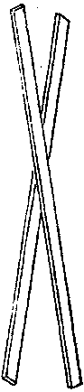



●针筒



见戒刀处。



世尊不听作象牙骨角针筩。缘见于僧祇律。



云门偃禅师录云。或云。佛法还有变易也无。代云。钵盂鞋履。拄杖针筒。　又云。纽半破三。针筒鼻孔里。道将一句来。代云。海里使风山上船。



续灯录天衣怀禅师章云。上堂云。须弥顶上。不扣金钟。毕钵岩中。无人聚会。山僧倒骑佛殿。诸人反著草鞋。朝游檀特。暮到罗浮。拄杖针筒。目家收取。



佛果击节录云。钦山将针线。行脚。到处与人做衣(详杂行门。把针处)。



●镜



资持记云。坐禅处。多悬明镜。以助心行(详灵像门。写照处)。



释氏要览云。僧祇云。若病差。若新剃头。若头面有疮。照无罪。若为好故照者。得越毘尼罪。



已下。畧录因缘。



传灯录。僧伽难提章云。一童子。持圆鉴。直造尊者前。师曰。汝手中者。当何所表。童曰。诸佛大圆鉴。内外无瑕翳。两人同得见。心眼皆相似。尊者受具戒讫。名伽耶舍多。



联灯会要仰山寂禅师章云。师住东平。沩山寄镜子一面。并书。至。师升堂。受书毕。提起镜子。示众云。大众且道。是沩山镜。是东平镜。若道是东平镜。又是沩山寄来。若道是沩山镜又在东平手里。若道得即留取。若道不得。即扑破去也。如是三说。众皆无对。师遂扑破。



●剃刀



敕修清规。沙弥得度云。戒师用净瓶灌顶。以指滴水於顶上。执刀剃头。



传灯录南院宝应和尚章云。思明和尚。未住西院时。到参。礼拜后白曰。别无好物人事。从许州。买得一口江西剃刀来献和尚师曰。汝从许州来。什麼处得江西剃刀。明把师手掐一下。师曰。侍者收取。明拂袖而去。师曰。阿剌剌。



●戒刀



敕修清规办道具云。僧史畧云。戒刀皆是道具。表断一切恶故。



僧史畧云。及持澡罐漉囊。锡杖戒刀。斧子针筒。此皆为道具也。



释氏要览云。戒刀。按律许蓄月头刀子。为割衣故。今比丘蓄刀名戒者。盖佛不许斫截一切草木。坏鬼神村故。草木尚戒。况其它也。



祖庭事苑云。戒刀根本杂事云。佛在室罗伐城。苾刍欲裁三衣。便以手裂。衣财损坏。佛言。可刀子裁。六众。便以杂宝饰之。加以太长。佛制不听。此是大刀。不是刀子。汝等应知。有三种刀子。谓大中小。大者可长六指。小者四指。二内名中。其状有二。一如鸟羽曲。二似鸡翎。不应尖直。



五分律云。诸比丘无刀。用竹芦片割衣衣坏。佛言。听畜割截物刀。诸比丘。便作大刀。贼来。得以害比丘。佛言。不听作大刀。犯者突吉罗。听长一指。一边作刃。以木作柄。除漆树。



梵网经十八物中。有刀子(见杨枝处)。　古迹记云。刀子割甲。



行事钞钵器制听篇云。毗尼母。听畜刀子。六种。一用割皮。剪甲。破疮。裁衣。割衣上毛缕。六用净果。乃至食时。种种须故。



希叟昙禅师广录。禅房十事。戒刀颂云。恶钳锤下飜身。未必锋芒发露。不惟斩得猫儿。也解杀佛杀祖。



●法瓶



旧说曰。布萨时所用瓶。名法瓶。乃盛香汤。及香水也。



又见滤水囊处。



●净瓶



敕修清规办道具云。净瓶。梵语捃稚迦。此云缾。



释氏要览云。净瓶。梵语军迟。此云瓶。常贮水随身。用以净手。寄归传云。军持有二。若甆瓦者。是净用。若铜铁者。是触用



忠曰。余曾问久修园宗觉律师曰。今律士。但携一瓶。未审是触是净。觉曰。一瓶贮净水。触净兼用。



义净受用三水要行法云。旧律十诵五十九云。有净澡罐。厕澡罐。四十一云。有净水瓶。常水瓶。又新译有部律文。净瓶触器极分明。此并金口亲言。非是人造。宁容唯一铜瓶。不分净触。虽同告语。不齿在心。岂可以习俗生常。故违圣教。



祖庭事苑云。净缾。四分律云。有比丘。遇无水处。水或有虫。渴杀。佛知制戒。令持触净二缾。以护命故。



传灯录沩山祐禅师章云。百丈召师入室。嘱云。吾化缘在此。沩山胜境汝当居之。嗣续吾宗广度后学。时华林闻之曰。某甲忝居上首。祐公何得住持。百丈云。若能对众。下得一语出格。当与住持。即指净瓶。问云。不得唤作净瓶。汝唤作什麼。华林云。不可唤作木𣔻也。百丈不肯。乃问师。师踢倒净瓶。百丈笑云。第一座。输却山子也。遂遣师往沩山。



●滤水囊



篇海类编云。滤良据切。音虑。漉去滓也。



敕修清规办道具云。滤水囊。增辉记云。为器虽小。其功甚大。为护生命故。中华僧。鲜有受持准律标示。根本百一羯磨云。水罗有五种。一方罗(用绢三尺。或二尺随时大小作。绢须细密。不透虫者。若用疎绢薄纱纻布者。无护生之意)。二法瓶(阴阳瓶也)。三军迟(以绢系口。以绳悬。沈於水待满引出)。四酌水罗。五衣角罗(言衣角者。非袈裟角也。但取密绢方一搩手或系瓶口或安钵盂中滤水用也)。慈觉大师赜公集经律。凡三十一偈。文多不录。末谓。世云。滤罗难安多众。宗赜。崇宁元年。於洪济院厨前井边。安大水槛。上近槛唇。别安小槛。穿角傍出。下安滤罗倾水之时。全无迸溢。亦乃大众沾足。浴院后架。倣此。僧行东司。亦皆滤水。出家之本道也。后住长芦。诸井滤水。二十餘处。常住若不滤水。罪归主执之人。普冀勉而行之。



行事钞二衣总别篇云。漉水袋法。物虽轻小。所为极大。出家慈济。厥意在此。萨婆多。凡用水法。应清净者。如法漉水。置一器中。足一日用。取上细㲲一肘作囊。令持戒审悉者。漉水竟。著净器中。向日谛视看。四分作漉水袋。如杓形。若三角。若作宏椁。不得无漉袋。行半由旬。无者。僧伽棃角漉。此国多用绢作者。余亲取已漉竟水。内黑色器中。微小细虫无数。后取致练作袋。漉之方尽。



已下。畧录事缘。



传灯录牛头智岩禅师章云。师姓华氏。弱冠智勇过人。身长七尺六寸。隋大业中。为郎将。常以弓挂一滤水囊。随行所至。汲用。累从大将征讨。频立战功。唐武德中。年四十。遂乞出家。



六学僧传。唐僧竭传云。竭每以复帛。为漉水囊。日漉水。投虫井中。井恒盈。未尝涸。世因以护生井。目之。



丹𫓪总录云。唐人白行简。以滤水罗赋。得名。其警句云。焦螟之生必全。有以小为贵者。江汉之流虽大。盖可一以贯之。灵一诗曰。滤泉侵月起。扫径避虫行。滤水盖僧家戒律有此。欲全水虫之命。故滤而后饮。今蜀中深山古寺。犹有此规白居易送文畅诗。山宿驯溪虎。江行滤水虫。



●手巾



忠曰。手巾二种。一随身携手者。一公界者。或在僧堂内。或在浴室内。或在后架。皆长丈二。挂之辘轳。令牵转。就其乾处拭用。



已下。录随身手巾。



梵网经十八物中。有手巾(详器物门。杨枝处)。



行事钞二衣总别篇云。又开钵囊。革屣囊。针筩。禅带。腰带。帽。拭脚巾。摄热巾。裹革屣巾等。及拭面巾。拭身巾。扪泪巾。



续灯录龙潭圆禅师章云。师辞汾阳。汾阳云。别无送路与子。一条拄杖。一条手巾。师云。手巾与和尚受用。拄杖不用得。昭云。但将去。有用处在。师便收。昭云又道不用。师喝一喝。便下去。昭云。已后不让临济。师云正令已行。(师嗣汾阳善昭)



事物纪原云。礼浴用二巾。上𫄨下绤。虽上下异用。而无异名。此三代之制也。汉王莽之斥逐王闳也。闳伏泣。元后亲以手巾拭之。於是始见手巾之目。其事虽出於三代。而制名。当自汉世也。



已下。录公界手巾。



大比丘三千威仪云。当用手巾有五事。一者当拭上下头。二者当用一头拭手。以一头拭面目。三者不得持拭鼻。四者以用拭腻污。当即浣之。五者不得拭身体。若澡浴。各当自有巾。(忠曰。若澡下。说随身巾。)



敕修清规大坐参云。圣僧侍者。牵堂内手巾辘轳。惊酣眠者。



日用轨范云。拭面不得争扯手巾。不得以巾拭头。用毕须摊挂。或焙火上。



永平道元和尚曰。手巾。一幅布。长一丈二尺也。不可白色。(已上僧堂巾。)



敕修清规知浴云。铺设浴室。挂手巾。出面盆拖鞋脚布。



日用轨范开浴云。公界手巾。系著衣后。净手拭之。以披五条也。(已上浴室巾。)



缁门警训登厕规式云。后架手巾。须多备三两条。频频洗换。莫令垢染。以污净手。人众处。五日一洗。人少处。十日一洗。(已上后架巾。)



忠少时闻古老说。谓行脚人。以手巾束腰。其巾取一幅布长丈二。一头竖折。横缝定其唇。若道路遇亡骸。则不空见过。便以巾缝首。纳亡人一脚。自骸背过肩。负之於己背上寻可瘗处。税下。葬之。讽诵而去。余按毛诗云。行有死人。尚有墐之(止此)。仁儒秉心。犹若是。况为度生大士乎。



●净巾



旧说曰。净巾。即手巾也。



日用轨范抽脱云。以净巾。搭左手。



●面盆



敕修清规水头云。手巾面盆。灯烛牙药。毋令缺少。



●枕子



日用轨范云。五更钟未鸣。轻轻擡身。先起将枕子。安脚下。未要拗。恐惊隣单。



祖庭事苑云。寄归传云。南海十岛。西国五天。并皆不用木枕。支头。神洲独有斯事。西方枕囊样式。其类相似。或取帛或布。染色随意。缝为直袋长一肘半。宽半肘。中间财者。随处所出。或可填毛。或盛麻缊。或蒲黄柳絮等。或决明麻豆。随时冷热。量意高下。斯乃取适安身。实无坚强之患。然为木枕疎硬。头下通风。致使时人。多苦头疼。既而软物除风。麻豆明目。且能有益。用实无爽。又为寒乡冻顶。多得伤风。冬月鼻流。斯其过也。今禅人。多畜木桥枕。盖便於行脚。收拾易然。故利时之用。亦不可革也。



法华文句记云。南山注经音云。西方无木枕。皆以赤皮。内著绵毛。用倚卧也。



灵源拾遗云。昔哲侍者。夜半不睡。以圆木为枕。小睡。时枕转。觉而后。安坐如故。



传灯录。仰山寂禅师章云。僧问。法身还解说法也无。师曰。我说不得。别有一人说得。曰说得底人。在什麼处。师推枕子。出。沩山闻云。寂子用剑刃上事。



●桥枕



忠曰。桥枕。日本名折枕者。其制两小板。内安细木柱。两头有机。令可开阖开则柱斜。撑起板一左一右任安头。折则小柱卧。填两板凹处太便于收藏。敕修清规大坐参中。再请禅云。更深住持出。闻首座开枕响。众方偃息(止此)。乃开枕。以备卧用也。



祖庭事苑说。见枕子处。



●扇



释氏要览云。西天多用。如阿含经云。阿难罗云皆执扇侍佛。优波离。结集律藏时。波斯匿王。与象牙装扇。令执诵律。古高僧慧荣。讲时。执扇。隋炀帝赐高僧敬脱。大竹扇濶三尺。入内讲经论。



大慧为如山主普说云。我老和尚(圆悟)。曾说。五祖师翁。每於盛暑中。常披袈裟。禅床上坐。更不使扇。先师便问。和尚何不使扇。祖云。儞理会不得。我是顺时保爱。因问其故。祖云。天地之气。既有四时。便有寒暑。既在寒暑中。须与他受些子。儞若逃寒畏暑。便是逆其时候了也。这个便是老僧。顺时保爱。



盐官齐安禅师索犀牛扇子。　见传灯录。



忠曰。中华所谓。扇多是团扇而已。如此方言扇。皆是折叠扇也。



春风堂随笔云。今世所用。折叠扇。亦名聚头扇。吾乡张东海先生。以为。贡於东夷。永乐间。始盛行於中国。予见南宋以来诗词。咏聚扇者。颇多。予收得杨妹子所写绢扇面折痕尚存。东坡谓高丽白松扇。展之广尺餘。合之止两指许。正今折扇。盖自北宋。以有之。倭人亦制为泥金面。鸟竹骨。充贡。出自东夷果然。



徐氏笔精云。国朝(大明)不用团扇。用折扇。



●头末红扇



忠曰。日本禅林兄弟者。所执金面中启扇子。上头绘深红云容。名言头末红扇子。



○已下系资身麤器。



●法盖



忠曰。法盖者。葫芦顶。绣罗三簷大伞。新住持入院。行者。执面覆之。



水浒传云。梁中书。出堦前。坐定交椅。左右祇候两行。唤打伞的。撑开那把。银葫芦顶。茶褐罗三簷凉伞。来。盖定。在梁中书背后。



忠曰。禅林法盖之制。正是也。



增壹阿含经云。世尊受须摩提女请。至满富城(广说乃至)。是时梵天王。在如来右。释提桓因。在如来左。手执拂。密迹金刚力士。在如来后。手执金刚杵。毘沙门天王。手执七宝之盖。处虗空中。在如来上。恐有尘土坌如来身。



忠曰。盖之用。在防尘秽。此文可为证。



释氏要览云。律云。跋难陀比丘。持大盖行(似今凉伞也)。诸居士遥见。谓是官人。皆避道。及近。元是比丘。乃讥嫌之。佛乃制戒。不应持大盖若天雨即听。



●凉伞



忠曰。日本禅林。长老者。行路。执伞覆之遮日。制小於法盖。以油纸造之。



餘冬序录云。按宋人私录。京城士人。旧通用青绢凉繖。大中祥符间。惟许亲王用之。餘并禁止。后又许中书枢密院。依旧用繖。



尧山堂外纪云。刘子仪(名筠)侍郎。三入翰林。希望大用。意颇不怿。赋诗云。蟠桃三窃成何味。上尽鼇山迹转孤。移疾不出。朝士问候者。继至询之。云虗热上攻。石中立在坐云。只消一服清凉散。意谓。两府始得用青凉伞也。



忠曰。僧家凉伞。有所拟也。



●笠



敕修清规入院云。古人腰包顶笠。到山门首。下笠入门。炷香。有法语。　又装包云。古者戴笠。笠内安经文。茶具之类。



释氏要览云。盖律有二种。一竹盖。二叶盖。寄归传云。西域僧。有持竹盖。或持伞者。梁高僧惠韶。遇有请。则自携杖笠也。今僧戴竹笠。椶笠乃竹盖之遗制。但去柄尔。今又加油绢於上。郎唐马周制。在席帽。以御雨。故效之也。



传灯录。金华山俱胝和尚章云。初住庵。有尼名实际。到庵。戴笠子。执锡绕师三帀云。道得即拈下笠子。三问。师皆无对。尼便去。后天龙和尚到庵。竖一指。师当下大悟。



●轿



字汇云。轿渠妙切。桥去声。肩行之车也。



品字笺云。轿肩舆也。汉淮南王安。谏击闽越。舆轿逾岭。注。今竹舆。严助传注。服虔曰。隘路车也。



容齐四笔云。汉书。淮南王安。谏武帝伐越书曰。舆轿而逾领。服虔曰。轿音桥。谓隘道舆车也。臣瓒曰。今竹舆车也。江表作竹舆以行。项昭曰。陵绝水曰轿音旗庙反。颜师古曰。服音瓒说。是也。项氏谬矣。此直言以轿过领耳。何云陵绝水乎。旗庙之音。无所依据。予谓。项音轿字是也。而云陵绝水则谬。



●蒲龛



希叟昙禅师广录。禅房十事。蒲龛颂云。百帀千重包裹。未免黑山里坐。古今多少生盲。引得全身入草。　蒲义。见蒲团处。



●温蒲



蒲龛。又言温蒲。



江湖集月庭忠和尚温蒲颂云。业履人亡肉未寒。满汀柔绿带春烟。全身入草重扶起。门掩昭州二十年。



●蒲团



忠曰。坐物以蒲编造。其形团圆。故言蒲团。和俗称眠单。为蒲团。大失义。



埤雅云。蒲水草也。似莞而褊。有脊。生於水厓。柔滑而温。可以为席。



永平清规辨道法云。晡时衩衣入堂。就单位。出蒲团而用坐禅。未展单矣。



忠曰。单。谓眠单。可知蒲团眠单二物也。



大慧杲禅师书。答曾侍郎云。公既与竹椅蒲团为侣。



希叟昙禅师广录。禅房十事蒲团颂云。百草头边荐得。何妨打块成团。直下千差坐断。无心犹隔重关。



联珠诗格注云。蒲团。僧房坐具。东坡诗。后夜当独来。不烦主与宾。蒲团坐纸帐。自要观我身。



●椸架



毘奈耶杂事云。缘在室罗伐城。苾刍。随处而安衣服。便多垢腻。被虫蚁穿。佛言。不应随处。而置衣服。当作衣架。苾刍即便穿壁安衣。令壁损坏。佛言不得穿壁。初造寺时。应出木坎。上置衣竿。时诸苾刍。房内置竿。簷前不作。佛言簷前亦作。勿令阙事。



正字通云。椸音移。衣架。曲礼男女不同椸架又方言榻前几。赵魏间。谓之椸。凡直植曰椸。横架曰桁。禅门规式云。僧堂设长连床。施椸架。挂搭道具(详丛轨门。挂搭处)。



●几案



详禅板处。



正字通云。案几属。



●经案



敕修清规游方参请云。古规。首到客司。相看。次往堂司挂搭。送单位。经案定。然后到侍司。通覆。诣方丈礼拜。



旧说曰。众寮案位。言经案葢众寮。是看经之处。故以名之。



●床



僧祇律云。佛住舍卫城。制戒。不听过量作床。(乃至)作床脚。应量作高修伽陀八指。(乃至)修伽陀者。如来应供正遍知。八指者。佛八指。



忠曰。飜译集曰。佛指濶二寸(止此)。即八指一尺六寸也。



●绳床



联灯会要百丈海禅师章云。师再参马大师。侍立次。大师目顾绳床角拂子。师云。即此用。离此用。祖云。汝向后开两片皮。将何为人。师取拂子竖起。祖云。即此用离此用。师挂拂子旧处。祖震威一喝。师直得。三日耳聋。



摩诃止观云。安一绳床。傍无餘座。



五车妙选云。杜诗。花影在绳床。注云。以绳穿为坐具。即今之交椅也。一云胡床。隋恶胡改名交床。唐改绳床。



事文类聚云。今之交床。制本自虏来。始名胡床。桓伊下马。踞胡床。取笛三弄。是也。隋以谶有胡。改名交床。胡瓜亦改黄瓜。唐柴绍击西戎。据胡床使两女子舞。则唐史臣。追本语以书也。唐穆宗长庆二年。十二月。见群臣礼。紫宸殿御大绳床。则又名绳床矣。



瑯邪代醉编云。古者席地而坐。未尝有椅。至晋乃有绳床。即今上马交床之类。此用椅之渐也。



●椅子



敕修清规告香云。铺设罣罳椅子(见罣罳处)。



琅邪代醉编云。古未有椅(详绳床处)。



正字通云。椅音倚。借高坐具。后有倚者。今俗呼椅子。



品字笺云。桌椅。桌几之高者。椅人所倚坐者。此后世之借用。非古音义。



椅子。又作倚子。　传灯录。罗汉琛禅师章云。玄沙尝问曰。三界唯心。汝作麼生会。师指倚子曰。和尚唤这个。作什麼。玄沙曰倚子。曰和尚不会三界唯心。玄沙曰。我唤这个作竹木。汝唤作什麼。曰桂琛亦唤作竹木。玄沙曰。尽大地觅一个会佛法底人。不可得。



●参椅



忠曰。参椅者。交椅也。脚木乂字交加。令可折叠。参亦交也。或云。学者参问时。师家坐此椅。故云参椅也。



敕修清规游方参请云。凡寝堂中。必设参椅。示尊师道也。



事物纪原云。搜神记曰。胡床。戎翟之器也。风俗通曰。汉灵帝好胡服。景师作胡床。此盖其始也。今交椅是。



三才图会。仪制类。有交椅。及椅踏图。



●竹椅



忠曰。以竹所造椅子也。



大慧杲禅师书答曾侍郎云。公既与竹椅蒲团为侣。不异善财见最寂静婆罗门。



●曲录



五祖演禅师录云。上堂云。行者不报来打鼓。曲录木头上。不免将错就错。参。



碧岩录。评龙牙参临济话云。他致个问端。不妨要见他曲录木床上老汉。亦要明自己一段大事。



普灯录应庵华禅师章云。虎丘忌日拈香曰。平生没兴撞著这无意智老和尚。做尽伎俩。凑泊不得。从此卸却干戈。随分著衣吃饭。二十年来。坐曲录木。悬羊头卖狗肉。知他有甚凭据。虽然。一年一度烧香日。千古令人恨转深。



虗堂愚和尚录示如足首座法语云。以平等大心。待四方衲子。方可据曲录床。



雪岩钦禅师录。普说云。凡遇五参。见曲录床上。个汉。胡说乱道。何不也历在耳根。



篇海类编云。录。卢谷切。音禄。刻木也。



正字通云。说文录别。为部。刻木篆篆也。象形。以篆形推之。与互别。旧本附互部非。



忠曰。曲录。盖刻木屈曲貌。今交椅制。曲录然。故异名曲录木。遂省木。单称曲录也。



又有作曲录者。依音同讹写。　碧岩录云。古人行脚。徧历丛林。直以此事为念。要辨他曲录木床上老和尚。具眼不具眼。



又有作曲𩓪者。亦依音同讹。　续灯录兴化仁岳章云。问如何是和尚家风。师云。曲𩓪。禅床。　又上方日益章。上堂云。五叶芬芳。千灯续燄。向曲𩓪木里唱二作三。(五灯会元作录)



晦庵光状元录云。行到汝州叶县。被一阵业风吹上。首山曲𩓪木床上。见个老和尚(云云)。



●曲木



忠曰。曲录木床也。



云门偃禅师录云。上堂云。诸方老秃奴。曲木禅床上坐地。求名求利。问佛答佛问祖答祖。屙屎送尿。也。三家村里老婆。传口令相似。识个什麼好恶。总似这般底。水也难消。



祖英集送胜因长老偈云。韶阳间出多慷慨。权要雄雄曾绝待。曲木据位知几何。利刀翦却令人爱。



●长连床



见椸架处。



传灯录香林远禅师章云问如何是玄。师曰。今日来明日去。如何是玄中玄。师曰。长连床上。



南海寄归传云。西方房迮。居人复多。卧起之后。床皆举摄。或内置一边或移安户外。床阔二肘。长四肘半褥席同然。　又云。西国。讲堂食堂之内元来不置大床多设木枮并小床子。听讲食时。用将踞坐。斯其本法矣。神州则大床方坐。其事久之。虽可随时设仪。而本末之源。须识。



●踏床



禅苑清规赴粥饭云。上床之法(云云)。提面前袈裟。次并以左手提之。即踏床近里而坐然后弃鞋。



保宁勇禅师录。上堂云森罗及万像。皆於镜中现。以杖指云。北面是厨库。南面是僧堂。中间是佛殿。直下指云。者里是什麼。乃云。踏床子。也不识。



大慧武库云。张无尽至兜率。语及宗门事。曰疑香严独脚颂。德山托钵因缘悦曰。既於此有疑。其餘安得无耶。只如言末后句。是有耶。是无耶。无尽曰。有。悦大笑。遂归方丈。闭却门。无尽一夜睡不稳。至五更下床。触飜蹋床。忽然省得。



忠曰。踏床。椅子前。承足小几也。又言脚凳。　竺原证道歌注举张无尽因缘云。至五更。起来。踏飜脚凳。忽然大悟。



踏床。律名承足床。　毘奈耶杂事云。缘在室罗伐城。佛言。应诵经者。可升高座。其人坐师子座。下埀双足。致有劳倦。佛言。应作承足床。苾刍不解。佛言。若座不移动。应以甎作。若移转者。可用版为。虽以版作。移举时难。可於四角各安铁镮。随意擎去。



僧祇律。作承足机。



●櫈子



忠曰。椅子前。承脚小几也。



大慧正法眼藏云。法眼指凳子云。识得凳子。周帀有餘。云门云。识得凳子天地悬殊。天衣云。识得凳子。梌楠木做。



僧宝传。华严隆禅师传云。乘侍者曰。禅门亲见石门。如何却嗣广慧隆曰。我初见广慧。渠方欲剃发。使我擎橙子来。广慧曰。道者我有橙子诗。听取。诗曰。放下便平稳。我时便肯伊(禅门恐禅师乎)。



正字通云。凳旧注。丁邓切。登去声。床凳正韵。橙几属。字林作凳。



品字笺云。高而可凭者。为几。为桌。低而可坐者。为椅。为凳。



三才图会云。机。櫈。皆胡床之别名。但机之制方。櫈之制修。皆后人以意为之者。



●卓凳



忠曰。卓前之凳子也。或卓。凳。二物也。



敕修清规亡僧云。或勤旧。有田地米糓。房舍床榻。卓凳。当尽归常住。



●脚凳



踏床也。见踏床处。



●脚踏



忠曰。凳子也。



备用清规。圣节升座云。住持上脚踏问讯。敛衣。趺坐。



○已下系行装具。



●祠部筒



敕修清规装包云。衣被。束前后包。插祠部筒戒刀。



禅苑清规。装包云。先插戒刀於右腋下。次插祠部筒於左腋下。祠部袋。用绦或带。络肩上更用绦带一条横系腰间。如未打后包以前。系挂定。倒飜起祠部筒。然后上为包。更是便。



旧说曰。自唐已来。度牒外。有祠部牒(见簿券门)牒以竹筒盛之。行脚人随身。



●复子



临济玄禅师录云。大策子上抄死老汉语。三重五重。复子裹。不教人见。道是玄旨。以为保重。



圆悟心要。示圆上人语云。刻意息心。择真正具顶门宗眼知识。放下复子。靠取成办。



联灯会要德山鉴禅师章云。师到沩山挟复子。於法堂。从西过东从东过西。顾视方丈。沩山不顾。师云无无便出去。



忠曰。复当作袱。字汇云。袱房六切。音伏。包袱(止此)。又云复方六切。音幅重也。说文重衣也(止此)。非今义(盖)。二字音同。袱字讹作复也。敕修清规装包云。装包之法。用青布袱二条(止此)布袱即复子也。



○已下系饮食器。



●钵



玄应众经音义云。钵盂。补沫切。钵多罗。又云波多罗。此云薄。谓治厚物令薄。而作此器也。钵亦近。字下羽俱切。又说文云。饭器也。又律文作釪。



敕修清规办道具云。梵云钵多罗。此云应量器。今略云钵。又呼云钵盂。即华梵兼名。佛本行集经云。北天竺。有二商主。一名帝利富婆。二名跋利迦。奉世尊。𪎊酪蜜揣。世尊。思惟。往昔诸佛。悉皆受持钵器。我今当以何器。受商主食时四天王。疾共持四金钵。奉上。世尊不受。以出家人。不合蓄此。彼四天王。更将四银钵。玻𭹳钵。瑠璃钵。赤珠钵。玛瑙钵。𤥭璖钵。奉上。悉皆不受。时北方毗沙门天王。告三天王言。我念往昔。青色诸天将四石器来。奉我等。可用受食。时别有一天子。名毗卢遮那。白言。仁等慎勿於此石器受食。但供养如塔。当有如来号释迦牟尼出世。宜将此四石钵奉彼如来。时四天王。共将四石钵奉佛。世尊念。四天王。以信净心奉我四钵。若我於一人边受。餘各有恨。我今总受四钵。持作一钵。次第相重。安置左手。右手按下。合成一钵。外有四唇。而说偈言。我昔功德诸果满。以发哀愍清净心是故今四大天王。清净牢固施我钵。



胜天王般若经云。或有众生。见此菩萨。今始成道。或见菩萨。久远成道或见一世界四天王。献钵。或见十方恒河沙世界。四天王献钵。菩萨尔时。度众生故即受众钵。重叠掌中。合而为一。其诸天王。各不相见皆谓。世尊独用我钵菩萨摩诃萨。行般若波罗蜜。以方便力。示现此事。



忠曰。三世佛法。得道时。皆四天王。上自然石钵见大智度论。



六物图云。梵云钵多罗。此名应器。有云。体色量三皆应法故。若准章服仪云。堪受供者。用之名应器。故如。钵是梵言。此方语简。省下二字明体者律云。大要有二。泥及铁也。五分律中。用木钵。犯偷兰罪。僧祇云。是外道标故。又受垢腻故。祖师云。今世中。有夹纻漆油等钵。并是非法。义须毁。明色者。四分应熏作黑色赤色。僧祇熏作孔雀咽色。鸽色者。如法。善见铁钵五熏。土钵二熏。律中听作熏钵炉等(此间多用竹烟色则易上)。明量者。四分中。大钵受三斗(姬周三斗。即今唐斗。一斗)。小者受斗半(即今五升)。中品可知(大小之间)。



宗觉律师纂注云。此方古德传说。昔者南京有唐朝升。以日本弘安年中。所定升。计之。唐一升。即弘安六合五勺。仍量下品五升。正得参升贰合五勺。以弘安壹升。校今宽永年中。所定升。正是七合。即弘安参升贰合五勺。当宽永贰升贰合七勺五撮也。今时行事家。为深防故。更增贰勺五撮。而以贰升参合。为下品钵量。加受之。



行事钞钵器制听篇云。四分大钵受三斗。小者受斗半。中品可知。此斗升不定。此律姚秦时译。彼国用姬周之斗(此斗通国准用。一定不改量法俗算有八。圭。抄。撮。勺。合。升。斗。斛。谓因增法名也)。准唐斗。上钵受一斗。下者五升。　资持记注指俗法者。孙子筭经。十粟为圭。十圭为抄。十抄为撮。十撮为勺。十勺为合。十合为升。十升为斗。十斗为斛。相因增法示可准据(云云)。唐朝杂令。用姬周三斗。为一斗。今此俗中。例用唐斗。宜准为量。



毘尼母论。说钵中云。齐量应者。升半已上。至二升半。是名应。不应者。不满升半。过二升半。是名不应。希叟昙禅师广录禅房十事。钵盂颂云。做处全无渗漏用时开口向天。尽大地人饫饱。只图个不知恩。



缁门警训载。大智律师铁钵赋云。吾有铁钵。裁制合辙斗半为量。不大不小。竹烟熏治。唯光唯洁。似二分之明珠。若将圆之皎月。清晨入聚。群心发越。黄粢倾散。有若金沙白淅高堆。宛如积雪。与香积之变现无殊。比自然之天供。何别。咨尔同舟。宜自櫽括不耕不耘。不锄不割。有生之命。自何而活。且夫口腹无厌。贪源叵竭。正念微乖。罗刹已夺。嗜一时之甘美。为万劫之饥渴。万金可受。保君未彻。杯水难堪。圣教明说。是宜五观无违。三匙有节。慎勿枉彼信施。以养秽躯。会须藉此资缘。早求自脱。



已下。录禅律辨难。



虎关济北集木钵辩云。或问禅家持木钵。律辈多生谤。如何。答曰。禅门古德。知佛意。故不忌木钵耳。曰佛意如何。曰佛制木钵。有三意一垢。二简。三因。其垢者。木钵用已。洗濯垢秽不除。木之性尔也。盖印度俗。王臣贵族。用金玉宝器贱庶之者。多用木器之不漆者。沙门法。弃宝器。若用不漆木器。垢不除。故薰瓦铁二钵。而用耳。虽瓦铁。不薰有垢。薰即无垢。木钵。不堪薰。故制焉。其简者。天竺梵志种。古来用木器。如来后出。为异也。故立瓦铁而为简也。其因者。佛在王舍城时。树提居士客。从海还持栴檀段。与之。居士作檀钵。置高杙上。作是言。沙门婆罗门。不以梯杖能得者取。时富楼那迦叶。尼犍陀等。诸外道。挑头皆去。宾头卢尊者。现神足取钵。便示诸比丘言。汝等看。是钵可爱。佛种种呵责。云。何一木钵故。现过人法。汝不应此阎浮提住宾头卢自此到瞿耶尼。起僧坊。畜弟子。宣佛法佛集比丘语。从今不听畜八种钵。金银琉璃。摩尼铜。白蜡木。石畜者突吉罗。听二种铁。瓦钵。是知佛制宝物。不必在木。以檀钵宝木并制众木也。佛意。若嫌八种钵自钵何用石耶。明知制戒皆有事因。不啻木钵。矣唐朝禅门古德。以谓。支那无梵志种。不必欲简异木漆器。易洗无垢。亦非檀钵三种制意。支那不干。况随方毘尼。何有拘忌。支那本朝。木钵贱於铁钵矣言。其易辨而非宝者木钵胜於铁钵矣然此三义。且就三藏小教而言。大乘方广不必尔也。文殊师利根本仪轨经。第十曰。若是瓦钵。洗已薰乾。其餘木钵金银等钵。洗净无垢。即得受用又苏婆呼童子经上曰。复次童子。念诵人须持四种应器。木铁瓦匏等钵。极须团圆细密无缺。勿使破漏以此等而言。菩萨比丘。大乘正业。不必拘三藏偏轨也禅门古德。不谩立规矣。梵网经云。袈裟皆使坏色。一切国人。所著衣服比丘皆应与其俗服有异。是亦如来简异之意也。非独钵也。服已无定色。钵何拘木乎。是以禅家持木钵知佛意故耳矣。



忠曰。大智海(无为元公)。辨木钵援苏婆呼经早在虎关前义堂日工集云。前代律家难禅宗木钵曰。是外道制也。时有东福无为和尚。称博洽。答曰。大藏中有苏婆呼童子经。听比丘蓄铁木瓦匏四钵。今检极乐寺藏中。有此经尔后虎关和尚作木钵辩。其谤遂止。余闻净智芳庭和尚说云。近久修园院律师宗觉。覆破木钵辨云。支那无梵志种不必欲简异矣。此言不然既为简异外俗也支那本朝。俱用木漆器是方土风俗。今欲异於此者。何奚可畜木钵乎。



忠曰。觉之辩爽矣。夫世尊之简异者。材兼形也。支那日本之俗。虽通用木器材。然未曾用其如佛制应器形者。汝若言不取形。唯取材者。彼章服田衣。岂非亦为简俗耶。俗服用布材绵材。而佛徒。亦著绵材布材。则何以为简异哉但其简异。在田相。与非田相而已。



觉又云。虎关引二经为凭据然此经中。唯是说持真言行者律仪。则非出家之五众通制。是则密乘不共之教典自非修瑜伽者。孰敢依行。



忠曰。吁觉公何不见虎关能别语。曰禅家持木钵知佛意故(止此)。是以禅家语。拣於汝也。又谁言汝律家。自今当辍瓦铁。而从吾木钵耶。世尊既听於修瑜伽者。夫到禅家专业。见性者。则剧於修瑜伽律拘言迹禅知佛意。复次世尊。岂教修密者。用不应律仪之器耶。此是佛之密意。固非博地容测矣。已二经听木钵。而餘小乘律。不听。则济北曰舍小乘偏轨。有何咎。



觉又云。汝若弃舍三藏。别求菩萨具足律仪。请问何者是耶。



忠曰。噫嘻觉乎我指桃。则汝骂李。又谁言大乘行者。详细行事。当舍小乘律仪。而别求之耶。正今所论木钵耳。谓须(丙)舍三藏制木钵者而依大乘听木钵者则济北所援二经。是也。又觉鼓怒於三藏偏轨之言。广明大小通戒之义。予别有辨。今不与木钵。故不繁于此。



忠曰。传说东福开山兴法之日。泉涌寺差一僧。到慧峰诘曰。禅家用木钵。何违佛制请闻其说。一众相顾。以为难酬。遂欲告圣一。时维那者。出众曰。者般不足烦国师唇吻。即对使曰。汝须回言东福维那。聊答来问禅家。十二时。以此事为念有。何闲工夫到噇合子边。使回反命。闻者以为得体。忠谓。鸡胤部。引颂云。随宜覆身。随宜处住随宜饮食疾断烦恼。有三衣覆身。佛亦开许无三衣覆身。佛亦许之。僧伽蓝内住佛亦开许。界外亦许。时食佛随许。非时午前食。佛亦许故衣处食。皆名随宜。唯言疾断烦恼(止此)准此。教律家。若专证净。则瓦铁木钵。应许随宜。矧破相者耶或徒人我是非。忘本竞末。则恐扶律教主。不以儞餤乎瓦铁为善住威仪焉。



忠又曰。济北和尚。辨木钵。太有条理。唯其言佛意若嫌八种钵自钵何用石耶(止此)。者失辞。夫佛自用石钵而不听弟子畜石钵。在大智度论问难决择焉。济北适遗之乎。



又四分律云。瓶沙王。以石钵施诸比丘比丘白佛佛言不应畜此是如来法钵。若畜得偷兰遮。又五分律云若畜金银。七宝牙铜石钵。皆突吉罗若畜木钵偷罗遮。



已下。辨无底。



云门偃禅师录云。师因吃茶次。云茶作麼生滋味。僧云。请和尚鉴师云。钵盂无底。寻常事。面上无鼻笑杀人。



智门祚禅师录云。问如何是无底钵盂。师云。挂向壁上进云未审将何斋粥师云。瓦椀竹筯。



普灯录冶父川禅师章云。上堂曰。群阴剥尽一阳生。草木园林尽发萌。唯有衲僧无底钵依前盛饭又盛羹。



忠曰律家钵无足云无底(禅语所谓无底钵者底脱不可盛物也与律家无底义别)。章服仪云。袈裟无领。标解脱之衣钵盂无底表难量之器。　应法记云。相传。是庐山远师语。合云袈裟无领。非朝宗之服。钵盂无足。非廊庙之器。今又易之难量谓无尽也(止此)。可知钵制。本无底。今时禅家之钵。多上濶下窄。而有环足。甚非法。好古之士。宜复其正矣(更钵支处详辨)。



梁高僧传庐山慧远传云。远答桓玄书曰。袈裟非朝宗之服。钵盂非廊庙之器。沙门尘外之人。不应致敬王者。



○传无无领无足之字。



●应量器



钵多罗飜应器详钵处。



行事钞钵器制听篇资持记云。准下加法。云应量受。则是应量之器。对法为名。　又云。言应量者。明合法也。体色少滥。品量多乖。故特标之。



忠曰。应义三。一对法(如此引)。二对人(钵处。引章服仪)。三对食。　资持记云。或处说云。量腹而食。故云应器。即对食为名。



●头钵



忠曰应量器。又名头钵。



日用轨范云。不得将头钵盛湿食。



●头𫔁



第一𫔁子。曰头𫔁。十诵名半钵。四分名次钵(详𫔁子处)。



日用轨范云。钵刷安第二𫔁子缝中。



旧说曰。第一𫔁子。称头𫔁盛羹者。三个𫔁中。最大。故名头𫔁今以刷。安头𫔁。与第二𫔁之间也。



●𫔁子



忠曰。应量器内。累三个小钵。自大到小。总名𫔁子。世尊成道。受四天王四钵。重作一钵。外有四唇(见钵处)。今𫔁子三。与应器重成四唇。盖本世尊故事。



五分律音释云犍瓷。梵语也。此云浅铁钵。今之𫔁子也。犍渠焉切。瓷。音茨。𫔁音训。



释氏要览云。钵器。大小数。十诵律云。钵。半钵。大键𨩲(键音虔。𨩲音咨。经音疏云。钵中之小钵。助钵用故)。小键𨩲(僧祇同)。四分律云。键𨩲入小钵。小钵。入次钵次钵入大钵(此律言小钵即十诵大键𨩲也。次钵即半钵也。淮诸律四事可见也。今呼为𫔁子𫔁音训。切韵云。铁类也。非器故)。



五分律云。诸比丘。於钵中歠粥。苦热不可捉。佛言听别作歠粥器。



忠曰。如今粥受𫔁子而歠。盖当歠粥别器。



子湖神力禅师录云。问法身还吃饭也无。师云。钵盂𫔁子。什麼人受持(云云)。



广灯录。洞山聪禅师章云。僧问。学人进又不得。退又不得时如何。师云。抱头哭苍天。学人无语。师又云。汝还知钵盂𫔁子落处麼。



续灯录慈明圆禅师章。上堂云。钵盂麤𫔁子细(字脱)匙筯短长无一截。　注𫔁许运切。



飜译名义集云。键𨩲。经音疏云。钵中之小钵。今呼为𫔁(音训)子。



康熙字典云。𫔁唐韵。火运切。集韵。吁运切。竝音训。说文铁属。又集韵逋昆切。音奔。平木器。



●键𨩲



忠曰。大键𨩲。即第二。𫔁子。小键𨩲。第三𫔁子(见𫔁子处)。



杂阿含经云。譬如一器有一处人。名为揵茨。有名钵。有名匕匕罗。有名遮留。有名毗悉多。有名婆阇那。有名萨牢。如彼彼所知。我亦如是说。



音释云。揵茨。梵语。亦云键𨩲。母论译为浅铁钵。今呼为𫔁子。是也。揵。巨言切。茨。才资切。



四分律云。欲分粥。不知何器分。佛言。若以键𨩲。若小钵。若次钵。若杓作分。



又四分律云。乞食比丘。得饭乾饭𪎊等。并著一处。佛言。不应尔杂著一处。若是一钵。应以物隔。若树叶皮。若键𨩲。若次钵。若小钵。𪎊应手巾裹。



出要律仪云。键𨩲者。为助食器。



毗柰耶云。键𨩲者。浅铁钵也。



飜译名义集云。键𨩲。音虔咨。母论译为浅铁钵。或作揵茨。建镃。并梵音轻重。



●钵支



四分律云。钵若不正。应作钵支。



五分律云。比丘。以钵盛食。著地翻之。佛言。听作钵支。用铜铁牙角瓦石竹木。除漆树。乃至结草著下。亦听。



又作钵枝。　十诵律云。钵枝法者。佛听用𨱎石铜铁锡白镴瓦作。应好掌护。莫令失。更求觅。妨行道。是名钵枝法。



又作钵鈙。　僧祇律云。杂物者。钵。钵鈙。匙。腰带。刀子(等)。



盖钵支也。然字书不通支。　集韵鈙。语绮切。音螘。玉篇釜也。



又作钵搘。　传灯录卫国道禅师章云。师因疾。有人来问疾。师不出。其人云。久聆和尚道德。忽承法体违和。请和尚相见。师将钵𫔁盛钵搘。令侍者擎出呈之。其人无对。



忠曰。近来禅家钵。上濶下窄。底平有浅环足。本不倾动。又加以钵支。已为无用。余窃推之。古制。下圆而无底。别有钵支。停其转动。后以钵支形。直贴钵底而造(今犹有直贴钵支造。即於钵支唇处少轮起。而象钵支者)。若如今制。则钵支。已贴本钵。不用更造钵支。承本钵。展转讹谬有如此者。



●楪



日本禅家。称钵支为楪。



云门偃禅师录云。师拈一楪果子。与一僧。其僧接得便去。



事始云。崔宁女。以金盏无储。病其熨指。取楪子承盛之。(详托子处)



●钵单



日用轨范云。先展钵单。仰左手。取钵。安单上。



忠曰。钵单之制。柿汁累合厚纸造之。横折三之一。更竖三折。如乙字。展铺。以承𫔁子。展时。埀短折方。在床外。



●匙



南海寄归传云。西方食法。唯用右手。必有病故。开听畜匙。其筯则五天所不闻。四部亦未见而独东夏共有斯事。俗徒自是旧法。僧侣随情用否。筯既不听不遮。即是当乎略教。用时众无讥议。东夏即可行焉。若执。俗有嗤嫌。西土元不合捉。略教之旨。斯其事焉。



西域记云。食以一器。众味相调。手指斟酌。略无匙箸至於老病乃用铜匙。



永平清规赴粥饭法云。遐寻西天竺之佛仪。如来及如来弟子。右手抟饭而食。未用匙筯佛子须知矣。诸天子。及转轮圣王。诸国王等。亦用手抟饭而食。当知是尊贵之法也。西天竺。病比丘用匙。其餘皆用手矣。筯未闻名。未见形矣。筯者。偏震旦以来。诸国见用而已。今用之。顺土风方俗矣。既为佛祖之儿孙。虽应顺佛仪。而用手以饭。其仪久废。无师温故。所以暂用匙筯。兼用𫔁子矣。



事物纪原云。方言曰。匕谓之匙说文曰。匕所以取饭。文王之賛易。至震曰。不丧匕鬯。大东之诗曰。有捄棘匕。注云。匕所以载鼎实则匕三王之制也。



已下。录手抟食支竺法。



五分律云。诸比丘。以食手。捉净饮器肥腻污秽。餘比丘。恶之。佛诃责告诸比丘。食时不应以右手捉净饮器。应净洗手捉饮器。



忠曰。可知右手抟食。故有肥腻。



行事钞讣请设则篇云。僧祇。食时应护右手。当以左手受。　资持记云。彼国用手抟食。此土饼果。亦多用手。



礼记曲礼云。共饭不泽手。　注。为汗手不絜也。泽谓捼莎也。礼饭以手(正义。曰。絜净也。若泽手。手必汗生。则不絜净一本汗生不圭。圭絜也。言手泽污饭也)。疏。共饭不泽手者。亦是共器盛饭也。泽谓光泽也。古之礼。饭不用箸。但用手。既与人共饭。手宜絜净。不得临食。始捼莎手。乃食恐为人秽也。



●筯



与匙交看。



篇海类编云。筯治据切。与箸同。



事物纪原云。礼记曰。饭黍无以箸。韩子曰。纣为象箸观之。明箸前有。商纣始以象为之耳。



筯净头　入众日用云。入则先匙出则先筯。手把处为净头。向上肩。



●匙筯袋



日用轨范云。钵拭。折令小。并匙筯袋近身。横放。入则先匙。出则先筯。



●匙筯笼



匙筯袋。又名匙筯笼。



拈八方珠玉集云。佛海云。虽则匙筯笼横。且图得盌饭吃。



普灯录卍庵颜禅师章。上堂云。粥足饭足。俯仰随时。筯笼不乱搀匙老鼠不𫜪甑箅。山家活计。淡薄长情。



●钵刷



日用轨范云。钵刷。安第二𫔁子缝中。出半寸许。盛生饭。



小补韵会云。刷所劣切。说文刮也。尔雅清也。



忠曰。刷者。小板。一头圆形。漆髹。刷清钵内粒粘之器。



●杨枝



忠曰。十八物之一也。



梵网经云。若佛子。常应二时头陁。冬夏坐禅。结夏安居。常用杨枝。澡豆三衣。瓶。钵。坐具。锡杖。香炉。漉水囊。手巾。刀子。火燧。镊子。绳床。经律。佛像菩萨形像。而菩萨行头陁时。及游方时。行来百里千里此十八种物。常随其身。头陁者。从正月十五日。至三月十五日。八月十五日。至十月十五日。是二时中。此十八种物。常随其身。如鸟二翼。



华严经普贤行愿品。甘露火(唐经作无厌足)章云。嚼杨枝具功德者。一销宿食。二除痰癊三解众毒。四去齿垢。五发口香。六能明目。七泽润咽喉。八唇无皴裂。九增益声气。十食不爽味。晨朝食后。皆嚼杨枝。诸苦辛物。以为齿木。细心用之。具如是德。



永平道元禅师曰。嚼杨枝。先右手。取杨枝。咒愿。可诵华严净行品偈云。手执杨枝。当愿众生。心得正法。自然清净。及嚼。复诵偈云。晨嚼杨枝。当愿众生。得调伏牙。噬诸烦恼。杨枝长四指。或八指。十二指。或十六指。摩诃僧祇律云。齿木应量用。极长十六指。极短四指。大如手小指。或更细无妨。形如手小指。一头麤一头纤。古云。如如来指形。嚼其麤头。令如缕。须揩磨齿表里。



诸经要集云。十诵律云。佛言。嚼杨枝。有五利益。一口不苦。二口不臭。三除风。四除热病。五除痰癊。复有五事利益。一除风。二除热。三别味。四能食。五眼明。三千威仪云。用杨枝有五事。一断。当如度。二破。当如法。三嚼头。不得过三分。四梳齿。当中三齿。五当汁澡自用。刮舌有五事。一不得过三反。二舌上血出当止。三不得大振手。污僧伽梨若足。四弃杨枝。莫当人道。五当著屏处。



十诵律云。佛听啮木。三种枝。上中下。上者尺二寸。下者六寸。餘者是中。是名齿木枝法。擿齿法者。不应用利物擿齿不应强擿不应破龂。是名擿齿法。刮舌法者。不应用利物刮。令伤舌。是名刮舌法。



南海寄归传云。每日旦朝。须嚼齿木。揩齿刮舌。务令如法。盥漱清净。方行敬礼。若其不然。受礼礼他。悉皆得罪。其齿木者。梵云惮哆家瑟𫍡。惮多。译之为齿。家瑟诧。即是其木。长十二指。短不减八指。大如小指。一头缓须熟嚼。良久净刷牙关若也逼近尊人宜将左手掩口用罢擘破。屈而刮舌。或可别用铜铁。作刮舌之篦。或取竹木薄片。如小指面许。一头纤细。以剔龂牙。屈而刮舌。勿令伤损。亦既用罢。即可俱洗弃之屏处。凡弃齿木。若口中吐水。及以洟唾。皆须弹指经三。或时謦欬过两。如不尔者。弃便有罪。　又云。少壮者。任取嚼之。耆宿者。乃推头使碎。其木条以苦涩辛辣者为佳嚼头成絮者。为最。麤胡葈根。极为精也(即苍耳。并截耳。入地二寸)。坚齿口香。消食去癊。用之半月。口气顿除。牙疼齿惫。三旬即愈。要须熟嚼净揩。令涎癊流出。多水净漱斯其法也。次后。若能鼻中饮水一抄。此是龙树长年之术。必其鼻中不惯。口饮亦佳。久而用之。便少疾病。　又云。齿木。名作杨枝。西国柳树全稀译者辄传斯号。佛齿木树。实非杨柳。那烂陁寺。目自亲观。既不取信於他。闻者亦无劳致惑。检涅槃经梵本。云嚼齿木时矣。



释氏要览云。嚼杨枝。僧祇律名齿木。嚼一头碎。用剔刷牙齿中滞食。若口有热气。及生疮。应嚼杨枝咽汁。百一羯磨云。嚼杨枝。须在屏处。不得显露。及往还洁净处。或弃齿木。先以水洗。乃謦欬。戒弹指。警觉方可弃於屏处。若其异者。得越法罪。



●钵拭



钵巾也。



日用轨范云。钵拭。折令小。并匙筯袋。近身横放。



永平清规赴粥饭法云。钵拭长壹尺贰寸。　注。布一幅也。



●钵袱



日用轨范云。展钵之法。想念偈。然后解袱帕。展净巾覆膝。帕折转三角莫令出单外。



●盖膝巾



日用轨范吃食法云。不得先收盖膝巾。不得以膝巾拭汗



●净巾



盖膝巾。亦名净巾。



日用轨范展钵法云。展净巾覆膝。



●钵囊



毘奈耶杂事云。佛在江猪山施鹿林中。时有苾刍。手擎钵去。在路脚跌。钵堕遂破。因斯阙事。以缘白佛。佛言。苾刍不应手擎其钵。便以衣角。裹钵而去。废阙同前。佛言。应作钵袋盛去。苾刍手携。招过如上。佛言不应手持而去。应可作襷。挂膊持行。若异此者。得越法罪。(音释襷。普患切。衣系也。膊伯各切。肩膊也。)



又毘奈耶杂事云钵袋襻。应阔作内安㲲。以线络之。勿令卷缩。



又毘奈耶杂事云。佛言。乞食。应持钵络。掩盖而去应作方尺布袋提上两角置钵在中。角施短襻。将行乞食。得遮尘土。复易擎持。　注神州。比来无此钵袋。下留尖角钵不动摇不同平巾转动流溢作时。应取布小尺二尺宜使正方。傍边剪却衣横襻。用时极理安稳也。



四分律云。手捉钵。难护持。佛言。听作钵囊盛。不系囊口钵出。佛言。应系。手捉钵囊护持。佛言。应作带络肩。



十诵律云。佛言。从今行时。不听捉杖络囊犯者突吉罗。佛自恣后。人间游行。有一羸瘦比丘。手捉钵行。佛知故问。汝何以手捉钵行。答言。无物可盛。佛言从今羸瘦老病比丘僧羯磨听捉杖络囊盛钵行。



碧岩录云。或若有个汉。信得及。把得住。不受人瞒。祖佛言教。是什麼热碗鸣声。便请。高挂钵囊。拗折柱杖管取一员无事道人。有一般汉受人商量。祖佛言教。如龙得水。似虎靠山。却须挑起钵囊。横担柱杖。亦是一员无事道人。



●椀



敕修清规。库司四节。特为首座大众汤云。头首不下钵库司备碗楪。



忠曰。碗字。韵书不出。盖俗讹。



正字通云。椀与盌同。　又云。盌乌卷切。剜上声。说文小盂。俗作椀。



沩山警策云。椀钵作声。食毕先起。去就乖角。僧体全无。



禅林宝训云。雪堂曰。高庵住云居用姪为监寺。用姪处己虽俭。与人甚丰。丛林有用大碗之称。



忠曰。盖饷人。以大碗无其悋食之意也。



●楪子



忠曰。日本禅林椀具。有楪子。与钵支称楪者别。



敕修清规云。库司备椀楪(见椀处)。



文公家礼祭器。有椀楪子。



忠曰。楪字。韵书无器皿训。於演繁露。初得解。



程大昌演繁露云。酉阳杂爼刘录事。食鲙数叠。今俗书楪字。误以其可叠。故名为叠也。然牒字乃叠札为之则以叠为楪。亦有理也。



忠曰。楪子。浅而底平。环足。便于累叠也。



周祈名义考云。今俗言楪。以代笾豆也。楪本无此字俗书也。



碧岩录云。椀子落地。楪子成七八片。



联灯会要。睦州陈尊宿章云。示众云裂开也在我。捏聚也在我。时有僧问如何是裂开。师云。三九二十七。菩提涅槃。真如解脱。即心即佛。我且与麼道。汝又作麼生。僧云。某甲不恁麼。师云。盏子落地。楪子成七片。



朝野佥载云。娄师德。有乡人姓娄者。为屯官。犯赃。师德切责之曰。汝辞父娘。求觅官职。不能谨洁。知复柰何。将一楪锤饼。与之曰。噇却作个饱死鬼去。



●饭桌



敕修清规。方丈管待新旧两序云。烧香侍者。与请客侍者。巡揖坐毕。烧香进卓。侍者一班。列住持前。问讯入位。行汤下食毕。至行饭时。烧香侍者。离位烧香。下𫎪饭毕退卓。鸣鼓讲茶礼。



忠曰。当作桌。韵书卓注。无器物训。



正字通云。桌竹角切。音卓。俗呼几案。曰桌



四分律云。佛言。若为和尚阿阇黎。有所取与。听用铜槃。若案。若机。饮食所须之物。尽持置其上。一时授与。



五分律云。诸比丘。擎食患重。佛言。听安机。



忠曰。机盖今饭桌也。



●果桌



忠曰。安果𩝐之几也。



联灯会要。洞山价禅师章云。师与泰首座。吃果子次。师问。有一物。上拄天下拄地。黑如漆。常在动用中。动用中收不得。儞道。过在甚麼处。泰云。过在动用中。师便喝。掇却果卓。



●和桌



忠曰。和国样之桌子也。排椀楪之案。日本俗呼曰膳。大德寺。此称和桌。



●汤瓶



忠曰。铜瓶盛滚汤。以为点茶点汤之用。



敕修清规专使特为新命煎点云。行茶徧。瓶出。如前问讯。收住持盏。　又新挂搭人。点入寮茶云。行茶遍。瓶须从穿堂入。



文公家礼云。执事者。执汤瓶。随之点茶(详饮啖门。点茶处)。



●茶筅



字汇云。筅同箲。箲苏典切。音尠。箲箒。饭具。



正字通。为筅与箲别(止此)。然则筅俗用。正作箲。



文公家礼云。茶筅之制。不见於书传。惟元谢宗可有咏茶筅诗。味其所谓。此君一节莹无瑕。夜听松风漱玉华。万缕引风归蟹眼。半瓶飞雪起龙牙之句。则其形状。亦可彷佛见矣。或谓茶筅。即蔡氏茶录所谓茶匙。非是。



陆羽茶经有茶具十六事。其中有归洁。注云。竹筅箒也。



宋徽宗大观茶论云。茶筅。以觔竹老者。为之。身欲厚重。筅欲疎劲。本欲壮。而末必眇。当如剑瘠之状。盖身厚重。则操之有力。而易于运用。筅疎劲。如剑瘠。则击拂虽过。而浮沫不生。



渔隐丛话云。韩子苍。谢人寄茶筅子诗云。看君眉宇真龙种。犹解横身战雪涛。卢骏元亦有此诗云。到底此君高韵在。清风两腋为渠生。皆善赋咏者。然卢优於韩。



●建盏



忠曰。中华建安所造茶盏。此方学制者。皆亦名建盏。



宋蔡襄茶录云。茶色白。宜黑盏。建安所造者。绀黑。纹如兔毫。其柸微厚。熁之。久热难冷。最为要用。出他处者。或薄或色紫。皆不及也。其青白盏。鬬试自不用。



约翁俭禅师录。次西涧和尚。谢太守惠建盏韵颂云。提起玻𭹳已再三。分明埀钓在深潭。舌头若具通方眼。一啜方回苦口甘。



●空盏



旧说曰。不盛茶汤之盏。曰空盏。非器通名。



敕修清规大挂搭归堂云。寮主相接入门。对触礼一拜。叙寒温毕。分手坐。献空盏。



●托子



忠曰。托子。承茶盌器也。



李济翁资暇录云。茶托子。始建中。蜀相崔宁之女。以茶杯无衬。病其熨指。取楪子承之。既啜而杯倾。乃以蜡。环楪子之央。其杯遂定。即命匠。以漆环代蜡。进於蜀相。蜀相奇之。为制名。而话於宾亲。人人为便。用於代。是后传者。更环其底。愈新其制。以至百状焉(贞元初。青郓油禬为荷叶形以衬茶椀别为一家之楪今人多云托子始此。非也。蜀相。即今升平崔家。讯则知矣)。



吕毖事物初略云。唐德宗建初中。崔宁之女。以金盏啜茶。盏热。痛其指。乃取楪子。承其盏。既啜而倾。又以蜡环楪子中坐之。盏遂定稳。不摇。因遣匠者以漆环易蜡。宁奇之。乃制为托子。以行于世。此托子之始也。



托子。亦作橐子(盖假字非正)。　联灯会要松山和尚章云。师与庞居士吃茶次。士拈起橐子云。人人尽有分。因甚麼道不得。师云。只为人人有分。所以道不得(云云)。又赵州谂禅师章云。僧问。如何是佛法大意。师云。这橐子。是大王送来。



五灯会元扣冰澡先古佛章云。应闽主之召。延居内堂敬拜曰。谢师远降。赐茶次。师提起橐子曰。大王会麼。曰不会。曰人王法王。各自照了。



●曲盆



忠曰。大圆盆。盛茶盏数个。日本禅林。此名曲盆。凡特为之外。用此器。行茶盏也。



●圆盘



忠曰。盖曲盆也。



大鉴清规栴檀林须知曰。凡取点茶之汤。只沙弥喝食入。取茶盏及台。并圆盘。盆。汤瓶。系副寮管领。



●折水桶



忠曰。弃钵水餘残器。名折水桶。盖饮半弃半。故言折。减损之义。



敕修清规。专使特为新命煎点云。行食徧。烧香下住持𫎪。次行大众𫎪毕。归位。伴斋。俟折水出。鸣鼓。日用轨范云。未折钵水。不得先收盖膝巾。



传灯录五云山华严道塲志逢大师(嗣天台韶国师)章云。一日因入普贤殿中宴坐。倐有一神人。跪膝于前。师问曰。汝其谁乎。曰护戒神也。师曰。吾患有宿愆未殄。汝知之乎。曰师有何罪唯一小过耳。师曰何也。曰凡折钵水。亦施主物。师每常倾弃。非所宜也。言讫而隐。师自此。洗钵水。尽饮之。积久。因致脾胃疾。十载方愈。　注云。凡折退饮食。及涕唾便利等。并宜鸣指默念咒。发施心。而倾弃之。



僧祇律众学法云。不得以钵中残食。弃地。应当学。



小补韵会云。折之列切。毁弃也。



战国策云。战折兵之半。　注云。折阅之折。减损也。食列反。



优婆塞戒经杂品云。善男子。无财之人。自说无财。是义不然。何以故。一切水草。人无不有。虽是国主。不必能施。虽是贫竆。非不能施。何以故。贫竆之人。亦有食分。食已洗器。弃荡涤汁。施应食者。亦得福德。



●饭巾



雪峰在德山。作饭头。晒饭巾(详杂行门。托钵处)。



忠曰。盖掩饭桶上。布巾也。



●生盘



忠曰。撤生饭器。



禅林类聚云。南泉愿禅师。一日因斋次。乃自将生盘。去首座前云。出生。𡁠。时杉山坚和尚。为首座。乃云无生。师云无生。犹是未。师才行数步。首座乃召云。长老长老。师回顾云。作麼。首座云。莫道是未。　又生台曰生盘。　宗镜录云。宝坚和尚云。我见老鵶在生槃上。廻头转脑。便全体见渠法身。



●生台



忠曰。静僻人稀处。设台案。聚著大众生饭。而恣禽虫噉啄。此名生台。又名生盘(见生盘处)。



石屋珙禅师录。山居诗云。乌来索饭生台立。僧去化粮空钵还。



○已下系浴具。



●浴室屏风



敕修清规知浴云。第三通。行者入浴。此时住持方入。以屏风遮隔而浴。　又云。如住持有故。欲同头首先浴。则不用设屏障。



●浴室笐竿



日用轨范开浴云。先以五条手巾。挂笐竿上。展浴袱。



字汇云。笐同𥮕。𥮕晒衣竿。



康熙字典云。笐。又集韵胡降切。音巷。挂衣架也。一曰竹列。



●浴室净竿



教诫律仪。入温室法云。入浴室内。脱净衣。安净竿上。脱触衣。安触竿上。



●浴室触竿



见浴室净竿处。



●浴袱



日用轨范开浴云。展浴袱。取出浴具。放一边。



●脚布



旧说曰。浴室之阶铺布。而防滑。此云脚布(与服章门。脚布不同)。



备用清规知浴云。出面盆拖鞋。铺脚布。



○已下系厕具。



●厕笐竿



日用轨范抽脱云。解绦。系笐竿上(笐义见浴室笐竿处)。



●厕筹



敕修清规净头云。换筹洗厕。烧汤添水。须是及时。日用轨范云。不得多用筹子。古云。浴汤少使。筹子休拈。有者使了。以水洗之。安厕边空处。



诸经要集云。毗尼母经云。若上厕。去时。应先取筹草。至户前。三弹指作声。若人非人。令得觉知。若无筹。不得壁上拭。不得厕板梁杙上拭。不得用石。不得青草土块。软木皮。软叶。奇木。皆不得用。所应用者。木竹苇。作筹。度量法。极长一搩手。短者四指。已用者。不得振令污净者。不得著净筹中。是名上厕用筹法。



辍耕录云。今寺观。削木为筹。置溷圊中。名曰厕筹。北史齐文宣王嗜酒淫泆。肆行狂暴。虽以杨愔为相。使进厕筹。然则愔所进者。岂即此与。



正字通云。厕同厕。厕七四切。雌去声。清也。溷厕也。谓之清者。以其不洁。当除之也。释名杂也。言人杂厕其上也。



●厕简子



厕筹。又名厕简子。



南唐书浮屠传云。南唐有国。兰若精舍。渐盛於烈祖元宗之世。后主即位。好之弥笃。辄於禁中。崇建寺宇。延集僧尼。后主与周后顶僧伽帽。披袈裟。课诵佛经。跪拜顿颡。至为瘤赘。亲削僧徒厕简。试之以颊。少有芒刺。则再加修治。



江南野录又云。李后主。亲为桑门。削作厕简子。试之腮颊。少有澁滞者。再为治之。



●净筹



忠曰。已使厕筹。为触筹。未使厕筹。为净筹。



日用轨范云。古云。入厕用筹分触净。



●触筹



见净筹处。



●厕纸



忠曰。天竺皆用筹。支那僧。依竺法。又有间用纸者。今引用纸数证。



唐高僧传惠宽传云。绵竹宋尉云。我不信佛。唯信周孔。宽闻之。致书晓喻。宋曰。此道人徵异者。当试有灵不。取书名处。用拭大便。当即粪门裂。脚起不得。自唱我死即召宽来。虽悔过造经像。盈月便卒。东坡问答录云。东坡与佛印最厚。往来不常。一日去访佛印。语言酬答。不觉坐久。东坡仓皇登厕。有一行者。会意便随后。送些茅纸与之。东坡喜其会事。次日以一本度牒舍与披剃。一寺僧行。骇然。才知其因送茅纸之有功也。



真腊风土记(元周达观撰)述真腊国人风俗云。凡登溷既毕。必入池洗净。止用左手。右手留以拿饭。见唐人登厕。用纸揩拭者。笑之。甚至不欲其登门。妇女亦有立而溺者。可笑可笑。



宋濂护法录。桐江大公行业碑铭序云。尝患滞下疾。拭净不忍用厕纸摘菽叶充之。其刻苦。盖人之所不能堪。



胡应麟甲乙剩言云。有客谓余曰。尝客安平。其俗如厕。男女皆用瓦砾代纸。殊为呕秽。余笑曰。安平晋唐间为博陵县。莺莺。县人也。为柰何。客曰。彼大家闺秀。当必与俗自异。余复笑曰。请为君尽厕中二事。北齐文宣帝如厕。令杨𢄈执厕筹。是帝皇之尊。用厕筹。而不用纸也。三藏律部。宣律师上厕法。亦用厕筹。是比丘之净。用厕筹。而不用纸。观此。厕筹瓦砾均也。不能不为莺莺要处掩鼻耳。客为喷饭满案。



●净桶



日用轨范抽脱法云。安净桶在前。鸣指三下。惊噉粪鬼。



旧说曰。净桶。又名触桶。元是触器。却名净桶者。凡厕是触秽处。故令极净洁。为要。以西净东净为名是也。到器亦尔。故名净桶(又见殿堂门。西净处)。



●触桶



净桶。又名触桶。见净桶处。



●香木



旧说曰。香木。出厕去秽之木。以香材造之。悬笐竿端。两手摩擦为净。如今削作八角矣。或漆涂者。非也。



●后架手巾



缁门警训云。后架手巾。须多备三两条(详资身。细器中手巾处)。



○已下系丧具。



●灵龛



敕修清规。尊宿入龛云。小师侍者。亲随人。安排洗浴。著衣净发入龛。



龛义见庄严具。龛处。　又入龛法。见丧荐门。



●浴船



忠曰。浴船即浴槽之类。浴亡躯器也。



敕修清规。亡僧云。如病僧瞑目。延寿堂主。即报维那。令堂司行者报烧汤。覆首座知客侍者。库司差人。擡龛浴船。安排浴亡。



●真亭



敕修清规尊宿出丧云。库司丧司。相关。提调丧仪香亭真亭。幢幡呗乐。龛前伞椅。汤炉挑灯。竹篦拄杖拂子。香合法衣等物。



旧说曰。真亭。挂亡尊宿真影之器。



忠曰。真亭制。四柱四字。其形如亭。四傍皆张薄纱。透视玲珑。前担扁真亭两字。而影前安牌。或真影有賛辞。自书名。则不复用牌。丧赴化坛时。此器在龛前。扛而进发。



续文献通考皇后丧礼云。明穆宗隆庆元年。孝洁肃皇后。迁祔永陵仪(云云)。执事官。进龙輴于享殿下。设真亭神位。舆谥册宝舆于殿前。



●香亭



见真亭处。



忠曰。器形如亭。四傍纱笼。前扁香亭两字。大同真亭制。内安大香炉。尊宿之丧。赴化坛时。香亭在真亭前。舁而进前。



●雪柳



旧说曰。雪柳者。凡生人相别。折柳绾作环。而送其行。盖寓期再还之意。如今送亡者。以雪柳。亦惜别之义也。因唱圣号。投之棺上。只丧礼事素。故虽有柳名而不做青。乃截白纸。象枝叶。故云雪柳。



敕修清规亡僧云。堂司行者。预造雪柳幡花。　又送亡云。大众两两。次第合掌而出。各执雪柳。



幻住庵清规亡僧云。雪柳。两瓶供养



东渐清规云。中岩曰。数所投棺中雪柳。知众多少。后时依数俵𫎪。



山堂肆考云。长安东灞陵有桥。汉时送行者。多至此折柳送别　又云。折柳亭。在金陵城上。赏心亭下。宋张咏建。为饯送之所。



三体诗张乔寄维阳故人诗云。离别河边绾柳条。千山万水玉人遥(云云)。　解者曰。绾还也。取速还之义也。



温庭筠折柳枝词云。御陌青门拂地埀。千条金缕万条丝。如今绾作同心结。赠与行人知不知。潜确类书云。李白词。年年柳色灞陵伤别。　又云。折柳赠行。折梅寄远。见古今注。



●素花



敕修清规尊宿移龛云。下间置龛。用麻布帏幙。前列几案炉瓶素花。香烛不绝。



忠曰。缕截白纸缠柴枝。如花。今多用四枝。盖可大於雪柳之制也。



●娑罗华



释氏要览云。若应之大师五杉集。颇合礼式。或堂有三间。即置龛於西间。面向南。前设一灯一香。而已中一间。用白幕。自南达北。金城柱而东洎南三面帏之。於中设绳床。挂真影。香华供养。以时设食。用白纸。作娑罗华八树。以簇绳床。表双林之相。床西别设一仪床。置平生道具之属。绳宋后正北幕内。名子位。即是弟子受吊之位也



●柴枝



备用清规。尊宿出丧云。主丧领众。两两排行。送丧。左右分雪柳柴枝。毋得挨肩交语



旧说曰。中岩曰。柴枝。助火化之义。



●遗物



忠曰亡人遗嘱以平居所蓄。器具书畫等赠与亲旧法眷。此言遗物。



校定清规云。通呈遗书。及送遗物。



第廿九类　钱财门



●衣钵



敕修清规尊宿迁化云。示疾觉沈重。预请两序勤旧。点对封收衣钵行李。就留方丈。差公谨行仆看守。以俟估唱。



忠曰。僧钱帛。总言衣钵。盖钱财元非僧可蓄者故婉词。言之衣钵耳。



解清规衣钵侍者者曰。衣钵者。住持三衣一钵也。又谓私财。此侍者司之



圭峰盂兰盆经疏云分减衣钵。　元照新记云。今世俗谓僧长物。以为衣钵。或恐疏主。随俗为言。



宝积经宝梁聚会云。当来比丘。多畜衣钵。多有诸物。



忠曰。经谓畜数种衣。数种钵乎。若复总称僧财帛。则当以此经为二字本据也。



●免丁钱



敕修清规圣节云。住时。僧道岁一供帐。纳免丁钱。



免丁义。详簿券门。免丁由处。



佛祖统记云。宋高宗绍兴十五年。敕天下僧道。始令纳丁钱。自十千。至一千三百。凡九等。谓之清闲钱。年六十已上。及残疾者。听免纳道法师致书於省部曰。大法东播。千有餘岁。其间。污隆随时。暂厄终奋。特未有如今日抑沮卑下之甚也。自绍兴中年。僧道征免丁钱。大者十千。下至一千三百。国四其民。士农工商也。僧道旧籍仕版。而得与儒分鼎立之势。非有经国理民之异。以其祖。大圣人。而埀化为善故耳。至若天灾流行。雨旸不时。命其徒。以祷之。则天地应。鬼神顺。抑古今耳目。所常闻见者也。夫苟为国家。御菑而来福祥。亦宜稍异庸庶之等夷可也。若之何。遽以民赋。赋且数倍。今天下民丁之赋。多止缗钱三百。或土瘠民劳。而得类免者。为僧。反不获齿於齐民。以其不耕不蚕。而衣食於世也。夫耕而食。蚕而衣。未必僧道之外。人人耕且蚕也(云云)。志盘述曰。目僧道。同丁夫。而出征赋。以免之。岂独道之耻。亦国家。不知尊尚二教之耻也。今州家。征免丁。则必举当年多额。以责之。而不顾僧之存亡去住。既又欲以亏额。均赋诸寺者。其为患皆此类。尝考郡志云。僧道免丁岁。无定额。官吏曾不省。此王荆公创新法。当年后世。谁不知为民患。然今之为政者。语安石则目之小人。追民赋。则仍用其立法。盖利源一开。虽有圣人之治。所不能革。以人心好利者同然耳。然则为利创法者。未尝不为后世患。悲夫。



已下。录论增免丁钱。



物初賸语。笑翁堪禅师行状云。廷臣奏端嘉以后。牒廉僧杂。欲增免丁三分之一。荆湖总司。亦奏僧道买紫衣师号。且俾以衣号住持。师曰。审是。则主法者。徒以货取。吾道委地矣。力言于庙堂。议遂寝。枯崖漫录云。双杉元禅师。嘉熙间。乃石田堂中第一座。上丞相书。言朝廷新指挥。买师号金环象简不便。书云。正月十三日。景德灵隐禅寺前堂首座。前住持嘉兴府天宁寺僧中元。谨熏沐。献书枢使大丞相国公。窃以。为佛老之教。救世计也。其所以与儒道。相参於天地间。以能开悟性真。不堕邪见。其功未易量也。我朝太宗皇帝。尝曰。释氏之道。有补教化。孝宗皇帝亦曰。以佛修心。以老治身。以儒治世。斯可也。张文定谓。儒道淡薄。一时圣贤。尽归释氏。而关洛诸公。亦必玩味释氏之书。而后能接续洙泗不传之秘。然教必有主。必有师。国家以度牒许人承买。凡有僧者。各寻师。以为依归。师苟有道行。则可使迷者悟。塞者通。其裨助世教。要非小补。近世货赂公行。求为住持者。吾教之罪人。若以例传。天下之贤者。必深藏远遁而已。其肯出而为师。夫师废则正法微。正法微则邪法炽。以清净之门。而为利欲交征之地。非国家之福也。譬如家塾党庠。不能无师。不求其能传道解惑者。为之。而惟贿是视。则弟子何以仰。孔门之教。亦几乎熄。佛老之道。何以异是。若谓佛老之徒。身居大厦。日享膏腴。不蚕而衣。不耕而食。为世所嫉。然天下之人。有无用於世。而坐享膏腴之奉者。尤众。何特僧道。寺观创立。常住供养。非官与之也。以众人乐施。而与之也。寺观有田。税赋尤倍。又有非泛不时之需。正与大家相似。今既买度牒以钱。免丁又增以钱。官府无丝毫之给。而徒重责其利於无穷。则僧道可谓不幸矣。国家爱惜。名器泛滥。何以劝励天下。僧道若以贿。得金环象简得诸处住持。则嚚顽无赖之徒。皆以贿进。何以整齐风俗。况寺观虽多。其常住阙乏者甚多。纵使此令一行。第能率敛寺观之大者。其小者亦岂能应其求。如此则所得能几。况僧道非能自出己财。求为住持。必将取之寺观。师徒相残。常住必坏。所谓膏腴。将见芜秽。所谓大厦。将见为丘墟。所谓温饱。将见为冻馁。部虽有牒。谁将请之。岁虽有丁。谁将输之。今日军需籴本。秤提诸券。无非鬻爵。鬻爵之者。或累於国牒之多者。无病於官。乃循一时不恤之事。斵丧千万载之利源。殆非理财之长策也。伏覩近降旨挥。增钱鬻爵。识者病之。事不果行。总所今来陈请。正亦类此。伏望钧慈。详酌利害。特有敷奏。尽行寝罢服号之命。令僧道不胜幸甚。伏惟钧慈。俯赐鉴念。不备时江西璨无文亦有书。先是朝省。因总领岳珂奏。乞降紫衣师号二等。赐金环象简并四字禅师法号。以住大寺观。每赐服师号。绫纸出卖三百缗。仍附品官条制。非有官。不得差注。非有赐服。不得住持。此书上。事果寝。岂非秘护大法者之用情乎。



莹山清规云。七月十八日。起单诸人。就维那寮。可请免丁抄小牓头。　式云。



> (某年夏中)  

> 免丁抄(某甲上座)  

> (能州洞谷安居)



忠曰。优免丁役。是朝省勾当。僧家何得僭行之。盖洞谷所出于起单僧者。坐夏由耳(见簿券门)。元不识免丁义。强为谬事。又抄与钞通。钱钞也免丁抄。即免丁钱也。又讹免丁由。益无义。



因录民间丁钱。　鹤林玉露云。广右深僻之郡。有所谓丁钱。盖计丁。输钱于官。往往数岁之儿。即有之。有至死而不与除豁者。甚为民病。故两人之谣曰。三岁孩儿便识丁。更从阴府役幽魂。读之可为流涕。



●无尽财



忠曰。无尽财者。以金财假贷。逐利焉。本生息。息复为本。故云无尽。



释氏要览云。寺院长生钱。律云无尽财。盖子母展转无尽故。两京记云。寺中有无尽藏。又则天经序云。将二亲之所蓄。用两京之旧邸。莫不总结招提之宇。咸充无尽之藏。十诵律云。以佛塔物出息。佛听之。僧祇云。供养佛华多。听转卖买香油。犹多者。转卖。入佛无尽财中(详诸律三宝皆有无尽财)。



宋高僧传。唐圆观传云。李源父憕。居守。天宝末。陷於贼中。遂将家业。舍入洛城北慧林寺。即憕之别墅也。以为公用无尽财也。



●长生钱



无尽财名长生钱。见无尽财。及库质钱处。



橘洲文集宝云院长生库记云。住持莹公。坐席未温。首敛巾盂。以估於众。得钱一十万。内外道俗。又得钱十万。太师魏国史公捐国太夫人簪珥。以施之。合为利益长生库。以备岁时土木。钟鼓无竆之须。后五年。建大讲堂。半取其羸。以助工役实其志也。



●库质钱



老学庵笔记云。今僧寺辄作库质钱。取利。谓之长生库。至为鄙恶。予按。梁甄彬。尝以束苎。就长沙寺库质钱。后赎苎还。於苎束中。得金五两。送还之。则此事亦已久矣。庸僧所为。古今一揆。可设法严绝之也。



忠曰。陆游言。虽出於护法意。然不多读经律。而致此臆断。律有无尽财。事稍相类未可槩为庸僧之作。但防其鄙猥而可也。敕修清规首载。圣旨。所谓解典库。亦是取典物贷财。而逐利以赈寺用也。



●陪寮钱



敕修清规新挂搭人。点入寮茶云。新挂搭人。入寮后。照例纳陪寮钱若干。候寮元。轮排当在何日。挂点茶牌。报众。



旧说曰。僧堂挂搭之外。众寮亦挂搭。故纳陪寮钱。



●暖席钱



忠曰。凡借他寺院房舍。或修法会。或辨斋供。则纳暖席钱於本院。暖席字。出于文子。



文子云。墨子无黔突。孔子无煖席。



瑯邪代醉编云。文子云。孔无暖席。墨无黔突。淮南子云。墨子无暖席。然则席不暇暖。墨子亦然。



●谢挂搭香钱



敕修清规。谢挂搭云。堂司行者。具名数。率香钱。写小榜云(新归堂首座。各率钱若干买香谢挂搭一堂司行者。　某。取覆)。贴众寮前。收香钱足。交侍者。纳方丈。



教苑清规谢挂搭云。令堂司行者。率各人香钱五伯文。烦侍者。到方丈。回香。



●抽分钱



敕修清规亡僧板帐云。估唱得钱。必照板帐。支用外。其钱作三七。抽分。归常住(百贯抽参拾贯不满百贯则不抽分)。餘则均俵僧资。



忠曰。亡僧估唱。所得钱。除板帐支行外。拆作十分。十分中。抽三分。以归常住。此名抽分钱。但不满百贯。则不复抽分矣。餘七分。俵秉炬等𫎪。



居家必用云。抽分即解取其物也。



已下。畧录外典抽分字。



元史食货志市舶云。至元二十年。遂定抽分之法。二十一年。设市舶都转运司。於杭泉二州。官自具船。给本选人。入蕃买易。诸货其所获之息。以十分为率。官取其七。所易人得其三。



续文献通考征榷考云。太祖洪武二十六年。定凡龙江大胜港。俱设立抽分竹木局(有三分取一。三十分取一。十分取二等)。



●众财



人天宝鉴云。灵源清禅师。门牓。其略曰。



清名曰住持实同客寄。但以领徒弘法。仰助教风。为职事尔。若其常住所管财物。既非己有。理不得专。一委知事。僧徒分局主执。明依公私合用。支破。惟清止同众僧斋衬。随身缾钵。任缘去住而已。伏想。四方君子。来有所须顾寝食祇接之。餘别难供应。盖以彼所管者。世法则属官物。佛教则为众财。偷众财。盗官物。以买悦人情。而取安己有。实非素志之所敢当。预具白闻。冀埀恕察(石刻在天章)。



●率财



敕修清规佛降诞云。先期堂司率众财。



又月分须知云。七月预率众财。办斛食供养。



居家必用云。制众建议。谓之率。假如势要之人。独建计谋。妄托名目。敛众人之物。或馈与人。或自入己之类。是名制众建议率敛也。



小补韵会云。率朔律切。广韵募也。



正字通云。率山律切。音蟀。约数也。周礼太宰注。赋口率出钱。徐刘音类。焦氏云。督率之率。音朔。算法约数之率。音类。竝非。



旧说曰。令大众均出钱财。言率财也。或曰。二祖。三佛会。率比丘众财。每人五百钱。以辨香华灯烛供物。



●率钱



即率财也。



敕修清规告香云。堂司行者。率众钱。买香大小三片及纸。作图之费。付参头收。



五代史补云。赵在礼在宋州。所为不法。百姓苦之。一日制下。移镇永兴。百姓相贺曰。眼中拔却钉矣。可不快哉。在礼闻之。上表乞还镇。朝廷许之。在礼每口率钱一千。号拔钉钱。遂获百万。



戴埴鼠璞云。唐宋遗史载。张崇帅庐州。不法。民苦之。既入觐。人谓渠伊必不来。崇计口率渠伊钱。再入觐。人不敢言。捋须相庆。崇率捋须钱。



续酉阳杂爼云。五娘死。其妨。率钱。葬之。



●折钱



敕修清规请丧司职事云。如无布绢。随宜折钱俵之。



旧说曰。以钱折中。当布绢之价。而俵之。此名折钱。



月令广义云。大明会典。国初宝钞。与铜钱兼使。每钞一贯。折钱一千文。银一两。



●收钞



忠曰。所收纳之钱财也。



敕修清规。尊宿唱衣云。收钞若干。系某件唱到。



旧说曰。钞者。纸造。印天子印。以代钱。但价贱於铜钱。钞壹贯文。当铜钱壹佰文。



品字笺云。钞。楮货名。宋史绍兴二十四年。徼外以铜少。循宋交子法。造钞引。一贯二贯三贯五贯十贯。五等。谓之大钞。一百二百三百五百七百。五等。谓之小钞。与钱竝用。以七年为限。纳旧易新。诸路置交钞库。官受之。每贯。取工墨钱十五文。公私便焉。明丘濬曰。元以来钞制。始此。宋之交会。其制无考。金史交钞之制。外为阑。作花纹。其衡书贯列。外书禁条。阑下。备书经由交换之法。及印章花押。元承其旧。㳂用之。中虽小异。大槩实同也。宋交会。犹与钱。相为轻重。而有称提之法。此后则钱自钱。钞自钞。各与物相为轻重矣。



大明会典云。国初宝钞。与铜钱兼使。每钞一贯。折钱一千文。银一两。其等凡六。曰一贯。曰五百文。曰四百文。以至百文。每一百文以下。只用钱。其后不行。



郑所南大义略叙云。宝祐丙辰。鞑始僭年号。曰中统。次曰至元。袭亡金僭效大宋楮币之法。易名曰钞。以通贸易。



●支钞



忠曰。分支。所费用。钱财也(钞义。见收钞处)。



敕修清规尊宿唱衣云。支钞若干。系某项用度。



品字笺云。支支取支给。谓取其所应取。给其所应给也。又度支。度其所宜支。而支给之也。



●见管钞



忠曰。现前所有钱财也。



幻住庵清规。亡僧唱衣云。除支外。见管无。



文献通考市籴考云。渐东提举朱熹言。熹请於府。得常平米六百石。赈贷。夏受粟於仓。冬则加二计息。以偿。凡十有四年。得息米。以元数六百石还府。见管米。三千一百石。以为社仓。



癸辛杂识云。是岁积两年租米。未粜。见管五六十石。



●下𫎪



敕修清规。佛降诞云。住持上香下𫎪点茶。又三拜



旧说曰。下𫎪者。用布施物。薰于炉上。安置佛祖前也。𫎪或作嚫。或作𭣋。以手受所施。故从手。口发施事。故从口。所施钱宝类。故从贝。



忠曰。但从手义。见名义集。餘未见据。



品字笺云。𫎪斋𫎪也。亦作嚫。



忠曰。下者。安下义。凡有所措辨。言下。敕修清规圣节云。就佛座前。下茶汤。历代祖忌云。下食一位。碧岩录云。陆亘入寺下祭。皆同此义。𫎪义详达嚫处。



备用清规云。佛诞。涅槃。成道。常住设供。无嚫。



禅苑清规。校定清规。同备用说。



●上𫎪



旧说曰。下𫎪。又云上𫎪上下语。无深意



忠曰。此说漫漶。上𫎪者。献上𫎪财也。下𫎪者。安下𫎪财也。



●达嚫



增壹阿含经云。是时迦叶。从佛受教。往至梵志妇舍已。就座而坐。是时彼婆罗门妇。便供办肴馔种种饮食。以奉迦叶。是时迦叶即受食。欲度人故。而向彼人。说此哒嚫。　祠祀火为上。众书颂为最。王为人中尊。众流海为上。众星月为首。照明日为先。四维及上下。於诸方域境。天与世间人。佛为最尊。上欲求其福者。当归於三佛。　是时。彼梵志妇。闻此语已。即欢喜踊跃。(乃至)得法眼净。



又增壹阿含经云。世尊告尸婆罗曰。汝今可受此长者。白千两金。使蒙其福。此是宿缘之业。可受其报。尸婆罗对曰。如是世尊。是时尊者尸婆罗。即时而说哒嚫。　施衣及餘物。欲求其福德。往至天世人。五欲自娱乐。从天至人中。度有无疑难。涅槃无为处。诸佛之所乐。施惠无难者。蒙此获福祐。当起慈惠心。作福无有懈。



悲华经云。太子不眴。供养如来及比丘僧。竟三月。已所奉达嚫八万四千。金龙头璎。　音释云。达嚫梵语也。此云檀施。嚫初槿切。



罗摩伽经云。如来为一切众生说功德哒嚫三轮。化度一切众生。



玄应众经音义云。达嚫差觐切。案尊婆须蜜论亦作檀嚫。此云财施。解言。报施之法。名曰达嚫。导引福地。亦名达嚫。复次割意所爱。成彼施度。於今所益。义是檀嚫。又西域记云。正言达嚫拏。或云駄器尼。以用右手。受他施为其生福。故从之立名也。



释氏要览云。梵语达嚫拏。此云财施。今略达拏。但云嚫。五分律云。食后施衣物。名达嚫。转轮五道经云。转经不得倩人。乃至斋食。以达嚫为常法。得福。飜译名义集云。达嚫。字或从手。西域记。正云达嚫孥者。古也。或云駄器尼。以用右手。受人所施。为其生福故。



行事钞讣请设则篇云。大嚫法。五分。食后施衣物。名为哒嚫也。　资持记云。达嚫大嚫。梵言少异。亦云檀嚫。此翻财施。谓报施之法。名曰达嚫。文约施衣。准应不局(世谓以财衬食。故名嚫者。不识华梵又召说法为施财者。并非)。问为召施物。为目说法。答据名召物。今谓行施之时。必为说法。因名说法。以为达嚫。准理。具云达嚫说法。事义方全。问此与咒愿何别。答约事似同。究义须别。咒愿则别陈所为。达嚫则通为说法。今或营斋。事须双用。



玉耶经云。佛。告玉耶。当信布施。常得其福。后世当复生长者家。玉耶言诺。佛饭毕讫。达嚫。咒愿。五十善神。拥护汝身。



四分律云。佛言。不应食已。默然而出。应为檀越说大𫎪。乃至为说一偈。若为利故施。此利必当得。若为乐故施。后必得快乐。时人人皆说。佛言应令上座说。若上座不能说。应语能者说。



愚丘宗禅师。答洪庆善问嚫金本据(见祭供门。斋僧处)。



●𫎪资



𫎪金也。



敕修清规管待专使云。知事。预禀住持。议专使。宣疏帖人。𫎪资轻重。方丈备贴𫎪。须令合节。



●俵𫎪



敕修清规。历代祖忌云。举大悲咒。(乃至)或有俵𫎪。则举楞严咒。



正字通云。俵悲庙切。标去声。俵散。六书故。分𢌿也。



品字笺云。俵俵散也。以应得之物。而照人分散。为俵。



又印纸。言俵子。见簿券门。



●堂𫎪



忠曰。施僧堂僧之[日*親]金也。



备用清规。煎点西堂头首新命云。专使诣新命前。议定。方丈嚫施。引座谢礼。堂嚫。贴嚫。宣疏帖人。陪嚫。



●贴𫎪



忠曰。修法会等。有特劳者。加增其施物。此谓贴𫎪。



篇海类编云。贴天叶切。音帖。裨也。依附也。又粘置也。



敕修清规迎待尊宿云。请客侍者具状。请特为。管待。山门置食备𫎪。方丈备贴𫎪。　又专使特为新命煎点云。专使先与新命。议定斋𫎪轻重合宜。两序。勤旧。乡人。法眷。办事。贴𫎪。



●陪𫎪



忠曰。功劳非常者。一陪其𫎪也。见堂𫎪处。



篇海类编云。陪重也。贰也。加也。益也。



●随年钱



忠曰。盖随其人年数。多少。施与钱也。



联灯会要亡名尊宿章云。昔有施主。入寺行众僧随年钱。知事云。圣僧前著一分。施主云。圣僧年多少。僧无对。　法眼代云。心期满处即知。



虗堂愚和尚录云。代僧。倒指示之。



十诵律。三归五戒法云。尔时应问。汝几年。随年答。何时出家。冬春夏。有闰无闰。随问应答。



●丧𫎪



忠曰。送亡。山头𫎪。言丧𫎪。日本俗。称野布施。



敕修清规。出丧挂真云。丧司维那知客。圣僧侍者。俵行丧𫎪。



忠曰。布施之目。六度之随一。布者散也。铺也。然日本丰州民俗。以为布帛之布义。凡新丧。则持麻布。而施于僧寺。故寺多檀主者。布匹倚叠。可笑。昔唐庄宗。为晋王时。擒灭刘守光。命书记王缄。草露布。缄不知故事。书之於布。遣人曳之。为议者所笑(止此)。谬解布字。复有类似矣。



●赙仪



忠曰。他家有新亡。则我赠钱财。助其丧。此谓赙仪。日本俗称香奠。然香奠。赙仪。义别。



篇海类编云。赙符遇切。音父。以货财助丧。



敕修清规。挂真举哀云。所有赙仪。用餘。当归常住。补犒诸山人从支费。



●香奠



翰墨大全谢送香财状云。杖朞孙。姓某。奠仪如目。右某。兹者某亲。随人改易丧亡。乃蒙尊慈。特赐香奠。焚帛外。下诚不胜哀感之至。谨具状。申谢。谨状。



壒囊钞云。日本俗。香钱字。作香奠。非也。钱。唐音近奠。故有此讹。



忠曰。香奠字。出翰墨大全。但香钱。香奠。义意稍别。



文献通考。郊社考云。非时而祭。曰奠。



●纸钱



忠曰。日本禅林。祈祷。及盂兰盆会等。雕纸如钱形。数十相连。与绘马心经。共之。挂之堂柱。会毕。则设铜钵。就内点火。焚化之。所以飨鬼神也。或以锡箔𨱎箔。粧纸。为银钱。金钱。则滋慇重也。



顺和名类聚云。纸钱(俗云加美势迩一云势迩加太)。新乐府云。神之来兮风飘飘。纸钱动兮锦繖摇。



释门正统云。今之施食。亦施财者。事祖广记云。寓钱今楮镪也。唐王玙传云。玄宗时。玙为祠祭使。专以祠解。中帝意。有所禳祓。大抵类巫觋。汉以来。葬者。皆有瘗钱。后世俚俗。稍以纸寓钱。为鬼事。至是玙乃用之。则是丧祭之焚纸钱。起于汉世之瘗钱。也。其祷神。而用寓钱。则自王玙始耳。今巫家。有焚羹禳谢之事。亦自此也。



忠曰。所授王玙传即新唐书也。



佛祖统纪云。唐以前。无纸钱为用者。自王玙盛行此法。於是冥中。藏积缗镪。金银缯彩。与世间所用。无少异。由心法之能变造故。天府冥关。亦随人心而转。世有用纸镪。寄库者。有鬼神用纸镪。入人间。买物者。有见泰山堆积蜡钱。无用。云人间。化财。用油炷。度火为污者。此等显验不一。心生则种种法生。不特纸钱一法而已也。



大慧为卢时用普说云。宣律师。问韦駄天神。世人奉鬼神以纸钱。还可用否。曰用矣。盖古时无纸钱。汉魏已前。多埋钱。冥冥之中。亦能享受。唐高宗已后。方有纸钱。后来有智之人。去藏教中。搜出化财雨宝真言。使人持诵。能令一财。变无量财。



已下。录焚纸钱法。



茅亭客话云。孙处士名知微。字太古。眉州彭山人也。因师益部攻水墨僧令宗。俗姓丘氏。导江县有一女巫。知微尝问其鬼神形状。欲资其畫。女巫曰。今见有王三郎。有冥中。足知鬼神之事。处士请自问之。知微曰。敢问三郎鬼神形状。俄有应者云云。知微曰。今欲酬君。君欲希我何物。应者曰。望君济我。资镪数百千贯。知微辞之。应者曰。所求者非世间铜钱为者。乃楮货尔。知微乃许之。应者曰。烧时慎勿使著地。可以薪艸。荐藉之。向一处以火𦶟。不得搅剔。其钱则不破碎。一一可达也。遂依教。燔纸钱数百千贯。噫昔汉世以前。未知幽冥。以何为赂遗之物尔。



已下。录焚纸钱自唐时。



旧唐书王玙传云。王玙少习礼学。博求祠祭仪注以干时。开元末。玄宗方尊道术。靡神不宗。玙抗疏引古今祀典。请置春坛。祀青帝於国东郊。玄宗甚然之。因迁太常博士侍御史。充祠祭使。玙专以祀事希幸。每行祠祷或焚纸钱祷祈福祐。近於巫觋。由是过承恩遇。肃宗即位。累迁太常卿。以祠祷每多赐赉。



新唐书王玙传云。王玙者。方庆六世孙。少为礼家学。玄宗在位久。推崇老子道。好神仙事。广修祠祭。靡神不祈。玙上言。请筑坛东郊祀青帝。天子入其言。擢太常博士侍御史。为祠祭使。玙专以祠解。中帝意。有所禳祓。大抵类巫觋。汉以来。葬丧皆有瘗钱。后世里俗。稍以纸寓钱为鬼事。至是玙乃用之。肃宗立。累迁太常卿。又以祠祷见宠。



已下。证鬼用纸钱事。



唐唐临冥报记云。永徽二年。六月九日。尚书都官令史王璹。暴病死。经二日而苏。自言。初死时见四人。来至其所云。官府追汝(云云)。大官谓璹曰。汝无罪。放去。璹拜辞(云云)。见向所讯璹之吏。从门出来。谓璹曰。君尚能待我。甚善。可乞我千钱。璹不应。内自思曰。吾无罪。官放我来。何为有贿吏乎。吏即谓曰。君不得无行。吾向若不早将汝过官。令二日受缚。岂不困顿。璹心然之。因媿谢曰。谨依命。吏曰吾不用汝铜钱。欲得白纸耳。期十五日来璹许诺。因问归路。吏曰。但东行二百步。当见一故墙。穿破见明。可推倒之。即至君家也。璹如其言。行至墙推。良久乃倒容人。璹从倒处出。即至其所居。隆政坊南门矣。於是归家。家人哭泣。入户而苏。至十五日。璹忘不与钱。明日复病困绝。见吏来。怒曰。君果无行。期与我钱。遂不与。今当复将汝去。因驱行出含光门。令入大坑。璹拜谢百餘。并请作钱。乃放归。又苏。璹告家人。买纸百张作钱。送之。明日璹又病困。复见吏。曰君幸能与我钱。而恶不好。璹复辞谢。请更作。许之。又至二十一日。璹令以六十钱。市纸百张。白纸作钱。并酒食。自於隆政坊西渠水上烧之。既而身体轻健遂愈。



又冥报记云。左监门校尉冯翊李山龙。以武德中。暴病亡。而心上不冷。如掌许。家人未忍殡敛。至七日而苏。自说云。当死时。被冥官收录。至一官曹(云云)。



有三人。语山龙曰。王放君去。可不少多乞遗我等。山龙未言。吏谓山龙曰。王放君。不由彼。三人者是前收录君使人。一是绳主。当以赤绳缚君者。一是棒主。击君头者。一是袋主。吸君气者。见君得还。故乞物耳。山龙惶惧。谢三人曰。愚不识公。请至家备物。但不知於何处送之。三人曰。於水边若树下。山龙许诺。辞吏归家。见亲眷正哭。经营殡具。山龙入至尸傍即苏。后日剪纸作钱帛。并酒食。自送於水边烧之。忽见三人来谢。曰。蒙君不失信。重相赠遗。媿荷。言毕不见。



太平广记云。韩彻者。以乾元中。任陇州吴山令。进士宇文觌。辛稷。随彻读。觌稷掘令厅大槐树孔。得冢。彻至。命佐史。收骨发。以新棺。敛葬诸野。灵托巫语云。己是晋将军契苾锷。明府恩及幽壤。然创造此谋。是宇文七及辛四。幽魂珮戴。岂敢忘之。辛侯不久自当擢禄。足光其身。但宇文生。命薄无位。且多戹难。我当救其三死(以至)。会岐州土贼欲僭伪号。署置百官。觌有名被署中书舍人。贼寻被官兵所杀。觌等七十餘人。系州狱十人。锷复至觌妻所语云。七郎犯事。我在地中。大为求请。然要三千贯钱。妻辞。贫家实不能办。锷曰。地府所用。是人间纸钱。妻云。纸钱。当力办之。焚毕。复至狱中。谓觌曰。我适於夫人。索三千贯为君属请。事亦解矣。有刘使君至者。即当得放。饱食无忧也。寻而诏。用刘晏为陇州刺史。辞日奏曰。点污名贤。曾未相见所由。但以为逆所引。悉皆系狱。臣至州日。请一切释免。上可其奏。晏至州上毕。悉召狱囚。宣敕放之(广异记)。



已下。录成长史黄色涂锡作金。鬼用之。



冥报记云。眭仁蒨者。赵郡邯郸人也。少有经学。不信鬼神。常欲试其有无。就见鬼人。学之十餘年。不能得见。后徙家向县。於路见一人。如大官衣冠甚伟。乘好马。从五十餘人骑。视仁蒨而不言。后数见之。常如此。经十年凡数十相见。后忽驻马呼蒨曰。比频见君。情相眷慕。愿与君交游。蒨即拜之问。公何人耶。答吾是鬼耳。姓成名景。本弘农人。西晋时为别驾。今任胡国长史。仁蒨问。其国何在。王何姓名。答曰。黄河已北。总为临胡国。国郡在楼烦西北。沙碛是也。其王是故赵武灵王。今统此国。总受太山控摄。每月各使上相。朝於太山。是以数来过此。与君相遇也(以至)。时大业初。江陵岑之象。为邯郸令。子文本。年未弱冠。之象请仁蒨於家。教文本书。蒨以此事。告文本。仍谓曰。成长史谓曰。我有一事。羞君不得道。既与君交。亦不能不告君。鬼神道中。亦有食。然不能饱。苦饥。若得人食。便得一年饱。众鬼多偷窃人食。我既贵重。不能偷之。从君请一飡。蒨既告文本。文本即为具馔。备设珍羞。蒨曰。鬼不欲入人屋。可於外边张幕设席。陈酒食於上。文本如其言。至时仁蒨见景两客来坐。从百餘骑。既坐。文本向席再拜。谢以食之不精。亦传意辞谢。初文本将设食。仁蒨请。有金帛。以赠之。文本问。是何等物。蒨云。鬼所用物。皆与人异。唯黄金及绢。为得通用。然亦不如假者。以黄色涂大锡。作金。以纸为绢帛。最为贵上。文本如言作之。及景食毕。令从骑更代坐食。文本以所作金钱丝绢。赠之。景深喜谢曰。因眭生烦郎君供给。郎君颇欲知寿命乎。文本辞曰。不愿知也。景辞而去。



法苑珠林。鬼神部引之。



释氏要览云。冥报记云。唐眭仁蒨为鬼成景设酒食。复以钱彩为好。辞曰。鬼所用钱即纸钱也。若彩绢亦纸为之。银即锡纸。金即黄涂之也。



忠曰。要览所言。多谬妄矣。释门正统一承要览之谬。按冥报记。眭仁蒨事中。但云。以黄色涂大锡作金。以纸为绢帛(止此)。未初言鬼所用即纸钱也。银即锡纸等。亦非彼言。冥报记言鬼用纸钱。唯在彼王璹。及李山龙记中耳。



释门正统云。法苑珠林云。纸钱起于殷长史也。



忠曰。珠林引冥报记载眭仁蒨事。但云成景为胡国长史。初不言殷长史。予谓成字上。残缺。下似殷字下畫。或填补者。误作殷字。然自此妄一出。诸说雷同。以鬼用纸钱为成景事。复讹成长史为殷长史。儒家不能多览释典。遂有纸钱起於殷长史之说。实珠林无此说耳矣。



已下。录儒家辨纸钱。



就日录云。焚纸钱之说。唐王玙传曰。汉以来。葬者。皆有瘗钱。后世里俗。稍以纸寓钱为鬼事。至是玙乃用为禳祓。则是丧葬之焚纸钱起於汉世之瘗钱也。其祷神而用寓钱。则自王玙始矣。康节先生春秋祭祀。约古今礼行之。亦焚楮钱。程伊川怪问之。曰。冥器之义也。脱有益。非孝子顺孙之心乎。徽庙朝。高峰廖用中奏。乞禁焚纸钱。有云。尝怪世俗。凿纸为钱。焚之。以徼福於鬼神者。不知何所据依。非无荒唐不经之说。要皆下俚之所传耳。使鬼神而有知。谓之慢神欺鬼可也。李珂松牕百记云。世既是妄。人死而为鬼。其妄又可知。无身心耳目口鼻之实。而六习常不断。颠倒沈迷。岂复觉悟。方其具酒殽。列冥器。凿楮象钱。印绘车马而焚之。以妄塞妄也。盖尝原其本初。恐瘗钱为死者之祸。及世艰得钱。易以纸钱。自后㳂袭。至唐而焚之。其来久且远。而廖高峰。遽欲绝之。以塞妄费。且夫子谓。死葬之以礼。又曰。敬鬼神而远之。是夫子不欲遽绝。而以有无之中。言之。惟邵康节云。脱有益。非孝子顺孙之心。最为通议。



忠曰。康节窃信释氏轮廻鬼神之说者。故有此言。康节信轮廻。见于闻见前录。



戴埴鼠璞云。法苑珠林载。纸钱。起於殷长史。唐王玙传载。汉来。皆有瘗钱。后里俗稍以纸寓钱。王玙乃用於祠祭。今儒家。以为释氏法。於丧祭皆屏去。予谓不然。之死而致死之不仁。之死而致生之不知。谓之明器神明之也。汉之瘗钱。近於之死而致生。以纸寓钱。亦明器也。与涂车刍灵。何以异。俗谓。果资於冥涂。则可笑。



忠曰。礼记檀弓云。孔子曰。之死而致死。之不仁。而不可为也。之死而致生。之不知。而不可为也(止此)。梦溪笔谈云。先王之於死者。以之为无知。则不仁。以之为有知。则不智。



文公家礼全载鼠璞说(家礼为晁氏说)。云。按此则用纸钱代币帛。似亦无害。



宋叶爱日斋藂抄云。事林广记。考论寓钱之始云。今楮镪也(以至)。自王玙始耳(与前引释门正统全同)。法苑珠林云。纸钱起于殷长史也。按此。则里俗以纸寓钱。玙始用之。非刱于玙矣。朱文公云纸钱。起玄宗时王玙。盖古人以玉币。后来易以钱。玄宗惑于王玙之术而鬼神事繁。无许多钱来埋得。玙作纸钱易之。文字便是难理会。且如唐礼书载。范传正言。唯颜鲁公张司业家。祭不用纸钱易之。文字便是难理会。且如唐故衣冠效之。而国初言礼者。错看。遂作纸衣冠而不用纸钱。不知衣冠纸钱。有何间别。近世戴氏鼠璞云。法苑珠林载。纸钱起于殷长史(以至)。谓果资于冥涂则可笑(全同前引鼠璞)。是说虽异。亦有文公纸衣冠。何别之。吕南公有钱。邓公不烧楮镪。颂有云。古用币以礼神祇。后之罪士为多。则假之。以请禳祷祈。假之不已。则飜楮代焉。而弗支。是故罪士满世。而莫救其非。大抵深恶夫寓钱。以徼福者也。予观洪庆善杜诗辨证载。文宗备问云。南齐废帝东昏侯。好鬼神之术。剪纸为钱。以代束帛。至唐盛行其事。云有益幽冥。又牛僧孺云。楮钱。唐初剪纸为之。此是以补事林广记之未及。



已下。略举机缘。



大慧武库云。汾阳无德禅师。一日谓众曰。夜来梦。亡父母。觅酒肉纸钱。不免徇俗置。以祀之。事办於库堂。设位如俗间礼。酌酒行肉。化纸钱讫。令集知事头首。散其餘盘。知事辈却之。无德独坐筵中。饮啖自若。众僧数曰。酒肉僧。岂堪为师法耶。腰包尽去。惟慈明大愚泉大道等。六七人在耳。无德翌日上堂云。许多闲神野鬼。秖消一盘酒肉。两陌纸钱。断送去了也。法华经云。此众无枝叶。唯有诸贞实。下座。



●阴钱



纸钱。又名阴钱。



群谈采餘云。王勃过长庐。为神焚阴钱十万。



●寓钱



忠曰。纸钱言寓钱。谓镂纸寓钱义也。见纸钱处。



●瘗钱



唐书云。汉以来。葬丧。皆有瘗钱(详纸钱处)。



大慧普说云。汉魏已前。多埋钱。冥冥之中。亦能享受(详纸钱处)。



忠曰。日本俗。送亡。柩内著铜钱六纹。名六道钱。即瘗钱义也。



●寄库钱



忠曰。盖汉魏瘗钱也。寄者。犹如托人寄物於化方。即托新亡人。寄钱於冥库。请免亡者之罪也。



佛祖统纪云。世有用纸镪。寄库者。(纸钱处详引。)



龙舒净土文云。予遍览藏经。即无阴府寄库之说。奉劝世人。以寄库所费。请僧。为西方之供。一心西方。则必得往生。若不为此。而为阴府寄库。则是志在阴府。死必入阴府矣。譬如有人。不为君子之行。以交结贤人君子。乃寄钱於司理院狱子处。待其下狱。则用钱免罪。岂不谬哉。



横川育王录。施主寄库上堂云。坚牢库藏各各有。珍宝且非金与银。今日婆婆须认取将来免得问他人。



●香钱



敕修清规知殿云。施主香钱。不得互用。



忠曰。此即佛前。资助香费之钱也。余谓。与香奠义不同。又见香奠处。



●回祭



敕修清规。亡僧大夜念诵云。预报库司。造祭食。差人铺排祭筵。乡人法眷。作祭文。纳库司钱。回祭。



解者曰。先报库司。造祭食。后还其费用。此名回祭。



●回财



旧说曰。施主就寺修荐。或。未纳支费见钱。且借常住财营辨。后时施主。如数偿之。此言回财。



忠曰。但是回祭。讹言回财耳。



追加



第二十八类器物门行装具



●油单



敕修清规装包云。顶包装包之法。用青布袱二条。先以一条。收拾衣被之属。仍用油单。裹於外。复用一条。重包於外。四角结定。用小锁锁之。



忠曰。日本云水僧。称袱子。为油单。其实。油单。以桐油涂纸。造之。如油衣之材。以防雨露浸犯。盖油单。包袱子。故呼袱子。为油单耳。



●包



装包法。详清规(又畧见油单处)。



祖庭事苑云。打包。毗柰耶维事云。时有苾刍。作三衣竟。置在肩上。随路而行。遂被污沾。并尘土污。佛言。应以袋盛。其袋可长三肘。阔一肘半。所置之衣。常用者在上。非常用者在下。今禅人腰囊。虽装束小异。亦乃承佛之制。游方之人。束囊之时。亦当念佛祖遗德之重。无自忽也。言肘者。准佛肘也。尺则用姬周尺。为准人长八尺。佛长丈六。今言三肘即六尺也。



●包钩



敕修清规装包云。包用小锁锁之。仍系包钩於上。



解者曰。包上系钩者。到处若依住。则以钩挂搭衣钵袋也。



忠曰。包钩者。盖便装包於身之具。非必挂搭之用也。



禅林象器笺(大尾)



无著禅师一代の撰述，其数六百餘卷の多きに达す。而も禅师が毕生の精力を倾注して编述されしものは，实に本书なり。  

本书原本は本文二十卷，目录一卷，合せて二十一卷なりしも，今次上梓に际し缠めて一册となせしものなり。  

书中间间题目のみ存して注释の缺けたるものあるは，是を漏脱に非ずして偏に原本に凭据したるが故なり。盖是を禅师が晚年に至りて其力を尽す能はざりしに由るならん欤。



明治四十二年四月开版の日志す

