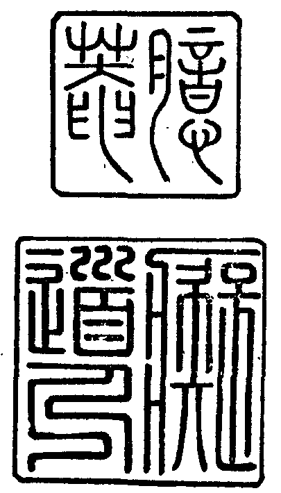
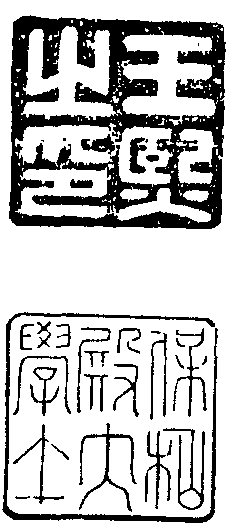

# 普济玉琳国师语录



> **藏经**：大藏经补编（大藏经补编）　**册次** 第 27 册（B27）　**编号** B0152　**部类** 诸宗部　**卷次** 14 卷　**篇幅** 147,967 字

> **卷／品**：0 卷 · 5 品



---



## 目录



  - [客问评注序](#客问评注序)

  - [工夫说序](#工夫说序)

  - [经筵日讲官翰林院侍读(臣)曹本荣谨序](#经筵日讲官翰林院侍读臣曹本荣谨序)

  - [客问金序](#客问金序)

  - [工夫说曹序](#工夫说曹序)



---



勅书



皇帝勅谕朕惟立刚陈纪敷政而易俗移风见性明心传教以牖民觉世考其功业则事有殊途论厥精微斯旨归同轨然溯无生之真谛不缘意象以求证般若之妙源非因文字而显欲向大千之觉路先皈不二之度门赖初祖之既来遂灋衣之不绝燃灯而照昏瞆建鼓以醒愚聋爰指善诱之津诞施方便之力付灋将逾百代知名何仅千人莫不宗旨共扶流风大阐用慈悲而度天下佐平治以化民生允有裨於盛时故恒尊於历世兹闻尔僧通琇慧通无始智洞真如续五叶之正宗万灋从而归一屏六根之邪识四大是以尽空扫末世之狂禅秉如来之正觉诚超生融之学而迥播观肇之名者也朕俯询灋器缅想高风思御宇以来期沛无为之治而虚席以待乐闻无漏之因用是特遣司吏院掌印官张嘉谟颁赐玺书远延幢锡尔其遄驱象驭早践龙墀陈密义之慧空赞皇猷之清净呜呼顺风而问朕将同访道于崆峒计日以来尔尚效朝宗之江汉钦哉故谕



> 顺治十五年九月日



皇帝勅谕朕惟御文设教济度众生所以直指津梁而超登彼岸者惟以明心见性为宗然实义当前本无知解但缘执著妄想不能证得故涅槃会上多子塔前瞿昙拈花金色微笑此正法妙心之所由传也西天四七东土二三五派分芳一灯相续而临济一宗禅风独胜朕万机之暇披阅典文深究道统之传知三教一理非有殊途其要俾人各复其性而已灋门弘开得之者代不乏人维尔禅僧通琇早空诸有久悟无生尽解脱以会真如超妄情而标妙觉葢绍滹沱之正传而续佛慧命者也是以遣官赍勅延至禁林询以性命之旨悉皆不滞筌蹄丕扬玄要观其矩度端严风规俊迈足知梵行道心早已明彻无瑕脱畧尘境者矣故名重释林品高灋众俾聆其宗旨者咸洞豁疑情顿开觉性洵佛裔之龙象而宗镜之上乘也是用封尔为大觉禅师锡之勅印於戏觉悟群伦化通万物道有洽适理无二归弥其益阐宗风演诸佛之秘义使仁风永扇慧雨常垂式导愚氓脱离迷网以助朕牖民成俗之至意焉钦哉



> 顺治十六年四月日



皇帝勅谕朕惟教阐西乾灋流东土付妙心於四七传正果於二三莫不以叅悟透脱者为真乘操履纯一者为灋器故南岳不污垂护念於庾岭马师大用揭震喝於雄峰以至滹水建黄檗之宗高峰继雪岩之绪源远流长良有以也朕殚心诚正逊志危微务期於道岸诞登允怀乎德修罔觉因念夫禔躬立政聿本於见性明心大道本同精义无二缅思宗派必有高人闻尔禅师通琇临济嫡传笑岩近裔心源明洁行解孤高故於戊戌之秋特遣皇华之使聘来京阙卓锡上林朕於听览之餘亲询释梵之奥见其机锋峻利论义圆通直指向上之关信称谛当证彻无生之旨不落言诠实获我心深𢍆予志间泛及於众说亦博综乎百家名理恒超决疑无滞洵灋门之龙象禅苑之珠林者也用是特降褒纶赐号大觉方欲久留瓶钵时听伽音冀朝夕之启予庶默成夫玄旨而禅师欲全子道祈尽孝思坚请还山勉襄石塔远追目犍连之度母近承陈尊宿之养亲有裨人伦克端风化朕俯徇其愿勅护遄归惜山川之既遥倐夏秋之已隔永言遗韵惓惓於怀追惟对御之言实发大乘之秘传灯可续末灋所希爰是复降温纶加封大觉普济禅师赐以紫衣并予金印遣使赍往昭朕眷𮕵重扬灋席之辉永镇山门之宝於戏龙章载锡式增慧日光华椹服新颁克绍佛衣灋数祈承显命益勉勤修钦哉故谕



> 顺治十六年十月日



自杖锡南还时勤企念五湖烟景三江秀丽荷衣松食致足乐也阊阖风至秋色依依益深白露伊人之想自迩以来企彻禅宗勤心灋宝慨佛果应庵之后差近閴寂今雷音虽震而北方犹若未闻故末灋比丘少奉戒律其口谈无而行在有者又如麻粟也兹欲於都城建立皇坛俾衲子一千五百人众受毘尼戒七条一缕出自上方五戒三皈重宣佛义然非禅师亲为羯磨正恐以最上慈航为人天阶级耳惟冀荷担如来阐明大灋不辞远道惠然肯来则王城四众重闻薝卜之香新学缁流顿长菩提之树知禅师以佛灋大事为先不以静退小节萦念也遥瞻浮渡速慰悠怀







上天生民欲其保聚明末丧乱之后水旱盗贼所在罹殃加以风俗浇漓抵触禁网𢀸灋𢀸兵同一苦趣彼既不得正其终将冤酷幽魂何由拯拔是必宣扬佛灋普济沉沦庶几於仁爱



天心方克仰副朕频年以来徒怀轸结而大善知识邈焉难遇此𠂻皇皇实切有待以禅师之道力高深至诚能感朕欲广设慈航其可不远相匡助乎灋事肇修於心甚迫禅师无惮跋涉即速戒途专俟至止之日度生说灋俾诸堕落立脱幽沉用敷弘愿知禅师亦所乐闻无庸坚执朕计日望之矣



顺治十有七年五月二十日书







皇坛戒牒



皇帝勅谕朕惟佛祖之道明心见性止恶防非开正觉之门趣菩提之路教至重也然定慧等学以戒为先经论三藏非律莫备比见祖庭秋晚律学荒芜非大揄扬无因劝励是以特设皇坛宏开戒灋三师选传佛心印之高流七证择发明祖意之大德授戒子一千五百人复虔捐孝献庄和至德宣仁温惠端敬皇后内帑遗财成就三衣用广檀施兼资冥度惟愿宿因不昧种智常明汝等新学沙门宜端谨一心奉行十重克究毘尼道果广明心地灋门三乘自此而发生五分因兹而建立交光相罗如宝珠网圆澄莹洁若净琉璃受持不昧於初心始终无犯止作双明於理事轻重必遵由是而真叅实悟破生死之重阍达木知源透向上之关棙远酬卢舍之恩近守波离之化庶不负朕教导至意兹应给汝戒牒终身携佩广行轨范弘阐宗乘或行脚於诸方或潜修於兰若所有十方伽蓝随缘演化关津隘口验实放行尔等钦承之毋忽



今据戒子某某系某某府某某州某某县系某某籍姓某某系父某某第几子在家习某业面某身某於某年某月某日於某府某州某县礼某某为师出家剃度今遇皇惠汪洋开恩施戒业於顺治十七年十一月十九日於愍忠寺普润律师处审是净器如灋先受沙弥戒讫又於本年十一月二十五日於愍忠寺普润律师处审是净器兼无病障如灋先受比丘戒讫幸蒙帝德同天特建皇坛於慈寿寺延请传佛心印临济正宗第三十一世浙江湖州府武康县金车山报恩寺勅封大觉普济能仁国师为菩萨戒得戒大和尚於本年十二月初八日普受大戒



羯磨阿阇黎行丰



教授阿阇黎行岳



尊证阿阇黎行峰　行湻　行卓　行咨



行地　行谋　超迩



顺治十七年十二月十五日给



------



### 客问评注序



自古开天持世之圣人如尧舜周孔垂衣畫象修道立言皆是诸佛菩萨建立世界化导人心之大机大用非下劣凡夫所可以寻常意识卜度测量也我皇上治灋尧舜学宗周孔孜孜日不暇给天纵濬哲犹旁通竺典深契无上妙义凡可以用之觉迷回邪有补于世道人心者无不目寓神浃輙随时拈出直欲尽人而为之提撕振醒焉一日讲幄咨询之暇览及玉林禅师客问一帙嘉其言之有合于道可以为士大夫之药石并可以为缁素群流之钳锤爰付梓匠以广其传而勅(臣)之俊缀述简端兼为评注全文(臣)受而读之其设为问答机缘大约以学道一事鞭策士大夫而直指士大夫种种碍道习气能令通身汗下又以七谛当逼拶学道人而唤起学道者节节须知痛痒管教欲罢不能洵哉士大夫亟救痼疾之良药一切学道人打断命根之毒锤也我皇上怜悯士大夫多汩没于名利爱欲缠扰于客气私心迷却自性莫知警省故未能有耻且格又怜悯一切学道缁素人等真妄无分道业莫辩如没头堕在万丈洪波中不知自怕沉溺又谁为竭力提持是以聊借客问数语作痛棒热喝使读是编者其或憬然而返或矍然而起庶几其大梦忽醒回头是岸胥一世而睹自性体咸登正觉乎呜呼此皇上之所以刊布客问也即诸佛菩萨建立世界化导人心大机大用之一毫端也(臣)愚且老愧未能学道又何能仰承睿㫖敷宣奥义姑就蠡测所及妄加诠注谨拜手稽首而为之序云



顺治十有六年孟夏日光禄大夫太保兼太子太师吏部尚书中和殿大学士(臣)金之俊谨序



------



### 工夫说序



我皇上圣神天纵文武生知学冠百王道隆三代虞延执中之传孔门一贯之旨下逮立诚居敬之说致知穷理之言既细大之兼收亦源流之洞晰固优入於圣域而诞登夫道岸矣而犹博综三教游衍一乘穷直指於五宗探西来於二桂𫇴荛必采藏典全收巍巍圣化曷可名焉顷者勅召玉林禅师御前问道发明向上爰及工夫迺於讲筵之暇出其说以示(臣)本荣兼命(臣)为序(臣)读而叹曰呜呼自古帝王尧仁舜孝虽端拱而无为商质周文必缉熙而敬跻我皇上惟精惟一日新又新犹眷眷於此者岂非以内圣外王学虽见乎行事穷神知化理必极於从心有如是乎然闻之教外别传不立文字非语言造非寂默通而禅师旁搜远引罕譬曲喻其所以慰皇上与人为善之心阐皇上大道为公之意可谓千古一时矣若夫善恶不思发归未发豁然通贯其理一揆离即离非凡圣不立悟即不无犹落第二则工夫之说无非欲立造於无工夫地耳葢以去圣时遥人多乾慧■■在近学贵真叅其来旧矣龙牙云学道先须识■由还如相鬬快龙舟虽然旧阁闲田地一度赢来方始休岂虗语哉岂虗语哉(臣)知识颛愚学业荒浅何幸躬逢圣化时值昌斯闻所未闻似叩两端之竭见其所见已超三藏之先谨奉纶音用书篇首永垂宝筏以渡津梁云尔



------



### 经筵日讲官翰林院侍读(臣)曹本荣谨序



勅封大觉普济能仁国师塔铭



洪惟世祖皇帝圣德显道彰于遐迩深仁厚泽洽于幽𬚽妙智圆通与如来心印为一尝命访僧伽之行解圆证者与论向上宗旨於时有大禅师奉诏入京曰玉林琇公葢天隐磬山之子而临济三十一世孙也师讳通琇号玉林常州江阴人族姓杨氏父芳母缪氏皆与般若有大因缘师之生也母梦大士擕童子自牖入寤而生师堕地敏悟夙成能语辄诵佛号坐常跏趺十五阅语录叅谁字疑情大发寝食俱废昼夜徬徨室中因触翻溺器有者遂蝉蜕万缘决意究竟大事时磬山修禅师方弘化荆溪炉𨪋正赤师直造其席依止受其戒为侍者进则决疑请益立雪不移退则宴默凝神危坐达旦必欲见道乃已一日于一口吸尽西江水下瞥见马祖用处不觉身心庆快曰佛灋落吾手矣自此遇勘辨发语纵横自如当机不让无何辞归省母磬山密嘱徵信曰善自护持勿轻泄也师既归江阴益韬晦日放旷云水间偶乘月汛小舟举头顿忘迷悟如虚空玲珑不可凑泊急就证天隐于武康之报恩叩击之次迎刃不畱至掀案而出隐知其透关叹曰此吾宗狮子儿也隐示寂遗命令师主灋席师不从避之凌霄峰绝顶时天龙业已推出虽欲埋名烟壑而众莫之许师不得已起应之开灋筵之日黑白环绕者万指莫不沾被化雨随根沃润而去丙戌遇大雄乐其山川幽寂就荒烟蔓艸葺茅为屋有终焉之志然声光外流逐膻者益众期年复成藂席是时天童方唱道东南其机锋迅利诸方无能抗者惟师以灋门犹子后先角立应机接物如疾雷破山龙泉出匣非真实证悟者不能窥其纵夺之妙以故年甚少出世最早而握机行令卷舒自由闻者莫不钦服焉顺治戊戌世祖皇帝闻师名遣使诏师己亥春师应诏赴阙见上於外朝慰劳优渥即命近侍送居万善殿不时临访道要一日问如何用工师曰端拱无为又问如何是大师云先被四表格于上下又问孔颜乐处师云爱心情大悦命近侍传语恨相见之晚焉特赐号曰大觉禅师名香灋衣之锡殆无虚日寻以母未葬恳乞还山诏许之由内府金钱助之襄事师受赐归以十九饭僧放生而以其一助营塔费凡畚土运石一一皆身自为之庚子秋复诏至京礼运尤渥进号大觉普济能仁国师至腊月世尊成道日命干京师阜成门外慈寿寺为千五百僧说菩萨大戒



> 又命作工夫说刊行之次年世祖皇帝升遐师领大弟子作佛事七昼夜毕辞还山钦命遣官护送其宠荣稠叠近代无与同者师虽遭际昌辰然性恬于荣利无毫发矜重意既归如埜鶴孤云无所畱碍会於潜天目师子正宗禅寺岁久𬯎废郡人顺天少京兆岵瞻戴君谓非师无以举扬宗风光辉祖席率众延师居之远迩学徒闲风奔赴堂序殆不能容于颓垣败壁中一弹指间金𪸩碧明楼殿上插云际而未尝见其有所作为善权之请师虽勉强一赴然旋思归老旧林亦未尝久畱也天性至孝十二岁即丧父得灋后别构艸堂于报恩之侧奉母居之躬进饮膳母殁断食禅定者七日行道不离殡次者三年先是师之父振陵翁与受云栖大戒深味禅悦临终染衣自度谓师兄弟不读书即当出家母氏亦受磬山记莂晚年离俗依师得悟世号为大慈老人葢非积庆之家不能生此大士而师其全戒孝友陈睦州大慧臬之风岂非𢍆经所谓五因缘中真友者耶晚年慈心益切不惮䟦涉之劳意将穷搜泉石接引缚禅物外而不与尘世接者尝叹曰赵州八十行脚彼何人哉乙卯春遂屏给侍飘然常往因触热渡江止於淮安清江浦之慈云庵索浴■■说偈而逝时康熙乙卯八月十日也寿六十有二腊四十三弟子奉龛归天目全身塔于东坞庵之后陇师凡六坐道场七会说灋解结发覆妙具善巧虽沉迷重障一遭钳锤罥索无不断绝焦芽小艸一蒙溉灌身心无不光润得灋弟子二十餘人皆■■灯续命接席分辉者也师广颡丰颐平顶■■■白玉色目光烱烱射人宴坐如临大众故■■■威而慑一生不蓄私财即纤细供养亦不轻受尝过青县有苦行僧负斗面设供随舟行者数日师怜其诚为说灋要即挥之使去终不纳也每檀施至辄教以持归放赎生命同於摄受虽膺紫衣之宠而服用不及恒僧既悟逸格之禅复教人兼修净业五曾弟子从师持药师琉璃光如来名号得度者至不可算数皆谓师从彼世界应化来此方云余昔侍从内廷间立灋席之后亲覩师据狮之座举明正灋发轰雷掣电之机虽老叅宿学罔知所措既而闭关习静龙象萃处一室而户外不闻人声至於广厦细旃从容诏对语巧意圆穷极实际能助九重增长灋喜一时贵近无不函香问道师于弘灋外不发一言其善慧深厚如此是以缁素四众罔不倾心驯至名德上闻于天宠被鸿名龙光赫奕则师岂非乘夙世愿轮随助圣人敷扬大化者乎谓之优昙钵华千年一现良不诬也铭曰西来妙旨五灯分继震动铿鍧厥惟临济国师嗣灋三十一传金轮御历佛日中天兜率亲升演说般若光烛大千声施九野应机而出乘愿以来心光内发楼阁门开西江一吸劈面全体布袋打失凡情尽死扁舟夜汛水月明融直入无见烁破虚空六坐道场大施政令凡圣皈依天龙恭敬显号荣名自天之祐开士何心白云出[由*由]天目高峰上摩穹碧师锡振飞祖庭生色宝台珠网弹指立成世间何经何营蘧庐终宿曳杖江口起灭空幻我尚不有坐脱淮上游戏自如死生者谁隐现在吾六十二年悄然无事居士勒名仅有半字



康熙乙丑仲夏赐进士出身光禄大夫礼部尚书保和殿大学士加三级宛平王熙薰沐拜撰







大觉普济玉林禅师语录目录



卷首玉音五道  

皇坛戒牒



------



### 客问金序



### 工夫说曹序



卷之一上堂



卷之二北集(上堂　机缘　偈颂　法事)



卷之三示众



卷之四示众



卷之五小叅



卷之六小叅



卷之七㳒语



卷之八机缘  

垂代



卷之九颂古



卷之十客问评注  

工夫说  

像赞  

记传  

诗偈



卷之十一书问



卷之十二杂著  

佛事  

年谱(上下卷)



大觉普济玉林禅师语录目录(终)



大觉普济玉林禅师语录卷之一



书记音纬等编



嗣法孙超琦彚



上堂



住浙江湖州府武康县金车山报恩禅寺众檀护请上堂宣疏竟师又手向法座云不礼须弥灯王便登狮子高座丈夫自有冲天志那向他人行处行遂升拈香云此一瓣香有君有臣有父有子有主有宾𤑔向炉中君恩亲恩内外护法恩一齐报得复拈香云此一瓣香佛祖齅之脑裂天人觑之眼枯𤑔向炉中供养本山第一代无面目先师天隐老和尚用醻法乳之恩敛衣就座白椎竟师拈杖云先师和尚今日在某上座拄杖头示现全身举扬大法还有共见共闻的麼出来互相证明问答不录师卓拄杖云去岁元公黄居士祈远唐居士暨众居士等要某举扬此事某以先师会下颇多精鍊之士大胆小厮不妨暂时钝置谁知先师有谶云不是我兮便是你今日拓开泼天门户万不可诿众檀护诸弟兄仍推向人前不可囊藏被葢也蓦竖拄杖云看看横杖云不直前荐取向门外打之遶先师隐入某上座拄杖里去也复举临济大师初住河北谓普化克符二上座曰我欲於此建立黄檗宗旨汝二人成褫我二人珍重下去三日后普化上来云和尚三日前道甚麼济便打三日后克符上来云和尚三日前打普化作甚麼济亦打师云临济大师眼孔太窄欲立先宗止望那两人成褫某上座则不然今欲於此建立先报恩宗旨仰望大众尽皆成褫我若或拟议迟疑各各自领三十棒蓦卓拄杖喝一喝下座



元旦上堂师云有一句子河沙刹土三世诸佛不能说西乾东震历代祖师不能说天下善知识不能说先师和尚亦未曾说某上座今日既居此位为众分明举似也元正启祚万象咸亨下座



乡友临访上堂举僧问云门大师云如何是诸佛出身处门云东山水上行又有人问龙池幻有师翁云如何是诸佛出身处翁云西河火里坐师云某上座则不然今日若有问如何是诸佛出身处但向道我是蓉城杨四郎



佛诞度僧上堂师云报恩新长老今年才廿四黄而老瞿昙是吾最小子古往今来多少居曲录床的大善知识凡於四月八日播弄瞿昙小老的矢臭气则有分还曾梦见瞿昙的师麼若向者里缁素得则不论鬀发不鬀发不虚亲到报恩来若者里缁素不得直饶新报恩亲手为他刬草也未面对面白云千万里蓦喝一喝下座



上堂举昔日世尊因文殊至诸佛集处值诸佛各还本处惟一女人近彼佛坐入於三昧文殊廼白佛云何此人得近彼佛坐而我不得佛告文殊汝但觉此女令从三昧起汝自问之文殊遶女人三匝鸣指三下廼托至梵天尽其神力而不能出世尊曰假使百千文殊亦出此女人定不得下方过四十二恒河沙国土有罔明菩萨能出此女人定须臾罔明大士从地涌出作礼世尊世尊敕罔明出罔明却至女子前鸣指一下女子於是从定而出师拈棒云者则因缘几千年来丛林举论的颇多少有决断得者今日事不获已且作死马医若某上座在当时才见文殊世尊云云便一齐打出非但当时勦绝亦免后世誵讹且道新报恩意归何处卓拄杖云不奋𫜪人狮子勇吠葺逐块几时休掷拄杖下座



幻有大和尚诞日设供师指真云兀坐嘴卢都教人没奈何个老汉惯得其便者里透得过的如龙得水似虎靠山有意气时添意气不风流处也风流而今大明国里称为师翁后裔者不啻百千万亿究竟得大机显大用堪为的骨儿孙者能有几人某上座初阅㡣池语录见师翁云世间多少不平之辈务要别寻一个人与我老释迦比胜负较优劣还知我释迦如来是何等一个面目麼某上座便於此丧身失命将谓师翁面目只如是后来呈似先师和尚受他许多恶辣钳锤方知见与翁齐减翁半德见过於翁方堪嗣续从此脚跟下自解作活计虽与师翁同条生不与师翁同条死师翁善为隐语云人还知我释迦如来是何等一个面目令某小[只*害]秃最初秪见师翁杀人刀未见师翁活人剑今日某上座不妨显示令见者闻者知我祖师门下亦有杀人刀亦有活人剑顾视左右云若有问如何是我师翁真面目拈香云急着眼



竖法堂方丈上堂师云巍巍堂堂本是圆成无人不承荫覆奈何有未知恩而今现前众檀越诸兄弟都是知恩报恩的也须向某上座拄杖头证明问答不录师廼云众居士於甲戌春日才兴一念请先师则报恩法堂蚤已成就待先师来兴工动作早是第二门头施设今日更要某上座建立岂不在第三然而出格大人终不羡一嫌三昔日临济大师云第一句中荐得堪与佛祖为师第二句中荐得堪与人天为师第三句中荐得自救不了后来慈明禅师云先宝应恁麼道兴化则不然第一句荐得和泥合水第二句荐得无绳自缚第三句荐得四棱蹋地你看慈明是临济儿孙为甚临济大师提持若彼慈明老汉拈掇若此且道二大老还有优劣也无卓拄杖云天共白云晓水和明月流千差与万别总向个中收



六月十九上堂师以杖击案僧出师云敲波惊鲸鲵惊出个虾蟆僧拟议师便打师迺云先师开法磬山飞锡乌峰及住此报恩数十年如大富长者打开宝藏拯济贫乏奇珍异宝靡不悉具随人知见随人力量一任取足得先师重器者固是知恩不少即得先师根折钗脚的也道见过磬山和尚曾受益来葢先师天覆地载海纳山容之量自然如此而某上座虽是他儿孙撑立他法门却逈不相似一双穷相手两个鬼眼睛握根拄杖莫道者里无一物与人直饶他处得奇珍异宝而来也与他彻底掀翻一棒打煞直须未跨岭门便识得某上座为人处若来此仰观进益那有语话分说到此香炉𨁝跳起来云和尚与麼道则观音菩萨於是日从耳根证圆通亦从门而入不是家珍师复击案云洎放过者个不唧𠺕汉掷拄杖下座



上堂师𢫈拄杖云新报恩拄杖子有时血溅梵天有时春回大地有时立辩鱼龙有时千眼难觑且道作麼生与报恩拄杖子相见以拄杖旋风打散



行化上堂师云六祖大师云无相为体无念为宗无住为本者三句中有一句如千雷并吼千日并焰有纵有夺有杀有活若人会得许你双眼圆明后来白云端禅师有一偈云他人住处我不住他人行处我不行不是与人难共合大都缁素要分明只者一偈不虚为祖师之后今日新报恩亦有一偈说似大众他人难住我独住他人难行我独行不是生平多力量秪缘深受我师恩且报恩功圆一句作麼生道待行化回更与大众吐露



归院元旦众请上堂师云昔日香严禅师云去年贫未是贫今年贫始是贫去年贫尚有卓锥之地今年贫连锥也无后来真净文和尚云去年富未是富今年富始自富去年富一领黑黪布褊衫今年富添得一条百衲山水袈裟岁朝抖擞呈禅众实为风流出当家二大老虽是顶门具眼各出好手扶竖宗乘蓦竖拂子云若到报恩门下还敢高声也无打一拂云岳边顿落千山势海上全消万派声



佛诞上堂师卓拄杖云今日老瞿昙在拄杖头上一任山僧扶起放倒还有作家禅客麼向前来共出只手问答不录师迺云有一人佛之一字素不乐闻念佛一声𠻳口三日有一人见佛欢喜礼拜赞叹种种供养一人恁麼一人不恁麼同到报恩来且道畱那一个即是有般汉便道功德天黑暗女有智主人二俱不受是者般的正好捉来朝打三千暮打八百何故大海若不纳百川应倒流



上堂举昔日世尊因乾闼婆王献乐其时山河大地皆作琴声迦叶起舞王问迦叶岂不是阿罗汉诸漏已尽何更有餘习佛曰实无餘习莫谤法也王又抚瑟三遍迦叶亦三度作舞王曰迦叶作舞岂不是习佛曰实不曾作舞王曰世尊何得妄语佛曰不妄语汝抚琴山河大地木石尽作琴声岂不是王曰是佛曰迦叶亦复如是所以实不曾作舞王廼信受师云大众还会麼若也会得方堪作佛祖儿孙如或不会山僧更为颂出抛笻直在千峰顶缚草开田闲有餘笑月吟风面目冷知音知外几人知



上当问如何是当机一句师云窰上少人请你做砖师廼云高峰大师上堂云吃粥了也洗钵盂去矢上加尖一塲败露西峰今日忍俊不禁却要向鹭鸶腿上割股良久云便恁麼去师云咄哉个老汉一生盲修瞎炼师资未尽其妙大法终未明在召众云要会洗钵盂话麼脑后见腮莫与往来



上堂问击大法皷请师演大法义师云宿雨初收山气重师拈拄杖云一人发真归源十方虚空悉皆消殒一人发真归源十方虚空筑著磕著报恩则不然若有一人发真归源捉来朝打三千暮打八百顾视左右卓拄杖下座



上堂师拈拄杖云先圣道有时夺人不夺境有时夺境不夺人有时人境两俱夺有时人境俱不夺高声召众云是什麼所在蓦掷拄杖下座



闰正月旦上堂师拈拄杖云一不成只两不成双今朝正是奇特月日还有奇特人出来共明奇特事麼问答毕师迺云兹者好日多同化主自远归来施主入山设供山僧也趁闹热供养大众一上幸诸大众各各现大人相赴山僧斋山僧将无边世界一切山陵为馒头一切河海为汤一切森罗万象为奇羹美饭一任大众放开肚皮展开大口饮之不竭食之有餘饱𪖙𪖙地乘风徐行片时游徧诸佛国土向虚空里打个筋斗下来山僧再呈第二番供养把无边世界依旧撒开以一世界为一斋一任大众乐一味者即向一味世界应供乐多味者即向多味世界应供随大众种种所乐即向种种世界应供斋毕旋归然后山僧将无边世界仍前还他无边世界一切山陵仍前还他山陵一切河海仍前还他河海馒头还是馒头汤还是汤羹还是羹饭还是饭殷勤请山僧升座毕然后落堂吃斋令诸檀信求福者福集忏罪者罪灭荐亡者亡人高升生安死利靡不如意顾左右云且慢散去三番供养大众了更要总散大众一大分𫎪钱迺举百丈上堂云我有一句子百味具足大众还会麼慈悲之故而有落草之谭下座



上堂师云山僧久因幻躯有病佛法两字并不提起慈引居士启请上堂打算了一夜无只字可说对众如实供通莫怪空疎久立珍重



上堂师竖拄杖云明眼禅人出众相见二僧竞出师以拄杖畫一畫云领取钩头意莫认定盘星下座



诞日上堂师按拄杖云放光现瑞皷舞小儿动地雨华助扬末技止止不须说欺侮杀人数数请敷宣颠狂慕外青莲华下笑颜开奴见婢殷勤积雪岩前断臂举人逢鬼迷闷现前大众十二时中各各蹋佛祖顶𩕋行有不受惑的出来相见问答不录师迺云山僧未出母胎已为诸人作大佛事举扬大法汝等诸人早已如实知如实见如实证如实行如实说为甚今日却受人处分只为分明极翻令所得迟



新市觉海寺缁白道侣请上堂师云天地成人物立有美有恶有是有非有邪有正有曲有直有宜有不宜有可有不可从而分别指畫去取戒勉令修令治使知使行扶持世道匡正人心此儒教治世之法也谭无破有推小至大求精弃麤轻外重内此道教出世之渐也道有也不立一尘道无也不拨一物有时恁麼有时不恁麼有时恁麼也得不恁麼也得有时恁麼也不得不恁麼也不得有权有实有炤有用有纵有夺有杀有活可以意会难以言传承言者丧滞句者迷此释教入世出世之全也方便指迷之谓教直下传心之谓宗渐者繇博而至约顿者一了而百通把住黄金失色放行瓦砾增辉且道把住为人好放行为人好卓拄杖云人归大国方知贵水到潇湘一样清



上堂师拈拄杖云自惭少福住幽林澹薄辛勤岁月深散众欲眠峰顶石捐身助道是何心仔细看来竭诚为众的也有肻心檀护也有只要我辈颛精学道古德云学道如钻火逢烟未可休直待金星现归家始到头先圣与麼激扬要知学道非同小可若不一闻千悟直须一切放下忘苦忘乐忘死忘生历尽艰难方能透脱顾左右云世出世法非凭一点真心不能成就故有此真心也可以自利有此真心也可以利人有此真心也可以自利而利人有此真心也可以利人而自利彻此心源便见瑞林面目清胜化仪自在报体净满金方伯与浔谿众信凡受瑞林所化生一念净信所作佛事皆成佛道蓦卓拄杖下座



(瑞林师报恩禅堂清众时在崇祯十四年老人方二十七岁提持激切相依者莫不亡身为道叅究刻苦然丛林初创百事淡泊瑞发心浔溪抄募一时不克满愿遂舍命浔溪岂凡金方伯家居闻而叹异谓丛林有如是为众之人主法领众必非寻常知识率浔溪诸善信送僧粮百石并瑞师灵龛归报恩故老人特为上堂举扬)



上堂举五祖演和尚云四五百石麦二三千石稻好个休粮方耆婆不得妙千岩长禅师云管取有钱常住不无演祖若是将无作有拔贫作富须还无明始得米不蓄一粒菜不栽一茎任渠来往者吃得饱彭亨师召众云用四五百石麦二三千石稻如何唤作休粮方米不蓄一粒菜不栽一茎如何吃得饱彭亨阿呵呵大海纳流寒岩发燄二大老不无些小巧妙简点将来未见大人体态报恩者里则是直心道场不用蛇足有米吃三餐无米吃两度也有时恰好也有时忍饿掷拂子下座



便舟化主领昆山众居士请上堂师顾左右云毁形易服作世外之士直须不惜身命饥寒困苦置之度外颛究大事图报佛恩所以古德示众云夫既出家如囚脱狱於佛法中万死一生更莫弃舍葢虑后学遇境界艰难一时打不过故尔苦口叮咛殊不知清苦僧家本分不独今时如此自古皆然昔日大愚芝和尚常住澹薄想与报恩差不多而芝老和尚穷酸直是穷酸到底几株宿菜也不令人好吃尝上堂云大家相聚吃茎虀唤作一茎虀八地狱如箭射报恩者里虽云澹泊然山僧素愿有食有法令众安止近因饥馑安众无方直是食不下咽坐卧不宁幸有化主发心在外渐令信心檀越入山且不要大众学古人鬼见识度量与麼小口门与麼窄大家相聚在此澹薄时澹薄吃斋时吃斋唤作吃斋我等与施主皆共成佛道下座



佛诞上堂师云马祖道一口吸尽西江水慈悲之故而有落草之谭世尊道十方虚空生汝心中犹如片云点太清里与麼会得正好捉来朝打三千暮打八百有般汉迷头认影弃本逐末守个昭昭灵灵为悟主人公以举足动步摇唇皷舌的为常住心体师喝一喝云认六尘缘影为自心相譬如病眼见空中华及第二月百千澄清大海弃之惟认一浮沤迷中倍人佛所深愍还知一切见闻觉知之心本自无生惟因境有前境若无则此见闻觉知之心亦无麼世尊又示阿难云如汝今者承听我法此则因声而有分别纵离一切见闻觉知内守幽闲犹为法尘分别影事今时外道好笑杀人既以晓得走路问话的为悟自心更以识神空主人公也不可得为末后无疑谁知数十年前尽被世尊痛阿明叱如斯学者可弗见不善如探汤猛看破浮幻身心向一念未生前当下证得广大心体连证之一字亦不可得便识得一切佛祖广大心体方可出生出死方可入死入生方可如释迦老子於昔年今日才生下地便现些小神通周行七步目顾四方一手指天一手指地云天上天下惟我独尊方可如云门大师顺风吹火云我当时若见一棒打杀撩与狗子吃事是恁麼事人须恁麼人苟不如斯生死到来便验真伪复举古德云毫厘有差天地悬隔师蓦竖如意召大众云还会麼良久掷如意云黄金自有黄金价终不和沙卖与人



癸未诞日檀越请上堂师至座前涤凡刘居士同凉禅等呈祖衣师云两年福薄勉为人糠麦为糜草作羹时节渐佳惭未辍此衣珍重至诚心便撘衣顾左右云先圣有言此衣表法举衣云者个是衣唤什麼作法复举衣云者个是法唤什麼作衣向者里千眼顿开何事不办如或未然更为当阳揭露升座白椎竟问如来和尚同月同年如何是无量寿师云山僧今年三十师廼云圆陀陀七华八裂锦攒攒绝点纯清明中有暗黄金失色暗中有明瓦砾生光拟议承当白云万里愁眉退避凉飚满目取不得舍不得事是恁麼事人须恁麼人得在此失在此但得恁麼人何愁恁麼事且超群越格一句作麼生道良久云普自恣日了悟禅人同众居士请上堂问话毕师乃云山僧年来一味打睡内外大众作务时作务坐香时坐香打七时打七打五时打五结制亦如是解制亦如是既然如是今日了悟上座同众居士设供请升座又作麼生良久云如是如是复举阇夜多尊者因月氏国王闻尊者德风躬诣问法修敬已请开演尊者曰大王来时好道今去亦如来时师召众云还会麼应病不假驴䭾药



九日姚均仁居士请上堂师云见离断常道无明昧断常之见非真见明昧在人不在道直饶戴角擎头未是当家种草一种平怀悠然自得的衲僧出来道个应时及节的句看问如何是无生话师云池无擎雨绿庭有傲霜黄师廼云金华布地玉蕊承天今正是时杲日当空乾坤郎耀古今无异阇黎老僧面目现在悟人瞎人诚谛之言一句明明该万象篱边斜插验人枝蓦喝一喝下座



开炉上堂师拈拄杖云一椎便就未是性燥不假一椎漆桶不快入得从上炉鞲的衲僧出众相见一僧出礼拜师云欲钓鲸鲵澄巨浸却嗟蛙步𩨍泥沙僧拟议师打出又僧出师震威一喝僧拟议师亦打出又僧出师云当塲相见须是作家僧喝师云胡喝乱喝作麼僧又喝师又打出师廼卓拄杖云不是与人难共合大都缁素要分明掷拄杖下座



元旦上堂问答不录师云追金琢玉绣口文心自有当行作者转身掉臂努目撑眉一任逞俊禅流两眼对两眼真金不博𨱎未举先知早已属二属三当阳荐取岂止落七落八诸佛不出世祖师不西来目前无阇黎此间无老僧但有言说都无实义掷拂子云蹋著故乡田地密人人皷腹乐升平



大雪设禹门幻有老和尚供师云师翁面目雪满千山先师仪表春回大地先师春回大地也雪满千山非当年久侍者不知师翁雪满千山也春回大地三十年后有人共见今日某孙应时献一杯茗罪过弥天何故不合当面触犯



解制空明师同涤凡刘檀越请上堂问答毕师廼云尽大地是解脱门把手牵不入尽大地是涅槃路倩人得不得入得解脱门行得涅槃路便廼动若行云止犹谷神既无心於彼此岂有象於去来南赡部洲坐禅北郁单越脚麻东弗于逮持钵西瞿耶尼手酸大洋海底翻身打倒兜率天宫触著阎罗老子鼻孔带累四大天王齐声喷嚏天人捧花无路禅鬼窥觑何及如或不然出门便是草脚下好生看



清明上堂师云昔日灵山会上文殊请世尊再转法轮世尊云汝请再转法轮是吾曾转法轮耶师召众云世尊大好言语今日节届清明众职事及诸大众请山僧升座说法是岂山僧有不说法时邪卓拄杖云会中若有仙陀客不用旁人更下椎



化士归上堂问高高山顶住持深深海底行化者个是什麼人师云进前来向汝道僧伫思师便打师廼云昔日金牛和尚每斋时自捧饭上堂云菩萨子吃饭来师召众云人莫不饮食也后来云峰悦禅师叅大愚芝和尚入室请益芝云法轮未转食轮先转后生趁色力健何不为众乞食我忍饥不暇何暇为汝说禅师召化主云观禅人且道大愚老汉是什麼心行横按拄杖云三通皷罢大众云臻一堂风冷澹千古意分明掷拄杖下座



结制上堂举退庵重阇黎领众问答不录师拈拂子云今朝四月十五金轮峰笑缃谿舞草木土石尽翻身蚊虫獦蚤骑佛祖更有一般奇特事栏中两头鹿吞却千山万山虎顾视左右云释迦弥勒是汝之奴朝蹋毘卢南岳游暮挟舍那天台卧重阇黎莫放过下座



上堂问当阳举示分明石火电光不及和尚还具金刚脑后眼麼师高声云不具僧无语师叱退问如何是夺人不夺境师蓦竖如意进云如何是夺境不夺人师云近前来向汝道进云如何是人境两俱夺声未绝师便喝进云如何是人境俱不夺师云礼拜著师廼云昨日职事头首为众竭力启请说法山僧云逢人则出顾视左右云大众便下座



端阳上堂举天龙为玄沙侍者侍沙山行遇虎龙曰和尚虎沙曰是汝虎师召众云衲僧行处如火消氷万法本闲惟人自閙六祖大师云非风旛动仁者心动将谓说心性禅承言者丧滞句者迷舍多尊者云非风铃鸣我心鸣耳多少人面墙而立心复谁乎俱寂静故大众还会麼一物寂静多物寂静一身寂静多身寂静一世界寂静多世界寂静先师天隐老和尚如是龙池幻翁老和尚如是济宗上下诸祖如是东土二三西天四七如是卓拄杖云拄杖如是山僧如是大众如是顾左右云堂中吃椶子如是



乙酉季夏十有一日墖天隐老和尚全身於报恩本寺之左上供拈香师云通琇事师旬有四载无彼无此无近无远无动无静无藏无显岂云旬有四载实惟终身如是虽云终身如是亦犹浅而论之呜呼吾师虚空同寿通琇事师无前无后长安虽閙我国晏然惟师永安大众永安法属永安檀护永安漏泄吾师未后句万峰深处一龛闲



康熙癸丑冬至后五日江南慕鶴鸣藩宪毘陵纪光韩郡伯奚苏岭郡丞荆谿史德让邑侯乡绅蒋芳萼观察同阖邑绅衿檀越诸山法眷暨江右曾庭闻孝廉等请师住荆谿善权寺入院



三门师云宰相三生乘愿寺呵护重来显大臣小人道消君子长源流不息有知音



伽蓝殿师云有护伽蓝神方能建立正法幢灵山一会俨然未散



祖师殿师云终身头陀九年面壁直下儿孙世守岑寂



佛殿师云有大愿王为天为神为人在人人中尊在神神中尊在天天中尊双轮并运万德俱圆拈华一笑事如新百万人天共瞻



据室师云邪人说正法正法亦邪正人说邪法邪法亦正所以道一句中具三玄一玄中具三要有权有实有照有用拣魔辩异知其邪正蓦拈拄杖喝一喝连卓拄杖三下



上堂师拈拄杖云先磬山於此寺阐扬正法先㡣池於此寺阐扬正法从上佛祖於此寺阐扬正法尽未来际一切明心见性者於此寺阐扬正法且道阐扬正法一句作麼生道千年偃栢成乌有一殿岿然似鲁灵要知祖墖天大护四壁颓甎努眼睛下座



悬香积厨板师云击龙池祖庭板吃善权祖庭饭何故𫆏事同一家随声击板三下(板系龙池送来)



禅堂请悬钟板师云丛林虽未齐整规矩且要森严举椎云有眼共见有耳共闻且道事理圆融一句作麼生道钟中无板响板中无钟声钟板不交叅句句无前后随声击钟板



大觉普济玉林禅师语录卷之一终



大觉普济禅师北集卷之二



嗣法门人行岳编



嗣法孙超琦汇



上堂



顺治十六年己亥闰三月初一日万善殿奉御旨请上堂钦差世袭三品倚赖李自昌官住僧净行寂芳引座师至法座前左右顾视召众云会麼若也会得山僧未离江南升座已竟说法已竟所谓尘说刹说众生说无间说是真语者实语者如语者如或未然看向第二门头施展去也便登座拈香云此一瓣香亲受灵山记莂𤋲向炉中祝严佛心天子成等正觉次拈香云此一瓣香华藏海会早已敷宣𤋲向炉中祝严太后百福具备保助皇躬大扬法化次拈香云此一瓣香灵山一会俨然未散𤋲向炉中祝严坤宁配天东西承翊团𪢮头共展上上机敛衣就座上首白椎云法筵龙象众当观第一义师应声微笑乃云宋时有个端禅师因见弄师子发明心地遂合彩为衣作师子状人都呼他为端师子者个禅师逆行顺行作疯作颠一日至一船边求附舟官船人云我是高邮去的船端云我就高邮去当时高邮有个秦少游居士是一代闻人久知端师子之名闻其来率缙绅士庶迎请说法端上堂云天上无双月人间只一僧一堂风冷澹千古意分明端禅师恁麼举扬可谓龙袖拂开全体现象王行处绝狐踪然而简点将来未免村里师子耳山僧则不然四时错行日月代明天地持覆缁素欢腾且道与古人是同是别若有人出来道恁麼拈提亦是乾打閧耳山僧但向他道将谓无人证明阿呵呵我为法王於法自在要上便上要下便下下座复左右顾视云更听举则古话昔日梁武帝问初祖达麼大师云如何是圣谛第一义祖云廓然无圣帝云对朕者谁祖云不识师高声召云大众达磨大师面目现在



上堂上首白椎竟是日名德颇多师左右顾视云世尊拈花迦叶微笑百万人天次第成佛御驾俨临命登万善宝座揭露正法眼藏涅槃妙心作家禅侣尽出相见问仁皇好道启大会於重玄祖令当行建法幢於今日从上宗猷如何展演师云进前来与汝道进云金轮顶上无生曲唱彻皇都调更新师云一句耸人进云万善殿中为雨露五龙亭上起清风师云其愿如是进云只如仰答圣明一句又作麼生道师竖拄杖云天台华顶万年藤报德酬恩心铁石进云金堤柳拂千枝瑞上苑花开万国春师云也许阇黎其激杨问即今万善堂中顶礼万佛宝号但知其名未审居何国土师云上座醉那僧义手向前云总在者里与和尚相见也师便打僧喝师又打进云不劳重举师复打问法雨南来润帝畿佛门龙象乐皈依请师解奏无生曲直指咸合四众知师云横按镆铘全正令进云清净本然为甚忽生山河大地师云昨日有人恁麼道三十棒趂出也进云云空山自静风动氷生纹师云也好与一棒问云月是同溪山各异只如洞上宗风如何是正起时便倒师云进前来吃棒进云如何是正倒时便起师云自知好恶进云如何是起倒同时师便打进云如何是起倒不立师云不知痛养僧云万籁有心闻不得孤岩无耳却曾知师云过那边著问摩尼宝珠人不识如来藏里亲收得如今抛向面前为甚麼不能当头荐取师云莫压良为贱进云罔象到时光灿烂离娄行处浪滔天师云许你肯吃苦问五祖门下有一神秀大师既为人天师范因甚麼不得衣𭽽师云为他通身是佛进云卢行者又系獦獠因甚麼却得衣𭽽师云为他不会禅道进云伶俐不妨随处有痴愚端的世间稀师便打师廼云九年面壁计较未成立雪齐腰苦劳徒尔三拜依位直可如礼也忏罪解缚鞭影高飞无性性空松风聒耳本来无一物追金琢玉两枝嫩桂五叶芬敷异口同音千山一月乃至笑岩老祖挺生神京建立临济宗旨禹门浪阔突兀孤危事是恁麼事人须恁麼人但得恁麼入何愁恁麼事且道如何是恁麼事举袈裟云如天普葢似地普擎好风齐着力尽向此中吹上首复白椎云谛观法王法法王法如是法师普临出众作礼师云为甚当塲不战进云钟鸣皷响和尚升堂閙轰轰向甚麼处去师云且喜殿后有功进云未是某甲去处师云好与三十棒进云谢和尚慈悲师云晴天不走



上堂上首白椎竟问穷诸玄辩若一毫置於太虚竭世枢机似一滴投於巨海者般汉曾有为人处也无师云有进云如何是他为人处师云填沟塞壑进云当时入门便棒又作麼生师云莫谤他好进云秪如后代儿孙还有知恩报恩者麼师便打进云个中若不知端的先宗那得到如今师打云有功者赏问仙客乘云泛紫畿欣逢圣主话玄微五旬金殿垂恩重又许扁舟渡雪谿未审其中秘密还得大家知也无师云天高地厚进云雷音已震青霄外四海咸闻第一机师云日光月华进云秪如昔日波斯匿王问释迦老子圣义谛中还有世俗谛否若言是有智不应一若言是无智不应二一二之义其事云何为复是知而故问为复是真疑现前师云普进云释迦老子答波斯匿王道大王昔於㡣光佛时曾问此义吾今无说汝亦无闻无说无闻是真圣义谛是名一理二义一二之义其事如是为复是全赴来机为复摄权归实师云一任疑著进云设使今上皇帝如波斯匿王恁麼问时和尚又作麼生答师云莫向四威仪中相见进云可谓如王宝剑随王意千古同符作者心师云愈令心如石僧礼退师廼云释迦文佛降生之月朔旦良辰奉旨重升宝座举扬大法通琇打点些佛法出来供养汝诸大众及乎升到座上观诸大众通身是法一一毛孔出无量口一一口出无量音声一一音声宣无量妙义人人尔法法尔盈虚空徧法界无有一毫𧇊欠处无有一毫空缺处通琇更作麼担水河头卖直如河伯见海若恍然自失耳伏惟大众各自珍重所集功德上祝圣寿无疆一气不言含有象万灵何处谢无私上首复白椎下座



佛诞圆满御建道塲日上堂师拈香云此一瓣香从今上皇帝至孝至仁至信心中流出𤋲向炉中供养释迦文佛上祝皇太后万福下保天下太平庶民安乐悉如睿旨上首白椎云法筵㡣象众当观第一义问人王特比法王尊法王有仗人王护此意云何师云帝有拄杖子进云手指上下目顾四方为复是自性宗通为复是师承禀受师云总不是进云道林久植圆果熟灵根深种觉花香师云汝吃得拄杖子麼进云和尚证明师云已放过间乾苞瑞极坤孕灵图诸佛未曾出世那知人人鼻孔撩天师云头不梳脸不洗与汝相见了也进云龙吟雾起虎啸风生诸佛既出世后因甚杳无消息师云六月满林霜进云正当此日释迦老子於岚毘尼园中示现受生种种神变乃至三千大千世界一切微尘世界岚毘尼园中悉现如是受生种种神变时节自显耶法尔融通耶师云一任疑着进云只今万善道场圆成众福十方调御皆悉证明未审以何为验师卓拄杖云以此为验进云可谓三春果满菩提树九夏花开菡蓞香师云礼拜了退问舌头上无十字关脚跟下断五色线请问和尚如何是舌头上无十字关师云恁麼的人来与他茶吃进云如何是脚跟下断五色线师云恁麼的人来教他地下坐着进云打破十字关扫断五色线师打云你替他各吃三十棒进云恁麼则说满天下无口过行遍天下无踪迹师云更要第二杓师廼云诸佛为一大事因缘出现於世法华会上说已说到一切众生具有如来智慧德相但以妄想执着而不证得诸佛菩萨所示礼诵讲演庄严供养音乐梵呗燃灯悬旛仁民泽物种种法门行俱行到常乐我净涅槃会上和盘托出真如性海华藏玄门七处九会圆融极其圆融行布极其行布作殊胜中殊胜佛事於四十九日中令一切人一切时一切处悉见释迦文佛王宫降生显大威光现诸神变广利众生满菩提愿若僧若俗折旋俯仰动静闲忙无一空过者且果满功圆一句作麼生道一人有庆兆民赖之上首再白椎下座



御建孝献皇后陟天道塲请上堂师拈香云者一炷香从皇太后皇上至信至仁至慈中流出𤋲向炉中供养十方三世常住三宝又拈香云者一炷香𤋲向炉中祝严皇太后懿躬万福又拈香云者一炷香焫向炉中祝严皇帝万岁万岁万万岁又拈香云者是皇上昔日亲为孝献皇后觌面提持向上一着今日要僧琇向人天众前证明令天下臣民无远无近见者闻者尽发菩提心齐成正觉广利有情敛衣就座上首白椎云法筵㡣象众当观第一义晓云谋问口吞佛祖还同入泥入水有王有宾因甚却在千峰顶上师云正要阇黎恁麼举进云直得宗风永振万类瞻依师云知恩报恩进云记得古人云大死的人却活时如何不许夜行投明须到意旨如何师云棒打石人头嚗嚗论实事进云古今作家曾无异调师云过玄润问古人道人王即人王尊法王即法王尊即今天子临筵㡣象交叅为是人王尊耶法王尊耶师云逢人但恁麼举进云尧天舜日家家乐大展宗风在此时师云好一对联进云秪如世尊涅槃椁示双趺皇后宾天有何示现师便喝进云一句迥超千圣外千山锁断万重关师云自领三十棒雪痕成问昔日傅大士讲经挥尺一下下座是何意旨师云瞻之仰之进云古者道隔墙见角便知是牛大士恁麼提持因甚人皆罔措师便喝进云秪如今日奉荐皇后又当如何设施师竖起拄杖进云㡣得水时添意气虎逢山势长威𤢆师云人归大国方知贵进云学人今日小出大遇师云退还朴淳问奇特因缘必须奇特处举扬过量佛事须是过量人前发挥秪如兴教坦禅师云我有三十棒寄打雪窦意旨如何师云明眼难瞒进云作家宗师天然有在师竖拄杖云倚天长剑逼人寒进云行湻则不然谁知别馆池塘里一对鸳鸯畫不成师云放汝三十棒栖云岳问纶音踵至法锡重来恭遇灵筵复登宝座未审直截一句作麼生道师云证明皇后成佛进云恁麼则水晶帘外三更月透过金波第一枝师云但愿天风齐著力见闻随喜悟无生进云乐邦[穢-止+山]土浑餘事楼阁门开竟日闲师云乐则同欢山晓皙问两侍巾缾未闻一字今日景山却成特地未审昔日是今日是师举杖作打势云恁麼则放过不可皙𢚩走退以手作掩耳势师云较些子师廼云应以佛身得度者即现佛身而为说法应以菩萨身得度者即现菩萨身而为说法应以皇后身得度者即现皇后身而为说法应以庄严作佛事者即现庄严相而为说法应以音声作佛事者即现音声相而为说法应以寂默作佛事者即以寂默相而为说法召大众云会麼知音不用频频举达者应知暗点头上首复白椎下座



孝献皇后陟天道塲圆满请上堂上首白椎竟师拈拄杖云赵州有言曰向南来者与他下载向北来者与他上载通琇道南方说法打瞎人眼北方说法点开人眼今日大施门开堪沾雨露者出来骨岩峰才出师云与汝一只眼进云御建道塲时圆日圆功德圆孝献皇后福圆慧圆果地圆未知和尚手中拄杖子还圆否师云急走过峰礼拜云一人有庆兆民頼之便退师云自领去颕庵与出师云菩萨子来也礼拜云具眼师云布施我一只耳朵进云设似有和尚又著向甚麼处师云情知拈不出进云秪如击涂毒鼓解虎项铃虽是好手未为作家总不恁麼又且如何师云进前来与汝道进云愚者不及智者过之师云自领去晓云谋问昔日赵州今朝和尚师便喝进云有所誉者有所试矣师云被你两番钝置进云却是行谋罪过师云急走遇雪痕成问有则奇特因缘今古未曾举著学人露个消息和尚还许也无师云丑拙杀人成喝师云好喝进云非师不委师便喝栖云岳问昔人大庾岭头功德点眼秪垂一足今日景由殿里道塲圆满和尚又且如何津济师云文不加点进云天人群生类普承此恩力师云大展九拜超体问南方火炉边有个无宾主句今日要请和尚宣扬师云你是什麼人敢举此话进云千山势到岳边止万派声归海上消师打云放过不可同定出作礼起师挥杖云打断你记来的问头进云且喜和尚具眼师便喝进云是法寂灭相不可以言宣和尚今朝说法为何师云礼拜著进云七七圆满万善果周即今董皇后还来听法也未师云明头合暗头合进云一超直入如来地妙高峰顶任纵横师云一句也不肯忘玄庆问古人道不逢别者不开拳一遇知音便分付且道分付个甚麼师云你不是知音进云道场圆后董皇后向甚麼处安身立命师云天地同久进云个中消息子料得少人知师卓拄杖又僧出师云前日礼忏大众到万善殿根见山僧问云不着佛求不着法求不着僧求众等所礼何事你试道看进云谢和尚报国之恩师云也要劳而有功进云城东老母与佛同生不欲见佛且道有何长处师云道听涂说师廼云普贤称赞佛功德诸功德聚无有比声闻菩萨莫能知唯佛与佛相委悉若欲具足佛功德唯修普贤十大愿过去诸佛如是行未来诸佛如是行现在诸佛如是行皇太后如是行皇上如是行孝献皇后如是行山僧如是行大众如是行顾视左右云我不敢轻大众缁素人人是佛蓦卓拄杖复举赵州问南泉云知有底人向甚麼处去泉云山前檀越家作一头水牯牛师召众云会麼若也会得廓清五蕴永绝三途当时赵州见南泉恁麼道进云谢师指示泉云昨夜三更月到牕山僧如实告报非父不生其子上首再白椎下座



御建西苑广济两山结制庄严孝献皇后仙驭道塲请上堂师拈香云者一炷香从皇太后皇上百福光中涌出焫向炉中成般若光明云庄严孝献皇后清净法身圆满报身千百亿化身敛衣就座上首白椎竟师拈拄杖云此来冀北接上上机闭门打睡我不人欺兹遇皇恩浩荡选佛塲宽既云来上林复鳞集广济今日一齐结制山僧出来应个时节有不会佛法的禅子对众激扬看纯如咨问三要印开朱点窄则且置作麼生是未容拟议主宾分师云未向前来与汝三十棒了也咨便喝师云好喝迟了八刻进云恁麼则峰头霜夜月任运落千溪师云轻轻掷一钓锦鳞冲浪飞颕庵与问施大钳锤开大炉鞲铜头铁额且拈向一边忽遇和尚一鼻孔出气的又作麼生锻鍊师云惯钓鲸鲵却逢跛鼈进云大众分明记取师云自领去雪痕成问把住牢关佛祖无他栖泊大开炉鞲几圣一任交叅今日奉勅开炉和尚如何相为师云一棒一条痕一掌一握血进云有一人不受钳锤不假锻鍊又作麼生师云好与棒吃成便喝师云好喝进云不是男儿多意气只因曾踏上头关师云虾跳不出斗超体问古人道贼来须打客来须待今日两山结制大众咸臻和尚如何施设师云三时赴堂有饭四时止静有香进云秪如有一等皮毛脱落高卧千峰有一等擎头戴角横行四海此一种人到来和尚又作麼生相接师云一个烧炕一个烧茶进云知音不在千杯酒一盏清茶也醉人师举杖作打势云放过不可师乃云众卖花兮独卖松青青颜色不如红鹫岭风高嵩雪寒利人自利好生观三顿风颠叅堂去骑虎头兮把虎尾枝叶不存真实殊闲神野鬼一纸驱碔砆剥落列璠玙满床尽撒雪珍珠圆悟应庵雷灌耳源远流长泽广被千仞岩前榜死关脉愈延兮蓄愈严向上提持不会禅室中真子荷真传一丝九鼎赖人肩铁脊氷怀代有贤金台挺生过量杰柳巷闲门接上哲禹门孤耸绝跻攀戴角擎头把住关石磬高悬识者知龟毛付与小厮儿先宗面目向人提将大海倾大海去蓦卓拄杖喝一喝起身再拈香云上来结制演法所集良因伏愿皇太后寿岳等於须弥福瀛逾於大海皇上冤亲等度满菩提愿孝献皇后现身救苦如观世音闻名与乐如无量寿顿令地狱停苦囹圄虚空万国九州一切臣民现前大众各各知恩上首再白椎下座



上堂上首白椎竟师拈拄杖云第一句中荐得堪与佛祖为师第二句中荐得堪与人天为师第三句中荐得自救不了临济大师昔日被人问个如何是第一句当下氷消瓦解直饶尽力道个三要印开朱点窄未容拟议主宾分未免欺秦瞒汉顾视左右云众中有不受人惑的麼颕庵与问第一句荐得堪与佛祖为师如何是第一句师便喝进云第二句荐得堪与人天为师如何是第二句师云重言不当吃进云第三句荐得自救不了如何是第三句师云转见不堪进云若无举鼎拔山力千里乌骓不易骑师云且放过玄定问一不成一五不成五师云洞山在你脚下进云一花五叶果熟香飘师云你那里学得来进云西来祖意元无意东土传心岂有心师云自领去师廼云你有拄杖子我与你拄杖子你无拄杖子我夺你拄杖子召大众云一种是声谁会得有堪听有不堪听再白椎下座



腊月旦上堂僧问今朝腊月一某甲得个消息欲向和尚吐露和尚还许否师云许僧拟议师打退行咨问棒下无生忍行咨知恩报恩作麼生是临机不见师师便打咨掀香案师连棒打退行与问昔日临济大师一日谓普化克符云我欲於此建立黄檗宗旨汝且承褫我二人珍重下去意旨如何师云两眼对两眼进云明眼人难瞒师云放汝三十棒师乃云昨夜老赵州与跛云门打做一团分身无数遍一切处直令尽大地若缁若俗开眼也着合眼也着大众会麼普大众不会麼庭前栢树子蓦卓拄杖喝一喝下座



元旦上堂师拈香云者一炷香从闻思修入三摩地上同诸佛慈济下洽群生悲仰三十二应似帝网交罗四无量心如河海竞注焫向炉中供养



今上皇帝现天子身作大法檀敛衣就座上首白椎云法筵㡣象众当观第一义师起立云第一义谛当阳举似召大众云斋时闻皷鸣齐上殿诵无量寿如来再白椎云谛观法王法法王法如是便下座



己亥春诏迎入京供养西苑世祖问心在七处不在七处师云覔心了不可得世祖问悟道的人还有喜怒哀乐也无师云唤什麼作喜怒哀乐世祖问山河大地从妄念而生妄念若息山河大地还有也无师云如人睡醒梦中之事是有是无世祖问如何用工师云端拱无为世祖问如何是大师云光被四表格于上下世祖问本来面目如何叅师云如六祖所言叅云六祖如何说师云祖言不思善不思恶正恁麼时如何是本来面目世祖问思善思恶时如何师云好善但好善恶恶但恶恶正好善恶恶时即叅者好善恶恶是我作用我不思善不思恶时面目𫆏所谓要一切处叅第一要动里叅动中得力静中愈胜古人所谓从缘荐得相应捷也世祖问如何是孔颜乐处师云忧心悄悄愠于群小世祖退命近侍传语云恨相见之晚



庚子秋世祖马上有省连诏敦请至京世祖就见西苑丈室相视而笑日穷玄奥世祖见一矮戒子指问师师云长者长法身短者短法身世祖喜谢



奉旨进颂



深殿焚香永心斋笑坐忘大圆镜智净应物妙无方



又



慈帏色养适侍坐快谈玄法界尘尘佛同光照大千



雨夜奉旨书



心同虚空界示等虚空法证得虚空时无是无非法虚空作麼生证



心随万境转转处实能幽随流认得性无喜亦无忧见闻觉知是流性作麼生认



一念不生全体现六根才动被云遮全体现时如何畧约不是赵州桥明月清风安可比



旨为保母说法



师秉拂云保母善知识凡生世间未免形累菩萨有隔蕴之迷况其次耶既笃信真宗应洞明自性十方无壁落四面亦无门净倮倮赤洒洒虚空扑落地露柱绝尘奔现前大众异口同音诵持大悲神咒七遍万德洪名一千声用助新逝保母徧游佛土圆证菩提



世祖宾天拈香



师云报身如梦幻世界若空华唯过量大人去来无碍进如意云此是皇上生生用不尽的现前大众专精持念究竟坚固大陀罗尼大悲药师往生神咒发愿回向



大觉普济禅师北集卷之二终



大觉普济玉林禅师语录卷之三



书记音纬等编



嗣法孙超琦汇



示众



住吴兴报恩示众举密庵禅师上堂举婆子烧庵话云者个公案丛林中少有拈提者杰上座裂破面皮不免纳败一上也要诸方简点迺召大众云者婆子洞房稳密水泄不通偏向枯木上糁华寒岩中发焰个僧孤孤迥迥惯入洪波等闲坐断泼天潮到底身无涓滴水仔细简点将来敲枷打鎻则不无二人若是佛法未梦见在乌臼与麼提持意归何处良久云一把柳丝收不得和烟撘在玉阑干师云风流婆子本分衲僧一个高高山顶立一个深深海底行被密庵禅师路见不平把来束作一团掷在粪扫堆头一场狼藉虽然密禅师也该三十苕帚柄何故他家各有通宵路那可皷是生非尊已慢人乃呵呵大笑云三足香炉一脚踢翻了还有扶起者麼若人出手但轻轻与他道死猫头那许你正眼觑著



示众举先和尚上堂举石霜云休去歇去一念万年去寒灰枯木去古庙香炉去一条白练去冷秋秋地去云峰又道不休不歇去业识茫茫去七颠八倒去十字街头闹浩浩地坐卧去三家村里盈衢塞路荆棘里游戏去刀山劒树劈腹剜心镬汤炉炭皮穿骨烂去如此举扬大似三岁孩儿辊绣毬尚云你看二大老各资一路山僧则不然今日将三条𥰓缆𦂳𦂳缚却掷在无底坑里也不许休去歇去也不许不休不歇去动著则三十棒有个旁不甘者出来道磬山老汉有甚长处喝一喝云丈夫自有冲天志那向古人行处行师云老汉气吞今古把断要津饶他戴角擎头管教无路可走但未见海纳百川在某上座则要泼开门户从他休去歇去也得不休不歇去也得各各保护渠立脚稳密免使不恒其德或承之羞有不甘的麼拈拄杖云不见道智与师齐减师半德



示众举洛浦安禅师在临济为侍者济尝对众称之曰临济门下一只箭谁敢当锋浦自谓已足一日侍立次有座主叅济济问有一人於三乘十二分教明得有一人不於三乘十二分教明得且道此二人是同是别主曰明得即同明不得即别浦曰者里是什麼所在说同说别济顾浦曰汝又作麼生浦便喝济送座主回问浦曰汝岂不是适来喝老僧者浦曰是济便打后辞济济问向什麼处去浦曰南方去济以拄杖畫一畫云过得者个便去浦迺喝济便打浦作礼而去济明日升堂曰临济门下有个赤梢鲤鱼摇头摆尾向南方去不知向谁家虀瓮里淹死浦游历罢直往夹山住庵经年不访夹山山迺修书令僧驰往浦接得便坐却再展手索僧无对浦便打曰归去举似和尚僧回举似山曰者僧若开书三日内必来若不开书斯人救不得也浦三日后果至见来山不礼拜迺当面义手而立山曰鸡栖凤巢非其同类出去浦云自远趋风请师一接山云目前无阇黎此间无老僧浦便喝山曰住住且莫草草匆匆云月是同溪山各异截断天下人舌头则不无阇黎争教无舌人解语浦伫思山便打浦因兹服膺师云尽道浦为侍者时济尝对众称之只见锥头利不见凿头方济大师曰我门下有只箭谁敢当锋须知者两句也有扬也有抑浦闻此遂谓已足岂是他家种草一日侍立次有座主叅济济问主有一人於三乘十二分教明得有一人不於三乘十二分教明得且道此二人是同是别香饵辩龙蛇主曰明得即同明不得即别浦曰者里是什麼所在说同说别济顾浦曰汝又作麼生一钩钓两个浦便喝𨁝跳济送座主回问浦曰汝岂不是适来喝老僧者得恁麼老婆心切可惜不遇其人若见济如是问但云鹞子过新罗管教刮目相待浦曰是竟被捺死济便打杀人刀活人剑后辞济多能者劳济问向什麼处去不轻放过浦曰南方去只知与麼去济以拄杖畫一畫曰过得者个便



截路清谿冷炤人浦迺喝露出从前丑态济便打末后牢关几人透得浦作礼而去向外跑济明日升堂曰临济门下有个赤梢鲤鱼摇头摆尾向南方去不知向谁家虀瓮里淹死可谓明且远矣浦游历罢直往夹山住庵不曾识一人经年不访夹山将谓气高佛祖山迺修书令僧驰往我求童蒙浦接得便坐却著贼也再展手索僧无对一任忙乱浦便打曰归去举似和尚夹山知你你未知夹山僧回举似使乎使乎山曰者僧若开书三日内必来若不开书斯人救不得也止许评洛浦浦三日后果至何不当时把临济一棒讨个落处得追造黄檗之风便可坐断一切人舌头免至此又上人门户见夹山不礼拜只是从前意气山曰鸡栖凤巢非其同类出去远牵罗网打鲸鲵浦曰自远趋风请师一接何曾亲见临济来若见他与麼道但云太尊贵生便出夹老还敢正视麼山曰目前无阇黎此间无老僧好与三十掌浦便喝先锋有作山曰住住且莫草草匆匆云月是同谿山各异截断天下人舌头则不无阇黎争教无舌人解语打不辞倦浦若当时不重重蹉过临济岂至重新屈膝於人一向被人指摘难怪他作死马医便迺伫思旧日棒痕痛也山便打也是捉死虎的手段浦因兹服膺临济门头更须却步何故第一句荐得方可与佛祖为师大凡叅学须是门门有路一脚到底始得不可执自己见枉费钳锤使人判定终身直被烂草绳绊死安能继白拈步履然不是从前多扼捺又谁能一点便回头有谓临济不如曹洞妄欲以此证之咦岂不见笑大方



行化归监院请示众师曰大丈夫立地处佛祖不能觑神鬼不能知打拂一下云有时摄恒沙世界入一毫中何远何近何去何来何我何人何僧何俗复打一拂云有时从一毫中演出恒沙世界或现大身或现小身或现多身或现一身有远有近有去有来有师僧有檀护大作佛事广生利益有时有远近去来而实无有时无远近去来而实有欲识恁麼人者且道向有远近去来处识之邪向无远近去来处识之邪向有而无处识之邪向无而有处识之邪若向有处识之是人不在有处若向无处识之是人不在无处若向有而无无而有处识之是人又不在者两处若向诸处识之是人又不在诸处乃顾视左右云毕竟向什麼处识是人良久云有人识得则觌面与你先师拂子一任横拈倒用行人不能行之事报人不能报之恩若未识得则某上座更为提持向上纲宗要大众续祖传灯全凭道力以报檀护令云问元冲钱居士贤子贤孙相继助成法席无穷善利临济大师示众云大凡演唱宗乘一句中须具三玄门一玄门须具三要路有权有实有炤有用师召大众云要会玄要炤用权实的句麼去日庭梅甫绽归来屋后桃开



示众举佛眼禅师上堂召大众云或有人唤上座上座便应设使不应心中也须领览今时学人便道应的是也领览的是也若如此会便是入地狱汉子师云明眼宗师天然有在眼禅师复云是即且置且道面前是阿谁唤你是有人唤耶是无人唤耶还裁断得麼若是有人唤山精鬼魅唤你时天魔外道唤你时如何辩白若道无人唤你又不聋不𫘤如何得无人唤者个十二时中生死路头事诸人明得麼有人唤生迷乱无人唤遭系绊若能行生死断万两金终不换师云虽是雪上加霜实乃赤心片片然而有人唤无人唤且未暇论如今人多道应的是也领览的是也如何得不作入地狱汉子若向者里下得一转语则一任你穿衣吃饭任运过时应机接物道有人唤也得道无人唤也得若也未能则认定开口动舌的为主人公妄以穿衣吃饭担柴运水为神通妙用后日阎罗老子将铁棒打鬼𦜇臀莫言无人道过师说颂曰龙门老面如秋月皎大家高著眼莫只埋荒草



中夏示众举僧问洞山本大师寒暑到来如何回避本云何不到无寒暑处去僧云什麼处是无寒暑处本云寒时寒杀阇黎热时热杀阇黎师徵问大众曰既是无寒暑处为甚又寒时寒杀热时热杀既是寒时寒杀热时热杀如何道是无寒暑处若有知得古人落处下得一转语的某上座分半院与他住如若不然直饶日间有务作汗流背脊夜间无帐张蚊𫜪体肤也未入报恩门在大丈夫儿岂其加此速道速道



因众叅玄沙是汝虎公案师示众云天龙逆风而扬尘玄沙骑贼马杀贼识得玄沙手眼亲方才经得人拳踢且道既识得古人手眼亲为甚又要经拳踢咄咄咄九万里鹏徒趁逐三千年鶴慢翱翔



示众举法眼禅师问僧甚处来曰泗州礼拜大圣来眼曰今年大圣出墖否曰出眼却问旁僧曰汝道伊到泗州不到浮山远云者僧到即到泗州只是不见大圣道场全云者僧见即见大圣不曾识法眼东禅观云者僧到也到泗州见也见大圣识也识法眼秪是自讨头不见师云者一队老秃奴病在膏肓只顾道那僧不见谁知却是自不识那僧有人出来道和尚恁麼道也是扶弱不扶强新报恩随声便打且道是肯他是不肯他



因僧叅玄沙是汝虎公案多呈偈颂示众师拈杖云今日呈偈颂的都出来一僧出师举杖云是什麼僧拟𥪡拳师便打又僧出师如前问进云和尚拄杖师亦打又僧出师亦如前问僧云先师大法师连棒打退迺卓拄杖云故国清宁辟四门了无巇险碍人行堪嗟演若多狂乱直径徧令迂曲生掷拄杖休去



示众举法眼禅师令僧取土添莲盆僧取土到眼曰桥东取桥西取曰桥东取眼曰是真实是虚妄师云我当时若见取起臭河泥塞却渠口



望日示众师云大众连日辛苦我今为众说法迺问云堂中大众俱在麼曰俱在众职事俱在麼曰俱在各寮大众俱在麼曰俱在师迺云天气乍寒乍热伏惟众慈善自保护



示众举法眼禅师问觉上座船来陆来曰船来眼曰船在甚麼处曰船在河里觉退眼问旁僧曰你道适来者僧具眼不具眼师云贼过点兵



示众举玄沙禅师上堂云是汝诸人见有险恶见有大虫刀剑诸事逼汝身命便生无限怕怖恰似世间畫师一般自畫作地狱变相作大虫刀剑了好好地看了却自生怕怖汝今诸人亦复如是百般见有汝自幻出自生怕怖亦不是别人与汝为过汝今欲觉此幻惑麼但识汝金刚眼睛若识得不曾教汝有纤尘可得露现何处更有虎狼刀剑胁吓得汝直至释迦如是伎俩亦覔出头处不得所以我向汝道沙门眼把定世界函葢乾坤不漏丝发何处更有一物为汝知见知麼如是出脱如是奇特何不究取师云说尽自己心笑破他人口有为玄沙作主者与报恩拄杖子相见



羯磨夜示众师云有一无名字汉与大众同证戒有识得的麼良久自代云胡张三黑李四



示众举德山禅师因僧敲门山问那个僧云狮子儿山便开门僧便礼拜山骑却项云者畜生那里去来师云者僧能彊能弱亦非虚张声势但惜末后欠振作被德山老汉略施精采即便勘倒若待伊骑项云云踊身掀翻管教欺敌而亡岂不头正尾正还有人虎口夺食麼切忌双丧



示众举金峰和尚云老僧二十年前有老婆心二十年后无老婆心僧问如何是二十年前有老婆心峰云问凡答凡问圣答圣曰如何是二十年后无老婆心峰云问凡不答凡问圣不答圣师云个老汉全提正令独握纲宗左右逢源前后无睽可谓得向上钳锤不落时人窠窟然检点将来也是自起自倒



示众举翠岩真禅师上堂云临阵抗敌不惧生死者将军之勇也入山不惧虎兕者猎人之勇也入水不惧蛟龙者渔人之勇也作麼生是衲僧之勇拈拄杖曰者个是拄杖子拈得把得动得三千大千世界一时摇动若拈不得把不得动不得文殊自文殊解脱自解脱叅师云翠岩老人恁麼举扬虽然竭力提撕未免伤神费气新报恩则不然坐致太平者仁主之大勇也道高虎扰德重龙驯者至人之大勇也袖手恁几云衲僧之大勇又作麼生竹户松龛浓睡稳华开花落听东风从他伎俩有时尽我此平怀何所穷犹有多才能的思逞英豪麼一任𨁝跳



示众举曹山行脚到乌石山灵观禅师处问如何是毘卢师法身主观曰我若向汝道即别有也曹山举似洞山山曰好个话头秖欠进语何不问为什麼不道曹又去进前语观曰若言我道即哑却我口若言我不道即蹇却我舌曹山归举似洞山山深肯之师云观老与麼答话好则好矣然而也是君子善知识若待曹山再来云为什麼不道打落渠嘴非惟洞山闻之不敢正视亦使曹山脱略见闻不只个般传言送语



示众举中峰大师拈临济谓三圣曰吾迁化后不得灭却吾正法眼圣曰争敢灭却济曰他后有人问你如何秖对圣便喝济云谁知吾正法眼向者瞎驴边灭却峰云认他财为己物将官路当人情济之心亦滥矣三圣当时见他道不得灭却吾正法眼便与掩却臭口犹较些子遽云争敢灭却噫以圣较济又何止滥而已哉师云尖加矢上还他中峰好手虽然如是只见锥利不见凿方



示众举雪峰问僧甚麼处来僧云浙中来峰云船来陆来僧云二途俱不涉峰云争得到者里僧云有什麼隔碍峰打趁去僧过十年后再来峰又问甚处来僧云湖南峰云湖南与者里相去多少僧云不隔峰竖起拂子云还隔者个麼僧云若隔即不到也峰又打趁出此僧住后凡见人便骂峰一日有同行闻特去访迺问兄到雪峰有何言句便如是骂他遂举前话迺被同行诟叱与他说破当时悲泣尝向中夜焚香遥礼师云者僧颇是奇特可惜有头无尾若见雪峰拈棒打便接住耸一耸管教明牕下安排那堪始既不能十年后又重纳败阙徒然背后骂人烦他同行点破因之悲泣礼拜何处更有丈夫气概今日拄杖在新报恩手里雪峰也合吃三十同行也合吃三十者僧三十也依旧少不得有知得落处的麼卓拄杖下座



示众举雪峰在德山作饭头一日饭迟峰晒饭巾次见德山自托钵至法堂前峰遂问者老汉钟未鸣皷未响托钵向甚麼处去山便回方丈峰举似岩头头云大小德山未会末后句在山闻令侍者唤岩头间汝不肯老僧那头遂密启其意山迺休去明日升堂果与寻常不同头至僧堂前抚掌大笑云且喜老汉会末后句他后天下人不奈伊何虽然如是也只得三年活师云承虚接响者蹉过德山抑疆扶弱者埋没岩头山僧老实告报诸方师胜资彊还他德山父子喝一喝云好手手中呈好手知音知外有谁知



示众举法眼禅师指凳子云识得凳子周匝有餘云门偃云识得凳子天地悬殊天衣怀云识得凳子榆楠木做大慧杲云识得凳子好鬀头洗脚师云诸大老与麼各出好手放过则尽可居宝华王座仔细简点将来合各与三十矮凳脚



示众举慧力昌禅师因僧问佛力法力即不问如何是慧力昌曰蹋倒人我山扶起菩提树师云新报恩则不然有问如何是慧力但向他道吃官酒卧官街当处死当处埋且道与古人是同是别



因课诵示众师云迩来魔彊法弱亦以上无严师故容邪谬之徒插足宗门多是学宗旨论宗旨一味妄穿妄凿从上纲宗何尝梦见所以言言会旨步步迷宗即如一等无惭愧汉妄称自己亦是临济儿孙开口便道垂慈必有法无法不垂慈临济宗有玄有要有权有实有炤有用有主有宾把丛林正务及两堂课诵皆曰此只是应点故事可将就些必当少念佛方像祖师门下客吁嗟乎我不知此等人面皮厚多少若道是泛常故是有碍祖道则直当不念何得云少念及将就些若如此随顺俗套将就故事岂是大丈夫作人天眼目与佛祖为师者之所为耶我今诚实指示此辈暗短流俗阿师且莫夸是祖师门下客莫虚称会宗旨欲明宗旨莫当面蹉过莫拈一放一好教你知报恩者里即两堂课诵便有玄有要有权有实有炤有用某上座有时一声佛如金刚王宝剑有时一声佛如踞地狮子有时一声佛如探竿影草有时一声佛不作一声佛用亦有杀亦有活亦有纵亦有夺亦有主亦有宾亦如清凉池亦如大火聚饶人左之右之时进时退或邪或正或是或非或行解相应不相应或见地透脱不透脱不消别施勘验只者两堂课诵都料简详悉也凡在报恩者切莫以课诵出坡等为虚应故事须知无不是佛祖之秘密法无不是佛祖之总持门无不是佛祖之不传心要无不是佛祖之自利利人捷径若道别有宗旨别有佛法别有好知解更欲假借赵州念佛潄口之说以图避懒则谤他赵州为不要人念佛又以报恩念佛作念佛会则真可怜生你若果是个人能各出手眼别样设施为人去某上座自识得你不要你类我你等若道必要恁麼我又不恁麼也秪如我恁麼无不具玄要权实炤用主宾纵夺你作麼生会敢妄拟议邪凡为魔所摄毒气深入者一任你别去学佛法学宗旨多生分别异样简择他日眼开自知负堕真实学道者切须立定脚跟努力行持莫为魔惑其或狮子虫定不轻纵以乱清规



示众举沩山祐禅师上堂云老僧百年后向山下作一头水牯牛左脇下书五字曰沩山僧某甲当恁麼时唤作沩山僧又是水牯牛唤作水牯牛又是沩山僧毕竟唤作甚麼即得仰山出作礼而退后来云居膺代云师无异号资福宝曰当时作此○相拓呈之新罗和尚云作此[○@牛]相拓呈之又曰同道方知芭蕉彻作此



相拓呈之又云说也说了也注也注了也悟取好迺说偈云不是沩山不是牛一身两号实难酬离却两头应须道如何道得出常流师颂云万叠波涛一勺水只因至浅人难委直饶各逞弄潮能输与悠然赤尾鲤山僧恁麼道也是羡他沩仰父子投机可为千古榜样如今众中还有多能的麼试请出来呈伎俩看



示众举雪峰在德山作饭头一日饭迟德山擎钵下法堂峰晒饭巾次见德山乃曰钟未鸣皷未响托钵向甚麼处去德山便归方丈峰举似岩头头云大小德山未会末后句在山闻令侍者唤岩头问汝不肯老僧那岩密启其意山迺休去明日上堂果与寻常不同岩至僧堂前抚掌大笑曰且喜老汉会末后句他后天下人不奈伊何虽然也只得三年活师云德山岩头却被雪峰看破



示众师蓦踢出一鞵云诸人向者里道一句看一僧云某甲虽与人合席不与人同被师便喝良久顾左右云只者一句人也难道便拽杖归方丈



示众举雪窦禅师举雪峰敲观和尚门观云谁峰云凤凰儿观云作甚麼峰云鹐老观观便开门雪峰方入被观把住云道道峰拟议被观推出住后示众云我当时若入得老观门你者一队噇酒糟汉向甚处摸索有老宿云雪峰徒有此语当时入不得如今也入不得窦云者孤恩负德汉有什麼交涉当时入不得岂是教你入今既摸索不著累他雪峰俱在老观门下师云拈提公案如雪窦老真可谓与古人心心相契眼眼相觑不惟不肯埋没雪峰亦要人透观老之机且道为雪峰当年出得个什麼语山僧若作雪峰才见渠把住云道道便云看者汉手忙脚乱管教观老进不得退不得虽然亦须救取老观



示众举睦州陈尊宿唤僧大德僧回首州云担板汉雪窦拈云睦州只是具一只眼者僧唤既回头甚却成担板晦堂云雪窦亦只具一只眼者僧一唤便回为甚不成担板妙喜云者两个老汉可与睦州把手共行师徵云雪窦道者僧唤既回因甚却成担板晦堂道者僧一唤便回为甚不成担板各各抑扬不等如何妙喜道两人总与睦州把手共行辩别得的与山僧拄杖子相见



示众举赵州至一庵主处曰有麼有麼主𥪡起拳州曰水浅不是泊船处便去师代庵主云气急杀人又至一庵主处曰有麼有麼主亦𥪡起拳州曰有杀有活有纵有夺便作礼师代庵主便与蹋倒



示众举百灵一日路次见庞居士乃曰昔日南岳得力句曾举向人麼士云曾举来灵云举向甚人士以手自指云庞公灵云直是妙德空生赞之不及师云只此一句堪与佛祖为师士却问阿师得力句是谁得知灵便戴笠子而去士云善为道路灵更不回首师云鹞子过新罗师复云好个庞居士只叅得便宜禅妙喜云百灵输他庞公一著何故当时若不得个破笠遮却髑髅有甚面目见他庞公故憨者妙喜作此逐块见解失却一只眼也蓦喝一喝



示众举玄沙禅师云钟中无皷响皷中无钟声钟皷不交叅句句无前后师云者是古人说的如来禅若也会他时阎老子打算饭钱有分直饶不会得正好呌来与衲僧洗脚日道衲僧有甚长处山僧更与点出敲钟便钟鸣击皷便皷响钟皷互交叅前后开人眼咄



示众举殃崛摩罗因持钵至一长者门其家妇人正值产难长者曰瞿昙弟子汝为至圣当有何法能免产难殃崛语长者曰我乍入道未知此法待我回问世尊却来相报及返具事曰佛佛告殃崛汝速去报言我从贤圣法来未曾杀生殃崛奉佛言疾往告之其妇闻得当时分娩师云且道世尊者两语是个什麼道理得恁麼灵验救得人家产难蓦喝一喝云莫做梦山僧为汝诸人说个譬喻恰似人来买生姜世尊乃与他一大把人参其时将去竟作生姜受用带累古今多少人乱𫜪嚼吞了吐不得吐了吞不得如今者里有不乱𫜪嚼的出来山僧与汝三十拄杖何故世尊当年折本山僧今日与他上利



掩室示众举舍利弗因入城遥见月上女出城弗心口思惟此姊见佛不知得忍否我试问之才近便问甚麼处去女曰如舍利弗与麼去弗云我方入城汝当出城云何言如舍利弗与麼去女云诸佛弟子当依何住弗云诸佛弟子当依大涅槃而住女云诸佛弟子既依大涅槃而住而我如舍利弗与麼去师云咄哉月上女徒然往见世尊也只成得新妇子禅看他与舍利弗醻酢岂不见也见得到说也说得好然而简点将来正在舍利弗意中若具丈夫之作才见问甚麼处去便与劈面一掌直教两眼流星安敢正视姑置是事且道山僧今在甚麼处住若与舍利弗月上女一般见解未有吃棒分在若能别出好手又落山僧圈缋中三十棒自领去所以道不要你识得山僧但识得自己也得虽然如是今时有等虚称知识妄居师位者往往错会自己二字上孤先圣下赚后人喝一喝云事是过量事人须过量人不是过量人难知过量事



示众师云透脱末后牢关云庵正骂洞达历祖纲宗妙喜犹呵汝等诸人趣向者个法门大须仔细前谿水急鱼行涩后岭风高鸟泊难



死关示众师云有一无手阿师握天目山来报恩禅堂把高峰中峰断崖三大老灵骨揑得粉碎撒满在诸人睂毛鼻孔上汝等诸人为甚晚晚坐香尽皆开眼瞌睡不瞌睡的道将一句来



示众举道吾禅师每执木剑作舞僧问手中剑甚处得来吾遂掷於地僧取置吾手中吾云甚处得来僧无对吾云容汝三日下取一转语僧亦无对吾迺横剑肩上作舞云恁麼始得师拈云吠虚逐块韩卢半醒半醉汉子终不免大家草里辊道吾若於者僧才欲取剑便一脚踢翻傥其知非不惟合彼顿易皮毛自亦头正尾正那堪不示本分草料木剑竟成戏具



示众举大慧杲禅师上堂举高亭初叅德山隔江问讯德山以手招之高亭忽然开悟迺横趣而去更不回顾后开法嗣德山慧云高亭横趋而去许伊是个灵利衲僧若要法嗣德山即未可何故犹与隔江在师云高亭与麼法嗣德山早已不是灵利衲僧径山恁麼道阎老子打算草鞵钱终不放过在



示众举云门道直得触目无滞达得名身句身一切法空山河大地是名名亦不可得唤作三昧性海俱备犹是无风匝匝之波直得亡知於觉觉即佛性矣唤作无事人更须知有向上一窍在大慧禅师云泼油救火浑闲事雪上加霜愁杀人师云慈悲之故而有落草之谭



示众举僧问睦州如何是展演之言州云量才补职如何是不展演之言州云伏惟尚飨大慧禅师云睦州古佛善应来机虽然如是只得八成或有人问径山如何是展演之言即向他道问十答百有甚麼难如何是不展演之言喝一喝云且莫矢窖沸师云大慧老人土上加泥直饶道得十成是犹五十步而笑百步也若有问新报恩如何是展演之言不说一字如何是不展演之言其声如雷



送亡僧回示众师云莫道亡僧迁化去松青草绿涧华香春风八面难回避拟议思量落二三



起不卧七示众师拈拄杖云古者道大事未明如丧考妣大事已明如丧考妣你看大事已明尚是如丧考妣况大事未明者乎所以云叅须实叅悟须实悟直须废寝忘餐向一念未生前识取自己广大心体岂容魔外家乱承当个昭昭灵灵识神为主人公大事未明如丧考妣人共晓得你道大事已明为甚亦如丧考妣若透过者关方见过佛祖可与佛祖为师如或不然直饶大彻大悟如云开月朗夜暗灯明识自本心见自本性未免见齐佛祖减他佛祖半德悟境不忘碍正知见如雪岩高峰等於白日空闲廊忘知见之处中夜睡著泯无梦想之时依旧打作两撅刬地又透不过既透不过生死岸头便是样子所以从上来目为向上一路未后牢关顾左右云山僧恁麼举扬合吃三十拄杖今日倒行此令去也以拄杖旋风打散



示众举木平和尚初叅洛浦遂问如何是一沤未发已前事浦云移舟谙水脉举棹别波澜平不契次叅蟠龙亦如前问龙云移舟不别水举棹即迷源平因此悟入云峰悦云木平若於洛浦言下会去犹较些子可惜许向蟠龙死水里淹杀后有问如何是木平对曰不劳斤斧果然只在者里诸禅德大凡发足超方也须甄别邪正识辩真伪带些眼筋始得然虽如是贼过后张弓师云大凡学道须有省悟自有省悟方知古人之省悟你看木平问洛浦如何是一沤未发已前事浦云移舟谙水脉举棹别波澜平不契又问蟠龙龙云移舟不别水举棹即迷源平因此悟入师顾左右云二大老恁麼答话且道还有优劣也无若道无为甚一能令人悟一不能令人悟若道有优劣优劣在甚处咄到岸休争筏归家罢问程云峰悦禅师拈云木平若於洛浦言下会去犹较些子可惜许向蟠龙死水里淹杀师云云峰便尔休去不妨是一等为人迺露出马脚云后有问如何是木平对曰不劳斤斧果然在者里可惜云峰化久了山僧要问他又有问木平如何是不动尊平云浪浪荡荡又作麼生有为云峰作主的麼良久𥪡拄杖云雪窦祖师忍俊不禁从棒头跃出念两句补阙真言云三汲浪高鱼化龙痴人犹戽夜塘水



示众师云道高一尺魔高一丈有识者共须简辩庶可驱邪归正昔日高峰大师怀香诣北磵墖头叅雪岩钦禅师打头须遇作家峰方问讯插香岩便打出闭却门此乃从上宗师爪牙峰垂泪至僧堂熟睡一拳惊不醒次日粥罢复上须是恁麼岩问其从前做处令看无字从头开发做工夫一徧屈曲垂慈峰自谓如暗得灯如悬得救沙里无油事可哀岩又令日日上方丈一转要见工夫次第如人行路日日要见工程不可今日也恁麼明日也恁麼鹁鸠树上啼岩每日见峰入门便问今日工夫如何因见说得有绪后竟不问看他有放有收一入门便问阿谁与你拖者死尸来声未绝便以痛拳打出每日但恁麼问恁麼打看他是何等手眼岂如魔外妄为人师也学问人谁与你拖者死尸来却要人先认昭昭灵灵的识神为主人公坑陷好人家男女如把刮㬾金针作人眼中之刺狂妄谬乱害人不浅贫人妄号帝王罪不容诛况假冒法王妄行法王之令耶峰后挂撘径山忆著万法归一一归何处话疑情顿发工夫成片直得东西不辩寝食俱忘从朝至暮从暮至朝澄澄湛湛卓卓巍巍纯清绝点一念万年境寂人忘如痴如兀至第六日随众在三墖讽经擡头忽睹五祖演和尚真赞打破拖死尸句子魂飞胆丧绝后再苏何啻放下百二十斤担子又云直得虚空粉碎大地平沉物我俱忘如镜照镜百丈野狐狗子佛性青州布衫女子出定话从头密举验之无不了了般若妙用自信不诬真叅实悟迺是如斯大众你看高峰录中前后自述悟繇甚是分明迺如魔外因自己叅杜撰长老亦曾被问甚麼人拖著你者死尸来又被连牵问道即此问话者又是谁人便错会道长老要我识得者拖死尸的者问话的瞎做几日工夫见神见鬼道忽然间似手一提者边提过那边便晓得者拖死尸的者问话的妄谓此回真得心体了如是认识神为自己如认驴鞍桥作阿爷下颔邪谬之甚妄云高峰打破拖死尸句子日间梦中作得主亦与我一般遂道守住个昭昭灵灵的识神便是悟得主人公也凡叅禅如此认著识神便是初进步了遂妄颂高峰打破拖死尸句子谓之有主初进步咄自己堕在迷津岂可更涂污先圣曷不思高峰是何等工夫何等省发许魔外混滥赃诬的他分明道拖死尸句子蓦然打破岂同你认识神云晓得者拖死尸的者问话的他分明道魂飞胆丧绝后再苏如放下百二十斤担子岂同你守住个昭昭灵灵的他分明道百丈野狐狗子佛性青州布衫女子出定话从头密举验之无不了了岂同你被人问著柏树子乾矢橛话便不能对心中疑惑的他分明道打破拖死尸句子直得虚空粉碎大地平沉物我俱忘如镜照镜故能随处作主如何诬他道是认识神魔外自惊怪道似手一提者边提过那边忽晓得者拖死尸的者问话的守住个昭昭灵灵如斯邪解真是妄认识神真是强作主宰真是第二念真是麻缠纸里正是教中所谓生死根本认贼为子迷中之迷如何狂妄未得谓得未证谓证造大妄语云悟得主人公也此一番得常住心体也咄认识为心最为蹉路敢胡乱云有主初进步葢罪盈败露故如此自呈罪状须知雪岩和尚正恐人认识为心不知自性本空故问云谁与你拖者死尸来声未绝便痛棒打出此等大机大用鵞王择乳素非鸭类终日与麼问与麼打教人进不得退不得驱耕夫之牛夺饥人之食高峰卒未易凑泊直待工穷力极命根子卒地折爆地断亲见本来面目与大地情与无情同成正觉方透岩老之机者里岂许认识神耶高峰看破岩老机用方解好手手中呈好手看他悟后下径山省钦悟了决须见人钦一见便问阿谁与汝拖个死尸到者里犹自放憨峰便喝狮子踞地钦拈棒不轻放过峰便把住云今日打某甲不得吾犹昔人非昔人也钦曰为甚打不得真金不百鍊争见灮辉峰拂袖便出草鞋𤢆似虎拄杖活如龙非彻见本源者安能有如是机用翌日钦问万法归一一归何处养子方知父母慈峰云狗䑛热油铛函葢乾坤钦曰你那里学者虚头来大义灭亲峰曰正要和尚疑著头正尾正钦休去惟有个老较些子今时魔外不必言即以一悟便休及见人透得一机便轻许可者安能具如是心眼高峰累蒙岩翁锻鍊明得公案不受人瞒及乎开口心下又觉得浑了於日用中尚不得自繇如人欠债相似疑杀许多无眼狗吠丛逐块不知羞若知有见地不脱之过者必堪一笑岩后问日间浩浩作得主麼南山起云北山下雨峰云作得主如实供通此处共须著眼愧今知音者少山僧不妨分明揭示此正高峰既悟了如贫得宝守而弗失虚空粉碎大地平沉物我俱忘之境时时现前故岩又问梦中作得主麼峰亦云作得主岂非一切处能转物不为物转耶魔外迺敢配合自己妄认识神咄你能把高峰录中前后所载悟繇尽情毁去否高峰录徧布寰中人人尽见其所述悟处你岂可以自己邪见涂污得他岩又问正睡著时无梦无想无见无闻主在甚麼处此从上真师资向上一关千佛万祖靡不透过此关方可与佛祖为师方才见过於师可以传受故云末后一句始到牢关若一见不再见始觉即合本觉者自然透脱无疑否则虽云出格汉尚难顿超未免重疑如世尊覩明星彻悟昔年张无尽虽然是俗人他一见便知其立地处解道始觉即合本觉又如善财入弥勒楼阁云入已还闭又如灵云见桃花大悟玄沙云谛当甚谛当敢保未彻而灵云却是透过重关的故玄沙眼明舌利相见却又云汝恁麼方始彻头如斯顿超能有几人若夫百丈再叅马祖临济重上黄檗兴化打克宾白云徵演祖及兜率雪岩等尽是葢古葢今大老未尝不於此重新钝置故高峰见地未脱碍正知见一时透不得数年后闻邻单堕枕作声疑团方破如在纲罗中跳出日前所疑誵讹公案差别因缘恰如泗洲见大圣远客还故乡元来只是旧时人不改旧时行履处安邦定国天下太平一念无为十方坐断此是何等境界迺魔外敢以自己避溺投火邪见配合道高峰到此方才知从前认的是识神到此方识神空连主人公也没有了妄颂云无主末后工咄魔外如捉狗粪块块皆臭高峰如析旃檀片片俱香何得举自狗粪比他旃檀他打破拖死尸句子直得物我俱忘何曾认识神岂待到此方自知非葢因外道承嗣的杜撰长老无简魔辩外手眼不能指其邪谬竟至诬罔高峰魔魅学者带累无数好人家男女明眼者得不痛心酸鼻山僧恐转转悮赚不得不出手指出葢种种邪见魔外悉具先认昭昭灵灵识神为主人公此是外道常见次避溺投火以识神空脱落身心连主人公也没得为究竟此是外道断见有主初进步无主末后工非魔外自颂断常见乎嗟嗟识神空身心脱落无本可据连主人公也不可得此避溺投火邪见教所深呵於教乘极则事尚远之远矣况在宗门为末后工乎魔外又矢上加尖云有无俱打脱石女撞金钟此正外道矫乱见遂以矫乱见妄配洞上回互旨巧辩饰非邪见叠出不知高峰大师是何等知识何等悟彻许你以自己邪见玷污他真如捧粪撒天自污其手然而分别邪正简魔辩异原是不难何以言之彻悟本来正知正见者道有不是有道无不是无道有也纤尘不立道无也万象森罗若邪知恶解外道始则认识神弄精魂以有为有后则身心脱落连主人公也不可得以无为无故我呵为断常邪见外道此天下后世明眼者所共呵岂我一人之言哉葢过量人自然逈异魔外自然千圣同途当知高峰打破拖死尸句子时直得虚空粉碎大地平沉物我俱忘如镜照镜后被雪岩问正睡著时无梦无想无见无闻主在甚处又无言可答无理可伸直待闻堕枕大悟此正白云端翁云有数禅客皆有悟入处教伊说亦说得有来由举因缘问伊亦明得下语亦下得只是未在直饶五祖老汉也不能不大疑私自计曰既悟了说亦说得明亦明得如何却未在遂叅究累日方省悟放下从前宝惜自云吾因兹出一身白汗便明得下载清风又不见兜率悦得法洞山出世鹿苑后以平生所得举似清素老人素曰可以入佛而不能入魔悦曰何谓也素曰岂不见古人道末后一句始到牢关如是累月素迺印可仍曰文示子者皆正知见然子离文太早不能尽其妙吾今点破使子受用得大自在如此者历历可攷故高峰正与五祖兜率等先圣后圣若合符节且分明道依然还是旧时人不改旧时行履处岂容外道云高峰前来认的是识神今日一悟方知前来认的不是高峰分明道安邦定国天下太平一念无为十方坐断岂同外道妄休妄歇忽然身心脱落主人公都无立去半炷香又渐渐觉来不可住著外道入门既蹉一蹉永蹉妄休妄歇忽然无身心立去半炷香邪谬最甚虚空粉碎大地平沉话尚尔错会迺敢云如高峰枕子堕地时高峰公案涂汗不得诚显然矣更谬乱把非有非无即有即无的矫乱见足在后要有无俱打脱石女撞金钟可发一笑邪人说正法正法亦邪思以外道矫乱见配合石头回互旨谁知邪正终不容混今人被此等套语所瞒尽聪明的一点好名心不忘贪他赞为悟道大妄语成地狱招报不少我是以不容不明判痛呵之庶外道知非人既不可欺心亦岂可欺如斯矫乱见识全以识情用事莫道生死到来用不著一睡睡去就用不著了况以此种种魔见增长魔业甚至云一切习气总是自心发现无差别无覊绊使人杀盗婬妄靡所不至吃得肉饱对人谭禅一盲引众盲相牵入火坑三涂一报五千刦出得头来是几时凡被外道魔魅的各宜觉察莫以善因而招恶果所冀正知正见者大家出手曲喻无知见义不为非勇士谄他邪鬼祸良深



大觉普济玉林禅师语录卷之三终



大觉普济玉林禅师语录卷之四



书记音纬等编



嗣法孙超琦汇



示众



住古杭良渚大雄山示众举世尊才生下一手指天一手指地周行七步目顾四方云天上天下惟我独尊云门偃云我当时若见一棒打杀与狗子吃贵图天下太平雪窦显云便与掀倒禅床瑯琊觉云云门可谓将此深心奉尘刹是则名为报佛恩天童华云云门此语虽行未免落他陷穽黄面老子末上卖正是依草附木二俱不了以左手指禅床云过者边著汝诸人还知明果落处麼珊瑚枕上两行泪半是思君半恨君师云激扬醻唱须是其人高山流水老释迦何期得知音於异世云门如九转灵丹若非雪窦瑯琊谁能著价然而一椎百当须还应庵好手古人评书云如华岳三峰卓立参昴虽造化之炉锤不自知其妙也此言虽俗可以喻道



示众举南泉一日至庄上庄主预备迎奉泉云老僧居常出入不与他知何夙排办如是主云昨夜土地神报泉云王老师修行无力被鬼神觑见侍者便问既是大善知识为甚却被鬼神觑见泉云土地前更下一分饭著师云惺惺的忒惺惺懵懂的忒懵懂懵懂的被惺惺的掘个窖子埋却叮叮咚咚在顶门上蹋全然不知岂惟当世不知后世亦少有知者何故𫜪人狮子时不一遇逐块韩卢作队成群



示众举唐朝因禅师运椎击土次见一大块猛击之应椎而碎豁然大悟有老宿闻云尽山河大地被因禅师一击百杂碎应庵华禅师上堂举云老宿恁麼道纵知因禅师落处衔铁负鞍有日在者里著得眼去也是徐六担板师呵呵大笑云直是好笑笑须三十年若人云更有一个好笑的在也许是个知音欲重宣此义而说偈曰冰雪峰前吐白莲胡僧作梵礼金仙德云别岭慇懃和笑破百泉鼻半边



示众举石室见僧来拈起拄杖云过去诸佛也恁麼现在诸佛也恁麼未来诸佛也恁麼长沙云放下拄杖子别通个消息来圆悟禅师云石室置个问端不妨孤峻若非长沙争得投机虽然只知恁麼不知不恁麼遂举拄杖云过去诸佛不恁麼现在诸佛不恁麼未来诸佛不恁麼或若总道放下拄杖子我也知你只是学语之流生机处道将一句来师云一个绵包特石一个铁裹泥丸放行则在庙之圭璋把住迺处堂之燕雀拈拄杖云恁麼也不是不恁麼也不是放下也不是不放下也不是卓拄杖云倚天长剑逼人寒是山僧寻常用处有能向者里如龙得水似虎逢山便乃分付拄杖子



示众举长沙因秀才看千佛名经问云百千诸佛但有其名未审居何国土还化物也无沙云黄鶴楼崔颢题后秀才还曾题也未才云未曾沙云得闲题取一篇好师云玩人丧德



示众举德山因一僧相看迺近前作相扑势山云与麼无礼合吃山僧手中棒僧拂袖便行山云直饶如是也只得一半僧转身便喝山打云须是我打你始得僧云诸方有明眼人在山云天然有眼僧擘开眼云猫便出山云黄河三千年一度清师云人闻德山入门便棒将谓举鼎拔山气吞寰宇谁知揖让升降折旋中礼有如此夫佥云待其作相扑时便与劈脊便棒令其别展机谋是则固是若只与麼安得不令暴虎凭河者狐假熊威语云临事而惧好谋而成德山之谓与



示众举兴教坦禅师上堂雪窦化主省宗出问诸佛未出世人人鼻孔撩天出世后为甚麼杳无消息坦曰鸡足峰前风悄然宗曰未在更道坦曰大雪满长安宗曰谁人知此意令我忆南泉拂袖归众坦曰新兴教今日失利便归方丈令人请宗至坦曰适来错秪对一转语人天众前何不礼拜葢覆却宗曰大丈夫膝下有黄金怎肯拜无眼长老坦曰我别有语在宗乃理前语至未在更道处坦曰我有三十棒寄打雪窦宗迺礼拜师云源远流长雪窦现在狮弦鸾续省宗诚贤仲尼曰予欲无言又曰赐也始可与言诗已矣安得告往知来悉如省宗禅师者与之言哉兴教小出大遇休复吉以下仁也山僧若见省公与麼问但云惊人之句千古罕闻侍者在旁云作家宗师天然有在师云回时带贴茶去与雪窦山僧寄茶古人寄棒且道是同是别嗟嗟今时学者不惟知识暗短而亦单见寡闻尝戯问人曰三十棒且止寄打雪窦何居不是颟顸即是卤莾或云干雪窦甚事或云借雪窦打省宗咄哉不学无术杜撰猖狂水潦鶴之属可胜言哉



示众举赵州问僧甚处来云雪峰来州云雪峰有何言句示徒僧云雪峰道尽大地是沙门一只眼汝等诸人向甚麼处屙州云你若过岭附个锹子去师代僧云雪峰礼拜有分



示众举天真上堂道火被火烧道水被水溺会禅被禅缚以手指左右云却被者僧勘破师云真老与麼施展天然作家虽然如是未免手忙脚乱



示众举真净上堂摩尼珠人不识如来藏里亲收得既收得不护惜也要众人见蓦拈拄杖掷下云还识麼若识烧沉水香供养诸禅德明月焰见夜行人良繇不是他家事叅师云大小云庵向小儿前拍喔喔又云透过百丈三句须是者尊宿



示众举大慧自泐潭准和尚处将谒圆悟过张无尽一日无尽谓曰余阅雪窦拈古至百丈再叅马祖因缘云大冶精金应无变色投卷叹曰审如是岂得有临济今日耶遂作一颂曰马师一喝大雄峰深入髑髅三日聋黄檗闻之惊吐舌江西从此立宗风后平禅师致书云去夏读临济宗派知居士得大机大用且求颂本余作颂寄之曰吐舌耳聋师已晓搥胸秪得哭苍天盘山会里翻筋斗到此方知普化颠诸方往往以余聪明博记少知余者师自江西法席来必能辩优劣试为余言之大慧曰公见处与真净死心合张曰何谓也大慧举真净颂曰客情步步随人转有大威光不能现突然一喝双耳聋那咤眼开黄檗面死心拈云云岩要问雪窦既是大冶精金应无变色为甚麼却三日耳聋诸人要知麼从前汗马无人识秪要重论葢代功张拊几曰不因公语争见真净死心用处若非二大老难显雪窦马师尔师云妙喜未见昭觉时发言如醉人若见无尽与麼道但云许你各具一只眼待渠眼目定动便与蓦面一拳管教俗子通身是眼禅家句中有眼信如书家字中有笔昔人评右军书如涅槃经伊字知言哉师令人代张进语不契自代云正要见笑大方复令代大慧自代云须是者汉始得



示众举邓隐峰在襄州破威仪堂秪著衬衣於砧椎边拈椎云道得即不打於时大众默然峰便打一下师於道得即不打处代语云犯堂规者一下罚



示众师云先师墖后山僧一意遐引故於多年契合不趋利附势者各付一衣示记戊子归省草堂本欲背扉著𪨗而出因疲惫少息而诸方冒暑叅请勉为结夏一时机扣相投或了彻多年未了公案者不拘杖拂如意亦各授一物彰信总之付授皆因时不为暌隔长远计无用存此形迹也今以草堂老人腊高眠食增减不时为人子者安能恝然长往已葺龙渊小隐与缃谿扣冰堂作久居计不论付与未付有志远大者皆当安此荒寒冷澹同吾深造傥好为人师舍道徇器或自满招损有同裨贩或侈心他慕不务晚成则人人鸣皷面攻之可也从上或显授禅板或密承记莂皆以坚深博厚各臻其极岂肯轻鄙争旦夕之功哉



示众师云古人亲承记莂后或十年二十年不离左右深恐离师太早未尽其妙即索居别处者皆茅茨石室大忘人世天子不得而臣君相不得而友或形影相吊或混俗和光或八请不赴或终身死关非种种成就及迫於万不得已安肻轻为人师哉山僧因梁木其颓勉以鸡肋之力支持大厦之危深自愧悔凡吾付授诸子非托主持本寺或充本院头首不倦不厌自利利人欲驰情利养注怀名位学短贩自鬻聚集数十不如己人诳惑愚瞽南面自尊妄称长老小叅示众如同儿戯甚至滥交亵己惟图门庭热闹种种不遵山僧常住规约者定行追拂严摈远近咸知



示众举唐州大■■■师上堂云上来又不问下去又不疑不知是不是是即也大奇师云其时无量大众一时成道



示众举世尊在第六天说大集经敕他方此土人间天上一切𤢆恶鬼神悉皆辑会受佛付嘱拥护正法设有不赴者四天门王飞𤍠铁轮追之令集既集会已无有不顺佛敕者各发弘誓拥护正法惟有一魔王谓世尊曰瞿昙我待一切众生成佛尽众生界空无有众生名字我乃发菩提心天衣怀举云临危不变真大丈夫诸仁者作麼生下得一转语与黄面瞿昙出气寻常神通妙用智慧辩才都使不著尽阎浮大地人莫不爱佛到者里何者是佛何者是魔还有人辩得麼良久云欲识魔麼开眼见明欲识佛麼闭眼见暗魔之与佛一时穿却鼻孔妙喜曰天衣老汉恁麼批判直是奇特虽然如是未免话作两橛若向何者是佛何者是魔处休去不妨使人疑著却云开眼合眼郎当不少又云拄杖一时穿却鼻孔雪上加霜妙喜却为黄面老子代一转语待者魔王如此道了只向他道几乎错唤你做魔王此语有两负门若人简点得出许你具衲僧眼师云世尊不语百味具足天衣大慧虽奇特中奇特然简点将来未免金沙不辩菽麦不分如小儿啖李忙就赤边𫜪大雄亦非太明缁素但为世尊出一语咄男子汝已发菩提心竟若其拟议与一热铁轮既作如来使不辞挈杖随下座



示众师云玄沙道是汝虎雪窦云面前端的是虎内中有一人如千雷并吼千日并照且道是那一个咄



示众举无著问文殊多少众殊云前三三后三三又僧问传法禅师别人为甚麼徒弟多师为甚麼无徒弟法云海岛鱼多隐茅茨凤不栖师云一人太奢不妨总四海为家一人太俭甘自孤峰独宿要称庵主须是与麼更有思大师云三世诸佛被我一口吞却那里复见有众生可度且道是出世语不出世语试看先贤是何标格拊掌云者里有恁麼人麼齐唤来与无住道者洗脚



示众举药山久不升座师云其声如雷院主白曰大众久思和尚示诲师云肉有千斤智无铢两山曰打钟著师云放过一著落在第二众才集山便下座归方丈师云转见不堪院主随后问曰和尚既许为大众说法为甚麼一言不措师云院主好狠药山死他手里山曰经有经师论有论师争怪得老僧师云怕无人撑门那



示众举仰山问中邑如何得见佛性义邑曰我与汝说个譬喻如一室内有六牕内有一猕猴外有猕猴从东边唤猩猩猩猩即应如是六牕俱唤俱应仰山礼谢起曰适蒙譬喻无不了知更有一事秪如内猕猴睡著外猕猴欲与相见又且如何邑下绳床执仰山手作舞曰猩猩与汝相见了譬如蟭螟虫在蚊子眼睫上作窠向十字街头呌云土旷人稀相逢者少师云入惊人浪得称意鱼不无中邑金翅劈海直取龙吞还他仰山报恩则不然若有问如何得见佛性义蓦口便掌免见拖泥带水若作仰山见中邑说喻完但作礼曰谢师指示看者老汉如何合煞拍案云令无三不行



示众举有僧持钵至长者家偶为犬伤长者因问龙披一缕金翅不吞大师全披法服为甚却被狗𫜪禹门幻翁禅师代云如长者者问无差师拈拄杖云师翁此一转语非荆棘林中横身直度逆行顺行天不能知神不能测镬汤炉炭中成等正觉刀山剑树上转大法轮者未许如水合水似空合空在卓拄杖下座



示众举南泉至庄庄主预备迎奉师云法会因缘第一泉云老僧居常出入不与他知何夙排办至是师云放过不可主云昨夜土地神报师云布袋盛锥泉云王老师修行无力被鬼神觑见师云无智人前莫说侍者便问既是大善知识为甚却被鬼神觑见师云韩卢逐块泉云土地前更下一分饭著师云狮子抟儿不露爪



示众举百丈再叅马祖师云甚生意气祖目视禅床角拂子师云既见其生实欲其可丈曰即此用离此用师云大开穷相口突出鬼眼睛祖曰子后开两片皮将何为人师云头上与枷脚下与杻丈取拂子竖起师云子弄父兵祖曰即此用离此用师云将儿拳头打儿嘴丈挂拂旧处师云应对进退则可矣祖震威一喝师云千古不传丈自云於此三日耳聋师云奇父必生奇子



示众举五祖演和尚举雪峰问德山从上诸圣以何法示人山云我宗无语句亦无一法与人后僧问雪峰云和尚见德山得个甚麼峰云我当时空手去空手归祖云如今说与透未过者有两人从东京来问伊近离何处却云苏州便问苏州事如何伊云一切寻常虽然谩山僧不过何故只为语音不同毕竟如何苏州菱邵伯藕师云晓人当如是



示众举雪窦禅师一日举德山示众云今夜不答语问话者三十棒时有僧出礼拜山便打僧云某甲话也未问山云尔是甚处人云新罗人山云未蹋船舷好与三十棒法眼拈云大小德山话作两橛圆明道大小德山龙头蛇尾窦云二老宿虽善裁长补短舍重从轻要见德山亦未可何故德山大似握阃外威权有当断不断不招其乱的剑诸人要识新罗僧麼只是撞著露柱的瞎汉又一日举百丈再叅马祖侍立次祖以目视禅床角头拂子丈云即此用离此用祖云尔他后开两片皮将何为人丈取拂子竖起祖云即此用离此用丈挂拂子於旧处祖便喝百丈直得三日耳聋窦云奇怪诸禅德如今列其派者甚多究其源者极少总道百丈於喝下大悟还端的也无然刁刀相似鱼鲁参差若是明眼汉瞒他一点不得只如马祖道尔他后开两片皮将何为人百丈竖起拂子为复如虫御木为复啐啄同时诸人要会三日耳聋麼大冶精金应无变色师云自生民以来未有夫子也



示众举邓隐峰禅师推车次马祖展脚在路上坐隐曰请师收足祖曰已展不缩隐曰已进不退迺推车碾损祖脚祖归法堂执斧子曰适来碾损老僧脚的出来隐便出於祖前引颈祖迺置斧师云试看先宗是何标格



示众举德山示众云今夜不答话问话者三十棒时有僧出礼拜山便打僧云某甲话也未问山云尔是甚处人云新罗人山云未蹋船舷好与三十棒师於问话者三十棒下代僧作推禅床势又於山便打下代僧云某甲招得便退



示众举雪峰一日普请自负一束藤路逢一僧峰便抛下僧方拟取峰便蹋倒归举似长生迺云我今日蹋者僧快生云和尚替者僧入涅槃堂始得峰便休去师於峰便抛下代僧便就藤边卧又於便蹋倒下代僧去好心不得好报



示众举邓隐峰禅师推车次师云小出大遇马祖展脚在路上坐师云老将当场隐曰请师收足师云能以礼让为国乎何有祖曰已展不缩师云不入虎穴争得虎子隐曰已进不退迺推车碾损祖脚师云一钓便上祖归法堂执斧子曰适来碾损老僧脚的出来师云有权有实有炤有用隐便出於祖前引颈师云黄金不百炼怎见光辉祖乃置斧师云禹吾无间然矣



示众举黄檗禅师入堂於南泉位中坐泉问长老甚年中行道师云锦里逢迎有主人檗云威音王已前泉云犹是王老师儿孙下去檗便起去师云双悬日月照乾坤雪窦云可惜王老师只见锥头利我当时若作南泉待伊道威音王已前即便於第二位坐令黄檗一生起不得师云鼎玉铉刚柔节也



示众举僧问慈明闹中取静时如何明曰头枕布袋师云山僧若在座下管教先南源不只恁麼休去何不进云和尚莫世谛流布且道先南源又且如何



示众举古德云一喝分宾主照用一时行会得个中意日午打三更师喝一喝召大众云如何为宾如何为主如何为炤如何为用如何会得个中意日午打三更师复喝一喝僧请师代师云问将来进云如何为宾师云长歌三两句进云如何为主师云短歌万千言进云如何为炤师云棒头有眼进云如何为用师云猛火烧空进云如何会得个中意日午打三更师云三世诸佛不知有狸奴白牯却知有僧拟议师便喝



落堂示众举翠岩芝禅师上堂云沙里无油事可哀翠岩嚼饭喂婴孩他时好恶知端的始觉从前满面灰大众道个知好恶句看僧礼拜师便打问如何是本来面目师云拄杖长七尺众作礼师掷拄杖归方丈监院知客作礼师云夹山纯禅师以木刻作一兽狮头马身牛足上堂每拈出问众曰若唤作狮子又是马身若唤作马又是牛足当时少契其机者今日各下一语看监院云不曾见此差异畜生知客云须是和尚证明师云各与三十棒侍者云将去厨下蒸馒头师便打



落堂示众师云古人道立地搆去坐地搆去大众叅究多日还搆得麼僧礼拜云搆个甚麼师便打僧拟议师云似即似是即不是问僧你为甚不扛木子进云某甲今日扛的师云扛木子的站过一边一僧笑师拈棒云你见甚道理笑僧礼拜师连打两棒云一棒打你笑一棒打你拜问僧吃得棒未僧拟议师打云放过不可问僧你今日为甚多了一道睂僧拟议师打云眼睛头事也炤管不来问僧向父母未生前道来僧拟议师便打师卓拄杖云大家莫作等闲看掷杖归方丈



僧无明重师鸣皷集众示云你无明从自负来我且问你尽大地是个火坑得何三昧不被烧却进云何处不称尊师云者样逐块何得放肆痛与十棒掷棒令别下语僧进云通身在里许师蓦拈棒僧无语师云头破作七分僧又无语师云你者钝汉与人争竞闲气作麼於山僧蓦拈棒别下语来僧无语师打云者里何不道夺却棒打和尚莫言不道汝既不能我便放过一着你向头破作七分下一语来僧又无语师云者钝汉放肆作麼死於机下正是死汉乃问旁僧云者僧犯何约进云破口约迺焚衣摈出



示众举赵州勘婆公案师云台山婆子如淘砂覔金忽然爆出一颗照夜明珠直得辉天焕地耀古腾今赵州老汉要将死蛇活弄不惜减人威光未免瑕瑜不掩功过齐彰且道婆子闻赵州恁麼道为甚麼无语岂传言送语者往而不来耶喝一喝云须知婆子至今手之舞之足之蹈之欣羡叹赏之不已山僧若作赵州见婆子云蓦直去但云问著者臭东西他若掩门休去但云者婆子恼乱多少圣贤见我恶发直得倒退三千可不也使者婆得闻空谷足音嵿首座云和尚若前边放过被他道好个师僧又恁麼去时如何师云但谓之云商彜周鼎辱在卖浆



示众举古人云五蕴山头一段空同门出入不相逢无量刼来赁屋住到头不识主人翁古宿拈云既不识他当初问甚麼人赁天衣怀禅师云古人与麼拈大远在何故须知死人路上有活人出身处活人路上死人无数那个是活人路上死人无数那个是死人路上活人出身处若明得拈却炙脂帽子脱却鹘臭布衫妙喜禅师云天衣古佛美则美矣善则未善雪岩钦禅师云者一队不唧𠺕汉只知踏步向前不觉四棱塌地师云五蕴山头一段空同门出入不相逢无量刼来赁屋住到头不识主人翁老教书既不识他当初问甚麼人赁善戯谑兮古人与麼拈大远在何故须知死人路上有活人出身处活人路上死人无数那个是活人路上死人无数那个是死人路上有活人出身处若明得拈却炙脂帽子脱却鹘臭布衫道学先生天衣古佛美则美矣善则未善经纶匡济者一队不唧𠺕汉只知踏步向前不觉四棱塌地贼识贼蓦喝一喝云鸳鸯绣出从君看明把金针度与人有人出来道说尽自己心笑破他人口山僧忙斟一盏洞山岕请渠何故近来少禅客



示众举百丈野狐公案暨黄檗沩山问答机缘师自颂云畫虎成狸竹成柳龙晴点出拏云走举一明三有好儿当场齐作狮子吼有智主人俱不受大冶精金谁解剖尝闻一喝三日聋卢公击破唾壶口示毕召众云一一识得古人落处麼识得百丈易要识黄檗难识得黄檗易要识沩山难若识得沩山便识得黄檗识得黄檗便识得百丈秪如沩山三撼其门大众作麼生会良久师自代云识法者惧



北归河西务示众师云赵州顶鞋出大随鞋覆龟几多逐块者满头满面灰



示众举云门云尽十方世界乾坤大地以拄杖一畫百杂碎三乘十二分教达摩西来放过即不可若不放过不消一喝师云用许多气力作麼



示众举龙池幻祖晚叅云前晚为水云等对真说话年老多忘一篇语中说差了三个字虽曰将错就错观汝等却似将个枣子囫囵吞了并不曾咬嚼一咬嚼我者三个字差处不可轻放过去了师云今人尽知有向上路末后关至中峰祖师云山僧实未曾悟皆意思间放过了今人尽知有一句子百味具足至龙池老祖云我一篇佛法中有三个错字至今几人咬嚼得破所谓如人说药真药现前每每失之



甲辰春师抵秣陵东山礼临济正宗第二十四代海舟祖塔师拈香云宾则始终宾主则始终主得意忘言人不向句下死有理何用高声儿孙今谁满地蓦喝一喝



甲辰夏敔山示众举药山坐次道吾云岩侍立药指案山上枯荣二树问道吾曰枯者是荣者是吾曰荣者是药曰灼然一切虚光明灿烂去又问云岩枯者是荣者是岩曰枯者是药曰灼然一切处放教枯澹去高沙弥忽至药曰枯者是荣者是弥曰枯者从他枯荣者从他荣药顾道吾云岩曰不是不是师拈云轻得贱用师又徵大众如何是他得的落处如何是他用的落处如何说他轻得贱用众答不契一僧请益师云问将来进云如何是他得的落处师云先大师囋叹不及进云如何是他用的落处师云后三贤窥觑无门进云为甚又道轻得贱用师云者里有瑯琊麼何不道将此身心奉尘刹是则名为报佛恩



示众举南泉云王老师修行无力被鬼神觑见师云摩竭掩室未至如斯



示众举南泉云土地前更下一分饭师云诸方火塟池阳活埋



示众举净觉本禅师僧问同声相应时如何净云鹁鸠树上啼师云可惜者僧浪问不知落处见净老云鹁鸠树上啼何不遥空掌云打落枝头时如何倘净老再云作家禅客天然有在何不进云某甲点茶来请和尚倘净老再云果然作家便礼拜而出岂不话不虚行虽然鹁鸠树上啼汝诸大众作麼生会



示众举陆亘大夫向南泉道肇法师也甚奇怪解道天地与我同根万物与我一体师云自负老子泉指庭前牡丹花云大夫时人见此一株花如梦相似归云柴门今始为君开



示众举陆亘大夫向南泉道肇法师也甚奇怪解道天地与我同根万物与我一体泉指庭前牡丹花云大夫时人见此一株花如梦相似师云王老师三十年不下南泉韬灮刬彩养深蓄厚随机设教优优大哉礼仪三百威仪三千应以文学身得度者即现文学身而为说法若是性燥的见陆君恁麼道但云几人得似大夫免见游蜂上下忙



示众举云门大师入京朝觐归至大桥山门煎茶迎门门吃茶果次僧侍立门语二叅随僧云是你京中无可吃乃拈一碟果子与一僧其僧接得便去又语一僧云我不与你师云云门大师无大人相何不更与一楪



示众举文殊师利忽起佛见法见被世尊威神摄向二铁围山五云逢云甚麼处是二铁围山还会麼如今有起佛见法见者五云与烹茶两瓯且道是赏伊罚伊同教义不同教义白云端云大众世尊当时无大人相如今若有向承天者里起佛见法见承天终不敢动著他何谓如此但得雪消去自然春到来五祖演云白云则具大慈悲遂拍手云曼殊室利普贤大士不审今后更敢也无自云一度被蛇伤怕见断井索师云一家有事百家忙



示众举世尊一日勅阿难食时将至汝当入城持钵阿难应诺世尊曰汝既持钵须依过去七佛议式阿难便问如何是七佛仪式世尊召阿难阿难应诺世尊曰持钵去师云大小世尊将谓有多少奇特便下座



示众举疎山仁祖师有僧为造寿墖毕白山山曰将多少钱与匠人曰一切在和尚山曰为将三钱与匠人为将两钱与匠人为将一钱与匠人若道得与吾亲造墖来僧无语后僧举似大岭庵闲和尚岭曰还有人道得麼僧曰未有人道得岭曰汝归与疎山道若将三钱与匠人和尚此生决定不得墖若将两钱与匠人和尚与匠人共出一只手若将一钱与匠人累他匠人睂须堕落僧回如教而说山具威仪望大岭作礼叹曰将谓无人大岭有古佛放光射到此间虽然如是也是腊月莲华大岭后闻此语曰我恁麼道早是龟毛长三尺师云佛祖出世应须六种成就若无贤辅弼为人作麼虽然不因渔父引怎得见波涛十大弟子各有一长没伎俩执事也少不得一个若非此僧无语焉能使疎山卖弄家私并令隔岭当行相帮结算可见古人咳唾掉臂阿矢放溺无针锋许与本来违背今时后生晚学离师太早日用现行与本分不相应珍视三观将宝镜三昧逐段下注脚是不仅成知解宗徒将使提唱智证传者不能擅美於前矣安能独怪一橛头禅流毒寰宇老僧初入法门即有慨云穿凿颟顸犯手多有志之士不犯此二种病可耳不见他后来一人云腊月莲花一人云龟毛长三尺还知麼没伎俩执事僧但作哑羊面孔却如抛甎引宝直使金声玉振遂成洪钟大雅之音



示众举香严闲禅师上堂云若论此事如人上树口衔树枝脚不蹋枝手不攀枝树下忽有人问如何是祖师西来意不对他又违他所问若对他又丧身失命当恁麼时作麼生即得时有虎头招上座出众云树上即不问未上树时请和尚道严乃呵呵大笑师云无端须入荒草香严应儿孙满地却闻远村犬声如豹徒发一笑



示众举玄沙上堂众集以拄杖一时趁下却回谓侍者云今日作得　解险入地狱如箭射者云喜得和尚再复人身师云吾尝羡赵州侍南泉仰山侍沩山然终不如玄沙侍者吓得玄沙作声不得若是老僧定焚其衣摈之不则与他一两路资恁凭他门外去嗔门外去喜无人侍立庸何伤



示众举龙池幻祖二十周忌先磬山领众归禹门禅院扫墖影堂示众山对像云者老汉当时不提一个元字脚直是教人无可奈何不肖今日拈一瓣香不是报德酬恩亦非雪冤伸屈顾视左右示冤有头债有主不是时人无本据便拈香师徵问大众云既言不是报德酬恩亦非雪冤伸屈乃又言冤有头债有主不是时人无本据久叅衲子作麼生会若也会得则高峰祖师大彻后通书承嗣却云元来只是旧时人不改旧时行履处许你不错会迺至中峰祖师亲入高祖之室却自云叅学未尝悟明也许你不错会咄切忌见我说便恁麼会打你头破脑裂叅



示众举兴善宽禅师僧问如何是道宽云大好山僧云学人问道师何言好山宽云汝秪识好山何曾达道师别云汝问道我言好山



示众举疎山仁禅师有僧为造寿墖毕白山山曰将多少钱与匠人曰一切在和尚曰为将三钱与匠人为将两钱与匠人为将一钱与匠人若道得与吾亲造墖来僧无语师令人代僧进语自代云某甲失照有烦尊力



示众举禹门幻翁举光孝觉至法眼处问近离甚处觉云赵州眼云承闻赵州有柏树子话是否觉云无眼日往来皆谓赵州有此语上座何得道无翁别法眼后语云知上座住赵州日浅师代觉进语云和尚明见万里某甲在彼一宿便行



示众举觉铁嘴云先师实无此语莫谤先师好师代法眼云老僧罪过



示众举玄沙上堂众集以拄杖一时趁下却回谓侍者云今日作得一解险入地狱如箭射者云喜得和尚再复人身师于如箭射下合人代侍者进语自代退身作礼云某甲多生何幸得侍巾缾又云灵山提唱未至如斯



示众举石门彻禅师因令初上座领众来叅彻问万仞峰头石牛吼穿云渡水意如何初无对师令人代初进语自代云徐行踏断流水声纵观写出飞禽迹傥彻云此间难得禅客请坐吃茶但云一蹑龙门清风动地



示众举古德见客来畫一圆相代客大展三拜古德掩上门代便回



大觉普济玉林禅师语录卷之四终



大觉普济玉林禅师语录卷之五



书记音纬等编



嗣法孙超琦彚



小叅



小叅举僧问睦州如何是急州云通伱一问进云如何是急中急州云朝向西瞿耶尼暮向北郁单越师云者老汉恁麼答话非但顶门具金刚正眼抑且脚下有通天活路然而说佛法各有时节因缘新报恩则不然若有人问如何是急但向道近日厨中少油没酱更问如何是急中急但向道钱粮既难处户役更难何且道新报恩恁麼答话与古人是同是别有知得落处的出来道看顾左右云若知落处则便知得大法的人无时无处不可扶竖佛祖纲宗丛林富足也好丛林澹薄也好住现成丛林有遗米遗银也好住苦难丛林有遗债遗累也好初复丛林要垦土掘地搬石运水也好丛林完备安闲乐道也好若未知落处便迺汩没尘劳住富足丛林色色周全前人有遗米遗银也苦住苦难丛林事事亏欠前人有遗债遗累也苦众兄弟大家在者里撑老汉难撑之门行老汉难行之事切须甘澹薄忘劳苦必要究明大法一朝力竭工圆便见无油菜里也走出老汉来乱石堆里也走出老汉来土木堆里也走出老汉来便见老汉说诚实言向众兄弟道正月廿二早某上座把如来正法眼藏分明揭示大众了也且道如何是今早分明揭示的正法眼藏卓拄杖云心不负人面无惭色



众礼千佛忏小叅师云昨晚丈室坐久展手剔灯忽见三千诸佛在指甲中扬声大呌小长老谓之曰伱者等不情汉大众连夜在殿里伱何得隐在者里乱呌唤诸佛复高声曰阿㖿阿㖿伱还不知大众道礼我等忏罪谁知止增益罪过小长老惊视之曰因甚如此诸佛曰伱莫惊异试问礼佛大众还见我等是怎样面孔是那样身相若总未见而云礼拜岂不造大妄语应堕地狱佛语未竟护法韦䭾尊神擎山持杵从牕眼走入白诸佛曰诸佛世尊莫作是说近有一等狂禅和开口便道无佛无祖拨无因果招殃惹祸今佛更道礼佛者增益罪过未免为豁达空者张本永造无间业去也诸佛曰咄我等各分身万亿在一切人八万四千毛孔中横入竖出又岂可道无佛若作是解更入地狱如箭射两相理论不已小长老夜深欲睡鸣指一下一齐逐退今日不可不对众决断召众云若道礼佛还曾见佛也未若道无佛可礼如何说无佛的道理於此透去一任伱道有佛可礼也得无佛可礼也得小长老敢保伱礼佛诸佛不敢正眼视著说无佛诸佛不敢正耳听著不然尽是造大妄语当堕地狱的汉子莫言无人说过蓦拈杖云者两种人吃得痛棒皆可因邪打正更有一等知有佛而甘心不见佛懒惰不礼佛正如焦芽败种那有吃棒分掷下拄杖



小叅师拈拄杖云千日并照那有一毫隐晦处虚空通达那有一毫隔碍处某上座在母腹中便转大法轮出头斯世阿谁谩得到磬山见先师和尚亦有甚奇特处敢诳谑人诸方珍重传受辛苦叅讨的五家宗旨一齐勘破纵颠纵狂轻佛慢祖自号无师子不意先师肯我是狂竟付生平不轻付之拂子拜违荆谷掩室江千因蓉城请先和尚先师不赴请寄书某上座言有末后付嘱某某因破关来见先师义手问云狂儿国土父不容过者个峰头还是老汉住处麼先师云且站下脚与你道某便掀倒香案而出先师高声云将拄杖来某遥听得笑云剑去久矣一日先师上堂维那拟白椎某便喝住云待我问了话白椎问云昔日黄檗道大唐国里无禅师如今大明国里还有麼先师拈拄杖作打势云看棒某便喝先师亦喝某复喝一喝转声云不是狂儿多意气秖因曾透上头关便出先师又喝某亦喝遥闻维那重白椎某迺高声云叹死气吁嗟乎仰山道的谁是知音先师示寂便欲缚屋万峰谁意有此不了公案众居士等坚请为先师了却某上座既到者里必欲众兄弟洞明大法不向他人行处行若不奋大人志气不知道出当情向瞎老秃口角边覔涕唾吃听他说黄道黑只管记忆恩惟日久月深多成异解或认穿衣吃饭的为自性或以暂歇尘劳为究竟直饶得见法身竿头进步那边会得者边行履见与师齐减师半德要透末后牢关未在未在且道知有末后一著如兜率悦张无尽时如何咄云庵老子在你脚下且置是事昔日白云已肯演祖悟处迺未几时忽语之曰有数禅客自庐山来皆有悟入处教伊说亦说得有来繇举因缘问伊亦明得教伊下语亦下得秖是未在祖於是大疑私自计曰既悟了说亦说得明亦明得如何却未在遂叅究累日忽然省悟从前宝惜一时放下走见白云云为手舞足蹈祖亦一笑而已如今妄为师范的老秃奴还有个般手眼锻鍊人麼奔南走北漫称叅学的无惭愧汉还受得明眼作家如是钳锤麼若不识古人者个作畧则马祖喝黄檗棒兴化罚摈一齐意思问放过为师者见人畧有些见处便与他一个冬瓜印子学者无大人志气要人许可便入邪师圈缋岂不大可哀哉盲引众盲解说五家宗旨分而不分不分而分面皮厚多少本子上念将去口传耳受去欲扶持从上纲宗真可怜生还曾梦见古人汗臭气麼一僧出众云和尚又作麼生道师云若有所道何异邪解僧礼拜师连棒打云切忌谤我迺顾左右云才见某上座欲提持此事便推翻香案抝折拄杖令某上座无开口处犹较些子若如此总受人谩了也更讨甚麼盌拽杖归方丈



晚叅师举法舟禅师因陆五台问畫前元有易否舟云若无将甚麼畫台云畫后如何舟云元无一畫台云现有六十四卦何得云无舟云莫著文字台云请师离文字发一爻看舟召台台应诺舟云者一爻从何处起师云某昔在磬山见此机缘随有颂云倒垣破屋住幽林彻后通前不掩门转北回南接影响可怜咫尺隔千岑虽然如是仔细简点将来法禅师止知珍重自己见处难令居士辈现大人相今日叔芳居士同九环居士应时及节请转法轮畫前畫后无用烦词设向某上座道请师离文字发一爻看但云今日堂中谢茶何故杀人刀活人剑



小叅师拈杖云斯世斯时出世为人的如麻似粟山僧为甚也肯居此位行此令须知出世为人不是泛泛然的诸人还知诸佛诸祖出世的本因麼莫是有佛法与人商量故出世耶莫是有禅道传授与人故出世耶莫是颛为与丛林作佛事故出世耶若道佛祖恁麼出世非但自己入拔舌犂耕地狱亦累佛祖入地千尺无出头分要明佛祖出世本因须是自知惭愧始得当知因人不知惭愧故佛祖出头强作主宰释迦老子因人埋没已久四十九年曲曲折折广额屠儿到来飏下屠刀云我是千佛会中一数者里还可有秘密要妙说似他麼世尊尽力道也只道得个吾今为汝保任此事终不虚也秖因与麼人少所以曲折处多至於拈华微笑谓之单传正法眼藏也引他明眼人至今好笑后来诸佛诸祖见人少知惭愧勉彊为人或闭门或面壁或擎拳或截指或垂一机或示一字或入门便喝或入门便棒者里须是个人始得秖如棒喝交驰你如何凑泊若下个亲见作家语便要人放过只是个无惭愧汉南院禅师问风穴云南方一棒作麼生商量穴云作奇特商量穴却问和尚此间一棒作麼生商量院拈杖云棒下无生忍临机不见师穴於言下大彻玄旨先和尚在法济院中拈云风穴悟则不无怎奈落在第二头了也若山僧作南院待他开口道和尚此问一棒作麼生商量劈脊便棒管教伊七通八达师召众云还会麼虽先和尚恁麼提持简点将来自合吃棒兴化禅师在三圣会里为首座尝曰我南方行脚一遭拄杖头不曾拨著一个会佛法的人三圣闻得问曰你具个甚麼眼便恁麼道化便喝圣曰须是你始得后大觉闻举遂曰作麼生得风吹到大觉门里来化后到大觉为院主一日觉召院主我闻你道向南方行脚一遭拄杖头不曾拨著一个会佛法的人你凭个甚麼道理与麼道化便喝觉便打化又喝觉又打化来日从法堂过觉召院主我直下疑你昨日者两喝化又喝觉又打化再喝觉又打化曰某甲於三圣师兄处学得个宾主句总被师兄折倒了也愿与某甲个安乐法门觉曰者瞎汉来者里纳败阙脱下衲衣痛与顿棒化於言下荐得临济先师在黄檗处吃棒道理师咄云直饶悟得临济吃棒道理正好吃棒且道何等人下个甚麼语免得此棒皮下有血的出众下一语看良久卓拄杖云拄杖子𨁝跳出来道和尚棒教谁吃师蓦置杖几上呵呵大笑云教中道破戒之人木头无异石头无异若在祖师门下纵戒德精严行履洁白而大法不明要如某上座手中木子也大远在便归方丈



悬板小叅师云虚空虽久此板弥坚天地虽弘此板弥大徧法界无内无外亘古今不变不迁昼夜六时出微妙音成殊胜事聋者聆之耳根圆闻瞽者睹之目根圆见病者繇之得瘥苦者繇之停酸一切缚著者莫不繇之解脱然而全凭有福慧人一念信心一念肯心彰著如是不思议事当知钱居士铸此报恩禅寺香积堂大板顿令十方世界齐成大板恒沙佛土举凡香积堂大板一时成就新报恩击此大板而此板无刻无地不鸣如斯见彻方显我宗檀越逈异寻常我宗真个道出常情不同流俗见解不是粥饭师僧且道既是十方世界都成大板唤甚作十方世界既是十方世界又如何说个都成大板的道理到者里须是举一明三目机铢两所以道事是过量事人须过量人但得过量人自明过量事鸣板云知音不用频频举识者应知暗点头



晚叅师一夕至东堂顾视左右震威一喝而出复至大堂蓦打一僧僧喝师云再喝喝看僧拟议师又打大众坐香完师命挝鼓升堂卓拄杖举临济大师云我有时一喝如金刚王宝剑有时一喝如踞地狮子有时一喝如探竿影草有时一喝不作一喝用师云且道新报恩适来在东堂一喝是金刚王宝剑耶是踞地狮子耶是探竿影草耶是一喝不作一喝用耶卓拄杖复举临济大师云我有时先照而后用有时先用而后照有时照用同时有时照用不同时师云适来新报恩在此与麼打那僧是先照后用耶是先用后照耶是照用同时耶是照用不同时耶众拟议师以拄杖旋风打散



晚叅师拈拄杖云我此山中一物也无石头大的大小的小内外诸人每日出坡三两度蓦有个汉出来道和尚前言不应后语但向他道非汝境界顾左右云若也会得许你不𫜪一粒米大碗吃饭不挂一缕𮈔终日著衣若也不会不是逐色随声即落解脱深坑到者里切须仔细良久卓拄杖云叅



晚叅师云禅和家蹋向人前尽道做工夫叅话头阿呵呵莫做梦又每每道有个见处有些省发阿呵呵莫做梦蓦竖拄杖召众云到山僧者个所在作麼主透过顾左右云莫做梦掷拄杖出堂



晚叅师拈拄杖云当初庞居士到百尺竿头将谓见过於人开口便道不与万法为侣者是什麼人幸而其时诸方有人若遇如今狐狼野子之属盲引众盲见有百尺竿头坐的便道你已死了须透祖师机缘方是死中得活便教人胡穿乱凿今日透者一则明日透那一则若甚麼讨甚葢天葢地好庞老耶然而也要当人肯人作家炉鞲肯求大手眼人锻鍊始得你看庞居士见石头问不与万法为侣者是什麼人头蓦掩其口於此有个会处惭惶不少未到大休大歇田地到江西马大师处仍旧问云不与万法为侣者是什麼人马大师蹋向前一步云待汝一口吸尽西江水方与汝道庞居士到者里方才命根子卒地折爆地断放开穷肚皮海纳百川七纵八横千通万达发一言令人不敢正耳听著立一行令人不敢正眼视著师召众云马大师进那一步诸人还见到也未若也见到方可与山僧拄杖子相见若未见到岂可衲子不如他俗人有麼有麼蓦竖拄杖云吸尽西江且止只如山僧拄杖子作麼生吞良久卓杖云剑为不平离宝匣药因救病出金瓶掷杖出堂



小叅举南泉和尚云王老师自小养一头水牯牛拟向溪东牧不免食他国王水草拟向溪西牧亦不免食他国王水草不如随分纳些些总不见得师顾大众云好诸禅德归堂吃茶



仲春晚叅师云古者道灵云见处不在桃花上且道他见处作麼生众无语师云正所谓如将名品果子壳也去了核也去了送人口边人不解吃



元旦早叅师云年新月新日新时新殿新镬新执事新好诸仁者各各志气新行业新见识新揭露本地风光无边与人軃跟令诸外道家也知五祖演和尚道百年三万六千朝反覆元来是者汉与世尊道天上天下惟我独尊不是认昭昭灵灵的识神咄离相离名人不禀吹毛用了急须磨



晚叅师拈拄杖云昔日石霜节诚禅师因僧问古者道卷帘当白昼移榻对青山如何是卷帘当白昼霜曰过净瓶来僧曰如何是移榻对青山霜曰却安旧处著石霜恁麼答话报恩则不然有问如何是卷帘当白畫向他道念言语汉若更云如何是移榻对青山劈头打云再犯不容且道与古人是同是别良久云久立珍重



小叅师拈拄杖云昔日浮山远禅师上堂云天得一以清地得一以宁君王得一以治天下衲僧得一祸患临身击禅床下座师云远禅师恁麼为人可谓一句逈超千圣道粉骨碎身未足醻然而报恩则不然衲僧得一如龙得水似虎靠山到者里有个看孔著楔的出来道与麼拈提也是徐六喻担板山僧重重与他三十拄杖何故当今之世讨个洞明三玄五位堪形喜怒主宾的颇不易得岂可有功不赏



小叅师拈拄杖云昔日雪峰在德山作饭头一日因饭迟德山自持钵落堂峰晒饭巾见之迺云钟未鸣鼓未响者老汉托钵向甚麼处去德山低头归方丈峰举似岩头头云大小德山未会末后句在山令侍者唤至方丈云你不肯老僧那头密启其意山迺休明日上堂果与寻常不同头拍手云且喜老汉会末后句虽然如是只得三年活者则公案举扬者甚多山僧在报恩及海会亦曾举过数徧然点出古人心眼之全终莫过临济大师如何是临济大师举扬者则公案处不见道大凡演喝宗乘一句中具三玄一玄中具三要有权有实有照有用蓦卓拄杖云选佛若无如是眼宗门那得到如今



晚叅问某甲疑情发不起求和尚慈悲开示师云莫妄想问见不能见言不能及正恁麼时作麼生师云伎死禅和问唤作竹篦子则触不唤作竹篦子则背毕竟唤作什麼师高声云道甚麼进云是某本叅不明师云老老大大举话也不会问僧问赵州万法归一一归何处为甚麼州云青州布衫重七斤师云舌头拖地师迺云古人云我若一向举扬宗教直得法堂前草深一丈山僧若举扬宗教才见你门簇簇上来便一齐打出犹较些子那容站在者里支支离离也须大家知些好恶始得顾左右蓦拈拄杖云晴乾小肯走大众一齐走散



小叅师云昔日香严禅师垂语云若论此事如人上树口衔树枝脚不蹋枝手不攀枝树下忽有人问如何是祖师西来意不对他又违他所问若对他又丧身失命当恁麼时作麼生即得如今人尽道达磨大师无当门齿殊不知香严老子倍甚有人识得先圣赤心片片山僧当将山河大地捏作一个大馒头以为供养高声召大众蓦归方丈



晚叅问不是心不是佛不是物师拈拄杖云速道速道僧拟议师便打云念言语汉问生死不明求和尚开示师云莫寐语良久师顾众云不是心不是佛不是物念言语汉生死不明莫寐语还有进前与山僧相见得的麼众无语师云浑家不是不进步无奈当门荆棘生



晚叅师拈拄杖云本是钓鱼船上客偶除须发著袈裟祖佛位中畱不得夜来依旧宿芦花大众还知明觉大师落处麼若知明觉大师落处便知玄沙和尚立地处知得玄沙和尚立地处便知一切佛祖立地处便出得迷悟两关便可与佛祖为师便可以主持大法明判古今如或不然则高峰大师打破拖死尸句子直得魂飞胆丧绝后再苏不啻如放下百二十斤担子后被雪岩钦和尚问无梦无想主在甚麼处却又无言可对无理可伸多少杜撰阿师便道前来不是悟后来才是悟虽是一唱三和下里巴音赏识多其奈正法未灭定有不肯的如某上座我不轻於大众大众当自珍惜今乙酉四月十有六日是先父比丘振陵老人二十周忌又是大众结夏安居次日特为晚叅举扬正法眼藏涅槃妙心供养大众庄严老人自性若道某上座有所说法依旧觌面千山若道不曾说法更是白云万里蓦喝一喝和声卓拄杖一下



山茨禅师讣闻小叅师云二僧南岳来大胆逞诞妄诳惑理安人又来报恩院报恩眼不昏一笑为截断打鼓分明示众知贼来须打客须款头首职事明日山茨和尚前好生下汤饭普集大众礼拜供养



长至日举勇首座立僧小叅问十方聚会四海云臻一阳未兆之机乞师当阳拈出师云普天匝地楚僧问阳德初回如何展演师云潇湘连底冻师迺云如何是正法眼破砂盆只者一转语三玄五位纵横父子体用殊特目前包裹天长地久日月齐明一镞破三关云从龙风从虎恁麼会得可与建法幢立宗旨然而未明向上一窍在且道如何是向上一窍问取堂中首座勇



举峰西堂秉拂师云昔日赵州云我在南方火炉边有个无宾主话至今无人举著恶直饶道闭门打睡接上上机也未若如斯提持今时人闻举著向上一路末后牢关未尝不商量浩浩地如人说药真药现前都不能识渊明云平畴交远风良苗亦怀新东坡云非古之耦耕植杖者不能道非吾世农不知此语之妙吾於赵州亦云少问烦峰西堂对众拈出



小叅师云昔日南阳忠国师好说老婆禅虽前辈多有为他作主的然而毕竟有招人简点处秖如一日唤侍者侍者应诺三唤三应迺云将谓吾孤负汝元来汝孤负吾者样婆气怎使得山僧者里呼唤人才应劈嘴便打且道与古人是同是别以拄杖旋风打散



解制小叅师拈拄杖云古者道识得拄杖子一生叅学事毕又有道识得拄杖子正好著草鞵行脚卓拄杖云者里识得拄杖子的出来与山僧相见僧出师云进前来僧退后师打云拟钓鲸鲵澄巨浸却嗟蛙步𩨍泥沙师乃云昔日洛浦在临济尝见称於济曰临济门下一只箭谁敢当锋一日辞济济以拄杖畫一畫云过得者个便去浦便喝济便打浦作礼而去济曰临济门下有个赤梢鲤鱼摇头摆尾向南方去不知向谁家虀瓮里淹死且道洛浦当时作个什麼去就不招临济贬剥免堕夹山虀瓮所以有志之士遇著人不轻放过须要入得他炉鞲受得他钳锤不可得一机一境彊作主宰况在当时明眼人多解使无舌人语若今人以耳为目的知识不知话头落处只道某人在某处曾经赞叹过的便迺百计罗笼粧粧点点扭扭捏捏师不成师资不成资岂不赚人亦是学者急於人肯不知将你作个人故如实相为岂不见兴化谓克宾维那曰汝不久为喝导之师宾曰不人者保社化曰会了不入不会不入宾曰总不恁麼化便打迺白众曰克宾维那法战不胜罚饡饭一堂斋时化自白椎曰克宾维那法战不胜不得吃饭便趁出院后来真净文和尚颂云丈夫当断不自断兴化为人彻底汉已后从他眼自开棒了罚钱趁出院兴化真净二大老不忝临济之后且透顶透底一句作麼生道长忆当年瞌睡虎济宗千古赖传持



晚叅举僧问风穴禅师鱼隐深潭时如何穴云汤荡火烧师云者僧设个问头颇有些来历勿同弄虚图口头热閙的风穴不负来机如何却道汤荡火烧众答不契师云不是龙门客切忌遭点额阿那个是龙门客一齐点下以拄杖旋风打散



晚叅师云晚间虚空落地压破十万八千禅子眼皮一个个七华八裂现前大众得何善巧方便軃避得过良久云十字街头石敢当跳进门来道和尚莫玩人丧德师蓦喝一喝云不识好恶



晦日晚叅师顾左右云三冬一月去水牯尚颟顸坐香人瞌睡露柱腿生酸诸上座好生观青山𨁝跳溪声住柴床木枕语喃喃



望日早叅师云禅林秋晚学道之士贵乎一切真实颛为生死不争人我是发心真实切问近思不学虚头是叅问真实一一从胸襟流出盖天盖地是醻唱真实好贤乐善成人道业是领众真实省虚文务诚敬是礼貌真实诫浮华崇节俭是日用真实远奸佞近仁厚是交接真实明因果识罪福去害除弊是任事真实甘澹泊耻谋求是家风真实更有一处真实一发与诸人道破大抵还他肌骨好不搽红粉也风流



举森首座立僧小叅师拈拄杖云山僧有时一句子在诸人日用中诸人若向日用处会未免触途成滞山僧有时一句子无你诸人用心处诸人若向无用心处会未免当面蹉却山僧有时一句子八角磨盘空里走誵人若作八角磨盘空里走会转见白云万里所以道一句中具三玄一玄中具三要有权有实有照有用千日并照不足喻其明千雷并吼不足喻其威第一句中荐得方可与佛祖为师且道如何是第一句卓拄杖云问取堂中森首座



小叅师云赵州勘婆婆子烧庵岩头末后句者三则语都道是誵讹公案料掉没交涉誵讹在人公案有何誵讹又道是向上关出格机道听途说识甚好恶山僧不惜眉毛如实告报诸方者三个老古锥一人秪做得个筋节巡照一人秪做得个奢遮铺堂一人秪做得个伶俐行者用得者三个执事的任你住丛林住静室在在高卧羲皇若用不得者三个执事则便是流俗长老碌碌一生他时衔铁负鞍莫言无人道过卓拄杖云剑为不平离宝匣药因救病出金瓶问为甚要者个巡照师云篱门倩谁关进云为甚要者个铺堂师云饭后浓斟一盏茶须是恁麼进云为甚要者个行者师云倾溺壶执浴巾少他不得



晚叅问吞乾四大海踢破五须弥时如何师云三十棒一棒也较不得师乃云早间森首座领众请法出僧道钟动吃斋召众云大包方外细彻毫端帆正转湘衡开九面出家儿造次颠沛不离衣钵之侧端能与露柱同披一领袈裟与山僧同一钵盂烹飨胡为有人自疑自别咫尺关山不大可哀乎昔日少林面壁二祖立雪齐腰鼻祖尚诃为轻心慢心徒劳无益断臂安心出群得髓瞻彼前修岂同裨贩打一拂云精金百炼自光莹药汞从教夸耀冶



早叅师云杀父杀母向佛忏悔杀佛杀祖向谁忏悔昔日云门道什麼蓦喝一喝顾视左右云汝等诸人在此门中不从佛学方有少分衲僧气槩若云叅禅学道持戒修行做样粧模说迷说悟莫道受他四事供养便吃施主一滴水尽须衔铁负鞍各各不思善不思恶大𢈔岭上相见复喝一喝云不是与人难共合大都缁素要分明



解冬小叅问答不录师乃云尽大地撮来粟米大不会打鼓普请看古人恁麼道如将百二十斤担子加在诸人肩上若是承当得的各各安家乐业如或未然一任东触西触



小叅师云山僧饭时石盂里简起斋主一粒米吞却三千大千世界知好恶的各各现大人相不知好恶的抛向三石镬中好生𫜪嚼蓦卓拄杖喝一喝



行遂请小叅师云今日檀越设斋愿闻法要山僧应时从缘与大众相见大众要为济下儿孙须明临济宗旨如何是临济宗旨不见兴化禅师见同叅来才上法堂化便喝叅亦喝化又喝叅亦喝化近前拈棒叅又喝化云你看者瞎汉犹作主在叅拟议化直打下法堂侍者请问适来那僧有甚触忤和尚化云他适来也有权也有实也有照也有用及乎我将手向伊面前横两横到者里却去不得似者般瞎汉不打更待何时圆悟云甚处是兴化将手向伊面前畫两遭处若向者里洞明可以负荷临济正法眼藏如或泥木未分未免瞎驴随大队诚哉是言也一日化示众云今日不问如何若何便请单刀直入兴化与你证明时有旻德长老出作礼起便喝化亦喝德又喝化又喝德作礼归众化云适来若是别人三十棒一棒也不较何故为他旻德会一喝不作一喝用且道那里是他一喝不作一喝用直饶倜傥分明要见旻德则易要见兴化则难一日僧问四方八面来时如何化云打中间的僧礼拜化云昨日赴个邨斋中途遇一阵卒风暴雨却向古庙里軃避得过妙喜云古庙里头回避得楮钱堆里暗嗟吁闲神野鬼多惊怕只为渠侬议梵书且道者道真言从上几人会得所以马祖会下出八十餘员善知识尽是一方唱导之师得大机大用者不过几人济北之道若非兴化力振纲宗焉有今日化一日谓克宾维那曰汝不久为唱导之师宾云不人者保社化云会了不人不会不人云总不与麼化便打复云克宾维那法战不胜罚钱五贯设饡饭一堂次日化自白椎曰克宾维那法战不胜不得吃饭即便出院真净文云文天当断不自断兴化为人彻底汉已后从他眼自开棒了罚钱趁出院且道兴化凭何得者个药头一棒一喝逈出常情不见昔日在三圣会里为首座尝曰我向南方行脚一遭拄杖头不曾拨著一个会佛法的人三圣闻得间云你具个甚麼眼便恁麼道化便喝圣云须是你始得后大觉闻举遂云作麼生得风吹到大觉门里来化后到大觉为院主一日觉唤院主我闻你道向南方行脚一遭拄杖头不曾拨著一个会佛法的人你凭个甚麼道理与麼道化便喝觉便打化又喝觉又打化来日从法堂过觉召院主我直下疑你昨日者两喝化又喝觉又打化再喝觉又打化云某甲於三圣师兄处学得个宾主句总被师兄折倒了也愿与某甲个安乐法门觉云者瞎汉来者里纳败阙脱下纳衣痛打一顿化於言下荐得临济先师於黄檗处吃棒的道理此岂特荐得临济於黄檗处吃棒的道理实迺明德自在临济处吃棒的事不见兴化於临济为侍者洛浦来叅济问甚处来浦云銮城来济云有事相借问得麼浦云新戒不会济云打破大唐国覔个不会的人也无叅堂去化随后问曰适来新到是成禠他不成禠他济云我谁管你成禠不成禠化云和尚秖解将死雀就地弹不解将一转语盖覆却济云你又作麼生化云请和尚作新到济遂云新戒不会化云却是老僧罪过济云你语藏锋化拟议济便打至晚济又云我今日问新到是将死雀就地弹就窠子里打及至你出得语又喝起了向青云里打化云草贼大败济便打所以开堂日拈香云此一炷香本为三圣师兄三圣於我太孤本为大觉师兄大觉於我太赊不如供养临济先师兴化拈出者炷香真可谓冤有头债有主所以道病多谙药性大都自己曾病过曾受救过为人之际著著有出身之路如或不然动著便自伤锋犯手焉能为人解黏去缚虽然如是从前汗马无人识秖要重论盖代功山僧更为颂出踞虎头把虎尾第一句下明宗旨简点将来是甚丑举止蓦卓拄杖喝一喝下座



马檀越同诸上善人送韦䭾入山请小叅问诸佛无不垂慈为甚韦䭾三洲感应师云中峰青苔壁一点云生时师迺云拈一茎草建辉煌梵刹成紫金光聚事是恁麼事人须恁麼人但得恁麼人何愁恁麼事蓦竖拄杖云者是黑漆拄杖唤甚麼作紫金光聚者是紫金光聚唤甚麼作黑漆拄杖若向者里透得世间法也超越出世间法也超越如或未然更听山僧重说偈言三文大光钱买得个油糍吃向肚里了当下便不饥



晚叅师顾副寺云库房有佛法麼寺拟议师云何不道有苇渡楫作礼师云如何是库房里佛法进云柴米油盐酱醋茶师云道得八寸三分进云求和尚慈悲师云何不道愁米又愁柴顾真印晋云库房有佛法麼晋作礼师云何不道无进云好大库房为甚无师云旧谷既没新谷未升师休去



晚叅师拈拄杖云近日丛林多好商量公案极烂熟的是女子出定赵州勘婆出定不出定且置那里是赵州勘破婆子处一僧云看锢鏴打铁师云昨有人恁麼道自领三十棒去也一僧云刹竿头上仰莲心师便喝进云也须和尚证明师云随语生解问临济大师道有一无位真人未审是何面目师云笑须三十年问某甲做工夫疑情发不起时如何师云高声问将来僧复埋前问师云山僧近日患聋柴头请益师云樵柴樵著无根的即来向我道师掷拄杖云善财叅后谁相访楼阁门开竟日闲



晚叅师云点即不到一语伤慈到即不点言言壁立亦到亦点月朗秋空不到不点风横海岭大众问此结冬凭何不负生平良久蓦喝一喝问答不录师迺云拈华微笑肇祖开宗数千年来源深流远青出於蓝代不乏人或拈或颂或抑或扬日月光天德山河著地灵殊不知清光万古穿凿浮云赞叹也赞叹不及评论也评论不及抑之如打水平江扬之如负土足岳今日一老僧呈似二偈一拈华偈云佛法本无法粥饭家常话以水相浇水骗人又拈华一外道问佛偈云左山右水露堂堂默付密传岂商量悟者方知人骨髓难把虚空将斗量他本不娴文墨以水浇水四字却搔著山僧痒处所谓此言虽小可以喻大发明昔日事却甚相当今日出来更要问你唤僧出云你在灵山见世尊拈华时如何进云是他败阙师迺坚拂召众云大众道看良久云一丝寒撒千江外漠漠鱼龙动地雷



腊八小叅问释迦今日成道一切人几时成道师云释迦未生时问能所双亡有无不立人何三昧师云堦下汉进云既无三昧可入何故世尊又现三身师云上堦来与汝道师乃云娑婆世界中生此第一济世大人腊月初八夜开此第一济世法门涅槃之法如世𠁼字显现之门亦如摩醯首罗王眼知好恶衲僧切莫造次更听山僧重说偈言万里晴江飞寸铁潮平风正石帆高家家帘卷梅花晓看掷华亭载月篙



解制小叅举金峰和尚上堂云山僧二十年前有道心二十年后无道心时有僧问如何是二十年前有道心峰云问凡答凡问圣答圣如何是二十年后无道心峰云问凡不答凡问圣不答圣师云山僧春来亦有个口号壬辰年以前有道心壬辰年以后无道心若有人问如何是壬辰年以前有道心人要恁麼我不许恁麼如何是壬辰年以后无道心人要恁麼我便许恁麼



晚叅问有句无句如藤倚树时如何师云描也描得好畫也畫得精进云树倒藤枯句归何处师随声便打铺堂问一闻千悟的人因甚命根不断师云饭与无眼的吃问一念未生前如何受用师云切忌軃跟进云亲见相尚又作麼生师云三十棒一棒也较不得师乃云诸人未发问前曾无些子隔碍既发问后便有许多参差且道本无隔碍为甚却讨许多参差各与三十棒还有免得的麼良久蓦卓拄杖下座大众一齐走散



檀越请小叅问今日小叅师将何法普施师云此间无老僧目前无阇黎问文殊七佛之师为甚麼出女子定不得师云多少人疑著进云罔明初地菩萨为甚麼出得女子定师云阇黎作家进云且道文殊过在甚麼处声未绝师便打问不思善不思恶正恁麼时如何是学人本来面目师云多少人向者里得路多少人向者里堕坑僧喝师云好喝早迟八刻僧拟议师便打师乃举昔日文殊至诸佛集处值诸佛各还本处惟有一女人近彼佛坐入於三昧文殊乃白佛云何此人得近佛坐而我不得佛告文殊汝但觉此女令从三昧起汝自问之文殊遶女人三帀鸣指一下乃托至梵天尽其神力而不能出世尊云假使百千文殊亦出此女子定不得下方过四十二恒河沙国土有罔明菩萨能出此女子定须臾罔明大士从地涌出作礼世尊世尊敕罔明出罔明却至女子前鸣指一下女子於是从定而出师迺云有大智者必有大行世尊轻敲鼓板曼殊大抚琵琶对此知所去取得意形声之外者不无对此玄黄昡目随人上下者不无栽者培而倾者覆天何心哉



晚叅问某甲阅楞严至七处徵心有个会处师云咄此非汝心作麼生会进云某甲无心师云𫜪人矢橛不是好狗问光阴似箭日月如梭如何了生脱死师云莫厚颜师乃云莫谓无心云是道无心犹隔一重关又有道说甚一重直是千重万重既然如是毕竟如何明心见性良久云山僧昨在报恩示众云古之天地日月犹今之天地日月天地日月无古今之异禅道佛法亦不应有古今之分为甚麼古之知识千百世之下凛凛常在人目前后之知识当世现在每淹淹如九泉下人古之学者一回瞥地耀古辉今今之学者今日有些会处明日有些会处及乎生死到来依旧手忙脚乱盖道无问异同异在人今之发心未尝不如古人叅究未尝不如古人刻苦未尝不如古人用心到无用心处亦未尝不如古人但古人到无用心处决不望崖而退百尺竿头更能进步所以道悬崖撒手自肯承当绝后再苏欺君不得今人到千峰绝顶不惟不进步反退转身来云吾已死而得活了以了不可得为究竟以擎拳竖指为透祖师关尽是悬崖缩脚种种自欺去他古人远之远矣卓拄杖云有志之士自知好恶



晚叅师拈扇子云跛脚阿师道扇子𨁝跳上三十三天筑著帝释鼻孔东海鲤鱼打一棒雨似盆倾端的有恁麼事麼僧进语不契师迺云怪不得天下旱便归关室



晚叅举赵州勘婆话师云僧问台山路如何云蓦直去僧便去如何云好个师僧又恁麼去也前来师僧也恁麼后来赵州也恁麼那里是勘破处一僧作礼云打鼓普请看师云儱侗禅和如麻似粟一僧云昨日晴今日雨师云三十棒且待别时一僧云车不横推理无曲断师云多少人恁麼道打出去也师乃云听取山僧重说颂言十五日前用锥便十五日后用钩捷正当十五日钩锥一齐歇一个失钱遭罪一个弄巧成拙是他过量人荒草深深入



晚叅师云看破玄沙因我得礼汝话的出来吐露众答不契师云仁义尽从贫处断世情偏向有钱家



晚叅师云金刚正眼洞明烁破山河朵朵仔细简点将来像甚街坊破落户蓦卓拄杖云大众复举玄沙和尚因僧礼拜沙云因我得礼汝师云玄沙恁麼为人如来禅许他会祖师禅未梦见在大雄则不然三入人室谢大众殷勤



晚叅举玄沙因我得礼汝话一僧出云某甲到者里却不会师云三十棒一棒也不较师乃云凡叅究古人言句不得儱侗颟顸欲得不儱侗颟顸须是本叅透脱众中有知古人落处的出来道看众无语师云顶上一轮满清光何处无



元旦小叅问元正启祚万物咸新如何是咸新的句师云拄杖抽条丈二长进云儿童歌白雪老衲笑春风师云须是恁麼进云一拳打破虚空去迸出红轮大地新师打一棒云却成分外师乃云夜来南阎浮提情与无情悉皆成佛山僧拄杖出来证明汝诸人终日吃饭不曾𫜪著一粒米终日著衣不曾挂著一缕𮈔搅长河为酥酪变大地作黄金供养汝诸人不为分外阿呵呵好大哥阳气发来无硬地西溪户户理梅锄



解制小叅知浴问某甲一口吞尽山河大地诸佛还有站身处也无师云恁麼施主得安乐师乃云道人降世无非与人作同事摄粗衣蔽体粝食充饥此外复有何事毫厘系念三涂业因瞥尔情生万劫羁锁如人饮水冷煖自知前日同众坐三因僧举鸢飞戾天鱼跃於渊山僧徵云作麼生说察的道理如今有人下得语麼众答话毕师云山僧自道取黑



住缃溪扣氷小叅师拈拄杖云百草头释迦努目閙市里弥勒攒眉三家邨里廖胡子恶发冲破三十三天琉璃殿角压碎南海波斯大拇指且道什麼人解救得良久卓拄杖云叅



晚叅师横按拄杖云今日维那三十棒书记三十棒知客三十棒侍者三十棒知客云和尚三十棒阿谁吃师云山僧过在甚麼处客喝师便打客礼拜师顾左右云㖿我不合错怪你们便掷杖入室侍者作礼师云还觉脑门痛麼者云和尚𫆏师云山僧转见颠倒者作礼云某甲触忤和尚师便喝



晚叅师云见道易修道难修道易守道难守道易行道难古德尽云行道难於守修见山僧则不然道而行难守之未善也守难修之未善也修难见之未善也且见道一句作麼生道众答语毕师云灵云曾吐无私句一见桃花更不疑



晚叅师云明道者多行道者少大小祖师话作两橛明而不能行明的事向那里去也诸人十二时中行的事作麼生良久云遶庵一水声常住拥榻千峰势欲翔



晚叅问德山入门便棒临济入门便喝不动棒喝还有为人处也无师云有僧礼拜师打云你作棒会那行堂问不会修行乞求开示师云饭与无舌人吃师乃云衲僧家须立志生死不明如何度日古人一则公案不明废寝忘餐山僧昨举油糍公案大众若透不得如何受人利养乃见多人不能分疏或作道理会者说道理法身普徧便日日不应赴堂或作神出鬼没会不是精不是怪终不然出阳神既不是此二种古德毕竟到庄上不到庄上若说到庄上侍者因甚不知若说不到庄上庄主为甚谢临屈一僧礼拜云请和尚尊重师便打复卓拄杖顾视左右云不是与人难共合大都缁素要分明



江上敔山庵小叅师云今时人学道如在洪波大海中中有吞舟之鱼旁有罗刹鬼国岸有罔人修罗天际真人遗不铁叶方寸许有智之士稳坐飞渡始得如或捕影捞空难免罗刹鬼国等难古德云禅乃无文字之教教乃有文字之禅端能明教定许会禅若不会禅焉能明教何以言之教乃佛语禅乃佛心不明佛心而会佛语有是理乎秖如圆觉经云居一切时不起妄念於诸妄心亦不息灭住妄想境不加了知於无了知不辩真实如今人於此等言句容易看得过殊不知醍醐毒药毫厘有差天地悬隔未人道者居一切时如何不起妄念既不起妄念如何於诸妄心亦不息灭此如茫茫大海中浑无著落者是也有等一知半解得少为足者便道逢饭吃饭要困便困淫坊酒肆不碍菩提逆行顺行一切不管所谓豁达空拨因果莽莽荡荡招殃祸此如不葬吞舟之腹即堕罗刹修罗之手山僧不惜眉毛为人颂出竹露团光漾碧湍幽人琴罢倚阑干隔溪风转苕花白对对青虫扑水寒



晚叅师云者几时忽然澹薄日日吃粥举如意云山僧作得如许一个胡饼供养汝诸大众受用得的好生吞取不虚同此结冬若吞不得岂可食到口边被人夺却良久高声召大众云人莫不饮食也鲜能知味也



晚叅师云看看山僧一口吞却诸上座了也诸上座还闻得山僧矢臭气麼良久蓦掩关室门



除夕晚叅师云末后一句始到牢关把断要津不通凡圣且道是甚麼样人提持得个般事昔日雪峰在德山作饭头一日饭迟德山托钵下法堂峰晒饭巾次见之乃云钟未鸣鼓未响者老汉托钵向甚麼处去德山便低头归方丈峰举似岩头头云大小德山未会末后句在山闻之唤岩头问云汝不肯老僧那岩头密启其意师云今时龌龊汉不识好恶也要学议论末后句山僧要问他密启其意是记者之辞岩头当日向德山进的语作麼生良久喝一喝云不入祖师室学语空啾啾



晚叅师云还有入得报恩门见得报恩人的麼良久云若不放过倩人撑门蓦入室



晚叅师云雪窦既云百丈於喝下大悟还端的也无为▆又云独许灵云是作家既嫌本无迷悟为甚又道喝下大悟端的也无今时人轻易议论三玄三要还知一句中具三玄一玄中具三要麼有志之士切莫造次



师归报恩檀越请小叅师云祖师西来别无奇特秖要当人信得自己是佛见自本来面目祖师门下客若不离心意识绝圣凡路如何得见本来面目所以祖师又示人向未生前荐取堪笑堪嗟十个五双口说未生前秖向生后著倒上等外道以了不可得为究竟无面目为真面目此在生后著倒了也下等外道以运转施为为本来面目此在生后著倒了也中等外道以覔时则无用时则有为本来面目此在生后著倒了也不见台山婆子他虽是个妇人宛有丈夫之作僧问台山路向甚处去婆云蓦直去僧便去婆云好个师僧又恁麼去也赵州老汉不肯孤负他谓众云台山婆子我与汝勘破了也此如千年古镜经磨而愈见光明百鍊精金遇煆而弥呈光彩多少随邪逐恶依语生解者胡拈妄举还知错下一转语堕五百生野狐身麼所以道识法者惧兹因知浴真实为众君瑞范居士至诚助扬举扬如上般若伏冀人人具正知见共报佛恩



元旦知浴领檀越请小叅师左右顾视云汝诸大众成佛以来已经无量阿僧祗劫大众知麼若也知得则举足下足其地坚固金刚所成上妙宝轮以为严饰宝池琼阁奇树珍禽乐具充溢无有苦缘寿命无量光明无量法亲无量如或未知则不矜久修不薄初学一念回光即同诸圣虽然如是且道善财入楼阁门为甚人已还闭所以道如来不出世祖师不西来汝等成佛已经无量阿僧祗劫蓦拈拄杖卓一卓喝一喝



解制小叅师云达摩不来东土二祖不往西天钓鱼船上谢三郎出岭不得本无迷悟数如麻独许灵云是作家倚石卢公因事长智还有知恁麼中不恁麼不恁麼中却恁麼的衲僧麼出来与拄杖子相见问答毕师迺云久长难得人佛法无多子



晚叅师云僧问云门一念不生还有过也无门云须弥山大众还知好恶麼后来雪窦显禅师问智门云一念不生为甚麼有过门召近前窦近前门便打窦拟开口门又打大众还知棒头落处麼良久云龙跃桃花浪痴人戽夜塘



晚叅僧问面目现在为甚摸索不著师云你为甚麼粧呆师语未竟僧喝便行师云你为甚麼又粧伶俐僧无语师召出责令进语进云和尚莫瞒盰师连夜趁出



六月廿三晚叅师云一夏秖餘六七日水芙蓉老木莲肥谁为铁脊氷怀客共话先宗上上机昔日白云老祖因僧问如何是佛祖云镬汤无冷处汝诸大众还会麼若向者里知恩有地头上漫漫脚下漫漫开眼也著合眼也著所以岐祖迎礼先石霜伸问云猝路相逢时如何霜云你且躲避我要去那里去欲与向上人把臂同行慎勿以轻心慢心乘之疎云不解盈千嶂明月徒教满万川



众僧叅师拍案云被人一拍粉碎时如何一僧礼拜而立师云死一僧展两手师云了一僧作礼云何幸如此师云尽力道只道得一半进云请和尚道师云父母所生口终不为汝道一僧云道过了也一僧云谢师指示师云尽力领话也只领得一半



初秋檀越请小叅问有中说无无中说有不从外有不从内得作麼生荐取师云西江竖立庐山倒卓师迺云一夏来不肯用心的三十棒肯用心的也三十棒有见处的也三十棒无见处的也三十棒久亲近的也三十棒不久亲近的也三十棒卓拄杖召众云常将折筋搅沧溟要汝鱼龙知性命忽有个人出来道江西齐居士数千里来特请举扬法要为甚不打开布袋却迺把住要津师乃大笑云呵呵呵不见道圆通不开生药铺单单只卖死猫头不知那个无思算吃著通身冷汗流蓦卓拄杖喝一喝下座



九月朔日早叅问如何是佛法的的大意师云入门便棒僧拟进语师打云得恁麼不知痛痒僧喝师云棺材里叹死气进云高著眼师便打师迺云古德道金佛不度炉木佛不度火泥佛不度水真佛内里坐可谓慈悲之故而有落草之谈又有云金佛度炉木佛度火泥佛度水真佛𫆏土上加泥又一重顾视左右云若也循言逐句未免落堑堕坑如或别有生机何异镂水刻雪良久卓拄杖云山僧倒行此令去也以拄杖旋风打散



草堂老人讳师作佛事至代六道众生礼佛小叅举南泉因两堂争猫儿泉乃提起云大众道得即救取道不得即斩却也众无对泉便斩之晚赵州外归泉举似州州乃脱草履安头上而去泉云子若在即救得猫儿师云南泉举猫问众云道得即不斩道不得即斩当时合下甚麼语师蓦喝一喝拈拄杖云有者见南泉后来斩却猫便向斩处著倒错了也有者见赵州顶鞋而出便向顶鞋处著倒错了也所以道狮子𫜪人韩獹逐块饶你道南泉者一刀何等痛快成什麼语诂饶你道赵州顶草鞋也是劳而无功得恁随邪逐恶听取重说偈言南泉矢上更加尖秖为人天见未圆两堂大笑呵呵去何烦更把草鞋拈



小叅师云时届新春山僧为诸大众举出从上宗师爪牙令各各奋发新鲜志气昔日五祖演和尚举达磨大师命门人云时将至矣汝等盍各言所得时道副云如我所见不执文字不离文字而为道用祖云汝得吾皮尼总持云我今所解如庆喜见阿閦佛国一见更不再见祖云汝得吾肉道育云四大本空五阴非有而我见处无一法可当情祖云汝得吾骨最后慧可大师出礼三拜依位而立祖云汝得吾髓五祖云当时若见四人恁麼各与三十棒只如白云也合吃二十九棒留一棒与汝诸人其间若有知痛痒者不惟不孤负先圣亦乃得见白云脱或未然堂中吃粥吃饭也须烂嚼多见囫囵吞却师蓦卓拄杖高声召云大众法王自有真耳



解制后一日檀越请小叅师云古之人生死心切把成佛作祖视作一件无大至大的事死尽世间心全力了办所以入此门来筑著磕著一念回光即同诸圣不负达磨老子十万里程遥遥而来今之人生死心不切世间心不死把成佛作祖视同儿戏入此门来有撞彩之心又如买菜一般将两文钱要买把青菜度朝夕好滑的尚要搭一文低的甚至两文都是低的甚至囊空恐羞涩连两文也舍不得买了一回又要退去所以虽有明眼人指点根器未常不好工夫未常不上路望崖及门往往沉偏退小愈近愈远愈易愈难所以高峰大师道巴得搆也决定不远也只是不得生心动念有八万四千烦恼魔在汝六根门头伺候汝才举心便为魔著身行魔行口说魔语不是小事虽然自己蹉路有明眼人不肯终不能成魔业魔有魔主惟是前辈中亦有得少为足自欺欺师者以盲遇盲牵入火坑见人一念不生不知全然是妄道也许你有个真实入处瞥生一念不知正是败伤却道死中得活醒时即有睡去即无提起即有放下即无不知动静打作两橛正欠悟在却道功米齐子诸圣多会说法广刻语录尚要修枯木禅在成什麼语话如此师徒皆由最初叅学时生死心不切世间心不死功力不专纯遂至於斯譬如五谷为种之美者若善收待时迟之岁月亦为不妨若已经布种苗而不实便成焦芽败种永为弃物不见道佛法无多子久长难得人所以报恩者里断而后进不轻安单及见肯心做工夫一期两期不了毕求退者甚为动心如世间孝子无可报亲恩以三尊之法度其二亲既发心已至心一意年载之中难省能省难舍能舍斋僧供佛请扬法要是之谓孝既闻佛法信知父母不死只在当人脑后一回识得巍巍堂堂无可掩讳是为大孝之大孝卓拄杖云昨日一僧坐七不透脱蓦地思亲求归敬养山僧打他不孝今日居士荐亲山僧赞他大孝为甚一样思亲有孝有不孝殊不知山僧说居士孝正是说师僧不孝说师僧不孝正是说居士孝复卓拄杖云惟此一事实餘二则非真



戊戌上巳荆溪众檀护请师入主磬山小叅师竖拂云龟毛拂子利如锥举出离情作者知生平不轻全许可拈香须𪭺虎须儿拈香云此一瓣香供养即此磬山堂上得度得法本师开山老和尚用报无恩之恩敛衣就座云阿呵呵自具一双瘦冷脚未曾轻践等闲山乃指香案云先师建立者个公案经十餘载佛祖不敢正眼觑著昔年却被某上座彻底翻转先师直得吼声如雷数十年来要人代他雪屈今日刚得众檀护出手扶起所谓佛法付与王臣於今见之某上座於此座上显现先师全身去也蓦拈拄杖卓一卓喝一喝下座



晚叅师云雪峰云钟未鸣鼓未响托钵向甚处去德山低头归方丈汝诸大众作麼生会一僧云请和尚尊重师云自领去乃顾视左右云直饶不瞒旰儱侗道是理长则就好与雪峰一坑埋却道是脑后见腮好与岩头一坑埋却毕竟作麼生会良久蓦喝一喝归方丈



早叅举六祖大师无相为体无念为本无住为宗师云既云无相为体何不即以无相为宗既云无念为本何不即以无念为宗当知无相为体道非无相无念为本道非无念会得六祖落处方完得本来面目完得本来面目方会得六祖落处祇如不思善不思恶正恁麼时如何是诸上座本来面目一僧才出师便喝



晚叅师云古者道因我得礼汝是劳大众耶是放大众闲耶众拟议师便喝



众坐七晚叅问答不录师云坐七的前年成佛不坐七的先前年成佛



晚叅众问话毕师云坐七的后年不成佛不坐七的又后年不成佛



早叅众问话毕师云几个师僧如上杭州在北新关与人争说是按察司前几个师僧如患疟未好见人吃馒头也要𫜪几口良久云向上一路千圣不传过去佛祖如是说现在佛祖如是说未来佛祖如是说有者又道千圣不然又道热碗鸣声竞欲接竹点天未免影响之徒视同儿戯不见大梅道惑乱人未有了日在任他非心非佛我只管即心即佛凤毛麟趾好生取则蓦休去



晚叅侍者报众集师云众集作麼进云请和尚说法师云无者闲工夫



晚叅僧问如何是动中得力处师便喝僧礼拜师云伶俐衲僧问如何是某甲本来面目师云昨日有人恁麼问三十棒打出去也进云谢和尚指示师云识甚好恶师迺云僧问临济大师如何是佛法大意大师便喝僧礼拜大师云者个师僧却堪持论高声召大众云还知麼脑后见腮莫与往来



晚叅师云香严逼人上树五祖笑牛过窗多人道听途说少有就路还家超群庞老子善现不堪夸



晚叅举赵州叅潼关关问你还知有潼关麼州云知有关云有公验者即得过师令众下语众下语毕师复举州云忽遇銮驾来时如何令众代潼关进语众进语毕师自代云万岁万岁万万岁复令众代州作主或云败将不斩或云有功者赏或云请起或云被师钝置师云两位赏罚太早一位太儒气一位太僧气众请师自代师云小心祇候



祈雨晚叅师云虚空容易下雨扇子好生𨁝跳众进语毕请师自代师云尽大地人头破作七分行契礼拜云恩大难酬师大笑



晚叅师云登山须到顶入水须到底登山不到顶不见宇宙之宽广入水不到底不知沧海之渊深牛过窗櫺见讥于演祖口啣树枝致语于香严怀州牛吃禾益州马腹胀天下覔医人炙猪左膊上所供并是诣实事是恁麼事人须恁麼人不是恁麼人难明恁麼事蓦打一拂喝一喝



元宵前一日早叅师垂问未交惊蛰因甚雷鸣一僧云惊天惊地师云祸不入慎家之门



晚叅众立良久师云今日钝置你大众一上



晚叅师云玄沙山行遇虎侍者报虎为甚玄沙云是汝虎维那云祸不入慎家之门一僧云今日堂中大有人丧身失命一僧云家有白泽之图决无如是妖怪一僧云心生种种法生心灭种种法灭一僧云去来不以相动静不以心去此二途请师一接师云将谓师复顾那云好个祸不入慎家之门且道玄沙眼中有虎恁麼道无虎恁麼道那进语迟师便喝师左右顾视震威一喝拍案一下休去



晚叅师云大通智胜佛十劫坐道场为甚麼不成佛一僧云金屑虽贵落眼成翳师便喝众久立师云洎合停囚长智



早叅师问众云露柱几时成佛道得的与他果子吃一僧云待无众生即成佛师迺云将谓停囚长智



檀越为父七袠祝寿请小叅众问话毕师云达磨西来不立文字直指人心见性成佛曹溪老祖云说个直指早曲了也召大众云看脚下



佛诞慧义师等同吉山诸檀越溪筠旨同钱塘诸檀越请小叅众问话毕师云夜来诸神白山僧云今日尽大地情与无情一时成佛我等上同欲界色界无色界等诸天同人虚空藏三昧被山僧震威一喝逡巡而退随见虚空神白云今日十方虚空一时成佛我等下同一切诸天同人尘尘三昧山僧复与一喝直令虚空神与地神眉毛厮结走入释迦文佛鼻孔中告世尊云我等皈依世尊敬信如来于周昭王甲寅年四月八日示生一手指下一手指地周行七步目顾四方云天土天下唯我独尊我等亦于今日成佛乃被报恩一喝直得无言可对无理可伸世尊言我不云乎我成佛以来已经无量阿僧祗劫但以方便示现受生等然汝等今日自言成佛亦有个推托处何不道石头城与武林郡诸檀越虽各各本来是佛却于癸卯年四月八日要前溪无住道者证明於是虚空神及地神欢喜踊跃分身千百亿人一切人毛孔中东涌西没西涌东没直令知与不知信与不信者一时同证菩提师蓦喝一喝打拂一下召大众云大凡演唱宗乘一句中具三玄一玄中具三要有权有实有照有用大众作麼生会举步看他上流切莫随於庸鄙下座



大觉普济玉林禅师语录卷之五终



大觉普济玉林禅师语录卷之六



嗣法门人行湻编



嗣法孙超琦汇



小叅



乙巳夏五朔杭郡众护法顾封翁君达严掌垣灏亭戴廷丞岵瞻胡纳言励斋杨吏垣靖调同於潜邑侯曹虚舟洎阖邑缙绅赵明卿方去疑文学鍾举卿金长羽等请住於潜县天目山师子正宗禅寺翌日戴岵瞻护法设斋同阖郡绅耆阖山大众请小叅僧问机先荐得犹落今时声后承当三千里外昔日高祖道海底泥牛衔月走岩前石虎抱儿眠铁蛇钻入金刚眼昆仑骑象鹭鸶牵意旨如何师云好儿终不使爷钱进云与麼则劫外顿然消息断知音知外更谁知师云得恁伶俐师乃云掩关行脚廿年餘祖翁田地悉荒芜今朝杖笠归青嶂万仞岩前葺旧庐现前大众尽是祖师家里人应明祖师室中事且道如何是祖师室中事良久云一关坐断十方万古高山仰止下座



礼塔归晚叅师云若人识得心大地无寸土天目代出明心见性祖师因甚却有许多奇松怪石众良久师以禅板拍案云人归大国方知贵水到潇湘一样清



晚叅师云如何是佛殿里的大众会麼一僧云深领一问师云何不道虚空粉碎大地平沉



晚叅师云祖师时时在水桶上出现刚见人挑水走入水桶里去也祖师时时在火燄上出现刚见人烧火走入火燄里去也祖师时时在木鱼上出现刚见人打木鱼走入木鱼里去也祖师时时在钟鼓上出现刚见人打钟鼓走入钟鼓里去也良久云有人出来道和尚何得压良为贱山僧只要你恁麼道



晚叅举因我得礼汝话师云若透得过许你廓清五蕴拔济四生如或未然有鬼神兮妬君福有寒暑兮促君寿



晚叅师云假借四大以为身心本无生因境有前境若无心亦无罪福如幻起亦灭大众还会麼顾视左右云玄沙道的问玄沙道因我得礼汝求和尚指个入处师呵呵大笑师乃云将谓蹋芦大师无当门齿元来披甲菩萨有里耳盔



即事晚叅师云适来坐睡作得一梦梦见露柱害病请医诊脉却请著个良医把他从头至足诊了一徧告他道你本无病却是自生颠倒自讨苦吃露柱恍然大悟通身踊跃从无始至尽未来际覔病起处了不可得顿入尘尘三昧与尽虚空徧法界情与无情一时同证大安乐法门直教山河大地明暗色空异口同音一唱三叹庆幸希有刚被门边立著个央庠禅和子掉头不信摩挲露柱云你分明是个立地死汉惹得磉盘开口喝云你恁麼正是撞著露柱的瞎汉山僧闻他者喝不觉欢喜便乃惊醒问汝大众露柱害病医他好不医他好若道医他则无妄之药不可试也若道不医岂可觉时佛法与梦时一般到者里如何决择良久顾左右云夜深歇去



小叅举香严上树公案师云曾为浪子偏怜客潦倒香严指路殷紧夹籓篱宽辟道不知何自入无门



早叅举香严上树公案师云浑家送上渡头船



晚叅师云昔年大慧禅师因一禅子叅公案不透乞求方便慧云你是福建人我为你说个譬喻如将名品荔枝皮也去了核也去了送在汝口边只是汝不解吃师召众云当初大慧为此一人设个譬喻此人当下𫜪破舌头山僧因众叅上树公案重重相为云紧夹籓篱宽辟道如何众中未见有脚头点地的乃云但办肯心　不相赚更与汝等一个安心凡子三文大光钱买得个油糍吃向肚里了当下便不饥



晚叅师顾视左右众无语师休去



晚叅师握拄杖坐良久迺云我观坐禅瞌睡者大都是不善用心我今不要你们用心一个个令汝等见性去愿麼一僧作礼云和尚慈悲师指云大家礼取露柱卓拄杖云待磉盘教往来向山僧手中吃棒



晚叅众集一行者礼拜师云行者为大众说法了也一僧云赖得和尚证明师云一钓便上众作礼师休去



佛殿晚叅师云佛身充满於法界如何赵州道殿里的一僧云事无一向师便打



小叅师云今日是开山高祖诞辰举则公案供养大众昔日高祖住此西峰上堂云尽十方世界是个钵盂汝等诸人吃粥吃饭也在里许屙矢放溺也在里许行住坐卧迺至一动一静总在里许若也识得达磨大师只与你作个洗脚奴子若也不识二时粥饭将什麼吃叅师云高祖恁麼告报却似俯怜幼子提奖婴儿新天目却要问取久叅衲子尽大地是个钵盂唤什麼作穿衣吃饭唤什麼作屙矢放溺唤什麼作行住坐卧语默动静若也识得更有什麼达磨大师若也不识便见有穿衣吃饭便见有屙矢放溺便见有行住坐卧语默动静二时过堂唤他作饭袋子岂为分外召大众云且道高祖说得是新天目说得是若高祖说得是佛法岂有两般若新天目说得是山僧却是高祖儿孙大凡叅学须是透顶透底明缁素识好恶始得若也半青半黄颟顸穿凿未免触途成滞蓦喝一喝云剑为不平离宝匣药因救病出金瓶



斋堂小叅师云适在堂中有僧举不侣万法话山僧徵云不与万法为侣的人且道会万物为己不为万物为己若道会万物为己又道不侣万法若道不会万物为己便是落空亡的外道如何下得一语免此二过师自代云吃粥不𫜪一粒米



晚叅师云叅学上士须证本来面目证得本来面目方会话祖师意且道如何是话祖师意不见临济大师道大凡演唱宗乘一句中具三玄一玄中具三要有权有实有照有用昔日有僧问如何是第一玄山僧答云心同虚空界进云如何是第二玄答云示等虚空法进云如何是第三玄答云证得虚空时无是无非法又问如何是第一要答云金刚与泥人揩背进云如何是第二要答云千钧之弩进云如何是第三要答云独棹寒江雪大众会麼若也会得堪与佛祖为师佛事门头不舍一法实际理地不立一尘实际理地一法不舍佛事门头一尘不立恁麼也得不恁麼也得恁麼不恁麼总得扫荡也繇你建立也繇你如或未然切不得离我者里离我者里有钩钩你亦不得住我者里住我者里有锥锥你蓦喝一喝云栽者培之倾者覆之



晚叅师握拄杖云不思善不思恶如何是本来面目垂丝千尺意在深潭不与万法为侣的是什麼人蹑足龙门清风徧界今时人闻举著本来面目不侣万法的人便道孤逈逈峭巍巍净躶躶赤洒洒葢地葢天惟我独尊将谓不昧己灵殊不知正是客作汉马大师云待汝一口吸尽西江水与汝道须是个人始得



求雨晚叅师举数珠示众云云门大师走入数珠里念道普供养真言云数珠𨁝跳上三十三天筑著帝释鼻孔东海鲤鱼打一棒雨似盆倾维那作礼云棒打石人头嚗嚗论实事师云今晚定雨



晚叅师云凡作佛事定须供养如意功德方殊胜常住逐日白要汶大众念佛太不当人拈拄杖云山僧今日作个大月饼普供大众大家饱餐了方去念诵众竞进语师云打了长版过堂如何也有赞叹的也有憎嫌的也有搅混的也有杂话的也有闭著眼不见的也有怨怅的者个斋吃得不如法明日念诵罢各请归堂



晚叅师云法轮未转食轮先转吃得月饼如意便念得佛如意念得佛如意便吃得月饼如意汝诸大众尽是饱餐宿学如何到山僧面前应供佛事却口生手硬雪窦云若要儿孙应入荒草山僧今日教汝诸贤念佛教汝诸贤吃月饼乃高声云拔出舌头刺瞎眼睛



晚叅师云造取几进房子大众逐日辛苦众久立师云何不道青山担瓦白云坐禅



早叅师云还有吃粥不𫜪著一粒米的麼一僧云吾常於此切师便喝



堂中晚叅师示众云来此深山祖庭须叅了生死的禅欲了生死须空四相不见金刚经说令一切众生入无餘涅槃而实无一众生得灭度者如是无人我众生寿者之相方到父母未生前到得父母未生前自然证取本来面目所以五祖每令人诵金刚般若不知者以般若为空宗殊不知佛说之空未有空而不圆者若空而不圆即是外道空临济大师道一句中具三玄一玄中具三要法林秋晚有志之士共须努力



秋色大盛晚叅师云山僧说得一篇佛法悬在雨华桥上大众各去看取良久云伯乐曾三顾千金谁解增赠君君不纳完璧倚枯藤



晚叅师云各与三十拄杖子一僧喝一僧云恩大难酬师云一箭落双雕



早叅举六祖云本来无一物长庆云万象之中独露身师云孙必类祖大众会麼拈拄杖旋风打散



晚叅师云汝诸大众多有广游人间世徧礼诸名山的多有叅遍诸方久亲知识的多有诸方许可记莂的我不问汝别样佛法只有一句极平常最要紧的话问你且道者一时香在甚麼所在坐良久云衲僧在处如火消水终不却成水若道有香可坐有坐的人有坐的所在莫道你广游博礼叅方受记直饶你向世尊肚中转一过来也只是个能仁的矢橛各各自揣摩看道个惊人句看顾视左右震威一喝



檀越请小叅僧问观音胡饼放下是馒头天目馒头放下是甚麼师云金不博𨱎进云天人群生类皆乘此恩力也师云也许阇黎酬唱师乃云不思善不思恶正恁麼时本来面目葢天葢地露柱顿开十万八千金刚正眼千峰万峰奇松怪石化作金毛师子王𨁝跳上三十三天虚空片片为瑞为祥满落人间阿呵呵好大哥风流不在著衣多



早叅举庭前栢树子话师云古佛吐出心肝五脏与人



起期晚叅师云与大众约法三章一不许坐禅二不许经行三不许吃粥吃饭众拟议师震威一喝



晚叅师云今日不与拄杖子吃众退师召大众众回首师云看脚下



小叅举赵州问南泉知有的人向甚处去泉云山前檀越家作一头水牯牛去师云长裠新妇拖泥走州云谢师答话师云帆随湘转望衡九面泉云昨夜三更月到牕师云向上一路千圣不传



小叅举南泉牵一头牛巡堂师云垂丝千尺意在深潭首座拊牛背一下师云一句合头语万劫系驴橛泉便休师云鹞子过新罗赵州以草二束放在首座前师云东家人死西家人助哀大众各代首座下一语看



晚叅师云今日不与大众说法维那率众作礼师云得恁伶俐



晚叅举僧问赵州如何是佛州云殿里的师云古佛恁麼道可谓眼空四海



晚叅师召大众云昔日睦州和尚闻僧举赵州吃茶话乃呵呵大笑云惭愧者僧合如何进语众竞答话师自代云拂袖便出复云睦州又问僧赵州意作麼生其僧云只是一期方便州云苦哉赵州和尚被你将一杓矢蓦头泼了也且道那僧当时进得什麼语免被人道将矢泼他古佛众复竞答师自代云某甲无端恶发打破他茶锅来师迺云可惜那僧有眼如盲有口如哑所以雪窦大慧诸祖不可埋没两员古佛展转抑扬敲磕不啻一唱三叹大都真善知识难识真善知识语难解衲僧家须具择法眼始得有个现成颂子一发布施大众炼得通红打一锤周遭无数火星飞十成好个金刚钻摊向门前卖与谁



晚叅举世尊示随色摩尼珠问五方天王云此珠作何色时五方天王互说异色世尊藏珠入袖却擡手云此珠作何色时五方天王云佛手中无珠何处有色世尊叹云汝何迷倒之甚吾将世珠示之便各强说有青黄赤白色吾将真珠示之便总不知时五方天王皆悉悟道先磬山云世尊奇特俾天王一一悟道千古之下令人乐闻磬山不肖远孙也要效颦不识大众信得及未蓦伸出拳云是什麼色若云是拳非珠老僧唤他近前来你恁麼道天王不如且道是赏伊是罚伊师云山僧闻此直得帆随湘转望衡九面还有与新天目同叅的麼良久云法如大海须将大海来倾取大海去



晚叅师示众云凡看公案须研穷佛祖落处不可在语脉里转嫫母效颦邯郸学步见笑大方取讥识者今将晚叅所举随色摩尼因缘逐一徵示且道天王悟去在擡手处不在擡手处是拳非珠是超宗异目语是触途成滞语若道超宗异目为甚先磬山云是赏伊是罚伊若道触途成滞为甚云你恁麼道天王不如承言者丧滞句者迷言无展事语不投机



晚叅师召大众云正当课诵时且道普天之下还有一人不课诵麼普天之下晨昏课诵时且道曾有一人课诵麼良久卓拄杖喝一喝



晚叅举如何是诸佛出身处昭觉云熏风自南来殿阁生微凉又僧问叶县省禅师如何是清净法身县云厕阬头筹子师云北方蝎子南方蛇拣得出不毒的许君好手召大众云还觉血溅梵天麼



晚叅举僧问白云祖师如何是佛祖云镬汤无冷处师召大众云祖师舌头拖著地



晚叅师举扇云有见得云门大师的麼维那进云今晚定雨师云大众几人打湿袈裟角那率众作礼师云雷声甚大



早叅师云昨日六僧叅内一未受戒老僧问云头脑相似为甚有撘衣的有不撘衣的或云来路不同或云出处有异皆不契老僧意大众代一语看良久师迺云学者於寻常事事看得容易被人拶著每去不得还知麼只为分明极翻令所得迟



晚叅众集师抛出竹篦子众拟议师旋风打散



晚叅问话毕师迺云若人欲识佛境界当净其意如虚空远离妄想及诸取令心所向皆无碍要知所向无碍麼作福得福坐禅得禅在家在家中胜出家出家中尊所求皆遂无忏不除为人为人足自为自为足且道妄想诸取作麼远离高声云谁为自为谁为为人忏者为谁求者为谁出家者谁在家者谁是谁坐禅是谁作福所以四祖大师对诸虎狼作恐怖势牛头云犹有者个在祖云者个是甚麼又唐宣宗见黄檗祖师礼拜问云不著佛求不著法求仁者所礼何事檗祖云不著佛求不著法求常礼如是事如斯举措真净其意如虚空起足下步无非华藏玄门敛念兴念悉会真如性海到者里有人出来道今日四众普集斋主钦仰如何只说如来禅但向道正要你锦上添花



晚叅师云腊月三十日到来如何支遣自代云宽著肚皮吃年饭



入新法堂方丈护法请小叅众问话毕师迺云恁麼恁麼玉殿琼楼荒草没不恁麼不恁麼翻瓦砾场为玉殿琼楼恁麼不恁麼法堂前通后达方丈彻上彻下不恁麼恁麼斗室方榻可趺可息一香一灯朝斯夕斯昔日开山祖师打破拖死尸句子直得虚空粉碎大地平沉所谓师子一滴乳迸散十斛驴乳后来枕子落地时安家乐业天下太平一念无为十方坐断高山流水自有知音岵瞻戴廷丞承愿助建祖庭躬自入山请山僧入法堂升座居丈室荷众所愿人人心祖师之心行祖师之行石田种树桃李盈门疎壁集云雪霰明志登山到顶啜水知源识宇宙之宽广穷沧海之涧深大包无外细入无内克己自为忘世利人勉宗死关活埋不愧头陀面壁且事事无碍宾主现前一句作麼生道自小持斋今已老见人无力下绳床



经期早叅师云一切众生皆合入无餘涅槃而灭度之实无众生得灭度者大众会麼良久云与麼方自利也足利人也足



早叅师云昨日山僧举虚空落地话一僧云和赃捉败山僧云者里不许乱统他接续不来不是龙门客一齐点下今日众中有知得落处的麼一僧云将此深心奉尘刹是则名为报佛恩师云将谓停囚长智师迺云见山僧前来恁麼道何不云梵音清雅令人乐闻闻山僧道不许乱统何不云灵山授受未至如斯众久立师震威一喝



除夕晚叅师云今日未悟道者不合睡凡未悟道者如为客未到家一般不见古人云旅馆寒灯独不眠客心何事转凄然故乡今夜思千里霜鬓明朝又一年已悟道者亦不合睡凡悟道者如生西方一般所谓如莲华开似大梦觉从此应无寒暑无昼夜久悟道者亦不合睡凡久悟道者应般若清楚如所谓梦中说六波罗蜜与醒时说六波罗蜜是同是别此等葛藤应趁残年讨个倒断何俟当来问取弥勒是为天目三不睡昔人家风澹泊每说小叅以为供养天目今日报恩堂佛事完迟说此三不睡以为晚叅



王鶴山掌垣送藏经入山设元旦除夕斋请小叅师云者个是甚麼常礼如是事祖祖传持心心印契一大藏教从此流出是为正法眼藏是为涅槃妙心是为水鸟树林悉皆说法是为内外明彻如净琉璃是为摩诃般若是为性净明体是为佛知见是为不思议是为大总持若人知得落处言满天下无口过行满天下无怨恶终日穿衣不挂一缕丝终日吃饭不𫜪一粒米有何新年有何旧岁有何寒暑有何昼夜昼夜亦如是寒暑亦如是旧岁亦如是新年亦如是应以佛身得度者即现佛身而为说法应以菩萨身得度者即现菩萨身而为说法应以声闻身得度者即现声闻身而为说法应以宰官身得度者即现宰官身而为说法应以种种身得度者即现种种身而为说法且道者道真言因何如此灵异良久云畧彴不是赵州桥明月清风安可比



早叅问话毕师云天目有三诀一诀一铁橛若人吹得通佛祖下风列会得的对众激扬如或未能山僧自为颂出第一诀虚空著地掷压倒万万人阿㖿阿㖿泣第二诀龙女解成佛大海彻底乾红炉片片雪第三诀门有当行客各自买与卖不费主人力众作礼师左右顾视云将此深心奉尘刹是则名为报佛恩



上开山祖塔供师拈香云虚空粉碎地平沉真叅实悟眼中金枕子落地安邦国管见狂奴窖底评师绕塔毕复作礼云透脱重关代有闻死关终世更何人沐猴昼锦气盖世姬马噬脐懊恼深



上中祖塔供师拈香云透脱重关句法云拈出新生平不曾悟霹雳鸭能闻师绕塔毕复作礼云有道惟频退身世如浮云叅禅无秘诀承言生怒瘿



上断祖塔供师拈香云雪消天地濶荷母两肩闲尽瘁恩深处塔云万古叅



四月晦晚叅师云忆昔乙巳年此夜真相寺遥望天目山氤氲在云雾三年翻瓦砾祖庭渐如故开山笑解颐石室栖似我有人继幻住死关愿步武



五月朔早叅师云入山侍祖关山深众日至化城众甫安导师久疲惫瓮铛璎珞粥向来知此味绝顶云半间遂我平生志(乙巳是日入山)



举湻首座立僧晚叅师云旁知曲解岂堪论一悟为休眼正昏不负南询赵州老无宾主话撼乾坤大众要会无宾主话麼问取美发湻首座



众求转藏小叅师云昔有檀越请老赵州转藏州绕禅床一帀云归似檀越转藏已竟越云我请转全藏如何只转半藏师召众云那半藏作麼生转众默然师云现前大众出他古人一头地



小叅举转藏公案师示颂云𨍏轹老赵州盘珠俏婆子一个竖拳头一个弄口嘴拳头捣人目口嘴喧人耳平分一大藏各自藏头尾不知谁胆麤齐将捺倒地不怕自手膻击破乳酪器岭外有知音莫嫌语太备欲识磬山宗棒喝即言句滞句与承言了义不了义



晚叅师云古德道大众开田老僧为说大义及乎大众开田回请说大义古德说什麼众拟议师震威喝云切忌向展手处会击香案下座



东山祖忌拈香师云透白云重关行少室正令有昭觉如龙得水似虎生翼唐虞之际於斯为盛靠者著子如须弥山至简至要至易至直万般存此道一味信前缘言而世为天下法行而世为天下则天目拈一片香直是仰望不及



小叅举赵州十二时歌师示颂云识心见性不蹉路廓然太虚露露露平常心道拟即乖知与不知二俱堕南泉终日口吧吧问著无言忙下座超宗异目克家儿勘徧诸方辟门户向北天空日月宽石桥平滑人难度砒霜鸩毒满把摣虎狼蛇蝎供坐卧不下绳床接赵王敲扉排户鸣饥饿步行骑马亦骑羊眼青无佛亦无祖教会婆婆转藏经台山有路亲勘破嘻笑怒骂震如雷倒雪高声堕云雾知音缄口静焚香等闲寄取锹子去



早叅问话毕举香严禅师云若论此事如人上树口衔树枝脚不蹋枝手不攀枝树下忽有人问如何是祖师西来意不对他又违他所问若对他又丧身失命当恁麼时作麼生即得师云香严老子真乃俯怜三尺子不惜两茎眉虽然如是怎知后世不可牵牛上壁咦不睡五祖柜底许透香严树头



高祖涅槃日早叅师拈拄杖云来不入死关去不出死关开山真面目风清云物闲卓拄杖下座



晚叅师云檗祖三顿棒香严示上树三顿一门窄上树两重关且道那一位为入心切良久震威一喝



晚叅师云透得香严上树公案便明得赵州栢树子话明得栢树子话方透得上树公案还有不孤负赵州老汉的麼却待山僧颂出祖师西来意庭前栢树子我爱老石桥荡荡怀襄水



解夏早叅师云一头牛东触西触一头牛水足草足且道那一头合受人天供养良久云上大人上乙己化三千七十士尔小生八九子佳作仁可知礼也夜来明月照千溪多少猕猴弄深影



望旦早叅僧问峰峦秀异鶴不停机灵木迢然凤无依倚见个什麼师云拔取眉毛编草鞵师迺云三月已过半月日矣有则誵譌公案举似大众世尊拈华众中作麼生商量众耸听师震威一喝复述颂云入角磨盘空里走钻天鹞子与天齐若无举鼎拔山力千里鸟锥不易骑



早叅师云临济大师道大凡演唱宗乘一句中须具三玄一玄中须具三要有权有实有照有用汝诸大众要会有权有实麼不见沩山云有句无句如藤倚树师震威一喝复云要会有照有用麼不见沩山呵呵大笑复震威一喝顾视左右云举步看他上流莫漫随於庸鄙下座



中祖涅槃日晚叅师云中祖老人顶戴开山祖师向过去未来现前大众人人鼻孔里东涌西没呈十八变汝诸大众连打五七个喷嚏还知有通有塞麼良久云虚空扑落地碟子成七片八月雪花飞斋盂满盛面下座



小叅师云十方同聚会个个学无为此是选佛场心空及第归庞居士为众竭力向人天众前剖腹开怀汝诸大众有能取其心肝五脏供养马大师的麼良久云一口吸尽西江水打湿鼻孔摸著嘴击壤高歌举示人无奈忠言多逆耳



壬子元日小叅师云常忆荣启期带索矜三乐如何立雪宾饥疮细扪摸苦寒蹙眉峰三界甘飘泊时世多此流庄重水潦鶴



晦日晚叅师云本山大众固是精勤苦行但解制以来不无减旧增新更为申示自后久居大众须以寻常家范说与初进诸贤第一须敦尚戒德已圆大戒者贵乎身心俱净方受具戒十戒者即须严束身口初出家者须精持五戒五戒为众戒根本为一切法之根本也凡半月半月诵戒证戒各须依时齐集执事者寻常见人持戒不严即行举退不可畱一败群者於中傥有证戒诵戒违约不到即行举罚助众精严不可失举致滋懈怠如是方为清众同居第二要福慧两严来此祖庭须求入祖师阃奥出生死绝轮回闲忙动静须似木人坐卧木人行动时时观看此身如死尸如何解饮食解作为切切看破念头起处则一切处是你成正觉处一切时是你成正觉时所以十方世界无针锋许非佛菩萨舍身命办道证道处不相信者毋劳共住第三自利利他须发愿回向仰三尊之力忏其已往悔其将来二时课诵务用精勤时至执事者尤当以领众为心散众不到尽执举罚各执不到互相举察自然人人精进至於饔餐稍继须念世之饥寒困苦者凡遇普请念诵务须勇往直前四恩总报三有齐资顾视左右云前三约终身可行后劝勉及时济物所以行之者一也是故君子诚之为贵召大众云久立珍重



檀越度亡请小叅柴头问云门道拄杖子𨁝跳上三十三天触著帝释鼻孔东海鲤鱼打一棒雨似盆倾还是神通妙用法尔如然师云无阴阳地万象森罗无根树子华果芬郁化士问宝剑当空直下乾坤失色掀翻窠臼顿教千圣潜踪薛尔培居士登山办供请法荐亡作麼生是超升度脱句师云酒楼一曲能分晓肉案头边事倍亲师乃云东西南北解脱之场夷险穷通菩提之路青黄眩目认影迷头苦乐兴怀远真习妄扬帆顺水渺不思归宿之区毁棹卒风鲜克破吞空之浪不矜久学不劣未知一念回光顿空诸有掷堪忍於方外显极乐於人间无门无善财是处是弥勒下可以报上尊可以援卑握土成金搅河为酪神通妙用法尔如然江上薛尔培檀越不远千里特入山来舍难舍之净资行难行之佛行三尊笃信一子处超转岐路入康庄易情缘作道种还见延璧令郎君真面目麼听说偈言容颜甚奇妙光明照十方宿昔不舍弃永永同法会下座



檀越胡门王氏请小叅师云一切有为法如梦幻泡影如露亦如电应作如是观者是释迦文佛普利有情将安养世界琼楼宝阁化食化衣八功德池七重行树微风众乐异鸟同音种种殊胜掇在人人目前直令过现未来学般若菩萨空男女等老稚忘缁素同一眼见同一耳闻同一身证光明无量寿命无量眷属无量与诸上善人俱会一处饭食之顷盛众妙华徧供十方无量诸佛如是自利是为大利如是益人是为大益且离幻大觉一句作麼生道虚空扑



地柏树子成佛震威一喝和声击如意下座



晚叅师云忠国师喜说老婆禅昨日公案未圆亦与大众说老婆禅赵州答僧问如何是佛云殿里的一日示众却云金佛不度炉木佛不度火泥佛不度水若道示众是则答话岂和沙卖金耶若道答话是则示众不成刻镂虚空乎众竞出下语师云不识话头落处的不许乱统良久师顾视左右云夏来大众辛苦归堂吃茶



晚叅师云赵州佛话大众透得也未且不问殿里的度炉度火秖如泥佛度水时如何后堂眘进云甜瓜彻蒂甜苦瓠连根苦师云何不道年高无齿口不关风师复示众云中祖云一则公案不透便是本叅不透何不各各扣己而叅当问汝等髑髅粉碎时如何忘却了耶珍重



秋仲颜冯两居士同俞彦伦居士荐先严仪部易庵公请小叅众问话毕师云灵山会中来灵山会中去自利以利人临行有遗记稳泛药师航直入不退地斋僧复重法契佛第一义三宝一念圆两严一举备良友与众贤相将来天际请法叩寒关堂空列露柱为我代敷宣吸尽西江去青莲烈燄开乐邦咫尺是面面古弥陀东西难回避且道礼部公即今居何国土是何仪表良久云云门有言金风体露



科司马祈嗣请小叅问日日日东出山河一点黑即心即佛时如何师云天上有星皆拱北进云日日日西没大地一片雪非心非佛又作麼生师云人间无水不朝东进云恁麼则耀古腾今人不识三千里外有知音师云鹤有九臯马腾千里师乃云法界宽洪圣凡靡间道源深密智巧何施得意忘言尽尘沙国土是当人一只眼返闻识性总十二类生为如来千亿身高不可逾卑而弥厚争之无我让之匪他放行白鹤鹦鹉生辉把住照乘连城失色承先则本端而流远开后则根固而叶蕃其入世也百花林里坐一叶不沾身其超世也古佛殿前行千灯竞发燄且道是什麼人能行恁麼事眼中著得须弥山指端倾出沧溟水下座



檀越请小叅僧问雪履氷怀未曾增一毫泥猪癞狗未曾减一毫因甚人人到者里不会师云不会的少进云白太傅问道於道林林云诸恶莫作众善奉行今日陆观察问道於天目未审如何指示师云向下文长进云恁麼则天人群生类咸承此恩力师便喝问提佛祖心印作支那砥柱播临济宗风据天目法窟昔日中祖与今日老和尚二俱帝王师未审是同是别师云世谛流布进云只如据虎头收虎尾一句又作麼生道师云急走过进云应识当年鹫岭事一念回光尚宛然师云自领去问大庾岭头提不起如天普盖不二门中觌面呈似地普擎大众瞻仰请师说法师举左手袈裟云陆檀越送来进云恁麼则香稻啄残鹦鹉粒碧梧栖老凤凰枝师云足师拈如意云鹤田陆檀越久同香火缘虽现宰官身不忘松柏节志行本儒素归宿礼金仙师按如意云檀越未来天目也以十方佛土为一国土以尽虚空徧法界为一身以森罗万象为广长舌尘说刹说众生说无间歇说与山僧无二无别檀越既来天目也亦以十方佛土为一国土以尽虚空徧法界为一身以森罗万象为广长舌尘说刹说众生说无间歇说同诸贤弟上自尊慈下及宝眷乃至往古先亲同现无量如意身广作殊胜饶益事与山僧无二无别檀越从天目归也亦以十方佛土为一国土以尽虚空徧法界为一身以森罗万象为广长舌尘说刹说众生说无间歇说与山僧无二无别且同中有异异中有同又若为委悉师卓如意云众善奉行专持一佛



结冬知浴同斋主请小叅师云山僧数十年来只将一味栗棘蓬接待方来今日知浴同虎林盐官众檀越将许多香料来拌取供养大众有下得口的出来吐露一句以报檀恩不妨因斋庆赞众竞问话师拈拄杖云十方无壁落四面亦无门净躶躶赤洒洒没可把威音王以前如是威音王以后如是缁也如是素也如是男也如是女也如是老也如是幼也如是金刚圈如是栗棘蓬如是且道正当结制一句作麼生道十方同聚会个个学无为此是选佛场心空及第归顾视左右云吸尽吞空波浪游泳法海汪洋赓唱无弦曲调千古仰止高山卓拄杖下座



开山忌彰德止庵上座请小叅僧问一句当天八万尘劳门永绝如何是当天一句师云今朝腊月一中州来远客问把住也冻鎻千山放行也氷河发𦦨请问老和尚把住是放行是师便喝问昔日断老被高祖打落千丈岩不损一毫承谁恩力师云那里得者个消息来师迺云尽大地是个火坑得何三昧不被烧却大众会麼开山祖师面目现在有人出来道祖师恁麼垂慈未免玩人丧德恶是何言欤



晚叅僧问一口吸尽西江水的人合向甚麼处行履师云十方无壁落四面亦无门居士问一粒粟中藏世界半升铛内煮山川半升铛内煮山川即不问如何是一粒粟中藏世界师云近前来向汝道进云不许夜行刚把火直须当道与人看师云你胡须生在口下因甚眼睛不见进云千峰势到岳边止万派声归海上消师云再犯不容师迺云尽大地是个火坑得何三昧不被烧却因甚道玩人丧德一僧云三十年后大有人恁麼问师云何不道惊人之句千古罕闻即顾视左右云山僧为甚昨日不肯今日却肯众耸然拱默师云我不轻於汝等汝等本来是佛



晚叅众问话毕师云我室幽远无人能到下座



灯节知浴同王檀越请小叅众问话毕师云如净琉璃内外明彻光逾日月量裹太虚探之不见其初避之莫究其极山河大地即之靡不消镕明暗色空舍之无以建立神鬼不能觑贤圣不能知洁之不新垢之不故蝡动不减佛祖不增谓之为微普天帀地谓之为显朕迹不留指为智珠暗然日著目为福岳坦然日尊召大众云我见灯明佛本光瑞如此



戒私看文书晚叅问话毕师云上三畫长下二畫短天左旋地右转日月照临乎上龙象奔走其下高出无顶天深逾香水海无论智愚贤不肖识得者个字宣圣孟夫子拱手赞叹释迦不在前弥勒不在后奔轶绝尘今之古之谁敢与偶好大哥直截根源尚迂曲寻枝摘叶复何如



九月望早叅问话毕师云秋期止争三十日菊花刚是半开时西河一句全宾主三要三玄得正提师震威一喝众作礼师云文王我师也周公岂欺我哉连卓拄杖下座



小叅问话毕师云空花千朵目翳自欺些子金刚秽躯裂出出门问道好恶须知发步研宗邪正莫混形端影直响顺声和煮砂终不成糜种豆焉能得谷久叅上士拣魔辩异明析是非庶可自利利他若也菽麦不分奴郎不辩四恩难报枉厮僧伦不是与人难共合大都缁素要分明



小叅师云山僧日来端居丈室许久不与大众相见汝诸大众各成枯木之侣颇不犯人苗稼拄杖子𨁝跳上三十三天扬声大呌云东西南北四维上下普皆吹大法螺击大法鼓建大法幢如日普照如雷普震惊得阎罗大帝眉毛火发烧得东海龙王手忙脚乱波腾浪涌奔走赴诉刚遇前三门老巡照在枇杷树下曝背坐睡嬾牛鼾作师子吼惊得拄杖子退身三步依旧靠在山僧绳床角头穿却内外大众一切人鼻孔汝诸大众十二时中语默动静好生提防大蛇横古路切忌触著触著则祸生众久立师震威一喝下座



小叅师云有一无事人终日忙鹿鹿有一精进汉长年讷且木如是二人中有一人堪与人为师汝诸大众出入好看良久云寂光真境何尝远同在琉璃国土行



善权雪后小叅师云少林齐腰杨岐缩项风穴行乞并汾罢叅何似善权屋无门楼无板灶无锅厨无碗庭前草深室内尘满且喜诸仁者六时禅诵不为境转赵州云诸人被十二时使老僧使得十二时古佛古佛去人未远雪后知松柏事难识丈夫



佛成道日小叅师云狮音一奏诸弦皆绝狮子一滴乳迸散十斛驴乳本师释迦文佛云奇哉一切众生具有如来智慧德相此如千日并照千雷并吼有目共睹有耳共闻迺世有自暴自弃自处覆盆垂堂拥稚者何耶世尊又云但以妄想执著不能证得此如岐黄上药宜忌并著乃世有七情三想悠悠忽忽如涉大海茫无涯涘者何耶拈拄杖云不是与人难共合大都缁素要分明蓦卓拄杖喝一喝下座



除夕小叅师云药师如来净琉璃光明除一切幽暗除一切障碍除有除无除非有除非无除即有除即无除魔除外除圣除凡除动除静除旧除新合百千佛国土为一佛国土化一佛国土为百千佛国土如太虚空大莫能载小莫能破如潇湘水澄之不清搅之不浊顾视左右云大高群众正海濶百川朝



晚叅师顾视左右云达磨西来为甚九年面壁众进语毕师云指石化为金玉易劝人除却是非难



晚叅师云屏却咽喉唇吻道将来众拟议师便喝一僧云和尚何得知而故犯师云将谓停囚长智一僧指露柱云者汉死中得活师云已放过众作礼退



大觉普济玉林禅师语录卷之六终



大觉普济玉林禅师语录卷之七



书记音纬等编



嗣法孙超琦汇



法语



示不妄是知山



三家邨里走出来别无长处一身呆鬀发未经八十日秪合锄山与斫柴何事随堂学坐究蓦然撞采笑开口此事本来太易易打七得来未唧𠺕重吃鸟藤动万千最难学是报恩禅要令山僧满口许须教佛祖无住处超宗异目亦非难好把身心同铁铸



示松水禅人



凡有所重即成窠臼此学者万古之龟鉴汝今痛念生死须猛著精彩亲见含裹十方广大心体不可在一念不生时执方便为究竟尊宿指示人叅父母未生前话迺真屈曲垂慈耳核实而谕直饶借未生前为人路亲见本来面目正好朝打三千暮打八百况伫思停机乎



示寂庵洽徒



须会古人无背面句一而不一异而不异穿凿颟顸东岭西岭木南山北山泥忽焉相支拄唤作碧梧枝此偈谓题新屋也可谓题一切人一切物一切圣贤一切旁生异类一切世界一切殊胜庄严一切极恶浊苦毒境缘也可凡一切法率以此偈题之但不知得意忘言者谁耳



学道人切忌见小利慕微名惟忘名忘利不惮艰苦则道德学问自然葢古葢今不求名而名大不求利而利普



示诚先沈居士



四大各归妄身本空前境不来妄心本无且道居士面目何在咄莫谓无心云是道无心正隔万重关若向者里见得透吐得气便可与云门老子把臂同行将三门来灯笼上是甚热碗鸣声如或不然跛脚阿师跳在居士眼皮上呈十八变还见麼



示济芝觉徒



看书当先究明五家宗旨次及诸祖语录宗旨洞明语录徧览方可看教如来禅祖师禅无不了了方可涉厯外典若躐等趋末不遵吾训后日悔之何及从上纲宗及一切公案不可儱侗会去须是著著透露知有古人说不到处自出得手眼方是看得语录之人



示不退勇徒



汝见地操履我久放得下宗门大纲汝亦自有宿慧但心麤气浮二病可虑最深我所言非世间麤浮之谓但志愿不宏大简鍊不细密未免重所有忽所无就所易弃所难其弊必至於便己适意孤陋寡闻此迺得本人第一等病也此二病不除则於佛祖为人千差万别详细法门安能旁通曲尽尽善尽美近世之儱侗硬判卤莽杜撰百病皆根於此也古德云通宗不通教开口便乱道推此思之不大可畏欤然而恒德择交更为𦂳要中之𦂳要传云不恒其德或承之羞又云泛爱众而亲仁毋友不如己者至哉言也当时时自己简察一依我言沉思密行不守一隅一切处一切时靡不壁立万仞将来必成法门中大光明幢为天下后世人之瞻依眼目如或不然则得之大者全成之己者小岂非孤负本来戒之勉之



示骨岩峰书状



时刻简点寂光真境常得现前麼所作所为一一如红炉点雪麼相不相应努力向父母未生前去愈退愈亲切日久日纯一古人道我数十年打成一片又云我数十年尚有走作或云我时常只守个闲闲地所以山僧每示人得地之后须定多於慧子必闻之熟矣因昨乞语更示此



示西江渊徒



以镜智为宗出三种生非向父母未生前亲证自己本来面目安能於此等语无心契合



示岳侍者



愈退愈进愈晦愈明岳子侍我死关诚枯木侣示此二语令其他日自续末后句



荆山寄示退庵白松不退骨岩四上座



先师塔后孤闲霞表岭梅三放院中来者每告说戒匡宗苦无其主因以十年来心相契合者先付四人俾充领众头首秉拂弘范庶四众知道法所在如我无异退庵重祖衣一顶偈曰灰头土面不常情退步谁知己分亲欲识阇黎负荷重看拈衣角利天人象初命名行丰字曰白松祖衣一顶偈曰閙市拾金人不识同床作梦许谁明谦谦君子无矜伐历代衣盂却在身不退勇祖衣一顶偈曰办己切时捐寝食为人真处绝疎亲三玄三要吹毛利掌下无生不让人骨岩峰祖衣一顶偈曰𫜪碎棘蓬百味足枕笛横眠三脚驴珍重半肩担祖服利人自利雪霜持戊子正月十五日涡淮旅堂



示行岳行岩



行岳行岩向以居士身叅我报恩丈室见其志趣超迈即示以本分草料虽未直下知归然一往向进似有夙因别去多载时往来我心乙酉之秋余掩室草庵躬事慈老人二子同至皆顿绝诸缘恳祈芟染因怜其诚即就草庵为之披鬀岳子以丁亥冬事我淮北暨归大雄不二年了毕大事曾说偈证之岩子许久不见相见大雄令人刮目老厥数年报恩虽执事事烦无时刻虚弃因露从上爪牙接之一间未达每忘寝食彻昼夜迺至大事已明如䘮考妣古来外形骸而求一生圆证菩提者其庶几矣二子者尘埃中办道同时节既至刬草发悟同继往开来同光祖道是余所望也



示茆溪森上座



茆溪森上座一见投机结制后十日偶阅宗门统要出公案十则令上座拈颂端能不负先圣有益后贤因说偈证之偈曰青竿一掷碧潭浑再掷千峰雷雨腥寄语南山白额虎我欲推篷最上层



示还朴湻上座



从上接人不问巧拙穷达贵其彻悟本来而已挽近才能是重欲求法道复古其可得乎湻上座拍盲坐究穷法源底机契大雄拔之领众一夏来逆顺喜怒与之折旋俯仰累禁拳踢上座虽过朴过真天性使然而果能扩利生之愿充弘道之志则悲智交融自他俱利庶不虚余厚望也



示寂庵洽上座



道德才学人罕获全而宗师接人颛以了道为主洽上座了道已久付嘱独后葢上座优於道德吾深望其兼赡才学也每见其侍立愈久愈恭爰示曰水就湿火就燥常情为然吾子性根近处不难殚精竭力性之所难应黾勉至所未至诚如吾言则荷负佛祖命脉非子而谁



示德岩绍上座



德岩未造龙渊见山不是山见水不是水德岩既造龙渊见山依旧是山见水依旧是水且道与古人吹灭纸烛时悟去还有差别也无莫怪阿师柔易甚他年当显虎丘宗



示韫荆璧上座



璧上座多年叅学真切为己不肯轻发躁露迨叅我大雄一见得之累呼入室因命尅期取证不一目捉败赵州惊人之句皆从实地中流出举古人公案验之悉能不为语缚且志愿远大惟视人如己豁达大度大为佛祖出气可耳



示慧桢孚上座



孚上座久历诸方但以执事劳冗不能颛究本分再叅大雄俾列清务纯一自为一旦投机差别因缘时流誵讹错会者皆迎刃而解所谓上林新篁他日成材未可量也



示慧枢地上座



凡学道历劫操修多有偏重故出头斯世未免秉质亦有所重惟有智之士修去所重增进所难始成过量德器地上座以劲直猛烈之性於山僧竹篦下明百丈卷席因缘然此猛烈劲直是上座德性亦是上座偏重处致广大而尽精微极高明而道中庸不难高明广大者当尽心於精微中庸也



示全庵进上座



进上座事我十年不动竿头每为𫜪破拇指夏初入大雄室闻举一归何处话直下透脱须念自利易利人难深心大心终身誓居学地所谓证无量圣身犹未是泊头处也



示道昌桂上座



人各有性情性情不同良如人面上人性情虚通田地稳密诸祖公案皆全力究竟吾有坐箴曰行解相应无愧尔祖宗说两彻有利天人愿与上坐共之



示住静诸子



今人无论他事不如古人即住静多可愧愧夫子曰隐居以求其志孟子曰穷则独善其身非但世外高踪虽人间贤圣如舜历山传版筑伊尹有莘诸葛南阳劳心苦形乐道忘世何尝作君相想若夫风穴七载单丁汾阳入请高卧高祖龙须曹溪猎网上至少林面壁迦叶头陁试看先宗是何标格至於或一人西山或徧行天下或荷衣松食或拳枕涕颐潜光匿彩代有异人一时莫及千古如生自重之士取法乎上至德妙道不隆而隆列祖芳标先贤懿躅去人岂远哉偶令孚子辈住静示此



示嵿侍司



禅和家善用心难善用心的得正悟难得正悟的打脱见地难打脱见地的不走作难翻此四难为四易则自利利他一切了办



古人道数十年尚有走作或云我数十年方打成一片成片者无论矣未成片者但把曹溪云什麼物恁麼来随时觉察管教衲僧行处如火消冰



示𡿄侍司



在堂中不要学佛学法辩古明今当独眼孤撑无佛无祖无人无己放出葢天葢地志气来东弗于逮横身西瞿耶尼展脚南瞻部洲啜饭北郁单越撒溺语默超越常情动止逈殊旧习天人捧华无路人鬼觑捕无门果能如是不变不杂等闲举起钝刀子也能杀也能活也能照人肝胆也能称人伎俩把从上千七百老古锥遗下一言半句或是作家相见或是出格提持或严密或危险或泥中有刺或沙里无油或人目为誵讹或人目为奇特千歧万别逢著个钝刀子自然如庖丁之解牛由基之绕树岂他穿窬担板乱统支离者可同年而语哉然犹未也并知山僧与麼庭训亦是怜儿不觉丑方是有气性衲子祖师云行解相应名之曰祖又曰明道者多行道者少如斯料简岂是等闲今时有等无忌惮者拟为佛祖苗裔得些见地全不修省难免道力不胜业力又安望其透末后句向上关哉戒之勉之



示松岩居士



诸佛未出世人人鼻孔撩天出世后杳无消息所供并是诣实省化主不肯兴教风雪鹅王择乳素所鸭类三十棒寄打雪窦不逢别者不开拳松岩道人问道草堂往返雄峰栢山备历艰险示以青绢扇子话实相期以向上也庚寅正月丙辰萱庭闲坐纸笔便书此与之



示锦山钟侍司



娑婆世界中指东为西倒视坚远一回猛省应正念廓然日惺又惺马上续残梦迺古今达人通病绝凡证圣秖争此际斯言以一知半解为足者见之定当诟骂慎弗轻以示人



示健禅人



古德削骨还父削肉还母方现全身为亲说法此间学者须是削骨还父削肉还母克现全身方能闻我说法



送云居嵿徒首众磬山



金谷雄峰辅弼深磬庭先去觅知音刚而无虐宽而栗接个英灵继祖灯



示济芝觉徒



英灵衲子得地之后当念兹在兹不为外缘所转久依清众时侍良师逆顺卷舒咳唾掉臂脗合从上三头六臂无面目汉直饶如此若有毫发许佛法介於胸中依然成个流俗阿师所谓此中难得其人斯言不欺人也觉堂主入道已久不能久事山僧今年逾四十当舍小就大官天地府万物寓形骸象耳目与山僧游戯於大寂灭海日久岁深浑忘彼此分一苇以航后世切勿仍前暌隔丁酉解制后因乞假养病一月示此切嘱



示量空宽



量空上座行宽叅我大雄即许入室追随南北动静无违识自性量证入不惑命总院事供养举世有志法侣同见性成佛此上座素愿素行也惟忘年忘德行人难行忍人难忍透人难透牢关令天下后世知有向上真宗成株大树普荫一切庶几济上沿流愈远愈长是所望也



示慧济舟



慧济舟子别我数年归职堂司呈拈古十餘则真无背面常在我侧也惟忘其所得与山僧眉毛厮结透从上难透牢关令大地高尚衲僧同入洪炉烹燮庶不负自己叅悟与山僧多载毒掌恶骂也



示道仁本



道仁本徒古歙实行僧也识自本心叅我大雄劈头与一棒乃秖觉棒甘不觉棒苦何故以得处牢实见人迟也再叅报恩与他泼面一盏茶迺秖觉茶热不觉茶冷何故事我日浅也今侍我室中当不计时日必令顿空始觉之迹契自本觉庶使山僧一棒一泼令不虚行耳



示超源



恁麼也是生后不恁麼也是生后恁麼不恁麼也是生后计穷力尽切忌瞌睡切忌起念坐如木人坐行如木人行著衣吃饭如木人著衣吃饭不开口无人道你哑不扬眉无人道你瞎如此一片管教㘞地有日



示霜晓白



行白今年八十九明年八十八后年八十七再后年八十六后年后年八十五四再后年再后年一百九十三信不及石上霜花信得及水上东山笑破颜



示法树格



超格今年九岁半明年九岁半后年九岁半再后年九岁半后年后年九岁半信得及露柱灯笼闲作伴信不及往鸡足山拜请迦叶师兄细打算



示复行者



清净三业读诵大乘读而无读诵而无诵见思路绝言语道断尽十方世界是沙门一只眼雪峰多口不得赵州插足不入秖愁活不得死不怕死不得活



示久入室诸子



欲为佛祖嫡嫡儿孙不可自恕最初行解须正中间行解须圆末后行解须无住非无住行解终不圆行解圆定无住此三如鼎足缺一未见其为完器也仲尼曰若圣与仁则吾岂敢抑为之不厌诲人不倦则可谓云尔已矣曾子曰以能问於不能以多问於寡有若无实若虚犯而不校昔者吾友尝从事於斯矣此圣贤之无住也仲尼曰如有周公之才之美使骄且吝其餘不足观也已盆成括仕於齐孟子曰死矣盆成括盆成括见杀门人问曰夫子何以知其将见杀曰其为人也小有才未闻君子之大道也则足以杀其躯而已矣此圣贤之警惕人无住也入世间圣贤尚然况出世间圣贤乎老卢云以无住为宗不其然乎



示谦侍司



三世诸佛客作汉历代祖师客作汉三乘十二分教闲言语千七百则公案闲言语叅禅问道错用心明心见性错用心谦上座脑后具眼麼正好一掌拍瞎大雄头陀书於湘溪报恩堂之古梅下



示嘉行者



如何是道天下太平古德此语事上也得理上也得所谓一句中具三玄一玄中具三要有权有实有照有用明眼衲僧如何话会因事每举此话问人有僧云棒打石人头行者云某则不然但道东荒西乱因乞示笔此以识闲居法喜之乐



示如西堂



不识一丁气疎放堆堆欲灭磬山宗他年若个轻相触一喝从教双耳聋



示超范



香严上树话透则百丈屏却咽喉唇𠯳话沩山父母未生前话大慧竹篦子话一切俱透若竹篦子话错会未生前话错会屏却咽喉话错会则上树话自然错会僧问赵州如何得不错路州云识心见性即不错路吾安得见性者与之拣魔辩异令人人不错路耶惟学者专为生死以见性为则可耳所以道叅禅无秘诀秖要生死切又云直透万重关莫住青霄里斯言尽之矣



示湻首座(有跋)



世出世间闲为第一如何得闲大忘人世世如何忘莫贪徒侣云何寡徒自忘其道道云何忘本来高旷终身头陀九年面壁叱去尽漏自来腰雪开宗继祖绝尘奔逸



美发湻子期行年五十回闽有一偈可使终身行之随处得乐者拈出示之加意奉持庶不负生平叅学云乙巳天目丈室手示



示徧济上座



先明题目方做文章求证本来莫学佛法



示琴水韶西堂



生平自嫌能古执何期古执复惊吾我亦生性苦寒耐何期苦寒我所无眼空不识岱华峻情尽安知风雨荼教河深入脚不湿禅域穷幽见日枯临机每出惊人句评古时堪入畫图三年与众寝食共四座有谁澹永如春风八面木石活铁骨横空香自孤



示磬山以诚济监院时发心句曲丏



有一粒米自受用不尽供养一切人不尽何不返而求之向外走作麼若曰老老大大说如来禅则一任长裙新妇拖泥走



开山诞礼祖示诸山



师云今日开山诞何幸诸山集要为佛祖儿孙须读得开山语录过看他前面悟处作麼生后面重疑又作麼生枕子落地处又作麼生录中自述悟处前后详悉继往开来反覆呈露若本宗人透脱向上岂容魔外家妄说打破拖死尸句子为认昭昭灵灵识神枕子落地时方才破识神闻渠断常矫乱之颂所谓有王初进步无主末后功云云焉得不如千百矛刺眼尚肯与之如胶漆成莫逆乎众礼谢



示济芝首座



引者风颠汉叅堂去是䑛犊是䧟虎行数里疑此事是黄杨木禅是别有长处约住与一掌与前时随后便掌有誵譌没誵譌癸丑行觉再叅书此三则徵之离群索居不虚过乎



大觉普济玉林禅师语录卷之七终



大觉普济玉林禅师语录卷之八



嗣法孙超琦彚



机缘



同叅问九峰看首座话师云富嫌千口少贫恨一身多



师见人拟答十智间真迺焚香求老和尚随问随答问云古人十智同真请师曲垂方便尚云老僧今日劳倦师云乞师不悋尚云试问来师云千形揉杂万象森罗作麼生同一质尚云不用巧安排师云会权归实而五千退席拈华别传而百万迟疑作麼生问大事尚云迷悟同源师云此坐彼立之不一太孤太奢之各殊作麼生总同叅尚云高低并应师云人心之不同犹如人面作麼生同真志尚云曲不藏直师云南人恶热北人畏寒作麼生同徧普尚云寒时寒杀你热时热杀你师云黄菊经霜绽红叶趁风飘作麼生同具足尚云枯者从他枯茂者从他茂师云一家欢喜一家忧作麼生同得失尚云出得得失来与你道师云揖让而鸟兽咸若征诛而血流漂杵作麼生同生杀尚云仁者能好人能恶人师云百舌千声殊唇异口作麼生同音吼尚云未开口时其声如雷师云各家门各家户作麼生同得入尚云知出便知入师云十智已蒙师指示汾阳当初说到者里舌头拖著地和尚还肯道与甚麼人同得入尚云东村王大姐师云与阿谁同音吼尚便喝师云作麼生同生杀尚云好与三十棒师云甚麼物同得失尚云拄杖子今日𨁝跳师云阿那个同具足尚云石敢当师云是甚麼同徧普尚云夜半正明师云何人同真志尚云波斯嚼铁师云孰能总同叅尚云山河大地师云那个同大事尚云孟八郎汉师云何物同一质尚云脚下草鞵师云恁麼则澄潭不碍蛟龙舞笑杀看



摇橹人尚云一轮明月照万影碧潭空师云个中能有几人知便礼拜



甲戌春宜兴众檀越入磬山请老和尚小叅尚蓦竖拄杖云大众急著眼看卓一下云天得之以覆育地得之以生成君王得之恩被万物群臣得之报国祐民且道衲僧家得之又如何施设师时侍侧蓦掀倒香案云截断天下人舌头便出堂尚掷下拄杖擎两手作修罗势振威一喝便下座顾视两旁一众失色尚复转身召云大众便归方丈师随后礼拜云适来触怒和尚尚云好与三十拄杖随声拈棒师迎上掌云即今便打说甚好与尚亦打师约住拄杖尚注视师即耸拄杖云须还者老汉始得竟休去尚掷下拄杖大众作礼至晚尚与玉峰洪师焚香对座唤师云今夜洪师叔在此为汝证明我且问你譬如大将出征自家副将可好冲阵的师云和尚作者个说话掉臂竟退尚笑呼云来老僧亦要说些老婆禅峰云他骤然一来四众无不惊张的师兄下了座都还照顾不来不出礼送尚云当初黄檗起来打维那我今日转身召大众你道是同是别峰唯唯尚迺谓师云你一向要坐关我今许你也翌日事尚饭毕拟收碗出尚举拂子语师云此拂收放自繇随处用得特付与你师收碗竟出尚迺悬拂禅床角师后有出山意乃白尚云某他去结庐求赐一扁尚大书报恩堂三字与之师复作礼云昔者师执龟毛拂谓某云此拂收放自由随处用得特付与你某时放之公所一任大众观瞻今思事无一向作偈收之尚云偈𫆏师拈拂便打尚笑云儿大欺爷声未绝师云不劳赞和连打两拂而退



甲戌秋师掩关蓉城江千尚迁住武康报恩连书促师过报恩师不应乙亥夏蓉城众士请尚尚不赴请乃以小像亲题其上云山不是山水不是水坐破蒲团岂有定止千岩万壑之中豺狼群队之里要寻个张牙露爪的蓦然撞著𪭺虎须不是我兮便是你复手示云老僧在报恩不愁无钱粮不愁院子不成只是饮食日减精神日不如前而汝不在深以为忧当知我必不久人世得书即来有最要语分付特此至嘱师掩死关数月以灭磬山宗自任得书破关过报恩见老和尚不作礼近前叉手云狂儿国士父不容过者个峰头还是老汉住处麼尚云你且站下脚与你道师蓦掀倒香案而出尚高声云将拄杖来师遥应云剑去久矣



翌日老和尚上堂维那拟白椎师喝住云待我问了话白椎便问云昔日大唐国里无禅师而今大明国里还有麼尚拈拄杖作打势云看棒师便喝尚亦喝师复喝一喝转身云不是狂儿多意气秪因曾透上头关便出尚喝一喝师亦喝遥闻维那重白椎师乃高声云叹你娘的死气



报恩库房有二猫师携至方丈问老和尚云那一个好尚指师左手的云者个好师蓦掷下而去二猫皆几死尚问旁人云死了耶移时师复入尚云你又来迺趁出师云老汉真个无杀心至后尚出猫猫放在地上师见更与一蹋猫乱辊尚赶进师已从别路出尚拈棒直趁至门外打众皆集师转身云和尚也挣命尚便打师约住作掌势尚复抽杖打师抝折拄杖掷地归寮尚复至寮外高声云你不知鼠的害只欲行祖师门下事师云说甚麼祖师不祖师尚云与麼为甚蹋杀猫师云和尚作者个说话入地狱如箭射尚低头入方丈至晚特特小叅举前因缘至低头入方丈处云老僧到者里性命几合不存众中有人代得一转语相救老僧麼箬庵禅师出众云大众和尚今日普请拂袖出尚云过去了也师厉声云箭去西天十万里犹在大明国里拟议便退尚卓拄杖云虽然如是不因渔父力怎得见波涛一僧惊倒欲遁去师闻之呵呵大笑



僧请益临济照用师卓拄杖云唤作拄杖子又是先师和尚唤作先师和尚又是拄杖子汝作麼生分析僧喝师便打僧又喝师直打出法堂



僧问即今开口的莫便是某主人公师云切忌认驴鞍桥作阿爷下颔进云家无二主师云者认贼作主汉连棒打出



众欲坐七师不许迟两日师入堂云前日你们说欲打七累我疑了两日今请大众自说看有甚事要打七僧出作礼师便与一蹋归方丈掩上门



师在古山禅院因侍者还山自持裹脚布往洗一僧迎拜求开示师云洗裹脚去僧接得喜跃而去师大笑僧洗净持纳师云会麼僧云是教学人除垢污师云汝只会洗裹脚



俗士跪求开示师云起来了与你道士起立师便出僧胡跪云求和尚慈悲师云我无慈悲进云和尚不慈悲教某甲如何师云教你横又横不得竖又竖不得



僧号无字师问旁僧云如何号无字进云因叅无字故以为号师笑云叅乾矢橛时如何



园头问和尚病好了麼师云我从来不病有何好不好进云某甲不能亲近得和尚师云我日日在你园中



数僧叅一僧问久向报恩如何接引师便打僧喝师云再喝看僧又喝师连棒打出植杖顾众僧云有人代得一转语麼众无语师掷杖云报恩今日失利



僧举宋道清禅师垂语四则求师答师云问将来进云箭锋相拄的应机迺丝毫无差边方人语不相谙如何辩他仔细师云是何言欤进云格外明机的问南则以北为醻饥馁人急切相投未审将何赈济师云合取狗嘴进云大用纵横的临机辩若悬河毘耶城彼土人来未审若为醻对师云拄杖不若苕帚柄打进云寒灰枯木的到者里无言家中给侍之人日用如何指受师云笑倒人



僧叅无字问倩女离魂孰真孰假师云赵州道什麼僧无语师打云话头也忘却了复示颂云影堂悬像四年来尝忆当年语似雷堪笑有人重邈得假真纸上互疑猜



无尘问如何是定师云颠颠倒倒进云如何是慧师云愚愚痴痴进云如何是定慧总持师云又颠倒又愚痴



僧叅师问云那里来进云庐州来师云庐州到此多少路进云七百路师云远来不易



退庵再叅礼拜起师云你三年在外成得些什麼事庵呈座具云和尚证明师便喝庵作礼师云不消一喝庵出



退庵呈世尊拈花颂云倚天长剑露锋铓拈出何人敢近傍老倒饮光轻触著面门血溅太郎当师云只见锥头利不见凿头方师云却被和尚看破师面壁云谁人知此意令我忆庞公



僧苍生问孤峰顶上事如何师云拖泥带水进云者是什麼所在拖泥带水师便喝僧礼拜师云疑杀天下苍生



僧作礼师竖起拳进云某日一轮当午照不劳钟鼓报新晴师蓦入寝室侍者云和尚面赤不如语直师云你出得什麼语进云但向道刺汝眼那师云你语胜我者作礼师蓦休去



师问白松尽大地是个火坑得何三昧不被烧却进云金不搏金水不洗水师云我问你尽大地是个火坑得何三昧不被烧却进云尽大地是个火坑某甲亦如是师举拄杖云你唤者个作火又唤甚麼作拄杖进云和尚惜取眉毛师便打



僧问如何是夺人不夺境师云洪武门前红档中进云如何是夺境不夺人师云踢破鸿门樊哙怒进云如何是人境两俱夺师云推倒须弥山揑杀恒沙佛进云如何是人境俱不夺师云一花一国土一叶一释迦进云四句已蒙师指示末后一句事如何师便喝



僧问临济大师云第一句荐得堪与佛祖为师如何是第一句荐得的师云我也想恁麼人进云第二句荐得堪与人天为师如何是第二句荐得的师云须我与你说进云第三句荐得自救不了如何是第三句荐得的师云𫜪人矢橛



僧问如何是有拄杖子与拄杖子师云别人争不得进云如何是无拄杖子夺却拄杖子师云你侬怪不得



师指庭梅问僧云古人若为道时人见此一株花如梦相似进云某甲不见师云不得在者里妆盲作聋遂趁出



僧叅师云汝是书生怎解叅禅进云和尚莫分别师云山僧造次



僧叅云久慕和尚特来叅礼师高声云劳动你



僧问如何是本来面目师垂两手展一足示之僧礼拜师一脚踢倒



师问嵿维那如何是就事藏锋维指几上砚云者砚尽人提不起师云如何是就里藏锋进云虚空裹大千师云如何是理事俱藏进云唤作虚空却是砚瓦唤作砚瓦却是虚空师云如何是俱不涉理事进云某甲不识得师打出又一日问如何是宾中主进云眼里瞳人暗带筋师云如何是主中宾进云客来紫芋满盘盛师云如何是宾中宾进云相逢语笑新师云如何是主中主进云坐断孤峰无伴侣师打出



问僧树凋叶落时如何进云不隔一丝毫师云机不离位堕在毒海僧喝师便打



师问白车黑豆未生芽时如何进云叶徧十方师云已生后如何进云寂寂地师云生与未生相去几何进云一串穿却师便喝车礼拜



问僧刮去髓存个什麼进云彻体风流师云脱下衲衣痛与一顿



问如何是宾中宾师云陆绩怀橘进云如何是宾中主师云冯驩焚券进云如何是主中主师云虞无为进云如何是主中宾师云唐光被



众坐七作礼师云西瞿耶尼人相骂东胜神洲人口渴则不问你诸人因甚帝释与修罗共战阎家老子失却两道眉毛众拟议师打出



师一日入库房指团子问库头吸尽西江即不问你试吞却者两箩团子看进云吞却了也师云大众吃个甚麼头答不吃师自代云乐则回欢



问如何是无缝塔师指庭梅云通身迸出玉磷磷



忏堂问僧有一人越礼忏越不信心敢道药师如来为人灭罪与愿也是泥人与土人洗澡还许此人同事否师自代云是真精进是名真法供养



慧济坐禅次师问坐的是谁济便喝师便打济起作礼师云尽大地是个火坑得何三昧不被烧却济便出师唤回云你见个什麼道理恁麼喝恁麼走进云没有道理可说和尚恁麼问某甲恁麼对师叱退



师问云居百丈有省如何是他省处进云十字街头遇父亲师云你何不道打失鼻头张大口进云有理不在高声师云卷却拜单𫆏进云俊鹞扑天飞师云又道有理不在高声师又问百丈云即此用离此用马祖挂拂旧处马祖云即此用离此用百丈亦挂拂旧处为甚却与他一喝进云虎头虎尾一时收师云百丈已有省解卷席解挂拂如何又道於此三日耳聋进云不是个中人不知师云雪窦云大冶精金应无变色𫆏进云千峰势倒岳边止万派声归海上消师云张无尽如何不肯他进云情知他是个俗人师云大慧为甚却肯无尽进云偶尔成文师云你若作大慧时如何进云居士更须吃棒始得师云我道许他各具一只眼居礼拜师云你作无尽时如何进云某甲今日耳聋师云何不道下官造次



师举云门拈扇子云𨁝跳上三十三天筑著帝释鼻孔东海鲤鱼打一棒雨似盆倾徵僧云是何意旨僧答不契连棒打出茶次命彦远居士答远出位跪高声云青天老爷在上小的所供是实师颔之



僧问久向大雄及我到来不识声未绝师便打僧喝师又打僧又喝师直打出方丈僧连喝不已师云乱统汉



问僧到处荒乱远来作麼进云特来亲近和尚师云忽遇三军围绕时如何僧作礼师云险



僧叅师云僧堂里相见了也进云两眼对两眼师便归寝室



僧叅便喝师云得恁麼伶俐僧拟议师呵云鸡栖凤巢非其同类出去师令客司於得恁麼伶俐下代一语进云作家宗师天然有在师云何不道某甲到者里却被和尚钝置



众僧叅一僧拍掌出诸僧人事师云一总客位吃茶去问傍僧一僧拍掌诸僧人事为甚总教客位吃茶去进云和尚是什麼心行师便喝会新到茶师云适来拍掌出的僧𫆏僧出作礼师云你那里学得者身伶俐卖弄得好僧喝师云再犯不容便棒僧拟议师连棒打出



岳侍者问空索索地锦艳艳锦艳艳地空索索时如何师云待汝到者境界与汝道岳矍然三礼师云者汉多时妄想今日始断岳有省



问僧向佛未出世时道将一句来一僧作礼云和盘托出师云山僧今日困一僧云瞒某甲不得师云者是谁人语进云是某甲语师云瞒我不得一僧云红粉佳人首著冠师云归堂去一僧云吃饭穿衣浑十成师云争似山僧瞌睡浓一僧云有一语只恐和尚不肯师云我深肯你只你不解道僧拟议师便打出一僧云苍天苍天师云客作汉一僧云者一问从那里来师云是山僧触忤上座僧拟议师云自领去



𦭎溪森入室师令颂本来面目䒢进颂云苕溪寂寂水潺潺万叠层峦一境闲乍雨乍晴云散合满天风月到人间师云与汝三十棒



师问全庵进如何是万法归一进云海纳百川又问一归何处进云波生浪涌师便喝



师垂问石霜道休去歇去端明的什麼边事岳侍者云一人垂拱万国咸宁师云何不道薰风自南来殿阁生微凉纬书记云树树桃花春自笑无端赚杀后来人师云但办肯心休惮赚弃舟深入莫因循



师问觉侍者有句无句如藤倚树汝如何会进云有水皆含月无山不带云师云树倒藤枯又作麼生进云狡免移窠眠嫩草痴人犹自守枯枝



韫荆璧入精进三次日上方丈云某有个见处师云狗子为甚无佛性韫拳师脇下云一向在赵州处落节今日在和尚处拔本师便推出次日复入师云尽大地火发得何三昧不被烧却进云特来度夏师便喝璧呈颂云圆似满月圆宽同太虚宽历劫无姓氏从来绝跻攀圣凡繇此出刹海在伊安始终无变异触处善随缘师云还会适来一喝麼璧便出



嵿监院问临济大师为甚一日在僧堂里睡师云莫谤他好进云黄檗入堂为甚以拄杖打板头一下师云有权有实有照有用进云济举首见是檗为甚却又睡师云心不负人面无惭色进云为甚檗又打板头一下师云有纵有夺有杀有活进云为甚檗往上问见首座坐禅乃云下间后生却坐禅汝在者里妄想作麼师云惯得其便进云如何座云者老汉作甚麼师云真不掩伪曲不藏直进云如何檗又打板头一下便出去师云终无二格



寂庵从江南回师云达摩不来东土二祖不往西天汝东来西往作麼进云某甲不著便师云许与玄沙把臂行



僧入方丈遶一匝从东过西从西过东而立师云见怪不怪其怪自坏僧无语师打出师令僧代语不契师自代云某甲罪犯弥天便出



师问京书记昔日那咤太子析骨还父析肉还母然后现全身为父母说法大雄今日开炉上座入炉全身锻过答得一语我便肯你进云今日好雨师云众生颠倒迷己逐物进云者是什麼所在说己说物师云天帝与东海龙王同时设供上座赴阿谁请进云一口吞却师云馋嘴禅和又云天供龙供许你一齐吞禅堂许多大众向那里撒溺京良久师喝云者钝汉



师问僧钱塘江火发烧得东岳齐天大帝额头汗出北海龙王替他打醮直令西岳华山观里一百二十个道士手忙脚乱且道甚人解得者场閙进云大家在者里师云放汝三十棒



众僧叅师云春雨连绵炊烟欲断行脚须具行脚眼来此苦寒所在作甚麼一僧进云久仰和尚得得而来伏望大开甘露门慈悲摄受师云恁麼则饥时饥杀阇黎渴时渴杀阇黎



彦远述在别寺拊其道友背云者书记没力量寻面请人并述其方丈代语师别云某甲自来寒酸



师在客寮举案头书云达摩西来不立文字为甚者里有两本语录一客司云不妨锦上铺花师大笑一客司云和尚错下名言师云救得一半



僧叅师云近前来僧近前师打出



一僧问是法平等无有高下师打出一僧才自称名师亦打出问旁僧两僧与我相见不同为甚一齐打出僧无语师亦打出



居士礼拜起师云居士为法而来因甚见山僧不礼拜士云新叅不会师云山僧眼花



修殿公务作礼师云释迦老子向灰瓦上转大法轮什麼人得闻众无语璧侍司作礼云闻的事作麼生师云逼塞虚空无缝殿东西南北月轮红



菜头请益师云终日切菜切著几个祖师头进云没有师云要眼睛做什麼头拟议师云者瞎汉



江上归师问众云大地无寸土是甚麼人境界一僧进云和尚家风师云如何大地无寸土是山僧家风僧不能答师代云常州湖州杭州



师垂问玄沙是汝虎话众下语不契师代云祸不入慎家之门



草堂老人示寂师哀毁过礼大众亦封锅闭厨师闻之云我作那咤太子时如何云居嵿首座进云乐则同欢



僧问一切众生皆顺孝道为甚土枭食母师劈嘴掌云者恶物



众僧叅师云十方世界海中沤一切圣贤如电拂如何是诸上座本来面目各各道将来一僧云某甲远来特求单住师云乱走衲僧



僧叅师便喝僧亦喝师云我喝你也喝僧无语师叱出



僧问无梦无想无见无闻主人公在甚麼处安身立命师云枕子扑落地打碎常住砖



僧问念佛的是谁师云狗子进云毕竟是谁师云是狗子



僧问风恬浪息时如何师云猕猴贪月进云不会师云狗䑛油铛



僧问大地山河即不问一毛头上事如何师云吞取七个八个进云不会师云吐却两个三个



问僧你为甚满头矢溺僧无语师便打



出坡次师顾前问话僧云今日汝是上上根的了僧无语次日见问云南泉道时人见此一株花如梦相似你见梅花麼进云见师蓦入室僧无语师趁令出院



老僧叅师问齿德俱尊为甚麼冲风远涉进云千里特来呈旧面师云今日拄杖不在进云在那边师叱退



僧问倚天长剑即不问就里藏锋事若何师云恁麼也著不恁麼也著



师同众诵华严经毕蓦问堂主云毘卢遮那境界作麼生入进云何必头上安头师云门庭施设则不无阇黎进云请问和尚又作麼生入师云从无我入进云几不问过师云也是山僧招得主作礼



众僧求单师云前溪水急后岭风高众无语师掩却方丈门



问孤峰逈出绝断众流末后牢关请师指示师云山僧今日困进云明知生是不生之理因甚却被生死之所流转师云龙头蛇尾进云恁麼礼拜和尚去也师云学语之流



问如何是本来面目师举扇示云不得唤作扇僧礼拜师云伶俐衲僧



僧举古德三问求代答示师云历问将来进云稳坐家堂主人公因甚不识师云何不道幸是大人进云掀翻大海掴碎须弥平地上因甚擡脚不起师云何不道曾问几人来进云眼光烁破四天下自己眉毛落尽因甚不见师代随声便喝



师谓僧云我有一方济世大黄八两水二碗浓煎顿服你肯吃麼进云某甲无病师云再加四两一居士作礼云且喜医王出世师云服后如何进云作风作颠师良久云我不答是肯你不肯你进云待肯堪作甚麼师云渣再煎进云请师珍重师大笑



僧作礼师云你礼拜因甚头不著地僧无语侍僧进云也知和尚年尊师大笑



师落堂云昨夜三更时分诸人眼里各生三株梅树还知麼维那云谢师证明师云眼里著不得屑你为甚麼眼里放得三根梅树那云大家在者里师云今日一总放过那礼拜



茶次师举赵州勘婆话问觉堂主云有勘破处无勘破处进云有勘破处师云那里是勘破处进云用尽自己心笑破他人口师云恁麼则赵州亦在里许进云知即得师笑云你还觉面皮重麼主便鞠躬低首师云山僧罪过主作礼师颔之



僧问如何道廓然无圣师云烁破面门进云如何又道不识师云头正尾正



僧问如何道向无寒暑处回避师云惯得其便进云无寒暑处如何道寒时寒热时热师云倒腹倾肠



峰顶掩室蘧夫一自竹林来关前作礼云久慕和尚特来作礼恭惟起居万福师云山路崎岖远陟不易一又作礼师云尽大地是个火坑得何三昧不被烧却一将坐具畫圆相师指东偏云吃茶去



歙僧叅师问云水没黄山最上峰上座作何方便不打湿袈裟角进云亲见和尚师云你不从徽州来进云瞒和尚不得师云念汝乍到侍者代云倾湫倒岳去也师云过涉灭顶乌得无咎



师到大雄三僧叅师云临济大师道一句中具三玄作麼生会进云不会师云我为你道了罢进云请和尚慈悲指示师云你三个是一个



僧问父母未生前那个是学人本来面目师云高声问将来僧礼拜师云伶俐衲僧



僧直领数僧求入室值师睡次师遂度鞋与侍者出示之僧良久无语师又顾旁僧云钝置杀人僧直代领三十棒者复持鞋入师云你三十棒也少不得者云某甲亲承入室师云念汝辛苦



师晚步从者放龟嵩石居士问乌龟几时成佛师抗声云乌龟那得成佛代士云某人罪过



师问僧面上要者鼻子作甚麼进云少他不得师云为甚麼少他不得进云和尚慈悲师云何不道为人也要有些孔窍



问无梦无想无见无闻主人公在甚麼处师云高声问将来进云恁麼则承师指示去也师云你不要哄我



师问茶头我前日道的还闻麼进云某甲初到不会师云茶鍾里常跳出个俗长老来好生看取头无语师云险



问承师指示离心意识叅某甲即今说话中间还是心意识麼师云不但说话中间前后总是心意识进云如何得了当去师云者却替你不得僧无语师云我与你说破罢僧礼拜师云六耳不同谋



一僧礼拜师以书示云者是甚麼进云书师云入地狱如箭射僧拟开口师打云更要第二杓



僧才入师云我者里打得人头破脑裂你又来作甚麼僧礼拜师云今日却被者浙子钝置一场进云如何得独脱无依去师以扇掩面云猫



僧问天上落雨地下不湿师云辛苦造屋葢覆你却来者里说天话



僧呈三脚驴子颂有能骑能下句师云作麼生骑僧答不契师打出一僧作椎案势师亦打出一僧云不会师云何不问我进云请问和尚作麼生骑师云虽执鞭之士吾亦为之进云作麼生下师云从吾所好进云谢师指示师云近来安排得些祭鬼神茶饭



问僧九月菊花新遍界三玄三要若为分僧礼拜师云何不道两不成双



问僧九月菊花新遍界三玄三要若为分僧无语师云何不道一不成单



僧问三世诸佛历代祖师被某甲一揑粉碎师云得恁麼气力大僧无语师云好语三十棒进云酬恩有分师云得恁胆大



问僧拈却鼻孔成何面嘴僧礼拜师云丑



僧问世尊自从贤圣劫来未曾杀生意旨如何师云倒腹倾肠僧礼拜师云罕逢穿耳客



问僧如何是呌不应的山谷进云今日被和尚呌著师便打



问侍者每命汝召众入室忽遇个唤不动的作麼生者答不契师云何不道某甲功不浪施



僧叅师竖起拄杖僧拟议师云一箭遇新罗



僧叅作礼起师便打出



问僧为甚道得也打道不得也打僧无语师云何不道学人争敢见大人过



众僧叅师问髑髅粉碎时如何一僧云大地血淋淋师云老大年纪说出死句一僧云脑后眉毛透梵天师云别道将来进云礼拜有分师云未吃得棒在一僧云山河大地一口吞却师打云争奈拄杖子何僧无语师云学语之流



众僧叅师云髑髅粉碎时如何一僧云腥气逼人一云烁破乾坤一云天下太平一云鲜血遍地师云我每说老婆禅道机不离位堕在毒海如何闻若不闻众僧竞问话师云髑髅粉碎识乾坤到此自然生方便一僧礼拜云某甲小出大遇师云者汉又走到棒下来一僧礼拜云恩大难酬师云你与他作伴一僧问不展旗枪如何得胜师舒三指云汝等辊籐牌三日也进云弓折箭尽时如何师云待你到者时节僧礼拜云战马休缰兵气尽野老讴歌乐太平师云万人阬里唱高歌



僧叅师云亡僧迁化向什麼处去僧无语师云满谷气息



僧叅师顾视之僧无语师打出



问僧父母未生前道来僧以手外拱云遍界不曾藏师云遍界不曾藏因甚偏向那边僧无语师云何不道某甲指东畫西



僧叅师云承你远来无可供养将五间禅堂与你一口吞却进云大地无寸土吞个甚麼师云多少人恁麼道苕帚柄也要打三十



僧问草鞋绳断布袋囊空时如何师云莫妄想



居士问照用即不问如何是三玄三要的意旨师指老年居士云他的年纪小你的年纪大



师垂问十方无壁落四面亦无门净躶躶赤洒洒没可把是什麼物自代云东司头鹿栏生房里猪穽



师举产难因缘问僧僧礼拜师云何不道野色更无山间断天光直与水相连



师垂问无寒暑处因甚道寒时寒杀热时热杀众无语师自代云灵山倾倒未到如斯又别洞山答僧如何是无寒暑处语云界茶三盏蕲簟一条



问如何是无句师云五蕴皆空度一切苦厄进云如何是有句师云眼耳鼻舌身意进云如何是如籐倚树师云色不异空空即是色进云者是如来禅如何是祖师禅师云历问将来进云如何是无句师云菩提本无树进云如何是有句师云木头䃙砖进云如何是如籐倚树师云一喝分宾主照用一时行进云者是古人的如何是和尚的师云重问将来进云如何是无句师云手穷进云如何是有句师云眼富进云如何是如籐倚树师云脚濶



郑州僧叅师云郑州为甚出曹门进云不会师云忘却来时路



众僧叅师云你们信得各各是佛麼一僧云来亲近和尚师云为甚屈尊就卑



师问僧虚空扑落地为甚麼碟子成七片进云南山起云北山下雨师云是什麼语话



叅次有僧咳嗽师云古德晚叅云不许人咳𠻳一僧咳𠻳德云不许人咳𠻳你如何咳𠻳僧云伤风德云伤风即得师徵云既不许人咳𠻳如何伤风即得僧云和尚尊重师云古德欺者僧者僧欺古德僧无对师茶次拈龙眼剖而食之问僧云佛身充满於法界者个是佛身不是佛身僧答不契师云你问我僧理前问师云百杂碎



众入室立次师云各人与你一只眼有云和尚是大善知识因甚为人头上安头师云好心不得好报僧礼拜师云何其前倨而后恭也



众入室师云我今日作个大施主每人布施你一只眼一僧云和尚今日向紫罗帐里撒珍珠师笑云得恁识好恶



师在法堂前当路坐众僧出堂见师作礼师问去不得时如何众拟议师拈竹篦便打一僧云也要和尚顶门具眼师又打云我只是盲锥瞎棒



师问居士从上知识多有发愿生西方的秪如圆悟和尚辈不发愿生西方的如今在什麼处进云不在人间即在天上师云我也知你恁麼道又进云不入驴胎便入马腹又云独坐大雄峰师云三句是一句士却请师自答迺问即今圆悟和尚辈在什麼处师云作阿弥陀佛父母士礼谢



秋归报恩师问涸悟源婆子送钱与赵州请转藏经赵州下禅床行一转因甚便道转藏经已竟进云连者一转也不消得师云有施主送钱与你请转藏经你作麼生进云未送钱来已为转却了也师云施主道秪转得半藏你又作麼生进云但道你秪会得半藏师云放汝三十棒



僧礼拜师云山河大地被我一口吞却你因甚走入齿缝来僧答不契师自代云何不道某甲矢臭



僧请益师云拈却鼻孔子



僧问挝鼓鸣钟所为何事师云换人眼睛



问僧头角四蹄都过了因甚麼尾巴过不得僧礼拜师便喝进云笑杀人师云却是



僧问龙渊十一峰那峰是第一峰师云被你者一问教我答不得僧喝师云又被你一喝僧良久师云山僧近日封却拄杖你们有喝再喝喝看进云学人今日被和尚钝置师云良马见鞭影



师登山至险隘处回顾众云寒暑到来如何回避一僧云大家在者里师云恁麼则回避不得也进云夹路桃花风雨后马蹄何处避残红师云却是



师在大雄见报恩大众挑盐问每人挑多少或云四十斤或云五十斤师云什麼则浓浓煎茶请你们



师问寮主香炉几时成佛进云成佛久矣师云昨夜被虚空压碎你还知麼僧拟议师云脱空妄语汉



僧叅师问泼面春风还有吹不著者麼进云谢师垂问师云面皮厚多少僧拂袖出师云恰是



山行次师指路侧界石问僧将者块石与你作点心进云与和尚同吃师云你莫嫌残



僧问如何是事得理融师云观瀑无声处进云如何是理随事变师云扪空有色时



问如何是心同虚空界师云寂寥非内如何是示等虚空法师云宽廓非外如何是证得虚空时师云惟证乃知如何是无是无非法师云中边皆甜僧停思师云放汝三十棒



问如何是本来面目师云两个鼻头一个眼睛



问古人入门便棒意旨如何师云钝置人



师举破尘出经卷问僧乃竖起扇子云者个是尘作麼生破一僧云正是学人疑处师云何不道某甲秪见经卷不见扇子又吃茶次举起鍾问僧云者个是尘作麼生破僧无语师云何不道某甲终不敢向四威仪中见和尚又有僧进云虚空粉碎大地平沉师云你祖翁坟墓𫆏



师读杨岐会祖上堂云薄福住杨岐年来气力衰寒风凋败叶犹喜故人归啰啰哩拈上死柴头且向无烟火问侍僧云且道那一玄中收侍良久师呵呵大笑云诸方老宿闻此一问直须气塞胸腑拍案怪嚷云一句中具三玄如何道那一玄中收岂不说又说得有理气又气得不错复呵呵大笑



师单上燕坐侍者佛事回整衣作礼师拈数珠问云唤者个作甚麼侍答不契师自代云某甲不曾人事和尚何用免礼



一僧面麻师问你脸得恁麼光僧迟疑师喝僧作礼师云何不道非师不委



五僧叅师云如何是曹洞宗一僧云不会四僧无语师云五上座一道来那



僧送茶至师举枣云会麼僧无语师授枣云接又举枣问一僧云会麼僧伸手接师云我不与你



问居士向念未生时道来进云亲见和尚师云此间无老僧目前无居士进云与麼则三世诸佛口挂壁上师云又道亲见和尚士无语师云何不道正是亲见



师吃茶次顾侍僧云两个圆眼核谁宾谁主侍云宾则总宾主则总主师云如何总宾侍答不契师云何不道明似镜又问如何总主答亦不契师云何不道黑似漆



汝诚眘再叅师云金牛昨夜遭涂炭直至如今不见踪明什麼边事进云行眘未入山以前早知和尚有此一问声未绝师便喝进云今日不敢造次师云将谓你是个人师又问云居膺天人送供洞山为甚不肯他进云因此特来礼拜和尚师云恁麼则应就老僧住



师问僧云你还知眉毛是空心的麼进云不敢妄通消息师云鼻孔与露柱一般



师室中举檗祖唤侍者引者风颠汉叅堂去命众代济祖进语众答不契请师代师云缩颈便趋倘侍者曰为甚如此但云某愧不解作客劳烦主人



室中垂问檗吟吟笑曰者风颠汉却来者里𪭺虎须济喝者一喝谛当不谛当有进者云在济大师分中少者一喝不得师云夜行踏白



贴案作礼师云那里人进云广东师云獦獠无佛性案拟议师喝云鸡栖凤巢又问一贴案你同寅费吾许盐酱案无语师云一个棺材两个死汉



问僧吸尽西江是什麼人进云烂冬瓜师蓦举竹篦云看箭僧拟议师云脱空妄语汉



师问僧泥佛度水时如何僧礼拜师云弄泥团汉僧又礼拜师云何不道浑家送上渡头船



一僧作推香案势师哂之僧进退维谷良久乃出师云见怪不怪其怪自坏



僧问孤峰绝顶如何更进一步师云退后进云恁麼则求和尚还草鞵钱师云未有吃棒分在



师问僧石霜室中坐有僧门外作礼云咫尺之间为甚不覩师颜霜云徧界不曾藏且道石霜具眼者僧具眼自代云不因渔父引怎得见波涛又代云慈悲之故有落草之谈又代云焦砖打著连底冻



问僧以镜智为宗出三种生如何出三种生僧无语师云谁人知此意令我忆沩山



垂代



师云昨夜栢树子成佛山僧记莂伊作将来眼目且道什麼人与他同叅师自代云长刹竿短鼓椎又云和尚珍重



斋次师云竹篱茅舍之间楚中归一上座特来挥金设供问诸大德唤作三德六味不唤作三德六味若唤作三德六味则大愚芝和尚道的不可埋没自己若不唤作三德六味则大众一飧之值费却一上座半年之粮复不可孤负斋主且毕竟唤作什麼良久师自代云天高群象正海濶百川朝



师云千人万人中不见有一人斯人还具眼也无师自代云青黄赤黑白一些瞒他不得



师云山僧近日欹倒人前一任横拖倒曳怎奈土旷人稀师自代云端的某甲瞠乎其后顾左右云更代山僧作主看又自代云幸无外人



室中四问尽大地无一物信得及否代云黑



一句中具三玄又作麼生会代云黄金不百炼怎见光辉



只如尽大地无一物是玄是要代云眉毛眼睛一齐动



尽大地无一物如何具三玄又如何具三要代云要与秋风战一场通身穿就黄金甲



室中垂问举济大师随声便掌檗祖云者风颠汉来者里𪭺虎须济便喝檗云侍者引者风颠汉叅堂去且道者是檗祖全肯全不肯久入室者各下语师云我不恁麼道道昌桂进云和尚如何道师云易透龙门浪难忘陷虎机



问古德庄上吃油糍为甚侍者不知



师问求单僧古人为什麼隔江横趋



师又问僧一个个隔江横趋倩谁撑门



大觉普济玉林禅师语录卷之九



嗣法孙超琦汇



颂古



举世尊雪山六年於腊月八日明星出时成道叹曰奇者一切众生具有如来智慧德相但以妄想执著不能证得



家在深山别覔山眼开何处著惭颜殷勤为惜王孙醉月满荷衣霜满鬟



举临济大师三玄三要



第一玄



举尾知头南泉赵州月来昨夜去矣君侯



第二玄



敲空作响遐哉沩仰不负耽源烧却圆相



第三玄



回互不互石头滑路弗会佛法东西密付



第一要



人来面壁手眼通身高山流水别有知音



第二要



辊出木毬烁破髑髅收来旧处把橹看钩



第三要



吸尽西江全生全杀奔逸绝尘鞭影



举临济大师四料简



夺人不夺境



满栽花柳风醉游人踈影横斜逋客独惺



夺境不夺人



脱帽忘锄罗敷有夫五马踟躇使君何愚



人境两俱夺



破楚鞭尸逆行倒施我必复之秦为出师



人境俱不夺



桃华夹岸鸡黍延宾洞口迳窄人谁问津



举临济大师四炤用



先用而后炤放出断线鹞儿童正拟看大风吹过了



先炤而后用便人痒处痛搔得他带忻脑后一椎重



炤与用同时雷奔并电驰风雨八面来无地与人栖



炤用不同时一任摸索去识得老婆心著著是活计



举临济大师四喝



金刚宝剑



截断千差万别踪寒光凛冽露全锋可怜接响承处者伫耳通身血染红



踞地狮子



四蹄蹋实爪牙𤢆凛凛风生宇宙昏任彼狐群高下隐一声哮吼丧全魂



探竿影草



一丸香饵蓦抛来鱼目龙珠立辩开非是搏风游物外阿谁戯饵不穿腮



一喝不作一喝用



自从打失娘生鼻气息收来一口传秪向舌尖头上覔焉能识彼肚皮宽



举临济大师四宾主



宾看主



蹋断千溪流水声枯笻久荷化成精倒拈点破冲霄壁笑侮依岩傍岭人



主看宾



独踞孤峰看野火不留纤草匿狐踪饶他有羽点空碧触著教君彻体红



主看主



日吐东溟月坠西炤耀人间昼夜齐一般明白无高下任来任往复何歧



宾看宾



一条烂索两人惊认作灵蛇仔细擒扯尾拈头忻共获阿谁知有自家珍



举临济宗四宾主



主中宾



多种青松挂野云空庭点缀十分新阶前影动如飞鶴摇乱叅方人眼睛



宾中主



傲骨多年四海游丛林枝叶一无收精拳赤脚𤢆如虎截断古今人舌头



主中主



茅堂兀坐冷如冰触著教伊冻出筋多少隔帘探望者秪见胡须不见唇



宾中宾



半肩明月半肩云带水拖泥不拨尘非是高堂冷眼汉任伊白日弄精魂



举临济大师示众三句



第一句中荐得堪与佛祖为师



沧溟一口吞寸腔万派声老渔惯舞棹不出渠腹行



第二句中荐得堪与人天为师



亲从海藏出把持如意珍百宝掌上雨博施无边生



第三句中荐得自救不了



住在普陀岩别买南海船随著长年转家山越杳然



举洞山偏正五位



正中偏墨笔畫神仙虽然文彩彰依旧澹如烟



偏中正粉壁泥涂尽不改旧家风表里得相称



正中来不坐绿莓苔乘云出幽谷祥光徧九垓



偏中至璢璃殿裂碎变作臭尿缾许谁把眼觑



兼中到良工难描邈文质一笔传精麤咸得妙



举浮山远禅师九带



佛正法眼带



迦叶微笑玉林冷笑识得者笑免被人笑



佛法藏带



怕绍箕裘且骗担粪哀哉瞿昙至今多恨



理贯带



绝倚绝依至虚至廓万有虚空囫囵吞却



事贯带



一条烂索如狮有角灼迦罗眼未容扪摸



事理纵横带



无孔铁锤两头齐重接响承虚懊恼难弄



屈曲垂带



傅粉止啼一任人笑大慈悲父虚多实少



妙叶兼带



信意讴歌知音难和非是无声未尝话堕



金针双锁带



叠绣鸳鸯连铺华朵锦上搜求知君太左



平怀常实带



荒田不简信手是草举意承当眼刺瞎了



举沩山有句无句公案



二八娇妺闺阁中锦帐珠帘隐玉容痴郎把玩帘和帐秪堪一笑动悲风至今逐块韩卢队怎识高居赤眼龙



举石门聪禅师一喝分宾主炤用一时行



迅鹞冲霄去不停玄音落落振孤清通身示现无踪迹堪笑翻波弄影寻



举南泉山下有一庵主人谓曰近日南泉和尚出世何不去礼见主曰非但南泉直饶千佛出兴亦不去泉闻廼令赵州去看州去便设礼主不顾州从东过西又从西过东主亦不顾州曰草贼大败遂拽下帘子便归举似南泉泉曰我从来疑著者汉



一笛明明两处通居中眼窍更㻏珑知音不在彊分析高下纷纭籁始洪



举赵州问南泉知有的人向甚处去泉云山前檀越家作一头水牯牛去州作礼云谢师指示泉云昨夜三更月到牕



云中春色梅梢见黄鸟声闻意气新意气新谁知黄鸟笑声频说与风流明敏者眼从今日碧华自去年馨



举报恩华和尚为佛智雪堂举哀上堂举大觉禅师顺世谓众云我有一只箭子要付与人时有僧出云请和尚箭觉云汝唤什麼作箭僧便喝觉打数棒归方丈次唤其僧来汝适来会麼僧云不会觉又打数棒掷下拄杖云已后遇明眼人分明举似报恩云大觉平生用一只箭子穿却天下衲僧鼻孔因甚到者僧面前折却有为大觉雪屈的出来与报恩相见有麼如无育王师伯荐福师叔亦未免吃报恩手中痛棒何故有功者赏



一只金针明与人无弦曲调罕知音应庵老汉重重和说到伤心泪满襟



举僧问乾峰十方薄伽梵一路涅槃门未审路头在什麼处峰拈拄杖畫一畫云在者里僧又问云门门拈扇子云扇子𨁝跳上三十三天筑著帝释鼻孔东海鲤鱼打一棒雨似盆倾



桃源住在避秦先覔个渔郎问渡船鸡犬桑麻争笑舞笑人捞摝水中天



举赵州一日雪中卧呌云相救有僧去身边倒州便起去



湘江暮雪冷风狂渔父逍遥戯小航贫子仆滩争共乐寒沙独陷可惭惶



举归宗常禅师素与南泉同行忽一日相别煎茶次南泉问曰从来与师兄商量语句彼此已知或后有人问毕竟事作麼生宗曰者一片地大好筑庵泉曰筑庵且置毕竟事作麼生宗打翻茶铫便起泉曰师兄吃茶了普愿未吃宗曰作者个说话滴水也难消



宾则始终宾主则始终主金锤各逞藏锋技父子不传兄弟同气和烟撘在玉栏干上苑垂杨鸟深处



举赵州至一庵主处云有麼有麼主竖起拳州曰水浅不是泊船处便去又至一庵主处曰有麼有麼主亦竖起拳州曰有杀有活有纵有夺便作礼



短棹轻帆狎怒涛东行西止任逍遥去留不出芦花岸陆地追寻人自劳



举陆亘大夫向南泉云肇法师也甚奇怪解道天地与我同根万物与我一体泉指牡丹华云大夫时人见此一株花如梦相似



一枝花发十分春覩彻根源把玩新堪羡大夫打失鼻共来笑傲古今人



举南泉住山时有僧过访泉云我上山去你食时白做饭吃了送一分与我其僧饭后打破家事便卧起南泉见时久不送饭便回见此僧卧起亦在一边卧其僧便去泉后曰我住庵时有个灵利道者直至如今不见



鳞全角具戯洪波出没纵横不住窝渔父漫夸手眼冷伤神费饵奈伊何



举金峰和尚示众云老僧二十年前有老婆心二十年后无老婆心僧问如何是和尚二十年前有老婆心峰云问凡答凢问圣答圣曰如何是二十年后无老婆心峰云问凢不答凢问圣不答圣



铁笛横吹前后彻知音遥赏白云中笑他贵耳贱目者风过枝头听落红



举高峰火师始终悟道因缘



昼寝曾惊起夜深不敢眠慈母一声唤犹豫五更天鸡鸣知漏尽含笑倒床前



因禅人举破沙盆话颂示



踢过眼生盲棒来头破裂迅鹞趁生禽痴卢𫜪枯骨古德庄上吃油糍请



一条古路如弦直日月双悬昼夜明堪叹[〦/(句-口+方)]趣邪见客闲花野草妄鍾情



举玄沙禅师普请斫柴次见一虎天龙曰和尚虎沙云是汝虎



青天白日遇个怪好心告人成自坏从来贼不入贫家玄沙独步千峰外



又



露刃光铓射斗牛逢人即便刺咽喉夜台多少惺惺客韭叶同观夸美羞



因禅人请益五祖演禅师始终彻悟因缘



醉眼银柜里摸著十分喜酒醒忽惊起元是自家底



举香严上树话



美如西子回秋水娇似杨妃传玉音立处杳然宫帐盛几人闻见得分明



又



自从一击透重关好向人前弄唇嘴堪嗟多少瞎师徒印可入门不得的



因僧呈上树颂云却来上树示安身师云若道示安身则以径庭为阃奥僧又呈颂二欲通一线曲垂陈师云说通一线更不是了僧作掩耳势师呵之僧礼拜师云公案不透无劳共住即趁出院廼说颂示众云



不通一线握全机烈似红炉利似锥三顿鸟藤蒿草拂江天风雪鸟孤飞



举邓隐峰禅师推车次马祖展脚在路上坐峰云请师收足祖云已展不缩峰云已进不退乃推车碾损祖脚祖归法堂执斧子曰适来碾损老僧脚的出来峰便出於祖前引颈祖廼置斧



清风拂白月白月炤清风千古彻人冷嗟人春梦浓



举赵州问僧发足甚处僧云雪峰州云雪峰有何言句示人云寻常道尽十方世界是沙门一只眼你等诸人向甚处屙州云阇黎若回寄个锹子去



描也描不成畫也畫不就知音老赵州令人三缄口



举马祖令人驰书并酱三瓮送与百丈丈令排向法堂前廼上堂众才集百丈以拄杖指酱瓮云道得即不打破道不得即打破众无语百丈便打破归方丈磬山先老和尚云老僧当时若在众中管取大众沾恩亦不使百丈失利待他道道得即不打破道不得即打破但出众抗声云唤兴座来快擡将去虽然也作死马医也老僧更为诸人颂出堪嗟一众是疑团打破从教仔细看若得磬山当座下林间怗怗地相安



粥饭禅和万万千费人盐酱若为言马祖寄来只三瓮百丈倾厨倒库添倒库添也徒然一言九鼎能扶起踈钟高击冷云边



举二祖悟道机缘



通身是雪立者谁乎利刃截臂折箸畫波一声渔父识仙都好笑从前不丈夫大冶精金无变色狮子跳入野狐窟垂头妥尾可怜生惊得老胡赤脚匿异世狂猿挂树梢珍重腊月三十日



举南泉斩猫



万里沧溟万斛舟潮平帆正共悠悠烟云咫尺关山叠苇叶萧踈动客愁



举南泉不是心不是佛不是物



打平沤浪海天宽多少儿童棒上看欵廼一声渔父远洲前顽立腿生酸



举赵州勘婆



眈眈茅屋突翼翼竹牕平月洗千山白倚闾风露侵



又



一叶四溟广晦明风雨殊作家声色寂伎俩尽人输



举僧问汾阳昭禅师如何是祖师西来意阳曰青绢扇子足风凉



大雪满长安醉汉火焚鼻松风起鶴翎酒气增蓬𡋯



举石头回互不回互



了角婆婆雪鬓儿离居日久苦相思等闲昼锦萱阶舞云掩慈帏缓步回



举大通智胜佛十刦坐道塲



本是钓渔船上客却来峰顶坐枯槎通身毛孔洪波涌天上人间摝蚬虾



举过十小刦已方得成佛道



铁树林中眼忽开阶前华片鸟衔来炎炎六月千山雪万里晴空皷怒雷



举赵州与官人游园次兔见惊走遂问和尚是善知识兔见为甚麼走州曰老僧好杀州一日问院主甚麼处来主云送生来州曰鸦为甚麼飞去主曰怕某甲州曰汝十年知事作恁麼语话主却问鸦为甚麼飞去州曰院主无杀心



本是山中人爱说山中话五月卖松风人间每无价



举灵云勤禅师见桃花悟道偈曰三十年来寻剑客几回落叶又抽枝自从一见桃花后直至如今更不疑



细切千片云洒作漫空雨随风覔响人湿睂兼湿嘴



举玄沙云谛当甚谛当敢保老兄未彻在



跃出惊人浪弄潮千仞冈掬水贻河伯相逢笑欲狂



举婆子烧庵



溪头逐日饭王孙临歧咄咄好生惊白眼阿婆能将将夹路桃花风雨声



又



惊群博浪沙跪进圯上履谁知王者师状貌如好女



举僧问法眼禅师如何是曹源一滴水眼曰是曹源一滴水



衣曳桂花香里笑闻碧沼光中万里晴空一鹗双双鴈落苕丛



举世尊在第六天说大集经勅他方此土人间天上一切𤢆恶鬼神悉皆辑会受佛付嘱拥护正法设有不赴者四天门王飞热铁轮追之令集既集会已无有不顺佛勅者各发弘誓拥护正法唯有一魔王谓世尊曰瞿昙我待一切众生成佛尽众生界空无有众生名字我廼发菩提心天衣怀举云临危不变真大丈夫诸仁者作麼生下得一转语与黄面瞿昙出气寻常神通妙用智慧辩才都使不著尽阎浮大地人莫不爱佛到者里何者是佛何者是魔还有人辩得麼良久云欲识魔麼开眼见明欲识佛麼闭眼见暗魔之与佛一时穿却鼻孔妙喜曰天衣老汉恁麼批判直是奇特虽然如是未免话作两橛若向何者是佛何者是魔处休去不妨使人疑著却云开眼合眼郎当不少又云拄杖一时穿却鼻孔雪上加霜妙喜却为黄面老子代一转语待者魔王如此道了只向他道几乎错唤你做魔王此语有两负门若人简点得出许你具衲僧眼



春风吹百草雷雨壮溪声出林千尺笋料得有人争



举长沙岑大师因一秀才看千佛名经问云三千诸佛秪闻其名未审居何国土还化物也无沙云黄鶴楼崔颢题后秀才还曾题否才云不曾题沙云得闲题取一篇好



碧眼头陀坐石床古梅绕屋冷飘香游人热閙寻朱紫咫尺千山难共堂



举黄檗接临济



生成铁壁铜墙能禁两倾风撼平地壁倒墙坍受敌惊群八面寒光百炼千锤真金色变不变要识狮子搏儿不露爪牙难辨



举鲁祖寻常见僧来便面壁南泉闻曰我寻常向师僧道向佛未出世时会取尚不得一个半个池漝麼驴年去



打皷弄琵琶儿童且莫哗满堂欢燕适倚户脚酸麻



举光孝觉至法眼处眼问近离甚处觉云赵州眼云承闻赵州有柏树子话是否觉云无眼云往来皆谓僧问如何是西来祖意州云庭前栢树子上座何得言无觉云先师实无此语和尚莫谤先师好



宾则始终宾主则始终主龙光射斗牛艳发华阴土上德若谷大白若辱道隐无名善贷且成



赵州光孝石霜九峰凤生凤子龙生龙不会先师意先师无此语受恩深处逢人举法眼眈眈卧虎视首座奄奄生已腐



举三佛侍演祖于一亭上夜话及归灯已灭祖于暗中曰各下一转语佛鉴云彩凤舞丹霄佛眼云铁蛇横古路佛果云看脚下祖曰灭吾宗者乃克勤尔



梁园夜䜩阑瑟瑟芭蕉雨有的劝爷眠有的劝爷起有的扶爷行各自呈儿伎䑛犊老冻侬笑落当门齿



举六祖菩提本无树明镜亦非台本来无一物何处惹尘埃慧能没伎俩不断百思想对境心数起菩提作麼长



岳岳秋林兔有角沉沉春水鲤无鳞穷源深入桃花洞鸡犬桑麻识避秦



举僧问临济如何是佛法大意济便喝僧礼拜济云者个师僧却堪持论



挥戈前突阵战罢辟重𬮱汉水广难涉子龙胆裹身



举丰干欲游五台问寒山拾得云汝共我去游五台便是我同流若不共我去游五台不是我同流山云你去游五台作甚麼干云礼文殊山云你不是我同流



断断无他技休休如有容钓鲸冲巨浪帆饱五更风



又



清溪截路出照人行色寒长江大肚汉一𭽽影阑珊



又



两管无孔铁笛临风一时吹弄不知何处石人听著耳目齐动



和普明禅师牧牛颂



未牧



湘之南潭之北头角分明东触西触



初调



少获头多捕尾月下风前盛溺扫矢



受制



面月白蹄墨黑有索有钩忍饥受渴



回首



远邪蹊趣正道步步登高山长路杳



驯伏



戴寒鸦履芳草毛骨馨香见者道好



无碍



寒暑安忙闲得故乡宽廓任出任入



任运



朝陇亩暮茅簷随时水草明月同闲



相忘



刀砍水珠断贯澹泊宁静明志致远



独照



失却牛撞破壁一个闲身赤洒洒立



双泯



抛灵符瞎正目函乾葢坤火寒雪毒



大觉普济玉林禅师语录卷之九终



大觉普济玉林禅师语录卷之十



嗣法孙超琦彚



客问



大学士金之俊评注



客问士大夫可学道乎曰噫难言之矣士大夫不可学道乎曰噫是何言欤客惊异曰师半肯半不肯何也(客问可否学道不指他人为问而独指士大夫良以士大夫者读诗书明理义异乎农工商贾之流以之学道似乎近之而师一则曰难言之矣未之肯也再则曰是何言欤又未始不肯也半肯半不肯客所以惊异也)曰吾明语子世之言道者不一教子问道於我岂非了生脱死见性成佛之道乎(了生脱死见性成佛八字直指出无量亿刦来诸佛菩萨千圣千贤一脉相传的至道)此道不可以有心得不可以无心求(二句便扫却断常双融能所)离娄无以用其明师旷无以用其聪公输子无以用其巧𡩋武子无以用其愚不能忘身不可以学道不能忘心不可以学道不能忘世不可以学道名不能忘不可以学道利不能忘不可以学道妻孥眷属不忘不可以学道家园事业不忘不可以学道知见(即聪明也)不忘不可以学道记习(即学问也)不忘不可以学道喜有靠傍(靠傍二字所包者广或靠自己聪明学问或靠师承墙壁根基种种依方起义逐想生缘皆是)不可以学道贪易畏难(或得少而足或时久而疲或遇顺而意适或逢逆而机阻)不可以学道而士大夫果能如是乎(可以学道者必须堕点聪明捐置愚巧而士大夫偏会使乖呈拙可以学道者必须忘身忘心忘世而士大夫偏于身心世味内生多少躭恋可以学道者必须忘妻孥眷属田园事业而士大夫偏为恩爱牵缠如胶漆难解偏为富贵沉溺如𧏙螂逐丸可以学道者必须知见记习尽数扫除而士大夫偏多我慢贡高偶有一知半解辄务能竞胜自是非人可以学道者必须无靠傍无贪易无畏难而士大夫不能空洞虚公多所执著偏倚不能捍劳忍苦只图快乐便宜此皆于学道一门种种捍格故云士大夫而可学道难言之矣)然而舜何人也子何人也况佛称两足尊士大夫非福慧具有之人乎(于稠人中独号称士大夫必宿种福因故不隋于下贱恶趣必往修慧业故得契诗书圣贤为亲福慧具有非虚语也)倘把智慧不向他处唐丧猛看破此身虚幻一息不来即便败坏此身尚尔无可把捉身外更有何可留恋努力向天地未成人物未立自己身心亦无之前一回证自广大性体方知自性本自清净本自具足本自不生灭自天子以至於庶人无一不宜为无一不可到岂士大夫而云不可学道耶(本来慧性自能照见虚幻之身身既属幻身外之物更无一不幻有何些子可留恋处其不随幻起不随幻灭者乃天地未立日月未生空刦以前之物也猛力回头证得此物举身心世界名利爱欲聪明学问一切销殒无餘惟有本清净本具足本不生灭之广大性体如杲日丽天所谓人人本有个个不无故云士大夫而不可学道是何言欤)客问何等士大夫易於学道曰具足三事者易於学道何等三事一知有三世若不知有过现未来则上者勉为圣贤而不高远下者寻常修省尚未必能况可与言出世之道二者知畏三世知而不畏与不知者相去无几三者知了三世畏而不了终被三世之所笼络所言知者灼见性灭论之谬眼见耳闻多过现未来之感应不可不信今生所处之顺逆由於前生所为之善恶今生所为之善恶关乎后生所处之顺逆一当安分顺受二当防微杜渐何以云安分顺受今生仁而天贞而厉皆系前生之因无可怨尤今生富而贪寿而忍皆感后世之果无可侥幸如是知者具有学道气分(均之士大夫学道有难易而总不外夫三事知三世则易不知则难畏三世则易不畏则难了三世则易不了则难然真知者必畏不畏则与不知同真畏者必了不了则与不畏同故知必灼见过去现在未来三世善恶报应因果循环如皷答桴如响应声自作自受毫发不爽视彼不知三世便不知无央无数三世者如坐长夜黑暗中而此则历历灯下矣非真有学道气分者不能如是知也)所言畏者猛念三际轮回相续不断一念之差升沉顿异且不独恶可畏而善亦未足恃纵今生修为尽美安知来生处顺境而不迷乎知此而不坐卧不安饮食无味者未之有也如是畏者具有学道阶梯(一念为善便升九天一念为恶便沉九渊为恶而永绝善报固可畏也为善而反因善果以招迷因则善亦未足恃也至于善未足恃则可畏更当何如也展转轮回世世相续此无量刦来第一可惊可怕可危可忧一大事安得不如拯溺救焚终日终夜皇皇以畏解此畏乎非具有学道阶梯者不能如是畏也)所言了者三世之妄本於一迷由前世迷自本性认物为己以四大为身以对境而生者为心增长妄想妄业故感今生妄身妄世今世复迷自本性认物为己不知四大虚假心本无生则现在复多妄想妄业而成来世妄身妄世若欣慕从上佛祖无量刼来吃尽千辛万苦覔得捷径的法门教人於身心世界未有以前识自本性则便本自无生何灭之有现在尚不可得何过去未来之有方知也无人也无物十方世界海中沤一切圣贤如电拂然后不妨乘自愿轮於无生死中示有生死於无身世中示有身世於无三际中示有三际出没卷舒如同梦幻求如是了者方可以学道(舍身受身流浪生死海中幻成三世皆由妄起而妄因迷生本性一迷逐认虚假之四大为身对境之尘缘为心既以前世之妄想妄业感今生之妄身妄世又以现在之妄想妄业成来世之妄身妄世一迷不破则诸妄不断诸妄不断则三世有何了期必至心信乐从上佛祖单传直指一刀斩断捷径法门直向父母未生前看取如何是自己本来面目见得本来面目便见得自性本自不生不灭亦不不生不不灭正金刚所云求过去心不可得求现在心不可得求未来心不可得又何有过去现在未来之三世也三世因果既断但乘愿轮往来一切身世生死有无总无遮碍岂不一了百了千了万了也乎非真能学道者不能如是了也)客问学道如何不蹉路曰善哉问世之不叅涅槃堂里禅者难乎其不蹉路矣虽然当今传法者遍界方行等慈不择净秽开阐无遮度诸疑谤先进者以广接为心后进者以易八为事知名盛而实衰辩名似而实非者难道全无敢谓罕有吾言之安足为人重而可与子深言之也哉(客前此二问师未之善独问学道如何不蹉路而称之曰善哉问者其义何居葢学道而蹉路与不学道同亟须明眼人料拣始得路若不蹉则虽信步踏去自不堕坑落堑安隐到家路若一错难免差之毫𨤲谬于千里方今法坛林立名实鲜副徒夸门庭广摄罕见慎重家珍师所以善客之问而未与遽为深言也)客固请曰如子之不以人废言吾姑与子漫言之学道欲无首越之燕之叹第一须发心谛当或志小见近图作世间善人只消读治世圣贤之书行治世圣贤之事或遵行如来权教法门助其修省亦有益无损若欲究竟出世无上妙道当专为生死始得专为生死则博闻强记如庆喜一问十答如香严百鸟啣花如牛头千指遶座如夹山尚须舍己从人况降斯而下者乎不为生死必尚知见此道不属知见不为生死必务功能此道不属功能不为生死必慕豪放此道不属豪放一尚知见务功能慕豪放则非愚即狂成魔落外善因而招恶果多自不专为生死学道者而成岂不一蹉永蹉哉(学道者原欲学了生脱死见性成佛之道则第一须发心谛当若大为善人行善事遵善教植善因以至尚知见务功能慕豪放种种修为习气皆生死岸边事难云谛当必发专为生死之心如庆喜香严具足通天才辩如牛头夹山妙集殊胜因缘一味舍己从人猛图亲切警悟举一口气不来时用不著的知见功能豁达旷荡尽撇付东洋大海单单只为生死一事讨个出头千祇万劫誓不退转如是者谓之发心谛当)第二须工夫谛当既为生死发心学道可不返躬自省果能具大根器一闻千悟也未若也未能须叅一句话头一日不透一日叅一月不透一月叅一年不透一年叅一生不透一生叅今生不透来生叅永无退失永无改变方谓之谛当工夫叅定一句话头便是斩知见稠林之利刃渡生死苦海之慈航解杂毒入心之圣药指万古迷津之导师不集善而自集不断恶而自断不持戒而自戒不习定而自定不修慧而自慧不课佛而即课不诵经而即诵不求生胜处而自生胜处不求多善友而自多善友本不求誉亦莫可毁如是专一如是精进如是久远纵未发明亦现在可为后学规模将来必得佛祖心髓倘名色为生死学道而起旁疑求别助生异见多外骛惮艰辛喜快便管教百妄交集其蹉可胜言哉(学道者既发心为生死决定不疑则当思古尊宿教人看公案叅话头正死心下手做工夫处须牢守本叅穷研力究勿计年岁月日勿论今生来生不透不休如鵞湖大义禅师有日直须提起吹毛利要剖西来第一义又曰剔起眼睛竖起眉反覆看渠渠是谁密密用心时时不舍如是精进勇猛誓不懈怠如是常永坚固誓无改变方谓之工夫谛当现在可为后学楷模将来必得佛祖心髓若犹是名色为生死学道而未断旁疑希心别助异见侧出外骛纷然耽逸而辞劳畏难而图易工夫一不谛当百妄交集歧路满前其蹉何可胜言也)第三须悟处谛当既专为生死纯一叅究必待工穷力极时至理彰命根断本来面目现不疑生死不疑古今不堕坑落堑不强作主宰不认识神不陷空豁不涉矫乱不入邪师圈缋不犯明眼料拣倘鱼目为珠瞌睡当死以卤莾承当为有力量以硬差排为不疑以麄放狂乱为大机大用以颟顸为透脱无餘竿头宜进而不进言句应叅而不叅不烦穿凿而穿凿不可抹杀而抹杀入门一蹉异解杂陈所谓可痛哭流涕长太息者非此类乎(学道者既专为生死用工夫必真叅实悟始得不用情识卜度不凭见解依通功深力极时至理彰元来饭是米蒸锅是铁做本来面目于斯全呈多生命根从今始断有万牛不拔之力量而非卤莾承当有桶底脱落之不疑而非硬为差排实是大机大用麄狂者不得窃其似实是透脱无餘颟顸者不得乱其真有宜进之竿头必进有应叅之言句必叅断不强生穿凿断不槩行抹杀如是者方谓之悟处谛当否则影响摹拟与的实契证相隔天渊所谓入门一差异解杂陈有深可痛惜者矣)第四须师承谛当非但无真传杜撰阿师不可承虚接响即沿流不断者亦须察其行实不担条断贯索谬自主张蹉过师家相为处否不辜负师家脑后深锥否洞明从上纲宗否不施为偏重瞎人眼目否若无真正作家宗师为之打瞎顶门眼夺却肘后符则虽有实悟自了则可为人则祸生倘若己见既偏投人又谬自方空豁复向瞎棒瞎喝下似水合水如空合空谬执金刚宝剑斩尽一切为实不知我王库内无如是刀盲引众盲江河日下或自入处廉纤沾著邪知恶解家滋味邪毒入心如油入面更或不知错认漫云自肯不受人究竟谓之不被他转却又或云我见处是的只要行履了此等何足挂之齿颊(学道者既已得悟必须真正作家宗师勘验过始得太上则阿难一生侍佛无机不印嗣后如慈明老人下二尊宿一则杨岐辅佐终世一则清素执事一十三年晨咨暮炙浃耳洽心终得其道以成大器若云已得实悟莫问师承保无谬自主张蹉过师家相为婆心者乎保无辜负师家脑后深锥者乎保能洞明从上纲宗不至施为偏重瞎人眼目者乎保无己见既偏投人又谬盲引众盲江河日下而莫之挽者乎保无沾染邪毒错认自肯又或妄云我见的是只要行履他何足挂齿者乎如此者皆师承未能谛当并悟处犹蹉了也)第五须末后谛当末后一句始到牢关灵龟负图自取丧身之兆不透末后牢关而言得大机大用不透末后牢关而言具本分草料其不为麄恶狂徒者鲜矣不透此关有正悟者犹可为一时唱导之师如无正悟不知有此关者其於古人叅悟与悟后重疑不移前作后指悟为迷者鲜矣谤先圣误后人皆繇不知向上一关可不畏惧乎自利不全利人不足皆繇不透向上一关可不惕厉乎(学道者虽已得师承谛当而末后句为向上一关从上千七百老古锥通不得个消息即遇真正作家宗师亦觌面授不得个口诀到山穷水尽田地全在自己透脱必透此关而后可言得大机大用可言具本分草料可以不谤先圣可以不误后人可以自利有餘可以利人无不足如是者乃谓之末后谛当否则儱侗硬判鲜不为麄恶狂徒尽大地中难得一个半个过量汉子透得牢关去也)第六须修道谛当虽发心谛当工夫谛当悟处谛当师承谛当末后透脱谛当更须自己觉察是顿悟顿修根器否是果地善知识否打成一片速於香林否不走作过涌泉否现业流识净尽否事事无碍否行解相应名之为祖试看先宗是何标格(学道者以修道为究竟歇场必须自己从头检察是否根器相应是否果地稳实是否打成一片更绝拟议思惟是否全无走作会见万派朝宗是否现业流识一切净尽无餘果否事事无碍直饶三千大千尽成一片琉璃世界如是觉察一一脗合方称行解相应不媿元宗标格此之谓修道谛当也)第七须为人谛当不可有实法与人不可骗人云有方便助汝易入不可教人不叅死话头决要人真叅决要人实悟决要人悟后达向上关棙决以见性谓之悟不可轻意牢笼人於人认识之谬哄云有省於人向念未生时认妄为真印云有入图一时门庭热闹不顾展转误赚邪法纵横病发於此宁绝嗣不乱传方谓之为人谛当前六种不谛当则自错后一种不谛当则错人良药苦口忠言逆耳怜子请之诚而示之甚弗轻以语人(学道者自为为人皆本分内事为人不谛当则犹是自为未谛当也金刚经云佛於燃灯佛所无有法得阿耨多罗三藐三菩提佛本无法可得则绍佛心印者又岂可有实法与人也教人真叅必守死话头叅教人实悟必以见性谓之悟教人悟后必要踏着向上关棙决不可以佛法作人情或骗人易入或哄人有省輙以东瓜印子印学者只图门庭热闹不顾衣钵滥觞以致展转误赚流毒无穷此何异开门揖盗认贼作子也师谆谆慎重许可宁使绝嗣切勿乱传乃真祖庭之孝子慈孙哉故为人须谛当所以为学道之终也呜呼前六种不谛当虽云自错其实错人亦在是后一种不谛当虽云错人其实自错亦在是总之自为为人原无二法学道者期于无一不谛当庶无负客问之拳切也夫)



工夫说



大圆镜中富有万德净无纤尘在圣不增在凢不减本是无迷复有何悟迷悟尚不可得复何工夫之可说但有生之后人多执小忘大执近忘远以四大为身以对境而生之见闻觉知为心教中所谓澄清百千大海弃之唯认一浮沤体目为全潮穷尽瀛渤繇是於无迷中成迷便须於无悟中有悟所以释迦文佛虽成佛已久欲作大天榜样示生王宫示有父母妻子示学文射御自儿戯以至成人者之所为无一不示与世人同之至年十九示畏生死示避喧求寂示逾城出家示雪山苦行示灰心灭智示冰雪六年示覩星悟道乃与大地情与无情齐成正觉叹曰奇哉一切众生具有如来智慧德相但以妄想执着而不证得示转法轮四十九年见人根机已熟遂示直指单传拈花微笑付嘱正法眼藏涅槃妙心代有圣贤传持慧命或示言下便了或示久叅契悟总之欲人知本来是佛各各证自本来面目而已凢信有此事者皆亲受灵山记莂来於本来面目一闻即达者更无工夫可作若不能言下证得本自圆满本自清净本自解脱本自灵异一了百了一通万通切须於一切处一切时把一切有思有为境界皆作文彩已彰之事看那无思无为之前如何是本来面目四威仪皆可叅要以坐为正动静闲忙皆可叅要以闲静为正虽以坐为正行住卧不得力坐亦不得力虽以闲静为正忙动不得力闲静亦不得力若於行住卧与忙动得力到坐时闲静时愈得力若坐时闲静时得力於行住卧及忙动时自然得力所谓行住坐卧动静闲忙打作一片工夫到得一片时节若至其理自彰自然不求悟而自悟矣於忙时不可厌忙於有事时不可怕事事忙须耐烦理事理事至周至到极有精彩或正理事中或理事后猛提云此我或思善时也或思恶时也不思善不思恶时本来面目是如何此古人所谓急处一提於此若能一念回光即同诸圣即古人所谓从缘荐得相应捷也岂动静打作两橛就体消停者可同年而语哉若动中不善用心静中必然悠悠忽忽动静两失之矣然要动中得力须时刻痛念人命在呼吸间生死之际断不容伪无有一毫假借处无有一毫靠傍处用不得一毫气力用不著一点心思若非早证本来面目安能得大自在与诸佛诸祖同证不生不灭大安乐法门虽然说个证悟不过对迷而言踏着本来田地悟之一字亦用不着以镜智为宗出三种生达磨不来东土二祖不往西天雪窦云本是钓鱼船上客偶除须发着袈裟佛祖位中畱不得夜来依旧宿芦花神光不昧万古徽猷入此门来莫存知解



像赞



血书佛像



人人毛孔间有无量如来刻刻出现某人已证此乎赵州云文彩已彰



观音大士



我识观音文彩未彰面目现在文彩已彰面目现在若向文彩未彰前供养只供养得一半向文彩已彰后供养只供养得一半且道作麼生供养得全如人饮水冷煖自知



磬山先老和尚



潜磬谷并汾苦寒迁报恩杨岐冰雪生平不肯人惯用白云入磨房之机印证小厮儿谁是普化震台山之铎沿流不止问如何见过於师许嗣他



又



山僧事先师未久即获入室自后愈近愈远如天之不可阶愈入愈深如海之不可汲惟此不能自已者先师尝掀髯曰类己后代儿孙切莫造次



南磵箬庵和尚



两山耳立一湖镜眠道人出入其间袈裟带碧烟



自赞



未出芙蓉城通身佛法既入磬山室满面惭惶十餘年前拈条白棒欲人人得知好恶十餘年后目睹云霄一任人七颠八倒龟毛拂子欲流传未入门前分付了咄离娄公输难分白皂



又



者汉淛东淛西有湖南湖北有三台五台有四海八荒有有处共见共闻秪有一处人不闻见他日好为人点眼



又



斓斑戒衣破布衲蒲团独坐千岩雪如何四海苦叅寻面满寒灰膓火热



慧济舟后堂请



终身苦行一味退休知音相见白云头缾无储粟不知忧



松祖墖院谨徒请



道是天目老汉好与三十拄杖道不是天目老汉也好与三十拄杖且道作麼生道得恰好西坞岑寂千峰月祖墖焚香立雪人



传记



荆溪乐庵祖师小传



荆溪数十年前有隐德不耀真究实悟深修密证乐庵祖师师武进人游方归随在掩室为白檀越阖宗供奉荆溪吴母白夫人奉母命就溪甫显亲寺辟禅堂迎供终身焉师自得旨后韬光刬彩不匡徒不演法一龛危坐三十年不倒身晚年至中夜后则首戴观音大士像以自励恐历年久而或懈其精严如是布地雨花人天归礼遐迩求度者甚众师坚却不纳惟禹门幻翁初以白衣叅谒师即示其夙因须发自落袈裟自着诸老友善权无著禅师辈茶集戯之曰公如三十年守节乃老而改度乎师正色日吾度此一子胜度百千万亿四众耸然师钳锤妙密督幻翁博学强记外直指明心见性之学令叅父母未生前本来面目幻翁苦多疾师云本叅透疾自瘳后皆如其言具幻翁录师大寿考终后幻翁谋墖于无著禅师禅师曰善权诸僧皆汝师法裔今公吾友也吾有寿墖于本寺后殿之西去吾静室不数武吾当让墖翁从之别为无著禅师造墖至今祖墖在静室上南向静室与无著禅师墖在右东向参焉二师可称死友真石交也琇生也晚幸入先磬山室窃闻祖翁前言往行识其大槩其出处始末之详备唐大常公墖铭铭碑在寺之圆通阁阁烖与唐宋诸碑俱毁焉尚当从公诸孙覔其家集备述碑其神道云无著禅师另有传



赞曰禅林衰晚正因出家者难得其人求研穷至理以悟为则者鲜矣况悟后自重不轻为人师者乎乐祖如是自利如是利人乃诫幻翁曰吾闻悟后须见人吾未尝徧谒不可开宗汝当别叅翁制满果叅笑祖会末后句透向上关以荷滹沱正脉凡得法者例改派翁白笑祖曰先师止度某一人笑祖询其故翁具呈所以笑祖斫额曰此古佛也汝惟继吾道统不可改派今天下学者多得名于磬山天童磬山天童出于禹门庸知不轻为人师者迺祖万世乎吾为世之汲汲求人浸衰浸微者特表而出之



善权无著禅师小传



无著禅师吴门人也不详氏族严峻孤洁不与人接吴中贤士大夫素敬畏之荆溪卷石吴公游吴门闻而慕之备礼敦请以居善权寺严精舍建藏阁金编玉轴明牕净几供师禅诵师以古道自持袜结张廷尉名呼章相公不足多也师无书不读一览成诵而律身庄简不妄与人言不轻与人接非义非道一介不与一介不取虽居名蓝古寺室迩人远惟一老徒奉事朝夕餘无可其意者妇女不许入户一衣终身一饭永日不设卧榻板门斗室梳草壳盈其内夜则倚之而睡坐于斯卧于斯衾惟是帏惟是其清苦视一纸衾十年始就者有加已先磬山尝谒之值其方饭师笑曰此饭秪足老僧飧当别炊敬客其真率如是禹门幻翁北归扫乐祖墖师与幻翁亲讽诵持心经忽中止相视而笑师操吴音曰勾些其笃实而有风雅又如此师虽不能与樵牧妇竖说法然使贤士大夫及高人达士闻风而钦见面而畏千百世后景仰无已其可谓常说炽然说也已



赞曰江河日下鬀发染衣之徒鲜知自重甚至张葢入市持刺谒人扇头有贵人名輙举以示人誉己得交于某士大夫不去口安有士大夫及门而坚拒不纳如师者乎



潜子传赞



潜子不知何如人自得法先磬山力以大法为己任嗣住报恩数载虽百废并举未尝一事营心数千指日环拥叅请未尝有一元字脚与人其许入室者愈臻玄奥愈爽然自失久追随者多忘身为道高年硕德之侣主法不让人情时有以认昭昭灵灵为得本以识神空为末后无疑者明辩其为狼跋其胡载疐其尾复有死於棒下以心如墙壁为明道眼等者直斥其为将成九仞之山未进一篑之土皆苦其盲引众盲非好辩也人不知而不愠其志潜值世危乱其时潜布袋和尚赠以偈曰一钵千家饭孤身万里游青目睹人少问路白云头其行潜遂称潜子赞曰



汝何人斯其三代之直欤抑乘愿而来续垂绝之脉者欤人徒描汝之影像汝只瞠目而熟视其潜子欤



江上敔山葬先父师云栖菩萨戒大苾𫇴振陵公略记



师讳广馥生於延陵号振陵公俗姓杨祖父皆有隐德从释世谱不具述生二子长比丘琇次国琛女一适文学高瑜孙二长沙弥超德次鸿宝皆国琛出师生而豪侠生人於垂死出父於大难详在本传奉佛甚谨同诸弟诣古杭云栖寺受戒摩顶自此好道愈笃年四十七得疾以未芟染为憾命子及弟请诸名德忏摩进戒悬云栖本师像而披削遂素志焉美髭髯众劝留不从必以净除须发为合佛制师生於明万历己卯六月十有三日子时寂於天启乙丑四月十有六日辰时得度於四月朔越十六日遄证涅槃先期刻日沐浴手悬素珠示送终追远事事合佛律仪琇时年十二与母氏大慈老人虽尽心力以治后事未尝敢有所苟但葬穴有水实所不知十餘年来识者明示如坐针锥癸巳之夏特奉慈还里图安先亲不谓慈氏有恙归山辍事顷欲先墖先慈次迁先严忽建墖有阻似其地宜为先严之墓遂先葬先严於此实乙未夏五月十有三日丑时也地在敔山之阳敔山庵之右午山子向尚当同旧传合状以求名眼护法仁人丐一言以铭先亲知孝名为戒儒释相资不相悖以晓世之诬佛为无父之教者先略记此凡墓间一土一石皆与诸弟子身为之众有同心各愿以此功德共报亲恩共报佛恩闻见为之色动自始迁至合塜天清地宁日高月皎不孝琇何德徒以十年微孝空有不二第一义谛正见竟得天人之助有如此捩血并记



虞山墖先母师小记



虞山藏海禅院古称东庵以在佛水墖院东得名拂水墖院严相国即其地建赐佛阁今兵部公颜为报国院是前有观音墖虽危小而灵异不可犯其遗迹也东庵年久寥落仅存老屋数椽基地一方蔬圃一区前山一带僧不能守归之兵部公僧涤尘居之募众造地藏大士殿僧道梅居之募众建观世音大士殿又募造药师殿未成前后募众买置庵后山斋僧田兵部公乃摩诸后身为金粟法嗣同众僧誓成法席颜为藏海禅院云戊戌余被召因先母师草堂大慈老人未墖具奏辞谢天使敦请激切当事助为劝驾因恐久留有扰地方具奏送天使过江中途候旨誓死不入京过江即绝粒食惟啜雪羹至天津病甚得俞旨问道毕即送归葬亲任便止泊感恩力疾辞谢世祖方以孝治天下问道已随遣司吏院掌印官赐帑金送归营墖金太傅时为中和殿大学士用本衘立先母师并先父师墓坊卜葬江上过琴川登山礼地藏大士像以大士于吾出世有大因缘也兵部公于吾为法门犹子以法为亲与众僧愿以庵后山成就先墖并欲满禅院为法席之愿余以先亲于报恩草堂精修十餘年圆具大戒研穷至理深有契证不自炫耀卑以自牧墖傍丛林最宜又琴川与蓉城也接而异邑僧俗两便遂领众僧及兵部公意而定墖焉天使以闻赐帑不敢当天使致之工部苏州织造公必不容辞迺以十分之九为朝廷斋僧放生十分之一为墖先亲费适金大傅假归恭承世祖面谕赐问即具三奏一谢赐问一谢赐葬一谢赐刻先录世祖于庚子冬马上有省诏召络绎皆遣重臣并两遣吾法嗣留内苑问道者立重誓证道已即送还山金太傅躬造敦劝时严兵部法姪髻珠公方同藏海监院清瑛字道梅者将藏海所有条列于簿交出为十方禅席勉领其意仍令道梅主之辛丑归髻珠公连书以院事为言至己酉年致书倍切以道梅监院积债二百餘金岁入不副所出万不能支差价再持书同道梅监院将契券力请求一法嗣主持言重意切义不容辞免合前首座德岩绍并今首座洪济演相继主之代偿宿负新租先完国课庶同居者乞食分卫渐可安祥进道焉壬子冬值先草堂九十大诞之年缁素同心虔礼大悲尊忏藩台慕公祖捐俸饭僧加讽大乘妙法华经数十部并斋诸天普施斛食遂感山川呈瑞天光不烛百鸟翔鸣兵部公与肯堂邓公书来以修志相闻遂述葬先母师始末并藏海禅院为法席大概为小记云



退庵重子墖记



重子字退庵九江德安彭氏子幼丧母随父出家郡中曲水庵礼匡山太虚律师得度自儿时朴静端简识者器之初精律乘遇禅者激发荷䇿游方徧叅名宿打破桶底於杨岐佛话再叅报恩受记莂坐脱於报恩监院寮时戊子闰四月二十有八日亥刻亲书偈辞众及分付院事详尽遐迩钦叹吾平生见行解相应视名利如涕涶者必以此子为最尝与客谭有冷冷落落无背无面吾不如重子之语不谓舍我而逝因略括其始末志於墖问建墖者杲如光上人力肩其事众乐成之体其生死不离大众之志墖在寺东两溪间大觉潭上潭为宋大觉琏禅师放生处异螺至今如新壬辰四月己未书於大雄丈室潜道人



洽子与重子合墖记



重子性刚相清冷年颇多死亦或有可解耳洽子年富体丰存心厚与人和隐德细行识与不识皆羡美之乃三十二而卒竟与颜子同夭岂仁而不寿古今儒释中当问见一二以令人达观耶洽系汝州光邑王氏子孤苦绝尘失心万行到处陆沉众中吾拔为侍者执劳左右行业纯谨力研生死不舍分阴因其自待不薄每示以本分草料久而有入名之曰行洽字曰寂庵后因事他往稍解人事而色力遂大不如日以远大期之其自揣有今生不能满大人所望之答以为戯耳不谓遂成谶於某年某月终于大雄栖贤室诸弟兄皆惜之不独吾哭之恸十七披缁僧腊一十有五火化牙齿不坏色愈白泽捐金欲为之墖者皆耆英畏友不谋而同吾以为重子墖甚佳不如合之闻之而喜者复不谋而同其墖之餘即为作佛事以某年某月某日合墖并立小石以谨岁月重子自有记



诗偈



入磬山



隐居风范依然在说法堂前任草生莫谓门庭能閴寂从来此道少人行



扫墖



一竹一木拳石篑泥匪奢匪俭是吾是师



又



冈兮南北坡兮东西风月师履雨雪吾衣



关山晚行



谁问西来意神前空酒台狂踪媿蚬子冷却楮炉灰



净土诗



清月炤凉簟幽人传素瓷上林华夜发箫管酒成池独有遐征客无劳泾渭岐



舟居



澹荡寒烟古木孤悬雪浪轻帆只在寻常行处杳然万壑千嵒



又



一叶千溪水三盂六月霜逢人不舞棹高卧对斜阳



赠致一居士



二因一有一亦莫守致一居士请大哮吼



禅者请书



有一僊兮睡布被里入被寻伊满头尿矢



又



扶起法堂拆却佛殿昔许尔闻今便眼见



又



方寸之树生石柱底放华一叶覆徧大地



题壁



此偈赠一切人不能收取须还山僧



云情自反覆阔阔海天空蹋著无私地从教顺逆风



有感



幸见先师无恙日亦闻先祖住龙池光明坦直求诸己贻厥孙谋世莫知



悼箬庵和尚(金轮峰死关方成)



风穴泪多谁告语云庵虑切自嗟吁攀萝更上千峰顶火种深埋面壁跌



早叅罢



明月入窗三尺雪松风拂簟一天涛夜来有客中庭立不负嵩山折苇劳



题壁



快活道人今是我饥来吃饭困来眠先师公案未曾了手把遗书仔细看



示众



多年水浸石入火可成灰易落撩天鹞难教鸭听雷



病过广陵



身心无一事稳卧汛扬州名利长安道闲人两度游



节食



寄形天地间饮食唯接气翛然等个人明此澹泊意



辛丑清明德州道中



无才合恬退有志学修持十善严三业二愚省独知利亲唯自利随佛肯他随尖屋千峰里留贤助种葵



入清河口



病餘二百日(自八月十有九日登舟即病至今三月二十有八日却二百有二十日矣)何幸得生还视此河淮水终身乐在山



辛丑返大雄



壬辰归报恩了却先师案小艇破重波劳歌视云汉辛丑返大雄万壑恣游玩一笻为知己三生绿萝幔倦飞鸟知还饭檗味永澹



清凉吟



自肯住山年半百横拈楖𣗖细槎摩谁来隔岭知擒纵透过当门火一炉



长生救生偈(有引)



羽明道人欲纠同志日省衣食之资一厘救物命之在急难者死而生之危而安之岁得三百六十长生福德人则日有银三钱六分为行慈之具众擎易举施微功鉅诚盛举也乞言为引喜而述之并说偈曰



天地同根万物一体本来面目无彼无此如何世人迷头认影以强凌弱戕他肥己止杀己善救生弥良自利利人大祥之祥一士如此士士皆然一邑如此邑邑皆然举世如此现在乐邦



示妙年大德



纯一死尸观修行有一半别样强惺惺知君错打算



姜桂吟



喜头生白发任径长苍苔少室九年壁雪腰人自来



春夜(俗呼迎春日为春夜)



岁餘餘此日白发又迎春九鼎丝悬脉耐寒辨伪真



命美发淳子住报恩祖席



生平专为法不留心世智报恩请住持淳子汝应去为人如为己行解应无二正道开三玄邪宗破一句拶出破砂盆扶起於菟睡大海传大海今古不容坠少林衣法传东山闲闲地



磬山嵿徒长老七十开堂遥赠以偈



年臻七十始开堂惯自将身入众藏今日宝华王座上乌藤痛处好宣扬



怀箬兄和尚(有小引)



磬山三门外不百步有箬兄手植千叶梅余庚戌来适大放每坐其下新方丈嵿徒将改门径因题其旧砌平处曰挥麈并忆先老人曾於别峰以此



名台云



有心支大厦天夺此良材宽辟门前径拈华应再来



独乐园题壁(和白太传)



我本忘世世幸我忘世不我忘安安庸迁我不忘世劳劳入廛世我两忘独乐名园



进西堂六十



世甲先我周刬草亦不后如何三十年殷勤吾左右中台峰集霞断崖布水吼巍巍狮子岩一关万象足倚徙松与石入室两童寿有志学前贤白云澹相守



辛亥除夕



今年岑寂异寻常独与空生细较量炉雪凝寒因病目家风孤逈不开堂石中有玉人争凿沙里无油我肯忙一语径庭频棒喝偿钱僦屋古来扬



拟寒



青山吾丈室白云吾匡床饥渴指悬雪榾柮吾衣裳头陀安乐行金仙无何乡



师子岩



嵯峨嵯峨壁峙壁峙嵯峨悬葢壁峙肃所潆洄泉润潺湲涧止耽耽鸟巢高人坐起雨餘晴海缥缈浮紫我来仰止缚屋师耳半榻一扉月明千里怀想当年云从济济巍巍不显荡荡难名贻厥孙谋有言无声



六十自箴



吾父四十七忝多十三年吾母七十一其间四千日六十过弹指七十来瞬息郝乡古佛后几人百二十继往与开来日乾复夕惕屋取蔽风雨食惟止饥渴欲成枯木侣先与之安逸火烈人知畏惠爱非姑惜茎虀毒似鸩六月庭盈雪燕越话同风眉目不相识教外别传文字不立微妙法门兄呼迦叶正法眼藏破砂盆一喝耳聋闻吐舌从来此道出常情试看先宗底标格



颠僊谣



憎爱胸中尽是非眼底空泥牛入海后聚散问沤风



怀古四偈



难难难是利人难猛念嵩山面壁寒中毒五番甘隐忍待来刃臂觅心安(达摩大师)



慧命丝悬九鼎危同尘混俗自知时蟠桃千载一回熟颇耐寻常风雪欺(六祖大师)



当时若有人堪语何忍惟将石作徒一传众咻成话𣠽至今明眼许谁乎(生公法师)



祖宗图记传千古憎妬流言尽一时假使舌根随火烬是非毕竟有谁知(明教嵩和尚)



(崇祯十四年师住报恩方二十八岁已开法六载出辩语发明高峰祖枕子落地因缘叹无知者作怀古四偈以示绝笔前后辩语槩不汇入惟留怀古四偈见师早年弘法之志)



大觉普济玉林禅师语录卷之十终



大觉普济玉林禅师语录卷之十一



嗣法孙超琦汇



书问



答天童密老和尚书



某辩魔语业已刻行业已阁笔接大教且愧且欣尊谕云大抵辩人之谬必自立无过之地方可杜其反复之口此诚万古至言葢自立於无过之地纵人强辩何益自不能无过纵人不辩何堪某判高峰大师前番已悟后但打脱见地者不独据大师上堂所举覩真赞打破拖死尸句子直得虚空粉碎等一段语亦据疑嗣书所云拖死尸句子蓦然打破直得魂飞胆丧绝后再苏如放下百二十觔担子之一段语来教谓某但据上堂所云不据疑嗣书此和尚之错乎不肖之错乎承以高峰上堂前段所提为正提安身立命之的旨此作家宗师天然有在某详举高峰上堂语一一明示之已见辩魔录上册中此与尊意不甚异但据奴郎不辩下详述自己悟繇所举覩真赞打破拖死尸句子直得虚空粉碎等一段语并嗣书拖死尸句子蓦然打破直得魂飞胆丧等一段语判高峰为正悟非认识神之邪解来教乃为不无错处以疑嗣书中拖死尸句子蓦然打破直得魂飞胆丧绝后再苏如放下百二十觔担子之语及上堂直得虚空粉碎大地平沉等语乃判是认拖死尸之影子令群魔以为口实此毕竟和尚之错不肖之错今又不肯不肖以高峰打破拖死尸句子为悟不肖敢连下三个错以前番为大悟云者因对魔家邪解言也若对末后消息言之则不过云悟而已虽然即高峰上堂前面竖拂一段谓之提人安身立命则可谓之提枕子落地后之旨则不可不见高峰头正尾正不许人向者里躲跟乃谓依他如是叅悟者蓦地突出个活猫儿来㘞元来尽大地是个选佛塲尽大地是个自己到这里说甚庞居士直饶三乘十地胆丧魂惊碧眼黄头容身无地虽然如是若要开凿人天眼目发扬自己宗猷更须将自己与选佛塲镕作一团飏在百千万亿世界之外转身移步向威音那边更那边打一遭却来吃西峰痛棒大众既是和自己飏了又将甚麼吃棒忽有个不顾性命汉子闻恁麼举出来掀倒禅床喝散大众是则固是要且西峰狮子岩未肯点头在此段方是提持他枕子落地后所得大机大用等闲拈出令人坐睡若但以竖拂示众云此是选佛塲心空及第归令人於此见得便是提枕子落地后之旨则不得不以打破拖死尸句子直得魂飞胆丧绝后再苏如放下百二十觔担子之悟为认拖死尸影子是未悟矣但魂飞胆丧绝后再苏如放下百二十觔担子之悟人肯信道是认拖死尸之影子是未悟乎又上堂述自悟繇云打破拖死尸句子直得虚空粉碎大地平沉而虚空粉碎大地平沉物我俱忘如镜炤镜可云是认拖死尸影子是未悟乎且分明道打破拖死尸句子直得虚空粉碎等语而可道不是说打破拖死尸句子初番悟的境界乃混到枕子落地打脱见地依然还是旧时人不改旧时行履处安邦定国天下太平一念无为十方坐断境界耶此请和尚不以人废言而少思之至於身有时毁辩魔语不毁者此就世谛论耳葢从俗则立一切法有毁有不毁有坚有不坚等若从真则破一切法无毁无不毁无坚无不坚若知本无实相法相性空缘会一义者从真亦得从俗亦得某岂佛祖大法不明而敢轻易立言贻先辈之忧方知慎哉某因时因事答居士书和尚执常无常语为难此请和尚珍重某今日之深造厚养则见於辩魔后跋怀古四偈中倘正不负苦口之万一耶临草不胜痛心泪血之至若夫八月间僧将不肖辩魔说写送天童方丈数字献上可惜不即时审其来历与他八万四千棒免令带累人此事真系误中之误敬为忏谢至於某世法不通今一意谢事退处统惟慈谅恙中令人代录上覆



与胡彦远居士



寻常在稠人广众中人人自以为见山僧山僧直云犹隔千山在日来干戈徧界百里之间如隔千山山僧却云与居士刻刻相睹居士以为然否虽然刻刻相睹恐踪迹愈疎居士其何以自处梦幻空华更莫把捉须向一念未生前证取自己广大心体与太虚空同量包裹一切而非一切生灭一切而非生灭方是居士放身命处不尽



寄理安和尚



弟日来颇纯自受用三昧此事非吾兄不可相闻葢香林数十年打成一片浅近者安足与言哉迩者主法尊宿亦似为人一边居胜我辈不妨稍复古风令后学不至江河日下也



又



一笻天际满钵冰霜便羽南翔无以寄贺吾夹山新堂头法兄亦无片香熏豫法兄鼻孔惟令竹林门下济济法属知有荒山大渎之外一个穷头陀共当喷饭丁亥十月辛卯某弟上某兄和尚



答公白高居士



居士觌面每不造次别去每不放过详味来教岂非退而亦足以发者乎欲超出圣贤看破佛祖须味马祖为甚蹋向前一步云待汝一口吸尽西江水即与汝道庞公於言下大悟且道他悟处作麼生江水既已吸尽居士往沙土收租向何处放舟进得一语圆却前话



与报恩丰住持



归途不劳顿否甚念甚念制中当䇿励内外大众操履须真心实行究竟须真叅实悟司出纳者须明因果识罪福既为一寺之主一人不善一事不臧为主者不能辞其责故山僧至今大事小事皆费心料理为人亦所以自为也第一当执事须择真为亲近佛法怕仔事者方可彊其任事如此方能以学佛法心执事不至别有所为也君子易退难进小人易进难退以此二法看人知人过半矣



又



每日夜可将四炷香面壁简点本分端能至虚至灵至寂至妙无丝毫间断隔碍执著亏损等否次可以四炷香领众直教无人无己无动无静所谓衲僧行处如火消冰许谁近傍容谁违背再以四炷香博览简点于古人正说反说远说近说死说活说麤说细说一一不受瞒一一举一明三不死人句下一一秖用遮眼否餘时方可放叅否则大事未明如丧考妣大事已明如丧考妣当自立志若悠悠忽忽焉能为有焉能为无真与草木同腐人也孟子曰耻之於人大矣念之



与扣冰峰长老



做长老不是说得几句佛法谓之长老不是排得几个执事谓之长老祖师云行解相应名之为祖余亦曰行解相应名为长老今住扣冰切忌修饰边幅当豁达大度远以百丈地藏为师近则如我初住报恩时亦简而易行耳方丈用一二老鍊耐劳人足矣毋事多人小叅示众赴斋落堂当随时任运如云行风动毋泥成式量才能请执事某人办得某事便了小过微疵母深简贵二时普请或打拄芒鞵或锄头斗笠先之劳之自然各执尽力大众尽力庵居岂复有难为之事明因果识罪福自然天神助供不发化主不事攀援死心为道之侣饿一日二日曳杖潜往令人测识不出是扣冰长老遇有缘者令他将些饭供澹泊僧令他将些衣供苦行众如斯岂全违西天行化岂遂同流俗施为如上尽从物我一体真见卓识中行出来则一动一静无时无刻不为十方万世展演岂仅与目前说法浩浩者不同已哉子辈器量可望行胜於言遂不吝笔舌如是辛卯清和潜道人手示扣冰峰长老



答吴迪嫩居士



得手书及晤弘老师兄知公病甚远望迢递用怀耿耿至阅发愿陈词恍视生死如旦夕非公襟期素达道力弘深鸟克如斯世间死却多少不肯死汉子幸公於此万事拨置净扫一室高卧择老鍊僮仆护事左右十二时中竟作死观内而身心外而山河大地明暗色空一切空却放教一念不生饥渴时但啜稀粥佛前受持五戒全断荤酒发心病好即出家为僧如是十日五日一月二月法身坚固色身亦如法身古人活百千岁乃至肉身永不坏与金刚正体同垂不朽皆只恁麼别无奇特如此得力胜他彊健时悠忽学道者百千万亿倍孙真人集神仙传多从大疯恶疾得道者虽道有浅深其病中得力一也天如禅师一偈附览病来便把死承当此是良医秘密方若也目前无主宰落汤螃蠏没商量某会和云病来便把死承当粉碎髑髅难等量喷嚏乾坤绝影迹谁能主得者塲丧



答木如上人



向从天行叔姪略闻道槩眉衲归并得手书知公真不自欺人也既知生死寤寐不能一如须把生死岸头用不得的知见尽情放下尝令熟睡无梦无想死了烧了身心俱空境界时刻现前亦不立无梦无想身心俱空见解无动无静打成一片时节若至其理自彰叅须真叅悟须实悟端不虚也学道不悟断不能断命根工夫不成片断不能悟公能悟去方可吃过量人痛棒且道既悟为甚又要吃棒今时称长老者十个有五双分疏不下公能始终不自欺当不以此言为过也



复宝华朝和尚



附原书　(不肖生不逢时遭法门变局已不利于俗眼矣生平德薄习气偏多又不足以浩归天下衲子自揣无补法门而当此祖道凋零魔风炽盛之日非得一间出名宿何以回狂澜于既倒所以日夜焦思引领而望者此也壬午冬初忽见佳刻诸种合掌欣叹喜而不寐盖以当世有人祖道不复终晦矣是冬即有普说请益二录正以千里同风不谋而合令魔辈见之而魄丧耳满拟三周扫墖定获面谈途路难行今已遣僧代祭矣当此乱世晤会难期畧述数行少伸同志又以传灯录自元至今未续近来凡遇士大夫无不谆谆道及今复笔告当道诸公乞题一疏则诸方语录自易集矣此乃法门大故幸不吝笔舌共为皷舞或有为法而兴起者未可知也临楮不尽欲言伏惟慈谅不一)



我辈不能于尊宿林林之日向孤峰绝顶蟠结草庵呵佛骂祖去迺以鸡肋之力撑持大厦之危辩魔斥异诚大不幸然以高祖始终悟由竟无灼知落处者其他尚忍言哉不谓当斯世而有室远人迩如吾兄者区区之心亦无憾矣向读尊刻恨不一晤获手书知盛心亦然不知何日天假之缘也灯录非明眼大才而更心直手公不以佛法作人情者安可为之得吾兄任此真法门之大幸也弟素懒披阅古录多未叅放第传灯录与五灯会元曾少观览其编古德悟由等去取详略似会元长处居多幸加察焉竟续会元何如诸惟为道为众生自重不宣



答示神鼎泽法姪



达磨九年面壁不遇神光未免空来非得人之难乃此道不易其人也老姪既能不堕死水当急出见人悟后大有事在何得一向在无佛处称尊至手眼不足聊定宗旨之言其不为自缚诈降独施冷刺者几希甚为老姪危之千里片言惟重道目爱



又



阅老祖等刻知汝绝后再苏不复静沉死水但未透向上一关在所以道末后一句始到牢关凤萦金网冲霄汉以何期灵龟负图自取丧身之兆数年荷法不大劳乎东方日出古今无颂枕子落地因缘举百丈三日耳聋乃竖拂云还见麼百丈大师在山僧拂子头上吟吟而笑以尽大地无寸土合吃棒别岑大虫法堂前草深一丈举此数端可不见笑大方须一一推类细自简点葢汝秪到马祖卷席时高峰绝后更苏时于枕子落地三日耳聋处及白云悟也悟的说也说得秪是未在正好著意叅取更得一回白汗决不以大用纵横施巨阙堂堂洗土不成泥为脱尽从前悟里迷也今日讨个真实叅悟的大不易得故不赞其所已至而示其所未至如此不尽



与𦭎溪首座



法道至今衰乱极矣山僧尚住近地汝辈当时刻同居持法大纲荷众大纲久久当自得之离师太早昔贤兴嗟切宜省惕



复晋昭居士



读手书并偈言知百滚汤中已著一杓清凉水但动静打作两橛寤寐不能一如生死不能一贯须猛著精彩用一日二日乃至十日半月成片工夫讨教彻去湛堂示大慧云此事须是悟始得僧问古德万里无云时如何德云青天也须吃棒好生参取公时刻亦到万里无云境界古德之言正是应病良药莫忽莫忽又不可错会古人语拙刻中多有拈提时流用心错处寄去一部可自得之如大雄示众中尤宜畱意披取有暇进山来同住一月二月更佳要出轮回成正觉应当作一件极吃紧事了之不宣



示复嗣远著徒



草堂老人凡为吾弟子者当称太师母餘称者非王制僧拜父母佛制父母不拜僧尊王制应曰此吾父母也拜之父母应尊佛制曰此佛子也当返拜之故曰出家父母反拜反者还也答也非反常之反也此云栖再三申谕之通论凡为人子为人亲者所当力行不悖者也至八旬与三岁之说因度姨示敬非为母训也非示为人弟子者待太师母之礼也然父母亦有不同有父母而父母者有父母而师者故吾于先祖以上凡供祀但问讯焚香加持佛咒于父师老人则礼拜供养但以三拜为额不敢雷同于得法本师大展九拜之礼于母师老人遵慈训尝在佛前作礼或时展礼则老人反拜殷勤暗合佛制然答拜则老人于僧俗皆然又不独不肖而已至于朔望不开扉新正半月静坐不见人皆老人不欲以太师母之尊劳人礼敬妙全王法佛法窃以草庵养亲不甚违世出世间佛祖圣贤至训观来书似不悉草庵规范略述广闻或更有至论卓见幸不辞详复或为一考云栖诸书及经律供养父母等训互相叅定亦学问中一快事也凡相信而言当直吐本怀无事遮护多费词说至祝



示复雪骨岩上座



汝既坐关当一念不生去寒灰枯木去触著石霜恶辣钳锤去识得九峰赤心片片去不尽



与爽山六解恒长老



吾徒既担荷此事须时时临㴱履薄独居则闲闲地应机则似火消冰无动无静靡不常光现前壁立千仞自利利人庶可无悔日来闭关啜雪羹不多及



复戴岵瞻廷丞



昔有禅师居山学道时因运土遇一大块奋力一击应手而碎豁然大悟有忍俊不禁老宿闻之云尽山河大地被此师一击百杂碎且道一切建立世间贤圣并诸堪忍有情向何处安身立命居士具正信正愿定应于动静语默间一念回光即同诸圣但须随时随处俯依工夫说加意提撕耳某病尚未愈昨方勉强进饭一盂江上期望甚切正欲力疾往赴又以江南一同门兄有入墖之举法属勤恳来接欲畱过十有一月之九日此月望前后居士能来平分岑寂数日否



又



在在是居士菩提塲物物是居士正法眼事事是居士菩萨行步步是居士那伽定使十二时不为十二时使转一切境不为一切境转斯为道人若一处光不透脱一时光不透脱即本分不透脱须刻刻向父母未生前绝思维无依倚既恒且密时至道成冷眼圆明方知此言不欺人也奉复不觉缕缕



又



全力提持如桶子脱甚为希有方念别来动静不二寤寐如一否得书知不自放过慰慰所谓如箭离弦无返回势正公今日事也老庞不侣万法深入远诣故经人一掩口即撒手承当一进步即西江吸尽人徒见其收功大而左右逢源不知其入处深而用工远耳别谕感刻荷法护法厚望有在不尽



复许叔度



所谓了生死者正了彻之了叅透生从何来死从何往则亲见本来面目方为了生死人所谓明德新民止至善位天地育万物费而隐隐而费尚何偏空偏有种种邪僻之拟哉若不亲见本来了生脱死则妄认七尺之躯为身见闻觉知为心譬如百千澄清大海弃之而惟认一浮沤目为全潮穷尽瀛渤则有生有死无苦不生无苦不死安而不安堪忍而已是可忍也孰不可忍也奉寄楞严一部熟读此经方知身心真妄了生死者生而无生死而无死否则认识为心认妄为真则不惟错会释家本来面目常住真心等语于儒门明德中和皆正说亦邪耳深望一生死齐寿天下问不敢不详答幸下学上达近思力行他日天地同根万物一体今日从放生护生始



示复西山白申顶诸孙



道途迢递不能与诸孙时刻相对诸孙离师太早当时刻禅寂一念不生禅坐之餘当博览三藏于佛祖言教一语不透当尽力叅研从上来皆以无住为宗中峰祖师云一则公案不透便是本叅不透至哉言也



复邵大年内史



佛诞月二十有六日栢子庵止禅命徒棒持德音到山知居士志意超迈留神远大之乡不为富贵之所笼罩则存心佛境何处不成道塲耶如谕云何以妄念渐消得至于无所贵于念起时返观念从何起而妄本无根前妄已去不必思后妄未至不必续现妄无住不必缘蓦地拽转鼻头一看忽然洞彻源底方知立地成佛不为分外更何有纷华勇懈之云喻也更冀以兼善为心躬行为事利人济物随力行之如东湖放生一日一夜所全物命非算数譬喻可及



复韩剑光居士



念未生前本来面目函天葢地望老居士严切退步一回蹋著同庞居士吸尽西江作今日流水长者日行东湖救生功德何快如之东湖护生一日较寻常放生不可同年而语幸合诸同人加意护持



复孟高张居士



除夕痛念生死到来如何抵敌此真现身菩萨深受灵山记莂乃能有此正因种子但须不求甚解可也



复友兰陶居士



向从先磬山得闻吼山主人石篑老檀越潜修密证向往有年几欲一过其里今日何幸得公下交每逢姓陶人使我心依然况笃信真叅实为生死如公者乎但公信道虽笃叅究虽切而研穷未有其方凡叅一念未生话须从有念时叅去动静不可打作两橛葢未见本来面目时则动静皆不离念也时应醻酢不妨醻酢时欲静坐不妨静坐迺至喜怒哀乐人所不免亦不必免须有感时即叅我有感时诸念纷纭念未生前是何境界到一念不生即看今知无念此亦念也纵无无念亦无无无念前念犹浅后念愈深须如剥笋层层剥尽如木如石木石知见亦不立行住坐卧悉皆如是方是工夫成片工夫到得成片则时节若至其理自彰寻常示人到一念不生时定见本来面目见本来面目方一念不生不是说食可止饥也病从身生身从妄念生念未生前身尚不可得何病之有如是则向一念未生前去纵未见本来面目亦身病顿空痞满岂能为话头作难痞满作难知公叅究未省力叅究未省力则与一念未生前话不相应所谓研穷未有其方也退步向念未生前去自然省力何如何如餘问条复于左



所言静坐久忽一日心大开朗无物我无古今无一切种种差别惟见一片虚明旷无涯际惜不久遂失之此乃静功所现𫏐歇尘劳正属人为并非天德勿作圣解碍正知见若向一念未生前去㘞地一声彻悟本来面目否则认识为心此后若到一切俱无境界须如前示将知无的亦无却如木如石木石知见亦不立行亦然坐亦然自然悟去



所言坐外不得力是以静为无念不知知静者亦念若知静动俱妄向一念不生前去则随动随静一念回光悉皆省力



所问静坐出家皆叅究未得其要之故当不拘静坐不静坐出家不出家动静逆顺悉皆幻妄只向妄念未生前去自能转境却病



所言当念若空群疑何在只观一念未生前自己甚善甚善但须静不著静知动静皆念向念未生前去自然得见本来面目乐庵祖师示先龙池云汝见未生前本来面目病当自愈今当于公再验之矣



前示到行坐如木如石木石知见亦不立未悟之顷有二种过不可不知一不得将心求悟求悟即念也二不得以妄念空豁为悟内守幽闲亦念也须信有悟门只向一念未生前去针劄不入定当水到渠成路远言尽知公望我深浑忘交浅也



与江上𢋫泰吕居士(法名行新)



闻丧爱子非高明何以处此然以子视身则有间矣爱身不得不减爱子之痛至以本来面目视身则又有间矣求见本来面目应不重视百年浮幻身世何如何如非见本来面目则生死苦乐何时能已高明念之



答颜𢋫先居士问



尘劳中知有大事因缘足徵般若因深修持十念法门当先万缘放下执持名号一心不乱若有念起须看念从何来看彻念头起处则亲见自己真面目一口吸尽西江水庞公去人岂远哉见得自己真面目则见得阿弥陀佛真面目携西方来东土也得掇东土入西方也得禅净一致宗教俱圆岂不真大丈夫所为哉祝望祝望



复尹舜友文学



公志与人殊凡事当不存形迹当观一切有为法如梦幻泡影如露如电金刚般若幸成诵躬行十二时中欲无异念须向未有幻化身世以前看是何等境界此处看透悬崖撒手自肯承当绝后再苏欺君不得方是吾人真身真心所谓本来真面目也父母所生百年有限幻化危脆之身对境而生瞬息不停虚妄之心自好者尚不肯轻视天下古今虚妄之事尚耻不知况自己真心真身本分最要紧一大事反不识不知不急切叅究岂高明所宜乎有此正志如是真叅恐要起杂念亦无杂念可起若非立志真叅要无杂念杂念愈多直饶一念不生如石压草触境瞥起有罅即萌所谓念未生时犹是妄瞥生一念便伤他修行到此切须记枯木岩前错路多承公敏学下问屡音虔切不自知其言之赘也



复罗西溪邑侯



向者蒙问孔颜乐处承得意忘言知济上一宗道出常情尚忆世祖亦曾以此为问谨答云忧心悄悄愠于群小世祖踊跃赞叹每向人称述今举似公想闻此当不复以吏事为烦喧寂为二矣



大觉普济玉林禅师语录卷之十一终



大觉普济玉林禅师语录卷之十二



嗣法孙超琦汇



杂著



题栯堂诗后



念念心心不得住胡为自抱百年忧虚空有体须亲证定慧无门莫妄修睡起碧天三丈日诗成青树一声鸠双林大士分明说会取桥流水不流虚空有体须亲证此等呆语圆悟大慧外几人敢道至诗成青树一声鸠即升作者之坛矣古人词理俱胜可合后贤猛省



书真净禅师颂后



资粮更不著些些歧路年㴱恐转赊直下痛施三顿棒夜来依旧宿芦华真净和尚作此语颂黄檗接临济见者靡不为之快然讵知此老极恨恨邪



录餘杭道中诗



举目千矛刺泪流若为问路白云头大人君子今何在长叹一声天地秋餘杭道中不知谁书此诗於壁题曰行脚纪事非目击其中人者不知此诗之悲也



书禹门先师翁诗后



五峰云顶古文殊尽日跏趺总笑余半点苦寒禁不得踌躇未了又踌躇此禹门师翁台山卜居诗也师翁证处稳密超脱故微言澹语中煞有吼意琇生也晚何幸目听洪音



书自偈



荒庭黄柴高三尺抱膝绳床术石顽桧影摇牕斜日冷爱闲有客到柴关临济大师云我有时夺人不夺境有时夺境不夺人有时人境两俱夺有时人境俱不夺夹山和尚答僧语云猿抱子归青嶂后鸟衔花落碧岩前后来法眼老人云我三十年只作境会昨因客至得句岳子应作何等观丁亥十一月甲午荆山旅堂书示



书沩山语



行脚高士须向声色里睡眠声色里坐卧始得山谷云东坡文字语言历刦赞扬有不能尽吾於沩山亦云戊子春二日荆[利-禾+氐]书



跋古德语



诸佛未出世人人鼻孔撩天出世后为甚麼杳无消息三十棒寄打雪窦斯言函以下玉缀以隋珠供於百宝浮屠之上当夜夜放千道奇光灮中时现二龙发大音声金声玉振千佛万祖于其音中示生音中涅槃己丑中秋日手记



阅笔语



吾自泰山颓后久失严诲近复畏友凋丧亦少忠告舟中偶阅灵源禅师笔语扶弱攻病如承面训恍然临千尺寒潭眉目爽豁又如莲华国土行步步严净俾人自远庚寅三月癸酉潜子道人手书於野水蜗室



题雪窦颂古



埜鸭子知何许马祖见来相共语话尽云山水月情依然不会还飞去却把住道道颂出雪窦真能於法自在匪夷所思犹戽夜塘以尽所欲言而妙此却把住道道以不完题而妙尽所欲言如千雷并吼易不完题如千日并炤难偶阅之直欲击破唾壶



跋石头庵主偈



万机休罢付痴憨踪迹时容野鹿叅不脱麻衣拳作枕几生梦在缘萝庵晋王导云人言我愦愦后当思我愦愦人各有能有不能石头庵主之高蹈我不能也雪窦云他年或要儿孙无端须入荒草独迈千古之人孰知立言迺尔



跋大慧颂古



相体裁衣量水打碓毫发不差且居门外昨夜三更月到牕话后人逐块乱颂无论蹉过南泉赵州还曾梦见大慧乎雨牕偶书



书月祖偈



自笑当年畫模则几番红了几番黑如今谢主老还乡那管生平得未得今人轻易敢称笑岩后裔余略举此偈示之请莫造次



书岩子纸



大雄道人廿年来炊冰煮雪接纳诸方能三十夏不惮寒苦者敢保出他人一头地岩子能否



云门一字三句临济一句三玄曹洞五位何尝不然续貂者妄以兼中到主中主为最胜并济上人境俱夺亦妄拟议真乃见笑大方谨白叅玄人纲宗莫卤莾



多见人在壳漏子里谭葢天葢地之道徒自欺耳葢天葢地者能把壳漏子作荼毒皷挝



书楚纸



近年少至性衲子葢稍有见处不能出头天外全体受用多以名利熏心学文字语言还知但患不成佛不怕佛不解说法麼



书眉子纸



老亲开年七十日有定课诵持无虚刻惟性畏啖热饭食顷得久侍谭笑每设长几半图书半果馔余因老亲多作几字老亲因余多进粥两盂然余年十二而孤老亲危寡守子成立予年十九而僧老亲愈孤危复守少子成立老亲深於忧患四十年於兹矣瞻望颜色读书畫字每不竟纸家弟新从江上来亦在[〦/(句-口+方)]是日甲辰



又



辛卯七月庚子中堂卷帘横案老亲白发如雪坐临风用腌雪华下饭一满盂半案皆纸笔研墨作数字觉吾生平乐事无过此者



述戒杀



人未见性当遵佛语佛所示人率性事也勿食肉勿著蚕丝盖天地同根万物一体杀他利己稍有仁心者鲜不恭敬波罗提木叉时当晚季称为见性者多见穿䌷著绵一衣当杀千生一絮亦伤万命非逆行菩萨从果地中来才披能令群灵当下解脱者吾为汝危之



书尊宿语



如何是西来意师便打山谷云人胸中久不用古今浇灌之则俗尘生其间炤镜觉面目可憎对人亦语言无味阅黄檗机用不坐睡者定佳



书案头纸



续佛慧命人不住院子不览经书迦叶以下百丈以上古佛去人端不甚远



世尊降王宫才生下一手指天一手指地周行七步目顾四方曰天上天下惟我独尊此是何等气槩年十九入山苦行多历年所年三十腊月八日明星出时廓然大悟成等正觉叹曰奇哉一切众生具有如来智慧德相但以妄想执着不能证得与向来惟我独尊是同是别



达摩大师天竺香至王子也二十七祖知其密迹试与诸兄辩香至王所赐宝珠发明心要传法受记至震旦设大法药直接上根普通七年武帝诏请问如何是圣谛第一义答曰廓然无圣又问对朕者谁答曰不识雪窦云清风帀地有何极廓然无圣又云不识如何道清风帀地有何极所以道见与师齐减师半德悟心之士达摩大师面目现在



六祖大师闻金刚经感悟叅五祖和第一座偈五祖命三皷入室徵其所悟启五祖曰一切万法不离自性何期自性本自清净何期自性本不生灭何期自性本自具足何期自性本无动摇何期自性能生万法所以道见性如见掌中珠



千峰万峰头石屋半间草其衣木其食吾本分如是古人云一道神光万境闲或庶几焉易曰有他吝戒之哉



杂书



有生可杀即不倦会得此语者是名屠儿是名戒子



偶书



山僧钝根人也病中每多得力笃志办道者切莫为形气所使此语嘱见道者倍湥或问见道者虚空粉碎大地平沉内无身心外无世界何形气之足云噫一证永证更不走作此果地人也诚复何修如或未然见道者自知岂容门外者拟议哉



赵州云老僧使得十二时道者须使得十二时始得虽然非四十年不杂用心者岂易言哉



将头临白刃犹若斩春风本性如是得本者尽合如是非得本后涵养纯一切莫轻言



大慧老人云大悟十七八遍小悟不记其数人多骇之不意末学怪异至此山僧直云大悟不记其数不知更若为骇耳



一棒打杀与狗子吃老汉未会末后句在葢激扬法道则呵佛侮师有眼者自知好恶若世谛较量存心报复纵横巧辩各私其私咄识法者惧



偶坐客寮中诸子环侍日二三新发志者不觉叨呾殊甚堂内头首咸在复谭及堂中事维那进云请和尚落堂迺云者是什麼所在遂起身归草庵若人会得个转语许他终日著衣不挂一缕丝终日吃饭不𫜪一粒米他时后日免被阎老子打算



镡津文集宗镜录石门文字禅三老自有一段精光在语言文字之外语言文字遂传不朽著书立言可易言哉



二祖云覔心了不可得初祖云与汝安心竟者是老胡搭冬瓜印子邪还具杀活机邪有录云二祖言下大悟有录删去此语且道录者具眼删者具眼



那里是赵州勘破婆子处婆子烧庵时为者僧出得个甚麼语岩头密启其意如何是密启的句向者里答得倜傥分明才是本分衲僧



僧问杨歧人法俱遣未是衲僧极则佛祖双亡犹是学人疑处未审和尚如何为人歧云你秪要勘破新长老歧祖是临济儿孙为甚不行棒行喝却作恁麼语话



觉范老人一生吟诵才学逾人迺发挥宗要议论正法不无配合誵讹见惜古今明眼其深闻之弊耶师资未尽其妙耶抑所见然耶



祖宗递代传持痛呵文字者固多不拨文字者亦不少如西天之龙树马鸣东土之永明明教各各皆全璧无疵得个甚麼道理克如日月并行而不悖令见闻无不仰服



超宗异目方可利他齐眉并躅秪宜自利否则一言以蔽之曰险



奸雄乃得志遂使群心摇赤风荡中原烈火无遗巢一人计不用万里空萧条此王昌龄叹人间世诗不谓今日出世间法亦尔可胜扼腕



龙池龙分蛰老龙叹声噎童年不省事学步亦仓卒不肖类如斯尚是好消息幻祖送先磬山岭南掩室松门分袂迺曰汝去老僧无说话人矣先老人常举以为恨昔年江千死关者十阅月亦为生平之愧幸先师暨某尚免离早之诮因有此诗以示来者



牛头禅师日负米供众迺其言曰若有一法过于涅槃我说皆如梦幻傥不如是即净佛国土悉名狥物丧己



题墨书法华



普天帀地是部法华应如是书如是持一点一畫是部法华应如是书如是持一楮一墨是二亲面目应如是书经如是度亲作如是说多宝墖平地涌出山僧迺卓笔一下



题药师日课语



予辞恩绝尘不暇披览偶入藏阅药师如来本愿功德不觉斫额失声愿人人入如来愿海也或问何於此经惊叹如是告之曰予见世人顺境沦溺者不一富贵可畏甚於贫贱今此如来使人所求如愿遂从此永不退道直至菩提则欲於王臣长者一切人中作同事摄不乘如来愿航何从济乎大凢修持须量己量法直心直行诚能厌恶三界坚志往生则专依阿弥陀经收摄六根净念相继所谓执持名号一心不乱决定往生此内秘菩萨行外现声闻乘先自利而后利人者之所为也若於现前富贵功名未能忘情男女饮食之欲未知深厌则於往生法门未易深信即信矣身修净土而心恋娑婆果何益乎则求其不离欲钩而成佛智处於顺境不致沦胥者固无如修持药师愿海者之殊胜难思也癸巳之夏山居不宁偶奉亲归养江上晏如程君以刻成药师日课见示此出人意表是轻流传已久编成日课未之闻也乃得之吾江之善士为之助喜信能修持久久不懈知不独功名富贵转女成男离危辿吉如如意珠随愿成就即得於一切成就处直至菩提永无退转何幸如之人间亦有扬州鶴但泛如来功德船



题尊宿录



禹门闲谭晚话流传已久不审解读者几人后人翻刻失真倍可浩叹然独闲谭晚话而已哉会当有愿读全录者



三师说



吾有三师父师母师师师父师生我眼师师开我眼母师护我眼父师身示无常此生我眼者也师师了我生死此开我眼者也母师最我证果此护我眼者也三师皆有大因缘使我悚然省豁然开恻然痛吾何修而得此三善知识师也噫吾於荆溪磬山开此眼於江上水关忘此眼於吴兴草堂保此眼不知何年得真不负三师也有客蹑而问曰忘矣何用保为曰此非汝所知也保矣更俟何年不负师曰此非汝所知也待汝证果地涅槃与汝共报难报之恩可也虽然父师母师出离之缘皆赖师师师乎师乎粉骨碎身未足酬将此身心奉尘刹潜子苫次草述抹四字令岳子辈重一录过庶几随时见之或令人时一诵之非仅子才西方公案也时乙未九月戊戌



跋风穴上堂



欲识阇黎麼左边一拍曰者里是欲识老僧麼右边一拍曰者里是千雷并吼千日并照斯言足以当之虽然如是犹是迦叶儿孙有客趋前曰要与佛祖为师随分些些总不见潜子自领七盏茶何故祖祢殃及



题憨山大师示普瑞沙弥法语



明神宗朝依教修行善知识三曰云栖曰憨山曰紫栢皆行其所信不行其所疑如是自利如是利他愚智钦崇古今瞻仰是亦不为无补于法门矣乃后之名利熏心者造大妄语动称悟道上下相罔卖拂卖衣虽窃有佛祖儿孙之名并无人天师范之实一盲引众盲相牵入火坑自堕良重何言利生识好恶者可不知所决择潜道人



丁酉记幸



六月二十有四日寅刻上正寝礼堂头先老人讫步前庭梅荫深密鸡冠华成林徘徊久之行者供坐具设典籍读风穴首山汾阳三传动容曰此法未灭斯世犹可在叹曰何幸此生覩是极则事林玹琇侍者时权金峰客可部署先磬山入墖海会



跋睦州赞



云门临济一龙一夔嗣存叅运皆公使之丛林米岭众不满百佥一典客觉有难色即袖手去古寺闲房织履养毋自含其光钦其遗风秋满须发唯不少贬是真弘法有陈尊宿不可无石门此赞今之屈曲人间图热闹为弘法者真乎否耶久假而不归莫知其非矣哀哉



书先贤偈



十方同聚会个个学无为此是选佛场心空及第归禅人看公案多不透脱为书此偈若曰此老生之常谈吾末如之何也已



记夜坐



壬辰丰徒迁海会报恩乏住持乃奉先老人居正寝法堂供先禹门七年于兹矣一日晚叅毕坐栢庭灯月辉映清气逼人圆证堂有僧再出问话忽忆先翁三个别字之语恍然亲承謦欬戊戌七月八日潜子手记



书祖师偈



心同虚空界示等虚空法证得虚空时无是无非法岱宗夫如何齐鲁青未了有能一口吞尽者书此与之己亥三月七日古城道中潜道人



自书报恩堂集古箴



麻衣草履食惟接气日中一食树下一宿行为天下法言为天下则不解佛祖所长乃尔难到己亥五月望前书於星河舟中



书示月庭迩



江国春风吹不起鹧鸪啼在深花里乳峰老人三十二相八十种好见此老一光者百千诸佛同时现前透此老一言胜透一大藏教咄山僧未免向佛头上淋漓墨汁



读笑祖行繇



圆翁似清素关岭即洞山陆沉㴱隐者几人屈己叅一墖耀千古儿孙莫自瞒



丙申三誓



重佛祖慧命故立此三誓一非透向上关者即精明教理誓不奖借一非透向上关者即精通文学誓不奖借一非透向上关者即富有福德誓不奖借



自励四誓



一誓不与本分间隔作一佛事迺至一穪一礼一誓不与本分间隔为一人迺至交一言一誓不与本分间隔阅一书作一字一誓不与本分间隔一坐立一谭笑



跋天目礼禅师颂临济三顿棒



祸福无门口自招三遭瞎棒打驴腰谁知败国亡家恨万古春风吹不消礼公本是临济儿孙恁麼作颂要与临济相见尚隔一山在



又



祸福无门口自招三遭瞎棒打驴腰谁知败国亡家恨万古春风吹不消有为古人作主者但向道无你吃棒分在



跋虚上座血书华严经



问虚上座此书经至诚心从何处流出向者里透得一语则尽大地是部华严经举足动步咳唾掉臂无一不是书经时节四大名山趺坐游徧恒沙菩萨常在目前虚上座但办肯心决不相赚宣尼云道之不明也我知之矣智者过之愚者不及也道之不行也我知之矣贤者过之不肖者不及也戒之勉之



虚上座血书华严经欲四名山各供一部见我时已书二部有四卷观其形神枯稿又喜血绘佛菩萨像因其请题进之於真佛真法真道劝其不以有限精力从流忘反故少赞多规潜道人



记众叅



晚叅问众子沩山是有名典座侍立百丈次因甚炉中拨火不出众答话毕峰子进云请和尚代一语迺云莫道沩出尽大地人拨不出众踊跃作礼退乃召云且来为甚百丈拨出一星来众再答毕岳子进云再请和尚代一语乃云烧却多少人眉毛涪翁云诸少年以文章翰墨见强尚有中州时举子习气未除耳又云雍容休丘之下清江白石之间老子於诸公亦有一日之长众子退吾忽不觉失笑复命岳子记之并示云者则公案雪岩老祖云一团冷燄正腾辉足称千秋绝调山僧此语亦庶几步武然先磬山不在敢作此无顾忌语后生可畏焉知来者不如今者诚哉是言也舟次临清州辛丑三月十有二日



辛丑夏重归报恩旅堂闲书



近日学者有二病一等弄聪明习外学一等守愚抱拙般若不清楚二者皆不可与言道不识一丁者必如六祖方可不拨文字者必须远同西天龙树马鸣近同永明明教始得无过山僧更与下顶门一针谛观雪岩高峰中峰三祖语录可保汝会心印单传去



题壁



本学古人莫视流俗阅赵州语录自励



题赵州十二时歌



非古佛无此家风非过量大人不能歌此家风但恐会得全者少耳人人当一字一礼莫易视莫易视透得向上关棙者当可我语



题海会磬山两长老稿



朴直耐久迺自利利人之枢机否则至道不凝宏业莫守海会磬山丰嵿二子咸具此二美故余每事重托亦欲相从者见贤思齐也因呈两山小叅示众之语示此以见余慰祖庭祖墖之得人也壬寅灯节前一日潜头陀书於大雄之面壁岩



偶言



东坡云醉时是醒时语吾於今之言未生前者亦云



题慧桢孚首座墖(有跋)



十年守祖墖不知冰雪寒百世侍祖墖同游法海宽孤清誉素著简永德难刊人有不为者有为良可观



墖在断祖墖侧小布水之西二十步许在中祖墖东逾一大布水一小石磵三百步远近壬子癸行龙转亥入首坐乾向巽庚辰庚戌分金乙巳六月大士成道前一日入墖二十五日墖成并识



跋保宁勇禅师颂古



炼得通红打一锤周遭无数火星飞十成好个金刚钻摊向门前卖与谁夜坐偶忆此颂不惟枯木头陀通身毛孔皆笑直教大地山河草木昆虫悉皆起舞



愍愚说



凢学道人百年寿满坐脱立亡报缘未尽行道偶失天神拥护如宣律师辈真修持者尚然况绝学无为者乎余髫年在俗闻礼普陀朝九子峰者有舍身洋舍身岩之说心窃非之以为齐东野人之语不足信也脱白后迺闻在在有之此真愚夫愚妇之所为圣智之所共愍因於祖山千丈岩险峻处立愍愚之墙并刻愍愚之说於上俾学道者人人得正修路云丁未夏又四月二十有三日天目潜头陀手述於开山墖院之后轩



跋古



成株大树盖覆天下人去汝师黄檗非千我事引者风颠汉叅堂去百丈云一句子百味具足知言哉



读赵州十二时歌



师云试看先宗是何标格又云行解相应意到句到第一句中荐得可与佛祖为师又云灵山一会俨然未散又云非踏向上关者莫轻看此等歌偈



跋赵州三佛话



金佛不度炉木佛不度火泥佛不度水真佛内里坐南岳磨砖江西盐酱不是过也又云非四十年不杂用心者不知斯言简尽



题新报恩淳长老语录



透脱向上者发言吐气自与寻常不同如此方可自利方可利人所谓见过佛祖方与佛祖齐肩天目生平不妄语也己酉菊亭手题



题万善同归册



有万菩萨为将来即成之佛有百万生为将来万佛之弟子是万菩萨乘夙愿轮展广大方便行人所不易行舍人所不易舍各施净资一分二厘推广药师大愿救济百万生灵不惟令其死者得生危者得安苦者得乐束缚者得解脱且复为之加持药师如来万德洪名阿弥陀如来万德洪名使之障尽福生早生佛国以俟将来万佛成等正觉出为诸佛弟子同满菩提同转法轮广利沙刦有情克为此万佛倡首者宣城居士仙行可法名超万天目老人见其愿洪行溥众擎易举施少功大为之随喜赞叹时己酉仲冬三日



书诸祖偈



本来付有法付了言无法各各须自悟悟了无无法轻悟藐法者急着眼听(二祖)



心自本来心本心非有法有法有本心非心非本法如来拈华头陀微笑不其然乎(四祖)



通达本心法无法无非法悟了同未悟无心亦无法雪祖在双径触著栢树子方与佛祖同一鼻孔出气单传心印莫易视之(五祖)



无心无可得说得不名法若了心非心始解心心法非枕子落地者欲八祖室得乎(六祖)



心同虚空界示等虚空法证得虚空时无是无非法所谓一句中具三玄一玄中具三要明眼者辨取(七祖)



题不退勇禅师语录



此予报恩学徒中真叅实悟行解相应自利利他一切真实者也诸方久钦其名必思覩其实诸知交刻其语录公世即入之古尊宿录中当无辩也所谓廉颇蔺相如至今凛凛有生气不其然乎



佛事



扫笑岩祖墖



像存智化墖倚元城耳提面命师语慇懃二十餘年未扫寒云　御筵信供感檀越恩一礼再礼未尽厥诚侧立茅屋晨香夕灯志吾志者心乃祖心



奉　诏后将南还重扫笑岩祖墖



墖建帝都名满天下某虽不敏敢言在在处处见祖音容且道今日到来又作麼生两度炉焚　御赐香



先忌拈香



恭惟本师老和尚行慎无人地见绝惟我时清风拂万有直钩横太虚敲空今古震拊石往来迷事师混荛牧击碓密传衣



又



忆昔甲申年通某牛马齿才逾三帙经营老和尚墖事住宜兴海会寺四月二十初度亦在海会自兹未常久住报恩今甲寅岁通某牛马齿已开第七帙葺理先乐庵老祖骨墖住宜兴善权寺四月二十初度却到大雄未审天目诸执能如报恩向日诸法契各执其执使我往来出入无固无必否也去年初度适在千丈岩闭死关影堂上供未能亲拈片香今年初度在此大雄得就影堂九礼足下恍然壬申癸酉间时刻执持左右时乃说偈曰童蒙昔日翛然至将谓穷幽海与深自见掀须发微哂方知冰雪久同分



为南涧和尚封龛



末后一句𡛳到牢关闲闲高竖黄金脊炳著神光烁大千



入墖



忆自壬申秋七月迄今丙申之秋与吾兄同事先师称法门弟兄二十有四年于兹矣论道辩德时形喜怒不知者以为弟兄不相得殊不知祖师门下客同条生不同条死未许承虚者接嘴昔日兄索弟序语录未能序题南磵未能题今日吾兄茶毘入墖诸后事却不辞黾勉为之何故个中几客堪相骂犹恨年来骂稍悭



奠白车上座



三年不省人间事不意人间事许多栢子庵中鼎上座倒骑铁马唱吴歌蓦喝一喝



镇知屋火



师秉炬云者火从汝十餘年真实心中流出将来光天烛地去也遂投炬适大雨师归方丈问众雨从何来一僧云大家一身湿师云是何言欤复云新迁化上座为汝等说乾嚗嚗禅也不知



上理安和尚供



狼虎堆中兄有重开山之功数年来善继善述奉兄命要弟完先师末后公案惟兄法力共勷大事



恒月火(讳行在以佛子独守寺十七年腊八日化送者僧俗千人)



大众念心经毕师拈炬云行在行在适来大众为汝举扬般若要紧处忘了几句却要山僧重新指示迺举炬云是大神咒是大明咒是无上咒是无等等咒能除一切苦真实不虚故说般若蓦掷下炬



洞如耆德



性空三昧火自焚实相身今日是我洞如老法兄向火燄里转大法轮令大地情与无情俱证究竟坚固大定现前大众异口一音同诵首楞严王咒



奠量空宽都监



寻常示人了生脱死见人坐脱立亡却又不喜为甚如此一灵皮袋皮袋一灵此处正堪不借借何须趁俊快平生



奠愿素来禅师(素叅学住山数十年领众西苑复奉　旨随老和尚南还进道大事了毕以年老示寂本由有愿再来)



艰辛历尽禁苑春回跂慕上乘幽林结果来时无口满日青山师举香云愿素来公记得麼𰟓香云一回相见一回新



为无瑕上座火



师执炬云无瑕上座你为人好出家好投丛林好丛林中执事好入众好自为好恒常好耐烦好今日去得好他日来得好去得好且止来得好有何为验以火炬打圆相云没处去



为浮峰晦昙和尚火



两蒙惠顾相期一到浮峰何期今日到来却值吾兄证入无声三昧举炬云不吝为兄顺风吹火



为慧云首座火



丛林难复古天丧老成人十载监三院岁寒不变身方期游坦道何事遄归真举炬云到者里丙上座蓦地出来道甚麼所在许世谛流布看取尽大地火发人人脚跟下莫踏杀三世诸佛师却立云今日正当第一座说法却放丙上座出一头地



为报恩西方丈立僧首座栖云岳子奠茶



周监寺来谤道汝死合与三十拄杖念其远来姑尔放过若有道我今日为汝𤋲好香点好茶此尤妄也想汝更当绝倒不嫌喷饭满案呵呵



为栖云岳首座起龛



吾子数十年精修为纤微瑕疵可谓贤矣大众送汝茶毘



秉炬



举炬云吾子精修数十年尚不肯住可谓贤于人远矣助汝把火



为大雄如西堂火



秉炬云人求了死生斯人生死了木佛稳度炉寒光被四表



豫章齐闻樨苕城严蔚宗二居士计闻命禅侣十二人为作永日道场设香拈香



各在天一方计音同日至江西老文学遯世无愧悔训子与若孙温饱有餘味忘年著草鞋究竟归宿地寿考预知终自利亦他利吴兴明孝要善继贤父祖有才不大展跼蹐甘荼苦山居省人事庆吊素不举一杯天目泉清梵满云隖佛法作人情二公笑起舞



大觉普济玉林禅师语录卷之十二终



大觉国师下十四世孙崇福寺住持机心募𠜇



同治十三年岁次甲戌嘉平月　吉旦



板存杭城昭庆寺慧空经房印造流通



大觉普济能仁国师年谱卷上



得度小师嗣法孙超琦辑录



明神宗皇帝万历四十二年甲寅师江南常州府江阴县人族姓杨杨氏为延陵大族代有显人世业儒父字振陵母缪氏梦白衣老妪如世邈观音像捧童子自牖送入遂娠师按师自著振陵公传云族老仆杨兴横为豪有力者所陷将致之死先大父坐中堂呼老人曰孺子来汝雅自负今某仆受诬且死汝年逾三十未有子可不以救人为事乎老人诺而出直人邑庭邑侯方赫然怒欲毙仆於杖下庭中哗然然无敢证其诬者老人突出直陈不数言邑侯动容称快遂释之而抶豪有力者然自是深中豪忌矣未几会邑中例摘奸上直指使豪阴窜大父名籍中时直指号严酷不可犯下其事邑中逮且急老人与仲叔谋争以身代老人曰汝父所至爱又邑中弟子员不可代代父吾事也乃奔告邑侯曰因某事今某人遂陷吾父至此邑侯惊曰奈何老人曰愿以身代邑侯许之至留都时直指方深恶代者輙以非刑毙之是日连毙数人老人适当其次提之急老人厉声大呼曰吾代吾父者也直指顾闻孝子名疾召上讯问知其诬立麾之出闻者咸大异以为若有天助是年留都归果举一子因名之救兴生即不肖某实是年四月二十申时也又按太师母谓师诸弟子云未得子时日计家口人省一文积累行放生业遂得师未几次子穉圭公生人咸羡为放生所感按章居士请师自题肖像云这长汀子布袋阿师两大人求他时耑行放生业年来扣氷筑月惟以放生为事云



四十三年乙卯师二岁是春振陵公同仲弟西莲文学诣古杭归依云栖莲大师振陵公法名广馥西莲公法名广𠣘代师求法名大潜故师每称潜子



四十四年丙辰师三岁不言不笑或坐或卧端默自如



四十五年丁巳师四岁始语即能随祖母课佛朝暮不爽闻见称异



四十六年戊午四十七年己未师六岁按师自著振陵老人传曰贫族婣党先大父所素周急者老人岁时存问一如先大父时某犹忆六七岁时承命率家僮餽遗往来心甚乐之



神宗万历四十八年　光宗皇帝泰昌元年　庚申师七岁是年入乡校岐嶷颖异语不妄发见称於童子师



熹宗皇帝天启元年辛酉二年壬戌三年癸亥师十岁在乡校一长者令诸晚学各闭目一回返观念起众人各言起何念师良久云某甲返观无念可得



四年甲子五年乙丑师十二岁是年四月十六日振陵公示寂按师振陵公传云公年四十七忽示疾时仲叔远馆江之北召季叔曰吾事云栖久矣今可於本师像前为我芟染於是延僧众於三月晦代忏摩四月朔悬云栖大师像为得戒本师而以耆宿某代说戒某代秉刀某某辈为证明且命不肖敛以僧仪身著袈裟手悬数珠违者不孝示不肖弟兄曰不读书即出家斯为我子一日晨起进汤药不纳问曰不乐乎曰乐乐如是三应而寂(於四月初一芟染四月十六涅槃)不肖生而愚蒙十餘龄闻生死无常不知为何说见老人体气强徤饮食兼人一旦示寂猛然而逝无常之骇罔极之痛不可言喻是老人生我之慈父即教我出世之最初接引导师也师已笃信净业自此益知身世无常时诵金刚般若见经言久植善根方能信心此经窃自庆慰七月十五诣西庵荐先礼诵梁皇忏法遂惕然曰覩此而不知畏者定轮转恶趣矣自振陵公示寂师事母同守制读书负米其理家政按师与京兆戴公书云我年十二而主家政又按师牡丹香记云余幼孤读书负米两者日不暇给此外一无所知今日别山禅师惠花二株清芬满室此病僧耳根圆通也侍者录之以记我拙



六年丙寅七年丁卯怀宗皇帝崇祯元年戊辰师十五岁见天琦禅师语录知有参究谁字法门然以久信净业以清静自居不能起大疑情参究不甚猛厉



二年己巳三年庚午四年辛未师十八岁按师别录自叙云是年冬十一月母氏强为师婚自此打失从前净境虽不甚沦溺静中检点秽念时生因参起念的是谁凡一参究念即冰释



五年壬申师十九岁按师别录云欲专一参究托读书之名借榻广因寺经半载餘至七月十五方始归家坐观夫妇一如二尸坐既久即欲起念亦不可得因打翻溺器蓦地有省遂决志出家隔岁曾见先师示阳山法兄语惊异叹息谓当世有如是大人遂往师焉按复京兆戴公书云先慈於某年方十有二岁为父为母为师抚某成立某年十有九小舍弟年方十有二某断无出家之理而出家万牛难挽者专为度尽冤亲别无所为按师九华人士诞日怀洞如尊宿偈有杖履不轻离碧嶂扁舟送我入南山之句又按先磬山赠杨西莲居士送姪芟染诗有远帆因送姪投师别语叮咛自可师之句睿乃先磬山族姪西莲居士师之仲叔也同送师入磬山是则七月十五於广因归家获省发决意辞亲割爱入磬山矣於七月三十地藏诞辰先磬山即亲为薙落示偈云昨日为儒今日僧转凡成圣不多能翻思昔日灵山老也是其年得越城名师曰某某字师曰林玹后示师掩关偈有一把无须锁深藏在玉林遂更字玉林芟染后复示偈有十九已捐妻掷下文场笔一片赤心肠多生种奇绝之语自是日则执劳方丈夜则入堂坐香一夕未开静即进方丈山曰今夜香完何早师曰自是我不去坐也山云见甚道理不去坐师云即今亦无不坐山蓦拈案上石屋录问云者个是甚麼师云却请和尚道山云你不道教老僧道师云情知和尚不敢道山云石屋录有甚不敢道师云随他去也山云賍负老僧师这里透不过直得大泪如雨一晚目不交睫立於单侧至五皷山呼曰不用急我为你举则古话当初有个庞居士初见人时孤逈逈便问人不与万法为侣者是谁马祖当时为甚蹋进一步云待汝一口吸尽西江水即与汝道师云某有一颂不侣万法的为谁谁亦不立始亲渠有意驰求转暌隔无心识得不相违山云不问你不侣万法要你会一口吸尽西江水师於言下大悟乃拂袖而出按师别录云山翌日指香炉问师云吞却这个香炉看师云和尚起蚤犹眼花在山云悟则不无还假修证否师云不假修证山云南岳道修证不无如何汝言不假修证师云不染污即是修证别无修证山颔之师复进谓山曰早知如是不用出家山云与麼则还俗去师云可道我即今是僧麼山颔之山后凡有徵诘皆当机不让山深肻有再来之称



六年癸酉师二十岁磬山有示师法语云既为大僧当行大事立志要高愿力要深胆气要大心行要细心行若细念念入微见到一念未生之前则不被境缘夺去而为麤心浮气之所动作也胆气若大始可担荷泼天门户他日普化群品能以无畏说法也愿力若深百千法门学而不厌纵遇诸魔障难於中不动毫端了了分明一一顺受勇猛精进也立志若高则无速求见闻知解塞自悟门不到彻头彻尾大休大歇田地决不肻应点时流埋没自己也若四种成就岂是泛常小根小茎秪图热閙门庭不揣道力未充德业未办见地不彻学问不广背己逐物徒衒虚名而已也是夏侍磬山遇乌瞻山休夏六月十九小叅师有三玄三要问答又见人拟答十智同真师焚香求老和尚随问随答问答语俱备载磬山报恩全录



七年甲戌师廿一岁按是春宜兴檀越入磬山请老和尚小叅尚蓦竖拄杖云大众急著眼看卓一下云天得之以覆育地得之以生成君王得之恩被万物群臣得之报国祐民且道衲僧家得之又如何施设师时侍侧蓦掀倒香案云截断天下人舌头便出堂尚掷下拄杖擎两手作修罗势振威一喝便下座顾视两旁一众失色尚复转身召云大众便归方丈师随后礼拜云适来触怒和尚尚云好与三十拄杖随声拈棒师迎上掌云即今便打说甚好与尚亦打师约住拄杖尚注视师即耸拄杖云须还者老汉始得竟休去尚掷下拄杖大众作礼至晚尚与玉峰洪师焚香对坐唤师云今夜洪师叔在此为汝证明我且问你譬如大将出征自家副将可好冲阵的师云和尚作者个说话掉臂竟退尚笑呼云来老僧亦要说些老婆禅峰云他骤然一来四众无不惊张的师兄下了座都还照顾不来不出礼送尚云当初黄檗起来打维那我今日转身召大众你道是同是别峰唯唯尚乃谓师云你一向要坐关我今许你也翌日事尚饭毕拟收盌出尚举拂子语师云此拂收放自繇随处用得特付与你师收盌竟出尚迺悬拂禅床角师后有出山意乃白尚云某他去结庐求赐一扁尚大书报恩堂三字与师复作礼云昔者师执龟毛拂谓某云此拂收放自繇随处用得特付与你某时放之公所一任大众观瞻今思事无一向作偈收之尚云偈𫆏师拈拂便打尚笑云儿大欺爷声未绝师云不劳赞和连打两拂而退至秋师往江上省亲磬山示师偈云母在澄江江上住为缘省觐出山去秋风飘飘秋水清幽鸟喃喃送离语丈夫不独念劬劳要施十方普法雨森罗万象尽沾恩情与无情咸欢愉佛祖命脉在汝躬葢天葢地僧中龙光吞日月开顶目他年必树临济宗不比寻常人碌碌一刀未断犹𦆟𦆟又云魔强法弱在当世努力掀播自家的玄中玄要中要拈来说与乡隣道切莫轻忽出家儿出家自有僧中宝汝亲见得个中圆白发也须剪却了(云云)师省亲后即於江上水墩静室掩关磬山示师掩关偈云虚空关不住天地本无门一把无须鎻深藏在玉林半肩担祖印双足蹋灵云出入原无碍休言定几春按师荆山旅堂纪事云忆甲戌秋先师迁住吴兴报恩余时独处江干野色无垠天光连水曾和老人寄示偈云师辟山头宇我撑水上门脚同蹋实地眼独空丛林小儿无绳尺旷荡之言不谓至今多人成诵(云云)



八年乙亥师二十二岁是春在江干水关磬山有怀琇侍者偈云我怀琇侍者见道夙根深两载巾瓶事三春铁石心头头皆显妙一一本天真继我谁为后如斯得几人连书促师归报恩师不应一晚临舟坐月顿忘迷悟按师偶书中云幻祖送先磬山岭南掩室松门分袂乃曰汝去老僧无说话人矣先老人常举以为恨昔年江干𭭾关者十阅月亦为生平之愧师自甲戌解夏后省亲八月即掩关江上至明年乙亥五月是十阅月也蓉城众士请磬山山不赴请亲题小像寄师云山不是山水不是水坐破蒲团岂有定止千岩万壑之中虎狼群队之里要寻个张牙露爪的蓦然撞著捋虎须不是我兮便是你复手示云老僧在报思不愁无钱粮不愁院子不成只是饮食日减精神日不如前而汝不在深以为忧当知我必不久人世得书即来有最要语分付特此至嘱师以灭磬山宗自任得书破关过报恩见老和尚不作礼近前义手云狂儿国土父不容过这个峰头还是老汉住处麼尚云你且站下脚与你道师蓦掀倒香案而出尚高声云将拄杖来师遥应云剑去久矣是年与先磬山机缘不一备载磬山报恩二录师在记室寮密迩方丈一日偶失笑声高山召师呵责师忏谢乞行行补过为众收供时有信士沈君夜梦神人启之曰明晨有肉身大士来汝家次日见师到户呼阖门罗拜欵以盛馔师后常笑谓侍僧曰我当日收供二十九日吃斋者三十月满山仍令归寮信知先磬山家范严毅师之尊师受诲又若是至九月廿三山示寂师瞻视汤药目不交睫日夕不离单次及将逝坐卧恒倚师怀恐师不胜劳力令侍僧代师师辞之山顾谓师曰我终身靠著汝矣师后示寂清江之日举此话谓侍僧曰我四十年主持法门应先磬山末后所记耳山临寂遗命师方丈侍龛俟丛林完备归葬宜兴按南磵问和尚行由云时磬山报恩两地执事一则欲迎龛归宜兴一则要停龛在报恩主无一定时间和尚谓师曰我自住监寺兄在方丈侍龛诸兄弟如前各领执事於是杭州司理黄公祈远唐孝廉暨近地檀越同为启请师於方丈侍龛后因事师避入径山凌霄之大山室复结茆大麓顶之最高深处问和尚亦去东明按师与京兆戴公书云我廿二岁主丛林即侍龛时兼摄院事也



九年丙子师二十三岁在凌霄室时雪峤和尚住静语风师见雪勘婆颂特往谒之礼拜起便喝雪拟议师拂袖出诸檀越连书请师还山师不应时报恩执事四散庶事难支龛不可守至冬季叔方沈文学持诸檀护书徒步上大麓顶责以先命力请还山师义不可辞乃翻然归报恩遂从众请以继席焉按师戊戌春仲小纪云我年二十有三继席报恩岁丙子之冬季也师自是以法门为己任全机大用拣异辩魔提掇纲宗一扫穿凿瞒盰之弊荒残破院百废具举由此报恩法道风行海内矣



十年丁丑师廿四岁望风趋叅者麏至寺无恒产二时仰给檀门师於春初即往云间行化得钱廷尉元冲居士施资春尽回山故行化归示众有去日庭梅甫绽归来屋后开桃之语佛诞度僧上堂报恩新长老今年才廿四黄面老瞿昙是他最小子古往今来多少坐曲录床的大善知识凡於四月八日播弄瞿昙老小的矢臭气则有分还曾梦见瞿昙的师麼者里缁素得出不论剃发不剃发不虚亲到报恩者里缁素不出直饶新报恩亲手为他铲草也是对面白云千万里喝一喝下座师以昔来寺址湫隘建造不能容众乃更革向至廓辟新基於旧址之前是年建法堂五楹於大殿基之后建方丈五楹次法堂之后庶可左右以次落成是冬师复行化至乌戌总宪唐存翁及顾长白等众檀越启请师为古山寺伽蓝神索靖明王说戒师於座前说三皈五戒竟复为说法开导下座神为一方人民乞灵之所积岁宰杀不息神因有兆於耆老故诸檀请师为说归戒自是不以血食祭赛得断淫祠复作劝止杀童羊偈



十一年戊寅师二十五岁秋中行化至金陵得司礼监慈引居士施资归於九月十五建禅堂七楹於法堂之右建禅悦堂五楹於法堂之左其方丈左右之圆证堂栖贤堂亦以次而成师虽兴土木之役一师古人俭朴不事高广华靡畚土运木之劳日惟先人而往故栋宇一新未尝浪费檀资披事殷繁时刻不废叅请於是僧俗乐从者众丛林日盛一日矣



十二年己卯师二十六岁是年出外化长生米过清溪明道蔡封翁谓就开封寺升座演法到杨家坞行进行丰缁白弟子谓升座演法至平湖东林禅院众请小叅师云岩石眠来久浑忘雪拥寒入廛缘底事请续个末后句看是日缁素下语颇多师复自代云一任说多般行化归蔡封翁请演法入新方丈



十三年庚辰师二十七岁内外规严矩肃方来者悉正因叅学之士然丛林在经营创始之际二时斋粥每或不继有瑞林上座勇於为众往南浔抄募以缘不从心乃赴浔溪而没时岂凡金方伯家居意谓有如是为众之僧主法者定非寻常知识率浔溪众信攒聚僧粮并送瑞之灵龛回山师特为升座举扬风励一众上堂云自惭少福住幽林淡薄辛勤岁月深散众欲眠峰顶石捐身为道自何心仔细看来竭诚为众的也有肻心檀护也有只要我辈专精学道若不一闻千悟直须忘苦忘乐忘生忘死历尽艰难方能透脱复顾左右云世出世法非凭一点真心不能成就故有此真心也可以自利有此真心也可以利人有此真心也可以自利而利人可以利人而自利彻此心源便见瑞林面目清胜化仪自在报体净满金方伯与浔溪众信凡受瑞林所化生一念净信莫不皆成佛道卓拄杖下座



十四年辛巳师二十八岁是年大殿成是春出辩魔示众时诸方共论高峰祖无梦无想主人公话虽各各有颂有语互相是非而祖始终悟道因缘灼知落处者稀即有真实彻悟不坐担板偏枯邪解者而亦以祖始终自述悟由或移前作后或以悟为述葢以一悟为休不知有悟后重疑之故也至有以昭昭灵灵认识为心之妄见配合祖打破拖死尸句子直得虚空粉碎大地平沉之悟谓之有主初进步以身心脱落主人公亦无之豁达空见配合祖枕子落地透脱末后牢关之悟谓之无主末后工故师不得不为出手以明正之娓娓几万餘言申其邪正自此稍不敢以祖覩真赞打破拖死尸句子是认识神影子之非悟然究竟卒无知师所辨之旨师旨既不能辨则死关祖始终悟道因缘亦终晦矣因思大慧祖之言曰如今浩浩说禅者总如是杨岐正傅不过一两人而已应庵华祖云这个说话多年在肚皮里信知在今天下无人理会得况师今日之事乎葢师之心亦良苦矣於是作怀古四偈并辨魔自序以阁笔怀达摩大师难难难是利人难猛念嵩山面壁寒中毒五番甘隐忍待来刃臂覔心安怀六祖慧命𮈔悬九鼎危同尘混俗自知时蟠桃千载一回熟颇耐寻常风雪欺怀生法师当时若有人堪语何忍惟将石作徒一傅众咻成话欛至今明眼许谁乎怀明教嵩和尚祖宗图记傅千古增妬流言尽一时假使舌根随火烬是非毕竟有谁知辩魔自序云山僧心行至真至直直故遇魔外不容不辩真故因群魔慌争不容不明发其实迹一二尽此至真至直之心无非为天下后世之人一任人依我明辩之言求真叅实悟直至悟境不存作过量大人也可依群魔欺瞒之说打头蹉却路认识为心后便避溺投火曳尾扫迹成转辗谬乱外道也可山僧聊尽自心云尔岂与魔辈哓哓令门外者类寻常是非看耶复自叙数言作春秋之获麟是冬答天童密和尚书(按判魔中云天童老人见师答书即以已直说悉毁板不有今之所存后人重为刻者)



十五年壬午师二十九岁上年辛巳无秋春夏大饥僧众赴堂秪有青梅七个故峰公住报恩小叅有先师乍住遇年荒七个青梅也赴堂之语又按蔡封翁寺记云寺初乞食供众会己午岁㐫某与同志倡长生粮赖以不匮是实录也师於甲戌秋省亲先磬山示师偈有汝亲见得个中圆白发也须剪却了之句后太师母於先磬山所起法名通光至是年冬於江上十方庵先磬山像前芟染秉具迎归报恩草堂奉养一如东山周母之白莲峰矣师有偈云修行在行不在说万事应须猛割截这回似斩一握𮈔一斩一切俱了毕顶上圆光含十虚从今更不重埋没非是山僧轻度亲十载先师曾记莂刹那具足丈夫仪法名通灮号悟彻不向他人行处行管教步步莲华国



十六年癸未师三十岁藏经阁成药师殿成普同墖成师自继席以来僧粮建造每自出行化虽在年富力强其劳苦有不胜言者然犹视为枝末惟不负方来策进内外究明大事为急务一举一动莫不以此切劘至三八晦朔升堂入室之际必举古验今激扬勉励欲一一令知好恶时有谓师下视诸方讥呵当世又亦以高峰祖打破拖死尸句子直得虚空粉碎大地平沉为非悟左袒邪说以诬祖及师故是夏复出判魔直笔



大清顺治元年甲申(是岁江南犹称崇祯十七年)师三十一岁按寺记云甲申前殿与诸寮以次成贯以长廊通以横衢登以拾级蔽以修衖昼行其间堂有规寮有务无露顶裸衣诟诤偶语之僧夜行其中堂有巡香路有巡照寮有轮巡虽锄山萟圃力田重务亦必刻香危坐放叅始卧课诵必撘僧伽黎晦望则阖院羯磨誓神发露故衲子非真叅密行者悉望崖而退诸方以是叹丛林清肃道风严峻报恩为一时典型也寺初乞食云间信士姚士昙与其姪世柱又买长生田若干亩存寺供众(云云)师自廿四岁丁丑至三十一岁甲申八载中殿堂寮舍僧园物务以悉周备其间世故变更岁时丰歉复不一然按师小叅云斯世斯时出世为人的如麻似粟山僧为甚也肻居此位行此令须知出世为人不是泛泛然的莫是有佛法与人商量故出世耶莫是有禅道与人故出世耶莫是颛为兴丛林作佛事故出世耶若道佛祖恁麼出世非但自己入拔舌犁耕地狱亦累佛祖入地千尺无出头分(云云)故师虽为建立丛林於出世为人之心志乃在此而不在彼也即师弟子如退庵重白松丰不退勇骨岩峰寂庵洽韫荆璧全庵进济芝觉诸公皆於师早年炉鞲中出於是见师当日出世之微意岂鹿鹿仅以建立为心者可同年而较哉



顺治二年乙酉师三十二岁是年奉先磬山龛於丈室已经十周报恩丛林亦已完绪乃卜基建墖於寺左宝峰之麓是年六月十有一日奉全身以墖焉师於墖旁坐卧者四十九日师自是不复上堂惟随时五叅提掇按师小纪云吾年二十有三继席报恩三十有二而闲居岁在乙酉夏闰六月之既望也秋间上船子庵再往云栖天竺径山法华山诸处随喜返云覆庵度岁是岁宝华朝宗和尚有书与师云不肖生不逢时遭法门变局已不利于俗眼矣生平德薄习气偏多又不足以浩归天下衲子自揣无补法门而当此祖道凋零魔风炽盛之日非得一间出名宿何以回狂澜于既倒所以日夜焦思引领而望者此也壬午冬初忽见佳刻诸种合掌欣欢喜而不寐葢以当世有人祖道不复终晦矣是冬即有普说请益二录(宝华有广报恩辨魔语)正以千里同风不谋而合令魔辈见之而魄丧耳满拟三周扫墖定获面谭途路难行今已遣僧代祭矣当此乱世晤会难期畧述数行少伸同志又以传灯录自元至今未续近来凡遇士大夫无不谆谆道及此乃法门大故幸不吝笔舌共为皷舞或有为法而兴起者未可知也临楮不尽欲言伏惟慈谅不一师复书云我辈不能於尊宿林林之日向孤峰绝顶蟠结草庵呵佛骂祖去乃以鸡肋之力撑持大厦之危辩魔斥异诚大不幸然以高祖始终悟由竟无灼知落处者其他尚忍言哉不谓当斯世而有室远人迩如吾兄者区区之心亦无憾矣向读尊刻恨不一晤获手书知盛心亦然不知何日天假之缘也灯录非明眼大才而更心直手公不以佛法作人情者安可为之得吾兄任此真法门之大幸也诸惟为道为众生自重不宣答示神鼎泽法姪书



顺治三年丙戌师三十三岁是年前溪令安籍记僧师往大雄山结茅冬出大雄独上西天目礼高峰祖墖过双清庄畱题一绝去两峰青拍肩双溪寒共语中有一径清昔人此遐举登死关祖墖扫除四十九日双清住持白车鼎公送被席米菜之属供师师发愿世界清平我来修复祖墖



顺治四年丁亥师三十四岁是春重至宜兴磬山龙山诸处入磬山有偈云隐居风范依然在说法堂前任草生莫谓门庭能閴寂从来此道少人行遂由溧阳往金陵随喜华山兰若於牛首祖堂听素华法主讲唯识有禅者识是师遂去寓吉山古寺度夏按师有吉山旅堂对客绝句云衣冠日垢敝樵牧复何疑对客堆堆坐痴呆王老师又按师自题肖像云丁亥春夏倚杖吉山旅堂不半载然余每饭不忘吉山而吉山远近诸檀越亦未尝忘余此中山幽人厚洵江南首善之地也(云云)至秋往芜湖适报恩栖云岳公与嵩雪伦净圆果三人寻师至芜湖遂相从浦口渡江北行至凤阳怀远县荆山下住止北地庙多庵少惟此庵供观音罗汉住庵止一僧亦甚朴厚遂寓庵中度岁栖募粮邑中嵩拔茅为薪净圆果令持书回报恩问太师母安并寄理安和尚书时骨岩峰公挟袱访师已年餘同苇渡楫自淮上闻风趋至师前乃十二月朔旦也楫回淮上峰畱度岁师宿破床三人地卧按峰公录举师於荆山度岁一日师问峰云如何是日间浩浩时作得主峰云曲不藏直如何是梦中作得主峰云真不掩伪正睡著时无梦无想无见无闻主人公在甚麼处峰连下数语师全不肻一日至师前师复问峰云家无二主师云一个驴子系在橛上峰通身轻快遂大声云有语了师云速道速道峰云时值天寒请和尚保重师云此中难得禅和到与你一盏茶吃峰云看这老汉一场败阙师云何不早恁麼道峰礼拜於是见师折旋俯仰无斯须不以此事提掇后进者即岳公事师行脚凡放袱处即持𭽽执㸑得少间刻香令坐香消輙为锥劄乃於途次发明本分葢师生平为法之心乃如是夫



顺治五年戊子师三十五岁欲往台山恐太师母年老忧思报恩大众悬虑书法偈四章授退庵重白松丰不退勇骨岩峰以腊次先后命峰收偈於正月十五日南归报恩师与岳伦二人北上至徐州水大不能徒往作望台山诗而返荒濶三千里高闲一万人当年水畔石迟我未归身按师古清凉寺题壁记云戊子二月戊辰(乃初三)月泉道人北还憇兹古清凉寺八十二老僧留饭甚乐吾亦可以不往台山矣追随往返岳子伦行者但前夕丁卯夜雨早发闸口破履粘泥如蹋雪饥行十里良苦峰公於二月望后到报恩三月朔师亦至大雄数年前有一前坵居士求剃度师摄受之以石菖蒲一盆供师丈室内有水晶应真一躯丙戌冬师行脚出外有小儿窃像归家至夜分小儿腹痛发狂自言我是第四尊罗汉大雄和尚乃第三尊罗汉现身汝何窃我像归污秽地不急送归不能生矣其父母兄弟询知小儿窃像原由即晚办香资斋供送像归大雄寺之僧众初不知盆中像为人窃去耳自此閧动一方日逐男女成群瞻礼是像凡有病者祷之即愈莫不诧为神异师自江北归大为呵叱次早俟众赴堂乃持像投入龙渊师自乙酉夏先磬山入墖以来或避人或避地或掩扃或行脚未尝久住报恩故诸方叅请者可望而不可见可仰而不可即是春归大雄即为结夏诸方角立者骈集师一日垂问佛未出世时道将一句来时先师初在众进语云和盘托出师云山僧今日困又一僧云苍天苍天师云客作汉直打出顾谓先师曰你这一转语做得我维那次日结夏即令首众师因阅统要举公案十则令众拈颂时𦭎溪森公在众颂世尊初生云月上山城征马急雨过新水芰荷香自此洞庭秋色好烟波声里鬬渔郎师击节称赏乃令典客於是年五月嘱栖云岳来云岩七月十五解夏𦭎溪森美发湻寂庵洽德岩绍韫荆璧慧桢孚慧枢地全庵进道昌桂九人同时记莂以森为首座湻为西堂冬归报恩结制命勇任首座丰任都监峰任西堂一时方来云拥龙象蹴蹋非复旧时景像矣是年闰四月廿八退庵重公坐脱於报恩监院寮师为建墖於寺东大觉琏禅师放生覃上



顺治六年己丑师三十六岁报恩方丈命白松丰公主持师自往大雄限三十二人共住令书记与然纬公任院事四来乞单者不可遏悉致怨于纬公公亦弗惜也报恩寺北行六七里为扣水堂於左岸凿方池十餘亩作放生所师亲自率众开凿日无宁晷鸣邹蔡封翁与吴兴居士严尔珪复置田若干亩以饍僧为护生久计故师欲乘闲开池成全护生功德师以重新报恩酬先磬山恩德兴复大雄报太师母恩德兴建扣水报先父师振陵公恩德振陵公久归云栖晨昏课弥陀如来太师母生平持观音名号大雄早暮课观音如来报恩则朝药师暮弥陀亦各有愿力人所不知也是年述太师母传赞又自著潜子传赞云潜子不知何如人自得法先磬山力以大法为己任嗣住报恩数载虽百废具举未尝一事营心数千指日环拥叅请未尝有一元字脚与人其许入室者愈臻玄奥愈爽然自失久追随者多忘身为道高年硕德之侣主法不让人情时有认昭昭灵灵以为得本以识神空为末后无疑者明辩其为狼跋其胡载疐其尾复有死於棒下以心如墙壁为明道眼等者直斥其为将成九仞之山未进一篑之土皆苦其盲引众盲非好辩也人不知而不愠其志潜值世危乱其时潜布袋和尚赠以偈云一钵千家饭孤身万里游青目覩人少问路白云头其行潜遂称潜子赞曰汝何人斯其三代之直欤抑乘愿而来续垂绝之脉者欤人徒描汝之形像汝只瞠目而熟视其潜子欤



顺治七年庚寅师三十七岁师示寂庵洽公云东岭西岭木南山北山泥忽焉相支拄唤作碧梧枝此偈谓题新屋也可谓题一切人一切物一切贤圣一切旁生异类一切世界一切殊胜庄严一切极恶浊苦毒境缘也可凡一切法率以此偈题之但不知得意忘言者谁耳润州竹林法属筑关室以待师师次收黄牛偈以辞之去岁曾将今岁期睡餘支枕自踌躇掩关秪合深山角王舍城边终不宜使再至必欲期师一往师泛小舟藏於远渚流连龙潭铜井穷前溪之源过云堂永福禅院有舟居二首(其一)淡荡寒烟古木孤悬云浪轻帆只在寻常行处杳然万壑千岩(二)一叶千溪水三盂六月霜逢人不舞棹高卧对斜阳使者三往返师三致书以却之舟中有阅笔语阅山谷书问怀睿公宿云堂永福禅院诸纪怀睿公云亡友睿公隐江千一丘一壑一饮一食外百无所知延陵茄贱於草山居或一二年不见或数年不知味闻者每举以为笑高卧华山十餘年不能望见眉目者何限因送我入磬山慨然一出庚寅春晚余三却竹林之请藏舟河渚啖乾菜饭旨甚恍见古人淡永之致



顺治八年辛卯师三十八岁住大雄崇福按书楚纸纪云近年少至性衲子葢稍有见处不能出头天外全体受用多以名利熏心学文字语言还知但患不成佛不怕佛不解说法麼是夏六月绝粮按师纪云绝粮累日众进安众长策山僧自若也午餘卧阅书诸子侍次言及糓麦二熟前预计因抛卷长吟谷麦二熟前预计住山可省篾三条诸子笑而去师见诸方受用侈靡因书戒杀述云人未见性当遵佛语佛所示人率性事也勿食肉勿著蚕丝葢天地同根万物一体杀他利己稍有仁心者鲜不恭敬波罗提木义时当晚季称为见性者多穿绸著绵一衣当杀千生一絮亦伤万命非逆行菩萨果地中来才披能令群灵当下解脱者吾为汝危之是年迎太师母於大雄之报恩堂按师纪云老亲开年七十日有定课诵持无虚刻惟性畏啖热饭食顷得久侍谈笑每设长几半图书半果馔余因老亲多作几字老亲因余多进粥两盂又云辛卯七月庚子中堂卷帘横案老亲发白如雪坐临风用腌雪花下饭一满盂半案皆纸笔研墨作数字觉我生平乐事无过此者



顺治九年壬辰师三十九岁是年春报恩丰公屡求退院师许之时扣氷已托骨岩峰公主持亦求退於是师兼理三院事有本是金峰苦行身芒鞋拄杖舞还新之句按师西楼闻雪纪云壬辰夏报恩之住持供先老人方丈重归侍寮首修殿公务摄客司诸禅极不安潜子有餘乐也(云云)是冬荆溪海会寺重请师坚确恳至以向有先磬山发墖在彼乃令丰公代赴请是冬有僧自负久叅动气争执师鸣皷集众示云你无明从自负来且问你尽大地是火坑得何三昧不被烧却僧云何处不称尊师云者样逐块何得放肆痛与一顿掷棒令别下语僧云通身在里许师蓦拈棒僧无语师云头破作七分僧又无语师云你者钝汉与人争竞闲气作麼於山僧蓦拈棒别下语来僧无语师打云者里何不道夺却棒打和尚莫言不道汝既不能我便放过一著你向头破作七分下一语来僧又无语师云者钝汉放肆作麼𢀸於机下正是𭭾汉乃向[〦/(句-口+方)]僧云者僧犯何约进云破口约乃摈出



顺治十年癸巳师四十岁按是年浴室对镜偈自序云向侍先磬山闻沩山荒寂有愿四旬体胖曳杖往住二十年於兹矣适浴室临镜因此有偈不是沩山旧住僧年来四十骨棱棱金𡶶𡶶下堪锄石待个英灵剔祖灯又自题肖像云曲阿人荆溪释成全报恩祖庭重兴大雄古刹身惟一关性喜作客事逐缘兴书空咄咄题此赞时年四十张侍郎静涵居士欲师择一人主江上十方庵师复书云承以十方庵继住者见问彼中贤缁想皆在居士玄鉴中此间不易其人虚辱长者之命奈何奈何大抵覔一好说俗禅者易覔一善能接待者难海内狼藉殆遍非师承有据手眼明正者洁净杯土不如不玷污之为愈也山中楮墨不备众护法书不更裁谢晤间幸叱致复嗣远著公书(著公乃久侍弟子闻有谓师养亲过礼以书上师师故复之)草堂老人凢为吾弟子者当称太师母餘称者非王制僧拜父母佛制父母不拜僧尊王制应曰此吾父母也拜之父母应尊佛制曰此佛子也当返拜之故曰出家父母反拜反者还也非反常之反也此云栖再三申谕之通论凡为人子为人亲者所当力行不悖者也至八旬与三岁之说因度姨示敬非为母训也非示为人弟子者待太师母之礼也若佛为母说法而有此言何以免斯世无父之诮母师老人遵慈训尝在佛前作礼或时展礼则老人反拜殷勤暗合佛制然答拜则老人于僧俗皆然又不独不肖而已至于朔望不开扉新正半月静坐不见人皆老人不欲以太师母之尊劳人敬礼妙全王法佛法窃以草庵养亲不甚违世出世间佛祖圣贤之训观来书似不悉草庵规范畧述广闻或更有至论卓见幸不辞详复或为一考云栖诸书及经律供养父母等训互相叅定亦学问中一快事也是年太师母忆江干亲故欲往劝导存问师於五月初旬奉太师母还江上住止敔山庵按师书自偈寄与齐高居士云到处耕荒翻石笋今来坐月友寒烟半间老屋安亲膝五合香粳倩客煎古德云万事随缘是安乐法吾江上报恩堂室难施席庭不容葢得以闭门却扫此正禅寂膝下者之殊胜缘也与齐高居士寄纸索书举此拙偈傥会意忘言则安乐法当自得之题程晏如药师日课至秋太师母仍还报恩草堂於是冬十二月十六日遂示寂世寿七十一芟染秉具者十夏师於龛侧席地跏趺粒米不沾唇惟啜白水不见人不言语者七日七夜秪一侍僧彻卧者立师侧亦七日七夜至足膝黄水长流不暂去大众以师哀毁过礼亦封锅闭厨师闻之垂示云我作哪咤太子时如何时云居嵿公为第一座进云乐则同欢师遂啜米饮令众开锅麻衣草履寝苫枕块跪捧二时及药食者百日至期满始往江上卜葬地



大觉普济能仁国师年谱卷上终



大觉普济能仁国师年谱卷下



得度小师嗣法孙超琦辑录



顺治十一年甲午师四十一岁春杪於江上覔葬地度夏敔山按师大雄关室记振衣云丁酉五月乙卯坐关室南轩松梧交阴清风徐来忆甲午度夏敔山如别一世界至秋方归报恩冬十月闻与然纬公疾欲革即理舟往视按师悼石头纬书记序云纬书记乃甲子孙自修孝廉世居留都令广之阳江归值申酉之变偿素事空王之志披削于本京清凉寺一𭽽游方不复问家十载丛林饮食起居力与众俱后过餘杭之悬溪为士子所留遂寓锡於溪上之庵一日示疾即不食道人闻之兼程往视至则喜形颜色相对一日夕吉祥而蜕是某年某月日也



顺治十二年乙未师四十二岁是年春以振陵公昔年葬穴有水往江上另卜地迁塟向为太师母所营墖基在敔山庵之右师欲先墖太师母再营迁葬以是年建墖不合青鸟兼其地宜坟而不宜墖於是即以墖地迁葬振陵公实是年五月十有三日丑时也至秋始归报恩草堂述三师说於苫次时师持太师母心丧廿二月矣九月下旬理安问和尚至报恩扫先磬山墖并交磬山是月廿七问和尚坐脱於吴江应天寺师闻讣星夜往应天作封龛佛事不退勇公亦於是年五月初八示寂於南岳高台寺师闻讣说偈悼之汝有为人诚人肻放舍子到处不闲闲明珠投石齿又悼问和尚偈云风穴泪多谁告语云庵虑切自嗟吁攀萝直上千峰顶火种深埋面壁趺(师自注云时金峰死关方成)



顺治十三年丙申师四十三岁是年持草堂老人心丧期满故佛诞小叅有三年不事事强起答群贤之语师见法门上下相蒙日趋日下势不可以回挽惟严慎门𡓜拣别滥厕为救时之一得故有丙申三誓云重佛祖慧命故立此三誓一非透向上关者即精明教理誓不奖借一非透向上关者即精通文学誓不奖借一非透向上关者即富有福德誓不奖借又自励四誓一誓不与本分间隔作一佛事乃至一称一礼一誓不与本分间隔为一人乃至交一言一誓不与本分间隔阅一书作一字一誓不与本分间隔一坐立一谈笑阅梦游集题憨山大师示普瑞沙弥语云明神宗朝依教修行善知识三曰云栖曰憨山曰紫栢皆行其所信不行其所疑如是自利如是利他愚智钦崇古今瞻仰是亦不为无补于法门矣乃后之名利熏心者造大妄语动称悟道上下相罔卖拂卖衣虽窃有佛祖儿孙之名畧无人天师范之实一盲引众盲相牵入火坑自堕良重何言利生识好恶者可不知所决择是秋往理安为问和尚秉炬入墖荆溪诸檀越请师主持磬山祖席师辞檀越皆先磬山弟子长跪固请师亦长跪固辞



顺治十四年丁酉师四十四岁是年部署先磬山入墖事按是春复海会丰公书云入年来刻刻事先师之事先老人不入墖即大斋不列二味耐病忘劳作报恩必不容缓之事非真为生𭭾者不畱非动静在道者不进𡓜屋且令不漏不倾明年亦尽心料理入墖大事后年一一次第那时起期结制作入墖佛事才是今已春尽常住成何局面轻言结夏亦可谓不知是矣(云云)时各执首领虽备内外大端悉师自为董理按记幸云六月二十有四日上正寝礼堂头先老人讫步前庭梅阴深密鸡冠花成林行者供坐具设典籍读风穴首山汾阳三传动容曰此法未灭世犹可在叹曰何幸此生覩是极则事某侍者时权金峰客司部署先磬山入墖海会又记愧云乙酉夏以丛林交付龙天不谓诸徒能守之虽众聚不散然苦寒闻见所不堪自壬辰奉先师居正寝年来得真实大道心人募米豆油酱又典厨辈炊调皆嘉好潜子权客司饱於晋徵士幸甚愧甚丁酉秋七月三日随堂饭归笔於菖蒲溪上荆溪檀越以磬山乏主复至报恩再三坚请师允来岁焉冬过大雄有面壁嵒夜坐将赴磬山请偈云爱此一床月长年卧掩关先师案欲了破雪问家山



顺治十五年戊戌师四十五岁西天目僧众於丁酉秋以祖庭祖墖倾废至报恩乞师兴复道塲师以二十金令修葺祖墖至是年正月复至报恩请师命首座慧桢孚公於千丈岩守死关祖墖整理墖院师往磬山按师小纪云壬辰奉先师居报恩正寝历叙客司等诸执谋归先墖於荆溪旧隐尤闲中乐事具欲我复开堂领众非六十不可旹戊戌春仲年四十有五赴磬山之召记於缃溪舟中乃是年之春仲赴磬山也至菰城一登道塲山有诗云望霞桃满坞棹雪水盈川墖在千峰上一笻鸟道边过西川岭诗云(岭乃去海会磬山必由之路)寂寞西川岭花开古树深兴怀动吟思十亩海棠林至磬山西涧涤石诗有昔日担泉处重来廿七年之句葢十九入磬山至四十五是廿七年矣诸檀越请师升座演法后命云居嵿公为首座师归报恩理入墖事务留众以一千二百为限钟板堂外以法堂为枯木堂拔材具精进异众者送入餘瑞像精进圆证诸堂乞单者既繁众至一万五千餘指结一百二十日长期为入墖佛事时世祖慕道心切於是年秋九月　钦差内十三道司吏院张嘉谟赍　勅至金车山报恩寺延师赴京於本年十二月初十日到寺开读　玉音有顺风而问朕将同访道于崆峒之句师以入墖事辞谢不能应　召天使三启奏有　㫖入墖事竣来京



顺治十六年己亥师四十六岁　钦差大人率诸官员随师送先磬山灵龛往宜兴於正月廿九日入墖海会寺遂迎师入京如影随形寸步不离恐师迟延不果耳于二月初六日离毘陵相随者量空宽弘济演等一十二人按师虞山墖记云戊戌余被　召因先母师草堂老人未墖具奏辞谢天使敦请激切当事助为劝驾因恐久留有扰地方具奏送天使过江中途候　㫖(云云)过古城道中诗云面壁有寒骨避人无峻辞避人须避世悔悟十年迟青州道中作前征诗云餐霞衣栢客箫皷载前征一月风尘住听泉夜夜情至天津病甚得俞㫖问道毕即送归葬亲师感恩力疾辞谢於三月十五日面　圣即以方外礼接见供养西苑之万善殿世祖一日至万善殿问师心在七处不在七处师云覔心了不可得世祖问悟道的还有喜怒哀乐否师云唤甚麼作喜怒哀乐世祖问山河大地从妄念而生妄念若息山河大地还有也无师云如人睡醒梦中之事是有是无世祖问如何用工师云端拱无为世祖问如何是大师云光被四表格于上下世祖问本来面目如何叅师言如六祖所言叅世祖云六祖如何说师云不思善不思恶正恁麼时如何是本来面目世祖问思善思恶时如何师云好善但好善恶恶但恶恶正好善恶恶时即叅者好善恶恶是我作用我不思善不思恶时面目𫆏要一切处叅第一要动里叅动中得力静中愈胜古人所谓从缘荐得相应捷也世祖问如何是孔颜乐处师云忧心悄悄世祖退命近侍传语云恨相见之晚自闰三月初一至四月八日於万善殿奉御㫖请上堂者四凡上堂　御驾必躬行礼请亲临听法下座后　御驾必复临西苑谢法古今　帝皇重法之心至是无以加矣世祖一日问叅究用心之方师为作工夫说　勅翰林院侍读臣曹本荣著序刊行又见师录中客问详尽恳至於缁素叅学者多所裨益　勅中和殿大学士臣金之俊著序兼为评注以广其传世祖请师起名师辞让固谓师曰要用丑些字眼师书十餘字进览世祖自择痴字上则用龙池祖法派中行字后凢请师说戒等　御札悉称弟子某某即玺章亦有痴道人之称然师珍重世祖之㴱信未尝形之口吻楮墨凢师弟子俱以法兄师兄为称至四月八日佛诞道塲圆满师即辞归塟亲　上俞允所请四月十三日　钦差内十三道张嘉谟近侍李国柱赍　勅至万善殿　赐黄衣银印师号大觉禅师兼　赐帑金营塟仍遣司吏院官张公嘉谟送归师自前三月十五日面圣留供西苑万善殿者两阅月日常不卸帽不脱伽黎　上传师真留供大内　恩蒙顾问者非一一然　上如不问则不敢强对语不及古今政治得失人物臧否惟以第一义谛启沃　圣心葢不敢孤徵召僧伽之　明诏也后天童木陈和尚亦奉诏㫖八京一日世祖以师真示天童见师真不露顶相乃谓世祖曰五篇七聚一百应当学法中凢礼佛诵戒入聚落进王宫不得覆头犯者突吉罗后弟子辈以此语请益师师曰此土以衣冠为重惟罪人至公庭须除帽匍匐以见当事官长世尊具一切智设随方毘尼若此拘泥则开遮之㫖全晦亦何能识如来之所制者乎按一百应当学法第五十四不得为覆头人说法除病宝华山止持中释义云覆头者谓以衣物葢头也西竺以露顶跣足表至敬东土以冠履备整显极恭然礼随国制所行便为虔敬之仪又云葢律依西制结集时仍列开遮宜随国风以护讥嫌庶无疑矣据释义中语则师所谓此土以衣冠为重释尊有随方毘尼师於如来律制不亦明且审乎即应当学第七第八二条不得覆头入白衣舍不得覆头入白衣舍坐释义云覆头者若以树叶若以衣覆以衣覆头如新嫁女招世讥嫌然则非僧仪冠冕为覆头者可知矣若所谓凢礼佛诵戒入聚落进王宫不得覆头则应当学法中无此条相名目故辩于此师於四月十六日辞　阙出京於东光道中有贫道如游蓬户还未尝怀刺谒时贤之句又闻鴈诗云鸿归疑已晚犹胜不知归此地日炎热雪山努力飞五月十日宿马吴店偈云(去黄河将四十里已入淮)生平爱月爱舟居意味翛然返敝茨来往一双穷相手了无一物献尊慈六月朔归至报恩(据圆照录是初一)按骨岩峰公著虞山演公墖铭云师初　召归山峰公趋迎於吴门获面慈颜师曰此悉远出无甚乐事最喜者四上座於巾瓶劳苦中了明大事量空宽弘济演月庭迩僧健敬也后宽演二公为师之嗣敬乃不退勇公芟染弟子令嗣勇公为孙也葢师往返长安道上之心迹於兹断可见矣所　赐帑金不敢当天使乃致于苏州织造公必不容辞师以十分之九放生斋僧为　朝廷植福以一分留为墖费师临行时世祖谓师曰和尚录中付门人𦭎溪之偈最好送和尚回山之舟即载入京一面师因命𦭎公即随舟同天使入京师归至报恩草堂有诗云幻影归草堂如临秋水碧慈帏我所依松竹我所宅蕉叶入櫩栊浓翠湿床席又秋晚书案头纸云千峰万峰头石屋半间草其衣木其食吾本分如是古人云一道神光万境闲或庶几焉易日有他吝戒之哉金太傅假归扫墓世祖面谕至报恩问安是冬卜太师母墖於虞山地藏庵之后师即於庐墓间度岁



顺治十七年庚子师四十七岁是年春师归自琴川世祖於十六年十月钦差宣徽院雷先声赍勅书往报恩寺至是年二月十九日同本邑官员到寺开读加封师号为大觉普济禅师紫衣金印师送天使复命即往江上令慧云洁公主敔山院事是年夏重编先磬山录题壁有先师公案未曾了手把遗书仔细看之句秋七月世祖马上有省钦差大人张嘉谟刘之武近侍李国柱　诏召络绎请师入京证道并赍御建普济道塲勅书又特建皇坛设一千五百僧戒法御札云自杖锡南还时勤企念五湖烟景三江秀丽荷衣松食致足乐也阊阖风至秋色依依益深白露伊人之想自迩以来企彻禅宗勤心法宝慨佛果应庵之复差近閴寂今雷音虽震而北方犹若未闻故未法比丘少奉戒律其口谈无而行在有者又如麻粟也兹欲於都城建立皇坛俾衲子一千五百人众受毘尼戒七条一缕出自上方五戒三皈重宣佛义然非禅师亲为羯磨正恐以最上慈航为人天阶级耳惟冀荷担如来阐明大法不辞远道惠然肯来则王城四众重闻薝卜之香新学缁流顿长菩提之树知禅师以佛法大事为先不以静退小节萦念也遥瞻浮渡速慰悠怀金太傅躬造敦劝师无已具三奏一谢赐问一谢赐葬一谢赐刻先录於八月十九日报恩起行舟过广陵有身心无一事稳卧泛扬州名利长安道闲人两度游之句作丰干招寒山游五台颂三首并跋九月二十二日到梁家闸遇苏州织造张公同僧录司普慈上人奉旨南来赍送师金𭽽金如意西洋衲衣等十月十五日到皇城内西苑万善殿世祖就见丈室相视而笑日穷玄奥世祖谓师曰朕思上古惟释迦如来舍王宫而成正觉达磨亦舍国位而为禅祖朕欲效之何如师曰若以世法论皇上宜永居正位上以安　圣母之心下以乐万民之业若以出世法论皇上宜永作国王帝主外以护持诸佛正法之轮内住一切大权菩萨智所住处上意欣然听决十七日奉御旨於景山为　孝献皇后陟天道塲上堂师拈香祝圣毕又拈香云者是皇上昔日亲为孝献皇后觌面提持向上一著今日要僧琇向人天众前证明令天下臣民无远无近见者闻者尽发菩提心齐成正觉之句道塲圆满复请上堂有普贤称赞佛功德诸功德聚无有比之句二十八日𦭎公奉旨南还十一月初八日奉旨万善殿结冬两堂坐七庄严孝献皇后仙驭道塲请上堂有禹门孤耸绝跻攀戴角擎头把住关石磬高悬识者知龟毛付与小厮儿先宗面目向人提将大海倾大海去之句十二月初八日奉旨於慈寿寺为一千五百比丘僧说菩萨戒说戒之次日奉旨扫笑祖塔十五日於万善殿散戒牒一千五百楮奉旨刊延请传佛心印临济正宗三十一世浙江省湖州府武康县金车山报恩寺勅封大觉普济能仁国师为菩萨戒得戒大和尚



顺治十八年辛丑师四十八岁元旦师即万善殿上堂拈香云者一炷香从闻思修入三摩地上同诸佛慈济下洽群生悲仰三十二应似帝网交罗四无量心如河海竞注[火*昺]向炉中供养今上皇帝现天子身作大法檀敛衣就座上首白椎云法眼龙象众当观第一义师起立云第一义谛当阳举似召大众云斋时闻皷鸣齐上殿诵无量寿如来再白椎云谛观法王法法王法如是便下座初二日早刻佟大人奉旨往杭请𦭎公为　上保母乘炬初三中使马公二次奉　旨至万善殿云　圣躬少安师集众展礼御赐金字楞严经遶持大士名一千为　上保安初四李近侍言　圣躬不安之甚初七亥刻　驾崩初八日　皇太后慈旨请师率众即刻入宫大行皇帝前说法初九寅刻　新天子登位矣二月初二奉　旨到景山为世祖安位二月初六重扫笑祖墖欲南还礼辞祖翁耳二月十五日得　旨南还　钦差内十三道析薪司尚公护送并　赐千金到西苑师力辞复送到至第三次尚公曰和尚己亥出京曾受大行皇帝千金此番不受恐持国大人致疑师曰己亥之　赐实是　太皇太后赐臣僧塟母者今日之　赐虽感　朝廷厚恩受之实无名也烦为实奏决决不受者尚公复命持国大人曰我等素知此老和尚不爱财的不必强矣(师自入京巨细仪礼例皆不受)师乘御马至景山大行皇帝前遶持楞严诸品神咒问讯而出即晚到张家湾十九日到河西务示众有赵州顶草鞋大随鞋覆龟几多逐块者满头满面灰之句廿四阻风天津卫师有节食一偈寄形天地间饮食惟接气翛然等个人明此淡薄意三月初三复阻风师有石尤莫戯闲无事归舟喜听鼓声频之句泊临清师问众沩山拨火话有代语并举雪祖颂过清河县有绝句云病餘二百日何幸得生还视此淮河水终身乐在山至瓦窑舖有法语示久入室者过金山一到竹林寺回至报恩已四月十五日矣天使尚公一饭即别去是年夹山复请师师命六解恒公应请是夏有重归报恩旅堂闲书近日学者有二病一等弄聪明习外学一等守愚抱拙般若不清楚二者皆不可与言道不识一丁者必如六祖方可不拨文字者必须远同西天龙树马鸣近同永明明教始得无过山僧更与下顶门一针谛观雪岩高峰中峰三祖语录可保汝会心印单传去在又题赵州录云本学古人莫视流俗又题赵州十二时歌非古佛无此家风非过量大人不能歌此家风但恐会得全者少耳过大雄有诗云辛丑返大雄万壑恣游玩一笻为知己三生绿萝幔倦飞鸟知还饭蘖味永澹



康熙元年壬寅师四十九岁是年度岁大雄磬山海会丰嵿二公於新正谒师即便言旋师说偈畱之有序云丰嵿二子糓日通谒言归颇切说偈畱之大雄方绝粮故落句有淡薄偏怜客三十年家法也又题海会磬山两长老稿云朴直耐久乃自利利人之枢机否则至道不凝宏业莫守海会磬山丰嵿二子咸具此二美故余每事重托亦欲相从者见贤思齐也因呈两山小叅示众之语示此以见余慰祖庭祖墖之得人也壬寅灯节前一日潜头陀书於大雄面壁岩师积劳已久春夏间随缘山水至秋方归



康熙二年癸卯师五十岁作清凉吟二首其一云自肻住山年半百横担楖栗细搓摩谁来隔岭知擒纵透过当门火一炉(琦云第三句明得面目现在)是年起药师道塲四十九日游食浮慕者膻聚旦过客楼至无以容执事者或嫌之遂腾谤讪夏终师或行脚或舟居值九月二十三日先磬山忌舟居云间白龙潭有偈云先师此日示全身法雨弥空物物春弥勒释迦眉并结遮那卢舍眼交亲百千刦远非来去廿八年周绝故新一榻虚舟闲遯客诸山万指荐溪苹归报恩即以院事及扣氷命栖云岳公主持师往大雄



康熙三年甲辰师五十一岁是年春抵秣陵东山礼临济正宗廿四代海舟祖墖师拈香云宾则始终宾主则始终主得意忘言人不向句下死有理何用高声儿孙今谁满地蓦喝一喝(师拈香语祖见东明之旨)复至吉山按师自题肖像云丁亥春夏倚杖吉山旅堂甲辰再过诸檀素心十八年如一日为之喜畱数日有欲为余谋立山茨者又共绘余小影请题他日或当复来此乎为荆溪赵羽明作救生长生偈并叙羽明道人欲纠同志日省衣食之资一𨤲救物命之在急难者死而生之危而安之岁得三百六十长生福德人则日有银三钱六分为行慈之具众擎易举施微功鉅诚盛举也乞言为引喜而述之并说偈曰天地同根万物一体本来面目无彼无此如何世人迷头认影以强凌弱𢦤他肥己止杀己善救生弥良自利利人大祥之祥一士如此士士皆然一邑如此邑邑皆然举世如此现在乐邦浮峰晦昙和尚遗书至设供沐浴面壁岩前涧雪咀嚼菖蒲溪上庭梅躬行忘白首任运乐闲居犹龙者厌大患叹凤者悲逝川吾兄遣书脱解不其然乎虽然哲人云亡邦国殄瘁吾於法门良深此慨复过浮峰为秉炬(浮峰嗣先磬山)冬十月为苏州织造马公秉炬



康熙四年乙巳师五十二岁春初泛舟随喜洞庭有绝句云天与登山脚年当避世春枝枝梅下座直似洞庭人登缥缈下宿水月寺遇华山鉴泉堂监院坚挽过寺复留一宿有题记时二月八日是年天目首座慧桢孚公示寂廷丞岵瞻戴公谓鼎革兵燹之餘非师亲自入山无以起祖庭之废与杭郡绅衿於潜邑宰洎本山檀信僧耆合牍敦请师於五月朔旦入院岵瞻戴公设斋请小叅师云掩关行脚廿年餘祖翁田地悉荒芜今朝杖笠归青嶂万仞岩前葺旧庐现前大众尽是祖师家里人应明祖师室中事且道如何是祖师室中事良久云一关坐断十方万古高山仰止师登山礼祖后即为慧桢孚公起龛秉炬六月十八日入墖有题慧桢首座墖偈并跋十年守祖墖不知氷雪寒百世侍祖墖同游法海宽孤清誉素著简永德难刊人有不为者有为良可观墖在断祖墖侧小布水之西二十步许在中祖墖东逾一大布水一小石磵三百步远近壬子癸行龙转亥入首坐乾向巽庚辰庚戌分金六月大士成道前一日入墖并识时禅堂寮舍无几成甲乙于院者十六畜鸡鹜豢羊豕至有烹割过岁醉酒骂巷者师知恶习已久且未为诫斥其一二老成知愧者念与禅寮互处久非两便或图他适或思别构有曲全丛席之意师知之令以房室产土随直取价以偿之餘众亦渐相率以归售变废之产再与回赎於是外则重辟甬道以启门径内则增新移旧次第禅室土木之役日无宁晷者矣故有未敢登山侍祖灯𠊓溪缚屋欲安僧之偈师短衣竹笠日则视其作息夜则入堂策发旬日坐三勉其叅究禅侣有规严务重粥薄香长之语葢师虽时临晚景犹希於祖庭覔一个半个知好恶人也师自入院后复百废具举归丈室亦惟危坐未尝安息年渐高丛林渐复旧观方少损时殚心护持以完美丛林之不足者廷丞戴公之力多矣后之居于是者念师垂老刻苦起祖庭之沦坠克以道德是谋勿躭逸豫勿营势利勿使后人复废祖宗当年之心绪德业可谓善於守成不负师兴复檀越信心者矣苟不如然咎何所归



康熙五年丙午师五十三岁是年春寺东水碓初成作入咏命题并序曰东山曰东山草堂曰东山糟厰曰曹溪曰高岸曰高步曰狮子峰曰筛溪诗载后录新安于升黄檀越费重资建黄山四面佛殿成恳师一为到山师以祖庭初复辞之天目左右之乡悉用石灰以肥田灰所及处鱼鳖虾蠏靡烂无孑遗者师目击伤感作止杀偈二首有狮子峰前千派立救取石田蛙蚓泣又望去山田起白烟道人坐石泪珠悬之句葢祖庭残废已久寺前僧产十七为富家之物子院僧为人作农佃秋收之际僧房莫不杀鸡为黍以食之非师入山兹佛祖道塲化为富家之庄舍矣凢所赎之产严禁壅灰至今六十餘载救护生命亦不可以算数计矣是秋有姜桂吟喜头生白发任径长苍苔少室九年壁雪腰人自来又示妙年大德偈云纯一死尸观修行有一半别样强惺惺知君错打算冬十月报恩栖云岳公示寂师特往报恩作起龛秉炬佛事代嘱南谷颖在中琏二人以继岳



康熙六年丁未师五十四岁叹法门日圮已至势不可挽故续王昌龄叹人间世诗有一人言不展少室方萧条之句时有僧谓断祖打落崖下得道亦从千丈嵒妄自投身殒命师作愍愚说以诫之云余髫年在俗闻礼普陀朝九华者有舍身洋舍身岩之说心窃非之以为齐东野人之语不足信也乃脱白后闻在在有诸此真愚夫愚妇之所为圣智之所共愍故於祖墖千丈岩险峻处立愍愚之墙刻愍愚之说於上俾学道者人人得正修路云是年法堂方丈成题东西铭云行解相应毋愧尔祖宗说两彻有利天人又春夜偈云岁餘餘此日白发又迎春九鼎𮈔悬脉耐寒辨伪真掌垣鶴山王檀越送书本藏入山并除夕元旦饭僧



康熙七年戊申师五十五岁时建造工程欲半有释肩未遂之心十五月朔早叅云(乙巳年是曰入山)入山侍祖关山深众日至化城众甫安导师久疲惫瓮铛璎珞粥向来知此味绝顶云半间遂我平生志时先师为第一座秋八月命往主持报恩复示偈云生平专为法不留心世智报恩请住持湻子汝应去正道开三玄邪宗破一句拶出破沙盆扶起於菟睡大海传大海今古不容坠少林衣法传东山闲闲地往龙须访死关祖遗迹有人来何处寻踪迹庭满六年枕上霜之偈



康熙八年己酉师五十六岁僧那照公久为宝华律宗阇黎大德重叅师令知藏事是年夏於金陵成梵本藏经归有喜照知藏还山偈云好松三百尺新竹一千枝畏友归青嶂相携坐涧西又见白发偈云头颅已如许鹿鹿欲何为趺取龙渊石清波映白眉以祖山未经完局年复渐高怀归大雄也云居嵿公自戊戌春命首众磬山至是年方令居方丈主法赠以偈云年臻七十始开堂惯自将身入众藏今日宝华主座上乌藤痛处好宣扬跋赵州金佛木佛泥佛话云南岳磨砖江西盐酱不是过也又云非三十年不杂用心者不知斯言简尽题新报恩湻长老语录云透脱向上者出言吐气自与寻常不同如此方可自利方可利人所谓见过佛祖方与佛祖齐肩天目生平不妄语也冬十月命骨岩峰公主持大雄为仙城居士仙行可题万善同归册冬底以龙池受业乐安祖墖为异教及别宗侵毁诸檀护请师必一到荆溪整理庶无后患师以祖墖故腊月间由山后孝丰而往过灵峰为素华法主设供以顺治丁亥春师晦迹牛首听唯识受法益故至宜兴遂度岁磬山



康熙九年庚戌师五十七岁磬山山门外有先南磵手植千叶梅花适大放因作偈怀问和尚云有心支大厦天夺此良材宽辟门前径拈花应再来师至善权扫墖时善权有僧道两众僧院即百愚斯为主乃弁山瑞白雪公之嗣师初住报恩出辩魔摘雪之讹故斯一则盗葬祖墖二则包藏昔时辩魔旧隙故遇师甚无礼师亦一置度外葢师之过宜原以祖墖被侵而往别无意於他属时龙池地主太常唐公之孙云客懋弘辰玉三昆仲暨荆溪邑主众檀以龙池公启交至师无已乃避诸檀护由僻径一往龙池扫墖时方丈乃万如禅师之嗣介石性鄙忌妄意测师亦无礼师於法堂鸣皷说禹门家训而返按师复禹门檀越云客懋弘辰玉三昆仲书云得手教令先祖现在先龙池现在数十年仰慕先护法今日得交象贤三昆仲如瞻对先护法也但龙池近者积弊不可顿除必须坚忍久长方可渐复先龙池家风某有愿未六十不复主法(云云)又按复吴白涵居士书云鄙拙秪以善权祖墖侵毁动心龙池之请深愧负云老昆仲与公辈诸檀越故两邑父母公请与诸檀护书重叠交至对之芒背难措一辞(云云)遂回天目师自宜兴归时多掩扃有庚戌题壁二绝(其一)本自矜矜自了僧饱餐安寝百无能酬恩报祖推明哲斗室焚香怀古人(其二)卧倚青山饭白云溪声鸟语共晨昏空庭有隙栽兰蕙缄户无蹊入怨恩新安于升黄檀越得得入山恳师一至黄山师以祖山之事未周再辞之于升复固请师云但克一到新安天目黄山两地建造及食堂支费不用师一毫心虑悉弟子自应料理设不爱久居到后即师之弟子主持可矣师亦终却之是年答陶友兰书题不退勇禅师录云此余报恩学徒中真叅实悟行解相应自利利他一切真实者也诸方久钦其名必思覩其实诸知交刻其语录公世即入之古尊宿录中当无辩也所谓廉颇蔺相如至今凛凛有生气不其然乎



康熙十年辛亥师五十八岁夏初太仆鶴山王檀越送全藏后复遗命宛六逸仲两象贤请法饭僧送列祖图入山以偈再辞黄山志在千峰上束腹篾三条如何绝胜处相招不惮劳是年於方丈后园搆小亭颜曰独乐有题壁偈云我本忘世世幸我忘世不我忘安安庸迁我不忘世劳劳入㕓世我两忘独乐名园又集古作座右铭云道意清净不事他缘人生世间闲为第一(又)学欲至而道欲正事无谬心无惑终其身而无竞答王泰卿三问答朱永怀三问夏秋久旱山邑饥如吴兴武康等处莫不受灾时先师住报恩欲出持𭽽上书请行止云依嘱三年不务出入淡泊自遣今岁大饥众绝粮思欲一往可否惟命之师复云托𭽽已成流俗既作老人之嗣当终身行之三年何足道哉东山祖云诸庄少收不以为忧惟衲子入室举话不能透脱深以为忧此便是千古自利利人榜样又云有缘多留几人无缘独对圣僧吃饭有何不可赵州十二时歌当铭绅三复有辛亥除夕偈云今年除夕异寻常独与空生细较量炉雪凝寒因病目家风孤逈不开堂石中有玉人争凿沙里无油我肻忙一语径庭频棒喝偿钱僦屋古来扬



康熙十一年壬子师五十九岁元旦小叅常忆荣启期带索矜三乐如何立雪宾饥疮细扪摸苦寒戚眉锋三界甘飘泊时世多此流庄诵水潦鶴自上年旱灾天目前后山邑咸无秋近山之苦寒无托者令食堂就𫗴粥按师复岵瞻戴公书云环山皆荒邑近山两三都稍有部署可相保聚即是意也又云盛德如公应念饥民困苦劝宝眷及知交戒杀减饍惜财惜福随力可勉推己及人时世如此正贤圣显智用克己利生时山野虽老病退休福国祐民之心未尝斯须忘也至夏麦秋稔掩关千丈岩有拟寒山诗青山吾丈室白云吾匡床饥渴指悬雪榾柮吾衣裳头陀安乐行金仙无何乡秋八月当湖鶴田陆观察徒步登千丈岩请法师见其诚下山从所请时天目丛林已及七八发成颁白有如何偈云如何事上通无事颇觉劳时不耐劳七处住持难步武一关终隐久心要是冬太师母九十之年於虞山作报恩佛事藩台慕公久向师特往虞山道塲作供天饭僧斛食等功德兵部严公以琴川修志为言师述太师母墖记以附



康熙十二年癸丑师六十岁是年春题黄孝子传作六十自箴云吾父四十七忝多十三年吾母七十一其间四千日六十过弹指七十来瞬息郝乡古佛后几人百二十继往与开来日乾复夕惕屋取蔽风雨食惟止饥渴欲成枯木侣先与之安逸火烈人知畏惠爱非姑息茎虀毒似鸩六月庭盈雪燕越话同风眉目不相识教外别传文字不立微妙法门兄呼迦叶正法眼藏破沙盆一喝耳聋闻吐舌从来此道出常情试看先宗的标格师自出世以来大事未明者惟专一叅究内外典籍概不许私阅时有僧於藏堂请碧岩集执事呈白师特小叅重为申戒云上三畫长下三畫短天左旋地右转日月照临乎上龙象奔走其下高出无顶天深逾香水海无论智愚贤不肖识得这个字宣圣孟夫子拱手赞叹释迦不在先弥勒不在后奔轶绝尘今之古之谁敢与偶好大哥直绝根源尚迂曲寻枝摘叶复如何结夏之次日上千丈岩掩关一百二十日高邮孙孝则铨部登山请法不及见关前致敬而返见有以解为悟释宝镜三昧师举踈山仁禅师有僧为造寿墖毕白山山曰将多少钱与匠人曰一切在和尚山曰为将三钱与匠人为将两钱与匠人为将一钱与匠人若道得与吾亲造墖来僧无语后僧举似大岭庵闲和尚岭曰还有人道得麼僧曰未有人道得岭曰汝归与疎山道若将三钱与匠人和尚此生决定不得㙮若将两钱与匠人和尚与匠人共出一只手若将一钱与匠人累他匠人睂须堕落僧回如教而说山具威仪望大岭作礼叹曰将谓无人大岭有古佛放光射到此间虽然如是也是腊月莲花大岭后闻此语曰我恁麼道早是龟毛长三尺师云佛祖出世应须六种成就若无贤辅弼为人作麼虽然不因渔父引怎得见波涛十大弟子各有一长没伎俩执事也少不得一个若非此僧无语焉能使踈山卖弄家私并令隔岭当行相帮结算可见古人咳唾掉臂屙矢放溺无针锋许与本来违背今时后生晚学离师太早日用现行与本分不相应珍视三观将宝镜三昧逐段下注脚是不仅成知解宗徒将使提唱智证传者不能擅美於前矣安能独怪以橛头禅流毒寰宇老僧初入法门即有慨云穿凿颟顸犯手多有志之士不犯此二种病可耳不见他后来一人云腊月莲花一人云龟毛长三尺还知麼没伎俩执事但作哑羊面孔却如抛甎引宝直使金声玉振遂成洪钟大雅之音至秋中始下寺归方丈苏州藩台慕公久向师未获瞻礼壬子冬於虞山助扬太师母忏期法事询师起居执事者以年来因善权乐安祖墖为异教及别宗侵毁自庚戌扫墖归掩关谢事时多於是藩台谓彼既侵毁祖墖则王法佛法俱所不容即於是冬请师主持善权经理祖墖师以祖墖故不肻孤藩宪诚至遂应请於十一月十三日乃入院住善权寺按宜邑绅士至公说云乐安祖墖久建寺中至康熙元年突有僧明如妄延别宗(百愚斯也)砌墙造屋侵突墖基又於康熙四年将亡僧骸骨盗入墖井天目和尚遣僧赍资上供明如等率众拦住将墖前道路尽行堵塞出入无由将龙池世代守墖僧尽行驱遣墖院尽行占住道人卫广[尒/口]王显如等将故道尸棺盗塟墖前屋内侵暴日甚一日康熙九年宜邑绅衿公请和尚赴宜清理祖墖明如复纠卫广等歃血沥酒声扬欧截和尚遂回天目掩关种种罪恶不惟蔑视清规实且目无王法(云云)按天童年谱崇祯二年己巳密老人六十四岁九月归龙池扫墖至善权扫乐安祖墖崇祯十二年己卯老人七十四岁奉衣盂资为龙池传和尚营岁祀之田善权乐安祖田如之以此知密老人垂晚其心念孜孜於龙池善权之二处祖墖者然善权寺顺治年间乃屯村浮石禅师住持后亲至报恩请师继住师辞之至康熙元年僧明如见龙池下未有继住者妄自作主请洞下百愚斯住於是起憎嫉见侵突墖基以骨石盗塟祖墖井中故道尸棺盗埋墖前屋内侵暴日甚一日矣葢师连年清理祖墖以至应请善权亦如天童老人之心孜孜不忘木本水源者矣



康熙十三年甲寅师六十一岁自善权入院后结长期一百二十日六时禅诵命海会白松丰公为座元至夏初期满修祖墖事竣京兆戴公洎报恩崇福两山俱具舟楫以迎师遂返浙过吴门藩台慕公织造雷公备斋候师於虎丘之半塘寺吴中檀信闻师至莫不希一瞻礼师凌晨乘小舟先登岸扫隆祖墖出三十金令筑墖垣遂过水西原设供礼天如祖墖乃赴斋半塘住持设斋席欲叙昭穆慕公命设中席於上二公在昭穆每呈馔必出位敬礼备仪侑斋斋毕即谢别登舟至阊门孝子黄端木祈见师爱其往返二万餘里奉亲归能食贫养志为之遗赠即解维回大雄师於五十八岁手字粘天目客堂有壬子癸丑之年山僧为先草堂行脚必在千山万山之外语是年秋九月欲重挟袱北游京兆戴公与天目执事促师还山冬十月善权寺遭毁师返浙时善权院事一付丰公主持寺中天人师殿号日无尘乃宰相三生乘愿而兴者邑有陈邵二姓恃族众向称豪横据无尘殿之后轩为祠宇岁烹割以祭时丰公与执事者不许以血食污殿是年三藩叛乱乘机盗刦者充斥宜兴与新安宁国悉属江南信地相距无几时徽歙与宁国界限浙地湻安昌化於潜咸为叛宼所残破於是陈氏等聚族歃血冀图非分遂白日火善权寺以阻祠为名抢攘库司方丈发掘祖墖纵火毁寺杀僧众几十餘人丰公见凶势猖獗遂领众上殿称扬药师如来凶势愈炽丰公知不可免曰我不能保护祖墖有负师托遂展尼师坛敷坐以殉难师闻信即致书与藩台云杀生不如放生当依梵网行之再手书并衣与龙池法姪天笠珍公令瞻视乐安祖墖时徽宁诸处叛宼王师至已皆鼠窜当事台宪捕陈氏惟为首一二正典餘党悉罔究兹实师以慈忍力活之者众矣腊八后携一苦行复北上於濮州界村落小庵度岁



康熙十四年乙卯师六十二岁是年王师勦叛沿途多兵革乃重返维扬寓虎餘书记之邢家园海昌闻人范骧文白居士有怀师诗云风鶴惊心行路难可容给侍劝加餐生前有福随缘好悟后无心到处闲西峰夜触箭锋机话别传来庾岭衣(老人别信寄礼佛长衣)五月六月无消息千山万山空翠微江南江北水云间㕓居水居谁往还毘耶肻借神通力断取长江到旧山夏末天目报恩得信往邢园询候师命先师嘱以法门细大至高邮孙铨部孝则留供爱口园师以十金为铨部先慈放生甓社湖中俟台山归作浮家散宅之约故师示寂清江铨部作挽辞二首有游鳞尽教餐甘露散宅何曾上野航恩大莫酬成一恸叮咛切处敢无忘之句初秋辞别孝则令南谷颕氷藻复彻也融羽宗振随师上淮至清江浦疾作寓於慈云庵于升黄檀越至清江候师与话别屏绝往来以随路信檀施资於清江散静作斋至八月初十日命沐浴澡身昧明时说偈以逝时造龛供师者小泉余居士送龛资费于升黄檀越沿途设供者络绎藩台慕公织造雷公专使至塘栖始得设供而复诸山迎归天目於次年丙辰腊月十八日墖於半山之东坞庵中和殿大学士宛平王公讳熙京兆府府丞钱塘戴公讳京曾各有铭



临济宗风盛於唐宋微於元明至明之中叶宗门之旨不绝者如线自笑岩宝祖见关子岭得省复遍叅时惟少林讲说评唱伏牛火塲炼魔为宗门事矣后叅大圆禅师亦秪单丁自处乃自办斋粥以祈亲近四十餘日中於外道问佛因缘透末后明大法回关岭受聪祖记出世金台门风孤峻道眼高卓为一代龙门得幻祖久侍受记莂南归龙池再世而有天童磬山方克大其家声宗门事若揭日月以行者矣然不无薰莸互器盛衰相乘之兆几於是矣师出自磬山夙乘悲愿契证广大得从上佛祖之大全一起宗门於废坠年方二十有三即开法报恩建丛林於荒烟蔓草之中立规矩在纪纲颓敝之际开人天眼裂知见网行解相应宗说兼到真叅实悟犹为眼里金尘悟后重疑直须始觉合本故出言吐气往往与时宜不相合者多矣峰公云师有三大端自幼而壮自壮而老无时无刻不力辨者一禅必以虚空粉碎绝后再苏为正悟悟后必须透脱末后牢关方可出世为人故其论道与诸方不合鲜能见契於当世凡麤言细语悉皆寓意於言表非辨道论德则不轻吐一字但言有反正之不同意有幽显之非一浅机者未易以一知一见以求之也一僧必竭诚以孝其二亲始契佛心方免世人𧩂僧为无父无君之教一师承有据必须上溯渊源尊其所自出师之师为祖为曾为高不可忘背其本置之度外为始一大端故辨魔以招怨为次一大端故孝亲以贻讥为最后一大端故修祖墖以招祸头正尾正有始有终者矣兹诚师之实录也然虽谓修祖墖以招祸祸之因由辨魔以始者也葢师初住报恩方二十八岁时最初出辨魔录乃痛斥弁山瑞公断常邪见者后住善权盗塟祖墖之百愚斯瑞之嗣也唆附陈邵二姓毁寺发墖以杀僧众者百愚斯之嗣寒松智操也昔西竺迦那提婆尊者尝以无碍辨才折困诸外道论师已而经行林间为外道弟子刀决其复曰汝以口舌困吾师我则以刀困汝提婆五脏委地命犹未绝谓之曰我有三衣钵具在禅室汝𢚩持以遁我弟子未得忍者将害汝在师如善权已毁丰公等已殉於难而复致书藩宪云杀生不如放生当依梵网行之师之意非尊者之遗意乎故知自古自今扶宗竖教显正摧邪之事同一致耳不知者妄以他议愚且陋矣所谓非辨道论德不轻吐一字者葢师生平有以憎嫉见造世谛说以诬师若不为闻见惟宗教有关则不能自已如举世不知有悟后重疑透脱末后牢关故辨魔泥知解以释宝镜三昧举三文钱话幼视万缘题新屋龙门万仞待见金鳞破浪作清凉吟月望刹负名称致法门日趋日下续王昌龄叹世诗有世缘材具背道以希名闻立丙申三誓荷佛祖慧命精一不懈有丙申四誓六十自箴惟古德自式题赵州录务四事丰美致后生习妄以软暖自求书赵州十二时歌耳食慕膻非克家真子作姜桂吟畏趋炎有闻鴈诗能於是一言一行之中克见师为法为人之心迹虽异世若亲炙者矣师凢信檀所供衬施每作五分一分供佛祖一分流行法宝一分供父母不论存没一分放生一分日给毕世如斯师一生严慎因果砖钱不得买瓦毫厘不许差错每月朔望必神前表白发誓师一生除供佛庄严外自伽黎以至衣履有寸丝尺绢悉屏绝不用皆师行解相应之微细也师有异相面如满月马阴藏类如来足下二轮文类马祖胷有主心骨胁有朱痣七排如北斗及方刚相湼槃之际谓南谷颕以语及者师嗣法者自退庵重白松丰不退勇骨岩峰栖云岳来云岩𦭎溪森美发湻寂庵洽德岩绍蕴荆璧慧桢孚慧枢地全庵进道昌桂云居嵿济芝觉六解恒古箬卓晓云谋量空宽慧济舟道仁本响雪澄仰岩荷本一如洪济演息心伟琴水韶二十九人如不退勇公诸方素所钦慕退庵重寂庵洽蕴荆璧三公悟处颕脱咸先师而寂存语录机缘行世餘皆展化一方或茆庐遁世悉有弟子星分碁布莫不奉师法化者再於师室中得悟入后出世酬恩不忘所自如关中白眉贞济宁彻也融皆师真实法胤也得度弟子数过百十秉戒者於　皇坛亦以一千五百先后则万餘计矣师自　鼎湖问道外若缙绅先生士林俊乂清信檀越请法获益或备载先后二录或未备载者不复一一详述其缁林翘楚於师刀尺下裁成培就在诸方记莂角立者指不胜屈自非间世而出为宗门之命世大人其法利亦何能若是之溥哉峰公又云别传之道非我师竭力提持亦恐几乎息矣苟未亲承炉鞲愈入愈深识恩大难酬者亦何知斯言之非阿也师示寂后六解恒公葺师编年谱未经刊就报恩峰公有编年谱刊行升座小叅之语居多然似后人有所窜易攷较不无讹舛不肖初脱白为童行於丈室执巾帚四历星霜时虽愚昧能领畧一二於见闻之际后执侍先师及先师行辈或禅寮耆宿获师六十二年之前言往行生平大畧葺兹编年谱𭂫一言一行一偈一题莫不有凭有据可以为法作则者后世缁白有慕师之道行德业於兹视微知著亦可为叅学求出世法自利利人者之龟鉴云康熙六十年十月开炉日得度小师嗣法孙超琦敬述



师於乙卯八月初十示寂至丁巳夏初今上皇帝命先师法嗣住宛平昌化寺住持超崇至天目请世祖皇帝宸翰回京先师缮本进缴今上皇帝御览后复　批云览尔所奏朕一一知道了世祖皇帝特　赐老和尚　御书以灮佛法今遽收回朕心甚为不忍仍付住持和尚收存惟　皇坛请师说戒　御讳法名拜帖留存　大内今上皇帝复　赐御笔金字心经敬佛匾式临苏满庭芳卷　钦差杭州织造臣金某与超崇一同赍送天目供奉再登东坞设供致祭自是两朝御墨焜燿林泉永久与名山不磨者矣超崇在途染病回京日上召见以疾辞未几亦送逝　上赐帑金建墖於昌化寺复　赐御笔卧松云额于墖所是悉师之餘庥遗荫至历世沐皇恩於无尽也琦又识



大觉普济能仁国师年谱卷下终

