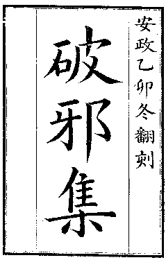
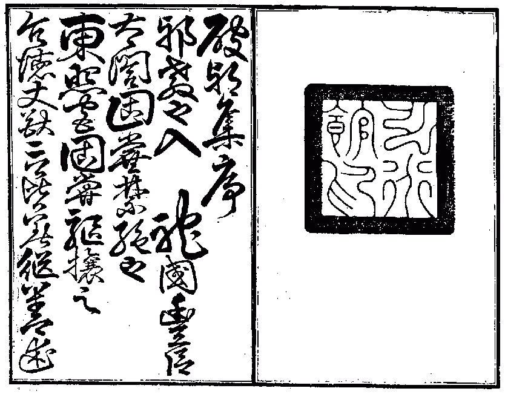
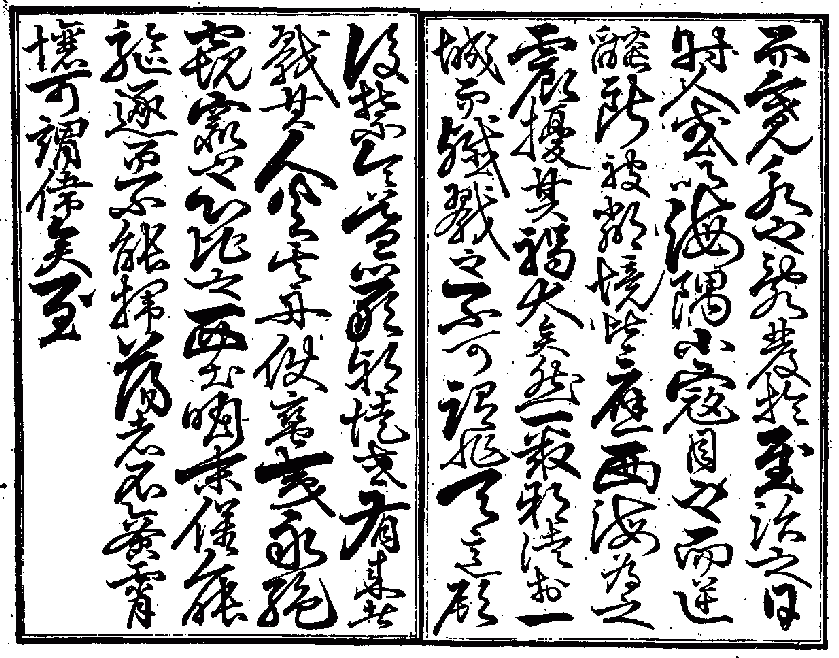
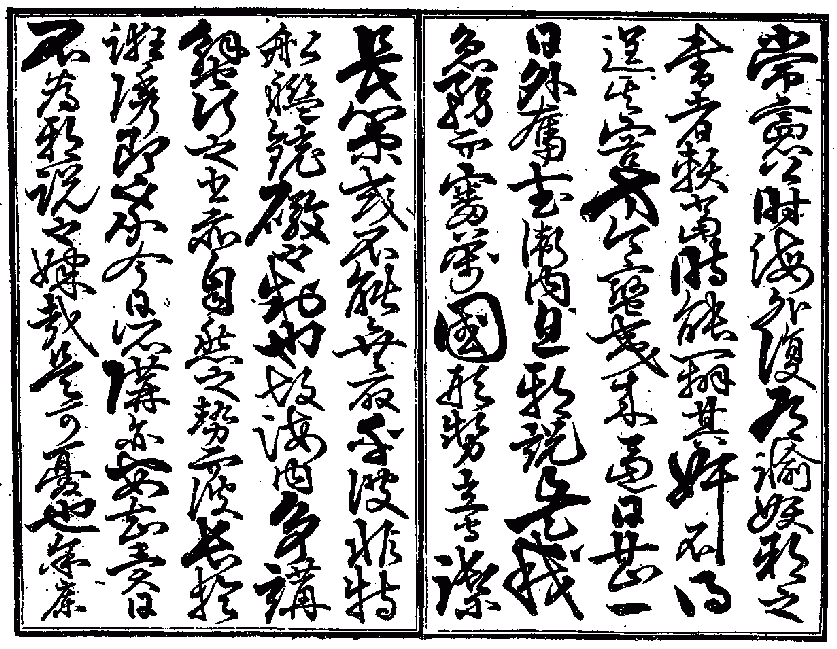
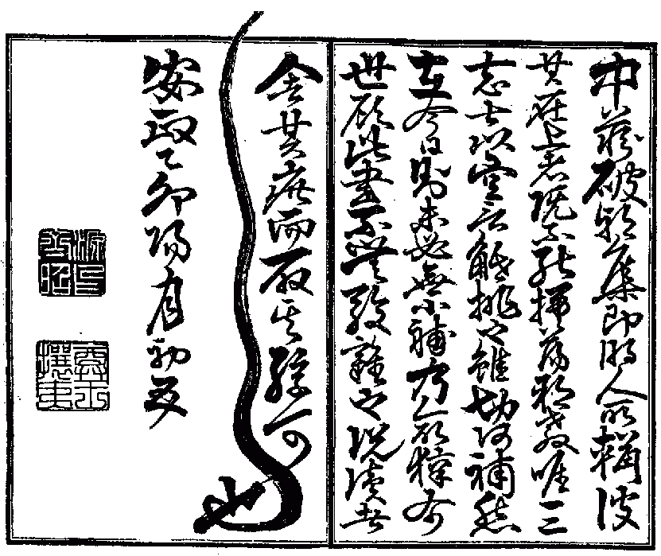
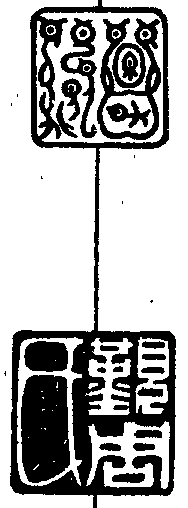

# 圣朝破邪集



> **藏经**：大藏经补编（大藏经补编）　**册次** 第 28 册（B28）　**编号** B0155　**部类** 诸宗部　**卷次** 8 卷　**篇幅** 109,550 字

> **卷／品**：8 卷 · 16 品



---



## 目录



  - [南宫署牍序](#南宫署牍序)

  - [破邪集序](#破邪集序)

  - [圣朝破邪集序](#圣朝破邪集序)

  - [破邪集序](#破邪集序-1)

  - [破邪集自序](#破邪集自序)

  - [圣朝佐辟自序](#圣朝佐辟自序)

  - [十二深慨序](#十二深慨序)

  - [不忍不言序](#不忍不言序)

  - [綂正序](#綂正序)

- [明朝破邪集卷第一](#明朝破邪集卷第一)

  - [南宫署牍序](#南宫署牍序-1)

- [明朝破邪集卷第二](#明朝破邪集卷第二)

- [圣朝破邪集卷第三](#圣朝破邪集卷第三)

  - [破邪集序](#破邪集序-2)

  - [明朝破邪集序](#明朝破邪集序)

  - [破邪集序](#破邪集序-3)

- [明朝破邪集卷第四](#明朝破邪集卷第四)

- [明朝破邪集卷第五](#明朝破邪集卷第五)

- [明朝破邪集卷第六](#明朝破邪集卷第六)

  - [十二深慨序](#十二深慨序-1)

- [明朝破邪集卷第七](#明朝破邪集卷第七)

  - [不忍不言序](#不忍不言序-1)

- [圣朝破邪集卷第八](#圣朝破邪集卷第八)

  - [统正序](#统正序)



---























例言



篇中称呼如圣朝等。及其书法。如擡头等。皆宜改书。今一从原刻。以见当日之旧。  

篇中间有难读者。恐属讹误。而无他本可校。不敢妄改。  

此书主於破邪而如学术有纯驳。立言有深浅。固不遑论。虽缁流之言。取以为息拒之用。可见破邪之急於拯焚溺。故通篇从原本。不增损一字。



辟邪题词



余佩服儒教攻苦有年葢通昼夜寒暑而行住坐卧于此中方以未得理道为憾忍听邪说乱之也哉日兢兢焉以一善之得一隙之明急为传布嘉与流通何帝典王谟名臣烈士贞夫节妇不一一表章于帙中迄上古中古前朝君相丰功伟业咸密密裒崇于言外无非以大经大法迪人心而开人目使异说不得乘而中也偶於中秋偕费隐禅师连舟诣禾见其案前所列辟邪诸书若痛斥天主教之以似乱真贬佛毁道且援儒攻儒有不昭其罪洞其奸彰灼其中祸于人流害于世胥天下而膺之惩之不已者南有宗伯北有谏臣𠳿𠳿疏论於神宗显皇帝之前已称直穷到底闽诸君子浙诸大夫侃侃紏绳夫以技衒巧以利诱愚口诛创异笔伐党同何啻张胆明目至于云栖有说密老有辩费师有揭邪之不容撺正也𫄥𫄥数千言佛与儒同一卫道之心矣费师又虑巧伪易滋除蔓匪细不合诸刻揭诸涂使人人警省在在耸惕焉能户为说而家为喻因以数帙授昌治编其节次胪其条款列其名目一种忧世觉人之苦心洞若指掌一叚明大道肃纪纲息邪说放淫词辟异端尊正朔较若列眉於中删繁就简去肉存髓凡一言一字可以激发人心抹杀异类有补于一时有功于万世者靡不急录以梓是则昌治以肤见当佐辟也夫



崇祯十二禩季冬五日盐官徐昌治觐周甫书于大业堂中







圣朝破邪集目录



徐昌治订



卷一



------



### 南宫署牍序



陈懿典



　叅远夷疏(凢三)  

沈㴶



　查验夷犯劄



　会审王丰肃等犯案(并移咨)  

吴尔成



　南京都察院回咨



卷二



　发遣远夷回奏疏  

沈㴶



　会审鍾明礼等犯案  

吴尔成



　会审鍾鸣仁等犯案  

徐从治



　拿获邪党后告示



　清查夷物案



　折毁违制楼园案(附估修黄公祠)  

徐从治



　福建巡海道告示  

施邦曜



　提刑按察司告示  

徐世荫



　福州府告示  

吴起龙



卷三



------



### 破邪集序



蒋德璟



------



### 圣朝破邪集序



颜茂猷



　题黄天香词盟  

唐显悦



------



### 破邪集序



周之夔



　请颜先生辟天主教书  

黄贞



　尊儒亟镜(叙一说凢七)  

黄贞



------



### 破邪集自序



黄贞



　罪言  

王朝式



　驱夷直言  

黄廷师



　邪毒实据  

苏及㝢



　利说荒唐惑世  

魏濬



卷四



------



### 圣朝佐辟自序



许大受



　圣朝佐辟(凢十)  

许大受



卷五



　辨学𫇴言(叙一辨凢五)  

陈侯光



　天学剖疑  

戴起凤



　杀生辨  

虞淳熈



　破利夷僭天罔世  

虞淳熈



　辟邪解  

黄紫宸



　辟邪解  

黄问道



　劈邪说  

李灿



　辟邪摘要畧议  

张广湉



卷六



　诛夷论畧  

林启陆



　辟邪管见录  

邹维琏



　攘夷报国公揭  

李维垣



------



### 十二深慨序



黄贞



　十二深慨  

王忠



　品级说  

黄虞



　诛邪显据录  

李王庭



　历法论  

谢宫花



　四宿引证  

谢宫花



　续正气歌  

谢宫花



卷七



　天说(凢四)  

释袾宏



------



### 不忍不言序



曾时



　不忍不言  

黄贞



　辨天说(凢三)  

释圆悟



　证妄说  

张广湉



　复张梦宅书  

释圆悟



　证妄说跋  

释普润



　证妄后说  

张广湉



　附缁素共证  

释大贤



卷八



------



### 綂正序



刘文龙



　原道辟邪说(凢四)  

释通容



　诛左集缘起  

释普润



　辟天主教檄  

释成勇



　天学初辟(凢九)  

释如纯



------



## 明朝破邪集卷第一



盐官居士徐昌治觐周甫订



------



### 南宫署牍序



南宫署牍者。吴兴沈仲雨。以少宗伯署南礼部诸稿也。仲雨与余同籍同馆。号为莫逆。居恒以经济道谊相勗。不欲徒以文藻称雄长。每共讨馆阁故实。相与叹高皇帝析中书省为六部。然帷幄未尝不与儒臣相咨辄。殿阁皆设大学士。特乾纲独运。亲决万机。故显润色之猷。而泯参賛之迹。后人谓国初罢丞相。而内阁创于永乐间者。非也。文皇神武定鼎。投戈讲艺。即命三杨解胡七大夫。日直文渊阁亲臣比于重臣。賛决机务。有从他曹改入翰林。官仅编简。积渐尊贵终始不离词林。后人谓内阁不尽出词臣一途者。非也。惟景泰天顺正靖之间。初有繇潜邸部院入者。而议礼诸臣皆先改馆职。而后大用。则祖宗雅重词臣。其来久矣。惟是文学侍从之臣。初若优游无所事事。逮晋卿贰。则肩仔周应皆鉅且要。而礼卿为尤甚。若南礼部。人人以为闲适无事之地。用以养望而待迁。而仲雨典南部。独不取优游养尊所奏疏移文诸牍若干卷。余受而卒业焉。所言谨天戒。开储讲。请王婚。定陵祀。皆关宗社大计。引经据礼。明诤婉讽。不遗餘力。而其所发愤抗论。至再至三。不顾流俗。不避劳怨。必期于异说芟除之净尽者。毋如西洋夷人一事。夫天下之患。其来有端。其成有渐。惟早见远虑者。能预察其端。而力防其渐。为能剪其枝蔓。拔其根株。而不遗大患于后。当其初议时。或目为迂濶而讪笑之旁挠之。若见为寻尝不足介意者。正智者之所瞿然恐。蹙然忧。如疾痛之在身。不能一朝濡忍者也。昔贾谊痛哭于庶孽。江綂著论于徙戎。当时若能听其言。则七国之衅必可逆销。五胡之乱何至横决哉。惟端己见而不知。渐已成而莫觉。故一朝发难而不可收拾也。仲雨于夷人王丰肃等。据律叅奏。尽法驱逐。意正在此。或云彼夷无扞罔逆迹。引绳批根。不无伤向化心。一綂无外。何所不包荒。又云夷人窥天之器殊巧。适当修正历法之际。或可叅用。如回回历法而反覆仲雨牍中。固皆侃侃言之矣。彼夷妄称大西洋。且不奉其主笺表。潜迹阑入两都。与重译来王不同。且其徒众日繁。金钱符水。既足煽诱愚民。异教秘器。称天测象。又足以动士大夫好怪耽奇之听。于此不竭力扫除。为虺不摧。为蛇柰何。即如仲雨身任礼卿。奏请奉旨以治此么麼。而辨揭纵横。南北响应。伏莾含沙。意正未已。藉使锄治少缓。撰述同贝叶以盛行部署如黄巾而难制。辇毂之下。陵寝之旁。其祸可胜道哉。学者诵法孔孟。仲尼之诛鲁之文人也。固曰行僻而坚。言伪而辨。记丑而愽。又曰其居处足以掫徒成党。其谈说足以餙褎荧众。其强御足以反是独力。不可不除也。而孟子之诋杨墨曰。杨氏为我。是无君也。墨氏兼爱。是无父也。夫孔子未攻擅政之三家。而先诛乱政之少正卯。孟子不攻仪秦之倾危。而先距杨墨之淫邪。乃后儒称孔行周公之志。孟之功不在禹之下。则岂非以奇衺诡谲之患。能早绝其端。而防其渐哉。仲雨之意葢深远矣。方今㝢内多故。疆事叵测。皆坐于见端不早。积渐不防。以养无穷之祸。仲雨遇事。有关系者。不少宽假。向与予寻讨馆阁旧闻遗事。止为今日。政将及于海内共拭目。新叅之作用。其擘畫建树。兹稿不足尽其大。余特为兹刻表其用心之所在云。



庚申春仲就李年眷弟陈懿典顿首拜撰



南宫署牍



南京礼部侍郎沈　㴶著



叅远夷疏



奏为远夷阑入都门。暗伤王化。恳乞圣明申严律令。以正人心。以维风俗事。职闻帝王之御世也。本儒术以定纪纲。持纪纲以明赏罚。使民日改恶劝善而不为异物所迁焉。此所谓一道同风。正人心而维国脉之本计也。以太祖高皇帝长驾远驭。九流率职。四夷来王。而犹谆谆于夷夏之防。载诸祖训。及会典等书。凢朝贡各国有名。其贡物有数。其应贡之期。给有勘合。职在主客司。其不系该载。及无勘合者。则有越渡关津之律。有盘诘奸细之律。至于臣部职掌。尤严邪正之禁。一应左道乱正。佯修善事。煽惑人民者。分其首从。或绞或流。其军民人等不问来历。窝藏接引。探听境内事情者。或发边充军。或发口外为民。律至严矣。夫岂不知远人慕义之名可取。而朝廷覆载之量。可以包荒而无外哉。正以山川自有封域。而彼疆我理。截然各止其所。正王道之所以荡平。愚民易与为非。而抑邪崇正。昭然定于一尊。乃风俗之所以淳厚。故释道二氏流传既久。犹与儒教并驰。而师巫小术。耳目畧新。即严绝之。不使为愚民煽惑。其为万世治安计至深远也。不谓近年以来。突有狡夷自远而至。在京师。则有庞廸峩熊三㧞等。在南京。则有王丰肃。阳玛诺等。其他省会各郡。在在有之。自称其国曰大西洋。自名其教曰天主教。夫普天之下。薄海内外。惟皇上为覆载炤临之主。是以国号曰大明。何彼夷亦曰大西。且既称归化。岂可为两大之辞以相抗乎。三代之隆也。临诸侯曰天王君天下曰天子。本朝稽古定制。每诏诰之下。皆曰奉天。而彼夷诡称天主。若将驾轶其上者。然使愚民眩惑。何所适从。(臣)初至南京。闻其聚有徒众。营有室庐。即欲修明本部职掌。擒治驱逐。而说者或谓其类实繁。其说浸滛人心。即士君子亦有信向之者。况于闾左之民。骤难家谕户晓。(臣)不觉喟然长叹。则亦未有以尊中国。大一统。人心风俗之关系者。告之耳。诚念及此。岂有士君子而忍从其说乎。说者又谓治历明时之法。久失其传。台监推算渐至差忒。而彼夷所制窥天窥日之器。颇称精好。以故万历三十九年。曾经该部具题。欲将平素究心历理之人。与同彼夷开局繙绎。呜呼。则亦不思古帝王大经大法所在。而不知彼之妖妄怪诞。所当深恶痛绝者。正在此也。(臣)请得言其详。从来治历。必本於言天。言天者必有定体。尧典敬授人时。始于寅賔寅饯。以日为记。如日中星鸟。日永星火。宵中星虚。日短星昴葢日者天之经也。而月五星同在一天之中。月之晦朔弦望。视日之远近。而星之东南西北。与日之短永中相应。是故以日记日。以月记月。以中星记时。舜典在璇玑玉衡。以齐七政。解之者。以天体之运有恒。而七政运行于天。有迟有速。有顺有逆。犹人君之有政事也。则未闻有七政而可各自为一天者。令彼夷立说。乃曰七政行度不同。各自为一重天。又曰七政诸天之中心。各与地心不同处所。其为诞妄不经。惑世诬民甚矣。传曰日者众阳之宗。人君之表。是故天无二日。亦象天下之奉一君也。惟月配日。则象于后。垣宿经纬以象百官。九野众星以象八方民庶。今特为之说曰。日月五星各居一天。是举尧舜以来。中国相传。纲维綂纪之最大者。而欲变乱之。此为奉若天道乎。抑亦妄干天道乎。以此名曰慕义而来。此为归顺王化乎。抑亦暗伤王化乎。夫使其所言天体。不异乎中国。(臣)犹虑其立法不同。推步未必相合。况诞妄不经若此。而可据以纷更祖宗钦定圣贤世守之大綂历法乎。(臣)又闻其诳惑小民。輙曰祖宗不必祭祀。但尊奉天主。可以升天堂。免地狱。夫天堂地狱之说。释道二氏皆有之。然以之劝人孝弟。而示惩夫不孝不弟造恶业者。故亦有𦔳于儒术尔。今彼直劝人不祭祀祖先。是教之不孝也。繇前言之。是率天下而无君臣。繇后言之。是率天下而无父子。何物丑类。造此矫诬。葢儒术之大贼。而圣世所必诛尚可[山/虫][山/虫]然驱天下而从其说乎。然闾左小民。每每受其簧鼓。乐从其教者。闻其广有赀财。量人而与。且曰天主之教如此济人。是以贪愚之徒。有所利而信之。此其胸怀叵测。尤为可恶。昔齐之田氏。为公私二量。公量小。家量大。以家量贷民。而以公量收之。以收民心。卒倾齐国。可为烱鉴。刘渊入太学。名士皆让其学识。然而𭁵晋者。刘渊也。王夷甫识石勒。张九龄阻安禄山。其言不行。竟为千古永恨。有忠君爱国之志者。宁忍不警惕于此。猥云远夷慕义。而引翼之。崇奖之。俾生其羽毛。贻将来莫大之祸乎。伏乞勅下礼兵二部。会同覆议。如果臣言不谬。合将为首者。依律究遣。其餘立限驱逐。仍复申明律令。要见彼狡夷者。从何年潜入。见今两京各省有几处屯聚。既称去中国八万里。其赀财源源而来。是何人为之津送。其经过关津去处。有何文凭。得以越渡。该把守官军人等。何以通无盘诘。严为条格。今后再不许容此軰闯入。违者炤大明律处断。庶乎我之防维既密。而彼之踪迹难诡。国家太平。万万年无复意外之虞矣。(臣)不胜激切待命之至。



> 万历四十四年五月日



再叅远夷疏



奏为远夷阑入都门。暗伤王化恳乞圣明申严律令。以正人心。以维风俗事。先该(臣)於本年五月间。具题前事。候旨未下。顷於七月十九日。接得邸报。又该礼部覆题。亦在候旨间。(臣)有以仰体圣心。未尝不留念于此事也。则(臣)言有所未尽。而机务原不可不熟思尔。夫左道惑众。律有明条。此臣部之职掌当严也。裔夷窥伺潜住两京。则国家之隐忧当杜也。圣明自为社稷计。岂其不留念及此乎。惟是两京事体。稍有不同。而王丰肃等潜住南京。其盘诘勾连之状。尤可骇恨则(臣)前䟽尚有言之未尽者。何也京师为陛下日月炤临之所。即使有神奸潜伏。犹或上惮於天威之严重。而下怵於举朝之公论。未敢显肆猖狂。公行鼓扇。若南京则根本重地。高皇帝陵寝在焉。山川拱护。固为臣庶之瞻依。而门殿閟清。全在纪纲之振肃。所以讥防出入。而杜绝夫异言异服者。尤不可不兢兢也。而丰肃神奸。公然潜住正阳门里。洪武冈之西。起葢无梁殿。悬设胡像。诳诱愚民。从其教者。每人与银参两。尽写其家人口生年日月。云有咒术。后有呼召不约而至。此则民间歌谣遍传者也。每月自朔望外。又有房虚星昴四日为会期。每会少则五十人。多则二百人。此其自刻天主教解。要畧中。明开会期。可查也。踪迹如此。若使士大夫峻绝不与往还。犹未足为深虑。然而二十年来。潜住既久。结交亦广。不知起自何人何日。今且习以为故尝。玩细娱而忘远畧。比比是矣。(臣)若更不觉察。胡奴接踵於城𬮱。虎翼养成而莫问。一朝窃发。患岂及图。尤可恨者。城内住房既据洪武冈王地。而城外又有花园壹所。正在孝陵卫之前。夫孝陵卫以卫陵寝则高庙所从游衣冠也。龙蟠虎踞之乡。岂狐鼠纵横之地。而狡夷伏藏於此。意欲何为乎。更可骇者(臣)䟽向未发抄。顷七月初。才有邸报。而彼夷即於七月初旬具揭。及至二十一日。已有番书订寄揭稿在王丰肃处矣。夫置邮传命。中国所以通上下。而广宣达也。狡焉丑类。而横弄线索於其间。神速若此。又将何为乎。顷该巡视东城御史孙光裕。查炤会题事理。行令兵马司拘留彼夷候旨。犹有愚民手执小黄旗。自言愿为天主死者。幸而旋就拘获。然亦可见事机之不可失。而处分之明旨。更不可后矣。(臣)查得大明律例。凢化外人犯罪者。并依律拟断。注云俱要请旨。除王丰肃系化外人。臣谨遵律令明文候旨处分外。其餘同居徒众。妄称天主教。扇惑人民。见在本所搜获者。一十三名。一面行提鞫审。此外更不株连一人。今小民洗涤门户。不复从邪。正可嘉与维新。而都士大夫。尤晓然知狡夷不可测。臣乃得昌言以毕其愚虑。惟恐远听者不审其情形。而犹惑於术数之小知也。且庞迪峩。态三拔。久在辇下。传送既速簸弄必巧。迁延日久。线索横出。则亦事机之不可不虑者也。伏乞陛下念根本重计。蚤赐批发该部。覆请速咨。臣等将夷犯从法依律拟断。其原叅未获阳玛诺等者。行提缉获。庶乎明旨昭然而人心大定。道化归一。而风俗永清。不惟臣部职掌得申。而国家之隐忧亦杜矣。(臣)不胜激切待命之至



> 万历四十四年八月日



叅远夷三疏



奏为远夷情形甚诡。留都根本当防。恳乞圣明蚤赐处分以清重地。以正人心事。臣闻邪不干正。而左道惑众者必诛。夷不乱华。而冐越关津者必禁。方其萌芽窥伺。则以礼教防之而有餘。及其党与勾连。则将干戈取之而不足。窃炤夷犯王丰肃等。诈言八万里之远。潜来南京。妄称天主教扇惑人民。非一日矣。先该臣两次具题。又该礼部及南北台省诸臣。先后题催。未奉明旨。陛下岂犹未悉彼夷情形之诡乎。夫其术之邪鄙不足言也。据其所称天主。乃是彼国一罪人。顾欲矫诬称尊。欺诳视听。亦不足辨也。但使止行异教。非有阴谋。何故於洪武冈王气所鍾。辄私盘据。又何故於孝陵卫寝殿前擅造花园。皇上试差官踏勘。其所葢无梁殿。果於正阳门相去几里是否缘城近堞踪迹可疑。南京各衙门月给报房工食。葢谓两京事体。奉旨施行欲其呼吸相通尔。其他乡官士民皆不能得。而彼夷人亦给工食。与报房人。意欲何为。尤可异者。各衙门叅彼之䟽。尚未得㫖。而庞迪峩熊三㧞等。亦造䟽揭。差其细作。鍾鸣礼张采等。赍持前来。诈称已经奏进。刊刻投递(臣)观其䟽揭内。公然自言两京各省有十三人。殊为可骇。夫利玛窦。昔年进京始末。此廷臣所知。原未尝有如许彼众也。皇上怜其孤身。赐之塟地。此自柔远之仁。与成祖当年赐浡泥王塟地相同。若使浡泥王蒙恩赐塟。而浡泥国臣民。遂借为口实。因缘𥨸入。散布京省成祖能置之不问否。彼乃欲借皇上一时柔远之仁。而潜藏其狐兔踪迹。勾连窥伺。日多一日。岂可置之不问耶。臣近又细询闽海士民识彼原籍者。云的系佛狼机人。其王丰肃。原名巴里狼当。先年同其党类。诈称行天主教。欺吕宋国主。而夺其地。改号大西洋。然则闽粤相近一狡夷尔。有何八万里之遥。(臣)虽未敢即以此说为据。然而伏戎於莽。为患叵测。总之根本重地。必不可容一日不防者也。伏乞皇上即下明旨。容(臣)等将王丰肃等。依律处断。其扇惑徒众。在本所捕获。鍾明仁等。及续获到细作。鍾明礼张采等。或系勾连主谋。或系因缘为从。一面分别正罪。庶乎法纪明。而人心定。奸邪去。而重地亦永清矣。臣无任激切待命之至。



> 万历四十四年十二月日



付该司查验夷犯劄



南京礼部为奉旨处分夷情事。准礼部咨炤得狡夷王丰肃等。与内地奸民鍾鸣仁鍾鸣礼等。勾连扇惑。潜住辇毂之下。多年。先该本部奏为远夷阑入都门。暗伤王化。恳乞圣明申严律令。以正人心。以维风俗事。内叅夷犯王丰肃。阳玛诺。庞迪峩。熊三拔等四名。除庞熊二犯。系潜住京师。近该礼部遵旨递发外。七月间。礼部覆题抄到二十一日。该巡视东城御史孙。行兵马司提拘王丰肃等一十四名。该本部于八月初一。题明前事。除王丰肃系化外人。(臣)谨遵律令明文候旨处分外。其餘同居徒众。妄称天主教。扇惑人民。见在本所搜获一十三名。一面行提鞫审。此外并不株连一人等因。又於十二月初一该本部续奏为远夷情形甚诡。留都根本当防。恳乞圣明早赐处分。以清重地。以正人心事。内称尤可异者。各衙门叅彼之疏。尚未得旨。而庞迪峩熊三拔等。亦造䟽揭。差其细作。鍾鸣礼张采等。赍揭前来。诈称已经奏进刊刻投递云云。伏乞皇上即下明旨。容(臣)等将王丰肃等。依律处断。其扇惑徒众。在本所捕获鍾鸣仁等。及续获到细作鍾鸣礼。张采等。或系勾连主谋。或系因缘为从。一面分别正罪。庶乎法纪明而人心定。奸邪去而重地亦永清矣。等因。俱候旨间。今该前因除鍾鸣仁鍾鸣礼张采等。合照本部题明事理另审外。及查十三名内谢务禄一名。亦供称化外人在卷。为此合劄该司查验王丰肃谢务禄果否俱系化外夷人。其未获阳玛诺是否先归本国。速具确报以凭查照。礼部题奉钦依事理。速差递送督归钦遵施行。



> 万历四十五年二月日



会审王丰肃等犯一案(并移咨)



南京礼部主客清吏司为奉旨处分夷情事奉本部劄付内开鍾鸣仁鸣礼张采等合炤本部题明事理另审外。及查十三名。内谢务禄一名亦供称化外人在卷。合劄该司查验王丰肃谢务禄果否俱系化外夷人。其未获阳玛诺是否先归本国。速具确报以凭查炤。礼部题奉钦依事理。速差递送督归等因。奉此随牌行东城兵马司将远夷王丰肃谢务禄二名提解前来。该本司吴郎中。会同司务厅张司务。祠祭司徐郎中。精膳司黄郎中。仪制司文主事。祠祭司徐主事。会审得。王丰肃面红白眉白长眼深鼻尖胡须黄色。供称年五十岁。大西洋人。幼读夷书。繇文考理考道考得中多耳笃。即中国进士也。不愿为官。只愿结会。与林斐理等讲明天主教。约年三十岁时。奉会长格老的恶之命。同林斐理阳玛诺三人。用大海船在海中行走二年四个月。于万历二十七年七月内前到广东广州府香山县。香山𤀀中。约有五月。比阳玛诺留住𤀀中。是丰肃同林斐理。前至韶州府住几日。又到江西南昌府住四月。于万历三十九年三月内前到南京西营街居住。先十年前有利玛窦庞迪峩郭居静罗儒望等。已分住南京等处。利玛窦要得进京贡献。寄书𤀀中。到王丰肃处。索取方物进献。是丰肃携自鸣钟。玻璃镜等物。前来比时利玛窦先已进京。随将方物等件。寄进京贡献讫。比时罗儒望将家火交与王丰肃遂在此建立天主堂。聚徒讲教。约二百餘人。每遇房虚昴星日一会。寅聚辰散。月以为尝。并未他往其林斐理。于四十一年六月内病故。其尸棺见停天主堂内。其阳玛诺。向住𤀀中。亦于先年移住南雄府。约有几月前到南京。与丰肃同住两年。又往北京。三年仍复回南同住。于四十三年十二月内。仍往南雄居住。并未回还本国。一向丰肃所用钱粮。自西洋国商船带至𤀀中。约有六百两。若欲葢房。便增至千金。每年一次。是各处分教庞廸峩等分用等语。又审得谢务禄面红白色眼深鼻尖黄须供年三十二岁大西洋人。曾中多耳笃。不愿为官。亦只会友讲学。于先年失记月日。自搭海船前到广东𤀀中约有三年六个月等语。据此看得谢务禄面貌与丰肃相同。其为远夷无疑。阳玛诺虽未回还本国。据称见在南雄。则非潜匿此中明矣。缘系劄审事理理合具繇连人解堂伏候裁夺施行须至呈者。



计开解夷犯二名。



王丰肃



谢务禄(见病)



堂批　二犯既查验明白。即移咨都察院。转行巡城衙门。遵旨速差员役递送至广东抚按衙门。督令西归。



万历四十五年二月　日署郎中主事吴尔成移南京都察院咨。



南京礼部为远夷久覊候旨。恳乞圣明速赐处分。以维风教。以肃政体事。主客清吏司案呈奉本部送准礼部咨前事。该本部题主客清吏司案呈。奉本部送据南京礼科给事中晏文辉揭称前事。内云。臣惟天地开辟以来。而中国之教。自伏羲以迄周孔。传心有要。阐道有宗。天人之理。发泄尽矣。无容以异说叅矣。嗣是而老氏出焉。杨墨出焉。好异者宗之。然不过𥨸吾儒之绪餘。以鸣其偏见。故当时卫道者。力辟焉而不使滋蔓。乃今又有倡为天主教。若北有庞廸峩等。南有王丰肃等。其名似附於儒。其说实异乎正。以故南北礼卿叅之。北科道叅之。而南卿寺等巡视等衙门。各有论䟽也。今一槩留中而不下。岂皇上悉未省览耶。岂谓此軰未见其显害。而姑优容耶。夫庞廸峩等在辇毂下。诚不知其详。王丰肃等在南中。臣得毕其说丰肃数季以前。深居。简出入。寡交游。未足启人之疑。民与之相忘。即士大夫亦与之相忘。迩来则有大谬不然者。私置花园於孝陵卫。广集徒众於洪武冈。大瞻礼。小瞻礼。以房虚星昴日为会约。洒圣水。擦圣油。以剪字贴户门为记号。迫人尽去家堂之神。令人惟悬天主之像。假周济为招来。入其教者。即与以银。记年庚为恐吓。背其盟者。云置之死。对士大夫谈。则言天性。对徒軰论。则言神术。道路为之喧传士绅为之疑虑。祖宗根本之地。教化自出之区。而可令若軰久居乎。以故礼臣沈㴶。据其今日行事。虞其将来祸患发愤䟽闻。诚大有禆於世道人心者。其时臣巡视门禁。亦於合䟽中。附名以上请。而御史孙光裕覊之以候旨皆为地方。为王化计也岂好为是激聒哉。且天帝一也。以其形体谓之天。以其主宰谓之帝。吾儒论之甚精。而彼刻天主教要畧云。天主生於汉哀帝时。其名曰耶稣。其母曰亚利玛又云被恶官将十字枷钉死。是以西洋罪死之鬼。为天主也。可乎不可乎将中国一天。而西洋又一天耶将汉以前无天主。而汉以后始有天主耶。据斯谬谭。直巫觋之邪术也。孔氏有言曰。攻乎异端斯害也已。今正其攻之之时矣。更民心易於从邪。亦易於返正。自王丰肃被论被覊之后。闻从其教者。一时尽裂户符。而易门对矣。安家堂而撤夷像矣。悔非远害。散党离群。无复可虞矣。惟是王丰肃等。尚在覊系之中。未蒙处分之旨。守候既久。结局无时。万一自毙。其如法之未明何。乌在其为尊朝廷。而慑裔夷哉。伏乞



速下部议。或𩛙我皇纲从重究治。或恢我皇度从轻驱逐。庶风教维而政体肃矣等因到部。送司案呈到部。看得南科臣䟽请。虽未奉旨下部。但远人久在覊禁。时令又值严寒。恐伤天地好生之心。相应据揭题覆。𥨸炤夷夏之防自古严之。故用夏变夷。未闻变於夷者。孟轲氏言之确矣。王丰肃等之在南。庞迪峩等之在北。既自称八万里之远人。不载贡享。突流寓於中华。其来己自可疑。特昔也隐处一㕓。无甚非常可骇之事。故置之不论。今孝陵卫洪武冈何地也。我太祖龙飞兴王之所。而侈列花园。广集徒众。大倡天主之教利诱术笼。无所不至。意欲何为。此岂圣明之世。车书轨物一道同风之景象哉。况莫尊於天。帝中国者称天子。彼乃出於天子之上乎。南礼(臣)特䟽叅之而不报。南府部台省合䟽叅之而不报。北科道诸臣暨本部叅之亦不报。故南科(臣)晏文辉。又有速赐处分之请也。职等伏念此軰左道惑众。止於鼓铎摇铃。倡夷狄之道於中国。是书所称蛮夷猾夏者也。此其关系在世道人心。为祸显而迟。但其各省盘据果尔出神没鬼透中国之情形於海外。是书所称㓂贼奸宄者也。此其关系在庙谟国是。为祸隐而大。年来皇上德威遐鬯。东征西讨。诸妖氛小丑。旋即殄灭。视西洋零星诸夷蒙头葢面。讲性说天。炫奇吊诡。得无谓其颇有智慧。无甚祸心。姑以包荒於覆载耳。宁知彼天主之说。谬妄欺君。淫邪诬民。一至於此。即所私剏浑天仪。自鸣钟之类。俱怪诞不准於绳。迂濶无当於用。尝考尧舜之世。有璇玑玉衡。以齐七政之法。历代相传。有铜壶滴漏以测晷刻之法。岂无颖异。如王丰肃庞廸峩等。其人绝不闻有此规制也。稽祖宗令甲。私习天文有禁。私通海外诸夷有禁葢防微杜渐虑至深远也。如皇上悯念远人。簧鼓虽有的据。跳梁尚无实迹。伏乞将王丰肃庞廸峩等。𠡠下本部。转行各该衙门。递送广东。听彼中抚按暂为收管。督令西归。庶帡幪之仁以广。睥睨之渐以消。统一圣真如日之中天。宁谧海宇如盘之巩固。天下后世诵英君之举动。超出寻常万万矣等因。万历四十四年十二月初十日本部署部事左侍郎兼翰林院侍读学士何宗彦等具题。二十八日奉圣旨。这奏内远夷王丰肃等。立教惑众。蓄谋叵测尔部移咨南京礼部行文。各该衙门速差员役递送广东抚按。督令西归以静地方。其庞廸峩等。去岁尔等公言晓知历法。请与各官推演七政。且皆系向化来京。亦令归还本国。该部院知道钦此钦遵。拟合就行。为此除将庞迪峩等咨行都察院转行五城巡视御史衙门递至广东抚按衙门督令西归外。合咨贵部查照本部。题奉钦依内事理转行各该衙门。速差员役将王丰肃等递送广东抚按衙门。督令西归。一体钦遵施行等因到部。原叅夷犯阳玛诺。已经先回南雄府。另文知会驱逐外。见有王丰肃谢务禄二名。俱系夷人相应递送。看得狡夷王丰肃等。盘据多年。党与日众。岂容太平之世。有此不轨之徒。南北交叅。事非得已近蒙圣明洞悉邪谋。立赐驱逐。虽云待以不死。业已永靖地方。但丑类实繁有徒。而道里又甚辽远。兼以挟赀营干。不无意外生奸。仍恐递送员役。万一踈虞。为累不小。为此合咨贵院。转行五城巡视御史衙门。查炤礼部题奉钦依事理。择差的当员役。将狡夷王丰肃谢务禄二名。沿途加意隄防。递送至广东抚按衙门。交割明白。仍听从长计议督令西归。事竣之日。希回文过部以便覆题。烦为查炤一体钦遵施行。



> 万历四十五年二月日



南京都察院回咨



南京都察院为远夷久覊候旨。恳乞圣明速赐处分。以维风教以肃政体事。据巡视京城监察御史郭一鹗赵绂孙光裕。呈据指挥李钰刘仕晓等。赍回总督两广军门。今升南京户部尚书候代周　揭帖前事。内开准巡视南京中等城河南等道揭帖前事。奉南京都察院劄付。准南京礼部咨主客清吏司案呈奉本部送准礼部咨。该本部题主客清吏司案呈奉本部送据南京礼科给事中晏文辉揭前事。题奉圣旨。这奏内远夷王丰肃等。立教惑众。蓄谋叵测。尔部移咨南京礼部行文各该衙门。速差员役递送广东抚按督令西归以静地方。其庞廸峩等去岁尔等公言晓知历法。请与各官推演七政。且皆系向化来京。亦令归还本国。该部院知道。钦此钦遵备劄到职。奉此看得狡夷王丰肃谢务禄连犬羊之𩔗。蓄蛇豕之奸。盘诘且历有年。党与所在而是。虽覆载恩深。既以假其残息。而窥伺情熟。未必怀好音。意外疎虞。万宜加慎。为此选差指挥李钰刘仕晓。带领兵勇。将王丰肃谢务禄二名。开具年貌押解前去。沿途加意隄防。递送广东抚按衙门交割明白。仍听从长计议。督令西归。事竣之日。希回文过院以凭回报覆部覆题施行。又准南京礼部咨前事。烦为查炤礼部题奉钦依事理。将狡夷王丰肃谢务禄。委官的当收管。及查本部原叅夷犯。今回住南雄府阳玛诺一并行提等因。并据差官解到夷犯王丰肃谢务禄二名。俱经案发广东布政司会同按都二司。将二犯译审果否西洋国人。於何年月日从何处入中国。从何路入南京。今既奉旨遣还。仍从何路归还本国。阳玛诺见在何处。曾否先回。庞廸峩计不久解到。应否候其同归。其在濠境𤀀各夷有无相识应否责成𤀀夷伴送归国。取具的确口词。酌议通详。及将未获阳玛诺严去缉拿去后。今据该司呈称广州府署印同知林有梁。审看得夷人王丰肃等以左道簧鼓士民。麾之使去。是治以不治之法也。查王丰肃大西洋国人。万历二十九年船泊濠境𤀀。同行三人。一林斐理。一阳玛诺。肃与理先驻足韶州数日。乃往江西入省住四月。直至南京。葢利玛窦徒也。因利玛窦有望北之行。先息于三夷人使居于南为之管事耳。后四十一年。谢务禄亦繇大西洋船泊𤀀亦繇广东而江西直抵南京以寻丰肃等。先阳玛诺入𤀀时。患病不能进南京。留于𤀀七八年。方往韶州二年方进南京。驻数月即进北京。此人颇识天文。故庞迪峩邀之同往庞廸峩熊三㧞即与利玛窦同来者。诺后因不服水土。不耐寒霜于四十一年还南京至四十三年腊月还南雄。今查其人已驾西洋船去。其踪迹不可考也。问二夷去向大抵欲入𤀀也。但一入𤀀。去与不去难以钤制。合就省内另择一所覊候。日拨营兵二名防护之。五日一换。禁绝通息。即牌令𤀀中探有大西洋船欲回时。随就省差指挥官二员带兵押至船。直待其开驾回报以便转文。庞廸峩未知解到何期。阳玛诺合行牌南雄府属严查下落。其林斐理四十一年六月内在南京病故。今年三月部委上元江宁二县开验埋塟讫。丰肃务禄回夷日子未知久近。月各给火食银二两等因具详到司。该本司左布政使臧尔劝。右布政使堵维垣。会同按察司署印副使罗之鼎。都司掌印署都指挥佥事杨维垣。译审得夷人王丰肃谢务禄俱西洋国人。丰肃于万历二十九年船泊濠境𤀀。转抵韶州而达江西直至南京。务禄于四十一年亦船来泊𤀀。转繇广东江西而至南京。兹奉明旨遣还归国。无庸再议。但归国必取道于𤀀。去留皆不可知。须西洋船至𤀀。庶便遣还。今西洋船尚未至。难定开洋日期。合应覊候。俟其船到发还。其庞廸峩解向未到。应候解到之日。另行发遣。通取开洋日期。及𤀀夷不致潜留甘结缴报。又据丰肃禀称阳玛诺于四十三年十二月内繇南雄回𤀀讫未委虚实。应行南雄府严查另报。再照夷人稽留境上。无从得食。该府议另择一所拨兵防护。每月给银二两似应准从等因到职。除批如议行外该职会同巡按广东监察御史田　看得。王丰肃等以海外夷人。先年越关入广。渐达两京。潜住长安邸舍。倡立天主异教。惑世诬民。法本难贷。兹蒙待以不死。遣还归国。诚庙堂崇正之𬣙谟。安夏攘夷之长计也。万代瞻仰在此举矣。既经押解前来。应即速遣还国。苐此夷自西洋入中国。取道濠境。𤀀夷必多熟识。曾经面审并无相识。𤀀夷情伪叵测。今当暂覊省城。防护之以兵。优给之以食。俟有西洋船到𤀀回国。即差的当官督押至船。勒令开洋载归本国。取𤀀夷不致容留甘结缴查。其庞廸峩熊三㧞续报已到京城。业行该司会议。并发取各开洋日期呈报。若阳玛诺则称久已还国。除另查核外为此具揭。并送广州府印信收管一本等因到职。又准巡按广东监察御史田　牒回前事相同。内开随经案行按察司会同布都二司。将发去夷犯译审后随据该司经历司呈奉本司帖文开称。又准布政司炤会奉总督两广军门周　案验亦同前事。依蒙移会二司酌议及行广州府将二犯译审。并行南雄府严缉阳玛诺解报。及香山县查𤀀夷有无相识玛诺密缉拏解。又蒙本院案騐奉都察院勘劄亦同前因。内称庞迪峩等已行京城巡视衙门督令起程还国应否候至总发等因。行间就据广州府署印清军同知林有梁审看。于五月二十六日具详到职。除批如议行外。本日就据夷人庞迪峩熊三拔赴职投见。并递顺天府原给帖文。仰沿途衙门递送至广东而止。投抚按查收发回等因随牌发按察司会同布都二司查验。并同王丰肃等一体覊候。及委官督兵防守不致他虞。候有洋船至日押发归国。取开洋日期呈报。该职会同总督两广军门周　看得。王丰肃谢务禄之至南京也。始托足于濠境继取道于江西。倡邪说以诬民。思用夷而变夏。此固春秋所为别内外。而孟氏所以正人心者。奉旨遣归。天恩浩荡。苐两夷之意。亟欲准其入𤀀。而三司会议谓宜押令开解。叅酌舆情。若听其从𤀀而归。是教之以𤀀为窟也。宁使𤀀夷不致留存界限于今日。毋使狡夷明居𤀀滋隐祸于他年。惟有暂覊会城量给馆糓。俟西洋船至遣还耳。其庞廸峩熊三㧞已到巳牌行臬司议之。亦宜一体施行。若阳玛诺则称久已还国。除另行查核外。合行移复等因到职。准此看得狡夷王丰肃等已经差官押送至广。取有抚按牒并广州府收管一本。惟彼中藩臬熟谙夷情。今准前因处置停妥。事已结局。理合呈报。伏乞炤详咨部以凭覆题施行等因到院。据此案炤先准南京礼部咨前事。已经备行巡视五城御史查炤。礼部题奉钦依事理择差的当员役将王丰肃谢务禄二名。沿途加意隄防。递送广东抚按衙门交割明白。仍听从长计议。督令西归。事竣之日。具繇回报以凭咨覆。该部覆题施行去后。今据回报前因。拟合就行咨覆。为此移咨



贵部烦为查炤施行。须至咨者。



> 万历四十五年八月日



广东广州府今於与收领除将发下夷犯王丰肃谢务禄收候遵炤明文施行外。中间不违。收领是实。



万历四十五年五月　日署印本府清军同知林有梁



------



## 明朝破邪集卷第二



盐官居士徐昌治觐周甫订



发遣远夷回奏䟽



南京礼部侍郎沈　㴶著



题为钦奉明旨。发遣远夷回奏事。主客清吏司案呈奉本部送准礼部咨。为远夷久覊候旨。恳乞圣明速赐处分。以维风教。以肃政体事。该本部题据南京礼科给事中晏文辉。揭称前事。虽未奉旨下部。相应据揭题覆。乞将王丰肃庞廸峩等。勅下本部。转行各该衙门。递送广东。听彼中抚按。暂为收管。督令西归等因。万历四十四年十二月初十日。本部署部事左侍郎兼翰林院侍读学士何宗彦等。具题。二十八日奉圣旨。这奏内远夷王丰肃等。立教惑众。蓄谋叵测。尔部移咨南京礼部。行文各该衙门。速差员役。递送广东抚按。督令西归。以静地方。其庞廸峩等。去岁尔等公言。晓知历法。请与各官推演七政。且皆系向化来京。亦令归还本国。该部院知道。钦此钦遵。除将庞廸峩等。咨



都察院转行递送外。备咨臣部。查炤钦依内事理。将王丰肃等。递送广东抚按衙门。督令西归。一体钦遵施行等因。到部送司。卷查万历四十四年五月内。该臣题为远夷阑入都门。暗伤王化恳乞圣明申严律令。以正人心。以维风俗事。称在南京有王丰肃阳玛诺等。及炤本年七月二十等日该廵视东城监察御史孙光裕。行南京东城兵马司擒获一干人犯。暂覊候旨。闻彼时提有王丰肃鍾明仁谢务禄等一十四名。其阳玛诺。据称先归本国。未知有无窝藏容隐。及见获谢务禄。亦供称化外人。未知虚实。今该前因行司审据王丰肃供称。年五十岁西洋国人。万历二十九年前来南京。建立天主堂。聚徒讲教。其阳玛诺。向住嶴中。先曾与丰肃同住两年。又往北京三年。仍复回南同住。於四十三年十二月内。仍往南雄居住讫。又审得谢务禄。亦供称西洋人。面貌与王丰肃相同。其为远夷无疑。查明呈覆。该臣查炤礼部。题奉钦依内事理。咨行南京都察院。转行五城廵视御史衙门。速差员役。将王丰肃等。递送广东抚按衙门收管。续据回称会差小教塲中营中哨卫总李钰龙江陆兵前营把总镇抚刘仕晓。带领兵勇。俞大亮等八名。於三月二十五日。起程递送去讫。相应回奏等因。具呈到部。该臣看得王丰肃等。潜住多年。妄称天主。利驱术诱。愚民被其煽惑。不难出妻献子。至於擦油洒水。妇女皆然。而风俗之坏极矣。明旨所谓立教惑众。蓄谋叵测。真是洞见万里之外。而尚宽之以不杀之恩。递还本国。又真所谓包荒。不遐遗。圣人之仁明并用也。惟是私剏庵观有禁。而况乎门庭之清肃。陵寝之森严。岂容留狡夷鼾睡之迹。服舍违式有禁。而况乎无梁殿。其制逼尊。事天堂。其名大僭。岂容不扫除以易都人耳目之观。臣谨行上元江宁二县。东城兵马司。将前项二处折毁入官。盖皆遵律令明文。仰体我皇上以静地方之旨而为之。一以清愚民积习炫诱之端。一以杜彼夷觊觎复来之地尔然不敢不一并上闻也。



> 万历四十五年五月日



会审鍾明礼等犯一案



南京礼部王客清吏司为缉获人犯事。据东城兵马司呈解犯人鍾明礼张采余成元方政汤洪夏王周用吴南等八名。到部。奉堂谕四司会审。奉此该本司吴郎中。会同司务厅张司务。祠祭司徐郎中。仪制司文主事。审据鍾明礼即鍾鸣宇。供年三十四岁。广东新会县人。父鍾念山。生兄鍾鸣仁。及鸣礼。幼时曾住香山𤀀中。𤀀中有大天主殿。一𤀀人皆从其教彼时主教者。名曰历山。又有头目曰东宝禄两人。共住𤀀中。或两年一换。或三年一换。俱从西洋国拨来。鸣礼失记日月。不知何年分。有利玛窦庞廸峩王丰肃郭居静罗儒望等。从西洋国来入𤀀。繇将天主教。愈加讲明。要得行教中国。是父鍾念山。率鸣礼兄弟。往拜从之。自此朝夕不离。利玛窦等。向在韶州地方。起造房屋。供奉天主像。约有十年。乃至江西南昌府赁房居住。比时从之者少。教未大行。众议分投行教。王丰肃至南京。郭居静至浙江。罗儒望住江西。万历二十七年。利玛窦庞廸峩。前往北京。有鸣仁从之同住。鸣礼自住江西。於万历三十三年间。鸣礼来至南京。与王丰肃同住天主堂内。兄鍾鸣仁。亦自北来。一同居住。及万历三十九年。利玛窦死。鸣礼兄弟。同往北京会塟。塟毕仍复来京。王丰肃一切费用。俱自香山𤀀送来。其银自西洋国送入𤀀中。𤀀中商人转送罗儒望。罗儒望转送到此。岁岁不绝。凢天主堂中。有来从教者。或鸣仁。或鸣礼。先与讲说。然后引见王丰肃。一向无异。至今年五月内。鸣礼前往杭州。与郭居静会话。八月初二日。知王丰肃事发。兄鸣仁。已被拘获。又闻浙江军门。亦将缉拿郭居静。鸣礼即於初十日到京。见天主堂已封。即访教中人王甫。余成元。比时王甫已获在城。惟余成元在家。见张采先已在彼。持有北边书揭。俱不敢开。鸣礼云开亦何害。即开其包袱。见护封内有揭帖一封。是礼称说。刻此揭帖。徧送各老爷。可以释放我兄。并一干人犯。即于初十夜。将钱雇已发落刻匠潘明潘华。并已迯秦文等。包工刊刻。至十四日刻完。随到蓬厰中装钉。欲于十五日朝天宫。习仪处所投递。不意城上闻知。当有兵马官前来擒获。是鸣礼说平日受天主大恩。无以报荅。今日就拏也不怕等语。又据张采供年二十六岁。山西平阳府曲沃县人。於万历四十二年三月内。前往北京。推水过活。因见同乡人说称天主教极好。遂拜从庞廸峩门下。迪峩即以鸡翎粘圣油。向额上畫一十字。谓之擦圣油。乃又持圣水念天主经。向额上一淋。即涤去前罪。自后七日一瞻拜。群诵天主经。在天我等父者云云。日将出。乃散。习以为尝。至今年七月二十一日。庞廸峩见南京王丰肃事发。要得救解。与采盘费银二两。交袱包一个。内书揭一大封。差采送南京天主堂中开拆。采於八月初八日到南京。见王丰肃天主堂已经封鎻。乃寻到教中余成元家。比时鍾鸣礼。自杭州来。解包开封。因商量刻揭情繇。十一日刻起。十四日刻完。随于本夜刷印装钉。共成一百本。约十五日习仪处所投递。不意二更时。即被拘获等情。又据余成元供年二十九岁。原籍江西。本京府军右卫人。住鹰扬仓地方。向与王甫同院居住。合种一园。万历三十九年十一月。内有表叔曹秀。先从天主教。劝余成元亦入教中。先遇鍾鸣仁讲说人生不久。寿夭不同。不如及今修一修。使灵魂不灭等语。遂于本月初七日。进见王丰肃。成元跪于天主像前。王丰肃先擦圣油。后淋圣水。令拜天主四拜。并向王丰肃叩头。口称王爷。自后七日一聚会。天未明而至。日未出而散。每次或三四十人。或五六十人不等。至今年七月二十日。王丰肃事发。王甫被城上拘获。成元独住园中。八月初八日。值张采自北京赍揭前来至成元家。即与同住。尚未敢开揭。适鍾鸣礼。亦从杭中来。将书揭拆开。是成元雇得潘明潘华并已迯秦文等。包工刻完。议于十五日习仪日投揭。随被拘获等情。又据方政。供年三十二岁。徽州府歙县人。描金生理。先於三十八年十一月二十日。有不在官叔方文榜。向从天主教。政因此拜从王丰肃称为王爷。自称小的。擦油淋水。其众俱同七日一会。岁时不绝。至今年五月内王丰肃被叅。至八月初九日。余成元见北京张采持揭到来。遂向政说北京有个信来。不知其中何意。值鍾鸣礼自浙江来。乃开书揭。即同刊完。要赶十五日投递。十四日夜随被拘获等情。又据汤洪。供年三十二岁。上元县人。住朝天宫后易家桥。总甲刘科地方。有故兄汤应科。向在天主堂中。每向洪劝诱应科即于四十年十一月。率洪到天主堂。先见鍾鸣仁。即叩王丰肃四头。擦油淋水如尝。自后如期聚会。今年七月内。王丰肃事发。洪虽住家中。时尝探听消息。至八月十四日到余成元家。见张采鍾鸣礼等先在。余成元向洪云。你母舅王桂。捉在监中。你可帮送揭帖。救你母舅等语。是洪听信。亦同在彼幇钉。钉完即同吃酒。约十五日投递。随被捉获等情。又据夏玉。供年三十三岁。南京府军右卫人。住本卫平仓地方。卖糕生理。万历四十年十月内。前往帽子店曹秀家做帽。曹秀因说天主生天生地生万物。汝何不从之。有鍾鸣仁等。与玉讲说天主道理。玉云既谓之天主。何以有像。仁等荅云当初天主化生。止有一男一女。自后百姓作业。不认得天主了。所以洪水泛滥。遭此大难。天主不忍。降生西洋国。以教化天下。至今共一千六百十五六年。又将夷教书十五本。付玉诵读。随进天主堂。擦油淋水。一一是实。若妇人有从教者。王丰肃差鍾鸣仁前往女家。以圣水淋之。止不用油。至今年七月二十一日。见天主堂门已封。思我既敬天主。就有灾患亦无事。至八月二十四日。余成元来呌玉同买鱼肉等项。前往蓬中。但见揭已刷完。只要明早送了。正吃饭间。被城上拿获等情。又据周用。供年六十八岁。江西抚州府东乡县人。一向在京居住。开设书舖。并刷书生理。万历三十八年正月内。王丰肃雇用刷天主经。因与用说。你年纪老大。何不从天主教。日后魂灵可升天堂。用遂入教。今年八月十四日早。有汤洪来说。揭已刊完。你须去刷印几簿。用因年老。恐刷不及。即雇覔吴南同往蓬中。刷至起更时分方完。随即装钉。商量明日投递。不意被获等情。又据吴南。供年二十四岁。羽林左卫人。平日刷印为生。并未从入天主教中。八月十四日。周用向南说。有一相公有几本书。速要刷完。要赶十五日分送。各位爷。我刷不及。你同去一刷。及刷时乃知其为揭帖。许钱二十文。尚未交付。正留吃饭。随即被获等情。今据该城将一干人犯。申解前来。各供口词前情是实。叅看得狡夷之阑入中国也。驾称八万里。不可穷诘之程途。妄揑西洋外千古所无之天主。狡焉盘踞留都。突然私驾巍殿。百千瞻拜。昏夜成群。举国既已若狂。隐忧大为叵测。已经本部题叅。廵院拘禁。静候明旨。攘除荡涤。一时从邪之民。俱已去番字。而贴门符。远夷教。而祀宗祖。会见维新之众。大有廓清之机。而何物鍾鸣礼等。当此见晲雪消之日。廼为魑魅魍魉之谋。潜集蓬厰。公行刻揭。幸被获於深夜。几得中其狂锋。鍾鸣礼父子兄弟通夷。虽戴履中华天地。而俨然披发左袵。张采天南地北奔驰。即么麼亡命厮走。而甘为伏戎隐𭁵。余成元方政。一则以灌园而为保匿奸徒之薮。一则以镂金而效刻揭投递之功。汤洪夏玉。一则从兄邪而与舅同恶。一则受夷书而利蓄亡命。此皆利于明条。亦何辞於法网。宜叅送法司次第轻重拟罪儆示者。若周用则垂尽之息。或蛊於轮𢌞而终迷。吴南则鬼鼠之流。偶诱以青蚨而效用。宜即解网以覆颛愚。缘奉堂谕会审事理。本司未敢擅便。伏乞



裁夺施行。须至呈者。



计开解犯人八名



鍾鸣礼



张采



余成元



方政



汤洪



夏玉



周用



吴南



万历四十四年十月　日署郎中主事吴尔成堂批题叅各犯。自合静听处分。鍾鸣礼等。故来犯法。所恶异教之惑人者。正恶有此等軰耳。本都当叅送正法。姑念周用年老。止当日受雇。吴南认不入教。止受雇。未得钱。量与省放。其餘六犯。情有轻重。总之为夷人用。而勾连煽惑。扬波助澜。则鍾鸣礼实谋主矣。该法司分别定罪。



会审鍾鸣仁等犯一案



南京礼部主客清吏司为远夷阑入都门。暗伤王化事。奉本部劄付前事。奉此遵依行。据五城兵马司呈解。从夷犯人鍾鸣仁等。一起到司。该本司署司事祠祭司徐主事会同司务厅张司务祠祭司徐郎中仪制司文主事。除王桂即王贵病故。外会审得鍾鸣仁。年五十五岁。广东广州府新会县人。供称先年同父念山。及弟鸣礼。往香山𤀀中从天主教。於己亥年随利玛窦进贡。在北京七八年。方来南京住三年。又往浙江一年。旧岁五月间。仍来天主堂中。为王丰肃招引徒众。若妇人从教者不便登堂。令仁竟诣本家。与妇淋水宣呪。呪云我洗尔。因㧞的利揭。非畧揭。西必利多。三多明者。亚们。大约淋过妇人十五六口不记姓。仍管买办使费。所费银两在𤀀中来。每年约有一二百两。曹秀年四十岁。江西南昌府南昌县人。供称先年来京结帽为生。因妻染痰疾。五年不愈慕天主教。可以禳灾获福。遂於四十年三月间。同妻入教。诵天主经。经云在天我等父者。我等愿尔名承盛。尔国临格。尔止承行於地。如与天焉。我等望尔。今日与我我日用粮。尔免我债。如我亦赦负我债者。又不我许陷。与诱感。乃救我与离恶。亚们。专务招引从教。如余成元王文等是实。姚如望。年六十一岁福建兴化府莆田县人。供称挑脚为生。在京三十年。於甲寅正月十六日进教。因王丰肃事发手执黄旗。口称愿为天主死。遂被获。游禄年五十三岁江西南昌府南昌县人。供称𩬈头为生。有夷人罗儒望。在江西开教。即便投入教中。於四十四年五月间。儒望以书一封。差禄送王丰肃处。即入天主堂中。於头门外耳房居住看守。蔡思命。年二十二岁。广东广州府新会县人。供称幼年粗读诗书。於三十七年间。同阳玛诺。费奇规来京。投入王丰肃家。专管书柬兼理茶房。每年约得钱一千二百文。来时年止十六岁。同来费奇规亦夷人。尚在韶州府。王甫。年三十一岁。浙江湖州府乌程县人。供称四十四年五月十二日。有桐乡县钱秀才雇甫来京。抽丰失意弃甫独归。被隣居余成元引进王丰肃处看园。每月得受雇工钱一百五十文。饭米三斗。菜钱三十文。张元。年三十二岁。江西瑞州府人。供称结帽生理。在南京十餘年。於四十年间。偶在缙绅家做巾。见本宦拜礼丰肃。心𥨸慕之。遂佣於天主堂内。客至捧茶。每月得受工食银三钱。从夷教守十戒。王文。年三十岁。江西九江府湖口县人。供称补网为生。来京二世。於四十三年正月十六日进教。有姐夫曹秀先在教中。招之使去也。刘二。年三十九岁。江西南康府都康县人。供称木匠为生。於三十八年来京。前年从王丰肃教。先在天主堂中修理做工。遂听其教。迨事发往看。因而被获。周可斗。年二十七岁。江西九江府湖口县人。供称随母在。安庆府宿松县王佑家。带至南京结帽为生。四十四年六月十二日进教。王丰肃将钱一百七十文。凂斗结帽一顶。网完送去被获。王玉明。年二十九岁。福建邵武府邵武县人。供称前年八月到京。跟陈外郎度日。外郎往山西蒲州探亲。遗下玉明。遂进天主堂煑饭。每月得工钱一百二十文。候外郎回日仍去随之。幼童三郎。年十五岁。松江府上海县人。供称父亲邹元盘。於四十三年同母病故。有祖父邹思化。送杭州开教夷人郭居静处读书。因交游不暇。转送王丰肃处读书。今染病。仁儿。年十四岁。北直保定府人。供称父亲刘大。於四十四年三月内。将仁儿卖於庞廸峩。闻南京要人使用。差管家送至丰肃处。两月被获。龙儿。年十四岁。北直保定府漆水县人。供称父故。有伯张文正。将龙儿卖与庞廸峩。得银一两。同仁儿一起送至南京。本多。年十四岁。广东东莞县人。供称父亲刘应魁。在此当军。於四十二年将本多雇与王丰肃烧火。每月得钱七十文。熊良。年十四岁。江西南昌人。供称父亲熊廷试。久住南京。木匠生理。时尝在王丰肃家做工。带良进出。偶丰肃与钱五十文买鸡。送进被获。各供是实。据此。看得此数犯者。皆亡命之徒。乌合之众也。执业甚贱。无恒产以固其心。故投之以纤利。而奔走若狂。秉性好奇。有妖言以荧其听。故攻乎异端。而扞网不顾。即均置之法。庶挽异趋。而细按其情。不无差等。如鍾鸣仁其殆登坛执牛耳者乎。代宣夷呪。广招羽翼。犹曰引男子也。至於公然淋妇女之水。而瓜嫌不避。几沦中国以夷狄之风。父率其子。兄勉其弟。犹曰惑邪谋也。至於甘心供办之役。而钱糓是司。显受夷人以心膂之寄。所当与别案之鍾鸣礼同律拟究者也。若夫曹秀其即次焉者乎。深信其教。至挈妻以从。纵托言有疾。终属无耻。诵习其经。至呼朋以往。彼余成元王文等。是谁之愆。所当与鍾鸣仁并拟示惩者也。姚如望一担负么麼耳。辄敢揭竿而呼。声言效死。则不但从邪。抑且乱民矣。罪岂在鸣仁曹秀下哉。游禄既从该省之罗儒望。而邮筒自效。暗通彼此之情。又登此处之天主堂。而阍人见委谨司出入之候。鹰犬不辞。三尺焉逭。蔡思命专供掌记。暇则烹茶。先经与匪人偕来。每年有多钱之入。法不容贷。苐其来时年止十六耳。尚属无知误入。量当原情末减。此外则有被服其教。寝处其庐。此借彼之衣食。彼藉此之佣作者。如王甫之灌园。张元之捧茶。王玉明之执爨是也。因之以为利。非有深谋也。则又有谒徒而来请依期而进拜。聚则为教中之人。散犹能自食其技者。如王文之不弃补网。刘二之仍操斧。周可斗之不废帽匠是也。偶牵於所诱。非其本心也。他如幼童五名。三郎仁儿龙儿本多熊良。或舍入於堂中。或鬻之为仆𨽾。赤子入井。诚为可矜。即时省发。犹以为晚。要而论之。鍾鸣仁曹秀姚如望。引例。则有左道惑众之人。或烧香集徒。夜聚晓散。为从者军卫发边远充军。有司发口外为民。各犯政与例合。引律。则有左道乱正之术。或隐藏图像。烧香集众。夜聚晓散。煽惑人民。为首者绞。为从者各杖一百。流三千里。各犯又与律合。是在法曹酌而用之也。游禄蔡思命。虽为夷人效用。尚非引类呼朋。合送法司定罪。方行递回原籍。王甫张元三郎。免送法司。竟递回籍。王玉明虽系受雇。实为愚民相应与王文刘二周可斗免行递解。放归生理。幼童本多熊良。见有父在。即宜发领。仁儿龙儿。皆北直人。无亲识者。若竟放之。不免为棍徒拐卖。姑令寺中收管。以俟北方之讯可也。为此分别具繇。连人犯一并呈堂定夺。原蒙劄审事理。本司未敢擅便。须至呈者。



计开解犯人十一名



鍾鸣仁



曹秀



姚如望



游禄



蔡思命



王甫



张元



王文



刘二



周可斗



王玉明



幼童五名



三郎



仁儿



龙儿



本多



熊良



> 万历四十五年五月日署司事祠祭主事徐从治堂批



各犯既审问明白。所引律例。似亦允当。但勘鍾鸣仁曹秀姚如望。与别案鍾鸣礼张采。平时勾连夷教。扇诱愚民。临事又往来侦探。坏法情重。按律有在京在外军民人等。与朝贡夷人私通往来。投托管顾。拨置害人。因而透漏事情者。俱问发边卫充军之例。五犯是否。又与此例。合该司并入繇内将鍾鸣仁等。与同游禄蔡思命。俱叅送法司定罪。其王甫张元三郎。免其叅送。竟递回籍。王文刘二周可斗王玉明。姑准省放。幼童本多熊良。著令亲识人领回取领状缴。仁儿龙儿。暂令僧录司收管寄养。俟该府县有亲识人来发领。奉此遵将鍾鸣仁曹秀姚如望游禄蔡思命于五月二十五日。叅送南京刑部河南司。收问定罪。取有批𢌞在卷。其王甫行上元县。转递浙江湖州府乌程县。三郎行江宁县。转递直𨽾松江府上海县。张元在京年久。行上元县著落甲隣收管。取上江二县回报收管在卷。王文刘二周可斗王玉明。放归生理。幼童仁儿龙儿。发僧录司收养。本多熊良。各发伊父领回。各领状在卷。



拿获邪党后告示



南京礼部为禁谕事。炤得狡夷王丰肃等。潜住都门。妄称天主教。煽惑人民。先该本部题叅。只欲申严律令。解散其徒众耳。向在候旨未遽有行及部科两䟽并前䟽发抄该城兵马司奉察院明文提人候旨。本部亦未有行也。但据申报西营地方。搜获十三名幼童五名。孝陵卫地方搜获一名。如此而已。本部之意。若明旨一下。只此见获者究论。此外不必株连一人。目今地方素不从邪者。固幸获狡夷之发露。无或挠乱我。而可以各安生理。即有为所引诱者。知其犯律令所禁。而回心改过一朝洗涤。依然是平世良民。本部嘉与维新。何曾搜剔。无柰有一二邪党。如鍾明宇等八名。自远而来赍有庞廸峩熊三㧞等䟽揭二件。潜搭窝棚。私行刊刻肆出投递。夫本部未有一牌票提治。而狡夷公然揭。又公然䟽。又公然刻。此等伎俩岂法纪所容。为此不得不拿。此外仍未尝株连一人。犹恐愚民无知怵惕。合行晓谕。今后各务本等生理。不许讹言恐喝。安心无事做太平百姓不必疑畏。即在彼夷。若能静听处分。官府必且哀矜。若多一番钻刺。徒增一番罪案。无益有损。为此出示禁谕。各宜知悉。



今将狡夷邪说欺世惑人。相应破除者。开欵于后。一夷人辨䟽辨揭。俱称天主。即中国所奉之天。而附和其说者。亦曰吾中国何尝不事天也。乃彼夷自刻天主教解要略。明言天主生於汉哀帝某年。其名曰耶稣。其母亚利玛。是西洋一胡耳。又曰被恶官将十字枷钉死。是胡之以罪死者耳。焉有罪胡而可名天主者乎。甚至辨䟽内。明言天主降生西国。其矫诬无礼。敢於欺诳天听。岂谓我中国无一人觉其诈耶。一大明律有私习天文之禁。正谓大统历法。为万世不刊之典。惟恐后世有奸宄之徒威侮五行。遁天倍法者。创为邪说以淆乱之也。故预严其防耳。凢我臣子。皆凛凛奉若。不敢二三。而狡夷突来。明犯我禁。私藏另造浑天仪等器。甚至为七政七重天之说。举天体而欲决裂之。然则天下何事非可以颠倒诳惑者耶。无论百里不同风。千里不同晷。九万里之外。晷影长短悬殊。不可以彼格此。目今圣明正御。三光顺度。晦朔弦望。不愆于月。分至启闭。不愆于时亦何故须更历法。而故以为狡夷地耶。一大明律禁私家告天。书符呪水。隐藏图像。烧香集众。夜聚晓散等欵。今彼夷妄称天主。诱人大瞻礼小瞻礼名色。不为私家告天乎。从其教者。洒之以水曰洒圣水。擦以油曰擦圣油。不为书符呪水乎。其每月房虚星昴大小瞻礼等日。俱三更聚集。天明散去不为夜聚晓散乎。种种邪术。煽惑人民。岂可容于尧舜之世。一夷人煽惑愚民。从其教者。每人与银三两。此系民间歌谣遍传者。而远听之君子。岂能入彼窟穴。探彼葢藏。遂身任其无咎。曲证为借贷乎。或曰。人未有不自爱其鼎者。独疑彼夷有禁呪之术。是以不得已而护之。不知彼鬼术者。只可在魑魅之邦。骗下愚耳。岂能行于大明之世。而堂堂士君子。立身行已。自有法度。何至畏彼狡狯反沮其正气耶。今该本部出示之后。彼夷纵有邪术自然不灵不必畏护。



> 万历四十四年八月日示



清查夷物一案



应天府上元江宁二县为清查夷物事。抄蒙



巡视京城监察御史赵　郭　孙　宪牌内开炤得狡夷王丰肃谢务禄。近奉南京都察院劄付。准南京礼部咨。奉有钦依事理择差的当员役。押解广东抚按衙门交割发遣在迩所有夷人原存房内货物合行清查。为此仰上江二县。会同东城兵马司。原经手三员。量带随役三人。前往夷人房内騐开原封将原日揭报騐存货物。并隐藏未尽物件。逐一清查。除私置中国书籍。及自造番书违禁天文器物。具揭报院。以凭转送礼部贮库。存炤外。其餘衣物器皿家伙等项。逐一交付王丰肃收领变卖。以资盘费。以示柔远之仁。取领状回报。仍着兵番把守前后门。毋令闲人混入。致有遗失。违者许行拿究。其孝陵卫洪武冈。违例置造房屋。径听礼部定夺施行。蒙此随经会同东城兵马司。原经手兵马三员前诣本犯屋内查明。违禁天文书籍器皿。并自置番书天主像造册。并应给本犯衣物器皿等件。当给本犯收领取有领状具繇通详。去后只奉本院孙　蒙批。所不许狡夷带去者。惟违禁天文器物书籍耳。据册开报。如玻璃琥珀珠串琴画铜器等件。朱笔勾的。仍给还王丰肃收领。取领状缴示。中国不宝远物。毋利分毫之意。其变价什物。着人代为议价交易。不许势豪衙役勒骗强买。驱夷之中。不失柔远之恩。第毋纵凶出柙。致有疎虞可也。林斐理尸棺。临行听其领出安埋义冢。仰行东城会同查行缴。蒙此随经会同东城唐吏目。复诣本犯屋内。将册内朱勾。应给什物逐一查明。当付本犯收领讫。所有衣服什物等件。给发本犯收领变卖。又经复查出。应入官图像并番书数目造册见在。其林斐理尸棺。责令王丰肃领出塟埋义冢。取有领状见在其入官违禁什物俱封贮本犯屋内。未蒙



批示贮库。二县未敢擅便。拟合申详。为此今将前繇并造完入官什物文册。粘连领状。理合具申。



拆毁违制楼园一案



南京礼部主客清吏司为奉旨处分夷情事。炤得狡夷王丰肃等。违制葢造无梁殿楼房花园。已经题请拆毁入官。其苜蓿园厅房物料。因　浡泥王坟屋尽毁。业经禀堂批行东城唐吏目移葢。所有园基当凭城官同经纪估价银一十五两。卖与内相王明。唐吏目。随将前价。给发工费讫。至於洪武冈拆毁楼房。及基地墙围。初议欲建公署一所。比缘帑藏如洗。不能为无米之炊而拆卸既久。又恐滋鼠𥨸之弊合无。将前基地甎料发经纪变卖。收其价银。送贮县库。俟本衙门修造取用。庶物料不致散失。而垂涎此地者。亦可息念矣。本司未敢擅便。拟合禀候裁夺批示施行。须至呈者。



万历四十五年八月　日署郎中事主事徐从治堂批　前据司呈五间楼。移葢於黄公祠。则遗下地基甎料。委应发卖。以杜非分垂涎者。银贮县库。尤为得体。依拟查行。



> 具呈人李成为承买入官房地事。近有南京礼部。奉请拏获夷犯王丰肃。起解去讫。遗下入官房地一块。坐落崇礼街。西营三舖地方。前街至后巷基地通共七间。并拆毁甎料等物发卖。窃成愿得承买。当凭经纪戈九畴议定。时值价银一百五十两整。为此具呈。连银投　上。伏乞俯赐批准发下。该司验明贮库。仍赐给执炤。自买之后。听凭成执业𮋒葢居住。实为恩便。上呈礼部老爷施行。



万历四十五年八月　日具呈人李成堂批　李成呈买官地银两。该司查明。发上元县贮库。候本部正项修造支发。



主客司。票仰东城唐吏目。即将承买狡夷王丰肃入官房地人李成。二次赍来价银共一百五十两。验看明白。转送上元县秤兑贮库。听候



本部修造作正支销。其本宅内原楼房七间。木料甎瓦等件。运至黄公祠葢造。仍将修过本祠并拆花园修造



浡泥王坟。一应工料数目造册回报。以凭施行。须票。



> 万历四十五年八月日



会估修黄公祠一案



南京礼部主客清吏司为修造名臣祠宇以光爼豆事。先该本司郎中徐从治。呈为奉旨处分夷情事。奉一连送。该司行翰林院　行人司　五府



詹事府　宗人府



钦天监　太医院



锦衣卫



> 万历四十六年正月日



福建巡海道告示



钦差巡视海道兼理边储福建布政使司左布政使兼按察司副使施为拿获通夷事。十月二十二日。奉督抚军门沈。　批据本道呈详。本月十五日。据宁德县申蒙本道牌炤得夷汉之防甚严。通夷罪在不赦。据称王春首告通夷之犯。称见有夷人四名。窝藏在已故吴乡官庄内。为此备牌仰县。会同中军官顾世臣。前往拘拿。状内通夷人犯。并通夷賍证。一并解道等因。蒙此随该本县即时密委廵捕典史。何汝焕同顾中军。到吴家庄。时获得夷人一名。同夥福安人黄克私即黄尚爱。餘夷二名。及到庄亭内。诸等物件。顾中军俱已搜出摊开见在查点竹笼八只。皮包三只。布包三包。内系褁衣物。番畫三张。熊皮二张。随查夷人一名玛方济。一名阿脑伯。一名多明莪。福安县一名黄尚爱。庄户一名李财六。并笼箱物件。押解到县。当该本县即会顾中军何典史当堂与夷人及福安县人黄尚爱眼同逐件报明。填票入箱。外更未获夷人一名。据称在福安县白石司停住。随复差役前往缉拿。即据福安县三十四都塘边保长副甲头。黄清褒。缪文明。黄兴。阮福等佥结称崇祯九年八月内。本乡生员郭邦雍。黄大成。缪兆昂郭若翰等。设立夷馆。集众从教。本县闻知。给示驱逐出境。雍等不遵。今蒙差官到处擒拏。据廿八口称初八夜二更时分。夷人同受教人。林一黄尚綗等。护送落船走脱等情。只获得从天主教犯人徐伯献黄利八洪若翰黄沾四名。并笼一只。内贮物件。及外获大小天主龛各一座。经架一只。印板十板。卖契二张。各到县随炤数备开文册见在。其未获夷人。与从迯林一等犯。乞严行福安县捕缉另解。今将见在人赃。合就解报。物件数目册一本。并供开福安县从夷教生员。郭邦雍。陈台臣。陈五臣。黄大成。黄元中。缪士响。缪兆昂。缪仲选。王之臣。王道淑。郭昆。陈端震。郭弘惠。阮孔贯等缘繇到道。该本道查是吕宋夷利玛窦一𣲖专讲天主者。看得华夷界限。从古甚严。左道惑人。法律最重。故以夷乱华。以邪乱正。实深人心世道之忧。粤稽古圣人治世。教人惟有人伦。自尧舜以来未之有改。何忽有所谓天主教者。自利玛窦一人航海而来。阐扬其说。中国之人转相慕效。莫觉其非。本道细阅其书。大槩以遵从天主为见。道以天堂地狱为指归。人世皆其唾弃。独有天主为至尊。亲死不事哭泣之哀。亲塟不修追远之节。此正孟子所谓无父无君人道而禽兽者也。其为邪说惑人。明白易见。然其巧词深辨。足新好异之听闻。细小伎能。又足动小民之嗜好。於是穷乡僻壤。建祠设馆。青衿儒士。投诚礼拜。坚信其是而不可移易。如生员吴伯溢以缙绅之后。甘作化外之徒。黄尚爱等田野匹夫。坚为护法之众。本道庭问尚爱等以从教之故。则云中国自仲尼之后。人不能学仲尼。天主入中国劝人为善。使人人学仲尼耳。夫仲尼教人慎终追远。又曰生事之以礼。死塟之以礼。祭之以礼。宁有亲死不哀。亲塟不奠而称为仲尼之教者乎。且极诋中国亲死追荐之非。既从天主便生天堂。春秋祭祀俱属非礼。是则借夷教以乱圣道。真为名教罪人。然此犹以理之是非言也。本道谕令尚爱等悔悟徙教。免其戒责彼则宁受责。而不肯悔从教之非。但云秀才不从。则某等亦不从矣。是何异教之令人信从。牢不可破如此。夫一人能鼓数十人之信从。数十人便能鼓百人。既能鼓惑百十人。即能鼓惑千万人。从其教者。人人皆坚信若斯。使之赴汤蹈火亦所不辞。又何事不可为哉。是不但人道等于禽兽。必至夷狄而乱中华。诚时事之大可虑者也。况近奉功令海禁甚严。安容非我族类。实逼处此。伏乞本院严𩛙沿海各郡县。不许容留此軰。於十家牌内注明有从其教者。十家连坐从教者。处以左道惑众之律。见在夷人三名。并从教诸犯俱应重处。念此道惑人有日。在上申𩛙未行。夷人姑着带原来行李。速令归国。不许再处内地。藏夷生员吴伯溢等。俱行学道惩戒。令其悔改。黄尚爱等该县讲乡约以诲谕之。再不改则治之以律。此亦正人心以正风俗。杜患於未然之一端耳。最可异者。方具详间。有生员黄大成郭邦雍。忿忿不平。直赴本道为夷人护法。极口称人间追远祭祀为虚文。惟天主为真实。且以本道为古怪不近情者。此等情状似不普天下而入夷教不已者。二生更应行学道重处等缘繇。奉批人心不古。即圣训揭於中天。尚或沦于匪僻。天主夷教何为者。乃能使士民齐向牢不可破如是。足见诱惑易行。渐不可长矣。夷人驱逐出境。勿许地方潜留。通𩛙讲明乡约一洗邪说。吴伯溢炤议罚惩。黄大成等仍行学道处治。此缴奉此。又蒙巡按御史张。批该本道呈同前繇。蒙批据详。士民惑邪。殊可怪诧。倡教夷人押令归国。随身行李许其带回。天主龛板架等项即行烧毁。藏夷生员吴伯溢。护法生员黄大成等。即行学道降责。仍责同黄尚爱等。朔望赴县具结。该地方尚有私习此教者。左道惑众之罪。悉归其身。一年无犯。许令自新。该道即於通行保甲中严𩛙此欵。讲读乡约。候另文颁布缴。蒙此合行严禁。为此示仰地方军民人等知悉。凢有天主教夷人在於地方倡教煽惑者。即速举首驱逐出境。不许潜留。如保甲内有士民私习其教者。令其悔改自新。如再不悛。定处以左道惑众之律。十家连坐并究。决不轻贷。须至示者。



崇祯十年十一月初一日给廵海道施讳邦曜字尔韬号四明浙江餘姚人己未进士



提刑按察司告示



福建等处提刑按察司为奉旨缉获邪教事。钦惟圣谕。以六章教民。平坦大道。百姓克遵。身家康泰。若无为天主等教。悉属左道。妖妄邪言。律禁森严。近者奸徒董一亮牛君臣等。在京私习。煽惑痴愚。就经捕获。题奉明旨将董一亮等。即时凌迟处决讫。李光福等。监候处决复行福建缉擒党习陈大有等正罪。随行各府县拿解。去后访得闽属传习邪教者不少。而省城尤甚。本宜尽拿。正法以销乱萌。本司矜念。蠢尔无知。被奸簸弄。误入迷途。不教而诛。寸衷恻然。稔闻邪教害人。烈愈长乎祖宗神主不祀。男女混杂无分。丧心乖伦莫此为甚。且呼群引类。夜聚晓散。觊觎非分之福懒惰生业之营。卒至妄萌鼓乱。名陷逆党。身弃法塲。远不具论。即今董一亮等。可为殷鉴。除将天主教首。杨玛诺艾儒畧等。驱逐出境。外合行出示禁谕。为此示仰军民人等知悉。以后各宜力行忠孝。保守身家。不得妄习无为天主邪教。如前已被惑者。今各改过自新。示禁之后。若再执迷不悛。及祖宗神主不祀者。该府县印捕官采访得实。即行擒拿解司。以凭转解两院尽法重治。各家仍遵近蒙按院颁行家甲牌上。仍书本甲并无倡习邪教等人。如互相容隐。事发一体连坐。其地方若有教堂妖书。尽行拆毁焚除。不得隐藏。违者该保约并处不贷。各宜恪遵。毋贻噬脐。须至示者。



右仰知悉



崇祯十年十一月初五日给发双门前张挂提刑按察司徐讳世荫



福州府告示



福州府为严防邪教。以靖地方事。夫经正民兴。载在古训。叛常乱俗。厥有明刑。故周礼不能宽左道之诛。春秋所以凛防微之戒。从来邪教聿兴。多方煽惑。致蚩蚩之众。俛首皈依。或弃伦常而弗顾。或倾赀产以相从。种种昬迷。为忧方大。如近日杨玛诺艾儒畧軰。以天主教首。簧鼓人心。非觉发之早。驱逐之速。渐不可知矣。虽已押出境。仍恐邪党未消。去向复入。更为厉阶尔家甲人等。以后严加防察。如有天主教艾儒略杨玛诺等。并无为教首来省城者。许即禀官严拿究治。如容隐不举。事发一体连坐。上司耳目最近。禁法森严。断不为尔等贷也。特示。



崇祯十年十一月初五日给福州府知府吴讳起龙



------



## 圣朝破邪集卷第三



盐官居士徐昌治觐周甫订



------



### 破邪集序



向与西士游第知其历法。与天地球。日圭星圭。诸器以为工。不知其有天主之教也。比读其书。第知其𥨸吾儒事天之旨。以为天主即吾中国所奉上帝。不知其以汉哀帝时耶稣为天主也。其书可百餘种颛与佛抗而迹其人。不婚不宦。颇胜於火居诸道流以是不与之绝。比吾筑家庙奉先而西士见过谓予此君家主。当更有大主公知之乎。予笑谓大主则上帝也。吾中国惟天子得祀上帝。餘无敢干者。若吾儒性命之学。则畏天敬天。无之非天。安有畫像即有之恐不是深目高鼻一浓胡子耳。西士亦语塞。或曰佛自西来作佛像。利氏自大西来亦作耶稣像。以大西抑西。以耶稣抑佛。非敢抗吾孔子。然佛之徒非之。而孔子之徒顾或从之者。何也。未几当道檄所司逐之毁其像。折其居。而株擒其党事急。乃控於予。予适晤观察曾公曰。其教可斥。远人则可矜也。曾公以为然。稍宽其禁。而吾漳黄君天香以破邪集见示。则若以其教为必乱世。而亟为建皷之攻。又若以予之斥其教而缓其逐为异於孟子距杨墨之为者。予谓孟夫子距邪说甚峻。然至於杨墨逃而归则受之。而以招放豚为过。今亦西士迯而归之候矣。愚自以为善学孟子。特不敢似退之所称功不在禹下耳。且以中国之尊。贤圣之众。圣天子一统之盛。何所不容。四夷八馆。现有译字之官。西僧七王亦赐阐教之号。即近议修历。亦令西士与钦天分曹测定。聊以之备重译一种。示无外而已。原不足驱也。驱则何难之有。李文节曰退之原道其功甚伟。第未闻明先王之道以道之。而辄庐其居。亦不必。予因以此意广黄君。而复叹邪说之行。能使愚民为所惑。皆吾未能明先王之道之咎。而非邪说与愚民之咎也。白莲闻香诸教。入其党者骈首就戮。意𥨸哀之。然则黄君破邪之书。其亦哀西士而思以全之欤。即谓有功於西士可矣。



崇祯戊寅岁孟秋晋江八公蒋德璟书



------



### 明朝破邪集序



粤自开辟以还。三教并兴。治世治身治心之事。不容减。亦不容增者也。何僻尔奸夷妄尊耶稣於尧舜周孔之上。斥佛菩萨神仙为魔鬼。其错缪幻惑固已辗然足笑。世人不察。入其教者比比。愈有以中夷豢金之阴狡矣。余在京邸时。接门人黄贞。请辟天主书。𥨸有慕沈宗伯苦志而未逮。无何辄以母丧告归。读礼家居。未敢干𮈔毫分外事。不审此秋季。艾妖軰踵至吾漳。既已归人如市。又欲买地搆堂。几令人目击心怖。嗟嗟夷变至是。不惟乱世统。兼乱道脉。不特𢦤人类。并𢦤人性。举世冥冥。莫知其详。间有知者。亦莫之敢言。即有言者。案架沉埋。终莫之见其作。故今日之能使人知。使人言。使人见。江统忧贾生哭。则破邪一集。其以禆于世道人心。顾不鉅欤。惟愿得是集者。取而读之。知诸先生与硕德君子之一字一金。而勿弁髦视之。则幸甚矣。敢冐不孝姑为序。



崇祯丁丑年孟冬霞漳宗璧居士颜茂猷撰



题黄天香词盟



壮哉黄子。不远千里。呼朋辟邪。唯力是视。疾彼西人。酿兹祸水。圣脉几沉佛日渐晦。能言距之。世道攸系。



崇祯丁丑长至夜语石居士唐显悦书　(壬戌进士)



------



### 破邪集序



夔迩来力辟社党不无见尤焉。吾师董见龙先生。谕以安命之学。禅友曹源公。又进以无诤之旨。佩服其教。方修儒宗而求诸心。持佛戒而忏口业。腊八夜坐。心如寒石。次日犹推转不下。次子渤素孝。自书馆来问疾。谈次方消。誓从此不谈人间是非。而清漳贤者黄天香。持所刻破邪集问序于夔。观儒臣之䟽。诸贤之论。凢所以辟西洋天主邪教者。词严义正。已无庸更置喙矣。西洋本猾黠小夷。多技巧。能制玻璃。为千里镜。登高远望。视隣国所为。而以火炮伏击之故他夷率畏其能。多被兼并。以此称雄于海外。若其为教。最浅陋无味。而人多从之何哉葢利欲相诱。夷先以金啖愚而贪者。虽士大夫非无欲亦堕其术耳。病端实实如此。别无玄妙奇异也。孟子待横逆妄人以为与禽兽奚择。于禽兽何难。夔愚每谓视天主教。与从其教者。只宜视如禽兽。不当待以夷狄之礼。何则。夷狄犹腼然人也。而诸君子犹鳃鳃焉引圣贤与之析是非。此不亦待之过厚。与佛慈悲等。而非吾孟子所以自处乎。夔又谓吾儒之有孟子。犹禅释之有达磨。皆直指人心见性。孟子学孔子。吾軰只宜学孟子。学孟子而天下之能事毕矣。孟子救人类。先救人心。而又谆谆告戒曰人之所以异於禽兽者几希。又曰夜气不足以存则其违禽兽不远。又曰饱食煖衣逸居而无教则近于禽兽。又曰杨墨之道无父无君是禽兽。而率兽食人。其言痛切。几于一字一泪。则以禽兽视天主教与从其教者。诚非刻而可以佐天香辟邪之本心矣。虽然。邪教之乱儒乱佛也。吾与天香诸君子能以口舌为功。至於严不轨之防。芟除殄灭。无俾易种。则当事之责。庙廊之权。即佛慈悲尚判五逆七遮不通忏悔。况吾儒治世者乎。倘谓其天文尚可用。则不主休咎。已明绝吾儒恐惧修省一脉。且彼以尧舜周孔皆入鍊清地狱矣。其毁吾圣贤。𢢔吾宗祖。至此而尚为宽大不较。覊縻勿绝之语。此之谓失其本心。而违禽兽不远也。



崇祯戊寅腊月初旬闽中周之夔章甫书



苏州府推官辛未进士



请颜壮其先生辟天主教书



霞漳去惑居士黄贞著



迩来有天主教中人利玛窦会友艾姓儒畧名到吾漳。而钝汉逐队皈依。深可痛惜。更有聪明者素称人杰。乃深惑其说。坚为护卫。煽动风土。更为大患。贞一见即知其邪。但未知其详耳。乃稽自万历间以至今日始知此种夷邪为毒中华不浅。贞不得已往听讲数日。未能辨析破除之。几至大病。至四五日以后方能灼见其邪说所在。历历能道之。心神始为轻快。大端则有五者能为人世大害。餘且未暇多指恳祈师慈细察俯听。容贞缕析其𠒋毒。得以达于师台也。葢彼教独标生天生地生人生物者曰天主。谓其体无所不在。无所不知。无所不能。谓主赋畀灵魂于人曰性。不可谓性即天不可谓天即吾心。又谓天地如宫殿。日月似灯笼。更不可谓天地即天主。天地也。天主也。人也。分为三物。不许合体。以吾中国万物一体之说为不是。以王阳明先生良知生天生地。生万物皆非也。此其坏乱天下万世学脉者。一也。佛菩萨神仙斥之曰魔鬼。言其必入地狱。彼书云祭拜天地日月菩萨神仙等物。皆犯天主大戒。深得罪于天主是也。又彼教中有十诫。谓无子娶妾。乃犯大戒。必入地狱。是举中国历来圣帝明王有妃嫔者。皆脱不得天主地狱矣。贞诘之曰。文王后妃众多。此事如何。艾氏沉吟甚久不荅。第二日贞又问。又沉吟不荅。第三日贞又问曰。此义要讲议明白。立千古之大案。方能令人了然皈依而无疑。艾氏又沉吟甚久。徐曰本不欲说。如今我亦说。又沉吟甚久。徐曰对老兄说。别人面前我亦不说。文王亦怕入地狱去了。又徐转其语曰。论理不要论人。恐文王后来痛悔。则亦论不得矣。葢彼教中谓犯戒后能皈天主。真心痛悔。则地狱之罪亦可免。直至气尽而不知痛悔。则无及故也。嗟嗟辞穷莫遁。谤诬圣人。其罪莫容者。二也。观音菩萨关圣帝君及梓童帝君魁星君吕祖帝君等像。皆令彼奉教之徒送至彼所。悉断其首。或置厕中。或投火内。语及此。令人毛发上指。心痛神伤。此贞亲见者。此其教人叛圣。残忍莫甚大罪大逆者。三也。谓人死无轮𢌞。惟皈依天主教戒者。其灵魂永在天堂。不皈依者。餘虽善。灵魂亦必永在地狱。葢不知天主大恩故也。忘本故也。至天地将坏时。天主现身空中。无数天神围遶。乃自上古以来。一切死者皆悉还魂再生。一一审判。善者现成肉身。归天堂。恶者现成肉身归地狱。永永无转变。此际虽有天不能运转。而日月无光。虽有地不能生发。而草木俱灭谓杀生不妨以禽兽生而无灵。死后无魂故也。此其妄诞邪谬之甚。四也。艾氏言会友二十人来中国开教。皆大德一体也。今南北两直𨽾浙江湖广武昌山东山西陕西广东河南福建福州兴泉等处。皆有天主教会堂。独贵州云南四川未有耳。呜呼堂堂中国。鼓惑乎夷邪。处处流毒。行且亿万世受殃。而今日缙绅大老士君子入其邪说。为刊刻天主教书义。为撰演天主教序文。贞目覩所及甚多。此其可患可愤者。五也。彼𥨸附儒教昭事钦若之说。恣逞凶毒奸巧陈水石兄谓其于吾教中做鼠入强出之贼。旨哉言也。伏望吾师。究其书。详其说。急著论辟之。除之以维持天下万世人心学脉。所谓其功不在禹下。今日急务。莫此为甚。白莲无为等教。乃疥癣之疾。不足忧也。天主邪教入中华天下无有辟之者。此真可为痛哭流涕长叹息者也。昔日惟有虞德园先生。与莲池和尚。力辟其邪。莲池老人至云吾当不惜老朽之躯。起而辟之。惜乎未几西归。然当时莲大师。与利玛窦。未尝见面。未详邪说。未深辨击。且天主教书未甚多出。如文王入地狱等语。亦未有知之者。今日天主教书名目多端。艾氏说有七千餘部。入中国。现在漳州者百餘种。纵横乱世。处处流通。葢欲扫灭中国贤圣教统。一网打尽。行其邪毒而后快于心焉。微燃不息。炎炎可待。矧今已非微燃之势者乎。闽省皈依。已称万数之人。九州播恶。实受无穷之害。岂可忍乎坐视而酿大蠹者耶。小子贞不揣愚狂。力陈情旨。梵网经云。如三百矛刺心。唯刺心故。不禁其言烦赘如此。伏惟师慈俯纳。多方剪斥。临禀不胜感激之至。



尊儒亟镜叙



儒教崇於宇宙也。诸子百家不能与同行。予胡庸赘言尊乎哉。则以今日之欲灭之者之卑之也。故不忍不号天下以尊。儒道耀乎乾坤也。子臣弟友原奉以为炤。予胡庸赘言镜乎哉则以今日之欲灭之者之混之也。故不忍不请天下以镜。夫欲灭之者何物乎。西之夷。天主耶稣之徒。与华之夷。从天主耶稣之徒者是已。然夷固不即灭儒也。而其计先且用媚与𥨸。媚能显授人以喜。𥨸能阴授人以不惊。喜焉从而卑之。不惊焉遂即混之。爪牙备。血力强。一旦相与蹲素王之堂。咆哮灭之矣。予小子诚为此惧。虽然仲尼吾心之仲尼也。仲尼之道恶可得而灭焉。仲尼日月也。洙泗一堂。旧所传授之光明未坠於地。又恶可得而卑与混焉。或曰妖夷惑世诬民。晦盲否塞。乃世运之夜色也。其亟以中天之日月镜之乎。或曰妖夷语默动静皆怪。乃中邦之魍魅也。其亟以禹王之鼎镜之乎。予则以为此葢似道非道而害道。媚儒𥨸儒而害儒者。乃孔门之王莽也。予其亟以仲尼一堂所传授之镜镜之乎。镜焉然后知圣贤之面目须眉有真不至为妖夷之所假。镜焉然后知妖夷之肝胆情形皆恶。不至贻耳目以误迷。镜焉然后喜者或其有隐忧。不惊者或其有危愕。庶不相率而为夷也乎。此区区所以求天下之镜之。而惟恐其不亟焉。今夷之言曰。我等必教中华尽尊我耶稣。而惟我是从。不然不能已也。嗟夫苟中华相率而从夷。吾知仲尼之微服远去也。必且有甚于当年之桓魋。予小子惟有赴东海而死耳。岂肯处夷世界以求活也哉斯镜也。圣贤先得我心而作之者也。现成不朽。母用予铸。光明不垢。母用予拭。予惟举此镜以镜之而已矣。然妖夷之假也已久。民物之迷也日众。予小子之号尊请镜也。又恶可以不亟。



狡夷之害无穷。不辨为忍心害理说。



利玛窦軰。相继源源而来中华也。乃举国合谋欲用夷变夏。而括吾中国君师两大权耳。今其国既𥨸读吾邦文字经书。复定爵禄之等年月考选其人之能开教於吾邦者。大富贵之。此其计深哉。于是彼国之夷奋臂争先竭毕世之心力而为之。凢可以乱吾圣贤之教。无所不用其极。而无忌惮焉。其最受朱紫疑似者。莫若上帝天命与天之五字。狡夷以为甚得计者在此。吾国吠声之夫与贪货之流。起而和之。各省皆有其羽翼。吠者无目者也。见声不见人也。贪者丧心者也。见金不见人也。害道害世。兹无穷矣。计自利妖首难以至今日。五十餘年。吾儒豪杰之士。未闻有为孟子之辨者。忠孝节义之像。日受其斩。天道德性之宗。渐以不明。诚可为痛哭流涕者矣。予小子凉德不才。以期期之口著辨愧汗殊深。然固不得已之苦心也。诚以为忍心害理之甚者。莫甚于今日坐视而不言者也。



圣贤知天事天。夷不可混说。



子曰五十而知天命。知天莫若夫子矣。然其垂教大旨。惟有德性心学。尽吾至诚无息之道而已矣初不教人亵事帝天。葢天之所以为天於穆不已之诚也。天即理也。道也。心也。性也。此道最灵而有权柄故易云天道福善祸滛。此理最灵而甚神速。故曰一念善则景星庆云随之。是以吾儒惟有存心养性。即事天也惟有悔过迁善。即祷天也。苟舍是而别有所谓天之之说。别有所谓事之之法。非素王之旨矣。予读祷尔於上下神祗。子曰丘之祷久矣。未尝不了然大畅悠然深省也。是吾夫子之大功德。分明揭事天祷天之精义。以诏天下后世也。注云上下谓天地。天曰神。地曰祗。又是朱子大功德。使人知有天有地有天神。有地祗。在上在下也。是吾夫子子路。未尝不并言天地也。未尝不并祷天神地祗也。岂非祗神之所以为祗神者。一吾心之道乎。岂非吾心之鬼神视之而弗见听之而弗闻体物而不可遗乎。岂非能视者即鬼神。能听者即鬼神。夫微之显。诚之不可揜如此乎此圣贤经书之明旨。昭若日月于中天。夷妖何得而混之也。是故夷妖混儒之言天言上帝。而绝不敢言地。不敢言祷於地祗。不敢言即吾心之道。不敢言即吾心之诚。岂非以其害于天主耶稣之说乎哉。而我华人以夷之天主耶稣。为合吾儒之经书帝天者。何异以鸟空鼠即为合凤凰之音也与。



生死理欲相背说。



自十六字传心以来中国之儒门无异学。惟有仁义而已。故生死皆不失其正。仲尼集千圣之大成。孟子学孔子者。后先垂教。可谓至矣。妖夷不知真体所在。心惟天主是逐。不嫌尽此生而媚之。则生也为抱妄想。生是虚生。志惟天堂是惑。不难舍此生而求之。则死也为抱妄想。死是虚死。生死皆欲也。夫吾人之生死大事也。妖夷与孔孟理欲相背如此。矧其他乎。



受用苦乐相背说。



子罕言命与仁。注曰命之理微。仁之道大。葢命即理也。此理极精微。仁乃道也。此道最广大。惟君子致广大而尽精微。总之所以尊德性也。此德性非可以言传。乃千圣不传之秘。现成之受用。易云艮其背不获其身。书云安汝止。如是则可以见圣人生未尝生也。死未尝死也。所谓生死不相干也。所谓齐生死也。超生死也。所谓毋意必固我者也。圣贤生之受用诚乐哉。如是则与狡夷之所谓灵魂者。生时如拘缧絏中。既死则如出暗狱。教人苦生乐死也。毫不相干矣。葢狡夷不知真体所在。外执天主。内执灵魂情著天堂而谋所以登。无事而自被刑枷。非罪而搥胸乞救。活泼泼之趣何在。坦荡荡之宗奚存。狡夷与圣贤苦乐相背如此。矧其他乎。



尊贵迷悟相背说。



故君子尊德性。明是德性外皆卑也。舍德性别无可尊矣。此德性本体。在我原明。故曰克明德。此德性本体与天不二。在天为命。故曰顾𬤊天之明命。此德性本体原无边际。极其高峻。而莫与俦。故曰克明峻德。皆自明也。明则诚矣。即此是人之道。故曰诚之者人之道也。即此是天之道。故曰诚者天之道也。即此是天与地之道。故曰天地之道可一言而尽也。其为物不二。夫岂天主耶稣之所得而主宰所得而七日造成乎。即此是物之道。万物皆从此诚而生。故曰则其生物不测。夫岂天主耶稣之所生物乎。故曰诚者物之终始。不诚无物。是故君子诚之为贵。明是诚之外皆贱也。不足贵也。夫君子之所尊贵如此。而谓不悟者能之乎。如是则与狡夷之所尊贵在于深目隆鼻之天主耶稣也。毫不相干矣。葢狡夷不知真体所在不悟自成自道自贵其贵。以故教人乞成乞道於耶稣。乞灵乞贵於天主。今观其尊刑枷之凶夫。贵钉死之罪人。恭敬奉持无所不至诚为可悲。夫狡夷之所尊贵如此。而谓不迷者为之乎。狡夷与君子。迷悟相背如此。矧其他乎。



道贯天地人物。非夷所知说。



是故当知此诚真体。无所在而无所不在也。在圣人则为圣人之道。故曰大哉圣人之道。洋洋乎发育万物。峻极于天。在君子则为君子之道。故曰君子之道费而隐。夫妇可以与知能行。圣人有所不知不能。是夫妇不乞灵於神圣也。神圣不能有丰於夫妇也。竖无上兮横无外兮虚空逼塞满兮。语大莫载也。野马尿溺兮窗前草兮物物一太极兮。语小莫破也。在鸢鱼则为鸢鱼之道。飞戾天兮忘其天。跃于渊兮忘其渊。鸢鱼各足也。生民之食息起居。何非此道之妙用。两间之水流花开。总属此理之流行。造端乎夫妇。察乎天地矣。君子也。圣人也。夫妇也。天地也。飞潜动植也。共在一道中矣。故曰天得一以清。地得一以宁。王侯得一以为天下贞。此吾道一以贯之宗。性与天道之旨也。洙泗一堂。当日漏泄已多。然及门弟子犹不可得而闻。况妖夷軰今日可得闻此哉。是故知此者谓之知天。行此者谓之事天。吾儒岂别有所谓知之之学。如今日利妖。指天主降生为耶稣。耶稣复返为天主。地狱天堂有几重始为知天乎哉。又岂别有所谓事之之法。如今日妖夷淋圣水。擦圣油。运十字刑枷以自桎梏其身心。暗招密诱。男女混杂。始为事天乎哉。总之妖夷不能知此一贯之道。故妄立天主与灵魂。而卑贱太极与理道也。



太极理道仲尼不可灭说。



夷之言曰。若太极者。止解之以所谓理。则不能为天地万物之原矣。葢理亦依赖之类。自不能立。曷立他物哉。又曰自不能立。何能包含灵觉。为自立之类乎。理卑於人。理为物。而非物为理也。故仲尼曰。人能弘道。非道弘人也。如尔曰。理含万物之灵。化生万物。此乃天主也。何独谓之理。谓之太极哉。繇此观之。夷妖明目张胆。灭仲尼太极是生两仪之言。而卑贱之矣。以天主耶稣灭太极矣。夫既灭之。而复引仲尼人能弘道非道弘人之语。何为哉。葢欲以仲尼攻仲尼也。使天下知仲尼之说为矛盾。而太极生两仪为不足听也。华人峩冠博带軰。读仲尼书者。敢曰利先生天学甚精与吾儒合。呜呼是可忍也。孰不可忍也。祗为太极之乱臣贼子。为素王之恶逆渠魁焉已矣。予请畧言之。夫道者人之体性形之君也。本含弘而光大人者道之妙用性之臣也。惟当率其性之固有。而满其本然之分量。以尽其妙用之职。此之谓人能弘道。非能出乎道外。而弘其道之所本无也。故以致良知良能之功用言之言人能弘道也可。若以良知良能之本然言之。言道能弘人也亦可。所以知格物。尤贵知物格。吾且即问其人云何而能弘道所以能弘者为何物。则道为人之主宰也。不己彰明较著乎。但人不顺道。不率性。是自违於道。自逆於性。自暴自弃矣。而道亦何能授扩充之柄於人乎。故曰非道弘人。此仲尼望人率性修道之奥旨。反覆抑扬之微言也。岂利妖軰所可得藉口哉。故曰道也者不可须㬰离也。可离非道也。岂依赖之云乎。若谓之依赖。则可离矣。利妖之灭太极。即灭中庸也。利妖不言白马乎。曰马乃自立者。白乃依赖者。虽无其白。犹有其马。繇此而言。则利妖以道为依赖。是利妖以道为可离也。是利妖实谓虽无其道。犹有其人也。此口一开。孔之门皆闭矣。诗曰人而无礼胡不遄死。诗固谓人卑於礼矣。何妖夷之无道无理。至此哉。夫灭理无道。而曰精曰高。攻孔悖孟。斥中庸。而曰符曰合。卑德性而尊耶稣。贱明诚而贵天主。轻仁义而重天堂。以生为缧絏。以死为出狱。源源而来开教於吾邦。布金几乎满地。予则安能已於辨哉。故曰忍心害理之甚者。莫甚於今日坐视而不言者也。



破邪集自叙



霞漳黄贞天香著



奸夷设天主教入我中邦。以尧舜周孔入地狱。此千古所未有之胆也。细查彼国毒法妖术。真可暗天黑地惑世诬民。此又诸夷所未有之毒也。历窥彼夷乱华机局。真能使智者愚贤者不肖。士庶同迷。贵贱共惑。五胡之祸未堪匹此。且彼土产金银。密交上下。党羽之多不可筭𢿘。杨墨之祸未堪匹此。贞尝泣而言之矣。始自癸酉年艾儒畧之入吾漳也。贞乃知之。时每自嗟曰。如此大患。今天下无一人出力扫除之何耶。又自思曰。万历间宗伯沈仲雨驱逐之疏霹雳。未几而此夷旋踵复入。千倍於昔。天下为其所惑。莫知其详。则今日虽再驱之。安知后来不如今日之为其所惑而莫知其详乎。况予草野愚拙。微寒孤立。其何能为。因愤郁胸热如火。累夜鸡鸣不𥧌。得一计焉。曰我今日当起而呼号六合之内。共放破邪之炬。以光明万世。以消此滔天祸水。於是每拜天默祷曰。小子贞愿以无用之身。用报孔孟。用报君亲。用救天下万世生灵。勿为夷邪所害。共还中国衣冠。又自发誓以坚其志曰。虽奸邪机深局巧金多党大。粉身碎骨。我必无畏。神祗共鉴。於是不论儒徒佛徒。是我非我惟极力激劝。乞同扶大义。乃奔吴越之间。幸得沈仲雨等诸公旧疏於沉晦之秋。遂募刻播闻。然始也保守身家者多。敢辟者少。求之既如逆浪行舟。且高明特达者微。阻障者众。辨之又若纷𮈔寻绪。每一回想。不觉泪下。或笑我曰此乃食禄者事。何须子为应之曰。政缘食禄者不肯为此。故我饮水者为之。或计我曰子一人耳。纵为公卿亦不能与之敌。况韦布耶。子一人耳。纵富千万亦不能与之敌。况微寒耶。子枉费心力。应之曰我一人誓必为之。或危我曰。彼奸党声势。自卿相以至士庶。自两京以至各省郡。谁能计筭。子一人独不为首领计耶。且谁听之而从子之举乎。予曰我今日首领尚存。政好出头。纵今天下无一人听我。我一人亦决当如此做。况主上圣明。政恨无人入告耳或辞我曰。我只管明明德。彼自消灭。子何须如此。予曰我恐奸谋遂时。把一刀了尔七叚八叚。消灭在彼之先耳。或折我曰。彼教无父无君。决不能行不足虑也。荅曰邪书毁尧舜孔孟者。今现百餘种流惑天下。蔓延於后。祸世无穷。试观今日何处非耶稣之堂。叛逆之教也乎。或慰我曰。此系天意。子将柰何。荅曰天地今日亦被诬为耶稣所造。且号於人曰天地如宫殿不宜祭拜。祭拜则背耶稣天主。天主怒置之地狱。上天之意甚欲昭明。故生贞也不肖。日以破邪为务。天意其政在斯。或限我曰子非孟子。胡能距得杨墨。予应声喝之曰。孟子原不是孟子。我原不是我。或止我曰。子设破邪之计。呼朋作辟。葢所以发明至道而砥柱狂澜。昭揭患害而维持邦家也。猗欤伟哉。然词意已备。事理已详。年月已久。可以已矣。今何必复求人辟。愁苦如斯。解之曰。奸夷处处行金结人。谁不贪者。日日用术惑世。谁不惑者。凢予求得吾侪之作辟章也。便有许多辨说心力在。凢吾侪之俯从予请也。便有许多利害明白在。良知感激在。而此后便不为夷党所惑。此拨乱微机难以言说。况正人君子之文章。可以培植人心。多多益善乎。呜呼七年以来。一腔热血。两畫愁眉。此身不管落火落汤此集岂徒一字一血。谈之唇焦未罄。录之笔秃难完今幸集成。谨拜手稽首以白天下后世曰。此国夷众。生生世世。夺人国土。乱人学脉。不可使其半人半日在我邦内也。此破邪之集。良存华明道之至计。诸圣人之授灵於小子者。其尤当世世流行而不可废也夫。



崇祯己卯仲春书



罪言



山阴王朝式金如甫著



闽中黄天香子。为颜光衷先生门人。翩然来越以狡夷之驾为天主说者相告。愿鸠同志合击之。必绝其根株乃已。葢痛邪说之迷人。日日已甚。而我国家庙社之忧不可言耳。万历间。南少宗伯沈公㴶。首发其奸疏三上未报。而一时两都府部台省。连章特奏相继并起。遂得旨放逐。我华人惑於其说者。亦皆依律正法夷氛为之顿熄。则其为朝廷一大吃紧事可知矣。顾查南宫署牍。尔时狡夷入中国者才十三人耳。今则指不胜屈矣建事天堂。聚众惑民。止留都洪武冈一处耳。今则景教之设延及数省矣。擦圣油淋圣水者特八九担竖。今则缙绅先生且为其书弁首缀尾颂功扬德加吾中国圣人数等矣。向使当日诸公及见如事。其痛哭流涕。又可胜道耶。且狡夷欺天侮圣。篾君毁祖。其谬妄悖逆。皆振古所未有。而所以售其奸者。亦从来所不及。或布散金钱。蛊彼贪愚。或穷极机巧。动诸黠慧。阳持七克十戒之文。以收好修之士。阴𥨸生天入狱之说。以坚从邪之志。天下根殊器别。固已一网打尽。而又资之以举国之物力。竭其毕世之精神。遂敢破明禁而阑入。抗王章而不去。日蔓月延。几遍海内。斯其心其势。不举我中国君师两大权。尽归之耶稣会里。大明一统之天下。尽化为妖狐一窟穴不止也。岌乎殆哉。故万历间明旨有立教惑众蓄谋叵测之语。葢已逆知其如此矣。然而今日朝廷不及问。学士大夫不及知。独天香子以韦布之贱。起而昌言之。且呼号同志。若求亡子於道者。视古人著论徙戎。更为深隐。吾计天下豪杰之士。必将翕然应之若式。则视我君父大伦。为邪说所破坏。中国大圣人事天享帝之文。为么麼所𥨸侮私心固弗忍。而欲一倡大义。为天香子摧𨦟陷阵。力又有所未能。徒坐而贻君父以隐忧蓄生民之酖毒。则我一人不独为大圣人之罪人实为天香子之罪人矣嗟夫。



驱夷直言



温陵黄廷师著(字惟经号调两己未进士)



古盛王通道诸夷。葢亦因其向化。而以中国之治治之耳。蠢彼夷酋。朝贡有期。其属不许私入内地。正朔是奉。其人不得谬献私书。此华夷不相及之辨也。我朝应天御极。除𦎬膻而辟文明。按尧舜之玑衡。遵周孔之统系。列圣代兴。诸贤辈出。穷三才奥窔。阐千古秘扄。发明已无餘蕴。未闻有天主之说。如夷人利玛窦艾儒略所云者也。夫天主一说。诞谬不通。朝野诸先生名士。摈之详矣。但未有详其夷种原繇者。余今谨将其夷种夷奸。一一说破可也。按此种出于东北隅为佛狼机。亦为猫儿眼。其国系干𮈔蜡。而米索果。其镇头也。原距吕宋不远。所谓数万里者伪耳。其祖名仙士习。其祖母仙礁麻里耶。未嫁而孕生一子。名为寮氏。年十五颇有邪术。周流他国。诱占各处地方。其间复有豪杰起而擒之钉以十字刑架。而寮氏竟为罪鬼矣。后承其术者缘此就假一说。谓寮氏之死也。葢为万民赎罪。瘗三日复生。说法三十三日。飞升天上。又谓凢能为寮氏死难者。寮氏生之最上天於是诸国崇奉十字刑架。轻生敢死虽赴汤蹈火亦所甘心更杀诸国主而袭其国。遂设五院。一曰仙多罗明。一曰仙巴难𮈔索果。一曰仙阿牛实丁。一曰仙弊里氏。一曰仙但耶。此五院等番。俱名巴礼。分五项备用。如遇鬬争。则以仙弊里氏往。遇施与。则以仙巴难𮈔索果往遇讲和解纷。则以仙但耶往。至若教人文字。则阿牛实丁司之。而在仙多罗明则专持其邪说邪术。诱惑隣国。即今艾利等。所称天主教是也嘉靖初年此番潜入吕宋。与酋长阿牛胜诡借一地托名贸易渐诱吕宋土番各从其教。遂吞吕宋。皆以天主之说摇惑而并之也说既谬而又佐以邪术。凢国内之死者。皆埋巴礼院内。候五十年取其骨化火。加以妖术制为油水。分五院收贮。有入其院者。将油抹其额。人遂痴痴然顺之。今我华人不悟。而以为圣油圣水乎。且不特其术之邪也。谋甚淫。而又济以酷法。凢吕宋土番之男女。巴礼绐之曰。汝等有隐罪。寮氏弗宥当日夜对寮氏解罪。不论已嫁未嫁择其有姿色者。或罚在院内洒扫挑水。或罚在院内奉侍寮氏则任巴礼淫之矣。至若骗男人解罪。则用白布长衣。自头面罩至脚下。用小䌇五六条其䌇尾系以铁钉。勒令人自打于背上。血出满地押遍五院乃止葢借虐男人之法。以吓妇人也。其淫酷葢如此哉然使不从其教何至彼吞占。何至彼荼毒耶繇是观之。彼所谓天主者。即寮氏也。寮氏乃其祖。而敢绐我中国曰天主。是欲加我无礼如吕宋也。术险机深渐不可长。神宗圣上。弘柔远之量。命抚按驱之归国。不意祗归我广嶴。或藏匿诸奸细家中。旋即夤缘而起或掌星历。或进鉅铳假此使得复开教於各省郡。今其党据鸡笼淡水等处。其意何叵测也。柰之何尚有被其所饵被其所惑者岂部科诸公之疏叅。海内绅士之辨驳。无有耳而目之者乎。孟夫子曰吾闻用夏变夷未闻变於夷者也。谨揭之以防猾夏之渐



崇祯戊寅孟夏撰



邪毒实据



霞漳苏及㝢著(号恬夫戊寅撰)



艾儒畧等。夷人也。自万历间入我中国有识者窥其立心诡异行事变诈。已疏其不轨而驱之矣。今也胡为乎复来哉。其故可思矣。复来而天下不惟莫能详察其奸。并且前驱诸疏。亦几不得见。夷軰喜而相告曰。我西士有四眼。日本人有三眼(两到日本开教被其两杀故云)中国人有两眼。吕宋人无一眼。於是多藉技艺。希投我圣天子之器使。胡公卿士大夫。相率诗咏之。文赞之。疏荐之。至於礼乐兵刑钱糓营建诸大权。皆让能於夷。欲夷司其事。繇是夷势夷毒。日酿於其中而不可言。夫复来而若此之久也。天下竟无一人忧之而维其变。将柰何。夫中邦而若此。又安得谓有两眼耶。所赖志士端人。闻之心伤。见之痛哭。设破辟之计。起豪杰之章。贤士大夫有与之辟焉。嗟嗟中邦人士。今也亦可以有两眼矣。然愚细玩之。道学先生。祗辩真伪。文人才士。犹工典雅。而狡番之所以为毒。未昭其备也。政恐读者未便伤心痛哭而窹𥧌不宁也。又将柰何。野人无知。天历之说。未暇置辨。葢但患人之不华。华之为夷。不患历之不修。修之无人也。今姑举邪毒异𢡖。一二亲见闻者。实而据之。一此夷诈言九万里。夫诈远者。令人信其无异志。而不虞彼之我吞耳。不知此番机深谋巧。到一国必坏一国。皆即其国以攻其国。历吞已有三十餘。(有荐疏云彼西洋隣近三十餘国奉行此教是也。)远者难稽其踪。最近而吕宋。而米索果。而三宝颜。而鸡笼淡水。俱皆杀其主。夺其民。只须数人。便压一国。此其实实可据者欤。一此夷藏奸为市忠。助铳令人喜其有微功。祈雨令人疑其有神术。自鸣钟。自鸣琴。远镜等物。令人眩其有奇巧。且也金多善结。礼深善诱。惑一人。转得数人。惑数人。转转数万。今也难计几千亿万。夫邪之浅者。难以举尽。最𢡖而毁圣斩像。破王灭祀。皆以藐我君师。绝我祖父。举我纲常学脉而扫尽者也。此又其实实可据者欤。犹未也。天主之教。创书驾说以惑王臣士子。华人丧心軰与之唱和矣。而彼则早虑天下贤愚不一。出入叅半。邪毒之流行为未遍未速。所以必后先阴标诸教曰无为。曰奶奶。曰天母。曰圆顿。多方笼罩以为羽翼。而无为之𢡖更甚。葢所以鸠天下之亡命无赖。而煽惑夫一切愚夫愚妇也。然尝自排者何意。吁噫难言之矣。古有一计害三贤者。此所谓一邪灭三圣者也。於是呪压之。使合家持斋素。愚弄之。使各处起干戈。葢所以阳败国家。阴坏道释。明与天主反。暗与天主通也。教中默置淫药。以妇女入教为取信。以点乳按秘为皈依。以互相换淫为了姻缘。示之邪术以信其心。使死而不悔。要之发誓以缄其口。使密而不露。至於擦孩童之口药。皆能制其必从。令其见怪。自万历初年。此夷入中邦。中邦即有吴公吴婆变乱。特世人未知之也。今日试观父不父。子不子。夫不夫。妇不妇。孩童难保其孩童。酖杀生灵。伤风败俗。莫此为甚。我且计今之惑於邪也。不惟民而兼士。不惟愚而兼智。我且计邪之行於今也。不特显而且阴。不特遍而且速。闻夷軰葢尝喜谓中邦之大器可窥矣。其妄拟官民之毒法也。数十里为一保。保外不许相通。人授里票为凖。票志姓名形貌。有越保而行者。有行无里票者。皆斩无赦。里中设邪寺。妻女驱入[婬-壬+(工/山)]。又尝抽子以别母。抽夫以离妻。或抽本乡倐居别国。或抽此土倐往他邦。东西变换。南北移易。葢皆所以令熟者生。强者弱。勇者不得相通。智者不得相谋。是奸夷所以御吕宋三宝颜米索果等之毒法也。此又其实实可据者欤。夫既有实实三可据。吾不知几时后。如何增毒。如何愚弄。尝闻之友人曰。彼夷凢所吞之国。所綂之人。皆欲断灭其智慧。不许其学习。必使人人为木偶然后快於心。彼种则学习机巧。无所不至。此奸夷不易世而王之毒计也。故尝叹胡元无智术。不百年而亡。今入中华实欲灭儒道释。而焚尽文字典籍。以木偶万世。特其谋未遂耳。何时而无是念乎。闻此令人心寒。今日满朝俱荷君王恩。遍野皆习孔孟书。蠢尔狡番。敢诳天子。拜耶稣为天主。敢毁孔孟入地狱为话柄。朝廷无人忧愤之。且也学脉教化。兵刑礼乐钱糓营建。堂堂中国大权。交相口扬笔举。欲委狡番秉令。是中邦人士。不惟无两眼。而深愧日本也。实且丧寸心而渐同吕宋欤。念及此。能不伤心痛哭。鸣鼓合攻。尚且高枕而卧。是耶非耶。哀哉。



利说荒唐惑世



建溪魏　濬著



近利玛窦。以其邪说惑众。士大夫翕然信之。窦既死。其徒倡为天主之教。呼群聚党。所至诪张。南宗伯叅论驱逐。始散去。然惑于其说者。坚而不可破。人情之好异如此。所著舆地全图。及洸洋窅渺。直欺人以其目之所不能见。足之所不能至。无可按验耳。真所谓畫工之畫鬼魅也。毋论其他。且如中国于全图之中。居稍偏西而近于北。试于夜分仰观。北极枢星乃在子分。则中国当居正中。而图置稍西。全属无谓。古以阳城为天地之中。若专论地中。则应在昆仑高处。第偏东。地少海多。偏西。地多海少。昆仑乃地中。而非通地与海之中也。通地与海之中。宜在阳城耳。故阳城八尺之表。夏至午景在表北一尺六寸。而冬至午景在表北一丈三尺。偏东者。早景疾。晚景迟。偏西者。早景迟。晚景疾。则阳城为中。得之测验而定。非悬谈也。尝见金幼孜北征录载永乐间从驾亲征北虏。三月八日。次鸣銮。戌夜见北斗。正直头上。其所亲见如此。余且举一尝事。人人皆知者。春秋二分。日躔行至黄赤道之交。正居南北之中。如乡会两试。时值二分前后。吾闽塲日映止于足肤。而会塲日映席上闽去京师。不能五千里。相去已争如许矣。又交趾以南。北户见日。谓之日南。交趾距中国未远也。元人陈孚。以至元间使交趾。二月初三日。宿温丘驿。未昏见新月乃在天心。皆其较然可据者也。又阳城仰观北极出地三十六度。南极入地三十六度。若北至朔方。则出入之度五十。南至交广。则出入之度二十而已。鸣銮交趾。所见相远。以至於此。焉得谓中国如此蕞尔。而居於图之近北。其肆谈无忌若此。信之者乃谓其国人好远游。斯非远游者耶。谈天衍。谓中国居天下八分之一。分为九州。而中国为赤县神州。此其诞妄。又甚於衍矣。至於九天之说。总以星体之大小揣臆言其远近。日反在土火之下。杜撰可咲。葢五星之体太白最大岁星次之。辰星荧惑又次之。惟填星最小。测騐家谓太白径百里岁星径九十。以次渐杀。至填星径止五十里星体大小即一座之间。亦各异状。如心及河鼓三星。皆中星大。左右二星俱小。织女三星。上星大。而下二星小。比极五星。大小更异。是岂大者必近。而小者必远耶。全图只因月中魄影。如世所谓婆罗树。及玉兔者。昔人以为大地山河之影。因杜撰以欺世人耳。试取图与月影质之。即见玛窦所制测騐之器。谓之自鸣钟者。极其精巧。此自是人力所能。如古鸡鸣枕之类耳。予尝细析而观之。大要在两大轮卷铁暗匿轮中。而贯之以轴。铁不受卷必展。则设机以制之。使不得展。而转极微细。又设数轮相承。以次渐小渐密。铁轮微转。亦以次相促。而渐催渐急。数盈则触机而机脱。迅疾如风。轮上设杵十二如乳。杵至则刮其挺以击钟疎密皆有次第。然铁既受卷。久之则性亦稍缓。不能与时合。又须再卷使急。大约每日定须一整。整时须藉日影为准。倘连日阴晦。则无从取定矣。但其法简於壶漏耳。



------



## 明朝破邪集卷第四



盐官居士徐昌治觐周甫订



圣朝佐辟自叙



德清后学许大受著



辟者何。辟近年私入夷人。利玛窦之邪说也。何言佐。草茅凉德。不敢主辟。而目击乎东省白莲之祸。与吾西吴赤子之危。念此邪徒。祸危实甚。而𥨸儒灭儒。人所叵测。日炽一日。靡有底归。今且夜授妇女。不避帏簿之嫌挥镪聚民。将有要领之惧。甚至举三五君师之诸大圣人。受抑千古。将我二祖列宗之华夷内外。忽倒一时。即欲不佐一臂。而又有所不忍也。或曰汝既惧要领。柰何犯夷𨦟。应之曰等惧也。惧法为正。且夷之言曰。为夷死难者。生最上天。夫堂堂中国。岂让四夷。祖宗养士。又非一日。如能为圣人为天子吐气。即死奚辞。或又曰然则子辟言中。何不直崇儒。而乃兼袒佛乎。曰夷言人有后世非贯通儒释。不足以折妖邪故也。况夷之狡计。阳辟佛而阴贬儒。更借辟佛之名。以使不深於儒者之乐於趋。故区区之心。必欲令天下晓然知夷说鄙陋。尚远逊於佛及老。何况吾儒。然后知三教决不容四。治统道统。各不容奸。而圣人之道自尝尊於万世矣。𥨸料我邦士民聪明正直岂难熄此一燐。第好奇者务采谬言为新理。见小者思藉淫巧为用资。最下则眩其辇璧烧茅为贪泉金穴。而未究其无君无父。伤俗斁伦之情状故致尔尔。倘肯全披是册。一旦𮋒然。譬之晲见犀然。立见雪消妖露。则尤小子佐辟之雅志。而世道人心之大幸云。其说之荒芜剌谬不胜辟。今撮其大要。凢十篇。



（凡十）



一辟诳世



彼诡言有大西洋国。彼从彼来。涉九万里而后达此。按汉张骞使西域。或传穷河源抵月宫。况是人间有不到者。山海经搜神记。咸賔录西域志。太平广记等书。何无一字纪及彼国者。又诡言彼天主。名耶稣。生汉哀帝中。按吾夫子及老聃并生彼前。大易称冒天下之道。如斯而已。及弥纶范围等賛。岂更有剩理。反超诸圣之上者。诡言耶稣。为人甘罪。钉死於十字枷上。所谓圣人无死地其生也荣。又何取焉。释迦生周昭时。故家语载西方圣人一条。其果是孔子语否。且不必论。彼乃诡言孔子所指之佛。正是彼徒。特僧軰𥨸之以行其教耳。则岂有周之至圣而先誉汉之戮夷者。又诡言耶稣前。已有费略罢德勒之天主。尧时洪水系彼怒喷。且无论上世淳庞。至德不怒。纵使有怒。岂有不怒于[山/虫]雾桀风。而怒于尧天禹洛者。尝阅小说中。有龙名钱塘君与他龙战。一怒而尧世怀襄。彼特𥨸此谐残。以诪张为幻而已。万万无大西等说。岂待智者而后知哉。吾乡有余生士恢。负四方之志。亲履其地。归而刻书。名藜藿亟言。云彼特广东界外香山嶴人。极陈其凶逆孔𣗥状。若是。则先恭简抚闽时。议处倭酋疏中。有云至於香山嶴交通一节。委属有因。乞勅两广总督军门。设法禁处。其浙江福建广东三省住居倭国之人。不论岁月久近。有罪无罪。但有归志。诏令跟附差去使客船只回还。则顺逆之分明。华夷之防定等语。灼有先见。今考万历二十八年。彼夷始潜入长安。贡献方物。乞留中华。候旨多年。神皇圣明。以若軰未经该国差遣。不听散布。而豢之京师。其豢之者仁之也。而不听散布者。恐其倡邪而欲以辇下威灵。坐治其族类也。至三十八年。玛窦死。庞廸峩等疏乞给地瘗骸。其辞绝楚。故姑听之。此圣朝柔远之法。自应如是初未尝一念作兴而崇奉之也玛窦既死当事者尚恐不测。上疏促归。又奉明诏。尽行遣回该国。夷軰又乞止留一人守视夷冢。上必不许。及夫秩宗疏逐。复奉旨诏狱考掠矣。今更横行。岂知国法。夫不召而来。不遣而入。是谓私通。诏逐不遵。屡除潜蔓。是谓蔑旨。且以收玛窦为尊玛窦。而号於人曰尝为圣天子所尊礼。择地祭塟。则文王之泽枯骨。亦尊枯骨乎。欺天罔俗。至此极矣。且孔子之称圣学乃帝王圣之。孔子不自圣也独此邪徒。不但称圣。而直称天。又不但称天。且称天主。至於一切愚世之物。并以圣名。伏思汉光武中兴令主也。尚勅祝史不得称圣称天彼何夷斯。而敢自天自圣。又据其骈述词云。天子之议礼制度。无过人为。惟有彼国教化皇。是为真主。又云生也不逢其主。语焉谁得其真。所慨中邦尤嗟末代等语。既蔑历朝天子。且敢指斥乘舆此其心何等无将而为士大夫者或左祖之。又何其全不知利害耶。伏读皇明祖训於诸夷之曾通贡者。稍有叵测。尚严绝之。何况祖训所不载。而可使逼处。若我中国士民。有非圣侮君者。法尚必屏四夷。何况夷民而可容之中国。尝闻党夷者之说曰。若軰初欲服我之服。以便化我而不敢擅也。必走九万里。奏彼之教化皇而后行。其信义如此。余则曰。一往一返。是十八万里。何人谐之而何从核之耶。此不根之论。而以是为信义。不愚甚哉。就令果尔。彼一衣冠之细尚不擅更。岂我天朝主臣内外之防。移风易俗之鉅。而偏不凛天威於咫尺。鲁夷狄之弗若矣。真可浩叹。



二辟诬天



董子曰。道之大原出於天。子思子曰。天命之谓性。圣学何尝不言天。然实非夷之所谓天也。彼籍曰善皆天主使为。恶皆尔之自为。若是则人性皆恶。为天主者何从得此恶种以蔓之人人。而人之为善。反成妖妄。彼天主者。又何苦自为而自赏之哉。且从古有敬天。无媚天夷不用敬而用媚迹其昼夜翘勤似乎苦行。然其种子无非欲得妖妄之欢心。全不肯依素位之正愿。所谓尊天。实亵天耳。若以上帝临汝维皇降衷之典为藉口。此又帝王诰辞。宗子家法天止一子。恐不可以尽人而僭为天子也。且彼籍又曰天之与地。及与天神。皆彼天主。以六日六夜内自虚空中造成。如是则不如乾元多矣。乾以不疾而速。彼劳六日六夜。优劣何如也。又曰今之玉皇上帝。特是天主初造三十六神内之一神。以其知谄天主。故不次而擢居此职。是上帝又不足尊矣。书曰矫诬上天。正此之谓。又按天尊之说。道家专称。吾儒何尝覔天於徵应。桓文挟天子。儒者犹非之。兹且揑天主以制天。挟天以制天子矣。于情於理。不知安否。宋儒亦曰。天堂无则已。有则君子登。地狱无则已。有则小人入。古之圣贤。宁其舍修德之外。别有修福之法哉。况夷所指之善不善。与圣贤所指正相反。如宋君有人君之言三荧惑退舍。何尝为其谄天。又如虞公飨祀修洁。无救危亡。何尝为其不谄。而夷籍乃曰若尔毕世为善。而不媚天主。为善无益。若终身为恶。而一息媚天。恶即全消。若是则为天主者之着我着情自私自利也。且百千万倍于尝人矣。又何以生天生地以为天之主哉。而谬欲以此为邀福免祸之陋计也。夷又曰如易称范围。中庸称参配。犹非至当之语。惟孔子所谓知我其天。及获罪於天之天。即彼天主之明证嗟乎彼认性外有天。故讥范围参配。其浅陋固不必辨。若使知我其天之天。果属夷所妄立之天主。是不胜其畔援歆羡。其为怨尤特甚。宁成不怨不尤。审如是。只宜曰但奉天。不宜曰不怨天。又不宜以天人平论矣。又使折贾之天。不指得天统之人君。而别推执我见之天主。是夫子教贾之精於媚。而岂尊君之本意哉。通文理者。请於语脉思之。



三辟裂性



文皇帝颁性理於学宫。其於天地之间亦备矣。独於生前死后畧而不言。孔子曰性相近也。习相远也。曰未知生。焉知死。是以不言言。至系易之辞曰精气为物。游魂为变。是故知鬼神之情状。已言其不言矣。而朱晦翁又以气化诠之。秘其实义。若是者何也。吾儒手眼。只使人体认目前。绝不许人想前想后。所以前世后世总不拈起。以绝人徼福免祸之私萌。而专精伦物。若精研儒理。自信得及。不言佛道亦可也佛典既明后世。必追前世。先言三际。后极一乘。以绝人自他有无之横计。而不滥外邪。即彼道家者流。虽似狥生滞有。然张平叔叙悟真云。黄老悲其贪着故以长生之术渐次诱之。是其极轨。亦未尝与吾儒之性理相背。故我高皇帝谓佛老。为阴扶圣教。暗助皇纲。大哉王言。允为定论。乃利玛窦。及艾龙诸夷之称性。独不然言诸性不同禽兽之性。无前世。亦无后世。何也。天主剏生杀则顿灭也。吾人之性亦无前世。永有后世。何也。人魂亦系天主剏造。一造以后。苦乐之报皆无尽也。惟天主之性。生於极前。贯於极后。而无始无终。何也。能造一切。更无一物能造彼也。又言上能包下。所以禽兽魂。混有草木魂。人魂。混有禽兽魂。天主魂。又混有人禽水石诸魂等。其种种割裂。万万不通之论一至此审如彼云异类之魂顿空。而人魂独苦者。则夷人未入以前。吾人之魂升者绝无。坠者无量。反不如禽兽之一杀永绝。是天主之爱禽兽。甚於爱吾人矣。天主魂。混有禽兽等魂。又物物而雕之。人人而怒之。怒之而又永不肯脱之。则彼天主必不能爱人。并不能自爱矣。今为之诘曰。不识未造种种以前。为天主者将诸魂藏向何处。物类贪生怖死。与人无异。又将灭向何处。又人物等承此魂时。为别有二体。如以手接物耶。为直一体耶。所造人魂幻耶真耶。天主之魂独无始终者。无始之始必有一始。无终之终必有一终。此义竟何归耶。若所造之人魂是幻。则既从幻生。还从幻灭。岂有始偏有而终独无者。若言是真。则天人两魂。苦乐同受。彼天主者何法以独令人苦耶。至若无始无终。尤𥨸佛典不生不灭之吻。而成其大妄耳。夫佛言不生不灭。以一切诸法。当体纯真。故曰生灭无自性。不生不灭亦无自性。若执一死煞妄我。是无始无终而不容法界圆具者。不知此无始无终。属理乎。属智乎。抑属识情乎。若属理者。则非道弘人。何为突生天主。纵许突生。已有前际。若其属智。即人人虚灵本体。不应彼所独私。若属识情。则有能所。有能所。则有时代。何无始终。又若彼是生成者。一切总是生成。若从修得者。一切总可修得。其於独具全性之义。又何居焉。彼又遁之以一性三位。非同非异之说。未读佛书者。以为精微。殊不知此特𥨸法报化三身之意。而横成恶解。有何精微之有。又彼言混有诸魂等。夫浑沌之浑。尚非极则。何况混杂之混。成何话言。总之彼欲令人杀生以恣口。则硬曰无轮𢌞。曾不知如佛典所称。想不断则轮不休。安能硬无。彼欲以无穷极之威福。眩吓愚民。又曰有天堂地狱。而决无升沉之中变。曾不知如佛典所称善恶既尽。则升沉自更。安能硬有。余尝问艾夷曰。尔教谓人之灵魂。善升天堂。恶堕地狱。二俱不返。而禽兽之觉魂。又断灭不轮。则中界人类应空我尔复自何出。艾曰子以人魂为旧有乎。皆天主新造耳。造者生生不已。所以虽不轮转。不碍多人。实无佛家前世之说。余曰若无前世。为何有贫富贵贱寿夭。及种种天渊之别。艾曰。如儒家言。气化之偶不齐耳。余曰儒言圣人有所不能。天地有憾。故可属之气化。若尔教言天主无所不能。天地皆繇彼造。而气化复能为隔。是天主无全能矣。艾乃叹曰。子问甚深。不得不言其实。天主始生一男曰亚当。一女曰𢀴袜。为一切人类之始祖。举天地间之物恣其受用。而独留一菓树。勅二人不得垂涎。𢀴袜听一魔鬼。与亚当私尝之。天主怒甚。乃著令曰。自今以后。凢从二人所生人类。皆有原罪。以有原罪故勅后世子孙。男必曝日裂背粒食乃成。女必拆腹刳肠生育乃就。余曰易称一阴一阳之谓道。故乾成男而坤成女。即竺典小教中。称刼初光音天为造世主。犹吾儒称盘古为三才首君之意。并言肇人之形。不言造人之性也。今彼既言造性。而以孑然之阳为性原则厥子所禀之性。当肖乃父。而一味以偏阳幻术化生人类足矣。何苦妄造一性为女流。以滋饮食男女之祸。谬一。世之生而富厚者。多不耕而食之人。无告之𡠉。不育之妇。皆不受娩身之苦。岂独无原罪耶。谬二。原罪是一。而今报万殊谬三。其人之先得轻罪而使尽未来际之苗裔。皆罹重刑。与罪人不孥之意不同。谬四。祖累子孙远。不如佛氏所称六道轮𢌞自作自受之平明公恕。谬五。徙木之法。欲立信於通国耳。彼亚当夫妇鹣鹣两人乃以盗菓深罚。不大无谓乎。谬六。凢人之智慧有限。所以不柰鬼何。以彼天主之威。魔鬼诿其血胤而勿能禁。谬七。凢小贤小善之人。其子不肖则诿之。曰其所不能者天也。以神圣如天主。笃生两人为最初继体。即诲盗而为戎首。何神圣之为。谬八。神丛倚木。所以藉则神枯。彼既尊为天主矣。乃不怒耳。意云仍之万愆。而独怒冡子冡妇之一菓。何其舛欤。且后人不肖曰亚当作俑。若更追亚当之不肖作俑其谁。吾不知为天主者何辞以对。则又谬九而谬十矣。又问艾曰。所谓魔鬼安昉耶。艾曰天主初成世界。随造三十六神。第一鉅神曰辂齐弗儿。是为佛氏之祖。自谓其智与天主等。天主怒而贬入地狱。亦即是今之阎罗王。然辂齐虽入地狱受苦。而一半魂神。作魔鬼游行世间。退人善念。即天主亦付之谁何。诘曰人类未生。阿谁系狱。而以佛主狱耶。夷曰从贬之天神。其数无量。系狱者何虑无人。曰以渠魁作王。而以胁从受罪。岂律也哉。且正使佛所作之阎罗王。游行世界为天主者。但付谁何。可见其威灵超过天主。又天主有无穷之怒。为所怒者亦有无穷之寿。可见其力量与天主同。且所谓魔鬼者。非天主亲手制造耶。何为至於此。前云亚当𢀴袜之不肖。尚是人也。或与天主稍隔。犹可言也。若辂齐是彼天主第一化生之神。而先见告焉。可见天主是万恶之源。还罪天主为是。岂不可为捧腹而喷饭乎。至於性超形声。不受生灭。魂无色相。岂可造成。而彼乃言剏生各造如前所驳者。余亦不必另生辨端。或曰然则造化之说非乎。曰造化以不造造。邪说以造不造。不造造者。公造也。自造也。造不造者。私造也。他造也。此性命之金针。而正邪之秦镜也。



四辟贬儒



按彼天主实义云。𥨸闻古先君子。敬恭天主。未闻有尊太极者。如太极为万物之祖。古圣何隐其说。太极之说甚难合理。斥击周易。累若干言。嗟嗟甚矣夷人之敢於非圣。而刻其书者之敢背先师也。葢易有太极。是生两仪。两仪生四象。四象生八卦。然后化生万物。此乃畫前原易。夷軰此言。如生盲人。宁见天日。彼又曰。物类有二。人物禽兽等。自立类也。为贵为先。仁义五尝。依赖类也。为贱为后。呜呼此又谬拾老瀋而肆无忌惮者也。夫天地之性人为贵。人禽之异教为先。宁有人禽同贵而仁义不先之理。即欲治老氏之圃。如所云失道而后德。失德而后仁等。但谓仁义不如道德。未尝言不如禽兽也。彼敢贵禽兽而贱仁义。并贱太极。即比之仁内义外之说。更觉彼猖。岂不谓之丧心欤。然尚谓理非迹象。人有愚迷。无目与心。犹可原也。若我仲尼祖述宪章。上律下袭。凢有血气莫不尊亲。彼乃谓其与羲皇尧舜诸圣同在地狱。据藜藿亟言所载彼处夷人直名孔圣为魔鬼岂具人貌者之所宜出口耶。时余面聆此语。不觉痛心而作色焉。艾龙軰乃曰。此一种鍊清地狱。无甚苦事。凢从彼教而未造其极者。亦入此狱。葢天堂之流亚云。余曰。天主一人。吾不得而知之矣。其诸天堂。亦是人登者否。彼曰从吾教则登。不然则否。余曰然则民之登天堂者。每每有之。而孔子反堕地狱。则自有生民以来。未有盛於孔子之赞扬。亦当拔舌矣。汝判孔子在地狱。视孔子何卑。判汝軰同在此中。自视又何倨欤。且既信孔子入地狱。则有子若孙者。万万不当令其与孔子作缘。而必教其习四书五经以取世资。业取世资。偃然华裾鼎食。或系籍圣贤。乃尊秽贱夷人於坛坫之上。甚者簧鼓小才好事之竖儒。大胆舞文之老宿。尽弃其学以学彼。且群父兄出妻子以北面之。而令吾孔子曾不分半席焉。真如破镜鸟子成而即食其父矣。岂不痛哉。或曰彼极斥佛。恐未斥儒也。余曰贬太极仁义。是贬其理。贬孔子尧舜。是贬其人犹谓其不斥欤。其所以未敢痛斥如佛者。徒以我中国户尊孔子。家慕尧舜。而不得不权傍其篱间耳。若如胡元时所列十等。以僧居第三。儒与娼丐同居八九十者。则彼之斥儒必更甚於佛矣。今彼徒又言孔夫子岂能及我艾先生之万一。兴言及此。无论智愚。无论穷达。凢存发齿具顶踵者。皆当号泣声振大千。而尚容默默乎。余尝以此质之江澹如丈。旁友笑云。此亦无害。譬如地藏菩萨。亦常现身地狱中。澹如怫然曰。说到此际。岂容滑稽。使余汗下。故若澹如丈者。此真佛子。亦真孔子弟子也。



五辟反伦



君臣父子夫妇昆弟朋友。虽是总属人伦。而主敬主恩主别主序主信。其间各有取义。非可以夷天等地。推亲作疎。阳反从阴。手顾奉足。背公以植党。去野而于宗也。夷軰乃曰。彼国之君臣。皆以友道处之又曰彼国至今传贤而不传子。审从其说。幸则为楚人之并耕。不幸则为子哙子之之覆辙。忍言乎。不忍言乎。记曰孝弟之德通於神明。孟子曰尧舜之道孝弟而已矣。夷軰乃曰。父母不必各父母。子孙不必各子孙。且对地之天亦不足父而同父天主。其於父子大亲。但目为彼男彼女。生此男此女而已。夷亦属毛。乃忍捐本。且於父母之已殁。而生前未闻邪教者。即甚贤哲。必冤以鍊清地狱。稍稍常流。即诬入鍊罪永苦。其言以为纵有孝子。媚我天主。得生天堂。然天怒最吓。万难解免。虽存孝志。无益亲灵云云。嗟乎舜大孝。禹致孝。假使舜禹陟位。而瞽鲧不得配天。吾知舜禹之必蹙然而不南面矣。大易家人一卦。极重闲家。恒之六五曰恒其德贞。妇人吉。夫子㐫。书曰牝鸡之晨。维家之索。则妇当从夫。夫决不当从妇审矣礼曰男女不同巾栉。椸枷不通名聘问。则彼男与此妇不容混杂又审矣。夷軰乃曰。夫亦以妇为主。妇死夫亦为未亡人。虽无子而续娶者。不齿人类。甚而曰彼所经诸国皆从其教。从教后。则虽帝王之贵。只许一夫一妇。然则舜文先为不齿之。人即所谓在鍊清地狱者。亦不得已而未减之矣。有是理哉。余友周国祥。老贫无子。幸买一妾。举一子。才二岁。夷教之曰。吾国以不妾为贤。不以无后为大。周听而逐其子之母。今不知此子活否。又其设戒於丈夫子戒淫之外。复立一戒曰。不视他妻。至若从夷者之妻女悉令其群居而受夷之密教。为之灌圣水。滴圣油。授圣椟嚃圣盐。燃圣烛。分圣面。挥圣扇。蔽绛帐。披异服。而昏夜混杂又何欤。礼曰男女无辨。则乱升。吾不知其乱於何底也。昔陈轸悦少妇。而娶詈人者。虽策士且修帷簿。今若此为阴阳倒置忍言乎。不忍言乎。若乃昆弟以天合。朋友以人合。固当敦恤。无取比私。夷軰乃告编氓曰。汝但从教。即某某大老。某某中贵。亦称曰教兄。礼为上客。虽酷贫者可骤富。功名可掇。患难必援。虽其说十九不实。然余亲见某某本业刀笔。今徙业归夷。不数月而屋润。徒之聚食者日益数十人。夷又为令曰。能劝百人从者。赏自鸣钟。自鸣琴。各一。金帛称是若得一青衿准十人。得一缙绅准百。人凢从之者楣有鼈形标记。其徒之晋见者必开三代贯籍。缴归夷落。与白莲等何异。且其以金买民。动輙蛊人曰。彼徒钱粮不可计量。民之走者如骛焉。则较白莲之攫金录用者。其众又易集。而其心又叵测矣。尝思其金从何来。或谓其繇於黄白。彼甚讳言。云是彼国急於度人。辇金来助。嗟嗟为道从师。尚恐阴为利薮。夫子所以罕言。今为利往。岂有义徒。且诚辇也。彼云若曹之分教中国者。且百餘人。一人辇三万餘金。则岁得三百万金以外。何不以此实右北平。杀



。岂非一叚必生天堂之大功劳。而仅为此洴澼絖以殁世也。然彼於佛教不杀戒下。增一人字。有以知其决不杀人。因有以知其决不杀也。则火器一试。帑命两糜。又不知其於不杀人之戒何如。而於友道又何如也。此可为贾生之痛哭者也。



六辟废祀



木本水源。惟夷不念。以故夷之初入实教人皆不祀先。厥后被劾。又变其说。而今民间父祖。得与天主并庙。彼若讳言前非。而云宜祀先者。何称。彼之亲死。皆不卜宅兆。见形家言。则非咲之。举而委之荒丘乎。又何为彼在我中国多年。曾不携其先夷之一主乎。彼若言宜与天主并庙者。则不王不褅。从古有一定之大分。况彼所称之天主。又在圆丘方泽以上。从来主神器者所未曾埒。而輙敢以庶人跻祀。奚取於三家之堂。至若经传所定五祀。方社田祖等位。祀典所载。捍大灾。恤大患。死勤事劳奉国等诸灵爽以上。及吾夫子之圣神。凢从夷者。槩指为魔鬼。唾而不顾。以为谄天主之妙诀。必督令弃之厕中。其有龛室者。令舁至本邑。戎首之家。所私设天主堂内杂烧之。嗟嗟以大圣大贤精忠仗义之神明。或受人彘之刑。或遭秦火之烈。何𢡖也。举历代我朝所褒崇之圣哲。即关公为神皇近年所新加帝号之英灵。而恣意私𢦤。又何逆也。且私剏庵院。律有明禁。不知彼所令民间人设一天主堂。户供一十字枷。奉何勅旨。因耶剏耶。私耶公耶。且旦则聚其徒於斯。讲肤浅之咲柄。夜则挟其尤。混诸妇女。披发搥胸於斯。授秘密之真诠。传记披发而祭於野者。以为不祥。今无故而人人户户若此。祥耶否耶。夫小民之愚。有何底止。倘有人言媚百神可获百福。则淫祀立兴。今彼言毁百神以媚天主。可获一莫大之福。则百神又立废。其於举废又何当焉。若忠臣志士福国祐民。而诋同淫祀。彼天主者。古未闻今未见。上不命。而矫举以祭。非淫祀而何。



七辟窃佛诃佛种种罪过



夷窃佛典世尊之称。而不得其义。輙告人曰一切帝王。一切贤圣。不如天主之独尊。又曰譬如天下统於帝。子统於亲。臧获统於家督。方是正理。若儒言羲农以至孔子。并是大圣。释言十方三世佛。悉皆平等。不无统乎。又言一切有佛性。如此现成不令人放恣乎。余曰此正夷说不通之病根。而不容以不辨者也。夫有形之类必有欲。有欲而相聚必争。故有帝王以主天下。有亲以主家。有家督以主臧获。今夷不识此义。而反欲以友之一字强平之。若夫超形而入气。超气而入神。又超情识魂神而反诸未生以前之真性。则原非声臭。何从主宰。夷又不识此义。而反欲立天主一说以强制之。曾不知有形而无主则乱。此主之决不可无者。无形而有主反粗。此主之决不能有者。何也。帝王但论膺图。父母均为离里。撡家者之是非。但辨奴郎。不𢖍老少也。故佛有法身以上之事。如吾儒所谓统体一太极。至尊无对者也。然本觌体全真。平等如如。而非亢之以成尊。亦有报化应机之身。如吾儒所谓物物一太极。各各皆尊者也。然如来说有我者即非有我。而未尝判谁独卑。学道之人。若果尽理。谓之独尊可也。谓之平等亦可也。稍有不尽。则其所挟以自雄。正如绿林黄屋。号弥尊。逆弥大耳。今按彼天主之分能分所。宛是外道。恣喜恣怒。宛是邪魔。又且赞杀诬天。侪君偶父。尚赂诲[婬-壬+(工/山)]。谤经毁圣。又宛是凢夫之有重过者。奚其尊。如彼天主经所载。在天我等父云云。今日也求天主赐粮。明日也求天主免债。昏夜祝颂。揑怪疲神。则无论我之魂神。日放於索粮免厄之间。而不能收拾。恐天主为肆恣之戎首而卑卑不足道矣。故按佛有惟吾独尊之唱。此善表性体者也。云门有一棒打杀之机。此又真报佛恩者也。岂邪流所可窃乎。彼又云天主之来独久此即长於上古而不为老之残颊也。余尝问天主何人生。彼曰其母。余曰有母。则又有久焉者矣。彼曰此降生之天主耳。又有所自生者实最久。又进而问其是理是人。不荅。又问天主於世界未生时。为无为有。又不荅。则何据而言独久耶。但曰天主不可思议。若思议之。即获大罚曾不知释典所称不可思议。有二种义。一谓众生界本不思议。二谓若人造到佛之境界。始称妙不思议。何谓众生界本不思议。如古之前又有古。今之后又有今。四方之外又有四方。蟭螟之睫。亦容国土。乃至黄粱烂柯。当此叵测。浮尘胜义。任举无穷者是也。彼夷则谓天地只若干重四方只几何大。古今可以死法拴牢。一切性殊。别无生活一线譬如太虚中而强设一断垣圮壁以柴障之。太虚宁受耶。何谓佛境界妙不思议。言佛浩刼勤修。功德刹那。圆极性光。以及一切三昧。一切无作神通。绝非凢外邪魔三乘十地所及。言语道断。心思路绝也。然此妙不思议处。人所本足。佛祖出世一塲。正要人殚尽思惟。云兴荅问以至於不可思议之极。如孟子所谓思则得之。中庸所谓弗得弗措。何尝以禁人思议为不可思议乎。乃彼於世出世法。凢有理碍词穷处。便谓我天主不曾说此道理。最恶人思甚谓此世界亘古至今只辟得七千年前此更无世界等谬说。夫谓着我者可以造天。是七情在一性之先矣。谓七千年前无世界。是有今不许有昨矣。天主亦但有七千年寿。是禁人莫思而实可思。禁人莫议而实可议矣。而但吓愚流曰不可思议。此又譬之向黄口小儿说暗室有鬼。不可窥瞷瞷则祸人。稍有智者炤之立破耳。又言一切大圣及佛之知能。皆不如天主之全知全能。曰如余前篇所驳辂齐当袜之不肖。足见其於情世间无能矣。须六日夜造作之劳。与虚空判成两橛。足见其於器世间无能矣不特此也。佛言一切众生。本来成佛。止因妄想执着。而不证得。惟其本来是佛。故妄想执着之业力与佛力等。业力既等佛力。正使千佛出世。不能强度一生。非佛不能。是故悟本体之皆同。则虽有所不能。而真实全能。孔子释迦是也。冤一真之或异。则虽以全能私据而无一能。彼之邪人邪说是也。至其所论十二信之极果曰我信尝生。甚哉其不知生义也。夫儒曰生生。此据吾性之流行徧满。如环无端者言之也。佛曰无生此据吾性之离过绝非。如空无迹者言之也老氏明知天地不能长且久。而於深根固蒂下。着有长生二字。正借长生以见不如尝无尝之有妙窍。而欲人悟入耳。今彼邪说乃改长生为尝生。夫生者起也。起可尝乎。问之则曰人之堕地狱者魂虽不灭。与死一般。不知行尸走肉之喻是儆词非实语也。既云不灭。何可谓死。既本不死。何求尝生。呜呼此正是彼徒於无主中强作主。而千邪万过之所自开矣。至其教法。第妄希他日之魂尝生。而今日之形莫急於求死。云彼国之遇生子者。亲友共至其门。哭而吊之。父母死则共作乐而贺之。又曰此世界是禽兽之世界。故以死为天恩。非独不避而且乐之。人有失其二目者。谓是天主大恩。去其二怨贼等语。夫儒言不敢毁伤。固非离形而覔性。即佛言忘身为法。岂其欣果以厌因。而彼且言为天主死难者。生最上天。以致日夜鼓舞愚民。人人敢死。不知其意果安在乎。按禅师言。悟道之人。终日吃饭。不曾咬着一粒米。设其未悟。如海中有一业畜。名压油殃。死几千番未能舍壳则生何碍道。死又何益於生天。而彼邪人乃教人求死乎。彼又谓地狱无多所。只有鍊清孩童。鍊罪永苦等四重。鍊清以处我中国之圣帝明王。圣师豪杰。孩童以厚诸凶短折。鍊罪永苦以驱天下之不从彼说者。问彼孩童狱之义何居。荅曰天主以孩童之无知为可取。故以此薄鍊其原罪。罪毕出世。身量永不长大。而自在快乐。靡有穷期。若孩童生前。曾遇彼徒。灌圣水者。其乐更倍。於是簧鼓[山/虫]氓。幸其子之夭亡。而悼其不曾灌圣水也。余恨其簧鼓。诘曰。所谓孩童以几岁限。彼曰视黠痴。黠者既孩准长。痴者稍长准孩。若是则人家生子。祝夭。又祝痴。而耆颐明哲。反不如殇悼蔽蒙矣。有是理乎。且按藜藿亟言中。言彼夷残甚。数掠十岁以下小儿。烹食之。率一口金钱百文。恶少缘以为市。广人咸惴惴莫必其命。御史丘道隆何鳌。皆疏其残逆异状等语。此固其诱婴孩以速死之本意。而可令其易种於我仁寿之域乎。又曰地狱中。无佛氏火涂之说。但苦极暗极湿极窄。余曰暗与湿即不问。若窄安容无量罪人。彼曰性灵与形骸不同。如千灯互炤虽窄如针锋。无忧不容。余曰汝軰谓佛理诳虚汝独课实。若是则与坐微尘里现一毫端之旨合矣。何成课实。彼乃良久又遁其说曰。虽云极窄。亦颇大在。荅曰此更不通。若性同形骸者。自开辟来。积骸如大地高山。复多无筭。将欲容向何处。彼语方塞。天堂之诳与此相类。则谓彼理最实宜尊。彼言不诳宜学者。何其全无泾渭耶。彼又窃佛忍辱悲愿之说。谓天主曾为众生钉死於十字枷上。嗟嗟佛以佛性总圆。为何枉入生死。譬醒人之怜醉汉。以是悲生。而夷则谓诸性不同。悲从何发。佛以虽极恶人。若自转念。究竟出头。譬病疟之有瘥期以是愿满。而夷则谓一坠永锢。愿自何圆。窃佛忏悔之说。而以谄邪当之。不知罪从心起。谄则心浊。所谓因地不真。果招纡曲。於忏法又何当焉。至其诃佛者。如曰汉明帝所梦金容。正是彼天主。魔鬼窃之以行佛教。夫天主威神无极。何物魔鬼而敢窃之。即暂窃之。亦当不旋踵诛之。而复以梦告。柰何瞌睡千餘年今日方醒。又何为当日肉身不为帝现而於戮尸久死之后始倡此言。且彼最恶佛之神通。梦非神通耶。而天主乃甘为之耶。如裂性篇所指彼既认佛是阎王。柰何又向人曰佛不过是小西洋一清修士。中国人文其说为三藏十二部耳。岂阎王是清修士耶。而彼夷更宣言西国天书有七千部。即书目已有充栋之多。特未到此耳。夫据现在几种书。谭理如此不通。谭事又如此不通。虽七千部何益。又谓佛之天竺国。其人最恶劣。中国人何苦愿生西方。且无论其认西域是西方。懵然不知佛典。又不知生则定生。去实不去之义。大非彼所指若升若沉有来有去之邪言。即举彼五天竺中极粗浅之名号事相一诘问焉。而全不闻。又何为诳人曰彼大西人到此。从佛国经过。而反诬佛经之窃彼说乎。此又全不知佛法影响。亦无许多笔札以教诲痴人矣。或曰彼不求人布施。而肯施人。比沙门似胜一筹。余曰布施本破悭贪。不肖沙门怀贪求施固非也。彼夷以财贿饵人。长人贪习且教其悭不施僧。尤非之非也。且金者所以贸百物者也。故古来之民生国计。独珍惜之。今彼乃不惜挥金以贸民。所贸者又皆驵狯之徒。倘非求所大欲。何为割所甚珍。而况可论施人施我之优劣哉。或又曰佛有四众。将无为男女混杂之嚆矢耶。余曰要哉此问。余将详言以折邪淫魔子之根抵。佛之设教。广被群机。故四众八部。及他世界无穷之品彚。有根熟者自然皆得闻法。初非群妇女至伽蓝而私授受也。是故姨母出家。佛为之泣下。而叹正法之减。防微何甚。乃至律中所设尼戒五百。比僧倍增。与女人受戒仪轨。必以朔望清旦。於大众前诵戒讫。即散去。不得退语。僧乞食者。不与寡女少女见面其男女之别。岂有异於吾圣人扶阳抑阴之义哉。慨自罗祖白莲闻香等妖軰出。而男女以混而混。今天主之邪说。阳教人谨邪[婬-壬+(工/山)]。阴以己行贪欲。而男女名不混而实最混。如前所言圣水圣油等。岂能以私憎而故入其罪哉。谨微君子。恪守儒规。以砥其波。兼明佛律。以防其滥。则王化之始端。而圣人之徒端有属矣。或又曰佛教禁杀。只虑报复耶。抑另有精义耶。夷言克己正念二斋日。单食水族。是耶非耶。曰因果感应。不但佛书详之。史传载之。惟黄鲁直颂云。我肉众生肉。形殊性不殊。元同一种性。只是隔形躯。苦恼从他受。肥甘为我须。莫教阎老判。自揣看何如。



最得戒杀之意。今夷不知鲜食。是治世圣人之权。乃以杀为宜。而以斋为号。又别水族异於牲牷。宜充素食者。与回回之单不食肫。自杀自食之可咲。有何异哉。且夷谓杀生无罪。而但教人不杀人。人可杀乎。则戒又何必立乎。既曰不杀人。而盛谭兵学火学。又何为乎。将无所谓不杀人者。第不杀於公战。而杀於私鬬。所伏杀机正无穷乎。彼本以财饵人。而又恶人布施。岂结党则宜施。而行仁则不宜耶。本欲聚党以杀人。而诳曰爱人。岂党人则宜生。非党人则宜杀耶。戒其徒勿视他妻。而夷则不妨近女。督其徒使出妾。而他高足之畜妾者。至数人。从夷者宜法夷之轻利。而封尔家者又比比。恶佛崇虚。彼独课实。则所谓天主天神与夫人魂之不消。兽魂之独灭。及天主赋魂时之辱临仪仗。草木生魂之瘁往荣来。皆应一一明见。而今然否。又云各国王之从彼者甚众。则出妃屏嫔而退甘一夫一妇者。是龟兹王耶。于阗主耶。又告人曰再过三年。尽天下人自然从彼。彼之天主自然凌驾孔庙之上。且曰若不蚤从而待三年后则天主亦怒而不容之矣。其煽惑何甚欤。又於邪党中不别男女。指而称之曰天主甚爱念他。或谓此人极易生天。有何考据。又教人求盍腊际盍腊际者。莫大之福慧也。而经年重病。谓之天主爱我。福慧之谓何。诘之。则曰病正所以福之而报在后世。既曰后世谁人见来。往岁武林火灾。从邪者偶不火。輙诳人曰。是夷宝辟火之力。夫只辟八口火。而不为万灶禳。可谓爱人乎。及吾邑有严役者。首从彼教。而火其阖室。烬及三棺。夷宝之灵又安在。而谓其不欺哉。况古德谓。若人被邪师。熏一邪种於八识田中。如油入面。永不可出。其罪最重。不知何日出头。而可言助扬佛法乎。有著辟佛书者。中有一则云佛说西方。西是金位。金是杀气所以有五胡之扰。余曰。易传曰乾为天。为金。为寒。为冰。则乾亦杀气耶。今彼夷因我大明。而僭号大西。大西者独非大杀乎。窃谓五胡杀乱主。而彼直杀圣师。及古圣帝。五胡偶乱华。而彼直举从来之中华。以永逊於彼夷之下。其所杀有何穷已。而谤佛者。乃偏事夷。何悖甚也。或曰首楞严阴魔有倒圆种。天主之说。或是彼否曰非也。观自疑身心从彼流出句。亦酷似之然彼禅定中人。粗欲尽遗。细惑未除。是利使一边此全不知身心是何物。日在好恶财色叛逆上作活计。虚揑一主。而劝人尊他则钝甚矣。於倒圆种。何啻天渊。曰然则是何教耶。余曰有宗始有教。甞思彼因人之好异也。制为奇技。因人之好利也。诱以金帛。因人之好味也。宽以杀生。因人之惧内也。束男以不二色。而鼓女使归夷。因人之求福免祸。而欲揽尽威福之柄也。则曰虽无轮𢌞。而天堂地狱之升沉者。永永不返。因人之好上拟。则侪君若父。因欲鼓人之好援而敢死则独重友。因欲令人之昏夜自便。则不许人尊厥师。故谓彼为聚欲倡乱之术则可。谓之教则不可。且佛之为教。但阐心光。弗干治统。务寻法器。弗滥庸流。是故宗门孤峻。固贵屏绝狐踪。纵使莲社慈悲。亦复不容灵运。岂有如邪流之薄帝侮卿。谭兵说劒。且貌怯怯。而心耽耽。不论智愚男女而一槩蛊惑之者乎。是不特儒门之介狄。而亦佛氏之毒魔也。噫。



八辟夷所谓善之实非善



或曰领恶全好。儒之宗也。彼之为教。亦无非导人为善耳。人莫大於无君臣父子夫妇。故大处一不善。小处之善。愆不葢也。有意为善。虽善亦私。故皇天无亲。惟善是亲之善。正非计较邀求之。可觊觎也。如彼籍七克。首贵克傲。只曲礼傲不可长一句。足以尽之。安事彼不文不了之义。而多言繁称为。且傲之起也有先。则其克也亦有要。即曲礼一篇有曰。为人子者。在丑夷不争。是因爱亲之真而锄其色於侪伍也。又曰为人子者。三赐不及车马。而遐迩皆称。是因尊父之至。而流其顺於姻朋也。故曰孝为百行之本。释典心地戒品。全是以孝顺心。为五戒万行之大根源。其舍亲出家。虽割爱哉。其意葢为尘中不能学道。学道正以报亲。是门庭虽异。而本孝之心。与儒无异也。今夷之轻父母也。不但如前篇彼男彼女之说。徧览其书。如所谓七克实义。畸人十二信西学。凢若经若戒及交友论。几何源本等数十万言中。曾不错写一孝字。而乃袭三教诸子中皮毛曰克傲克骄。以文其陋。夫不爱吾亲而爱他人。不敬吾亲而敬他人者。未之前闻矣。且夷既谓天怒难回。亲魂不度。而现世相值又等路人。劝未亡父母从夷。又复路人祖魄吾不知其於罔极之心何时得展。而但欲以空桑身私非分福乎。其於亲亡者不焚楮而焚帛。从来惟朝廷有神帛堂督以中贵。夷敢僭之。可谓祭之以礼乎。且亲既是从坠之魂而越五祀百神之上与主同焚帛焉。天主不大怒乎。兴言及此。而孝子顺孙有不断肠欲绝者乎。则善乎非乎。其致敬彼主之状。则昏夜乞哀。或就无人处跪而呼曰真主救我。夷经首祝语曰我愿尔名成圣等。夫共主已真。求真何谓。未尝被缚。须救何为。且彼既是至圣而无以加。又欲借吾人以圣之不知何故。夫吾儒之教。君尊如天。故春秋书法称君曰天王。书称天命天讨。佛道虽云出世。而梵宇中必设万岁牌。翘勤祝礼。佛以经法付嘱国王大臣。岂曰谄君。诚万古莫迯之义也。夷乃不称臣而称友。且欲一切国王之皆从邪说。尽去其后宫妃嫔。而等於编氓。然其自处。又延无智女流夜入猩红帐中。阖户而点以圣油。授以圣水。及手按五处之秘媟状。男女之乱。曷以加诸。又古有君道。必严师道。故曰师严然后道尊。即佛称三界大师。必礼过去佛塔。而此夷独不立师。以便其苟且行私之计。则古今之傲。孰大於是。又况引诱人家好男好女。无缘无因。见神见鬼。悉坏其本来之聪明。而倒置其万古之伦理。其罪真不容诛矣。夫新莽谦恭。至赴阙而诵功德者。八十餘万人。莽之为莽奚若。而明眼人。可随竖儒妇女。同善之乎。是故能读四书五经。是为善之据。能敦三纲五尝。是为善之本。能不谄鬼。不愧衾。毫无所为而自洁精。毫无怯弱而尝谨凛宁冐天下不韪。而决不忍负吾君亲。是又始於一善。而终於万善之宗。若使舍华从夷。弃人䁥鬼。空疎现在。而希冀未来。吾断不敢以为善也。



九辟夷技不足尚夷货不足贪夷占不足信



或曰。彼理虽未必妙。人虽未必贤。而制器步天。可济民用。子又何以辟之。余应之曰。子不闻夫输攻墨守乎。输巧矣。九攻九却而墨又巧焉。何尝让巧於夷狄。又不闻夫巧䡚拙鸢。及楮叶棘猴之不足贵。与夫修浑沌氏之术者之见取於仲尼乎。纵巧亦何益於身心。今按彼自鸣钟。不过定刻漏耳。费数十金为之。有何大益。桔橰之制。曰人力省耳。乃为之最难。成之易败。不反耗金钱乎。火车等器。未能歼敌。先已火人。此又安足尚乎。尝有从彼之人。以短视眼镜示余。余罩眼试之。目力果加一倍。归舟时。但切念曰。罩此镜。瞩便遥。可见吾性无处不徧。隔远近者特形耳。至若占候一节。古天官所统之。六大并掌天道。则何夷之分野不在目中。重译迷归。我中国圣王。作指南车以锡而归之。又何夷之部落不撡掌内。若乃先天八卦之体。自具后天之用而五行禀职焉。即尧夫皇极经世一书。虽抒其所得。为水火土石四象。然第各存其是。羽翼五行。而不敢非毁五行也。彼夷独谓五行为非。而夷之气。火土水四行为是。举洪范炎上润下之理。而悉刺讥之。曾不知气属阴阳。包五行之统宗者也。木金则一生一杀之大用。而分五行之能事者也。夷之是彼非此。又何当焉。且言星宫天。高於日月天。五星二十八宿之体。并大於日月。且无论王省惟岁。庶民惟星之圣经。断乎不可改易。凢有目者。皆见日月之大。而彼偏小之。皆见三光共系一天。而彼偏多之。小日是小王也。多天是多帝也。彼岂以是寓玩侮中国之䜟欤。夷又有伪书曰。几何源本。几何者。葢笑天地间之无几何耳。按尧夫十二万年。不过加一倍法。初非荒唐。即释典广陈华藏。非别有隐怪之旨。不过表心性本量。包尽虚空。众生埋没。佛始开敷耳。后之儒者。不察佛意。尚谓其幻妄天地。彼窃仰世界覆世界之佛书。而谓某处与某处足踵相对。今其书所列。其可知者。不过吾儒已陈之诠。其不可知者。皆一无考据者耳。又谓十二重天。如弹丸。尝著天主膝上。不知天主之身。又著在何处。又言人民所居之土。浮於水面。更属最小。天主慈悲。为人仅留此不尽漂没之丸泥。以使人庐耳。又谓渠从日边来。几乎灼死。此其言无稽。且无理。其为幻妄天地也。又岂仅如谭理之佛书哉。胡元耶律楚材。高皇帝但采其浑仪。不尊其性学。况彼所言之天文。又最荒唐悠谬乎。尝考洪武二年夏四月。上徵回回历官郑阿里等十一人。至京师议历法。占天象。给廪饩衣服有差。因设回回钦天监。至洪武三十一年。夏四月。罢回回钦天监。伏读之下。深有以识圣祖内华外夷之大经大法。确不可更也。夫当草昧初造。则兼集四夷之长。及治定功成。而知不可以训后世。则直削夷官之号。且当时繇徵入。不繇潜入。今回回一种。自秘其法。而不敢以赚惑一人。则繇圣祖之制驭精。而炤临远也。逮我神皇。初容玛窦。后严逐之。家法相承。与高皇若合符节。为臣子者。宁不当远稽近宪。世世禀之哉。柰何才见异类。闻异言。輙惊怖之。而听荧心醉。复容其逼处耶。



十辟行私历攘瑞应谋不轨为千古未闻之大逆



昔帝尧钦天。以闰月定四时成岁。敬授人时。后世儒者。虽有左旋右旋两说。而要之置闰以成岁。则亘古不能易也。何则。有气盈朔虚。必有岁差。有岁差。必须置闰。惟置闰。岁功乃成。而今岁某日。与明岁某日。方无叅错不齐之患。而俾人人可以共守。夷则曰中国历家。所言左旋右旋皆非也。七政经天。特繇一气冲动。非左非右。而每月置为三十一日。曾不思左旋右旋。是运动之动。健也。常也。若冲之为言。则震撼之。而为摇动之动。𨅶也。扰也。乹元之体。不为徤为尝。而为躁为扰。有是理乎。尝读太史公律历二书。因累黍。然后有律吕。因律吕。然后有推步。皆自然之法度。非可以己臆穿凿之者也。今夷拚岁不成。则闰不必置。闰既不置。则节序自移。以此欺世。而谓夷历独精。真可咲之极矣。纵使果精。当繇上定。倘无诏旨。则不敢行。此不倍之定理。况夏殷周。虽更三正。不改四时。即建亥之朝。后世不以正统目之。而一时黔首。亦无敢违秦政之正朔。况我大明一统万国。行夏之时。庶邦小君。罔不从化。而居内地为良民者。敢从私历。不知当论何罪。乃彼欲尊夷軰。至以辛酉河清。壬戌凤见。为彼邪人之瑞。夫今上亶聪神武。真天所启。至德大治。难尽名言。则夫河清岂非海晏之开先。凤见实是龙飞之响应。何物逆党。敢指为夷瑞哉。况吾夫子之至圣。而凤不至。图不出。麟不为游。而为获。则河清凤见之不为师兆。而但为君兆。又明矣。夷柰何而敢言此。且读藜藿亟言云。愚以为黔中之续。则粤中之嶴门是也。嘉靖间。嶴门诸夷。不过渐运木石驾屋。若聚落尔。久之独为舶薮。今且高筑城垣以为三窟。且分遣间谍峩冠愽𢃄。闯入各省直地方。互相交结。即中国之缙绅章缝。折节相从。数千里外。问候不绝。得其餽遗者甚夥。频年结连吕宋日本以为应援凢我山川阨塞去处。靡不图之於室。居恒指畫某地兵民强弱。帑藏多寡。洞如观火。实阴有觊觎之心。时时鍊兵器。积火药。适且鼓铸大铳无虚日。意欲何为。此岂非窥伺中国。睥睨神器之显状耶。嗟嗟周之猃狁。汉之冒顿。唐之突獗。宋之女直。夷氛虽恶。天下尚知其为夷。[山/虫]尤之雾。胜广之狐。黄巾之占风。白莲之诅社。妖祸虽煽天下尚知其为妖。惟此一邪流者。直谓三五不足尊。宣尼不足法。鬼神不足畏。父母不足亲。独彼诳邪为至尊至亲。可畏可谄。是以新莽天生之狡智。肆蛮夷魑魅之两毒者也。况自开辟来。惟我高皇帝扫腥膻。而还华夏。故尚论者。谓功高万古。彼徒乃即以高皇帝之圣子神孙。金瓯世界。而复欲沼华夏。而再腥膻。岂非千古未闻之大逆哉。辟草既终。或谓余曰。汝贱而弱。且无似焉。而敢尔尔。得无螳臂欤。余曰然然余虽无似。弑父与君必不从也。况君有世恩。父有世学。若余今日不言。一旦有事。则坟墓妻子及此首领。且不可保。何如今日言之而死之犹愈乎。曰然则当道君子。宜穷治其徒耶。曰非也。夷党滋蔓。久成三窟。即当道奋然驱除。而崇夷之士大夫。力为解免。则羽翼更张。永清何日。伏愿蒿目时艰之大人豪杰。忧深虑远。密畫而断行之。将省直夷种渠魁。如艾龙軰。或毙之杖下。或押出口外。而取津吏之回文。疏之朝廷。永永不许再入。入则戮其津吏及押夷者。其在某邑某村之祖其说而风靡者。先以保甲捕党。后以勒石铭功。下令曰。有敢怙终者罪死。若矜子敢尔。察以师儒。又请悉毁其书。且将其书各一册印钤贮库。使民间咸知邪说谬书。止有此数。使此后之邪说不得如前篇所称彼国有七千部夷书未来中国之讹言。而别添纰说以贻将来不可穷诘之祸。其有衿绅氓庶。憬然改弦者。乐与更始。则乱庶遄已矣。



------



## 明朝破邪集卷第五



盐官居士徐昌治觐周甫订



辨学𫇴言自叙



三山陈候光著



近有大西国夷。航海而来。以事天之学倡。其标号甚尊。其立言甚辨。其持躬甚洁。辟二氏而宗孔子。世或喜而信之。且曰圣人生矣。余详读其书则可异焉。孔子言事人而修庸行。彼则言事帝而存幻想。孔子言知生而行素位。彼则言如死而邀冥福。孔子揭太极作主宰。实至尊而至贵。彼则判太极属依頼。谓最卑而最贱。其以时王之赏罚为轻也。则无君之罪甚於杨。其以亲之鞠育为小也。则无父之罪甚於墨。其以理谓非性之本有也。则外义之罪甚於告子。独托事天事上帝之名目。以行其谬说。呜呼。大西借儒为援。而操戈入室。如螟特附苗。其伤必多。乃崇其学者。半为贵人。为慧人。愚贱如小子。设起而昌言排之。则唾而骂者众矣虽然。孔子之道。如日中天。大西何能为翳。惟夷教乱华。煽惑浸众。恐闲先圣者。必愤而不能默也。偶有客与余辨。因胪列为五章。夫亦𫇴荛之言。愿希圣者采而择焉。



西学辨一



大西国有利玛窦者。言航海数万里而至中华。以天主之教倡。复引诗书所称上帝为证。其友庞毕艾龙軰。相与阐绎焉。著书数十种。世之疑信者半。有客过东庠居士。东庠居士问客曰。自古迄明。郊天飨帝。孰得而行之。客曰。天子也。东庠居士曰。诸侯祭封内山川。大夫祭宗庙。士庶人祭先祖。圣人祭礼。有定典矣。惟天至尊而无对。则燔柴升中。非君不举焉。凢经书所载。祀圆丘。类上帝者。孰非禹汤文武也。玛窦令穷簷蔀屋。人人祀天。僭孰甚焉。且上帝不可形形。不可像像。玛窦执彼土耶稣为天帝。散发披枷。绘其幻相。渎孰甚焉。夷书亦云道家所塑上帝俱人类耳。人恶得为天皇帝耶。在道家则讥之。在彼教则崇之。抑何相矛盾也。且彼谓耶稣即上帝。是禹汤文武周公孔子所昭事者。诬耶稣也。诬禹汤文武周公孔子也。适所以自诬也。



西学辨二



客醉西教。逾夕复过而问曰。子尊上帝而不敢僭不敢渎则闻命矣。然玛窦谓天主化生天地万物。乃大公之父也。又时主宰安养之。乃无上共君也。人凢爱敬不忘者。皆为建祠立像。岂以大父共君而不仰承拜祷之。则亦至无忠至无孝矣。东庠居士曰。此真道在迩而求诸远者也。父兮生我。母兮鞠我。孝惟爱吾亲已矣。惟辟作福。惟辟作威忠惟敬吾君已矣。爱亲仁也敬长义也天性所自现也。岂索之幽远哉。今玛窦独尊天主为世人大父。宇宙公君。必朝夕慕恋之。钦崇之。是以亲为小而不足爱也。以君为私而不足敬也。率天下而为不忠不孝者。必此之言夫。且余览玛窦诸书语之谬者非一。姑摘其畧以相正。玛窦之言曰。近爱所亲禽兽亦能之。近爱本国庸人亦能之。独至仁君子能施远爱。是谓忠臣孝子与禽兽庸人无殊也。谬一。又曰仁也者乃爱天主。则与孔子仁者人也亲亲为大之旨异。谬二。又曰人之中虽亲若父母。比于天主犹为外焉。是外孝而别求仁。未达一本之真性也。谬三。又曰宇宙有三父。一谓天主。二谓国君。三谓家君。下父不顺其上父。而私子以奉己。若为子者。听其上命。虽犯其下者。不害其为孝也。嗟乎斯言心亦忍矣。亲虽虐。必谕之于道。君虽暴。犹勉之至仁。如拂亲抗君。皆藉口于孝天主可乎。谬四。又曰国主于我相为君臣。家君于我相为父子。若比天主之公父乎。以余观之。至尊者莫若君亲。今一事天主。遂以子比肩于父。臣比肩于君。则悖伦莫大焉。复云此伦之不可不明者。何伦也谬五。就五谬而反覆玩味谓余言苛耶非苛耶。吾人居尧舜之世。诵孔孟之书。乃欲举忠孝纲尝而紊之。而废之。以从于夷。恐有心者所大痛也。



西学辨三



客曰。子言忠君爱亲。皆善德耳。然赐我以作德之性者。非天主乎。中华第言修德。而不知瞻仰天帝。以祈慈父之佑。故成德者鲜。东庠居士曰。作德之性。未暇深言。即玛窦所说天主者。先自矫乱。余岂无徵而谭。一云天主生是天地万物。无非生之以为人用。如日月星辰。丽天以炤我。五色悦我。五音娱我。诸味香以甘我。百端轻煖以逸我。故我当感天主尊恩。而时谨用之。又云天主悲悯于人者。以人泥于今世卑事。而不知望天原乡及身后高上事。是以增置茶毒于此世界。欲拯㧞之。夫既造物以养人。复造物以𢦤人。则天主之生杀相左矣。一云天主始创制天地化生万物。人无病夭。尝是阳和快乐。今鸟兽无敢侵害。又云自我軰元初祖。先忤逆天主。物始忤逆我。而万苦生。是多苦非天主初意也。信如其言。则天主之爱憎至变矣。且玛窦云。我自为我。子孙自为子孙。若我所亲行善恶。天主必不舍其本身而子孙是报。何今以元初祖先获罪于天主。乃令千百世子孙。共受其苦。姑勿论天主之罚太酷。得无与前说戾耶。况玛窦谓天主能造天地万物。无一不中其节。则初造生人之祖。自当神圣超群。何男曰亚党。女曰阨袜。即匪类若此。譬之匠人制器。器不适用。非器之罪也。必云拙匠。岂天主知能独巧于造天地万物而拙于造人耶。我中华溯盘古氏开辟以来。如伏𦏁神农黄帝尧舜。世有哲王。以辅相天地。木闻不肖如亚党阨袜者也。且洪荒以渐而平。民始得所。亦未闻初极乐。而后反苦者也。立言先自矫乱。欲中华士。昧心以相从。吾子过矣。



西学辨四



客曰。玛窦以天地万物皆天主所造。故人感深恩而爱敬之。如诋其诳说。则视天主为乌有矣若子所云尊上帝者。又安属也。东庠居士曰。以形体言则为天。以主宰之神言则为帝。人居覆载中自当敬畏。非若西士之幻说耳。客曰凢物有作者有模者。有质者有为者。理甚明著。使无天主掌握其间。则天地万物元初从何而成。东庠居士曰。阴阳𬘡缊。万物化生。问孰主宰而降施是。虽神圣不得而名也。故强名太极。玛窦谓天主以七日创成世界。则已属情识。著能所矣。造化枢机当不其然。客哑而咲曰。太极虚理。泰西判为依赖之品。不能自立。何以创制天地。而化生万物耶。东庠居士曰。玛窦历引上帝以证天主。皆属附会影响。其实不知天。不知上帝。又安知太极。夫太极为理之宗。不得单言理。为气之元。不得单言气。推之无始而能始物。引之无终而能终物者也。玛窦管窥蠡测。乃云虚空中理不免于偃堕。又云始何不动而生物。后谁激之使动。又云今有车理何不生一乘车。种种浅陋智能𠷣之。即以此还诘天主。玛窦亦作何解。昔贤谓说天者莫辨乎易。伏𦏁以天地山泽雷风水火罗宇宙之法象。孔子又溯其从出之原特揭易有太极一句。故下面遂云生两仪。生四象。生八卦。显矣。亦玄矣。惟能认得太极为生天生地生人生物之主宰。便不落意识界中。而仁义礼智。触处随流。吾儒返本还源。秘密全在于此。何彼敢无忌惮。而曰太极之理卑也贱也。又曰仁义礼智在推理之后不得为人性。夫告子未尝知义以其外之也。今玛窦实祖其说而尤遁焉。至谓神魂。人魂。禽兽魂。草木魂。天主一一雕刻以付之。诬妄支离。则其见更在告子下矣。告子误论性。孟子辞而辟之。玛窦误逾甚。而子信逾笃。岂孔孟犹不足法与。



西学辨五



客曰。儒认虚理为性原。则与佛老之谈空无者何异。乃复立门以攻二氏。故玛窦诋为燕伐燕乱易乱耳。东庠居士曰。吾儒主于经世。则必宰事物。即说到虚无处。一切俱为实有。二氏主于出世。则必避事物。即说到实有处。一切俱归虚无。抄忽千里端绪极微。泰西漫曰空者无者。是绝无所有于己也。胡能施有性形以为物体。非惟不知儒。并不知佛老矣。佛氏云性色真空。性空真色。老氏云有物混成。先天地生。岂性地毫无所窥哉。若玛窦之天主教。则妄想成魔。叩以性学。真门外汉也。敢云燕伐燕。乱易乱。譬斥鷃而咲凤凰。适彰其傲而已矣。客曰子既坚守儒宗。今独宽二氏。而严斥西学。不过止就人性上研求虚理。视虞夏商周所以事天事上帝之实功。终为有缺。恐西学未可尽非也。东庠居士曰学不师古而能有获者未之前闻。余何敢凭臆而谈哉。正惟经书之旨与彼夷戾。若附会其说以涂世耳目。余虽愚鲁。弗能从矣。昔者三苗昏虐。惟听于神。舜乃命重𥠖绝地通天。今玛窦朝夕媚帝。犹三苗之故辙也。岂知事天事帝之真功。吾儒自有坦平涂径。知我其天。孔子言之矣而下学上达者何事。所以事天。孟子言之矣。而存心养性者何功。昭受上帝。书言之矣。而必曰安汝止。昭事上帝。诗言之矣。而必曰小心翼翼学问精微。孰过于此。至下手枢机。更不求诸天而求诸己。故易云天行健。君子以自强不息。书云天作孽。犹可违。自作孽不可逭。又云惟克天德。自作元命。诗云永言配命。自求多福。确然大学归本之消息也。舍此不务。而就玛窦所言钉死之耶稣。指为上帝。勤拜祷以祈祐。则惑矣甚至入暗室。洗圣水。佩密呪。如巫祝邪术。攷之经书有是乎。彼玛窦诸夷。真矫诬上帝。以布命于下。固当今圣天子。所必驱而逐也。耳食者。狥事天事上帝之名而不察其实。遂相率以从之。悲夫。



天学剖疑



福唐戴起凤著



客问天主教可从乎。愚曰可。或曰曷知其可。曰圣教大旨。在正心诚意毋自欺。恶恶务决去。好善求必得。修慝崇德必辨惑。令人体认真切。著己用功。世多苦而忽之。一闻天主教。视为善祛恶之训。忻心向往。暗此而觉彼。是亦通明一路。何不可从。或曰天主降生然乎。曰此事狡夷传久理未足信。天主者主宰天地万物。化工无一息停。既降生三十三年。则百神无主。化工不久辍乎天地万物不尽毁乎。甚不可解客曰天主仍在天主宰造物另一天主降生。曰在天主宰一天主降生复一天主。是二天主矣又不可解。客曰天主降生。不得已为捄世选十二宗徒敷教时有掌教。原受正传。只袭外礼心傲满不奉敬天主。诬以谋图本国主位讼于官受木杖笞背𣗥环笼首诸苦至十字架钉死。入地狱复生后升天。天主受苦难令受难者。知甘心故得捄世超地狱升天堂。曰此理大不可解也。天主欲捄世。讵不能生圣人行天道以捄之何必自受难钉死也。客曰天主言在事前故意为之。曰非也。天主固极诚无妄者。宁有无妄至诚之天。行故意之事乎。且天主至神灵。何悮用非人不知。被人诬陷莫解。冤极钉死罔脱。况谋国何事。无形无影。乃哑坐极刑之𢡖。何以为天主。何异从井捄人。而泥其身也。在下天主既不能烛奸而罹祸。在上天主又不能居高而听卑。又何见捉之地狱倐入。脱之地狱更生乎。按从古圣人皆无死地。矧天主乎。汤夏台也而生。文羑里也而生。问官虽暴岂过桀纣。汤文虽圣能胜天主耶。昔舜父母顽嚚。弟象傲。多方死舜。如焚廪浚井等害。召之则来。杀之则脱。何置之死地而生亡地而存耶。桓魋恶孔子。伐其木将要而杀。不知微服已过宋。曰天生德于予。桓魋如予何。观舜孔益知天主矣。再按秦皇鞭挞四夷。威震八方。亿万拥卫。千骑辅从。张良令力士击愽浪之槌误中副车。大索十日。匪唯不得良。并不得力士谓天主不能得良。且不可。更不能得力士也可乎。此万万无足疑矣。



天主实义杀生辨



武林德园居士虞淳熈著



利清泰玛窦书来。欲与余辨。一月而阐实义不得。今其书具在。极口诋蔬食者。谓禽兽红血。草木绿血白血。不当重禽兽而轻草木。夫肇公之白血。苌弘之碧血。宁独草木不闻草系比丘及断一树不以其时非孝之语乎。草木之妖斫之。血殷刀斧。非白非绿。宁不知痛。故禅枝之䕃覆。虞美人之和歌应拍。灵明涉入。岂容分别大小耶。又云禁杀牲。大有损於牧牲之道。牛马等受终身之患。不如杀食。止一时之痛。然则负贩负锄之人。囹圄床第之人。与奴隷卒伍诸牛马走。多少苦患。皆当引颈乞刀下一死。而清泰哀怜行教。何不引国人入犯尽杀之。乃称志斋乎。又云以牧养而用之。此类繁多。不见虫多於蚕。𧊵蝇蚊蚋多於鱼虾。野禽野兽多於家禽家兽耶。清泰斋志比於斋心。其义不大谬戾。第不识本源。不知万物一体。云栖师尝言诸君若皆信受我将著破邪论矣。葢怜之云。



闻之刼初天生地肥以养人。地肥不生。乃生五糓。而啖果茹蔬。皆不伤其根。熟以枯枿石炭不啻足矣。近世戒僧。耕耘作务。念诵经行。其劳不减仆夫。老病者。而精力反胜于肉食之子。何者乐而丰。忧而瘠。不待肥甘之足於口也。若曰。天生肉食海物以养人。将曰天生人以养毒虫猛兽乎。彼非人不饱。犹人非物不饱也。又将曰天生弱之肉以恣强之食。而使相吞噬乎。纵强暴而欺怯弱。天主之心。应不如是也。若夫豢养孳息。生而杀之。杀轮不绝。遂繁生类。家禽家兽。或有焉。然天主生毒虫猛兽以警外人。何故不生肉食海味以安内人乎。吾国病人老人乳子人资丹石酥酪不伤物命者。皆延年保命。天主肯尝生此物自绝杀机。倘必速杀耕野𲌂乘之牛马。而脱其终身之患。则患归仆夫人役。甘与牛马同受一时之痛。委其劳於大人矣。大人又将谁委乎。势将人人受刅。生天堂者。皆断首决脰之鬼。善吉界。变头飞国。可畏哉。



又云身体为外人。魂神为内人。虎狼軰险外人。而宁内人。卒有益於人。虎狼原不为害。忤逆上帝者招之。不知虎狼何以知人之忤逆上帝耶。使生而知之则虎狼胜於人。天主力能使之警人。何故力不能使人不待警耶。虎狼易化而人难化。天堂为虎狼之魂神设耶。假令虎狼之险止于警人益人。不吞噬人。人亦何畏乎虎狼而戒惧。倘所谓外人者。终饱其腹。其内人将永堕地狱乎。抑惊魂知惧。径生天堂乎。堕地狱。则警之无益。生天堂。则舍身喂虎。为生天堂之捷径。有是哉。况魂神为伥。伥导而噬人。人又为伥。如此不已。伥亦有益于人乎。抑使舍羊豕而专食人乎。如并食羊豕亦有益于羊豕乎。生弱肉以养虎狼毒虫。天主当不尔也。吾非不知斋志之义。偶同原思告子第强制其心。佛氏所谓事天神我一外道而已。本之则无。如之何。



为清泰之言者。必曰人之性。非牛之性。马之性也。至理悦心。则忘劳而恋世。大嚼养力则饕味而贪生。然恋世贪生。肯复思天堂乎。且牛马性喜驰驱。同惜躯命。游牝䑛犊。煦煦相乐。试令受一时之痛。免终身之患。不胜悲号觳觫奔走而避之。为牛马计而拂其性。所谓无恻隐之心非人也。



第一篇明天体以破利夷僭天罔世



夷人利玛窦。为天主教以罔世。曰天主开辟时。能制作天地。安排万物。如工匠之建楼阁即生一男曰亚党一女曰阨袜。是为世人之祖。故命人莫亲父母。而亲天主之大父。莫尊国君。而尊天主之大君。人宜爱而户俱祀也。爱祀天主者。虽贱不肖。必生天堂。不爱祀天主者即君若圣。必堕地狱。天主立而儒之太极。佛之慈悲道之清净。皆无是君矣。或从其教者。至毁弃宗庙以祀天主。而竟不知祀天之僭。罪在无将。罔世之夷。志将移国。抑且潜通利货以诱贪愚诱一庶人入其教者赏。诱一庠士赏十倍。诱一缙绅赏百倍。手受其书。崇尚其说。而为之梓行。传播于四方者。不少其人矣。度其渐久渐焻之势。不至於移九庙辟雍而天主之不已也。生为圣人氓。宁忘世道人心之痛乎。黄河之决。溃于蚁穴。莫谓其理背。其教微。料萤光之不待朝也白莲无为之教。未闻如是之传诵。一炽而山东几不可有。近鉴也葢可忽乎。且天之当畏敬而昭事之也。先儒之训戒素严。何待夷言而始觉如欲穷天之界。极天之广。详载释典。函之内藏又岂小识之能量。何至诬天如工匠。生一男一女之无稽哉。故吾不讳言天。亦不讳言天主。而特破夷之僭天以罔世也。夷之教一日不息。夷之书一日不焚。吾軰犹枕戈也。敢惜躯命而不奋勇为前矛者。非夫矣。



辟邪解



三山黄紫宸章甫著



夷教云。子思子曰率性之谓道。吾将曰克性之谓道。夫性体之未坏也。率之即已是道。乃今人之性也。亦尽非其故矣。不克之。又何以成道哉。



辟曰。吾中国圣贤道脉。志之经传。凢一句一字。皆从心性流溢。岂犬羊所可妄议者。虽不屑与较。第恐无见识者。为彼所愚。不得不以笔舌明焉。夫率性之道。子思子举未雕未琢。与生俱来之性。顺而行之。莫非天则。少容拟议。便落情识遂非真性。故曰天命谓性。率性谓道。若曰克性之谓道何以谓之性。孔子曰性相近也。习相远也则性乃先天。习为后染。若云克习则可。而曰克性。则性非外来之物。又焉用克。性若克去。中藏何物。又曰不克之又何以成道。则道在中。而性反在外欤。不然又何必克性以成道哉。此言荒谬之甚。吾子思子学宗曾氏。𣲖衍尼山。开中庸之教。辟隐怪之流。故标性之初曰天命。推道之原曰率性。立教之准曰修道。以慎独戒惧为入性之功。以喜怒哀乐证性之体。以中和位育见性之用。而章章有法。井井有条。圣人复起。亦不能少加增减。何物狡夷。敢以袾褵管窥。妄谈性命。此之谓不知量也。



辟邪解



三山钓龙黄问道著



客有自西洋来者。其人碧眼虬髯。艾其姓。儒畧其名。葢聪明智巧人也。客岁余自岳阳归。有友从其教者。道儒畧向同利玛窦来。数十人。自东粤香山𤀀。赍天主像。挟异物抵京师谒神宗皇帝。惟时圣天子扩同人之量。示无外之恩。优容而未之遽绝也。无何而利玛窦欲倡其所为天主之说。语言不相通。音韵不相叶。恐其旨与吾儒大相剌谬於是延中国之文人学士。授五经而呫哔焉。遗其扄。剽其廓。遂阳著其说。似与吾儒尧舜周孔之学无大差讹。实阴肆其教。排佛。斥老。抑儒。驾其说于尧舜周孔之上。呜呼是何言耶。昔者孔子没。杨墨煽祸。子舆氏力而排之。六经之旨。皎如日星。火传于汉唐宋。以及吾明。杨墨之邪终不得逞。今阅客之书。大率以天主为宗旨。以七克为条件。以悔过邀福为祈祷。以天堂地狱为究竟。夫道德经有言。有物混成。先天地生。吾不知其名。强名之曰道。儒者犹以为其说属玄而不必道。恶至天之上。复加一主。有形有象。有谋有为。或隐于上清。或降于人世。或受罪而遭谗或返魄而上升。夫普天之下。共一世界。则普地之上。共一天君也。天主既降生于彼国。欲捄彼国之殃。则遗漏于他国。坐安他国之虐。有是理乎。况百千亿万其国。则百千亿万其殃。天网恢恢疎而不漏。岂若此耶。又何以昔不降生。而今降生。今既降生。而后复不降生。其降生也。天之权孰代之。既降生而复升天也。地上之殃。又谁续救之耶。至以崇奉天主之故。指天地为不灵日月星辰为顽物。山川社稷为邪魔。祖宗考妣为不必祭。有是理乎。礼曰天子祀天地。诸候祀封内山川。大夫祀宗庙。士庶人祀祖祢。以明天至尊不容僭也祀有等不容越也。今欲人人奉一天主。塑一天像。日月祷其侧而乞怜焉。不其邀天亵天僭天凟天者乎。其所谓七克者。曰骄。曰吝。曰色。曰怒。曰饕。曰妬。曰惰。夫此数者。虽修身之条件。祗克复之粗迹。夫子告颜子之旨。大不如是。以仁为宗。以礼为体。仁存则不仁自退。礼复则非礼自除故曰颜氏之子其庶几乎。不远之复。以修身也。古者辰弗集于房。庶人走。啬夫驰。天子公卿往救。示天人相系相关之重也。今天问之言曰。日月无食。食者其下蒙气遮掩也弗用救至若分至启闭之差。黄道黑道之异。南极北极之数。九州分土之殊。言虽影似。自有星官历师董之。况天道远。人道迩。自不必深究者乎。其他种种悠谬。不容殚述。大抵或可行於彼土。断不可行於中国。能惑于愚夫愚妇。不能惑於高明俊哲。所可讶者。吾中国之缙绅学士。扬其波而𦔳之熖也。是何异舍汗血连钱而乘驽骀也。是何异舍夜光照乘而珍鱼目也。是何异弃苍璧黄琮而宝瓦砾也。或者曰子亦阅其书也酬应其人也何攻之至是。余曰不然。夫攻𭁵者。必入其穴。探其群。察其动静。觇其虚实。余向意其慕吾道而来。今乃知其窃吾道而叛。吾乡崇相董先生。学正品端。不肖从游门下。先生以天下为己任。防辽有疏。防海有议。持之数十年之前。谈及夷教慨然有崇正辟邪之思。不肖畧撰一二说。以附先生之末矣。男子生世间。旋乾转坤排难解纷。作后人之鼻祖。为前圣之功臣浸假委委靡靡闪闪抑抑。媚奥媚灶傍鬼傍神。是亦尧舜周孔之罪人也有志之士。欲辟邪闲道有先生在。执牛耳。立坛坫。不肖左执鞭弭。右属𡒩鞬以从事焉。



劈邪说



胆山子李璨著



余不才。后孔孟数千年。后周程朱数百年。以至我明。又后阳明先生百餘年而生。未面质於同堂。窃心痛乎如线。忝居儒列。难诿斯文。况当邪说横流之际。敢辞佐正好辨之担。如顷所见有教名天主者。其说出於西洋国利玛窦幻人之言。窥其立意。大约期於中土正教之内。煽鼓雌黄。争立雄长。我中土不才小智之人。贪其烧茅挥镪。助其惑浪狂波。阳为灭佛。阴实抑儒。利欲昏衷。群愚往向。揣其烈祸。十倍白莲。即其迷踪奚殊左袵。不肖闻之。竖发疾首。窃念氓之[山/虫][山/虫]。罔知国宪。徒为可悯。独怪迩来士大夫。亦翕然从之。相与采经书类上帝之语以实天义。又藉圣贤事亲知天之论以辟佛经。扯曳敷辞。自语自背。欺天诳圣。丧尽良心。前者摇煽金陵。已蒙圣祖屏放。近复举其伎俩一二。如星文律器。称为中土之所未见未闻。窜图订用。包藏祸萌。不思此等技艺。原在吾儒覆载之中。上古结绳而治不曰缺文。中古礼乐代兴不无因革。诚以治教之大源在人心。而不在此焉故也。是以诸子百家虽间有及於性命。尚以立论不醇。学术偏襍。不能入吾夫子之门墙。而况外夷小技。窃淆正言。欲举吾儒性命之权。倒首而听其转向。斯不亦妖孽召乱之极。而圣天子斧𨱆之所必加者乎。吾且举其畧而言之。夫圣贤之学原本人心。故曰人者天地之心。未闻心外有天也。孟子不尝云事天乎。曰存其心养其性所以事天也。所以云者。见天於此心此性焉尔。存养外非别有天可事也。即云明王御极受命郊天。未闻尧舜兢业。只崇祀仪。桀纣幽厉尽废祈典也。乃至借朱子云帝者天之主宰。谓与天主之义相合。删字牵文。深为可哂。朱子生平得力。不离诚意正心。宋儒性理一书。率明此事。苟明此事。自卓然见天之有人。如人之有心。卷之一掬。放之六合。葢天葢地之量。人人自具。不假外求。若云仰求之天。则情类血气。悉乏本根。人物之空壳。痿痺亦已久矣。可哀孰甚。且不思所云天主者。渠且有心乎无心乎。若云无心则顽如木石。云有心则天主复有主矣其说之立穷。可不劳辨也。先儒曰东海有圣人。此心此理同也。西海有圣人。此心此理同也。是以佛弟子达磨西来。直指人心见性成佛。此理正与孔子一日克己复礼天下归仁之旨。脗一无二。故自汉以及我明。道互发明。薪传不绝。且我高皇帝深明此宗。煌煌御制诚见夫启聋振瞆。孔释合符。荣赐圣僧。广佐治化。夫高皇帝生知绝学。愽洽群书。岂不知有韩愈毁佛之书。而故踵此獘哉。沿习至今。乃有乱臣贼子。敢邈国宪。澌灭本心。贪天逐臭。抑正升邪。绝弃天理之极。亦至於此。夫凢为臣子。见无礼於君父者。如鹰鹯之逐鸟雀。况此祸言伤入糓种。𢡖于杨墨。不止洪水猛兽。惧何可言。愤何可言。且彼之阳剪佛。而阴倾儒也。其罪亦已昭著矣。其言释迦背父不孝。至引孔子事亲知天之语以实之。其说之谬止可愚弄浅见小儿。岂可与通人达士面折而𧢲胜哉。昔孔子对哀公曰。故君子不可以不修身。思修身不可以不事亲。思事亲不可以不知人。思知人不可以不知天。非径云事亲不可以不知天也。其书之一篇大旨归重修身。吾身即亲之身也。知人知天。皆修身中事。故孟子曰事孰为大。事亲为大。守孰为大。守身为大。事归於守。亲归於身。身归心性。修身以俟之。正是本於存养。释迦弃国。亦止为心性事大。是吾亲遗体之本来面目。故辞荣有所不顾与孝经国有诤臣。家有诤子之极则永符。论语曰游必有方。此之谓矣。古今论孝。莫备於孔子其言事死如事生。明乎生死皆不违亲。况远近乎。是以孔子周流十九年非拘拘於闾墓也。若利玛窦泛海数万里至中土。曾携父母妻子来乎。彼利氏者。吾不罪其泛海远来之不孝。而罪其离身言孝之为大不孝也。嗟乎。今之从天学者。依然儒服也。既举心性之大权。听命於彼。则孔孟之学。已去其纲领。徒存枝叶。何儒之足云。而犹腼颜人世与之効力与。故不才此言。非仅仅佐佛。适所以存儒也。俗云东隣失火。西隣汲泉。非救彼也。自救而已矣。中流遇风同舟之人如左右手。非相济也。自济而已矣。从邪者将有甘心于不才者乎。水火非所敢避矣。



辟邪摘要畧议



张广湉著



我太祖扫清邪氛。混一寰宇。开大明於中天。四方莫不賔服。威令行於天下矣。然国中敦秉伦𢑱独尊孔孟之学。凢在摄化之区。无不建立素王之庙。诚万世不易之教道也。近有外夷自称天主教者。言从欧逻巴来。已非向所臣属之国然其不奉召而至潜入我国中。公然欲以彼国之邪教。移我华夏之民风。是敢以夷变夏者也。审察其教中有不可从者五。据彼云。国中君主有二。一称治世皇帝。一称教化皇帝。治世者摄一国之政。教化者统万国之权。治世则相继传位於子孙。而所治之国。属教化君统。有输纳贡献之欵。教化者传位则举国中之习天教之贤者而逊焉。是一天而二日。一国而二主也。无论尧舜禹汤文武周公孔子之政教纪纲。一旦变易其经尝。即如我皇上可亦为其所统御。而输贡献耶。嗟夫何物妖夷。敢以彼国二主之夷风。乱我国一君之治统据彼云。国中男女配偶。上自国君。下及黎元。止惟一夫一妇。无嫔妃姬妾之称。不重无后为大之说。所以我国之圣人。如尧舜禹汤文武等。亦皆云不免於鍊清之狱也。无论民庶不得畜姬取妾以犯彼二色之诫。即如周礼所载国君之三宫九嫔。御妻夫人之属。宁亦悉令遣而出之。若四民之单妇只妻耶。嗟夫何物妖夷。敢以彼国一色之夷风。乱我国至尊之大典。据彼云国中惟尊崇一天主。不祀他神。不设他庙。随方建立天主堂。而供安其像。受其教者。皆得家延户祀。如别奉他庙他神。则犯天主之教诫。必先毁我宣尼之庙。以及山川保社之坛。并废往古勅建忠孝节义之祠。一如夷说。取其像而投诸粪窖之中。然后檄令省郡州县各建一天主堂。以奉安彼刑架之罪夫。嗟夫何物奸夷。敢以彼国独祀之夷风。乱我国万代之师表。据彼云国中人父母死。不设祭祀。不立宗庙。惟认天主为我等之公父。薄所生之父母。而弟兄軰视之。不然则犯天主之教诫。将斩先王之血食。废九庙之大飨。以诏民从之耶。嗟夫何物妖夷。敢以彼国忘亲之夷风。乱我国如生之孝源。据彼云国中首重天教。推筭历𢿘之学。为优为最。不同中国明经取士之科。否则非天主之教诫矣。不知私习天文。伪造历日。是我太祖成令之所禁。而并严剞劂其书者也。假令我国中崇尚其教。势必斥毁孔孟之经传。断灭尧舜之道统。废经济而尚观占。坏祖宗之宪章可耶。嗟夫何物妖夷。敢以彼国末技之夷风。乱我国天府之禁令。畧而摘之。先此五端。餘则悉难尽举。迩缘我国之缙绅。已有丧心者。踵习其非圣。而景慕其夷风。阴坏我素王之正学。冥毁我列圣之真宗。非儒非释非道。为怪为孽为妖岂现前之冠儒冠。服儒服。受君命。飡君禄者。耳目面颜之已往乎。呜呼痛哉。目今流贼豕突。郡州县查异地奸细之人。严各家共坐之禁。即隣县隔郡。如越人之来住吴地者。仅尔一衣带水之间。尚根究其行踪。而各门盘诘。犹严面生可疑之軰。至於茫茫海外。孰知其乡之夷。遁形省郡。来莫之从。去莫之往。听其杂入四民之中。隣里利其多金。保甲贪其重贿。而竟不疑其迹。煌煌大明会典罔顾华夷疆界之功令。不知果何相知相信之确若是乎。世道至此。人心已死。真堪痛哭流涕长太息之时。吾恐其不止披发左袵而已也。



------



## 明朝破邪集卷第六



盐官居士徐昌治觐周甫订



诛夷论畧



武安林启陆履夫甫著



窃闻圣代以原道正教为根宗。以防邪辟异为藩垣。乡有塾。国有学。胄子翼以典乐之官。庶人严于庠序之教。斯所以世代有昌隆之势。外夷有向化之风。礼乐日兴。民心归正焉。然其间有万不获已者。则佐之以律令。或从而诛灭之。或从而要荒之。虽上古至治亦所不废也。帝曰臯陶蛮夷猾夏。𭁵贼奸宄。汝作士五刑有服。五服三就。五流有宅。五宅三居。惟明克允。所以严华夷也。又曰。龙朕堲谗说殄行震惊朕师。命汝作纳言。夙夜出纳朕命惟允。所以谨忠谗也。远夷去谗。国之福也。乃利玛窦何物。直外国之一狡夷耳。诈称大西洋。航海而来。间关八万里。自万历年间。因奸细引入我大明。倡天主之教。欺诳君民。毁裂学术。细查天主之义。谓天主生天地人禽兽草木之魂。禽兽草木死则随灭。独人虽死。其魂不灭。所作善恶俱听天主审判。而善恶无他分判。只是从天主教者为善。虽侮天地慢鬼神。悖君亲。亦受天主庇。而登天堂。不从天主教者为恶。虽敬天地。钦鬼神爱君亲。竟为天主怒。而入地狱。夫庸愚者既溺于徼幸隐怪者又便于放恣。繇是缙绅相率而荐扬之。士民相率而从事之。嗟乎上古帝王。未尝不以钦若天命简在帝心者为致治垂世之宗。即历代师儒亦各以畏天命之语。谆谆然相告诫也。且曰天者理也。帝者以主宰而言也。夫天之生民。有物必有则。人能顺天理恊帝则。自可以主宰万物。统制乾坤。补宇宙之缺陷。正世代之学术。此吾儒之所谓天主也。而天下民物各具一天主也。堂堂正大。典籍昭彰。何我軰尽弃弗顾。而反听于魑魅魍魉之教。削越祖宗丢抛神主排礼法毁典籍滴圣水擦圣油崇祀十字刑枷而以碧眼高鼻者为天主乎。其书译入华地不能徧阅。适逢崇祯八年利妖之遗毒。艾儒畧軰入丹霞送余有天主实义圣水纪言辨学遗牍鸾鹄不并鸣说代疑续篇诸妖书等。其言极肤浅。极虚诞阳斥二氏之邪妄。阴排儒教之岐途。然其辟儒处。未敢十分启口者。窃欲藉儒冠儒服者达其教于朝廷。使得以肆其奸毒也。彼夫斥二氏以成佛作祖之言。杳不可查。因果轮𢌞之说。茫无可据。何独以祀天主者。定登天堂为天主之忠臣。背天主者定入地狱。为天主之叛民之可查可据乎。尝观二氏之言。特谓一念善。即是成佛成仙种子。一念恶。即是畜生地狱种子。斯不过儆惕人心。使之迁善以弃恶也。老氏道德经。佛氏因果经。亦曾教人忠以事君。孝以事亲。阴以敬神。阳以爱人。是亦有以补助乎儒教也。未有若天主之说。使帝王废郊社褅尝之典。士民弃祖宗祭奠之礼。正大神明。目为魔鬼。不敬天主视为罪人。至教人毁关圣观音之像。斩文昌帝君之首。丢弃祖宗神主于粪秽。人心始觉惊怖。稍稍有追先敬圣之思。而贪利其财者。竟坚不可破也。且以文王之翼翼昭事。以孔子之丘之祷久。若肯悔过。以皈天主。才为天主所赏。而登天堂。苟不悔过而叛天主。遂为天主所罚而入地狱。我軰未及文王孔子之万一。若不悔过。尽毁文孔之典籍。悉归天主之大教。不惟天堂无路。而且不知置我于何狱矣。今世俨然儒冠者。宁从文孔入地狱乎。抑随耶稣登天堂乎。虽黄口婴儿。亦当识所从违也。柰何入教者。俱是名公巨卿。或进表章荐于圣上或作文章为之序跋。或徧地吹嘘。或随方拥护。为之持维靡所不周。此何意哉。抑利其货乎。吾未见不接夷利者之别无可致富也。抑奇其才之不数出。且谓其学之近正教乎。吾未见置文武周孔于地狱。俟其悔过。乃许登天堂。具发齿顶踵者所当仰天大哭者此也。而反以是为正乎。其徒有曰。为我正度数。铸贡铳。此二事。大有功于朝。不知此軰之论天文地理。日月星辰。尽有四大妄诞。谓星一天。日月一天。不相躔次。诞一。又谓地形如鸡旦黄精。上下四旁。人可居住。足踵相对。人可旋转而走。遂以本天亲上。本地亲下。此二语。谬会其理以欺愚顽。诞二。又云彼尝从日边来。利玛窦尝旋转一周。诞三。书曰王省惟岁。卿士惟月。师尹惟日。庶民惟星。是所以别上下。定尊卑。天道无乖。则人事顺应。使凢有血气者。得尊尊而亲亲也。彼又谓星高于日月。五星二十八宿形体大于日月。彼历中月置三十一日。未尝置闰。日月之蚀。不须有司扶救。夫不救晦蚀。则有先后时杀无赦之戒。不置闰。则有时渐不定岁渐不成之虞。若从彼历。是使藏时失序。上下倒置。庶民得以凌驾乎卿士师尹之上。卿士师尹得以凌驾乎主君之上也明矣。夫尧治世必以治历明时。为国家之首务。而此軰之擅入我大明。即欲改移历法。此其变乱治统。觑图神器。极古今之大妄。诞四也。有此四诞。诬上诬民。罪可胜诛哉。况我朝威声可以夺夷。外国向化来贡者数十餘邦。纵有奸夷亦不肆其兵戈。区区一铳。能为国家万年计乎。从未见三代唐宋以来。治历明时。防夷御𭁵者。俱用此碧眼高鼻之狡番为哉。吾且谓国家之大僇辱者此也。而反以此为荣。不亦丑乎。当今主上。虽极明哲。然深居九重之中。阅彼表章所荐。谓此心此理。若合符节。况为君人者。德合柔远。得不曰在我则有变夷之权。在彼更有来王之谊。是何虞虑之有。不知此軰奸侫之甚。实乱人国。来王者彼反而王我变夷者我反而变于夷矣。若有宰辅谏臣以及四方官府。陈彼利害。伸我律令。此軰自当迸迹绝域。在内则无奸谗震师之患。在外则无狡夷猾夏之虞。唐虞景色。不焕然宇宙间哉。尝思上古之世。洪水虎豹之灾。害民居者未尽害人命。𢦤人命者未必尽𢦤人性。然而栉沐兼驱者。伊何人哉。及至戎狄之猾夏异端之乱道乱贼因而无惧。诸侯因而放恣处士因而横议。彼当时谁不付之没可柰何。然而或操膺惩之权。或僭笔削之罪。或冐好辨之讥。车不停辙。席不暇煖者。伊何心哉。自我圣祖高皇帝开治统以来。以六经明世。以贤良治国。继尧舜之道。宗周孔之学。其所以教泽士民。禄养簮缨者。可谓厚且至矣。虽粉身碎骨。宁足以报其万一乎。柰何妖夷之教倡乱是非陷溺人心遂默然不动。国运学脉。付之谁人乎。陆以草野书生。极知荛言不足以斥奸邪。但古有云枭搏鸡雏。其母奋趐知不能庇。爱弗已也。陆在血性中。宁舍君亲之爱乎。繇是食不安。寝不宁。覩典籍而增愁向君亲而挥泪辗转一夜。窃述是篇庶有观感而兴者俱出一语以辟此軰。不惟上可以正教防邪。佐圣主之盛治。下可以典乐明伦。维生民之学脉。亦使此軰不至咲我大明之聋哑。一一听其簸弄耳。



辟邪管见录



豫章大司马邹维琏德辉甫著



海外极西之国。有夷人利玛窦号西泰者。万历初年偕徒四五人流入中国。著天学实义等书。自标天主教。梓以传世。其词意险怪首尾矛盾。似深而实浅。似文而实陋。徒以利口喋喋妄自尊大。已蹈荆楚僭王之罪。而其伎俩善盗。肺肝如见。大似吕不韦穿窬之雄。彼方思以易天下。孰知天下明眼有人。宁能一手尽掩哉。谬以天主合经书之上帝。夫既明知上帝屡见於六经。郊社所以祀上帝。则至尊在上帝可见矣。昔者大儒释帝为天之主宰。葢帝即天。天即帝。故尊天即尊帝也。何云上天未可为尊。并讳上帝之号而改为天主之号乎。始曰天主是理。继曰天主是神。终托汉时西国之𠒋夫耶稣。为天主应运设教。是其标大题。僭大号。不惟呵佛骂老。且凌驾於五帝三王周孔之上。从来大变未有甚於此者。至於孔子太极之训。春秋之作。孟氏仁义之对。无后不孝之言。皆见指摘。但云我以天主为父。万民为子。而仁孝转大。世间君父同为兄弟。何足事哉。噫逆亦甚矣。且天生素王以教万世。生民以来所未有也。然其至诚无息。大道若愚。辞仁圣而不敢当谢生知而云好古。岂故为是谦辞哉。圣不自圣。故为至圣。而利妖敢以邪说比六经乎。昔人有言。庄周道家之仪秦。王通孔门之王莽。若夫利妖电光之舌波涛之辨。真一仪秦。拔佛家之帜。登素王之坛。真一王莽。侮圣欺天诪张为幻。左道之诛。岂可容於尧舜之世哉。琏以管见而谈。终觉惶汗。惟望忧时忧道大君子。极力剪除。勿使蔓延惑世以害天下。而为中国将来忧实区区之鄙衷也已。



上翰林院左春坊蒋公德璟攘夷报国公揭



(时公奉　差复命路经三山。)



福州左右中三卫千百户掌印効用等官李维垣等。福州府闽候二县儒学生员陈圻等。谨揭为共剖丹衷事。窃思华夷界限甚严。邪正势不两立。胡有天主之夷。群入内地。上欺圣主。中结朝士。下惑愚民。万历四十四年奉神宗皇帝驱除出境。天启初藐旨复入。布满天下。煽惑交结。甚於万历之时。似不普中国而变夷狄不已也。且吞我属国吕宋及咬𠺕巴三宝颜窟头朗等处。复据我香山𤀀台湾鸡笼淡水。以破闽粤之门户。一旦外犯内应。将何以御。爱国之士。已详言之。垣等或受国恩。或叨圣养。觇兹景象。深抱心腹之患。愧卑秩贫儒力棉。未能除此朝食。恭逢台台学素格于天人。任伫隆乎舟楫。此正太史今日之事。勿贻国家他年之忧。伏乞入告朝廷。尽除以清华夏。生灵幸甚。道脉幸甚。天下后世幸甚。垣等临揭曷胜激切吁呼之至。须至揭者。



> 崇祯十一年十一月日



福州左右中三卫千百户掌印效用等官千户李维垣赵学渊。朱绳文。牛伯挺。王秉忠。戴埙。百户李锵。唐国辅。林挺栋。蔡士玉。朱继宗。刘文华。韩尧道。吕调阳。罗万象侍元卿。抚院标下效用原都司佥书管守备事陈邦政。抚院标下効用原钦依青村把总以都指挥体统行事署指挥佥事百户王继武。抚院标下賛畫守备叶枢抚院标下効用守备功加二级郑邦卿。抚院标下効用守备功加都司佥书林深。原任钦依铜山寨把总以都指挥体统行事署指挥佥事何养魁。原恊理戎政军门賛畫加衘都司佥书杨宪禄。总镇标下効用把总陈周官。原任扬州府炤磨陆国煾。纂修贡生办事候题中书周士义候任邵武府仓大使郑德闾。福州府闽候二县儒学生员陈圻。林浩。王德峻。陈周祚。蔡在新。陆之珍。李朝宗。布衣田正登。刘国𬡅。涂维[土*秉]。高登相李铨。



------



### 十二深慨序



孟夫子谓心之官则思。思则得之。贞窃以人之神智必历而始得焉。信生王君感时著十二深慨。即普天镜也。普天镜者何。普天下之大炤。其情其病。备写於中。数毫发而莫迯者也。然苟不深心为道为世而日维持履历於其间乌能知之。是其思诚微矣。呜呼奸夷觊中华。乱学脉。出神没鬼。为开辟未有之变。痛举世鲜能知其详。何以故则亦举世鲜有心人而未之思也。故其官之不灵如此。予焉能不望有心人而一睹斯镜。敬为序。



崇祯戊寅岁孟秋金浦天香黄贞书



十二深慨



清漳王忠信生甫著



于𮈔蜡夷人。入我中华。倡天主教。予为之深忧而切计者。诚痛我中华之自疢夷害凢有几种。试畧言之。



有闻及布金。輙生垂涎。见其谦恭。叹为有礼。不知此夷政借金宝以济其奸。设为矜庄以餙其伪。及闻其邪说信为至教。谓三教之所不及。此则读圣贤之书。背圣贤之教。貌华而心夷也。可慨也。  

有知其悖乱。颇存锄奸之意。狡軰知情遂赂以财物。眩以伪书。迷其心。箝其口。令袖手坐视。任彼奸谋。殊不思后来身家难免荼毒。则所赂者安归乎。可慨也。  

有忽彼小丑。以为无能。取其珍宝以为无害。应其书札为之吹嘘。使中国之士大夫共相传说。称扬其羙。因亦以书札为之往来。不知狡夷正欲假此以网尽中华。此虽非夷人之外护。而夷已实得其护也。可慨也。  

有陋其说不为同流。但姑与之交接。聊示优容。而不坚拒以明绝之。使彼得为夤缘要结之窦。此则绕夷之波。开人以入夷之端也。可慨也  

有颇明书史。自恃灵明。谓我神理廓然本体自在何至为小丑灭没。见夫辟邪者。谓之杞人之忧。迂濶无当。不知邪教日兴。正教日混君父生灵之急。孰有切於斯者。柰何昧复隍衣袽之戒。而渐成栋挠灭顶之凶乎。可慨也。  

有见夷軰之毁佛仙及神祗等像。輙谓神灵自有𡨋诛。姑待其自毙。人安所用力乎。不知天地精英悉𢌿之人。惟有忠诚义激者出。而后正气之神因相默护。人司阳。神司阴。阴阳合力。而后魔祟可灭。安可坐视而悉听之神乎。此则亦无关疼痒之言也。可慨也。  

有闻此猖獗。恬不为怪。浸无可否。从此亦此。从彼亦彼。但躭利窦。只顾身家。不知利窦之竟成祸端。身家之终为胥溺。所谓燕雀处堂者也可慨也。  

有闻及草野之士力锄夷奸。輙讪咲之曰。此事必属之有力者。区区韦布。将柰彼何。不知正缘有力者未知任其事。故必到处疾呼告揭。夫既治之。则予何言哉。此则不知覆楚存楚之机之在绝𡥉纯忠一人也。又安得自委于韦布。而日堕彼夷之奸计乎。可慨也。  

谓剥复循环。各有定数。运会未变。必有担当运会将变。非人所为。不知君子急天下也如其家譬如父母有疾。虽灼知其必不可为宁忍不投以药石而坐听其亡。此情理所不忍者也。况从来豪杰任世。苟时事有一毫可为。犹必尽全人之力。故能转祸为福以成回天之功。又安得徒委之大数哉。此则所谓悠悠任运。置世道於不问也可慨也。  

有矢志锄奸之人。为之日久。或缘寡助而中弃。或缘惧祸而中危。此则不克有终困于懦弱之无能为也。可慨也。  

素称明理之人。洞见邪正之分。但燕安高堂之中。而无吐握之意。草野或有所陈说欲叩无门故奸邪猖獗总莫之知。遂使庭无义士之迹。门过九阍之远也。可慨也。  

草野告变。幸而有阶初心接见。颇能感发。而左右朝夕旁挠。以为无甚迫切。遂不殚心竭虑以弭祸乱。此则旋起旋没。无意天下事。有负海岱之高望矣。可慨也。



是故忧危虑远之士。抱忠君爱国之心。深知此軰出神没鬼。多一月增一月之蠹。宽一日滋一日之毒。於是苦心冐死以维持。不啻疾痛之在身。其切切偲偲。遍暴天下。将使豪杰端人。共起而应之耳。呜呼孟夫子当年周流列国间。至蒙好辨传食之讥。伊何人哉。伊何事哉。伊何心哉。苟曲突少。待毙多。天下将柰何当道大人。英迈君子。幸毋蹈种种之愆。毋忽草草之言共芟邪夷之党。以闲先圣之道。疏其滛谋。闻之当宁。使夷氛永绝。海宇廓清。上安邦国。下扶纲甞。则仆之深慨有赖矣。



崇祯丙子孟春撰



品级说



黄　虞著



中国天子以下。公卿百官各有品级。以一至九显然定分。无容紊也。彼天主教之师徒。亦僭定品级。中国以一品为尊彼则以九品为至尊。中国以九品为卑彼则以一品为至卑。有七品主祭。六品副祭之说。餘不得祭。又有宗教分教。必夷人以主之祭制冠裳皆用夷服。吾恐目习其所见。耳变其所闻将羲皇以来之道綂治綂。与圣祖高皇帝。驱胡定鼎。万世金瓯之天下。礼乐制度。人心风俗。一旦变於夷狄。莫此为甚。孟子曰。吾闻用夏变夷。未闻变於夷者也。嗟乎。今将变夷矣。夫以管仲覇佐。而有尊攘之功。孔子犹然仁之。华夷之防。邪正之辨。自古圣贤。甚峻甚严。今之士庶。柰何从夷教而反为同声之吠耶。余观品级一节。益见其冠裳倒置。几不成世界矣。可慨也夫。



诛邪显据录



西瓯李王庭犹龙甫著



六合之内。有存而不议。议而不论者。恐其乱人观听也。若夫不得不论。不得不议者。凡列卫圣。皆不可少一口诛之力。如今日之天主教是已。第辩之而不得其显有可据者。则其心不服。辩之而不得其事之真属矫诬者。则其心尤不服。是以余于心性天堂地狱等说外。独举其彰明较著言之。令贤智之士。固赏此语有同心而识苟非污下。亦得以随事察奸也。试即彼所张挂中堂墨刻云。称天主哀悯众生。乃于四川裂山石献经文篆字。始知天主降生之本。噫何舛也。四川列在中华。固非无人不到之所。且石崩献文。亦非西夷独有之经。试问四川之人。果于何年月何日时何州县何村落有石崩之迹。有篆字之文。四川之人茫然不知也。川人不知。而西夷之人独知之乎。此不过借河图地不爱宝之说以神鬼其教。而谬谓藏之石室耳。乌知石文可暗刊。而此石迄今川中竟付乌有。将何说以愚人。更可异者。水法一节。必于边外石田用之。夫石田可用。则中都旱田亦可用也。并中都山田亦无不可用也。乃必试于边。岂水生于石乎。此又不过以难能之事。荒惑今人。料今士大夫所日悸者。漕运之艰。故倡为此说以倾动世耳。曾思真真经济。无地不效其实用。岂待托之遐荒以文其拙耶。至如记函一件。其鄙夷不屑我辈。更莫此为大。夫天生聪明。将自我作古。即一目十行。一览无遗。何代无之。乃托名倒记背诵。既使下愚之夫希其捷。即中材之士认为真。孰知此万万无有之理。实实以聋瞆待人。勿论不得。纵使一旦得之。而章句诵说之学。何益于心解力行。矧其不然也。如前三事。夫非彰明较著不辩自知者哉。



历法论(辟西历弃闰邪说)



闽芝城谢宫花个臣甫著



今西夷所以耸动中国。骄语公卿者。惟是历法。然中国之历法。自有一定之论。不待西夷言之也。我太祖诏刘国师。上观天文。下察地理。铸量天尺。制定天球。星宿分野。铜壶滴漏。昼夜时刻。消息度数。分毫若天。现在京都。众目可观。至于历法。考诸前代国史。如汉武帝太初元年。邓平所造太初历。后刘歆衍之为三綂历。东汉章帝元和二年。造四分历。献帝建安十一年。刘洪造乾象历。魏明帝景初元年。杨伟造景初历。东晋孝武帝太元九年。姜岌造太元历。刘宗文帝元嘉二十年。何承天造元嘉历。孝武帝大明七年。祖冲之造大明历。魏孝明正光二年。李业兴造正光历。东魏孝静帝兴和二年。李业兴造兴和历。北齐文宣帝天保元年。宋景业造天保历。后周武帝天和元年。甄鸾造天和历。静帝大象元年。冯显造大象历。隋高祖开皇四年。张实造开皇历。仁寿四年。刘焯造皇极历。炀帝大业四年。张胄元造大业历。唐高祖武德九年。道士傅仁均以元起戊寅。造戊寅历。高宗麟德元年。李淳风以元起甲子。造麟德历。中宗神龙元年。南宫说造乙巳历。玄宗开元十二年。僧一行造大衍历。肃宗宝应元年。郭献之造五统历。德宗建中五年。徐承嗣造正元历。穆宗长庆二年。徐昂造宣明历。昭宗景福元年。边冈造崇玄历。五代周世宗显德三年。王朴造钦天历。宋祖建隆三年。王处讷造应天历。太宗太平兴国六年。吴昭素造乾元历。真宗咸平四年。史序造仪天历。仁宗天圣二年。宋行古造崇天历。英宗治平元年。周琮造明天历。神宗熙宁七年。卫朴造奉天历。哲宗元祐七年。皇居卿造观天历。元符三年。姚舜甫造统元历。徽宗崇宁二年。姚舜辅又造占天历。金太宗天会五年。杨级造太明历。南宋高宗绍兴五年。陈德一造统元历。孝宗乾道三年。刘孝荣造乾道历。淳熙三年。刘孝荣造淳熙历。金世宗大定二十年。赵知㣲修大明历。宋光宗绍熙二年。刘孝荣造会元历。五年杨忠辅又造统天历。元太祖十五年。耶律楚材造庚午历。宋宁宗开禧三年鲍澣之造开禧历。理宗淳祐十年。李德卿造淳祐历。宝祐元年。谭玉造会天历。度宗咸熙七年。陈𣇄造成天历。元始祖至元十八。郭守敬等定授时历。我朝大统历法。莫不叅证斟酌无移。再考授时。测定闰应颁大统历行于天下。万世遵法。复徵回回历官。郑阿里等十一人。至京议历给廪有差。后因夷言天文。皆宗耶律荒唐悠谬。洪武三十一年。夏四月罢回回钦天监。削夷官之号。即大明一统志有载。上遣使往西域。经天竺至天方国。其国人止知崇奉一天。凡有灾福。望天祈祷依然如中国之敬天也。亦未闻有天主钉死十字架上。设教行世。令其从之者。先拜右手之伤。求勇德拜左手之伤求忍德。右足之伤求勤德。左足之伤求畏德。又拜脇旁之伤求爱德。夫既以为天主之德。且不能保全一体之伤又乌有德以及人乎。夫既以为天主之尊。天神为之拥护。尚被葢法氏钉死。是天主天神皆不灵无用之物也。焉能主宰万物乎。况曰服呪水畫呪油。食酒为食天主之血。食面为食天主之肉。有一石置于案头。谓是天主之骨。人能服圣水圣油者。虽平生为恶。天主恤其一念皈依。前恶全赦。夫天主耶稣。因妖言惑众。且被法氏钉死。不能自赦。焉能为人赦乎。此皆诞妄之极。而谓可信乎。然天方国亦有回回历。其地近边。与中国气𢿘差三度。固知回回历中国存而不用也。即中国之历法。自太初以至授时。莫不遵古置闰。如西夷之邪说谓闰可弃。是唐之钦天。易之系辞。中国千古之帝王卿相神圣贤哲大识大见皆在丑类下也。是耶非耶。夫我明大统历。兼叅诸历之长。行之万世无𡚁。我太祖立钦天监内台。分科各习一艺。专精象占。无得差移。至今而曰推筭有失。不能如刘国师之准。则当治钦天监内台糜禄之罪也。



四宿引证



夫天主教之七日。朝夕持呪稽首房星昴虚四宿。而又拜慧星者何说也。考之天文。昴宿有七星。水星也。昂为天耳目。又为白衣聚会。七星中有旄头者。胡星也昴星欲明。明则狱讼平。国无侫臣。天下安。不明则刑必滥。侫臣得志。天下凶其六星不欲明。明则边兵多死。动则大臣下狱信谗害忠。为白衣聚会。明而𢿘动。则胡兵大起其大星跳跃而他皆不动。则胡兵侵边六星明与大星等。则天下大水。七星皆明而黄。胡虏大兵起。虚宿有二星。亦水星也。其星明静则天下安。不明则天下旱。动摇则有更朝廷旧制者。房宿有四星。木星也。房星均明。则天下太平。其星暗则大臣乱政。明而大。则胡兵起。星动外则财宝出。动内则财宝入。月行而星动。则乱臣谋害。殃及万里。星宿亦有七星。均明大则王道大行。小则贤良不用。而天下虚空。遁藏摇动则胡兵起。而又拜慧星者何也。天文占谓慧星入扫紫宫。布新除旧。天下革命。此西夷之朝夕祝愿昴宿明黄。虚星二宿动摇。房星明大慧星入紫也若不明言之。恐愚夫愚妇。不察狡夷奸猾之意也。故录是以为世人鉴。



续正气歌



昔有文山兮正气昂昂。成仁取义兮日月斯煌。惟我中原兮人比凤凰。嗟彼西夷兮类聚犬羊。阴蓄异谋兮天主教张。荧惑士女兮横水汤汤。世聋瞆而不悟兮举国若狂。一桴众鼓兮竟不知当今有圣王。邪说充塞兮颠倒冠裳。人心既丧兮夫谁与匡。我今作歌兮续正气之刚方。愿言辟邪兮与日月而争光。



------



## 明朝破邪集卷第七



盐官居士徐昌治觐周甫订



天说一



古杭云栖寺沙门袾宏著



一老宿言。有异域人。为天主教者。子何不辨。予以为教人敬天善事也。奚辨焉。老宿曰。彼欲以此移风易俗。兼之毁佛谤法。贤士良友多信奉故也。因出其书示予。乃畧辨一二。彼虽崇事天主。而天之说实所未谙。按经以证。彼所称天主者。忉利天王一四天下三十三天之主也。此一四天下。从一数之而至於千。名小千世界。则有千天主矣。又从一小千𢿘之而复至於千。名中千世界。则有百万天主矣。又从一中千𢿘之而复至於千。名大千世界。则有万亿天主矣。统此三千大千世界者。大梵天王是也。彼所称最尊无上之天主梵天视之畧似周天子视千八百诸候也。彼所知者万亿天主中之一耳。餘欲界诸天。皆所未知也。又上而色界诸天。又上而无色界诸天。皆所未知也。又言天主者无形无色无声。则所谓天者理而已矣。何以御臣民。施政令。行赏罚乎。彼虽聪慧。未读佛经何怪乎立言之舛也。现前信奉士友皆正人君子。表表一时众所仰瞻。以为向背者。予安得避逆耳之嫌而不一罄其忠告乎。惟高明下择𫇴荛而电察焉



天说二



又问彼云。梵网经言。一切有生皆宿生父母。杀而食之。即杀吾父母。如是则人亦不得行婚娶是妻妾吾父母也。人亦不得置婢仆。是役使吾父母也。人亦不得乘骡马。是陵跨吾父母也。士人僧人不能荅如之何。予曰梵网止是深戒杀生。故发此论。意谓恒沙刼来生生受生生生必有父母。安知彼非宿世父母乎。葢恐其或己父母。非决其必己父母也。若以辞害意。举一例百。则儒亦有之。礼禁同姓为婚。故买妾不知其姓则卜之。彼将曰卜而非同姓也则婚之固无害。此亦曰娶妻不知其为父母。为非父母则卜之。卜而非己父母也。则娶之亦无害矣。礼云倍年以长则父事之。今年少居官者何限。其羿轿引车张葢。执㦸必儿童而后可。有长者在焉。是以父母为𨽾卒也。如其可通行而不碍佛言独不可通行乎。夫男女之嫁娶。以至车马僮仆皆人世之尝法。非杀生之𢡖毒比也。故经止云一切有命者不得杀。未尝云一切有命者不得嫁娶。不得使令也。如斯设难。是谓骋小巧之迂谈。而欲破大道之明训也。胡再得也。复次彼书杜撰不根之语。未易悉举。如谓人死。其魂尝在。无轮𢌞者。既魂尝在。禹汤文武何不一诫训於桀纣幽厉乎。先秦两汉唐宋诸君。何不一致罚於斯高莽操李杨秦蔡之流乎。既无轮𢌞。叔子何能记前生为某家子。明道何能忆宿世之藏毋钗乎。羊哀化虎。邓艾为牛。如斯之类班班载於儒书不一而足。彼皆未知。何怪其言之舛也。



天说三



复次南郊以祀上帝。王制也。曰钦若昊天。曰钦崇天道。曰昭祀上帝。曰上帝临汝。二帝三王所以宪天而立极者也。曰知天。曰畏天。曰则天曰富贵在天。曰知我其天。曰天生德于予。曰获罪於天无所祷也。是遵王制集千圣之大成者夫子也。曰畏天。曰乐天。曰知天。曰事天。亚夫子而圣者孟子也。天之说何所不足。而俟彼之创为新说也以上所陈。倘谓不然。乞告闻天主。倘予怀妬忌心。立诡异说。故沮坏彼主教。则天主威灵洞炤。当使猛烈天神下治之以𩛙天讨。



天说餘



予顷为天说矣。有客复从而难曰。卜娶妇而非己父母也。既可娶。独不曰卜杀生而非己父母也亦可杀乎。不娶而生人之类绝。独不曰去杀而祭祀之礼废乎。被难者默然以告予。予曰古人有言。卜以决疑。不疑何卜。同姓不婚。天下古今之大经大法也。故疑而卜之。杀生天下古今之大过大恶也。断不可为。何疑而待卜也。不娶而人类绝。理则然矣。不杀生而祀典废。独不闻二簋可用享。杀牛之不如禴祭乎。则祀典固安然不废也。嗟乎卜之云者。姑借目前事以权为比例。葢因明道蔽云尔。子便作实法会。真可谓杯酒助欢笑之迂谈。排塲供戏谑之诨语。然使愚夫愚媍入乎耳而存乎心。害非细也。言不可不慎也。客又难杀生止断色身。行淫直断慧命。意谓杀生犹轻。不知所杀者彼之色身。而行杀者一念𢡖毒之心。自己之慧命断矣。可不悲夫。



------



### 不忍不言序



不忍不言者。霞漳黄天香社兄之所作也。而所以不忍不言者。妖夷天主之说惑世诬民灭儒灭佛灭道。痛当世之沙门坐视含结莫可谁何也。夫天香儒者也。胡不寓书於天下之名公巨卿道学先生。而必沥血剖心於沙门。岂天香不忍於释。独忍於儒乎。此其故难言哉。且天香尚著尊儒亟镜录七篇精辨儒教羽翼正宗。可谓至矣嗣不忍不言之作。独无言及儒。是未可为尽言也予亦何忍於不忍不言。而未尽言者听之不言耶。天下一统也。三教一源也。可使妖夷阑入倡教中国。诋诽三圣。罗织四方乎。天下之大儒缙绅。未见有明经辨析。且有为之阐扬。诚不知其何解也。抑谓其教与儒合乎。则天学实义一书。已议孔圣太极之说为非。子思率性之言未妥。孟氏不孝有三之语为迂。朱子郊社之注不通。程子形体主宰性情之解为妄。凢此数则。可谓其合儒乎。矧他书犹未及阅。其抑儒篾儒难枚举也哉。夫篾佛则天香不忍不言之请恳切而周详。诚足檄沙门而交攻。至篾儒而世之儒冠儒服。出入圣人之门者。可各踞绛帐谭六经而不知顾乎。吾不知忍隐不言者。果未闻其教乎。抑未阅其书乎。抑孔孟既死而学其学者隔膜无关乎。抑畏难苟安明知其非而不敢指乎。抑身家念重而偷生乎。抑自知其距而不以天下赤子为心乎。抑天学精微果足驾夫尧舜禹汤文武周孔之上乎。不然毁我儒宗。乱我中国。害不少也。万历以来五十餘年不为暂也曾未闻有朝野大儒辟其非者。此何心哉。草莽无权则心惟一㫖。可以著不朽。而诛异端。朝廷冠冕则守简书而申律令。左道之诛。疆界之禁。诚何难哉。果何故而不言耶。呜呼今日不言。他日不言。此也不言。彼也不言。处处天主之堂。人人耶稣之教。请观域中谁之天下。不将载胥及溺哉。昔有唯上人之缘起诛左集。今有天香之不忍不言。有心世道者。可以出而言矣。或曰子为天香序。而何言之长。噫此正小子之不忍不言也。子曰是可忍也孰不可忍也。其庶几以不忍动当世也。苟有鉴天香之不忍。而共发不忍口诛笔伐。疏闻当今。人其人。火其书。庐其居。则圣人幸甚。今古幸甚亦天香小子之幸甚也。知我罪我。斯系之矣。序云乎哉。



崇祯乙亥长至夜三山社弟曾时薰沭拜题



不忍不言



霞漳黄贞著



白衣弟子黄贞。顿首百拜于天下大沙门座下。葢闻佛制比丘。不得见大僧过。况贞白衣人。何敢出麄犷语。唐突天下之名师硕德。唯是灾近剥肤。恬不知虑。故以歌谣行国之思。号呼于天下名师硕德之前。庶几愍其志而加察之耳。夫今天下禅宗教律之师之在在宣扬也。岂不各各自谓上报佛恩哉。贞诚不知报恩之果止于俨临广众导利群品耶。抑有在于扞卫法城降伏魔外者耶。使果止于是。则古今师德唯期人天皈向化无留难足矣。何以或为法忘躯或云兴论辨远则如龙猛无着。近则如知玄明教軰之炤映古今耶。抑使有在于是。则目今狡夷大倡天主之教。首自利妖发难以来。迄今五十餘年。曾不闻一圆颅方服之人。起而匡救其间。岂普天之下名师硕德尽皆塞耳无闻与。抑或闻之而漠然不在意与。抑或虽在意中而势无可柰何与。夫不能出死力于智尽能索之秋。谓之偷生之士。况法王之营垒尚在。先圣之纪律犹存乎。彼夫泣血于秦庭。终还生君之国苦心于吴室。卒报死父之讐者。伊何人哉。孔子曰自吾有繇而恶言不入于耳。言能御其侮也。今魔鬼我慈父。谬妄我经尝。侮孰甚焉。而犹恬然不干于怀。则土木而偶矣。而况其著书排击也则汗牛充栋焉。其肆意摧残也。则所过之处佛颅粉碎贝典灰飞焉。其分植徒侣也。则自广之闽以至江淮河汉之地幽燕蓟辽之乡蕃衍盈升焉。允哉逢此百㐫亦何能尚𥧌无聪。其安之也。意者畏威惧祸以故莫敢谁何与。则四大本空。五蕴非有。此皆师德日取四众登曲录而告之。而惟恐其不信受者。乃于己则𣯛牛爱重。首鼠为怀。是何为蚳鼃则善。而自为则吾不知也。意者魔说无根。久将自败。姑静以俟之与。周诗有曰。莫予䒪𧊵。自求辛螫。肇允彼桃虫。拚飞维鸟。言微毒当防。小而忽之。则大将不可制。彼北斗化胡等经。伪造于张道陵杜光庭之軰。始终晋宋。至元而燔之。则邪说之难除也。况妖夷阳攻释以欵儒。阴抑儒以尊己。其说矫诬。视化胡而更巧。其心叵测。较张杜而为尤。种讹言于圣代岂理也哉。遗邪说于方来。谁之咎矣。意者其说虽张。愚夫信之。不可入于君子之耳。以故不与之较与。孟氏曰思天下之民匹夫匹妇有不被。尧舜之泽者若己推而纳之沟中。彼身任天下之责者。犹设心若是。而况明灯炤夜。为世导师。何有亲操慧炬而坐视愚夫之入于邪见稠林而莫之止也。无论安忍弃众大阙慈悲。抑出世本怀之谓何。得无规名刹以邀名。托利生以近利者乎。子曰岁寒然后知松栢之后凋也。意天下之名师硕德。率皆凋之类与。不然覩兹魔乱纵横。当有恐祖生先我以着鞭者矣。宁有心目其人而燕雀其思也耶。且夷之言曰。不佛者置之不辨。亦非度尽众生我方成佛之本愿也。故其著于书。则云栖被驳而理屈。三槐受难而词穷。夫云栖三槐何人哉。彼岂不知二老皆僧中所谓博大真人者。而其门下子孙之贤。能握麈尾而谭四十九年大小乘教者。布北斗以南之天下。乃不悔祸之延。公然显揭。葢有以窥其虚实故耳。嗟嗟二老名播当世。凢缁流欲藉之以扬声者。莫不曰我云栖师翁。雪浪大师。至于重泉抱屈。大义未申。而子兮孙兮。反褎如充耳者何哉。岂所谓亲者未必亲。而所谓贤者未必贤也。葢邀其名而不邀其祸。近其利而不近其害者耳。虽然四海之广。神州之大。安知无相时观变如契嵩大师之伏首东山三十年卒使慧天朗耀。大道廓如者哉。然天下之人。智者寡而愚者众。计利妖之来不二世。海滨之民惑其说而从之。洗圣水擦圣油。而乐为之死者。葢数十万户。彼中州之士。缙绅之家未问焉。若更假之以岁月。必有载胥及溺之祸。伏愿大师大德大发智悲。亟以西土列祖摄九十六种外道之法以摄受之或躬摧。或量破。俾之罄然心折。自立赤幡之下。然后疏表上闻。收其惑世诬民之说。投之水火之中。著为令甲。以示后世之臣庶。毋贪夷货。毋纵诡随。毋罔诬上帝以㐫囚。毋作慝于汝神明而媚所不可知之夷民罪死者以消愆。毋以十字刑枷置于祖宗神祗之上。信自心之作佛。遵王路以跻跄。如是则贞虽死之日犹生之年。如前讪谤之罪。抑粉骨其奚辞哉。临书涕泣不胜苍黄。



辨天初说



寓天童释密云圆悟著



天香黄居士拟辨天主教。持其书以示予予观其立天主之义以辟佛。则知彼不识佛者果何为佛。又何足与之辨哉。但彼云不佛者置之不辨。亦非度尽众生我方成佛之本愿者则不惟不识佛。亦且不识众生。何故我佛覩明星悟云。奇哉一切众生皆有如来智慧德相。但以妄想执著不能证得。惟彼不能自证得。故执天主为天主。佛为佛。众生为众生。遂成迷倒。故有人我彼此是非之相。此乃彼之病根。所以我佛云不能度无缘者。正以彼自执为天主故也。苟彼不自执为天主。则自然不执佛为佛。不执一切众生为众生。方始识我佛之旨。亦识度尽众生之义。今彼以妄想执著而欲辟佛。是则自暴自弃。自辟自矣。经云外道聪明无智慧。余固知其聪明。故聊示鞭影。倘彼尚执情不化。然后徐申其说以与之辨。



崇祯八年八月五日。



辨天二说



余初说既出。恐彼教中人不闻不知。特遣润禅遍榜武林。索其辨论。得二旬餘日不报。后八月念一日有梦宅张君湉者。毅然直持天教之堂以告曰。湉尝游二氏之门。第未入其阃奥。向闻大教倡乎敝邦。欲领教而未得也。顷有自四明来者。持辨天初说一纸。湉读之乃与大教辨学之说也。且闻大教中屡徵诘辨。故敢将以请教。以决所疑。以定所趋。彼主教傅姓泛际者对曰妙妙。向来原有这个意思。遽接读之。沉吟再三似不甚解。适我存李先生公子以引人入教在座乃为之解说。不觉愕然面赤。率尔问曰。黄天香是何处人。曰不知。曰何从得此。曰得之于友人处。曰何不教这僧来这里面辨。曰此人乃一方知识。现在宁波。何得来此。乞先生出书为辨可也。曰善。且曰吾将治行江右。亦留一篇于此。然吾尚有伏先生等在焉。亦足以与之辨明也。既而张君告辞曰。倘先生稿就。湉当过领。曰诺。随以辨学遗牍一册赠之。后三日往问曰书成否。湉特来领。司阍者拒之不复使入。乃曰此僧去岁曾来会中与辨不胜。发性而去。今又何必来辨。且初说中都是他家说话。有何凭据。况自亦有许多我相执著不平之气。实非欲与我辨者。不过恐其徒归依我教。故作是说以遮之耳。若与之辨则成是非。故不与之辨也。曰既不与辨。请买其书得乎。曰我教中书不卖钱者。唯真归向天主。然后与之一二。不然纵欲求之不可得也。



据张君亲述如此。则见汝非不辨也。不能辨也。不能辨者。葢义堕而莫可救也。唯义堕而莫救故词穷色沮。遁形露矣。然汝不能辨。而余复置之而不辨。则曲直终不分矣。故汝不能辨而我必辨之。夫辨者曷凭乎。凭理也。曷据乎。据理也。故以理为凭。以理为据。则以我辨他可也。以他辨他亦可也。今汝但谓都是他家说话有何凭据。然则我说无凭。汝说应有凭。何不以汝说而辨我乎。汝不能辨。则汝说必无凭。而我说有凭矣。我之所凭者何也。至理也。至理也者天下万世不易之道也。故余初说谓汝妄想执着者。以汝不达大道之元。但逐名相。故执天主为天主。佛为佛。众生为众生。而不知佛者觉也。觉者悟也。人人觉悟则人人皆佛矣。又何间于天人群生之类哉。故佛无定形。在天而天。处人而人。不可以色相见。不可以音声求。以其即汝我人人从本以来具足者也。以汝我从来具足者不自觉悟而乃辟之。非自暴自弃与。今汝反谓余亦自有许多我相执著不平之气。然则总不必以理论量。唯汝教是从。随汝迷倒而后谓之无我相与。是大不然矣。夫理直气壮。理屈词穷此必然之势也。孟氏不云乎。自反而不缩虽褐宽愽吾不惴焉。自反而缩。虽千万人吾往矣。故余谓汝我相执着者据理而断也。自反而缩者也。汝之谓余我相执着者唐塞之言也。自反而不缩者也。且汝初对张君则曰妙妙向来原有这个意思。既而则曰吾将治行江右。亦留一篇于此。然吾尚有伏先生等在焉。亦足以与之辨明也洎其卒也。则谓若与之辨。则成是非。故不与之辨也。噫俄尔之顷。貌言情态。何变幻错出之若此也。且汝軰之来倡教于此土也。必确有一定之见。更无二三之说。而后可以约天下之归趋如钟不考不声。石不击不光。其相怋恤。深相诤论孰是孰非者。非汝利氏辨学遗牍之言乎。今汝又谓辨则成是非。抑何前后彼此互相矛盾者耶。夫天下之理同于大通。大通而后是非冺。是非冺而后诤论息。故我大圣人之叹一切众生皆具如来智慧德相者。葢亲证大通之道也。汝既恐辨则成是非。则何不反诸己躬而自证其大通之道乎。自证大通之道。则不见有人我彼此胜劣之相。一道平等。浩然大均矣。见不出此。徒诡谲其情形。遮护其短陋。何庸也。且汝有大诫十。其八曰勿妄证。注曰傥人本无是事。而故诬陷之。如此者妄。夫余住天童不逾甬东者五载。其去岁不过武林。江南北之人涂知矣。岂来汝会中与辨不胜发性而去者乎。故诬陷人以本未尝有之事。妄耶不妄耶。夫余其彰明较著者也。若夫渺茫之地。恍惚之间。其为妄证又安可胜计耶。故余谓汝所立之诫。所述之言。所勒之书皆妄也。汝若不妄。则应与圣贤经尝之道互相表里。何妨与天下之人共知共见。而必欲真归向天主者而后与之一二也。夫圣贤立言所以载道也。圣贤之言之所载之道者非一己之道也。天下共相率繇之道也。故六经孔氏不以私其家。五千四十八部释氏不以私其党己之徒。藏之名山大川。散之通都国邑。圣天子颁之辟雍庠序。与天下之臣民世守之。太祖高皇帝。成祖文皇帝。定为南北二藏。任天下之自信者请焉弗禁也。唯闻香白莲等教。其说妖妄。非入其教者不得预闻。今余又不知汝书果何书。汝教果何教。而谓外人纵欲求之不可得也耶。



崇祯八年九月望日。



辩天三说



季秋之望。余二说复出。如前致榜武林。而孟冬九日梦宅张君仍持告天教之堂。坐移时始有范姓者出。乃中国人。葢游淇园杨公之门而笃信天教者也。张君具言前事。以二说示之。范君接得竟不目。即内诸袖。乃曰凡有书出来无不收。然必不荅。实告于公。此是教中大主意。张君曰此非释氏生事。葢因贵教中言。理无二是。必须归一。索辨之言不一而足。且曰辨者吾所甚愿也。故天童和尚爰出初说。欲与辨论。以决是非。而贵教傅先生又面许辨荅。后竟食言。于是复有二说。今又曰不荅。且曰百说千说。一总不荅。何先后矛盾之甚耶。范君曰教中虽有欲归一之说。然而佛教与天教原是不同。必不可合者。葢佛教虽重性灵而偏虚不实。唯我天教明言人之灵魂出自天主。则有着落。方是大全真实之教。虽然佛教以天堂地狱教化众生。而我天教亦以天堂地狱教化众生。如两医者。尔我如病人。随服其医之药。唯期疗病而已。何必是此非彼。况又欲合众医为一耶。如病不瘥。则更医可也。张君曰此是病者分上事。夫医者之理岂有二哉。范君曰理虽不二。亦未有见病人请二医於家。使其争论而合为一者。张君曰若是则并行而不悖。胡为贵教著书排佛毁佛形像何也。范君曰教门不同。自然要如此辟。张君曰此即以是加彼。彼或以是报此。则终无归一矣。范君曰然。敝教皈依者必先与讲明天主大义。至再至三。然后受教。其进若此之难。故其出教亦不易。不似学佛之徒。倐尔进倐尔退。故彼欲化我。虽是好心。而我軰断断无舍天教而复皈依佛者。不必空费许多气力。况云栖尝著天说四条欲辨天教。尚且不胜。岂今天童更有过于云栖者乎。



据张君亲持二说往告。西人不自面言。而假见我国之范君。且以必不荅为教中大主意藏其貌。愎其词。凛乎截乎。若示我严城坚兵无自而入者。葢欲以含沙之计。阴肆其鬼蜮之怀。如去岁曾来会中与辨不胜之说。或矫诬於异日。或揑造于他方。穷其心志。不过以之惑世行奸耳。岂明教辨学之意哉。抑当事者之有忧。余身林下老且死。何必与之计论。第据范君之言。则余又不可以不辨也。范君谓佛教虽重性灵。然偏虚不实。唯我天教明言人之灵魂出自天主。则有著落。方是大全真实之教。灵魂出自天主。且存后论。佛教偏虚不实。余言不足重。则我皇祖御制心经序葢论之详矣。试为范君陈之。皇祖之训曰。二仪久判。万物备周。子民者君。君育民者法。其法也三纲五尝以示天下。亦以五形辅弼之。有等凶顽不循教者。往往有趋火赴渊之为。终不自省。是凶顽者非特中国有之。尽天下莫不亦然。俄西域生佛号曰释迦。其为佛也行深愿重。始终不二。於是出世间。脱苦趣。其为教也。仁慈忍辱。务明心以立命。执此道而为之。意在人皆若此利济群生。今时之人。罔知佛之所以。每云法空虚而不实。何以导君子训小人。以朕言之则不然。佛之教实而不虚。正欲去愚迷之虚。立本性之实。特挺身苦行。外其教而异其名。脱苦有情。昔佛在时。侍从听从者皆聪明之士。演说者乃三纲五尝之性理也。既闻之后。人各获福。自佛入灭。其法流入中国。间有聪明者。动演人天小果。犹能化凶顽为善。何况聪明者知大乘而识宗旨者乎。如心经每言空不言实。所言之空。乃相空耳。除空之外。所存者本性也。所谓相空有六。谓口空说相。眼空色相。耳空听相。鼻空齅相。舌空味相。身空乐相。其六空之相又非真相之空。乃妄想之相为之空。相是空相。愚及世人。祸及今古。往往愈堕弥深。不知其几斯空相。前代帝王被所惑而几丧天下者。周之穆王。汉之武帝。唐之玄宗。萧梁武帝。元魏主焘李后主。宋徽宗。此数帝废国怠政。惟萧梁武帝宋之徽宗以及杀身。皆繇妄想飞升及入佛天之地。其佛天之地。未尝渺茫。此等快乐。世尝有之。为人性贪而不觉。而又取其乐人世有之者何。且佛天之地。如为国君及王侯者。若不作非为。善能保守此境。非佛天者何。如不能保守而伪为。用妄想之心。即入空虚之境。故有如是斯空相。富者被缠则淫欲并生。丧富矣。贫者被缠则诸恶并作。殒身矣。其将贤未贤之人被缠则非仁人君子也。其僧道被缠则不能立本性而见宗旨者也。所以本经题云。心经者。正欲去心之邪念以归正道。岂佛教之妄耶。朕特述此。使聪明者观二仪之覆载。日月之循环。虚实之孰取保命者何如。若取有道保有方。岂不佛法之良哉。色空之妙乎。於戏。皇祖葢聪明睿智开物成务之大圣人也。使先佛之道无当於理。皇祖岂肯偏党不公。而独谓其教实而不虚耶。夫圣人之道。必折衷于圣人方始归一而可行可远。岂圣人之所然。而我反不以之为然乎。不然圣人之所然者。则与圣人之见左矣。与圣人之见左抑岂圣人之徒哉。范君殆将贤未贤之人。则亦圣人之徒也。圣人之徒必以圣人为师。周公不曰文王我师也。若以道论皇祖。则亦范君之师矣。范君不师皇祖之言。而师夫皇祖所未折衷之人。而其人又其心行大有叵测者。葢亦异于周公矣。况谓人之灵魂出自天主则有着落。方是大全真实之教。无论其愚迷横计即一出言之表。立教之端。且不可为训。而况其拯世而化人耶。何也。灵魂者葢生死之大兆也。即我先圣呵为识神者。是亦即世间俗人罪夫见事不清诋为魂灵者是也。以此为端。以此为表。教可知矣。然则范君与西人葢全不知灵魂何起。性灵何归。又乌怪其业识忙忙而作此外道魔说耶。夫唯性始无变易。魂则有动摇。既有动摇则有游逸。既有游逸则有起灭。则惑断惑尝。祸且弥运。讵不亦生死之大兆乎哉。纳民于生死大兆之中。反尊之为教主。可乎不可乎。故灵魂出自天主。断然必无之事。今且问范君天主亦有灵魂耶。其无灵魂耶。若无灵魂。天主且属乌有。何以灵魂出自天主。若有则天主之魂。浑然至善之体。出者既然。则为所出者莫不皆然。今一家之内。一乡一邑之间。何以智者愚者仁者暴者。万有不齐。至于莫可穷诘。而况殊方之外。异俗之人哉。然则天主何不一体同观。平等化育。乃使其觊有餘矜不足者之自古至今。相陵相夺而长此厉阶耶。偏小虚妄。君当自择。而真实大全之说。余不知其于义何居矣。若我先圣人之教则不然。明号于人曰竒哉一切众生皆具如来智慧德相。但以妄想执著故不能证得。据其皆之意岂非大者乎。据其具之意岂非全者乎。据其人人皆具本有之性灵而告之。则尽虚空徧法界之类。无乎不合无乎不同。岂非谓之至大至全至真至实至公之大道者哉昔者我大圣人之既证此道也。复大观乎群生生死往复之元。广而导之。诲而不倦。故上极成其圣道。下极诸趣苦乐之相。莫不示其所以然。如良医之治疾。明其证候。示其寒热。投之以剂。无不霍然者也。夫天堂地狱。葢众生业力所召。非夫病者所受之症候。所感之寒热乎。而天教唱言。皈依者升天堂。不则地狱而已。簧鼓愚民欣上厌下。舍此趣彼。则己以病而加诸人矣。反以两医为喻。抑何其自昧而昧人耶。故范君谓佛教以天堂地狱教化众生者亦妄也佛葢知夫天堂地狱之所繇来。故立戒定慧之教。引而出於昭旷之原耳。何也。一切众生所以轮转三界流浪四生者。葢业感为其累也。业感之累。始于妄想之所因。妄想之因。始于不达本性之故。以其不达本性。著于前境。缘境为识。循识为业。繇业得报。故有六道种种差别之异果。果识为因。熏发现行。而轮𢌞于是乎不息矣。然此如如正体无始无终。不自天来。匪从人得。故曰无所从来。亦无所去。故名如来。但迷之则生死始。悟之则轮𢌞息。使天主苟不自悟。则亦浮沉三界之人耳。乌能以灵魂与人哉。使三界之人而苟自悟。则不妨随处作主。遇缘即宗。在天而导夫天。处人而导夫人。非夫天人而命夫天人。命夫天人者。而天人无以命之。然则所谓天主者。葢名也虚也。而名乎天主者非虚也。本性之实也。本性之实。则无物不同。无物不然。然自得其然。非有所以使之然。同自得其同。非有所以使之同。无使而同是之谓大同。无使而然是之谓大然。窥之不见其际。探之莫测其源。包乎天地。贯乎古今。精日精月。灵鬼灵神。出入乎死生。主张乎天人者。而天人乌得而主张之哉出入乎死生者。而死生乌得而出入之哉。至哉妙乎。本性之实也。范君不务本实。徒羡虚名。执妄想之空相。而甘心于天主天堂之乐。非皇祖所谓为人性贪而不觉而又取其乐者乎。愚及世人。祸及今古。洋洋圣训。临尔有赫。奈何其不怀明畏。乃有所陨越耶。无论三界无安。犹如火宅。范君不宜俾昼作夜。畏日趋冥。然天堂亦非幸至之乡。未有身行十不善道之业。而能高距六欲之境。而况其四禅八定者乎。故曰五戒不持。人天路绝。夫身有不善业者三。曰杀曰盗曰淫。意亦有三。曰贪曰嗔曰痴。口则有四。曰妄言曰绮语曰两舌曰恶口。皆绝人天之路之业者也。而杀盗淫为首。杀尤首矣。贪嗔痴则其所自起者也。范君既谓天教亦以天堂地狱教化众生。而反恣情纵欲谓一切众生固当食噉。葢天生以养人者。天何颇耶。害性命以育性命。天道至仁岂然乎哉。唱如是说者。不过以口腹者乃生人之大欲存焉投其所欲以要人耳。行地狱之因。希天堂之果。岂非天堂未就地狱先成者乎。据是则身行明示。尚乃如此。如谓必先讲明天主大义。至再至三。然后受教。其进若此之难者。则余又岂能测其讲明何义。而非私传暗授不可知之说者乎。夫教者导也。所以导人而证道者也。故非道莫导。非千岐而一致万类而一得之道不可以为道。性命之道。千岐而一致万类而一得者也。何人无性。何人无命。圣人无性命以与人者也。导之使各证其本有皆具之性命而已。以性命为教导。则亦以迷悟为进退。悟者为进。迷者为退。然悟亦无所得。迷亦无所失。故进亦无方隅。退亦无处所。总天下万类之含灵。唯日进退出入于性命之中。圣人虑其昧而不觉也。故多方而启廸之。于是乎有权教焉。有实教焉。实之所以示顿也。权之所以示渐也。渐者渐见此道也。顿者顿悟此理也。顿渐之示。机之所繇别也。权也者有显权。有冥权。圣人显权之则为浅教为小道。与其信者为其小息之所也。圣人冥权之则为异道为他教。为与善恶同其事。与夫不信者广为其方便得道之缘也。是以道妙天人而天人莫能测者也。然则圣人之道之教。固已弥纶三际磅礴万有者矣。岂以从己者为私人。而㥬惶于进退得失之间哉。夫余所以与天教辨者。非求胜之而使人之从我也。畏夫人之不知道而昧已也。昧夫已则逐夫物矣。逐夫物则妄念生焉。未有妄念动于中得为仁人君子。而不罹夫殒身丧富之祸者也。何也。觊夫人。矜夫已。而不悟平等之理也。不悟平等之理者。不逹本性之实也逹夫本性。则无欠亦无餘。无智亦无得矣。以无所得故无所求。非无求也。求自本心而已。非无得也。得自本性而已。所以先德云不著佛求。不著法求。不著僧求。尝礼如是事。则皈依之义葢可知矣。故范君谓余彼欲化我。虽是好心。夫子之说君子也。余岂敢当哉。谓我軰断断无舍天教皈依佛者。无乃驷不及舌欤。夫佛者觉也。觉尽本性而无餘觉者也。故名大觉。亦名正觉。其觉也非一己之觉也。与万灵同禀是觉。而特先证其觉者也。人不禀是觉。则无是人矣。物不禀是觉。则无是物矣。范君不禀是觉。则无是范君矣。无人无佛无范君。则天地世界且空荒绝灭矣。谁为名天名物名教化名归依者哉。夫范君即今能藏窜范君乎。范君能廻避范君乎。如不能藏窜不能廻避也。则范君行皈依佛矣。范君住皈依佛矣。范君坐卧皈依佛矣。自有范君以来。固无刦无生无时无处而不皈依佛者也。乃至谓断断无舍天教而复皈依佛者。亦皈依佛矣。鱼龙死生在水而不知水。众生终日在觉而不知觉。可不谓大哀耶。惟人有觉而不自证其觉。有大圣人者。先证我所同然之觉。复不敢自私其觉而欺夫人之不觉实而示之。权而教之。多方淘汰而启牗之。必使其超然契证。直趋乎真际而后已。圣人何如心哉。圣人何如人哉。我与圣人同禀是觉而不自知其觉。则我之负于人多矣。复不欲夫圣人之我觉而狎之侮之排之毁之。则是欺夫圣人矣。圣人与我同觉者也。欺夫圣则欺夫目矣。自不可欺。而圣人固可欺乎。今闾巷之人。欲以言而辱人。必亦思曰彼福德人也。不可辱也。辱则折吾福矣。夫佛者圣人之圣人也。以非死生而示死示生以非天人而示现天人与物同然而莫知其所以然。岂古神灵睿智博大盛备之圣人乎。视闾巷福德之人。为何如哉。然则毁者之不特折福也明矣。余葢重有忧焉。故不敢以不辨。若夫范君谓余岂今天童更有过于云栖乎者。则斯言也殆庶几夫其近之矣。何也。一切众生皆具如来智慧德相者也。岂余有过于云栖。即极古之圣者神者。谓之尽其性则可。谓之过夫人则不可也。范君不闻乎。孟子曰何以异于人哉。尧舜与人同耳。故余尽观大地无人不同。无人不合。所以不敢欺夫西人卒惓惓与辨者。岂有他哉。正欲共明此无过夫人之一事耳。西人惟求过人。遂忘当世有不可欺之贤哲。自心有不可昧之寸灵。一味诬人以显己。餙诈以惊愚。如范君谓云栖尝著天说四条欲辨天教尚且不胜。至谓余亦不必空费许多气力之类是也。夫印土被难。奘师救义况利集驰遍计之说。云栖无义堕之词乎。所不满余意者。第未折衷于群生皆具之性本耳。然亦就机而谈。即事而论者也。岂能尽云栖之万一而遂谓之不胜耶。且问范君利氏曾与云栖面质乎。曾与云栖往复难问乎。槩夫未之闻也。及按二人卒化之年。则利氏先云栖五载矣云栖以是春出说。即以是秋入灭。说未出而预辨。何物鬼魑得能诪张为幻耶。子曰视其所以观其所繇察其所安人焉廋哉。使范君与天下之人之从之者之皆审此意也。讵不胜於余之辨之也夫。余葢终以是意望夫范君与天下之人之从之者。



崇祯八年十二月八日



证妄说



云栖弟子张广湉笔证



(天教中刻有辨学遗牍一书。乃辨吾云栖天说。四则而作也。攷云栖出天说时。西人利氏已殁五载。不知此作出自何人之笔。而伪云利氏所辨。读之不胜惊叹。今据事直证其诬。缘彼文繁不能尽录。仅将伪跋刻列于首。愿相与共证之。)



> 予视沈僧天说。予甚怜之。不意未及数月竟作长逝耶。闻其临终自悔云。我错路矣。更误人多矣。有是哉此诚意所发。生平之肝胆毕露。毫不容伪也。今之君子所以信奉高僧者。以其来生必生西方净乐土也。西方错路乎。彼既认为非。高明者宜舍非以从是。否则不为后日之莲池乎。噫予读此书。津津有味乎其辨之明。亦惟恐众生堕此危池耳。又岂得已而述耶。弥格子识



乙亥秋月有禅客从四明来。出天童和尚辨天初说见示。予因持往天教堂中索其荅辨。时彼堂中称傅先生者出会。赠予辨学遗牍一帙。内载利先生复虞铨部书。及利先生复莲池大和尚竹窓天说四端。后有凉庵居士跋。予正骇且疑。适禅客复持闽中所刻遗牍。又增有弥格子一跋。更诬先师错路误人之伪语。予益叹其荒诞怪妄。不得不即其所说之诬而一一直证其奸也。按先师天说三则。天说餘一则。皆竹窓三笔篇末之语。篇首先师自序。识其岁月。乃万历四十三年乙卯之春。刻成未印。而先师以是年七月初四日圆寂。以后方渐流行。阅彼教中所刻利子行实葢玛窦先於万历三十八年庚戌四月已没。而同侣庞廸峩等乞收塟骸骨疏文。亦称玛窦于万历三十八年闰三月十九日年老患病身故。凖二说去先师著竹窓三笔之时。相隔五载。安有未见其说而先为立辨之理。先师序文纪岁。玛窦行实亡期。昭然显著。有目共见者。犹乃公然欺妄。况其他乎。弥格子跋云。予视沈僧天说予甚怜之。不意未及数月竟作长逝耶。据此数句。彼亦自供三笔为先师临殁之书矣。夫乙卯前既无竹窓之三笔。而庚戌后何有鬼箓之玛窦哉。此其脱空之谎一也。弥格子跋又云闻其临终自悔云。我错路矣更误人多矣。嗟嗟先师无此语。莫谤先师好。先师临终一叚光明。预期告灭。示寂之日。缙绅云集。僧俗环绕。远近奔赴者肩摩踵接。室内外满逾千众。予时亦在室中。共聆嘱累之言。静听末后之训。念佛面西而逝。弥格子于亲见亲闻者之前。造此无根妄语。不知其欺心几许。况此跋刻於闽中。而浙板无之。葢谓可以欺千里外之闽人而浙中之耳目难掩耳。先师西逝至今二十餘年。而此辨牍始出。其不敢出于当年而出于近日者。彼将谓亲炙者物故必稀。吠声者随波易惑耳。因知荅虞德园先生之书。亦属乌有先生之作矣。此其脱空之谎二也。彼伪荅竹窓天说中云。不佛者置之不辨。亦非度尽众生我方成佛之本愿。又云辨者吾所甚愿也。钟不考不声。石不击不光。又云相与商求是正其索辨之语。层出叠见。予因是持天童密云和尚辨说。至彼堂中示之。彼傅姓者出见。面许立论相荅。三日后往。乃以不可荅见覆。明是理屈词穷。而托言唯喜面谈不欲笔战。葢以笔战则徵实而难遮其丑面谈则驾虚而易餙其奸。黔驴之技止此矣。且云密云曾来会中辨论。负堕拂衣而去。夫密云和尚。当今尊宿。与人谈话。听者如云。一有语言。即时抄录传诵。何尝有私相论议不为人所见闻之时也耶。今有辨不荅。自语相违。此其脱空之谎三也。即此三节。而其他无稽欺世处俱可得其大槩矣。予虽不慧。不忍目击讪谤之语。贻误后世。重获罪于先师。故以俚言发其虚罔。使人知其可笑不可信如此。若其教之鄙猥浅陋侮圣惑民。自有明眼大手笔起而辟之。非予之所敢任也。



天童密云和尚复书



读来教知门下愿力生然。真法门墙堑者也。证妄说尤深切著明。何物奸回复能伸其喙哉。若贫道寥寥数言。不过畧提大槩耳。



唯一普润禅师跋



天教之徒。为书与跋以诬云栖二十有餘年矣。卒无与证者。故人多惑其说。而居士乃立言以证之。人皆曰白云栖之诬者。居士之说之力也。呜呼居士之说。将为天下后世之人耳。岂直为夫云栖而已哉。不然云栖之德纯如也。不可诬也。尚奚取白於二十餘年之后哉。为说於二十餘年之后者。政虑夫天下后世之人犹惑其说而莫之返也



证妄后说



西人诬罔先师。余作证妄说辨之。说甫出而议者谓云栖弘济利生之德。昭如日丽中天。人孰得而掩之。彼诬谤者徒自污耳。何足以损其光明哉。矧于无德无名。人既不重。言奚见信。胡不闻古德云一切是非莫辨之说耶。子乌用是喋喋也。余从容应之曰。子言诚是。但知其一不知其二。所谓鬬诤是非不可有。邪正是非不可无。况有关于法门者乎。子岂不见先师竹窓随笔中禅餘空谛之辨乎。请为子诵之。先师谓吴郡刻一书号禅餘空谛。下着不肖名曰云栖某著。刻此者本为殖利。原无恶心。似不必辨。然恐新学僧信谓不肖所作。因而流荡。则为害非细。不得不辨。今天教之徒。伪刻辨跋。暗布远方。贻讹后世。使见理不真者。误信其说陷入邪见网中。其为害何止流荡而已也。乡愚不具信根。那同新学之僧。况其设奸揑诬。又非本为殖利而无恶心者比则余证妄之说岂得已之述哉。子更不见夫先师荅虞铨部书云。倘其说日炽以至名公皆为所惑。废朽当不惜病躯。不避口业。起而救之。又三笔中云。现前信奉士友。皆正人君子。表表一时。众所仰瞻以为向背者。余安得避逆耳之言而不一罄忠告乎。又云倘余怀妬忌心。立诡异说。故沮坏彼主教。则天主威灵洞照。当使猛烈天神下治之以𩛙大讨。然则先师居恒未尝不以此切切焉者。德园先生著天主实义杀生辨。末亦云云栖师尝言诸君若皆信受。我将著破邪论矣。缘先师在日。彼倡教立说。尚无如此之炽。而趋从之者亦无如此之盛。今其说日炽。而其徒日昌。且公然妄言伪揑以诬罔我大师矣。呜呼师今已往。邪信日多。余安得起大师於尝寂光而复作之也。伤哉。昔明教谓韩子讥沮佛教圣人太酷。吾尝不平。比欲从圣贤之大公者辨而裁之。以正夫天下之苟毁者而志未果。然今吾年已五十者。且隣於死矣。是终不能尔也。吾之徒或万一有贤者。异日必提吾书贡而辨之。其亦不忝尔从事於吾道也矣。今之从游於吾云栖门下称贤者多矣。宁无念师恩继师志者起而辨之乎。夫一夫不获。若予陷之。儒言也。我佛称天人师。具大慈大悲等视众生犹如一子。所以阿賛楞严会上賛世尊云。若一众生未成佛。终不於此取泥洹。是则学佛者当心契佛心行合佛行。以承佛志。以绍佛愿。何乃高视空谈而谓一切是非莫辨耶。今子是莫辨而非有辨。当下分别宛然。是非𧊵起。一切莫辨之说将谁欺乎。梵网经云闻一谤佛音声如三百矛刺心。今称大僧者谁不秉梵网之戒。若知佛即我师。师即佛等。宁忍闻其谤而恬然无动於中乎。子既安忍无动。而又议予之喋喋也何哉。或者曰西人蓄谋叵测。子发其奸。宁不畏其祸。余应之曰。彼守邪因之教。且闻其能循教以死天。余奉正真之道。独不能抱道以死佛乎。况祸福关於前因。生死繇乎定业。余筹之熟矣。西人何能吉凶我。然余於天教之人。亦何有𬽦讐嫉忌之心哉。念彼离国远来。鍊形摄养。欲人去恶为善。以敬天帝。亦无不可者。而无柰执性颠倒。妄计邪因。不得佛意。即据所立之规诫尚不及旧医十善乳药之正木又何知客医八种破旧之远方术旧医乳药大经犹呵为其实是毒。矧兹非乳之邪。彼徒知为善生天。而更不知生天必修十善。十善者首不杀生。谓凢有生命者不得杀。彼十诫之五曰毋杀人。夫杀人者死。我国中已有著令。何藉彼今日远来指出也。智愚莫不知上帝好生。而我国中历代圣人亦莫不好生。或解网或畜池。或钓不纲不射宿。或远庖厨不忍食闻声肉。或戒折方长。种种仁慈悉难尽举。而彼教谓禁杀牲大有损牧牲之道。牛马等受终身之患不如杀食止一时之痛。噫是何忍心害理之说一极此也。种地狱因。希天堂果。断断必无之理。即此一诫以见大端。餘何暇尽摘其疵。纵彼倒执超情。何能出一切智神通韦䭾等六师三种外道之见。况万不及一乎。教中谓宁愿如提婆达多之永堕阿鼻地狱。不愿同欝头蓝弗之生非非想天。以惧邪见故耳。虽然在法华开显之时。三乘五乘七方便九法界。均得会归於圆乘一实之谛。何弃乎彼教之不我类也。独怪夫伪造污言。诬谤三宝。自执一主之尊。以惑世殃民耳。然三宝乃人人自心本有者也。其可谤乎。谤之适足以自损。於三宝何伤也。苟逹三界惟心万法唯识。不自执其胶固以欺其心。则余将虚其中而听其教焉。又乌用是喋喋也。今无奈彼执情不化。止可与结毒鼓缘以远益之耳。悲夫。



附缁素共证



先大师示寂。缁素骈集数万餘指。谆谆以专修净土莫改题目为训。当时在会入耳铭心者非止贤一人也。至於竹窓三笔四天说。系大师临灭之年始出。而西人利氏已先卒化五载。安有说未出而预辨。何物鬼魑揑此虚诳妄语欺世诬民。即乡愚稍朴茂者尚不忍为。况欲移风易俗以行其教乎。梦宅居士证妄说直发其奸诡真法门功臣云栖挣子也。



云栖后学释大贤题



------



## 圣朝破邪集卷第八



盐官居士徐昌治觐周甫订



------



### 统正序



忆予曩谒霞城大座师许於华亭。知有天主教来矣。时邑之缙绅士庶。口自操刃攻之若𭁵。日讼于郡公县公者。人不啻万亿计。状不只千万张。缘以暴银金多。攀接贵介。不肖利其有者亦稍稍作宽活套子。听其自去。此予目击其事也。今夏月谒玛石王父母师转任闽之建安。并仝詹月如年兄任瓯宁。复闻有天主教之寓于建宁也有年矣。建邑之士其高期耸㧞者莫不以邹鲁之邦自任。岂小丑能乱哉。且属名儒梓里。仪型不远。然其中不无仁智。百姓受其狂惑。毋怪乎小道可观也。以况云闲之讼之者则未之有矣。葢其俗天性惇厚。不欲以非理绳人。诚先贤过化之区。而诗书源长。即此軰亦不能生事耳。虽然学必以正为宗。一切吊诡皆可坐在左道之诛。况以夷人乱华。春秋首严。而儒不儒释不释道不道。独标名曰天主教。则更为左道之尤乎。此闲先之力。予所以与云间许老师诸人有同心自不甘没没也。偶因访盟社李犹龙兄。暨楚桃源上官法护先生。得拜费隐禅师大和尚性命正解。并诸公辟邪诸说。因知三教圣人尚存人间。此正其转身说法时耳。凡切吾徒卫之不可不力。聊以一言辨之于首。非好辨也。以待后之学者大肆斧𨱆。吾道幸孔。



崇祯九年夏月临川刘文龙云子甫著



原道辟邪说



寓黄檗释费隐通容著



揭邪见根源



按利玛窦邪见。妄著天主实义一书。列为八篇。而首篇论天地万物布置安排。皆繇天主所生。论至天主则曰天主之称谓物之原。如谓有所生则非天主也。物之有始有终者。鸟兽草木是也。有始无终者。天地鬼神及人之灵魂是也。天主则无始无终而为万物始焉。据此便是利玛窦妄执无始无终为天主之邪见根源矣。殊不知此无始无终正是吾大道之元。亦是吾全真之旨。且此全真之旨。人人具足。大道之元。个个不无。在圣无增。处凢不减。抑亦在天而天。在人而人。至於物物如是。法法亦然。固无二无二分无别无断故。悟此谓之圣人。迷此谓之凢夫。要且凡夫之与圣人初无二致。如是则圣凡靡间而物我匪亏。显见大道之元无彼无此。全真之体无始无终。一道平等而浩然大均矣。葢玛窦不悟此意。专用心意识向天地万物上妄自推穷计度。以心意识向天地万物上推穷计度到虚玄深邈处。自家体贴不来。便妄执有个天主具无始无终之量。能育天地。徤生万物。而万物则有始有终谓鸟兽草木是也。有始无终则天地鬼神及人之灵魂是也。惟天主无始无终。能制造干旋。且指物比类。要人钦奉遵守。而矫为过高之论。卑劣今古圣贤。指人都无有主。而引诱多方。党于邪见。假词击难。辨驳繁端。不啻枝上生枝而蔓上生蔓。兴如此烦碎之辨。正眼观之。何益于事。所谓毫厘之差有千里之谬。信不诬焉。或云人物鸟兽与天地鬼神。如何见得是无始无终之旨耶。曰前已总明。今又复问。姑分二说。一者因人契证以显人物天地及其鬼神。俱是无始无终底意耳。就当人心念上返照穷元。则过去心念无有。而未来心念无起。现在心念无住。三际既无。则心念全无始而亦全无终矣。如心念既无始而又无终。则身体脱然无系。亦无前后三际。了无生死去来。直下披露无始无终。即色身五蕴。完全解脱。而大道全真。备在我矣。既人人返炤穷元契无始终。则草木鸟兽天地鬼神。当前廓尔。邈无形迹。便是草木等类全无始终而显大同之旨也。且草木自不云草木。鸟兽自不云鸟兽。天地自不云天地。鬼神自不云鬼神。皆是当人识心分别。见有差殊。若无识心分别则头头是道。物物全真。故楞严经佛对阿难云。汝今谛观法法何状。正此之谓也。又马祖云。凡所见色皆是见心。亦不外此意。又玄沙禅师一日于斫柴次。见一老虎面前。傍僧云和尚虎。玄沙云是汝虎。玄沙归院。傍僧问适来见虎云是汝。未审尊意如何。玄沙云娑婆世界有四种极重事。若人透得。不妨出得阴界。可见无识心分别。则物物契同。纵猛虎当前亦无可惧矣。又天何言哉四时行焉百物生焉。则天亦无识心分别。故能行四时生百物。而与四时百物𡨋相溥洽。更无缺悖者矣。又鬼神之为德其盛矣乎。视之而弗见。听之而弗闻。体物而不可遗。夫鬼神既非视听可及。又能体物不遗。则鬼神亦无识心分别。而其德固为盛也。且孔子推鬼神之德如此之盛。而玛窦谓有始无终岂其宜乎。然则鬼神天地鸟兽草木。虽因人契证显其无始无终。要且自性如是。而亦自离意言境。故经云诸法不自生。亦不从他生。不共不无因。是故说无生。无生之体浑然一致。默识心通而与契合。无容妄想执着拟议分别于其间矣。二者以明天地人物及其鬼神。不因人证。本来是无始无终。全无间隔之差。且据实约多广而论则虚空无尽。而所包世界亦无尽。以所居众生亦无尽。乃至天地鬼神草木鸟兽悉皆无尽。不得而数量之。以虚空无有边际。则凡所有物悉无边际。法尔如是。非是强为使之然也。又据实约久尝而论。则虚空无终始。而世界亦无终始。众生亦无终始。并及天地鬼神草木鸟兽悉无终始。覔其终始起伏了不可得。以显虚空世界一切众生及天地鬼神草木鸟兽。同时同际。无分前后。永久尝存。炽生不息。葢亦不期然而然非使之然也。然我土传说谓盘古之时始有天地人物等类。而盘古之前无有天地人物一切等类者。此据理推之。系一切众生情分召感。以成生息始终之道。正我佛说随一切众生差别之性。故有成住坏空之刼不同。至于纤悉之物皆具此刼(刼数因缘载藏经恶字函起世因本经内住世品备悉。)又据理推之。世界有多多无尽。则此世界成而彼世界坏。彼世界住而此世界空。空而复成。成而复住。住而复坏。亦不期然而然势之必然。非此世界坏而彼一切世界悉皆坏之也。如是则盘古之前无有世界人物。据我娑婆世界之说。非极空际所有世界悉无之也。理亦明矣。譬如一州城市。自有方隅。据方隅中。俱有屋宅。毋论一隅屋遭回禄。一回禄后则屋又仍依袭始造。据始造中又有最初第一始造之者。就最初第一始造之者。比一物之始生而后依袭多生。一物如是众物亦然。此便是喻利玛窦妄执天地人物及草木鸟兽有最初始生之谓也。然各方隅中所有屋宇。有遭回禄及不遭者。喻之刼𢿘有住有坏。此约别分。以明天地万物有始有终也。一州县中城市屋宇。望之俨然。无有毁者及不毁者。喻之极空所有世界终古象立。无有坏者及不坏者。此约同分。以明天地万物无始无终也。以同分言而该多广众博故。以别分言而就约畧窄狭故。总以同分明之。虚空无尽。众生无尽。世界无尽乃至天地万物悉皆无尽。既皆无尽。则无始无终。既无始终则天地万物皆无始终。而众生世界亦无始终。乃至极虚空际凡所有物悉无始终。如是则纵目所观。纵手所指。物物头头。事事法法。本来无始而本来无终。自具大道之元。全真之旨。又会而归之。总备当人自心显为一体焉。今畧比明。葢当人有心思及一物。则一物可知可见。并及可闻。一物不思则不可见亦不可闻并不可知。类而推之。一物如是众物亦然。乃至一世界如是。多世界亦然。既尔则一人有心一世界现。多人有心多世界现。无多人心无多世现。一人无心无一世现。如是则世界之广多。事物之弥盛。总在一心包罗该博。无一法而不具摄者。故孟子曰万物皆备於我。子思曰致中和天地位焉万物育焉。程子曰放之则弥六合卷之则退藏於密。经亦曰心生则种种法生。心灭则种种法灭。又云心也者总持之大本。万法之洪源。不可以知知。不可以识识。知莫能知。识莫能识。默契其旨。存乎其人也。又於此当立三支比量。以防外道毁法之谬。葢西域菩萨。与外道论义。要显三支齐备则义胜许立。若宗因喻三支不齐。或宗与因相违。而因与宗相违。而喻与宗因相违等。皆不能立。自堕赤幡之下。甘倒著衣而出。或自斩首立誓。以见法有输胜故也。今初立量以先明天地万物皆是无始无终为道原全真。故此当先立量云。大道全真为有法。天地万物具该为宗。一於无始无终为因。同喻如虚空。以虚空亦绵亘不断。无有边际。而具该万象。故异喻如龟毛兔角。以龟毛兔角本无所有。异于无始无终不能与万象具该也。次当立量以万法会归唯心。则立量云唯心为有法。万物具备为宗。亦以无始无终为因。同异二喻一如前例。兹不烦赘。且玛窦妄执有天主独具无始无终。而生万物为有始有终。理甚乖舛。诚不足信。试以辨明。葢万物既有最初始生之时。则最初始生之前。无有万物。既无有万物。则必彼时天主能生之功。亦必有灭有终。以因天主能生之功有灭有终。故显万物最初始生之前无有。既彼时无有能生之功。又无所生之物。则显无有天主。唯一混沌空晦而已。炤如前论。众生召感混沌空刼是也。而玛窦不悟。错认妄计为天主以具无始无终。宁不邪谬之甚乎。且伊既谓天主具无始无终。则应智能体用悉无始终。方显为全智全能。有徤生不息之道。若有间隔空缺於其中。则非是徤生不息之道。亦非全智全能之理。而亦愈显非具无始无终之体量也。譬如虚空该罗万象。无时间离。而亦无可逃遁。直与万象无始无终。方称全功。岂有天主具无始无终为全智全能。而独生物有间有缺有灭有终乎。然则据伊妄计天主。错认虽多。不用尽究。就此最初生物一端。反覆辨论。理穷於是。显见无有天主。明而且著。谁有智者受伊外道之所惑哉。又纵伊谓天主则无始无终而生物谓有始有终。今以三支比量。炤破宗因相违诚外道法。固不能立。理无可信也。於此当立量云。天主为有法。能生有始有终鸟兽草木为宗。自以无始无终非所繇生为因。同喻如龟毛生物。以龟毛非所繇生。本无所有。则无生物之理。既无生物之理。则因与宗相违。而亦宗与因相违。既宗因相违。则伊所立天主之义不极成矣。唯是自法相违矫乱不一者。异喻如人生。人以人同人类。故异於无始无终非所繇生之天主。生出有始有终之鸟兽草木也。智者於此推而鉴之。则知伊之妄计天主固为无根之谈也。然玛窦全不省天地万物备于自己。而自己与天地万物具足无始无终本来者一着子。向天地万物之外。妄执有一天主独具无始无终。诚为邪见外道也。葢不信大道本来具足。向外别立有法。名为外道。不见大道本来自具。妄见别有一法为之企慕。名为邪见。故命名曰揭邪见根源。然则其书总明是邪见。而称天主实义者。正是妄执有天主为邪见之实义。则其书当叱为邪见书云。



揭邪见以空无谤佛



邪书第二篇。假以中士谓吾中国有三教。各立门户。老子谓物生於无。以无为道。佛氏谓色繇空出。以空为务。此亦见玛窦外道。不识我佛单阐无始无终全真大道为究竟。妄以空无生物谤我佛矣。殊不知我佛以无始无终全真大道。演为一乘实相了义之法。为之开示令人悟入。且一乘者何。乃实相尝住之法也。此实相尝住之法在於何处。就现前天地万物。纵目所观。纵手所指。头头就位。物物天真。从本以来是实相尝住之法。物既如是人亦复然。故法华经云是法住法位世间相尝住。以事事法法住於本位。则天住天位。地住地位。日住日位。月住月位。人住人位。物住物位。既各相住于本位。则本位即是无始无终实相尝住之体。既是实相尝住之体。则显天相尝住而地相亦尝住。日相尝住而月相亦尝住。人相尝住而物相亦尝住。既都是尝住。则天地万物古今物理。皆一乘实相尝住之法也。且此一乘实相尝住之法。从本以来。非空非有非因非缘。非自然性。四句既离。百非并遣。口欲言而词丧。心欲缘而虑忘。直得出乎心思言议之表。默契於斯者可谓悟入实相尝住之法矣。夫如是则目前色色物物岂从空出耶。若从空出则终归於空。岂得谓之实相尝住乎。既非空出。则是汝妄言谤佛谓色从空出。义固堕也。以空为务。义亦堕也。空能生物。义亦堕也。汝义既堕。则汝此篇说话辨论穷诘皆妄言也。汝谓二氏之徒。并天主大父所生。则吾兄弟矣。譬吾弟病狂颠倒怪诞。吾为兄之道。恤乎恨乎。在以理谕之而已。观汝不逹全真道元。妄执有天主。则汝是邪见外道。岂我佛为汝兄弟乎。汝既邪见外道。正病狂颠倒怪诞。至无穷刼。未有返日。我今且不恤汝。亦不恨汝。但以全真元道之至理喻汝耳。汝之夷軰其亦知返乎。汝又谓坚绳可系牛角。理语能服人心。观汝不逹全真道元妄执邪见。则如野牛妄奔妄触无有休日。我但以元道正理为坚绳。亦可系汝邪见之牛角。且不计汝服不服矣。汝又以虚无为贱。以天主为贵。是汝既不逹实相尝住之理。妄谓佛教是虚是无。如谓之虚。汝自妄虚也。谓之无。汝自妄无也。谓之贱。汝自妄贱也。又何能凂凟于我佛乎。汝又谓试以物之所以然观之。既谓之空无。则不能为物之作者模者。质者为者。我教既非空无。是汝妄计为空为无。诚如所言。不能为物作者模者。质者为者。此是迷空情现。益见汝自败露矣。然汝既不逹大道之体。人人本具。物物全真。妄以空无作此反覆辨论。欲取胜于佛。吾知汝不能取胜特自取败。抑亦自无自空自虚汝若是诚是有是真是实。决不自甘作此无主孤魂计心外有一天主。百年之后往彼依附使一切人都作无主孤魂。悉如汝者真所谓业识茫茫无本可据也。或云色繇空出。以空为务。玛窦亦有所凭。未必臆说。曰纵有所凭。亦不过我家小乘偏计色空之谓。非是我佛一乘实相之谈。然玛窦未曾备览佛经。唯迹朱子大学之序谓异端虚无寂灭之教。其高过于大学而无实。且朱子亦不曾备究佛经大乘实相之旨。不过涉猎见闻。影响附会于其间。便以为然矣。然朱子一言之错而玛窦据以为凭。丑妇效颦。转见其陋。邪蔓引蔓不可胜长。凢我金汤固当剪除云。



揭邪见不循本分以三魂惑世



邪书第三篇内假以中士谓谁有安本分而不求外者。虽与之四海之广。兆民之众。不止足也愚矣。此亦见玛窦自昧全不知悟。葢伊既妄计心外有天主可慕可修可剏业於彼。便是不循自己本分而向外驰求。终竟无有了日反说他人谁有安本分而不求外者。见倒惑生理固然也。始不知人人所固有者曰本心曰本性曰大道。并形所繇来者。今古圣贤莫不於此尽心性焉。故以斯道以觉斯民。百姓安而君王治。故君王富有四海不以为多。兆民之众不以为盛。不谓不止足。抑亦非愚。葢分所固有也。匹夫之穷。一箪食一瓢饮。虽居陋巷不改其乐。终不外慕葢亦自安其分也。使人人各安其分。则上下和睦而四海晏然。天下於是太平矣。如是则君安君位。臣安臣分。而百姓庶民悉皆安分。既皆安分。则道流德化于其间。固不外乎当人自心与自性也。然则玛窦迷于本心。失于本性。理必悖尝逆伦。致君为愚。使臣不忠。而上下不和。凡天下之事悉皆倒置。必自利玛窦軰向外多事不循本分之故也。伊又谓然则人之道人犹未晓况於他道。而或从释氏。或繇老氏。或师孔氏。而折断天下之心于三道也乎。夫明其心。尽其性。不假于外。则人道备而释氏同老氏契而孔氏贯。且此三者。一犹三。三犹一。如宝鼎之三足。摩醯之三目。不期然而自然。能复天下之心无有遗逸。何断折之有。玛窦诚异于此。昧却本心。妄求于外。则人道固未晓。抑尤迷于释氏。而老氏孔子全未梦见。故谓折断天下之心于三道也不亦宜乎。於此亦显见玛窦将儒教与释道并弃。不在伊目。岂孔子为万世师。一旦被此邪见所蔑。而明鉴君子。当与排击归于正理。是急务也。又以三魂作多方辨论。惑世诬民。其害不一。试以圣言量破之。孟子曰形色天性也唯圣人然后可以践形。夫践形者就其本体当然之理。全真默践。合乎天性为一体。直是心身一如。身外无餘。色心不二。神形靡间。而身前弗虑。死后不计。圣人于是了生死。通神明亘古今而不磨。诚为大道之根本也。而玛窦不达圣人之道妄以游扬魂虑为实法系人。望於大道已甚不可。何况更於一人计有三魂。曰灵魂曰觉魂曰生魂。谓生魂之与觉魂。百年都灭。而独灵魂百年不灭。夫有灭有不灭。则不能践形为一体。亦非合乎天性之道。唯是欣厌取舍生灭边事。而当人本命元辰大全之旨。全无实践。可知伊是无主孤魂随处栖泊。不驰天堂。便入地狱。一凭天主赏罚。自无立地之处矣。又裂禽兽不具灵魂。应供口腹。致人恣杀。全无不忍之德。将吾圣贤尽人尽物之性。一时迷没。且人分上计有三魂已是迷妄。何况更裂禽兽不具灵魂。致人恣杀。宁非迷中又生迷。妄中复增妄乎。据此诚为穿凿邪见。业识纷飞害己害人。其谬固不可胜言也。岂知我圣人能践乎形。天性一体而心身一如。身外无餘。色心不二。形神靡间。故生前过去弗计。而死后未来不虑。觌体了然无容毫发於其间。所以神明烛古今。直与天地伍焉。此又理学君子固宜烛破其外道之邪见惑世误民之太甚也。



揭邪见迷万物不能为一体



邪书第四篇以万物不能为一体。又以自执天主不与万物为一体。亦以万物不可与天主为一体。识情计度。势固然也。葢伊舍乎心。离乎性向天地万物之外。执有天主。诚虚妄法。如龟毛兔角。无可与万物谐。而万物又岂可与虚妄该乎。无怪伊谓物物各一类。彼此各一躯。尊自尊而卑自卑。大小相背。巨细相凌。不能一归於大本。亲荐其觌体也。夫大本也者乃天地万物本於无始而亦本於无终也。若万物究竟有终尽之时。则试问伊邪軰。即此天地万物从今日去至於未来。何时何日何月何年何世何刼是终尽之验乎。若万物亦有始生之时。则亦试问伊邪軰。即此天地万物从今日始推至过去盘古之前。离汝妄执天主能生之外。而此万物亦是何时何日何月何年何世何刼是始生之兆乎。吾知离汝妄执天主能生之外推之。万物固无始也而亦无终也。既无始而亦无终。则即此无始无终是天地万物之大本也。悉其名则曰本心曰本性曰至理曰大义曰一气。名目虽多。而旨固无外此无始无终之大本。融其大本则曰亘古今。通物我包万有。齐群象。无所不该而无所不贯。故此大本与万有群象古今物我为一体。葢名相虽殊。而所禀之道体一也。然则物物头头。道体不昧。则名无其名而相无其相。名相不立。而全体觌露。超乎识心妄想。出于思议之表矣。苟涉思议形於妄想。则名相殊而町畦现。大小别而尊卑异。欲合为一体。不止如人欲到东京而行向西。日刼相背。终无到日矣。此正合利玛窦用识心妄想分别万物不能为一体之实验也。然既迷一体之旨。亦背一心之道。故舍乎心。离乎性。向天地万物之外。妄执有一天主将我三教圣人心性之道。窃合其量谓天主无始也无终也。具有无量之能。包乎天地万物而不与天地万物为一体。故贱天贱地贱人贱物贱古今圣贤。反谤我佛说心量之法为诳经为傲慢。将圣贤阐天地同根万物一体。矫揉悉尽。几为伊识神所迷矣。呜呼舍乎心性终古经尝之法。妄执天主为过高。窃於圣而反毁乎圣。喷此腥唾。如口含粪橛。自臭一时。比我圣贤终古尝道。岂可同年而语乎。或云天地万物本於无始无终为今古尝法。有义乎。曰凡天地万物在乎当人善契不善契。止于几微之间。若认以为有。是妄执尝见。若认以为无。是妄执断见。默契於其间。则出乎妄执有无断尝之见。而合于无始无终一实真尝亘古亘今之道也。若利玛窦则以天地万物为有始有终。不契真尝之体。计为断见。且吾圣贤阐心性之外更无餘法。纵执有之皆是虚妄不实。而玛窦偏计心性与天地万物之外。执有天主。另具无始无终有无量能。诚以虚妄不尝之法。计以为尝。如是则尝计无尝而无尝计尝。转徧计度。叠成六十二种邪见。如我圣典所明。而玛窦悉皆备足。望我一实真尝之道。何日而得染指乎。



诛左集缘起



武林后学释普润著



夫天主教者。实乃邪因外道反尝异端。法所不容。理之必黜者矣按其始。挟技以逢好事。揑徵以启信邪。既而招来丑类。朋作伪书。今举其尤餘推以类。葢彼不达唯心。全迷一体。故执心外有法。谓万物皆生于天主。性体不徧。一灵唯局于吾身。且阳排释道以疑儒。阴贬儒宗而探学斥率性为非道。讥事亲为不臧。怨禽兽以无灵。诬木石而有命。因以烹割为斋。蔑好生之盛德悖逆犹孝。乱秉𢑱之大伦。抹杀轮𢌞。谓无终而有始。私颁律历。示彼正而我偏。无后未为不孝。多妾诚为大愆。理欲混淆。华夷倒置。故凡入其教者斩祖宗之祀。唯谄祭一天主。火神圣之像但供十字刑枷。废父母三年之丧。行渠魁七日之礼。大呼我主我罪。揕𦙞披发而号。暗洗圣水圣油。弹指点额而诡。驾言𨚫祟以行怪。假托授秘而诲[婬-壬+(工/山)]。伤俗败伦。靡所不至。甚则蝼蚁佛祖伯仲君亲。谓周易多少不通。堪赴丙丁童子。诬禅宗自他俱悮。全然乌有先生。谤太极仁义为贱。虚三藏教乘为谬。妄指胡女产之耶稣呼为上帝。罢德变之魔鬼名曰释迦。奸盗诈伪之徒。一造其室遂登永乐之天。尧舜周孔之圣。不得其门久锢鍊清之狱。行人之不敢行。道人之不忍道。欺天侮圣。无父无君。至此极矣。况复赂渔中贵。膻饵寒衿。贡献缙绅。簧鼓黔首。教之以避吉趋凶。制彼甘心而赴难。吊生庆死。激其奋志以乐忘。加以制火车。铸巨铳。城广嶴。筑平和。帑叵测其所从。人不定其所止。鼠窥我土。业已五十餘年。蚕食我民。不知几千万户。察其不召而来。既逐不去。其视三尺为何如。外貌谦恭。内怀诡谲实与五胡无轩轾。得民如宝。挥金若泥。逼处都郡要隘。意果欲何为哉。苟志於卫道筹邦上弘下化者。应不啻贾生之痛哭。宁忍乎巢父之傍观。是故子舆力排杨墨。良有以也。初祖躬摧六部。岂徒然哉。呜呼哲人往矣。景慕空殷。踵斯作者。予日望之。润也匪似滥居禅窟。輙兴斯举。不获已焉。每思闻一言而谤佛。如三百矛以刺心。后昆之罪首莫迯。先觉之功臣罔克。愧未及著全书而破邪。愿先驱揭众言以见志。於是搜诸遐迩得若干篇。缁素兼收。拙工靡择。意在广集同然之理。公诛左道之心。庶道统治统咸明。君恩佛恩齐报云尔。



崇祯甲戌仲秋之望扶病书於闽漳南山潜云堂



辟天主教檄



武林释成勇著



窃惟法本无诤。理难容伪。正邪元不两立。佛魔久已攸分。爰有狡夷潜居都会。负固跳梁。乃法纲之漏网。用夷变夏。诚王路之伏戎。害理丧心。殃民惑世。指周孔为罪人。欺天罔圣。诃佛祖作魔鬼。谤法蔑僧。弟父友君。吊生庆死。集怪诞以成书。其心叵测。布金钱而贾众。立意何为。包蓄异谋。诪张诡行。斩祀灭伦。藐二祖列宗之成宪。斥书毁易。塞百世一统之治原。恃钱神如无尽灯。肆焉作乱。昧般若如大火聚。妄敢轻尝。害岂六师。𦕈同一介。甚至诬污云栖大师。诽辱天童和尚。灾近剥肤。怪同见斗。然吾道乃涅槃天上之皎月。霾翳何虞。但此类亦大悲心中之赤子。宁无痛惜。某等既为佛子。幸际圣明。沈宗伯之谏疏犹新。许徵君之辟书尚在。凢我同仁。敬期共事。或口诛笔伐。齐吐徽音。或面折庭诤。各申妙辨。摽赤旛於当道。鸣论皷於王庭。扫殄妖氛。肃清狐兔。庶佛日永明。法灯徧炽。曷胜惶悚。泣告



> 崇祯十年春王正月具



天学初辟



罗川释如纯著



天教云天主者乃全能全智。造成天地万物为之主宰者也。厥初生亚当阨袜。此为人类之祖。其灵性。其形体本极备羙备福。后一犯违圣命。恩泽悉隳。病患随至。情欲错出。天路隔焉。此祖宗之罪污。又递传於人类。故人从受孕来。即皆体是污染。而凡后来罪恶。无不繇此根芽。



辟曰然则天主赋命。唯善无恶何不使亚当阨袜。全其性善。绝其情欲不为万代子孙清净之源乎。且当初生之人。情欲未及滋蔓少展神功。俾渠克肖。岂不易易。况全能全智。则必洞彻万世之流𡚁。即盍去其方命者。并护后来。人人善始善终。绝为恶之根倪。何不利益。而乃恣其恶念。蔓延至今。以致污染不了。是何自遗恶本耶。葢斩莠必除其根。疗疾必攻其本。而此人工犹穷委防微。何天主全能而反养痈蓄蠹如此耶。若云天主彼时即欲灭之但恐无传人种然天主有生人不已之机何不再生一个好人以之传耶。若谓其恶未甚。不忍遽绝则稽天之浸发于涓涓。燎原之熖。起于星星。天主忍坐视乎。若谓已知其有生必有过犯。而听其自善自恶。以定赏罚。是罔民也。其所主谓何。其称全智全能谓何。则知所谓天主者。非能为天地人物之大主宰章章矣。吾人又胡彼之惑为。



天教云仁者以天地万物为一体。乃至以之为体。则此亦一体。彼亦一体。不可强而同明矣。



辟曰葢体有性体之体。有形体之体。形则妄而异。性则真而同。不可不辨也。故论性体则智愚灵蠢。飞潜动植。小至尘芒。大至不可御。无少不同也。如论形体则万品流形而自异。然非万物一体之旨之所取。胡可执相难性。而疑万物一体之本性乎。今子若能了相无自性。并无自相。则相相一相也。性性一性也。而疑释矣。余故知渠错认本源。故辄云人物不同性。人与天主性尤逈别。是为天主一性。人一性。物一性。而一贯之道碎裂无餘。呜呼以此论性而教斯民实三教圣人之罪首矣。



天教云上达以下学为基。天下以实有为贵。以虚无为贱。二氏之谓曰无曰空。於天主理大相剌谬。不可崇尚明矣。



辟曰循名起执。罪恶之端得意忘言。圣贤所与葢不知妙无者不无。真空者不空。乃妙有真空真空妙有之义耳。况佛氏微旨。离四句绝百非。口欲言而词丧。心欲缘而虑忘。老氏亦云吾不知其名。强名之曰道。遽可以空无尽之哉葢耳食之徒。承虚接响。谓无为绝无所有之断无谓空为毫无所存之顽空。不明其旨。妄加诋訾。如人未到宝山。疑皆瓦砾封於自见。非谤则诬矣彼岂受尔之诬哉。况无极而太极。不以无为贵乎。吾有知乎哉无知也。不以空空为贵乎。太极即具众理。空空原𣷉两端。濂溪得嫡其传。尼父道统心脉。业承众圣。师表万世。抑将非上逹之基。敢不崇尚而贱之耶。噫大矣哉空无之不可轻议矣明也。而况不滞于是者。固可借此以非乎。



天教云自古及今。万国圣贤。咸杀生食荤。而不以为悔。亦不以此为违戒。又孟轲示世主以𢿘𮊁不可入污池。斧斤以时入山林。非不用也。



辟曰噫。是不知圣人有莫大慈悲。甚深妙义。转旋五浊生机之微。君子之所为。众人固所不识也。伏羲氏始设网𮊁以警异类。详其意。总防民土处木栖之囏。而非以生厥我供恣其杀也。嗣是禹治洪水。益焚山泽。亦不过驱龙蛇虎豹於渊菹。使各安其所。殆非为杀生者作俑也。是以成汤解网。子产纵鳞。与夫钓而不纲。弋不射宿。君赐生必畜之。至於不折生草。不履生虫者。孔子仁之。然徵仁术於觳觫之牛。验良心於恻隐之绪。故曰见其生不忍见其死。闻其声不忍食其肉。其垂戒也孰严於是。前圣后圣。虽设施不齐。要之好生不忍之心。未始有不同者矣。苟天生禽兽。我杀我食。胡为圣贤袭此姑息之不忍耶。抑不知生而我给。反节𮊁之𢿘入山以时耶。又胡为必斋戒於褅尝。禁屠沽於旱潦。无故不杀牛羊。七十政开食肉。其杀之之罪孰明於是。不幸而习行成性。莫觉其非。今子遽曰戒杀生者为不经。实天生而为我用。如食河鲀者曰。必不至死。噫于我何预哉。苟子亲闻天主禽兽我生食尔也。禽兽死而灵亦灭也。恣尔杀不尔罪也则可。否则率天下后世之人。逆圣贤不忍之心。而为忍行者必此之言。呜呼子之罪上通於天矣。至以菜中红液为血。种种谬妄。鄙俚之谈不足斥。



天教云轮𢌞之说。乃闭他卧剌之语。佛窃为然。藉此以骇人者。自佛教入中国。始闻其说诚不足信。



辟曰性真尝中。求於去来生死迷悟圣凢了不可得。但清净心中。不达外境唯心。倐然而动名之曰妄。以妄为因。作种种事业。业有善恶轻重之殊。故感报亦苦乐升沉之别。葢果非业不足以召。业非惑无从而兴。惑业苦三。更相繇藉。如汲井轮。自成轮转。若揭日月於中天。诚无得而疑者。苟果不繇业。则均为天主之所生。无论禽兽之卑。蜎蠕之𦕈。即人类中富贵贫贱寿夭穷通。不啻天渊倍蓗。而天主之至公安在哉。其轮𢌞之理如是。岂待窃闭他卧剌之语耶。虽然果不自果。因业而果。业不自业。繇惑而业。惑不自惑。缘妄而惑。妄不自妄。从真起妄。真不自真。对妄名真。故曰应观法界性一切唯心造。是则心生则种种法生。心灭则种种法灭。所谓梦里明明有六趣。觉后空空无大千。佛不云乎一切众生具有如来智慧德相。但以妄想执着而不证得。从迷积迷。莫知底止。世尊说为可怜悯者。又岂藉轮𢌞之说而骇人哉。若曰佛教入中国始闻其说。是大不然。虽无其言。业有其事。如鲧化为熊望帝为龙。羊哀为虎。彭生为豕。如意为犬。黄母为鼋。宣武为鼈。邓艾为牛。徐伯为鱼。铃卞为乌。书生为蛇。李微为虎等。此种种皆儒书记载。尽释教未入中国以前昭昭有之。特未揭出轮𢌞两言耳。葢有其言而无其事者或有之矣。未有有其事而无其言。井不信其实有之事者亦惑矣。若曰尽信书则不如无书。则六经可焚弃。是非通论也。程子尝曰亲见村民化为虎。自引虎入其家。食其猪羊。圣人亦曰。精气为物。游魂为变甚有深意。葢生而曰心。死而曰魂。非二物也。圣人曰变。吾佛曰轮。理则一也。此非又一证乎。何遽谓无轮𢌞耶。则知此身既不可以尝保。倘背善而趣恶。固不免为异类。故玄宗直指云。人用禽兽心。死必为禽兽。生用人天心。死必为人天。此唯心之旨不易之理也。若谓无能记前世之事以证无轮𢌞者。不见羊祜识环。鲍靓记井。向靖女亡而再育。问父母以求刀。文澹幻质以还生。说香囊而验父。龟龄赋桥碑之宿写。子瞻指殿陛以曾堦。事匪无徵。孰敢不信。且吾人壮而不记襁褓。耄矣顿忘壮年。一身所历之事。尚然罔忆。而况隔生乎。至於终年染翰。累举笔而忘字。薄暮移榻。夜起而莫辨东西。岂遂谓不繇昔而突然自有于今耶。纵殁彼而即胎此。尚有临终仓卒之怖。母腹局促之昏。颠倒而下。莫知所措。改头换面。习业悬殊。迨识人事来竟不知相去几岁月矣。欲责以忆前世之事不亦甚乎。故曰菩萨有隔阴之昏。罗汉有出胎之障。苟非智通宿命。惑浅业轻。未易记往事也。故忆者少而忘者多也。若云记者少不足以徵轮𢌞。余亦将曰以此少记者足徵子教非无轮𢌞。何则记之云者。存往事於心也。子教谓凢人之生时。天主即造灵魂𢌿之。然则斯身也固父母遗体也。斯灵也亦天主之始造也。其所能记前事者何也。佛经固不足信也。书史亦不足信耶。学佛者固不足信也。夫学儒者岂亦不足信耶。欲尽信固不可也。宁无可信也耶。苟有一可信。则子将欺天乎欺人乎。适足以自欺也。且轮𢌞者往返之谓也。转展不息固轮𢌞也。即从此迁彼亦轮𢌞之分也。必一定不移而后始可言无轮𢌞矣。子教谓生则存斯世也。死则随其善恶而升降焉永永无尽也。然则自天降灵乎人。又自人或复登乎天。是𢌞也轮亦过半矣。况又曰人稍有恶未尽。必入炼狱。伺其罪净而后升天。又曰耶稣自天而生于人。自人而坠地狱。又自狱而复生为人。又自人而登于天。其轮𢌞亦既多矣。纵曰以不变禽兽为不轮𢌞者。吾教固未尝单以人兽而论轮𢌞。且余亦未敢为子保也。心境交加。疾如风火。从朝至暮。一息不停。俯仰之间。变态万状。前念未灭。后念继生。道心人心禽心兽心。不知其几周匝乎其间。其为轮𢌞不已甚乎。又何伺带角披毛而后为异类哉。此心实轮𢌞之本也。循业受报。轮𢌞之理也。前所引者。轮𢌞之事也。游魂为变。轮𢌞之证也。记述往事。轮𢌞之徵也。昭著若此。虽欲不信不可得也夫。



天教云性异同。繇魂异同。类异同。繇性异同焉。



辟曰夫血气之属必有知。凢有知者必同体。葢目均视焉。耳均听焉。身均觉焉。鼻均嗅焉。舌均味焉。心均思焉。顺则乐而逆则悲。生则安而死则危。其不学而知曰良知。不学而能曰良能。岂惟人有哉。即至微如蚊蚋蚤虱。莫不知趣利避害。欲食行藏。其所以不能推论道理者。黑业使之然也。非知之体有异乎人者也。若必以推理别其类。岂惟禽兽哉。而人亦有之。且多有之亦可谓非类耶。既不能推理。未可以遽分类。是以形而类。非以性类也。况人之行犹有甚于禽兽者。又将何以类之哉。故人畜异类并异其性者非也。孔子曰性相近习相远。斯言得矣。



天教云佛氏之国。陋而且鄙。世人误读佛书。信其为净。甚有愿蚤死以复生彼国者。良可笑也。



辟曰此系谬妄无据。诚不足斥。但彼不情造过惑世诬民。大都类此。且此谬所易明。引教证虚以例餘者。按弥陀经云。从是西方过十万亿佛土。有世界名曰极乐。即所谓净土也。葢三千大千世界为一佛土谓一佛之报土也。正言从此娑婆世界之西去过一佛土二佛土。乃至十万亿之佛土。其远亦不可思议矣。故曰生则决定生去则实不去。乃唯心净土之旨耳。今子指印土国以当经中所诠之极乐其净秽苦乐竟不啻霄壤矣。且西人远於印土尚可航海而来。如以彼为净土。则吾人亦可往矣。又何必愿早死以生乎。且曰世人误读佛书。不知自误也。曰良可笑。适足以自笑也。不思之甚也。其无根谤佛皆若此悲夫。



天教云中国缘帝王托梦。宰相贡䛕。差去使臣。奉君相意旨。何所不可崇餙。取至番文。谁人识之。以意𮋒演。谁人证之。葢自蔡谙秦景。用白马驼回。虚恢谲诈。而百端伪妄以潜伏不可究诘矣。



辟曰此亦前章之类。妄诬尤甚。一无所据。既云不可究诘。则真信诈䛕均之无考。虚恢谲诈等又何从而知之。苟以笔舌抑扬。固无所不至。举世无知则幸。脱有识者。其吹毛求疵故入人罪。灼见子之心术则何益矣。梦而曰托。似乎有心必未梦之先悬知西竺元自有佛。恐人未信。特假梦以求其符则可。然明帝实未尝知西方有大圣之说。乃太史傅毅述古语以对明帝之卜梦者。故曰臣闻西方有大圣人。名之曰佛。不治而不乱。无为而成。陛下所梦。其必是乎。是乎也者。未决之词也葢毅亦未尝亲见。故秪曰闻。何遽曰帝王托梦宰相贡䛕耶。下承上命。不能必其无崇餙。然亦有不可崇餙在焉。其释迦之画像似崇餙矣。然而舍利流光。旋环如葢。暎蔽日轮。非蔡谙等可崇餙者矣。取来之经四十二章而已矣。用白马以驼。似崇餙矣。然经中若文若旨。非佛不足以言。岂谙等能之乎。偕迦叶摩竺法兰二尊者来。似崇餙矣。然其放光说法飞行自在。而谙等能之乎。凢民易惑。四众云臻。似崇餙矣。然天雨宝花及奏众乐。谙等能之乎。是时钦释慢道。似崇餙矣。然而筑坛焚经以辨真伪而道教烬而释教存。故唐太宗焚经台诗有春风也解嫌狼藉。吹尽当年道教灰之句。岂谙等能之乎。纵能崇餙於一时。宁能使天下后世皆崇餙乎。邦畿内外创梵刹以居僧。似崇餙矣。於时后宫阴夫人王媫妤等一百九十人。司空杨城侯刘善峻等二百六十人。四岳道士吕慧通等六百二十人。同时剃染。帝亲与群臣给供浃句。谙等能之乎。且安荣宠。忌寂寞。莫宫宦之若也。妻孥之爱。孤独之悲。士庶咸若也封已见。疾新端。莫羽流之若也。然其脱鶴厰而披袈裟。舍名位而归兰若。岂惟谙等之不能。即极威以临之。重势以迫之。导之以亲友。驱之以虎狼。苟无实感於心。遂肯捐弃恩爱毁容易服。一旦皈诚未之有也。又按鉴断明帝天资明敏。尊贤下士。几成圣治。倘昧于恢诡谲诈。尚得称明敏乎。当时师傅鲠正循良如张佚张衍桓荣宋均軰。皆宿德纯儒。犯颜敢谏。岂复贡䛕而酿非理者乎。如云崇佛即䛕也则自汉历今。其间帝王卿相崇佛者不一而足。谓裴房杨李等为贡䛕之臣且不可。敢以唐宋诸君。迨我有明太祖成祖至於神宗。皆为纳䛕之帝又安可乎。曰取至番文谁人识之。斯言不情之甚。胡能损至教哉。葢国必设掌理四方之职。以司隣国之词令。故译塲经馆。列十位以该罗。预从事者有八备十条之约。其所以郑重若此。正缘华梵相𮋒。恐誵文义者尔。十位维何。所谓主译者。笔受者。度语者。证梵文者。证梵义者。证禅义者。润文者。证译义者。梵呗者。校勘者。非精通三藏明练显密。无以为译主。非言通华梵。学综有空。无以𠑽笔授。度语者。变梵成华。传度令生解也。证文然后梵本真。证义则其所诠正。定慧等持。方称证禅之职。辞章藻雅。始宜润色之充。证义酌既𮋒之旨。校勘讐已译之文。自始至终。能事毕矣。然有恒位而无恒人。唯推能者当之。故聂承远父子。房融等。尝笔受焉。李峤韦。卢藏用等。尝润色焉。至於监护简校。则有周平高公侯寿房梁公杨慎交杜行𫖮等。监掌𮋒译之事。诠定宗旨者也。观其条理详密。考证再三。无以加矣。敢云取至番文谁人识之。以意𮋒演谁人证之。不思之甚也。妄诬之甚也。



天教云按朱子语录。佛经皆中国文士自相撰集。如晋宋间自立讲师。孰为释迦。孰为阿难。孰为迦叶。各相问荅。笔之於书。



辟曰斯尤谬妄。诚不屑辨。第恐无知。传为口实。今即以朱子之事。反证其非。考晦翁蚤从学於李延平先生。久之恨不能发明。及询长者。咸指之禅学。已而徧谒禅老。与李东莱。张南轩。同问道於大慧禅师。先是从刘屏山游。屏山意其必留心举业遂搜其箧。唯有大慧禅师语录一帙。及登科致书於开善谦禅师曰。熹向蒙大慧禅师开示狗子佛性话头。未有悟入。愿受一言。警所不逮。谦荅书云。把这一念提撕狗子话头。不要商量。勇猛直前。一刀两段。晦庵览之有省。噫勃哉。既知佛法皆出中国文人。何不自撰几卷。而反看他人之语何也。况又问道於学佛之徒又何也。自学佛。教人勿学佛。自用佛语。又怪周程明露佛语又何也。陈忠肃公谓性理之学。东林总禅师授之濂溪。其言已徧于天下矣。故周程张谢游杨晦庵等著书立言。凢说道理处皆用佛经禅语之意。故反有指内典曰。这一篇与宋儒相合。这几句亦与相合。呜呼曾不知宋儒尽是禅宗流将出去者。详晦庵意。不过自护门户耳。岂三藏五乘之教。果出於文士哉固无庸置喙者矣。且晋宋以来之人物。贤而且明。历历可数。才德之望。经纶之美。如谢安石。量识高古。才思逸群。如王羲之。情性之正。去住之高。如刘遗民。风规潇洒。文章精遒。如谢灵运旷怀雅韵。闲静自乐。孰如陶靖节。诗书法程节义严峻。孰如颜鲁公。𢖍阳庞蕴。识见之高。禅髓之邃。相国裴休。文章之古。道学之至。孰能加焉。刺史李翱侍郎居易。卓识宏度。文明典雅。孰能加焉。二苏子。黄山谷。天资明哲。深入禅窟。杨大年。李遵勗。不离尘俗。悟彻心源。孰能加焉。学士王公日休。秉政李公商老。皆愽学知识。高明正大。有人所未易及者。是诸名贤笃志事佛。或入匡山之莲社或亲宗匠之炉锤。子云晋宋间文人。此其大概者矣。为我一一指陈。令无疑惑。三藏五千四十八卷。某经某人问荅。某人独说某经。昭晰以示天下。破千古之重昬。亦使佛氏心伏。何不可乎。今既不能指出则子之妄言明矣。将引他人不根之谈。欲沮佛祖真实至教。如吹萤火以涸苍溟。徒丧子之心力。惜哉。且曰文人作过多端偏畏死后。故其侫佛独在人先。噫心立不中。发言矫乱。於兹可验。据子先言佛经文人所自说。则实无佛。何侫之有。轮𢌞亦自所说。何畏之有。况侫佛者未始有不忠乎其君。不孝乎其亲。不成乎其仁者。大本既基。内省不疚。何畏侫偏先人耶。苟当仁不让而先人。则所趋之道正矣。朝闻夕死而豫行。则所信之言至矣。就有道正而忘已。则经非我说明矣。诬人之罪。以罪加之。子之业深矣。

