# 重修曹溪通志



> **藏经**：大藏经补编（大藏经补编）　**册次** 第 30 册（B30）　**编号** B0163　**部类** 诸宗部　**卷次** 8 卷　**篇幅** 130,217 字

> **卷／品**：7 卷 · 12 品



---



## 目录



  - [旧志序](#旧志序)

  - [重修曹溪通志序](#重修曹溪通志序)

  - [重修曹溪通志序](#重修曹溪通志序-1)

  - [序](#序)

  - [序](#序-1)

- [曹谿通志卷第一](#曹谿通志卷第一)

- [曹溪通志卷第二](#曹溪通志卷第二)

- [曹溪通志卷第三](#曹溪通志卷第三)

  - [序](#序-2)

  - [成化二十一年御制坛经法宝序](#成化二十一年御制坛经法宝序)

  - [法宝坛经序](#法宝坛经序)

  - [刻坛经序](#刻坛经序)

  - [重刻法宝坛经序](#重刻法宝坛经序)

  - [重刻法宝坛经序](#重刻法宝坛经序-1)

  - [刻法宝坛经序](#刻法宝坛经序)

- [曹溪通志卷第四](#曹溪通志卷第四)

- [曹溪通志卷第六](#曹溪通志卷第六)

- [曹溪通志卷第七](#曹溪通志卷第七)

- [曹溪通志卷第八](#曹溪通志卷第八)



---



### 旧志序



佛之为言觉也觉一切种智开觉有情如梦斯觉诗云佛时仔肩空桑氏曰先觉觉后觉其是之谓乎普度众生以证菩提岂与小乘之禅枯槁寂灭为声闻而已者同乎哉余不㛠佛典而独好曹溪坛经则其破诸妄相罔弃伦物真性自修且云不必禅戒本来无物旨哉言乎匪遽沦空遗身如世儒所诋者也张商英曰吾学佛而后知儒此以佛劵儒也司马温公作解禅偈此以儒劵佛也明其道以道之奚必与媾为鬬以见其捷而滋之争乎观察周君为余言清上人由牢山飞锡南海潜心曹溪独得南宗密缔余门人朱生完刘生克治克平言清上人与观察合及见上人以所著曹溪志问序於余时方倥偬行间未遑也逾年不佞被放以杪秋发夕上人复偕韩孝廉上桂朱刘二三子送余中宿峡申前请余惟志也者志也述徃事思来者以有所取义作者之志也曹溪为胜地其事则能大师其文则历代制书暨诸哲匠名卿之有事于兹土者其取义则欲后之人绍明其绪覃精性命之际意在斯乎灵鹫邈矣南岳以南此为粤区西天宝林智药发叹斯𦽦殊之五台法兰之崧岳也作山川形势志释迦天人之师传衣授钵达磨西来至于南海壁观之后可得厥髓可以是传之璨璨以是传之信信以是传之忍忍以是传之能心印相传二枝五𣲖沾溉群品作道脉源流志曹叔良魏武之子孙陈亚仙夜郎自雄并以檀越食报兹山宝林中兴法泉南华不常所名作兴废沿革志弟子四十有三人青原南岳永嘉实称高足宗分派衍几遍震旦作传灯人物志祇陀太子施树为佛说法摩腾西来爰始白马精舍浮图自此兴曹溪伽蓝庄严无异陶谦所为然讵曰一人之力作建制䂓模志王通氏称佛为西方圣人张文定谓曹溪超乘子舆故历代帝王宰官暨循吏之吏兹土者莫不闻法随喜光崇斯道以卫三宝匪直资生之施而已作王臣外护志曹陈檀施以来厥田为上上豪强兼并蚕食代有乡者有司过听鲰生因缘厥田以螫僧僧患苦疲命转徒吏急催科如捕亡赖陈韶州刘中都解不调之瑟而更张之爰复厥常有所息踵茶椒栟榈之供岂曰惟正哉吏兹土者稍与之休息先以簿正毋束湿薪可也不然田卒污莱宝林鞠为茂草矣作香火供奉志长老上座僧之模范大智清䂓可为法程至明也今之住持失其职矣首座知殿而下各有司存作清䂓典职志曹溪衣钵传之佛祖经像颁之历代物产施之檀越吏兹土者不务自明其道或毁其器或侵渔其田悲夫作常住库藏志诗言志歌咏言言心声也心声出于口君子小人见矣宋之问唐之秽人其谒能禅师岂皈依三宝以涤厥末路耶眉山庐陵田畯竖子皆知其名由唐宋以迄于今畴文而行畴文而无行畴有行而言之无文得失之林具是矣作品题词翰志凡为卷四为品十其事核其旨远宗门良史哉非苐以文而已也览者神而明之庶几清上人之志也有能绍明其绪覃精性命之际意在斯乎意在斯乎



万历二十六年九月既望赐进士第资善大夫总督两广军务兼理粮饷带管盐法巡抚广东等处地方都察院右都御史兼兵部右侍郎维扬陈大科思进甫书于浈江舟中



又



天人一也呼吸相随人有是事则天应以是人方其未至蔑如也至则莫不晓然知其有待葢予尝慕曹溪性宗结屋韶石往还甚熟览其志甚不称未几赴阙於燕邸得憨山绪言读之爱其文雅旋得覩光仪类其文孰意数年间飞锡南来竟为曹溪作志耶曹溪我卢祖说法地当时得法者青原南岳为冠其后衍为五宗子孙布满寰宇皆祖曹溪可知其地之胜矣顾非憨上人慧性超悟克绍宗风文藻优长辩才无碍安能部分胪列纲举目张创例发凡掩前光后者也昔人云江山如有待宁不信然洪惟卢祖之学以见性为宗自佛教入中国学者类以名相求佛而自性功德自性西方自性戒定慧等语始揭西来之意学佛者自此始识宗趣法弘化阐薰及儒流若周子得之寿厓程子又得之周子其名教虽遵六籍而其密义实取诸坛经也其书具存要不可掩然则我卢祖岂特有功於释抑亦有功於孔矣且性者生民之命脉也日用不知罔生罔死则亦已矣其间号为贤智者而不知则其穿凿多事害及家国何可胜言故见性之学为天地立心为生民立命为往圣继绝学为万世开太平之枢要也然则斯志之作关系匪轻而憨上人心存普度随机接引单提本来无物之旨醒悟磨砖拾砾之徒则既身志之矣而后以文者也又不大有功於卢祖哉夫性宗不阐则圣人修道立教之意荒故天生卢祖以阐之祖迹不彰则众生渴仰悲慕之诚薄故天生憨上人以彰之吾故曰人有是事则天应以是人非偶然者斯举也予年友观察海门周公实托重焉其本末节目具大中丞督府陈公前序中兹特举其概以俟同志谨序



万历二十七年六月望赐进士第通议大夫吏部右侍郎兼翰林院侍读学士前南京吏礼二部侍郎国子监祭酒玉牒纂修经筵讲官归善杨起元顿首撰



又



余移官岭表因得至韶水上曹溪瞻礼六祖真身方度岭初地见一华表卓立题曰禅林洙泗因窃叹禅本曹溪儒宗泗水彼此相况庶几迎之葢尝纵论宇内名区所在贤圣托迹在峨嵋则有普贤在五台则有文殊在补陀则有观音非不各称灵奇然而智者见斯了然苟非其人不生奇特之想即起渺茫之疑者不少矣后在少林则有初祖在黄梅则有忍师自是东土真宗然而一雨初滋真言未普单辞密语銕壁悬崕中根俗士凑泊不易矣惟至大鉴肇生曹溪说法而后上下俱接显密齐彰数卷坛经何殊论语随缘率履不越寻常夫人试观新州百姓而知佛祖即是凡夫也观安置毋宜而知出家即是在族也观隐身避难而知神通即是见用也观平直颂偈而知法语即是𢘆言也观问难请益而知机锋即是唯诺也观香泉宝岭而知西天即是东土也上智上根一毫不得驰骋愚夫愚妇随人可以与能辟佛者足自相忘无言崇佛者庶几不入岐路下学上达与孔同旨承前启后与孔同功以曹溪拟洙泗岂不庶几近之哉嗟乎宇宙即有此溪山直至梁时宝林斯称至唐斯显谓非天地造设以待真人不可自师之显以迄於今栋宇千楹山田千顷僧徒千众香火千年一毫不改引之更自无穷谓非人天呵护以衍真传不可葢自杏坛孔林而外於此为奇甚矣曹溪之不可不到也余作礼既竟聿询掌故僧持呈示而余嗟未称意与重修特难其人既入五羊长千憨山清公恩遣在省公戒律凛严明理精透辩才无碍是古大慧觉范之流亚堪任是事因以属之而公首肯明年余入贺北走又明年志成公寄示且命以序余辞而公命无已夫事匪偶然人如有待若兹地以待大师是灵山圣祖妙合不违兹志以待清公是异迹名僧相期不爽乃以兹序命余不知清公奚取焉因其命终不可谢而敬序以此余入岭表在万历丁酉别清公以戊戌志成在己亥庚子之间而余序在甲辰云



赐进士出身云南布政使司左参议前广东按察司佥事古剡周汝登撰



------



### 重修曹溪通志序



粤自禹功告成山川久奠而曹溪之名至智药始著佛入中国以后阅二十七世初祖东来更六传而为卢祖方应百七十年之谶再造宝林又千餘年憨大师力阐南宗爰修通志岂非荷道得人则地灵协应而盛衰兴废之故胥有天焉以主之哉攷之纪载代起道塲建制不一熙朝御㝢并包八荒特简平藩底定海国伟伐用懋带砺申盟少保公济美光前埙箎唱和时驻霓旌皈依净土古今未尽毅然鼎新制府少司马金公风行政速百粤澄清大中丞刘公虚怀乐善吏戢民怀暨诸台使眷怀方丈妙选总持遂迎雪公专摄寺主予承乏斯土躬诣祖庭瞻礼之餘应接不暇留止宿始识雪公眉宇清癯蕴藉鶴立不群依依别去归检旧志将以折衷及展卷而断简残编芜秽特甚因属雪公亟为校辑不两月以成书见贻予受而卒业疑义顿析今其篇中首揽形势崇始基也次列规模举大纲也而源流人物次之弘正法慎传心也而王臣𠡠铭名流词翰又次之广调护尊表章也庶见名山重开面目不特领要足供卧游矣葢雪公为右斋黄先生里人又为木陈和尚高座木和尚诏入对因事纳忠多所启沃观其语录可佐史材雪公时在记室天下事洞若观火是书之成芟繁就简节解支分类皆运以斧斤而神明其意真卢祖功臣也而　憨公遗训若养人材治𢘆产固根本诸大端一经拈出深省群蒙尤愿举而力行俾从前缔造之艰难后此维持之坚苦传诸厥躬永永无间将人事既定亦能胜天何况坐具常浮香泉更涌此际因缘正同水乳耶予以凢材乐窥蕴义幸附不朽地主分荣独是曹溪仅一隅之胜耳郡领六邑凡夫风俗贞邪户口盈缩以及山水灵奇贤人隐见久厪博采未得旧闻是在诸君子网罗故乘相与有成母俾通志一书独擅千古予固有厚望焉



康熙十年岁次辛亥孟冬朔四日知韶州府事前湖广等处提刑按察使三韩马元顿首撰



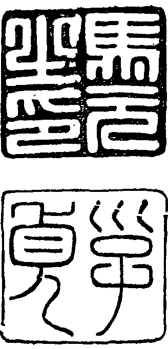



------



### 重修曹溪通志序



单传直指之道谓肇自初祖西来此未取吾儒之说而深究之矣凡知生知性朝闻夕可皆宗门之妙旨人自习焉不察耳初祖游梁时佛法流东已五百年此来惟刬除二病其一以有为福德当佛法者故答梁武造寺度僧之问曰实无功德其一以有所得心为佛法者故答圣谛第一义之问曰廓然无圣堕此二见何有吾宗若世儒之蔽但依傍四端影响作活计稍涉蕴粤輙诋为虚无噫微言绝学千圣同源岂儒家者流仅训诂修饬而已哉世丧道也久矣少室六传是为六祖实惟唐之中叶祖以新州樵子得黄梅心印大庾一钵力举不胜此一异也隐猎人队中十八年人无知者迨风旛问答逗漏机缄遂四众归诚人天作范曹溪一袈裟地覆谷弥山又一异也其根柢所存有不可以智知不可以识识者以寻常之思拟而测至人之应迹岂非取萤火以焚须弥者哉再传而至大寂九十三贤一时并出於是五宗派列枝枝叶叶遍地儿孙矣曹溪一渧遂与洙泗同流夫岂偶欤曹溪之有通志自憨大师始也斯时曹谿中落裨贩軰攘窃其间大师奉旨戍粤得以中兴祖庭佥谓天幸平湖冢宰陆公暨具区石篑诸贤顶背相望皆海内弁冕一皆以导扬佛法为己任实左右之而憨山之道益光憨山之道曹溪之道也今距其时七十餘载完者以圮举者以废乃笃生贤王以底定国家之餘力而金汤大法垣墉塈涂庶几复还旧观矣太守马公曰寺成而志容缓诸则以属之　住持雪公雪公者济宗之嫡嗣雪公之道憨山之道也予之守端也新为属得近光其乡方厚自幸适志成而　马公以其序命既不获辞窃维兹之群力毕赴或亦冯陆诸君子乘愿而来使后先辉映者乎予何足以知之则以告之吾徒之虚无其道者曰曹溪之道吾儒之道也读是志者幸取吾儒之说而深究之庶不河汉乎其言矣



康熙十一年仲夏赐进士出身知肇庆府事前兵部职方清吏司郎中毘陵史树骏序



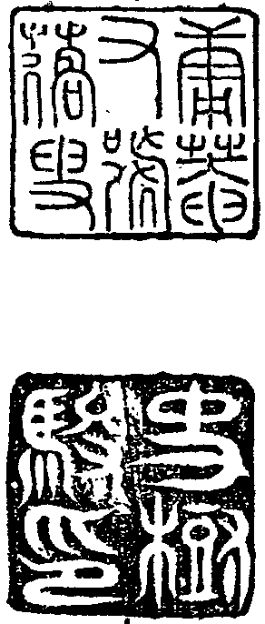



重修曹谿通志目录



卷首



图志



凡例



卷一



山川形势第一



山



峰



岭



石



泉



水



井



古迹



降龙塔



伏虎亭



拜石



坐石



避难石



腰石



飞锡桥



招隐岩



卓锡泉



花果院



亚𠎣坟



亚𠎣祠



曹侯村



雪涛泉



建制规模第二　(附香火供奉)



殿



堂



塔



楼



阁



厨



库



门



庵



庙



亭



院



桥



塔幢



塔院



卷二



道脉源流第三



传灯人物第四



继席宗匠第五　(附住持　过化)



佛法提纲第六　(附激扬)



上堂



机缘



卷三



王臣外护第七(之上)



𠡠



锡典



------



### 序



碑记



王臣外护第七(之中)



------



### 序



文



碑记



卷四



碑记



引



卷五



塔记



碑铭



铭



跋



塔铭



疏



启



卷六



王臣外护第七(之末)



书



实录



法语



偈



传赞(赞附)



卷七



品题词翰第八



诗



卷八



诗



重修通志姓氏



总督两广部院金　巡抚广东都察院刘　仝鉴定



广东等处承宣布政使司徐(讳)炟(符嵎氏)



广东等处提刑按察使司佟(讳)养鉅(修庵氏)



(督粮道管)通省民屯料价叅议徐(讳)养仁(浩存氏)



分巡广肇南部道副使赵(讳)廷标(我文氏)



提督通省学政佥事沈(讳)令式(云中氏)



(通省盐驿道兼管水)利按察司佥事王(讳)令(仲锡氏)仝较正



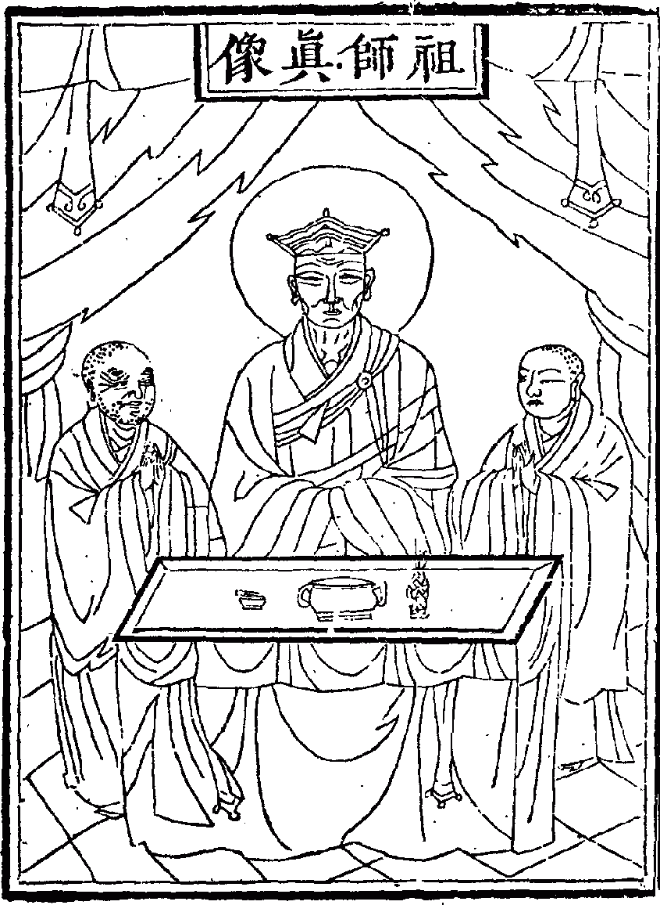



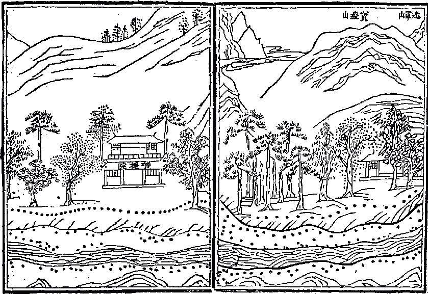



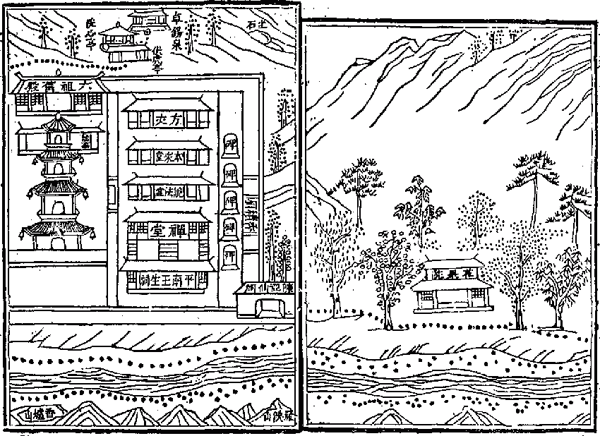



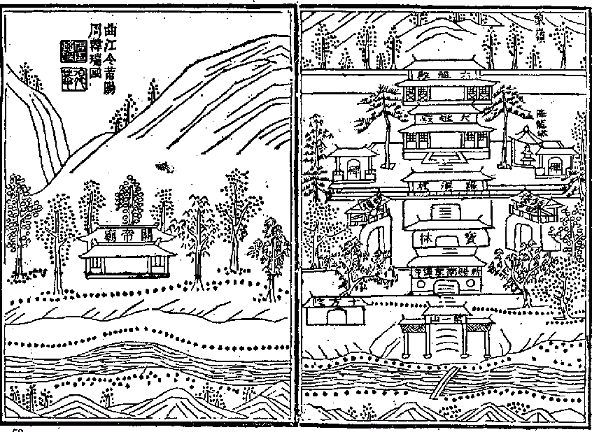



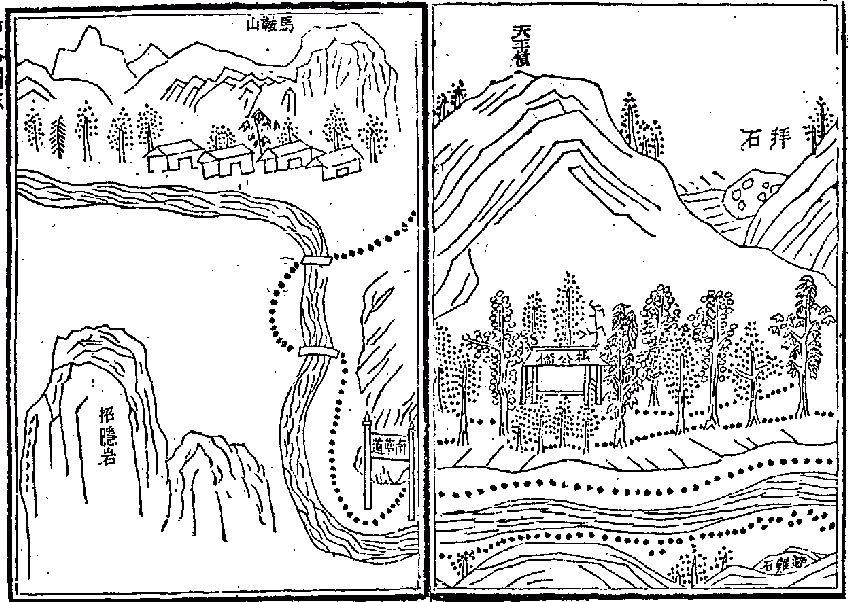



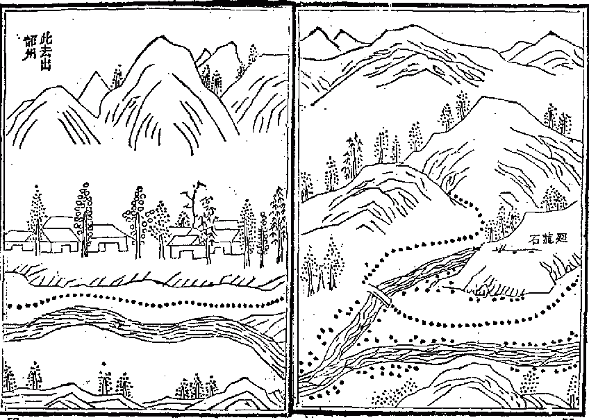



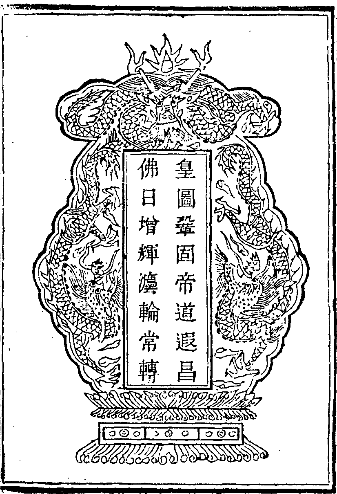



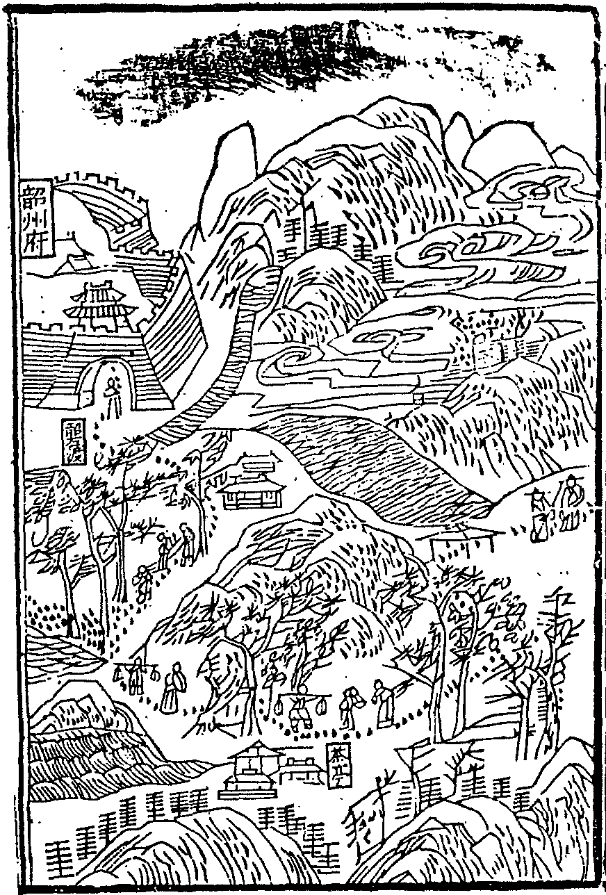



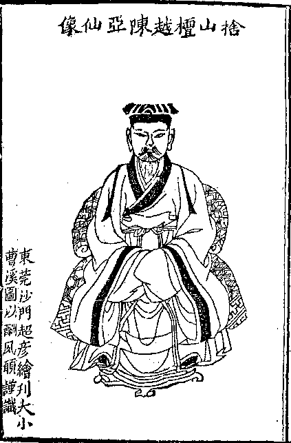



曹谿通志凡例



旧志穪南华寺及考累代建制之额远从梁唐开创则曰宝林其次则曰中兴又曰法泉皆有制𠡠分明其南华之名考旧志为宋太祖开宝元年𠡠额其𠡠制别无可考今南华独与曹溪并著志曹谿者从山也举山而建制备矣故以名志



自梁唐迄今上下千载中间兴废不一而高下坎𡒄悉依成迹殊无大观今平藩重新兴建不仅踵事增华而且恢局崇基视昔规制更加弘敞自古及今于斯为盛崇功念德人有同心故志中表扬不厌详悉



旧但穪南华寺志今以通志言之者葢曹谿为天下禅宗本源之地若洙泗云况山水皆无异西天故其所取不独区区尺寸之地所记又不止目前变幻山水而已今志意取中国率土之形由昆仑发源山从东走水自西来而禅家道脉亦自西而至故远取禅源自七佛始以至释迦所传西天四七东土二三散於四海列为五宗其事虽不核而意实相通故其志不在山水而在道脉故曰通志



旧志丛错不次虽经重修颇有节目复烦杂失序旧依坛经列为十品殊非志体今仅标其八所贵从类简要以便展阅若拘文牵义固所不取



旧志先山形次道脉而建制居末今改第二使道脉人物次第联属於义甚惬且无重复之讥至沿革一品不宜另立今附建制之下曰开山缘起义类相从考证尤便



旧志本指重在道统相传故得法弟子但以青原南岳附传殊失通志本义今悉依名数次第胪列庶知祖师门下得人之盛



祖师忘躯为法开此丛社所欲后昆相继扬化令法久住非仅为崇奉香火计也自唐宋迄今主斯席者仅十有五人虽化缘各有所在然旧志不宜遗失今依灯籍年代记载并系升堂法语使知千年祖席代有嗣人此山志第一要典故特标继席提纲二目



帝王制𠡠文章俱修同科不敢编入臣部者隆在三也餘先分类次后顺时代久近诗则年代爵里或无考据不敢臆定姑依旧志编集至檄谕等文词不雅驯以及田亩供奉典职之属另立末卷存山备考



旧志著作皆出前軰手笔今已更番改制中间叙论可存者述之不可存者删之畧者详之未备者增益之皆叅订端确虽未能综博无遗然已颇成一家言矣独有其名而亡其迹者阅之徒乱人意必削去



曹谿一袈裟地瘠田数顷外别无他产非若海内名山胜壤多出奇果良药之物近有山乡市利细民每遇梨李熟时輙竞衒于城市曰此曹溪果也买者亦以为佛地佳品重价酬之率以为常莫有辩者至山茶岁可出数百觔仅足充寺众岁时之需而贫而啬者多节用以易钱以应追呼万一之急其实色香味俱不能佳而旧志土产称茶绝香美擅名岭南此亦就地言物耳若较之阳羡武夷则不啻轩于拟芝兰矣今故删去



憨大师中兴曹溪一叚因缘读之字字是血字字是泪非秉承大坚固力大行愿海不及此原备载梦游集第二十卷但文词浩繁罕能徧览且山中诸僧多力不能得此书虽口口相传若无考据久必湮灭今摘其最要者十则著于六卷使知当日一片苦心一目燎然此老志愿甚坚必与祖庭相终始则实录畧当为左券矣



重刊曹谿通志跋



府城南六十里曹谿在焉谿上流为南华寺即六祖大鉴禅师驻锡之所千山围绕觉路顿开一水潆洄迷津普渡洵曲江无双福地为岭南第一禅林宜乎纪胜者所必录也有通志八卷具法门之宗旨著山川之灵异综百氏之菁华图经所不及详邑乘莫能悉载择精采博成此大观手是编者固不必过水口溯溪流树指栴檀花寻薝卜神游目寓恍置身於宝林香水间矣夫以法宝南来遂辟斯境瞿昙西种半出是溪仰奇异者奚啻千万人托渊源者岂止五百辈苟不藉遗篇为流览奉往简以宣扬苏子瞻不远谪儋崖一勺之甘焉在僧智药非亲经蒙𣿞西天之水何来通志一书曷云能少无如镌刊已久梨枣飘残岁月既多竹蒲雕尽试问南宗之胜迹不几与当年衣钵寂然无闻耶为叹惜者久之爰搜访再三於友人处得家藏旧本虽中多剥蚀幸卷帙尚完借录成抄重加校对补残正伪然后开雕其编次卷数一遵原刻工竣装订翻阅一过觉本来面目复见人间类拂拭之方新仍菩提之是证我祖师见之其亦许以为美乎



大清道光十六年岁次丙申冬月上浣曲邑贡生刘学礼修五氏重刊谨跋



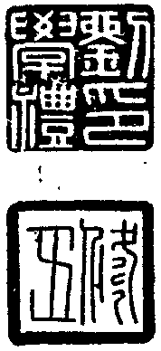



------



## 曹谿通志卷第一



吴门汪永瑞缄庵　毘陵史树骏庸庵　订正



三韩马　元子贞　古闽释真朴雪槱　重修



曲江刘学礼修五重镌



山川形势第一



经云一切世界草芥微尘因心成体易曰乾坤立而易行乎其中矣是知大地山河皆吾圆妙明心之所融结但鍾气厚薄而质有精粗故山水不在高深而僊灵是托托之久近在脉之浅深如心结为形而有贵贱之差是以吾佛降神迦毘托灵鹫以栖焉此自然之形势也按舆图天竺有五当赡部之心北则水自星宿河源出积石穿龙门入华夏天垂一线遶洛阳而东注於海葢夷志所穪葱岭之东地方万里名赤县神州故彼目此为震旦亦云支那司马迁云中国名山有七而五岳为尊山自昆仑发源走关中屹立太华枕河流而镇西极首首阳而终天南故古之𠎣人隐士萃焉北岳蹲踞浑源拱揖五台故曼殊常住万圣攸归嵩少雄峙中州走大梁截河流涌泰山缠洙泗而产孔氏七十之子家焉南岳负终南而跨荆湘蜿蜒迤东至庾岭而分三𣲖北则豫章顺流而下衍洪都结为匡庐中则瓯越翔武夷过天台灵隐而穷普陀南则张为全粤而尽罗浮其曹溪适居其心焉曹溪北去韶州五十里南去广州七百里界清远翁源之间背武夷而面南岳左二罗而右庾岭浈桂相交西来众河带其前牂牁苍梧东注三水锁其左环大海而披五岭躔鹑尾而接斗牛诚山水之奥区乾坤之灵宅也寺居河北去蒙𣿞三十里万山环抱众水缠绵自庾岭分脉飞扬磅礡不远数百里至攸岭西北行四十里许融结宝山顶开帐特出大象岭乃转一山端耸寺后悠然结局左麓宽展而右紧抱宛如象鼻之卷其餘支四折而尽於小象岭二水合处炉峰高起为朝山左右罗汉诸峰联络絫拱以渐而杀东西列嶂周回环抱曹溪遶其前[泳-永+筭]溪缠其后会於小象岭下折而西流可五里许马鞍石宝二山对若捍门然又流十里许至虎榜山与浈江会形势奇秀风气绵密宛若布莲华而峩天冠真东南之胜槩英华之蕴结居然一圣道塲也故梁天监初西竺智药三藏自南海经曹溪口掬水饮之香美异常谓其徒曰此水与西天之水无别源上必有胜地乃溯流而上至曹侯村顾山水回环峰峦奇秀叹曰宛如西天宝林也因谓居民曰可於此山建一梵刹一百六十年后当有法宝於此演化此其天地鍾灵形气凝聚故曰灵之为灵久矣岂偶然哉故著山川形势第一



山



宝山



自庾岭分脉蜿蜒磅礡不远数百里融结宝林故尔奇特



香炉山



古名大安山寺正南朝山也状如香炉



钵盂山



寺正南与香炉罗汉诸峰相连上有二石一仰一俯圆整相合状类钵盂



马鞍山



在寺西北八里怪石卓地高数十丈绝顶一石俨如马鞍曹溪水出其下



回龙山



在寺西十里即曹溪汇合浈江处



迷军山



昔黄巢破岭南寇至寺毁大鉴左指一节持去至此山忽黄雾四塞军行失道随送还寺礼谢而去指节后餙以银为盗所窃僧追至江盗俱溺水而死



峰



罗汉峰



寺正南诸峰磊落有如罗汉环拱之状



岭



象岭



寺之主山也自宝山演迤而来势正形昂坡陀蹲伏真若白象驼经负宝之状故名



四天王岭



坐镇四隅为祖师袈裟定界



狗耳岭



在寺东十五里二峰插天尖如狗耳故俗名之



石



荡水石



在寺东五里据曹溪上流状如伏犀又如灔滪堆中截水口分左右流漩洄而下石𦉑深不可测水泻入如吸每将雨时有巨鱼数十头浮水面不知所从及柴木没入亦罔知去处或云出招隐岩下因知岩窦直通招隐又岩水喷射自下腾上声吼如雷故名龙门又峡口一石偃蹇数丈水浮石面宛如龙卧故又名卧龙石镇水口城隍庙在锁龙石上万历二十三年住持法闰重建



鎻龙石



在寺西水尾当水口之冲



泉



明通泉



出象岭头石下每遇卓锡泉脉枯澁寺僧持祖衣拜叩石穴泉遂通流因而名之



水



曹溪水



发源於狗耳岭西流二十里经曹侯村故名曹溪盘遶寺门折而北流复折而东与[泳-永+筭]溪合



[泳-永+筭]溪水



发源於木坪苍村经北天王岭合曹溪由虎榜山入浈江



井



毘卢井



在毘卢殿右



罗汉井



在罗汉楼前



古井



在西廊殿脚



古迹附



降龙塔



旧经云寺有潭龙常出没其间触挠林木一日现形甚巨波涛汹涌云雾阴翳徒众皆惧师叱之曰汝能大而不能小若为神龙当能变化其龙忽没俄顷现小身跃出潭面师以钵舀之不能动持钵归堂说法龙遂脱骨而去长可七寸首尾角足皆具留传寺门师遂以土石堙其潭今殿前左侧有铁塔镇处是也至正己卯寺罹兵火龙骨遂失今殿基即潭也



伏虎亭



寺后林木深阻猛虎据之贻患远近元住持僧首众说法虎皆驯伏因建此亭在龙王井前康熙二年监院可相重修韶州太守赵公霖吉记



拜石



在寺北天王岭前古记祖师於此拜佛膝㾗尚在



坐石



在象山之麓祖师喜玩山水常日打坐石上痕迹尚在



避难石



在寺南五里三石品列其中独巨师居宝林九月忽然心动预知恶党寻害遁于前山恶党果至遂纵火焚草木师隐身挨入石中得免石色红紫深二三尺宛如一龛旧经云今有师趺坐膝㾗及衣布之纹故名



腰石



经云师往黄梅礼五祖应对契旨恐人害之着槽厰去后五祖至碓房见师腰石舂米语曰求道之人当如是乎龙朔元年师受衣钵南归石留黄梅上刻龙朔元年卢居士志八字至明嘉靖年间韶州有仕於黄梅者遂持归曹溪今存焉



飞锡桥



寺后伏虎亭下有石桥相传祖师望云於此慨然叹曰予亲陇在南而锡驻於此因名桥上有亭侣梅陈公扁曰洗心(顺治辛卯年释真修重修)



招隐岩



在寺西十里有巨石卓起高十数丈其半有岩郡志能禅师常隐居於此后僧即岩中祀师父母提刑耿南仲大书招隐二字刻於石督学周公有诗



卓锡泉



在寺后一里许师欲浣所授衣苦无美泉因见寺后山林郁茂瑞气盘旋师振锡卓地泉应手而出乃跪膝浣衣石上至今流溢香美甚宜瀹茶东坡有铭先是憨大师龛为强者移往匡庐泉忽竭及师龛还山溢流如故又崇祯癸未八月复竭至甲申岁适吉水李公日宣入山礼祖率众祷之水复流公有诗并记甚悉至清康熙四年泉复涸越丁未春　俺达尚公随王入山谒祖历探古迹见泉竭草荒嗟叹久之乃顾谓众曰吾当为师卓一锡也仍默祷之泉复𣸣涌有盛他时是则盈虚消长之故山灵亦若有待其人不然何感通之神若是也



花果院



祖师游境内山水胜处輙憇止遂成兰若十三所隶籍寺门一兴云寺居库前一资圣寺居石宝坪一当林寺居曹冈一宝兴寺居演山显村一高泉寺居[潷-聿+(王/大)]溪一望云寺居木坪一崇云寺居杨梅田头山一灵山寺居双石岭尾即虎榜山水口一厚峰寺居谭田头即高陂角一郁林寺居其田一东林寺居苍村一深峰寺居社溪每寺每年纳香米一十二石今俱久废惜无有复者



陈亚𠎣祖墓



师至曹溪宝林时从学者数百人堂宇湫隘不足容遂谒里人陈亚仙曰老僧欲就檀樾乞坐具地得不仙曰和尚坐具几许濶祖出具示之亚仙唯然祖以坐具一展尽罩曹溪四境亚仙曰和尚法力广大此地无不奉承但吾高祖坟墓并在此地他日造塔幸望存留餘愿尽舍永为宝坊至今塔后一墓完整题曰陈亚仙祖墓



陈亚仙祠



在曹溪门左



曹侯村



魏武帝玄孙曹叔良所居今相公桥左王宅园是也



雪涛泉



出宝葢山下从地𣸣涌味殊甘冽旧为祖师玩憇处监院可相筑精舍面泉而居号为幽胜



建制䂓模第二(开山缘起附)



山初未有名因魏武玄孙曹叔良避地居此以姓名村而水自东遶山而西经村下故称曹溪按梁天监初西域智药三藏航海而来初登五羊至法性寺以所携菩提树一株植於宋求那跋陀三藏所建戒坛之前䜟曰吾后一百六十年当有肉身菩萨於此树下开演大乘度人无量及自南海至曹溪口掬水饮之香美异常谓其徒曰此水与西天之水无异源上必有胜地堪为兰若乃溯流穷源至此四顾山水回合峰峦竒秀叹曰宛如西天宝林山也因谓居民曰可於此山建一梵刹一百六十年后当有无上法宝於此演化得道者如林宜号宝林时韶州牧侯敬中以其言表闻上可其请赐额曰宝林遂成梵宫落成於梁天监三年戊申实此山开创之始也自梁天监元年丙午至唐高宗仪凤元年丙子得一百七十年应智药三藏之䜟云隋末寺罹兵火遂废至唐龙朔元年师自黄梅得法南归曹溪人无知者有尼名无尽藏者乃韶州高士刘志畧之姑也畧与师旧相善尼常诵[湟-王+工]槃经师暂听即为解说其义尼遂执卷问字祖曰字即不识义即请问尼曰字尚不识曷能会义祖曰诸佛妙理非关文字尼惊异之遍告乡里耆德竞来瞻礼於是居民曹叔良等率众遂於宝林故址建营梵宇延祖居之四众云集俄成宝坊此寺之中兴也师居九越月因被恶党寻逐乃隐於四会避难於猎人队中凡经一十五载至仪凤元年师于广州法性寺菩提树下薙发登坛受具复归宝林大开东山之道时荆州通应律师暨徒数百人亦依师住师覩其堂宇湫隘不足容众欲广之而寺前后左右已属陈亚仙师乃谒告曰老僧欲就檀越求坐具地得否亚仙曰和尚坐具几许濶师出示之亚仙唯然师以坐具一展尽罩曹溪四境四天王现身坐镇四隅亚仙曰也知和尚法力广大但吾高祖坟墓并在於此他日营建冀望存留餘愿尽舍永为宝坊然此地乃生龙白象来脉只可平天不可平地遂舍之竟成大法社焉此寺之　成也师禅悦之暇游境内山水胜处辄憇止遂成兰若一十三所兹宝林为主刹焉中宗神龙元年遣内侍薛简驰诏迎师不起乃赐磨衲袈裟绢五百疋宝钵一口十二月十九日𠡠改为中兴寺三年十一月十八日又𠡠韶州刺史重加崇饰赐额为法泉寺赐师新州旧居为国恩寺开元元年癸丑八月三日师化于国恩十一月十三日迁神龛归於曹溪明年七月二十五日入塔韶州奏闻奉𠡠刺史韦璩撰碑至宪宗元和七年赐谥大鉴禅师塔曰元和灵照宋太祖开宝初王师平南海刘氏残兵作梗祖之塔庙鞠为煨烬而真身为守塔僧保护一无所损有制举备功未竟赐名南华禅寺会太宗即位太平兴国元年诏新师塔七层加谥大鉴真空禅师塔曰大平兴国之塔仁宗天圣十年加谥大鉴真空普觉禅师神宗加谥大鉴真空普觉圆明禅师本府复兴事迹具载元献公晏殊碑记碑毁文无所考历元至明代成化三年重修乃今复逢平藩重新兴建千百年名山祖席始开生靣此其兴废沿革之大指也其他备乎建制云



原夫法身非相佛体无依法本无住岂以色相庄严而为佛土者乎经云佛子住此地即是佛受用故世尊与天帝行次偶指其地云此处宜建梵刹天帝即拈一茎草云建梵刹竟是知从上佛祖弘扬此道信手拈来随处便用何地而非道塲何作而非佛事又岂可以庄严壮丽雕金镂彩巍峩宫殿而后方为道塲耶虽然实际理地不立一尘今事门头不舍一法故华严全彰法界而广大精密妙宝庄严重重无尽以为毘卢遮那如来报身境界是则娑婆秽土土木瓦石纵极尽神工肉眼取相亦化身边事耳故佛住世时给孤长者欲於舍卫城中请佛说法遂布金祇园建精舍以延之此西域众僧安居之始也寺乃中国古制天子九寺之名而西竺仅称精舍或兰若焉爰自汉永平年梵师摩腾自西而来届於洛阳自是佛法始入中国天子乃馆僧於鸿胪久之乃别建精舍安居於京城之西门外以延摩腾以白马䭾经因为名曰白马寺此东土佛寺之始也自尔以来佛法盛行於晋宋齐梁陈隋至唐益盛於是乎琳宫绀宇棋布星分遍满寰区列刹云标烟火相望无论名山胜境即王城里巷平原广墅在在有之然建立其地必以灵住持其人必以圣葢三宝托像以弘法圣人神道以设教殆非徒安居温饱为事也是故上至天子下及黎庶凡皈心愿崇其教者靡不效布金之遗事顾此曹溪始显名於智药其地固已灵矣且曰必有肉身菩萨於中说法而其人必圣焉远自牧侯开基於梁氏重建於唐朝而六祖应䜟居之垂千年我朝特简平藩秉大愿力焕然鼎新则灵之又灵圣之又圣夫岂小缘其始建宝林之制不可考而重建之规模亦不可考按今之所可睹记者胲而存焉其制分为二区其正区则大雄宝殿为刹主其左臂则祖师殿以当正脉今平藩用形家言以旧殿厥制弗称乃改建大殿后而旧殿前陛即所谓陈亚仙之祖坟在焉虽屡更建置不忍泯其迹者所欲示布施福德与佛法祖道其悠久也其旧祖殿之右原为御经阁即今新祖殿地阁前左右列御碑亭亭前为大雄宝殿其基即古龙潭也六祖降其龙乃填其潭而为殿实亦天龙献此以永作圣道塲地殿之左尚有铁塔以镇压者葢标志也又前为罗汉楼楼下列四天王像葢即古制山门也大雄殿之左历说法堂东角为普𤲅殿前折而西为南廊又前折而左皆僧寮大雄殿之右为西廊亦僧寮前折而左为南廊此正区也祖师殿之前陛即亚仙祖墓殿前为宝塔塔前为诸天殿祖师殿之左为住持方丈前为本来堂说法堂又前为禅堂堂之右为伽蓝堂又前为王生祠祠后为韦䭾殿说法堂之东为护法堂堂之侧为观音殿西向护法堂之前东廊为香积厨亦皆西向此左区也祖师殿之后为苏程庵又左后为飞锡桥为伏虎亭卓锡泉东坡有泉铭在焉亭后为龙王亭亭后即主山所谓生龙白象之来脉也其正区罗汉楼之前为宝林门又前为曹溪门为挹翠亭最前为曹溪古渡亭亭前即曹溪挹翠亭之东为观音桥又东为东来桥通翁源路挹翠亭之西为西来桥又西为饮香亭通曲江路其山势宏敞苐寺宇经畫非出一时一手故高下相因纵横间错而僧寮亦参差不一但沿袭既久率难更置若准之古制规模殊无大观今姑按旧志次其创建年代如左



殿



大雄殿



即三宝殿也大德十年建正德间僧清洁圆通重修(知府姚鹏记至清释真修)复修曾弘记至康熙六年平藩重新兴建绿瓦朱楹金壁交光掩映云日视前制更加宏丽殿前古栢二株为祖师手植物扶踈直上数丈餘无旁支曲干至极顶乃作盘虬翔鸟之势见者莫不竦然起敬先是殿前坑洼势如涸潭而罗汉楼尤深陷丈餘憨大师有志填筑而未果今俱以次填平爽垲宏敞遂成壮观克副前贤佑启后哲非王愿力广弘能有此乎



祖师殿



在大殿后原藏经阁地平藩新建其壮丽庄严视佛殿所存库法宝有



传法信衣一袭(九条金镂其缔乃白㲲岂所谓屈眴布耶)



钵盂一个(谓魏提学击碎金漆固惟露一片约寸许非铜铁瓦石盖四天王所献如来者)



铁锡杖一枝　玛瑙数珠一串



响鞋一只(此三物乃三宝太监所供)



坠腰石一块(原在黄梅嘉靖间移至曹溪有镌欵志可考)



袈裟玉环二(又白玉环一绿玉环一金环一皆上方所赐物)



唐武则天𠡠书一道(梵书有宝五颗半天顺间鎻南岭占巴藏卜国师译)



元免差𠡠一道(梵书墨迹如新天顺八年慈济国师鎻南岭占巴藏卜译)



金书孔雀经一道(元延祐四年赐)



金书法华经二部(一太监萧福江一太监凌法意俱宣德年施)



金书大字华严经一部



金书小字华严经一部(俱天顺年间钦赐)



无尽灯一盏(成化年间赐)



旧祖殿



即信具楼衣钵所藏也师入塔后因孝子取首事觉乃迁於楼以便居守今改为殿弘治三年住持僧惠淳重建侍郎李嗣记嘉靖十六年寺僧太仓圆通重建府学训导邓泮记(今改御经阁)



五祖殿



奉达磨以来诸祖像正统间建景泰间修



观音殿



宋嘉熙元年建景泰间修清康熙二年方国龙感观音应梦重修有碑记其事



普庵殿



宋嘉熙三年建嘉靖八年住持圆玺修南安府知府何文邦记



诸天殿



在旧祖殿两庑延祐四年建成化间修嘉靖三十二年住持悟环重修



韦驮殿



在生祠后



堂



说法堂



政和八年建康定二年郡人余靖记正德三年住持如靖重建郡人知县王琏记



方丈



乾道间建嘉靖十八年住持悟全重修顺治庚子年心炤禅师复修韶司李洪琮记



本来堂



成化十三年僧崇晓建原有石刻祖像万历元年住持了颀重建郡人通判吴穆记本府舒公改行台迁像于二贤阁下本府谢公又改曰不二门今俱撤去仍为本来



禅堂



政和间建弘治间僧文瑞重修嘉靖(二十)六年本府知府陈大纶重建万历二十二年寺僧重修至万历年间憨大师重修为华严堂训习学者



伽蓝堂



在禅堂右元丰三年建成化间修



塔



宝塔



唐仪凤间建历朝赐额见外护志成化十三年重建僧道深记正德十一年住持僧智汉修嘉靖二十七年住持僧净䤥重修郡人寺丞吴世宝记清顺治戊子释福恩真修重修



楼



罗汉楼



下有四天王像成化十年住持惠勉修邑人萧韶记嘉靖十四年住持真满建大理寺副金山记万历七年巡察使龚公懋贤金书额曰南海西天今与殿俱重修轩豁严丽特异旧制



鍾楼



上悬铜鍾重数千斤击之声闻四十里下有观音像大德五年住持法脉建永乐六年住持观意修嘉靖三十六年住持广粢重修郡人寺丞吴世宝记今改建在罗汉阁前左



皷楼



下亦有观音像与鍾楼对峙二楼原翼说法堂大德五年建嘉靖九年住持真圆修府学教授陈一贯记万历二年住持海袖如用性愇惠宣重修有记今与鍾楼俱改建配佛殿两傍罗汉阁前右



阁



御经阁



厨



香积厨



在禅堂左廊唐时建宋元俱重修正德间本寺僧圆璧重建奉监斋神像有大灶铜锅重可数百斤至元四年置今铉上铸字尚存



库



长生库



宝庆元年住持闲云建进士侯安石记今久废



免军库



宝庆元年住持惠照建镇军节度推官张兹仪记今久废



永利库



淳熙九年提举茶盐市舶司建有碑今废



门



宝林门



嘉靖十三年僧太仓修今重修



曹溪门



有二金刚像嘉靖二十四年住持净琛修崇祯六年住持宗政真冯子钦三人重修今重修自曹谿门内历宝林罗汉三门夹道皆古树盘礡苍郁茂密蔽亏云日葢自有寺以来即有此树游憇多作清凉极乐之思是山门第一胜景庵



苏程庵



嘉靖二十五年改二贤阁误谓程明道苏东坡论道於此结庵故以为名查东坡集中程乃程德孺非程明道也今改正详余公大成碑文



庙



四天王庙



各居四隅即坛经四天王现身处也原各有庙存焉今南庙废



亭



御碑亭



明孝皇御制坛经法宝序刻石于上嘉靖二十一年住持悟全建知府符锡书刻先立於祖庭前万历二十一年户长僧积昌正华妙传超言智鳌真权性宪法泉重建移置于经阁左右两翼复建坊于前江西提学甘雨书何尘界扁于外监察御史南海王学曾书瞻天语扁于内今亭久废独碑存焉



卓锡泉亭



万历元年光孝寺住持应坚建今重修



龙王亭



即龙王庙也隆庆五年住持悟全净琛户长僧如积改建康熙丁未年俺达公重修



挹翠亭



宋苏轼立永乐间重建万历二十一年住持法闰子贤复建应天府府尹游季勋记今废



曹溪古渡亭



嘉靖三十四年本府通判戴有孚建今废



饮香亭



亦名茶亭住僧伺接上官於此嘉靖二十六年僧明纪智纲重修今废



以上三亭俱山门外旧迹可收溪山胜槩停[車*參]憇望饶有佳致似不宜久废是有望于外护君子



院



十方院



在曹溪门右凡进香至者在此更衣明天启七年僧方觉募建



桥



观音桥



在挹翠东万历七年住持应颀修



西来桥



即三相公祠唐端拱二年建乃塑唐薛简刘禹锡刘崇景像在焉洪武间修



东来桥



在观音桥东端拱二年建嘉靖间本寮僧重修



塔幢



重辩禅师塔



在寺东数里



慈济大师塔



在寺西南二里



古衲和尚塔



在观音桥东



超尘首座塔



大休禅师塔



天拙禅师塔



以上在憨山塔院左



塔院



憨山大师塔院



在寺左天峙冈去寺二里而近鼎建于天启三年癸亥有钱宗伯谦益碑铭一道至清康熙七年戊申少保尚公自省中延院主成已重修门迳迂回修篁交荫转折数十步至院门门内为大师真身堂堂后为楼楼上奉毘卢佛左准提王右观音大士院前左为尚公祠院右为厨库庖湢诸寮前为凉亭额曰别一天轩窓四豁严净绝尘所可抚而狎者惟苍松翠竹异草名花尤称幽胜



先是塔院右路狭小难通车马院主成已募



翁源令翟公延棋捐俸买本寺僧体慈能持等山门前田一带左改为路右为菜圃为塔院永远之业内外规模始称完美矣



菩提塔院



在花果园后



香火供奉



香火供奉乃赡僧之产所以保持丛林卫护道业非徒丰美之谓也吾佛世尊降迹同尘逐日领众持钵入城次第乞食无分贵贱贫富我以等心而化令彼以等心而施意在折己慢幢破彼悭贪耳故曰於食等者於法亦等又非所以求利养滋贪痴也其常住之需葢佛住世时为老病比丘不能行乞者设其供奉之法葢亦起自西域佛灭度后天竺国王割储以供那兰陀寺而我东土始于晋宋齐梁之代名公硕士舍宅为寺在在有之至若舍田为常住则极盛于唐以及宋元历代帝王崇尚三宝往往赐田以供香火或后妃宰官士庶之有善信者咸乐为之施如中州之香严诸山鉅刹类皆若此至明圣祖混一海宇举万汇而纲维之其设教也详且密故开国诸大名刹皆以籍没元臣之田尽令归寺为香火资如南都之天界灵谷诸山是已然其始也僧寺赖之以丰且安今也寺僧亦因之以贫且累若曹溪之田是已考旧志曹溪之田葢始於曹叔良而广於陈亚𠎣其后则广州马氏孙氏施钱三百万买得新会水口洲小砂洲褁肚坦菱角洲上月峰洲下月峰洲谢良善施翁源县太平庄田刘𬬮妻施补钵庄田及累年春秋二会十方聚会檀越所施供奉祖师香灯之需贮之库藏节缩而置为田土以为永久者其心固已盛矣今则因循日久世道相湮而被势豪吞噉兼并者有之故其僧因田而忘本业堕於流俗今则入於编氓杂於皂隶较之𢘆民之不若因而破教伤风以致官长视为异物奸徒资为奇货招外侮以辱祖庭塞恣睢以剥脂骨累害百端靡所不至徬徨四出食不安席求其所以保丛林卫道业其可得乎惟此未尝不涕下比以世衰道远在在皆然而曹溪之累尤甚仁人君子曾受灵山之嘱者於此宁不动心乎谨以本寺旧施诸庄之存亡众僧之利害以纪丛林之兴废故著香火供奉



众僧自置产田



本寺四山区内东至天王岭外下七里名社溪南至天王岭外下五里名鵞鼻西至天王岭外下三里名马鞍山高陂角北至天王岭外[泳-永+筭]溪下名紫笋庄此四至之内约田五十餘顷系六祖开山乃袈裟所罩陈亚𠎣所施之祖业也累代故为荒地荆榛蔓艸几不可问识者悯之延至正统间始迁民韶阳开陇亩以置版籍时有豪民周氏乘机开恳收入户籍而亚𠎣福地尽为周氏己业矣所幸天网恢恢祖灵昭昭亚𠎣之因不终昧而周氏族寻亦倾其所开之田本寺众僧各募资陆续置买至正德间其天王内地始多半归寺而为各僧己业其随田粮差亦僧办纳餘者赖为糊口计耳于是先人故物虽归山门而僧徒从此永入编氓之例矣然其僧不奔走四方而曹溪不致丘墟者亦因是也即其内尚有买未尽者向属民产至万历初奉例均丈幸执事者令僧买至外之田易之爰自正统以来百有餘年而天王内地始得克复均齐方正以全亚𠎣之本愿嗟乎创业垂统之难亦至於是余向疑此地何故不为常住香灯而为众僧已有今予亲履其地而探索其情始知其故特表而出之以俟观风君子庶知曹溪香火所以不废者实有赖於寺僧云



常住旧设香灯田(三宗)



补钵庄坐落曲江万善舖旧传南汉刘𬬮妻悮堕祖钵缺施此田为补钵云其原田二顷七十亩今丈出田四顷七十九亩有竒纳粮十五石三斗五升有零此租应入常住香灯但其田久为豪民霸种其租至薄且又累年拖欠以致本寺称贷纳粮计其所获不足以偿所费况田甚膏腴惜乎利归奸民累及常住殊失当年檀越之本愿也倘仁人君子执政当道一振作之其为曹溪之惠不啻布金之功也



黄巢庄田八顷一十二亩有竒粮二十六石三升有零东至矾峝及龙所庵西至金鸡峝及枫山头此庄田地山塲俱系本寺僧行掌管除纳粮外餘利尽为常住香灯(俗传黄巢所施妄也巢贼抄掠风雨骤至安得舍田想因田居黄巢岭下偶名之耳)



寄庄翁源县太平庄土名横坑桐子镇原额田四顷弓丈计六顷粮米十八石三斗有零此田原系翁源县善民谢良善所施本寺供应万历七年因游学林涣私忿建议於本府同知王命爵议厥田租银一百二十两归一半供赋税收一半抵曲江县蛋户虚粮于计便会当道报可而布政司且载之章程充饷矣然逼迫追徵仅完一年而经管之僧相继迯窜曲江县复查议裁革舖兵等项工食抵补一年餘率多逋负后寺僧超言軰诉诸当道请并没此田以免追徵之累议拟数载讫无定说最后　察院黄公行府覆议前官以事于兵饷未易裁免权行六邑议补咸还报不便葢自建议以来寺田就荒额饷不入而府县文移几污牛矣十七年秋知府陈公(竒谋)莅任睹僧人累累赴诉因谓同知刘公(承范)曰夫僧户蛋户均曲江编民也今以蛋户逋负之故而算及僧田又不得已而算及六邑非策之得者遂相与按往牒参舆情上之督府其畧曰职按南华寺创建历有岁年久为累代崇祀之所且诸僧皆曲江里长岁输田粮几二百石视编民一体今割六祖常住之田以补蛋户虚粮之额本一时权宜之术耳况首尾十年完纳无几追徵则僧田久荒蠲免则章程已定此所以节经行勘几成不决之议矣窃见府属含洸厰餘税岁可二千金例贮府库以待不时之需　制府方昭俭德以惠粤人其所贮税金苐积之空虚无用请於内岁支六十两梓入章程补寺田豁免之数便奉　制府刘公批曰准豁免原解饷银仍充该寺供应以全敬奉佛祖之盛典其原载章程数准以含洸厰餘税抵解仍申布政司支会又奉　察院黄公与诸当道咸如议报可是役也在当事者固擘畫甚勤然非制府刘公亦曷能岁捐数十金以复此田乎噫陈公独力担当刘公慨然允诺可谓南华永远之福田常住之护法也其复田始末具在王臣外护碑记章



新增香灯田



猫皃庄在天王外田五十二亩有竒粮一石六斗七升有零



土名雷破石在天王外田十四亩有奇粮四斗五升有零



土名企岭田庄在天王外田八亩七分有奇粮一斗八升有零



土名[泳-永+筭]溪中心坝在天王外田三亩有竒粮九升七合有零



白沙溪在天王内田二十四亩有竒粮七斗八升有零



土名船头坵在天王内田五亩有奇粮一斗六升有零



钵盂石在天王内田九亩有奇粮二斗九升有零



新收邓希谟田九十四亩有奇粮二石八斗九升有零



已上八项共田二顷零九亩三分有奇该粮四石五斗六升零此田俱系常住累年所积续置以供祖师香灯者除纳粮外餘利俱入常住



乾没田(二宗)



寄庄新会田九十顷八十亩坐落土名水口洲小沙洲𮖐肚胆菱角洲上月峰下月峰洲前田久为势豪侵占其四至坵叚弓步石碑尚存



寄庄番南二县田二十三顷旧属广州廨院寺寺废并入光孝寺今本寺塔主𨔛年往彼量收税银以助祖殿香油之需



拨出供奉田(三宗)



土名小溪田五十亩



土名金刚堆黄塘队田八亩



土名圆石田五亩



三项田嘉靖二十八年本府拨与韶州通大塔守塔僧



脚院(二宗)



寺僧庄居一在黄坭塘一在曹溪水尾一在上埧一在中埧一在下埧一在磨院殊胜园一在观音桥一在东象曹源庵一在天子冈一在车头岭一在水头庄皆十一房僧众分居以便耕种原名花果院师游境内山水胜处輙憇止遂成兰若十二所俱有寺名列前山川形势章相传祖师盛时每寺一年纳香灯一十二石供养今寺址久废改作庵址



蒙𣿞月华寺乃智药三藏肉身所在葢亦六祖时重建今无所考先寺居新巡检司左因毁居民众议舍财复移至溪东百餘步小岭之下前佛殿山门后祖师肉身殿并左右廊舍小备南华寺舍田若干岁收租银六两以供香灯居民陈春舍田若干岁收租银三两以赡僧用万历二十五年驿丞郑敦初至即率居民於朔望就寺为会约明年正月屯盐道周公摄南韶过寺瞻师遗像即令巡检李世魁将近寺周围空地查给本寺时居民侯环侯大润大游大浚送出契一纸将附寺山地尽舍为常住其契内四至则东至侯环田南至官路河边西至古营塲曹养士田北至岭头下分水随令筑围墙为界栽植树本令僧如规看守香火周公仍为文刻石以志之呜呼曹溪法道赖智药为先倡况肉身与六祖并存宜其与曹溪相为休戚终始者也何其寥寥千载寂然无闻今周公一旦而发扬之岂偶然哉因并列于志俟后之观者有以兴感云



住持尊宿



古衲和尚　(行实备载云观察塔记)



憨山大师　(行实具载钱宗伯塔铭　高工部传功绩备纪大兴实缘)



融六和尚　(憨山门人)



过化圣贤



梁智药禅师天监元年自西竺来过曹溪饮水香美预记一百七十年后当有肉身菩萨来此演法又开蒙里月华寺往罗浮创宝积寺后来韶又开檀特灵鹫二寺普通六年应龙王请入海演法神异莫测



过化尊宿



达观大师　(先憨大师到曹谿著有诗偈法语)



居士　余集生　(讳大成崇祯己亥问以大中丞被谴入曹谿愍寺众未知禅学乃往博山延超尘首座就说法开堂禅期立规矩置田赡众自此渐知禅学实自公倡始也)



------



## 曹溪通志卷第二



当湖陆世楷孝山　温陵池凤翼仪伯　订正



三韩马　元子贞　古闽释真朴雪槱　重修



礼修五重镌



道脉源流第三



道在天地如脉在人身然虽上下周流而融会肯綮者谓之穴故人之疾病察其源砭其穴穴得其真而启死回生之功捷如影响故古之真人应世为大医王至其降迹开基各有攸归莫不中其地脉之肯綮焉肯綮之不中未能启天地之否塞回草木之焦枯使之荣光百世道脉常存者也惟我震旦为赡部之东垂山从东走水自西来天地之脉亦从之而潜注道脉系焉故其方域之内名山大川凡形凝而气聚者往往产圣灵开福地有以哉故我世尊光腾灵鹫演化百亿於周昭之岁降神迦维三宝始兴化周八表浸至汉永平佛法始入中国摩腾法兰届洛阳倚中岳而居之声教自此被岂非创开天地之正气以中道而示人哉如砭百会之顶补泻周身必至踵而后已故后之弘教者皆萃於此然如来教法多逾𢘆沙广如大海而其来者如海之一滴耳故顺地之利若黄河一线而通之此其理也其禅则举性海而收之全体大用不可意言因为教外单传之旨始自七佛心印相传至我释迦默契然灯证一心之妙故出世说法四十九年谈经三百餘会以一心法演为三藏派为九部至於结集堆满龙宫然竟不能吐露本怀故化缘将毕欲全付家业故告众曰吾四十九年未谈一字偶拈优钵罗花揭示人天大众罔措独金色头陀破颜微咲世尊叹曰善哉善哉吾有正法眼藏涅槃妙心付嘱於汝汝善护持仍以寻常所披金镂袈裟钵盂付之令其相传以为表信而教外别传之道爰自此始既二传阿难展转授手至二十八传菩提达摩大师得法於二十七祖般若多罗大开秘藏师得法已因问祖曰我既得法当往何国而作佛事祖曰待吾灭后六十七载当往震旦设大法药直接上根慎勿速行哀於日下师曰彼有大士堪为法器否千载之下有留难否祖曰汝所化之方获菩提者不可胜数吾灭后六十餘年彼国有难水中文布自善降之汝至时南方勿住彼唯好有为功业不见佛理汝纵到彼不可久留听吾偈曰路行跨水复逢羊独自栖栖暗渡江日下可怜双象马二株嫩桂久昌昌(此谶萧衍不遇而止于少林也)又问曰此后更有何事祖曰从是已去一百五十年而有小难听吾谶曰心中虽吉外头凶川下僧房名不中为遇毒龙生武子忽逢小鼠寂无穷(此谶周武帝灭僧之事也)又问此后如何祖曰𨚫后二百二十年林下出一马驹踏杀天下人听吾谶曰震旦虽濶无别路要假儿孙脚下行金鸡解衘一粒米供养十方罗汉僧(此谶马祖之事也)此皆悬谶此方佛法隆替耳迨祖顺世师念震旦缘熟乃航海而来三周寒暑达於南海五羊实梁普通七年庚子九月二十一日也广州刺史萧昂表闻武帝遣使诏迎至金陵问曰朕即位以来造寺写经度僧不可胜纪有何功德祖曰并无功德帝曰如何并无功德祖曰此但人天小果有漏之回如影随形虽有非实帝曰如何是真实功德祖曰净智玅圆体自空寂如是功德不可世求帝又问曰如何是圣谛第一义祖曰廓然无圣帝曰对朕者谁祖曰不识帝不契祖遂渡江届于洛阳当魏孝明帝正光元年也寓嵩山少林之石室面壁而坐终日默然时人莫测谓之壁观婆罗门此正应跨水逢羊之谶也时有僧神光者旷达士也久居洛阳愽览群书善谈玄理闻达摩大士住少林乃往侍晨夕参承祖尝端坐面壁莫闻诲励光自惟曰昔人求道敲骨取髓刺血济饥布发掩泥投崖饲虎古尚如此我何人哉其年十二月九日夜大雪光坚立不动迟明积雪过膝祖悯之问曰汝久立雪中当求何事光悲泣曰惟愿和尚慈悲开甘露门广度群品祖曰诸佛无上妙道旷刼精勤难行能行非忍能忍岂以小智小德轻心慢心欲冀真乘徒劳勤苦光闻诲潜取利刀自断左臂置於祖前祖知是法器乃曰诸佛最初求道为法忘形汝今断臂求亦可在遂名之曰慧可可曰诸佛法印可得闻乎祖曰诸佛法印匪从人得可曰我心未宁乞师为安祖曰将心来与汝安可良久曰覔心了不可得祖曰与汝安心竟可大悟越九年祖欲返天竺乃集众曰吾归时将至汝盍各言所得时僧道副尼緫持僧道育各陈所见独慧可礼拜依位而立祖曰众所得者皮骨肉耳可得吾髓矣乃顾谓可曰昔如来以正法眼藏付大迦叶展转嘱累於我我付与汝汝当护持并授袈裟以为法信可曰请师指陈祖曰内传法印以契证心外付袈裟以定宗旨至吾灭后二百年衣止不传法周沙界潜符密证千万有餘汝当阐扬勿轻未悟一念回机便同本得听吾偈曰吾本来兹土传法救迷情一花开五叶结果自然成又曰吾有棱伽四卷亦用付汝即是如来心地要门令诸众生开示悟入可以印心又曰外息诸缘内心无喘心如墙壁可以入道吾自到此凡五度中毒尝出而试之置石石裂吾本离南印来此东土见赤县神州有大乘气遂逾海越漠为法求人今得汝传授吾意已终然竟被毒药以化缘将毕传法得人遂不复救端坐而逝当魏庄帝永安元年戊申十月十五日也𦵏熊耳山是为初祖可得法即居少室之南山顶行化於邺下三十年方终𦵏於磁州滏阳是为二祖可传僧璨不知何许人既受法隐於舒州之皖山属周武帝破灭佛法(此应心中虽吉外头凶之谶也)祖往来太湖司空山既得信付法即适罗浮山优游二载却后归旧址於大树下合掌立化塔於皖山是为三祖璨传道信姓司马氏世居河内后徙於蕲州广济县信生於此得法后住破头山一日往黄梅路逢一小儿师默识之俾侍者至其母所乞令出家母遂舍为弟子传衣付法遂以学徒委之后终塔於本山是为四祖信传弘忍忍蕲州黄梅人先为破头山裁松道者尝请於四祖曰法道可得闻乎祖曰汝已老矣脱有闻岂能广化耶倘若再来尚可迟汝果再来为童子随母乞食后遇信大师得法嗣化於破头山后遇居士卢能自新州来参遂以衣法付之经四年而终塔於黄梅之东山是为五祖忍传慧能姓卢新州人三岁丧父家贫采薪供母一日负薪市中闻客读金刚经至应无所往而生其心有所感悟闻黄梅忍大师遂往叅直造黄梅忍大师一见默而识之遂付衣法是为六祖师得法后隐约十有六年届南海法性寺时从智光律师登跋陀戒坛授满分戒始於菩提树下剃发开东山法后中宗诏不起高其义乃𠡠改宝林为中兴寺以居之即今之曹溪也此曹溪一脉自西天来而智药三藏尝其水亦如之此其道源直与天地同贯固其理势然也故其下脉出二枝禅分五派遍满寰区皆衍曹溪之旨故著道脉源流第三



论曰曹溪之水自西天来或谓之不然岂以山川修阻计之耶是犹蟭螟而覩泰山也大地之在太虚犹一滴之在沧海竺夏之在大地犹粒粟之在太仓斯又可以远近求之哉天地同根万物一体固其然耳故曰自细视大者不尽自大视细者不明或者以之



传灯人物第四



六祖大师传



曹溪六祖大师俗姓卢氏其父行瑫范阳人唐武德三年左迁新州即为新州人母李氏初梦庭前白花竞发白鶴双飞异香满室觉而有娠遂洁斋戒姙怀六年而生师实贞观十二年戊戌二月八日子时也生时光烛虚空异香馥郁迟明有二僧造谒其父谓曰夜来生儿特为安名可上惠下能也父曰何名惠能僧曰惠者以法惠济众生能者能作佛事言毕而去不知所之回名曰惠能师不饮母乳每夜神人灌以甘露三岁父丧𦵏于宅畔母守志鞠师及长母老复移南海家益贫甚无以供母师采薪以给一日负薪市中闻客读金刚经至应无所往而生其心心即开悟回问客曰此何法耶得之何人客曰名金刚经得於黄梅忍大师来师遽告母以为法寻师之意适有客闻之即取金十两赠师充老母衣食资促其行师安置母宜即辞去不期月直造黄梅适咸亨二年也师至谒五祖问曰汝何方人所求何物师曰弟子是岭南新州百姓远来礼师唯求作佛祖曰汝是岭南人獦獠何堪作佛师曰人有南北佛性本无南北獦獠与和尚不同佛性有何差别祖更欲与语见左右固秘之乃令随众作务师启之曰弟子自心常生智慧不离自性即是福田未知和尚教作何务祖云这獦獠根性太利汝更勿言着槽厰去师退至后院破柴踏碓经八月餘祖一日见师曰吾思汝之见可用恐有恶人害汝遂不与语汝知(之否)师曰能知之祖一日唤大众曰我寻常向汝说生死事大汝等终日只求福田不求出离生死苦海自性若迷福何可救汝等取自本心般若之性各作一偈不得迟滞思量即不中见性之人言下便见若如此者轮刀上阵亦得见之时会下七百餘僧有上座神秀者学通内外众所宗仰咸推称曰若非尊宿畴敢当之秀窃聆众誉思惟书一偈於廊壁间偈曰身是菩提树心如明镜台时时勤拂拭勿使惹尘埃祖回经行知是神秀所作乃曰后代依此修行亦得胜果令各念诵时卢在碓房闻之乃问同学是何章句同学曰汝不知和尚求法嗣令各述见性偈此则秀上座所述和尚深加叹赏必将付法传衣也卢曰其偈云何同学为诵卢良久曰美则美矣了则未了同学呵曰庸流何知勿发狂言卢曰子不信耶愿以一偈和之同学不荅相视而咲卢至夜密告一童子引至廊下卢自秉烛请江州别驾张日用书一偈於秀偈之侧偈曰菩提本无树明镜亦非台本来无一物何处惹尘埃祖见之曰此是谁作亦未见性众闻之罔然遂不顾次日祖潜至碓房见师腰石舂米叹曰道人为法忘躯当如是乎即问曰米熟也未师曰米熟久矣犹欠筛在祖以杖击碓三下而去师默会其意三皷入室祖以袈裟遮围不令人见为说金刚经至应无所住而生其心师言下大悟一切万法不离自性遂启祖曰何期自性本自清净何期自性本不生灭何期自性本自具足何期自性本无勤摇何期自性能生万法知悟自性即名大丈夫天人师佛祖即授以衣钵云吾以正法眼藏秘密心印达磨所传者用以付汝为第六代祖善自护持广度有情流布将来无令断绝听吾偈曰有情来下种回地果还生无情既无种无性亦无生师跪受衣法已启曰法则受已衣付何人祖曰昔达磨大师初来此土人未之信故传此衣以为信体代代相承法则以心印心皆令自悟自解自古佛佛惟传本体师师密契本心今信心已熟衣乃争端止汝勿传若传此衣命如悬𮈔汝须速去恐人害汝师曰当何所隐祖曰逢怀则止遇会且藏师三更得领衣钵是夜南迈人无知者祖送师至九江口祖令师登舟祖自把𫇛师曰和尚请坐弟子合摇祖云合是吾渡汝师曰迷时师渡悟了自度祖云如是如是嘱曰以后佛法由汝大行汝去三年吾方逝矣汝今好去努力向南不宜速说佛法难起祖送师归数日不上堂众疑诣问曰和尚少病少恼否师曰病即无衣法南矣问曰谁人得之祖曰能者得之众乃知焉师辞祖已发足南行经两月日至大庾岭逐后数百人来欲夺衣钵一僧名慧明者俗姓陈先为四品将军性粗猛极意参寻为众先登趂及师师掷衣钵於石上云此衣表信可力争耶乃隐於草莽间慧明至提掇衣钵不动乃连唤曰行者行者我为法来不为衣来师遂出坐盘石上明作礼云望行者开示法要师曰汝既为法来可屏息诸缘勿生一念吾为汝说良久师为明日不思善不思恶正与麼时那个是明上座本来面目明言下大悟复问曰此外更有密意否师曰与汝说者即非密也汝若返照密在汝边明曰慧明虽在黄梅实未省自己面目今蒙指示如人饮水冷煖自知今行者即吾师也师曰汝若如是吾与汝同师黄梅善自护持明受法礼辞回谓众曰何陟崔嵬竟无踪迹当别道寻之众以为然明后避师讳改道明云师因是得归曹溪居民曹叔良等重修宝林寺延师居之越九月餘日又被恶人寻逐师乃遁於前山被其纵火焚烧草木师隐身挨入石中得免师忆五祖怀会止藏之嘱遂行乃隐於四会县避难猎人队中凡经一十五载时与猎人随宜说法猎人常令师守网每网(得生)尽放之师一日思维弘法时至不可终遯遂至广州法性寺值印宗法师讲涅槃经时有风吹幡动一僧云风动一僧云幡动诤论不已师进曰非风非幡仁者心动一众骇然印宗延至上座微诘奥义见师言简理当不由文字宗云行者定非常人久闻黄梅衣法南来莫是行者否师曰不敢宗於是执弟子礼告请传来衣钵出示大众悉令瞻礼宗复问曰黄梅付嘱如何指授师曰指授即无唯论见性不论禅定解脱宗曰何为不论禅定解脱师曰为是二法不是佛法佛法是不二法宗又问如何是不二法师曰法师讲涅槃经明见佛性是不二之法如经云高贵德王问佛犯四重禁作五逆罪及一阐提等当断善根佛性否佛言善根有二一者常二者无常佛性非常非无常是故不断名为不二一者善二者不善佛性非善非不善是名不二蕴之与界凡夫见二智者了达其性无二无二之性即是佛性宗闻说欢喜合掌赞曰某甲讲经犹如瓦砾仁者论议犹如真金宗踊跃欣庆於是普集四众为师於菩提树下剃发时仪凤元年正月十五日也於二月八日就智光律师授满分戒其坛即梁跋陀三藏所建记曰后当有肉身菩萨於此坛受戒者其菩提树即智药三藏西域携来植於坛侧记曰此后一百六十年当有肉身大士於此树下出家演无上乘度无量众者师於此祝发受具开东山法门宛如宿契非偶然也明年二月八日忽谓众曰吾不愿此居欲归旧隐印宗即与缁白千餘人送归宝林韶州刺史韦璩请於大梵寺转玅法轮并受无相心地戒后返曹溪雨大法雨学者不下千数人中宗神龙元年降诏云朕请安秀二师宫中供养万机之暇每究一乘二师并推让曰南方有能禅师密受忍大师衣法可就彼问今遣内侍薜简驰诏迎请愿师慈念速赴上京师上表辞疾愿终林麓简曰京城禅德皆云欲得会道必须坐禅习定若不因禅定而得解脱者未之有也未审师所说法如何祖曰道由心悟岂在坐也经云若见如来若坐若卧是行邪道何以故无所从来亦无所去心无生灭是如来清净禅诸法空寂是如来清净坐究竟无证岂况坐耶简曰弟子回主上必问愿和尚慈悲指示心要祖曰道无明暗明暗是代谢之义明暗无尽亦是有尽相待立名故经云法无有比无相待故简曰明喻智慧暗喻烦恼修道之人倘不以智慧照破烦恼无始生死凭何出离祖曰烦恼即是菩提无二无别若以智慧照烦恼者此是二乘小见羊鹿等机大智上根悉不如是简曰如何是大乘见解祖曰明与无明其性无二无二之性即是实性实性者处凢愚而不减在贤圣而不增住烦恼而不乱居禅定而不寂不断不常不来不去不在中间及其内外不生不灭性相如如常住不迁名之曰道简曰师说不生不灭何异外道祖曰外道所说不生不灭者将灭止生以生显灭灭犹不灭生说不生我说不生不灭者本自无生今亦无灭所以不同外道汝若欲知心要但一切善恶都莫思量自然得入清净心体湛然常寂妙用𢘆沙简蒙指教豁然大悟礼辞归阙表奏祖语有诏谢师并赐磨衲袈裟绢五百疋宝钵一口十二月十九日𠡠改古宝林为中兴寺三年十一月十八日又𠡠韶州刺史重加崇饰赐额为法泉寺祖新州旧居为国恩寺一日祖谓众曰诸善知识汝等各各净心听吾说法汝等诸人自心是佛更莫狐疑外无一物而能建立皆是本心生万种法故经云心生种种法生心灭种种法灭若欲成就种智须达一相三昧一行三昧若於一切处而不住相彼相中不生憎爱亦无取舍不念利益成坏等事安闲恬静虚融澹泊此名一相三昧若於一切处行住坐卧纯一直心不动道场真成净土名一行三昧若人具二三昧如地有种能含藏长养成就其实一相一行亦复如是我今说法犹如时雨溥润大地汝等佛性譬诸种子遇诸沾洽悉得发生承我旨者决获菩提依吾行者定证妙果先天元年告诸四众曰吾忝受忍大师衣法今为汝等说法不付其衣葢汝等信根淳熟决定不疑堪任大事听吾偈曰心地含诸种普雨悉皆生顿悟华情已菩提果自成说偈已复曰其法无二其心亦然其道清净亦无诸相汝等慎勿观净及空其心此心本净无可取舍各自努力随缘好去其年七月六日命弟子往新州国恩寺建报恩塔仍令倍工时有蜀僧名方辩者来谒曰善捏塑祖正色曰试塑看辩不契乃塑祖真可高七尺曲尽其玅祖观之曰汝善塑性不善佛性先天二年七月一日谓门人曰吾欲归新州汝速理舟楫时大众哀慕乞师且住祖曰诸佛出现犹示涅槃有来必去理亦常然吾此形骸归必有所众曰师从此去早晚却回祖曰叶落归根来时无口又问师之法眼何人传受祖曰有道者得无心者通又问后莫有难否祖曰吾灭后五六年当有一人来取吾首听吾记曰头上养亲口里须飧遇满之难杨柳为官又曰吾去七十年有二菩萨从东方来一在家一出家同时兴化建立吾宗缔缉伽蓝昌隆法嗣言讫往新州国恩寺沐浴跏趺而化异香袭人白虹属地即其年八月三日也时韶新两郡道俗各修灵塔莫决所之两郡刺史其焚香祝曰香烟引处即师之欲归焉时罏香腾涌直贯曹溪以十一月十三日入塔世寿七十有六自黄梅受衣纪法腊五十有二时韶州刺史韦璩撰碑门人忆念取首之记遂先以铁叶漆布固护师颈塔中有达磨所传信衣(西域屈眴布也缉木绵华心织成后人以碧绢为里)中宗赐磨衲宝钵以辩所塑真并道具等主塔侍者尸之开元十年壬戌八月三日夜半忽闻塔中如拽铁索声僧众惊起见一孝子从塔中走出寻见师颈有伤具以贼事闻於州县县令杨侃刺史柳无忝得牒切加擒捉五月於石角村捕得贼人送韶州鞫问云姓张名净满汝州梁县人於洪州开元寺受新罗僧金大悲钱二十千令取六祖首归东海供养柳守闻状未即加刑乃躬至曹溪问祖上足令韬曰如何处断韬曰若以国法论理须诛夷但以佛教慈悲冤亲平等况彼欲求供养罪可恕矣柳守加叹曰始知法门广大遂赦之上元元年肃宗遣使就请师衣钵入内供养至永泰元年五月五日代宗梦六祖大师请衣钵七日𠡠刺史杨瑊曰朕梦感禅师请传法袈裟却归曹溪今遣镇国大将军刘崇景顶戴而送朕谓之国宝卿可於本寺如法安置专令僧众亲承宗旨者严加守护勿令遗坠后或为人偷窃皆不远而获如是者数四宪宗谥大鉴禅师塔曰元和灵照之塔粤自曹溪开法衣止不传师始终说法三十七年寻常垂示法语门人海禅者记录目为坛经盛行于世按坛经所载师得法弟子四十五人唯青原行思南岳怀让最居上首而永嘉玄觉精悟超绝号一宿觉焉其餘举皆入室独思让大阐玄宗让居南岳其下则出马祖道一居江西门下同时悟道登坛者八十餘人葢应般若要假儿孙脚下行之谶云一下百丈海为上首海出沩山祐居湖南黄蘗运居闽中祐出仰山寂是为沩仰宗蘗出临济玄居河北是为临济宗思居吉州青原山其下则出石头迁迁出药山俨天皇悟悟出龙潭信信出德山鉴鉴出雪峰存存出云门偃玄沙备偃为云门宗备出罗汉琛琛出清凉益为法眼宗俨出云岩晟晟出洞山价价出曹山寂是为曹洞宗由是道被寰中称为五家宗派云



传法门人



师得法弟子四十三人青原南岳最居上首另立传于左



崛多三藏



昙璀禅师



南阳慧忠



韶州法海



吉州志诚



匾担晓了



河北智隍



司空山本净



荷泽神会



洪州法达



寿州智通



江西志彻



信州智常



广州志道



法性印宗



永嘉玄觉



婺州玄策



曹溪令韬



抚州净安



嵩山寻



南岳坚固



宗一禅师



秦望善现



南岳梵行



并州自在



西京咸空



韶州祗陀



罗浮定真



峡山泰祥



制空道进



光州法净



清凉辩才



下回善快



广州吴头陀



道英禅师



智本禅师



清苑法真



玄楷禅师



义兴孙菩萨



韶山缘素



刺史韦璩



青原行思禅师传



吉州青原山静居寺行思禅师本州安城刘氏子幼出家每群居论道师唯默然闻曹溪法席乃往参礼问曰当何所务即不落阶级祖曰汝曾作甚麼来师曰圣谛亦不为祖曰落何阶级师曰圣谛尚不为何阶级之有祖深器之会下学徒虽众师居首焉一日祖谓师曰从上衣法双行师资𨔛授衣以表信法乃印心吾今得人何患不信吾受衣以来遭此多难况乎后代争竞必多衣即留镇山门汝当分化一方无令断绝师既得法归住青原六祖将示灭有沙弥希迁(即石头和尚)问曰和尚百年后希迁未审当依附何人祖曰寻思去及祖顺世迁每於静处端坐寂若忘生第一座问曰汝师已逝空坐奚为迁曰我禀遗诫故寻思尔坐曰汝有师兄思和尚今住吉州汝因缘在彼师言甚直汝自迷耳迁闻语便礼辞祖龛直诣静居参礼师曰子何方来迁曰曹溪师曰将得甚麼来曰未到曹溪亦不失师曰若恁麼用去曹溪作甚麼曰若不到曹溪争知不失迁又曰曹溪大师还识和尚否师曰汝今识吾否曰识又争能识得师曰众角虽多一麟足矣迁又问和尚自离曹溪甚麼时至此师曰我却知汝早晚离曹溪曰希迁不从曹溪来师曰我亦知汝去处也曰和尚幸是大人莫造次他日师复问迁汝甚麼处来曰曹溪师乃举拂子曰曹溪还有这个麼曰非但曹溪西天亦无师曰子莫曾到西天否曰若到即有也师曰未在更道曰和尚也须道取一半莫全靠学人师曰不辞何汝道恐已后无人承当师令迁持书去南岳让(和尚)曰汝达书了速回吾有个𨱄斧子与汝住山迁至彼未呈书便问不慕诸圣不重己灵时如何岳曰子问太高生何不向下问迁曰宁可永刼受沉沦不从诸圣求解脱岳便休(玄沙曰大小石头被南岳推倒直至于今起不得)迁便回师问子返何速书信达否迁曰书亦不通信亦不达去日蒙和尚许个𨱄斧子秪今便请师垂一足迁便礼拜寻辞住南岳师既付法石头唐开元二十八年十二月十三日升堂告众趺跏而逝僖宗谥弘济禅师归真之塔



南岳怀让禅师传



南岳怀让禅师者姓杜氏金州人也於唐仪凤二年四月八日降诞感白气应於玄象在安康之分太史瞻见奏闻高宗皇帝帝问是何祥瑞太史对曰国之法器不染世荣帝传𠡠金州太守韩偕亲往存慰其家家有三子唯师最小炳然殊异性唯恩让父乃安名怀让年十岁时唯乐佛书时有三藏玄静过舍告其父母曰此子若出家必获上乘广度众生至垂拱三年方十五岁辞亲往荆州玉泉寺依弘景律师出家通天二年受戒后习毘尼藏次谒嵩山安和尚安启发之乃直诣曹溪参六祖祖问甚麼处来曰嵩山来祖曰甚麼物恁麼来师无语经八载忽然有悟乃白祖曰某甲有个会处祖曰作麼生师曰说似一物即不中祖曰还假修证否师曰修证则不无染污即不得祖曰祇此不染污诸佛之所护念汝既如是吾亦如是西天般若多罗谶汝足下出一马驹踏杀天下人病在汝心不须速说师执侍左右一十五年先天二年往衡岳居般若寺开元中有沙门道一(即马祖也)在衡岳山常习坐禅师知是法器往问曰大德坐禅图甚麼一曰图作佛师乃取一甎於彼庵前石土磨一曰磨作甚麼师曰磨作镜一曰磨甎岂得成镜耶师曰磨甎既不成镜坐禅岂得作佛一曰如何即是师曰如牛驾车车若不行打车即是打牛即是一无对师又曰汝学坐禅为学作佛若学坐禅禅非坐卧若学作佛佛非定相於无住法不应取舍汝若坐佛即是杀佛若执坐相非达其理一礼拜问曰如何用心即合无相三昧师曰汝学心地法门如下种子我说法要譬彼天泽汝缘合故当见其道又问道非色相云何能见师曰心地法眼能见乎道无相三昧亦复然矣一曰有成坏否师曰若以成坏聚散而见道者非见道也听吾偈曰心地[尒/口]诸种遇泽悉皆萌三昧华无相何坏复何成又曰一切法皆从心生心无所生法无所住若达心地所作无碍非遇上根切宜慎之一蒙开悟心意超然侍奉十秋日益玄奥阐化於江西师问众曰道一为众说法否众曰已为众说法师曰总未见人持个消息来众无对因遣一僧去嘱曰待伊上堂时但问作麼生伊道底言语记将来僧去一如师旨回谓师曰马师云自从胡乱后三十年不少盐酱师然之天宝三年八月十一日圆寂于衡岳谥大慧禅师最胜轮之塔



论曰余过曹溪始知智药化於蒙𣿞去曹溪三十里肉身存焉抑考药与达磨接踵五羊宝林百六金鸡十方之记悬谶如指掌佛言观彼久远犹若今日宜矣



继席宗匠第五



我祖赤肩荷法备极艰危所创业垂统为可继也继则必使法席长温法轮常转亘古亘今绳绳不绝然夷考灯籍自令韬禅师首继兹席后寂寂罕闻历五代迄宋垂数百年始见重辩禅师一轰毒皷自兹相继虽代不乏人然已落落如晨星矣夫法席不可久虚矧魔外旁伺乘罅无虚日隆万间极獘可鉴矣微憨公秉大愿轮假当事宝杵摧压驱除煌煌祖庭几鞠为屠酤野肆今日尚复有袈裟地哉然法运世运盛衰相因坚持力支责尤在人是在内外宗属重念根本法席极力弘持使法城长壮群魔屏迹余於兹不无厚望焉



曹溪令韬禅师　(首继法席嗣六祖)



南华重辩禅师　(南岳下十三世临济宗嗣玉泉芳)



南华清桂禅师　(南岳下十三世临济宗嗣黄龙南)



南华智昺禅师　(南岳下十五世临济宗嗣佛鉴勤)



南华明禅师　(南岳下十七世临济宗嗣南华昺)



南华因禅师　(南岳下十七世临济宗嗣大慧杲)



曹溪觉禅师　(南岳下二十七世临济宗嗣藏叟珍)



南华明禅师　(青原下十五世嗣吉祥宣)



南华智度禅师　(云门三世嗣广济同)



南华宝缘禅师　(云门宗四世嗣智门祚)



南华德明禅师　(青原下二十七世曹洞宗嗣慧林本)



曹谿超尘禅师　(青原下曹洞宗嗣博山)



曹谿朝宗忍禅师　(临济三十一世嗣天童悟)



曹谿大休珠禅师　(青原下三十　世曹洞宗嗣象田现)



曹谿心照融禅师　(青原下三十一世曹洞宗嗣大休珠)



曹谿原直赋禅师　(临济三十三世嗣灵岩储)



曹谿天拙宗禅师　(临济三十二世嗣弘觉忞)



曹谿雪槱朴禅师　(临济三十二世嗣弘觉忞)



曹谿阿盘珠禅师　(青原下三十世曹洞宗嗣弁山讷)



达观大师　(先憨大师到曹溪著有诗偈法语)



居士　余集生居士　(讳大成崇祯乙亥间以大中丞被谴入曹溪愍寺众未知禅学乃往傅山延超尘首座就说法堂开禅期立规矩置田瞻众自此渐知禅学实自公倡始也)



佛法提纲第六



说法不知纲要所谓野犴鸣非狮子吼也从上诸佛诸祖及天下老和尚说法利人或全提或半提要之不离纲要者近是纲要立则半满中边横说𥪡说总皆实义纲要不立直任攒花簇锦巧玅尖新祇成戯论故表率人天非纲要不能开其正眼荷担宗乘非纲要不能令法久住纲要之为法眼不綦重哉今世之拈搥𥪡拂不啻稻麻竹苇其能提纲揭要单明直指之传不谓全无祗是希有不得不摽提纲以拯之



智昺禅师



上堂此事最希奇不碍当头说东隣田宅翁随例得一橛非唯贯声色亦乃应时节若问是何宗八字不着人击禅床下座



上堂日日说时时举似地擎山争几许陇西鹦鹉得人怜大都祗谓能言语休思惟带伴侣智者聊闻猛提取更有一般也大竒猫儿偏能捉老鼠



上堂以拄杖向空中搅曰搅长河为酥酪𫚥䲒犹自眼搭眵卓一卓曰变大地作黄金穷汉依前赤骨力为复自家无分为复不肯承当可中有个汉荷负得行多少人失钱遭罪再卓一卓曰还会麼宝山到也须开眼勿使忙忙空手回



上堂迷不自迷对悟立迷悟不自悟因迷说悟所以悟为迷之体迷为悟之用迷悟两无从个中无别其无别其拨不动祖师不西来鼻孔千斤重



宝缘禅师



僧问如何是祖师西来意师曰青山绿水曰来时还有意也无师曰高者高低者低



朝宗忍禅师



六祖湼槃日上堂僧问法雷已震选佛塲开不昧宗乘请师直指师云试道看僧一喝师云曲了也进云不是倩来底师云话头也不识僧提起坐具云摩竭提国亲行此令去也师云且缓缓问人人道六祖八月初三日湼槃某甲道八月初三日住世请和尚道一句师曰离却两头进云中间作麼生师打云是阿谁问灵山亲嘱老头陀续燄联芳也不多四七二三传至此五家一脉意如何师云只在者里进云恁麼则撑天拄地无人识逼塞虚空古至今师云着急作麼僧作咳𠻳声师云情知汝弄精魂僧拂坐具归众问身前身后即不问当下一句事如何师云一刀两叚进云如何是转身一路师云切莫乱走问卢祖湼槃日吾师升座时水云千匝绕渴仰一言施师曰水云千匝绕进云一句亲拈出阿谁不沾恩师云试道看僧便喝师便打进云捧喝交驰即不无端的一句请道来师打云难道不端的进云恁麼则礼拜和尚去也师云切莫承虚接响僧一喝归众师乃云三更传法来衣钵留时已破三更湼槃去全身散处还留破无所破片片露祖师面孔留无所留年年逢入灭时辰大众且道祖师还曾入灭也无若道入灭因甚千人万人来朝拜个甚麼若道不入灭因甚个个都道是祖师底忌日本无出没本来身超生脱死凭斯旨虽然示现有去来究竟何曾离者里大众莫是象王鼻下钵盂峰前是者里麼者是一块顽土有甚麼交涉莫是全身布漆锦绣庄严是者里麼者是个臭皮囊有甚麼交涉既俱不是且作麼生是不曾离底意良久云梧桐叶落子方老丹桂香飘蕋正鲜卓拄杖下座



结冬开炉上堂僧问选佛场开大众云集朕兆未分前还许学人下笔也无师云许僧进语师云鹞子过新罗问祖道重开则不问正法眼藏请师示现师云眉毛下进云恁麼则灵山一会今日俨然师云何必灵山僧拟议师便喝问始从六祖直至如今始从六祖则不问直至如今事若何师云好个消息进云什麼处得来师云儞试道看僧拟议师云拟议即不堪问毕竟教学人如何去师云毕竟没有什麼如何去进云然虽如是学人无下手处师云如何尚不得说什麼下手乃云把住绳头结百千万亿为一网大开炉鞲镕鉼盘钗钏为一金密密绵绵古往今来无可拟堂堂赫赫上天下地莫能俦直得千圣跻攀无路万灵景仰无门魔外潜踪狐狼绝迹且道具甚麼神通得恁麼自在衲被蒙头万事休此时山僧都不会下座



上堂僧问四大不分万象主色迁寒暑有凋零如何是不避寒暑底意师云树蛮不落叶进云今日是冬至师云若作冬至会入地狱如箭射进云和尚又作麼生师云天蛮不落雪进云恁麼则寒时寒杀阇黎热时热杀阇黎师云未是脚跟下事在进云和尚又生头角师乃笑问大开洪炉烹佛烹祖建立法幢摧邪显正炉鞲法幢则不问如何是邪是正师展两手进云坐断邪正去在师云见甚麼道理便恁麼道僧便喝师便打问寒来暑往即不问如何是今日秋收冬藏底意师云一九二九相唤不出手进云身非我有为甚麼认着者里藏身师打云谁教儞者里藏身进云如来法眼通天彻地为甚麼者里不藏身师又打云谁教儞者里不藏身进云人人与佛齐肩和尚上堂有何法说师又打云且道是藏身是不藏身问身前身后变驴变马则不问未开口时请和尚道一句师云问者畜生作麼进云风吹不响铃儿草两打无声皷子花师云那里得者消息来僧一喝师云儞试道看僧拟开口师擉退乃云藏身处没踪迹风吹不响铃儿草没踪迹处莫藏身雨打无声皷子花若向者里会得朕兆未分早已全彰文彩全彰文彩依然朕兆未分所以枯干重荣未是衲僧境界氷河发燄灼然历祖家风一等是个时节为甚有得有不得雪粉易分光灿灿墨煤难辩黑漫漫下座



大休珠禅师



结制日本山众耆旧请上堂拈香毕乃云南华结制别无他格外风规畧露些今日老休来下钓离钩一句辩龙蛇英灵不食钩头饵脱体相逢见作家还有是般人麼如无再听葛藤真言无言真正不偏真悟无悟真道不玄放旷无有去处纵横不见其然真觉脚不踏地真谈舌拄梵天只恁麼去廉谶犹在不恁麼去掘地覔天大众毕竟如何即是曹溪法道疎来久贵得其人接我肩维那问结制安禅大似无绳自缚设有个汉罗笼不肯住呼唤不回头时如何师曰佛也没奈他何维那便礼拜起云恁麼则千峰势倒岳边止万派声归海上消师挥拂子云走过一边下座



普说掣风掣颠老头陀天下禅和没奈何佛来祖来齐吃棒大都年老变成魔师良久云三世诸佛如是说历代祖师如是说天下老和尚如是说山僧今日如是说要知所有一切法为治一切心若无一切心何用一切法既无一切法则三世诸佛不恁麼说历代祖师不恁麼说天下老和尚不恁麼说山僧亦不恁麼说嗟哉末法之人信根浅薄智力衰微不肯刻苦参究焉能彻法源底或一年半载畧用功夫以聦明见领畧一知半解认着个主人公逢人便喝为师不下钳锤懡㦬放过使野犴遍地瞒昧人家男女正是一盲引众盲相牵入火坑若有法与人名野犴鸣说法无可说名曰狮吼正是义中无句句中无义如五台山上云蒸饭如此说不妨炽然说若以文字塞人天机若以道理障人真智非但不能为人天眼目抱瓮之流自了无暇大众生死事大各各扣己而参一时一刻清净一时一刻是佛然而清净俱不执何劳更问祖师室世间鸢飞戾天鱼跃于渊变现千形万状皆因此事不明故有轮转既深山穷谷甘守淡薄聚首同居为办道业诸兄弟山僧不是口说亦曾刻苦过来方得妥贴即今以斯道觉斯民果能依我行持管教归家稳坐



心照融禅师



开炉上堂问法道惊天地坭牛唤子规啼动千江月回首白云飞如何是白云影中事师云孤峰无宿客香气满乾坤进云宝盖顶上金鸡舞大地山河玉兔飞师云日出天然异光明照十方进云世问无一事何用太平歌师云上天无路入地无门进云不会无生意乞师指示我师云日出东方月落西进云不是学人重拈出个中消息几人知师打云要知个作麼问宝林一花开五叶曹谿万派滴千峰即今师继卢祖位大地法道遍寰中师云此花逈与人问别结果开花处处香进云男儿惟举通天眼全凭和尚露玄风师打云漏逗不少会即事同一家不会万别千差进云恁麼则慈云普覆去也师云海岸天边濶长空月色高进云从上已蒙师指示佛祖谈不及处又作麼生师云野鹊带㡌去木人穿靴来乃云结则睂毛挂剑解则舌里燃灯但知结解两字何须疑议猜详莫是逆风左转海水左旋擎起无舌人说法使着无手人行拳前后坐断一念万年然非旷劫古今现前莫是神通妙用且道法尔如然到这里不论通宗透教只贵直下承当且问承当个甚麼云腾鸟舞露结为霜蛟龙不宿死水猛虎岂行路旁透得这呰关捩谁立结解良方休问先佛后祖鼻孔一样放光化导三草二木滋润天地万邦释迦不肯泄破达磨九年覆藏曹谿不惜口业今日为众举扬且道举扬个甚麼道理咦尽力吐出虚空骨拨转须弥折断腰卓拄杖下座



四月八上堂问香风遍满瑞气祥光尽五湖四海洲哮吼一声天地动世尊初生事如何师云何处不称尊进云万朵莲花从地发生来七步又如何师云张开大口进云九龙天外从今降浴吐金身何所疑师云日出悬空鉴曹谿滴翠流进云水清珠映现放出枝头明师打云香风吹烈国长江万里清乃云此个物上柱天下柱地乾坤作口山河作鼻万物为身虚空为意日月作眼照临大地一一分明何处出气释迦老子弄精魂降诞王宫生下世椎胸点足独称尊卖弄人间多讳忌赖有破鳖这阿师棒下乞命如恩底自扬家丑放出门带累儿孙没巴鼻且道有甚麼巴鼻独有曹溪即不然既不然合作麼生下座同到殿上为诸人泄气



解制上堂问红炉翻雪浪凡圣一齐烹炼得尘埃尽清风伴我闲如何是明白位中事师云坐断千峰雪一劒倚天寒进云与麼涌出一轮红耶师云古今无异路进云洗出千江月一线系孤舟师云逆水滩头快把着进云为什麼禹门三汲浪平地一声雷去也师云奇特作麼问体露堂堂相斩却𦶟名香九旬今日解大地尽放光师云虚空生筋骨进云已度玄关去沙界遍清凉如何是清凉处师云难将尺雾点太虚进云恁麼一脚踏开狮子吼去也师打云有也无问了却生死路烟花滴翠微塞断虚空界乾坤任我推如何转乾就位师云栖心歇地更无疑进云此是狮子林掀翻坭(牛洞)师云大地不奈何进云与麼踏破千山月惊起江南五百僧师云笑破土地口乃云百花影里凡圣同居生死关头天地悬殊若论此事三世诸佛难下手六代祖师难开口曹谿今日且权为方便解应供依时假若已穷这事人各都明了犹如太虚空相似本无缚着恁登宝盖峰或游花果院野外任往人路旁痴禅汉半笑半悲涕真实堪赞叹所以一任东者东往长安一路坦坦西者西去大道本来无住且道还有不去者麼良久靠拄杖云人人唱道象山头曹水溶溶月川现喝一喝下座



原直赋禅师



都寺氷铁问说似一物即不中如何今日却子承父业师云大众齐念摩诃般若进云嘉声远大不惜坐断天下人舌头师打云行其礼奏其乐僧一喝师又打云莫之能违也



师问𥃆院敬止应无所住而生其心六祖当时向这里悟去今日在𥃆院还理会得也未院云某甲礼拜有分师云此犹是诸方抵对作麼生是应无所住底心院云八角磨盘空里走师云汝从看教得耶从参禅得耶院云二途俱不涉师云毕竟从何得耶院云从来不借他人力师便打云异日儿孙遍天下在院即掩耳而出师顾左右云众角虽多一麟足矣



大拙宗禅师



开炉上堂问还丹一粒点铁成金至理一言转凡为圣如何是至理一言师云昨夜南山虎咬大虫进云法幢再振炉鞲重开炼圣烹凡作家手叚秪如不受钳锤的人来和尚如何设施师云早已烂额焦头了也进云出群须是英灵汉敌胜还他狮子儿师云儞为甚脑门著地进云恁麼则礼拜去也师云不得不如是问须弥作炭大地为炉陶镕四海英灵有一汉不落正偏不居玄要和尚又作麼生师云儞不是其人进云龙得水时添意气虎逢山势长威狞师云脚跟下亲切道将一句来进云惯向洪波钓巨鳌师云此是山僧境界问尽大地是一个禅堂还许学人出入也无师云金刚手里八棱棒进云秪如内不放出外不放入时如何师云五凤楼前听玉漏须弥顶上击金鍾进云坐断两头无缝罅个中何处有亲疎师云衲子难瞒龙蛇易辩乃云举不犯之令行无为之化千差坐断万类该通边鄙安宁干戈偃息无边刹境十世古今浩然大均同归一致掀𮋒佛祖窠窟刬除生死根株头头放大宝光在在壁立万仞更说甚麼彼一时此一时尔为尔我为我清者自清浊者自浊是者自是非者自非就使文殊普贤临济德山雪峰云门到者里也须交为肘臂互作主宾负荷宗乘赞襄祖席复拈拄杖卓一卓云曹溪今朝大开炉鞲莫道煆炼顽铜钝铁纵有跃冶之金亦教他立地百杂碎去良久靠拄杖云莫怪渠侬多意气秪因曾踏两头关



上堂问挝皷升堂即不问曹溪消息事如何师云水犹西竺味山共宝林幽进云开口成双橛扬睂落二三离此二途请师直道师云分明记取进云有一人天不能葢地不能载和尚者里还着得他麼师云山僧着得儞进云恁麼则礼谢和尚师云不消一句乃云一剑当轩横尸万里全锋敌胜罕遇作家若是同死同生底氷凌上走马剑刃上翻身又有甚麼难直下向黄面瞿昙四十九年演说不到处历代老汉千七百则提持不及时那边更那边一坐坐定如壮士展臂不藉他力然后兴无缘慈作不请友行胜深事发最上心天上人间魔宫虎穴随类示现度诸有情建大法施广为饶益乃至观三千大千世界无有如芥子许不是我舍身命处大丈夫宁作心师不师于心喜笑怒骂举动施为无非大用大机岂是他小根魔子可以置喙于其间哉所以我临济大师或应物现形或全体作用或把机权喜怒或现半身或乘狮子或乘象王以毒攻毒以楔攻楔一一皆是金刚圈栗棘蓬有般担板汉自不曾梦见他古人汗臭气秪管说目视云霄口吞佛祖手擎日月背负须弥我且问尔宝葢山作麼生负直饶说得负处分明祖师坐在象鼻峰更与儞索饭钱在卓拄杖下座



冬至监院敬止四旬初度上堂问世尊降生后有云门作证监院庆诞即今师意如何师云铁轮天子实中𠡠进云万古千秋去也师云石笋抽条长丈二问天地与我同根万物与我一体即今阴极阳生请师别通消息师云适来道过了进云父母已生置之不问未生已前是何意旨师云功不浪施进云大地从来无寸土灵苗岂逐四时迁师云理无曲断问果熟香飘远花开刦外春今朝庆祝句特地乞敷陈师打云也少者一棒不得进云不落寿量句更请师道师云我若坐时儞须立进云长将日月为天眼惯把须弥作寿山师云我若立时尔须坐乃云大人具大见大智得大用表里融通人天仰赖梯航三有津济四生辅弼宗师纲维丛席三世诸佛以之转大法轮历代祖师以之传持慧命不伐不矜任劳任怨昔闻其语今见其人事既如是理亦如然括十虚作一金刚体无欠无餘总大地为一坚密身何增何减阅古今而靡坏历劫石以常存阴阳岂可推移寒暑讵能迁变能为万象主不逐四时凋草木昆虫悉凛威光履地戴天咸知庆贺山僧今日也祗得应时及节锦上铺花且作麼生得应时及节去以拄杖卓一卓云君子道长小人道消



雪槱朴禅师



上堂问七事横拈戈矛满地法战塲中请师出手师云琉璃瓶内托须弥进云定慧等学明见佛性此理如何师云日里麒麟看北斗进云众色归空空归何所师云木马上金梯僧礼拜归位问三藏十二部一切修多罗尽是佛说的和尚今日上堂说个甚麼师举拄杖云只说者个进云疑情未断话头不破请师明指师打一棒云还知落处麼进云一棒一喝吾师平日常用除棒除喝请师速道师震威便喝僧罔措师复打乃云冻云欲雪不雪普贤象驾峥嵘岭梅半合半开少室真风漏泄荐不荐瞥不瞥若也瞥切忌眼中重著楔复举龙门佛眼和尚云一入龙门事事竒闻声见色不思议山青水绿缘何事尽是诸人力使之大小龙门虽则面赤不如语直然无端向声色门头鼓动人家男女曹溪则不然一入曹溪绝正竒离声离色离思议山青水绿原无事著眼看来早错之大众龙门易登曹谿难入直饶入得曹溪门犹未识关棙子在欲识关棙子麼问取降龙塔去



晚叅世尊不说说迦叶不闻闻须菩提岩中宴坐天帝释动地雨花直至如今塞眼塞耳筑头筑额争奈时人有眼如盲有耳如聋所以我若说时尔须听我不说时又听个甚麼直须我说时无一字到尔耳我不说时尔须浇肠沃胃始得然则山河大地草木丛林风声树声鸟声水声刹说尘说炽然说尔何不闻既总不闻不但不识说法底人要且未识听法底是个阿谁不见古德云四大色身不解说法听法脾胃肝胆不解说法听法虚空不解说法听法是甚麼解说法听法於斯明得方知道世尊不说而说迦叶不闻而闻一切者冻脓拈椎竖拂摇唇鼓舌尽是热椀鸣声虽然更须信有无舌人解语无耳人解听方有说法听法分只如山僧与现前诸人各各有舌有耳又唤阿谁是无底露柱闻得呵呵大笑云某甲岂不是便与劈头一棒云我也知尔是个系驴橛汉



腊八上堂拈香此一瓣香信手拈来供养我本师释迦牟尼佛所要法界普薰个个筑著鼻孔豁开梦眼人人知有今朝敛衣就座皇宫不肯住六载雪山居炼将肉似骨冻得眼如眉犹然说寱语刚道覩星竒一言既出口驷马远难追欲将家丑洗除是忤逆儿大众曹溪是他家儿孙为甚不克绍祖父基业只一味播扬家丑还会麼剑为不平离宝匣药因救病出金瓶然则应时应节也要彻底掀翻免致诸人生受沉屈只如世尊道竒哉一切众生具有如来智慧德相只因妄想执著而不证得证不证且置还知如来众生落处麼乃举拂云只在者里还知妄想德相落处麼也只在者里既总在者里方起妄想时德相在甚麼处著及证德相时妄想又在甚麼处著妄想既除德相既证通身是个如来众生又在甚麼处著所以菩提湼槃是妄想真如解脱是妄想三聚净戒五分香薰是妄想有佛道可成有众生可度是妄想乃至欲除执著欲证智慧也是妄想既总是妄想世尊为甚麼却恁麼道要会麼待少刻圆戒后与尔注破



解制上堂问如何是第一义师云春雨细如𮈔进云离此还有向上事也无师云春泥滑似油进云结制后不悟解制前不迷如何是不迷不悟底道理师举拄杖云汝唤什麼作拄杖进云祗如万法归一某甲早已串却了也一归何处请和尚速道师以拄杖畫一畫云还串得者个麼僧礼拜云与麼则万古山川海岳止师便打乃云尽十方世界是个禅堂诸人作麼生结尽十方世界是禅堂里蒲团诸人作麼生解直饶道结底即是解底解底即是结底又何曾出得者圈䙌所以前日结底权且钩帘归乳燕今日解底祗是穴纸出痴蝇事不获已依例攀条且放你东去西去然则门里出身易身里出门难诸人作麼生会得出身句会得也吃曹溪棒会不得也吃曹溪棒何故心不负人面身钵盂捧在汝手终是宝林门外汉虽然人人尽道鉴祖说法传心且道有法可说无法可说若道有法可说祖师云本来无一物若道无法可说祖师又道何期自性本自具足毕竟如何折合以拄杖倒卓复掷地云还乡尽是儿孙事祖父从来不出门



起龙呆石果禅师礼祖拈香法语



坛经句下悟心宗有愿多年觐祖容最喜今朝亲觌面山峦耸翠水溶溶乃举香云者瓣心香怀来四十餘年今日对众拈出供养不是酬恩亦非了愿只要尽人识取报本朝宗一句只如者一句又作麼生道咦千峰势到岳边止万派声归海上清



礼　憨山大师塔院



中兴曹谿地法社大勋臣不触君王怒焉得祖师亲冐尽蛮烟瘴雨弥显不缁不磷赢得堂堂正体坐断凡圣要津虽然尽道匡庐畱不住岂知叶落必归根



阿盘禅师语录



师名智珠号蘧宿有尊者之称江南徽州婺源汪氏子生明崇祯己巳母梦月轮入室而孕胎素二七月方产产时异鸟鸣庭白烟篆室五周能读喜持准提圣号亦勤瞻礼岁十五於夫子一贯之义心性开朗十七遍絫海内知识发明向上玄微扩通内外典籍廿一具戒於南岳荆紫念四嗣曹洞宗且拙讷翁廿六任诸名刹六坐道塲四十九方住斯山结制上堂曰冻云深锁曹溪内不放出外不放入绿树横施象岭上如布网下若重栏於中表里精麄是非坐断不论眼底有筋皮下无血者一齐鉴定於七尺单前或行或坐屏绝诸缘但以一个扑不碎底泥团壁立睂轮如猛兕角力直待曹源水涨象岭花开方为诸人解开线道抛出行缠若冲天之丹凤鼓翅太虚如出网之金鳞伏波群海始显我老祖门下施为迥异具杀活之权应用超时有通天之作电机秋朗下视诸方还委悉麼遂挥拂云金刚际下翻肋斗无相峰前唱鹧鸪僧问封却布袋口打开柱杖头作麼是举一不得举二曰截耳卧街鞭尸屈项曰放过一着落在第二又且如何曰番人不系腰曰曹谿波浪如相似无限平人被陆沉如何得免斯患曰你即今在甚麼处僧沉吟曰又没了一个僧便喝曰犹是棺材里瞠眼上堂择乳鵞王眼底光吞日月吞龙金翅胸中势夺须弥具如是度量如是拣辨曹谿看来是甚傀儡抛丝底手叚不见道有照有用座主施为全收全放鬼家活计虽然如是且道毕竟以何为直截之机蓦掷拄杖云咦火后一茎茆僧间择乳鵞王素非鸭类未审以何为用曰楚王城畔汝水东流曰吞龙金翅有如是威力为甚不及佛之一缕曰泽广藏山理能伏豹曰如何是曹谿境曰水远曲成沙若面山高盘就树如鳞曰如何是境中人曰额下藏睛睂两朵胸前盖胆几茎毛曰人中意又作麼生曰不卖云门陈宿饼岂容洞山一茎虀



解制上堂上林花发鸣新绿低树烟明系澹红万里悉成芳草径腰包又见逐春风大众九十日饭钱不与诸人打算祗是东去西去切不可踏着国王地若踏着即犯五逆大罪为甚如此者里明得便知心法无形贯通法界诸法无生因心而有还有明得者麼僧问自在且置如何是心法曰鬼争漆桶曰如何是直指单传一句曰罗浮蝴蝶大如篮曰毕竟传个甚麼曰一犬吠虚千猱啀实上堂僧问秋风蹶起品物咸凋未审还有不凋者麼曰问处分明曰分明犹是现成境界毕竟如何是不凋之物曰志公原是晋时人僧礼拜师打曰不得错会问前唐法运如天壤近日风规请指陈曰衣不离肩钵不释手曰恁麼则律堂法制也曰者梵志家奴便打乃曰三转法轮成话柄曹谿何事日无休拈来五岭云颠倒推出三山水逆流不谓韶阳公案异要知杖底别春秋紫湖狗大沩牛戴角擎头得自由馊饭残羹俱罄尽维新一曲寄王侯众中莫有宫商一致者麼良久曰水冻鱼难跃天寒草发迟



祖涅槃前二日请上堂问祖未涅槃权开生杀既涅槃后如何鉴觉曰芙蓉江上秋风老绿树崖中夜色寒曰即今还是生杀也鉴觉也曰峩嵋白长老曰毕竟作麼得一回端的曰巢知风穴知雨曰恁麼则多谢桂花台畔月今朝共照我图南曰仔细幔天网子问当阳佛法似地擎天正与麼时请师高唱曰红梅与绿柳争妍曰者是体如何是用曰玄鸟共白猿鬬富曰岭头昨夜秋声静别有疎钟透北垣曰封后先生问道历秋深光澄野水如何是见性底意师随声便棒僧拟开口复棒曰性在甚麼处曰如何是非台明镜曰天外青山寡色曰无树菩提又作麼生曰耳边流水无声曰恁麼则掀开日月光无尽击碎风云绝点埃曰犹是髑髅里境界乃曰问得金水桥起舞降龙塔𨁝跳也是一塲生灭因缘欲知不生不灭底意麼良久曰记得祖师有道通贯无碍难胜标旨底密谕天得之以统御坚地得之而疆分固人得之而圣仙得之而玄三乘得之而尅证无漏六道得之而永离酸楚千百世之下往往被不识本源者以生灭心左之右舞移高补下致使法社偃蹇宗图紊乱不肖今幸值老祖归宁之日为天下有本源者从头拈出庶令各个知有此叚广大秘藏虽然如是要且眼中着得须弥山耳中纳得大海水底方许有少分领畧设以父母所生耳目作见闻会不啻韩獹逐块乃竖拂曰见麼拂拂曰闻麼若恁麼会去话在言前曹谿不惜唇皮为诸人一回颂出复挥拂曰五彩畫虚空等闲便成迹石女即为宗木人道不必掀翻大日轮照破空王脊生也一二三灭也三二一真净妙难思幸勿于中立且道为甚如此掷拂云昨日廿九今朝初一上堂明镜当台摄尽百千邪照神符肘后招回无限竛竮假使客乡负贩异国徒流于无量劫背觉亡返者莫不知曹溪者里峰峦高托梵天古木势无边表于中具大宝坊设大法药能杀能活能放能收设有久经大冶脱尽盖缠者自然于一切处不动一念而念念圆成不起一尘而尘尘自在有时建立有时扫荡建立则不拨万象扫荡则万象凝然所谓是法住法位世间相常住还识常住相麼日日日从东畔出朝朝鸡向五更啼



终



------



## 曹溪通志卷第三



城固马　骝岵峰　燕山李蕡幼庚　莆中周韩瑞退庵　仝较



王臣外护第七之上



道在人心如水之潜流大地无乎在无乎不在故凡有穿凿者无不得之然水非土也非土不足以制之不为之隄防则散漫横流滔　而无统故古之圣帝明王因时之宜作礼乐法度以禁治人心所谓以教化为隄防者也故吾　佛世尊将入灭时於灵山会上以佛法付嘱国王大臣岂非以道大非大力不足制之将借以为金汤耶故历观古之圣君贤臣与夫士君子之天机深邃识见远大者靡不归心此道至能超世遗荣尘视轩冕游戏死生未必不由此道也语曰有之以为利无之以为用岂谓是哉愚甞谓佛道如心儒道如身身心相须不可一息离者也惟吾佛住世天王人王恭卫守护固无论即法自东来僧从西至历观前代王臣所以崇尚者可知已惟我六祖大鉴禅师产于岭表起自寒微一旦得佛祖心印则道庇寰宇声动宸庭以至存问殷勤庄严光饰如中宗之诏肃宗之慕代宗之梦宪宗之谥以及历代旌崇海内钦服者葢人因道重道假人弘岂偶然哉要之无非城壍此道外护　门耳旧志但以锡典错载未有专门而前贤碑记　为附录非所以见君臣道合世道交兴之意也今　至帝王宰官下及文人名士无论敕旨碑铭记颂法约条章及方之内外凡有一言一事可以光扬此道关於法门兴衰者皆总类为一品目曰王臣外护适足以观风教见护法之心云谨次第如左



𠡠



梁



天监三年𠡠赐寺额曰宝林(乃韶州牧侯敬中奏请为山门第一代檀越)



唐



则天万岁通天元年赐水晶钵盂磨衲袈裟𠡠



(此𠡠本是梵书有宝　夥墨迹现存至明天顺八年间西域　梵僧来译之)



天册金轮圣神皇帝赐赉六祖大师诏曰师以道契无为德光先圣入大乘之顿教表无相之真宗既而名播十方声誉四海万机无恼八识俱安功超解脱之门心证菩提之岸朕以身居极位事继繁煎空披顶戴之诚伫想醍醐之味恨不超陪下位侧奉聆音倾求出离之源高步妙峰之顶师以宏扬之内大济群生横舟楫於苦海之中救沉溺於爱河之岸今遣中书舍人吴存颖专持水晶钵盂一副磨衲白氊两端香茶五角钱三百贯前件微物少申供养以表朕之积诚仍委韶州节加宣慰安恤僧徒勿使喧繁寺宇



中宗神龙元年遣内侍薛简迎师𠡠诏曰朕请安秀二师宫中供养万机之暇每究一乘二师并推让曰南方有能禅师密受忍大师衣法可就彼问今遣内侍薛简驰诏迎请愿师慈悲速赴上京师上表辞疾简问道因缘法语具载坛经简驰归奏师法语上大悦其年九月复诏谢师诏曰师辞老疾为朕修道国之福田师若净名托疾毘耶阐扬大乘传诸佛心谈不二法薛简传师指授如来知见朕积善餘庆夙种善根值师出世顿悟上乘感荷师恩顶载无已拜奉磨衲袈裟一缘水晶钵一口绢五百疋十二月十九日𠡠改宝林为中兴禅寺三年十一月十八日𠡠韶州刺史重加崇饰仍赐额曰法泉寺赐师新州旧居曰国恩寺先天二年七月一日师归新州八月三日师入灭於国恩寺十一月十三日以全身入曹溪塔时韶州刺史韦璩撰碑



肃宗上元元年遣使请师衣钵入内供奉留之



永泰元年五月五日代宗皇帝梦六祖大师请衣钵许之七日𠡠刺史杨缄曰朕梦感禅师请传法袈裟却归曹溪今遣镇国大将军刘崇景顶戴而送朕谓之国宝卿可於本寺如法安置专令僧众亲承宗旨者严加守护勿令遗坠故𠡠



宪宗皇帝元和七年赐谥大鉴禅师塔曰元和灵照之塔



宋



太祖皇帝开宝元年王师平南海刘氏残兵作梗师塔遂为煨烬有制兴复赐名南华禅寺功未竟会



太宗皇帝嗣位太平兴国元年遣郎中李颂司徒张公重建师塔七层加谥大鉴真空禅师御笔书𬱃太平兴国之塔



真宗天禧四年帝同庄献皇太后遣使曹溪迎至信衣禁闱瞻礼仍赐号普遂为智度禅师兼赐藏经供器



仁宗皇帝天圣十年具安舆迎师真身及衣钵入大内供养后遣使𠡠送曹溪



神宗皇帝熙宁元年加谥大鉴真空普觉圆明禅师



元



延祐四年赐金书孔雀经一部



延祐五年赐护寺免差𠡠(此𠡠本梵书天顺间西域有梵僧来译之)



皇帝圣旨帝师公歌罗竹坚参巴藏卜法旨𠡠谕文武官员僧俗军民人等韶州南华寺广州南华廨院住坐弘圆慈济大师等长老敬顺天道照依比先圣旨本寺所有差役人夫吃食等项尽皆蠲免亦不许徃来诸色人等住扰此寺原有佃户财物田地河水水磨资畜等项不许故意生事侵占搅扰着他自在修行因此赐与护𠡠敢有违者奏知朝廷治罪不饶本寺僧众倚𠡠势力不许违法



大都大寺内蛇儿年正月三十日



明



宣德二年淮王之国赐绣罗汉十八幅



正统十年赐大藏经𠡠谕



皇帝圣旨朕体天地保民之心恭成皇曾祖考之志刊印大藏经典颁赐天下用广流传兹以一藏安置广东韶州府南华禅寺永充供养听所在僧官僧徒看诵赞扬上为国家祝厘下与生民祈福务须敬奉守护不许纵容闲杂之人私借观玩轻慢亵渎致有损坏遗失敢有违者必究治之故谕



天顺间赐金书华严经二部



成化乙酉迎师衣钵入内供养仍命列刹掌教迎供及各官士民各赴瞻礼



------



### 序



### 成化二十一年御制坛经法宝序



朕闻佛西方圣人也为善不倦博济无穷又曰佛弼也其能弼世教而隆大行者也故周颂曰佛时仔肩示我显德行是知佛为弼训无餘蕴矣昔达磨远归东土不立文字直指人心见性成佛夫性天人一也文字为心之畫而性融焉有善有恶有邪有正得其正则性善而言顺得其邪则性恶而言乖子思曰自诚明谓之性又曰诚者天之道也不诚无物苟能於性上究其真宗辩其善恶则圣贤地位何患乎不至耶故佛乐於为善心无邪见性体圆明虚灵澹泊於空而不著空於相而离诸相所以成佛果而弼隆朕治道也若谓崇供养而求福田利己朕所不取焉越岭南有禅师者卢能乃新州人也师於黄梅得衣钵之传究性宗之学隐於曹溪没后其徒会其言传为坛经法宝其言正其性善大槩欲人修诸善道离诸恶趣与吾儒穷理尽性自诚入圣之理而无殊矣因万机之暇制为序命廷臣赵玉芝重加编录锓梓以传为见性入善之指南云故序



疏记



清平南王募化南华寺祖殿周廊疏



南华为韶阳胜地自智药三藏掬水寻源而曹溪之名著焉又有　大鉴禅师衣钵南来法幢大建以上接如来心印而下演五宗诸派之传於是海内称选佛名塲者輙以此地屈第一指余闻之已久企仰殊切适我皇清御宇绥定南邦余奉𥳑命同　靖籓开辟兹土垂二十年以军旅方殷未遂瞻礼顷荷朝廷威灵又赖龙天护佑车书一统境内又安兼得文武大小臣工上下协心人和政𥳑乃得乘闲前徃一谐夙愿见山环水遶林木苍苍真为上刹历朝以来屡赐田宅衣物𠡠书宝墨存绀殿中数千百年如新也特以岁久不修殿廊胥圮周观諮度怃然太息者久之是用发心大为葺建苐以世间好事须众人为之佛法善缘尤赖众人成之将伯助予不能不望于诸君子焉各剖其槖各勉其力总期累石以成泰山不独佑我国祚亿万斯年而所种福田亦当无量矣知好施乐善人有同心固不待余为饶舌尔



康熙六年岁次丁未孟夏吉旦题



赐紫劝缘督理沙门真修



又



平南王重兴南华寺记　(岁次戊申仲春吉旦立)



自像教东来应化震旦寓以内宝山鉅刹古德振锡者更仆不能数也而选佛名区輙以南华屈第一指以其为世尊衣钵而五宗之派之所由衍耳余生长三韩饫闻已久天南万里引睇无从顺治己丑奉𥳑书同靖籓恢克东粤过𮞉龙之峡指象岭之峰为低回者久之至於今垂二十年以戎务方殷未遂瞻礼康熙丁未春幸藉国灵境内安堵燔燧不惊军府多暇遂得一展谒焉自明成化修建以来岁久不葺堂殿周廊半就倾圮眺览之际深用怃然因不揣绵力僭为倡首而自靖籓以及宦粤诸君子皆踊跃奖奋捐助有差亦足见瞿昙之默佑而乐善之有同心矣但念祖殿居佛殿东道纡地隘厥制弗称又祖之立教以无念无住号不二法门而佛殿祖殿岐出两途厥义亦弗称窃欲移祖殿於佛殿后移藏经楼于祖殿之址以见正印真传顿教直入之意适青乌家相度形势审曲绘图不谋而符遂决意更之庀材鸠工即卜吉矣而卓锡泉祐涸多年忽尔濬发万众翕然以为得未曾有下至工役无不生懽喜心子来恐后焉启工於丁未之秋初落成於戊申之春杪计费银若干两食米若干石木石陶瓦购之本山者外基石街石则购自广韶二郡铁力木则购自粤西水逆滩高山深路远运致艰难工力繁浩冥冥中实阴翊之今自二殿至诸楼至前后门庑䂓制宏敞焕然改观矣一时之盛事亦千秋之善果也故余不惭不斐直述其槩勒之贞珉以示於后人且欲举曹溪一滴沛之大千为同善者劝焉



俺达公卓锡泉碑记



曹溪寺后里许有井香润流溢而美者曰卓锡泉相传师浣所授衣无美泉振锡卓地泉遂溢出其水𣸣薄洋溢甘冽异他处有时竭则随祷而应旧建碑亭题卓锡泉傍镌宋苏端明学士铭语传之故老明代崇祯年间泉涸七阅月吉水尚书李曰宣者来山焚祝泉洄故流今康熙四年泉又竭视井若焦燥不复浥刺之戞戞皆砂石声葢两年间如一日矣丁未杪春予随父王瞻礼登陟遍访诸名迹寺僧导行指其处兼述所以中𥪡他碑向之所谓卓锡泉碑者湮没荆𣗥中横断剥蚀藓溃尘封字不可辩几不知有所谓卓锡泉也者余咲谓僧曰我当为师卓一锡也僧不解余语之故曰是宜还他卓锡泉为是捐赀命僧重镌勒石且默祷之遂於是年四月念有八日碑成建置五月朔四日犁明溪云不生明星在天微闻井中漉漉有声童子归报寺僧水已寸许烟霞郁蒸从井上盘结逾时方散阖寺僧众宣讽罗拜顷之盈溢满井泓流不异他时虽源流去来冥然难稽然际会适及谓非一日因缘异数不可也遂记之因作偈曰泉之生谁或激泉之灭原不息不生不灭真谛谁识外枯中腴灵机偶寂我今从师为师卓锡



康熙七年岁次戊申仲夏吉旦



平南王重建御经阁碑记



予自丁未重建曹溪取法门不二之义迁祖殿於御经阁地直大雄殿后戊申既竣事矣将以旧祖殿地建阁命日者卜期云岁在壬子恊吉因休诸役以俟时及今春以期至告乃遣官召匠选材必良程工必固以斵以构载覆载涂经始於七月十七日落成於十月念七日具勒缘起以诏来者盖天下道塲多有藏经赞扬讽诵所以祝厘祈福依教修行然每由於僧徒上请而曹溪一藏为明英宗特赐重以敕书始搆杰阁名曰御经所以尊休命而夸付嘱之盛事也万历甲戌辛卯再修康熙丙午复修稍撤朽蠧饬以丹垩予则尽易其旧而新是图与前后殿庭共垂悠远良以国王大臣惟法是护不忘誓愿用极庄严将使阁中一部一函与龙宫华藏同放光明同闻敷奏阴翊王度洵非小补若乃曹溪建置特地更新阁基之祖殿既成祖基之经阁复举虽踵事增华而适还本有规模严整气象完密与山川深秀之势妙合自然则予镇抚南服二十餘年风雨顺时民物安阜藉地方之同心同力者荅天庥而垂下泽於此道塲廻向结缘若合符节是举也总督大司马周公讳有德比归礼祖捐金倡助在庚戌秋而总督少司马金公讳光祖廵抚中丞刘公讳秉权提督左都督严公讳自明及藩臬诸大夫左布政使徐炟按察司佟养鉅督粮道参议徐养仁督学道佥士沈令式驿盐道佥士王令掌印都司金珙各出净坛嘉与有集予嗣子少保公之信次子都统之孝咸体予怀相率供事皆与予乐相其成非敢云灵山一会俨然未散庶几於六祖门庭得大观而收全局以祝我国家金瓯无缺玉烛长调是予之愿也矣



> 康熙十一年十月日



两籓盛典



(平靖)两王延请曹溪融六大师于羊城长寿禅林讲演楞严祝国佑民仰羡锡紫睿旨平南王闻曹溪岭南之精蓝有肉身菩萨居焉名曰六祖授单传之直指收衣钵之西来嗣后五派徧满寰区佐世化而黎庶皈心复至善而阐开性地间出其人𪪺扬此道是称佛子兹融六禅师慧根戒德异众不群可称法门之高足延讲楞严云众虚徃实归似时雨润于焦枯如摩尼遂於众愿睿心仰羡特以紫衣而嘉尚之祝厘国祚邦畿以表佛法金汤不负灵山之嘱云尔



> 顺治八年四月日



靖南王闻智药掬水香而择地卢行者传衣钵以曹溪大阐宗风续佛慧燄支分五派徧摄寰区弼世化而揭昏蒙旋良知而符至德万善同归转物为务其中𪪺扬此道者代不匮人兹融六禅师高县慧日彻照康衢诚为法门之白足延讲楞严云众望腹皈心可谓苦海之津梁人天之圆镜者也睿心仰羡特以紫衣而嘉尚之祝愿帝道皇图以表佛法金汤不忘灵山之嘱云尔



> 顺治八年四月日



后学监院弟子可相谨录



(此篇宜在康熙以前因系续入未易改刻姑暂附存嗣容更定)



重兴曹溪督工题名



> 督修信官朱良弼　刘承业　田国柱　张逢吉  

> 督工信官苏志祥　郭有才　高万良　韩友名  

> 张国祥　花永昌　周　成　徐得友  

> 吕国柱　刘希贵　马如龙　徐弘勋  

> 王成龙　朱　宝　陈　雄　刘国柱  

> 督理灰石厰信官　吴守德　谢茂功　吴邦华  

> 徐之翰  

> 管工匠　孟　山　陶国亮  

> 管彩畫　李世福  

> 管油漆　周进忠  

> 管烧窰　杨　魁  

> 赐紫重兴曹溪沙门真修  

> 　督理都纲司兼禅堂监院可相  

> 　监修耆旧僧德兴净𥙿　慧聪　塔主法乾  

> 都管僧如满通圣　智大　湛怡  

> 　督理住持宗苇前住持悟胜　圆𣌀能持



重建藏经阁督工题名



> 督修信官万有才　马必腾　高天爵  

> 管工官田　武　沈得胜　张起胜  

> 苏启召　闫应上　吴有才  

> 管工匠陶国亮



> 　劝缘戒僧真修  

> 　督理都纲司可相　住持宗苇　清晃　圆科  

> 塔主德兴　能持　都管真祥　福宽



外护第七之中



序类



元



------



### 法宝坛经序



释德异(至元庚寅)



妙道虚玄不可思议忘言得旨端可悟明故世尊分座於多子塔前拈花於灵山会上似火与火以心印心西传四七至菩提达磨东来此土直指人心见性成佛有可大师者首於言下悟入末上三拜得髓受衣绍祖开阐正宗三传而至黄梅会中高僧七百惟负舂居士一偈传衣为第六代祖南遯十餘年一旦以非风幡动之机触开印宗正眼居士由是祝发登坛应跋陀罗悬记开东山法门韦使君命海阐者录其语目之曰法宝坛经大师始於五羊终於曹溪说法三十七年沾甘露味入圣超凢者莫记其数悟佛心宗行解相应为大知识者名载传灯惟南岳青原执侍最久尽得无巴鼻故出马祖石头机智圆明玄风大振乃有临济沩仰曹洞云门法眼诸公巍然而出道德超群门庭崄峻启廸英灵衲子奋志冲关一门深入五派同源历徧炉锤䂓模广大原其五家纲要尽出坛经夫坛经者言简义丰理明事偹具足诸佛无量法门一一法门具足无量妙义一一妙义发挥诸佛妙理即弥勒楼阁中即普贤毛孔中善入者即同善财於一念间圆满功德与普贤等与诸佛等惜乎坛经为后人节畧太多不见六祖大全之旨德异幼年尝见古本自后遍求三十餘载近得通上人寻到全文遂刻於吴中休休禅𤲅与诸胜士同一受用惟愿开卷举目直入大圆觉海续佛祖慧命无穷斯余志愿满矣



明



------



### 刻坛经序



李材(丰城人　都御史)



尝攷孔子有曰朝闻道夕死可矣原始要终故知死生之说岂不以必闻道者乃不徒死不徒死者乃为不虚生也乎嗟乎此非真有见於性命之际者未易以语此也故子贡以夫子之文章可得而闻其言性与天道不可得而闻而世之学者复漫曰文章之所在即性与天道之所在也此其所以旷数千年而圣人至命尽性之学卒以不尽闻於世也释氏之为学诚与儒异然以其不立文字故牿亡晦蚀者少而宗传因以不冺其徒之慧达者亦间起而追绎之有以绍明其如线之绪如六祖者其尤杰然者也今其书具在利生说法何啻万有餘言总之俱从自性起用无一蔓语谓非真有见於性命之际不可也新兴自汉已入中国逮今二千餘年藻雅猷伐世有其人求能脱然於世累超然有悟於性命以几不畔於道者有其人乎吾是以有愧於人因诸生之请也俾邑令王君道服刻而广之庶因有悟者且有激云



------



### 重刻法宝坛经序



杨起元(归善人　少宰)



儒者类以了生死观佛而诋其不可以治天下国家夫心明而不可以治天下国家是目明而不可以视耳明而不可以听岂事之理哉愚谓佛学经世之极者也而不与世为偶夫身在堂上然后能辩人於堂下身在井上然后能救人於井中若混於堂下则俱迷从於井中则俱溺此其故予难言之矣要可以意会而不可以言悉予不佞无默识之才有途说之病而六祖大鉴禅师予东粤人也得法黄梅弘法曹溪是有法宝坛经之籍东南人士家传人诵咸曰此佛而儒者也其直指人心见性成佛与吾孟氏道性善称尧舜同功则不以异端摈弃有自来矣而予随众读诵晚乃自谓有得於其见过知非之旨孔子曰已矣乎吾未见能见其过而内自讼者也何绝望至此哉葢过不在於过而在於善凢吾人自以为善而帖然安之者即过也何者是皆识为之也识生於习孔子之所谓习即佛之所谓业也业识所现智者过而不留而愚夫执以为是以至认贼为子丧真失常葢孔子於其门人仅许颜子有不善未尝不知於其交游仅与伯玉欲寡其过而未能至其自鸣亦仅曰五十学易可以无大过矣葢其难如此凢吾人不见性体即不能见过性体一见过状历然不能见过而自谓见性者欺也不至见性而自谓见过者亦欺也见过者是见性之实也见性如人之活见过如人知痛知痒谓活人不知痛痒无是理矣问人之活否曰知痛痒矣问人见性否曰知过矣此孔子之旨也亦佛之髓也六祖坛经屡发之矣於法达念法华三千部而责其负此事业全不知过他日又语神会曰吾尝见自心过𠎝不见他人是非好恶何不自知自见乃问吾见与不见至哉言乎葢菩提无树明镜非台直入此门方知真实世之学人树菩提而台明镜者即以为贤此有为之法有漏之因宜其麻木不知痛痒也老子曰自知者明自胜者强故坛经之旨使人自知自胜自兢业自笃恭其修身治世之益有非言说所能尽者孟子曰行有不得者皆反求诸己其身正而天下归之诗云永言配命自求多福此之谓也此予之所自谓有得於坛经者也虽然安知予之自谓有得者之非失耶偃鼠饮河仅足自充其腹耳然一滴之水即全河之水见少见多与水无与后之诵经者得无以予言增业哉此经南中无善板故重刻而序之如此葢欲吾人由是经教以诣我孔圣见过自讼之域安而能迁净而能洗共证本来净诸业障而已矣



------



### 重刻法宝坛经序



屠隆(鄞人　礼部仪制主事)



佛者觉也觉悟也悟本性也本性之中妙湛圆寂本自无迷又焉有悟众生染着尘溷播弄识神昭昭灵灵精光外走六根四大不悟假合于是有形骸障饮食男女妄生贪着于是有嗜欲障豪杰殚智力以营世务于是有名功障才士骋聪颖而工藻缋于是有文字障拘常随俗缚而不解则有事障穷玄参妙悟而转迷则有理障种种颠倒惣属无明沉沦诸趣轮转生死实由于此初祖西来尽扫文字见解单提性宗顿悟成佛是故迷情未尽则历万劫而不超凡自性若明则一刹那而立证圣既曰自性本自如如迷时谓之众生自性非减佛是众生譬之水结为氷不离此水悟时谓之佛自性非增众生是佛譬之氷消为水本自无氷迷则有缚有解愈解愈缚悟则无缚无解并解缚而两忘迷则以药治病药即是病悟则无病无药合病药而双遣当其久在迷涂千生万劫无限辘轳及其豁然大悟一了百了有何阶级故悟惟一顿安得有渐分顿渐二门不悟者之言也何以故六祖一樵采獦獠闻无所住而生其心言下立悟遂传诸佛心印神秀之徒时时定摄时时拂拭而争祖争衣贪嗔不除故知悟必以顿渐则未悟悟之法门有一无二六祖之法宝坛经葢言悟也言顿也其言迷时师度悟时自度心悟转法华心迷法华转悟之谓也其言凡夫即佛烦恼即菩提前念迷即凡夫后念悟即佛顿之谓也打迷网于一空耀心珠于独朗布宝筏于苦海秉慧炬于昏衢未有若此经之明白直截者也六祖未尝读书识字而吐语为经符契于圣乃知般若之中何物不照何义不了云间侯大将军绳武昔阃粤东参礼六祖皈依三宝祗奉如来为补陀大檀越今刻此经于海上以广大乘之教以弘普度之心而属隆一言发明宗旨隆博地凡夫未明心地以迷人而强作悟语是诸佛菩萨之所呵也隆则乌敢若乃投诚佛门赞扬功德其庶乎立悟之因地也



------



### 刻法宝坛经序



释德清



或谓吾佛四十九年末后拈花且道未谈一字单传达磨西来直指人心见性成佛不立文字目为单传此经岂非文字乎然殊不知此事人人本来具足不欠一法不立一法既本具足是则佛未出世尘尘刹刹未尝不炽然常说祖未西来物物头头未尝不分明直指如是观之世尊终日直指达磨九年说法又何有教外教内单传双传耶若人顿见自心者则说与不说皆戏论矣此坛经者人人皆知出于曹溪而不知曹溪出於人人自性人人皆知经为文字而不知文字直指人心心外无法法外无心一味平等原无纤毫回避处悲哉人者觌面不知知则谛信不疑本来无事无事则又何计佛祖出世不出世说法不说法耶则此刻刻空中乌迹耳



文类



为灵通侍者戒酒文(有引)



释德清



予初入曹溪持瓣香敬谒六祖大师时见主塔僧每月朔望之期以酒供奉灵通侍者诘其所因僧曰侍者本西域波斯国人乘海舶至广州闻六祖大师因随喜归依愿为侍者永充护法卫安曹溪道塲但性嗜酒不能戒饮大师许其偷饮以此妄传愚僧不达遂为常规相习至今凡千年矣未有能为侍者洗其污者末法弟子某蒙荷祖师摄受来整曹溪已经期年今於万历辛丑腊月八日乃吾佛成道之辰特为合山众僧普受戒法虑愚僧执迷不化乃先为侍者洗白一心以谢众口敬拈瓣香上禀祖命告侍者曰恭惟灵通无问所从既为护法当合至公侍者当初亲承听法本来无物如何不达若达本无五蕴非有岂有真空而好饮酒祖师教人饮甘露浆非以糟汁灌此秽肠我观侍者不离祖师终日说法岂可不知知之既真悟之已久岂有不迷自扬家丑我谓侍者决无此情愚僧不达认以为真大家昏迷日夜酣醉是于祖师岂不为累我戒众僧不许饮酒众以侍者便为借口众僧坏法侍者为倡今日不止展转虚𡚶嗟此末法丛林凋敝我愿侍者早为之计若真护法请从此始侍者不饮谁敢启齿我今稽首哀鸣祖师彻底掀翻破此愚痴打破疑团摵碎酒器齐证无生同登佛地今后供养三德六味侍者受用与祖无异以此护法功德无比内外清净顿消尘滓灵源迸溢枯木回春山河大地共转法轮



碑记类



唐



元和诏谥大鉴禅碑记



柳宗元



扶风公廉问岭南三年以佛氏第六祖未有称号疏闻于上诏谥大鉴禅师塔曰灵照之塔元和十年十月十三日下尚书祠部符到都府公命部吏洎州司功椽告于其祠幢葢钟鼓增山盈谷万人咸会若闻鬼神其时学者千有餘人莫不欣跃奋励如师复生则又感悼涕慕如师始亡因言曰自有生物则好鬬夺相贼杀丧其本实誖乖淫流莫克返于初孔子无大位没以餘言持世更杨墨黄老益杂其术分列而吾浮屠说后出推离还源今所谓生而静者梁氏好作有为师达磨讥之空术益显六传至大鉴始以能劳苦服役听其言言希以究师用感动遂受信具遁隐南海上人无闻知又十六年度其可行乃居曹溪为人师会学奔来尝数千人其道以无为为有以空洞为实以广大不荡为归其教人始以性善终以性善不假耕锄本其静矣中宗闻名使幸臣再徵不能致取其言以为心术其说具在今布之天下凡言禅皆本曹溪大鉴去世百有六年凡治广部而以名闻者以十数莫能揭其号乃今始告天子得大谥丰佐吾道其可无辞公始立朝以儒重刺虔州都护安南由海中大蛮夷连身毒之西浮舶听命咸被公德受旗纛节㦸来莅南海属国如林不杀不怒人畏无噩允克光于有仁昭列大鉴莫如公宜其徒之老乃易石于宇使来谒辞其辞曰达磨乾乾传佛语心六承其授大鉴是临劳勤专默终揖于深抱其信器行海之阴其道爰施在溪之曹庞合猥附不夷其高传告咸陈惟道之褒生而性善在物而具荒流奔轶乃万其趣匪思愈乱匪觉滋误由师内鉴咸获于素不植于根不耘乎苗中一外融有粹孔昭在帝中宗聘言于朝阴翊王度俾人逍遥越百有六祀号谥不绝由扶风公告今天子尚书既复大行乃诔光于南土其法再起厥徒万亿同悼齐喜惟师教所被洎扶风公所履咸戴天子天子休命嘉公德美溢于海夷浮图是视师以仁传公以仁理谒辞图坚永胤不已



六祖大鉴禅师第二碑(并序)



刘禹锡(礼部尚书)



元和十一年某月曰诏书追褒曹溪第六祖能公谥曰大鉴实广州牧马总以疏闻繇是可其奏尚道以尊名同归善善不隔异教一字之褒华夷也怀得其所故也马公敬其事且谨始以垂后遂咨于文雄今柳州刺史河东柳君为前碑后三年有僧道琳率其徒由曹溪来且曰愿立第二碑学者志也惟如来灭后中五百岁而摩腾竺法兰以经来华人始闻其言犹夫重昏之见𦖟爽后五百岁而达磨以法来华人始传其心犹夫昧旦之覩白日自达磨六传至大鉴如贯意珠有先后而无同异世之言真宗者所谓顿门初达磨与佛衣俱来得道传付以为真印至大鉴置而不传岂以是为筌蹄耶刍狗耶将人之莫己若而不若置之耶吾不得而知之也按大鉴生新州三十出家四十七年而殁既殁百有六年而谥始自楚之东山从第五祖得授记以归高宗使中贵人再徵不奉诏苐以言为贡上敬行之铭曰至人之生无有种类同人者形出人者智蠢蠢南裔降生杰异父乾母坤独肖元气一言顿悟不践初地五师相承授以宝器宴坐曹溪世号南宗学徒爰来如水之东饮以妙药瘥其瘖聋诏不能致许为法雄去佛日远群言积忆着空执有各走其域我立真筌揭起南国无修而修无得而得能使学者还其天识如黑而迷仰见斗极得之自然竟不可传口传手付则碍于有留衣空堂得者天授



宋



南华长老题名记



苏轼



学者以成佛为难乎累土畫沙童子戏也皆足以成佛以为易乎受记得道如菩萨大弟子皆不任问疾是义安在方其迷乱颠倒流浪苦海之中一念正真万法皆具及其勤苦用功为山九仞之后毫厘差失千仞不复呜呼道固如是也岂独佛乎子思子曰夫妇之不肖可以能行焉及其至也虽圣人亦有所不能焉孟子则以为圣人之道始於不为穿窬而穿窬之恶成於言不言人未有欲为穿窬者虽穿窬亦不欲也自其不欲为之心而求之则穿窬足以为圣人可以言而不言不可以言而言虽贤人君子有不能免也因其不能免之过而遂之则贤人君子有时而为盗是二法者相反而相为用儒与释皆然南华长老明公其始葢学於子思孟子者其后弃家为浮屠氏不知者以为逃儒归佛不知其犹儒也南华自六祖大鉴示灭其传法得眼者散而之四方故南华为律寺至吾宋天禧三年始有诏以智度禅师普遂住持至今明公葢十一世矣明公告东坡居士曰宰官行世间法沙门行出世间法世间即出世间等无有二今宰官传授皆有题名壁记而沙门独无有矧吾道塲实补佛祖处其可不严其传子为我记之居士曰诺乃为论儒释不谋而同者以为记



南华寺重修法堂记



余靖



孟子曰圣人者百世之师也葢至圣之道高深广博百世而下遗烈犹存贤者袭其䂓模学者窥其户牖此其所以日钻岁仰归之无穷者也然而道之大者必久而后隆事之美者不一而能具昔者六祖大鉴禅师初传信器归隐海峤混迹弋猎艰难备尝及其建梵宫登师座敷陈真觉开导人天其亦勤矣灭度已来四百餘载虽千灯继照光徧河沙而布金遗址筌蹄寂寞向非睿哲当天英材接迹讲求世务餘力佛乘曷能恢复宗风以续先轨者哉天禧四年前转运使起居舍人陈绛上言曹溪演法之地四方瞻仰岁入至丰僧徒至众主者不能均济率多侵牟乞於名山佥选宿德俾其举扬宗旨招来学徒制诏曰可於是南阳赐紫僧普遂首膺是命庄献皇太后今皇帝亲遣中贵人诣山迎致信衣禁闱瞻礼遂师得於便座召对移刻陛辞之日赐号智度禅师锡以藏经供器金帛等当时恩顾莫与为比归作衣楼藏殿以示光宠餘亦未遑开缉也遂师即示中旨付荆湖南路博访高僧今长老缘师自南岳云台山再当是选绍光正念宣扬了义居者蒙润来者如归乃击鍾而谋曰嗣其业者为之子也诲于人者为之师也子之克绍然后起家师之不严何以尊道此世教之所以壮堂构也日明月暗墙壅户通因分别以见尘缘视顽虚而识空性此梵刹之所以崇堂宇也由是蓄羡餘广购募穷山跨谷以求栋干殚能极艺以召匠硕协定星之期观大壮之象材得以成其美工得以肆其巧计广以席度深以筵外象祗陁之居中施狮子之座寻声至者圜立于前如渴饮河满腹而去嗟乎圣不出世故微言易绝昔仲尼生于邹鲁去世未久而杨墨申韩各就其术为异同之论以𢦤贼教化所赖荀孟大儒开陈仁义然后君臣上下大伦以笃夫子之道不绝如线况其远者乎如来生于西域万里之外寂灭千岁教乃东被而语皆重译书不同文故翻经著论得以纷纶其说昏愚迷妄贪着福报沦家耗国弃实趋权亦赖诸祖以实际理地密相付嘱然后知佛不外求见於自性造恶修善俱同妄作所以遣空破有不陷邪观者宗乘维持之力也不然者天下嗷嗷奔走有为之果何能已乎初大鉴以诸佛大法眼藏传青原思思传石头希迁迁传天皇悟悟传龙潭信信传德山鉴鉴传雪峰存存传云门偃偃传香林远远传智门祚祚传今长老缘师为十世矣佛教之来中国也达磨最后诸祖出世各分宗派而曹溪之胄最众乃知道在乎要不在乎先后矣缘师兴元南郑人本府出家受具得大乘之要於汉东祚师遂振锡至于南岳郡将邦伯悉饮其名乃於唐兴南台云葢三启禅师称为岳中之冠及被朝旨乃克归绍本统而肯其基构六祖之道由是中兴矣前所谓必久而隆不一而具者有待而然也缘师状其事请辞凿石以图不朽且予里[門@于]所托故於辞为备云康定二年十二月日记



南华寺新建免丁库记



张兹仪(镇南节度宝祐癸丑)



万安军维石岩主祖通持钱五百缗来南华祖师塔头作大法事南华为刹积岁空虚主去权来涝漉几尽惟寺之大利害者独众僧免丁一事颇涉有司结制未讲僧官已来取索丁轮急如星火堂僧禁足主僧心移东那西借粗免急逼今通岩主之钱不归於长生库别立一库表以免丁子本相生不容他假其钱积久其利必博僧不以丁而泥其迹寺不以丁而窘于输可以长处安乐长守利益也



长生库碑记



侯安石(宝庆元年进士)



轻财乐施世所罕得苐百千人中无一人焉施财不倦世尤罕得虽千万人中而无一人也世之公卿大夫富家巨室莫不有女少之时养於深闺厚其粉华丰其膏沐幽闺雅丽艳冶贡高及其长也奉金帛钱奁具装饰资送以适他人此犹人伦之大不可忽也间有士夫之家不以人伦为念方其幼而无适诣以出不祥奉佛教暨其长则举其所有之财倾囷倒廪以市度牒圆其顶方其袍绝其人伦不恤也处子文三九娘幼无父母与女兄三八娘妹四十娘弟文通檀栾共居营造生理相守五六十年始终以不适人为愿亦不以出家为是岁时趱积自常膳衣服之外一无妄搆由此家道稍完一日姊妹相谓曰我与若小孤父母之德未报今幸有餘欲以囊槖所有作良缘聊伸追远之义并以修我姊妹兄弟来生之福道不亦美乎咸诚心乐从之於是舍钱二百贯足入南华长生库内一百贯足以追修姊三八娘七七水陆讫尚有一百贯足系三九娘七七水陆斋钱存本运息每岁七月二十四日为母成氏小伸追远斋供俟三九娘终日即支此项钱照八娘例修斋供又舍钱一百二十贯足三九娘四十娘预修水陆之费又舍钱一百贯文运息存本每岁九月十九日与姊三八娘讳日斋供之费又舍钱一百贯文存本运息每岁四月初一日为三九娘生朝斋供异日却作讳辰之费又舍一百贯文运息存本每岁正月十七日为妹孺人四十娘追修之费又舍钱六十贯足崇建追修之费又舍钱二十贯足剏建生祠堂内龛台供器又舍钱二十贯足存本运息为生祠并佛祖灯油之费以上舍财嘉定七年岁在甲戌秋管应　尝砻石以纪其先后之数予弟安信为之记今碑犹存既而其姊三八娘与弟文通又相继渰没独三九娘在痛念无以资其姊及弟冥途之福廼发诚心再施黄金七两命工镕镂金一枚入寺永充佛祖供具又舍钱四十五贯足预为三九娘异时殁请释大祥三会水陆之费又舍钱三十贯足入寺添修寝室工食之费以资妹冥途生界计在前所施八项当钱六百三十贯文足在后所施金相等三项见钱共计二百二十五贯文足通前后一十一项所施几千缗足其轻财乐施如此其诚施不倦又如此可谓两尽其美真千万人中而无一人也设非与佛有因与佛有缘其可得耶宜备状其懿美勒诸坚珉以报我佛祖以诏诸无穷为后之善男信女准则求文三九娘乃予之表姑也一日贻书其前后所施俾予重为之记予不敢辞而书之



重修南华寺大雄宝殿记



姚鹏(本府知府)



南华寺韶郡大刹也先是异僧智药三藏自西天来国道经曹溪掬水而饮知有异境乃往踪迹之遂言於曹侯村及居人曰后此百七十年当有无上法宝於此演法得道者如林宜以其地建梵刹号宝林此寺之所由以始也既而惠能禅师者受黄梅五祖衣钵之传自唐仪凤元年以其法来显兹土适符其期由是徒日众其法浸盛未艾夫自仪凤以来至於我皇明上下且八百餘岁凡寺之殿宇僧舍稍有倾圮寺僧有修葺之举即远近之人无智愚贤不肖皆争先乐施以相厥成惟恐后所以然者盖佛氏之言尤为近理而况死生轮回之说浸灌於人心者已久尚何怪其言哉余自正德丙子叨守是郡下车来以军旅事往来止宿千寺者至再每涉历其山水佳处令人应接不暇真所谓别有世界者至千佛氏之旨未暇究其详也未几其当山住持僧清洁别号静堂以重建大雄宝殿成来求予记予喜其能不背师而以身任缔搆之责视吾人儒名而墨行者是可尚已故撮其大槩如此若夫其徒有如文畅者尚当以吾儒之道道之殿为间者三经始于正德十二年六月落成于十四年七月其规制悉仍其旧云



广州马氏舍田记



黄君亮(本府叅军嘉定九年)



自西方两足尊之教漫衍宇内十方檀信恭敬作礼倾府藏布施以求福田利益其教法然也曹溪宝林六祖道塲西天屈㫬之衣在焉云游过客陆续于寺饰厨传将迎无虚日每岁圣节许依郡例启建满散并僧期月功德奏䟽附州以闻其法门大则其徒众繁其徒众繁则其用度倍蓰於他利岁率食盐五千觔他费称是岭南地旷人稀田废弗治年不顺成则用不足施利不入无以赡大众广州马氏阶孙氏妙德与佛有缘发弘誓愿嘉定辛未以塔柱弗葺召匠计修之縻钱三十万明年舍银铸太子像及罗盘总计银壹百二十两又明年用钱三百万买没官田充常住岁藉其田之所入回易钞盐以供寺之岁用又于五羊造𪠘院一区山门选僧掌之为祖师及其徒徃来憇宿之地输财献佛今世寡比而其懽喜皈依之念未艾也昔曾南丰记分宁云峰院言其土俗富兼田千亩廪实藏钱至累岁不发视捐一钱可以易死宁死无所捐其贪鄙啬施如此则逾岭而南有若马孙氏之倾财乐施可嘉尚也已盍记诸以劝来者



------



## 曹溪通志卷第四



旰胎张　斗石舟　燕山鹿应瑞君符　益都翟延祺韦庵　仝较



江刘学礼修五重镌



记类



明



重建大鉴禅师信具楼记



李嗣(南海人　户部侍郎)



曹溪峦林蔚秀天地造设之名胜也六祖道塲在焉宝殿后旧有衣钵之楼洪武间毁于兵燹八十八代住持慧淳始追复之益拜殿于前为高者三十有六尺为楹者若干予以总宪抚南畿道经韶候诏节少憇慧淳性谨笃有可与语者揖问师之缘起出信具览之历道厥详问楼之剏何所以曰复妥师灵而藏信具焉问厥俗腊及财用之所从出曰寺有常住土田颇饶徒众繁夥岁入租粟输官赋役日支不外餘也慧淳南海农家子腊甲几重逢矣景泰间入礼广▆学浮屠法获领袖于斯幸韶人淳悫多喜施慧淳幼而老不知戈甲之苦不蚕耕而足衣食不功泽在人而冐惠施所获者不在俗妻子之遗也尝缩衣节口铢樍寸累出内廉慎以迄于成庶图少报焉者不意老至力不足也乃扣达遐迩时南雄郡百江公实为倡先檀越咸喜极相工材预时具备以成化二十一年乙巳七月壬子吉而经始之逾岁告成月吉迎师像信具而妥藏于中欲文而纪岁月者未获焉愿丐垂不朽之光呜呼人有不为也而后可以有为慧淳之操心也大其为伊道计也深可谓述前人之所未述非惟妥藏克光前休而垂永久抑俾其教流行焚修有自巩固皇图于悠久者一举而两得功莫大焉合记而刻诸坚珉庶传远而弗替复为后之来者劝



重修六祖说法堂记



黄琏(知县)



佛法自达磨东土来而其教始演至其所以为教则又不在言语文字之末葢直指人心见性成佛法固若无费于辞说矣何则道以言而明亦以言而晦是故恶夫费者不曰法因言而敷人因言而悟耶况人不皆智慧也不皆自识其心自见其性也会佛法於不言之表契妙道於无师之传者几何释氏六代祖大鉴卢禅师而欲觉悟世人同登彼岸故於佛法必详为之语说至斖亹不已焉者又以此也慨惟曹溪一脉源嗣黄梅盛化弘敷施及南北当时门徒暨诸缁白争先执侍而愿闻法要者殆以千计而四方来学各执厥疑以求卢禅师为之指说而冀有以得其宗旨者又尔云集非弘大其堂宇弗能以尽容者此南华寺说法堂所由设也岁久颓圮葢土木形骸耳国朝弘治间得今住持如靖广州新会俗家也来师拜寺僧惠铅从顿教焉经典有暇每注意於修复无力不逮餘二十年于兹矣正德丁卯适今上皇帝御极之二年也人和岁丰民有储积如靖谋於其师曰时可以有为矣化诸有缘者当得厚助於是䟽出而四远乐於捐资者响应遂鸠材命工乘是秋兴事焉越明年丙寅冬十月之吉堂复落成矣材美工巧百尔䂓畫倍精於昔三年庚午秋八月三日予因游南华得睹是堂簷楹峻耸昂出乎层霄金璧辉煌交映乎群刹月冷风清之夕云和日丽之辰卢师时必有以现其三身而临乎其上者若将以万法为诸学人说其究竟而听者亦唯唯时或於法宝光中恍若有见乎卢禅师之英灵精采赫赫若当日升座景象非其神有乐於此耶惠铅备述以请予为记其事而钻之坚珉而因以垂资助者之姓名于后世焉噫堂具在矣而其说之见于经者亦具存矣寻既坠之绪於遗言续如线之脉於欲绝卢禅师不能无望於今之后学也然务博者不知约得意者又忘言说即虽有万合理还归一岂贵博者哉又曰经诵三千部曹溪一句无此忘言者之偈也后之欲升斯堂而思嗣厥传者慎无泥於其说之烦也



重修祖殿记



邓泮(本府训导)



南华寺者佛氏之六祖能禅师衣钵演法之塲也自唐开元三年仲冬迁神龛于此凡若千年祖殿之修建亦既屡矣岁月滋久上雨旁风不称瞻礼一日都纲应珍告予曰寺有老僧太仓者年跻八十躩跞而知好善尝聚其徒谋曰祖殿頺圮徃来檀越实且恸矧嗣宗夙沾法雨者乎然与其仰资于人孰若取办于己遂出其餘赀鸠工市材合拜殿而更新之始事於嘉靖十六年正月初吉越明年二月既望厥功告成应珍敢请记其事而勒诸石予惟禅宫梵刹凢所兴作其流则輙具疏礼拜仰给十方缘化而后济者多矣至于富室豪门推厥羡餘以求福田利益累有德色巧伪之徒犹或窃之以为己有润其身恣其欲间有就绪每抑掠人之美以售己之功也其视太仓僧慨念法宝愍兹頺弊发心兴建锐意图成虽倒囊而出其所盈之钱倾廪而发其所餘之粟充然泊然无所顾惜方许于谒十方以就一己之功者不啻霄壤不侔矣祖殿崇四十有八尺广倍之拜殿则少劣於祖殿其取材必良伐石必坚施工必缓而永久是望及其成也䂓制宏厰轮焉奂焉视昔有加故不敢以不文辞而乐道善以垂示於后云



重建方丈记



龚邦柱(桂林人　府学训导)



书曰若考作室厥子乃弗肯堂矧肯构为人子者上以承考下以贻谋于堂构犹弗肯者况其他乎住持香谿悟全事六祖法门菩提之教持戒具足凡有私施香资不敢私蓄也积百餘金鼎建方丈一所燕息有室寝处有室馆谷器用有库厨有香积廐有刍秣百凡备具将以待四方贤之来游者岁辛丑春落成予以韶郡司教谬承重修本山志适至随喜诸法堂过而憇息于兹见其虚厰壮丽视昔代所建诸方丈益伟焉乃曰香溪其肯堂肯构者矣非善信专门而守其教者能如是乎葢自周末百家并兴太史公更以四民别为九流别其流者所以使之各守其业也故业擅专门不能专者由弗信与弗守也东汉中佛教自西域入中国魏晋始兴齐梁为极盛凡中原名山若梁之西华益之峨眉云中之五台延于大江以南一丘一壑之奇皆为浮屠所据琉璃金碧梵宇辉煌昔人有天下名山僧占多之句信斯言也六祖以黄梅衣钵之传演教于兹乞坐具一袈裟地而其徒布满曹溪者梵宇连亘方三十里自唐仪凤迄今千百年虽经黄巢大变终无离散解体者不过於是法门之教能笃信而死守之耳使世之为人子者於𢑱伦敷教亦能笃信而死守之安有不肯堂肯构延蔓于千百祀者乎乃知古今天下有异教无异人信不信守不守者之异也信而守者其利益如此不信不守者将谁罪耶又将谁挽之耶香溪曰至敬无二万法皆一请书之以为方丈纪



重修南华寺碑记



刘继文(灵壁人　总督两广)



南华韶郡名刹也先是西国异僧掬水览山扬言於众曰后百六十年当有无上法宝于此演法既而能禅师起自新州受法黄梅得衣钵之传还果说法斯地其徒称为六祖适协僧期而寺从兹建矣自唐迄宋代有诏褒莫可殚述明兴宣庙则有金书法华及绣[糸*戌]罗汉之赐英庙则有金书华严及护持𠡠书之赐孝庙世庙则有九莲观音与护持金牌之赐而宪庙御制坛经序文尤炳如日星学士大夫咸服膺焉昭哉寺之为国重也非他琳宫梵宇侔第岁久就圮本来说法诸国幽然无光而廻廊一带虫啮且尽寺骎骎非其旧且宪庙序文建有碑亭英庙𠡠书杂奚囊甚非所以妥神灵而崇国宝也直指程公观风其地而有慨焉为之迟回者久之适住持以修理状请之府府上之道道上之直指及余咸可以请委官勘计幽者更而爽之蠧者易而新之英庙𠡠书碑亭与宪庙序文东西并峙又称廊御经阁以广经书图箓之藏又更坛门外挹翠亭𥪡一石坊题曰岭南第一山以示雄瞻是役也经始于庚寅年十一月初二日落成于辛卯年闰三月十五日计费仅捐金一百八十八两而古刹焕然一新矣余因为禅教与吾儒未始不相发明吾儒曰性善又曰人性上不加一物彼则曰明心见性惠能顿悟自性偈曰本来无一物何处惹尘埃因此遂得信具卓为南宗揆厥本旨实默与吾儒合且骜桀之徒顽嚚之妇语以圣谟王法彼皆悍然不顾而一语之以禅家之因果则靡不降心而揖志焉惟恐不克於佛氏之收以庶几於善之什一则禅教又自阴助吾儒者也故御制坛经序亦曰佛弼也谓能弼此教而隆大行此列圣褒崇本意也岂谓求福田利己而皈依之耶知列圣褒崇本意则今日修葺之故可知已是役成而下使小夫愚妇益兴起其为善之心中使吾儒之徒因禅悟性各自得其本来上则不惟永护御珍而列圣弼成世教之意又至是而益光大矣倘所谓一举而三得焉者非耶向非直指公之目击而决其议亦安能不日而成若斯之速耶予幸赞直指而乐观其盛也故遂为之记如此云直指公名达号信吾清江人登万历丁丑科进士与议则分守岭南道左参政李君得阳带管分巡屯盐道游君朴分巡道佥事王君制韶州府陈知府奇谋黄推官萃秀而任勘督之劳者则同知刘承范也例得并书



中兴曹溪禅堂香灯记



释德清



曹溪自梁智药三藏开山及六祖大师得黄梅衣钵来至此因无尽尼重修宝林以居之其山之灵有自来矣大师开法十方从者日益众乃建精舍以安居此禅堂之所由设也座下悟道者四十五人青原南岳为上首其后传灯五宗尽出於此既乞陈亚仙一袈裟地大师暮年乃填龙潭建殿宇功未完而化至今犹然故物也大师既灭而弟子各散去随方化导其守寺之徒亦分烟散火而禅堂遂废其有檀越所施庄田岁计所入数百餘金以供山门常住久而僧佃通同侵渔乾没而山门圮矣僧徒各务庄农失其本业而修行废矣又久而僧不法招集四方亡命盘据山中开张舖店屠沽[泳-永+(瑤-王)]赌初借资於僧而后返为害山塲田地房舍多被吞噬日久庐墓遍山中积年既深牢不可破僧俗倒置秽污丛杂殿宇之倾頺山门之破败无复清净之观大坏极弊至有不忍言者由是而外侮日至官讼勾牵动以奸为名而僧不堪命千年道塲一旦化为狐兔魍魉之窟矣当事者愍焉初屯盐海门周公署南韶欲力振之未几而去既而惺存祝公视事本道乃毅然拯救数令寺僧延予以整理之辞不获已以庚子冬日始应命入山覩其败坏之状若人有必死之症卢扁之所束手因念祖庭法道攸系遂死誓为之调理思从根本次第焉乃选僧𮘗诵以祝厘授戒法以励清修教僧童以树人材培祖龙以护道脉改风水以消㐫杀驱流棍以除腥膻新祖庭以崇香火辟神路以壮䂓模廓廊庑以整瞻视清租课以厚常住立库藏以储蓄积设监寺以专典守刻号票以明收支种种頺靡一旦而振起之至若禅堂为道塲根本向为僧居予捐资买地移七主各为修整安居以易其基乃修正堂五间前殿五间立智药三藏为开山祖穿堂三间左右廊房各七间方丈库房各三间又以自买栴檀林房以易僧居为香积厨修华严楼为祖庭头门建无尽庵以补后龙买僧寮以为药室百废具举几七年而工将半予初至查有盗卖祖田者追出众僧议为予供赡即以所追田租凑计岁输银三十一两为无尽庵香灯未几禅堂成乃以向作养行童披剃教令安禅礼诵即以前租送入堂内以供众僧不足仍以太平庄新增租十四两并入之山后故有紫笋庄僧居十餘所久为居民所挠多倾其产尽归豪右因而蚕食至祖山后龙一带并吞之予甚惜焉会僧建白当道议断山还寺田令减价收赎计值一百四十餘两予称贷不敷乃支祖殿㡌器六十七两以赎仍有山园被民占者复募资一并收赎并入禅堂为供瞻内以安寺僧外以接十方道塲赖以悠久不负六祖建立之本意居无几何而内魔潜滋戊申岁方奉制府司道议举修大殿宇方构材於端州回卜期首事适有孽僧数軰为奸人有所利而图之阴谋已就遂作难鼓众以沮乃揑所支赎田㡌器妄诬予侵常住金数千计及架诞词成帙讼於按台准行司理予先是以建立始末清䂓册具白本道吴公行府查勘蒙郡丞陈公按历年执事号票摸算与余一毫无干涉始究其诬覆太守任公以住持愿祖侵欺抵罪既而司李蒋公讯其事则将向设香灯断归佛殿实为诬者有焉而禅堂斯废坐予以罪仍逐之事上按台王公蒙批愿祖盗卖寺产犹然刁逞此祖师之罪人也逐之当矣德某道行夙著不难捐数千金皈心兴复计图久远是大有功於此山者乃与泼僧并逐并其无尽庵而夺之得无以此为平等法门乎行道确查时海道刘公署道事复行本府郡丞陈公亲诣山中按其状事事尽虚一时上下瞭然予幸心迹始白愿祖惧自死以法科抵罪而禅堂香灯什物属门人圆修主之六祖如线之脉赖以存事上本道蒙慰予以完修造事予以老病力辞悉如议覆上按台蒙批南华有灵法堂寺规幸藉德某修复业已就绪而泼僧惮其清规驾词诬之不令终其功德良可扼腕粤东不乏名山佛门子弟住处为家德某何难飘然原捐库资照数给还听其自便某已堕地狱某仍应徒逐以正祖师之罪人某等各杖由是事乃已余即长揖山门矣其所追给主若干两乃予立法之初原捐垫库预支者至是查明应追给顾予初心已舍不复计苐于法不听领过半其未完就中扣除六十七两以补赎田之㡌器餘悉舍为修造资则紫笋庄出予一力岁入租课茶果悉舍施为禅堂香灯计以免争端嗟乎事业之难也予平生以荷负法门为心竟以此致谴今在罪乡犹然念六祖法道之衰乃誓匡持力救其倾頺八年之内无论所费不赀即劳神焦思冐险履危辛苦万状以经营之言之未尝不饮泣也苐愧道力轻微不足以消魔业故功将成而沮之岂非法缘哉嗟予已矣感一时当台护法之盛心及檀越施财之功德恐其冺然无闻乃直述其事刻之贞石以垂永久若纯建立之因缘当有望於后之君子云



复南华寺田碑记



王用汲(温陵人　吏部侍郎)



今天下舆图所在梵宇往往而是而韶石南华最著考所从来天监以前尚矣国朝节御制碑文崇奉益加隆焉其间山川胜状衣钵遗传已有别纪兹弗具论稽志翁源谢吴二姓舍田六顷有奇岁计租银一百二十除输纳县官外奉香灯赡僧养施至厚也讵上六年条议扣租银之半抵补曲江蛋户虚税仅以其半充办粮差载诸章程此实二郡署篆过听游学者之言而当道者又过信二郡之言也以故迩年稍饥县官即不收半饷之粟而住僧转相亡去至其餘半并愿没官而有司且苦业于军输付之莫可奈何或欲责补曲江革役或欲分派各县均赔纷纷聚讼竟无石畫云会御史陈公出守是郡僧超然等向公备陈其状公曰嘻有是哉夫洞天福地多产异人玄门象教阴扶国脉矧六祖之蜕壳犹在列圣之崇奉有加此非淫祀仕兹土者纵无能捐俸重剏独奈何令其田浸没无存耶且以寺租而充军饷则神恫非义也以翁田而抵曲税则滋弊非策也始欲蠲曲江蛋户而终以累曲江则医疮而剜肉矣原无与各县额税而欲以繁各县则利一而害十矣遂集僚刘君黄君邑长刘君议谓浛光厰餘税岁可二千金例贮库以待军门不时之需今制府刘公方昭俭德以风四方四方之物蝡软蛸翘靡不得所岂忍独使寺僧颠连至是请於内岁支银六十两以补前银之缺而寺租如数豁还诸君曰善议上制府刘公欣然报可一如太守议而直指黄公程公与诸司俱先后得请南华数载既没之田一朝遂复住僧累岁枵赔之苦一旦顿解蛋税克清军饷如额曲江既无独累各县亦免增编上承列朝之典远绥六祖之灵君子曰一举而数善备泽莫大焉顾法议新裁非有独见必不敢破拘挛而易典章餘税资需非有涣居之职必不能捐私封而惠缁黄此葢非陈公不能为亦非制府刘公不能行者於是众僧德刘公甚思所以铭其德而丐文於余余尝节莅粤中徘徊曹溪开暏色相留迹既已雅志其胜而兹闻僧言又喜谭刘公之德遂爰笔为之铭曰於维南宗鍾灵显异冥订真诀曹溪衍秘历代玺旌福缘川至亦越我明矢奉维贞金牌御制法华宝经懿彼善士舍业输诚奈何靡喆逞私以裂维彼陈侯慨然振刷大司马刘幽隐洞彻两粤含生胥康以宁爰藉群议惠斯众僧匪曰众僧惟祖是仁清粮实饷侑妥廼神繄诸懋德宜勒贞珉神之鉴之祚胤世世建兹群公丕显奕世



复六祖香灯田碑记



陈大猷(南海人　副使)



天下之事有可与民变革者有不可与民变革者惟其理而已理之所非则革之不为苛理之所是即复之不为执何者其理胜也南华在韶州境形胜奇秀风气完聚寺建有唐旧矣宋仁宗朝具安舆迎师真身及衣钵大内供养后遣使𠡠送曹溪明正统间赐大藏经及履环诸物载在寺志斑斑可考崇重之典代固有之翁源谢吴二善士施舍田数顷为本寺香灯设岁中虽有租利之人然输税之外僧众不下千人所得几何而供奉实费万历六年郡贰王公条议被以游学林涣所悮将其半补曲江蛋额之失具详牒中夫蛋额之失曲江一邑耳而田属翁源是资翁以供曲江譬之割秦人之肉以肥越宜户长僧超言耆旧僧性宪等纷纷不平也投词上按院汪公蔡公黄公南韶分守道李公周公巡道王公龚公各下府议之通先后详於籓司张公转详制府刘公直指程公允之王议遂寝昔之夺其所有今且还之僧矣力主其议者实郡守海楼陈公郡丞育所李公华阳刘公云嗟嗟陈公良二千石哉公下车韶石布德宣惠弊革利兴士民熈熈若登春台被清风口碑藉甚于道路今兹之业主持申复另行处饷给兵其公移云与其名存而实亡孰若因名以求实又曰体累朝之纶音存六祖之檀越兵有实饷僧无虚赔至哉仁人之言泰山埒高江汉同深矣尝观当事者之议必曰前官议定行之已久乃以一身肩之不少逊避或曰溺於佛教偏护众僧乃不恤人言悉心详议而数年之计始决上之延寺典於万𱵲下之免僧众之流离伊谁力哉夫处大厦者然后知栋宇之帡幪也覩河洛者然后知禹功之广大也观斋供之常存然后知郡公功德之无量也非达因革之宜而破拘挛之见者耶陈公昔官南台所至凛凛风裁权奸胆落兹其大概尔异日者正色立朝调爕隂阳赞襄德业霖雨天下臯夔勋业海宇赖之岂惟妥一方之神灵已哉书曰罔俾阿衡专美有商不佞殆聿观厥成矣因勒之贞珉用垂不朽云时庚寅仲冬初吉是为记陈公讳奇谋号海楼甲戌进士浙之嘉兴人刘公讳承范号华阳楚之监利人



复寺田碑记



黎邦琰(从化人　参政)



南华寺起于梁天监三年以西竺僧智药三藏品其水与西天之水无别山即西天宝林山也后一百七十年当有法宝於此演法得道如林韶州牧以其言奏闻赐寺额曰宝林唐龙朔元年六祖果自黄梅传衣钵至而寺已为兵燹所毁居民曹叔良即其故居重建梵宇方丈茅茨延祖居之九越月遇恶党乃潜隐怀会仪凤丙子祖乃复居大弘法席开宝之间赐额南华则寺所从来远矣国朝天顺间节奉钦赐金牌御制序文并金书法华九莲观音绣佛罗汉崇奉加隆焉田庄据志翁源县民谢良善同妻吴氏舍土名横坑镇上桐子树脚寺背诸田迩奉清丈实田六顷九十五亩岁收租银一百二十两除纳粮差三十餘两奉香灯兼赡众僧之用万历六年游学林涣者以私忿条陈前任郡同王公内扣租银六十两充补曲江蛋户虚税以六十两充办粮差遇岁㐫荒寺僧赔纳不赡转而逃亡故至今梵刹不及前朝之盛於是寺长僧超言性宪鸣于察院汪公蔡公黄公程公南韶分巡宪副王公万公龚公周公李公俱准行韶州府议藉令郡佐李公刘公吕公黄公佥议云南华寺乃累朝𠡠建非淫词比寺税似当豁免别议餘税抵补兵饷太守陈公即将原没官田充补曲江蛋户虚粮寺租六十两豁免仍於浛光厰税银千餘动支六十两编入章程以补前银之缺覆上大司马刘公曰可准将原解兵饷银豁免以充该寺供应以全国朝崇奉美意原载章程银数以浛光厰餘银解补悉如太守议并知会于大方伯张公公曰善所判如大司马言仍责条议者之苛带管分守少参李公兵巡宪副周公咸如议而受成於抚按两院夫洞天福地多产异人而玄门象教隂扶国脉不可谓无故如来利见於西竺迦维托生於罗卫韶之南华而六祖出焉咸能行不舍之檀而运治功於群有者也维我群公智超万物德庇百灵复宝林既坠之业拯僧徒赔貱之苦而仰体列朝崇奉之典可不谓非常之遇哉余尝游灵谷寺伏覩高皇帝赐寺田几千万顷咸免税租於天界载覩高皇赐寺芦洲皆与功臣等岂上圣之知尚有所未融哉兹条议者本以肤浅之识未尝游沧海之大耳谨撰次群公之懿绩勒诸贞珉而垂之永世岂但昔贤留带山门之足称哉六祖有灵当展衣钵於象峰之上而辅我国祚於亿万载无疆之休佑群公世业簪组之传於永永矣余适请告南还僧超言性宪入广州请余为记遂即其言而撰次之铭曰於维南宗鍾灵显异五师传灯一言阐秘布席曹溪衍法初地学者云从福缘川至有唐中宗大鉴锡名恭覩国朝矢奉维贞金牌御制法华宝经懿彼善士舍业输诚奈何靡哲逞私以裂匪貱僧螫实亡祖设维大司马肇启善端爰藉群公益弘善门虚粮既蠲官帑攸分浛光允议生我众僧匪曰众僧维祖是仁嗟嗟我生相厥百神福善降祥维皇克亲卫我国家祚胤世世逮兹群公丕显奕世



卓锡泉来复记



李日宣(吉水人　尚书)



夫道之行世如水之行地无往不在故地中有水取义曰师师众也故称容民蓄聚夫民一日不饮水则渴非水何以能蓄惟地脉有疏阏而水通塞因之有识者亦惟信其无往不在而阏疏通塞偶然之数可勿问也曹溪为六祖传道地环两溪四山悉载道塲版图无他别业至本山前有卓溪后有明通两泉泉有时巨细而流绝无阏塞自唐至今未之有异惟锡泉于万历十三年八月偶竭有异人来言此必山中有暗圲者为之崇圲者闻其恐即暗自掘去异人亦随乘空次年三月泉果复山灵之不受妬若此此后无闻也今崇祯甲申余奉宪入蜀为寇阻乃假道两粤来谒六祖涤卤取泉而僧众谓去年癸未八月泉忽竭今未复也余为怅然闻去冬僧众曾祷於祖得利见大人签今春太守黄公循故事行寮得徙一二圲至五月余值至不数月同观察李公督军宋公与家叔祖司李及金令君先后亦至皆徘徊雨中僧众有举术数家言者谓欲取厚利时同坐黄公子观生李明经预凡等相视沉吟余未之然则草一口占诘之时五月二十有二日也诸公既别去余灼艾假馆调挕至六月初三日午刻忽有僧奔来告泉至者余急走捷足视之井久枯而冷今果生寸水按井口遂有煖气炙手少顷龙口下滴不断至次早起视则引之长流矣僧众急鸣钟约会合寺呪祖殿谢余复为口占记之时初四日辰刻也僧众复谒谢余馆余避席不敢当因谓众僧曰和尚无以祖签有利见大人语今见大人多矣因亿周海门先生序曹谿志有取于萧方伯禅林洙泗题谓禅本曹溪儒宗洙泗庶几近之语与余初至所见合意念古圣贤凡识道地源流必取诸水以水有浸入濬发义而入有浅深发有巨细关系世道不小但勿为坎止流行自如要在人自悟取曹溪山田旧有定界年来值隣近侧目[利-禾+穵]石诱水几于斵龙废田大为道地虑寻得憨大师料理先后徼诸地方宰官执正护持始复覩曹溪威仪乃泉流告竭行者心恻此诸和尚所以于兹泉去来深用忧喜即我軰之溯曹溪思振者亦未有不诵祷赞叹于兹泉之来复也若夫祖灵自在一脉流衍千条万派真气不移亦在诸和尚努力承当仰荅祖德余幸逢其盛因众僧来请留一口占为之书始末以报诸宰官时监司李(讳)含朴顺天人督军宋(讳)纪浙江人太守黄(讳)锟山东人司李即家叔祖(讳)邦英邑侯金(讳)鼎江西人



诘泉口占



问泉何以来锡声振象台问泉何以去象鼻屏无语法本无生灭泉安有去住昼夜原不舍沧桑自鲜垢一滴况千古长源宁终涸若复有来去去岂是真浦若复无来去去亦何太窳为语护锡人溪上叆欲吐



喜泉口占



跫然报泉来环桥人如堵钟声振百寮合掌以告祖去秋迄今夏龙井纯乾土枯暑舌若𤊙连隂唇无齿群缁泣象奴百礼诉龙主祖诫莫任痴意若有待尔一朝来宰官相邀扣慈父数语聊诘之十日井生乳转盻龙气舒津津循旧武地脉有滞疏泉意无茹吐以此占山灵郁葱自今古大众来稽首赞叹声如浒时崇祯甲申年知曲江县事饶阳金鼎为之铭曰泉之流何以来泉之止何以往卓者锡不由想诘者诗非关杖心源深道济广太师公乃龙泉



清



重修大殿记



曾弘(中州人　惠潮道)



达磨西来不立文字六传至能大师目不识丁闻客诵金刚经至应无所住而生其心恍然有契嗣法黄梅韬光弋猎偶与印宗法师论风旛之义出语惊人自是宗风大振龙象交参始飞锡曹溪雨大法雨吹大法螺击大法鼓演大法义尔时英灵衲子如青原南岳之流以及毒龙猛虎人非人等得未曾有此大殿之所由建也自唐迄今显晦迭更然而中兴祖道代不乏人如实行修公有足多者实行豫章名家　也幼孤能自立长而为商喜任侠礼曹溪六祖塔忽发深省遂投师出家甫披剃即有中兴曹溪之志自以般若行浅无缘识字因闭关礼华严一字一拜虽瑞相屡现愈加刻厉丁亥与予定方外交始知离世问法别无出世间法卒有缓急叩门不以有无为辞天下咸藉藉曰实公禅而侠者也大军之后白骨如麻予两人百计以掩之一骼未收泣数行下当路者以其事上闻遂赐紫实公谦让不遑愀然曰所贵为佛子者将此身心奉尘刹耳曹溪一滴五宗于此支分焉今大殿高危墙壁𬯎落梁栋倾斜能不愧于心乎诸善人感其诚施以千金不数月而殿工告成百废递举金绳珠网碧瓦银壁广华饰也座拥尊天威德自在盛庄严也溪舌广长演偈万千泉涓濬涌也锡飞桥畔虎伏亭前神通游戏应变无方也且也



二王南征慈勇兼济惠泽旁溥其与实公机缘契合种夙世因也銮舆及门无力下床志高尚也环珮珊珊五体投地则又君夫人之为法忘躯也噫从来龙象交参之会定有人天希有之缘值兹祖庭秋晚古殿荒凉而实公精诚通天金沙布地功岂在卢祖下哉虽然翠竹黄花逈非外境尘毛草芥悉现全身宝志公云终日拈香择火不知身是道塲于斯明拈一茎草现出琼楼玉宇于斯不明琼楼玉宇被一茎草盖却直饶单刀直入与志公把手同行犹是建化门庭更有佛未出世祖未西来一着愿与实公共勉之



重修方丈碑记



洪琮(进士韶州府推官升行人)



刹之有方丈也譬诸肯堂者之於亭馆乎家之中事先有庙燕息有寝享会有堂诵有塾藏有库下至於鸡埘马廐牛栖豕圈之属靡不森森蔚蔚有以全其天而安其性况乎越国贵賔惠然肯来而顾令之憇息无所饮膳无方其於设燎监濯之谊无乃阙乎曹溪丛林甲天下丙申秋予奉　简命提刑韶阳越明年告谒祖殿观其殿塔堂宇突兀璀灿令人眩目予周章省览叹咏者久之既而赞拜已竣退金水堂而息焉考通志金水堂在方丈之前乃祖师伏龙古迹后代因之以为知识提唱谈经之地若宰官之有事于兹者是惟方丈今舍彼而馆於此者何居询之僧则以将颓对葢曹谿自憨师中振层轩绀宇踵事增华至今十房禅院未改旧观独方丈为众共公之塲高贤之地情好不系其废其兴功罪可诿故视之漫不经心宜其倾圮剥落以至於斯也已心照禅师力维新请越庚子予大行将朝京师照公落成且请记焉夫照公大休和尚之高弟为洞宗三十一世续祖风幡之教阐扬法道之宗居本来全提正令登祖座转大法输相对寂然如寒岩特立葢其胸无一事及其谋公也漫不辞难汲汲如人之谋其私故能不起於座而千秋之故物斯还今观其前后结搆百餘年间三代重修卓荦宏敞若作室者之图其久大必至于贻厥而始快也然予闻天下之事废兴更叠如环无端文之所不能畱也昔桺子厚刘禹锡为曹谿碑记其文妙绝一时今问其残碑断简已无存者苔封藓剥碑之寿几何心公大师请曰碑之永不永不足讨也独是方丈之颓已数十年而绍新于公之修竭今之落成又值公入　觐之日因缘妙合可无一言以附干苏程故事乎予笑而然之于是乎书



重修伏虎亭碑记



赵霖吉(睢人　韶灼太守)



韶之阳有曹溪为唐朝大鉴禅师之道塲也群峰拱秀环遶如莲又曰南华其中绀殿琳宫丛林古木具诸幽胜备载曹溪志内无庸赘述惟当日六祖卜筑时缁流云集百缘如意独艰於水乃去寺后数武旋为卓锡锡起水涌涓涓不断迄今阖山僧众咸饮於斯焉泉之前旧有一亭名曰伏虎葢非昉於唐实系后人剏立或者毒龙受制於前猛虎驯伏於后此亦道法广大戒律精严特佛氏分内事耳余姑勿论第斯亭之废兴无常凡物之遭逢不偶昔之岿然於泉上助名山之奇观而标宗风於不坠者倾圮无存求所为坡老之遗踪陈公之载搆已入苍烟蔓草中矣余庚子春来守是邦越二年於政事之暇瞻礼祖庭因探阅其地见墙欹砾积碑勒苔封询之住持敬公曰此古伏虎基也向为陈郡公讳大纶者重葺见有碑记可识於兹几及百年未能踵绍斯举余慨故址久湮即捐俸与之并令敬公董厥事乃鸠工庀材所费不敷犹赖韶协林公暨同寅傅公杨公邵公軰互相捐助而斯亭遂成较之昔日轮奂有加且於九曲池畔凿石栏以护之俾樵夫牧𥪡不得过行浣濯以污清流而泉之高阜有龙王祠率所属更为之整辑一带台榭遹新爰与二三同事眺临亭上山光云影郁然深秀兼之禽声上下梵呗悠扬顿令人有潇洒脱尘之想以眎昔之风雨淋漓蘼芜充塞入目凄其者不大相径庭也哉余因萧然遐思敬为之辞曰名山粤区百神拥𪋤维彼猛兽偃然驯伏固知道妙万彚咸服亭以纪胜奕禩俨肃寺袤其南泉出於北兀兀中峙云霞入宿山围翠绕媚兹幽独自媿劳人风尘碌碌藉此胜缘用抒逐逐缅维陈君鸠庀重筑日月易迈废兴倐忽荆榛砂砾萧条盈目我履其地諮诹释族慨告同人率捐俸榖旬月落成崔巍逈矗登临眺瞻簷阴覆绿剨然长啸声震林木为语后人嗣延永福不有承之其胡能淑绵衍斯亭千秋可卜



时康熙二年癸卯冬月记



重修观音堂应梦记



方国龙(山阴人)



人惟心称灵缘感而动而感于梦者常灵葢梦者心之神明不由造作而相通於动静之际是故盈虚消息之数吉㐫悔吝之机无端预见而一毫莫爽然而有心无心之辨有心之梦心入於梦者也故以昏悼而幻无心之梦梦引於心者也故以虚静而真而究惟心之灵有以使知之一切真幻之见可以不摄苐梦者未知醒耳余癸卯春仲赴省泊舟蒙𣿞梦游南华至一殿见其榱栋倾頺阶楹芜没有一人若大士状向予而言曰子得无意乎修此殿耶余以俸薄辞月餘复梦游南华大士又向予曰此山在在有宰官新之子何辞此役不尔侧有书寓每蓄鸡鹜污我子能禁之耶觉而思大士之灵如明月之在天流水之在地一隙无不照一泓无不澄凡水月所在之处无不见我大士何独南华然在南华则显其灵於南华亦理之固然者时吏事纷集未遑造访凡南华僧至韶必致问无一识者秋八月禅师敬止来复为致问曰有之殿将圮矣余不禁慨然也夫以南华之胜大士之灵至殿之将圮而山之僧无尽识者使大士不见梦於予则钟鼓不扬镜灯不耀岂顾问哉然则天下之梵刹将圮而不见梦不尽识而不尽修湮没无传者葢已众矣亟俶装往谒见其榱桷阶楹犹梦也瞻仰之下余能辞此役哉爰属主僧(镜敬)二公董其事计工较材不靳餘力越岁而告成悬诸约示一切不敬者尽除之题其额曰幻引珠林虽无海岓梅岑之槩庶不致后之骚人韵士登斯堂也致慨於风凄雨湿震瓦頺垣之戚耳使踵事而增美则此殿之於南华不更相终始乎时客有就予而言曰福缘众种今公独一力何私之耶余曰此葢有缘焉始余之至韶也知韶之有南华何知南华之有大士殿自有此梦而知南华之有大士殿也大士之责在我矣且今之都显名席厚实者何限大士不见於他人而独梦於余余与太士葢非今日之缘而亦非他人之比岂敢分其责於他人哉天下之人以醒为真以梦为幻若夫此心之灵不分梦醒安在幻者之非真而真者之非幻耶此余所为兢兢也客曰此可为醒者传矣因稽首为之记(时康熙七年冬月吉当代住持明曜立)



重建憨山大师塔院碑记



尚之廉(总镇赠少保)



我佛别传之旨自达磨西来六传至曹溪而大著其后五灯分化宗风益盛并祖曹溪由唐五代迄宋元明临济曹洞之哲匠大老济济嗣兴阐法诸方而祖庭徒视为香火之地振起无人几致法堂前草深一丈以紫栢之手眼亦对之浩叹而已转荆棘为旃檀则实为憨山大师深德厚力起数百年之衰而重立丛林制度规矩赖以不坠厥功莫比懋焉计师勤劳营建循循训诲与夫清粮免役致岁粒充饱凡所以利造曹溪者费殚心力几三十年厥德莫比盛焉师以童年薙染於金陵报恩寺稍长矢志行脚遍参名硕师承历历既悟而加修得禅定三昧龙天推赞万历中为　国祝储应祷受尚方供养忌者中之遣戌雷阳遂成曹溪因缘出现竟示寂於兹地非偶然也其详则大宗伯钱公谦益所为塔铭中具矣初邕州大学士萧公云举素与师善因朝觐道韶阳入山访师萧公明阴阳堪舆术指左峰佳胜处为师寿塔师笑而颔之公别去未逾岭而师谢世公闻之移书韶守为建塔院时门人多吴人力请肉身归匡山久之顺德孝廉刘君起相亦师门下士也为瑞州司理诣山扫塔念师志在曹溪乃复请龛还旧塔后总戎宋公用兵楚粤之界地迩曹溪夜梦一增面如满月举止异常劝以抚降纳顺可不血刃将行颇以把茅葢头为托觉而异之私恨未询异僧姓名次夕复梦且自言憨山也宋公初不识憨山谁何明日适有浙僧至询之乃知为师而靖乱一如梦所示乃命浙僧其子入山启龛貌如生指发俱长见者无不惊叹遂捐金布漆视六祖焉然旧塔院䂓模未尽如法僧病不能久居又外宽内狭非萧公本指也岁戊申予奉家王命送七弟还朝便道观所修祖庭殿宇落成暇游塔院则门径萧然一僧仅供洒扫方为心恻会所善省中四无上人适至试与谋之四公慨然任董厥成余为捐募千金重建始於是岁仲秋鸠工上为三啸楼供毘卢准提大士象中堂祀师肉身前则山门左右分祠亭种竹千竿引泉通厨碓改径而廻折之顿加幽胜四公胸中富丘壑眼里无纤尘三载拮据始获就绪至弃其省屋卖之不足仍称贷得金以两计凡五百餘其友洪赞上人助者亦百金方竣事焉其中兴曹溪实公耆宿懋公恊力成美而监院敬公喜助瓦木清还租谷皆堪书厥绩以垂永久而予不佞虽非给孤布地亦获效其愿力圆满初心快何如也四公请勒贞珉予不文用述始末以俟志名山者焉四无者名成已原江南籍薙发苛林住持省中梦觉庵今为院主也



引



募修憨山大师塔院缘引



康熙七年戊申仲春之杪余送家七弟额驸还朝便道入南华騐视古寺功德落成偶过天峙冈因瞻礼憨大师肉身见堂宇寥寥嗟不得其人而主之及回寺茶话毕遂与四无开士盘桓殿前双松之下良久而曰公初入山中不得一蒲团地何以栖迟适所由墖院林木可爱余为领袖重建可为憇锡於此何如开士合掌以谢



募修南华经楼禅堂客堂引



严自明(关南人　粤东提督)



国运鼎新四海永绥河岳以宁风雨以时百神怀柔景福毕至葢由圣敬日跻贤王好善内外大小臣工祗慎厥职和神人而迓天庥斯天下之人斋明盛服比屋勤於五祀岁时蜡臈方社击皷以荅穹赐而高山大𪋤之上金绳宝洲之中亦靡不献优昙於禅枝开玉镜於法苑斯诚太平之盛事亦象教之弘施也矧五羊间有南华为六祖卓锡道塲飞来挂角风动旛飏此真百世宗师万古瞻仰　平籓殿下以如来身得度者即现如来身而为说法凡南华之二殿诸楼前后门庑以及寮舍庖[泳-永+畣]一植一木一甃一砖靡不出所有纤悉毕具近见珠宫绀宇金碧辉煌真赫赫然大观也哉然经楼禅堂客堂间有未备葢　王为其大者而其小者原不屑为或以小者俟宦粤诸君子共相劝勉以见乐善之有同念也实行和尚偶以是意向余为之计余闻之泰山不弃土壤故能成其高河海不择细流故能成其深今南华尚有功亏一篑之处若不踵事增华此亦吾党之过余不敏诚在三宝请以浮图合尖之说谬为疏以告同志惟各抒愿力以推广平籓殿下金砖布地美意期不负　六祖衣钵真传于以祝延遐昌行与千秋万岁同其不朽岂不留为佳语耶审此则皆大欢喜作礼而退



重兴曹溪憨山大师传赞引



小高佑𫟳(嘉兴人　文学)



曹谿憨山大师剃度于嘉靖甲子才十九耳听无极和尚讲华严玄谈至海印森罗尝住悟法界圆融之旨慕清凉之为人因自命其字曰澄印万历癸酉游五台求清凉传按迹游之至北台见憨山奇秀默取为号诗以志之有遮莫从人去聊将此息机之句岁戊寅书华严经则刺血蘸黄金作供养血沥尽弗顾以此感种种瑞梦或梦入金刚窟亲承清凉开示或梦登兜率天入楼阁觐弥勒聆转识成智大义或梦见文殊召入浴堂从不净得大清净辛巳慈圣太后命建祈储道塲于五台适大塔院寺修舍利塔即以血书华严安置塔藏明春升座讲玄谈听者万众问清凉疏菩萨住处东海那罗延窟此云坚牢即今之牢山癸未夏访至其地于山南观音庵废墟诛茅结庐以隐迨太后以禖祝之劳布金造寺赐额海印而师之初机已在隐现间晚年结庵庐山五乳峰下每念华严一宗清凉乃此方撰述之祖世多惧疏钞之繁广而但宗合论乌乎可因取疏文提挈大旨名曰华严纲要至天启壬戌而书成遂重入曹溪越明年示寂矣师夙叅请云谷笑岩二老高超义学直趋最上故能酌曹溪滴水化为法雨溉被枯禅乃宗教互融恒露其初机而纵横涌出其始终证入似独契华严宗旨亦犹清凉为六祖法孙而卒称华严四祖云尔佑𫟳读先大夫寓公府君所撰憨山大师及云栖紫栢传赞窃谓云栖似永明紫栢似觉范而憨公则清凉干子圭峰益友也请以质之诸方具眼



募修曹溪下院大鉴寺疏引



马元(三韩人　韶太守)



窃以江山濯秀狮门开选佛之塲钟鼓含灵鹿苑现游僊之窟祖堂有似法界无边大鉴寺者韶阳古刹也肇自宋中盛於明季卢居士曾遗只履用启嘉名石大夫初辟精庐几更再造良以真源随注掘井得泉遂令慧业增新披云就曰灰平浩刦独留睛雪洒长松录广传灯屡听条风清瘴雨故虽虫书藓壁难寻南斗之文幸而鶴立空岩犹驻东行之𡲆闽中雪槱大师衣分临济锡卓曹溪手订虫鱼群言衷於一是身仪龙象十笏寿以千秋顾广厦谁支渐见兔葵燕麦尚旧观可复徐看虎步虹舒爰矢素心实烦清虑不佞久依莲社乐过祗林敢云碑勒头陀妄拟池宽惠远居斯净土嘉种已庆逢年沐彼檀波恒沙欲成多宝况天时人事深叨地主之缘而大德丰功忍谢言辞之拙所愿布金竺国从此挥麈宗庭譬若祭川先河后海何殊封岱望秩燔柴廻借管城代驰驿使猗欤春台缥[緲-目+耳]九瓣并出莲花雪乳澄鲜四流总归香水尚资众益其効合尖谨疏



重修南华寺记



(和州)林述训(南韶连道)



古者神道设教立之坛壝祠庙以为民祈报自梁天监年佛入中国则又建寺塔以与民修福果此其事殊而为教一也曹溪南华古寺冠岭表丛林之胜开山者为六祖禅师攷师自黄梅得道至曹溪立辟宝林大演南宗在唐宪宗时赐谥大鉴塔曰元和灵照在宋太宗时加谥真空塔曰太平兴国沿及胜国宪宗亲制坛经序尊之曰西方圣人时并建本来堂之数君者聪明天授乃敬信之若此则建寺之举亦弼教之一端耳我圣朝声教暨讫赫濯海隅平藩奉命南征默叨佛佑爰有康熙年重修之役斯亦戢兵安民将以崇礼祖师广宣至教与予巡斯郡岁在辛未适遭旱魃徧祀弗雨乃偕曲江张尹诣寺亲祷顶礼甫毕阴云四合一雨三日苗以浡然民歌曰祖师来兮灵昭昭至𫍯感兮肃星轺沛甘澍兮养我良苗随有和者曰慈云拥兮雨潇潇慰农望兮不崇朝虽乐岁兮殿宇漂摇盖寺经二百年来风霜剥蚀祖殿仅完而大雄殿则皆荒烟蔓草矣予绎歌以寺工谋诸僚友郑军门慨然曰是在予二人廉捐首倡乃进郡绅欧孝廉制疏缘劝一时四方响应合三州官绅士庶输欵万金有奇遂鸠工庀材经始壬申八月越癸酉初冬祖殿暨大雄殿以次工竣涓吉仲冬既望进香供奉前一夕适鹾使鍾君至语及郡人将有事於南华喜甚约与偕行翼日至寺门叹曰此真西天宝林也登堂展礼周览殿宇更谋葺罗汉楼相与盘桓而返比回舟遣使赍金来言曰备门材若与祖师有夙契焉者今年夏予以入　觐解篆未获再图因封金遗张尹为葺楼计而郑军门复念工鉅费繁多方集腋以期蒇事吾知功德水其有以满之也顷将戒行郡绅以殿成请记谨援佛有弼教之义畧纪斯役俾勒诸石并镌签助姓氏於碑阴以为乐善劝时同治甲戌仲夏榖旦记



重修南华寺记



(南丰)张希京(曲江知县)



幼时阅传灯录至能禅师偈曰菩提本无树明镜亦非台本来无一物何处惹尘埃未尝不三复斯言以为深得释氏津梁宜五祖於五百人中独传衣钵於过量人也余虽心契斯语亦未考六祖颠末迨咸丰丁巳奉檄来粤始耳曹溪名多胜迹为岭南第一丛林供六祖法身焉因询其来去自白花白鶴之兆询至落叶归根之语翕加礼敬谨佩之弗敢谖遂殷然有瞻拜意为宦途绊多不果同治己巳来宰斯土因公至祖殿敬以瓣香自幸幼时仅闻其语今乃获见其人焉住持僧欵以斋蔬出曹溪通志复导游胜境见有朽蠧者有倾斜者有全毁仅餘梁栋者余恻然心动有倡修志去年春魃甚祷雨皆不应乃随林观察亲诣祖殿叩祷祝起云油然作方回辕膏雨滂沱岁遂大熟嗟乎六祖去今千餘年矣其身至今存其色相犹活现於今宜神之洋洋在上不可度而射也世之有功德於民者尚隆以庙祀其木偶况六祖为禅林洙泗泽润生民至今且未有艾忍令不着一物之身为真尘埃之所污乎适当道诸公佥议捐廉倡修余亦裒赀乐勷其成祖殿则葺修之大雄殿则鼎新之以及罗汉楼钟楼皷楼山门等处朽者完之斜者正之毁者补之皆轮奂一新洵壮观也经始於同治壬申年八月越光绪元年工竣费逾万金住持僧徵余记欲泐诸贞氓顾余服习孔氏书於释教懵未有闻曷以记且即幼时三复偈语者记之我夫子继尧舜禹汤文武周公而集大成为万世师六祖受释迦达摩诸祖衣钵开演大乘度人至今其有功於释教与我夫子有功於圣道有隐隐不约而同者其即禅林洙泗之意乎故乐为之记且以志幼时佩服之意云时光绪乙亥孟冬谷旦记



奉上豁免六祖香灯田粮米杂差等项碑记



> 　韶州府曲江县为颁恩俯准竖碑以彰浩荡之仁  

> 以垂万世永赖事据南华寺户长现年僧宗肇  

> 僧官圆旭住持妙融十房僧戒光暨合山僧众  

> 等呈称  

> 祖师衣钵传于千年自唐朝  

> 赖建宝林以来屡蒙  

> 　宰官护法叠荷  

> 　慈宦捐助以致佛像增荣福田广种额立常住香  

> 灯粮米五十石悉出善信修布祀佛斋僧向来  

> 襍役俱蒙蠲免欣际  

> 清朝鼎建深沐  

> 　两藩之洪慈[丙/文]沾  

> 　院司之深恩　府县之渥泽查照旧规将膳夫日  

> 晨杂泒亦蒙槩免虽然　佛祖有灵感德於靡  

> 竟不若镌之碑石垂泽于千秋等情到县当蒙  

> 　本县主老爷陶讳批  

> 六祖香灯粮田五十石既经  

> 　两藩院司优免相应准筭免派杂差着竖碑仪门  

> 山门永以为例此本县遵奉  

> 　两藩　院司德意非为私也合就竖立碑石以传  

> 奕禩以垂不朽故碑  

> 　顺治九年十月日协理嗣祖沙门德融立石  

> 　顺治戊戌年六月　日奉免禅堂香灯膳僧田粮  

> 米遵奉  

> 　本县主老爷褚讳唐杰　批云水名流互叅禅室  

> 接待浩繁供粢颇澁向者乐施膳田粮米壹拾  

> 壹石或可为清流一溉之助除惟正之供而外  

> 一槩杂差膳夫日晨等项曾奉  

> 　(道镇)各台同心蠲免而本县奚敢让耶准令勒碑以  

> 垂永久照  

> 当山主法洞宗第三十一世嗣祖沙门德融仝  

> 监院慧聦立石  

> 　康熙三年五月日南华寺户长僧了凢塔主  

> 僧樍弘监院僧可相具呈蒙  

> 　南韶道老爷张讳  

> 　本县主老爷凌讳作圣　批准免  

> 六祖新增香灯粮米三石零一升一合禅堂新施粮  

> 米三石四斗二升七合二项杂𣲖俱蒙蠲免批  

> 呈存照  

> 　韶州府正堂老爷赵讳霖吉暨  

> 　清军厅老爷傅讳弘烈批免本寺排门送  

> 王度岭夫役呈辞善事刊刻流芳  

> 　南华寺住持僧慧聦禅堂监院僧可相十房都管  

> 僧圆学等呈为恳  

> 天怜僧免派夫役事切　王夫一事万分紧急蒙  

> 天体恤设法都图围寨着现排开报烟灶计家出夫  

> 此实众擎易举分德均恩合郡讴歌万民仰颂  

> 痛南华古刹乃  

> 六祖授衣钵于黄梅创自唐朝千有餘载历代隆宠  

> 迄今无异欣逢　天台现宰官身弘菩萨愿祖  

> 道重灮僧众有幸适值　王师出粤过闽所需  

> 人夫敢不遵依但僧一寺空门非同俗姓围寨  

> 妻拏例比恳乞　仁天大发慈航怜恤蚁等御  

> 笔批免佛僧咸赖沾恩上赴  

> 钦命老爷台前作主准免施行  

> 　太爷批辞　僧人自不应夫  

> 　二太爷批辞　僧可相托钵空门原无家室排门  

> 夫役自应免派但不得隐瞒附近烟爨可也  

> 　顺治十八年正月日  

> 　韶州府别驾周老爷讳宪章批免  

> 　祖师粮米船只呈辞善事刊刻流芳  

> 　南华寺户长僧海莹协理粮事僧可相十房僧智  

> 　大等呈为恳　恩准免六祖香灯田粮米襍差事  

> 　祖师感灵赫奕千古历代奉  

> 旨封禅优免襍差值  

> 清朝定鼎蒙  

> (平靖)两王  

> (部抚)两院照旧蠲免目今荅应大兵船只解运及马料  

> 锅铁油麻军需兵房仍混将祖师香灯田粮五  

> 十石𣲖取船只解运满兵米谷禾草夫役等项  

> 开𣲖恳乞  

> 仁慈垂念祖庭批免船只襍项功德福田高深沧岳  

> 谨此上禀  

> 本府督粮馆署曲江县事老爷台前施行  

> 批辞  

> 向日东作无望本馆目击心寒步祷虔请  

> 祖师圣驾出门𠊳得滂沱大雨三日不止万民莫不  

> 沾恩  

> 祖师之灵应可云赫赫些须船只襍差均𣲖各都不  

> 为偏狥也　准  

> 给照豁免(有印)  

> 　顺治十一年八月　廿六日具呈  

> 　平藩阿达哈哈畨尚老爷讳之智  

> 与曲江县主刘老爷讳昺书  

> 不佞武人也素性鲠戆不肯旷官侵职开罪  

> 　守令诸君近以养病南华见古刹巍然比丘寥落  

> 问其故或曰曹溪虽云佛地与民一体差徭年  

> 来赋役频加供办不给何暇修行不佞乃捐俸  

> 绍期复集十房僧众顷奉  

> 　钧票取米纷纷告假措办  

> 　贵治之下自应趋承但查此项非出正供即有取  

> 买例在见年幸际  

> 　台翁新政蠲免南华买米一节永勒岘碑则千载  

> 福田从兹培植矣仍命僧具手本伏惟  

> 印照是荷附本寺手本  

> 南华寺户长僧德乘十房僧达机等为恳  

> 　恩豁免买米事切照南华禅寺千有餘年朝夕熏  

> 修祝延  

> 圣寿俱荷  

> 累朝恩庇  

> 　当道护持奇逢  

> 　县主新临僧众起舞昨奉发价买米敢不遵依但  

> 目下取买甚廉将来成例难继恳  

> 　恩赐照蠲免香火有赖佛僧啣恩为此呈赴  

> 　本县老爷台前准照施行  

> 　顺治十八年十一月　廿　日  

> 　县主刘　批官曲江前业也若再造业于南华偿  

> 业当又甚于曲江矣况现银平价何处不可买  

> 米而必以问僧乎著以为例更有俟后来净业  

> 之君子准照(有印)  

> 南华寺住持僧如权塔主僧明哲十房僧悟胜  

> 众等为违禁凿窑破败万年香火事切照　祖  

> 师开山南华卓锡引泉山林呵护千有餘载涓  

> 涓不竭香火永赖先年曾被近寺奸豪侵欺损  

> 害屡叩显官宰辅榜示严禁佛僧沾感情因去  

> 年夏月内陡被豪恶朱廷佐等擅违  

> 　宪禁在于来龙过脉象腿等处凿石挖窑烧灰伤  

> 脉以致井泉枯涸僧众㥬惶具呈  

> 　本府钦奉钧票着令住持僧如权塔主僧明哲十  

> 房僧悟胜众等逐一挨查起去盗塟三坵烧灰  

> 尽行禁止开窑即令填塞幸于本年六月初三  

> 日井泉复流香火重兴未经一月又被群恶朱  

> 廷佐等仍前恃众强悍违禁开挖烧灰山长僧  

> 会中巡获向论被朱廷佐等统令二十餘𠒋手  

> 持鎗刀大棍擒僧赴殴称言复以人命加害有  

> 此刁横法纪成灰道塲倾圮不甘词赴  

> 钦命太爷台前伏乞作主勘究施行  

> 南华寺住持僧如权塔主僧明哲十房僧悟胜  

> 众等为𢡖灭香火事南华古刹自古迄今山灵  

> 呵护卓锡泉馨去岁遭孽朱廷佐等凿窑伤龙  

> 泉凅千僧踯躅叩禁泉流未几一月复遭统𠒋  

> 朱廷申廷佐等抗禁烧窑沃土成焦山长僧会  

> 中逻获向论挺鎗赶杀𢡖过强贼可怜黄梅灯  

> 钵一旦摸灭曹溪缁派千命谁皈泣控  

> 洪慈批府勘究佛僧啣结上告  

> 　道爷批语  

> 佛境灵泉有关一方风气何物朱廷佐等辗转  

> 谋其烧断屡禁不遵反持鎗𢦤僧何其𠒋横至  

> 此韶府即严拿为首者重加究治报  

> 　广东分守岭南道布政使司叅政张　为祖山泉  

> 　源绝流恳天给示严禁侵葬以培龙脉以护山门  

> 　事康熙五年三月二十八日据南华寺住持僧可  

> 　相塔主僧显洁十房僧性逵等呈称切惟南华象  

> 　岭卓泉为  

> 祖庭后龙风水攸关千年香火泉流不息稍有侵塟  

> 　骸骨以及盗砍木石有碍龙脉泉水即涸历来宰  

> 　官护法给有钧示在案如崇祯甲申年卓锡泉绝  

> 　流半载后蒙当道护法严着侵葬奸刁起穴遂得  

> 　泉流如故兹因泉水自去冬绝流以至于今合寺  

> 　僧众寻查仍有无知僧民复行侵塟毁伤龙脉以  

> 　至泉水壅塞为此冐恳天威给示晓谕凡有僧民  

> 　在于象岭前后左右盗塟者着令别葬并恳严禁  

> 　附近居民不得盗砍山林树木打石烧灰并挖煤  

> 　炭等情庶使  

> 祖庭香火悠久泉流如故则仁恩如曹源并永矣等  

> 　情到道当批给示严禁据此合行给示严禁为此  

> 　示谕南华寺附近居民人等知悉嗣后不得盗伐  

> 　象岭前后左右山林树木及打石烧灰挑挖煤炭  

> 　等项有伤胜地龙脉并不许僧民盗葬附近损坏  

> 　风水示后敢有故违许各僧指名呈报  

> 　本道以凭严拿重究决不轻贷须至告示者  

> 右仰　知悉  

> 　康熙五年三月三十日给  

> 　告示  

> 铭记祖山后龙界至  

> 东至象尾坑水为界  

> 西至天王岭上拜石为界  

> 南至祖师后龙山为界  

> 北至大溪田边为界  

> 具呈南华寺住持僧德熙十房管事僧如满等  

> 呈为恳　天怜僧免派雇夫事切照　将军王  

> 度岭夫一事万分𦂳急蒙　天体恤给发夫银  

> 设法都图见排围甲人等开报烟灶计家雇夫  

> 此实众擎易举分德均恩合郡讴歌万民仰颂  

> 痛南华古刹乃　六祖授衣钵于黄梅历代隆  

> 宠迄今无异欣逢　天台现宰官身弘菩萨愿  

> 祖道重灮僧众有幸适值　将军度岭所雇人  

> 夫敢不遵依但僧一寺空门非同俗姓妻拏例  

> 比难以雇夫恳乞　仁天大发慈航怜恤蚁等  

> 御笔批免佛僧咸赖沾恩上赴  

> 钦命老爷台前准免施行  

> 　韶州府正堂老爷刘批准免  

> 　康熙六年三月廿六日　具呈  

> 　具呈南华寺僧官弘裕住持僧能逊十房僧行章  

> 　等为恳　恩怜僧豁免烟灶僧夫事蒙　爷台设  

> 　法烟灶计家出夫荅应　将军谁不遵依苐忖南  

> 　华古刹乃　六祖自唐开创以来千有餘载历朝  

> 　大差僧夫皆蒙各　宪恩批豁免志书有载迄今  

> 　无异幸逢　天台莅政合邑讴歌万民仰颂今蒙  

> 　派僧应夫敢不钦遵苐僧一寺空门非同俗姓例  

> 　比为此哀恳　天恩大发慈航怜恤僧等　金笔  

> 　批免赏给印照佛僧顶祝镌石勒志公侯万代恩  

> 　垂奕𱵲上赴  

> 本县老爷䑓前作主金批即照施行  

> 　曲江县正堂老爷何讳廷球　批该寺僧人耕食  

> 者准免以供香火故照  

> 　康熙十三年二月日  

> 　南华寺住持僧法乾十房管事僧真谧等呈为恳  

> 　乞　天恩准照豁免僧夫事　天䑓德存抚字泽  

> 　遍寰区仁慈布惠恩施护法近奉　府县爷䑓牌  

> 　行蒙[泳-永+(衣-〦+重)]司官照烟泒夫以应公务此实众擎易举  

> 　分德均恩合郡讴歌万民仰颂惟南华古刹乃  

> 六祖菩萨道塲千年香火历　朝圣贤隆宠无异奇  

> 　逢  

> 王爷发心重建佛祖重灮至于僧夫向沐  

> 上䑓恩恤豁免批照存据昨奉　司官票差到寺唤  

> 　僧应夫敢不遵依但僧一寺空门萍迹无定非同  

> 　俗姓妻孥例比恐有违悮诚为不便兹际  

> 天日照临倒悬可解恳乞　洪恩大发慈悲格外施  

> 　仁怜恤僧等　金批豁免佛僧均感香火永赖沾  

> 　恩上赴  

> 钦奉老爷䑓前准免施行  

> 　韶州府正堂老爷李讳复修　批出家之僧自不  

> 　应照民当差准免  

> 　康熙十六年十二月廿四日  

> 具呈南华寺住持僧可宣十房僧行哲等为恳  

> 　恩准照豁免僧夫事　天台仁政泽被万民山门  

> 久沐恩灮祖庭屡荷护法兹痛南华古刹六祖  

> 菩萨道塲千有餘载历朝隆宠无异昨蒙  

> 　爷台金票到山唤僧应夫敢不遵依苐忖向蒙  

> 上台豁免载志历历可凭僧等一寺空门非同俗姓  

> 妻孥例比恐所有违诚为不便伏乞  

> 　天䑓广施仁慈格外施恩怜恤僧等　金批豁免  

> 僧夫镌志勒碑功垂不朽佛祖戴德僧众啣恩  

> 上赴  

> 老爷台前伏乞作主给照准免施行  

> 　韶州府曲江县蒙𣿞司老爷黄讳锡裳　批僧无  

> 家室理不应夫况已奉  

> 上蠲免自当永为定例准  

> 　康熈拾九年八月三十日具呈



合寺为杨竒瑞兄弟占宝葢山上下二坑田山碑文



韶州府正堂加二级纪录四次宗　为准立碑以分地界以杜后患事韶阳之有南华乃唐朝之古刹也自唐以来田土山塲界限甚分明岂容侵占侵占则断地脉因相传日久僧又弱门首戒贪嗔后遂不无蚕食其间矣如胜国成化年间豪右并吞僧具疏赴阙始行勘定复业既而万历二十年豪民江应东杨宪等假买僧田尽占后山一带谋图为安葬地斯时僧憨山赴控　军门批　道府亲勘断所买田山令僧赎回以绝祸源凡此二案具载曹溪中兴录中嗣是以来僧俗互安矣不意於雍正三年复有杨宗瑞兄弟等效尤计吞住持僧福成深湛道峻广讷侣撨心广净玉十房真翠等而有占业斩脉一案具控　府始委官继亲勘详问审看得宝葢山上下坑及象尾坑杉树坑鹧鸪坑等山塲皆属常住之业开山以来历世藉印契班班可考庭讯之下侵占之徒始吐实情其契乃伪契也即时涂销应当加以侵占之罪姑念愚民无知捐俸代清原价以斩葛藤并令僧俗公同定界存案兹业回寺地界明案卷存僧众尤虑不能垂之久远又有恳准立碑之请庶几弊端永绝可以终古而勿替也并将亲勘定四至地界开列於后



计开



东至宝葢岭顶为界



南至南华杨梅冲为界



西至象尾坑水为界



北至二坑田口𡎺堑至象尾坑口大石下接鹧鸪田坳至后山冲坑水为界



> 雍正三年十月十五日立



曹溪通志卷之五



吴门汪永瑞缄庵　昆陵史树骏庸庵　订正



三韩马　元子贞　古闽释真朴雪槱　重修



曲江刘学礼修五重镌



塔记类



唐



法性寺菩提树发塔记



释法才(法性寺住持)



佛祖兴世信非偶然昔宋朝求那䟦陁罗三藏建兹戒坛预谶曰后当有肉身菩萨受戒於此梁天监元年又有梵僧智药三藏航海而至自西域持来菩提树一株植於戒坛前者立碑云吾过后一百六十年当有肉身菩萨来此树下开演上乘度无量众真传佛心印之法主也今能禅师正月八日抵此因论风幡语而与宗法师说无上道宗踊跃忻庆昔所未闻遂诘得法端由於十五日普会四众为师祝发二月八日集诸名德受具足戒既而於菩提树下开单传宗旨一如昔谶法才遂募众缘建兹浮图瘗禅师发一旦落成八面严洁腾空七层端如踊出伟欤禅师法力之厚弹指即遂万古嘉猷巍然不磨聊叙梗概以纪岁月云仪凤元年岁次丙子吾佛生日谨识



(此碑见存广东省城光孝寺菩提树下乃唐刻也)



宋



重新祖塔记



僧奉宁(绍兴三十三年𠡠差本寺住持)



六祖大鉴禅师宝塔剏於唐先天年间元和中宪宗赐额曰元和灵照之塔皇宋开宝初王师平南海刘氏残兵作梗遂为煨烬寻有制兴修功未竟会太宗即位留心禅门诏遣郎中李颂司徒张公前来措置重新建造工毕上奉御笔赐额曰太平兴国之塔至绍兴二十四年甲戌岁十二月十五日复罹回禄之变奉宁庚辰春准𠡠差住持当山於壬午岁三月丁酉朔十五日辛亥募缘鸠工鼎新建造奉宁忝继祖芳谨次其实所将功德上祝当今皇帝圣寿无疆圣文睿武扫荡妖氛恢复故基廓清天宇万邦道泰四海升平文武官僚增崇禄位风调雨顺稼穑丰登



慈济大师寿塔记



余靖



天下伽蓝以夏腊继承率者葢万数焉由郡县之令选於州乡以领其徒者且千数其名山福地奉朝廷之命择於丛林以阐其教者无数十焉菩提达磨心法东传以衣为证止於大鉴故曹溪之比又加少焉今皇帝嗣统之初地奉母仪内助之慈尊释氏西来之教诏於𢖍庐择人绍隆祖席佥曰当今雄辩通识无逾云葢禅师湖南按察司即以名闻诏赐命服师号以宠之俾择名僧自佐禅师名宝缘兴元人游方至随州参智门禅师祚投针契理得免忘言以心印心不烦机接遂为之嗣即云门之嫡也寻领众居唐兴云台云葢皆南岳之名蓝也点空破有不涉名相临锋迅发直示宗乘诸方称服谓之禅窟故诣旨求人无敢先者驻锡兹山殆将逾纪一音演说四方流布众中得法而去者多为人师其机缘语句门人各著序录此不复记教门崇建䂓制鼎新可谓祖堂中兴矣既而叹曰嘻止矣佛言世间出世间法备矣山河大地有时而尽况于人乎虽性空无着体质当有所归愚夫以死为讳小乘以涅槃为乐皆非中道吾其营寿藏以安时处顺可乎旁凿竁道上为窣堵在寺之西南二里而遥因僧惠实砻石乞铭以志之其铭曰拘士烦思以身为累达人静观如幻之寄花叶盛衰根性不隳见闻觉知岂藏於斯



元



古衲和尚舍利塔记



云从龙(廉访使至正辛卯)



舍利一名坚固子一名金刚子按经所载过去诸佛入般涅槃阇维金身所获舍利其数甚多五色绚烂至坚至刚当时见者天龙鬼神人及非人莫不顶礼赞叹希有随力分取各於其国建大宝塔如佛在世恭敬供养如此舍利是诸如来大坚固力大般若智大光明藏大圆觉海之所从出非小根噐之所能有乃知此事亦是了达生死具正知见之印证也佛之教法自入中国学者甚众得者甚寡舍利之见世为希有何以故为其所学非正法故不守戒律不修禅定讲说持论见闻觉知作有漏因每以声闻外道趋向为极则事是故达磨一苇西来悯念学者迷惑错乱失其本心尽反前辙不立文字直指人心见性成佛初传衣钵于二祖可五传至能衣止不传所传者唯心尔始岐而二继离为五枝分派别弥满天下而南华实宗主之葢以祖师衣钵在故历代主僧例无其人意观於海者难为水也六百餘年后有李氏子者曲江人生而淳长而朴不解世谛不绍家业尤不喜文字学切慕草间桑下之乐父母不能禁许令出家祝发於韶之华严院法嗣风旛之僧曰祖宗出世住月华住大鉴每以平常心接人人或易之师曰个事不在笔端上不在口角头顾心地何如尔后住南华适丁亥运迁革僧徒迯难西来衣钵为有力者负之而去师惟只影煮折脚铛兀守祖师真身於穷山虎狼丛中终不退转事甫定则物色衣钵旋闻有献于上者已仍奉旨给还师顶授复归西天衣楼永为镇重方且匡徒领众随宜说法续曹溪一脉生意偶剧盗洊至镇山之𤥖常住金谷席卷一空方且杀戮焚荡𠒋熖日炽众皆危惧师与其徒奉祖师并衣钵出避入郛相时为归计至元二十八年八月初三日祖师讳辰忽示微疾次日子时谓弟子曰世缘已毕沐浴更衣索笔书偈曰六十五年佛法罔然浮云既散月现碧天书毕跏趺而逝其於临死生之际可谓了了者矣越月茶毘得舍利十餘色若紫玻瓈叩之声铿铿然作金玉声此非平昔践履真实见趣透彻得大坚固力果能如是耶弟子法泳等塔而藏之属予为记予曰达磨之教不立文字何以记为请益坚辞不获因述其颠末云师名法遵号古衲铭曰伊佛之法自西徂东其大无外其传靡终佛佛相承心心至通惟我遵公得法于中非言非默若晦若蒙灵光内照心镜昭融不衣不钵远绍祖风出有入无流珠耀空植塔曹溪佳气郁葱瘗庵骨于不朽而其所以冥会默契于过去诸佛者又奚穷



碑铭类



唐



六祖能禅师碑铭(并序)



王维



无有可舍是达有源无空可住是知空本离寂非动乘化用常在百法而无传周万物而不殆鼓泄海师不知菩提之行散花天女能变声闻之身则知法本不生因心起见见无可取法则常如世之至今人有证於此得无漏不尽漏度有为非无为者其惟有曹溪禅师乎禅师俗姓卢氏本贯范阳人也名是虚假不生族姓之家法无中边不居华夏之地善习表於儿戏利根发于童心不私於身臭味於耕桑之侣苟适其道膻行於蛮貊之乡年若干事黄梅忍大师愿竭其力即安于井臼素刳其心获悟於稊稗每大师登座学众盈庭中有三乘之根共聼一音之法禅师默然受教曾不起予退省其私迥超无我其有犹怀渴鹿之想尚求飞鸟之迹香饭未消弊衣仍覆皆曰升堂入室测海窥天谓得黄帝之珠堪受法王之印大师心知独得谦而不鸣天何言哉圣与仁岂敢子曰赐也吾与汝不如临终遂密授以祖师袈裟谓之曰物忌独贤人恶出己予且死矣汝其行乎禅师遂怀宝迷邦销声异域众生为净土杂居止於编人世事是度门混农商於劳侣如此积十六载南海有印宗法师讲湼槃经禅师聼於座下因问大义质以真乘既不能酬𮋒从请益乃叹曰化身菩萨在此色身肉眼凡夫愿开慧眼遂领徒属尽诣禅居奉为挂衣亲自削发於是大兴法雨普洒客尘乃教人以忍曰忍者无生方得无我始於成初发心以为教首至于定无所入慧无所依大身过于十方本觉超於三世根尘不灭非色灭空行愿无成即凡成圣举足举手长在道塲是心是情同归性海商人告倦自息化城穷子无疑直开宝藏其有不植德本难人顿门𡚶系空花之狂会非慧日之咎尝叹曰七宝布施等恒河沙亿刼修行尽大地墨不如无为之道运无碍之慈弘济四生大庇三有既而道德遍覆名声普闻泉馆卉服之人去圣历刼涂身穿耳之国航海穷年皆愿拭目於龙象之姿忘身於鲸鲲之口骈立于户外趺坐于床前林是旃檀更无杂树花惟簷卜不臭餘香皆以实归多离妄执九重延想万里驰诚思布发以奉迎愿义手而作礼则天太后孝和皇帝并勅书劝谕徵赴京城禅师子牟之心敢忘凤阙远公之足不过虎溪固以此辞竟不奉诏遂送百衲袈裟及钱帛等供养天皇后礼献玉衣於幻人女后宿因施金钱於化佛尊德贵物异代同符至某载月日忽谓门人曰吾将行矣俄而异香满堂白虹属地饭食讫而敷坐沐浴毕而更衣弹指不留水流灯熖全身永谢薪尽火灭山崩水竭鸟哭猿啼诸人唱言人无眼目列郡恸哭世且空虚某月日迁神於曹溪安坐某所择吉祥之地不待青乌变功德之林皆成白鶴呜呼大师至性纯一天姿贞素百福成相众妙会心经行宴息皆在正受谈咲语言曾无戏论故能五天重迹百越稽首修蛇雄虺毒螫之气销跳殳弯弓猜悍之风变畋渔悉罢蛊鸩知非多绝膻腥効桑门之食悉弃罟网袭稻田之衣永为浮图之法实助皇王之化弟子曰神会遇师於晚景问道於中年广量出於凡心利智逾於宿学虽末后供乐最上乘先师所明有类献珠之顾世人未识犹多抱玉之悲谓余知道以颂见托偈曰五蕴本空六尘非有众生倒计不知正受莲花承足杨柳生肘曷离身心孰为休咎至人达观与佛齐功无心舍有何处依空不着三界徒劳八风以兹利智遂与宗通愍彼偏方不闻正法俯同恶类将兴善业教忍断嗔修慈舍猎世界一花祖宗六叶大开宝藏明示衣珠本源常在妄辙遂殊过动不动离俱不俱吾道如是道岂在吾道遍四生常依六趣有漏圣智无义章句六十二种一百八喻悉无所得应如是住



明



修建华严道塲千日长期碑记铭



释德清



曹溪为天下禅林冠一脉派五宗源如洙泗苐僻处岭外道路间关故高人上士足迹罕至而其徒见闻狭陋而种田博饭无复知有向上事其习俗久矣余素与达观师深有慨焉常有愿而未能及也丙申春余蒙恩遣海外取道觐六祖肉身覩其香火崇祀之严丛林凋落之甚不觉涕下沾衣也一食而去居无几何适蒙制台左司马陈公深念名山寥落欲以余托迹焉余自知取辱法门且在行间安敢事事既而观察海门周公署掾南韶亦屡致之不可及惺存观察祝公乃力致之余始翻然犹未遑安处戊戌秋九月适净空上人同寺僧行裕真权净泰軰谒余於五羊余一见跫然而喜居顷之上人晋云某生西蜀近峨嵋效普贤愿力因遍历诸方以饭僧为佛事比自北而南游履至此谒六祖於曹溪愿就胜道塲地欲结饭僧缘十万八千计以酬本愿乞师指南余欣然而起曰大哉上人愿力普则普矣而所施之地犹未然也且结众缘须天下之交路人半僧之所可耳今曹溪远隔岭表衲子畏途足迹罕至安以一饭之故而蹈山川之险乎且不为食来圣训在耳法食平等摩诘传心上人其以法为导而以食为资是所谓由香饭而入律仪此吾佛利世之嘉谟菩萨所修之妙行也上人闻而欢喜跃然从事乃与裕权泰軰竭力经营志结千日长期紏实行僧四十八人跪诵𮘗华严大经若干部即卜是年十月为始至辛丑十月望为终当结制之初刹竽方竖草单一揭而远近响风归者如市金粟云委一时贵官长者莫不倾心护法六时礼诵钟梵交参虽无华座之师而音声色相适足以感诸天而惊四众三年如一日矣安居怡旷终始无虞自非六祖大师寂光朗照山灵呵护何以至此斯亦法道之前矛也上人喜其满志而大愿已酬将杖锡远游随方演化又愿以此施者受者著名贞石用以彰往开来以垂不朽乞余言以纪其胜余时方执崇修之役以毕期入山覩其列者如林欢喜合掌为之赞曰



清净法身草木瓦砾触目常光见者不识宝林之山其状自别曹溪之水其味更冽祖师未来山水已开祖师既至其道乃炽祖师灭度山水露布饮啄安居不知其故如盲若痴采薪汲水用之靡宜丛林秋晚草枯水涸我念皈依思之如渴枝叶虽凋逝者如斯我卓锡来将以濬之爰有上人亦随我愿引华藏流先开一线积粒粒米如香饭界勺滴滴水灌华藏海食者之福量等虚空施者之福福更无穷上人志满我愿未足一口汲尽祖师乃出



苏程庵碑记铭(并序)



余大成



程公庵南华长老辩公为吾表弟程德孺作也吾南迁过之更其名曰苏程且铭之曰



辩作庵宝林南程取之不为贪苏后到住者三苏既住程则去一弹指三世具如我说无是处百千灯同一光一尘中两道塲齐说法不相妨本无通安有碍程不去苏亦在各遍满无杂坏　此宋端明学士苏公轼绍圣元年甲戌八月过南华作书苏程铭后　余南迁度大庾抵高凉之龙　越岁移僦南华僧寮起西水禅期时老腊俛公以憨大师所定曹溪志后之人多随意续入不无襍沓属余为更定余谢不敏然且阅之见所志二贤阁云即程苏庵故址因程明道苏东坡论道於此结庵故以为名嘉靖二十五年改建余为掩卷辗然曰异哉余记文忠公集有苏程庵铭安得所谓程苏庵又公自谓程公庵南华长老辩公为吾表弟程德孺作余南迁过之更名苏程安所谓程明道此必改建二贤之前軰别有一篇杜撰志曹溪者不得不仍之耳适从断碑中磨挲斑藓得其记读之而果也且云访二程东坡遗迹而为之表章则是三贤也曷称二贤又称卢氏之宗旨如醇酒伊川惧醉而不饮为贤明道因大醉而大醒为上士东坡竟醉矣为下士嘻其甚矣卢氏宗旨且未轻议如文忠公亦何可深非公之来此在惠惠人德之至今勿谖葢其时程正辅者是公母舅程濬之子以提刑至惠公欲借手以阴惠之人凡桥梁钱谷军兴之务无不密为劈畫事在往复七十牍中每署一好事牍尾必诫以勿令人知覊孤之放臣多畏故也视彼无畏於人且无庸借手於人而誓不肯作一好事若惟恐令人有去后之思而颂德焉者诚未知孰贤而一旦遭贬侪於下士嘻其甚矣仲尼读百二十国宝书而后执春秋之笔以贬人今之贬人者岂不自拟春秋而惜其读春秋未读宋书并未读苏氏书也若其卒读岂不知洛党之首程蜀党之首苏而偏欲合此两党人使群倪于经筵者复觳牴於梵宇有识见之宁无掩口又岂不知德孺之於正辅弟也其事公则犹是兄也相好无相尤久矣辩公亦直移鶴峰之甘棠而润以曹溪之一滴又何忍夺之正恐德孺拱手以让二程二程亦必不受耳故不若仍旧贯之为便会方伯萧公茹园过余西水闻而快之遽改二贤阁颜颜之曰苏程庵而去且属余书其后时幼子五美携公寓惠集举重辩师逸事一则以进曰师作塔南华之东数里恶师者葬之别墓七百餘日矣后长老明公发而归之寿塔举体如生故知师亦有异焉者矣计师所作庵距今五百年所改而为阁距今八十年所今寺僧适更新之而后阁复为庵此与师所作塔必需之七百日之后而始复其故岂不亦各有因缘余曰然爰命美子大索公为辩公所书卓锡泉铭柳子厚大鉴碑及所作小记而皆非其故矣徒增一番凭吊因念余故下士也公既遭贬为下士宜余五十五年余强半与公同不独醉卢氏酒同也余母氏感香光之祥光中现僧伽黎而乳此与公之为五祖后身其始生则同日者之言谓余命宫守磨蝎毕此一生誉𢘆于斯谤𢘆于斯惟公亦然此其立命则同乃至奉告身安置岭南同事在甲戌年同六月出金陵同十月到戌同时惟幼子侍行同而绝细事如乙亥年之四月十一日初食荔枝则又同六月公书子厚碑阴刻石於南华余亦於是月大索公南华诸石而因以改正苏程则又同并记之



铭类



唐



佛衣铭(并序)



刘禹锡



吾既为僧琳撰曹溪第二碑且思所以辩六祖置衣不传之旨作佛衣铭曰佛言不行佛衣乃争忽近贵远古今常情尼父之生土无一里梦奠之后履存千祀惟昔有梁如象之狂达磨救世来为医王以言不痊因物乃迁如执符节行乎复关民不知官望车而畏俗不知佛得衣为贵坏色之衣道不在兹由之信道所以为宝六祖未彰其出也微既还狼荒憬俗[山/虫][山/虫]不有信器众生曷归是开便门非止传衣初心有终传岂无已物必归尽衣胡久恃先终知终用乃不穷我道无阿衣於何有其用已陈孰非刍狗



宋



卓锡泉铭(并序)



苏轼



六祖初住曹溪卓锡泉涌清凉滑甘赡足大众逮今数百年矣或时小竭则众汲于山下今长老辩公住山四岁泉口涌溢闻之嗟异为作铭曰祖师无心心外无学有来叩者云涌泉落问何从来初无所从若有从处来则有穷祖住南华集众侦水水性融会岂有无理引锡指石寒泉自冽众渴得饮如我说法云何至今有溢有枯泉无溢枯溢其人乎辩来四年泉水洋洋烹煑濯溉饮及牛羊手不病汲肩不病负匏勺瓦盂莫知其故我不求水水则许我讯於祖师有何不可



明



六祖腰石铭(并序)



陈丰顶(晋江人　曲江知县)



师腰石弃在黄梅嘉靖间乡人有官于楚者舁以归至今谒师者未尝不谒石睹斯石有道心焉陈子曰求道者如入宝山得则金玉不得瓦砾师唯不向黄梅求道也师向黄梅求道竟得兹石不亦宜乎夫以石如衣焉则可衣非道也石安取以石即道焉则可祖道非师道也石安取尝潜心顿门妄云有得葢自学樵饭母闻应沃心师之为师固已作祖有餘而逢客多事师复过听促装别母千里问津所求何物时已见笑於忍祖矣槽厰着去原非为恶人害汝也固谓蠢兹獦獠枉具利根舍尔真佛贪我眴布必将磨落之不堪而后厌当此之时祖悟而师未悟是以捐躯为法竭蹶徒工忘己非轻假物作重碓头腰间犹然求福田不求出离之大众也迨夫米熟慧生者我本来如见父母书廊半偈愧悔己形杖碓三更笼牢亦尽当此之时祖悟而师亦悟区区衣钵且未足愚自渡者之心而况乎此石是故登舟把𫇛明悔前迷掷钵磐上已将弃去不取矣祖有道师亦有道金刚如故应住无加汗血八月仅博袈裟一讲所得孰与市上多耶是固秀若众等所惓听者而均不师若也何哉於是诸上人请曰道不从石亦不从祖石以道传亦以文显愿居士留意焉遂铭之曰师腰斯石一举一俯举则拔山俯则饮羽只求米熟不求劳苦自师视之以当一石自我视之亦当一石若有钝贼妄生荆𣗥谓法须石谓镜须拭稽请大师如黄梅日顽质顽石护以胶漆劳彼迷根永不得逸



重修卓锡泉洗心亭铭(并序)



憨山释德清



曹溪大师初卓锡得泉泉前有溪溪上有桥曰飞锡桥眉有亭曰洗心皆本无也是则泉因卓锡而有卓者我师桥因好事而作好事者诞乌得而名焉亭因取象而名名之者谁前观察侣梅陈公也然泉有时而竭竭则祷而应疏而通祷之者谁故长老辩公而铭之者谁东坡居士也桥久而坼亭久而倾倾则经之营之缉而新之经营者谁今住持行𥙿而铭之者谁憨山道人也亭始建于万历甲戌道人以幻业迁讹来於丙申其铭则於戊戌仲夏观察海门周公属修其志时𥙿公请之而作也铭曰性色真土气聚而灵性空真水缘会而形法本无相触事而真宗本无住遇物而名物本无名名之则妄心本无尘洗之则诳水既用心心不灌心心既即水水不洗水若有可灌空花闪电说无可洗犹落尘滓我师说法本来无物如何性空而有可触试揣此心何处容尘即有尘处如何着水水不到心洗但虚称心不到水何处受洗展转求之二皆妄想心水两忘敲空作响但不强名诸妄自息不用洗(心自)藏於密



跋类



宋



书柳子厚大鉴禅师碑后跋



苏轼



释迦以文教其译於国中必托於儒之能言者然后传远故大乘诸经至楞严则委曲精尽胜妙独出者以房融笔授故也柳子厚南迁始究佛法作曹溪南岳诸碑妙绝古今而南华今无刻石者长老重辩师儒释兼通道学纯备以谓自唐至今颂述祖师者多矣未有通亮简正如子厚者葢推本而言与孟轲氏合其可不使学者昼见而夜诵之故具石请余书其文唐史元和中马总自虔州刺史迁安南都护徙桂管经畧观察使入为刑部侍郎今以碑考之葢自安南迁南海非桂管也韩退之祭马公文亦云自交州抗节番禺曹溪谥号决非桂帅所当请以是知唐史之误当以碑为正绍圣三年六月九日



论六祖坛经



苏轼



近读六祖坛经指说法报化三身使人心开目明然尚少一喻试以喻眼见是法身能见是报身所见是化身何谓见是法身眼之见性非有非无无眼之人不免见黑眼枯睛亡见性不灭则是见性不缘眼有无无来无去无起无灭故云见是法身何谓能见是报身见性虽存眼根不具则不能见若能养其根不为物障常使光明洞彻见性乃全故云能见是报身何谓所见是化身根性俱全一弹指顷所见千万纵横变化俱是妙用故云所见是化身此喻既立三身愈明如此是否



书南华长老辩师逸事



苏轼



契嵩禅师常嗔人未尝见其笑海月慧辩师常喜人未尝见其怒予在钱塘亲见二人皆趺坐而化嵩既茶毘火不能坏益薪炽火有终不坏者五海月比葬而如生且微笑乃知二人以嗔喜作佛事也世人视身如金玉不旋踵为粪土至人反是余以是知一切法以爱故坏以舍故常在岂不然哉余迁岭南始识南华重辩长老语终日知其有道也予自南海还则辩已寂久矣过南华吊其众问塔墓所在众曰我师昔作寿塔南华之东数里有不悦师者葬之别墓既七百餘日矣今长老明公独奋不顾发而归之寿塔改馆易衣举体如生衣皆鲜芳众乃大服东坡居士曰辩视身为何物弃之尸陁林以饲鸟乌何有安以寿塔为知明公知辩者特欲以化服同异而已乃以茗果奠其塔而书其事以遗上足南华塔主可兴师



元



跋六祖大师法宝坛经



释宗宝(至元辛卯)



六祖大师平昔所说之法皆大乘圆顿之旨故目之曰经然其言近指远词坦义明诵者各有所获明教嵩公尝赞云天机利者得其深天机钝者得其浅诚哉言也余初入道有感於斯续见三本不同互有得失其板亦已漫灭因取其本校讐讹者正之畧者详之复增入弟子请益机缘庶几学者得尽曹溪之旨按察使云公从龙号维山深造此道一日过山房覩余所编谓得坛经之大全慨然命工锓梓颛为流通使曹溪一派不至断绝或曰达磨不立文字直指人心见性成佛卢祖六叶正传又安用是文字哉余曰此经非文字也达磨单传直指也南岳青原诸大老尝因是指以明其心复以之明马祖石头诸子之心今之禅宗流布天下皆本是指而今而后岂无因是指而明心见性者耶问者唯唯再拜谢曰予不敏请并书於经末以诏来者



明



读坛经跋



王世贞(太仓人　兵部尚书)



坛经其圣人之言乎哉然而非圣人教也其教行天下遂无祖矣非无祖也夫人而能为祖也黄梅之徒葢十餘焉引而不发跃如也达磨之示旨微矣子曰参乎吾道一以贯之曾子曰唯子出门人问曰何谓也曾子曰夫子之道忠恕而已矣夫悟解悟也解悟非悟也酥乳醍醐品列而人甞之而味得也日携醍醐而食人知味者寡矣



又跋



阿难亲从世尊且数十年受楞严时几隳法身而不支数现圣光屈金色臂指示要理而不悟六祖一谒黄梅而即觉其人可知也然至迁化现虚空变分骸二国抑何其通达灵妙耶夫子曰或生而知之或学而知之及其知之一也



补刻坛经跋



陈奇谋(嘉兴入　韶太守)



昔初祖达磨得正法眼藏而不立文字其在震旦相指授者苐内传心印外传袈裟逮能公以顿悟入室为六祖其言曰诸佛妙理非关文字余於是知一部坛经大较直指人心见性成佛真禅家无上秘密藏也顾自风幡一辩说法利生无虑数千言往往裒录其中不几於执文滞相矣乎然四十二章自白马东来颇烦翻译鲜有独揭真诠如是经之最易觉悟也者往宪庙当清燕之间尝叙而梓之谓为见性指南今曹溪之上御碑葢巍然焉迩郡阁藏板颇善属岁久漫漶且故本来自新州偶缺宸翰会两台使方移檄为曹溪树卓楔兼修御碑诸亭因偕僚友刘君承范黄君萃秀恭录御制序冠诸首简而补刻其漫漶者亦几半矣余奇谋不佞非深於名理者顷领郡以来每游曹溪覩故所藏衣钵可异焉兹剞劂既就爰识数语于未嗟乎宗禅顿者诚不执文字不离文字即心即佛超与冥会则无上秘密藏必有得于文字之外者熟谓一部坛经宁无有如殷中军读小品者哉



塔铭类



明



憨山大师塔铭(天启七年丁卯)



钱谦益(常熟人　宗伯)



神宗显皇帝握金辅以御世推慈圣皇太后之志崇奉三宝以隆顾养上春秋鼎盛前星未耀慈圣以为忧建祈储道塲於五台山妙峰登公与憨山大师实主其事光宗贞皇帝遂应期而生於是二公名闻九重如优昙钵花应现天际妙峰不出王舍城大作佛事而大师有雷阳之行其机缘所至横见侧出固非凡情之可得而测也大师之迁化於曹溪也大宗伯宣化萧公亲见其异为余道之而顺德刘起相陈廸祥以行状来谒余表塔余曰有吾师宣化公在他日请为第二碑又明年乙丑曹溪庐山二处建塔其住持本昂福善及法性弟子超逸等走书来告曰大师东游得子而憙曰刹千不忧倒却矣灯炧月落晤言亹亹所以付嘱者甚至塔前之铭非子谁宜为余何敢复辞谨按师讳德清族蔡氏全椒人也父彦高母洪氏梦大士抱送而生七岁叔父死尸於床问母从何处去即抱死生去来之疑九岁能读普门品年十二辞亲入报恩寺依西林和尚内江赵文肃公摩其顶曰儿他日人天师也十九祝发受具戒於无极湛公听讲华严玄谈至十玄门海印森罗常住处悟法界圆融无尽之旨慕清凉之为人字曰澄印从云谷会公缚禅於天界寺发愤参究疸发于背祷护伽蓝神愿诵华严十部乞假三月以毕禅期祷已熟寐晨起而病良已三月之内恍在梦中出行市俨于禅坐不见市有一人也雪浪恩公长於师一岁相依如无着天亲嘉靖丙寅寺毁於火誓相与畜德俟时以期兴复师既巍然出世而雪浪卒为大论师修治故塔稍酬誓愿焉师尝听讲于天界厕溷清除了无人迹意主东净者非常人也既之一黄面病僧目光激射遂与定参访之约质明则已行矣即妙峰登公也师以江南习气软暖宜人冬氷夏雪苦寒不可耐之地以痛自磨厉遂飘然北迈天大雪乞食广陵市中曰吾一钵足以轻万钟矣抵京师妙峰衣褐来访须发𩭹[毛*婆]如何朔佑客师望其眸子识之相视一笑参徧融贞公融无语惟张目直视又参笑𪨷𪨷问何方来曰南方来𪨷曰记得来时路否曰一过便休𪨷曰子却来处分明游盘山至千像峰石室见不语僧遂相与樵汲度夏时万历元年癸酉也明年偕妙峰结冬蒲坂阅物不迁论至梵志出家顿了旋岚偃岳之旨作偈曰死生昼夜水流花谢今日方知鼻孔向下峰一见遽问师何所得师曰夜来见河中两铁牛相闘入水去至今绝消息峰曰且喜有住山本钱矣遇牛山法光禅师坐参请益法光发音如天皷师深契之送师游五台诗云雪中狮子骑来看洞里潜龙放去休且曰知此意否要公不可捉死蛇耳师居北台之龙门老屋数椽在万山氷雪中春夏之交流斯冲击静中如万马驰骤之声以问妙峰峰举古人三十年闻水声不转意根当证观音圆通语师然之曰寻缘溪横彴危坐其上初则水声宛然久之忽然忘身众籁闻寂水声不复聒耳矣一日粥罢经行忽立定光明如大圆镜山河大地影现其中既觉身心湛然了不可得说偈以颂之游雁门兵使胡君请赋诗甫搆思诗句逼塞喉吻从前记诵见闻一瞬现前浑身是口不能尽吐师曰此法光所谓禅病也惟熟睡可以消之拥衲跏趺一坐五昼夜胡君撼之不动鸣击子数声乃出定默坐却观如出入息住山行脚皆梦中事其乐无以喻也还山刺血书华严经点笔念佛不废应对口诵手畫历然分明隣僧异之率徒众相嬲已皆赞叹而去尝梦与妙峰夹侍清凉大师开示初入法界圆融观境随所演说其境即现又梦登弥勒楼阁闻说法曰分别是识无分别是智依识染依智净染有生死净无诸佛自此识智之分了然心目也师既建祈储道塲遂远遁东海之牢山慈圣命龙华寺僧遂庵行求得之遣使再徵不能致赐内帑三千金复固辞使者不敢复命师曰古有矫诏赈饥之事山东岁㐫以此广圣慈於饥民不亦可乎使者持赈籍还报慈圣感叹率阖宫布金造寺赐额曰海印师诣京谢恩为报恩寺请藏上命师赍送因以便归省父母寺塔放光累日迎经之日光如浮桥北度经在塔光中行也师还以报恩本末具奏曰愿口减膳羞百金十年工可举也慈圣许之岁乙未而黄冠之难作师住山十三年方便说法东海弥离车地咸向三宝而黄冠以侵占道院飞章诬奏有旨逮赴诏狱先是慈圣崇信佛乘𠡠使四出中人谗搆动以烦费为言上弗问也而其语颇闻於外廷所司遂以师为奇货欲因以株连慈圣左右并按前后檀施帑金以数十万计拷掠备至师一无所言已乃从容仰对曰公欲某诬服易耳狱成将置圣母何地耶公所按数十万在县官锱铢耳主上纯孝度不以锱铢故伤圣母心狱成之后惧无以谢圣母公穷竟此狱将安归乎主者舌吐不能收乃具狱上所列惟赈饥三千金有内库籍可考慈圣及上皆大喜坐私造寺院遣戍雷州非上意也达观可公急师之难将走都门遇于江上师曰君命也其可违乎为师作逐客说而别师度庾岭入曹溪抵五羊赭衣见粤帅就编伍于雷州岁大疫死者相枕籍率众掩薶作广荐法会大雨平地三尺疠气立解参政周君率学子来扣击举通乎昼夜之道而知发问师曰此圣人指示人要悟不属生死一着耳周君怃然击节粤之孝廉冯昌历軰闻风来归师拟大慧冠巾说法搆禅室于壁垒间说法华至宝塔示现娑㜑华藏涌现目前开悟者甚众居粤五年乃克住锡曹溪归侵田斥僦舍屠门酒肆蔚为宝坊缁白坌集摄折互用大鉴之道勃焉中兴甲寅夏师在湖东慈圣賔天诏至恸哭拂剃返僧服又三年念达观法门死生之谊赴葬于双径为作茶毘佛事箴吴越禅人之病作担板歌吊莲池宏公於云栖发挥其密行以示学者自吴门返庐山结庵五乳峰下效远公六时刻漏专修净业居四年复住曹溪天启三年癸亥宣化公赴召来访剧谈信宿公谓师色力不难百岁更坐一十餘夏如弹指耳师笑曰老僧世缘将尽幻身岂足把玩哉别五日果示微疾韶阳守张君来问师力辞医药坐语如平时既别沐浴焚香集众告别危坐而逝十月之十一日也曹溪水忽涸百鸟哀鸣夜有光烛天三日入龛面颜发红须发皆长鼻端微汗手足如绵僧徒惊告谓师复生萧公语余衰老赴阙䟦涉二万里何所为哉天殆使为师作末后证明耳呜呼知言哉师长身魁硕气宇堂堂所至及物利生机用善巧如日暄雨润加被而人不知山东再饥师尽发其囷亲泛舟至辽东籴豆以赈旁山之民咸免捐瘠税使与粤帅有隙嗾市民以白艚作难群噪围帅府师缓颊谕税使解围不动声色会城以宁珠船千艘罢采不归剽掠海上而开矿之役绎骚尤甚采使谒曹溪师以佛法摄受徐为言开采利害由是珠船罢采不入海而矿额令有司岁解制府戴公诒书谢曰吾乃今知佛法慈悲之广大也师为余言居北台大雪高於屋数丈昏夜可鉴毛发坚坐待尽身心莹然迟明塔院僧穴雪以入相携行雪洞中里许乃出当诏狱拷治时忽入禅定榜箠刺热若陷木石逾年在雷阳闻侍者趣呼逮系毒楚卒发几无完肤此楞伽笔记所由作也师东游至嘉兴楞严寺万众围遶有隶人如狂易状抟颡不已曰我寺西仲秀才也身死尚在中阴闻肉身菩萨出世附隶人身求解脱耳师为说三皈五戒问解脱否曰解脱竟懵然而觉师之树大法幢为人天眼目岂偶然哉师世寿七十八僧腊五十九前后得度弟子甚众从师于狱职纳槖𫗴者福善也终始相依於粤者善与通岸超逸通烱也贵介子弟剜臂然灯以求师道现大士像於疮痂中而坐脱以去者即墨黄纳善也粤士皈依昔者孝廉冯昌历御史王(安舜)为上刘起相陈廸祥欧文起梁四相龙璋皆昌历之徒也师所著有楞伽笔记华严纲要楞严悬镜法华击节楞严法华通议起信唯识解若干卷观老庄影响论道德经解大学中庸直指春秋左氏心法梦游集又若干卷嗟乎师于世间文字岂必不逮古人有不逮焉亦糟粕耳师于出世间义谛岂必不合古人有不合焉亦皮毛耳惟师夙乘愿轮以大悲智入烦恼海以无畏力处生死流随缘现身应机接物末后一着全体呈露后五百年使人知有一大事因缘是岂可以语言情见拟议其短长者哉是故读师之书不若听师之言听师之言又不若周旋瓶锡夷考其平生而有以知其愿力之所存也谦益下劣钝根荷师记莂援据年谱行状以书兹石其词宁繁而不杀者欲以示末法之仪的启众生之正信也铭曰



人生出汲互浊世间生死之途屹立重关重关峻复谁不退堕师子奋迅一掷而过济河焚舟县车束马一钵飞渡谁我御者氷山蛰伏雪窖沉埋氷解冻释水流花开光明四照上彻帝阍荣名利养匪我思存震霆赫怒我性不迁桁杨木索说法炽然觉范朱崖妙喜梅州雷阳万里谓我何求军持应噐横戈杖锡毁形坏衣古有遗则大鉴重辉灵照不昧屈㫬之衣如施畫绩师之示现如云出谷触石肤寸雨必待族云归雨藏山川自如孰执景光以窥太虚福德巍峩文句璀璨视此肉身等一真幻匡山不来曹溪不去塔光炳然长照觉路



予童年闻憨公謪雷阳经会城而未之及谒公乃于庐山与王惺束侍御齿及微名谬云岭海之奇予自是与其徒通𡶨軰游公亦驻我曹溪一桨之缘蹉跎莫至而公示寂乃叹曰予过矣夫予过矣夫后通𡶨与超逸通烱演其教於诃林予家食数过与周旋若然者虽未及谒公而缘固在也参岳魏公出钱宗伯撰公塔铭相示云可竖石曹溪以示信而命镌工於诃林时当结夏菩提受风响遍诸天予与众居士欢喜题诗遂泚笔石上将承钱魏二公之弘信以了夙缘亦曰憨公知予名也苐惺东心肯于何所矣陈子壮谨䟦



清



大休珠禅师塔铭



洪宗(韶司理升行人司)



曹洞一宗代有传人至云门湛老和尚一灯出熖千壑流辉三传而至象田为法求人嗣其后求畅云门之旨阐象田之猷悟法心源向无佛处作佛者惟师一人耳师号大休讳智珠维扬华家庄周氏子也父南津公事母纪氏以孝闻念生死事大矢志出家母不许延至二十二岁方得披剃于越门和尚处师昂藏磊落心行纯一越门器之越遽迁化徃谒天童受具一见密和尚𠊳问曰弟子千里而来请决生死童打云有甚麼生死可出师由是愤愤然极力叅究忽闻人言无心方合道师有省𠊳趋方丈问曰若人识得心大地无寸土某覔心了不可得又识个甚麼心童云即今在甚麼处师云在这里童云且去别时来时朝宗和尚为西堂师跨门𠊳棒师云莫涂污人好机缘相契时有半个圣人之穪解期徃叅尔密和尚依止三年叅咨不解随参具德和尚命烧火一期问具和尚曰赵州道无作麼生具云嘷嘷嘷师疑遂决复还尔密和尚处结制刚到半期一日过浴堂时逈然疑定忽尔𮋒转乾坤人境两忘心法俱冺师于是透蕴无餘爰有兜率三问之颂密深肯之师复辞遍扣名宿至象田即念和尚会下田问赵州道有道无意作麼生师云和尚手中是把木扒某手中是把铁塔爰有赵州狗子有无二颂念见颂大喜知师得第一义矣未几师又辞去参石奇笑云二和尚皆机缘契合云谓师选佛塲中尔登高第也称道勿绝时即念和尚顺世师不在傍遗嘱以袈裟源流亲笔写付古灵侍者以待师承师至不以为然随叅石雨和尚雨是象田师也一见问师曰那里人师云杨州人雨曰我不问尔杨州师曰和尚背后是个甚麼雨拈袈裟角师云是衲衣雨曰有甚交涉师曰有甚交涉雨点头者三命克维那期毕雨将即念所遗袈裟付师令嗣即念遂为偈曰一领破袈裟今又缺一角尔师㽞与尔我今为葢却象耕鸟为𦶮异类行不群有时苗秀实表信露衣纹嗣后师旋象田结制期毕辞谢陆沉众中苦行益励复潜入天童执㸑继而紫气外彰四众懽随师知因缘时至弘法天华遂上佛日谢法一时乌镇乡绅请住密印乃至定隐白莲坐振道塲者七后因总戎张公国勋者书迎三至坚恳主法曹溪爰锡南游见曹溪自憨师与朝和尚之后不复知有性宗师婆心善诱扶翼中頺凢归从者不啻数千以及宰官绅士缁流秉戒披剃不胜书也且师行量过人不屑屑于语言文字虽高悟冥通而历涉百艰一徃精进数十年如一日其住白莲也师亲栲楮负饭供众其住曹溪也万指遶匝大众懽洽祖道宗风于兹重振矣时　大清丙申七月染疾置书与鶴林茂公等云吾化缘已毕不久将顺世矣八月十四日唤侍者击钟吾当告众时合山耆宿洎百房闻钟咸集方丈师曰山僧自浙来兹仗祖灵光行道三历周星化缘已毕诘朝子时解脱幻境有来必去理所常然尔等大众静护山门各究己躬大事绍隆祖位是山僧志愿也大众听闻罗遶项礼迨至十五早师唤侍者曰时至矣可鸣板侍方击板三通大众执香盈前师曰吾今长徃众中还有知落处者麼良久乃震威一喝秪在这里跏趺而逝师年四十有二法臈二十有三前后嗣法者五十餘人其示人机缘语录有谭埽庵司业而为首序天华百问盛行于世阇维后顶骨齿鲜不坏建塔于憨师昭穴门人心照融公持师行状请记乃为之铭曰



奕奕曹溪是大禅地能祖憨公龙麟凤翼惟明大师洞宗良裔迁迹白莲克承克继英英其模琅琅其理岂曰掇华乃抉厥里苦怀郁确没身靡已普贤悫行善财妙参大师体之备用以三果熟之香悠扬一世摩尼之珠玅雨无事津梁是接岂曰生前我今遐稽爰有德言厥名不朽以箴后贤



䟽类



宋



六祖塔功德疏



苏轼



朝奉即提举成都府玉局观苏轼先於绍圣之初谪往惠州过南华寺上谒六祖普觉大鉴禅师而后行又謪过南海遇赦放还今蒙恩受前件官再过祖师塔下全家瞻礼饭僧设浴以致感恩念咎之意为禳灾集福之因具疏于后



伏以窜流岭海前后七年契濶死生丧亡九口以前世罪业应堕恶道故一生忧患常倍他人今兹北还粗有生望伏愿示大慈愍出普光明怜幼穉之何辜除其疾恙念餘年之无几赐以安闲轼敢不自求本心永离诸障期成道果以报佛恩



请超公住持南华寺疏



经畧转运提刑提举常平茶盐市舶司窃见韶州南华禅寺迺　六祖大鉴禅师道塲见阙住持安众今敦请广州报恩光孝禅寺住持超公禅师住持南华禅寺开堂演法为国焚修祝廷圣寿者



右伏以从前谛义首判风旛向后恩缘为留衣钵脚迹俨然似旧路头自何通行超公禅师法性当权南宗长价望佛乡而相接振祖令以何难正须飞锡横空肯以宿桑起恋林泉胜处皆曹谿常住生涯钟鼓新时看大鉴嗣孙手段谨疏



启类



清



启　平南王迁移换　六祖旧殿基址



曹谿　敕赐南华禅寺传曹洞正宗三十一世嗣祖沙门僧德融统领阖山僧众等



启为王恩沾被千秋祖殿传流百世恳恩仍旧神天瞻仰事曹谿为天下道塲而祖殿先一山宗主恭遇王爷殿下发心修建三宝重光泽流天壤跂慕踊跃之私不止阖山僧众已也兹有启者本山形如生象牙角四足俨然具备而祖师殿正当象鼻之下居于象之左颔葢象之性命在鼻而颔在鼻下祖殿居之为一山风脉所聚历来千餘年无异以故陈亚仙生欢悦心而施舍於前四天王显大神通而护卫於外梁神僧智药师逆料於百六十年之前有圣僧说法于此而若合符契祖师肉身居此神所凭依至灵至异自唐至今而不毁也今蒙　王恩修建欲将祖师殿移建於藏经阁僧融等窃念此系界水非元气所聚且居象鼻之右偏其为脱气若一移建不便有三凡寻常土木之形历年已久尚有灵验今以肉身菩萨居址历千餘年岂无灵应不便移动一也祖师香火流传皆由祖殿踞山形之胜一旦迁移脱气恐致山门寥落不便二也从来胜地有废必有兴今将祖殿移建则旧址便同瓯脱将来作何究竟融等恐此基一空将来启外人觊觎之心贻僧众无穷之累不便三也有此三不便者融等感恩之下弥切忧惧上以念祖师神灵之凭藉一旦迁徙致未妥安下以虑意外兼并之事端招致是非致腾外议至于山门将来之兴废僧众之安危又非所计矣为此齐心竭诚叩启　王爷乞将祖殿仍旧勿迁护　佛及僧其一切修造乃系　王三生种德万古流芳即龙象神天无不敬仰僧融众等沐　王盛泽惟有朝夕焚修祝王万寿愿　王世世子孙於万斯年享有天禄于勿替端在此一举矣须至启者



请心照禅师住曹谿启



皈依弟子褚唐杰(系靖南王左部理曲江县正堂)



伏以大法雨幢渴众咸切沾濡妙甘露味饥流竞思充足理同感赴机岂自由念委去留事随缘起恭惟心照大和尚佛𰍅爪牙祖纲骨髓三玄五位灿星斗于性天七纵八横鼓风廷于舌浪喝即耳聋棒随血出雪消半点咿唔背则合尘触则伤手粉碎百般窠白洗小根之杂毒荷大担以稳行辨析青黄望倾缁白五云飞锡知应凡圣交叅一日登坛识尔宰官共住一片清香虔心敦请三生俗念矢志皈依之至



请天拙禅师住曹溪启



林本直(三韩人　韶恊总镇)　赵霖吉(睢州人　韶太守)



伏以问水寻源百万支流归尾闾因心证性大千品类合无生衣钵既在名山嗣续犹需法乳恭惟天拙大和尚宗门领袖像教总持绍弘觉之嫡传不愧於子衍密云之大派端藉厥孙智朗一灯道涵群汇锡飞五岭衣被单行怀拯溺出生愿力何妨身作慈航展超凡入圣辩才直恁手撑銕筏穷山邃谷顽孽未销夏楚或难施於寤寐丛薮深林负嵎自固斗刀岂易格於性情惟此长鎗大戟端让机锋以兹桎桔圜扉还输慧剑棒喝可裨政教竹篦原是𬬻锤今者曹溪胜地祖道久湮幸逢法驾遄临敢冀宗风遐畅伏愿弘舒手眼令迷离烟嶂刹那间电卷云飞放下身心使蠢动含灵弹指顷智圆果满直等虔布悃诚俯垂鉴照临启曷胜懽忭瞻依之至



请天拙禅师住曹溪启



(张日星廖名世)等公启



伏以道登彼𡶨久推济世之津梁教演上乘重揭丽天之佛日山色列屏而待溪声鸣玉以迎恭惟天拙大和尚行超白足舌吐青莲悬牟尼之珠遇暗悉破褎金刚之杵无坚不摧批明月抹清风每凌空而飞锡称觉玉踞师座常聚石而点头争钦释氏总持允作儒林别传星等须弥芥子大部微尘自惭根器钝顽无由参悟再见肉身菩萨敢不皈依爰恊佥谋卜涓南寺冀佛印横薪于宝积效惠连问字于献师伏望羽翊禅林接大鉴不传之真印宣扬教典结众生无漏之胜因万户跏趺十方顶礼星等临启可任欣忭舞蹈之至



请雪槱禅师住曹溪启



马元(三韩人　韶太守)



伏以灵源洵美从西上以飞来慧日重辉庆南宗之得主莲分九叶泉汇四流恭惟上雪下槱大和尚朗照玉山旧缘金粟通身有僊骨钓竿自拂珊瑚秀世以道风石畫可镌琬琰遂甘绝俗真足遗荣见性本是空明何劳解脱安禅既须潇洒尤积勤劬乃溯曹源实光韶郡自陈居士博施而后坐具常浮洎憨大师圆寂以还悬灯若线仗　名籓之鼎镇带砺偕磐维坠绪于　熙朝堂皇忽启恭迎杖锡丕振鼓钟表率同人承家二十八字皈依嗣祖继序百七十年龙象咸欢鶴猿不扰弟元处固窥笼迁犹触网升沉仕路低徊鹭序鹓行鞅掌尘沙曲折羊肠鸟道历迷途则生悔悟躬执热而企清凉幸近前峰未能弃捐圭组尚堪就教方期晤对松篁倘挹妙香欲闻奇响伏愿赐衣不坏传钵无私体圣贤事以广好生汤火胥登袵席行菩萨心而宏正法羽麟倍景虬鸾普雨其稣慈航早渡弟元曷胜翘首欣望之至谨启



山门公启



伏以五叶花分自古狮林需嫡乳三乘悟彻由来象窟少凡踪惟薪传有自延智炬而续慧根斯圣果待圆蒸香云而屑花雨人天顶仰遐迩环欣恭惟雪翁老和尚八闽巨籍三教淹通道优寰海夙振曹源之真宗绪演天童永流滹水之法派　贤王法护於当今作圣腊高於前古性海涵虚照映千江之明月机锋触处冲开百丈之明霞转学士以一言再见垂腰玉带悟尚书于半偈重瞻弹手金碁可相清晃等衣惭领袖舌媿广长谨率后学以钦仰光仪犹赖前模而抚循龙象心转法华为选佛选祖门第声传菜叶作主宗主教师资心照镜湮大地虑不磨之垢额悬珠朗祖庭光续燄之灯斯时溪水流香望真人而至止异日岭云停葢联高足以惠然翘瞻锡振仰切杯浮谨启



康熙辛亥七月十五日



南华寺都纲司兼理禅堂监院可相　僧纲司性昂　住持清晃　户主法赞　塔主慧聦耆旧德兴　宗苇暨合山众等同启



------



## 曹溪通志卷第六



当湖陆世楷孝山　温陵池凤翼仪伯　订正



三韩马　元子贞　古闽释真朴雪槱　重修



礼修五重镌



外护第七之末



书类



宋



与南华辩长老书(六则)



苏轼



(某)启窜逐流离愧见方外之旧达观一视延馆加厚洗心归依得见祖师幸甚幸甚人来辱书具审法体佳胜感慰兼集(某)到惠已百日杜门养疴凡百粗遣



烦留念蒙致子繇往来书信异乡隔绝得闻近耗法慈垂恤知幸知幸末由面谢惟冀千万为众保不宣



又



筠州书信已领足兼蒙惠面粉瓜姜汤茶等物意兼重感怍不已柳碑庵铭并佳贶也卓锡泉铭已写得井碑样并附去钟铭子由终当作待更以书问之紫菜石发少许聊为芹献陋邦乃无一物愧怍却有书一角信𥯃三枚竹筒一枚封仝并寄子由不免再烦差人送达惭悚之至



又



(某)顿首净人来辱书且审法体胜常深慰驰仰至此二年再涉寒暑粗免甚病但行馆僧舍皆非久居之地已置圃筑室为苟完之计方斫木陶瓦其成当在冬中也九月中儿子般挈南来当一礼祖师遂获瞻仰为幸也伏暑中万万为众自重不宣



又



(某)近苦痔疾极无聊看书笔砚之类殆皆废也所要写王维刘禹锡碑未有思意下笔又观此二碑格力浅陋非子厚之比也张惠蒙到惠几不救近却又安矣不烦留念寄拄杖甚荷雅意此木体用本自足何用更点缀也呵呵适会客书不尽所怀续奉状也正辅提刑书告便差人达之内有子由书也



又



(某)再启所　写柳碑大是山中阙典不可不立石已辍忙挥汗写出仍作一小记成此一事此生结缘於祖师不浅矣荒州无一物可寄只有桄榔杖一枚木韧而坚可采勿笑舍弟及聦师等书信领足此自有去人已发书矣张惠蒙去岁为看船不得礼拜祖师及衣钵甚不足今因来人令相照管一往不讶喧聒此子多病来时告令一得力庄客送回也留住五七日可矣



又



学佛者张惠蒙从余南迁余游南华使惠蒙守船明年六月南华禅师使人於惠惠蒙曰去岁不得一礼祖师叅辩公乃可恨欲与是人俱往请留十日而还余佳其意许之且令持此请教诲於辩公可痛与提耳也绍圣二年六月十一日



明



送坛经与友人



杨起元



秦火之后古书之存於世者无几佛周初人也从西方入中国其言与六经相发明者多矣文中子曰负樵几礼揭竿几乐吾其求诸野乎夫野尚可求也矧圣人之典哉其辞而辟之者心不虚而好名之为累也非反本复始好古君子不足以语此矣坛经出六祖六祖原不识字何故能说经读者诚知其所以然其庶几乎



又与憨大师书



病后俗冗近始读大制曹溪通志及观老庄影响论等书深为叹服所谓不知春秋不能涉世不知老庄不能忘世不叅禅不能出世及孔子人乘之圣老子天乘之圣佛能圣能凡能人能天之圣如此之类百世不易之论也尚坐尘襟未涤苐撰通志序一首以见向往之志不刻可也外证学编一部寄览教之中有重刻坛经序及送坛经与友人书似与曹溪志相关涉惟笔削收入或别有指教愿乐欲闻杖锡东飞何时不胜延伫



清



请大休禅师住曹溪书



张国勋(法讳愚)



自三请关口拜违慈颜於十月十九日抵江宁十二月初十日鼓棹长行矣俟到粤任诸事役务少有头绪耑使迎接吾师听风旛话千祈慨允不胜荣荷翘首瞻恋不尽依依(一请)



愚自舒城虔修小函差王中军送至莲座嗣来溯洄江水远企慈云如挹吾师德范兹月二十一日度庾关将至端峡矣韶阳於曹溪仅隔带水彼中为南派正宗愚恳请再整鹫尘弟子去彼匪遥得吾师驾至使菩提树下复光乃弟子之㴱愿粤中士民之㴱幸也万万放心振锡而来愚则已之不来不休而已矣特遣舍姪奉迎翘首锡音无既瞻切(二请)



愚拜辞吾师曾三具荒函想俱投莲座矣粤中情况宼贼作祟生民不得安枕回视嘉禾吾师教化之所宛然另一境界吾师何不普慈云于炎海令吴越独私造化耶恳其飞锡万勿固辞驾过岭东慈航早济使登彼岸愚敬拭一单恭迎南华道左矣弟子身沈宦海苦不可言冀法幢高竖愍心教我至祷(三请)



与雪槱禅师修通志书



马元(三韩人　韶太守)



杖屦西来名山有托得闻绪论㴱启蓬心更惠木和尚语录中间明良遇合恍有都俞景象餘皆清夜钟也谢谢小启不足为老和尚引重聊以志皈依耳万祈斤削望望附渎者南华竒秀甲天下通志一书犹足供人卧游昨偶披阅见其残缺失次鲁鱼亥豕几不可辩惝怳久之幸老和尚卓锡兹土倘谕主者迅加补葺令还旧观则憨大师遗烈既藉重光而维持祖堂厥功尤伟告成之日举而相示弟获报数言传不朽诚於地主生辉多矣冗次走勒统维慈照



又



道驾光临仰如麟凤志目井井已占羽仪憨公而后何幸再得主持也建制列於二卷尤前人所未备若削去冗示芟繁就简廓清之功卓越万万更为心服但愿早成乐观其盛耳



又



宝林握别又逾许时虽岭表暄和而流光暗度矣接教深感注念晤实公知道体清嘉慰慰通志告成捷而且工至　憨大师遗训字字亲切直与吾儒任重道远之旨互相发明和尚极力表章厥功尤伟前所未竟尚望主持若参订姓氏自属领袖弟得与周曲江附骥已堪不朽独实公再造之勋似应论列尚存卷次并可纪名俟五羊梓人到时再一商畧耳实公还山先璧二册餘亦无他议只是笔削精当读之未忍释手拙序瓦𦈢小鸣聊以应命杨少宰云不足刻也惟裁之



又



久暌道范念兹勿忘昨奉手书有如晤对特以积冗纠缠遂疎修候深为歉仄通志见示足仞慧力谨用镌章同原本赍上天气稍寒远役良苦来春竣事亦自不迟但重烦清神感无量耳山图前已具稿以未有定式尚迟脱颖顷即检发促之续当偕参订姓氏报命匆匆草复临风驰溯



又



时逼岁除风雨载道遥瞻　佛火𥩟换新烟鹿鹿陈人惟有颂盍簪之句以送旧愁耳修志重费清神不禁心佩昨李舍亲传示大札深切五中谨再奉二十金备用耑役赍奉并候兴居其参订姓氏俟来正报命可也



复实行禅师



前人



匆匆握别未竟阔悰遥望莲华时时在念接教知通志刻工细数弟虽力绵若不倡捐恐难济胜谨如命发来二十五金以为劝始其一切庀材鸠工摠藉雪公及和尚主持弗烦另拨差船也至道塲荒落全杖王力始得更新弟沗附地主而名山大业岂敢自私似应启请一言弁冕自在和尚与雪公酌行之再查憨公曩日修复亦匪一人之功兹者同郡寮属并当相告良以独为君子古人所耻固非旁贷正乐众擎耳向谕发示藉手驰上存稿二册统此奉璧乞致雪公从前姓氏俱待商确方可付梓并复



实录



明



憨大师中兴曹溪实录畧



冯昌历等录



师曰曹溪者乃昔曹叔良为魏武之裔避地於此因以名焉其道塲自梁神僧智药三藏从西天泛海而来携菩提树植於五羊之法性寺谶云百六十年有肉身菩萨於此出家度人无量将入岭过曹溪水口掬水饮之而甘且香乃曰此我西天水也源上必有圣地因溯流而上至观其山似象形曰此山宛若我西天宝林山也乃谓居人曰此山宜建梵刹百六十年后当有肉身菩萨於此说法居人即白州牧侯敬中具奏梁武帝遂命建寺额曰宝林乃开山之始也至唐龙朔间有新州卢道者得黄梅衣钵号为六祖回至曹溪时宝林已废有尼僧名无尽者见六祖问涅盘经义知是异人乃白其父兄同曹叔良等重修宝林延祖居之未几有害祖者祖遂避难於怀会隐猎队中一十五年后至五羊法性寺露颖而出遂於菩提树下剃发即回曹溪开法於宝林时山已易主为陈氏矣祖说法多年云集者众以其山如生象齿鼻完具先寺坐於左颔大牙之内其鼻在右业为陈氏祖墓故其寺址甚迫隘祖一日谓居人陈亚𠎣乞一坐具地亚𠎣许之祖以坐具一展尽罩四山之岭时四天王出现四隅亚𠎣即许之曰也知和尚法力广大当尽舍之但先祖墓在寺右他日修建望乞存留又曰此山形乃生龙白象来脉他日兴造只可平天不可平地於是亚𠎣遂携家隐去不知所之故此山自六祖开创以来四天王内周环数十里为一兰若并无民居其山形风气完密即少林已下诸祖道塲未有如此之胜向僧皆以为藏修地至我国初开阡陌而环山之内皆为田畴收入版籍则僧以务农为本业树萟孳畜不异俗人然从来未有民居及弘正间四方流棍渐集於山中始以佣赁久则经营借资於僧而僧愚不察以山门通翁源入府孔道而渐成窟穴罗於道侧开张市肆岂特鸠居鹊巢将使狼据狮窟僧亦舍寺而住庄庵则山门日空流棍日集祸害日作而僧徒竟为此累以至几不可保矣丙申春予蒙恩放岭外初入山礼祖见其凋弊不堪之甚未几而祸患果作僧至流离於是一时当道汲汲拯救之初制府大司马陈公欲予往救王之未果既而观察海门周公甚留心祖道方从事於此顷即入贺去继本道祝公乃极力致予因寺僧某等乃相率来归请授具戒坚志恳请予应之於庚子秋九月入山即以祖庭为心遂𢬵舍身命一一综理次第建立如下所列其槩皆大坏极弊不容一日安者幸仗佛祖之灵当道护法神力冥加八年之中畧有头绪虽未究竟率业而心膂俱竭其所建者皆可为𢘆䂓僧徒苟能自此谨守而勿失亦可保此道塲世世无虞矣时师命昌历等在寺训诸沙弥故凡所作事皆目击之及所发言即日录之久而成帙题曰中兴实录首列开创事宜十则



培祖龙以完风气



师初入山因见祖庭破坏乃集诸弟子曰佛说大地山河唯一真心之所融结虽形家之说未必尽信而至理存焉亚𠎣初舍地即云此山乃生龙白象来脉他日兴造只可平天不可平地此葢言地形之不可伤也观此曹溪主山俨然象形而四足六牙鼻口俱备其宝林初开时山势完密故寺坐颔中左大牙包裹与右牙连合唇内为龙潭即如象口其宝林右壁俨然象鼻而陈亚𠎣之祖墓先塟於上六祖存日其宝林墙外即其墓也故乞其地而扩之其口为龙潭滀水於内有龙居之及祖降其龙乃凿二牙交关处放水填潭以葢佛殿然龙既蜕水既竭而灵气已泄故佛殿虽备其潭未填完而祖师化去至今殿前犹为深窟乃前未竟之功也故丹墀刚半师察知其故乃填平之前罗汉楼乃初凿岭之缺后人因而为山门既久建楼於上师欲改补而未及以象之食赖鼻而命即在鼻其鼻当有数节而陈墓正当中故六祖入灭所存肉身初即建木塔於墓前以安供养后建信具楼以藏衣钵至明成化间有僧某者去木塔易之以砖其中阴湿未几祖现梦於郡守乞一安居命改信具楼为祖殿其空塔在前还为胷中垒块矣其祖殿后为程苏阁乃嘉靖丙午间郡守陈豹谷所建师至则见殿左为方丈当中开一路入后山斩断象鼻其殿后低洼为北风所刦来脉有伤故道塲頺败职此之由也师因察象鼻之形则殿后当有一高阜时一老僧为师言初为沙弥时见殿后一堆如垒土比陈公修阁时令僧削去某时为沙弥亦在担土列师知其信然乃令所选三学教授僧率肄业沙弥百餘人每日各担土十回以培之三月而成一山如固有於是改中路於溪边为回廊右遶祖庭而行入后山由是风气始完共於山门之内凡有㐫煞者尽除之而众僧遂安其祖殿后一涧为飞锡桥过桥为卓锡泉即象咽喉其泉师引入香积厨泉右一小岭如舌状右一锅钳即右颔古为无尽尼所居之庵乃重兴宝林之主故师中兴必首新之此最初入山开创之始也



新祖庭以尊瞻仰



祖殿初以改信具楼为之殊为卑陋入门不见眉目礼拜不能重列且前有拜殿接簷殊为幽暗墓前一塔屹立塔前又有诸天殿重叠破碎垒砌当襟无一隙地近殿左有僧房如拳拄颐下右角有户长厨屋粪秽垢积两腋僧居即当败椽如荆棘林然外望屋宇参差[山*乂]岈畧无一线通透此祖道所以壅塞而不畅有由矣师深见开辟之难日夜以思竟无䂓畫不能成局每每登塔眺望谛观全寺大势其左方丈法堂禅堂前即钟皷两楼翌峙成一局师曰此必宝林开山初创之制也而右为佛殿乃祖师存日填龙潭而为之者后有经阁前罗汉楼及宝林山门通为一局乃后人增修故祖殿居中僧房杂居塞其神路全无瞻仰气象耳今欲分条析理以就䂓模非巨灵之手何能擘之耶因是见罗汉楼之西山如虎头回望师买其山取土填大殿前之潭窟出地以移祖师殿左之僧居仍别买房屋以易经阁后之僧房为户长公廨以除祖殿西角之秽污其两廊之僧各别置安居拆其前后诸天拜殿则目前地平如掌矣遂极力经营一一如畫故得重修祖殿高厰可观前设两配殿欲奉南岳青原五宗诸像其大门两廊周围一十五间将奉传灯诸祖儿孙如七十子之从祀於孔子也但前路壅塞乃买空地移有碍僧房三主大辟神路直与宝林门齐中与罗汉楼并起华严楼三间为祖庭头门其上为禅堂诸僧书华严所如此天然成一胜槩矣今之观者但见一目了然而不知开辟之难为力也



选僧行以养人材



本寺僧徒向以便安庄居种艺畜养与俗无异寺中百房皆扄其户入门绝无人迹惟祖殿侍奉香火数僧及住持方丈数軰而已以是山门任其流棍纵横僧徒出入皆避影潜踪可恨也师初至即选合寺僧众四十已上者听其自便若四十已下二十已上每房一二人在寺安居日日登殿逐日四时功课讽诵祝延　圣寿误者各罚有差於是集者得百餘僧俱为授戒从此晨昏钟皷经声相续不断俨然一胜道塲僧徒亦知有本业而外侮亦渐知警矣但诸僧徒习俗成风凡幼童出家袛见师长务农不异俗人竟不知出家为何事而畜其徒者止利其得力於𤱶亩而无一言及出世事其来久矣欲望其成人安可得乎师至寺之初即选众中有通问学堪为师范者本昂三人乃劝合寺僧众凡有行童二十已下八岁已上者尽行报名到住持拘集在寺立三学馆分三教授教习经典一年之中有通二时功课者乃延请儒师孝廉冯生昌历茂才龙生璋梁生四相教习四书讲贯义理其束修供餽师自备之如是三年有成者乃为披剃为僧总入禅堂以习出家规矩令知修行诵读书写经典各有执业即今禅堂诸僧皆吾师作养之人材也故今凡上司入山迎接祗候皆此軰当前观者皆谓曹谿有僧矣藉令初无此设则何有今日哉



驱流棍以洗腥秽



师见曹溪道塲之破坏葢因四方流棍聚集山中百有餘年牢不可破而俗人坟墓皆盈山谷视为己业矣始也起於佣赁久则经营借资於僧当山门外起造屋庐开张舖店屠沽赌淫日滋其害而愚僧不察与之亲狎夤缘交相为利故僧之所畜多归之噬啮日深则谋为不法於是多方诱引以酒色为坑穽盲者一堕其中则任其食噉膏脂尽竭以故僧之田地山塲房屋因是而准折者葢多多矣顷则附近豪强亦垂涎其间乃通同衙棍互相架搆以包奸为词讦告道府借为口实以张骗局耸动上司骇心惊听遂以为实乃具申军门令下将庄居尽行拆毁僧不如法者驱逐时奉令者无良信其耳目以为奇货乃亲入山踏勘每至一店居备估其值输半乃免由是寺僧尽入罗网业已失其半而祸方滋蔓不遑一息安堵矣当师度岭之二年丁酉岁也时师初谒制府大司马太公祖陈以礼相接因得概伸众僧之情状乃寝其令幸得免即欲以师往整之师以方在席藁未敢奉命明年戊戌太公祖周署南韶事欲拯之属师修通志未几入贺去己亥南韶道太公祖祝莅事自号曹溪行脚僧痛惜其弊力致师以整顿之庚子岁公祖以入贺去滨行面嘱且令寺僧恳请师应命於是九月入山见此軰纵横乃心腹之疾也不瘳则六祖慧命终难救矣於是乘改风水将山门大路东西填塞移至溪边直将水口为通途如是则向之市店皆围於山门之内而往来者不便於食宿矣然终无术以去之也居三月是岁暮师往谒制府大司马太公祖戴备陈为害之状公曰此护法之责也但出一令责守土者严督之此一尉吏之任耳岁旦果行该县坐守驱逐不留一人将舖店尽拆不存片瓦於是山门百餘年来所集腥秽一旦洗之而众僧之祸害永绝矣舖店既拆市街一空师即於西街向之屠肆修云水堂以接待十方之礼祖者东街修公馆以为翁源官长入郡之停骖处其山门道路初则一线而左则列肆直抵当心因尽拆之石坊先在上今则移置溪边开辟壅塞相望如引绳遂成一大观矣为害之源不能尽述而根深难拔一旦尽绝槩录於此以示来者为之𪚴鉴云



复产业以安僧众



师以流棍既驱则向之所骗田地山塲房屋皆执其左券故此軰恋恋终无究竟思非善后长䇿因设斋於祖殿尽徼其宾主各出券相对查原有实本而子息未及者补偿之息过其本者已之其有本已得过而以息重累者及口腹虚花者罢之於是尽焚其券而以田地山塲房屋尽归其故主自此外患方绝而贫老之僧得以安居无扰矣时人或以师为任怨者师曰不然凡人虽不善必有本心之良而不昧者苟开晓分明人各自知其非无有不心服者于是诸棍渐渐引去然亦竟无他虞



严斋戒以励清修



先是寺僧多不守斋戒而以畜养孳牲以恣宰杀故凡上司府县入山当里甲供应者必责寺僧而差役恃此以利其口腹即上用其一而下十倍之故所伤生命及所费赀财岁不胜纪而本寺之累亦无底止且来者以礼祖为心而腥荤罗列於前殊非清供亦非仁者本心也积弊已久思革为难初幸太公祖海门周公开禁革之端准其呈状及署篆观察太公祖余乃严禁宰杀案载志书故凡供应官长例以蔬斋清供自师入山始但虑恐别院威严难以必行适值直指顾公入山为二亲祈福本县急督如故事公行齐戒令则自此一定为𢘆䂓矣然此一事既行不惟保护生命雅肃清䂓即省费资财岁计不赀而常住亦免苦累即僧持戒者日益增进丛林清肃亦自此一举矣复蒙太公祖祝亲诣山中教谕僧徒戒养孳牲宰杀变鱼塘为莲池自此山门顿改观矣



清租课以裨常住



师初入山於祖殿阅常住岁计记籍见券帖数纸皆祖师贷约中载七八分之利息者师扣之主僧应云此常住供应缺乏乃借贷以支给者师为之痛心及询常住旧有香灯庄田租税何所归耶即聚众备查祖师香灯有黄巢翁源补钵及本山续置各项庄田每岁总计约租有四百餘金何所支销而言不足众曰各庄逐年但听十房管事僧轮流徵收即听彼销缴及察其故乃管事与佃户通同作弊故致拖欠不完徒有虚名而无实惠所以常住日见其匮乏耳师即选举公正廉能者十僧管事令对祖发誓刺血书盟不私一毫唤集各庄佃户立定䂓则岁期以限约赴寺交纳仍设库司立管常住监寺四人执掌收支於是总计各庄每岁徵足若干两计其所入将本寺各项应用派有定䂓著为章程纤细不遗除支尚有剩餘从此不惟常住丰赡而祖师法利如一雨普沾且不为泥犁种子矣



免虚粮以苏赔累



初本寺翁源一庄乃乡民谢氏所施六祖为供[貝*善]香灯者岁入租课银一百二十两万历六年间偶因游学林涣乃本府王郡丞之亲友送寓本寺意有所欲於寺僧者未遂因谮於郡丞谓此庄厚利皆归於僧丞误听适值署府事遂将本庄租银分六十两以抵曲江蛋户虚粮具申两院司道立为章程其存寺六十两又因佃户奸顽拖欠累及寺僧无已屡告上司甚至费千餘金竟不能免后遇军门刘下议本府申详将浛光厰税课乃军门兵饷内扣羡餘抵补以免僧累一向无异至万历庚子搉税使者出即以厰税入内监比告军门戴蒙准仍照前行嗣税监自行差官徵收则无餘羡可扣师知之亲诣军门陈白蒙行本县查无碍抵补不得仍累寺僧本县再三挨查无出因议各山通江小河出谷小艇设税计得二十六两未足续查蒙𣿞对面山乡旧有蛊毒田一所向未起科遂将此田设租三十四两取足具申准议自此永杜山门之害皆制台护法之力也既免此累而本庄佃民奸顽又以隔县难制向以此田致累僧卖区内近田为费因与众议将前庄田变卖得价收赎寺内近田为便具告军门准批本道行府县议以为便比众佃从祖以来世耕即同己业不舍别卖情愿重丈增租永守寺业无替时曲江二尹徐公署翁源事拘集众佃丈量委实田地有餘遂於正课之外量加新增租银一十三两有零具申上司详允乃与众佃每岁约期交纳到库时寺住持众僧议新增租课系师之力当归中兴常住师遂并前无尽庵香灯一并归于禅堂以为供赡永为定䂓惟此一事实山门无已之害前幸制台刘公权宜於前竟蒙戴公永绝其累且为后福是知佛法付嘱王臣非仗大力外护何以能保永永哉此卷案具在府县



复祖山以杜侵害



曹溪祖山宛若象形前后首尾分明今山后一带乃全体也其紫笋庄乃祖师存日所游花果园十二之一向有僧七主名小南华其来久矣成化元年韶州始开阡陌定井田本山尽为豪右并吞时寺僧满沧成公具疏赴阙奏行抚按勘定复业则以占紫笋庄为首惩也后因僧多不律致附近居民蚕食为害竟不能安各归寺住遂弃此业万历二十年间豪民江应东假买僧田尽占后山一带图为风水以至象脊与祖山中分且砍伐渐侵内地时师心痛曰从此祖山将尽为民业矣遂激劝众僧赴告军门准批本道行府亲勘比蒙署掾肇庆府通判万亲诣山中踏勘定立界石断将前田令僧收赎以绝祸源时师自行募银二百两将前田赎回连后山塲树木一并尽为禅堂永远供赡故今不惟保全祖山且为禅堂永永之业然师以此致怨而不法之僧交结外侮为害然竟以坚固立碑为金刚幢矣



开禅堂以固根本



师一日示众曰丛林之有禅堂如国家之有学校乃养育材器之地故自古为国以储材为本而法门亦然自达磨西来衣钵止曹溪当时六祖座下悟道者三十餘人而南岳青原为上首其宝林禅堂乃诸祖出身之地故天下禅宗传灯所载者一千七百餘人皆出曹溪一脉如孔门之洙泗是则本山禅堂乃禅宗根本地也夫何岁月已久僧徒失守而禅堂几於湮没其旧基地杂居僧房有七而香积厨有二则溷厕豕牢亦各有九以清净宝地变为粪壤矣师甚哀之因思丛林百年须树之以人今选沙弥教习成人育而不教则如农知种而不知耘终难成实若无禅堂后軰将何赖焉以此日夜以思苦心焦虑遍察地宜自以衣钵减口之资积金若干两搜买空地各移僧房贴价另葢换出禅堂空地寸寸计之以十易一方得均齐方正竭力尽心乃起禅堂一区虽不能存旧制其䂓模已尽此矣又思若炤诸方常套决不能久因立十方堂於山门外以接待往来而内堂但安本僧济济可观俨然一道塲矣师以禅堂既立而食指为难遂将本寺供中兴庵租银三十一两又将翁源新增租银十三两告赎紫笋庄田地山塲原价二百餘两并买黄山柴山一片用价若干两又将自买旃檀林房一座挨香积厨后僧房二主一并通归禅堂以为中兴常住始终并修造所费即此一所不下千金皆出师一力自此僧徒衣食足而礼义兴故今在堂僧徒所受用者皆师当日苦心血汗也后之安享者可不知其本耶僧徒欲食已足又能以法食充之则佛祖慧命可赖此永固矣



法语类



明



示张茂才



达观可



夫祸福莫烈於死生而世不患之葢以饮食男女之欲醉之耳如稍省之虽至愚亦患之况智者乎虽然有其病必有治病之方方得而能力治之则患不难也敢问其方紫栢道人含然咲而应之曰吾有一偈乃曰假藉四大以为身云云此古佛之遗方也若能诵千万遍则生𣦸之根不待拔而自断矣



示曹溪诸僧



释德清



曹溪为天下禅宗道脉之源而山川之胜冠岭表故丛林甲於诸方所称由来旧矣爰自大鉴禅师入灭以来而南岳青原二大老抽枝发干普荫人天至若一言半句之下扬眉瞬目之间而得超生脱死者不可胜数自尔此山寂寥几千年矣岂非枝大而批其本耶然其道虽曰无相而实寓有形是故与时升降固其理也所以远求五宗之源其本无二其建立之旨亦在随宜自宋而元如高峰断崖中峰诸大老皆力振家声而雷电之机不减丛林盛时至明兴以来其风浸微不敢望其真履实证求其有志向上一路者葢亦几希而他方尚或有一二知此道者若曹溪为当家的骨儿孙独不识袈裟为何物剃发为何事也岂独人与道违即山川之胜丛林之茂想亦无复当时矣况为恶魔所侵作诸难者非一岂非其道与时升降而与山川共为休戚乎余於丙申春蒙恩遣雷阳道经曹溪口因得参谒六祖大师正值众僧遭烧煑之餘鼎沸未消余为澘然者久之而去明年秋蒙制台大司马陈公念曹溪禅门洙泗欲置余於其间为供洒扫余是时方惭愧为法门玷惧辱祖庭以谢又明年观察海门周公摄治南韶心与陈公合余坚让不已但命执笔重纂其志刚成艸而周公以入贺去未几观察惺存祝公莅其政公自号曹溪行脚僧下车不数日无论地方盗弭讼息民享太和即曹溪山门百废一时悉举宛若大鉴重拈袈裟角耳而向之不识不知之僧皆焕发佛性光明此岂非有情来下种因地果还生耶公久欲得区区为大鉴侍者冀将焚香洗钵之劳以续破法之愆余惭愧者久之顷公以入贺去滨行乃令寺僧长老率诸大众作礼辱公先以书抵复面叮咛之意恳恳至再余感公高妙此行不以官为得意而喜得作曹溪主人是其幻化门头现宰官身而事佛者乎葢亦世道交兴故能令此山色溪声挺露法身而吐广长舌相也顾区区罪垢之躯不敢蹈宝华挝毒鼓聊书此以付来僧且为异日得度因缘作升堂入室之券时庚子三月既望



寄示禅堂诸弟子



老人初为祖师建立之时大众不知老人之心今日老人行后凡山门利害及禅堂设立汝等皆乐入堂安居是知老人之苦心也若知老人之心则当知佛祖之心矣今思得老人似前教诲不可得也然聚散之缘虽佛祖不免在诸弟子能知恩报恩依教修行虽佛祖灭后亦同在世亲近不异故佛临入灭时诸大弟子请问若佛灭后众等以何为师佛言当尊重波罗提木又是汝等大师梵语波罗提木又此云戒也故佛常言汝等比丘能守吾戒虽千里外如在左右若不奉我戒纵对面犹千里也此吾佛大师金口亲嘱之语可不遵乎况今末法去圣时遥若佛弟子不秉佛戒将何以为修行之地奈何以出生死之苦海乎老人临行特为汝等说梵网戒不知汝等一一能坚持否佛制比丘半月半月诵此戒经如从佛亲闻作法羯磨毋令毁犯令三业六根念念检点观察不许暗生罪过不得毁犯戒根即此便是真实修行坐进此道不必远访明师徒增辛苦也若汝等向来未能坚持则当从今半月半月对佛宣诵梵网戒经十重四十八轻一一戒条熟记分明如犯一条则於诵戒之日请轨范师作证众中𨔛相騐举犯者对众忏悔再不许犯如此则改过自新道业可就其所犯之罪除忏悔外众等议定清䂓罚例以便遵守如老人向日所遗教条可为常法也众等戒经习熟则当背诵四十二章佛遗教经楞严法华楞伽诸经以为佛种其参禅一着当遵六祖开示慧明不思善不思恶如何是当人本来面目公案蕴在胸中时时参究久之自有发明时节如此方是续佛祖慧命之大事因缘也汝等能遵此语则如老人常住曹溪汝等亦不必参方行脚矣



示曹溪沙弥



庚子岁当道延予料理曹溪余应之至则百废槩不能举因思为治之道以养材为本遂选诸沙弥设义学延宾师以教习威仪诵读内外经书稍知信向则披剃立禅堂使就清䂓受戒法昼夜礼诵是时诸沙弥始知有出家业皆厌耕凿而慕清修矣余苦心十年差有可观遂弃去今老矣隐居南岳其诸沙弥昔受化者先未深知老人今乃深思之虽求一日之执侍一言之教导难矣沙弥某比时在孩稚今从众中始知老人心求亲近不可得乃具册遥乞开示老人闻而悲且喜也昔佛在时恐久住世间薄信众生多不敬信遂上升忉利令众慕而后来则人人皆生难遭想矣若老人久住曹溪诸人安能恋慕如今日哉以沙弥之心观众心岂无佛性者耶今示沙弥若思老人不若思念佛思念六祖也若思念佛当来必有见佛之时若得见佛便是出生死时也思念六祖当初一卖柴汉耳如何得今日人天供养再思今日供养乃从母亲抛𨚫恩爱走向黄梅会下负石舂米辛苦中来再思六祖三更入黄梅方丈得受衣钵凭何知见向五百众中独自得之且人人一个臭皮袋死了三五日便臭烂不堪为何六祖一具肉身千年以来如生一般此是何等修行得如此坚固不烂沙弥如此细细一一思想思想不透但将坛经熟读细参参之又参全部不能但只将本来无一物何处惹尘埃一句蕴在胸中行住坐卧吃茶吃饭搬柴运水迎宾待客二六时中一切处头头提撕直使现前定要见本来无一物是个甚麼如何是不惹尘埃的光景若能如此用心是名参禅若参到自信不疑之地则能真见六祖面目方知老人鼻孔方是沙弥真正出家了生死得时节也若不肯向己心中苦求本分事空思老人有何利益一往诸沙弥但知亲受老人教导唯习威仪动静礼诵文字而已若从今日始都与沙弥所请开示如此一力做工夫方是老人真实训诲老人老矣此乃最后开示也若错过今日将来纵向十方世界参访知识总是他家活计慎勿以老人此言为空谈也



示旦过寮融堂主



天下丛林为十方衲子行脚者之传舍以万里云游跋踄登山冲风冐雨蹑雪履氷饥寒困苦吊影长途而莫知所止故望一丛林以求一夕之安如穷子之望父母庐舍也万一到处主者不得其人视其漠然而不加意使饥者不得食渴者不得饮劳者不得息病者不得安则其凄楚苦恼之怀又将何以控告耶此从古十方接待丛林之设深有见於此也诸方四路各有退步或有隣封里市容可不得其所而更之他至若岭南曹溪道塲六祖肉身现在以故海内衲子所必往而礼觐者所必至数千里外单单度岭特为此事况冐烟瘴之乡出九死一生之地蠒足而至此中可无接待之设乎老人未到曹溪之日闻衲子至者无安居息肩之所求其一饮一食而不可得率皆旋行托钵僧房皆闭门而不纳即得米升合又无炊煑皆拾薪就涧或得一食而行乃其幸也老人忧之乃逐屠沽之肆辟为接待十方禅堂别立斋厨以便其食所需皆取给於内堂必使周足听其饥者食渴者饮劳者息病者调理污者浣濯任其久近随其去来是以业海而为乐土矣但求一主者不易得也且有即此而造地狱者比比也或有狮虫集此以作魔挠力不能制者多未安也顷昂公来云近得融公为旦过堂主事事如宜足副建立之心居三年如一日也老人闻而喜曰此老人愿力所至也持此请益老人因示之曰常思菩萨修行以慰安众生为本当思一切众生老者如父少者如兄弟一以孝顺心而敬事之况在法门有同体之谊又非其他可比也苟能以孝顺心而敬事之是则以佛心为心也何也岂不闻梵网戒经乃佛之心地法门也首称孝名为戒所谓孝顺三宝孝顺师僧孝顺至道之法若能受此戒即入诸佛位是即以孝顺为戒之本戒为成佛之本故能行此行即是作佛之基不用别求佛法矣华严经云菩萨布施众生头目身肉首足有来乞者随与而去且自庆曰彼来乞者皆我善知识为我不请之友能成就我无量功德令我坚固菩提愿力由是观之则今十方来者皆我不请之友融公若能以孝顺心恭敬供养以满金刚戒品为成佛种子即此一行全摄众行又何舍此而别有玄妙佛法哉融公能谛信老人从此深心以尽身命供养十方坚志不退即是菩萨以头目手足而施众生等无有异也求佛妙道又何如於此也其或未然又将六祖本来无物一语横在胸中久之一旦识得自己本来面目是时则将六祖鼻孔一串穿却乃见拈一茎草即是已建梵刹惟恐十方云水之不早至又何疲厌之有哉嗟予老矣愧不能再为六祖作奴即公能体此即是代老人常转如是法轮也



偈类



明



吊故檀越陈亚僊偈(并序)



达观释真可



凡生於三有之中者谓之有情有情则有欲有欲则有待有待则有我所立矣我所既立则好恶死生而无所不至故一切众生於所好之境则坚然计为我有所以欲拔其一毛而利天下不为也虽复君臣父子之际朋友夫妇兄弟之间设无故欲拔其一毛未始不变色而拒焉陈亚僊初本深山旷野一凡民耳且以六祖初非有故一旦乞其地以袈裟为盟亚僊以为袈裟不过丈许多地之中施丈许犹一毛耳不意六祖袈裟一展覆其四境使亚僊祖宗故有之业须臾俱为祖有而亚僊竟不食言如祖所乞不生悔心化火宅而为莲界转热恼而作清凉一舍永远世陪祖享此非见之明行之勇孰能致於是哉余故感而吊之　曰



亚僊初凡民见祖舍我所一如弃敝屣终不生悔心非大明勇者所作安如此汉高与项籍世并称英雄若较陈亚𠎣一筹不及彼愚者以为诞智者以为用愚智莫测者日用独不昧众人本非愚亚僊亦非智因缘会遇时寂默而昭著



礼曹溪法供偈



师本卖柴汉天机何其深一闻金刚句直下悟自心既悟自心已胸中复何事迢遥向黄梅槽厰充贱役用石坠腰间八月齐食顷米熟机相投夜半入祖室密传声如雷圣凡若鼎沸师听不以耳直用眼观取众人则不然废耳声不领是故应有住能所角然立惟应无所住生心境无咎无咎无不心何物更为待分别虽炽然譬马自见影了知身出故时见不惊异若见餘物影马惊何足疑惟不见餘物惊疑从何起自心取自心佛亦不印可离心求法者曹溪水不湿大哉至人虑必以诚为本诚则偷心死心死听自灵灵则无不照理事皆不成即此不成就能成就一切譬如隆冬时万木冻欲折阳春一夕回光辉无不喜是谓诚生明非照光圆满吾师得祖心祖心不欠少师心不增多得心本无得无得而心传永作世间眼重昬须臾旦吾曾读坛经得师心自知亦无得而得用处习为障心明力不逮於是𢘆痛泣仰凭冥熏慈既失复乃得今献法供偈剖析微知见於法苟不昧乞垂慈印可



戒灵通侍者饮酒偈



闻君好酒故以茶荐酒能醉君茶则醒君醒乃近觉醉乃近迷从迷觉昧从觉迷消两者胜劣君惟图之



示堂主俛无昂公偈



释德清



常想新州戴发僧不知一字有何能肩头柴担腰间石博得西来无尽灯



又



道塲不必向他求只在当人一念头自性但能全体现何愁法海不横流



示紫笋庄庄主偈



一夕东风紫笋肥无边春色到柴扉桃李满眼无人问谁为当阳向上机



传赞类(赞附)



明



六祖大鉴真空普觉圆明禅师传赞



释德清



六祖慧能大师者俗姓卢氏其先范阳人父行瑫武德中左官于新州遂籍焉师生三岁丧父其母守志鞠育及长家贫采樵以给一日负薪入市闻客诵金刚经至应无所住而生其心遂悟问客曰此何法也得于何人客曰此名金刚经得于黄梅忍大师祖遂告母以为法寻师之意先至韶州遇无尽尼说涅槃义遂修曹溪宝林寺以居之顷即之黄梅谒大师一见默识之遂传衣法令隐于怀集四会之间猎人队中十有六年至仪凤元年正月届南海法性寺时印宗法师讲涅槃经座下有二僧见风吹旛动论动义未决祖曰非风非旛仁者心动印宗闻之知是异人问之祖以实告遂出示衣钵一众惊叹乃集众剃发于菩提树下智光律师授具足戒印宗集缁白千人送归宝林开法于曹溪座下开悟者三十餘人独青原思南岳让二大师为上首自此道分两派祖一日告众曰吾忝受忍大师衣法今为汝等说法不付其衣盖为汝等信根淳熟决定不疑堪任大事听吾偈曰心地舍诸种普雨悉皆生顿悟华情已菩提果自成是为此土六祖赞曰



樵斧才抛以石坠腰灵根久植从此抽条源出曹溪横流大地直至于今无处不是



青原弘济禅师行思传赞



憨山释德清



吉州青原山行思禅师本州安城刘氏子幼出家每群居论道师惟默然后闻曹溪往叅问曰当何所务即不落阶级祖曰汝曾作甚麼来师曰圣谛亦不为祖曰落何阶级师曰圣谛尚不为何阶级之有祖㴱器之居众首焉一日祖谓师曰从上衣法双行师资递授衣以表信法乃印心吾今得人何患不信吾受衣以来遭此多难况乎后代争竞必多衣即留镇山门汝当分化一方毋令断绝师既得法归住青原六祖将示灭有沙弥希迁问曰和尚百年后希迁未审当依附何人祖曰寻思去及祖顺世迁每于静处端坐寂若忘生第一座问曰汝师已逝空坐奚为迁曰我禀遗命故寻思耳座曰汝有师兄思和尚今在吉州汝缘在彼师言甚直汝自迷耳迁即礼辞祖龛直诣青原叅礼师曰子何方来迁曰曹溪师曰将得甚麼来曰未到曹溪亦不失师曰若恁麼用到曹溪作甚麼迁曰若不到曹溪争知不失诘勘多端机辩自在遂印为法嗣是为曹溪下一世赞曰



天然尊贵不落阶级一语投机如蜂得蜜曹溪一脉枝分派衍从此儿孙雷驱电卷



南岳大慧禅师怀让传赞



憨山释德清



南岳怀让禅师者金州人也姓杜氏生时白气应于玄象太史占奏为国之法器帝𠡠金州太守亲慰其家年十岁有异僧见之告其父母曰此儿出家必获上乘年十五辞亲依荆州玉泉寺弘景律师出家授具后谒嵩山安和尚指诣曹溪絫六祖祖问甚麼处来曰嵩山来祖曰甚麼物恁麼来师无语遂经八载忽然有省乃白祖曰某甲有个会处祖曰作麼生师曰说似一物即不中祖曰还假修证否师曰修证则不无染污即不得祖曰秪这不染污的诸佛之所护念汝善护持西天般若多罗谶汝足下出一马驹踏杀天下人并在汝心师执侍一十五年后往衡岳有沙门道一在山常习坐禅师知是法器乃取一砖于庵前石上磨一曰磨作甚麼师曰作镜一曰砖岂得成镜耶师曰磨砖不得成镜坐禅岂得做佛一曰如何即是师曰如牛驾车车若不行打车即是打牛即是一大了悟遂付其法偈曰心地含诸种遇泽悉皆萌三昧花无相何壤复何成是为曹溪下一世赞曰



气概冲天心虚没量揽曹溪水兴波作浪睡着马驹一砖打起蹴踏横行触者皆死



重兴曹溪憨山禅师传赞



高承埏(嘉兴人　庚辰进士)



师讳德清字澄印别号憨山全椒蔡氏子七岁见叔母生子又见叔死即抱生死去来之疑年十二礼南京大报恩寺西林宁公为师赵文肃贞吉见之曰此子当为人天师也嘉兴云谷会公得法於法舟济禅师与冬谿泽公齐名嘉靖甲子往来栖霞报恩每示学人曰古人终日吃饭不嚼粒米终日行路不踏寸地如是用心方有少分相应师执侍甚勤谷开示出世叅禅悟明心地之妙师即请西林披剃尽焚所习外学偕雪浪恩公事无极湛公受具戒听讲华严玄谈有省因以澄印为字岁丙寅云谷集五十三人结坐禅期於大天界寺力拔师入众同叅谷指示向上一路教以念佛审实话头从此叅究一念不移隆庆己巳住静金山二载辛未辞谷北游谷曰古人行脚单为求明己躬下事尔当思将何以见父母师友慎毋虑费草鞋钱也壬申至京师投宿河漕遗教寺往西山从摩诃庵忠法师听妙宗钞及法华唯识诣安法师为说因明三支比量㕘徧融贞公求指示融无语惟张目直视叅笑岩宝公岩问何方来曰南方来岩曰认得来时路否曰一过便休岩曰子却来处分明师便作礼万历癸酉游盘山至千像峰石室见不语僧遂与度夏明年偕妙峰登公请大藏归山阴王府入少林礼初祖结冬邸中阅物不迁论至梵志出家顿了旋岚偃岳之旨於是生死去来之疑氷释作偈曰死生昼夜水流花谢今日方知鼻孔向下伏牛山法光禅师赠以偈且曰要公不捉𣦸𧉮耳乙亥至北五台礼文殊大士大方广公厚礼之寻结茅五台峰下之龙门匡山黄龙潭释彻空至同居半载叅凤林寺二虎胤公虎甚器重丙子莲池宏公复游五台与师语契为畱旬日丁丑见南岳发愿文刺血书华严经辛巳仲冬慈圣皇太后为神庙建祈储道塲於五台山大塔院寺期百有二十日师与妙峰主其事壬午八月光庙诞生师与妙庵祯公结隐太行山障石岩至京西中峰寺重刻中峰广录结冬水斋於石室癸未春即遁居东海之牢山豁悟楞严观境因恢复那罗延窟道塲始易号憨山慈圣再徵不得甲申乃得其所在輙赐内帑师倣古矫诏赈饥事以赈山东饥民丙戌慈圣颁藏经於东海布金造寺赐额海印达观可公访之盘桓二旬丁亥殿宇工竣始开堂为众说戒己丑请藏至南京报恩寺感宝塔放光为二亲营生圹壬辰七月访达观可公於京师对谈四十昼夜偕过石经山礼释迦文佛舍利礼石经於雷音寺礼琬公塔院癸巳山东又饥师以山中所储斋供尽分赡边山四社之民甲午冬说戒于京师大慈寿寺岁乙未方士流言侵攘逮赴诏狱按验无实坐以私剏寺院戍雷州卫达观可公欲白其枉师止之为作逐客说赠师而别道出江西邹忠介元标迎至铁佛庵与师一言投机顿翻前案丙申春入曹溪礼六祖乃抵戍所寓城西古寺坡公亭雷州饥疠师掩骼埋骴四千有奇建盂兰会说幽冥戒天乃雨疠随止戊戌建化城庵于电白县西苦藤岭施茶以济行者修曹溪通志成搆禅室于壁垒间倣大慧冠巾说法岁庚子始住锡曹溪为灵通侍者受戒归侵田斥僦舍屠门酒肆蔚为宝坊缁白坌集摄折互用大鉴之道勃焉中兴乙巳渡琼海访苏东坡桄榔庵白龙泉求觉范禅师遗迹不可得为之慨然修五羊青门长春庵作曹溪廨院为六祖办供丙午八月熹庙诞生恩诏开(五)游南岳止於湖东修衡州昙华精舍游德山礼祖甲寅岁慈圣皇太后宾天诏至师返僧服乙卯登祝融峰游方广寺旋寓九疑山过冬於愚溪丙辰为花药寺僧续法系过梅雪堂吊逊庵至武昌礼大佛游九峰礼无念有公塔至浔阳游东林有怀古诗登匡庐吊彻空避暑金竹坪游归宗寺登金轮峰礼舍利塔至黄梅礼四祖五祖塔游浮江截江登九华山礼地藏遂东游浙江会葬达观可公於径山吊莲池宏公於云栖各为塔上之铭先大夫(陆世楷日高公讳道素字玄期)自云栖归谓承埏曰小子识之憨公师友𣦸生之谊便非流辈所及岂俟弘法利生始见宗门龙象耶王邑宰在公语师曰昨览楞严经八遍觉与昔时眼界不同师曰不要热忙只管看来看去和经都不见了始得赴净慈寺宗镜堂说大戒名宿云集游灵隐三竺西山赞扬放生三池过嘉兴栖真寺扫云谷会公塔为传以表之赴斋楞严东塔金明三刹瞻礼者数千人至吴门游诸名胜诸大老问道於观音山复迎至虞山拂水为三山缁白说戒於京口大彻堂丁巳返庐山建法云寺於五乳峰下效远公六时刻漏专修净业天启壬戌复住曹溪癸亥十月十一日示微疾沐浴焚香集众告别顾曰今日截断葛藤端坐而逝世寿七十八僧腊六十自梦游集外有经论注解二十餘种行世师气宇轩举士大夫有志节者多与之游张文端位曰人知憨师为大善知识耳不知有社稷功也达观可公曰曹溪肉祖所现迩来曹源涸矣藉憨师以谪戍为波澜而曹源复活为题康僧会尊者像寄之有康祖来吴憨公謪粤语其推重如此今上皇帝御赞师像云这老和尚何等行状撑持法门已作栋梁受天子之钳锤为佛祖之标榜后署御名供大内九莲菩萨院中先是乙丑岁龛归庐山五乳峰法云寺塔而藏焉崇祯癸未粤人复奉其龛归曹溪历年二十端坐如生遂金漆涂体升座与六祖同留肉身就天峙冈旧塔院地供养名曰憨山寺去南华寺半里许师每谓万历间五大师际会一时虽体用不同理事各别其所以扶树宗教未尝不同途合辙爰作三铭二传以备僧史三铭者莲池宏公达观可公暨寿昌无明经公二传则妙峰雪浪也其上首弟子知微善若惺烱修六逸智海岸悟心融颛愚衡夜台某雪岭峻等数十人不具载师尝示雪岭峻曰学道人第一要骨气刚次要识量大次要生死心切呜呼师生平亦尽此三言矣赞曰



西林抽条东林脱木终返曹溪如云赴谷机缘桴应文句钟鸣全身说法不假三生



六祖大师肉身赞



释德清



一阳来复暖气渐临三阳满足万物皆春一阴初至流火内凝三阴始交草木顿零有力造化尚使枯荣何况无生念念薰蒸以有入空四大俱融以空入有有则不朽空有两忘适同金刚山河大地尽常寂光是故我师为法中王



传法衣赞



如是之法不绝如缕佛眼明见示之以此为世福田植真种子力耕者生荒秽者死祖业既明固当止止



钵盂赞(梵语钵多罗此云应量器)



以智为身故无相以慧为命故无量以法为食故无妄非器之能器故其名曰应量



响鞋赞



尘不至足故最白足不至地故无着两不相到故行密行不履影故无迹此之谓善逝世间曰天人师佛



坠腰石赞



师心匪石何其坚师心匪法何所传传之者妄得之者筌师之道惟此而已固不在言



(余以弘法罹难蒙恩遣雷阳以万历丙申春仲谒曹溪六祖大师以行役迫促不遑宁止惟此一瞻礼光相说偈赞叹而去越二年戊戌孟夏既望适观察海门周公以入贺相携因再过曹溪得覩信具故各为言以志之)



又自题像赞(四则)



威威堂堂澄澄湛湛不设城府全无崖岸气葢乾坤目撑云汉流落今事门头不出威音那畔无论为俗为僧肩头不离扁担若非佛祖奴即定是觉塲小贩不入大冶洪炉谁知他是铁汉只待弥勒下生方了这重公案



又



少小出家老大还俗装憨打痴有皮没骨不会修行全无拘束一朝特地触龙颜贬向雷阳作马卒而今躲嬾到曹溪学坠石头舂米谷



又



为六祖而来因让师而去来去虽似奔忙法门本来无住祇为撑持父子门庭不是妄生闲气历尽艰难参残竹篾落得满面风尘当作西来祖意到底一片金刚心尚留再布曹溪地



又



饮曹溪水吃栗𣗥饭说木札禅做生铁汉见之不识闻之莫辩当年一钵走韶阳曾向祇园闲打筭至今山色与溪声广长舌相何时断试问林中晏坐人此中可是憨山面



清



丹田禅师肉身赞(有序)



芃庵道人



师讳悟进号丹田广州新会潘氏子生于嘉靖乙未十一月十三于三十二年投本山智琏禅师薙染日诵金刚经不辍忽一日沐浴更衣怡然坐化时万历甲寅某月日也四众高其行业谥曰真觉今肉身现奉天峙冈本家静室去寺左二里许



四大本空五阴非有是真金刚历刦不朽惟师谛信持诵此经梦幻泡影无心坏成若有心故四相枞然有相斯灭胡以永坚世人见师徒见躯壳不自见空何止罗𣪺以我幻观复是何物溪水淙淙青山突兀



中兴曹溪憨山大师肉身法像赞



谭贞默(嘉兴人　司业)



现佛现祖嫡宗嫡教传曹溪衣写楞伽照龙门海印清凉窍妙历刼肉身一方双到



曹溪大休和尚像赞



前人



灵山记莂万古曹溪风旛大树宝林菩提掀𮋒溟渤踢倒须弥优钵罗花虚空三现先觉先知去来快便说法度人诞登彼岸



(休师坐脱塔于憨祖肉身出塔之地今为衣钵塔者同在卢祖南华寺天峙冈不越数武)



重修本来方丈碑记



宁天祚(总镇都督府)



佛法入东震旦后四百餘年而衣钵始至岭南又百餘年而新州至人肩所荷负石开辟曹溪遂与少室黄梅鼎立并峙海内崇信奔趋沛然若百川之赴大坚亦如峨嵋五台九华普陀所谓支那四大道塲者犹加盛焉予尝谓灵鹫之视曹溪犹尼山之有紫阳也法乳所滴尽四大海水悉变醍醐自五宗嗣教以来绍隆弗替法王龙象所在都有而历代帝王卿相复悉力外护法作大檀那以故慧灯普明刹竽永坚所由来矣　国家诞受贞符肇造区夏首隆象教以巩皇图而章皇帝十八年间无日不思振扬宗风为事於是平藩先敬王仰体内廷崇向至意入粤未几首损岁禄修复斯刹琳宫绀宇翚革改观洵为南宗选佛第一塲矣戊午岁予奉命出师韶石戎机之暇即斋后瞻礼名区首谒大鉴真身求昔时方丈故迹堂头出迓叩之则洞宗三十传阿盘禅师也阿公现象王身振狮子吼人天推出开法斯土一时缁素道侣爱慕景仰特为师重修本来方丈也予闻斯举亦欢喜赞叹寻倡贤士大夫并多布金十八项尚比太虚微尘余又何敢尸其劳哉虽然自一花五叶以来知珠𤢜朗法轮大播雪隐鹭鹚鱼龙莫辨谁能於无所住顿证本来芟了葛藤虚空粉碎俾狐禅注脚君臣宾主巢臼全翻岂非调御丈夫真事业哉如是名为报佛恩如是名为卫王教如是名有功人心世道予於师葢深切望之矣



------



## 曹溪通志卷第七



金陵释成已四无　黄池王仕云过客　晋陵龚　武林释今释澹归　仝较



曲江刘学礼修五重镌



品题词翰第八



诗以言志难言也性情之正岂易得耶且圣人治六经於诗则删之然后国风雅颂各得其所故云诗亡而后春秋作诗则亡矣况末世乎汉唐已降无多论已且夫山川不异而忧乐以之境一而情变葢各随其感也要之不出乎籓篱若听钧天而歌玄灵独得夫希夷冥漠之表者是不容於声矣况寂寥虚廓心境双绝忧乐两忘之地而欲寄形於纤毫寸管之间岂易易哉故因言之有味无味而达境之即情离情以观人之在尘出尘而趣操覩矣嗟乎出尘之人不易得离情之境不易会无味之言不易宣曹溪离情之境也安得人人出尘言言无味哉故其诗亦各从其志也已矣法语曰粗言及细语皆归第一义吾意曹溪之诗无论精麤皆人不二法门矣以粤之山川品题具名胜记故不违旧章畧为筌次非敢望其采风大方君子法眼观之庶达境唯心因言知人耳故著品题辞翰第八



诗



唐



自衡阳至韶州谒能禅师



宋之问



謪居窥炎壑孤帆淼不系别家万里餘流目三春际狷啼山馆晓虹饮江臯霁湘岸竹泉幽衡岑石阁闭岭崹穷攀越风涛极沿济吾师在韶阳欣此得躬诣洗宾虑空寂香焚结精誓愿以有漏躯聿薰无生慧物用益冲旷心源日闲细伊我获此途游道回晚计宗师信舍法摈落文史艺坐禅罗浮中寻异南海裔何辞御魑魅自可乘炎疠回首望旧乡云林浩亏蔽不作别离苦归期多年岁



宋



同李秘校谭员外月华长老谒慈济禅师会宿宝林道塲



余靖



祖堂留胜迹再宿此登临云月自明暗山川无古今谷声𤠔啸远泉脉虎跑深其到忘言处休论佛与心



同黄宰游宝林精舍书祐长老壁



浮生万虑日营营同访禅居耳目醒寻胜已穷烟霭外谈空应有鬼神听松筠不变春长在风雨无时地本灵便拟搆庵来结社莫嫌频此扣𪨷扄



寄苏伯固(昔在九江与苏伯固唱和其畧曰我梦扁舟游震泽雪浪横空千顷白觉来满眼是庐山倚天无数开青壁葢实梦也昨日又梦伯固手执乳香婴儿示余觉而思之葢南华赐物也岂复与伯固相见於此耶今得来书知伯固已在南华相待数日矣感叹不已故先寄此诗)



苏轼



扁舟震泽定何时满眼庐山觉又非春草池塘惠连梦上林鸿鴈子卿归水香知是曹溪口眼净同看古佛衣不向南华结香火此生何处是真依



见六祖真相



前人



云何见祖师要识真来面亭亭塔中人问我何所见可怜明上座万法了一电饮水既自知指月无复眩我本修行人三世积精炼中间一念失受此百年谴抠衣礼真相感动泪雨霰借师锡端泉洗我绮语砚



望南华寺



文天祥



北行近千里迷复忘西东行行至南华匆匆如梦中佛化知几尘患乃与我同有形终归灭不灭惟真空咲看曹溪水门前坐松风



赠仰山禅师



张乔



仰山因久住天下仰高名井邑身谁到林泉性本清野云看处尽江月定时明髣髴曾相识今来隔几生



赠仰山禅师归曹溪



前人



曹溪山下路猿鸟重相亲四海求玄理千峰绕定身异花天上堕灵草雪中春自惜经行处焚香礼旧真



游南华寺



杨廷秀(吉水人)



南斗东头第一山白头初得扣禅关祖衣半似云烟薄金鎻才开雾作团



明



遗辩宗和尚



刘大夏(华容人　兵部尚书)



平生最慕南华寺路出曹溪偶尔来独对老僧终日坐此心便觉少尘埃



谒南华一律



屠镛(鄞县人　冢宰)



乘闲远访梵王家十里松阴一迳斜甘雨随车苏草木祥风卷斾入烟霞月明词客同看竹春到山僧自种茶试问老禅千载事箧中留得旧袈裟



南华一首



王大用(莆田人　右都)



习劳陟崇冈选胜穷玄境二溪分朝宗四峰郁籓屏天家𨔛兴废兹焉得其静永怀南华师为尔发深省



游南华寺



顾应祥(吴兴人　右副都)



十里松阴入翠微半空楼阁映晴晖潭龙已化犹餘塔心印无传只有衣尽向遗骸参佛祖谁还一语了玄机芒鞵步出清溪晚水自潺潺云自飞



游南华寺二首



施儒(佥事)



天造南华境山开六祖灵楼台入烟雾钟磬落青冥静浴曹溪水亲翻贝叶经徧观诸宝藏尘梦一时醒



登钟楼



前人



卧稳招提境闻钟遽揽衣楼高世缘断山静鸟音稀宦辙嗟何远闲情幸未迟摩挲访前事碑刻恨湮微



游南华寺



吴廷翰(佥事)



闲若坐名山于焉集佳瑞青冈迤真姿崇林郁空翠甘溪来何方一脉泄灵异遂使神智人寻源而得至其后南宗师说法于此地上座天神临洗钵游龙戯无上兰台函琅然发真秘乃知下下人具此上上智烦恼为菩提兹法原不二一时妙觉体尘坌忽如弃凡夫来何迟况此文墨吏苦缘万念著往往生嗔恚闻经坐中起自心不可示溪声与山色了此清净意谢师启一言吾生澹无事



前题



文郁(御史)



一入南华寺都忘梦里身云开溪弄影花好洞藏春活水烹新茗僧床拂旧尘蒲团高兀兀闲坐洗吾心



前题



刘乔(泰和人　佥事)



今识南华路穿云入翠微胜游方外得此境粤中稀石洞龙深卧禅枝鸟倦飞使君行役苦曹水欲生讥



南华寺参六祖



徐元春(嘉兴人　推官)



路入招提境堂开选佛塲非台明镜晓不夜慧灯长万刼空遗骨三生挹玅香曹溪溪下水还过石头冈



谒六祖



戴有孚(永新人　通判)



岐路积氛埃独怀超世志对此南华峰聿思明镜慧伊人贞睿圣片言折宗旨岂惟超北禅吾流惊玅契何用充栋书反以滋群蔽耿光溢千年云丽袈裟地我来及首春新叶长蕉荔历穷台殿深眺屡郊原媚泠泠卓锡泉鼎鼎西来味异域本天开天花时亦坠五岳未终陟兹游应相继



同黄才伯游南华



章拯(兰溪人　学宪)



韶阳多胜景讵得无异人曲江汇武溪宝林亦横陈𪨷𪨷大鉴师一语了诸尘云何无住心眩俗留色身衣钵等瓦砾传者岂其真我来试一勺爱此青嶙峋乘月出白沙悠然诗兴新



谒六祖



湛若水(增城人)



大师天所生灵境地所启白业入玄门下士超上智化身随香烟落叶归根蒂草木皆佛性云日超定慧



又



应变意弥定到寺心颇动因知泥空着无事乃大用溪行得自身云卧无尘梦觉闻隔岭钟风吹过阴洞



登塔



黄衷(南海人　兵部侍郎)



绝顶天门近云霞上客衣苍杉巢鹊徧古路见人稀偶与道心惬宁知尘事违大千何世界一点佛灯微



游南华



周瑯(蕲水人　学宪)



崎岖历山谷窈窕经林丘广川相萦带梵境回以幽金光荡松筠钟磬云间流苔痕交虎迹塔影沉龙湫依依示化身郁郁祥烟浮抚念得深省荣利非所求人生异金石踪迹那久留安得逐群衲从此事梵修



又



弱龄事篇翰中年役缨冕世路浩纷驰潦倒嗟重趼适来偶公暇逐胜忘疲喘睠兹灵境幽登巅越层𪩘古殿隐松杉回廊映苔藓连冈宿云雾环溪挹清浅福地启玄宗圆经证前典悠悠累刼灰奕奕金身展试此尘虑消觉路应非缅浮荣竟何俾徙倚成悲泫



宿南华寺



姚鹏(崇德人　太守)



雨宿南华寺空堂夜半时尘劳无地着钟磬出云迟人寂僧归定风喧鸟乱枝欲投香火社惟有乐天知



前题



李遂(丰城人　都御史)



妙有超三乘微尘徧入埏菩提何法相衣钵是空筌悟从无住入诀匪夜深传𣦸骨遗神秀应知未解禅



前题



胡汝霖(四川人　学宪)



西方圣人者六代此开山道妙形神外名垂宇宙间定僧依福地游客慕禅关嶂拥屏千叠溪回玉一湾登临初不厌栖息岂知还笑被风尘染华簪渐欲斑



前题



刘稳(衡山人　副使)



旧谒黄梅寺今登法宝堂风幡惊妙悟衣钵叹荒凉明镜悬团影菩提散异香最怜沈苦海还欲驾慈航



游南华寺



邹善(安福人　布政)



谁道诸天远南行得胜游水犹西竺味山共宝林幽不二门常辟给孤园可留悟来无一字自性是真修



曹溪



林如楚(侯官人　副使)



大士传心印南宗最上乘如何千刼里已少六朝僧禅院闻风铎花龛见夜灯到来无一字面壁记吾曾



寺晓



前人



春潭宿雾然微月林端见欲起还复睡谷莺才一啭经声在何处隐隐来深院开户寂无人落花红几片



又



晨起步东林林深翠堪挹凝然百虑遣潄齿泉屡汲参差望厓湫逶迤度原隰借问雨何来山厨烟火湿



游南华



陈大纶(宣化人　太守)



今我笃真游载八曹溪林佳景协清夏飞潜获我心上有千年木一鸟怀其音下有千仞潭双龙复潜吟暮夜神不𥧌万籁含幽阴焚香揽玄嘿孤栖思不禁缅彼寂乐人其理尚可寻尘世岂不悠须臾成古今因识无生理石门芳草深



前题



王汝孝(东平人　御史)



久慕曹溪胜焚香礼大千法门元不二空界果谁缘贝叶传三昧昙花照四禅真如清净域何用谢尘喧



前题



张玉(凤阳人)



系马松阴听晚钟诸天楼阁翠重重身遗南粤经千古道启中原第六宗明镜无台尘自静断碑有字藓还封老僧祗管参禅坐直在白云深处逢



前题



胡相(庐陵人　同知)



杖履入南华天高日未斜摊经翻贝叶摇尘看昙花佛土逾秋净香台夜复佳名山吾欲买不用苾刍赊



前题



周启祥(海宁人　太守)



天籁初收晓气分梵音缥缈入层云花凝甘露含珠影溪傍祇园泻𣪺纹谷口松萝如有待林端麋鹿自成群为探宝地躭幽赏欲向初禅辟世氛



前题



何维伯(南海人　尚书)



南华路口别多时尚逐尘劳觉已非野寺苍松虚鶴梦洞门芳草待人归传灯塔里留僧偈说法堂前有佛衣日暮肩舆独乘兴昙花琪树正依依



谒六祖真相



王弘诲(琼州人　礼部尚书)



卓锡泉边护法龙宝坊丛里振南宗寻师一叩西来意云在青天鶴在松



游南华



前人



几载斋心学上乘入门觉路羡初登梦回欲解无生义犹愧曹溪一宿僧



谒六祖



杨起元(归善人　吏部侍郎)



来到师门谩说禅宝林今始识西天苍苍古木清因地泌泌春流带福田锡水暗通香积里盂龙长护法堂前千经一句浑无用使我真惭学蠧编



寄怀憨山禅师



前人



闻说憨公到宝林朝来乘兴一相寻田间雪积平如掌寺里钟稀寂似心炉热旃檀香细细园开祗树宇沉沉由来此法应无着不见空归义自深



游南华



郭棐(番禺人　光禄寺卿)



一酌曹溪水冷然清客心野云飞不定江月影长阴六叶藏珠钵千秋见宝林悠然趺坐处幽鸟隔花吟



又



窣堵宠嵸倚碧霄四山灵气护𠎣寮云边袈影开金刹天外红光度石桥客到鸣钟群籁应僧来说偈五花飘瓣香一缕心如见笑对菩提思泬寥



宿曹溪禅林



前人



曹溪溪水发天馨偶向溪头一濯缨宝树春来争荏苒绀流东去总清泠千山霁后舒玄览五叶从前演法乘欲见本来真面目焚香终夜读坛经



法堂夜坐



前人



夜深群籁寂明月在菩提吾性应如是圆光自不迷



游南华



郭大治(番禺人　知县赠叅头)



宝林称胜地绀钵得真传一悟菩提法千春祗树先象山青得月溪水紫生烟览景怜春仲逢僧且问禅



自蒙𣿞趋南华



袁昌祚(东莞人　叅议)



为爱曹溪胜邮亭晚泊船行随僧锡入坐想佛衣传树色深围寺山腰细引泉眺游情不厌翻欲息尘缘



将入曹溪使者来迓谢张明府



前人



宝刹参差出紫氛四天钟磬隔溪闻怜君幸借东山屐镇日扪萝憇法云



晚眺



前人



溪水粼粼触石矶溪云晴拂万山飞遥看宿鸟鸣高树知有孤僧下翠微



六祖一首



前人



灵骨千年在禅心一物无僧来勤洒扫客到静传呼古殿灯光续层林塔影孤秖缘观自性闻者得醍醐



游南华



刘克正(从化人　翰林简词)



道在无生悟者稀迟来犹得欵禅扉天开宝地出龙象人自祗园传钵衣溪上云霞常映带林中兰若岁芳菲劳劳尘土多年梦暂向空门学息机



游南华



黄在衮(国子监)



偶游双鹫思微茫梵落平堤慧日长石鼎摇青浮贝动金砂含翠断台荒睛回觉海探龙藏雪满祗园过鴈堂可是袈裟垂巨石几人能得出迷方



送僧归曹溪



黎民褱(从化人)



多时共话菩提树半偈深知去住情今日祥烟何处所芙蓉驿路水边城



又



西风飞锡楚山明翠竹黄花恰有情千载传心如见佛更从何地学无生



渡曹溪一绝



释真可(紫栢老人)



踏来空翠几千重曲折曹溪鎻梵宫欲问岭南传底事青山白鸟水声中



赠继度张茂才



前人



竹林流水读书堂更爱情风送午凉喜怒未萌谁是主香云片片度长廊



赠本来和尚



前人



前后千峰去复来几回蜡屐破苍苔只今懒向诸方走飰罢和云卧石台



赠憨山禅师



周汝登(嵊县人　佥事)



(万历丁酉憨山上人奉　旨徙居海外余以量移来此盘桓半载谈证无虚日明年余以入贺北发上人棹舟送我於蒙𣿞之月华寺指点曹溪去五羊几千里矣明发分手欲别犹难为四十字贻之时戊戌孟夏之二十有一日也)



已觉情空尽何当此日心欣从龙窟远话别虎溪深雨榻开莲卷风桡过宝林共携千里道临发更沉吟



过曹溪谒六祖大师



释德清



曹溪滴水自灵渊流入沧溟浪拍天多少鱼龙从变化源头一脉尚泠然



又



樵斧才抛石坠腰黄梅夜半寂无聊自持一钵南归后从此儿孙气日骄



避难石



前人



无端一念惹膻腥从此形骸累不轻十载猎丛张网处石头满眼尽无生



赠曹溪行脚僧



前人



曹溪行脚来元自曹溪去久假而不归忽忆曹溪路即堕宰官身依然无所住任运大化中褦襶安能韄犹记别时言菩提本无树以是不迷人触目多感悟随缘到故乡万山满烟雾未入曹溪门此心已如故况见昔时人凄然沥情素提起屈眴衣宛若初分付推碎坠腰石打开宝藏库掇出如意珠独夸长者富三车随所施诸子勿惊怖一喝泣鬼神片言逐狐兔魍魉顿潜踪龙蛇喜交错经行寂灭塲往来凭杖履穿破磵底云踏乾草头露瓦砾尽生辉灵源永不涸谁知先后身宾主自相顾愿执沤和鞭长驱白牛步



出曹溪入广州道中



前人



烟水南游历百城相逢知识总无情挨身才欲须臾住又指前途向别行



重至曹溪



前人



昔日住曹溪白发双耳垂今朝复重来圆顶光陆离改头不改面就里无成亏只为祖师禅要作克家儿一片金刚心化作贪嗔痴性命都抛却四大如枯枝费尽老婆心灵騐无毫厘目止停君驾随缘了斯须今生纵无成尚有未来期假使百千刼此志终不移足要祖道光照耀如摩尼真使西来意如初分付时始遂此老愿不辜一双眉好生置高阁勿使八风吹



观察海门周公属修曹溪志大为感叹遂赋相逢行以赠



前人



曹溪一滴水谁云西天来瞿昙不出世老胡眼未开洪波浩大地弥漫浸九垓鱼龙失性命狐狸谩惊猜白牯一只眼黧奴半边腮刼火黑其膝虚空轰若雷青山覆白云古路横苍苔敝衣才着体满面生尘埃驱车出门去岐路多徘徊故乡日以远亲友相追陪翘首望长安云山郁崔嵬通衢列方轨踌蹰何迟回忽见眼中人百念一齐灰虚空倐陨裂大地俱隳頺擘破铁围关打落凡圣胎披毛带角堕剑树刀山摧经行寂灭地坐卧光明台回视器中蚊啾啾诚堪哀幻网时方结𪚴毛绳正絯瞻彼大力人优哉复优哉



观察李公曹溪过访夜坐



前人



万壑空生住三车长者来旃檀严净土优钵出天台白社开莲漏青牛问刼灰玄心才一悟身世总尘埃



其二



霜月明金界清霄坐宝林三生成幻梦一语见真心寂灭吹天籁虚空响梵音多惭玄度侣高驾费追寻



游南华寺



赵志臯(兰谿人　大学士)



金刚一诵悟如来遂驾黄梅上乘回自解性空无住相何疑心镜有尘埃千年遗骨今犹供半夜传衣旧已灰谁会门中求不二青莲重向座间开



又



自有神机制毒龙溪山回合白云封六传尽得西来意五叶能开南教宗风静炉香围翠竹月明幡影落长松空堂坐罢诸天回宝树烟笼起暮钟



陪赵太史游南华寺



曾仕鉴(南海人　户部主事)



卓锡何年宝刹开一灯传影自黄梅菩提非树衣终授杨柳为官骨未灰定里风幡元不动空中台镜本无埃藤萝信宿诸天外月满昙花特地来



又



一溪晴鎻万山云客飰能将佛供分腰石尚存居士志坐衣中有亚𠎣坟松悬塔影虚堂入香绕经声静夜闻顿教不传遗钵在远来何事惠将军



赠憨山禅师



张应申(东莞人　举人)



曹溪日以远披豁得吾师龙象经行日优昙示现时弥天开法眼初地许攒眉自堕贪瞋障皈依畏后期



曹溪礼六祖真相



祝以豳(海宁人　察使)



自闻曹溪语久识曹溪路今兹行脚至踄历怳梦寐未掬水已香悠然领心素万杉绣宝林十里𦊰苍雾旋入不二堂默记本来句示寂既千载四大兀坚固寂后尚有身本无曷以喻不有即不空真空即常住所以永刼存菩提无树故捧持乾陀钵摩挲屈眴布异宝纷前陈太初一瞬度自笑七尺躯人寰五石瓠诸缘息未能性海若与渡倘许排顿门蘧然一宿悟



读曹溪通志十品



前人



扁舟江上夕阳迷十品何来刮目𲇚若道正因无一字底将绮语施曹溪



其二



绝学谁超最上乘坛经了却十年灯姓名不向能师道自许曹溪行脚僧



题大鉴像



王弘诲(海南人　礼部尚书)



葱岭传衣振钵龙一花五叶衍南宗慈航不尽空中相觉海谁图镜里容



谒南华十二绝



任可容(按察使)



其一



扶舆佳气郁巃葱庾岭岧嶤紫气重一勺曹溪分万派至今犹自说南宗



其二



樵斧潜踪智若愚金刚一语启凡夫机缘到日花心迸谩道西来半字无



其三



识得风旛元不动自知明镜本无尘千秋绝学谁参悟还向曹溪叩妙因



其四



苦行宁愁大道难腰间片石碧琅玕何人移入南华院合浦珠光夜夜寒



其五



授法三更月色迟机关未许外人窥钵龙飞去禅衣冷心印于今却付谁



其六



宝地朝朝散紫霞四山笼罩一袈裟非关老衲弥天手寸草金身未足夸



其七



金刚不坏本来身谩向皮囊认假真试向西归提只履依稀壁影尚传神



其八



明镜菩提义可疑堪怜首座发神奇年来试问丛林众拂拭尘埃是阿谁



其九



西天无钵亦无衣此义由来识者稀恠杀痴皃求色相更从五叶覔禅机



其十



净土南来别有天星轺乘暇𫏐逃禅福缘尘世能多少消得南华一夜眠



其十一



醍醐一醉洗凡心瑶草昙花映宝林明发驱车出山谷诸天缥[緲-目+耳]白云深



其十二



匡时无计借前筹廊庙江湖到处愁何日投簪寻石隐无如此地足夷犹



曹溪次郭笃周勋卿韵并怀王唯吾勋丞甘子开学宪三君子



丁此吕(南昌人　叅政)



曹溪溪口水泠泠一望芙蓉插汉青福地天开千叶祖香泉云护四时馨宗传南顿真超筏教接西来独振铃读罢遗经禅宇寂凭栏天外眺空冥



其二



千秋如畫列维籓万叠云屯万壑奔佛国河山同带砺禅宗洙泗此渊源法华轮在谁窥藏兰若丛开别有村衲子劳劳供物役却怜净土亦尘樊



谒六祖兼访清头陀有赋



李开芳(温陵人　副使)



生来已半百不识自头面一叩六祖身毫光为我现遗骨千年香衣钵完而縓鼻祖传在兹玉环紫金升累朝藉灵长睿藻何灿炫千僧为孙子明灯永朝𬀪溪水甘如蜜山形宛宝殿凡此种种相可悟不可见总归真空里千秋一瞬电向迷谁指点莫脱世情𦊰非不读六籍一读一瞑眩文字原不立何字可寓眴祖赉我头陀性从憨山缮亲受天竺师恍祖黄梅眷三更月吐时圆照满赤县谬许我根深当下梵声啭未到米熟时不图有筛旋一唯不为少千言何足羡始觉苦缚久顿入良为便西天匪万里在在呈前见真我认是我四大错相恋五蕴皆空时不思恶与善感君此单传沧桑变不变自性了真常光明普周遍



用憨禅师韵赋谢



前人



不入曹溪路曷从觉本来从今空四谛谁复恋三台光借金炉色寒吹玉管灰栴檀直指后何自染尘埃



其二



香泉流佛脉落叶响踈林真相三千界虚空一片心钵深龙听法夜静鸟知音长脚寻真徧于今慰所寻



曹溪谒六祖步憨大师韵



余大成(南京人　山东巡抚)



未到曹溪早无口半边鼻孔漫撩天分明四句中途语搅乱支那也枉然



其二



教他舂米却舂腰惹得黄梅不自聊半夜驼回钵袋子那堪暴富小儿骄



宿南华步紫栢老人韵



前人



皷寂钟沉隔万重相逢严𣗥又魔宫从先携手曹溪路摠在风旛廊庑中



再谒六祖



前人



南华寺里一花开昔日庞公今再来重见东山挝法皷故教西水吼春雷



南华絫憨公禅师言赠



前人



望八曹溪路飞岚锁玉津天空花雨净山霭法云新明镜悬台日菩提辟坐尘俛眉开一笑重见本来人



其二



法在衣仍在心空体更空三车离火宅五叶透灵丛幻迹猎人伍圆机旛影通惠明寻往刦瞻礼到新蒙



其三



护禅因触网杖锡复登坛玉带琼𠎣解昙花宝树攒逢人餐露液以我弹金丸自在天身见应多得度欢



其四



大道饶分岐圆通不二门杖头肩日月麈尾注乾坤铃铎醒尘梦麟[豸*不]挽俗辕功成多宝塔法席许同温



游曹溪谒六祖三首



梅之焕(麻城人　都御史)



一月舟中浪拍天暂骑瘦马问金𠎣只言世外风波少猎里藏身十五年



其二



恠得疎慵似野僧却于个里悟前生山空树老无人会溪锁寒烟月自明



其三



一钵犹能伏毒龙避人飜向猎围中随缘应度原无定雌伏由来属大雄



夏日同闵纫弦先生饮卓锡泉



王命璇(闽人　御史)



少憇曹溪吸锡泉南华故是古西天一声雷送风头雨几片云垂涧下田坐处氷壶清彻底尔来台镜映无边劈开荒雾山河现留履于今忆昔贤



谒六祖大师



释通岸(光孝寺)



飞阁巍然驾碧霄天开胜迹自南朝非台镜里休勤拭彩笔空中莫浪描浮世但夸金鏁骨黄梅谁识石悬腰应怜一脉曹溪水涓滴能分万派遥



游曹溪叅六祖



袁崇焕(东莞人　兵部尚书)



虞帝南游时此地几陵谷黄梅证道归此事非变局即今南华源已接西天竺顿门从此开信衣不必续在俗已成僧宁择菜与肉风旛未足疑在猎心无逐何须转法华自性无不足我来礼金身恍惚旧眷属四十未有期已失初面目剑树狎如家爱河湛且浴非尽还是非愈解愈桎梏骑驴更覔驴失鹿还梦鹿无边是苦海有底非黑狱我性自贪顽他尘岂淫酷以兹烦恼因电光空仆仆如控恶毒龙岂但难把捉愿师善知识为我从头烛愿师大慈悲更与同人朂



前题



黄儒臣(东莞人)



清晨溯曹溪𣾘荡骋遐瞩晴旭散烟霏葱蒨森以绿参差历隰原迤逦穷崖谷和尚坐具地已冐四山麓绕钵降龙归持咒驯虎服乃知法力大能资众生福而我烦恼多思就清凉浴冷冷溪下流宛来自西竺琳宫窈窕开香阁崚嶒属林幽翠欲流鸟声在深竹诸品俱寂然吾心何起伏区区有漏因转令生刺促宁知累刼尘世界藏一粟所以五叶花只餘一灯续能师大智人作务随庸俗片言启悟机万法自心足色身岂必存威仪仍自肃但徵般若心菩提果应熟



曹溪谒六祖四首



何吾驺(香山人　翰林学士)



暂向曹溪路缁尘迥已分风清盘细草路远出香云松影千峰暗泉声隔岭闻遥聆𠎣梵落不觉雨华纷



其二



夙昔怀真秘搴帷访路微一空原不二是了更何非山即毘卢㡌云如败色衣天开能祖地漫语道南归



其三



昔闻沙是佛今识佛留身万刼何曾变真空不碍尘风旛如在目菜肉若为陈一种和光意于今欲渡人



其四



我迟未千载不及祖生时得听真如偈堪为引导师佛光犹在面法宝可应私倘悟西来理传灯已在兹



宿等持上人讲堂



前人



独行苦无徒修士怅空谷唯德自有邻斯言可三复能祖南归时川原尽骇瞩卜地成祇园乃在曹溪麓千峰啼夜猿白日走麋鹿入境一以遥禅林自幽独岂知大因缘徒众转擎踘但看千人锅都由三更熟我来遇雨涂泥漥困童仆既至盥沐趋畅然展心曲似遇平生亲一登太古朴经义久皈依快瞻真面目圆明似镜光平常若菜肉令我处处和识今在在足善哉人天师何代不瞻服乃知佛功德度思良匪局自今来已迟迟早吾自朂



游南华



刘体仁(蜀西人　刑部郎中)



行人何处访南华一派曹溪路入斜铁镇龙潭呈宝地锡飞象岭卜僧家不从文字窥心印直悟真如散雨花竟日徘徊非想界愁将尘态避烟霞



曹溪挽憨山大师(有跋)



萧云举(粤西人　礼部尚书)



皷掉霜林扣夕扉故人把袂洽心期十年契濶龙华会万里音书鴈断时茆结牢山归北海花开庾岭向南枝衡阳地褊袈裟濶匡岳云深杖锡移台镜本空观自性风幡一动想能师几回凉月陪清话一宿秋风对故知隐几谈天收密义挥毫见地扫群疑久无黏缚心常定空有慈悲首重垂落叶寒深忘语倦听钟夜半说心危每嗟尘世涂多苦更到禅堂路转岐法语听来堪唯唯客程催去故迟迟老知湖海应难遇会属机缘忽漫离鴈过寒山秋影尽马嘶曹水去声悲宗门摧栋材难得觉海藏舟事莫追睡蝶蘧蘧才入梦犹龙矫矫欲何之悟来已是经千刼化去何烦赞一辞忘我非贪无相好观空莫诧有形奇回看峰色林端寺应想潮音箧里诗圆寂那曾分去住庄严不改旧威仪秪愁法侣应稀少托钵传衣更属谁



天启癸亥孟冬以北征之便过南华访憨山上人信宿剧谈良慰积想别去五日而师忽化去生死事大无常迅速可畏哉漫为排律七言近体计二十韵聊见机缘之非偶抚流而自惕吾师孔氏惟闻道而兢兢三教归一不宜作二见也



挽憨师四章(有叙)



吴中伟(海盐人　兵部侍郎)



憨山大师禅宗龙象余治湖南获展参诣庚申春再承乏岭表道经曹溪顶礼南华祖像仅蔽风雨虽巨材山积而龟曝鶴飞丹青剥落徘徊久之慨焉太息询厥所以老比丘答言此我憨大师未竟业也安禅七日金地将完才搆三涂法轮中辍言罢掩抑悲不自胜予重怜其意语之曰若等真思大师余当为若招之比丘百餘辈咸各欢喜无量投地称谢遂重趼千里殷勤启请始於比年月再入曹溪则僧辈已三请而予亦三致书师矣卓锡之日法讯见贻薄宦紏缠未遑酬次每念他日北归庶几从容化城仰参心谛而僧腊已尽遽证涅槃俾予数年所怀竟成虚想夫金刚不坏则大教常流石电难延则肉躯等尽予悼宗风之永寂哀玄义之将頺感往多哀伤今欲绝揽笔成诔情见乎词矣



归尽天龙有大师讲坛花雨落迟迟厨中法膳慈宫出岭表恩流圣主知鸥鸟宰官疑玩世旃檀海藏有经时是谁高足如迦叶把颂遗言痛所思



又



曹溪滴滴泣南华当日亲承坐具纱心印独传无一字地金重布有三车林风月掩床头火谷雨烟消定后茶未法中兴还更堕低回双树独长嗟



又



䜟记南宗岁已千道塲重此更安禅法流心在无穷悟祖去衣焚不再传泣断比丘黄叶下灵埋鏁子白云边应留遗教经同佛犹自中流得宝船



又



满月当年亦试参皈心初地忆湖南衣从白𣱃身常净教演青莲舌再𠲒金版译穷经几部银钩书就祖千函是谁檀越真相负三度书招秪自惭



秋日入曹溪宿等上人方丈



梁元柱(顺德人　御史)



秋清祇树晚含霜乘兴同过选佛塲面北袈裟方丈地天南炎海一津梁谈深夜月探玄钵座酌溪泉引锡长自觉浮生闲半日前途底事𨚫𣴭𣴭



谒六祖



王永图(荆溪人　太守)



南宗一派振禅机坐具天开拥翠微万里从分初地果千年真见宝林衣浮屠寂寂传灯朗梵呗纷纷法雨霏尘梦暂醒寻往刼几人此地得皈依



游南华寺



田仰(泰和人　参政)



尘劳求息驾禅悦慰初心梵呗扬清韵烟霞结翠阴钵残金石脱衣敝水田侵欲问西来意机缘何处寻



又



一派曹溪水千年演法真瞻容如人定闻偈可遗身腊尽桃俱艳人归意自新香林宁久驻选胜且逡巡



春日宿南华方丈



李孙宸(香山人　翰林学士)



弭櫂寻幽访翠微人间宝地此应稀偈从顿教参无树灯自相传授有衣月满经堂僧入定天清卓锡鶴俱飞悠悠萍梗宁须问暂借空门悟息机



谒六祖



陈玄藻(莆田人　参政)



溪流回合漾清晖古刹参禅愿不违佩玦兼留持饭钵素珠久缀镂金衣一花五叶传宗远无树非台喻法微遗像森然如指引谁云只履已西归



宿南华方丈



徐遵汤



在家常梦到南华及到南华梦在家初地若教成幻想故乡亦可作空花



游南华二首



吕承明(江阴人)



真是传衣处非徒选胜游𢘆河天地满历刼古今愁朝爽先临塔寒声尽入流往因如未托瓢笠也难留



又



吴侬来粤峤宝地此跻攀龛现空中相花开镜里颜禅宗无世代佛国有河山好借维摩榻尘途一息闲



秋日晚过平冈望南华寺



张育葵(江阴人　曲江令)



巉崖绝磵石堪携一路行吟到日西欲向名山寻旧迹何妨暝壑转平堤岭头绀殿归云护海外瑶台夕树迷驿火邨灯传送急忽闻孤磬是禅栖



宿南华寺



前人



夜阑深箐寂无哗何处山间不可家拙宦逢僧谈世幻劳人据榻梦天涯宝林槛外三珠树优钵灯前五叶花辞累不须瓢笠早清霄聊与托袈裟



次曲江令张午卿壁间韵留示禅堂诸衲



魏浣初(常熟人　参政)



六时钟梵肃群哗大会灵山总一家世法有身因有累空门无往即无涯敲开石髓谁非火嗅到枝头已是花莫道伊蒲容易飨英雄担不起袈裟



又次韵留别挽无梅轩



前人



蒻笠椶蓑来处携悬知晕在夕阳西果闻钟皷崇朝咽为写烟岚四望迷象岭郁葱深护寺曹溪飞溅欲平堤过桥带雨看三笑借得禅和四大栖



展视六祖所传信具作礼一偈



前人



镜台宝树尘埃外琳宇金容法界中都把山河为坐具不由文字立宗风传衣亦是聊传信击钵安能更击空悟得雨皆龙自致人身涕唾海潮通



曹溪谒祖



孙朝肃(姑苏人　布政)



余归田五年忽有琼崖之命已具疏乞休矣夜感异兆遂治装逾岭谒　六祖於宝林且得见西来衣钵因思宦辙所至无非夙缘不可强也归抵蒙𫟚舟中援笔记之



名山洵奇绝五丁启蒙翳复𪩘看象形回冈起龙势爰有身毒僧饮泉识灵閟䜟记百六年直接西来意说法旃檀林河沙等超济负薪者獦獠顿悟心无住北往梅子熟南来性岂异风旛众喙息心生法一切以此照迷途孤灯破群蔽遄步宝林山人天争授记卓锡泉甘冽大众万千隶青原南岳流尽厌醍醐味一滴五派分拈花有夙契棒喝虽炽然寂寂印宗谛余本山谷禅无端𦊰尘世衔命游粤东先感法施惠问路𣶮曹源双树惬幽憇膜拜两足尊皈依结精誓薰沐展信衣匍匐捧量器矢念发大雄愿获无漏智往因故不微证果讵云细始解世间法性海无边际大千可纵游那畏炎方疠四十而无闻踌躇悔短岁云壑领妙心松风理半偈去住两无踪虚舟等不系



余辑通志成矣友人谓余曰师录诸贤诗而附孙公於其先人后得非仍旧志乎公讳鲁字沂水中顺治壬辰进士今佐郡越州其为清诗也固宜余敬谢不敏检篇中有丙午字因改列於甲辰简末更缀数语以见山中人与世落落如此芃庵道人识



曹溪谒祖



叶绍颙(吴江人　御史)



一滴曹溪五派开瑞云琪树护香台几年猎隐传衣后此地坛经转法来月寂风旛无动相山空花雨静尘埃还思三匝当时事揽辔聊同一宿回



曹溪礼六祖漫赋四章至未则重有感矣



萧丁泰(汉阳人　南韶道)



宝林深处启禅扉问水寻源识者稀半夜櫂船凭自力经年守纲隐玄机菩提无树谁传法屈眴何缘独授衣礼罢慈容披圣迹顿令心地得皈依



其二



黄梅米熟一灯悬南北分宗顿教先字义融通氷即水风旛静处火生烟了心不必依文句吃菜何妨向肉边解道本来无一物尚留半偈证言诠



其三



慈云慧月两悠悠法相堂堂在上头象岭盘旋仍北拱香溪曲折逐西流已知佛性无同异岂恋尘寰怯去留为与儿孙存榜样幻躯灵骨任春秋



其四



四山矗矗水盈盈田野川原一望平护法天王张坐具布金居士舍坟茔樵苏香积如云爨袯襫山农带雨耕纵是祖庭秋晚日忍看狸虎各纵横



重游南华寺



王思任(山阴人　九江道)



入寺



万里南华一坐莲松间紫火发青烟三更日出天鸡呌偶念弥陀便是禅



入溪



宗风飞絮不粘泥六祖真传岂为西若认此台无镜在谁将古月照曹溪



肉身



坐起还同放倒参当时岂料守灯龛只言打猎挑柴汉坐在人前不愧慙



看衣



天西一具破袈裟针到传时线不差传到不传才是服弥天撒去敢争些



看钵



曾作番僧面壁供是谁陶冶是谁镕西来乞食无多子愿舍娑婆豢毒龙



响鞋



渡江无力摘芦轻今日留他待怎生踏破此鞋何处覔聊传东土看修行



腰石



曾说牛头苦鍊腰谁知此石自西描五宗今日皆能吃饭熟多时不肯撩



风旛



心动还将心里医风旛斜处不曾思果然一掬清明水点破如何就得知



礼曹溪祖塔二首



陈朝辅(鄞县人　御史)



万仞芙蓉护翠微却从初地证初衣香来水是天应是动处旛非风亦非钵净有潭龙不住台空无树鸟先归分明认取三更月肯许朦胧掩竹扉



又



单提密意静中参只履西行道已南米碓顿还真面目金刚不坏老瞿昙花开五叶终成果灯熖千枝自结龛惭愧蘧庐门外宿只从文字讽琅[王*(凵@(口*了*又))]



六祖真相



何三省(建武人　学宪)



巍然趺坐遍光明犹似传衣偈乍呈种就菩提花五叶尘消明镜碓三更独参最上原无相留向诸根证有成谁谓金僊世外杳亲瞻茎草自晶晶



南华恭谒六祖同曲江尹陈惺斋探卓锡泉次壁间韵



前人



佛八千餘年宗风独此胜黄梅米熟时广大非𢘆径烱烱人天眼廓然扫阴凝香莲出污泥莲香绝滓泞返照密自知无音谁式听真空且不留况乃钟与磬风旛时寂然有动斯相应停舟礼空王禅林聊借凭衣在众香归探泉登绝磴坐对映水玉流连忽及瞑是水皆水性宁问浈与凌法雨足缤纷犹餘玄屑賸



谒曹溪二首



林翰冲(漳浦人　郡司理)



生来便识祖留身今日山堂拜古人不坏金刚还硕果顿超心印足传薪鶴飞千洞泉仍涌宝衍如林法孰真独有西天无异水年年香发送迷津



又



名山浩刼建重辉百六十年应不违自是仙胎花鶴净宁贪庾岭象龙肥坛经悟到原无字正果圆来定有希惭愧袈裟罗汉饭疑师当日尚传衣



戊辰给假南还道经曹溪参谒六祖时未留题今补寄四律



李士淳(程乡人　翰林学士)



我到曹溪三十年云山入梦尚回环未留一字耻随俗阅尽千言谁解禅欲向源头寻活水先从溪口酌清泉坛经刊后无文义依样葫芦了夙缘



其二



一叶浮江六度开灯灯相接证如来家常吃饭惟求熟称体穿衣不费裁麻屑流中随水出荷锄山下戴星回几番看枕鸳鸯在谁把金针付妙才



其三



一具袈裟万顷田须弥芥子总同圆四言出口偶成偈半夜传衣信宿缘涧水潺潺流祖意松风瑟瑟奏僊诠老僧夜话黄梅事不觉楼头月半天



其四



祖派分行道已南源泉点滴注寒潭云来远岫空中变月到禅堂分外湛沧海几回嗟鹿梦青山依旧护龙龛菩提无树仍留种莫负当年老祖昙



自蒙𣿞入南华



陈上善(吴郡人)



地与曹溪接清波澹若斯山川真佛国草木亦幽姿马蹋春云湿鸠冲宿雨垂水流花笑意好去问卢师



自蒙𣿞入南华次陈元者韵



戴国士(豫章人)



曹溪涓滴水逝者已如斯春色不知处山光却弄姿云深瞻塔回风定想幡垂自性无真悟空寻导引师



访曹溪



潘复敏(新昌人　曲江令)



山将蓝蘸树含苍路指南宗古道塲冷暖自知君解否可寻溪口味泉香



再宿南华



前人



又来方丈学参禅午夜依稀面壁年静引风旛都入钵黄梅消息一炉烟



谒六祖



朱景运(上元人　翁源令)



驻马依鸡林颙瞻皈上士忘言挺身教肉相犹嵚嶷因叩叔良前此溪馨岂已并问祖迁后示香仍古水曹流有遇合[泳-永+筭]派胡寂尔澌川香垢分人邪圣邪起祖振袈裟角默默示所以有身显晦生山水动静始响鞋来西洋踏筏皆香弥谛观鞋细纹高皮乏半趾所以示不著南青皆望履阴阴榕殿灯千颗龙珠晷上映祖肩环金玉争坛绮慈容宣妙光馥云驯鹿兕何期内天人外迺骄伥豸猛虎啸幽蓝深夜负嵎喜慈惨等是溪香流不均洗因知喧寂塲恩威互徙倚引簪味幡风动与静乎视辞塔息公庑霜蟾迸松蘃



曹溪遥恸诗



谭贞默(嘉兴人　戊辰进士)



甲子暮春寓燕京石镫庵闻憨山本师曹溪寂音集诸缁白弟子建诵经念佛道塲因作遥恸诗五十韵以志哀慕



师作人天准神当定慧扬诞星峩步肃印月玉毫彰超系思非练空缘泽自祥道消穷末叶觉大缉頺纲邪种驱又聚清徽振钵芳春晞洪量溢夏烈迅威张龙壁九年观氷参万里方应虚倾道俗证化导侯王圣供袈裟紫慈名玺敕黄伊蒲珍积具顶相影图将洪号钦山岳崇䂓曜栋梁定储罹法难报国服戎行粤岭什公路曹溪六祖塲密因敷瘴疠圆导彻蛮荒狂象销魔力狞龙洗毒肠处幽名愈大在险动弥臧度戒纷缁白行檀济泳翔尘芬畱义室猿菓缀禅床易简符周孔虚明铸老庄宿朝探译制积袥照畱详餐饫天花肆针医众宝坊绪言虫御木通议日扶桑舌出总持骨胸开冥𧷤仓法华弘击节疑谛决金刚影响敷悬鉴楞伽发秘囊操觚宁待匠趺坐即成章左史诠洙泗兵韬著渭泱叩津渊味泻宣籥睿音昌运帚无怀智吟编有惠康辩靡一物碍趣会九流旁恩旨随飞锡丰容俨硕强玄麾上庐岫法斾下衡襄燕市酬知愿圜中念骨藏茶毘双径偈铭碣梵村香皈信化城道机缘宗镜堂瞻依五度净矜式四仪良耆宿栴檀绕衣冠络索长提携孩恋慕灯火草商量笔录东游地心期立雪乡逡巡岩瀑隔合沓岁阴茫忍土移南纪慈轮拥昔疆宝林随顺去庾岭𪬈遗亡现灭晖殊景环悲堕𢡖霜泥洹隐显迹殄瘁白缁伤维卫旋西履阎浮失普航礼官需谥典节镇护灵装五乳鵞王寂双林鹿女丧荣哀天爵贵寿腊足尊常塔影持遗教龛灵逗妙光及门情倍恸希想梦时飏缅邈同千古低佪愧一杭幸堪勤拂拭餘荫得清凉



终



------



## 曹溪通志卷第八



曲江谭奇哲　曲江吴中龙　乐昌罗衮　陈金阊　仝较



曲江刘学礼修五重镌



诗



清



春日雨中至南华瞻礼六祖因拜　憨大师塔院赋纪八章



其一龚鼎孳(合肥人　左都御史)



浩刼西来愿春泥屐肻封法云悬一水香雨散诸峰沙细青林磴天空午壑钟苍苍初地迥花叶启南宗



其二



老石蟠榕大修篁拔地阴到山群籁息过雨翠微深迟暮悲尘事兵戈长道心风幡珠塔外真有妙香寻



其三



依旧卢居士千春过刼灰夙因明智药大事到黄梅兽纲香云护鼍宫毒雾回派留衣钵远龙象未须哀



其四



坠石悬腰后飞泉卓锡前了知心不住安用迹频传练慧因多难开天小四禅经行祇树遍粥皷静花烟



其五



再辟幽溪雾延缘石栈分入门丛桂长击磬祖堂闻腊净层台䨮龛移五老云当时担骨血瘴岭学从军



其六



谁信溪山老阴关庙社忧祸机缘羽翼年谱自春秋出世心偏热支倾死未休人天纷涕泪空指法幢流



其七



屠肆天风扫金绳海色明四山浮坐具千指束躬耕茶笋春堘贱征徭累代轻鬘云珠玦绕不改梵宫清



其八



好事岷峨客桄榔复此庵风波增慧业亲串共烟岚代易松千尺人归月一潭平生诗酒污今日洗瞿昙



次韵和　龚孝升总宪礼六祖并拜　憨大师八章



周日灿(即墨人　南韶兵宪)



地迥空诸界天围敞四封泉鸣深浅涧云驶往来峰法相留遗蜕经声起梵钟虽云开五叶到此总归宗



其二



古道通修径松杉护翠阴缘随千嶂合义与白云深触现有缝塔澜𮋒无住心刹那诸相尽应不费追寻



其三



刼火分飞后灵根自不灰种深罗汉果味熟圣僧梅想绝空千偈神行笑万𮞉迷津依宝筏沦溺不须哀



其四



慧业文人事谁当作佛前真空原不着胜事偶然传象岭应开祖龙潭欲定禅朅来无聚散暮霭与云烟



其五



曹溪重出世性谛本无分衣閟心光满灯传夙义闻携来庐阜瀑看尽海东云猛力承当处群魔欲扫军



其六



何事禅栖客犹担世外忧观空如止月肃气欲横秋说法追迦叶谈诗陋惠休一灯龛影寂法雨向东流



其七



本是因缘地从前指授明溪香通鼻观土衍足躬耕物产年华换僧寮去住轻夜深铃铎接梦觉有餘清



其八



由旬琳宇迥何异一枮𤲅迹胜山藏寺林深树布岚猿声依古洞月影散空潭道驾欣相附拈花优钵昙



和前韵八首



张玮(济宁人　韶总镇)



返照其何已香台紫雾封一心澄碧水千佛现青峰有字深秋叶无言子夜钟春来花更馥了了裕真宗



其二



已看苍松古还依翠竹阴云慵啼鸟变雨乱落花深我忆辘轳刼谁知自在心圆空如脉望何事异香寻



其三



一性无南北贞元候管灰安心非授枣扑鼻是闻梅七觉春云晓三摩秋月回无事思法界佛现莫啼哀



其四



四十九年后依然一畫前我心无所住佛意不容传大道宁辞难思贞岂泥禅不留衣钵在满月玉生烟



其五



藏归正法眼圆陀岂支分密谛能师印幽香憨老闻情孤匡顶月笑荡祝融云移锡来兹地微言解六军



其六



细阅南华志隐关世代忧溪山长不老刹宇几经秋不耐三身着宁甘四刼休莲香修净业永夜月华流



其七



忆昔劳山案犹悬海月明玄猿无果献白犊有田耕住锡莲华皎寻香梅瓣轻我来守此土长护晓风清



其八



莫随双不借穿云过此𤲅禅心留逝影顶眼浴晴岚猿啸烟霏岸龙眠月印潭归根无一字花发尽优昙



和前韵八首



钱朝鼎(常熟人　学宪)



千年禅悦地岭翠万重封泉响空山梵灯明后夜峰归云时下鶴远寺互闻钟一静了群动拈花谛正宗



其二



溪流云树色寺压晓峰阴法象依𪨷险神龙卧钵深金绳开净觉潭镜泻禅心欲问西来意山空任尔寻



其三



法坛随念净历刼自无灰鹫宇求衣具天花散岭梅晴虹属地绕香篆指溪回去住师知处当年释涕哀



其四



差知身是患稽首法云前累有吾儒病真空大道传风清朝远呗月白夜当禅翘首西林外春耕遍野烟



其五



翠积苍岚合溪延野寺分囹圄开日月氷雪净知闻义老蛮乡戍缘深岭峤云八龛已廿载示现梦将军



其六



已接曹溪乳宁烦佛种忧幻身堪累代香火自千秋谗口生尤烈君恩死不休他年经戍处今日法昙流



其七



野烧新畬尽疎林佛火明经行随水碓禅定足云耕快晤朝飧懒晴游蜡屐轻西廊一宿觉万虑洗孤清



其八



不学维摩病空花寄一𤲅颓心甘竹墅幽梦与烟岚云影旛流塔钟声月映潭平生鲁叟供今日祀瞿昙



奉和前韵



曾弘(中州人　惠潮道)



杖履来初地前山云半封夫空摩独鸟日霁现奇峰梵静龙归钵更阑鶴唳钟何须分五叶惟愿了三宗



其二



石险林俱古溪幽云亦阴登临谁有得耳目一何深已觉从前梦应知不住心悠悠千载内此意几人寻



其三



但听钟磬响往事付寒灰名利看新笋风霜对老梅林边黄鸟度峰顶白云回荒土谁家塜徒令生者哀



其四



成佛生天事何分后与前法幢随地建祖骨至今传欲了三乘义惟求一指禅空山诸虑歇香渺不闻烟



其五



地偏芳草合雾卷众山分尘净能生照心空若有闻坐移千树影看断半峰云焉用伏魔杵能降百万军



其六



百年能有几徒抱杞人忧山静浑如古人闲澹似秋半龛呼欲出一塔事全休暮鸟争投树归云处处流



其七



虚堂孤磬发古佛一灯明芳树流莺选春田释子耕缘深婚嫁累悟彻死生轻所以憨山老其名命曰清



其八



疑信三生石升沉一小庵渔𦌘常集渚樵斧半侵岚月影筛疎竹山形倒碧潭追陪言笑久舌上现优昙



游南华寺不果纪事八首



曹溶(嘉兴人　布政)



昨过安流驶风樯卷浪花今来折篙惧竹缆澁浮沙济胜乖神助看山减鬓华夕阳茅屋好秋兴冷茶瓜



其二



江海应相待乾坤喜独归酒中思净社世外拂尘衣象皷容听法珠幡对掩扉少时求马意到此失𮋒飞



其三



洑溜争孤鹜攒山过万重游人疲应接僧饭约从容路僻宜香雨松凉出暮钟微言娱老外亲许见南宗



其四



破浪乘风易停车买策难百夫争出险斜日正浮峦借钵餐沙饭闻经得古坛名山休自弃洒墨向回澜



其五



越疆多变后佛火渐衰年古院存兵窟春风洗瘴天镜尘深嶂少猎网夜灯圆大法原无择安心旅泊前



其六



卜地徵深鉴曾闻物产罗茗花僧自种斤竹虎常过溪碓斋厨近刀耕讲殿多时无支许軰寂历竟如何



其七(芝麓以二月入山留诗寺中)



陆贾南来日深沾地主情虬松淹使节鶴𣰉到山城入馔寒菘美迎车怖鸽轻狂吟真忆汝剥藓更题名



其八(旅庵近卜居山中)



洛下弹[寇-(敲-高)+(利-禾)]客忘机此结庐时为居士服身作古人书万事还山急扁舟访旧初壮心随逝水商畧奉清虚



曹溪八韵(有引)



陆世楷(平湖人　南雄太守)



南华为粤东第一道塲丁酉岁余再过韶阳俱以冗次未及瞻礼偶曾旅𤲅宪副持龚大中丞纪游八章索和勉次前韵用志景仰之思非强作卧游语也



宿身无净业螘郡守丸封不及云中鶴徒看江上峰笛声愁暮雨蕉梦冷晨钟何日携瓢笠皈心听六宗



其二



胜地宜幽讨松杉界道阴层峦金殿隐复岭墨云深卓锡当年事𮋒经此日心蜂台应不远会看上流寻



其三



好事惭康乐名山志未灰从知非食蔗不禁輙思梅束带朝还暮乘轺去复回风尘谁缚我谛说自悲哀



其四(颂六祖)



付钵三更后燃灯五叶前幻身千古在正法几人传已悟无生灭何烦习定禅袈裟长镇此龙象护烽烟



其五(颂憨大师)



一掬曹溪水𢘆沙几派分投荒依圣域垂老得玄闻缁染燕山雪笻开庾岭云八年戈㦸内力战伏魔军



其六(呈南韶周宪台)



暂息慈悲地仍怀饥溺忧猿啼月正午榕老雨先秋山色应终古兵氛及此休宰官身说法碓杵覔同流



其七(怀龚大中丞)



定室香犹结灵台镜自明不须慈筏渡长有福田耕蜡屐登山便蓬舟载石轻未能共高会空忆尘谈清



其八(赠旅庵曾宪副)



　手风波里何妨此结庵荷衣欹紫竹铁杖倚青岚梵静云归屋诗成月在潭夜来钟磬罢趺坐证瞿昙



次韵奉和　龚孝升总宪游曹溪礼六祖并拜　憨大师八章



孙之屏(韶太守)



禅河舣宝筏觉路启花封超入从初地相期在别峰高山飘响磬半夜过疎钟为阅传灯录燃藜照五宗



其二



高阁层霄迥烟萝到地阴源归西水合悟共雪山深欲识真如面还窥不二心语言前后际路绝少攀寻



其三



尚有传薪在炉存宿火灰心台悬智镜米熟较黄梅大死一番去人今又再回何须看信具特地动深哀



其四



龙笑清潭夜猿啼化石前有灵皆佛性无句是宗传水咽松闻梵山空鸟学禅心源闲入细轻飏袅炉烟



其五



曹洞传衣止匡庐一钵分有情归后𭭾大悟契朝闻飞锡来孤鶴乘杯级野云一般弘法事守猎与从军



其六



作佛前何幸生天后不忧精心持百刼朽骨定千秋宿世缘多在今生未合休将身离窣堵端只为同流



其七



月满金茎掌光轮佛指明坚林寻纵斧忍地可深耕自见山僧喜能令宦业轻炎州流玉露时趂晓风清



其八



念起成王所虚空结半庵经行同梵呗坐卧饱烟岚静日窥红沼晴云印绿潭簿书纷谢处寂照叩黄昙



和前韵八首



洪琮(歙县人　韶司理)



地偏灵境迥马迹滑苔封野旷周僧舍𪨷幽面汉峰天香飘古木雨梵落疎钟偶尔经行处因缘契六宗



其二



云深渡鸟尽夏荫鸣蝉阴信具宝坛古禅灯瑶殿深种松皆老干击竹已空心百草西来意无妨觌面寻



其三



即心消息尽佛火照寒灰试问庭前栢还呼熟后梅攒眉白社往弹指青峰回但愿空诸有尘劳不足哀



其四



瘖虎巡溪后毒龙听法前中边同一性教外有真传绮语经师洗医方乞祖禅响鞋行脚在踏破岭云烟



其五(寺有迷军山避难石憨大师谪此安置)



西竺宝材旧中兴年代分应知如是住迺得未曾闻难石经蛮雨边楼拥戍云直心甘放逐弘法渡迷军



其六



南华真本在无喜亦无忧露薄荷衣润风凉竹院秋忘形偕吏隐观化定僧休永愿结香火何分缁素流



其七(山有招隐岩)



得髓元身净观衣自眼明水舂云碓转春带雨蓑耕松塔拈花笑芦江摘荻轻灵𪨷招隐好飞锡涌泉清



其八



薄宦同愚谷谪𠎣学木庵藜床穿月窟𦘚舫卷晴岚海濶回飞鸟天空鉴止潭岭南留故事优钵现花昙



和前韵八首



陈昉(豫章人　韶别驾)



见说南华胜亭亭不受封一乘超十地千载现双峰海日朝飞镜山风夜度钟人天观听寂弹指即标宗



其二



何年分翠影此地得珠阴圣迹丹台近禅情白社深唱酬生玅觉披对涤尘心满袖祇园雨天香不用寻



其三



胜侣同禅悦龙宫辨刼灰异花遥问栢圣果更寻梅节以占星驻槎从泛斗回嗟余沉下界空令夜猿哀



其四



名山万里外佛火一龛前绀雨蜂歌绕玄堂鴈字传有情皆种智无地不安禅瘴海还归法空明何处烟



其五



只履西归后三衣百派分不因弘智度何以接声闻一炬开长夜诸天荫大云由来龙象力振锡可䧏军



其六



狂花元有漏道树本无忧莫望松门塔徒悲奈苑秋投身供饿虎折骨写摩休自欲空群翳非关委逝流



其七



层峦青豆隐林缺逗微明鶴懒应闻道僧忙为课耕藕丝传衲古贝叶注函轻一片曹溪水滔滔叹独清



其八



代有隐君子诛茅此结庵溪吟李白月山染郭熙岚物象归荒冢秋云下曲潭无生从可悟常愿奉毘昙



戌秋过南华口占



前人



踯躅关门候吏还一过香阜万缘删云中鸡犬𠎣常▆物外田园佛未悭啼鸟似惊游客幻落花应爱祖堂闲行行重理穿林屐拚付秋心与好山



其二



古殿参差迥若霞丹青十里尽僧家慈王满月元无迹法海香风未有涯钵供只今多乳酪衣珠何必问袈裟欲知有相非真色金界拈来镜里花



和陈令升前韵二首



范骏(海宁人)



稽首南华去复还欲将尘虑暂为删一泓流水机常逝千载传灯法不悭云伴客游随客转月依人憇照人间名心到此浑消𨚫静理钟声度远山



其二



几年心事在烟霞故把浮踪远𨚫家苦海茫茫谁是岸化城历历未为涯一枝五叶徒多事直指单传岂破裟解得诸缘幻泡影个中无树亦无花



寄天拙和尚三章



孙晋(桐城人　蓟辽总督)



十年踯躅曹溪梦此际蹁跹入宝林双塔峰高悬慧日一泓水净印禅心松杉尽带旃檀气狮象如闻鸾凤音天柱飞来堪卓锡同公静对碧云深



其二



竹树青葱一径斜入山棋布尽僧家传灯不断还留火说法今时更雨花半点灵光镂姓氏千年宝勅灿天葩焚香再拜空王后细看袈裟五色霞



其三



云山回合拥招提古树森罗荫碧溪偶借镜台空万有转将肉相示群迷人知紫钵求龙骨我就南华悟马蹄他日西窓重剪烛洗心池畔作衡栖



挽天拙大师二首



前人



村前嚼火引柴车夜看芙蓉千瓣舒入省何时不共语还山几日尚飞书宗乘幸已传龙象问讯从今绝鴈鱼𨚫恠峰头一滴水经年未绕旧云居



其二



溪流不改旧时清愿发南华事未成胜果终留正法眼小乘岂落辟支声经营恨失同心侣涕泪非为故国情回首不堪南怅望又增峰顶一灯明



复鲁山孙居士三章



释本宗



自住幽溪绝访寻松杉手植渐成林漫云未破浮生梦已觉先空出世心古树经秋添翠黛晓钟过雨报新音蒲团坐稳无餘思花落苔堦任浅深



其二



车骑遥遥度水斜已闻一犬吠隣家到门未下维摩榻入寺先看天女花更羡携来多玉树犹怜别去吐奇葩知君能践重游约共拾青松煑绛霞



其三



旧事相看嬾再提但将心迹付深溪只知世外无今古孰识人间有悟迷丹桂月移浮暗影苍苔鹿过印新蹄夜来谁发苏门啸惊起空林一鸟栖



次龚总宪游南华瞻礼六祖并拜　憨大师塔院之作末章呈韶诸护法



其一前人



人家苍翠隔精舍紫烟封涓滴分千派群山仰一峰鸦栖斜日树林度晓风钟传得黄梅法来开南上宗



其二



树从何代植庭际尚垂阴说法人空远衡阳草自深云归宁有意客到岂无心遗迹千年在今朝细细寻



其三



全身曾示现不与刼同灰秋雨溪频涨春风岭放梅鸟因寻食去僧是看云回山磬声初寂松涛岂暮哀



其四



憨师与吾祖何曾有后前但将名共永肯以法同传自得离言旨无烦复说禅狮山连象岭乔木尽含烟



其五



本来元一致儒释岂容分未破情关锁还拘世见闻荷戈朝出戍带甲夜眠云更道犹多暇书摹王右军



其六



禅门洙泗处兴废总关忧前到知何日今来属季秋敢云山有主漫谓死方休自古曹溪水能为万派流



其七



鸟语出林晓山光入户明路无尘客到僧有石田耕苍藓杖头滑白云衣上轻坐来未亭午听得一钟清



其八



官署清如水何须复结庵江城连雨露山寺接烟岚伏虎犹存阁降龙尚有潭最怜匡护力火内是优昙



步王季重游南华八首



赵霖吉(睢州人　韶太守)



入寺



群峰匝绕势如莲夜半松梢渍翠烟清冷钟声惊客梦顿令我亦爱逃禅



入溪



不辞带水与拖泥为访真如越岭西夜静云深僧引渡始知身到即曹溪



肉身



千载如何不放参灯燃五叶照前龛从来四大原非有留得皮囊自解惭



看衣



人人争看破袈裟衣底明珠莫认差传道岂关褴褛服圣凡相隔不争些



看钵



历祖相传作法供不须陶冶不须镕当年了𨚫伊蒲奉犹藉人间化毒龙



响鞋



摘芦西渡一身轻只履存疑启后生为问脚跟何处着莫教瞒𨚫暗中行



练腰石



此石何曾练折腰空遗苦行后人描碓头踏出花宗五鼻孔朝天不用撩



风旛



心病何须心药医风旛动处不容思胡倩乱想俱无着水到渠成即自知



和天拙和尚次龚总宪韵八首



凌作圣(五河人　曲江令)



若无开辟手此道久尘封参破因千刼何妨顶五峰光明如在月声响即非钟解得其中意毋劳问所宗



其二



来瞻香积寺门外绿成阴绀殿凌霄古苍苔绕砌深松吟和梵呗籁寂见禅心客枕浑忘寐幽栖未可寻



其二



欲悟无生法何须问刼灰业绿花底露祖意岭头梅野鶴栖常在孤云去不回空留一滴水洄溯动余哀



其四



到此原无二难分后与前憨山非是继大鉴不容传肉相并千古花枝列五禅东西云树隔钟磬襍朝烟



其五



莲花峰四合中有一溪分到此空诸见行来悉所闻香严天际月断续岭头云胜地凭肩荷相传佛子军



其六



欲全身内事生死总关忧莫谓溪山老犹存禾黍秋一肩承未稳千古进无休博得曹溪胜涓涓不断流



其七



空庭无别物惟剩一灯明祇为空疑案𮋒劳费舌耕棒头消息重行脚去来轻若问真原委松风林外清



其八



锡飞无定在三界作蘧庵法乳销尘障宗风破岭岚快登师子座重镇毒龙潭合掌勤瞻礼如何优钵昙



和龚芝麓总宪八韵



周南(桐城人)



其一(望南华　自诞时偕丘曙戒太史郭尧功别驾安靖九明府返棹过曲江拟同游不果因作此诗)



夙有曹溪约春云莫漫封洗心襄锡水对面数天峰荒驿惟留艇寒山不到钟一花开五叶何处叩三宗



其二(南华道上兼怀丘太史诸公)



冲云行镜里晓雾失晴阴径折苍苔滑溪寒紫逻深风旛才入眼动静已关心个里些须子芒鞵何处寻



其三(至南华寺)



半生千刼虑到此𨚫成灰挹翠拈枯栢逢僧问熟梅毒龙安且定倦鸟去仍回简点𨶒浮梦环猿动地哀



其四(瞻礼　六祖肉身)



金粟如来裔居然在目前性情昭法住髅髑见心传九载坐中趣三更定后禅菩提与明镜何处著云烟



其五(拜扫　憨公塔院)



百六十年后溪流派不分宝龛丛桂绕珠塔异香闻海国半轮月秦州一片云至今思罔象芳草会迷军



其六(寄讯龚大中丞)



乍奉沧洲使终欣廊庙忧三乘能演法九辩悉悲秋蹈海遗康乐看云老贯休兰台隔莲社沟水可同流



其七(赠　天拙和尚)



失路盲青眼逢君分外明喜膺金篦刮愿借石田耕俗累三春尽闲身一叶轻西来桥下水卓锡有餘清



其八(酧凌曲江睿公明府地主之谊)



曲江春色好花县映茅庵天柱标青霭莲花出紫岚堂阴欹鶴署山月小龙潭入社缘彭泽香分优钵昙



韶石赋荅天拙和尚南华见招记章江判袂已隔年矣故并及之



曲江江畔驻归舟花引曹溪锡水流白社几年萦梦想青山一鶴已淹留漫劳折柬招灵运畅好题诗报贯休九带帘前望明月南询不为稻梁谋



其二



双江一别动经年犹记霜花送客船半岭未能逢驿使五羊何处覔真𠎣传灯恰喜中兴日卓锡欣瞻时节缘蜡屐相寻兴不浅惭无玉带重金莲



游南华访天拙和尚四首



见说南华胜今朝始一游寻山真得路掬水会穷流侍者传青鸟劳人叱白牛迷珠原在领不用海边求



其二



只履西归后芒鞵又蹑踪茶瓜供佛诞支许译南宗屈眴三千载袈裟百二峰至今传正眼月挂万山松



其三



黄梅梅子熟夜半渡江来瑶草随人拾天花卷浪开青灯原是火白骨岂容灰欲识卢居士观心过镜台



其四



石床支永昼抗手挹柴关鸡犬随人意松杉驻客颜半生羞白发万事老青山尘福知多少能消此日闲



奉和天拙和尚元韵



欲向溪山问再来悬知金粟最怜才但凭辛苦归衣钵莫惜功名上鼎台旧业重𮋒三乘补新诗细剪五云裁玉环何日投香案肠断迷猿亦可哀



同天拙和尚南华夜坐因怀省斋何宫詹



经秋惜别嵯峨寺春晚曹溪见一行病假韩苏辞海峤装惭陆贾犯星霜因缘𨚫羡飞来锡风雨还连旧日床那得何郎同解谛青莲花惹白莲香



甲辰仲春偕纪少参载之萧参戎柔以入南华礼六祖暨　憨大师肉身止宿山中次早瞻依衣钵口占纪事



谈兆隆(江左人)



八山不厌深闻道不厌早菩提树下人说法无昏晓一滴遍千溪春风摇百草对此不坏身须眉欲枯槁



其二



曹溪一滴汗流浪几千春时将竹篦子济度后来人藉此锡泉水洗我心上尘抱璞不剖玉有僧谁识真



其三



此法不可说登岸径达彼皎月出云端我心应尔尔老骥历长途渴饮曹溪水大意问西来为君标一指



其四



几上花一罇如来曾微笑白首愧无成朅入南华道安得起我师示以顿门教清夜动疎钟如闻佛名号



其五



瓢笠原吾志今来见钵衣敝同新共识成以毁为归睹物犹如此看人渐觉非征夫速去路终与愿相违



其六



日月今犹昔祗园宁不然睹兹衣上绣𨚫悟定中禅金缕藏鸡足香林泛宝船一丝无罣处显物尽真传



曹溪谒祖



孙鲁(姑苏人　高州司马)



(戊辰八月先大夫之任海南感异梦道由曹溪谒六祖真身宛如梦中所见余时幼未能从也岁丙午余量移高凉舟过韶郡因念先人记闻斋沐趋谒得见衣钵诸宝次日谒　憨大师肉身师以癸亥示寂龛移庐山甲申仍归曹溪启龛将葬真身俨然四众惊叹遂漆身供养当戊辰师龛犹未至曹溪也余根乘浅劣得追奉先人亲见两大士感往因之有素念历劫之相殊敬次原韵恭纪)



停桡上笋舆奥区郁蓊翳峩[寇-(敲-高)+(利-禾)]布莲华峰岭会形势掬水知溪香源演西天閟自昔卢居士嘿识黄梅意一滴曹溪乳津梁终古济万法自性生心应无所住解此不二法了达等无异信衣摩衲钵坐具覆一切行者南来宗不断亦不蔽承旨获菩提花叶遥受记浩劫法云垂魔燄总儓隶千载诞憨公足饱禅悦味五台氷雪姿直结南宗契法幢人天师登坛证圣谛雷阳戌作禅振锡思出世荡扫劫灰尘龙象蒙慈惠匡庐拈瓣香归根宝山憇抠衣礼肉身俯仰钦弘誓先子信根熟尊宿许法器前兹四十春皈依上根智梦寐印瞿昙因缘感非细岭海宦游踪经行满边际小子泛星槎襆被走瘴疠再世瞻慈容感叹今昔岁灯火宝坊林钟皷坛经偈信宿得心安身世渺无系



寄赠曹溪实行和尚(有引)



张文炳(渤海人　南韶道)



先是　平籓大建南华土木之役一以委公札余共襄其事以裁冗代觐不及覩其成功为之怅然



自把西堂袂昌黎遇大颠苍茫庭树意脱畧野狐禅松粉炊金粟荷衣绽水田新知遽远别岭海总浮烟



其二



本来不识字僧任笑南宗自昔推寒老於今见实公谈经逸故帋捉笔走中锋欲熟曹溪米犹将腰石舂



其三



土木承王札南华胜事新董成专宿衲行役迫冗臣邪许叹靡及皈依别有因不知此愿了何处老闲身



其四



此去余将隐何时思闭关风尘增老丑钟磬耐清闲思比王晞烂情偕支遁删寄书无所赠惟愿早归山



游南华谒



六祖并憨大师作　金光(孝乌人)



名籓崇佛辟荆蓁古刹巍峩此日新衣钵自归从猎汉溪山长供赁春人花开锦石呈真趣苗发平田占好春更爱憨山老禅悦南宗寂历又传薪



其二



掬水寻香愿已成几从洞口驻长征登台未证空王法倚石惭留倦客名白象驯时云自绕黄梅熟后雨初晴脚跟踏遍翠微冷悟得西来一片情



南华志胜兼似敬止大师



徐景份



金刚一语足平生洵是曹溪不负盟天自有情谁可妬等闲这里打三更



其二



天汉何人不泛舟溪声浩浩自千秋饶君解得西来味果阐维摩不二猷



其三



我欲醉心无尽藏直教片语识维摩象龙莫漫人间豢刮目风尘得似麼



其四



> (原稿缺漏)亚𠎣端的足游磐凭将坐具欺人语言诺千秋名不刊



其五



功在曹溪尽得知残碑读罢不胜悲只今追忆流言日曾似东山破斧时



(随　王八山诸名贤题咏颇多嗣愽访续八)



步王季重游南华八首



王令(关中人　海盐道)



入寺



宝林端的拥金莲水色山光处处烟我亦重来寻祖意苍松翠柏日参禅



入谿



吸尽千江总是泥灵源一派滴山西行看若个幽峰里有美人兮为问溪



肉祖



西来得意总忘参今日入门拜石龛恨杀当年谁作意空教肉体日慙慙



看衣



传衣得意一袈裟此日宗门总认差试看衣传千载后可能留得一些些



看钵



托钵胡僧祇自供何来零落碎精镕灵工一片犹堪异恠得当年治蘖龙



响鞋



珊珊鞋制亦非轻知是菩萨欲护生谁道单留非祖意西归掷履已先行



练腰石



练性胡为须练腰分明面石此中描由来练就金刚体不使宗风任意撩



论风幡



一言千古足良医始信真空不可思寄语绳床无尽意个中参出是真知



次芝麓龚堂翁春日雨中至南华瞻礼六祖因拜　憨山大师塔院赋纪八章



其一前人



尽道南华好我来云半封苍茫穿古径隐约别前峰肉祖原非相山空不是钟源流分合处识此即真宗



其二



谷暖春风入烟飞万壑阴云添山色暗花压水容深坐具还天界袈裟护道心溪边何所有祖意此中寻



其三



溪山存古意色相已成灰寺后泉流锡岩前石落梅川流千派合天地一峰回未解菩提性潭龙夜夜哀



其四



入溪何所见绿树满山前钵碎神仍古衣留法尽传龙蟠知听法虎逝亦通禅参罢浑无事林峦起夕烟



其五



曹溪一滴水众妙此中分舂石三更约传衣五夜闻穴中藏昧火树底演悲云谁击中流楫憨师破浪军



其六



昔贤生灭处风雨若含忧云散千江水烟还一夕秋名心何自了刦火几时休惟有山前月曹溪夜夜流



其七



环溪何漠漠知与氲空明古鶴冲风起山农冒雨耕一湾流水静千树野云轻隔岸钟声落悠然天地清



其八



象岭回龙处憨山伴草庵一流分渚派千嶂合烟岚力大肩挑祖心空月印潭行看墖院里挺挺数株昙



庚戌秋得奉俞旨回京守制道经曹溪进谒大鉴憨师二祖真身即事有作似实行老禅师



其一周有德(三韩人　总督两广)



终丧欣得请归路遂兹游䇿骑陟高岫携僧事远𢯱金刚身尚在般若智难侔瞻仰清机发皈依何所求



其二



卓锡泉犹涌探竒道转迁澄波浮晓月分派给香厨得饮人皆乐留题墨不无寻源今已到持此问江湖



其三



衣钵传何久从观指点哗有形矜住世非想认空花轴展元明𠡠溪通远近槎因缘留胜迹天地一袈裟



其四



祖道憨师继同存不坏身丰頥仍满月垂耳尚重轮古栢丛青霭遥峰接主宾此游何幸甚顶礼共兹晨



庚戌秋日凌江舟次留别实行老禅师



前人



祖道存唐像荒頺餘一笠英江湍濑恶挽舟缘石壁惟师发大愿屡岁事修葺栋宇旧增华径路皆新辟檀越有　王公瞻仰遍寰域我来闻嘉名相见契空寂佛法忘亲踈人情念离折执手埜踌躇江风吹岸荻



实行禅师出张虎别宪副赠卷索题依韵四首



马元(三韩人　韶太守)



万里南迁客经行庾岭颠虚怀安谪宦入寺遇逃禅老树环香国清流灌稻田到来澄百虑独听石堂烟



其二



空明无窒碍潇洒契真宗问道依初地论交得远公薰然闻正觉不复对机锋髣髴吟招隐吴门识赁舂



其三



力任千秋事祗林藉鼎新人天开耳目龙象恊王臣坚苦成先志经营结静因忘躯能为法壁立见前身



其四



杖履将何适幽崖足掩关游踪飞鶴返世网片云闲铁畫门无限寒梅叶尽删(时实公以大翰画梅见贻)牟尼珠在握长此照名山



曹溪瞻礼　六祖二首



周韩瑞(莆田人　曲江令)



上方金碧敞琉璃今古皇王愿力支地脉长占龙象胜佛心难道獦獠岐偈参无物根元净𫇛把中江度不疑十五六年担荷事艰辛谁许猎人窥



其二



东旦西天系不移二三四七印吾师休将衣钵传争竞讵料风旛动识知真性种分戒定慧幻观人破贪嗔痴周遭一具千僧坐欲拟及门洙泗时



过塔院礼



憨大师



师自赞云无论为俗为僧肩头不离扁担若非佛祖奴郎即是觉塲小贩故篇中及之



别一洞天绝点尘木犀香里礼真身离牢穿岭回深刼领众匡徒理废畇自认觉塲小贩子谁知槽厰再来人肩头扁担难抛却为荷新州供毋薪



喜雪大师重修曹溪通志



前人



巨然一字师堪拜子美千秋律并尊道契帝王攀象座权归笔削整沙门金刚不坏镢边砾玉版静参雪候芚此日因缘知祖意五宗灯火晃高言



庚戌春暮八南华礼六祖及　憨大士



朱克振(南宫人)



凌晓蓝舆出高天引望长秧针才入绿麦浪欲归黄雨涤山容嫩风过竹粉香行行初地近木末见僧房



其二



方涉曹溪水玅香若可寻慈云珠塔绕法雨梵宫深草木含元觉昆虫具佛心三年瞻仰意今日遂登临



其三



悟得西来意独参无字禅三更槽厰杖夜半九江船多难衣珠在群山坐具偏宝林双桂树五叶此中传



其四



座问谁氏像皆曰老憨身久被渠瞒去我来认却真从军今日果猎网昔年因塔下堂中者依然是一人



其五



极顶登临处群峰翠幕开树交疑地尽石转若天回鸟道迷青霭僧龛覆紫苔还看山下路昨日此中来



其六



因见林中士方知愧尔曹风波尘事险灵境梵幢高涧水鸣清籁岭松卷碧涛漫愁归路远夕日在东皐



游南华寺(有引)



詹换绿(晋江人　曲江令)



丙申春入韶石舟至蒙𣿞同刊江黄秋闻古莆陈简卿问程曹溪礼六祖遗像逢李培之同寅共访大休禅师诘旦复问路登舟山山积雪如出玉山行衣帽尽渍觅村舍燋之以火氷寒侵骨几忘体疲忆十年前待罪曲江簿书鞅掌未遂胜游后往还岭上舟过者数俗冗奔驰未获眺览兹何幸而遂了此夙缘也然非黄子壮余则雨色纷霪兴亦少阻不然或先一日雪行止尚未可料也人与山水均有奇缘信哉回舟次纪之以诗



春山无晴晦苍菁雨亦尔泊舟闻水香肩舆入林崺一径临溪湾溪从山径徙松竹荫溪流淙湲数十里郁幽蔽涧深声闻失所视木桥百丈横颠隘仅容趾渡溪达山门一山寺皆水登堂瞻伟仪廊庑悉随喜碑勒与扁题唐宋诸人纪(柳子厚碑记苏东坡题𬱃)衣钵历传新一千百年矣折腰犹有石护僧尚有履孙僧严守卫相袭如传玺存亡此山川兴废几姓氏异代英雄手一朝未可恃感兹道力深罔坠劫灰里更来世外交倾葢逢元礼相将扣禅扉静院聆玄旨挥麈片时谈道玅消繁鄙平旦辤山门霏霏雾四起寒风侵帽衣泥深没石瀡𡼭嵚半日程㪅问昨舟舣回视前溪山溪山雪弥弥



送天拙和尚囘曹溪



青莲妙相具须眉每忆烟霞独恨迟野刹传来支遁偈名山题徧皎然诗心同秋水何曾著意共孤云任所之手挈钵缾归路近千灯还照似前时



将至韶拟入曹溪访雪槱和尚闻　上公度岭期促未果此缘作诗述襄奉寄



别来山寺岁时更意欲寻师在此行经榻静参新法语石楼卧听晓钟声风囘多阻入江路溪浅难迟过岭程遥忆寒林趺定夜雪侵破衲坐天明



见六祖真相



郑畊



入夏苦炎蒸近结山林想古寺陟层峦虚怀任长往祖师一杖屦灯火悬其上低头憾业愆悔艾生悲怆苍苍林木深习习秋泉响万虑一息归前溪风正长



登灵照塔



一塔现空中四山碧无际前林钟磬声淡淡松风继仰首望青冥渐觉云烟细欲问塔中人此身如不系相对已忘言半天孤鶴唳



饮卓锡泉



未登曹溪山先饮曹溪水泉水清且泠一入沁人齿忆昔智药来道与西方美回思未卓前潺潺何处起大地无不然行远必自迩是以祖师心若泉无所止



见憨山老人真相



覔径又层林乱石结深宇闻之憨老人更在此中处入户閴无哗二二僧作侣指点老人来禅床坐若许老人日夜闲不作旖旎语幽怀桂正花凉气山归雨冉冉问何之秋空淡容与



曹溪冬日



邹衍中(英州人)



白作平川青作城到来不复问谁擎风涛尽日炽然说器钵三更尚有声枯木何年曾习定寒云无恙亦经行繁霜点点疎钟内莫漫空中数坏成



偶谒亚𠎣祠



从缘从法但为因金粟如来长者身一带河山归佛国千秋眉字见精神只将光响分虫鸟且引禅灯作比邻寂寞幽怀如欲寄梅花开到昔年春



游曹溪和张圣斧韵四首



廖耀(邑人)



石磴飞泉霁亦蒙灯传千载炬犹红三车演罢天花落万虑都消在此中



其二



宝林隔断世缘遥夜静钟声彻九霄更有一般竒特处龙归带得雨潇潇



其三



疎慵久已绝招呼机息缘空月共孤一卷楞严悬肘后沙鸥应许狎江湖



其四



金风䬃䬃送清和竹径萧萧绕薜萝悟到本来无半字却嫌迦老口偏多



赠陈亚𠎣



黄登(羊城人)



四境能施亦慨然宝林茔墓两相廷若非卢祖袈裟濶谁识曹溪有亚𠎣



卓锡泉



归自黄梅欲浣衣石因锡卓瀑泉飞我来饮水寻源上一派音声出翠微



重修曹溪通志成奉和家大宗伯原韵寄怀八首



龚百朋(武进人)



屡渡曹溪水遥山雾雨封未能迟短棹空自数前峰尘梦依官柳疎林隔梵钟卧游时独往朗咏记吾宗



又



第一山前路晴天昼亦阴千章嘉树老四望积烟深肻辟幽人径偏劳静者心中峰招隐处长啸托栖寻



又



百战祇林在真空幸未灰虫书侵殿壁雀啄散庭梅震旦缘方熟新州厺不回乱离难自惜谁为祖庭哀



又(殿材皆购自西粤)



经营真惨淡搆造忆从前砥柱贻谋远县丝坠绪传霓旌时枉道金印偶安禅万木浮滩上苍苍带岭烟



又



兴废曾无定升沈久始分涸泉今日涌卓锡旧时闻僊药凝丹井天衣卷白云四山香雨润沾洒伏波军



又



一识雪公面凭高写百忧炎方多毒𭵴客意自清秋问法嗟迟暮观身近小休喜逢贤地主击楫济中流



又



谪郡勤为政氷壶坐月明素琴闻鶴和瑶草得龙畊共选溪山胜谁将翰墨轻千秋心迹迥不朽见双清



又



万里从迁转虚斋寄旅庵窥笼怜倦鸟倚槛眺睛峦愁绪青油幕羁情绿玉潭何年探信具一笑对优昙



憨山本师年谱疏起率成十章(有引)



谭贞默(嘉兴人　司业)



庚寅三月三十日自金陵席地坛移寓雨花台左偶谐居得本师憨山老人年谱自叙实录盖王季延(起隆)同予婿高念祖(佑𫟳)从东禅默庵禅友(明起)觅原本寄至向来所见竝散失未全者也此谱乃本师临化亲笔授记叙丁巳岁略云留请净慈宗镜堂时诸方名德俱集湖上偕谭生问法东南法会之最胜者昔所未见又云凡一往所经随手之作玄津壑公谭生孟恂录成四卷刻之名东游集时余以丙辰楼圮之厄三梁翼蔽再生因缘至径山寂照庵皈依本师命名福徵命字梁生而示之偈晨夕随侍八阅月历三吴诸刹至金沙乃别本师濒行以手笑抚余肩曰身后事乃属汝兹得年谱将殚思畴昔侍间所闻为之疏述一时捧诵欢喜顶礼赞叹得十绝句



谱成双树望花开宗镜因缘久浪猜万里曹溪离乱后西林肉佛竟归来



(本师初出家金陵报恩寺西林房)



五乳曹溪法嗣多秣陵十辈老禅和金针度处凭谁觅绣出鸳鸯沐锦波



(素华智旭融澄广舍宽居广用坚如慈任明记仁锡诸法属)



江上飞书付法徒天边传语授衣珠竺乾洙泗光华逼谁道人间判佛儒



双径皈依岁阅吴寻常入定侍双趺备闻慈后庄严事弘法忘身为集枯



(李太后祈储隆施及为泰昌保储犯患事集菀集枯晋献公二公子争立时语)



一喝亲教净土生一言频覩鬼神惊面如满月唇弦月具相慈威畫不成



(事详年谱疏述)



说法由来不用机上堂祇见佛威仪撇开拄杖婆心大泥水天花导众归



当年手录东游集累牍香光者话头不似诸方拈句子糊心脱口卖风流



(者禅书这通)



佛眼全通儒眼尊肉身显是法身存普天率土光明遍函盖单传直指门



紫栢当年肝膈同远将康赞印憨公髑髅影响曹溪现吴粤交光在个中



(达观入师与本师法契甚㴱同罹保储之难先是本师戍粤达师写康居国会尊者影作赞寄之其叙有曹溪肉佛所现憨师康祖分身云云其言果验)



历数曹溪恰过千宝林对面肉身传儒门五百兴名世倍纪应知历刦缘



(卢祖以唐贞观戊戌春生憨祖以明天启癸亥冬化相越一千零十七年)



憨祖年谱述疏竟舟次喟然(三月廿五日从雨花台出江四月初二日抵家园著作堂)



前人



一七心齐竟坐忘江城忽忽到禾乡水窓觌面宝林座砚席游神宗镜堂



历刦因缘识不忘曹溪一滴是家乡腹笥倾倒西来叶到岸才知著作堂



自赞述疏憨本师年谱实录



前人



一代称尊三佛祖三朝定嗣一乾坤纲罗国史诠禅史打叠宗门印法门



(三佛祖者憨师并莲师达师三朝者神庙及光庙熹庙老宿者一时力争建储之臣枯菀是非者一时宫府嫌怒之隙谱者禅史疏者国史)



枯菀讳谈偕老宿笑啼直笔另乾坤因缘时节真奇特孔席偏能报佛门



恩怨劫灰消溟渤是非轮旭付乾坤春秋笔削西来意左氏心传不二门



乾宁宫闱经日月水山瘴海历乾坤素王讳义空王笔心镜同悬有及门



送大休和尚应请之曹溪兼简张大将军葵轩广州郡守王迈人南雄郡守郑两为(葵轩昔镇我郡今移镇粤东迈人两为并我郡人)



前人



正令全凭一指提元来曹洞是曹溪混同南北狐踪绝南盖乾坤象法齐肉祖重辉遗柱石宝林载震付金镵大将军现天龙力海藏光明𥩟剧犀



(憨本师肉身在曹溪)



甲午孟秋二日同婿高念祖放舟送大休和尚因寄香供谒憨本师与话曹溪大统事雨中度杉青闸而别率拈二绝



谭贞默(嘉兴人　司业)



徂暑连舟过雨凉曹溪一滴普汪洋好絫肉祖生前谱直指南华有瓣香



(大休和尚从侍约三十人同阅肉祖憨本师年谱)



此行莫作等闲看佛祖光明付大檀弹指清䂓齐百丈再来轮藏主雄观



曹溪八咏



高佑𫟳(嘉兴人　文学)



南华寺礼六祖真身及青原南岳两大师侍立像



本来面目护禅门卓锡泉流溉后昆(六祖欲浣五祖所传屈眴信衣卓锡泉涌至今清甘东坡有铭)五叶应知花是一青原南岳总同根



天峙冈礼憨山大师真身於塔院



重濬曹溪通正传从军奇特此机缘金刚不坏同卢祖(详见年谱及先大夫所撰传赞)漫去旁观别一天(塔院西轩最幽胜颜日别一天)



宿曹谿和紫栢大师原韵



放眼尘埃隔几重翛然一宿在琳宫碓房今夜逢三皷为问何人是个中



欲至蒙𣿞月华寺礼西竺智药三藏肉身不果



智药前身谶不差(梁天监初智药劝众开山谓百六十年后当有法宝於此演法)真身鼎峙梵王家何年再饮曹谿水徧礼南华到月华



唐人陈亚僊祠及其祖墓



陵谷千年几变迁一坏独藉宝林传(亚僊告六祖曰他日营建幸留高祖坟墓餘愿尽舍永为宝坊)全家高蹈无踪迹羡尔神通陈亚𠎣



苏程庵(宋南华寺重辩禅师为东坡表弟程德孺作程公庵东坡南迁改日苏程庵为之铭)



文人随地足怡情丘壑终非浪得名庵号苏程原并立到今唯识有端明



大休和尚塔



宝寿传灯照白莲吾从伴竹爱逃禅(师为石雨和尚法孙说法我郡东郭白莲寺以伴竹居为方丈)今瞻窣堵曹谿路龙象还如在法筵



南华雪槱和尚见示手录弘觉禅师北游集



弘觉家风动　至尊(木陈和尚奉　㫖万善殿开堂)曹谿一脉绍师门南宗记取北游录更喜齐名有报恩(谓大觉禅师玉林和尚)



忆曹谿塔影六首



周龙德(莆田人)



相照去来现不瞒日月灯高何妨俯仰隐孰失觚棱摸捉知难准推迁信有凭本来谁识取慧炬彻层层



其二



等等无差别千年尊与卑因缘相引接彼此不猜疑八极象随布六丁迹讵移电霆驱剥蚀自在睹威仪



其三



多宝光无畏何年涌地陈合离看熟识晤对豁前因不信空花现常疑坐具伸诞登未有路向往意难泯



其四



大道虚归实便门显八微优游生景仰倾倒识皈依台树然耶否风幡是欤非劈头参得破可以理当机



其五



高高与下下行止记分明头角依稀似画图隐跃呈前贤拾不得古佛印长生䈥斗凭翻跳无烦蹉跌惊



其六



静观此流布前后左右迎刚刀截不断骤雨洗还并扑得无明散除将浩劫平净光一片地了了悟无生



芃葊老和尚修南华志成以书见贻恨未有复也兹因百公座元偶游湖上拈二诗以广其胜时在壬子小春大雪前五日



胡濈



远承尺素自曹溪珍重开缄慰所思千载源流弘正眼一灯明燄净毘尼谁怜法运凋零日正是宗风整顿时卢祖功臣虽独任雈苻未靖莫班师



又



象岭盘榕意正县闻韶犹未出蹄筌(予昔驻九成台时以倥[仁-二+匆]军旅未及一瞻祖席)既令南[徾-ㄆ+犬]重开面又见归宗大竖拳克绍一花香二酉总持百代法三铨公今得救焚琴日尚有诸方竹杖圆



宝山



杨德亨(滁州人)



西乾垂象此方开旷劫前头撮就来玉宇装成攒舍卫金沙涌处现崔嵬珊瑚挂月枝枝灿璎珞弥天面面该多少经临浑不识堪嗟落落几空回



香炉山



托迹金猊拱象峰祥光拥处祝𦰗封白云结葢尊𢑱鼎翠霭敷纹灿瑞容整树牛头翔舞凤披枝鸡舌郁盘龙端然峙作人天供袅袅仪容百代宗



钵盂山



黄梅经接后遍界绝囊藏仰俯天然凑圆成具体详正命全安养逢时任举扬儿孙千百代个个好承当



马鞍山



掀翻经卷驻晴晖跨起扬鞭及第归信是神驹担荷得萋萋芳草度人希



回龙山



山环水合汇龙象许相随转步惬回互翻身就祖襧机从生处接路向过来知此去开原岳迢迢共一支



迷军山



去路明明却被迷因将法指经伤𬯀婆心若使兴悲悯当下何难立粉虀



象岭



定力昭千古巍巍不动尊头蹄尾各正体用式俱存大化全身现元功表迹暄端然回顾好从此奠宗门



罗汉峰



仙陀客子脱空顽伎俩无边到此间狞猛漫撑龙虎势淹留徒老衲经班人天路上遮羞面山水塲中驻笑颜一向颟盱空坐过我来特地为君删



四天王岭



分疆立界定中边表示丛林显实权雨顺风调咸具足文经武纬布敷全袈裟角上常随分坐具方中幸莫偏漫把巡行闲打閧须知落处贵周旋



狗耳岭



双根耸峻插天寒久把时人眼下瞒拈却赵州闲语句正好移来耳际看



荡水石(同四无无怀法熹辉山超凢诸公偕玩随于石上趺坐偶成得盐字)



雪糁冲澎迈撒盐沉香屏外水晶帘当前朵石疑犀伏夹道花茵胜鸟拑际我清流同纳爽凭他火聚不知炎二三结伴跏趺处坐久相依浪亦幨



锁龙石



一石崚嶒号锁龙非同铁树邈遗踪水穷山尽天然别把住名蓝色色共



坐石



饱压林泉犹未足时时石上坐看山名峰选得将何似留下残痕迹点斑



招隐岩



名根不断隐难终招到何时招得同三十年来胡乱后朝朝淹没酱盐中



花果园



昔年花果胜今祗落颓垣荆棘周遭满根苗逐处掀多般经缉理其奈久沉沦无数芳菲地摧残不可言



曹谿水



潆环一水四周界东泛西流南北届二十里经曹侯村留名取作曹谿派清凉濬澈不滓尘美冽香甘压沆瀣智藏才尝便了知寻源探出西来迈宣声迹应宝林陀后百餘年圣者邂韶牧表言天监间蜚音肇造开荒砦一茎捧出梵王宫阐落天南玄胜挂隋末兵凶搆岭隅精蓝复又经残败唐兴仪凤祖归来生面重披新破坏剏制兴隆不一传遗沿历历言攸嘬徵文攷古列眉端似可不烦搜稊稗惟水洋洋汇百川千支法脉于斯湃揭将溪水溯渊源愿与同流疏积瘵一滴沾来倍酪酥浇肠灌顶通身快休轻委靡杂郎当抉得清真净洒洒啜饮沉酣没易难纤锋相扣针投芥噫噫噫拈来早已落圈缋



大雄殿



独踞天南第一峰万山拱首效朝宗千年瑞栢空幽鸟七级镔轮镇毒龙翠拥琉璃掀碧落光敷宝网灿华封瞻依到地经行际熟处跚跚认旧踪



祖师殿



契深无所住随处摠如然因孙穪曰祖遇俗强名禅金碧曾何意崔嵬别有天景人俱寂寂一磬破幽玄



罗汉楼



擎山跨海漫郎当应供千程几惯尝贮在一楼跟脚尽消归四果委端详衣珠落处知安隐𥁊袋收时许退藏纵有雄心雄不去挨挨挤挤且随常



宝塔



八万四千犹觉少累累一座孰堪任舒光久已冺阶级结搆何由计丈寻撑天卓地浑闲具餙宝铺金浪费心记得当年经绕匝空悬遗迹到于今



降龙塔



真龙久矣没形踪銕塔犹藏屋里峰为得贡高增我慢留将机警示顽庸



罗汉井



龙宫透处浑身湿出没头头孰了期彻底掀𮋒殊痛快辘轳声里漫寻思



伏虎亭



孤亭窅窅半山中为护伽蓝住二空世远传讹多错拟到来时有啸生风



随喜　祖师衣钵腰石敕制



破落家私几件般肯将贮处子孙瞒身衣放下经狼狈腰石㩗来竭楚酸担荷总为空刼想锡旌奚羡历朝翰相传不独留徵信珍重还须别眼看



卓锡泉



一滴无餘落处周寂然不动遍山丘寻源尽道八环卓普润何殊七宝流谛听浑涵声响绝纵观因悉支分由当时澣濯衣痕处石上湾旋水道㽞



亚仙祠



后山留骨此留形香火千年与寺馨毕竟便宜公占得祠门常有老僧扄



亚仙祖墓



墓下灯然不夜台悭贪破尽妙明开要知历历舒光者也是从他舍得来



苏桯庵



岭外逢亲话卷阿当时曾否号东坡不因此处来中表何有遗庵寄绿萝堪笑从前俱错指一经较后别誵讹惠阳久住题留遍争似兹山擅胜多



西来桥散[屧-彳+爿]篇



入山竟浃旬穷日无些事饱饭足三飧探踪摹景致冥搜句不成寮坐憨憨閟神理虽清明昏魔窥静伺驱除遣经番力倦将思寐不肯与之乘披襟闲散次森阴古木丛幽黯弥天邃右去半程途路通山涧地徘徊楚楚间石拱横桥寘方周径丈餘西来题署字簷楹桥上安像刻冠裳吏名号相公祠三人班列置考其所以然兼杂谿中志一薛二刘俱有唐时侍治世深千百年讵作山中崇崇祀尚鸡豚腥荤淋血腻复传市贸徒祷祝获攸利以我揆度思三公咸俊异不为栖凤梧争此鸡鹜饲无乃山之魈倚草附木䫫冐穪公等名愚惑兹氓穉因俗以成风同归相习伪世情日已非无处无假寄祠上一低回深增公等慨冥冥若有知岂不兴慙愧即使三公灵亦当醒沉醉托斯山景怡仗我祖师智易辙与更弦精修未来位毋甘一朵頥永堕迷沦累千古可同堂我言良不二因之摅微词留作山中志明昧等齐观希趋清净义



雪涛泉



一泓嘘出濬孰测所由来璧映全分玉珠呈不借胎乍亲先定动久立净棼埃淹没经年代际雪始重开



本来堂



不妨悬一物省得草深深寄语叅堂侣拓开行路心



江南杰(浔州　叅军)



粤东环海皆山而曹溪为最余髫年应试每拟步游瞻礼卢祖憨师会以俗覊不果所愿迨后受事浔阳接晤道开祥生上人言及胜跻时欲一航就道又缘匏系终为艸艸劳人迷失仙境信非偶然率尔援笔步　龚总宪八韵寄附识之



其二(浔州　叅军)



遥望曹溪地春云遍处封苍松生细雨寒雾映高峰隐隐无僧舍沉沉有夜钟若非坐具濶谁信启南宗



其二



空山新雨后天色半晴阴古殿横云锁荒台蔼雾深禅人无日月旅客有身心想起浮生梦何须此外寻



其三



暂过宝林胜世缘已俱灰法闻悟不二道演受黄梅香水千流出溪云万派回苍茫无尽处惟听夜猿哀



其四



来慕南宗道孤蓬宿水𦮯每凭灵骨召不遘镜台传佛法原非隐儒书岂乏禅功名今勘破闲卧雨花烟



其五



曹溪犹可望春色雨中分礼佛悟菩镜叅师澹见闻山空僧入定院逈鸟穿云欲写笼鵞字才惭比右军



其六



从步幽清处乘闲散我忧望花虚翠岭忆月送江秋登塔风来浪临嵓雨不休满堤烟雾绕半带紫云流



其七



芳草开青嶂山花照水明鸦啼催客艇莺语警农耕宦拙悲多累途贫喜得轻曹溪春色好兼有雨声清



其八



莺声随杖担披笠到茅庵烧蜡光迎电焚香烟变岚依稀法历历彷佛道潭潭覔遍真衣钵山云处处昙



游南华八咏(有引)



叶芳(金华人　曲江令)



韶人乐事竞称南斗揽春华骚客高风雅尚曹溪敲好句余学制曲江心窃向往之而未逮也兹当癸酉花朝后十日春光明媚案牍稍闲正欲问俗观风兼可寻真访道因谒祖山登眺不已啜清泉卧竹榻悠然善矣兴会所到赋诗八首以志胜游不自计其工与拙云



出郭巡南陌春深山色浓朝霞飞片片晴翠积重重黯澹村庄树萧踈古寺钟为叅六代祖直入白云峰



其二



翘首南华胜穿云路不迷轻红花覆树嫩绿柳垂堤雨过莺声滑风翻蝶翅低维摩应不远隐现在曹溪



其三



练石开宗远来游世网空树高山色外花落鸟声中滴露千峰雨鸣泉万壑风虎亭频徙倚处处钵昙蒙



其四



卓锡当年事泉流永不穷钟声猿杂韵贝叶鶴翻风法雨烟岚外天花夕照中松针三两点刺破大虚空



其五



不二西来意南宗六代分破裟披慧月只履踏慈云遗锡龙泉啸荒碑仙奕闻伏魔何用杵一指胜千军



其六



不尽登临兴禅堂坐翠微月明幡影落风定铎声稀法相无今古灵根岂合违焚香摩佛骨始信见真依



其七



佛祖传灯处偶来一榻分老梅斜挂月新柳半拖云茶煮池氷化钟敲谷响闻何年容吏隐丹灶炼氤氲



其八



昨宿曹溪寺晨登憨祖堂偈叅无物地悟彻上乘方茗泛松涛绿花飘金粟香老僧能说法指点尽慈航



赠足因禅师



地回超凡境山僧契佛深崖松多古色幽壑散春阴八定云归钵谈空月照心曹溪一滴水玅谛此中寻



赠四无和尚



南华千古寺憨院枕山阳说法天花坠叅禅毳衲香松涛寒夜雨莺语静僧房羡尔山中老山中日月长

