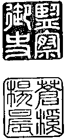
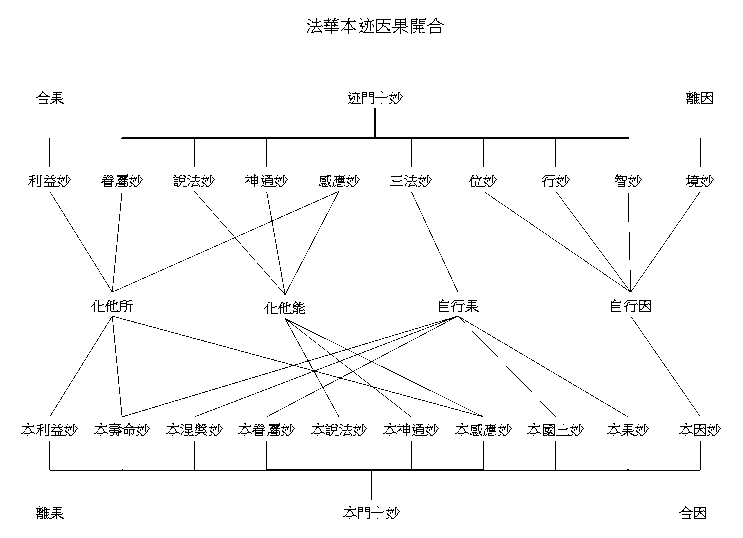
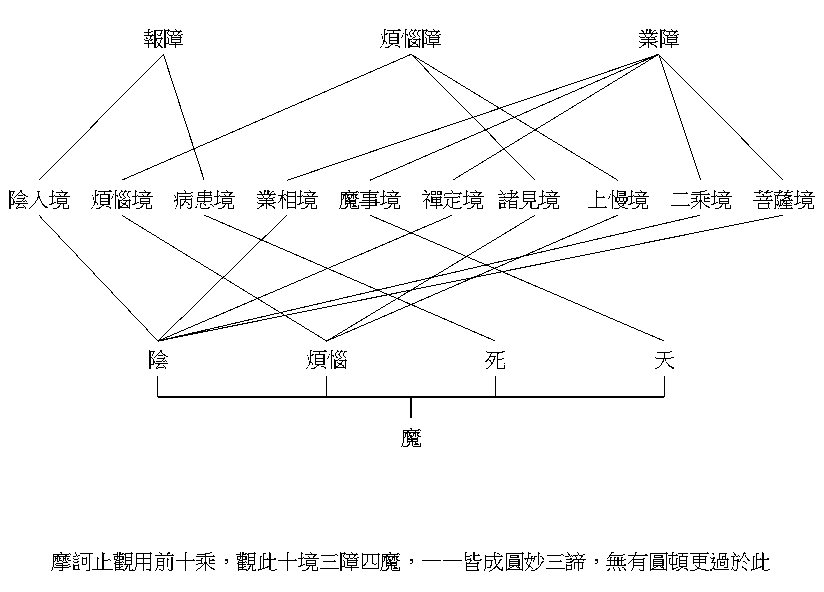

# 天台山方外志(第19卷-第30卷)



> **藏经**：中国佛寺史志汇刊（佛寺志汇刊）　**册次** 第 88 册（GA088）　**编号** GA0089　**部类** 诸宗部　**卷次** 7 卷　**篇幅** 68,485 字

> **作者（译者）**：天台山幽溪沙门传灯撰、天台山幽溪沙门　传灯　撰、天台山幽溪沙门　传灯撰

> **卷／品**：30 卷 · 51 品



---



## 目录



  - [序](#序)

  - [天台山方外志序](#天台山方外志序)

  - [天台山方外志序](#天台山方外志序-1)

  - [天台山方外志序](#天台山方外志序-2)

  - [天台山方外志序](#天台山方外志序-3)

  - [天台山方外志序](#天台山方外志序-4)

  - [序](#序-1)

  - [韩将军序](#韩将军序)

  - [始丰张序](#始丰张序)

  - [翰林院杨序](#翰林院杨序)

  - [王邑侯序](#王邑侯序)

  - [虞司勋序](#虞司勋序)

  - [屠仪部序](#屠仪部序)

  - [翰林院顾序](#翰林院顾序)

  - [幽溪灯序](#幽溪灯序)

- [天台山方外志卷第一](#天台山方外志卷第一)

- [天台山方外志卷第二](#天台山方外志卷第二)

- [天台山方外志卷第三](#天台山方外志卷第三)

- [天台山方外志卷第四](#天台山方外志卷第四)

- [天台山方外志卷第五](#天台山方外志卷第五)

- [天台山方外志卷第六](#天台山方外志卷第六)

- [天台山方外志卷第七](#天台山方外志卷第七)

- [天台山方外志卷第八](#天台山方外志卷第八)

- [天台山方外志卷第九](#天台山方外志卷第九)

- [天台山方外志卷第十](#天台山方外志卷第十)

- [天台山方外志卷第十一](#天台山方外志卷第十一)

- [天台山方外志卷第十二](#天台山方外志卷第十二)

- [天台山方外志卷第十三](#天台山方外志卷第十三)

- [天台山方外志卷第十四](#天台山方外志卷第十四)

- [天台山方外志卷第十五](#天台山方外志卷第十五)

- [天台山方外志卷第十六](#天台山方外志卷第十六)

- [天台山方外志卷第十七](#天台山方外志卷第十七)

- [天台山方外志卷第十八](#天台山方外志卷第十八)

- [天台山方外志卷第十九](#天台山方外志卷第十九)

  - [梁翰林：《天台止观统例》序](#梁翰林天台止观统例序)

  - [普门子：《法华玄义释签》缘起序](#普门子法华玄义释签缘起序)

  - [《止观辅行传弘决》序](#止观辅行传弘决序)

  - [崔尚：桐柏观颂序](#崔尚桐柏观颂序)

  - [晁待制：《仁王般若经疏》序](#晁待制仁王般若经疏序)

  - [吴铠庵居士：重刊《删定止观》序](#吴铠庵居士重刊删定止观序)

  - [慈云大师：《南岳止观》后序](#慈云大师南岳止观后序)

  - [王太师：〈十法界图〉序](#王太师十法界图序)

  - [贺允中：《江东天籁》序](#贺允中江东天籁序)

  - [己巳仲秋，贺允中序](#己巳仲秋贺允中序)

  - [吴子良：《江东天籁》序](#吴子良江东天籁序)

  - [湻祐十二年二月二日，荆溪吴子良序](#湻祐十二年二月二日荆溪吴子良序)

  - [宋之瑞：〈天台图经〉序](#宋之瑞天台图经序)

  - [嘉泰二年八月望日序](#嘉泰二年八月望日序)

  - [黄太史：《无见语录》序](#黄太史无见语录序)

  - [昙噩：《无见语录》序](#昙噩无见语录序)

  - [至正戊戌冬仲，国清比丘昙噩序](#至正戊戌冬仲国清比丘昙噩序)

  - [徐一夔：何宪副集天台山赋为诗序](#徐一夔何宪副集天台山赋为诗序)

  - [范理：《天台要览》序](#范理天台要览序)

  - [范吉：《天台县志》序](#范吉天台县志序)

  - [刘俸：《县志》后序](#刘俸县志后序)

  - [冯太史：《有门颂畧解》序](#冯太史有门颂畧解序)

  - [李素：《天台胜纪》序](#李素天台胜纪序)

  - [彭宪副：续修《天台县志》序](#彭宪副续修天台县志序)

  - [张邑矦：重修《天台县志》序](#张邑矦重修天台县志序)

  - [王司寇：《天台胜迹录》序](#王司寇天台胜迹录序)

  - [冯太史：《天台教源流图》序](#冯太史天台教源流图序)

  - [虞司勋：《楞严玄义》序](#虞司勋楞严玄义序)

  - [闻居士：《楞严玄义》序](#闻居士楞严玄义序)

  - [癸巳春日，门人四明闻龙谨序](#癸巳春日门人四明闻龙谨序)

  - [介山传如法师：《楞严玄义》序](#介山传如法师楞严玄义序)

  - [闻居士：《法华玄义辑畧》序](#闻居士法华玄义辑畧序)

  - [闻居士：送幽溪解讲归天台序](#闻居士送幽溪解讲归天台序)

  - [申太师：送觐西上人归锡天台序](#申太师送觐西上人归锡天台序)

  - [王方伯：赠葛居士修昙花亭序](#王方伯赠葛居士修昙花亭序)

- [天台山方外志卷第二十](#天台山方外志卷第二十)

- [天台山方外志卷第二十一](#天台山方外志卷第二十一)

- [天台山方外志卷第二十二](#天台山方外志卷第二十二)

- [天台山方外志卷第二十三](#天台山方外志卷第二十三)

- [天台山方外志卷第二十四](#天台山方外志卷第二十四)

- [天台山方外志卷第二十五](#天台山方外志卷第二十五)

  - [陆龟蒙：怪松图赞并序](#陆龟蒙怪松图赞并序)

- [天台山方外志卷第二十六](#天台山方外志卷第二十六)

- [天台山方外志卷第二十七](#天台山方外志卷第二十七)

- [天台山方外志卷第二十八](#天台山方外志卷第二十八)

- [天台山方外志卷第二十九](#天台山方外志卷第二十九)

- [天台山方外志卷第三十](#天台山方外志卷第三十)



---



### 序



闻之地有得人以传，人有藉地以传，有其地，有其人；或不抱传世心，行传世事，地仍不传，人亦随之湮没，良可慨已！天台为浙省名胜，智者大师定慧塔院在焉，宋祥符间始改为真觉寺。山川灵秀，物产菁英，披奇揽胜者，题咏备矣。千百年来废兴不一，我朝咸同间，赭寇窜逆，浙台地当要冲，戎马蹂躏，干戈扰攘，寺遂毁於一炬，时事使然尔。然大师灵爽式凭，鬼神呵护，可证天心重道，而我敏曦师继起矣。曦为大师四十世孙，肇当年衣钵，示后学津梁。光绪六年，奋图兴筑，越九载寺成。后贾餘勇筹刻《天台续志》，自有明万历迄今，垂三百年事。奔走江淮，集赀鸠工，非有志者事竟成哉？余不能无感焉！世有拥厚资、凭先业，风尘转徙，幻影倏成，奚屑力任艰辛、备盛事以传其人？固无论也，其或手剙门楣盛名，虚享娱游，晚岁幽忽以终，其人又安在耶？嗟夫！曦师一衲子耳，青年励志，白首穷经，同志延之讲解，恒孜孜不倦。平生布衣疏食，跋涉山川，年六十有四慨然曰：「某倦於游矣，将竣山志以终老乎！」曦师行乎哉！天台寺多僧众，何独任此巨力成此鉅功也？其山崔巍而巉峩，其人磊落而英多，是之谓与！书成，用补数言简端，至其表惠禅门，固别有可久可传者在！



时为光绪十八年岁次壬辰十月，诰授振威将军．前署湖南衡州协镇壮勇巴图鲁．兼袭云骑尉．寿春韩殿爵顿首撰书







佛法从来不立文字，自智祖以五时八教接人度世，而后天台别为一宗，葢由博会冥搜，研精至理，适致其极，而实则与达磨大师旨归仍同而不异。余尝读祖语录，至「灵山一会，俨然未散」，语辄狂惑，不得其解。后读湛堂和尚与大慧禅师所说「薰风自南来，殿阁生微凉」话头，乃始豁然打失布袋，尔时心中之乐，诚有微妙不可思议者，信古人之不我诳也。敏师深通经教，冥振元风，杖履经行，诸方共仰。昔人尝谓韶国师是智祖后身，灯公又国师转世。以理推测，师得无为灯公再来耶？善乎灯公之言曰：「能忘乎山乃见夫道，能忘乎道乃见夫山。」此其所以作为志书，搜罗宏富，随文证义，举重若轻，良由心体虚明，行所无事。今敏师为之重刻，振锡一唱，欢动诸天；喜舍法财，人人恐后；弹指之顷，告厥成功；承接法流，作将来眼。讵非所谓如水入水、如印印泥哉？余世梦乍醒，结习未尽，比者过宿真觉，瞻礼祖庭，悲恋之深，非可言喻。洎乎舟过百步，蓬牕无事，取祖别传读之，忽觉神风洒然被体，更若法华三昧登时现前，岂荷云慈密相授记乎？劣器下根，常恐失坠，乃蒙敏师愍其愚钝，时出一指来相提携。适会书成，又命检校作序，爰呈所解，附托人天，夫岂敢以文字言哉？明明百草头，明明祖师意也！



时在光绪癸巳十月朔，受菩萨戒优婆塞弟子．始丰张迈并书







重刻天台方外志叙



余以光绪己卯游天台，遍揽石梁、华顶、桐柏、桃源诸胜，於高明观贝叶梵书，於大慈获《修禅道场碑》，於方广阅内府藏经，而求明释传灯《方外志》不可得，仅得化霖《志要》以归。其时智者墖院以颓废不治，为慨然者久之。后官京师，得徐灵府《天台山记》及灯公《幽溪别志》，而《方外志》迄未得也。去岁奉讳家居，天台敏曦上人来访，出智者大师传印本，言墖院幸告成，又得《方外志》原书将付刊，乞为序。余闻之合十赞叹，喜台宗之将复振为有人矣。（按阮文达公序《志要》云：「化霖尝请齐息园先生删定，而其书芜襍失体，疑是息园未定之稿。乃属严君杰比事属词，以《吴郡志》为㳒。」）尝攷灯公此书成於万历癸卯，钱希言称其学识高出道流，甚有禅藻。《四库提要》亦言撰自释家，故称述梵迹为多，与专志山川者有别。盖彼自用彼法，讵必以史家地志绳之乎哉？今曦公既复墖院，为山中巨观，而又重刻是书，所谓慧力过人，能振其宗风者，故不辞而为之叙。



岁在昭阳大芒骆七月既朢，现掌四川道监察御史．前翰林院编修．国史馆纂修．黄岩杨晨书於京邸







------



### 天台山方外志序



夫中国名山有七，而五岳为尊。天台山，其南岳之佐理乎！昔大禹治水，会天下诸侯於於越，乃封其山为南镇。当是时，置瓯闽为蛮夷之地，舟车阻绝，疑天台者大禹未之至，至则不封於越而封天台矣。余昔读孙兴公赋，彷佛名山倒影於重溟之上，旁薄於霄汉之间，足与五岳七山埒；后得剖符兹邑，即津津色喜与名山有缘，得为地道主焉。爰自莅任以来，虽公事旁午，簿书积案，未尝不握如意拄颊，望霞标而耳瀑布。至於美景良辰，则又携一二文学，或采真於石梁，或览胜於华顶，或登桐柏礼夷、齐之像，或过楢溪吊顾欢之宅，一觞一咏，信可乐也。第名山洞府为仙释之都会，其中必多异人，若白道猷、葛孝先诸君者，求之於今，余非异人，固未易知人之异；求之於古，余将谁质？质之山灵，山灵无言；质之邑乘，邑乘不详。余终将谁质哉？乃山僧无尽法师示余以《方外志》，其叙事该、稽古博、究理深，为文则求诸辞达而已，不以奇衒人。释氏固其所长，仙宗亦复傍综，久住名山，而形胜固伊家中物，左提右挈，东指西㧑，若登鸿胪而陈俎豆。余喜斯志先得我心，乃趣命剞劂以补邑乘之未备。余观古今著述，互有详畧，为各有所主也。夫邑乘志方内者也，佛氏仙宗不妨聊尔并志；志方外者也，玄风释理宜加详焉，两者并行而不相害。故知斯志又邑乘之佐理也，因为之序。



赐进士第．北京大理寺左评事．前知天台县事．云间王孙熙书於台岳官舍



------



### 天台山方外志序



职方氏曰：余守方内名岳，盖有天台山焉。上应泰符，下禋星鸟；黄润为德，青祇建元；金土聚斗而陵衍沉，太乙升堦而爵禄降；宛弢躔次，正袭纮维矣。是以闾阎咏其克逊，里俗识以始丰。花县松关七篇之谕美，棠阴琪木五字之歌欢。若乃贾直舒文屈忠江孝，唐兴秀而章俊，天姥郁其生桢，超超往田，攘攘倚市，域中多恋，兴公怜之，使吾有力负之而趋，超不逾矩，矩周其山也。然而元圣忘山忘道，游化於兹，阐士泯色泯空，唱导於此，福庭隐岳，斯以称焉。恒河既覩琉璃，皇基讵非佛国？由夫缨络自缠，凫舄束綦；蛲客黄宁，安知革表？算米盐於尘窌，侈延旒於贲墉，谁决愚笼，必逢智印。有大导师灯公者，天宫蜚誉，婺宿开祥，枚引百松，叶荣双树，光幢继日，寺翳景而高明德，瓶注云溪，伏流而幽隐，众仰足行经藏，人呼皮里法华。太末道宾愈方袍之平叔，胜果净梵兼𨱎钵之言公。道得智者膏腴，近住神僊窟宅。代兴才子，矢结金兰；国学儒英，请挥玉麈。楚鸿，宝中之宝；善逝，天中之天。虽三观之内融，曾一时之外学，云雨慈味，笙簧道声。在山言山，山是新伊中点；知幻离幻，幻成志外别传。萃五界於贯华，总八峰於一轴。分章二十，十法以之成乘；取策二三，三教因之合辙。每驰神而运思，复远寄以冥搜，拓邑志之广轮，设图经之彩绘。正名轩牒，溯源达池。语本则山王之印文生，采胜则妙德之冠影涉。行满飞锡，处处仁祠；道岸披图，人人贤位。禅波合派於星海，祖堂大祫於台垣。陵再来而孔释并，韶应化而宗教一，载培桐柏，引配苾𫇴。右弼左玄，金庭是集僊之都会；欢溪察岭，玉京假天隐以衡门。王侯屹峙金汤，羽飞俨陈甲胄。卫我教也，纶音表而摩霄；成汝名也，金声流而掷地。人非昔而迹在，神不灭而塔悬，以至《酉阳》之〈诺臯〉，爰及庚除之唐述，《齐谐》荟志，慧皎异科，太阳之草长生，菩提之树摄念，莫不花生筠管，藜灿藤笺。执珠盘於秇坛，倾银河於口海。吐玄亭之白凤，御福三台；驱相宅之青乌，耻名一行。若陈吴，若宋谢，空揭霞标；若邕绰，若理中，虚张帆彩。遥连越乘，内折鲁儒，家有谱而野有谋，近者知而远者晓，记载以来，此为大方矣。尔其毋越牧俎，罔侵予宫，语必烟霞，人惟出世固已。𦶟麟香而屏秽，操犀导以辟埃。然虎落时开，鹿柴不守，咲司马过桥之悔，嗤阮客还家之悲，漫云朿足洗肠，聊复招手饶舌。亦以鹤林神训，缀万刹於珂毫；龙树灵文，洞干玑於珍网。示一家性具之旨，超孙生妙有之谈。斯则赤县赤城，并落砚池之虮𮊁；天堦天柱，同含毛颖之兔尘。岩岫彻于市朝，在外无外；廛庐通于寺观，即方离方。瑶丘掩丹丘之房，应真入养真之境。琼台方广，英玄𤯞而象移；芝草娑罗，正伦澁而味变。孤竹竟贪九州仆射，南岳须成五通僊人。黄门一开，惠虚偏行乎中道；玉局三降，宝琼忍折乎幔幢。阴岩之石能回，国清之灶可破，是为尘尘三昧，字字真如。六合版图，咸收册府；五车经史，尽入石渠矣。何妨名越岑为佛陇，名吕山为东苍，又何妨指一山为天台，指一寺为国清，如最澄之归日本，若宁贲之适会稽耶？嗟乎！太虚寥廓，真智靡涯，职方於此索途，灯公於此遗照，叙固非我，志亦非他，华藏遮外而纳安明於芥舟，灵圉毁方而入玄真於珠口。太史之圭奚测？司空之度应捐。权示桑钦括水泉於缃帙，幻同伯禹摄山海於金经，末裔由此衣传，倾都为之纸贵矣！



万厯癸卯法华三昧道场期满日，菩萨戒弟子．进士天官司勋大夫．前职方郎．武林虞湻熙和南书



------



### 天台山方外志序



天台山者，上应三台星得名，列於道书洞天福地，为东南一大名胜。按释氏教宗，则自智者大师以五时八教判释东流一代圣教，传之四明尊者，是为教观。禅宗则自雪居韶国师以秘密心印授永明寿禅师，举一心为宗，照万法如镜，是为宗门。又五百应真行化此山，方广寺在有无缥缈间，土人时闻钟磬梵呗声隐隐从地中出，高僧昙公曾一至其处，圣贤嫌其肠秽不得留，出而洗肠於涧，至今有昙华亭在石梁旁，为应真旧迹。而弥陀一化现国清为丰干，文殊、普贤两化现，一为寒山、拾得，一为戒阇黎、周七娘，应变无方，多所开化，贤圣先后托迹，称三宝地。按：僊宗自周灵王太子晋僊去，奉上帝命治桐柏宫，实主此山。其后刘晨、阮肇采药入桃源洞，遇僊子度世。唐司马子微隐此山，受度黄眉公，证太乙生人之果。至宋张紫阳真人大阐悟真之旨，化度群真。终於佛氏，灭度茶毘而收舍利，玄风丕振。又称神僊地，山形秀出，华顶为最高处，其山多名都洞府，神峰秀岭，幽溪绝壑，宝刹精蓝，琳宫道院，嘉树修竹，灵药瑶草，在在有之，以故王逸少、许玄度辈结伴从剡溪入兹山采真焉。孙兴公作〈天台山赋〉，鉅丽哉！颇尽灵秀之观矣。迩者法师无尽灯公，以上智夙德为百松玅峰师高足，远绍台宗，卓锡佛陇，爱此山秀拔神奇，遂抽灵心、发藻思作《天台山志》，志佛迹僊踪，名区胜壤亦既囊括胪列，纤悉靡遗，且气格森严，辞华宛𪽈，掩文人之笔，夺秇林之采，而又发明宗教究极旨归，上继佛陇之风，下振百松之绪，作人天之耳目，为道俗之津梁。旁及僊宗，研讨同异，归趋宝所，羽翼台传。不知者以为名山之志，知者谓是教观之文。自古山经地志多出文士之手，彼其止习辞华，罔究大道，文藻虽盛，玄风蔑如；乃至净衲高缁，非不精通佛理，或长於讲演，短於笔札；惟师禅观既深，文心复鬯，粲然鸿丽成一家言，文章家取而藏之名山，佛门中且取而庋之函部也。嗟夫！台宗自四明师示寂后，几乎泯泯，狂禅之徒辄诋台教为烦琐。余谓科条似烦，旨归则要，众星拱辰，百川会海，如以台教为烦，则《华严》八十一卷科条次第不更烦乎？天幸百松振之，幽溪复大振之，而穷公阐发於句甬，介公扬诩於虎林，於是天台之宗焕然，揭日月於重朗，盛矣盛矣！是志也，绍先贤则光接慧炬，开后学则智烁群昏，酬山灵则勒石悬崖，传文苑则永垂竹素，是志之善物也。世传韶国师为智师后身，以去来无碍之理论之，安知韶公之后不复为尽老耶？志成，问序於余。余夙禀教尽老，得闻五时八教之旨，梦寐名山，托之神游之日久，乌得无言？要以附志青云而不朽，匪特山神首肻，亦或如来之所印可也。



旹万历乙巳仲春朔，娑罗居士屠隆纬真甫篹於天中天室



------



### 天台山方外志序



史莫良于志，天地人物礼乐刑名，至奥渺夥赜矣。然而图谍度数存焉，虚可稽也，实可录也，苟擅三长，宁欪四善哉？志莫良于山，纪载之难有数端焉。猨栖熊馆，鸟道蛇盘，蜡屐从所未经，樵斧繇来罕到，即有幽奇，何缘觏觌？雁宕径辟于宋年，黄海道登于明代，非其验与？故真见难详。自昌黎恸哭于落雁之峰，王阳迥驭于羊肠之阪，文人墨客往往心快卧游，具穷济胜，丹椒翠幂，月磴天崖，秪标异于登高眺远之篇，间问奇于牧竖荛夫之口，言之若梦，槩乎有闻信耳。既非任目逾舛，山之真形从是遯矣，故传闻难据。时易世移，陵虚谷实，嘑随方改，字以俗讹。石翳藓中，畴睹神清之洞；门潜水底，讵窥小有之天？或古有而今亡，或此非而彼是，文士疑而莫质，野老㳂而不知，辨而析焉良未易矣，故攷证难精。经丘寻壑，别引胜流，揽木援藟，必资旷日。而或𬨎轩之驾，恨束马之未能；杖屦以游，虞赢粮之不继。非倥偬而靡暇缀录，即怅望而无力篹言，徒遥想于冥搜，曷散怀于奋藻，故结撰难富。兼而有之者，其惟无尽大师之志天台乎？师以法中龙象坐大道场，以舌上珠玑作大佛事，隘旧志之未广，惧灵迹之无徵，折竹晨编，然松暝写，缉为山志数十万言。自山名以讫文章，有涉兹山者，罔不采其故实，掇彼菁华；至台教之真文，高人之遗韵，尤加详焉。顷以请藏金陵，属余为序，余受而卒业。向之所难，今之所易，可谓冥通地络，潜镜山灵，勒遐贯于清都，垂宏模于法界者矣。盖其住山三纪，振锡千峰，徧寻不死之庭，毕践无人之境，有胜必穷，无险不陟，与夫目荐未奇、耳剽多妄者异矣。而又萝封之字普入搜罗，树挂之钱咸资考索，且日探月厯，神畫形摸，以故琪树金松，同检桐君之箓，墨池茶圃，双甄管子之题，鉅细不遗，名实无爽，又何有攷之未精，撰焉未备者乎？嗟乎！览应邵之记，如禅岱宗；披王履之图，若临僊掌。犹曰地以文奇，境因语丽耳。至若道元之注《水经》，旁洽异书；灵运之赋山居，广陈奇物。千载而下，等讽咏于登陟，嫓简册于丹青，志而若斯，斯已伟矣，师之天台，庶几是乎！若夫精诠教观，弘阐宗风，霏法雨于松枢，霔慈云于萝愰，花飘座侧，乐鼓空中，斯又地灵以人杰逾章，山笥与海藏同久者也。彼杨衒常记伽蓝，慧远曾经庐阜，厥称著矣，岂如斯志，名寄区中，理存方外，将使绝粒茹芝之客默引瑶梯，餐风味道之俦群登宝筏者哉！



万历壬子仲秋日，赐进士及第．南京国子监司业．前翰林院国史编修．记注起居．编纂章奏．江宁友人顾起元撰



------



### 天台山方外志序



夫志，犹史也，亦传也。有天下之史，一国之史、一县之史、一家之史；有僧史、僊史、高士之史、名山之史。史虽不同，所以记言记事一也。汉明以来，佛教东渐，三宝事迹，班班可纪，故太史有左右之官，僧录亦设左右之职。矧山林硕德，著述犹多，若梁慧皎法师、唐道宣律师、宋僧统赞宁之《高僧传》，宋道原禅师之《传灯录》，驸马李遵勗之《广灯录》，惟白禅师之《续灯录》，四明盘公之《佛祖统纪》，以至《释氏通鉴》、《佛祖通载》、《僧史畧》、《释氏稽古略》之类，曰教、曰禅、曰律，人齐七众，门备十科，矫矫人龙，翼翼义虎，有一言之悟人必书之，有一行之合道必书之，其启迪后昆，弘范时俗，功德可胜言哉！天台山者，域内之名区，东方之圣境也。地灵人杰，先灵於老释，后杰於儒宗。僊风绵邈资始於轩商，佛法秘藏肇基於方广，正言缁门著迹，则爰自东晋昙猷栖神、萧梁定光显圣。洎我陈隋智者大师立宗命教，因山为家，海内之宗事佛法者，必以台教为司南，降唐及宋元至我皇明，师资相继千有餘年，无论天下教黉之盛，即兹山流衍，考诸僧史，不减数百餘人，与夫禅门则韶踵躅白沙，皆法门之梁栋，教鼎之盐梅，名言懿德脍灸人口，岂不以此山泉石足以疏练神明、产育圣贤而然耶？然则山因人显，人以山名，山已有志，人胡可略？旧为是志者，谓释老非志所急，故存而不书，或书而不详。然有世间法、出世间法，达人大观无可不可，若分门立户，不啻冰炭，宜其目为天地间之尤物也。今之所志亦谓世间法，非出世之所急，故存而不书，非若冰炭之相视也，为县志已备，故不复疣赘。云志之为类者凡二十，始於山之名，终於山之文章。盖名者实之宾也，微名无以显实，首以山名考。缘名求实，形胜虽山之实质，源又山之起祖，次以来源考。形胜与山，其犹影响，山之形声，乃吾心之灵觉也，次以山体考。有形声矣，影响从之，次以形胜考。依形胜以建名刹，次以山寺考。石梁方广，赤城支提，菩萨圣僧，灵宅攸托，次以圣僧考。智者依山而进道，后代继祖以传灯，次以祖师考。祖因山而得名，法因山而立目，次以台教考。教得人以弘，人得教以立，次以高僧考。桐柏桃源，洞府在焉，次以神僊考。察岭欢溪，考槃是宫，次以隐士考。名山胜刹，赖神功为之密护，次以神明考。三宝阴翊世道，藉权贵为之显持，次以金汤考。厯代奉法者咸有匮遗，如陈宣帝之捐调，隋炀帝之施品，物虽归化，事尚传闻，为法门盛事，次以盛典考。石梁之现光现花，佛陇之见桥见雀，同乎见闻，异乎常论，次以灵异考。古佛舍利，奉安高显，诸祖灵骨，瘗之方坟，次以塔庙考。智者降魔於华顶，寿公入定于天柱，至於一石一泉皆前人之遗迹，次以古迹考。人与山名欲同垂于不朽，或刻石以记名，或树碑而颂德，次以碑刻考。菩提琪树，灵根托于名山，罗汉恠松，天葩生于胜地，次以异产考。上之王臣以及墨客，或因人而著作，或缘景以䌷思，皆有足以光彩名山、宪章人物，次以文章考。发前人之所不发，书前人之所未书，述而不作以成一家之书，名曰《天台山方外志》，盖取异于县志之所略尔，观者请以此意恕之。



皇明万厯岁在辛丑孟冬癸未之吉，太末释无尽传灯命笔于天台之幽溪讲堂



天台山志目录



------



### 序



### 韩将军序



### 始丰张序



### 翰林院杨序



### 王邑侯序



### 虞司勋序



### 屠仪部序



### 翰林院顾序



### 幽溪灯序



第一卷



山名考第一



山源考第二



山体考第三



第二卷



形胜考第四



山（五十三处）



第三卷



峰（三十三处）



岩（二十九处）



岭（四十处）



洞（八处）



石（十处）



溪（二十五处）



潭（二十处）



湖（八处）



塘（三处）



井（九处）



泉（十处）



池（三处）



第四卷



山寺考第五



寺（六十二所）



院（九所）



庵（十四所）



莲社（一所）



道场（二所）



堂（二所）



观（五所）



宫（五所）



道院（十二所）



道庵（三所）



第五卷



圣僧考第六



隐（二处）



显（二十一人）



补遗（七人）



第六卷



祖师考第七（一十七人）



第七卷



台教考第八



教观大纲



教门（十八条）



观门（九条）



清规（二条）



教观书目（共六十三人，书三百部）



石室藏书（儒部四十一种，仙部十九种，志部十一种）



第八卷



高僧考第九



教宗（五十八人）



禅宗（五十七人）



莲宗（十四人）



律宗（人）



第九卷



神仙考第十



神仙（三十六人）



道士（三十七人）



第十卷



隐士考第十一



隐士（五十人）



侨寓（二十三人）



神明考第十二



护伽蓝神（二人）



龙神（十人）



土谷神祗（十七人）



第十一卷



金汤考第十三（七十七人）



第十二卷



盛典考第十四（二十五事）



灵异考第十五



释（三十四事）



道（三十事）



第十三卷



塔庙考第十六（三十九处）



佛塔（一十三处）



祖塔（二十六处）



坟墓



古迹考第十七（六十七处）



碑刻考第十八



碑（六十七处）



手书（四种）



岩镌（十四人）



异产考第十九



食（十六种）



木（五种）



杖（三种）



花（五种）



草（四种）



兽（十三种）



禽（十四种）



药（七十九种）



石（三种）



第十四卷



文章考第二十



敕（十五首）



第十五卷



书（二十二首）



第十六卷



书（三十三首）



第十七卷



书（二十九首）



第十八卷



疏（十二首）



第十九卷



序（三十一首）



第二十卷



记（十六首）



第二十一卷



记（十六首）



第二十二卷



记（首）



第二十三卷



碑（六首）



第二十四卷



塔铭（五首）



行状（一首）



传（一首）



第二十五卷



赞（十三首）



第二十六卷



赋（四首）



第二十七卷



诗（赋景）



天台山（四十二首）



第二十八卷



国清寺（二十八首）



赤城（二十四首）



佛陇诸寺（九首）



华顶（十三首）



石梁桥（三十三首）



万年寺（一十二首）



玉霄峰（三首）



桐柏宫（三十八首）



琼台（二十三首）



第二十九卷



桃源洞（三十三首）



护国寺（七首）



寒岩（十六首）



明岩（六首）



杂诗（九首）



曹文晦八景（八首）



第三十卷



寄赠（六十首）



佛陇曦跋



(刻板餘赀印订三佰部流通)



------



## 天台山方外志卷第一



**译者**：天台山幽溪沙门传灯撰



山名考第一



自夫有天地即有人物语言，有人物语言则事事物物皆有名。谓此山称名始於何人？上古荒𧂀，无以稽焉；仅可考者，始於刘阮名传，后因孙公赋显海内，方知有天台山也。正以兹山顶对三辰，当牛女分野，而上应三台，故以名焉。顾野王《舆地志》又云：「天台山一名『桐柏』，众岳之最秀者也。」徐灵府记又云：「天台与桐柏接而少异，又名赤城、瀑布、佛陇、香炉、华顶、东苍。」要之，天台为诸山之总称，若桐柏等众名，乃诸山各随其胜而别目之。即《西域记》亦云：「震旦天台石桥方广寺，五百阿罗汉居焉。」按此则「天台」之称，其来远矣。又章安禅师《山记》云：「本称『南岳』，周灵王太子晋居之，魂为其神，命左右公改为『天台山』也。」荆溪禅师云：「若准孙公《山赋》云，所以不列於五岳、阙载于常典者，以其所立幽奥，其路旷逈。」故未知章安所出，今姑存之。《华严．菩萨住处品》又云：「东南方有处名支提山，从昔已来诸菩萨众於中止住。现有菩萨名曰天冠，与其眷属诸菩萨众一千人俱，常住其中而演说法。」清凉国师谓「支提」，梵语，此云可供养处，即塔之异称。惟东南方有赤城，其形如塔，且其巅又有舍利宝塔，应是支提。据此则石桥方广为五百应真住处，赤城又为天冠菩萨住处，然二住处皆天台山内之境，惟「天台」为定名也。



山源考第二



山有来脉，水有来源，犹人身之有经络，树木之有根本也。水以地载，山以水分，考山犹当考水，知水之所由，后能知山之发脉也。故堪舆家之言风水云：乘风则散，界水则止。山岂为风水之止散？盖山之为气，风则散，水则止耳。说者谓中国名山有七，而五岳为尊，山自昆仑发源，此见其近而未见其远，闻其小而未闻其大也！今既许以方外名志，而方内之说置而后论可也。请试考之，谨按佛经：须弥山之南，大海之中有洲名赡部，纵广七千由旬，周围之可得二十八万里（此以一由旬四十里计之也）。从辽东西行出阳关，逾葱岭，经五竺，尽西海际；从南海北行出雁门，逾沙漠，极北至瀚海，皆可九万里，而四方各得四万五千里。之中其地名中天竺国，有阿耨达池，在香山之南、雪山之北，周八百里，十地菩萨化为龙王於中潜宅，出清泠水以给赡部。池之东南银牛口流出兢伽河，遶池一匝，入东南海。池之南面金象口流出信度河，遶池一匝，入西南海。池之西面琉璃马口流出缚刍河，遶池一匝，入西北海。池之北面颇胝师子口流出徙多河，遶池一匝，入东北海。此第四水为此方黄河之源，此水自出池后，先经葱岭为葱河，入蒲菖海潜流地下至积石山，复从地涌出为东华黄河之源。（积石即昆仑山也。葛僊翁传曰：昆仑，一曰玄圃，一曰积石瑶房，一曰阆风台，一曰华盖，一曰天柱，皆僊人所居也。）以此而推，则阿耨达池为赡部四河之源，河水流入四海，天下诸山由此四水而界。此池之地，其形最高，为赡部诸山之祖，而东华七山五岳与夫昆仑莫不宗於此也。盖山因水界，由阿耨达池之水分天下之山为四支，而东华之地当一支焉，此徙多河及黄河以南、殑伽河以北之地界也。自池水分支以后，其脉或起或伏，伏而为地，起而为山，而昆仑四傍山麓，各入大荒外，入中国者一东南支也。其支又于塞外分为三支：左支环虏庭阴山、贺兰入山，西起太行数千里，出为毉巫闾庭，度辽海而止，为北龙。中循西番入趋岷山，沿岷江左右，出江右者包叙州而止，江左者北去趋关中，脉系大散，关左渭右汉中，出为终南、太华，下秦山起崧高，右转荆山抱淮水，左落平原千里，起泰山入海，为中龙。而南龙右出吐蕃之西，衍至震旦起而结为峨山，次梁州，次益州，次西南夷，次南越，次荆州，次百越，次闽中，次豫章，次吴越、建业，同一脉也。衍至荆州起而结为南岳，自南岳东至庾岭又分三支，北则豫章而下结为匡庐，南则张为全粤而尽罗浮，中则瓯越翔武夷常山。又为濲水所分，溪之左为浙西，溪之右为浙东，过烂柯、太末至栝苍起顶；南支僊都、石门、玉甑、雁荡、海门，环抱於台之东南；北支金华屏峙於台之西北；其正东一支至大盆山一化而为玉山，再化而为天台。玉山又为两支，北支衍为会稽秦望，盖自九里坑发源，至嵊县出曹江；东支过关岭，复大起之结为天台。说者谓关岭回支起天姥护峡而止，不知天姥为石城之胚胎，自万年藤公岭发脉，已为僊人浪黄杜溪截断，是天台西北干也。关岭过脉处，北以黄杜，南以左溪，界水极分明。台山竣拔，如海中巨浪，陡然一跃，纤悉顿足，不必论其前后，凡结为九大峰，中为华顶峰，东为摘星峰，东南为东苍峰，南为狮子峰，西南为大雷峰，西为葛阆峰，西北为香炉峰，北为香柏峰，东北为菩提峰。摘星峰分为两支：一至缑城发为长汀、勾章诸山，届东海大嵩管江而止者，左龙也；一至缑城发为象邑诸山，届大瀛海而止者，右龙也。东苍峰亦分两支：一由王爱山过桑洲，至东嶴清渚沿海而止者，左龙也；一於榧木村、跌断穿、青山头、覆盆山迤衍入大固山，孕临海山川之秀，届章安、芙蓉、桃渚、徤跳、周水亭傍而止者，右龙也。狮子峰为欢嶴、九析峰、东横山之龙，届大溪而止。大雷峰亦分两支，左为修禅、太平、高明三寺之龙，届幽溪、螺溪而止；右为真觉、后明、清心、传教四寺之龙，开洋为县治，届大溪而止。葛阆峰亦分两支，左为国清赤城山之龙，右为桐柏山之龙，届南嶴溪、灵溪、清溪而止。香炉峰为护国寺、桃源诸山之龙，届左溪、秀溪而止。香柏峰为慈圣、万年、金庭、上虞诸山之龙，届剡溪、娥江而止。菩提峰为姚江、慈水、定海诸山之龙，届招宝山东北大海而止。是知天台山者，东濒大海，界水而止，为东南一大结局。而父於南岳，祖於峨山，曾於昆仑，高於雪山，自雪山东南而下不减四五万里，其中所有灵粹之气，莫不毕集於此，为神僊之窟宅，罗汉之道场，间生圣贤，养育英哲，岂徒然哉！



山体考第三



夫桎梏之士，因泉石成膏肓；解脱之宾，以山林为药石。其故何哉？见道不见道，忘山不忘山，异也。不见道则满目皆山，能忘山则触途皆道。若庖丁之解牛，始解之时所见无非牛者，三年之后未尝见全牛也。然不见全牛犹有乎牛，未忘牛也；同乎不见全山犹有乎山，未忘山也；能忘乎山，斯见道矣。有道之可见，未忘道也；见道亦忘，真见道矣。是则忘山者易，忘道者难，能忘道者，其惟如来乎！或曰忘山有道乎？曰：忘山之道莫贵乎见性，见性之道莫先乎明心。性其犹镜也，心其犹明也，镜明同耶、异耶？离明无镜，离镜无明，同也；镜为明体，明为镜用，异也。以其同者观乎异，非异也；以其异者观乎同，非同也；亦不以非同非异见，惟见乎心性而已矣。不见而见，无所不见，终日见终日心性，吾亦不知孰为见、孰为心性？吾将见与心性同归於绝待之道而已矣。或曰：请问心性？曰：心，性之光明也，性之所由显也；性，心之本体也，心之所由生也。性之为德，具大觉知，体包太虚，量周沙界，非首非尾，非上非下，非边非中，非去非来，非今非古，非生非灭，非作非为，非同非异，非彼非此，非能非所，非净非垢，非明非暗，非有非无，非双亦有无，非双非有无，非增非减，非动非静，非短非长，非欠非剩，非方非圆，非大非小，非倒非正，非隐非显，非合非离，非一非二，非本非末，非生非佛，非圣非凡，非贤非愚，非迷非悟，非体非用，非苦非乐，非成非败，非缚非脱，非理非事，非真非妄，非境非观，非机非应，非依非止，非麤非妙，非久非近，非迹非本，非实非虚，非性非相，非常非断，非人非我，非修非证，非因非果，非根非尘，非色非空，非世非出世。彼首者不能尾，彼尾者不能首，以至彼世者不能出世，彼出世者不能世；惟其非首尾者能首能尾，非世出世者能世出世。故性之为德也，能首能尾，能上能下，能边能中，以至能世出世。故性之为德，无法不具，无法不摄，无法不能，惟随缘何如耳。故《华严》云：「能随染净缘，具造十法界。」《楞严》云：「随众生心，应所知量，循业发现。」故性之为体，随净缘时，则为佛为圣，为悟为体为用，为成为解脱，为即事之理、为即理之事，为真为应为妙依正，为久为近，为说为默，为迹为本，为实为妙，为性为相，为常为乐，为我为净，为出世。故性之为体，随染缘时，则为首为尾，为上为下，为边为中，为去为来，为古为今，为生为灭，为作为为，为同为异，为彼为此，为能为所，为垢为净，为明为暗，为有为无，为双亦双非有无，为增为减，为动为静，为短为长，为欠为剩，为方为圆，为大为小，为倒为正，为隐为显，为合为离，为二为一，为本为末，为圣为凡，为迷为愚为苦，为成为败为缚，为理为事，为妄为境为观，为依为止为麤，为虚为断，为人为我，为根为尘，为因为果，为世间法，以至为泉为石，为林为野，为烟为霞。是以为佛为圣，为净为悟等者，性之能事也；即其为众生，为迷为染，为苦为缚等，亦性之能事也。性之能事而为之，非勉强也，皆称性之所施设者也。惟其称性施设，故事事物物皆法界之全体也。故曰刹海法性不大，一尘法性不小，多亦法性，少亦法性。故约迷情观事物，有大小方圆之殊；约道眼观事物，惟广大法性而已。故曰为物所转故，於是中观大观小，若能转物，即同如来。或曰：性体已闻命矣，心之为用，尚请言之！曰：体惟一性而已矣，餘皆性之用也，何独惟心！第迷情日久，亲疎硕分。以内身对外物，则内身为亲，外物为疎；以身对心，则心为亲，身为疎。盖外物无觉知，内身则异此。然内身之有觉知者，由心之使然也，故心在，身则有觉知，离则同乎木石矣。故外物疎之至疎者也，心亲之至亲者也。故言心为用，切近而易指；言他为用，疎远而难明。今就近易之心以指性德之用，缘用以明体，其犹缘明以求镜，不亦易乎？故曰见性莫要乎明心。心之为用，似有待也；性之为体，故无待也。全性体以为心用，彼有待即无得矣。故彼山之巃嵸，吾眼之可见者也；水之潺湲，吾耳之可闻者也；花之馥𩡏，吾鼻之可嗅者也；泉之鲜冽，吾舌之可尝者也；谷风之温凉，吾身之可觉者也；五者之法尘，吾意之可知者也。此六知根，又心之用也。总而为之，官者心也。心王之所以扰扰者，六尘为之贼也，由兹六根贼媒之使然也，故经曰：「六为媒贼，自刦家宝。」彼六尘者，果贼邪？非贼耶？彼六根者，果媒邪？非媒邪？彼六尘非六贼，六根之使然也；彼六根非贼媒，心王之不能御也。王苟能御，彼将为清净六根与夫净妙六尘矣，何妄之有哉？经云：「见与见缘，并所想相，如虚空花，本无所有，元是菩提妙净明体。」非此之谓乎？是以善见道者，即心以见性；善明心者，即物以明心。其犹善见面者，即明以观镜；善瞩明者，即像以求明。故曰性其犹镜也，心其犹明也。彼山川泉石与夫一切事物，非像之谓乎？彼镜有实体也，明有实用也，像则无实质也；以譬乎性有实体也，心有实用也，万物无实质矣。像无实质，由形对而生，同乎物无实体，由性具而有。善观镜者不取彼像之有无，惟鉴吾面之妍丑；以譬夫善见道者不取物之是非，惟见吾性之广大寂照而已。故彼解脱之宾，以山林为药石者，树吾光明之台，朗吾寂照之境，形对像生，了罔陈迹，吾亦不知孰为山也、孰为水也、孰为林木也、孰为泉石也、孰为烟霞也、孰为白云也。然而何非山也、何非水也、何非林木也、何非泉石也、何非烟霞也、何非白云也？离即离非，是即非即，惟学如来以道眼观之者，有以明之也。



------



## 天台山方外志卷第二



形胜考第四



天台山高一万八千丈，周回八百里，山有八重，四面如一。复有四门，智者大师以赤城为南门，以新昌石城为西门，徐灵府又以剡县金庭观为北门，余谓准此当以王爱山为东门。或者疑以为诞，不知皆有所徵也。盖名山福地必有神圣呵卫不祥，惟此台山自古及今无有虎豺之暴，曾以是讯诸山民，佥曰：四门之内，周环民居，即有恶兽经由，惟犬羊等物是残，见人则妥尾走匿草莽间。审如是，则所谓圣僧道场、神僊窟宅，信矣。若取之，则凡在台州属境，皆其区域，以牛女分野，何啻千里？故唐宋已来，以台州名郡，盖取乎此。若约灵异以分山，凭诸书以割地，则自县治以南皆非也。然台雁二山皆东南胜境，古人未有定其优劣者。余始游雁宕，见其峰峦秀拔，奇形恠状，将谓海内名山无有胜此。及登天台山，观其规模宏大，又恍然自失，因而品曰：雁宕山其犹李青莲之五言古诗也。天台山其犹杜拾遗之五言古诗也，以子美之诗，上薄〈风〉〈雅〉，下该沈宋，言夺苏李，气吞曹刘；掩颜谢之孤高，杂徐庾之流丽，尽得古人之体势，而兼昔人之所独专，近之故也。盖此山在下望之，不啻千仞，及升其巅，四通八达，间皆可数，十里如在平地，其胜一也；至登华顶峰头，东望大海，南观雁宕，西瞩栝苍，北眺钱塘，一览可尽，其胜二也；俯瞰群峰，皆在其下，罗列环遶，或如莲叶、或如华须，恍疑一朵芙蓉浮於海上，其胜三也；僧寺道院，桑麻相接，钟梵鸣於天上，鸡犬吠於云中，其胜四也；虽极其幽邃之地，皆明爽开豁，使人襟抱荡然，其胜五也；山与通衢左近，车马络绎；其下胜槩罗列，其巅可望而不可到，其胜六也；山无背向，四面如一，其胜七也；山有八支，八溪为界，以华顶为车轴，山之周遭如八轴轮，亦如八叶覆莲，其胜八也；山产众药，又多肥蕨黄精，此足供居者[米*候]粮，其胜九也；山林深远，即居民亦有未臻其奥者，可以避隐，其胜十也。且赤城为其南标，石城为其西固，东苍为其眉，四明为其目，中有琼台、双阙、佛陇、香炉、石梁、瀑布等诸景，骨肉不偏，形神俱妙，所以为胜也。此其梗槩耳。若夫赤城建标，珠林簇簇，谁其淡诸？霞红云绿，则有赤城山之胜；五峰环翠，宫殿俱高，双涧奏响，和以松涛，则有国清寺之胜；溪界山出，路沿涧入，瀑布龙湫，凉风袭袭，则有金地道中之胜；金地在上，壁立万仞，苍龙委蛇，济以天磴，则有金地岭之胜；竹坞茆茨，踈磬间发，法语琅琅，金绳宝筏，则有定光庵之胜；古墖皇封，与山巃嵸，瞻之仰之，万世高风，则有真觉寺之胜；法流洙泗，佛道康庄，普贤境界，修禅道场，则有佛陇大慈寺之胜；大雷峰下，白云精舍，数里平原，幽人命驾，则有太平寺之胜；路入羊肠，身亲龙阙，山橡藤梨，美哉肤核，则有寒风阙道中之胜；亦有桑麻非人间者，岂轩辕丘广莫之野？则有长寿、文殊、西竺诸寺之胜；万山之中，其岭陂陀，考槃之宫，尚餘烟萝，则有察岭下高察旧隐之胜。此南门第一支，取华顶之直道，以南嶴溪为界也。若夫放生池上，碧水盈隄，有物龙去，犹名螺溪，则有清心寺之胜；长松数挺，野庙披离，昔人传教，今归与谁？则有传教寺废址之胜；叠嶂千重，溪梁百折，泉落树头，流云喷雪，则有螺溪道中之胜；仰攀丹崖，危磴半欹，梯云扪葛，乃可探奇，则有幽谿岭之胜；幽谿讲肄，车尘不喧；山林盘欎，别有乾坤，则有高明寺之胜；路隔三山，可望难即；松篁数家，泉流上泐，则有清凉寺遗迹之胜；下有寒泉，藏蛰神龙；石笋高峙，砥柱虚空，则有螺蛳潭之胜；溪南溪北，上游下游，经梵相闻，以耕以修，则有黄坛诸庵之胜；圣僧西归，惟遗双屐，精神不磨，竟化为石，则有圣迹内外庵之胜。此南门第二支，取华顶之纡路，以螺溪为界也。若夫云林覆殿，宝箧藏经，诸天散花，神鬼来听，则有慧明寺之胜；觉路平平，好山相迎，谷风溪水，且轻且清，则有楢溪道中之胜；山藏太古，水奏琴心，惟昔高士，允矣知音，则有齐高士顾欢隐处之胜；水穷山尽，有地灵墟，盘石可坐，精庐可居，则有天封寺之胜。此东门第一支，取华顶之直道，以楢溪为界也。若夫丹山夷夷，草木萎蕤，何独王爱，我亦爱之，则有王爱山之胜；修竹千竿，兰若数楹，长者福聚，纳子化城，则有筋竹岭庵之胜；云生足底，人行天上，谁挈我衣，空中五两，则有弥陀庵仰天湖道中之胜。此东门第二支，取华顶之仄径，以水母溪为界也。若夫山光明媚，水色澄鲜，真阿练若，乐矣三禅，则有澄深寺之胜；猨梯达汉，鸟道通玄，疑其登者，居日月边，则有摘星岭之胜；山藏八景，高僧所安，彼如庵主，其墖犹完，则有大同寺之胜；瑞草藉地，拱木蔽天，禽猨啸聚，杳无人烟，则有石笕道中之胜。此北门第一支，取华顶之峻路，以罗木溪为界也。若夫神僊福地，茅竹洞天，金庭观侧，羲之家焉，则有金庭观之胜；路崎而胜，水险而清，篮舆竹筏，恣我南征，则有福溪道中之胜；山奇迹圣，佛慈如如，丰碑古记，元章之书，则有慈圣寺之胜；方广觌面，伊谁能见？八万度门，聊通一线，则有石梁桥之胜；瀑泻悬崖，石潭淙淙，奇哉谁设？玄龙之功，则有断桥之胜。此北门第二支，取华顶之险路，以福溪为界也。若夫千山倒景，芦荻藏舟，中有钓叟，机忘海鸥，则有青溪之胜；青山崔嵬，飞流界道，织女停梭，牛郎凝眺，则有瀑布水之胜；僊人拍掌，玉女溅珠，亦有僧寺，是称僊居，则有玉女溪、瀑布寺、福胜观之胜；九峰迢嶤，玄宫逍遥，僊凡路隔，度以三桥，则有桐柏宫之胜；琼台薄汉，双阙凌霄，其谁神司？僊者王乔，则有琼台双阙之胜；此上有玄明、洞天、仁靖、纯素诸宫，白云、寿昌诸观，圣寿、法轮、法莲诸院，卧云庵等诸处之胜；小山为伍，环畬千亩，寺倚危峰，坎坎钟皷，则有护国寺之胜；溪泛胡麻，上有僊家，云中古洞，尚餘桃花，则有桃源之胜；其上有慈云、普光、西定慧，莲华峰上普慈、证教诸寺之胜在焉。此西门第一支，取华顶之纡路，以闹溪为界也。若夫石沼为池，石山为城，金汤像教，功由巨灵，则有石城山之胜；慈氏宝相，百尺停停，金光赫奕，勤矣三生，则有石佛之胜；采药归来，云仍七世，桑梓犹存，千年僊系，则有刘阮村之胜；南有悔山，北有悔桥，司马子微，悔从帝招，则有司马悔桥之胜；将入僊都，天为设险，险岂在山，尘凡难转，则有会墅岭之胜；紫云蔽野，亦翳丹霞，异产何物，苓术胡麻，则有彩烟山之胜；昔人梦游，我亦玄搜，灵僊窟宅，葛洪丹丘，则有天姥山之胜；红尘白云，僊凡道分，石梁捷径，瑞气氤氲，则有石梁道之胜；僊人鞭石，如牛如马，亦如万舟，蔽流而下，则有僊人浪之胜；其甘如醴，其寒如冰，应心之泉，有待而兴，则有应心泉之胜。此西门第二左支，以黄杜溪为界也。关岭之傍，留郑有坊，贤哉邑候，尚遗甘棠，则有关岭之胜；石室深邃，厥名白岩，神灵祥瑞，余悉其凡，则有白岩山之胜；万峰攒翠，列如畫屏，一溪直界，混混流青，则有秀溪口之胜；奇峰插天，翠妆绿翳，飞瀑如虹，悬崖飘曳，则有龙湫瀑布之胜。此西门第二右支，以秀溪为界也。古木千章，平田数顷，中有梵宫，殆绝人境，则有万年寺之胜；往者圣僧，归自东海，轻驾铁船，其湖犹在，则有铁船湖之胜；平田饭僧，於是邀请，松柏森森，为罗汉岭，则有罗汉岭之胜；心外无法，满目青山，香炉峰侧，别开玄关，则有通玄峰、香炉峰之胜；万八峰头，寺邻帝座，天籁梵音，六时叅和，则有华顶寺之胜；身出五云，天空海濶，星辰四垂，斗柄可斡，则有华顶峰之胜。此西门第二支，取华顶之康庄也。是中有二岐路，一至会墅，由小路上藤公岭与万年会，校近十里而景差劣，一至万年，过道人坑，先往石梁，至察岭头会，校远五里而景差胜也。若夫春日载阳，草木生香，山花夺目，好鸟相将，则有春景之胜；朱明赫赫，树蔽原隰，数里无尘，泉流涧侧，则有夏景之胜；凉风振条，林木萧萧，蹲鸱黄独，山家正饶，则有秋景之胜；玄英司职，喧尘时息，幽溪泉鸣，圆通之宅，则有冬景之胜；华顶峰头，旭日在下，乍沉乍浮，鱼龙惊诧，则有日观之胜；秋蟾皎皎，繁露津津，上薄林叶，万顷铺银，则有月观之胜；朝云矫异，高下平填，疑清凉界，敷兜罗绵，则有云观之胜；江山飘瞥，林木皤然，珠宫玉阙，吾亦神僊，则有雪观之胜；黄梅骤雨，皷以谷风，或如飞瀑，有似流虹，则有雨观之胜；朝雨初歇，雾气方收，千岩竞秀，万壑争流，则有霁观之胜。余家幽溪，隣于佛陇，济胜之具既揵，游山之仗复备，有胜则游，兴至则游，不必择时招友。盖台山之胜，无论四时之佳，雨霁雪月，朝云暮霞，无不可人者。昔人以西湖比於西子，谓淡妆浓抹总相宜，余谓台山之胜，故当过之，识者必以余为知言。然证明此道者，要有烟霞之志，泉石兴趣，复须经旬累月不疲足力，乃可希觊。其或朝入暮出，既无笙歌之娱耳，复无桃李之艳情，以此责台山之不胜，余则避席之弗暇焉。今依旧志复列山川形胜于左，以贻好事者之博搜，妙在观象得意，无得案图索马。



山



赤城山



在县北六里，一名烧山，又曰消山，石皆霞色，望之如雉堞，因以为名。山之麓有岩极深广，晋义熙初，僧昙猷造寺，号中岩，齐僧慧明复就塑一佛像，名卧佛。又有岩曰结集，曰释签，盖章安、荆溪二师裒集解释天台教文之遗迹也。



桐柏山



在县西北二十里十二都，七十二福地之一。由清溪迤北而入岭，路九折至洞门，一望佳景豁然，道观屹处其中，唐司马承祯隐此。《旧图经》云周灵王太子晋主金庭、治桐柏山，即此也。



琼台、双阙两山



自桐柏西北行二里至元应真人祠，取道僊人迹，经龙潭侧，凡五里至琼台，转南三里至双阙，皆翠壁万仞，森依相向。宋祥符中，山人张无梦结庵於此。徐大受《山行摘句》云：「大壑之心，琼台突起，岚光破绿，状如削瓜，下俯百丈龙湫，心悸骨惊，不可近视。沿流五里至双阙，幽花凝岸，苔茵布石，僊家之奇观也。」



瀑布山



一名紫凝，在县西四十里三十二都。山有瀑布，垂流千丈，遥望如布，陆羽记云「天下第十七水」，盖与国清、福圣二瀑为三。其山产大叶茶。《志要》云：福圣之瀑布，源出桐柏山金涧三井之泉，悬流数百尺，落于万仞之崖，冬夏不竭。远而望之，莹白如练，悬挂隐暎於苍崖翠壁之间。卒然一视，恍若天河之倾泻也。



石桥山



在县北五十里十五都。两山相并，连亘一百里，旧传五百应真之境。有石梁架两崖间，龙形龟背，广不盈咫。其上双涧合流，泄为瀑布，西流出剡中。下临万仞，飞泉回射，危滑欹侧，状如横虹；且多莓苔，甚滑，过者目眩心悸。按《赤城旧志》云：凡往来人供茗，必有乳花効应，或宝炬金雀、灵迹梵向，接于见闻云。



东横山



在县东十里八都九都界，以其横据县东，故名。状如覆舟，旧名覆舟山。四面迥绝，无所连接，神邕山图谓为台山之脚。其上坦夷可三十顷，中有三泉，冬温夏洌，侧有古净池，今芜没。山南尽处有石，远望如妇人，旧称为新妇岩。山足相传下有石鸭，谶云：「水打石鸭头，此地出公侯。」每溪流逼向此山，下有显宦，见《志要》。按旧志云：丹丘山即东横山也。其山顶方阔，万厯九年，知县毛鸖腾重建丹丘山台。



九峰山



在县西北十五里十三都。其峰有九。徐灵府《小录》云：瀑布寺前有九峰，盖台山之枝干，旧名九垄，王羲之与支遁游焉。唐天宝六年改九峰。神邕山图云：此尝创桐溪寺。



凤凰山



在县东十五里六都。《志要》云：山形似凤者三，故其地亦名凤林。崖上有僊人掌迹甚鉅，南有钓台及吕洞宾所游之地，名为「吕道岸」。其地夏日蚊蝇不入，所产艾草入药最佳。



苍山



在县东四十里五都。神邕山图云：其山凌映桐柏，绝顶睇沧海，以其苍苍接汉，故名。古经云：其山鸣吼必有大风雨。神邕以桐柏接宁海界，在县东极处，非今置观之桐柏也。



寒岩山



在县西南七十里三十六都。前有盘石，曰「宴坐」。峰上有石室，旧名「抚石洞」，后米公芾题曰「潜真」。四山环峙如郛郭，上矗云汉，其下嵌空，置佛屋不用瓦覆。洞左有小甎塔，是寒山子蝉蜕处。山灭后数日，有梵僧持锡杖於此寻觅，或问其故，对曰：「吾拾文殊舍利也。」故后人於此而建塔焉。由宴坐西有石梁，可数尺，架两崖间，险峻不可陟。南有泉如屋霤，寺僧縻竹𦄱引之。前距山腹一里，有道人洞；转西二里，乱石洒流岩窦间，散若虬髯，因号龙须洞，台山绝胜处也。《临海记》云：石室前有立石，叅差五色，远望如绶带，旧传为绶带山。产石髓石脂，绝杪有僊石棺。



明岩山



在县西七十里三十三都。旧名暗岩。岩之前峭壁屹立，势摩穷苍，亦号幽石。其下窍穴透邃，日光穿漏，中有僧全宰栖真洞。转北数步，恠石森然。上有两峰倒侧，号合掌。岩西有泉，蔽崖而下，涣若垂箔。寺僧亦用竹𦄱引之，从高下坠，号曰「水索」。由寺北扪萝而下，至重岩，磐石品列，即三隐啸咏之地。常有光如月，号「石月」。寺东有响岩，击之声铿然。寒山子诗所谓「重岩我卜居，鸟道绝人迹」是也。



大盆山



在县西一百八十里三十七都。西接东阳，南界僊居，遥望山形如覆盆，故名。



天柱山



在县西九十里三十六都。南有黄水峰。



方瀛山



在县西北二十八里十二都。由桐柏北上一峰，可五里许。上有平田十餘亩，间以陂池；前眺苍峰，后即云盖峰。唐长庆中徐灵府居此，因赐今名。



系船山



在县东四十里一都南阳，旧传古煎盐处，有石磐柱尚存。有巨石横亘，海波沃日，舟人常系缆於此。邑志一名髻山，《赤城旧志》：又有髻山，在县东四十里，以其形如髻然，故名。



司马悔山



在县北一十三里十一都。道书此为第十六福地。《会稽志》载司马悔桥在新昌县，旧传司马承祯应召至此而悔，因以为名。又《云笈七签》载司马悔山在台州府天台山北，李明僊人所治之处。山在天台、新昌二境间，故桥以山得名。按此，则非司马承祯矣，岂尝有司马悔者居此而名欤？然不可考。



始丰山



在县西南十五里十九都。旧以状类盘龙，名龙山。唐天宝中更今名。



折山



在县西十六里十六都。神邕山图云：其山峭𡼑险折，而中峰拔立孤秀。旧传王乔控鸖于此，又名鸖峰。



鼻山



在县西南一十五里二十三都。以形名，载《唐书．地里志》。下有龙湫，旱祷常应。



土墙山



在县西四十里二十七都。屹若墙立，故名。见《唐．地里志》。



峇山



在县西五十里二十九都。旧志云：「在西南一十五里。」盖误。



甑山



在县西三十五里一十五都。下有钩矶石。



松山



在县东南四十里二都。



担山



在县西南三十五里二十四都。



招贤山



在县东四十五里一都。又名双峰山。



焦山



在县西六十里三十四都。



灵墟山



旧志：「在县北三十里十一都，白云先生隐处。」《图经》云：「在县北六十里，盖七十二福地之一。」



八峰山



在县西北六十里十五都。中有万年寺，所谓「明月、娑罗、香炉、大舍、铜鱼、藏象、烟霞、应泽」是也。



牛游山



在县东五十里四都。东岩有片石，似牛游成涡，旧传神牛浴此，蹄迹跧痕尚在，俗呼为石牛游。



覆盆山



在县东四十里一都。顶平，东西二隅有二井，地里家以为台郡临海山川之美，皆是此胚胎迤衍发秀。



亭山



在县东三十里二都。



接石山



在县东四十里一都。



宝华山



在县东三十里四都。产花乳石，色如瑇瑁，莹润坚洁可爱。李德裕〈谢寄石〉诗：「闻君采奇石，翦断赤城霞。」宋林逋〈谢天台僧寄石枕〉诗：「断石自何许，枕之怀赤城。」皆谓此也。稍西有云顶庵。距山足一二里，有峦岫如带，与溪流俱西向，环拱县境，因名带横。相传其地唐时有王尚书居此。见《范志》。



银山



在县南十里二十都。宋元祐间因鑛发，故名。后因凿山压死人众，烧炼无银，遂废。万厯二十六年，凡旧鑛处，朝廷悉令开采。四月初四日，太监委官来凿此山无银。堪舆家先言，此山居午动必致火，五月间县东南果被火灾。本年八月，复委官开，仍无银。二十七年闰四月，太监刘同本府黄二守督工深入取砂，面烹亦无银而止。



菡山



在县西六十里三十五都。



大淡、小淡二山



在县南二十里七都。峰势联接，周回三里。



龟山



在县南五里，山形类龟，下有潭极深，大旱不竭。



鲤山



与龟山相近。



澹山



在县西七十里三十五都。



雷马山



在县西九十里三十五都。



方山



在县西六十里三十五都。《志要》云：其山高峻千餘丈，山麓周围十五里，自足至顶皆方，故名。远望山之右有匼溪茁，左有青山茁，此居其中，巅有庙祀镇之。



白衣山



在县西五十里三十二都。上有白衣殿。



茶山



在县西八十里三十三都。



聚青山



在县西五十里三十二都。



儒堂山



又名宰山，在县西四十里三十都。



凤山



又名赤山，在县西四十里二十七都。



鹧鸪山



在县西北四十五里十五都。中有龙湫。《志要》云：常有鹧鸪鸣，故名。



独山



在县西六十里三十四都。



千佛山



在县西五十里二十九都。山足有寺名广岩，周围佛刹、峰峦、垒障层出其上，故名。



断桥山



在县北七十里十一都。自石桥下庵对岭㳂涧行可十五里，则一石梁中断，因以为名，即是小石桥也。下临危涧，乱石棋布，有龙湫、龙拖石。



妙山



在县东一百步，延袤一里，旧为城隍庙。宋曹勋建祐圣观，境民崇奉，香火不废。旧有公馆，改为社学，近废。钟楼在其上，山周围皆民赁以居。登山一望，则一邑之景致尽在目中，盖邑之镇山也。



金墩山



在县西北三里。《志要》云：乃赤城山南行支垅，盘曲以翼县治。盖妙山、东横山夹辅邑东，此山在西，苍山蔚磐于左，赤城辉暎于右；邑后诸山高厚峻极，而邑前面诸山呈秀争妍，邑治街巷横列三数，成乾卦象也。



蔓萝山



在县东北三十里十都。



宁波府奉化岳林寺文果和尚助英洋壹佰元



光绪十九年桂月佛陇真觉寺敏曦监梓



------



## 天台山方外志卷第三



**译者**：天台山幽溪沙门传灯撰



峰



华顶峰



在县东北六十里十一都，天台第八重最高处。旧传高一万八千丈，周回一百里，少晴多晦，夏有积雪，可观日之出。入中有洞，石色光明。登绝顶降魔塔，东望沧海，弥漫无际，号望海尖。下瞰众山，如龙虎盘踞，旗鼓布列之状。草木薰郁，殆非人世。智者与白云先生思修於此，有葛玄丹井、王羲之墨池、李太白书堂。台山九峰崒嵂，犹如莲华，此为华心之顶，故名。



摘星峰



在华顶之东，颇极高峻。



东苍峰



即苍山也。



狮子峰



即系船山。



大雷峰



县北大慈寺主山，东有蜜蜂洞。



葛阆峰



在县东北三十里，寒风阙之上。长寿寺照山。上有龙潭，亦多效灵。



香炉峰



在县东北五十里十一都。以日出有紫烟，故名。



香柏峰



在县北六十里十一都。以多柏木，故名。四望阴崖，垂磴万仞。



菩提峰



在县北八十里，大同寺后，所谓菩提大同是也。



玉霄峰



在县北三十五里，即洞天宫。重崖叠嶂，松竹葱蒨，且产香茅。直南巽隅，两石对峙如门扉，号「小桐柏」。



玉笥峰



在银山顶，号「金箱玉印」。



五峰



在国清寺侧，正北曰八桂，东北曰灵禽，东南曰祥云，西南曰灵芝，西北曰暎霞。前有双涧合流，南注大溪。旧志云：「号天下四绝之一。」天台大师云：「吾刱寺虽多，惟徐州灵岩、润州栖霞、荆州玉泉并国清为四绝。」



水垲西峰



县北二十里，僧普岸所栖。



紫凝峰



县西三十五里，智者诵经感紫云护，故名。



九拆峰



在县东北三十里十都。智者宴坐处，孙绰所谓「既克济於九拆，路威夷而修通」是也。



莲华峰



在县西北三十五里十三都。以状如莲华，故名。



通玄峰



在县北五十里十一都。僧德韶尝卓庵於此。



列秀峰



在县西北六十五里，万年寺西。



芦峰



在县西九十里三十七都，净慧寺前。旧传葛玄植芦於此。下有芦洋、芦坑。



浙峰



在县西五十里三十二都，一作岊崷。又有匼崷在县东四十里，胡崷在县西北四十五里，俱见《范志》。



菡溪峰



在县西五十里三十一都，又名翠岩。四面悬绝，峰顶坦平，桃竹繁华秀丽。



华琳峰



在县西北一十八里十二都。



香琳峰



在县西北三十里十二都。



玉泉峰



在县西北二十里桐柏观前。



瑞云峰



亦在观前。



紫霄峰



在福星观前。



卧龙峰



在县西北二十五里桐柏山之侧。



蒸饼峰



在石梁北，出根子，昔僧昙猷欲渡梁访方广寺，有石如屏梗之，号「蒸饼」。



白云峰



在县东北二十五里十一都，太平兴国寺侧。



大隐峰



未详处所，宋钱厚之建双清堂於其下，王铚为记。



瓐峰



在县南十里二十都。



玉女峰



在县二都。



岩



白郎岩



在县西北三十里十四都。齐僧普耀自辽东憇此，有神号江白郎告曰：「此吾所居，以师有德业，推以相奉。」故建寺号白岩。唐长庆四年令白餘丰首祷雨焉，时有异物似龙自穴而出。至宝厯初再祷亦然。前进士王展为之记。



百丈岩



在县西北二十五里，崇道观西北，与琼台相望，峭险束隘，四山墙立。下为龙湫，翠蔓蒙络，水流声潀然。磐㵎绕路，入为灵溪，由高视下，凄神寒骨，北望石口，呀然如张颐，亦号狮子岩，有石床可盘踞。



狮子岩



在系船山北，口呀然如狮子，故名。下临小溪，险峻不可陟，特可仰视。有石棺、石柜、石炉之属。旧传天台本东海岛屿，理或有之。岩下有窍，日初出时，光入隙中，谓之「日窗」。东望小亭，即「龙王祠」也。



翠屏岩



在县南二十五里二十一都，八峰山上。下有龙湫。《志要》云：山形壁立如屏风然，故名。远望山势，中立如案，两端略起，似展诰轴，又名展诰。屏后有特山如展诰者。



曹家岩



在县西三里二十都。有灵康行祠，今废。傍有小湫，旧名五龙潭。



龟岩



在县南五里，阐法寺侧。三岩相连，其上如一。元至元中，忽一日雷雨，有声轰然。旦视之，其岩左脇横裂，濶十数丈，深不可测。



宝陀岩



在县北二十里十一都。



舍身岩



在县北五十里，石桥之侧。



赤岩



在县南一十里二十都。峭壁屹立如大屏，其色丹赭，号「小赤城」。



佛岩



在县西三十里二十三都。旧传野燎至此自灭，见有泗洲小像，遂立祠，号曰佛岩。



隐身岩



在县西北二十五里，桐柏观之西。



隐岩



在县北三十里一都，神迹石之东。夏赤城有〈始得隐岩记〉。



麻姑岩



在县东南二十五里，一名仙姑。



灵岩



在县西五十里三十二都。岩洞虚逈，有石如案，与浙崷山相连。中有小㠘，号曰文㠘，左右鱼石盘列暎带。



响岩



在县东七里。



大小石锁岩



在县西北一十五里，福星观西，盘接峭峻。旧传其地积阴，夜闻呻吟声，云是冥司拷掠之所。按：唐裘甫作乱，王师会战於此，岂死者之精魄未散而然耶？



凿字岩



在县北三里十一都。岩上有「万松径」三字，各广八尺，僧指堂书刻。由岩至国清，两行昔列大松，今无。



鹰嘴岩



在县西南三十五里二十三都。



拾得岩



在国清寺。



乌石岩



在县北五里十二都，赤城之南，又名乌冈。



灵响岩



在高明寺幽溪之上，峭壁百仞，随人呼唤，响荅甚分明。



香谷岩



在幽溪之上，石如列屏，前有隙地方丈许，周植众木，前种修竹数百竿，每遇阳和，则聚徒於此𥪡义。多生兰蕙，故名。



观音岩



在螺溪之侧，天冠璎珞於苍翠中，宛然一普陀大士也。



巾子岩



在幽溪之背，白云峰南。有石正方如巾，上拂霄汉，下连磐石，才数尺许，流云乍过其上，恍然天柱欲颓。



石笋岩



在螺蛳潭上，根入潭水数十丈，尖锐如笋。多生莓苔，及生卷柏，蒙葺披离，又如紫箨之将解。



合掌岩



在明岩寺。



绢机岩



在丹丘山西。



犀牛玩月岩



在丹丘山南。



岭



顾儒岭



在县东一十五里十都。旧名东𡵙，有顾欢读书堂故址。



八桂岭



在县北五十里十一都，孙绰所谓「八桂森挺以凌霜」。



察岭



在县北五十里，与金地岭接，盖汉高察所隐，有读书堂址。



金地岭



在县北二十里十一都，在招手岩下。



银地岭



在县北二十里十一都，即定光佛示智者处。



杜潭岭



在县南二十五里，与临海分界。



黄振岭



在县东四十里，与临海分界。



关岭



在县西四十五里十五都，与新昌分界。上有朱叶二侯王庙，有司新任，道经此者必祀之。宋令郑至道去任，邑人至此攀恋不忍舍，因留家焉，今其苗裔犹有存者。居侧有郑公祠，肖像其中，前有松关「留郑坊」。



筋竹岭



在县东四十六里五都，与𡩬海分界，又二十七都亦有。



伏虎岭



在县西一十五里。



白水岭



在县西二十里十三都。



黄坛岭



在县南二十五里二十一都。



斜岭



在县西四十里二十七都。



石壁岭



在县西四十五里二十七都。



罗公岭



在县北五十五里十一都。



盘来岭



在县西北五十里十五都。



鎗旗岭



在县西七十里三十五都。



梅枝岭



在县东八十里。



摘星岭



在县北一百里。



山隍岭



在县东三十里三都。



兴化岭



在县东四十五里一都。



黄山岭



在县南十里八都，其麓有铺。



乔岭



在县西七十里三十六都。



王顾岭



在县西九十里三十七都。



金筻岭



在县西四十里二十七都。



乌岩岭



在县西六十里二十八都。



王会岭



在县西北五十里二十七都。



牛石岭



在县西北七十里十五都。



罗汉岭



在县西北六十里，万年寺东南。《赤城三志》云：岭有巨杉偃蹇，絜之大百围。凡供五百大士，必於此岭邀请。



桐柏岭



在县西一十五里十二都。



洞天岭



在县西北三十里十二都。



魏岭



在县东北三十里天封之外。旧产茶。



招隐岭



在县东北五十里十一都。昔顾欢招同郡人杜京产隐此。



庵头岭



在县西南十五里二十三都。



孟湖岭



在县西六十里三十二都。



蒲棚岭



在县西南七十里三十二都。



牛路岭



在县西五十五里二十七都。



幽溪岭



在高明寺傍。



猢狲檑岭



在慈圣寺东，大同寺西。险峻难可登陟，故名。



大岭、小岭



在秀溪上。俗谚云：「十里横沿九里阬，大岭、小岭在中央。」



洞



玉京洞



在赤城右脇，盖十洞天之第六茅，司命真君所治，或号「太上玉清天」，或号「玉真清平天」，或号「上清玉平天」。按《道书》云：「天尊在元都玉京山说法，令众仙居此」。又《会稽记》云：「赤城山有玉室璇台，许迈尝居此，因与王羲之书云：『自天台山至临海多有金台玉室，仙人芝草。』」《赤城事实》又载：「晋柏硕因驰猎深入，见其中有名花异草，香气不凡。」又徐灵府《小录》云：「其下别有洞台，方二百里，魏夫人所治。南驰缙云，北接四明，东距溟渤，西通剡川，中有日月三辰，瑶花芝草。自晋宋梁隋暨唐天宝，尝以日中星鸟望秩兹山，今洞口有石刻『玉京』二大字，旁无年月可考。宋咸平天圣中，屡投金龙玉𥳑，今湮塞。侧有道人洞，其中三石穴险不可入。」



刘阮洞



又名桃源洞，在县西北二十里十四都，护国寺东北。先是，汉永平中，有刘晨、阮肇入山采药失道，见桃实食之，觉身轻。行数里至溪浒，有二女方笄，咲迎以归。留半载谢去，至家，子孙已七世矣。宋景祐中，僧明照亦因采药，见金桥跨水，有二女戏水上，恍然如故事焉。乃疏凿为亭，植桃纷拥。元祐二年，邑令郑至道始凿山开道，夹岸植桃数百本，仍即景物之胜而命名之。随山曲折，水穷道尽，则有洞潜通山底，深不可测。其林木瑰异，殆不类人间。乃即山石为址，结亭其上，榜曰「浮杯」，郑侯为记。



丹霞小洞



在县西北一十五里，福星观东北。旧传葛玄炼丹於此，有「仙人拍手岩」。唐刺史柳泌於此修药，有宅故址在其上。



盖竹洞



在县北六十里，石桥之侧。宋宪使何偁尝梦游其地，访之不得。嘉泰元年，邑令丁大荣因祷雨得之。洞深三丈餘，中有二硖，穹窿幽邃，下视，攒峰垒嶂，如列翠屏。



圆通洞



在幽溪之上，一石横架，广丈许，修二丈许，似人负安者。下则四石砥盛，玲珑空洞，四牕开豁，松风溪流，隐隐送声。来於坐中，可习耳根圆通，故名。



潜真洞



在寒岩，米芾书题。



龙须洞



在寒山。



栖真洞



在明岩。



石



坐禅石



在县西北八十五里，慈圣寺东，旧传有寿禅师宴坐於此。



般若台石



在幽溪之傍。长松作盖，溪水纡回。「潭影空人心」，於斯坐，证矣。



鸡笼石



在县东八里九都，以其状名。



抛陀石



在县西一十五里十三都，俗传仙人自担石掷此。



磐陀石



在县东北五十里天封山。



担石



在县东十三里六都。其石长十丈，倚岩如担，下有二巨石在水滨，故名。



神迹石



在县北二十里九都。石上有大人迹，乡人立庙。



仙人棺



在寒山。



圣迹石



在大雷峰后，三石品安，下二石如僧双履，一石如僧包袱横压其上，俗称仙人鞋。



五百罗汉石



在五百，相传五百罗汉自西天泛海至此，舡与众物皆化为石，故有覆舡山、莲华、钵锡之类，厯然可指。山名「五百」，盖其遗意。隔溪小山有三石洞，如龛室，皆可跏趺。



溪



南奥溪



在县西北七里，源出寒风阙，过国清入於大溪。



螺溪



源出黄坛。



楢溪



在县东二十五里，孙绰所谓「济楢溪而直进」是也。杜甫诗云「饥拾楢溪橡」，徐灵府记注云：出华顶，从凤凰山东南流入溪，则得名旧矣。又以齐顾欢尝居其上，名欢溪。《志要》云：「流往十都，至六都与五柏、灵溪诸水合流，而西经大觉寺前大溪以入海。」



水母溪



在县北一百里，摘星岭南，源自华顶，入𡩬海界。



罗木溪



在县北六十里罗公岭南，源出华顶，流入剡。



福溪



在县北四十里。晋束皙《启蒙记》云：「天台山去人不远，路经福溪，水浅而清。」盖是时已有此名矣。其流西入於剡。



闹溪



源出察岭。



秀溪



源出万年寺前。



县前大溪



在县南五十步，源出东阳县界。以其受始丰、清溪、桐柏、国清众流，势甚险。怒流塞无定处，大抵皆发源涧谷，易盈易涸。顺流而下，凡一百一十七里至府。力胜四十斛舟，然水落则不可行矣，其餘小溪俱不通舟楫。《志要》云：源出大盆山，合寒、明、雨岩、鹧鸪诸山溪壑、桃源瀑布及始丰湖众流，绕萦县境，演漾清冽，环抱如带。出东横山趾，逶迤而东，至凤凰山侧，又会宝华之源、五百、灵溪、欢溪等水，於大觉寺山麓折流而南，至临海界入三江以达於海。自筑城后，名曰学前大溪。



始丰溪



在县西百步，源出大磐山，东一百八十里与清溪合，始入大溪。



国清溪



在县北一十里，发源自佛陇山，南流至神迹石，会於大溪。



神迹石溪



在县东北三里，俗名白鹤溪，接国清之水，至庙侧分支，一入临川桥，一入孝义桥，俱会於大溪。



赭溪



在临川桥北，俗名后堂溪，自神迹石流经临川桥以达大溪，每暴雨，奔涛如怒，势不可御，以其溪皆赭石，故名。旧有从化桥，今废。夏赤城见霞亭，实临其侧。



清溪



在县西五里，源出天台山，南流至桐柏，又南流三里，经三井下流为瀑布，方南入大溪。《志要》云：流出十五都山口，与左溪、秀溪反桃源之水流入曹家岩，南入大溪，其水澄清，故名。旧称青溪，无谓。



灵溪



在县西北十五里，福圣观前。今县东三十里，亦有灵溪，盖其名适类云。



乾溪



在县东一十五里，其源出石井山，旧传僧昙猷飞锡救老妪，溪水立涸，故名。详见仙释。



夏家溪



在县东南七里。



左溪



在县西五十里，其源自左溪嶴与关岭接，委𧉮曲折，凡七十里至大溪。



折溪



在县东北五里，旧有浙溪，发源自黄坛潭，即螺溪也。



玉女溪



一名女梭，在桐柏观前，名「女梭福地」。发源自洞天山，过女梭泄为瀑布，下入灵溪，会於学前大溪也。



界溪



县东四十里，与𡩬海分界。源出龙鸣山，流入𡩬海界。



铜溪



在县西北二十里，源出桃源洞，以其水色黄如铜汁，故名。一作桐溪。



关岭溪



在县西北四十里，自本处发源，会秀溪，入清溪也。



赤城溪



在县西北五里，源出赤城山，流入大溪。



响山溪



在县东一十五里，源出响岩，流入大溪。



幽溪



在县东北二十里，源出大慈山，流入螺溪。



潭



石桥惠泽潭



旧名惠济，在石梁之下，其龙甚灵。见〈神明考〉。



苍山灵泽潭



在县东四十里第五都。见〈神明考〉。



百丈潭



在琼台、双阙间。见〈神明考〉。



石𫮃潭



在县东五十里四都。



河胤潭



在县西七十里三十六都。见〈神明考〉。



金桥潭



在桃源，水清可鉴毛发，旱潦不损益，宋令郑至道以僧见金桥跨水而名。



深坑潭



《赤城旧志．县境图》：「在县东筋竹岭侧，而出水门」。又云：「在县南二十五里。」《邑志》：「在县西二十五里二十七都。」盖《邑志》为是。



瀑布潭



在县西南三十里二十三都无相院侧，一名戏龙。



雷马潭



在雷马山上，石崖壁立，登者以绠悬挽至山半，又挽而下，方到潭侧，其深莫测也。



蟹渚潭



在县东南十里八都响岩上，其中有龙，祷辄响应，今久湮塞。



黄坛潭



在县东北二十五里十一都。旧传智者放螺处，今巨螺出没於潭之石笋上，每鸣吼则有大风雨。



丹霞潭



在县西北二十里十二都丹霞洞下，即柳泌炼丹处。



鼻山潭



在县西十五里二十三都。



黄婆潭



在县北二十五里十一都。



翠屏潭



在县南三十里二十一都。



海坑潭



在赤城之阴。



洗马潭



在县西北七里，今落马桥是也。



柘溪潭



在县西北三十里，水极泓深，前横石槛，又有石室，可容百人。见《一统志》。



洗米潭



在九女砩之下，每日早午晚三次水浑复清，状如洗米。见《志要》。



巧尖潭



在县南十五里二十三都。其龙最灵。



湖



始丰湖



在县南四十步。旧自永坊三井庙前一带直至九都，地名湖头。别潴小水，而大溪之水直从冷水堤下流。永乐中，湖并入大溪，惟五显庙前一带尚在。上则湮塞，民为居圃。其下则大溪之水所会，渐逼学宫矣。



泉湖



在县西五十里三十都。《茅君传》云：「霍林司命赤城玉洞之府也。」



墨湖



在县西南八十步，今湮塞，仅存小坑水而已，旧有金波亭。



叶湖



在县西南六十里。



玉湖



《志要》云：「在县西十里，广百步，长五里许，溉田百餘顷，俗呼『马湖』。」



白湖



在县西四十五里二十都。



鲍湖



在县东二十里六都。旧传有鲍铁脚居其地，年少时於湖侧养鸭，往往为物所掣。后旱，湖涸，获一巨鳝，其大如杵，因煮食之，身觉有力。后没於四明，能效异，土人祀之，号鲍大王，今湖侧犹有鲍姓者居之。



铁船湖



在罗汉岭下，湖中有荷，以水寒不花，相传罗汉尝泛铁船於此。



塘



妙山塘



在妙山上，产绿毛龟。



降真塘



在县北二十里。徐灵府记云：桐柏观前一里，石坛前有塘，名「降真」，中植荷荇。自塘一里出洞门，西峰即王真君坛也，今湮塞矣。



醎塘



在县东二十五里五都，苍山之侧。周围可百步，宋元以前其水醎。邑人陈氏世居其地，宗族富盛甲於台邑。后塘不醎而陈废。



井



醴泉井



在桐柏观众妙台下，水甘可以愈疾。



三井



在昭庆院东，唐时尝遣使投金龙白壁。旧传为尼所触，一井自塞，其二深不可测。每春夏时雨，则众流灌注，激涌雷吼。或云通海，又云海眼。宋咸平中，尝醮祭投金龙，夏竦有铭。



义井



在县西南市街袁氏门首，旧传僧德韶所穿，按北斗而为七，此其一也。一在建𡩬坊西，一在旧尉司侧，一在今按察司之西，一在东南，一在县东者，俱湮塞之也。



丹井



在桐柏观钟楼之下，传葛玄炼丹之所也。



泉井



在县西四十五里，发源甚远，深可五六尺，每秋成，多有秕糠自底而出，经旱不竭。近为一妇浣秽衣其中，水经月浑不可汲，居人设肴醴祭之，复清如初。



洗菜井



俗亦呼三井，即阐法寺井也。水甚寒洌，以锡瓶盛之则透於外。其下五十步许有一井，石栏上刻云「建炎二年置」，不知何时所穿，亦经旱不竭。



枫树井



上有枫木高二十餘丈，大可数十围，其中空虚已久，坐可容数人。井水味醎，相传通海井。井边有陂陀小岭，谓之枫树下岭。见《范志》。



洗肠井



在赤城山昙猷洗肠处，今井边犹生青韭，即其验也。



仙人井



在赤城山，飞流喷沫，冬夏不渴。



泉



智者泉



在大慈寺侧，今芜没。



涌泉



在县西一十五里三十都。



锡杖泉



在国清寺侧。寺僧取水甚远，普明禅师以锡杖扣之，泉水涌出。



岩泉



在县北六十里。



透瓶泉



在桐柏观洞门之阴，其泉寒冽，盛以锡瓶则津津然渗漏於外。



龙须泉



在县西七十里寒岩洞口，以其喷𰉃如龙须，故名也。



石舂泉



在县西北一十五里十二都。经夏不渴，清甘可爱。



卓锡泉



在智者岭，智者注《涅槃经》处。



应心泉



在万年寺西，宋参政贺允中寓居於此，泉自涌出，因名。允中自为记。



曹源



在国清寺后，有洼池，常经旱不渴。宋曹勋书「曹源」二字并偈，刻石於其上。



池



墨池



在华顶峰，王羲之游西郡时，有墨池在此。



放生池



旧志：陈太建十年，智者所置。凡亘百餘里，敕禁采捕。国子博士徐孝克撰记：「宋绍兴甲子，敕置放生池一所，於赤城之西，广袤三十餘丈。遇诞圣节，官吏於此纵羽鳞，为集福之地。」今县南五显庙前有放生池，石碑在焉。前此数十年，土人於此竞渡放生。



金钱池



在赤城山，相传昙兰憩此诵经，有神献金钱，弃池中，故名。



天台山太平庵授轮法师助英洋叁拾元



光绪拾九年桂月佛陇真觉寺敏曦监梓



------



## 天台山方外志卷第四



山寺考第五



夫僧居之称寺者，盖九寺之列也。昔汉明帝时佛法初至，迦叶摩腾、竺法兰以沙门服谒见，馆於鸿胪寺。次年敕𨿅阳城西雍门外立白马寺，以鸿胪非久居之馆，故别建以处之。盖僧本西方之客，朝廷始终待以宾礼；又本以白马负经而来，马死葬此，故以名寺，后世僧居凡称寺者以此。天台山水秀甲东南，而梵苑居多。古称有七十二寺，今考《县志》所书，惟六十二，且存废相半，此足以验道德之盛衰，人时之臧否也。且台民尠富，薄於檀波，僧食皆仰给於穷山；溪梁便益，则就下为田；厥土刚燥，或依岗为地，刀耕火种，力实倍之。复以山林深邃，龙崇据为窟宅，故朝风暮雨，阴晴无恒；晴多则禾不秀，雨多则稻少实，惟适中之年乃可有秋。更有处高当风者，将登而俭，谓之一夜穷田，已为魃鬼之佃民，还作狴牢之逋客。故台山之田，下田也；台山之寺，穷寺也；台山之僧，苦僧也。而粮差复倍於恒民，以故僧寺日窘而僧德日凉。其有以道德而自负者，则必深入无人之境，灰头垢面，向折脚铛边自修自度。然乐则乐矣，其如像教凌替乎？或诫之曰：「曷不就本业？」则对之曰：「余役僧也，本业未暇也！」吁！僧本出世之士，今也称役，岂不贻吾辈之羞！尝原古昔圣君，常以道德期僧，必命当道宰官，牒请名德沙门住持，所以严责本寺、诫朂方来。故逢冬夏结制之后，人间无游行之僧；解制之后，寺舍亦无专住之主。其来也，必验戒牒以别真伪；其去也，必给由帖以考功过。有由与牒者始容挂搭，否则逐之。故寺无不律之僧，人兼定慧之学。此实住持切磋之功，有司作成之德也。今则不然，责僧以道德，而畜僧以常民，况有甚於此者！岂惟僧之耻？亦始作俑者不知尊尚释教之耻也。然为吾徒欲处於今之世者，固当克勤本业，惟佛是务。藉山林为道具，借僧寺作资粮。衣钵之餘无所愿慕，世调不堪，置之度外。经云：「天龙恭敬，不以为喜。」为一真住山僧，庶不辜如来之恩也。今具列僧寺若干，道观若干，庵院共若干，兴废存没并录之，以俟有道力者中兴焉。



国清寺



在县北一十里十一都，旧名天台。昔智者大师於陈太建七年秋九月，初入天台厯游山水，度石梁，履降南门。荏苒淹留，未议卜居，常宿於石桥。见有三人皂帻绛衣，有一老僧引而进曰：「禅师若欲造寺，山寺有皇太子寺基，舍以仰给。」因而问曰：「止如今日草舍尚难，当於何时能办此寺？」老僧荅曰：「今非其时，三国成一大势力人，能起此寺。寺若成，国即清，当呼为『国清寺』。」后将灭时，方标指山下处所殿堂，又畫作寺图以为式样，嘱诫僧众：「如此基陛俨我目前，栋宇成就在我死后，我必不覩，汝等见之。若造寺，一依此法。」弟子问曰：「此处山涧险峙，有何缘力能得成寺？」荅曰：「此非小缘，乃是王家所办。」因嘱书贻晋王，有云：「天台顶寺，茆庵稍整，山下一处，非常之好，愿更仰为立一伽蓝，始剪木位基，命弟子营立。不见寺成，瞑目为恨。」晋王命司马王弘依图造寺，山寺秀丽，方之释宫。创寺已后，即册为东宫。后炀帝敕扬州众僧参立寺名，弟子智璪启云：「昔陈世有定光禅师，亦曾见梦於先师曰：『寺若成，国即清，当呼为国清寺。』」帝敕曰：「此是我先师之灵瑞，即用，即用！可取大牙殿牓，填以雌黄，书以大篆，付使人安寺门。」实隋开皇十八年建，大业元年赐此额，李邕记所谓「应运题寺」是也。唐会昌中废於寇火，隋炀帝与大师帖真迹，僧清观拾於煨烬之中，仅存一二。大中五年重建，散骑常侍柳公权书「大中国清之寺」六字，「天台佛」三字批僧清观状尾附，今亡。宋景德二年，改景德国清寺，前后珍赐甚夥，合三朝御书几百卷。后毁於寇，独大师所题莲经与西域贝多叶经一卷，及隋旃檀佛像、佛牙仅存。建炎二年重新之。四年诏易教为禅，上方有兜率台，左右有五峰双涧，号四绝之一。上有三贤堂，谓丰干、寒山、拾得也。有锡杖泉、香积厨、诃罗大神像，寺前有新罗园，东南有祥云峰、拾得岩，东有清音亭。其最高处有更好亭。后岩有瀑布循涧而下，尤为奇胜。元时禅教互争，一谓大师为开教之祖，一谓大师为禅宗，攻击鬬讼，时有浙僧观无我定为禅。至正辛巳，邑人胡荣甫建山门，有僧朂宗冕来主法席，於旧址建雨华亭、方丈，筑万工池。未几，寺僧相攻，遂废。国朝洪武甲子，大风雨作，方丈、佛殿、御书阁、钟楼尽为摧毁，惟土地堂、雨华亭、山门仅存。至三十一年，蕴中瑄公乃移土地堂於雨华亭东，始为丈室以居。自后寺僧相继稍稍补葺，非盛时比矣。雨华亭嘉靖庚申毁，隆庆庚午重建。大雄殿隆庆毁，万厯乙未，本府节推刘启元、临海乡宦王士崧、本寺僧会性芳，致书请杭州灵隐寺法师如通，命徒性省、如楷、真逊辈募缘重建，本邑耆民许榜捐百金为助资。万厯壬寅，内官党礼赍赐御经一藏、饭僧银一千两、建藏阁银五百两，僧性冲护藏建阁。



大慈寺



大慈寺在县北二十九里十一都，旧名修禅，或名禅林，陈太建七年为智者大师建。盖大师思修十二地，此惟厥初，实定光佛授记银地所。直寺门巽隅，号佛陇，大师第二宴坐处。隋创国清，乃更寺为道场。唐会昌中废，咸通八年重建。宋大中祥符元年改今额，其法堂曰「净名」，以大师尝讲是经故也。又有大师所供普贤及手书《陀罗尼经》、隋朝所赐宝冠。有「潄玉亭」，又有虞世南所书《华严经》，绍兴中为秦桧取去。国朝洪武十七年八月，殿宇为风雨所坏，僧德兴重建，临海杨畋为之记。张性中〈游佛陇记〉有高丽铜铃杵，永乐初尚存。



天封寺



在县北五十里十一都，陈太建七年智者大师建。初大师入山，见一老父告云：「师卜庵，遇盘石可止。」其后果如所告，遂结庐焉，因自号「灵墟」，盖第五思修地。其注《涅槃经》处号智者岭，中有卓锡泉。北望一峰摩云，即华顶也。隋开皇五年赐号灵墟道场，汉乾佑中改智者院，宋大中祥符元年改寿昌寺，治平三年改今额。旧有瑞云阁。



善兴寺



在县东北六十里十一都，旧名华顶圆觉道场。晋天福元年僧德韶建。盖智者尝宴坐於此，故上有降魔塔、伏虎坛、鬼叠石。又有太白书堂、甘泉先生居，岁久芜翳。旧传又有葛玄茶圃、王羲之墨池，然无所据。宋治平三年改今额。国朝洪武四年，毁於火，大殿、山门独存；十年僧宗济重兴复废。隆庆间括苍僧真空、真性者结茅於此，禅诵六时；甘苦与方来者共，四方仰之。今其孙性裕者能继其业。未几，毁於火。复鼎新之，欲为铁瓦殿，尚未卒业。



宝华寺



在县东六十里四都，旧名太平。唐乾符二年建，宋治平三年改今额。



禅林寺



在县西南一十五里十九都，旧号龙山集云院，隋智者大师建。唐天宝六年改龙山为始丰，宋乾德二年号龙山崇修院，大中祥符元年改今额。



东安隐寺



在县东六十里一都，旧名「隐嶴」。汉乾佑三年建，宋治平三年改今额。



石桥寺



在县北五十里十五都，旧传五百应真之境，又有方广寺隐其中。宋建中靖国元年建，后毁於火。绍熙四年复新之。中有应真阁；妙音、响空、瞻风、伫真、许来、方广、先照诸亭俱废，惟昙花亭独存焉。万厯甲辰，钱塘居士葛一鹏重新之。



普庆寺



在县东北三十里十都，旧名保兴福庆院。晋天福四年建，宋治平三年改今额。



慧明寺



在县东北六十里五都华顶峰上，旧名「慧日」，俗又呼「东峰」，梁乾化元年建。宋治平三年改今额，后废。今之慧明不知其所始，岂华顶废后更徙於此耶？智者大师所书《陀罗尼经》四卷，旧在大慈，今传於此。宋时已亡失，惟留其一。嘉靖间又为谭海宪取去，今所存是宋元通法师补书者。



崇法寺



在县东五十里五都，五代愿齐法师建。吴越国王赐师号崇法，寺因名焉。



大智寺



在县东五十里四都，宋开宝七年建，太平兴国初赐号大明，治平三年改今额。



护国寺



在县西北三十里十四都，旧名「般若」。周显德四年建，盖僧德韶第九道场。宋大中祥符元年改今额。后钱太师忱家乞为香灯院，加「广恩」。



白岩寺



在县西北三十里十四都，宋末，僧普耀初憩此地，有神江白郎告曰：「此吾居也，以师德业尊广，愿推此室相奉。」遂呼「白岩」。隋大业中，僧纯陀徙平地五十步。唐贞观十年赐号白岩寺，会昌中废。咸通二年重建，加「咸通」。宋大中祥符六年改赐「玅智寺」，今复为「白岩寺」，旧有列秀亭及王羲之墨池存焉。



大同寺



在县东北九十里十一都。旧在嶴西，名菩提大同，周显德五年建，后徙今地。宋治平三年改「大明院」，今复为「大同寺」，宋如庵主塔於此。



太平寺



在县东北二十五里十一都白云峰侧，旧名「云峰」，梁乾化元年建。前对香炉峰，又有宴坐峰石，石鼓、石床、看经台，皆智者大师经行处也。旧有雷峰堂并白云堂，宋太平兴国五年改今额。洪武初年废，永乐间重新，复废。万厯间檇李太史冯开之赎田，命僧重建，今尚寝如。



无相寺



在县西南三十五里二十三都，旧在瑞龙，岩北名戏龙。唐咸通二年建，时有僧师简以杖叩卧龙起雨，故名。远近胜槩凡十：瀑布潭，石门径，咸水涧，瑞龙、天柱、香炉、紫凝、应泽五峰，宝陀、罗汉二岩。宋祥符元年改今额，治平中，徙今处。



寒岩寺



在县西七十里三十六都寒石山，旧名「崇福」。梁开平元年建，盖寒山子栖遁处。周显德中，改「圣寿」，昭仪孙氏重新之。由明岩北五里而上，四山耸秀，水流乱山间，锵如佩环；院宇周匝，并置岩下，窗扇轩户开阖於烟云紫翠中。故南山之标胜者，推寒、明二岩。宋大中祥符二年改「福善院」，今为「寒岩寺」。



明岩寺



在县西南七十里三十三都，旧名「云光院」，号「暗岩」。周显德四年，吴越昭仪孙氏舍资，俾天台镇将陈希靖建，即僧全宰栖禅处。更名「明岩」，介居岩谷间。道狭不容轨，入门两石夹峙，号石门。前对幽石，横敞飞阁，岩窦嵌空。堂宇半居岩下，大槩如寒石山。宋开宝七年升为寺，祥符元年改「大梵」。国初归并，今复为「明岩寺」。有十景：云栖洞、摄石、八寸岩、初来庵、瀑布水、索幽石、重岩洞、门响岩，旧传寒山、拾得隐身之地。今岩中有人迹，髣髴俗称闾𠀉太守云。



万年报恩寺



在县西北六十里十五都，唐太和七年，僧普岸建。《图经》云：隋大业二年建。初，晋兴宁，僧昙猷憩此。四顾八峰回抱，双涧合流。八峰谓明月、娑罗、香炉、大舍、铜鱼、藏像、烟霞、应泽；以为真福田也，遂经始焉。会昌中废。大中六年号「镇国平田」。梁龙德中改「福田」。宋雍熙二年改「寿昌」。建中靖国初，火，崇宁三年重建，号「天宁万年」。绍兴九年改「报恩广孝」为「光孝」，今复为「万年」。先是，宋大中祥符、天禧中，累赐袾衣宝盖及御袍曳履，诸珍玩甚众，故有「亲到堂」。以仁宗赐衣时，如朕亲到之语，故名。有玅莲阁、览众亭。湻熙十四年，日本国僧荣西建山门，两庑仍开大池。香积有釜极深广，世传阇提首那尊者所铸。东南十里有岭曰罗汉，巨杉偃蹇，絜之大百围；凡供五百大士，於是邀请。寺后过溪有西天大师庵，生身尚存。万厯十五年，慈仁明肃皇太后颁赐藏经并紫方袍，僧明曌弟子真秀相继主其事，建尊经阁并法堂、禅室。



净慧寺



在县西九十里，旧名「宝慈」。唐乾化元年僧景瑫建，盖天台十大刹之一也。旧为隋高僧飞锡处，及是，瑫卓庵，已而造寺，燃柏香密祷，以烟至处为址焉。宋大中祥符元年改今额。旧传葛玄尝植芦数本，故今寺前有芦峰。



澄深寺



在县北一百三十里十一都，旧号「澄明」，宋治平三年改今额。



广严寺



在县西五十里二十九都，旧名「长珑」，唐光启三年建。凡三徙至今地，宋治平三年改今额。旧传寺铸一钟屡不就，有老妪施一钱，投於冶中，钟即成，而钱宛然在焉，号「贫婆钟」。有怀容罗汉真身在焉。



真觉寺



在县北二十三里十一都，隋开皇十七年建，智者大师葬焉。龛前置双石，塔号「定慧真身塔院」。有绘像与所赐方袍，今亡。宋祥符元年改今额，后久废。隆庆间僧真稔重兴佛殿、僧房。



高明寺



在县东北二十里十一都，按《旧经》本名「高明」，唐天祐七年建。今攷所藏钱氏遗墨，乃清泰三年，号「智者幽溪道场」。今殿前有石经幢，刻云「天福二年，舍入幽溪禅院」，可验也。宋大中祥符元年改「净名」，不知何时复今额。古老相传谓：先此惟乔木参天，薜萝翳坎，麏䴥是居，樵牧罕至。智者大师时居佛陇讲《净名经》，忽经为风飘，翩翩不下。乃杖锡披荆，寻经所诣。行五里许，风息而经憩此。大师观斯灵异，复爱兹山峰峦秀发，清溪鉴心，乃即其地以营净居。「智者十二刹」，此其一也。故其后或寺称「净名」，堂名翻经，皆不忘大师之遗意也。嘉靖间居僧失守，寺随田废。迹之不可泯者惟石经幢，神之不可欺者惟玄应君。而万厯丙戌春，灯因访大师遗踪，一覩兹山，即有终焉之志，乃谋於檇李冯太史开之公。菩萨宰官不忘佛嘱，即捐俸金，赎而施与。丙申秋始谋建，大殿及以僧房焕然一新，四明屠仪部长卿为作〈祖堂记〉，备述其事。寺之西南隅则玅峰先师之塔在焉，狮回象顾，宅兆颇吉。冯太史有塔铭，以示不朽。



慈圣寺



在县西北八十里十五都，旧名「迹圣」，宋治平三年改今额。



九明寺



在县东北三十里十都，汉乾化二年建，盖智者大师宴坐九折道场。宋治平三年改「仁寿院」，今复为「九明寺」。



大觉寺



在县东南一十五里六都，宋乾德三年建。初号「华严道场」，治平三年改今额。政和甲午有谢道人者，精於阴阳，尝欲以寺之支垅就乡豪易田数顷，不售。遂与寺僧为藏基，香积不绝，灵应如响，缁流仰给，异哉！国初废而复兴。弘治中，有谋为葬地者，倩人焚之，寺遂废；今复兴之。



资福寺



在县东四十五里一都，旧名「清化」，赤乌二年建，宋治平三年改「兴化」。隆兴初，参政贺允中乞为香灯院，改今额。国初废，今重兴。



长寿寺



在县西北四十五里十一都，唐清泰元年建，宋祥符元年改「普光院」，永乐初废，复兴。



阐法寺



在县南五里二十都，晋黎护将军刘玄舍宅建，名「建平」，旧传玄因遇雨感金钱之异建。寺元在县南五十步，后有鸽子和尚徙今地，号「鸽子道场」。寺侧有灵龟峰，又有缀石，坡陀迤逦，草木蒙茂；左右溪流萦带民居，皆桃花熙春，弥望如绮错焉。宋祥符元年改今额，绍定四年，县令潘晋孙篆额。洪武初废。后许原平捐资助建，焕然一新，与旧无异也。



宁国寺



在县西四十五里二十九都，梁普通三年僧智达斩荆结庐。每诵经则群鹤翔空，紫云覆顶，故山名紫凝。后建寺，名「栖禅」，唐会昌中废。大中五年重建，宋祥符元年改今额。天圣四年僧居昱新之，号「法华」。国初废，今重新之。



普门寺



在县西南七十里二十四都，汉乾佑三年建，宋祥符元年改「福应」。盖僧德韶第六道场，今复为「普门」。



慈云寺



在县西北三十五里十四都，旧名「安国云居院」，晋天福元年建，盖僧德韶第二道场。大中祥符元年改今额，隆兴初并入护国。有双松亭，今废。国初，寺废。万厯间僧真清讲忏於此，弟子如惺继讲业而重新之。清法师塔於寺左峰下。



天宫寺



在县西三十里十三都，旧名「旃檀瑞像院」，吴越时，僧德韶建。号第十一道场。宋祥符元年改今额。国初废，后重兴。



东广福院



在县东二十五里七都，旧名「灵水庵」、「唐刺史奚承芳香灯庵」，宋宝元二年建。治平三年改「寿圣」，绍兴三十一年改今额。国初废，今复兴。



水陆寺



在县西三十里二十三都，宋太平兴国四年建。熙宁三年改「寿圣」，绍兴三十一年避高庙尊号，改「西广福」，今复为「水陆寺」。



宝兴寺



在县西南五十七里三十二都，旧名「宝寿」。汉乾佑三年建，宋治平三年改今额。



兴教寺



在县南三十里二十一都，初有孜禅师於此结庐，以其众峰回抱，名「回峦庵」，后更为院，宋祥符元年改今额。国朝洪武初废，成化中杨禅师重复新之。



翠屏寺



在县西南三十五里二十一都，唐乾符二年建。先是，吴赤乌中有周禅师居此，以山如屏峙，名「翠屏庵」。宋治平三年改「净安院」，今为「翠屏寺」。《赤城旧志》载，净安院田七百六亩，地一百八十二亩，山一千二十四亩；万厯十五年为居僧海洪、海应、海寅辈佃典略尽，寺几废。至二十七年，住僧如朗偕孙寂庆、照拱、照妥捐资，赎还田三百五十亩，地一百餘亩，山一顷十亩，稍稍辑复。他日中兴之渐，在庆辈此举矣。



开岩寺



在县西南四十里二十四都，梁普通三年建。初有异僧擘开此岩，六瑞缤纷如雪，遂赐额曰「天花尊者开岩院」。唐会昌中罢，周显德六年西土长臂尊者全泰重建，改「泗洲禅院」。宋祥符元年改「镇国院」，洪武中废，今重兴，复为「开岩」。



文殊寺



在县西四十里十一都，晋天福二年建。宋治平三年改「禅智」。国初废，今复为「文殊」。



永福寺



在县西四十里三十四都，唐咸通四年建。旧名「灵瑞」，宋大中祥符元年改今额。国初废，复重新之。



景福院



在县西二十五里十四都，周显德七年建。盖僧德韶施茗处，故至今呼为「茶院」。宋开宝三年，赐号「崇福寺」，祥符元年改今额，国初废。



崇善寺



在县北五里赤城山下，晋太元元年建。先是，兴𡩬中僧昙猷依岩造寺，号「中岩」，后以多赤蚁徙平地。宋大中祥符元年改「崇善」，政和八年改「玉京观」。未几，仍旧。放生池在焉。国朝永乐中，僧一元重建佛殿。山门廊庑近为大风雨所坏，僧徒逃散，田地悉为豪右所占，无复重兴时矣。



普光寺



在县西北三十里十四都，盖僧德韶第十三道场，旧名「大觉普光塔院」。宋祥符元年改「慧觉」，复为「普光塔院」。或谓韶国师分塔於此。



西安隐寺



在县东北四十里十一都，旧名「臻福」。宋建隆三年建，大中祥符元年改今额。前有双溪五峰，颇为幽胜。今废。



清心寺



在县东十里十一都，有山名招隐，下有石泓如釜。昔智者大师放螺溪中，旧号「螺溪院」。今有螺如巨蛎，或出没焉。宋治平三年改今额。



崇报寺



在县东北二百五十步，旧号「接待院」。绍兴五年，内侍陈良弼丐为荐福之地，赐「显宁崇报院」。后废其址，为豪右所占，今移额於关岭下。



传教寺



在县东北一十里十一都，宋乾德元年建。五代时僧羲寂於此演天台教，故名。大中祥符元年改东定慧院，邑西有普贤院，亦号定慧，呼为西定慧，今废。



宝相寺



在县西北二十五里十三都，旧名宝国华严院。吴越钱王时僧德韶建，宋大中祥符元年改今额，今颓毁。



鹫峰寺



在县西五十里三十一都，旧名峆岭庵。唐大中三年僧怀玉建，宋咸平三年改今额。今废。



证教寺



在县西北二十五里十一都，旧名无量寿塔院。宋建隆元年建，盖僧德韶第十道场，后於此示寂。祥符元年改今额，今废。



瀑布寺



在县西北十五里十二都，瀑布之侧，宋元嘉二年僧法顺建，久废。



隐岳寺



在县东五里六都，凤凰山之西，梁大同元年西域梵僧建。隋大业元年废，唐贞观元年重建，今废久。



白马寺



在县西十里，陈时建，唐会昌罢。



飞霞寺



在赤城山腹，梁岳阳王建，其后僧定光居之。梁亡，寺废。



佛窟寺



在三井西峰上，遗则卓庵居之，唐会昌中废。后为昭庆院，元复为佛窟寺，今废。



实相寺



在县西南七十里二十五都，旧名弥陀塔院，盖僧德韶第七道场。周显德中建，宋大中祥符元年赐额，今废。



西竺院



在县西北四十里十一都，旧名国泰。唐大中十年建，盖智者大师著《止观》之地。前有溪流，亦号幽溪道场。宋大中祥符元年赐额，今废。



赤岩寺



在县南一十里二十都，旧名宝寿观音院。周广顺初建，宋治平三年改明圣院，后为赤岩寺，今废。



金绳院



在县西五十里二十八都，实栖禅支院，宋庆厯中赐额，废。



秀岩寺



在县西北三十五里十四都，旧名西云。晋天福八年建，盖僧德韶第三道场。宋祥符元年改额，今废。



永𡩬寺



在县东北十五里十一都，旧名普𡩬。周显德四年吴越王建，宋治平三年改今额，今废。



桐溪寺



在九峰山，支遁、逸少曾游，今废。



西定慧院



在县西北三十五里十四都，汉乾佑元年建，盖僧德韶第四道场。宋祥符元年改今额，今废。



净居院



在县西北十三里三十三都，旧名华严庵，盖僧居月诵此经处。宋治平三年改今额，今废。



金文藏院



在县西北六十里十五都，盖万年支院。汉乾佑三年建，宋咸平二年赐今额。太宗尝赐大藏经五千二百卷，护饰甚伟。建中靖国初毁。



景福院



在县西二十五里十四都，周显德七年建，俗呼「茶院」，盖僧德韶施茗处。宋开宝三年赐号「崇福」，大中祥符元年改今额，今废。



普慈院



旧在莲花峰顶，名大慈院。开宝七年建，治平三年改额，熙𡩬三年徙县西北二百步。今废，基为豪右所占。



净名院



在县北五十里十一都，旧名「通玄定慧」。周显德四年建，盖僧德韶第一道场。宋大中祥符元年改额，今废。



金钱院



《赤城旧志》载，无考处所。今三十六都有资圣寺，近废，旧志不载。



金地庵



在县北二十五里十一都，晋开运三年建。以梁大同初，僧定光卓庵居之。巽峰有枯石数片，屹然林莾间，谓之「招手石」。古语云：「定光金地遥招手，智者江陵暗点头。」其庵久废，今所遗者，茆茨也。



石桥庵



在石梁之左，昙猷厥初修道遗址。宋令丁大荣易置为「龙君祠」，久废。嘉靖间，僧真琥复建为庵，其徒通乾、达昙、性○又增广之。万厯八年，灯侍百松，先师讲《法华》於此，静夜每闻方广有鍾鼓之声。



宿佛庵



在四顾坪，正德间佛树禅师剙。树，京僧也，募太监张公永装五百圣僧像，时结茅於此。万厯间僧性珠徒理殊新之，掘地得白磁瓶一，并砖刻《心经》，题云「沙门佛树识」，可验也。而临海王司寇颜为「宿佛」，盖为是也。



万松庵



去石梁西五六里，土名「道人坑」，昔为有道者所居，故名。嘉靖间，老僧明贤（字隐山）者重新之。老僧虽庞眉皓发，而镢铄过人，类有道人之风。其徒草堂如芳、素庵如彬、融心如圆，皆为法师。今真定海藏继居，而香火是赖。



修隐庵



去石桥五里，普陀僧如珂建。珂为大智弟子，智尝有志归老天名，后示寂海潮。珂为乞慈谿冯方伯，以终师志。王邑侯颜曰「修隐」，沈外翰颜其岭曰「松云」，灯为联曰：「林间野石松为佀，石上枯藤云作衣。」可想见也。山阴刘仲倩特倩二居士建馆，摄静於此。馆与华峰对，灯为颜曰「宾华」，仲倩自联曰：「灯王座借来三万，香积饭擎出一盂。」



圆通静居



在石桥庵左。僧性悟偕钱塘葛君修昙华亭，而尼僧性慧建庵於此，延悟戾止。灯每游石桥必假居之，闻石梁瀑声隐隐静定中，故为命名，为之联曰：「水在石梁宣般若，洗空万劫之尘心；僧於方广习圆通，养长一生之圣种。」



真福庵



在石桥庵后，后僧达　建。凡僧俗礼石梁者，必先於此濯足更衣。邑侯王公颜为「真福」。



寂光庵



去石桥五里许，土名遥尖，万厯六年僧真隐建。



宝福庵



在县西三十五里十六都，今废。



断桥道场



在县北七十里十五都，宋开宝元年建，太平兴国五年废。



莲社



在崇报寺西。宋嘉泰元年更旱不雨，县令丁大荣率缁徒咏《莲经》於公宇；逾时雨作，因度地建堂，名「莲社」。仍榜门之外曰：「为民祈福之所」。凡遇水旱，祈祷於此。后废，为豪右所占。



碧云庵



在十一都圣迹石傍，土名「仙人鞋」，僧如宗剙。



圣迹庵



与碧云庵邻，僧如应重兴。



圆觉庵



在县西三十里二十六都平头潭。



鍾福庵



在县东门外。



崇善庵



旧有灵溪馆，在县东二十五里，邑人奚蒙因其地而建之，招僧施茶，以济行旅。



观音堂



在县东一里九都，旧有观音堂，在山川坛之右、仁寿坊侧边。



临清堂



在县南门外。



宫观



桐柏宫



在县西北二十五里十二都，唐景云二年为司马承祯建。回环有九峰，玉女，卧龙、紫霄、翠微、玉泉、莲华、华琳、香琳、玉霄是也，宫当其中。自福圣观北盘折而上，至洞门，一望佳景豁然。《道书》云：桐柏金庭洞天，即王子晋所治。中有三桥，一见二隐；木则苏玡琳碧，泉则石髓金浆；人得食之，后天不老。《真诰》云：「吴有勾曲之金陵，越有桐柏之金庭，三灾不至，洪波不登。实不死之福乡，养真之灵境。」吴赤乌二年葛玄於此炼丹，故今有朝斗坛。齐永嘉元年，征虏将军沈约、一千餘人弃官，乞为道士，居之。唐睿宗景云二年敕为承祯置观，号「桐柏」。方置堂，时有五色云（见《唐史》），记以为祥。禁封内四十里无得樵采，五里不许迁葬。徐灵府《小录》，炼师所居，黄云尝覆其上，故有黄云堂、元晨坛、炼形室、凤轸台、朝真坛、龙章阁。又有众玅台，以篆、隶、八分三体，写《道德经》於巨幢，置台上，故名。堂下有醴泉，极甘，可以愈疾。太和咸通间，道士徐灵府、叶藏质新之，元稹、刘处静为记。五代梁开平中，改「桐柏宫」。周广顺二年，朱霄外建藏殿。宋大中祥符元年改「桐柏崇道观」，政和六年又於后山建徽宗元命殿，一如宫制，瓦用青色琉璃。於梭溪上建二桥，桥上搆会仙亭，直南岭表建洞门一座。内则方丈、斋堂、云堂、土地堂、三真殿。又有上清阁、御书阁，閟三朝宸翰及高宗所临晋唐帖。绍兴二十二年杨和王存中重建三清殿，曹开府勋建三门。曹又於观北结庵，赐号「冲啬」。宫中为院六，一曰经藏，二曰三元，三曰延宾，四曰清虚，五曰白云，六曰浴院。屡朝宣赐，则有宋太宗、真宗御书共五十三卷，祥符中御衣四事，高宗史汉事实《翰墨志》。用高丽僧统所织成经帘二帙，裹吴越国王所舍铜像天尊一十身，连金银铜所铸火燄台座，檀香三清像一龛，计二百六十身；玉花八株，铜三清像，金银字经二百函；睦亲宅昭成太子宫圣迹四十轴，厯代珍袭供奉。至国朝吴元年遘火，化为𠀉墟，惟檀香像一龛存焉。洪武中，道士金静观、提点吴惟敬相继营建。永乐十年道纪鲍了静又加新之，其间架规模崇饰艳丽，去旧为远。至今且百餘年，道众贫匮，殿宇日就颓坏。宫中碑刻无虑十数，独崔尚所作碑颂，韩择木八分书古今珍尚，今亦无存矣。其复改「桐柏宫」，当在本朝，但不知何时耳。



佑圣观



在县东一百步玅山上，即玄帝庙，旧系城隍庙基。宋南渡后，曹开府勋建观，而境民崇奉，香火不废。韩择木断碑在焉。



元明宫



在县西北二十八里，桐柏观之东北。徐灵府《小录》：由桐柏北上一峰可五里许。唐长庆元年，灵府定室於此。宝厯元年赐号「方瀛」，宋大中祥符元年改额，今废。万厯庚子释子受行结茅於此，竟为释氏宫。



洞天宫



在县西北三十五里玉霄峰。唐咸通间，道士叶藏质创道斋，号「石门山」，居十三年，奏为「玉霄宫」。周广顺元年朱霄外建三清殿。徐灵府《小录》云：道士陈寡言尝隐於此，号「华琳」。有经钟二楼，经皆咸通十一年书，后题云：上清三洞弟子叶藏质为姚刘四娘造，永镇玉霄藏中。宋祥符元年改今额。有禹钟，高三尺，状如铎，上有隐文。又一大钟，汉乾佑二年铸，今废。



仁靖、纯素二宫



在桐柏观左右。元至元间，桐柏道士王足庵，遇世祖宣授「仁靖纯素真人」，遂於其右，旧白云观基，建纯素宫；又於其左，即曹开府冲啬庵基，建仁靖宫，今废。



迎真宫



在县东十步，其址今并为布政分司。



福圣观



在县西北十五里，桐柏山西南瀑布岩下。赤乌二年为葛玄建，初号「天台」。额乃玄飞白书，王右军评其书如鸟鹊势骞巑屼。东北连丹霞洞，有仙人拍掌岩。西北枕翠屏，上有三井，号三绝之一，泄为瀑布，蔽崖而下，状似垂蜺数百丈，有溅珠亭。观前对灵溪，观中引瀑布萦绕廊院、灌注池塘。宋元嘉尝於此剏瀑布寺。东北一百五十步，有柳泌使君宅，号「紫霄山居」，今皆芜殁，惟玉清行刻「流水岩」。洪武间大水泻出，而字多不辨矣。又有隐真中峰，盖梁徐则所居之处。唐咸通中，刺史姚鹄因建老君殿，得玉简，上之，刻曰：「海水竭，台山阙，皇家宝祚无休歇。」诏付史馆。宋大中祥符四年改今额。天圣五年遣中侍投金龙。有布衣孟合附诗以进，诏重新之。绍兴十一年置九天祠（按《众真记》夷、齐死为九天仆射之说）。三十年，杨侍郎偰妻赵，以老君殿建三清殿。陈古灵襄皇祐间来游瀑布，命名「习养」，有记。嘉泰二年令丁大荣立碑，刻「习养之瀑」四字於石崖上，国朝初，并入桐柏。



白云昌寿观



在县西北二十五里桐柏观西，唐大中六年建，旧名「白云庵」。宋乾道四年，内侍邝守𡩬弃官入道，乞改庵为观，遂赐今额。邝后於观侧，自剙「白云庵」，今俱废。



玉京观



在赤城玉京洞天之右，宋政和八年赐额。建观未几，中废。嘉熙改元，朝廷设醮祈祷，天使诣投龙简籍地，行礼殊亏，昭事时冲静大师高惟几辟田度址、兴建观宇，观玅演道大师范善迁同盟助就，郡守张号奏拨公田以助堂厨，御前宣赐沉香、斗真、钟磬，及御书观额、拱辰殿扁，安镇观门。正殿崇奉徽宗本命圣君，名「清平万寿殿」，县令姚德辉叙其事，今废。



净元观



在县东三十里五都，今废。



圣寿院



在桐柏观西，旧名延寿。周广顺元年，朱霄外建，宋治平三年改今额，今废。



玅乐院



在县西北二十五里十二都，即「王乔仙坛」。前有石泉，名醴泉。泉南有上真亭，去亭东二十步有八角井。坛东有太子庵，西有朝斗坛，南去百步有吹箫台，北去三十步有瀛峰室。唐僧灵一有〈题王乔观傅道士所居〉，今无此观，其景意疑即「玅乐」也。旧有铜钟，自桐柏移来，上刻唐景龙二年所铸，今已废。



法轮院



在县西北二十五里，桐柏观西。吴赤乌元年葛玄卓庵於此，感三真人降，授以《贞一劝诫法轮玅经》，遂名台曰「降真」。汉乾佑中，钱氏复为朱霄外新之，仍造檀香像一百躯。宋祥符元年改今额，元至顺间重修，翰林学士虞集记。今废。



法莲院



在县西北三十五里十二都，唐咸通六年，道士叶藏质建。以层峦叠出，状似莲花，故号莲峰道院。宋治平三年改额，今废。



昭庆院



在县西北二十五里，旧名「佛窟」，唐大中六年建，盖僧遗则卓庵之地。唐会昌中，废。后道士刘处静剙「圣祖殿」，越州刺史李褒奏闻，赐号「道元」，张仁颖为记。宋祥符元年，昭庆中有七星阁，唐咸通中物也。



赤城全真道院



在县东二百二十步，今废。



鹤峰全真道院



在县东十五里十都，元大德九年道士徐光孚建，废。



紫霄道院



在县西南三十五里，旧志所载，莫攷都址。



桃源道院



在县西南一十五里二十都，至元间，道士陈贯道建，今废。



熙𡩬道院



在县西北二十五里，宋咸湻七年，道士徐自明建，今废。



养素道院



在县治之北，至元间，道士王中立建，后废，基为豪右所占。



松隐道院



在县西二里二十都，即曹忠靖勋松隐园，今废又兴。



延真庵



在县西七里十二都落马桥，今废。



思真庵



旧志：元至元间，道士石好问建。今无考处所。



卧云庵



在县西北三十里十二都琼台之侧，至元间，道士周正中建，久废。



奉化县岳林寺本泉和尚助英洋伍元



高邮州华藏寺竹林和尚助英洋肆元



天台山方广寺授慧和尚助英洋叁元



> 万年寺成莲和尚助英洋叁元



光绪拾九年桂月佛陇真觉寺敏曦募刻



------



## 天台山方外志卷第五



圣僧考第六



夫圣之为言正也，所以正己正人也。正己，克去己私；正人，复还天理。正己，自觉；正人，觉他。正之为言虽同，正之所以实异，故有世间圣人焉、出世间圣人焉。言出世间者，非谓离此世间别有出世间，祗即此世间所见与世人异耳。譬如恒河一也，而诸天见为瑠璃，游鱼见为窟宅，饿鬼见为猛火，凡人见为清水；岂不以物随业转，境逐心生而异耶？故佛说世间随见有四种国土不同：世人所见瓦砾荆𣗥等，谓之凡圣同居土；罗汉见为七宝琳瑯，谓之方便有餘土；菩萨见为净妙五尘，谓之实报庄严土；诸佛见为法身秘藏，谓之常寂光土。良由圣人者，心珠莹净，性水澄清，空不生华，目无翳眚。《法华经》云：「常在灵鹫山，及餘诸住处，众生见劫尽，大火所烧时，我净土不毁，天人常充满。」《楞严经》云：「如今世间旷野深山圣道场地，皆阿罗汉所住持，故世间麤人所不能见。」此其证也。然有二途：以隐言之，赤城支提，即台山是实报；石梁方广，即台山是有餘也。以显言之，如寒山文殊、拾得普贤，虽见量异於常人，终是凡圣同居土耳。其示现事迹，下〈灵异考〉具书。今列隐显两门，以为圣僧通考。



隐



石桥方广寺



按《西域志》云：天台山石梁桥方广寺，五百罗汉之所住持，其灵异事迹往往称著，如晋白道猷尊者、陈智者大师，皆觌面相呈，事非影向。大圣隐显故，不可得而思议者也。见〈灵异志〉



赤城支提山



《华严经．菩萨住处品》云：「东南方有处名支提，从昔已来诸菩萨众於中止住，现有菩萨名曰天冠，与其眷属诸菩萨众一千人，俱常在其中而演说法。」清凉澄观大师谓「支提」，梵语，此云可供养处，即塔之异称。惟东南方有赤城山，其形如塔，且其巅又有舍利宝塔故也。古称清凉为文殊化身，则指赤城为支提，断可信矣。



显



东晋



昙猷尊者



竺昙猷，或云法猷，即白道猷也。炖煌人，少苦行习禅定，后游江左，止剡之石城山，乞食坐禅。尝行到一蛊家乞食，猷祝愿毕，忽见蜈蚣从食中跳出，猷快食无他。兴寍中至天台山，旧传赤城有五百大神居之，言辄降祸，猷至，遇一妪，问途，忽有负而投诸渊者，猷飞锡救之，水立涸，今乾溪是也。住石室坐禅，有猛虎数十蹲在猷前，猷诵经如故，一虎独睡，猷以如意扣虎头问：「何不听经？」俄而群虎皆去。有顷，壮蛇竞出，大十围，循环往复，举头向猷，经半日复去。后一日神现形，诣猷曰：「法师威德既重，来止此山，弟子辄推室以相奉。」猷曰：「贫道寻山，愿得相接，何不共住？」神曰：「弟子无为不尔，但部属未洽法化，卒难制语。远人来往，或相侵触。人神道异，是以去耳。」猷曰：「本是何神？居之久近？欲移何处去耶？」神曰：「夏帝之子，居於此山二千餘年。寒石是我舅所治，当还彼住。」寻还山阴庙，临别执手，赠猷香三奁；於是鸣鞞吹角，凌云而去。天台悬崖峻峙，峰岭切天，古老相传云，上有住精舍得道者居之。虽有石桥跨涧，而横石断人；且莓苔青滑，自终古已来，无得至者。猷行至石桥，闻空中声曰：「知君诚笃，今未得度，却后十年自当来也。」猷心惆然，乃退。道经一石室，於中憇息。俄而云雾晦合，室中尽鸣，猷神色无扰。明旦，见人著皂衣帻来，曰：「此乃仆之所居。昨行，不在家中，遂致骚动，大深愧怍！」猷曰：「若是君家，请以相还。」神曰：「仆家室已移，请留无辞！」於武帝太元八年入寂於山室，尸犹平生而举体皆绿。义熙末隐士褚世标入山登岩，见师不朽。其后欲观者，辄为云雾所蔽，无得窥也。杂见《高僧、神僧传》并旧志



梁



定光禅师



青州人，姓许，字静照。大同初隐佛陇。居山三十载，迹晦道明，易狎难识；有所悬记，多皆显验，盖神人也。智者大师未至前二年，预告山民曰：大善知识当来相就，宜种荳造酱、编蒲为席，更起屋待之。陈太建十三年坐灭，凡三瘗，体骨涌出，后置殿乃已。旧传锡杖尚畱在昌安，即会稽隆安也。杂见《天台别传》及《南山传》、神邕《高僧传》



隋



普明禅师



会稽朱氏。少有异志，有僧勉令出家，因语曰：「天台有初依菩萨现身说法，可往依之。」陈太建十四年来天台，值智者讲，礼足归依。智者笑曰：「宿世愿力，今复相遇。」於是服勤左右，专习禅法，行方等般若诸三昧。随智者至庐山，於陶侃瑞像阁行道，感异僧为改法京之名为普明。既居国清，以取水为艰，指其石曰：「此石出水，不亦快乎？」泉即涌出，日给千众，今锡杖泉是也。尝铸丈六卢舍那像，感异人施金为助。国清讲堂狭小，师欲广之，章安禅师劝勿改。俄而括州都督周孝节施杉柱泛海而至，章安在赤城忽见师身十餘丈，高出林表，翼从数十人，语章安：「勿苦谏，吾所作当有成！」章安感其神异，望林合掌致敬曰：「当依仁者区畫。」创堂之日，感山神隐形而至，势若雷震，摧树折枝阔一步许，自佛陇下至於寺，日暮还返，声如初至，比房闻师与之共语，多劝神为善。建堂既毕，忽着破衣与众言别，奄然坐逝。信宿，屈左三指（表证三果云）。《统纪》



圣者头陀



初憇国清寺，显异甚众。一日诣雷马山，伐木建殿。运神通致雨，木皆蔽流而下。雷马潭有头陀庵。旧郡志作五代人。《统纪》



唐



行满禅师



万州南浦人。首造石霜学禅法，后往天台听荆溪说止观，顿悟妙旨，因栖止华顶峰下智者院充茶头。夜坐土床，烧粪扫以煖其下。脱衣就床，蚤虱群唼。伺其饱足，又复整衣而坐。所居槛外大松上，有寄生小树，遇师出坐，必袅袅仾俯。时谓此树为「茶头作礼」。师於四十年间未尝便溺，或谓大士现身，受食而实不食，故致此也。开宝中，预告门人曰：「我且行矣！」即请众诵文殊号，泊然而化，年八十八。尝著《湼槃疏》。《统纪》



灵默尊者



俗姓宣氏，毘陵人也。初叅豫章马大师，因住白沙道场。经十二载，猛虎来驯，近林产子，意有所依。又住东道场，地僻人稀，山神一夜震雷暴雨，悬崖委坠。投明，大树倒欹，庵侧树枝交络，茅苫略无少损。遐迩闻旃，皆来观叹。后游东白山，俄然中毒而不求医，闭关宴坐。未几毒化，流汗而滴，身乃复常。元和初久旱，民皆狼顾。默沿涧，青蛇夭矫，瞪目如视。默咄之曰：「百姓枯渴、苗死，汝胡不施雨救民耶！」至夜，果大雨，合境云足，民荷其赐。厥后澡沐焚香，端坐绳床而卒，寿七十二，法腊四十一。《神僧传》



明净禅师



高密人，少出家，味定为业。后南游东越天台诸山，禅观在怀，无缘世习。而衣服䍀缕，动止适时，同侣禅徒未知弘仰，山粒致绝。日至村中，每从乞食，赍还中路，值於群虎，皆张口闭目，若有饥相。净以匙抄饭，内其口中，餘者对而噉尽，告曰：「知来食少，辄济自他，殊不副怀深，用多愧。」明日乞食，虎又如前。尝值亢旱，苗稼并枯。淫祀之流，妄祈邀请。虽加恳恻，终不能致。净曰：「可罢诸邪祷，吾独能降。」遂结斋静室七日，平旦云布，雨施高下，滂注不测，存没同沾。



丰干禅师



不知何许人，居天台国清寺，或云邑人丰尚书之子。形貌寝恶，被发布裘，或时唱歌。人问之，第云：「随我骑虎游松门。」与寒山、拾得三人相亲，每邂逅则长吟大笑，人莫测也。寒山问：「古镜未磨时，如何照烛？」师曰：「冰壶无影像，猿猴探水月。」山曰：「此是不照烛也，更请道看！」师曰：「万德不将来，教我如何道？」寒山、拾得俱作礼而退。师欲游五台，问寒山、拾得曰：「汝共我去游五台，便是我同流；若不共我去，不是我同流。」山曰：「你去五台作恁麼？」师曰：「礼文殊。」山曰：「你不是我同流。」师独入五台，逢一老人，便问：「莫是文殊麼？」曰：「岂有二文殊？」师作礼，未起，忽然不见。正观中，太守闾丘胤遇师於京邸，问天台有何贤可亲？荅云：「国清寺有寒山文殊、拾得普贤，状貌风狂，歌笑不常；见之不识，识之不得取相。」闾丘至，则二人方据火谈笑，乃遽作礼。二人拍手笑云：「丰干饶舌，饶舌！弥陀不识，礼我何为？」遂驰走而去，后竟不还。丰干后复天台示寂。诸传



寒山子



不言氏族，以其寒石山中居止得名。容貌枯悴，布襦零落，以桦皮为冠，曳大木屐。时来国清寺就拾得，取众僧残食菜滓食之，或廊下徐行，或时呌噪，望空谩骂。寺僧以杖逼逐，翻身抚掌大笑。虽出言如狂，而有意趣。因众僧炙茄次，将茄向一僧背上打一下，僧回头，山呈起茄串曰：「是甚麼？」僧曰：「这风颠汉！」山向傍僧曰：「你道这僧费却多少盐酱！」因赵州游天台，路次相逢。山见牛迹，问州曰：「上座还识牛麼？」州曰：「不识。」山指牛迹曰：「此是五百罗汉游山。」州曰：「既是罗汉，为恁麼作牛去？」山曰：「苍天，苍天！」州呵呵大咲，山曰：「作甚麼？」州曰：「苍天，苍天！」山曰：「这厮儿有大人之作！」尝得诗，辄题树石间。好事者随录之，得三百餘首，名《寒山诗》。诸传



拾得子



不知名氏。因丰干山中经行，至赤城道侧，闻儿啼声，遂寻见一子，可数岁，因名拾得。在国清厨内涤器。常日斋毕，澄滤食滓，以筒盛之，寒山来，即负之去。



一日扫地，寺主问：「汝名拾得，因丰干拾得汝归，汝毕竟姓个甚麼？」拾得放下扫箒，叉手而立。主再问，拾得拈扫箒，扫地而去。



寒山搥胷曰：「苍天，苍天！」拾得曰：「作甚麼？」山曰：「不见道，东家人死，西家人助哀。」二人作舞，咲哭而去。



国清寺半月诵戒，众集，拾得拍手曰：「聚头作相那事如何？」维那叱之，得曰：「大德，且住！无嗔即是戒，心净即出家，我性与你合，一切法无差。」时僧道翘纂寒山诗以拾得偈附焉。见《传灯录》



代病尊者



天台人也，姓陈氏，於国清寺出家。因戒法登满，誓志观方。初止东京，次於河阳，为民救旱，按经缋八龙王，立道场。启祝毕，投诸河，举众咸覩畫像沈跃不定。斯须云起肤寸，雷雨大作，千里告足，自此归心者众。先是，三城间多暴风雹，动伤苗稼雉堞，号称毒龙为害。代病为诵密语，后经岁序，都无是患。共立堂宇，若生祠焉。大厯元年，登太行，游霍山，深入幽邃，结茅而居。有盗其盂食，俄见二虎据路；会逢代病，盗叩头陈悔。慰谕毕，因摩挲虎头，如是累伏猛兽。其中山神庙，晋绛之间传其肹蚃。代病入庙劝其受归，戒绝烹𬊤牲牢。其神石像屡屡随劝，颔首听命，由是檀信骈肩蹑踵。有寘毒於酒者，贿贫女往施之。代病已知，贫女绐曰：「妾家酝，觉美，酌施和尚求福，况以佛不逆众生愿！」代病曰：「汝亦是佛耶！」贫女惧，反饮，具以情告。代病执杯啜之，俄尔酒气及两胫足，地为之偾裂，闻者惊怪。以酒供养，自兹始也。汾隰西河人有疾，只给与净水，饮之必瘳。贞元中，奄然跏趺示灭。



师𥳑尊者



初憇天台戏龙院，时大旱，有龙卧岩闲，𥳑以杖扣之，随即霶𩃱。𥳑善书，求者多以鵞酒易之。韶国师常语人曰：「此𥳑罗汉也。」后示寂於钱塘，其徒迎其骨，建塔於无相院。



道育尊者



新罗国人也，自唐景福壬子岁来游於天台，迟回而挂锡於平田寺众堂中，慈爱接物，然终不舍岛夷言音。恒持一钵受食，食讫略经行；而常坐，脇不著席。日中洒扫殿廊，料理常住。得残羡之食，虽色恶气变，收𫎓於器，斋时自食。与僧供沐浴煎茶，遇薪木中蠢蠢，乃置之远地，护生偏切。所服大布衲，其重难荷。每至夏首秋末，日昳，乃裸露胷背䏶腨，云饲蚊蚋，[虫*肓]蛭杂色虫螫啮，至於血流於地。行之四十餘载，未尝少废。凡对晤宾客，止云伊伊二字，殊不通华语；然其会认人意，且无差脱。顶发垂白，眉亦庞焉。身出绀赤色舍利，有如珠颗；人或求之，随意皆获。至晋天福三年戊戌岁十月十日，终於僧堂中。揣其年八十餘耳。寺僧舁上山后焚之，灰中得舍利不可胜数，或有得巨骨者。或云，凡供养罗汉大斋日，育则不食；人或见迎罗汉时，问何不去殿内受供，口云伊伊去，或云饲虫。时见群虎嗅之，盘桓而去。



宋



德韶国师



处州龙泉陈氏子，年十五，梵僧勉令出家，遍叅诸方。后於法眼禅师语下开悟，以语白师，眼曰：「汝向后当为国王所师，致祖道光大。」寻回本道，游天台山，覩智者大师遗踪，有若旧居。师复与智者同姓，时谓智者后身。初止白沙，时忠懿王为王子，时刺台州；向师之名，延请问道。师谓曰：「他日为霸主，无忘佛恩！」后嗣王位，遣迎之，申弟子之礼。螺溪净光大师言於师曰：「智者之教，年祀浸远，多有散失。今新罗国其本甚备，自非师慈力，其孰能致之？」师於是闻於王，王遣使及赍师之书往彼国，缮写备足而回。有兴教明师，年方弱冠，听经於螺溪，常自疑云：「饮光持释迦丈六之衣，披弥勒百尺之身，正应其量，为衣解长耶？身解短耶？」时国师居云居，明往问之，国师曰：「座主却是汝会？」明愠色，拂衣而退，国师曰：「吾若荅汝不是，当有因果。」明回螺溪，口即吐血。净光大师惊曰：「此新戒触忤菩萨！人来！」明举前话，净光曰：「汝不会国师意，速去忏悔！」明具威仪诣前，悲泣作礼首过，国师为颂出前语云：「佛佛道齐，宛尔高低，释迦弥勒，如印印泥。」明自此疾瘳。归谢净光师曰：「非师指教，几丧此生！」师有偈曰：



通玄峰顶　不是人间  

心外无法　满目青山



法眼闻曰：「即此一偈，可起吾宗。」开宝四年辛未，华顶峰忽摧，声震一山，师曰：「吾非久矣。」明年六月，大星殒於峰顶，林木变白，师乃示疾於莲华峰，叅问如常。二十八日集众言别，跏趺而逝。二师口义云：玄弼山君言国师是智者，起法堂都料净光大师是放生会首，螺溪堂僧是所放之鱼。



道荣尊者



淳化中，居长陇院，即今广岩寺。习禅定，灵异颇多，人以罗汉目之。既入灭，人有见於寿昌五百应真位者。今肉身尚存，凡有所请，多响应。宋元符闲县令太史章，以久旱，他求无验，躳往拜请。迎至县，雨即充洽。寻送还寺，作长歌以颂其德。碑刻尚在寺中。



惟靖尊者



吴门人也。年三十许，入寍国寺，巡僧房，唱曰：「要人出家请留下。」至经藏院，见大德慧政，便跪拜申诚，愿容执侍。政公允纳，与之薙染。尝侵星赴禅林寺晨粥，而多虎豹随到寺门。虎踞若伺候，靖出复随。迟明巨迹极多，靖恐人知，以锄灭虎迹。俄患背疽，困睡，有鸩鸟粪於疮所，不久全愈。又虞冰雪，备秔粒半斗，每日以铫合菜煮食。置秔於地窖中，过期用米常满不耗，靖乃筑之，去曰：「吾被此，知非理也。」卒时年七十餘。《神僧传》



国朝



裘圣僧



邑人，幼岁出家为僧，住国清寺。后又游外，二十年而归。访亲周氏，周有婢，适其采桑，遭师遽拥抱之；以手执其颈，类解缚状。婢惊怒告其主，主曰：「出家人何轻薄如此！」师曰：「七日后当自知之。」主讶其语。至日，置婢於室，以人守之。夜分，守者少睡，醒视，婢已经死矣。问师，师曰：「昔见鬼以十索系其颈，吾断之，恨尚留其一耳。」华顶寺僧请师预道场，师曰：「明午有火殃到寺，正日必有火，我不预也。」明午，一妇人从轿马婢仆投寺中，施斋至晚。寺中人问曰：「火殃何在？」师曰：「施粥妇人非火殃耶？」忽火从中起，一寺为墟。徤跳杨千户妻施师履，师亟穿走泥𣾈中。杨妻心悔，师知之，遂还其履。视之，如未尝著土中。尝㩦一少孙出游，途遇虎，驯伏於侧。孙归语家人，师摩其肩曰：「莫说！莫说！」遂失音。师化后乃能语。世传伏虎禅师后身也。其神通事迹甚多，父老犹能言之。旧志



附：唐



怀玉禅师



丹丘人。观想净土将四十年，日课佛名五万，诵净土诸经通三百万。一日见西方圣众有擎银台而至，师曰：「如我本望，必得金台。」言发而台隐。师弥加精苦，三七日后，向人复来曰：「法师已得上品生。」忽异光照室。越三日，书偈曰：「清净皎洁无尘垢，莲华化生为父母。我经十劫修道来，出示阎浮厌众苦。一生苦行超十劫，永离娑婆归净土。」弟子见佛菩萨共御金台西下，迎玉而去。台州知府段公有诗赞曰：



我师一念登初地　佛国笙歌两度来  

惟有门前古槐树　枝低秪为挂金台《统纪》



附：宋



戒阇黎



临海三江娄氏子也，母梦月光入怀，觉而有孕，生而能言，曰：「善哉父母，生我劬劳；长度群生，为世沃焦。」父母惊而不言，遂名顿吉。一日，忽谓母曰：「可备斋七位。」母问其故，儿曰：「我同衣来相见。」父母恠之，即为营斋。俟之日晡，果有僧七人，抚掌打拍，徐徐行至其家。其父命坐：「大德何来？」僧曰：「南印土来，闻君有奇子，特来相贺。」其父曰：「何劳尊重！」遂设斋。食罢，母抱儿出见，僧谓儿曰：「仁者，有情轨则惺惺着，勿被他瞒。」儿乃抚掌而咲，僧遂谢去。儿谓父母曰：「向者七人皆佛菩萨示现尔。」五岁自称六和大师。十五出家，至杭见天医波利多，问曰：「子何来？」师曰：「从缘来。」曰：「是何姓？」曰：「是佛性。」曰：「子身尚俗，安识佛姓？」师曰：「我身虽俗，因俗证真。真俗圆融，洞然不二。无二之法，即是佛性。」波利多异之，乃为薙发，受具足戒，故名善戒。其神变事迹至多，具见《阇黎示现录》。将灭之日，於台州兜率寺击鼓集众，为说观音圆通法门。乃下座，出殿前，涌身虚空，现诸神变。还入殿内，复升法座，连呌大众「看！看！」先於左手现日、右手现月，放八宝光明；次於口中现莲华十二朵花，放宝光十二色；又於顶上放无数光，光光八棱中空。师曰：「老僧有如是妙用，以彰释迦如来正法。大众！老僧世缘已毕，与汝作别！」言讫，合掌而逝。阇毘之次，胷中迸裂三昧性火自焚。五色祥云围绕，异香芬馥；舍利无数，奉瘗於寺，永镇山门。太守赵邦彦闻於朝，谥号曰「广惠慈济寍化仁德大师」。



周七娘



周婆，临海紫岩人，周姓，讳七娘。行乞於市，逍遥度日。夜卧普济桥下，每与戒公同游。歌云：



笑杀愚痴汉　营家无歇时  

四山若来合　妻子各分离



又歌云：



世人都笑我　我笑世间人  

如意摩尼现　无人识本真



时人莫测其凡圣，皆掩口笑曰：「风僧风婆，吃酒蹉跎。」一日闻戒师化去，亦於普济桥下瞥然而化，口中左右皆生莲花。越七日，有异僧眉发皓白、跣足百衲、携锡持钵，歌曰：



戒师文殊　周婆普贤  

随肩搭背　万世应传



言讫不见。故知阇黎是文殊、周婆是普贤，愍兹五浊，特示现也。传灯议曰：戒公七娘、寒山拾得，虽异代出兴，本迹大同。且文殊普贤为释迦如来上首弟子，乃两世降生兹土，特於台民慈悲犹尤，孰谓台邦非佛国乎？又孰谓台民无有大因缘乎？灯故附入，以显菩萨之应现无方也。



济颠禅师



天台人。父李茂春，高宗李驸马之后，拜春坊赞善，隐於天台。母王氏梦吞日光，生师。年甫十八，二亲继丧，投杭州灵隐寺。出家后居净慈，逆行顺行，言行叵测。其济物利生，神通感应，事迹至多，见《济颠语录》，乃天台五百应真之流也。灭后数日，有二行脚僧遇师於六和塔，复附书归，书后有颂云：「看不着，错认笊篱是木杓。昨夜三更月正西，麒麟撼断黄金索。幼年曾到雁门关，老去分明醉眼看。忆昔面前当一箭，至今犹自骨毛寒。只因面目无人识，又往天台走一番。」其平生出言，大都类此。



补遗



晋



昙兰尊者



青州人，少蔬食，乐禅，诵经三十万言。晋太元中游剡，后憇始丰赤城山，见一处林泉清旷而居之。经於数日，忽见一人，而形长数丈，呼兰，令去。又见诸异形禽兽来以恐兰，见兰恬然自得，乃屈膝礼拜云：「珠欺王是家舅，今往韦卿山就之，推此处以相奉尔。」后三年，忽闻车骑隐隐，从者弥峰，俄而有人着帻，称珠欺王通。既前，从其妻子男女等二十三人，并形貌端整，有逾於世。既至兰所，暄凉讫，兰问：「住在何处？」荅云：「乐安县韦卿山。久服风闻，今与家累仰投，乞受归戒。」兰即授之。受法竟，嚫钱一万，蜜二器，辞别而去。便闻鸣笳动吹，响震山谷。兰禅众十餘共所闻见。晋元熙中，卒於山，春秋八十有三矣。



宋



僧从尊者



《县志》作从一，依《僧史》为正。未详何许人，禀性虚静，隐居始丰瀑布山。学兼内外，精修五门。不服五谷，唯饵枣栗。年垂百岁，而气力休强，礼诵无辍。与隐士褚伯玉为林下之交，每论道说义，辄留连信宿。后终於山中。



普耀尊者



初憇天台。有岩如室，师居之。有神江白郎告曰：「此吾居也；以师德业尊广，愿推此室相奉。」遂呼为白岩。后即其傍建寺，因名之。



齐



慧明尊者



姓康，康居人，祖世避地於东吴。明少出家，止章安东寺。齐建元中，与沙门共登赤城山石室，见猷公尸骸不朽，而禅室荒芜，高踪不继。乃雇人开剪，更立堂室，造卧佛并猷公像。於是栖心禅诵，毕命枯槁。后於定中见一女神，自称吕姥，云常加护卫；或时有白猿、白鹿、白蛇、白虎游戏堦前，驯伏宛转不令人畏。齐竟陵文宣王闻风祇挹，频遣三使殷勤敦请，乃暂出京师到第，文宣敬以师礼。少时，辞还山，苦留不止，於是资给发遣。以建武之末，卒於山中，春秋七十。



梁



天花尊者



梁普通闲，来游天台。去县西南四十里有岩，高广挺峙，师以神力擘开，感天雨六花，人称师为「天花尊者」。今开岩寺是其遗迹。



又慧实、慧达，俱梁时人。慧实姓许氏，颖川人。梁末至天台禅定。绝迹人世五十年，自少至终，脇不至席。慧达姓王氏，襄阳人。幼年入道，后居天台瀑布寺，大业六年终於扬州。二人皆有道高僧也，今姑附此。



唐



长臂尊者



盖西土僧也，其臂甚长，因以为名。其神通事极多，土人犹能传之。



阇提首那尊者



於平田寺大著神力，旧有釜极深广，是其所铸。寺后过溪有西天大师庵，肉身尚存。



朗月和尚　普航和尚　静海和尚　景茂和尚　恒慈和尚　悟来和尚　修基和尚　光本和尚　旭山和尚　济南和尚　明光和尚　成茂和尚　所清和尚　已上各助英洋贰元



光绪拾九年桂月天台山真觉寺敏曦募刻



------



## 天台山方外志卷第六



祖师考第七



夫天地英灵之气，结而为山，融而为水。山水之气鍾於人物也，亦盛矣哉！岂惟养育材器，诚能陶铸圣贤。而圣贤本有妙明灵觉之心，虽不关於形气，亦或有以寓焉。故心之至精必寓於形，形之至灵必寓於气，气者山水也。诗云「维岳降神，生甫及申」，斯之谓欤！是以圣贤间生，必灵区是托，若迦文之居灵鹫，孔氏之生泰山，达磨之依嵩少，思大之栖南岳。圣人非有意於卜居，胜地必产乎贤哲故也。然吾教本来於西域，山源亦始於达池；以道求山，宛有符契。盖智者亲承思大，思大师宗北齐，北齐远禀龙树，龙树祖於释迦；其犹台山父於南岳，祖於岷山，曾於昆仑，高於雪山，此又不求合而自无不合者也。呜呼！大师演教兹山，称为佛法司南，岂小缘哉？今考《佛祖统纪》，上自龙树，下及法智，共为台教祖师十有七世。虽龙树、北齐、南岳不居此山，宝云、法智弘教他郡，然不有其父，焉得其子？不有其子，焉显其父？故并列之，以考夫源流也。



天台十七代祖师略传



初祖西天龙树尊者



龙树尊者，南天竺国梵志之裔。始生之日在於树下，由入龙宫始得成道，故号龙树。佛去世后七百年出，天姿聪悟。在乳哺中闻诸梵志诵《四韦䭾典》，有四万偈，偈各三十二字，皆达句义。弱冠驰名，独步诸国，天文地理、星纬图谶及餘道术，无不综练。后因术罹祸，悟欲为苦本，誓愿舍俗。遇十二祖迦毘摩罗尊者，机缘相契，即求出家。於九十日诵通三藏，阎浮所有经书，皆悉通达。辨才无碍，自谓「一切智人」。心自念言：「世界佛经虽妙，句义未尽，我当更敷演之，开悟后学。」大龙菩萨愍其心念，即以神力接入大海宫殿，开七宝函与诸方等经典，九十日中，通解甚多。龙曰：「汝今阅经，为徧未耶？」师曰：「汝经无量，不可得。尽我今所读，足过阎浮十倍。」龙曰：「忉利天上诸经，复过此中百千万倍！」师於龙宫修行，豁然通达，善解一相，深入无生。龙知悟道，送师出宫。(智者云：树生生身，龙生法身，故名龙树。)是后大弘佛法，所造有《大悲方优论》五千偈(明天文地理，作宝作药)，《大庄严论》五千偈(明修一切功德法门)，《大无畏论》十万偈(明第一义，《中观论》者是其一品，即《大智度论》是也)，《优波提舍论》十万偈。忽一日，入月轮三昧；唯闻法音，不见形相。唯弟子提婆识之，曰：「师示佛法，非声色也。」龙树乃付法提婆。复入闲室，经日不出。弟子破户视之，见三昧蝉蜕而去。天竺诸国并为立庙，敬事如佛。(出《付法藏经》、《摩诃罗经》)。又《楞伽经》云：「善逝涅槃后，未来世当有，南天竺比丘，厥号为龙树，能破有无宗，显我大乘法，得初欢喜地，往生安养国。」为佛悬记若此，其功德尚可思议乎？见本传



二祖北齐尊者



师讳慧文，姓高氏，当北朝魏齐之际。夙禀圆乘，天真独悟，因阅龙树菩萨《大智度论》(第十三卷)，悟三智一心中得。又因读《中论》(大智度论．中观一品)至〈四谛品〉偈云「因缘所生法，我说即是空，亦名为假名，亦名中道义」，恍然大悟，顿了诸法无非因缘所生；而此因缘，有不定有，空不定空，空有不二，名为中道。既一依释论，是知远承龙树也。师在齐高之世，聚徒千百，专业大乘，独步淮河，时无竞化，所入法门，非世可知。学者仰之，以为履地戴天，莫知高厚。师以心观口授南岳，盛弘南方，而师之门人在北者，皆无闻焉。见《佛祖统纪》



三祖南岳尊者



师讳慧思，姓李氏，元魏南豫州武津人也。儿童时，梦梵僧勉令入道。尝於空冢及移托古城，凿穴栖身。除乞食缘，昼夜读《法华经》，顶礼精勤，不事寝息。久雨湿蒸，举身浮肿；忍心向经，忽尔消磨。又梦普贤乘白象王摩顶，所摩顶上隐起肉髻。年十五，出家受具，梦四十二僧为加羯磨圆满戒法。因读《妙胜定经》，见赞美禅定，乃徧亲禅学。后谒文师，咨受口诀，授以观心之法。坐禅达旦，遂动八触，因见三生行道之迹。夏竟将受岁，放身倚壁，豁然大悟法华三昧。师此后弘通大乘，初河南衮州，次郢州，次光州开岳寺，次大苏山。每讲《大般若经》时，为诸恶论师竞以毒药欲断师命。师一心念般若，毒即为消。由此发愿造金字《大品般若经》及《法华经》。造毕制愿文一卷(在藏)，命弟子智𫖮代讲。至「一心具万行」，忽有所疑，师曰：「如汝疑者，乃大品次第意耳，未是法华圆顿旨也。吾昔於夏中，一念顿证，诸法现前。吾既身证，不必有疑。」𫖮师问：「所证是十地耶？」曰：「吾一生望入铜轮(圆十住)；以领徒太早，损己益他，但居铁轮耳(十信)。」后避地居南岳，登祝融峰，遇岳神会棋，神诣师曰：「师何来此？」师曰：「求檀越一坐具地。」神曰：「诺！」即飞锡以定其处(今福严寺是)。神曰：「师已占福地，弟子当何所居？」师即转一石鼓下，逢平地而止(今岳君塑像犹在石鼓之上)。岳神乞戒，师为说法要。一日谓岳神曰：「他日吾有难，檀越亦当有难。」(事具本传)。师将顺世，大集门学，连日说法，苦切寒心，乃曰：「若有十人不惜身命，常修法华念佛三昧、方等忏悔、常坐苦行者，随有所须，吾自供给。如无此人，吾当远去。」竟无荅者，即屏众敛念将入寂。弟子灵辨不觉号哭，师诃之曰：「恶魔，出去！众圣相迎，方论受生处，何惊吾耶？」即端坐，唱佛来迎，合掌而逝，颜色如生，异香满室，陈太建九年六月二十二日，寿六十三，夏四十九。师身相挺特，耳有重轮，顶有肉髻；牛行象步，不倚不斜。平昔御寒，惟一艾衲，缯纩之属，一切不受。所居之处，灵瑞重沓；供物严备，瓶水自满。有诸天童以为侍卫，或现形大小，或寂尔藏身，异香胜迹，不可胜纪。常示众曰：「道源不远，性海非遥；但向己求，莫从他觅；觅即不得，得亦非真。」又偈曰：



顿悟心源开宝藏　隐显灵通见真相  

独行独坐常巍巍　百亿化身无数量  

纵令逼塞满虚空　看时不见微尘相  

可咲物兮无比况　口吐明珠光晃晃  

寻常见说不思议　一语标名言下当



有偈曰：



天不能盖　地不能载  

无去无来无障碍　无长无短无青黄　不在中间及内外  

超群出众太虚玄　指物传心人不会



宝志公尝寄声与师曰：「老和尚终日灰头土面，何不向红尘中度众生去？」师荅曰：「三世诸佛为我一口吞尽，有何众生可度？」故禅人有「南岳峰头思大口，红尘堆里志公心」之句，至今传为口实。《佛祖统纪》



四祖智者大师



大师讳智𫖮，字德安，姓陈氏，颖川人也。随晋迁都，因止荆州之华容县。父为梁湘东王宾客，孝元帝即位，拜使持节、散骑常侍、益阳县开国侯。母徐氏，温良斋戒，孕师时，每获奇梦。初生之时，神光焕然，兼辉邻屋；凡诸俗庆，并火灭汤冷，为事不成。师尧眉舜目汤肩禹背，具四王之相。年十五，於长沙像前发弘誓，愿作沙门，荷负正法。由精诚感通，梦佛三为摩顶，由是益励其志。但二亲恩爱，不时听许，乃恳切礼诵，冀获解脱。当拜佛时，恍焉如梦，见极高山临於大海，山顶有僧招手唤上，以臂接引。登山见所造像在彼殿内，伸臂僧举手指像而语之曰：「汝当居此，汝当终此。」后丁二亲艰，始得遂愿。年十八，投沙门法绪出家，从慧旷师学律。后诣大苏山持《法华经》。宿缘所熏，常好禅悦。慧思禅师名高嵩岭，行深伊洛；十年常诵，七载方等；九旬常坐，一时圆证。乃轻生重法，涉险而去。初获顶礼，思曰：「昔日灵山同听《法华》，宿缘所追，今复来矣！」即示普贤道场，行法华三昧，经二七日行道，诵经至〈药王品〉「诸佛同赞药王菩萨言：是真精进、真法供养」，豁然大悟，照了《法华》。将证白师，师曰：「非尔弗证，非我不识。所发定者，法华三昧前方便也。所发持者，初旋陀罗尼也。纵令文字法师，千群万众，莫穷汝辨！」於说法人中，最为第一，因代讲《般若》。思师手执如意於众中曰：「可谓法付法臣，法王无事者也。」又谓之曰：「吾久羡南岳，恨法无所寄。汝可传灯设化，莫作最后断佛种人。汝於陈国有缘，宜往利益。」既奉严训，乃共法喜等二十七人，同至陈都，仪同沈君理请住瓦官寺开《法华》经题，𠡠一日停朝事，公卿毕集。停瓦官八年，讲《大智度论》，说次第禅门，蒙语默之益者，略难称纪。后徒众多而得法少，乃曰：「妨我自行化道，可知群贤各随所安，吾欲从吾志也。吾闻天台地记，称有僊宫，若息心兹岭，展平生之志！」陈主有𠡠留连，徐仆射澘涕劝请。匪从物议，直往东川，陈太建七年秋九月也。初入天台，厯游山水，度石梁，遇圣僧。虽蒙悬授国清之谶，於时三方鼎峙，悠悠何日？且随途南出，见佛陇、南峰左右映带，最为兼美，即徘徊留意。其夕乃宿定光禅师草庵，定光谓曰：「还忆梦中招手事乎？」（此峰金地，我已居之，北峰银地，汝当居之。即今修禅道场是也。）大师虽𣸪怀宝穷岫，声振都邑，陈少主顾问郡臣曰：「释门谁为名胜？」徐陵对曰：「瓦官禅师，德迈风霜，禅鉴渊海。昔远游京邑，郡贤所宗。今高步天台，法云东霭。永阳王北面亲承，愿陛下诏之，还都弘法。」陈主凡三遣使，皆自手书𠡠诏，悉称疾不当。后更𠡠州敦请，为永阳王切谏，乃赴。立禅众於灵曜，开释论於太极。又讲《仁王般若》，百座居左，五等居右，陈主亲筵听法於广德殿，谢曰：「非但佛法仰委，亦愿示诸不迨！」后国败入隋，秦孝王闻风延屈，晋王北面亲承，师曰：「大王纡遵圣教，名曰总持。」王曰：「大师传佛法灯，称为智者。」至隋开皇十三年，旋乡说法，以荅地恩。十五年自荆下业。十六年重入天台。十七年晋王敦请，出至石城，谓徒众曰：「大王欲使吾来，吾不负言而来。吾知命在此，故不前进。」於石像前口授遗书云：「莲华香炉、犀节如意，留别大王，愿芳香不穷，常保如意。」索三衣，命扫洒，令唱《法华》、《观无量寿佛》二部经名，说十如四不生等法门，一一法门摄一切法。「吾今最后策观谈玄，最后善寂，吾今当入。」智朗请曰：「不审师居何位？没此何生？谁可宗仰？」报曰：「我不领众，必净六根，损己利他，但居五品。生何处者，吾诸师友并从观音，皆来迎我。谁可宗仰者，汝不闻三聚净戒是汝大师，四种三昧是汝明导。」种种开示教𠡠竟，跏趺，唱三宝名而入三昧。以开皇十七年十一月二十四日未时入灭，春秋六十，僧夏四十。钱忠懿王申请於朝，追谥「法空宝觉尊者」。宋寍宗庆元三年，以荆门请，加谥「灵慧大禅师」。具《天台别传》



五祖章安尊者



师姓吴氏，临海章安人。始生三月，能随母称三宝名，有僧过门谓其母曰：「此子非凡！」因以灌顶为名。七岁入摄静寺，依慧拯出家，日记万言。年二十受具戒，天纵慧解，一闻不忘。陈至德初，谒智者於修禅寺，禀受观法。研绎既久，顿蒙印可，因为侍者，随所住处，所说法门悉能领解。祯明元年，随智者止金陵光宅，听讲《法华》。隋开皇十三年夏，受《法华玄义》於江陵玉泉。十四年夏，受圆顿止观於玉泉。至於餘处讲说，听受之次，悉与结集，大小部帙百有餘卷。传诸未闻，师之功也。师著《涅槃玄义》二卷、《疏》二十卷。时隋末兵兴，寇盗群起，师自序云：「推度圣文，凡厯五载，何年不见兵火？何岁不见干戈？菜食水斋，冰床雪被。」其劳苦有若此者。疏成，烈火焚之不𦶟。师晚年於会稽称心精舍讲说《法华》，时人赞之，有「跨朗笼基，超云迈印」之语。唐贞观六年八月七日，终於国清寺，寿七十二，腊五十二。先是，贞观元年同学智晞临终曰：「吾生兜率，见先师智者，宝座行列皆悉有人，唯一座空。彼天人曰：却后六年，顶法师来升此座。」计岁论期，审晞不谬。吴越王请谥为「总持尊者」。见《佛祖统纪》



六祖法华尊者



师讳智威，蒋氏，栝之缙云人。家世业儒，年十八为本郡堂长（郡学之职）。父母令归纳妇，路逢梵僧谓之曰：「少年何意欲违昔重誓耶？」因示其五愿曰：「一愿临终正念，二愿不堕三途，三愿人中托生，四愿童真出家，五愿不为流俗之僧。」盖前身为徐陵，听智者讲经，深有诣入，对智者亲立此愿。师闻愿已，不复还家，即往国清投章安为师。受具之后，咨受心要，定慧俱发，即证法华三昧。唐上元元年欲卜胜地，说法度人，执锡而誓曰：「锡止之处即吾住所。」其锡自国清飞至苍岭普通山，可五百里。以隘陜不容广众，陵空再掷，至轩辕鍊丹山。师既戾止，剪棘刈茅，班荆为座，聚石为徒，昼讲夜禅，手写藏典，於是名其地曰「法华」。既而学者子来，习禅者三百人，听讲者七百众，常分为九处安居。师身长七尺，骨法古秀。每登座，有紫云覆顶，状如宝盖，鸟雀旁止，有同家畜。法华至僊居上阪约八十里，师每日往返，斋粥禅讲，未尝少违，咸谓有神足通。永隆元年十一月二十八日，趺坐禅堂而化，异香七日不歇。是日众见坐逝於寺，而上阪之人见越檀越舍。至人起灭，其不可测识如此。传法虽众，唯天宫威师为之正嗣。师在太宗朝，名德升闻，召补朝散大夫，封「引驾大师」，吴越王请谥「玄达尊者」。见《佛祖统纪》



七祖天宫尊者



师讳慧威，姓刘氏，婺州东阳人，摠角之岁，深厌劳生，遂入空门，祝发受具。闻法华大弘天台之道，即往受业。刻志禅法，昼夜惟勤三观法门，顿获开悟。时人见其深入威师之室，遂以「小威师」称之。后归止东阳山谷。师年四十，绝交人事。自法华入灭之后，登门求道者不知其数，传法之的唯在左溪耳。师於高宗朝与法华同封朝散大夫四大师，吴越王请谥「全真尊者」。见《佛祖统纪》



八祖左溪尊者



师玄朗，字慧明，婺之东阳人，姓傅氏，双林大士六世孙也。母葛氏感异梦而有娠，洎生未尝作婴儿啼，每见人则欣㗛盈面。九岁出家受具后，闻天宫盛弘止观，即往求学。未几，一家宗趣解悟无遗。常以十八种物行头陀行。依凭岩穴，建立招提，面列翠峰，左萦碧㵎，因自号曰左溪。每言泉石可以洗昏蒙，云松可以遗身世，常晏居一室，自以为法界之宽。心不离定，口不甞药，耄耆之岁同於壮龄。揉纸而衣，掬泉而饮。洗钵则群猿争捧，诵经则众禽交翔，幽栖林谷，深以为乐。一日有盲狗至山，长嘷伏地，师为行忏；不逾旬日，双目俱明。每翘跪祈请，愿生兜率内院；敛念之顷，忽感舍利从空而下。天宝十三载九月十九日，呼门人谓曰：「吾六即道圆，万行无碍，戒为心本，汝等师之。」即端坐长别。寿八十二，夏三十一。吴越王请谥「明觉尊者」。具见《佛祖统纪》



九祖荆溪尊者



师讳湛然，姓戚氏，世居晋陵荆溪，时人尊其道，因以为号。家本习儒，故幼学夙成，在儿童中，超然有迈俗志。年十七访浙右，开元十八年始从学左溪。左溪既没，师挈密藏，独运东南。谓门弟子曰：「道之难行也，我知之矣。古之至人静以观其复，动以应其物，二俱不住，乃蹈大方。今之人或荡於空，或胶於有，自病病他，道用不振。将欲取正，舍余谁归？」於是大启妙法，旁罗万行，尽摄诸相，入於无闲。即文字以达观，导语默以还源。乃祖述所传，著为记文，凡数十万言，使一家圆顿之教悉归於正。曰金錍，曰义例，皆孟子尊孔道、辟杨墨之辞。识者谓荆溪不生则圆义永沉矣。天宝大厯闲，朝廷三诏，并辞疾不起。始居兰陵，尝与江淮名僧四十人同礼五台清凉观，师帅徒千指迎送，时人叹其尊师之有礼。有不空三藏门人含光白师曰：「顷从不空游厯天竺，见梵僧云：『闻大唐有天台教迹，可以识偏圆、𥳑邪正、明止观，可能译之至此土耶？』」师闻之叹曰：「可谓中国失法，求之四维！」晚归台岭，大布而衣，一床而居，以身诲人，耆年不倦。大兵、大饥之际，学徒愈繁，瞻望堂室以为依怙。建中二年二月五日，示疾於佛陇，语门人曰：「道无方，性无体；生欤，死欤，其旨一贯。吾归骨此山，报尽今夕，要与汝等谈道而决。夫一念无相谓之空，无法不备谓之假，不一不异谓之中。在凡为三因，在圣为三德；𦶟炷则初后同相，涉海则浅深异流。自利利人，如此而已。汝其志之！」言乞，隐几而化。寿七十二，夏四十。门人受业身通者三十九人，缙绅先生、高位崇名而屈体承教者又数十人。吴越王请谥「圆通尊者」。具《佛祖统纪》



十祖兴道尊者



师讳道邃，不知何许人。唐大厯中，来依荆溪，於佛陇洞悟幽玄，无所疑滞，荆溪嘉之曰：「吾子其能嗣兴吾道矣，遂授以止观辅行。」师为众开说发明深旨，听者无不领悟。同门元皓一见师大敬服。贞元二十一年日本国最澄远来求法，听讲受诲昼夜不息，尽写一宗论疏以归。既泛舸东还，指一山为天台，创一刹为传教。化风盛播，学者日蕃，遂遥尊邃师为始祖。日本传教实起於此。盘公私谥「兴道尊者」。见《统纪》



十一祖至行尊者



师讳广修，姓畱氏，东阳夏昆人。早入邃师之室，研精教观，而向心至行。日诵《法华》、《净名》、《光明》、《梵网》、《四分戒本》为常课；六时行忏，晚年弥笃。每岁行随自意三昧七七日，未尝以事废。天台刺史韦珩素重教门，请入郡堂讲止观，珩於即席深有省发，时会听者莫不欣庆。会昌三年二月十六日终於禅林。登门弟子甚众，居上首名物外。盘公私谥「至行尊者」。见《统纪》



十二祖正定尊者



师讳物外，姓杨氏，闽之侯官人，从修师传止观，且说且行。大中末岁，敛跏趺一室，妙入正定，谓弟子曰：「汝若不死，至五谷登时，可击磬，引我出。」越岁餘，弟子如所教，遂从定起。中和五年三月十五日，终於国清。门人元诱、敬林、慧疑皆传道於世，以绍家学。盘公私谥曰「正定尊者」。具见《统纪》



十三祖妙说尊者



师讳元琇，天台人，依国清外法师学止观，尽其旨妙。於讲说，不以学徒众寡二其心。一日升座，众集，有异僧十人自外而入，威仪一观。致敬已，坐行末；讲散，复问讯即出。师遣侍者邀之，皆陵空，举手笑谢而去。师当僖昭之际，天下方乱，学教之徒忽散忽聚，以故得定慧之业者艰其人；唯清竦、常操承事日久，洞达无遗。盘公私谥为「妙说尊者」。见《统纪》



十四祖高论尊者



师讳清竦，天台人，依琇法师精思止观，旦夜不懈。及继主国清，说行兼至。时钱氏建国吴越，天台一境有同内地，师领众安处，励其志曰：「王臣外护，得免兵革之忧；终日居安，可不进道以答国恩？」每临座，高论不已，众莫敢有倦色。门人世业者羲寂、志因、觉满。盘公私谥为「高论尊者」。具见《统纪》



十五祖净光尊者



师讳羲寂，字常照，永嘉胡氏子。幼白二亲求出家，诵《法华》期月而彻。年十九，祝发具戒，深达持犯，乃造天台，学止观於竦法师。其所领解，犹河南之一徧照也。尝寓四明育王寺，梦登国清；上方有宝幢座，题曰「文殊台」；栏楯外隔，欲入不可。俄见观音从堂而出，手却行马，低囘相接。忽见自身与观音体合为一，自是之后，乐说无尽。吴越忠懿王因览《永嘉集》，有「同除四住，此处为齐。若伏无明，三藏则劣」之语；以问韶国师，韶曰：「此是教义，可问天台寂师。」王即召师出金门，建讲以问前义。师曰：「此出智者妙玄。自唐末丧乱，教籍散毁，故此诸文多在海外。」於是王遣十使，往日本国求取教典。既囘，王为建寺螺溪，扁曰「定慧」，赐号「净光法师」，及请谥天台诸祖。一家教学，郁而复兴，师之力也。雍熙四年十一月四日寝疾，嘱门人不许哭泣祭奠。言已即瞑目，寿六十九，夏五十。传法弟子百餘，外国十人，义通实为高弟。天台官民先会传戒者，共迎师真相於开元寺，缟素致祭，哀动一城，天为惨色。盘公私谥「净光尊者」。见《统纪》



十六祖宝云尊者



师讳义通，字惟远，高丽国族，姓尹氏。梵相异常，顶有肉髻，眉毫宛转，伸长五六寸。幼从龟山院释宗为师，受具之后，学《华严》、《起信》，为国宗仰。晋天福时，来游中国，至天台云居韶国师轮下，忽有契悟。及谒螺溪，闻一心三观之旨，乃叹曰：「圆顿之学毕兹辙矣！」遂留受业。久之，具体之声浃闻四远。欲括囊东归，假道四明。郡守太师钱惟治咨问心要，请受菩萨戒，乃固留之曰：「或尼之，或使之，非弟子之力也。如曰，利生，何必鸡林乎？(高丽别名)」师曰：「缘既汝合，辞不我却。」因止其行。漕使顾承徽舍宅为传教院，太平兴国六年赐额为「宝云」。师敷扬教观几二十年，升堂受业者不可胜纪，惟法智、慈云为上足。常呼人为乡人，有问其故，曰：「吾以净土为故乡，诸人皆当往生，皆吾乡之人也。」端拱元年十月二十一日，右脇而化。阇维三日，舍利盈满骨中。门人奉葬於育王寺之西北隅，寿六十二。具《统纪》



十七祖法智尊者



师讳知礼，字约言，四明金氏，父经与母李氏祷於佛，梦神僧携童子遗之，曰：「此佛子罗𬑟罗也。」暨生，因以为名。七岁丧母，号哭不绝，白父求出家。太平兴国四年，从宝云学教观，始三日，首座谓之曰：「法界次第，汝当奉持。」师曰：「何谓法界？」座曰：「大总持法门圆融无碍者是也。」师曰：「既圆融无碍，何有次第？」座无对。居一月，自讲《心经》，听者服其夙悟。五年，其父梦师跪于宝云之前，以瓶水注於口。自是，圆顿之旨一受即了。端拱元年宝云归寂，师复梦贯宝云之首，擐於左臂而行。即自解曰：「将非初表受习流通，次表操持种智之首化行於世耶？」淳化闲始受请，主乾符。因学徒繁集，遂徙居保恩院，道法大炽，为学徒渊薮。日本尝遣徒持二十问，询求法要。师答之，咸臻其妙，天台之教莫盛此时。真宗皇帝知名，遣中贵人至其居，命修忏法，厚有赐予。尝偕十僧修妙忏三年，且约以忏罢共焚其躯，庶以激怠惰而起精进。翰林学士杨亿、驸马都尉李遵勗，尝荐师号，遐仰道风，白丞相寇准，奏紫服及「法智大师」号；复奉书为贺，兼劝请住世。师以公私意勤，竟沮前志。门人本如上堂，请益经王之旨，师曰：「汝为我作三年监院来！」如依言，三年办事竟，特上堂諮问。师乃大喝一声，如豁然开悟，乃呈颂曰：



处处途归路　时时复故乡  

本来成现事　何必待思量



其开悟人，随机施设，有若此者。复集十僧修大悲忏三年，又修光明忏七日为顺寂之期。方五日，结跏趺坐而逝，实天圣六年正月五日也。年六十有九，僧腊五十四。经月，发龛以视，颜肤如生，瓜发俱长。茶毘，舌根不坏，舍利不可数。门人禀法领徒者三十人，入室四百八十人，升堂千人，所著述至多。师以上智之才，当中巽之运，东征西伐，再清教海，功业之盛可得而思？自荆溪而来，九世二百年闲，备众体而集大成，辟异端而隆正统，惟师一人而已。呜呼盛哉！《统纪》



昭宣法师　用荷法师　献玭法师　文舟法师　从镜法师　机融法师　华莲法师　锦超法师　妙宣法师　鈵辉法师　朗修法师　从汉法师　西璋法师　景持法师　德山法师　闻昌法师　卓云法师　同透法师　指南法师　显清法师　华山法师　功极法师　永修法师　趋西法师　文云法师　已上各助英洋壹元



光绪拾九年桂月天台山佛陇真觉寺敏曦募刻



------



## 天台山方外志卷第七



**译者**：天台山幽溪沙门　传灯　撰



台教考第八



教者，圣人化下之言。有一代之圣人，必有一代之教法。天台智者大师，师事於南岳，宗承於《中论》，妙悟於《法华》，故说法四十餘年。章安结集教观之文数十万言，粲然日星，莫不以《法华》而为宗承。盖《法华》者，一代化法之极，谈见性成佛之秘要也。尝原此经所谈，如来出兴於世，惟为一事，更无他事，所谓欲令众生开示悟入佛之知见。且知见一也，而有众生诸佛之分，何耶？如来开示不开示，众生悟入不悟入故也。《法华》已前，如来岂不开示？众生岂无悟入？以有大小之殊、渐顿之别，未悟一地所生、一雨所润、无小无大皆归法界之旨，故须归功於《法华》也。若此经所说诸法实相，诸则何所不该？实则何所不妙？开三乘为一乘，会十界为一界，将使《华严》失专顿之荣，《阿含》忘耻小之辱；《方等》弹斥无所施其功，《般若》淘汰无所用其力。大事因缘，良有以也。称为妙法，又何让焉？然则诸法实相固一经之关键、开会之指南，如来于经首已默示之矣。经云「如来入于无量义处三昧，身心不动。」无量义处即诸法实相也，入此三昧，即法华三昧之异称也。故知序品为正作，序正宗所宣举不外是第。默非说，不知说非默不会，所以如来从三昧起而有说焉。然默者默其说也，说者说其默也；默而后说，岂有他法？亦惟说此无量义处三昧而已。其说者何？曰诸佛智慧甚深无量，其智慧门难解难入；曰惟佛与佛乃能究尽诸法实相；曰是法非思量分别之所能解。既云诸法实相，则法法头头无非成现，无一毫可加损於其间者，禅人所谓本来面目是也。而云惟佛与佛乃能究尽，则知此非众生情量境界；要必诸佛智慧甚深无量，斯能究尽也。大师云：「𥪡彻真如之底曰甚深，横亘法界之边曰无量。」真如有底乎？法界有边乎？此即无底之底，无边之边。如来以无底际智，究实相真如之底，尽诸法法界之边。所谓凾大盖亦随大，以此而求，如来智慧庶可蠡测，诸法实相亦少蹄勺。且亲切一句如来如何为人？岂不曰是法非思量分别之所能解耶？是以如来将欲说此不思议妙法，先入此不思议妙定，使人有以默识之也。既曰非思量分别，故知欲究尽诸法实相者，直不可用思量分别，此即如来直示人入无念心体处。如禅宗初祖云：「外息诸缘，内心无喘；心如墙壁，可以入道。」三祖〈信心铭〉云：「至道无难，惟嫌拣择；但莫憎爱，自然明白。」六祖云：「不思善，不思恶，於麼时，阿那个是明上座本来靣目！」又云：「汝欲知心要，但一切善恶都莫思量，即自然得入清净心体，湛然常住，妙用恒沙。」须知入此无念心体，有寂照两门，如向所说。但是寂门盖非寂无以显体，禅宗诸祖既欲直指人心、见性成佛，故令人寂其思量，使真常独露，一得永得，更不失念，一切恒沙功德自然发现。不言照而照在其中，此所谓快马见鞭影，即入正路者也。若夫中下之流，虽得明心见性，然有无始习气，苟不明寂照双融之功，如永嘉所谓寂寂不惺惺则生昏睡，惺惺不寂寂则生乱想。故曰：「寂寂惺惺是，乱想惺惺非；惺惺寂寂是，无记寂寂非。」盖寂则寂其虑想，照则照其灵明。虑想寂而灵明曜，寂斯照矣；灵明显而虑想忘，照斯寂矣。然则何寂而不照，何照而不寂？此又得鱼忘筌者也。但寂之为言虽易，明心见性则难，中下之流未免堕入空坑寂穽之中；以此认为心性，何异认鱼目当明珠，指山鸡作鸾凤？故初祖悬鉴此类，乃曰：「吾有《楞伽》四卷，亦用付汝，即是如来心地要门，令诸众生开示悟入。」盖惟佛与佛乃能究尽诸法实相，凭经而悟，方为把本，叅禅永无错路。不然，岂但堕入小乘，乃亦化作天魔外道，古德所谓「无量劫来生死本，痴人唤作本来人」是也。故《楞严经》云：「一切众生从无始来种种颠倒」、「诸修行人不成菩提，乃至别成二乘外道天魔，皆由不知二种根本，错乱修习」云云。矧性之为言虽略，性之为德，盖有性体、性量、性具之目。诸宗之言性极其玄诣，惟性体、性量。若曰性具，未闻其指。惟吾智者大师灵山㝛闻，大苏妙悟；照了《法华》，若朝曦之临万象；达诸法相，似清风游於太虚。说己心中所证法门，有教可凭，离暗证之讥；有观可入，无循文之失。命其家曰天台，立其宗曰性具。其餘法门，纲格盘峙，固多所笼罩，非此可尽。略举其要，如「十乘观法」，其目曰：第一观不思议境，第二真正发菩提心，第三善巧安心止观，第四破法徧，第五识通塞，第六道品调适，第七对治助开，第八知位次，第九能安忍，第十离法爱。此十法被三根人，上根惟一，中根二至七，下根全用。第一准诸法实相，是法非思量分别之所能解，而立譬喻品，所谓其车高广是也。第二准於一切众生中起大慈心，於非菩萨人中起大悲心，而立譬喻品，所谓「张设幰盖」是也。第三准如其所得法，定慧力庄严，而立譬喻品，所谓安置丹枕是也。其餘准经，具如后列。故知上根之人惟观不思议境，即便悟入佛之知见，此与禅宗示人入无念心体是同。若夫安心止观，乃寂照惺寂之异称，为中下之根又不得不设。或曰：「教外别传，不立文字，何教之有？」余因反诘之曰：「世尊未拈华之先，有教外别传耶？无教外别传耶？有则得传，非止於迦叶。若其无者，有人悟道耶？无人悟道耶？有则何专贵于别传文字？有性耶？无性耶？有则俱有，花亦文字也；无则俱无，文字亦花也。永明云：『烟柯月渚并可传心，又何独花与文字哉？』须知佛祖说法，使人解粘去缚，如以楔出楔。世人缚着文字如楔也，不立文字如第二楔也。楔既出矣，是楔亦出。若执楔成碍，佛祖复有第三楔矣。故禅宗虽云不立文字，初传则有《楞伽》，后五六叶则尚《般若》。此祖师悬鉴后人，先已设此楔矣。况教无等等，何外之有？文字非真非妄，乃以何者为文字？维摩诘云：『无离文字说解脱相。』则不立文字，犹是第二门头边事。」或又曰：「直指人心，见性成佛，何观之有？」余亦反诘之曰：「明心见性之人，为与释迦如来同居究竟耶？未耶？若已究竟，故不须观；若未究竟，尚有无始微细习气，须寂须照，宜定宜慧。故经云等觉照寂，妙觉寂照，止观寂照，盖同出而异名。未臻极位者请事斯语，无为空言而自诬也。且夫圣人设教，因时因根，当机得益，不能无弊。若《华严》有隔小之失，《阿含》无被大之功，《方等》小大不融，《般若》偏圆未会，惟《法华》以一味雨润於人华，故大事因缘於兹方畅。佛世既然，后代亦尔。惟吾大师，间生像世，为如来使，行如来事。其为教也，禀《法华》而圆会，则括海藏皆至当之言；其为观也，以佛慧而普观，则尽法门无不圆之行。以空而荡着，则一空一切空，十界俱空，尚不着佛而求，况餘乘乎？以假而立法，则一立一切立，十界皆立，究竟蛣𧏙理毒性恶，无一法非遮那妙体，况佛界乎？以中而统法，则一统一切统，荡亦法界，立亦法界，非荡非立，皆是法界，无不可者。譬如神通圣人，履空如地，入地如水，於五大性转变自在，岂与夫偏空偏假，荡则惟荡，与立为讐，立则惟立，与荡为敌，同年而语哉？须知祖师立教，各有所主。盖如来说法，常依二谛，故禅门多宗於荡着，台教多宗於立法。因时救弊，不得不然；祖意圣心，无不融会。惟后代儿孙执法成病，为可悲耳！今略列教观大纲及教观目录，庶从事斯道者有以考焉。」



教观大纲(附：清规)



教门



释迦如来说法四十九年，适时而进，天台判释凡为五时：



一、最初成道，於三七日说《华严经》，谓之「华严时」。  

二、於鹿苑十二年中，说《四阿含》小乘经，谓之「阿含时」。  

三、於诸处八年中，说诸大乘经，弹偏斥小，叹大褒圆，谓之「方等时」。  

四、於舍卫国诸处二十二年中，说诸部般若，谓之「般若时」。  

五、於耆阇崛山并娑罗双树间八年中，说《法华》、《涅槃经》，谓之「法华涅槃时」。



五时所说不出八教：



八教者：顿、渐、秘密、不定，藏、通、别、圆。  

顿等四教是为化仪，如世药方。  

藏等四教是为化法，如辩药味。



判五时麤妙：



华严兼麄说妙。  

阿含但麄无妙。  

方等对麄说妙。  

般若带麄说妙。  

法华纯妙无麄。



化仪四教：



顿者，顿大之教，不从渐来，正说於大，即华严也。  

渐者，从浅之深，次第得益，即初鹿苑、次方等、三般若也。  

秘密者，佛或为此人说顿，或为彼人说渐，彼此互不相知，能令得益，横在四时，别无部帙。  

不定者，佛以一音演说法，众生随类各得解。於顿说中得渐益，於渐说中得顿益，亦横在四时，别无部帙。



化法四教：



藏者，经律论三藏，条然不同，三人修谛缘度㭊色入空。  

通者，通前藏教，通后别圆，三人同以无言，说道体色入空。  

别者，别前藏通，别后圆教，界外独菩萨法，修行位次互不相摄。  

圆者，圆名、圆妙、圆顿、圆足，明不思议因缘，二谛中道，事理具足，但化最上利根之人。



四教化人旁正：



藏教，正化二乘，旁化菩萨。  

通教，正化菩萨，旁化二乘。  

别教，独菩萨法。  

圆教，方为佛法。



四教诠理化物广狭：



藏通诠真理，化六凡，改恶迁善，革凡成圣。  

别圆诠中理，化十界，俱成佛道。



藏教四谛：



苦则三相迁移。  

集则四心流动。  

道则对治易夺。  

灭则灭有归无。  

迷真重故，从事得名。



通教四谛：



苦无逼迫相。  

集无和合相。  

道不二相。  

灭无生相。  

迷真轻故，从理得名。



别教四谛：



苦有无量相，十界果报不同。  

集有无量相，五住烦恼不同。  

灭有无量相，诸波罗蜜不同。  

道有无量相，恒沙佛法不同。  

迷中重故，从事得名。



圆教四谛：



阴入皆如，无苦可得。  

尘劳本清净，无集可断。  

边邪皆中正，无道可修。  

生死即涅槃，无灭可证。  

迷中轻故，从理得名。



八种四教：



一、渐中开四  

如破他宗，不识教体之妨，谓法华是渐圆，华严是顿圆。



二、方等中四  

四教并谈曰方，四机普被曰等。



三、别教𥪡入四  

十信  

修  

生灭四谛  

藏



十住  

无生四谛  

通



十行  

无量四谛  

别



十向  

无作四谛  

圆



四、十行横学四  

别教十行化他心切，横出四四一十六门。



五、涅槃追泯四  

生生不可说  

藏



生不生不可说  

通



不生生不可说  

别



不生不生不可说  

圆



六、涅槃追说四  

有因缘故亦可得说，四句如前，但义同施权，却更分别前四教也。



七、法华施出四  

从法华实理施四时三教，权理明无量义，从一清净道施出二三四。



八、法华开显四  

开四时三教，归今法华，收多归一也。



五时四教筌罤鱼兎：



一、约部义  

前四时  

筌罤



今法华  

鱼兎



二、约教义  

前三教  

筌罤



今圆教  

鱼兎



三、约解义  

言说教  

筌罤



契妙理  

鱼兎



四、约行义  

玄句开解  

筌罤



止观立行  

鱼兎



五、约玄义  

释名宗用教  

筌罤



诸部经体  

鱼兎



释经首题五重玄义：



一、释名  

名为一部之总，不寻能诠之名，焉悟所诠之体？故名居先。



二、辩体  

因筌得鱼，寻名显体，得体而后忘名，苟不辩之，知得何体？



三、明宗  

即得体已，须修宗行，见道修道，宗要当明。



四、论用  

宗既归体，必起大用，佛说是经，盖得乎此！此经力用，次当论之。



五、判教相  

名为能诠，三为所诠，能所之教，必有其相，顿渐大小，法当剖判。



法华五章：



法喻  

为  

名  

妙法是法，莲华是喻。



实相  

体  

十界十如之法，一一离相绝非。



一乘因果  

宗  

众善为因，自行言果，是佛自行因果。



断疑生信  

用  

迹门开显，断权疑，生实信；本门开显，断近疑，生远信。



无上醍醐  

教相  

此经纯圆故喻醍醐，逈异偏小餘味故。



法华二妙：



一、相待论妙  

待前四时三教之麄，独显法华一乘之妙。



二、绝待论妙  

妙前诸麄皆成今妙，无麄可论故称为绝。



法华本迹因果开合：







圆教六即判位(无机子颂)：



理即佛  

一切众生皆有佛性  

动静理全是，行藏事尽非，冥冥随物去，杳杳不知归。



名字即佛  

知识经卷闻名知字  

方听无生曲，始闻不死歌，今知当体是，翻恨自蹉跎。



观行即佛  

依教修行即五品位  

念念照常理，心心息幻尘，遍观诸法性，无假亦无真。



相似即佛  

相似解发即十信位  

四住虽先脱，六尘未尽空，眼中犹有翳，空里见花红。



分真即佛  

分破分证初住至等觉  

豁尔心开悟，湛然一切通，穷源犹未尽，常见月朦胧。



究竟即佛  

智断圆满即妙觉位  

从来真是妄，今日妄皆真，但复本时性，更无一法新。



观门



三谛：



真谛者泯一切法。



俗谛者立一切法。



中谛者统一切法。



三观：



空观者，破见思惑，显真谛理。



假观者，破尘沙惑，显俗谛理。



中观者，破无明惑，显中谛理。



缨络三观：



一、从假入空观，亦名二空观。



二、从空入假观，亦名平等观。



三、因二空方便，入中道第一义观。



天台三止：



一、体真止，止於真谛。



二、方便随缘止，止於俗谛。



三、息二边分别止，止於中道第一义谛。



一心中三止观：



一空一切空，无假无中而不空，总空观。



一假一切假，无空无中而不假，总假观。



一中一切中，无假无空而不中，总中观。



南岳三种止观：



渐次：初浅后深如梯隥。



不定：前后更互如金刚宝置於日中。



圆顿：初后不二如通者腾空。



天台三种止观：



渐次：禅波罗蜜(十卷)──初浅后深，解顿行渐──随他空。



不定：六妙门(一卷)──前后更互解，顿行或渐顿──随自佗假。



圆顿：摩诃止观(十卷)──初后不二，行解俱顿──随自中



修止观前二十五方便：



一、具五缘



（一）持戒清净——在家出家，大小不同。



（二）衣食具足——蔽形即足，随食资身。



（三）闲居静处——不作众事，名无愦闹。



（四）息诸缘务——生活、人事、工巧、伎术。



（五）近善知识——外护、同行、教授三种。



二、诃五欲



（一）呵色欲——男女行貌、玄黄朱紫。



（二）呵声欲──𮈔竹、环珮、男女謌咏。



（三）呵香欲——男女身香、饮食香等。



（四）呵味欲——饮食肴膳，种种美味。



（五）呵触欲——男女身分及诸好触。



三、弃五盖



（一）贪欲盖——追昔五欲，忘失正念。



（二）嗔恚盖——想他恼我，忿怒相续。



（三）睡眠盖——心神昏塞，乌暗沉黑。



（四）掉悔盖——作无益事，心中忧悔。



（五）疑盖——非障理疑，乃障定疑。



四、调五事



（一）调心不沉不浮——沉系鼻端，浮安心下。



（二）调身不缓不急——挺动肢节，正头直项。



（三）调息不澁不滑——气息若调，则易入定。



（四）调眠不节不恣——不可苦节，复不可纵。



（五）调食不饥不饱——安身愈疾，处中得宜。



五、行五法



（一）欲——欲离妄想颠倒，欲得禅定智慧。



（二）精进——持戒弃盖，初中后夜勤行精进。



（三）念——念世欺诳可轻贱，禅定智慧可重贵。



（四）巧慧——筹量世间乐禅定，智慧乐得失轻重。



（五）一心——念慧分明，见世间可患，定慧可贵。



十乘观法：



一、观不思议境：谓观一念心具足三千性相，即空即假即中，更不前后，广大圆满，横𥪡自在，故《法华经》云「其车高广」。



二、真正发菩提心：谓依上妙境，发无作四弘誓愿，愍己愍他，上求下化。经云「又於其上张设幰盖」。



三、善巧安心止观：谓体妙理，常恒寂然名为定，寂而常照名为慧。经云「安置丹枕」。



四、破法遍：谓以三观破三惑，三观一心，无惑不破。经云「其疾如风」。



五、识通塞：谓苦集十二因缘、六蔽、尘沙、无明为塞；灭灭因缘、智六度、一心三观为通。若通须护，有塞须破。经云「其疾如风」。



六、道品调适：谓无作道品一一调停，随宜而入。经云「有大白牛等」。



七、对治助开：谓若正道多障，圆理不开，须修事助，谓五停心及六度等。经云「又多㒒从」。



八、知位次：谓修行之人知六即位次，既不生上慢，亦不生退屈。经云「乘是宝乘游於四方」。



九、能安忍：谓於逆顺安然不动，策进五品而入六根。引经同前。



十、无法爱：谓莫著十信相似之道，须入初住真实之理。引经同前。



十境、三障、四魔：







清规



天台大师立制法



夫新衣无孔，不可补之以缕；宿殖淳善，不可加之以罚。吾初在浮度中处金陵，前入天台，诸来法徒各集道业，尚不须软语劝进，况立制肃之？后入天台，观乎晚学，如新猿马，若不控鏁，日甚月增，为成就故，失二治一，蒲鞭示耻，非欲苦之。今训诸学者，略示十条，后若妨起，应须增损，众共裁之！



第一、夫根性不同，或独行得道，或依众解脱。若依众者，当修三行：一、依堂坐禅，二、别场忏悔，三、知僧事。此三行人，三衣六物，道具具足，随有一行，则可容受。若衣物有阙，都无一行，则不同止。



第二、依堂之僧，本以四时坐禅、六时礼佛，此为恒务；禅礼十时，一不可阙。其别行僧行法竟，三日外即应依众十时。若礼佛不及一时，罚三礼对众忏；若全失一时，罚十礼对众忏；若全失六时，罚一次维那。四时坐禅亦如是。除疾碍，先白知事则不罚。



第三、六时礼佛，大僧应被入众衣，衣无鳞陇若缦衣悉不得。三下早集敷坐，执香炉胡跪。未唱诵不得诵，未随意不散语话。叩头弹指，顿曳屣履，起伏叅差，悉罚十礼对众忏。



第四、别行之意，以在众为缓故，精进勤修四种三昧。而假托道场，不称别行之意，检校得实，罚一次维那。



第五、其知事之僧，本为安立利益，反作损耗，割众润己，自任恩情。若非理侵一毫，虽是众用而不开白，检校得实，不同止。



第六、其二时食者，若身无病，病不顿卧，病已差，皆须出堂，不得请食。入众食器，听用铁瓦；薰油二器、瓯椀匙筯，悉不得以骨角；竹木瓢染皮蚌，悉不得上堂。又不得摚触己钵，吸啜等声；含食语话，自为求索；私将酱菜，众中独噉。犯者罚三礼对众忏。



第七、其大僧小戒，近行远行，寺内寺外，悉不得盗噉鱼肉辛酒；非时而食，察得实，不同止。除病危笃，瞻病用医语，出寺外投治则不罚。



第八、僧名和合，柔忍故和，义让故合。不得诤计，高声丑言、动色两竞者，各罚三十拜对众忏；不应对者不罚。身手互相加者，不问轻重皆不同止；不动手者不罚。



第九、若犯重者依律治；若横相诬，被诬者不罚，作诬者不同止。若学未入众时过，众主不受，学众未摄故。彼自言比丘故入众，来犯重诬他者，治罚如前。



第十、依经立方，见病处药；非於方，吐於药，有何益乎？若上来九制听忏者，屡忏无慙愧心，不能自新，此是吐药之人，宜令出众。若能改革后，亦听还。若犯诸制，捍不肯忏，此是非方之人，不从众纲，则不同止。



太祖圣谕叅用内典



夫丛林以安众为务，安众以清规为要；一无清规将，使师不师、弟不弟，兄友之义亦乖，法属之情尽绝，佛法扫地矣。丛林云乎哉？不慧滥登讲座，相从者颇众。所谓大林之荆棘，大田之莨莠，何物无之？苟不预为耘斵，其疾嘉木、败大本，为害者不小。然准佛法而治，无智者反迂而不信；凭官法而讼，有识者又耻而不录。今皇法佛法相叅为用，谨遵洪武圣谕六条，高书於上，以内典之意通释於下，使知机者自知退避，何必待斧斤然后为快哉！



孝顺父母：在家二亲，生肉身之父母也；出家师长，生法身之父母也。生身父母之恩当报，法身父母之恩可忤逆乎？有违此谕者，不许共住。



尊敬长上：在家长上，伯叔兄长之类也；出家长上，师伯叔兄长之类也。在家长上宜尊，出家长上可慢乎？有违此谕者，不许共住。



和睦乡里：乡里，一乡一里，比邻之亲友也；出家则以义而聚，天下四海孰非乡里？其或不以六和处众，而且鬬搆是非，自作教人，殊失融通之道。有违此谕者，不许共住。



教训子孙：徒属，出家之子孙也。先以世道教以义方，后以佛法镕其性地。其有事徒如事师，视师如视徒，此绝伦理之人也，不许共住。



各安生理：世之生理，士农工商也。出世生理，缮性则资以三学，所谓戒定慧也；养身则助以四事，所谓饮食、衣服、卧具、医药也。佛制出家当依三法，一者循方持钵，二者信心檀越净施，三者依栖丛林说净而受。有违此而别行生理者，不许共住。



毋作非为：遵前五谕，事事皆是；违前五谕，件件皆非，杀淫、欺妄、奸盗、诈伪，靡所不为矣。有违此谕，不许共住。



教观目录(附：石室藏书)



南岳



《大乘止观》(二卷)　(唐末教典流散海外，本朝咸平三年，日本国寂照持此本至四明，慈云得之，为作序云：初卷开止观之解，次卷示止观之行。)



《四十二字门》(二卷)　(大品四十二字，初「阿」后「荼」，南岳用对四十二位。)



《安乐行义》(一卷)　(四明行皎游方至南岳福严，於藏中得此本归，以示圆辩。其后北峰、石芝始获开板。)



《南岳愿文》(一卷)



《无诤行门》(二卷)



《三智观门》



《次第禅要》



《释论玄》(已上各一卷)



(右《止观》、《安乐行义》、《愿文》有见本，餘不复见，惜哉！)



天台



《法华玄义》(十卷)



《法华文句》(十卷)



《摩诃止观》(十卷)　(名圆顿止观。)



《禅波罗蜜》(十卷)　(名渐次止观。)



《修禅六妙门》(一卷)　(名不定止观。智者为陈尚书令毛喜撰。)



《光明玄义》(一卷)　(解昙无谶译四卷别行之本。)



《光明文句》(三卷)



《菩萨戒䟽》(二卷)



《观音别行玄义》(二卷)　(释《法华．普门》一品，别行部外。昔昙无谶劝河西王诵持愈疾，故智者特释。)



《观音别行义疏》(二卷)



《请观音经疏》(一卷)



《观无量寿佛经疏》(一卷)



《观心论》(一卷)



《金刚般若经疏》(一卷)　(建炎二年，武林修悟将此疏入经为注。咸淳元年，南湖行靖等将天台法轮院科《金刚经》并疏刊板于寺。)



《四念处》(四卷)



《弥陀经义疏》(一卷)　(《金刚》、《弥陀》二疏虽曾入藏，而孤山净觉谓是附托之文，唯神照法师尝於法轮用此疏讲，有宣赐本在东山藏中。)



《禅门口诀》(一卷)



《觉意三昧》(一卷)　(智者亲撰。)



《方等三昧仪》(一卷)



《法华三昧仪》(一卷)



《法界次第》(三卷)　(已上皆亲撰。)



《维摩玄疏》(六卷)



《四教义》(四卷)　(《维摩玄疏》离出之文。)



右七十六卷，天圣二年慈云奏入大藏。



《维摩文疏》(二十八卷)　(为炀帝撰。荆溪略为十卷，但称《畧疏》，与前《玄疏》各行。)



《净土十疑论》



《观心食法》



《观心诵经法》



《观心十二部经义》



《小止观》



右共三十三卷未入藏。



《智度论疏》(二十卷)



《弥勒成佛经疏》(五卷)



《观心释一切经义》(一卷)



《弥勒上生经疏》(一卷)



《释一切经玄义》(一卷)



《坐禅止观》(一卷)



《仁王般若经疏》(二卷)　(《天竺别集》云：元丰初得之海贾。)



《禅门章》



《般舟行法》



《杂观行》



《入道大旨》



《五方便门》



《七方便义》



《七学人义》



《一二三四身义》



《法门仪》



《禅门要略》(已上各一卷)



右四十一卷阙本。



(慈云《随函录》云：「《法华玄义》者，唯解首题，统明五时，广辩八教，出世大意蕴在其中。《文句》者，以疏句分节经文。」荆溪云：「以由释题，大意委悉，故至经文麄分章段。」随部各有荆溪之记，犹五经之有正义也。《止观》者，定慧之异名，《法华》之行门也。前《玄义文句》，皆明佛世当机得益之事，纵有托事附法观心之文，非部正意。今《止观》正是智者说己心中所行法门，自行因果，化他能所，无不具焉。荆溪以《辅行》释之。)



(《目录》云：今家有三种止观。一曰渐次，谓解顿行渐，即禅波罗蜜是也。二曰不定，谓解顿，行或顿或渐，即六妙门是也。三曰圆渐，谓解行俱顿，即摩诃止观是也。此三止观对根不同，行相虽殊，俱依圆理而为宗本。唐梁肃删止观为六卷，文虽𥳑要，而修相多阙，览者宜知。除智者亲笔，餘皆章安於法轮之下，述为疏论也。)



(《唐书．艺文志》云：灌顶私记智者词旨一卷，义记一卷，今未详何文。)



(《释签》云：《止观》、《禅门》、《净名疏》等，各有餘分说未终者。文案：《止观》云，智者於玉泉寺一夏敷扬，二时慈霔。虽乐说不穷，才至见境，法轮停转，后分弗宣。《辅行》云，大章第七，开为十境。至第七境，餘不复宣。后三大章及餘三境，时逼夏终，於兹罢唱。《次第禅门》，即《禅波罗蜜》，忽列十大章，於第六方便文中，注云：若论初禅已后，发诸禅定深妙境界，并在第七修证中说，此文皆悉不流通也。《净名经》十四品，大师疏解，止〈佛道品〉，第八后诸品疏，乃是章安述而续之。)



章安



《涅槃玄义》(二卷)



《涅槃经疏》(一十卷)　(荆溪治定十五卷，今十八卷。)



《观心论疏》(二卷)　(慈云目录云：考其所说，知入品位，然江浙名流或云疑伪。)



《智者别传》(一卷)



《国清百录》(五卷)　(别传《百录》是大师始终化迹。)



《八教大意》(一卷)



《南岳记》(一卷)　(亡。)



《真观法师传》(一卷)　(亡。○除亡本外，有二十卷入藏。)



荆溪



《玄义释签》(十卷)



《文句记》(十卷)



《止观辅行》(十卷)　(今开二十卷。)



《止观义例》(一卷)　(慈云云：为初学难解及破异论。)



《止观大意》(一卷)　(为司封李华出。)



《维摩略疏》(十卷)　(略智者《维摩文疏》。)



《维摩广疏》(六卷)　(慈云云：对广文虽少殊，亦释义宛合。)



《金刚錍论》(一卷)　(明涅槃佛性义。已上四十九卷，同入大藏。)



《始终心要》



《十不二门》(释签部外别行。)



《止观搜要记》(十卷)



《涅槃后分疏》(一卷)　(亡。)



《观心诵经记》(一卷)　(亡。)



《三观义》



《授菩萨戒文》(亡。)



《止观文句》(一卷)　(亡。)



《华严骨目》(亡。今东山有板二卷，是海东复还者。)



《法华补助仪》



《方等补阙仪》



龙兴(皓师)



《涅槃经注》



天台(旷师)



《心经疏》



华顶(满师)



《涅槃记》(十二卷)



灵光(敏师)



《光明玄义记》



广教(彧师)



《光明玄金鼓记》



《十疑论注》



石壁(靖师)



《观经疏记》



奉先(清师)



《发挥记》(释《光明玄》略本。)



《示珠指》(释《十不二门》。)



孤山(圆师)



《首楞严经疏》(十卷)



《文殊般若经疏》(二卷)



《不思议法门经疏》



《阿弥陀经疏》(小本)



《四十二章经疏》



《瑞应经疏》



《无量义经疏》



《普贤行法经疏》



《般若心经疏》(上各一卷)



《遗教经疏》(二卷)



《阐义钞》(二卷)　(释《请观音经疏》。)



《索隐记》(四卷)　(释《光明文句》。)



《百非钞》(一卷)　(释《涅槃疏》金刚身百非义。)



《刊正记》(二卷)　(释《观经疏》。)



《发源机要记》(一卷)　(释《涅槃玄义》。)



《垂裕记》(十卷)　(释《净名略疏》二。)



《表徵记》(一卷)　(释《光明玄》。)



《三德指归》(十卷)　(释《涅槃疏》。)



《显性录》(四卷)　(释《金錍》。)



《正义》(一卷)　(释《十不二门》。)



《摭华钞》(二卷)　(释圭峰《兰盆疏》。)



《西资钞》(二卷)　(释自撰《弥陀疏》。)



《谷响钞》(五卷)　(释自撰《楞严经疏》。)



《㭊重钞》(一卷)　(释自撰《文殊般若经疏》，大论㭊重令轻取此义。)



《诒谋钞》(一卷)　(释自撰《心经疏》。)



《闲居编》(五十一卷)



(孤山年二十一，始学于奉先清师。及二年奉先亡，遂往孤山杜门养病，年四十七而化，於二十四年著书百二十卷，勤矣！)



宝云



《观经疏记》(石芝云：四明承用其义於《妙宗钞》中，故无可传之文。)



《光明玄赞释》



《光明句备急钞》(指南云：请寻宝云《备急钞》。)



四明



《观音别行玄记》(二卷)



《观音别行疏记》(二卷)



《光明玄续遗记》(三卷)



《光明文句记》(六卷)　(广智续记《赞佛品》。)



《观经疏妙宗钞》(三卷)



《十不二门指要钞》(二卷)



《扶宗记》(二卷)



《十义书》(三卷)



《观心二百问》(一卷)



《解谤书》(三卷)



《修忏要旨》(一卷)



《光明忏仪》(一卷)



《大悲忏仪》(一卷)



(石芝撰《四明教行录》，备载别理随缘，融心解，消伏三用，起信论融会章，义例境观及问答等文。)



慈云(式师)



《金光明护国仪》(依《百录》本。)



《请观音忏仪》



《往生净土忏仪》



《炽盛光忏仪》



《小弥陀忏仪》



《法华三昧忏仪》



《天竺别集》



《金园集》(《灵苑集》、《采遗集》附。)



辩才(净师)



《圆事理说》



天竺(杲师)



《指源集》



净觉(岳师)



《金刚般若疏》(二卷)



《指归记》(二卷)　(释自撰《弥陀疏》。)



《发轸钞》(三卷)　(释自撰《金刚般若疏》。)



《熏闻记》(五卷)　(释自撰《楞严文句》。)



《弥陀经新疏》(二卷)



《楞严文句》(三卷)



《楞严说题》



《楞严集解》(十卷)



《还源记》(一卷)　(释孤山《四十二章经疏》。)



《助宣记》(二卷)　(释孤山《遗教经疏》。)



《文心解》(二卷)　(释《十不二门》。)



《智论枢》(节《大论》之文。)



《净名精英》



《杂录名义》(二卷)



《禅门枢要》



《义学杂编》(六卷)



《毗昙贤圣图》



《起信梨邪生法图》



《抉膜书》



《止疑书》



《十谏书》



《雪谤书》



《施食须知》



《诸经义题》



《如意轮课法》



《涅槃礼赞文》



《楞严礼忏仪》



《罗汉礼赞文》



《南山礼赞文》



《苕溪讲外集》(二卷)



广智(贤师)



《遗编》(一卷)



《阐幽志》(释《光明玄》。)



神照(如师)



《普贤行法经疏》(二卷)　(至十种境界而止，法真咸法师续成之。)



《仁王忏仪》



扶宗(忠师)



《扶宗集》(五卷)



《二师口义》(十卷)



法真(咸师)



《光明十愿王》



《三慧论》



樝庵(严师)



《龙王法印经疏》(一卷)



《安乐行注》



《空品注》



《心经注》



《玄签备检》(四卷)



《文句笺难》(四卷)



《止观助览》(四卷)



《或对》



慈辩(谏师)



《议方便品题》



神智(义师)



《顺正记》(三卷)　(释《光明玄义》。)



《新记》(七卷)　(释《光明文句》。)



《往生记》(四卷)　(释《观经疏》。)



《圆通记》(三卷)　(释《十不二门》。)



《寓言记》(四卷)　(释《金錍》)。



《集解》(三卷)　(释《四教仪》。)



《纂要》(六卷)　(释《义例》。)



《三部补注》(十四卷)



《搜玄》(三卷)　(释《出教义》。)



车溪(卿师)



《秘密王》



慧觉(玉师)



《行法经疏》(二卷)



《祖源记》(三卷)　(释自撰《行法经疏》。)



《杂珠记》(二卷)　(释孤山《无量义经疏》。)



《尊胜忏法》



智涌(然师)



《宗圆记》(四卷)　(释南岳《止观》。)



《枢要记》(二卷)　(释《十不二门》。)



《虎溪集》(八卷)



《功德天忏仪》



假名(湛师)



《净业记》(四卷)　(释《观经疏》。)



《护国记》(四卷)　(释《光明玄义》。)



《金刚集解》(二卷)



《假名集》(十卷)



思溪(焕师)



《圆觉疏》(二卷)



《安乐记》(一卷)



《百章教义》



《诸天传》(一卷)



竹庵(观师)



《楞严集解》



《楞严补注》



《兰盆补注》



《圆觉手鉴》



《金刚通论》



《金刚事苑》



《山家义苑》



《竹庵草录》



清辩(齐师)



《顶山记》(释《戒疏》。)



泽山(咸师)



《菩萨戒疏注》(三卷)　(破《顶山记》。)



《金刚辩惑》(一卷)



《法华撮要》(一卷)　(经音训。)



《复宗集》(二卷)



山堂(性师)



《山堂集》(五卷)



高丽(观师)



《四教仪》(依章安《八教大意》删补。)



四明(吉师)



《金錍注》



神悟(谦师)



《显妙解》(释《十不二门》。)



妙悟(最师)



《评谤》(评净觉《雪谤》之谬。)



圆通(梵师)



《会宗集》



桐江(瑛师)



《注心经》



《三珠论》



《净土修证仪》(世人念「阿弥陀佛真金色」之偈，出此仪文。)



景德(云师)



《翻译名义》(七卷)



证悟(智师)



《攻瑛集》(追破桐江之说。)



《十种境界义》



车溪(荣师)



《大部决疑》(四卷)



浮石(闵师)



《宪章集》(五卷)



僊潭(伦师)



《精微集》



《金刚疏》(二卷)



佛照(坚师)



《大云请雨经疏》(一卷)



草堂(元师)



《义例随释》(六卷)　(破神智《纂要》之说。)



《辅赞记》(一卷)　(教义。)



吴兴(颖师)



《宗元录》



月堂(询师)



《圆宗解》(一卷)　(破《虎谿集》，并书与赤城益师议其事。)



四明(照师)



《注天台别传》



梓庵(伦师)



《教仪》



虚堂(空师)



《宗极论》



南湖(因师)



《草庵录》



止庵(莲师)



《教仪》



宝严(韶师)



《指南集》



环庵(枢师)



《教仪》



镜庵(迁师)



《随录》(教义。)



《宗源录》



慈室(云师)



《圆觉直解》(三卷)



北峰(印师)



《金刚新解》



《释金刚弥勒偈》



《教仪》



逸堂(登师)



《圆顿宗眼》



《金錍十义》



《教仪》



柏庭(月师)



《仁王疏记》



《楞严玄览》



《金刚会解》



《圆觉略释》



《楞伽通义》



《𥳑境十策》



《四部格言》



《金錍义解》



《宗教玄述》



《绪餘》



《十类因革论》



《附钞笺要》(节《指要》精义。)



武林(度师)



《指要钞详解》(二卷)



梦堂(噩师)



《高僧传》



越溪(澄师)



《心经科注》(一卷)



《弥陀注解》(一卷)



东湖(磐师)



《佛祖统纪》(五十卷)



《水陆仪文》(七卷)



岱宗(泰师)



《佛法金汤》



桐洲(坦师)



《楞严集注》(十卷)



全室(泐师)



《心经注》(一卷)



《金刚经注》(一卷)



《楞伽经注》(四卷)



法云(洽师)



《金刚附录》(二卷)



愚谷(慧师)



《法华注》(七卷)



天竺(如师)



《法华科注》(七卷)



《大明法数》(五十卷)



心源(瀞师)



《教乘法数》(四卷)



蘧庵(佑师)



《弥陀略解》(一卷)



《净土指归》(二卷)



百松(觉师)



《净土梦谭记》(一卷)



《法华披荆钺》(一卷)



《楞严百问书》(一卷)



象先(清师)



《楞严图旨》



《法华图旨》



石室藏书



儒部



《顾欢传》(见《南北史》。)



《项斯集》



《江东天籁》(刘知过著。)



《周易传义》(董楷录。临海人，寓天台。)



《读书手抄》(黄宜著。)



《竹溪文集》(徐大受著。)



《灵墟集》(周伯焕著。)



《始丰稿》(徐一夔著。)



《新山稿》(曹文晦著。)



《辍耕录》



《书史会要》



《说郛》



《四书备遗》(俱陶宗仪著。)



《莫庵集》(桑泽卿著。)



《乐全集》(杜宁著。)



《介轩集》(夏埙著。)



《葩经或问》(鲁穆著。)



《礼记日抄》(杜宁著。)



《读书备志》(范理著。)



《留鹤稿》(潘祯著。)



《石壁稿》(庞泮著。)



《赤城集》(夏𬭤著。)



《台岭》



《荫松集》(王𦙍东著。)



《乐府集》(陆淞著。)



《训儿录》(曹祺著。)



《礼记集解》(贾蒙著。)



《溪斋墨稿》(奚国贤著。)



《得静集》(许嗣著。)



《北征稿》(朱文中著。)



《玉堂吟稿》(朱思平著。)



《友橘稿》(曹宜约著。)



《有竹稿》(曹筠轩著。)



《裨政丛说》(夏埙著。)



《石梁吟稿》(杨泽著。)



《丹城稿》(范理著。)



《竹窗稿》(陈宏著。)



《贻笑集》(朱雪著。)



《篐桶录》



《存华录》(俱潘球著。)



《玉霄吟意》(潘渊著。)



《碧天藳》(贡士裘致中妻著，自号碧天道人。)



僊部



《胎息术》(葛玄授从孙洪。)



《抱朴子注》(陶弘景隐台东阆风里（属宁海）。)



《登真隐诀》(陶弘景撰。)



《神僊可学论》(吴筠撰。)



《坐忘论》(司马承祯著。)



《天隐子》(同上。吴立夫序，见吴集及《文章辩体》)



彭仲堪《丹诀》



《天台小录》(徐灵府著。)



《诠太平经三十篇》(闾丘方远。)



《王氏神僊传》(杜光庭著。)



《悟真篇》



《金笥宝录》



《金丹四百字》(俱张伯端著。)



《灵宝秘箓》(王茂端著。)



《修真诗》(祝通玄撰。)



《足庵语录》(王中立著。)



《主父果诗集》(见《崇文总目》附。)



《醉醒子》(王佺著。佺，松门人，少瞽，遇华顶异人以禄命，驰声江湖八十餘年，刻期而化。)



《方脉指要》(王良明著。临海人，尝至天姥寺，遇白衣僊致书，寻化为鹤，医道遂通神。)



志部



《山记》(唐僧神邕著。)



《赤城旧志》(陈耆卿修。)



《天台图经》(宋之瑞著。)



《天台县志》(陈𥿈、陈木修。)



《天台胜迹录》(潘瑊辑。)



《台山灵异录》(庞栎辑。)



《游天台山志》(王士性著。)



《天台志稿》(曹宜约著。)



《游天台山记》(王亮撰。)



《天台胜纪》(邑令李素辑。)



《祥符旧志》(不知修者姓氏。《图经》所引。今亡。)



苏州府灵鹫寺湛泉和尚助英洋贰拾元



天台山国清寺静修和尚助英洋壹拾元



光绪十九年桂月天台山真觉寺敏曦谨募



------



## 天台山方外志卷第八



高僧考第九



台山之僧，自晋迄今千有餘年，何翅数千百人？然高而不名者，既潜光而弗闻；名而不高者，又寡德而不志。矧不高不名，何可纪极？故知僧史之取材，良难乎其人也。今徧采诸书名德俱著者共若干人，或台教之云仍，或禅宗之子弟，皆足光表法门，规模后学，信无愧於山灵者也。



教



陈



僊城慧命禅师



天台僊城人。叅南岳思大禅师，闻说三观，深悟玄旨，得无碍辩，说法如泻。将终，诫门人精进净行；众忽见阿弥陀佛与大士来迎，即随佛向西升空而去。《统纪》



隋



国清智越禅师



南阳人。出家游方，至金陵遇智者，北面受业。五门六妙莫不深达，诵《法华》至满万部。智者晚归台岭，付以四众。二十年间循循善诱，德量宽旷，学者归心，所居之处瓶水自满。自晋王造国清寺及登帝位，山中每遣僧使奉启致贺，必以师名居首。上虚己加敬，若智者在日无异。大业十二年十一月二十三日告众为别，右脇而逝。风凄云惨，地动山颓，天雨异花，一境冥晦。《统纪》



国清智璪禅师



临海人，张氏。初投安静寺出家，闻智者为世良导，即往请业。行法华三昧，至二七日见九头龙从地而起，上升虚空。智者释曰：「此表九道众生闻《法华经》，将破无明入法性空耳。」师寻常行道，见鬼不惧，食毒不伤。大业元年炀帝巡幸扬州，师自国清啣使命至行在所。引见内殿，赐坐慰劳，遣通事舍人卢正方送还山，为智者设千僧斋，度一百人。师前后八入叅觐，主上每加异礼。唐贞观十二年无疾正坐入灭，寿八十三。《统纪》



国清智晞禅师



颖川人，陈氏。年二十投智者剃度，禀受禅诀，旦夕研心，不见倦色。智者入灭，受命居佛陇。时众行三昧者颇盛，殿堂展辟，制度严整，唯香炉台未架。当香炉峰多柽柏木，师欲伐用，众疑神所据。夜梦神送疏舍木，遂遣伐之。寺众法云欲峰顶禅坐，师止之曰：「汝道力微弱，山神刚猛，不宜往。」云不从。甫留一夕，神现形，驱令还。初智者劝沿江居民簄梁为放生池，厯年未久，复行渔捕。师与章安礼智者塔，焚香呪愿。有渔人见僧立簄，意谓堕水者，乘舟往救，忽不见，居人覩验，遂停采。时群兽众鸟翔集，屡日不止。东山铜钟忽响震山谷，师曰：「此召我也。」乃香汤沐浴，趺坐，执如意说法。良久，寂然无声。众方号泣，复启目诫之曰：「有生必灭，宁足为悲？」或问生处，曰：「据吾梦验在兜率。宫殿青色，居天西北。见吾先师，侍左右者皆坐宝座，惟一空座。吾询所以，荅云：『却后六年，顶法师当升此座说法。』」师尝往阿育王宝塔礼八万四千拜，感紫文印手，方整明莹。临终告弟子曰：「众圣印吾，我今往生内院矣。」忽闻弦管之声，即趺坐而化。《统纪》



国清法彦禅师



清河张氏。陈太建十年，侍智者於天台，授禅那之旨。寂坐林间，不居房舍，常入定七日方起。智者证之曰：「如汝所说，是背舍观中第二观相。」山神数娆试之，恬不为动。专修禅法，三十餘年常坐不卧。隋大业七年二月，於国清寺趺坐而化。《统纪》



佛陇等观禅师



富阳孙氏。受心观於智者，居天台，常诵《法华》。贞观九年冬，餘杭法忍寺请师讲演。明年正旦有王服者至，称臯亭庙神，来谒师曰：「禅师昨过庙庭，适弟子巡游，不及奉迎，今故远来，专求戒法。」师即索炉燃香为授菩萨大戒，礼谢而退。明日夜半，沐浴更衣，面西趺坐，称三圣尊号及智者号各百餘声。复为惠法师说三观法门，且云：「此吾亲承大师口说。」言毕而终。《统纪》



华顶般若禅师



高丽人。开皇十六年来诣佛陇求禅法。未久有所证悟，智者谓之曰：「汝於此有缘，须闲居静处，成办妙行。华顶峰去此不远，是吾昔头陀之所住，彼进道必有深益。」师即遵奉明诲，宴坐十六年未尝下山。忽一日往佛陇，有三人侍行，须臾不见。次至国清告别同志，居数日，无疾而化。龛出寺门，开眼示别，至山闭目如故。《统纪》



国清慧威禅师



不知何许人。依智者学心观，顿获开悟。后受遗托造国清寺，凡所建立効力为多。密行殊常，人不能测。《统纪》



佛陇慧辩禅师



不知何许人。禀姿聪悟，闻智者开演观道，默识无遗，如水传瓶，一滴不漏。后於佛陇会别大众，架木成楼，举火焚躯，用报佛德。烟笼林木，舍利交凝。《统纪》



佛陇慧燄禅师



不知何许人。闻智者说法，即入深定。一坐旬日，率以为常。所居三宝神光夜照。《统纪》



佛陇慧普禅师



不知何许人。早亲智者闻深禅法，常行法华三昧。感普贤乘大白象，放光照身，忽然悟入。《统纪》



国清智寂禅师



不知何许人。虽无事迹可寻，亦皆当时得道英契。尝撰《智者别传》。章安所撰者，盖用师本稍加增益，遂行於世。《统纪》



国清道修禅师



无传



国清师谏禅师



无传



国清如朗禅师



无传



佛陇慧绰禅师



《别传》云：大师时居佛陇，年既失稔，共绰种苣拾橡，安贫无戚。



唐



佛陇大志禅师



会稽顾氏子。发蒙出家，师事天台智者。智者见其形神洒落，高放物表，取名大志。诵《法华经》，索然闲静，音声清转，听者忘疲。后於庐山甘露寺行头陀行。有时投身猛兽，彼皆避去。飡粒或尽，惟以饼果继命而已。如是七载，禅诵不休。晚住持福林寺。会大业中屏除佛教，慨大法陵迟，遂身著孝衣，於佛堂中恸哭三日，誓舍形骸申明正教，即往东都上表曰：「愿陛下兴隆三宝，贫道当然一臂於嵩岳，用报国恩。」帝许之，遂设大斋，七众通集。师绝粮三日，登大棚中，布裹其臂，灌之以蜡，如炬燃之。光照岩岫，晃然大明。众见苦行，痛入心髓，而志形色不变，或诵经文、或赞佛德、或为众说法，声声不绝。烧已下棚，跏趺入定，七日而卒。《神僧传》



佛陇法智禅师



具〈莲宗考〉。



佛陇智通法师



具〈莲宗考〉。



佛陇明旷禅师



天台人。依章安禀教观，广化四众，专诵《法华》。章安撰《八教大意》，师首於三童寺录受。平时著述甚多，今所存《心经疏》耳。《统纪》



义兴善伏禅师



具〈莲宗考〉。



焦山神邕禅师



字道恭，晋太尉蔡谟之后，世居越之诸暨。在襁褓中闻唱经声，即凝神静听。年十三入道，开元二十六年奉勅得度。既而依左溪学止观、《法华玄义》，五夏敷演，听者服悦。天宝中游长安，公卿问道，结辙而至。安史反乱，振锡东归。道出襄汉，有著作郎韦子春，学赡气刚，与之酬酢。子春堕负，满座惊服。中书舍人苑咸叹曰：「师可谓尘外摩尼、论中师子！」大厯初，中岳道士吴𮅀造论毁佛，观察使陈少游请决之。师约吴𮅀面论邪正，旗皷才临，𮅀已败北。遂著《翻邪论》三卷以攻餘党。师居左溪日，尝著《天台山记》，全本亡。今《赤城志》并《天台县志》等书指神邕山记者，特少小耳。



佛陇大义禅师



萧山徐氏子。七岁授经传，日诵数千言。年十二入道于山阴灵隐寺。中宗登位，覃恩度人；试诵《法华》，中选第一。开元中，因丧亲，入佛陇阅大藏，以益冥报，遂谒左溪，禀受止观，大悟玄旨。常诵《法华》、《涅槃》、《大小戒本》以为正业。临终之日，众闻弦管之声，议者谓天帝迎请诵经之相。《统纪》



国清清观尊者



临海人也，姓屈氏。初诞弥月，足指间有幕蹼相著，佛经所谓网缦相也。迨为童儒，神俊挺然，乃有出尘之志。遂诣国清寺投元璋律师，执侍缾钵。年十八纳形俱法，良由善根深植，悟解天然，台岭教文洞明，三观兼得深定，神异通感皆莫我知。少览百家，弥通三教；仍善属文，长於诗笔，凡其邦伯𬨎轩皆向风造谒。观则持重若严君，见则畏伏，秪就几杖以待。贵士或施财宝，皆廻入常住，罄无私畜。或曰：「贵人所施皆充别施，何不己用耶？」对曰：「恨未能舍头目，况世财乎？」《神僧传》



佛陇智度禅师



无传。



佛陇良湑禅师



师至行。无传。



佛陇敬文法师



师至行。无传。



佛陇光韶法师



师至行。无传。



佛陇维蠲法师



师至行。无传。



佛陇道暹法师



天台人，大厯中入京传教，盛有著述。能於虚空游行往来，时谓有神足之证。



国清文举法师



婺州东阳张氏。贞元三年勅度得戒，昼夜翘勤，遂登讲训。次通《法华经》疏义，得智者之膏腴。举身量六尺餘，其形如山、其貌如玉，静若止水、动如浮云，目不𮞉视、口无戏言，四威仪中无非律范，丹丘二众仰为绳准。其奔走他方听受者，与佛窟则公禅道并驱而相高也，寻勅为国清寺大德。先是，智者大师答隋炀帝问，立七日金光明道场。每年九月遐迩征镇侯伯，差人送供。事既无碍，黑白二众无远不届。人才填委，饮食阙焉，典座僧患之。大和中，主事僧清蕴咨谋於举，置寺庄田十二顷。自此光明会不闻告乏，举之功欤！以会昌二年五月化去，门人幼清立塔於寺之西峰。春秋八十三，僧夏五十五。韩乂为碑颂德也。《神僧传》



佛陇敬休法师



师正定。无传。



佛陇慧凝法师



师正定。无传。



佛陇处原法师



师慧凝。无传。



佛陇玄广法师



无传。



慧光宗昱法师



师净光。居国清。



胜光瑞先法师



师昱师。居天台。



五代



崇法愿齐法师



钱塘人。吴越国时，赐号崇法。初传净光之道，精研止观；后叅韶国师，发明玄奥。周显德初，螺溪居民张彦安诣净光曰：「家居东南里所，阴晦之夕，必有鬼神吟啸、敲击钟皷之声；又尝梦龙游其地，非愚民所居，愿以奉师。」师往视之，见山水秀异，谓众曰：「此伽蓝地也。梦龙游者，岂龙树之道将兴於此地耶？」因纳之。愿齐初为法华绍岩弟子，闻其事以白师，辍众施三万为建法堂厨屋。覆苫累块悉尚素朴，盖禀师之诫也。既成，净光与学徒俱往。既而云居韶国师为疏於汉南王（忠懿王子），即施财，架忏堂诸屋以广之。见钱俨撰《传教碑》及《传灯》



高丽谛观法师



高丽国人。初吴越王召净光法师讲经，因及台教流散海东之事，於是王遣使致书，以五十种宝往高丽求之。其国令谛观来奉教乘，而《智论疏》、《华严骨目》、《五百门》等禁不令传；且戒观师於中国求师问难，若不能荅，则夺教文以回。观师既至，闻螺溪善讲授，即往叅谒。一见心服，遂礼为师。尝以所制《四教仪》藏於箧，人无知者。师居螺溪十年，一日坐亡。后人见故箧放光，开视之，唯此书而已。由是盛传诸方，大为初学发蒙之助云。



宋



通鉴知廉法师



赐号通鉴，久学螺溪。以其师崇建殿宇，将永岁寒之绩，为请彭越公钱俨（忠懿王弟）作《传教院碑》於螺溪。时太宗雍熙三年也。



常宁契能法师



永嘉人。神悟谦公之师。得教旨於昱法师，主天台常宁，讲道不倦。自智者而来，以𬬻拂传授为信，至师嫡承为十四代。晚年以授扶宗忠师，扶宗曰：「吾得法广智矣，敢辞。」师乃藏之。天台道场遂不复传。



天竺慈云大师



师讳遵式，字知白，宁海叶氏。初依东山义全出家，年二十往禅林受具戒。继入国清，普贤像前烬一指，誓传天台之道。雍熙元年，从学宝云。道中梦老僧谓曰：「吾文殊和上也。」及见宝云，正所梦僧，即北面受业。宝云灭后，乃反天台以苦学。感疾至於呕血，毅然入大慈佛室，用消伏呪法自咀曰：「若四教兴行在我，则其疾有瘳；不尔，则毕命於此。」至三七日，闻空中呼曰：「遵式不久将死！」师益不懈。五七日，见死尸盈室，践之而行，其尸即没。满七七日，空中声曰：「十方诸佛增汝福寿！」其夕寐见一巨人，持金刚杵，以拟其口。又尝亲见观音，垂手於师口引出数虫；复舒指注甘露於口，身心清凉，㝛疾顿愈。顶高寸餘，手长过膝，声若洪钟，肌如白雪。初住宝云，次归天台。所住东掖有白鹤庙，居民甚神之。师与授戒，改祭为斋，神与民皆听命，乃为著〈野庙志〉以诫之。师尝梦居母胎十二年，及受请住杭之昭庆，果应其数。刺史薛颜复以灵山命师居之。将终，作「谢三缘」诗，谓谢徒属、绝宾友、焚笔砚也。或扣其归，对以寂光净土，至夜，奄然坐逝。师善属诗，江州太守许端夫序其诗曰：「慈云之诗，文贯於道，言切於理，酷似陶彭泽。昔贯休作《禅月集》，初不闻道而才情俊逸，有失辅教之义。中庸子作《闲居编》，言虽鸣道而文句阘冗，有失诗人之体。慈云则不然，文既清丽，理亦昭显，雅正简淡，有晋宋之风。盖其道业宏大，故诗之名不行世间也。」



法真处咸法师



天台王氏子。母梦白云自天西来，入室内化为白马，因而有娠。七岁入国清出家，十四受具，即自叹曰：「佛法广大，若不力学，何能见道？」乃入天封阅藏，经三年而毕。及往神照，深悟教旨，恭默自逊，人莫能测。初住赤城崇善，姑苏李庭芝将守台，梦神人曰：「公天台，五祖台下有龙头九九和尚，宜就见之。」至郡諮询，莫知其说。闽士陈白曰：「天台五祖居赤城，今咸师住此。生於丙辰九月九日，其龙头九九之谓乎？」庭芝大愕，即往谒见，为深谈出世道，芝有契会。以寺宇隘陋，谋迁之，庭芝首捐金帛，乃迁就东南地。开基之日，获铜磬於土中。少师李公尤尊敬，请主白莲，奏赐「法真」之号。居山五十年，登门受道万数。元祐元年正月，法皷击之不鸣者七日。至七月告众曰：「二十三日吾将行矣！」逊唱衣盂，饭众为别。戒侍者：「晨钟鸣，当告吾。」至时徐起，趺坐，寂然而化。



灵鹫有严法师



具〈莲宗考〉。



佛陇宝纤法师



无传。师嗣神照。



佛陇择卿法师



天台人。天资聪敏，博学强记，受学於上竺慈辩。尝曰：「四明之意吾已得之，唯起教观信之未及，然不敢不信也。」生平未尝屈节豪贵。聚徒三百，施者自来。平时喜茶；临终之顷，谓门人曰：「晨钟即来报。」至时，啜茶一瓯，书偈而化。



佛陇法麟法师　佛陇应通法师



二师皆嗣有严法师。



佛陇净侁法师



师嗣白莲卿法师。



崇善中益法师



早亲智涌法师，深境观，富辩说，人以是惊服焉。主赤城崇善法席，讲贯之餘，即入禅忏。旦夜以继，未尝少间。录智涌教义，号《虎溪集》。



螺溪元悟法师



居螺溪，嗣蒙泉源法师。



无相善勤法师



天台人。无相以主席请於郡，时以师高行为之举。以众不足容，别迁胜地，增建栋宇。时谓安清净众、讲妙教观，宜天人之交助也。



左溪志昭法师



居左溪。述《释迦谱》，称躬禀叔父铠庵微旨。及编次《厯代宗承图》，后学於是有考。



传灯议曰：「台教正统，智者而下，讫螺溪凡十二世，皆弘道兹山。自宝云传教，四明法智中兴之后，是道广被海内，而四明三吴犹为繁衍，台山者始渐寖微。亦犹佛教盛传震旦，而西域是后终晦而不明。然宋末至大元、讫皇明永乐闲，而台教弘法不绝者，犹有一线之可继；至弘正后，则此道绝闻。岂惟兹山，即海内之学佛者，言台教则莫知谁何。岂白雪阳春，唱高和寡耶？抑人情浇漓而好为异端耶？佛言，法将灭时，则《般舟三昧经》先灭，以是经三昧难信难行故也。以此而推，则台教之不隆於末世也，宜矣！」



天台居昱法师



钱塘人，郭姓。七岁扣疑於林逋，书如夙讽。丱角礼僧愿隆，诵《法华经》七日而周，夏竦表为沙弥。天圣四年卒，后二年启棺，貌如生。昱善为诗，有「松声和雨听，山色带云看」之句。



永庆知白法师



居永庆院。　侍郎𥳑记行业云：「天台僧独知白为可纪。」东掖慈云大师，字知白，且与同时，岂即是耶？今姑存之。



天台元照法师



钱塘人，唐姓，字湛然，号安忍子。深明教律，四方宗之。少游天台，度石桥合掌诵经，想方广而度者三。复达宴坐峰诵经，失足几堕，如人扶之而免。与蒋之奇、杨杰诸人为方外交。刘焘作〈行业记〉。



明



妙峰真觉法师



苏之昆山人，俗姓王氏。居径山传衣庵。初出月亭法师之门，亭无专宗，与师志别。由是深究性具之旨，而遥宗四明，犹北齐之悟明中论，以龙树为师。入门有自，世人无足以派别议之也。师梵相奇古，言论风采如大火轮聚，不可撄触，真东南无畏光明幢也！自嘉靖甲子岁以道化台南，至己丑，二十六年间，岁无虚席。而台人之佛性种子，种而与熟、熟而与脱者，师之功居多。宜其配位祖堂，为百世之宗师焉。所著述有《净土梦谭记》、《有门颂解》、《法华披荆钺》、《楞严百问书》，如干卷；（法华玄义）《玄义记》、（法华文句）《文句记》、（摩诃止观）《止观记》，共百餘卷。各庋函部，师皆会集成帙，以图剞劂，独《灋华玄记》得遂厥志耳。师常修随自意三昧，每遇病境，止观之功逾励。临终作〈三自省〉唤醒主人翁，则正念如城不可动乱也。〈三自省〉：「一曰：唯某甲，一念三千，刹那九世，汝知之乎？即促而延，既如此；即一而多，又如彼，胡不体取无生、了无死乎？二曰：唯某甲，实心系实境，实缘次第生，实实迭相注，自然见实理。此吾宗之心诀也，汝知之乎？平日解行，正在今日；悬崖撒手，慎弗放逸！三曰：唯某甲，汝不闻僊潭垂终偈乎？自是无家可得归，云边有路许谁知？溪光摇落西山月，正是僊潭梦断时。即僊潭梦断是妙峰梦断，无归而归，汝宜无忘夙愿也！」具见冯太史所撰塔铭



象先真清法师



长沙湘潭罗氏子。年十五补邑诸生，十九出家依南岳宝珠薙染，二十五从宝珠礼补陀，续游天台。爱兹山幽旷，多圣贤居止，遂剪茨以居。是后虽往来吴会，而无时不梦寐名山。盖师夙禀台教，仰智者之风，岩栖谷饮，固其志也。始居华顶之深云庵，继阅大藏於万年寺，修《大弥陀忏》於天柱峰。率以千日为期，其他受请不与焉。师为人英卓温厚，虽亲禅观，尤重毘尼；而虚己从人，则无德不师，无善不采，故为四方之所推重。讲席频开，学徒云集，诚叔世之津梁也。示灭於嘉禾之龙渊寺，弟子如惺塔师於天台云居之南陇。袁职方有塔铭，言行状甚详。



禅宗



唐



佛窟岩遗则禅师



京兆人，长孙氏。初谒牛头山忠禅师，大悟玄旨，乃曰：「天地无物也，我无物也。虽无物而未尝无物也，此则圣人如影、百姓如梦，孰为死生哉？至人以是能独照，能为万物主，吾知之矣。」遂南游天台，隐於瀑布之西岭。元和中，慕道者日至。有弟子可素，遂筑室庐，渐成法席。「佛窟」之称，自师始也。僧问：「如何是那罗延箭？」师曰：「中的也。」忽一日告门人曰：「汝其勉之！」阅二日，跏趺而寂。后三年塔全身於本山。唐韩乂有碑铭存国清寺。



云居智禅师



居云居。僧问：「见性成佛，其义云何？」师曰：「清净之性本来湛然、无有动摇，不属有无、净秽、长短、取舍，体自翛然，如是明见乃名见性。性即佛，佛即性，故曰见性成佛，此是极究竟处。若云我能了、彼不能了，是大病；作无凡圣解，又属拨无因果见；有清净性可栖止解，亦大病。然清净性中虽无动摇，具不坏方便应用，及兴慈运悲，如是兴运之处，即全清净之性，可谓见性成佛者矣。」



沩山灵祐禅师



福州长溪赵氏。年十五出家游方，至国清寺受戒。与寒山、拾得往松门夹道，作虎吼三声，沩无对。寒曰：「自从灵山一别，迄至於今，还相记麼？」沩又无对。拾拈杖曰：「老兄唤这个作什麼？」沩又无对。寒曰：「休，休，不用问他！自从别后已三生作国王来，总忘𨚫也！」后叅百丈怀海禅师悟道，仍受百丈嘱，住沩山。



平田普岸禅师



释普岸，姓蔡氏，汉东人也。得法於百丈怀海禅师。大和年中谓众曰：「吾山水之游未猒，诸人勿相留滞。天台赤城，道猷曾止；华顶石梁，智者降魔。将游之也。」自襄阳逦迤而来，从沃洲天姥入天台之西门，得平川谷中，峰名大舍，号曰「平田」，结茅居之。未几，见虓虎乳子，瞪目而视岸，岸以杖按其头曰：「贫道闻此山是神僊窟宅，罗汉隐居。今欲寄此安禅，檀越勿相惊挠。」经㝛，领子而去。以大和七年营构丈室，八年春，禅侣辐凑。众力义成此院，号平田焉。会昌三年七月告众入灭，春秋七十四。度弟子全亮，俗姓陈氏。悟师之道，得凤之毛一人，唯约在上元入灭，肉身不朽。岸迁塔於是山之前。临济访师，到路口，先逢一嫂在田使牛，济问嫂：「平田向甚麼去？」嫂打牛一棒曰：「这畜生到处走，路也不识！」济又曰：「问你平田路向甚麼处去？」嫂曰：「这畜生五岁尚使不得！」济心语曰：「欲观前人，先观所使，更有抽钉拔楔之意。」及见师，师问：「你曾见我嫂也未？」济曰：「已收下了也。」《神僧传》



国清一行禅师



释一行，俗姓张氏，鉅鹿人也。早岁不群，聪黠明利，有老成之风，读书不再。师事普寂禅师，因穷《大衍》求访师资。至国清，闻僧於院中布算，其声䔩䔩；既而谓其徒曰：「今日当有弟子求吾算法，已合到门，岂无人导达耶？」即除一算，又谓曰：「门前水西流，弟子当至。」一行承言而入，稽首请法，尽授其术。玄宗诏对无恒，占其灾福若指於掌。邢和璞尝谓尹愔曰：「一行其圣人乎！」汉之洛下闳造《太初历》，云后八百岁当差一日，则有圣人定之。今年期毕矣，而一行造《大衍厯》正其差谬，则洛下闳之言信矣！帝尝问国祚几何？有留难否？行曰：「銮舆有万里之行，社稷终吉。」帝惊问其故，不答，退以小金合进之曰：「至万里即开。」帝一日发合视之，盖当归少许。及禄山乱，驾幸成都。至万里桥，忽悟。未几果归。昭宗初封「吉王」，唐至昭宗而灭，故谶终「吉」。灭时春秋四十有五，帝哭之哀甚，辍朝三日。停龛三七日，容貌如生。帝亲制碑书於石，出内库钱五十万建塔铜人原，谥曰「大慧禅师」。《神僧传》



瑞龙慧恭禅师



释慧恭，俗姓罗氏，福州人也。年十七举进士，名随计车将到京阙。因游终南山奉日寺，目祖师遗像，释然世网，遂求出家。尝遇黑蛇伤指，不求医而毒螫自销。见魑魅占山，谕罪福而妖物遄息。至武陵德山诣宣鉴禅师，领会风飞，由兹道合。景福三年与门人游天台，州牧京兆杜雄留之而止，杜因创瑞龙院於紫凝山，祈恭兴扬法席，以悟沦迷。缁俗云驰，香华山积。天复三年癸亥十二月午时，命众声钟，顾瞻左右，言：「去！去！」跏趺瞑目，俨然而化。门人塔於本山。《高僧传》



天台玄杲禅师、天台鸿启禅师



杲为嘉禾灵光寺法相禅师之弟子，启为杲公之弟子。二人偕隐天台习禅观，相次终於山。焚之皆获舍利焉。有《宋高僧传》。



华顶景欣禅师



受业白云院，嗣法於六通绍禅师，人称「欣四面」。后入天台华顶，莫知所终。



云峰光绪至德禅师



师得法於玄沙。上堂曰：「但以众生日用而不知，譬如三千大千世界，日月星辰，江河淮济，一切含灵，从一毛孔入一毛孔。毛孔不小，世界不大，其中众生不觉不知。若要易会，上座日用，亦复不知。」时有僧问：「日里僧䭾像，夜里像䭾僧，未审此意何如？」师曰：「阇棃岂不是从茶堂里来？」



五代



国清师静上座



师始遇玄沙示众曰：「汝诸人但能一生如丧考妣，吾保汝得究彻者。」师蹑前语问曰：「秪如教中道，不得以所知心测度如来无上知见，又作麼生？」沙曰：「汝道究得彻，所知心还测度得及否？」师从此信入。后居天台，三十餘载不下山。博综三学，操行孤立。禅寂之餘，尝阅龙藏。遐迩钦重，时谓大静上座。师因覩教中幻义，乃述一偈，问诸学流曰：「若道法皆如幻有，造诸过恶应无咎。云何所作业不忘，而藉佛兴慈接诱？」时有小静上座答曰：「幻人兴幻幻轮围，幻业能招幻所治。不了幻生诸幻苦，觉知如幻幻无为。」二静上座并终於本山。



般若寺敬遵通慧禅师



居护国寺，僧问：「优昙花折人皆覩，般若家风赐一言。」师曰：「不因上座问，何曾举似人？」曰：「恁麼则般若雄峰，讵齐今古？」师曰：「也莫错会！」师自述真赞曰：



真兮寥廓　郢人图艧  

岳耸云空　澄潭月跃



明岩全宰禅师



姓沈氏，钱塘人。孩抱之间不喜荤血。其毋累覩善徵，劝投径山法济大师，削染及修禅观。亭亭高竦，不杂风尘，慕十二头陀以饰其行，谚曰「宰道者」焉。迨乎诸方叅请，得石霜禅师印证。密加保任，入天台山暗岩以永其志。伊岩与寒山子所隐对峙，皆魑魅木怪所丛萃其间。宰之居也二十餘年，恶鸟革音，山精让窟，其出入经行，鬼神执役，或扫其路，或侍其旁，或代汲泉，或供采果，时时人见，宰未尝言。后天成五年径山禅侣往迎，归镇国院居，终於出家本院焉。



永明延寿智觉禅师



餘杭王氏子。初礼翠岩叅禅师，暨谒韶国师，一见而深器之，密授玄旨，仍谓曰：「汝与元帅有缘，他日大兴佛事。」忠懿王请开山灵隐新寺，明年迁永明大道场，众盈二千。僧问：「教中道，一切诸佛及诸佛法皆从此出，如何是此经？」师曰：「长时转不转，非义亦非声。」曰：「如何受持？」师曰：「若欲受持者，应须著眼听。」师居永明十五载，度弟子一千七百人。开宝七年入天台山度戒约万餘人。常与七众授菩萨戒，夜施鬼食，朝放诸生类，不可称计。六时散行道，餘力念《法华经》计一万三千。著《宗镜录》一百卷，诗偈赋咏凡千万言。开宝八年二月示疾，越二日，焚香告众，跏趺而寂，塔於大慈山。师尝有偈云：「渴饮半掬水，饥飡一口松。胷中无一事，长日对华峰。」天台固师之家也。



国清本先禅师



姓郑，永嘉人。出家国清寺，叅韶国师有悟，住温州瑞鹿寺。大中祥符中示寂。长吏以闻，诏本县检视，得所著《竹林集》十卷，藏秘阁。



福田从礼禅师



释从礼，襄阳人也，以梁乾化中游天台，乃挂锡於平田精舍，后推为寺之上座。持重安祥，喜愠不形於色。时夏亢阳，主事僧来告，将营罗汉斋，奈何园蔬枯悴，请阇黎为祈祷。礼曰：「但焚香於真君堂。」时主事向僊祠祝曰：「上座要雨以滋枯悴。」至夜云起雨霏，三日而止。又僧厨阙用水槽，山上有赤树中为材用，来白於礼，礼曰：「某向真君道去。」但庀徒具器以伺之。无何，大风卒起，曳仆其树，取用周足。其感动鬼神率多此类。两浙武肃王钱氏闻之，召入州府，建金光明道场。檀施优渥，廻施众僧，身唯一布纳。通夜不寐，一食常坐，具无盈长。同光三年乙酉岁冬十一月入灭。春秋七十九，僧腊五十二。火葬收舍利，立塔存焉。



紫凝山普门智勤禅师



僧问：「如何是空手把锄头？」师曰：「但恁麼谛信。」曰：「如何是步行骑水牛？」师曰：「汝自何来？」有偈示众曰：



今年五十五　脚未蹋寸土  

山河是眼睛　大海是我肚



太平兴国四年有旨试僧经业。山门老㝛各写法名，唯师不闲书札。时通判李宪问：「世尊还解书也无？」师曰：「天下人知。」淳化初，不疾，命侍僧开浴。讫，垂诫徒众，安坐而逝，塔於本山。三年后门人迁塔，发龛，覩师容仪俨若，髭发仍长，遂迎入新塔。



宋



般若寺友蟾禅师



钱塘人也。初住云居普贤，忠懿王署「慈悟禅师」。迁止上寺，众盈五百。僧问：「皷声才罢，大众云臻，向上宗乘，请师举唱。」师曰：「亏汝甚麼？」曰：「恁麼则人人尽沾恩去也。」师曰：「莫乱道！」



般若寺师蕴禅师



金华人也。梁龙德中与德韶禅师结侣遐征。𢌞於浙东，还栖息韶师法会。其为人也，稠人广众，往往滑稽；有好戏噱者则狎之，胶漆如也。故高达之者置之於度外，唯韶师默而识之，谓人曰：「蕴公痴狂，吾不测其边际。」因有疾，求僧作忏悔文；诵经及密呪各论几百藏为度，方知其密持之不懈。尝谓道友曰：「吾生无益於人，欲投宴坐峰，不然石梁下，所愿早预贤圣之俦。」道友多沮其计。以开宝六年七月无疾坐终，如入禅定。时炎蒸，停尸二七日，身无欹侧，窍无气秽。及迁神座，就寺之东隅阇维。煨烬中收舍利外，舌根不坏；灰寒拾之，如红芙蕖色，柔輭可怜。有不信者，烧锻凡数十过，居然莲花色也，遂结小塔於寺中。蕴生不言姓氏年齿，人以貌取之，则年八十餘矣。



佛日本空禅师



师初游天台，尝曰：「如有夺得机者，即吾师矣！」寻谒云居，作礼问曰：「二龙争珠，谁是得者？」居曰：「卸却业身来，与子相见。」师曰：「业身已卸。」居曰：「珠在甚麼处？」师无对。遂投诚入室，时年始十三。后四年，叅夹山。才入门，见维那，那曰：「此间不著后生。」师曰：「某甲不求挂搭，暂来礼谒和尚！」维那白夹山，山许相见。问：「甚处来？」师曰：「云居来。」曰：「即今在甚麼处？」师曰：「在夹山顶𩕋上。」山曰：「老僧行年在坎，五鬼临身。」山问：「阇黎与甚麼人同行？」师曰：「木上座。」山曰：「何不来看老僧？」师曰：「和尚看他有分！」山曰：「在甚麼处？」师曰：「在堂中。」山便同师下堂中，师遂取柱杖掷在山面前，山曰：「从天台得否？」师曰：「非五岳之所生。」山曰：「莫从须弥得否？」师曰：「月宫亦不逢。」山曰：「恁麼则从人得也？」师曰：「自己尚是冤家，从人得堪作甚麼？」山曰：「冷灰里有豆爆。」来日上堂问：「昨日新到在甚麼处？」师出应诺。山曰：「子未到云居已前，在甚麼处？」师曰：「天台国清寺。」山曰：「吾闻天台有潺潺之瀑、绿绿之波。谢子远来，此意如何？」师曰：「久居岩谷，不挂松萝。」山曰：「此犹是春意，秋意作麼生？」师良久。山曰：「看君[禾*互]是撑船汉，终归不是弄潮人。」山后普请，与师问答，机路迅揵。山乃曰：「大众有人也，归去来，归去来！」遂住普请归院，众皆仰叹。师终於佛日，卯塔存焉。



般若寺从进禅师



僧问：「古涧寒泉时如何？」师曰：「切忌饮著。」曰：「饮著又如何？」师曰：「丧却汝性命。」



福唐幼璋禅师



唐相国夏侯孜之犹子也。大中初，伯父司空出镇广陵，师方七岁，游慧照寺，闻诵《法华》，志求出家。伯父初不允，师因绝饮食，不得已而许之。师慧远禅师。至江陵，腾腾和尚嘱之曰：「汝居天台，寻静而栖，遇安而止。」而又值憨憨和尚，抚而记曰：「汝却后四十年，有巾子山下菩萨王於江南，当此时吾道昌矣！」即抵天台，於静安乡创福田院，乃契腾腾之言，今慧峰是也。中和四年，人死於饥，师聚骸以葬。钱武肃王尝梦一僧，形观甚伟，寤求不获。后图形，至此处，乃师也。致请入府庭，署「至德大师」，馆於功臣，当自亲问法。师请每年於天台山建金光明道场，诸郡黑白大会，逾月而散。天成二年卒。



真歇清了禅师



师得法於长芦祖照禅师，曾住天封法席。上堂云：「苔封古径，不堕虚凝；雾锁寒林，肯彰风要。钩针隐密，孰云渔父栖巢；秪麼承当，自是平常快活。还有见透关眼麼？」良久，曰：「直饶闻早便归去，争似从来不出门？」



明智遇安禅师



姓沈，钱塘人。出家天台山华顶峰，叅韶国师，密契宗旨。乾德中，吴越王召居天龙寺。太平兴国三年有宝塔见资福殿虚空中。赐号「明智禅师」。



天封子归禅师



主天封寺。上堂，卓柱杖一下，召大众曰：「八万四千法门八字打开了也。见得麼？金凤夜栖无影树，峰峦才露海云遮。」



护国守昌禅师



新岁上堂，拈柱杖卓曰：「三十六旬之开始，七十二候之起元。万邦迎和气之时，东帝布生成之令。直得天垂瑞彩、地拥祯祥；微微细雨洗寒空，淡淡春光笼野邑。可谓应时纳祐、庆无不宜，尽大地人皆添一岁。且道那一人年纪多少？」良久，曰：「千岁老儿颜似玉，万年童子鬓如丝。」



莲华峰祥庵主



僧问：「如何是雪岭泥牛吼？」师曰：「听！」曰；「如何是云门木马嘶？」师曰：「响！」示寂日，拈柱杖示众曰：「古人到这里，为甚麼不肯住？」众无对，师乃曰：「为他途路不得力。」复曰：「毕竟如何？」以杖横肩曰：「楖𣗖横担不顾人，直入千峰万峰去。」言毕而逝。



崇善用良禅师



僧问：「三门与自己是同是别？」师曰：「八两移来作半斤。」曰：「恁麼则秋水泛渔舟去也。」师曰：「东家点灯，西家为甚麼却覔油？」曰：「山高月上迟。」师曰：「道恁麼？」曰：「莫瞌睡！」师曰：「入水见长人。」



宝相蕴观禅师



僧问：「如何是佛？」师曰：「堂堂八尺餘。」



天台文辇禅师



永嘉人也。遇天台山德韶禅翁唱宗一大师之道，辇谛受无疑，不为异缘牵转，故三十载随韶禅师听其进否。尝谓人曰：「悟入之缘，犹蠖屈之於叶也，食黄则身黄，食苍则身苍，其屈伸之状无变，吾初见明照乃若是，今学玄沙又如是，此所谓殊涂而同归。」以太平兴国三年忽自操斧伐檀，巧结玲珑，号曰浮图。入内趺坐，自持火炬誓之曰：「以此残喘焚之，供养十方诸佛圣贤。」言讫，发熖亘空，其烟五色，旋转氤氲；犹闻诵经之声，须臾始绝，观者号哭。灰寒，收舍利不知颗数，春秋八十四。今善建寺中累石小塔，是其瘗舍利处也。



太平元坦禅师



上堂：「是法无宗，随缘建立。声色动静，不碍见闻。举用千差，如钟待扣。於此荐得，且随时著衣吃饭。若是德山、临济，要须打草鞋行脚。叅！」



妙智光云禅师



僧问：「如何是祖师西来意？」师曰：「东篱黄菊。」曰：「意旨如何？」曰：「九日重阳。」



大同如庵主



师，天台人，久依法真。因看云门「东山水上行」语，发明己见。归隐故山，猿鹿为伍。郡守闻其风，遣使逼令住持，师作偈曰：



三十年来住此山　郡符何事到林间  

休将𤨏𤨏尘寰事　换我一生闲又闲



遂焚其庐，竟不知所止。后终於大同寺，其塔尚存。



万年处幽禅师



上堂：「先圣行不到处，凡流却到；凡流既到，先圣莫知到与不到。知与不知，总置一壁，秖如僧问乾峰：『十方薄伽梵，一路涅槃门，未审路头在甚麼处？』峰以柱杖畫一畫曰：『在这里。』且道此老与他先圣凡流相去几何？南山虎𫜪石羊儿，须向其中识生死。」



护国明照禅师



景祐中，居护国寺。因采菜入山，见二女於桃源，如刘阮故事。照即叱曰：「山鬼伎俩，复欲媚道人耶！」言已即隐。师虽无行状可考，即此而观，亦禅门之正法眼也。



国清愚谷妙印禅师



上堂：「满口道得底，为甚麼不知有？十分知有底，为甚麼满口道不得？且道誵讹在甚麼处？若知得，许你照用同时，明暗俱了；其或未然，道得道不得，知有不知有，南山石大虫，解作师子吼。」



国清垂慈普绍禅师



上堂：「灵云悟桃花，玄沙傍不肯；多少痴禅和，担雪去填井。今春花又开，此意谁能领？端的少人知，花落春风静。」



宝相元禅师



僧问：「一切诸佛及诸佛阿耨多罗三藐三菩提，皆从此经出，如何是此经？」师曰：「长时诵不停，非义亦非声。」曰：「如何受持？」师曰：「若欲受持者，应须用眼听。」



万年雪巢法一禅师



太师，襄阳郡王李公遵勉之玄孙也。得法於草堂疎山。四迁巨刹，后退长芦，归天台万年观音院。忽示微疾，书偈曰：



今年七十五　归作庵中主  

珎重观世音　泥蛇吞石虎



入龛趺坐而逝。



华顶法具禅师



字圆复，绍兴中居华顶峰。叶梦得、苏庠、韩驹、吕本中、王铚、朱敦儒皆与之唱酬，有《化庵集》行世。



万年心闻昙贲禅师



永嘉人，曾住江心龙翔寺。病起，上堂曰：「维摩病，说尽道理；龙翔病，咳嗽不已。咳嗽不已，说尽道理；说尽道理，咳嗽不已。汝等诸人还得其中意旨也未？本是长江凑风冷，却教露柱患头风。」后住万年，上堂：「一见便见，八角磨盘空里转；一得永得，辰锦朱砂如墨黑。秋风吹渭水，已落云门三句里；落叶满长安，而今被眼瞒。」竖拂子曰：「瞒得瞒不得，总在万年手里。还见麼？华顶月笼招手石，断桥水落舍身岩。」四明太守以雪窦命师主之，师辞以偈曰：「閙蓝方喜得抽头，退皷而今打未休；莫把乳峰千丈雪，重来换我一双眸。」



护国惠远禅师



眉山人。问法圆悟勤禅师，豁然有悟。绍兴中，过天台护国、国清等寺。乾道中，赐号「佛海禅师」。周丞相必大铭其塔，虞似良书。



护国此庵景元禅师



永嘉南溪张氏子。谒圆悟於钟阜，圆悟目为聱头元侍者，遂自题肖像付之曰：「生平只说聱头禅，撞著聱头如铁璧；脱却罗笼截脚跟，大地撮来墨漆黑。晚年转复没刀刀，奋金刚摧碎窠窟；他时要识圆悟靣，一为渠侬并拈出。」圆悟归蜀，师还浙东，铲彩埋光，不求闻达。括苍守耿公延禧尝问道於圆悟，因阅其语录。至〈题肖像〉，得师为人，乃致开法於南明山，遣使物色，至台之报恩，获於众寮，迫其受命。后归老护国寺。将寂时，示训如常，俄握拳而逝。茶毗得五色舍利，齿舌右拳无少损。塔於寺东刘阮洞前。



国清简堂行机禅师



本郡人，姓杨氏。见此庵，密有契证。出应筦山，刀耕火种，单丁者一十七年。尝有偈云：「地炉无火客囊空，雪似杨花落岁穷；拾得断麻穿坏衲，不知身在寂寥中。」每谓人曰：「犹未稳在，岂以住山乐吾事耶？」一日偶砟树倒，忽然大悟。先住江州圆通，后住国清。示众曰：「观色即空，成大智故，不住生死；观空即色，成大悲故，不证涅槃。生死不住，涅槃不证，汉地不收，秦地不管，且道在恁麼处安身立命？莫是昭昭於心目之间而相不可覩，晃晃於色尘之内而理不可分麼？莫是起坐镇相随，语默同居止麼？总是髑髅前敲磕。须知过量人自有过量用。且作麼生是过量用？北斗藏身虽有语，出群消息少人知。」



天封觉禅师



上堂：「无生国里未是安居，万仞峰头岂容驻足？且『望空撒手直下翻身』一句作麼生道？人逢好事精神爽，火入真金色转鲜。」



万年无着道闲禅师



本郡洪氏子。上堂：「全机敌胜，犹在半途。啐啄同时，白云万里。才生朕兆，已落二三。不露锋铓，成何道理？且道从上来事合作麼生？诬人之罪，以罪加之。」



万年自询禅师



号「国道者」，传法於了空大寂。尝燃臂供佛。雍熙初，勅建受业寺，遂燃身报国。火灭，舌根不坏。诏改寺为寿昌，今万年是也。



国清蕴常禅师



字不轻。通内外典，作诗清丽，字法坚劲。淳熙间住国清，号荷屋老人，有集行於世。



国清志南禅师



字明老，号指堂，会稽人。朱文公晦庵、韩尚书原吉皆与之游，文公有〈与南老索寒山子诗启〉。终国清寺，有《指南集》。善书，「天台山」、「佛陇」、「万松径」诸石刻皆其手迹。



元



华顶先覩禅师



字无见，叶姓，僊居人。住华顶峰四十年，操行卓绝，闻其风者不远数千里叅问。元统甲戌五月望日，遗书谢朋旧，作偈趺坐示灭。翊日焚化，舍利凝积成五采，白乳如注。昙噩撰塔铭。有语录行於世，金华黄缙、宋濂为之序。



华顶光菩萨



鄞人。先世习雕塑，至光艺益精。光好道，遍叅有道尊㝛。闻华顶无见和尚道行清竣，挟胷中所疑扣之。年七十有三，无疾坐蜕於华顶山。



明



国清昙噩禅师



号梦堂，王姓，慈谿人。洪武二年以高僧召至说灋。寻被诏住持国清寺，赐号「佛真文懿大师」。六年六月忽沐浴作偈曰：



块然一物　或有或无  

翻身归去　踏破毘卢



端坐而寂，塔於善兴寺西嶴，宋景濂铭其塔。能诗文，有所集《高僧传》行於世。



国清心泰禅师



越人，字岱宗，幼习洙泗之业，长为释氏学。尝师事梦堂噩禅师於台之国清寺，而为其掌笺翰焉。其学赡而识达，气充而守约；其发为文章，雄浑渊雅，惟务以弘宗树教为本，不以夸多鬬靡为奇。尝出世说法郡之东山禅寺，而从之学者益众。所著述有《佛灋金汤编》，始於周昭王，讫於元顺，共若干人，皆名著青史、从事宗教，足为法门之重者。



华顶宗济禅师



字北源，姓李氏，临海人。少朴而敏，尤长於义理。师事明州护圣迪元启禅师。归华顶二十七年，足不越阈。重建殿屋，后归深云庵，年七十示灭。又窄庵伟禅师、愚杰英禅师、寂庵光禅师、空叟闻禅师，皆国朝高僧，俱住华顶。



万年马公禅师



青州马郎中子。弘治间入万年山修行。一日趺坐龛中，令左右轝至寺前双塔下。忽心中火发，须臾而尽。火至半身犹作偈遗其徒。今其舍利在寺西，及其先世诰𠡠具存云。



华顶正方禅师



朱姓，临海黄奢村人，号百川，师真际和尚。但以苦行为本，静练之极，毫光如雪。嘉靖己未入华顶，作偈以表心要，遂泊然坐化。



荆山圆珂禅师



金陵人，居毘陵之金沙寺。师事玉芝禅师，往来开讲台温者十餘年。师为人宽厚，不与物校。虽冥心禅观，而犹以净土为专门，道俗化之。善属诗，堂讲《楞严》於石桥庵。〈题石梁瀑布〉有云：



我来送目与云齐　着境令人咲自迷  

岩上水同岩下水　男儿谁肯放头低



至今为学者口实。有诗集如干卷，弟子秘而未传。



月亭明得禅师



吴兴人，性颖悟，师事万松和尚。於禅宗大有所得，出入於天台贤首之间。讲席繁兴，学者骈集，台南道俗犹宗事之。登华顶峰礼无见禅师塔，谓弟子曰：「吾昔阅无见禅师语录，每𭉊嗟悦服；今见其塔，若覩其人。无见之见，吾於斯证矣！」趣命弟子刻其语录，台南学人大受其益。



暎庵传玬禅师



豫章进贤人，盖灯薙染师也。少游邑泮，博综群书；壮年厌俗，游武林。从白衲禅师出家，后事月亭禅师。悟明心地，仗锡天台。藂林上德莫不相延请益。师澄静寡言，翛然一室。亭亭七尺，如苍松野鹤，有古人之风。至与士大夫相接，则禅语清言皆中金石。闻者忭跃，启悟至多。余游五台时，以《永嘉集》寄师箧中。将终，索笔题卷末云：「此传灯置，当勉旃！余日望之，若果能於此深造悟入，则佛法不恨无人矣。余西归是其时也！色斯举矣，可以人而不如鸟乎？」及余归，已当茶毘之次。捧卷跪读，因而恸绝。德音手泽至今不忘。僧腊有十，春秋才三十四耳。



易庵如通禅师



会稽陈留杭氏子。年十五，投诸暨三德寺大海禅师出家。后诣径山万松和尚，决择心要。侍讲之暇，即营众务，不辞胼胝。一日松问曰：「如何是白云不系青山住？」师应声曰：「明月常悬古涧心。」松因以法付之。嗣后每登讲席，大兴梵宇。若杭之慧音、灵隐，檇李之东塔、精严，或植之於草莾之间，或扶之於将圮之际，皆师功也。寻受国清寺请，将鸠工缮殿。忽称不豫，以万厯乙未腊之三日示寂。师为人朴素，坦夷无矫行、无餙语。虽不究心文字，而当机数语亦自可观。如颂五家宗旨有曰：



五宗五师吼　百兽尽狂走  

龙象失威仪　狐兔难启口  

白牛露地眠　一默不见有  

斗转与星移　日月怀中走



具见陆宫保所撰塔铭。



莲宗



夫佛之法一耳，有禅、教、莲、律之分者，入道者因缘不同，而唱导者设门有异也。故得之自心谓之禅，敷演诲人谓之教，沤和指归谓之莲。至於检束身心、典刑初学，律之为法又宜先焉。然则语自心则何适而非禅？语诲人则何适而非教？语沤和则何适而非莲？如远公为莲宗鼻祖，悬悟心宗，孜孜诲人，垂老不倦，非莲而禅与教乎？思大口吞诸佛，法智喝示经王，生阶圆位，没生安养，非教而莲与禅乎？永明为禅宗大老，的嗣云居，送想西方，援著《宗镜》，非禅而莲与教乎？老子曰「小智自私，贱彼贵我」，宜其禅而禅，教而教，莲而莲矣。若曰达人大观，无可不可，又孰间禅教与莲哉？今此分门，又复重出；为明此理，故不避繁冗云。



陈



南岳大师



见〈祖师考〉。



北周



慧命禅师



长沙人。十五诵《法华》，才七日，终一部。与法音为净土友，一夕携手月下，相顾笑曰：「时至不行为贪生，西方有期，吾其去矣！」音曰：「宁不俟我十日？」命𥪡两指曰：「过此不可也！」越二日果终。众见天人下降，奇香异乐，或唱「善哉」。后十日音亦亡，祥瑞悉与命同。《往生传》



隋



智者大师



将示寂，令唱《无量寿佛》及《观经》首题，合掌赞曰：「四十八愿，庄严净土；华池宝树，易往无人。火车相现，一念改悔，尚得往生；况戒定熏修，行道力故，实不唐捐。」又曰：「吾诸师友、侍从、观音皆来迎我！」言讫，跏趺，唱三宝名，如入三昧。《往生传》



章安禅师



临终示小疾，而室有异香。因诫弟子毕，忽起合掌，称「阿弥陀佛」、二大士名，奄然而化。《往生传》



等观禅师



见〈教宗考〉。



唐



法智禅师



居国清寺，一心念佛，常感观音、势至来下，光映其身。谓所亲曰：「吾生净土有日矣，谁能具食饯我？」众为具之。食讫，无他异，众疑其侮。㝛邻房以候之，夜未央，忽安坐床上，念佛而化。有金光自西来，江上渔人误谓天晓。《往生传》



善伏禅师



姓蒋，一名等照，义兴人。生即头白，日诵经典，一目七行。唐贞观中，至天台超禅师出家，习西方净土观行。显庆五年终。旧志



石晋



智通法师



师游天台，见智者《净土仪》，欣然会心。尝至招手岩，因陈大愿，念阿弥陀佛，诵四十八愿已，投身岩下。若有神人捧之于树，乃复整心登岩曰：「餘生可厌，大愿已发，惟海众菩萨同相接引。」再投而下，适在蒙茸草上。久之复苏，寺众舁归，身心无损。后游越至法华山。一夕，见白鹤孔雀行列西下，莲华开合，光明现前，乃起礼佛，趺坐而化。具《往生传》



郭周



永明寿禅师



初住天台智者岩，九旬习定，有赤鷃巢於衣裓。后於国清行法华忏，夜见神人持戟而入，师呵之曰：「何得擅入？」对曰：「久积善业，方到此中。」夜半绕像，见普贤前莲华在手，遂上智者岩，作二𨷺，一曰「常坐禅定」，一曰「诵经万善庄严净土」。乃冥心精祷，得「诵经万善」，乃至七度。於是一意专修净业，於禅观中见观音以甘露灌其口，遂获辩才。迁永明，日课一百八事。往别峰行道念佛，傍人闻螺具天乐之声。师尝著〈四料拣〉，偈有云：「有禅有净土，犹如戴角虎。今世为人师，来生作佛祖。」灭后，有僧暴亡，至冥司见阎王设僧像，作礼。僧问：「何人？」狱吏对曰：「此永明寿禅师也，已生西方上品，为王敬慕如此。」《神僧传》及《往生传》



宋



宝云尊者



见〈祖师考〉。常呼人为乡人，有问其故，曰：「吾以净土为故乡，诸人皆当往生，皆吾乡中人也。」后右脇念佛而化。《往生传》



法智尊者



师述《妙宗钞》，释天台《观经疏》，大彰观心观佛之旨。曾於每岁二月望日，建念佛施戒会，动逾万人。又撰《融心解》，明一心三观，显四净土之义。后於岁旦建金光明忏，至五日，召大众说法，骤称佛号数百声，奄然坐逝。《往生传》



慈云大师



后住四明宝云，结缁素，专修净业，作《誓生西方记》。及居天竺灵山，於寺东建日观庵，为送想西方之法。依《无量寿经》述《往生净土忏仪》，为杭守马亮述《净土行愿法门往生略传》。后居草堂，示疾。弟子问所归，对以寂光净土。至夜奄然坐逝。《往生传》



有严法师



受业天台灵鹫，专事净业。作〈怀安养故乡〉诗四篇，为时所传。居山十年，梦池中大莲华、天乐四列，乃作〈饯归净土〉诗。后七日，跏趺而化。塔上有光如月，三夕而隐。《往生传》



钱丞相



钱象祖，天台居，号止庵。守金陵日，问道於保宁全，犹以净土真修为念。尝於乡州建接待十处，皆以净土、极乐等名。创止庵高僧寮，为延僧谈道之所。自左相辞归，益进净业。嘉定四年二月微疾，书偈曰：



菡蓞香从佛国来　琉璃地上绝纤埃  

我心清净超於彼　今日遥知一朵开



后三日，有问疾者，公曰：「我不贪生、不怖死，不生天、不为人，唯求生净土耳。」言讫，跏趺而逝。时天皷震响，异香芬郁。未终之前，子姪、郡人同梦空中有云：「钱丞相当生西方莲宫，为慈济菩萨」。《往生传》



左伸居士



天台人。从神照授菩萨戒，刻三圣像，诵《法华》三千四百部、《金刚》二万过。命男沙门净圆唱法华首题，增受菩萨戒。梦三伟人立江臯，召伸登舟。复请僧诵《弥陀经》，遽曰：「我已见佛光。」即端坐、作印而逝。《往生传》



扬州府万寿寺源浩和尚助英洋拾元



天台山方广寺深意和尚助英洋陆元



上海县龙华寺授源和尚助英洋陆元



黄岩县会中寺功严法师助英洋伍元



镇海县三官堂谛受法师助英洋伍元



光绪十九年桂月佛陇真觉寺敏曦谨募



------



## 天台山方外志卷第九



**译者**：天台山幽溪沙门　传灯　撰



神僊考第十



天台山，古称神僊窟宅，道书指赤城为玉京洞天，乃十大洞天之一，茅司命所治。其下别有洞台，方二百里，魏夫人所治。南驰缙云、北接四明、东距溟渤、西通剡川。桐柏山，号「金庭洞天」，王子晋所治之处。中有日月三辰之精，光烛洞天。金台玉室，瑶花芝草等物可以修鍊金丹，故好道之士皆依栖焉。夫神僊之界，绝於人境，惟有僊缘者得以见之。若刘阮之逢僊女，可交之遇至人，自古及今能几人斯？然刘阮踪迹，道家传谈以为盛事；而或者以神僊绝欲、无㛰配事难之，而道士卒无以自解。不知僊者同於欲界，杂於地居，进於人而劣於天；而欲界六天尚未出欲，矧神僊乎？第欲情渐薄，与人为异，故经云「六受欲交抱，执手笑视媱」。以次推轻重，可知神僊之欲，轻於人而重於天，又可知也。而儒者陆可大又以费礼刺之，其诗有云：「古来贤洁羞自媒，神僊往往非凡胎；刘晨、阮肇如有道，讵肻费礼㛰天台」云云。此不独欲以方内之教以绳方外，且又欲以儒礼而训神僊矣。不知彼有僊缘，缘即良媒。若董永之孝感而天帝妻之以僊女。董以天为媒，安知刘阮不以僊为媒乎？禅者或又曰：「若如子言，则宋景祐中护国寺僧明照亦见此物，照即叱曰：『山鬼伎俩，复欲魅道人耶？』言已即隐。此复云何？」余对曰：「学佛与学僊异。学僊者惟恐不得见相，学佛者惟恐著相。尚不著佛而求，矧著僊乎？虽一切不著，亦不固谓之无。此三教之道用之所以为异也。然深山穷谷之中，千年木石每为鬼物所附。其变幻诡异往往惑人，在在有之。此不可不辩，而求僊者又不可不知也。旧志所书，僊凡混淆。今为两门，先神僊，次道士。若寒山、拾得则已书於〈圣僧志〉中，以非僊类故也。



神僊



轩辕黄帝



《神僊体道通鉴》云：「黄帝尝往天台山受金液神丹。」



商



伯夷、叔齐



道书称：「二子死，为九天仆射，治桐柏。」由今桐柏观有二石像，镌制奇古，体色温润。或云「王灵宝请之徽宗宫中」，然无所据。



周



彭宗



字法先。师杜冲真人，授丹经五千文、守一之道。尝有神灯浮空映席，五色云霞临绕。能三昼夜通为一息。或自没水底，竟日方出。若瞑目僵卧，辄一年许不动。尘委其上，积厚如纸。能以一气诵五千文，通为两遍。气禁蛇虎，亦能禁㐫人，使手足不觉自拘。或使幽灵击之。年一百五十岁，常如二十年少。周厉王丙申，太上遣僊官下迎，为太清真人，治赤城宫。



王乔



字子晋，灵王太子，好吹箫，作凤鸣。浮丘公接以上嵩高，三十餘年后，人求之不得。偶见亘良，曰：「告我家人，七月七日待我於缑氏山。」至时，果见乔乘白鹤而去。道家称为「右弼真人」，治桐柏山，掌吴越水旱。五代时封「元弼真君」，宋政和三年封「元应真人」，绍兴庚申加号「善利广济真人」。台之寺院奉为护伽蓝神，盖一方土地主也。事迹具见〈灵异考〉。



控鹤僊人



天台山元灵老君华真僊师遣第七僊子名属仁，乘云驾鹤游厯武夷山，安排地僊。见张湛等各有僊分，乃遣何凤儿往天台山取籍检视。僊籍各有姓名，乃安排魏王而下一十三人同居此山。



西汉



茅盈



字叔申，少秉异操，天才颕烁。十八弃家，遇西城王君，告以玉佩金珰之法。玄迹渺迈，白日神僊，乘飞步虚、越波凌津。灵官奉从，著於民口；节旄旌旗，光耀天下。并教二弟茅固、茅衷上道，三神乘鹤，各治茅山。盈与王君俱去，到赤城玉洞，莅司命之任，出入太微，受事太极也。



李奉僊



东蜀人，自幼不语。年十八，常欲寒栖，以避臭茹。人问之，曰：「知白守黑，道贵昏默。我师南岳公云：『吾，周灵王太子，吹笙者也。今授子朱纲之法，将升度南宫。吾师浮丘公授予，今付於子，子宜勤守；若更此生，万刧不度。吾将为南岳司命，侍帝晨。又补桐柏真人。』」言讫遂隐，汉宣帝诏，不起。



东汉



刘晨、阮肇



汉永平五年，剡县刘晨、阮肇共入天台山，迷不得返。经十三日，粮尽，饥馁殆死。遥望山上有一桃树，大有子实。永无登路，攀缘籐葛乃得上。各噉数枚而饥止体充。复下山，持杯取水欲盥潄，见芜青叶从山腹流出，甚鲜新；复一杯流出，有胡麻饭糁。便共没水，逆流行二三里，得度山，出一大溪边。有二女子姿质妙绝，见二人持杯出，𠊳笑曰：「刘阮二郎捉向所失流杯来。」晨、肇既不识之，缘二女子𠊳呼其姓，如似有旧，乃相见；而悉问：「来何晚？」因邀还家。其家铜瓦屋，西壁东壁下各有一大床，皆施绛帐四维。帐角悬铃，金银交错。床头各有十侍婢，敕云：「刘阮二郎经涉山岨，向虽得桃实，犹尚虚，可速作食。」食胡麻饭、山羊脯、牛肉，甚美。食毕行酒，有一群女来，各持五三桃子，笑曰：「贺汝壻来。」酒酣作乐。暮令各就一帐宿，女就之。言声清婉，令人忘忧，遂停半年。气候草木是春时，百鸟啼鸣，更怀悲思，求归甚苦。女曰：「罪使君思家，当可如何？」遂呼前来女子有三、四十人，集会奏乐，共送刘、阮，指示还路。既出，亲旧零落，邑屋改异，无相识。问讯，得七世孙，传闻上世入山，迷不得归。至晋太元八年，总复去，不知何所。



王思真



王思真者，位为太上侍经僊郎。汉灵帝光和二年己未正月一日，太上老君降於天台山，命思真披九光之韫，书《洞玄》、《太洞》等经三十六卷，以授太极左僊公葛玄。



张皓



字文明，汝南人。汉安帝永初中，遇封衡授以《青要紫书》、《金根上经》及神丹半两，从而戒之曰：「勤则得之，替则失之。」皓俯伏受命，入赤城山服丹行道。久之，耳能洞听，目能彻视。常有学者迫来访之，则或为白鹤，或为飞云，抟空游虚，隐没莫见。至魏明帝太和初登真。



阴长生



受太上之命住赤城。



吴



葛僊公



名玄，字孝先，道士支道纪梦通玄真人从大罗天降生。十八九岁，僊道渐成，入天台赤城精思念道。遇左元放授以《九丹金液僊经》、《劾鬼秘法》、《三元真一妙经》。行持三年，广积功效。光和二年正月朔，感太上老君敕真人徐来勤等同降於天台，授《灵宝经》三十六部，及《上清斋法》二等，并《三箓七品斋法》。今桐柏有法轮院，三真降经之处及僊公役鬼所筑受诰坛存焉。又得分形万化之术、灵感应变之法。道成，乃於天台山立坛，授道微《五岳真形图》，曰：「吾昔受左元放先生，今付於汝。」后玉帝三颁锡命，服阁皂炼成之丹。闻僊乐嘹喨，旌幢翳天。坐八景琅舆，僊童玉女左右卫迎。白鹤绕空，冉冉而举。位为太上玉宗太极左宫僊公。



晋



袁根、柏硕



剡县人。因驱羊度赤城山，忽有石门豁然，见二女方笄，遂为室家。后谢归，女以香囊遗之。根后羽化，硕年九十餘。见《搜神记》。



班孟



是女子，能飞行。服酒饵丹，年四百岁，色如少女。能飞行，坐虚空之中与人谈语；又能入地中，初没足，渐至腰及胷髻，良久而尽没不见。又以指刻地，即成井，可汲；指人瓦，屋即飞。尝取人桑果数千株，聚之如山；十餘日吹之，各还其本处如故。又能含墨水喷纸成文字，皆有意义。后入天台山僊去。事出《僊苑编珠》。或讹「大治山」云。



魏夫人



名华存，西王母降之，授以《玉清隐书》；三十餘真各歌阴歌阳歌之曲，王母为之和，上元夫人亦荅歌。王母及上元夫人、紫阳左僊公、太极僊伯、清虚王君，乃携华存同去。东南行，俱诣天台山洞宫玉宇之下，众真皆从王母升还龟台矣。



王玄甫



沛人也。同吴人邓伯元学道於赤城，受服青精饭，吞日精丹景之法。内思洞房，积三十四年，乃内见五脏，冥夜中能书。穆帝永和元年正月十五日天帝遣羽车迎之。与邓伯元垂云驾龙，白日升天，为中岳真人。



许迈



字叔玄，勾曲人也。入悬𩆎山，改名远游。服术黄精，感太乙真人定录茅君授上法。后移赤城，遇王世龙，受解束反行之道。服玉液朝脑精，三年之中面有童颜。后度世东宫，为地僊中品。



羊愔



兄忻为台州乐安令。游阮郎亭，崖上有字，世传阮肇题。愔醉亭畔，七日方醒。梦入洞遇灵英，食青灵芝，百节俱轻。自括苍往天台一日可到，日行三四百里。



梁



徐则



道士徐则者，东海剡人。入缙云山修道，太极徐真人降谓曰：「汝出八十，当为王者师，然后得道。」因庐天台山，绝粒养和，所资惟松水而已。梁武帝诏讲道要，徐陵钦其风，致晋王广召问道法。谓门人曰：「吾今年八十一，王召我，徐真人之言验矣！」既至则辞以日时不利。至五更，寂然返真。王命𠊳送还天台。是日江都人或见师徒步，云得还返。至旧隐，令弟子扫一室，曰：「有客至，宜延之於此。」有顷，跨石梁而去。翌日，果柩至，方知其异。



唐



王远知



天台道士也。其母梦灵凤，有娠。僧宝志曰：「生子当为神僊宗伯。」年七岁，日览万言。十五入华阳，事陶贞白，授三洞正一法。潘师正是其入室弟子，而司马承祯则师正弟子也。远知善易知人死生祸福，作《易总》十五卷。一日雷雨云雾中，老人叱之曰：「汝所著书何在？上帝命吾摄六丁雷电追取。」远知方惧，傍有衣青衣人，已捧书立矣。老人责曰：「上方禁文，自有飞天保卫；金科秘於玄都，汝何敢輙藏缃帙！」远知对曰：「青丘之老传授。」老人曰：「上帝敕下，汝僊品已及受度，期展四年之纪数也。又以小时误伤一童子唇，不得白日升天。」署少室僊伯。将行，沐浴焚香而化，年一百二十六岁。后於东海借迅风，与人飞渡至登州。



司马承祯



字子微，洛州温人。事潘师正，传辟谷导引术。遍游名山，唐武后尝召之，未几去。与陈子昂、王维、李白、孟浩然、贺知章、卢藏用、宋之问、王适、毕搆为「僊宗十犮」。睿宗复迎至京师，访以治道，曰：「游心於淡，合气於漠，与物自然而无容私焉，则天下治。」帝叹咏曰：「广成之言，何以加此！」辞归天台。卢藏用指终南山曰：「此中大有佳处，何必天台？」对曰：「以仆观之，乃仕宦之捷径尔。」卢初隐终南，后登朝，闻言殊有惭色。女贞有名焦静贞者，泛海诣蓬莱求师。至一山，见道者指言曰：「天台山司马承祯名在丹台，身居赤城，尔良师也。」静贞既还，诣承祯求度，未几升天。尝降人间，谓薛季昌曰：「司马先生得道，高於陶都水之任，当为东华上清真人。」开元中，文靖天师与承祯赴长生殿千秋节斋。直中夜，行道毕，隔云屏各就枕。斯须，忽闻小儿诵经声，玲玲如金玉响。天师乃褰裳蹑步而窥之，见承祯额上有小日如钱，光耀一席。逼而听之，乃承祯脑中之声也。天师还，谓其徒曰：「《黄庭经》云：『泥丸九真皆有房，方圆一寸处此中。』又云：『左神公子发神语。』其先生之谓乎？」一日谓弟子曰：「吾於玉霄峰东望蓬莱，有灵真降驾。今为东海小清童君、东华君所召，必须往。」俄顷化去，如蝉蜕，弟子葬其衣冠焉。时年八十有九。玄宗亲撰碑文。有《修真秘旨》、《天地宫府图》、《坐忘论》、《登真系》等书行於世。诏赠「银清光禄大夫」，谥「正一先生」。



陈世安



京兆人。好道，遇僊，白日升天。治小台山。见《总僊传》。



谢自然



华阳女冠。幼而入道，慕南岳魏夫人之操。至天台从司马子微学道后，白日僊去。事见《续僊传》。



汪子华



字时美。三举不第，叹曰：「年逾不惑，不登仕版，何面目见朋友乎？」遂与颜真卿同事白云先生张约；再师赤城先生司马承祯。丹成道备，贞元五年白日升天。



李元



开元间尝游华山采药。忽一日骑白鹿，谓山下人曰：「我今游天台，有三老人遮道，畱之不可。」见王𥳑《疑僊传》。



王可交



苏州人。尝棹舟入松江，中流见畫舫，有道士七人，皆玉冠霞帔。一人呼可交，与二栗，命黄衣送上岸，且令合眼。洎开眼，已失黄衣，但见峰峦中，松柏叅天。问之，乃天台山瀑布寺前也。自是不食，后挈妻子入四明山，不复出。具见〈灵异考〉。



许碏



少为进士，晚学道。常厯天台，於悬崖人不及处题曰：「许碏自峨眉山寻偃月子至此。」后插花满头，醉歌、升云而去。



王旻



不知何许人，天宝中赐号「太和先生」。有姑亦得道，年七百岁。往来天台，貌如婴孩。见《湖海纪闻》。



夏侯隐



不知何许人。大中末游天台，独止一室，或露宿草树间。每登山渡水，则闭目而睡，比至则觉。人呼睡僊。见《僊传拾遗》。



月光童子



《巨鳌记》云：「有人误入嵩高山，见东南大岩下石孔中，入有大宫阙，自然明烛，与日月无异。有六僊人云：『月光童子在天台，往来此中，非有道不得见。』」又见《总僊记》。



五代



吕洞宾



游天台，居福圣观，灵应事迹甚多。尝题一绝於壁云：「青蛇遶地月徘徊，夜静云闲鹤未回。欲度有缘人换骨，暂畱踪迹在天台。」宋绍兴间，一丐者负其母，歌於市，但云：「只两口」。既久，询群丐所聚，则无是人。一日到台州，出崇和门至泉井洋，掷其母於水，乃一巨瓢。跨而升空。人方思两口乃吕字也。



厉归真



天台县人也。性嗜酒，冬夏常衣单衣。妙於水墨，见屋壁即畫鹊。时人不知其得道也。以天祐三年十一月，於河中府中条山，白日冲天。告时人曰：「吾本台州府唐兴县人，有弟在彼。」脱下破布衫，服星簪、羽袂而轻举云中，寥寥有箫管之声。



宋



张伯端



天台人，字平叔。少好学，晚传混元之道而未备。孜孜访问，遍厯四方。后游蜀，遇刘海蟾授金液还丹火候之诀，乃改名用诚，号紫阳。能出阳神，自谓得形神俱妙之道。归，以所得稡成秘诀八十一首，号《悟真篇》。后世宗之，称为「天台僊派」。年九十九岁趺坐而化。用火烧化，得舍利千百，大者如芡实，色皆绀碧。至湻熙中，其家蚤起，见一道流踞上席而坐，叩其家事厯厯。值其孙他出而去。人以为用诚之归云。



白玉蟾



得法於张伯端之再传。往还天台诸山。博洽儒书，究竟禅理；出言成章，文不加点。用都天大雷之法，祈禳辄应；时言休咎，惊动聋俗。尝堕西湖，遶寻不见。达旦则在水上，犹曛然也。后尸解於海丰县。



姜僊翁



牧牛山谷中，夏热，招云覆之，旱则呼雨，多著神异。后坐化，人以其真骨塑像，见存丰饶坑庙。旱潦有祷必应。



沈僊翁



岁旱，遇人曰：「请我以瓜酒，必雨。」果如其言。子小僊翁，灵异如父，并塑於尖山庙。



道士



东汉



刘根



字君安，长安人，隐永嘉飞霞洞。尝至天台赤城访紫极君。见《僊家杂记》、葛洪《神僊传》。



晋



白云先生



《洞天福地》记：「灵墟乃白云先生隐处。」《世说》载：「王右军得笔法於白云先生。」又按《野史辩才》云：「右军作〈兰亭记〉三百七十五字，始梦天台子真传授笔诀，以「永」字为法云。」其后司马子微亦号「白云子」。



梁



夏馥



字子治，陈畱人。入桐柏山，遇王真人授以黄水云浆之法。今在洞中为明晨侍郎。见陶弘景《真诰》。



齐



褚伯玉



钱塘人也。年十六，家为娶。妇乘车而入，先生逾垣而出，隐於天台中峰二十年。樵人见之在重岩之下，颜色怡怡，左右惟有松屑二褁，由是远近知之。齐高帝徵之，不起，乃移居大霍山，僊去。



叶法善



字道元，松阳人。七岁溺於江中，三年不还。父母问其故，曰：「青童引我，饮以云浆，朝於太上，太上领而畱之。」自僊府还，已有役使鬼神之术。年十五中毒殆死，见青童曰：「天台苗君飞印相救。」於是获苏。开元初为银青光禄大夫鸿胪卿，封「越国公」，充景隆观主。尝於上元夜引玄宗於西凉府观灯；又尝因八月望夜与玄宗游月宫，聆月中天乐。显庆中，奉命修〈黄箓斋〉於天台山桐柏观，显迹甚多。



唐



甘泉先生



不知何许人。隐华顶峰，频诏不起。开元十八年，元宗特於王屋山置台观以居之。



吴筠



字正节，通经义，美文词。入嵩山，依潘师正究其术。南游天台，观沧海，与有名士相娱乐。明皇召问，每开陈，皆名教世务。后复步剡中，忽焚香返真。



贺知章



字季真，会稽人。按许鼎撰《通和先生祖贯碑》云：「贯学黄老，初贺监得摄生之术，负笈卖药，数百年不死。后於天台山升僊。」（见《高道传．知章》）。见《唐书．隐逸传》，亦尝弃官入道。升僊之说，恐未必然。



田虚应



字良逸，薛季昌以「上清大洞法」授之。潭州旱，蓬发至，无言而雨降。久雨不止，默然岸帻而坐，即霁。元和中入天台不复出，宪宗诏，不起。神人持金炉降诏，因羽化。



冯惟良



字云翼，师田虚应。元和中入天台，元稹闻其风而悦之。桐柏观正一先生完葺以来，湮废之久；惟良乃再缔构，作上清室、降真堂、白云亭、翛闲亭，远复正一先生之迹。以三洞之道，行於江表。宪宗诏，不起。一日沐浴冠簪降庭，若有所对召。须臾升阶，遂化。



吴善经



缙云僊都山人。年十七为道士，遍登匡庐、天台、三茅。元和甲午年八月十三羽化。详见权德舆《大清三洞法师吴先生碑》。



应夷节



字适中，汝南人也，唐明皇开元中高士应凝之曾孙。七岁诣兰谿灵瑞观出家，年十三与道士籍。久之，游天台龙虎山，受正一紫虚都功等录。而后复受升玄上清回车毕道，及紫文素带藉地腾天符。且「上清大法」，自陶隐居传王远知，王传潘先生，潘传司马炼师，司马传薛季昌，薛传田良逸，田传冯惟良，冯传夷节也；师行之精勤，故动有神灵之助。唐武宗会昌中，就天台桐柏观之西南，别建净坛以居。观察使李褒闲来问道，因奏请院额，因诏以「道元」为名。拾遗张颕撰记。公卿以师名奏闻，诏赐服号，固辞回。昭宗乾宁中，忽一日，沐浴入静，凝神如有所待。至翌日昧爽解化。及迁神就窆，但空棺而已。



闾丘方远



字大方，舒州宿松人也。幼而辩慧，年十九，问大丹於香林左元泽。复诣僊都山隐真岩，事刘处静，学修真出世之术。三十四岁受法箓於天台玉霄宫；叶藏质真文秘诀尽蒙付授。而方远守一行气之暇，笃好子史群书。每披卷，必一览之不遗於心。常自言：「葛稚川、陶贞白，吾之师友也。」铨《太平经》为三十篇，备尽枢要，其声名愈播於江淮间。唐昭宗景福二年，钱塘彭城王钱镠深慕方远道德，访於餘杭大涤洞，筑室宇以安之。昭宗累徵之，竟不赴召；乃降诏褒异，就颁命服，俾耀玄风，赐号「妙有大师玄同先生」。阐扬圣化，启发蒙昧。真灵事迹显闻吴楚，由是从而学者无远不至。天复二年二月十四日，沐浴焚香，端拱而坐，俟亭午而化。颜色怡畅，屈伸自遂，异香芬馥，三日不散。弟子以从俗葬，举以就棺，但空衣而尸解矣。葬於大涤洞之傍白鹿山。后有道俗於僊都山及庐山累见之，自言：「我舍大涤洞，归隐灊山天柱源也。」



左玄泽



永嘉人，性介不随俗。居玉霄峰二年，绝粒不语。常制《真一颂》。见《赤城志》。



又按《续志》载：左同仁云即前志玄泽也。师徐徵君，常游山，经旬不返。樵者见与三虎坐。不食五谷，后尸解。见《总僊传》。



陈惠虚



河东人，为僧居国清寺。尝与同侣游石桥，遇异人，自此慕道。晚归终南山，遇一老叟遗以大丹，服之升天而去。见《僊传拾遗》。具见〈灵异考〉。



陈寡言



字太初，隐於玉霄峰，号曰华林。天台科法有阙遗者，拾而补之，惟传度弟子。有刘介者就华林请教，奉几杖香火凡二十年，尽寡言之道。寡言将尸解，谓刘介曰：「当盛我以布囊，致石室中，慎勿以木为也。」又以诗示其徒曰：



我本无形暂有形　偶来人世逐营营  

轮回债负今还了　搔首索然归上清



别有诗十篇，旧在天台道元院。



徐灵府



号默希子，钱塘天目山人。通儒学，无冀於名利。居天台云盖峰虎头岩石室中凡十餘年，绝粒。久之，凝寂而化，亯年八十二。著《玄鉴》五篇，诠《通玄真经》十二篇，及撰《天台山记》、《三洞要畧》、《寒山子集序》。



叶藏质



字含象，处州松阳人，法善之裔也。诣天台冯惟良，授《三洞》经箓。於玉霄峰选胜，创道斋，号「石门山居」。日诵《道德》、《度人》二经。晚年尤精符术，请之者如织。婺州牧为邪物所挠，诣请符，至中路犯以忌秽，失之。牧亲造，见案上有封个，封检甚固，乃前之符也。因焚香致匣捧归，祟物遂绝。唐懿宗优诏石门山居为玉霄观。忽命酒，召其友应夷节同饮。语及生平事，然后告以行日。及期，题於门曰：「鸡鸣时去。」门人遂闻珠珮杂鼓乐声于空中。须臾鸡唱，视之，已化矣，年七十四。



杜光庭



字圣宾，号东瀛子。或云栝苍人，为时巨儒。唐懿宗朝，与郑云叟赋万言不遂，入道事天台山应夷节。尝谓：「道法科教，自汉天师暨陆修静撰集以来，岁月绵邈，几将废坠。」遂考《真诰》，条例始末，故天下羽襡永远受其赐。郑畋荐其文於朝，僖宗召见，赐以紫服象𥳑，充麟德殿文章应制。为道门领袖，当时推服。中和初，从驾兴元道，游西县。适遇术士陈七子（名休复），洒然异之，披榛穴地，取瓢酒酌之，曰：「以此换子五脏尔。」游成都，喜青城山白云溪气象盘礡，遂结茅居之。溪盖薛昌真人飞升之地也。一日忽谓门人曰：「吾昨梦朝上帝，以吾作岷峩主司，恐不久於世。」时后唐庄宗长兴四年，年八十四岁。一旦，披法服作礼，辞天升堂，趺坐而化。颜色温晬，宛若其生。异香满室，久之乃散。蜀主王建初欲大用之，为张裕所沮。赐号「广德先生」。又欲优於名秩，以为谏议大夫，封「蔡国公」，进号「广成先生」。



刘方瀛



天台道士，受天师剑法符箓。尝呪水愈疾。咸通末卒。见《云笈七签》。



莫道士



不知何名，孙郃有〈与天台莫道士书〉。



刘处静



自号「天台山耕人」。会昌中，与叶藏质、应夷节为林泉友。见《旧图经》。



王文果



天台道士，有诗集一卷。见《崇文总目》。



化石僧



天台山东有洞，入十餘里有居人，市肆多卖饮食。乾符中，有游僧入洞，经厯市中，饥甚。闻食香，买蒸饼啗之；同行一僧，服气不食。行十餘里，出洞门，已在青州牟平县，而食僧俄变为石。



金柔



天台道士，与刺史郑册为方外之友。册见女僊三百餘人来迎，与柔共入静室。礼拜已，揖柔向按，不令闭四门。跪拜再三，少时而逝。形体柔软，颜色不变。后柔亦得道。



张雨



字伯雨。年二十弃家，游天台诸山。吴人周大静为许宗师弟子，得杨、许遗书，外史师事之，遂传正一之法。随王寿衍入京师吴闲闲家，师大喜焉。受七十二家符篆于虞集。尝作〈台僊阁记〉。与薛玄卿、章心远、毛伯玄相友善；而文字之交则虞、杨、袁、范诸君也。诗宗杜，古选类大厯间诸子；文学昌黎，而令语类汉人。引败笔点缀木石人物，亦自赏适。作字劲健在陶贞白上。葺黄𥰓楼，𭣣藏图史甚富。修《玄史》、《寻山志》、《山世集》、《茅山志》，因号「勾曲外史」。年七十六化。化后百餘年而所手营墓为居人所发，锄击陶器，裂其脑，容色如生。面贮法书二帙，发冢者取一帙示郑太史环。太史欲并得全帙，令其人且携书归。置市肆横阁扇侧，雷击一声，失其书。归视，脑亦完好；书二帙仍在其前，惊掩之。



朱霄外



郡人，居天台崇道观，有题梁云：「吴越两街道统．天台道门威仪．栖真明德太师．通玄先生．正一天师．特进检校太傅．守太保．上柱国．吴郡开国公．食邑一千五百户朱霄外建」。



宋



王茂端



行「上清大洞法」，通真达灵，事验甚著。养母至百岁，自年九十八清健不衰，人呼为「灵宝」。其弟契真亦行大洞法，号「小灵宝」。所著《灵宝教法秘箓》十卷，畱桐柏观。



张无梦



字灵隐，号鸿蒙子，与种放、刘海蟾结为方外友。事陈希夷先生，多得微旨。久之，游天台，登赤城。庐於琼台观，行赤松导引、安期还丹之法。居十餘载，咏修炼事，题曰《还元篇》。夏英公献于真宗，召对，令讲《易》，即说谦卦曰：「方大有之时，宜守之以谦。」除著作郎，不受。复召讲《还元篇》，曰：「国犹身也，心无为则气和，气和则万宝结矣；心有为则气乱，气乱则英华散矣。此还元之大旨也。」上以歌一阕赐之。还山，令台州给著作郎俸以养老。有黄白术，秘而不言。居琼台又十餘年，后到金陵。九十九岁终，经三日，顶中有白气勃勃然，出高三尺；肢体柔软，指甲不青，心胷尚煖。有《琼台诗集》行世。



皇甫坦



字履道，遇朱桃椎真人，顶有珠光。显仁太后目疾，梦见坦能医。坦南游，后令人物色得之，目明。甄踊而行，为布气，即释踊。畱一扇，禁中患疟者用之皆验。平都山柏枯二十年矣，呵气再荣。凡四赴召命，灵迹甚著。隆兴中游天台，会康寿殿产灵芝，遣两府传宣抚问於天台山，赐沉香二百两。至乾道初，方游武当，后还青城；拱手垂足，坐绳床而化，三日不欹。将窆，天灯下烛，僊鹤盘旋。



陈景元



字大灵，号碧虚子。游天台，遇张无梦授秘术。宋神宗诏开讲，赐左右街道录及师号。所居以道儒医书为斋馆而区别之。所役二奴曰「黄精」、「枸杞」，驯而不狡。王安石、王珪直与之游。善正书，祖述《乐毅论》、《黄庭经》，下逮欧阳询《化度寺碑》。年七十，沐浴改衣，作韵语云：「昔之委和，今之蜕质；非化非生，复吾真宅。」长啸一声，正坐而逝。所著《道德经注》、《老氏藏室纂微》、《庄子注》、《高士传》百卷、《大洞经集注》、《度人经传》、文集二十卷。



张契真



字齐一，钱塘人也。性沉默，声利不容於心；惟嗜文，善草𫕙、弈棋。幼从胡法师游赤城，时朱天师居天台，目而器之。以其有青骨方瞳，度为道士。又受〈正一盟威灵宝法录〉於樊先生，由是紫蕋玉笈之书无不厯览，名振江湖。钱忠懿王俾总三录斋事，宋太宗命醮；赐紫衣已，命刊正道书，赐号「元静大师」。真宗景德三年正月十一日夜，髣髴见朱衣吏持符而至，曰：「奉命张契真宜速净秽，往彼职事。」二十三日沐浴讫，泊然返真。翼日迁神，肢体柔软，流汗被面。火化得青黑色珠，《步虚经》云：「舍利耀金姿，龙驾欻来迎。」是也。



毛洞元



不知何许人，隐莲华峰石湖，范叅政有诗赠之。



张云友



邑人，元明宫道士。白玉蟾以其有僊风道骨，劝往琼台卓庵。张亦师事玉蟾，得其道要。



祝通玄



桐柏观道士，专事修炼。所著〈修真〉诗五首，在桐柏观。



元



王中立



邑人，字定民，号足庵，为桐柏观道士。母初生时，夜梦乘白鹤者止于庭。生而好清净，读书颕悟，住持杭之西太一宫，潜心教典。宋理宗朝，宠锡优渥，元赐「仁靖纯素真人」。有语录藏于桐柏宫，史孝祥为之序。



曹法师



居溪南大路旁，曰「大路曹氏」，其族元季尝繁衍焉。法师壮年为狐妇所惑，去桐柏观为道士，三年无所得。乃往谒张真人，尽通其法。回至杭，适大旱，祷雨无应。法师书片纸粘背上曰：「雨出卖。」官闻之，命往吴山。行事用一大瓮盛水，烧砖投其中。青天轰雷一声，四神将立左右曰：「上苍主旱，雨不可求。」法师曰：「权借太湖三尺水。」须臾，阴云四合，黑雾漫空，大雨如注，平地尺餘。顷之开霁，视簷下水，悉有鲜鱼蕰草，太湖果乾三尺。诸司厚贶皆不受。居家除淫祠、伐妖树、灭邪魔、救疾苦、祷雨祈晴，厥应如响。年七十餘终。今有法劒、药磨存焉。



天台山方广寺达濬和尚助英洋拾贰元



上海县龙华寺志拱和尚助英洋拾贰元



光绪十九年良月佛陇真觉寺敏曦监梓



------



## 天台山方外志卷第十



隐士考第十一



台州古属越地，自汉萌芽，仅号东南一尉，后汉始称县，吴始称郡。即自唐以前颇号僻左，为天下者，战争所不取、干戈所不及；矧山水幽清、林木深邃、人烟僻绝、僊圣幽栖？以故遯世无闷之士，不事王侯之宾，或梯山航海以孤征，或挈家携朋而至止；饮啄林泉，栖迟人外。污言本所不闻，何须洗耳？烟霞终日属目，故自陶情。然有天地闭塞时、命大谬而隐者，有刻意尚行、离世异俗而隐者。始晦终显，虽自系乎人情；远志小草，亦难逃於物论。噫！世称高士，所以不多指也。



隐士



汉



高察



隐居佛陇之北、白沙之西。有坡陀小岭，至今呼为察岭。见神雝山图。



晋



褚世标



义熙中隐士昙猷，身畱赤城山室，颜貌如生平，而举体绿色。世标登山独得见之，他欲观者輙为云雾所蔽，则知标亦有道士也。



齐



顾欢



盐官人。字景怡。年二十隐居天台，开馆授徒。母亡，庐墓读诗，至「哀哀父母，生我劬劳」，辄执书恸哭，学者废〈蓼莪篇〉。台人或病疫，以问欢，欢曰：「汝家有书否？」答曰：「止有《孝经》三章。」欢曰：「此益善！可取〈仲尼章〉置枕上。」如其言，果瘥。人问其故？曰：「善禳恶，正胜邪，此所以瘥。」高帝累召不起。详见《赤城志》及本传。



杜京产



盐官人，顾欢招之，同隐欢嶴。今招隐峰是其遗迹。



褚伯玉



字元璩，钱塘人。少有隐操，居瀑布山三十年。初伯玉家为娶，妇乘车入门，伯玉逾墙而去。见《僊苑编珠》。高帝诏，不起；敕於剡白石山立大馆，舍之。徐灵府《山记》又云：「居桐柏观小岭，年百岁餘。」未知孰是？



梁



庾肩吾



字子慎，新野人，信之父。隐居天台，故其所著〈哀江南赋〉题曰：「少微真人，天台逸民。」见《一统志》。



唐



张𣸣



天台隐士。喻凫赠诗有「道高天子问，名重四方招」之句。王正白集亦有〈忆台州张处士〉诗。



郑隐君



白居易有〈赠天台郑隐君〉诗。



五代



鍾隐



字晦叔，天台人。少清悟，不婴俗事，好肥遁自处。尝卜居闲旷，结茅屋以养怡和之气。好畫花竹禽鸟以自娱，精绝时无伦拟者。



宋



贾嗣业



字元济。笃厚长者，朋友有不善者，必私戒之。尝以舍法贡试，而正贡者以小罚有碍，次当嗣业。久之，贡者不行。人谓嗣业何不治装，乃笑曰：「贡小事也，彼已徧谢州县亲识，我可夺之耶？」往见贡者，劝之行。嗣业卒不贡，隐居读书。子伟、孙涉大显。



周敬孙



天台人。师事金华王柏，受性理之学。尝著《易象占》、《尚书补遗》、《春秋类例》。游太学不仕。



曹淇



字元圭，号霞寓翁。与郡人杨玨、陈天瑞、车若水、黄超然为友。倡明正学於上蔡书院，台之儒风一时为盛。有《训儿录》藏於家。



王贲



字蕴文，介持有守，乡俗化之。王实翁剙上蔡书院，贲具古冠服来谒。及鲁斋归，乃敦请代领其事。既卒，无以殓，门人争经理其丧。至葬，道有两岐，一大而远，一狭而近。门人请其妇，妇曰：「先夫平日不肻由径，不可违其志。」闻者叹曰：「有是妇哉！君之德益彰矣！」



陈休



临海人，太学进士。隐桐柏山养母。自号休休子。撰〈桐柏观庄田记〉。



孙岩



同陈休隐居桐柏山，号云壑布衣。徐竹溪大受有诗赠之。



鲍嶷



天台居士，撰〈重修老君庙记〉。



元



杨叔和



幼度弟。渔猎诸史，好礼贤士。宋末，元人逮宋诸王孙甚棘；赵文敏公孟𫖯闻其名而避兵焉，乃馆而庇之。后谢书云：「向时托庇万间获残喘，以有今日，何刻敢忘？叔高令兄，想益康健。」见《停云帖》及程篁墩、吴匏庵文集。



杜本



字伯原，其先居京兆，后徙天台。为人湛静寡欲，与人交，尤笃於义。天文、地理、律厯、度数，靡不通究。尤工篆𨽻。所著有《四经表义》、《六书通编》、《十原》等书。学者称为「清碧先生」。至正三年，右丞相脱脱以隐士荐，召为国史编修；称疾固辞，致书於丞相曰：「以万事合为一理，以万民合为一心，以千载合为一日，以四海合为一家，则可言制礼作乐而跻五帝三王之盛矣。」遂不行。卒年七十五。



舒岳祥



天台人，以文学师表一代，奉化戴表元从之受业。大德间，表元为东南大家，祥竟不显。



陶宗仪



字九成，天台人。博物洽闻，明於处世。至元间避地於松江之华亭林，力耕以给食。雅好著述，虽在𤱶亩，恒以笔砚自随。尝预置一瓮於牖间，遇有所得輙书以投其中。久之，取次成帙，名《南村辍耕录》，行於世。



於谷遂



治书。其学出於黄岩车若水。



许嗣



字继可，号得静山人。善吟咏，有诗集藏於家。黄缙序谓：「清高而不失之迂，平实而不近乎理。」



曹文炳



字君焕，号霞间老人。笃厚任真，不事表暴。邑令佟复以儒学训导荐之，不肻就。年七十，以寿终，有《霞间藁》藏於家。



曹文晦



字辉伯，君焕弟。少从兄学，颕悟多识；而雅尚萧散，好以吟咏陶写性情。时鄞邑尹许广大以其县之儒学教谕荐，遣使致聘，辞不赴。筑室读书，号「新山道人」，有诗藳藏於家。诗在元台人特为首称，大有情致，夏赤城序其藳。



曹一介



字筠轩，东林人。读书博古，好义轻财，乡人尊之。有《友竹藁》藏於家。



闻达熙



太平人，字子和；弟达颐，字子齐；俱通书经。子和能医，好宾客。时秘书少监泰不华以长山教谕荐兄弟，辞不赴，终於家。



丁梦松



字仁仲，通书史大义。性耿直，不能曲意狥物。家业颇裕。至正丙申值旱荒，济窘乏者数十家，葬族丧者六，嫁孤女二。方国珍强为伪官，饮药卒。



曹榕



字懋夫，君焕子，因继周姓，居乌岗。为人倜傥，有大志，诗书子史皆究其源委。善吟咏，号为「乌岗居士」。有诗集藏於家。



汪謇生



字本真，居大豁山下，隐居教授。性𥳑率，不事修饰，能急於义。其姑嫁周氏，遭大疫，家人逃避；本真独往视，供汤药。经二旬，病愈，始已，其行义类如此。尝扁其所居室曰「采薇山舍」，所为诗文失传。



奚国贤



字彦光，灵溪人。明《易经》，教授乡里。性纯谨言，若不出口。蚤丧父，事母，竭产奉养。绝利欲，甘淡泊。时值驿骚，杜门不出，布衣蔬食，晏如也。自号虗白山人。以寿终。所著诗文有《溪斋墨藳》藏於家。



闻集大



弟隽大，俱以诗名。见《新山藳》。



潘和道



名顺藏。性𫕙悟，行刚，善吟咏。知兵事，刘基荐之；以疾辞，遁华顶峰。捐资建寺，筑云山一览亭以自适。有《竹坡藁》藏於家。



国朝



周应显



字伯焕，欢谷人，自号灵墟山人。善吟咏，放情山水。其父为人所害，散财复讐，方正学作〈复讐序〉。洪武中荐，不起。有《灵墟集》藏於家。



严艮



字止山。治书，性湻朴有守。至元间屡举，不起。开馆授徒。洪武中，以寿终於家。



杨伟生



名公俊，继可从子。性温厚，读书尚义。其子姪承家教，皆登显宦。晚年退居，筑圃植花，号「老圃」。宋学士景濂为记《翰苑》，桂彦良诸名公皆作诗文寄赠。其自有诗藳藏於家，名《老圃集》。



裘光大



字明远。弟光启，字清远。人物修伟，雅尚儒术。初聚居县郭，元丙申罹寇燹后，明远徙居虎蹲岩；清远析居玉湖，去母十里许，扁其居曰「陟望」。事亲克孝，母寡居，屏去簪珥不御，惟戴柏叶一枝。母亡，种柏成林以表其思，因名其地为柏谷。



夏应刚



字伯忠，事亲至孝。洪武间辟，不起。见〈检讨遂行状〉。



严贞可



隐居教授，尝辞徵辟，乡人敬之。年逾大耋以终，祀乡贤。



曹宜约



字以礼，年四十始知读书。绎义理有古人风致，自邑大夫以下无弗礼重。尝修《天台志》藏於家。



丁彦俊



名天良。性颕悟，不事表暴，放情山水，间以琴书自娱。与叶兑诸君为友，兑上「一纲三目」於金陵，彦俊饯之，谓曰：「宋儒以三杰四皓未若董公为至人。」世谓兑决志弗仕实彦俊一言赞之。



赵同条



字克杨。性𥳑重，不妄与人；笃精理学，兼通术数。善咏，自号「霞城病叟」。



严汉英



能诗，号樵云。



贾富



字守信。隐居授徒，夏都宪埙，其弟子也。因居上皇里，自号羲皇上人。



鲁崇吉



名升，鲁都宪穆之长子。性资浑厚，有长者之风。六经子史靡不淹贯，而尤精於诗；百家技艺莫不讲求，而尤工於琴。自号养性先生。



陈宏



字廷受，号竹窗。善吟咏，有诗载《赤城集》。



夏智



字大慧，工诗文，德学重於乡。天顺间，本府举修实录须知，独称耆儒。有《松隐集》。



许载



字崇厚，号墨湖居士。善诗，有〈梅庄十咏〉传於世。



贾恒



字一之，号白斋。工於诗，有《白斋藁》藏於家。



王宗元



字子春，玩味五经，究濂洛诸书，尤精理数之学。学校孔天胤造其闾，题曰「园林贞素」。所著有《定性书》、《洪范数》、《西轩藳》，祀乡贤。



贺允中



字子忱，上蔡人，叅政。绍兴初寓居万年寺西，后徙临海。宅墓在县东一都。



赵士伫



宋宗室周王玄俨玄孙，普安郡王仲铭之子。南渡寓天台，子不悖、孙善恢俱袭修武爵，曾孙汝泾登第。



赵不柔



字正之，安康郡王之子。每悼其父死靖康之难，不乐仕进。秦桧当国，招之不出。官承议，判潮州。绍兴初，避地天台。



李彚



字推之，覃怀人。绍兴九年判台州，因寓家於此。尝撰〈九天仆射祠记〉。



汪藻



字彦章，新安人，官翰林显谟阁学士。建炎中避地天台。有道中诗，见《天台续集》。有《浮溪集》行於世。



王铚



字性之，汝阴人，自号雪溪居士。官枢密院编修，获罪秦相，避地天台。有文集行於世。



陆淞



字子逸，会稽人，左丞相佃之孙。绍兴间建秘书阁省，淞与校勘之职，宰天台，遂家焉。有《乐府集》行於世。



季可



字思可，龙泉人。宝祐进士，迁户部侍郎。退居天台，作堂雷马山读书。号隐怪，有文集。



元



孔吉祥



为本县僧纲，因寓家焉。子安普登第。



卜元吉



河西唐兀氏，为吉祥赘壻，寓家天台。乡试副榜举人，任庆元路翁州书院山长。入皇朝，以故官起授。



泰不华



白野人。父塔不台，为台州录事判官，遂居於天台。不华家贫，好读书。年十七，乡试第一，中进士，累官礼部尚书。后招捕方国珍遇害。华为人尚气节，不随俗浮沉。善篆𨽾，尝重《复古编》，攷正讹字。见《统志》。



侨寓



梁



沈约



字休文。陈时征虏将军，永平中弃官，乞为道士，来憇桐柏。见剡县金庭观石刻。



唐



王展



不知何所人，寓天台。项斯有〈怀王展〉诗云：「赤城山下寺，无计得相随。」尝撰〈白郎岩记〉。



项斯



字子迁，江东人。会昌中进士，为丹徒尉。清奇雅正，尤工於诗。杨敬之尝赠诗云：



几度见诗诗总好　及观标格胜於诗  

平生不解藏人善　到处逢人说项斯



后游天台，因家焉。



曹唐



不知何许人，字尧宾，寓天台。以能诗名，后为荆湘从事，赋〈桃源〉诗，脍炙人口。



周朴



泉州人，寓天台。后黄巢乱，不屈，死。



奚承芳



宁国人。父敬章，咸通间刺台州。后承芳袭父爵。天祐中，朱梁革命，弃职，寓居邑之灵溪。



宋



成大亨



字正仲，河间人。元符三年，官左朝散大夫、直秘阁。绍兴初，寓天台。



桑庄



字公肃，高邮人，官知柳州。绍兴初寓天台，有《茹芝广览》三百卷藏於家。



钱徽之



钱塘人，忠肃公钱端礼从弟。官朝议大夫，知崇庆府。绍兴初，父稔守台州，因寓天台。



钱厚之



字德载，钱塘人，忠懿王之孙。罢邑暨阳，筑室大隐峰下，王铚为记。



曹勋



字功显，汴梁人，官节度使。绍兴间，奉诏诣金，迎徽庙梓宫南还。竣事言还，乞身奉祠，谥忠靖。提举桐柏崇道寿昌观，因寓天台。



范宗尹



襄阳人。高宗时累官右仆射，出知温州，退居天台。



神明考第十二



夫神之为言，伸也；鬼之为言，归也。人死精神不磨，伸者为神，屈者为鬼。儒者云鬼神者，二气之良能，非关人死为之。佛说阴阳二气之间，六道轮回不息。今之为人矣，安知死而不为天、为鬼、为畜、为狱乎？今之为神矣，安知死而不为天、为人乎？盖形有聚散，识无泯灭；随业播迁，初无定体。又微妙不测之谓神，此又六道中至灵者之总称，如曰人神、天神、龙神。以至畜类，亦有至神之不可测者。若天台山君，僊之神也；关圣真君，天之神也；惠泽龙王，龙之神也。餘以类推，以至事事物物皆有主执之神。如《华严经》说：「主山神、主海神、泉源河沼等神，皆入不思议解脱法门。」此又神之至神，所谓菩萨神、佛神者也。天台山神祀，旧志所称至夥，不无邪正之淆。孔子曰：「非其鬼祭之，谄也。」今之所取，但典实可稽及效灵於伽蓝福地者而已。余非神人，又乌能尽知所祀者邪耶？正耶？有耶？无耶？



护法伽蓝



玄弼真君



周王乔，字子晋，灵王太子，事见〈神僊考〉。五代时封「玄弼真君」，宋政和三年封「玄应真人」，掌吴越水火。既为吴越土地之主，故台之属郡梵宇，皆严事之，以为护伽蓝神。今畧录灵异事迹，以彰崇事非虚。



晋昙猷尊者，初到石桥，思欲度方广。见一人庞眉皓发，问师所之，师具答意。老人曰：「君生死身，何可得去？吾是山神，故相告尔。」师乃退。《灵异录》  

后唐同光中，时夏亢阳，福田寺住僧告从礼禅师曰：「将营罗汉斋，奈何园蔬枯悴，请阇黎为祈祷。」礼曰：「但焚香於真君。」时主事向僊祠而咒曰：「上座要雨以滋枯悴。」至夜，云起雨霏，三日而止。又僧㕑阙用水槽，山上有赤树中用，来白於礼，礼曰：「某同真君道去。」但庀徒具器以伺之，无何，大风卒起，曳仆其树。  

五代时，玄弼真君见梦於僧，曰：「韶国师是智者，起法堂都料螺溪净光大师是放生会首，堂中众僧是所放鱼。」《二师口义》  

宋元丰初，永嘉忠法师遣门人扫荆溪大师塔。草棘荒芜不能辩，即案〈梁氏碑〉「去大师莹兆百步」寻识之。其龛已空，惟乳香一块耳。夜梦玄弼真君谓曰：「昨者天神遣多人取全身去也，不须犹豫。」《荆溪传》



传灯述曰：周灵王太子晋，生为神僊，死而魂为天台山神，掌吴越水火，司命一方。又能皈依三宝，作兰若护法之主。灵应事迹可考典籍者五。其阴翔显佑，神妙不测，则无处而不显，无时而不在，又不啻如此。故台山僧寺，凡为民间之侵渔者，而山神辄能致祸。台民以此为戒，而卒不敢妄为。既其有功德於伽蓝福地若此，而丛林之严祀虔奉宜矣。



关王菩萨



〈玉泉碑〉云：天台大师初至荆州当阳县玉泉山，望湘漳山色堆蓝，欲卜请以为道塲。意嫌迫隘，遂上金龙池北百餘步，有一大木婆娑偃盖，中虗如庵，乃於其处入定。一日，天地晦暝，风雨号怒，妖怪殊形，倐忽千变。有巨蟒长十餘丈，张口内向；阴魔列阵，砲矢如雨。经一七日了无惧色。师悯之曰：「汝所为者，生死众业，贪著餘福，不自悲悔？」言讫，众妖俱灭。其夕云开月明，见二人，威仪如王，长者美髯而丰厚，少者冠明而秀发。前致敬曰：「予即关羽。汉末纷乱，九州瓜裂。曹操不仁，孙权自保。予义臣蜀汉，期复帝室。时事相违，有志不遂。死有餘烈，得王此山。大德圣师何枉神足？」师曰：「欲於此地建立道塲，以报生身之德耳。」神曰：「愿哀悯我愚，特垂摄受。此去一舍，山如覆船，其土深厚。弟子当与子平建寺、化供，护持佛法。愿师安禅七日，以须其成。」师既出定，见湫潭千尺化为平址；栋宇焕丽，巧夺人目。神运鬼工，其速若是。师领众入居，昼夜演法。一日，神白师曰：「弟子今日获闻出世间法，愿洗心易念，求受皈戒，永为菩提之本。」师即秉炉，授以五戒。於是凡台教伽蓝，莫不祀为护法之神。



传灯述曰：按《三国志通俗演义》，请关公之灵，师於玉泉山普静禅师。余窃原之，其谬处有三：盖佛法自汉明帝时始入震旦国，当时惟长安稍习之，吴之阚泽仅能言之，而蜀之君臣皆不知有佛教；而云关圣与普静为乡人久习知之，其谬一也。玉泉有寺，始於智者。隋文帝赐额，旧为一音，改为玉泉，故知三国时无玉泉寺；而云「於玉泉山师普静」，其谬二也。既有此僧为关圣所归，必道德隆厚，古今传闻；今遍考僧传，不见所载，其谬三也。况《三国志传》原无此说，盖野史小说多好为附会，见有关圣归依盛事，既不可以隋朝之智者以预三国之时事，故以「普」易「智」，以「静」易「𫖮」。盖天台大师讳智𫖮，「𫖮」即「静」义故也。畧录灵异事迹，以彰神之景贶。



百松先师於嘉靖甲子先一年欲往化台南，舟次於越，梦关王告曰：「师缘未至，宜速返。」次日果得喉疾而归。至次年，台州道俗请师建讲，师以前梦不欲行。夜复梦，王告曰：「缘今已至，请师行，吾当护师。」由是台南一境望风服化。冯司成撰〈百松塔铭〉。  

万厯五年，月亭大师讲《华严疏钞》於黄岩之大中庵。先演玄谈，至判教，与台宗稍有相忤。茶头僧圆陇见关王於茶铛中，舞大刀跃怒而出。须臾，讲堂俱成煨烬。虞职方〈楞严玄义序〉  

象先法师，因访盐官遗迹，驻锡觉皇。俄遘重疾，将不起。恍见云长公授以良剂，语之曰：「汝至人也，请广玄规，以醒末俗。」病寻愈。



龙神



惠泽龙君



旧名惠济，在石梁之下。其龙甚灵，每遇岁旱致祷。就昙花亭行礼，从高俯瞰则乖肃敬。宋嘉泰元年，邑令丁大荣建伫真亭於潭侧，以为祈祷之所。是年五月旱祷，有异鼋出现，甘雨均洽。遂上其事，赐龙君额曰「惠泽祠」。四年，忽潭水涌出金银藏钱，圆径六寸，文曰「太平通宝」，实宋太宗赐以赉予道者自询者也。僧徒分攫，则青蛇驱逐；樵牧探取，则坠石塞穴。乃白于县，命之还潭。俞建有记。



灵泽孚济龙侯



苍山灵泽潭，在县东四十里第五都。三潭列其下，深广莹彻，其龙最灵。嘉泰元年祷雨，见异龙，遂得雨。县上於朝，赐龙君额曰「灵泽」。景定间旱，祷輙应，封「灵泽孚济侯」。



河胤潭龙君



在县西七十里三十六都。其山高峻，朝暮上下云雨，灵应甚多，人敬事之。



百丈潭龙君



在琼台双阙间。翠蔓蒙络，水声潀然。盘涧绕麓，出为灵溪，其龙甚灵。



石𫮃潭龙君



在县东五十里四都。灵泽转东十里许，小溪乱石中，停膏蓄黛，水深无底，其龙极灵。



瀑布潭龙君



在县西南三十里二十三都无相院侧，一名戏龙。



蟹渚潭龙君



在县东南十里八都响岩上。其中有祷辄响应，今久湮没。



巧尖潭龙君



在县南十五里二十三都，其龙最灵。



系船岩龙君



在螺溪之上，有龙居之，祷辄响应。



葛阆龙君



在长寿寺前山下，有龙君祠，祷即响应。



土谷神祇



韦卿山神



庙在县北六里十二都卧佛岩侧，祀韦卿山神，世所谓登坛五百大神也。有僧昙猷，晋太元中居赤城岩室；屡遣虎狼怖之，猷自若。一日神告曰：「法师威德严重，愿推此相奉；弟子更卜所托。」猷曰：「君何人居此？欲移何处？」曰：「弟子夏帝之子，名朱欹正，居此二千餘年。今章安县寒石山是家舅所治，且往寄憇。」临去，遗香三奁，鸣𫖓皷角而去。《图经》云：「号登坛大神。今卧佛侧亦有祠焉。岁久庙废，后乃续附。今徙赤城寺中，庙基五百大神居之，亦号赤城名。庙神最灵，遇旱，官民祈祷，能致云雨。今庙存焉。」按此，则韦卿山神、五百大神，乃二神也。



五百大神



见前。



白鹤大帝



庙在县北二里九都，俗名白鹤庙。旧传石间有巨迹，乡人神之，遂立庙，奉本郡灵康显佑广惠威烈王，宋阁学之瑞宋公记，今亡。绍兴四年，县令潘晋孙命子继先篆「神迹石」三字为碑。台之境内，在处有祠，祠之显灵，莫如本邑。祀下朱、叶二神亦多号灵。按《赤城志》：白鹤山祠东汉赵炳。炳，东阳人，能越方，善呪禁。与闽人徐登遇於乌伤溪上，各试其术，以起人疾。登死，炳入章安，神幻事甚众，为章安令华表所害。世传其尸溯流至於临海东南二十里白鹤山，故祠之，以登侑食。宋屡赐封号，元泰间易封「显灵忠烈昭德仁济王」。宋慈云大师主东掖，山有白鹤庙，居民甚神之。师与授戒，改祭为斋，神与居民皆听命焉，乃为著野庙志以戒之。至今台民飨白鹤皆以蔬面，盖始於此。



三王



谓夏禹王、白王、响王。宋贾观察自越奉夏禹王香火，拟祠石壁岭上；俄风雨雷电大作，因移松溪建庙。后贾秘书又於越奉白王、响王焉。白王乃隋炀帝子，封於白，故名。响王乃会稽山土神，㫄有五里溪奥。



平水大王



西晋周清以行贾往来台、温，俗呼「周七郎」。娶临海林氏女，俄乘杵化龙，与女皆不见。后有人遇之於彭公屿者。宋祥符九年以显异於温，锡封为「平水大王」。



刘将军



晋黎护将军刘玄，舍宅为阐法寺，寺徙溪南。后人即其旧址立祠以祀。



梁昭明太子



庙在县一百一十里三十七都，辅龙山神即梁太子统，颇着灵异。案旧志：梁太清末，侯景作乱，陈覇先兵起，统避地至此。后人祀之，因以得名。



姜僊翁



旧志：吴时有姜姓者，名纲三，能致云雨。死后肉身不腐，供奉于庙，号曰「僊翁」。遇旱祈祷有应，名丰饶坑庙，在县西北三十五里三十一都。



亚父僊王



旧志：有神夕自海乘石船至，土人闻如万骑之声。黎明视之，见石船在山腰，有石帽覆一铜像，遂立祠祀之。祈祷甚灵验，庙在县西南八十里三十三都。



应泽明王



神名江白郎。唐长庆间县令白余丰祈雨灵应，进士王展作记。五代周显德间赐令封，宣和二年重新庙貌。在县西北三十里十四都。



护国感应显庆王



庙在县西二十里十三都，宋乾道八年建，元朝受封。



支明夫人



庙在石壁岭东，周显德二年建。神本妇人，曩常见恠，配以支明龙王，遂释。



孚济王



庙在明岩山，宋宣和间建。初乡人定基于济溪，黎明将建；一夜为蚁移木于其地。众异之，遂建庙，因名蚁慕庙。



广济王



庙在县西五十里三十一都，渭溪先生厉仲亨景德中游学古汴，奉香火祀之。



周神



周凯，字公武，世居临海之横阳。生而雄伟，身长八尺餘，发垂至地。喜击劒，能左右射。博闻强记，躬耕以养父母。与陆机兄弟入洛，张华荐之。凯知晋室将乱，独辞不就。永康中，三江逆流，邑将陆沉。凯援弓发矢，冲潮而入，水忽裂开。电光中见凯乘白龙东去。光化末天台大饥，凯化形为商，载米贷人。已而投杖於江，变成赤龙，骑而升天。



岳武穆王



岳飞，字鹏举。力战图复中原，秦桧主和议，促召班师。其部曲自相攻发，矫诏杀飞父子。飞死为神，居天台第一峰，秦桧受诸苦楚。杨维桢乐府诗云：



生兮人之英　死兮厉之灵  

万八千丈兮华之顶　帝命我兮司阴刑



花神



杜鹃花之神也。外国僧自天台钵盂中，以药养其根，来种鹤林。人或窥见女子红裳艳丽游於树下。殷七七能开非时之花，女子谓七七曰：「欲开此花乎？吾为上帝所命，下司此花，在人间已逾百年，非久即归阆苑去。今与道者共开之。」来日花果盛开，如春夏间。数日，花俄不见，亦无落花在地。



高明寺兼四明柳亭庵功清和尚助洋念肆元



光绪十九年良月佛陇真觉寺敏曦监梓



------



## 天台山方外志卷第十一



金汤考第十三



尝谓圣人之设化於世间也，其犹医师之处方药乎！盖人之病也，有浅深之分；药之品也，有贵贱之异；故医之师也，有僊凡之别。浅病者四百四病也，深病者死生大患也。贱药者金石草木也，贵药者九转还丹也。世之凡医，惟知用凡药以医浅病；若僊医者，以僊丹治之，非惟愈病延年，又得长生不死。但世人嗜利欲者多，尚清虚者少。见张仲景、王叔和，或见礼以过勤；逢韦老师、孙思𨘷，或诟辱而至极者亦有之也。苟非有力大人为之左右，将使逐其师、坑其徒而焚其书矣！不忠不孝，非礼非义，非浅病之谓乎？三纲五常，非凡药之谓乎？死生哀慽，非深病之谓乎？常乐我净，非僊丹之谓乎？僊医者，非如来之谓乎？《清净法行经》云：「我遣三圣化彼真丹。月光菩萨彼称颜回，光净菩萨彼称仲尼，迦叶菩萨彼称老子。」先以世法而开导之，则孔老皆僊医也；第对浅病者言之，为凡医耳。何独人乎？即纲常之法，在有道者观之，未尝异乎佛法。故《法华经》说，得法华三昧者，一切治世语言、资生业等，皆顺正法，皆与实相不相违背。第对治世间病；且云世间法也。故世间法只治世间病，若出世间法者，能治死生之大患，又能治世间之浅病也。如佛之化俗五戒，仁者不杀，义者不盗，礼者不婬，智者不饮，信者不妄。五常行而三纲正，孰谓佛法不兼儒法乎？惟其出世间之法，将以升济神明，复还大觉，非夫积以岁月工夫，凝心禅定，专其慧照，则死生根本不能遏绝。故如来首严之以戒律。於不杀也，岂独远庖厨、离闻见？即杀机亦所当断也。於不盗也，岂惟不与取一针草？虽盗心亦所当灭也。於不婬也，岂惟远邪正男女色？虽婬机亦所当寂也。於不妄也，岂惟言有信、离绮饰？虽妄机亦所当尽也。如此之戒，必出家者之能事，有家累者非其分矣。盖出家之戒，必使轻重俱断，皎若冰霜，禅定智慧自然发现。经云「戒能生定，定能生慧」，此之谓也。是以拜辞父母，捐弃妻子，剃除须发，不事饰好，非背恩也，将以升济二亲於道德也；非绝后也，将以绍隆法王之觉胤也；非毁父母之遗体也，将以杜绝其染缘也；非甘其麤粝也，将以断多欲多求之心也。今说者必以是而归罪於释子，又何异以毁形归罪於泰伯，绝嗣归罪於夷齐，衣冠归罪於神农乎？且如来之所说道者，大公至正之道也。即含生本有之真心，虽在圣不加，在凡不损，良为私惑所覆，物欲所昬，生灭不停，使蔽其真常；往来无住，使病其圆满；昬动待谢，使扰其明静。苟非舍俗出家，则戒何由而净，定慧何由而生？譬如精金非假百鍊，古镜不借重磨，何以为良器鉴妍丑哉？今论者又每以自私少於释氏；不知佛学之自私者，乃自觉也，公天下之大本也。盖必自觉然后觉人，亦犹伊尹「天民先觉，以斯道觉斯民」之谓也，亦「大学之道在明明德」之谓也。第佛学之新民者，非止於使民人正三纲立五常而已；将使天人共导，凡圣同超，彼我无殊，冤亲平等。皆跻正觉之塲，共游解脱之海。所谓不令一人独得灭度，皆以如来灭度而灭度之。故须先以神通骇动，次以智辩宣敭。应以佛身得度者，即现佛身而为说法；应以菩萨、支佛、罗汉、天龙八部、国王宰官、居士长者、男女等身得度者，皆示现之而为说法。如是觉他新民者，其用大；故自觉明德也，其体深。苟非然者，何异以未完不固之舟，济多人於恶海？自他俱溺，其理必然。是故吾见世之称圣者，人道而已矣。在此而未必在彼，能人而未必能天。於其生也，譬若悬疣；於其死也，同归朽壤。未若释迦之光明寂照，遍於恒沙；金相宝严，神通妙用。示生示死，掩肉眼之厌常；不去不来，契那伽之妙定。然如来之悟也，悟凡夫之迷；凡夫之迷也，迷如来之悟。而人者不贵己灵，埋没佛性；反乃罪其貌异恒人、言殊常典，遽欲民其人而火其书。非得有力大人为之金汤，将使其軰无噍类矣。是以魏武灭佛法，未三四年而文成大兴之；周武灭佛法，不五六年隋文帝大兴之；唐武灭佛法，不一年而宣宗大兴之；宋徽宗欲灭佛法，后为宰臣恳谏，而意为之少回，后复大兴之。以佛道慈忍，虽有神通威权而不为之。故佛昔於灵山会上，以法嘱累国王大臣为之匡护，非有私於子孙也，使佛法得行於世间，含生同跻於寿域耳。惟为吾徒者，益当坚其道力，以清净自居。庶绍隆三宝，阴翊皇化，以副金汤之德可也。其或窃佛形服，内蠹教法，又非金城汤池所能固矣。



释



陈



宣帝



第四主，讳顼，字绍世。智者大师初至金陵，仪同沈君礼请住瓦官寺，开《法华》经题。帝敕一日停朝事，公卿毕集。后智者大师欲往天台，帝有畱敕。复於太建九年，台山失稔，帝有〈割始丰县调敕〉，见〈文章志〉。



永阳王



讳伯智，字策之，文帝第八子。至德初，为东阳刺史，请大师出镇开讲。致书者三，师遂往。王与子湛家人同禀菩萨戒，执弟子礼。昼聆讲说，夜习坐禅。讲事将解，立法名曰「静智」。制疏文、设大会、度人出家、铸大士像。师谓门人智越曰：「吾欲劝王修福禳祸。」越曰：「府僚无旧，必称寒热。」师曰：「息世讥嫌亦复为善。」后王出游，坠马将绝，师为率众行观音忏法，遂觉微醒。凭几而坐，见一梵僧，手擎香炉，遶王一匝。香气徘徊，痛恼顿释。



少主



讳叔宝，字元秀。太建十四年宣帝崩，即位，改元至德。顾问群臣曰：「释门谁为名胜？」徐陵对曰：「瓦官禅师。」帝遂仗三使，更敕永阳王敦请，延上东堂。四事供养，礼遇殷勤。立禅众於灵曜，开释论於太极。又讲《仁王般若》，百座居左，伍等居右。帝於广德殿谢曰：「非但佛法仰委，亦愿示所不及。」见〈文章志〉。



皇太子



讳渊，后主子也。至德四年正月十五日於崇政殿设千僧斋，请大师授菩萨戒。大师传香在手，脸下垂泪，为立名曰「善萌」。及后为隋所破，方悟：垂泪者，忏自伤也；善萌者，不成材干也。祯明三年正月，隋破陈，兵士叩阁而入。时太子年方十五，安坐劳之曰：「戎士在路，不致伤乎？」三月随后主入隋，不知其终。



徐仆射



徐陵，字孝穆，东剡人。母臧氏，梦五色云为凤，集左肩上，已而诞。年数岁，家人携以候沙门，宝志摩其顶曰：「天上石麒麟也。」光宅云法师见而叹曰：「颜回之俦也。」八岁善属文，少仕於梁。陈太建中，官至尚书左仆射。尝梦其先人曰：「智𫖮禅师是吾夙世宗范，汝宜一志事之。」陵奉冥训，资敬尽节。叅不失时，拜不避湿。每蒙书疏，则洗手焚香，冠戴三礼，屏气启封，对文伏读。仪同沈君理请开《法华》，陵预听席。谓餘年得逢妙说，致书自庆。后对大师立疏发五愿云：「弟子思出樊笼，无由羽化。既善根微弱，冀愿力庄严，□。凭此善心，以策西暮。」陵后身果为法华第六祖，嗣章安之位。陈后主在东宫召陵讲《大品》，义学名僧自远云集。陈既破，尝随智者研精法要。晋王求《净名义疏》，大师续为撰成二十八卷。陵与柳顾言并应奉文义。见〈文章考〉。



陈叅军



陈针，智者之兄，为梁晋安王中兵叅军。年四十，僊人张果相之曰：「死在朞月。」师令行「方等忏」。针见天堂门牌曰：「陈针之堂。后十五年，当生此处。」果后见针，惊问曰：「君服何药？」答曰：「但修忏耳。」果曰：「若非道力，安能超死，竟延十五年而终？」智者常为撰《小止观》，咨受修习，夙夜不怠。



蒋大中大夫



名添玟。



吴仪同公



吴明彻，二公皆陈朝贵重，同禀息法，久习不懈。神明凝寂，虽旧苦脚疾，亦为之愈焉。



沈仪同公



沈君理，字仲伦，吴兴人。尚陈武帝女会稽长公主，位仪同。受大师菩萨戒，制疏请住瓦官开《法华》经题。宣帝敕停朝一日，令群臣往听。仍请一夏剖释玄义，道俗俱会，开悟为多。



王侍中



王固，字子坚。陈光大初为侍中，进金紫光禄大夫。终身不茹荤，夜则坐禅，昼诵佛典。尝聘魏，因宴飨，请停杀一羊。羊至固前，跪拜若谢。又晏昆明池，魏以南人嗜鱼，大设网罟；固以佛法禁之，一鳞不获。大师讲《法华》於瓦官，固预法会。即坐开悟，宛同宿学。



徐祭酒



徐孝克，官至国子祭酒。撰〈天台放生碑〉，文人传为「堕泪碑」。



孔侍中



孔焕，字休文，好学，善属文。太建六年为吏部尚书，八年加侍中。大师於瓦官开《法华》经题，焕预听席，俱服戒香，同飡妙法。



毛尚书



毛喜，字伯武，荥阳人。少好学，长草𨽻。陈宣帝即位，除给事黄门侍郎；后加御史中丞、五兵尚书。至后主至德元年受永嘉内史；祯明元年徵为光禄大夫、领军骁骑将军。瓦官法会，获预听众，恳求禅要，躬执弟子礼。受六妙门及四十二字法门，旦夜研寻，不因事废。大师在石像行道，欲往天台营道场。喜致书劝回，谓鍾岭摄山亦足栖心。见〈文章志〉。



隋高皇帝



有存问大师敕。有云：「师已离世网，修己化人，必希奖进僧伍，固守禁戒。□」具〈文章志〉。



秦孝王



文帝第三子，名俊。有二书请大师住安州方等，见〈文章志〉。



炀帝



文帝第二子，名广，福为晋王。开皇十八年改为仁寿元年，以晋王受皇太子。仁寿四年践皇帝位，事见〈盛典〉、〈文章〉二考。



柳仪同公



柳顾言，法名正善，河东人。晋王初受菩萨，遣柳顾言送智者施物，及屡奉王教，往畱智者，频闻法要，深有省发。智者回自江陵，晋王重乞禀受禅法。师为著《净名义疏》初卷，顾言与徐陵奉酬文义。后智者续成《玄义》十卷，顾言报曰：「特往仁寿宫，服读八徧。麤疑略尽，细暗难除，□」见〈文章志〉。大业元年炀帝敕顾言为智者大师建碑於天台山国清寺。主文尚理，人服其工。



皇甫邑侯



覆姓皇甫，名毗，荆州当阳县令。撰《玉泉寺碑》，见〈文章考〉。



王司马



名弘，官司马，炀帝敕令建国清寺。



唐



太宗皇帝



讳世民，高祖第二子。帝念隋氏以来幽魂滞魄，诏曰：「有隋失道，九服沸腾。朕亲总元戎，致兹明罚。恐九泉之下尚沦鼎镬，八难之间永缠冰炭；所以树立福田，济其魂魄。可於建义已来交兵之处，为义士㐫徒、殡身灭阵者各建寺刹，招延胜侣。望法皷所震，变炎火於青莲；清梵所闻，易苦海於甘露。所司量定处所，并立寺宇，具为事条以闻，称朕矜哀之意。」又国清寺法华尊者名德升闻，帝於贞观二十年召补朝散大夫，封四大师。又敕建平田寺。具〈盛典考〉。



高宗皇帝



讳治，字为善，太宗第九子，初封晋王。太宗为玄奘法师作〈三藏圣教序〉，帝在东宫时亦作〈显敭圣教序〉，辞理俱工。帝於永徽元年召国清慧威禅师同补四大师、朝散大夫。



德宗皇帝



讳适，代宗　子。初封奉节郡王，为天下兵马大元帅。广德二年立为皇太子。贞元中敕文举法师为国清大德。



宣宗皇帝



讳忱，宪宗第十三子，封光王。为人严重寡言，宫中咸以为不慧。武宗不豫，中尉马元贽立之为皇太叔，即帝位。大中元年闰三月，诏曰：「会昌季年并省寺宇，虽曰异方之教，有资为理之源。中国之人久行其道；𨤲革过当，事体乖谬。其灵山圣境，应会昌五年所废寺宇，诸宿旧僧可仍旧修复、住持，有司毋得禁止。」帝尝加赐国清「大中」二字，诏常侍柳公权书额。



梁翰林



梁肃，字敬之，安定人。大厯、贞元间，文士多尚古学，唯肃最称渊奥。柳子厚记先友，亦称其最善为文。尝学天台之道於荆溪，深得心要，执弟子礼甚恭。以《止观》文学弘博，览者费日，乃删定六卷；又述「统例」以系於后，谓《止观》是救世明道之书。又为大师传论，备叙传教之大统。谓「论其文则雄深雅健，语其理则明白洞达」。御史崔恭论之曰：「知法要，识权实，作〈天台修禅寺碑〉；达教源，用境智，作〈荆溪大师碑〉。」又曰：「朝廷尚德，故以公为太子侍读；国尚实录，故以公为史馆修撰；发号令，敷王猷，故以公为翰林学士。三职齐著，则公之官於朝，不为不达矣。年过四十，士林归宗，比夫颜子、黄叔达，不为不寿矣。彼碌碌者，老於郎署，白首人世，又何补哉？」



虞学士



世南，字伯施，越州餘姚人。大业中累官至秘书郎。太宗时为弘文馆学士。后以银青光禄大夫致仕。图形凌霄阁，谥文懿。栖心佛理，尝手书《华严经》畱修禅寺，后为秦桧取去。



李司封



李华，字遐叔，赵州赞皇人。累中进士宏辞科，天宝十一年徙右补阙。安禄山乱，屏居江南。李岘表置幕府，擢吏部尚书。尝从荆溪受《止观》，为述〈大意〉一篇，包括《大部》。时同学散骑常侍崔恭、谏议大夫田敦也。



张刺史



张成绮，尝撰左溪《行状》。



陆刺史



陆淳，知台州。日本最澄沙门远来求法，於佛陇兴道邃大师传《止观》之道，尽写一宗论疏以归。将行，诣郡庭白太守，求一言为据。公嘉其诚，即署之曰：「最澄阇黎，身虽异域，性实同源。明洁之资，道俗所敬。既观光於上国，复传教於名贤。邃公法师，总万法於一心，了殊途於三观；而最澄亲承秘密，不外筌蹄，犹虑他方学者未能信受其说，所请印记，安可不从？」



颜右丞



真卿，字清臣。博学工辞章，开元中举进士。累官尚书右丞，封「鲁郡公」。尝受戒於湖州慧明，又问道於江西严峻。尝撰〈天下放生碑〉，文见《佛法金汤》。又撰〈天台九祖赞〉，其辞甚工，今亡。见《天台志》目录。



柳常侍



柳刺史



宗元，字子厚，河东人。精敏绝伦，为文卓伟精制，第进士愽学宏辞科。贞元中拜监察御史，元和中为柳州刺史。有〈无性和尚碑〉、〈净土院记〉等诸文。有云「佛法逾远，异端竞起，唯天台大师为得其传。」〈文章志〉



郑中书



名𬘡，得法荆溪。



崔常侍



名恭，得法荆溪。



田谏议



名敦，禀法荆溪。



孟刺史



名𥳑，得法荆溪。



韦刺史



名珩。素重教门，请至行广修尊者入郡堂讲《止观》，珩於即席深有省发。



闾丘太守



覆姓闾丘，名胤。刺史台州，得遇寒山、拾得。录二人歌诗三百首，辑之成编，为作序并赞，行于世。见〈圣僧志〉。



五代



吴越钱忠懿王



弘叔，字文明，世为杭之临安人。天性诚厚，夙知敬佛，慕阿育王造八万四千塔，金铜精钢，冶铸甚工。中藏《宝箧印心呪经》，亦及八万四千数。布散部内，以为镇宝。钱塘诸邑、西湖南北山，诸刹相望，皆忠懿王之创立也。遵事沙门，若天台韶国师、永明寿禅师，皆待以师礼。又尝召螺溪法师至金门建讲，问智者教义。以典籍不全，慨然遣使赍重宝，求遗书於高丽日本，於是一家卷帙复见全盛。螺溪得以授之宝云，宝云得以传之四明，而法智遂专中兴之名。推原其自，忠懿护教之功为多也。王尝造金字《法华》二十部，散施名山，国清亦得其一。又请於朝，谥天台诸祖。



钱太师



名惟治，为四明郡守。请宝云大师授菩萨戒，咨问心要。师欲返高丽，公固畱之。详〈祖师考〉。



顾曹使



名承徽，舍宅为传教寺，请宝云大师居之。



宋太宗皇帝



讳炅，太祖母弟，封「晋王」。开宝九年太祖崩，即帝位。尝敕建平田寺。详〈盛典考〉。



真宗皇帝



讳元侃，更名恒，太宗第三子。咸平六年诏隋智者禅师科教类次，尺牍凡百十四部，赐名《天台总录》。译馆请系《开元．东土集传》，制曰：「可。」天禧元年七月，诏赐台州东掖山智者教文，印四千六百二十卷，住山本如劝郡人建教藏阁以奉之。五年诏遣内侍俞源清，往四明延庆，请法智法师领众修法华忏，为国祈福。师为述「修忏要旨」上之。四明法智大师修法华三昧，十人同行，三载，誓欲効药王焚躯。杨文公畱之，不允。时枢密使马知节请文公撰父《神道碑》。酬以润笔，一切不受，止求奏荐「四明」师号。知节因奏真宗曰：「臣请杨亿为先父造《神道碑》，不受润笔；况词臣受所赠，世之常规。乞降旨以授。」上召大年问之，亿即奏以四明遗身事。上闻，深嘉叹之，重谕大年曰：「但传朕意，请畱住世。若师号，朕当赐之。润笔卿宜无让。」於是特赐「法智大师」号。师由此住世，数年方入灭。又尝赐中金万两，重建国清寺。



仁宗皇帝



讳祯，真宗第六子。帝常顶玉冠，冠上琢观音像，左右以玉重，请易之。帝曰：「三公百官揖於下者，皆天下英贤，岂朕所敢当？特君臣之分不得不尔。朕冠此冠，将回礼於大士也。」天圣二年，诏赐天台教文入藏。帝阅慈云大师《光明护国忏仪》，至「圣帝仁王，慈临无际」，抚几叹曰：「朕得此人，足以致治。」亟令宣召，则已入寂矣。尝供施五百应真，有敕文，见〈文章〉、〈盛典〉二考。



宁宗皇帝



帝闻北宗法师名，召对便殿，问佛法大旨。师语𥳑理明，上大敬悦，锡赉甚渥。赐号「慧行法师」。



杨文公



名亿，字大年，建州蒲城人。真宗召拜正言，迁知制诰，谥文公。尝奏请「法智大师」号，并请畱住世，凡数启。又设三问於法智大师，师具答，绰有餘裕。具〈文章志〉。



赵清献公



名抃，字阅道，衢州西安人，自号知非子。为侍御，弹劾不避贵势，京师号为「铁面御史」。官至叅政，谥清献。撰《法智大师行业碑》，有云：「智者才辩穷化原，时为演说开迷昏；八万总结河沙尘，俱入天台止观门；法智远出扬清芬，游戏三昧真轶群。」公帅越，适亢旱大疫，久祷不应。时神智升法师（法智之裔）住兴福；公请师迎观音像入府治，恳祷一夕，雨如霔，疫亦息。公奏於朝，赐师所住曰「圆通」，赐号曰「神智」。



夏英公



名竦，字子乔。皇佑中拜枢密副史，封「郑国公」，谥「英」。公为翰林时，同三藏惟净进《新译经音义》七十卷。尝荅上蓝溥禅师偈云：「休认风前第一机，太虚何处著思惟？山僧若要通消息，万里无云月上时。」尝著〈台山三铭〉。



杨主客



名杰，字次公，无为人也，号无为子。官尚书主客郎中，提点两浙刑狱事。杰以净土之道为自信，绘丈六阿弥陀佛，随身观念。寿终之时，感佛来迎，端坐而逝。尝撰〈天台十疑论序〉，有曰：「爱不重不生娑婆，念不一不生极乐」云云。其於净土圆顿之旨，可谓至矣。



胡翰林



名宿，字武平，常州晋陵人。仁宗朝，在翰林十五年，位至枢密副，谥文恭。镇杭州日，频谒净觉岳法师，諮询妙道，执弟子礼。尝撰〈灵山天竺寺记〉，有曰：「曹溪传於一心，天台宗於三观」。



太史邑侯



名章，天台县令，尝撰〈石桥罗汉圣迹记〉，今亡。又撰〈广严寺荣罗汉长歌〉，石刻犹存。



石太常



名待问，官将仕郎、太常愽士、通判军州、兼同监市舶、管内劝农事、骑都尉。尝撰〈明州法智大师保恩院记〉，有曰：「师从宝云通法师受天台智者大师教。是教也，广大悉被，微妙甚深。全兼六度之功，尽得五时之味。义无幽而不显，理无隐而不彰。修三止而念念不差，斯之谓定力成矣，然后烦恼可断也；习三观而空空不滞，斯之谓慧解发矣，然后菩提可证焉。」



胡秘书



名昉，官温州军事判官、将仕郎、试秘书省校书郎。尝撰〈法智大师塔铭〉，其序有曰：「天欲久其道，世必生其人。若帝德去，微姬公、孔子，则无以垂百世常行之典；佛道衰，非思师、智者，则无以洞五时所说之文。孔子后，为儒席宗匠者，曷尝无人？智者没，作法门师表者，故必生德」云云。



史太师



名浩，弥远之父。封「会稽郡王」，谥「文惠」，称「真隐居士」，佚老於乡。尝撰〈法智大师赞〉，并〈保安院记〉。每过南湖，从觉云连大师问法要，真隐曰：「师於禅律亦贯通邪？」师曰：「冰泮雪消，固一水耳。」又问：「华严般若，似太支离？」师曰：「支离，所以为𥳑易也。」真隐肃然心服。尝撰〈师真赞〉曰：



瞻彼连师　色粹而温  

礼义是习　诗书是敦  

虽精止观　实祖儒门  

鹤飞寥廓　蝉蜕尘氛  

遂令听者　去缚解纷  

五住大刹　藉藉有闻  

晚居延庆　其道弥尊  

伊惟台教　垂裕后昆  

前有法智　后有觉云  

意此幻影　与法常存



乾道九年春，亲制疏，请元庵法师为月波第一师，屡亲讲说。手书赞之曰：「师，教门义龙也。既为吾家师，又作此山主，愿奉此地，长讲天台宗教。」既而奏於朝，赐师「智海」之号焉。



沈丞相



守四明日，屈觉大师居僧职，师以老病辞。公手札劝之曰：「师行业清修，力荷宗教，是宜表正一方，纪纲诸刹，幸勿固辞！」师即领命，诸方服其清整。



皇子魏王



王牧四明，尊本空法师之道。制疏，请主资教寺。



刘殿撰



公问圆智法师：「教中一句，如何举扬？」师曰：「即事而真。」公领其旨，自撰䟽，请主鸿祐。



李叅政



公帅越日，请悟空法师主圆通。亲为疏云：「佛菩萨本自无心，有缘即应；士大夫何嫌异教？惟道是从。」人皆喜诵其语。



赵进士



名彦肃，字子敬，严陵人。登庆元龙飞第，洛阳之翘楚也。来谒北峰法师，论佛法大意。尝问师曰：「如来出世，先说何法？」师曰：「示生同居，先苦谛也。」又问：「诸大乘经多奇诡骇人，来至《法华》，何其平易？」师曰：「群机未熟，必先动荡；机熟会入，衒骇何为？」自是深识时教大旨，每称师为「南山肉身大士」。从受《删定止观》，叹曰：「回天下外见，复於实际者，此书也。」初彦肃好诋佛道，尝与僧抗议，理左语屈。及僧没，为行丧服。门人恠问之，荅曰：「法恩逾於父母，非小子所知也。」



曾鲁公



名子亮，字明仲，泉州晋江人。嘉祐中拜相，以太傅致仕。谥「宪靖」，封「鲁公」。高祖楚公为四明守。鲁公毓德侍下，人未之知。尝欲至延庆寺。一夕，法智大师梦神告之曰：「明日相国来。」师因语其梦。归闻公母，因同谒见法智。乃约曰：「果应此梦，当为檀信送供。」公后登相位，置买庄田於明州鄞县清道乡。



骆侍御



有〈明州法智大师赞〉。



王文穆公



名钦若，相真宗皇帝。出抚杭日，𩠐率僚属访慈云大师於灵隐山中。请讲《法华》及心佛众生三法妙义。才辨清发，衣冠为之属目。公对众叹赏曰：「此道未始闻，此人未始见也。」师以天台宗教本末具陈於公，公为奏赐「天竺」旧名，复其寺为教，而亲为之书额。又奏赐「慈云大师」之号，复与秦国夫人施财六百万以建大殿。公尝致书问天台立教及解经义旨，与今古孰为优劣。师为荅之，公览文识义，益加信喜。师又为著〈十法界观心图〉。天台教得入大藏，皆公之力也。



马侍御



名亮，天禧元年出守钱塘。雅尚净业，造天竺慈云大师问道；师为撰《净士行愿法门》、《净土畧传》。



胡谏议



名则。守杭州日，屡入山问道於慈云大师，欣领法要。为施金造山门廊宇。



崔郎中



名育才，职方司郎中。问施食之道於慈云师，为述〈观想〉一篇，见《金园集》。



李和文公



名遵勗，字用和。尚太宗女魏国公主，谥和文。四明法智大师誓愿燃身，公致书劝请住世；复为荐「法智」师号，有贺启，见〈文章志〉。



许刺史



名端夫，江州太守。尝撰〈慈云诗序〉，谓「文贯於道，言切於理」。见〈高僧志〉。



晁待制



名说之，字以道，济北人，自号景迁。监盐场日，常往南湖访明智法师。闻三千境观之说，欣然愿学，通其旨。晚年日诵《法华》，自号「天台教僧」。尝撰《仁王般若经序》、《明智法师碑论》。见〈文章志〉。



陈忠肃公



名瓘，字莹中，号了翁，又号华严居士，南劒州沙县人。尝为司谏，谥忠肃。立朝骨鲠，有古人风烈。因上疏论宰相章㥫，谪四明。日与明智会，因问天台宗旨。明智举《止观》不思议示「以性夺修，成无作行」之义，公曰：「乃知此宗，性本圆成。」又问：「现前色身，如何观察？」明智曰：「法本不生，今则无灭。」公曰：「世人言其死如归，不知如归乃失家者。」自是深达境智之妙，作〈三千有门颂〉以示明智，智可之。晚年刻意宗教，归为明智作〈观堂净土院记〉，发明寂光净土之言，宗门韪其说。《统纪》



俞著作郎



名充，尝撰〈本诚法师法昌院记〉，谓「师有得於毕竟空中，炽然建立之义」云。



魏丞相



名杞，出镇姑苏。请可观法师主北禅入门。适当九日，指座云：「胷中一寸灰已冷，头上千茎雪未消；老步只宜平步去，不知何事又登高？」魏公击节不已。公复与月堂法师为契，尝问世间相常住之旨，师曰：「得非以四时代谢为疑乎？」公曰：「然。」师曰：「穷过去未来，虽有代谢，而此理常存。」公曰：「屡以问人，未若今日之可晓。」



晁侍郎



名公武。时思梵法师退处西山归云庵，杜门著书，尝以经疏、语录商榷禅教之旨，名曰《会宗》。公一见契心，为之序曰：「予闻世父景迂先生之言：『浙江东西有天台之学，通其说者无禅教之病，可以为人天眼目。小子识之！』自予闻此，三终稔矣；今见《会宗》之所述，其有合於世父之言乎！」



林和靖先生



名逋，字君复，谥和靖。尝作诗送慈云法师，〈谒金陵王安石〉曰：



高才熊轼隐铃斋　棠树阴浓长绿苔  

丞相望尊宾谒少　清言应待道人来  

天竺孱颜暂掩扉　讲香浮穗上行衣  

白猨声里生公石　莫遣移文怨晚归



又酬慈云诗曰：



林表飞来色　犹惭久卜邻  

沿回一水隔　梦想五天人  

谢绝空园草　沉冥满几尘  

暮云如有待　宁谢寄声频（本集）



李刺史



名庭芝，将守台，梦神人曰：「公典天台，五祖台下有龙头九九和上，宜就见之。」到郡咨问，莫知其说。闽士陈白悟曰：「天台五祖昔居赤城，今处咸法师住此，生於丙辰九月九日，其龙头九九之谓乎？」庭芝大愕，即往谒见。师为谈出世道，深有契悟。以寺宇隘陋，谋迁之，庭芝首捐金帛，乃卜就东南。开基之日，获铜磬於土中。《统纪》



李少师



名端悫，闻处谦法师之道，甚尊敬之。请主白莲，奏赐「法真」之号。《统纪》



北海郡王



李少师请处谦法师主东掖白莲，王钦其德，为请「神悟」之号。《统纪》



苏文忠公



名轼，字子瞻，号东坡居士。初除翰林，迁内翰，谥文忠。公之子迨四岁不能行，及来杭，请辩才法师为迨落发摩顶，数日即能行。公赋诗为谢，有云：「师来为摩顶，起走趋奔鹿。」又尝与可久法师及惠勤、清顺为诗友。可久居西湖祥符，萧然一室，清介守贫，未尝有忧色。公当九曲观灯，去从者，独行入师室，了无灯火，但闻薝卜餘香。公仰叹畱诗，有「不把璢璃闲照佛，世知无尽本非灯」之句。



蒲刺史



名宗孟，守杭州。公以上竺虚席，问人於辩才法师，师曰：「灵感胜迹，非从谏法师不足当。」公用其说，复为奏赐「慈辩」之号。



卢刺史



名革，守金华。温其法师居景云日，夏大旱。师演《金光明经》，虔叩诸天，已而甘泽徧洽。公为奏其地永为天台演教之所，赐师「法云」之号。



吴居士



名克己，字复之，自号铠庵。建安节使之后，曾大父游学四方，因居婺之浦江。幼颖悟，为学无所不通。尝读《周官》，以为封建井田为可复。湻熙中四魁待补，叹曰：「射目中眉，事与时违。」乃去，隐於左溪。忽苦目疾，或勉祷圆通，辄云「临危不忧，真大丈夫。」有告以「朱太医荅杜祈公：未读佛经，何以知其未及孔孟？」试持大士号，目疾良已，於是遂深信。读《楞严》至「空生心内，犹片云点太清」，豁如发蒙。观山谷诗，赞美《宗镜》，有从永明书一百卷。自公退食，一炉香因阅及两函，宝积实师云：「此书无规矩，不若看《止观》，令悟『境观』二字以为几杖。」服味，既而果有悟入，因曰：「至哉规矩之说，所谓至方以方天下之不方，至圆以圆天下之不圆，识者取二书以究之，则规矩有无自有可见。」曾为《妙经》作注，自言耻与枣柏埒，谓彼弘兼麤之典，我释独妙之经。嘉定七年冬，终於宝山，遗言以僧礼茶毘，寿七十五。所注《法华枢键》、《楞严集解科》、《四教仪止观大科》。晚编《释门正统》，未就而亡，良渚宗鉴为续成之。始家人梦湛假名求寄宿，洎学教，议论多暗合，又喜其人，以为后身云。



沛江法师　了愚法师　启增法师　闻究法师　宗圆法师　净莲法师　文心法师　楚泉法师　谛三法师　月良法师　允慧法师　大江法师　妙正法师　灵峰法师　善莲法师　采极法师　致中法师　显信法师　松根法师　净宽法师　定三法师　普莲法师　已上各助英洋一元



光绪十九年阳月佛陇日种敏曦谨募



------



## 天台山方外志卷第十二



盛典考第十四



夫物有本末，事有先后；而贤者不以末而先乎本，不以本而后乎末。古先哲人惟道是重，视身命轻於鸿毛，观财物贱于弊屣。或舍全身以求半偈，或罄家业以事如来；或析骨以书经，或刺血以为墨。非以先所重而后所轻乎？天台智者大师，相具四王，德严二备。为天人师，作如来使。震旦僧宝，一人而已。上至王臣以及士庶，为道为法，以财以心。凡有𫎪施，委如山积。然於大师，虽受不著，惟用归之。甘露苑中均俵众僧而已。故四十餘年惟披一纳，冬夏不释体。彼以无施而施，可谓檀波；我以不受而受，无乖般若。可谓於法等者，於财亦等者也。今具录其施品，以为法门盛典云。



释



陈宣帝割始丰县调



智者大师居佛陇修禅寺行道，以年既失稔，僧众随缘。师共慧绰种苣拾橡，安贫无戚。俄陈宣帝诏云：「禅师佛法雄杰，时匠所宗，训兼道俗，国之望也。宜割始丰县调，以充众费；蠲两户民，用给薪水。」《别传》、《百录》具出



宣帝放生池



智者大师自舍身衣，并诸劝助，先赎簄一所，永为放生之池。后渔人舍恶从善，绵亘三百餘里江溪簄梁，合三十六所，同时永舍，俱成法池。大师遣人表闻金陵，欲求此处永为放生。宣帝𠡠云：「此江若无乌贼珍味，宜以所请永为福池。」陈东宫问徐陵曰：「天台功德，谁为制碑？」陵答曰：「愿神笔玉著！」会宣帝崩，不复得就。𠡠国子祭酒徐孝克以树高碑。载〈文章考〉



少主施物



陈少主顾问群臣曰：「释门谁为名胜？」徐陵对曰：「瓦官禅师，德迈风霜，禅鉴渊海。昔远游京邑，群贤所宗。今高步天台，法云东霭，永阳王北面亲承，愿陛下诏之还都。」陈主遂仗三使，更勅州敦请，延上东堂，四事供养，礼遇殷勤，在灵曜寺。主书罗阐宣口𢽟，送真金像一躯(光趺五十)，释论一部，阚宝缕𤕵案一面，山羊𩮂麈尾一柄(并匣)，虎面香炉一面(并合)，东田口二。罗阐又宣口𠡠，不许让口，且留山中使役，勿劳输送。又罗阐口敕，送扶月供夏服一通，细蕉五端，绢、布各十疋，绵十斤，黄屑二斗，扶月白米五石，钱三千文，果菜付随。由扶月送学士三人、弟子三十人，各给夏服，扶月供依旧式。又罗阐宣口𠡠，不许让扶月供，云扶月薄少，无所致让，受已舍施，弥会功德之心。又罗阐口敕，不许让嚫衣服。法施无尽，财物有竭。所送不多，忘怀纳受。九月二十四日，又罗阐宣口敕，施槟榔二千子，节子一百枚，萪席一领。《百录》



少主沈后施物



沈后书云：「妙觉和南。今遣内师许大梵往，稽首乞传香火，愿赐菩萨名，庶𧂐薰菩提眷属。谨和南。」大师答云：「今名海慧菩萨。」送扶月供薰陆沉檀各十斤，黄屑一斗，细纸五百张，烛十挺，赤松润米五石，钱一千文。右件月月供光宅寺。《百录》



后主施物



后主书云：「谨遣主书刘𤪽畧伸诚欵，殊未宣悉。弟子深和南，正月十三日。」扶月供薰陆香一合，檀香三十斤，中藤纸一堕，乳酥一斗，钱二千文。右牒月月供光宅寺。



隋秦孝王施物



隋文帝第三子名俊，为秦孝王（事见〈金汤〉、〈文章志〉），尝请大师住安州方等寺。开皇十年五月十九日，奉施沉香等如别，至愿检领。沉香十斤，牋香十斤，薰陆少许。右牒薄伸供养。《百录》



晋王施物



即炀帝也，当时犹为晋王，代秦王为杨州总管，奉智者为菩萨戒师。（书具〈文章志〉）《国清百录》载：「王嚫戒师衣物，有圣种纳袈裟一缘，黄纹舍勒一腰，绵三十屯，郁泥南布袈裟一缘，黄𮈔布袜一具，绢四十疋，郁泥南𮈔布褊袒一领，黄䌷卧褥一领，布三十禅，郁泥𮈔布坐褥一具，乌纱蚊帱一张，纸二百张，郁泥𮈔布方裙一腰，紫𫄧靴一量，钱五十贯，郁泥云龙绫被一缘，龙须席一领，蜡烛十挺，郁泥罗头㡌一领，须弥氊一领，铜砚一面，高丽青坐布一具，乌皮履一量，墨二挺，黄𮈔布背裆一领，南榴枕一枚，和香一盒，铁锡杖一柄，象牙管一管，麈尾一柄，乌油铁钵一口(并袋)，班竹笔二管，铜匕筯一具，犀角如意一柄(并匣)，白檀曲几一枚，铜重盌三口，𨱎石香炉奁一具，山水绳床一张，铜搔劳一口，铜香火匕筯一具，白檀支颊一枚，铜澡灌一口，南榴夹膝挑一枚，竹蝇拂一枚，铁翦刀一口，蒲移文木案并褥，犀庄瓜刀一口，铁剃刀一口，黄𮈔布隐囊一枚，紫檀巾箱一具，铁镊子一具，白瓦唾壶一口(并笼帀)，梯心笔格一枚，铜烛擎一具，𨱎石装梯心经格一具，犀装书刀一口，白团扇一柄。师严教尊(右四字瓜)，喜舍供养(右四字龙)，习恼餘气(右四字悬针)，缘觉侵断(右四字垂露)，咸登常乐(右四字飞白)，岂如菩萨(右四字倒薤)，能施所受(右四字鱼)，声闻是证(右四字科斗)，戒定慧满(右四字小篆)，苦集灭道(右四字大篆)，糓皮屏风一具(瓜、篆、龙、鱼、科斗、飞白、垂露、倒薤等书)。净人善心年十一。右牒开皇十一年十一月二十三日。」



所施嚫物，大师但留应用法器数种，餘者并以回施。柳顾言回以报大王，王即用法讳遣书谢云：「弟子总持和南。柳顾言还奉旨，垂示六种舍施及畱受用。弟子一日恭嚫，犹以陋薄，不称宿心。来旨既以转施，功德弥为增上。悲敬福田深是平等，固非敝识所能周见，事事仰依。其所畱者，既以不多，愿恒畱受用，旨遣报諮。谨和南。」



晋王施物至匡庐



大师於杨州授戒已，即往匡庐度夏。晋王遣使送物，书尾云：「今遣主簿王灌指往祗承并贡，别牒用忘存著，敢畧繁辞。谨和南，七月一日。」法衣六件，盐一百斛，米一百斛。右件其盐米悉出江州正仓，王灌赍合鱼开送。



晋王施物至荆州玉泉山



大师於庐山夏竟，即往荆州玉泉山建寺以报地恩。晋王有致物启云：「弟子总持和南。率施别牒，五彩旛锦，香炉檀等十种。示表微诚，薄伸法贶，尠陋追悚。谨和南。」五彩四十九尺旛二张，五色班罗经巾二枚，绢五十疋，锦香炉檀十张，薰陆香二觔，剃刀十口，鵄纳袈裟一领，油铁钵十口，雄黄七觔，须弥氊五领。右牒。



晋王施物至天台山



纳袈裟十领，龙须席二领，须弥氊二领，猫牛酥三瓶，薰陆香一盒。



晋王於大师灭后，造国清寺并施物



《百录》：王荅大师遗书，末云：「今奉施瓷瓦、香炉供养龛室。遗旨以天台山下，遇得一处非常之好，垂为造寺。今遣司马王弘创建伽蓝，一遵指畫。寺须公额并立嘉名，亦不违旨。佛陇头陀并各仍旧，使移荆州玉泉。十僧守天台者，今山内现前之众，多是渚宫之人，已皆约勒，不使张散。岂直十僧而已。所求废寺水田以充基业，亦勒王弘施肥田良地。别资给行，送经一藏。依法为先师别供养，具钟、旛、香、法鼓等物。又施钱直，且充日费。」



晋王遣使入天台设周忌



书云：「岁序推移，日月如逝，智者迁化，已将一周。追深悲痛，情不能已，念衷慕感恸，何堪自居？今遣典签吴景贤往彼设斋，奉为亡日追福，迟知一二。杨广和南，开皇十八年。」



皇太子施天台山物



即晋王也。《百录》云：「开皇十八年改为仁寿元年，以晋王受皇太子，令书与天台山众。末云：『今遣员外散骑侍郎张乾威，送僧使还山，於旧所设供，庶同甘露。能变麄澁，亦凭香积证道融销。书不尽言，反此无悉。杨广和南。仁寿元年十二月十七日。』白石香炉一具（并香合三枚），大铜钟一口，鵄纳袈裟一领，鵄纳褊衫二领，四十九尺旛七口，黄绫裙一腰，氊二百领，丝布祇支二领，小旛二百口，和香二盒，胡桃一笼，衣物三百段，柰𪎊一盒，石盐一盒，酥六瓶。」



皇太子又施天台山物



仁寿二年，右庶子王弘宣令施天台山物目：飞龙绫法衣一百六十领，旛一百五十张，光明盐一石，酥五瓶。



皇太子又施天台山物



仁寿二年八月令旨云：「弟子重先师法门，故相劳苦，师亦须为法，勿以为辞。今遣大都督段智兴送师还寺，为和南大众好依先师法用行道，勿损风望也。好去！」并有布施：飞龙绫法服三百二十领，猫牛酥两瓶，光明盐一斛。



皇太子别施灌顶法师物



右庶子张衡宣令，别赐灌顶物：金缕成弥勒像，并夹侍菩萨、圣僧、周匝五十三佛，织成经檀七张，织成经袋三口，薰陆香一百觔，酥合和香一觔。又令书一函与众。



皇太子为智者设千僧斋



仁寿三年，又遣杨州司功叅军蔡恪到为智者设千僧斋。



炀帝施天台山众物



《百录》云：仁寿四年，皇太子登极，山众具贺启。皇帝遣使右仆射苏宣敕赐天台寺物五百叚，至杨州库叅军向德元送物到寺。



炀帝赐国清寺额



《百录》炀帝敕杨州僧云：「经论之内，若为尊於师氏胜於智者。」



「又前为智者造寺，权因山称。经论之内，复有胜名。可各述所怀，朕自详择。」



诸僧表戒师有行者，圣表寺为禅门五净居。其表未奏，僧使智璪启云：「昔陈世有定光禅师，德行难测。迁神已后，智者梦见其灵云：『今欲造寺，未是其时。若三国为一家，大势力人当为起寺。寺若成，国即清，必呼为「国清寺」。』伏闻敕旨，欲立寺名。不敢默然，谨以启闻。」通事舍人李大方奏闻，敕云：「此是我先师之灵瑞，即用，即用！可取大牙殿榜，填以雌黄，书以大篆，付使人安寺门。」以上具见《国清百录》



唐太宗皇帝赐爵



太宗正观二十年，诏天台山国清寺法华智威禅师补四大师、朝散大夫。《统纪》



高宗皇帝赐爵



高宗诏天台山天宫寺慧威禅师与法华禅师，同补四大师、朝散大夫。《统纪》



德宗皇帝敕文举法师为国清寺大德



师於贞元三年奉敕得度，寻敕为国清大德。《高僧传》



宣宗皇帝加赐国清寺额



宣宗皇帝加赐「大中」二字，诏常侍郎柳公权书额。《国清碑》



吴越王建金光明道塲



先是，智者大师每年於国清建金光明道塲，邦镇侯伯送供，黑白二众无远不届。后因缺食，清观法师置庄田十二顷赡之。会昌之后，其事遂寝。於是杭州瑞龙幻璋禅师请吴越王每年於天台重建金光明道塲。诸郡黑白大会，逾月而散焉。具见《清观传》、《稽古畧》



宋太宗皇帝重敕建寿昌寺



太平兴国三年，太宗於滋福殿宣问两浙都僧正赞宁，石桥长广量度，一皆实奏，帝叹嗟久之。至八年，因福田寺道者自询誓断腕然鍊，乞重建此寺，乃宣内殿头高品卫绍钦张承贵革故规制，若化出天宫。《神僧传》



太宗皇帝赐天下寺额



太平兴国三年三月，赐天下无名寺，额曰「太平兴国」，曰「乾明」。《通塞志》



太宗皇帝敕造罗汉像



雍熙元年，敕造罗汉像五百十六身，奉安寿昌寺。



真宗皇帝改赐国清寺额



真宗皇帝赐中金万两重建寺，改赐景德国清之寺。《国清碑》



真宗皇帝赐万年寺物



大中祥符、天禧中，累赐袾衣宝盖及御袍曳履，诸珍玩甚众，故有「亲到堂」。以仁宗赐衣时，有如朕亲到之语，故名。旧志



仁宗皇帝供施五百应真



景祐四年，遣内侍张履信赍沉香山子一座、龙茶二百觔、银五百两、御衣一袭。《佛法金汤》



英宗皇帝赐天下寺额



治平四年，敕天下私造寺院及三十间，并赐「寿圣」之寺。《通塞志》



高宗皇帝敕差住持国清



> 建炎四年，恭奉高宗皇帝敕差慧律住持，许令每遇圣节，进奏香疏。《国清碑》



高宗皇帝蠲免差借夫脚



绍兴十七年八月、二十三年正月，两蒙朝廷特降指挥，依明州天童例，除纳正税，一应科敷，差借夫脚、官员拘占，并行蠲免。《国清碑》



元朝敕施



元朝帝王甚重三宝，故台山诸寺免田劄、付勒石者至多。田既为豪右所占，碑例不存。每於荆榛中得片石，犹可想见。



大明慈圣宣文明肃皇太后赐万年寺藏经



万厯十五年，太后赐经一藏，装以龙蟒花锦𫨻帛；每函裹以锦袱，甚庄。复赐守藏住持紫方袍之类。



今上皇帝赐国清寺藏经



万厯三十年，今上差御马监太监党礼，赍赐经一藏，饭僧内金千两，建藏阁内金四百两，有特旨。



灵异考第十五



夫灵，莫灵於吾心之明觉；异，莫异於明觉之神通。即明觉以为神通，异元不异；即神通而是明觉，灵此真灵。良以圣人心珠圆净，随所愿而雨神通；智鉴精明，对能临以彰妍丑。大而盖天盖地，小而入芥入尘。本不动於寂常，又何移於当处？此如来之神通，吾心之灵觉者也。至於后世有道诸祖，虽不以神通自衒、泄佛密因，然於临终，不无显示。矧寒山、戒公、文殊度世，拾得、周妪、普贤示生，欲令末俗以知归，亦现殊常而骇俗；津梁浊世，厥功居多。灵异传闻，人谁不信？第昧者不反求於明觉，乃持疑於见闻。或不逊指为妖人，或妄言称为幻术。此何异匡人指孔子为阳虎，田巴斥三王为罪人乎？今之所录，有稽僧史，事确理实，请无惑焉。



释



五百应真



石桥山去县五十里，即五百应真之境，方广寺隐於此中。晋白道猷行至桥所，闻空中声曰：「知君诚笃，今未得度，却后十年自当来也。」师心怅然。留宿桥所，闻西有钟磬声，且复欲前。一人庞眉皓发问师所之，师具答意。老人曰：「君生死身，何当得去？吾是山神，故来告尔。」师乃退。然每思不得度石桥，晨夕惋恨。乃结草为庵，弥年禅观。后试造石桥，乃见横石洞开，梁道平正，因得度桥。少顷，覩精舍宏壮，图塔瓌异；神僧叙接，宛同素识。因共烧香中食。食毕将陈住意，神僧曰：「师母孕师时，尝经韮畦，有腥膻气，僊圣所不得近；若欲来此，必洁净身意，十年后方得来也。」相送度桥，於是返顾，横石还合。师还赤城，刲腹出肠胃以洗涤之。今赤城山有洗膓井，旁生青韮，他处即无，是其验也。〈罗汉灵异记〉



天台大师於陈太建七年秋九月初八，天台未议卜居，常宿於石桥。见有三人皂帻绛衣，有一老僧引而进曰：「禅师若欲造寺，山下有皇太子寺基，用以仰给。」因而问曰：「止如今日，草庵犹自难得，当於何时能办此寺？」老僧答曰：「今非其时，三国成一，大势力人能起此寺。寺若成，国即清，当呼『国清寺』。」《天台别传》



陈郡袁子雄、新野庾崇，两人登山，值智者大师於修禅寺讲《净名经》。雄见堂前有山，[口*(堊-王+田)]璃映彻；山阴曲涧，琳琅布底；跨以虹桥，填以宝饰。梵僧数十，皆手擎香炉从山而出；登桥入堂，威仪溢目，香烟彻鼻。雄以告崇，崇称不见。《天台别传》



智者大师受晋王请，出山十二年。修禅寺人踪久断，竹树成林。还届半山，忽见沙门，眉发皓然，秉锡当路，一众咸覩。行次渐近，逡巡韬秘。《别传》



妙说尊者国清寺讲经，升座众集。或少，有异僧十人自外而入，威仪可观。致敬已，坐行末。讲散，复问讯，即出。遣侍者邀之，皆凌空举手笑谢而去。《统纪》



黄檗希运禅师游天台山，路逢一僧，与之言笑如旧识。熟视之，目光射人。乃偕行。属涧水暴涨，捐笠植杖而止。其僧率师同渡，师曰：「兄要渡自渡。」彼即牵衣蹑波，若履平地。回顾曰：「渡来！渡来！」师曰：「咄！这自了汉，吾早知，当斫汝胫。」僧叹曰：「真大乘法器，我所不及。」言讫不见。见《传灯录》



永嘉全亿长史畫半千罗汉形，每一迎请，必於石桥宿夜焚香，具锣钹幢盖，引导入於殿。香风送至，幢幡之势，而入门即止。其方广寺在石桥里，梵呗方作，香霭始飘。先有金色鸟飞翔，后林树石畔，见梵僧或行或坐，或招手之状，或卧空之形，瞬息之间千变万化。



汉南国王钱氏，频年施供养，又造五百铜罗汉安寿昌寺，祥瑞极繁。《石桥应真感应畧记》



景定中，贾丞相似道命僧妙弘建昙华亭。既成，供五百圣僧茶。茶瓯中一一现异花，中有四字，其文曰：「大士应供。」聚观者神之。〈昙华亭记〉



凡往来人供茗，乳花効应，或宝炬金雀、灵踪梵响接於见闻。石罅有木瓜，尤异：华时，青蛇盘纠枝干；至实落，供大士，乃去。人目为护圣瓜。《赤城旧志》



昙猷尊者



居赤城山，神鬼让居。飞锡救妪。肉身不毁，举体皆绿。具〈圣僧考〉



定光禅师



迹晦道明，易狎难识。有所悬记，多皆显验。具〈圣僧考〉



智者大师



寺北别峰呼为华顶，登眺不见群山，暄凉永异餘处。大师舍众独往头陀，忽於后夜大风拔木，雷震动山。虺魅千群一形百状，或头戴龙虺，或日出星火。形如黑云，声如霹雳。倏忽转变，不可称计。图畫所写降魔变等，盖少小耳。又作父母师僧之形，乍枕乍抱，悲哽流涕。大师安心空寂，深念实相，强輭二缘所不能动。明星出时，神僧赞曰：「制敌胜怨，乃可为勇。能过斯难，无如汝者。」既安慰已，后为说法。问曰：「大圣是何法门？当云何学？云何弘宣？」答：「此名一实谛，学之以般若，宣之以大悲。从今已后，若自兼人，吾皆影响。」



台州基压巨海，黎民渔捕为业，为梁者断溪，为簄者藩海。大师愍伤，自舍身衣，并诸劝助，先赎簄一所为放生池。於时刺史计诩临郡，请讲《金光明经》。见者欢喜，渔人改业，亘三百餘里。江溪簄梁合三十六所，同时永舍，俱成法池。诩后还都，别坐餘事，因系廷尉。临当伏法，遥想大师，望伸一救。其夜梦群鱼巨亿，皆吐沫濡诩。明旦降敕，特原诩罪。当於午时，忽起瑞云，黄紫赤白，状如月晕，凝於虗空，遥盖修禅寺顶；有黄雀群飞，翾动嘈噆，栖集簷宇，半日方去。大师云：「江鱼化为黄雀来谢恩耳。」师遣慧拔金陵表闻，陈宣帝敕云：「严禁采捕，永为放生之池。」《天台别传》



陈文王太子永阳王出抚瓯越，累信殷勤，仍赴禹越躳行方等。眷属同禀净戒，昼飡讲说，夜习坐禅。师谓智越云：「吾欲劝王修福禳祸可乎？」越对曰：「府僚无旧，必称寒𤍽。」师白：「息世讥嫌，亦复为善。」后出游堕马，将绝，越乃感悔，忧愧若伤。师躬自帅众作观音忏法，整心专志。王觉小苏，凭几而坐。王见一梵僧擎香炉直进，问王曰：「疾势如何？」王流汗无对。僧乃遶王一匝，香气徘徊。有旋，即觉㗳然痛恼都释。《别传》



大师将灭度时，一夜，皎月映床，独坐说法，如人问难。智晞问曰：「未审昨夜见何因缘？」答曰：「吾初梦大风忽起，吹坏宝㙮。次梵僧谓我云：『机缘如薪，照用如火，傍助如风。三种备矣，化道乃行。华顶之夜，许相影响，机用将尽，傍助亦息，故来相告耳。』又见南岳共喜禅师向吾说法。说竟，谓我云：『他方华整，相望甚久，缘必应往，吾等相送。』」《别传》



大师入灭於石城。当唱经时，侍官张达等五人，自见石佛倍大，光明满山，直入房内。诸僧或得瑞梦，或见奇相。虽复异处，而同此时。《别传》



大师灭后，有朱方天乡寺沙门慧延，彼土名「达」，昔游光宅，早沾法润。忽闻迁化，感咽弥辰。奉慕尊灵为生何处？因写《法华经》以期冥示。潜思累旬，梦见观音高七层塔，光熖赫弈，过经所称，智者身从观音自西而至。延梦中作礼，乃谓延曰：「疑心遣不？」后见灌顶，始知临终观音引导，欣嗟无已。《别传》



土人马绍宗居贫好施，刈稻百束以供寺僧。执役疲劳，身如有疾，心作是念：「我由施故而感斯患，未测幽冥当有报否？」困极寝卧，梦见智者跏趺一床，烧香如雾，安慰绍宗：「家贫好施，何疑无福？」多方慰喻。尔夜，宗兄、妻、母共得是梦，香气盈家，经日不歇。《别传》



开皇十九年十一月六日，土人张造，年迈脚蹶。曳疾登龛拜曰：「早蒙香火，愿来世度脱。」即闻龛内应声，又闻弹指。造再请曰：「若是冥力，重赐神异。」即复如初。《别传》



又开皇十八年四月十六日，佛陇众僧方就坐禅，师现常形，进堂按行，上坐道修良久瞻奉。其年十月十八日，又海州涟水县人丘彪，昼於龛前发誓。夜见排户，彪即起礼，师云：「勿拜，安隐无虑也。」遶寺一匝，彪随后出门，奄然𠊳失。当其月十二日，有海州沭阳县人房伯玉，於智者旧室见其形状，事相如在。《别传》



仁寿元年正月十九日，永嘉县僧法晓，生闻胜德，没传妙瑞；悔不早亲，追恨疚心，故来坟所旋千匝、礼千拜。於昏夕间，龛门自开，光明流出，照诸树木，合寺奔驰来供瞻礼。《别传》



大业元年二月二十日，土人张子达母俞氏年登九十，患脚短凡十八年。自悲已老，到坟奉别，设斋专至，即觉短脚还伸，行最平正，宛如少时。《别传》



荆州弟子法偃於江都造智者像，还至江津，像身流汗，挹已更出。道俗瞻礼，如平生，汗痕尚在。《别传》



大师忌辰以十一月二十一日，每岁至期，炀帝遣人设斋致礼。仁寿元年十一月初三日，右庶子张衡宣令僧使灌顶、智璪进内斋。令旨自问先师亡后灵异，灌顶师对已。令旨云：「弟子欲开龛坟，经论有法不？」顶法师对曰：「伏闻《法华经》说，释迦如来自以右手开多宝塔户。令旨欲开龛塔，深会经教。门人离违既久，若蒙开显，重拜尊灵。」令旨云：「可与使人还山，设斋以开龛塔。」龛塔既开，见大师坐於石室，容范如生。次年，令卢政力至山再开，遂不见灵体。后荆州玉泉藏殿一日推轮，关王附人，语人曰：「我师肉身在此，不得动飞轮其上。」自是知关王神力自天台移藏於玉泉也。《百录》



章安尊者



僊居乐安岭南曰安洲，溪流湍急，岁常溺人。师誓之曰：「若此溪坦平，当於此讲经。」旬浃之间，白沙遍涌，平如玉镜。乃讲《光明》、《法华》以荅灵惠。尝於摄静寺讲《涅槃经》，群盗突至，见寺门旌旗耀日，神兵执仗皆长丈餘。贼众大惊，奔走溃散。俗因穪为山兵寺。每诵经宴坐，常有天花飘坠其侧。《统纪》



普明禅师



师欲造国清讲堂，章安劝谏。在赤城忽见师身长十餘丈，高出林表；山神隐形而至，势若雷震。具〈圣僧考〉



智晞禅师



师於修禅寺架搆香台，当香炉峰多柽柏木，师欲伐用，众疑神所据；夜梦神送疏，遂遣伐之。智者劝沿江居民舍簄梁为放生池，厯年未久，复行渔捕。师与章安礼智者塔，焚香呪愿。有渔人见僧立簄上（意谓堕水者），乘舟往救，忽不见。居人覩验，遂停采捕。时群兽悲鸣，众鸟翔集，屡日不止。尝往阿育王宝塔礼八万四千拜，感紫文印手，方整明莹。《统纪》



法华尊者



唐上元元年欲卜胜地，说法度人。执锡而誓曰：「锡止之处即吾住所。」其锡自国清飞至苍岭普通山，可五百里。以隘狭不容广众，凌空再掷，至轩辕炼丹山。师既戾至，翦𣗥刈茅，班荆为坐，聚石为徒。每登座，则有紫云覆顶，状如宝盖，鸟雀旁止，有同家畜。名其居曰「法华」。法华至僊居上阪约八十里，师每日往反，斋粥禅讲，未尝少违。咸谓师有神足通。《统纪》



等观禅师



餘杭法忍寺请师演法，有王服者至，称皋亭神，来谒曰：「禅师昨过庙庭，适弟子巡游，不及奉迎；今故远来，专求戒法。」师即索炉然香，为授菩萨大戒。礼谢而退。具〈高僧考〉



慧燄禅师



常入深定，一坐旬日。所居三宝神光夜照。具〈高僧考〉



慧普禅师



常行法华三昧，感普贤大士乘大白象放光照身。具〈高僧考〉



法智禅师



一生念佛，求生西方。临终有金色光明来迎，照数百里。具〈高僧考〉



大义禅师



临终之日，众闻弦管之声。议者谓天帝迎请诵经之相。具〈高僧考〉



行满禅师



栖止华顶峰智者院充茶头。所居槛外大松上有寄生小树，遇师止坐，必袅袅低俯。时谓此树为茶头作礼。师於十四年间未尝便溺。具〈圣僧考〉



清观法师



居国清溪南。有请供者，夜雨水涨，人不能度；师顷刻即度，身衣无湿。人知有神足通。具〈高僧考〉



圣者头陀



事见〈圣僧考志〉。



灵默尊者



山神震雷而不能害，饮食中毒而不能伤。叱龙施雨，合境沾足。具〈圣僧考〉



明净禅师



乞食𫗪虎，有如家畜；结斋祈雨，高下滂注。具〈圣僧考〉



师𥳑尊者



以杖叩龙潭，雨即霶𩃱。具〈圣僧考〉



丰干禅师



住国清，常骑虎出入。具〈圣僧考〉



寒山拾得



自闾丘一见之后，即趋出门。闾丘送衣药供养，寒山见使者至，喝曰：「贼！贼！」退入岩穴云：「报汝诸人，各自努力！」忽不见。后见梵僧於岩所仗锡寻觅。或问其故，僧曰：「我从西域来此拾文殊菩萨舍利尔。」众见委地皆锁子骨，作黄金色。今岩畔有小砖塔，是其遗迹。具〈圣僧考〉



代病尊者



见〈圣僧考〉。



道育尊者



裸身饲蚊，以食𫗪虎。凡供罗汉，育则不食。具〈圣僧考〉



全宰禅师



居明岩二十餘年，恶鸟革音，山精让窟。其出入经行，鬼神执役。具〈高僧考〉



从礼禅师



道德高隆，山君冥应。凡诸祈祷，无感不通。具〈高僧考〉



清心寺



周显德初，螺溪居民张彦安诣净光大师曰：「东南里所，阴晦之夕，必有鬼神吟啸、敲钟击皷之声。又尝梦龙游其地，非愚民所居，愿以奉师！」师往视之，见山水秀异，谓众曰：「此伽蓝地也。」遂纳之，以为弘教之所。具《佛祖统纪》



冥道斋



宋乾德中，钱忠懿王在国时，岁会天台山，设冥道斋。是时命判官陈用文往山监护。夜将晓，闻木杪有人声，其形黑色，众愕然。用文叩之云：「某姓陈住杭州观音巷。入番被恶风飘堕鬼国，因取其女为妻。昨日元师府有牒，召赴台州冥会。妻与某偕来，令坐其大木上。某曾持念〈大悲陀罗尼〉，闻僧诵此，因记念之，某妻舍去。」用文归杭州，见忠懿，召家属视，皆惧而不识。陈遂述其旧事始末，乃知其祖也，抱之而泣。忠懿叹异，赐钱百餘，却复人身十餘年。《缙绅脞记》



慈云大师



於大慈寺行消伏呪法，亲见观音於口中引出数虫，复注甘露於口。由是获高顶寸餘，手垂过膝，肌如白雪，声若洪钟。居台之东掖，授「白鹤神戒法」，改祭为斋，神之与民，莫不听命。具〈高僧考〉



道荣尊者



生前灵异颇多，灭后肉身不坏。至今祈祷，犹多肹蚃。具〈圣僧考〉



惟靖尊者



经行出入，虎豹常随。小瓶储粟，经久恒满。具〈圣僧考〉



戒阇黎



淳熙七年，太守汪平父谓夫人曰：「尝闻兜率有僧名戒阇黎，能食猪头三个、酒五斗，我欲请之。」夫人遂营办邀师。师至，太守未测圣凡，不敢慢礼，遂行俎豆侍人。奉物献师，师即食，酒物一空。太守大笑，师辞去。夫人问曰：「君见此僧有何灵异？」答曰「我无所见。」夫人曰：「妾见此僧，出入腾空，而鬼神环拥。酒食非僧食，但掷诸左右，鬼神接去。」太守大骇。次日复营馔，验其实，果如夫人言。广见《阇黎语录》



周七娘



一日与阇黎共买虾食。虾主索钱，师曰：「我无钱。」虾主曰：「还我虾来。」师与七娘遂开口一呕，虾皆活。众人曰：「风僧幻术，何足信哉？」至今此地凡遇雨即有虾出。



济颠禅师



见《圣僧志》。



裘圣僧



见《圣僧志》。



道



茅盈



哀帝元寿间，乘云驾龙至太霍赤城玉洞之府。〈神僊考〉考



刘晨阮肇



因山中采药，悮入桃源。有一女方笄，笑迎以归。畱半载，谢去。至家，子孙已七世矣。〈神僊考〉



葛玄



入赤城山，学道后，尸解而去。



袁根柏硕



因驱羊，度赤城。遇二女，为室家。后亦羽化。〈神僊考〉考



班孟



能飞行，或坐空中，或入地内。饮酒饵丹，四百餘岁。〈神僊考〉



玉京观



在赤城山。每岁设升僊会，选道士一人，冠服剑佩，仪宇甚都。迫暮送登山顶，候天驾来迎。众至夜分，果遥见天中二灯，烨然有光；箫皷僊乐齐鸣。须臾不见。众真以为僊去，不知为白蟒恠也。昙猷累止中岩宴坐，神化为猛虎数十，咆哮向师，既不能害。又见白蟒真形，呀然开口将噬师。师即以锡飞入蟒口，柱其龈腭不得合，曰：「且借老僧坐地三年。」神始知惧，皆来降伏、悔罪，愿徙他处。自此升僊之会息矣。后人於穴中见白骨成堆，盖即白蟒所啖升僊骨也。张性中〈游赤城录〉



徐则



死於江都，或见徒行归山，令弟子扫室，延客迎柩。语讫，跨石梁而去。〈神僊考〉考



司马承祯



为青童君所召，蝉蜕而化。〈神僊考〉考



谢自然



白日僊去。



寒山子



毘陵道士李褐，性偏急，好陵侮人。忽有贫士相诣，即勿顾。数日，有乘白马来者，礼接之。曰：「颇相记乎？」视其貌，乃前之贫士。谓褐曰：「子知有寒山子乎？」曰：「知。」曰：「即吾是也。始谓子可教，今不可也。修生之道，除嗜去欲，啬神抱和，所以无累也；内抑其心，外检其身，所以无过也；先人后己，知柔守谦，所以安身也；善推於人，不善归之於身，所以积德也；功不在大，立之无怠，恶不在小，去之不贰，所以积功也。三毒未翦，冠裳为饰，可谓虎豹之𩋻而犬羊之质也。」出门乘马而去，竟不复见。《续僊传》



叶法善



修《黄箓》於天台，显迹甚多。



李元



骑白鹿游天台。



王旻



年七百岁，貌如婴孩。



吴善经



年八十三，羽化。



应夷节



年八十五卒。及窆，惟空棺而已。



闾丘方远



端坐而逝。举棺但空衣。后人於僊都庐山见之。



左玄泽



常与虎坐。不食五谷。后尸解。



王可交



苏州人。一旦，棹渔舟，方支枻高歌。入江行数里，忽见一彩畫舫漾於中流，有道士七人，皆玉冠霞帔，服色各异；侍从十餘人，鬃角云鬟。又四人黄衣乘舫，一人呼可交姓名。方惊异，不觉渔舟已近舫侧。一人令鬃角引可交上舫，见七人面前各有青玉盘酒器果子，皆莹彻有光，可交莫识。又有女妓十餘人，悉持乐器。可交远立於筵之末，徧拜。七人共视可交。一人云：「好骨相，合有僊分。生於凡贱间，已灸破矣。」一与酒吃，侍者泻酒於樽中，酒再三泻之不出。侍者具以告，道士曰：「酒乃灵物，必若得入口，当换其骨；泻之不出，亦乃命也。」一人与栗吃。俄有一人於筵中取二栗，侍者送与可交，令吃。视之，其栗青赤光如枣，长二寸许，啮之有皮，非人间栗，方脆而甘。久之，食方尽。一人曰：「可交已见之矣，可命去。」令一黄衣送上岸。乃於舫过觅所乘渔舟，不见。黄衣曰：「不必渔舟，但合眼自到。」於是合眼，若风水林木浩浩之声。洎开眼，已失黄衣所在；但见峰峦重叠，松柏叅天。坐於路中石上，见有门楼，多人出入。俄顷采樵者并僧十餘人到，问可交：「何人？」可交具以前事对。又问：「何日离家？」可交曰：「今日早。」又问：「今日是何日？」「是三月三日。」樵者与僧惊曰：「今日是九月九日，已半年餘。」可交问：「此是何地？」僧曰：「此是天台瀑布寺前。」众审极异之，乃以状白唐兴县，以达台州，闻於廉使王沨。沨具以奏闻，诏称其异。后可交挈妻子入四明山。二十餘年复出明州卖药。后三十年却入四明山，不复出。《续僊传》



夏侯隐



每登山渡水则闭目而睡，比至则觉。有人呼为「睡僊」。



月光童子



居嵩山，石孔中有宫阙，光明照烛。在天台往来。



厉归真



於中条山飞升。



吕洞宾



尝游天台，赋诗於福圣观。又尝负巨瓢为母行乞於市，但云「只两口」。后掷瓢於地，跨之升空而去。



姜僊翁



热能招云，旱则呼雨，多著神异。后坐化，以真骨塑像，今犹响应。



沈僊翁



岁旱致雨，亦多效灵。已上具〈神僊考〉



瀑布山



餘姚人虞洪入瀑布山采茗，遇一道士引三青羊至此山，曰：「吾丹丘子也，闻子善具饮，今以茗奉给，祈子他日有瓯牺之餘相遗也。」后常与家人入山，获大茗焉。《神异记》



丹霞洞



咸通中，有客自金庭路将抵明州。日莫，遇道士，托宿。山谷冲寂，烹野蔬药苗以相待。俄有叩门者，童子报曰：「隐云观请来日斋。」道士去。客问童子，荅曰：「观去此五百里，尝隐云中，故名。」客惊曰：「尊师何日当还？」曰：「往来顷刻耳。」道士归，留客久住，辞焉。乃遣童子示其旧路。行未远，失所在。问岁月，已三年矣。唐裴通记曰「金庭洞天」，即道门所谓赤城丹霞第六洞天也。旧志



禹钟



咸通中，洞天宫有禹钟，高二尺，重百餘斤，形如铎，上有三十六敔，有文隐起。相传夏禹所铸，或云越王乐器。尝空中夜鸣。堕入禹庙时，浙东李绾之为钟铭，具以岁月刻其上，以惠玉霄道士叶藏质。禹迹寺僧频求不得，因令僧与不逞辈入玉霄，伏板阁下，取钟，縻之，群呼而走。约行三十里，迨明，犹在阁侧。视之，背钟者僵矣，餘党痴懵。钟失复归，藏质呪水洒之即活。



桐柏观



大观中，诏遣小黄门持御香诣桐柏观，有所密祷。事毕，登阁纵观，时方盛夏，见飞瀑如练，留住不忍去。命侍史取酒，道士曰：「此地神僊窟宅，天龙守护，自来无敢饮酒食肉者。」黄门不听。既饮数杯，又买鸡烹之。未及下咽，青天白日中，迅雷风雨，暴地震撼，皆若欲仆。移时开霄，则黄门已毙。观遂报县，达於郡，奏闻徽宗，即日别命使降祝，诣观谢。石柱其大合围，龙爪迹入数寸，火𦦨烧灼痕透彻於外，至今犹存。《夷坚志》



绍兴中，方士李季至越之樗浦石阑干憇。道傍遇异人自石阑干揖季曰：「君来何为？」季曰：「秦太师遣往桐柏设醮请福。」其人太息曰：「秦已死矣！张浚、刘锜皆当起为将相，秦岂得存耶？」季大骇，亟去天台，而秦之讣至矣。《会稽志》



曹法师



见〈神僊考〉。



石桥



国清寺僧陈惠虗尝与同侣游石桥，众皆股栗，惠虗独超然而度至石壁外。微有小径，稍平阔，遂见空阙楼阁，连亘十里许。其门㮄曰「会真府」，左曰「金庭宫」，右曰「桐柏宫」，三门鼎峙。入右门之西，见一高楼，榜曰「右弼宫」。又到一处，忽见一老叟，讶曰：「汝俗人，何得来此？」惠虗曰：「尝闻过石桥即有罗汉，时闻钟皷声，故来相访。」叟曰：「此真僊之福庭，天帝之下府，为小都会。太上一年三降此宫，校定天下学道之人功行品第，非罗汉所居也。」引之使行十餘里，已见国清矣。《高道传》



传灯议曰：「石桥为方广，此所从来旧矣。」今《高道传》乃云「真僊福庭，天帝下府」，然耶？否耶？余谓罗汉境界虽不可以凡情而度，至於或隐或显，孰不由见者感召而然？故圣者见之圣，僊者见之僊；陈惠虚虽复为僧事佛，而僊念当情故，因是以见也。不则，乃道士虚搆此说，以诬神僊。盖道家多有不根之说，除老子、庄、列诸书外，其餘皆后世道士伪造，若王浮之类是也。唐杜光庭其伪述犹多。今人指无根之说为「杜撰」，言始於此。况僧者，舍家从释，例不言姓；今云陈惠虗，其谬可知。



开权和尚　善来和尚　谛妙法师　从乾和尚　文理和尚　从云法师　道溪和尚　英宣和尚　薇山法师　式教和尚　法增和尚　能明法师　成修和尚　益信和尚　慧芳法师　达镛和尚　莲生和尚　谛见法师　道兴和尚　性智和尚　能聪法师　已上各助英洋一元



光绪十九年阳月佛陇日种敏曦谨募



------



## 天台山方外志卷第十三



**译者**：天台山幽溪沙门　传灯撰



塔庙考第十六(附坟墓)



梵语「塔婆」，今略云塔；此翻方坟，亦翻圆冢，亦翻高显，义翻灵庙(翻者，译西天梵语为东土华言)。即供佛、菩萨及辟支、罗汉等舍利之所。随尊卑层级不同：佛菩萨者高十三层，辟支塔应十一层，阿罗汉塔成以四层，餘随品级减之。此八种塔上并有露盘：佛塔八重，菩萨七重，辟支六重，四果五重，三果四，二果三，初果二，轮王一，凡僧但蕉叶火珠而已。后世建塔不原佛制，圣凡相滥，纰缪至多矣。台山塔凡若干处，赤城巅者最古，次国清、紫凝、护国诸寺。今次第以录缘起，后附诸祖墓塔及钱王等墓，以备通考。



塔类



赤城塔



在赤城山巅，七级，高二十丈，梁岳阳王妃建。旧有三所，今惟餘一。中藏佛舍利子四十九颗。五代韶国师重修，存二十八颗，餘散安东都府内，并应天寺、国清、护国等处。事见般若〈新寺砖塔记〉。



国清寺前大塔



是隋炀帝遣司马王弘为智者大师建。



寺内二砖塔



是韶国师建，分安赤城塔舍利二颗。



寺前七塔



供过去七佛。



寺前二小塔



表解脱门。



万松径二塔



三处俱炀帝建。



护国寺二塔



韶国师建，各安舍利三颗。



白岩塔



在白岩寺后山上，七级，高十五丈，普耀禅师建。



万年寺塔



自询禅师建。



宝华寺塔



七级，高二十丈，唐乾符闲建。



降魔塔



在华顶，智者大师降魔之处。后人建塔，久废。明王中丞恒叔重建。



真觉寺前双塔



智者大师将终，命门人曰：「殁后可於峰南龛居吾身，累石周尸。龛前立二石塔，使见者发菩提心。」今废。



寒山塔



在寒山寺石洞侧。寒山子入灭后，有梵僧杖锡拾黄金锁子骨，或问所以，对曰：「吾拾文殊菩萨舍利归西天耳。」后人於此建塔。



诸祖龛塔



昙猷尊者全身龛塔



在赤城山室。晋隐士褚世标登山，见尊者颜貌如生平，而举体绿色。他欲观者辄为云雾所蔽。



智者大师全身龛塔



大师以隋开皇十七年十一月二十四日於石城入灭，弟子舁归，龛全身於真觉寺。隋炀帝仁寿元年，於大师忌辰设斋，开龛，颜貌如生。至大业元年更开，惟空龛而已。



章安大师全身塔



师以唐贞观六年八月七日终於国清。九日，窆全身於国清之南山。



法华禅师塔



师以唐永隆元年十一月二十八日终於东阳之法华山，塔於寺右。



左溪禅师塔



师以唐天宝十三载九月十九日终於左溪，门人分舍利为二分：一塔左溪之西原，遵像法之遗制；一塔东阳之东原，慰邑人之后思。



荆溪禅师全身塔



师以唐建中三年二月五日终於佛陇。全身之塔去智者大师茔兆百步，后为天人取去。事见〈神明考〉。



至行尊者塔



师以唐会昌三年二月十六日终於禅林寺，葬全身於金地道场。后二十三年，门人良湑、敬文发塔，火育之，得舍利千餘粒，大如菽。即旧地建塔藏之。



正定尊者塔



师以唐中和五年三月十五日终於国清，葬於智者塔院之侧。



普岸禅师塔



师终於唐代，遗塔存平田寺。



韶国师塔



师於宋太祖开宝五年示寂於莲华峰，全身塔於本院。



紫凝山普闻智勤禅师塔



师於宋太宗湻化初不疾而逝，塔於本山。三年后，门人迁塔发龛，覩师容仪俨若，髭发仍长，遂迎入新塔。



螺溪尊者塔



师以宋雍熙四年十一月初四日终於螺溪传教寺，门人累小塔窆於方丈后。徒属谋迁塔，见貌若生人，发长餘寸，遂迁葬於国清东南隅。



此庵景元禅师塔



师於护国寺握拳而逝，茶毘得五色舍利，齿舌右拳无少损。塔於寺东刘阮洞前。



如庵主塔



在大同寺。



无见覩禅师塔



师终於大元元统甲戌五月二日，塔於善兴寺之西偏五十步。



噩梦堂禅师塔



在国清，有塔铭，今佚。



文大德禅师塔



在高明寺，踪迹埋没，漫不可寻。适於深土中得小石一片，镌「文大德舍利」五字，则知亦有道高僧也。



窄庵伟禅师塔



愚杰英禅师塔



寂庵光禅师塔



空叟闻禅师塔



北源济禅师塔



已上五塔俱在华顶。



玅峰觉法师塔



在高明寺西偏，冯太史有塔铭。



象先清法师塔



在慈云寺前岭下，袁兵宪有塔铭。



易庵通法师塔



在国清寺，陆太宰有塔铭。



蕴空照禅师塔



在万年寺。



古迹考第十七



夫宇宙之内，人物之盛，品汇之多，自古迄今，何可胜数？卒皆泯灭无闻，弃置不录。闲有获贻名於终古，得传美於当年；或物因人显，人以物名，孰不由精神所召、盛德所感而然耶？若羊祜伤逝而岘山万古，天台赋胜而孙绰千秋；矧佛祖之精神，湛然复性，圣人之盛德至矣！及人一行一坐，皆足启后世之遐思；一石一泉，谁不仰斯人之胜迹？呜呼！物之传美固亦有由，人之流芳又岂容易哉？作〈古迹考〉。



古迹类



降魔塔(在华顶峰头，智者大师降魔之处（详〈祖师志〉）。古有静室（详〈高僧志〉）。余友僧如慧，字大观，万历十五年结茆其闲，趺坐三载。法弟传统，字无餘，次踵其迹。是后住者，不得其人。)



拜经石(在华顶，相传谓智者大师向西天竺拜《楞严》处。然准莹公《清话》，但云「西望一十八载」，未尝言拜也。)



炼丹井(有二，一在华顶峰傍，一在桐栢观钟楼之下，旧传葛玄炼丹之所。)



太白堂(在华顶峰，李白尝游天台，后人为建书堂。)



伏虎坛(伏虎禅师遗迹。)



鬼叠石(智者大师降魔遗迹。)



墨池(相传为王右军洗笔池。)



黄经洞(藏右军为白云先生所书《黄庭经》处。)



甘泉先生居、茶圃(相传为葛玄种茶之圃。已上在华顶。)



灵墟石(初智者大师入山，见一老父告云：「师上庵，遇盘石可止。」果如所告，师於此晏坐。其后成寺，因号「灵墟」。)



天柱峰(永明禅师九旬入定，斥鷃巢衣裓处。)



智者岭(智者大师尝於此注《涅槃经》。)



察岭(汉高察隐居於此，后人名其岭。下有读书堂址。)



卓锡泉(在智者岭，大师遗迹。)



宴坐石、石床、看经台(皆在太平寺白云峰下，智者大师经行处也。)



净名堂(在大慈寺，智者大师曾讲是经，故名。)



智者泉(在大慈寺侧，今芜没。)



石经幢(在高明寺，连座葢高四尺许，幢体八方，上刻尊胜呪，末题云：「晋天福二年舍入幽溪禅院」。)



翻经堂(在高明寺，智者大师佛陇翻经之遗迹也，今行道庵。)



招手石(在定光庵之东峰，三石列峙，高丈许，色同赤城。一云在华顶，非。见〈圣僧志〉。)



金地岭、银地岭(在大慈寺之左右。见〈圣僧志〉。)



锡杖泉(昔寺僧取水甚远，普明禅师以锡杖叩之，泉水涌出。)



清音亭、更好亭、雨花亭、御书阁、万工池、万松径、曹源(已上皆在国清寺。)



放生池(有二，俱大师放生遗迹。一自县溪至海际，绵亘三百餘里。一在崇善寺前。)



洗肠井、金钱井、僊人井、结集岩、释签岩(已上皆在赤城山。具见〈形胜志〉。)



螺溪(在清心寺前，智者大师放螺之处，有石泓如釜。)



应真阁、玅音亭、先照亭(在石桥寺，俱废。)



昙花亭(贾丞相似道建，万历甲辰尼性慧募钱塘葛居士重建。)



列秀亭、右军墨池(在白岩寺，今废。)



闾丘太守影(在明岩寺。)



玅莲阁、览众亭(在万年寺。)



贫婆钟(在广严寺。)



自转藏、自满库(在大觉寺，今废。)



双松亭(在慈云寺，今废。)



亲到堂(在万年寺，宋仁宗有「如朕亲到」之语，故名。)



鲍湖(四明鲍大王遗迹。)



招隐峰(在欢嶴，顾欢招杜京产处。)



顾儒岭(在东𡵙，顾先生读书堂在焉。)



拾得岩(在国清寺。)



系船山(山高与华顶埒，旧传古煎盐处。)



司马悔山(在县北十三里，司马承祯应召至此而悔，故名。)



鹤峰(又名折山，王乔控鹤於此，故名。)



寒岩(寒山子隐此。)



刘将军宅(在县西五十步，晋黎护将军刘玄，因遇雨有金钱之异，遂舍宅为阐法寺。后寺徙溪南，而玄庙食其地。)



柳刺史宅(在县北二十五里，唐元和闲，柳泌於此领务修药，筑室号「紫霄山居」。其中多有灵葩翠𣐕、修篁奇竹，又有曲池环沼，药室丹炉。)



孟𥳑歇亭(在大慈寺西北，当华顶、石桥之冲。𥳑廉察浙东，捐俸以建，为游人憩息，今废。)



普贤阁(在大慈寺，陈宣帝为大师建。)



止观亭(在国清寺解脱门外，隋炀帝为大师建。)



手书



师严教尊(爪)



喜舍供养(龙)



习恼餘气(悬针)



缘觉侵断(垂露)



咸登常乐(飞白)



岂如菩萨(倒薤)



能施所受(鱼)



声闻是证(科斗)



戒定慧满(豸)



苦集灭道(大篆)



谷皮屏风一具(爪、篆、龙、鱼、科斗、飞白、垂露、倒薤等书。右诸字，隋炀帝为晋王时手书嚫智者大师者，旧在修禅寺，今亡。)



国清寺(隋炀帝敕。取大牙殿牓，填以雌黄，书以大篆，付使人安寺门。)



《陀罗尼经》(四卷，智者大师手书，旧在修禅寺，今留慧明寺。至唐宋时失去一卷，四明元通法师习大师书法补完。复恐散失，别书四卷以俟。后复散失，惟留一卷。至隆庆闲为谭海宪持去。今所存者，是元通所书。)



《华严经》(唐虞世南书，是晋译六十卷者，安修禅道塲供养，后为秦桧取去。)



天台佛大中国清之寺(唐大中五年重建国清寺，散骑常侍柳公权书「大中国清之寺」六字、「天台佛」三字。批僧清观状尾，言「天台佛」者，盖指大师也。)



岩镌



普贤境界(右四字楷，在修禅寺前石壁上，智者大师书。)



幽溪(右二字楷，在高明寺幽溪之上，大师书。)



结集、释签(右四字俱小篆，在赤城岩，唐清观法师书。)



玉京(右二字在赤城山，不知何人书。)



盖竹洞天(右四字大篆，在石桥傍，题云：「大宋嘉泰壬戌，奉议郎知天台县事晋陵丁大荣书。」)



曹源(右二字楷，在国清寺，宋谯国曹勋书。)



潜真洞(右三字行，在寒石山，宋米芾书。)



蚪斗篆(右字在韦羌山。)



佛陇、天台山(右五字楷，在修禅寺前，宋国清寺僧志南（字指堂）书，傍有「指堂」字。)



天台僊界(右四字在桃源，邑令郑至道书。)



万松径(右三字楷，在万松径上，志南书。)



瞻风(右二字八分，在石桥瞻风亭侧，不知何人书。)



石梁(右二字行，在石梁，晋江庄一俊书。)



星桥胜槩(右四字行，在石桥，本县主簿灵壁王榭书。)



飞梁悬瀑(右四字八分，在石桥潭上，庐陵甘雨书。)



教源(右二字八分，在修禅寺前，明邑贡元许光宇书。虽无题名，余尝见其镌石。)



华顶峰(右三字，兵宪吴宪台书。)



碑刻考第十八



文章乃载道之器，器在则道存，器亡则道归於元始。是以古人之於道与器也，其用心不谓之不勤矣。以道传之於竹帛；弗久，则传之於嘉木；弗久，则传之於良石。石之或弗久，久之或弗传，是必道有弗尊也，文有弗古也，书有弗神也。三者苟有获一而必传，矧其全者乎？即如唐长安〈弘福寺圣教序碑〉，既得太宗之睿藻，复有奘师之道德，兼集右军之妙书，今人获片言只字，犹宝之如珙。夫道传之假，岂细故哉？天台僻居荒左，上古碑刻无闻焉，隋唐以来嘉刻非少，不灾於火则灾於水，惟修禅寺梁敬之碑䇄然草莽闲，字畫犹可辨，岂智师道德之所鍾，肃公精神之所及，而山灵故为之密祐耶？外此皆弗传，传之或弗古，今存废古今并录，兼附岩石书刻於后，好古者不无探奇之一助云。



碑类



智者大师放生碑(陈宣帝勅国子祭酒东海徐孝克撰，不知何人书。在县前五显庙前。碑亡，文入本志。)



金庭馆碑(梁沈约撰。碑亡，文入本志。)



天台馆徐则法师碑(陈仆射徐陵撰，不知何人书。碑亡，文入本志。)



国清寺智者禅师碑(隋炀帝敕开府仪同柳顾言撰，不知何人书。碑亡，文入本志。)



善利亭记(唐博州防御使韩衍撰。碑文俱亡。)



修禅道场碑(唐翰林学士梁肃撰，徐放书。在寺前草莽中，字颇遒劲。)



修桐柏观记(唐元稹、刘处静撰。碑文俱亡。)



佛陇禅林碑(唐台州司马陈谏撰，刺史徐放书。碑文俱亡。)



新桐柏观碑颂(唐崔尚撰，韩择木八分书，玄宗题额。在玅山，碑仆三截，中截犹存，文入本志。)



玉霄宫记(唐御史陆潜撰。碑文俱亡。)



褚伯玉碑(唐孔稚圭撰。碑文俱亡。)



佛窟禅师塔铭(唐州守郑仁弼撰。碑文俱亡。)



桐柏上清阁记(唐学士郑仁规撰。碑文俱亡。)



长生福田记(唐太守颜颙撰，何归儒书，沙门宗及篆额。碑文俱亡。)



白郎岩记(唐王展撰。碑亡，文入本志。)



福圣院碑(吴越王钱弘俶撰。碑文俱亡。)



护国寺碑(宋中书平章钱惟演撰，工部尚书李瑞懿学《圣教序》笔法，检校司空鄂州刺史钱惟济篆额。文已残缺。)



传教寺碑(五代特进判和州钱弘俶撰。碑文俱亡。)



重修桐柏观记(宋曹勋撰。碑亡，文入本志。)



重修桐柏道藏记(宋夏竦撰。碑文俱亡。)



重修老君殿记(宋天台居士鲍嶷撰，松阳陈戒书。碑文俱亡。)



桐柏金箓斋记(宋郡守曾会撰。又有〈设醮铭〉、〈灵宝斋投龙记〉，皆会撰，碑文俱亡。)



重建三真人殿碑(宋句曲山道士王𥳑竹撰，范子诠书，薛如初篆额。碑文俱亡。)



天台观碑(宋隐居徐观撰，道士杜有廷书。碑文俱亡。)



习养瀑泉记(宋陈襄撰。碑文俱亡。)



秦鲁国贤穆大长公主墓碑(宋给事中兼直学士院杨愿撰，兵部侍郎米友仁书。碑文俱亡。)



重建国清寺碑铭(宋福建安抚司参议谢伋撰，提举玉隆观曹勋书，主管崇观贺允中篆额。碑文俱亡。)



诃罗神碑记(宋苾𫇴慧远撰，释蕴常书。碑文俱亡。)



佛陇记(宋龙图阁直学士叶清臣撰。碑文俱亡。)



国清三隐堂记(宋禹穴沙门志南撰。碑文俱亡。)



石梁罗汉圣迹记(宋县令太史章撰。碑文俱亡。)



送金银钱还潭记(宋守俞建撰。碑亡，文入本志。)



伫真亭记(宋之瑞撰。碑亡，文入本志。)



导元院记(秘书校书郎张仁颖撰，僊都山道士叶璚秀书。碑文俱亡。)



昙华亭记(僧法照撰。碑亡，文入本志。)



石桥寺碑(宋严首座撰。碑文俱亡。)



记人说生前事(宋王十朋撰。旧碑亡，明都御史吴时来重刻。在昙华亭。文入本志。)



应心泉记(宋贺允中撰。碑亡，文入本志。)



万年览众亭记(宋福建转运副使贺允中撰。碑文俱亡。)



万年寺涂田记(宋大理少卿宋之瑞撰，提举浙东常平仓黄唐书。碑文俱亡。)



金文藏院记(宋邑令郑至道撰，县尉郑仪书。碑文俱亡。)



国清千门涂田记(宋刘潮撰。文入本志，碑近仆断。)



刘阮洞记(宋郑至道撰。碑亡，文入本志。)



飞泉石记(宋余亨记集，米南宫书。碑在慈圣寺，文入本志。)



广严寺记(宋苾𫇴有严撰，则休书，县令吴师正篆额。碑文俱亡。)



无相院记(宋礼部员外郎杨杰撰，礼部郎中博陵崔度书，主客郎中河南鞠承之篆额。碑文俱亡。)



大智寺记(宋僧法殊撰。碑存，文入本志。)



净慧寺记(并〈转轮藏记赞〉，俱宋承议郎致仕韩韶撰，尚书金部员外郎韩昭书。碑文俱亡。)



福田庄记(宋丁可撰。碑亡，文入本志。)



智者塔钵盂记(通判台州贾廷佐撰。碑文俱亡。)



重建法轮真一宫记(元学士虞集撰。碑文俱亡。)



娑罗轩记(元僧梵琦撰。碑亡，文入本志。)



无见禅师塔铭(元昙噩撰。在华顶。文存本志。)



九天仆射祠记(郡倅李汇撰，姑苏丁椿书。碑文俱亡。)



祀夷齐碑记(郡守张廷臣撰。碑文俱亡。)



夷齐碑颂(在桐柏宫。)



重建桐柏山门记(国初道士吴彦钦撰。碑文俱亡。)



鸿蒙先生草庵铭(□□□□□□□□)



□三真人香火记(□□□□□□□□□□)



寒石山二僊示现记(□□□□□□□□□□)



明玅峰觉法师塔铭(在高明寺侧，翰林院编修冯梦祯撰文，礼科都给事中王士性书丹，礼部仪制司主事屠隆篆额。文入本志。)



象先清法师塔铭(在慈云寺侧，袁兵宪黄撰。文入本志。)



易庵通法师塔铭(吏部尚书陆光祖撰文，礼科给事中王士昌题额，刑部清吏司员外郎刘启元书丹。)



重建国清禅寺记(邑侯王孙熙撰文，河南左布政王士奇题额，礼科给事中王士昌书丹，刑部清吏司员外郎刘启元立石。)



异产考第十九



夫五方之土，各异其性；五土之产，各殊其物。国之所本，民之所天，《禹贡》之所以详考宜矣。天台土地沙碛，民庶鲁朴；所产无嘉物，所出无奇货。上国之所不取，贵人之所不录。或有一二，适足标奇佛界，树异僊乡，若茯苓、白术、肥蕨、黄精等物，此又俭岁之膏粱，山林之府库也。然以之赡家，则日富而岁贫；以之养生，则神王而气固。天台异产，如此而已。餘物虽众，又乌足书？



食类



黄精(按《本草》云：「黄精君，味甘气平，无毒。主补中益气，安五脏，益脾胃，润心肺，除风湿，补五劳七伤。久服轻身，延年不饥，耐寒暑。」稽康曰：「闻道人遗言，饵术黄精，能令人久寿。」《博物志》云：「药物有大毒，不可入口鼻耳目者，即杀人，一曰钧吻。」卢氏注曰：「阴精、黄精不相连，根苗独生者是也。」又曰：「钧吻草与荇华相似，采者宜辩之。」)



青精饭(陶隐居《登真诀》载：「太极真人青精乾石饥饭。」注云：「以南烛草木煮汁，渍米为之。」《真诰》云：「有道士邓伯元者，授青精石饭之法。」《上元宝经》云：「子服草木，王气与神通；子食青烛之津，命不复殒。」)



五芝(许迈云：「天台临海，山多有僊人芝草。」《耳目记》亦云：「赤城山顶，有青芝二根。」《天台赋》云：「五芝含秀而晨敷。」注云：「赤芝、黄芝、白芝、黑芝、紫芝也，又有六芝。」《神农经》曰：「上药养命，谓玉石之练形，六芝之延年。」)



术草(《吴氏本草》曰：「术，一名山连，一名山介，一名天苏，一名山姜。有仓白两种，台山皆有之。」曰：「术有家者，然不及野术为佳。」《抱朴子内篇》曰：「南阳文氏，其先祖汉中人，值乱逃华山中，饥困欲死。有二人教之食术，遂不饥。数十年乃还乡里，颜色更少，气力转胜，故术一名山精。」《神农经》曰：「必欲长生，常服山精。」《异术记》曰：「术草者，山之精也。结阴阳之精气，服之令人长生，绝谷致神僊。」余谓苍白二术皆可服饵，苍术味苦而効速，白术味甘而効迟。)



菖蒲(《春秋运斗枢》曰：「玉衡星散为菖蒲。」《孝经援神记》云：「菖蒲益聪。」《吴氏本草》曰：「菖蒲，一名元韭，一名昌阳。」《神僊传》曰：「汉武帝上嵩山，忽见有僊人，长二丈，耳出头下垂肩。帝礼而问之，僊人曰：『吾九疑人也，闻中岳有石上菖蒲，一寸九节，食之可以长生，故来采之。』忽然不见。帝对侍臣曰：『彼非欲服食者，以此谕朕耳。』」《罗浮山记》曰：「罗浮山中菖蒲，一寸十二节。」余居幽溪，每采菖蒲入药，一寸九节、十二节者至多。其他谿谷，类皆有之。《抱朴子》曰：「韩终服菖蒲三十年，身生绿毛。」)



茯苓(《抱朴子》云：「任子季食茯苓十八年，玉女从之，能隐能见。」)



薯蓣(《本草经》曰：「薯蓣，一名山芋。益气力，长肌肉，除邪气。久服轻身，耳目聪明，不饥延年。」《湘中记》曰：「永和初有采药衡山者，道迷粮尽，过息岩下。见一老公，四五年少，相对执书。告之以饥，与其食物如薯蓣，指教所去。六日至家而不复饥。」台山处处有之，藤叶如家植薯药而小，土人多不知采食。《异苑》曰：「薯蓣入药，又可服食，野人谓之土𫉄。若欲掘之，嘿然有获；唱名者便不可得。」有移植者，随所种之物而像之。)



黄独(俗称毛团，根子皆可餐。年愈多而根实愈大。不费耕锄，道人清供也。)



蹲鸱(即芋也。昔高僧居山，惟种芋三百六十本。日餐其一，不游人间，因之得道。)



蕨粉(土名蕨鸡，以初生状如鸡拳故名。苗可煮食，根可为粉。山中之民，每於秋冬闲，漫山开掘，渟漉为粉。或切素作面，或蒸炙为饼，皆甘美可口。万历己亥，天台失稔，乡人携妻子入山采蕨度荒者万餘人。不填沟壑，蕨之功也。)



苣胜子(即胡麻也，可作饭。昔刘阮误入桃源，僊女饭以胡麻，即此物也。今山中无此。《智者别传》云：「师共慧绰种苣拾橡，安贫无戚。」故知必由种植而得。)



橡斗子(即择树子。《庄子》「狙公养猿，朝三暮四」，即此物也。实可为粉，秋末闲人人采之。水渍一月，晒乾，去其壳；复渍月餘，然后磨，滤去滓，水渟成粉。山中有此，足称佳品。或云可愈痢疾。)



山栗(山中人称罗汉果。树不高，四五尺，遍山皆是枝叶。花果同於家栗，但大小为异耳，然香脆有胜於大栗也。秋闲善探者，日可斗许。或以之易米，或曝作乾粮，亦山居之佳品也。)



孟菜(处处有之，华顶最多。有油菜孟、火棍孟、犂头孟、藤孟。山中僧俗每於二三月闲，竞采为乾。清凉无毒，可愈痢疾，多食不伤胃。苦行沙门每赖此以当煮石之供。)



茶(陆羽《茶经》称：「生赤城山者与歙同。」桑庄《茹芝读谱》云：「天台茶有三品，紫凝、魏岭、小溪是也。」今诸处并无出产，而土人所需多来自西坑、东阳、黄坑等处。石桥诸山近亦种茶，味甚清甘，不让他郡。盖出自名山云雾中，宜其多液而全厚也。但山中多寒，萌发较迟。兼之做法不嘉，以此不得取胜；然所产不多，足供山居而已。)



泉(陆鸿渐《茶经》以天台瀑布泉为天下第十三水。余尝试饮，比余幽溪蒙泉殊劣。余疑鸿渐但得至瀑布泉耳，苟遍厯台山，当不取金山为第一也。)



木类



菩提树(旧惟东𡵙有之。相传谓西天梵僧游化於此，人得饭之，乃遗报此种。今山寺颇皆接得。树如柿，花亦大同。未结蘂先，乃别抽一叶，长指半许，阔两指，色白而光闰。乃结蘂於叶下，日则覆子以蔽秽，夜则捧子以承露。秋社后，取子为珠，十百中必有一二如罗汉者，谓之佛头。他处所产则无之。若西天佛菩提树，智药三藏移植於广州光孝寺者，其树不花不实，经冬不凋。叶之筋脉细致如绢，广人每用此为灯、为花、为蝉虫之翼，则与此大不相类。余谓树无定名，以实建名。菩提，梵语；此称为觉。佛於树下得成正觉，故称树为菩提。今以此珠令人念佛。佛称为觉，所念既觉，念者亦觉，成不二觉，即大菩提，树称菩提宜矣。又《校量数珠功德经》，佛明言菩提子比槵子莲子等功德最多，则菩提有子明矣。)



琪树(李绅诗云：「石桥峰上栖玄鹤，碧涧岩边荫羽人；水叶万条垂碧实，玉珠千日保青春。月中泣露应同色，涧底浸云尚有尘；徒使伏根成琥珀，不知松老化龙鳞。」自注云：「垂条如弱柳，结子如碧珠，三年子乃一熟。每岁生者，相续一年者绿，二年者碧，三年者红。缀条上璀错相闲。孙兴公赋所谓『琪树璀璨而垂珠』是也。」则李善注谓「僊都所产」，正指桐柏、石桥等处也。)



金松(按唐李德裕赋序云：「於颜太师犹子旧宅，覩奇木，枝似柽松，叶如瞿麦，访其名，曰『金松』。得於台岭，故为之赋。」其略云：「风入叶而成韵，露垂柯而流液；含春蔼而葱菁，映夕阳而的砾。疑翠羽之群翔，笑金潭之旁射；亦犹处子在於隐沦，奇材遗於山泽。」)



罗汉(苍翠可爱，叶如翦刻，状如绿玉，结实如罗汉，故名。)



怪松(在资福寺。大数围，高不四五尺。枝叶翱翔於水面，状如舞凤。根株盘屈於岩畔，形类盘龙。樱𡩬子以「盘龙舞凤」颜之，陆龟蒙〈怪松图赞〉即此也。余於万历壬辰特往观之，癸巳七月即为溪水摧坏。然台山宜松，佳者致多。今真觉寺后，覆智者大师塔坎者不下数百年，偃蹇如虬龙，亦可爱也。又石桥旧多古松，故风景愈佳，近为俗品所杀。唐人诗云：「畫松一似真松树，待我寻思记得无？曾向天台山上过，石桥东畔第三株。」可想见也。)



杖类



万岁藤(土名倒挂刺。可作杖，近年须索者多，难得佳者。)



方竹(生南山，北山无此种。)



佛面竹(北山闲有佳者。可作杖，不堪他用，故植之者寡。)



花类



娑罗树花(一名鹤翎，出华顶峰。以多经风霜，树不高大。树数百枝，枝十餘头，头六七叶，经冬不凋。花如芍药，香如茉莉。按〈蜀都赋〉，雅州瓦屋山产娑罗，花有五色，照映山谷，与此相类。)



杜鹃(台山致多。山㵎边有高一二丈者，惟紫色者极高。有四、五色，白者盖寡。)



山矾(一名郑花，台山处处有之。黄山谷云：「江南山野中，有一种小白花，木高数尺，春开极香，野人谓之郑花。王荆公尝欲作诗，而陋其名，予请名曰『山矾』。野人采郑叶以染黄，不借矾而成色，故名曰『山矾』。又名『玚花』，又名『玉蘂花』。」《高斋诗话》云：「唐人王建〈题唐昌观玉蘂花〉诗云：『一树珑松玉刻成，飘廊点地色轻轻；女冠夜觅香来处，唯见堦前碎月明。』」今玚花即玉蘂花，盖玚，玉名，取其白耳。)



兰蕙(一干一花，正月开者兰，香清而雅。一干五七花，三四月开者蕙，香浓而浊。又有叶阔如建兰者，一干而五七花，开於秋闲，故知建兰亦蕙也。黄山谷以兰比君子，蕙比士大夫，槩山林十蕙而一兰也。《离骚》曰：「既滋兰之九畹，又植蕙之百亩。」是知楚人贱蕙而贵兰矣。)



玉兰(台山处处有之，其树有合抱者，土人谓之望春花。开时香满山谷。)



山海棠(土人谓之红棠梨，有红梨。树大者花开如红梅、红杏。)



草属



观音草(生山岩中，以盆盛清水沙石植之则青，着泥则萎。夏赤城诗云：「西来小草异嵩逢，天地生时别有工；怪见着根泥土上，只须水石养青藂。」)



长生草(即僊人指甲兰，素花多香，生山岩及古树中。取而空悬，曝之以日，经年不槁。王右丞诗云：「老根那复古春色，能住虚空自发生。」)



生卷柏(生石上，土人谓之万年松。曝之叶卷，得水叶舒。虽藏於箱箧，经年犹有生意。)



僊掌(生石壁上，如人掌。)



兽属



僊鹿(高五尺，逐则跽而请命。)



青羊(虞洪尝见於紫凝山。)



岐尾兽(傅弘业宰天台，有人猎得一物，如豕仰鼻，长尾有岐，谓之怪。傅识之曰：「虽非怪，天雨则悬於树，以尾塞其鼻。」后验之。见《葆光志》)



僊鼠(即服翼。在山孔中食诸乳石。其大如鸠鹊者。《僊经》所谓「玉芝」是也。)



麋鹿(相依道人，有同家畜。)



虎、豹、豺、狼(此为恶兽，独台山有之而不恶，非以圣僊异境而异物驯化耶？)



猿(台山有猿而无猴。猴性轻躁，喜犯苗稼。山居无此物，亦万安之福也。《天台游考》云：「金丝猿隐石梁闲，见者必大贵。」)



松鼠、栗鼠(松鼠尾小，栗鼠尾大。余幽溪果木丰饶，是物至夥。辰午饲以生饭，皆不失期而至。)



猩猩(虽有，不常见人。隆庆闲，有僧结茅於华顶峰，四壁陡立。雪夜跏趺拥炉，是物来附火。僧故怡然不屑，而是物亦相望於海翁，向晓乃去。后不复至。)



禽属



念佛鸟(声唤「阿弥陀佛」。)



捣药鸟(以其音丁当似之。)



金雀(石梁方广梵呗方作，先有金色鸟飞翔林石。)



飞生鸟(即五技鼠。状类鸱，大於鵞。紫毛，夜飞，人多以为怪。藏其皮，临产者持之则易娩胎，故列之土贡。)



天鸡(产桃都，李谪僊诗「空中闻天鸡」是也。)



畫眉、黄头、黄莺、竹鸡、布谷、杜鹃、百舌、百劳、鹈鹕(山中鸟属无虑百种，惟是数鸟音声颇佳，空谷无人之境，足当一部鼓吹。)



药属



昔刘阮因采药误入桃源，则台山产药其来旧矣。然所产药品实不止此，今取及耳目者列之，亦居山者养生之一助也。



百药祖、黄寮郎、崔风𠊳、石南藤、含藤清风藤、耆婆藤、天寿藤、百棱藤、紫葛、千里急、乌药(右十二品，按《本草》皆出天台。先朝廷常取清风藤，无有识者。后於临海山中得之，盖「天台」乃六邑之总名。)



天南星、枳壳、玄参、天门冬、何首乌、蛇床子、无名异、牵牛、五味子、五倍子、覆盆子、龙胆草、瞿麦、香附子、骨碎补、山茨菰、桑白皮、枳实、麦门冬、桑寄生、山查子、五加皮、萞麻、威灵僊、金银花、车前子、草决明、桔梗、瓜蒌子、天花粉、僊遗粮、薏苡仁、茵陈马兰、柴胡、薄荷、大黄、常山、台芎、百合、贝母、莞花、巴㦸、连翘、杏仁、蝉蜕、黄连、茯苓、芍药、茱萸、地黄、草薢、苦参、沙参、细辛、草乌、僊茅、根子、枸杞、白芷、卷柏、半夏、陈皮、苍耳、苍蒲、葶苈、狶莶、黄精、白术、花椒、前胡、独活、良姜、金线重楼。



石类



石连理木(产消山，皮日休〈送从勉游天台〉诗「行过石树冻无烟」是也。)



图书石、砚石(《图经》云：石之丹者如霞，青者如黛。然求其美者不可得，惟宝花山所出者可为图书，潢水山所出仅可为砚而已。)



天童寺德清和尚助洋十二元般若寺妙树和尚助洋十二元



延庆寺一峰和尚助洋一十元龙树庵守林和尚助英洋六元



回龙寺修楞和尚助英洋六元迎恩堂梅春法师助英洋四元



七塔寺达光法师助英洋四元昭庆寺省彻和尚助英洋四元



国清寺光月和尚助英洋三元



光绪十九年阳月佛陇日种敏曦谨募



信受法师　谛愿法师　宗量法师　谛闲法师　文权法师　庆云法师　沧量法师　荣祥法师　了尘法师　成光法师　文清法师　各助洋二元



辉寿法师　见法法师　则禅法师　道通法师　各助洋一元



光绪十九年阳月天台佛陇敏曦识



------



## 天台山方外志卷第十四



文章考第二十



文章，载道之器也。道有世间、出世间，文亦因之。今之所志，既因山以明道，故凡台之文献有系於佛道必取之。然达人大观，山亦道也，道亦山也，即台之文献有系於名山亦必取之。上自帝王，下至士庶；始於𠡠命，终於诗颂。以类而聚，共若干篇。虽残编断𥳑，亦事搜辑，不欲遗前人述作之美也。



𠡠



陈



宣帝留智者大师勅



京师三藏虽弘，皆一途偏显，兼之者寡。朕闻瓦官济济，深用慰怀；宜停训物，岂遑独善？一二曹义达口，具得朕意也。四月一日，臣景厯。



宣帝割始丰县调勅



智𫖮禅师，佛法雄杰，时匠所宗；训兼道俗，国之望也。宜割始丰县调，以充众费；蠲两户民，用供薪水。主者施行。太建九年二月六日，臣景厯。



宣帝给寺名勅



具左仆射徐陵启，智𫖮禅师创立天台，宴坐名岳，宜号修禅寺也。太建十年五月一日，臣景厯。



少主迎智者大师勅



春寒，道体何如？宴坐经行，无乃为弊？都下法事恒兴，希相助弘阐。今遣宣传左右赵君卿迎接，迟能即出也。至德三年正月十一日，臣徵神笔。一二君卿口具，𠊳望相见在促。



少主第二勅



得使人赵君卿启，并省来荅表，志存林野，兼有疾病，愿停山寺，不欲出都，不具一二。岩壑高深，乃幽人之节；佛法示现，未必如此。且京师甚有医药，在疾弥是所宜。故遣前主书朱宙迎接，想𠊳随出都，唯迟法流不滞，会言在近。二月八日，臣徵神笔，朱宙口述一二。



少主第三勅



前虽遣使，殊未委悉。意存三宝，故有相迎。今复遣龙宫寺道升，并令面陈一二也。二月二十八日，臣徵。



少主命东阳州刺史永阳王敦谕勅



闻王在州迎𫖮禅师大弘法事，甚会朕心。今迎出都，王宜敦谕，申朕意也。正月十日，臣徵。



少主迎候智者大师路次迎陵勅



近得永阳王启，知禅师遂能屈德，随朕使出都，甚有欣迟。当稍次近，路涉险道，殊足为劳。今遣勅左右黄吉宝迎候，但未知欲安止何寺？想示使人，仍令前还，即勒所由料理房舍也。迟近会言，此未委悉。三月二十四日，臣徵。



智者大师至开阳门，舍人陈建宗宣口勅



禅师舟渚日久，固劳道德。今遣主书陈建宗赍舆往，必希上至敬寺。三月二十六日。



在至敬寺宣口勅



仰延略成劳动，但禅静必依空闲。令葺灵耀寺，权充宴坐。勅主书罗阐相送。四月。



在灵耀寺请讲经口勅



护国之力，莫过敷演。仰屈於太极殿，开《大智度论》题，还寺就讲。今遣舍人施文庆往，论相开法施也。



在灵耀寺施物，主书罗阐宣口勅



初勅，不许让扶月供云：「扶月薄少，无所致让。受已舍施，弥会功德之心。」又不许让嚫衣服云：「法施无尽，财物有竭，所送不多，忘怀纳受。九月二十四日。」



请讲《仁王经》，罗阐宣口勅



国家一年旧有《仁王》两集，仰屈於太极殿开讲，法式处分一听指㧑。今遣主书罗阐取意。



请於光宅寺讲《仁王经》口勅



今欲於寺舍身，僧得大施。敬屈讲《仁王经》日，自欲听闻。今遣后阁舍人李善庆往，迟知一二。



治光宅寺勅



光宅，是梁武龙潜之地，不整处多。今勅缮量，随由就功一二，罗阐取来意。



隋



高祖文皇帝勅



敬问光宅寺智𫖮禅师：朕於佛教，敬信情重。往者周武之时，毁坏佛法；发心立愿，必许护持。及受命於天，仍即兴复。仰凭神力，法轮重转。十方众生，俱获利益。比以有陈虐乱，残暴东南，百姓劳役，不胜其苦。故命将出师，为民除害。吴越之地，今得廓清，道俗乂安，深称朕意。朕尊崇正法，救济苍生，欲令福田永存，津梁无极。师既已离世网，修己化人，必希奖进僧伍，固守禁戒；使见者钦服，闻即生喜，方副大道之心，是为出家之业。若身从道服，心染俗尘，非直含生之类无所归依，抑恐玅法之门更来谤讟。宜相劝励，以同朕心。春日渐暄，道体如宜也。



文皇帝给荆州玉泉寺额勅



皇帝敬问修禅寺智𫖮禅师：省书具至意。孟秋餘热，道体何如？熏修禅悦，有以怡慰。所须寺名额，今依来请。智邃师还，指宣往意。开皇十三年七月二十三日。



隋炀帝与天台寺沙门智越法师等勅



皇帝敬问括州临海县天台寺沙门智越法师等：餘寒，道体如宜也？僧使智璪至，得书具意。大业元年正月十三日，柱国内史令莒国公臣未上，都督兼内史侍郎虞世基，兼内史舍人臣封德彝。



又舍人封德彝宣勅僧使智璪云：「师能如此远来，在道寒苦。好去，还寺宣朕意，向大众好行道，勿损先师风望。」



又右仆射苏威宣勅，赐天台寺物五百段，至杨州库参军向德元，送物到寺。



炀帝问天台僧使智璪法师口勅



九月十九日，僧使智璪於楚州华林园通起居表，通事舍人李大方宣勅云：「师能如许远来，在路辛苦。至杨州与师相见。」



九月二十六日，共诸州僧使引对大牙殿前，邳国公苏威宣勅云：「和南师等。渐冷，师等各堪行道？弟子巡抚旧住师等，故能来相觅。师等好去。」



十一月二十日，舍人李大方引入殿，口勅云：「师上座坐。」坐讫，黄门侍郎张衡宣勅云：「师等是先师之寺僧，众和合不？相诤竞是非不？」璪欲起对，敕云：「师坐，师坐，勿起。」璪对云：「门人一众，扫洒先师之寺，上下和如水乳。尽此一生奉国行道，不敢有竞是非，常以寒心战惧。」敕云：「好。」张衡又宣敕云：「师等既是先师之寺，行道与诸处同，为当有异？」对云：「先师之法与诸寺有异，六时行道，四时坐禅。处别行异，道场常以行法奉为至尊。」勅旨云：「大好，大好。」张衡又宣勅云：「师等既是行道之众，勿容受北僧及外客僧，乃至私度出家，冒死相替，频多假伪，并不容受。」对云：「天台一寺即是天之所覆，寺立常规，不敢容外邑客僧，乃至私度以生代死。」勅云：「好。」张衡又宣勅云：「弟子为先师度四十九人出家，停寺受业，绍继於后。师可检校有道心者，必须系籍人，非私度者。」对云：「尔。」张衡又宣勅云：「尔后更开先师龛不？」对云：「仁寿元年奉勅开竟，尔后更不敢开。」勅旨云：「知。」张衡又宣勅云：「师还寺，不更开先师龛，必当大异。」对云：「尔。」勅旨云：「弟子欲为先师造碑，先师有若为行状？」对云：「先师从生以来，讫至无常，其闲灵异非止一条，并是弟子灌顶记录为行状一卷。由在山内，未敢启。」勅云：「大好，大好。弟子正欲为先师造碑，师等可即将随使人出。」对云：「尔。」张衡又宣勅云：「问：灌顶师何在？」对云：「灌顶师在寺，本应出奉参见，为患痢四十餘日，不堪在道。」敕云：「好。」张衡又宣敕云：「师等僧悉在寺不？勿使名系在寺、身住於外。」对云：「先师在世，有十条制约，名系於寺、身居别处，则不同止。」勅云：「大好，大好。」张衡又宣勅云：「师等房舍有穿漏欹邪不？」对云：「当起寺时，既是春初，竹木并非时节，至今已有穿漏。亦得临海镇官人恒检校修理。」勅云：「好。若未整顿，弟子即勅使人检校。」对云：「尔。」张衡又宣勅云：「施师物充，师等衣资勿作餘用；欲作功德，亦得须得弟子意。弟子看师与餘有异，供给继连，必令不断。勿使寺僧在外多求，损先师之后。」对云：「尔。」张衡又宣勅云：「弟子遣使，送师等还寺，为先师作功德。度人出家竟，可开师龛，必当大异，可急去。功德竟，师等即随使人出。」对云：「尔。」璪等起辞，勅云：「弟子已荅，大众书竟。」对云：「尔。」辞去。



炀帝与国清寺沙门智越法师等勅



皇帝敬问括州国清寺沙门智越法师等：僧使智璪至，得书具至怀。天台福地，实为胜境，所以敬为智者建立伽蓝。法缘既深，尊师义重。欲使宗匠遗范奉而弗坠，菩萨净业久而弥新。然则去圣久远，学徒陵替；规求利养，不断俗缘；滋味甘腴，违犯戒律。此乃增长罪垢，岂谓福田？师等离有为法，求无上道；弃舍诸漏，鉴在雅怀。犹须奖训未学修净行，俾夫法门等侣咸归和合，诸佛禁戒毕竟遵行。又比寺嘉应，事表先觉。既理由冥感，即号国清寺。并有施物，用伸随喜。冬序甚寒，道体清豫。朕巡省风俗，爰届江都，瞻望山川，载伸劳想。故遣兼通事舍人卢政力往，指此，不多具。



荅百司上表称贺口勅



勅语诸公云：「智者是我菩萨戒师，先多灵异，恒语我言，必若得道。得道之后，拥护国土，利益苍生。入於涅槃，坐於石室，容范不变。我於仁寿元年遣张乾威往看，俨然如旧。昨更令卢政力往，亲开龛门，闭塞无有闻迹，遂不见灵体。既以变化，得道非虚。拥护利益之言，必应无爽。今有行状一卷，诸公等共观之。诸州考使各写一通，还所部流布。」已上诸勅，具载《国清百录》。



唐



睿宗赐司马承祯置观勅



勅台州始丰县界天台山癈桐柏宫墓一所：自吴赤乌二年葛僊翁已来，至於国初，学道坛宇连接者十餘所。如闻：始丰县人毁坏坛场，砍伐松竹，耕种及作坟墓。於此触犯，家口死亡，不敢居住，於是出卖。宜令州县准地亩数酬价，仍置一小观，还其旧额。更於当州取道士三五人，选择精进行业者，并听将侍者供养。仍令州县与司马炼师相知，於天台山中辟封内四十里，为禽兽草木长生之福庭，禁断采捕者。景云二年十月七日。《县志》



宋



仁宗皇帝供施石梁桥五百应真勅



诏曰：「朕荷祖宗之休，丕承洪业，未尝不虚怀逸士，昃席幽人。雅闻天台之石桥，近接四明之雪窦。智觉之遗风具在，应真之灵迹俨存。慨想名山，载形梦寐。今遣内使张履信赍沉香山子一座、龙茶二百觔、银五百两、御衣一袭，表朕崇重之意。景祐四年。」《佛法金汤》



理宗皇帝封灵泽孚济侯勅



台州天台县广袤，山灵泽侯。苍山之下聚雨九渊，鼓肤寸之云而能济一方者，尔龙神之所宫乎？乡人有祷必应，悉具灵迹以闻。宜加侯封，以侈神贶，可特封「灵泽孚济侯」。奉勅如右，牒到奉行。景定四年七月二十七日。《县志》



大明



今上赐天台万年寺藏经勅



皇帝勅谕天台万年寺住持及僧众人等：朕惟佛氏之教具在经典，用以化导善类，觉悟群迷，於护国佑民，不为无助。兹者圣母慈圣宣文明肃皇太后，命工刊印，续入藏经四十一凾，并旧刻藏经六百三十七凾，通行颁布本寺。尔等务须庄严持诵，尊奉珍藏。不许诸色人等妄行亵玩，致有遗失损坏。特赐护持，以垂永久。钦哉，故谕。万历十四年九月四日。



今上赐天台国清寺藏经勅



勅谕天台山浙江台州府天台县国清寺住持及僧众人等：朕发诚心，印造佛大藏经，颁施在京及天下名山寺院供奉，经首护勅谕其由。尔住持及僧众人等，务要䖍洁供安，朝夕礼诵，保安眇躬康泰，宫壸肃清；忏已往愆尤，祈无彊福寿；民安国泰，天下太平。俾四海八方同归仁慈善教，朕成恭己无为之治道焉。今特差汉经厰阇黎、御马监太监党礼，赍请前去彼处供安，各宜仰体知悉。钦哉，故谕。万历二十八年三月十七日。



------



## 天台山方外志卷第十五



书



陈



左仆射徐陵启智者大师书



《国清百录》云，陈左仆射徐陵上大师书最多，门人竞将去，追寻止得三纸。



其一曰：「陵和南。昨预沈仪同法席，餐奉甘露。无畏之吼，众咸归伏；然正法炬，朗诸未悟。自庆餘年得逢玅说，寻事諮展，此不申心。谨和南。」



其二曰：「陵和南。注仰之心，难可敷具。拔公至，蒙三月二十日旨，用慰积岁倾心。麦冷，体中何如？愿一日康胜，山中春夏无餘恼耳。迟复存旨，弟子二三年来，溘然老至；眼耳聋暗，心气昏塞，故非复在人。兼去岁第六儿夭丧，痛苦成疾。由未除愈，适今月中又有哀故。频岁如此，穷虑转深。自念餘生无复能几，无由礼接，系仰何言？敬重璪公，今还白书，不次。弟子徐陵和南。」



其三曰：「陵和南。放生星闻公家极相随喜事，是拔公口具，谨不多諮。唯迟拔公廷出数百里水，全其命根。如此功德，算数无尽。随喜无量，此不委諮。」



又五愿上智者大师云：「弟子徐陵和南。弟子思出樊笼，无由羽化。既善根微弱，愿力庄严：一愿临终正念成就，二愿不更地狱三途，三愿即还人中不高不下处托生，四愿童真出家如法奉戒，五愿不堕流俗之僧。凭此誓心，以策西暮。今书丹款，仰乞证明。陵和南。」



吏部尚书毛喜上智者大师书



其一曰：「累年仰系，不易可言。承今夏在石像行道，欣羡无极。又闻欲於天台营道场，当在夏竟耳。学徒远近归依者，理应转多；安心林野，法喜自娱，禅讲不辍耳。四十二字门令附，虽留多时，读竟不解。无因諮访，为恨转积。南岳亦时有信，照禅师在岳岭，徒众不异大师在时。善公於山讲释论，彼亦邑迟望还，纲维大法；不者归鍾岭、摄山，亦是栖心之处，何必适远方诣道场？希勿忘京师。边地之人岂知回向？倾心无时不积。未因接颜色，东望欷满敬德。信人今返，白书不具。弟子毛喜和南。



弟子诸弟及儿等，悉蒙平安，第二任鄱阳郡，第三为豫章王司马，第四大延卿，第五入合度支郎，大儿由在东宫为中书舍人。仰蒙垂顾，大善知识大同学，辄复远諮。」



其二曰：「秋色尚热，道体何如？禅礼无乃损德。弟子老病相仍，汤药无効；兼不得自闲，转有困耳。仰承移往佛陇，永恐不复接颜色，悲慨具深。仰惟本以旷济为业，独守空岩，更恐违菩萨普被之旨。近与徐丹阳诸善知识共详量，等是一山，鍾岭、天台，亦何分别？必希善加三思，不滞於彼我。京师弥可师一二，因拔师口具其闲，愿敬道德。弟子毛喜和南。」



其三曰：「适奉南岳信，山众平安。弟子有荅，具述甲乙。后信来当有音外也。今奉寄牋香二片、熏陆香二觔、槟榔三百子。不能得多，示表心，弗责也。弟子毛喜和南。」



其四庆讲书曰：「仰餐其敷说，训往绰然，道俗嗟味，般若照明，岂是拙辞所能称述？弟子毛喜和南。」



智者大师遗台州镇将书



台州沿海居民舍放生处，大师遣人表闻金陵，欲求此处永为放生之池。宣帝勅云：「此江若无乌贼珎味，宜依所请，永为福池。」后大隋有国，摠使江南收捕海族。临海镇将解拔国不谕其旨，谓大师江溪山水放生之处亦在其例；欲尽复民之簄业，兼欲毁国清所树之碑。故大师以书遗之云：「贫道少怀静志，愿屏嚣尘。微悟苦空，得从闲旷。是以去西陜之旧里，将领门徒，游憩天台，十有二载。但此山溪接江源，连亘海际，鱼捕簄业，交横塞水。杀戮既多，煮炙无限。非但夭伤物命，有足悲者；亦是公私去来，频遭没溺。以此死亡，不可称数。贫道不惟虚薄，愿以拯济。仍率励山僧，货衣资什物，就土民孔玄达等买兹簄业，永作放生之池。变化鱼梁，翻成法流之水。故临海内史计尚儿敬法心重，仍请讲说《金光明经》。至〈流水品〉，檀越羊公贺等，闻斯玅句，咸舍簄梁，凡五十五所。遂使水陆沾濡，人虫荷泽。盖闻雨华满室，荅长者之恩；明珠照夜，报隋侯之德。斯固植玅行於前修，播芳风於末代。福不唐捐，善无虚矣。仍以此事，表白前陈。敕云：『此江若无乌贼珎味，宜依所请，永为福池。』国子监祭酒徐孝克，宿植德本，才地兼美。闻斯积善，请树高碑。冀此法基与岳同固，愿兹胜业将日月俱全。昔陈氏江东地不过数千里，犹若此慕善忘怀。抑惟皇帝陛下，秉金轮而御八表，握宝镜以临万民。风雨顺时，牛马内向。信以道高尧舜，德迈轩羲。加复躬行十善，等赤子於群分；自运四弘，摠下生而普济。且不麑不卵，著自外书；救蚁救鱼，闻之内典。岂有富天下而恡惜一江源，恩洽宇内而独隔数百里？改莲华之池，兴烧煮之业；使军民恣其伤杀，水陆婴其酸楚；身首分离，骨肉糜溃。以贫道意度皇帝之心，岂其然乎？但晋王殿下，道贯今古。允文允武，二南未足比其功；多材多艺，两献无以齐其德。茂绩振於山西，英声驰於江左。管淮海之地，化吴会之民。不以贫道不肖，曲垂礼接。躬非世范，谬荷人师。具述事源，爰降符命。在所恭承，莫敢违越。假令别有严使，的奉勅符，毁所树之碑，复民簄业者，贫道即振锡披衣，担簦蹑履；远游京辇，诣阙上书；殒首碎身，以全物命。况今上旨，𤙹使江南收捕海族；而江溪山水不出海鱼。披省符文，事不相涉。特由在斯，苟欲是非，毁坏放生，兴残善业。当今太平之世，路不拾遗。若恣军民收罗采捕，则是夺人现财，公行劫盗。若以至尊，欲令军民丰沃，不许放生者。昔贫道西游，路经岳州，刺史王宣武仍结香火，禀受大乘。而彼地民不事农桑，专行杀捕之业。学士昙揵请讲，遂即停留。一州五县，咸舍其业，凡一千餘所。以事表台，降勅开许。自是岳州顿降祥瑞，使君宣武旌赏倍常。至尊神智高明，有感皆应，岂容为军民口味，夺人善业？县尉此启，恐成僻见。且江溪狭小，不及岳州一基之地；又止有杂鱼，本无海族。至尊以晋王殿下有文武奇才，故徧加委任。江南诸州，事无大小，皆由决判。今若不得注言，王教不听者，则是是非由於县，裁断不关晋王。如此之言，岂可闻於王耳？且大王亲有符旨，开许放生，何容在所私行壅遏？贫道辞还幽谷，有二因缘：一为大王功德，治葺旧寺；二为按行江溪，修营福会。共诸檀越，远建菩提，爰被存亡庄严。永愿一人有庆，保盘石之基；使十千之鱼，恣相望之乐。贫道至止已久，频荷优任，供给资须。人功影响，每思往彼，未展来游。逖听所闻，颇传惠化。境有三异之德，民谣五袴之歌。飡味高风，诚深随喜。但君临稍毕，旋反非賖。唯希善始令终，以全佳誉；攀辕卧辙，无愧昔贤。贫道反覆九思，徘徊三省：北方人士，寿长有福，岂非慈心少害，感此玅龄？东海民庶，多夭殇渔猎，所以短命贫窭。乃是世间现见，可为鉴诫者也。今若断三皈之命，养五阴之身，斯则废净土之花业，起无边之重过。事既反常，恐非养生之术。餘州镇防，不边江海，既处高源，采捕无地。未闻亡身他境，带病还乡；岂复必须水族以资身命？直令采捕，尚乃非宜；况有毁他放生，以给军士？明府在镇清严，远近称叹。一钱不纳，一犊方留。哙参养鹄，卒获宝珠；孔愉放龟，终佩金印。檀越若不逆晋王符旨，不乖贫道之言，则是再洒法流，奉宣帝道。有德必酬，无善不报。玉佩雕弓，不求自至。金印紫绶，应念𠊳来。今遣弟子普明赍旧事往𥳑，但明府摠此邦之政务，执一镇之兵机；有教必行，如风靡草。愿以贫道此书，宣示百姓，训诲军民。使遵九言之教，无为始祸；改十恶之心，永符元吉。事事信人口具，不复委陈。智某白。」书去之后，其事遂寝。



永阳王上智者大师书



其一曰：「秋气凄冷，愿安乐行耳。弟子寡末，未能治道。愿欲延屈，方凭开道。今遣左右陈文强往，悉其一二。弟子陈伯智和南，八月十日。」



二曰：「弟子少奉正真，长而弥笃。州中事隙，时得用心。但至止以来，实有钦睠。前书要师出镇讲说，未辱还告，良以郁陶。伫听之情不忘瞬息，重遣今信必望翻然，学徒多少并存希带。故前有白，寻勒人船，所迟来仪，会言在促。弟子陈伯智和南。」



三曰：「使人山返，仰具高怀，域诚不果，更深为限。本知山水得性，为物忘怀，复须安忍。今遣迎接，伫望光临。弟子陈伯智和南。」



隋



秦孝王请智者大师住安州方等寺书



一曰：「冬暮寒切，道体何如？法务勤辛，有以劳悆。安州方等寺奉为皇帝修立，屈法师向彼行道，甚不可言。已令所司发遣供给，愿以熏修为怀，不惮利涉也。道深敬德，遣白不具。弟子杨俊和南，十二月十七日。」



二曰：「倾仰每深。甚热，禅师道体何如？修习不乃劳心也。夫由有展，企结良深，愿珍德，遣白不具。弟子杨俊和南，五月十九日。奉施沉香等如别，至愿检领。」



晋王上智者大师书



初修书云：「金风御节，白露调时，道体休和，安乐行不？法师抗志名山，栖心慧定；法门静悦，戒行熏修。籍甚徽猷，久承音德。钦风已积，味道为乐。翼托舟航，用披云雾。故遣使人，往彼延屈。希能轻举，以沃虚衿。伫望来仪，不乖眷意也。弟子杨广和南。」



又治禅众寺书云：「深具谦悒之旨，但高人游处，触地自安，然法宇僧房须尽严整。经云，四事供养，一不可缺。已勒有司修葺，愿忘怀受施也。弟子杨广和南。」



晋王请留智者大师书



初书云：「弟子总持和南。爰逮来诲，须往荆楚；辞致首尾，仰具高怀。但秪禀净戒，事成甫尔；宿昔凝滞，匪遑諮决。阇黎和尚，经称胜田。种子虽投，嘉苗未植。方用心形，永伸供养。庶凭善诱，日洒尘劳。凡厥共缘，依止有地。斯亦舟航兼运，利益弘多。如来化道，何必止还天竺？菩萨亦变，本无定方。深愿坦然，以虚受物。迟延展礼，面当諮逊。谨和南。」



又开府柳顾言宣口教云：「智者为当长去，更有还期？弟子意不欲相去辽远。脱能旋廻，不敢停留。镇下近山，随乐住止。又欲奉留，待二月十八日，同度延陵镇，仍共至栖霞履行，於彼送别。」



王重留书云：「弟子总持和南。逮旨须取明，二日垂别，修复未周，𠊳深倾欷。弟子前昨昼夜，熟更惟忖。智者至止以来，未经一夏；兼荆潭路远，安居将促。江波浩荡，行程难期。既去此处，又不至前所；半途结夏，投止亦难。又案经律，一夏供养僧，福田无量，况乎师道及大众力？凡夫浅薄，本资胜缘；菩萨大慈，须受应供。暮春行谢，首夏向臻。九旬忽违，四事虚弃。修心与理，於情匪安。今欲仰留，度夏发遣。冀不半途飘露，脱疑邑下喧湫。须依林壑，安居摄山，亦当为𠊳。若法岁将满，预勒蒋州装船，南出石头，西浮弥易。既乘爽节，因得顺风。去留之宜，事理咸会。此闲彼处，仰听择一。意不可尽，辞岂多宣？谨和南，三月一日。」



晋王许智者大师行书



弟子摠持和南。复逮今旨，欲遂前心，功德因缘，岂敢违忤？谨遵宿愿，即命所司发遣。发日离晨，仰听详择。庶解夏非远，秋水乘流；赐荅不期，必当无爽。用兹欢喜，以蠲悲欷。谨和南。



晋王谢智者大师法门书



弟子摠持和南。奉旨，今日斋竟，即事登舟。睽阻方遥，弥以倾欷。垂示法相，虽文旨渊颐，源本难寻；而教门方𠊳，开悟易益。恭承善诱，永以受持；庶藉津梁，得无退转。自服膺至道，每沾弘护。将事遵途，复降良药。沐浴慈被，伏用栖荷。谨和南。



晋王遣使往匡山参智者大师书



弟子摠持和南。亲信传仲诜还，逮去月朔告，用慰延结。热犹炽，愿道体休和。仰承经过摄山、鍾岫，寺塔安善，徒众和肃。仍留二十僧，权停开善。进至匡岳，结夏安居，东林禅阁还为一寺。峰顶精舍复皆随喜，敬缘劝发，获此熏修。用辱身田，方流法雨，金光明福，喜荷弥深。弟子去月十四日始度朱方，风土异宜，流金在节。摄卫多不调适，每有劣然。二十九日来石头，稍已平复。自江浦违心，驰情彭蠡。以日为岁，无时暂忘。愿未解夏前，预整装束。法岁若满，即事西浮。彼闲酬愿，务令在促。非但弟子蔽识，希护周爰深；恐禅慧学徒，咸思钻仰。宣尼在陈致叹，自卫𠊳归。屈道纡情，事非为己。今遣主簿王灌，指往祇承。谨和南。



智者大师述匡山寺与晋王求外护书



江州匡山东林寺者，东晋雁门慧远法师之所创也。远是弥天释道安之高足，安是大和尚佛图澄之弟子。三德相承，如日月星，真佛法梁栋，皆不可思议人也。而远内闲半满，外善三玄；德布遐方，声高霄汉。初诣山足，依止一林，共耶舍禅师头陀其下，若说若默，修西方观。末於林右建立伽蓝，因以为名。东林之寺，远自创般若、佛影二台，谢灵运穿凿流池三所，梁孝元搆造重阁，庄严寺宇，即日宛然。峰顶寺者，是齐慧景禅师感山人延请，因栖其峰。次梁慧归在后登蹑，方建伽蓝。峰有水泉，忽然枯涸。归烧香呪愿，清流盈满，天降甘露於泥洹。自是以先德名踪，垂芳不断；松霞青旷，触处萧条；公私往还，莫不归向。自大化江左，贫道因至彼山，憩泊东林，时游峰顶。以岁为日，羡𣄹忘劳。然山下伽蓝，偏近驿道；行人归去，颇成混杂。今奉请为两寺檀越，庶藉影响，众得安心。礼诵虔诚，用酬洪泽。并乞勒彼所由，永禁公私停泊。沙门某敬白。



晋王荅智者大师书



弟子摠持和南。垂诲述江州浔阳庐山东林寺、峰顶寺，须令弟子并为檀越主。山岭盘秀，下属江湖；香炉层峰，上亏云日。僊人之所戾止，隐沦於焉不归。况乎慧远法师，胜依结搆；谢客梁元，穿池重阁；景师息心，神应峰顶。智者憩厯，踵武前贤。师严道尊，实深随喜。所恨寡薄，无益将来。庶藉熏修，方证常乐。兼陈二寺偏近驿道，行人往来，颇成混杂。须勒彼州，令去公私使命，不得停止。即付所司，依事颁下。谨和南，三月一日。



晋王与匡山三寺书



极暄，法师道体何如？众内咸宜也？雁门远法师四依菩萨，翻飞朔野，栖息南山。自斯以后，名德相继。智者见令为寺檀越，顾修寡薄，非敢克当。奖导既引，良深随喜。敬德指此承问。杨广和南。



晋王与匡山禅阁寺书



春序将谢，道体何如？僧众清善？匡山佛寺，兴自慧远法师。法师师於弥天道安，安师於佛图澄。玅德相承，莫之为最。江东龙藏，悉本雁门。雁门上人创迹庐阜，自梁及晋，止有东林。陈晚浇漓，别生禅阁。僧徒好异，岂称至和？智者爰居，还须合一。想均愿海，更无异味。行人将送过，指此相闻。杨广和南。



晋王与匡山峰顶寺书



暮春暄和，寺众清胜。禅悦法喜，致足恬怀。炉峰香气，烟霞共远。智者经托胜地，为在摠内；令为檀越，诚深随喜。更追厚愧，善当敬朂。杨广和南，三月二十一日。



晋王谢荅智者大师造玉泉寺书



弟子摠持和南。奉旨，於荆州当阳县境玉泉山陲，为建伽蓝招提行道，图写地形，具以赐示。伏以布金徧地，买园建立；奉置三尊，永流万代。唱诵所不能赞，算数所不能量。孰意轻微，顿蒙创造。循复来旨，爽然失措。既事出神心，理生望表，无容违挋。苟非形迹，即具闻奏，嘉号乃覃。名符天冠道场，声满恒沙世界。福报仰归，逊辞难涉。谨和南。



文皇帝敬问智者大师书



皇帝敬问智𫖮禅师，省书具至意。孟秋餘热，道体何如？熏修禅悦，有以怡慰。所须寺名额，今依来请。智邃师还，指宣往意。



晋王遣往荆襄参问智者大师书



弟子摠持和南。东林山寺使至，逮八月八日诲，用慰驰结。仰承已往衡山，至当稍久。法缘若竟，愿即沿流。拟在岁阴，必期展觐。弟子渡江还，去月初移新住；多有造次，未善安立。来旨朂以法事，实用惭悚。始於所居外援，建立慧日道场，安置照禅师以下。江陵论法师亦以远至，於内援建立法云道场，安置潭州觉禅师已下。即建深善，辄以諮知。仰承相次，为营功德；深荷扶助，难用远陈。而发此至江州，遂下请僧料，云何能得相资。前施盐米，其米廻入东林；盐以上路，盈长之外，乃可别营功德。今山僧返路，行用仰酬。寻别遣使迎延，愿预整归计。江山辽敻，岂尽诚曲？谨和南，十月十日。



次遣书往潭州迎云：弟子摠持和南。岁聿云暮，寒气殊重；禅悦经行，愿常安乐。弟子顷来每多劳疾，但暌觐稍久，唯用倾结。仰度所营功德，已当究竟。今遣左亲信，伏逢奉迎。愿𠊳事㳂流，延迟諮具。谨和南，十一月十五日。



次遣荆州迎书云：弟子摠持和南。暄和，道体胜愈。仰揆衡岳法事，久当圆满；江陵功德，复应成就。随喜之至，难用胜言。弟子今入朝觐，行次陕州；驰仰之诚，与时而积。故遣使人迎候，希𠊳进道。来月下旬，唯迟秪接。路首忽促，岂复委言？谨和南，二月二十二日。



次於长安遣书云：弟子摠持和南。仰违移岁，驰诚载劳。兼事入朝，弥增延属。武关虽阻，荆近於吴。是以暂停陕州，遣使承接。行人返命，具奉𫌨缕。非唯年尊疾动，又以结夏安居。理事相推，固须停止。弟子还镇非久，𠊳愿㳂流。仰会江都，庶应旦夕。将圣德果，亦复差机。因缘多端，请不劳虑。谨和南，九月十日。



又书云：弟子摠持和南。僧使智邃来，奉五月二日诲，用慰驰结。仰承衡岳功德圆满，𠊳致荆巫。履涉亏利，深以倾悚。弟子於江都入朝，至陕关眩瞀，停岐阳，腹内又不调适。去月末还京师，如欲相承，犹自羸薾。未即秪觐，望云延愿珎纳。行人今返，辞岂宣具。谨和南。



又书云：弟子摠持和南。垂旨令撰衡岳禅师碑文。郭有道之无愧辞，高德逾此；陆士衡之披文想质，弟子多惭。即蒙奖成，不无尅励。邯郸绝玅，深恐难工。还镇病瘳，或勉强。循览行状，用难思议。佛澄道安，𡩬复过是？和南。



又谢袈裟启云：弟子摠持和南。垂赐万春树皮袈裟一缘，述是梁武帝时外国唯献四领，今餘一，而是建初乌琼法师所披。谨寻菩萨戒称，所着袈裟皆染使坏色；况复自然嘉树，玅彩天成。相应之言，无劳外假。万春表长生之称，二翼合善譬之辞，永服周旋，恒克布萨。常事半月，岂唯元日？着如来衣，深荷慈爱。谨和南。



又致物启云：弟子摠持和南。率施别牒、五彩旛锦、香炉檀等十种，示表微诚，薄伸法贶，尠陋追悚。谨和南。



又在京遣书云：弟子摠持和南。仰违已久，驰系实深。献岁非遥，倾迟虔礼。暮春届节，当遣奉候。谨和南，九月二十四日。



又重遣云：弟子摠持和南。适逮近旨，用慰驰情。春暄，愿道体康胜。玉泉创立，道场严整；禅众归集，静慧日新。随喜之胜，难以辞谕。弟子始服三石散竟，调息劳心。秋仲归藩，请夏讫㳂下，在於拜觐，差当匪奢，其闲珍德。今遣统军鲁子誉往祇承。谨和南。



又从驾东岱於路书云：弟子摠持和南。仲秋转冷，仰惟道体康胜。弟子即日粗可行，未由虔礼，但增延结。愿珎德，敬遣修承。谨和南。



又云：摠持和南。寒气渐严，仰惟康豫，动寂怡神，兴居安悦。弟子陪奉銮驾，旅次长奉。远凭胜力，行往安隐。瞻言秪觐，庶或匪遥。愿珎重，此不宣具。谨和南，十月十九日。



又还藩遣迎书云：弟子摠持和南。献岁春明，仰惟道体胜豫。禅悦法喜，众咸集业；功归有在，悉由明导。敬忆江都，暂欲西上。先致衡岳，用赛师恩。次往渚宫，以报生处。虔诚此旨，卫送大江。阳子临流，具申来请。即蒙开许，还至观涛。年来岁往，寒暑屡变。恭闻功德圆满，远难赞述。弟子多幸，生在佛家。过庭所闻，匪直诗礼。转轮斯奉，实惟旦暮。今者陪扈銮轮轪，发自京归。言停洛阳，又止厯下。□柴望之礼，本自《虞书》；巡会之声，盛於姬典。至尊宪章先古，允叶人神。相风指南，奉朝东岱。以正月十九日吉辰，宗事云毕。於时天地载廓，日月增华；𠇾气神光，烛近被远。灵芝竞吐山谷，连木并秀宫檀。瘖聋矎躄之徒，无医而自愈；扶老携幼之侣，不谋而同到。臣子殚见，事非虚饰。一物得所，万里斯应。师资至重，敢不稍闻？弟子从銮归藩，即辞行所。夹鍾将末，必届杨州。今遣奉迎，𠊳愿㳂下。餘春未尽，必希拜觐。其闲珍德，续复秪承。谨和南。



晋王谢智者大师天冠，仍请《净名义疏》书



摠持和南。前揆菩萨天冠，率尔式之样，深嫌不工，即用呈𥳑。爰逮今制，思出神襟。图比目连，玅逾郢匠，开士五明，此居其一。金刚种智，兹焉标万。是知因地化佛，不可思议；接引随方，多能尽达。冠尊於身，端严称首；跪承顶戴，览镜徘徊，有饰陋容，增华改观。弟子多幸，谬禀师资。无量劫来，悉凭开悟。色心无作，触仰胜缘；度脱舟航，何虑不果？但戒为基址，信实行先。保解毗尼，昔年虔受。身虽悚漏，心护明珠。而定品禅枝，屏散归静。猥以凡薄，荷国镇藩。为子为臣，难亏难怠。岂藉四缘，能入三昧？此非臆断，实荷诚说。经称非禅不智，非智不禅；定解相资，能证无漏。又电光断结，其例甚多；慧解脱人，厥朋不少。即日欲服膺智断，率先名教；永泛法流，兼同治国。未知底滞，可开花不？师严道尊，可降意不？宿世根浅，可发萌不？菩萨应机，可逗时不？若未堪敷化，且暂息缘；如可津梁，𠊳开秘藏。书云「民生在三，事之如一」，况谭释典，而不从师？今之慊言，备厯素款。成就事重，请弃饰辞。谨和南，六月二十一日。



智者大师辞谢书



爰逮累翰，殷勤至法。匹夫行善，止度一身；仁王行道，含生荷赖。盖登地菩萨应生大家，所以发心兴隆大道，曷可量也？孰可比哉？贫道山僧本怀夙志，於天台旧居，言念无舍。庶因世境安乐，𠊳得寄趾幽林。仰为行道，非唯城邑。近岁谬承人讯，拟迹师资。顾此踈敝，似非时许。况圣泽日隆，复垂今命。省诸庸鄙，靡匪克堪。贫道禀承师教，禅慧颇持；耳去眼流，如华上水。采听经论，其功既浅；赖荷禅门，凭定修习。比於专学，数论区分；理乃　弗违，业乖至熟。自非如来明达，种智高圆；檀林殊能，谁肯双揖？况乎去圣滋远，晓悟甚微；徒欲承恩，惧乖深寄。有招幽谴，兼亏圣德。特愿更回神虑，别俟圣贤。玅果芳因，使无断绝。经称「一句染神，厯劫不朽；大智慧海，信为能入」。固知深解大乘，佛法久住，功德易满，智慧最高；守质抱愚，仰希听览，徒伸庸俚，终不自宣。沙门某白。



晋王重请《净名义疏》书



弟子摠持和南。仰逮还旨，犹乘谦尊。循复久之，怳如自失。共功以学贵承师，事推物论，厯求法界缘，厝心有在。若习《毘昙》，则滞有情著；若修《三论》，又入空过甚。《成实》虽复兼举，犹带小乘；《释论》、《地持》，但通一经之旨。如使次第徧修，僧家尚难尽备，况居俗而欲无崖？当今数论法师，无过此地。但恨不因禅发，多起诤心。达者无违，求那明偈。仰惟厚习善根，非一生得。初乃游学，俄逢圣境。南岳禅师，亲所记莂。说法第一，无以仰过。照禅师来，具述此事。於时心喜，已域寸诚。智者昔入陈朝，彼国明式；瓦官大集，众论锋起。荣公强口，先被折角，两琼继轨，裁获交绥。忍师赞叹，唯唱希有。弟子仰延之始，𠊳事胜集。屈登无畏，释难如流。亲所听闻，众咸瞻仰。适承前往荆楚讲《法华经》，旧学名僧莫不归服。故知非禅不智，验乎金口。比闻名僧所说，智者融会，尽有阶差。譬若群流归乎大海，此之包举始得佛意。弟子即日而不依请，譬彼弥勒，今当闻谁？唯愿未得令得，未度令度；乐说无穷，法施无尽。复使柳顾言稽首虔拜。谨和南。



晋王谢《净名义疏》书



弟子摠持和南。逮旨送初卷《义疏》，跪承法宝。粗览纲宗，悉檀内外，耳未曾闻。故知龙树代佛，不可思议。今所著述，肉眼未覩明暗。谨复研寻，迟比觐接。谨和南。



又柳顾言启云：弟子柳正善具成就稽首和南。暄和，不审尊体起居何如？伏愿禅法喜悦。去岁经蒙一旨，至今保持。奉赍十卷《玄义》往仁寿宫，伏读八徧，粗疑略尽，细开难除。新治六卷，并入文八轴，为庄染未竟，少日钻研。大王今遣使人萧通国参承书意，自当仰简。频被顾问，奉荅必来。伏愿夏竟，𠊳待舟檝。冀此残生，尽心听受。忏悔往日懈惰昏沉。启。（计此应是大师再入天台参问之书）



定海厅隆教寺朗珠和尚助洋二十四元



嘉兴府楞严寺玉树和尚助洋二十四元



海宁州华严寺功立和尚助洋二十四元



平湖县福臻寺庆良和尚助洋二十四元



嘉兴府▆福寺学愚和尚助洋一十四元



杭州府海潮寺性空和尚助洋一十二元



嘉兴府精严寺愿新和尚助洋一十二元



> 上虞县旌教寺和尚助洋



苏州府隆庆寺妙濬和尚助英洋六元



光绪十九年至月天台佛陇释敏曦谨募



------



## 天台山方外志卷第十六



书



晋王荅智者大师辞归天台并论荆州诸寺书



弟子摠持和南。荆州玉泉、十住两寺，近既赐令检校，今须书及江陵摠管，当勒所由，终听僧使奢促。弟子仰蒙净戒，宿世因缘；稍希义理，智波罗蜜。爰降开许，始制义疏。方凭沃荅，向入慧门。昔年仰请栖霞，时往观行。政为密迩，朝发暮到。应可諮决，不异邑居。行道本贵安心，𡩬劳过往？天台之路，幸愿辍情。屈己为人，菩萨有赐，於专契弗敢违。前都不知净人善心，已堕於僧数；济度无隔，唯用随喜。谨和南。七月二十七日。



智者大师与晋王重述天台书



前所諮天台山事，本听后期，爰逮报示。不然，夙志栖霞，乃言咫尺，非关本誓之心。天台既是寄终之地，所以恒思果遂。每嘱弟子，恐命不待期；一旦无常，身充禽鸟；焚烧餘骨，送往天台。愿得次生，还栖山谷。修业成办，乃可利人。但仰赴义门，多惭𫇴浅。发心既重，辄课庸微。去听慈恩，庶无忽促。政言天台营理，本拟十方，安立僧徒，非专为己。昔年修葺，愿创伽蓝；形可随缘，香灯难绝。故欲遣修葺，冀凭方𠊳。同途校具，净人得蒙胜举。并祈一旨，事并前諮。方乞寺名，屈作檀越。惧多烦沓，未敢同时。处处结缘，功德弥大。玉泉、十住，许垂恩为。唯待教旨，即遣僧使。冀藉光威，三寺遥荷。伽蓝未整，功德已圆。仰闹频烦，言何能谢？沙门某白。



晋王重荅智者大师述天台荆州诸寺书



摠持和南。复垂诲旨，益具仁慈。开士虚怀，随感必应。本誓愿力，何患不果？政言服道日浅，未堪违远。深凭护念，开示悟入。玉泉、十住，天台本居，仰由胜功，能得建立。方须影响，永至金刚。江陵书及，会稽教下。并勒所司，以时发遣。谨和南。七月二十九日。



晋王与上柱国蕲郡公荆州总管达奚儒书



智者禅师德尊望重，近年纡道，爰授净戒。今修治彼州十住寺，造立西徂玉泉寺，并见请为檀越。复闻公等多结胜缘，大乘运通，良深随喜。师今遣僧使志果、法才二人，还就玉泉寺法璨道慧法师、十住寺道臻法师经理，想加心影响，奖成玅业。公私覃福，幽显同赖。法事远白，不复暄凉也。杨广呈。八月二日。



晋王遣使天台参迎智者大师书



摠持和南。麦序气清，道体和适，福慧庄严，与时高胜。弟子至来未久，粗复可行。近频降两书，爰垂示功德。玄义删削，文句入初。其旧维新，从麄至玅。会须披接，方豁烟云。春律以谢，夏坐方结。敢违经教，涉暑出迎。白露宵团，秋风叶下，必预舟檝，迎近江阳。然仰劳著述，已涉数岁。般若多障，近愿成功。日就月将，庶方启沃。率贡别牒，示表虔诚。在敬无文，仰揆弘亮。其闲珍德，续事音语。谨和南。纳袈裟十领，龙须席二领，须弥氊二领，犹牛酥三瓶，薰陆香一合。



又遣使入天台迎书云：摠持和南。霜气已紧，蚊热久祛，方恐洞𣲨，预取调适。今遣奉迎，祗礼非奢。谨和南。九月二十四日。



智者大师荅述度人出家书



切以今月佳辰，菩萨应世；奉为至尊皇后报恩功德，镕写灵像，度人出家。现在因缘福业无量，使五沙弥为弟子，辄当恭旨，作说戒师。年岁既小，别须和尚，必选名德为作依止。并赐法衣，即於众前欢喜顶戴。沙门敬白。七月十九日。



荅述放流徒书



开府学士柳顾言宣教，《金光明》行法究竟，如十五月清净圆满，恩放流徒，矜免鞭罚。上开府潘惠达、仪同张四娘等，凡四十五人，赐令斟酌。谨即依事伸详，切以一人出世，多人利益。湻善御俗，仰属轮王。按此经云：「若犯王法，系缚枷锁，诸苦恼等，悉令度脱。」又《灌顶经》云：「王当放赦屈厄之人。徒锁解脱，王得其福，天下太平。雨泽以时，人民安乐。」教旨符应经文，岂非宿植德本？慈善根力，谬以多幸。忝此大缘，率励僧徒，清斋洗浣；龙王注雨，甘泽并周。爰开狱门，杻械解脱。徒流原宥，莫不蹈舞。殿庭称恩，感戴加复。送以胜旛，仍悬宝塔。登高散花，烧香朗烛。并留供设，说法开示，咸令向善。其僧法运等，虽着法衣，不能修心；身犯国宪，取秽道流。忍力上来，战心下耻。白大众留七日，晨夜训赉；暂依傧黜，使慙诫奖耳。沙门某敬白。十月十六日。



荅施烛书



开府柳顾言宣教，以法岁圆满，爰降劳问，并施金色新制香炉奁一具、法衣一通、緜绢百段、烛三十挺、纸二千张、上厨果食等。刹那不住，节序相摧。老至易悲，观心难谛。幸凭弘建正法，省无戒慧，实惧难销。香炉起峰，莲华夺艳；忍辱离尘，安行履蹑。经称受用，无作恒生。烛在夜燎，纸拟净名。当机要施，法事忘谢。果食缣绮，道场同沾。归福有在，辞略言外。沙门某敬白。七月十五日。



王迎入城碍雨移日书



摠持和南。雨乃要仰延暂阻。明闲若晴，别当遣信。谨和南。七月二十六日。



次迎入城书



摠持和南。霜寒，道体康胜？弟子还来甫尔，未暇迎延，驰诚已深。今遣候接，冀近祗觐。谨和南。九月十六日。



后梁主萧琮书



远钦高风，未获展侍。怃然西顾，以日易年。承游止玉泉，创搆坊宇。名僧云会，问道远集。山林佳胜，有助禅悦。即事倐然，风云永叹。凉暑珍啬，续附承修。神足今还，敢申讯谒。信驿有会，方愿祇承。萧琮和南。



前陈领军蔡徵与智者大师书



自江东披破，弟子前预送京，不获虔礼，於兹五载。丹诚恳结，岂笔札所宣？山川永远，无因諮述。邃师奉命，爰到阙廷。天子降情，君主殊遇。新故崇待，南北倾心。可谓使乎使乎，仲尼是以兴叹。仰陈胜托，有慰延钦。天高气清，愿道体康愈。栖真千仞，寂虑四禅；梁橞烟云，餐悦法喜。固非世俗之徒所能称赞。徵年衰事迫，可以意求。弟侄儿孙，随时过日。抚尘击壤，用毕餘龄。既达於穷通之数，亦不常以贫贱自耻。但觐奉翛然，实增驰欷。伏愿珍重，继复下承。脱值行人，赐访存没。开皇十三年九月十七日，前陈侍中．安右将军．中书令．领军将军．南雍州大中正．新丰县开国侯．弟子济阳蔡徵稽首和南。



智者大师乞晋王修治三处尊像书



吴县维卫、迦叶二像，愿更聚合修复。鄮县阿育王塔寺颓毁，愿更修治。剡县十丈弥勒石像，金色剥坏，愿更庄严。右三处功德乞修。沙门某敬白。



晋王遣使参病书



摠持和南。仰承出天台，已次到剡石城寺，感患未歇。菩萨示疾，在疾亦愈。但於翘诚，交用悚灼。今遣医李膺往处治，小得康损。愿徐进路，迟礼觐无远。谨和南。



智者大师临终遗晋王书



贫道初遇胜缘，发心之始，上期无生法忍，下求六根清净，三业殷勤，一生望获。不谓宿罪殃深，致诸留难。内无实德，外虚名誉；学徒强集，檀越自来。既不能绝域远避，而复依违顺彼。自招恼乱，道退行亏。应得不得，忧悔何补？上负三宝，下愧本心，此一恨也。然圣法既差，自审非分；欲以先师禅慧授与学人，故留滞陈都，八年弘法。诸来学者，或易悟而早亡，或随分而自益；无兼他之才，空延教化，略成断种。自行前阙，利物次虚，再负先师百金之寄，此二恨也。而年既西夕，恒惜玅道。思值明时，愿逢外护。初蒙四事，既励朽年。师以学徒四十餘，僧三百许，日於江都行道。亦复开怀，待来问者。傥逢易悟，用荅王恩；而不见一人求禅求慧。与物无缘，顿至於此。谬当信施，化道无功，此三恨也。又作是念，此处无缘，餘方或有。先因荆潭之愿，愿报地恩。大王弘慈，沛然垂许。於湘潭功德，粗展微心。虽结缘者众，孰堪委业？初谓缘者不来，今则往求不得。推相既谬，此四恨也。於荆州法集，听众一千餘，僧学禅三百。州司惶虑，谓乖国式；岂可聚众，用恼官人？故朝同云会，暮如雨散。设有善萌，不获增长。此乃世调无堪，不能谐和得所，五恨也。既再游江都，圣心重法，令著《净名疏》。不揆暗识，辄述偏怀，《玄义》始竟。麾盖入谒，复许东归。而吴会之僧咸欣听学，山闲虚乏，不可聚众。束心待出，访求法门。暮年衰弱，虚当开化。今出期既断，法缘亦绝。此六恨也。在山两夏，专治《玄义》；进解经文，至〈佛道品〉，为三十一卷。将身不慎，遂动热渴。一百餘日，竞疾治改。际此夏末，虑有追呼，束装待期。去月十七日，使人至山，止留一宿。遽比萤光，早希进路。行过剡岭，次至石城，气疾兼笃，不能复前。此之《义疏》，口授出本，一徧自治，皆未捒𥳑经论，僻谬尚多，不堪流布。既为王造，𡩬羞其拙，嘱弟子抄写后本仰𥳑。前所送《玄义》及入文者，请付弟子焚之。天挺睿智，愿一徧开读，览其大意，餘无可观。贫道灰坏虽谢，愿留心佛法，询访胜德，使义门无癈。深穷佛教，治道益明；徧行徧学，是菩萨行。如来灭度，法赴国王。贫道何人，慧门凭委？欣然就尽，没有餘荣。但著述延岁，文义不同，怅然自惭。生来所以周章者，皆为佛法，为国土，为众生。今得法门仰寄，三为具足，六根释矣。命尽之后，若有神力，誓当影护王之土境，使愿法流衍，以荅王恩，以副本志。菩萨誓愿，诚而不欺。香火义深，安知仰谢。愿观泡幻，知有为法一切无常，会而不离，终不可得。唯当勤戒施惠，以挋四山。早求出要，岂须伤法，烦劳圣怀？莲花香炉、犀角如意，是王所施；今以仰别，愿德香遐远，长保如意也。南岳大师灭度之后，未有碑颂，前蒙教许自制，愿不忘此旨。南岳师於潭州立大明寺，弥天道安於荆州立上明寺。前蒙教影护，愿光饰先德，为作檀越主。贫道在世六十年，未尝作有为功德。年暮力弱，多阙用心。又香火施重，近於荆州仰为造玉泉寺，修治十住寺，并蒙教嘱彼总管蕲郡公达奚儒。僧赍教书至夏口，而蕲公亡，书未及赴，慈恩已足。愿为玉泉寺作檀越主。今天台顶寺茅庵稍整，山下一处非常之好，又更仰为立一伽蓝。始翦木为基，命弟子营立。不见寺成，瞑目为恨。天台未有公额，愿乞一名移荆州玉泉寺。贯十僧住天台守。乞废寺田为天台基业。寺图并石像、发愿疏，悉留仰𥳑。泰平圣世，皇风整肃；菩萨净土，不可思议。切见诸州迭送租米，车脚皆三五倍，於公敛不多，私费为重，典章处分，别有深规。贫道不闲，忽言国式，辄谓无米之州，运送宜尔；有米之州，当地输送，则无此私费。管窥未见理，若於式有妨，请不须论；於事有益，愿为諮奏，使苍生庆赖。然国是王国，民是王民，加修慈心，抚育黎庶；犬马识养，人岂忘恩乎？昔闻齐高氏，见负炭兵形容憔悴，愍其辛苦，放令出家，唯一人乐去。齐主叹曰：「人皆有妻子之爱，谁肯孤房独宿，瞪视四壁，自傧山林？」以此观之，出家难得。今天下旷大，赋敛宽平，出家者少。老僧零落，日就减前。贯帐时，或随缘听学，或山林修道；不及帐名，虽复用心，常怀忧惧。此例不多，悉有行业，愿许其贯首；则是度人出家，增益僧众；炽然佛法，得何量功德。昔三方鼎力，用武惜人；今太平一轨，修文修福，正是其宜。又末法众僧，多行不称服尚、不挟人意，况扶经律？王秉国法，兼匡佛教。有罪者治之，无罪者敬之。起平等不可思议心，则功德无量。此等之事，本欲面諮；未逢机会，奄成遗嘱。亦是为佛法，为国土，为众生。若能留心，功德仰赛。临命口授，言尽力穷。期迫恋多，知复分说：大善知识，菩提为期！沙门某白。开皇十七年十一月。



晋王荅智者大师遗旨书



菩萨戒弟子摠持稽首和南。先师天台智者内弟子灌顶、普明至，奉去十七年十一月二十一日遗书七帋，手迹四十六字，并《净名义疏》三十一卷，犀角如意、莲花香炉等，跪对修读，摧振於心。舍利俨然，德音具在。迦叶狼迹，身证遥追；昙光天台，安禅近蹑。诚复如来双林，四部号恸，而涅槃遗教，法更殷重。况乎五百岁后，四依拯溺，深顺佛旨，居世同凡。将欲涅槃，现希有事；五品十信，已自皎然。弥陀观音，亲来接引。去德兹永，乃增悲恋。追悟今生，还庆夙禀。所恨《净名经疏》，不重亲承；由冀寻研，用补咎悔。追惟障恼，现机未发；逖听前闻，亦有成就。非徒悟有浅深，抑又时或早晚。佛灭度后，得圣巨多，道耀他方，明来晓示。在思即世，忽奉大师，良由夙缘，积曾亲近。爱覃来命，必垂影响。不舍本誓，笔迹具存；是用归诚，凭灵戒恳。跪受经疏、如意、香炉，虔礼西方，心口相誓。手探卷轴，最后殷勤。即於今月十八日，仍感瑞梦。是知济度，已降舟航。唯愿即日在宝池遥开莲华，令居净域，近溉浊心。世世生生，师资不阙。革凡登圣，给侍无亏。但义府钩深，遗文渊博。虽加策骀，终畏面墙。特希溉以醍醐，如出香乳；照以暗井，即显真金。然后仰藉神通，俯厉精力。别询明僧，奉扬法味。普共含生，作大利益。斯则弗违提奖，同登彼岸。最胜最上，就此为尊。灌顶所送最后《净名义疏》三十一卷，至〈佛道品〉，谨即装治，善书习读。逮旨尔前《玄义》，入文解释，付弟子焚之。即付还使，遣对烧荡。犀角如意、莲花香炉，远以垂别，辄当服之无斁，永充法事。今奉施瓷瓦香炉，供养龛室。遗旨以天台山下，遇得一处，非常之好，垂为造寺，始得开翦林木，位置基阶。今遣司马王弘创建伽蓝，一遵指畫。寺须公额，并立嘉名，亦不违旨。佛陇头陀，并各仍旧，使移荆州玉泉。十住守天台者，今山内现前之众，多是渚宫之人；已皆约勒，不使张散，岂直十僧而已。所求费寺水田，以充基业，亦勒王弘施肥田良地，深蒙拥护。当年别资给行，送经一藏，依法为先师别供养具，鍾幡香等，又施钱直，且充日费。鄮境灵塔，吴内石像，剡县弥勒尊仪卧疾之处，竝使装饰，亦不仰异。荆州玉泉寺既是为造，理当异餘道场。其潭州大明寺，荆州十住、上明寺等，先以敬许为檀越，无容复乖今诲。使制南岳师碑，即命开府学士柳顾言为序，自撰铭颂。所嘱僧有罪治，无罪平等。切以涅槃羯磨，经有诚文，正论治国，《金光明品》，住持三宝，弗敢坠失。又令加修慈心，抚育民庶；犬马识养，人岂忘恩？盖闻外书为教，仁尚恕物。内典居宗，大慈为首。在文虽异，诣理实同。不有君子，其能为国？不有菩萨，岂济含生？又以僧未贯藉，许其出首。适奉诏书，冥符来及，见机而作，所谓后天而奉天时。粮运转输，深关军国。前已表闻，所司未报。终当方𠊳，必期谐果。及承寄嘱，斯复能照他心，前来仰荅，无违意旨。庶藉薰修，福祐国家。灌顶、普明，面引询访，具述遗形，宴坐宛若平生。转恨失时，不重餐义味。仰揆定力，如须弥峙。法腊云竟，切愿与迎。一到江阳，还入禅众；道俗接足，人神顶礼。即当奉送，复彼山龛，庶藉瞻仰，能开心目。深愿道力，不孤所请。虽厚恩申报，具在愿文；而实宜加护，实须酬仰。二僧今反，轻奉报书。远拜灵仪，心呜载咽。谨和南。开皇十八年正月二十日。



晋王吊山众书



正月二十九日摠持和南白。诸行无常是生灭法，诸佛及缘觉尚舍无常身。大师智者遗应迁神，哀摧抽恼，不能自胜。念当恋慕，追恸难忍。永矣奈何，当复奈何！侍者灌顶、普明二人，赍送别书、《观心论》、《净名疏》，犀角如意，莲花香炉，并智越法师一众启；见对增哽，德音若存。即遣条流，移神灵迹，祥瑞炳著，自述分明。舍利全身於今安坐，非证声闻小果，定入菩萨大位。素闻得法华三昧，方騐不退法轮；面覩弥陀、观音、大势至，以宿命智反照。四部弟子岂不努力？自揆寡薄，无以申报；唯当敬依付嘱，不敢弭忘。应建伽蓝，指畫区域，须达引绳，天宫即应。至金刚际，既有要道，当建缮造，一遵本意。昔宣尼去没，弟子守墓三年，子贡之徒乃至六载；况乎方置精舍，永树福基？彼现前僧，慎勿张散。但使谋道，何患无食？期取来生，西方非远；必若懈退，宝池极遥。今遣使人於佛陇峰顶虔诚忏礼，修福建斋，具如愿文，略伸鄙意。二僧今返，指此慰书。杨广白。十一月五日。



山众谢晋王书



天台沙门智越一众启：司马王弘至，僧使灌顶、普明还，奉正月二十九日教，赐垂慰问，并宣口教，优访殷勤。谨对龛门焚香跪读，言理哀切，痛绝魂心。遣嘱累从，亡存戴荷。师在之日，常有诲云：「今得寺基，为王创造，非尔小僧所办，别有大力势人。后当成就，恨吾不见寺成。」尔时莫恻所由；今蒙缮造，方醒前记。冥相符合，不可思议。经藏法宝，出世舟航；诸佛所师，众生津导。永镇佛陇，依止受持。鍾、旛、香等，施安供养；法鼓警悟，利益人祇。於僧法会，功德圆满。伏想幽灵，慈悲远鉴。谨於斋日，披读愿文；法席悚心，求入愿海。蒙赉斋粮，恩给田地。基业无尽，施命无穷。有待多烦，隆恩难报。教旨维是现前僧，不令张散。伏惟弘护事重，精舍将圆。同学门人，方凭依止。龛室俨然，何心违离？况垂严教，益惧丹诚。谨当克厉，倍加心力。但一众失荫，永远慈愿。追庆夙缘，还蒙复护。欣悲交至，临启涕零。谨启。开皇十八年二月十二日。



晋王遣使入山设周忌书



岁序推移，日月如逝；智者迁化，已将一周。追深悲痛，情不能已。念衷慕感恸，何堪自居？今遣典签吴景贤往彼设斋，奉为亡日追福。迟知一二。杨广和南。开皇十八年。



山众谢晋王周忌书



天台寺故智者弟子沙门智越一众启：典签吴景贤至，奉教为先师亡日设斋。僧众五百，一时云集。冥途虽隔，感应道通。越等不能灰灭，奄及讳晨。追慕慈容，悲哽稽首。抆泪啣餐，不胜荷戴。谨启谢闻。谨启。



皇太子令书与山众



僧使灌顶、智璪至，览十一月三日书，并陈灵龛应迹，现形放光。弹指流音，应念传响。斯实不思议力变化多方，感悟有缘，示希有事。慎终追远，感叹相深。在昔双林，示灭非灭；多宝独塔，俟时涌现。爰在狼迹，迦叶分身；乃至灵山，迦文留影。眉毫散彩，指端震室。岂非像教能度无边？是大因缘，闻善知识，永惟宿昔，获承师范。德音盈耳，神光在目。方凭灵瑞，系踵菩提。肃承灵诰，宣慰南服，山众法徒，同志为友。会成等侣，方𠔏舟航。岁暮凝寒，念皆道胜。天台名岳，海岸所推。修建大林，多惭重阁。三时设供，四事不周。想甘禅悦，以同法喜。其闲敬德，信次相闻。今遣员外散骑侍郎张乾威送僧使还山。於旧所设供，庶同甘露。能变麄澁，亦凭香积。证道融销，书不尽言。反此无悉。杨广和南。



山众谢皇太子书



天台寺故智者弟子沙门智越一众启：使人兼通事舍人张乾威至，谨领前件物等，并皆完净。仍即陈罗先师舍利龛前，具宣来令，并唱施物。又千僧法斋。伏惟弘护殷勤，慈泽周至。香炉微玅，天匠庄严。洪鍾和雅，震集凡圣。胜旛舒斾，疑悬梵宫。酥𪎊盐桃，请同香积。法衣净饰，无著离尘。毡物丰多，惊眩视听。千僧云集，布满山庭。爰降王人，光显林谷。奉对灵龛，必神通摄受；标拟众圣，冀愿海庄严。越等凡微，谬当恩沐。慈润重沓，难可克胜。合众虔虔，如履冰刃，不任戴荷之至。谨启谢闻。仁寿二年正月六日。



皇太子重令书与山众



灌顶、智璪等至，在寺众来书。财施为轻，法门标重。檀波罗蜜，般若尊成。不具两缘，𡩬俱解脱？施者咸共忘言，理至迹指，𡩬复辞弗。杨广和南。



山众贺皇太子启



天台寺故智者弟子沙门智越一众启：伏惟殿下，睿德自天，恭膺储副。生民庆赖，万国欢𡩬。凡在道俗，莫不舞抃。况复越等，早蒙覆护。曲奉慈惠，不任悦豫之至。谨遣僧使灌顶、智璪等，奉启以闻。谨启。



国清寺成，山众谢皇太子启



天台寺故智者弟子沙门智越一众启：伏闻龙树迁化，天竺为立伽蓝；宝志云亡，梁国盛修开善。良由菩萨本誓，互相显发；凡是声闻，但知称赞。伏惟亡故和尚，具难思之德，作天人之师；安禅涅槃，示希有事。披按经律，千载一闻；玅德照彰，兴於圣世。伏惟尊师重道，爰缮伽蓝。建立之所，甚得山相。先师尝言，其地必待良缘，追寻此记，称会今日。即寺居五峰之内，夹两㵎之流；堂殿华厰，房宇严秘。方之净土，用集神僊。成就已来，先师恒垂影迹。圣境虽遥，有感斯应。既兴塔庙，故显灵奇。爰示诸佛，咸同摄受。越等庸薄，谬齿门徒。仰惭栋宇，俯励心力。常於寺内，别修斋忏。恒专禅礼，庶藉熏修。奉酬圣泽，不任喜荷。谨遣僧使灌顶、智璪奉启谢闻。谨启。



皇太子登极，山众贺启



天台寺沙门智越一众启：窃闻金轮绀宝，奕世相传；重离少阳，时垂御辨。伏惟皇帝菩萨圣业平成，纂临洪祚。四海万邦，道俗称幸。越等不任喜踊之至，谨遣僧使智璪奉启以闻。谨启。仁寿四年十一月三日，括州临海县天台寺僧智越等启。



山众谢炀帝赐物启



天台寺沙门智越等启：使智璪还，奉宣正月十三日勅旨，并赐物五百段；谨即集众佛前，谨对使人如法呪愿。越等有幸，喜逢圣世。伏蒙慈勅，喜惧已隆。复领厚赉，恩赐弥重。窃惟轮王地水，已觉难消；天府玅物，𡩬恭受用？庶藉勅慈，又承佛力；罄竭心膂，道师遗训。专修礼诵，上荅天泽，不任悚荷之至。谨附杨州使奉谢以闻。谨启。大业元年三月十七日。



唐



左溪朗禅师与永嘉玄觉禅师书



自到灵溪，泰然心意；高仾峰顶，振锡常游。石室岩龛，拂乎宴坐；青松碧沼，明月自生。风扫白云，纵目千里；名花香果，蜂鸟啣将。猨啸长吟，远近皆听；锄头当枕，细草为氊。世上峥嵘，竞争人我；心地未达，方乃如斯。傥有寸阴，愿垂相访。



永嘉玄觉禅师荅左溪朗禅师书



自别以来，经今数载；遥心眷想，时复成劳。忽奉来书，适然无虑；不委信后，道体如何？法味资神，故应清乐也。玄觉粗得延侍，钦咏德音，非言可述；承怀节操，独处幽栖。泯迹人间，潜形山谷；亲朋绝往，鸟兽时游。竟夜緜緜，终朝寂寂；视听都息，心累閴然。独宿孤峰，端居树下；息繁飡道，诚合如之。(《尺牍清裁》节文)



宋



陆放翁与明老改正寒山子诗书



有人兮山陉　云卷兮霞缨  

乘芳兮欲寄　路漫兮难征  

心惆怅兮狐疑　蹇独立兮忠贞



此寒山子所作楚辞也，今亦在集中。妄人窜改附兹，至不可读。放翁书寄天封明公，或以刻之山中也。



朱晦庵与南老索寒山子诗书



熹启上清泉老：每往，儿辈附问，黄壻得之，闻久时得书也。〈出师表〉未暇写得，催写得转寄去未晚也。《寒山诗》刻成，幸早见寄。有便只附至临安赵节推厅，托其寻便，必无不达，渠黄岩人也。熹启上国清南公禅师方丈。



宁波府慈谿西方寺净果和尚助洋五十二元



光绪二十年三阳月佛陇真觉寺敏曦谨募



------



## 天台山方外志卷第十七



**译者**：天台山幽溪沙门　传灯　撰



文章考



明



檇李冯太史：为玅峰灋师护灋，致王都谏书



丈入都属，弟闻先人之变，仓卒归，不得一通闻问。忽忽至今，弟且释衰麻矣。丈在谏省大有气色，弟每读丈疏，未尝不敛膺叹服。吾党中有人哉！闻足下亦在艰，何艰也？又不知足下何时过此，不及相物色，一遂把握，怅结如何！天台、鴈宕久在卧游，亦不及足下在家一瓢一衲，了此一段胜缘。敢邀足下宠，通一语於山灵也。清凉庵传光上人欲因不佞延玅峰法师建楞严法会。玅峰、不佞方外至契，其说法如师子吼。而光上人戒行粹白，肃如秋霜，固吾辈所宜庇护者。但不佞远在千里外，惟足下勿辞，作功德主。幸甚！因附不腆奉唁，并展所怀。孟春犹寒，惟珎爱是。



祝除前九日，梦祯叩首上



临海王都谏：复冯太史书



不肖弟奔走风尘，逖违謦咳。往往於屠长卿所，得闻足下以菩萨身权现世界，独挈空宗，善护持诸法。恒思得一当足下者，未有其繇。年来枘凿世味，宦辙非心，辄思退处。青山白云，一瓢一衲，寻方外遗筹。而先慈奄弃，情绪荒迷。跣奔已来，跧伏郊坰。即城市阅月不一入。盖熏氛之厉属餍也久矣。今兹不肖於心性大事，即未能有所悟入。而生来七情颇淡，虽亦齿缙绅大夫后，然未尝以一旦机关嗜好之便。轻彼丹元。即仅仅不大堕落於鬼趣畜道，然亦挽寸茎而绝百仞之渊危矣。足下倘便度石梁、入鴈宕，不肖当持钵相随，冀一开悟至趣也。辱谕光上人者，以玅峰法王相托，幸为转致。嘉币之致，荣施存殁。并用百稽颡於下。执事者覆瓿之业，是轮转种子，大可咲。附以助足下喷饭也。



士性稽颡



冯太史：复王都谏书



弟为营先人一丘，走苕霅间，雨后偶眺郭外青山。而光上人者以足下报书至，若从五色云中堕下。展读之，口齿俱香，两腋欲举，快哉如佐挥麈於天台赤城间矣。足下方负时望，何得遽言餐霞？丈夫处世，一龙一蛇不必有意。若弟者，自目坚瓠，无当于时，即蒙主恩，放之长林丰草间，以遂野鹿之性，故其宜也。足下自当以拯人慈物之为心，策大人之业，何作厌世语哉？弟年来好释氏书，於心性之旨畧窥一二，须是实悟实证始得。欲进其道，大都从一念不自欺始；而以古尊㝛机缘语句为缘。世间说玄说玅之徒，如渴鹿逐阳焰，终无益也。今寄足下《大慧语录》一部，足下幸一观之，自有入处，如有疑情，不妨相见时𠔏为商畧也。承寄惠佳集，侑以二币，秪领。妙峰座主具大辩才，得安法席，四众之幸，足下幸善护持之。光上人还布此。渐热，珎重！



孟夏十日，梦祯叩首



王都谏：请玅峰法师书



似此五浊世界之民，又生长海滨，习气相矜，昏迷大道，名为可怜悯者，非一旦夕矣。尊师多闻大慧，独了空宗，此间一二善信男子，洗心皈依，如火宅追亡，良非浮伪。而传光为之倡，欲不肖仆为之先容。倘尊师遂发菩提心，卓锡於天台鴈宕之间，令濡首汩溺之徒，得闻钧天广奏，一跃彼岸，何啻以七宝布施！不肖翘首以俟，伏祈台慈。



士性稽颡拜



冯太史：请玅峰灋师解《有门颂》书



武林一别，闻问杳然，不审比日道体何似？震旦国中天台种子，惟师一人，不可不自爱。倘药饵之暇，望一思《有门颂》注，惠教为感。即日秋序，凉风动帏，浮生过客，闪眼无常，我辈幸受法熏，倘一蹉过，与庸人何异？愿师珍重，作我辈津梁。尊恙良已，更祈振锡，以慰渴想。风便驰此，不多。



七月一日，弟子梦祯和南



诸明公致幽溪书



临海王都谏书



久别法座，注想为殷。午日养疴，入天台山中；拟造兰若，一听玄谭，以清俗虑。而淫雨如注，坐卧小楼者十日已，乃遣人问道履。知上人方登坛挥麈，说法於紫云、圣水之间，徒有黯然下山焉已。不佞两疏乞骸，未蒙允覆；只得勉向齐鲁一行，俟明春再作归计。方在怀念，辱手翰，跫然空谷，重以《宗镜》之赐，至读《楞严玄义》，上人传佛心印以救迷情，韫藉不可思议功德，亦不可思议，何幸也！戋戋不能成礼，聊道远忱，并附谢。



名具正幅



又谢书



上人登坛说法，开悟迷途众生，功德无算。不佞深为山海诸横庆幸。乃抵家，百冗猬集；无能遣一介，握脱粟半粒，趋香积厨中作供具。至辱佳品之赐，则何当焉？然不敢不拜。容少间耑致忱也。言下解缚，会中有人否？有则幸以相示。



名正具



又谢书



前走天台山中，不获一晤，兹闻且闭关矣。仆又沾沾升斗，促装西行，未卜再会何日也。蒙赐，谢谢，令师窀穸，定於何时？小衔篆额，并附上。



名别具



四明屠仪部书



海会寺今涓中秋佳节，敦请大法师登莲华宝座，演说《首楞严经》。一真破妄，明了义於觉皇；七处徵心，现尼珠於大众。搅长河为酥酪，变大地为黄金。有情无情，人非人等，均沾法旨，并证真如。群情不任恳切皈依之至！



佛弟子屠隆顿首



又致偈书



法师讲经，甘露洒心，金𲇚抉眼，道俗同皈，人天来听，不慧得入莲华座，领无上玅义，三生致幸矣。顷乃以小女分娩，往一看之，卧内体受秽恶，恐为韦䭾所诃，不敢溷入法坛。凡夫无缘，良可叹息，故知爱河即苦海矣。敬撰得俗偈四章，聊写钦挹，临风神往。



屠隆和南白



四明闻隐鳞书



不沾法乳，又八阅朔。沉沦苦海，何啻盲龟？虽达一切本空，其柰六根扰乱？发日白而事日繁，诚未知所税驾耳。造化弄人，可叹，可叹！乃者育公悯众生苦，发大道心；假钵饭於众香，迎法王於灵鹫。演《首楞严》了义，显常住真心。岂惟有识蒙恩？亦使无情获益。孤露若龙，欢喜无量。乞发慈悲，枉临敝邑。四众不任翘勤渴仰之至！



弟子闻龙和南



又书



正我兄来，拜师手教，知忏期已满，法体轻安；三昧现前，不言可卜。再读〈思归偈〉，语语醍醐，言言宝筏。手书口诵，不能自已。因恨遇此良师，不能少窃餘润；徒汩没於红尘苦海中，未知止泊，真可痛心！仰视土刹，已若隔十万亿佛土矣，何况极乐国耶？承委《决疑行愿二门》及《五百问经》，龙书实不堪登梓。平生所最歉者，非敢方命，唯吾师有以亮之。我兄还，肃此，附候起居。〈思归偈〉先得二首，词理纰缪，不足辱法眼，幸一目掷之。



弟子闻龙和南



屠仪部：致平湖陆太宰，为幽溪荐书



久不奉大教，神驰可言。隆比刳心学道，苦志参宗，繙阅藏教，叩请明师大乘宗旨，颇有小悟入处。天台无尽法师者，嗣智者大师法衣，传天台四仪教观；无理不诠，无义不了。叩之如弘钟，探之如巨海。盖夙慧既明，藏教复熟，真烛昏之宝炬，抉翳之金錍也。东浙远迩，屡登讲席，灵蠢咸获利益，龙象无不皈依；独於吴中似未有缘法。隆念明公人伦师模、道门宗匠，岂可不知当世有此明德沙门哉？今幸其以缘事出游，特秉虔心，推毂门下。惟立进而与之语，倘道法果精，鄙言不妄，可作兴都讲，开示有情；广利人天，同除垢秽。明公之功德不浅矣！师居天台佛陇，即智师传法道场。名山俨然，灵迹犹在，向无大殿崇奉圣师。今欲募化人缘，创此胜事。明公为法，幸作檀波。劝化一言，其谁不信？主臣！主臣！



山民隆再顿首



平湖陆太宰：请讲经书



往年仆与蛟门沈公、赤水屠公等，共募建舍利殿。今将落成，住持无漏上人拟讲《楞严》妙经，以报答诸檀越。伏闻师道行纯备，内典精通。敢请飞锡育王，登坛讲演，缁俗不胜仰望。



居士陆光祖和南，四月十一日具



四明杨太史：与黄邑林侍御，为幽溪护法书



与丈不相闻问，且十餘年於此矣。吾兄弟中如丈知爱，能得几人？迺令疏阔至此！衷情非不念之，实苦缠缚，扰扰度日耳。日者道况何似？想山中静摄，神王天全，大是乐境。第胷中经济，百不摅一，恐更须了偿簪绂中业债耳。不肖向以老母故，家居五年。己巳岁，为𥳑书趣出，蹇命之人，行与祸会。昨春即遘先慈之戚，扶服奔归。今已届小祥矣，宛转草土中，如不欲生。倘从是溘先朝露，即期与丈握手，再叙生平，其何日之有？言之哽塞。兹因天台无尽讲师归，附此为候。其人戒律精严，经义了贯。此行原以讲经而来，兹归将复开讲於太平柳纂庵。恐庸俗凡夫不知皈向，或致陵𢢔，求丈破格一护持之。此大功德事故，知丈之不靳也。衰中不能作庄启统在亮原，不尽。



午日制年弟杨德政再稽颡



黄邑林侍御：请讲经书



日承清供经籍之惠，感仰大慈，未可云喻思议矣。缅惟大龙道场将告成事，皆大欢喜。此之功德，其谁比隆师之力也？第教门宏演，契慕孔多，兹敝邑双云塔峰之侧瑞相禅寺，法足性超等，窃闻古刹重兴，焚修唯谨。顾念觉路尚迷，诸天玄远，敢会大众，皈依大师。矧此地为吾岩第一法界，迺者杖锡曾飞。虽非常住，却有夙缘，固知师不我靳。而超等犹惧善信未孚，福力浅鲜，更托不慧代匮宰官为容。倘蒙慈允，肯来开席，不慧当为护持。则紫阜双云之浮屠数级，将拔地柱天，即瑞相一。古佛堂未必不与祇园太子争胜也。若近世所著称，补陀诸名境，岂不隘视之哉？幸惟戒从，伫领法音，临楮曷胜县注？



不慧生名具端幅



屠仪部：致黄少府，为幽溪护灋书



隆窃伏草莽，雅闻老公祖，方今人伦标的，吏治冠冕。私心向往，钦挹有年。敝同年王太初数贻书，招不佞为台荡之游；擥结名山，乐观德化，神飞可知。乃以向平昏嫁事羇人，而王鸿胪亦驱车南去，遂辍裹粮。尝结念寒拾应化，智𫖮焚修，道场天台佛国乎，至今不乏名德沙门矣。隆从佛陇幽溪法师无尽灯游，此沙门精通三藏，力修教观；嗣智师之法衣，弘台宗之绝响。屡登讲席，开示善信，利益人天。不佞隆之从事佛门，赖此僧提诲多矣。兹赴黄岩方山净名讲佛法，所在时有魔事。阐提无赖，或有溷娆。非得宰官弘护，讲席不安。敢乞老公祖转致下情於署，黄岩事，老公祖发一纸，镇静此山，了此善缘法事。幸甚！感甚！手勒此牋，台亮万万。



隆再顿首



屠仪部：致刘司理，为幽溪护法书



山民顷入武林南山，与敝道友虞德园居士禅栖两月。方修出世大事，而东西边报，时入山中。狡夷跳梁，庙堂失策。野人虽结跏蒲团，亦未免漆室之忧。因相与抵掌海内真正大英雄、异日足负乾坤担子者，虞君首推毂台州理刘使君。使君气雄万夫，胸苞三畧；且盛延揽豪俊，究心时务。今天下必有事矣，匡扶整顿，数必有归。如谢太傅之於晋，李邺侯之於唐，皆玄宰主张，非繇人力。民采近代士大夫之论，往往以此事属明公，明公努力。民以雕虫盗虚声海内，然生平抱负实有不止於此者，幸不为人知；岩栖谷饮，可得终老矣。民有方外法师无尽沙门，精通内典，严持戒行，为方今佛法龙象。山民参请有年，善信依皈甚众。近赴黄岩道场开讲，贻书不佞，求明公为法门弘护。仍望转属黄岩视篆郡公，同作大功德主，幸甚！山民仰明公千秋豪杰意气，故敢轻通此讯。主臣！主臣！



隆再顿首



屠仪部：致周判府，为幽溪护法书



不佞隆跧伏勾甬，距天台咫尺；相望明公风采声猷，私心钦注之日久矣。丈人若王鸿胪太初、王太仆楼峰，数招道民为寒明、石梁之游；蹉跎未往，山灵咲人。郡伯𥳑公，隆同年同事司马署中　岁。顷尝以一札侯之，且与订天台之约。寓书者为一沙门，想尚未达也。俟郡伯报书至，便杖履南行矣。子晋治桐柏宫，刘阮入桃源、石梁最深处，丰干、寒拾应化灵岩，智𫖮大师演台教佛陇。僊释胜迹，此土为最多，道民神往可言。佛陇近有高僧无尽传灯者，精通教观，力绍台宗；性地开明，德行醕白，法门领袖也。善信皈往，不佞隆亦师事焉。顷赴黄岩方山净名讲席，恐有魔阻，法席不安，求老公祖为三宝作大功德主，颁一禁谕，镇静此山，终此胜事。幸甚，幸甚！惟公祖人伦准的，大道宗盟，故不敢以未同自外。轻溷尊严，不任皇悚。



隆再顿首



杨太史书



春杪得侍座末，与闻奥义，迷途之人幸藉津梁，为幸已大。又辱悯念哀悃，主持法事，使客死之魂归於故乡，沉滞之魄登彼乐土。则师实有大造於不孝，宁可为报哉？即师固以普度示慈悲，不以屑意；乃不孝凡夫之心，何能已已？别来又复三月餘，谂知法从已归山中。白云红叶，清溪紫烟；遥想禅心，更增超旷。不孝扰扰尘中，日复一日。虽向往常切，而罪过日丛。近接翰札，殷勤指示，不胜慙愧。何时得更觌慈容，披领砭教，是庸愚之至幸也。上足去，附此为候。统惟鉴亮，不具悉。



九月朔日，不孝杨德政稽颡



永嘉何无咎书



阿师比来四大安和否？唯有跂慕。弟子鹿鹿尘坌，苦无善状，未知何所税驾。不识吾师，何以开示？四明故来多佳士，师法旨玄义，如须弥山王，慈云法雨，何所不被？弟子聋瞽凡愚，诸佛所最怜愍，师独无意耶？异日当肩瓢过赤城，三帀莲座，幸不惜一转法轮也。上足来拜，同归浮幻二书，如获牟尼宝珠；第不得吾师片言，内惧不为有道所齿，岂胜股栗？顷有白门之游，微行口占，长句奉怀，殊不成语。藤钵一事并往，傥晤朗初上人，为道相忆。



八月十三日，弟子何白和南



缙云郑中丞书



日望栝旋，为穷僊都之胜，不知入瓯也。众缘既集，胜事可举。善心人人本有，第以法喜神化，率未有不格心者。助缘护法须得本处宰官信士；已作五书，遍仗其出力。此可如愿，胜於他仗。熟计为便，故行之尔。道场不宜妇女混入，似宜戒严，惟加之意。更珍道体，为慰翔凤。庵得老成住持，以一通经宗者侣之，二能作务者供之为妙。可以相订，期毕而至，今不别招，无虚此愿。望之！



秋前一日，具名正楮存



又书



秋具尺牍，专力讯讲席起居，至则师已还天台矣。会东嘉人士道法筵之盛，甚慰。了心上人来，得手劄，更悉潮音一鸣，六种震动；第不知东廊阇黎有偷法者否？比正中比丘至，又欲屈上堂了玄义。此自美举，但恐维摩示嘿，断此葛藤耳。然为百松未究之绪，了此遂为壁观，亦无不可。冷煖自知，他人无能喻也。愚衷书在册中，不审师谓何？不佞再奉新命，有如登场戏剧，心已厌之。即当控辞翔凤僊都间，冀与诸善知识作期同出生死耳。比丘旋，草草不既。



己亥十一月二日，谷潭逸客汝璧和南白



屠仪部书



法师久住名山，弘开法席，导引善信，广利人天。宝花缤纷，香供络绎，伟矣！盛矣！不慧久慕乐邦，尚沉苦海。虽熏修之念不忘，而攀缘之尘未断。追忆与师周旋时，於今未免退惰。所以转想巾瓶，皈依更切耳。舍利理公上来参便，布此为讯。理公佛法通利，高足白眉，再访名德，当大透悟。羡之，羡之！因风契结。



隆再顿首



林侍御书



顷会知驻锡幽溪，兹闻又浮杯瑞龙之河，指蓬莱矣。公彼此去住，莫非缘法；迺不敏俗士，寒山盟左，初缘则甚怅惘也。望高明胜地，奚啻万百千丈上哉！惟是萱花蕨粉之惠，则香积玅莲在按，一切世味坐忘矣。即习静小楼，跬步不出，皆公教也。谢谢外，旧作书扇一柄奉寄，幸慧照一咲。逢甬东诸名公为道材也，当专修尺寸，谢小楼大作。造次不敢率尔附牍。



八月望前日，材生再顿首



四明沈尚宝书



大师悯念浊世，随分津梁。侧闻大阐宗旨，弘宣妙谛；鸿思切窹𥧌，非复可解。忆去年飞锡下临，猥以凡夫，荷蒙汲引。而先太君冥福，庚叨普度，西方当必立证。恨慧心未朗，懵懵无知，竟不审作何品地。哀戚之中，百身莫赎；辄又念道力与作功德，衔感如恒河沙，算数譬喻所不能及矣。鸿从龆年，世味已澹。凡人间富贵福泽、名誉是非，差可不关其灵明，只此生死未了。近颇能持蔬奉律，先遵五戒之首，未度先期度人。捃集慈向，闻已达於尊听。谨奉呈览，教颇不谬於如来否？向辱委作讲堂大书，自知丑恶，阁笔许久。秘藏来云「正虚颜以待」，则鸿之逋负甚矣。偕二联并涂染以塞诺责，恐不可用以累万方观瞻耳。鸿方买舟北征，定省家尊，以诘旦发。冗次草率，具詹法从。伫候指教，启我愚痴。曷胜翘仰！



鸿再和南



林侍御复书



岁前接云汉令徒书，迺闻杖锡还山。拟今正乘闲走访，践石梁之约；又缘感恙，倦於屐履。岂山灵厌我凡夫而尼之耶？兹承翰惠，幸徼清福，为感良多。志草已成，梓完，希以副本寄教何如？



贱名正具



介山如法师书



师王南吼，蚁子北游；万里相悬，未外徧吉，尊者一毛孔耳。况座下方举眉闲白毫光明，四花六振，即无明为真明，三变千涌，以永嘉为嘉会若是。当不慧末弟与座下时相把臂，而半座风月未许他人分却也。顷在京师会达观老人，机缘甚偶。此老孜孜以开戒为念，适人主独於沙门一宗，有意作大檀越；诸当道中一时肹蚃，慕道者不下数十辈，放生戒杀徧行宫掖闲；但讲解称师者，未免枫落吴江之诮耳。得座下飘然而北，末弟愿以弘誓佐之，俾吾祖九旬之玄不闲南北，一何快哉！此座下於是必有夙愿，母俟餘人之喋喋也。仰云为法门之谊，不远千里过弟，且有永嘉之行。敬附八行为讯，临楮莫罄欲语。



七月初四日寓归义寺，弟传如顿首



冯太史：请修《法华三昧》书



去秋一别，忽焉至今；伏想法履，胜常为慰。去冬曾付一牍梓上人，为今岁忏期迎主法席。属时事有所韬避不果，投明岁忏期圆满，惟慨然临贶至祷。法华忏为诸忏中王，我辈誓毕生修习而胜果三期为之弄引。嗣当择胜地踵修，法门旗鼓，非师兄谁属？首事仲春，先期布此。秋暑未退，惟为法门珍护！谨疏。



七月二十一日，梦祯具



武林虞司勋：请修《法华三昧》书



象驾载诸珎，委兔窟；会与鹿豕游，且向狐丘，未能迎侍，殊惘惘。今日将力疾赴期闻教，中止此间魔佛同宫，八部散处他方，即一冯宰官复入新都矣。独藉乌龙君为之呵护，病居士安所逞支离一节哉？怀德畏威，愿不有虑！



祴花三十八趺，似隋宫翦彩之餘。散之每鲜好不萎，当是所需也。沉速香各一瓣，𤑔鹊尾炉中导六牙香。象驾或可如愿，愿付典者。比正热，清众幸好安隐，少闲便操杵来充八部矣。愦愦言不多及。



雨浃日，堂中如待漏院，不成「灌顶」师耶？甚念之。速香四两，比前似多液，致充月朔之供。梅浆一甖，饮郭公泉用之。凉𪨗一承千辐轮，不借九承诸白足，六日旋绕，愿步步生莲花也。贫里人不当供养（一咲）。开之先生解忏来侍，不慧同之矣，预白。



祝融挟炎威以当，大雄用雪山醍醐敌之，便退三舍，正尔不烦崇宁居偃月刀也。不慧令梓公从事矣。君家治病法门，助以水观，七军不尽没乎？诸师力战，定无坚垒；第挥汗成雨，难以灭火，不若理忏为强。一实境界，何事不摄？而必偏袒敷袵，使火攻者得其便也？幸转谕之，毋谓居士孱，示弱於魔。



日者河鱼腹疾，无由听麈谈。见净侣得通得慧之状，想自恣日不自恣，后月月圆，果乃圆耳。盖所三请者如此台志，若绀螺髻不容尸作花冠，疾闲当施竹皮肉顶，终拂去矣。闻欲入诸方外人，俟剞劂时助涓埃也。闻有斗母书，思一证所授，即病未闲。他日以书来，以序往何如？委顿极草草。



邻山新粟，奉供诸尊者。不慧苦滞下，复以顽痰故，呕血作沉香色，未敢更劳丹元。与师期两日，不能成序。当先归志於天台，俟台星偕斗母同降，命笔未晚也。委顿草草。



呕血是口业报，向以斗易台之语，正口业也。血中无珠玑，呕出糠粃，为师前导，因藉以通忏耳。师志纵横奔泻，如石梁悬瀑飞流千丈（酉京咸阳乃有此体，不慧不敢步趋其间），直作徐陵以后人语。隋宫女子翦青缯作牵牛花，不堪天人散佛头上也，罪似难忏矣。主臣，主臣！大悲千手眼援师而止，能俟不慧强起握手否？宛转一床，徒有驰想。



女归𡩬，不能似庞家灵照作无生话，直以振绪三盆，足手萦纷，绕我如蛾，未由飞出。看片帆即还山，殊怏怏耳。师异晨肇二女，安得㭊山羊脯惑净行沙门？春期当不留滞洞口也。望之维斗有母，不慧严事久矣。所许书诀，幸无忘。道贵食母，非女惑也。



不佞受书后善病，即人天果不能修，无论足下家法。且时事有所不可，辄来败人意，释门桓文舆尸矣。独游夏，以绮语全令人短气味，则本色道人，处幽溪而愈高明也。猊床在在可敷，何必黄金台畔？竟使波旬扼狮子吭，禁不得吼，禁又厉，则此曹之为矣。乃忏主独在禁外，足下无意乎？不慧虽病，犹堪花时舞手散花也。因梓公呈司成疏，遥三请焉。如法师冬日定归，易所谓用脱桎梏，以往内自讼而忏，始占无咎。与师辅车，讵患冲飚仆独轮哉？梓公行率尔奉请，从火云中望赤城，徒有内热。



闻病波旬退舍，大师领众入室矣。敬陈少供，惟摄受。幸甚！新茗初莼，雀舌未吐，雉尾欲张，盖见初心道人意耳。白粲五斗，以饭十大比丘。并祈叱致，少间当趋侍也。



夏日袭行冬夏二令，大师暨清众少病少恼不？不慧不胜凝冰焦火，病恼特甚。未能操杵，随八部通忏为难矣。雨中花一盘，供当雨花，幸勅乌龙君速敛鳞甲。春花证果，则花供养不绝耳。



火疾得凉稍解，而水榭蒸水气足，又且不仁所谓阴阳之患也。师居卑湿，久便思高明乎？故当候天晴涨落去也。陶家代有凤毛，不慧之疾，且不见龙象，况复威凤？为题字，得练裙乃堪纵笔，从蚊雷中展雀目鬼腕，作蝇头书，应伺闻耳。台志中一神求入，神名周凯，幸识之。



午餘，乘人表兄未渡江，持𥯦反命度师尚斋开之所。今日纳上，其便西渡耶？开之先生定劝请终《法华》之讲，与不慧同心，𡩬忍半提，令额珠不全现乎？行潦阻舆，未得即侍。肃笺劝请，惟师终之，满梓公之愿也。箦上草草。



检得僊人神人事畧二纸，俱灯下录。不能楷而又不敢草，匆匆不成字，烦史译耳。大抵师志中已有之，独桐柏一派为正一教，与智者分途而骋，皆天台之灵所护也。欲得其详，当觅本传录之。比日书简纵横，大不易检，逢早凉便检付史矣。寒山子事应附释门，惟尊意删裁。力疾草草。



欲造膝一谈，欬逆无时不作；遂与开之都成十笏，居待问人，苦矣。幸道驾尚盘桓，犹冀良晤也。病中录得僊人神人二纸，想多重出。至於司马子微一派，僊传极详，而旧志寥寥。眼昏手懒，无史可属，笔者不能尽录也。岳侯事见铁崖《咏史诗》，已录得，一二日奉览矣。王、金两孝廉欲通入行，恨病不得闲，柰何？竢间图之。



介公传慈旨，令取阃帅符为铸像津梁。不慧出枢府久，新帅故不相闻；而参游以下，讯东海未归，无可当介绍者。乞一手札，属不慧转致金中丞，可藉手属中丞致阃帅，津梁易矣。闻前日海门之警不一。自非杯渡，不易乘槎也。谨俟。



顷三嘱中丞，公复书云云，亦老成之见也。古有销金人而为剑戟者，彼用借寇兵泥吾行，何词以对？幸少须臾，竢总戎至，如中丞指可也。十七吉朔且移置江上，是日中宫为招摇，震巽为摄提，轩辕东南之行亦未全吉。他日总戎或许艨艟利载，虽无顺风，彼岸可登矣。午日讯归，度未晚也。出浴目昏，草答不多及。



不慧喉舌俱糜，腓趾欲挛，无缘追随八部久矣。说法今第几卷？想不待劝而终副四众之望也。铁佛行不？此时中丞左迁，海防加肃，当异梓公归日。总戎夏至旋师，似应取符而往，乃无咎耳。菰二百荄饭净人，乞入之，少闲且侍也。



像移江壖不？且莫谢傍人。总戎之归符可致，艅艎未可必致也，幸酌之。暑未小而辄大，节序几紊。净人仆仆，或当稍节乎？邻魔诈言涅槃，今定何如，并一讯强软之状。笋𥭡、枇杷二器奉供，餘不多及。



火令大不宜於火疾人，无论畏褦襶客，如祝融荧惑，即寸丝尺缕亦抵去，真成牛马走矣。翻得展簟卧检书，又检出僊人及隐沦士，继进求益，僊人何必玉霄降神？即飚车倏经，亦当列於方外。若吕岩之黄鹤楼、演福寺何尝久停鹤驷乎？至今吴楚之乘不能遗也，不慧所以求益矣。若隐士寥閴，儒流厚颜，欲从僊传分之；彼褚伯玉、徐则、张伯雨诸君转称东方洪厓之隐，彼亦甘之矣。惟师总裁焉。锡何时飞？有二𥯦求系六环上，致两檀越，既入法界，讵是未同之言也？一苎、四帨、双鞵、三诗，且供且忏。十帨十箑，供十净友。拭我惭汗，措之清凉耳。幸慈指入之诘，朝得露花雨叶，或能侍承未尽之论也。僊史四帙录过，求归蠧肆，其侣候焉。卧作书草草。



早凉，检得僊传四册，奉书史分录之。二书多帙，无使为不全之物也。正一派是田虚应至闾丘方远为一家；寒山子似志中已有，当另立一名称入纪传，纠道士之失可也。三洞尚有《编珠墉城》、《甘泉七签》等书，未尽检，师犹可委之异教。一二日后，或能一面尽所欲言。床上草草。



四明周太史：请讲经书



尝闻西方教主独称「无量寿尊」，安养净邦。聿显莲池胜会，金台九品，不外一心正愿，往生无劳弹指。第凡夫溺於尘障，眷恋娑婆；慧性浊於昏波，难逃轮转。是以释迦文佛广示一十六观之门，弥陀如来弘开四十八愿之法，使贤愚同臻彼岸，善恶共出迷途。修行捷径莫逾於此。兹者阿育王寺舍利宝殿住持理公，欲启法筵，阐扬净土。若非老㝛之尊严，曷遂人天之瞻仰？敬用奉迎，先此驰报。盖闻法师圆融玅观，常运无缘之慈；拔济郡生，定纳有待之请。临楮不胜惓惓。



名具正幅



陶司成：请讲经书



恭惟大法师宗说二通，行解两足，接天台已坠之正传，获法华殊胜之三昧。浙之东西，人无缁素，咸沾溉法味，称甘露门。独禹穴故墟，密邻筹室；众生薄福，未被圆音。兹以冲庵上人推让之诚，洎阖郡僧俗翘勤之愿，瓣香䖍请，白簏将临。生夙亲道韵，仰赞胜缘，岂胜欣抃？敬附短函，奉迓中锡。惟惠然时发，以慰四众。幸甚，幸甚！又法席宏启，海众骈集。宜求静域，以安众杜非。阛帀之闲，虑生得失。大善白塔，惟法师实命之。并请！



望龄再顿首



陈主政：请讲经书



恭闻大师玅悟三乘，勤行万善；冥探宗极，广辟度门。畴虽未获参承，而慕德向风，皈依恒切矣。兹者净行比丘，信心檀越，佥欲倾聆玄咳，瞻仰慈颜；启大善之戒坛，演法华之玅义。仰祈大师悯念众生，特垂矜允；法驾光临於秽土，慈航普度夫迷津。感戴何深，功德无量！



清和前四日具



刘春元兄弟：请讲经书



当今拥紫法座者，皆是求高擡眼孔。稳踏脚根者为谁？维是大师。芳名耳食久矣，昨一识荆，拈花玅义，满盘应现；莫逆在语言文字之外，大师真人天眼目哉，人天眼目哉！敝里大善古刹新建藏阁，向承冲庵禅师提示，一方愚昧颇知信向。今渠仰服大师特甚，欲攀法驾主盟，心更切於生辈。窃意人生会聚自有定因。冲庵师能推让无尽师，无尽师能使冲庵师推让，如此必越国众生有缘矣。况剡中三年阅藏之约，大师已俯允，三年中随缘住锡，政周、陶二先生随顺大师初心，而又况其桑梓地乎？贱兄弟荒陋，敢当檀越？然而沥沥此中不敢自隔於如来，亦既有年。仰惟慈悲怜悯，慨然辱临。越人氏幸甚！诸人天幸甚！



塙埁合十和南



杭州府普慈寺闻达和尚助洋二十四元



杭州府凤林寺敏松和尚助英洋二十元



杭州府弥勒院楚禅大师助洋二十四元



杭州府昭庆寺发朗和尚助洋一十二元



> 杭州府长庆寺和尚助洋



上海县龙华寺月溪和尚助洋六元



顺天府龙泉寺通智法师助洋六元



杭州府长庆寺义行和尚助洋四元



杭州府白衲庵通泉和尚助洋四元



苏州府万寿院宝镛和尚助洋五元



上海县龙华寺子松法师助洋八元



光绪二十年三阳月佛陇日种敏曦谨募



------



## 天台山方外志卷第十八



文章考



陈少主皇太子：请智者大师菩萨戒疏



渊和南。仰惟化道无方，随机济物；卫护国土，汲引天人；昭烛光辉，托迹朋友。比丘梦入，符契之像久彰；和上来仪，高座之德斯烛。是以翘心七净，渴仰四依；庶三皈之诚可宏，五戒之法永固。窃寻内外两教，大小二乘，重道尊师，由来尚矣。伏希俯从所请，世世结缘；遂其本愿，日日增长。今月十五日於崇正殿设千僧法会，奉请菩萨戒师，谨遣主书刘璇畧申诚款，殊未宣悉。弟子渊和南，正月十三日。



永阳王解讲疏



菩萨戒弟子陈静智稽首和南。十方常住三宝，幽显冥空，现前凡圣。伏惟法王法力，悯三界之颛愚；无漏无为，开一乘之奥典。深宗绝称，仰莲花以立名；实智难思，借宝珠而喻理。殷勤弘接，始则大事因缘；指掌言提，终令小乘解悟。接须弥，掷世界，未足为难；开秘密，导苍生，斯为勿易。天台𫖮阇黎大师，游浪法门，贯通禅苑；有为之结已离，无生之忍现前。仰屈来仪，阐扬极教，高轩层殿，广辟齐宫；圣众云集，僊郡雾委。俱奉传灯之曜，共挹悬河之流；法侣欣庆，神祇踊跃。弟子飘荡业风，沉沦爱水。虽餐法喜，弗祛蒙蔽之心；徒仰禅悦，终怀散动之虑。但日轮驰鹜，曦和之辔不留；月镜回轩，姮娥之影难驻。适启金函，便收宝轴。法轮辍轸，鹫岭之说何期？清梵停音，鱼山之唱方息。有离有会，叹自奚言？爱法敬法，潺湲无已。谨於今月十三日，解讲功德，仰设法会，并度人出家。又观音菩萨，法身大士，拯危拔难，利益人天。奉造灵仪，即日镕铸。用斯福善，上资清庙圣灵。又奉为即日至尊，愿御膳胜常，安德宫太后菩萨寝兴纳豫，皇太子起居万福，诸王诸主咸保嘉庆。末及弟子自身，并息谌等，内外眷属，一切因缘，寿命长远，身心快乐。唯愿显扬三宝，通达五乘。戒与秋月俱明，禅与春池共洁。生生世世与阇黎及讲众黑白，见闻觉知，恒结善友。恒将济度，还同智积。奉智胜如来，便以药王觐雷音种觉，或见生安乐世界，或处兜率天宫。俱荡三乘行，俱向一乘道。恒沙菩萨为伴侣，恒沙国土为佛事。得法自在，得心自在。同修七觉分，同趣三菩提。虚空有尽，此愿无穷。仰希幽显证明法界，怨亲同入愿海。回向萨云，若为无所得故。



沈仪同：请智者大师开《法华》经题疏



仪同公菩萨戒弟子吴兴沈君理和南。窃闻大乘者，大士之所乘也。高广普运，直至道场。复作四依，周旋六道。仰惟德厚，深会经文，於五誓之初，请开《法华》题，一夏内仍就剖释，道俗咸瞻，延伫嘉唱，慈悲利益，不违本誓耳。谨和南。



隋晋王：请智者大师授菩萨戒疏



使持节．上柱国．太尉公．扬州总管诸军事．扬州刺史．晋王．弟子杨广稽首。十方三世诸佛，本师释迦如来，当降此土补处弥勒，一切尊经，无量法宝，初心已上，金刚已降，诸尊大权摩诃萨埵，辟支、缘觉独脱明悟，二十七贤圣他心道眼，乃至三有最顶，十八梵王，六欲天子，帝释天主，四天大王，天僊龙神，飞腾隐显，任持世界，作大利益，守塔卫法，防身护命，护净戒无量善神。咸愿一念之顷，承佛神力，俱会道场，证明弟子誓愿，摄受弟子功德。窃以识暗萌兴，即如来性；无明俯坠，本有未彰。理数斯归，物极则反。欲愿当果，必积於因。是调御世雄，备厯生死。草木为筹，不可胜计。恒沙集起，固难思议。深染尘劳，方能厌离。法王启运，本化菩萨。譬如日出，先照高山。随逗根宜，权为方便。如彼众流，咸宗大海。弟子基承积善，生在皇家。庭训早趋，胎教夙渐。福理攸鍾，妙机须悟。耻崎岖於小迳，希优游於大途；咲止息於化城，誓舟航於彼岸。但开士万行，戒善为先；菩萨十受，专持最上。谕造宫室，必因基址；徒架虚空，终不成立。弗揆庸懜，抑又闻之？孔老释门，咸资镕铸。不有轨仪，孰将安仰？诚复释迦能仁本为和尚，文殊师利冥作阇黎。而必藉人师，显传圣授；自近之远，感而遂通。萨陁波崘，罄髓於无竭；善财童子，忘身於法界。经有明文，敢为臆说？深信佛语，聿遵明导。天台智𫖮禅师，佛法龙象。童真出家，戒珠因净。年将耳顺，定水渊澄。因静发慧，安无碍辩。先物后己，谦挹盛风。名称普闻，众所知识。弟子所以虔诚遥注，命擑远延。每畏缘差，值诸留难。亦既至止，心路豁然。及披云雾，即销烦恼。谨以今开皇十一年十一月二十三日，总管金城，设千僧蔬饭，敬屈禅师授菩萨戒。戒名「为孝」，亦名「制止」。方便智度，归亲奉极。以此胜福，奉资至尊皇后，作大庄严。同如来慈，普诸佛爱。等视四生，犹如一子。弟子即日种罗睺业，生生世世还生佛家。如日月灯明之八王子，如大通智胜十六沙弥。眷属因缘，法成等侣。俱出有流，到无为地。平均六度，恬和四等。众生无尽，度脱不穷。结僧那於始心，终大悲於赴难。博远如法界，究竟若虚空。具足成就，皆满愿海。杨广和南。



智者大师：石城庄严弥勒像发愿疏



稽首和南三世诸佛。伏惟法身无像，随机显现；净土不毁，人众见烧。沪渎浮来，灵塔地涌；剡山天乐，通梦陆咸。三处尊仪，表代三世；慈善根力，利益斯土。但年深岁曩，圣迹凌迟；诸佛影象若沦，众生善根无寄。讳㝛世有幸，忝预法门。德行轻微，功业无寄。谬为道俗所知，顾影羞躬，无以自处。上惭三宝，无兴显之能；下愧群生，少提拔之力。刻骨刻肌，将何所补？幸值明时，栋梁佛日。愿藉皇风，又承众力；将劝有缘，修治三处。先为兴显三世佛法，次为拥护大隋国土，下为法界一切众生。若塔像庄严，则绍隆不绝，用答佛恩。若处处光新，国界自然殊特妙好，则报至尊水土之泽。若见闻者发菩提心，则利益一切，种出世业。但久域此心，缘障未果。此际赴期西出，气疾增动。毒器坏瓶固非保惜。先以身命奉给三宝，谨听威神。若形命停留，能生物善，不污佛法者，伏听使乞早除差，行愿速圆。若命虽未尽，方多魔障，损物善根，污乱佛法者，岂须停世？愿早灰灭。灭后以诸誓愿付嘱后人，使经纪修立。乞三宝加建，速得圆满。前於佛陇金光明道场已发此愿，今重於石像再述愚诚。伏愿圣凡重垂摄受，谨疏。开皇十七年十一月二十一日。



晋王：遣使入天台建功德发愿疏



菩萨戒弟子总持和南。十方三世诸佛，一切尊法，三乘圣众，上界天僊龙神。他心道眼，护持应现。畟塞虚空，无量幽显。切闻诸佛菩萨不舍本誓，为天人师，拔济含识；次令和尚阇黎代作宗范，引接后来，与佛无异。资敬之重，具在经律，不有明导，岂济苦海？匪报厚德，岂收福田？遗行可追，谨依佛语。菩萨戒先师天台智者，来逾剡岭，迁化石城。初闻讯至，哀情摧衄。敬惟胜行，逾满熙连。佛许临终，自说所得。今开侍者所书，巨有异相。称吾位居五品弟子，事在法华，十住信心，文具璎珞。於是空声异响，徧满山房，索披大衣，云观音来至，验知入决定聚，面覩弥陁，静摄迁神，安坐身证，久移晦朔，容相俨然。斯盖无量刦来檀慧具足，深护佛法，发起群生。非无显晦出没，其孰能於此欤？有始有终者，其惟圣人乎！设以辩才千万偈赞师福慧，终不能尽。夏初遣信到山，期法岁竟迎接，僧腊既满，尚疑谿谷，毒厉意取，气交霜雪，杯度镜水。及届剡下，便承卧疴，岂言信次？腾神净域，遂不获重音容，再諮法味。《维摩义疏》蕴而莫宣，良由㝛障根深，致违心契。已悔於前，须补於后。近於此州禅众旧居，虽仰为设会，并就天台指畫之地，则造寺塔。而於彼山头陀之处，未获熏修。今夤览别书，嘱寄佛法不思议事，感叹铭衿无已之诚。今遣往於佛陇峰顶，集众结斋。愿承三宝之力，速达西方。智者证知净土记莂，生生世世长为大师弟子。未得佛前早相度脱，不弃缘感，弘到菩提。并乞众力为弟子忏悔，自从无明住地以来，至於今日，恒沙惑障，烦恼迷昏；五盖十缠，轮回界内。八万四千尘劳增长，愿凭积庆及兹功德，众罪霜露，慧日消除。众善普会，法雨洋溢。神通道力照蔼皇家，宝祚灵长覃被亿兆。开皇十八年正月二十九日。



皇太子：敬灵龛疏



维隋仁寿元年，岁次辛酉十二月十七日景夤，菩萨戒弟子皇太子总持和南，敬告天台山寺先师智者全身舍利灵龛之座。粤窃闻「民生在三，事之如一」，皆资圣范，能遂贤功。颜囘不值宣尼，岂邻殆庶？尹喜不逢老氏，安致长龄？况乎乘般若之舟，望菩提之岸，弗有明导，岂至宝所？复因信俱次法城，所谓自利利他，人我兼利；师及弟子，智断具足。抑又闻曰，疏傅告老，太子赠以黄金；桓师退辞，家庭陈於丧服。斯并有为方内，少用报恩。岂臻无际空表，尽酬师力？弟子㝛植德本，早承道教；身戒心慧，蒙莹明珠；旱穗寒茭，尽沾甘露。虽复时流岁永，生灭不追；行住坐卧，伏膺如在。爰以景昧，谬齿元良；守器非才，升离多惧。复奉明诏，曩经作伯；暂辍监抚，还省宸方。瞻望天台，有如地踊。僧使续来，龛瑞重曡；多宝妙塔，如意分身；玉毫金光，分宵破暗；应念弹指，自室穴声。有一於此，已称灵显；四者难并，岂非希有？自昙光坐灭之后，道猷身证已来，兴公飞锡所不能称，灵运山居未有斯事。盛矣哉！是我大师证道之基趾也。至矣哉！是我良田之报岁也。诗云：「无言不酬，无德不报。」经称：「知恩报恩，诸佛皆尔。」近岁虽遵诫约，修搆祗桓；多惭布金，止因山宇。庶同心净域，胜土庄严。幸僧众无亏，熏修不缺；冥力深扶，人功多愧。今遣员外散骑侍郎兼通事舍人张乾威，送僧使灌顶等还山。於寺设会，稽首接足。十方三世，一切三宝，无量幽显，现前大众。以此功德，仰资先师智者，早证正觉。具如临终证现，以生安养；顷来留瑞，久现弥陀。踵武观音，连衡大势。囘眸东视，不舍娑婆。转睇南阎，弥怜震旦。沧溟巨海，尚不让於涓流；嵩华峻极，安苟排於微𡏖？敢陈薄供，愿垂摄受。当使无边法身尽承甘露，无量化影咸进醍醐。涅槃餐之不可穷，般若味之不可竭。尽我念力，遵我师道。消我烦恼，满我誓愿。现在未来长慧提拔，家国眷属俱入大乘。密往潜来恒垂影响，尘劳障累消除隐塞。究竟等虚空，圆满如法界。斯则大师胜力，诸佛荷担。弟子含慈，出如来藏。无离文字，以求解脱。文字之性，即解脱也。不着世间如莲华，常善入於空寂行。达诸法相无罣碍，稽首如空不可依。



皇太子：於天台设斋愿疏



菩萨戒弟子皇太子总持和南。十方三世法佛、报佛、应佛，法身、应身、化身。诸佛所师，所谓法也。以法常故，诸佛亦常。佛常、法常、比丘僧常。世间皆空而实不空，诸佛妙有而实不有。不有而有，不空而空；至寂恬然，始名至乐。凡情獘报皆生极苦，迷之者则生盲晧首，得之者则罔像玄珠。弟子幸凭胜缘，微因㝛种，方便智度，生在佛家。至尊皇后慈仁胎教，有八王子日月灯明之恩，十六沙弥大通智胜之朂。加以昔莅淮海，钦尚释门。先师天台智者𫖮禅师，膺请江都授菩萨戒，由是开悟，归凭有在。而梦楹托讽，梁木先颓。合掌安禅，端坐示灭。於今数载，俨然若思。适现仪形，续放光燄。弹指之声，震於龛室。僧使报述，遐迩耸踊。皆由佛法僧力，感应相关。汲引含灵，故现斯瑞。肃奉明诏，暂辍监国；巡慰淮扬，衔吁毗黎；思报佛恩，少酬师道。以今大隋仁寿元年，岁次辛酉十二月十七日，谨遣员外散骑侍郎通事舍人张乾威，到天台山寺敬设蔬饭，虽调八水，多惭百味。庶同纯陀之末供，有如净名之遥请。色香细輭，徧满十方。欢喜甘餐，宁唯百亿？天僊龙神，并希云布。任持世界，尽望星罗。以智者之分身，纳师资之摄受。经称「信为能入，智为能度」，愿消甘露，咸济苦海。应变秽土，通同净国。天覆地载，长转金轮。七庙六宗，永安玉座。本支百世，绍隆万纪。男女缁素，皆染大乘。水陆空行，咸知佛性。须弥入於芥子，未足成难；食顷犹如巨刦，曷以为怪？井蛙不识江海，蚊睷安知鹏翼？以我今忏并乞氷消；以我今诚皆入愿海。发菩提心徧在诸物。菩提心者即是佛心。下度众生，上求佛果。不可以身得，不可以心得；以无所得即菩提心，无所得即是得无所得。稽首归命十方三宝。



荆州道俗请智者大师讲《法华经》疏



导因寺东岩菩萨戒弟子陈子秀等稽首和南。窃以法门不二，理绝言忘。应病随机，假名相说。虽复常居寂灭，而广示威仪；不起道场，躬升自在。义谈广狭，迹现浅深。普是有识津梁，含生舟渚。论其汲引，莫不方便为先；语其提携，无非譬喻为本。宅中童孺，教三车而竞出；佣赁穷子，知粪秽之可除。仰惟禅师，居不测之位，怀普洽之心；道贯三通，智阶百法。辄欲奉屈，宣扬《法华》一部。展禽、邵伯，术小功微，尚复布政棠阴，宣风柳下；况复亲承三点，高修六度，必愿俯就倾诚，留心钻仰。汉皇白水，由昌大风；桑井可嘉，无容默已。庶令贵贱上下咸识一乘，大叶小枝等蒙慈润。幸使高源凿井，速见洪泉；醉悟昏迷，还知昔宝。辄述众情，罔知陈具。谨请。开皇十三载八月十日。



蒋山栖霞寺请疏



栖霞寺众保恭等和南。窃以瞻慕明德，灰管屡迁。展觐以来，炎凉甫隔。伏飡至法，用禀教门。定水澹而无涯，询峰高而不极。至如止观、方等之义，龙树、马鸣之文，莫不殚其理窟，究其冲妙。恭虽不敏，少游讲席；窥玩南北经论三十餘年，求其奥旨不悟。观诸法海，寄在餘生。所冀倾蠡，犹欣饱腹。然道安之遇澄上人便称北面，惠永之逢远上首即创东林。是知得奉胜人，须安胜地者也。恭虽疏薄，窃钦往彦。但所居栖霞寺，乃宋代明徵君宅，僧绍之所建立也。镌山现像，疏岩敞殿。似若飞来，无惭踊出。若其林泉爽丽，房宇萦纡；桂岭春芳，云窗昼歇。自昔高行，是用游憩。故寺众齐诚，请延威德。惟愿傍观曩哲，爰降彼居。依经受用，必乘纳处。所有田园基业，具在别条。谨共开府士柳顾言，证成斯誓，庶金刚之域与鹫岭而长存，法宝斯传等鸡山而不灭。谨疏。开皇十五年八月六日保恭等疏。



吉藏法师：请智者大师讲《法华经》疏



吴州会稽县嘉祥寺吉藏稽首和南。伏闻山号崔嵬，道安登而说法；峰名匡岫，慧远栖以安禅。未若兹岭宏丽，接汉连霞；濬壑飞流，冲天灌日。赤城丹水，僊宅隩区；佛陇香炉，圣果福地。复经擅美，孙赋称奇。智者栖凭二十餘载，禅慧门徒化流遐迩。昔同寿英彦才解通经，法净俊神正传禅业。若非道参穷学、德侔补处，岂能经论洞明、定慧兼照？至如周旦没后，孔丘命世；马鸣化终，龙树继后。如内外不坠，信在人弘；光显大乘，开发秘教。千年之兴，五百实复，在於今日。南岳叡圣，天台名哲；昔三知住持，今二尊绍系，岂止洒甘露於震旦？亦当振法鼓於天竺。生如妙悟，魏晋已来，典籍风谣，实无连类。释迦教主，童英发疑；卢舍法王，善财访道，敢缘前迹，谛想崇诚。谨共禅众一百餘僧，奉请智者大师演畅《法华》一部。此典众星之喉襟，诸经之关键。伏愿开佛知见，耀此重昏。示真实道，朗兹玄夜。庶以三千国土来禀未闻，百劫后生奉遵大义。筑场戒节，扸木将临。摇落山庄，玄黄均野。桂岩玉蘂，菊岸花荣，弥切声闻之心，颇伤缘觉之抱。吉藏仰谢前达，俯愧询求。竞惧惟深，但增战悚。谨请。开皇十七年八月二十一日。



宋元通法师：续经发愿疏



昔陈隋二国师智者大菩萨，尝亲书《方等经》，唯一卷存耳。四明沙门元通谨习真迹，续书三卷以全之。又虑真迹岁久纸溃，仍书第四卷，预备其阙。复集智者所说《方等》、《行法》共成一卷。新故计六卷，永镇於天台之大慈焉。功已，敬法智者湖南道林寺造塔愿辞，聊伸大誓云：



沙门元通稽首和南十方三宝。伏惟先象弗朕，至言匪标；冥真绝思，济物安寄？稽首寂境靡得，极照忘知。万化任纷，一如弥湛。稽首落诠大道，诣旨玄章；肉骨神丹，昧岐真月。稽首拯危殒质，酬素混流；悠运弗谋，触情被泽。窃惟魄昏梦作，冥冥弗覩於朝阳；目眚花纷，眩眩不逢於神药。长叹四生之出没，修夜未明；痛思万有之浮沉，太虚数翳。欲证无身无土，须崇臣誓良由。故选香煤，细和顶血；继智者之真迹，全方等之灵编。集此殊功，冀严胜报。元通伏愿，餘生若弃，恶趣永辞。归神明於宝坊，谢惑累於尘界。屈躬大觉，问道至人。尽真域以咸游，是法王而普供。耳厯玄旨，心旋本源；　相不存，万境俱照；四重愿海，常自沐神；十种度门，常当蹈足。高位阶於极证，大慧等於徧知。舒恒沙之音声，宣尘点之经卷。为调御者，作天人师。然后却入诸刹，普应群伦；化九界之众生，洗三种之大障。游无间狱，代以长然；生邪见家，诱之速离。随蠕飞之需，欲令应念以俱圆；咸销幻化之邦，永尽空花之界。元通又念，终以餘缘，尚流诸趣；或因大罪，忽坠苦城。从教长碎百骸，亦愿即逢诸佛。尘尘处处，每与追随；劫劫身身，常为给侍。闻正法而大悟，荡细惑以还源。仰惟至圣以冥资，使众愿言而成足。脱二轮之逆运，树一志而弗移。会跻寂默之都，要居众伏之顶。谨愿。



萧山县虔心庵比丘尼得船助洋二十四元



清净庵清信女善明助洋五元



清净庵清信女裕正助洋五元



清修庵清信女正空助洋四元



陈门徐太太助英洋二十四元



陈门陶太太助英洋二十四元



陈门韩太太助英洋二十四元



陈门康太太助英洋二十四元



孔门陈太太助英洋二十四元



曹门汤太太福明助英洋六元



光绪二十年芳春佛陇沙门敏曦谨募



------



## 天台山方外志卷第十九



文章考



唐



------



### 梁翰林：《天台止观统例》序



夫止观何谓也？导万法之理而复於实际者也。实际者何也？性之本也。物之所以不能复者，昏与动使之然也。照昏者谓之明，驻动者谓之静。明与静，止观之体也。在因谓之止观，在果谓之智定。因谓之行，果谓之成。行者行此者也，成者证此者也。



原夫圣人有以见「惑足以丧志，动足以失方」，於是乎止而观之，静而明之。使其动而能静，静而能明。因相待以成法，即绝待以照本。立大车以御正，成大事而总权。消息乎不二之场，鼓舞於说三之域。至微以尽性，至颐以体神。语其近则一毫之善可通也，语其远则重玄之门可窥也。用至圆以圆之，物无偏也；用至实以实之，物无妄也。圣人举其言所以示也，广其目所以告也。优而柔之，使自求之；拟而议之，使自至之。此止观所由作也。



夫三谛者何也？一之谓也；空假中者何也？一之目也。空假中相对之义，中道者得一之名。此思议之说，非至一之旨也。至一即三，至三即一。非相舍而然也，非相生而然也；非数义也，非强名也，自然之理也。言而传之者，迹也。理谓之本，迹谓之末。本也者，圣人所至之地也；末也者，圣人所示之教也。由本以垂迹，则为大、为小、为通、为别、为顿、为渐、为显、为秘、为权、为实、为定、为不定。遁迹以返本，则为一、为大、为圆、为实、为无住、为中、为妙、为第一义，是三一之蕴也。



所谓空也者，通万法而为言者也；假也者，立万法而为言者也；中也者，妙万法而为言者也。破一切惑，莫盛乎空；建一切法，莫盛乎假；究竟一切性，莫大乎中。举中则无法非中，目假则无法非假，举空则无法不空。成之谓之三德，修之谓之三观。举其要，则圣人极深研几、穷理尽性之说乎！昧者使明，塞者使通。通则悟，悟则至，至则常，常则尽矣。明则照，照则化，化则成，成则一矣。圣人有以弥纶万法而不差，磅礡万劫而不极；寓名之曰佛，强号之曰觉。究其旨，其解脱自在，莫大乎极妙之德乎！



夫三观成功者如此。所谓圆顿者，非渐次，非不定，指论十章之义也。十章者，恢演始末通道之关也；五畧者，举其宏纲截流之津也；十境者，发动之机、立观之谛也；十乘者，妙用所修发行之门也。止於正观而终於见境者，义备故也。阙其餘者，非所修之要故也。



乘者何也？载物而运者也；十者何也？乘载之事者也。知其境之妙，不行而至者，德之上也。乘一而已矣，岂藉夫九哉！九者非他相生之说，未至者之所践也。故发心者，发无所发；安心者，安无所安；破徧者，徧无所破。爰至餘乘，皆不得已而说也。至於别其义例，判为章目，推而广之不为繁，统而简之不为少。如连环不可解也，如贯珠不可杂也，如悬镜不可掩也，如通川不可遏也。义家多门，非诤论也。案经证义，非虚设也。辩四教浅深，事有源也；成一事因缘，理无遗也。噫！《止观》──其救世明道之书乎！非夫圣智超绝、卓尔独立，其孰能为乎！非夫聪明深达、得意忘象，其孰能知乎！今之人乃专用章句文字，从而释之，又何疏漏耶！



或称不思议境，与不思议事，皆极圣之域；等觉至人，犹所未尽。若凡夫生灭心行，三惑浩然，於言说之中，推上妙之理，是犹醯鸡而说大鹏，夏虫之议层冰，其不可见明矣！



今止观之说，文字万数，广论果地，无益初学。岂如暗然自修，功至自知？何必以早计为事乎？是大不然。凡所谓上圣之域，岂隔阔辽敻，与凡境夭绝欤？是唯一性而已，得之谓悟，失之谓迷；一理而已，迷而为凡，悟而为圣。迷者自隔，理不隔也；失者自失，性不失也。《止观》之作，所以辩同异而究圣神，使群生正性而顺理者也。正性顺理，所以行觉路而至妙境也。不知此教者，则学何所入？功何所施？智何所发？譬如无目，昧乎日月之光，行於重险之处，颠踣堕落可胜纪哉！



噫！去圣久远，贤人不出，庸昏之徒，含识而已。致使魔邪诡惑，诸党并炽，空有云云，为坑为𠯤。有胶於文句不敢动者，有流於漭浪不能住者，有太远而甘心不至者，有太近而我身即是者，有枯木而称定者，有窍号而称慧者，有奔走非道而言权者，有加於鬼神而言通者，有放心而为广者，有罕言而为密者，有齿舌潜传为口诀者，凡此之类，自立为祖，继祖为家，反经非圣，昧者不觉。仲尼有言：「道之不明也，我知之矣！」有物累也，悲夫！



隋开皇十七年，大师去世；皇朝建中，垂二百载，以斯文相传，凡五家师。其始曰灌顶，其次曰缙云威，又其次曰东阳威，又其次曰左溪朗公，其五曰荆溪然公。顶公於同门中，慧解第一，能奉师训，集成此书，盖不以文辞为本故也。或失则繁，或得则野，当二威之际，缄授而已，其道不行。天宝中，左溪始弘解说，而知者盖寡。荆溪广以传记，数十万言，网罗遗法，勤矣备矣！荆溪灭后，知其说者适三四人。古人云：「生而知之，上也；学而知之者，次也；困而学之，又其次也。」夫生而知之者，盖性德者也；学而知之者，天机深者也。若嗜欲深、耳目塞，虽学而不能知，斯为下矣！



今夫学者内病於蔽，外役於烦，没世不能通其文，数年不能得其益，则业文为之屡校梏足也，棼句为之簸糠眯目也。以不能喻之师，教不领之弟子，止观所以未光大於时也。予常戚戚，於是整其宏纲，撮其机要。理之所存，教之所急，或易置之，或引伸之。其义之纡，其辞之鄙，或薙除之，或润色之。凡浮疏之患，十愈其九；广畧之宜，三存其一。是祛鄙滞，导蒙童，贻诸他人，则吾岂敢？若同见同行，且不以止观罪我，亦无隐乎尔！建中上元甲子首事，笔削三岁，岁在折木之津，功毕云耳。



翰林学士安定梁肃撰



智者大师传论



论曰：修释氏之训者，务三而已，曰戒、定、慧。斯道也，始於发心，成於妙觉；经纬於三乘，导达於万行，而能事备焉。昔法王出世，由一道清净，用一音演说，机感不同，所闻盖异。故五时、五味、半满、权实、徧圆、大小之义，播於诸部，粲然殊流。要其所归，无越一实。故经曰：「虽说种种道，其实为佛乘。」又曰：「开方便门，示真实相。」喻之以众流入海，标之以不二法门；自他两得，同诣秘密。此教之所由作也。



暨鹤林灭而法网散，神足隐而宗途异；各权所据，矛盾更作。其中或三昧示生，或四依出现，应机不等，持论亦别。故《摄论》、《地持》、《成实》、《唯识》之类，分路并作；匪有匪空之谭，莫能一贯。既而去圣滋远，其风益扇。说法者桎梏於文字，莫知自解；习禅者虚无其性相，不可牵复。是此非彼，未得者谓证。慧解之道，流以忘返；身口之事，荡而无章。於是法门之大统，或几乎息矣！



既而教不终否，至人利见，慧文、慧思，或跃相继。法雷之震未普，故木铎重授於天台大师。大师象身子善现之超悟，备帝尧、大舜之体相；赞龙树之遗论，从南岳之妙解。然后用三种止观，成一事因缘。括万物於一心，开十乘於八教。戒定慧之说、空假中之观，坦然明白，可举而行。於是教无遗法，法无弃人，人无癈心，心无择行，行有所证，证有其宗。大师教门，所以为盛。故其在世也，光照天下，为帝王师范；其去世也，往来上界，为慈氏辅佐。卷舒於普门示现，降德於如来所使。阶位境智，盖无得而称焉。



於戏！应迹虽往，微言不坠。习之者犹足以抗折百家、昭宗三藏；又况闻而能思，思而能修，修而能进，进而不已者欤！斯人也，虽曰未证，吾必谓之近矣！今之人，正信者鲜。启禅关者，或以无佛无法、何罪何善之化，化之中人以下；驰骋爱欲之徒，出入衣冠之类，以为斯言至矣，且不逆耳。私欲不废，故从其门者，若飞蛾之赴明烛，破块之落空谷。殊不知坐致焦烂，而不能自出，虽欲益之，而实损之。与夫众魔外道，为害一揆。由是观之，此宗之大训，此教之旁济，其於天下为不侔矣！自智者传法，五世至今，湛然大师中兴其道，为予言之如此，故录之以系於篇。一名〈天台法门议〉。



前人



------



### 普门子：《法华玄义释签》缘起序



四教成列，开合之旨，蕴乎其中。十子既往，幽赞之功，在人方绝。惟三转遂周，一乘载导。经文显而约，玄记博而深；后进难窥，蒙求尚壅。不远而复，存乎其时，我哲匠湛然公当之矣。



公，孩提秀发，志学名成。渊解得於自心，博赡振於先达。无适不可以虚受人；暨毘坛以至於国清，其从如云矣！间者岛夷作难，海山不𡩬，徇法之多，侧身严宇。或谓身危法丧，莫如奉法全身。僶俛遂行，暴露原野。是乐法者请益悦随。且法实无边，身则有待。弘敷未暇，签访有凭。因签以释，思逸功倍。美哉！洋洋乎！登门者肯綮未尝，望涯者耻躬不逮，乘是以训，文其可废耶？先德既详，虽大科不举；诸生未达，在小疑必疏。凡十年不忘於本，以天台名家，善继其宗，以释签顺学。信所谓观象得意，俾昏作明，永代不朽者也。普早岁在尘，后时从道，徒欲击其大节，独不愧於心乎？



天王越在陕郛之明年，甲辰岁纪月贞於相，君餘除馑男普门子撰



------



### 《止观辅行传弘决》序



宗虚无者，名教之道废；遗文字者，述作之义乖。古先梵王，乘时利见；圣贤道契，德音莫违。尚假言诠，寄诸结集。况时淹像季，学鲜知几；领会之宾，十无一二。至有穷年默坐，甘节於昏懵；白首论心，迟回於半满。人之多僻，其若是乎！未阶扪象，各陈乳色。或谓即心是佛，悟入之门。色不异空，本末谁迹？将冥绝待，章句何施？呜呼！大教陵夷若是，盖由未辩文字之性离，孰喻总持之功深？



惟昔智者大师降生示世，诞敷玄德，大拯横流。咨覆篑於大思；振绝维於龙猛。命家作古，以中观为师宗；立极建言，以上乘为归趣。爰付灌顶，顶公引而伸之。钦若弘持，广有记述。教门户牖，自此重明。继之以法华威，威公宿植，不愆於素。复次天宫威，威公敬承，如水传器。授之於左溪玄朗。朗公卓绝，天机独断；相沿说释，遑恤我文。载𫾻於毘檀湛然，然公闲生，总角颖悟，左谿深相器异，誓以传灯。



尝言止观二门，乃统万行；圆顿之说，一以观之。噫！缵承四世，年将二百，鱼鲁斯讹，不无同异。方将绎思，津导玄流。遂广斥邪疑，磅礡今古。质而不野，博而不繁，著《辅行记》凡十卷。备前圣广畧之旨，允今人胜劣之机。岂唯错综所闻，将以隐括所治。所治即行，三多之妙运遽阶；所闻唯解，一经之玄览斯㳷。夫行有岐路，则始终天隔；解无方隅，亦浅深随类。建言辅行以举其全。故自远方来，询疑请益，击蒙发覆；孜孜日夕，庶几幽赞，钦若传弘。道之将行，不孤运矣！咨予末学，轻议上乘，其犹爝火，增辉二曜。



前人



------



### 崔尚：桐柏观颂序



桐柏山高万八千丈，周旋八百里。其山八重，四面如一。中有洞天，号金庭宫，即右弻王乔子晋之所处也。是之谓不死之福乡，养真之灵境。故立观有初，强名桐柏焉耳。



古观荒废，则有道之士，往往因之。坛址五六，厥迹犹在。洎乎我唐，有司马炼师居焉。景云中，天子布命於下，新作桐柏观。盖以光昭我元元之丕烈，保绥我国家之洪祉者也。



夫其高居八重之一，俯临千仞之餘；抱阴向阳，审曲面势。东西数百步，南北步如之。连山嵬峩，四野皆碧；茂木蓊郁，四时并青。大岩之前，横岭之上，双峰如阙，中天豁开。长涧南泻，诸泉合漱。一道瀑布，百丈垂流。望之雪飞，听之风起。石梁翠屏可倚也，琪木珠条可攀也。僊花灵草，春秋竞发；幽鸟清猿，晨暮递响，信足赏也。始丰南走，云嶂间起。剡川北去，烟岑相接。东亚入沧海，不远蓬莱；西则浩然长山，无复人境。总括奥秘，郁为秀绝。苞元气以混成，镇垕地而安静。非夫神与僊宅，僊得神营，其孰能致斯哉！



故初营天尊之堂，昼日有云五色，浮霭其上；三井投龙之所，时有异气入堂复出者三。书之者记祥也。然后为虚室以凿户，起层台而累土。经之殖之，成之翼之。缀日月以为光，笼云霞以为色。花散金地，香通元极。贞侣好道，是游斯息。微我练师，孰能兴之？



宋



------



### 晁待制：《仁王般若经疏》序



陈隋间，天台智者大师，远禀龙树，立一大教；九传而至荆溪。荆溪之世，有新罗来学者，曰法融、理应、纯英。故此教播於海外，诸国与中原并盛矣！唐室丧乱，典籍荡灭。虽此教不可忘者，亦难乎其存也。然杲日将出，而晓霞先升；真人应运，而文明自见。我有宋之初，此教复航海入吴越。今世所传，三大部之类是也。然尚有留而不至，与夫至而非真者。



《仁王经疏》先至有二本，众咸斥其伪。昔法师既纳日本信禅师所寄辟支佛发，答其所问二十义，乃求其所谓《仁王经疏》。信即授诸海舶。无何，中流大风惊涛，舶人念无以息龙神之意，遽投斯疏，以慰安之。法智乃求强记者二僧诣信，使诵文以归。既而二僧丧乎日本。至元丰初，海贾乃持今疏二卷来四明，有沙门如询因缘得之云云。



智者慈霔，尽法性为止观，而原流释迦之道。今方盛於越中，异日会当周於天下。岂独是书之不可掩哉！大抵吾宗所以永异它家，不容同世并语者，其唯三千乎！其唯观具乎！



------



### 吴铠庵居士：重刊《删定止观》序



奇哉！救世明道之书，不图复行於今也！使王公大人知有此书，必不至信谗以废毁；使缙绅先生知有此书，必不至立论以觝排；使启禅关者读此书，其肯以教外别传自欺乎？使寻经论者能读此书，其肯以分别名相自困乎？矧欲使薄海内外，家藏此书，展转开导，了达此义，又孰肯贪於麤𡚁五欲而不早求解脱者乎？是皆内教弟子，护持教法之大畧也。子贡好辩，孔道以明；孟子岩岩，功堪继禹。斯言槩之，谁曰不信？



吴克己撰



------



### 慈云大师：《南岳止观》后序



止观，用也，本乎明静；明静，德也，本乎一性。性体本觉谓之明，觉体本寂谓之静。明静不二谓之体。体无所分，则明静安寄？体无不备，则明静斯在。语体则非一而常一，语德乃不二而常二。祇分而不分，祗一而不一耳。体德无改，强名为万法之性；体德无住，强名为万法之本。万法者，复何谓也？谓举体明静之所为也，何其然乎？良由无始本觉之明强照，照生而自惑谓之昏；无始无住之本随缘，缘起而自乱谓之动。昏动既作，万法生焉。揑目空华，岂是他物？故云不变随缘，名之为心；随缘不变，名之为性。心，昏动也；性，明静也。若知无始即明而为昏，故可了今即动而为静。於是圣人见其昏动可即也，明静可复也，故因静以训止，止其动也；因明以教观，观其昏也。使其究一念即动而静，即昏而明。昏动既息，万法自亡，但存乎明静之体矣。是为圆顿，是为无作，是如来行，是照性成修，修成而用废谁论？止观体显而性泯，亦无明静，豁然谁寄，无所名焉。为示物指归，止成谓之解脱，观成谓之般若。体显谓之法身，是三即一，是一即三。如伊三点，如天三目；非纵横也，非一异也。是谓不思议三德，是谓大般涅槃也。



呜呼！此法自鹤林韬光授大迦叶，迦叶授之阿难。阿难而下，灯灯相属，至第十一马鸣。鸣授龙树，树以此法寄言於《中观论》。论度东夏，独河淮慧文禅师解之，授南岳大师。南岳从而照心，即复於性；获六根清净，位邻乎圣。斯止观之用验矣！我大师惜之无闻后代，从大悲心出此数万言，目为《大乘止观》，亦名《一乘》，亦名《曲示心要》。分为二卷，初卷开止观之解，次卷示止观之行。解行备矣，犹目足焉。俾我安安不迁，而运到清凉之池。噫！斯文也，岁月辽远，因韬晦於海外，道将复行也。果於咸平三祀，日本国圆通大师寂照，锡赀扶桑，杯泛诸夏。既登鄮岭，解箧出卷。天台沙门遵式首而得之，度支外郎朱公𬱖冠首序，出奉钱，摸板而广行焉。



大矣哉！斯文也，始自西传，犹月之生；今复东返，犹日之升。素景圆晖，终环回於我土也。因序大畧，以纪显晦耳。



天竺沙门遵式撰



------



### 王太师：〈十法界图〉序



修观之道，曰从行、曰附法、曰托事，唯三而已。今观心图者，从行之正轨也。准夫止观二十五法为方便，十乘十境为正修者，固非於此能备。若其日用之际，以十界德过升沉，鉴我心曲，虽丝发不能自逃，其迁善改过之要乎！



慈云大师示我以观心之图，研味法喜，心乎不忘。置诸座隅，足以自警，而未见兼人之益。乃复命工形诸篆刻，用广流行，庶几乎仰承於师志也。



宋皇天圣元年九月既望，太原王钦若撰



------



### 贺允中：《江东天籁》序



绍兴壬子之春，余挐舟自秦淮东下。雅闻天台有玉霄峰之境，巉绝秀爽，可以冥搜远寄，於是卜万年之麓而寓焉。



一日游万年上桐柏，至福圣松下，遇见一人焉；修而岸，傲吟而来。有黄冠谓予曰：「此刘与机也。」揖而坐，盘礡良久。徐叩所业，与机自笑：「亡日月旧矣。徜徉谿涧，酬揖僊风，所未能去怀者，惟觞及咏，餘复何言！」



因口占数篇，坐客皆击节，余亦不觉近前𪭺其须，曰：「比招山友，寻获诗人，大不孤於此行矣！」自此芒鞋竹杖，季往月来，率以为常。及余为福建漕回，每遇於巾子山之精舍。访其近作，则气益浑而格益整，雄赡两足，意语具胜。往往笔端超诣，可以平视鲍、谢，而髣髴乎唐之气象焉。遂目其编为《江东天籁》。与机曰：「君子爱人，不以姑息，夫子何夸予之有？」予应之曰：「闻有豫章先生乎？此老句法为江西第一祖宗，而和者始於陈后山，派而为十二家，皆铮铮有名，自号江西诗派。今子孤立江东，恨知于者不多。他日士大夫终得子之诗，必有心醉而兴「见晚」之叹者矣。彼派焉者，虽欲擅一方，而不容对垒之可乎？」与机掉头不领，予强名之以归其卷云。若问与机所以为与机，胸中有皂白者，开卷自燎然也。



------



### 己巳仲秋，贺允中序



### 吴子良：《江东天籁》序



台以山名，而天台县山所盘礡，巅顶入霄汉，云气与沧海相吐吞。其秀英所鍾，在物为灵根异卉，在人为僊侣佛徒，晋唐以来传之矣。然予曩使畿下，俾所部各议祠乡先贤，以励来学。而天台独以二刘公应，然则无达宦先二公者乎？何为其取此？嘻！此可见人心矣！



世之通塞者外，而非通塞者内；显晦者暂，而非显晦者常。方二公在时，身名仅一第，官薄不过初品。葛巾藜杖，往来林谷间，与牧童樵叟相尔汝；而孝义积於家，孚於乡。乡之饥岁赖以活，邻里赖以安，鬪讼赖以平。当世名公卿皆其宾友，一时名声俊流多其门下士也。则位虽非通，而道不为塞；生虽非显，而死不为晦。上下千二百年，宜未有先二公者。



二公，长曰知过，字与机；少曰知变，字与权，皆以能诗称。而与机之诗，尤宏富俊健，有庆历元祐气骨。贺公允中目其集为《江东天籁》，谓与江西宗派相上下，迨庶几哉！夫优於诗而劣於德，诗未必传，传未必彰彰也。德胜其诗，诗减其德，德既传，诗亦传矣！而况诗不复减其德，诗有不传者乎？



------



### 湻祐十二年二月二日，荆溪吴子良序



### 宋之瑞：〈天台图经〉序



天台僻居海峤，古不以佳郡名，往往为逐臣御魑魅之地。暨皇朝声教远被，乃稍列於中州。翠华南渡，密迩行都，始为辅郡。然而气冲神秀，僊佛所宅，洞天福地，殆与蓬莱、方丈相埒。其著称自昔，又不可掩者。



之瑞弱冠游太学，先是未尝一登胜践。或有问者，辄口呿不能对。私窃叹曰：「司马迁徧游天下名山大川，而吾居是邦，曾不能出户庭，少迂杖屦，是可𠷣矣！」曩岁居忧多暇，遂与一二释子，穷探极诣，不惮茧足。凡高僧逸士之所栖隐，骚人墨客之所赋咏，断碑残刻，灵踪异状，随笔之纸。归而参以《祥符图经》，所载殊畧。盖是时委官会粹，志於趣就。矧距今垂二百祀，其户口之繁庶，赋入之增益，与夫人材辈出，区宇创建，自应月异而岁不同矣。



於是门分彚次，麤成一编。惟荒诞不经者，削去弗录。姑以便览观而资问答，藏之巾笥有年矣。邑宰毘陵丁公大荣，博雅好事；一日访予，深以图经未备为阙典。因出是编示之，欣然抵掌，荐续近事，寻命锓梓。



昔兴公盖尝赋天台矣，第不过驰神想像，故辞虽富而事不该。今具得於耳目睹，记详而非虚意者，庸可以传信乎！庶俾怀青霞之致者，闻其名而不及见，一开卷而尽得之。若乃搜补遗放，则犹有望之后人。



------



### 嘉泰二年八月望日序



元



------



### 黄太史：《无见语录》序



天台之华顶峰，有大比丘居焉，曰无见覩禅师。



禅师之道，上承临济之正传者也。盖自菩提达摩，以摩诃迦叶所得无上正法，至於东土，直接上根。其后支分为二，而心印独传於曹溪，派别为五，而宗风大振於临济。其得人之众，莫临济一宗为盛焉。七传至於杨岐、白云、五祖、圆悟，诚所谓不立一法，根源直截，使人明心见性，以成佛者矣！悟之传有虎丘隆公、大慧杲公，皆卓然竖立教道。於故宋南渡之初，东南禅门之盛，遂冠绝於一时。而隆之传为应庵华公、密庵杰公、破庵先公、及无准范公，凡四世。范公之传有断桥伦公、雪岩钦公。当宋之季年，宗门耆宿，相继沦谢；而二公独唱道东南，以振扬宗风为己任，可谓禅门之柱石矣！伦公之传为方山宝公而禅师则得法於宝公。故其门户严峻，机关警捷，无忝於乃祖。其居华顶四十寒暑，苦行坚守，足迹未尝下山。不起於座，而道价之重，倾动遐迩。此其为道，岂非有光於临济之正传者乎！



初钦公之传为高峰妙公、中峰本公。而妙公宴坐天目山上，设死关以待学者，终其身亦不下山，其与禅师实法门叔侄行。故其为道，若出一揆。入国朝以来，能使临济之法，复大振於东南者，本公及禅师而已，可谓盛矣！



禅师没既久，弟子道昌集其语录，将刊梓以行，来请予为序。予於禅师之道，其微奥高远者，诚非所能知；辄述其源流之所自，书於首简，庶使览者目击道存，则思过半矣。



至正十七年岁在丁酉六月甲子，中奉大夫．前翰林侍讲学士．知制诰．同修国史．同经筵事黄溍序



------



### 昙噩：《无见语录》序



默说而当，则或默或说而尽道；默说而不当，则或默或说而尽物。且默与说在此，而道与物在彼。在此者有以予之，在彼者有以受之，则知予者以其所当而默其所不当，受者以其所不当而求其所当欤！夫苟欲以不当而求其当，则世尊之拈华，达磨之面壁，临济喝、德山棒，擎叉打地，作舞辊毬，虽从上祖师机用之别，其击石火闪电光，箭锋直而函盖合，默说一致，道物两冥。予者受者，俱成钝置，又何有於当不当哉？



无见覩和尚既佩方山宝公真子之印，大坐天台之华顶峰上，为法坛度四十年。其标指之际，发药之顷，此予而彼受，因悉录之，以贻将来。其弟子寂庵上人光师，一日出以示余，余读而叹曰：「此槩永嘉所谓默而说，说而默，大师门开，无壅塞者耳！」惟佛果以默说之要，传般若之道於虎丘。自虎丘一传而得应庵，再传而得密庵，三传而得破庵。是皆得以默说开般若施门而无壅塞者。至於无准断桥，则默说一致，道物两冥。般若之施，逮华顶而此录出矣。然而议者以为，存此录於施门，则般若之妙偏於说；废此录於施门，则般若之妙偏於默。审若是，则此录之於施门，存可也，废可也，具眼者试定当看。



------



### 至正戊戌冬仲，国清比丘昙噩序



曹君焕：题行天台山序后



序，故宋天台尉章公所作。章由科第进身，与余祖霞寓翁托斯文之好。序未及传，而以代去，故以藁留。延祐改元，邑尹佟公复访赤城，过余崇节堂，问以山川之胜，因进是藁。曰：「一行作吏，此事便废，安能蹈其故辙以游之乎？」及代，乃裹粮载酒，笋车藤策，命余同往焉。所至皆按索无遗，陟降盘桓，既月乃周。归谓余曰：「是序也，曾图经之不若也，盍镵诸石，以传永远。使来者循而知之，无擿埴索涂之难。往者或举似人，而有指掌之易，固不伟欤！」余遂锓诸梓。然其文无所损益者，盖欲有证古今废兴存亡也。



明



------



### 徐一夔：何宪副集天台山赋为诗序



天台山在越之南，名虽不齐於三岳，而神秀所鍾，有雄丽绝特之观焉。晋孙兴公为章安令，尝慕其胜，著为〈天台山赋〉。其赋既成，以示友人范荣期曰：「此赋掷地，必作金石声。」兹山之胜，古未有发其秘者，自兴公始发之。其后名公鉅人，若唐翰林供奉李白，元余文忠公阙皆有作，以嗣其响焉。李翰林有〈至天台晓望诗〉，余文忠公有〈劝农至桐柏〉诗。其诗妙丽，脍炙人口，而未有櫽括孙赋而积为篇什者也。佥宪宣城何公行部至天台，观其雄丽绝特之状，左顾右盻，有不欲舍去之意。然职在巡访，势不能穷幽极敻，甚恋嫪焉。方外士有以赵文敏公所书〈天台山赋〉刻本献者。按而读之，目之所遇，与赋之所及，意欣而神会。遂集赋内所指景物，如东坡先生櫽括陶渊明〈归去来辞〉为乐府故事，以题咏焉，得近体诗若干首。其还司也，且以示凡能言之士，悉集其句为之，曰：「诚不用其语，虽工弗采。」且嘱予以言弁其首。



余也世居天台，凡胜地之见於篇什者，少时侍先人杖屦，尝游焉。窃较赤城之霞气，瀑布之飞流，莓苔之滑石，而皆莫若琼台、双阙之为奇特。峭崎嵘峥，悬磴万丈；比至其顶，地平如砥。九岭环拱，双阙夹之，琼台中居。五芝含秀，八桂森出。楼阁缥缈於彤云彩雾之中，彷佛如在天上。故兴公之赋，目为僊都，而述其地特加详焉。



今余流落他郡，且老，而乡之胜未尝不往来於怀。若兴公之赋，早尝习之。当夫怀土之心生，盖尝临风一咏，以祛愁思；而习熟见闻之久，终不能祛也。今见公所集其句之字为诗，组织工致，模写圆熟，逸兴飞动於层峦叠嶂之间。政如李光弻入郭子仪军，部伍虽旧，号令一出，风彩新矣。不其奇哉！



是诗也，使他方之士见之，天台之胜，如在目前，况如予之旧所游者哉？𡩬不为之欣快！因不辞而序于公诗之次。凡承公命而作者，则请以次书焉。



------



### 范理：《天台要览》序



世固有同称而异归者，「天台」之名，著自古昔。其著於古者，若刘阮之云，孙公之赋。隋唐以降，神僊老佛之说，前后迭出。盖方其时，长才秀民之生其间，不欲与世相闻，往往托而逃焉。谓为神僊窟宅者，此也。其称於后者，率皆发为道学之懿，用世文章事业之显，如潘时举之有得於程氏之传，徐大受之与闻乎朱氏之旨。他如曹谯公、贺参政、黄秘监、贾节制之流，各以所长自见者，后先相望。盖至赵宋以来，文教诞敷。渡江之后，京邑密迩。中原避地之贤，则又参迹错处。其鸿生硕儒之兴，一变而转为佐时之具，固其宜矣！



我朝其圣圣相承，涵濡既久，其用於世，如徐文肃公以下诸贤，又皆卓卓流声著实。嗣是而起，森然蔚然，足膺当㝉之付任，以发闻光昭於时者，比比有之。於是又有文儒薮泽之称。向之所谓僊风异流，盖泯泯也。是其出处隐显之迹不能无间。要之神秀孕灵，今昔同一轨矣！



旧志颇泛无统。比因来宦远方，睠然故邑，命儿曹录其诗赋，得古今人所作如干首；并手疏游览名胜大畧，分为山水、人物、词翰三志，名之曰《天台要览》；藏之箧笥，用备政餘检阅，以慰他乡之思。因述梗槩篇端，俾览者知天台之著称虽同，而所以取称则异如此。其他公署、额设、版图、财赋、故实，与夫长邑名贤出处，古迹碑刻、雄文大章之亹亹者，则固有不能尽录者焉。



邑人范理撰



------



### 范吉：《天台县志》序



志书之重尚矣！自国而省而郡而邑，莫不有志。所以周纪载备，考校严称，述昭监戒，非寻常文籍比，不亦重乎？



吾台自有封邑以来，不知厯几代、更几令矣；而此书未之有作，岂非一大缺典与！然在邑令欲作焉，亦非易事；必也学优而有史才，政成而有餘力，斯可言作也。否则难矣！



泰和刘公，领乡荐掌教缙云，升令吾台。视篆之初，欲知一邑风土之槩，无所於考，心甚歉焉。甫朞月，而政通人和，百废具举；念斯典之缺，所宜作也。乃掇拾耆旧之残编，参以众人之公论，择诸生中熟於史学者三人，曰陈绂、陈寿嵩、陈木，俾创造之；而凡裁断则出之於己。三生者恪共乃事，克副公意，不半载而书告成。纲立而目分，文简而事核。纪载以周称述以严。考校监戒於是乎备且昭矣！凡在斯文，莫不歆艳。於是贰尹袁君士敏、掌教何君𤥖诸士夫，咸谓吉宜序不容以不能辞也。



夫制作之成，信乎不易。斯志也，幸刘公为之，主学该博矣，而又长於史；政循良矣，而又力有餘。三生之才识又足以翼赞之。是以旷昔所未有之缺典，得以倏成於今日，岂偶然哉？公可谓知所重矣！公名俸，字应爵，廉仁得民，政迹卓异，舆论也。合并书之，以与此志并传云。



前宁国知府．邑人范吉撰



------



### 刘俸：《县志》后序



天台邑志成，或有誉俸者，曰：「旷古之缺典，子一朝成之，其永有辞哉！」呜呼！其然，岂其然乎？昔孔子作《春秋》，曰：「知我者其惟《春秋》乎！罪我者其惟《春秋》乎！」今志之成，知俸者或一二，而罪俸者或千百。俸惟此之惧，而何永辞之有哉？



或曰：「不然！杨雄作《太玄》、《法言》，张伯松不肯一观，刘歆观之，诋为废物。雄之文，至终汉世而后显。退之凡三黜於礼部而自讼曰：『为文而为举世之所不好。』至宋欧阳永叔，始特雄退之之作。是知退之之文，尚晦於当时，而有俟於后来。然则子所成之志，虽自谓有罪之者，夫岂知公论之在人心，自有不可泯灭，岂终罪之哉？」人皆以或言为然，俸惧亦或释其二三，因笔其说於志末，以俟夫知俸者。



嘉靖改元七月，泰和刘俸谨书



------



### 冯太史：《有门颂畧解》序



宋时天台之教盛行，无论僧徒，即号为士大夫者，类能言之。今观陈莹中先生所譔《有门颂》，抑何言约义辨也！今相去仅四五百年，而海内缁流，无能举天台一字一言者，况士大夫乎？



妙峰觉法师，奋然为鸣阳孤凤，几二十年。讲者或窃咲，斥为异物。而法师益精其说，不为动。今则稍习矣！海内贤士夫，或有起而助法师者矣。惜余非其人也，因请法师出《有门颂畧解》行於世，以耸动今之士大夫。台教中兴，在此一举，余日望之。



万历甲申长至日，翰林院编修．教观弟子冯梦祯谨撰



------



### 李素：《天台胜纪》序



予家居时，见达人游士，闻所叙列，名山最多。至谭灵异，则东南诸胜，必首天台山。如孙公一赋，众妙悉矣。遐思梦游，不知凡几，恨耳之而未目之也。



迨己丑岁，叨承简命，忝牧兹土。维时同志者，率相庆曰：「君斯往也，行将涉桃源、跨石梁、登华顶。奇观在目，至人可招，诚希遘已！闾守僊迹，郑宰芳踯，君其踵之乎！」予笑而荅曰：「斯非吾所期，祇以酬夙愿。且他日得持以报诸君耳！」



既而策蹇之台，则邑值荒歉者累岁。兼以路当孔道，案牍旁午；即自公有寝食不暇者，暇为登临计乎？时幸而追随千从游公车者之后，仆仆然为舆皂之忙。供应之办，心劳神敝，亦竟弗得以纵目达观；甚者瞬息间旋忘其处所矣。噫！昔耳之而未目之为恨，今目之而身又未能徧厯其详。即客有问台山之胜者，予将胡辞以应？爰是搜天台旧录，谋诸广文陈君，辄用己意简别而删定之。列於图，附以诸名公之吟咏。山峙川流，指掌可视；僊区佛窟，触目可知。天台灵异诸迹，不惟藉是而益彰；设有问及者，予亦得以次第陈之，而不负为此地道主人矣。且使履斯境者见之，而快心於既往；未至於斯者见之，而慨慕於将来。即遐陬僻壤不可得至者，亦据是而得卧游焉。斯於寰宇游士，尚亦有助也已！



虽然，台之境称奇绝矣，而台民则疲困之甚也。游於斯者，诚念饩廪我者，皆民之脂膏；奔役我者，皆民之筋力。少存一节省心，以葆全吾民之精神命脉，俾得以𡩬土干而居；则山川景物，将依人而益胜矣。不然饥弗食，劳弗息，又不然，将使人闻车马之音、羽盖之美，举疾首蹙额而不愿见。即琼台、双阙，何补於闾阎哉？又何乐於有此景为也？观风者幸留心焉！



书成授梓，爰序其端，因命之曰《天台胜纪》云。



万历十九年岁在辛卯季秋望吉，知天台县事．灵阳李素撰



------



### 彭宪副：续修《天台县志》序



尝论古今天下疆域广狭之辩，则古视今为俭，而今於古不啻倍之。以古之俭，犹云建万国、亲诸侯。以今倍之，而我皇祖御宇，部分郡邑，自府州而外，为县仅一千一百二十有奇。则今之小邑，足方古之大国明矣。古国有史，今县亦有志，皆以掌记载、广闻见。凡境内兴衰沿革之迹，咸取稽焉。古列国之史何限，率泯泯无闻；而惟《鲁春秋》，以仲尼笔削列为圣经，大义炳然，与日星云汉，共示不朽。则所贵於纪载者，又不独为闻见稽考之资。凡以裨劝惩、昭鉴戒，表已然之故，而教於方来也。古谓作史有三难，有四蔽，而兼取其三长，详哉而言之矣。



浙东天台邑，以上应台宿，故名。赤城霞标、桐柏、佛陇、石梁、桃源、华顶、天姥，蔽日干霄。诚洞天福地，僊都灵窟，而骚客墨卿所欲冥搜而遐探者也。



邑故有志，修於正德辛巳。年久弗辑，所阙遗字迹，鱼豕不可以句。邑令张视事四年，属二三广文，搜集而重订之，为十二卷。彭子以备兵莅台，受而读之。色喜已，愀然有慨也。盖天台在㝢内较著；迺其里井之雕耗，市肆之萧条，阛阓生计之瘠苦。公输弗继而征调日迫，称不聊生甚矣！以其地多崇山峻岭，不足为耕耨赖。而又当绍台二郡孔道，𬨎车使客，公私驿骚，一应取办於孑遗赤骨之氓。矧近日海内多故，诸无名之赋，日创而月设。嗟乎！天台尚可以为善国乎？令兹土者览是编而绎思之：昔何以纾？今何以棘？昔何以给？今何以乏？昔何以乂？今何以棼？虽其故有非距心所得为者；而随时调剂，宽一分则民受一分之赐。是不得诿於不可如何，而遂秦越人视之者也。



且溯上世以来，宦斯土也夥矣；而其惠心善政犹有遗思，为邑所尸祝者凡几？其鸷害如荼犹有遗臭，为邑所嫉视者凡几？又旷素苟位，靡所短长，如飘风一过而不能举其姓氏者凡几？然则君子宜何居焉？若其境以内，鸿公伟人，德业炳炳者，邑子弟能克肖之思乎？而式其庐，吊其遗墟，亦良有司高山仰止之一助也。然则斯篇之所裨大矣！张令名弘代，灵壁人，洁躬而慈下，余因以为令勗，而且以告方来者。



万历庚子仲春既望，全椒彭梦祖应寿甫撰



------



### 张邑矦：重修《天台县志》序



夫邑之有志，邑之实录也；亦犹家之有乘，国之有史也。凡修志法宜精凿，无令蹖驳；宜考信，无令疑似。故前人有志，今之操觚家，得挟策以议其是非。使裔是成编者，仍驳而不精，疑而不信；恐后之议今，即今之议昔也，其事讵不重且大哉？



余令台，凡有关於台之民事者，靡不巨细综理，昕夕拮据；冀少有补裨，无贻旷瘝诮。因思台之有志，自正德辛巳，距今八十餘䙫。则《台志》之修，固余事也，余责也。迺学博魏君予上、赵君予禄、余君有恒，二三诸生姜玑、潘学孔、杨士遇辈，本之旧志，益以新得。凡人材、风俗、户赋、物产，诸凡属於台者，率详加考核，补缺辑遗，次第彚帙。帙成，因谋之赵君，曰：「是不可不印正於大方博雅君子也。」於是具藁呈之兵宪彭公。幸公为之披阅，捐俸助锓，复序诸首。炳焉，足为台邑光！余窃谓是志也，庶几哉可称台之实录矣！遂书之以为序。



万历庚子秋吉，知天台县事．灵壁张弘代书



------



### 王司寇：《天台胜迹录》序



天台之名闻於世，自汉刘阮而已然矣。虽其涉於荒唐，难以尽信；而山水之胜，不可诬也。厥后词臣墨客，流寓寄傲於其闲者盛，而述作之富不可胜纪。潘梅壑氏产於兹土，惧其久而散逸，乃博考群籍，旁搜石刻，选粹正讹，彚次成帙，命曰《天台胜迹录》。不惮修阻，诣予请序，予作曰：「勤矣哉，梅壑之用心也！其有功於天台不多乎？」



窃尝闻之，山川显晦，皆系乎人；然而遇与不遇，则有幸不幸存焉。滁之山以欧阳氏之记显，赤壁以苏氏之赋显。自今观之，滁山犹夫山也，赤壁犹夫水也。而遇於文章鉅公，岂非幸与？鴈宕、桂山，天下之奇胜也，在汉唐固无闻焉。由是推之，则今之名山秀水，不幸托非其地，泯灭而无闻者，岂其微者？乃若天台之胜，得附能言之士，以闻於世，则名非过情；然视夫托非其地，泯灭而无闻者，亦不为非幸矣。



嗟乎！岂直山川然哉？士生斯世，幸而获遇，若伊尹之於汤，吕望之於文王，诸葛之於昭烈，古今数人而已矣。何吐握之风，日渐以微！岩穴之下，岂无抱经济之才，流落不偶，而兴遗珠之叹者乎？扬于王庭，固皆一时之选；然其间岂无德薄而位尊、力小而任重，卒贻覆𫗧之羞者乎？别其幸与不幸，又见大焉者矣。予於此切有所感，故潜及之。梅壑名瑊，字子良。尝著《山川昆虫百咏》、重修天台诗选，盖亦不幸而不遇者欤！



赐进士第．南京都察院右都御史．前刑部右侍郎致仕．黄岩南渠王爌撰



------



### 冯太史：《天台教源流图》序



夫学佛法者，禀智者大师而曰天台教，以自别乎贤首、慈恩诸家也。其为教也，有教焉，有观焉。教则以五时八教为经，以五章七释为纬。观则以二十五法为方便，以十乘为正修。乃至修性不二之谈，色心互具之旨。以例诸家，如众流之望巨海，皭火之隣日月，靡可同日而语矣！



然则始於智者大师乎？曰：「非然也！」盖大师得之南岳，南岳得之北齐，北齐得之龙树，而龙树得之释迦。或当机印可，或悬契心宗，此台教之源也。故龙树而下，皆称祖焉。然则章安而下，曷为称祖？曰：「叙得统也，叙功德也。」大师说法，惟纵灵辩，不由笔授。时惟章安夙擅多闻，复由妙悟集为论疏，以启后人。说者谓其总持之功，同符庆喜。四传而至荆溪，教网稍夷，金錍义例，辟邪辅正。说者谓其弘赞之勋，比隆章安。



唐末丧乱，吾宗典籍，流散海东。螺溪、宝云之际，遗文复还。虽讲演稍闻，而曲见尚炽。我四明尊者，抉迷云以辉性日，挽颓波而清教海。是以立阴观妄，别理随缘，究竟蛣𦍑，理毒性恶。十不二门之旨要，十种三法之观心，三双之论佛身，即具之论经体，判权判实，说性说修。凡章安、荆溪未暇结显诸深法门，莫不表而出之，无遗憾矣！



说者谓九世二百年闲，备众体而集大成，辟异端而隆正统者，惟法智一师，信然哉！自龙树迄法智，是为十七祖。法智下得传者最夥，而广智、神照、南屏，亢而为三宗，其学徒盖纷纷鼎盛矣！宋景定间，东湖磐公作《佛祖统纪》，有世系表，载传授源流颇具。而法智十一世以后，竟泯泯无传焉。嗟乎！常住教典，满阎浮提；方袍之徒，多於竹苇。而天台教脉竟无有起而续之者。遂使时教不行，观道不明，此何异於佛法已灭？可慨已！然则今之君子，有能不惑不沮，奋然禀天台之学，若揭日月而行者乎？以今观我玅峰觉法师之为是役也，即谓之继法智而兴，夫谁曰不可？



语云：「在则人，亡则书。」即北齐之继龙树，亦有然矣。然草堂以失绪被斥，柰何？是不然。草堂如周室尚在，而吴、楚僭王，今则匹夫而有天下，谁得而议之？有志者勉之矣！



於是取磐公世系表图而授诸梓人，名曰《天台教源流图》。噫！后之与於斯文者，其益思所以衍其流，毋令泯泯无传而绝佛慧命也哉！



皇明万历龙集甲申，宗天台教观弟子．赐进士第翰林院编修．檇李冯梦祯斋沐拜撰



------



### 虞司勋：《楞严玄义》序



有门灯公，仿《法华》述《楞严玄义》四卷。当是时，士习多闻，狭六籍而治《楞严》者半。学宫明经儒人，哆口不能取束脯；而学语小师，一扬伞盖，𫎪施山委。於是海内学人，始置《法华》不谭，谭《楞严》矣！漫不知五重之玄而谭之，将无盲者揣象乎？



乃灯公则违众好，正呵多闻。藉令贯花摘叶，供含英者之探撷。是与摩登伽女争妍取怜也。十乘观法，三种忏仪，玅定一路，通华屋以彻果海。此智师之《楞严》，即如来之《楞严》。吾剖尘出之，庶几逆折淫艳，哇吐烝砂。我比丘即常覆应器，奚憾哉？屠纬真诸君，闻而深嗜之。儒门庆喜，便期证果。𥋋子亦其一欤！



𥋋子尝预千松席。千松宗贤首，百松师焉。见去为台衡之学，千松每病之。俄而𥋋子更习止观，结楞严坛七日，天雨玄黍雨、金粟雨，沉水之香覆几。百松居吴兴，传能射覆，比东方生。以语千松，千松曰：「吾向学此，开目闭目，见绿畴累日。然所居故是享室。心谓魔摄，改事清凉。」后演《玄谭》於天台，镵及判教；云长公从茶炉踊出，舞刀怒入讲筵，俄而堂室灰烬，僧圆鑨同大众见。二师弘荷台宗，云长氏固有愿乎！自尔三人说法，不复有闲矣。



灯公既师百松，𥋋子於其说固无有闲。若玅定一路，不复问途，遥舍华屋，无二无别。兹现寓言，呈诸违情之色，以显实也。安能傅黛施朱，悬镜自证，适人玄览，邀人玅供哉？公有弟如公，雄雄詻詻。今结茆九沙，将迎灯公，修法华三昧，𥋋子亦预焉。公又将以楞严坛法相决矣！因先及之。



万历丁酉季春，习衡岳教观𥋋子虞湻熙书於烟霞之平鼎山



------



### 闻居士：《楞严玄义》序



尝闻释经之要，其畧有三，曰合经、合论、合心。合经不合论，则漫无所范；合论不合心，则罔识所宗。经论合矣，苟不合心，又同说食。兼兹三者，而后可以入如来之室矣！



天台智者大师，生陈隋之际，说《摩诃止观》，申明《法华》圆行。梵僧闻而叹曰：「此说大类吾国《首楞严经》。」於是大师朝夕西望。既而入灭期迫，遂悬记曰：「《楞严》吾不及见，然当有宰官菩萨，以文章飜译；复有肉身比丘，以吾教判此经归中道者。」语具《莹公清话》。后七十餘年，唐天后朝，是经果入中夏，宰相房融笔授而藏之。迨宋元以来，台教诸师，竞为疏释。究其旨趣，咸可议焉；或合经而背论，或合论而背经。至若此方教体，真实圆通，今古诸师，莫能措手，此其故何哉？良由经山论海，同诠此心；得心则不求合，而自无不合。大师以之不得，则虽求合而去之更远。诸师以之，夫不求合而合者，以圣智玄同圣量也；求合而不合者，以比量蠡测圣量也。玄同者易，蠡测者难。必欲即难以之易，求合而终合者，予盖有取於现量焉。



天台有门和尚，称智者之云仍，为百松之冢嫡。以己现量参同圣量，撰兹玄义，悬谭此经。言言有则，语语归宗；洞古佛之真心，发当人之玅用。诚所谓以佛心印佛心，即《楞严》释《楞严》者矣！大师肉身比丘之记，不其徵欤？



书凡四卷，六万餘言。龙始读其名章，约八法以释《楞严》，立十乘以违现业，私颇患其支离。及读体宗二章，别示灵源，明常住真心，的指宗要，解耳根三昧，则又乐其简要。汩默而体之，统而会之，始悟释名之广，广其畧也；体宗之畧，畧其广也。宜广而广，广不为繁；宜畧而畧，畧不为少。广乎畧乎，其如来说默之旨乎！龙将朝夕研味，师轨终身。不离闻见，冀入圆通；敢不努力，以毋忘明训哉？愿公十方同沾法乳。



------



### 癸巳春日，门人四明闻龙谨序



### 介山传如法师：《楞严玄义》序



夫契经文心，不易标指也。唯智者大师，发旋陀罗尼，起遵《法华》，具演十玅，絓是教网，无不炳著详悉，称玄义云。然而《止观》大部全体《法华》十玅，是知教观殊袠，理无二辙也。乃大觉世尊，於佛顶又揭总持，所示境观，有县契焉。但是典后入真丹，未经判释，时味偏圆，莫知适从。我百松和尚撰《百问》，启重玄之渐。终慨洞庭钧天，环而听之之无几也。参兄灯公，不虑世忤，作《楞严玄义》四卷，岂助总持夙夜愿见之意邪？抑竟先师穷诘沉疑之意邪？灯兄偕不慧行三昧忏法，於卷荷根得入流地。故於玄义，三观十乘，教理行证，无不究竟而委示之。即灵山大苏，相与首肯。不慧编端附言，亦华屋不闲庠序之谓乎！然当是时，多闻流亚既昧一真，拨无万行；排藏心为世智，值登伽为乐境。触目教观，多怀颦蹙。如来说为可怜愍者。即谆谆圣诘，无柰之何；予言独柰之何！



传如撰



------



### 闻居士：《法华玄义辑畧》序



夫文者诠道之器也；文则可既而道实无穷。以可既诠无穷，自非思入重玄，意超象表，深证实相，玅悟文心，乌能县契佛怀，释兹玄义哉？矧《法华》经典，诸经中王；统御三乘，抚字八教。海墨书而不尽，尘刦演以难量。苟以单词只义，弘斯上乘，何异蚊足蝇眉撑彼楼橹耶？



唯天台智者大师，灵山夙闻，大苏玅悟；降天魔於华顶，赞圣者於空中。夜覩明星，毋论迹同。往圣时谈玅法，可称辩类悬河。明本迹，具谈十玅，野色合彼秋空；通境观，备演十乘，醎味投於海水。教观二途，目足兼畅，能令行者疾诣凉池。《法华》之道，至是殆无餘蕴矣！



兹《玄义辑畧》者，盖五玄十玅之大纲耳。乃吾师有门和尚，虑今学人心力不勇，於兹教海，多事望洋。乃就玄文辑其大畧，可谓提纲挈领，指要明宗。虽短胫，亦预法流，即孺子，俱餐甘露。流通台教，自是师餘；普利群生，实为吾幸云。



四明闻龙撰



------



### 闻居士：送幽溪解讲归天台序



昔乾竺古皇先生，以一大事因缘出兴於世。说法四十九年，半满兼陈，权实互显。求其总摄化机，直指心体；使人转物同如来，弹指超无学，无尚《首楞严经》。诚有味乎天如师之言也！



此经译来震旦，自唐迄今，诸家笺释，咸有异同。龙披寻研敩，奄逾数载。非量凡情，缠苦弥笃。已聆我有门和尚所谭玄义，霍然有省，稍窥谿径。畧举其要，则有八焉，所谓教、理、智、断、行、位、因、果是也。盖教者七之诠，七者教之旨。故教有大乘小乘、了义不了义之殊；而七者之顿渐偏圆，亦因以异矣。请以八者谛审《楞严》，是为大乘中之大乘，了义中之了义也。语其教则曰宣胜义中，真胜义性；语其理则曰常住玅明，不动周圆；语其智则曰玅奢摩他，三摩禅那；语其断则曰理虽顿悟，乘悟并销；语其行则曰首楞严王，具足万行；语其位则曰毘婆舍那，清净修证；语其因则曰得圆明觉，为因地心；语其果则曰圆满菩提，归无所得。故闻斯教，而了义之说可明矣；悟斯理，而如来藏性可复矣；起斯智，而楞严大定可获矣；断斯惑，而性具法门可显矣；行斯行，而普贤之门可入矣；厯斯位，而化城之设可超矣；修斯因，而菩提之路可践矣；证斯果，而玅庄严海可泛矣！故知八者乃《楞严》一经之大旨，十乘观法之枢机，六度四等之权衡，八万法门之关键。苟非功齐二智，洞比三明，恶能释兹滞义，抉彼疑网耶？



或曰：「八者之目，创始於法师有门乎？」曰：「非也，法师得於天台智者，而智者又得於乾竺古皇先生也。」当汉明时，佛法始入中国。禅教虽弘，目足尚异。业禅者来暗证之讥，弘教者有算沙之诮。达磨西来，不立文字；复指《楞伽》，以为印心。得非治此膏肓之疾乎。而我智者大师，古佛再来，大权应世。悟禅则深证乎《中论》，发慧则玅悟於《法华》。由是而演之以为教，教即禅也；述之以为观，观即教也。教观兼弘，定慧俱畅，《楞严》、《止观》同出而异名矣！故一闻梵僧之言，朝夕西望。既而入灭，弗获寓目。乃预谶译人，悬记释者。菩萨宰官既验往昔，肉身比丘奚惑今兹？况我和尚亲嗣玅峰，远宗智者，克明师匠，无忝徽音。悟《楞严》则佛心可印，阐《玄义》则文献足徵。谓非受智者大师之记，吾不信也。



吾乡教观，自法智中兴，云仍不替。迄乎近代，寥寥罕闻。乃今风气稍回，人心慕道。故海会寺育公徼惠于屠仪部，遗书劝请。师普大慈，俨然至止。遂开筵精舍，捉麈华座。冠盖如雨，若赴华阴之墟；瓢笠如云，宛谒灵山之会。莫不倾耳屏气，闻所未闻。譬彼洪钟，有扣斯应；同夫明镜，屡照不疲。法席方辍於首夏，金策复响於空山。攀留弗克，翘仰徒勤。四众同声，命龙赞述。龙学慙入室，辩愧泻瓶。聊拾《玄义》之山斤，少抒见闻之海滴。僭为结集，用告将来。吾师读之，得无哂其饶舌乎？



万历乙未四月八日，受优婆塞戒门人闻龙合十和南，撰并书



------



### 申太师：送觐西上人归锡天台序



昔人有云：「客此身於寰中，如樊笼鹦鹉。」既客矣，何樊笼为？挂搭鸡园，朝也；暮则飞锡鹿苑矣。松直𣗥曲，鹄白乌玄。出诸六凡，证诸二智。劫波罗巾，知其解者。旦暮遇之，亦何山不可归？何山是归？何地不可住？何地常住？故执问觐西，以天台如是我闻。方广、法莲诸院今安在？云门鸡犬声相闻否？风响笙响，子晋去后谁闻之？刘郎归而花香有无也？元明洞天则又奚若？宫存乎废也？觐西一一为述，此吾得指樊笼如六结，现前求觐西脱也。



觐西迩年来，纳须弥於芥子矣！其厯南海普陀、五台、嵩岳，参水月，收烟霞，将归休矣。玉莲结子，铁树开花，甘泉翠石，高察白沙。只此衣钵付之。觐西归休矣！於是骚人墨士，和李白天台之什，赓张籍天台之篇，歌兴公、玉蟾天台之赋。流目送意，急投杖挑，顾盻间天台着觐西脚矣！



休休居士时行书



------



### 王方伯：赠葛居士修昙花亭序



佛以一大事因缘，出现於世，只是教人去贪着一念。遍观法界性，种种生灭，都无实义。乃至於爱河欲海，战垒慢山，俱是贪业所染。因贪生吝，无量劫来，翻身跳出者，能得几人？即不住一法，而有丝毫贪法之心，藤蛇箧鼠，潜窟横轶，不自觉知。何况世间最重恩爱，饶诸利益。觅食得食，觅衣得衣。遍大地作黄金，不能满诸众生愿欲。孰肯割己月藏投之空壑，捐兹见在证彼来生乎？是以释迦趺坐於雪山，但求解脱；维摩高卧於方丈，力排苦空。悠悠世人，孰知辩此？



我天台山，自智者大师演法以来，金碧切云，钟磬接谷。惟兹石梁绝壁，为应真五百罗汉之所栖止。昙猷显迹，今皆问之烟萝石溜中，止存贾相昙花一亭。岁久崩阤，游者惜之。



近有武林居士南阳葛君，乃捐资三百，独力葺此。诸苾𫇴高其事，乞余一言奖之。余惟葛君既已眎槖中资如敝屣，安取余言？不几於眼中着屑，喉里添针，重为如来所呵骂耶？虽取舍两端，两无定义；法财并用，始结胜因。葛君以无所取为佛取，故以无所舍为佛舍。故以无取无舍，虚以大其心；以能取能舍，忍以坚其行。岂非给孤布地，龙女献珠？遂令释迦微笑，维摩强起矣！此一段大事因缘，能无为葛君记莂乎哉？余因题卷赠之，以唤醒世之堕於贪业而不觉知者。具识眼人无笑余，言尚未闻方广钟声在。



万厯壬寅阳月，赤城无碍居士王士琦



------



## 天台山方外志卷第二十



文章考



唐



王展：白郎岩记



白郎岩因神姓名也，在天台山西，东抵唐兴县三十里。长庆四年秋，风雨不应候，土产之物焦乾几七八。农人愁毒，相视不聊生，自浙东数郡咸然。县令白餘丰曰：「某窃长斯邑，邑人愁毒，犹吾愁毒也。」将祷於名山，顾其辽远。某始至时，经於白岩，异状深黑巍峭，疑有神宅焉。因探其端，得寺记，知白郎神事。因诣法师普耀所憇岩侧，虔祷礼请。未及竟，有异物自穴出，黑首高眶，素臆锦脊。其顾视昂昂之势，若龙若蛇；然不惊不摇，受祝而退。其夕降甚雨，居数日，物反秀绿。自宝厯元年，更复旱，县令求去年之祥，召邑居客与同往祝请。其年六月十八日，是物复自穴而出，一如去年状，加四足焉。足呈掌爪，若欲挐矫。是夕复降甚雨。



异哉！其神明欤？神必依山川；山川不崛，神不依焉。受祝惟神；祷不精诚，神不歆哉。天与神通；神非真正，天不应焉。县令与丞非尊官也，能一精专於下，而通天降神，其应如射，岂细事耶？足以诲天下之𢢔易者。展适在山，因获同观焉，因记其年月於是岩之侧。



宝历元年八月日记



宋



天台般若新寺甎塔记



按《越都图经并古碑》云：梁朝岳阳王者，是昭明太子第三子，即梁萧詧是，第二生梁王是也。於赤城山顶造甎塔三所，中有如来舍利四十九颗。其塔至唐会昌五年，乙丑岁七月勅废。至咸通六年乙酉岁，僧宗立并居士倪求、徐师约与众信士，同修一所，至八年丁亥岁七月功毕。星霜绵远，其塔甎石隳堕。爰至显德七年庚申载，般若寺沙门德韶重建，才启旧甎石。感雷电风雨惊众，现如来身光，顶佩毫光，光中又现阿育王宝塔，塔中亦放五色祥光，遂获舍利四十九粒，迎归紫凝山。香花品饍，并众僧各然顶臂，种种供养，遂累甎。而僧俗云萃，逾一祀圆就。再安舍利二十八颗，前后可三十餘。现瑞光与前无异。留舍利二十一颗，散安东都府内，并应天寺甎塔、吴中武丘寺甎塔、国清寺甎塔、东场中兴寺甎塔各一颗。当寺二塔，尽是德韶特舍衣钵资金新造，各安舍利三颗。上赞皇王帝业，次资军庶乐康云尔。



辛酉岁大宋建隆二年十一月十日题记



郑至道：刘阮洞记



刘阮洞其传久矣！余窃邑於此，访於故老，往往不知其所在。比按图得之，以询护国寺僧介丰，乃曰：「洞居寺之东北二里，斜行山谷隐於榛莽间，人迹罕及。景祐中，先师明照大师，尝采药，见金桥跨水，光彩眩目；二女未笄，戏於水上，如刘阮所见。此水僊之洞府也。」



元祐二年春，迺凿山开道，立亭於其上。环亭夹道，植桃数百本，所以追遗迹、续故事也。越明年，三月十日丁巳，寺僧报桃花盛开，并以其景物之盛求名焉。余率县尉缙云郭仪彦文、监征开封曹[山/求]得之来游。而黄岩县主簿西安王沔之彦楚，与其弟宣德郎．知金华县事汉之彦昭继至。乃相与幅巾仗藜，徜徉行歌，沿涧而上。观绿波之涟漪，听寒音之潺湲。微风过之，餘韵清远。飘飘然犹锵佩环而朝玉阙也。遂名之曰「鸣玉㵎」。



㵎之东有坞，植桃数畦。花光射目，落英缤纷，点缀芳草。流红缥缈，随水而下。此昔人食桃轻举之地也，遂名之曰「桃花坞」。



自坞以北，行数百步，攒峰叠翠，左右𮞉拥。中有涧流，随山曲折，而游人之道从之。及水穷而道尽，则有潭清澈渊澄，可鉴毛发。群山倒影，浮碧摇青。中有洞门，潜通山底，其深不测。虽淫霖暴注而不盈，大旱焦山而不涸。此寺僧见金桥之地也，遂名之曰「金桥潭」。



潭之南浒，水浅见沙。中有磐石三，不没水者数寸，可坐以饮。自上流杯盘，随流荡漾，必经三石之间。俯而掇之，如在几案。此群僊会饮之地也，遂名之曰「会僊石」。



据石之端，仰而视之，三峰鼎峙，峻极云汉。寒光袭人，虚碧相映；危崖荡花，红雨散乱。其东峰则孤危峭拔，仪状奇伟。上有双石，如绾鬟髻，遂名之曰「双女峰」。



其两峰则壁立千寻，上连巨岳。朝阳方升，先得清照，遂名之曰迎阳峰。



其中峰则居中处焉，以双女、迎阳为之辅翼。群山之翠，合而有之，遂名之曰「合翠峰」。



三峰之闲，林麓疏广，草石瑰异。左连琼台、双阙之山，右接石桥合涧之水。采芝茹术，撷翠佩芳，杖屦轻而白云随，笑语高而山谷应。翛然而往，直欲跨两凫、御清风，逍遥乎不死之乡，而不知尘境之卑蹙、涉世之有累也，遂名之曰「迷僊坞」。



自坞以出，至於迎阳峰之下，有石偃於山腹，广袤数丈；寺僧因石址，结亭於其上。畫桷雕楹，翚飞鸟革。前临清泚，瓦影浮动；鱼跳圆波，光弄樽俎。浮杯之迹，顾指在目，遂名之曰「浮杯亭」。



是日也，天气清明，东风和畅，岩端过雨，疏云留日。余与诸君携茵席、挈壶觞，上登崔嵬，下弄清浅。流觞藉草，惟兴所适；山殽野蓛，具於临时。脍灵溪之鳞，茹金庭之蕨，无备具之劳也。挂衣长松，落帽幽石。带慵则披衣，履倦则洗足。解衣漉洒，玉山自頺，无衣冠之束也。意所欲饮，命樽注之；一引而尽，量穷则止，无钟鼓之节也。酒酣浩歌，声振林木；音无宫商，唯意所发。樵夫牧厮为之扪高崖、履危石，荷柯倚策而视之。彼乌知其非刘氏之子、阮氏之孙，厌洞府之未广，而复为山闾之游乎？



既而夕阳西倾，暮烟四塞，洞天之景，恍若失之。於是寻云路、骋归骖，松月照人，金影破碎。遥闻鸡犬，乃悟人间。诸君皆瞿然而惊，相顾而语；疑夫陵谷之更变，而子孙之迁易也。时郭彦文立马谓余言曰：「数千百年湮没之迹，自公发之。今日胜游之乐，可无文以纪之乎？」余病夫山水清而文辞俗，景物富而才思穷，不能尽洞中之幽趣，固辞而不获免。乃书其所见之实，以塞来命。若夫写难名之景，发不尽之意，则诸君之新辞雅咏在焉，非余所能道也。



李弥纶：元应善利广济真人祠记



雨旸晦明之候，丰穰荒歉之数，皆系於阴阳，司於人物。非乘天地之正，御六气之办者，孰能嘘吸变动，宰制役使之耶？



岁己未夏六月，天台郡大旱，禾稼将槁，徧走群望不应，民以怨嗟。郡请通军州事李彚，诣桐柏山崇道观，迎元应善利真人像入城祈祷。将至山，云气四合，风雷倏起，左右骇观。及境，雨泽沾足，遂获秋成。郡考核自政和间始称之，因兼前后，累有灵效，上之朝命，褒称善利。郡人欢呼，愿书其事。按：载籍真人，周灵王之子晋，乔或其字也。灵王有子三十八人，晋太子也。尝以谏疏陈川泽之说，后受飞解之道，去入𦃺氏山，遗言将宾帝所。《图经》云为「右弻真人」，登侍帝宸，司天台水旱。故一方之人，敬事且有期应也。



陶隐居称桐柏山在会稽东海内，有金庭，诚不死之福乡。方圆四十里，常有黄云覆之。木则苏玡琳碧，泉则石髓金浆，其山尽五色金也。孙兴公赋云：「天台盖山岳之神秀，玄圣之所游化，灵僊之所窟宅也。」陶隐居又称越桐柏之金庭、吴句曲之金陵，养真之福境，成僊之灵墟。其诗云：「三㝛丽天序二金，标地灵《真诰》载真。」人往来吴、越，栖宴两金，其说甚详。



惟真人生能以阴阳事物之理，利害休戚之说告於王。厌世上宾，邈数千载，犹能以雨旸惠泽及於民。轻举远游，拥云气、跨飞龙，出乎六合之外。而灵通妙应，肹蚃之报，一皆曲应人寰，真人之道亦传矣！



予所以考详而并载，非特宠兹上贶为一方之荣；盖欲夫为道啬精，神光德业，久而不替。可以赞化育、参天地，灵为星辰，妙为造化。而为吏为民者，知幽冥之间，不可欺昧。天地鬼神鉴之在上，质之在旁。精诚之应，速於影响；善恶之报，显如黑白。如是之不可诬也，庸可以不书？



绍兴十一年三月初一日记



王十朋：记人说生前事



予少时，有乡僧每见予，必谓曰：「此郎，严伯威后身也。」予不晓所谓，既而访诸叔父宝印大师。叔父曰：「严阇黎，字伯威，汝祖母贾之兄，吾之舅氏，且法门之师也。博学诗文，戒行修饬，有声江浙间，为士俗所推重。汝父母既以无子为忧，祷求甚力。至政和壬辰之正月，吾师卒，汝祖一夕梦吾师至其家，手集众花，结成一大毬，字汝祖而遗之，曰：『孝祖，君家求此久矣，吾是以来。』忽不见。是月汝母有娠，至十月而汝生。吾师眉浓黑而垂，目深而神藏。儿时能诵千言，喜作诗。人以汝眉目及趣好类之，且符所梦。又谓吾师死之月，而汝受胎也，故云。」



予幼从学鹿岩，人有指予眉垂目藏而靳之者。表丈贾元达曰：「此子眉目类吾伯严阇黎，他日能文未可知也。然严阇黎智慧名德，卓卓如许。纵未脱轮𮞉，当复生人间世，为大善知识。胡为於灭度之后，鍾成迂愚鲁钝之性，现此穷薄困苦相耶？」



予尝写字作文，贻宝印叔父。叔父曰：「人言汝吾师也，文仅似之，字乃尔不同邪？」严阇黎尤工笔札，予最不善书故也。绍兴庚午七月二十日，因作文写字，两俱不佳，媿而曰：「严阇黎，汝前生食蔬，何多智？今生食肉，何许愚也？」用记之。



俞建：送金银钱还潭记



石桥胜甲东南，其巅有瀑。倚壁淙潀，练如雪激。下潴为渊，奫沄泓泚。蜿蜒所家，过者动色。州邑旱潦谒请，顾答如响。旁封闵雨，耄倪越疆，丐润缾罂。朝归霖[泳-永+(瑤-王)]，暮洽殊灵，嘉应隐然为霞城冠。



先是，邑大夫凡祷，率於昙华亭致礼。即高瞰卑，情文匪称。庆元庚申冬，仲县尹丁君大荣，始至款谒，心蹙不宁。首捐帑夷荒，临渊十许步，筑亭为祈祷所，榜以「伫真」。嘉泰改元，夏五月，不雨，祷於庙、於社、於佛，弗获命，嗸嗸搏手。丁尹躬走灵渊，祝史荐词。香缕甫升，倏有巨鼋跃见。迎至邑宇，飇车发轫，游霭四集。翊日，甘液翻盆，沦洽槁顇。耋稚呼舞，合词愿白。郡以彻於朝。丁尹弗能抑，具以实闻。旋锡庙额惠泽，以侈神休。尹既肖像揭虔，仍撙费买田。岁得榖四十石，为蒸尝奉。越明年，十雨五风，时气熏沃，以大有书，龙君阴相实弘夏。五月末澣，雷电晦冥，渊泉溅涌，舒露钱宝，班班崖侧。樵牧摩肩，攘取恐后，巨石𨺗然从空陨，窒其穴，万牛莫挽。贪且觊者始信有物护持，屏息退缩。浮屠氏或获而私之，青蛇辄护绕阴祝愿输官，犹徘徊弗遽去。



邑人骇异愬县。县谂核，得金，若银钱十数。圆径六寸而赢，镕范如刻，晶采弗磨。实国朝太平兴国中，赉予道者自询举以镇龙渊者也。丁君创观斯宝，敛袵起敬。惧无所归肆，委寮采吴邦彦，护而复诸潭。且嘱建识颠末以诏后。建窃观天下，宝藏光芒，鲜克自閟；惟神龙所潜九渊叵测。故千金颔珠，非遭其睡弗得也。金钱之在渊，亡虑二百餘祀。先后践更凡几，储深伏奥，靳不轻发，特为丁尹出焉。岂显晦久速，默存定数；而金石为开，感召厥有机欤？



使丁君微不烛明，不幸落愚贪手；畴能昭揭奇宝，通邑户传，其美不没？意龙君灼知丁尹，其殆择焉以耀其灵耶？犹不尽显，则镵石以传不朽。丁君所以答塞龙君至矣！虽然，地不爱宝，昔推有道盛时。揭之斯文，唯邑人乐昭县尹格物忱恂；宁知归美朝家，丁君实惓惓欤！故不得辞而为之记。



嘉泰壬戌八月既望，承事郎台州府学教授俞建记



贺允中：应心泉记



居士贺子忱，编茅为屋，与其孥寓天台山。万年禅院之西，地势爽垲，土脉深厚，植花种竹，日以成趣。惟是水之去人稍远，而馈馏涤濯之用不足。上有小涧，走以竹渠，则寒月常冰。下有废井，汲以桔槔，则人力深勤。



一日，居士斋心炷香，仰首穹灵而祝之曰：「聚族百指，结草而居；上下蔬食，甘苦一律。所需於世者甚薄，而瓢饮之乐未适。其愿昔耿恭拜井而泉溢，王霸济渡而冰合。虽今昔异时，闲剧殊事；而约己为众，有求斯应。诚苟至焉，理则均也，神其吐之乎！」既祝之十日，旱阳骄亢，气蒸如焚。舍之东北，相去十步，不加穿治，天冽之泉既洁且丰。其甘如醴，其寒如冰，其泽如玉，其清如鉴。由是一家之用，不烦人力，而遂给足。衡茅之胜，寝以膏润矣！



山中父老，明日举相谓曰：「此处无泉，何虑数千百年？君居未久，而浃旬之间，忽於平地，涌激灵源。若出造化，如是之敏，是何祥也？岂天啬其宝，将有待而出耶？抑时至事契，而适相济遇也？将以化尼父之雨，以资溉后学耶？将以兴傅说之霖，而被苍生耶？不然，则泉源混混，不舍昼夜，胡为一日而骤至也？」



居士曰：「汝无佞予，予将告汝！夫通天下者一气，备万物者一诚。我之祷也以众，来之应也以心。天地鬼神，昭昭然常在人上；若将闵予而告之曰：『尔家何贫？尔志何清？弃官何人？乐闲何真？人弃尔取，人疏尔亲。处荒山以自适，邈四顾而无邻。地若有泉，不𢌿天下，其孰与为仁？』以吾心如陶潜，故得泉涓涓而始流；以吾心如李愿，濯清泉以自洁。吾方将拜天之遗，落泉之成。借此之居，以为斜川盘谷。求诸文人作赋序，侈以其贶而流其声，不亦可乎！」



父老曰：「唯唯！」居士乃命工甃焉。



宋之瑞：伫真亭记



石梁胜冠台陇，寔五百应真示现之地。故其下龙湫特灵，遇祷辄向答。第山径墝埆，披榛取道，往往就昙华亭望拜，从高瞰下，於礼弗虔。



去岁冬十一月，县令丁大荣，始至展谒。顾瞻惕然，乃捐县帑百千，诿住持万年寺僧智海，即潭之隙，度地建亭，榜曰「伫真」。於是夷险锄荒，护以栏楯。今年夏五月不雨，种犹未入土。令集缁黄，躬诣新亭，伏谒致拜。告起未竟，忽有鼋大如覆盂，出没波面。已而投刺下坠，若有物掣而取之，观者骇异。须臾，鼋复出游，遂迎以归。越二日，雨大霶霈，四郊沾足。稚耋欢喜，莫不感神之休，颂令之德，愿刻山石，以彰永久之瑞。



窃谓：山水佳处，居官类多筑台抗榭，务为游观。斯亭之建，意独不尔。矧中孚之信，尚及豚鱼，宜乎渊潜效灵，厥应照焯，是可书矣！旧传石梁侧，有「盖竹洞天」，堙没逾二百年。往岁何公偁持节澄按，尝梦游其地，访求不获。是行也，尹穷探偶得之。洞深可二丈餘，中有二硖，穹窿幽邃；下视攒峰叠嶂，如列畫屏。又得昙猷厥初修道遗址，於芜秽苍莽中，见谋[并*刀]亭，以严奉事；而易置今庵为龙君祠。一旦天地秘藏，轩豁呈露。以是知境不终晦，待人而显，故并书之。



嘉泰元年六月望日记



僧法照：昙华亭记



圣贤间出，厥惟艰哉！如优昙钵花，时一现尔。按《西域记》，佛言：「震旦天台山，石桥方广圣寺，五百大阿罗汉居焉。」或者以为诞。东晋时，梵僧白道猷始寻抉之。由齐、梁、隋、唐至於我宋，国王大人，莫不遐仰；通儒明公，见於赋咏、图志可考也。



景定元年春三月，太傅大丞相鲁国公肃清江面，正位庙堂。明年春，缅思旧游，以俸资五万，俾万年寺长老妙弘作新昙华亭。且曰：「宦未达时，尝於斯地有心，期今酬之。」於是弘谨唯命，督役趣办。袤延翚飞，视昔尤庄丽。落成，供五百圣僧茶。茶瓯中，一一现异花，犹夫常也；中现四字，其文曰「大士应供」，聚观者神之。得非昙华之应乎？



弘陈於鲁公，祠公像於亭之左。剙憩亭於右，而响空、瞻风、伫真、许来、方广之亭，皆一撤而新之。凡闻风而登，具瞻殊胜。不蕲而喜舍踊跃、赞叹佛语岂虚也哉！



先是，旗纛在维杨，缗钱以万计者三，予弘造大佛殿。巍昂雄特，甲於浙间，斯可谓大施矣。於戏！天台神秀之气，鍾於我公。修文偃武，天下既定。异时从赤松子，则昙华之作，若有所待然。法照归老山中，窃观盛事，为之记而书之石。



维四年二月乙丑也



曹勋：重修桐柏观记



天台山之右曰「桐柏」，自地距洞门几十里始至。其上重复奥区，别为室所。西山如城郭，不假除治。云耸壁立，天造地设。中则葛僊翁鍊丹之居。至唐司马子微大营宫宇，设虚皇像以安羽流。玉霄峰直其东，琼台峙其西，灵府方瀛奠其北。中有瀑水，飞流喷沫，势若万马，奔而南下。四时岩际，垂若天绅，居人行客，弥望不极。故《真诰》谓越之桐柏，实金庭洞天，养真之福境。上真主领以会群僊，固非寻常山川。惟龙蛇所处，是以高接上汉，深隐九霄，控引天地，错综今古。包括形势，不与外尘相关。苟非栖神养素之士，则不能少留烟霞间。



> 㒒比丐闲，税鞅逾月，都忘俗驾。因见屋宇，阅五代至今，无不损𡚁。而象设蒙漏，往往渝剥。欲力为劝缘营建，时观门都监石庆端、道副正厉永年、石葆璋，皆捧手相勉，诚山门不世之幸。独葆璋愿竭力任土木之役，罔敢懈怠。於是六、七年中，专以观事求在位者，得太师和王杨公，并其子敷文阁待制偰，洎㒒，悉出俸钱，扩殿廊基，各增阔丈餘，创为高广显辟修廊。又摹古石本，绘度人经像为壁，改造三清正殿，及命工粧彩栋宇，俾之轮奂。其象先天人之容者，则易塑睟穆，增旧金翠；以至立三官殿，移斋堂为鉅甍，可容千众。并敞东西两客馆，以待过宾。撤去外户，如中都上清之制。洞启三门，塑龙虎君，率极雄槩。展立灵星门，以拱耽耽之势。觉青厓丹壑，松竹幽积，隐居道师，悉蕴和气。道士唐知章，以钱氏手写金银字道经，出私钱建藏并殿，由是内外堂宇皆备。良材坚甓、文石五金之用，自重山而下，扛木累土於上，及诸彩绘等，约费千万。崇厦岌嶪，翘鸱相直，如出於浮空紫翠之中，粲然一新。真九清僊圣之攸居，万灵威神之所御。岩岩翼翼，飞宏耀化成中天。来居来游者，皆道念超胜，殆若灵僊飞化，无不怀凌虚静一之志。遂可日与道众升殿，香火仰祝天子万寿。为阅世无穷之道场，岂不休哉！



故一山净友，观感而化，以胜增善。平日慵堕嗜食之徒，皆磨礲淬厉，期合於真。游咏道德，卒皆修整，得慈俭三宝之益。问其教，则精勤持诵，皆不逾矩；入於堂，则戒腊有序，无相夺伦；与之语，则气貌清洁，渐入僊宗。其於荷负至要，随时乐道，可以副紫阳〈新宫〉之文；而山卿其可无辞以言其详也？



㒒晚暮之景，得相与成兹胜事，因为原本极始，叙得人任职，比旧修创增易之难，刻於坚珉，以示将来。葆璋常日刳心厯胆，每无忘於兴造有日矣！然未遇知音。果上真垂怜，肯助此功也，或者以桐柏在浙东，最号名观。扶晨晖霄，缑山降九龙之驾；辟非素景，阳策三公之卫。至朝廷则鉅公显人，每为均逸提领之所。又闽广、湖湘，多取便道；车马游访，项背相属。宾从栖止，视餘处为尤烦，讵可隘陋，徒示虚无？且复吾教惟言清净淡泊，非有死生祸福，为警世资取之方，独有际遇贤智，心规亮清。始方求建易兴作，觊接续真境，弗坠厥绩，所以倍难以成也。



噫！不避众人之谤，不虚一日之供，躬役土木，载新静域。能毕力而不惮者，葆璋是已；岂不贤於坐视以待其废隳哉？后之继者，倘不忘前人之功，俾道众晨夕瞻礼，安於寝息，而保希夷之乐，亦始事者之幸，必不获谴於洞天福地矣！尚监於兹，㒒停鞅方外，野鹤闲云，萝月松风，放意身世，寄言芜颣，且劝方来尔！其诸梗槩，览者当有得於斯文。



乾道四年岁在戊子清明日，太尉．昭信军节度使．谯郡公致仕曹勋撰



丁可：福田庄记



耕而食，生者所以为养。浮屠氏作，迺衣食於持钵，其说行，其与多。斯民以耳目为信向，龟手茧足，榾榾朝夕，辍口腹懽喜以为养，释氏安焉。於是议者始以不耕少释氏。



伊庵权师来天台，主万年方外禅。衲云阗雾合师谓其徒子性曰：「来者多食指，柰何？吾观大舍之阳，罗汉之麓，淖泥之汦，去寺数里。两山阴阴，雪棘风林，夹径深深，老木千寻；伏虺匿蝮，行迈寒心。汝其屏除丛灌，攘剔芃檏。高可以艺，下可以殖。大舍之左，平田之东，泄瀑之上，去寺一舍，四山低回，不险既夷。土膏水深，原田每每，菅茅莽䔿，风雨丛滋。汝其薙翳荟、刜蓊郁，可以经理沟塍，井畫疆埸。於是巨室豪家，具以为宜。接轸踵毂，委赀散金，迤𨓦风靡，赞喜无数。」



性曰：「原隰奥区，无有垠堮，施者有限。疲人力於一役，如是惫！何迺访故老，寻废址，筑庄於平田泄上，曰福田。为屋　区，堂庑库庾，两序具备。存施钱千𦈏为母以倡子，岁取嬴焉。因农隙、广陇亩，其本不摇，而力有餘地。岁浸久，且将雕锼谽谺，尽为阡陌；高下封畛，𢃛布绮错，利可既哉？」



性以其说，求记於可，且曰：「万年旧得额曰福田，今以名庄，示反本也。镵施者姓名於碑，阴示不忘本也。」可曰：「吾固不肯夫总总之不耕，汝知本哉！」三叹而为之记。



中书舍人王卿月书，郡守赵汝愚题盖



僧昕：大智寺记



台邑之东，行六十里，有大智院，建於宋开宝七年甲戌岁也。祖师讳行品，餘杭人，即永明寿禅师之嗣也。童稚时，一日，禅师引其手熟相，曰：「汝何能邪？」曰：「诵《莲经》二十八品。」师奇之，因名焉。曰：「他日耿光佛祖、建立法幢，子任之矣！」



> 师挈囊游行，至止天台榧木，遇豪士周公彦，复倾盖懽若夙契。愒息久之，曰：「此　官路东去三十里，师拽杖如之。而谿山排闼，一峰孤秀　赏。而面势宽广，远山矗立，绝喧尘、离溃闹，此可居矣！」卜之，曰吉。相寺、剪荆𣗥、垦砂石；富者输金，贫者施力。翕然厦屋帡幪，为震风凌雨之备。院之成，曰「大明」，即太平兴国初也。治平三年，准明堂勅改额「大智院」。天圣间，寺僧浩化里俗啬施之心，建宫殿、塑佛像，欀楹栥棁，区宇一新。复篑以菑田，令单钵饫足也。续　裔益稠，总众者，皆甲乙，致伦绪不振，坐观废置。靖康丙午，舆议革旧矩、立新式，顾道福两胜者。会众请寺僧法殊主之，为四方道俗所顾敬。越数年而法堂、僧堂、库堂，爽垲屹若化成矣！



或曰：「吾以圆觉为伽蓝，解脱为门户，慈悲为殿堂，空寂为寝处，何区区从事於土木乎？」曰：「然岂不知从有为而至无为，顺俗谛而显真谛？所谓崇饰塔庙，表刹庄严，为出世之益，岂虚也哉？」



昕幼而学佛，懒事笔砚。殊未序其始末，属余为记。固辞不获免。恐后代无闻，故书其实，试告於来者。



> 绍兴三年癸丑重阳后三日，东轩记住持传教比丘法殊、右奉议郎知台州天台县主管劝农公事立石



刘邑侯景德：国清寺干门涂田记



儒释之道，大抵相为表里。或者岐之，过也。吾儒序政，其一曰食，而释氏亦以食为法轮之先。至於富而加教，揆之财法二施，果何差别？矧自生民以来，以食为大业。释者虽以苦空淡泊为宗，而𫗴於是，粥於是，其能一日阙乎？然世皆以谭禅悦者为高，计财谷者为俗；独我世尊自在，与大比丘众敷演教乘之际，犹且着衣持钵，况吾属乎？



> 台之国清，迺圣僧之化现。坐视县治之　，具眼宗师，四方衲子凑焉。以故食指日众，而常产益狭。加以寺介孔道之冲，距邑步时之需，凡蹑康乐之屐者，必首登国清；然后礼石桥而访万年，日不虚辙。其於供顿之　□□之劳，色色取办於此，众皆病之。



> 乾道四年，长老道逵剏请宁海县千田涂，欲裨其用度。经畫间而逵有祥符之命。幸妙诠继之，倾衣资为倡，请僧中讷、可延、法规、义师、若师、圆清雅师、揆师、默居士、王公度，募缘以董其役。至七年秋，始捍上下岸，七百餘丈，建十门凡三。未几，诠又有别峰之行。湻熙戊戌夏，住持晓林复往宁海叩檀施。合港方就，遽为风涛所荡。前功俱废，执事靡矣。



有僧师遐於次夜梦神人，曰：「此大缘事，汝等但毋退转，吾其助汝。」遐以梦谂於众，众以费不赀为拒。惟清雅曰：「神梦岂偶？」乃贾餘勇，率众而前，畚筑两岸，一日而就，若有神护焉。因以神运名其庄。俄有邑之水月庵思正宝华，行人守宗、池阳僧宝林，相与戮力，乃垦乃辟。约亩几万，可耕耨者才三之一。



绍熙改元，治山志南，即其地建庄屋三十餘闲。䂓模雄伟，储蓄赢餘，欲讫其事。遂白於邑令刘潮，曰：「自长官之宰是邑也，仅两朞；而志南亦扫洒是山也适相若。年屡丰，庄落成，事若有待。」诿潮志其颠末。潮谓：「天下事易於经始，难其图终。海日瀚澷，岁阅久而不竟，人厯多而益困。师能通儒释之伦类，无体空析色之迹；而　乎真源，解假有借无之名，而归於实用。境与智合，缘与时遭，宜乎慨然任责而不辞难，潮亦何靳於骫骳之文？况台之为山，古号佛国。天下闻其名，终身不一目者，不知其几？自有此山，如师与潮见者多矣，𣻶没无闻者，又不知其几？主是刹，不约而相值，但师。且又开拓前人未既之功，与潮大有间矣！自兹以往，粟有餘积，人有餘力，饱满具足。异时各法了不二义，臻第一，宁云所自来？若徒以口腹是计，又非师之与潮所敢望也。」



是岁八月望日，邑令福清刘潮记并书，监寺可文立石



慈圣寺耆旧舍飞泉田记



慈圣寺在天台万山中，去余家五十里而近。一日，住持僧道　谒余而请曰：「初吾山禅寺也，　始於天圣之七年，当嘉定之十六年，始改建寺。土瘠而资单，地僻而施绝。岁久屋老，倾圮弗治，几废矣！寺之僧智通，精密坚苦，常出力经纪，弗避燥湿寒暑，遂以得疾。则曰：『吾身病矣，心固未病也。』为之益力。



自湻祐之八年，鸠良材、新栋宇；范金合土，肖诸鬼神，像苟全矣。则与弟子端楷者曰：『吾寺麤立，寺之力未裕，且建且复废矣！』於是悉取槖中之餘，以其俗之姓买本都飞泉田。旋积岁租，增置丘段，以入於寺。著其约曰：『岁别储其所入，以待屋之弊。而时葺之外，皆不得妄移一钱。』欲来者之知本末也，愿得君记。」



余慨然曰：「若通与楷者，贤於其徒矣！异时余闻，人有能言慈圣之事者曰某。曰某住持入寺，本以资易帖利，其餘席卷去矣。曰僧以饥贷某家谷计百，偿之，室垂罄矣。舍非他有竒巧，而能扶植於垂坏，去㝛蠧而新是图，贤也。佛之徒，固非崇宫室、夸靡丽；然有弗给，则必四出，齐民皆厌薄之。与足不越户限，惟规其衣食之赢否，率能有成，又贤也。夫人之情，苟计旦暮；今能计其久，使有恃而弗坠，又贤也。」



抑余又有感焉，禅寺被天下列职而趋走者相望，其坏而不能葺，葺而不成，成而不能久。善虑而自力，不私其俦几人？苟有其人矣，不忌其成而听其为者几人？嗟夫！可叹哉！世之儒者，多𬢤佛氏之学。韩退之欲庐其居；及从观之营浮图，则又赋诗夸诩之。盖其学者之才，类有不可掩者；而退之亦有不能不为之喜。然余於智通之事，不得而畧也。遂与为记，且使读吾文者，皆知所警焉。若田之顷亩若干，则列碑阴云。



咸湻甲戌十月朔旦，迪功郎．新宝应军岁学教授石余亨记



朝奉大夫．权户部尚书．兼详定勅令官．浙西安抚制置使．兼知临安府曾渊子篆盖



当寺僧端楷集



元章米芾书



元



僧梵琦：娑罗轩记



抱道怀德者，宜居山，山居有助於道德。若夫杂花生树，敷其慧也；众绿垂荫，适其定也；繁霜熟果，圆其行也；积雪连岭，资其证也。云之英英，泉之冷冷；百鸟昼啼，孤猿夜鸣。满眼非色，满耳非声，此山居四时无穷之乐也。



何独人间为然？彼忉利、夜摩，化生人天，尚入山林，隐居学道。虽有琼楼玉宇，弃之弗居；嘉殽美味，斥之弗食；丰容妙质，厌之勿御。时时行乞，转化诸天。衣取蔽形，食才接气而已。岂非以身为大患，生死不停；欲究竟湼槃，必离愦闹者乎？



至元至正八年，岁次戊子。妙明真觉禅师无见和尚，隐於天台华顶峰，智者禅师之故地，大寂国师又中兴焉。日居月诸，鞠为茂草。及和尚戾至，檀施填门。未逾数年，追复旧观，咸谓非大寂再来不能也。



按天台华顶，上应三台华盖。其山秀出，八重如一。高一万八千丈，周环八百里。最高顶则「望海尖」，草木薰郁，殆非人世。孙绰所赋「陟降信宿，迄乎僊都。」寺曰「善兴」，善兴善类也。方丈轩娑罗，娑罗峰直其前。梵语「娑罗」，唐言「高出」，盖此峰特起於众峰之外，而得是名，因以名轩。和尚每居其中，开导学者。顺缘归寂，补处得人。千里远来，托余为记。



尝试论之，释迦降瑞於中天，达磨标奇於东国。悟而无得者性，传而无尽者心也。高出三界，号为独尊。汝师平生，仰慕佛祖，可记也。且东南山水之胜，娑罗峰为冠；天台之胜，华顶为冠；华顶之胜，善兴为冠；善兴之胜，娑罗轩为冠。得名高出，不亦宜乎！汝师言行纯洁，道德兼备；邈在霄汉，下视尘凡。『高出』之名，尤非忝也。既为其嗣，而居此轩。思所以名，忘所以筌。则不期高，自然超出矣！夫如是为师者，真不负於弟子；为弟子者，亦不愧於先师。交相成而互相益也，虽老天地可涯也哉？



余闻方广石桥，相去不远；五百圣者，时相往来。或游乎此轩，为道问讯。今方何时，乃安坐耶？当生人间，扶持末运可也。



龙集己丑至正九年，四明沙门梵琦撰并书



丁世杰：䓧溪庙记



浙之右七州，惟嘉灵最盛；盛莫盛於台邦，更汉及今，几二千载矣。王之得跻於祀典者，非淫词比。王先能以神道设教，以异法济其民，警动祸福，民咸神之。死又能洋洋乎如在其上，复血食於兹土，民又神之。况能忠於时国，阴又捍御大寇，摧破强敌，殄灭群妖，明己之功，搴旗树号，以彰其神，与宋诸将相为犄角。故破金人於蔡州城下，得蒙宋氏极爵之封。自侯王而跻於帝，其盛矣乎！



呜呼！王其能以捍大患、制大侮，其功德及民与国者，若是之卓卓。君子谓是祠也，法应得祀。而王之祠宇，星罗碁列於台者，十居八九焉。凡民之出入、吉凶、水旱，皆祷。王以平日英气降格於人，赐福为诸行；祠之表者，惟此庙焉。



是庙也，古䓧溪上游灵气萃止，故王之副将，能降神於巫觋之身。年岁美恶，人民灾福，暴风疾雨之害，指告时日，靡不应验。其有灾𤯝，则驱而至绝域，故斯民不敢忘其德。春秋祈报，士女婆娑於市，舞雩咏歌於庭；犦牲鸡卜登於俎，粢盛酒醴备於筵。箫鼓惊喧，民慕敬之不暇。正所谓穷天地、齐日月而不朽者也。遂致殿阁一新，翚飞四起；堂室廊庑，黝垩丹漆；堦戺坛𫮃，俱以制度。以栖神驭厥土而阳。厥材孔良，各用其当。



落成大祭，其神降灵。乞文於山阴丁世杰，不敢固辞。因即其梗概，𫔔之丰石，以示於众。曰：「王姓赵，讳炳，衢州人。后汉时，以方技著。少时，与东海徐登能招蛇虎，於稠人中，驯狎所伏。夏月，禁蚊蚋不咀啮人肌肤。履水不湿，入火不燔。驱雷驾电，役使鬼神。如费长房、壸公之流，史氏例书焉；不载其终，乃史逸之。而元庙在浙右，临海郡之冷水源诸祠，皆其行宫也。故老相传王庙食之由，以王在日，能驾清风、乘白鹤，御气溟涬，神游八表。得不死之药於比觉僊人，服而延龄，颜色如童，傲睨天壤。一日，於冷水源刳剔其脏腑，浣宿滞不洁於涧中；被淫妇所触，不复能纳诸。其师比觉闻而骇之，遣銮驾群僊，乘空而至。共拥而扶之，傅以神膏，经宿乃苏。仍用乌鸡𫗴糜食之而愈。群僊曰：『子以啖烟火之故，今不升天矣！』王含愤而卒。始立庙於冷水之源，古碑益详焉。是事几於怪诞，故史氏不书。因其居民有请，姑记录之。大德三年三月记。」



慈谿县山北王门陈莲照太太助洋念四元



慈谿县山北王门沈修西太太助洋念四元



镇海县祖林庵清信女景星喜助洋十二元



满愿师太　宝来师太　莲愿师太　定安师太　任叶氏莲香　德宏师太　通如师太　岑沈氏法莲　慈济庵同莲　方沈氏善莲　各助洋二元



龙胜师太　能修师太　宓方氏莲香　沈蒋氏慧智　吕李氏同贞　范童氏　裘蒋氏善丹　顾蒋氏文显　林潘氏　方叶氏青莲　王林氏同寿　韩通福　已上各助洋一元



光绪二十年芳春佛陇比丘敏曦谨募



------



## 天台山方外志卷第二十一



**译者**：天台山幽溪沙门传灯撰



文章考



明



夏𬭤：游石桥记



游石桥必自国清始。由国清憇足佛陇，常止宿焉，余愿之久矣。



是日，与潘尧卿、王子春，同宿佛陇。明日，既十数里，山水渐益幽佳。结束会聚，穷为异观，以日中至寺。僧德茂遇灾后，扫烬砾，覆草屋八九间。客来，觅袈裟，要客入坐；具茗菓，导客去。沿涧绝流有屋，负岩而出，曰昙花之亭。倚槛先得之。横亘两山，平卧飞泉，状若梁𪲔。



既偿所愿，去。由亭右下，揆其端而坐。𬯎雪之溜，惊雷之音，水石倐忽，耳目不暇。其下绝壑，延颈视之，窅然深色。践履危峭，逡巡偃伏。一水自西北岩上飞出，适会在此。合流转势而来，趣下桥腹而灭。其间可三四十步，止者泓澄，动者峻激。分布石面，有所未浃，则皆滑净可坐卧。余玩而乐之。既乐而去，复攀亭右，投桥下，循线路，披木叶。逶迤既彻，仰视石梁，已在半天。其下悬流数百尺，贮以石潭，深处黝黑。出其盈流两山间，未究其极。始入，砰揈幽寂，凛神震魄，不暇为状。徐窥梁下，见其缥渺疏明，呀豁澎湃，倾崖歕壑，惊珠骇玉，追霏杳荡。与游者接润，凄眉怆目，疑有而无，宜其久而不欲去也。



明日将行，复往一观。既下而上，噫！可谓雄瓌绝特不常设者矣！余始疑其不为之於中州大国而於，此若有以列而藏之，使人不得见焉而以慕造物者之设，是亦诡矣！然又惜其名天下、更古今，而实不传於外，是吾侪邦人之责也。於是始为辞，以遗闻而未见者。



夏𬭤：始得隐岩记



余既得杨家𠀉，望其北，始指问之王子春、潘尧卿曰：「是崖然者，俗云开口岩。古之人未有至焉，今之人其有先吾二人者邪？」乃道北郭，至神迹石祠。上山始折而东，出一嶂，仰见盘石覆载土山上。达其上，平正可憇。自其上仰而近焉，侧如堂墙，危压土山。上山行三百步，岩前列松守焉。人来如履门墙，若将睹其室家之奥也。始入，向之压者起而覆焉，状类立担。堕其前如重阶，阶上可十数人居之。檐下视二三尺，皆异草托焉。铺积缀插，间置鲜稿，如线如钩；摇风滴雨，时堕一珠，可俯仰玩。周览而息，酌酒还坐。嘉卉傍罗，揽不即除。松韵崖上，坐见根株。清意自凉，风来助之；荡拂左右，凉纳襟袖。



众皆意满。尧卿唱声，引指触崖壁，笑曰：「此可无醉，可以其名为却醉。」即呼而定居其上。则遥峰平参，明川微映，塍阜环麓，并目一见。而邑居不去，亦在左右背。比为清梦，如却醉，而加隘。前有石三，如虎牛一字卧。石间椭平，可置席。余尝假寐於此，遂以名。出清梦，无覆有台，攀摩不可上。惟见重岩如危垣，古甓赤肌黑容，冠然藂蔓，佩然滋芳；泼蓝为藓，遗粟为苔。世有善工畫不欲售也，他日操梯从之，果得异焉。亘以浅檐布足於外而居其下。余手牵茅棘，坠之崖下，而进修掩，却醉则岩之第二成也。余以其名为石阁，居其上，则松见亲狎戏。拾岩上小石掷之，应手角角，入耳可喜。降而察之，始悟所谓无覆者，下一成其尽也。既尽且覆，所谓第二成者，始附土上壁下。复入，类人两目。余以右为山㕑，尧卿呼左为石巢。厨以受壶斚，巢以设坐卧。名以其能。巢之覆展於厨宇下，津黑美藓固其上，灿如联星，可数玩。出石巢覆尽丈许，有穴如石巢而深，余不能易其名，曰「外石巢」。则升於其上，与松絜长，而岩之览备矣。合而举之，以名曰「隐岩」，始讳其陋。是岩也，遁於近，覆於青天之下，无一纶之翳而眼不察，谁守而固？谁匿而微？果有隐也哉！或曰：「是岩遗於人者，非也？」乃寘石其处。」



卢濬：游石桥诸山记



余忧居既，大祥。以事出，得览明岩诸寺。犹以石桥、华顶诸名地未了为缺也。越月餘，四月初三，约舍弟希大、姻契范同馨偕行。次日，予先诣五峰。俟之至，遂逾金、银二地，抵大慈寺。寺前有「佛陇」二大字；东南有石盘，周遭四五丈，左书「天台山」三大字于石壁。皆体隽而畫劲，可羡也。



俯瞰高明寺，隐隐丛莽新条中。予笑曰：「寺在山下，反曰高明，其禅家语乎？」住持清廉为具午餐讫，乃攀崖跨蹬，步陟始崇。途多水田，色腴种耗，盖土高风厉故也。忽值平冈，藉草列坐，倾壶劝酬。同馨亦洗酒分乾糇於舆夫，抚劳之也。逾十里，入石桥界。山木翳焉，足以蔽日；涧泉洌焉，可以濯缨。怪石谽谺，鸟声上下，恍非人世。暮始至其地，则友山许先生已在矣。懽叙茗餘，即邀予辈观石桥。慕之久而欲见之剧，理势然也。但暝色在山，未可饱玩耳。



归憇上方，僧明贵、德茂辈，具𫗴粥，纳之。达旦为初五日，复详览焉。一桥横架，如龙之卧；二流交堕，如玉之飘。水声漰湃，心目俱悸，真奇境也。亭曰昙华，层簷翔舞；曰许来，状似欹偪。桥下有古龙湫，深衍蓊葧，临之畅爽。曰响空、曰伫真、曰瞻风、曰方广诸亭，悉归草莱；梵宫钟楼，俱遭煨烬。惟贾秋壑塑像，岿然尚存，漫不可省。



时有游方二僧，掉臂桥上，如践坦途，傍观者危之。是日过天柱岭，盘回屈曲，鼻股交攻，磴级不可数计。两崖恶樗嘉杞，大之可为栋梁，小之亦不失为樵爨，皆洋洋然倚陵谷。斤斧赦之，远不可致故也。



旁午至华顶，即善兴寺膳焉。寺亦废毁，仅餘数廊。而一峰孤峭，万屿拱罗。云霞绣错，杉桧蔚苍，岂市諠尘扰所可拟哉？迤北书堂，云太白故址；墨池，云羲之洗砚处，渺无可稽。又北曰「望海尖」，烟色叅差，水光摩荡，东溟可彷佛焉者也。僧遗高，颇谙文墨，餘玄音、永春辈，皆明贵类尔。



午后移宿天封寺，寺在华顶之下。中峙佛殿，穹窿宏敞。傍葺新楹，翕受风岚。葱蒨会矗，亦佳地哉！



余啜粥毕，借卧宗甫榻。餘僧永显、宗广、宗逸，复携酒馔即卧所。疑谭宗甫乃旧识，兹夕特与叙寒暄者也。明日下御岭，至欢嶴，信宿周氏宅。古传有愿先生书堂，即其地也。山之高广，寺之㳂革，并名公僊释之题咏，则《郡志》与《一统志》在。谨按宋名臣晏公殊有云：「齐州灵岩、荆州玉泉、润州栖霞、台州国清，世称四绝。」余谓雁宕、武夷、四明与台石桥，当不在四绝之外。



余在先帝时，曾使山东、直𫕙，得厯览灵岩、栖霞诸处，迄今梦寐如覩。顾石桥在父母梓里之傍，念屡举而屡辍者，积几载矣！索于外而遗于内，穷其远而忽其近，岂特游观之病耶？幸今偷了之，可聚米几案。故鄙句有云：「父母此邦真了债自庆也。」又幸而筋力尚徤，岁月尚优，则雁宕、武夷、四明，期取次以尽。人而恋山水，岂若功名利禄有朝秦暮楚、得陇望蜀之议哉？抑古者谓「闻不如见，信而后言」，亦不特於游观而已。姑为之记。



卢濬：厯寒、明诸寺记



正德元年，春王正月，予以事诣峰尖山下，访僧永彪于护国寺。薄暮，止予宿以览焉。寺后群峦拥踞，前横阜如墉，左钱氏大墓、南梁代碑并二塔。僧永辉、永高、永寿与彪，皆善饮，十数觥不酩酊。予与从者谋曰：「兹去明岩诸地近，盍乘兴一往，以偿我夙愿，可乎？」从者曰：「诺！」



明早发迹过白岩，离护国二里许，而风景亦胜。中途雪和雨坠，琼葩满袖。下马共入茆庵，老媪为瀹杖头酒煖寒。从者以米饲马，且曰：「若肩舆二仆，所费当不止此矣！」予颔其言。循董家庙小田舖，凡涉入九溪。溪夹梅花，清香疎影，潜披遥映，殆相得也。



晚抵宁国寺，僧圆珠、圆觉、广瑀出迓。寺坐崇岗，前田沃衍，东松阴可敌赤暑。是夜，宿圆球所。明日，蒋献之近自京师还；偕其姪尚循、尚禹来视，邀至其家款酌。古名其地曰「泉井白湖」。湖环碧而井涵清，盖佳所也。



又明日，始就寒、明、道三君子陪焉。阅无字崖，状类小碣。其傍传为张驸马遗迹。过泗洲岩，岩旷蹲道左，可酌可栖。徐至孟湖岭，下马跃入村居。何姓者酌茗，中渴甚快。何留宿甚勤，坚辞之。逾岭尚循，策蹇少蹶。献之厉声曰：「莫走险地，其尚慎之哉！」予深是献之之老成而更事如此也。



时山扉尽掩暝色，路岐不辨一人。呼曰：「寒岩尚远，盍止明岩，可乎？」遂从之，昏黑乃抵明岩。其寺门两崖偪倔，正所谓八寸关者。僧德威卧病，其徒圆资、圆受、明序，煮白粥为饷。其戒明统、明乾，皆谙对句。达旦启户，则天日朗然。连阴重崖之地，而际此不啻覆盆之照，物类欣荣矣！



二僧导至寺，迤西嵬岩壁削，飞瀑悬注，涎玉沫珠，春夏不涸。岩面隐隐有唐帽乘马痕，传为闾丘公像，漫无可考。旁石笋拔起，如大将军特立。上有树二本，郁郁然。寺后一洞，虚虚茫茫，可大旅会鼓乐，真极造化之妙；而斧凿丹青，莫可施者。东两巨岩，倚如合掌。其上窍漏日滴露，岩畔修藤缀拂，可攀援上下者。寺南亦有洞，中蓄一穴，飜碧凝甘，可澡襟涤胃者。



揖别众僧，揽辔悠悠。沿途皆奇岩瀞涧，晴光烟影，摩荡区寰间。午抵寒岩，僧房梵栋，饾饾山腰；正寒山子所居，轩窗开阖於紫翠者。后洞似明岩而邃深，可藏百驷。



僧德远老病，明日予与之别，语之曰：「我与汝，此生无再见期矣！」其徒圆明、圆耸，皆相顾泫然。



策马至广严午餐。寺有钟、名「贫婆」，语甚恠诞。有荣罗汉像，谓当时一老僧幻躯。僧宗英、宗明，理樵始归。一戒朱姓者故家子，读儒书，手笔砚索题，予辞焉。是日还宿宁国，僧德玻、慧镜迭为觞具。盖前度未覩，而今中敬焉者也。嗟夫！吾台古称佛国，如明岩诸地之幽奇清胜，岂无至人如智𫖮、昙猷辈藏修於其间哉？予生长是邦，岂徒歆艳其地？亦将物色其人而与语焉。今所厯寺凡几，所接僧徒凡几，皆餍饫荤酒，弃其教如弁髦，则其他可知矣。信夫至人之不易得也！



然而勤诗书，服耕凿，敦天彝，安日用，以不畔乎先王之道，则赖吾道之存耳！幸生昭代者，其尚慎所从哉！途次曾语同游者，咸不以予言为未是。既归，为是月二十有八日，详书此为记。



僧佛树：重装罗汉记



夫境随心变，地假人兴，古今一也。是以圣贤应迹，必有灵瑞。绝於人间，清净兰若，是其居止。致使三洲闻道，终显宾头之功；久万遐龄，教资罗汉之德。神僧圣寺，呈祥山海之间；香气钟声，相显幽明之际。列于视听，良史诠而不穷；备诸古老，口实仰而不绝。



天台山者，乃震旦之奇境，五百应真，驻锡之地。天然石桥，双涧合流。下有龙湫，幽深窈窕。晋时昙猷亲入圣寺，五代钱王数感祯祥，非妄诞也。



余先于京国大洪福寺，安定伯张公容请阅藏，教读《高僧传》。默识灵迹，无由得往。正德丁丑，同衣明辉同礼宝陀、育王，时来叅谒。及抵石梁，遍览胜境，欢喜踊跃。上昙华亭，夜诵大乘，闻钟磬声，覩山水圆通应真之像。神异化现，三昧难测。天匠工巧，奇妙绝伦。仁孝太后书云：「是光菩萨手制，经厯年久，颜色脱落，山水倾颓。」弘治丁巳，黄邑清信士，率众修葺。殿宇重新，并装观音等圣像三尊，唯五百应真未及营理。余同明辉歘立志愿，重新修补。回京感　，御用监太监张公永，给施颜料工资；复蒙缁素相助，得遂先心。



去岁己卯季冬，复转石梁。本山住持沼公，一见欣接。孟春正月十有六日创工，四月一日工讫。以此良因，上祝皇图永固，帝道遐昌；金枝挺秀，玉叶相承；光敷四海，凉荫苍生耳。因记之。



正德十五年岁在庚辰孟夏四月初八日，敕赐云惠寺三藏沙门佛树撰



叶良佩：天台山记



天台山以高大之故，称台岳。又上应天之三台星，故自昔以灵异闻。予每过其地，辄欲往游。人曰：「游非逾月，不足以尽其奇。」予顷难之。会予免官归，得故人新城黄尹速予游。至则馆于国清。要梅壑潘子与俱，而五峰、双涧之胜，已得之行住坐卧间。时嘉靖壬寅四月望日也。



潘子曰：「游天台必自赤城始，此山之南门也。自是而北，则循佛陇访石桥。东行则为天封华顶，西行则为万年桃源；两岩则为洞天、桐柏。」於是遂结束自赤城始。赤城山石纯霞色，望之壁立，如城具雉堞。绝顶有浮屠七级，西北有玉京洞、金钱池，寺废无僧已。复由故道寻九里松，月色在地，人行松影中。翌日遂北行，逾金地岭，与察岭相连；其下为汉隐士高察读书堂。又五里，逾银地岭，至大慈寺前，观「佛陇」二大字。寺僧曰：「此智𫖮师之初修地也。」又北则山水渐益幽佳。日[日/亥]抵石桥，先上昙华亭，倚槛观之，见两崖门立，而石桥横亘其上，广不盈咫。琥上人掉臂行之，无怖。山北左右肩，有双泉飞出，合流而来，至桥乃伏出。其下泻为瀑，可百餘丈，挂岩石间。既惬所闻，复由亭右麓下至新亭。接其端而坐，则见石桥已在半天；而𬯎雪之溜自空中，下击潭水，作疾雷声，震动林谷。於是乃大诧，以为奇观。



是夜，宿琥上人海会庵。天明复往观之。两日，乃从山西行，寻万年寺。由铁船峡度罗汉岭，山萦水回，每数里辄一曲。及至上方，地则砥平如仰盂。登妙莲合四眺，则八峰回抱；而直南诸阜，累累如列㦸。排衙两涧水，至寺门乃合流，萦回南出。前林松杉成列，东涧古松数株，皆大十围，有五六鹳鹤巢其上。每休坐树阴，则闻鹤鼓牙及唳鹤之音，与风泉相杂，翛然非复人世。



留信宿乃去，抵护国寺，出访钱太师墓。从者曰：「由此东北行，至刘阮洞颇近。」会蔡举人中甫、陈监元敏之适至，遂合策寻刘阮洞。洞去护国二里而远，洞口如门，有古木神祠。沿涧而上，两山绣璧参差夹水立。水随山曲折，时潄石有声，曰「鸣玉涧」。水壖草树，芊绵东崦，特葱蒨可喜，曰「桃花坞」。又折而北上，路渐艰澁。及水穷而路尽，有巨潭，渟澈如镜。中有洞门，潜通山底，其深莫测。陈子曰：「此所谓金桥潭也，即刘晨、阮肇遇真处。」潭之南有盘石，可列坐以饮。於是取酒会饮其上，仰望三峰倚天，而东峰特秀。上有石如绾髻鬟，曰「双女峰」。昔人见双鬟戏水，或曰：「乃其精灵所为。」



是日晡出山，憇白郎寺，观岩石亦奇怪。是日遂循董家庙小田舖，涉三、四溪至广严寺，阅贫婆钟，谒荣师肉身像。师宋湻化间人，习禅定，多异迹，时呼为「荣罗汉」，死而不腐。是夕投宿宁国寺，寺在平原后垅。靡迤多古松，前浸巨塘，紫凝峰在数里外，寂厯可数。又明日，遂问道访寒、明两岩。明岩大畧如雁荡灵岩，但差小尔。岩西面有唐帽乘马痕，相传为闾丘太守像。旁有大石笋如天柱峰。正北洞宽，下可列席旅会。南有小塘，外有八寸关。寒岩后洞，比明岩尤邃且广，可容百驷。而梵宇亦宏敞，正寒山子所居。两岩凡两宿乃还，憇国清，黄君又先遣游徼除华顶山路。



再越日，乃偕潘子由顾儒岭涉欢溪，访齐处士顾欢读书堂于普庆寺。及抵天封，鸟已投林。寺旧号「灵墟」，实智大师注解《涅槃经》处。佛殿极壮丽，有盘石、智者岭、卓锡泉。北望一峰摩云，即华顶也。诘旦，戒舆人缓行。上华顶即遇险，则下舆步行，以亭午至其上。中峰孤峭如华盖，诸屿拱罗。寺毁，仅餘数廊。众木扶疏，多桧、杉、椫、槠。其旁近地，有王羲之墨池、李太白读书堂。又迤从北上，可三四里，有望海尖。登其绝顶，则钱唐烟树、括苍峰峦，皆隐约可见。东向观海上云涛，如环壁缭肪。予乃拊掌大呌，以为奇观。



薄暮移，宿天封。老瞿昙谓予曰：「华顶绝高处，旧有僧寮，可观日出处。后有四风，毒不可居，故其寮亦废。」又曰：「若自此南行，至文殊寺，上高由山脊行，则诸山皆在指顾。」予颔其言。诘朝，遂南行。至文殊寺，上高由山脊行，则凡邑内诸山，皆若翔舞奔跃在舆马左右，如老瞿昙言。



舆人曰：「直南为桐柏冈。若欲寻洞天宫，当东从横路。」於是遂东。洞天宫已废，独玉霄峰重崖叠嶂，岑蔚如故。稍南有石门山，两岩对峙如门，各高数十丈。将至涧底，乃有石横亘如阈。奔湍来击，阈如翻玉，练擂鼍鼓。予踞石注视久之，乃复循故道，行桐柏冈，过元明废宫。又五里，抵桐柏宫。其地有卧龙、玉女、紫霄、玉霄、翠微、莲华、玉泉、华琳、香琳，凡九峰，而宫当其心。平原旷衍，有村落、溪流、桥梁、水碓，道书称为金庭洞天。吴赤乌初年，葛玄於此修真。至唐司马子微，遂奉敕建为桐柏宫。宋改为崇道观，今复为「桐柏宫」云。



西北有琼台、双阙，去宫可六七里。羽士曰：「游琼台当先休足力。即至其处，又必去鞵，用行縢褁足，攀援萝葛，乃得登。」是夕，止宿于黄云堂。次日，早饭已，乃偕潘子攀登如其法。琼台三面皆翠壁，万仞峭竖相向，如城郭周遭；而台则南向悬居其中。折而东南可三里许，为双阙。翠壁山至此忽中断，对峙如阙门。路出其下，而涧水从之。然岩石皆陡绝，不可下观。於是还坐琼台，而四壁之华叶，曜日含风，绮绣纷错，𫗣香蓊郁。俯瞷百丈，潭在台左麓；纡绕双阙，流入云溪。屏息无哗，其听益远。真天台山之第一奇观也。还宿黄云，明日出洞门，盘折而下。行数里，至福圣庄观瀑布。又迤而北至翠屏山观三井，皆奇。初，予自元明宫来，谓桐柏已在平地。及观瀑布、三井，始觉其地乃在众山之上。乃复惊诧，以为大奇。



夫以兹山之灵异且多奇如此；顾自近世以来，恒鲜异人宅之。即有游览者，亦惮於骛远凌危，罕得穷其妙。予於是重为兹山懊惜。复从国清主僧道金借静室，扄坐三日，譔斯记。



薛应旗：天台山志



天台山在县北三里，神迹奇异。道书云：「是山高一万八千丈，周回八百里。山去天不远，上应台星，超然秀出。路由福溪，水险而清。前有石梁，广不盈尺，长数十丈。下临绝涧，惟忘其身者，然后能济。济者梯岩壁、攀藤萝，始得平路；见山之奇秀特异，列于青霄。上有琼楼、玉阙、天堂、碧林、醴泉、芝草，凡诸胜概莫能名状也。」



旧有玉霄阁，又北三里，为赤城山。土皆赤色，状似云霞，望之如雉堞然。右有玉京洞，道书第六洞天也。宋咸平天圣中，投金龙玉简於其中，上虞亦有玉京洞云。又四里，曰五峰。其峰有五，曰八桂、曰灵禽、曰祥云、曰灵芝、曰映霞。前有双涧合流，南注大溪。东横山在县东一十里，俗名「覆船山」。本天台山足。其上夷坦，中有三溪，冬温夏洌。侧又有净池，以横山据邑东，故曰「东横」云。



薛应旗：桐柏山志



桐柏山在天台县西北三十里。周围九峰，曰紫霄、曰翠微、曰玉泉、曰卧龙、曰莲花、曰华琳、曰玉女、曰玉霄、曰香琳。矗立霄汉，远近相向。晋王羲之与支道林，尝往来此山；至唐则司马承祯居焉。



承祯始隐于司马悔山；睿宗召出，后复隐于此。金庭馆在桐柏北。又三里，曰方𤅀山。按徐灵府小录云：「由桐柏山北上一峰，上有平畴，间以陂池。前眺苍峰，后即云峰也。」长庆中，徐灵府居此。宝厯元年，赐今名。又二里，曰琼台山。转南三里，曰双阙山。两峰万仞，屹然相向。孙绰赋「双阙云耸而夹道，琼台中天而悬居」，即此也。



有百丈潭，在两山㵎盘间，绕麓入为云溪云。九折峰在县东北三十里，孙绰赋所谓「既充济於九折，路威夷而修通」是也。玉霄峰在县北三十五里，产香茅，号「小桐柏」。瀑布山在县西四十里，一名紫凝山。产大叶茶。有瀑布泉，陆羽品为天下第十七水；与福圣、国清二瀑为三云。又五里，曰紫凝峰，与瑞龙、天柱、香炉、应泽四峰相望。苍山在县东四十里，界于宁海山峰，凌暎桐柏。其色苍然，高插云汉。石桥山在县北五十里，旁有方广寺，有石桥架两崖间，龙形龟背。两涧合流桥下，桥势峭峻，过者目眩心悸。孙绰赋「跨穹窿之悬崖，临万丈之绝溟」，即此也。



寒石山在县西北七十里，有僊人洞，唐寒山、拾得二僧居之。旁有隐身岩。贞观中，丰干禅僧谓闾丘太守曰：「寒山、拾得，即文殊、普贤后身也。」闾丘往见之，二人笑曰：「丰干饶舌邪！」隐身入岩中不出。有岩曰明岩，旧名暗岩。周显德中，更今名。峭壁屹立，其下窍穴逶邃，日光穿漏，恠石森然。上有两峰倒侧，号合掌岩。西有泉，蔽崖而下。北至重岩，磐石品峙；常有光如月，号「石月」。寒山有「重岩我卜居，鸟道绝人迹」之咏，盖谓是也。东有响岩，叩之锵然。又十里，曰香炉峰，四望阴崖，垂隥万仞，上多柏木。华顶峰在县北六十里，高万丈，周回百餘里。东望沧海，俗称「望海尖」。草木蕃芜，夏有积雪，诚为别境，不类尘寰。



王羲之游西郡时，有墨池在焉。天柱山在县西九十里，南有黄水峰。天姥峰在县西北，与天台山相对。孤悬天表，下临新昌、嵊县。



张存：游国清记



余久慕天台山之胜，曰国清、曰赤城、曰华顶、曰石桥、曰桐柏，非一处。



岁在丁酉夏四月，因倭寓霞城中，邂逅识国清天印宗公，相与约著芒鞋、拄竹杖[打-丁+棄]，一月力，厯览名胜，形诸游录。庶北还日，持以夸示於好事者。越五月十日乙丑，乃作国清之游。



国清由智者大师开山，示谶云「寺若成，国即清」，故名。日直辰，余擕孙一鹏出台邑，踏砖径，至古石门。左柱旁石上有旧刻，曰万松径。去石刻约数十步，建浮屠二，为捍门。松废而径犹存。次逾旧止观亭基，转水口，经旁直门。二小浮屠前屹，一峰圆如覆釜，其名曰孤屿。屿下树林夹径；时宿雨初霁，翠色如滴。寺前双涧合流，注万工池，池上有七佛小浮屠。其东山之麓，旧有大浮屠，高九级；甃砌坚致，插入霄汉。不知何年为何僧所建？惟五峰峙立，俨如青芙蓉竞秀。中峰展翼，形如飞凤凰，身垂至尾。尾前造白浮屠，分东西立，而殿据其中。真异境也。



於是迤逦度回澜桥，入山门，登雨花亭。昔大师九旬谈妙，诸天散花，故名。



亭左有戒坛。初沩山来受戒时，寒山、拾得密知，往迎之。化二虎跃出丛莾中，沩山作怖势，至今坛有遗址。转东入方丈，求见天印。留坐，命童子进香茗。啜罢，解衣外合上，延清风涤烦暑。闻双洲水声潺湲流不辍，顿觉胸襟尘虑尽空。已而夕阳西坠，四山白云生。岩窦阴气袭人，肌骨爽甚。天印引观古殿基。殿后雷音堂，堂后振奎合，合后无畏室，后更好亭及寺前唐僧悟空创新罗园皆废；但见烟草罗生，荆𣗥刺衣袂，使人怀感。



再寻殿在旧圣仓香积厨，丰干骑虎之踪，时随烟销鸟没。至若寒山、拾得烧脚灶处；当闾丘问道，隐身入石岩，岩上奕碁盘；大师上足普明卓锡泉，数者宛然犹存。天印指五峰，谓中峰名八桂，东北峰名灵禽，西北峰名映霞，东南峰名祥云，西南峰名灵芝，其双涧则名螺溪。溪之源出峰顶龙湫，过湫入乱峰间。有水一泓极深，在佛陇山下，即大师放螺处。今约有巨蛎大蚌，久化为精。或时出石上作吼声，则大风雨辄作。



复命仆除道磨崖，读〈噩梦堂塔铭〉，实先师潜溪宋太师撰。雨淋日炙，字畫剥落，读不能句。转西有洼池，虽岁大旱，水不涸。有谯国曹勋书曹源二大字於石上以表之。其餘寮名四禅堂、名三隐庵、名云顶院、名古竺楼、名栖云，皆占幽胜，不可尽记。至於大师示灭，塔全身於银地岭，去寺又十里，亦未能往瞻礼。此则游天台之一胜也。



张存：游采烟次桃源记



越己巳，余出国清，度盘回岭。路如羊肠，九回盘旋而登之也。次逾羊蹄岭，羊蹄者岗石，石散立若羊之蹄也。下至岭麓，涉丹溪。溪上再登峻岭曰「采烟」，而余友铭德周先生之居在焉。入其门，有重屋三楹，题曰攀桂楼。以其楼前桂枝相近可攀折，故名。



先生闻客至山中，即与弟晟德出相见。茶话良久，引余观联槐，转东入竹林中间坐。是时赤日正中，清阴布地；但觉凉飚翛翛然洒衣面襟。以松继泉籁冷然洗耳，隔红尘於物外，殊不知有炎暑气。



少顷，有二童子来，报治酒具已办，相邀饮三五行。问二童子名，则先生孙也，长曰「本」，次曰「杏」。酒罢出林，行术田。紫苗青蕋，香气袭鼻。抵晚回，澡浴，复进茶。啜罢，各别就寝。如是者留连六七日。



闻桃源去新昌县不十里而近，因问：「桃源在天台山，何为今在新昌耶？」二先生曰：「新昌，古天台分邑，故桃源即天台山也。」余即往游。行至桃源溪，度溪、穿萝径，约行五里许，见一古祠在乱山中。破屋三间，松蔓缠蔽，榜曰「刘阮庙」。像貌剥落，灵寝萧然。出门四顾，居人辽远。其入山古径，樵牧罕到，荆棘蒙塞。远望，云山无尽，桃林遍岭；野鸟山猱，悲鸣长啸。



偶问道於农家老父，对云：「此去入千山万山，人烟断绝。其中古桃树，年深化为精魅，常迷人，不敢往云。」余乃怅然太息。即观庙上溪流，溯源而上三、四里，皆乱石。角立纵横，若牛闘状，固非舟可行处。不知古今山川变易，同於沧海桑田然欤？抑昔所记桃源故事者，悉出於诞幻欤？颇记故老言：宋王介甫夜坐，梅月照轩窗，因取《易》读之。忽有一姝，容颜姝丽，见介甫，自言知《易》。遂相与谈论畫前妙理，实能发出人所未发处，介甫喜甚。间得报司马君实，扣门来访，介甫出迎，至轩中，彼姝即隐身不见。及司马公出，彼姝复来。介甫怪而问之，对云：「妾乃此梅花月之妖；君实正人，妾不敢相见。」介甫默然。由此而推，梅花既能为妖，则桃花岂不能为精魅乎？使父老言信然，则昔刘阮所遇为夫妇者，果僊欤？抑精魅欤？彼世人妄意称求僊者，其有几人不为妖魅所迷欤？



或曰：「按桃源洞，在天台护国寺东北二里，隐於山谷间。昔宋元祐中，有僧明照入山采药。至一潭，水色澄澈，中有洞门，潜通山底，其深不测。歘见金桥跨水，二女未笄，戏於水上，如刘阮所见。此水僊之洞府也。元祐二年，邑令郑至道闻之，往游焉。即其境物之胜，名其涧曰鸣玉，石曰会僊，潭曰金桥，峰曰双女、迎阳、合翠，坞曰桃花、迷僊，亭曰浮杯，事见《县志》。此亦桃源之一验也。」



余曰：「既信见洞门深不可入，初岂刘阮独可入与？谓二女化金桥可渡，何僧乃不渡与？盖僧非实有见乎？此也犹梦说也。今不疑其梦而诬成其梦境也。」见世上名「桃源」者不一处，皆不可信，因书此以为世戒。



张存：游赤城记



是月庚辰日，出国清，渡小石岭，至赤城山之下。山周回可十里，土皆頳色。时曦斜射，闪若霞彩。又山形类雉堞，故名「赤城」。其山下有寺，亦以此名。由晋义熙中，异僧昙猷尊者开山，初名崇善。至宋祥符中，赐改今额。



余沿荷花荡行，掬水涤手，然后入寺。惟正殿新剙，中塑设像，金辉碧暎，轮焉奂焉。殿前对石方塘，菱藻间生，嘉鱼游泳。水流入殿后放生池，泻水刻，涵灌稻田数百亩。方怪问之，有僧出迓，乃掌天台僧教别涧源公。相邀茶罢，次承邑士周君以礼来会，遂出门厯览。山之东麓，近上约百步，有岩极深，即尊者原造寺处，名「中岩」。后塑卧佛镇之，改名「卧佛岩」。岩之西约数百步，昔梁定光古佛所创飞霞寺。寺故基转而上，则有释笺、结集二岩。释笺者，有僧名湛然，荆溪人；居岩笺解天台教义，故名。而旧志讹作「释签」也。结集者，有僧名灌顶，字凌云，章安人；依岩总缉天台教宗，故名。其二僧皆智者上足，故崇其教如此。岩之西玉京洞，按道家言，洞在赤城山右脇，名「玉真清平天」，为十大洞天之第六，九天司命茅君所莅。其内周回三百里，有金堂玉室，瑶花芝草。其下别有洞台，方二百里，属魏夫人所治。其说如此，今洞已壅塞，但可容坐三五人，不知其说何为然也？



岩北有金钱池，相传僧友昙兰憇此，日诵经不辍。其山神名韦卿，奉金钱供养，僧弃于池中。岁久湮没，亦不知其处。



山之绝顶，有浮屠七级，昔梁岳阳王妃建。又有泉一泓，名僊人井，飞流喷沫，冬夏常不竭。去井数步，有尊者洗肠池。周池生青韭，色映澄泉可爱。询诸父老，言：「尊者本应真化现。一日还石桥，将渡，有罗汉拒曰：『尔托神母胎时，曾过韭畦，犹带荤气，故不容入。』于是尊者回此，剖腹洗肠。今此韭近绕池丛生，餘远处皆无，即其验也。」其佛岩侧有五百大神庙，甚灵。去庙西五里，有玉京观。先是，尊者知神乃白蟒为孽，将戾止中岩，欲降之。时遇一老妪，问途，妪畏神不敢言。师强之，妪既语师，若阴被神投之渊；师即飞锡救之，水立涸，因名其渊曰「乾溪」，至今犹存。及师至岩，宴坐次，神化猛虎数百咆哮，皆向师。既不能害，又现白蟒真形，呀然开口将噬师。师即飞锡入蟒口，柱其龈腭，不得合。曰：「且借老僧坐地三年。」神始知惧，皆来降伏忏罪；愿求一舍地住，为师护法，师然之。神向寒岩鼓角凌空而去，自此人免蟒患。



今玉京观废已久，惟赤城寺延奉尊者不绝。其日游览，不觉日抵暮。闻山下多虎患，不敢回国清，遂与周别借榻，宿别涧之丈室。



张存：游灵墟记



余在佛陇，闻灵墟天封寺之胜，复往游焉。於是擕仆，蹑履山径，时草露沾衣。次中途遥望，见通玄峰浮屠已倒坏，尚遗一二级旧址，实韶国师悟道处。寺久废，荆𣗥迷道，惜不能往寓目。其悟道有偈云：「通玄峰顶，不是人间。心外无法，满目青山。」至今僧俗犹能传诵之。



迤逦再逾双溪岭，始至天封。渡涧桥、登殿、瞻像。钟楼、方丈皆存，昔智者大师第五思修地也。初大师入山，见一父老，告曰：「渡涧遇磐石，可止。」师如其言，遂结庐焉。前对瑞云峰，故号灵墟。其注《涅槃经》，号智者岭，中有卓锡泉。



吁！世降教衰，丛林已销铄；独寺前涧水潺湲东注，犹疑大师谈妙未辍。已而大基绪公由谢国清寓止此墟，修习白业。一见逾旧知，遂借榻焉。实是月戊戌日也。



张存：游华顶峰记



次二日，庚子，余拉绪公由天封寺转西北行。遶山麓，穿竹径，厯数十折；盘岗涉壑，约十餘里，始至华顶峰。所谓「华顶」者，以其峰顶上直「华盖星」也。



自峰南去约百步，有一隙地，势坦夷广袤，可三十亩。四山合抱，形如燕巢。林木葱蒨，幽花异草，不知其名。每夜半，见海日初出，光射岗峦，如金芙蓉竞秀。朝暮云气𬘡缊盘结，如幢、如盖、如车轮，弥覆其上。直疑天造地设而然，非人世有也。



由隋智者大师开山创寺，曰善兴。前对桫椤峰，代有名僧嗣守之。寺前截涧叠石为三池，其名曰「满日池」。南有圆阜，曰钵盂峰。次入山门，有石方池，池水澄莹。池之上为大雄宝殿，庄严鉅丽。殿后有说法之堂，东则为丈室，名「桫椤」。西则为延宾之轩，名曰「澹趣」。其寺僧数人，绪公皆引见。晚借榻宿西庑下。



明兴，约同志一二，蹑屐遍览幽胜。於是西去约二三里，有庵翼然，实为无见覩、窄庵伟、愚极英三祖塔之所。攒峰列壑，远近围遶，若护持於窣堵次者。再行二三里，有庵曰深云，则为寂庵光、空叟闻、北源济三塔在焉。盖华顶在天台为极高，而此又在华顶，为尤高。地极僻，人迹稀到，唯终日与白云为侣而已。



过庵三四里，凌其绝顶有浮屠，即大师降魔之处。下视群峰，不异培𪣻。其支陇高低，犹溟渤翠涛，层涌层出，诚奇观也。其东有岩曰望海。僧指顾海水，仅一杯小。自岩转北，有泉一泓，色正黑，曰羲之墨池。至于李白书堂旧址、定光招手石，当时有伏虎坛、鬼叠石、葛僊翁炼丹井、茶囿，皆在别峰。榛莽塞路，不能往视，乃回寺中。混众一二日，然后知，自住持介然庄公而下，若首座南宗显藏室、独峰高等，皆清斋苦行之士。朝钟暮鼓，焚修礼诵。丛林轨则，尚有可观。反视余，大方未能及也。



载考旧志，称东有甘泉先生居。又有司马子微，自号「白云先生」，至此造室，食霞咽日。及西天柱峰，永明寿九旬习定处。岁久皆芜翳，不知所在。惟大师止观法门，及后韶国师诸祖倡明禅宗，其风流丽泽，犹可想见於烟霞泉石间，至今皆未泯焉。承介然出示灵芝照律师十咏，属余和。因勉续貂，遂成篇什。已录在前诗编中。



张存：游佛陇大慈寺记



至六月十日乙未，余出国清回澜桥。循涧转东，行百餘步。当取路东岭下，有巨石昻首俯入涧，若渴龟饮泉形。首上可容坐一二人垂钓。度涧遶西山麓，再行一二里，有石横截涧流，高二三尺。中辟户，水直泻下如瀑布入石下潭。潭深不可测，或谓有龙蛰焉。此亦山水奇处。



逾再度涧，迤逦登金地岭。一盘一折，路若羊肠。渐至岭㘭，访古定光庵址。久已榛没，近址农氓数家。其绝顶有古神祠半间。时暑雨骤作，趋入祠暂避。俄顷，云气晦冥，雷轰电掣。风雨杂树声，撼地震动，疑山麓忽变为大洋海。波涛汹涌之状，可怖可骇。



须臾，有耕樵夫数人，亦奔来避雨。询大慈所在，云隔山仅一二里。不能去。比候雨歇，已迫暮。于是命仆舆在祠回避雨。耕樵夫家借蓑笠，冒雨出行。至寺，衣衫尽湿。目前境暗，已不辨人物。转入别涧，退居借宿。



明旦起，盥潄整冠服，谒祖堂。观佛殿山门，欲倒未倒。方丈虽存，亦已上漏旁穿，可嘅也！次读唐梁肃碑，宋杨杰赞，始知大慈寺皆负大雷岭；两陇合抱，形如燕巢。由隋智者大师开山，实定光授记银地之所，是为佛陇。旧有普贤合、净名堂，大师手书《陀罗尼经》，皆废失。惟高丽铜铃杵、隋赐宝冠、太师宴坐岩、法鼓石、放螺溪，皆遗泽所在，至今犹存。已而披草寻径，到祖塔所。近为民火延毁，劫灰瓦砾，满目惨然。徒对窣堵处展三礼，欷歔而去。



方假笔砚辑游录，惜本寺僧靡有孑遗。虽有别涧，犹为宦辙拘絷不在，其谁可与语者？故畧言于录曰：「夫儒释道，分为三教，余忝入儒，固无预二氏。窃闻自佛法流入中国至今，天下言教宗者，必归天台；言禅宗必归曹溪，是何耶？盖教至天台大明，禅至曹溪而大传，譬水木之有本源也。今禅之传不传，固未暇论。且如大师开示止观之法门，因言显道，而道在忘言；由渐证果，而果成离渐。行位兼圆，体用互摄，此趋般若者有径，入涅槃者有筌也。其能有益于化度如此。」



张存：游桐柏宫记



晨出石桥庵，度妙音亭，屈曲盘山磴，时夹磴皆大篛石箭竹。宿露滴石上苔，屐齿滑，不敢急步或旁睨他物。失顾视磴道石，因蹉跌仆地，伤足趾，苔绿污衣袖。迤逦经鳖潭，潭一泓，深无涯底。相传旧有鼋拄潭中，年久已成精，徙居石桥下龙湫。每春夏夜则回潭乳卵。近因山农妇居上流，濯秽布被，触污久不回。



渐登察岭，岭有高察旧居，故名。行白沙道中，逾寒峰，歇篛岭古龙祠。掬龙潭水饮潄，止道上渴。然后下峻岭白公界，厯鸟道数十盘。攀萝援蔓，始敢下前步；急以杖柱定，又复移后步。道上更多磥石卵，抵脚底，皮肉痛，皆生䟡蠒。疑从天上半坠，下万仞堑。乃唤二仆左右扶挟约行十餘里，经洞天宫。山下有两石对峙，状如门扉，取道入宫。旧传唐咸通中，道士叶藏质创道斋，号石门山居。后遇懿宗改名玉霄宫。地产香茅。宫久废，荆榛塞道，不能住。再行，过元明宫旧址，问故家父老，言长庆中，有道士徐灵府居此，号「方瀛」。山形如槖驼卸宝。前对华盖三圆峰，涧遶宫前流过，真佳境也。芜废矣！因借山家小憇，进午炊，留连久之。



日将坠，出门勉行一二里，始至桐柏僊境，不觉心目豁然。挹山容、听水声，而尘心顿清矣！於是整衣冠，升殿瞻像，未暇周览。次转东行，度涧桥，桥上有亭，扁曰「溪山胜处」。入迎僊房，见道会常静吴公，留坐。茶罢，直西茂青房，访提点师吕、陈公。辞回迎僊，借榻焉。



明兴，乃观中峰，形如飞凤展翼。凤身垂下，至尾则三清正殿在焉。殿前有黄箓醮坛，皆石甃。从坛南出山门，皆石径。登会僊亭，亭下溪流，曲如梭形，曰「女梭溪」。福地二桥洞连，水流西山下。傍水南涯拥一石，形方如印，曰印山。东对劒岗。从印山转南，水口为三井。一湮二在，其深不可测。下与海通，故名「海眼」。有龙蛰焉，旱祷辄响应。凡人临井上，不敢高声语笑。故夏英公竦铭云：「箫皷一鸣，雷雨大作。」其灵显如此。境内周观，址皆稻畦。诸水下溪，会於二井。井溢出，泻岩下则为瀑布。由井东行，至洞门，山凡两重，旧有亭废。即前案桐柏岭，岭下有灵泉，曰透壶。遇春夏时，用铜锡瓶盛泉，自然渗出瓶外如汗流者，故名。



次登亭址，回首北望，灵胜灼然呈露。其九峰曰华琳、香琳、卧龙、紫霄、翠微、玉泉、莲花、玉霄、玉女。四围还绕，隐如城郭，而观当九峰之心。翠霭白云，𬘡缊弥覆，朝暮万状。石林滴翠，涧泉潄玉。由观西北望，取道僊人迹，经龙潭至琼台，转南至双阙，皆翠壁万仞，森倚相向。其玉泉、华琳二峰，当中峰后，分东西对峙。中辟如阙，阙后层峦叠𪩘，如排屏列幛。又如大将，屯军百万；扶槊环立，拥卫於中军。旗鼓整然，云烟遮护，真奇观哉！



按道家书言：「桐柏为金庭洞天，水有苏玡琳碧，泉有石髓金浆。人得食之，后天不老」。又言：「吴有勾曲之金陵，越有桐柏之金庭。三灾不至，洪波不兴，实不死之福乡，养真之灵境。」可不信欤？



昔吴赤乌元年，有太极左僊翁葛玄，始开山卓庵，修炼大丹。感太乙三真人降，授《真一劝戒法轮妙经》。於是构降真院、奉经台，后改为崇道观，久废。



唐景云中，诏为司马炼师，名承祯，字子微，自号「白云子」。复置观，始名桐柏。方建堂，有云五色见于上。唐史以为祥，禁封内四十里，毋得樵采。又按徐灵府小录云：「炼师所居，黄云常覆其上，故自颂云：『堂名黄云，俯荫真气；坛名元晨，仰窥清景』。其东为炼形室，南为凤轸台，西为朝真之坛，北为龙章之阁。阁后众妙台，台下醴泉井。其泉极甘，可以愈疾。皆已芜废。」



至南渡，乾道中，曹开府勋重建三清殿。殿前经、钟二楼，殿后上清阁，崇门修庑。政和六年，建徽宗元命殿，分院有六，曰藏经、三元、延宾、清虚、白云、浴院，靡不崇饰焕丽。元既革宋，或废或存。至元中道士王足庵，际遇世祖，宣授「纯素仁靖真人」。遂即左崦旧白云观基建宫，曰「纯素石崦」。曹开府冲啬庵故址建宫，曰「仁靖」。厥后荐经兵燹，皆化为丘墟。今都纪止静鲍公，新正殿山门，渐图兴复，亦当今观门之柱石者。周游厯览，不觉抵夕，复回迎僊借榻。



明日，偕道会吴公，出洞门，观僊翁朝斗坛。坛西南下二步，有石如龟背，旧刻云「诰使徐公醮坛」。过妙乐观故基，旧有王子晋吹箫台。吴公指台前巨石名「仪凤」，至今飞鸟皆不栖。厯九曲径，下至福圣观废址，亦吴赤乌年中葛僊翁建，初名天台观。东北连丹霞洞，洞有「僊人拍手岩」。西北枕翠屏，其上即三井，水泻为瀑布者。观东百步，有柳泌故宅，名紫霄山居，久榛蔽不可往视。次经玉京观，烟草凄迷，无复人迹，唯门前石柱仅存。



余观自古名山福地，宛然如昨；而人事兴废则如水上沤，乍起乍灭，靡有定止，是亦有数存焉。唯能修炼到神僊长生不老之乡，既无生灭，曷有兴废？则不复为气数之所囿矣！是月二十四日戊申到山，二十六日庚戌下山，修录则二十七日辛亥也。



张存：未游次胜境记



天台山最胜之境，大率皆已游遍；唯寒、明二岩，万年、无相二寺，共四处，为次胜者。或以甚远，或以久废，故皆不曾游，而亦不必游也。即其山水之有名者，闻诸老僧言，悉已瞭然于胸中矣。



若寒岩者，在天台县西七十里。高九百丈，周回三十里。因寒山子得名，又名寒石。山前有磐石，曰宴坐峰。上方有石室，旧名「附石洞」。米芾扁曰「潜真」。四山环峙如郛郭，上矗霄汉，其下嵌空，绝类狮子呀然张口。口中置佛屋，不用瓦覆。由宴坐峰西，有石如笋，萝蔓萦缀。再去笋西，隔两崖有石梁，约数尺，架其上，险峻不可度。南有泉如屋霤，寺僧縻竹绠引之，汲用取足。前距山一里有洞，转西二里，乱泉酾流岩窦间，散若龙髯，因号「龙须洞」。其石室前，有立石参差如侍卫，荧煌皆五色，故名「绶带」。山内出石髓石脂，人得食之，长生不老。其绝顶有僊人石棺，蜕骨尚存。昔有僧就视，胫骨几数尺。然鸟道人迹罕到，此一胜也。



若明岩者，在县西南，与寒岩里数同，旧名「暗岩」。岩前有石壁屹立，号「幽石」。其下窍穴，日光穿漏，中有僧全宰旧栖禅处。转东数步，怪石森然；上有两峰相并，名「合掌」。岩西有泉，蔽崖而下，涣若垂箔。寺僧用竹绠引，从高下坠，号水索。由北扪萝而下，至重岩，磐石品列，即三隐啸咏处。常有光如月，故名「石月」。寺东有响岩，扣之有声。此二胜也。



是二岩者，皆以路险远甚，不曾游。若万年寺者，在县西北，差近白沙侧。初昙猷憇此。四顾，八峰回抱，双涧合流。其曰八峰者，明月、桫椤、香火、大舍、铜鱼、藏象、烟霞、应泽，皆秀色可挹，故卓锡。喜曰：「此真福田也。」东南有岭曰「罗汉」，巨杉偃蹇，絜之百围。凡供五百大士，必于是邀请。过西有西天太师庵，昔生身尚存。今荒蹊废址，烟草凄然。此三胜也。



若无相寺者，亦在县西南，北近明岩路之半。唐咸通二年建，旧名「瑞龙」。其北岩曰「戏龙」。昔有僧师简居之时，遇大旱，以杖扣龙，起霈雨，故名。境内有瀑布潭、石门径、咸水涧。峰五，曰瑞龙、天柱、香炉、紫凝、应泽。岩二，曰宝陀、罗汉。共十景，惜名存而寺废。此四胜也。



是二寺者，皆以僧绝废久，不曾游。则四胜者，虽不曾游，是固不必游矣。



宁波府镇海县范扬春老爷助英洋二十四元



信女范门马氏助英洋二元



光绪二十年清和月天台山真觉寺敏曦识



------



## 天台山方外志卷第二十二



文章考



李汶：游天台纪畧



太史公疆识立言者，溯会稽，探禹穴，南游淮湘，北睇邹鲁，谓漫尔寄傲无当哉。余少躭物象，往往会意处，辄命巾车。天台为全浙西南隩区，兹行役苦𣗥，即捐置不复顾，兴逸窳乎𡙇矣。



詹春孟廿一日凌晨，戒徒御单车，往崇阴布护，阁雨欲滴。山岚海瀣，猝尔蚀剥。偊旅浒滨，脉脉不自适。无何，杲日东旭，屏翳尽撤。苍翠夹陌，芳蔼袭人襟裾。前眺岗左，溪图裒出，插空而横。东一岭，宛带芙蓉，中含洗肠井，绝为名胜。询之土耆，云「赤城山也。」引策而前，可十里许，为国清寺，梵门鉅丽豁目。暨入，即荆𣗥樷交，瓦砾填委，鞠为圮址最后委葳处。石泉名杖锡泉，传为寒山、拾得卜麓卓锡塲。熟视浅澁，不联地脉，或释众所赝枉者。偏东有丹灶，俪存两岩。北逶迤数里，为真觉寺。东望为天台；双峰特起，望入云表。志载琳宫、琼宇诸迹，卒无可问津者。西北为桃源洞，岁久湮谢，晨肇无据。



夫山𫕙野𫕙，奚抱灵异？而邂逅僊姝，輙协凤占。且半载七世，何悠谬而畔经也！僊人有无何渺茫，桃源之说诚荒唐，有味乎其言也哉！北向围山壁立，乱草蒙茸；山际腰曲，羊肠仅餘一线。夹逼涧沚，乱石嵯岈，上下群流，当其中者，搏激跳跃，澎湃怒号；细急繁匏，险訇惊霆。其大有不得其平者乎！



循崖数转，溪忽分两流，碧耀双瀑直下，恍小湫然。指示津吏，应曰「跌滩」。再遵迳而北，𡽱嵲山巅者石梁寺。西望巨宗，如渴虹下涧，骇驷驰原，渀漾浩溔。彺澜倒重峦而堕落，忽低透石梁峻阪，挂为飞练，喷洒石矼。盱衡石梁，复夭矫占拱，左右夹狮象两峰，即崇伯子之凿龙门，未有是巧。出天冶者，揖对移晷，盻悬流咄咄语曰：「浪淘尽，千古英雄人物，有之乎？安得偕若洸瀁，枕潄于旁，其乐且寿固无极也！」两力掖持，俯下危巅，暨没阶山麓，股[鄖-口+夾]闲盘辟，惫竭矣！



入别寺少休，庖者具鸡黍，悠然酌数行。日已亭午，卒登舆出寺。僧自藂植中跽请曰：「此中万年藤也，𣃁之可杖。」即命取数枝来。苍𪐯纠结，不知经几何风霜，当是瓌奇物。它日躧芒鞵、曳长裾，闲倚此瘦笻，以徜徉兰臯禾陇之上。起而谛视，有不愕谭为天台赤城灵植耶？投之葛陂，拄之玉女，匪直贾，胡能辨之？益北深入，即抵万年寺。嵬峩雄胜，天台中上刹福地也。益北深入，盘磴不可步；亘拔旁峙，曰「钓山」。喧豗瀑流者，曰「钓滩」。逡巡过岭角，巨壑内石状堆叠。仰者如立，俛者如倚，斜者睨，卧者蹲。巉侧列劒攒㦸，云尽僊人驱石也。夫蠢石何知，驱使转鞭，可血祖龙，竭精殚膏，穷终年望蓬莱不可卒致，又何能宰制群僊而备汩汩？此役齐谐志怪有由哉！



迫暮，窥天姥峰，遐想太白《梦游》一吟，横肆跌宕，可为天姥万古增色。寻所题「雄绝佳丽」处，至磨灭未可一睹。余谓谪僊天才难以控羁；摧眉折腰，所自不屑。故托之乎梦，寄愤抒之耶？



纵观天台，管蠡所窥测者，大都若此。偻指夙遘，盛矣美矣！标壮游矣！而尚或痗吾思也。天台险骇崎岖甲寰宇，兹迂涂蹇步，邅回於欹侧鸟道中，颠眴而未敢竖目。跬步失戒，将阽干危。即所得亦附赘矣。溯绎垂堂骑衡之旨，缅怀怙亢习险，恬不挹损者，斤斤有餘惧焉。谨聊记其一斑，漫书于东剡之舟中。



王士性：入天台山志



志称天台山高一万八千丈，山有八重，如张大帆。以其上应台星，故名「天台」。天台山以华顶为绝顶，如桐柏、赤城、瀑布、佛陇、东苍，皆其别号。神邕以赤城为天台山南门，徐灵府又以剡县金庭观为北门。天台山山脉起大盘而委为四明。其过天姥，发顶落地为五支。其入山四漫而非一途。



自余为桃源主人，结庐洞口，不啻数十至矣。其始也，从国清入。盖丙戌秋，观海普陀，与天刑生探禹穴。而归时也，抵县，出北门，过神迹石，咫尺国清矣。然西观霞标在望，意不能舍，遂先趋焉。道书玉京洞，十大洞天之一也。岩皆赤色，望之如雉堞，因名赤城。绝顶浮屠七级，飞泉喷沫，落於中岩。中岩寺嵌岩中。昙猷洗肠井，井边青韭今尚生也。下山东十里，入国清，浮屠比赤城倍之。然不见九里松矣，惟餘「万松径」三字，围八尺。凿石山门，寺负五峰如扆。石坎泉盈尺，普明师卓锡而成。左廊三石错立，则寒拾旧灶石也。智𫖮建台山十八刹，此为定光授记第一道场。



出门于桥际崖，㳂㵎度盘回岭以入。涧水自高山落，与石齿啮，喧豗呌号，如玑如练，如翔鸾凤，倐忽万状。别涧而上金地岭，坐定光招手石，指银山称佛陇焉。寺号真觉，则知大师所从蜕骨双石塔存。其未至塔头也，路侧有大慈寺，倚大雷峰，傍智者泉。寺毁，而唐梁肃石碑一座，尚树于畛垅间。东望灌莾中，寺在其下，反颜其额曰「高明」。路旁巨石，僧指堂书「天台山」，并𫕙「教源」二字。近白云峰下又有太平寺址，盖三寺相掎角焉。东北为司马悔山，道书第十六福地。又北为灵墟，则白云先生所栖息焉，亦七十二福地之一也。或者以天封当之，咸从金地别一岐而东行。既逾岭，折而西北数里，两崖如阙，鉅石踞其表。置风蓬，蓬起驱石如舞，人行不成步。即六月，披裘而栗，名「寒风阙」。过阙数里为龙王堂。西岐乃去石梁，东则上华顶。东上华顶，经察岭，乱石飞翥，所在成趣。石有峡焉，为书留云汉徵君高察隐居也。又数里，下双溪，上天柱峰。磴道偪亥，下舆，拾级而上，十里至竹院。佛弟子真清，兴教源丛林精舍。经声喃喃，足称娑婆净土。转峰左侧路三里许，上下二深池绾谷口。沦漪破绿，金鱼数千头，最为高出之胜。池中为驰道，度莲华峰下，为华顶禅林。出其左三里，逾岭有王右军墨池焉。上为太白堂，堂废池存。余为建三楹，貌二公于中，颜以「万八千丈峰头」。再上二里则绝顶也，智大师于此降魔，旧有塔与礼经台。时方盛暑，露坐，见天星大于拳，动烨烨堪摘，且皆四垂胫脰下。



夫兹山虽高，视地高耳。庄生所谓远而无所止极者，其视下苍苍亦若是耶？何得星辰四顾在下，且大于他特倍蓰，心诧焉！凉𩙪起谷中，杂天地二籁以号，竟夕不成寐。计漏下五鼓矣！道人报海底日上，与生急披衣起。东方大紫气笼聚。黯黮中，上有金缕万丈，正射余衣上，余大呌：「云海荡吾心胸矣！」道人曰：「未也已！」片时，则一赤轮如镕银汁荡潏而上，前五色尽灭。始知向所见影也，是为第二月哉！



日轮渐高，溪源草木如畫。东眺四明，西招括苍，南望雁宕，北睨钱塘。四方千里，隐隐可瞩。群山伏地，仅如田塍；而此山了然上出，如悬一朵青莲。花方开而瓣垂垂也，昔人故以华顶名之。始悟夜对星辰，非为群山无碍若天下垂故耶？斯一游也，足雄生平矣！然犹未半天台也。



其继至也，则由桐柏入。盖余家台城，由间道龟溪可步南山。乃引二僮，自跨一蹇驴，信宿翠屏。西下数十里，至寒、明二岩。二岩洞一山，以脊相背而倚。明岩道不容轨，两石峙如门夹之。岩窦嵌空，飞阁重橑，半在岩间。不复覆以茆瓦，即石成簷，如赤城也。洞口有帽影马迹，俗称为闾丘太守㣧遗像。㣧谒寒山、拾得于国清。灶中追及之，二僊拍掌笑，入岩去。岩阖，闾丘蜕焉。崖上飞泉百丈，以铁索斜接之。又北行转五里餘，始至寒岩。马首望岩，真如天上芙蓉十二城，亦仿佛行黄牛峡也。



寒岩石壁，高百丈如屏，洞敞容数百人，夏至不见日影。一石方正，则寒山子宴坐处也。西临绝壑为天桥，堂宇皆置岩下。时有翠色入户牖，堪挹。又北行五里，过清溪，入护国寺，寻桃源。绣壁夹涧，岞崿而立；水流乱石间，声如珮环者十里。三折乃至其奥，每折似堂皇扄户，不见去来。中有潭，清洌沁骨，名「金桥」。立潭边，仰望三峰如罨畫。而东峰特秀，上有石如绾髻，名「双女峰」。昔人见双鬟戏水，或云其精灵所为。然蓬𦸚崄岨，难于悬度。



余乃于离别岩下，凿石通道，搆一室于洞口，为桃花坞，扁以「俪僊」。屋头种桃千树，茶十畦。买山田二十双计作菟裘。它日二娥，想当相俟于桃花碧落间也。左行麓至紫凝山，瀑布悬流一千丈，陆羽第为天下十七水。又数里，上桐柏岭。始入山岭，行可一里，宫其上。豁然夷旷，环以九峰：玉女、玉泉、华琳、玉霄、紫霄、卧龙、莲花、翠微也。



道书七十二福地之一，谓王子晋治之。又云伯夷、叔齐为九天仆射，治桐柏宫，今宫有二子像。玉石铿然，非山所产也。司马氏遗迹亦已杳然。宫有醴泉，前有女梭溪。从印山转南，水口为三井，下流入瀑布中。自桐柏西行五里，至琼台，台在大壑之心。石山空起，状如削瓜。下俯百丈潭，心骨惊悸。沿流南转至双阙，皆翠壁一抹，森倚相向。宋山人张无梦结趺焉，称「僊座」。折而回，仍过崇道观，行罗汉岭数里而入万年寺。寺抱八峰，晋白道猷所振锡而营也。门外巨杉百本，其大参天。凡供五百大士，必于是邀请。家司宼公建阁其后，藏慈圣所赐经。出寺又且十里，而至慈圣寺。寺当山西北僻处，经岁无游人，良修真者所栖也。东五里，穿丛樾，路绝。复攀藤而进，乃得断桥。两崖接栋，中不合者，一线飞流注岩下，如帘状，成二石池，有龙居焉。石壑之最奇者也。又循鸟道西十里而至石梁。山壁对峙，一巨石如长虹横架之。龟脊莓苔，广不盈咫，前临万仞壑。上游涧水二，并流堕石梁下，如震雷昼夜鸣，非遗生𣦸，真莫能渡。上有昙华亭，楹半外垂，王龟龄碑刻存焉。其前身此桥严首座也。傍为盖竹洞，三十六洞天之一。志称石桥方广寺，五百应真示现处，隐于石中。樵人牧子时闻钟声之响，然皆不可覩矣。



是夕宿海会庵，明日从间路上山，不经天柱而登华顶。大雨雾，一无所见，然余所构堂成矣。其又至也，则从楢溪入。楢溪者，欢溪也，为处士顾欢而名。孙兴公所谓「济楢溪而直进」是也。时昆仑山人王子幻访余于丹丘。余取道自资福寺送之。过陆龟蒙所铭「怪松」，循苍山而西，三十里至慧明寺禅林，始入欢嶴。㳂溪入十里，抵天封寺。寺最鉅丽，右楹有异僧以木屑缚为柱，常存。东为智者岭，中有卓锡泉。过天封，一涧从华顶流下。亦循涧上十里，而至二池。入寺，子幻已先侯太白堂矣。山高风寒甚，草木不生，惟太白堂前三娑罗树，四月花开如芍药。寺前一杉一桧，绿成阴耳。餘则咸烟雾栖扄，度非中秋左右，无镇日晴。又雪甚早，时方霜降，山顶已三日雪封山矣。余挂二竹筒酒，蛤蜊百枚，持钲夜火冲虎迹而至。顾池中有巨石，呵冻蘸墨池水，为书「昆仑」二字。昔王右军之来以许玄度，李谪僊之来以司马子微；余何敢望二子？且使后人识「昆仑」二字生于石上耳。



信宿，买舟而别。子幻曰：「右军昔游恶溪，乐其奇，书『突星濑』于石。君舟行谛视，其在否？」余唯唯，竟不知所在而归。其他从护国寺，从天姥岭，咸寓足焉，而独未从山北上。天姥者，天台之来山也，故称「姥」焉。天台山北水二，石梁水流入剡，双溪水流入明。天封水东流过宁海入海，万年水西流出王渡入剡。餘皆会清流而下灵江。



王生曰：「余读《天台山志》，盖自古神僊窟宅。彼洞天福地之说，儒者谓诞不经。然宇宙大矣，圣人存而不论，然哉！」及余行山中，见其川谷盘护，气象自不类人世，则又疑信半焉。久之，见上有灵芝、醴泉，又木有罗汉、菩提，草有观音、长生，花有娑罗，药有茯苓、黄精，则非独人有之，于物亦然。



屠长卿：新建天台祖庭记



说者云：「西教东流，始自汉明之世。」余𤢜谓不然，如来之教，广周沙界，何限东西？徧厯僧祇，讵始东汉？东汉以前，佛法密持世道；东汉以后，佛法显被群机。凡情见有显密，圣教原无晦明。汉明以前，若非佛理主持，则世道曷繇建立哉？自世尊倡教，诸祖传心，西土之尼珠独朗；自摩腾驼经，罗什译义，东方之清旭甫升。魏晋六朝之间，法席如云，盖顶成荫；佳言若露，入口皆甘。



然而未明列圣之心宗，尚昧如来一代之化意。于是笃生天台智者大师，大苏妙悟，灵山亲承，约畧五时，开张八教。以五义释经题，以四释消文句。定而三止，慧而三观。曰具曰即，曰一念三千。总摄六度，融会万行，并谭《华严》、《阿含》、《方等》、《般若》，归宗《法华》。判一代时教，为佛法司南。真可谓抗折百家，羽翼千圣者矣！冯太史云：「大师得之南岳，南岳得之北齐，北齐得之龙树，龙树得之释迦。大阐於智师，而非始于智师也。」传至章安，结集文言，功同庆喜。荆溪弘赞义例，力并章安。自是而后，台教浸衰。四明法智师，以罗云之后身，续佛陇之慧命。立阴观妄，别理随缘。性恶性善，𤢜阐幽宗。惟色惟心，举扬奥义。明三观单复之旨，阐十境互发之论。辟异端而扶正，备众体而集成。台教中兴，则四明尊者是也。



自是而后，法复衰微。於是妙峰百松师，以上智之质，悟入于妙宗一钞；绍天台之宗，振起其如线一脉。而其徒无尽灯师，又以宿慧种智，宣扬而光大之。近世台教中兴，则妙峰百松是也。余谓百松之风，直踵智者；灯公之𪟝，庶几章安。世必以余为知言。



余又谓，无尽灯公嗣台教，大行于佛陇。介山如公衍台教，盛传于武林。无穷芳公衍台教，盛传于四明。亦犹法智之专席于镜水，慈云之旁出于西湖也。



无尽师近于佛陇，建天台祖庭。中供释迦教主，东侍文殊，西侍弥勒。盖以台教宗于《法华》，即采经首如来入定，弥勒腾疑质于文殊之意。与他寺位置不同。座下东侍梵王，西侍金刚力士。盖取庶母二弟发愿，一愿为梵王启请，一愿为力士护法，助嫡母千兄贤劫成佛转法轮之意。两旁设二十九祖，始于迦叶，终于法智，而末设百松先师像陪位焉。则将来者灯师之位，又何可不增，盖有待耳。



呜呼！台教者，论时节为时教，总佛印为心宗；通诸门为一门，合众派为一派。如来复起，不能易也。而昧者谓台宗为支离，不知诸门而一门，登堂无二众；派而一派，会海则同。诠事则周遍而罔遗，诠理则圆融而无碍。一心随缘而有万法，万法缘冺而归一心。开权显实，因迹会本，此教之所以为妙也。若以台教为支离，则八十一卷《华严》，其支离亦甚矣！且天台一脉，禀教世尊，岂容轻诋？



是地为佛陇之故墟，枕幽溪之深秀。人烟僻绝，山水郁盘。乃智师结庐说法之场，人天环遶弘护之处。无尽师即高明故基，剙祖庭新宇，上弘祖法，下烁群蒙。登莲华之宝座，则岳渎趋蹡，龙天围遶，若抉翳而震聋；宣贝叶之妙音，则香云馥郁，花雨缤纷，咸润枯而苏槁。以应时之宿德，建振古之名蓝。道德既极其崇高，山川复当其秀朗。若无尽师者，安知非天台应化、四明再来也？兹地也，始为檀越者，宰官秀水冯太史梦祯，临海王中丞士性。继董役者，比丘传衣法得附书。



万厯辛丑十月朔，赐进士第．礼部仪制清吏司主事．明州屠隆和南𢰅



王邑侯：重建国清禅寺记



弇中梵宇，惟四纪及七刹著，而天台之国清，并列其间。台山绝𪩘，起百粤，对娑罗，𫖯瞰蓬莱沧海，是曰「华顶峰」。华顶之阳，有灵墟、佛陇、石梁、桐柏、桃源、赤城，蟠踞东西，并擅幽𨵙。自中南下，纡餘蜿蜒，可五十里，则旷焉宅坪。环以五峰、二涧，蜺旋祥云如屏。崖瀑飞寒，洼泉碧弘。盖台越精秀，山海环丽。所融而结之者。智锡飞空，灌堂列雁，於是有梦杖护蓝、椉虎松关、逐马闾丘、顿策泉涌、叩门涧西、领戒遇潭、诵经盈水。如三隐一行、沩山、赵州辈，神异百出。而又大业、大中、景德之朝，有良函宝篆，则金地分华；有牙像贝多，则鹫峰炳燿；有颜鲁公、柳散骑藻墨，则飞白争辉。兜率有台，香积有厨，新罗有园，协净土之规焉。宸奎有阁，雨华清音，更好有亭，三贤无畏，雷音有堂，摹祗林之相焉。七塔列峙，九级凌空，陂塘千亩，万松夹径，集莲池宝界之观焉。此国清所以名也。



国初甲子，摧以风𩃀，嘉隆之季，荐以𣡸攸。於是山门古塔，岿然独存，而衰徵睹已。甲午秋，法师如通自虎林至，愀然欷歔，自嗟来晚，乃遂筑丈室、作法堂。明年建佛殿，广轮仪旧，飞栋雪耸。通归寂，法嗣性省，於以暨茨[怡-台+厥]墄，藻饰庄严。𬎩锡辏合，众园丛布。人翕然称中兴云。



落成之岁，余适来眂台省，及性芳数十辈，佥以为遇奇。遂伐石乞记，余未遑也，顾亦有动於此中。华彝教异母䭾氏，而取其佑善利民之意。先大夫康公，即兹东冈作亭，志复无，亦曰徼有休惠焉。四恩之重，释道所先。开皇树刹，仁寿清夷。嘉梦之祥，叶如应响。自今伊始，福田辟乎，皇路清乎，此吾之动于中者一也。逖稽往劫，绵邈难穷。大都赞兴循环，龙象协候。二桑门者，敏识峻操。讲席继登，宗风丕振。负荷力广，起废孔多。而兹又因岩壑之灵，应循环之运，所以旋复若斯之易也。猊座蜚芬，妆涂渐盛；其先园亭池合，与夫藻墨金光，奚而弗复见？云居息念，露地嘘醒诸志禅乘，列传灯为青原、黄梅、道林、大珠、神秀、天龙之侣，又奚而弗复𥹢？云谷停骖时，忘南访道，竹溪论仁，荷屋梦堂，与蟠庐虚白，亦并时起。佛窟村薮，以斯得名。中叶式微，贤书缺。有间，类宫既作，余以天时人事，卜其鹗起蝉联，当协畴曩。由斯以镜，殆若合符。此吾之动于中者二也。



且吾观之，先尝有再作雨华亭者，间关草创，迄无完美。性芳杖屦，三德随臻。而宪台吴公、司理刘公、虞衡方伯司谏王公，又多方振於上，诸檀施蒸然协于下。无几何时，𠪢[厂@英]如昨。考成有日，宠锡自天。龙藏诸书，交辉金碧。天人之际，良可知已！爰是庸引古今薄胪废举，庸以志感。若廼𫖮顶关荒，并升天座，三僧协力证果，宜均皈依尊宿，挥訾道场。性芳之劳，续於瑄冕，则以竢后之志僧宝、传高僧者。



邑侯王孙熙撰



王士昌：立雪斋记



自佛法入中国时，黄面瞿昙四十九年不曾说出一字。且道雪山上得个何等消息？衣钵直传至今，如第二月，以指作观，乃能使天梵雨花，鸟鹿听受。所谓自利利他，一茎化为丈六，安欲冷湫湫地向鬼窟安身。九年壁间面孔，未梦见如来在。神光不自信，心行苦集道，自断其臂，不过寻头于古镜之前，觅珠於贫衣之内。於雪山遗言，了不干涉。一花五叶，雪色未消；曹溪此滴，东流不返。观水於澜，千涛万壑，不失淄渑之味，固不在色相间也。



余家先司㓂，雅好深探，於此缘不浅，结庐天台万年山中。时蕴上人，以一衲供四方行脚，苦集圆满。忽夜见宝光，如燃千佛灯，诧为雨花法瑞。且曰：「国藏远征，天赐绯衣锦袭。山灵震动，为空中发海潮音者旬日，斯亦奇矣！」上人涅槃后，雪堂师嗣法传灯，衣钵不替。陆宫保平泉，为颜其斋头，曰「立雪」。问序於余，余笑曰：「神光见法指为月，自断其臂，衣钵以传。雪上人欲收曹溪滴耶？雪山千尺冰，请问天雨六出时，释迦在座，当演何法？」上人曰：「唯唯！不为痴人广说，不为佛子密说；遍大千恒河沙，各各断臂已，吾衣钵乃传耳。」余笑而述其语如此。



------



## 天台山方外志卷第二十三



文章考



梁



沈约：桐柏山金庭观碑



> 若夫上玄奥远，言象斯绝。金简玉字之书，玄霜绛雪之宝，俗士所不能窥，学徒不敢轻𦕈。非天禀上才，未易可拟。自惟凡劣，识鉴鲜穷，早向幽弃情累，留爱林壑，托分鸟鱼。既远出天台，定居兹岭。所朅之山，实惟桐柏。仰出星河，上参倒景。高崖万仞，邃涧千回。翘心属念，晚卧晨起。采三芝而延伫，飞九丹而宴息。乘凫轻举，留舄忘归。铭曰：



日为车马　芝成宫观  

虹旌拂月　龙辀渐汉  

万春方华　千龄始旦



陈



徐孝克：天台山修禅寺智者大师放生碑



夫太易无体，品类所以咸亨；太一无名，至人於是设教。仰观俯法，远取旁求；兼三以才，吹万维物。建官台铉，则五岳作镇；辨方伯牧，故四渎分流。辟伊阙、览八纮，凿龙门、披九泽。播厥习险，因之以利民；相生卜洛，树之以君长。坎之时用大矣哉！



我皇帝作圣作神，乘图御箓；无为无欲，道契汾阳。垂拱垂衣，德隆至治；辰象真明，管灰合序。方外无虞，海内有截。被风雅於华戎，盛雍熙於曩代。巍巍乎难得而称者也。



至如光启法式，荣敷道树；化彰十善，弘济四生。天台修禅寺智𫖮禅师，蔬练自居，苦节行矣。奉扬皇风，总持像季。禅师俗姓陈氏，颖川人也，乃有妫之后焉。四友惊座，逖听多美；六奇列爵，世载其贤。祖诠早世，父起祖，梁使持节、散骑常侍、益阳开国侯。禅师童真出家，聪敏易悟。寓居荆、峡，游化幽、并。自北徂南，兼行禅智。禹穴将探，台山是卜。白鸡路出，青髓岩开；攀桂结宇，萧然憇止。林交五柳，既馥旃檀之氛；塔现三层，终县水精之色。云崖天乐，不皷自鸣；石室金容，无形留影。秀岭嵚岑，浪波浩瀚。洪涛蜃气，冐远苞空。巨壑乔松，干云翳日。翔集飞𧺆，丛育珍怪。地中藏玉，观曲枝而易辨；渊内沉珠，见员流而可别。神通开士，如意桑门；振锡呪泉，腾空舞钵。受丹僊客，泛急水而时来；避官真人，乘回风而逈至。厥土宏洒，灵谶斯存。



禅师福慧基镃，声光利益。宣猛将军．临海内使计尚儿，子勋之胄。世显方术，卖药登僊；闻于昔汉，剖符作守。即此明时，请转法轮，讲《金光明》一部。前云骑将军、临海内史陈思展，及其犹子陈要卿等，即土人也。戎章衣绣，优袟家邦。奉屈禅师，次讲《法华》经典。白牙团扇，初开律藏之门；玉柄麈尾，傍阐经王之偈。系珠始训，亲友醉除。梦皷将鸣，梵魔疑遣。因廼双明诫劝，广辩殃福。尚儿仍奖谕沪主，严续祖、羊公贺等群贤，凡百君子，信誓斯立。丹诚恪勤，白业谐辩。嗟如棠之往累，叹𫓲仆之来缘。各舍沪业，及渔梁等，合六十三所。二缘树下，县唱善哉；五旬座上，遥闻弹指。巨海无际，一时清谧；众生无边，同荷安快。掌擎世界，未粤难思；手把虚空，非名希有。桂阳王殿下，皇枝之贵，应懋间平。情崇孔释，吐悬河之旨；击节证明，示半月之形。深心随喜，五侯三杰，曾不间然；黄发青衿，咸同踊跃。藏诸篆素，青编落简；树以贞碑，声芳靡绝。假令山止海运，惠施之美，犹传龟吉筮凶，镌勒之功无毁。孝克才慙十陪，学堕三餘。秋菟春蒱，久捐染截；书绅畫地，曾无图写。虽复张池并黑，宁拟妙辞？岘石徒刊，非能堕泪。仰熏心之上善，美山水之清音。寸志片言，乃为铭曰：



设位观像　剖极开浑  

荡荡为大　苍苍以尊  

膏川泪渎　地脉河源  

导疏咨禹　盖取维轩  

嗟乎坎德　至矣坤元  

湻风乐土　君临御寓  

明明孝治　穆穆圣主  

道冠常今　功高前古  

庆协嘉瑞　美均击坿  

仁沾动植　泽及遐宇  

绎种高族　身资瓢蔌  

匪慕分圭　归心染服  

辞彼缘虑　言旋幽谷  

志托松筠　形随乔木  

七觉善诱　五禅清肃  

无远弗届　无思不服  

将军邦宰　肩印销罪  

淑女良夫　民业珍贿  

靡宏十明　宁追百倍  

不见所欲　忘怀无待  

各舍货泉　同成佛海  

泱漭溟蒙　瞻眺唯空  

屏师送雨　列子扬风  

鲲鳞以北　极外之东  

远水衔日　曾波驾蓬  

地上之化　山下之蒙  

泾清渭浊　朝宗会同  

天台维节　林泉搔屑  

顶列三辰　峰危九折  

瀑布高泻　神状姝洁  

响若奔雷　皎如素雪  

时隆冬而不凝　岁炎旱而无竭  

石桥杳邈　晨晖映彻  

仰止青霄　俯临丹穴  

鸟路云通　人途径绝  

渤澥难边　含情溯沿  

嗷嗷岌岌　万万千千  

皷鳃掉尾　相望自然  

薛网无挂　任钓不牵  

歌舼诤拽　响俎停膻  

行满业大　弘生为最  

断树诚规　翳樊斯诫  

哙叅灵鹤　敬康神蔡  

随感明珠　于期轩盖  

嘉会信徵　潜腾是赖  

逝矣虞渊　波澜易迁  

高岸深谷　蓬海桑田  

石餘几拂　芥尽何年  

大地将陨　须弥洞然  

风倾金际　火及初禅  

猗欤水性　报转常圆



陈通直散骑常侍．国子祭酒．东海徐孝克撰



徐陵：天台山馆徐则法师碑



夫海水扬尘，几千年而可见；天衣拂石，几万岁而应平。至人者，譬彼晨昏，方乎晷刻，固非俗士之所能言、寰中之所能量者也。



至如不死之草，犹称南裔；长生之树，尚挺西昆。百纪游龟，皆登莲叶；千龄寿鹤，或舞松枝。假以生民，何其天脆！譬彼风电，同诸泡沫。琢火之叹，闻诸往贤；逝水之悲，嗟乎前圣。樵人著奕，信未始乎淹留；僊客弹琴，固不移於俄顷。然而子孙皆其数世，乡党咸为草莱。是以志士名贤，飘然长骛。臊膻荣利，恹秽风尘。服冕乘轩，其犹桎梏。朱庭紫阁，事甚笼樊。隐沦岩洞，飡饵芝髓。忽矣身轻，俄然羽化。金绳玉版，受谒帝之符；龙驾霓裳，处僊宫之箓。法师萧然道气，卓矣僊才。千仞孤标，万顷无度。所以伊川控鹤，叶县乘凫。灵化无方，去还斯在。铭曰：



> 来去三岛　宾游二童  

> 然香雨上　击磬云中  

> 玉粒　软　金膏  

> 昏蒙



隋



柳顾言：天台国清寺智者大师碑



臣闻在天成象，穹苍之法存焉；在地成形，区方之均傚矣。二仪既尔，三才同然。上圣之姿，为王所以敬教；先觉授道，契会方乃升僊。是故命驾崆峒，纡光善卷；箓图宣业，赤诵弘风。练质九府之间，腾虚六合之内。斯并权宜汲引，暂保逍遥。终覆蔽於苦空，卒邅回於生死。未臻夫不生不灭、无去无来、匪实匪虚、非如非异、常乐我净、凝寂恬愉，不可思议之解脱也。



粤若我大隋皇帝，法讳总持，载融佛日，瑞发净宫，利见法王。应阎浮主，以封唐入绍。叶继高辛，立圣与能。祚隆姬发，自天攸纵。包大德而翼小心，希世膺期，内文明而外柔顺。知微知彰，鉴穷玄览；廼武廼文，能事斯毕。自永嘉失驭，海内分崩。将险擅强，各树君长。礼乐沦於非所，龟玉毁於殊方。书轨竞分，殆三十纪。天将悔祸，稔恶有辰？皇上道蔼汾阳，迹光代邸；地隆分狭，神功潜著。于时，高庙灵謩，深思统壹，专征杖钺。帝曰斯哉，惟君惟亲，知臣知子，乃扬於万里。问罪九伐，一举而定江左，再驾而熸餘烬。浮天争贡，海外有截。虽虞舜之备五臣，周旦之君十乱；本枝盛绩，畴昔多慙。磐石究勋者，皆具於是。三能宗鈜，九命惟扬。本之以仁慈，施之以声教，行之以要道，体之以无为。姑射邈然，尚想渊赜；沧波壮往，思济舟航。以为能仁种觉，降兹忍土；信相入道，净戒居先。梵网明文，深传萨埵；国师僧宝，必兼禅慧。



有会稽天台山大禅师者，生而神光照室，两目重瞳。禅师法讳智𫖮，颖川陈族。大丘道远，季伯风延。典午表乱，播迁华容。父起祖，梁使持节、散骑常侍，封益阳县开国侯。禅师风彩韶悟，龆齓希有。年过少学，便诵《法华》。父为求婚，方便祈止。儒门史馆，多所瞥明。杜下濠上，弥有深得。诸宫覆没，便即蔬菲。及启弱冠，於长沙之果愿寺出家。护戒如明珠，安心若止水。厯听经谕，但使一闻，得之於心，传之于口。以湘潭局狭，未发大机，佛迹衡阳，安步坟汝。往大苏山，请业惠思禅师。禅师见𠊳叹曰：「忆昔灵鹫，同听《法华》。令进我普贤道场，为说四安乐行。」停二七日，诵〈药王品〉。至「诸佛同赞」之句，寂然入定，明慧𠊳发。起而白师，师曰：「非尔勿惑，非我莫识。所入定者，法华三昧之前方便，及闻持陀罗尼也，纵令文字之师，千群亿品，寻汝慧辩，所不能穷。於说法人中，最为第一。」



常约〈仁王〉、〈缨络〉，龙树、马鸣，立三观四教，述师本宗，以为大乘枢键。陛下御内，硕学流通，智以藏往。徵育王之初建，正教神以知来。鉴周武之灭大法，乃高蹈豫主，翔集天台；厯游名山，言造庐岳。秦孝王作镇淮海，遣信迎屈，对使者曰：「虽欲相见，终恐缘差。即累旬大风，妖贼竞起；水陆俱阻，安坐匡岫？」既而龙於龛难，仍代孝王。爰届邦城，絜诚延请。顺流背风，数日遄到。亦既觏止，便定师资。等善意之仰妙光，若高宗之得傅说。再三固辞，无可与让。以开皇十一年岁次辛亥月旅黄钟二十三日辛丑，於扬州大德寺，设无碍大斋，夤受菩萨戒法。降作伯之尊，由宗师之典。释龙衮而披忍服，去桓珪而传戒香。圆发初心，诸佛致礼。於时天地交泰，日月载华；庭转和风，空浮休气。林明七觉之华，池皦八净之水。化覃内外，事等阿轮之城；教转法轮，理符宝冥之窟。文武寮采，俱荫慈云。欣欣焉！济济焉！肃肃焉！廱廱焉！经所谓摄律仪戒，摄善法戒，摄众生戒，显发二愿，真正十受，如一切色，悉入空界者，其斯之谓欤？



法事云毕，上珍备舍。出居千城外禅众之精林，四时供养。睿情犹疑未满，以为师氏礼极，必有嘉名，如伊尹之曰「阿衡」，吕望之称「尚父」。捡《地持经》智者师目，谨依金口，虔表王音。𠊳克良辰，躬出顶礼。虽有熊之登具次，汉文之适河上，方之蔑如也。



智者以内行外奖，诸佛之深训；实惠方便，大士之兼通。帝释檀那，既包信解；仁王摄受，远能傅益。逡巡告退，言归旧山。殷勤请留，重违高意。犹四皓之饵术商山，二疏之散金东海。振锡离尘，始称出世；瞻言儒者，未足为荣。窃以四明天台，剡东之玉岫；雨瑶云𡵙，鄞南之金庭。峻极于天，仰扪白日；盘镇于地，俯镜沧海。云霞沆𤅈，霏拂轻襟。虹霓鸳鸾，胜承飞畧。华果竞发，常迷四时。药草森罗，孰分亿品。道猷往而证果，兴公赋不能申。寺基本属始丰，峰名佛陇。元有定光禅师，隐显变现，先居此峰。常谓弟子云：「不久当有胜善知识，将领徒众俱集此山。」俄而智者越江渡河，翻然来萃。忽闻钟声，声振山谷。即问光师，声之所以。答云：「此是楗槌集僧得住之相，颇忆曾经举手相引时不？」智者即悟。



年至十五，稽颡礼佛，恍焉如梦。见极高山，临大海曲，有僧如今光师，举手接上，云：「汝当居此处，汝当终此焉。」拜言悲喜，滂沱涕泗。乃於佛陇之南，寻行寺城。便见五峰围遶，等耆阇之山；两溪夹泻，若缙云之涧。披榛开涂，葺用茅茨。功德丛林，常熏薝卜；忍辱墙院，无劳关槌。猨啸蚿吟，泉籁响杂；飞走听法，驯伏轩墀。西南有永丰江，派与所源分岭，东会于海。潮波往还数百里间，村人常以渔捕为业。陶渐回向，焚簄废梁。垦田种果，翻成富实。深信解者，多作沙门。慈化所阐，皆此连类。



及光师无常已后，欲大修立。忽覩一僧，如光师年素，语智者云：「若欲造寺，今未是时。三国成一，有大势力人，能为起寺。寺若成，国即清，当呼为国清寺。」此言杳漫，孰当信者？岂其符应，冥契在兹？逮于我君，临边岁久，孝性湻至。入京省谒，旋迈江都。登命舟檝，迎来镇所。使乎至彼，便事装束。谓大众曰：「在土意重，弗敢致辞。」然往而不反，因此长别，语弟子云：「当成就陇南下寺。其堂殿基址，一依我图。」侍者答云：「若无师在，岂能成办？」重谓之曰：「当有皇太子，为我建造。汝等见之，吾不见也。」行百餘里，到剡东之石城寺。寺有百尺金缋石像，梁大宰南平元襄王镌创，自有灵迹。因此现疾，右脇而卧。忽然风云变色，松桂森耸，宛如天乐来入房户。起坐合掌，神色熙怡。顾侍者云：「观音来迎，不久应去。」弟子智朗请曰：「佛许圣贤，临终说位行。得乞垂晓示，方思景慕。」答云：「我只是五品弟子位耳。」案五品师是法华三昧前方便之位，宛与思师昔语冥一。仍命笔作偈，口授遗书。辞理切诣，深陈胜缘。潜来密往，誓当影护。为撰《净名义疏》一部，俱时送来。仍索僧伽黎大衣，手自披著。回身西向，端坐迁神。春秋六十。旬日建斋，跏趺流汗。珠团发际，露泫胷间。欲示诸法，本自不在，今则无灭。绳床舆还佛陇，轻举有若浮空。尔时开香龛，都不异昔。驿使初计，震动于宸心。爰舍净财，随由功德。邮传相望，刬起塔庙。寺虽本地，其旧维新。琼宇绀堂，凭国灵而模忉利；鹫头狼迹，因寂默而为道场。班倕钩龠，竞称名匠。庶民子来，成之不日。神明扶持，歘同踊现。背高就下，因层岳而基殿堂；仰眩俯临，信玲珑而胜畫缋。多宝分座，俱受缨络；天冠表刹，如建梵幢。金函玉牒，常赴讲肆；禅诵律仪，无违师法。斯可谓头陀之极地，弥陀之净方。与阿耨而常盈，同须弥之永固。



暨乎重光纂厯，天成地平。以今大业元年九月，銮舆幸巡淮海。眺瞩江南，惆怅台岳。集扬州名僧，咸问之曰：「智者立寺，权因山名。宜各述所怀，朕当详择。」累日未奏。会寺僧智璪衔状而来，具条昔年光师「国清」之称。太史案此语时代，乃周建德之初，八表未同，三方鼎峙。今四十餘年，圣证县符，明时徵应。诏付著作，书之左史。仍敕皆籀篆题寺门。即遣舍人送璪并施基业，赴十一月二十四日先师忌斋。使到，集僧跪开石室，唯见空床虚帐，藓苔蛛网。法侣号咷，等初灭度。公私扼孯，著无明体。又法会千僧，各有簿籍。造斋点定，忽盈一人。有司再巡，还满千数。及临斋受嚫，复成千一。执事惊愕，出没难辨。岂非先师化身来受国供？王臣反命，具奏一条。当扆晬容，深洞灵迹。百司拜贺，四海驰声。



至矣哉！像法未沦，佛种常续。廼圣几感，大师应变。妙力难思，神图方永。神基瑞国，杂沓威蕤。焕乎斯之盛者也。昔金龙尊王，赞佛功德；宝积长者，献盖称扬。范武子声闻在民，臧文仲言垂不朽。矧乎道树胜由，师门福地。而建崇云碣，表际金刚。俾命丝纶，织载辞理。若夫记言记事，史官之成则；散华贯华，法藏之鸿演。敢重述宣，乃作颂曰：



龙图畫卦　裁萌五典  

金轮拯溺　止弘十善  

岂若我皇　树功宏缅  

还源本净　归途今显  

镜鉴先喆　筌蹄何浅  

天造草昧　日月斯升  

高山巨海　或影或澄  

虎啸风起　龙跃云兴  

至人几渐　养正遵承  

谦尊本俗　师范推膺  

惟其允矣　具瞻克胜  

熏禅观寂　如冬靖凝  

精义泉涌　如春泮冰  

我有匠石　止直从绳  

我有津济　舟檝斯凭  

虔临拳拳　悦受竞竞  

能咨万行　混成一乘  

六种震动　十方叹称  

同声相应　信而有徵  

至诚感神　道合符契  

渊乎智者　波澜靡际  

帝师既沃　天台还憇  

于山之阿　于川之涘  

沧溟浩瀚　峰崖迢递  

日浴扶桑　月穿丛桂  

上踵婺采　傍通禹计  

素湍风激　赤城霞曳  

仁智肥遯　山林亏蔽  

无言不酬　既符声响  

无德不报　有均景象  

初卜庵萝　归诚恋仰  

显允光师　久要长往  

非曒若昧　境形如曩  

寺号国清　灵扉潜敞  

孰意我师　遽缘安养  

龙楼夙记　鹤关无爽  

宸居在昔　哀搆祗园  

令终如始　师严道尊  

揆日方畫　觇星正昏  

置矩崇趾　削屡成垣  

岩分莲蕚　泉毖桃源  

僊窗夏冷　禅室冬温  

玉阶驯豹　金刹栖鹓  

风和宝铎　空转珠旛  

百谷时秀　万果林繁  

灵芝禅悦　甘露天罇  

玉趾按地　净域惊魂  

金布贺苑　天宫俨存  

创造之福　胡可胜原  

轮焕洞彻　庄严修设  

波斯融洽　优填剞厥  

金容月满　玉毫霜洁  

象译翻度　龙宫披阅  

法侣诜然　端心障灭  

泰阶既平　王道既清  

殊途同致　无虑何营  

皇思睿赜　邃达忘情  

有本空净　空常有并  

坛戒度重　定慧真精  

乾临朗鉴　远供凭诚  

大众香洒　拜关龛楹  

全身座间　严扄网萦  

迦叶佛陇　贤刦齐声  

饭僧数溢　瑞我隆平  

身田雨润　心树华荣  

现在同植　将来𠔏成  

有如悬镜　反照今生  

有如圭具　曾不亏盈  

神力自在　游戏香城  

菩提具足　赫赫明明



兼秘书监．直内史省．开府仪同三司．臣柳顾言奉敕撰



唐



梁肃：天台山修禅道场碑



天台山，自国清上登十数里，曰「佛陇」，盖智者大师现身得道之所。前佛大教，重光之地。陈朝崇之，置寺曰「修禅」。及隋建国清，废「修禅」之号，号为「道场」。自大师殁一百九十餘载，大比丘然公，尤昭大师之遗训，启以后学。门人比丘法智，洒扫大师之旧居，以护宝所。门人安定梁肃，铭勒大师之遗烈，以示后世云。



大师讳智𫖮，字德安，姓陈氏，颖川人也，尊称智者。感应缘迹，载在别传。观夫治世之经，非仲尼则三王四代之训，寝而不章；出世之道，非大师则三乘四教之旨，晦而不明。昔如来乘一大事因缘，菩萨以普门示现。自华严肇基，至灵鹫高会，无小无大，同归佛界。及大雄示灭，学路派别。世既下衰，教亦陵迟。故龙树大士病之，用道种智，制诸外道。括十二部经，发明宗极，微言东流。我慧文禅师，得之於文字中，入不二法门，以授南岳思大师。当时教尚𥳑密，不能广被；而空有诸宗，扇惑方夏。



及大师受之，於是开心观法门。其教大略，即身心而指定慧，即言说而诠解脱。演善权以鹿苑，为初明一实用。《法华》为宗，合十如十界之妙，趣三观三智之极。自发心至于上圣，行位昭明，无相夺伦。然后诞敷契经而会同之，焕然冰释，心路不惑。窥其教者，藏焉修焉；盖无入而不自得焉！大师之设教也如此。



若夫施张体用，开阖语默，高步海内，为两朝宗师。大明在天，光被四表；大云注雨，傍施万物。繇是言佛法者，以天台为司南。殊涂异论，往往退息。缘离化灭，涅槃兹山。是岁隋开皇十七年也。



夫名者实之宾，教者道之门。大师溷其宾、辟其门，自言地位，示有证入。故感而应之，应之之事可得而知也。若安住法界，现为比丘，等觉欤？妙觉欤？不可得而知也。当是时，得大师之门者千数，得深心者三十有二人。纂其言施行於后世者，曰章安大师，讳灌顶。灌顶传缙云威禅师，禅师传东阳。东阳与缙云同号，时谓小威。小威传左溪朗禅师。自缙云至左溪，及玄珠相付，向晦宴息而已。左溪门人之上首，今湛然大师，道高识远，超悟辨达。凡祖师所施之教，形於章句者，必引而伸之。后来资之以崇德辩惑者，不可悉数。盖尝谓肃曰：「是山之佛陇，亦邹鲁之洙泗；妙法之耿光，先师之遗尘，爰集于兹。自上元宝应之际，此邦寇扰，缁素骇散。而比丘法智，实营守塔庙，庄严佛土。𢌞向之徒，有所依归，繄斯人是赖。汝吾徒也，盍纪於文言，刻诸金石？俾千载之下，知吾道之所以然。」



小子稽首受命，故大师之本迹，教门之继明，后裔之住持，皆见乎辞。其文曰：



诸佛出世　惟一大事  

天台教源　与佛同意  

赫赫大师　开示奥秘  

载弘道要　安住圆位  

白日丽天　天下文明  

大师出现　国土化城  

无生而生　生化两冥  

薪尽火灭　山空道行  

五世之后　间生上德  

微言在兹　德音允塞  

惟彼法子　护持净域  

此山有坏　此教不极



右补阙翰林学士梁肃撰



崔尚：桐柏观碑



天台也？桐柏也？释谓之「天台」，真谓之「桐柏」。此两者同体而异名，同契乎元，道无不在。夫如是亦奚必是桐柏耶？非桐柏耶？因斯而谈，则无是是、无非非矣！



而稽古者言之，桐柏山高万八千丈，周旋八百里。其山八重，四面如一。中有洞天，号金庭宫，即右弼王乔子晋之所处也。是之谓不死之福乡，养真之灵境。故立观有初，强名桐柏焉耳。



古观荒废则已久矣。故老相传云，昔葛僊公始居此地；而后有道之士往往因之。坛址五六，厥迹犹在。洎乎我唐，有司马鍊师居焉。景云中，天子布命于下，新作桐柏观。盖以光照我元元之丕烈，保绥我国家之福祉者也。



夫其高居八重之一，俯临千仞之餘。背阴向阳，审曲面势。东西数百步，南北亦如之。连山峩峩，四野皆碧；茂树欝欝，四时并青。大岩之前，横岭之上，双峰如阙，中天豁开。长涧南泻，诸泉合潄。一道瀑布，百丈垂流。望之雪飞，听之风起。石梁翠屏，可倚也。琪木珠条，可攀也。僊花灵草，春秋竞发；幽鸟清猨，晨暮合响，信足赏也。始丰南𧺆，云嶂间起；剡川北通，烟岑相接。东则亚入沧海，不远蓬莱；西则浩然长山，无复人境。总括奥秘，郁为秀绝。苞元气以混成，镇垕地而安静。非夫神与僊宅，僊得神营，其孰能致斯哉？



故初营天尊之堂，昼日有云五色，浮霭其上。三井投龙之所，时有异云气，入堂复出者三，书之者托祥也。然后为虚室以凿户，起层台而累土。经之殖之，成之翼之。缀日月以为光，笼云霞以为色。花散金地，香通元极。真侣好道，是游斯息。微我鍊师，孰能兴之？



鍊师名承祯，一名子微，号曰「天台白云」，河内温人。晋宣帝弟太常馗之后，祖晟，仕隋为亲侍大都督，父仁最，唐兴为朝散大夫。襄州长史名贤之家，奕代清德庆灵之地，生此僊才。以为服冕乘轩者，宠患吾身也；击钟陈鼎者，味爽人口也。遂乃捐公侯之业，学神僊之事。科箓教戒，愽综无所遗；窈𡨕夷希，微妙讵可识？无思无为，不饮不食。仰之弥峻，巍乎其若山；挹之弥深，湛乎其若海。夫其通才练识，赡学多闻；翰墨之工，文章之美，皆忘其所能也。鍊师蕴广成之德，睿宗继黄轩之明。斋虚而求，将利国政，侃侃然不可得而动也。



我皇孝思维则，以道理国；叶帝尧之用心，宠许由之高志。故得放旷而处，逍遥而游。闻鍊师之名者，足以激励风俗；睹鍊师之容者，足以脱落氛埃。以慈为宝，以善救物。神以知来，智以藏往。允所谓名登僊格，迹在人寰，奥不可测已矣！道生乎无名，行乎有精。分而作三才，播而作万物，故为天下母。修之者昌，背之者亡，故为天下贵。况绝学无忧、长生久视也哉！道之行也，必有阶也；行道之阶，非山莫可。故有为焉，有象焉，瞻於斯，仰於斯。若舍是舍教，将奚依？损之又损之，以至於无为。元门既一，不名厥功。



朝请大夫．使持节台州诸军事．守台州刺史．上柱国贾公，名长源，有道化人，有德养物。尝谓别驾蔡钦宗等曰：「自道以含德，德以致美。美而不颂，后代何观？」乃相与立石继颂，以奋至道之光。其辞曰：「邈彼天台，嵯峨崔巍。下临沧海，遥望蓬莱。漫若天合，呀如地开。烟云路通，真僊时来。顾我鍊师，于彼琼台。鍊师鍊师，道入元微。噏日安坐，凌霄欲飞。兴废灵观，鍊师攸赞。道无不为，美哉轮奂。窈窈茫茫，通天降祥。保我皇唐，如山是常。」



崔尚撰



苏州府灵慧庵（愿成老师太　静莲师太）合助洋十元



禅意师太　理觉师太　慧源师太　月岩师太　理嵩师太　慧莲师太　月智师太　理诚师太　慧云师太　月清师太　理高师太　正全师太　理行师太　华宝师太　顾门江太太　已上各助洋一元



------



## 天台山方外志卷第二十四



文章考



元



无见覩和尚塔铭



至元大德间，无见覩禅师以方山宝公之道唱东南，於是天下英俊之俦、高洁之侣、雄豪魁杰之伦，闻其风而神驰，觏其迹而心服；莫不襆肩𪨗足，忍饥渴、冒寒暑，形骈影属，以趋座下。禅师则煦之喻之，又从而呵怒之；凭之陵之，又从而抚矜之。飞而上，吾矰缴之；走而下，吾网𮊁之。吾惟其得而已，於弋椓之勤奚恤？金之锻也器成，木之斵也材就。宜其弃荣华而甘澹泊，黜聪明而返醕朴。靡然而就弟子之列，莫之牴牾也。



禅师讳先覩，字无见，姓叶氏，世为天台僊居显族。以宋之咸湻乙丑五月六日生，皇之元统甲戌五月二日卒。寿七十，腊五十。即以卒之九日，阇维而瘗其舍利，罗於寺之西偏五十步。呜呼！禅师其果亡乎？其有不可亡者乎？禅师资性秀颖，幼绝腥𬪩。嗜读书，过目成诵，父母素期以儒业起家。会沙门东洲善公者，过而识之曰：「此法器，宜母滞乡里。」率敬信，善许诺。逮冠，从古田垕和尚，薙染於郡之天宁。既具戒，俾归侍司，尤旦夕以此道加。荣进禅师即事，徧叅见藏室𤪙公於天封、方山宝公於瑞岩西庵。而往来二公间，虽有所契，未臻其极。遂筑室华顶，精苦自励。一日，作务次，涣然发省。平生凝滞，当下冰释。乃走西庵，呈所解，山以偈印之。辞还峰顶，山不能留也。



且华顶之胜，自智者𫖮大寂，韶高庵悟诸鉅公，以徽名懿德贳泉石；而天子之尊，王公将相之贵，必诏问法要，躬礼慈容。日驰轺骋驲，致香币，使者冠盖旁午。然其地高寒幽僻，人莫能久处。惟禅师一坐四十年，足未尝辄阅户限。其拈提开示勘辩之辞，颂偈𥳑牍之笔，诚般若之餘膏，涅槃之賸馥也。



方近誊远播，虽贩夫灶妇之愚，入之耳而出之口，犹将薰其风裁，餐其义味；况虚灵之器、警拔之机，神领意会其妙於文身句身之表乎！故录而集之，以贻永久，兹不复一二赘举。其妙明真觉之号，寂光之塔，盖上所赐也。铭曰：



华顶之峰　崭绝空碧  

下阚沧溟　澒洞潮汐  

如楞伽於海中　佛狥机而游入  

诞阐教乘　曰心曰识  

识乃心之资　心乃识之质  

三界宛尔而存　万法枞然而立  

心於三界其本　识於万法其迹  

苟本泯而迹亡　肆识空而心寂  

达磨西来　弗作而述  

子孙诜诜　虎丘孔硕  

兹无见之是承　透金圈而吞栗𣗥  

楞伽之旨　于焉以塞  

达磨之传　于焉以得  

斯华顶於世间　独峥嵘而高出



天台山景德国清禅寺住持佛真文懿大师昙噩撰文



明



妙峰觉法师塔铭



余之信台宗也，妙峰师实启之。时盛夏掩关拙园，从净侣课西资之业。师扁舟见访，深谈一心三观之旨，洒然契合，不自知其膝之前矣。



师梵相奇古，身不逾中人；而言论风采，如大火轮，不可婴触。於时，江南有二法师，师与东禅月亭得师。师出东禅之门，东禅不专贤首，而师独精天台，遂有同异。然其妙辩纵横，凌厉千众，俱东南无畏光明幢也。相继即世，伤哉！师之高足弟子曰传灯、传如，俱与余善；以师不朽之事相属，余安敢辞？



师讳真觉，别号妙峰，苏之昆山人。俗姓王，父君锡，母邹。邹梦天衣覆体，遂娠。娠时，父梦道者寄钵；久之，复梦取钵，而师始生，实嘉靖丁酉十一月十七日也。师少不乐俗，已畜妻矣。偶随方僧游杭州，遂投锅子山僧某，薙发受沙弥戒，时年二十一。居月餘，往苏州依竹堂寺虚白禅师，受具戒。是年，掩关读《楞严》於崇明寿安寺。比再至竹堂，与白论议，其锋已不可当矣！白知非常器，指往吴兴，谒月亭法师听讲。时演《法华》且半，而师至，苦为听众所抑。云庵道元师时首众，怜之，为言亭，录置下坐。师以故终身师事元。



罢讲之明岁，即演《法华》於杭之锅子山。其冬赴天台请。至会稽，得喉疾。梦绯衣神人持大刀而前，告曰：「师缘未至，宜速返。」从之。明年台僧复坚请，师以前梦，不欲行。复梦前神人告曰：「师缘至矣，我当护师行。」时嘉靖甲子岁也。台之道俗，初习邪教。师奋妙辩，一扫空之。皆知念佛，求生西方。其临终往生有明验者甚众。自甲子至己丑二十六年，岁无虚席，远近向风，学者尊之曰「妙峰法师」。所讲《楞严》若干座、《法华》若干座、《妙宗钞》若干座，惟《法华玄》一座而已。所得檀施，俱镂经板行世。尚有未遂之志，不免付之一叹。临终作刹那三省，知师正念如城，不可动乱也。师辞世以己丑夏五月初九日，享年五十有三，僧腊三十二。



师宗天台之教，化缘又在天台，其全身舍利，舍天台何从哉？弟子传灯，塔师於高明寺之傍。真实居士冯梦祯题曰「嗣天台教明妙峰觉法师之塔」，而系之铭：



呜呼  

师嗣天台　宜葬天台  

以塔为舌　其声如雷  

师与天台　是一是二  

惟明眼人　离是非是



翰林院编修．文林郎．秀水冯梦祯撰



万厯辛卯佛成道日，弟子传衣立石



易庵通法师塔铭



法师示寂於天台国清寺。其弟子性省等，即寺之东隅，建塔以瘗师骨。持仇文学云凤所为状，乞铭於予。予衰倦不能文，然予壮时，与季弟光宅，延师於平湖、华亭之间开讲席也。先司寇胥峰府君，年望七矣，长师二十岁。重师真率，特扶杖稽首，为忘年交。盖予父子兄弟与游者数十年，故颇悉其平生。是不可以倦辞，乃受状诠次。



按：师讳如通，号易庵，末年复自号芦江老叟。享年七十三，僧腊五十九。本会稽陈留乡杭氏子，母潘梦梵僧借宿，觉而举师。丰颐广颡，体貌魁梧，竟与梦合。襁褓间，母恒指之曰：「若其僧乎！」年十五，家七人俱以疫死，师孑立无倚。乃忆母言，往诸暨杭乌山三德寺祝发焉。托大海为度师，叅万法归一。一归何处？久之有省。海戒之曰：「正可勤心求进，勿生庆快。」遂诣径山万松和尚，决择心要。侍讲之暇，即担负米薪，崎岖山麓，不辞胼胝。时月亭得法师，正与同学，自谓劳苦弗如也。



久之，能契万松意旨。一日，松问曰：「如何是白云不系青山住？」师应声曰：「明月常悬古涧心。」事万松十二年，学益精，乃继临济正宗二十七世。后复游京师，抵少室，叅核宗乘，绰有见解。



师为人朴素，坦夷无矫，行、无饰语，望之知其为硕德也；无论贤愚贵贱，皆喜近之。居恒言不出口，及登坛讲演，则振音朗朗，口如悬河。虽村夫妇稚，莫不竦动赞叹。以故学徒云集，檀越骈阗。瓶锡所至，营搆所须，往往不呼而集，不速而成。



始隆庆间，因大中丞抑亭陈公，请住杭之南山慧因寺讲法。营建已竟，偶锄下发得古𥑲，则镌有「易庵」二大字。上额御书旁小玺，剥蚀不可考。人大奇之，由此名震会城，爰及遐迩，无不向慕。



嗣后吴越诸名山大刹，颓圮赖以饬、墟废赖以复者甚众。其最著则杭之灵隐，为西山第一丛林。师为重建，费四万金。万厯甲午，至吾郡东塔寺。东塔为清凉国师道场。师准清凉遗意，说法度生，缁素咸服。殿宇像设，为之改观，不逾年而就。复为精严寺，重搆钟楼。垂成，寻赴国清之请。比至国清，先叠石成舆梁，以𠊳行旅；然后鸠工缮殿。业有端绪，师忽不豫。方以良晨立栋梁，而即於是刻，结跏趺坐，说偈言而逝。面色无异生时。时万厯乙未腊之三日也。



昔时杭之灵隐、台之国清，与留都报恩寺，以同日废於火。今灵隐、国清，皆师所创。而师之化去，又与国清竖殿，同在一刻，岂非异数耶？



所说偈，记者不详，中有「出台又入台」及「个中无去来」之句。方师在吾郡时，有终老天台之意，每形诸言。今逝於国清，不惟遂所愿，观「出台又入台」之语，则师之前生，故在台也。国清为丰干、寒山道场。以是推之，师之宿因，盖不可测矣！



师虽不究心文字，而当机处时，亦落笔数语。曾见其颂《五家宗旨》者，有曰：



五宗五师吼　百兽尽狂走  

龙象失威仪　狐兔难启口  

白牛眠露地　一默不见有  

斗转与星移　日月怀中走  

咦　当道铸成金狮子　正斋行下铁馒头



师生平自甘辛苦，惟欲利物，其性使然。故在讲座，则俨然严重，听者无敢亵。及下座归堂，即偕诸行人，十指并作，麤衣粝饭，主客共之。万厯戊子、己丑，两岁大饥，杭为尤甚。师设糜以赈，存活者甚众。其种种高行，不能枚举。惟志其槩，而为之铭曰：



古貌端仪　山之云峙  

大度醕风　日之方昫  

福德在躬　聿来檀施  

名蓝欲倾　森森复树  

吴越之间　法筵丕著  

自始至终　精进弗替  

天台何因　死归生寓  

国清之阳　松霭郁炽  

白骨斯埋　法身常住  

垂千百年　神卫其处



吏部尚书平湖陆光祖撰



象先禅师塔铭



象先禅师，长沙湘潭人也。父罗某，举于乡，为河南县尹，母蔡氏。师生而颖异不群，素抱出尘之志。年十五，补邑弟子员。博综群籍，为侪辈所推。有僧过而目之曰：「此法门良骥也。」十九投南岳伏虎岩，依宝珠和尚薙染，名之曰「真清」，随授具足戒。日持《法华经》，兼修苦行。采汲负舂，不辞劳役。人或侮詈之，懽然不逆也。



珠闵其勤，授「无」字公案。师蚤暮叅求，寒暑不辍。二十五岁，从宝珠游金陵，探禹穴，航海礼普陀大士。舟中忽有所省，侍坐间，因呈所见，珠然之。



珠道誉隆洽，僧俗咸归。张太后闻其名，赐以紫衣。至是，以衣付师，曰：「吾道在汝矣。」且嘱之游方，以荡涤情尘，保任大法。师以珠老，未忍即离。随至杭之下天竺，珠闭户习定，嘱师云：「吾将观化，汝闻吾击磬声，即启钥。」居数日，不闻动定。师密窥牖隙，见鼻柱垂地，已而渐缩。缩尽，击磬一声，师排闼而入，遂泯然而逝。因塔其骨於下天竺，今存焉。



时海夷啸聚，师盘桓两浙，入宝社，游灵宇；随缘化众，即妄证真。旧黏蝉脱，新景亦消。因访盐官遗迹，驻锡觉皇。俄而，遘疾，恍见云长授药，语之曰：「汝至人也，请广玄规，以醒末俗。」病寻愈，遂升座讲宗。时月溪法师，在吉祥寺，讲《起信论》。率众延师，演畅宗旨。因赴其请，语之曰：「圆宗无象，满教难思。我若有宗可讲，即真空为缘虑之场；若汝有法可听，即实际为名相之境。今者，以楔出楔，随迷遣迷。会旨者山岳易移，乖宗者锱铢难入。」



已而南游天台，跻石梁，陟华顶，瞻雁宕，观赤城。爱其山幽寂，翦茨以居。率诸后学，精修止观。越三载，荆山法师邀赴海会，偕至毘陵之永庆。恒以《楞严》，叅悉荆山，言曰：「某甲讲经，会精微於佛语；如师所论，乃出经卷于尘中。」师欲反初服，而礼部唐公坚留阅藏。於是遍搜往诰，尤细阅台文。期终归天台，敬所王公，入山探胜。访师谈道，累日不还，遂订为方外交。未几，诺檇李龙渊之请，儒宗硕德，望风叅访，户外之屦常满。既而蕴空师请居万年。越二䆊，复入华顶。华顶南峰，高峙云汉，世所称天柱者。宋永明禅师，曾禅定三旬于此。师高其风，庐于旧址。大众云集，师为结社，修《大弥陀忏》三年，复修《小弥陀忏》三年。鬼赞台宗，精敷五悔。居无何，梦见琳宫绮丽，列坐弥陀三圣，师即展拜。有沙弥授一牌，书「成香熏修」四字。寤，知中品往生之文，为众述之。葢师日持《梵网经》、《十六观经》，寒暑不辍。常语徒众云：「大乘八万，小乘三千，乃整六和之模范，出三界之梯航也。世之高流，信心轻戒，遂令初学，触事成非。是故性无秽净，而且当顺性行尸；法无持毁，而且当护法离妄。不得轻如来所制禁戒，令众生妄起罪过也。」



师平日悟境极玄，多诸妙应，皆绝口不谈。而独举此者，欲人精持尸波罗蜜耳。其曰中品中生，亦谦言诱人也。其年，王公问道国清，自叹闻所未闻，遗以道衣宝香。丁亥八月，蒙慈圣太后降旨裦崇，特赐金紫方袍，以旌其德。十月，太初居士命就其庐，演扬道旨。郡之理刑王公，亦亲登云峤而设供为。



戊子岁俭，群盗蜂起，相戒无敢入师之室者。五台居士，虚芙蓉法席见招，辞不起。山中龙象，不期而会者，常百餘人。虽茅舍数椽，俨如巨刹也。偶起蛟栋摧，道俗群然欲新之，师拒曰：「兹山阴岚昏雾，徒消施力，宁适长栖？吾爱桃源绝顶，山称东掖，刹曰慈云，即式尊者得道之所。鸣泉在涧，松影叅差；绿蕨可摘，胡蔴可飡。今为俗子所有。倘得此地，予复何求？」於是㩦锡吴壤，谋诸信士，得金一镒。废刹方归，荆榛始辟，将图营建。云间陆宗伯、唐董二太史，敦请阐法于本一禅院。讲席再毕，冯太史、李方伯复有桐川之聘。至嘉禾之龙渊，歘抱疾告众曰：「夜神人启我为魏府子，吾不往。」随付衣钵，约期以终。延五日，面如生。茶毘日，异香满路。远近闻香而至者，几万餘人。闻者或如旃檀，或如沉水，或如花气浓郁，或如五谷芬芳，种种不齐。是日天大晴明，四际无翳。忽阴云乍合，下雨数点，俄倾复晴。



师生于嘉靖丁酉十二月二十六日，寂于万厯癸巳正月二十九日。初约二十七日，候如惺未至，又迟二日而化云。寿五十七，腊三十八。



师性灵见卓，几于生知。而叅求绵密，至忘寝食。明知三千理具，不从法外求心；而虚己从人，无一德不师，无一善不采。明知五住性恶，不向真中断妄，而严持戒律，一言一动，无不可为三界毘尼者。性耽静谧，志在岩阿。而随缘化导，不避尘秽。岂非如来所遣、行如来事者欤？弟子如惺，抱遗骨渡江，塔于天台东掖，慈云之南岗。虔请予铭，铭曰：



天台之山兮云树茫茫　天台之水兮蒹葭苍苍  

有伊人兮皎若冰霜　神游沙界兮岂滞一方  

虚空可裂兮不朽此藏



赐同进士出身．资政大夫．太子太保．吏部尚书．五台居士陆光祖篆额



赐同进士出身．前奉敕赞畫．经畧蓟辽保定山东等处军务．加四品服兵部职方司主事．了凡居士袁黄撰



赐同进士出身．中宪大夫．太仆寺少卿．提督京营．河南按察司副使．前吏科右给事中经筵官．太初居士王士性书丹



万年寺蕴空禅师行状



师明照，蕴空其字也，三衢之江山曹氏子。赋性恬夷，幼绝嗜欲。自失怙即以家植归兄，矢志佛学。时岛夷梗塞，未遑离俗。年二十，始遂厥志。闻无用禅师居杭之梵天，廼往接足薙染焉。居久之，方为授具。



师是后虽一意於迦叶头陀，而犹式於普贤万行。渴者济之以茗，病者给之以药。种种利人，惟恐或后。积行数载，又以法眼未明，往投大尖山大拙和尚。授以万法归一之旨，深自服膺。既而泛南海，礼补陀。值宝珠和尚为时宗望，见师堪为法器，乃以衣钵传之，且诲以韬光自收。遂诣天台山，求卓锡之地。将渡石桥，冥求瑞相。师既诚格，果臻响应，乃於万年山诛茅焉。



寺僧以师澄静有为，堪为丛林首，即椎钟伐皷，竟以法堂尊宿之位处之。师住山凡二十载，开十方丛林，与天下衲子共。矧以万年为石梁、华顶喉襟，虽倒廪而飡，赭山而爨，亦未能人人给。师惟以平等无我之怀任之，故方来之士，莫不懽然与甘苦乐也。且曰：「既饱以食，应施以法。所谓於食等者，於法亦等。」乃持疏劝募四方，置造大藏。临海王司寇实为大檀越主。继是则大雄宝殿、法堂藏阁，焕然一新。



既而慈圣宣文明肃皇太后，颁施藏经，台山亦预其例。乃顾问近侍，此山何寺幽胜？何僧耆德？而近侍乃采方来众僧之言以对。由是遣内官护送龙藏，安供山门；命师住持本山，仍赐紫衣御仗等物。实万厯丁亥之秋。而师即於是冬，诣阙谢　恩。圣母大赐欵给，仍赉内帑数百，令归山建阁，转读大藏。迨至钱塘，而师以疾告弟子。真秀强以药石，师曰：「药能愈病，而不能愈年。我所未尽者，君恩耳。汝能无违我嘱，我且西归矣！」言已，㗳然而逝，实万厯己丑四月十三日。世寿五十有七，僧夏三十有六。



即生平度人至多，而弟子中上足白眉者，惟秀公一人。师灭之后，延僧转大藏经，岁无虚日。接纳方来，不替师规。至於扩充梵宇，则视昔有加。美哉焕哉！人称宝渚。台山以之添色，龙藏以之增辉。余每为秀公颂之。若秀公者，可谓善继师之志，善述师之事者也。因为之状。



幽溪沙门传灯谨撰



明石城守庵大师传



师讳性专，吴之昆山人，族姓张氏。少有拔俗志。已畜妻，育子一人。弥周即厌弃不恤，曰：「吾将为法王子，肻为人作生死冢耶？」寻薙染，厕沙弥相。每往稠众中，执勤负辛如仆，奉大家，喜愠不形色。



或勉之曰：「当作大比丘，无为区区於事相。」师对曰：「某犹形同沙弥也。若大僧吾何敢当？」如是数寒暑，然后登昭庆戒坛，获受大苾𫇴律仪。篇聚凛若冰霜，道且护於轮翼。方之古持律比丘，不少让也。



或又勉之曰：「当作大心人，无为区区於小乘。」师对曰：「某犹名字比丘也。若菩萨吾何敢当？」於是徧礼名山，叅访知识。若普陀、五台、伏牛、少室，诸大道场；宣、理二大法师，遍融、古清、法堂、大千诸耆宿，莫不服膺道味，亲承謦欬。复登西山戒坛，增受大戒。如是又数寒暑，乃仗策南还。遇妙峰大师於杭之柯子山《法华》讲席，始受菩萨戒焉。



玅峰法师者，东南无畏光明幢也。师一聆法音，即咨嗟悦服，私喜曰：「此上人具大辩才，说法如狮子吼。外道闻之，孰不震慴？余将事之，成就破邪三昧。」即随往台之云峰、临海之支家山、仙居之香炉岩、黄邑之僊泉兰若，听《楞严》、《圆觉》、《妙宗钞》等经。众则坐闻，师则跽领。譬若仙掌，仰承甘露。无生之理易悟，般若之智逾明。深契惟心净土之旨，乃谓同列曰：「人知惟心即净土，本性即弥陀矣；犹未知净土即惟心，弥陀即本性也。葢会事归理也易，以理融事也难。惟事与理圆融混涉，而后可曰『终日弥陀，终日本性，终日净土，终日惟心』矣！吾既知此，乌可埋没己灵，而不乐营故乡之门闾乎？」



即辞峰大师，诣华顶峰行头陀行。诛茅为茨，煮蕨作供。十二时中，惟诵惟禅。常於静定中，见西方宝地，成琉璃色，广厚莫测。其际映彻莹净，洞见表里。开目闭目，常得现前。以是白峰，峰曰：「此观行初成之相，不生取著，是善境界。若受若说，即入群邪。」师由是深秘，不与人言。



有弟子名圆阳，执侍巾瓶，不厌劬劳。惟志与师异，师每诲以有禅有净土，阳执六祖之言以辨。师曰：「此是祖师一时荡著之语，岂宜汝曹引为口实？汝不改过，吾必折汝胫。」阳既不契师旨，复虑忤师，即私窃遁去。过数年，始知悔悟。稽首谢曰：「非师痛诲，几丧此生！」



师既成就净业，欲以是道利人，往来於吴越、赤城之间。虽不登无畏座，而能作大狮子吼。虽不云集广众，而受法者不可胜数。葢师诲人，巧於譬喻。慧者固易解，而蒙者亦开通，宜其悟人之多也。师尝有言曰：「无上菩提，悟之虽易，而证之或难，正以根器下劣耳。故经云，不以一佛二佛所而种善根，要须福慧兼修。先之以尸罗清净，三昧方得现前。余生前鲜植福，致此身善病。虽糜粥如饴，亦未尝饱食。有待若此，妨道孔多。余将为未来净土身庄严清净报也。」



故浙中像教，久经废弛者，若温岭之千佛塔，赤山之三圣像，临海之大佛像，石城之百尺弥勒像，皆赖师力，焕然一新。



温岭千佛塔者，宋嵩大悲禅师之所建也。先此地有大池水，为魑魅所都，往往溺人，人多患之。嵩禅师持〈大悲咒〉，屡著肹蚃。乃先与群鬼角神力，然后置无底钵于池上，诧曰：「汝曹能掷石满吾钵，是真神力。」群鬼竞投以瓦砾，诘朝化为平址，因建塔镇之。墖高五十尺，石色温润，非淛中所有。制度工巧，疑神力鬼工所办。周遭刻以千佛，饰以黄金。佛身金色，年久藓蚀。师募檀信重事庄严，往来式瞻，无不踊跃。



赤山三圣像者，弥陀、观音、势至也。赤山居海滨，民多扈业，渔人每见塔影临笱上。慈云大师异之，建大支提於山麓，化居民改业。乃制三像，高丈六尺，为道俗之所瞻依。师往觐礼，亦加修饰。



临海大佛岭者，去府治西乙舍地，岭石巉岏，古高僧凿以释迦、文殊、普贤三像。举高六十尺，现半身於重岩之下。旧惟绘以五色，师则易以黄金。百尺弥勒者，古称「三生佛像」也。以僧护、僧淑、僧佑，一人而更三世，始竟厥工，故名「百尺亭」。亭居石室中，前蒙以重殿。嘉靖间，罹兵燹，像金剥落。灯夙有庄岩之志，力所未逮，以是白师。师竟襄其事，以成予志。感佛放光，夜明如旦。然重殿既毁，不蔽风雨。自膝以下，不数年犹然故态。师因谋搆无梁石殿，洞高百尺餘，殿亦称是。日以百工计，凡三年而告成，其费可知矣。



告成之日，命灯讲小本《弥陀经》，用酧施心。或有请易《弥勒上生经》者，师曰：「不然，吾闻弥陁与弥勒一身一智慧，力无畏亦然。余将俾海众同悟，本性弥陀即本性弥勒。先游莲华清净土，然后预龙华尊胜会也。」讲甫毕，师重命伸以文外之旨。灯以所撰《净土生无生论》，十门而玄判之。众叹闻所未闻，师亦击节不已。实万厯甲辰秋也。是会，听众以万指计，游观不与焉。每升座树义顷，阖众闻石室中奏天乐，类丝竹音，即蔟和叶，似非人间世有。僧俗奔集，儒流惊诧。始以为妄诞，及摄念谛听，犹豫方释。然众以感应功德归师，师曰：「不！不！未讲何有？讲已亦止，应归讲者。」灯曰：「不！不！佛不以一人一因缘故，出兴於世。像教感应亦然，皆人本愿功德也，师庄严成就也，众万心一如也，契经理事圆融也。虽然，师因也，众缘也，因缘和合，感以至诚。若予一人，又何敢当？矧昔人覩兹瑞而创始，今事圆成而显瑞。昭格千古，不约而符，此岂一人之细故哉？」



明年春，会稽陶太史以戒珠久圮，请师经营，师辞不赴。又明年春，往檇李、皂林，立饭僧田券。东塔僧因包俞王三春元，请修千佛阁，坚致再三，师拒以竣辞。乃往东禅静居数月。至仲冬，忽问弟子曰：「今日是何日？」对以甲子。师曰：「良辰也。古人符到奉行，吾今莲开聿逝，不亦可乎！」寻沐浴曳衣，命众椎钟诵经。跏趺合掌，亟称佛名而化。弟子辈舁全身归石城，道俗奔赴，如丧考妣。



师未灭，前此数日，大佛泥洹僧褶中，生灵芝一本，大于拳，色白间淡红，状类鸡冠，柔软可爱。观者骈阗，颂声载道。夫像以坚石，漆以重布，去厚地远矣。仲冬之月，卉木枯落，生机蛰藏，去阳和远矣。乃鍾斯嘉瑞，致尔芬芳。非有回天地、夺造化之功，何能臻此？识者以为师往生净土之前徵，理固有之。师造有为功德至多，若黄邑明因佛像，越柯山佛像，台圣水普福二转轮藏经，临海天宁大佛殿，仙居邑南石塔，吴兴之弁山佛殿禅室，皂林、平望饭僧道场，嵊县接众望台庵。凡所经营措置，师惟至诚无欺，因果豪发不昧。以故四方清信士女，向师之名，输送嚫施，不遗餘力而落成焉。



师天性朴素，既不以华靡夸人，亦不以麤粝矫众。或有劝置衲衣，则曰：「余不能如衡岳，终身一衲，用是奚为？」或有劝畜长衣，则曰：「余不能如玄景，每夕更衣，用是奚为？」衣一吉布直裰，四十餘年未尝更治。持过午不食斋，终身不改。其即近代，高座法师惟授人以菩萨戒；比丘律仪几至失传。或好为人师，则不惧罪福，孟浪授受。灯尝以是白於妙峰先师，先师谓曰：「吾老矣！汝曹无怠斯志。方今之世，精於持犯，惟守庵一人，汝宜师之。」灯信奉教敕，偕二、三净侣，北面受业。然师终不以弟子畜我。生平谦光，类皆如此。



俗腊七十有三，僧腊四十有八。子一人，亦出家。孝事母尼，戒律精严，颇有父风。所度弟子，海偶为长，助营斋事，厥功居多。惟海乾侍师日久，师之香火，维伊人是赖。海　、海　皆其弟子。厥孙道净，兴建福田，可续貂裘。餘纷纷不能以缕数也。



赞曰：「夫士足徼誉於文人，无足取信於匹夫，非以至诚之不可欺耶？何独士然，僧固有之。微至诚无足以修戒、得定、发慧，应无以感，徵祥无以致，无以信人，无以兴像教矣！师土木形骸，了不异人。生平自行兼人，事事取足，一惟推以至诚无欺。孔氏曰：『唯天下至诚为能化。』信然！」



皇明万厯岁在强圉协洽圉且月下浣之吉，天台山幽溪弟子传灯熏沐和南谨譔



扬州府保惠庵方成师太助洋十元



善信：张果道　张万年　孙方万　吉昌慧　汪如松　毕如山　王恩淇　王金文



念佛堂善人：居戒馨　于吉氏　吉张氏　陈周氏　吉俞氏　邱孙氏　倪净乐　周孙氏　陈静智　吕李氏　各助洋一元



袁立生　黄妙善　孙陈氏　倪玉姑　邱陈氏　周吴氏　倪兆鸿　朱定慧　黄善智　沈同生　严培西　各助洋五角



王门李福庆太太助洋六元



光绪二十年葵月佛陇日种敏曦募刊



------



## 天台山方外志卷第二十五



文章考



晋



陆机：王子乔赞



遗形灵岳　顾景忘归  

乘云倐忽　飘飖紫微



梁



江淹：王子乔赞



子乔好轻举　不待鍊银丹  

控鹤上窈窕　学凤对巑岏  

山无一春草　谷有千年兰  

云衣不踯躅　龙驾何时还



又：白云赞



紫烟世不觌　赤鳞庖所捐  

白云亦海外　葐蒀起三山  

萧瑟玉池上　容裔帝台前  

欲知清都里　乘此乃登天



唐



------



### 陆龟蒙：怪松图赞并序



有道人自天台来，示余怪松图，披之甚骇人。目根盘于岩穴之内，轮茵偪侧而上。身大数围，而高不四、五尺，礧磈然蹙缩。然干不暇枝，枝不暇叶，有若龙挛虎跛，壮士囚缚之状。道人曰：「是何奇怪之如是乎！」予曰：「草木之生，安有怪耶？苟肥瘠得於中，寒暑均於外，不为物所凌折，未有不挺而茂者也；况松柏乎？今不幸出於岩穴之内，虽正性不辱，而方与石鬬。卒不胜其压拥勇郁，遏忿激讦；然后大丑彰於形质，天下指之，以为怪木。吁！岂异乎人哉？天之赋才之盛者，蚤不得用於世，则伏而不舒。薰蒸沉酣，日进其道。摧挤势夺，卒不胜其阨，号呼呶拏，发越赴诉；然后大奇出於文彩，天下指之为怪民。呜呼！木病而后怪，不怪不能图其真；人病而后奇，不奇不能骇於俗。非始不幸，而终幸者耶？」道人曰：「然！为我赞之。」赞曰：



松生阴隘　岩岳穴械  

病乎不快　卒以为怪  

拥肿支离　神差鬼疑  

道人咨嗟　聿传其奇  

或怪于形　或奇于辞  

吾为怪魁　是以赞之



宋



遵式：智者大师功德赞(十二首)



大苏山悟法华三昧赞



游心法界诸心寂　如日依空不住空  

三千实相顿圆明　八万尘劳等真净  

灵山妙会依依见　宝塔全身了了观  

不是亲逢南岳师　人谁识此深禅相



华顶峰降伏天魔赞



孤禅片石心弥净　寒拥深云夜未央  

忽震于雷动地来　潜窥石恠掀天至  

始觉鬼神才散灭　还为父母更绸缪  

强輭消磨寂照功　神僧出现亲称赞



瓦官寺说《法华玄义》赞



鹫峰极唱经称妙　四十餘年秘不谈  

家业须逢嫡子传　髻珠不是随勋得  

权实巍巍唯佛了　本迹汪汪补处疑  

智者当时亲得闻　瓦官重更分明说



玉泉山说《摩诃止观》赞



九旬慈霔开圆行　十法融谈立妙乘  

宝车高广具庄严　白牛肥壮行乎正  

安御四缘游直道　能过十境到凉池  

乘坏驴车满世开　稽首天台誓依怙



太极殿讲《仁王经》赞



百座似星环北极　四依如月出东溟  

八辩洋洋万国安　双空荡荡千灾散  

玉指竞鸣金殿响　牛香重发兽炉腾  

稽首巍巍五忍身　堪消万乘殷勤礼



陈、隋两国授戒赞



玉珮锵锵围法座　金炉霭霭对人师  

拜手咸求服戒缨　倾眸不舍瞻慈相  

五德精明如满月　二严深广类沧溟  

人中师子法中龙　隋主从兹称智者



佛陇解《净名经》赞



行道霜林香径净　冥心月树石房寒  

明净功夫只自知　幽深境界何人到  

秉笔或因隋帝命　开经时感梵僧来  

我等当时恨不逢　归命天台禅智海



灵石寺开《涅槃》万句解脱赞



海山一点秋光里　金阁危层翠嶂闲  

万句圆开解脱门　千徒竞拥慈悲室  

经桉夜分江墅月　讲钟寒彻水村家  

三德弥资二观明　无人共饱醍醐味



放生池上讲〈流水品〉赞



方舟泛泛清江上　法语劳劳碧浪心  

两岸香飘野老随　中流磬发金鲜跃  

计诩狱中曾赴难　修禅堂上解酬恩  

而今依旧簄梁多　慈眼他方应悯见



石城金刹现善寂赞



化缘火灭机薪尽　端坐冥冥石像前  

诸子号咷竟不还　群生盲瞑谁开导  

星河惨淡金波缺　云谷飕飗鸖树低  

百金妙药寄章安　犹恨无人付禅慧



帝封灵塔全身赞



跏趺宛似安禅貌　闭塔犹同揜定房  

初夜流光彻远林　有时弹指闻深院  

年年紫诏离金阙　岁岁皇华启石门  

最后开封失旧身　不知全往何方去



普生佛刹赞



慈修天眼应遥见　六十餘州旧结缘  

既将种子播良田　须为萌芽作甘雨  

父去谩留身后药　亲离空系醉中珠  

神州佛陇愿重游　速使群生开佛慧



志磐〈天台诸祖赞〉(十首)



高祖龙树尊者赞



章安有言：「智者《观心论》云『归命龙树师』，验知龙树是高祖师也。」辅行释之曰：「智者应称龙树为曾祖师。若以尊上为高，则如汉齐诸君，并指始祖为高。所谓功德无上，谥为高耳。今家亦以龙树为始祖，故智者指为高祖也。」



夫传佛心宗，绍隆道统，后人尊之，通称为祖。故金口祖承二十四圣，皆以祖为称也。下至此土，九祖相继，亦此义焉。是知今言高者，诚如荆溪功德无上之义，非同俗闲曾、高之称也。



二祖北齐尊者赞



北齐以上哲之姿，独悟中观。而当时诸师无与竞化，非明最嵩鉴所能知也。既以口诀授之南岳，而北地门徒，曾无传者。盖当高氏政乱国蹙之日，宜此道之不能显也。南山传僧，逸而不载，亦岂无所考邪？慈云云：「得龙树一心三智之文，依论立观，於兹自悟，岂曰无师？」



三祖南岳尊者赞



南岳以所承北齐一心三观之道，传之天台，其为功业盛大，无以尚矣！故章安有曰：「思禅师名高嵩岭，行深伊洛。十年常诵，七载方等。九旬常坐，二时圆证。」师之自行，亦既勤矣！至於悟法华三昧，开拓义门，则又北齐之所未知。故荆溪亦云：「文禅师但列内观视听而已。」可不信哉？



四祖智者大师赞



舍天台之学，而欲识佛法意者，未足与议也。故目夫圣教东度，经论偏弘，唯任己心，莫知正义。齐梁之际，挺出诸贤，盛演《法华》，立言判教。一音四相之说，四时六宗之谈，众制纷纭，相倾相夺。南三北七，竞化当时。犹夫粟散小王，妄自尊大；而不知金轮飞行，统御四海，威德之盛也。



惟我智者大禅师，天纵之圣，备诸功德。以为缵承祖父三观之绪，未遂光大。於是约《法华》悟门，说《止观》大道。立经陈纪，为万世法。至於盛破光宅，则餘者望风；徧难四宗，则它皆失据。宣布至化，坐致太平，非夫间生圣人，其孰能为此大业者哉？然则欲识佛法意者，其唯天台之学乎！



五祖章安尊者赞



昔在智者，为佛所使，以灵山亲闻《法华》之旨，惠我震旦。乃开八教，明三观。纵辩宣说，以被当机可也。至於末代，传弘之寄，则章安尊者以一徧记之才，笔为论疏，垂之将来。殆与庆喜结集同功而比德也。微章安，吾恐智者之道将绝闻於今日矣！



六祖法华尊者赞



世谓徐陵对智者发五愿，轻身得出家学道，证法华三昧，嗣承祖位。今详观愿辞，何期心未深而所获更胜？殊不知灵鹫同会，咸为得入，故能以自在力用，或现宰官身，或示比丘相。昔徐陵，今法华，大权益物，随愿出兴，岂当以世间仕宦、因福受报者比量之邪？此意有权实二义，唯明教者知之。



七祖天宫尊者赞



或见梁氏《统例》「二威缄授，其道不行」之言，则便以为缄默无言，坐证而已。然梁氏此言，将以张皇荆溪立言弘道之盛，故权为之重轻耳。要之，讲经坐禅，未尝不并行也。不然，法华听习千众，天宫衣道无数，为何事邪？是知其道不行，亦太过论。



八祖左溪尊者赞



刺史张成绮状其行曰：「师诲人无倦，讲不待众。一郁多罗，四十餘年；一尼师坛，终身不易。食无重味，居必偏厦。非因讨寻经论，不虚然一灯；非因瞻礼圣容，不虚行一步。未尝因利说一句法，未尝因法受一毫财。遂得远域龙象，邻境耆耋，争趋以前，填门拥室。若冬阳夏阴，弗召而自至也。」



九祖荆溪尊者赞



疏以申经，记以解疏；夫然后旨义始归於至当，而后人得以守其正说。大哉释签，妙乐辅行之文，其能发挥天台之道，畴不曰厥功茂焉？不有荆溪，则慈恩、南山之徒，横议於其后者，得以并行而惑众矣！师之言曰：「将欲取正，舍予谁归？」诚然哉！宝训也！本纪言搢绅受业者数十人，知当时儒宗君子学此道者若是之盛。今所闻，梁李三、四人耳，惜哉！



十七祖四明尊者赞



唐之末造，天下丧乱；台宗典籍，流散海东。当是时，为其学者至有兼讲《华严》以资说饰。暨我宋龙兴，此道尚晦。螺溪、宝云之际，遗文复还。虽讲演稍闻，而曲见之士，气习未移。故恩清兼业於前，昭圆异议於后。齐润以它党而外务，净觉以吾子而内畔，皆足以溷乱法门，壅塞祖道。四明法智，以上圣之才，当中兴之运。东征西伐，再深教海。功业之盛，可得而思。是以立阴观妄，别理随缘；究竟蛣𧏙，理毒性恶。唯色唯心之旨，观心观佛之谈，三双之论佛身，即具之论经体，十不二门之旨要，十种三法之观心，判实判权，说修说性；凡章安、荆溪未暇结显诸深法门，悉表而出之，以为驾御群雄之策，付托诸子之计。自荆溪而来，九世二百年矣，弘法传道，何世无之？备众体而集大成，辟异端而隆正统者，唯法智一师耳！是宜陪位列祖，称为中兴，用见后学归宗之章。今淛河东西，号为教黉者，莫不一遵四明之道。回视山外诸师，固已无噍类矣！然则法运无穷之系，其有在於是乎！



僧江：法智尊者赞



堂堂我师　法苑英才  

子生皇宋　独步天台  

荆溪往没　鄮岭重来  

教门久塞　我师洞开  

义雷迅发　迷蛰春回  

绘仪罔及　奋藻难裁  

焕然晬容　孰不钦哉



门弟子僧江稽首



骆偃：法智大师真赞



道以功振　化以行施  

识贻所导　解贻所规  

信者兴仰　学者兴随  

远则听范　迩则观仪  

影响相契　闻见交驰  

德兮斯茂　教兮斯滋  

示顺世兮　存乎所表  

流继裔兮　存乎所师



节度判官．朝奉郎．试大理司直兼监察御史．云骑尉骆偃



史浩：法智大师像赞



予昔与觉云连公游，因缀其语，为法智大师赞。岁久，不能记。今为延庆询师得之。乾道壬辰中元，东湖真隐斋史浩曰：「灵山一席，俨在天台。后十三叶，复生奇才。唱道四明，讲肆宏开。溥海声闻，欲欲云雷。章圣在御，中使是来。得法大旨，皇心恢恢。锡号「法智」，宸章昭回。抵今后学，感仰崔嵬。兰馨菊芳，本一根荄。呜呼！是为法宇之柱石，教鼎之盐梅。宜兹幻影，厯千古而无尘埃！」



宋会稽郡王文惠公史浩



希颜首座：法智大师赞



四明延庆道场教主法智大师，皇宋四叶天圣六年示灭，迨今绍兴甲戌，一百二十有九年矣！月溪痴绝道人希颜顿首，为之赞曰：「行天台所难待，而为二浙师；记《毗陵》所未记，而为百世法。智者教门由此而光明孔硕；延庆道场因之而声闻维扬。矫矫乎摩云之标，堂堂乎不世之器。考之击之而随大随小；钻之仰之而弥坚弥高。於戏！天台之有师也，譬如泰山之有杞梓、豫章，巨海之有珠玑、大贝；东鲁仲尼之门而有颜子、闵子，西晋印手之室而有法师、远师。苟非积世愿力慈心，岂能一朝开物成务？稽首四明中兴之祖。」



元通：方等陀罗尼经赞



斯经乃大圣之至言也。佛世利物，殊不可量；灭后修之，见诸传记。故南岳修之，阶乎不退；智者修之，遇乎胜相；照禅师修之，见乎昔咎；喜禅师修之，却乎宿怨；梁朝晋安王中兵叅军陈针修之，延寿至乎长年。其餘修者，冥获深利，不可胜相。是知此经功德广大，辩论筹算，不得其涯。元通伤叹，深自念曰：「迦文已灭，慈氏未兴。眇然一身，备尝众苦。何缘微善，得续真乘？复以鄙词，揄敭圣语。愿我与彼法界群伦，纵以谤正法轮、违佛明禁，深堕无间大铁囹圄，肢分劒林利锯、红铜赤熖洞然之间，以赞经善，亦愿即念𠊳覩诸佛，才闻玅法，顿悟无生。又恐尚以餘𠎝，复沉饿鬼饥渴、众生残害、修罗忿战、人伦痴悦、天宫欲乐众难之间，以赞经善，亦愿即念𠊳覩诸佛，才闻玅法，顿悟无生。若有四众，於斯赞语，或毁而慢骂，或誉而称扬，或见而顶礼，或闻而喜信；是诸人等，随舍寿日，尽生净邦，俱成正觉。然后我与六道怨亲，蠕动含识，咸愿得如释迦调御宝王世雄，华聚至人文殊大士，一方恒沙一切诸佛，声容相肩，德望相齿；追随谈论，嬉游周旋。高蹈大方之外，安住真净之域。冥于至乐，浑于至神。廓如也，空如也，了无得焉，皆在乎一赞之功耳。惟佛至尊及诸大士、天龙鬼神，愿长卫我，满此里素。」其赞辞曰：



大道之源　孰麄孰精  

何像不佛　何语不经  

至谋无功　至圣无灵  

没焉益高　隆焉益乎  

昏昏愈昭　纷纷愈凝  

机事千状　变化万形  

焦鹏菌椿　一乎乾城  

胡为匪质　胡为匪名  

请其端倪　本绝指称  

嗟兹坦途　翳乎群生  

有念即妄　翻然失明  

一豪既差　六影弗停  

重苦微乐　更兴亘腾  

茫茫长驱　萧萧修征  

咎自己作　徒伤尔情  

飞沉乱想　颠倒纵横  

分受甘苦　动逾亿龄  

欧之弗回　呼之弗应  

孰能拯兹　使脱罪扃  

曰有大雄　觉体久成  

念此赤子　示生王庭  

真金其容　迅雷其声  

五易时会　几句勉旃  

始谐宣演　方等灵编  

伟哉至谈　汪汪洋洋  

碧盖黄舆　神光飞扬  

荅名寂默　示救宝王  

雷音辱蔽　启教反常  

华聚至悲　济厄益良  

波旬导物　酸楚如伤  

婆薮巧诱　使至道场  

世主神术　能度所将  

修罗大心　能起朽僵  

玅德雄辞　如决巨防  

鹙子善诘　如插锯铓  

庆喜能领　如内大江  

天王御恶　如制黠羗  

良哉至圣　欲物之昌  

意使尽诣　无得之堂  

罪之至大　阿鼻业乡  

石劫可尽　火然未央  

幽幽非人　辛苦悲凉  

滴水粒粟　亿年绝尝  

飞走陆处　水泳空翔  

喜相残噬　乖离惊惶  

无酒巨质　几盈八方  

好弄𠒋器　动为不祥  

人伦贵贱　纷纷莫详  

荣辱离会　长如囚缰  

无色梵宫　地居诸皇  

久乐或终　婴苦尤长  

三乘沉滞　神空形亡  

谁济血气　斯病膏肓  

大士昔盟　永为桥航  

爱见之悲　未为至康  

壮哉觉天　能救群荒  

一宣至言　众皆脱殃  

忭跃舞蹈　欢声四张  

是经甚深　其功匪量  

浩浩荡荡　炜炜煌煌  

弗智弗愚　无中无傍  

大暗之炬　至饥之粮  

贫商之宝　元吉之邦  

甚渴之饮　剧裸之裳  

又如神药　起死复强  

若如意珠　雨珍穰穰  

又如万亿　玅高之冈  

四宝耀烁　映乎沧浪  

又如万亿　勃澥汤汤  

神物鳞甲　悉能归藏  

又如大地　洁秽皆当  

万物蒙载　斯德至庞  

又如亿兆　日华月光  

万物蒙照　萌长敷芳  

又如虚空　绝相勿疆  

毁之匪恶　美之岂臧  

囦哉辽哉　至神玄章  

可使庶类　尽消猖狂  

荡乎空花　复乎浑茫  

登湼槃山　据解脱床  

我述此赞　效颦益彰  

如以爝火　助彼太阳  

又如有人　数逾涧京  

人各亿舌　长劫呼鸣  

作为法言　揄扬大乘  

欲尽一毫　犹不能胜  

况复以斯　鄙薄菲轻  

拟赞落诠　是义不应  

如握尺度　欲料太清  

又似微蚋　欲比神鹏  

殊弗量力　止益物憎  

念此惭汗　厚颜敢矜  

庶几烛我　刳心之诚  

我愿与彼　法界情尘  

悔始弗了　以故湮沦  

质状影象　烟雾风云  

於中妄想　谤正法轮  

致乎亿劫　备茹酸辛  

犹挟餘𠎝　疾应千身  

颠倒识解　讟乱正真  

愿以赞功　涤此诽因  

我与劳生　心镜绝昏  

有若秋蟾　清光无垠  

彼沙界中　诸谤法人  

尚由斯殃　囚无间门  

以我此善　拔诸幽魂  

使洗重垢　复乎真源  

六道诸难　万彚丑缘  

旷劫未止　如注急泉  

迅射奔激　惊鸣潺湲  

何日长归　清明性天  

以我此善　荡斯巨𠎝  

空九界域　永旋于元  

愿我此身　脱大宿冤  

灭至不臧　违盟禁篇  

藉兹称扬　顿皆豁然  

济物绝畔　洞法至囦  

二严咸具　万行悉圆  

动有所思　如志大全  

重业弗萦　恶疾弗缠  

百龄有则　五清长旋  

同彼蠕飞　嬉游妙莲  

事无对光　诸苦永蠲  

稽首三宝　威神匪边  

卫我与彼　遂斯微言  

高穷可坠　崇岳可迁  

顾此厥素　殊无易平



炎宋岁次庚戌仲秋望日，沙门元通谨题



般若敬遵禅师自述真赞



真兮寥廓　郢人图艧  

岳耸云空　澄潭月跃



宁波府观堂宝璎和尚洋拾二元



杭州府七宝寺一愿和尚洋拾元



悟性和尚　德昌和尚　普映法师　能标和尚　成培和尚　功勤法师　成妙法师　今棠法师　已上各助洋三元



灵智法师　宣明法师　宝林法师　志海法师　性智法师　源宗法师　王信愿居士　梅性悟居士　方英慧居士　翁松筠居士　孙晓容居士　朱启恒居士　景星居士　已上各助洋一元



光绪二十年荷月佛陇勤息敏曦谨募



------



## 天台山方外志卷第二十六



文章考



晋孙兴公：天台山赋(并序)



天台山者，盖山岳之神秀也。涉海则有方丈、蓬莱，登陆则有四明、天台，皆玄圣之所游化，灵僊之所窟宅。夫其峻极之状，嘉祥之美，穷山海之环富，尽人神之壮丽矣！所以不列於五岳，阙载於常典者，岂不以所立冥奥，其路幽回？或倒景於重溟，或匿峰於千岭。始经魑魅之涂，卒践无人之境；举世罕能登涉，王者莫由禋祀。故事绝於当篇，名标於奇纪。然图像之兴，岂虚也哉？非夫遗世玩道、绝粒茹芝者，乌能轻举而宅之？非夫远寄冥搜、笃信通神者，何肯遥想而存之？余所以驰神运思、昼咏宵兴，俛仰之间，若已再升者也。方解缨络，永托兹岭。不任吟想之至，聊奋藻以散怀。



太虚辽廓而无阂　运自然之玅有  

融而为川渎　结而为山阜  

嗟台岳之所奇挺　实神明之所扶持  

阴牛宿以曜峰　托灵越以正基  

绘根弥於华岱　直指高於九疑  

应配天於唐典　齐峻极於周诗  

邈彼绝域　幽邃窈窕  

近智者以守见而不知　仁者以路绝而莫晓  

哂夏虫之疑冰　整轻翮而思矫  

理无隐而不彰　启二奇以示兆  

赤城霞起以建标　瀑布飞流以界道  

覩灵验而逐徂　忽乎吾之将行  

仍羽人於丹丘　寻不死之福庭  

苟台岭之可攀　亦何羡於层城  

释域中之常恋　畅超然之高情  

被毛褐之森森　振金策之铃铃  

披荒榛之蒙茏　陟峭崿之峥嵘  

济楢溪而直进　落五界而迅征  

跨穹隆之悬磴　临万丈之绝冥  

践莓苔之滑石　搏壁立之翠屏  

揽樛木之长萝　援葛藟之飞茎  

虽一冒於垂堂　乃永存乎长生  

必契诚於幽昧　履重险而逾平  

既克𬯀於九折　路威夷而修通  

恣心目之寥朗　任缓步之从容  

藉萋萋之纤草　荫落落之长松  

觌翔鸾之裔裔　听鸣凤之嗈嗈  

过灵溪而一濯　疏烦想於心胸  

荡遗尘於旋流　发五盖之游蒙  

追羲农之绝轨　蹑二老之玄踪  

陟降言宿　迄于僊都  

双阙云竦以夹路　琼台中天而悬居  

朱阙玲珑於林间　玉堂阴映於高隅  

彤云斐亹以翼櫺　皦日炯晃於绮疏  

八桂森挺以凌霜　五芝含秀而晨敷  

惠风伫芳於阳林　醴泉涌溜於阴渠  

建木灭景於千寻　琪树璀璨而垂珠  

王乔控鹤以冲天　隐真飞锡以蹑虚  

骋神变之挥霍　忽出有而入无  

於是游览既周　体静心闲  

害马已去　世事都捐  

投刃皆虚　目牛无全  

凝思幽岩　朗咏长川  

尔乃羲和亭午　游气高褰  

法皷琅以振响　众香馥以畅烟  

肆觐天宗　爰集通僊  

挹以玄玉之骨　潄以华池之泉  

散以象外之说　畅以无生之篇  

悟遣有之不尽　觉涉无之有间  

泯色空以食迹　忽即有而得玄  

释二名之同出　消一无於三幡  

恣语乐以终日　等寂默於不言  

浑万象以冥观　兀同体於自然



白玉蟾：天台山赋



天台之山　神僊景象  

周回八百餘里　高耸万八千丈  

实金庭之洞天　乃玉京之福壤  

霓裳羽节之隐显有无　天箫云璈之清虚璙喨  

赤乌吴王之修崇　景云睿宗之兴创  

琳宫蘃殿而壮丽千载　烟峤松崖而块奇万丈  

云随羽客　在琼台双阙之间  

鹤唳芝田　正桐柏灵墟之上  

丹元真人之身居赤城　左极僊翁而坐断翠屏  

众妙台空而旷古陈迹　法轮院庄而何年授经  

藤萝茑蔓而夜月照白　蒿莾荆蓁而晓烟锁青  

势吞吴越而峻极紫霄　基彼柳史君之什  

地接蓬莱而临沧海　形於韩释本之铭  

千丈瀑布而上跨石桥　万顷云花而横书佛陇  

三井龙蟠而水潄石吼　九峰虎啸而风生树壅  

紫桧封丹兮老干不𣦸　碧泉潄玉兮飞流自涌  

玄玙苍武之恠石天成　黄精白术之灵苗僊种  

刳苔剔莓而寻访真迹　斩竹缚茅而逃其俗冗  

昭庆院法轮院　云间之鸡犬相闻  

元明宫洞天宫　烟锁之楼台争耸  

知天开地辟之久矣　信神刓鬼划之奇哉  

万顷碧琉璃之水　千层青翡翠之崖  

风响笙响　而子晋何在  

花香水香　而刘郎不回  

月洞风林之野鹤夜唳　云溪月陇之山猨晓哀  

幽鸟一声兮花落青涧　飞萤数点兮露湿丹台  

丹霞飞华顶之峰　援天峻极  

紫雾销方瀛之路　峭壁崔嵬  

椿庭桧殿之金磬敲风　竹院松斋之玉琴弄月  

翠槛丹楹兮山粢藻棁　碧眼苍髯兮星冠羽褐  

丹炉灰冷而久兮不火　僊蜕坛高而知谁换骨  

金浆玉醴兮泉冽石髓　琼树琪林兮花开春雪  

邻峰古寺之或显灵异　古德圣僧之相传衣钵  

寒山拾得　兴国清之伽蓝  

智𫖮普明起　定光之法窟  

释子耘药　僊翁种茶  

春纫素兰而秋摘黄菊　晓吸玄露而暮餐赤霞  

倚松长啸而落月悲鹤　探芝归来而斜阳噪鵶  

唐有甘泉而坐此翠石　汉其高察而隐于白沙  

冯云翼於岑头　种玉莲而结子  

徐默希於岩顶　栽铁树以开花  

文章不疗山水癖　身心每被溪山缚  

蹑芒𪨗而杖苍柯　披麻蓑而载青篛  

携黄痴而归冲寒之庵　吟洞章而登凌虚之阁  

野鸟鸣嘤嘤　山花开灼灼  

玉霄峰上水呜咽　华顶峰前云寂寞  

烟驾浮空天渺渺　空翠舞萧韶云骈  

入洞风冷冷　洞门无锁钥  

登翠微而望香林　陟紫霄而顾玉泉  

僊花灵草而苍翠无边　千岩万壑而森罗目前  

吟李白天台之诗　赓张籍天台之篇  

尘襟俗垢俱洗尽　两袂飘飘身欲僊  

我欲驾青龙而呼白鹤　乘风飞去　瀛洲之外　方丈之巅



觉如：赤城赋



寄乾坤以成象　设名形以开图  

万不同而各异　齐一化而均夫  

天台之峰　一卷之多  

胡为赤城　拔然非他  

跋陟崔嵬　廷廷乎横岗曲阿  

眺睨峻截　落落乎缀斗悬河  

宽兮绰兮　襟云带溪  

盘兮漫兮　飞虹舞霓  

木与石而争砌　花与鸟而交迷  

其壮也丽冰霜以如炎　其雄也戴星日而长辉  

群龙蛰而势不挠　百兽作而形莫威  

越菖蒲以来人　祖萧韶以绍基  

蟒虎既远　僊灵亦嗤  

锡井成而韭萃　铁笔化而文糜  

扪萝蹑藓　割草分岐  

霞或飞而天自定　佛可卧而僧固宜  

今视昔为奚若　心与境咸自如  

研幻仪於水月　廸朗鉴於尘虚  

载行载止　载笑载欣  

徘徊万象之中　独露一真之外  

奚分刀头取火　涧底疏芹  

寄蒲团於井石　据蒺黎以成勋  

安危不知　荣辱未分  

星兮日兮　上天开廓  

云兮雨兮　下界雷奔  

经春御腊　即寒就温  

一衲翩翩而寄适　三生寂寂以无由  

赤城之人　归休归休



餘姚县龙泉寺功顺师太助洋二十四元



宁海县信女：葛周氏同桂助洋二十四元



葛谢氏同兰助洋一十二元



光绪二十年荷月佛陇日种敏曦谨募



------



## 天台山方外志卷第二十七



**译者**：天台山幽溪沙门传灯撰



文章考



天台山



梁



李巨仁：登天台篇



台山称地镇　千仞上凌霄  

云开金阙逈　雾暗石梁遥  

翠微横鸟道　珠涧入星桥  

风急清溪晚　霞起赤城朝  

寓目幽栖地　驾言逸绮季  

避世桃源士　忘情漆园吏  

抽簪傲九辟　脱屣轻千驷  

沈冥负俗心　萧洒凌云意  

苍苍耸极天　伏眺尽山川  

叠峰如积浪　分崖若断烟  

浅深闻过渡　轻重听飞泉  

采药逢三岛　寻真值九僊  

藏书凡几代　看博已经年  

逝将追羽客　千载一来旋



唐



许浑：思天台山



赤城云雪深　山客负归心  

昨夜西斋宿　月明琪树林



早发天台



来往天台天姥闲　欲求真诀驻衰颜  

星河半落岩前寺　云雾初开岭上关  

丹壑树多风浩浩　碧溪苔浅水潺潺  

可知刘阮逢人处　行尽深山又是山



刘禹锡：忆天台山



常记游灵境　道人情不低  

岩房容偃息　天路许相擕  

霞散曙峰外　虹生凉瀑西  

何当谢尘役　重去听猨啼



孟浩然：舟中晓望台山



挂席东南望　青山水国遥  

舳舻争利涉　来往任风潮  

问我今何适　天台访石桥  

坐看霞色晓　疑是赤城标



寻天台山



吾爱太一子　餐霞卧赤城  

欲寻华顶去　不惮恶溪名  

歇马凭云宿　扬帆截海行  

高高翠微里　遥见石梁横



方干：入天台山



路入天台气象清　垂鞭树石鏬中行  

雾昏不见西陵岸　风急先闻瀑布声



贯休：春日行天台山



重重太古色　蒙蒙花雨时  

好峰行不尽　流水语相随  

黑壤生红术　黄猨引白儿  

因思石桥路　曾与道人期



徐凝：天台独夜



银地秋月色　石梁夜溪声  

谁知屐齿尽　为破苍苔行



李郢：重游天台



南国天台山水奇　石桥危险古来知  

龙潭直下一百丈　谁见生公独坐时



张佑：游天台



崔嵬海西镇　灵迹传万古  

群峰日来朝　累累孙侍祖  

三茅即拳石　二室犹块土  

旁洞窟神僊　中岩宅龙虎  

名从乾取象　位与坤作辅  

鸾鹤自相群　前人空若瞽  

巉岩到秋碧　娲女徒巧补  

视听出尘埃　处高心渐苦  

才登招手石　肘底笑天姥  

仰看华盖尖　赤日云上午  

奔雷撼深谷　下见山脚雨  

回首望四明　矗矗若城堵  

昏晨邈千态　恐动非自主  

控鹄大梦中　坐觉身诩诩  

东溟子时月　却孕元化母  

彭蠡不盈杯　浙江微辨缕  

石梁屹横架　万仞千壁竖  

却瞰赤城岭　势来如刃弩  

盘松国清道　九里天莫覩  

穷崇上巑三　㟮屼傍耸五  

空崖绝凡路　痴立麋与麈  

邈峻极天门　觑海穷地户  

金庭路非远　徒步欲将举  

身乐道家流　敦儒者一𭑌  

行寻白云叟　礼象登峻宇  

杰窟了杉柟　僊坛半榛莽  

悬崖与飞瀑　险喷难足俯  

海眼三井通　羽门双阙柱  

琼台下昏侧　手足前采乳  

但造不死乡　前劳何足数



司马承祯：山居洗心



不践名利道　始觉尘土腥  

不味稻梁食　始觉神骨清  

罗浮奔走外　日月无晦明  

山瘦松亦劲　鹤老飞更轻  

逍遥此中客　翠发皆长青  

草木多古色　鸡犬无新声  

若有出俗志　不贪英雄名  

傲然脱冠绶　改换人间情  

去矣丹霄上　向晓云冥冥



宋



姚宽：天台夜雨



瘴海远拈天　山城入暝烟  

春潮生蛤晕　夜雨长蜗涎  

灯几花时落　风帘客未眠  

平生怀此地　今夕意茫然



高似孙：天台渡



一江夹清浑　回首青村注  

餘云拖薄润　远霭霏轻素  

船轻顺流下　石狭奔湍怒  

苍阴布僊迹　野芳生幽趣  

山色各有旧　春情宛如诉  

徘徊良自得　泱漭又将暮  

遐瞻金碧庭　可入丹泉路  

今夜宿桃源　切莫匆匆去



赵湘：天台思古



游人行尽天台路　僊家杳杳如何处  

惟有山前一派溪　落花依旧畱春暮



左纬：天台道中



乱山深处是僊家　海变桑田日未斜  

为有慈亲倚门望　却愁溪上见桃花



洪适：天台道中



滩声因雨急　山势向云斜  

橘绿谁能畫　枫丹近似花  

春锄怀浅水　郭索上寒沙  

渐听鸣梭近　林中三数家



曾几：初至天台



畴昔所欣慕　天台冠坤灵  

兴公玅摹写　粲若披图经  

自怜缨世网　仰愧徒冥冥  

夙契谅非浅　半生吏金庭  

成此一叚奇　得按东吴行  

又分临海竹　想像山围屏  

稍稍向铃阁　行行即禅扃  

一丘与一壑　所见皆所聆  

石梁卧劒㦸　布水驱雷霆  

五百大开士　神光閟林坰  

於我定不薄　是事初无形  

寒岩三隐者　在眼谁能青  

庶几闾丘守　胷次明渭泾  

向来耳闻耳　斗讼终朝听  

净洗尘俗状　数上叅云亭



楼钥：天台道中口占



路上人家短竹篱　缫蚕刈麦自熙熙  

可怜日对千寻瀑　不解闲吟半字诗



夏竦：天台道中



驱马天台路　悠悠渐向晨  

云开忽见寺　山尽偶逢人  

细雨疎篁长　微烟古木春  

行行逢驿道　落吹起轻尘



王十朋：望天台山



神僊境界无战争　奚用漆此嵬嵬城  

吾闻秦皇昔多欲　富贵已极贪长生  

蓬莱方丈欲亲到　车辙马迹无时停  

万骑南巡适吴越　天台咫尺行将登  

僊山不容俗眼见　天为设险藏神灵  

山中采药使未返　鲍鱼已向沙丘腥  

秦为防胡筑紫塞　连年不恤生灵害  

天亦防秦甚防胡　赤城高峙烟霞外  

神僊要非求可得　祖龙可笑徒劳力  

当时刘阮本无心　花笑水迎山自辟  

我向丹丘数往来　群僊杖锡未容陪  

挥毫欲续兴公赋　愧非掷地金声才  

极山苍苍千万丈　世无僊骨那能上  

须待内外两丹成　驾鹤骖鸾如指掌



过天台



目逆神僊路　丹城未暇跻  

雪深封佛陇　云暗锁桃溪  

流水无还有　乱山高复低  

欲寻刘阮洞　归路恐成迷



陈知柔：游天台山



烟萝穿几重　紫车倦驱驾  

忽闻钟磬音　山腰得僧舍  

主僧闻我来　曳杖出相迓  

揖我入虚堂　重临欠台榭  

老屋数椽餘　风物自闲暇  

古木出云杪　遥岑来竹鏬  

下临一泓水　涵光冷相射  

但能了此生　未处惭大厦  

我本山中人　偶失学圃稼  

为尔聊复畱　同僧且过夏  

得丹家可浮　遇竹宅𠊳借  

是处皆南山　何必东篱下  

悠悠去忘归　宁惧长官骂  

松月可畱客　徘徊度清夜  

明朝过桃源　溪翁莫相诧



刘宰：天台道中



花重朝霏散　鸟啼春意深  

风光自流转　行役负登临  

涧水流晴绿　山云掩夕曛  

病容兼白鬓　漂泊此时心



又天台道中



苍翠真疑接上台　轻风八月觉寒来  

东溟直下千寻壑　北斗平临数仞台  

吴越微茫迷远望　古今俯仰起深哀  

桃花石洞依然在　不覩僊鬟跨鹤回



王廷表：游天台山



寻常爱看山　胜奇常不足  

今日万山中　不觉骇心目  

清兴良在兹　何以步芳躅  

把酒酧山灵　抱琴共来宿



汪藻：天台道中



渺渺孤程逐雁飞　茫茫平野见人稀  

水纹萦石作虫篆　麦陇挂峰如衲衣  

日月尚留沧海照　山川益护翠华归  

春风自满江南岸　不管人间万事非



陈刚中：天台怀古



台岳名高海上山　寻幽不惮远跻攀  

上方钟皷烟霞里　僊境楼台霄汉间  

岩石有泉流玉液　石桥无路觅金丹  

刘郎已去经千载　洞口无人再启关



明



虞谦：用韵



赤城自古号名山　万丈华峰尚可攀  

云逆雨来归洞口　水流花出到人间  

天风声和琼台鹤　夜月光生石鼎丹  

我欲垂云朝帝阙　𠊳应从此步天关



丘嵩：天台山



高山拔起青天外　玉削芙蓉隐苍翠  

飞泉迸出双汇张　万斛明珠向空坠  

我来正值炎暑残　翛翛两袂天风寒  

笑歌响振林木表　剑气高压烟云端  

平生足迹遍天下　览秀探奇靡遑暇  

荆杨吴蜀及梁秦　到处江山美如畫  

天台山水特瓌奇　夙昔尝闻今见之  

琼台双阙拥桐柏　天封华顶如蛾眉  

石梁横空不盈咫　万丈深潭清见底  

游人欲度先跉𨂲　潭底蛟龙恐惊起  

应真五百何年来　但见云气凝楼台  

翻然拂袖下山去　琼花琪草满归路  

山中幽人不可招　手弄玉箫倚琼树  

归来顿觉襟怀宽　俯视尘土何漫漫  

重游定拟是何日　谩题诗句畱岩峦



谢铎：赋天台山



天台山　高不极  

山中去天不咫尺　台星下射扶桑赤  

羽旗飒爽招不得　至今传者神僊宅  

君不见　周当盛时出甫申　峻极者岳能降神  

天台山　高不极  

作镇东南比天脊　屹立乾坤自开辟



胡缵宗：天台怀古



悬厓挂石梁　缥缈隔僊子  

不见采药人　桃花自流水



郑毅：天台道中



石磴崚嶒雨欲昬　隔林啼鸟暗消魂  

横溪断岸疑无路　翠竹苍松更有村  

遥向空中看瀑布　不知何处是僊源  

芒鞋谢却风尘路　问水寻花扣洞门



萧一中：游天台



我闻天台胜　乃在廿载前  

寤寐思弗得　怀念心悄然  

今兹获登眺　真若凌云烟  

开襟袖六合　流睇俯八埏  

诸峰逈罗立　层崖峭森岩  

瑶花发荣滋　琪树交争妍  

行行望石梁　岐路阻且长  

石梁不可度　扪萝蹑其傍  

仰观瀑布泉　恍若银汉涓  

情境意俱适　翛然恣远骞  

顾予眇然躬　卒岁风尘中  

东城复南陌　飘飘扬飞蓬  

无能作翔凤　徒尔羡冥鸿



黄约：过天台



杖策天台路　松杉万壑阴  

僊人不可见　花落正春深



郑善夫：天台杂诗二绝



一夜雨声吹不断　国清寺前溪水鸣  

欲过天台拾瑶草　秋风无限石梁情



华顶数峰飞刺天　长风白日洒云烟  

鹿裘行探金明草　笑指洪崖星汉边



王廷干：游天台山



胜境标州北　名山纪浙东  

天高疑可即　地险谅难穷  

宇宙谁开辟　林原此郁葱  

龙潭新迹在　僊掌旧台空  

香草萦千状　奇花积万丛  

深岩巢翡翠　流水灌梧桐  

凤宇琼阶绿　云桥宝树红  

玲珑珠阁丽　峻绝石梁雄  

沧海还观日　赤城如贯虹  

朱明未暇候　白露已含风  

寻赏国清寺　问玄桐柏宫  

天涯闻夜鹤　海日怅秋鸿  

灵异荷神护　登临感化功  

理人怀谢守　载笔愧孙公  

永夏情方盛　夕阳兴未终  

芳辰忘辱累　佳气逸崆峒  

何日丹丘住　修真步葛洪



黄孔昭：憇天台山寺



偶憇招提境　行穿松柏林  

钟声出树远　塔影到池深  

扫叶分僧石　听𤠔坐竹阴  

回头无限意　索寞向谁吟



王畿：再游天台(二首)



雨里云霞湿不飞　碧桃零落洞门稀  

刘郎已去无消息　应有王乔采药归



曾跨飞虹瞰泬寥　重来孤兴未全消  

寥天落木千峰净　尘世无劳梦铁桥



孔天胤：天台路畱眺



孰谓天路遥　而吾践斯境  

楢溪始直进　丹桥寝凌骋  

璇玉表殊流　云霞绚层岭  

登顿蹑僊踪　河流鉴尘影  

复径来转幽　连岩去弥永  

石翠琰桐精　潭华铄金影  

鹤笙时彷佛　琪树乍森冷  

饭麻人莫从　茹芝怀徒耿  

福庭倘果留　羽化在俄顷



周志伟：同叶海峰游天台山水



日出天台生紫烟　飘飘僊子到何年  

风波不作沧洲梦　岁月翻耽华顶眠  

石室岂缘丞相去　花源莫信玉人怜  

山中瑶草倘能拾　海上闾丘漫惜传



王士性：恶溪道上听猨声



恶溪不可涉　流水亦何心  

石触云根出　滩回蜃窟深



记名提镇江宁城守协镇．署两江督中协镇．统领督标亲军全军刘华轩喜助洋二十元



------



## 天台山方外志卷第二十八



国清寺



唐



皮日休



十里松门国清路　饭𤠔石上菩提树  

恠来烟雨落晴天　元是海风吹瀑布



陆龟蒙



峰带楼台天外立　明河色近罘罳湿  

松间石上定僧寒　夜半楢溪水声急



宋



夏竦



穿松渡双涧　宫殿五峰围  

小院分寒水　虚楼半落晖  

叶从金地下　云向玉京飞  

欲问西来意　谁传智者衣



洪适



绀殿今方盛　明知国已清  

万松九里影　双涧四时声  

杖策将穷览　巾车不计程  

登山堂更好　人去晓𤠔惊



赵湘



物外千年寺　人间四绝名  

两廊诸岳色　九里乱松声  

海气标僧院　秋钟彻县城  

夜来疎磬断　月影遍楼清



史蕴



十里松关路　门开对洞天  

山神曾献地　海众此安禅  

钟磬开岩谷　楼台跨石泉  

高峰智者塔　长与赤城连



高似孙



崖腰溜清水　素光遥玉宇  

其阴秀碧海　有石如砥柱  

深知老龙都　直入蓬莱府  

仙云荡良润　积雪明深暑  

阴阳幻若兹　呼吸多成雨  

孤花栖暗芳　瘦木干云古  

娟娟绿蟾蜍　曾识广寒女  

深疑珠宫物　内敬不敢侮  

山僧借一茶　自研仍自煑  

相从有觉意　两悟无凡语  

欲分藓花屏　稍葢松风庑  

铜缾取明月　洗此文字苦



杨杰：三贤堂



丰干



从来清净土　鼎足圣贤聚  

骑虎归故乡　世人犹未悟



寒山



家住天台寺　云岩万丈潭  

本来人不识　饶舌是丰干



拾得



拾得元无姓　山前拾得来  

常擕一獘箒　不是扫尘埃



明



僧怀让



远向天台访五峰　短笻扶入翠重重  

溪风满寺散花雨　秋色一帘横古松  

童子倚门长唤鹤　老禅谈法解降龙  

嬉游何日更相遇　云逐水流无定踪



郑善夫



咄咄长廊下　唱歌谁与闻  

世人皆梦寐　之子独风云  

土净菩提路　天垂星斗文  

犹存顶神咒　至语未曾分



僧本庵



锡杖挑云下翠微　深深禅榻锁斜晖  

石铺月色水流出　山隔鸟声风送归  

缕缕篆烟腾石鼎　霏霏岚翠湿人衣  

六尘顿觉无根蒂　长啸一声惊鹤飞



僧明统



绛色缤纷尘海隔　支提千尺顶中天  

隋唐人去遗碑在　寒拾台荒蔓草连  

密树𨄥通红日下　飞泉上有白龙眠  

缅怀一行当年事　双涧何曾见逆泉



僧德荣



竹院深深近翠微　短帘时坠掩斜晖  

香残瓦𣇄僧初定　月上松巢鹤未归  

落涧祇为煎茗水　飞云难作坐禅衣  

客游正值春将半　风落桃花片片飞



鲁穆：陪梁叅宪游国清



雅节寄士林　流光饶宛转  

归来无几何　又复经饮饯  

邂逅会同襟　按部车䡲䡲  

揽辔自多暇　风度肃宏远  

约我以游娱　登临厯陵缅  

谿夹万松阴　森布密平坂  

双涧泻鸣琴　五峰夺层𪩘  

寒山有遗踪　茫茫谁能辨  

定僧谈玄微　官客相缱绻  

仰止思靡驰　习险情还展  

栖志托幽深　濯缨俯清浅  

金素澄绀园　光风荡兰畹  

良觌欣晏如　妙契觉原阐  

飘然物外趣　缓步归虑欬  

逍遥极良辰　烦襟足取遣  

愿续兴公篇　骋辞愧连蹇



范理：偕杜内翰游国清



飘𩙪随薄宦　兹游久已疎  

才从松径入　便觉心境舒  

稍稍即幽秘　荒宇凌空墟  

五峰森罗列　晴岚滴襟裾  

寒泉落幽涧　左右相萦纡  

鸡犬复寥寥　麋鹿驯庭除  

翛然人世外　不觉轻名誉  

况偕金闺彦　清论飞琼琚  

许身既王事　瞻眺徒踌蹰  

相期在岁晏　卜筑来此居



卢濬（三首）



五峰联两涧　万古此奇山  

自笑风尘客　偷来半日闲



昨醉山头酒　今登门外山  

鸟从黄叶度　人共白云闲



落照催归鸟　寒松伴旧山  

青云南北路　谁似老僧闲



洪珠：宿国清寺



看山随所适　苍岭又天台  

渴饮湫中水　饥飡石上苔  

寺幽嫌俗客　僧老共清怀  

莫问寒山事　恐知刺史来



蔡潮



桥横双涧寺门开　争得时时仗策来  

高塔倚云标佛国　好花迎客上仙台  

香灯影里人烟静　钟磬声中岁月催  

最喜山僧无俗事　雨天移竹傍楼栽



郑善夫：同夏赤城游国清



侵晓布袍沿涧入　黄蒿古殿雨蒙蒙  

顿能自拄苍王杖　便拟分眠紫极宫  

二子空筌霾草色　五峰芳树散云容  

春来病骨一杯足　未植莲华烟雨中



陈尧



蹑屐来寻物外踪　桃源还许谪仙逢  

莺声昼合藤萝路　云气晴飞鹳鹤峰  

一水故萦丹洞日　千花偏照玉人容  

石梁桥畔乘风去　知上琼台第几重



陈继畴：暮投国清



度岭日半暝　夕岚起遥岑  

循涧穷磴危　窈窕复崎𡼲  

五峰秀堪把　双流抱前襟  

廓落境界宽　纷罗万象森  

雁堂焕崇搆　窣堵表藂林  

缅怀寒拾踪　厯厯尚可寻  

智师卓锡处　寒泉但蹄涔  

耆宿代有人　高风良足钦  

我本巢许徒　入山恐不深  

所以秉烛游　不辞风露侵  

寺成国乃清　吾以清吾心



王立程：国清锡杖泉



云深绀殿锁天台　飞锡何年去不回  

古树无枝欹白石　残碑有字卧苍苔  

龙池喷玉僧谁在　鸟道扪萝客自来  

莫讶禅宫半关锁　昙花犹傍翠微开



赤城



唐



许浑：题赤城中岩寺



苍苍松桧阴　晓日露西岑  

素壁秋灯暗　红炉夜火深  

厨开山鼠散　钟尽陇𤠔吟  

行役方如此　逢师懒话心



宋



僧蕴常



杖黎扶我过桥东　便觉晴岚翠扫空  

紫府百年藏玉简　丹崖千丈挹仙风  

释签书到新罗国　卧佛岩连旧梵宫  

稽首尊师悲愿在　我宁辛苦守诗穷



夏竦



丹壁排空叠彩虹　上真应此驻灵踪  

烟沈晓日明孤顶　云破餘霞出半峰  

岩下法师曾伏虎　洞中天子屡投龙  

他年翠葢东巡狩　玉牒终须受大封



余爽：玉京洞



羽驾归来洞已扄　洞门深锁读残经  

琼台一觉仙都梦　不是松根长茯苓



东临沧海晏群仙　误入桃源小洞天  

一局残棋消几刻　老龙鳞甲已苍然



半山松柏散天声　芝盖当年憇赤城  

我是上皇芸阁吏　玉京应有旧题名



洪适



𩙪轮曾此宅灵仙　洞府今称第六天  

亲往不辞萝蔓险　回看云物起琼田



苏轼：赠杜介游赤城



我梦游天台　横空石桥小  

松风吹茵露　翠湿香袅袅  

应真见飞锡　绝涧过云鸟  

举意欲从之　翛然已松杪  

微言灿珠玉　未说意先了  

觉来如堕空　耿耿窗户晓  

群生陷迷网　独达从古少  

杜叟子何人　长歗万物表  

妻子空四壁　振策念轻矫  

遂为赤城游　飞步陵缥缈  

问禅不归舍　屡为瓠壶绕  

何人识此志　佛眼自照燎  

我梦君见之　卓尔非魔娆  

僊葩发茗碗　煎刻分葵蓼  

从今更不出　闭户闲騕褭  

时从佛顶岩　驰下双莲沼



元



杨维桢：玉京山



上界繇来足府官　玉京移得在人间  

赤城飞动霞当户　银汉下垂星满坛  

响石忽闻人语畣　凤笙时逐鹤声还  

宰官喜在神仙窟　何必更寻勾漏丹



明



左赞



夙爱赤城好　游观忘路赊  

石屏留野烧　雉蝶起朝霞  

想近臙脂岭　疑藏勾漏砂  

月明丹凤下　啣落绛桃花



范理



轩冕信覊人　佳游久未展  

偶归事冥搜　猛欲穷崖𪩘  

绀宇云尚封　苔阶未经践  

山路染衣裾　涧水清且浅  

缁侣忻相延　经声闻更远  

超然志虑空　尘念无烦遣  

赤日已西移　忘却行骑转



贾恒：赤城僧房



一龛佛像一函经　满屋间云不见僧  

我入云迎出云送　可无题作访云亭



王立程：自国清金地岭度幽溪



听水穿云路不同　泠然双翮驭秋风  

山腰出寺松杉密　地肺藏碑雨露通  

金𬸦影翻青镜外　玉蜺寒浴翠涛中  

平分僧榻留空色　落尽天花几树红



佛陇诸寺



宋



叶清臣：游大慈寺



佛陇光沈茂草平　树林犹作诵经声  

一心三观休分别　秋静山高海月明



王十朋



嵬岭迢迢入翠微　梵宫佛殿锁烟霏  

断碑古寺曾经眼　刚笑陈隋事已非



苏澥：礼智者塔



身去寥寥无朕迹　此时谁会真消息  

黄金灵骨今尚存　指示世人人不识



洪适：游大慈寺佛陇



振策快秋晴　伽蓝倚翠屏  

看云不留瞬　对景已忘形  

银地声千载　虹桥拱百灵  

至今钟磬响　如讲净名经



明



潘瑊：石桥路



晓起登银地　骑驴上半天  

只愁梅子雨　几日坐青莲



夏𬭤：国清至高明



深山小路　脚带鸣泉  

涧收磴起　云断石县  

碧落过舆　地底炊烟  

险中集胜　理或补偏  

计程量晷　眺下青莲



陈宏：高明寺



高明宫殿锁烟霞　水绕山回自一家  

石甃有泉流玉液　琼台无路觅丹砂  

黄𤠔夜啸千村月　白鹿春眠一洞花  

最喜道人能爱客　几回留我饭胡麻



叶良佩：游天封寺



闻说天封金榜悬　休舆随意弄云烟  

吟悰坐爱盘陀石　酒渴行窥卓锡泉  

法鼓半空华顶近　昙花满地石桥连  

老僧相送双溪道　我有柴桑旧日缘



庞栎



春日上天封　崖花照眼红  

路盘深谷里　寺隐万山中  

云外开重嶂　桥头荫古松  

我来新雨霁　溪上夕阳春



华顶



唐



贾岛



远梦归华顶　扁舟背岳阳  

寒蔬留净食　夜浪动禅床  

雁过孤峰晓　猨啼一树霜  

此身无别念　餘习在文章



僧灵彻



天台众峰外　华顶当其空  

有时半不见　崖嵬在云中



李绅



欲向僊峰炼九丹　独瞻华顶礼僊坛  

石标琪树凌空碧　水挂银河旷月寒  

天外鹤声随绛节　洞中云气隐琅玕  

浮生未有从师地　空诵玄经想羽翰



皮日休：华顶杖



金凌僊树杖　道客自擕持  

探洞求丹栗　挑云觅白芝  

量泉将濯足　阑鹤且支颐  

以此将为赠　唯君尽得知



陆龟蒙：华顶杖



万古阴崖雪　灵根不为枯  

瘦於霜鹤胫　奇是墨龙须  

柱访玄谈客　特看泼畫图  

湖云如有路　兼可到僊都



明



范理



台岳信奇挺　绝顶复在兹  

眼看东沧溟　手攀南尼箕  

赤城采丹霞　玉笋横翠眉  

迢迢鲸音来　拂拂香飚吹  

憇玩惜深逈　沿流濯涟漪  

鹤驭相翩翩　松萝亦叅差  

风物多异态　长生固其宜  

清爽了在目　浩浩兴遐思  

已叅籓方寄　难忘国士知  

去去毕世用　重与浮𠀉期



周应显



华顶崖嵬峻石梯　游人不倦此登跻  

高叅霄汉三台近　胜压东南五岳低  

池上浮屠空窣堵　雪中梵宇涌招提  

病夫年老无能事　草座蒲团喜共栖



潘慎：用韵



倚笻攀磴若天登　此是名山第一层  

幽涧堕林声欲咽　高峰摩汉势疑崩  

僊翁炼药空遗灶　老衲烹茶旋煮冰  

五百应真何处去　断碑无字锁寒藤



贾诗



太白千载豪　神游渺湖海  

漠漠此中山　而有书堂在  

碍断绿萝深　涧寂寒泉泻  

抚景一悲伤　彷佛瞻云采



题王右军墨池



墨池千古覆青冥　内史当年写道经  

换却白鵞今不见　空遗寒碧照山亭



胡融：望海石



空藤拄苔磴　长咲凌秋风  

天空白露下　碧落磨青铜  

夜半见海日　发轫扶桑红  

黄支与流水　出没白浪中  

久跨坎井见　始知天壤空  

招手唤海童　寄书蓬莱宫  

我欲蹲此石　投竿慕任公  

巨鳌倘可得　持厌江之东



鍊丹井



荒巅有野井　古意豁冥搜  

苏石已摧剥　云萝閟清幽  

忆昔抱朴翁　炼液栖高𠀉  

朝饮井中泉　暮灌井下流  

丹成已蝉蜕　岩花几春秋  

但见虎豹蹄　印迹碧甃头  

举瓢酌寒泉　一饮消百忧  

日暮洞恍偬　攀桂聊淹留



黄经洞



平生山水癖　遐往心独喜  

采秀凌丹𠀉　忽遇白云子  

腰剑苍龙污　野袂青霞起  

邀我石洞行　共坐啗石髓  

架有黄庭经　犹是东晋纸  

粲若锥昼沙　其字大如指  

只传却老术　长跪与进履  

吾心在卫阙　焉得拾薪水



葛僊茶圃



绝𪩘匿精庐　苍烟路孤逈  

草秀僊翁园　春风发幽茗  

野僧四五人　脑绀瞳子烱  

擕㯛汲飞瀑　呼我烹石鼎  

风涛泻江滩　天籁起林岭  

七碗鏖郝源　一水斗双井  

我虽冠履传　心乐祗园静  

濯足卧禅扄　梦堕蒙山顶



葛僊宅



僊翁卧云日　种松药炉东  

千载麟鬣古　突兀成老龙  

蜕骨入霄汉　横身饮长风  

上有玄鹤巢　下有白蚁宫  

先生昔羽化　鸡犬尽凌空  

如何刀圭妙　失此十八公



王宗沐：登华顶



入山未厌深　绝顶大华秋  

飞足度清昼　一望下里收  

群峰儿女列　邑郭草树稠  

三界法胥际　灏气长自浮  

处身忌大高　视下得无愁  

三十厕人世　海净当一沤  

朝华取力竞　玄览非所谋  

云鹤皷奇翼　鷃处枌榆投  

洞户寂不开　烟云未能留  

胡不跨长风　八极恣行游



王士性：华顶太白堂觞别王承父，时朗陵刘孟玉在坐



天台十月行久绝　万八峰头早飞雪  

寒江水落木叶波　烟树山山互明灭  

雪花忽散晴峰回　沧海蓬莱掌上开  

方平拄杖正绝倒　昆仑先生骑鹤来  

来时正与刘郎值　双娥洞口遥相伺  

万树桃花迷旧机　祇今寻源不复记  

昆仑有路通天台　石梁桥畔扫苍苔  

四山暝色收屐齿　双㵎鸣泉落酒杯  

酒酣耳热余欲起　咲指莾苍胡乃尔  

只有天台两片云　来往青山作知己  

故起高斋傍大白　与云分作石上客  

深山麋鹿耐为群　永夜星辰坐堪摘  

君来约我住新秋　风雨长江苦滞畱  

十载神游徒梦境　一朝胜览足冥搜  

我今辞君还去去　畱此青山为君署  

他年宰卧此山头　山灵有约仍邀汝



王立程：陟华顶下桐柏仄径



本末天垂苦雾浓　雨餘疎磬落孤峰  

沿溪怪石奔狂象　倒壑腥风吼毒龙  

药灶自烧丹藓剥　禅扉谁启白云封  

凭虚已觉身如幻　济胜何烦九节笻



杨鹤：同无尽灯法师登华顶观日出



我从华顶行　脚踏千叶莲  

鸡鸣初辩色　朗朗晨星悬  

灯公呼我起　急往登山巅  

日轮紫磨金　跃冶如荷钱  

霞光捧乌足　步步升紫烟  

青铜大圆镜　火珠灼欲然  

琉璃香水海　隐隐明东边  

兹山开宿雾　似有人天缘  

菩提岭底云　一一咒罗绵  

承我跏趺足　银气弥芝田  

氤氲结不解　圆顶如葢旋  

霞标与瀑布　二奇犹戋戋  

始知造物妙　怪手无雕镌  

有相若无相　非色非空焉  

千峰间万壑　导师口便便  

是为钱塘郡　是为会稽偏  

吴越辩疆域　江海相勾连  

四明黑水洋　大士乘愿船  

龙湫雁宕胜　峰峦小于拳  

惟有兹山境　窟宅多灵仙  

九峰互隐见　八溪流潺湲  

奇形与诡状　巧尽难精妍  

碑板无名字　𡨕搜尽香旃  

听之耳根净　毛骨蜕若蝉  

又如小儿相　见乳先流涎  

足迹虽未到　目牛已无全  

兹行真胜赏　虚往获实还  

顶礼降魔塔　恍偬见古贤  

借问灵山会　一去来何年  

恐是同行师　貌改神仍传  

前夕说法华　示我实与权  

扪萝并附葛　处处穷林泉  

声闻小悟入　舌本渐硬坚  

再看华顶云　世界尽弃捐  

三生了可证　尘网不足牵  

从此便剃落　稳学天台禅



访优昙习静处



趺坐几何年　绀发日已长  

高高华顶云　孤绝不可上  

天台成道时　魔来高一丈  

刀兵水火难　万鬼纷攘攘  

须臾悲哭声　化作骨肉像  

大师寂不动　降伏尽稽颡  

干今有此否　颇亦示惚恍  

我来见草庵　心目忽开朗  

了心何用多　容足亦以广  

海枯与石烂　坐断无明网  

身心定慧圆　照见琉璃象  

君看岭上云　无心自来往  

若沈复若没　有想若无想  

但作如是观　圣胎自长养  

空山寂无人　出汝金磬响



陈继畴：登华顶



览胜高搴第一峰　振衣秋色挂崆峒  

微茫疋练江光入　呼吸星辰帝座通  

天籁作流钟磬寂　海轮欲上曙霞红  

凭将一片降魔石　遣尽无明了色空



刘康社：华顶吟寄幽溪无尽法主



华顶峰高高几许　半截山腰度风雨  

上拂青霄望四明　下瞩沧江通委羽  

我欲擕枕眠风头　胸中不挂世间愁  

三年一觉命酒坐　醉呼李白为清讴  

顾懽小儿木石偶　葛玄老子麏麋俦  

才鬼顽仙无足取　劫灰不问人千秋  

香谷岩前老和尚　肯借人间般若舟



石桥



唐



皇甫曾



石梁人不到　独往更迢迢  

乞食山家少　寻钟野寺遥  

松门风自扫　瀑布雪难消  

秋夜闻清梵　餘音逐海潮



宋



罗适：题石桥栴檀像



传得栴檀相甚奇　绀容光撤照须弥  

桥头尊者来瞻礼　应忆灵山听法时



石梁



飞瀑断岩路　天然石似梁  

始知融结日　便作圣贤乡  

水静鱼龙乐　山灵草木香  

茶花本餘事　留迹示诸方



陶谷



重重翠嶂耸云端　玉殿金楼缥缈间  

圣境不容凡俗到　故将飞瀑隔尘寰



洪适



悬磴跨幽崖　奔流潄深壑  

宛然卧苍龙　天巧谢深凿  

万木斩前山　笙竽真籁作  

长啸斥猩猱　高巢布乌鹊  

莓苔助危梁　下瞰胆欲落  

横前阻翠屏　峭立旁如削  

於此判尘凡　咫尺遂绵邈  

飞锡凌空虚　楼台俯林薄  

宝辉觌华镫　金轮过神雀  

二年佐铜虎　渠能解覊络  

来烹紫云腴　寒瓯散萉萼  

奇事订前闻　诗成谢层阁



陈知柔



巨石横空岂偶然　万雷奔壑有飞泉  

好山雄压三千界　幽处长栖五百僊  

云际楼台深夜见　雨中钟皷隔溪传  

我来不作声闻想　聊试茶瓯一味禅



贺允中



敢祈方广现危梁　千古明灯共此光  

聊试茶花𠊳归去　杖头挑得晚风凉



石郊



行破白云山几重　僧床接宿幸相容  

泉声到枕夜无寐　时听隔林方广钟



太史章



涧底轻雷喷玉泉　石桥僧度是何年  

灵峰𨺗隔人间世　真境潜分洞里天  

施食曾闻龙就掌　谈禅应有虎当筵  

道猷灵迹非无证　谁见湔肠挂木巅



魏宗



间入招提景　昙华积翠云  

晴光朝更合　岚气晚来分  

梵语微茫韵　钟声杳霭闻  

无山问禅法　坐对柏炉薰



夏竦



断涧横幽石　苍苔古木阴  

欹危接山腹　迢递过云心  

峙壁旁千绠　飞流下万寻  

秦人若驱策　蓬岛路非深



僧见公



金枝玉树烂云虹　五百僧伽化境通  

变见有身分刹土　去来无迹住虚空  

鹿啣花绕文殊座　龙戏珠迎海伯宫  

曾见石桥行道处　白莲香散吉祥风



叶清臣（二首）



觉雄示入灭　尊者俱受记  

现彼声闻身　护兹浊恶地  

他方自感通　此处真灵秘  

一路指桥西　谁明导师意



一径凉飚响万松　青霞紫雾秘炉峰  

寒生别洞前溪雨　声到诸天午夜钟  

僊境月高犹驾鹤　阴潭云起旧降龙  

出尘境界无多地　已上金庭第七重



王十朋（二首）



石桥未到已先知　入眼端如入梦时  

僧唤我为严首座　前身曾写石桥碑



路隔僊凡信已通　天公容我踏长虹  

情知方广神游久　不在登临杖屦中



贾似道



古竹修终日　僧房出翠微  

瀑为煎茗水　云作坐禅衣  

尊者难相遇　游人又独归  

一猨桥外急　便是不忘机



王亚夫



天巧何年路　千峰乱入云  

瀑飞双涧合　崖断一桥分  

树色春犹冻　猨声夜或闻  

灵磫如可见　煮茗共炉薰



陈长卿



扶笻掇寒烟　经度罗汉岭  

扳援出藤萝　石梯遶天顶  

翼然忽见昙华亭　人言此是僊人境  

五百应真今在不　圜光夜吐如龙湫  

一声金策振林杪　松月惊堕千山秋  

忽然澎湃瀑声急　石桥架壑苍虹湿  

我生矫健金骨轻　飞步直上峰头立  

两三客子俱胆惊　下视缩瑟不敢行  

绝怜老蛟织水底　鳞屋夜涌还颓倾  

上有玉女泣清露　山灵麾呵常守护  

绀宇杳何处　忽闻疎钟声  

琪林珠树辉相暎　宝地交错黄金绳  

欲访瞿昙谈至道　回首目见慈云遶



赵湘



白日岩峰峭　横桥一径微  

多年无客到　向晚有云归  

水碧苔生发　天寒树著衣  

如何方广寺　千古去人稀



赵清源



何处觅灵踪　天台第一峰  

云深惟见寺　夜静忽闻钟  

卓锡随飞鹤　谈玄起蛰龙  

石桥如有约　跨月坐从容



僧讷斋



叠嶂层峦护石桥　桥西楼阁接神霄  

有时龙见作云雨　或听梵音同海潮  

翠木苍藤分掩暎　丹崖白壁耸岧嶤  

我来登览绝尘事　啼鸟一声山路遥



高似孙



一石上负昆仑柱　一水西奔牛女渚  

玉干𤢆鳞万古松　夜夜神光千帝宇  

石滑苔危水一缕　四海长沾开辟雨  

月落未落步行矩　两足敲泉龙摆舞



宋之瑞（二首）



石梁横亘不知春　阅尽憧憧几许人  

正使更无蒸饼碍　可能前路绝荆榛



应缘心在已心空　方广那知只此中  

金雀茗花时现灭　不妨游戏小神通



元



鲜于枢：石桥畱题



旁通日月上星辰　有路遥应接玉京  

僊变未终人物换　秦鞭不到海波平  

当时混沌知谁凿　他日崆峒强自名  

枯树重荣事尤异　欲从樵者问长生



明



鲁升



胜境依然在　人间岁月遥  

谁知三十载　重上石梁桥  

古路行应熟　前僧迹渐消  

斯游如可再　深处觅王乔



严光治



冐雨披山磴　梯云到石桥  

水声鸣不尽　人迹去还遥  

落日浮虹影　冲牛射斗杓  

飞𠒎何处觅　惆怅忆王乔



夏昺：游石桥次宗成姪韵



多年闻胜槩　此日一登山  

梵宇烟霞里　钟声杳霭间  

桥危过客少　花落定僧间  

抚景清吟久　乘骢带月还



郑善夫：石梁行



阴崖㟏豁气溟蒙　山木惨切悲廻风  

石梁驾天蟠彩虹　飞流下捣龙光宫  

上僊之都弱水东　彼岸可度天之功  

十年寻僊志未已　台岳欣逢羡门子  

愿君启我元命秘　荷镵拾芋吾不耻  

桃源洞天春色多　尔时刘阮今如何



范理



万叠云山素翠重　微微一带路遥通  

忽闻钟磬穿云出　渐见楼台隐雾中  

瀑向岩前飞玉雪　人於天上踏银虹  

此身即是登方广　变幻何须更远穷



王旷



石梁高架入云霓　桥下奔泉撼翠微  

喷雪乍疑银汉溃　横空惊见玉龙飞  

匡庐莫谩论兄弟　乌鹊从来有是非  

笑我平生爱奇胜　临深傍险夜忘归



王士性：宿石梁



独跨幽崖划鬼工　何来神物蜕崆峒  

转疑白日填乌鹊　忽谩青天驾彩虹  

飞瀑倒垂双涧合　惊涛怒起万山空  

西楼月色终宵在　风雨无端满梵宫



盖竹歌



君不见　宇内洞天三十六　玄都僊伯纷相逐  

乾坤溟涬初判时　巨灵攫取私南服  

玉京委羽不足奇　亦有盖竹台南岿  

香炉峰高玄鹤舞　天门路狭罡风吹  

洞天日月无终始　谁其治者商丘子  

忽逢大块飞刦灰　谪向人间作僊史  

乞得天孙云锦章　来时挟之下大荒  

宝光不减俗缘浅　一入长安𩬆已苍  

黄金台下春风改　沧桑几变僊长在  

五斗何烦役世尘　扁舟刦自还东海  

乡里小儿夸锦衣　谁为我贵知者稀  

胡麻可饭水可饮　白云洞里迟君归  

我闻此涧多素书　葛洪谓是神僊居  

他年若返云中驾　七夕相招幸待余



陈继儒：宿石桥寺



上方台殿与云浮　瓢苙萧然暝自投  

一壑松风凉入枕　四更山月正当楼  

飞泉触石疑传漏　乱叶敲窗不待秋  

莫道仙源无处觅　昙花亭外是沧洲  

石梁溪路萦纡到上方　万山围合树苍苍  

双流出峡风雷吼　片石横空日月长  

讶探玄珠无象罔　居然度世有津梁  

欲叅四果超无漏　亭上昙花正吐芳



王立程：同休远、文心上人度石梁



平生惬幽赏　山水有餘癖  

跻攀陟空嶐　杖履迷昕夕  

遥受万峰攒　悠然暮云白  

一径转松萝　萦回盘蹬窄  

怪石驾飞梁　横空巨灵劈  

瀑布自天来　波涛翻四壁  

喷沫建瓴下　悬崖几千尺  

足底走轰雷　崩腾疑地折  

中有一线通　莓苔覆其脊  

艮趾若进原　生死不容隙  

猨鸟不敢窥　蛟龙犹辟易  

传闻方广寺　咫尺烟霞隔  

石扇闭冬春　洞门恍金碧  

何处觅昙华　应真现五百  

时与山僧来　踌躇复中却  

观止即康庄　虔心轻一掷  

举足已忘身　回头仍丧魄  

独有写碑人　因缘招手石  

嗜奇不觉阴　偶然遂所适  

吟坐了无生　往来凭两屐  

大呌神飞扬　腥风生肘腋  

飒飒梵钟声　微茫飞玉舄  

观者色沮丧　相顾徒咋唶  

亲朋四五人　惊定还慰责  

千金诫垂堂　发肤宁不惜  

遗生三鸿毛　胡为效臧获  

吁嗟谢世情　𡼲巇羊肠迫  

浮沉投网罗　安危何所择  

为我解天弢　逍遥舒六翮  

咄咄怀清芬　冷冷振金策  

梦寐亦忘归　青莲浮枕席  

倐忽犹捕风　俯仰殊今昔  

愿言寄长往　惆怅沧洲客



杨鹤：同无尽师游石梁坐石上观瀑（四首）



千尺鼍梁喷水轮　飞湍如练复如银  

明河放禅黄牛峡　雪浪翻车白马津  

鬼斧斲云开磴道　山精吹火照波旬  

莲花片片峰头落　夜现僊人五百身



其二



青山不断海潮音　优钵花开几布金  

定里月光修水观　快时玉女出潭心  

松风涧响千林答　白日幽崖万壑阴  

甘露杨枝何处觅　老农且欲乞为霖



其三



万峰深处望潺湲　一示拈花便破颜  

不是灵仙开窟宅　何缘飞瀑响空山  

云封谷口迷朝径　月上松门锁夜关  

踏遍红尘无住著　袈裟只爱老僧闲



其四



竹里飞泉溅白波　坐看玉筯下银河  

雨花喷沫田衣湿　曳练回风水雾多  

空翠冷光侵薜荔　苍颜铁色照头陀  

寒山拉手无人识　欲傍三珠结鸟窠



马腾：同文心登石梁观瀑



策杖寻方广　遥遥逐水声  

云间双涧出　天半一梁横  

涛沫翻银浪　飞泉散玉英  

还思山月上　枕石弄虚明



僧仲光：昙花亭观石桥



峭壁垂藤恠窦穿　神僧灵异事多年  

崖从瀑布声中断　桥自青山尽处连  

胜绝每欣双徤足　凭危常羡一飞仙  

人疑楼阁半空住　恍忽犹惊风雨悬



云水僧：题石梁壁间



一条拄杖一腰包　不惮千山万水遥  

举目未观方广寺　脱鞋先过石梁桥  

亭前瀑布悬空泻　屋后昙花带雨飘  

惭愧此生难再到　临行又过两三遭



慧秀：同无尽师兄度石梁



飞梁信灵异　设险化人城  

虹贯层崖合　雷穿众壑鸣  

青天水花落　白日寒云生  

长揖度之去　洒然毛骨清



王立程：题断桥



驾海长涛卷雪寒　天门一道下惊湍  

水丝晴织支机石　玉屑烟飞承露盘  

灵斧叅差神鬼幻　仙源咫尺水云宽  

思之遂过濠梁想　泡影乾坤欲渡难



万年寺



宋



陈知柔



古寺来投宿　云岩第几层  

有诗堪供佛　无事且依僧  

小阁泉喧枕　修廊雨暗灯好峰看未足幽梦几回登



杨杰：玅莲阁



天台有新阁　胜地近塔庙  

影浸碧琉璃　沿洄去山峤  

莲生淤泥中　白日有明窍  

花实相表里　光色互炳曜  

处空不染水　烈火岂其燎  

宝藏诸如来　端坐演法要  

青目付上士　不待举花咲  

芬香初洞达　宿病已能疗  

净土记𤪙色　机感愿力召  

三时有开发　一本常寂照  

不读智者书　岂知此莲玅



罗适



华顶西边天姥东　玅莲开阁对群峰  

青含银汉三千界　香透金庭第八重  

畫栋有声啼海燕　灯波无影睡蛟龙  

夜深讲罢何人见　云在青天月在松



明



何守愚



生平寤寐想天台　千里寻真到此来  

修竹虚堂临水构　玅莲杰阁倚云开  

峰头石髓涓涓滴　水杪猨声细细哀  

胜境分明是蓬岛　此中谁道有纤埃



程资



兹山有佳誉　游子多情牵  

时节况清淑　登临由有缘  

慷慨趋北峤　愉悦坐中轩  

丹霞宿簷瑞　玉液流寒泉  

岩花闲碧筿　恍疑洞口僊  

薄暮瞑色改　万壑生紫烟  

俯视周八极　浩歌惊大千  

歌竟更延盻　鸾鹤翔中天



方瞕



兹地开惟晋　名山冠自台  

池涵三界净　塔拥万峰开  

御履藏珠室　金莲涌梵台  

无劳望僊驾　紫气便东来



蔡潮



旧游时日未能忘　似有良缘到上方  

花梵皷声经雨暗　竹炉茶气煮云香  

高僧爱客井投辖　老客耽游欲借床  

闲引辘轳僊井近　冰厨石壁漾天光



钱德洪：卧病万年寺（二首）



病夫高卧得天台　落木云深是再来  

三十峰头借禅榻　月明飞锡下琼台



一入天台便是僊　可怜尘世苦残缘  

三更月出梦初觉　真与人间隔岁年



叶良佩：由石桥寻万年寺



石桥西去逢僧梵　华顶浮来玉井莲  

双涧风泉回鹳鹤　入峰晴色动云烟  

避喧且欲依兰若　度海谁能驾铁舩  

厯厯松杉如昔梦　始知游览是前缘



王宣：日暮抵万年



台山高不极　薄暮尚跻攀  

水向云间落　人从天际还  

扪萝转绝壑　坐石俯深湾  

桧竹僧房寂　逢僧意自闲



宋景平



上方危阁信无踪　青蔼摩空列桂丛  

自有莲华发泥下　何须芝草遍山中  

石桥暮隔霏霏雨　翠壁寒生淅淅风  

弹指凭谁开户牗　朅来禅观仰群公



王宗沐：万年寺闵山僧行（二首）



树头鸟啼天欲曙　山僧披蓑出门去  

耘苗种荳薄暮归　还脱泥衣了佛事  

君不见　长安富僧懒且尊　日高横枕未开门  

檀施宫中兼贵戚　锦蒙櫑槛洪朝昏  

佛书不识元字脚　犹道夙值灵明根  

是法平等为佛子　佛法那知亦如此  

但令木鱼声不死　未必来生复似尔



前门有青山　后门有流水  

四时花鸟富　真境谁得似  

跳上蒲团未盘膝　抵死催租扣门急  

向将佛供供吏人　颇无酒肉吏怒喷  

君不见　稻苗在田未盈尺　宁得熟时了官责  

山僧耕种生理难　一分衣食二分官  

眼前吏人猛如此　如朕亲临亦浪语



陈继畴：杂咏



万年寺午钟



灵境恣幽探　面面含云气  

琪树团秋阴　垂垂覆宝地  

亭午若烟浮　二矅亦亏蔽  

双龙喷玉液　琤琮响荒砌  

斋罢发清磬　临流一小憇  

洗耳更濯缨　冷然有深契  

幸脱世网缠　安能复匏系  

非土何足叹　於焉可忘世



仙人浪



苍玉挑云出　叅差万态殊  

岂缘貔虎化　应是海神驱  

猎猎如征马　累累若贯珠  

煮来琪作供　何用饱伊浦



天姥岭



叠𪩘摩云翠欲流　瑶台贝阙未全收  

桃源不用渔即引　何事青莲只梦游



惆怅溪



溪边送别意徘徊　水自东流花自开  

愿作峰头云一片　朝朝暮暮去还来



王立程：万年寺立雪斋



云疑杖履雪疑僧　立向斋头悟不曾  

落尽天花留半偈　擕来贝叶具三乘  

疎松露冷千峰月　飞瀑声传午夜灯  

钟磬欲残清夣觉　坐餘身世媿无能



天姥



车马隔尘忙　幽林出上方  

万竿清箨韵　双炷定衣香  

礼佛知龙护　斋心识象狂  

坐邀天路近　归梦岭云苍



僧慧秀：游万年寺



曳策讯灵踪　禅林瑞色浓  

金云生薜荔　宝岫设芙蓉  

殿冷双流抱　庭幽万树封  

昙猷不可即　山鬼尚鸣钟



玉霄峰



唐



皮日休



青冥向上玉霄峰　元始先生戴紫蓉  

晓案琼文光洞壑　夜坛香气惹杉松  

间迎僊客来为鹤　静唤灵符去是龙  

仔细扪心无偃骨　欲从师去肯相容



陆龟蒙



天台四万八千丈　师在云间启竹扉  

永夜祗知星斗近　深秋犹见海山微  

玉坛曾降青旄节　雪壑长披白羽衣  

闻说灵坛富芝草　何须重问首阳薇



陈寡言：玉霄山居



醉卧茅薝不闭关　觉来开眼见青山  

松花落处宿猨在　麋鹿群群林际还



宋



陆务观：玉霄阁



竹舆冲雨到天台　绿树阴中小阁开  

榜作玉霄君会否　要知小吏案行来



明



胡融



青冥玉霄顶　静夜无纤埃  

手擕赤松子　拂石坐苍苔  

举瓢呼海日　长虹贯金罍  

挂剑桂树枝　洗手天河回  

我欲铲崖嶂　涉海登蓬莱  

要观中洲碑　皷擑云涛堆  

风波虽可越　长鲸正崔嵬



桐柏观



唐



李白



天台隣四明　华顶高百越  

门标赤城霞　楼栖苍岛月  

凭危一登览　直下见溟渤  

云垂大鹏翻　波动巨鳌没  

风涛常汹涌　神恠何噏忽  

怡情观斯境　好道心不歇  

攀条摘珠宝　服药炼真骨  

安得生羽毛　千秋卧蓬阙



僧皎然



古观秋来秀　冷然属僊飚  

琼花被修蔓　柏实满寒条  

影殿山寂寂　寥天月昭昭  

幽期寄僊侣　习定至中宵  

清佩间步虚　真官方宿朝



李峤



蓬阁桃源两处分　人间海上不相闻  

一朝琴里悲黄鹤　何日山头理白云



任翻



飘飘云外客　𫏐宿聚僊堂  

半夜人无语　中宵月送凉  

鹤归高树静　萤过小池光  

不得多时住　门开是自忙



皮日休



青冥向上紫霄峰　元始崔嵬耸玉容  

晓案琼文光绝壁　夜坛香气袭灵松  

云根恠石仪青凤　潭底寒泓卧黑龙  

步入琼台亡世路　分明半席许相从



孟浩然



上尽峥嵘万仞颠　四山围遶洞中天  

秋风吹月琼台晓　试问人间过几年



白玉蟾（四首）



澹月笼苍松　清流蘸修竹  

水深蟾不没　长伴道人宿



僊翁夜来扣林壑　约我明朝过南岳  

石坛对坐话松风　鹤唳一声山月落



身落天台古洞天　蒲团未暖又飘然  

如何庵不琼瑶地　想是吾非桐柏僊  

无分得餐三井水　未曾深结九峰缘  

杖头挑月下山去　空使寒猨啸晚烟



桐柏山头避俗嚣　篇章斗酒自逍遥  

九峰野草迷丹灶　三井飞泉喷石桥  

万顷白云蒸绿野　一声黄鹤唳青霄  

入言华顶高高处　东望蓬莱浸海潮



郑薰



深山桐柏观　残云路犹分  

数里踏红叶　全家穿白云  

月寒岩嶂晓　风远蕙兰芬  

明日出云去　吹笙不可闻



姚鹄



际海礼冰碧　穿云来玉清  

千山盘鸟道　十里入𤠔声  

草木飘香异　云霞引步轻  

谁言鳌项上　此处是蓬瀛



周朴



东南一境青心目　有此千峰插翠微  

人在下方冲月上　鹤从高处破烟飞  

岩深水落寒侵骨　门静花开色照衣  

欲识蓬莱今便是　更於何处学忘机



孟浩然：宿桐柏观



海泛信风帆　夕宿逗云岛  

缅寻沧海趣　近爱赤城好  

扪萝亦践苔　辍棹恣穷讨  

息阴憇桐柏　采秀寻芝草  

鹤唳清露垂　鸡鸣信潮早  

愿言鲜缨绶　从此去烦恼  

高步凌四壁　玄纵得三老  

纷吾远游意　学彼长生道  

日夕望三山　云涛空浩浩



钱起：过桐柏山



秋风过楚山　山静秋声晚  

赏心无定极　僊步亦情远  

返照云窦空　寒流石苔浅  

羽人昔已去　灵境欣方践  

投策谢归途　世缘从此遣



宋



章得象



万仞攀萝上翠岑　豁然平地九峰心  

参差珠树和云出　咫尺丹霄有路寻  

洞日碧畦长种玉　坛边古篆欲生金  

桑田未变桃先熟　唯见蓬莱水浅深



葛闳（二首）



桃花烂熳春溪暖　紫玉箫沉月榭昏  

未觉台中光景晚　人间归去见来孙



昔年书洞石　台有伯阳经  

碧海船多却　金霞夜不扄  

炉成九转药　阶布六符星  

捷径非君意　深游不死庭



元积中



九峰巍绝乱云屯　石室琼台旧址存  

山险密盘之字径　洞深高开两方门  

碧桃花熳春溪暖　紫玉箫沉月榭昏  

未觉台中光景晚　人间归去见来孙



赵师秀



山深地忽平　缥缈见珠庭  

瀑近春风湿　松多晓日清  

石坛遗鹤羽　粉壁剥龙形  

逐士王灵宝　童颜几百龄



李昉



子晋栖霞境　高高出世埃  

真疑天上去　归认下云来  

银汉星辰近　金庭洞府开  

迟明欲回首　更上降真台



元居中



路在青云上　人居紫府中  

山城矗银汉　洞户锁瑶空  

圣帝神踪丽　僊家宝篆红  

琼台松桂合　终日韵天封



夏竦



鸟道寒藤结　洞门苍藓深  

楼台在山半　松桧出云心  

土腝春长在　峰高月易沉  

羽衣祠太乙　香冷石坛阴



杨愈



深入黄庭景　徒思五酒泉  

青牛眠药坞　白鹿卧芝田  

浮世人空老　长生事宛然  

三尸飞不去　皆是自留连



万奴



一径入深松　翠微宫殿重  

丹台悬黍米　陆地出芙蓉  

银汉通三井　琼台厯九峰  

徧游应未得　愿借葛陂龙



长吉



大帝天坛渤海连　金霞苍壁隔尘缘  

蓬𠀉不断青禽位　僊仗时来白鹿𫐌  

星籥岂惟壸内景　桃花长媚洞中天  

优游笑把洪崖袂　瞬息人间又几年



孙何



玉坛三级接秋空　此是僊家第几重  

羽客有时来驾鹤　皇人无岁不投龙  

微吟海月生岩桂　长笑天风起涧松  

司马先生何处去　篆碑犹挂白云封



高似孙：夜宿桐柏观



月到中峰玉峭深　露桃微重鹤移阴  

隔松听得僊官话　句句皆非世上音



贡师泰



翠蛟青凤下空同　家住天台第几峰  

岁久松肪成琥珀　夜深丹气出芙蓉  

僊童奏简骑文虎　太乙悬旌畫赤龙  

昨日从师到天上　故山还著白云封



王文简



桐柏僊人久不归　一瓢秋水宿岩扉  

绝怜半夜无尘梦　月满空山鹤正飞



赵仪凤



桐柏千年境　穿云试一登  

冷烟生绝壑　古木挂寒藤  

丹诀无人授　琼阑过客凭  

紫芝歌一曲　煮石夜敲冰



元



杨维桢（二首）



云中君兮聿来下　云中徒兮列如麻  

带得紫泥香一瓣　天风吹满赤城霞



丹移旧井剑移窟　鹤归又是三千秋  

便当相从授宝诀　与子定约缑山头



明



揭轨



玉台窈窕上丹梯　珠馆玲珑入翠微  

野客笼鵞云里去　僊人骑鹤月中归  

春来瑶草如云碧　雪后黄精似玉肥  

此去天台应有路　桃花乱点紫霞衣



僧宗泐



好山好水多在大荒之东  

华顶秀接四明三百八十朵之青芙蓉  

丹崖写瀑布　碧天飞白虹  

天柱擎天倚天立　势与五岳高峥嵘  

金门僊子跨鸾去　峤头霞浸衣裳红  

我欲乘云朝帝阙　顺风放舟海水冽  

海水忽静金鸡啼　身在蓬莱白银阙



丁彦俊



群峰还绕白云堆　月满琼台鹤自回  

丹灶功成人跨足　数声长笛断桥西



潘渊



琼台深处觅金丹　白日能教生羽翰  

兀坐小斋听乱瀑　染霜红叶打书寒



蔡宗尧



琼台双阙自逶迤　石磴盘旋路欲迷  

胜迹独畱僊去后　灵山初到日斜时  

峰回积翠龙归远　灶冷还丹鹤化迟  

回首法宫深树里　星坛空对锁云崖



胡融：桐相碑



韩公在天厯　高名悬日月  

游戏翰墨场　八分独奇绝  

遥𠷣程邈钝　近鄙伯喈拙  

我来桐柏岭　洗眼见碑碣  

峍屼挟风霜　鍾美粲成列  

龟跗閟琳宇　铁畫照清越  

至今擅墨工　石木走吴越  

引袖拂台山　山尽字乃灭



琼台



唐



柳泌



崖壁盘空山路回　白云行尽见琼台  

洞门黯黯阴云闭　金阙瞳瞳日殿开



方干



积翠千层一径开　遥盘山腹到琼台  

藕花飘落岩前去　桂子流从别洞来  

石上僊坛碍星斗　窗边瀑布走风雷  

纵云归鹤无畱滞　定恐烟霞不放回



宋



高似孙：琼台西路



一夜天台雨　青鞋踏遍砂  

添将清瀑水　湿尽碧桃花  

涉涧鉏山木　和云嚼野茶  

纵无僊骨分　不敢更思家



又



翠岳竦神秀　玉衡直三台  

上有长生君　含光赤城台  

阳崖烁金芝　阴壑生碧苔  

独立云在下　一啸僊俱来  

丹郎醉不醒　玉女声如孩  

帝乡风自寒　洞口花长开  

所嗟尘埃中　那有神僊才  

秦皇慢东海　汉武空蓬莱



清晓升琼台石崖有僊人脚迹



乱石挂天倚岚壁　苔痕不犯松乔迹  

上通群帝集台斗　下凿十洲通碣石  

树呼清风杂古今　山道宿润从开辟  

丹翁曾问玉女醉　樵者亦见僊人奕  

云飞磴道晴掩冉　露湿衣裳香滴沥  

洞中灵君来不来　鹤归冲落桃花碧



明



胡融



琼台插中天　僊圣展游眺  

亭亭朱玗树　蒙日光照曜  

上有天乐鸣　嘈杂声要妙  

浮𠀉倚岩听　玉女排云笑  

兹游赏夙心　时闻八鸾啸  

搴茎茹金芝　援藟爱青峭  

琅邪失孤岫　渤海播圆峤  

抵掌𠷣客星　石濑坐投钓



陈临民



造化之理何恠哉　插空幻出嵬嵬台  

润如琼玉琢古鼎　屹若砥柱四不连根荄  

日月掩其顶　蛟龙蟠其隈  

奇胜本为神所该　世人岂得轻疑猜  

葛僊翁　马道士　夙有深缘来住此  

吹铁笛　弹素琴　朝而升兮暮而止  

托身台上云　濯足台下水  

石床丹灶尚依然　莓苔绿遍三春雨  

东无扶桑树　西挈昆仑𠀉  

玉箫引却凤来游　举头遂可摩牵牛



双阙



宋



夏竦：三井铭



石罅山半　三井如凿  

圆不可窥　深不可度  

乱涧四入　飞流外落  

堕石不盈　骄阳不涸  

冷激松桧　碧混崖崿  

山灵所卫　神物攸托  

箫皷一鸣　雷雨偕作



元



杨维桢



巨灵霹雳手　劈开双石阙  

中有万丈奇𫶇嵲　铁锁高垂不可蹑  

洪崖后人挟高掘　引我台端立高绝  

僊人路迹一一存　翩若飞虹印轻雪  

柏梁柏僊隔吴越　琼台不受东巡辙  

周郎紫凤高可呼　待我一声吹铁笛  

乡云五彩相蔽亏　琪树精光互明灭



孔天彻：登双阙最高顶



弱水缅方壶　蓬莱梦员峤  

岂若升丹𠀉　一展凌云眺  

双阙迩层城　中霄列回徼  

琼空隐飞烟　金庭迷返照  

芝草冷吹芬　鸾度空音啸  

碧树睇若流　彤霞望如烧  

流目渺大荒　矫首希玄寥  

明灭区里缘　忽恍象中妙  

寻境既聿来　通真岂难劭  

凝思在幽岩　洛滨可同调



张鉄



振策凌台室　诸天仄径遥  

松梧风淅淅　铃铎雨萧萧  

泉迸青泥髓　苓含白玉苗  

麾虹度仙阙　低视石梁桥



瀑布



唐



曹松



万仞得名云瀑布　远看如线挂天台  

休嫌宝尺难量度　直恐金刀易展裁  

喷向林梢成夏雪　倾来石上作春雷  

欲知便是银河水　堕落人间合却回



郑巢：瀑布寺



林竦多暮蝉　卧去宿山烟  

古壁灯无焰　秋琴雨漫弦  

竹间窥远鹤　岩上取寒泉  

西岳莎房在　归期更几年



吕岩：游福圣观



青蛇遶地月徘徊　夜静云间鹤未回  

欲度有缘人换骨　暂留踪迹在天台



杨偰：福圣观瀑布



积雪悬厓照幽谷　轰雷破石响空山  

真疑天上银河水　倒泻千岩万壑间



柳泌：玉清行



遥遥寒冬时　萧萧蹑太无  

仰望蘂宫殿　横天临玉虚  

下看白日流　上造真皇居  

西牖日门开　南衢星宿疎  

王母来瑶池　庆云拥琼轝  

嵬峩丹凤冠　长曳紫霞裾  

台彻圣姿岩　飘飖神步徐  

仙郎执玉节　侍女捧金书  

灵香散彩烟　北阙路𫐌阗  

龙马行无迹　歌钟声沸天  

驭风升宝座　郁景晏华筵  

妙奏三春曲　高罗万古仙  

七珍飞满座　九液酌如泉  

灵佩垂轩下　旗旛列帐前  

狮麟威赫赫　鸾凤影翩翩  

顾盻乃须臾　已是数千年



僧灵一：题妙乐观



王乔所居空山观　白云至今凝不散  

坛场月路几千年　往往吹笙下天半  

瀑布西行过石桥　黄精采根还采苗  

忽见一人擎茶碗　参花昨夜风吹满  

自言家处在东坡　白犬相随邀我过  

松间石上有棋局　能使樵人烂斧柯



方干：石门瀑布



奔倾潄石亦倾苔　此水便随元化来  

长片挂岩轻似练　远声维洞咽如雷  

气侵松树千枝润　势尽云霞一道开  

直是银河分派落　兼闻碎滴溅天台



白玉蟾：方瀛山居



方瀛山上风飕飕　五月六月常如秋  

松花落地鹤飞去　万顷白云空翠浮  

夜半蟾蜍落丹井　琪林深锁寒烟冥  

满天白露点苍苔　蛙市一散万籁静  

三树两树啼断猨　树冷栖禽夜不眠  

数点飞萤恋沙迳　山腰石润悲寒泉  

钟声隔断华胥路　不知胡蝶飞何去  

摩挲两眼折纸衾　道人今辰正端午  

晓雨初霁梅子肥　龙孙脱箨新燕飞  

山居萧然无一物　摘虀捣麦充晨炊  

忆昔往年五月四　葛巾羽扇鸾溪市  

龙艘破浪桨万枝　钲皷聒天旗掣水  

纸钱飞起屈原祠　行人往来多如蚁  

桐花入鬓彩系臂　家家御疫折桃枝  

庭悬艾虎翻青旗　细切菖蒲斟缘醑  

羹鵞鲙肉辨华筵　冷浸水团包角黍  

今年寂寞坐空山　山雨山风生晓寒  

默庵令我休意气　作诗畧述山居意  

安得两腋生飞翰　与君飞上泬寥闲　免使在世赋辛酸



宋



高似孙：夜宿金庭洞



夙闻桐柏山　下有金庭洞  

五云所出没　千翠相迎送  

川明芝自烨　夏冷雪犹冻  

沙泉泾阳水　苍碧孕阴峒  

天光抱琼台　神力扶兰栋  

其左闻苍蚪　其西翔紫凤  

见穿穴窈复　旁见石阙空  

青烟溜松髓　白水鸣醴瓮  

恠草不知名　赤禽时曳哢  

石蜜吐岩房　琪芳突苔缝  

星君时一游　仙翁亦叅从  

或乘玄鹤来　或并青鸾控  

香趋玉女跪　丹走山灵恸  

谷神元不死　玄根在深种  

谁其握性命　於此被昏梦  

世人少知几　何能则天用



洪适



芝田还拱碧崔嵬　流瀑高从天际来  

飞沫有风长是雪　寒声无日不如雷  

岩前八桂谁人折　溪畔千桃露未开  

便觉仙都清昼永　翻愁归路染黄埃



僧遵式



古观春山下　寻幽似有期  

瀑清冥坐久　峰好独归迟  

客啸菓禽识　仙踪药叟知  

我来无别趣　禅性尽相宜



余爽（三首）



九峰囘合抱琼田　石蕋云英潄瀑泉  

闻说丹成从此路　玉虹相驾上青天



紫府金庭大帝宫　露坛苍桧响天风  

上清神虎何年见　云锦空传两玉童



子晋鸾飞侍帝班　吹台今在碧云间  

高秋白月霜风夜　时有笙箫赴海还



元



杨维桢



奔倾潄石亦倾苔　此水便随元化来  

长片挂岩轻似练　远声维洞咽如雷  

气侵松树千枝润　势尽云霞一道开  

直是银河分派落　兼闻碎滴溅天台



明



曾㥫：题玅声堂



门外千峰翠作堆　道人名籍在丹台  

是非荣辱俱休问　只放泉声入耳来



高天逸：葛僊坛



落木山磴高　冲雨出云背  

雨来山浮湛　雨过山破碎  

麻姑正相望　玉笥拔天翠  

太初浩无隣　而此万象最  

洞烟郁无声　入座洞云避  

神僊窍灵聪　通此天地气  

摩挲太古石　吾生岂无寄  

神僊彼何人　亦肯於我閟



王度：游石门



石门深锁气何雄　那得群僊采药踪  

列嶂时时看过鸟　悬崖厯厯长游龙  

一书未学稽中散　十月聊陪邴曼容  

拟向锦屏题姓字　箫台端的是元功



------



## 天台山方外志卷第二十九



桃源洞



唐



元稹（二首）



僊洞千年一度开　等闲偷入又偷回  

桃花飞尽秋风起　何处消沉去不来



芙蓉脂肉绿云鬟　罨畫楼台青黛山  

千树桃花万年药　不知何事忆人间



僧灵一：桃源山房



机溪闲月引相过　带雪松枝挂薜萝  

无限青山行欲尽　白云深处老僧多



曹唐：拟刘晨、阮肇游天台



树入天台石路新　云和草色逈无尘  

烟霞不省生前事　水木空疑梦后身  

往往鸡鸣岩下月　时时犬吠洞中春  

不知此地居何处　须就桃源问主人



僊子送刘阮出洞



殷勤相送出天台　僊境那能得再来  

云液既归须强饮　玉缄无事莫频开  

花当洞口春长在　水向人间去不回  

惆怅溪头从此别　碧烟明月锁苍苔



僊子洞中有怀刘阮



不将清瑟理霓裳　尘梦那知鹤梦长  

洞里有天春寂寂　人间无路月茫茫  

玉沙瑶草连溪碧　流水桃花满涧香  

晓露风灯易零落　此生无处问刘郎



刘阮再到天台不复见僊子



再到天台访玉真　青苔白石已成尘  

笙謌寂寞闲深洞　云鹤萧条绝旧隣  

草树总非前度色　烟霞不似往年春  

桃花流水依然在　不见当时劝酒人



宋



林仰



深树冥冥一径风　溪流应与十洲通  

僊家日月无人识　只爱桃花二月红



苏轼：咏天台



醉漾轻舟　沿流直到花深处  

尘缘相误　无计花间住  

但烟水茫茫　回首斜阳暮  

山无数　乱红如雨　不记来时路



洪适



桃花当日未成蹊　只有幽禽语翠微  

楚峡行云初入梦　秦台鸣凤要同飞  

僊家长若三春好　人境何知万事非  

访问𠀉园荒旧迹　却应回首悔来归



毛渐



洞门流水日潺潺　桃隝依然枕水边  

春色年年花自好　游人谁复遇婵娟



王十朋



涧水桃花路易迷　不同人世不成蹊  

自从重入山中去　烟雨深深锁旧溪



左纬



刘郎何用忆尘寰　旧路重寻事已难  

古意飘零无处觅　藤萦溪色上阑干



周美成



桃溪不作从容住　秋藕绝来无续处  

当时无柰鸟声哀　今日重寻芳草路  

烟中列岫青无数　雁背斜阳红欲暮  

人如风后入江云　情似雨餘粘地絮



吴师正



天台春暖兰若馨　海榴吐血黄鸟鸣  

风晴雨霁洞天晓　畫屏有路游人行  

刘郎阮郎剡溪客　结伴穷幽绝人迹  

洞口遥闻漱玉声　时有飘英点溪碧  

扪萝涉水前攀缘　瞥见胜景层崖巅  

夭桃琼草蔓深谷　飞流杰阁凌青烟  

潭上金桥跨龙背　绰约双鸾饮潭水  

初疑帝子别潇湘　珠佩珊珊来玉趾  

瓌姿玮态踌蹰久　熟视人间未尝有  

罗幔深沉邀客留　胡麻为饮椒浆酒  

问郎於此何当还　壶中景好非尘寰  

客惊遽返觅闾里　子孙在在皆重玄  

年华瞬息叹浮世　往事分明如梦寐  

相与回寻旧路悲　乱山稠叠烟霞蔽  

我来蹑屐观遗踪　松阴坐久曾不逢  

野僧相引下山宿　落霞斜日林梢红



元



元文本：桃源采药寓留居意



采药桃源几笑歌　空空怀抱养天和  

南来作尉僊源好　北去怀人客梦多  

愁思入诗添白发　秋风吹棹过黄河  

烧丹已有他年约　便合留家住翠萝



明



刘友鹤



流水胡麻好问津　何须采药更求真  

刘郎不悟思归去　空度人间七世春



郑至道



采药归来世代赊　洞门方此扫烟霞  

碧潭清泚弄明月　翠𪩘高低飘落花  

芳草已迷当日路　白云空想旧人家  

自惭不是浮觞侣　谩向山前醉帽斜



周振



刘阮遗踪不可求　烟霞深锁洞门秋  

吟餘惆怅溪头水　呜咽于今尚未收



陈瓒



曾计龆年到　而今四十霜  

无山蜕凡骨　何处觅僊郎  

湘水空祠地　巫山幻梦乡  

登临一吊古　回首未斜阳



朱思平



叠嶂堆螺三百丈　半空石洞未曾关  

苍藤已断桃花尽　不见金▆戏彩鬟



杨珂



忆昔游天台　山深杳无极  

下有▆花源　上通班竹石  

洞门长自开　白云满月壑  

道逢采药人　授我双飞舄  

兀兀蹈八方　桓桓无行迹  

回视东溟翻　坐看桑田易  

天地本无始　万化一瞬息  

永怀在黄云　乐哉冥真宅



女郎潘氏（二首）



千年老树万年山　洞口僊娥自玉颜  

刘阮当时那得见　浪传浮迹在人间



天接青山路万重　僊家洞口白云通  

听残一夜溪头雨　流出桃花几片红



顾士龙：经天台刘阮洞雨作不及游



松形天矫学飞鸾　恠石苍松藓晕团  

地僻不容人迹到　云深更觉客衣单  

春归不见桃千树　月冷空餘水一滩  

欲问神僊向何处　山风吹雨作朝寒



夏鍊



断崖飞瀑势层层　细路穿云足倦登  

涧底岚深琪树老　河前春暖碧桃生  

烟霞缥缈无人迹　流水微茫绝鸟声  

欲问刘郎何处去　满山香绕药苗青



周文盛：桃源图



尝闻武陵源　渔郎问津处  

又闻天台中　风景亦如此  

神僊之说真有无　模倣风流成畫图  

楼台插空耀金碧　鸾骖鹤驭相招呼  

娥眉中有如花女　霞珮翩翩欲飞举  

碧桃洞口生春风　却引二郎升僊去  

二郎升僊无几时　欢多忽起凡间思  

归来忘却旧时路　琪花瑶草空含悲  

至今天台山　有药还可采  

花间不见双姝在　题诗正欲问麻姑　几见桑田变沧海



陶肱：刘阮天台图



芙蓉彩幔绣香茵　蕙质兰姿洞里人  

肠断僊郎归去后　碧桃空度绮楼春



陈明复：东柯谷



天台山里东柯谷　风景依稀似武林  

花气晓蒸桃隝日　茶烟清煮石桥氷  

僊房琼馆居深处　翠壁丹梯接上层  

尽日寻幽穷胜绝　灵芝珠草露华凝



吴宗助



东柯谷里小桃源　琪树瑶花别一天  

石室有书传父子　金庭无地不神僊  

山头鹤驭朝真日　洞口渔歌度世年  

仙子抱琴归故隐　红云曾侍玉皇前



高述：流花亭



翚簷临古岸　玉砌近重𬮱  

指点寻僊路　留连劝酒人  

水流还是旧　花落又逢春  

客到此亭下　眷言休问津



王士性：桃源行



君不见　刘阮相将出洞天　洞门转盼埋苍烟  

花开花落谁为主　寥落壶天几岁年  

我亦天台采芝客　来往青山访陈迹  

万树夭桃隔彩霞　髣髴僊娥落空碧  

记得津迷采药郎　桃花流水偶相望  

隐隐胡麻来石髓　双双玉女下天香  

云鬟翠黛流苏帐　伉俪不殊人世状  

僊家鸡犬日月賖　七日沧桑何漭荡  

尘心忽自忆人间　一别僊源遂不还  

白石苍苔翳旧路　琼楼玉宇掩重关  

狐兔为家莽荆𣗥　烟雾茫茫招不得  

凿石诛茆发隐沦　我与山川生气色  

巷陌无津不记春　敢希邂逅望僊尘  

但将指点渔郎道　莫被桃花浪笑人



陈策



黛横千尺岩　缘泛一溪水  

春暮迟游情　桃花复如绮



谢铎



三十年来到此曾　竹床犹忆寝还兴  

青山未老风光在　白发重来感慨增  

往事忽惊春后梦　浮名真愧佛前灯  

拂衣又是明朝路　天姥峰头第几层



无名氏：桃源行



天台山　乃钱塘之南　瓯越之间  

上有撑云柱日　千丈高峰挺嵂𡵉  

下有奔雷喷雾　万仞深壑流潺湲  

是为上清玉平洞天府　楼阁十二神僊寰  

碧桃吹香晓风煖　苍松锁翠春霞闲  

中有绰约双姝子　玉为肌骨花为颜  

彼美刘阮郎　采药来此擕倾筐  

寻幽远去不知极　遂使归路迷羊肠  

载饥载渴日云暮　欲进不进徒徬徨  

且扳桃实当饥粮　且掬涧水为渴浆  

一瓢何处忽流出　知有人家居上方  

且涉一水盘一冈　可人止见双姝行  

双姝笑相迎　喜气回春阳  

问郎来何晚　相邀入洞房  

与郎夙世有缘契　共郎结作双鸳鸯  

便呼小玉排金锁　开绮牕  

珍珠帘前珊瑚帐　云母屏风玳𤦛床  

四隣僊客来相贺　手持七宝玻璃觞  

酌郎酒　劝郎尝　愿郎慎勿思故乡  

胡麻饭　山羊脯　愿郎饱饫心弗苦  

丹鸡歌　白鹤舞　金童吹箫玉女皷  

油云腻雨昏复晨　僊家日月四时春  

翠禽无端巧饶舌　隔窗唤醒思归人  

郎思归心何太切　只为尘根难断绝  

留郎不住送郎行　袖罗掩面难为别  

擕手行行出洞天　欲寻归路何茫然  

只见崩城败郭惨澹照斜日　荒村古陇萧索凝寒烟  

俯欲询子孙　子孙已是七叶传  

俯欲询故人　故人已是枯骨消黄泉  

只在山中方半载　岂知世上成千年  

进无所依退无据　却忆僊家旧游处  

抚心惆怅欲往从　柰此千山万水隔烟树  

双姝有约不负人　到头毕竟还相遇  

何人貌似僊家宗　缟素厯厯回灵踪  

主人索我写古语　惜无徤笔难形容  

举头遥望天台路　赤城霞气横天东  

神僊之说未必无　但恨凡胎浊质难相逢



护国寺



宋



钱惟济



穹窿台狱压重溟　中起青鸳接福庭  

微妙天花经雨坠　清凉甘露隔霄零  

金绳界道连飞瀑　碧树周回绕翠屏  

异日功成解缨去　会骑猨鹤伴山灵



钱惟演



峻极压沧溟　清居聚百灵  

重门深閟邃　绝涧远湛溟  

客问无生法　人游不死庭  

何当谢簪组　鸟道驾飞𫐉



明



卢濬



钱王遗迹卧麒麟　斜日西风几劫尘  

犹有云仍树高碣　不妨狐兔永为隣



周振：宿护国寺



碧云红树万山秋　蹑磴攀萝径转幽  

斜日荒荒岩际下　细泉浅浅寺前流  

萧梁赐额名犹在　石塔藏碑字尚留  

千载废兴真梦幻　清灯夜雨思悠悠



张耕：白岩寺



老龙飞自九天来　怒触岩前石骨开  

留得江郎遗迹在　至今平地起风雷



陆宝：接符寺



山程无驿吏　谈咲喜逢僧  

貌古将如肃　身轻不杖藤  

煮茶供茗碗　拂石坐松棚  

兴到成孤咏　来游记我曾



蔡宗尧：广岩寺



广岩逾十里　凝望夕阳间  

松偃前朝盖　师留入定颜  

楼空横翠湿　僧共白云间  

晚吹闻人语　犹疑别有山



寒岩



唐



寒山子（七首）



重岩我卜居　鸟道绝人迹  

庭际何所有　白云抱幽石  

住兹凡几年　屡见春冬易  

寄语钟鼎家　虚名定何益



登陟寒山道　寒山路不穷  

溪长石磊磊　涧阔草蒙蒙  

苔滑非关雨　松鸣不假风  

谁能超世虑　共坐白云中



为爱寒山道　而无车马踪  

联溪难记曲　叠嶂不知重  

泣露千般草　吟风一样松  

此时幽径处　形影问何从



欲得安身处　寒山可长保  

微风吹幽松　近听声逾好  

下有班白人　喃喃读黄老  

十年归不得　忘却来时道



独卧重岩下　蒸云昼不消  

室中虽叆叇　心里绝喧嚣  

梦去游金阙　魂归度石桥  

排除閙我者　厯厯树间瓢



寒山多幽奇　登者皆恒慑  

月照水澄澄　风吹草猎猎  

凋梅雪作花　杌木云充叶  

触雨转鲜灵　非晴不可涉



自乐平生道　烟萝石洞间  

野情多放旷　长伴白云间  

有路不通世　无心孰可攀  

石床孤夜坐　圆月出寒山



宋



郭三益



道人栖碧山　云归在空曲  

十年海湖音　外物缘已熟  

时擕贝叶书　步入深林读  

宵眠护神虎　昼引穿花鹿  

庵中三昧语　药我贪痴毒  

何当脱双凫　藜杖追高躅



洪适



载驱残月路　信宿暮云端  

衣被松风湿　楼台石气寒  

道心长慕远　山势似归盘  

相对无言尽　青灯惜夜阑



太史章：题晏坐石



白云曾罩定中身　石上归云不见人  

应有山神长守护　松风时为扫埃尘



元



曹一介：晚过寒岩



草树含秋净　寒山看晚过  

白光留半壁　泉响落深萝  

野路门前改　僧房云里多  

十年无废事　尘劫更如何



别罗沙：宿寒岩



朝发赤城山　暮抵寒岩宿  

飞瀑洒长松　清风动修竹  

人行古径苔　僧住悬崖屋  

寒拾在何许　白云满空谷



许广大：宿寒岩



幽寻入藤萝　谷转樵径少  

夕阳度远岑　钟声出林杪  

阴风吹空壑　招提极深窅  

中有茹芝人　冥搜事幽讨  

挥手谢时人　高蹈群峰表  

石床思旧游　春林忽啼鸟  

夜来山雨多　岧嶤落清晓



明



黄绾



长忆寒山隐　今朝访尔登  

白云犹抱石　青壁自垂藤  

洞阖苔痕上　天垂雨气腾  

即看尘世远　彷佛我来曾



许具瞻



寻幽入藤萝　谷转樵径少  

夕阳度远岑　鍾声出林杪  

阴风吹空壑　招提极深窅  

中有茹芝人　冥搜事幽讨  

挥手谢时人　高蹈群峰表  

石床思旧游　春林忽啼鸟  

夜来山雨多　岧嶤落清晓



陈宪章：寄题



人在寒岩未觉尊　至今传者漫消魂  

可怜驻马岩前客　惊见当年石鏬痕  

元亮藏修虽栗里　武陵信息想桃源  

江边忽送天台使　一曲棹歌烟水浑



明岩



宋



洪适



路转标霞外　云闲绶带前  

几层山里屋　一线竹中泉  

洞口石孤耸　岩头峰倒悬  

故应风雨际　行子总回鞭



太史章：题幽石



瘦疑神所凿　不与众岩俱  

镇地形何直　叅天势自孤  

鹤栖乔木隐　猨揽古藤麄  

欲得丹青手　和云畫作图



望飞泉



既晴安得雨霏霏　百道流泉落翠微  

侧㡌试看绳引处　破烟千点湿人衣



元



许嗣



昔人已去今几年　空留遗迹青山传  

岩前幽石岩下屋　飞索百丈流玉泉  

泉声潇潇泻沧雨　虽有白日无青天  

试登绝壑穷远讨　石门天柱相勾连  

空壁玲珑隐虚籁　悬崖一击雷轰然  

昔尝爱慕如饥渴　我今偶客留横川  

春风啼鸟二三月　白花翠竹争新鲜  

杖云履石走不息　湿罗无路难扳缘  

八寸关前一长眺　黄猨啼落清松烟



明



黄绾



重岩足幽胜　地静白云长  

绣壁留冠冕　青天下珮璜  

蓬岛望中近　琪花坐处香  

不见寒山子　悲歌落日苍



谢少南



来宿寒岩寺　吾生非世缘  

气凉天欲近　山远地应偏  

咫尺飞僊洞　缤纷濯涧泉  

香林不须择　随处可栖禅



唐



许浑：宿东横山



孤舟路渐賖　时见碧桃花  

溪雨滩声急　岩风树势斜  

狝猨垂弱蔓　鹳鹤宿横槎  

谩向僊林宿　无人识阮家



发灵溪馆



山多水不穷　一叶似渔翁  

鸟浴寒潭雨　猨吟暮岭风  

杂英垂锦绣　众籁合丝桐  

应有曹溪路　千岩万壑中



郑巢：灵溪馆



孤吟风雨外　荒馆乱峰前  

晓鹭栖危石　秋萍满败船  

溜从华顶落　树与赤城连  

已有求闲意　来期在暮年



宋



洪适：宁国寺



几日山南北　将期污漫游  

水痕秋雨过　竹色晓烟收  

宦海何时了　僧房为少留  

却寻归去路　餘兴漫凝眸



元



潘和道：大觉寺



避暑入禅林　萧然清客心  

半窗修竹满　一径落花深  

把酒看山色　移床就竹阴  

晚来欲归去　风雨送新吟



曹文晦：九月清溪道中



老树依沙岸　柴门上下隣  

断桥归郭路　细雨过溪人  

白鹭双飞去　黄花数点新  

惜无遗世客　联向坐苔茵



明



鲁升：普闻寺



上人方外侣　身似白云闲  

里石依松荫　观泉启竹关  

久来无相寺　长忆普门山  

此日归飞锡　林端一鹤还



僧无可：禅林寺



台山朝佛陇　胜地绝埃氛  

冷色石桥月　晴光华顶云  

远泉和雪冷　幽磬带松闻  

终断游方念　炉香继此焚



雷烨：晓山



晓山遥见赤城霞　近远人烟四五家  

昨夜不知何处雨　满溪流出碧桃花



元



曹文晦：赋八景



赤城栖霞



赤城霞起建高标　万丈红光暎碧寥  

美人不卷锦绣段　僊翁泻下丹砂瓢  

气连海屿贯旭日　光入溪瓮生春苗  

我欲结为五色珮　碧桃花下呼王乔



双涧观澜



桂峰堂下翠纷纷　俯鉴澄潭气自芬  

两涧合流元有绪　八风吹水自成文  

沄沄注想在川上　混混终当放海𣸣  

欲举源头问寒拾　幽亭尽日对松云



石桥雪瀑



山北山南尽白云　云中有水接天津  

两龙争壑那知夜　一石横空不渡人  

潭底怒雷生雨雹　松头飞雾湿衣巾  

昙华亭上茶初试　一滴曹溪恐未真



桃源春晓



数点残星挂绿萝　看桃行入旧山阿  

洞门花雾红成阵　沙𪋤岩前翠作涡  

天外曙光惊鹤梦　水边啼鸟和渔歌  

刘郎去后无人到　唫倚东风草色多



琼台夜月



万仞台端接绛霄　秋风吹梦度金桥  

素娥独倚白云阙　羽客双吹白玉箫  

清气逼人凡骨换　山光入酒醉魂消  

绣襦甲帐今何在　谁谓文生见一招



寒岩夕照



岩户阴森隔万松　暮云卷尽寺林空  

天边渐蚀千峰紫　木杪犹餘一缕红  

两个归僧开竹院　数声残磬度溪风  

凭谁唤起寒山子　共看廻光入梵宫



螺溪钓艇



昔日溪源侵巨螺　一竿来此老渔蓑  

远寻短棹孤吟兴　高唱斜风细雨歌  

夜泊松潭明月近　昼眠花港绿阴多  

朝朝老瓦盘边醉　冷看王孙细马驮



清溪落雁



清溪溪口荻花秋　底事年年伴白鸥  

北去不辞书帛寄　南来非为稻梁谋  

荒烟渺渺长桥外　落叶萧萧古渡头  

见说洞庭风日好　碧波千顷小渔舟



施文德：寒、明两嵓歌



昨日游石梁　谓尽天台奇  

今朝游两嵓　奇复不减之  

明嵓回合天中起　两岸巉削东西峙  

漠漠惟开八寸关　冬冬时应双行履  

嵓下千寻瀑布悬　嵓中神井出甘泉  

飞泉点点洒寒雨　石溜片片生轻烟  

沿崖晴厯寻仙路　闾丘马迹仍如故  

松桂高盘石鼎云　狮象行窥仙掌露  

响洞玲珑势若似　石屑阴深行者惊  

忽有一隙开天日　峭壁崄巇殊恠形  

出洞逶迤不数里　扪罗复入寒嵓里  

寒嵓之景更何如　幽胜不能分彼此  

悄然石洞隔红尘　飞嵓若坠接苍旻  

上窍㟏岈藏燕蝠　下坂宽平容万人  

仙人座下绀园开　叠嶂层峦绕梵台  

𮯱房蔽日金为地　珠树连云翠作堆  

奇踪异境皆经过　目中应接诚不暇  

各道穷幽性所耽　相与徘徊不知夜  

夜来寄宿嵓中央　空林忽上明月光  

窥人疑是寒山子　望而不见心茫茫  

茫茫不见坐来人　烧灯试醉今宵酒  

酒酣试作两嵓歌　明朝马上空回首



------



## 天台山方外志卷第三十



寄赠



唐玄宗：送司马道士归天台



紫府求贤士　青溪阻逸人  

江湖与城阙　异迹且殊伦  

间有幽栖者　居然厌俗尘  

林泉先适性　芝桂欲调神  

地道逾稽岭　天台接海滨  

音徽从此间　万古一芳春



李白：梦游天姥，吟留别东鲁诸公



海客谈瀛洲　烟涛微茫信难求  

越人语天姥　云霓明灭或可覩  

天姥连天向天横　势拔五岳掩赤城  

天台四万八千丈　对此欲倒东南倾  

我欲因之梦吴越　一夜飞度镜湖月  

湖月照我影　送我至剡溪  

谢公宿处今尚在　绿水荡漾青猨啼  

脚著谢公屐　身登青云梯  

半壁见海日　空中闻天鸡  

千岩万转路不定　迷花倚石忽已暝  

熊咆龙吟殷岩泉　栗深林兮惊层颠  

云冉冉兮欲雨　水澹澹兮生烟  

列鈌霹雳　丘峦崩摧  

洞天石扇　訇然中开  

青冥浩荡不见底　日月照耀金银台  

霓为衣兮风为马　云之君兮纷纷而来下  

虎皷瑟兮鸾回车　僊之人兮列如麻  

忽魂悸以魄动　恍惊起而长嗟  

惟觉时之枕席　失向来之烟霞  

世间行乐亦如此　古来万事东流水  

别君去兮何时还  

且放白鹿青崖间　须行即骑访名山  

安能摧眉折腰事权贵　使我不得开心颜



送杨山人归天台



客有思天台　东行路超忽  

涛落浙江秋　沙明浦阳月  

今游方厌楚　昨梦先归越  

且尽秉烛懽　无辞凌晨发  

我家小阮贤　剖竹赤城边  

诗人多见重　官浊未曾然  

兴引登山屐　情催泛海船  

石桥如可度　擕手弄云烟



宋之问：寄司马道士



卧来生白发　览镜已成丝  

远愧餐霞子　童颜长自持  

旧游惜弥旷　微尚日怜缁  

不寄西山药　何由东海期



贯休：送道士归天台



道高留不住　别去更何云  

举世皆趋世　如君始爱君  

径侵银地滑　瀑到石城闻  

他日如相忆　金桃一为分



罗隐：送程尊师游天台



华盖峰前拟上耕　主人无柰又闲行  

且凭鹤驾寻沧海　必恐犀轩过赤城  

绛𥳑便应朝右弼　紫旄兼合见东卿  

劝君莫忘归时节　芝似萤光处处生



项斯：寄石桥僧



逢师入山日　道在石桥边  

别后何人见　秋来几处禅  

溪中云隔寺　夜半雪添泉  

生有天台约　知无却世缘



病中怀王展先辈在天台



枕上用心静　唯应改旧时  

强行休去早　暂卧起还迟  

因说来归处　却愁初病时  

赤城山下寺　无计得相随



贾岛：送僧归天台



辞秦经越国　归寺海西峰  

石涧双流水　山门九里松  

曾闻清禁漏　却忆赤城钟  

妙字研磨讲　应齐智者踪



崔湜：寄天台司马先生



问有三元客　祈僊九转成  

人间白云返　天上赤龙迎  

尚惜金芝晚　仍攀琪树荣  

何年缑岭上　一谢洛阳城



张九龄：送杨道士往天台



鬼谷还成道　天台去学僊  

行应松子化　留与世人传  

此地烟波远　何时羽驾旋  

当须一把袂　城郭共依然



范德机：忆游天台寄道流



忆昨天台到赤城　几朝僊籁耳边生  

云龙出水风声急　海鹤鸣臯日色清  

石笋半山移步险　桂花当涧拂衣轻  

今来尽是人间梦　刘阮茫茫何处行



宋



苏轼：赠杜介游赤城



我梦游天台　横空石梁小  

松风吹茵露　翠湿香袅袅  

应真飞锡过　绝涧度云鸟  

举意欲从之　翛然已松杪  

微言粲珠玉　未说意先了  

觉来如堕空　耿耿窗户晓  

群生陷迷网　独达从古少  

杜叟子何人　长歗万物表  

妻子空四壁　振策念轻矫  

遂为赤城游　飞步凌缥缈  

问禅不归舍　屡为瓠壶绕  

何人识此志　佛眼自照燎  

我梦君见之　卓尔非魔娆  

僊葩发茗碗　翦刻分葵蓼  

从今更不出　闭户闲腰褭  

时从佛顶岩　驰下双莲沼



明



诸明公赠钱塘葛居士重修昙华亭（四首）



王士琦



天台郁名陬　艮万八千尺  

鹫岭既纡盘　雁堂亦空寂  

傍开娑竭宫　直据应真宅  

孤亭抗岭表　故相留遗泽  

轩槛俯龙湫　簷甍碍鸟翼  

岁深栋宇摧　苔厚丹青蚀  

不闻天雨花　祇见云移石  

葛生信开士　善根自夙昔  

欲令佛日辉　忍见人天厄  

施此布地缘　直埒开山力  

乃知一笠功　奚啻千缗德  

浩劫今复祛　胜因岂终极  

欲海涌慈航　早占莲台籍



何湛之



倚槛临惊涧　风雷匹练悬  

道人成胜事　山水作良缘



王立程



鸽岭开神迹　龙宫隐梵天  

建标霞五色　鞭石乳千年  

飞瀑桥常在　闻钟寺不传  

未能骖鹤驾　何处礼金僊  

璧古摩青藓　岩欹宿紫烟  

寻源如捕影　得趣每忘筌  

自有高人赏　欣逢长者缘  

买山惟蜡屐　布地有金钱  

转觉浮生幻　深知道念坚  

旃檀施未足　舍利果将圆  

愿以优昙钵　赓为桂树篇  

应真知五百　化劫已三千  

大白峰头月　昙猷井下泉  

与君深结侣　搔首意茫然



金以谏



世人惟愿美田宅　不识真心生业白  

铜山金谷有迁时　百岁无多身是客  

我爱钱塘葛居士　叅禅往往得其旨  

探奇为作赤城游　买地挥金轻脱屣  

远观石梁青截天　悬崖急水如飞烟  

不染红尘真觉路　布成黄土疑孤园  

遂令荒芜宫　缥缈辉金碧  

左临绝𪩘搆璇题　右向飞流甃锦石  

栴檀香散满天台　青狮白象时徘徊  

岩前钟韵今方续　钵上昙花好再开  

忆昔葛翁隐华顶　醮坛鹤去茶烟冥  

今来重结梵王缘　到头　悟三生惺  

方广可望亦可寻　骚客往往成高吟  

入门曾识布施法　赞尔能销悭悋心



诸明公赠僧灯诗



吴中礼石佛还天台，王穉登赠



白云流水伴闲身　桂衲栖迟鸟雀驯  

古佛浮来知异代　空门到处悟前因  

坐回芳草过残腊　听尽鸣禽已暮春  

行度石梁人境隔　芒鞋细踏落花尘



紫阜山讲经还天台，蔡宗明赠



拥锡西来日　繙经北去时  

高天法云影　落日朔风吹  

路断霞标见　山空木叶迟  

浮生吾已觉　汗漫远相期



四明讲经还天台，诸明公赠



屠隆



镫公结室住幽溪　水接天台佛陇西  

松下石床谈般若　斋前宝地种菩提  

义标二月金錍朗　香绕诸天绣盖低  

说罢楞严归去早　海门花雨落伽黎



蔡学用



浮云无定在　人身岂常住  

师居天台南　飘然乃东顾  

手把杨柳枝　洒洒徧甘露  

渴士思遥源　不减钦龙树  

慧日曜法筵　果见宝花雨  

口风吹雪山　逝川拯溺具  

四众闻谛诠　利者立解悟  

媿我交丧深　八正苦莫喻  

徒从白社游　攒眉一如故  

惆怅送我师　目望九峰路  

缅惟支遁踪　因仰右军步  

胜览自昔奇　千载共情素  

倘过楢溪行　兼怀孙绰赋  

双阙比琼台　丹霞赤城亘  

有时闭禅关　石梁谁与度



屠本畯



吾师无住相　金策又从东  

归去天台路　祥云赏不穷  

谈经花雨横　度世法轮空  

莫笑辞官晚　犹能送远公



李德学



杖锡春来别翠微　薰风还向故山归  

沧江月送孤帆影　赤徼猨迎老衲衣  

石室低回云自满　松枝谈对伴应稀  

却慙野客疎狂甚　愿乞蒲团听指挥



沈明臣



名师说法率陀天　严净香华敞法筵  

白足僧疑褊袒问　青云士辩摄衣前  

讲时猨傍翻经石　听后龙潜洗钵泉  

我欲远投黄叶寺　从师身到石桥边



杨德政



一闻三藏理　胜义讵能标  

电露窥生灭　云霞伴寂寥  

书题瑶岛近　梦绕赤城遥  

问法龙常护　兴慈象可调  

锡飞华顶月　杯渡海门潮  

忍草行边茁　天花讲处飘  

愿资功德水　一为涤凡嚣



张邦伊



一杯东渡指迷津　到处慈悲普利人  

花覆香台留讲席　鹿迎幢盖引归轮  

不污莲叶成千品　无住山云作四隣  

遥睇石梁烟雾杳　愿随飞锡接芳尘



张邦伺



昔日来沧海　饫师甘露津  

今日归赤城　远望丹霞纷  

良晤诚不易　宿德难具陈  

佩之如意珠　朗照千月轮  

吹万觉群迷　镗鞳洪钟闻  

既广长舌相　复引攒眉人  

所以白社客　握手不能分  

闻师考禅室　名山极嶙峋  

一万八千丈　芙蓉高秋旻  

瀑流飞积雪　香谷散长春  

幽溪碧云合　清泰足怡神  

已解身为寄　宁超劫是尘  

倘餘十笏地　晨夕愿相亲



陈纬



同向空坛礼觉华　转悲穷子滞天涯  

青莲已悟开龙藏　白法亲闻喻鹿车  

海国潮生华顶月　江门云幻赤城霞  

何年乞与西林社　日绕猊床叩结跏



张应崧



闻说天台上　千峰挂一帆  

去天原咫尺　绝地且巉岩  

古洞餘残雪　深林锁石岚  

有时还入定　山月照空函



张邦岱



听罢楞严别远公　一瓢一笠任西东  

定时衲挂藤花老　归去杯浮水月空  

霞起赤城凝绀殿　云连华顶护珠宫  

何时杖锡重过此　大地弘扬智者风



闻龙



步出城南郊　遥骋千里目  

大江何弥澷　众山亦崒嵂  

岳岳天人师　头陀来海国  

桑下宿不三　言迈返空谷  

矫矫野鹤骞　濯濯冰壶洁  

瀑布湿方袍　霞标绚金筞  

山猨拾果迎　林鸟鸣相慝  

和光不自炫　实证畴能测  

少室避机锋　匡庐慙理窟  

道本绝去来　心岂存乖隔  

请从石室觐　孰谓异疆域



李麟



法师居天台　而实未尝住  

我辈感即来　他方感即去  

去来何所为　演说诸往具  

以兹释楞严　著述成玄义  

八法等云云　深与经相契  

肉身比丘谶　今始当其记  

言下获法身　合掌成斯偈



陈来誉



吾师飞锡自天台　无异昙花此再开  

教似冰壶含宝月　声同空谷走长雷  

忽闻瓢笠归华顶　犹见龙神护讲台  

去路悠悠天界逼　何年重度石梁来



沈云冲



三乘开众悟　说偈屡登堂  

挥麈花常满　悬灯鸽自翔  

几人成正觉　随处是津梁  

愿结天台约　修因礼法王



施文德（二首）



天台喜复启圆宗　卓锡高明第一峰  

想见缤纷花雨处　栴檀座下绕天龙



廿年无赖病维摩　风浪犹惊在爱河  

欲学无生师又去　幽溪何日共烟萝



沈泰鸿



为问天台路　霞标万丈披  

荒台曾说法　异迹夙探奇  

瀑布悬新雨　松门放旧枝  

寒暄真自隔　隐显亦奚私  

径转区中绝　人归物外疑  

昔尝闻智者　今又覩灯师  

慧炬荧晴日　精庐俯碧漪  

眼前飞鸟疾　窗外乱峰危  

猨狖严回复　蛟龙巧护持  

钟声凌梵远　香霭入云迟  

甘露分玄钥　灵花𢿱赤髭  

石如依讲席　草似结英姿  

毳衲经三伏　津梁度六时  

忽来开善趣　便许订幽期  

缘障吾当谢　雕谈世最宜  

衰荣观已熟　冷暖饮先知  

水以无情照　莲从不染窥  

他年容再扣　应否讯何谁



沈泰湻（二首）



古木千章鹤自栖　森森法座近幽溪  

东西南北元无主　何处穿云度紫梯



山源直接万峰西　白石苍松夹两溪  

法杖欲归禅榻去　闲云如有旧封题



薛冈：十洲社集分体赋赠



湖中十洲杳难识　至今烟水凝秋色  

水曲楼台十万家　朱阑粉壁暎窗纱  

晚风官舫传歌舞　朝雨渔舟出落花  

晚风朝雨四时新　长傍风流贺季真  

祠前有矶堪结社　流觞列坐皆高人  

不独高人订交契　更有真僧度尘世  

手中锡杖高於顶　杖头一钵供麤粝  

二月湖水生　随流入四明  

五月湖风来　吹嘘返天台  

来时相诧寒山子　赤城霞染袈裟紫  

还向寒山㔉茯苓　石窗云散袈裟青  

山长水远师独往　百尺修梁攀葛上  

白云满路无人迎　树底深深拜魍魉  

醴泉碧林世所稀　经时不雨滴翠微  

深处烦师筑云广　他年待解薜萝衣



僧传慧



幽溪尊者总持后　现身五浊离尘垢  

早契台家性具宗　普为众生谈玅有  

开权譬喻还祗夜　座上长闻狮子吼  

玄关幽铤籍弘宣　得意维摩宁杜口  

慧也逢师二十年　已作吾师牛马走  

许我稍餘信解资　怪余未断声闻酒  

忆昔慈悲早见怜　衣珠默系情弥厚  

今日重来示我珠　始觉莲花吾父母  

旋闻又欲返天台　心拟从之尚掣肘  

作茧冰蚕赴火娥　自缠自炙伊谁咎  

傲雪坚贞羡柏松　望风零落慙蒲柳  

呜呼　蒲柳摧残固等闲　松柏岂亦能长久  

愿借幽溪屋数椽　万一蒙师推座首



僧佛引（二首）



拂衣来越水　应世度群生  

到处称慈父　随方现化城  

路经华顶旧　门对石梁平  

遥忆双林下　名香出涧清



德香薰海众　宇宙徧知名  

归路千峰乱　长江一苇轻  

霞标临海赤　瀑布落天清  

不逐中瓶去　空多别后情



僧弘灏



闻说天台路　如从鸟道行  

衣寒山霭重　锡响谷风清  

塔影双峰合　松涛九里晴  

自嗟贫乏久　早慰髻珠明



僧圆复



江郊南望草连空　归路微茫霄汉中  

沧海波侵螺髻碧　赤城霞暎戒珠红  

晓吟天姥消残雪　晚度浮梁跨彩虹  

数载相从犹未悟　真慙顽石感生公



僧正亮



玉几高登百宝台　宝莲五色舌端开  

慧光普照恒沙界　法韵咸惊大辩才  

方渡木杯停海岸　又飞金筞入天台  

心空来徃知无著　自隔迷云望转哀



钱塘胜果寺讲经还天台，周锡圭赠



天台山高在何处　翠翦芙蓉落烟雾  

我昔依稀梦里游　觉来月色纷琪树  

幽溪先生朅相遇　击皷吹螺雨法雨  

琼台敷座发僊音　江山满目供挥麈  

非空非有指真如　一枝一叶皆沾濡  

广长舌覆大千界　穷儿始获衣中珠  

法席蝉连殊未已　一杯又渡钱塘水  

赤城缥缈望无极　餘霞散作空中绮  

心怀形胜经岁旬　因师飞锡犹驰神  

何时借结云中屋　鼎炊白石搏青精  

桃花流水今已杳　当年应悔求僊早  

六十小劫弹指间　桑田沧海何须道  

秋来准拟寻双阙　纶巾野服瑶天末  

石梁横据吸银河　华顶高眠掷明月  

山中猨鹤旧有盟　石坛芝草长青青  

名区不憎俗士驾　扫径为我呼山灵



何白寄赠，兼怀朗初



吁嗟南宗久寥廓　阿师复振人天铎  

去年说法吹台山　机锋凿凿开霜𨬱  

天龙狮象绕经台　六时拥护鸣天乐  

涌舌莲花吐贝多　灌顶醍醐出酥酪  

了义真看鑛出金　离筌直是林辞箨  

何人宝炬照昏迷　有客金錍开障膜  

贫逢长者与宝珠　病遇医王饮良药  

大海咸资智慧舟　九关更启葳[(毤-允+豕)-毛+生]钥  

日斜下席据高梧　山气霏霏围翠幙  

风高僊梵出空林　夜静霜钟流断壑  

绳床相对发清机　佛火荧荧掩深阁  

香积伊蒲弟子俱　紫笋朱英和露嚼  

薰习宗雷不啻过　襟期惠肇差堪托  

吾师振锡向四明　谈空趺坐楞伽石  

白法元知不住施　指挥更见鬘陀落  

彷佛容辉不可攀　问讯几从南海泊  

前日沙门江上来　还枉徽音慰寂寞  

琅函法宝诸佛印　五井新诗朗公作  

朗公一别倐经秋　方外清游恍如昨  

枫林同载会昌湖　一叶蜻蛉出山郭  

玄言天酒溢金盘　出水芙蓉何绰约  

慧业翻嫌绮语新　道尊元与时名薄  

伊余落穆亦何为　即有雕龙总糟粕  

天台雪窦共相思　题书遥寄支郎鹤



五峙讲经还天台，项复弘赠



台教源流远　高明绍梵音  

扶桑红日近　华顶白云深  

清磬度山翠　黄花布地金  

三乘示方便　万法总惟心



林国材



解印归来卧白云　风尘总不到松筠  

身从宝盖依华座　手散天花听梵文  

五峙法空霞作绮　一龛慧月虎成群  

总知随处皆莲土　何事幽溪两地分



钱塘胜果山修忏还天台，虞湻熙赠



玄津向绝垠　真门非外奖  

超然月枕车　晶晶离尘鞅  

新伊鉴虞瞳　悬皷交帝网  

饮我以醍醐　经王洵无上  

四行净浮根　五悔导哀响  

普现玅色身　崩山始稽颡  

辰阿素烟浮　黑月微星朗  

群昏俟灯公　千缁同一仰  

吴岫启灵坛　笪梵虚方丈  

洪钟震幽林　衣珠辉象罔  

香云流玉毫　杂花腾宝掌  

彩缬宛隋宫　芬芳集朱幌  

祥气荡炎风　神光烛僊榜  

将梦九头龙　倘遇六牙象  

𫟡芝生胡床　利树栽空壤  

乍可抽见肠　正尔涤凡想  

三周讵有疲　双轮庶无往  

劝请合情条　慇勤溯方广  

何当复来仪　式引遵安养



修天台山志，金以谏寄赠



开士修书处　天台选佛场  

高明悬寺鹤　宏净甲禅堂  

地势依金岭　溪流带石梁  

藤萝缘迳合　松桧倚门苍  

丈室琉璃砌　方疏瑇𤦛墙  

连床摊贝叶　充栋袭缥缃  

燕尾穿纹细　虫丝蠧锦长  

标题函孔墨　胪列尽缁黄  

禹贡探将遍　秦封记不忘  

巉岏思剖劂　幽隐必辉煌  

云笈抽真秘　星官失保章  

徵求方内外　诠序事存亡  

玄语纷如屑　灵机露似芒  

陶镕无瓦砾　点缀到粃糠  

十斛供烧石　千翻启砑光  

端溪磨古玉　湘浦截新篁  

水泛龙池黑　花分鹿苑芳  

天人朝送供　神女夜添香  

易草阴移席　高吟月下廊  

编图凌五岳　结篆逼三仓  

至理叅微玅　奇言破浑茫  

僧林闻皷吹　艺圃挟风霜  

受笔烦鸿辈　澄心印象王  

谁能将语晦　吾欲剖身藏  

万品应难说　同归七宝装



周锡圭：读无尽大师天台山志偶述



支提秀异境　华顶森恠绝  

崚嶒几千仞　呼吸应帝阙  

天回海日浮　雾洗霞光发  

珠林簇佛龛　玉函闭僊穴  

瀑流万壑云　松乱千岩雪  

名区郁阻修　奇歇空突兀  

载展幽谿志　悬鉴烛须发  

标指知月形　胜情赖超豁  

尘网及两纪　樊龙苦覊绁  

何时从杖锡　瑶华幸分掇



又读山志，因得三人，领以幽溪，作四贤咏



晋常侍孙兴公



孙公赋遂初　经营东山岑  

筞杖经长阜　磐桓依茂林  

天台八百里　绘赋良工心  

模胜开幽绝　咏句见嵚崟  

遂令千载下　金石有遗音



宋康乐矦谢客儿



昔闻谢康乐　怀符刺永嘉  

探奇畅咏啸　静虑澹八遐  

慧印贝叶义　笔散琪树花  

怡情斤竹秀　游神赤城霞  

尚子谢晚妍　鲁生悲盗[大/子]  

人归迹犹存　千载怅岩阿



唐学李太白



文园昔慢世　长庚亦云然  

眠云吸日月　借鹿从神僊  

濯缨吴泉流　晞发扶桑颠  

天姥梦飞越　五峰志留连  

浮杯雄劒气　粲花露新篇  

身来金粟后　意凌丹丘前  

天台何处山　空翠吐青莲



明幽溪法师灯公



幽溪振宗绪　结宇栖高明  

含虚顿一极　了义超三乘  

挥玄夜扫月　观化日支藤  

净土开十门　字字莲花生  

迷途建宝幢　觉踏指金绳  

纷纭集缁侣　雝肃礼法庭  

授记故有缘　吹万原无情  

甘雨从兹洒　尘土还清泠



陈继畴：听幽溪法师讲《法华经》于山阴大善寺赋赠



末法日凌夷　圣泽几湮坠  

疑网牿阐提　多岐蛊梵志  

佛子等恒沙　真诠谁堪寄  

千载有灯公　宗门嗣正系  

直探台教源　人我期兼利  

爰作天人师　巍巍登法位  

舌吐青莲花　指挥鉄如意  

妙法衍一乘　真常现三昧  

白日丽中天　皎皎消阴翳  

龙女爱河乾　修罗怒刃弃  

天乐闼婆陈　绪言鹙子继  

伊余初学人　悠悠牵章句  

叅究匪一朝　无由见了义  

何幸逢导师　而获沾法施  

愿言励翘勤　於焉发弘誓  

依此甘露门　渐入三摩地



刘康社：送幽溪法师还天台山



我怀出世思　久厌尘嚣网  

十载负幽期　终霄劳积想  

衣珠一念述　敝帚千金享  

每欲访连人　与之游无象  

何当慧燄微　谁扶凡夫想  

智者有云孙　卓哉嗣遗响  

琼台结净居　银地开方丈  

座泠水光浮　衣闲苔色上  

悠然五阴空　廓尔四门敞  

学士竞山瞻　缁林沼汉仰  

浮杯凌沧海　挂锡来穷壤  

怜我固佛民　何为丽坌鞅  

爰挥玉尘频　更拭金𲇚朗  

玅理破疑襟　玄谈恣胜赏  

宝池莲欲舒　星涧泉应怅  

忽忆石梁云　自扶桃竹杖  

秋风行色佳　落日离心怏  

𤠔鹤相向迎　交游切餘怆  

我慙未拂衣　何得同长往  

唯有梦中魂　殷勤到方广



旃檀像成志喜



末法日凌夷　众生迷习见  

苦无宿昔因　不覩如来面  

开士愍沉沦　慨然思极援  

乃崇象教源　欲使玄风扇  

旃林购珍木　镂象依崇殿  

神力犍连供　奇踪忉利现  

金容满月𪸩　螺髻青珠炫  

弹指仰慈颜　人天同叹羡  

始知安养国　居然趋震旦  

弥陀本性中　生佛原无间  

余亦方外人　偶尔牵忧患  

壮志愿归依　尘情薄婚宦  

焚香扫虚室　长作西方观  

已知劫是尘　宁昧身为幻  

稽首毕微诚　接足希明鉴  

幸资般若舟　令予跻彼岸



周应賔：赠幽溪讲经还天台



高座谭经处　潮音襍梵音  

三车开宝筏　半偈得金针  

云树江前舞　天花雨后深  

石梁归棹急　去住两无心



周应治：石梁行送幽溪法师还天台



天台盘旋八百里　赤城突屹丹霞起  

中有石梁云外见　隐隐孤虹跨天汉  

琪树参差杳难即　福庭缈缈无消息  

应真化现金乌翔　昙公洗肠涧水赤  

上人卓锡佛陇西　荷担如来大法师  

四方从学若云集　昔日虎溪今幽溪  

何幸浮杯来海上　开函为演楞严藏  

法鼓一声清磬幽　无数天花盈几丈  

慙余质谢渊明俦　莲社欣逢惠远游  

方外论交比金石　世尘直欲等浮沤  

君今振锡天台去　我愿侣之访真际  

请君试问寒山子　石梁坦道今开未



屠隆：赠幽溪师讲经还天台



大师琉璃王　智若湛蒙翳  

又如多宝船　人海涉而利  

随喜振金策　至止谭玄义  

适来讲楞严　见闻咸受记  

讲罢还天台　孤云不留滞  

天台故与四明连　天姥金庭持顾指  

大师岁岁往复还　代佛金口宣青莲  

嗟予不悟大乘禅　安得三昧忘蹄筌  

我师慈悲虽可怜　譬比顽石那可镌  

送师还山心黯然　师但熟视无一言  

明张绀目睨青天　予亦抗手别苍烟



金锡敦：赠幽溪至永嘉刻香像并山志成还山



天台信灵谲　峭崒盘𤥻隩  

吾师托幽想　结趺惬平夙  

搴舟向永嘉　欲朗群生目  

购木镂香象　制作何大朴  

刻畫摹吴生　精微驱顾陆  

妙与优填俦　千秋拓信宿  

遗悰寄逸翰　慧想骛疋逐  

苞稡群山奇　品藻缀实录  

兴公具典刑　前修聊以朂  

灵境起烦杂　搜剔无渗漉  

作述淹至理　世人真碌碌  

徂节变蛰虫　炎凉改初服  

施涂被严霜　琼台中天肃  

蹉跎旷玄踪　谁能挹清淑



邵建章：赠幽溪刻栴檀像



镕金铸范蠡　买丝绣平原  

人生各有慕　目击斯道在  

阿师秉慧业　夙誉著　门  

舌底莲华吐　指下贝叶翻  

四座聆玅音　渐渐破愚昏  

潦澄觉泉冽　雾埽窥日暾  

更念沉迷者　风幡无定论  

欲令法轮转　政赖象教尊  

取材旃檀林　摹迹给孤园  

庄严金粟影　光辉宝月痕  

俯摄众生趣　仰报如来恩  

岂云有漏因　用断无明根  

我生苦缠缚　譬彼羊触藩  

衣色颇思坛　颠毛长欲髠  

愿乞甘露水　一洗此尘烦  

顶礼依佛足　相对两忘言



汪其俊：赠幽溪法师三吴解讲归天台



由来去住总空华　到处云山是故家  

振锡潮飞沧海月　翻经花散赤城霞  

即看讲　慈　满　还对玄栖宝树斜  

神悟密知超旷劫　为怜芜漫滞天涯



天台山方外志跋



客僧自朝山来，礼定慧真身墖已，入室问讯。适见敏曦校勘本山方外志，展卷不数页，避席而请曰：「宝山夙以教观为家㳒，今校此志，敢问何教何观所摄？」答曰：「坐！试详言之。上座未来，天台安在？见山见志，从因缘生，是生灭法。藏教所摄，名为假观。心外无山，山外无志；谁山谁志？当体俱空，是无生法。通教所摄，名为空观。山列千层，志诠万事；星罗棋布，差别重重，是无量法。别教所摄，亦即假观。诸祖三德一心，印入千峰，而纤尘不立。此山名峦胜迹，收入一志而传遍寰区；一入一切，一切入一，是无作玅法。圆教所摄，名中道观。经云：『知一切法，即心自性。』成就慧身，不由他悟。上座欲判教观，还请自问。」



客曰：「善哉家法，拈来即是！既闻命矣！国朝龙兴以来，近三百年，岂无硕德宏法於兹？即今墖院庄严，何缘兴起？要皆山志所必载，何不续加新辑，而必重刊明本旧志？」答曰：「未曾织锦，何自添花？敏曦愿此久矣，殆有时节因缘在乎！」客曰：「敢问吾师，住山其已久如？」答曰：「曦为苍溪沙弥，佛前自誓，宏扬教乘，勉继台宗。同治十年辛未春，始住天台华顶方丈。访求山志，片帙无存。旋诣真觉寺，顶礼智者大师墖，见其椽梠差脱，𪪞壁圮坼，恻然引为己忧。光绪五年己卯，重刊《楞严圆通疏》。蒇事，应武林天龙寺讲《法华经》。闻钱唐息庵许居士，方校勘台家书。敏曦以本愿谒，谭及真觉寺倾圮，居士潸然出涕，曰：『东土小释迦，为宏扬教典鼻祖。墖院兴废，震旦法运攸关，岂独系天台一山也哉？』遂发愿首创捐金，并约同愿贵筑李明府捐助鹤俸，属敏曦力为重兴。次年，觉尘沈太史为譔募建缘启。嗣是诸方檀施，铢积寸累；殚十餘年，经营艰苦，而前后两殿暨讲堂、方丈、僧寮、客舍，悉复旧观。且又增构饭王殿於东北，追祀释迦如来之所自出，而以智者大师之父母从祀。推本穷源，表孝道焉。迄己丑岁，迺得丹艧圆满。若非宰官居士护法宏愿，曷克臻此？」客曰：「百废具兴，洵为美善；第俗云：葬者藏也。塔院阴地，宜乎幽静；今常住僧多，频年讲经传戒，辄集数百人，得毋嫌喧攘否？」答曰：「隋开皇十七年，建定慧真身塔院。迄宋祥符元年戊申，改「真觉寺」额。彼时龙象云集，更盛於今。前明隆万间，真稔先师重兴佛殿、僧房，亦尝讲经二十年。然则动静各有机缘，盛衰俱关法运。圣感众应，众感圣应，皆有不可思议者矣！岂人力所能为耶？他若安徽池州九华山暹罗太子塔院，相传为地藏应化真身；浙江杭州西湖净寺永明塔院，为弥勒应化真身；奉化封山寺布袋和尚塔院，为弥勒应化真身。凡现住世者不可枚举，要皆晨钟暮鼓、梵呗经鱼，无间寒暑。且四时香火，梯山航海而往者，较真觉寺倍蓰，曾何嫌其喧攘乎？」



客乃恍然曰：「法海渊深固难蠡测；而真觉寺重兴缘由，何可不载於山志？」答曰：「敏曦住山数十年，其耿耿不能忘者，惟以不获本山旧志为憾！平时徧处搜求，袛遇断简残编，未逢足本。前年复谒息庵居士於吴门，语及山志。居士曰：『吾家《径山全藏》中，语录、山志为南北藏所未收者甚夥！曾忆有《天台志》在。』遂发箧开缄，果出示幽谿先师所著《方外志》三十卷，完善无缺。敏曦欢欣顶礼而受持曰：『踏破芒鞋无觅处，得来全不费工夫。当速付枣梨。』觉尘沈居士从旁赞曰：『二公满愿，会有夙因。现成先刊，勿减勿增。』敏曦夕阳晚景，才亦不胜。续编新志，还俟后人。」客僧於是「唯唯」而退。爰诠次所问答，以备续修志者择焉。



时在光绪二十年，岁次甲午，秋八月，佛陇真觉寺住持释敏曦谨跋



补录：天台方外志跋



明万历间，传镫禅师撰《天台山方外志》，都三十卷。《四库提要》已著录矣。而其书迄未广布，以释氏言释，与专志山川舆地者不同，放儒家罕言之。今以世风凌替，大道不行，不得不以神道设教挽回末俗，借慈悲之妙义，惩剽掠之浇风。於是贝叶梵书日显於世，延僧说法、数典谈玄。而宗派源流，听者或未甚明瞭；然则志传纪载等书，所亟当探讨矣！



我集云轩为南屏佛祖开化劝人而设，融贯三教，行将独辟一宗。而探本穷源，台宗实为先河之导。



上年王一亭先生以此书板已被毁；搜求原本，属付校印，以广流传。继镫师缵述之苦心，即仰体佛祖开宗之雅化。留意研求佛学者所争先快覩也。



壬戌九秋，南屏弟子伊觉任谨跋

