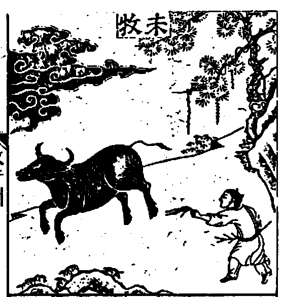
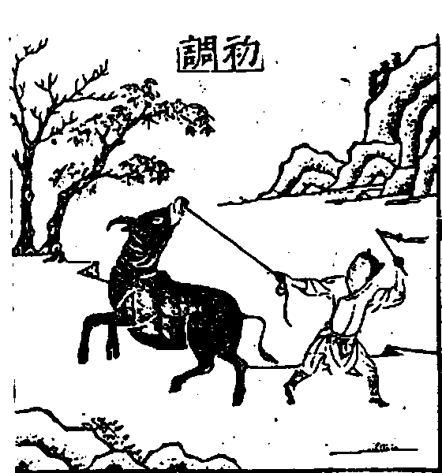
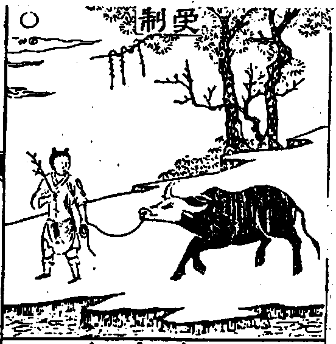
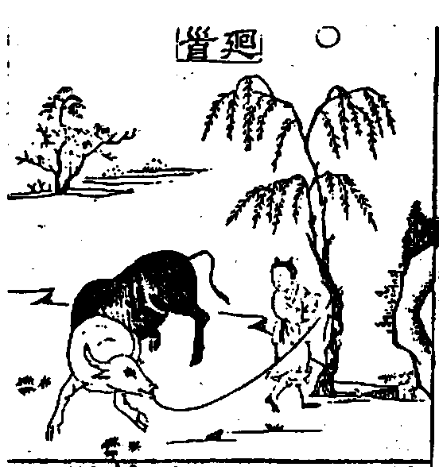
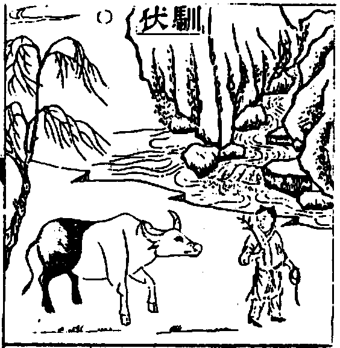
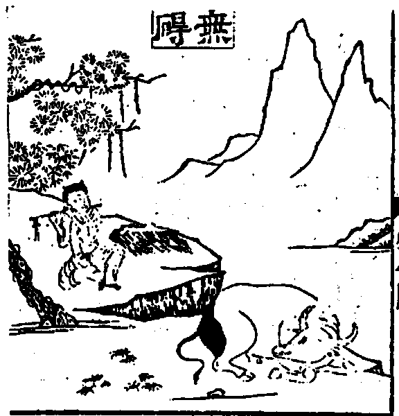
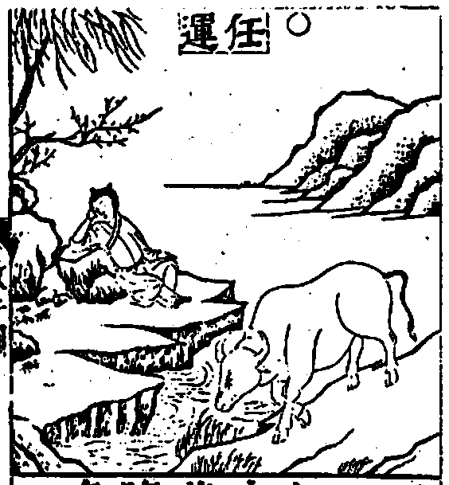
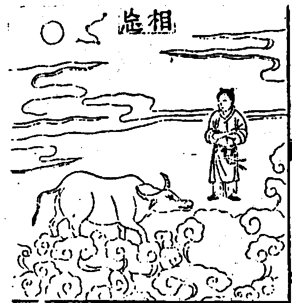
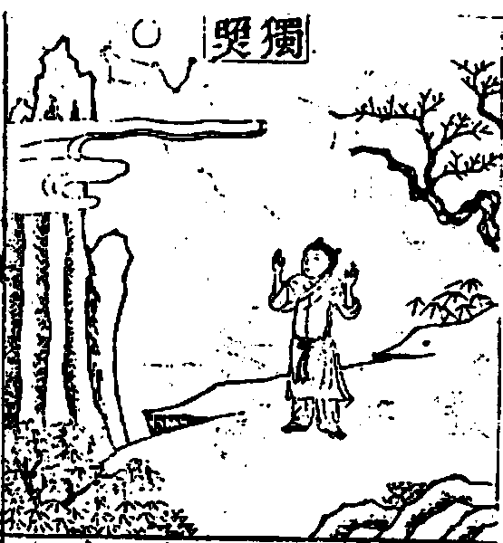
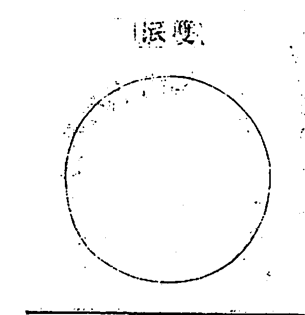

# 普明禅师牧牛图颂



> **藏经**：嘉兴大藏经（新文丰版）（嘉兴藏）　**册次** 第 23 册（J23）　**编号** JB128　**部类** 诸宗部　**卷次** 1 卷　**篇幅** 7,770 字

> **卷／品**：0 卷 · 2 品



---



## 目录



  - [普明寺牧牛图颂序](#普明寺牧牛图颂序)

  - [临济正宗三十二世𨍏轹道人严大参谨序](#临济正宗三十二世𨍏轹道人严大参谨序)



---



### 普明寺牧牛图颂序



咄！尽大地是普明一头牛，何处更有佛与众生？毫厘不隔，本是如如。若道此牛有黑有白、有雄有雌、有饥有饱，便是一体分别成二。世尊初生指天指地，周行目顾，犯人苗稼不少；祖师西来，直指人心，见性成佛，吃他水草良多。三玄要、四料拣、五位君臣、九十六圆相，受尽牵制鞭策，乃至拈椎竖拂，行棒行喝，种种机用，皮毛脱落，四足潜踪，许大一头牛，不知逃向那里去了。到这里地，重关已破。且道向上还有事麼？以拂子打圆相云：火里木牛耕白雪，云中石马舞春风。会麼？不会，请看牧牛颂并诸方次韵语句，毕竟还有优劣也无？



------



### 临济正宗三十二世𨍏轹道人严大参谨序



普明禅师牧牛图颂附诸大禅师和颂目录



普明原颂，云栖莲太师付梓序云：普明未详何许人，则亦不知道场之所矣。辛丑冬，予来理坊事，壬寅夏，𨍏轹严居士将普明缘起及旧寺图相示，始知因缘在此。居士既恢复寺基，初请玄微禅师，继请明岩耆德，殿宇焕然，僚房俱备，将来欲成狮窟。余见诸方和颂，读之不胜喜跃，效颦和之，并将图颂和颂合成一册流通。



闻谷大师  

天隐禅师  

破山禅师  

万如禅师  

浮石禅师  

玉林禅师  

箬庵禅师  

山茨禅师  

玄微禅师  

香幢法主  

𨍏轹居士  

跛道人如念  

无依道人



康熙元年孟秋月　日寓般若堂如念空识



未牧







普明禅师颂　未牧第一



生狞头角恣咆哮，奔走溪山路转遥。一片黑云横谷口，谁知步步犯佳苗？



初调







普明禅师颂　初调第二



我有芒绳蓦鼻穿，一回奔竞痛加鞭。从来劣性难调制，犹得山童尽力牵。



受制







普明禅师颂　受制第三



渐调渐伏息奔驰，渡水穿云步步随。手把芒绳无少缓，牧童终日自忘疲。



回首







普明禅师颂　回首第四



日久功深始转头，颠狂心力渐调柔。山童未肯全相许，犹把芒绳且系留。



驯伏







普明禅师颂　驯伏第五



绿杨阴下古溪边，放去收来得自然。日暮碧云芳草地，牧童归去不须牵。



无碍







普明禅师颂　无碍第六



露地安眠意自如，不劳鞭策永无拘。山童稳坐青松下，一曲升平乐有餘。



任运







普明禅师颂　任运第七



柳岸春波夕照中，淡烟芳草绿茸茸。饥餐渴饮随时过，石上山童睡正浓。



相忘







普明禅师颂　相忘第八



白牛常在白云中，人自无心牛亦同。月透白云云影白，白云明月任西东。



独照







普明禅师颂　独照第九



牛儿无处牧童闲，一片孤云碧嶂间。拍手高歌明月下，归来犹有一重关。



双泯







普明禅师颂　双泯第十



人牛不见杳无踪，明月光寒万象空。若问其中端的意，野花芳草自丛丛(寒或作含)。



真寂和尚和牧牛图颂(师讳广印，号闻谷。)



未牧



信足奔驰不惮劳，东西南北路迢遥。只贪刍草平田阔，忘却家乡有异苗。



初调



气性虽顽鼻已穿，牧童从此痛加鞭。浑身血汗芒绳急，遥望家山尽力牵。



受制



暂时出草息奔驰，好把芒鞋紧自随。到处冻云霜露滑，斤斤调伏敢忘疲。



回首



芒绳不引自回头，毛色皤然性已柔。水草也知山里足，牧童多意尚羁留。



驯伏



暖风晴日柳溪边，俛首循人意悄然。花落郊原春色晚，相随归去不须牵。



无碍



调伏多年意自如，水边林下摠无拘。一声羌笛松风起，此日忘怀乐有餘。



任运



百花溪上柳阴中，饱食和云卧绿茸。歌罢山童无所事，遗鞭枕上睡方浓。



相忘



在在溪山云月中，木人花鸟意相同。国王水草从来足，闲步陂塘西复东。



独照



玉鞭无用草绳闲，踪迹全无古路间。空手独归林月下，更前一步即牢关。



双泯



杳杳人牛不见踪，一团新月照秋空。个中若问还源旨，风落岩花点翠丛。



真寂和



报恩和尚和牧牛图颂(师讳圆修，号天隐。)



未牧



水云渺渺乱声哮，密密寻踪路更遥。昼夜风霜不知处，恐伊相犯别家苗。



初调



才获绳头把鼻穿，谩将痛处更加鞭。也知乡井迢迢远，拽转头来著力牵。



受制



不从他性远驱驰，寸步提持漫漫随。几度黑风吹瀑雨，通身泥水摠忘疲。



回首



蓦地忘机自转头，悄然性气已调柔。山中水草了知足，不用迟疑在外留。



驯伏



开放林间与水边，横骑短笛任悠然。归来一带烟霞晚，潇洒歌谣不假牵。



无碍



出入无栏心自如，拟思量处更犹拘。满怀风月人牛稳，鞭索俱忘乐有餘。



任运



野岸溪湾花柳中，一环山水翠林茸。逍遥快活无求也，软草为毡睡兴浓。



相忘



拶到忘怀混沌中，千山一色绝相同。风光不觉人牛处，任运腾腾西复东。



独照



不须牧放淂安闲，脱略寻常顾盻间。散步谩归明月下，踏翻泛上两重关。



双泯



人牛处处竟无踪，新月孤悬万象空。借问归源端的旨，枯桩春到绿丛丛。



报恩和



东塔和尚和牧牛图颂(师讳海明，号破山，嗣法天童。)



未牧



头角峥嵘便吼哮，奔兢烟水路迢遥。牧童草料浑无恋，孰肯平田犯稼苗？



初调



牛儿鼻孔被绳穿，放去收来不假鞭。拟向东西两处触，一回入草一回牵。



受制



年深日久懒奔驰，云影溪光逐渐随。任是上林花鸟过，声二难唤牧儿疲。



回首



计穷力极唤回头，谩把鞭绳闲放柔。七纵八擒缚树下，山童犹未肯停留。



驯伏



山间林下水溪边，一饱无餘庆快然。撒手童儿归路晚，和牛急向远村牵。



无碍



稳眠露地意如如，阳燄空花何所拘？松韵山童弄铁笛，轻轻吹醒乐无餘。



任运



南北东西任运中，脚头脚底草茸茸。饱餐只剩些些意，留与山童瞌睡浓。



相忘



云牛一片白其中，那有雌黄与异同？就里欲兮纤细子，腾腾运运复西东。



独照



牧童鼓掌自闲闲，始信牛踪没此间。遂淂殷懃谩且喜，犹存星月照幽关。



双泯



人牛顿尽绝形踪，浩浩光吞宇宙空。明月芦花来问的，东风吹起自丛丛。



东塔和(破山)



万如禅师和牧牛图颂(师讳通微)



未牧



劣性麤狂向外逃，乡关迢递不知遥。分明触处荒田地，那肯回头惜异苗？



初调



蓦路相逢把鼻穿，饶伊恶性猛加鞭。从今已淂绳头在，才要奔趋只一牵。



受制



暂息颠顽暂息驰，频频相顾也相随。芒绳虽缓鞭尤朴，不筭工夫不惮疲。



回首



顽劣消除已转头，不加鞭逼性相柔。牧童未敢凭他意，还把绳头紧系留。



驯伏



万木丛中芳草边，芒绳释去意翛然。夕阳影里归鸦噪，牛自相随不用牵。



无碍



皤白浑身性自如，海天空阔不相拘。牧童闲倚松边石，短笛频吹兴有餘。



任运



千条溪畔万山中，餐饮随时饱绿茸。牧子从教无个事，鼾鼾枕臂不知浓。



相忘



是处云山牛在中，两无心意月相同。碧天影落溪流急，任尒纵横西复东。



独照



生涯丧尽一身闲，明月光腾古木间。歌罢一声归去晚，芒鞋踏破隔乡关。



双泯



廓然空绝两无踪，宝月孤悬照碧空。个事不须重借问，子规声断落花丛。



万如和



东塔浮石禅师和牧牛图颂(师讳通贤)



未牧



蹉过声前这一哮，反生边见历途遥。披毛带角浑无虑，粪草何曾识稼苗？



初调



才识牛兮鼻已穿，翻然自肯苦加鞭。暂时不在频偷走，犹把芒绳紧紧牵。



受制



渡水穿云不乱驰，任从呼遣摠相随。牛儿虽以堪调治，未许山童暂放疲。



回首



一回入草一回头，可比初时性已柔。满径落花思践履，客途烟雨岂羁留？



驯伏



玲珑石伴古松边，任运腾腾始贴然。手里有▆须放下，鼻中去索不须牵。



无碍



触处逢渠淂自如，入泥入水又何拘？饥餐渴饮困来睡，底事从来无欠餘。



任运



已眼撑开宇宙中，胡来胡现任茸茸。山童闲唱还乡曲，不觉令人归思浓。



相忘



丧尽偷心豁达中，人牛何异复何同？从今两绝提防力，可以西兮可以东。



独照



脱尽皮毛赤体闲，堂堂独露笑谈间。不是渠侬能了达，祗因透彻上头关。



双泯



空空寂寂杳无踪，一点灵机尽扫空。智理不存悲化普，一轮明月照幽丛。



浮石和



玉林和尚和牧牛图颂(师讳通琇，继住报恩。)



未牧



牛本荷人人不识，胡行乱跃隔迢遥。一回摸著牛儿鼻，大千沙界没茎苗。



初调



寄言识淂牛儿者，莫学时流强策鞭。我是牛兮牛是我，分明无二若为牵。



受制



牧童但不迷头去，纯白牛儿到处随。非比道途贩卖客，横骑倒捋自无疲。



回首



莫道功深始转头，牛无背面与刚柔。山童但淂狂心歇，鼻孔弥天绝去留。



驯伏



寻常逐遂营营者，谩道长调方帖然。见彻斯牛无往返，始知多载枉拘牵。



无碍



本自翛然绝绊羁，知恩岂肯强牵拘？纵横飞舞无留迹，谁信那伽定有餘？



任运



不分内外与边中，傍水寻芳入乱丛。回首东山吐新月，骑归茆屋兴犹浓。



相忘



强把全躯分二体，计穷力尽始知同。他长我短俱休问，说甚人西与物东。



独照



顶破虚空蹈碎地，不留一物杂其间。孤孤迥迥虽堪羡，瞥尔知羞始透关。



双泯



谁为所牧谁为牧？认影牵风彻底空。有问其中端的意，早知刍犬吠茅丛。



玉琳和



箬庵禅师和牧牛图颂(师讳通问)



未牧



走遍天涯逞意哮，穿云涉水路迢遥。多年一片闲田地，蹂踏堪怜损稼苗。



初调



鼻孔生狞不易穿，一回入草一加鞭。狂心何计能拴缚，赖有山童把索牵。



受制



拟将何处更驱驰，暮两朝烟紧自随。踪迹欲逃难躲避，任渠奔烈也成疲。



回首



翻然自肯便回头，满地残红衬草柔。故国有怀情未撇，暗愁春老尚迟留。



驯伏



收来放去古溪边，风月随缘自悄然。水草不思无底事，相看撒手竟忘牵。



无碍



纵步溪山得自如，风流两岸亦何拘？横吹短笛斜阳暮，溢目春光信有餘。



任运



不曾移步出山中，暖簇晴花五色茸。莫怪山童闲瞌睡，卧云眠月兴偏浓。



相忘



相将无事太平中，渠我情忘迥不同。一段闲愁摠收拾，不知花落水流东。



独照



一道寒光万境闲，寥寥四顾水云间。夜深明月归来后，照彻空王向上关。



双泯



从前光影觅无踪，不见人牛烟水空。尽大地回春晓梦，日高香散百花丛。



箬庵和



山茨禅师和牧牛图颂(师讳通际)



未牧



水草溪边纵意哮，鼻头无系去迢遥。谁知宇宙皆王化，乱踏云山犯稼苗？



初调



芒绳初把鼻相穿，熟处难忘痛著鞭。分付牧童牢守护，莫教暂失手中牵。



受制



动容顽性好奔驰，左右旋眸渠紧随。怅望远山乡信杳，披云带月正忘疲。



回首



知恩逐步肯回头，烈气消融性渐柔。骑向平陂深草处，横吹短笛绝羁留。



驯伏



只在平田烟柳边，鞭绳抛却坐翛然。暮山钟动上方月，恁麼归来不假牵。



无碍



人牛相视体如如，彼此无心不用拘。花柳丛中随意往，团团蹄迹更无餘。



任运



或时村里或云中，旧地闲田草正茸。踏遍一毫无剩迹，牧童高卧柳阴浓。



相忘



撑撑头角卧林中，渠我浑忘云水同。为爱山前刍草细，夜深乘月过溪东。



独照



个里风光镇日闲，放身稳卧白云间。长歌一曲声嘹喨，直透威音劫外关。



双泯



不见人牛不见踪，清风明月满长空。太平休用歌尧令，枯木重开花一丛。



山茨和



桐月庵禅师和牧牛图颂(师讳妙用，号玄微。)



未牧



黑云低处一声哮，足底程途那信遥？童子个时将贯索，未尝留意惜良苗。



初调



鼻孔今朝始受穿，十分狂性只宜鞭。要渠了了寻常事，不管通身黑业牵。



受制



蹊径於今不枉驰，鞭绳缓缓肯相随。家山水草随时给，信步风流也不疲。



回首



绿杨堤畔碧溪头，景自晴和风自柔。水牯转头初自肯，月明归路谩迟留。



驯伏



那里随来过这边，左盘右转摠安然。黄莺叫淂山花笑，声色中能不被牵。



无碍



脱落虚空万象如，人牛浪荡不相拘。鞭绳飏下无▆子，引兴梅花一调餘。



任运



我自悠然一觉中，任渠草径玩纤茸。落花没膝春山晚，犹泼红霞锦绣浓。



相忘



白云拖过月明中，月与云和一色同。智境此时都不会，何论南北与西东？



独照



家破萧然四壁闲，於今云净月明间。固非往日程途事，尚好挨身拶过关。



双泯



剧尽何方觅影踪？不应空里镂虚空。有谁道露堂堂地，蜂蝶痴迷花底丛。



桐月和



一指庵禅师和牧牛图颂(师讳明海，号香幢。)



未牧



东奔西触纵狂哮，越岭盘溪不惮遥。眼底只贪畦畔艸，那知回首有灵苗？



初调



几年鼻孔未经穿，今日收来始著鞭。捏定索头无少缓，一回入草一回牵。



受制



顽皮且喜罢驱驰，我步溪边他亦随。只恐柳丝拴不住，孜孜照管略无疲。



回首



一自牵归这一头，几将鞭杖验刚柔。而今已蹈还家路，嬾听枝头黄栗留。



驯伏



几处低坡浅水边，相依相狎意陶然。山云欲暮归村舍，宛转随人不用牵。



无碍



水草寻常事事如，任渠饮啄嬾相拘。笛声唤醒珊瑚月，狼籍清光一点餘。



任运



缓步春山平麓中，风和日暖草蒙茸。鼾齁一枕藤萝石，不管岩花色淡浓。



相忘



通身皎洁片云中，明月芦花未许同。谩道玉楼窗已晓，金乌犹在海门东。



独照



牛自空兮人自闲，翛然独步水云间。尚须蓦地翻身转，靠倒穷途最后关。



双泯



皮毛蓑笠了无踪，一片寒光堕碧空。烟雨故园消息断，百花何处斗芳丛。



一指和



𨍏轹道人严大参和牧牛图颂



未牧



云山堆里一声哮，头角宛然家信遥。满地闲花都踏遍，那知异草并良苗？



初调



生狞如虎鼻难穿，赖淂牧童有索鞭。不是一番施辣手，个时劣性恐难牵。



受制



熟径难忘欲逞驰，芒绳在手紧相随。岂容逐草寻芳去，昼夜拘拴不惮疲。



回首



暂时落草即回头，云冻霜寒足已柔。欲缓鞭绳尤未缓，乡关不到且拘留。



驯伏



高深蹊径曲无边，相押相驯已信然。杨柳阴斜红日转，鼻头绳断不须牵。



无碍



水草皇王摠自如，何须特地苦相拘。山童撒手先高坐，牛亦安然闲有餘。



任运



信步行来到此中，山前山后草茸茸。放渠散走陂塘去，不似当年狂兴浓。



相忘



太平气象月明中，尔我家山色色同。袖手低眉忘管带，不知西去与来东。



独照



踪迹寥寥独个闲，浑然出处那其间。自歌自唱空山下，多少痴人认过关。



双泯



人牛谩说绝形踪，何异吹风欲满空？若问还源亲的旨，参天荆棘乱丛丛。



𨍏轹和



𨍏轹道人再和牧牛图颂



未牧



牟牟声响是渠哮，欲觅头踪转展遥。狭路相逢刚识淂，甘心饥饿不尝苗。



初调



娘生鼻孔未经穿，痛处针锥痛处鞭。漫道牧童施毒手，恐渠驰逐倍加牵。



受制



古路凄凄作麼驰？他山岐曲肯相随。痴儿不把绳头放，牢系虚空徒自疲。



回首



自从蹈著这源头，骨力虽刚毛色柔。日薄虞渊归意急，肯贪刍艸故淹留。



驯伏



蹄迹团团古岸边，饥餐渴饮恣悠然。东来西往皆平贴，出外归家摠不牵。



无碍



岭头溪畔自如如，竖走横眠更不拘。水草国王随分给，本来无欠亦无餘。



任运



牛儿闲放此山中，卧草眠花饱绿茸。圜圚从来渠不入，逍遥自在兴偏浓。



相忘



人牛共住碧岩中，到处溪山云月同。猿鸟自啼花自笑，水流西去岸移东。



独照



脱尽皮毛淂自闲，翛然独步水云间。可怜无限英灵汉，开眼堂堂入死关。



双泯



处处逢渠没影踪，碧天云净月轮空。个中多少风流趣，宝鸭香消锦绣丛。



𨍏轹再和



𨍏轹道人三和牧牛图颂



未牧



黎然体色蓦然哮，震地惊天用不遥。嚼尽山花吸尽水，不留常住一茎苗。



初调



鼻孔撩天不受穿，谁能下手妄加鞭？牧童纵有绳头在，枉费功夫著力牵。



受制



牛儿有脚自驱驰，堪笑盲儿步步随。泥水溪深浑不染，牵他入草淂毋疲。



回首



转脑旋蹄错路头，何分顽劣与刚柔？蓦然直去家乡到，不必淹淹在外留。



驯伏



散诞溪边与艸边，要骑要下任安然。索头盘结牛头上，到处为家不用牵。



无碍



柳陌花街到处如，犯人苗稼又何拘？横冲直撞都无碍，窠臼掀翻无剩餘。



任运



夜半归来月正中，三生石上草茸茸。太平休斩痴顽汉，一任横吹铁笛浓。



相忘



[○@人][○@牛]㊀[○@│]这○中，黑白元来一色同。我不似渠渠似我，谁分南北与西东？



独照



牧他屎屁不曾闲，鞭向无生眨眼间。有意气时添意气，何妨一镞破三关。



双泯



泥牛入海杳无踪，木马嘶风向碧空。个事若何重话会，花开铁树闹丛丛。



𨍏轹三和



跛道人如念牧牛图颂(有序)



诸佛垂迹，祖师西来，无非发明此事；拈搥竖拂，热棒热喝，单提向上机轮。普明禅师假人法，重设牧牛图颂；𨍏轹居士报佛恩，复兴祖师道场。大禅师锦上铺花，跛道人畫龙点眼，长安风月贯今古，那个男儿不丈夫？阿呵呵！好大哥！



未牧



头角峥狞恣意哮，溪山踏遍路迢遥。牧童不把牛穿鼻，难保狂心不犯苗。



初调



绳头在手鼻儿穿，性劣难调紧著鞭。从此一番休放缓，牧童须是要频牵。



受制



劣性调柔渐息驰，牵来步步已相随。牧童犹把精神抖，到此浑然不觉疲。



回首



颠狂心尽始回头，功用无间牛自柔。信手牵归明月下，免从水草又停留。



驯伏



不计山边与水边，了然无事自安然。森罗万象浑闲事，从此牛儿不用牵。



无碍



独露堂堂意自如，安眠稳坐已无拘。牧童短笛闲拈弄，一曲横吹乐有餘。



任运



识破元来只此中，闲花野草任茸茸。东西南北无遮障，拍手高歌兴正浓。



相忘



白牛只在白云中，渴饮饥餐总是同。闲著山童石上立，此间那复问西东？



独照



牛儿无迹地闲闲，明月团𪢮只此间。自有一双穷相手，一拳直透万重关。



双泯



人牛俱泯杳无踪，水在长江月在空。猿抱子归青嶂里，鸟衔花落碧嵒丛。



无依道人和牧牛图颂(徐讳昌治，号觐周。)



未牧



头角未露一声哮，自在纵横去路遥。黑白始分牝牡相，生来柔顺长灵苗。



初调



顺性今朝也受穿，何烦童子又加鞭？线索在手随时转，到处风光无挂牵。



受制



踏著溪山便骋驰，朝行暮宿紧相随。一回饮水一回胀，悠悠负载不辞疲。



回首



堪悲烈性不回头，幸得天生禀性柔。遍界落花忘践履，烟云霄路莫停留。



驯伏



不分内外与中边，束缚无拘意洒然。信步行来皆坦道，腾腾任运总无牵。



无碍



万别千差性本如，超群惟此性无拘。一身负荷皆全力，本分何曾有欠餘？



任运



暂尔息肩卧云中，忽长新芽生意茸。引重致远随意适，个中独步兴偏浓。



相忘



忽忘管带太虚中，渴饮饥餐处处同。物我尽捐知解净，如日西升夜落东。



独照



得安闲处且安闲，不留辙迹在人间。瞥尔英明了达去，踢倒银山铁壁关。



双泯



隔墙清听绝无踪，形影孤寒照碧空。窗楞已过浑无事，又何精舍竹林丛？



无依道人和



牧公道人项真本和牧牛图颂



未牧



青山绿水恣咆哮，四顾三回路转遥。只管贪程为太速，何知日用犯佳苗？



初调



才见牛兮蓦鼻穿，麤浮习气急加鞭。那时掘强横驰走，把定绳头好一牵。



受制



四蹄今已息奔驰，放去收来无不随。且喜鞭绳犹把握，牧童何肯自为疲？



回首



溪山踏遍自回头，熟处生时性渐柔。鼻贯一条成底事，不劳腕力暂相留。



驯伏



左盘右转碧溪边，撇下鞭绳乐自然。几度绿杨归夜月，山童高卧竟忘牵。



无碍



掉尾擎头适自如，纵横脱略有何拘？悠然一曲寒崖上，短笛吹开物外餘。



任运



饥餐渴饮绝边中，倦即和云卧草茸。骤步任教青嶂外，满腔风月兴偏浓。



相忘



人牛共住此山中，动转施为绝异同。我本是渠渠即我，不知南北与西东。



独照



牛无方所牧童闲，懒把虚名落世间。尽大地来无我我，不消弹指透重关。



双泯



人牛两尽没形踪，今古相酬劫亦空。本地风光一段事，岁寒松柏翠丛丛。



牧公和

