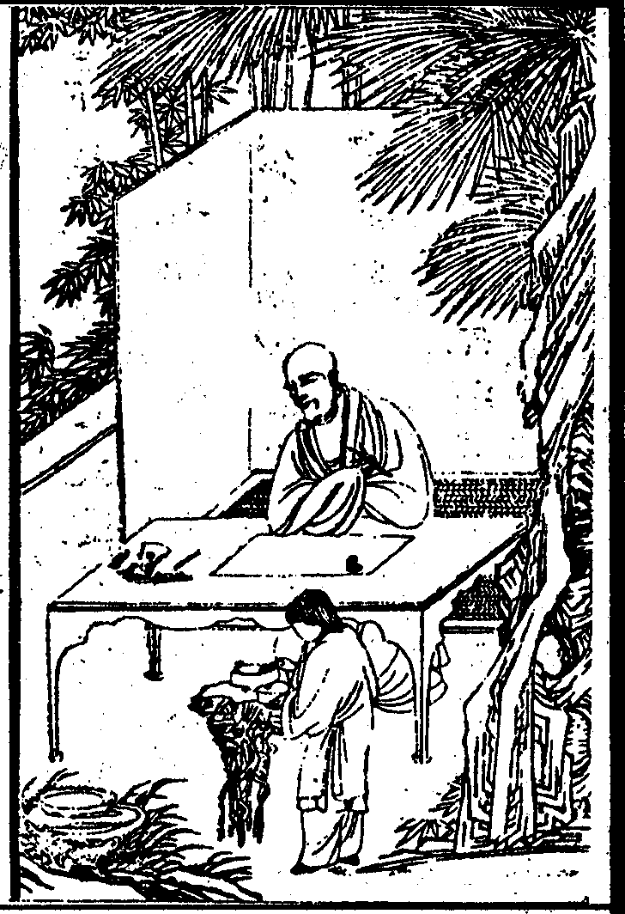
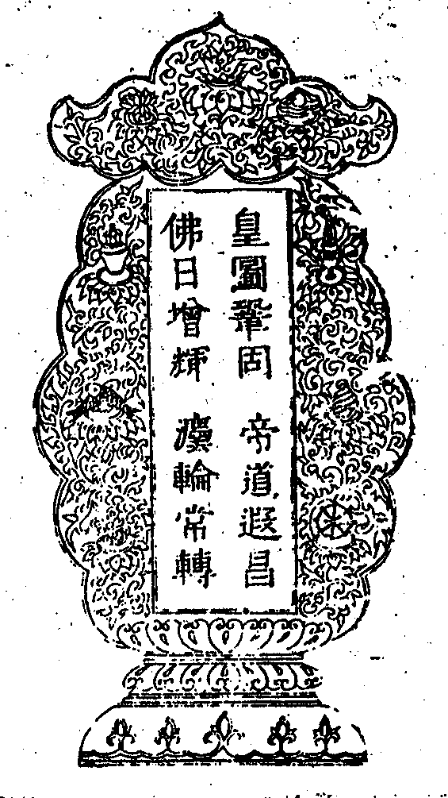

# 寿昌无明和尚语录



> **藏经**：嘉兴大藏经（新文丰版）（嘉兴藏）　**册次** 第 25 册（J25）　**编号** JB173　**部类** 诸宗部　**卷次** 2 卷　**篇幅** 31,912 字

> **卷／品**：0 卷 · 1 品



---



## 目录



  - [寿昌语录序](#寿昌语录序)



---











------



### 寿昌语录序



达磨大师云：「明　佛心宗，行解相应，名之曰祖。」从上诸先德，通身不挂寸丝，良繇见处圆明，故行处自然勦截耳。或有眼而无足；或有足而无眼，偏枯之学，古德所呵，恶能担荷佛祖大事乎？然初祖达磨大师记已有：「明道者多，行道者少；说理者多，通理者少。」岂缘会使然耶？



我明自正、嘉以来禅道中绝，先师乘悲愿力应化阎浮，於是江西之宗旨始立。最初从廪山发悟，而末后印法於五台，入室升堂全提正令，诸方尊之为「寿昌古佛」，故寿昌之名独传。先师悟道之后住山三十年，戴笠披蓑与黄牛白牯同事，常示参徒曰：「凡行处不孤硬者，必见处犹带廉纤也。牵犁拽钯，法法全彰，岂待老僧再举扬乎？」会下饱参弟子鼻孔辽天，先师把住咽喉不许转身通气；即上首来公、谧公、贤公等，犹以出世一著嘱之。



余见近代宗师草草传授，末流之弊师弟交识，然后服先师手段之辣也。或曰：「寿昌应西竺悬记而来，故作用与古人一体。」不知为西竺易、为寿昌难，西竺当佛道炽昌之日，遍地皆旃檀林，龙象如云，其扶竖法幢也殊易；寿昌当宗风寥绝之时，触处荆棘狐狸作祟，其建立宗旨也特难。乃参悟既与德山、临济同堂，而操履又与百丈、赵州共路，余所见诸方善知识未有过寿昌者，其古佛再来耶？自寿昌单提向上一路，於是云门、黄蘗、径山、天童诸大老嗣与皆闻寿昌之风而起者也，虽见地未敢轻议，而践履终逊之。行解相应，名之曰祖。吾师乎！吾师乎！



时崇祯十年夏月既望



西江门人黄端伯稽首譔



寿昌无明和尚语录卷之上



门人　元来　集



师初住峨峰，上堂。



拈香祝圣竟，复拈香问云：「大众会麼？此是三世诸佛用不尽底，一齐撒向娑婆世界，释迦牟尼佛犹用不尽，西天东土历代祖师亦用不尽。山僧今日信手拈来与众商量，还是教外别传、经中玄旨不？函盖乾坤、随波逐浪不？截断众流、抬荐商量不？大用现前、探竿影草不？当阳撒出、金刚宝剑不？据实举论穷劫不尽，要且具智眼者拣辨得出，白是白、黑是黑，即不囫仑打作一块，始可定藂林之是非、验学者之得失，然后应圣应凡，自然不被诈明头之所欺，举措应缘无不合吉也。然此道离微，疏之久矣！众中有大智者，当拼身命尽力匡扶，以悟为期自他兼利，一生不足再拼一生，尽其三生自然合得。古云：『不入生死大海，难得无价宝珠』，此犹是钝机，灵利汉一闻便知妙。然虽如是，『不得春风花不开』，且谩道『及至花开又吹落』。」



首座云：「未垂法语已涉繁端，略借权言彰明大道。迦叶行头陀之行受世尊衣；和尚习百丈之规登如来座，未审昔时迦叶、今日峨峰是同是别？」师曰：「庭下虚空为汝说，不必山僧再复言。」座曰：「同别已蒙师指示，单传宗旨事如何？」师良久曰：「且喜大众俱已会竟。」座曰：「三十年前人事异，数千白后祖灯新。」师下座。



上堂



「诸佛时常说法，不须疑议猜详。是何法？天地玄黄宇宙洪荒，不论通宗透教，秪贵直下承当。承当个甚麼？云腾致雨，露结为霜。蛟龙不宿死水，猛虎岂行路傍？透得这些关捩，何须愿往西方？不问先佛后祖，鼻孔一样放光。作麼生放光？化被草木赖及万方。释迦不肯泄破、达磨九年覆藏，峨峰不惜口业，一下为众宣扬。且道作麼生宣扬？」挥尺一下云：「罔谈彼短，靡恃己长。」便下座。



上堂



瞽目老，聋瞆嫂！色声两失刚刚好。更有无手人行拳、无舌人谈道；四个相同论短长，一个於中直笑倒。且道笑个甚麼？奇怪普化翻筋斗，不忝金色头陀之后。参。



上堂



老僧有一偈，一生受用底，今日分明举似人，秪是莫将道理会。钵盂一大口，草鞋两个鼻；以索搊起来，疏通千万里。不畏高天，无愁远地；不参佛祖心，非究西来意。为缘得自由，具游戏三昧；人不肯於我，我却肯於你。何则？尽十方法界虚空，唯一个没巴鼻，何用千思百量，拟议死生来去？一条揤栗自相扶，只是不容生活计。此事真个太煞分明，若再迟疑徒劳心力。



上堂



举：「老聃云：『大道无形生育天地；大道无情运行日月；大道无名长养万物，吾不知其名，强名曰道。』山僧即不然。」弹指曰：「这个有形生育天地；这个有情运行日月；这个有名长养万物，吾即知其名，故名这个。秪如恁麼举，与老子相去几何？当知这个生天生地、生佛生仙、生男生女、生圣生贤、生天堂地狱、生饿鬼畜生，更有一般至妙又解生无生。无生子头白似雪，解向天宫拿日月；要去毘卢顶上行，度生指往无生国；当时有个老禅伯，一杖当头亲见血。何则？恁麼达磨一宗埽地而灭，如是两下成怨结。大众！作麼生为它分雪？维那以拄杖一时趁散，免教思议分别。」



上堂



「云头按下大家看，圆鉴高悬百尺竿；即请高人登一步，架空竟不受人瞒。秪如不受人瞒意作麼生？各家路大通空界，不必寻声观世音；设使摇铃携履去，看来犹不是良心。故昔凌行婆问浮杯曰：『尽力道不得底句，分付阿谁？』杯曰：『浮杯无剩语。』婆曰：『未到浮杯，不妨疑著。』杯曰：『别有长处，不妨拈出。』婆哭曰：『苍天中更添冤苦。』杯不语。婆曰：『语不知偏正，理不识倒邪，为人即祸生。』南泉闻曰：『苦哉！浮杯被这老婆摧折一上。』婆闻笑曰：『南泉犹少机关在。』澄一禅客问曰：『怎生是南泉犹少机关在？』婆哭曰：『可悲可痛！』复曰：『会麼？』一罔措。婆曰：『跂死禅和，如麻似粟。』一举似赵州，州曰：『我若见臭老婆，问教口哑。』一曰：『未审怎生问它？』州便打。一曰：『为甚打某甲？』州曰：『似这等跂死禅和，不打更待几时？』又打。婆闻曰：『赵州合吃婆手里棒。』州闻哭曰：『可悲可痛！』婆闻叹曰：『赵州眼光烁破四天下。』州令僧问婆：『如何是赵州眼？』婆竖起拳头。州闻以偈问曰：『当机觌面提，觌面当机疾；报汝凌行婆，哭声何得失？』婆以偈答曰：『哭声师已晓，已晓复谁知？当时摩竭国，几丧目前机。』看这婆子只世间俗妇，尚能洞透佛祖心肝，海会道人岂可不通宗师血脉？若乃肯心顿发，谁不丈夫？其或因循，当面蹉过。此公案古来拈提者不少，尽谓浮杯受婆子折挫；其不知婆子为浮杯沉埋，至今犹未扶起。大众！且道可中优劣作麼生分析？噫！落霞与孤鹜齐飞，秋水共长天一色。」便下座。



上堂



拈起一著，佛祖一齐捉；放下一著，圣贤悉皆缚。辘轳飞上天庭，泥牛眠交地角；非惟九有沾恩，亦乃四生受乐。惟有八大金刚努眼瞪眉、横拈倒卓。何则？不许众生乱描邈。



上堂



「青山青，无山不藏云；绿水绿，无水不生木。惟有衲僧心，调直无阿曲。」挥尺一下。下座。



上堂



真正龙象子，有时提不起放得下；有时放不下提得起。不弄死蛇头，要捋生虎尾。有时跨上金毛背，自然足下清风起。是否？咦！水不涸兮鱼自在，山青幽也鸟安详。珍重。



上堂



「冬至时临事且奇，海风吹倒珊瑚枝；龙王惊起归空界，河伯神祗失却威。如是事宜自知。」僧曰：「用知作麼？」师曰：「与老僧执杖。」僧曰：「恁麼不知更好。」师曰：「何也？」僧曰：「清闲僧不做，返更作愁人。」师便打。



上堂



「铁罗汉撞著赤声火金刚，二家尚气斗坚强，愚情不决问空王，王曰诸行无常。一众知识还会此意不？不然更听一颂：『野衲门庭不顺情，寻常争许白云停；乾坤不昧真因果，一定无干那畔人。』参。」



上堂



「黄面老人没傝𠎷，悲愿示生四月八；一年一次热汤浇，舍死忘生而说法。四十九年一字无，末后拈花放不下；惹得傍观笑微微，大似打破葡萄架。烁然所作业不忘，撞著云门要打杀，贻累儿孙相将堕火坑，尚幸琅琊云：『将此身心奉尘刹。』不然则达磨一宗埽土而尽，岂知今日有宝方老汉重为分雪？秪如此一举，还有报恩分也无？众中若有拈得出者，管教横身宇宙与诸佛眉毛厮结。有麼？」良久云：「噫！真个在家为客易，果然出外作商难。」



上堂



大众礼拜，灯忽坠地，首座启曰：「银缸扑地乱坠天花，曲请尊慈重然宝炬，令昏衢而再朗，使法殿以常明。」师曰：「金罏香袅霭，玉烛灿光辉；宝磬铿锵举，人天聚会时。如是已为山僧说法竟。何也？法本自法，法外何法？更欲说法，恐辱大法。虽然如是，勉强与大众商量个论。法之体，亘古独存，非色非空、无名无相、非隐非显、非暗非明、非圣非凡、非僧非俗；法之说也，自古至今，天地世界森罗万象，日月星辰海岳山川四生六道，未有一时不说也。所以云：尘尘说、刹刹说、炽然说，无间歇。大众还信麼？」首座云：「信。」师曰：「汝作麼生信？」座云：「昨向上蓝田里过，山水通融尽宝方。」师曰：「未是信在。」



上堂



首座云：「吃金牛饭饱，孤峰顶上讴歌；饮曹山酒颠，十字街头打睡。如斯等辈混乱圣凡，向上全提，乞师拯济。」师曰：「没巴鼻汉大地无家；有道心人在处安住。随时放旷自有来由；兀尔忘缘各无分晓。上来不须问过，一定先知；下去无要通情，决然已验。据楖枥拄杖探海撩天，如帝释龙王闻而胆战；凭一钵三衣操冬傲夏，然仁君宰辅见则倾心。非为驰骋蹈高，盖亦法使如然也。大众！各宜秉志步武追先。风穴之於白丁、药山之於牛圈、沩山佑拾橡栗为食、大梅常采荷叶为衣、嬾赞无收涕之工、百丈示不作不食之戒，其餘真参实悟不可枚举。一个个打发，如大鹏鸟翱翔万里盖地遮天；似师子儿威震十方惊群骇众。所谓人能弘道非道弘人，自是丈夫各宜知悉。」



上堂



「世尊初诞，一手指天一手指地，周行七步目顾四方：『天上天下唯吾独尊。』云门云：『我当时若见，一棒打杀与狗子吃，贵图天下太平。』琅琊云：『云门所谓：将此深心奉尘刹，是则名为报佛恩。』时人秪知云门骂佛，若非琅琊，冤屈何伸？此事如虚空挂剑号令人天，宝印临台指挥龙象，全提向上正眼难窥，虽佛祖犹且皱眉，况魔王安敢肆意？化风屏息，海岳翛然，要具铁胆铜肝，始解步空捉影。一任野狐精岩中脱壳；从教水牯牛山下投胎。秪如不落因果造化底人，作麼生话会？」良久云：「轮王现出真金子，灌顶承封自自然。」



上堂



大众恭请山僧上堂所为何事？拟欲求佛法，单穷趁夹穷，更要超生死，无事生出事。莫若推云归洞府，引月上蒲团，相共虚明照，一切不相干。当时南泉抖碎虚空七花八裂，惊起露柱石人遍体通流汗血，不是凌行婆，争解同心结？噫！一众知识，自当藏拙。



上堂



「腊八逢辰丛林设粥所为何缘？无非顺俗，衲僧门庭不必如斯。岂不闻：『三世诸佛不知有，貍奴白牯却知有？』若恁麼三世诸佛已立下风，况迦文佛乎？且道貍奴白牯有甚长於诸佛？」首座云：「为它金烹大冶、玉出蓝田。」师曰：「然虽如是，宝方不免连貍奴白牯一时趁出三门外。何以故？正令行也。秉纲立纪振丛林，海晏河清不令行；好汉尽收归宝所，化城推倒不留人。」座曰：「和尚道：『化城推倒不留人。』在和尚分上即得，在某甲则不然。」师曰：「更作麼生？」座曰：「闲挑布袋浑无事，笑等街头一个人。」师曰：「也是闲弦子。」座大笑，众礼拜，师下座。



上堂



迷生寂乱，悟无好恶。秪如悟后又作麼生？是圣是贤难捉摸，没毛老虎头戴角；翻身拟欲论空王，良骥追风趁不著。是不是、非不非，归去来兮来去归；不是头陀发一笑，人天百万总无知。久立珍重。



上堂



「法鼓三通众云集，看看红日上栏杆；清风透腋祥云起，那事分明不隐瞒。大众会麼？」众默然。师曰：「秪如与麼，还是大众瞒山僧、山僧瞒大众？若谓山僧瞒大众，韦驮大士不心懽。毕竟作麼生？宝璧割城犹自肯，须知识者始甘当。」下座。



上堂



「曹洞宗旨宝镜三昧，鉴照往来不逃真伪。观音来也，观音一堂；普贤来也，普贤一队；文殊变化有多端，一时明显一时晦。且道何人共他作对？不然，但看曹山问德上座曰：『佛真法身犹若虚空，应物现形如水中月，作麼生说个应的道理？』德曰：『如驴觑井。』曹曰：『道即太煞道，秪道得八成。』德曰：『和尚作麼生？』曹云：『如井觑驴。』」师曰：「作麼生会？会得如井觑驴，便明宝镜三昧；会得宝镜三昧，便会如驴觑井。会麼？」首座云：「某甲鉴和尚即不堪，和尚鉴某甲即得。」师曰：「你作麼生会应底道理？」座曰：「随缘应感即且置，和尚唤什麼作物？」师曰：「应物道理宝镜三昧，似驴觑井如井觑驴，会得许入曹洞宗，不然则观音、普贤、文殊也相将携手笑同归。」座曰：「若论曹山，犹涉廉纤在。何则？衲僧家不饮君王宴，焉赏野花丛？没来由跟著驴走。」师曰：「欲知古人游戏处，须知足下不生尘。」座曰：「今日又遇和尚，犹胜曹山七步。」师曰：「更莫乱商量。」下座。



上堂



良久云：「大众有疑上来请问，无事各自归堂。噫！莫道无事好，金刚与泥人揩背，汝等作麼生商量？」僧曰：「远观山有色，近听水无声。」师曰：「好事不如无。」曰：「昆仑骑象鹭鸶引，一场才了一场来。」师曰：「会得夜夜中秋月，不明日日枉烧香。」复曰：「时当年三夜四，各自谨守隄防，若被小人算计，一定搅乱法场。前门后户当仔细，大家严密保安康。更须知有一好事，达磨未来东土，弥陀不在西方。会麼？神心按定从空望，半夜天边挂夕阳。」



上堂



良久云：「升堂入室事如何？秪为西来老达磨，面壁九年不说法。这一句作麼生道？法筵龙象众，有会者请出举看？」首座曰：「某甲不出，众却道得。」师曰：「作麼生道？」座曰：「家贫显孝子，国难见忠臣。」师曰：「道则不无，秪如达磨意落在甚麼处？」座曰：「某甲不烦多说话，和尚惜取眉毛好。」师曰：「白云飞海岳，惹得满天愁。大众有疑则问，不可法筵中蹉过，不然是诸人之咎，非山僧之咎也。珍重。」



上堂



「撞钟打鼓，入室升堂；佛祖规绳，藂林标牓。未明三八九，切莫乱怔慞。罏焚宝篆，台炳银缸；缁素一室，云水两行。夜静云收天地朗，寒风飒飒透心凉；西来教外无传旨，太煞分明不必详。会不会？庭前柏枯长果，庐陵米烂成秧；释迦老子开户，维摩大士起床。一一分明重举似，大家作礼各归堂。」师下座，挥尺曰：「直下承当。」



上堂



挥尺一下曰：「宗乘中事难以措辞，大道门庭争容拟议。等闲垂一句，如太阿锋离匣，逢之者则死不移时；似涂毒鼓受槌，闻之者则丧不旋踵，所谓玅峰峻仞野兽难藏；宝树晶光灵禽莫泊。其用也！单趁金毛归野窟，直追铁额入深山。扫天下之欃抢；拂世间之孽屑；提堕坑落堑之类；揭迷封滞壳之流。其功也！使法界、世界、虚空界一体同观；俾佛道、人道、地狱道万法融会。虽然如是，犹未为向上事。须知更有出格限量外一句，作麼生道？噫！正令不行先斩首，大机一发圣贤悲。久立珍重。」



上堂



「金银琉璃、珊瑚玛瑙，贵则至贵，好则不好。大众还会否？若会则直下便是，拟议则白苹芳草。所以僧问杨岐：『如何是佛？』岐曰：『三脚驴儿弄蹄行。』僧曰：『莫秪这便是否？』岐曰：『湖南长老。』古人颂曰：『三脚驴儿弄蹄行，直透威音万丈坑；云在岭头闲不彻，水流涧下太忙生；湖南长老如不会，行人更在青山外。』只如此意甚明，大众宜当透脱，不然山僧未免饶舌：『春风吹起百花香，馥郁芬披遍十方；一切行人皆动念，惟除金色罢思量。』」下座。



上堂



维那白椎云：「当观第一义。」师喝云：「大众会得第一义麼？若不会且向第二义中荐取。」又喝一喝曰：「会麼？若论此事贵乎操履。如行路人有路行路，路穷上树，树到杪时再进一步，则与佛祖同住。秪如这一步作麼生进？咦！凌空挂彩，有眼皆窥；唯除瞽目，闻而不疑。春风不在花枝上，一任灵峰哭子规。珍重。」



上堂



维那白椎竟，师曰：「收。无量劫来事已周，春风只到莲华国，菡萏馨香遍界流。大众还曾合头否？若合头，古人尚唤作系驴橛，何况不合头？秪如山僧，昨早停箸，披蓑顶笠美镢头，到晚犹不觉倦。若不履践，至百丈堂奥焉能禁得？大众！须是到恁麼田地始得。」



观音圣诞上堂



「五分真香预已然，光明云起遍三千；普熏三世真如际，以祝当今万万年。更冀满朝王佐、合国军民共乐尧天。观音大士！且喜来也，某甲有句请问大士：『实是今日圣诞耶？』秪如天无盖地无底，一切世界有无情身从何而起？道得即共大士七十三、八十四；道不得未免拄杖道道。」良久曰：「先已告过当仁不让，念大士记正法明王，且放三十棒。珍重。」



上堂



素号无明实不明，凭条拄杖验疏亲；佛祖撞来只是打，看他那个解翻身。直须藏身处没踪迹，没踪迹处莫藏身始得。作麼生是藏身处没踪迹？会麼？拾得拊掌笑呵呵，寒山忘却来时道。珍重。



上堂



「收。山僧於法无罣碍，秪欠诸人些禅债；今朝一一为酬偿，要者来支无后悔。」以拂子打一圆相曰：「上不似下，下却似上；上下打合，总不似像。会麼？将谓有许多债主，元来却无。咦！孤峰夜半猿啼切，激月携星拱北辰。」



上堂



「今夜初三，明朝十一，若问如来禅，一切都道毕，祖师禅作麼生会？中九下七。还会麼？虚空有路虚空大，可惜行人不解行；若是有能行上去，只饶佛祖也寒心。秪如恁麼道，会则直下会去；若不会，时寒各自珍重。」



上堂



「一切佛祖异口同音，共唱宗乘各宜谛听，有能闻者出众举似，老僧麈尾当堂分付。不然！向第二门头听取一颂：『虚空不自行，倒使昆仑走；四处无可投，藏身於北斗。惊起乌兔飞，乾坤两眉皱；野干尽潜踪，狮子无时吼。凡圣齐教立下风，弥勒当来续其后。』珍重。」



上堂



挥尺云：「虚空挂剑，海里燃灯；逆地左转，令天右旋。教无舌人说法；使无手人行拳。然非今世定是前缘。且道还是神通玅用，法尔如然？咦！龟毛合索拴沧海，惊起龙王上梵天。珍重。」



上堂



「易摆脱，难放下！明月清风来大厦；易放下，难摆脱！东海南溟知几阔？或有人问是何因？达磨直指真机括。岂不闻昔有僧问赵州：『一物不将来时如何？』州曰：『放下著。』僧曰：『一物不将来，放下个甚麼？』州曰：『放不下，担取去。』古人於此有省，故云：『有水皆涵月，无山不带云，若非踏破须弥顶，争识金刚水际深。』」



上堂



「有始无终衲僧活计；有终无始衲僧常规；有始有终衲僧家具；无始无终衲僧巴鼻。透得一句生死自在；透得二句来去自由；三句透得，可以为人天师；四句总透得，可以为佛祖师。大众！且作麼生透？」良久云：「五虎凌空攒玉兔，二鸾冲汉趁金乌。」



上堂



「曹谿一派来，云水两行集，毕竟作麼生，大事都了毕？如其未透，但看黄龙心参云峰悦，三年无所得，因辞去，悦曰：『汝往依黄蘗。』心至黄蘗四年，不大发明，又辞再上云峰，会悦谢世，仍止石霜。因阅《传灯》至僧问多福：『如何是多福一丛竹？』福曰：『一茎两茎斜。』僧曰：『不会。』福曰：『三茎四茎曲。』於此开悟，彻见二师用处，径回黄蘗。方展具，蘗曰：『子已入吾室矣！』心踊跃曰：『大事本来如是，和尚何得教人看话头百计搜寻？』蘗曰：『若不教尔如此究寻到无心处自见自肯，即吾埋没汝也。』」师曰：「大众！且道作麼生是大事了毕？」复曰：「奋然揣出虚空骨，惊起须弥折断腰。」



上堂



师弹指一下云：「大众作麼生会？」众无语。师曰：「不会出世师，空劳一弹指；最无分晓句，真是难接觜。倚天长剑逼人寒，不是其人徒侧耳；方知摩尼一颗珠，解用须是寒山子。」下座。



上堂



觉天空湛，心月通明。清沙布碧汉之章，绿水印银蟾之鉴。藏山於泽，争如藏身处没踪迹；藏舟於壑，曷若没踪迹处莫藏身？所以无味之谈塞断人口，吞吐得者迥出圣凡。漫天网子冲开，陷阱坑儿跳过，更有出格一句，作麼生道？金翅击开娑竭浪，龙宫王子尽魂惊。



上堂



在欲行禅，火里生莲；拈起木杓，撞破苍天；偿佛祖债结众生缘。所以吃不得好吃；行不得好行；坐不得如意坐；眠不得自在眠。不许依佛座；不许傍祖边；不许游地狱；不许住人天。心不得揣，口不得言，只得如虚空相似，究竟都来实可怜。众中还有甘分者麼？咦！掴碎虚空都撒却，从教弥勒下生来。参。



上堂



群峰斗耸，徒恼须弥；万派争朝，空疑海漠。所以大同绝比，本色超方。如锦鳞独跃龙门，免烦点额；似良骥冲开衔辔，谩自摇鞭。垂丝千尺不回头；美料满盘无著意。渊溟自在，海岛逍遥。须知恁麼不恁麼总不得一句，要是其人。会麼？陶潜不肯休杯去，今昔莲宗枉挂名。



上堂



以拄杖卓一下曰：「一回举起一回新，昨夜三更过孟津；蓦然撞著风颠汉，三脚驴儿美蹄行。即以拄杖一掴。彼不审来因，翻身见临济大师请决不平。济亦以拄杖趁出曰：『冤有头，债有主，情理难伸。』任是马祖快斧、药山利刀莫能劈析；纵教云门舌剑、洞山唇锋也断不明。正所谓：剑为不平离宝匣，药因救病出金瓶。」



因事上堂



「同风罕会，据款偏逢。狭处倒走千乘之驹；宽场难藏一尘之蠛。各得随宜受用，无非玅行难思，如实当机，直须自契。若则扶掖宗旨，一条穷性命何贪？但凡叩激己躬，万倍尊荣身不较。故宣宗吃黄蘗掌，不封粗行沙门；狮子承罽王刀，永播别传祖道。为得造深步远，自能革故鼎新。用大智能不逐是非途辙；受重赏罚方知苦乐寒酸。纵凑地刀鎗莫惊；任满城火焰何惧？命根不断，毫厘逆顺不甘；性相顿空，百千生杀何涉？马祖一声喝，百丈三日耳聋；黄蘗三顿椎，临济一生心死。若是英灵衲子立成笑具，参方正眼却总难瞒，毕竟独超诸方一句作麼生道？」良久云：「地上有程终莫走，空中无路始干行。」



上堂



「即心即佛，几个奈何？非心非佛，呢喃者多。不是心、不是佛、不是物，明眼衲僧多恍惚，纵然大梅我秪即心即佛，也似蚖蛇恋窟，作麼生始不拖泥带水去？咄！」复云：「恰好。」便下座。



上堂



良久云：「汝等诸人从吾觅个甚麼？若论佛法各已具足，汝於吾觅，脚跟下早是蹉过了也。诸人切莫远驰求，单单看个波罗蜜，忽尔顶门突出来，皎然大似天中日，法界虚空成一团，佛法世法都了毕，此时更拟复何为？大散关头独脚立，地转天旋止遏莫及，会麼？」僧曰：「作麼生是诸人本自具足底道理？」师曰：「待汝一脚踏平须弥顶，然后向虚空外与老僧相见。」便下座。



元旦上堂



今年确与去年别，有情一切离生灭。今日不与昨日同，四方八面演宗风；坐见众生成佛去，惟有貍奴不肯通。假饶德山施棒犹如铁橛；临济下喝胜似耳聋；赵州茶他也不顺；云门饼彼亦不从。且道他具甚麼眼，得如是去就？只缘彼知有。大众！彼既知有，毕竟知个甚麼？噫！摩醯撞著仙陀婆，见闻觉知使不著。



上堂



首座举云：「入无量义处，天雨四花；放白毫相光，地摇六震。轮王宝髻未敢轻窥，今日临筵乞施大众。」师曰：「长空无路，禅者偏行；白浪滔天，智人能擭。万丈玄门过去，犹落那边；千尺井中出来，终居此岸。伏藏纯金不顾；补囊破钵何留？行平地惊心；步险崖放胆。本色分上，智眼鉴诸。秪如不涉此因缘，又是甚麼去就？」首座曰：「番番㩆㩆真奇怪，直胜三千夜不收。」师曰：「珍重。」



岁夜上堂



「古云腊月三十夜作麼生折合去？山僧借路经过，大众！有解折合者，老僧与你商量，莫不是顿悟自心即名为佛不？莫不是一心不生万法无咎不？莫不是瞥地一翻通身解脱不？莫不是言前荐得句下承当不？若作恁麼会，孤负先圣去也。且道作麼生得不孤负去？」良久云：「喽啰国里生喽啰。」便下座。



上堂



「明白太甚，其或未然，黄公吃恼问张婆：『贫窘教人怎奈何？』张婆嘻笑答黄公：『直须节俭做家风。』黄公得意翻身去，四下门前栽荆棘；截断人间是与非，果然家业重新起；二下商量生意通，果是优餘赛石崇。众中且道，他作麼生意得如是庆快？」博山出曰：「向上玄谈不劳拈出，断索残篇一句作麼生道？」师曰：「若如是透得，则德山棒、临济喝拈放一边；赵州茶、云门饼不劳举著。」山曰：「和尚齿不关风。」师曰：「争奈宗门庆幸。」山曰：「触著家风不是家风？」师曰：「虽然如是，此一上堂特为四来缁素等。」山曰：「却请和尚下座。」师曰：「业障随云走，灵明逐日回。」



上堂



「不论一义二义，只要直下便是。大众！作麼生说个直下便是底道理？」僧曰：「露柱灯笼𨁝跳。」师曰：「何不道头发连须，眉毛合鼻。会麼？会则便请领去，不然关山万里。」便下座。



上堂



此事若举起无风起尘；如放下犹云蔽日；纵然不举不放又在颟顸。一切屏除未是佛祖境界，毕竟作麼生是佛祖境界？咦！岚风起处乾坤震，劫火燃时世界空。



上堂



「南无萨怛多，无始笑呵呵，毕竟因何事？憍陈如、达磨，一个混众一个独坐，这等淆讹，今古禅和几奈何？却有露柱子返是觑得破，大众且道他觑破个甚麼？」良久云：「动地惊天，一场懡㦬。」



上堂



抽筋不动皮，换骨不见血；筋骨一齐空，游行不倒跌。达磨大士解灭而不解生；释迦老人解生而不解灭。要知生灭不相干，除是当年乾屎橛。



临终辞众上堂



「今年只有兹时在，请问诸人知也无？那事未曾亲磕著，切须绵密做工夫，从上佛祖皆因如是。昔归宗座下僧，夜大叫曰：『我悟也。』归宗次日上堂曰：『昨夜大悟僧出来道看。』僧出曰：『师姑元是女人做。』若论归宗，马祖下出八十餘员善知识，归宗其一也。此僧若不的的当当到这田地，怎肯许它？大众！且把这公案左看右看反覆细看，是个甚麼道理？还有佛法也无？还有宗乘也无？且喜没交涉。此是老僧今日最后分付一著。大众切宜珍重。」



小参



一定不空如人捉风；一定是空如鸟遭笼；空却不空佛不居中。佛本非有谁在不在？露柱生儿解做买卖；卖者本无一文，买者不受一块。惟有春风乃自知，百草头边解捏怪。



小参



参学之士道眼未明，但当看个话头，要立个坚固志，如一人与万人敌，安敢放意杀出方了。孳孳然、念念然！管甚麼色、管甚麼声？冤也不管、亲也不管；佛也不管、凡也不管，非是不管，有死对头在。护生须是杀，杀尽始安居。虽然如是，最是省力，不须念经不须拜佛；不须坐禅不须行脚；不须学文字不须求讲解；不须评公案不须受皈戒；不须苦行不必安闲。於一切处只见有话头明白；不见於一切处，倏然一时瞥地，如日升空十方普遍，尽大地是个话头。所谓：「打破大散关，直入解脱门。」到恁麼时节方是得力处，故云：「得力处便是省力处也。」到此始有说话分，方可见人探竿在手，得大自由不受罗笼。看宗也得看教也得；游方也得住山也得；禅定也得散诞也得；作佛也得为凡也得；混众也得独居也得。所以云：「我为法王，於法自在。」一切即一一即一切，无第二人。此事若不从自心契悟一回，纵有见解如说食不饱，大丈夫儿决不说了便休自己相欺诳，若不踏到底定是不肯住，到底人始不被诸法缘转，自有通变解向。有佛处趁一步；无佛处放一著。使一切圣贤挫折它不得，讨甚巴鼻？天地阴阳算计拘束它不得，因果罪福其奈尔何？只饶佛祖到这里，只得吞声忍气，何况其餘？盖为得大总持王三昧也。切宜珍重。



小参



究竟穷极不存轨则，虚明自照不劳心力。有时即心即佛纯一酥酡；有时非心非佛颟顸漆黑；有时不是心、不是佛、不是物，生金刚圈撞著头疼；有时不求佛、不求法、不求僧，烂楖栗刺踏著脚坼；有时东涌西没不住有为；有时南现北藏常居无额；有时探竿试杖拨草瞻风；有时无影寻踪验赃捉贼。显大机、施大用，各赛精肌；握大权、奋大威，单行掷掴。魔佛界空，凡圣情灭；大家团栾，同共休歇。



小参



事不尽於心，盖因理不明；理明无别事，万法心兄弟。左右常时用，用无有我人；本自如如体，何处乃非真？乾坤非是大，日月未为明；种种诸三昧，顺逆启愚扃。金沙马郎妇，东际善财身；本证无依欲，发用骇群英。唤作事得麼？唤作理非亲；事尽事无碍，理空理自明。管甚戒定慧？说甚杀盗婬？入门便棒喝，才出不放行。大死仍复打，痛处愈加针；壁立千万仞，不通凡圣情。佛祖亦莫测，何况天鬼神？参禅学道者，休令理事萌。要入五宗旨，须当理事精；千圣不传法，单传无事心。无心无事相，诸佛及众生；了了这一著，非来去与今。



小参



三十年来学此道，如今连学一齐扫；扫不去的似冤家，送不向前推不后。拽杖翻然打木嫂，諕得石女嚎嚎叫；这般古怪事难凭，引起铁牛呵呵笑。大众会麼？咦！三脚驴儿美蹄行，问谁跨也诚希少。



小参



禅家流，当勘破！毕竟自身无有我；无我端然彼即空，说个空时犹话堕。万法齐观总秪麼？了无一法是真宗；佛祖架上云烟阁，贤圣齐教立下风。三界无心无歹好，何须更把尘劳扫？妙明殊胜竟无贪，世界何须生懊恼？君不见，牛头昔日曾轻慢；设有一法过涅槃，我说犹如一梦幻。果然见得分明，随处尽是家津；不向色声取舍，从他虎啸龙吟。沧溟昼夜无停水，谁论其中古及今。



小参



路傍得底终险，途中受底仍虚；自心解者犹差，从它悟底曷是？恁麼不恁麼总不得，作麼生得是去？若於大变门头密契一场，则知世尊拈花头陀微笑，正似空花捏目；教外别传互相授受，又是白玉增瑕。千般去就，有胆无心；无限铺排，诳諕狂子。何必别峰相见？岂须肘后悬符？真裔出头，不昧高鉴。还有麼？要定乾坤之智眼，除非足下有生涯。



小参



道人住处人难住，日日日轮从西曙；万象虽同异样天，森罗纯是珊瑚树；金毛耕耨无土田，上下四围惟一路。炊无米饭，饮不乳酥；饱禅悦味，行无为事。共三乘！龙象出缠；集五宗！貍奴返故。眉毛厮结复云谁？木上人家头一户，能知勿许知解慕。勿令慕！法尔如然绝思惟，千里同风齐免顾。



小参



昔者杨岐方会大师佐护慈明之道，总柄纲律三十餘年终师之世。后赴杨岐请，老屋颓拆不蔽风雨，衲子投诚愿充修造，师终却之。遇夜雪，上堂云：「杨岐乍住屋壁疏，满床尽撒雪珍珠，缩脚项，暗嗟吁，翻忆古人树下居。」观乎古人真参实悟体量越格，实已到佛祖地位，尚犹不肯自安，仍如在学分中行履，孜孜不矜受用清澹。我汝滥膺林下饱食煖衣，寒附红罏夜安厚被，三时闲暇百事无干，尚不足心犹无惭愧，道行弗备习障未除，一生如意累世牵缠。切宜悔心专一向道，参求向上尽却今时，性理未明如丧考妣，念念不舍以悟为则。直须打破大散关，方可纵心行路去。珍重。



小参



「心有一法，在处不安；心无一法，未免颟顸。有无心不著，毕竟是何端？江山碍眼情非瞥，心境居胸识未乾。故恁麼也不得；不恁麼也不得；恁麼不恁麼总不得。透过三句外，自然与佛无差，横行也得、直行也得，无能拦攩；杀也不怕、活也不怕，岂解伤锋？为伊有通霄路径，行於鸟道何处觅踪由？似幻人把捉伊不住，佛祖尚不奈何，况天堂地狱耶？大众！须信有这个道理，秪如不落圣凡一句作麼生道？」良久云：「大鹏鼓翅飞龙震，狮子频呻大象惊。」



小参



一念不生，诸佛众生无二相；三心勿起，五宗百派总孤明。十方三世谁安？六道四生何立？了无所了，了得元了自心；明无所明，明时秪明本性。三藏不谈别事；五宗岂阐它乘？性理未彻，故起万种参差；心地若明，浑化百家骨董。玄路登而开义网；关捩碎而破疑团。更不滞句随言，一任昙花开遍野；竟休循行数墨，尽从贝叶散弥天。六载苦行是何缘？秪为演若；九年面壁成甚事？专引逃儿。正眼观来，诚如一梦。唯有一真一切真，棒喝徒劳驱使；万法总一法，杀活枉用行持。千圣不奈它何，秪是元无所有；诸方尽力归仰，皆因脱体全空。从教五位排班，觅踪迹了不可得；三玄门启，求影响毕竟难知。百千文殊，神力难出那伽；一个普化，灵踪惊翻大地。争似野狐能变化，不出黄蘗圈䙌；纵饶牛牯解翻身，仍受南泉呕气。三千门下百万人天，检点将来尽皆吃棒。且道过在甚麼处？噫！秪为今时有，未免古时无。



小参



佛法非法，贵在悟达；祖道无道，要须亲到。达则决圣凡之是非；到则断人天之果报。达不达！一念无生定自发，发后千灯共一光，不须更议其生灭；到不到！一念纯真当实造，造到因缘机熟时，一定虚空解跌倒。论甚佛祖，谈甚法道？十方法界绝行踪，阳燄空花何处讨？



汝等诸人既临法会，当以法为先，若不得法，所修何益？何者是法？即汝心是。古云：「即心是佛，即心是法；法佛无二，僧宝亦然！」故云：「万法从心生。」还知此心麼？即是目下历历孤明晃耀乾坤底。又古云：「心法无形，贯满十方。」此心在眼能见十方色、在耳能闻十方音，如是六门无不鉴觉，须自省悟。若不识此心，纵修十善亦非解脱；纵得大定亦非究竟；纵有辩才智慧，只成乾慧，不免轮回。汝莫言但要空五蕴便度一切厄苦，不知五蕴本空苦厄何有？经不云乎：「色不异空，空不异色，受想行识亦复如是。」空即心也，色受想行识亦心也，所以凡所见色皆是见心。经云：「一切世间诸所有物，皆即菩提玅明心体。」此心一悟，无色无受想行识；无眼耳鼻舌身意；乃至无智亦无得，一即一切、一切即一。若能如是何虑不毕？若不悟者，但於心法无形贯满十方中参看。忽日参透光超日月大纳乾坤，方是入头处，管取有说话分，自然不被一切有无事缚。珍重。



小参



「昨夜雷轰电掣打破虚空，脑裂不甘，哀告毗卢，不能依公断决。大众！有知者为伊分雪？」僧曰：「总在和尚。」师曰：「聊与一掴。」



岁夜小参



时当三十夜，当知折合处，云从龙，风从虎。九九八十一，五五二十五；西天四七宗，东土二三祖。甜瓜彻蔕甜，苦瓠连根苦，赵州、黄蘗不落其数。参。



临终小参



人生有受非偿，莫为老病死慌；笑破无生法忍，自然业识消亡。一时云净常光发，佛祖皆安此道场。故云：「我今安住常寂光，名大涅槃。」纵佛祖曲示玄玅差别门庭，七方八便接诱群机，总不出大寂灭光而已。



念佛法要



念佛人，要心净！净心念佛净心听；心即佛兮佛即心，成佛无非心净定。念佛人，要殷勤！净念相继佛先成；佛心充满於法界，一念无差最上乘。心念佛，绝狐疑！狐疑净尽即菩提；念念不生无系累，十方三界普光辉。念即佛，佛即念！万法归一生灵燄；灵燄光中发异苗，自然不落诸方便。念佛心，即净土！净心诸佛依中住；念佛心胜万缘空，空心早上无生路。念佛人，要心正！正心一似玻璃镜；十方明净物难逃，万象森罗心地印。念佛人，要真切！切心念佛狂心歇；歇却狂心佛现前，光辉一似澄潭月；波澜浩荡不相干，圣凡示现离生灭。念佛心，听时节！时节到时心自悦。似遭网，打破大散关；如失珠，抒教黄河竭。见有是利不思议，非为饶舌为君说。念佛心，须猛究！直下念中追本有；非因念佛得成佛，佛性亘然常不朽；剔起眉毛须自看，瞥然亲见忘前咎。念佛人，有因由！信心不与法为俦；参禅讲解全不顾，直下心明始便休。露地牛，耕翻大地；漫天网，收摄貔貅。生擒活捉威天下，越祖超宗异路头；普劝念佛参禅者，莫把家亲当怨雠。



普说



参禅者须得禅源底要玅，方有语话分。此语无来由没格式，但应机便用，实无有铺排著量之言，所以云：「无味之谈，塞断人口。」如僧问赵州：「如何是道？」州曰：「门外是。」曰：「不问那个道。」州曰：「甚麼道？」曰：「大道。」州曰：「大道透长安。」此等语话可商量乎？尽是禅源到底句，但具眼者自然相契。学此道者直须无有学处始有学分，若有毫端许可学者未是学也。昔香严岂不具学眼、不悟道、不见性耶？为甚答一句本分话不得？盖学心不散、能所未忘，禅源未透也。及乎一日因击竹大悟，始知从前尽是枉用身心。故偈曰：「今年穷，锥也无。」可不是乎？此事实无与人商量得，亦无从人学得。得者相见丝来线去，你一拳我一掌，你骂我我毁你，大家欢喜并无人我。如或庵曰：「山蛮杜拗得能憎。」不知其几忻庆也。此等如木人与石女相谈，言言暗有清趣，终不是孟浪欺心瞒人的语。解说此语者固是难得，他三二十年不解，开口才通一线吐一句，如狮子哮吼众皆惊骇。盖解行相应，生机顿发，素非一等。如慈明到神鼎秪道一句：「屋倒也！」天下摇动。想其语若在学佛道上来，据汝将三藏十二部内千七百祖录中翻下交解下，尽都无捞摸处。论说法解义，谁又过十地菩萨及神光、云光、德山、亮座主等耶？一个个到此门下都无开口处，可不是为第一贵胜乎？若未到禅源底，第一要谨慎言行，莫驰骋见闻之学为己任，恐撞著没巴鼻汉，才一劄著心愤愤地如火发相似，又不肯下心参求忏悔，尽不免现招苦报。如僧谓云门：「如初生月，曲弯弯地。」遂失双目；如疏山一句：「肯诺不得全」，受三十年倒屙。话到此不得不胆战心寒，千载龟鉴岂欺人乎？要得心中怗怗，直须己躬下事明白，古人境界中通得，左之右之手舞足蹈，不知几大快活，逆行顺行天亦莫测，正是：「古人行处我不行；古人用的我不用。」总是不令人觑破，虽则分外僭出头来，一一尽是本分上事，终不是挨墙靠壁的耳。故归宗见僧来即斩蛇，来者谓是麤行沙门；南泉斩猫，两堂僧拟议不下；文殊殃崛杀佛，疑杀人天，白白将人生陷活埋，这等境界几人梦著？翻转乾坤的手段，始能名播今昔德泽诸方，湖海衲子谁不萌此心念？但学地不尽终不至於无学地用度。虽口说得十分相应，到临机应事上七花八裂未免败露。如野干尽其声势，必不骇象忻龙也。学者可不勉诸？



普说



学佛道者第一不得住学地，要行到佛祖田地始得。故善财参一百餘城，但言：「我先发菩提心，云何教我学菩萨道？」如云无有一法可得名菩提心，从上诸祖所得，岂有少法可得也？故僧问九峰虔曰：「祖祖相传复传何事？」峰曰：「释迦悭、迦叶富。」僧曰：「如何是释迦悭？」峰日：「无物与人。」僧曰：「如何是迦叶富？」峰曰：「国内孟尝君。」僧曰：「毕竟传底事作麼生？」峰曰：「百岁老人分夜灯。」你仔细看，是有学？是无学？虽然如是，直是行到方知有此事。但行不学十有九到；但学不行十无一到；学行两全十修十到。故释迦六年苦行；达磨九年面壁；马祖二十年不开口；赵州八十岁犹行脚；克符一生穿纸衣；玄泰一世著布衲；张九成看个柏树子；吕纯甫提个赵州无。古今得此旨者笔言难尽，一个个都是实行上做，一时打破漆桶，自然头头上合、物物上明。古今用不尽底到手了也，要用时，果如贫婆[打-丁+婪]草随手拈来。不行但学，纵在三藏腹中穿下过、千七百则透将来，及乎定业到时未免一场热闹，想无别念只是啊㖿！然定业者何？即是无始熟用之境也。虽知此咎，尽力扫除愈加纷杂，行力不久，虽然修进，又不知不觉打合辊作一块去也。若要定业冤家散去，第一不得打扫他，但把个敌生死话头顿在面前，与彼抵挨，必然胡思洞里闲神野鬼、妖狐，怪类、佛魔、天众近不得也。昔槃特伽曾持扫帚二十年，生死心破证无生忍，安有尽力行持者不瞥地耶？然切不可恣肆言易。山僧三十年来著实力行，尚自走作不奈何，况不下死工夫得成就哉？故汾阳曰：「古人二三十年方才成办。」况乎今时？余每向人前弗敢言易，不是用实力曾觑破古人巴鼻，安敢说这个话？定不是饶舌瞒人，瞒人之罪定非轻也。众等若肯发心，从善财本分上用底、诸师话头上做将去，愤然一念弗计远近年月，管取有日如云开见日，大地光辉就解向佛，未行到处，把关下寨拦攩野狐，拣辨是非入平等际，却不被六师牵入社火队，诱坏后昆污渎先圣。真狮子儿一拨便转，决择种性。若非饮光别传印子上的，纵是足踏莲花头垂宝盖，辨若悬河横身宇宙，一定当面便吐。何则？秪要选取一个定乾坤底手段，没查滓的心肠，扶振宗风作将来眼。佛法千生莫遇，祖道万世难逢，某甲幸缘一遇，如获无孔铁锤。身心迷闷有年，忽於大好山行下过，如获至宝身心忻跃，迨至今时用度不尽，始知千圣共传无底钵，生生世世永馨香。伏冀当来，好心珍重。



皮囊歌寓河南公署作



臭皮囊，不久长！人生切莫逞豪强；为王为宰为民卒，一旦无常梦一场。勘破了，罢思量！各循造化过时光；乾坤中有能仁旨，解使时人出苦殃。且问著，是何旨？毕竟要从何所取？智者深知是玅心，此心灵妙无堪比。不盖天，不擎地！万象森罗何足计？浩荡虚玄古及今，谁云生死并来去？大丈夫，宜立志！不悟此心都不是；想起轮回实可哀，切须人道当回避。这避方，快自觅！一念无生都解释；突出真常大涅槃，圆明寂照凝天地；虽然见得的明明，亦要遇人末后句。末后句，若何为？我佛拈花示众时；人天百万浑无措，迦叶微微笑逗机；三千七百今犹古，俱要通方向上归。这般事，绝语言！到家全不涉因缘；空生枉在岩中坐，鹙子徒存日百篇。使不得，智与能！三藏玄谈我未曾；一念如如无上道，九流三教岂能臻？论乎如，即有无！有非万象诸幻有，无非虚无断灭无；会得有无之方便，穷年相伴古毘卢。超三界，出迷涂！不用从前诸范模；解向异中提异类，随流顺逆自危孤。僧不著，俗何拘？尽世能为弗遇渠；壁立千寻难近傍，交驰棒喝是何如？言有骨，用无为！万别千差自益时；不持不犯无拘束，杀佛焚经破网疑。大手段，方敢纵！不得别传非释种；破沙盆内入传灯，大好山中醒世梦。醒悟后，似非曾！何殊万死及千生？秪因不契无生理，所以生生起爱憎。爱憎尽，秪一灵！洞然明白是何人，这般极则言难会，笑杀南无观世音。



七旬自庆文



恭惟！老老大大幻身，届於古稀；孜孜乾乾深造，基於志学。睹般若之甚深，肯心顿发；入无住之三昧，即色是空；览宗乘之至极，决志研穷；得绵密之细推，是无即有。机缘将熟，廓值元来。天然透过大好山，如匙开锁；倏尔沾尝曹洞水，似酪凉心。登临济之堂，争甘棒喝；蹑云门之室，曷领顾咦；入沩仰之门厅，千尺井中不涉；蹈法眼之方丈，二指掌内无干。僻隐种谷於峨峰宝方，近三十白；放旷持杖於湖海寿昌，餘二十秋。坐方丈而捉空花，多贻后进；登禅床而探水月，犹累先参。结制各处道场；提揭诸缘辐辏。挂诸方之唇齿，疑杀颟顸；走四海之足跟，开验得失。古怪去就，除解笑者同参；奇异行藏，唯忘言者共住。终朝穿衣吃饭，净裸裸以忍饥；恒时待客迎宾，絮叨叨而忘语。得如是不可思议，一任虎啸龙吟；成一切无尽藏微，尽从象回狮吼。祖师命脉流通；贤圣巴鼻露现。别传玄旨，应在斯时；虚空有穷，弘赞莫及。倾诚仰祝老和尚住无量寿，普利人天藏向上机，均膺缁素者也。



(豫章信官黄端伯捐俸敬刻寿昌无明和尚语录卷上　广照弟子愈奇证字)



(崇祯十年十一月径山寂照庵识)



寿昌和尚语录卷上终



寿昌无明和尚语录卷之下



门人　元来　集



峨峰问答



问：「世尊开堂四十九年，谈经三百餘会，为甚末后拈花示众，乃至饮光微笑便言：『不立文字，教外别传，正法眼藏，密付与汝。』未审作麼生说个密付底道理？」



师呵呵大笑曰：「明瞒犹可，暗骗难当。」



颂曰：



划断巫山十二峰，孤明一鉴映晴空；人天百万皆惊骇，真胜全归掌握中。



问：「世尊初降，手指天地，作狮子吼：『天上天下，唯吾独尊。』为甚至雪山睹明星方悟，未审悟个甚麼？」



师曰：「咦！一乾屎橛，说他作麼？」



颂曰：



谁把虚空计限年？森罗万象自留连；纵横施设无穷数，成坏何尝到彼边？



问：「文殊是七佛之师，为甚出女子定不得？罔明是初地之士，为何又出得？敢问罔明有甚长处？」



师咄曰：「这野狐精三尺，趁出去。」



颂曰：



不向锄头寻活计，却来架上打秋千；铿鍧鼓弄歌欢乐，镇夜令人不得眠。



问：「善财至妙高峰觅德云比丘七日不得，后於别峰相见，何也？」



师举尺曰：「噫！这是一切峰首，请善财来相见。」



颂曰：



尘尘普现宝王刹，岂可相逢往别峰？独有貍奴精古怪，法堂跳出上穹窿。



问：「初祖九年面壁直接上根，未审渠还用功也无？」



师曰：「噫！这无用汉，说他甚功？」



颂曰：



不谙世法出世法，却来此土觜卢都；人天凡圣皆嫌弃，反得清名上祖图。



问：「二祖说法天华乱坠、地涌金莲，为甚麼立雪求达磨安心？」



师曰：「这老有些意思，不解将金博金，却解以尘去尘。」



颂曰：



三藏琅函砌满怀，人间天上叹奇哉；知非断臂求心法，谁想呆呆亦是呆？



问：「神秀在五祖会下为教授师，因甚将衣钵付卢行者去？」



师曰：「卢公何曾受衣钵？莫谤卢公好。」



颂曰：



老成人爱老成人，一锭金还一锭金；具眼终须知本色，岂应看错定盘星？



问曰：「牛头未见四祖，感百鸟衔花，见后为甚麼却无？」



师曰：「噫！不唧溜汉被人换却眼睛了也，自此不解，见神见鬼。」



颂曰：



一世荣华曷可夸？千金不换野人家；门庭险峻人难近，鸟兽何能再献花？



问：「古云：『色、声为无生之鸩毒；受、想乃至人之坑阱。』为甚麼道：『不断烦恼而入涅槃？』」



师曰：「咦！蛇头鬼脑。」



颂曰：



误入禅园见作家，新翻时样破袈裟；有时包裹三千界，不许时人乱撒沙。



问：「青萝寅缘，直上寒松之顶；白云淡泞，出没太虚之中。万法本闲，惟人自闹。如何是本闲底法？」



师曰：「墙壁瓦砾。」



颂曰：



情知国难出忠臣，不至艰危不见人；到得南阳门里去，何须更要问关津？



问：「迷时三界有，悟后十方空。未审中心树子作麼生得通去？」



师曰：「不於五浊恶世实难寻他。」



颂曰：



佛於浊世事行难，个个闻之著实参；忽日足头而撞破，竟休出岭问津关。



问：「万象之中独露身，未审露柱与灯笼是同是别？」



师曰：「噫！却须问取露柱，必为子说。」



颂曰：



四洲风月不同同，夜则西兮日则东；聊与时人通线路，须弥山隔在其中。



问：「佛法遍在一切处，普现一切群生前，为甚迷者迷、悟者悟？」



师曰：「噫！怪一切人不得。」



颂曰：



天轮昼夜亘长明，不见皆因翳眼睛；更有一般奇异物，六根不具却知音。



问：「古云：『一切不为，佛也不作。』未审作个甚麼？」



师曰：「咄！听谁恁麼说，且去作佛好。」



颂曰：



威音外是一乾坤，一个人儿住一村；无上涅槃为伴侣，省烦家业不须分。



问：「三千大千界，无刹不现身，为甚普眼觅普贤不得见？」



师曰：「咄！怪得普眼觅不见，普贤觅自己也不见在。」



颂曰：



何似当机不出尘？盖因见上太分明；更须知有超方意，罔象收珠不足称。



问：「异艸灵花，睹者皆羡，因何又道有眼如盲，方有少分相应？」



师曰：「这事要问野狐精，即向汝道。」



颂曰：



好事不如无事好，牵起还应重跌倒；要得清安一世闲，独羡平田使犊嫂。



问：「不涉言诠，速道速道。」



师曰：「咄！汝性急作麼？待我慢慢道也无妨。」



颂曰：



孤云来去自优游，管甚时人喜复忧？不让金乌飞玉兔，何妨鹙子与萤流？



问：「寒山、拾得终日或笑或哭，敢问渠，还有地狱分也无？」



师曰：「啊！他那一处无分？」



颂曰：



出缠人解入缠行，铁壁银山一掌平；遍体黄金脓滴滴，眼睛鼻孔若铜铃。



问：「磨砖匪作镜，车钝在打牛。秪如打牛，牛在甚麼处？」



师曰：「咦！知过必改，得能莫忘。」



颂曰：



大方广博纳虚空，无限行人路不通；一遇到家人的信，不劳举足在家中。



问：「即心即佛即不问，非心非佛是如何？」



师曰：「咄！且照管话头著。」



颂曰：



即心即佛即是心，非心非佛即是佛；拟议堕落野狐坑，不拟仍沉魂鬼窟。噫！毕竟何者是佛？咄！



问：「马祖云：『自从胡乱后，三十年不曾少盐酱。』未审他是贪味供养？未审是法尔如然？」



师曰：「莫错拟，苍天秪许大也。」



颂曰：



抛却辕门坐玉堂，寒威凛凛整朝纲；山河平静歌娱宴，上脔何消更问尝？



问：「灵云见桃花大悟，玄沙为甚麼不肯？」



师曰：「大有人不肯玄沙在。」



颂曰：



不学行时先学走，自然引得傍人笑；铁牛不怕紫金毛，衲子河沙几个晓？



问：「不许夜行，投明须到。假饶到后，作何勾当？」



师曰：「咄！看脚下红线著。」



颂曰：



相逢直要辩来因，眼里无筋一世贫；明暗两头俱解住，倒行始是出廛人。



问：「《楞严经》云：『认能推者为心，是认贼为子。』为甚道：『尘尘刹刹现全身？』」



师曰：「相识满天下，知心能几人？」



颂曰：



泼天银浪拥山来，来一回时去一回；万派千流如鼎沸，和同到海亦悠哉！



问：「大事未明如丧考妣，大事已明亦如丧考妣，尚有何事？」



师曰：「人无远虑，必有近忧。」



颂曰：



未明明迺共真诚，贫富虽殊一样心；道行临深如履薄，通玄争肯枉光阴。



问：「婆生七子，六个不遇知音，秪这个也不消得，抛向水中。未审渠具甚麼眼得恁麼？」



师曰：「咦！卖烧饼底手脚数他。」



颂曰：



手段虽低计较多，爱河翻斗烁迦罗；果然被摵徐徐去，子母俱焚莫奈何。



问：「王老师做一头水牯牛，即今还在甚麼处？」



师曰：「一尘不空，到是极驯。」



颂曰：



可笑丛林今古客，路头不见曷参禅？南泉迁化为牛去，谁不惊惶叹可怜？



问：「禅即不问，如何是宗？」



师曰：「葛藤绊倒太虚空。」



颂曰：



问宗不问禅，妻死哭黄天；劈脊三两尺，痛快莫成颠。



问：「道不可以智知，不可以识识，离知识又成灰断，作麼得相应去？」



师曰：「咦！山露连缠骨，水流不断筋。」



颂曰：



层层叠叠接青天，水曲山弯没际边；碧眼老胡都不涉，盖因不肯续灯传。



问：「广南有颗镇海明珠，仰山未尝收得，敢问和尚还曾收得否？」



师曰：「㘞！你那日见的𫆏？」



颂曰：



谁道神珠镇海涯，才方举念悉皆差；枉劳娑竭殷勤守，遍满乾坤总是他。



问：「威音王前有一对无孔铁锤，大悲通身手眼，为甚摸索不著？」



师曰：「闻时富贵一文，不如见后贫穷，万金不换。」



颂曰：



须弥下际普金刚，透海穿山总放光；间有野僧能粉碎，人间天上少承当。



问：「普化时常打筋斗，未审渠是何心幸？」



师曰：「绝好心肠，肥边易得，瘦肚难求。」



颂曰：



为因描得盘山真，便解藂林翻筋斗；天下道彼是疯颠，宝莲台上呵呵笑。笑甚麼？活跳蚤？



问：「古德云：『你有拄杖与你拄杖；你无拄杖夺你拄杖。』拄杖既无，夺个甚麼？」



师曰：「夺得它手里无底才见手段。」



颂曰：



划断山头几白云，清风秪得努双睛；空花阳燄能收去，送得来时有几人？



问：「布袋和尚向十字街头等个人来，未审这老汉是甚麼心幸？」



师曰：「待汝等著，他来即向汝道。」



颂曰：



一生单等个人来，谁觉其人久在怀；可惜诸方云水客，空劳神力用心猜。



问：「石头问南岳：『不慕诸圣，不重己灵，宁可永劫受沉沦，不从诸圣求解脱。』何也？」



师曰：「噫！死强汉著甚来由？」



颂曰：



毘岚持住一乾坤，万象森罗悉已遵；此是瞿昙收放的，根苗联续至今存。



问：「百丈再参马祖，竖起拂子，祖曰：『即此用，离此用。』丈挂起拂子，祖振威一喝，丈直得三日耳聋。聋后得个甚麼？」



师曰：「咄！释迦老子付迦叶的。」



颂曰：



千钧弩不为鼷鼠，一举锋降师子威；龙象观之心胆碎，世间天上实希奇。



问：「法是诸佛说，因何诸佛又以法为师？敢问诸佛未生时，法在甚麼处？」



师竖起拂云：「会麼？此是佛法僧之师。」



颂曰：



众中不有寒山客，决莫同他说一言；昔日丹霞无点化，决然道彼是疯颠。



问：「莫谓无心便是道，无心犹隔一重关。未审是那一重关？」



师曰：「是这一重不差，省得又加搕𢶍。」



颂曰：



直汉从来不受欺，未尝举意我先知；苍苍也解知人意，何况人天调御师？



问：「达磨西来，直指人心见性成佛，赵州为甚麼又道：『佛之一字，吾不喜闻？』」



师曰：「贼终不认贼，赃露争不得。」



颂曰：



干将决不让不平，但是当锋犹损己；天下闻风必恐惊，三头相滚复何喜？



问：「护生须是杀，杀尽始安居，修行人慈悲何在？」



师曰：「好！小人惟憧，君子慎独。」



颂曰：



九重围禁镇天威，敕令通行遍九区；勦贼除奸枭诈佞，施行发政按时宜。



问：「古人有个未了的公案，请师销缴著，免得挂人唇齿也好？」



师曰：「可不妨举起，瓦解冰消。」



颂曰：



拿住中间布袋口，那畏千头与万头；麤细圣凡收在内，管他欢喜及忧愁。



问曰：「古人畫圆相，呈了作女人拜，看将来是甚麼气象？」



师曰：「拈花示众，谁解破颜？」



颂曰：



红粉佳人续祖灯，金沙滩头马郎妇；人间天上独称尊，此等何尝在二数？



问：「古人戏椎击土，土碎豁然大悟。未审悟在甚麼处？」



师打尺一下云：「百杂碎。」



颂曰：



游戏三昧，成群作队；搊痛鼻孔，连悔至悔。跨骅骝兮五岳逍遥；碎金刚兮一身富贵。一根楖栗活如龙，万项沧波齐屏息。



问：「古人书心字於门壁上，其意云何？」



师曰：「无事枕松石，卖卜挂招牌。」



颂曰：



为人不得卖心肝，百尺竿头进步观；觑透古人真实意，纵横海外把天瞒。



问：「教中道：『若能转物，即同如来』。假如须弥山，作麼生转？」



师曰：「咄！收放芥子孔里著。」



颂曰：



一尘一座五花台，法说如云遍九垓；奇怪衲僧都不采，何须转物共如来？



问：「大觉参临济，济竖起拂子，觉展坐具；济掷下拂子，觉收坐具而去。敢问具甚麼眼，不礼而去？」



师曰：「啊！你晓我会，无我无人。」



颂曰：



电光石火两相撞，饶一尺时让一丈；幸有虚空作证明，释迦迦叶一般样。



问：「枯木倚寒岩，三冬无煖气。为甚烧庵趁出？」



师曰：「咄！婆子烧庵，趁象手脚；师僧受屈，陷虎心肠。」



颂曰：



变通另是一乾坤，纵夺生涯杀活中；一段风流真有趣，高门两下振宗风。



问：「事从函盖合，理应箭锋拄。作麼生是箭拄锋、函合盖？」



师曰：「关迷逢达磨。」



颂曰：



不假扬眉先已知，开门忆得闭门时；龙骧云起师资合，虎啸风生宾主归。



问：「马祖下出八十餘员善知识，得祖正法眼者秪三五人，牛头亦未知向上关捩。秪如关捩子、正法眼相去几何？」



师曰：「咄！且向大门出，莫过祖师关。」



颂曰：



灨水湘河十八湾，舟行前后每相攀；虽然阻隔无妨碍，到岸清幽一样闲。



问：「动容扬古路，不堕悄然机。又云：『古路毒蛇头戴角』，如何是古路？」



师曰：「咄！行歪难下足，尚未省来头。」



颂曰：



家家有路透长安，未到多应被彼瞒；惯便乾坤同只眼，从它言语百千般。



问：「蠢动含灵皆有佛性，敢问世尊未出世时还有佛法也无？」



师咄曰：「会说说都市，不会说家里。」



颂曰：



物物夏长春生，人人顶天立地。是有是无，知心知己。



问：「有道君王不纳有智之臣。和尚年老还用侍者也无？」



师曰：「唔！须是用他，不许近傍。」



颂曰：



端居法界独称孤，宝殿翛翛一物无；济物利生常勿惮，不教人拜佛毗卢。



问：「若道这个是，即头上安头；若道不是，即斩头求活。毕竟如何得到家去？」



师曰：「路见不平，拔剑相助。」



颂曰：



太阿锋出匣，多因断不平；二边俱一则，中道勿令嬴。多少无劳诤，是非不足徵；三头并六臂，不许入中厅。



问：「赵州行脚时到南方火炉头有个无宾主话，直至於今无人举著，请和尚举？」



师咄曰：「后生多明日，老人多往时。」



颂曰：



眼光烁破四天下，再不令人暗处行；宾主无言吾举了，不知陷杀几多人？



问：「僧问同安：『如何是天人师？』安云：『头上角不全，身上毛不出。』此意如何？」



师曰：「啊！有口无心，说话极真。」



颂曰：



异类中行出世奇，四生生过总无依；天人师也非为贵，毛角空兮更解飞。



问：「思大云：『三世诸佛被我一口吞尽，何处更有众生可度？』为甚留得弥陀、观音在？」



师举尺曰：「唔！思大今日遭手了也。」



颂曰：



三世诸佛被它吞，他今忽地遭吾手；令伊一尺碎微尘，致使弥陀法道久。



问：「普化摇铃、禾山打鼓、石巩张弓、迦叶作舞，恁麼伎俩，还当得宗乘也无？」



师曰：「要求天上福，须用世间财。」



颂曰：



老人说法懒开口，秪使鼓铃弓箭走；有智相逢不展眉，无情撞著频招手。



问：「入息不居阴界，出息不涉众缘；常转如是经，百千万亿卷。作麼生是不转的经？」



师曰：「梵音深妙令人乐闻。」



颂曰：



手不释卷无文字，三藏琅函一口宣；不是圣王能具眼，险些一众莫申冤。



问：「韩文公一样问，大颠与首座一样答。因甚麼不肯首座？」



师曰：「唔！莫错会好？却是首座不肯大颠。」



颂曰：



勘判诸方同不同，有时西视有时东；文公若具摩醯眼，争肯留衣服大公。



问：「久闻忠国师遗一无缝塔，即今在甚麼处？」



师曰：「咄！陕府铁牛粪堆里倒在，请去看。」



颂曰：



从来久羡南阳塔，举世无人解去寻；雪窦当时指个影，至今湖海谩沉吟。



问：「三世诸佛不说法，历代祖师不参禅。且道甚麼人得恁麼去？」



师曰：「此是盲聋喑哑者。」



颂曰：



竭世枢机定不乖，方圆左右妙奇哉；门前各有通霄路，岂向街头问鬞呆？



问：「一切诸佛及阿耨多罗三藐三菩提皆从此经出。且道如何是此经？」



师曰：「学而第一。」



颂曰：



行行卷卷太分明，何必摩诃说起因？万象森罗齐显现，空生徒自泪沾襟。



问：「佛知无量劫因地中事；请问和尚，三世前那事还记得否？」



师曰：「适才与汝道底。」



颂曰：



这一时通历劫通，古今三世一尘中；虚空有尽渠无尽，剔起眉看同不同。



问：「劫火洞然，大千俱坏。未审向甚麼处安身立命？」



答：「火燄里看是阿谁？」



颂曰：



疑云散尽露金乌，海岳虚明鉴有无；从教劫灰都散尽，端然不涉赤须胡。



问：「珍财满室非贵，济贫赈乏为佳。请和尚随时饮啄底布施些子？」



师曰：「近前来领去。汝若生心受施，未免有事在。」



颂曰：



涧饮松餐志独高，争如出格老风骚；浮山五味亲供众，常住何曾犯一毫？



问：「古德云：『悟之一字，直须吐却。』敢问老和尚还吐却也无？」



师曰：「咄！月有忻潭之意，水无爱月之心。」



颂曰：



大人君子意平怀，不弃愚而不尚乖；若要与君通一线，莫游南岳与天台。



问：「睦州关门，云门损足便大悟，毕竟悟得甚麼？」



师曰：「咄！叫发眠梦，事务多端。」



颂曰：



为人须要为得彻，杀人必定要见血；有些气息便相妨，悬崖一拶命根绝。



问：「傅大士云：『能为万象主，不逐四时凋。』即今春生、夏长、秋杀、冬枯，其中还有为主底也无？」



师曰：「当该值岁。」



颂曰：



人人各有先天祖，剔起眉毛不用观；万象森罗藏在内，分明头角莫瞒顸。



问：「某甲捉得个野狐精，莫犯和尚讳否？」



师曰：「咦！敢莫是个死猫儿在。」



颂曰：



若是野狐能变化，金毛队入心无怕；拿来开口与吾听，断不辜伊真及假。



问：「汾阳问首山：『百丈卷席，意旨如何？』山曰：『龙袖拂开全体现，象王行处绝狐踪。』阳大悟。敢问悟得甚麼？」



师曰：「咄！秪这个是韩獹逐块。」



颂曰：



千年故纸好合药，秪要医王解下方；百万家财都付与，不消书契也为良。



问：「道不属知与不知，知是妄觉，不知是无记。如何得相应去？」



师曰：「噫！不知眼中有翳，却怨空里生花。」



颂曰：



婴儿秪要乳酥尝，那管亲娘不是娘；直待有朝来具眼，尘尘刹刹显全彰。



问：「十字街头打睡，千寻海底翻身。斯人堪作何用？」



答：「咄！见怪不怪，其怪自坏。」



颂曰：



解向佛前欺侮，必然祖后生端；白日青天打睡，三更半夜盘桓。古怪蹊跷诸释种，至今天下黑漫漫。



问：「山河及大地，一法之所印。如何是一法？」



师曰：「中。山河大地，卉木藂林。」



颂曰：



见闻知觉最朦胧，万象群灵一握中；不入白云家里去，争知足下有清风。



问：「甘行者在南泉设粥，仍请南泉念诵。泉乃白椎曰：『请大众为貍奴白牯念摩诃般若波罗蜜。』甘拂袖便行，泉闻便打破锅子，是如何？」



师曰：「咄！一个跨海征东，一个便漫天收北。」



颂曰：



因缘撞著死冤家，出入行藏岂让他？此横铁槊，彼按金叉。拂袖便行钩有饵，锅儿打破玉无瑕。



问：「一法若有，毗卢堕在凡夫；万法若无，普贤失其境界。左右不然，教行人如何履践？」



师曰：「脑后见腮，不与往来。」



颂曰：



倏然已到法王家，管甚千差与万差；丈六金身同草用，涅槃烦恼总空华。



问：「教中钞解疏，疏解经。未审经解甚麼？」



师曰：「吽！一个连累两个，三个连累四个。」



颂曰：



连环绮互莫申舒，一窍虚通一亦无；是事不从人所得，达磨故所觜卢都。



问：「天上无弥勒，地下无弥勒，毕竟在甚麼处？」



师曰：「咦！火罏震动，通身汗流。」



颂曰：



弥勒当来下生，人人活陷深坑；现在兜率天宫，白白将自罗笼。金刚般若兮！无人无我；华严法界兮！勿西勿东。火罏震动堪作麼？须知下载有清风。



问：「某甲有二百问，请和尚一句答来。」



师曰：「啊！答也未？转身犹可易，脱体道应难。」



颂曰：



一句当天答也未，古今宗教问皆酬；若还更要寻心路，一尺端然定不休。



问：「地藏谓法眼曰：『若论佛法，一切现成。』眼即大悟。未知悟得个甚麼？」



师曰：「㘞！八字打开，洞然直入。」



颂曰：



满盘捧出醇甘露，到口令人命即亡；绝后再苏欺不得，翻嗟岐路漫寻羊。



拈古



嵩山极因僧问：「如何是修善行人？」师曰：「担枷带锁。」「如何是作恶行人？」师曰：「修禅入定。」曰：「某甲浅机，请师直指？」师曰：「汝问我恶，恶不从善；汝问我善，善不从恶。会麼？」曰：「不会。」师曰：「恶人无善念，善人无恶心。所以道：『善恶如浮云，俱无起灭处。』」僧於言下大悟。



师拈曰：「恶人无善，善人无恶。倏尔言外知归，翻然不落因果。僧大悟，悟甚麼？狮儿迸断黄金锁。据实举论，俱未免过。毕竟过在甚麼处？闲云一道凝青嶂，一任风雷鼓复收。」



外道问世尊曰：「不问有言，不问无言？」世尊良久。外道赞叹曰：「世尊大慈，开我迷云，令我得入。」乃作礼而去。阿难白佛：「外道得何道理称赞而去？」世尊曰：「如世良马，见鞭影而行。」



师拈曰：「此事所谓空谷传声，虚堂习听。秪如世尊良久，昭觉赐棒，还是同是别？若检点得出，则外道作佛；其或未然，佛即外道。会麼？龙飞凤舞真奇怪，不中胡僧碧眼看。」



马祖云：「自从胡乱后，三十年不曾少盐酱。」



师拈曰：「马师恁麼道，在老僧则不然。自从胡乱后，三十年不曾有盐酱。大众！且道与马师相去几何？咦！彼即是空言，吾即是实受。」



僧问同安：「如何是天人师？」安曰：「头上角未全，身上毛未生。」



师拈曰：「关津易过，险阱难行。谋士有先见之能，将元惟威勇之力。预知险处不践，定获胜地高登。不须血战以成功，善保军民之涂炭。从教神机妙算，终是乾美一场。要知同安意麼？突然掇出燎原燧，惊散巢居鬼窟精。」



颂古



世尊拈花



千钧宝鼎浮沧海，一丈龟毛缚太虚；不是饮光重出世，争能百万众前嗤？



世尊见二人舁猪过



君子成人之美，平地无风浪起；虽然与众无干，未免见闻思议。



南泉斩猫



南泉捏怪，赵州帮恶；累及后人，牵绳带索；惟有猫儿，高登极乐。



南泉白牯



知有不知有，天下衲僧颠倒走；纵是八臂那咤身，摸著鼻孔失却口。



僧问赵州：「如何是不错路？」州曰：「明心见性是不错路。」



有口无心老作家，一时正又一时邪；千般伎俩能知的，今古还他子没爷。



台山婆子



暗藏春色，明露秋光；有眼莫鉴，纵智难量。到家不上长安路，一任风花雪月扬。



划断虚空真气脉，扫除贤圣正经纶；须知教外单传旨，提掇时人出见闻。



庵主竖拳



赵州本分手段，优劣才分者憨；杀活何尝有意？不须甘与不甘。



临济吃棒



醍醐上味出乎乳，滴水搀中总不成；三十棒头开正眼，何尝传得祖师心？



问处情真切，慈心秪是椎；大愚不说破，瞥地始安居。骑虎头，捋虎尾！棒喝宗风从是起；透得佛祖铁心肠，谁云佛法无多子？



临济两堂首座相见，同时下喝。僧问：「还有宾主也无？」济曰：「宾主历然。」



宾主历然，其道绵绵；会得者丧，不会者全。



盐官犀牛



扇子已破索犀牛，良久无酬是实酬；连累诸方多计较，尽从草里去追求。



洞山过水睹影大悟



渠今正是我，天地难包裹；我今不是渠，佛祖莫能知；要识洞山真实处，白云飞在绿杨枝。



灵云见桃花悟道



见色明心，附物显理；具眼宗师，许而不许。敢保老兄未彻，一队闲神野鬼；不是焦面王来，受陷遭坑几许？



婆生七子



搅乱乾坤漉海涯，岂知兜著活冤家？幸然棒眼明如日，鬼怪何尝得近他？



洛浦服膺



玉玺权衡在手中，何如被夺一番空？慈悲不忍还他去，不尔争些落草藂。



云门须弥山



挑得岚风过海门，一时放出冷乾坤；苍松老柏能禁傲，遇此因缘也断魂。



古镜未磨



一把烂茆当宝木，燃起烟腾法界中；大抵逢缘沾馥郁，翻然抖碎太虚空。



香严击竹



时来铁也变成金，岂在区区遍讨寻？击竹砾声而大悟，不知赚杀几多人？



南院啐啄同时



呼蛇容易遣蛇难，一遣谁知又解翻？已识此蛇能变化，故垂杖送下高滩。



风穴问僧：「啐啄同时话，汝当时作麼生会？」僧曰：「当时如在灯影里行相似。」穴曰：「汝会也。」



悟不从师总属缘，得时犹不费盘缠；从教地转天回者，也是金乌下碧川。



风穴一尘



一尘飞起盖天涯，不管诸方老作家；沾著必然皆受困，未知谁不被伊遮？



青原信禅师上堂：「老僧三十年前未参禅时，见山是山，见水是水；及至后来亲见知识，有个入处，见山不是山，见水不是水；而今得个休歇处，依前见山秪是山，见水秪是水。大众！这三般见解是同是别？有人缁素得出，许汝亲见老僧。」



无端呈出一三叉，龙象筵中验作家；若是老胡家里客，是非蜂起尽从它。



石头三不得



恁麼也不得，虎被狐狸吓；不恁麼也不得，乾坤齐暗黑；恁麼不恁麼总不得，黄巢灭却剑犹存，天下杳无这个贼。



庞居士见丹霞畫七一



庞老年来气运衰，挑担乾草卖长街；果然撞著穷光棍，依旧滔滔哭转来。



庞居士指雪



好雪落处地狱滓，都缘未续钵罗花；头头总是家珍宝，秪看谁人解用他？



夹山普请掘坑(云云)其僧束装潜去



拿龙角，捉虎尾！要且全身不落兴废，夹山老人一场悔气，这僧鬼面神头，也是无风浪起。



地藏栽田



谁人不爱子孙贤，争奈非贤亦枉然；家宝已将分付竟，无知金玉当为砖。



僧问演祖：「如何是和尚家风？」祖曰：「老僧耳聋，高声问将来。」其僧便高声问，祖曰：「你问我家风，我却识你家风了也。」



老僧耳聋，铁壁难通；谁知直下，佛祖家风。



阅马祖语录



马驹踏杀天下人，尚幸峨峰餘一个；是故不惜两茎眉，尽底掀翻都说破。



作务



冒雨冲风去，披星带月归；不知身有苦，惟虑行门亏。



董岩勉众



真实做工夫，圣凡情尽无；活中须要死，死后听其苏。大似浮云散，还如皎月孤；光辉周法界，坐断古毗卢。



游山



试问白云何处去？随风带月共参堂；问伊说的何言句？各自徐徐散八方。



付无异首座



本然清净亘如然，契证多生值有缘；触目混融皆至玅，通身作用总虚玄。五宗极则机齐贯，三藏精微理共圆；不碍古今凡圣事，如来禅合祖师禅。(复嘱云)当以无心，相续政用，尽法行持，报无报之慈恩、度有缘之正信。



与璩司马三谷



影灭皆因形尽也，心空缘是法空耶；非关不奉牟尼旨，大抵心生未免差。



乾坤粉碎的为奇，若是貍奴不肯伊；饶彼古今三际断，都来未尽一分疑。



示抚州二居士



云门道个须弥山，直路行人反作弯；唯有了元行得正，不登从上祖师关。



法眼参方知见多，无如地藏指头何？直须拶破虚空骨，一切现成始解屙。



示元谧禅者



本地风光腾法界，十方清净绝微尘；含天裹地浑无物，释道儒宗谩有名。



示元著关主



得有因由悟有时，青山一岁一芳菲；但能不为时辰使，自自如然合化机。



宝方勉众



门前有路行非玅，眼里无瞳看更明；学道未能超学地，铁鞋踏破枉劳神。



寿昌警众



四十餘年穷此事，几番休去几番休；今朝分付空王子，莫纵三千夜不收。



藂林罏鞴燄烟高，谁把身心放底熬？直待毛皮都换却，自然平地起波涛。



述悟



欲参无上菩提道，急急疏通大好山；知道始知山不好，翻身直出祖师关。



野狮不啖人间食，十二巫峰得自由；养就纵横无碍力，昆仑翻转作瀛洲。



示少室禅者



祖道凌迟事若何？为因不契笑头陀；孤峰顶上生机少，大海潮中死者多。攫浪拏云能有几？掀天揭地莫寻他；要知少室山前事，须信神光度达磨。



和遍容和尚归去偈



个中无悟亦无迷，幻现来兮复现回；来也端然谁是我？去时毕竟我为谁？不如无去无来好，争似解生解死悲；今日方知无我我，侧骑铁额不归归。



答剑峰庵主(时师初住宝方，峰以书责之，师以此答之)



谩携竿木混凡尘，个里如如有几人？搅乱乾坤非好手，纵横宇宙本真情。虚空掴碎泥牛吼，大海掀翻木马惊；庵主那知贫道事？南山下足北山行。



达磨赞



达磨大士，不顺人情；好肉剜窟，痛处加针。梁武启问第一义，廓然无答太分明；自己秪如不识，真个是黑脸乌心。九年面壁等个人，神光三拜始安心；只履西归陷魏使，迨及於今。噫！可惜当面蹉过。若是跛脚云门，一棒打杀与狗子吃，贵图天下太平。



自赞



这个东西也写上绢，实没来由，又何可羡？有影无形无背面，天上人间不曾见；影似千江之月轮，形若太虚之闪电。可爱也！达些玅而知些玄；可恶也！泄万机而通万变。有时将自己亏，有时把他人骗；颠颠倒倒不成人，千万莫等阎王见。何以故？毕竟难栲伊是善而不善。



这汉无理第一不贤，埋头吃饭缩脚打眠，又不慕道亦不参禅。有人撞著无价宝，他言不值半文钱；设有人问作麼生？蓦地拦胸打一拳。不是欺地，便乃瞒天。撞著个作家挨拶，便云是教外别传。噫！似则也似，只可作马为牛也，不解人间长福田。



这老汉太懵憧，不习真、乾打哄；弗依世上务本生涯，只好山中填坑穵孔。然是此土生身，秪奉西天梵种。一生倔强诋禅宗，到得人间君子重。徐徐恶风而播诸方，也不辜他而嗣曹洞。生平不能与诸圣齐功，到也共一个鼻孔。楖枥横拈解打人，圣凡闻见眉毛痛。切莫理他，各自珍重。



这汉最粗，龙头蛇尾；逢人不亲，见佛不喜。寻常鼓舌摇唇，解道秪这便是。会者拄杖到头，不会佯不采去，江湖多有生嗔。其不然者，面讳腾腾，顺世度时，便宜到手而已。也有不唧溜汉，再三请上纸，若遇出世的头陀，毕竟被他笑歪觜。



这老汉具何福？烦息人多屈曲；个底虚空不如，岂是这般面目？为人拶著笑呵呵；等闲拨动屙漉漉。问妙答玄，三番四覆。有时道铁壁银山，有时云本来具足。或且敬重圣贤，又或触忤佛祖。似这等没定量阿师，也把他上数，何得将金粧橛木灼然？布施我者不名福田，供养我者应堕地狱。何以故？甜瓜彻带甜，苦瓠连根苦，伶俐衲僧休笑侮。



圆相赞



相出无相，明带不明，僧繇虽玅畫难成；唯斯野衲合其真，故假其形示个人。若也达磨师见，必然努目睁睛。何则？笑人、笑人！



这样东西像个甚麼？类圆陀不陀，似光烁非烁；法界不能安，乾坤无处著；若非达性人，终是难捉摸。道者莫向语言中测度。



寿昌和尚语录卷下终



题无明和尚真赞并引



久向和尚开法於寿昌，往来衲子传者淆讹，要之皆望刹竿影者也。顷，予自吴越吊紫柏、云栖二大老还归匡山，作逸老计。适顽石禅人自寿昌来，述和尚入室机缘，予合掌赞曰：「向禅宗澹薄，今幸见和尚标格，为向上典刑，况今此道中兴，后生晚进得有龟鉴，法门之幸，端有赖焉！」予愧久沉瘴海，忍苦不禁，禅道、佛法束之高阁，安敢置身人前？喜得青山白云伴此朽骨，自谓了此餘年。所庆法门有人，恨不及一见面，聊申拙赞以述倾慕之怀。



久向无明名，未识无明面；突出大好山，千里遥相见。生涯在镢头，说法如奔电；提张没弦弓，惯用石巩箭。只要射个人，应弦早奔窜；忽撞顽石头，镞羽一齐限。抛出铁浑沦，见者绝思算。此是吾师老面皮，相看只许言前荐；若问当阳向上机，云山满目难分辩。



憨山老人清书



新城寿昌无明经禅师塔铭(有序)



佛祖之道，若太虚空亘古常然，非昼夜代谢之可明昧，惟得之者若获如意宝，应用无穷；其不思议力性自具足，禀明於心不假外也。从上诸祖莫不皆然，何近代寥寥？匪曰无禅，直是无师，其果无邪？予於寿昌禅师见其人矣！



谨按状。师讳「慧经」，号「无明」，抚州崇仁裴氏子。初产难，祖父诵《金刚经》遂得娩，因名「经」。师生而颖异不群，形仪苍古，若逸鹤凌空，天性澹然无嗜好。九岁入乡校，便问：「浩然之气是个甚麼？」师异之。居，恒若无意於人间世者。年十七，遂弃笔砚，慨然有向道志。年二十一，偶入居士舍，见案头《金刚经》，阅之辄终卷，忻然若获故物，即与士言其意，士奇之。师由是断荤酒决出世志，父母听之。



时，邑之蕴空忠禅师说法於廪山，遂往依之，即其本名曰：「慧经」。执侍三载，凡闻所教不违如愚。尝疑《金刚经》四句偈，一日见〈传大师颂〉曰「若论四句偈，应当不离身」，师不觉洒然，因述偈有「遍界放光明」之句，以是知为夙习般若熏发也，时年二十四。



一日，阅《大藏一览》至〈宗眼品〉，始知有教外别传之旨，至於五宗差别，窃疑之。迷闷八月至若无闻见，时人以为患痴。久之有省，於是切有参究志。遂辞廪山欲隐遁，乃访峨峰，见其林壑幽邃，即诛茆以居，誓不发明大事决不下此山，居三年人无知者。因阅《传灯》见僧问兴善：「如何是道？」善曰：「大好山。」师罔措，疑情顿发，日夜提撕至忘寝食。一日因搬石坚不可举，极力推之豁然大悟。即述偈曰：「欲参无上菩提道，急急疏通大好山；知道始知山不好，翻身跳出祖师关。」因呈廪山，山印为法器。



师生而孱弱若不胜衣者，及住山日极力砥砺自坚，躬自耕作凿石开田，不惮劳苦不事形骸。每闻空山境喧，乃曰：「老僧不采无穷。」遂居不闭户，夜独山行，尝大雪封路绝食数日。向未薙发，人或劝之，师曰：「待具僧相乃尔。」至是始剃染授具。自此影不出山者，二十四年如一日也。



时，邑之宝方乃宋师宝禅师故刹也，请师重兴，乃应命。先之廪山扫师塔而后往，有「倏然三十载，忘却来时道」之句。时，师年五十有一矣！当万历戊戌岁也。



师住宝方，日益增精进力，凡作务必以身先。虽形枯骨立不猒其劳，故不数年百堵维新开田若干，其佛殿、三门、堂厨毕备，四方衲子闻风而至者日渐集。



时，有僧问师：「住此山曾见何人？」师曰：「总未行脚。」僧激之曰：「岂以一隅而小天下乎？」师善其言，遂荷锡远游。乃过南海访云栖；复之中原入少林礼初祖塔，叩无言宗主问西来单传之旨；寻往京都谒达观禅师，深器重之，一时法门大老相与酬酢，无不推誉；项之，入五台参瑞峰和尚。



峰门庭孤峻，师一见而契，乃请益曰：「某甲於古德机缘，数则有疑，乞师指示？」峰曰：「请道。」师曰：「临济道：『佛法无多子』，毕竟是个甚麼？」峰云：「向道无多子，又是个甚麼？」师曰：「玄沙谓灵云：『敢保老兄未彻在，何处是他未彻处？』」峰云：「大是玄沙未彻。」师曰：「赵州云：『台山婆子，我为汝勘破了也。』勘破在甚麼处？」峰云：「却是婆子勘破赵州」。师更请益，峰云：「知是般事便休。」师作礼，遂相印契。峰返诘，师各以颂答，语载别录。其〈赵州颂〉云：「暗藏春色，明露秋光；有眼莫鉴，纵智难量。到家不上长安路，一任风花雪月扬。」峰深肯之，观师语忌十成，机贵回互，妙协洞上之旨。自是师心亦倦游矣，乃返锡宝方，始开堂说法。时，以博山来公为第一座，师资雅合，簧鼓此道激扬宗旨，四方衲子日益至。



戊申，邑之寿昌乃西竺禅师所创也，久颓，众请师居之，遂应命。旧传有谶，适师与竺同乡同姓，咸以师为竺再来云。师住寿昌不扳外援、不发化主，随缘任用，数年之间所费万计。其道场庄严焕然，丛林所宜纤悉毕具，二十年来千指围绕；又别建庵院二十餘所。岂师以无作妙力而幻成者邪？



惟师之生也赋性真质，气柔而志刚，心和而行峻。虽边辐不修而容仪端肃，严霜煦日不怒而威，衲子一见失其故有。接人单提宗门向上事，即远近参请，如银山铁壁，未尝轻意印可一人，以真参实究为要。故海内但闻其风，并无一言的据借为口实者，其慎密如此。然自奉甚薄，至有不堪其忧者，师澹如也。每遇病僧必亲调药饵，迁化则躬负薪茶毘。凡丛林鉅细必自究心，不谋而合度，不择净秽必尽心力而为之；胸次浩然，耳目若无睹闻者。老当益壮，迨七旬尚混劳侣耕凿不息，必先出后归躬率开田，三刹岁入可供三百众，故生平佛法未离镢头边也。四十餘年曾无一息以便自安，丈室翛然惟作具而已。虽临广众，未尝以师道自居，至於应物方行等慈，随机善诱各得其宜。偈颂法语川流云涌，岂所谓般若光明，如摩尼圆照无思应者邪？苟有一念身心之相，则疲劳厌倦非一日矣！尝谓自古传灯诸老，虽各具无碍解脱，其不疲於万行者，独永明一人，然未及其麤。若师者！自非道契单传、心融万法，何发强精进之若此邪？



益王向师道德，深加褒美，其语别载，因叹曰：「去圣时遥，幸遗此老。」其见重若此。故郡之徵君潜谷、邓公祠部、海若汤公，阅师问答深加叹赏，以为今日宗风再振。一时缙绅先生无不翕然归仰，即诸方久参未决者自远而来，一见靡不泮然冰释也。



丁巳腊月七日，师自田中归，语大众曰：「吾自此不复砌石矣！」众愕然。除夕上堂，曰：「今年只有此时在，试问诸人知也无？」诫语谆谆。末后云：「此是老僧最后一著分付大众，切宜珍重！」戊午元旦三日，示微恙，遂不食，云：「老僧非病，会当行矣！」大众环侍，忻若平昔。众不安，以偈谕之曰：「人生有受非偿，莫为老病死慌。」七日以偈示博山，次第写宝方、寿昌遗嘱，乃曰：「古人护惜常住犹如命根，老僧不惜身命为安常住。」十四日写书辞远近道俗，且勉以叩己真参。十六日，众请留全身，师命茶毘自作举火偈，令侍者彻宗唱偈举火。次辰，取水漱口洗面拭身，嘱曰：「不必再浴，恐废常住薪水也。」诫众：「无得效俗变孝，违者非吾弟子。」乃索笔大书曰：「今日分明指示。」掷笔端坐而逝。时，万历戊午正月十有七日未时也。



茶毘火光五色，心燄如莲花，其细瓣如竹叶，顶骨、诸牙不坏，餘者其白如玉，重如金，文五色，藏於本寺方丈，建窣堵波。当门一齿生时长偃下唇，竟不坏，留博山。



师生於嘉靖戊申，世寿七十有一，僧腊四十有奇。得法弟子惟元来，开法博山；其得度弟子若干人，守三山常住。有语录二卷行於世。



予向师风，丙辰避暑匡山，有门人持师圆相真者，予展之，即知师为格外人，而恨未及见也。因为之赞，有「突出大好山，千里遥相见」之语相传。博山见之以予为法门知师之深者，乃略述师之行状，请予为塔上之铭。予痛念禅门寥落向未有以振起者，狮弦将绝响矣！今按师之行履，其见地稳密机辩自在，不惟法眼圆明一振颓纲，而峻节孤风诚足以起末俗，至其精进忍力又当求之古人。虽影不出山而声光远及，岂非尸居龙见、渊默而雷声者邪？观其超然生死实践可知，因次序其实行，乃为之铭曰：



> 大道廓然，如太虚空；圣凡幻华，影落其中。  

> 即有求者，竟不可得；拟议思量，掉棒打月。  

> 瞿昙热乱，达磨忙来；到头落得，一只皮鞋。  

> 建涂毒鼓，全彰正令；如有击者，丧身失命。  

> 不用命者，时来一击；三日耳聋，晴空霹雳。  

> 身心俱碎，魔佛潜踪；摩尼光耀，八面虚通。  

> 惟我寿昌，误中其毒；遍身毛孔，三昧出没。  

> 化生死窟，作光明聚；日用头头，无处不是。  

> 提起镢头，似金刚剑；烦恼稠林，佛祖出现。  

> 四十餘年，垦土掘地；瓦砾荆棘，纯七宝砌。  

> 身心世界，碎为微尘；尘尘佛刹，坐卧经行。  

> 佛法禅道，拈向一边；有来问者，直指目前。  

> 如大圆镜，五色齐至；不出不入，死生游戏。  

> 自堕此中，未尝住世；即今便行，亦未曾去。  

> 不信但看，草芥纤尘；何有一物？不是全身。  

> 青山塔影，松风长舌；说法音声，常无间歇。



明万历四十八年岁次庚申孟夏月朔旦匡山逸叟憨山释德清撰



(豫章信官黄端伯捐俸敬刻寿昌无明和尚语录卷下　广照弟子愈奇证字)



(崇祯十年十一月径山寂照庵识)

