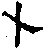
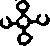
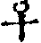
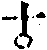

# 天界觉浪盛禅师语录



> **藏经**：嘉兴大藏经（新文丰版）（嘉兴藏）　**册次** 第 25 册（J25）　**编号** JB174　**部类** 诸宗部　**卷次** 12 卷　**篇幅** 135,767 字

> **作者（译者）**：门人　大成　大奇　等编

> **卷／品**：12 卷 · 1 品



---



## 目录



  - [天界觉浪盛禅师语录序](#天界觉浪盛禅师语录序)

- [天界觉浪盛禅师语录卷一](#天界觉浪盛禅师语录卷一)

- [天界觉浪盛禅师语录卷二](#天界觉浪盛禅师语录卷二)

- [天界觉浪盛禅师语录卷三](#天界觉浪盛禅师语录卷三)

- [天界觉浪盛禅师语录卷四](#天界觉浪盛禅师语录卷四)

- [天界觉浪盛禅师语录卷五](#天界觉浪盛禅师语录卷五)

- [天界觉浪盛禅师语录卷六](#天界觉浪盛禅师语录卷六)

- [天界觉浪盛禅师语录卷七](#天界觉浪盛禅师语录卷七)

- [天界觉浪盛禅师语录卷八](#天界觉浪盛禅师语录卷八)

- [天界觉浪盛禅师语录卷九](#天界觉浪盛禅师语录卷九)

- [天界觉浪盛禅师语录卷十](#天界觉浪盛禅师语录卷十)

- [天界觉浪盛禅师语录卷十一](#天界觉浪盛禅师语录卷十一)

- [天界觉浪盛禅师语录卷十二](#天界觉浪盛禅师语录卷十二)



---



### 天界觉浪盛禅师语录序



余下根钝器，衰老失学，每见世间文字及诸方语录堆床积案，便眼昏头运不能开卷；每拈懒赞语「那有闲工夫，替俗人拭鼻涕邪？」然每於灯残月落梦回寂醒，先佛古师一二染神剋骨语句影略逗漏，时时落齿牙喉吻中，如小儿弄语时婆婆和和。有人诘之，茫然不能置荅，有掩口一笑耳！



与觉浪和尚相闻十餘年始得把臂，不交一语顿觉心腑清凉，辄伸笔为文以赠。顷，又见其《天界初会语》，是四十年前与焦弱侯诸先生聚首提唱者，迄今藏去箧笥，未有人著语。而公之上首鹤谿，猥以见属，每欲下笔辄作婆婆和和然，是又可一笑也。常闻长者言：「本朝禅门自琦楚石、泐季潭后一灯迢然，而憨山大师盛称寿昌无明以为法眼圆明振起末俗。」今浪师实寿昌的骨子孙，建大法幢狮弦继响。读斯语者，有以洞见其提挈纲要照用纵夺之机，无以斯世颟顸儱侗冬瓜瓠子之禅同类而举扬之，庶不为延津刻舟之人所窃笑也。



昔吾憨师赞寿昌之像曰：「突出大好山，千里遥相见。」博山见之，以为知寿昌之深无如憨师也。今吾幸於暮年得见浪师，相与敲空作响，无舌而谈。善财童子登妙峰顶不见德云比丘，及见德云乃在别峰之上，盖余与浪师所谓千里遥相见者如此，鹤谿以为然否？



岁在戊戌夏五望日海印弟子虞山钱谦益和南书於杭城之报恩院



天界觉浪盛禅师语录目录



卷第一上堂



卷第二上堂



卷第三上堂



卷第四上堂



卷第五小参



卷第六小参  

晚参



卷第七示众



卷第八普说  

机缘



卷第九法语



卷第十颂古  

偈



卷第十一赞



卷第十二佛事  

杂著  

塔铭



------



## 天界觉浪盛禅师语录卷一



**译者**：门人　大成　大奇　等编



师於万历己未，住福州莲山国懽寺，受林宗伯请开堂。升座拈香云：「此一瓣香，诸佛顶𩕳上透出，正眼法藏中拈来，祝延今上皇帝，一人有庆，天下太平；此一瓣香，同胞共乳灶里生莲，一气连枝各自横出，今特拈来供养堂上曹山本寂、国欢文矩二老祖，藉此穿过天下人鼻孔，撩出大地人眼睛；此一瓣香，烈如鸩毒、猛似灵丹，劫火光中夺得、黄龙颔下探来，供养中兴洞宗寿昌先祖无明老和尚、东苑本师晦台大和尚，用酬法乳之恩。」



上首白椎竟，僧问：「少室二株分五派，逆流意旨事如何？」师云：「妙高峰上飞云度，逗出钟声彻九天。」进云：「莫是突出大好山，千里遥相见麼？」师云：「行人更在千峰外。」进云：「东苑独出一枝，与少林分披五叶，还有同别也无？」师云：「解笑还他碧眼儿。」进云：「恁麼则心心相印，无差互也？」师云：「直须亲透此消息始得。」问：「昔年灶里，如何解生两朵莲花？」师云：「雷部主青山。」曰：「恁麼声震古今也？」师云：「恼乱水火神。」进云：「曹山、文矩一母所生，皆证祖位，是何愿力？」师云：「乌碗飞，白碟走。」进云：「莫是各显神通麼？」师云：「山门无口，石磉咬人。」进云：「今日重主法席，则又彻见洞水逆流也。」师云：「线穿红叶奉双亲。」进云：「恁麼则千古儿孙皆得力也？」师云：「谁抚梧桐思凤皇？」进云：「今日开堂祝圣一句作麼生？」师云：「阖国欢呼无量寿，普天乐唱太平年。」乃震声唱云：「会麼千圣齐拜下风，未为分外；十方同时鼓舞，乃见希奇。到此还有领略承当处也无？」复笑云：「可惜许当年老达磨初遇梁武帝，不曾推上此高座子，看他将西来的的意作麼生举似人？若只是『廓然无圣，对朕不识』，可谓面皮厚三尺，不被明眼人掀翻座子，亦当自打退鼓，折芦渡江而去，那复出乖遗丑以累及后世哉？秪如今日莲山新长老出世为人，莫是特为初祖雪屈麼？儿孙各有超群志，岂肯区区较是非？然则斩新条令特地乾坤，端为祝圣一句当作麼生？讴歌不识羲皇德，海阔天空日月高。」结椎下座。



海澄诸居士请上堂：今朝十月十五，手提贯珠慢数；高声只念弥陀，不敢呵骂佛祖。活冤家恰值顺风耳聋，生魔障刚遭千里眼瞽，决定今日莲山又是呵骂佛祖；翻身急报阎罗，忿气冲冠大怒，撞幽冥钟、击阴司鼓，会同十殿阎君，要使刑罚。得所商量，重铸油锅，计较新栽剑圃，必须活捉莲山，亲身受此极苦。牛头阿旁奉命而来，争奈先声夺其气主；近前却要近前，触忤不敢触忤。苦哑苦！莲山见之不觉大笑一声，直得十方法界与地狱天堂一时化为水乳。正当恁麼时如何？天涯何处觅灵云，桃花乱落如红雨。



罗山碧天请上堂：罗山拈头不便，莲屿捉尾谁能？三人证龟成鳖，木蛇笑倒枯藤；曹家女切莫作怪，蜘蛛丝咬杀蜻蜓。石仓居士且披禅衣，作李夫人叫救的梦；碧天长老好提数珠，敲叶相国底棋枰，归去来兮！聊寄三十拄杖，莫教我摈出首座。只因差一著，赚却古传灯。



佛诞日上堂。问：「才出生时已自指天指地，如何又到雪山六年，然后乃观星悟道，还是真实，还是方便？」师云：「烧羹易吃，冷债难还。」进云：「毕竟如何？」师云：「嚼破舌头不是肉。」乃云：「拄杖子忍饥耐渴不过，坐地吃了须弥山曾不见谢土；吸了大海水亦不见酬源，夜来创出个奇论，谓：『世尊生时原不曾指天指地，后来亦不曾悟道观星。此皆是捏怪，所以云门欲一棒打杀。』又诸祖皆呵为打失眼睛，今特来告诉和尚：『明日上堂举出此意，便见斩新公案也。』莲山大喝曰：『这妖怪便乃拗折抛在大火聚中烧去了。』今乃拈得这条新拄杖子，头正尾正不敢妄生节目。若有问：『世尊初生意旨如何？』但打云：『恭喜你！好彩头。』又有问：『雪夜观星时如何？』但打云：『恭喜你！好结款。』更有问：『中间与出世为人事作麼生？』但打云：『恭喜你！千古春风常在手，但教随处有生涯。』」喝一喝！下座。



小年，诸庄夫请上堂。问：「南泉不出方丈，到庄上吃油糍，是何作用？」师云：「邪言不入正人耳。」进云：「秪如庄主亲到方丈谢和尚降重，是如何？」师云：「何似时衰鬼弄人？」进云：「和尚尊重不受请，今日诸庄送供养时如何？」师云：「好好与他一痛棒。」进云：「还有过也无？」师云：「重赏之下必有勇夫。」进云：「恁麼则感恩不浅？」师云：「打鼓为三军。」乃云：「风俗作小年，灶神送上天；天帝有何说？更不与人传。果是个泥瓦合成，灵从何起？昔曾蓦地却生出两朵莲，只今谁能向我杖头讨个压年钱？」



除日上堂：南泉提起猫儿，刀前谁能救得？洞山收却果桌，句下孰能转身？子湖捉住贼僧，如何承当不下？大随随劫火去，直下无能知归？汝等这里一一道得个出身句，我与你分岁尚且大有事在，若不透过银山铁壁，如何得倒岳倾湫？不见洞山老祖云：「三途地狱未是苦，衲衣下不明此事最是苦。」诸兄弟！好言语抖擞眉毛已是堕坑落堑，谁能平日不急得急整理手脚？如狮子游行哮吼返掷而去，虎狼野干闻之遗尿失魂，谁敢当前与之作敌哉？奇男子须是如此气概始可与佛祖撑门拄户，受天人供养、消世间凶危；不然暂时失念瞥起偷心，打在那软洋海子底挣命不起来，他时后日莫怪莲山不曾痛为汝等道破。珍重。



乙亥秋住麻城龙湖寺，李太宰请于宝筏开堂。拈香祝圣白椎竟，乃畫一○云：「见麼？大镜中天，物物自照，若更待扬眉瞬目，已是增金之黄、添玉之白也。虽然今日山僧升此宝华王座，还有向上全提也无？其中有得此先声者，正好对众酬唱，庶不负本分风光。有麼，有麼？人人顶上有金轮，万古威灵光圣代。」



邑宰请上堂：「向上一路千圣不传，本分风光须自领悟。山僧恁麼下座，还有亲切为人处也无？大众便恁麼礼拜而退，还有不相孤负处也无？虽然官不容针、私通车马，正好锦上添花、水中择乳。石女夜抛梭，文彩焕然满目；木人朝唱曲，音声杳尔难闻。其中还有正偏兼带不落是非者，出来唱和看？如无，山僧倒骑露地白牛，游戏十方刹土去也。」以如意畫○云：「见麼？自古轮王全意气，不彰宝印自然尊。」



大雄庵上堂。击香台云：「闻麼？」良久朗声云：「巍巍独坐大雄峰，一喝曾教三日聋；今日当阳明举似，西江吸尽有庞公。大众！山僧今日为太宰公一门亲属升座，秪如不与万法为侣者，是甚麼人𫆏？」一僧出众云：「阁静不须重借月，三更自有夜明帘。」师顾视云：「乾闼婆王亲托出，摩尼光影照三千，更有於光影门头出身者？」太宰出云：「近日有提婆达多一颂呈上大师，颂云：『平地孤堆最误人，枉将法座赚冤亲；瞿昙自有金针度，认影迷头又隔津。』」师云：「何不道：『提婆别有金针度𫆏？』」太宰抚手云：「此又是老婆勘破有来繇也。」师震威一喝，便下座。



六安齐头山水晶寺上堂。修竹彬公礼拜请云：「今日某甲母难之辰，伏乞和尚法施，使先亲速获超往，并示某甲末后大事。」师良久云：「会麼？午夜日头红，石女临盆急；㘞地叫一声，生个铁棘栗。性猛利，情奇崛，假龙舒陈氏裔苗，托齐头狮子躅踯。咤咤呀呀翻破巢敌，五十年来虎踪狼迹，不觉逗遛至今。且道承谁恩力？」乃畫一圆相云：「若於此荐得，不惟顿破生死牢关，至於彼此冤亲，总向这里七花八裂。还会麼？五色彩霞笼玉像，分明一点座中圆。」



丙子冬住新城寿昌寺，受邓太史、涂冢宰、黄司理请上堂。拈香祝圣毕，白椎竟。问：「法窟当年狮子吼，今朝据座又嚬呻，一声震动乾坤句，请师分明举示人。」师云：「才望刹竿影，摆手出章江。」进云：「初机未会玄微意，请向从前话一周？」师云：「两手分付与阿谁？」进云：「擎出满盘皆具足，当机领略事如何？」师云：「退身三步。」乃云：「天无私覆，地无私载；日月无私明，时候无私序；帝王无私德，臣民无私功；圣贤无私心，善恶无私报。所以灵山拈无私之花，少林面无私之壁；二祖安无私之心，曹溪传无私之法；青原、南岳开无私之二宗，马祖、石头列无私之五派；百丈拨无私之火，沩山直下知归；黄蘗挥无私之棒，临济顿彻婆心；云岩示无私之镜，洞山锦缝重开；雪峰升无私之堂，云门当机独领；地藏竖无私之指，法眼妙契天然，乃至千七百没巴鼻汉一味无私，心心相印法法相传。至我寿昌先师翁，触发大好无私之山，重兴曹洞之旨；洎我东苑先和尚，勘破台山无私之路，透过赵州之关；迄我道盛偶入东父无私之室，勒回鞭影之驹，亲承寿祖无私之宗，振起箫韶之凤，是故二十年来纵横方外，无私任运到处称尊。今日归家，幸逢法属推上法王无私之座，重扬先祖无私之风，何异削雪为银火不销，白战未曾持寸銕？虽然如是，今日开堂祝圣一句作麼生道？」良久云：「高提祖印当空照，一道无私谢太平。」结椎下座。



宝方上堂：「竺土大僊心，东西密相付。且道如何是密付的意旨？昔青原老祖命石头迁禅师往南岳通个书信，大似拨开一条冲天大路，自非足下生云的，也不容易进这一步。你看他石头，如狮子游行一蹴便到那南岳，见让和尚即问：『不慕诸圣，不重己灵时如何？』让公眼似电光舌如利剑，何曾放过天下一人？即道：『子问太高生。』头云：『宁可永劫堕沉沦，不向诸圣求解脱。』即拂袖便行，不啻鲲鹏奋怒，水激三千扶摇九万。自此石头一宗传至云岩、曹洞，至我宝方，灯灯相传而不绝，全因此青原一足之真风也。后世人徒知马祖一喝，百丈三日耳聋；殊不知青原垂足，石头万劫心死。秪如山僧今日绍登我祖法座，既为承嗣子孙，毕竟密传个甚麼？玉玺不离天子手，金箱那许外臣知。」



师诞日上堂：特特升堂为证据，要人透我秘密句。一句父母未生前；一句才生便㘞地；一句四十五年的。若人一句中荐得，堪与佛祖为师，切忌静沉死水；二句中荐得，堪作人天之主，切忌动落今时；三句中荐得，堪与随流入妙，切忌自救不了。若能三句一齐荐得，方能情见不偏，始终超脱不纵不横，如摩醯天眼相似，此犹是门庭施设边事。须知向上一路，尊贵自别；但能相续，名主中主。



结制上堂：木人采空花，持归夸石婆；盈盈插高髻，风流果更多。阿呵呵！会也麼？参得透，莫昧灭我正法眼藏；参不透，莫孤负我金襕袈裟。诸禅哥！自家消息自家摩；况此生涯随分足，莫嫌伎俩不如他。



上堂：十道不通风，哑子来传信；夜半漆昆仑，皎然雪万仞。若向这里会得，可与洞山老祖把手并行；其或未然，寿昌为汝说破。噫！锯𨱕秤锤易，决择生死难；石上栽花易，安立性命难。难不难，心上看！黑豆未生芽去处，善财童子未曾参；易不易，境上觑！阿难欲速成宝王，五浊恶世誓先入。如何入？无位真人乾屎橛。释迦调达暗承当，赚杀文殊与弥勒。



黄司理海岸居士请上堂。师升座，士拈香云：「这一炷香特为新寿昌拈出。」师震声云：「速道！」士便喝，师云：「且莫诈明头。」士云：「却是和尚颟顸。」乃礼拜归位。白椎竟，师喝一喝云：「大众见麼？黄海岸居士穿一双没鼻草鞋，向南方诸知识肚皮里踏过一遭，今日特归寿昌，且作麼生为他证据𫆏？」良久云：「请君吸尽西江水，看取马驹踏杀人。」士云：「半滴不留。」师云：「已蹉过也。」士从西过东立，师竖起如意，士云：「张牙露爪即不无，和尚且无转身句？」师云：「你且向脚跟下透出著。」士从东过西立，师云：「东走西走即不无，本分底事尚未在。」士云：「且道居士立在那里？」师云：「脱却草鞋著。」士云：「如何是途路中事？」师云：「莫向三千觅大千。」士云：「如何是入门句？」师云：「泥牛踞地笑呵呵！」士云：「如何是出门句？」师云：「南山起云，北山下雨。」士云：「如何是不出不入句？」师云：「露柱向你道。」士遂礼拜云：「须是这老汉始得。」白椎将下座，士复问云：「朗月当空时如何？」师作女人拜云：「深深拜到月儿高。」进云：「月落时如何？」师云：「相随来也。」



广照上堂：「觉城东际会同参，古佛堂前孰指南？荐得文殊垂手处，百城烟水逼人寒。大众还见文殊垂手处麼？」良久云：「弹指顿开弥勒阁，慈门何处不皈依？」



东湖上堂：孤峰迥秀，不挂烟萝；丹凤冲霄，略舒风彩。这里荐得，始知寿昌拄杖子未离广照已到东湖。白云锁断去来机，红日印开高下意。虽然如是，更须知有金针未露、玉线不彰底事，始透向上玄关。尘中虽有隐身术，争似全身入帝乡。



报恩寺上堂：一家有事百家忙，杓柄谁能较短长？壁上葫芦偷眼觑，塔头铃子舌根长。且道铃子吐舌作个甚麼？莫谓鲲鲸无羽翼，纷纷金翅海中飞。



净居寺上堂。师以如意畫○云：「会麼？宝镜三昧，明暗交参；洞上宗风，正偏妙协。如何大通智胜佛，佛法不现前？正以根根尘尘周遍法界，本是如来藏心，若是一法不现前，则不名为佛法也。所以外绍十八界梵王、帝释乘光而来请转法轮，佛虽默许只能开人之天；至于内绍十六王子亲承血脉请转法轮，佛乃许可为说三转十二行微妙大法，於是佛法乃得现前。诸法王子与诸闻法，个个分散十方立地成佛，始是开天之天。且道如何是全提向上底主中主𫆏？」良久云：「自古轮王全意气，不彰宝印自然尊。」



藻林庵上堂：「城中多佛法，烂贱没人要；我今轻举时，却恐大家笑。且道有甚麼佛法没人要𫆏？只是未深参，所以不得妙。不见古人问：『如何是小乘钱贯？如何是大乘井索？如何是有漏笊篱？如何是无漏木杓？如何是教外别传的事？』分付典座：『咄！切莫动著磕著。』咦！若不动著磕著，千年故纸争堪合药。」



上堂。司理黄公问：「万佛临筵时如何？」师云：「闹蓝且喜得抽头。」进云：「阿谁作主？」师云：「五凤楼前笼彩气。」进云：「争奈傍观者哂？」师云：「对管好凝眸。」公礼拜。乃云：「滔滔起别峰，谁是钓龙翁？前头风浪恶，淹没几船蓬。若向其中作得主，何如一镞便辽空？会得底，三关透出亲相见；不会底，当央迷杀主人翁。众中还有劈开胸襟相见者麼？」僧才出，师震声喝云：「败将不斩。」复以如意打一○云：「大众还透得这个麼？一二三四八九十，无限奇儿数不及。数不及！两眼星星黑如漆。金乌戴雪夜间飞，玉兔披星天晓出。」



福山上堂，乃畫○云：「常啼菩萨卖心肝求般若；寿昌杖人卖般若求心肝。看看！双林佛殿，骑箫曲峰，入诸人鼻孔去也。绍隆大师合掌云：『唵　嘛呢叭𠺗吽！家有白泽之图，必无如是妖怪。』会麼？欲将我语同他语，须是他心似我心。」



丁丑住新城福山寺上堂。司理黄公问：「绍隆出世七佛证盟，和尚出世甚麼人证盟？」师云：「星池重建幢幡影。」进云：「琼楼宝殿甚麼人居住？」师云：「箫曲犹闻鸾凤音。」进云：「满堂龙象，师还辨别得也无？」师云：「空王嚼碎赤波斯。」乃喝云：「覆船和尚无生可度，撒手太孤危；绍隆大师面目多端，惑乱人不少；西竺老子灵龟曳尾，狼藉几丛林。更有许多藏头露尾老古锥，仔细简点将来，不免一齐断案。且道今日新福山出世为人当作麼生𫆏？」良久云：「宝杖指开千圣眼，普天之下共传心。」



腊月八日上堂：山僧昨夜正熟睡，五更钟响方瞥地；醒来犹自眼眯𥊚，拈得口时失却鼻。低头吃粥乃思量，不胜令人太惭愧。愧个甚麼？愧彼雪山彻骨寒，半夜星儿独自觑。独自觑，叫苍天！说向人前不值钱。



师诞日上堂。击如意云：「去年四十五，大擂寿昌鼓；今年四十六，重挝福山毒。福山寿山相对高，红日光生白玉毫；迦叶头陀不忍俊，横披倒舞金襕袍。且道迦叶意作麼生？也是家富小儿娇。」



除日上堂：昆仑奴著铁裤，打一棒行一步；打发根本无明，撞翻从上佛祖。逗到腊月三十日来折合不下，依旧甜瓜彻蒂甜，苦瓜连根苦。



祈嗣上堂，良久云：「佛未出世，曹山不如，金乌抱子归青汉；佛已出世，不如曹山，玉兔怀胎入紫薇。正当出未出时，同声相应、同气相求一句作麼生道？」黄公出云：「云从龙，风从虎。」师云：「春风开竹户，夜雨滴花心。」公云：「且喜曹山犹在。」师云：「蓝水远从千涧落，玉山高并两峰寒。」公云：「威音王千佛为子，转轮王千子成佛。且道还有同别也无？」师云：「金冠顶上玉麒麟。」公云：「露柱生儿也。」师云：「看取五花今复开。」公云：「三千诸佛只有一子，且道认那个作父亲？」师竖一指，公云：「作家作家！」师遂下座。



竖造上堂：「实际理地，不舍一尘；应化门中，不取一法。若向这里荐得，始知福山入林不动草，梵刹已成；入水不惊波，覆船重泛。虽然如是，秪如世尊指地，帝释插标，又作麼生？」击如意云：「夜半金乌生海底，日中玉兔照天门。」



解制上堂：「福山於四月十五日，也无生擒活捉底手段，与诸子结生死冤家；正当九十日，也无烹凡煆圣底炉锤，与诸子敲骨打髓；如今七月十五日，也无杀人活人底刀剑，与诸子作性命开交。所以结制也，灯笼搀露柱怀胎；解制也，木人倩石女原梦。无端陷杀平民，不妨笑倒作者。虽然如是，汝等诸子於三个月中，特地吃了福山底金蚕蛊毒，他时后日毒药发作，却大有事在。」便下座。



戊寅住匡山圆通寺上堂。拈香祝圣白椎毕，乃云：「灵山花发，亲示别传；少室雪寒，全提正令。坐断十方，无间石笋横空；洞明一道，无殊泥牛出海。所以八万四千非凤毛，独许三十三人入虎穴，繇来此事奇特非常，数百年来绍续不易。今日寿昌杖人特登匡岳，入圆通禅院已全身披露，与十方尘刹诸没巴鼻老古锥，及一切黧奴白牯觌面相见了也。且道开堂祝圣一句作麼生道？」良久云：「天开瑞色光河岳，万国讴歌贺太平。」



上堂：牛头北，马头南！三脚驴儿上刹竿；㘞地一声惊石耳，森罗万象作同参。露柱笑，灯笼欢！善财脚瘦草鞋宽；回首百城烟水渺，观音仍在洛伽山。



黄元公主监院上堂：「道济塔红，已应再来之记；圆机碑白，方符同日之刊。折半破三，海岸道人今承斯谶；拈一开五，寿昌杖者正主其盟。信是天缘有在，神理自交；啄啐逢时，芥针协妙。所以心空及第，选官选佛即圆通；学契无为，监世监家真自在。秪如顶门具眼，肘后悬符，宝印当空，全提向上，一句作麼生道？」居士礼拜云：「专为流通。」师乃授拄杖云：「恁麼则圆通新拄杖分付居士去也。」士云：「谢大众证盟。」师云：「大好山中枯木秀，少林室内祖灯新。」士礼拜，师下座。



黄元公设合山斋请上堂：「达磨不来东土，二祖不去西天；震旦更无别路，儿孙脚下亲传。既然如是，匡山诸祖法席列刹可以相望，如何数百年来却成土旷人稀相逢者少𫆏？今日新圆通特提得寿昌一把没柄镢头，涌向匡山峰顶著力一掘，直得十方国土六种震动，历代祖师灵塔舍利各各踊跃放光，犹如出窟狮子一个个翻身返踯，使大地山河草木丛林皆作狮子返踯，围遶宝华王座作大哮吼去也。」师召海岸居士云：「前日分付底拄杖子，今在何处？」士竖一指，师云：「信手拈来无别物，头头用得始全真。」便下座，归方丈。士问：「归宗以镢头斩毒蛇，圆通用镢头斩甚麼？」师举手云：「撚土定千钧。」士云：「亲见归宗了也？」师云：「为山成九仞。」



元旦荆国主请上堂。师升座，拈香竟，乃云：「元正启祚，泰运维新，恭遇荆藩国主闻圆通之风，特使进香匡岳，命臣僧升座，祝延今上皇帝圣躬万寿，此正国主真能，与普天之下万国臣民，同奉主中之主、共尊天中之天也。所以瑯琊云扫除狂寇，荡涤搀抢，此是功勋边事；君臣道合，海晏河清，此是法身边事。臣谓功勋边事，拨乱反正少不得；法身边事，居安思危放不过。至於功位双超，犹须横按莫邪传正令，太平寰宇斩痴顽始得。虽然如是，向上尊贵一路又作麼生？」乃畫○云：「欲识诞生王子父，九重深处御飞龙。」



到龙湖新建法堂。上堂，卓拄杖云：「会麼？三世诸佛於此安身立命；历代祖师於此返魂夺魄；一切魔外於此换骨脱胎；六道有情於此出生入死。秪如山僧拄杖子，纵横颠倒时又作麼生？」复卓一卓云：「尽大地是一棋盘，有能於黑白未分已前，占得敌手全胜一著，我许你著著有眼自能结成一大局面；尽大地是一戏场，有能於开台时，唱得超绝古今一出，我许你出出自能演出一大传奇。是事且划断，秪如此一坐具地，当年周柳塘於此钓鱼台清损渔父；李卓吾於此芝佛院刻削化身；黄檗念於此龙潭湖浸杀瓜茄，这三老虽则同床打眠，未免各自作梦。今日浪杖人将从前事一齐据款结案，至於杖人本分受用一句又作麼生？坐断十方传正令，点开大地看飞龙。」



师归圆通上堂。拈如意云：「异类分披作戏场，纵横杀活绝锋芒；仰山久不见临济，瘦却法身三寸长。谁云秤尺平，直中还有曲；谁云物理齐，种麻还得粟。直须倒吊虚空考出本来面目。你不见大鹏奋翅绝侣孤风；擘开千圣纲罗光，啄出顶门真舍利。」击如意，下座。



上堂：偶向江头采白苹，闲随女伴赛江神；众中不敢分明说，暗掷金钱卜远人。既对众不敢明说，则是心上底人；既是心上底人，即鬼神有所不知，何更向外卜度乎？噫！无限相思空自委，寻常触著最难禁。



结制上堂：「乌入一，白开三，丫角姝儿解玉环；且喜且疑犹且恨，俄然扑落破愁颜。惊起文殊仗剑、迦叶作舞、空生流涕；傅大士东山水上行；十字街头廖胡子，骑牛背面著靴衫。」复云：「放过即不可。」喝一喝，下座。



解制上堂。师升座，良久云：「风冷雪寒，特特向这三片板上坐，有甚麼意趣？」便下座。



师过归宗寺，履云上座请上堂：「灵光不昧，迥脱古今；妙用无私，超绝凡圣。所以马驹踏杀天下人，独有归宗较些子，且道归宗有甚麼长处？」击如意云：「当场放出斩蛇手，千圣从教立下风。」黄公便问：「归宗斩蛇，蛇在甚麼处？」师云：「居士谩出头。」



艾千子居士请上堂：「大地是沙门眼，大地是法王身，且道赵州寄一把锹子与雪峰，当安在何处？」良久云：「是事且置，山僧作得《匡山志略》一册，欲请诸公作一序文，今将真本呈似诸公，幸一言弁之。」乃展两手云：「便请。」黄公出云：「临川一笔，光照山河，大师还拈得起麼？」师云：「则文不加点也。」进云：「右军墨本还曾临得也无？」师云：「僧繇别有丹青笔，一点龙睛破壁飞。」



庚辰住书林一枝山上堂。击如意云：「会麼？空王殿上未卷珠帘；僊苑林中已腾瑞气。紫微转处玉轮辉，彩凤归来金阙启。还乡一曲，韵出丹霄；特地知音，同人拍掌。秪如不涉正偏一句又作麼生？梦回夜月依稀晓，丹桂香飘天下秋。」



魏玉台荐妻请上堂：秋江清浅时，白露和烟岛；良哉观世音！无端落荒草。荒草忙忙何处寻？此有心，彼有心！山不高兮水不深；金针闲把鸳鸯绣，不犯锋芒用得亲；倒刺横拈都泄尽，何尝不肯度诸人？



九日上堂。问：「桂花已发菊方开，请师指示不迁义。」师云：「铁牛不吃栏边草，直向须弥顶上行。」进云：「古人一言说尽山河界，如何是一言？」师云：「舌头拖地。」进云：「恁麼则一枝独出东篱外，不许时人著眼看也？」师云：「须是时人眼始得。」乃云：「重阳九日菊花新，一句明明玄要亲；昔日汾州曾指出，今朝得意许谁人？知有者，特地登高闲笑傲；不知有者，风吹帽落惹尘埃。秪如今日圆通与建山诸公作麼生举唱？」良久云：「忽见南山秋色好，风光岂独让陶君。」



祈嗣上堂：从佛口生，从法化生；得佛法分，是法王子。如何是得佛法分𫆏？卯生日，戌生月，芙蓉点灯来，投子喜不彻。喜不彻！若朴刘公太奇崛；春色秋光两袖生，丹桂枝枝撑著月。



上堂：碧落净无云，秋空明有月；许多闺阁中，商量作话说。何如透出海藏人，两手呈来光洞彻？不见大智文殊，密移一步看飞龙；可笑小慧鹙子，睁著双眸如跛鳖。



叶尔亮庆母诞请上堂：昨夜梦吾亲父母，恨无一物奉尊堂；醒来始觉身心幻，独有灵衷不可忘。不可忘！男儿莫昧此恩光；不见叶君能具庆，椿萱举案喜双双。斑衣可舞，菽水堪将；清机妙密，空劫全彰。满庭玉树临风皎，绕砌金兰凝露香。秪如山僧作麼生庆赞，翡翠帘前还合伴，两眉珍重白毫长。



瓯宁黄岩上堂。拈拄杖云：「灯心刺著石人脚，惊得拄杖鸣剥剥。大索天下，了无形踪；直得大海翻波，须弥倒卓。法身化作灯笼，辉今耀古而文彩不彰；古佛变作露柱，撑天拄地而针劄不著。忽然有个芭蕉老大叫曰：『你有拄杖，我与你拄杖；你无拄杖，我夺你拄杖。』又作麼生？」复卓拄杖云：「历劫鸟栖无影树，少林花发不萌枝。」



上堂：「拈一放一，未是作家；拿三道三，亦非好手。机缘合处，针芥密投；大法现前，天机自协。所以有忌讳无巴鼻，恁麼也不得，不恁麼也不得，恁麼不恁麼总不得，蚊子上铁牛，无你下嘴处。无忌讳有巴鼻，恁麼也得，不恁麼也得，恁麼不恁麼总得，拔剑搅龙门，风雷天上起。诸仁者！还知今日时节机缘麼？杨道熙求授金刚宝戒，为世出世法故。」



辛巳春住福州鼓山涌泉寺上堂。拈香竟，乃击如意云：「一击响玲珑，轰喧宇宙通；丹山飞彩凤，碧海起神龙。若向这里荐得，更须知屴崱峰前有古今不坠之意，且如何是不坠之意𫆏？鼓山一枝圣箭子，射入九重城里去；超然有路自通霄，所以称尊於处处。直饶倔强太原孚，莫能把断於中路；心折归来捋虎须，雪峰牙爪犹可怖。兴圣风高天下惊，共诧不跨石门句；从斯法语如涌泉，狮吼象回迨武步。至我博山父与兄，先觉后觉相承续；杖人於此笑轩渠，东土西天齐露布；无非打鼓弄琵琶，莫若会归於一处。且道会归在那一处？」复以如意畫圆相云：「一花五叶此中开，奕奕传芳照天地。」



南禅碧池初度请上堂：蚌含明月兔怀胎，一点光生莫浪猜；殃崛漫劳传佛语，圣贤不向杀中来。诸仁者！今日是甚麼时节？南禅碧池公初度，特於鼓山请杖人喧此石鼓举扬第一义，以报母难之恩。且第一义作麼生举？有条攀条，有例攀例。



上堂。师拈起如意云：「文殊仗剑逼佛，为甚麼灵山五百比丘一时悟无生忍？涅槃会上广额屠儿，为甚掷下屠刀便道：『我是千佛一数。』且道他提起底是？放下底是？直饶这里透得过，犹在圆通门外，若要入圆通门。」乃挥如意作那咤展八臂势云：「也须恁麼恁麼始得。」



上堂：六阴剥尽一阳旋，夜半泥牛耕石田；天晓细看何所似？新妇骑驴阿家牵。阿家牵，不肯前！手举珊瑚鞭，笑看闹喧天；善财龙女齐打鼓，观音大士打秋千。且道是甚麼时节？天长地久独斯先。



东苑老行者请上堂。喝一喝云：「这个白拈，凡宗门举唱，道个甚麼？一句须具三玄，张三有钱不会使；一玄须具三要，李四会使又无钱。有权有实，瞒人瞒不识；有照有用，欺人欺到底。」复喝云：「且道圆通恁麼判断，临济大士还有出身路也无？临济不是小厮儿，浪公岂是闲和尚？」



地藏院上堂。师击如意云：「这一锤会得，大千法界百杂碎。」又击云：「这一锤会得，大千法界圆陀陀。且道会与不会意作麼生？看看！地藏菩萨来也。手持金锡掌明珠，惜死怜生入水泥；何事忍心幽暗坐？不令地狱即空虚。咄！是何言与？不见一切众生於无住法起诸生死，而生死本无；一切菩萨於无住法立诸誓愿，而誓愿如幻？所谓：『了即业障本来空，未了应须还夙债。』秪如誓愿与业障如何得如明珠透悟去𫆏？」复击如意云：「罔象过时光灿烂，离娄行处浪滔天。」



------



## 天界觉浪盛禅师语录卷二



**译者**：门人　大成　大奇　等编



癸未住金陵灵谷寺上堂。拈香祝圣毕，白椎竟，监院问：「蒋山虚席已多年，今日吾师重布宣；竖拂拈锤即不问，太平一曲若为传？」师云：「紫金山上撞金钟。」进云：「恁麼则寒松一色千年别，野老拈花万国春。」师云：「合掌山门礼至尊。」进云：「木马嘶风云布彩，泥牛吼月水波生。」师云：「偏是诈明人弄影。」维那礼拜起便喝。师云：「红炉飞片雪。」进云：「大地起波涛。」师云：「阇黎在何处安身立命？」进云：「和尚还见学人也未？」师云：「你须仔细。」进云：「翻身击碎黄金锁，露出山河一片春。」乃以如意畫一圆相云：「会麼？千圣顶𩕳上建法幢立宗旨，方能振佛祖不传之真机；威音王那边旋天关转地轴，始可提圣凡无犯之正令。至於入廛垂手、临难救人，却如大医王治脉调元，唯扶血气而延年寿；又如大将军伐谋制胜，不动干戈而见太平。是故我为法王，於法自在，何有世出世间生杀定乱，而不繇於神妙之先著哉？且道承谁恩力乃能恁麼𫆏？万代金轮全妙密，不彰宝印定乾坤。」结椎，下座。



天界寺三方丈禅堂暨诸法侣请上堂。师击如意云：「一真印现，大法门开；超日月之光华，透乾坤之秘密。万化不能逃其性，群机无所遁其情。盖善逝世间之有主，则妙尽身心性命之无亏也。故先皇统百王之至治，集三教之大成，以如来万德十号而敕建天界禅寺为善世法门，特欲会尽千圣之真宗，以致天下之太平也。议者以佛之戒律足以弼世，为不治不乱；佛之禅定足以正身，为不言而信；佛之智慧足以正心，为不化自化。所以三即一、一即三，神而明之存乎其人，此盖我震旦孔子称赞吾佛西方大圣人之意也。秪如吾祖宗门下鸾凤冲霄，其谁能睹光彩？如羚羊挂角，何处得觅踪繇？正当觌面全提，即三世诸佛不敢正眼觑著，觑著则瞎却渠眼；历代祖师不敢赤体承当，承当则殃及儿孙。直得海底尘生、山头浪起，木人拍掌、石女讴歌，庶几通得个太平消息。岂不见宗泐禅师初参天竺广智和尚。智问：『国师三呼，侍者三应，意作麼生？』泐云：『何得好肉刲疮？』智云：『将谓你有甚奇特，元来无所得也。』泐便喝，智拟棒，泐拂袖而出。於是顿见秘密法门，而后大阐宗风以助无为之化，此非千古之大奇特哉？如今善世诸法侣，英材拔萃不让当仁，拶入此宗其谁能敌？且作麼生相为？拨转上头关捩子，大千法界现全机。」



结制上堂：「诸佛不出世，亦无法与人；泥里洗土块，何如金博金？良以事无一向，故能振法大机。昔日达磨大师初到金陵见梁武帝。」「早已漏逗了也。」「帝问：『如何是圣谛第一义？』」师云：「佛心帝主，天然有在。」「磨云：『廓然无圣。』」师云：「拨开白雾，透出红轮。」「帝云：『对朕者谁？』」师云：「圣执未忘，可惜蹉过。」「磨云：『不识。』」师云：「灼然！」「帝不契。」师云：「也怪不得。」「磨乃渡江过少林面壁。」师云：「这个没孔铁锤。」复云：「诸仁者！你看他！一个如临宝镜，胡汉自彰；一个如拂吹毛，圣凡绝迹。达磨过后又有一个宝志公忍俊不禁，问帝云：『陛下还识此人麼？』」师云：「这老汉惑乱人不少。」「帝云：『不识。』」师云：「较却些子。」「志云：『此是观音大士传佛心印。』」师云：「借红罗扇遮面。」「帝乃惊觉，即欲遣人去追。」师云：「鹞子过新罗。」「志云：『莫道陛下遣人追，即阖国人亦追不及。』」师云：「志公齿不关风，自呈败阙。」召云：「诸仁者！这便是我初祖西来第一则公案也。虽因举古验今，实乃锥劄向上，个个须是顶𩕳吃痛始得，不然特地受人欺瞒去也。更以一偈：『向上全提圣莫知，电光石火较犹迟；当机点得龙睛活，破壁风雷天下飞。』」



刘水部苏明府王孝廉请上堂：威音王如来於空劫已前，得一个没孔铁锤以为镇藏之宝，命无知、无识二臣子守之，於是端拱无为得大受用。尝能出生诸佛，而诸佛不能授传；尝能降伏诸魔，而诸魔不能窥测。所以一切众生虽沉没生死，而不为生死磨灭，至有贤圣能超出治乱，而又於治乱游戏者，是皆承此没孔铁锤之力也。昨夜三更红日现时，二臣子偶生奇特希有之想，欲夸耀於人，忽被无明业种大王一时将此锤摄去。及乎天晓，威音王摸索不著，乃忿胸大怒，直得虚空粉碎大地平沉，惊起释迦、弥勒揭古掀今；文殊、普贤追凡穷圣，竟不能得，及至求告於毘婆尸佛。正当无可奈何之际，值我金陵大护法、宰官、居士暨诸法侣，入灵谷山请杖人举扬向上事，以明治乱之机。杖人方升座，如意子蓦然𨁝跳上三十三天，高声大叫曰：「诸佛子，莫痴迷！其谁曾失没孔锤？从来天下元无事，秪为奇怪人乱之。莫搅乱！无明自化为光焕；依然半夜日头红，铁锤是甚乾屎弹？」



师诞日上堂。乃举如意示云：「天人群生类，皆承此恩力，若向这里荐得，则世出世法皆从此透去也。且作麼生透？父母生我身，生前谁是我？知我未生前，亲恩可报也。国土立我身，谁为立土者？能了此立人，君恩可报也。师友出我身，此身如何出？真得出身路，师恩可报也。佛法明我心，何以明心法？能明此法心，佛恩可报也。众生及魔外，能成我道果；度尽能度人，无恩不报也。虽然如是，可中还有次第同别也无？若是个人，直须一一透过始得。若乃拈一放一，不是作家；拿三道三，岂是好手？直饶就里能抽骨、明中不展眸，须知更有一人不肯在。毕竟如何透得𫆏？虚空不假钳锤炼，日月常旋天地机。」



元旦上堂：看！紫金山中炤耀，日日无私；大宝殿上光明，时时不昧。天地不能掩其质，劫数莫能移其精；佛性之妙义昭然，时节之机缘自至。今当木宿挥鞭、泥牛运步，踏出故乡田地，放开格外春风。所以帝登宝座，发政施仁；朝野协和，神人欣悟。各证性命之尝，共乐无为之化；万国仰呼嵩岳耸，圣明仁寿与天齐。



陈光禄请上堂：「向上机关一拨便转；十方慧命一点即通。我今将此如意子搅动四大海，使一切蛟龙、鱼鳖、妖怪等皆知以水为命。诸仁者！鱼龙是有情，海水是无情，如何有情却以无情为命？秪如能知之心与所知之命是同是别？」乃击如意云：「看看！山门骑佛殿，向汝诸人鼻孔里去也。阿刺阿刺！若向这里打得个大喷嚏，管取你见百草头上不动干戈定太平，铁壁崖前迸出华严真法界。」



上堂：过去心不可得，万里山河凭点墨；未来心不可得，千古老鸦一样黑；现在心不可得，天上有星皆拱北。取不得，舍不得！相逢谁是知音客？虽然向下文长，须看一则两则。世尊乞食归，空生特地叹希有；德山托钵出，岩头皮里作阳秋。一个感悟流涕，空谷生春；一个抚掌呵呵，吹毛露刃。虽则是法平等，无有高下；争奈车不横推、理无曲断，还有向这里作得主麼？兔马有角，牛羊无角。



上堂。师拈如意示云：「会麼？举不顾，即差互；拟思量，穿过诸人鼻孔去也。饶你能冲流度刃、疾燄过风，到这里不论搆得搆不得，未免丧身失命。不见清凉法眼禅师初开堂日，僧问：『大众云集，请师举唱。』眼曰：『大众既尽在这里，山僧不可无言，举一则古人现成公案去也。』乃云：『珍重。』便下座。这老汉大似临嫁医瘿，转见丑处败露。云门大师上堂云：『闻声悟道，见色明心。观音菩萨将钱买胡饼，放下手原是个馒头。』这老汉却似大虫戴纸帽，好笑又惊人。且道此二老如此举扬，还有出身路也无？逢人须说十分话，莫负平生一片心。」



大司礼请上堂：天地有真性，知性方能立命；古今有大机，知机始解通时。知性而不知机，静沉寂灭；知机而不知性，动落支离。性机不失其尝，正偏妙协；动静不违其旨，时命双超。所以有时寒则普天寒，贫者、贱者思向红炉火边攒；有时热则遍地热，富者、贵者长向清凉亭上歇；有时天也不寒，地也不热，忽然撞个师姑是妇人，踏著秤锤是生铁。这里也有文章经济、也有道德功业、也有性命宗旨、也有生死秘诀。黄面老人四十九年费尽分疏，碧眼胡儿十万里来难为辨别。更若如何若何，转见伤龟恕鳖；若能一切现成，自然合他古辙。虽然如是，也须知个时节。且道是甚麼时节？宝铃迥出空中响，震摄阎浮同异心。



千秋节上堂。师以如意畫○相云：「会麼？迥日轮而协梦，夜半正明；乘象驾以投机，晓来不露。天然贵胤才生，即指顾称尊；正位青宫初立，便绍承大统。优昙示现，长春之花萼方新；宝祚隆膺，亿代之本支远茂。继天地祖宗之慧命，启朝廷社稷之光辉。今当皇太子睿诞之辰，特升座举扬庆赞：永祝千秋同日月，尝瞻万寿等乾坤。」



甲申祖堂结制上堂：如天普覆，如地普擎；如日月照耀，如时序运行。魔外无因而得执计，佛祖无因而得证盟。既然如是，这里又特地结制作麼？从来海岳归王化，也要人民见太平。



上堂。问：「法王登座，龙象交参，三堕明宗，请师指示。如何是类堕？」师云：「狗薮掊走陡。」进云：「如何是随堕？」师云：「贼侧勒则革。」进云：「如何是尊贵堕？」师云：「珍申邻陈嚚。」进云：「未审学人如何用心，即透此三堕？」师云：「打鼓冬冬震大唐。」乃云：「虎跑泉畔，烟锁幽林；佛字岩前，月窥古洞。千载风光不昧，特地开眼其谁？昔牛头第七世径山道钦禅师，因马祖令人送书到，师发缄见一圆相，乃於相中著一点却封回。忠国师闻之曰：『钦师犹被马师惑。』诸仁者！何处是被他惑𫆏？若向此中透得，便见三老。如摩醯首眼，竖亚纵横；炤彻乾坤，一道平等。会麼？驴驼马载无人识，踏上昆仑最上头。」



上堂：「相逢不拈出，举意便知有；事故无一向，何妨垂只手？诸仁者！不可作寻尝茶饭看，须知有古今一段迥出尝流公案以作法施。昔临济大师云：『第一句荐得，可与佛祖为师；第二句荐得，可与人天为师；第三句荐得，自救不了。』还有荐得此三句意旨麼？山僧却有四句，前三句不敢举似。何故？第一句能令人七颠八倒，不敢举，恐汝等皆七颠八倒去，我亦禁制你不得，又谁奈你何？第二句能令人昏天黑地，不敢举，恐汝等皆昏天黑地去，闷杀了你，教阿谁偿命？第三句能令人大彻大悟，不敢举，恐汝等皆大彻大悟，打筋斗去了，叫那个守这禅堂？若恁麼则第四句可以举，似乎且缓著，此时天气炎热人命无尝，得坐且坐、得行且行。五月二十九，昨日已过了，腊月三十日，大尽尚远，未必阎罗大王即叫你们还饭钱，但自耐烦切莫性燥，燥则打破汝头。毕竟第四句作麼生？」大喝一声云：「剖心不用刀。」



上堂：「大道原来绝异同，无功勋处立奇功；魔宫虎穴能穿过，掉臂归来笑自浓。」复举：「甘贽行者一日到南泉设斋，黄檗为首座。甘曰：『请施财。』檗曰：『财法二施，等无差别。』甘曰：『若恁麼，争消得某甲嚫？』便将下去。顷又复来曰：『请施财。』檗曰：『财法二施，等无差别。』甘乃行嚫。」师云：「你看南泉门风，壁立万仞；黄檗作略，坐断圣凡；甘贽机锋，善能杀活。虽然如是，不免各自把定要关，未有天然尊贵事在。何如我圆通高坐，湛公为之支撑，高道特地设供，不分大小亲疏平等一例行嚫，可中更无一人敢居功恃德以己方人，且道还有为人处麼？不因今日事，争识古人心。」



凤林上堂：二十七年中，两度曾到此，今还特地来，谁是旧知己？莫是吹布毛底古鸟窠麼？须是会通侍者始得；莫是问佛法底白侍郎麼？须是八十老翁始得；莫是重阳九日菊花新麼？须是汾阳老汉始得；莫是牛头一枝今当重于凤林横出麼？须向杖人良久处透得不触不背始得。虽然今日得到凤林，全是姚愚谷前年於庐山先与诸公通一消息相挽始得，从金陵一路来此以酬胜愿，其鸳鸯绣出，妙在金针；不落文彩，更须著眼。秪如杖人既已亲到，与诸公亲见了也，就中还有亲切提持事也无？明圣湖中龙跃起，越王台上凤飞来。



师到龙门，石雨大师请上堂。石雨大师问：「君臣未定，宾主先分，宾主协和，如何开示？」师云：「彩霞笼玉像，个里自分明。」进云：「秪如低处低平、高处高平又作麼生？」师云：「顾鉴本无私，天然成照用。」雨顾众云：「毕竟是这老汉。」师云：「也须法兄证明。」僧问：「佛祖近傍不得的人，未审和尚如何与他相见？」师云：「脑后著双眉。」进云：「莫这便是相见处麼？」师云：「蹉过了也。」进云：「此邦不入、彼邦不居，且道他居何国土？」师云：「顶门突出。」进云：「杲日当空又作麼生？」师云：「谁敢妄自瞻仰？」乃卓拄杖云：「为访同人度远峰，龙门耸峻赖孤笻；相逢不更倾心胆，共看浮云弄太空。诸仁者！正当浮云弄太空时作麼生？到这里纵是明眼作家诚难话会在。今日径山特访龙门，承堂头法兄及诸禅侣，深用激扬宗旨命登此座，不免客听主裁，相席打令去也。还见龙门风景殊特麼？盖主人立处高巍，会同云月谿山之同异；可中严密，妙尽君臣偏正之尊卑。孰有门庭施设、堂奥深微能过於是？以故门下英才济济克绍芳规，大法振兴正未艾也，又何有浮云之弄太空哉？虽然如是，古人云：『万里无云，青天亦须吃棒。』今此浮云弄空，我与法兄当何处分？使彼为霖为雨去，好知渊默有真龙。」



甲申冬住杭州径山寺上堂。拈香祝圣毕，白椎竟，师以如意畫圆相云：「会麼？大圆照内，凡圣交参；双径峰头，人天围绕。到这里文不加点，新长老秪好证盟。虽然如是，也须是顶门具眼、肘后悬符底人始承当得。昔唐朝本寺开山法钦禅师，道风闻于京师，代宗皇帝遣中使诏至阙延咨询法要，同弟子之礼。一日师见帝，乃起身。帝曰：『禅师如何起身？』师曰：『大檀越何得以四威仪见贫道？』帝大悦，谓南阳忠国师曰：『朕欲赐钦禅师一号。』国师欣然奉诏，赐『国一』焉！师辞归山，帝曰：『彼地众生当得度，与此地众生何殊？』师曰：『实无有一法可度众生者。』帝益深重之。诸仁者！你看他一个佛心天子、一个法眼宗师，一唱一酬如两镜相照，是法平等妙密圆明。然山僧既膺法席，正当於黄金殿上揭开日月之光华，白玉毫中指出古今之主宰。一人有庆，千载同风；世出世法，了无彼此。且开堂祝圣共致太平一句作麼生道？金轮迥出中天照，万世讴歌颂圣明。」结椎，下座。



结制上堂，举：「妙喜禅师云：『金佛不度炉，木佛不度火，泥佛不度水，真佛屋里坐。』赵州和尚吐心吐胆，恁麼告报，也还有知恩报恩者麼？」师云：「大小妙喜，不识好恶，尽大地人被赵州老汉刳了眼睛鼻孔，将个无位真人推下万丈深坑，至今求出头不得。径山别出只手救拔他去，且作麼生救拔？金佛须度炉，木佛须度火，泥佛须度水。真佛不许他在黑山下作鬼家活计，直教他剑刃上行、火焰里走，入生死流、辟圣凡路，显全机大用，向如意子头上续佛慧命去。会麼？换骨洗肠重整顿，通身手眼更须参。」



除日上堂，举：「赵州一日到僧堂后，见一僧曰：『大众总在甚麼处去？』僧云：『普请去。』州於袖中取出利刀递与曰：『老僧住持事繁，请上座为我折倒。』便引颈向前，其僧惊走。」师云：「赵州老汉生平血性为人，末后要寻个英烈底作个结果，不期遇这跂死禅和，反成一场败阙。这僧秪图一时躲根，那知撞著冤家路窄即欲逃去，其如天网恢恢。当时若能将计就计，便拶住云：『学人亦怕常住事繁，正求这条路不得，幸和尚有此快刀，先将学人倒断，然后待学人倒断和尚。』这僧果能如此秪应，赵老无下手处，亦特地欺人不得。汝等且道，此僧性命既断，如何又能断赵老性命？若向这里透得，则知腊月三十日於生死结交处自有出身活路；其或未然，北斗藏身人不见，翻然踏破也还难。」



观音殿上堂：古佛堂开不二宗，杖头指处尽圆通；新年佛法如何道？万寿峰前祝圣躬。且道祝颂意旨作麼生？龙图统御三千界，凤历弘光万世隆。



苏司礼初度请上堂：东海晓鸡鸣，南海红日涌；双径顶门开，一轮天上迥。秪如光明普照与光未发时还有同别也无？若向这里会得，始知吾人已生后与未生前曾无变异。所以傅大士云：「有物先天地，无形本寂寥；能为万象主，不逐四时凋。」祗这不凋的人阿谁不有？直须深参实究，一朝打破罗网，始得定国安邦。毕竟如何为公助发𫆏？宝杖振开空劫梦，超然顿惺主人公。



湖州陈公荐室请上堂：「诸佛与众生说了生出死之法，细刮龟毛付与人；众生向诸佛求安身立命之方，击碎太虚重砌起。只此迷悟两重关，谁见空花生碓嘴？」复举：「七贤女游尸陀林，一女问曰：『尸在此处，此人何在？』一女云：『作麼，作麼？』众女皆悟无生。」师高声云：「诸仁者！若向这里荐得，不但知自己性命落处，则世出世间、情与无情，鳞介羽毛蜎飞蝡动皆了元因。虽然，点即不到、到即不点，天上人间惟自知，觌面全提知电闪。」



结制上堂：「盘山云：『向上一路，千圣不传。』慈明云：『向上一路，千圣不然。』妙喜云：『向上一路，热碗鸣声。』径山又则不然：向上一路，天下太平。既如此，又结个甚麼制？也须到这里㘞地一回始得。」



杭州妙香诸善女请上堂。卓拄杖云：「看看！径山拄杖子，放白毫相光，吞却东方万八千世界了也。若凡若圣、若依若正，如黑漆桶里相似，直得弥勒腾疑、文殊决义，到这里一些分疏不下。独有八识藏海龙女，一念瞥然顿破妄执，透出妙性明珠，便乃立地转女成男，向南方虚明境界作大佛事。若向这里荐得，是法住法位，世间相常住，说甚麼开示悟入佛之知见不得透脱？还会麼？雪满千峰白，天晴路不迷；姨姨娘姊妹，嫂嫂阿哥妻。」卓拄杖，下座。



乙酉春住杭州净慈寺，受方相国张抚台请开堂。升座白椎竟，良久云：「会麼？威音提密印，法界尽称尊；两轮交互照，永启大明门。诸公到这里直须剔起向上眉毛、立定向下脚跟，於自己历历孤光不可昧灭处荐取，始知永明体露、宗镜心开，洞彻古今、辉舍刹海，魔外无能逃其迹，死生不足乱其神，为佛祖之鉴衡、作人天之眼目。更须知！别有天然贵特之旨，堪报不报之恩，以助无为之化。」拈拄杖云：「揭开日月为天眼，指出须弥作寿山。」



佛诞日方相国请上堂。师拱手云：「会麼？恭喜诸公人人头顶天、脚踏地，眼放光、鼻出气。从古以至如今，未曾丝毫变异，道个本来是佛，自己糊涂；更若向外驰求，转成钝置。当年悉达太子才生下来，不守本分夸张尊贵，遭他傍观不肯，却成一场笑具。既然如此，今日净慈为甚安禅结制举扬宗旨？不见道：『药因病险制尤奇，剑为仇深磨更利。』」喝一喝，下座。



吴太史叶工部请上堂：鸾凤冲霄，不留朕迹；蛟龙出海，别有威神。谁能到这里窥其风彩、测其隐微？虽然如是，事无一向，世出世法有共有不共，果是透过向上大事底人，已无凡圣生死影像可得，故乃深入生死同其忧危之根，在彼实超超乎世出世间影象之外也。所以在天同天而非天、在人同人而非人，在异类同异类而非异类、在尊贵同尊贵而非尊贵，故能弘开不二法门，会归性命宗旨，而致君尧舜之上，措民熙皞之间，全机大用，解脱自繇。还会麼？春归华岳千峰秀，风起沧溟万派奇。



陈水部请上堂：觌面全提，不劳打筭；两个五百，原是一贯；会得撩起便行，不会重添公案。那个是撩起便行底？昔宋时陈莹中谏司，立朝骨鲠有古人风烈，尝留心《杂华》有所诣，因质正灵源清公。清曰：「须离心意识参，出凡圣路学始得。」公承示，久之开悟。有偈曰：「书堂兀坐万机休，日煖风和草木幽；谁识二千年外事，如今只在眼睛头。」诸仁者！还会得眼睛头事麼？果若会得，则风柯月渚皆契玄机、烟岛云林咸提玅旨，又何心外别有法哉？今梅臣居士深究永明宗旨，竭力赞兴净慈，可谓前陈后陈千载一贯也。山僧作麼生相为公好，亦有偈曰：「百草欃枪战未休，心随境转孰能幽？机前荐得太平意，日照山河在杖头。」



丙戌住淮安檀度寺结制上堂：「万古长空，一朝风月，金刚手里八棱锤，踏著称锤硬似铁；一朝风月，万古长空，江淮波浪虽相似，熨斗烹茶铫不同。」喝一喝，下座。



王大来户部、汤右君孝帘请上堂。乃云：「天地之心无私而化育万物，圣人之法不二而保合太和。心是无私之心，范围天地而不过；法是不二之法，参赞性命以无违。果能如是，扶颠危而复正，率殊异而同归，又何难哉？」复举：「陆亘大夫问南泉和尚云：『弟子家中有一片石，亦尝坐亦尝卧，今拟镌作一尊佛，可得否？』泉曰：『得。』陆曰：『莫不得否？』泉曰：『不得。』」师云：「南泉一对眼烁破古今，三寸舌杀活天下，何故随风倒柁，问得荅得，问不得荅不得？陆大夫於威音劫外拈出本地风光，以验作家，就中一片顽石谁能觑破？还有知他二老落处麼？金𫔇拨出娘生眼，玉笛吹开太古音；直下洞明尊贵事，共相赞助太平春。」



静川上座请上堂：「见麼？石火与电光，结个同参友；蓦地问空王，生死如何了？父母未生前还有安立否？教外别传机作麼生得取？空王震威喝，石火颠倒走；亦复打一棒，电光全不有。惊得南泉猫咬杀赵州狗，庭前柏树子藏身於北斗；拄杖趁不及，怒作狮子吼。寒山、拾得笑呵呵，丰干老子饶舌，不落瞿昙之后。简点将来，却是木扎羹、铁钉饭，使那没面目衲僧，与那胡张三、黑李四，一个个吃得饱𱃫[飢-几+烹]地，曰：『希有、希有！』」便下座。



正观、如是二法师请上堂：「世法出世法，各有时与机，时机如凑巧，悟发自神奇。北溟有鲲，忽而化鹏，怒而飞，水激三千里，抟扶摇而上者九万里。水力耶？风力耶？造物之所使耶？毕竟承谁恩力而怒？其谁耶？昔长水法师问瑯琊和尚云：『清净本然，云何忽生山河大地？』瑯琊凭陵云：『清净本然，云何忽生山河大地？』长水言下有省。这瑯琊老汉虽能以机夺机，争奈只有杀人刀而无活人剑；长水虽则悟去，争奈落在法身边，未知有向上关捩子在。若问我径山：『清净本然，云何忽生山河大地？』但呼云：『座主！』待应诺，便向道：『当时渭川叟八十遇文王后，持的钓竿子分付与谁？』渠若向这里悟去，更不作开眼尿床汉便捋虎须，又何肯落他窠臼哉？虽然末法之际，求如恁麼人也难得，清净本然一句话谁不能知？谁不解讲？果能如彼于此语痛起疑情，终有开发日也。兹正观法师前日谒山僧有感，特请举扬宗旨。山僧昨问公：『作甚麼来？』曰：『曾参竹篦子话，未得亲切。』山僧曰：『如何太原孚上座才得辍讲，于闻鼓角声处便道：「更不敢扭捏娘生鼻孔？」』公如是益疑，故今特拈长水公案以助发共向上之机。使公果于此宗如结冤雠痛奋不已，则自有㘞地时节，如鲲怒鹏飞，不亦超然出凡圣之外哉？」乃击如意云：「会麼？正令全提处，英雄好转身。」



上堂：上不是天，下不是地，南北东西无定位，十字街头石敢当，天涯走尽无碑记，忽然撞著露柱儿，拍掌呵呵说妙义。说甚麼玅义？教训三世诸佛，不得弄精魂；指点历代祖师，休得无讳忌。直得黧奴白牯跳上虚空，乃称赞云：「善哉善哉！麻三斤、乾屎橛；十八女儿不系裙，三脚驴儿弄蹄行。」会得直下成佛，不会领取下文。



上堂：一二三四五，禾山解打鼓；六七八九十，杨岐横楖栗；哽杀须弥喉，嚼出虚空汁。既是虚空，为甚麼嚼得出汁？红稻啄残鹦鹉粒，碧梧栖老凤凰枝。



云石禅人请上堂：快人一言，快马一鞭；举起不会，纸褁麻缠。如何是生死事？上天无路。如何是本分事？利刀切豆腐。如何是向上事？努力殷勤空里步。如何是道？拶碎红尘闹浩浩。如何是禅？痛将顽石著油煎。如何是自己作得主？若是跛猫儿，也解捉老鼠。如何是得自繇？投子提来的是油。果然会得，有意气时添意气；其或未然，赵州衫子是青州。



居士请上堂：至诚可以格天，真参必然妙悟，不见诵苕帚人，一旦心花发露。大圣有所不知，可与造端夫妇，天机只在目前，鸢鱼各自有趣。所以肉案头边掷下屠刀，更无一块不精；争闹市里蓦地一拳，打著没面目汉。虽则触事投机，要是肯心倒断，有漏笊篱无漏木杓、大乘井索小乘钱贯，一副陈烂葛藤千古奇特公案，向这里荐得，则心地清明，事理光焕；火里莲花朵朵开，不出尘劳登彼岸。



祗树上座请上堂：突出神难辩，拈来鬼也愁；聊通消息子，接取断途桥。且道如何是断途桥？《圆觉经》云：「居一切时，不起妄念，寒则思衣，饥则思食。于诸妄心，亦不息灭，顺之则喜，逆之则嗔。于妄想境，不加了知，桃花见红，李花见白。于无了知，不辨真实，大者是兄，小者是弟。」诸仁者！秪如山僧恁麼著语，还与随顺觉性意旨有同别也无？禾山打鼓雪峰毬，俱胝逢人一指头，若向此中能荐得，更嫌何处不风流？



解制上堂：今当解制之日，是谁通此消息？惟有两堂圣僧，用尽娘生气力，致得拄杖子起佛见法见，被山僧一捏碎为微尘，撒向十方刹土。其有见此尘、闻此尘者，皆得开示悟入佛之知见。其尘点落处皆成大菩提树，而新悟入菩萨于此树下成等正觉，吹大法螺、击大法鼓、演大法义。汝等众生应如是知、如是见。虽然，莫将容易得，便作等闲看。



------



## 天界觉浪盛禅师语录卷三



**译者**：门人　大成　大奇　等编



丙戌冬住金陵天界寺上堂。拈香白椎毕，师良久，卓拄杖云：「会麼？过去诸佛吞尽铁丸，心已烂退步一边；未来诸佛欲上刀山，脚未登齐立下风；现在诸佛镬汤滚处，正翻身听令有分。秪如今日新杖人又作麼生？不行诸佛行，不受诸佛报；聊借此戏游，以阐解脱道。三世诸佛性命在杖人手里，杖人性命诸佛摸索不著，所以放行也繇我，把住也繇我，不放不把也繇我。须知放行也，大地山河心眼露，白牯黧奴笑不休；把住也，铁壁银山风不通，黄头碧眼吞声气；不把不放也，横拈拄杖当轩坐，杀活古今人不知。虽然如是，也须有异方便，助发第一义。昔裴相国，一日捧一尊像跪於黄檗前曰：『请和尚安名？』檗呼云：『裴休。』公应：『喏。』檗云：『为汝安名竟。』」杖人曰：「这两个美泥团汉，互相钝置不少。若是杖人见他请安名，但震声一喝，使他两手放下，翻腾而去也；若作裴公，见他云：『为汝安名竟。』便好将像蓦面一掷，使黄檗通身手眼无所施设。杖人如此也不是埋没他，何如我天界诸公，人人鼻孔撩天，个个脚跟点地，又何待依草附木而弄精魂，以自昧其本分乎？会麼？五色彩霞笼玉像，超然一句报升平。」



蔡司马、顾农部、沈侍御请上堂：当央直指，未免淆讹；出格全提，却成钝置。何似春日融融，消落银山之雪；春风拂拂，吹开铁树之花。木人得趣以高歌；石女知音而密和。此段天机太煞超绝，正当恁麼时，释迦热肝胆、达磨冷眼睛，与山僧闲拄杖，又如何分付？噫！到这里也须是个罗笼不肯住、呼唤不回头底汉子，转得身来，入林不动草、入水不动波，拈一茎草作丈六金身、拈丈六金身作一茎草，方可与他通此消息。从来海岳归真化，未有乾坤陷吉人。



风隽荐苍森禅人请上堂：盏子扑落地，碟子成八片；斩钉截铁人，不肯通一线。昔奯上座住山，这汉太孤绝生。一日贼来索宝，撞著对头也。奯云：「僧家之宝非君能用。」犹弄死蛇在。贼云：「你但将来，管我能用不能用？」迨得鲶鱼上竹竿。奯震声一喝。果然果然。贼大惊，挥刀便砍。痛快痛快！可惜这贼一场懡㦬去也。苍森禅人尝参天童诸老，每於棒喝下不能顿断命根；去年偶遭奇祸，直得一刀两段。今日其弟与诸道友特请荐拔他。若要我荐拔，更须与一刀。何则？悬崖撒手自承当，绝后重苏欺不得。



诸荐绅请上堂：一不成，八不就；任穿凿，不漏逗。勘得破，呵呵笑！且道笑个甚麼？笑他跛脚老云门云：「乾坤之内，宇宙之间；中有一宝，秘在形山。将山门来佛殿里；拈佛殿向灯笼上。」这汉移星换斗即不无，若是此宝，三生六十劫也未梦见在。或有问山僧：「如何是此宝？」向他道：「天晴日头出，落雨地下湿；哑子吃黄连，谁知甜如密？」



圆通社万缘社西方殿请上堂：佛殿里烧香，山门前礼拜，钟楼上念赞，床脚下栽菜。若也会得，如龙得水似虎靠山，赏你一个没孔铁锤；若也不会，八棱著地一窍通天，赐你一挂宽皮腰带。常啼菩萨卖心肝，无厌足王好捏怪；观音骑得三脚驴，撞倒街头憨布袋。憨布袋，笑呵呵！一毫不了万般差；荐得西方日出卯，便能火里种莲华。



无为州懒子请上堂：十方同聚会，个个学无为；此是选佛场，心空及第归。秪如无为作麼生学？心作麼生空？心空之后又作麼生？一人曰：「夜来有一大变事，十字街头一口井，不知被谁偷去了？」一人曰：「怪道我早起开大门，只见街头上湿。」一人曰：「不必忙，我遣虚空去追捕他，怕他走向草里去不成？」一人曰：「莫道虚空去捕他，直饶遣万象森罗去，敢保你寻他落处不著。」一人曰：「你这一队大妄语汉，一个个好与痛棒三十。」一人曰：「你这不通汉的痛棒叫阿谁吃？」六人争兢不下，乃共告诉於没盖藏大王。大王呵呵大笑曰：「听讼，我犹人也，安得必也使无讼乎？我今为汝判断，汝等当自悟之。」断曰：「脱壳灵龟上酒楼，从来醉不解真愁；忽闻妓女一声曲，你若无心我也休。我若休！与你腰缠十万贯，大家跨鹤上扬州。」



解制上堂：刻期取证，何如畫水成文？解制忘机，孰能悬崖撒手？到这里须知门里出身易，身里出门难。不见古人此处经冬彼处度夏，饭袋子，江西、湖南便恁麼去？好与三十棒。直饶一个个卸却炙脂帽子，脱却鹘臭布衫，做个洒洒落落衲僧，也须透过向上关捩子始得。如何是向上关捩子？倒得门前刹竿去，不风流处也风流。



丁亥住金陵大报恩寺，受陈侍御、蔡司马诸护法请上堂。拈香白椎竟，师召云：「还知你各各自己彻底无私最尊最亲的正法眼藏麼？虽然，争奈黄面老人於百万人天众中付嘱迦叶一人，皆好与三十棒，何得以常住公法私相授受？山僧不敢蹈他故辙。」乃打圆相云：「这个便是最亲切的正法眼藏。且道又作麼生相付？金轮迥出中天照，大地同成玅法亲。」



上堂：有时相逢不相见，有时相见不相逢；东山起云西山雨，南山烧炭北山红。无位真人，面门出入；没缝塔子，透彻玲珑。现成公案，好与痛棒三十；礼拜了退，一任齐立下风。吽吽！太平日月无人识，大坐当轩笑浪公。



上堂：「杖者笑呵呵！诸人还会麼？眉毛才剔起，鹞子过新罗。既已过，莫吟哦！且吃云门饼，再饮赵州茶；打起关南鼓，唱出德山歌。阿呵呵！会也麼？墙角一株梅，生得两个叉；未结黄金子，先开白玉花。」卓杖下座。



上堂：「一年三百六十日，日日日头东畔出；炤见十方诸如来，个个眼前黑似漆。因甚个个眼前黑似漆？秪为觌面相逢不相识。寻珠不必翻海，求玉何劳凿石？知亦不可知，得亦不可得；木马嘶开碧落天，泥牛踏破澄潭月。汝等毕竟如何？切忌眼横鼻直。」遂拈拄杖，下座。



师诞日解制，陈侍御金沙诸大宰官请上堂：杖人今年五十六，自愧生平如转毂；欲求天下知心人，使我此宗无断续。痴人面前不待说梦，有智人前亦须慎独，不轻以楔出楔，岂易以毒攻毒？此番解制如何？就中有飞有伏。罔象自获神珠；卞和无劳泣玉。且喜牛在山中，水足草足；牛出山中，东触西触。蓦然触著须弥灯王！呵呵大笑一声，直得辉天炤地，遍界是昙花馥郁。诸公以此祝予，予亦以此自祝，愿我大众精勤，各自乘时纳祐。



扫浮山远祖塔上堂。卓拄杖云：「会麼？过去诸佛祖没奈这个何，既已藏身退步；未来诸佛祖没奈这个何，不敢冒命出头；现在诸佛祖没奈这个何，直得浮逼逼地。且道这个是甚麼，得恁麼威力？」复卓一下云：「你知这个能出生三世诸佛祖，是三世诸佛祖没有奈得他何者麼？设使有个不惜性命底出来，便好吃杖八痛棒。何故？重赏之下，必有勇夫。」



戊子住芜湖吉祥寺上堂：赵州云「有佛处不得住」，这没胆量汉，若是杖人偏要此中安住，如有古佛如来，却教他与杖人提瓶挈履，指示他解脱法门。州又云「无佛处急走过」，这没机用汉，若是杖人偏要此中从容，如有邪魔外道，却教他与杖人酌水献花，指示他秘密法门。何则？不见道：「举头天外望，谁是我般人？」也须知是法平等无有高下始得，不然系驴橛汉又与麼去也。何处有？恁麼事？



奉新严省斋请上堂。卓杖云：「横拈拄杖笑呵呵，彻底风流奈若何？惭愧古人无伎俩，大家撞入葛藤窠。古人为甚麼撞入葛藤窠？秪为他妄与人通消息。何则？若棒能与人通消息，则尽大地当连架打去；若喝能与人通消息，则尽大地当雷轰霹雳去；若言语机锋能与人通消息，则尽大地之乎者也梦想颠倒去。秪如西江严省斋居士到此，还与他通消息麼？好看旭日临青嶂，喜对山河炤眼新。」卓拄杖，下座。



比丘尼请上堂：踏著秤锤浑是铁，哑子得梦向谁说？蓦地醒来眼忽开，珊瑚枝枝撑著月。昔归宗和尚座下有僧大叫云：「悟也！悟也！」宗上堂召僧云：「你悟个甚麼？」僧云：「师姑原是妇人做。」宗呵呵大笑，归方丈。这老汉通身手眼，若不见此僧真个透切，如何肯放过伊？今比丘尼偕祝夫人，请山僧指示教他转女成男立地成佛，已是不著便也，更指示个甚麼？此僧自悟则已，如何说师姑是妇人？会麼？脚头各有通霄路，肯向他人行处行。



上堂，师举手云：「会麼？拈得虚空撒向人，撒向人前人不识；临济德山触著之，直得东壁打西壁。打得来，避不及！有言时如宝剑拂挥；无言时如轰雷霹雳。没踪迹处莫藏身；藏身处却没踪迹。所以古之今之无能通此消息，既无能通此消息，为甚麼无位真人在汝等面门出入？你若拟议，是甚乾屎橛？」下座。



住太平无相寺上堂：会麼？须弥山舞紫金襕，四大部洲齐合掌；笑杀灵山百万人，迦叶俨然无伎俩。空王佛不惜眉毛，出来白椎曰：「法王之法，更无有上。」於是大千世界有情无情，及万象森罗蜎飞蝡动，皆作狮子吼放大光明。汝诸人还得此消息麼？得则直下而去；不则庭前露柱笑呵呵，徒把机关说与他。



大音恽道生、大剑唐祖命，二中翰皈依请上堂：蔡五岳云：「三界是大戏场，究竟傀儡系何人提美？」杖人云：十方为空棋局，始终著子，繇自己主张。有能於此问荅透去，不妨纵横自在，更须知有向上关捩在。不见陆亘大夫问南泉弟子：「少时养一鹅於瓶中，渐见长大，如何得不毁瓶而令鹅出？」南泉召大夫，陆应：「诺。」泉云：「出也。」这老汉只知欲使人出瓶，不知自己被语胍转却。若是杖人待彼应诺，但云：「瓶在那里？」岂不令他超然神解。一任逢场作戏当局能提，又如古调发音、太阿出匣，则其全机大用无有不妙协也。一呼震醒威音梦，古剑挥来凡圣惊。



恽道生内翰荐严请上堂：夜半正明，天晓不露；牡丹花下睡猫儿，向上之机须自悟。诸仁者！父母生子，於未生前父母不知；子生於父母，未生前子亦不知。父子不知故，以恩爱而成能生所生之因缘。父母既生子后，养育之恩大於天地；子既生父母后，亲爱之至性与天成。有其身者，不敢遗其亲；有其亲者，不敢亏其身。不遗其亲、不亏其身，而能全其生身之本，此真世间之奇男子也。恽道生孝友慷慨人所共推，尝参三峰大师，於此必须知其源本。今是先严参军生忌，特请杖人举扬宗旨，此中生意贯通世出世法之妙。何则？乾为父兮坤为母，乾坤交而生六子；六子交而万物生，万物化生生不已；生不已，原始反终只此子！世尊心悟证无生，孔子朝闻夕可死；死而不死生不生，圣凡界外任纵横。恽公能悟此生意，百尺竿头进步行；一口吸尽西江水，听取日午打三更。



陶自淑奉拄杖请上堂。师举杖示云：「我有，能无法界之有；我无，能有法界之无；我放，能收法界之放；我收，能放法界之收。使迷不能迷、使悟不能悟，在声色而超声色，在异类而超异类，在尊贵而超尊贵。虽然，别有一条根抵，也须向这里断却始得。」



上堂：古佛空王传正令，插草交芦齐选圣；十字街头石敢当，俨然入会求盟证。文殊问获何圆通？昂首仰天浑不应；顿使枯木与寒灰，发燄生花明自性。明自性！如今四海清如镜；一句灵然定太平，个个超凡还入圣。汝等诸人到这里，也须办个铁石心肠，莫被他石敢当瞒定。



王季优请上堂：有事切於心，寤寐亦耿耿；就里未分明，终须求大惺。忽然惺！却笑罔明、文殊徒向空中掘井。君不见，王季优夫妇同惊生死事，求予指示誓同修。明明祖师意，明明百草头；火里莲花能结子，别有风光世不俦。



上堂：豁开户牖，当轩者谁？青霄散彩，白日扬辉。丹霞烧木佛，却向寒炉添炭；翠薇供罗汉，何似闹市鼓吹？马大师云：「自从胡乱后，三十年不曾少盐酱。」正是如虫御木，偶尔成文。薛异凡祈嗣，特向灵山饭十方贤圣，端有感应。会麼？为儿不识承渠力，养子方知父母恩。



庚寅住栖霞寺上堂。卓拄杖云：「三十年前在此，金陵拨著达磨脚跟；三十年后在此，摄山刺著法度鼻孔。直得千佛岭拶破面门，舍利塔裂开眉睫。智者九旬谈妙，不觉咬断舌根；素庵半个秤锤，俄然迸出心血。今日杖人到来，与你诸人喝开向上一窍，振动十方刹尘，各各眼光烁破古今，听我全提正令。」遂喝一喝，下座。



观音殿上堂：「五台山上云蒸饭，佛殿阶前狗尿天；刹竿头上煎𫗰子，三脚猢孙夜𥳽钱。洞山老祖劈腹刳心，与天下人道破。开口了，合不得；合口了，开不得。独有三寸舌，锥杀三世祖师无出气处。今日不肖儿孙为他别通一线，贵图门风远振，法乳长流。且道如何通一线去？」卓拄杖云：「震旦虽阔无别路，要假英奇杖下行。」



结制上堂：「拄杖子与三世诸佛作个同参，至於向上句、末后句，未免匿怨而友其人，摄山与他作个明证，以全此结契。直得大唐打鼓，新罗作舞；南山起云，北山下雨。无孔铁锤走向镬汤炉炭里藏身，将谓众苦不能到。那知禾茎粟干上，头长三尺颈短二寸底汉，横按莫邪，不令与圣凡躲跟，要他向荆棘林中转身，夜明帘外移步，打破灵床底酒颠汉尚不放过。何故？今日王令稍严，不许搀行夺市。」卓拄杖，下座。



上堂：归宗斩活蛇，圆通卖死猫，径山跃鲤鱼，净慈捉飞彪。各有全机大用，何妨随处风流？自古祖庭多创於义学，即彼仙苑尝插佛标，此山开辟已来，几经教观法席，时节机缘有待，金地仍以手招。秪如今日建立我洞上宗旨又作麼生？睹影便能微笑去，拈花不落箭锋机。



解制上堂：「铁生锈自食其铁；珠生光还自照珠。同是天地所住，何一物自生自灭、一物自生自全？有能辩得，许他具一只眼。」僧才出，师便打曰：「自生自灭汉。」僧云：「某甲未开口，如何便打？」师云：「你还知这一棒麼？」僧云：「谢和尚点省。」师又打曰：「赚杀一船人。」僧云：「过在何处？」师云：「不关汝事，且退三千里外。」师复顾众云：「摄山今日失利。」乃掷拄杖云：「且救取这一半。」



壬辰再住金陵天界寺结制上堂。拈拄杖示云：「当机觌面提，觌面当机疾；惊起铁昆仑，高声叫奇绝。何奇绝？乾峰拄杖，畫断十方路头；云门扇子，打翻法界门户。直得南山起云，北山下雨，三十三天洪波浩渺，大鹏展翅直取龙吞。若向者里夺得此拄杖子，则一任他明头来明头打、暗头来暗头打、四面八方来旋风打、虚空来连架打，总不恁麼来时正好和盘翻却。且道汝诸人向何处安身立命？」复喝一喝云：「莫怪侬家多意气，要君踏转上头关。」卓拄杖，下座。



师居毘卢阁方丈，张绿雪、陈旻昭请上堂。以如意畫圆相云：「会麼？毘卢遮那如来，於此中不动真际与十方诸佛作一处，而尘尘刹刹天人群生所立，无不即此一真清净圆满庄严，无二无二分、无别无断故。所以法界莫大於此中，十方无处觅虚空；圣凡莫尊於此主，法王有师佛有父；古今莫间於此时，感应全凭有大机。不见我洞山价祖於云岩老祖处，悟得渠我一如，权开五位妙协全提；曹山寂祖於宝镜三昧，悟得无变异去，去亦不变异，妙唱嘉猷，拔诸邪见；云居膺祖於秪这是中，悟得门里出身，身里出门，乃知向上一路，尊贵各别。於是敲唱迥出当时，而立门庭堂奥，有正偏、君臣、父子、主宾、功位、王种臣种、内绍外绍、三纲宗、三渗漏、三堕、四禁、十玄门以辨魔拣异，全提千圣不传之秘，玅协世出世间之宗。直至山僧久默斯要，尝集佛祖宗教大成，会通法界圣凡，而归於毘卢之性海也。今日机缘时至，将见六种成就，还有会得主中主麼？」击如意云：「大千种满菩提树，处处春开五叶花。」



师诞日栖霞笑峰然首座请上堂。乃击如意云：「花开千树觉，梦断两眉清；试问威音事，怡然笑自盈。不见僧问云门：『如何是诸佛出身处？』门云：『东山水上行。』又僧问雪窦，窦云：『千峰寒色，雨滴岩花。』又僧问圆悟，悟云：『薰风自南来，殿阁生微凉。』秪如此三老古荅话，还有同别也无？设使问著德山、临济，不知作麼生秪对？他莫是当头一棒麼？莫是蓦面一喝麼？莫是用祖师巴鼻，宗门牙爪、敲唱双行麼？噫！也须有个出身活路始得。设使问著我杖人：『如何是诸佛出身处？』秪云：『逢人不得错举。』或更问：『如何是天界出身处？』秪云：『逢人但恁麼举。』或更云：『便恁麼去时如何？』秪云：『三千里外摘杨花。』呵呵呵！会也麼？孔子不识丘乙己，所以温故而知新；上大人以能可知礼，则亦可以为师矣！」复击如意，下座。



佛成道日上堂：「知有者其神乎？知几者其神乎？知时者其神乎？」震声喝一喝云：「突出毘卢印，放收诸佛机；正中谁玅协？今古有同时。孰同时？灵山尊者正狐疑，夜来忽睹明星现，赚却眼中这点儿。噫！」



上元解制上堂。拈如意云：「如意子向这里成最正觉，却於十方法界一切处解结。汝等还会麼？这个如意子无门无毒，无门为选佛之门、无毒是心空之毒。不见文殊仗剑，能解五百比丘之结心；弥勒腾疑，善启十六王子之绍位，更须知日月灯明佛本光瑞。如此独有露柱石台，不动声色游遍百城烟水；黧奴白牯，不露爪牙捉败五十三人。还有知此向上一窍者麼？慇勤为解丁香结，放出枝头自在春。」



癸巳住杭州虎跑大慈寺上堂。乃震声喝云：「顶门好一椎，还见六种震动麼？达磨不来东土，二祖不去西天；未曾分皮分髓，骨肉本自完全。熊耳峰前，一花常开五叶；嵩山壁上，面目谁敢钻研？一自求心断臂，便有密结恩冤，若非者个恩冤，如何见得教外别传？有从这里荐得，则能擒虎头、收虎尾，第一句下明宗旨。秪这一句子，有时如断碑横古路，使他失后亡前；有时如忤逆闻雷，使他偷心立死；有时如驰书不到家，使他叫屈无分；有时如红旗闪烁，使他蓦地迷魂；有时如巡人犯夜，使他自投法网。且道这句子得恁麼利害？若不是恁麼利害，又何处见此大阐提汉子，於五无间中以毒攻毒，救正此佛祖心眼，续不传慧命？还有知此落处者麼？识得个中亲切句，虎跑泉涌少林泉。」



师诞日，天愚、石照、石公诸大师偕徐王诸居士请上堂：古怪老赵州，一百零八岁；当门一个齿，下下都咬著。不知咬著个甚麼？杖人今年六十二，当门亦一个齿，下下都咬破，且道咬破个甚麼？虽则年牙不同，却也切齿不异。所以千古风流驹过隙，一身历事如猬集；却忆西来碧眼胡，特地要讨此毒吃。此毒吃！六遭不死还吐出，那知还著於本人，谁能出手为收拾？要收拾！直须是铁石心肝、智可及其愚不可及底，乃能同杖人挈挈波波、东击西击，使我少林九鼎浪花新，千圣宗灯照奕奕。



师至显圣，愚庵和尚请上堂：「九年别去甚相思，今喜重逢别是奇；不特同宗深法乳，秪缘一笑未曾施。诸昆仲！千古关切独有笑悲，正以三千年前黄面老人未能发得一笑，至是杖人乃忍俊不禁，特从三吴两浙访我愚庵法兄及诸护法，证据我金针双锁、挟路全该之宗旨，以昔日灵山会上有魔王指佛曰：『瞿昙！我今没奈何你，待你灭度后，於你法中为你弟子，披你之衣破你之法，你又奈我何哉？』世尊不觉痛为悲泣。杖人曰：大小世尊尚欠悟在。我若见此大发一笑，教这魔王伎俩俱尽无所逃遁。虽然，秪如世尊这一哭，还有负堕处也无？杖人这一笑，还有利害处也无？若於此简点得出，则知我与法兄诸公明暗交互、敲唱双行之密；如简点不出，尽他魔佛同恩怨，愈见曹山三堕神。」喝一喝，下座。



能仁百愚禅师请上堂：若人识得心，大地无尘点。当年许玄度於此舍宅为寺，可谓搅长河为酥酪、变大地作黄金。近代祁德公於此复古鼎新，可谓拈茎草而建梵刹、从火宅以现优昙。至於诸尊宿与今堂头百愚斯公，於此全提正令大振洪规，开人天之眼目、揭佛祖之纲宗，又何待更推杖人敷扬家丑、取笑傍观？正以法乳相关，见此魔氛蜂起，且喜芒索未搓，鬼子已先受缚；剑锋不举，贼身中自难藏。既如此，则我辈正好特地观光，何用运筹决胜？正当恁麼时又作麼生？相将知己闲谈笑，看此山高与水长。



云门惟岑禅师请上堂：诸佛出身处，石上好栽花；打鼓普请看，大地舞婆娑。若能於此荐得，则知我西江东越重兴洞上宗风，万派逆流从斯奔出。故我与愚庵法兄来此云门老和尚标宗濬源之地，门堂玅密法度森严，正值堂头岑公亲承祖父之印符，绍述尊贵之宗旨，自当有重见叠出之机用，又何必增黄金之色、琢白玉之文哉？



汪本和比部荐先严宫保大司农请上堂。问：「世出世法以孝为先，老云门以一棒酬恩，汪居士藉大法报本。二公手眼，请师定当。」师云：「金鸡啄破琉璃壳，海门别有一轮红。」进云：「恁麼则恩酬罔极，法利冥升也？」师云：「天上玉楼春正好，人间秪见彩云飞。」进云：「曹山孝满，巴陵供高，不妨一赛两彩。」师云：「又被拄杖子吞却了也。」僧以坐具打圆相云：「大众还有向这里透得去麼？」师云：「也须解翻筋斗始得。」进云：「且喜大慈山上云蒸饭；虎跑井底火烧天。」师云：「看汝著得手麼？」僧礼拜。乃喝一喝云：「擎乾盖而无私。」卓拄杖云：「持坤舆而有力。这根源须端的。贤哉汪老大司农，玅有嗣君独超轶；济美既已振家风，克孝又能达唯识。遍谒诸方逞见知，不辞血战渠营壁；曾来天界扣吾门，三击犀牛眼赫赤。复到虎跑探虎穴，空中写出飞禽迹；生身不敢昧恩亲，山藤与决真消息。古镜台前，毒鼓谁挝？石头路滑，看你返踯。」喝一喝，下座。



上堂：偶然垂足，曾非坐久成劳；蓦地白椎，切忌唤钟作瓮。𨱄斧子谁能拈去住山？鞭影儿未可掠来试马。直下针针相似，何如大地火发？虽然！还知天界门下出身底消息麼？棒头别有通霄路，看取男儿脚下行。荐师请上堂：望僊桥上僊何在？白日红尘看负戴；谁把虚空烹去渣？浇渠热血还清快。阿呵呵，且吃茶！赵老风流知几多？欲识上禅真归处，一钩烟月在松萝。慕如禅人请上堂：闹市滚花毬，击著玅高顶；笑杀常不轻，箭穿红日影。我不敢轻於汝等，东头买贵西头卖贱；汝等皆当作佛，本店交易分文不赊。棒下放收消息密，恩怨深处起龙蛇。



闻心、德彰二禅人请上堂：有情之本，依智海以为源；含识之流，即凡心而作佛。好个消息，太煞漏逗了也。大小老黄龙却於百尺竿头弄佛手驴脚，辊出一个花毬子，直得南斗七、北斗八，使各自生缘至今无著落处。权借金针，用通玉线；撒手到家人不识，笑看花鸟满庭前。



赵居士请上堂：尽大地撮来如粟米大，打鼓普请看，漆桶不会。秪这些子，便是擒虎头收虎尾，觌面机锋如同电拂，如何又向平地上打吃交，使造物反常、人民陷溺，性命不知所归、生死无从出息？到此须有个不被心境惑乱底手眼始得。从来有道归明圣，独有精诚感地天。



上堂：「南高峰，北高峰，与汝诸人眉毛厮结了也，为甚麼相逢不相识𫆏？西子湖，苏公堤，与汝诸人心眼照彻了也，为甚麼相见不相知𫆏？更到大慈山中，还见寰中老汉苕帚柄东抛西掷麼？汝若不见，天界为汝点出。」乃卓杖云：「这里透出虎骤龙骧。」



上堂：「天开日迥，照彻阿谁？透网金鳞激浪，追风良马惊鞭。还别有为人处也无？」复举：「大慈上堂云：『老僧不解荅话，只解识病。』有僧才出，便归方丈。」师云：「杖人只解荅话，不能识病。有僧才出，劈脊便打。且道与古人相去多少？相逢不必尽教知，别有风光动天地。」



上堂：古佛留心不得妙，拄杖拈来忽大笑；弥勒稽首问威音，击鼓升堂徵朕兆。撑向顶𩕳上不前，拄向脚跟下不后；突然创出此宗，卓尔敲来别调。直指全提，傍穿曲逗；玉转珠回，龙骧虎骤。千圣不能传，万灵曾莫料；古今承此恩威，始终何以报效？噫！嘻嘻！我自与你同条共命，只觉快活不彻、头头巧凑，从此横拈倒用，任法界交参，更勿轻易与人通此一窍。



癸巳秋到嘉禾梵受请上堂：「古帆飞影到鸳湖，坐我同人笑傲图；何似云门枷卸汉，东山水上倒骑驴。若向者末后句子荐得，则知诸佛出身处别有生机一路。所以德山云：『有言时，踞虎头，收虎尾，第一句下明宗旨。』秪如这个句子，若非我同人，如何得通者消息？不知我龙门、显圣二法兄，从何处放了这毒气，创发此保社？於尸阤林内掀翻活埋死人；顽石堆头火葬无依汉子。拈一茎草建立梵王宫殿，入此门限使他顿断偷心；斲枯木桩示现丈六金身，瞻此影光令彼全机脱颖。不论船来陆来底、不涉程途底，各与三顿了去；佛到、祖到，无可安排中，也要为他处分。」打圆相曰：「向者里出得身者，始能消我同人毒气，使我此宗遮天盖地去也。九万里鹏从海出，三千年鹤远空归。」偕灵岩储和尚应朱葵石郡侯於真如寺建塔，请上堂。喝一喝曰：「向者里会得，则许他是个顶天立地汉子，脚跟下有眼、顶门透尖，迸出胸襟掀翻法界。古佛今佛分座，俨然宾主交参，正偏玅协；十方分影，敲唱同时，似拂吹毛、如击毒鼓，断他凡圣命根，开我佛祖正眼。且道这一著子落在阿谁分上？黄檗呼来风凛凛，裴休应处日团团；长水於佛顶上生波，彩云向拄杖头弄影。於全主即灭处涌出大光明幢，所以三峰和尚於此提《智证传》，使觉范老人七花八裂文彩纵横，许多人向这里要死不得死、要活不得活，正是罗纹结角处乃有追古遗风如庞裴者。朱居士父子一门，绍述祖先，皆是从佛口生、从法化生，发此重兴真如愿力，振起创造机缘，故有印白上人之造端、文节法师始终成。此更有三个汉，如常不轻现三头六臂，敲磕无限顶门，亲见法华一会，诸佛同时蓦劄相逢机轮互换，使现前人人眉光炤破今古去也。还有明证者麼？杖人适於舟中有一偈子，对众拈出以似诸公：『载得钟声震水云，笔尖不点已成文；裴公风度今犹在，孤鹜残霞落一群。』」



方荆溪请上堂：「天花处处鸟啣飞，浩荡春光却自微；尼父曾言吾与点，风流千古几知归？天不言而时行物生，将谓藏舟於壑以为固，有力者负之而趋。正在昧昧，又安知藏天下於天下，有不可得而遯之者乎？到此须是通身手眼、已曾再三捞摝始得。於指尖头弹去迷魂蝴蝶，眉睫上掀落啼血杜鹃；移步荆棘林中，转身月明帘外。於有佛住处竿木随身，无师表时垢衣垂手；出廛入廛，纵横异类。还有向这里能撩起便行者麼？」乃喝一喝曰：「看脚下。」



五龙坊众居士请上堂：「有物先天地，呼客灼龟；无形本寂寥，隔靴搔痒。能为万象主，垛生招箭；不逐四时凋，平地吃交。有个汉於此能抽脑后钉、去眼中屑，许他与傅大士空手把锄头，步行骑水牛。切忌龙渊门下过，直教打折老驴腰。何故？相逢若不亲锥拶，千古啀喍恨不消。」



息波上座偕王文学、张观察、项别驾诸绅衿请上堂。乃振杖曰：「会麼？孔子不梦周公，万古人昏弗醒；庄生能化蝴蝶，大千物幻成迷。文殊莫出女子禅，德山不会岩头意；大悲菩萨瓮里坐，道士酩酊捧漏卮。原始返终，天地可测；横施逆用，鬼神亦疑。看我杖头指点，便能突出神奇。是何奇？龙生金凤子，象趁玉麟儿；太平曲调从斯唱，振起新丰向上机。」



佛诞日上堂：佛真应身，如井觑驴；黄鹤楼诗，崔颢漫题。一棒撩空，打出瓮中之鳖；谁能垂手？无底篮儿自提。正当恁麼时，还有撞著至亲更问是甚麼人者麼？於百万人天中见一个跳出指天指地，有个傍观不肯，欲处分他者麼？若有，好与一棒；若无，好与一棒。何故？平分风月曾无异，痛痒还他各自知。如不知，年年空将恶水浇头皮。



真如铸塔顶，文节大师偕朱葵石、曹秋岳诸公请上堂：清净本然，云何忽生山河大地？重言不当吃，瑯琊拽转长水鼻；吹散九霄云，天花仍乱坠。插茎草而建梵王宫，拈一花而传西祖意；荐取目前机，莫作等闲戏。《法华》以童子聚沙为塔，渐渐积功德，皆已成佛道。既云皆已成佛，则渐渐所积即圆顿玅道也。如文与可，胸中不有成竹，何能疾笔一挥，而枝枝叶叶皆成竹之清风高节哉？只今现前诸公俨然一会，心中如不有佛，何能敬礼？如不有塔，何能瞻仰？如不知有向上事，何能亲向上事？不见文大师、朱居士与众耆宿，才创造此七级之机，则咳唾掉臂，无非多宝玲珑十方影现；又况有生铁铸成底三个汉子东敲西击，使六种震动舍利飞光，凡有见闻谁不平分此风彩？今日特为开铸合尖一句作麼生？杖头点出千花影，个个遮那顶上行。



天宁修千佛合，静闻监院暨诸荐绅为张观察祈嗣请上堂。问：「茎草重拈，毕竟是谁能出手？」师曰：「天开瑞象光河岳，八表飞腾五彩霞。」曰：「若然，则楼阁重重见至尊。」师曰：「弹指一声超劫外，刹尘於此各抽身。」曰：「大千觉海洪波静，三世闲名不待安。」师曰：「箭穿红日影，珠涌海涛深。」曰：「秪如不立峻峭、不居正偏，还有转机也无？」师曰：「自己脚跟知落处，自然光彩照人天。」曰：「轻将一句诗题出，致使清风匝地来。」师曰：「头头别有好生机。」曰：「昔日长沙，今朝和尚。」师微笑，乃击如意曰：「会麼？正令全提，蓦地凭空霹雳；桃花浪暖，烧尾跳过龙门。正当恁麼时，难逢此快便。昔长沙岑因秀才问：『弟子尝见《千佛名经》，不知此佛居何国土？亦化物也无？』沙曰：『秀才曾见黄鹤楼崔颢题诗后，还有人题也无？』才曰：『未有。』沙曰：『得闲题取一篇好。』」杖人曰：「这个岑大虫太煞奇怪，且留一句子与诸佛作出身路好。秪如今日天宁重修毘卢宝阁，必欲使天下同见法身、同闻妙法、同得悟入，又何妨别开一路乎？」蓦振杖曰：「看看！云从龙，风从虎，圣人作而万物睹；麟现瑞，凤呈祥，太平盛事有辉光。所谓诸法性无常，佛种从缘起；一花开而万国春，一佛生而千圣喜；金盆捧出活孩儿，宝合重重添紫气。夜明帘外臣，进位以朝君；昼锦堂前子，转身而就父。秪此感应道交、天机玅合，岂不使千佛慧命常续？此主中主还会麼？灵山今日亲分嘱，花萼联辉万世芳。」



------



## 天界觉浪盛禅师语录卷四



**译者**：门人　大成　大奇　等编



甲午住信州博山上堂。问：「黄阁帘垂，真音弗露；紫罗帐合，密信罔通。如何得臣奉於君、子归就父？」师曰：「揭出妙高峰顶日，烁开东土与西天。」曰：「金针暗度，到即不点；玉线晓穿，点即不到。如何得敲唱俱行、正偏兼带？」师曰：「少林岩上花含笑，谁见风光特地新？」曰：「当机微笑，窥见一斑；依位无言，犹亏全体。如何得心髓相符，门庭克绍？」师以手握拳曰：「还有窥此中机密者麼？」曰：「向上蒙师亲指示，格外明宗一句作麼生道？」师曰：「放收别有家风在。」曰：「恁麼则虎出渡河皆此日，珠还合浦喜今朝。」师曰：「还须透过铁壁银山始得。」乃卓拄杖曰：「看看！先老和尚骑了青金山王额虎，雄视耽耽，也还有冲风激电拼命直前，不犯耳边之缺，能追足后之尘者麼？试出来探我此藏身没踪迹之消息，待我痛与一棒，教你皮毛脱落血溅梵天，此何等畅快？惜乎一等没眼脑汉，将谓此老人最初把断太危、末后收来太急。殊弗知不遇倾湫倒岳之作，那有掀天揭地之奇？以故将此华亭钓竿子分付我雪关师兄，听他自弄，当此时正是丝悬绿水，浮定有无之意。若有个不贪香饵、浪激三千一怒而飞搏风九万者，正好展开金翅，劈破沧溟直取龙吞，游戏自在去也，何肯类盲龟跛鳖，陷於昧昧自夸一隅，以取笑於大方哉？秪如全提正令一句作麼生道？」复卓杖曰：「临风拈出吹毛利，天下痴顽莫躲根。」



上堂：五更睡起手牵衣，才下床时脚踏地；抬起头来不见天，几多打失娘生鼻。有个不打失底，却又笑他君子时中小人无忌，何待伐鼓考钟引出这没搨𢶍老侬，上此曲录木指东畫西不胜魔魅，迫得露柱奔忙、灯笼𨁝跳，恼乱无位真人向黄瓜茄子上挖肉作疮苦无出气？何似怀州牛吃禾，益州马腹胀；遍界觅医人，炙猪左膊上？咄！莫错会好。不见庞公老泼皮，偏能不畏石头路滑，吸尽西江眼赫赤地咬杀了多少泥猪癞狗。有如此活脱，设使到我博山门下，教他衣穿骨露无地藏身在。何故？不到洪炉亲煆过，争得吹毛杀活人。



远门柱公禅师讣音至，上堂：石耳峰寒挝毒鼓，龙门浪暖跃春雷；昂藏头角擎霄汉，洞上风生天地开。天地开！鸟飞兔走笑奇哉！如何龙峰倒卓，湖水飞埃？黄梅石女夜生子，仗剑横行甚可猜。诸仁者！还知我姪远门禅师底出处麼？惜乎天机密用太煞神驰，法道夜长方喜灯幢高树，祖庭秋晚俄惊乔木下摧，血泪溅天，痛远山之花落；悲风刮地；伤法脉之心灰。既尔斯人云亡，岂非吾宗不幸？虽然我姪自从吾庐山石耳发踪，而后得龙门雨兄之法，出世於两浙，如祥麟威凤文彩风流，其座下之英才自济济，其能振起祖灯如日月丽天，此又岂邪云逆蚀之所能掩灭乎？此摘欺之话既已大行，则千古之下无论智愚之人，自不能昧此本心之良也。吾初闻讣已哭不成声，特地举扬又喜而无憾。且道博山今日表彰底意旨作麼生？满棚弄鬼惭无地，敢望丹霄一羽毛。



佛诞上堂。乃卓拄杖曰：「会麼？钟未鸣，鼓未响！博山未出方丈，有个衲僧撩起便行，好与三十棒，为他无事生端；钟已鸣，鼓已响！博山已出方丈，有个衲僧便掀倒法座，好与三十棒，为他剑去刻舟。正当恁麼时，利害在那一处？博山拄杖子呵呵大笑，且道笑个甚麼？笑他悉达太子才出母胎，便不守本分称我独尊，及至四十九年，如螃蟹落锅相似，独尊在甚麼处？更笑他跛脚云门，被睦州拶断秦时𨍏轹钻无出气处，要将一棒打他二千年前悉达太子与狗子吃，自陷陷人，恩怨谁雪？博山恁麼举，还有与佛祖作主者麼？出来吃博山痛棒，若无，少他一顿不得。」卓拄杖，下座。



佛音禅人请上堂。举：「南阳忠国师於肃宗内殿见侍臣，有善奕称国手者。帝问国师：『和尚亦善奕否？』国师曰：『老僧亦知奕，但异於此。』帝问：『何谓？』国师曰：『世人只知以黑白相争胜负，老僧能用两奁黑子奕，还有能同老僧对手者麼？』侍臣大惊，帝亦大笑。」杖人曰：「大小国师，大似白拈贼，既已明中打劫，又且暗里翻盘，不免欺他大唐国里无能敌手。博山今日不著便，特地拈破国师这一著黑子，还有知落处者麼？若有知得，好与他三十棒；若是不知，缓缓自领出去。」



端午上堂：「五月五日天中节，毒鼓击兮甘露灭；风从虎也云从龙，笑看红炉飞白雪。到此几括最微，也须分明剖决。六阳既升龙已亢，此龙无首孰能降？六阴欲兆虎将姤，此虎无尾孰能揉？有能降此龙、揉此虎，则玄黄交战之机、原始返终之故，皆在此斡旋中。所以风同声而相应，云同气而相求，火就燥而上炎，水流湿而下润。然非圣人之能慎独以致中和，何能使天地之气化自位、万物之性命自育？虽然，此犹是治世边事，秪如格外全提又作麼生？」以杖敲空曰：「毒鼓击也，还有绝后重苏者麼？」复卓一下曰：「甘露灭也，还有觉道顿成者麼？若有，出来与汝证明；其或未然，就中杀活无人见，争怪当机六不收。」



上堂：「惜花春起早，爱月夜眠迟；此段风流事，几人可与知？咄！直饶恁麼去，更须有西山擒白额、东海捉苍鳞底手眼始得。不见甘贽行者到南泉设供，请和尚念诵，南泉白椎曰：『大众！为黧奴白牯念摩诃般若。』便归方丈。甘贽乃拂袖而行。南泉见贽去，乃於厨下打破锅子。看他这作略，须铁眼铜睛亦觑他不破，独我寿昌老祖拈曰：『拂袖便行钩有饵，锅儿打破玉无瑕。』千古又谁能如此喝彩哉？且道我博山门下还有恁麼人也无？」拈拄杖曰：「劈开华岳参天色，放出黄河动地声。」



乙未归梦笔上堂，举：「僧问先梦笔和尚：『如何是佛？』师曰：『不诳汝。』僧曰：『莫便是否？』师曰：『汝诳他。』」杖人曰：「金刚圈、栗棘蓬。」「闽王请斋次，问师：『还带得笔来也未？』师曰：『不是稽山绣管，原非月里兔毫；大王既垂启问，山僧敢不通呈？』」杖人曰：「通呈个甚麼？打鼓普请看。」「又问：『如何是法王？』师曰：『不是梦笔家风。』」杖人曰：「太孤峻生。诸仁者！还知此老法胍麼？秪此便是雪峰老鳖鼻底毒气。彼曾三到投子、九上洞山，漆桶不快、翻转米盆，却於德山棒下打折驴腰，犹不能点胸自肯，及被岩头蓦地铲削，始得大叫：『鳌山成道。』便能迸出胸襟遮天盖地。门下杰出千五百人，如云门𨍏轹钻、玄沙老冻脓辈，要出此梦笔家风，一头地也未易在。虽然如是，千百年来又谁知彼落处？杖人自壬子於此誓死掩关，打破诸祖窠臼业，方外四十餘年，今日亲归，得以全提向上纲宗，揭示佛祖正眼，使此慧命如火传薪。诸仁者！各须知自己性命落处，始有出身活路。且如何是出身活路𫆏？」拈拄杖，下座。



立观涛首座上堂。问荅竟，乃举拂子震声曰：「看看！昔日青原老祖亲行此令，直得曹溪帘卷、𨱄斧风生；药峤吼出铁牛威，天皇拈起胡饼毒，洞山睹影而宝镜光寒，雪岭翻盆而木毬踏活。於是三宗竞秀，独新丰之曲调深长；大好中兴，在梦笔之家风远振。立僧立法必须首出为人；选佛选官所贵心空及第。秪如今日立僧结制意旨作麼生道？」复挥拂子曰：「当阳揭露空王印，放出吾宗千古机。」



师诞辰上堂。卓拄杖曰：「看看！六十四年阿个痴，一条拄杖路千岐；狂言狂事人难搆，恼乱古今甚可疑。能痛疑，自有时！习气那堪搔著痒，闻琴不禁舞斑衣。」乃举衣曰：「喜此衣，双见披！打鼓冬冬看是谁？梦花石上寒梅发，大好山中笑展眉。」



丙申元旦付衣拂与奇首座上堂。问：「吾师已掷烟波钓，几个金鳞上钩来？」师曰：「高著眼。」曰：「忽遇擎头带角底来时，作麼生？」师曰：「自有云雷相送在。」曰：「恁麼则掷钓抛竿去也？」师曰：「更有英奇𭶹浪来。」以拂子打圆相曰：「元正启祚拂端新，多子峰前花朵春；最喜金襕光夺日，刹竿旛动笑偏亲。笑何亲？法王令旨谁能委？梦笔家风已有人。是甚人？即此奇乎曾密嘱，今特当阳更印真。」乃召奇首座曰：「即此衣拂用付与汝，以表吾宗传续有在，汝尚慎哉！」座礼拜曰：「和尚慈悲太过，实是恩大难酬。」师复曰：「九苞瑞凤来天际，十影神驹度海涯。」



崔公涛山明府率阖邑绅士，为梦笔山主建选圣场请上堂。卓拄杖曰：「会麼？拄杖立处法界成，感应道交佛祖现；准上载而运化工，传多子而分慧燄。若於此荐得，则知指天指地唯我独尊，法位法幢随方表竖。家家门前火把，别是格外风光；人人脚下儿孙，各自寰中骤步；机缘有在，啐啄同时。今当觉场启选圣之初，正是东鲁筑杏坛之日。喜神童於空中磨转，奇真秀於天上星旋；梦协江令之笔花，文占章元之翰撰。全提向上，统摄普门；双选宗风，一赛两彩。秪如杖人特地兴建以祈祝护一句作麼生道？」复卓拄杖曰：「指出好山宗子秀，骑来玉象趁麒麟。」



上堂：夜半金乌带雪飞，家家门前有把火；照破瞿昙黄面皮，叫个奇哉成箭垛。此箭垛，谁廓尔？张三解使又无钱；李四有钱不解使。人平不语，水平不流。崔颢题诗在上头，一拳拳倒黄鹤楼；莫嫌伎俩不如彼，得优游处且优游。



上堂。击如意曰：「嚼碎铁昆仑，满口达磨髓；哺彼石女儿，全赖此法乳。赖法乳，知几许？摊十石油麻於树上，百草弄影，太煞分明；指蓦直路头於台山，就中勘破，俨然有在。此有在，谁痛快？春风浪暖桃花飞，一棹兰江歌下载。」



上堂。问：「如何是心相体信？」师曰：「三尺杖子搅黄河。」曰：「如何是出入无难？」师曰：「梦中摸著摩诃石。」曰：「如是则祖父家私全归掌握？」师曰：「何不问取拄杖子？」问：「三藏十二部千七百则公案皆是葛藤，如何是不葛藤？」师便打。曰：「恁麼就不是葛藤那？」师又打。僧便喝，师又打。僧曰：「犹是葛藤。」师连打，僧便翻觔斗出。师乃卓拄杖曰：「百草头边识取老僧，觌面如何话会？闹市丛里撞著拄杖，当机作麼支当？到者里有能冲流度刃、八面旋机，正好垂钩於不疑之地，撒网於无漏之天；月里煮油铛，风前吹玉笛。又何妨千峰顶上独足立，腰缠十万上扬州？」复卓拄杖，下座。



乌龙深谷禅师请上堂：杖头拨剔千山晓，笑看天风醉花鸟；峰峦峭异不停机，相逢相慰知多少？堪笑睦州老，拶出秦时𨍏轹钻；重新韶国师，满目青山灼然，是曹源一滴不断。知不知？好向玉泉澈底深深处，乘此风雷变化飞。



灵明禅人请上堂：金牛呼吃饭，大地没饥人；鸟窠吹布毛，天下无佛法。月里塔高十二层，天上星躔八百杪。山之南，江之北！者些茄子瓠儿，水土节气力尚未充却，有多少人眼吧吧地望著你在。



丁酉住杭州皋亭崇先寺上堂。拈香白椎竟，喝一喝，拈起拄杖曰：「看看新长老拄杖子全提正令也，三世诸佛祖齐立下风，各各鼻孔被拄杖穿却，直得出身也由我、吐气也由我。佛祖三昧，杖子尽知；杖子三昧，佛祖不知。正以此无自欺三昧，能使日月自丽乎天、山海自列乎地，春自开花、秋自落叶，鸟自飞空、鱼自跃水，凡自忘情、圣自离解，佛祖由斯而生，邪魔由是而正。更须拨转向上关捩，透出教外别传，始知刹竿倒而千圣迷踪，骨髓空而二株永秀；风旛不动而心开，归根无口而体露。庐陵米价，震旦惊声；𨱄斧风规，神机莫测。乃至新丰一派法乳横流崛起皋亭，开宗歇祖初吃一掌血溅梵天，历世面门痛痕犹在；迄我寿昌先祖突出好山。东苑先师奇生武曲。及今杖人主此祖庭重标宗旨。还有承此无欺三昧者麼？」卓拄杖曰：「指来皋岳千峰秀，放出曹源万派清。」



中秋上堂：千峰秋色远撩人，玉笛横吹别调新；桂子庭前花正发，月明帘外笑谁亲？今值中秋月明，诸人各剔眉毛猛著精彩，还见我丹霞淳祖示众麼？日照孤峰翠，月临溪水寒；祖师言外旨，莫向寸心安。彼时独我歇祖闻之大叫曰：「此回瞒了上座不得也。」汝诸人直须到恁麼痛快始得。咦！当央得月须忘指，黄鹤风高有大机。



愚庵和尚至，引座上堂。卓拄杖曰：「看看！一棹湖中发，千峰引领来；火烧衣带急，不禁笑奇哉！大众各须剔起眉毛猛著精彩，好听杖人大惊小怪，与汝说一奇特。何则？杖人四十年来，以一霜藤横行海岳，於刀兵惨杀天翻地覆中，求个真伤心人不可得、真快心人不可得，而心伏口伏之人又岂易得哉？自我千百年上祖宗服毒不死者，别遗下一种丹头，作千古补偏救弊之毒药。使於此宗得皮者毒杀他皮、得肉者毒杀他肉、得骨者毒杀他骨、得髓者毒杀他髓、得心者毒杀他心。正要他自有超脱活计，以故留难於今。独有生死同条老弟兄相与，感伤不彻痛快不彻，如冤家厮结，斧斫不开；入佛入魔，纵横三堕。若非毒毒相激，安能与我傲睨於古今上下哉？适此特来皋亭，於一掌开宗快活不彻底歇祖无缝塔前，烧此一瓣香，用酬毒乳之恩，老祖已自破颜一笑：『汝等何幸落此没量大人局内？即我亦攀跻不及，宁论汝等拼得命拼不得命、搆得上搆不得上，直须尽行拶入。』这愚庵老汉，大毒海中翻腾一上，翻腾得去，许汝是个哮吼狮儿，使祖父俱尽；翻腾不去，已在他金刚圈里终有透露。汝等但随我礼请升堂，自有一痛快打发汝也。」复卓拄，杖下座。



开罏上堂：当阳抛出，抬眸鹞过新罗；直下承当，正好驴腰打折。佛祖无凑泊处，就中谁得安排？特地奋起英奇，不免全身拶入。所以峰峦峭异，鹤不停机；灵木迢然，凤无依倚。於此荐得新丰老子，玄中别唱密用全提，也须向崇先拄杖头，有个转身吐气始得。还会麼？铁额铜头须著力，大家踏转上头关。



严三求居士请上堂：「文殊眉棱挂剑，惯於落草横身；净名舌本藏雷，善向晴空著橛。坐断金锁，劈破玄关；月映芦花飞鹭，春潜枯木龙吟。十五年前灵谷杖痕刺骨，十五年后皋亭锥影惊心。当道青松，空手把锄曷种？碑文白字，寒虫御木争刊？秪这些子淆讹，便是严三求昔年吃棒尿床底勾当，今偕胞弟於崇先，增庐陵米价、出甘贽药金，杖人一一按过，也要他亲自拳倒黄鹤楼、踢翻鹦鹉洲，方许他北斗藏身於此入作。」喝一喝，卓拄杖，下座。



访愚庵和尚於古报恩寺请上堂：櫂引桐溪猎晓霜，山光痕我影低昂；仰山久不见临济，瘦却法身三寸长。正当恁麼时，还有能见杖人与我愚庵法兄底眉毛厮结处麼？虽则同条共命各自步趋，及彼超轶绝尘，仍自瞠乎其后。即其宗兼众妙奇出异常，一棒撩空八面受敌，直使他西天东土者一队没巴鼻汉，当机也进不得前、退不得后，况其餘乎？饶彼五祖演欲形容五宗之密，如逆耳闻雷，红旗闪烁、断碑横古路语，亦不过彷佛其一斑，我又何能刻畫无盐唐突西子也哉？虽然，今日客听主裁，如何得不方命去？莫怪驰书不到家，窃恐巡人还犯夜。



上堂：一句最淆讹，当机杀活多；刹竿曾倒却，千圣尽投戈。忽逢无鼻汉，把臂入烟萝；山海坦然平，敲冰来煮茶。或长啸、或高歌，就里风流谁得似？未嫌伎俩不如他。



上堂：巢知风，穴知雨！天机幻出谁为主？岭梅绽玉占先春，午马凌空看子鼠；百尺竿头五两轻，四升斗里呼相杵。却有彰禅客偕友来於此，助扬禅悦以乞法乳，杖人点汝头点汝尾，者风流须自许，切忌向明眼人前错乱举。



武林诸缙绅请上堂。举如意曰：「看！八字不须撇，十字未添畫；蓦劄两相交，天机成造化。」复以如意畫



曰：「秪如这个是甚麼？老聃执大象而天下往，刍狗是民；仲尼各於党而斯知仁，居易观过；瞿昙拈出勾引傍嗤，倒却刹竿撩天索价；鸟窠布毛逐空中，鸩影横飞；大随草鞋惊岩下，灵龟爆卦。真天子不假尧舜敕文；大英雄肯卖陈年滞货。曹山按剑八面风生，庞老吸江万机俱堕；大藏切脚钵罗娘，五宗不传精骨挫。逗到今日物换星移江流愈下，却幸武林诸公具择法眼，能鉴千古神奸，重开双选宗社。且道斩新条令一句又作麼生？不见道：蓦劄两相交，天机成造化。」



永觉和尚讣音至上堂：「山苍苍，水茫茫；藤林荒，滞肌尪。上不见天，下不见地；捏断咽喉，何处出气？咄咄咄！鼓山法叔永和尚，踏翻盘子也，还有见秋清月转霜轮，河淡斗垂夜柄，默默全提正令者麼？此老叔初於寿昌师翁处得旨，后於博山大师纳戒，深得门庭堂与之密。及归隐荷山著书自娱，偶受知於瓶窑，闻大师付以云栖戒法，遂推扬於温陵出世，继而主真寂法席，大振宗风光摇海岳。及山僧主鼓山，闻师退居金华，特与护法延归山中，不动声光坐成宝所，摩天峭异鹤不停机，年登八十如太阳玄之高致，且喜顶相皮鞋不更求人。今者讣音初至，使我换手搥胸哀泣不已，正以寿昌一枝法燄光烁八方，忽而扑灭，直得天昏地暗魔魅横行，及读《归真记》始知正法眼已付嘱霈首座，乃翻然大喜。一枝圣箭，射透重关；一棒霖盆，发生大地，使异苗灵根而深密也。山僧忝在法乳相关，特以表扬，复缀一偈：『霜飞叶落金风冷，屴崱峰头慧日颓；莫道法幢今已灭，好看铁树正花开。』」



观星日圆戒上堂：白云向寒崖而断，明月随夜船而归；晓起一声渔唱，芦花宿鹭惊飞。无位真人向汝等面门出入，无踪迹可得，才眨上眉毛已打失眼睛也，那堪于雪山冷冰冰处半夜大叫观星悟道，赚杀了多少？演若多迷头认影，至今无能为无位真人雪屈者？杖人不惜饶舌直与道破，汝等一日不作一日不食，既已披披搭搭，钵盂口朝天、草鞋鼻著地，下雨在家弹指穆力陵；天晴托钵底托钵，搬柴底搬柴，切莫辜负好。



上堂：怀牛吃禾益马胀，杜顺法身没伎俩；却笑泼皮皓布裈，葡萄棚倒夸向上。这向上，甚无状！大似杖人住皋亭，卧月眠云却难禁。古殿子欲随风颓堕，不免烦知事行人撑撑拄拄，欲还旧观分疏，那法身更向上。虽然功不虚施，作麼生慰藉他好？摧残枯木方新秀，且喜寒梅春正归。



师诞日上堂：「真歇老祖去我五百年，望我於无阴阳地上建大光幢；寿昌先祖去我四十年，望我於无影树头开花结果；东苑先师去我廿八年，望我於六毒峰前掀翻五乳。争奈这孟八郎子孙，以一条血滴滴拄杖子，火驰水突冒命忘危，坐不温席行不辞疲，踏残芳草断送落花。黄鹤楼前倩秀才，次不成崔颢底一韵；曹山井畔骑驴子，觑不见法身茎眉凛。」良久，「邈真溯无言得髓，谁堪振向上深微？自应续主中尊贵，逗到於今已六十六，白接得几枚没勾挂底嗣子，东穿西汲南搯北捞，大似钱贯井索、木杓笊篱，何足塞祖宗之厚望、慰慧命之传持？甚愧马齿徒长，鸡肋无力；醍醐毒药，快意伤心。滞货与此，遗艰都卢，皆属分内，是何初度，受此祝辞？新丰之曲调既高，药峤之鼓笛犹渺；朝无猿摘之金果，晚乏凤啣之玉花。如此荒疏实难酬酢，然随时应节也须吐露一句。且道吐露底又作麼生？法界不容吾自委，敢推楼至与威音。」



立春上堂：「昨日年正今立春，双分锦缝露天真；夜明帘外无私照，金殿光含化育新。秪这东皇秉令，元首尊亲；三阳交泰，天下归仁。木马嘶开空劫梦，泥牛踏山故园春。正好门前扶起风旛，吹动海岳；堂上唱来米价，喜彻高深。阿谁不承尊贵之力？何地不乐太平之音？惟诸仁者，各自珍重。」



灯节解制上堂：制曾何结今何解？可有点胸自肯无；却好连宵风雨息，伫看银浪涌芙蕖。却讶苍天助兴，还教灯月交辉；半夜摸著枕头，突出通身手眼。五更吹来鼓角，惊生漆桶爪牙；明不越户，暗不栖巢。赤脚上刀山，超生活计；横身游毒海，出死神机。寰中敕旨，密在九重；塞外威风，权归三尺。更须知阐提行状、异类淆讹，始许你入作。不见道：「金镞惯调能敌胜，铁鞭多力孰能欺？」



诸荐绅请上堂：蓦劄心交格外微，刹竿扶起饮光机；油铛月里亲煎煮，北斗南辰惊罕希。秪这皋亭春暖，梅萼香霏；丹霄凤舞，碧海龙飞。是谁拨转关捩，疾使草偃风威？主明者全身拶入，作倡者把手同归。不必指庭前花梦，何待讯壁上僧仪？但得髻珠迥露，自能锦缝光披。骰子掷下满盘红，香烟迸破一炉灰；到者里大开笑口底，你道孤负阿谁？



普门大士诞辰，张方伯、范兵宪、李榷关、刘给谏暨诸荐绅护法请於报国院上堂：五更欲觉忽闻钟，梦里风光一击空；醒起六根齐感应，普门何处不圆通？诸大士！还见过去正法明如来，於现前出生为大悲观世音菩萨者麼？看看天际，日上月下，槛前柳绿桃红；水流湿而火就燥，风从虎而云随龙。正以圣作而物睹、寂感而道通。圣人具足凡夫法，圣人不知，春风吹起百花枝；凡夫具足圣人法，凡夫不会，荆山璞玉自藏粹。感之时义大矣哉！且作麼生庆赞𫆏？千圣不传真慧命，薪薪丽火作灯宗。



上堂：丹霞烧木佛，累他院主堕眉须；翠微供应真，惹彼怀牛胀肚腹。到者里，须知有驱耕夺食，格外全提。拈山门於佛殿里；拈佛殿於灯笼上。呵呵呵！何如我皋亭，春光明媚桃李锦披；灵云与剑客相逢，蓦劄浑成一笑？且道笑个甚麼？渔郎漫把竿丝弄，纵浪金鳞别有机。



上堂：「以能分人已愈有，火之传灯；以能出生已愈多，种之布谷。」乃於左边拍曰：「向者里与诸人分灯也。」於右边拍曰：「向者里与诸人出谷也。若於此中荐得，则能与普贤乘大愿王，出入藏身三昧，撒漫天丝网、设遍地钩锥，使人人就路还家、处处转身归父。其或未然，夹路桃花风雨后，马蹄何处避残红？」



中元上堂：春生夏长，是化母底勤劳；秋收冬藏，是化母底俭约。好於此，知原始返终变生化死之故。目连尊者之母既能生圣子，如何自己无出身路，却向鬼窟里作活计？尊者於灵山会上称神通第一，如何却假十方僧伽作兰盆会始能度亲？莫是示异方便，从井救人麼？汝等诸人赤肉团上有无始化母，向六根门头放光动地，开秘密门示忠孝行，如何不知本始颠倒行事，以自沦坠？若於此荐得，便能穿却瞿昙与十方鼻孔；不则，汝等鼻孔被我拄杖子穿却，向天苍苍地茫茫去也。会麼？鸳鸯绣出自金针。



来云现公禅师扫歇祖塔请上堂：双轮合壁，泥牛入海如神；五曜经天，石马回途自妙。微云淡河汉，秋露滴梧桐；路逢达道人，不将语默对。若有个汉向这里发得一笑，许他亲见歇祖。八字打开，别施手眼；衣被万物，乳育群英，使个个遮天盖地去。还会麼？夜排月户清光远，山拭秋棱秀色多。



立僧上堂。乃喝曰：「看！沉毛江上波涌，铁船忽尔浮来；没底蓝里风动，玉花蓦地笑开。瞿昙漏失消息，达磨脱落皮鞋。是谁於此扶竖佛祖纲宗，表正人天眼目；振大机而展大用，擢群秀而拔群才？神珠影吞海岳，宝剑飞拂尘埃；不劳敲骨出髓，自能地转天回。且道今日皋亭立僧底节文在甚麼处？欲亲拶入遮那藏，好见文殊脑后腮。」



结制上堂：十字街头结制，唯有石橛子自敢承当；急水滩上白椎，秪许竹篙儿全机活脱。杖人恁麼举，忽有个出来卷却席子，也好与三十棒。且道是赏伊罚伊？简点得出，黄头碧眼剜肉成疮；简点不出，白牯黧奴开眼作梦。秪如今日与众造个款端又作麼生？巨灵抬手无多子，擘破华山千万重。



青原专使送衲衣至上堂：曹溪得髓，超超竖拂；青原庐米，吹毛凛凛全提。震旦师承各禀，谁破天荒？敲唱同时，独标宗眼在。昔行倒竿之令方，今逗微笑之机，怪习气以舞琴声，奇金襕而伫鸡足。秪如天上无弥勒，地下无弥勒，直得云岩禅床震动、洞山遍体汗流时又作麼生？闲拈拄杖风前立，看鹤飞鸣上九皋。



寿昌南岳两专使至上堂：先圣曰：「寄诸空言，不如行诸实事。」与其举古，何似验今？秪如寿昌两长老之交代，亦可法也。还知竺庵成公之行履麼？独龙摆尾风雷迅；双凤啣珠气象新。扶起祖竿，不恃成功汗马；呼来弟喏，能催跃浪神鳞。到处好山春色秀，随方相见倍相亲；横拈𨱄斧归衡岳，谁识石头滑杀人？如此已是一掷骰子满盘红，何待遥观添喝彩？况此原是渠之出身处也。须有俊快衲僧，竿木随身者去探他一嘘两嘘。或如豹披雾而毛文；象闻雷而牙灿，不使古祖宗，猷益远大乎？虽然，更须知光雪存公之出处。石耳凌空，铲佛殿前之夙草；鼓峰放箭，骑圣僧上之危肩。此子天然踏翻钓艇，直得通身顽烂，於浓滴滴处遍著艾焦，始悟天界杖下骨疼，掘起向大好山、无缝影里叫屈，撞著同门冤对特地钝置，恨更难消，飞符皋鹤亭前，惹杖人一笑。且道笑个甚麼？疾风知劲卉，傲雪见新条。



汪本和比部施材倡造大殿请上堂。拈拄杖曰：「向上不传，脚底踏通诸圣路；独尊在我，杖头点发大千机。所以从门入者不是家珍，直须向自己胸中迸出，始能遮天盖地，到此也须知者个消息始得。碧眼胡留嵩山半片影石，震旦敷五叶之花；陈亚仙创曹溪一座祖庭，万世传二株之命。以故青原垂足、南岳追风、洞水逆流、霞峰吃掌，宋高宗御龙而听法，真歇祖奉诏以开山。宝殿琼楼玅丽，参於睹史；祥麟瑞凤声光，协自中孚。五百年隐见有时，千古下心灯不夜，今当恢复，首倡遇人。拈茎草而梵刹重新；添九筹而洪钧尽转。碑文刊白字，主明更有亚仙；当道种青松，鸣皋自来灵鹤，秪这便是天都。汪比部剔起须眉大舒手眼自堪取足，何待三千里外卖布单，索我一笑而后能搆去？杖人只合率奇越诸子，於佛殿里烧香，念：『曩谟　三满多。』任彼船来、陆来、风动、旛动，向山门前合掌赞曰：『异哉，希有！』岂非我显孝中兴一大奇特公案哉？」复卓杖，下座。



冯昆石居士倡社请上堂：不与万法为侣，一口吸尽西江，且喜龙师、火帝、鸟官、人皇，乃能化被草木赖及万方。鼻孔生来雄面目，移他脑后不昂藏；青州衫子俄穿破，逗出锦绣银香囊；互换风流非易识，引商刻羽谩歌扬。蓦然撞著麻衣道者，於尘埃中偏能物色，这个讶郎当却大叫非常！正是寻龙得真胍，於彼草蛇灰线；又如相马取神骏，而略牝牡骊黄。请放眼光试择今之冯，何似古之庞？



上堂：空中著点，文彩已彰；句里藏锋，杀活不测。南阳忠国师无端向天津桥上弄猢孙，却被大耳三藏迫得点鱼上竹竿，未免勘破落处。何如艮山门曹大郎一味本色，入荒田不拣，信手拈来草？到此社伙与可禅随嚫下𫗰子，掀髯笑嘻嘻！他家自有通人爱，应时纳祐无不宜。



茂安领众尼请上堂：料峭锋芒，五台会上云蒸饭；轩渠绝倒，水牯栏边雪散花。老沩山击来石火之机，刘铁磨闪出电光之眼，不是天然玅协，安能啐啄同时？莫怪者里断岸把竿水寒鱼少，或到春风浪暖，振鬣而起者应不减在。试为拈出：相见不扬眉，君东我自西；红霞穿碧海，白日绕须弥。



玅诠言法孙请上堂：疏山手握木蛇，自命是曹家女；吞吐八面锋机，肯诺不得全许。似者等聱头禅，若非推倒有句无句的枯桩子彻见他笑里有刀，安能向猛虎口中夺雀儿、饥鹰爪下争兔子？我这里潦倒随时，跛跛挈挈，无暇缚鬼，左搓芒绳。且喜一掌峰前，尚有寻宗问祖者，来此酌水献花，亦可慰在。



腊八曹华国居士请上堂：寒则普天寒；热则匝地热。刺眼不但是星；透骨非止是雪。胡为乎！悉达太子独於此夜大叫悟彻，况此世人逆之则嗔，顺之则悦；饥则思餐，渴则思啜。按之一例皆然，何有迷悟之别？秪如曹华公得甚消息特来饭僧，问多子社如何能结？杖人只令首座引到大雄殿上选佛堂中巡视一回，乃大喜点首曰：「且莫泄，且莫泄！我已得不言之秘诀。」夫如是，则古今又各自有亲切。



------



## 天界觉浪盛禅师语录卷五



**译者**：门人　大成　大奇　等编



峨峰小参。师良久，策起眉毛云：「见麼？某甲曾亲见峨峰和尚来，莫道今日始到此中也。秪如踏断千峰转身就父，更将个甚麼呈似诸公𫆏？」乃举如意云：「噫！无影枝头凝玉露，滴滴能开五叶花。」



小参：明夜虚空悟道，今朝万象告报；惊起北斗南星，翻天扑地𨁝跳。幸有日月证盟，昼夜如常照耀无端，没孔铁锤开口呵呵大笑！笑个甚麼？笑他过去毘婆尸佛早留心，直至如今不得玅，岂有顽空之徒能通向上一窍？新寿昌长老，本当夜明出生，争奈闻之忍俊不禁，向娘肚皮里大喝一声：「咄！你这厮，你何知？不特虚空能悟道，虚空成佛已多时。」



小参：过去心已过去，电光石火杳难追；未来心又未来，兔角龟毛挑不出；现在心虽现在，水月镜花争摸捉。良以昏沉成国土、散乱作众生，释迦从无始劫，刻畫晦昧之空；弥勒尽未来际，钩锁色杂之妄。仔细简点将来，大是开眼作梦。秪如今日寿昌又教人参究个甚麼？一语顿消千古恨，自教天下免干戈。



小参：「一性融通一切性，文殊莫出女子定；一法遍含一切法，罔明弹指便超脱；一身普现一切身，瞿昙弄假却成真；一命永证一切命，坐断圣凡行正令。性法身命曾无别，日可冷兮月可热；不是死中得活人，谁能解此同心结？这个结，甚奇绝！饶是德山托钵，与岩头、雪峰这般毒口蛇心，毕竟三人证龟不成鳖。」便归方丈。



莲山小参：「昨夜得一梦，无人原得，若是沩山、仰山、香严一等糊涂人，互相钝置不少，还有原得者麼？」僧才出，师便打，僧云：「某甲未开口如何便打？」师云：「我原得你未梦见在。」



小参。展两手云：「会麼？」复顾大众云：「各展两手看。」众无对。师震声云：「饶君掬尽千江水，难洗今朝一面羞。」



塔楼峰小参：雨打虚空湿，自愁无晒㫰；急敲石火烘，汗滴龟毛上。这一滴！西天东土真消息。



广照寺小参。师击案云：「我有一机，瞬目视伊；若人不会，别唤沙弥。此香严悟后句也。只今众中还会麼？」众无语。师复云：「山门前金刚为甚常努目？佛殿里罗汉为甚常欣眉？圆通殿观音为甚常自在？若会得我这三句，便会得香严悟后句。大众！汝等终日山门前走、佛殿里坐、圆通殿行，为甚麼不会这个消息𫆏？」良久云：「智者聊闻猛提取，莫待须臾失却头。」



小参：秦时镀铄钻头新，拈起偏能杀活人；晴久也须加一劄，髑髅半夜发清吟。且道吟个甚麼？咦！一曲两曲无人会，雨过夜塘秋水深。



小参：木人特地击铁鼓，大虫吞却石老虎；八角菱花北斗藏，惊短法身三尺五。若向此中会得来，打破虚空许谁补？你若不会，且待腊月三十日，参取云门普。



冬至小参：「群阴剥尽，一阳复生；欲见天地之心，须识乘除之法；法无异法，妄自取著。」乃举如意云：「看看！如意子吞却乾坤去也，汝等向何处安身立命？」一跛僧出，问：「梅花未发时如何？」师云：「太早生。」进云：「梅花已发后如何？」师云：「太迟生。」进云：「恁麼则风霜都吃尽，独占普天春？」师云：「切忌道著。」进云：「丹霞寒，烧个木佛，某甲寒，烧个甚麼？」师云：「抛却拐子著。」进云：「全得他力？」师云：「好与三十棒。」僧礼拜而退。



小参：自入院来三阅月，猫儿赶鼠咬生铁；东逃西窜转茫然，何如捉个直下囓？直下囓，无点血！惹得傍观底叫道添盐添醋，却也料掉没交涉。没交涉，且歇歇！眼睛莫定动，自有好时节。



除夕小参：道头便知尾，不如苏州有。我在独龙岗畔拾了一副剪镜尺，至今无人折合得，若折合得，莫抛向炭堆里去；更有腊月扇子一把，亦混在里许，直须寻索出来还我，其有个犀牛儿在。何故？以彼解三十，日夜看圆月。



福山徒众至小参。卓拄杖云：「这个杖子前年住寿昌，穿却西竺鼻孔；去年住福山，擉瞎绍隆眼睛；今年住匡庐，敲出圆玑骨髓。且道这拄杖子三处主持，那一处最得力？」复卓拄杖云：「受恩深处亲骨肉，不是冤家不聚头。」



西方庵请小参：一棹轻舟泛碧流，小莲花刹正当洲；江山绕槛机全胜，谁向其中不远求？且道如何便得自肯去𫆏？偶因风便登沙岸，笑看波间数白鸥。



解制小参：鼓山结制已百日，也只是打得个草稿。且道这草稿还是山僧与诸人打底、还是汝诸人自家打底？若向这里认得题目分明，不妨就里归家，大好一个落处；其或未然，纵你扭捏得成，争奈东里子产拱身退后。



延平华藏室小参。卓拄杖云：古佛堂前谁共参？百城烟水有司南；杖头到处风光好，指出门前大好山。且道大好山意旨作麼生会？若作大好山会，又蹉过长安道；若作长安道会，又蹉过大好山。毕竟作麼生始得不相违去？若向这里会得，不惟亲见先寿昌和尚，抑且不劳弹指华藏门开，与文殊、弥勒把手共行；其或未然，须学善财亲著力，莫嫌脚瘦草鞋宽。



师诞日小参。良久云：「会麼？山僧在母腹，有一则公案，如今已分明举似诸人了，汝等须亲切记取，莫待㘞地一声时又忘却了。会麼？」众无对。师云：「父母所生口，终不为君通。」



小参：「参学须先有个痛切心、伤感心，如雪耻报仇底人，始能斩截生死顿明心性。不见德山号『周金刚』，为蜀中义虎，闻南方有直指人心成佛之说，乃谓：『魔鬼子敢自妄言，吾当往搂其巢穴，灭其种类，以报佛恩。』这个便是能与佛祖为生死冤家者也。及遇婆子买点心，被他问：『《金刚经》以三心不可得，上座要点那个心？』直下便打折了金刚担子矣！若是如今弄虚头禅客，便好劈面一掌，或推倒点心架子去，何肯轻放过他？此古人不亲见得，决不肯自欺也。乃到龙潭，正以不见自己落处，问云：『久向龙潭，及乎到来，潭既不见，龙又不现。』龙潭不合为他下注脚，曰：『子亲到龙潭。』若是今人便拍盲领会，曰：『不见处，便是我亲见也。』即死在他语下瞎弄将去，又安肯必须亲自见得乎？於是乃亲依龙潭。一夜因接纸烛，蓦被潭吹灭，乃大悟曰：『从今不被天下老和尚瞒也。』以故龙潭大称之曰：『可中有个汉，牙如利剑口似血盆，於孤峰顶上呵佛骂祖去在。』使德山当时无搂人巢穴、灭人种类之痛心，到此焉能为婆子搂其巢穴，又为龙潭灭其种类，而立地如狮子之出窟、宝剑之挥空乎？此皆其痛心、伤心、不欺心之所致也，又岂别有参禅之法乎？又如临济亦无别参禅法，只是一个不肯自欺，当三遭痛棒不得㘞地痛快，终日不肯妄意领略，必须于大愚言下顿悟老婆心切，然后得大痛快，始能于黄檗面上捋虎须也。是彼何曾因参玄要、宾主、人境、照用，而后始顿悟哉？他大彻后人得座披衣自解作活，而生擒活捉天下英雄，全是这些子锋铓，彼又何曾以死语死法系缀于人乎？今人皮下无血无为，生死心不去，本分上一口咬断，却如狂狗逐块，咬他文字语言道理机锋以为参禅，真个掩彩杀人，如何得到德山、临济底机用？不见古人颂他：『一拳拳倒黄鹤楼，一踢踢翻鹦鹉洲；有意气时增意气，不风流处亦风流。』盖从上诸祖，只是与人助得发机，如放大镜砲相似，你腹中无许多猛烈火药，我虽有火引，如何点发其惊天动地之势？你果有古人如此痛愤伤感，自能触发得大彻大悟也。只此一个痛愤感伤，便是拨乱反正，定国安邦之真作略也。」乃喝一喝而起。



立春小参：春王秉令，万物咸新；小往大来，地天交泰。拄杖子冲散三十六员天罡、撞倒七十二座地煞。刚刚太岁头上打一棒，泥牛忍痛不禁，直得掀翻劫外拶断命根，乃㘞地一声曰：「恩大不能穷罔极，将此深心报太平。」



司礼高轫初居士普同塔前小参：内秘外现，东涌西没；卸蟒玉荣，隐龙王窟。成祖刹之庄严，操梵行之嵂崒；鼻孔撩天双箸垂，脚跟点地千峰突。生秉金刚心，灭纯坚固骨；感神鸦之啣薪，入灵燄而超忽。三世相承愿力深，千生不昧灵明揭；不同生死能普同，无缝塔中藏日月。



小参：人人脚下有一地步，为甚麼踏不著？人人眼前有段风光，为甚麼看不破？人人全身在这里许，为甚麼无个入处？不是踏不著，秪为向外驰求；不是看不破，秪为妄生分别；不是无入处，秪为承当不下。虽然，也须是亲自踏著、亲自看破、亲自承当一回始得。何则？不见道：「精金烹大冶，美玉出蓝田。」



小参：「十五日，面前黑似漆，两眼对两眼，见见不能及。不能及！揭地掀天无处觅，忽然吹灭龙潭灯；万仞峰头挥楖栗，大地圣凡齐叫屈。」卓拄杖云：「还有为大地圣凡雪屈者麼？」众无对。复云：「大地圣凡有甚麼屈𫆏？」



小参。拈拄杖云：「横按莫邪传正令，太平寰宇斩痴顽。正当恁麼时，还是太平？还是扰乱？试出来定当看。」众无对。云：「东家人死，西家人助哀。」



小参：「坐久却成劳，出门又是草；风吹琼树枝，红日照杲杲。昔夹山与定山同行，言话次，定山曰：『生死中无佛，即无生死。』夹山曰：『生死中有佛，即不迷生死。』互相不肯，同上大梅山见常公。夹山便举问：『未审二人见处那个较亲？』梅曰：『一亲一疏。』夹山复问：『那个亲？』梅曰：『且去，明日来。』夹山明日再上问，梅曰：『亲者不问，问者不亲。』夹山住后自云：『当时失一只眼。』雪窦云：『当时换得一只眼。』」山僧云：「定山只见锥头利，夹山不见凿头方，那堪更问谁亲？所谓一字入公门，九牛拖不出。大梅虽似当断不断，不同德山、临济用事，然其陷虎之机杀活有在。秪如雪窦道他换得一只眼，还有简点得出者麼？若有，亦许他具一只眼。」



小参：道是则触，道非则背；触背双超，是谁自在？可笑野狐不落，百丈不昧，未免滞句迷宗，乘言逐块。直饶他是个斩钉截铁汉，也须能吃杖人痛棒得个转身，始到佛祖不能安排超出圣凡格量之外。汝诸人会不会？大家共唱太平歌，乃知法施真个大。



小参：古德云：「我若一向举宗门中事，直得法堂前草深丈二。何故？向上一路，千圣不传；学者劳形，如猿捉影。」径山则不然：「我一向若不举宗门中事，直得世界黑漫漫地，无有向明处。何故？宗门玅唱，如日丽天；凡有目者，无不皆见。」诸仁者！且道山僧恁麼举，还与古人有同别也无？到者里也须具眼始得。不然饶他古人不举宗门中事，法堂前未免草深丈二；饶我已恁麼举，世界亦未免黑漫漫地。



太平各庵请小参：「真狮子儿一拨便转，大香象足截流而行，若是群小野狐则疑虑不济，何堪作者之机用？昔有僧问古德云：『如何是佛？』德云：『我向汝道，恐汝不信。』僧云：『和尚诚言，安敢不信？』德云：『你即是佛。』僧云：『如何保任？』德云：『一翳在眼，空花乱坠。』此便是师资奇特之遇也。古德太煞狼手，如将一千二百斤担子便教此僧担，窥见他是个铁骨汉，一肩即能荷负，乃引上万仞悬崖极力一推。且喜此僧却能撒手横趋而去，岂不痛快？今太平诸禅人发勇锐心来亲杖人，使诸禅人有出问：『如何是佛？』我则道：『问佛且止，如何是你？』果是有血性汉子，被者一拶即猛省曰：『便恁麼去时如何？』杖人不妨荅个：『锦上添花色愈鲜。』岂不更痛快哉？虽然，且道山僧与古人有同别也无？噫！也须你各各别具只眼始得。」击如意云：「珍重。」



诸善人为求慧寿嗣请小参：日南午！圣人作而万物睹；水流湿而火就燥，云从龙而风从虎；野老门前歌太平，三岁孩儿打花鼓。打花鼓！莫来拦我毬门路；纷纷齐跨玉麒麟，凤凰山下参老古。老古摩顶称善哉！信为道源功德母；智慧寿命从兹生，一切嗣子从此数。汝修善则得乐；汝作恶则得苦；汝能戒杀放生则有慈悲种子，可免轮回冤报与刀兵之灾危；汝能念佛参禅则有智慧种子，可超生死业识与开心性之奥府；汝能一一於此信受奉行，则不异灵山亲授记於你汝。



诸居士请小参：信人不如信法；信法不如信心；信心不如透脱，则有机有用、有杀有活；能驱耕夫之牛，可夺饥人之食；搅长河为酥酪，变大地作黄金。其或未然，不免弄光影子，有甚交涉？昔大梅禅师尝问马祖：「如何是佛？」祖云：「即心是佛。」梅有省，即往四明山隐居。后马祖遣人去验他曰：「马大师近日施设又别也。」梅曰：「如何？」僧曰：「非心非佛。」梅曰：「这老汉惑乱人未有了日，任他非心非佛，我只即心是佛。」祖叹曰：「梅子熟也。」这个便是信法而能信心也。汝诸人皆是为法而来，还信得自心麼？若信得及，则心外无佛；若信不及，切忌向光影门头自埋没好！珍重。



小参：天不高，地不厚！俯仰之中谁永久？超然能悟此灵知，天上人间何表表？汝诸人，须自保！莫随妄想空颠倒，斩钉截铁出凡流，只今成佛未云早。既不早，急奋吼！我不轻於汝等，汝等皆当立地搆去，则一切功德智慧庄严曾无欠少。我不孤负你，你无自负好。



荐亡请小参。良久云：「会麼？此中有个定盘针，佛祖圣贤皆取正；有能觑破此几微，生死海中超性命。诸仁者！针在何处？」以如意指云：「见麼？这里见得，便见重阳九日菊花开，一句全提千古令，惊起石埭沈总戎，忙携妻子道：『快走快走！』一拳打破阳台镜，拍手相将出闹蓝，繁兴永处那伽定。且道谁为作证？不见似舅底外甥，亲到灵山代皈命。」



非远请小参：鼠咬头巾破，火烧裙带香；这些消息子，不待更商量。非远昔来石耳峰前，正值猛虎当路；今到灵山堂上，方逢毒鼓惊天。到者里直须拼得性命全机拶透，始知有急切相趋事，鞭起泥牛耕石田。



小参：有无偶欲结交，特地反成憎爱；更拟合避嫌疑，冤哉没处躲背。露柱撞碎额头，直得血溅梵天；虚空触破肚子，却乃皮如蛇蜕。德山、临济路见不平，一个棒如雨点，一个喝似雷轰；洞山、云门傍观最亲，一个机外杀生，一个句中利害。转使两下，冤深流毒汝辈，杖人到此作麼生柰得彼何？乃为他擒出板齿生毛。老赵州问渠：「狗子有佛性也无？」向者个道：「有。」向那个道：「无。」成此两边隔碍，者老妖精却道：「皆是出彼狗口问有问无。」争怪得我杖人大笑曰：「勘破者老淆讹也。」到此鲸吞海水尽，露出珊瑚枝，冻杀者法身，风月难遮盖。汝等诸人会也不会？你若果然不会，自有露柱当罪，虚空当罪，与你无干，各自请退。



小参。拈竹篦子云：「佛也！靴尖绽线；祖兮！腰带生虫。之乎勿左，者也地水岂右？火风块石舂烂难碎，太虚打破易缝。白牯黧奴何所恃而贡高我慢？黄头碧眼作麼的乃作哑粧聋？拄杖子决断不下，自己已吃了三顿竹篦子，指点得透未免孟浪无所适从。今日潦倒，怜儿不觉丑，抖擞屎肠为汝尽底说破，他时大彻大悟之后，切忌逢人靠实脱空。如何不靠实脱空？」有僧出云：「石女弯弓射斗牛。」师云：「他为甚麼要射斗牛？」僧拟议，师喝云：「这脱空漫语汉。」以竹篦打散。



小参。拈如意示云：「会麼？知有者始解奉重，到者里自作得主，始能于生杀法中逆顺自在；不则自救不了，何能出生佛祖慧命哉？虽然成人不自在，自在不成人；同门出入者，非冤即是亲。不见鸯崛摩罗尊者是个杀人不眨眼汉？六亲不顾只图快心，蓦地被个佛口蛇心的老瞿昙轻轻一句咬杀，乃命他托钵去，却好撞著长者是个冤家，彼有妇产难求为救济。者汉到此一毫锋芒用不著，乃曰：『我是初学，待问世尊！』来著甚死急，为俗人讨催生散。者瞿昙舌里藏刀，且掇一鼠粘子毒似砒霜曰：『我从圣贤劫中来未曾杀生。』谁知正攻著殃崛负痛处，将谓代人传语，不几丧身失命哉！且喜彼母子不曾沾著毒气两得分娩，使沾著了些，岂得俱活？若恁麼则我此现前大众与央崛等，谁不闻此未曾杀生之语？者个淆讹在甚麼处？何不超然分娩去？」复拈如意云：「者个便是杖人取底疏山曹家女，乃吾洞上血脉，服侍我久，怀得一胎未曾出生。还有道得一句，使此即分娩者麼？噫！蓦能撞出头来者，便是指天指地人。」



小参：「冷灶里也有人能下火；热锅里也有人能著水。秪如四壁萧然一贫如洗时，还有奇男子、巧媳妇能不为无柴无米所苦困，而不饿杀冻杀，且能自作活计者麼？若有，许他生死海中迥出，魔佛界里横行。不则，如汝等终日穿衣吃饭，忽被一人拶著便无出身路也，岂不痛哉？且道是甚麼人，乃能于此施杀活𫆏？」喝一喝，下座。



冬至小参：向上一路，千圣不传；正令全提，十方皈命。正恁麼时，直须识得主中主，始能为毘卢师法身父，与十方尘刹诸佛作藏心，与法界圣凡依正造慧命。所以不动心印，华藏全彰；主伴交参，古今无间。若向者里透得去，则求其一毫潜见剥复与迷悟、终始之异同，了不可得也。虽然，若不亲的觑破此个机关，又谁能向尘中作主，使化外来宾於类不齐、混不得处，传此佛祖不传之慧命，为世法出世法之宗本哉？会麼？各自俨然，好生尊重。



钮天倪荐室请小参：「有物先天地，无形本寂寥；能为万象主，不逐四时凋。还知现前这一念不生不灭底主人公麼？若知，得则天上人间随意自在。」复云：「七贤女其入林游，觌面全提各展眸，谷响山中应作麼？春花春鸟十分幽。孰能幽？铁牛不食栏边草，直入孤峰最上头。」



嘉禾归居士荐子请小参：镜光无异影，眼幻却生迷；惊破玉人梦，黄鹂枝上啼。诸仁者！娇花易谢谁怜弱？丧知归嘉实晚成。自喜传芳有在父子之恩亲，不爽去来之义命靡常，就中拨转机关，格外濬通法脉。只今当如何拨濬？心契可能形再合，春还应见树重荣。嵩乳和尚讣音至小参：逝者果如斯夫！犹有不舍昼夜者在。花卸[卄/(衣-〦+二)/口]林，清浦渡头；烟棹冷月沈东海，通玄岭外夜猿哀。虽然，此是今时门中世谛流布边事。秪如法乳相关别有亲切一句作麼生？神其鉴诸，玅协斯在。



博山小参：宾头卢尊者应阿育王斋，乃策起眉毛云：「大王会麼？我於阿耨达池龙王请佛斋亦预其数。」者个臊胡子，虽则冷面热瞒，却能撩人巴鼻。何如我博山座下有个老骨董，不学长汀子於十字街头伸手乞人一文钱，偏於龙象蹴踏底脚跟下紧峭他底草鞋，也不曾放过一个。今当从心之年，却做些馒头𫗰子，与一众横咬竖咬，忽然咬著舌头，乃知老骨董有红线穿人鼻孔在，杖人不免打个呵呵！且道笑个甚麼？一把柳丝收不得，和烟搭在玉栏杆。



小参：欲行奉马，当食进盐；王索僊陀婆，智乃在机先。凤林关键太密，十字街多白拈；灵龟脱壳方堪占，不卜孙膑无饭钱。况乃久雨不晴，打湿眉毛，无处晒眼；只得横眸读梵字，弹舌念真言；争柰吹火常尖嘴，柴生满灶烟。



小参。卓拄杖云：「天晴日头出，雨落地下湿，可怜见打失了许多人眉毛脚跟也。六祖问南岳：『甚麼物，恁麼来？』当时便好打，何待八年后始道得个『说似一物即不中』堪作何用？先博山逢人便道：『一口气不来，毕竟向甚麼处去？』当时便好打，何待黑牛卧在死水里，更不见出个蹄角踏杀天下人去？如今还有与六祖作主、与先博山出气者麼？出来与拄杖子相见，放过即不可。」拈拄杖打散。



小参。召大众：「脚跟下事作麼生？」众无对。师云：「剔起眉毛看已蹉过也。」复击如意云：「天不能盖，地不能载；可笑韶国师，无钱做买卖。无端撞著把破木杓底老龙牙，两个漆桶浑不快，直饶向曹源一滴水里翻身，依旧赤土涂牛妳。分付汝等，横三竖四中，切忌被那没面目大王捉败。」



寿昌使至小参，举：「玄沙遣僧致书上雪峰，峰揭开缄，见三张白纸，乃拈示众云：『不见道：「君子千里同风。」』沙闻之曰：『山头老汉蹉过也不知。』」杖人云：「以寻常观他父子，大似家富小儿娇，殊不知雪峰惯撒漫天丝网，玄沙却肯向明眼人前打失鼻孔。今日寿昌成长老，遣使到博山为杖人作供，乃有一牍，即以火焚之，不妨千里烧却人眉毛，但汝等吃他油面𫗰子，切忌东屙西屙。」



小参，举：「雪峰一日云：『此事如一片田地相似，一任众人耕种，无有不承此恩力者。』玄沙云：『且作麼生是一片田地？』峰云：『看！』玄沙云：『是则是，某甲则不然。』峰云：『你又作麼生？』玄沙云：『秪是人人底。』师云：『一千五百人善知识！』父子亲承作，恁麼举止虽好，一片田地未免互相荒弃。若问博山作麼生是一片田地？便与一棒，教他知些痛痒，则种田博饭有餘力，鼓腹讴歌乐太平。」



小参，举：「龙潭一日问天皇云：『某自到来，不蒙和尚指示心要？』皇云：『自汝到来，吾未尝不指示汝心要。』潭曰：『何处是指示？』皇曰：『汝擎茶来，吾与汝接；汝行食来，吾与汝受；汝礼拜时，吾与汝合掌。汝更疑何处不是示汝心要？』潭忽然大悟。笑岩拈云：『龙潭恁麼问，天皇恁麼荅，若不悟去，几成世谛。若实会得，凡圣秪有虚名，迷悟皆为剩法；若实未会，不可瞎驴趁大队。』」师云：「大小天皇虽则一期点化，争柰将石头一宗打破狼藉，那堪笑岩又向粪埽堆头添了许多臭秽薰人？博山恁麼道，汝等又向何处措手足？各自散去，切忌磕破瞎驴鼻孔。」



小参。卓拄杖云：「我有一句到你，不如拄杖子一句到你；拄杖子一句到你，不如你一句到拄杖子。如何得你一句到拄杖子？拟议即打折你驴腰。」



小参。举：「紫湖禅师一夜大叫：『有贼！』大众皆惊起，紫湖於法堂前捉住一僧曰：『贼在者里。』僧云：『某甲不是。』湖曰：『是即是，你不肯承当。』」师云：「我闻紫湖有恶狗，善能咬人性命，原来也只是吠声无能啀实。虽然，做贼人心虚，暗地里咬死一个半个也不见得。我博山门庭广大不养此物，只有一把吹毛利剑挂在冷处，有不识好恶者犯其锋芒，教他自丧身命。我者里不动声色坐致太平，汝等大众也须防慎始得。」



小参，举：「长庆示众云：『撞著道伴交肩过，一生参学事毕。』」杖人云：「撞著道伴交肩过，一生冤结不开。且道长庆与杖人撞著，是个甚麼道伴而利害如此？秪如汝等摩肩接踵在者里又是个甚麼？试道看？」众无对。师云：「也怪汝等不得。」



小参，举：「岩头见庵主拈一把斧云：『道得也一下，道不得也一下。』主不对。岩头掷下斧云：『草贼大败。』乃举似德山云：『洞山门下不道全无，德山门下未梦见在。』」师云：「惜乎！德山放过。问他德山门下又作麼生？待拟对，便好痛棒打出。虽然，秪如岩头拈斧问汝，大众又作麼生对他？他道：『洞山门下，不道全无。』何处是洞山门下底事？若透得去，可以全机敌胜；不则，尽是立地死汉，要梦见古人也未得在。」



入堂小参，举：「良遂法师参麻谷。谷见来即拈锄入园，遂即随入；谷见彼来即出园，入方丈闭却门，遂乃敲门，谷云：『是谁？』遂於言下大悟曰：『和尚，我若不至，洎被者两部经论误杀。』便归散却众曰：『汝等知处，良遂总知；良遂知处，汝等不知。』」师云：「麻谷未曾与一语，如何才敲门便悟去？杖人亦敲门进堂，汝等面面相见如何不悟？又如何是良遂知处汝等不知？秪者些子便是古人急切处，触著磕著便嚗地折、扑地碎。知此则亮座主之见马祖；太原孚之闻鼓角，一等是此毒发也。汝等既不急切，何处得此毒发？可惜许！可惜许！」便归方丈。



小参：「明镜当台，纤毫不隐；灵锋出匣，凡圣不存。须知向上一机，如击石火闪电光相似，还有转得身吐得气者麼？」良久云：「没孔锤。」



小参。卓拄杖云：「养兵千日用在一朝，博山今有最急切事，先要个能夺我拄杖者始分付他，众中还有麼？」众无对，师云：「劳而无功。」归方丈问侍者：「适间为何不秪对？」者曰：「鹞子过新罗也。」师便打，侍者云：「和尚也是虚空著橛。」师云：「我橛破你头也没交涉？」者无对。师自代前问云：「和尚不能与拄杖子作主也。」代侍者云：「也是勾贼破家。」



小参：「解白玉大连环，开黄金无缝锁，也须是个超绝佛祖底妙手。今日六月小尽，一年已瓜分半个去也。鸡足山中饮光尊者作麼生思量？兜率天上逸多大士又如何计较？秪如壁上挂钱财；老鼠咬腰带。者个消息也须透过，若透不过问取西楼笑长老。」师归方丈，笑公随进，师云：「如有人问长老：『壁上挂钱财；老鼠咬腰带，是甚麼消息？』如何荅他？」笑曰：「直待禅床震动。」师云：「秪如天上无弥勒、地下无弥勒时，是谁禅床震动？」笑曰：「多烦和尚挂齿。」师云：「恁麼那？」笑曰：「谁敢击雷门？」师微笑。



小参：「庵提遮女问文殊：『明知生是不生之义，死是不死之义，如何又被生死之所流转？』文殊云：『其力未充。』」杖人云：「当时只合扣齿三下。」「进山主亦以此义问修山主，修云：『笋毕竟成竹去，如今作篾用得麼？』进云：『老兄欠悟在。』」杖人云：「我只将一把稻草与他。」「修云：『老兄又作麼生？』进以手指云：『者个是监院房；者个是典座房。』修即礼拜。」杖人云：「我只震声一喝。大众！汝等若於此三转语荐得，许你与古人各有出身活路；汝若不荐，且一坑埋却。」



------



## 天界觉浪盛禅师语录卷六



**译者**：门人　大成　大奇　等编



小参，举：「雪庭裕和尚因僧参，庭问：『甚处人？』曰：『青州。』庭曰：『识得赵州布衫否？』曰：『赵州布衫近被人裂破了也。』庭曰：『因甚裂破？』曰：『风流不在著衣多。』庭便打。曰：『因甚打某甲？』庭曰：『咄！风流在甚麼处？』」杖人云：「者僧虽是青州人，不知地头事，却被雪庭老古董捉败，发配在赵州去，渠乃将错就错，恰得个快活处。」



小参，举：「裕和尚示众云：『北斗似杓，南斗似瓢；任伊斟酌，暖日凉飙。冬至寒食一百五；须知节候不相饶。到此莫有解吞吐者麼？』」杖人云：「不见青源白家酒，三杯犹道不沾唇。若有点头知尾者，应笑大悲菩萨瓮里坐，道士酩酊捧漏卮。」



小参，举：「松庭子严和尚因僧问：『岩头参洞山，不肯洞山；嗣德山，不肯德山。岩头有甚长处？』庭曰：『若肯二师，则孤负二师去也。』曰：『他道洞山古佛，只是无光，是若何？』庭曰：『渠却有光，不是古佛。』」杖人云：「者老汉舌头堕地也。住山没柴烧、近河无水吃，作甚麼家计？若是问我：『岩头参洞山，不肯洞山；嗣德山，不肯德山。岩头有甚长处？』但荅云：『岩头向锋刃上念供养咒。』曰：『他道洞山古佛，只是无光，是若何？』但荅云：『你者般嘴巴骨，驴年去在。』秪如杖人恁麼道，拟向何处撒屎尿？」



小参，举：「熊耳子定和尚示众云：『洞山金针玉线，大似花前弄影；临济三玄三要，无非醉后添杯。诸人还勘得破麼？』良久云：『夜静水寒鱼不饵，满船空载月明归。』」杖人云：「熊耳老汉满口含冰，还於洞山、临济二宗旨中有出身路也无？若能勘破，不妨一赛两彩与千古人抽钉拔楔；其或未然，且试勘取『千尺丝纶直下垂』句子，保你彻去在。」



小参，举：「凝然了改和尚示众云：『昔日祖师初来，贩得久远滞货，无人承当，只得九年面壁；后来二祖却似痴猿捉月问安心，者老汉也是怜儿不觉丑，向他道：「将心来，与汝安！」二祖便尔承虚接响唤作得髓，看来也好与三十棒。何故？才涉唇吻，便隔千山。诸人还会麼？咄！山僧今日恁麼道，也好与三十棒。』」杖人云：「要与佛祖为师，开凿人天眼目，直须有抽筋不动皮、搀骨不见髓底手眼始得。凝然老子不妨快绝，只顾步步登高，不知正在古人脚底，要与上下平分风月，尚欠一著在。杖人也有三十棒，不轻分付，看那个能承当者领去。」



小参，举：「僧问俱空和尚：『如何是空劫已前事？』空云：『乌龟向火。』」杖人颂云：「天下人情多不疑，更询空劫欲何为？乌龟向火分明事，举似僊陀应皱眉。」



小参，举：「南阳忠国师因南泉来参，问：『甚麼处来？』泉云：『江西。』阳云：『还将得马师真来麼？』泉云：『秪者是。』阳云：『背后底𫆏？』泉便休。长庆云：『大似不知。』保福云：『几不到和尚此间。』云居锡云：『此二尊宿尽扶背后，只如南泉休去，为当扶面前扶背后？』」杖人云：「南泉井架高楼，国师漆桶里斫额；此外两两三三，扶面前扶背后。正是扬州拾马粪，却去苏州卖合香。」



崇先小参：春山青，秋水绿，明月清风四时自足，常不轻菩萨来也，向皋亭作贺曰：「恭喜新长老，多嗣多寿多福，而我生平广行礼拜，往往受人毁辱。你是何神通法力，不招人，自皈依；不言心，自信服，弗吝垂慈为我指此幽独？」杖人蹴然而起曰：「善哉大士！我何人，斯敢当此高祝？秪缘我昔曾供养，以故今还来报复。」大士礼谢曰：「善哉长老！我从今更不敢改此题目。」



荐亡小参：月澄香阁冷，花谢玉楼空；云外秋声切，孤鸿唳远风。向者里荐得，一灵原不昧、生死未曾迷，则知灵照女夺庞父之机，於百草头边透祖师意；龙王女献海藏之珠，於无垢世界成等正觉。秪如荐拔底受用作麼生？超超桂毂无私鉴，独运灵光透劫前。



小参：百草头边见老僧，千峰黄叶弄崚嶒；闹市丛中识天子，家家门前火把子。何如日出而作，日入而息；凿井而饮，耕田而食；农夫陌上归，机妇家中织？此段风流说与谁？个中未许明端的，杖人拈出太平景，致汝等好自委悉。鸢飞鱼跃见天机，社舞村歌忘帝力。



小参：一二三四五六七，万仞峰头独足立；翻身撞倒老空王，捉败真赃还叫屈。谁见此真赃？谁雪此冤屈？欲识真金火里看，杖头有眼明如日。



小参：昨夜三更失却牛；天明起来失却火。王老师卖身无人酬价，未遇甘贽行者到，留得灶上个破锅。不见山门前御龙桥畔草离离，金家堰每有卖糖人打锣子向者里过。此中有一僧闻此锣声，却於糖上著到，将一文大光钱托道友买一块来压馋，此友过手掷地曰：「若作一文钱会，入地狱如箭射。」此僧猛省曰：「捉败我偷心也。」杖人闻之乃呼此友来问曰：「是你恁麼点发他麼？」曰：「是。」被杖人一顿打趁出去。「汝等还有知此消息者麼？」



小参：三七日前释迦掩室於摩竭；三七日内海底波斯嚼生铁；三七日后大家笑龟不成鳖。无论是七后七前，只要你自奋自烈，不有伤心人，争解死冤结。说甚麼为人须为彻；杀人须见血？若作一场鬼戏，徒自掉棒打月。



小参：异方穿心国，有一好事自以出人头地者，忽被大鹏金翅鸟擒向虚空抛掷，寻落下我震旦国中。彼陡见此中人，个个胸次严密浑无缝隙，乃诧曰：「原来者夥人皆是一窍不通者。」中有个眼光烁破四天下汉，迎风与一痛掌，直使血流披面，疾奔杖人处叫屈。杖人曰：「你道者一掌打著阿谁？」彼人目瞪口呿。杖人曰：「徒自仰寒空，那讨金翅影？」



除夕小参：百丈老汉不识好恶，却於腊月三十日夜始问人作麼生折合？大似老鼠尾上击研锤。若是趁狗迫墙，掉过头来性命却在他口里。云门道：「日日是好日，时时是好时。」也是锦井陷人。寿昌云：「是者等过日子，不是者等过时光。」未免金𫔇刮目。北禅欲烹露地白牛与人分岁，正是穷人多诈。者队老古锥，多处添些子；少处减些儿，自谓有杀活手眼，消不得杖人一笑。荐得此笑，许他做个本色衲僧脱脱洒洒去；若也不荐，明年更有新条在，引得春风笑不休。



小参，举：「秀才问长沙：『弟子只见《千佛名经》，不知居何国土，亦化物也无？』沙云：『秀才曾到黄鹤楼否？』曰：『曾到。』沙曰：『崔颢题诗后，还有人题否？』曰：『无。』沙曰：『得闲题取一篇好。』」师云：「岑大虫洒食大地，皮毛有滴血，落处可成甘蔗种族。若是我，但呼秀才，待应诺，便向道：『你好个彩头，一试便中状元。』颂云：『饱腹文章半字无，俨然殿试便传胪；春风得意马蹄疾，一日观花满帝都。』」



小参：「岩头、雪峰、钦山同到德山，三人并行，尖的先露。钦山便问：『天皇也与麼道？龙潭也与麼道？未审和尚作麼生道？』德山权衡在手乃云：『汝试举天皇、龙潭底看？』钦山措手不及拟开口，被德山便打得一个痛快。钦山归寮，却又劄彼同伴曰：『是则是，打得我太煞。』人却道钦山落节，殊不知他藏锋有在。岩头果然曰：『你与麼，他后不得道见德山诸昆仲。』既彼三个同上人门户，如何岩头便靠倒德山？还见者利害处麼？於此见得，不妨於千载万载洞彻古人；又不妨於千里万里吃杖人痛棒。不则徒自冷地叫苍天，尽是堕身死汉，有甚救处？咄！」



小参：「鸟作巢于大树梢上，谓先取得定风柴一枝在里许，虽八风吹亦不倾覆，此鸟具何眼便认得此枝？此枝不知从何树上采得来底？鸟能如此，亦可谓不如人乎？更有奇者，蟭螟飞在十字街头，巢于蚊睫上，乃大叫云：『土旷人稀，相逢者少。』不知此亦有定风枝否？汝等须抖擞精神看，或有一枝落下来。」一喝云：「看取眉毛好。」



小参，举：「瑯琊觉和尚：『拈起拄杖作靠山猛虎；放下拄杖如入水蛟龙。靠山猛虎作麼生商量？入水蛟龙作麼生话会？若也不知者一窍，拄杖子笑汝去也。』卓拄杖一下。」师云：「大小瑯琊孤负者拄杖也。杖人则不然，拈起拄杖，不许猛虎靠山；放下拄杖，不许蛟龙入水。若才拟议者一窍，打折你驴腰。且道瑯琊还有出身路也无？放过即不可。」遂打地一下。



小参：「若有与从上佛祖言教如生冤家相似底，不消我一拳；若有与十方凡邪魔外如生冤家相似底，不消我一掌。还有与自己举心动念如生冤家相似底麼？」良久云：「我不怕你走向草里去。」



小参，举：「长庆示众云：『净洁打叠了，近前就我索，蓦脊与你一棒。有者一棒到你，你须具大惭愧；若无者一棒到你，你向甚麼处会？』」师云：「天界则不然，不消先打叠了，来到者里便蓦脊与你一棒。有者一棒到你，你作麼生会？若无者一棒到你，你也须具大惭愧。还有知长庆与天界落处者麼？石压笋斜出，岩悬花倒生。」



小参：物见主，眼卓竖！新罗渡海僧，撞倒庭前柱，三渗漏谁敢傍通？四禁堕何劳过许？卯出日，戌点灯！多少痴人以蛇为藤，蓦地遭他一口，待你叫得阿爷，日午已打三更。



小参：「今朝八月朔是日月合璧，且道金乌玉兔商量甚麼？」良久云：「两个没孔锤，相对不相识。」



小参：生意要逢时，出处不如聚处奇，我笑当年湖南个个饭在布袋，江西米在𥳽箕，没鼻孔衲子无不饱齁齁地，佛祖亦有所不为，而肯为名闻利养之所羁縻，至於今日不是狐狸之在枕席，便是鬼魅之在薄帷。噫！嘻嘻，争怪伊。



小参：有利无利但看行市，我欲叫汝等一声，汝等若解应，秪恐三十二应、十四无畏一时都通达去了；若叫汝等一声，汝等若不解应，又恐十方无壁、四面无门一时都逼塞去了。仔细思量，不如密此三寸好。何故？开口叫人多误事，令人自肯始相亲。



小参：「民之溺如己溺，民之饥如己饥，此禹、稷之心谁能识？彼之迷即我迷，彼之堕即我堕，此佛祖之心自不欺。才作如此说，无厌足王来大喝曰：『你者小厮儿，何敢发此阿耨多罗大贪、大嗔、大痴之心？』我见他势头来得不好，乃合掌云：『不审你也太杀无厌足生，欲来使我皈依你麼？你若收了我者个门弟子，教你此身没骨、没皮去在。』彼呵呵大笑忽然不见。」乃顾视大众云：「你道他与我是甚麼心行？」众无对，乃云：「盘陀石上栽松柏，别有风流人不知。」



小参，举：「僧问：『好大哥！月生云际时如何？』『三个孩儿打花鼓，莫来拦我毬门路。』」杖人云：「者汉快活却快活，也只是沙里辊骨碌。乃颂云：『月生云际是如何？出格风光消几多；换却虚空真面目，木人拍手唱巴歌。』阿呵呵！会也麼？会则明眼落井，不会则哑子吃瓜。」



祈晴小参：「前才求雨，火烧海藏龙王；今又祈晴，水浸日宫天子。水火互相凌夺，谁能感格救民？没孔铁锤忍俊不禁，走向临济求晴，临济曰：『不消我一喝，教他迷雾顿开。』及喝得口哑，愈见淋滴不绝。又走向德山求晴，德山曰：『不消我一棒，教他太阳迸出。』及棒著东海鲤鱼，转见盆倾不止。更走向洞上求晴，洞山曰：『不消我一劄，教他大地如火发相似。』及劄得上天如米筛，愈见渗漏不彻。恼得没孔铁锤直得爆地破，方乃到杖人处求晴。杖人以双手扯自己两耳大笑曰：『阿呵呵，好大哥！我知你者一夥泼皮没柰何，却来累我，长耳定光吃糍巴。』」复喝曰：「天晴了！去。」



小参，举：「熊耳慈和尚云：『般若无知，应缘而照。山僧今日撒屎撒尿，那边放、者边屙，东山西岭笑呵呵！幸然一片清凉地，刚被熊耳染污他。』」师云：「者汉大似抱赃叫屈，有甚出脱处？杖人要驳他一上。般若无知，不缘而照，谁解屎，谁解尿？杖子乘梦到中原，东山西岭真堪笑；老胡好坐熊耳峰，无个衲僧闻屁臭。者也是无赃抱屈徒自闷气。作麼？平生怪底害相思，草动风生禁不得。」



小参，举：「岩头与雪峰辞，德山云：『子他后作麼生？』头云：『不忘。』山云：『子何所据？』头云：『不闻智过於师，方堪传授；智与师齐，减师半德？』德山曰：『如是如是！当善护持。』」师云：「汝者队黄瓜茄子，闻德山、岩头▆迅雷不及掩耳，那知他末梢如臭蜣螂弄粪毬子相似。当时若能於问：『子何所据？』便推倒禅床，纵者老汉有追风捉电之机亦无及处，岂不使后世子孙赫奕光明，不致如今之灰冷哉？噫！前途更有险危在，吹灭火光作麼行？珍重。」



小参，举：「白马喜被太阳玄叫一声便得一个入处，或问：『佛法大意？』却云：『善犬带牌。』问：『如龟藏六时如何？』却云：『布袋里弓箭。』」杖人云：「者汉却也明修栈道、暗度陈仓，又谁知有高著眼底在？虽然，更须知他有个出处在。」



小参，举：「岩头与罗山卜塔基，罗山中路忽云：『和尚。』岩回顾曰：『作麼？』山举首指曰：『者里好片地。』岩咄曰：『瓜州卖瓜汉。』又行数里歇次，山礼拜问云：『和尚岂不是三十年前在洞山，而不肯洞山？』岩曰：『是。』又云：『和尚岂不是嗣德山，而不肯德山？』岩曰：『是。』山云：『不肯德山即不问，秪如洞山有甚亏阙？』岩良久云：『洞山好佛，秪是无光。』山便礼拜。」杖人笑曰：「者两父子虽则恩深义重，却又互相活埋。好个在洞山不肯洞山、嗣德山不肯德山，末上被罗山一拶，却乃死去十分曰：『洞山好佛，秪是无光。』转见郎当不少。若是杖人便反转鎗头道：『是则是，汝於何处见我不肯？』待罗山拟对，劈脊与一痛棒，教那卖瓜汉扑地碎，不死在句下，不亦别得个通霄路乎？虽然，杀人须有活人刀，活人须有杀人剑。」击如意一下。



小参：「风不鸣条，雨不破块；鸡不乱啼，犬不乱吠。此是甚麼境界？」众无对。「秪如僧问曹山和尚：『国内按剑者谁？』荅云：『曹山。』」杖人云：「险！且道是者僧险，是曹山险？」众又无对。师云：「汝等既是为生死，为甚向者里不敢道一句？」冶公云：「险。」师云：「丧身失命也。」公云：「太平原是将军致，不许将军见太平。」师云：「也是鬼门关上卖骷髅。」



小参。师顾众云：「选举以三场为凭据，秪如选佛以何为凭据？」众无对。师云：「不露风骨句，未语先分付。且道如何是不露风骨句？」良久云：「我昔在玅法寺曾有一语，还有记得者麼？」众又无对。师云：「何不道天界堂上亦不少？」一僧云：「知音不在频频举，达者须知暗里惊。」师云：「饿狗嚼枯骨。」僧咄一咄！师大喝曰：「还知者一喝落处麼？」僧礼拜。师云：「可惜许！者未语先分付底句子无人道得，不免皆是立地死汉。」



小参，举：「大慈寰中和尚因僧辞，问：『甚麼处去？』曰：『江西去。』慈云：『还将老僧去得麼？』曰：『非但和尚，更有过於和尚者亦将不去。』慈休去。」师云：「大慈与者僧将欲把臂并行，争柰前不爬村后不迭店。汾阳代云：『知你力微。』大似作死马医。法眼别云：『和尚若去，某甲提笠子。』也是看风使帆。若是天界见他恁麼道，劈脊便打。若云：『和尚为甚打某甲？』与他道：『到鄱阳湖里见五老峰时，切不得忘却者一棒。』还有知天界落处者麼？」众无对。师咄云：「礼拜了，退。」



荐亡小参。师击如意云：「夜半放金乌，通身黑似雪；北斗里藏身，拔出眼中屑。且道谁能拔出眼中屑？者里荐得，玉线金针逗出风彩。是甚风彩？」复击如意云：「十洲春尽花凋残，珊瑚枝上月皎皎。」



寿昌晚参：「大众！其中有脚跟不踏著祖父田地者麼？」良久云：「秪如山僧二十年前在此寿昌亲见师翁，翁问山僧曰：『子日后当作麼生？』山僧云：『不敢孤负和尚。』翁曰：『如何是不孤负事？』山僧云：『待和尚涅槃后向和尚道。』秪今已二十年矣！且道师翁会涅槃也未？山僧曾与师翁道也未？现前诸公个个皆和尚子孙，毕竟如何是不孤负事？若向者里透彻道得者，请出举扬，山僧相为证盟。」僧出问：「先祖郎今在甚麼处安身立命？」师云：「礼拜著。」进云：「恁麼则觌面无回互，相逢不展眉？」师云：「你见天上鹞子麼？」进云：「见。」师云：「过新罗也。」僧礼拜。师乃云：「日日日东上，日日日西没；寒则普天寒，热则匝地热；惟有大好山，应时还及节。且道只今是甚麼时节𫆏？噫！一语唤回鹦鹉梦，九霄夺得凤凰归。」宝方晚参，师举：「云门大师云：『乾坤之内，宇宙之间；中有一宝，秘在形山。』雪窦云：『挂在壁上，达磨大师觑不见，觑著即瞎却眼。』」师云：「者二老汉拨乱乾坤即不无，若是安邦定国尚未梦见在。秪如山僧今承宝方老祖之力，应得宝方受用，且道宝方受用又作麼生？」复云：「乾坤之内，宇宙之间；中有一宝，一体同观；龙蛇混杂，凡圣交参。噫！无限珍奇无用处，前三三与后三三。」



晚参：「俨然朱紫同一会，眼横鼻直各相对；设茶为我庆生辰，若个生辰肯自昧；愧我四十有五年，生计何曾值半钱？」乃伸手云：「展手示人人不会。」复竖拳云：「那堪更竖者空拳？凤山老却，天然一杯，先为密相传。但愿年年此夜月，与灯相照未生前。」



晚参，举：「长沙岑禅师有一秀才问曰：『弟子见《千佛名经》，秪见其名，不知居何国土亦化度否？』沙云：『秀才曾到黄鹤楼否？』才云：『到。』沙云：『崔颢题诗后，亦有人继作也无？』才云：『无。』沙云：『秀才闲时题取一篇好。』」师召大众云：「会者秀才问麼？青蛇口里燄；会者长沙荅麼？黄蜂尾上针。虽然如是，若有人问我，但荅他云：『今日山中大众礼千佛辛勤。楚中广上人闻予身外无餘之说，估自己长衣设茶供众山僧不著，便待无人时来与你将那一队黧奴白牯一一按过。』且道寿昌与长沙之荅有同别也无？若也会得，僊人有待乘黄鹤；若也不会，海客无心恋白鸥。」



除夕晚参：「大众！会末后句麼？开头句是；会开头句麼？末后句是；会成佛作祖句麼？发诸真实心是；会生死轮回句麼？用诸妄想心是；会腊月三十夜折合底麼？初一早造端底是。会得正月初一早造端底，则一年三百六十日与百年三万日，乃至百千万亿劫底都折合了也。你今夜折合得明白，则明朝造端更明白也。一年底事岂待今夜始知？迷昧之人虽於今夜始知，未必能知始终之故。如人或放帐、或欠债，或勤俭、或惰侈，或得力不得力、或决绝不决绝，至于今夜公案方定，业局已成，急处先牵，重边先坠，故人一生之事都于临终时见，盖阎罗之业镜台元在自己方寸中也。其中有能作主宰、有自繇分、有出身路者，虽于今夜见效，而实操持在平昔也。大众！如人到了悬崖万仞，始能撒手归家，不然日暮途穷冤敌相遇，争免丧身失命之患哉！噫！手把金刚锤有无俱击碎时，你又作麼生？」遂归方丈。



晚参：世出世间事，秪要有个承当底心，无有一事不成辨也。秪如帝王才一承当此大宝位，则万国民物、礼乐征伐、善恶损益皆入方寸中，如明镜对像也。故曰：「道远乎哉！体之即神。」又云：「未之思耳！夫何远之有？」又如一僧闲居丛林数十年，更不察常住中事。一日住持以家事托付管理，此僧才一承当，不一日间将千百年开创本末及山场、田地、房屋、器用与人境顺逆都明白了交往之；善者知密迩之、不善者知回互之；急事则先之、缓事则后之。其中主宾照用、与夺权衡，俨然于心目之间、凛然于感应之外。此非一念之承当在己，安能直疾洞察之若是哉？故凡事必先认得题目，明白其中行文自不难耳！所以古今佛圣帝王乃至百工技艺，才有一念承当，皆能善其用心，占其地步、取其捷径、讨其精微也。我等参学之人，不先承当此性命大事，安能认取本命元辰之下，落生死颠倒之根原哉？故千年秘藏一旦打开，万劫灵心一念透露，其亦在直下承当而已矣。珍重。



邵武眉寿庵请晚参。师召云：「大众！汝等要寿昌说晚参麼？寿昌先要与你断过，你若肯掩却耳即向汝道。」众无语。复云：「恁麼则待寿昌无口时向汝等道。」遂归方丈。次日庵主进方丈更求开示，师曰：「待我有口时向你道。」



晚参。师召云：「大众见麼？同门出入，夙世冤家，所谓冤有头债有主，只今海岸居士特请山僧开示，毕竟为个甚麼事，大家在者里相攒簇𫆏？大众试道看？」众无语，师乃拍案一下云：「灯连凤翅当空炤，月映蛾眉䫌面看。」黄居士问：「冤家聚会时如何？」师云：「千刀同一割。」士云：「头落时如何？」师云：「𨁝跳上三十三天，打破弥卢脑顶。」士云：「还是和尚安身立命处麼？」师云：「居士惯随人脚跟转。」士礼拜归位。云：「还有问话者麼？」问：「波涌断桥人唤渡，柳阴撑出独舟来时如何？」师云：「泪出痛肠阿谁知得？」进云：「竿头丝线从师美，不犯清波意自殊。」师云：「且待我打三桡著。」遂归方丈。



晚参。阒公大师在众，师顾曰：「先和尚云：『忽然踏著死猫头，从前所有皆分付。』如今亦有踏著者麼？」阒公曰：「踏得著，不惟所有即所无亦分付也。」师曰：「大师太漏逗生。」阒公曰：「先和尚末后有偈遗博山大师，曰：『吾道五十年大阐，不合元来乱统之；分付诸方为痛责，相逢复以重加锥。』近见诸方往往谬为议论，蹉过先师深旨，和尚当一举扬，毋使后学失眼目也。」师笑曰：「者又争怪得他，此我先祖末后全提之大炉锤，亦未免为怜儿不觉丑耳！如大富长者谓人曰：『我有如意宝珠，被不肖子偷去，你为我捉败，夺转赃物来。』相似；此正与南阳忠国师对肃宗皇帝曰：『檀越不会，山僧有传法弟子耽源者却谙此事，可诏问之。』其旨同也。若诸方谬议是他无眼，岂特不知先寿昌落处？即彼临济末后所谓：『不知正法眼藏，向者瞎驴边灭却。』并云岩：『相次欲绝。』之语皆不知也，又安能灭胡种族自作斩新条令之人也？」阒公曰：「和尚今夜将者一队老贼底死猫头一齐捉败也。」师曰：「莫太累我。」



新城缙绅诸公请晚参。邑宰廖公因谭青原山有挂角寺，灵迹甚奇。师乃云：「善于名山挂角者，莫若苏东坡辈也。如匡山东坡亭、双径东坡池、西湖东坡堤之类，何处非彼挂角哉？至於佛印住金山寺，昔人论苏公与佛印法战不胜，输玉带镇佛印山门，苏公亦自为诗云：『钝根犹堕箭锋机。』殊不知苏公惯用陷虎之计，以一腰玉带占了佛印千古金山？者则公案孰能辨其胜负所以，吾宗独贵有转身活路耳！」廖公云：「请大师剖判？」师顾司理黄公及诸孝廉云：「诸公各下一语看。」黄公云：「弟子前日作〈金山语录序〉有佛印以衲衣授记东坡，东坡以玉带授记佛印。甚矣！东坡之善作贼，也正协大师微旨。」师云：「者两个白拈贼，须是山僧捉败始得，虽然官不容针，且从私通车马处道取一句来。」诸公愕然异之！师云：「天地造物，机权古今，功名事业皆天下公物，从上佛祖出世为人宗旨，及世间圣贤英杰，或明取其名、或暗取其实，以为自己本分受用，此非大白拈贼而何？」黄公云：「今日者里著贼底也不少也。」师云：「且道无位真人是甚麼乾屎橛？」群公相顾。师云：「灵羊又挂角去也。」众大笑。



诸孝廉公请晚参。司理黄公问云：「满筵英杰各具机锋，大师如何接待？」师云：「铁关夜锁千家月，金乌常照不当门。」进云：「银碗盛白雪意旨如何？」师云：「数点渔灯溪上发，夜乘明月出芦花。」进云：「棒头有眼明如日，要识真金火里看。今日大众当机事又作麼生？」师云：「夜静水寒鱼不饵。」公云：「此是古人底。」师云：「依旧寻流更入流。」公云：「恁麼则随波逐浪去也？」师云：「海岸阿谁把钓竿？」公云：「幸遇大师垂手。」师顾云：「离钩三寸何不速道？」众无语，师复问诸公：「六龙起舞时如何？」众愕然！师云：「双陆盘中齐喝采，其中那个是么头？」黄公云：「大师著眼始得。」师云：「我在公眼里。」公云：「双眼瞎却时如何？」师云：「恁麼则山僧两手劈开新日月去也。」黄公拱手云：「作家宗师，天然有在。」



广照晚参。师举南山鳖鼻蛇话。黄公问：「玄沙还是官话，还是土音？」师云：「西天东土。」进云：「恁麼则又用南山去也？」师云：「嚗嚗论实事。」进云：「鳖鼻蛇出来？」师云：「藏头露影。」进云：「忽遇云门撺杀时，又作麼生？」师云：「又向杖头突出。」进云：「今日堂中大有人丧身失命也？」师云：「未必有此灵利汉。」进云：「大师不要颟顸。」师云：「弄蛇须是弄蛇人。」进云：「雪峰道底？」师云：「玄沙再来。」公拱手而退。



放生社诸居士请晚参。司理黄公问：「十方是佛，为甚麼专主西方？」师云：「没底蓝儿盛皓月。」公云：「如何是殿里佛？」师云：「井里虾蟆跳上天。」公云：「如何是路上佛？」师云：「赤脚波斯无鼻孔。」公云：「如何是山里佛？」师云：「寒岩枯木发奇花。」公云：「古佛与露柱相交时如何？」师云：「山门前合掌。」



圆通晚参：「藏舟於壑，藏山於泽，夜半有力者负之而趋，其昧昧者浑不知也，又安知藏天下於天下，且能握其机乎？其机是甚麼人能握？」良久云：「昆仑骑象藕丝御，就里抽牵意自殊。」



晚参。师顾视大众云：「与人实法，吃土难消。」又云：「与人实法，将金不换。如何是金不换底实法？莫是头长三尺、颈短二寸麼？莫是麻三斤、乾屎橛麼？莫是庭前柏树子、青州布衫重七斤麼？莫是即心即佛，不是心、不是佛、不是物麼？莫是举一不得举二麼？莫是扇子𨁝跳上三十三天麼？如何便吃土难消？又如何便将金不换？只此淆讹，在甚麼处？有一人终日把刀，杀虚空、杀露柱、杀灯笼；又有一人每逢人不论是凡是圣，即抉了他的眼，刳了他的心；又有一人杀佛杀祖，党魔党外作大阐提，甘堕无间。且道者三个人如何？只今还有此三人也无？若有，又如何判断他？若无，何故我老和尚又恁麼举？且道者是实法、不是实法？莫是老和尚捏怪欺诳汝诸子麼？莫即此是吃土难消麼？即此是将金不换麼？」良久，乃呵呵大笑曰：「此恨难消。」



晚参：道得也一斧；道不得也一斧。岩头勘僧两不愿，握地讨天徒自苦。洞山门下，不道全无；德山门下，未梦见在；能斩不平之人，作家别有痛快。且道岩头还有出身路也无？声前古毳烂，咄！救取那一半。



晚参：夜来雷震虚空，如何门窗动、禅床动？若能知此落处，见曹溪则易，见天界则难。何故？风动旛动，放过一著；仁者心动，好三十棒。还有与六祖出气者麼？若不蓝田射石虎，几乎误杀李将军。



晚参：「五百尊者渡海，各显神力降彼毒龙，忽有异方尊者来，轻轻弹指便自平伏。或有以此与文殊出不得女子定，唯罔明能出其定意旨无异。」杖人云：「虽则刁刀相似，争柰鱼鲁参差。若如此，则一板腔曲子谁不解唱？或问：『毕竟此二公案淆讹处作麼生剖决？』会麼？水不洗水，金解博金。每见恩多成怨去，谁於恨极感翻深？」



------



## 天界觉浪盛禅师语录卷七



**译者**：门人　大成　大奇　等编



示众：「峰峦峭异，鹤不停机；灵凤无依，独翀霄汉。且道是何人境界？」以如意畫圆相云：「会麼？太煞天然，漆桶不快；太煞淆讹，野狐作怪。真机不发，枉匿死生；正眼不开，徒偿业债。秪如真机如何得发？正眼如何得开？」复举如意云：「看看！如意子𨁝跳上三十三天，触著帝释鼻孔，十殿阎王打一铁棒，怒气不禁，直得南山起云、北山下雨，黄檗山上月白风清、法眼寺中红炉飞雪。会麼？」良久顾视大众云：「陇上梅花开也未？我将先寄有心人。」



示众。因一夕出视工课，有私趋藏堂礼拜者，师呼之曰：「你不功课在那里偷懒去？」曰：「礼佛也是好事。」师以如意击云：「莫道我打你是不好事。」复召众曰：「早晚功课乃一丛林人之功课也，有一人不同始同终，即不得为公也。盖誓愿以激发一日之操持；晚忏悔以较勘一日之心行，是僧家一日之考察也。朝乾夕惕使此身心不致少懈；进德修业使此言行以及其时。是故早晚对佛哀求证明，以表不敢自欺此心，免使异日於阎罗大王业镜台前消魂丧魄也。今天下行人、学人、戒人、禅人至於谈玄说妙便拟精义入神，及乎两堂课诵，如秦始皇驱穷民筑万里长城，不胜逃匿，畏填沟塞壑去也。即有职事在身，正如官差应赴虽具威仪，何异沐猴而冠与使傀儡为戏？口虽念曰：『猛火焰焰烧铁城，铁城里面热鬼魂；鬼魂若要生净土，听诵《华严》半偈经。』你那方寸铁围猛火燄燄中，魂魄曾不自听一字一句，教他地狱里底肯来随堂课诵听你半偈经乎？为僧者吃了佛饭，尚自不肯礼佛受戒，而彼饿鬼孤魂肯来七跪八拜受戒听法饱食舍贪而生净土乎？秪此恐彼鬼也哄他不得，又况哄那泥塑、木雕与铜铁铸成底佛菩萨肯证明你昏头搭脑口喃喃地告诉甚麼：『众生无边誓愿度；烦恼无尽誓愿断；法门无量誓愿学；佛道无上誓愿成』乎？只者一个懒惰欺心，众生也度不得；只者一念昏乱，妄想也断不得；只者一时课诵，经咒也学不得；只者一刻精诚，净念也成不得，又说甚度尽众生、断尽烦恼、学尽法门、成尽佛道者乎？呜呼！狮子捉兔如捉象，皆用不欺之全力，尊者一弹指而降大海业龙，以能不轻学一突吉罗。盖一汲泉清，则一井泉清；一斗水浊，则一海水浊。全心是旃檀，析之则片片皆香；全体是琼枝，截之则寸寸是宝。一堂佛尚念不清白；一刻经尚诵不精诚，说甚持戒修行明心见性？道甚父母未生前骑声跨色，与甚针劄不入、斧劈不开之绵密话头淆讹公案之事？此皆得罪三宝、得罪丛林、得罪师友檀那、得罪身心性命之根本了也，其餘何足道哉？其餘何足道哉？你诸人果能早晚精诚恳切，则直下身心明净声色纯真，令见者、闻者皆得顿见一真法界于一时也。即你自谓能了生死，自能於心境作主者，试于此自考察看，果轻安不轻安？果浊乱不浊乱？当自明见。不特此也，即念一餐供养咒，能惭愧以何法食济鬼神乎？能一举筯拈匙不昧饮啄之人乎？如何七粒即能遍河沙𫆏？如何三弹指即超法界𫆏？果能参透者七粒、者弹指，则你日消万两黄金及受我粉身碎骨供养不足多也。若是恁麼昧乱而去，则知你寻常起坐日用交参出入屎尿处，打失了多少性命，他日滴水粒米，又如何免得啣铁负缰还他债负去𫆏？」乃弹指一下云：「珍重。」



示众。一日师出牌命侍者鸣梆云：「今日新正大吉，普请大众干运那事。」众齐集，听之悚然。阒然大师传语云：「伏惟和尚，新正万福。」师笑云：「大师太斯文生。」至晚召大众云：「今日普请干运那事何如？」众无语，师振杖云：「须知祖师门下不得草草，我寿昌师翁开数十年丛林，我是他脚下儿孙，今日特要为他证据一番，有麼？」僧才出礼拜，师便打。曰：「灯笼露柱。」师又打云：「是甚麼？」曰：「露柱灯笼。」师云：「是何意旨？」曰：「甜瓜彻蒂甜，苦瓜连根苦。」师又打云：「者个是甜、是苦？」僧礼拜归众。师云：「抛钩钓鳖。」拈拄杖便行。



示众：「空谷传声皆因人之呼应，昧己者自惊自怪而魂魄齐飞；明镜现像本为物之露呈，迷头者自惑自疑而形神俱失。不知自心取自心，以故非幻成幻法；若知不取无非幻，则此自心常湛然矣。今之坐禅昏乱不明定者，虽是夙习现业流识根因未绝，亦是现前为生死心不猛切耳！为生死心若切，则杂想浮昏自然不生，如金刚出匣寒光逼人，鬼魅邪魔悉皆消殒，安能於此张形弄影哉？永嘉云：『大丈夫，秉慧剑！般若锋兮金刚燄；非但能摧外道心，早曾落却天魔胆。』此正直指吾人现前者一念金刚心也。汝等不能顿发真心，只去排遣昏散，犹如乱军以追贼寇，而乱军反自为寇矣！故必大将军全提正令，则军威自严而贼寇自败也。秪如汝等尝侍立大人之前，心上亦还凛然肃静乎？亦还颓然昏散乎？亦还三业孤迥乎？亦还六识纷飞乎？暂立大人之前尚能惠汝三昧如此，又况自能顿起本心金刚三昧王而不能威伏八万浮尘幻想哉？参禅人不能透出者离相离名之金刚王，而圣凡情解生死命根终不断绝也。」复震声一喝曰：「是甚麼？」



示众：自从胡乱后不曾少盐酱。者个马𥳽箕，不惟舌覆大千亦乃眼空万象。虽然如，是其中还有简点得此老脚跟下事者麼？噫！从来踏杀天下人，谁识渠侬非莽荡？



示众：「因机利物，就路还家，此是杖人寻常活计；到处称尊，遇缘作主，此是杖人本分宗风。寻常活计、本分宗风，还有分别也无？昔世尊因自恣日，文殊三处度夏，迦叶欲白椎摈出，才拈椎，乃见百千万亿文殊，迦叶尽其神力椎不能举。世尊问迦叶：『汝拟摈那个文殊？』迦叶无对。汝看者一队弄泥团汉，还知他底关捩子麼？今日杖人应僊亭、黄岩两处禅期，兹当一月以来，幸有剡兄唱和成其始终；更当别过黄岩，幸有海兄辅弼尽其善美，忽又广福大兄过我，正不妨虚此丈室而待，使我兄弟两地开宗一念无私浑忘彼此，视他人之相呵摈，与视我今之相赞扬，末流之弄鬼眼睛妄生讥毁者，孰能辩其优劣？还有具择法眼者麼？」乃喝一喝云：「劈开华岳连天色，放出黄河动地声。」除夜示众。问：「如何是末后一句？」师云：「正月初一降严敕。」曰：「如何是开头一句？」师云：「腊月除夜放赦书。」曰：「始末中间透脱一句作麼生？」师云：「罗经背后定南针。」乃云：「周天三百六十日，一年大事今宵毕；特地抽筋不动皮，暗里杀人不见血。了得底早已转身，了不得底莫在此叫屈，更问折合事何如？铁牛拶出黄金汁。」



灵谷示众：「近日参究作麼生？还有进步处麼？的的确确出众说看，为汝决择，不得掠虚头。」众默然，复云：「参须真参，悟须实悟。无门为解脱之门，无意为道人之意。虽则无门无意，直须透过铁壁银山，使此命根断绝，大死活来始得受用；不然说时似悟，对境还迷，又何劳於此结制？今此结制正为参了生死禅，非参道理知解禅也。不见药山初参石头，问云：『三乘十二分教某甲粗知，尝闻南方直指人心见性成佛实未明了，伏望和尚慈悲指示。』石头云：『恁麼也不得；不恁麼也不得；恁麼不恁麼总不得。』」师云：「是个甚麼？你看师资相遇各有个至诚真实处，所以石头知是个人，也不肯孤负他。」「药山罔措，石头更不与他凿破，乃曰：『子因缘不在此，且往马大师处去。』药山禀命，恭礼马祖，仍伸前问。」师曰：「你看马大师到者里，何不以本分事直截他？」「祖云：『我有时教伊扬眉瞬目；有时不教伊扬眉瞬目；有时教伊扬目瞬目者是；有时教伊扬目瞬目者不是。』」师云：「是个甚麼？」「药山於言下契悟，便礼拜。祖曰：『子见甚麼道理便礼拜？』山曰：『某甲在石头，如蚊子上铁牛。』祖曰：『子既如是，善自护持。』」师云：「药山既在马祖言下契悟，为甚道：『某甲在石头处，如蚊子上铁牛。』是个甚麼？」「又一日，祖见药山乃问：『子近日见处作麼生？』山云：『皮肤脱落尽，唯有一真实。』祖曰：『子之所得可谓协于心体，布於四肢。』」师云：「药山悟到证到无自欺处，故马祖亦不欺他，乃赞叹如是。若以此公案举似今人著语拈颂，更有十分尖新奇巧，自谓者个公案早已透彻得也。至于真真实实能如古人顿断生死命根，如皮肤脱落而协布心体，秪恐说食终不能饱、说衣终不免寒也。大众！到者里也须亲自透彻始得。」



牛首示众：「昔者开山懒融禅师终日宴坐观心，以至天人送供、鸟兽衔花。世人不知，以四祖谓：『观者何人，心是何物？』为破其错用心。此非冤诬古人及陷误后学舍真实参究，而别寻道理乎？使彼观心果错，则亦不足以感动天人鸟兽与四祖遥观奇异气象，而躬访真道人也。既彼是错，四祖何不教彼别参，而但曰：『观者何人，心是何物？』殊不知秪此一语，是直指人心见性成佛之妙旨也。融公如花蕊之将开，如梦熟之将觉，忽闻此指直下领悟而惊起，乃问：『还识道信禅师否？』岂非公已深悟此旨非达磨直指之宗安能有如此微妙？真可谓：『一句了然超百亿，粉身碎骨不能酬』也。不然何以后来遂节作怕势，写『佛』字：『犹有者个在？』是皆重重指归此百千三昧於一心之源。故曰：『如是之法，汝今已得，与佛无殊，不必更作观行。』正谓彼得鱼可以忘筌，到岸可以舍筏也。如今人流浪在生死业识海中，全无把柄可据，亦可不作观行、不深参究本心，而能一经指点即开悟乎？如汝诸人现前历历明明，与融禅师悟底曾无有别，汝能於中作得主宰，於梦想颠倒逆顺纵横有自由自在分也无？如果不能，则何敢放肆轻易不勇猛观心，深自参究到那寤寐一如孤迥独拔，安得有相应分、有点化分、有吃棒分哉？前日铁汉一公问予曰：『时人但以牛头一宗为旁出，其以四祖不曾传衣钵与融师之故乎？抑大法之有正偏乎？』予曰：『四祖当年先得五祖忍大师传付衣钵，四祖一日告众曰：「吾武德中游庐山绝顶，望破头山，见紫云如盖，下有白气一道横分六道，汝等会麼？」众皆默然。忍师曰：「莫是和尚他后横出一枝佛法否？」祖曰：「善！」即此便知付五祖在前，访牛头在后也。不见四祖与融师云：「吾受璨大师顿教法门，今付於汝，汝今谛受吾言只住此山，向后当有五人达者绍汝玄化。」祖付法遂还双峰，自尔牛头法席大盛。此语不可为后世之据证乎？若但以牛头未有衣钵为旁出，则后来六祖之下不传衣钵者皆谓之旁出，可乎？盖彼后人不过以彼子孙之繁衍长远者为正传；子孙稀少短促者为旁出耳！岂心宗大法亦有正旁之别哉？』汉公大喜云：『此正某甲欲为辩正，幸今和尚为发明之，使牛宗一枝复横出於天下古今也。』」师复召大众曰：「汝等皆在此山，不可虚度，必须各各真实日夜观心，毕竟何者是我本心？我本心上还有生死、凡圣、能所、是非也无？若於本心无一法可得，则何有生死圣凡与你为迷悟𫆏？不特融祖观心如此，即二祖神光亦以觅心了不可得，初祖始为安心；三祖以觅罪了不可得，二祖始付其衣法。你不知觅心、觅罪、观心，即今日之参究也工夫不极到处，安得见自己本心？汝诸仁者！各各旋机，悟此本有，则不惟融宗不坠，而一花五叶之宗旨皆振起也。勉之勉之！」



示众。卓拄杖云：「会麼？昔平田岸和尚示众云：『灵光不昧，万古徽猷；入此门来，莫存知解。』者老汉龙头蛇尾，灵光不昧、万古徽猷便了，更说甚莫存知解？既是灵光不昧，则如杲日当空，无不照彻矣，又何有知解之不化为光明哉？不见僧问赵州：『狗子有佛性也无？』州云：『无。』有甚麼知解？又僧问：『狗子有佛性也无？』州云：『有。』有甚麼知解？又僧问：『如何是西来意？』州云：『庭前柏树子。』有甚麼知解？五祖演云：『如何是西来意？庭前柏树子？恁麼会争得？』有甚麼知解？又云：『如何是西来意？庭前柏树子，须是恁麼会始得。』有甚麼知解？汝等若向者里透去，佛祖也不柰汝何。且道山僧今日毕竟为个甚麼？不见道：『灵光不昧，万古徽猷。』你若拟议，打破你头。」卓拄杖，下座。



示众：汝等果的要参了生死禅，须向我者里将身心性命彻底放下又放下，无一毫物为障碍，则悟门自开，本地风光当体迸现。才有一毫利欲世情心、文字道理心、知解玄妙心、欲作善知识心，及种种心留滞在腔子里，便障却本地风光不得大彻大悟。何则？成佛作祖与为人天眼目皆是世谛流布，於我本分结根生死无明是最利害不令人开悟，况彼利欲世情与妄想执著，又可容留夹带于其中？古人出世为人作佛祖事，皆是悟后涉俗利生垢浊边底事，此岂未悟之人可存此心为生死性命之迷障？我今既以成佛作祖之心为障碍，则此参禅岂非障碍？盖参禅者乃借此大斧铖，开辟我本来性命之秘，非以此法为我本分事。近世流俗阿师，不勘验人于死生性命如何，只要人著语拈颂便以为悟，岂不大相孤负？殊不知古人以此验人能了生死也无？果了得生死则自能透此牢关，非是今日参透者一则，明日再参透那一则，一千七百我今已透三分之一，尚有二分未透，容我渐次透去。然则拈花已前都无公案，只透一则便不足以透千百则不成？此古人验人端的处全在此语中。今日只管著语颂古，其如生死心未破；生死心破底人，出语定不落人格套，你才开口我早知了，何必你与善知识争说：「我自有妙处，善知识不知我。」若是，则如何唤做善知识？汝等要参了生死禅，必须𢬵舍此穷性命，则能透脱此性命。不见大兵杀贼，你若不惜性命去杀，不惟能杀贼，亦全得自己性命；若乃先惜性命临阵畏怯，不惟不能杀贼，亦乃被贼所杀。你还知奋此不怕生死心，即所以破生死、证性命之心麼？汝等切勿自委，努力努力！



博山元旦示众：今日新年别，无佛法可说，只有一则现成公案，重新与众取决。五百年前本山无隐子经禅师元旦上堂云：「和气生枯卉，寒云散野郊；木人占吉兆，夜半露龟爻。」先和尚云：「山僧今晚亦有四句：烛影摇红处，香烟结白时，现成的佛法，也要大家知。如此会得，如金之黄、如玉之白，曾无变易也。」二老前后拈提如此，今日杖人亦有四句：「新年头佛法，拄杖未开封；惊起舟山凤，搅翻碧海龙。」大众！既是拄杖未开封，为甚能惊凤搅龙？於此会得更不遂驴年马年而去。会麼？手撮虚空成弹子，打透天边白凤儿；其或未然，瑶台误却来时路，莫恨神僊不指迷。



上元示众：达磨大师以解行相应是名曰祖，此是何解何行？若不曾向大冶红炉中煆炼过，得个脱胎换骨自能作活，何能一言一行开人天之眼目、作佛祖之师宗？不见雪峰三到投子、九上洞山，末后始道得一个「尽大地是个解脱门，把手拽人不入」；长庆参驴事未去，马事到来，才悟得个「万象之中独露身，要人自肯乃方亲」；洞山邈一个云岩秪者是，於过水睹影始悟得个「切忌从他觅，迢迢与我疏」。此岂不是古人於脱胎换骨，始得个解行相应自能作活之真消息？今日谁不在里许？若是不肯𢬵舍身命求个入处；设得个入处，又不能踢脱窠臼求个出处，所以古人竭尽婆心下尽毒手，不过欲控人个入处与控人个出处，使渠自得转身吐气，始不被人欺亦不致於欺人也。惜乎时人不自痛心头头蹉过，如五更钟叫，谁不在梦中打开眼光？还曾见有威音王佛与日月灯明佛底神力者麼？若论者个谁不能知？我问你：「香严是甚痴子，如何因击伏始悟『一击忘所知，更不假修持』？灵云是甚瞎子，如何因『三十年寻剑客，一见桃花更不疑』？又玄沙是甚疯子，如何於飞鸢岭上踢破脚指，乃悟曰『达磨不来东土，二祖不去西天』？至於沩山之拈出火柴头；百丈之扭却鸭子鼻；云居之因呼出本名，各各始得知归而有出身路。此何故？正是佛祖言句与师资相遇，如生冤家相似两不放过，始得啐啄同时，水乳相合；又如击石乃得火迸鞭草，乃见血流也。若是聚头打哄互相赚误，何异饭萝里饿杀、大海里渴杀，更怨谁乎？又谁能自怨？大众！如今还知非非想天烂泥里有刺者麼？噫！看脚下。」



示众：前日常住走却一只水牯牛，大众还有知彼去处者麼？问取监院却云：「不知。」当时闻走却牛时已向汝心头东触西触也，如何谓不知𫆏？杖人试召南泉、沩山、懒安、石巩诸牧人来问。南泉道：「拟向溪东、溪西牧，不免犯人苗稼，不如随分纳些些。」只今何处纳些些？又问沩山，道：「山下檀越家作一头水牯牛，胁下书『沩山僧某甲』五字。」如今胁下还有个书「博山僧某甲」者麼？又问懒安，道：「如执杖人看牛，行则同行、止则同止。」如今行止在何处？又问石巩，道：「一回入草去，蓦鼻拽将回。」如今鼻孔索子在那里？者一队执事底人还敢自语不知其落处乎？而南泉又云：「不特昨夜三更失却牛，天明起来又失却火也。」杖人大笑，急得佛殿里灯笼如黑漆桶相似，𨁝跳上三十三天，触著帝释鼻孔，东海鲤鱼打一棒雨似盆倾，打失汝等眉毛，只愿天晴晒朗看取，隔墙或见彼角；隔山或见生烟，正好来杖人处讨棒吃，莫说不先为汝道破。吽吽！



示众。问僧：「作甚麼来？」曰：「摘茶。」师云：「茶摘人，人摘茶？」曰：「火炉里翻身。」师云：「好吃三十棒。」曰：「刚刀虽快，不斩无罪之人。」师云：「你自招承那，莫孤负拄杖子好。不见沩仰父子摘茶，沩云：『终日只闻子声，不见子形。』仰撼茶树，沩云：『子秪得其用，不得其体。』仰云：『和尚又作麼生？』沩良久，仰云：『和尚秪得其体，不得其用。』沩云：『放子三十棒。』仰云：『和尚棒某甲吃，某甲棒教谁吃？』沩云：『放子三十棒。』者两个汉打葛藤不了，虽然也须知他父子有时舍身饲虎、割肉喂鹰；有时虎口中夺雀儿、鹰爪上争兔子。还有於此中明杀活者麼？直饶於百草头上荐取老僧；闹市丛中识得天子，也须吃博山三十痛棒始得。」



除夕示众：大人无我自参同，收放全机妙始终；狮子吼时芳草绿，象王回顾落花红。可中还有能哮吼者麼？古人以腊月除夕为末后一著，与诸人讨个折合，者也是作死马医，何知有最初底句子？虽然走路走到家，辛苦亦自喜；做事做到头，吃亏亦自己。秪者自喜自己也须自有分晓始得，不则岂但业识茫茫迷头认影与触途成滞无路出身也哉？且道皋亭今夕底风光又作麼生？且喜寒林消息密，梅花引得早春归。



示众：古人立不语期，要人言语道断撒手县崖；立枯木堂，要人心行处灭绝后重苏，不是商量通消息得的，直须拼性命与生死疑情讨个分晓，愤激不已，如轮刀上阵，不能杀冤必被冤杀。果能削平魔佛，如许别立乾坤。



示众：磁石之微，能吸天下之铁；春风之密，能发天地之生。此气机之必致，非人力之所能也。罗经盘之方寸，以一无知无识之针，能定乾坤之中、分卦爻之正。天地卦爻之神化，无敢违此一针，而此一针不能违天地卦爻之中正也。吾人身世性命上，此一针今在何处？须能先自定之，则十世古今微尘刹海，咸不出此无知无识之针，而自能无所不知无所不识，而不为自欺欺世之人也。



处州龙泉西寺孤舟和尚请为众证戒。师云：「昨日已与诸兄弟满口道破也，今日又要梦笔杖子为汝等斩新敲磕？我问汝等：脚跟下谁无立地？也要有处出身；顶门上谁不撩天？也要有处开眼。到者里直须不行心处路而得纵横，不挂本来衣而得严密。虽不正恁麼而得透脱，切忌未生时而有杀活，如此则不负卢舍那如来，当当常有因、当当常住法身，而能出入华光三昧，戒光从口出与十方诸佛作心地印也。如此持得、证得，则堪报不报之恩，以助无为之化。会麼？一毛端上开心眼，梵网光中笑杂华。」



苏州居士供千佛衣奉祝文为庆师诞请示众：「江月照，松风吹！永夜清宵何所为？佛性戒珠心地印，雾露云霞体上衣。若向者里荐得，则今古曾无昧，分明在目前，那堪苏州有，常州有，一段天然尊贵焕乎？其有文章底呈献杖人。且道与昔年一宿觉於曹溪禀承底宗旨，还有同别也无？」良久云：「多子塔前亲体露，千华藂里现优昙。」



示众：「赵州云：『世人皆被十二时辰使；老僧却能使十二时辰。』云门云：『十五日以前即不问；十五日以后道将一句来。』又自代云：『日日是好日。』寿昌云：『是者等过日子，不是者等过时光；是者等过时光，不是者等过日子。』看者三个老汉，大似有驱耕夺食定国安邦手眼，简点将来於初三十一中九下七处，也只是坐地说兵机，何曾有一些子交涉？秪如杖人恁麼道，有瞻风辩色底出来捋虎须看？」良久，击杖云：「险！」



示众：「翠岩夏末不惜眉毛；洞山秋初无端落草。七棒对十三，一棒也较不得，天界恁麼举，还免得麼？若有动弦别曲落叶知秋，也好分取一半；若是守株待兔缘木求鱼，也好分取一半。何故为众竭力也要他知得失、别休咎？为人即不祸生，虽然一棒也较不得。」



示众：「圆通卖死猫头，无人著价；径山鬻臭皮袜，索值辽天；栖霞锯解秤锤，赚杀江南。江北长干舍利塔与天界毘卢阁相顾曰：『我高底高出云霄；你大底大如山岳。争奈正法眼藏涅槃妙心者一枝慧命，不知拄杖子作麼生广为传续？』」拄杖子笑曰：「止止不须说，此中别有机。北斗藏身须有语，出群消息许谁知？」



示众：先寿昌门庭高峻迥拔，当时以克绍古圣宗风，全提向上使洞水逆流，故诸方推为古佛，以行解相应与一日不作一日不食，巍巍独坐于大雄峰之百丈，相震向於古今也。先祖悟不让於古人，功必齐于诸圣，尝有偈警众曰：「冒雨冲风去，披星带月归；不知身是苦，惟虑行门亏。」汝等亦知此行门二字？切莫轻易看过，正是狮子捉兔如捉象，用不欺之全力。何能入生死流，骊珠独耀于沧海；踞涅槃岸，桂轮孤朗於碧天乎？须知今日博山家风更别，若非铜头铁额汉、始终不易其操者，未易承当在。



示众：聚百草成药，聚百虫成毒，聚百毒成丹，聚百丹通神，通神则能破有翻空而超凡越圣。所以庞公云：「十方同聚会，个个学无为；此是选佛场，心空及第归。」无为作麼学？知此则神於破有翻空、以毒攻毒也。汝等须著精彩始得。



中秋示众：广寒僊子拂银床，玉树飞香彻夜凉；引发皋亭俄一笑，惊翻月里煮油铛。



师见月上高峰，因示众云：「夜色生寒翠，清光渐可扪；蛾眉披秀颖，明镜欲忘痕。」



------



## 天界觉浪盛禅师语录卷八



**译者**：门人　大成　大奇　等编



普说：「吾宗门下须先认得正偏、宾主、向内、向外，则立地归根得旨而不随照失宗也。故石头云：『本末须归宗，尊卑用其语。』若不知其尊卑之语，又安知其本末之宗哉？此岂直曹洞立君臣之旨，即临济诸祖人境等，皆不离此法式也。今且方便示汝参究之法，秪如业海翻腾，以一掌能平其风波乎？惟捉败其识藏业龙，则生死波涛化为觉海圆澄矣！虽然，若非顿发根本大智，孰能秉金刚慧而剖此秘密藏哉？故文殊尝於生死海藏中提出八识；龙女舍去闺阁暗昧而呈掌上明珠，佛为印可即立地转识成智为大丈夫，于虚明法界而成正觉去也。所以欲止鼎沸须抽其薪，欲除贼乱须擒其首。我此宗门秪贵单刀直入，万重围中斩其将帅，其餘部属不待招勦自降伏也。你今不求自己本来真心，只去用他妄想以妄止妄、以思系思，念念相续如火益薪，何日得执著心开与妄想机息哉？盖此排遣昏散遏止念虑，正大慧所排默照邪禅，亦古人所谓：『落空王外道，魂不散死人。』在鬼窟作活计者也，又何日能破其巢穴斩其精灵哉？又况此门元非专以止观为工、以煆炼为行、以修证三昧为归宿、以破障除惑为根因，盖欲当人直下发明自己本分大事耳！你不见六祖云：『我法门秪贵明心见性，不论禅定解脱。』故彼但教你：『不思善、不思恶，正当与麼时，阿那个是你上座本来面目？』亦何曾说不思善恶时，即是你本来面目乎？即初祖亦云：『心如墙壁乃可入道。』亦未尝说心如壁处即是道也！盖祖师恐人心涉今时根境迷惑未能返转，刀头向空劫前剖出生死伏藏耳！故曰：『横按莫邪行正令，太平寰宇斩痴顽』是也。今时门头躲根者尚易勦除，於空劫前躲根者最难断绝也。正云居所谓：『门里出身易，身里出门难。』自非向铁壁银山迸出金刚王剑，安能断此法身上贴体无明之知见根本哉？故我常教人单求一念未生前自己本命元辰落处者，正欲学人直捷根源於无生灭前看透者个，则无明知见自然消落，如使演若达多自见己头本来现成，则彼狂心自然顿歇，不复向外驰求矣。噫！也须是六根不具七识不全底大阐提汉子，能一断一切断者始得。」击如意云：「珍重。」



建安王修源殿下请於永宁古上蓝寺普说。师举如意云：「诸仁者！会麼？昔世尊於灵山会上亲自拈出示众，独迦叶尊者领悟微笑，故得传此直指人心见性成佛之宗；又以此付嘱诸大菩萨，於十方刹土示现国王、宰臣、长者、居士等身，而为内外法护，使此慧命流通不尽。传至西天二十七祖般若多罗尊者，遥见震旦神州有大乘气象，特嘱达磨大师云：『汝於此方有大法缘，后来获菩提者不可胜数，二百二十年后，林下有一人当得道果。听吾识曰：「震旦虽阔无别路，要假儿孙脚下行；金鸡解衔一粒粟，供养十方罗汉僧。」』此正识十邡马大师也。后六祖亦嘱南岳云：『汝后当出一马驹，踏杀天下人。』果於磨砖成镜，良驷窥鞭，而马祖大兴洪都，与石头大兴南岳。於是江西、湖南二支分派五燄分灯，天下宗风独盛于此。直至宋元之末祖灯寂寥，近世幸我寿昌先祖，突出大好山法乳横流，为博山东苑，以及山僧前年因李家宰、黄司理、刘尚宝诸公请住匡山圆通，乃有庐岳之举。今过洪都，果见有大乘气。幸建安殿下不忘付嘱，特请山僧开堂於永宁古上蓝寺，重新提唱向上宗风。且道向上宗风如何提唱？」复以如意示云：「若於此荐得，便当与佛祖把手并行；其或未然，更与通一消息。」乃畫圆相云：「会麼？天得此以清，地得此以宁，帝王得此以参天地之精，公侯得此以辅日月之明；仲尼得此以始终条理，集群圣之大成；老聃得此以常无常有，合众妙而无名；释迦得此以指天指地，等法界而证明；达磨得此以一花五叶传心法之绳绳；马祖得此踏杀天下海岳俱灵；沩山得此以拨出星火而虫木发荧；临济得此以悟无多子而须尾双擒；洞山得此以邈秪者是而渠我相应；云门得此以拶断秦钻而拄杖直行；法眼得此以心石扑落而法界峥嵘；寿昌得此透过大好而曹洞中兴；东苑得此以一枝横出而万物敷荣；圆通得此以一声㘞地而今古齐轰。且道今日始终全提一句又作麼生？」复打圆相云：「一气不言含有象，万灵何处谢升平？」僧问：「法王与国王说法意旨作麼生？」师云：「龙袖拂开全体现，象王行处绝狐踪。」僧拟再问，师震声一喝，下座。



云栖扫塔诸荐绅请普说。师打圆相云：「向上一路，千圣不传；末后牢关，直须亲到。达磨大师特来东土，遇梁武帝不契，即渡江於少林面壁。此时震旦义学相高多滞名相，惊见斥相指心，不能领略辄生嫉害，乃至六遭服毒，末遇神光安心归位始付衣钵，并授《楞伽经》以印心，嗣是东土一花五叶遍灿寰区，皆是亲悟亲证始得使此真宗不坠也。或谓达祖既以不立文字直指人心，何复以《楞伽》为印乎？此正明一切佛语皆以心为宗旨。不特《楞伽》是离文字法，如能亲悟心印，则三藏十二部一切修多罗皆是离文字为宗旨也。达祖斥相指心，正以彼时教家执著名相不见心宗，斥者斥其名相也，非斥彼不当开阐教义也。如能悟此心宗，又何经、律、论、观净诸教非直指之妙心哉？不见我云栖大师最初发心，即以生死大事而起疑情，剃染之后即遍参诸方尊宿，尝於京师参笑岩和尚求指示，笑岩曰：『阿你三千里外来开示我，我有甚麼开示你？』时大师言下有省。因过东昌闻谯楼鼓声乃悟其旨，作偈曰：『二十年前事可疑，三千里外遇何奇？焚香掷戟浑如梦，魔佛空争是与非。』此后见法门，师承大坏、参学无真，乃大权设教，开戒律、阐教乘、标净土，而归于心宗。世人不知大师悟证之由，以大师乃教中圆人，何必捏归禅宗以乱其统；又孰知大师先悟禅宗而后开教海，收摄群机消归正觉之苦心乎？世间开戒、阐教、标净者甚多，未必皆悟道之后设施也；独大师於悟心之后弘法，是以说戒，戒即金刚戒相也；设教，教即妙明真心也；立论，论即直剖宗旨也；标净，净即全提佛心也。挽近主法之人，孰能如大师真参实悟，而后举扬宗旨振作玄机密用哉？今之参学曾起二十年前可疑之事乎？曾有於三千里外一闻谯鼓而不疑乎？大疑大悟、小疑小悟、不疑不悟。如今人疑也未疑，安得有遇而且悟此奇特乎？云门湛和尚《或问》中尝载大师宗门机用甚悉，如拈外道问佛，空生宴坐公案云：『若於良久处欲望开迷，阴霾万里；宴坐边拟闻般若，说竟多时。既然如是，鞭头得指，空里飞花，者是个甚麼？参。』又拈自性西方惟心净土云：『若直指自性，不但过此娑婆十万亿国土为非也，设个自性已涉程途；若实谈性心，不但宝莲金地种种庄严为非也，设个自心早成垢秽。』你看大师如此起疑、如此参悟、如此提宗门向上机缘、如此指示惟心净土，此岂与未悟拈心宗而代佛扬化敷文演义者可比拟哉？吾大师深念如来一代时教为后世分门别户互相矛盾之弊，故於悟心之后密移一步，始能会通佛语诸教而归于无门法门之心宗也，不然达祖只须传心不必以教为印矣！予舌短，何足以举扬万一？但禀承法荫，今敬入山扫拜灵塔，诸护法尊宿命登此座，辞不获免，强为赘疣惭愧无地。还知此一举扬底意旨麼？亲到须弥莫问山，既游大海休夸水。」下座。



福山普说，司理黄元公居士请。师云：「山僧出处那堪对众举扬？事不获已，聊为今日法门点缀故事，或藉此为启发之助，则亦不负生平与先圣后圣作一明证也。予族柘浦张氏，父存三居士。万历壬辰生，十五入赘，十九岁庚戌值祖父卒，见其谈笑而化，辄疑此个灵明向何处去？此时视世界、我、人，便如轻尘浮沫矣！即走庆源忠堂冈，礼孤舟和尚求出家，父兄执之归，求脱心益急。一日上街正痛疑此个没分晓，忽闻猫子堕地声，顿令身心豁然，自此孤光迥迥，愈切寤寐。偶书林瑞岩，识源和尚过浦，询之，乃密投其剃落，时年二十，辛亥六月也。及秋间，又为亲友执归。父兄知不可夺，遂求邑西梦笔山令住，即誓死闭关决大事，因看《高峰录》至枕子堕落处，喜得为我印契。却於门前倒刹竿、日面月面、青州布衫、密启其意等言句，全无理会，心益苦，无可诘问，迫成病，亦几死几生。乃於《五灯会元》单单只看古人未悟以前，如何参究、如何开悟始得大机大用。反覆自勘自对，辄多开发、辄多疑惑，然终不曾透过祖师就中秘密关楗。复因阅百丈扭鼻彼已有省，及再参於即此用、离此用处，被马祖一喝直得三日耳聋，乃大惊悟曰：『者马驹亦复踏杀天下万世人也。』於是乃知古人所谓：『虽得悟明自己，还须透彻大法；然后垂手为人，始能杀活自在。所以祖祖相传，独授此心之法为真印耳！』偶见人书寿昌和尚〈颂临济〉曰：『三十棒头开正眼，何尝传得祖师心。』辄大叫曰：『此时尚有若而人乎？我当嗣之。』丙辰出关造董岩，从博山和尚受具，即问：『从上佛祖如何行履？』山曰：『直须工夫透彻始得。』曰：『佛祖行履岂因工夫得到耶？』山曰：『我者里不许人论机锋，子且去，做到那田地著。』予即呈偈曰：『试问古人行履事，如何特地设梯阶？相逢若是知音者，岂待扬眉眼始开？』山看曰：『后生家莫轻易承当此事，如挑千斤担子过独木桥，稍有差迟即丧身失命也。』予礼谢。及解制，即辞往江西参寿昌和尚，道经书林访故人余继泉，偕见东苑和尚。苑问：『你在董岩曾闻博山提唱《维摩经》否？』曰：『曾闻。』苑曰：『弥勒得一生受记作麼生？』曰：『大有人疑著。』苑曰：『你又恁麼去？』予异之。向火次，因举：『僧问古德：「劫火洞然，者个坏不坏？」有云：「坏。」有云：「不坏。」此意如何？』苑曰：『你又恁麼来？』予遂折节过冬。时，方病劳苦，双目几瞎，苑与继泉亲调药饵为救疗之。有间，苑辄细究其平生参证处，及徵诘五家门堂差别之旨，予恣意披其所见，苑感叹曰：『不期子乃能深入此秘密法门，吾寿昌者枝慧命，属子流布去也！』即付寿昌宗派并书偈云：『道盛群英祖，德尊万古师；钦承诸圣旨，启我永怀思。』予拜受。明年即随苑往礼寿昌师翁，及见翁，即问：『从上佛祖如何行履？』翁曰：『子曾作甚麼来？』曰：『某甲今日幸遇和尚。』翁曰：『今日事作麼生？』曰：『明日日头东畔出。』翁曰：『元来在者里弄虚头。』曰：『和尚也较不多。』翁曰：『子在何处与东苑相见？』曰：『不在别处。』翁曰：『在那里？』曰：『和尚眼𫆏！』翁良久，予珍重而出。后入方丈侍立次，翁顾曰：『做甚麼？』曰：『亲觐。』翁曰：『亲觐事作麼生？』曰：『和尚搬石辛苦，莫要槌腰麼？』翁曰：『从不惯恁麼。』曰：『和尚得恁麼矫健？』翁曰：『安肯以死驴橛子系人？子不闻吾有「言发非声须慎主，色前不物要司南」乎？』曰：『此和尚不止为一世人也。』翁曰：『我寻常以三则公案验天下人，子试为我道看。如临济道：「佛法无多子。」毕竟见个甚麼？』曰：『放你老汉肋下三拳。』翁曰：『何处是赵州勘破婆子处？』曰：『绝好个何处是赵州勘破婆子处。』翁曰：『谛当甚谛当，敢保老兄未彻在。何处是他未彻处？』曰：『夫是之谓灵云！夫是之谓玄沙！』翁更令予颂之，其〈颂临济〉曰：『棒打石人头，嚗嚗论实事；临济不疾流，踏断高安路。』〈颂赵州〉曰：『明知山有虎，偏向虎山行；舍命陪君子，以表此生平。』〈颂玄沙〉曰：『剑客既呈剑，诗人复献诗；欲开千古眼，更剔两茎眉。』翁深颔之。一日，复问曰：『子今拟作甚麼事？』曰：『事恰无事，但佛祖者枝慧命要人传持耳！』翁曰：『子作麼生？』曰：『阿侬自有通霄路。』翁曰：『有人求子向上开示，作麼生？』曰：『礼拜著。待他拜起，曰：「会麼？」曰：「不会。」曰：「向上一路，千圣不然。」彼若更拟议，即喝出曰：「你做我子孙不得。」』翁曰：『你若恁麼，争起得吾宗？』予喝曰：『者个老冻脓何不一向如是？争见得承嗣底到如此也。』翁愕然曰：『子何所见乃言及此？』曰：『从上石头、马祖之下，五家宗师之上，咸能如是；直五宗下，大不然也。』翁曰：『子道五宗之下如何？』曰：『彼实不得已各设门庭宗旨，拣绝邪外之徒，后世复因门庭宗旨，妄生穿凿转为计著，障却自己悟门。自非大圣垂慈为法檀度，随其颠倒以使自肯，其孰能出此陷阱哉？』翁曰：『子看吾门庭何如？』曰：『种田博饭则不无，夺食驱耕犹未在。』翁曰：『子太奇特生。』曰：『老汉毋乃忘却「正令不行先斩首，大机一发圣贤悲」乎？』翁大喜曰：『子幸珍惜。』予复问：『某甲异日於和尚法道如何？』翁曰：『子自说看？』予礼拜曰：『某甲不敢孤负和尚。』翁曰：『如何是不孤负事？』曰：『待和尚涅槃后与和尚道。』翁於是复密嘱之曰：『虽然古人往往为发露太早不得大其受用尚慎哉！正先圣所谓：「得此法者命如县丝也。」』



「时，丁巳冬，予二十六岁，深念翁年七旬矣！而《语录》尚未流布，此谁之责欤？与师请较刻，翁亲许之，集成，予已请戴今梁观察作序，将授诸梓。偶为人窃其本稿，予因是避去金陵，而师亦辞归武夷。明年正月和尚示寂，人传至金陵，予大悲感，时和尚侍者谧公自燕归，到天界寺会予。时方晤焦太史，约与周海门、曾金简二公议作寿昌《中兴曹洞记》，因嘱谧公曰：『公归去，幸勿草草求人作塔铭，但打一片好石立於塔前，人问其故，但指曰：「此吾大师塔铭也。」如问：「何无文字？」但应曰：「未有具眼人在。」』公笑曰：『须是浪公始得。』公归寿昌，而博山乃命首座求憨大师作铭，铭甚工亦甚激扬，海内亦因是而盖宗奉寿昌与博山矣！予於金陵为父弟挽归闽，因访雪峰、玄沙遗迹，时己未春，偶曹能始观察、陈泗游侍御诸公延於罗山结制，冬间往兴化，因林宗伯请于国欢寺开堂。庚申，返建宁主柯督学家及寓光孝寺。辛酉春，东苑和尚开法书林，复上建阳苑命住武夷虎啸洞，又为彭本之、蓝昆石诸公延居别业。壬戌，予乃同黄心镜居士到博山，和尚见予礼拜曰：『闻子在兴化出世，以棒打人，今日到者里邪？』曰：『和尚莫亦要棒某甲麼？』山曰：『且记下著。』曰：『谢和尚放过。』一日，山升座正白椎，予出众以手指上，震声喝曰：『住住！钟未鸣、鼓未响，早捉败你者老贼也，犹在者里抱赃叫屈麼？』山默然，良久，予复一喝作掀座势，曰：『恁麼则掀翻法座赶散大众，一任诸方剖判。』乃拂袖归众。山呼：『好痛棒。』时，一众疑议，首座訚公曰：『此非汝所知。』乃到予寮曰：『师兄适间太莽，和尚说：「曹洞下不是如此问话。」』予曰：『早知要曹洞相见，合办得几个正偏、君臣问来。』座乃微笑。予后一日进方丈，礼曰：『前日触忤和尚。』山曰：『向后须珍重始得。』予诺诺而出，山曰：『顽石，你者贼。』予曰：『者顽石头又惹祸那顽石。』进曰：『和尚莫轻视觉浪，他却有陷虎机。』山晚设茶，命侍者请予入方丈，山曰：『顽石谓子大有见处，吾不许你用机锋，只要你本分商量几则公案看。且如僧问龙吟雾起公案作麼生？』曰：『水到渠成。』又问：『法眼再诘者僧乃吐光而死何如？』曰：『蚌鹬相持。』问：『婆子烧庵何如？』曰：『钩在不疑之地。』问：『法眼与修山主毫厘有差，前后一般语意在何处？』曰：『将金博金也难得。』问：『文殊谓佛，猪子也不识。如何？』曰：『烂泥中有刺。』问：『毕竟一归何处？』曰：『鱼咬箭头酸。』问：『如何是曹洞宗旨？』曰：『石虎吞大虫。』山复曰：『别道一句来。』予曰：『道即不无，恐又触忤和尚。』山曰：『我总不恁麼说。』予作礼曰：『谢和尚茶果。』便出。翌日早，呈上六颂。其一曰：『知何曾，会何知？拂袖呼回失变宜；蚌鹬相持俱丧命，老渔嬴得笑携归。』其二曰：『烧庵婆子不知有，好手之中呈好手；被逐阿师解缩头，寒崖枯木藏家丑。』其三曰：『毫厘有差天地隔，一番提起一番新；自非法眼通行货，谁解将金去博金？』其四曰：『目前露柱三千刺，脚下烂泥八万针；狗往猪来无个事，等闲举起却愁人。』其五曰：『一归何处问阿谁？拶著通身痛不欺；撦破青州衫子后，绿杨处处展春眉。』其六曰：『石虎林间吞大虫，金乌闯被海门东；欲知曹洞亲亲意，父子相逢不借中。』山阅毕云：『说也说得、颂也颂得，秪是不从做工夫来底。你不见当时寿昌和尚令我颂吐光公案云：「杀活争雄各有奇，糢糊肉眼岂能知？吐光不遂时流意，依旧春风逐马蹄。」』予曰：『和尚也只是强医死马。』山指予颂曰：『你以老渔为谁？』予曰：『若非某甲，今日谁能捉败者老贼？』山笑曰：『你者小贼，敢者里白拈那？』予礼拜而出。



「一日，经过鹅湖峰顶见养庵和尚，即问予曰：『闻子在博山上堂问话甚峭绝，子试代博山荅一语看。』曰：『山僧今日败阙。』顶曰：『子此时又作麼生？』曰：『予当礼拜曰：「某甲罪过。」』顶欣然执手曰：『妙妙！不负你曾见寿昌来。我见子气宇英特，但恐不肯吃家常茶饭耳！若肯平平实实行去，他后天下人不柰你何！』因命予作铸钟文，援笔立成，顶大喜曰：『只此一文，足见雄才大略。善保护之。』



「丙寅，云门湛和尚入闽宿梦笔三夜，两相盘诘，因谓予曰：『吾尝疑寿昌老人离师太早，恐不得古人门庭堂奥，不期因公得见此老师。』予问：『闻和尚判断雪庭信公烧庵语，有是乎？』门曰：『公断雪庭代感恩不浅语，何如？』曰：『彼语亦奇，但错认奴婢之殷勤耳！』门曰：『公当恁麼时如何？』予曰：『只向他女子道：「我有深情不在君。」』门抚膝曰：『吾老矣！乃今得闻此言。渠能如是，予敢斥其非哉？』『然则信公亦心服之乎？』门不语。予复问：『外江还有人否？』门曰：『若先辈不必论矣！适见三峰汉月有可与者，此公虽近嗣金粟，然犹未曾住脚。』曰：『汉公果是其人，安肯两相诡遇於大法乎？』门曰：『吾别存以取之耳！』予微笑，於是与云门和尚甚惬，尝和予〈山中八景〉及赠予诗。其上首尔密公亦相欣遇。门深劝予：『无久住故乡极击节子，云栖、寿昌二真赞，及梦笔三颂，带至越示人。』时，墨浪、瑞白、拂石诸公各和其颂寄小子玄应持归。其时诸方妄为承嗣出世者甚多，然不待败落可以见其后事矣！况此宗旨赖以经大传远而无弊者，以能扶树正统，善续宗嗣，留其淳朴不凿之风，为子孙绳绳不绝之脉，庶不负将此身心奉尘刹也。



「因阅博山和尚《归正录》，最喜於余集生居士《论法嗣书》及〈不忘灵山亲付嘱偈〉，迥与寻常不同，惜生平少遇其人，故未尽展其杀活之锋耳！方嗟叹不置，忽闻东苑和尚於七月迁化，而博山和尚又於八月迁化，予时仰天号曰：『法门何不幸如此！岂我寿昌此宗遂尔扫地乎？』不胜风穴惧谶之悲，虽有长涕亦无从下也，乃翻然追先圣为法求人游化诸国。意及奔武夷，视先师后事，忽疾作，误服乌附几为毒杀，偶一异人以草药、蛇蜕救之，时幸不死。乃于虎啸洞将寿昌师翁崛起中兴祖道之旨，提六种纲宗为法印记，及重集《东苑先师语录》并述行实等，以识祖父亲承密证之县丝慧命。因忆先寿昌有居士门人黄元公见任宁波司理，何不先一访之以激扬此未了公案？明年，壬申正月即策杖武林，闻公已丁母艰归，於是之西湖主宗镜，之双径主石住，之金陵主天界碧峰，之楚黄主天台白臬。正拟之中原嵩山礼鼻祖塔，到汝宁商固主灌潭北禅，值寇大乱因之颖州主圆通，之寿州主化城，之六安主齐头，复之西陵主龙湖、黄檗，出闽六年随处遇诸护法敲唱，有记录一十二卷。至是乃思：『自丁巳冬，离寿昌至今年丙子已二十年，今当归扫先师翁塔也。』遂返匡山还黎川晤谧公，大师留住寿昌，重整先祖家法。去年秋末，偶元公居士复以丁父忧归，一见莫逆两相倾倒，特地振作江西宗风，今又请住覆船山。秪如正恁麼时，千峰顶上白浪滔天，重新翻转者覆船子。且道者把篙底主人，又当作个甚麼去就𫆏？」黄公云：「和尚犹自看风使帆在。」师招手云：「快上船，快上船！」众礼拜，师大笑曰：「相随来也。」便归方丈。



浮山阁中普说。师在浮远阁因诸门人请问五家宗派事，师曰：「山僧昔年在圆通时，尝与黄元公居士论及雪峤大师欲承嗣云门事，曾昌言之也。」公问：「洞上、临济二宗，今子孙皆有其人，而沩仰、云门、法眼三宗已绝，斯有人欲续之，可乎？」山僧曰：「但续之。贵在当时有真正明眼师友为之印授则可，不则是篡窃也，何取义于传灯乎？如道明得悟於六祖而嗣黄梅；雪峰得悟于岩头而嗣德山；渐源取证于石霜而嗣道吾；兴化取证於大觉而嗣临济，皆此义也。」公曰：「洞上至太阳玄已绝，投子青未见太阳而悬续之；古塔主去云门偃无虑百年，读其语录有省即嗣之。是则有何印授乎？」山僧曰：「投子虽未见太阳，而亲得浮山远印授，盖浮山亲得印记于太阳，如此师承有据，又何疑焉？若古塔主虽有省悟，彼自负太高不肯低首，时人我慢太过，不顾法之所重，其柰吾宗之春秋何？」公曰：「博山先大师论：『二宗在，则诸宗俱在；二宗绝，则诸宗俱绝。』此意何如？」山僧曰：「曾亦有不知者驳此语也，曰：『若以二宗在则诸宗在，何如树有二枝，岂可使诸枝俱在？若以二宗绝则诸宗俱绝，何如人无二指，岂可使诸指俱无乎？』此议但以形似耳！博山论者是宗旨血脉也，少林是达磨一人传至震旦，千灯万燄不出少室一灯。使千灯中一灯在，则少林之真灯在；少林真灯在，则五灯千灯之真火俱在也。是岂可以一枝一指而难其宗脉乎？即如浮山初印证于济宗之叶县，后印记于洞宗之太阳；投子初悟道于济宗之浮山，后传法于洞宗之太阳。此二师资皆禀两宗之真印，固足以表信于传灯，非可以古塔主全无师承自为，躐等过高以乱统宗而承嗣古德者同日语也。夫浮山之为两宗祖者，正不负二师之所印授也。今人能如浮山有二大宗师印授，而传续二宗之法脉者乎？浮山取师之法千古无对，初偕天衣怀辈见叶县省，省一见便知是法器，乃以格外痛毒钳锤而加之於不可隐忍之地，而浮山俨然身任之，不啻善财之入胜热婆罗门与无厌足王境界，而不生退屈者。公乃大称叹，对众付法，继闻太阳之道高天下，复偕天衣怀辈久亲炙之。太阳尝叹曰：『吾宗异日全属远、怀二子矣！』后太阳年高，其嗣法者八人，皆出世先化去，因以顶相、直裰、皮履、作偈，寄浮山代为求嗣，而浮山拜受，梦得青鹰已授心印，始出太阳遗法示之，青果大悟其旨，乃付嘱曰：『代我续洞上宗风。』既谓『代我』，则亲相授受之不昧也。后来出世僧问投子师：『唱谁家曲，宗风嗣阿谁？』子曰：『威音前一箭，射透两重山。』曰：『如何是相传底事？』子曰：『全因淮地月，照见郢阳春。』子当时分明拈出，亲得二家之宗旨也，即浮山付其偈曰：『须弥立太虚，日月辅而转；群峰渐倚他，白云方改变。少林风起丛，曹溪洞帘卷；金凤宿龙巢，宸台岂车辗？』观此，则浮山所望于投子非等闲矣！既谓之：『日月辅而转』又云『少林风起，曹溪帘卷』，且以『金凤而宿龙巢』，其尊贵中之奇特又如此，盖以临济、洞上二家与少林、曹溪宗旨亲相付嘱也。后世读《语录》者，何可草草乎哉？此意吾尝散见于《会祖规鉴》、《五灯热》中，今以亲到浮山，不可不重为拈出，以酬先圣法乳之恩，使后世二宗之明眼者，有以景仰其高风，振励其将来也。」诸门人感泣曰：「非和尚深慈，则吾后人安知此微旨乎？」乃踊跃礼拜而退。



问答机缘



李太宰问：「三玄五位是发明悟后事、是发明悟前事？」师云：「临济开眼尿床，洞山合眼投水。」宰云：「大师意作麼生？」师云：「心不负人，面无惭色。」



宋户部问：「返闻闻自性。自性如何闻？」师召居士，士应：「诺。」师云：「山僧戒口。」



太宰问：「我闻圆相从耽源传仰山，是否？」师云：「公见西天十五祖睹龙树现月轮相否？」宰云：「见。」师云：「提婆即是外道。」宰云：「此意甚深。」师以手畫圆相云：「西天外道六师及九十六种，皆向者里折伏，但得其旨则千变万化，无不暗合圆机也。」宰云：「师从何而得此旨？」师云：「白云断处见明月，黄叶落时闻捣衣。」



居士参，师云：「鱼因甚麼即跳过龙门？」一士云：「全仗风雷力。」师云：「如何又有点额底？」士云：「是他气力未充。」师云：「话堕也。」士云：「和尚还须方便？」师云：「吃茶去。」



僧问：「生死大事不明，乞和尚指示。」师竖起如意云：「见麼？」僧云：「见。」师云：「见甚麼？」僧云：「如意子。」师云：「有眼如盲，去。」



师一日与太宰坐僧堂中，因举寿昌和尚颂临济吃棒公案云：「醍醐土味出乎乳，滴水搀中便不成；三十棒头开正眼，何尝传得祖师心？」师顾太宰曰：「如何是正眼𫆏？」公悚然。僧一悟出问：「如何是正眼？」师劈面掌曰：「问甚麼？」悟云：「莫秪者便是否？」师又掌曰：「不识好恶汉。」悟礼拜，再请开示。师云：「逢人不得错举。」太宰因有颂曰：「无影堂前万木森，松风萝月度知音；秪须觅个疯颠汉，一掌酬他彻困心。」师看曰：「见之不取，思之千里。」



师问黄元公：「江西称为选佛场，且道当日选甚麼人作佛？」公云：「便请和尚指点。」师云：「我要个鼻孔辽天底。」公云：「须令他具个宗眼始得。」师云：「水上驾铁船，还让他庞老。」公云：「和尚手眼何在？」师云：「一箭射一群也。」



元公问：「昨日公案作麼生？」师云：「明朝拄杖子向公道。」公云：「今日底事又如何？」师云：「前日有人吃一顿也。」公云：「和尚扯前拽后作麼？」师云：「牵牛不上壁。」公云：「和尚今日升座，弟子要对众问倒。」师云：「恁麼则功不浪施也。」



元公问：「父母俱丧时如何？」师云：「也须打破灵床始得。」公云：「孝满后如何？」师云：「惯把金𨱔劝醉人。」公云：「恁麼则追随曹山去也？」师云：「我者里争容得伊。」公云：「云岩路相次绝也。」师云：「且喜山僧重得一破天荒。」公顾诸公云：「真个是洞水逆流也。」



师月夜闲立，与璞首座并诸子谭及习气难除之事。座云：「璞亦思及於此，有诗二句云：『最喜懒安解牧牛，归宗宣老可为俦。』请和尚代续末后二句。」师即云：「欲知今日门前事，车过分明两道沟。」座礼拜。师复曰：「予在博山与雪关、顽石二兄坐，石曰：『二兄可作一诗赞我何如？』关应曰：『近日看山头不动，阿师却有几分顽。』予曰：『此结语也。』关曰：『兄何不为起语乎？』予曰：『芒鞋踏破几重关，未得身心彻底闲；近日看山头不动，阿师却有几分顽。』当时三人抚掌大笑。」座曰：「不因和尚今夜重举，几遗此奇事。」



僧问：「心境交参不得个入处时何如？」师举如意示云：「见麼？」僧无对。师云：「物见主，眼卓竖。」



居士问：「蚊子上铁牛，如何下嘴？」师云：「新丰洞口打秋千。」士云：「和尚是个蚊子？」师云：「直须头带角始得。」士云：「和尚就是铁牛？」师默然。



闻雨声，居士问：「背后是甚麼？」师云：「面前听。」士云：「和尚蹉过了也。」师云：「夫居离妇州。」士云：「许多年参禅为甚麼不认得声？」师云：「妇住思夫县。」士云：「且喜檀郎认得声。」师云：「又恁麼去？」



居士问：「如何是门里出身易？」师云：「海东果子树头心。」士云：「如何是身里出门难？」师云：「后园驴吃草。」士云：「和尚还有出身也无？」师云：「有。」士无语。师云：「且居门外。」



僧问：「今日为荆国主设斋，还有受得王者供养也无？」师云：「香风吹萎花，更雨新奇者。」曰：「恁麼则梵王、帝释皆当称赞也？」师云：「莫怪山僧不下床。」



一日因僧问：「方丈纸窗七穿八穴，和尚被一切人看破也。」师云：「直饶与我同衾枕，未必梦见。」曰：「佛祖之道如日丽天，和尚得恁麼隐微？」师云：「你又穿窬作麼？」僧愕然而退。



僧问：「大冶洪炉为甚陶铸无成？」师云：「须识山僧不汝欺。」曰：「莫是无真骨性，不堪烹炼麼？」师云：「黄金台下，骏骨成堆。」僧礼拜云：「某甲惭愧。」师云：「有钱千里通，无钱隔壁聋。」



僧问：「药山令化主送银还甘贽，何处是他著贼？」师云：「若不同床睡，焉知被底穿？」曰：「毕竟意旨如何？」师云：「待我升堂举似大众。」



僧问：「和尚尝言：『拄杖子不轻用。』如何往往打断了如意子？」师云：「千兵易得，一将难求。」曰：「恁麼则劳而无功也？」师云：「千家吃药，一家还钱。」



僧礼拜次，师云：「那里人？」曰：「云南鸡足山。」师云：「迦叶尊者捧底金襕袈裟还好麼？」曰：「好。」师云：「门前倒却刹竿意作麼生？」曰：「者个却不会。」师云：「你却灵利。」僧罔措。师云：「你会种菜麼？」曰：「者个却会。」师云：「果然灵利。」



僧参，师云：「何处来？」曰：「云居来。」师云：「明月湖有人试探竿否？」曰：「谢和尚指示。」师云：「脱空谩语汉，指示你甚麼？」僧无语，师叱出。



师下客堂有僧问：「学人有一问。」师即云：「我今日不著便。」曰：「学人急切处，请和尚指示。」师云：「向道不著便，又急切甚麼？」僧礼而立。师顾曰：「上座是那里？」曰：「嘉兴东塔。」师云：「我闻东塔被雷击破，你知得麼？」曰：「某甲不知。」师云：「死骷髅，雷击也不知。」僧悚然曰：「此是和尚无风起浪？」师云：「淹杀你也不知，急切个甚麼？」



建安王问：「一念未生时如何？」师云：「风前不露影。」王云：「一念已生后如何？」师云：「脚下泥三寸。」王云：「正当恁麼时如何？」师云：「金轮脑后看。」王云：「三千里外逢人时如何？」师云：「殿下须向顶门上行始得。」王云：「恁麼则万里翱翔去也？」师云：「黄河彻底清。」王云：「谢和尚指示。」师云：「须殿下自肯承当。」



僧问：「犯七遮人得参禅否？」师云：「如何是第一遮？」曰：「弑佛。」师云：「那个是佛？弑佛者谁？」僧无语。师云：「大妄语汉，出去。」



僧问：「此阴已谢，彼阴未生。正当恁麼时，阿那个随化去？」师云：「看取鼻孔。」曰：「现对和尚？」师云：「如何在我手里？」曰：「某甲正疑著。」师云：「捏住你咽喉。」



二僧参，师问一僧：「什麼处来？」僧云：「天童来。」师云：「太白峰高多少？」曰：「与凌霄峰差不多。」师云：「你具什麼眼？」僧拟议。师云：「瞎弄作麼？」师又顾次僧：「你同来底麼？」曰：「某甲在云门解制来的。」师云：「解甚麼制？」曰：「禅制。」师云：「什麼禅？」曰：「和尚莫瞒某甲。」师云：「虾蟆禅。」



师问僧：「何处来？」曰：「金粟。」师云：「在金粟作甚麼？」曰：「闲住。」师云：「金粟那有闲饭你吃？」曰：「者里未尝不闲。」师云：「我者里容你不得。」僧便喝，师云：「者弄精魂汉。」便打出。



僧问：「大慧竹篦子话，和尚也拈提否？」师云：「不拈。」曰：「为甚麼不拈？」师云：「没者闲工夫。」曰：「莫是和尚亲切为人处也无？」师云：「浪荡拾花针。」



阳羡居士来参，师云：「几时到者里？」曰：「昨日。」师云：「见凌霄峰麼？」曰：「不曾见。」师云：「参访须是带眼始得。」士便问：「某蒙善知识指教，参父母未生前本来面目。如今皆是己生后事，请问者个话头须如何参？」师云：「谁教你妄生分别？」曰：「毕竟如何是未生前事？」师喝云：「你又者里谤善知识。」士礼拜。因示偈曰：「谩谓曾参知识来，径山有路滑如苔；凌霄峰顶如能见，父母生前眼自开。」



僧问：「狗子如何无佛性？」师云：「狗子佛性无。」曰：「狗子如何有佛性？」师云：「狗子佛性有。」曰：「某甲不会。」师云：「我不如你。」曰：「毕竟意旨如何？」师云：「你不如狗子。」



僧问：「马师圆相才拈出，国一重铺锦上花。如何是新径山的家风？」师便打。曰：「泥牛踏破千峰月，双径岩前震一声。」师又打。曰：「和尚不得胡乱打。」师又打云：「还唤作胡乱打得麼？」曰：「几回亲到此，直上万峰头。」师云：「犹乱道在。」



师一日示〈造东苑和尚塔因缘榜〉於殿左，有僧见，乃到方丈礼云：「某甲见东苑和尚塔已造了也。」师云：「塔造在那里？」僧展两手。师云：「未在。」僧乃珍重而出，复呈颂曰：「东苑灵塔，逼塞虚空；通身焦烂，处处无踪；塔门没缝，八面玲珑。咦！夹路桃花风雨后，马蹄无处避残红。」师览云：「马蹄无处避，你作麼生承当？」曰：「承当则有避处也。」师云：「烟霞生背面时如何？」曰：「处处耀日轮。」师云：「待塔合尖著？」僧云：「合尖了也。」师云：「如何得一枝横出？」曰：「三十年后待某甲与和尚别通个消息。」师云：「即今作麼生？」曰：「终不敢造次。」便礼退。



僧问：「如何是一大藏教诠不出底旨意？」师云：「泪出痛肠。」曰：「末后拈花又作麼生？」师云：「要头砍将去。」



监院白师：「本寺坐东向西，宜开离门出入？」师曰：「语默涉离微，如何通不犯？」院云：「赵州东，院西。」师云：「栖霞又作麼生？」院云：「明月照见夜行人。」师云：「杖人则不然。」院云：「和尚作麼生？」师云：「三十棒自领去。」院礼拜云：「起动和尚。」师休去。



开池僧问：「法眼云：『泉眼不通为沙碍，法眼不通为甚麼碍？』眼云：『为眼碍。』此意如何？」师喝云：「瞎汉，不见者一条沟向那里去？」曰：「不问者个。」师打云：「你问那个？」曰：「如何是法眼？」师打云：「瞎汉，挨人痛棒作麼？」连打退。



僧从浙中来，以诸方尊宿拈古呈师，师云：「且拈今日底著。」曰：「某甲拈不得。」师云：「著甚死急搬人尿屎？」曰：「和尚也有些与人搬？」师云：「锦绣银香囊，风吹满路香。」曰：「好个下韵。寄言十八子，好好事潘郎？」师云：「千年古树不开花。」曰：「如何又道：『风吹满路香？』」师云：「狂蜂浪蝶，徒自迷忙。」曰：「如何是十八子？」师云：「袜线系风筝。」曰：「如何是好好事潘郎？」师云：「斩草蛇头落。」曰：「专为流通？」师云：「泥捏直符使。」



监院问：「洞山初见南泉，泉以马祖还来否问山，山云：『待有伴即来。』此时具何眼目？」师云：「土宿善骑牛。」曰：「既於无情说法处有省，如何又从云岩邈真？」师云：「为君几下苍龙窟。」曰：「如何过水睹影乃大悟玄旨？」师云：「逆水之波经几回。」曰：「洞山悟后分渠我，与临济悟后立玄要，有同别也无？」师云：「直教佛祖重烹炼，镕尽规模脱体新。」曰：「有者多用机锋、有者多用棒喝，此意何如？」师云：「其如一点水，两处使龙飞。」曰：「如曹山不变异，还有别机用否？」师云：「如何是不变异处去？」曰：「虎口里活雀儿。」师云：「一将难求。」院便喝，师便打；院又喝，师又打。院礼拜，师云：「草草打著个瞎驴。」院拂袖便出。明日相见，师问：「正法眼藏向瞎驴边灭却，子作麼生会？」曰：「大小临济怜儿不觉丑。」师云：「抽筋不动皮，换骨不动髓。」院便礼拜。



首座问：「南院尝举临济云：『不知吾正法眼，向者瞎驴边灭却。』话问风穴，云：『临济气宇如王，如何临终妥尾帖膝如此？』风穴云：『密付将终，全主即灭。』此意如何？」师云：「可惜许！各自失却一只眼。」曰：「如何曹山说：『不变异去』又得，风穴说：『全主即灭。』却不得？」师云：「出身既无路，脱体道犹难。」曰：「使南院问和尚时如何？」师云：「便好掀倒禅床，莫教孤负临济、三圣。」曰：「曹山何不掀倒洞山禅床？」师云：「不见曹山已夺去洞山拄杖子也？」曰：「南院又问风穴：『三圣如何亦无言？』风穴云：『亲承入室之真子，不同门外之游人。』此意如何？」师云：「此中大有利害处，待他问：『如何三圣亦无言？』正好抚掌大笑云：『勘破了也。』使他南院吐舌去在。」座乃礼拜云：「和尚尊重。」



师问僧：「甚处来？」曰：「鼓山。」师云：「不跨石门句，有人道得麼？」曰：「无人道得。」师云：「可惜眉毛。」曰：「请和尚指示？」师云：「紧峭草鞋去。」



师问僧：「甚处来？」曰：「和尚不知某甲来处麼？」师云：「野狐精𨁝跳作麼？」曰：「情知和尚有此一机。」师云：「苦不是新罗。」僧便礼拜。师云：「村夫吃橄榄。」



师问僧：「你是延平来底麼？」曰：「是。」师云：「交剑潭两条龙还在否？」曰：「不知。」师云：「蚯蚓穿过东海，虾蟆撞倒须弥，跂死禅和，打瞌睡未醒在。」



师问僧：「曾见天童和尚否？」曰：「金粟时曾见。」师云：「如何是棒下无生忍，临机不见师？」曰：「须是和尚始得。」师云：「掠虚头汉，自领出去。」



僧问：「如何是常住三宝？」师云：「两粥一饭。」曰：「如何奉持？」师云：「朝看东南，晚看西北。」问：「有问石头和尚：『如何是道？』头云：『木头。』又问：『如何是禅？』头曰：『碌砖。』此意如何？」师云：「艺压当行。」曰：「或问和尚：『如何是道。』作麼生？」师云：「好皮不染皂。」曰：「如何是禅？」师云：「好人不倩钱。」曰：「此与石头荅有同别否？」师云：「白马庙前好伞铺。」曰：「不会。」师云：「木屐店在对门开。」



梅逢忍公到崇先，师云：「何处来？」曰：「庐山。」师云：「在彼何为？」曰：「若有所为，即呈似和尚。」师云：「脱空谩语作麼？」曰：「某甲终不敢负心。」师便掌。曰：「和尚探头太过。」师云：「逢人切莫错举。」忍礼退。



笑峰然公从牛头山归，礼拜，师问云：「牛头山下草野纵横，亲自去来作何风度？」曰：「象王行处绝孤踪。」师云：「忽遇狮子吼时如何？」曰：「当机不让渠。」师云：「威狞何在？」曰：「同途不其辙。」师云：「钟楼上念赞，床脚下种菜，意旨如何？」曰：「猛虎何劳当路避？」师云：「黄檗胜如何恁麼道？」曰：「侬家自有路通霄。」师云：「也须恁麼来始得。」笑礼退。



------



## 天界觉浪盛禅师语录卷九



**译者**：门人　大成　大奇　等编



法语



洞宗标正



师室中因诸门人侍立，有僧出问洞上宗旨，乞和尚指示，师良久云：「会麼？」曰：「不会。」师曰：「你不如西天外道。」曰：「某不曾问有言无言？」师云：「却又似西天外道。」进云：「惟大慈悲，曲垂方便令我得入。」师云：「雪窦道：『邪正不分，过由鞭影。』如何是鞭影？」进云：「莫是良久处麼？」师云：「一翳在眼，空花乱坠。」进云：「外道见个甚麼便得悟入？」师云：「劫贼入空房。」进云：「莫是疑根断绝去麼？」师云：「我说你不如西天外道。」僧礼拜归位。师乃顾众云：「汝等还知价公始终机缘之妙密乎？公初为沙弥时，念《心经》至『无眼、耳、鼻、舌、身、意』处，辄自扪其面以问师曰：『我分明有，何故经言无？』今人读经能如此触发天机，即其师亦可使猛然自讨入处乎？从此参方，首谒南泉，因为马祖讳辰营斋，泉问众：『马祖还来否？』公乃出曰：『待有伴即来。』南泉是个通身手眼底汉，也只得道：『此子虽后生，甚堪雕琢。』公曰：『和尚不得压良为贱。』正如虎生三日气已食牛，寻常辈孰能当其爪牙？嗣于忠国师无情说法话有省已，向荆棘林中能下足矣！及辞云岩。问：『此去有人问：百年后还邈得师真否？如何秪对？』此正向没孔铁锤重下楔也，不是此老大难酬他。乃良久云：『秪者是。』杀人刀活人剑不妨利害，若是德山、临济未免以棒喝用事。且道：『良久云：秪者是，还与棒喝有同别也无？』公既已悟无情说法，到此如何又开眼尿床沉吟不下？莫是识法者惧，所谓：『承当个事大须审细麼？』秪者一劄，愈见银山铁壁大火聚中无你进步处、无你躲根处、无你转身吐气处。从此所悟所解底命根不容不断，但不能向月明帘外㘞地一声，跳出身里之门，而得全机大用奋激不已，忽于过水睹影乃打失眼睛大悟前旨。正如德山於上座欲点那个心处不能出脱，乃以『潭不见，龙不现』致个疑头，迫得无路无门，忽於吹灭纸烛处乃绝后苏来大叫曰：『从此天下老和尚欺瞒我不得也。』明眼人试看价公与德公悟门是何如哉？故公乃作偈自述悟证与石头《参同契》之明暗妙协；云岩所付《宝镜三昧》之渠我交参深相符合，即以重离回互而立正偏五位之宗旨。使公不於此得真正全机大用，何能自云：『切忌从他觅，迢迢与我疏？』即有悟得自己，若不见人以妙密键锤，打开九重锦缝、透过百种冤门，则大法不明触途成滞，终不能自我作主，折摄法界之群机也。正以理明而自神动；神动而自天随，如圣人作而万物睹，凡夫视为高远之事，殊不知万物皆备于我，我之圣心一发，则天地万物皆随我而全现也。人无圣心，安得谓之圣人？此价公顿悟真我之大机大用，故能我今独自往，而法界皆全彰我之神用，此正以我能作主，则先天而天不我违，后天而天奉我时也。知卢舍那佛顿出藏身，则三身四智十方应化皆互为主伴交参，若但於头头上明、物物上显，不知向上尊贵一路自别，则不免於处处得逢渠，即认渠为真我，却又落在驴前马后之阶下汉，何能作主於法界摄重重涉入之三昧？又何能处处逢渠即是我，处处称尊即我是渠哉？」师说至此，蓦呼云：「大众！正当恁麼时是个甚麼？毕竟洞山祖面目作麼生？」众愕然。师云：「打破镜来谁炤烛；鹤冲霄汉出银笼。」众礼拜。



师曰：「吾洞上之旨不特能会通五宗之秘，即如来一代时教之始终本末，与儒道九流尊卑体用事理功位之名分，无有不收摄而阐发者也。此宗无语句，亦无实法与人，正以明破即不堪，法死则不能活人，舞吹毛、击涂毒，无论搆得搆不得，未免丧身失命矣！不获已立个正偏、宾主、玄要、人境、暗机、圆相、六义、三关、九带、十真等，已是刻畫虚空雕凿浑沌。但先圣深恐法久成弊邪异繁兴，若不为物作则立此宗旨，则万世何从拣别真伪使此法眼妙心不昧灭哉？古人之立法、立言，正如《大易》之立象、立辞也，使无《大易》之象、辞，则天下万世何从而得天地造化之几微，人物生死之性命哉？所贵於观象玩辞而显仁藏用也。人每以理为活、数为死，不知理虽活或以意见自用而反落於怪邪？数虽死，能存法则而可悟其天然。有不得於象，则求之于辞；有不得于辞，则求之于象。或于言辞有尽，而得象意无穷，是法住法位，世间相常住，不于此可悟耶？吾于叠三变五中，见其象畫之奇偶妙协，乃知偏中至不可以兼中至而重犯兼中到也。何妨拈出以待神明之者。如太极含四象为五位，即是河图、洛书以中五含十，不过一奇一偶之参两错综而成其中和位育也；六爻之偏正回互者，即奇偶之兼带妙协也。盖万物无不负阴抱阳，阴不抱阳则孤而不产，阳不负阴则寡而不生。阴阳偏胜则散乱断灭，何以承天命之化育乎？故圣人深几裁成之，揭其奇偶之枢机，而变理其太过不及以致中和，则天地人物各自正其性命，此参赞位育之功能，惟其善用九六转变其乾坤造化，所以为至神至妙也。重离如太极之含四象者；



即五中之十，如荎草之含五味，金刚杵之具五楞也；



之中一圈为天地人物之心，即太极，为重离含四卦之兼中到也；



东方一圈即少阳之正中偏也；



西方一圈即少阴之偏中正也；



南方一圈即太阳之正中来也；



北方一圈即太阴之偏中至也。觉范洪公以互卦为回互，以单卦为互叠，先大过、中孚而后单巽单兑，特一说耳！少阳少阴体尚未纯，但能叠进而未可即变；太阴太阳体已至纯，但能变转而不可复进。吾洞上借此配喻偏正回互，以用叠为三、变尽成五，谁得此意象外之深旨乎？回互者，如教中之回向也，内外上下、因果本末皆各相含摄之谓也。或回正向偏以理夺事，则无事而不理，可夺色法以明心也；或回偏向正以事夺理，则无理而不事，可夺空心以明法也；或回正中事理之全体而来向全用，则事理俱夺，而可即妙有以成等正觉也；或回偏中事理之全用而至向全体，则事理俱不必夺，而可即正觉以成大化权也；或回此正偏事理之体用向此天然尊贵无著真宗全提法界，则向上兼中到又何言哉？重离六爻，偏正回互，叠三变五，天然妙协原非意见所能强为之分合也，此



重离之偏正混融也，以重离初爻之奇叠上为



；重巽下断如正中偏也，以重巽初爻之偶叠上为



；重兑上缺如偏中正也，以本离叠上成巽、兑为三卦，则不可更叠矣！更叠之则又成一重离矣！既为重兑



，则当用变，变则当先从内卦之兑翻转成巽，合外卦之兑变为



泽风大过，则四奇在中，两偶在初，上如坎中之满为正中来也；大过既成则又当变



此内卦之巽为兑，变外之兑为巽以成此



为风泽中孚，则二偶在中，四奇在初，二五上如离中之虚，为偏中至也，以四而叠变既尽，则兼到自成中五耳！



「或谓：『正来偏至，聚讼至今，究何决焉？』曰：叠如二少，变如二太，约几易简矣！举二而参统之，如阴阳之藏太极、如寒暑之藏天。举四而中五统之，如太极之含四象、如天之四时。盖象数奇偶、费隐、先后可互徵也，吾概举其纲，几而变化在其中矣！正偏兼中，兼何须重举乎？寂然不动感而遂通天下之故。所谓感为易体也，吉凶悔吝生乎动，不有感而动之，则何卦爻之叠变哉？经中以『应观法界性，一切由心造』，而心不动则十界圣凡之名相了不可得，有何四句可离？有何百非可绝？说个绝代灵心亦强名也，正以十界之机感乃应之。



正中偏者，以上黑下白为少阴兼少阳也；



偏中正者，以上白下黑为少阳兼少阴也；



正中来者，以中黑外白为太阴之全体协太阳来也；



偏中至者，以中白外黑为太阳之全用协太阴至也；



兼中到者，以全放全收其黑白而混融之，不可以黑白表显、名迹到此俱化，类之不齐，混则知处，不落是非，无敢和矣！此大总相一真毘卢华藏法界圆融行布，不可得而互表互遮者也。《大易》以阳为奇、为正、为君、为白；以阴为偶、为偏、为臣、为黑。吾宗则借奇为阴、为正、为君、为黑；借偶为阳、为偏、为臣、为白。所谓夜半正明为正中偏；天晓不露为偏中正，又不当执此以相反其奇偶也。引而伸之，何处不具扫而置之？原自不坏，此后之说吾何能限？然宁有逃于中五者哉！祗如八八六十四卦中，奇即此一奇，偶即此一偶，奇偶太极，即费即隐，分之则大绝方所，合之则细入无间，就中行布圆融弥纶一际，死不碍活、活不碍死，孰能分合此中之奇偶、正偏、渠我、宾主哉？此惟亲悟亲证，无我无位之真人，入于刹那际无间三昧者，始能传受此千圣不传之秘旨也。」



洞曹君臣正偏及功勋父子主宾五位参同宗旨







正中偏者，即君视臣也。以上黑下白而体尚与用分方将使合，如尧之圣君乃能求舜之贤良，是劳于求臣以尽君道，此所谓「妙容虽不动，光烛本无偏」也。亦谓「君向臣」，亦谓「父垂慈养子」，亦谓「主能接宾」。







偏中正者，即臣向君也。以外白内黑而用始从体归方将得一。如舜之贤臣乃能求尧之圣明也，勤于事君以尽臣职，此所谓「不堕诸异趣，凝情望圣容」也。亦谓「臣奉君」，亦谓「子承欢孝父」，亦谓「宾能对主」。







正中来者，即君御极也。以黑在白中而体已成其用，如「不显惟德，百辟其刑」，此所谓「妙德尊寰宇，高明朗太虚」也，惟我独尊故。又谓之「功」，无能与比，即笃恭而天下平，亦谓「父仝业付子」，亦谓「主能作宾。」







偏中至者，即臣摄政也。以白在黑中而用已成其体，如「玄德升闻，重华协帝」，此所谓「灵机弘圣道，真智利群迷」也，率宾归王故。又谓之「共功同归至化，即共乐无为之治」，亦谓「子全身绍父」，亦谓：「宾能为主」。







兼中到者，即君臣道合也。以黑白浑融而体用一无分别，如尧舜之揖让德成，舜先宾能相续为主，而尧退位又作主中主；尧既不居正位，舜亦不居偏功，此所谓「浑然无内外，和融上下平」也。亦谓之「功功」，是无功无不功也。亦谓之「父子恩忘，斧斫不开」，向上尊贵之正命，食亦不取矣！此秘密藏千圣不传，岂言所可尽哉？



示诸学人及众居士



予昔年常会吾漳戴，今梁观察及予父弟于维扬舟中。戴公曰：「闻佛教有超凡入圣之说，师果能亲证其旨乎？」予曰：「须深悟得游戏三昧可也。」公曰：「如何则能悟？」予曰：「公见夫戏子乎？在台下即凡，在台上即圣。」公曰：「何也？」予曰：「戏子在台下，人或称之：『你为人真周公、孔子。』戏子必大喜；人或毁之：『你为人真仲子、齐人。』戏子必大怒。及至登台，则亲身为周公、孔子却不自喜；俨然仲子、齐人却不自怒。吁！岂你真能为周、孔，而仲、齐亦岂你真不足为哉？此何以故？盖彼台下以无为有，故喜怒生；台上以有为无，故是非泯。以无为有，故妄执成凡；以有为无，故妄解成圣。然则凡夫堕落与圣人超脱，只在一念有无之转机也，而圣凡何曾有实法？乃迷悟自成其堕超耳！」公大喜曰：「此天下奇论，读尽千言万语，不如台下台上一念有无之转机，而成圣凡之一语，令人开悟无迷，真痛快斩截也。」予父存三居士曰：「审如此语，则观音所以三十二应者，非获此如幻解脱法门乎？」予曰：「正是此意，第当局难得不迷耳，所谓却来观世间，犹如梦中事。若主人公心眼不惺，则未免又为梦幻空花所惑乱也。」予弟季玉曰：「玮前日见《林间录》载王文正公当大拜时，宴会官僚作戏，公题诗曰：『诸优戏场中，一贵复一贱；心知本是同，以故无欣厌。』觉范大师曰：『谓此老通身是眼，一点也瞒他不得。』正符此意。」予笑曰：「吾弟从此为人处世，须是眼睛鼻孔端正始得。」戴公曰：「善善！决不可少师末后者一锥劄也。」呜呼！此予戊午年寓金陵天界，因戴公挽予过广陵一番游戏时，吾徒大方、大圆二子侍侧犹能记之，计今二十餘年，戴公与吾父弟皆作古人，可胜叹哉！我今重新举似你诸学人及众居士，果能忘躯为法，依止丛林参承师友，切不可於名言相法中妄生分别执取，而起是非、憎爱、冤亲、苦乐之心，以自惑乱其身心性命；亦复惑乱他人之解脱知见也。予尝示诸职事曰：「汝等参学，略能参破生灭妄想之麤迹，则自不为世间名言相法所颠倒也。我试令你首座今日退席为本堂侍者；即令本堂侍者立居首座之位。侍者俨然以首座自任；首座安然以侍者执持，毫无上下彼我之分，庶于解行少有证据。若才令悦众退下作副悦众；令副悦众退下作散单，便如夺了封侯印，心愤愤口悱悱，宁可知识不亲觐、生死不参究，者个体面决不成得，特於半夜卷单而行，岂真有为法求依止善知识之心者乎？呜呼！此天下弄虚头好名，学人通病，以类推之皆若是也，虽有医王亦当拱手矣！凡住丛林之人，毋论事之巨细，皆痛治偷心求亲证，虽群居杂处，能使上下相忘于道术；凡圣相忘于戏游，何复有生死是非之能惑乱？又何虑身心性命之不超脱？」伏惟，珍重！



示熊仁者



举：「雪关大师拈丹霞访庞居士公案云：『庞公若无后语，几乎被灵照丧却家风。秪如道：「赤土涂牛奶。」意作麼生？不令蜂蝶误认隔墙花。』」师云：「雪关师兄蹉过也，庞公虽是没牙大虫，其爪甚利；灵照如鸾凤冲霄，隐显莫测。于丹霞处明露秋光，于庞公处暗藏春色，不然何处见灵照机捷哉？熊仁者既已贞节自持，复能参悟自性，若於此淆讹处透得过，始有出身活路也。」更示之偈曰：「灵照把金针，妙密超今古；丹霞共庞公，绣出鸳鸯谱。」



示粹如上座



太原孚公常于维扬讲《涅槃经》，至三因佛性、三德法身，正当谈锋纵横处，座下有禅者失笑。孚公下座便请问发笑意。禅者曰：「上座秪说得法身边量事，全未识自己法身在。」孚云：「便请大德指示？」禅者曰：「若要指示请暂辍讲，且向静室放下诸缘收心敛念，返己自炤，当自见之。」孚依教，即於是夜静坐密观。至五更，鼓角声振动，忽然大悟，乃扣禅者门曰：「大德！我从今日更不敢扭捏我娘生鼻孔也。」后见雪峰得蒙心印。秪此一则，便是千古参学做工夫底标准也。天下人谁不向外驰逐世缘与言语、文字、道理、知见？殊不知饶你说得天花坠石点头，皆是光影门头生死业识，何曾与本分一毫相干？使太原不遇禅者指点，则尽平生以竖穷三际横遍十方为法身佛性也，又安得一旦回光，便悟「从今更不敢扭捏娘生鼻孔」哉？今上蓝粹如上座，素有参究之志，善能撑持法门第，惜未遇人与之指点，今特请圆通开示。倘能於此一念旋机，则上座当追卷席耳聋者，以振起马祖之向上宗风也。



示胡调仲居士



李遵勗都尉常问法谷隐，隐举：「崔相国问径山：『弟子出家得否？』山曰：『出家乃大丈夫所为之事，岂将相之所能？』李公於言下大悟曰：『学道须是铁汉，著手心头便判；直取无上菩提，一切是非莫管。』」后来机锋迅捷，与杨大年、慈明圆为方外友，大振临济之宗，亦秪因一言激励，遂深悟宗旨之妙，又何曾以棒喝机锋而指点哉？於此观之，乃知将相之功名勋业重大，而其贪欲恩爱愈深，故於生死结缚难得解脱耳！岂真将相之才不足为出家之利器哉？使李公不深悟世法之缠与心法之障，安能慨然曰：「须是铁汉」。而是非莫管，然则不唯世法之将相是非莫管，即于心法之佛祖是非亦莫管矣！故佛祖出世秪与人解三种缚，一凡夫为事缚；圣人为法缚；宗门人为玄妙缚。透此三种缚，始可与语本分风光向上尊贵也。调仲居士能以此意时时提撕，则金刚在握，虽佛祖当前不容觌面也。又何有世情心法，所能当其锋哉？蓦召居士云：「看剑。」



示诸吃斋及戒杀放生者



一日诸居士来参，师问：「汝诸人来此何为？」曰：「求和尚慈悲指示出生死路。」师曰：「我不指示你，你不肯行，虽指示何为？」曰：「和尚未指示，安知弟子辈不能行？」师曰：「我被人哄得多了，费却许多老婆舌头，他何曾行？逢人皆说：『我曾参某知识来，我曾皈依来。』甚麼相干，却反令人谤曰：『行如此事底，岂不是曾参知识者？行如此事底，岂不是曾皈依知识者？善知识！有甚用处？参得底到不如我不参不礼底。』此等不是我哄他，却是他哄我也。」居士礼拜曰：「即此是大慈悲也，乞细为指示，必不致哄和尚，孤负和尚也。」师喜见眉宇，曰：「真个能恁麼，那我且问你：『能吃长素断杀业否？』」曰：「众中一二十人也有吃长素底；也有吃花素底；也有必吃不得素底；也有决不能断杀业底，请和尚方便指示。」师曰：「你不吃长素底，也礼敬三宝否？」曰：「我等现在敬礼。」师曰：「能信得佛是大慈悲否？」曰：「我谁敢不信？」师曰：「礼则礼，你恪信不及在，一切众生皆有佛性，但因杀业不除，堕落三途为畜生类。佛称三界大师、四生慈父，则胎生、卵生、湿生、化生虽则互为父母妻子，佛视之皆如一子之想，皆有佛性者也。汝等既知礼敬佛，又去杀佛之子吃佛之肉，及杀自己父母妻子及吃自身之肉，佛还欢喜也无？吃人之子、礼人之父，其父必切齿恨之必怨报之；佛不同世人，必须救汝。莫杀害众生，即是不杀害诸佛、不杀害父母、不杀害自身也。岂有杀佛之子与杀父母妻子之人，不堕地狱及轮回冤报者乎？一切猪羊、鸡鸭、鱼鳖、鳅鳝之类，皆是杀业最重者也。汝等既知人身难得、佛法难逢、知识难遇，今才离鸡、鹅、鸭等身而得人身，便不肯保全人身，却又去吃猪、羊、鸡、鸭等身。猪、羊、鸡、鸭曰：『你者强恶众生，承佛威力才得个人身，却便忘却佛力又来吃我，教你再打一转又来作我猪、羊、鸡、鸭，不知那强恶众生又来吃你也。』只是汝等无六通，徒见他苦不闻他怨，以强凌弱冤冤相报有何了日？佛菩萨费了千辛万苦劝化你诱引你，如医药人以你病苦九死之地，用了许多良药救得活来，教你不要吃此犯讳忌物，若再吃则病又返了要死了我救不得了。你今只图一时口腹，不图万劫冤报，有甚于吃药忌反病。吃了一个月药又返了病，医生与父母亦恨之欲弃如不顾也。我佛菩萨费了千生万劫，苦心救得你脱畜生身得人身，不肯忌口吃了反药，则不为自负己灵，其孤负佛菩萨与父母养育之恩，何劫能酬报哉？儒者尚云：『宁杀身成仁，无求生害仁。』汝今杀生害仁，杀佛害身，其生生自杀又谁能救哉？今所谓戒杀者，若非吃长素，皆非真戒杀也。但自手不操刀以为戒杀，殊不知假手杀人之罪更甚也？吃素戒杀不名善人，只唤做不作恶人。如人曰：『我不杀人放火，我不奸淫犯义。』此但唤做不敢作恶人，何可名善人？若是善人则自己吃素断杀，又能劝人吃素断杀，又能放生布施救济饥荒怜愍孤苦、修桥布路造亭施茶、设渡施药赈济死亡、收葬骸骨及念佛度僧、建刹造经种种功德，与化导恶人同修善事，乃名为善人。汝等杀业未断，则此刀兵盗贼夭枉灾危，尚免不得躲不过，敢以礼拜善知识作些小佛事，吃得肉已饱来寻僧说禅，公然自称为善人，则阎罗大王异日差牛头夜叉下请书，请到刀山剑树、镬汤炉炭，与入披毛戴角之类，皆是此身身行恶而口口称善之人大有分也。莫怪山僧恶口，盖劝人须用杀人言，的的苦口是良药。如今天下刀兵不息，杀人遍野流血成河，骸骨如山城邑如莽，者是何罪使之？皆是杀、淫、盗业使之也。使世人早能闻我如此断恶之言戒杀之语，则天下太平万民极乐，如莲花国里人也。



「前年予在淮安见数居士来参礼，予问：『此是谁？』曰：『是久皈依嵩乳、印莲二和尚者，久为道场护法。』予深喜之，与他提起古人公案，问他父母未生前一著子事，彼不能对，予曰：『说你久参知识、久护道场，如何问者本分事开口不得？既不知本分事，又参甚麼知识？护甚麼道场？此中好茶好斋没人吃，要你来吃麼？不唧溜汉！恁麼则嵩、印二公也不得无过？』傍边一僧曰：『他肯吃好茶好斋还好，他还要吃鲜奇之货，山禽野兽、海错珍异之物也。』予惊曰：『莫谤他好。』僧曰：『和尚前敢作拔舌业？』予大呵之曰：『快取纸笔来。我出一摈帖，先将嵩公、印公二人称和尚者摈出。如此人不足较也，你为一方知识，如何藏此杀佛杀父母之人，於此佛道场中破坏佛法乎？』嵩、印二公大惊，而诸居士乃痛哭流涕深为忏悔曰：『大慈悲父救我等出此不赦之苦也，从今之后永断杀生，永吃长素，更当放生救杀也。』予乃改喜曰：『若是则超凡入圣全在此一转机也。天地之大德曰生，生生不息曰命。成佛成祖是此生机；作圣作贤是此生机；为父为母，养子育孙是此生机；百工技艺故生意皆此生机也。舍此生机则皆是死路、皆是杀机。人藏此杀机，则此身心、意知、家国、天下，乃至文章事业，无往而非杀机，又何可与天地合德与生民立命哉？汝等果能充此戒杀放生之心，则生生之意充此如来藏心，成此一真法界也，何复有餘蕴哉？』於是诸居士痛哭感泣发誓并乞授三皈五戒，深参究父母未生前者一著为超凡入圣之本也。」因请侍者书之，以示未闻。



示笑峰诸禅人



杖人不能学达磨於少林面壁，却要学孔子集众圣大成。学得孔子集众圣大成，则能传达磨心法正印；能传达磨心法正印，则能集孔子众圣大成。或时学达磨则易；或时学孔子则难。至於达磨已於西天雄辞深辨收伏六宗，特泛重溟来我东震，斥相指心不顾讳忌，九年面壁六遭服毒，乃得传此心印然后只复西归，如此则又有难於孔子只辙环於我东土之天下也。虽然，此土宗风至於二枝五派之后，门庭堂奥各出异同，不有删定作述之手眼，安能存此千圣不传之真宗旨哉？知此则西天之达磨即东土之孔子；东土之孔子即西天之达磨也。此世法、出世法之大关键，又孰能窥之哉？会麼？此中别有同条意，留与古今能择人。



示室中诸子



善学鲁男子之闭户不纳者，则能作柳下惠之坐怀不乱。今人动辍欲学超佛越祖之谈，绝不学了生死性命之行，真是自暴自弃为背驰之人，深可哀也。杖人先教人学一乞儿行，然后大事可成。彼乞儿六亲无靠骨肉无情，六根败缺艺术不能，无所可用於世，且上无片瓦下无卓锥之祖业根基可赖，求食不得充饥、求衣不得遮体，到处遭人摈斥，此身无所安生。虽极苦不伤、至劳无怨，却也风寒暑湿不能侵、荣辱得丧无足感。至於功名富贵利欲恩爱，既已不来寻他，他亦无可系恋，惟有丝命是存。却似个避难英雄潜机奇杰，又似个参禅慕道舍身命学行菩萨行底汉子，只恐有些子偷心不断，使能撒手苏来，却是无人柰得他何也，又何富贵之所能淫、贫贱之所能移、威武之所能屈、恩爱之所能夺、与夫生死危疑之所能变乱其性命哉？能行如此丐儿之行者，则又无事不可为、无厄不可度、无蕴不可破、无法不可行。末法之秋，安得有能学此行者，与之入如幻解脱法门哉？予又当教参学人，先须行三种行，亦不异此。是何三种？一、奴仆行；二、畜生行；三、粪草行。能行奴仆行则已归命於主人，只唯主人之命是从，故难舍能舍、难戒能戒、难忍能忍、难行能行、难止能止、难入能入。至於畜生行，又进於无身命之可惜。至於粪草行，又进於无物我之可忘，所谓以无心意、无受行，自能超出於圣凡以成大事也。今人有能为法忘躯求了生死，以证性命者，能取法一二於此行者乎？有能取法此一二之行，则自不护惜皮毛与贪恋骨髓，自为暴弃之人也。即为善知识者，亦须别具手眼，勘验此人与成就此法。又如看地理之真脉，或穿海过峡、或起伏隐微、或如草蛇灰线，马迹蛛丝必要求其真正气脉，不可为形势变乱而失其真龙之结作也。夫如是，岂可轻易入此法门哉？诸子须著精彩始得。



示某居士



有一居士来参请曰：「某切欲求个出世之路，苦不能解脱身家之累，乞师指一捷径？」师曰：「我有个直捷法子，居士可归家，将一片大白牌置在桌子上，思量我此一生必不能解脱者何事？此一生必可为者何事？写一行。又思我十年内外三五年中，五伦之内决不可推委必欲为者？写一行；又思此一年内此一月中必欲为者何事？写一行。又思此一日中朝夕之间必欲为者？写一行。又思此一时中忽有不测之祸福危急之事，我当如何处分？写一行。又思或一口气不来，分付朋友、妻子不及时，与功名富贵势利恩爱，及文字道理知见功行皆用不著时，欲如何得个转身出路？写一行。」居士大惊曰：「到恁麼时如何是好？」师曰：「绝妙最直捷也，又何不好之有？」士再拜，求示一切要言，师曰：「你但拼了命，便万事都了，更有甚麼不亲切？」士曰：「者一死却也难拼。」师曰：「啐！死自然拼却你，何待汝去拼却他？」士不觉通身汗下，礼拜而去。



示韩叔夜居士



初祖达磨西来不为别事，只求一个不自欺不被人欺底人而已矣！二祖神光初见达磨，更不求西来所传底意旨，但曰：「弟子此心不安，请师为我安心。」达磨亦不教彼参究我西来所传底意旨，但曰：「将心来为汝安！」光曰：「觅心了不可得？」磨曰：「为汝安心竟。」光於言下大悟。异日，磨复问诸门人各言所得，独神光作礼三拜依位而立，磨曰：「汝得吾髓。」只此便是达磨与神光不自欺，亦不被人欺也。使达磨不深见神光真见不自欺处，虽与曰：「为汝安心竟。」神光安能直下证悟？使今人亦曰：「我亦觅心了不可得。」心既不可得，则一切法亦不可得；真如佛性菩提涅槃，乃至一千七百机绿公案皆不可得。且道此人还真自欺否？若真不自欺，则不被人欺，亦终不肯欺天下古今也。今居士能参悟此一则心法，则一千七百皆是不自欺之心法也，又何佛祖心法之不在我哉？因与立一轩，名曰「在我」，以自警云。



示潘台平诸居士



诸公持〈普门品〉，是经有不可思议自在神力，但因以何心念而求开示悟入，则大士即现如是神力，而为开示悟入耳！譬如洪钟大扣大应、小扣小应、不扣不应；又如宝镜胡来胡现、汉来汉现、不来不现。而〈普门〉之随机感应，又岂菩萨之有大小差别哉？须知经中所谓：「心念不空过，能灭诸有苦」之旨。若能参透此心念不空过，则心心寂灭、念念圆常，其十方诸佛三身四智，诸大菩萨万德庄严，皆向此心念不空过中开示悟入而圆满无餘矣！又岂但能灭度解脱此三界二十五有之苦厄哉？持是经者切要返己自求每日不致空过、念念不致空过，参究之久，忽然超越世出世间获二种殊胜，则佛之知见本来现成，不假外烁也。



示知白关主



从上佛祖，秪是一个指迷人；一切参学，秪是一个自求人。是故诸知识更无实法与人，秪教人愤起自求生死性命之心，一朝瞥然自悟，了无一毫得失於其间也。譬如失珠之者，日久不知珠为何状，因问知识指示，知识曰：「此珠清净圆照，觉明无碍，更无纤毫损缺瑕玼，你但能勤而求之，则平生如意受用不尽也。」其人不知彼之所指，但自心念口言：「此珠有如是清净圆照；有如是光明无碍；又且毫无损缺瑕玼。」行住坐卧、语默动静，如是想念思惟至於废寝忘餐，劳精疲神，重增迷闷终不能获，反以善知识诳诞，误赚我如此参求之法绝无灵验。遂至退堕不信，此古今参学之通病也。彼知识秪与你说个形状，恐你妄认一切瓦砾土石、泥丸鱼目以为此珠，使昭昭心目冷地寻求，忽然亲见则一切言语比况皆无所用也；又何曾教你口言心念，自障其参求之事哉？故知识又为此一等执著语言知解之徒不能自求心性下落者，更说方便曰：「你一切都莫思量、莫念善恶，但於一念未生之前看毕竟那个是你本来现成的，寻来寻去自有一朝触著磕著，乃知元来在者里也。」其人依旧不会，虽拨转那些念头，不知又走在者绝思量想念处，何日能得所失之物乎？所以古人不得已而行棒行喝用格外威神，不知此等又复向他机境七花八裂，如狂狗逐块益见痴迷也，又况此自心求自心，借喻於觅珠与机锋耳！你能返己自愤，不滞知解自参自觅，如神光至於觅到了无可得之处，始知本来不从外得，亦非清净圆照之所能比况也。又如德山之於龙潭，所谓：「潭又不见，龙又不现。」忽然吹灭纸灯大彻悟者；正风穴所谓：「万古碧潭空界月，再三捞摝始应知。」也信不吾欺矣！呜呼！近世参禅人，例皆向古人册子上念言念语，谓之参话头做工夫，至於头白齿豁，徒成一个自捆自缚汉，何劫能自解脱哉？知白上人一向参求师友为发明大事，前已闭关三年，今复禁足，特使友人怀楮山中求开示参学直捷之旨，并为诸友警策，子嘉其诚因不惜葛藤，为之叙其近日参学之弊，使知自愤自力自求自悟，不可执著一切知解，以自障其悟门也。勉之！



示润白禅人



参禅别无捷法，秪要吾人於日用动静好好恶恶中急切返转，刀头向自己主人公现成下落的命根上剖折一番，看者主人公毕竟在那里安身立命？还有生死可依倚也无？还有生死可了脱也无？当时主人公因甚麼便自迷倒？如今主人公因甚麼便不开悟？若向者主人公讨得一个明白透彻了无一法可得，则更不疑佛疑祖、疑生疑死，自解作大活计，然后再参知识亦不过与汝决择见地之邪正，及机用之杀活耳！不见五祖演和尚悟道投机颂云：「山前一片闲田地，叉手叮咛问祖翁；几度卖来还自买，为怜松竹引清风。」使演公不是自参自悟、自到自证，安得自述明悟如此？今之学者飘荡尘情昧灭心性，大似迷子落他乡，绝无一念思归故土，安能叮咛叉手亲问祖翁，而自知现成家业有此松竹清风之可受用哉？润白，润白！你秪今还是在他乡？还是在故里？你若拟议寻思，又是万里崖州去也。



羯磨后示大众



真如界内，绝生佛之假名；平等性中，无自他之形相。何以真如平等乃尔？盖心、佛、众生三无差别，良繇真如不守自性，忽起一念净染之殊。所谓：「身口意清净，是名佛出世；身口意染污，是名佛灭度。」从上佛祖出世，亦不过欲人守此清净自心，使无染污而已。不见南岳参六祖，祖问：「甚麼物恁麼来？」岳云：「说似一物即不中。」祖云：「还可修证也无？」岳云：「修证即不无，污染则不得。」祖云：「善哉善哉！即此不污染，是诸佛之所护念。」南岳既云：「说似一物即不中！」更有何自他、生佛、垢净、是非之可拟议？秪此一则公案，便是经、律、论、禅之宗旨，谁能参悟此宗而会通戒、定、慧之妙旨乎？是故从上佛祖种种设化，无非欲人护持自己者段清净灵心，更无别法为修证也。今人只知受戒，不知发此清净戒心，有此清净戒心，则有此清净戒相；有此清净戒相，则有清净戒行；有清净戒行，则有清净戒德；有清净戒德，则有清净戒性。既有此清净戒性，则诸根清净，则诸尘清净；诸尘清净，则诸识清净；诸识清净，则我及法界扩而充之无不清净矣！又何有罪心而可得乎？正以世人不能发此戒心，安得了此罪心？有此罪心则有罪相；有罪相则有罪行；有罪行则有罪业；有罪业则有罪性。若求此罪心了不可得，又安有罪业、罪性之可得哉？如达磨大师来我东土，亦未尝将西来底禅教我东土人参；东土二祖亦未尝要参达磨西来底禅。但云：「我心未宁，乞师为我安心。」达磨亦不别指一法与彼，但云：「将心来为汝安。」祖云：「觅心了不可得。」磨曰：「为汝安心竟。」若二祖不亲自觅到了了不可得，又孰能为彼安此心？不惟二祖如此，三祖求二祖忏罪，亦使他自己觅罪了不可得，乃曰：「为汝忏罪竟。」我等世人孰求安心如二祖忏罪、如三祖之亲到了不可得之玅密乎？果能如是，则戒、定、慧、解脱、知见等五分法身曾无差别，又何有顿渐、偏圆之可异？我等现前大众，若能以今日如此发露忏罪，而时时如此发露忏悔，则清净灵心时时不昧；无染智行时时现前，是名「佛子受佛戒，即入诸佛位」矣！虽然，直须知我宗门有顿悟法要，始能如是参、如是持、如是护念、如是行道，则佛祖法慧常住於世，如日月灯常相接续永无断绝也；何可自生分别此为戒、此为定、此为慧、此为禅之妄相隔越哉？惟大众善思念之，不胜奇特，不胜珍重。



示本空禅人



适有僧问杖人：「某甲欲住山去时如何？」杖人以拄杖於地上畫一畫云：「会麼？」僧云：「不会。」杖人曰：「诸方火葬，我者里活埋。」僧礼拜，杖人便打。僧云：「某甲话在。」杖人云：「你道看。」僧拟议，杖人复打云：「钝汉！者一柄锄头也不解弄，住甚麼山？」即连棒打出。复有本空禅人持纸一幅求开示住山，杖人熟视久之，乃书此现成公案，示之曰：「你若向者一座山子里会得，许你者里作、者里息、者里吃、者里屙；你若不会，不如向十字街头讨冷饭吃去，撞著一个半个也不见得；不然且向诸方丛林里东拶西拶，或触著磕著也不见得。会麼？咄！」



示陈玉尺居士



古人云：「我宗无语句，亦无一法与人，不得已才与人说个本分事，却是将恶水蓦头浇也，孰能见门前刹竿即撩起便行？」虽然，佛祖出世，岂无方便激发使人自悟去？盖人之所以不悟者，为有物障其悟门耳！何者是障悟门之物？但能不生异念，则全体光明、全体透彻，如百千大海不起风波，则彻底澄清无一毫迷昧。虽然，若执此理犹是偏见一边，更须会得繁兴大用，举体全真、曾无异物，一任澄清与不澄清，风浪与不风浪，元不是他家事，则自无圣凡是非可得染污此本分也。不染污之旨，又不是绝无一念为不染污，但不见心外有法、法外有心；凡非他凡，圣非他圣，识非他识，智非他智。若真达不疑之道，则圣凡、魔佛、净染、智识，皆是自心限量之法。故三祖《信心铭》云：「至道无难，唯嫌拣择；但莫憎爱，洞然明白。才有是非，纷然失心；一心不生，万法无咎。六尘不恶，还同正觉；迷生寂乱，悟无好恶。」知得此意，则不特与佛祖把手并行，亦与大地众生一时同成正觉。自古及今何曾有一法非心法？何曾有一心是异心哉？若能体会此意，如人梦中说梦，及乎愤地得一醒来，或得亲友蓦地呼起，则求梦中一法了不可得，梦中一切幻法皆是吾心之幻法也。知得是吾心幻法，则梦非是梦；不知是吾心幻法，则觉亦非觉矣！今参学底人，秪要见得一法是心外之法，则不见一心是法外之心也，又何本分性命之不开悟，无端生死之不了彻哉？居士能久久於此亲自勘破㘞地醒来，则见大千沙界海中沤，一切圣贤如电拂矣！虽然尚有向上关捩子直须拨转，始能驱耕夺食，异类中行，秉杀活刀开佛祖眼，乃不堕於圣凡情解。到者里毕竟作麼生拨得转向上关捩子？请君吸尽西江水，倒驾铁船陆地行。



示石潮宁西堂



吾宗末裔传至少林金沙太混，若非吾廪山翁于《宗镜》书祖披出纯精，别行一路，几千人天冒昧，何能迥拔今时哉？笃生寿昌老祖，掘出大好山中，掀翻黄龙头角，正是胸中迸出，始能遮天盖地也；及接我东苑先师，便蓦地推下险坑使自跳出，捉败者老汉莫作怪；即杖人撞开祖父之门，全是赤身挨白刃，以故生平不拘拘于三玄甲胄、五位鎗旗，别施符剑八面破敌。今时之弊正坐在各执名器不能神其杀活，终属浊智流转，不鉴沩仰、云门、法眼之后因何而自绝乎？吾子始于太平棒头得火烧裙带消息，今复来此烹炼，自应如九转神丹变化不测，异日大起吾宗，则皋鹤之声光自远矣！子当慎之。



------



## 天界觉浪盛禅师语录卷十



**译者**：门人　大成　大奇　等编



颂古



洞山邈师真



洋铜热铁家常食，今特拈来供十方；莫怪知恩人少有，秪今渠我滚如汤。



德山不荅话



死人平地已无数，把火齐驱作夜行；险绝还教吹灭去，新罗日午打三更。



临济思蒿枝



生平别有一深心，抚景观时自不禁；慷慨悲歌如识得，何劳琴剑寄知音？



兴化摈维那



谁云虎不食其子？争奈恩冤业在中；椿打烂泥夸好手，忍心雌伏见飞雄。



三圣透网鳞



瞎驴园后吃荒草，鳖鼻山前吞活人；双眼突来空日月，其如一对总无筋。



洞山初吃棒



再三问处涉钩锥，棒下惊来石火迟；饭袋忽然开口笑，几多平地受人欺。



僧问巴陵：「如何是道？」陵曰：「明眼人落井。」



争雄弓马最危微，背手能拈囓镞机；自笑老来忘意气，看他云鸟自闲飞。



僧问巴陵：「如何是吹毛剑？」陵曰：「珊瑚枝枝撑著月。」



蓦劄相逢各展眉，此心千古孰能欺？可怜一句全生杀，剑挂徐君墓上枝。



僧问巴陵：「如何是提婆宗？」陵曰：「银碗里盛雪。」



吾宗无语若为人，东土西天负堕深；明月芦花闲索索，临风何处觅秋砧？



僧问香林：「如何是室内一盏灯？」林曰：「三人证龟成鳖。」



百城烟水几间关，谁敢当机更热瞒？桂子飘香秋色远，大家看月赚同参。



临济吃棒



打狗迫墙，门路断绝；翻转头来，咬教你彻。



首山荅僧问佛话



新妇骑驴阿家牵，卖尽风流不值钱；多少五陵贵公子，看渠失却手中鞭。



问南泉路



拈起镰儿路太玄，当机何处见南泉？不移半步便归得，作麼酬他三十钱？



经首



以字不成八不是，春风拂槛花犹睡；王孙何去未归来？芳草凄凄愁满地。



报恩明和尚问座主：「经云：『一人发真归元，十方虚空悉皆消殒。』从上有多少大悟者，天台山嶷然，如何不消殒？」主无对。师代曰：「和尚更须买草鞋行脚。」



曾伴浮云归晚色，犹陪落日泛秋声；世间无限丹青手，一段伤心畫不成。



良遂参麻谷



特地扣人门，呼之忽自悟；归来举似人，月上花梢露。



僧问：「那咤太子析骨析肉还父母，然后现本身为父母说法，如何是那咤本身？」师抚掌三下。又曰：「天花吹不尽，处处鸟啣飞。」



不假胞胎未是亲，曹山一笑起风尘；夜来玉笛从何发？恼乱深闺梦里人。



僧问临济和尚道：「有一人沦劫在途中不离家舍；有一人离家舍不在途中。那个合受人天供养？」师曰：「者小厮儿更要乞蒿枝在，且放过一著。」



无端亦学写焉鸟，谁要人天供养乎？幸是风颠人不在，饭床推倒笑狂驴。



僧问南泉：「师归丈室将何指示？」泉曰：「昨夜三更失却牛，天明起来失却火。」



野老忘机事事闲，柴门虽设未尝关；偶然拾得无须锁，依旧抛他途路间。



太阳托浮山接投子公案



虎口翻身也是奇，青鹰梦里已惊飞；太阳顶履今犹在，谩向胡僧问故衣。



南院示：「啐啄同时至，僧再来举似。」风穴曰：「者汉会也。」



啐啄同时用却奇，移星换斗许谁知？骑牛海上穿衫子，十字街头放鹞儿。



兴化到大觉，至言下荐得临济於黄檗吃棒的道理



豪杰无王亦自兴，难兄难弟作宗盟；当时法眼谁能灭？磨出吹毛决不平。



西院因天平漪下四错，至漪住后自曰：「发足行脚时，早是错了。」



天下干戈共战争，朝秦暮楚尽求名；不知真命将何属？那识真人有主盟。



长沙因秀才问《千佛名经》



饱腹文章半字无，俨然殿试便传胪；春风得意马蹄疾，一日看花满帝都。



明招到坦长老处，坦曰：「夫参学！一人所在亦须到，半人所在亦须到。」招便问：「一人所在即不问，如何是半人所在？」坦无对。后令小师问招，招曰：「你欲识半人所在麼？也秪是个弄泥团汉。」



陷虎须还有险机，放收谁敢透重围？凭空弄得泥团活，瞎汉便生惹是非。



洞山五位



正中偏！良久谁教马觑鞭？曾悟无情闲说法，沉吟肯掘井求天。



偏中正！眼光击破云岩镜；我今独往笑逢渠，背上茎毛传正令。



正中来！一位才彰五位该；夜明帘卷无私照，枯木岩前花自开。



偏中至！三堕纵横无变异；类不齐兮混自知，天然的有真尊贵。



兼中到！主中主也何深奥？拈花微笑丧家风，向上不传谁敢道？



世尊



指地指天成卖小，观星说悟更无惭；平生伎俩至穷处，冷把花枝对众看。



达磨



冒命西来已负机，那堪梁殿失便宜？此时不肯空归去，雪里拗他半臂儿。



六祖



应无所住而生心，去去黄梅受苦辛；毕竟一尘无著处，却将衣法付何人？



马祖



牛不打兮徒坐佛，磨砖成镜果神明；照开心地无门路，的的从他脚下行。



石头



南岳高登书不达，天生强项不堪亲；翻然更作参同契，别置青原𨱄斧行。



沩山



大雄言下偷心死，踢倒瓶儿嬴了山；蓦地忽成头角去，故园风月更间关。



临济



三顿蒿枝赤肉招，老婆彻困不相饶；惜乎舌上通些子，胁下还拳恨怎消。



洞山



临行乞得岩良久，睹影方知不是渠；却自无中能唱出，一门偏正孰分疏。



云门



拼命挨伤睦老锋，如王气宇绝中通；再来象骨呈机变，北斗藏身趣更浓。



法眼



地藏门前百杂碎，大千沙界太森森；唯心唯识天机泄，谁解鸳鸯见密针？



偈



寿昌师翁七旬犹自躬耕呈之



山头老子年七十，犹似西施未嫁吴；绝世风流人不见，浣纱溪上独容与。



僊亭上东苑和尚



袖中些子防闲药，留待他年毒达磨；试问当年传底𫆏？吴江隔岸越山多。



董岩上博山和尚



相逢休去不妨奇，竖拂输他第一机；不见门前杨柳树，无人问法自依依。



侍东苑和尚观梅



百花尽放媚春风，独有梅含幽谷中；不是时来香不吐，精神雪里倍乔松。



酬和李太宰(三)



一滴曹源是处生，谁教枯木里龙鸣？玉鞭敲惺维摩默，梁八原来亲弟兄。



谁培大树影森森？睦老当年知此音；一掌虎须曾捋得，令人千载忆婆心。



正眼开来心不传，鸡巢栖凤雪连天；西陵老子轻拈出，赚却他家浆水钱。



示石象云宪副



黄梅石女夜生儿，秪应栽松道者知；蓦地相逢惟一笑，者些消息却堪疑。



寄怀庐山观一老宿



五老峰头一老翁，眉毛如雪貌如童；近来有种难医病，寤寐相思是浪公。



送达虚上座归圆通



圆通笤帚曾安柄，今子重为洒扫之；待到天寒飞雪下，看他风里舞杨岐。



送惟心上座主清凉事



清凉久踞金陵胜，曾以颛师一主之；更喜君能承父业，解铃须是系铃儿。



倚杖羹湖精舍示元苍上座



绝秀湖山敌畫开，却奇千里赚吾来；春光媚极怜将莫，不胜吾其与点哉！



示王以介太史



欧公曾试浮山远，棋局拈来别有禅；今日俨然相晤对，当机一著请君先。



榷部兰阳陶庵陈公过访



孟子善言乎慎独，去存二字最几希；分明指出两条路，千古令人不自欺。



登金山示韩居士



拄杖到来无不有，千峰如畫列眉间；为君指点云中鸟，几度飞鸣去复还。



挽宽居禅人



平生不肯真求死，今日死来何所逃？试问死生谁是主？须知火后一茎茅。



寄萧伯玉居士



新秋乍洗青山骨，一片孤光冷照人；物外是谁能拂袖？寥寥千古想丰神。



示朱葵石居士



没分晓句迥常流，放鹤洲前笑自繇；七佛秪应无觅处，却能空手把锄头。



荅埽庵诸公过访(二)



春色招摇烟水中，喜君一棹快如风；龙渊六过何奇特？不怪参同善脱空。



斫尽丝竿还自寻，於焉笑傲入高林；陆公不是闲敲唱，呼出瓶鹅别有音。



偕余继泉诸友观雪



轻白飘飘一夜寒，千岩尽锁玉珊珊；谁知妙极天工巧？莫那微阳炤后看。



榕城有怀



雪岭遗风八百年，木毬无恙尚欣然；谢郎不在渔船上，柳线垂垂曲水边。



初住玄沙



玄沙自是再来侬，象骨先师眼里瞳；一尘清风寄明月，秋山朵朵许谁同？



寄榕城曹能始观察



几年不见曹居士，手里数珠夺得无；痛切声声亲救我，罗山石上梦谁呼？



答浦城曾心蕊大史



兜率梦搏张运使，象王鼻孔果撩天；无端一拶真赃露，捉败香严太煞玄。



丙寅小华山除夜



逆旅浑忘是岁除，烧灯细读古人书；笑他周孔多才思，强拟乾坤作马舆。



题李白青山墓



李白奇骨撑青天，此墓秪应埋不得；借斯留待千古人，看谁喝起清狂色？



寄祖心上座



俨然不食空王俸，一任人看背上毛；賸有风光透金石，何烦飞鴈唳声高？



寄古雪哲侍者



新新草荐路亭芳，此日机缘不可忘；珍重少林亲切▆，古人深雪有行藏。



示曹云上座



两砖相炤密重重，魔佛无因得号通；黄鹤楼前窥古镜，何妨疑杀洞山聪？



示嵘石禅人



无事胸中藏块石，石中有玉无人识；玄沙踢破指头尖，却笑桃花未端的。



示大印罗绣铭居士



祖师心印铁牛机，提起能令绝百非；笑杀子韶闻物格，无端换却两茎眉。



示余周生参戎



护生须杀始安居，善用吹毛真阐提；就里不容他佛祖，超超独扫悟中迷。



示梦持禅人



梦里持来觉乃无，俨然亲对又何如？不须打破镜相见，拄杖头头识得渠。



示曙之禅人



前身你岂是僧繇？造物擒来任放收；面得壁龙天外去，普门犹在一毫头。



示彬雅冲禅人



子能见我便焚疏，更不寻他舌头路；甘受一棒一条痕，拼此性命求自悟。忽自悟！笑杀德山破落户。



示张坤含居士



厚能载物体含弘，牝马之贞以类从；有美足章王化事，勉哉无负履霜功。



示方睿作居士



蚌含明月兔怀胎，岂许他人妄拟猜？密用潜行神忽悟，不禁喝采叫奇哉！



示潘中懿居士



欲知格外旋机事，好识薰风殿角生；特地岩花齐结子，暗香吹向玉楼清。



示法音禅人



与人说破还成谤，何似令人自起疑？不见香严烧畫饼，一朝击竹豁双眉。



登廪山礼蕴空祖塔



忆我祖翁王老师，卖身赢得一穷儿；灵光舍利归何处？玉兔金乌漫著追。



登峨峰



天下於今仰此峰，峨峨曾出法中龙；化生头角知多少，反顾都应拜下风。



镇衣潭



▆峨峰师翁初入山，见龙湫腾激，因解里衣包石(镇之)。贴肉衣衣怪石头，重岩之下定倾湫；胜他谷老驱龙手，因倒慈明冷汗流。



示辛卿居士



你问乡音我不知，我荅正字你不会；且喜傍无通事人，两眼青青独相对。



示梅惠连居士



古人门里出身易，身里出门始是难；试问自怜身命者，如何透出不颟顸？



示瑞峦鹫禅人



狮子捉兔如搏象，全力精神不汝欺；能自置身炉冶内，折旋语默尽钳锤。



示朱遂初大行



密旨传来直至今，要须善操没弦琴；分明一曲超空劫，引发威音那畔心。



示朱南美宗侯



随分生涯花药栏，大圆镜里绝跻攀；金毛狮子翻身去，凛凛风生匝地寒。



示邓信之居士



红炉猛燄烹何物？佛祖生缘业在中；凡圣力穷烟火尽，回途石马出纱笼。



示王玄发居士



敲空作响木无声，害杀相思解不清；昨夜三更江月上，半窥松影到窗前。



示王子展居士



逢人展手问如何？觌面亲呈意孰多？欲得鱼龙频变化，不妨折筋搅黄河。



寄衡阳沤和法师



博山丛里瞥双眉，晤对风前意已奇；十九年来何所似？一声秋鴈报相知。



示白花庵梦衡禅人



百城烟水各呈机，指点翻成耳目痴；不识善财何处去？白花岩上望多时。



示刘受斯明府



楚陵曾作我金汤，贼杀丛中建法幢；且喜各归全胜地，铁船共泛此西江。



示闻生



香严畫饼不充饥，一击俄然忘所知；大展沩山深感拜，令人咬断树头枝。



示胡兰石



大悲菩萨通身口，八万毛端狮子吼；子能一念通咒心，夜半日轮天地晓。



示宋山眉居士



青山具眼能观世，千古烟霞孰展眉？却忆风流苏伯子，令人特地想其奇。



寄出泥尹洞庭



天阙山中骑小驴，翻身踏破古西湖；俄於泥里出头看，擦背金刚首肯无。



寄石溪上座



年老心孤博得闲，无人知处即深山；无端倚杖看风色，千里云生喜破颜。



送奚籁禅人归西江



受汝先师遗命来，是何风力却吹回？如能归去烧他尾，快趁龙门变化雷。



送薛更翁往吴门



商皓曾遭汉诱来，何如薛老解差排？将他刍狗轻敲醒，吠得阎浮梦眼开。



薛更生居士颂予《庄子．天下篇》喜而和之(二)



蝶更藏身化惠施，托孤天下弄支离；春风暗结无端恨，逗出南华最毒枝。



庄易古今成聚讼，是谁老吏断曾来？争如久害相思病，自嫁亲於强用媒。



过中都临水寺观圣迹



中都自是潜龙地，大士曾兹示现来；应以帝王身说法，手提日月向天开。



中秋看月(二)



桥上横眠无事僧，神前盏子醉何曾？可怜红烂难扶客，掘地深埋已不能。



月生云际事如何？笑杀郎当好大哥；切忌夜行休踏白，水光如石赚人多。



示滴投曾青藜



不曾做到伤心处，平地吃交徒自嚼；愤极忽逢真毒手，生平怨恨一时消。



和愚庵和尚游兰亭



招得奇峰趁棹行，入林飞鸟杖头鸣；古人神理难磨处，亭树俱颓偏有名。



赠西遯祁居士



东海曾闻有一人，能描良久古精神；正当倒泻逆流水，洗我嵩山壁外尘。



赠鲁青海居士



背触拳头蓦面钉，可曾透过此关扃；死心灰里俄相见，推倒龙峰两眼青。



寿湛持如公



牛山早有一枝横，花落花开见几更？拨转上头关捩子，笑他黄檗点龙睛。



慰张兴公悼内



人生难媾是知己，且喜君能得造端；究到两心无憾处，何当天地有遗欢？



常山早发



晓山梦雪日初浮，姑射乘风影未修；惭愧问津无吏隐，荒烟断岸看西流。



吊桂毂大师



箫曲风吹妙法林，眉毛厮结老知音；夜来鴈叫霜天冷，谁见冰轮度远岑？



答三宜和尚



善人与世偏能恕，君子存诚独慎机；果有春秋之笔在，何妨万古见危微？



和谭梁生居士(二)



令行吴越几多年，谁识皋亭别有天？一棹鸳湖风月好，故人到处系吾船。



相忘道术不知年，潜见繇来御此天；订我宗盟能妙协，何方不是杖头禅？



挽慧持上座



几度看花笑潦倒，俄随云去追飞鸟；夜来明月照亭前，寂寂松阴谁却扫？



寄金陵焦太史



一鉴孤光万里同，慇懃遥寄雪眉翁；床头麈尾应无恙，为我常挥逸格风。



与梅长公中丞(二)



曾闻三尺定边夷，此地长城复倚谁？君父於今忘寝食，比来臣子欲何为？



环中造化正中奇，神道阴符杀活机；仲父桓公齐见鬼，蓦教振起霸之威。



与客谭《易》漫成(二)



朝能潜则夕能亢，原始反终道最微；参透群龙无首处，许君一贯死生机。



环中之妙绝乘除，天运无端易自虚；独有神尧能允执，大哉荡荡孰能窥？



题留侯诗示吴大焕冠军



老父何心独见知？圯桥遗履试英奇；果然孺子堪承教，半帙书为王者师。



赠豫章熊铨部



天下方嗟行路难，岂公亦欲弄清寒；如今有道谁能易？松柏青青雪后看。



九江黄暗齐兵宪过访



功辅曾亲访白云，枕边颂子太尖新；等闲勘破小儿戏，笑倒风前上大人。



寄薛更生居士



闹蓝偶尔抽身去，却被狂风吹转来；笑杀曹山颠酒汉，灵床打破舞尘埃。



示郭天门居士



提起庐山太俨然，别峰晤对妙难传；殷勤白纸亲相寄，千里何妨驾铁船？



鄱湖秋夜放舟，偶追忆心镜、雪生二子，恨不得与同观此景(二)



匡秪是山湖是水，高深之意若为诗；昔年以此酬吾子，今日亲看欲语谁？



人生难得是相知，既得相知苦别离；幸有此心能密迩，相思深处更神奇。



示陈彬吾居士



离娄有意偏难见，罔象无心却易逢；悦道当年曾撞彩，一声霹雳顶门通。



送研穷上座归径山



双径风高古木森，孤笻来往意何深？大人峰下钳锤处，好识当年百炼心。



静虚老僧从无为州三步一拜至太平觐杖人因示之



步步踏著谁脚跟？拜拜叩著谁顶门？大地法身当震动，俯仰繇来无别尊。



读黄元公决命辞之作



学道於今始识渠，从容慷慨两何如？江南不有公能死，天下几无人读书。



示大辅徐居士能孝以净业



法界最亲惟母子，念头切处死生穿；好知一句光明佛，即是金池上品莲。



示左子忠居士



伏羲当年不识字，双眸炯炯窥天地；无端畫出一橛头，棒喝纵横无讳忌。



示左子厚居士



斯文无患乎其丧，但得存吾之所天；凤鸟不来图不至，何妨自把孔丘传？



示密印禅人



古搆凝云双树间，四时花鸟伴幽闲；就中能尽今时事，何必逃尘向远山？



示梵文禅人



鬼使来催告宽限，七日再来寻不见；霍光曾卖假银城，不识当时谁作券？



示天然禅人



何故风吹到此中？石头路滑善能从；等闲拈得无痕斧，不负曾亲见浪公。



临济吃棒颂示双炯瞳子



三年含恨不胜愁，狭路冤家却撞头；拼去者条穷性命，生平恩怨一时酬。



辛卯冬祭黄元公居士灵柩(二)



为法奇君认得真，自甘剑刃上翻身；刚刚撞著好题目，一死独成千古人。



吃官酒醉卧官街，笑斩春风不用埋；争奈强𩨜弗肯臭，未曾触呕我同侪。



示思予闻子



接人桥又断人路，此故英奇未易知；试问三年亲近意，拈来利害莫相欺。



与奇侍者看雨举古示之



杖人与奇偶看雨，捉败药山须自许；打鼓吹笛太誵谁？赏玩之家休错举。



示密传健禅人



一念精诚子得母，俨然四大性自复；可中旋转天地心，浩荡春归花簇簇。



示莲勺瑸公归武林



英雄不作欺人事，真是英雄肯自欺；大死活来投晚到，吹毛千古用方知。



示奇侍者栽石



当央抛出铁牛机，东土西天脱骨皮；蚊舌马蹄无著处，石中栽得毒花枝。



示王子京兵宪



当阳抛出骇鸡犀，手眼通身几不迷；捉败老胡无觅处，一声岭外夜猿啼。



示我文禅人



克宾倔强徒法战，不入保社甘出院；博山严令疾风驰，翻转面皮如掣电。



示兴珠子参



夺得触背竹篦子，不特放过他妙喜；笔山别有箭锋机，一笑千江龙跃起。



因僧问：「二六时中如何参究？」曰：「凿壁偷光。」僧曰：「不会。」曰：「伤心题柱。」乃以偈示之(二)



凿壁偷光有好邻，男儿迫极自通神；可怜南浦伤心处，题柱何能得此人？



无书不更思鱼鴈，天下之风已可知；试问故人何所在？一痕月宿乳峰眉。



示石谿



寻思便竖青原拂，直使西天亦夺之；索斧机先曾不让，石头路滑孰能欺？



送丽中法姪归省嵩乳和尚



诸方锤拂喜能前，深入苍龙窟几旋；吴越春风生两袖，海东笑看树头鲜。



送千丈英子还闽省亲



僊霞是我出身路，子以椿高亦入探；分付谢郎休把钓，雪峰今已在江南。



寿石照禅师



东山镜里击寒烟，展手云飞鸟道玄；桂毂香光磨锦缝，洞岩高卷夜明帘。



寿好木禅师



九日全提意自闲，菊花枝上露珊珊；分明漏逗西江事，独许千峰月破颜。



寿南山天愚禅师



立处孤危行处深，白云为盖水为琴；南山有句谁收拾？振古风流只在今。



示禅人(二)



仲尼笑见温伯雪，目击道存驴著橛；庄周物化弄不齐，引得梦来作蝴蝶。



木塔老婆勤扫地，河阳新妇嬾梳头；是圣是凡谁具眼？不妨各自逞风流。



付松山补子



临风勘破迷儿法，堪笑明招更莫逃；迸出狮王真滴乳，顿教群子尽能哮。



付梅逢忍子



廿年忍俊省皋东，仍似黄梅路上逢；未挂古帆看草料，桃花浪煖趁雷风。



示松山孝禅人



谁解青山不别求？萧骚风景有来由；种田博饭浑闲事，何故琛公竖指头？



示廉谨可师



管氏掘金浑不顾，华歆拈起视还抛；二人身分既如此，何故管宁欲绝交？



原人



一点精交成具体，胎完谁教你翻身？出头便解寻娘乳，养得坚强无不神。



原才



人生最苦害相思，最苦是无相思病；古今妙绝独才情，天地藉斯行正令。



示侍者



白玉驹儿透骨明，黄金索络四蹄轻；瞥能掣断追风去，天下骅骊尽吃惊。



示静者



净拭瑶琴拟自弹，焚香更待月来看；幽思一曲难成调，费尽描摹在指端。



示续宗法师



拈得虚空信手栽，大千种性一时培；可中有点真消息，赚杀华严小善财。



寿春方孩未侍御招，住真歇了禅师道场次韵



环辙不从他歇处，可中谁复破天荒？八公山下遗踪在，拱手争看额有光。



卷十终



------



## 天界觉浪盛禅师语录卷十一



**译者**：门人　大成　大奇　等编



赞



释迦牟尼佛



冤有头兮债有主，生来作怪喷毒乳；净梵王宫恩怨深，一箭射透九铁鼓。蓦然踏破漆桶城，断贯索穿邪外虎；雪山打失眼中星，赚杀迷头几千古。撒五时之漫天网，拈末后之不传弩；多子塔前成浪闻，金襕破绽待谁补？



接引弥陀佛



释迦特地拈花，弥陀常自垂手；一等彻困婆心，不知几人知有？忽知有！大地草木丛林，个个作狮子哮吼。



三大士



有者一个不可，无者两个恰好，三个可以同行同住、同坐同卧、同做些子事、同说些子话。试问做甚麼事？说甚麼话？噫！你不是我同流，即与你道破，又堪作个甚麼？



观音大士(三)



此是何时？袖手闲坐；一片婆心，堪作甚麼？若能救苦寻声是向外驰求，安知掩室面壁非向上堕？毕竟如何得个出身，免遭明眼特地勘破？



盏子扑落地，碟子成八片；忙杀小善财，百城寻不见。者消息，谁能荐？黄莺啼断洛伽春，几点落花浮水面。



枯木崖前下毒火，五台路上透金尘；赤脚波斯弄明月，惊得姑姑似妇人(姚门方氏畫)。



文殊大士



终日相见人，习不察其故；无端将刃磨，欲决阿谁事？黄莺啼断树头花，拟张弹打又飞去。



尊者阅经



此方教体在音闻，举世谁能不躲根？却怪阿难竿倒后，鸳鸯无处觅针痕。



洗象图



者白象王，纯一无杂；有大威雄，善能蹴踏。何故三五成群，重新与他洗刷？咦！不是曾经汗血之劳，争得如此通身快活。



饮象图



能负愿行之奇，必济生死之险；鼻孔既由我牵，脚跟何妨你转？饮法乳之恩深，劳汗血之报显。咄！只今是谁，具得者般手眼？



第一代菩提达磨大师(东土十代祖师)



尊贵天生，王子内绍；透顶神珠，手眼俱照。开佛知见，救正六宗；雷起蛰飞，日出冰融。声震竺乾，般若留记；观光支那，有大乘器。西来无路，折苇可航；面壁无门，吊影可藏。命毒不死，千圣寸丝；髓分不得，一花五披。笑彼萧梁，后悔何追？葱岭熊峰，徒见鞋皮。少室石头，万古冤对；遗恨儿孙，谁敢欺昧？



第二代大祖慧可大师



老胡未来，霜刃先利；光夺神州，骨生秀异。具择法眼，独能识师；立雪断臂，不惜微肌。幸蒙曰可，求开甘露；虽欲已安，端在广度。命之自觅，彻底摝捞；了不见心，潭月俱抛。善破人梦，如骇鸡犀；更令各道，白日谁齐？三拜归位，岂敢不对？谓吾得髓，诸子之罪。衣法所系，宁弗是竞；付嘱有在，道不虚行。婬坊酒舍，汝事非干；且试调笑，或者知惭。花飞镜中，何债可偿？仲侃偶来，敲空作响。



第三代鉴智僧璨大师



皖公山下，业风俄吹；病不瞑眩，厥药何施？遇折肱人，笑而指点；觅罪不得，九重云卷。日丽中天，光吞万象；三宝灿然，光生花上。心珠独露，明白无瑕；随照失宗，门出千差。得旨归根，现前大用；能彻悟之，自知奉重。谓吾处得，反成相诬；狮子游行，肯落辙途。不负来机，此法可续；千圣同铭，无劳更嘱。



第四代大医道信大师



大解脱门，把手不人；平地忽迷，乃悟得失。遇司空老，一言洞明；摄心无寐，梦缚俱清。戒定发光，群情喝彩；神卫吉城，贼围尽解。破头山上，横出一枝；牛首求人，懒虎展眉。路往黄梅，小儿秀异；性空无常，花开种智。朝廷向风，三诏不起；引颈受刃，弥加钦企。真身不灭，塔户自开；胁犹不席，千古巍巍。



第五代大满弘忍大师



双髻峰头，手眼有在；栽得青松，盘如紫盖。法道可问，无赚我老；师既能迟，再来尚早。借宿浣衣，女子首肯；果育英奇，浊港光耿。蓦地相逢，真堪一笑；知是宿缘，谁能巧凑？东山法门，愈为大辟；七百高僧，以秀首席。俄有獦獠，根性太利；知心是佛，槽厂安置。米熟将筛，推倒镜树；皮鞋擦了，寒眸独注。三杖碓头，时为证悟；衣钵南行，还令自渡。能者得之，俨然脱颖；花雨纷飞，塔光永炳。



第六代大鉴慧能大师



大法东流，时节已熟；道无南北，宗有所属。至人乘愿，隐显甚奇；如服金刚，终自出之。闻无住心，柴担忽折；辞母南行，忍祖独接。西来衣钵，付之令止；命如悬丝，争端必起。大庾岭上，谁敢轻提？汝反面目，密在何迷？怀憩会藏，机缘有待；指点风旛，印宗拥戴。曹溪大启，山海齐归；舌本澜翻，杀活全机。法周震旦，棋布星联；首出原岳，两峰插天。风卷云飞，以网张取；知解之徒，空欲高举。叶落归根，来时无口；末后牢关，千圣不晓。



第七代江西青原行思禅师



倒刹竿后，此宗甚密；竖义赤旛，多所破立。碧眼试来，吹毛草创；驯至六传，圣谛全荡。廓然无务，更落何阶？如得髓人，独拔群才。首命分化，雄踞青原；庐陵米价，震国初传。曹溪嫡子，特指寻思；箭锋相拄，不让於师。竖起拂儿，东土未有；屈杀西天，移星换斗。荷泽来参，振身而立；瓦砾精金，无拣得出。从前祖令，谁曾与齐？意句藏锋，始此全提。



第八代南岳石头希迁禅师



室中真子，的是内生；亲承顾命，掉臂西行。十影神麟，超异众角；独出青原，瞻风南岳。一书不通，诸圣不慕；既惊太高，翻然返步。汗血成功，谁赏盖代？𨱄斧住山，垂足何莲？梦从祖游，乘龟智海；密契参同，心宗有宰。惟马簸箕，知石头滑；再试隐峰，嘘之跌杀。丹霞庞老，来大寂门；皆归衡台，深植灵根。药山天皇，英英两展；嗣出三宗，源高流远。



第九代澧州药山惟俨禅师



一代时教，整理脚手；不被法羁，始能掣肘。紧峭南鞋，锥刺直指；四路不得，蚊子落嘴。血溅马驹，眉毛搭印；篾缚铁牛，皮肤脱尽。恩归有毒，石上栽花；不许千圣，闲杀鸦丫。玩弄狮儿，争游异类；岩蛮无角，那讨巴鼻？各任荣枯，谁独藏密？立高行深，斫口迥出。



第十代潭州云岩昙晟禅师



大雄虎子，忽追风来；俗气不除，一讶眼开。乃惊药山，别有长处；折脚铛儿，出手提去。百丈廿年，心灯不续；顶上花冠，轮王最独。禅之深旨，女不系裙；日夜未眠，不字成文。默笑同条，生死何别？啮指把针，末后始决。善来价公，亲传宝镜；鸾凤冲霄，不留兆朕。



第一代筠州洞山悟本良价禅师(洞宗)



鹘突元头命，世必异初心，摸著娘生鼻。虎生三日气食牛，牙爪才开何猛利？探草南泉供马师，有伴即来谁敢忌？返竿拔却无情舌，云岩拂子宁截铁；邈得影兮！眼破光轩笑，银盆盛白雪。五位纵横兮！拣类不齐之渗漏知归；九重深密兮！续混不得之尊贵自别。二雄玅协兮！神两刃之交锋；秪者兼中兮，透三纲之横绝。不传向上炭奚藏，千圣全收风独烈。



第二代洪州云居道膺禅师



噇得翠微罗汉饭，不虚参见作家来；我名向上不能道，问著祖师罪敢推？思大如何佛不作？火炉汗下眉毛落；大阐提汉孝难酬，谁能把住渠羊角？喝他诸佛田库奴，那不沿盘乞丐乎？寸丝不挂行仍扑，笑倒新罗老赵驴。游子归来，朝捶暮打何亲切？尊贵迥异，金鸾玉凤没分疏。价公末后独怜儿，一棒撩出云岩路。



第三代洪州凤栖同安丕禅师



凤栖山中无缝塔，白日吽吽人不袜；金鸡玉兔展家风，客来秪待曾不乏。短贩夜行不觉晓，要踢要拳须自了；孤峰迥秀出烟萝，江西湖南休乱走。盲头乱喝，贼身自迷；和赃捉败，剑甲安施？藕丝系得大象，铁锁拴来石牛；乃知佛出不出，不伤王道风流。同安一只箭子，脑后看来已过；饶你唱祖师衣，打教苍天话堕。



第四代洪州凤栖同安志禅师



向上玅全提，可中肯落草；不是凤凰儿，却向那边讨。多子塔前，是谁宗子能秀？五老峰下，看吾正令斯行。夜明帘外，臣奉重以排班；万里歌谣，乐太平之至化。须是驴汉始得，何殊鹫岭亲承？不落今时机自密，迥然不换贵天然；标的不乖玄旨在，同安继世玅难传。



第五代朗州缘观禅师



梁老门风，太煞孤峻；资阳水急，白鹿松高。纵能透出波澜，更须善腾霄汉。家亲作贼；识得无冤。活水果能神龙；收来袈裟角下。葱岭不传印，胡人谩唱歌；孤舟曾不犯，海上棹烟波。格外玄机，末后喜逢知己；急索自肯，当场已邈全真。不辞放出牙关，影子上碑去在。



第六代郢州太阳警玄禅师



置毛义虎，狞风已夺；汗牛撞彩，梁山打破。吴处士畫点出秦镜狐疑；夜放乌鸡带雪三句验尽。诸方浮度，瑯琊玅协。八子逝兮谁嗣？远公奇兮代传。顶相皮鞋白象藏，异苗翻茂青鹰梦。



第七代舒州投子义青禅师



猛省性自法离，快便浮山一走；三年鞭影悟玄机，狗口那堪斯一呕。深契太阳，宗旨洞然，日月绕须弥，能使凤宿龙巢，帘卷曹溪风少室！且试锋於铁面，美食不飧；果握手以癞顽，高价已偿。唱底谁家曲子？威音一箭透重关；淮月炤见郢春，入水长人能独出。



第八代东京天宁芙蓉道楷禅师



佛祖言句家常饭，咬断为人命根；天子假敕尧舜无，一拂打开顶眼。冲流度刃，揜耳便行；密用潜机，年尊得力。卯生日，戌生月！灯来甚奇；食进盐，行奉马！僊陀未俏。道行冠绝，不受宠褒；忤旨再三，宁甘下狱。徙淄州而不涅；疾受刑而不磷。果能石上插芙蓉，横身界外何风彩？



第九代邓州丹霞子淳禅师



剑州贾子甚奇特，自能彻证芙蓉室；却笑德山入水泥，我宗无语眼一只。丹霞有句可示人，玉女怀胎旨自深；一任金刀栽剪看，六户风光别有春。打破形山宝何处？日午如迷夜没趣；拄杖头边见得亲，芦花明月何能秘？升天底事须飏却，掷地金声热碗鸣；石牛不举人间步，类不齐兮洗不清。



第十代真州长芦真歇清了禅师



丹霞遭个问，空劫闹何堪？踏著钵盂口，一掌如倒竿。日照孤峰秀，玅诀不容心；此度难瞒我，红炉出矿金。才抵长芦，即能继席；遍主祖庭，声光赫奕。觅个如吾快活人，先师掌下便彻底；啣铁负鞍徒苦辛，莫怪山僧敲出髓。是谁桶底忽然脱？一众失声无个活；死款难翻空作灰，可惜老婆输棒喝。何如自作舞，老歇较些儿？隔岸花香村酒美，者样风流却也奇！



第十一代明州天童大休宗玨禅师



长芦渔父迷青眼，夺得钩锥好斗胆；十字街中问道人，临风斫额休招款。劫前运步，ㄚ角童儿吹玉箫於太白峰头；世外横身，蛾眉女子散天花於玲珑岩畔。玅契非意，门槌与拍板谩计家风；真证非传，镜水并秦山何妨击节？白云向寒岩而断，惊起膺公一棒之龙；明月随夜船而来，钓归乳窦千层之雪。



第十二代明州雪窦足庵智鉴禅师



小儿生缘太煞奇，母子俄然触密机；洗疡伸出劈佛手，那得囊藏此利锥。长芦看明月，休公却傍瞥。就中置毒果难逃，象山遯迹妖风绝；悟来肚大要吞人，再试岳林风愈烈。佛祖不奈你何，长汀且分半橛；尊贵位中收不得，触处相逢笑不彻。主中主，谁敢别？丙丁吹灭火烧天，花雨满城落金屑。



第十三代明州天童长翁如净禅师



没来由处有来由，柏子庭前真怨仇；捉败枯枝俄𨁝跳，眼睛鼻孔一齐收。便解拈头去作尾，烧香自首弥天罪；失却乳峰陷阱深，短贩天童笑若辈。火炉烧杀铁臭拳，水牯生卵叫飞鸢；红日出来天下湿，过桥屎急活油煎。禹门浪暖头生角，抛出多年老鼠药；毒死春风勾鹧鸪，文殊作怪无锥卓。一款招承供足庵，黄泉路上好相甘；儿孙各有冲霄志，夸你祖宗宁不惭。



第十四代襄州鹿门觉禅师



初参太白老长翁，闻举灵云走下风；庄周剑杀三千客，从此桃源路不通。谁悟蜘蛛能结网？打得蜻蜓无伎俩；恰似乌梅咬铁钉，跂死禅和追影响。不禁叫笑奇，知灯饭已迟；打破东瓜印，鹿门别有机。大地是经何玅密？鸭吞螺蛳眼突出；不如食我个油糍，一饱百饥无复吃。牛角不用有，风流不沾白家酒；兔角不用无，笑他东壁挂葫芦。天下无情可恕，那知有理难图？



第十五代青州普照一辨禅师



大地是经函，乾坤是眼孔。试问如何见得亲？却被牛皮遮骨董；狗口拟开对鹿门，摇手打翻者漆桶。放步青州卖布衫，七花八裂不羞惭；通身红烂脓滴滴，不啻玄沙得自甘。室中百问细盘诘，正令既行真伪别；节度全凭密印符，守关有禁谁能越？笑痴狂，弄水月！莫怪渠侬赚杀人，不到伤心情未瞥。



第十六代磁州大明宝禅师



青州队里横行，索取老胡亲的；一个没孔铁锤，打透东壁西壁。不识痛痒泼皮，棒折乃惊汗脊；刚刚夜半枕头，蓦被针儿一刺。轮王宝藏，腰带徒资赤穷；洞上家私，拳踢许多痛快。风前搆得电光机，虎尾虎头齐捉败；笑他玉犬能夜行，天晓不知谁作怪？



第十七代太原王山体禅师



生台鸟拾食，拍手便飞去；抚你背一掌，回眸何卓竖？幸自可怜生，两两成孤负；大明涂毒挝，侍者吹毛露。十载抽单疑只今，诸方来去笑吟吟；非栽头角减风彩，参学繇来印契深。异目超宗，师子自有真种；旋机转位，尊贵不落阶梯。升座白椎，谁见冲流度刃？东行西立，已见棺木瞠睛。不是活捉生擒手，争见王山有大机。



第十八代磁州大明雪岩满禅师



普照宝门排闼入，俊年佛法是生冤；不徒千里来相见，握手惊看下榻前。死灰忽有一粒爆，跪受同参胜默教；愧杀诸方狮子虫，一室操戈何怨报？末造王山闻邈真，能疑言句病谁寻？忽然药发非归炭，始悟兼中意最深。料掉没交涉，此回不我嫌；夜行曾不到，迥出月明前。



第十九代燕京报恩万松行秀禅师



遍谒还趋胜默风，大地自己如何转？根利那堪令且迟？玄沙未彻语；俄荐雪岩不点头，脑后箭谁放？头上出角，自能擎云；手上生牙，正好吃棒。鸡飞忽悟，不让当锋；捉败谢三猛虎，收来岑老大虫。不怕阿师高笑我，超超秀出万山松。



第二十代西京少室雪庭福裕禅师



万松门下得何消息而来？老大低声却向学人纳败。作家有眼；接人活句。自藏锋衲子出奇，老贼和赃能盖覆；亲炙十年还得髓，圣儿果作帝王师。驰驿而火伪经；赐号而建精刹。面壁一花开五叶，好知官不容针；谁买黄金铸子期？就里私通车马。赵州衫子破，风流不在著衣多；孝子讳爷名，立雪庭前看血刃。



第二十一代少室灵隐文泰禅师



当机一句试拈来，开口家产被人没；抚掌其谁奈我何？风颠个汉能颖脱。尘刹底事，喝彩示人；笑他觌面太分明，翻自抱赃而叫屈。僧参才展具，天网何恢恢？禹门曾未跳，蓦与一声雷。撑得饭袋子，有头无尾；可惜桃花浪，徒自曝腮。



第二十二代西京还源宝应福遇禅师



讲坛雄辩如流，灵隐拂子截倒；欲透此事且驴年，面热汗下却也好。切莫向他求，老贼我捉了。西来大意是何？风送泉声，笑倒老胡。又甚月移花影？弄假引子卖私盐，醴里虫儿呼不醒。



第二十三代邓州香严淳拙文才禅师



悟得证道歌，幻化法身句；便作狮子儿，直吞诸佛祖。及谒还源老古锥，问君不见是阿谁？觌面亲呈不回互，剔起浑家两道眉。堕坑落堑呵呵笑，秦时𨍏轹还𨁝跳；勘破白牯与黧奴，熨斗烹茶不同铫。扑落四法界，拈示不成文；清风伴明月，更与孰相亲？针不容官，线能牵马；善翻公案野狐涎，满盘者著谁能下？



第二十四代万安南阳松庭子严禅师



参了江月照，却被松风吹；再谒息庵让，临机不见师。撞开淳拙舖，毒蛊能吞吐；苍天连叫冤，灵钥真风度。五乳狮子儿，哮吼超群去；岩头何过师？不肯洞德老；赚杀一船人，烟波谁解讨？秦槐不听法，面壁已遗殃；左搓个芒绳，秋草空断肠。



第二十五代少室凝然了改禅师



香山月印再三捞，还来松庭觅甚碗？路逢死蛇盛将归，卤莽却来弄担板；笑裂山僧臭口门，一言独拔出行款。久贩滞货，捉月痴猿；句外明宗，大虫纸里。得髓须教三十棒，莫听千峰啼杜鹃。



第二十六代少室俱空契斌禅师



特扣改翁末指示，老胡未到何碑记？误得秦槐下喝来，赃诬还教重失利。乃知赵老勘台婆，荆棘林中陷阱多；石头不通南岳信，祸事谁能奈你何？洞山一宗机独玄，乌龟向火劫空前；吉凶曾未兆，切莫乱抛钱。上堂屈指从头数，西天四七东二五；算来不出我指头，徒向泥中去洗土。罢罢罢，归归归！嬴得嵩山明月在，杖头随处有光辉。



第二十七代西京定国无方可从禅师



龙潭未见龙，超化却将化；空里打个筋斗来诈明道士；铁锤堕天下掠实无掠虚。不打自招笑杀渠，惯用老人今勘破；何妨收拾者蛮驴？末后关，还透过！百丈甘为野狐，九峰不肯首座；果能平地生波，许你家中稳坐。



第二十八代少室月舟文载禅师



梦中撞出风光露，便解撒沙为佛事；惊见提唱善藏锋，劈碧岩者是何故？老无方，手段好！嵩山影石冷推倒；悟得大龙杀活机，山花涧水真神巧；祖庭主鼎久如丝，泛月千峰看抖擞。



第二十九代北京宗镜大章宗书禅师



水冷石边出，风香花里来；习儒心上判，眼自顶𩕳开。踏上载月舟，棹得清波别；追上古参同，宗明千圣辙。天下正偷安，谁砥此狂澜？先人何付嘱？几希独把竿。末上将归钟鼓堕，心法分明镜忽破；无影树下孰逢渠？年牙似者骑风过。



第三十代建昌廪山蕴空常忠禅师



早识良知是祸门，遍搜方外无当意；拂衣重到五乳峰，指我青黯黯处𫆏！捉败指东话西老，宗镜拂开何皎皎？新丰此道复南行，归隐廪山谁得讨？罗邓瞻风喜唱酬，突有冤家来聚头；宗眼拶之看究竟，峨峰鞭起吼大牛。一生快活笑不彻，折脚铛儿还自挈；莫怪渠侬太陆沉，谁知剑已付豪杰？



第三十一代江西建武寿昌无明慧经禅师(三)



金刚印上出娘胎，此个经儿带得来；终始脱如卢行者，好山何让树台推？西江喝起新丰月，海岳风生趋下列；策杖重登少室堂，大挝涂毒声何烈？北去台山遇瑞峰，两相酬唱展斯宗；济门尚有个知己，渠亦因之始露踪。此事不难於自了，管窥天地一何小？寥寥千圣赖於今，行解相应堪不朽。镢头举起识还希，夺食驱耕别有机；垂足岩前苔路滑，孤峰千古几能归？



阿呵呵，者老汉！究竟你生平，吃饭与人一般香，屙屎与人一般臭，何故满天下人，个个称玄赞妙？莫是你于世法出世法别有一窍麼？噫！不是你脚下者个儿孙，争解向你面前发者一笑。



洞上宗风，幸翁振起；惟彼好山，从兹仰止。一把镢头，千里活埋；不立门庭，八字打门。嗣有二子，博山东苑；类之弗齐，隐则愈显。再继其后，悟者自知；是真慧日，出必先辉。我哲侍者，请作斯赞；亲笔受之，万古血汗。



第三十二代建州武夷东苑晦台元镜禅师(二)



虎啸风生龙蛰起，聱头便掩丹霞耳；高呈知见老龙峰，推下陷坑饮毒水。蓦然撞倒维摩床，仍欲击彼当门齿；勘破不值半文钱，和赃捉尽把关子。镢头不复能作怪，怜儿打失风流袋；相持正印付全提，具眼天然应有在。特以同门访博山，当机不让自应甘；命根断处眉毛竖，三日喝惊秋露寒。武夷奇突难邈状，汾阳叶县差可况；临行一笑自全提，六六峰头声独放。



造维摩室，觑破佛土皆空；过赵州关，喝倒寿昌作怪。访大仰，几番盘错阿兄；出东苑，一场漏逗故物。性情孤僻，事迹疏违；入夷山而折杖，遇浪子而覆舟。遯世无依，至死绝侣；就地草埋，谁请塔样？欲见龙眠云起，须听虎啸风生。



杭州崇先真歇清了禅师(留供皋亭)



秀骨挺雪峨，於天半丰神；拂春晓於眉，端空劫全提。撩象王鼻孔，丹霞一掌；奋狮子爪牙，路转生机。句开活眼，七据缁海宝座；笼云五捧，紫泥金襕耀日。卷洞帘於鹤岭，标宗塔於皋亭；灯传法界真光，胍接遮那慧命。



云栖莲池宏和尚



者个老古锥，作用太希奇；全提一句佛，迥出五时机。如日轮之含炤法界；如狮子之吼破群迷。三乘进修，漫向此中寻阶觅级；千圣心眼，须从者里八离出微。噫！谁能於此亲见我云栖？



紫柏达观大师



有牙如利剑口似血盆之气概，惜无吹灭纸烛者与激扬；有肋下筑拳面上挥掌之豪雄，惜无彻底痛棒者与创发。虽则生不逢人，然而道已惊世，至於重开眼藏为法忘躯，此又谁曾不饮其法乳者乎？咦！



北京遍融大师



个卖柴汉，何似獦獠？五老峰前，话会庙堂之事；千佛寺里，歌来斤斧之声。无弥勒梦震宸宫；有长汀笑掀华藏。知因果，识罪福！脱却野狐之皮；速收心，莫犯禁！放出金毛之吼。兜率天中破布袋，大明国内老婆禅。



曹溪憨山大师



长干拔剑，五髻摇铃；弄牢山之牙爪，激天阙之雷霆。蛟龙惊而启蛰，海岳震而飞腥；民其衣而执戟，冠其发以著经。重辟南华，吹风旛之远影；独留肉像，配祖殿之高楹。谁能眼开，作天梦之游戏？公善憨密，发海印之光清。



华山三昧大师偕香雪见月二公同轴



父子三人，面孔各别；竖亚而出，交光自摄。摩醯首眼笑纵横，千华影里天然协。



云门散木澄禅师



谁射南方一个儿？溅出新丰枝上血；石伞惊生散木花，妒残泰望山头月。胆悬越门，狮吼禹穴。从斯毒气不能藏，千古冤深难与雪。



天童密云悟禅师



者个老冻脓，还有勘破你生平利害者麼？拈一枝杖子，几乎打杀天下人；弄一枝拂子，几乎赚杀天下人。今日性命果然落在圆通手里，也好与劈头痛棒三十。且道是打杀伊、是赚杀伊？天下衲子各为伊领去。



闻谷大师



颖脱瓶窑，秃号掌石。闹蓝里抽条，冷灰中返掷；狭路曾逢渠，拶教牛上壁。将我鼓山，箭上加尖；柰弃禹门，跳浪一霹。



颛愚大师



禀童真身，奋大人志；参空印之无文，挈清凉之未坠。策杖拨天下，两眼自奇；退步占寰中，四依独贵。半生善病以破情，一味平常而得意；末后振作金陵，别有孤光照世。



三世真(有引)



少林一宗，之有洞上，至我寿昌，此时无此人可乎？继有我东苑，而独有天界，此时无此人可乎？彼此一时，此三人为何人乎？吾奇子试自视之，如此则千百年前，千万世后，更是何人！题曰：



鸩鸟影落水中，鱼鳖触之皆死；毒鼓声挝耳外，远近闻者立亡？你者三个老怪物，无始积毒犯人，此时还曾有佛祖、邪魔，于名色前杀活里，别有出身路麼？喝一喝曰：「收。」(奇侍者请)。



博山无异来禅师



寿昌得个不肯，急水滩头抛篙；药山无藏身处，见人上树忽号。黄金弗与增色，打破雪关拴牢；活埋天下英雄汉，万里云霄飞羽毛。谁见毛？凤凰山上，烈风愈高。



鼓山永觉贤禅师



大好圣箭，射透石鼓；赚杀太原，几遭猛虎。如何影弄鸳湖，惊得木人起舞？为甚麼起舞？只为误沾著了他的毒蛊。



见如大师塔院像



钟声撞倒金楼月，惹得宝方棒几折；低头誓欲去活埋，却怪杖人轻漏泄。以故末后於祖庭结此业，到来人剔眉睫。黄龙角上弄风光；无缝塔前笑不彻。



天童山翁忞禅师



前天童以一棒撼，临济复起；后天童以三玄振，太白高风。棒不透玄，终非所出；玄不透棒，将何所宗？一任明眼，择其异同；吾以心交有在，是故独让山翁。



愚庵三谊盂禅师(二)



秦望山兮！何高？鉴湖水兮！何阔？鸟飞不度兮！谁独弄月吟风？蓦地相逢兮！防他一劄。且分付那傍边的人，好生看他杖钵。



一向不见，相思煞你；既相见后，煎迫煞我。大似夙世冤家，的是同人天火，如此痛快风流，那更讨个比可。



佛日石雨方禅师



兄从雪峰辊毬来，我往鼓山放箭去。恰直黯淡滩头招手一笑，直得船惊目注；旋於南屏径山又隔角相思，却成个岩头道底末后句。咄！且放过者一著。



灵岩夫山储禅师



济下已仆之宗，决不可无天童；又不可无三峰；更不可无夫翁。如孤赊易於流弊，须正偏妙乎协中。面门竖亚机如电，棒眼三玄活似龙；问谁为灵岩知己？莫不是栖霞老侬。



龙塘远门柱禅师



初潜石耳，次跃龙门；始终神变，龙塘归根。续五灯之后燄，於济有光；表二桂之中兴，而洞愈远。欲识无位真人，好知面目何在？



策杖嵩山图



杖人到嵩山，必有开示嵩山之句；杖人扣祖影，必有指点祖影之机。如无此句与无此机，则何足以使嵩山款待？又何足以慰祖影相思？噫！此唯杖人知之、嵩山知之、祖影知之。此外更有能知斯者，则亦可谓中天之至奇、千古之至奇。



行素享公寿图



双径巍巍兮！已传八十七代祖师之慧命；五峰屹屹兮！应开天下万世祖庭之宗风；公独留神於此山之法席兮！予将与公把臂共登没量大人之峰，旷视天地日月之不可终穷。



黄海岸仪部真



者一著子，谁敢当锋？公能拼命，深入吾宗。入吾宗何所得？却又能杀能活，於世法、出世法作白拈贼，咄！



周湛源大将军真



者大阐提，忽隐忽显。杀人不眨眼底，能立地成佛；立地成佛底，能杀人不眨眼。我不看你外貌雄伟作略神奇，但看你脚跟下一著，能向空劫前瞥地否？瞥地时如何？横拈三尺吹毛剑，佛界魔宫荡不平。



陈大乾居士小像



咄！者是阿那个？曾向《辞赋》中学彭泽游；又向松石上习懒瓒卧，今于韬光峰头踢出活埋关；却来鸟窠树下撞著吹毛堕。不胜欣喜不胜愁；马祖庞公须踏过。踏得过！始知方寸中，有万古太平天下。



曾波臣居士小像



不昧本来人，请公高著眼；一枝笔无毫，妙尽诸神变。觌面正全提，天下谁能荐？试问东海波臣，我面何如佛面？公与弟子笑轩渠，僧繇宝志亲相见。甚处见？长鲸一吸海水尽，森森露出珊瑚枝。



姚愚谷居士真



孔子品题其门人曰：「柴也愚；参也鲁；师也辟；由也喭；回也其庶乎！屡空。」盖空之一字尚未许回以空进於愚也。庞居士见石头、马祖二大师，始悟心空及第归，及示于𬱖亦曰：「但愿空诸所有。」愚谷子从子三年学愚已久，今进之，以心空居士勉之，自当不让庞公擅美於前矣！



自题(三十一)



活猫儿叫出怪头，死马驹踏出奇腹；劫火中烧出恶脚，涅槃后迸出蛊毒。者里识得吾，真擉瞎佛祖眼目。咄！



若刳眼与人，人却嫌眼臭，以脚踏之；若剖心与人，人却嫌心腥，以狗食之。然则何能以黑豆子换他底眼；以热铁丸博他底心？他既不用你底，你却要用他底做甚麼？此话却似为他闲事长无明，而实是亲的的尝试、不可传底妙密。若也会得则途中受用；不会则切忌平地吃交。



一生从井救人，谁知别有出身？却是难为亲近，要个眼里有筋。镇州萝卜休夸大，拄杖头防鳖鼻瞋。



描不成兮，我不如渠；畫得似兮，渠不如我。大煞分疏，反不脱洒；年来随分纳些些，一任天明失却火。



者汉今年五十九，碌碌求人几到手；到处空开大臭口，傍观何似丧家狗？如此赞骂还可否？或此餘生有幸，忽朝踏著个马簸箕，踢著个石粪斗，与你播扬打扫，岂不光我之前巍我之后？



者汉大言不惭放狂无赖，不惜身命为法求人，直得天不能盖地不能载，岂大国通都与海岳名胜？在此才见推倒刹竿；在彼又闻扬起征旆。忽而登杏坛取孔子断贯索穿尧舜文武鼻孔；忽而拈没影针定古今宗旨利害；忽而刀兵贼杀中施夺命符；忽而地狱饿鬼里系还魂带。或疑斯文未丧，虽栖栖遑遑而木铎犹存；或喜吾道有凭，即死死生生而金刚愈快。只此是老不歇心底从前痴顽，不知末梢业缘难避，要作甚麼奇怪？



梦笔一枝花，卖遍寰中无人著价，初拟持向嵩山问达磨，看他识得破识不破，不期二十餘年逗遛，於变幻风波几成话堕。嵩子问曰：「忽一朝和尚亲到面壁崖前寻伊，如神凤冲霄了无踪迹可得，又作麼生？」杖人大笑曰：「且喜浪公得个全身安坐。」(门人友苍嵩请)



江南踏白多年，洒扫几成破帚；被人描出请题，拶得惭无措手。昨斗凑了前后底行迹一篇，又何异乎粪秽中再加抖擞，立时扯碎焚之，掉转逼墙狗口，乃尔大骂你：「者松影厮儿，何不如他掣风颠子，为我打一个痛快筋斗？」(松影麟子请)



太平拄杖敲空，地乃与天斗额；石女梦怀鬼胎，木人笑归火宅。烧发英雄脚跟，踏出死生血胍。吹毛不露刃，杀活古今；涂毒未传声，断送神魄。陷虎机里是谁有路通霄？栖凤林中似个无弦中的。描者分身影子，任西乾东震，以如何为我渠抛此没钩搭话头？尽汉语胡言，作麼生去翻译？蓦呼曰：「肯庵公，好自惜！三千里外最淆讹，勿让当锋胡更赤。」(张绿雪居士请)



举起笔自题也不难；拈起棒打退汝诸人也不难；拽破者轴子便行也不难；每日焚香礼拜者影子也不难；直饶能体此老志有大机用，建一梵刹如尊正规庄严，将此供养於正宗堂，为创法祖也不难。秪是要与此老亲相见却也难。恶！好货定要你相见作麼？即别有相见处，又堪作甚麼？不能与你相见，又怎生𫆏？呵呵呵！秪者些子，便是汝诸人难相见处；便是汝诸人没奈何处。可不是难！可不是难！



曾上皖江，逆烟波而弄棹；特登浮渡，呵毒雾而驱风。去楚之计未成，留吴之意有在。复来姑孰，平陆俄起骨堆；笑入圜扉，地藏重翻公案。不使两间道没，故令《七论》声腾；既硕果以天全，亦快心于奇遇。秪此一段，涵子颇知，别有风规，还须亲见。(涵禅人请)



者汉一生自强，故能眼空胆大；有个没皮肚皮，所以见怪不怪。江南将四十年，今得两椿痛快；笑公可承我宗，摄山可传我代。杖人特地开宗，千古慧命斯赖(栖霞然请)。



庐山三百年毒薮，死猫头儿忽开口；石耳马耳峰齐聋，惊得西江藏北斗。北斗藏，消息别！峨眉飞来一片雪；拄杖头上叫苍天，触处难逃此血热(友苍嵩公请)。



者个没巴鼻汉，自入楚来搆了天台、龙湖、黄檗三则公案，此话虽已大行，尚未有能判断。末后卓一枝拄杖，于芝佛院里赢得湖山怒号春风恼乱。或有个不惜躯命底，拈掇得起杀活得人，当不使此终成怪诞。(留供龙湖)



江南三月杜鹃啼，血染梅枝日日迷；不许夜参先卷席，传薪独听旦时鸡。是何鸡？天生疾固自栖栖，不妨有客能歌凤，笑看河图出欲齐。(竹关智请)



平生所说的法，是甚颠鱼嚼药；一世所行底事，是甚急水木杓？想你末梢到尖，不过驴唇马脚没巴鼻底，相逢不妨令他疑著。



大地噇糟自醉，屈指几个醒人？痛口无禅无师，忍使千古陆沉。故将毒医死马！别有活法如神；莫怪杖头高远，胡天击出石麟。(门人大英请)



姑孰火烧裙带香，无驴新妇拖泥走；过桥村酒已亲尝，抛却杯儿开笑口。此笑口，惊星斗！皋竿风急闪红旗，齐射鹄心看好手。(门人大补请)



瘦笻曾刺遮那血，造论风惊泥钵沙；谁似殷勤奴见婢？天光日月两挨磨。今凑拍，还唱歌！喜看披襕能起舞，何妨习气震山河？(石潮宁公请)



马耳石耳齐听鼓，旻老重来何所补？狼藉天花选圣场，折半破三谁荐取？者声▆，好讲古！崇先血掌复开宗，吃痛儿孙应作祖。(相逢忍公请)



霜藤忍俊自相扶，勾引春风啼鹧鸪；一片韶华闲玩弄，孰能有也孰能无？双眼碧，似愁胡！不辞绝倒冰枯处，笑看龙巢生凤雏。(阿剑别公请)



一向浪行朱雀街，那知踏破皮鞋底；放然赤脚下桐城，袈裟里得拭脓纸。无端惊，倒皓布！裈物见主眼卓竖。(标侍者请)



杖头喜击秦时钻，莫怪相逢俱失算；就中杀活机，战阵经久惯。须知我者里，一点水墨，两处龙飞，也胜红炉金弹，簉破铁面阇黎。(韶侍者请)



生平许多将谓，就中又或不然；正是时机所逗，斯道妙乎屡迁。吾尝於此切，良久固难传；自笑玄之玄，殷懃卷起夜明帘。(巨音选公请)



道自天申，机非人卜；比彭不知老至，梦周何惜吾衰？嵩影正在孚中，皋风已是翔集；多子各能取材，时哉从容拾级。(维那大龙请)



杖者尝要个人向三千里外拔一茎草，来即掷却；更命向三千里外取一杯水，来即泼却。且道是甚麼心行？若有此人，他自会得。(依杖行者请)



筯莫䇲，匙莫挑！春风无故忽抽条；拈来海上辨刀刁，笑戴草鞋救甚猫？(弟子心戒请)



坡诗之竹萌抱静节，是创先句；心史之宿火藏永燄，是慎后句。楚衍子请杖人自题，杖人无善状何足露布？将此二语作我与子始终警策不亦可乎？(弟子大衍请)



法界是大家共底，谁能去此独存彼？不计有利与无利，一任各自做行市。西天不知东土，屋破看星眠；东土不见西天，衣穿瘦骨露。争怪异端并起，葫芦笑倒老顽皮；尽教邪法难扶，拄杖击翻死獦怛。或有觑得者消息，与他八面受敌。(中塔兴越请)



者汉生平痴绝，秪缘病在膏肓。有时选佛会祖；有时骤帝驰王；有时托孤尧孔；有时别传老庄；有时千峰外去；有时异类中行。要有末后一段，疑杀我家令郎。我不假人以颜色，阿谁特地能描得？饶他良久里传来，未是双径真骨血。如何是真骨血？自有人常于此切。(竺庵成公请)



者汉拈条拄杖子作麼？不惜从井救人；不惜入夜寻人；不惜破舌告人；不惜刳心示人；不惜深责佛圣托重人；不惜痛棒古今欺逆人。原来是个多不自量人、绝不自惭人。何物小厮儿，乃敢大胆师者没盖载人？我也疑你是个不可测识人。(门人蒲庵健请)



------



## 天界觉浪盛禅师语录卷十二



**译者**：门人　大成　大奇　等编



佛事



安慈氏像。迎轩坐笑，等一个人；卓卓到来，是谁最亲？无筋底眼，见你乞一文疑为小利；有血底背，当机承一掌汗下通身。且喜回途复，妙草绿花新；布袋收归三会满，龙华放出十分春。



安迦叶像。咄！者个尊者却也怪哉！灵山会上失笑，多子塔前张乖；鸡足山中钝置，枯木岩里活埋。今日浪杖人，推汝出一头地拨转天光，令汝看取寒潭龙起，空劫花开。



挂钟板。拈揵锤，示云：「会麼？未入堂前，脚跟下好与一锤；既入堂后，顶门上好与一锤；进前烧香礼拜，两班依位而立，脑背后好与一锤。若向者三锤下荐得，便知汝等安身立命去处，更须者里有个出身活路，方可到我方丈中吃棒，为汝拨转向上关捩子，虽然也须为汝等通个消息。」乃付锤与维那，击钟板一下，复云：「会麼？千圣不传真秘旨，当机一震定乾坤。」



博山老和尚像入师表堂。坐久不成劳，机来还凑巧；俨然良久时，神彩真师表。请你沙老师，移过胡床，踞斯昼锦，堂中卷起夜明帘子，一双碧眼静看，月上花梢鸟啼春晓，最奇是绕砌金兰浥露香，盈庭玉树临风皎。想你沙老师，当此时岂不点首笑曰：「不期你者放浪子，乃能位置得我如此恰好！」



真歇了祖真入师表堂。拈香云：「看！左绵雍氏生祖身，丹霞淳翁发祖神；万世儿孙续祖命，今日曹华公供祖真仪保嗣慧命。正是火有薪而愈传；法得人而益远。秪如显孝重兴，歇祖出现，又作麼生称庆？多子堂前分觉彻，千华丛里拥优昙。」



径山祖师堂告香：「西天东土与本山八十七个没孔铁锤，今日还欲向新长老如意子头上求出气麼？你要求我为你出气，须我后来人登你向上位。」



龙王堂告香：「退己让人，地步深远；付嘱灵山，内秘外显。海底生尘山上鱼，万古宗风因你阐。」



韦驮前告香：「匹夫横行，圣人所耻；眼光烁破四洲，岂肯一隅自委？权在手已非一朝，令能行乃见风旨。」



国一钦禅师像：「牛头一枝，赖师拔起；无法可传，遇径则止。试巾子山人喝石，以救佛法之危；见代宗皇帝立身，而启龙颜大喜。点开马祖圆机，惑乱天下无已。」无上忠禅师塔：「国一宗风，因公大振；白日雷轰，狮子奋迅。两赐紫衣天子尊；千古常光无上印。秪今印在那里？」弹指云：「者里看取。」



大慧杲禅师塔：「眉间挂剑，血溅梵天；平地骨堆，千古含冤。瞎临济小厮儿法眼，吐圆悟老巴子狐涎；今朝撞著对头顶门，痛与加尖。咄！」



元叟端禅师塔：「者破坐具，能展能收；三十痛棒，迥出常流。两被金襕，眼睛突出；重振妙喜宗风，高县双径佛日。」



达观可大师塔：「舍己求人，忘躯为法；剖正眼藏，照十方刹。无影树下谁同船？鹏抟峰前逢老达。相逢时如何？以手捉云：『鼻孔拈来阿剌剌。』」



鸟窠道林禅师塔：「类不齐，混知处，凡圣位中留不住，随缘寄迹鸟窠，赚杀鬼家活计。白侍郎到者里始惊，坐镇江山有薪火之危；通侍者十八年乃悟，欲参诸方求佛法之意。悟个甚麼𫆏？布毛拈起一吹，三藏十二部千七百公案，都被无影树头风吹去。吹到那里去？」以如意指塔云：「高著眼。」



宝方师翁像前上供：「南泉为马祖作供，洞山谓：『待有伴时即来。』某甲为宝方设斋，我翁却不待请而自至。且道我翁如何得恁麼不惜眉毛𫆏？独不闻不是冤家不聚头？秪如我翁俨然亲临，应将何物以为供养？」乃作拜云：「谢翁降重，无可袛待。」



先祖忌辰塔前上供。拈香示云：「会麼？二十年前我先祖以者个指示诸人，云岩路相次欲绝；正当今日我法孙以者个指示先祖，洞上水灼然逆流。且道先后寿昌恁麼指示，还知有也无？噫！年年此日难欺昧，须是知恩解报恩。」



东苑老和尚讣至设奠举哀：「狮子游行，更无伴侣；毒龙扰海，无不匿闭。者个没面目汉，死去见阎罗，只应翻乱地狱无安措处，直饶佛祖异类中，争奈恣意僻性，无一个人近傍得他，亦可谓自苦自穷谁能代替？咦！赖有此个拄杖子，放他不过在。」于是擗地大叫曰：「苍天苍天！徒添冤酷。」



东苑和尚忌辰烧香：「庚午七月十三，东苑先师入灭武夷六六峰前，长笑一声而别。如今一十九年，谁见鼻孔辽天？不肖当阳拈出，赚杀东土西天。且道为甚麼如此？儿孙别有真奇特，肯把亲亲作话传。」



忌辰。拈香礼毕乃召云：「看者个老聱头，的是伤心江上客，不遇故乡人。昔在东苑退茹时，有一等人视彼青黯黯处，疑有一大毒物而畏避之，至於风吹草动亦能断送人命根。无端撞著不肖逆子，轻轻将生平底鹘突夺去，直得忍气吞声，以至不肖四十年来亦未敢轻试，然又赚杀多少射覆之徒？今於博山堂上正当揭出，始不负此隐微也。」乃弹指云：「见麼？饮光不是酒颠汉，毒气难消舞不休。」



云栖莲池和尚忌辰：「腊尽𥐰脱，莲出冰池；三千里外，惊悟何奇？东昌谯鼓穿心过，掷戟焚香笑大机。转身一步，指日西驰；集佛学大成，启禅关密椎。当机一个铁馂馅，嚼断六方长舌；临行一句莫作怪，拈起千古全提。今日博山堂前重开生面，谁於栴檀篆上亲见寒眉？」



峰顶养庵和尚忌辰：「昔年峰顶亲逢，今日博山作忌；不啻梅花枝上笑春风，茶铫炉边增意气。至於黑白圈子谁敢描摹？无缝锁门岂容触讳？推原此当当常有因；禀明斯历历是何位？钟声惊起七条飞，旃檀穿却木叉鼻。」



寿昌老祖百岁忌辰。拈香云：「见麼？百年冤对不开交，今日分明还自招；应是业缘无避处，焦疮仍著艾头烧。」乃炷云：「艾头烧！转使万世儿孙恨不消。」



嵩乳和尚起龛：「栖凤岭云飞，卧龙江月露；白日不移轮，青山常举步。本自有来由，不是无缘故；不见爱才人，取之必以度。恭惟菩提堂上嵩乳密和尚，泗洲阿个唐柴头，穿得淮平牛鼻孔；蒋八镏季是何人？出格随乡不打哄。嗥亭杖者，原与同条。新丰苗裔，抽劫外之灵枝；大好风光，运寰中之宝镜。如公初入诸方棘薮，踏断没耳草鞋；末登博峤铁门，死尽偷心活路。故能急水滩头，夺竹篙而跳出；裂石崖里，藏古锦以春归。晚香吹万里之海天；硕果结上林之笑傲。秪如者一笑落在何处？咄、咄！多子塔前亲看取。」



石冷举火。召云：「石冷！你今一口气不来也，毕竟向何处去？咦！突然撒手令人惊，咬断绳头别路行；翻忆当年闲吃棒，於今痛快此生平。杖人作麼生助你转身吐气？」掷炬云：「大火流金曾不换，千峰秋色月初清。」



龙门峻上座灵骨入莲华寺塔：「击石鼓毒，断偷心棒！石头惊销，骏骨重磨；宝剑光射，栖霞敛锷。莲华薪传没缝藏，机太速游刃应神。还有知上座转身处麼？坐断威音开别眼，密移爻象看飞龙。」



杂著



安禅警语



从上诸祖凡有一言一动，无非直指人心见性成佛，曾不肯将文字、名相、义理、知见与修证地位、参究工程以昧灭人本来现前面目也。使人能直下领悟此本来清净之心要，不生一念分别、是非、圣凡、善恶，又何有生死迷乱、苦乐颠倒之幻惑哉？因人根思有利钝，或直下便明、或良久而悟、或参究而入、或困苦而知、或积久而豁然、或穷极而顿省，此特机缘时节迟速不齐耳！如人父子、夫妇、兄弟、朋友原自亲密，偶遭贼乱一时失散，或跟随而不离、或暂别而即会、或经日月年岁而逢；或有意而反乖、或无意而偏合，此皆不可刻定相见之时。虽不可刻定相见之时，然此求见之心决不能暂止，乃终有会遇日也。又如一丈夫有妻无子，乃娶一妾，周年即生一子聪慧有福相，妻心生嫉妒，见其子如毒物，每思加害。夫谕之曰：「你但不生分别，此子即汝亲子，异日养生送死皆得他力。」其妻亦自恨，偶闻人言：「有能称礼观音菩萨者，求男得男。」遂如其言至诚称礼甚切，然妒心愈深。一夜忽梦生一子奇特倍胜，及长养成人连登科第，乃以势利阴谋杀妾及子。而亲子为显官偶遭横事，亲子逃去，丈夫忧痛而死，妒妇亦抛家奔走，饥寒困苦至为乞丐只欲觅子。偶到一大河畔，见子在小舟上，即跳上舟，其子惊堕水中，妇随跳水救子，流急水深奋踊不上，乃大叫：「观世音菩萨！」惊破梦魂通身流汗还复大叫，其夫与妾及子惊奔来前，妇良久神定，追忆梦中事及平日恩爱，妒嫉命根一时迸断，乃自悲喜感悔曰：「我悟也、我悟也！」且拜丈夫曰：「因我有分别心、妒嫉心，故不信你直指之言，若非梦里到苦极处，投於生死海中大叫菩萨惊醒梦魂，争得我顿悟此无分别之父子骨肉团𪢮哉？」呜呼！佛祖岂不欲人直下顿明本心？正以众生无始无明业识结习在心不能顿断，若非百千方便煆炼其心，使之自追自拶、自撞自苦，至於悬崖撒手绝后重苏，孰能於生死杀活中得其全机大用乎？今参禅人既不能直下悟此无分别之心，则当参究佛祖言句话头，如生冤家相似；不能直下杀其所憎，必须直往救其所爱，使此憎爱之极奋断命根，则㘞地一声惊回大梦，不亦痛快平生哉！



祖堂怀白、湛持二公尝立禅期，约诸同志参究本分大事，为金陵树一祖庭标帜。闻予於灵谷结制，特入山设供茶次。湛公问予：「古人如高峰参悟履历及学人参究用心之旨皆扣关击节。」并欲予一语警策以发初机。予因引高峰打破拖死尸之疑，以至日间浩浩作得主；睡梦中作得主；无梦无想不知那个是主人公，至於自己无可奈何处，忽於枕子堕地作声乃廓然大悟，自谓：「泗州见大圣，远客还故乡；元来只是旧时人，不改旧时行履处。」如此一则公案，何异妒妇之梦中见子悲痛呼号，直至拼命入水惊破梦魂，始乃大悟不复分别嫉妒，而还其本来亲爱之道邪？因聊书此，以为抛枕惊睡云。



武夷山东苑晦台镜老和尚行状



师讳元镜，字晦台，别号湛灵，闽建阳冯氏子，父天载、母吴氏，生於万历丁丑六月念五日。师生而颖拔有英侠气。年七岁，习书、歌、诗，笃于孝友，闻名利事辄厌弃之。年二十一，慕姚江良知之学，因谒赵豫斋居士，乃开发以性命根本，更指见董岩古心法师，机缘相契，知有《法华》开示悟入佛之知见一事。及甲辰年，再参虎啸丽空禅师祝发，深究《楞严》知见无见之旨。稍有入处弗能决择，遂谒宝方，无明和尚呵为堕大崄坑。师归，乃昼夜参寻，看《五灯会元》诸淆讹公案，几至死绝。一日细看《维摩诘经》，至「此室何以空无侍者？」维摩诘言：「诸佛国土，亦复皆空。」豁然大彻；复于解行不相应处忽起诸疑，又因阅《圆觉经．随顺觉性章》，乃一切疑情永拔，再阅诸祖机缘势如破竹矣！



是年庚戌，重九口复往江西参无明和尚于寿昌，才相见，礼毕便问曰：「元镜特以此事求和尚印证。」昌曰：「如何是此事？」师弹指。昌曰：「犹可疑在。」师拂袖便出。复呈偈曰：「识破不值半文钱，可怜摸索几多年；宗流尽是欺心汉，说甚祖师别是禅？」昌看曰：「识得破果然不值钱。」乃令且去著。明日茶次，昌曰：「昨日公案尚未销缴。」师曰：「请和尚再举看。」昌曰：「你且道何处是赵州勘破婆子处？」师厉声曰：「和尚莫作怪。」昌大笑曰：「参禅要到者一著子，始不受人牢笼也。」师礼拜，昌因嘱曰：「子从此直去深隐，自有机缘成就，你若强出为人，便可惜也。」即付偈曰：「正印相持时刻慎，逢人惟勘印其心；不依轨范通消息，秪验生机是志真。上下来因无忽略，始终去就有诚明；天然未具通方眼，决勿私饶冒感承。」复曰：「向后逢人，不得草草。」师礼拜而退。



乙卯年，博山大师入闽大仰开堂，师特访之，相见次，山曰：「礼佛著。」师端立。山又曰：「礼佛著。」师把住曰：「那个是佛？」山曰：「者是那里来的？」师拓开曰：「者是那里来的？」山就坐，师大笑便出。少顷曰：「虽然如是，不可草草。」复具威仪相见，茶次，山曰：「闻师兄亲见寿昌，且道寿昌和尚当年命根断在什麼处所？」师劈面一掌曰：「在什麼处所。」山起身，师掉首而出。山乃曰：「可惜侍者不在，寄下三十棒。」山即日上堂，师将出众，山即呼曰：「晦台谁叫你？」师出震声一喝。山曰：「好吃棒！」师曰：「此是宿食，不必拈出，且道当时马祖一喝，百丈三日耳聋，是那三日？」山曰：「秋风多带杀，秋露愈加寒。」师拂袖归众。山曰：「你只学得一个走。」师不顾。



丙辰年，不肖道盛因董岩谒博山大师，受具后，特往江西参寿昌和尚，道经书林访故人余继泉，偕入东苑见师，师因问曰：「子在董岩，曾闻博山拈提《维摩经》否？」盛曰：「曾闻。」师曰：「弥勒得一生受记作麼生？」盛曰：「大有人疑著。」师曰：「你又恁麼去？」盛异之。向火次，因举：「僧问古尊宿：『劫火洞然，者个坏不坏？』有云：『坏。』有云：『不坏。』此意如何？」师曰：「你又恁麼来？」盛乃折节过冬。时方病劳苦，双目几瞎，且欲死，师与继泉亲调药饵为救疗之。有间，师辄细究盛平生参证处及徵诘五家门堂差别之旨，盛恣意披其所见，师感叹曰：「不期子乃能深入此秘密法门，吾寿昌者枝慧命，属子去也！」因即付寿昌源流并书偈云：「道盛群英祖，德尊万古师；钦承诸圣旨，启我永怀思。」盛拜受。



明年，即随师往庆寿昌师翁七十岁，翁特勘验而印记之，亦自深喜末年得此托嘱。复示师偈曰：「信知自有那一著，直俟机缘纯凑泊；不假思议圣凡安，乐忘斟酌受用宽廓。」翁明年正月示寂，师向因书林余继泉居士延居东苑静室，间亦来往武夷虎啸，城高继泉弟太学犹龙率诸檀护曰：「寿昌既没，则东苑当出世矣！」时，庚申冬，力请师于一枝庵开堂，师强起就一枝开法，解期即辞归隐武夷誓不出山。师搆室于最孤绝处，名「石屏岩。」常随采汲行者二三人而已。间有衲子拨草参求者，师佯为不采，如痴如狂自歌自咏。或有逼拶不得已者，师喝曰：「你者秃厮失了魂，在者里作麼？」又策杖绝险处蹲坐。僧曰：「和尚在者里作甚麼？」师召曰：「你上来我与你说。」衲子疑讶，望崖而退。



师每多病，至庚午年忽疾作。时，二行者在侧曰：「和尚臞瘦不食，病甚危也，有何施主弟子，有何亲友邻人，可速呼来分付后事？」师曰：「我从来无亲友可分付。」行者惊曰：「我等如何区处？」师指静室前石屏岩下曰：「此处可以埋我，要不必如何若何！」行者曰：「设使死了，埋了又作麼生分发？」师大啸一声曰：「恰好也。」再问已蜕去矣！时当七月十三日子夜。行者乃走建阳寻亲友为安厝后事。不肖在浦城闻讣，乃惊起，即奔石屏岩，则师已示寂三月，瘗于所指之石岩下矣。师世寿五十四，僧腊二十六，有《语录》一卷，《山居诗集》一卷。



盛见师全身虽已安土，然未及造塔，因作祭文云：「呜呼，吾师乎！吾师乎！惟师生平奇崛，脑后见腮，处俗而恶发痴迷；居僧而毒侵狂𫘤。尝於寿昌门下击碎骊龙之珠；还於博山社中拗折羚羊之角。我昔亲逢异路，勒回十影神驹；幸能独步层霄，翀起九苞瑞凤。故师五十四载，凡圣莫窥其涯。垂手入廛，混劳侣而愈峻；转身出类，栖岩壑而弥孤。迄今秋首告寂武夷，举目了无寸亲，侍侧徒有二士，临行长啸一声，惊惺千峰，就地草埋。三月讣闻，小子随即奔命，四顾孑然，木落泉枯，云飞鸟没。山中狐鼠竞争残食之餘；野外豺狼强据空岩之穴。所恨未获茶毘，永作千灯慧照；终当铭塔，远彰万古徽猷。呜呼！大法机缘不易酬，再来完此未了案。如斯告奠，伏惟尚飨！」祭奠毕，即书此文于宝舟静室，复嘱之曰：「兄为我守护师塔，吾当策杖中原一行，俟后归来完此大事。」因即述其大略，为吾师始终之实状云。崇祯庚午长至日书于武夷虎啸洞。



武夷石屏岩塔地记



吾师东苑和尚，向隐武夷石屏岩，为人孤峻，衲子无能亲依，独二行者服勤。庚午七月欲示寂，先指石屏下地曰：「我死须葬於此。」俄，大啸一声而逝。行者走於建阳报其姪甥辈，遂厝师於指处。三月后，盛於建州始闻讣，及奔至山，行者亦去矣。盛登穴礼拜观之，虽不知堪舆亦觉奇异，遂作奠章并托人守护，自以时机未至，当以行道始不负祖父付嘱也。庚辰，黄元公与盛拟迁灵骨於寿昌。及同到山，见三十六峰之秀，九曲来朝之奇，公乃惊曰：「此殆天授也。」虽为天下三十六洞天之僊地，既有三教峰，而大隐屏为朱文公得；今石屏之逆龙为东苑和尚得，岂非山灵之有待乎？因相与作祭文以表之。



武夷从来无宗门人，今得先和尚灵塔在此，则武夷开山第一祖也。公后更为塔铭，特揭明之。不期时世多变，至太平时乃托建州太守吴公、崇安令殷公为先师造窣堵波及塔院，又为兵火所焚。前年因余继泉嫡孙兴标者，相从於博山剃落，命往重搆石屏塔院，仅为草屋，彼偶於先师族姪处得《石屏放闲集》；又於彼俗家得《玉函秘要》，有涅槃和尚钤记曰：「武夷久作神僊府，更应兴王崇世儒；三教中峰能迥拔，西坤逆有卧龙居。」曰：「此中当历世出诸圣祖在逆龙为最奇也。」乃诧异此地与彼钤记券合，特持於梦笔，盛甚怪之。风水之理甚微，虽有称赞者，皆浮夸之辞未足信也。况世间功名美器，造物不与人全，余何人敢掠天之功谬为己有，不亦重损其德乎？即今有司马头陀指百丈沩山为万世祖庭；而涅槃和尚指雪峰为千古法窟，与武夷为三教圣地，亦必於后世始信其说。如九曲龙潭之出赵王，与大隐屏之出文公，此虽可信，而西坤之宅何敢据为必在此邪？涅槃即曹山寂祖同胞弟，国欢文矩禅师之别名，以其有《涅槃秘要》行世故也。盛不肖，不能亲守师塔罪莫此大，今特命敏之讷子归武夷，以奉祀石屏先师塔，乃引前事以鼓其志趣，使始终坚密成就祖庭，安知后世不以成验？为此记之，不谬以遗，厥远嗣哉！己亥春日，不肖盛书於皋亭鹤飞处。



自叙年纪略



杖人自万历壬辰生於闽浦城张氏九九山房，至庚戌十九岁，见大父归寂有感，走庆源求孤舟和尚出世，是冬获归，迫极，闻猫叫有省。辛亥，走书林瑞岩，求识源和尚剃落，冬复捉归。壬子春，乃就本邑随师住梦笔山。癸丑春，誓死闭关，因见百丈再参公案，顿彻马祖机用，有《梦笔集》。丙辰，参博山和尚於董岩受具，有机语。是冬病于书林，遇东苑和尚投机有嘱。丁巳春，到江西庆寿昌和尚七十寿，亲承密印，有机缘。冬往金陵，因待兴寓鸡鸣。戊午春，因优昙无方寓报恩，因僧录袭明寓天界南庵，会焦漪园太史诸公，有问答。因戴今梁观察邀到广陵，会父弟，勒归闽。己未春，因福州曹观察、陈侍御、林都谏诸公延于罗山结社，秋寓玄沙，冬因狮林欲偕隐九座，到国懽翠林留结制。庚申春返建州，柯氏诸公延主云际山。辛酉，赴看东苑和尚开法僊亭及归武夷。壬戌，偕黄心镜省博山和尚，会诸友度岁。癸亥春遇孤舟和尚，随往峰顶礼养庵和尚，及归龙泉西寺度夏。甲子，寓柯督学家，会漳泉诸公谭经济。乙丑，寓斗峰阅藏，因杨樗若孝廉延于龙岩。丙寅，归梦笔会云门湛和尚及尔密诸友，有唱和诗。丁卯，值父弟死，襄事。戊辰，因王大光寓光孝，及黄华会诸孝廉文学论佛圣奥义。己巳，欲隐匡山，为雪生诸子留建不果，有《笔华影》、《挥鞭影》。庚午於梦笔值金粟密和尚，应黄檗因费隐诸友有书往返敲激；秋，东苑、博山二师相继灭度；冬，奔至武夷居虎啸洞，作《千灯热》、《西来草》。辛未春，因崇安蓝昆石、彭本之二公延于别业，遭大病复归梦笔，乃作《寿昌法印记》。壬申，拟往嵩少，初到武林会黄元公不值，寓宗镜堂晤吴惺阳诸公，有《西湖草》；因宗印挽上径山静室，作三古诗三百首，有《双径草》；因大石来，同往金陵寓铁佛碧峰，会鸿胪顾惺而诸公作〈碧峰赞〉，有《白门草》；因遇友人澹然拉到楚黄天台会耿九一、乔梓，及守开法印，求授戒结制，有《植圣草》、《台山草》。癸酉秋到麻城，因不违支浮、公楫诸公留新禅会梅中丞，及允中请到白臬作〈道一塔铭〉，及寓鹫山有《楚山草》。甲戌春，往颖州寓圆通，会张、李、王、宁、刘、韩诸缙绅，及鹿门法师留结制，有《颖水草》。乙亥春，拟应寿州方侍御藂桂之席，遇流寇大乱破颖州诸城，因偕鹿门到霍丘化城，作《三互别传》，拟寒吟夏，因修竹请至六安齐头山，复因商城汪太仆诸公请于北禅开戒说法；秋，因心融同大运延主龙湖会，李冢宰、梅中丞、陈司寇、周司马诸公请宝筏开堂，有录；作〈宗门盟〉。值寇乱，以直延於黄檗结制，有录。丙子秋，辞往江西扫寿昌先祖塔，因阒然诸公请主其席。丁丑秋，应新城黄元公诸护法请于各大刹说法，有录；冬，邓太史、涂司寇诸公请主福船山结制，有录。戊寅秋，因黄元公偕李冢宰及江西诸护法请主匡庐圆通，作《尊正规》、《五灯热》诸录，於南康归宗、九江能仁，皆有法语著作。己卯夏，往楚慰李冢宰，建芝佛上院，遇寇，与诸公定守御策法，有《西陵别录》；冬，因蕲州荆王请于内庭，为世子宫眷授记说法以归匡庐。庚辰夏，应刘尚宝诸公泰定法席，建安王请上蓝开法，有《洪都语录》，及于临川因陶明府诸公留于天宁净名说法，有录；秋，应闽僊亭檀越余公及黄岩期，有录；结冬於董岩净名庵，有《建阳语录》。辛巳春，应鼓山请结制，作《会祖规鉴》，有语录；冬归福船寿昌过五十岁。壬午夏，寓南昌饶净念金粟园，有录；冬归圆通。癸未夏，寇破武昌，因王稚公侍御、何养纯副总，同到金陵寓长干寺会三昧师、契玄诸公，乔王诸司礼及陈侍御，请于报恩大殿上堂，复延于西华门选圣林，因王福山诸大司礼、魏国众宰官，及印海容源，延于灵谷结制，有录，及李小有诸公所集。癸甲，全提。甲申春，车高诸司礼延于兴善印吾处结制，有《金陵录》，忽遭国变遇新圣登极天下奠安，阮圆海、蔡明藩诸公及湛之法侣，延于祖堂结制及论学，有录；秋，因姚愚谷到西湖寓凤林寺上堂，往云栖扫塔，有普说，因余未也方子、九江道阇邦玉诸公延主黄山光明，时以径山有故，徐大玉、吴若谷诸公会餘杭邹明府及吴江诸护法请主此席；是冬，杖人年五十三岁也。



因诸子问历履事，昔在福船已与黄元公备述之矣！今复叙其岁月，以作年纪之略，按诸语录，则得其详也。吾尝云：「人遇行事每自畏逆怕难，及述行状，求一逆境难事以表习险心亨，不能得也。予所处逆顺之微不可暴举，若以全机大用杀活圣凡比吾於古人，则笑杀铁昆仑矣！末后一著尚看下文。珍重珍重。」



附塔铭



传洞上正宗三十三世摄山栖霞觉浪大禅师塔铭(并序)



宗门自世尊拈花、迦叶微笑，遂开西天四七、东土二三之祖。曹溪一滴，思、让分流，厥后五宗岳峙而二桂独昌，洞、济代兴互有隆替。至明嘉靖间，其道寥寥几不闻矣！先辈叹之。寿昌崛起好山，不独挽洞山於逆流，实乃揭心灯於再朗，东南宗风蔚起，岂不赖此老人乎？昌得博山，大震海内；东苑山隐，武夷得之。吾师觉浪大和尚，师出伟然龙象杖钖，所到雷厉风驰，世出世间无不摄化，宗说兼备言行双律，真法海津梁人天正眼，可谓金声玉振道光德辉者也，呜呼至哉！



按状，师讳「道盛」，号「觉浪」，别号「杖人」，闽浦张氏子，父存三居士。师生而颖异，幼习举子业，年十五入赘，十九因大父坐亡有疑，遂生出尘想。求庆源孤舟榕公出家不果，疑益切，偶於街次闻猫堕声有省。因瑞岩识公过浦，密求剃落，栖邑之梦笔山誓死揜关，读高峰枕子语若相印合，复於倒刹竿等句有疑，迷闷成病，乃取古人未悟既悟机缘返复参勘。一日，阅百丈再参语，不觉辗然曰：「者马驹亦复蹋杀天下万世人也。」及见寿昌颂临济：「三顿棒头开正眼，何尝传得祖师心」语，大叫曰：「此时尚有若而人乎？我当往嗣之。」始出崸之董岩，从博山和尚受具，问从上佛祖行履，不契，辞往寿昌；道经书林，见东苑和尚投机，遂折节过冬，因一病濒死，苑亲调药疗之。有间，苑究其生平参悟及五家堂奥之旨，大惊曰：「不期子深入此秘密法门，吾寿昌者枝慧命，属子流布去也。」因付寿昌源流并赠一偈，师拜受，遂随苑礼寿昌和尚，重重参证，昌颔之，自是荷担大法当仁不让。初下金陵与焦太史、周海门、曾金简诸公游，大有敲击，诸公重之。未几寿昌示寂，东苑说法书林，师归省觐，曹能始诸公请师於兴化开堂，师时年二十八，而提唱卓然古德也。期罢，复上博山与山问荅，雷轰电掣，山奇之，殆所谓智过於师者邪！云门湛和尚入闽，留梦笔三宿，论法门近事多激扬，门叹之。



金粟密云和尚过浦，师投书有「源流拂子，滥付非人」之语，密回书云：「上人何处见老僧滥付？且尽大地谁是非人者？试指看。若指不出，自合县梁缢死梦笔山中。」师睹大笑曰：「焦砖打著连底冻也。」并刻其言行世。未几，密公住天童，《父子》、《辟妄》诸书出，海内始讶之。



东苑、博山两和尚一年相继入灭，师得讣大痛，有风穴深忧之感，乃一杖复出闽，殷殷为法求人楖栗横担席不暇暖，四方启请狎主名刹。如楚之李太宰、梅中丞、陈司寇、周司马诸公请住龙湖；蕲州荆王、豫章建安皆延说法内庭；江右黄元公、司理邓太史、涂司寇诸公，请主寿昌福船及匡庐圆通；如金陵魏上国及王乔司礼、倪朴庵、陈旻昭、蔡二白、李小有诸公，请主灵谷天界报恩祖堂；如虎林姚愚谷、方子凡及徐太史诸公请住凤林。径山特为云门湛和尚入祖堂，请雪峤大师归千指，法筵胜会得未曾有，十千高步万里香花，未足以喻其旺化也。



师乙酉离金陵，丁亥复还天界应太平请会，有嫉师者以《原道论》下师狱，师不辩，居圜一载，著《金刚》诸书见意。陈太宰遣人省师索偈，师书〈问予何事栖碧山〉诗遗之。太宰嘉叹不已，谓其：「蒙难不惊，视生死如游戏，虽大慧、觉范诸公不是过也。」事解，金陵诸护法请主摄山栖霞，师欣然有逸老计。未几，受博山请，命笑峰然公代座，及嘱无可智公高座掩关，二公弃缙绅而游师门久矣！师过嘉禾谭埽庵，诸公延师天宁、龙湖各刹说法，因睹费隐容公《严统》，复还天界修《传灯正宗》以卫大法。及博山梦笔出，陈匏庵诸公请主皋亭；崇先闻竺庵成公重兴寿昌，推双峰存公住持，特为上堂举扬，未几吉州李梅公、刘平田诸公请主青原，师命笑峰然公住持。



诞日上堂，历叙生平浩然长叹，有「法界不容吾自委，敢推娄至与威音」之语。时，师年已六十六，目睹法门衰落，能无中痛乎？谷语轮公监院念师年老，复持金陵诸护法书请归天界，故晚称「天界和尚」。师因报恩大藏板朽，命松影麟公募修，嘱石溪杲公较刻。休夏，毘卢阁偶示微恙，命移钖禅堂旧方丈。一日旦起礼佛毕，特开示大众，回寝室饮茹如常。亭午，取纸笔作〈五位颂〉，至偏中至云：「万象指头明卓异，纵擒不换机何利？」掷笔而逝。供堂中三日始入龛，颜色不变观者如堵。陈旻昭侍御、周凝图司空请三谊和尚掩龛；江南宰官居士及衲子善信，无不悲号如失慈乳；海内士大夫同诸方知识，作诗制诔千里赴唁，感叹法门梁水之摧也。



师生明万历壬辰十二月十六，示寂清顺治己亥九月初七，世寿六十有八，僧腊四十有九。嗣法弟子二十七人，记莂居士四人，往来问道及归依缙绅、孝廉、文学若干人，得戒剃度弟子不可数计。师说法四十餘年，坐道场五十餘处，著作百餘种，皆载师《全录》。将奉师龛建塔，竺庵成公与众三卜皆得栖霞，遂全身归葬千佛岭下之右。延庚挹辛既竣，竺公述师行状，丐余年友、陈旻昭为塔上铭，以旻昭数十年金汤，从师患难流离，知师之详无出其右者。会旻昭即世，稿未就，乃命餘谟卒业。



谟忆五岁时随先老父宫谕公，礼博山和尚於皖城，迨乙酉，京师南还，矢心白业，始随先府君谒师金陵。戊子，居庐复谒师，於余中丞济生庵述先君临终梦幻泡影一空依旧▆，天明，镜语师为升堂，及后谒师皋亭，晨夕参叩屡多机筹，自谓疑团终古破。师时赠偈，有「夺却南泉老爪牙」之句，则谟於师数世渊源法乳之仁，可谓不浅矣！且与旻昭为一人交，不敢以不娴辞。



窃观唐宋以来举扬宗风代不乏人，其间儒、佛兼总者惟明教嵩、觉范洪，然犹不无二岐。若师则易、象、诗、书，乃至老庄、诸子百家并世谛文字，偶一拈提言言妙谛。谟尝服膺「真儒必不辟佛，真佛必不非儒」二语以为名言，然前此诸儒崖异，未免角立门庭，即宗主高自标诩多轻外典，自姚江倡学以后，龙溪海门诸公始不讳言佛，若以儒说谈宗，上下千年独我师一人而已，盖东鲁、西竺两圣人，此心此理之同，不容终秘者也。至於师之升堂入室，大机大用杀活纵夺，如金翅鸟直取龙吞；如大将搴旗探囊取级，故衲子即久参宿学亦多望崖而退，彼以师梦笔非人之辞，为两家方枘者，安知古人当机作用，别有出身路邪？故师《拣魔辩异》、《拓述》、《传灯正宗》诸书，源流所系笔削谨严，然不肯轻遗一真参实悟之士，至语及济宗出世诸老，未尝不极力推毂，岂末法诟诤我见峥嵘之辈所能窥其涯涘哉？



竺公之状师曰：「师虽嗣法洞宗，五宗并举；主盟佛教，三教并弘，非阿私其所好，盖实录云。」谨依状，序其大概，合十稽首，敬为铭曰：灵鹫拈花，首传叶祖；少林溟泛，始辟东土。五叶二株，天撑地拄；几危之间，岂不握吐？卓哉洞曹！声振寰宇；突出好山，壁立风雨。博山东苑，兄龙弟虎；吾师嗣之，一麟独武。开正法眼，滴师子乳；如大火聚，如涂毒鼓。触之魂飞，闻者毛竖；杖钖至处，海岳惊舞。法幢云兴，肃规凛矩；重兴宝镜，新镵𨱄斧。拣异辩魔，针聋𫔇瞽；全提向上，验主中主。横担楖栗，高挥玉麈；吴楚闽秦，缁素争睹。五十餘刹，慈心婴抚；金汤霞簇，法流川组。道扶圣教，名正灯谱；宗集竺震，文宪邹鲁。临难不避，遇嫉弗怒；流水桃花，萧萧起舞。垂老益坚，悯世益苦；适然谭笑，坐脱凤坞。双树潜辉，金河影栩；两闲哀恃，百灵泣怙。屴崱繖峰，六朝僊府；千佛环坐，俨同玄圃。浩浩长江，亭亭窣堵；我师高风，千古万古。



菩萨戒弟子大印，皖城刘餘谟顿首拜撰。



> 住栖霞嗣法门人南岳大成立石  

> 诸山嗣法门人并记莂居士青原大然　虎跑大瑸　寿昌大存  

> 大峻　寿昌大浩　廪山大智  

> 崇先大奇　天目大闻　弘济大健  

> 洞庭大灯　仰山大英　福山大宁  

> 大别　兴国大忍　枝山大选  

> 明招大补　蒲涧大韶　青原大权  

> 天界大玺　报恩大麟　大量  

> 普济大龙　祖堂大杲　黄檗大嵩  

> 上塔大文大玉　安隐大充  

> 李公长庚　陈公丹衷　凌公世韶  

> 毛公大斧

