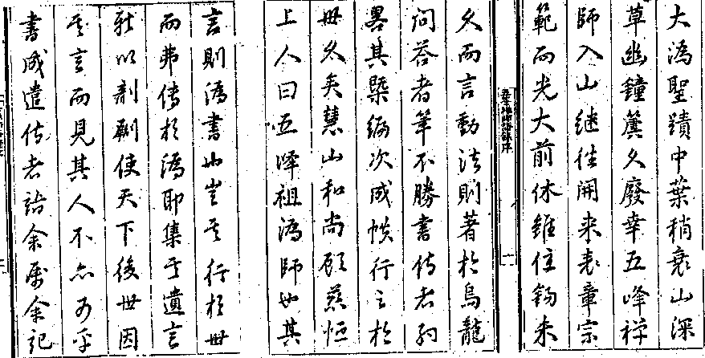
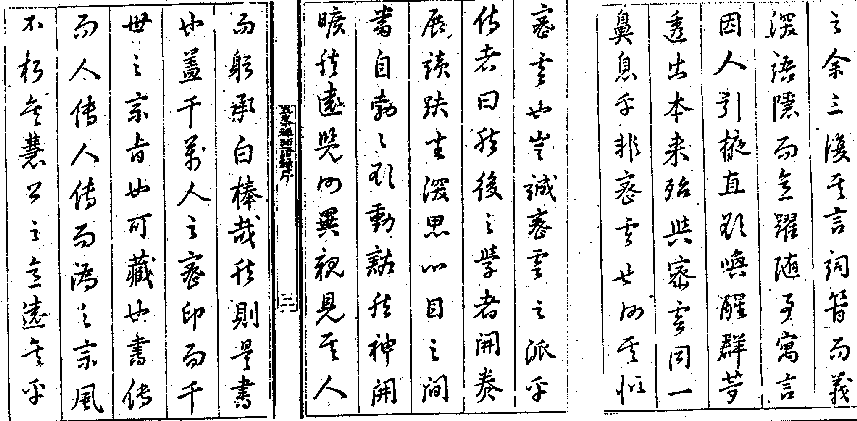
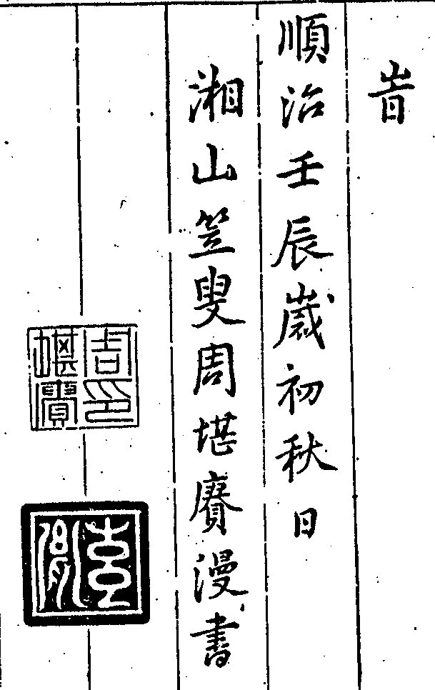

# 大沩五峰学禅师语录



> **藏经**：嘉兴大藏经（新文丰版）（嘉兴藏）　**册次** 第 25 册（J25）　**编号** JB175　**部类** 诸宗部　**卷次** 1 卷　**篇幅** 9,037 字

> **卷／品**：0 卷 · 0 品



---



五峰禅师语录叙















大沩五峰学禅师语录



大沩密印寺住持孙智海重刻



僧问：「如何是关中境？」师云：「案上凝尘三尺厚，庭中芳艸几生花。」「如何是境中人？」师云：「相逢不遇真师子，闲我憨憨枕石头？」「如何是人中意？」师便打。



徐乔谷居士问：「俱胝竖指，意旨如何？」师云：「火宅莲池。」少顷又问：「临济既於大愚言下发明大事，为甚麼大愚又道：『汝师黄檗，非干我事。』」师云：「冤有头，债有主。」士云：「因甚却在大愚处发明？」师云：「瓜熟蒂落。」



僧明我问：「三祖云：『至道无难，惟嫌拣择。』意旨如何？」语未绝，师劈脊便打。我拟议，师云：「要会便会，用拟作麼？」遂以杖当喉直触，我忍痛失声，师云：「是什麼？」我当下释然，遽叹曰：「奇哉！奇哉！」师云：「汝见个甚麼？」我便高声说偈云：「拦喉直触，欲语无口，三月湖南，红桃绿柳。」师肯之。



僧问：「如何是乌龙潭中一滴水？」师云：「虚涵万象。」僧拟议，师以杖趁曰：「不宿死尸。」僧无语。



僧问：「如何是汾阳三种师子？」师云：「汝是野干。」僧无语。一僧背手举首至关内，熟视师云：「某甲未出户庭，曾有一问与师。」师随声摛住云：「速道。」僧拟语，师托开云：「看饭奴。」



僧问：「如何是清净法身？」师云：「泥猪癞狗。」又问：「如何是世出世间第一件事？」师便打。



僧问：「己事不明，乞师开示。」师云：「乞我开示便不是己事。」进云：「不会。」师云：「今日是几时？」僧云：「初二。」师云：「又道不会。」僧罔措，师打出。



僧问：「未开口前为甚麼便棒便喝？」师云：「兔子无角。」进云：「意旨如何？」师便打，进云：「学人已开口，为甚麼亦打？」师又打。



僧问：「如何是佛？」师云：「你是头驴。」进云：「意旨如何？」师拈起笔云：「者是湖州来底。」



僧问：「释迦出世，端为何事？」师云：「贫儿思旧债。」僧礼拜，师云：「何不再申一问？」僧拂坐具便出，师云：「者痴汉又恁麼去。」



僧问：「万法归一，一归何处？」师云：「西江米到上新河。」僧礼拜起云：「会师意也。」师云：「我者里意尚无，汝作麼生会？」僧拟议，师便推倒。



居士问：「大师在关中作甚麼？」师云：「竹床高卧待云来。」士云：「岂不闲杀人也。」师云：「五枚白鼠五更鸣。」



师问僧：「那里来？」僧云：「报恩。」师云：「宝塔几高？」僧云：「不记得。」师云：「汝不从报恩来。」



僧问：「临济无位真人话作麼生？」声未绝，师便擒住云：「速道！速道！」僧拟议，师与一掌，云：「会取去。」



僧问：「如何是黄檗为临济处？」师劈面便掌，进云：「今日始知吾师毒手。」师云：「汝见甚麼道理便与麼道。」进云：「秋到梧叶落。」师搊住，云：「秋到梧叶落，与黄檗为临济处有甚交涉？」僧打师一拳，师云：「你看者汉乱做。」僧拟议，师便喝。



师方开关门，见僧来便喝，僧亦喝，师便打，僧又喝，师云：「乱喝。」僧拟议，师复打，僧无语，师云：「落魂鬼子。」



居士问：「一息不来，向甚麼处安身立命？」师云：「前是松柴，后是栗炭。」



僧参，师敲门一下，僧将开口，师闭却关门。



刘锡玄居士参，以即中堂问荅呈师，才礼拜起，师云：「问甚麼荅甚麼。」士方思惟，师云：「莫向鬼窟里作活计。」士无语。茶次，师复拈云：「中作麼生即？」士拟开口，师摇手，云：「不即，不即。」士点首，云：「大师甚是直截，但弟子业缘深厚，不能当下理会。」师云：「且坐吃茶。」士临别问：「洞山道一大藏教秖是个之字，意旨如何？」师云：「金色虾蟆鸣古井。」



僧问：「仰山扑破镜子，意旨如何？」师云：「雪狮对上立。」



僧问：「如何是祖师西来意？」师云：「七月东瓜艸上横。」僧拟议，师便喝。



师问知客：「那里来？」客出袖中扇，云：「买扇来。」师接扇，云：「者柄多少钱，那柄多少钱？」客拟开口，师以扇劈口打云：「自己底也不识。」问侍者云：「你作麼生？」者夺师扇，自扇云：「今日更加天热。」师微笑。



库司问：「如何是佛？」师云：「库房里底。」司礼拜出，少间复至，问：「库房中那一样？」师以手急索，云：「有几样麼？」司云：「俱有。」师复以手抹两眉，云：「还有者个麼？」司罔措，师拽杖趁云：「可怜生。」



一日问侍者云：「如何是祖师西来意？」者云：「山花开似锦，涧水湛如蓝。」师云：「那里学者虚头来？」者云：「和尚莫压良为贱。」便出。



侍者病目，一日奉茶次，师云：「汝见空中鸟飞麼？」者抬头，师以茶蓦面泼，者礼拜云：「谢和尚慈悲。」师云：「未梦见在。」者无语。



玄侍者一日辞行，师举起琥珀念珠，云：「道得即与汝去，道不得且住此过冬。」者便打师一坐具，师云：「果然不知落处。」者云：「木人从不恋花枝。」师云：「犹成滞涩。」者云：「掌握吹毛剑，随处斩痴顽。」师云：「或有人驾汝头上行时如何？」者云：「某甲不是把锄人。」师云：「炤顾鼻头。」者云：「和尚缺了几许。」师遂以念珠挂侍者颈，云：「住得许久日子，一些交涉也无。」者云：「赖是和尚看破。」师打，云：「识甚好恶？」者便礼拜出。师复召云：「长老。」者径行不顾，师复顾宝月侍者，云：「你道此子向后落在谁家绊马索里？」月拟酬对，师以竹篦打，云：「且去送客来，与汝商量。」



僧问：「经中道佛身充满於法界，和尚即今在甚麼处？」师便打，僧云：「打即任打，要且无安身处。」师又打，僧作女人揖，师云：「犹是乱做，未梦见棒头意在。」僧以袖拂师面，师云：「不谓阇黎无出路，只是阇黎太有禅。」僧无语。



淑之参，师作搏物势，之便礼拜，师复翘两手，之打一圜相，师於中点一点，之拟议，师云：「念子远来，且放汝三十棒。」



师问淑之：「临济三顿棒意旨如何？」之云：「龟毛拂子两头摇。」师云：「因甚手长衫袖短？」之应对稍迟，师厉声云：「耳目之学终立门外，若彻自心名为到家，故行脚衲子须是真参实悟，始不被境缘扰动，六道轮回阎罗老子，岂惧伶牙俐齿舌覆三千哉？」之拱然拜退。



师问僧：「你还见露柱麼？」僧便喝，师曰：「被汝一喝却分疏不下。」僧又喝，师云：「昨日有僧也与麼喝，三十棒一棒也不饶。」僧复喝，师便打，僧礼拜，师云：「昔汾阳昭道：『鹅王飞鸟去，马头岭上住，天高盖不得，大家总上路。』作麼生会？」僧云：「和尚万福。」师冷笑不荅。



僧以三峰语录呈师，师阅其发明临济宗旨话，蹙然曰：「汉兄用如许精神作麼？关主者里即不然。」侍者曰：「和尚如何？」师曰：「设有人问我高姓尊名，我便向道姓甚名谁；不问，我一字也无。昔时尊宿代佛利生，如洪钟巨鼓不考不声，纵垂一言半句亦因病设药，所谓病退药除，岂返执药以成病耶？传佛心印而以实法累人，不但瞎却人眼，亦乃水也难消。」时，方士雄居士在座起作礼，曰：「大师此言诚为万世龟鉴。」师休去。



僧问：「桶底脱落时如何？」师云：「通天彻地。」僧拟议，师云：「掠虚汉。」



刘锡玄居士问：「大师在金粟得何法？」师云：「龟毛绳系双兔角。」士云：「可借观得麼？」师震声一喝，士云：「真宗匠也。」师云：「今日被居士勘破。」士呵呵大笑。



僧问：「如何是拈花实旨？」师云：「棺材里髑髅。」进云：「再乞指示。」师便打。



僧问：「文殊起佛见法见。」声未绝，师云：「阇黎当受山僧顶礼。」僧拟开口，师以手掩却。



总持道人问：「如何是径截法门？」师云：「诃佛骂祖去。」持良久云：「向后如何得妥贴？」师云：「有佛处不得住，无佛处急走过。」



僧问：「如何是衲僧眼？」师云：「瞒上座一点不得。」僧拟议，师云：「元来不是屋里人。」



亦幻问：「如何是曹谿水？」师云：「不住狞龙。」幻拟礼拜，师便打，幻不肯，师又打，云：「一任举似诸方。」



僧问：「学人青黄未辨，望师慈悲。」师震威一喝，僧思惟，师便打。



如无拣居士问：「如何是出阴界底人？」师云：「待居士出后向你道。」士云：「和尚秖解恁麼把定？」师云：「山僧心肝五脏已尽倾出了也。」士便礼拜，师云：「汝还肯麼？」士喝，师打云：「好喝。」士无语，师唤侍者云：「斟茶与居士吃。」



方士雄居士过访，茶次，士欲坐，师云：「近坐些好说话。」士云：「怕大师动手动脚。」师云：「居士有甚过麼？」士拟议，师云：「不得放过。」便打，士云：「我道习气不忘。」师云：「黄梅落在手边，那得不拾。」茶毕，士问：「如何是格外玄机？」师云：「虀瓮里虫鸣。」士又问：「翠竹黄花因甚便是般若真如？」师指净瓶云：「秖者净瓶，三世诸佛也摸索不著。」士云：「大师还摸索得著麼？」师云：「居士莫下毒口。」士罔措，师遂掷下拂子，士便礼拜，师云：「辜负不少。」



侍者问：「如何是度生枢要？」师便打，者云：「者一棒是杀是活、是权是实？」师又打，进云：「秖如向上一路千圣不传，又作麼生？」师云：「汝又许多捞攘作麼？」进云：「截断古人舌头处，更有一人不肯，又且如何？」师云：「珊瑚枝上县明月，稼穑无方不乐歌。」者转身礼拜退。



一夜，侍者於关前侍立更深，师拈拂子云：「者个还会说话麼？」者云：「说则说，秖是和尚不解听。」师云：「杜撰禅和。」至来日复问云：「昨日公案作麼生？」者云：「明日是清明。」师云：「不是者个道理。」者云：「苍天！苍天！」师以手外指，云：「庭对笑汝。」者拟开口，师云：「苍天苍天！」者便礼拜。



僧问：「如何是戒？」师竖起拂子。「如何是定？」师放下拂子。「如何是慧？」师以拂子左右拂之。僧云：「此外更有方便也无？」师云：「唤汝做饭袋子。」



僧问：「临济四料拣意旨如何？」师云：「汝不是我同条。」进云：「㘞。」师便打。



僧问：「佛性、精魂是一是二？」师云：「木人夜半操琵琶。」



师问淑之：「薰风自南来话，作麼生会？」之举起茶钟，师摇首云：「不是者个道理。」云：「和尚作麼生？」师云：「终不向汝道破。」之无语，师顾侍者云：「你作麼生？」者云：「毛骨耸然。」师云：「亦未在。」者便礼拜，师打云：「者贼。」者云：「贼贼。」师复顾之，云：「你看者汉来得几个月便与麼乱统。」者拂袖而出，之云：「龙生龙，凤生凤。」师连棒打出。



八月十五夜，师出关率众至乌龙潭，以拄杖探水云：「因甚龙不见？」侍者向前礼拜，师便打，者便喝，师以两手掩耳，者打觔斗而立，师哂之。



僧问：「如何是华严六相义？」师掐手中扇骨云：「一二三四五六。」复开扇自扇云：「一一为汝说了也。」进云：「六相义外更有顶𩕳上事也无？」师云：「有。」进云：「如何是六相义外底事？」师云：「檐外竹千竿，西风舞萧瑟。」



僧跪问：「如何是十二时中底事？」师云：「好个问端，只是上座不会。」进云：「某甲年老，更求方便。」时厨中鸣楗，师云：「著衣持钵去。」僧便起立，师云：「会麼？」进云：「不会。」师云：「吃饭去。」



师一日午斋毕，僧问：「如何是沩仰宗？」师云：「为我过杨枝来。」僧过杨枝，师复指碗中水，僧取水稍迟，师云：「钝置杀人。」



僧问：「耽源授仰山九十七种圜相，那一种为至要？」师以手作涂抹势，僧礼拜起，师遂於地上畫



相，顾视其僧，僧亦畫一○相。师以两手捧起，复作抛后势，僧罔措，师便喝，僧拂袖，师直打出。回顾傍僧，於地上畫一○相，僧便坐於○相中，师又以拄杖畫一大○相围之，僧起傍立，师微笑。



师有疾，体心问：「昔日院主问马大师安云：『和尚尊候如何？』大师云：『日面佛，月面佛。』未审西堂师又作麼生？」师云：「青螺髻上炎炎热，八字眉间凛凛寒。」进云：「恁麼则昔年马祖、今日西堂。」师云：「逢人切莫错商量。」进云：「夜来鼯鼠床头唧，八臂那咤扑帝钟，又且如何？」师云：「两行鼻息，点刻分明。」心拟议，师便打。



体心问：「通玄峰顶事如何？」师云：「清风明月。」进云：「忽遇轰雷四起黑雾迷空，又作麼生？」师云：「山摇地震。」进云：「恁麼则万派泉声元是海，千峰松色总同春。」师云：「长安大道家家有，几个男儿不问津。」进云：「和尚阇黎。」师遂以拄杖横按，进云：「今日吾师新格调，的是通玄金粟来。」师云：「长老礼拜有分。」进云：「收放分明令不虚。」便礼拜，师打云：「著。」心喝一喝，师亦喝。



僧问：「如何是临济下事？」师云：「杀佛杀祖。」僧拟议，师劈脊便打，进云：「电光中垂手则且置，不动干戈事若何？」师云：「各安生理。」进云：「此犹是电光中垂手，作麼生是不动干戈底事？」师云：「瞎汉去。」僧便去，师召云：「某甲。」僧回首，师展两手云：「讨甚热碗。」僧有省。



僧问：「一切众生皆具如来智慧德相，因甚不现前？」师云：「现前。」进云：「某甲却不得其受用。」师云：「受用。」



僧问：「不知有底人为甚不求知？」师云：「猩猩雪上行。」



僧问：「云门道尽乾坤大地不见有纤毫过患，始是半提，须知更有全提事在。」遂提起念珠云：「且道者是全提是半提？」师与劈头一棒云：「试道看。」僧便喝，师又打，僧又喝，师云：「好喝，更喝看。」僧拂袖便出。



居士问：「弟子初向三宝，不知佛法大意，乞师示个入处。」师举起拂子，云：「还见麼？」士云：「见。」师云：「从者里入。」



师问一秀才：「如何是不可须臾离底道？」才云：「正是弟子疑处。」师云：「疑即便离。」



僧问：「如何是正中偏？」师云：「月出五更前。」「如何是偏中正？」师云：「白发镜边丝。」「如何是正中来？」师云：「雪里涌楼台。」「如何是偏中至？」师云：「七事随身惯战作家。」「如何是兼中到？」师云：「木人夜半度松关。」僧礼拜，云：「谢师荅话。」师便打。



僧问：「如何是函盖乾坤句？」师云：「遍界黑漫漫。」「如何是截断众流句？」师云：「无汝开口处。」「如何是随波逐浪句？」师云：「阇黎从甚处来？」进云：「弁山。」师打，云：「分明举似。」



僧问：「如何是教外别传？」师云：「我甚牙疼，明早荅汝。」僧礼拜，师与一蹋，僧无语。



僧养拙参次，师云：「那里去？」云：「此处止。」师云：「你住不得。」云：「无我住即得。」师便打云：「得不得？」云：「与密云和尚同阬无异土。」师云：「那里来？」云：「金粟来。」师云：「曾会过麼？」云：「将谓忘却了也。」师云：「金粟来底会弄嘴。」云：「和尚从那里来？」师云：「我不从金粟来。」云：「谁弄嘴？」师乃笑，云：「请坐。」养便出。



师至大沩同庆寺祖塔坐次，明维那礼塔来，师云：「礼者枯骨作麼？」明云：「将谓忘却。」便礼拜，师遂起去。



一日普请择菜，明维那云：「我要止静去。」师云：「那里不是静？」明打师一掌，师云：「作麼？」明云：「那里不是静？」师大笑。



又一日择菜，师唤傍僧，其僧不来，师云：「你不来，我要打你。」明维那即打师一掌，师云：「只说今行早，更有早行人。」明便归禅堂。



师将入灭，预知时至，於癸酉六月三十日自叙行繇，嗣后不饮不食，危坐终日，胁不至席，凡见僧便拈拄杖，云：「道！道！」僧拟议，师便打，复加诟骂。有远庵吴居士来讯：「尊候如何？」师垂一足，士云：「弟子会也。」师云：「莫错会去。」士畫一圆相，师踢倒，云：「正未知山僧脚跟在。」至七月二十一日，师拈拄杖示众，云：「道得即与衣钵。」众下语不契，师叹曰：「得人之难亦至如此。」乃命侍僧智隆持来源拂子，至大沩付养拙明监院。越明日正午，浴毕，书偈示众，云：「痛举钳锤为阿谁，可怜漆桶自狐疑，为伊结下来生债，五夜霜花开王墀。」掷笔敛目怡然而逝。



行实



一日，众入室作礼，乞师宣述参履始末，启迪将来以垂正眼。师三辞不已，乃云：「予盖西安临潼人，父任、母杜氏，万历乙酉四月八日生予，白光满室。性不茹荤，稍长常乐静坐，看破世间，一息不来四大皆属败坏，何况餘物？十六丧父，即决意出家，因母在堂，不能得遂。二十方得离俗，投五台大岭寺天齐师，薙发师开示：『常令行住坐卧不离者个。』后辞师到熊耳，礼初祖塔，值无言和尚举：『僧问清源：「如何是佛法大意？」源云：「庐陵米作麼价？」』予乃疑情顿发，自此衣单尽弃，历年寒暑一衲，昼夜参究废寝忘餐，登金刚台立禅打饿七次。遇性空师同居僊人洞，一日予问：『如何是西来意？』空云：『石头。』予疑情转切。未几同往南海，过虎跑，谒三空师，予问：『某甲要做个出世底人，不知进步？』空云：『你如何晓得到者里来？』予云：『特来请益。』空云：『智光一炤，诸妄自无。』即欲别往伏牛。到常州，复遇性空师，予问：『万法归一，一归何处？』空抚桌一下，予忽有省，从前庐陵米价及石头语，一时透得，遂作礼，同空复居僊人洞。空一日指雪问予：『如何日出便尔化去？』予云：『大用当前，诸妄自消。』后，空时常追逼，应机每多不捷，予自觉工夫不到，不得方圆，故决志上伏牛。入堂打七，至第六日，一足跕定，不觉神忽离身，从山门外离地丈许跏趺而坐，值堂主打一葛鞭，睹自己身面，瞥然复体，从此澄清，昏沈极少，惟湛寂境界极多，俱不准。复进终南五峰岩，住静三载后，住五台礼月川师，从澄方律主圆戒竟，乃入楚，访黄檗念师，因问：『师以何法接人？』念云：『有甚麼法？各家吃各家饭。』予见说道理，便辞行。到匡庐访憨师，问云：『不用方便，请师指示。』憨云：『不可求道理，不可求玄玅，只要放得下。』予觉无宗门向上爪牙，乃造云门参湛师，问：『蚯蚓一锹铲做两段，头尾俱动，未审佛性在头、在尾？』湛云：『如人扇风箱，住手一时休。』予云：『此身坏时真性向何处去？』湛云：『那个是你底身？』予良久，湛云：『亦未见得。』予云：『如何是和尚身？』湛云：『开口成双橛，无言落二三。』闻本师密和尚开法龙池，径往问：『大地无寸土时如何？』本师云：『你向甚麼处安身？』予云：『请师指示。』本师便打，予云：『进退无门时如何？』本师云：『无绳自缚。』予云：『请师去缚。』本师复打，因问予：『你在云门有何言句？』予云：『某甲曾问：「文殊为甚出不得女子定？」湛云：「才方出也。」又问：「罔明为甚出得女子定？」湛云：「何曾出来？」』本师云：『你作麼生会？』予云：『任他横说竖说。』本师复云：『你唤甚麼作定？』予良久，本师云：『不是。』予云：『师唤甚麼作定？』本师云：『我且放尿著。』予云：『者到是那伽常在定，无有不定时。』师便出，随入云：『善财参遍处，黑豆未生芽。』予良久，本师便打。次日辞本师，到法藏寺阅藏，如痴如呆，只是放不过。因暑热，移单至大殿佛侧边，一日忽然情尘脱落。癸亥春，复入云门湛师处，令职后堂作教授。一日，湛师上堂召众，云：『还有知痛痒者麼？』予向前合掌，湛云：『你那里洒洒落落，我者里啝啝哆哆。』予云：『香象伸头回顾意，须知劫外有青天。』湛云：『若有路可上，更高人也行。』予云：『无行去处，向甚麼处去？』湛云：『你不知去处麼？』予云：『请师下座。』甲子春登通玄，复谒本师，呈三偈，其一云：『咦！全不济，进得门来脚踹地，横竖全无拄杖子，赤手空拳无柄蒂，个消息，遇人丧尽目前机，天下老汉无处觅。』其二云：『出门好，得见兄妻叫阿嫂，暴地一声红线断，举足动步便是艸。』其三云：『不出不入是何宗，截断两头空不空，灰头土面不恁麼，遇著椎儿撞著钟。』面呈本师，本师阅毕，云：『如何是椎儿撞著钟？』予云：『请和尚看著。』本师便休。又一日，本师同予话次，蓦申脚云：『你作麼生？』予以脚踢之，本师笑云：『未在，未在。』予云：『和尚道看。』本师倒卧，予云：『也只是困。』本师云：『你又与麼去也。』予乃礼拜。来日，予辞行，本师自挝鼓上堂，握拂子云：『唤作拂子则触，不唤作拂子则背，不得拈起、不得放下、不得下语、不得无语、不得错举，若不错举，即分付汝。』予即连跳两跳，云：『不要！不要！』师云：『犹是乱叫、乱跳，更试举看。』予转身，云：『某甲去也。』本师乃付，予礼辞便行。丙寅岁，复入金粟省觐本师，安为西堂，复命首座。丁卯，予告行，往南京弘济寺掩关，即今看来，冒寒暑於二十六年，涉程途於数万里外，皆是颠倒梦幻、枉劳心力，又何堪挂齿乎？」众各庆喜，礼谢而退。



塔铭



五峰禅师，嗣法於天童密云悟和尚，溯南岳、繇临济，当传灯世嗣为第三十五世之嫡子也。师族姓任，长安临潼人，降诞於神庙乙酉四月八日，莲胎茹素、鹤骨出尘。二十岁失恃怙，薙发五台，从天齐师观修静业，法名如学，别字无为。昼夕思惟向上大事、了办生死，斯心未安，决志行访。始谒熊耳无言大师，即往圆戒於澄律师，止主律堂阅藏。复遍历金刚台、虎跑、伏牛、终南，行力深苦，死活数番，自得解粘释缚。到黄檗、匡庐、云门、径山，还至参密云和尚，於龙池深契法旨，推为师子儿，及从和尚入天台通玄，亲承煆炼，屡临血棒机不放过。依止未久，师辞行，和尚握拂云：「唤作拂子则触，不唤作拂子则背，不得拈起、不得放下、不得下语、不得无语、不得错举，若不错举，即分付汝。」师即连跳两跳，云：「不要！不要！」和尚云：「犹是乱叫、乱跳，更试举看。」师转身，云：「某甲去也。」和尚乃付，承受别去。其后省觐和尚於金粟。时崇祯辛未，师来主大沩同庆，斩石诛茅，仅蔽风雪，从学如云，宗风大震，座下白足脱颖者，如养拙明公，师勉励深重，使其苦节晦潜。癸酉出山，将行化於五台，至金陵，为余集生中丞请说法祇陀林内，於时鼻孔辽天、吼声六震，东南望为大法幢。无何自期厌世，是年七月二十二日正午示寂。先遗以手书入山，嘱法於养拙明公，使主沩山，盖自任一灯在沩也。师世寿四十有九，得僧腊二十九。越壬午，弟子郢素、复智等，依法阇维，函师灵骨奉归大沩，养拙明公迎供建塔。癸未塔成，以不肖尝瞻礼师足、窃附法末，养拙明公迺乞为塔铭，不敢深辞固陋，敬为之铭。铭曰：



明三百年，视为中古，龙象不行，山川蓁芜。卓哉天童，遥被花雨，首度五峰，探骊编虎。爰命拄杖，复开劫土，潜渊抱珠，明月正午。海印密印，宝光值吐，出沩浮湘，应供天府。秋满祇陀，迦陵不语，作塔沩山，玉归玄圃。千岩万壑，了无宾主，五峰巍然，中兴法乳。



大明崇祯癸未年八月八日，羊城外史邑人，陶汝鼐拜撰

