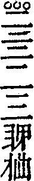

# 费隐禅师语录



> **藏经**：嘉兴大藏经（新文丰版）（嘉兴藏）　**册次** 第 26 册（J26）　**编号** JB178　**部类** 诸宗部　**卷次** 14 卷　**篇幅** 188,171 字

> **作者（译者）**：嗣法门人隆琦等编

> **卷／品**：14 卷 · 1 品



---



## 目录



  - [金粟费大师语录序](#金粟费大师语录序)

- [费隐禅师语录卷第一](#费隐禅师语录卷第一)

- [费隐禅师语录卷第二](#费隐禅师语录卷第二)

- [费隐禅师语录卷第三](#费隐禅师语录卷第三)

- [费隐禅师语录卷第四](#费隐禅师语录卷第四)

- [费隐禅师语录卷第五](#费隐禅师语录卷第五)

- [费隐禅师语录卷第六](#费隐禅师语录卷第六)

- [费隐禅师语录卷第七](#费隐禅师语录卷第七)

- [费隐禅师语录卷第八](#费隐禅师语录卷第八)

- [费隐禅师语录卷第九](#费隐禅师语录卷第九)

- [费隐禅师语录卷第十](#费隐禅师语录卷第十)

- [费隐禅师语录卷第十一](#费隐禅师语录卷第十一)

- [费隐禅师语录卷第十二](#费隐禅师语录卷第十二)

- [费隐禅师语录卷第十三](#费隐禅师语录卷第十三)

- [费隐禅师语录卷第十四](#费隐禅师语录卷第十四)



---



### 金粟费大师语录序



佛祖之道，待其人而后行，将以光先觉、启后昆，建正摧邪、扶衰拯溺，此不唯其言而已也。二十年来，济宗大盛，踞曲盝床唱无生曲者列刹相望，而溯厥亨衢实自天童老人辟之。老人以坚刚之骨荷担斯道，重以德业纯备，故龙象阗骈得人为最。出其门者，纵横展演，各不相袭，各自建立法幢，而金粟费大师尤为烜赫。大师说法利生十有餘年，每垂片语，皆足为人解粘释缚，今学者汇之成集，冀遍覆大千，俾来际不泯。余受而读之，大都刊华就实，觌面全提，机关秪在临时运用，毫无拟议，是以孤光绝响久而益新，衣被禅林、振耀寰寓，自非顶门眼正，何繇肘后符灵，倘仅求诸语言文字中，是舍鱼兔而问筌蹄也。且大师昔年遍历诸方，博通教理，今观其提唱，未尝辄援契经只字，况於外典！盖纯拈向上、流自胸襟，决不肯以一滴恶水涂污学人，即有时钳锤所被，如奔流度刃、电激雷訇，凛乎可畏，而其会下朝参暮聚，倍加亲附，依法而住，不忍远离，以故英灵辈出，激扬酬唱，崛起未艾，所谓师窟无异兽、旃林无杂树，俄顷之化，其陶铸神也。呜呼！天童往矣，得大师而益著，人能弘道，讵不信夫？学者而无意滹沱之传则已，如其有意读斯录者，幸毋交臂而失之也。



崇祯癸未春仲乌程唐世济顿首譔



费隐禅师语录目次



卷一上堂



卷二上堂



卷三上堂



卷四上堂



卷五上堂



卷六上堂



卷七上堂



卷八上堂



卷九上堂



卷十小参  

入室



卷十一法语  

偈  

书问



卷十二问答机缘  

拈古



卷十三颂古  

判古  

赞



卷十四杂著  

小佛事



卷十五纪年录



------



## 费隐禅师语录卷第一



**译者**：嗣法门人隆琦等编



上堂一



崇祯六年四月初七日，绅衿林朝龙、薛秉铉、林正立、夏春晖、龚士龙，请师住福建福州府福清县黄檗山万福禅寺，於十月初五日入院，至山门云：「尽大地是个解脱门，且道从何处入？」良久云：「从脚跟下入。」便进。佛殿，云：「过去已过去，未来犹未来，现在作麼生坐断？主人公向何处出气？容上座到者里，即得大展三拜。」伽蓝堂，拈香云：「丛林藩篱，佛法金汤，自受灵山付嘱，直至而今不忘，且道以何为验？看烧者一瓣香。」



祖师堂，云：「西天四七，东土二三，尽在者里，日午打三更。」乃举香云：「今日不肖儿孙到来，一时捉败。」便烧。



方丈，云：「释迦在者里掩室，维摩在者里默然，古今天下老和尚在者里横说竖说，容上座在者里作麼生施设？一棒一条痕，一掌一握血。」遂据坐。



当日，众请上堂，师至座前拈山门疏云：「披历佛祖肝胆，提掇衲僧性命，尽在个里，山僧不敢囊藏被盖，特向人前拈出，仰烦维那对众宣读。」维那宣疏毕，师指法座云：「宝华王座为众兄弟显本分事了也，既若眼见耳闻，便可休机罢钓；设或未然，容上座锦上铺华去也。」遂升，拈香云：「者一瓣香，如天普盖、似地普擎，𦶟向炉中，端为祝延今上皇帝圣寿，万岁！万岁！万万岁！恭愿皇图绵巩固之休、峻命衍綦隆之运。者一瓣香，包罗今古，统御人寰，𦶟向炉中，奉为满朝文武、天下官僚，并及福清县主、诸位高官，恭愿福禄同沧海，寿筭等乔松。者一瓣香，最初到处寻觅不得到手，一旦到手，便乃当阳披露，不可指目末后，遇著个没眼睛老和尚伸手一捏，直得脱白无光。𦶟向炉中，专为现住浙江宁波府鄞县天童禅寺传曹溪正脉三十四世本师密云悟老和尚，用酬法乳之恩。」遂敛衣就坐。僧问：「昔从黄檗去，今向黄檗来，作麼生道个无来去底事。」师便喝。进云：「砂盆虽破，家风犹在。」师云：「与阇黎无干。」问：「未离马峰，遍界风光腾瑞彩，才跨猊座，眉间剑气烁锋铓。黄檗门庭即不问，祝圣报恩事若何？」师云：「天长地久。」进云：「恁麼则一句了然超百亿。」便礼拜，师嘘一嘘。问：「一线阳春曲，繇来和者稀，如何是阳春曲？」师云：「眉毛八尺长。」僧礼拜，师云：「何不再进后语？」僧归位，问：「黄檗祖庭久寂寥，蹉跎虚度几春秋，今日蒙师呈此令，临济家风事若何。」师便打，进云：「恁麼则昔日临济、今朝和尚。」师云：「汝增我不得。」乃云：「全机展演，一道提持，盖古覆今，超声越色，突出报化佛头，拽脱娘生鼻孔，向此辨的得去，便可施大机、发大用，与铜头铁额敲枷打锁，超宗异目碎骨取髓，天上人间解粘去缚，佛祖场中抽钉拔楔，所以道：『纵横无碍，杀活自繇，我为法王，於法自在。』正当恁麼时，安家定业一句作麼生道？」拈拄杖按膝，云：「横按莫邪全正令，太平寰宇斩痴顽。」



复举：世尊初生，一手指天，一手指地，目顾四方，周行七步，云：「天上天下唯我独尊。」后来云门文偃禅师云：「我当时若见，一棒打杀与狗子吃，却贵图天下太平。」师云：「世尊衍铁牛机，云门明格外句，虽则各露风规，要且未合本据。且道如何是本据底意？天上有星皆拱北，人间无水不朝东。」以拄杖卓一卓。上首复白槌云：「谛观法王法，法王法如是。」下座。(谢词不录)



开炉结制，上堂云：「红炉猛燄，当前不可凑泊，钳锤运动，贵乎直下翻身，透出威音那畔，尝在闹市门前，间著劈头便棒，彻底更无廉纤，因甚致得金烹大冶，玉出蓝田。」复云：「九十日中间，结住布袋口，日用卓卓然，从新自抖擞，拶透顶门关，能为狮子吼，大地悉平沉，百兽都奔走，堪入临济门，白棒劈脊搂。如何是狮子吼？」乃喝一喝云：「荐取搀先一著子，发机不落诸人后。」下座。



上堂：「十五日已前，回首俱陈迹，十五日已后，未来望莫及，正当十五日，头头呈露，物物披真，衲僧门下，一一现成，九年面壁，未解作活，六载雪山，徒受苦辛，争似明州憨布袋，逢人无事笑吟吟。」拈拄杖下座。



上堂，僧问：「高步毘卢顶，截断威音喉，婢视释迦，奴呼弥勒，此人面目如何？」师云：「半边鼻孔。」进云：「若然，即今来也，请和尚答话。」师便打。进云：「忽若道个须弥山，又作麼生？」师云：「推倒了也。」问：「如何是夺人不夺境？」师云：「打教髑髅穿。」「如何是夺境不夺人？」师云：「掀翻坐具地。」「如何是人境两俱夺？」师云：「一并收下。」「如何是人境俱不夺？」师云：「任汝𨁝跳。」乃云：「声前荐取，斩钉截铁，未免犹有者个在，周遮不省，多诸饶舌，不知何劫出头时。若是灵根夙种底汉，那边不管、者头不拘，高高地立，不与诸缘作对，不与万法为侣，然亦者边人，未明向上事。若明向上事，不慕诸圣、不重己灵，百亿部洲走马，三十三天著跌，此又无窠臼立窠臼，无得失成得失。」蓦拈拄杖云：「不若向者里承当，信得及、见得彻，得失一时打破、窠臼顿尔铲除，堂堂用无岸畔，历历迥绝阶梯，三世诸佛直得退步，历代祖师未免藏锋，明眼衲僧转身无路，现前大众便合休机，且道正当恁麼时，超宗越格一句作麼生道？千峰势到岳边止，万派声归海上消。」以拄杖卓一卓，下座。



上堂，僧问：「不要寻思作解，秪要单刀直入，不顾危亡得失，正恁麼时，又作麼生？」师云：「脚下七华八裂。」问：「如何是宾中主？」师云：「腰有数文钱。」「如何是主中宾？」师云：「得钱随手使。」「如何是宾中宾？」师云：「长年走路程。」「如何是主中主？」师云：「终日不出户。」进云：「宾主已蒙师指示，宾忘主不忘事若何？」师便打。进云：「截断两头去也。」师云：「脚下还有葛藤在。」问：「法座未登，乾坤坐断，轮槌影落，杀活全彰。去此二途，请道一句。」师云：「眉毛插天。」进云：「水归巨海波涛静，云到苍梧气象闲。」师云：「阇黎分上什麼交涉。」问：「打著昔年旧痛处，于今犹恨棒头轻，请师末后一顿。」师打云：「旧疮瘢上著艾。」进云：「恁麼则彻骨彻髓去也。」师云：「如何是彻底意？」僧一喝，师云：「喝后𫆏？」进云：「时清休唱太平歌。」师云：「秪引一半。」乃云：「物中作主，高超物表，机下开眼，照在机先，然后发一机而千机万机通透，乘一境而千境万境齐彰，有炤有用，有权有实，有宾有主，有放有收，如天普盖、似地普擎，万象该罗、千差一贯，四方自在、八面受敌，直得尽阎浮提所有草木，一一草木具无量舌相，一一舌相兴无量辨难，不能挫其当锋；遍虚空界所有胜身，具无量神通，一一神通显无量妙用，亦不能动其元本。所以尘说刹说炽然说，神用妙用恒沙用，都来在衲僧分上皆用不著。且道，衲僧有什麼长处？莫怪从前多意气，他家曾谒圣明君。」下座。



居士夏春晖、龚士龙等请上堂。僧问：「身居学海，意出云霄，花无恋影之心，境不留人之迹，正恁麼时是何境界？」师云：「独步大方。」进云：「如何是黄檗境？」师云：「十二峰高。」「如何是境中人？」师云：「顶天立地。」「如何是人中意？」师云：「自家荐取。」进云：「人境已蒙师指示，人亡境寂事如何？」师云：「顶门霹雳。」乃云：「眉横锦绣披一念，於古今目机铢两，融古今於一念，非彼非此、非远非近，即廛离廛、居世出世，游历宗家举扬佛事，道骨参天仁风洽尔，人天赞之有分、缁白诵固无穷，然而更要信得当人自己分上有一段描不成畫不就底奇特事，佛祖穷之不到、人天赞犹莫及，坐断要津、不通阶级。所以发明奇特事须是恁麼人，要是恁麼人方明奇特事。既若发明得去，则与山僧拄杖子同条合命。且拄杖子初无多少奇特，秪是风标独立、斩钉截铁，唤作山僧拄杖子，却是现前众居士，唤作现前众居士，却是山僧拄杖子，无二无二分，无别无断故。正恁麼时，归根复本一句作麼生道？万物尽资和气力，灵苗岂藉四时推。」以拄杖卓一卓，下座。



上堂，蓦拈拄杖云：「觌面提持个一著，当人要在亲领略，转身移步若能行，荆棘林中活卓卓。」遂举台山婆子话毕，师云：「据者婆子，一手用锥、一手用钩，虽则光利一时，究竟劳而无功。者僧不著草鞋，赤脚行路固自快便，不识泥中有刺。赵州因水和面，背地揉个鬼面，致人生疑，难免明眼者笑。后来又有玄觉徵云：『前来僧也恁麼道，赵州去也恁麼道，什麼处是勘破婆子处？』」师云：「不妨是贼识贼，据者四个不唧浏汉，若到山僧门下，都与三十棒。何以如此？要见赏罚分明。」便下座。



圣节上堂，拈香云：「者一瓣香，最尊无比、最高无上，𦶟向炉中，端为奉祝今上皇帝今日御诞，万福骈臻，伏愿圣寿与天地同久，圣明共日月齐光。」问：「香𦶟金炉诚一瓣，祝圣一句作麼生？」师云：「尝将日月为天眼。」进云：「山河大地同秋月，法性凝然湛海清。」师云：「好把须弥作寿山。」进云：「人人行化日，个个阐宗风。」师云：「好个消息。」进云：「却被和尚道著。」师云：「却不恁麼。」僧一喝，归位，师乃云：「大哉！圣君今日降宸，多方休庆，万海康宁，步步优昙生，面面祥云应，演无为之化，行不言之令，若贵若贱，均蒙陶铸，或隐或显，咸叨福荫，佛法赖以纲持，人心得以归正，所谓云从龙，风从虎，圣人作而万物睹，覆载之恩不易酬，炤临之德忠难尽，僧众丹心报我皇，寿岳穹窿千万仞。」下座。



上堂，问：「今日居士请升堂，毕竟说什超方底句。」师云：「抛出栗棘蓬。」进云：「说底既蒙师指示，龙吟雾起事如何？」师云：「今日念七。」乃云：「祖师门下不形露布，据令行持惟敲毒鼓，若是伶俐衲僧，三千里外闻恁麼道，便乃腾跃而去，不妨庆快；倘乎进前，要人鼓两片皮、掉三寸舌，者也周繇，分明断送穷命。然而如何得活？放旷尝如痴兀人，他家自有通人爱。」便下座。



上堂：「冬至一阳生，君子道长、小人道消，衲僧分上，须向无阴阳地上拶一句，将来盖天、盖地、盖阴、盖阳、盖寒、盖暑、盖人、盖物，觌面全提，不露龟纹，略开爪缝便道：『天是天，地是地，阴是阴，阳是阳，寒是寒，暑是暑，人是人，物是物。』秪要人回光返炤究本寻源，眼不自见，耳不自闻，鼻不自嗅，舌不自尝，身不自触，意不自觉，便知天不是天，地不是地，阴不是阴，阳不是阳，寒不是寒，暑不是暑，人不是人，物不是物，全体豁然独露、见闻阒尔无寄，然后拈一茎草作丈六金身，以丈六金身作一茎草，掷大千於方外，纳须弥於芥子，不是神通妙用，亦非法尔如然，要且不从别处传来，秪在当人无阴阳地上流出。且无阴阳地上一句作麼生道？」抛拄杖云：「扑落非他物，纵横不是尘。」复举：「僧问古德云：『如何是冬来意？』古德云：『京中出大黄。』山僧有一偈略为表扬：有问冬来意，京中出大黄，头头浑坐断，独露句超方。今日忽有人问山僧，如何是冬来意？山僧便答道：朔风凛凛。且道与古人相去多少？」便下座。



上堂，两僧并出拟问，师云：「一得一失。」僧罔措，师便打。问：「雪岭六年，埋没本来眼，悟星子夜，钝置天下人，释迦老子捉败了也，和尚如何出气？」师云：「想汝也跳不出。」僧一喝，师便打，乃云：「腊八午夜，一天星刺破瞿昙眼里睛，透漏顶门关上窍，方知满目是真人，故云：『奇哉！大地众生皆具有如来智慧德相，良繇妄想执著而不证得。』却又拗直作曲，未免话作两橛，致人真与妄相持、执与证相背，生情取舍，依旧轮回。今日昙域上座设斋，山僧因斋庆赞，不唯拗曲作直，亦是据款结案。」蓦拈拄杖云：「人人万仞壁立，个个眼横鼻直，都教如此承当，参学无事不毕。」卓拄杖，下座。



元旦上堂，拈香祝圣毕，问答不录，师云：「天得一以清，地得一以宁，君王得一以治天下平，今日正是君王得一天下平底时节，故无论域中海外四方八表，莫不朝拱无为，草木丛林山川溪谷悉皆拥抱瑞气，遍界含灵共沐恩光，野外衲僧均蒙至化，直是尧风永扇、舜日高明，到处村歌社舞，随方礼乐文明，户户纳庆迎祥，人人欢颜悦色，固无敢昧赤忠，咸皆知恩有地。秪如报恩祝圣一句作麼道？瑞瓣檀烧金鼎上，仰祝皇躬亿万年。」下座。



春日上堂，僧问：「物有荣枯，岁有新旧，如何是不变迁境界？」师云：「八八六十四。」问：「等闲识得东风面，万紫千红总是春，如何是春？」师云：「百草头上见端倪。」乃云：「溪河解冻，草木初醒，四野烧痕渐绿，满园麦色逐青，路上佳人作舞，林间好鸟弄音，拂拂和风袭面，融融旭日铺金，会则途中受用，不会世谛传新。如何是途中受用底意？」蓦竖拳，云：「不知是什麼。」便下座。



解制，居士叶进晟、进昱请上堂。问：「满堂香烟馥郁，四海衲子奇逢，今日法筵之中，如何是解制之谭？」师云：「山门八字开。」进云：「不解不结一句又作麼生？」师云：「鼻孔仍旧。」乃云：「有解有结，特地乖张；非结非解，无绳自缚；有既不拘，无亦不管，亦是堕坑落堑。直须离四句、绝百非，拨得一线路去，始知当阳一著，个个圆成向上，全机人人具足，便可卸其枷杻、罢却干戈，天下横行、大方独步，处处为祥为瑞、在在显奇显特，永使正宗流传，堪报佛祖恩德。秪如今日功圆行满一句作麼生道？有水皆含月，无山不带云。」卓拄杖，下座。



上堂：「一种平怀，还他无事禅客，多般施设，须是通方作者，把住时水泄不通，放行也八面玲珑。且道从上曾有恁麼人麼？试举看。」遂举女子出定话毕，师判云：「世尊敲锁钥，女子动关捩，文殊与罔明遭他岐路，使人多不会，所以说道理者多，明端的者少。聊为颂出：牢关把住击难开，略放绳头任你来，堪笑婆娘关捩子，等闲做处惹人猜。」



上堂，问：「融日昭明，独曜人天正眼，和风淡荡，直扇佛祖肝肠，正当恁麼时，几个知音者？」师云：「卷帘当白昼。」进云：「四海浪平龙睡稳，九天云静鹤飞高。」师云：「移榻对青山。」乃云：「衲僧分上无字可吐，蓦露一机见闻莫睹，雪峰辊毬、玄沙看虎、睦州担板、禾山打鼓、鲁祖面壁、云门道普，看来一队老古锥，五五分明二十五，若道是向上，未免如粪土，若道属露布，咬嚼辞难吐。毕竟意旨如何？试玉须经火，求珠不离泥。」卓拄杖，下座。



四月八日上堂：「最初一句明揭正眼，现在一机直示根繇，黄金殿上作主，红尘堆里出头，要人觌面领略，更莫向外别求，所以指天指地，人天标格；唯我独尊，全体自由。如是，则个个丰姿潇洒，人人彻底风流，取新罗国与占波斗，额拽南赡部作北俱卢洲，固是当人之常分，更不假借于他筹。云门小厮儿谩云打杀诸方老冻侬徒用锥钩，者个风头极是孤硬，一队蝇子何处钻偷。」遂喝一喝，卓拄杖，下座。



上堂，良久云：「声前一句子，欲要大家知。」便下座。



生日制法衣，送请上堂，僧问：「大廋岭头提不起，和尚如何得此衣？」师云：「信受奉持。」进云：「昔日灵山付嘱，今朝黄檗重拈，未审分付阿谁？」师云：「阇黎证明。」乃云：「灵山会上迦叶亲承，少室峰前神光面禀，所以师师授受，祖祖相传，以至天下老和尚莫不以此为个表信，且信又作麼生表？」提袈裟角示云：「若向者里信得及去，点红缀紫显成格外风光，铺花织锦正是太平春象。若圣若凡都在者领袈裟，地上信手拈来，千丈卢舍那身披之不短，丈六老比丘僧搭亦非长，虽然长短无殊，要且离言思想。山僧如此举扬，一任人天瞻仰。」复提袈裟角。示云：「还会麼？荐取当人元本物，至真寿量自延长。」下座。



上堂，「万安城里善女人，黄檗山中请升座，不说分明违所请，说则特地成话堕，争似自家达本源，亘古历今秪者个，秪者个透本来宗，师姑原是女人做。」复举：「昔有僧智通，在归宗会下，忽一夜，连叫曰：『我大悟也。』众骇之。明日，宗上堂曰：『昨夜大悟底僧出来。』智通出曰：『某甲。』宗曰：『汝见甚麼道理，便言大悟？试说看。』通曰：『师姑原是女人做。』宗异之。」师云：「者僧悟得自己，不从他觅，黜生死流，裂爱见网，不妨气概惊群，风光凛冽。山僧恁麼批判，汝诸人分上还甘麼？若也甘去，三条椽下七尺单前一任无事；若也不甘，毕竟意旨如何？试道看。」一僧拍掌，又一僧云：「道过了也。」师皆不诺，下座。



秋日上堂，一僧拂坐具，云：「一叶落也天下秋，如何是今日为人句？」师云：「蟋蟀鸣幽砌。」进云：「觌面历然今古焕。」师云：「悠然见远山。」乃云：「秋风起，秋云飞，他乡客思故归，思到故家田地稳，面门独耀示全机。既尔，则此界他生，无越初念得失，去来不隔条线。所以道：一尘起，大地收，一叶落，天下秋。契入者个行户，始信古人谓：若论佛法，自有时节因缘，时节若至，如忘忽忆，如迷忽悟，觌体绝承当，当阳无背向，历落栗棘蓬，抛拾金刚圈，直得须弥岌崿、大海波腾、露柱攒眉、灯笼起舞。」喝一喝，云：「若不喝住，几乎打葛藤无有了时也。且忽忆忽悟一句作麼生道？眼空宇宙浑无物，大座当轩孰敢窥。」下座。



迎薰薛居士请上堂，僧问：「如何是道不尽底句？」师云：「面前大案山。」僧喝，师云：「脚跟未点地。」乃云：「现成三昧，书案头十分显露；本有风光，枕席边百匝千重。及乎越户庭出福州入黄檗，分明彼此心眼相炤，各证据而已，更命山僧登于此座，说个什麼即得，未免借古人鼻孔为薛居士出气。释迦老子云：『未离兜率已降王宫，未出母胎度人已毕。』释迦大似布袋盛锥，固自藏锋不得。又雪峰祖师云：『望州亭与汝相见了也，乌石岭与汝相见了也，僧堂前与汝相见了也。』然三处既皆相见，秪如雪峰未出世时又作麼生体悉？若向者里透脱得去，则知山僧与薛居士空劫之前早已眉毛厮结，威音那畔亦曾握手共行。且道有何凭准？」良久云：「识得旧时真面貌，相逢相见总无偏。」卓拄杖，下座。



中秋上堂，「中秋时节不寒不热，透体清凉，遍界朗彻，清风明月古犹今，流水高山无间歇，人人合知有，不用多饶舌。」复举：「盘山云：『心月孤圆，光吞万象，光非炤境，境亦非存，光境俱忘，复是何物？』盘山大似吃官酒、卧官街，当地死、当地埋。洞山云：『光境未忘复是何物？也是风头拨剌、梦里惺惺。』大慧云：『白鹭下田千点雪，黄鹂树上一枝花。』纵救得来，未免平地上死人无数。又我本师密云老人云：『孟八郎汉又恁麼去也。』点掇即不堪。还有不涉古人前辈旧辙底麼？」遂举拳作鹁鸠鸣，云：「谷谷孤。」便下座。



上堂，「言先定夺机不脱洒，句下精通多成管见，慈悲林里驻脚，事涉殊途，纯如界内安身，理非究竟，佛祖禅道故是生冤家，玄妙知解值甚破草鞋。到者里，从前无可宝惜，直下脱体风流。且离功就位一句作麼生道？腾身一掷太虚外，鼻孔依然搭上唇。」卓拄杖，下座。



上堂，僧问：「铁牛之机即不问，如何是祖师心印？」师云：「螺蛳吞大象。」进云：「恁麼则坐断千差去也。」师便打，僧转身云：「四顾无人。」师云：「颟顸作麼？」乃云：「十五日已前，千手挽不来，十五日已后，千眼望莫及，正当十五日，有心没处觅，所以恁麼也不得，不恁麼也不得，恁麼不恁麼总不得。」以拄杖卓一卓，云：「向者里转一机通一路，则知十五日已前也如是，十五日已后也如是，正当十五日亦复如如是，所以恁麼也得，不恁麼也得，恁麼与不恁麼总得。且道意旨如何？一擘华山分两路，万年流水不知春。」复举：「临济栽松次，黄檗云：『深山里栽许多松作麼？』济云：『一与山门作境致，二与后人作标榜。』以镢头筑地三下，檗云：『虽然如是，子已吃吾三十棒了也。』济又筑地三下，嘘两声，檗云：『吾宗到汝，大兴於世。』」师云：「山僧偶有一颂，说似大众：拶著当头便举伊，分明觌面展全机，饶伊据令如雷急，更拨些儿独步归。」下座。



重阳上堂，「今朝九月初九，衲僧要脱窠臼，眼开不用登高，平步大观宇宙，秪如五台山上云蒸饭，佛殿阶前狗尿天，是什麼香臭？者里剖析得出，弹指圆成八万门，门门不必频根究。还会麼？山河大地，明暗色空，一一仍旧。」喝一喝，云：「又是从头灸。」下座。



上堂，「向上一著，千差坐断，信手拈来，当阳显焕。」遂举拂子云：「还见麼？」又击香几，云：「还闻麼？既见则孤明历历，既闻则声声不乱，历复历、乱不乱，大道纵横通一贯，僧俗根源固本如，当人莫作差异看。且作麼生说个不差异底意？丈夫立地自堂堂，觌面全真没涯岸。」喝一喝，卓拄杖，下座。



上堂，僧举坐具，云：「觌面离披无过者意，当阳杀活不外此机，和尚还见麼？」师云：「放下著。」问：「举一不得举二，今朝是一，便请和尚举。」师拈拄杖，云：「会麼？」进云：「惯得其便。」师便打，乃云：「今朝初一，好个消息，若还不会，又是明日，所以道举一不得举二，放过一著落在第二。山僧举一了也，是汝诸人如何委悉？」便下座。



开炉，僧玄生请上堂，拈拄杖卓一卓，云：「者里是个炉鞴，还有当炉不避火者麼？出来与山僧相见。」问：「灵山拈起一枝花，赵州指出庭前柏，从上传来的的旨，大地山河俱漏泄。正恁麼时，连年结制作什麼？」师云：「要汝舌头自断。」乃云：「就地开大炉鞴，信手用恶钳锤，任是超佛越祖，顶门更与一锥。所以若圣若凡、若智若愚，都向者个炉锤上煆炼净尽，无复遗餘。试问匠首，者个炉锤从什麼处得来？」遂举拳，云：「还会麼？」复云：「虚玄大道无生即生，腾腾任运、任运腾腾，伸脚踏倒当年圣僧，释迦没处出气，达磨又往西天。」喝一喝云：「猛火著油煎。」下座。



上堂，问：「一句迥然开祖胄，三玄戈甲振丛林，埋兵掉斗即不问，单刀直入是如何？」师便打，进云：「狼烟扫尽乾坤静，壮士长征奏凯归。」师云：「未是猛汉。」乃云：「今朝十月十五，日轮正是当午，孤明烁破太虚，更无丝云点污，顶门普历光辉，从本不涉迷悟。」喝一喝，下座。



上堂，「当头便棒，全行正令，一语酬机，旁通消息，宾主和会处流传的旨，杀活齐彰时佛祖不容，去住风标，独立收放，不拖泥水。且流传的旨一句作麼生道？一条拄杖黑如漆，是圣是凡劈脊搂。」复举：「临济祖师将终，示众云：『吾灭后不得灭却吾正法眼藏。』事因叮嘱起。三圣出云：『争敢灭却和尚正法眼藏。』拦头把柁。临济云：『已后有人问汝，作麼对他？』钩到不疑之地。三圣便喝。尽大地人亡锋结舌。临济云：『谁知吾正法眼藏，向者瞎驴边灭却。』蛇口佛心。临济寻常，如铁牛踞地，无敢摩其锋角；末后被个不孝之子，直推向万丈深坑，至今翻身不得。还有相扶者麼？」举拂云：「芍药花开菩萨面，棕榈叶散夜叉头。」喝一喝，下座。



腊八上堂，「今朝正是释迦老子眼睛突出底时节，然眼睛既突出也，则眼不自见亦不他见，既无自他之见，则无差别之殊，亦无男女相现，如是则个个常光独露，人人脱尘离念。秪如眼端上一句作麼生道？三要印开朱点窄，未容拟议主宾分。」复举：「楞严经云：『见见之时，见非是见，见犹离见，见不能及。』」师云：「黄面瞿昙说到者里似乎极头，但犹欠个转身，未免致人失措。且作麼生说个转身底意？是处是慈氏，无门无善财。」下座。



岁旦上堂，拈香祝圣毕，按拄杖云：「斩新条、行新令，衲僧不许拶前近，直须如眼处闻声、耳中见色，方与他觌体相称，张公吃酒李公颠，繁兴永处那伽定。」卓拄杖，下座。



天晴上堂，僧问：「细草抽芽，万物发生，当人笑颜不开，和尚作麼生道？」师云：「旭日发生铺地锦。」进云：「某甲未梦见在。」师便打云：「婴儿垂发白如丝。」乃云：「廓然天地清如洗，散尽阴云见古台，物物头头全体露，衲僧正眼自应开。」下座。



解制上堂，「豁开户牖，当轩者谁？独超万象，历落诸物。恁麼会得，则无制可结，亦无制可解，九十日前全体如是来，九十日中全体如是住，九十日后全体如是去，直得净裸裸、赤洒洒、没可把，称提十分光彩，随用千差截断。且正当恁麼时，超方独步一句作麼生道？出群须是英灵汉，敌胜还他狮子儿。」下座。



久雨上堂，「淫雨不晴，大地黯黑，衲僧无处搏量，且学维摩一默，直待天官正验来，遍界明明是者贼。咄！」便下座。



结冬开炉请上堂，僧问：「自从铲断葛藤窠，曾向三炉亲煆过，今日纯刚为一块，请师重振旧规模。」师云：「弄泥团汉。」问：「如何是结制本分事？」师云：「点过冷地坐。」僧云：「恁麼答话未在。」师云：「汝又作麼生？」僧拟开口，师便打，乃云：「黄檗今日结制，不依修证旧例，显发莫大威光，免得诸人钝置。所以道：以大圆觉为我伽蓝，身心安居平等性智，放去则八面玲珑，收来则四棱蹋地，若也不收不放，直下如红炉火聚，将欲如何若何，早已丧身失命。还会麼？圆觉伽蓝浑我体，虚空炉鞴自镕中。」下座。



上堂，西堂亘信问：「宝座才登，百匝千围，未出方丈，还有为人也无？」师云：「截断汝舌头。」进云：「恁麼则两重公案。」师云：「斩钉又截铁。」进云：「风行草偃一句，作麼生道？」师云：「阇黎自领去。」信喝一喝归位，师乃云：「问话且置，直饶问如云兴、答似瓶泻，於当人己躬事殊觉转远，所以言无展事，语不投机，承言者丧，滞句者迷。若要不承言、不滞句，秪要当人略回光相著眼自看。且正当恁麼时，契证一句作麼生道？从来千圣不相识，造次凡流岂可明。」卓拄杖，下座。



冬至上堂，僧问：「一句不涉阴阳，请师道。」师云：「石头生煖气。」进云：「谢师指示。」师云：「大地冷湫湫。」乃云：「今年此日是冬至，衲子须当明祖意，柏树庭前翠又青，历尽阴阳无变异。」以拂子畫十此相，下座。



上堂，师蓦竖拂子云：「三世诸佛总在者里，历代祖师亦在者里，天下老和尚也在者里，乃至四生九有十二髅生都在者里。既都在者里，则者里唤作三世诸佛不得，唤作历代祖师不得，唤作天下老和尚不得。既都唤他不得，则者里堂皇阔略不是边隅，笼罩声色、迥绝见知，眼见则瞎、耳听则聋、鼻嗅则烂、舌尝则缩、身触则背、意觉则迷，从教三世诸佛、历代祖师、天下老和尚，乃至四生九有十二类生，都无影响，毘卢顶上坐卧，须弥脚下翻身，十字纵横不可拦。攩若是出格底汉，闻恁麼道，便与山僧一槌粉碎，不妨痛快。若向言中取则、句里寻思，又是堕坑落堑，不能超群越队。正当恁麼时，还有出格底汉麼？」时，西堂亘信遂走出堂，师云：「未是俊俏。」又云：「还有麼？」时，一众俱喝，师云：「山僧失利。」下座。



上堂，「年年此日腊月八，尽说释迦悟奇特，黄檗乘时验众人，星前底意瞥不瞥？苟瞥也，一度拈来一度新；若不瞥，一回饮水一回噎。秪如不依倚一句作麼生道？风光本有非差别，遍界明明是者贼。」喝一喝，下座。



上堂，「个事人人自现成，无劳肯綮动修因，波咤路上多差互，觌体承当是本人。」卓拄杖，下座。



解制上堂，「打开门户，全体显露，突出声色，迥无遮护，问著当头即打伊，正令全提超佛祖，若将鼻孔被人穿，莫怨山僧不分付。」便下座。



上堂，「个事本来人人具足，秪缘不悟向外驰逐，蓦念返本还元，凡情圣解顿绝，一亘孤光逼太阿，千手大悲难指目。所以当初青原行思禅师往参六祖，问曰：『当何所务即不落阶级？』祖云：『汝曾作什麼来？』原云：『圣谛亦不为。』祖云：『落何阶级？』原云：『圣谛尚不为，何阶级之有？』祖深器之。故学道人要在二六时中回光返炤，至于真妄不立、圣凡无寄，脱体了然，不被物转，便与他古人把臂共行，顿繇自在。且正当恁麼时，横身宇宙一句作麼生道？龙袖拂开全体现，象王行处绝狐踪。」卓拄杖，下座。



上堂，「大道之体，迥然独露，万象平吞，千机顿赴，譬喻雪覆千山，孤峰不异；春回四野，草木匪亏。完全固、无沁漏，透脱八面玲珑，从教倒骑牛兮入佛殿，驱露柱也出山门火，燄里安身，不妨清凉彻骨，虚空中走马，却在平实地上。为复是本来如然？为复是功夫造就？」蓦拈拄杖，云：「棒头点出一毫端，脱体超方不覆藏。」复举：「昔日两僧参法眼禅师。师云：乌龟撞壁。法眼以手指帘，起模畫样。两僧遂去卷帘，逐块不少。法眼云：『一得一失。』钩头有饵。再为一颂：拨动当前那一机，蝶飞蜂噪乱香枝，凉风忽阵飘残露，扑面寒生杳不知。」下座。



上堂，问：「一腔风雨落花天，乔木声声唤杜鹃，说法堂中龙象拥，请师一句利人天。」师云：「清风敲翠竹。」进云：「不是官商曲调，亦非教外别传，再请师和。」师云：「明月挂苍松。」进云：「恁麼则狮子窟中产俊猊，𬸚𬸦迸出丹山穴。」师云：「正好朝打三千暮打八百。」僧随喝云：「这老汉瞒人不少在。」师云：「且莫杓卜听虚声。」乃云：「佛法多时口懒开，从他日炙与风吹，今朝施主相催逼，又向人前举一回。且作麼生？」举遂蓦竖拂子云：「者个若是，则头上安头；者个不是，则斩头觅活。舍此二途又作麼委悉？」复以拂子打十字相，云：「太湖三万六千顷，月在波心说向谁。」下座。



辞众上堂，「大道绝中边，不分前后际，至真非内外，谁论去来踪。觅去来踪不得，总十方是个坐具，地求前后际无有，藏大千於一粒粟中，全此全彼、全内全外，来也循途合辙、去犹据本归宗，所以道：去去实不去，途中好善为，来来实不来，路上莫亏危。既知者个端的，时节到来自合开交。且临行一句作麼生道？」以拄杖架肩云：「楖栗横担不顾人，直入千峰万峰去。」下座便行。



------



## 费隐禅师语录卷第二



**译者**：嗣法门人隆琦等编



上堂二



崇祯九年，众护法请师住建宁府建安县莲峰院，当日请上堂，拈香云：「者一瓣香，横该万有、竖透金轮，𦶟向炉中，端为祝延今上皇帝圣躬，万岁！万岁！万万岁！者一瓣香，自从亲遭毒手，至今锯解不开，次第二回拈出，𦶟向炉中，专为现住天童禅寺传曹溪正脉三十四世本师密云悟老和尚，用酬法乳之恩。」遂敛衣就座。上首白椎竟，师云：「随处作主，遇缘即宗，法随法行，法幢随处建立，提持向上，巴鼻直指当人本分，若能直下翻身，便见自家境界，现成觌体不受囊藏，施机发用八面威光。所以道：若论战也，各各力在转处。虽然如是，秪如今日，开堂祝圣一句作麼生道？边邦宁静归王化，万姓讴歌乐太平。」下座。



开炉上堂，「净裸裸、赤洒洒、没可把，长连床上消闲过日，猛火炉头话无主宾，抚没弦琴唱无腔曲，笑他释迦老子捏怪多事，达磨祖师勉强出头，三藏玄文拭疮疣纸，千七百则破烂草鞋，真是贻子害孙，钝置杀人。忽有人问莲峰：『今日出来，作甚麼即得退身有分？』」复举：「赵州谓众云：『我向行脚到南方，火炉头有个无宾主话，直至如今无人举著。』」师云：「大小赵州，旧习不忘，卖弄己丑。今日恰遇此个时节，不妨与他颂出：无宾主话若何论，觌露当阳世界吞，越色超声常显焕绵延终古逾弥存。」下座。



腊八上堂，「三界释迦尊，极是无面目，一朝祸入身，百世遭骂咄，道个不曾悟，焉能得成佛，汉语胡言诳惑人，罪犯弥天不可述，朝打三千，暮打八百，有甚麼屈辱。忽有人抱不平，出来道：『且谩喃喃费隐老秃，古今公案难逃众目。』山僧便与一棒云：『太平本是将军致，不许将军见太平。』」卓拄杖，下座。



上堂，「祖师门下，水泄不通、风吹不入。恁麼见得，极是直截；其或不然，放一线道。山门前，佛殿后，翠竹动清风，锦河翻白浪，明明般若门，一一菩提路。会得也，自古至今；会不得也，从今至古。何以？物物般般本不迁，湛然尝住曷能数。」便下座。



祈寿请上堂，「山青水绿，李白桃红，轻舟泛小浦，幽鸟语长空，头头彰宝所，物物显全机。离此别有，则向外驰求；即此便是，则世谛流布。于中豁开一只眼，便见当人卢舍那身时时现前，金刚妙体无处不周。如是于一身中复现多身，于一一身各现广长舌相以说其法。且道说什麼法？」遂以拄杖架肩，云：「长年滞货无人识，挑向街头付与谁。」便下座。



上堂，「今朝四月初六，释迦尚未降迹，若能瞥尔知归，一生参学事毕。苟自知归也，如凤冲霄汉不堕金网，鱼跃龙门那遭点额，逍遥碧空以为家乡，浩然沧海是其活计，才见得未离兜率已降皇宫，未出母胎度人已毕。还信得及麼？自是不归归便得，五湖烟景有谁争。」下座。



上堂，僧问：「语默涉离微，向上还有路，且道净名杜口意作麼生？」师云：「点。」进云：「吹毛威不动，神光射斗牛。」师云：「丧身了也。」问：「世尊初生，一手指天，一手指地，意旨如何？」师便打云：「会麼？」进云：「既然如是，为甚又道雪山六年睹明星悟道？」师云：「不妨疑著。」僧以手指天云：「恁麼则世尊也。」师云：「未梦见在。」僧喝一喝，师云：「再喝看。」僧无语。乃云：「削发为僧相，善根宿世培，若还不了道，依旧入凡胎。且道又作麼生了？向此豁开正法眼，红尘堆里见如来。」遂喝一喝，下座。



上堂，僧问：「途中事作麼生？」师云：「草鞋拄杖。」乃云：「展没巴鼻句，莫不罔措，拨向上关，悉皆踌蹰咬嚼不破。十分滋味，卜度不行，全身揭露，不是谩指，踪繇亦非无端，特地高超物表一句作麼生道？万丈峰头独足立，十方世界示全身。」下座。



师诞日请上堂，「若道今日是生，日前湛无水之波；若道今日无生，劫外糁枯木之花；若道无生即生、生是无生，也是秤锤里呷汁；更说离四句、绝百非，是他端的处，亦是灵龟曳尾，自取丧身之兆。既尔，毕竟如何？灯笼露柱呵呵笑，惊得铁牛遍体麻。」下座。



上堂，「向上无门拨不开，折旋俯仰几多回，等闲踏倒珊瑚树，格外风光特地来。如是则转短寿为长年，改粟柄为禾茎，不是曩劫培成，亦非今时造就。且道端的在什麼处？千红万紫从君看，那把春风度与人。」下座。



请上堂，问：「弟子请师升座，将什麼超拔先亲？」师云：「一毫头上可翻身。」进云：「毕竟向何处安身立命？」师云：「遍界明明不覆藏。」乃云：「父死多年未及报，忧愁无限结眉端，若非般若多灵验，那得三途绝往还。」蓦竖拂，云：「此是摩诃般若光，光非炤境，境亦非存，光境俱忘，复是何物？已故顺斋居士若向者里荐得，则生著冬时袄，死脱夏天衫，超然了生死，前三与后三。」遂以拂子击一击，下座。



开炉请上堂，问：「十方同聚会，个个学无为，如何是无为一句？」师云：「廓落无边际。」进云：「无边外又作麼生？」师云：「汝又要立边岸。」僧乃笑，师云：「见人空解笑，弄物不知名。」僧以手畫圆相，师一喝，乃云：「破盆猛焰，亘古弥新，金圈栗棘，煆出眼睛，便尔辉腾今古，不是无位真人，当此之际，虚空倒卓，大海扬尘，更说起期结制，谁知蚊咬铁钉，其或应时休去，已是夹背汗淋，到者里不得动著，动著则打断驴筋。」遂以拄杖击香几，下座。



上堂，僧问：「前半月已过去，后半月犹未来，即今十五是如何？」师云：「眉毛卓竖。」乃云：「一机独脱，立地超卓，拈三放两，妖精伎俩，流布差殊作话端，到处逢人便吃棒，争似全机截众流，人间天上更无两。明指破，休魍魉，拶著不知劈面掌。」



元旦上堂，僧问：「新年头有佛法，正是雪上加霜，新年头无佛法，又成当面蹉过。不涉二途，请和尚别接来机。」师云：「元正启祚，万物咸新。」进云：「恁麼则直下有无俱不立，迥然独露句超方。」师云：「阇黎自道取。」僧云：「礼拜和尚去也。」师云：「不干山僧事。」乃云：「一年三百六十日，今日分明是初一，会得一兮万事周，世间出世从兹立。」卓拄杖，下座。



上堂，僧问：「大通智胜佛，十劫坐道场，佛法不现前，不能成佛道。如今成佛否？」师云：「百草头上无边春。」僧云：「谢师指示。」师云：「草尖刺汝眼。」问：「如何是阳春境？」师云：「满面是落花。」进云：「如何是境中人？」师云：「披襟独自得。」进云：「恁麼则春风吹处百花新。」师云：「阇黎何处著脚？」乃举：「灵云禅师悟道偈云：『三十年来寻剑客，几回落叶又抽枝，自从一见桃花后，直至如今更不疑。』」师云：「惭愧古人，二三十年起倒存忘，至於智穷力极，向桃花边打失眼睛，直至如今不见天日。又有玄沙傍不肯，云：『谛当甚谛，当敢保老兄未彻在。』且道什麼处是灵云未彻处？莫是见色明心、附物显理为未彻处麼？且喜没交涉。莫是道无向背、说疑说悟为未彻处麼？且喜没交涉。莫是把断要津、不通凡圣为未彻处麼？且喜没交涉。既都不如是，毕竟意旨如何？一擘华山分两路，万年流水不知春。」下座。



解制上堂，僧问：「大制从来无解结，当人不荐自罗笼，百匝千重即不问，东掷西抛事若何？」师云：「汝自蹉过。」乃云：「问著劈脊便拳，始称衲僧意气，放出面门老大光，佛祖横吞千万里。者里还有汝诸人立地处麼？」以拄杖一时打散。



莲峰辞众云：「衲僧行止没多般，大似闲云绕翠峦，来既无心去无住，不妨随处现弥漫。」



崇祯十年丁丑，浙江温州府永嘉县檀越张养睿、李光春、邵建策、周宗壁、陈立政等请师就法通寺开堂，於八月十五入院。



当日众请上堂，拈香云：「者一瓣香，上拄天、下拄地，𦶟向炉中端，为祝延今上皇帝圣躬，万岁！万岁！万万岁！恭愿皇图与乾坤并固，国祚同日月长明。者一瓣香，描固不成，畫亦不就，信手拈来，次第三回𦶟向炉中，端为现住天童禅寺传曹溪正脉三十四世本师密云悟老和尚，用酬法乳之恩。」乃云：「全身担荷，赤体提持，要是夙有器骨英灵汉子，於寻常日用活卓卓地，不将奇特言句贴於额头，玄妙理致蕴於底里，专用格外钳锤，独距宗门牙爪，生擒猛虎、活捉狞龙，纵有言超佛祖、行过舍那，入此阃域，未免横身拶出。其餘之辈观心作念、著意思惟，尘寂光生而有神颖妙慧自作去就，毕竟搆他语脉不上。要有者等丁卓，始可别行教外、单传直指，主持棒喝全行正令，而与从上瞎驴蹄角相肖。且正当恁麼时，回机就位一句作麼生道？本来不借修因得，那说心明与法通。」卓拄杖，下座。复白椎云：「谛观法王法，法王法如是。」



瑞安可受林居士请上堂，僧问：「棒头点出超方眼，便解翻身捋虎须，正法瞎驴边灭却，师今何以接贤愚？」师便打云：「只将者个。」进云：「不逢别者不开拳，一遇知音便分付。」师云：「自羞也不识。」乃云：「珠沉沧海，秀媚渊波，剑埋荒墟，光射牛斗，人人具顶门向上一著，个个蕴超佛越祖之宗，耀古腾今离见绝闻，如地擎山，不知山之孤峻，似石含玉，不知玉之无瑕。向此开得一只眼，便见具足凡夫法，凡夫不知；具足圣人法，圣人不会。圣人若会，即同凡夫；凡夫若知，即同圣人。即同凡夫，故唤释迦老子作具缚众生；即同圣人，故指具缚众生为释迦老子。不是压良为贱，亦非呼贱作贵，本来一体，浩然大均。且正当恁麼时，各归本位一句作麼生道？云在岭头闲不彻，水流涧下太忙生。」下座。



上堂，问：「破衲条条全体现，白牛露地事如何？」师云：「点。」进云：「出群不带角，不与类相同。」师云：「好打。」进云：「踏破虚空，掀翻大地。」师以杖擉退。问：「世尊拈花，迦叶亲承，请问和尚即今华在什麼处？」师云：「万年山上一枝松。」乃云：「风不待月而凉，火不待日而热。若论祖意，西来三人，证龟成鳖；今日试问诸人，日用还瞥不瞥？若也已瞥，朝打三千，暮打八百；若也未瞥，鼻孔舌头，一时顿裂。不是山僧强言，秤锤原硬如铁。」蓦竖拂子，云：「释迦老子来也，在山僧拂子头上说道，骑佛殿，出山门，驱山门，入露柱，惊得四天门王𨁝跳上三十三天，帝释打一棒，东海龙王发怒，一时海天变色，油然作云，沛然下雨，直得大千界内，擎拳底擎拳、合掌底合掌。且道恁麼提持，如何话会？脱体顿超知见外，方名越格自繇人。」喝一喝，下座。



上堂，蓦竖拂子，云：「者一段事亘古亘今，人人本具，个个圆成，会也草披春色，不会月泻秋清，弗用求真息见，那许管带忘形，五湖四海同风日，社舞村歌乐太平。」下座。



开炉上堂，问：「千圣不传之法，还许诸人悟入也无？」师云：「山僧亦不知。」进云：「恁麼则善财来到无门路，俱在渠侬弹指中。」师云：「阇黎太分晓。」僧便喝，师云：「你者一喝落在什麼处？」乃云：「者里东西十万、南北八千是个火炉，在汝诸人如何回避？若也回避不得，以大圆觉为我伽蓝，身心安居平等性智。性智既平等，则内不见有五蕴、六入、十二处、十八界；圆觉为伽蓝，则外不见有山河大地，明暗色空，内外一如。身心寂灭，虚而灵、寂而妙者，犹未是衲僧透脱边事。盖衲僧分上，如透网金鳞，不吞钩饵，吹云鼓浪，志在丹霄，举鬣扬腮，全彰意气，不与佛祖同躔，那共人天合伴？当头发问，拦腮便劈，如此跳跃掀腾，始称宗门中客。更说什麼东西十万、南北八千猛燄火炉？又道是甚三月护生、九旬结制，束缚形躯。既尔，则今日出来做者去就作什麼？举头天外看，忆是个中人。」复举：「庞居士云：『日用事无别，惟吾自偶谐，头头非取舍，处处没张乖，朱紫谁为号，丘山绝点埃，神通并妙用，运水及搬柴。』」师云：「大小庞居士，将常住片地作为自己田园，今古推他得处朴实，不知人人悉皆如是。然而更望超群出类、吞佛噉祖底汉，将他庞公三百六十骨节、八万四千毛孔，一一分析碎为微尘，撒向他方世界。自己风高千仞，万古垂芳，甚生奇特。且道还有恁麼汉麼？上大人，丘乙己，化三千，七十士，尔小生，八九子，佳作仁，可知礼也。诚能如是，不妨示现全身力，同转繇来正法轮。」下座。



上堂，僧问：「如何是宾中主？」师云：「阇黎问得自然亲。」「如何是主中宾？」师云：「山僧答处出常情。」「如何是宾中宾？」师云：「到处逢人拾涕唾。」「如何是主中主？」师便打云：「还会麼？」乃云：「本来个事自寻常，日用堂堂绝覆藏，更欲别求消息子，一条白棒一条痕。」拍香几，下座。



上堂，「世尊拈花迦叶微笑，虽则觌面提持，未知向上一窍。欲知向上一窍，须是衲僧自透。且作麼生透？一茎草上解安身，百亿须弥翻筋斗。」便下座。



上堂，「今日阳和忽地升，石头土块尽翻身，生机一路繇来别，才动些儿海岳惊。总差别於群芳野水，破众疑於寒灰冷焰，都教出头露面，终不晦迹韬光。且应时及节一句作麼生道？欲知天地无私力，看取梅花破雪开。」下座。



上堂，僧问：「临济家风则且置，曹洞宗旨是如何？」师云：「牵连断贯索。」进云：「如何是正中偏？」师云：「白云覆青山。」「如何是偏中正？」师云：「青山锁白云。」「如何是正中来？」师云：「独坐古皇台。」「如何是兼中至？」师云：「寒山逢拾得。」「如何是兼中到？」师云：「大家在者里。」乃云：「今朝正是十五，个事本来独露，普请诸人自观，管取顿超佛祖。」卓拄杖，下座。



上堂，「教中道，若心取相，则著我人众生寿者；若取法相，则著我人众生寿者；若取非法相，亦著我人众生寿者。是故不应取法，不应取非法；法尚应舍，何况非法。世尊生平神通无量、手眼千般，到者里大似智穷力极，转身不得。」遂以拂子击香几，云：「山僧与他打开宝藏涌出摩尼，以一分奉亡过觉灵，得无生忍；以一分奉今日斋主，寿筭弥衍。不惟功超等级，亦且价重娑婆，但能从缘荐取，管教永无退失。且道意旨如何？」蓦竖拂，云：「碓嘴开花后，虚空笑点头。」下座。



腊八上堂，「最是无端老释迦，才生下地便周遮，忽观星斗犹言悟，雪上加霜眼转花。恁麼道来，未审诸人还甘不甘？若也不甘，为他出气多分说；倘乎甘去，莫怪儿孙却骂爷。」



解制上堂，举：「祖师心印，状似铁牛之机，去即印住，住即印破。秪如不去不住，还是印即是？不印即是？」师云：「能于不去不住端倪上具得个眼，不妨坐断佛祖踪繇，任运铁牛之机，利益天上人间，都教彻骨彻髓，安期百餘日内壁立万仞？而解制百餘日外万仞壁立，直下脱洒自如，更不麻缠纸褁。且如今日称劳赏功一句作麼生道？个个都与三十棒。为甚如此？功不浪施去也。」遂以拄杖一时打退。



尼请上堂，问：「诸佛未出世，祖师未西来」，举坐具云：「还有者个麼？」师云：「阇黎试道看。」僧以坐具拂一拂，师云：「打之遶作麼？」乃云：「本有非男女，常光烛古今，显扬何尔状，非色亦非声。既非色兮又非声，直指无过个现成，瞥念知归尘累脱，纵横无碍是全真。」复举：「古时有个灌溪和尚，问末山尼了然禅师云：『如何是末山？』尼云：『不露顶。』溪云：『如何是末山主？』尼云：『非男女相。』灌溪乃喝云：『何不变去。』尼云：『不是神不是鬼，变个什麼？』灌溪于是服膺，作园头三载。」师云：「据者尼僧达本还元，作女中英标，随机答问不妨惊听，百世之下合有知音。且作麼生知？但向言前谙落处，与他较量不多争。」下座。



四月八日上堂，「今日是释迦降生之辰，净头希贤禅人化施主，为法通结夏设斋，请山僧上堂，然亦无可别说，即释迦老子才降生时，便乃一手指天，一手指地，目顾四方周行七步，云：『天上天下唯我独尊。』者是黄面瞿昙最初为人竭力显露本来面目，无论圣凡迷悟，人天异类，莫不皆然。然则法通今日一会，而与尽虚空遍法界人及非人，普同结夏大伽蓝中，经行坐卧、穿衣吃饭，腾腾任运、任运腾腾，更无可为缘、为对、为障、为碍，不妨与我如来把臂共行，天下宗师一鼻出气，於一毫端现宝王刹，坐微尘里转大法轮，剪觉花於无影树头，刮龟毛於铁牛背上，力用完全不假于外，但向脑后自看，管取真宗显著。虽然如是，毕竟结夏一句作麼生道？不怜鹅护雪，那许蜡人冰。」卓拄杖，下座。



上堂，「今朝四月十有五，不用扬尘井播土。」蓦拈拄杖作射势，云：「当阳一箭中红心，发机须是千钧弩，等闲射著个中人，便解翻身向上路。还有麼？」有僧便喝，亦有走出位者，师遂以拄杖击香几，云：「谩向人前呈莽卤。」便下座。



上堂，「今朝正是端午节，魍魉妖精尽消灭，佛祖传来正法眼，此际不知灭不灭？有人道得句超方，朝打三千暮打八百。且道秉什麼威权？」乃拈拄杖，喝一喝，云：「急急如律令！敕！」



上堂，「春风袭袭，春日融融，春鸟唧唧，春草丛丛，都在春光同受用，更须悟取主人公。且主人公又作麼生悟？岂不见，当时雪岩钦禅师问高峰远祖云：『日间浩浩时作得主麼？』答云：『作得主。』『梦中作得主麼？』答云：『作得主。』『秪如睡著，无梦、无想、无见、无闻，主人公在什麼处？』高峰无言可对、无理可伸，遂存心六载，一夕因枕子堕地作声，始乃大悟。虽然如是，法无一向，直指繇人，道无方所，悟之在己，不论年月远近，若是个汉闻恁麼道，便乃脱去，则大地山河翻觔斗，门边苕帚化为龙，更说什麼春风袭袭，春日融融，春鸟唧唧，春草丛丛，从上葛藤俱透尽，赤拳随处任张空。」便下座。



居士屠民开荐亲请上堂，「即心是佛，水外无波，即佛是心，波外无水。於斯见得，在圣不增、处凡不减。不增不减，则慧光浑圆弥满法界，以大千土作一粒粟，将一粒粟作大千土，此於倡道门中，不妨好个入路；若在衲僧分上，正好朝打三千、暮打八百，更须晓他向上一窍，始得三世诸佛不知有，狸奴白牯却知有，知有底擎头戴角，不知有底灰头土面，不特断尽凡情，亦乃荡却圣解。到这里若说向上向下，正是头上安头，更云最初末后，亦是泥里洗土，直得是非杳忘，圣凡不立。山僧今日说此无上大法，最胜善利，追荐屠居士亡过两尊人，不辞尘劳当体解脱，舍生受身随处逍遥。虽然如是，更须返常合本才见其妙。正当恁麼时，一句作麼生？自去自来梁上燕，相亲相近水中鸥。」复云：「三世诸佛不知有，从空放下；狸奴白牯却知有，平地升高。虽然曲直不分，要且两不相著。你道古人意旨如何？八角磨盘空里走。」遂喝一喝，下座。



解夏，辞众上堂，「今朝恰是立秋日，法通结夏期事毕。」蓦竖拂云：「瞥然荐得者些儿，日日元来是好日。既尔，则施主设斋、众僧受供，掬水月在手，摘花香满衣，放行把住浑成事，不间从前两道眉。」复云：「等闲鼻孔被穿绳，带累诸人去不能，拽脱鼻头咸庆快，通霄有路各须登。」便下座。



崇祯戊寅三月，嘉兴府海盐县邑侯朱讳应熊，绅衿黄承昊、曹谷、鍾鸿颖、徐昌治、蔡联璧等，请师住金粟山广慧禅寺，於七月念九日入院。



即日，孝廉觐周徐居士，同众请上堂。师至座前，以拄杖指法座云：「若论据本明宗，直是须弥灯佛也须立在下风。」遂升，拈香云：「者一瓣香，巍巍乎、荡荡乎，无得而称，𦶟向炉中，端为祝延今上皇帝圣躬，万岁！万岁！万万岁！恭愿皇风永扇，帝日长明，八方歌有道之君，四海乐无虞之化。者一瓣香，信手拈来，根源有据，次第四回拈出𦶟向炉中，端为现住天童禅寺传曹溪正脉三十四世本师密云悟老和尚，用酬法乳之恩。」遂敛衣就座。上首白椎云：「法筵龙象众，当观第一义。」师云：「须知第一义谛，最初一槌打就，若有锯解不开底衲僧，试出来敲磕看。」僧问：「敲磕当阳即不问，全提向上请师裁。」师举拂子云：「会麼？」进云：「恁麼则棒头敲出玉麒麟，拨转红炉金凤子。」师云：「难得者一句。」进云：「昔日密云，今朝和尚也。」师云：「不劳赞叹。」进云：「管教洞彻法源底，地覆天翻我不闻。」师打云：「是赏你，是罚你？」问：「临济问黄檗如何是佛法的的大意，三遭发问，被他三顿痛棒。还是佛法有吝，还是和盘托出。」师便打，云：「你试定当看。」进云：「恁麼则黄檗门中无个消息，大愚言下彻底掀翻。」师云：「道不著。」进云：「忽有人问和尚如何是西来的的大意，又作麼生？」师复打云：「你会麼？」进云：「西来的旨蒙师指，更有一句是如何？」师云：「我不听得。」乃云：「高提祖印，千差无异；举唱宗乘，万别同元。随方任我行持，展演全无彼此，更无别法流传，直指当头便是。面皮直下翻转，即用向上全机，掀腾毒鼓音声，劈破摩醯眼目。任是佛祖当前，不敢正眼觑著；人天在侧，亦须寻路回避。惟许异目超宗，格外瞻风自契。秪如今日，据方就位一句作麼生道？铁牛未踏栏边草，木马泥牛任吃惊。」卓拄杖，下座。



立头首、众执事上堂，「衲僧造行，事事勿怕，经持劳苦，如牛拽耙，虽则通身泥水，要且十分潇洒，一茎草上安身，遍立无量生涯，丛林赖以赞成，世风转归法化。」乃蓦拈拄杖，云：「谁知者一队讶郎当汉，却被个没眼睛长老一匙挑上。永不放手一句作麼生道？沙盆共掇从人看，万古人间作典论。」遂下座。



师过报国院请上堂，「个事本来，曾无背面，显发当阳，人须自荐。苟自荐也，则见天宁地泰，海晏河清，天下太平，万民乐业，国王水土之恩报尽，佛祖之意抑亦契毕。了烦恼即菩提，就生死是解脱，以一茎草作百千万亿身用，从教越圣超凡，临机纵夺，随方自在。且正当恁麼时，报国一句作麼生道？常将日月为天眼，指出须弥作寿山。」卓拄杖，下座。



开炉，居士吴稚仙、董尔潜等请上堂，问：「红炉点铁、大冶烹金，犹是第二俦侣事，未审格外人来如何接引？」师云：「门外立。」进云：「恁麼则法鼓一声轰宇宙，金鳞冲破钓鳌矶。」师云：「瞒老僧耳聋。」乃云：「金粟今朝结制，无端畫地为牢，就里翻身跳出，便见佛法无多，透过毘卢顶上，踢杀魍魉妖魔。如是则从前入一丛林、出一保社，长期短限，修禅习定，佛祖边觅碗、玄妙上注脚，乃至东觑西捕零星所得，红炉片雪销镕净尽，无复遗餘。即此红炉，便是当人个事现前，曾无盖覆，岂容向背，自古及今炽然不息，所谓般若如大火聚，四门皆不可入。从教今日斋主不历门户，亲证火光三昧，与他胜热婆罗门把手共行，自繇自在。苟不如是，则眼睛著知见刺，底里中杂毒深，直到驴年无繇摆脱。且正当恁麼时，翻身跳出一句作麼生道？新出红炉金弹子，簉破阇黎铁面皮。」卓拄杖，下座。



上堂，问：「铁馒头入口便消，且道无米饭阿谁摄受？」师云：「无面目人。」进云：「满盘亲托出，庆赞句如何？」师云：「大家饱膨脝。」进云：「恁麼则端坐受供养，施主常安乐。」师云：「不劳赞叹。」进云：「当堂显出真消息，锦帐重重露古风。」师云：「葛藤满地。」乃云：「觌面消息，孤明历历，迥脱根尘，披露真实，所以道：『应如是知，如是见，如是信解，不生法相。』且作麼生说个法相？」蓦竖拂云：「唤作拂子则是法相，不唤作拂子亦是法相，毕竟如何？撩起便行超佛祖，圣凡名字何从立。」下座。



上堂，「逐年十二月初八，尽道释迦悟时节，不识渠侬祸入身，忽添脑后三斤铁。山僧恁麼举扬，掀翻迷悟两途，显发向上一路，任是释迦老子复现三十二相、八十种好，变无量神通，到来也须吃棒。是汝诸人更在者里觅什麼碗？」遂以拄杖打出法堂。



解制上堂，「劈破面门，掀开脑盖，突出无位人，纵横得自在。且超方独步一句作麼生道？银山铁壁万重高，脚下无私都踏碎。」下座。



追荐请上堂，僧问：「生也如寸云遮日，死也似尺雾障天，一旦云飞雾卷时如何？」师云：「突出难辨。」进云：「不会。」师云：「瞎。」乃云：「节届端阳五月五，烈燄光中斗石虎，帝释人间夺锦标，波斯天上击鼍鼓，灯笼突出眼睛听，露柱撒开两手舞。不是世间出世法，能令亡者脱幽苦，安身只在一毫端，遍界无非是出路。且作麼生是出路底意？不曾动著脚跟头，朝到西天暮东土。」喝一喝，下座。



开炉上堂，僧问：「金粟山中结制，十方龙象同参，我师高登猊座，有何佛法指南？」师云：「平吞万象。」进云：「觌面纯彰无异旨，十方世界现全身。」师云：「摆手出山门。」进云：「三条椽下七尺单前一句又作麼生？」师打云：「曲枕横眠。」僧礼拜云：「恁麼则知恩有地。」师嘘一嘘，乃云：「尽道今日开炉，谁知柴炭俱无，骨髓都教冻裂，更讨甚麼分疏？直得咤咤沙沙，历历落落，佛见法见无从起觅，残言剩语不挂嘴头，卓卓丁丁行大步，眼空四海若为俦。」喝一喝，卓拄杖，下座。



送法衣请上堂，问：「锦上添衣即不问，赤条条地是如何？」师云：「著了七八重来。」进云：「休下罗笼网。」师打云：「刺脑入胶盆。」乃云：「不是圣贤，了事凡夫，且事作麼生了？」遂提起衣角，云：「唤作法衣则不能了，不唤作法衣亦不能了，且道唤作什麼？」又以衣角提一提，云：「生佛通同一片地，遍覆三千及大千。」复举：「当时应庵华和尚问密庵杰禅师云：『如何是正法眼？』」师云：「现成拶将来。杰禅师答云：『破沙盆。』」师云：「特地生荆棘。更为颂出：暴露街边绝覆藏，风敲雨打任郎当，羽流携去超方用，煮石烹云岁月长。」下座。



上堂，僧问：「世尊拈花则不问，迦叶微笑意如何？」师云：「觑破伊面孔。」僧云：「恁麼则学人倒却刹竿去也？」师云：「汝向何处安身立命？」僧喝，师云：「汝者一喝，未有端的在。」僧又拟进语，师直打退，乃云：「句要分明，意须不错，分明不错，洒洒落落，随处腾云降雨，不比秃帚堕在门角。所以垂钩四海只钓狞龙，格外玄机为寻知己。狞龙既钓也，则虾蟆蚯蚓不在所言；知己若遇也，则门外汉子徒劳捉摸。且道金粟会里以何为知己？滴水能兴万丈波，到来犹欠那一杓。」复举：「当时五祖演禅师云：『譬如水牯牛，过窗櫺头角，四蹄俱过了，只是尾巴过不得。』山僧道：不妨下载清风。因与一颂：昂藏头角足堪夸，一种风流出当家，跳跃绿丛应有据，春光踏烂莫嫌赊。」



祈嗣请上堂，问：「堂前露柱久怀胎，生下婴儿颇俊哉，为复是从天降下？为复是从地涌出？」师云：「当阳指出。」进云：「未解语言先作赋，一操直取状元来，为复是公侯有种？为复是独占鳌头？」师云：「现成道将来。」进云：「恁麼则云里拨开金凤锁，棒头点出玉麒麟。」师云：「不妨据款结案。」乃云：「我本无心有所希求，今此宝藏自然而至。」遂以拄杖击香几，云：「宝藏打开也，有眼者见，有耳者闻，闻见分明，随机证取，如父得子，如贫得宝，如病得医，如饥得食，任其根性，悉得充足，所谓清净本然，周遍法界，随众生心，应所知量。正当恁麼时，点即便到一句作麼生道？栽得阶前数竿竹，从教飞凤好来栖。」下座。



上堂，问：「如何是法身？」师云：「问取露柱。」「如何是法眼？」师云：「脑后看。」进云：「恁麼则头头显露？」师云：「百匝又千重。」「请问和尚，未荐已前一句作麼生？」师云：「触著磕著。」进云：「荐后一句又作麼生？」师云：「又落第二头。」进云：「恁麼则亡灵得度也？」师云：「又要重说偈言。」乃云：「雪月风花解脱机，不加点缀自离披，机先岂是拖声色，从本何曾涉水泥。所以生本不生、死本不死，不生不死，东涌西没、南涌北没。虽则出没无方，要且脑后圆光不曾打湿。且伊孺人即今在什麼处？白藕池中为雨露，黄金地上起风雷。」下座。



解制上堂，问：「下钓垂钩事若何？」师以拄杖作垂钓势，云：「急著眼觑。」进云：「恁麼则惊群须是英灵汉，敌胜还他狮子儿。」师云：「谁是其人？」僧一喝，师便打，乃云：「天寒地寒，大家在者里，风和阳和，彼此行物外，有佛处不得住，没孔铁锤恐虫蛀，无佛处急走过，枯木岩前蹉路多，恁麼不去也，蓦地翻身寻本据。摘杨花，摘杨花，谁忆赵州老作家，然则金粟今朝解制，还是去的是？不去的是？把住两头咸踢脱，等闲举步廓周沙。」下座。



广东僧悦西请上堂，师云：「千乡万里来，单为个一著，须要自回光，不用多行脚，江北江南共天日，海东海西同风月，青山绿水古犹今，翠竹黄花明且灼，回头便是故家乡，当体无羁本寥廓。」以拄杖卓一卓云：「还会麼？」便下座。



开炉上堂，问：「有一人呼唤不回头，点即不到；有一人长年不出户，到即不点。未审恁麼人如何？」师云：「七纵八横。」进云：「恁麼则解拈一粒粟供养于此人去也。」师云：「清风生腋下。」进云：「龙得水时添意气，虎逢山色长威狞。」师打云：「云雷相送。」乃云：「逐岁开炉枉费工夫，长年结制分明钝置，若是过量底人闻恁麼道，便乃掀倒禅床、喝散大众，把山僧烂椎一顿，堪报不报之恩，共助无为之化；其或未然，不免向第二门头放一线道，烹佛烹祖大炉鞴，煆生煆死恶钳锤，四海英灵奇衲子，到来都与痛加锥，不惟觌面提持，抑显格外风规，泥牛入海人皆会，金佛度炉若个知。」蓦拈拄杖，云：「拄杖子吞却乾坤了也，是汝诸人更向何处出气？若云火燄为三世诸佛说法，正是熟睡饶寱语，三世诸佛立地听，也是杓卜听虚声。到者里，若存纤毫异见，即堕铁围那边。正恁麼时，金佛度炉一句作麼生道？毛吞巨海寻常事，芥纳须弥匹似闲。」下座。



上堂，举：「《楞严经》佛告阿难云：『吾不见时，何不见吾不见之处，若见不见，自然非彼不见之相，若不见吾不见之地，自然非物，云何非汝。』」师云：「大小世尊为阿难牵来拽去，到末梢头直得钩绳自断，令他觌体全彰、脱洒自繇，不假风帆孤舟到岸。所以当时远祖白云端禅师作颂发明其意，云：『堂前露柱久怀胎，生下孩儿颇俊哉，未解语言先作赋，一操直取状元来。』盖远祖之意，正古人所谓『若欲播扬大教，须从自己胸襟中流出将来，与我盖天盖地。』一期语句不妨奇怪，山僧今日因求嗣上堂，亦有一颂，不惟几百年后与远祖斗富，亦令现前一切人天凡有所愿悉皆如意。颂曰：『天晓园林尽放花，十分春色最交加，人多赏玩浑如醉，得意忘归到月斜。』」卓拄杖，下座。



伯载吴居士将逝，遗嘱请上堂，僧问：「即今亡者向什麼处安身立命？」师云：「揭露当前。」进云：「恁麼则不涉途程，即生莲界了也？」师云：「觅之即不见。」进云：「承师直指西来路，亡者听法得无生。」师云：「作恁麼解会？」乃云：「大道坦然更无罣碍，就死如生面目俨在，且道伯载居士即今面目在什麼处？」以拂子打圆相云：「还见麼？」又以拂子击香几，云：「还闻麼？若向者里，闻又闻矣，见又见得，则知居士二十六年前寂寥非内，二十六年后宽廓非外，正当二十六纵横得自繇於前后中际，求其三毒水泡了不可得，五蕴浮云亦无所有，更说生死涅槃轮回苦趣，亦是钵盂安柄，仁者自生分别。殊不知当人本体圆同太虚，无欠无餘，不容修治，那许向背？所谓居一切时不起妄念，於诸妄心亦不息灭，住妄想境不加了知，於无了知不辨真实。真实既不辨也，则描固不成畫亦不就，又说什麼三藏十二部一切修多罗，三千七百则祖师葛藤窠，是玄是妙拨过一边，说心说性抛向他方，直得净裸裸赤洒洒，清风翻白羽，野老笑相亲，殿角风摇树，行人尽解衣，通身手眼，竿木随行，遍界是渠，逢场作戏，分明与十方诸佛、历代祖师、天下老和尚真契实证，同条共命、一道提持，劈不开、扑不碎，自古至今点胸点肋於了了之地。且正当恁麼时，不偶万缘一句作麼生道？不起纤毫修学心，无相光中常自在。」遂下座。



------



## 费隐禅师语录卷第三



**译者**：嗣法门人隆琦等编



上堂三



海盐天宁寺众僧请上堂，问：「楚石昔年垂手处，吾师特地又如何？」师云：「红尘堆里现。」进云：「随缘赴感，四众临筵，不涉化门一句，请师为人直指。」师云：「叶落见秋空。」进云：「恁麼则一轮明月家家炤，觌体清光个个寒。」师云：「霜飞知骨冷。」进云：「有意气时添意气，不风流处也风流。」师云：「重说偈言。」乃云：「一即一切，半粒粟中藏世界；一切即一，大千刹土掌中观。山僧今日信手拈来，撒向海盐城里，一任在座人天普同契会。」蓦呈拄杖云：「还见麼？」复卓拄杖云：「还闻麼？既见又闻，且道是个什麼？若道是教外别传，正是节外生枝；更云是世谛流布，亦是眼中著屑。到者里正眼观来，好不资一毫、丑不资一毫，分明是个平等平等广大法门，世出世间摄无不尽，举处则彼此全彰，不举则各不相到，舒卷立方外乾坤，纵横挂寰中日月。且共乐升平一句作麼生道？天宁地泰归皇化，万姓讴歌乐太平。」卓拄杖，下座。



榜眼彦升陈居士，同弟孝廉次升请上堂，问：「露地白牛还要加牧否？」师云：「一棒打杀。」进云：「行人更在青山外，如何是青山外底境界？」师云：「堕也。」进云：「末后一著还有商量也无？」师云：「脑后见腮，莫与往来。」问：「昔日盐官扇子，匝地清凉，今朝太史怀香，请师拈出。」师云：「普天匝地。」进云：「秪如犀牛儿又作麼生？」师云：「头角峥嵘。」进云：「一机超出潮音外，彻体风流那畔春。」师云：「又恁麼去也。」乃云：「大道洪荒，包博无遗，城市山林不异，去来动静一般，所谓头头显露，物物全彰，秪要回机自得，便见左右逢原，如宝珠网彼此互融，明镜高悬千差普炤，故获人天交接，两得相见，官贵临筵，四众普集。上蒙圣化莫大之恩，又遇万姓崇善之德，处处阐无上道，在在弘正法眼，浩荡乾坤乐逢化日，且普同受用一句作麼生道？离垢文明真胜地，庆云覆遍万人家。」卓拄杖，下座。



上堂，「据祖师门下，末后一句始到牢关，把断要津不通凡圣。今日众居士命山僧登于此座，更说个什麼即得？莫是说明心见性得麼？莫是说成佛作祖得麼？殊不知但有言说皆是涂污。既有所说皆是涂污，则现前一会个个显发本有风光，人人居住平等性智，所以祖师云：『十方智者皆入此宗，宗非促延一念万年，无在不在十方目前，极小同大忘绝境界，极大同小不见边表。』大小祖师也是相体裁衣、量水打碓，千百年来无敢移易丝毫。然而寻常见有彼此差殊、境缘好丑，皆是迷背不了。今日山僧因行掉臂，不妨觌面提持诸君就路还家，正好直下承当，所谓一念回机便同本得。且正当恁麼时，瞥然一句作麼生道？不因夜来鴈，争见海门秋。」卓拄杖，下座。



孝廉君谟周居士，文学尔发潘居士等，请上堂，问：「如何是一尘入正受，诸尘三昧起？」师云：「头头不昧。」进云：「如何是诸尘入正受，一尘三昧起？」师云：「物物现前。」进云：「只如不入不起一句作麼生道？」师打一棒云：「七纵八横。」乃云：「都谓今朝是释迦老子睹明星悟道之日，殊不知自己早已堕坑落堑，而黄面瞿昙亦遭涂污，谁知伊本不曾生、本不曾灭，本不曾迷、本不曾悟，亘古弥今不变不易。若是英灵汉子勇猛丈夫，才见山僧作恁麼道，便乃烂椎一顿，不妨许他顶𩕳上具只眼，亦有超佛越祖之见，堪与普天下有心人解粘去缚、抽钉拔楔；其或不然，未免依门摸壁，抱桥柱澡洗，究竟不能自繇自在。且不涉迷悟一句作麼生道？」拈拄杖云：「不打林中鸟，恐惊天上云。」卓一卓，下座。



解制上堂，「从前赤土畫簸箕，今日分明跳出时，鹘臭布衫俱脱下，千山万水了无疑。虽然如是，也须炤顾脚下始得。」便下座。



琪园唐居士请上堂，问：「空劫已前本无名相，如何是金刚正眼？」师云：「直下觑。」进云：「生缘已后万物齐彰，如何是真如大道？」师云：「遍界不曾藏。」进云：「名相俱寂杳无形影，如何是本来面目？」师云：「又恁麼来也。」乃云：「不是心，不是佛，不是物，当阳突出虚空骨(居士参此三不是话，因语及，师蓦竖拳云：『者个唤作甚麼？』士拟议，师便掌，士遂礼拜)，丈夫猛利便担当，踢碎从前闲窠窟。窠窟既踢碎也，则无途路波咤，亦无修证名目，更说有工夫可做、话头可参，正是无端枉受屈。觌面提与孝廉公，者回也须亲努目。」卓拄杖，下座。



青雷查居士请上堂，「道本无方，随处举扬，秪者便是，更不覆藏。是以竿木随身，逢场作戏，指点向上巴鼻，开发人天正眼，炤破从前漆桶，都教黑夜生光，人人洒洒落落，个个任运腾腾，百亿部洲走马，三十三天著跌，不干佛祖机筹，岂是教途理致？所以怀州牛吃禾，益州马腹胀，天下觅医人，灸猪左䏝上。且到此门来一句作麼生道？弹指不劳频敛念，重重楼阁应时开。」卓拄杖，下座。



师五秩诞辰，居士吴稚仙等同众请上堂，僧问：「薰风意旨即不问，仰祝南山事若何？」师云：「钵啰娘。」进云：「恁麼则福越于沧海，寿超於须弥。」师云：「唤钟作瓮。」乃云：「穷和尚庆寿日，裸形国里赠服饰，诸君太煞不知情，带累山僧面门赤。何以？盖者老汉五十年来赤条条地，更无福利人天，亦无玄妙巴鼻，四众虽然横逆来，终不拖泥带水湿。」便下座。



本师密云和尚讣音至，遂挂真举哀，乃对真云：「佛祖源流、曹溪正脉，绵远相传，至我老和尚三十四世，六兴巨刹，海众同居，以一条白棒撑天拄地，直指当人本元命脉，契其旨者既多，会其元者亦盛，三十年来道满天下，一代化仪，周全完备，本怀既罄，遽尔归真，谁谓法眼灭，法河乾，法梁折？直得超古越今，光前裕后，眼目烁破四天下，百世无能逾之者。既尔，今日又要一场特地作什麼？拘尸城畔聊通信，要与人天普共知。」便举哀。



曹夫人请上堂，问：「十方婆伽梵，一路涅槃门，未审路头在什麼处？」师卓拄杖云：「向者里会。」僧云：「谢师指示。」师云：「蹉过了也。」僧云：「龙蛇易辨，衲子难瞒。」师云：「好恶也不识。」问：「千年祖燄，今日重新，向上全提，请师指示。」师便棒，进云：「今古应无坠，分明在目前。」师云：「大家证明。」进云：「脱体无依全卓落，不风流处且风流去也。」师乃呵呵，遂云：「觌面提持只是者个。」以拄杖卓一卓，「当机透脱，更非别物。」又以拄杖卓一卓，「若向者里见得，则人人心空及第，个个越见超方，不向瞿昙寻落处，随机应用自堂堂。」复卓拄杖，下座。



送灵骨入塔，请上堂，「瞥尔收光住安乐地，生涯一任笑春风，绿水青山不变易，若道此时无面目，绵包特石是何意？汝诸人试道道看。」众僧竞喝，师云：「不是恁麼消息，山僧自道去也。龟毛既系虚空骨，塞断人天来性路。」下座。



腊八上堂，「冻饿雪山腰欲断，明星忽现便成妖，当时我若同斯会，劈脊拦腮定不饶。何以？家有白泽之图，必无如是妖怪。虽然如是，还有为释迦老汉出气者麼？有则不负今日施主信心供养；其或不然，莫怪山僧揩死蛇头好。」遂以拄杖一时打散。



岁旦上堂，举：「昔日有僧问镜清禅师云：『新年头还有佛法也无？』清云：『有。』僧云：『如何是新年头佛法？』清云：『元正启祚，万物咸新。』僧云：『谢师答话。』清云：『山僧今日失利。』后又有僧问明教禅师云：『新年头还有佛法也无？』明教云：『无。』僧云：『年年是好年，日日是好日，为什麼新年头无佛法？』教云：『张公吃酒李公醉。』僧云：『老老大大，龙头蛇尾。』教云：『山僧今日失利。』据二大老，一人说有，一人说无，大似徐六担板，各见一边。今日如有人问金粟：『新年头还有佛法也无？』但向他道：数缕彩霞环宝座，森罗万象尽光辉。」遂下座。



解制上堂，「金乌急，玉兔速，明暗相催任往复，牛头没，马面回，多方出没听徘徊，若识那些关捩子，不妨南岳与天台，杀活何曾非手眼，纵横无不是钳锤，击木敲空行格外，抽钉拔楔许谁猜，呵风骂雨兴波浪，喝月棒云降祸灾。倘无如是超方作，莫道亲从金粟来。虽然如是，老僧也须吃三十棒始得。」便下座。



老和尚忌日，师拈香云：「今朝是老和尚示无为身说寂灭法，诸人不得以眼见并耳闻，只要知其时、识其节。且道是什麼时节？一年一度烧香日，遍界明明不覆藏。」



诞日请上堂，师登座云：「混混沌沌，朴朴憨憨，寿宜太古，那同等闲，佛法禅道了不思参，翻身拶入婆伽室，须嚼当空玉一团，也不混，也不沌，也不朴，也不憨，四月芳郊烟景好，华堂飞彩燕喃喃。」下座。



解制上堂，「虚空昨夜翻身吼，惊得须弥藏北斗，天大将军用力撑，坚牢地神笑破口，衲僧更欲蹈芳规，板齿生毛行不到，狸奴合吃百两砒礵，不应将从上家风一时漏逗。」喝一喝，下座。



莲如上座出关，请上堂。僧问：「鲤化桃花浪，龙门跳跃飞，等闲头角露。」师云：「第四句又作麼生？」僧拟议，师云：「暴腮龙门客。」僧云：「白云堆里过，寸步不曾离。」师云：「死活也不知。」僧云：「粉骨碎身难报答，当阳一句即时酬。」师云：「闲言语。」乃云：「千日关中事，如何举似人，却来请我说，特地一场新。何以？未进关时，格外春风，正在里许，壶中日月，及出关后，鹤唳长空，恁麼去就则长年吃饭，未尝咬著一粒米，终日披衣，何曾穿他一缕丝，腾腾任运、任运腾腾，虽在房屋之中，却似云行鸟飞，山青水绿，绝虑忘缘，无罣无碍；其或不然，畫地为牢，钉桩摇橹，直到驴年未有休息。虽然如是，秪如今日特地一场新又作麼生？不因柳毅传消息，争得音书到洞庭。」下座。



请上堂，「假饶顶戴经尘劫，身为床座遍十方，若非说法度众生，毕竟无能报恩者。且法又作麼生说？莫是说三藏十二部一切修多罗麼？且喜没交涉。莫是说大小乘教顿渐偏圆、权实半满麼？且喜没交涉。莫是说五十五位等妙二觉麼？且喜没交涉。殊不知法离见闻、法离语言、法离文字、法离动静，直是离四句、绝百非，古人谓之离心意识参，绝凡圣路学。」遂以拂子击香几云：「若向者里透脱得去，则无恩不报、无生不度，先帝十七年中平治天下莫大之恩报无不尽，更有父母养育之恩，师友教诲之德，亦一时酬毕，至于一切情与无情，以及蜎飞蠕动，悉令解脱。盖般若功胜非同等闲，回三毒为三聚净戒，回八识为四种妙智，转烦恼为菩提，转无明为佛性，一决一切决，一了一切了，亦可谓了了见，无一物，亦无人，亦无佛，大千沙界海中沤，一切圣贤如电拂。虽然如是，若到者个田地，更须晓得向上一路始得。何以？分明月在梅稍上，看到梅稍早已迟。」便下座。



𨍏轹严居士请上堂，师升座云：「今日诸人莫撒沙，聊听山僧一指述，嘉禾有个老鼠子，偷吃上天一粒粟，惯到诸方弄爪牙，动得清风多拂拂，独是山僧不近情，白棒掀天与打出，翻身见得没师禅，好向人前骂老秃。」遂唤严居士云：「翻身一句作麼生道？」居士便出法堂，师云：「恁麼去也。」即下座。



佛诞，孝廉觐周徐居士请上堂。以拄杖拍香几，云：「若向者里见得，则超声越色，离见绝闻，格外安身，大方独步，不妨婢视释迦，奴呼弥勒，满虚空是个毛孔，遍法界一只眼睛。岂不见道『天上天下唯我独尊』；其或不然，年年四月八定是释迦生，与诸人分上有什麼交涉。」复举：「当时临济祖师与王常侍入僧堂，王问云：『这堂僧还看经麼？』临济云：『不看经。』王云：『还习禅麼？』临济云：『不习禅。』王云：『既不看经又不习禅，教他做个什麼？』临济云：『教他个个成佛作祖去。』王云：『金屑虽贵，落眼成翳。』临济云：『我将谓你是个俗汉。』」师云：「临济与王常侍，一时宾主相逢，激扬个事透脱超方，彼此作家为千古眼目。今日觐翁居士为山僧法门之内外护，累次设斋请登此座，赞扬法化四海腾闻，忽若问山僧云：『这堂僧还看经麼？』山僧但答云：『遍身是。』若云：『还习禅麼？』山僧复答云：『通身是。』居士若云：『金屑虽贵，落眼成翳。』山僧却答云：『却是居士具眼。』据山僧如此举扬，与古人提持相去多少？更有末后一句，大众听取：不是灵山亲记莂，肯来拨动上头关。」卓拄杖，下座。



结夏上堂，问：「如何是杀人刀？」师云：「与汝一顿。」「如何是活人剑？」师云：「要你𨁝跳。」进云：「脱体全彰去也。」师云：「却成两个。」乃云：「兔角三千尺，龟毛百丈餘，缚他奇衲子，特地倒骑驴，三七日中，嚼无米饭，饮不湿羹，九十日内，行无阴阳地，坐折脚绳床，搏大千界，藏钵盂里，掷百亿身，向他方外，身心自寥廓，念念更幽闲，佛祖无处摸索，人天迥绝跻攀，直教布袋解开日，放出群猊入闹蓝。虽然如是，秪如今日施主设斋，功归何所？实相门行无相施，福如大海寿如山。」下座。



送先和尚法衣进塔，上堂，僧问：「历代祖师安身立命即不问，老和尚入塔后，还有出头日也无？」师竖拂子云：「还见麼？」进云：「和尚莫要瞒人好。」师云：「蹉过了也不知。」尔潜董居士问：「天童全身，金粟法衣，全身法衣即不问，如何是今朝入塔一句。」师云：「大众证明。」进云：「恁麼则光前耀后去也。」师云：「亲言出亲口。」进云：「谢和尚。」师喝一喝，乃云：「释迦文佛法衣留在鸡足山中，密云老人法衣藏于金粟塔里，且道是同是别？若道是同，则自古至今事有千差；若道是别，从前及后理唯一致。若向一致，千差分晓，得来便见，一有多种，二无两般，而与十方檀那丛林僧众永远祥瑞。正当恁麼时，应时及节一句作麼生道？一把柳丝收不得，和烟搭在玉阑干。」便下座。



师到东明寺，礼东明旵、海舟慈、宝峰瑄三位远祖塔，安溪众居士请上堂，遂升座，云：「远祖东明刹，今朝辄一登，面目俨然在，时人识未曾。且道远祖面目即今在什麼处？」遂以拄杖指云：「南山云，北山雨，自古至今常在此，湛然不动于其间，凛凛宗风播寰宇。虽然如是，不肖儿孙应吃三十拄杖，不合向祖师头上撒沙。」便下座。



拈花舍请上堂，云：「微笑拈花事，分明在目前，等闲能荐得，任运复腾腾。既任运，又腾腾，则无世缘依倚，那讨佛法廉纤？撒手悬崖随步乐，横拈白棒打青天。」遂卓拄杖，下座。



举前堂隐元首座秉拂上堂，问：「玉趾麒麟朱点额，金毛狮子剑张牙，程途底事俱放过，根源一句问归家？」师云：「问得最亲切。」进云：「堂堂独露乾坤塞，刹刹明宗宇宙新。」师云：「又不相当。」乃云：「抢旗夺鼓，折角冲锋，须是宿将登坛才能捉败，从上古锥世尊拈花，迦叶微笑，马祖一喝，百丈耳聋，黄檗三顿棒，临济无多子，皆遭按下，等闲施一机透过千差，寻常发一语胸襟流出，皆因踏著佛祖上头关，与教外别传、单提直指深相符契，故能掀天关、翻地轴，开发西来命脉，展托衲僧巴鼻，掌握从上纲宗，维持丛林统纪，诚为人天眼目炤明于世。凡我会中英灵衲子、俊俏禅和，多负冲天意气，常佩肘后玄符，正好吹拍相随，同缘唱和，直令教外别传临济正宗永远垂芳，才是报佛报祖之恩，亦为成己成人之德。秪如今日人天交接一句作麼生道？狮子窟中狮子吼，旃檀林里现旃檀。」下座。



礼大悲忏，请上堂，云：「闻性空时妙无比，思修顿入三摩地，无缘慈力赴群机，如月影临千涧水。譬喻圆光宝镜，胡来胡现、汉来汉现。虽然如是，各位先灵，更须返观自己，千手千眼，全体大悲，圆通自在，横拈竖放，无非是神通妙用，逆来顺去，不离大圆觉海。且正当恁麼时，如何是观音之面目？日炙风吹千手眼，填沟塞壑大悲身。」下座。



上堂，「佛祖之道恢廓无方，在天而天、在人而人，一任施大机、发大用，掀天关、翻地轴，从教佛祖禅道贱如破草鞋，玄妙知解值甚乾矢橛，擒纵出奇，施夺可观，要有者等风标才是宗门种草。秪如会元归一意旨又作麼生？苕溪绿水年年绿，郭外青山岁岁青。」卓拄杖，下座。



上堂，「大道只在目前，要且目前难睹，欲知大道真体，不离声色言语。」以拄杖拍香几，云：「者个是声。」又呈拄杖云：「者个是色。问来荅去是言语，作麼生是大道？」复拍香几云：「若向者里见得，则毛吞巨海、芥纳须弥，不是神通妙用，亦非法尔如然；其或不尔，秪知事逐眼前过，不觉老从头上来。」卓拄杖，下座。



解夏，上座，「凉风扑面炎热顿除，法门大启出入无拘，骑象底骑象，乘狮底乘狮，一任逍遥云水外，岂学临济问大愚。秪如达磨忽在面前又作麼生？」以拂子击一击，下座。



孝子吴繁昌追荐令尊殉难奉常公磊斋老居士，请上堂，问：「本来真父母，历劫不曾离，未生已前父母在什麼处？」师云：「此问最亲切。」进云：「即今父母又在什麼处？」师云：「瞠眼看。」进云：「觌面相逢，为什麼不识？」师云：「两个。」问：「如何是先雷后雨？」师云：「七纵八横。」「如何是先雨后雷？」师云：「八横七纵。」「如何是雷雨一齐？」师云：「与汝一顿。」「如何是雷雨不一齐？」师云：「我亦不知。」进云：「恁麼则狮子游行不求伴侣。」师云：「你又作麼生？」僧一喝，师云：「杜撰禅和。」乃云：「灵山受嘱，作菩萨之宰官，毘耶分燄，为皇家之柱石。出仕二十餘年，高迁三五六任，执政公同日月，操已洁若冰霜，至于临大节而不可夺，见国危便乃授命，朝野仰宗、颁白诵德，履历布于青史，千载不能磨灭，如此造端，真为希有。然而灵山阐法，无住为宗，毘耶门开，不二明旨。且作麼生是不二之旨？」以拂子打圆相，云：「就在者里透脱，则生与死不二，来与去不二，存与亡不二，逆与顺不二，古与今不二，此不二之法，离是非、绝对待，既绝对待、又离是非。」又拂一拂，云：「恁麼则虽做官不曾做官，虽殉难不曾殉难，圆同太虚无欠无餘，光明赫奕炤耀儿孙。且正当恁麼时，向何处见其面目？山苍苍兮水泱泱，先生之风天地长。」遂卓拄杖，下座。



上堂，「吴江敬萱包居士，五旬初度，请山僧上堂，为他祝寿。且道以何为寿？若以虚空为寿，则虚空有消殒之时；若以大海为寿，则大海有枯竭之日；若以松柏为寿，则松柏有憔悴之年；若以龟鹤为寿，则龟鹤有终尽时节。此于世间最长最久，既不可为寿，则惟据当人本来寿量为居士提持。」遂以拄杖卓一卓，云：「过去无始、未来无终、现在不灭，三际既然平等，则十方自合一体，亘古今而不磨，历万劫以常在，回观虚空大海、松柏龟鹤，只是刹那刹那，心心不住、念念生灭，不能久远尝住於世。然而离生灭求不生灭，了不可得，舍不生灭觅其生灭，亦不可得，如是则寿如虚空也，寿如大海也，寿如松柏也，寿如龟鹤也。比龟鹤则寿灵，比松柏则寿苍，比大海则寿深，比虚空则寿久，既久且深，又苍又灵，则浩然于世永远常住、逍遥自在，正好担当如来第一大事。祗如应时纳祐一句作麼生道？劫外灵芝多带秀，长年在土不沾泥。」卓拄杖，下座。



上堂，问：「如何是宾中宾？」师云：「波波门外走。」「如何是主中主？」师云：「千峰顶上立。」「如何是宾中主？」师云：「布袋盛猪头。」「如何是主中宾？」师云：「打开叉口卖𨍏轹。」严居士问：「古云百尺竿头须进步。百尺竿即不问，如何是进步处？」师打云：「向者里转身。」进云：「此犹是百尺竿，未是进步在。」师又打云：「不知进退汉。」居士便作跳势，云：「山猫原是脚短底。」师云：「且谩捏怪。」居士遂作虎声而出，师云：「转见卖丑。」乃云：「当阳指点，秪要作家相见，左右敲磕，须是知音唱和。若得知音唱和，又有作家相见，则开炉结制。正是锦上铺花，长期短限亦是空中畫彩，正脉于是流通，道缘于是广播，不惟门里有人，亦赖人天共荷。十方世界咸知佛祖法门，高明如天，传厚似地，深藏若海，孤峻犹山，任他鶤鹏狮象、蛟龙麟凤，各适其性自在逍遥，人人抱冲天意气，个个佩无上大道，自古至今，人杰代兴，尽未来际，亦复如然，宗风永振，佛日长明。秪如超宗异目一句又作麼生道？一拳拳倒黄鹤楼，一踢踢翻鹦鹉洲。」喝一喝，卓拄杖，下座。



腊八上堂，僧问：「瞿昙六载殷勤，忽睹明星悟道，为复是从天降下？为复是从地涌出？」师云：「火里拾螺蛳。」进云：「然则喷鼻梅香自雪岭，一段真风宇宙春。」师云：「未是你境界。」进云：「及乎末后拈花，迦叶亲承印可，还是逗漏家风？还是流通正脉？」师云：「雪上加霜。」进云：「横身独步千峰顶，闲看白云自往来。」师云：「傍观者笑。」乃云：「一亩之田，三蛇九鼠，呼遣莫能，是甚鼻嘴。天上明星当昼现，瞿昙日午打三更，以致从上瞎驴互相钝置，累及山僧唤钟作瓮，海昌居士向此地上撒尿泼天、种麻得豆，更有受戒阿师空中钉橛，都来合吃三十拄杖。还有不甘者麼？禹力不到处，水声流向西。」下座。



元旦上堂，师升座云：「金粟堂中炉烟蔼蔼，仰祝当今天子圣寿万安，天下太平，万民乐业。然天下既太平也，则人人享无为之化，处处奏弦管之声，龙楼凝瑞，四海安宁，凤阙腾辉，八方镇靖，是智是贤，鸣銮佩玉，若草若木，和气春风，所谓一人有庆，兆民赖之，林下修持，无别念愿，君年乐太平年。」便下座。



上堂，问：「如何是一贯通底意旨？」师云：「好春光。」进云：「等闲独步千峰顶，随方何处不风流。」师云：「埋没了也。」乃云：「周吴二居士设斋请上堂，山僧信口道二月好春光，山鸟山花明祖意，春园春浦泄宗纲，现前披露如相委，始信西来一脉长。且道达磨祖师即今在什麼处？试道道看。」一僧拂坐具，喝一喝出堂，师云：「若向者里见得，入地狱如箭射。」便下座。



上堂，僧问：「师登宝华王座，拈提向上纲宗，临济之道不妨奇特。请问和尚，如何是一喝如金刚王宝剑？」师云：「分身两段。」「如何是一喝如踞地狮子？」师云：「八面威风。」「如何是一喝如探竿影草？」师云：「知你是龙是蛇。」「如何是一喝不作一喝用？」声未绝，师便喝，僧拟议，师遂打，僧礼拜云：「若不同床睡，焉知被底穿。」师云：「阿谁信你？」乃云：「若据正眼观来，佛法莫可饶舌，人人觌体现前，亘古弥今不灭。若能自肯承当，从前狂心顿歇，恢廓风光超格外，是男是女都教彻。还会麼？」喝一喝，下座。



结夏上堂，僧问：「个个现成活泼泼，因何特地又为牢？」师云：「是你跳入网中来。」进云：「某甲不恁麼。」师云：「悔不慎初。」进云：「恁麼则杜口单前默。」师云：「更须护末始得。」问：「寒则普天匝地寒，热则普天匝地热，请问和尚是什麼物？」师云：「天上天下。」进云：「恁麼则上同孤危、下彻贤圣。」师云：「唤之则触。」僧拂坐具，云：「恁麼去也。」师云：「不唤则背。」进云：「恁麼则如何指示？」师云：「速退。」乃云：「金粟今朝结夏，更不周繇者也，都教撮摩虚空，笑杀嵩山道者。何以？说禅说道孤负佛祖，论心论性埋没己灵，默坐用工钝置人天，指东话西见责明眼。谁知如铁铸胸襟极难情况，惟许长手臂底，向此拨得一线路开，则清风生腋下、光彩发眉端，洒洒落落、活活脱脱，如何是佛破草鞋，如何是法臭皮袜，如何是僧百不能？信手拈信口道，不惟机出众流，亦是增人意气。今日会中还有长手底麼？」众不对，师云：「山僧今日失利。」便下座。



举后堂百痴首座秉拂上堂，问：「劈破泰山雷未猛，炤开沧海月非光，如何是炤用同时底句？」师便打。「如何是炤用不同时底句？」师云：「阇黎且归位。」「如何是先炤后用底句？」师云：「闪电霹雳。」「如何先用后炤底句？」师云：「霹雳闪电。」僧云：「炤用已蒙师指示，不落炤用一句请师道。」师云：「眉毛在眼上。」乃云：「攒花簇锦，喜有其人，敲骨取髓，还他作手。二者相须，不将违背，皆从正法眼藏透脱出来，炤天炤地、炤古炤今，佛祖瞒他不得，龙天欲昧无繇，四海高人、十方龙象，要明从上纲宗、自来正脉，正好运虚舟，迎风听举扬。莫道山僧强按牛头。何以？瞎驴若不拽来使，争见法门有白眉。」下座。



解夏上堂，僧问：「布袋打开从抖擞，笑看雪岭碧层层。」师云：「少卖弄。」进云：「蜗牛角上三千界，木马蹄边劫外春，是阿谁受用？」师云：「面皮厚多少。」进云：「动地春风归掌握，滔天石浪出松门，去底是？住底是？」师打云：「者里未是你安身处。」乃云：「一夏以来，不曾与诸人说青道黄、指东畫西，为什麼今日又要一场特地？只因九十日内累及诸人，种田底种田，车水底车水，搬砖底搬砖，运土底运土，磨麦底磨麦，春米底春米，乃至执劳负重不胜其烦，以致各人一领汗衫臭如鹘突。今日乘凉风之便，不妨解却，好东去西去、南来北往，自繇自在。虽然如是，秪如前途忽有猛虎当路坐时，又作麼生折合？试道道看。」众拟议，师以拄杖一时打散。



宾我王居士为荐慈十周，请上堂，僧问：「有物先天地，无形本寂寥，能为万象主，不逐四时凋。如何是万象主？」师云：「莫将眼见。」乃云：「冷云忽尔归无际，枯骨连宵冻欲迁，就向髑髅开只眼，去来远近自超然，转身一路如能到，石虎平空抱子眠。」卓拄杖，下座。



为释迦弥勒两佛开光，上堂，僧问：「释迦不前，弥勒不后，正当恁麼时是如何？」师云：「杷柄在山僧。」进云：「只如云门一棒打杀又作麼生？」师云：「今古咸知。」进云：「恁麼则未解语言先作佛也。」师云：「傍观者笑。」乃云：「一对老古锥，自来多顽赖，一个独称尊，一个携布袋，相逢蓦面欺，入门见笑怪，分明滞货不堪闻，摊向街头作贵卖，阿修罗王与一文，百劫千生成冤害。山僧今日特地与他雪屈。」遂以拂子向空点，云：「面门点出摩醯眼，无限清光上下载。虽然如是，也须吃三十拄杖，不合压良为贱。」复举：「当时有僧问云门禅师云：『如何是佛？』云门答云：『乾矢橛。』」师云：「大小跛脚阿师，抛泥撒沙，涂污古今人眼目。山僧今日忽有人问：『如何是佛？』但答云：『有读书人在这里，不特打草且要蛇惊。』还信得及麼？师姑元是女人做。」便下座。



荐中丞石袍老居士请上堂，僧问：「下雨添流泪，轰雷起恸悲，未审亡灵是何面孔？」师云：「谢汝助哀。」进云：「不涉阴阳底人，和尚作麼生荐扬？」师云：「汝即今在什麼处？」僧便喝，师云：「阴阳。」僧无语，乃云：「悟迷非向背，佛法了无多，圆通门大启，许接老维摩，上是香积世界，下是毘耶离城，中是狮子宝座，行住但凭行住，坐卧一任坐卧，文殊休来对谈，默然风光更好，抛却荣华富贵，那论生死病老，宗门消息如能契，格外乾坤日杲杲。」复举：「唐朝有庞蕴居士，於临终时太守于𬱖公特往问候，庞居士云：『但愿空诸所有，切勿实诸所无。』遂奄然而化。」师云：「庞居士虽则末后提持，争奈如灵龟曳尾，扫迹迹生。即如中丞吴居士既一旦逝世，且道还属于有？还归于无？若说是有，即今在什麼处？若说归无，又要追荐作什麼？向者里透脱得来，则眼空宇宙浑无物，大座当轩孰敢窥。」喝一喝，下座。



休夏上堂，僧问：「虚空廓落无依倚，特地何劳起祸端？」师云：「又是刺脑入胶盆。」乃云：「九十九峰头，环遶金粟寺，四海五湖僧，九旬长共聚，桑青麦又黄，田畴足风雨，村童驱玄犊，野老亲白羽，物物显灵机，头头合天趣，执法便乖张，盲修迷本据，随分现家风，不用立规矩。」以拂子击香几云：「还他男子汉，高飞而远举。」复举：「当时世尊因自恣日文殊三处度夏，迦叶拟白椎摈出，才拈椎，乃见百千万亿文殊，世尊云：『汝拟摈那个文殊？』迦叶无对。」师云：「文殊天上月正圆，迦叶人间道月半，欲得两相应，分身两处看。虽然如是，只如世尊分上又作麼生？昨夜春风忽地来，屋角梅花偷眼觑。」便下座。



老和尚三周忌日，拈香云：「一二三，三二一，铁马嘶空没踪迹，忆得当年腾踏时，一回饮水一回噎，虽然如是，心不负人，面无惭色。」



琪园唐居士披剃，上堂，僧问：「须发不碍菩提路，今朝披剃事如何？」师云：「独露本来面。」进云：「如是则超凡越圣去也。」师云：「不要涂污他。」问：「换骨洗肠重整顿，通身是眼更须参，参即且止，出尘离俗一句作麼生道？」师云：「脚下步腾腾。」进云：「冲开尽是通霄路，透出无非解脱门。」师云：「未是你境界。」僧云：「不得瞒昧。」师云：「可惜许。」乃云：「既到出家田地，须具烹金琢玉、敲骨取髓之作略，万丈悬崖撒手、佛祖顶𩕳特坐，更谓裂爱网、出尘劳，正是闾阎之谈，更云取菩提、证涅槃，亦是肤浅之见。从上玄关悉皆透过，一切淆讹都教了了，吞却栗棘蓬、跳尽金刚圈，不妨做个三脚驴子、无毛鹞儿，天上人间杳绝踪迹，故曰：『罗笼不肯住、呼唤不回头古圣不安排，至今无处所。』臻到那个时节，才不辜负国王水土之恩，亦不昧今日发志之始。且恁麼去就一句作麼生？雪后始知松柏操，事难方见丈夫心。」复举：「当时崔赵公问径山国一钦禅师云：『弟子求出家还得麼？』国一钦答云：『出家乃大丈夫之事，非将相之所能为。』崔赵公于是有省。据国一钦，垂钩四海秪钓巨鳌，其餘凡下似皆无分，唐居士吃素受戒已十餘年，操守真修，遍参诸方，到处护法，今日一旦发心，须发自落，且道还契得国一钦禅师也无？虽然如是，欲穷千里目，更上一层楼。」即下座。



林野和尚至，上堂，僧问：「寰中能作主，化外自来宾，除却寰中化外宾主句，请师直指。」师云：「唱拍相随。」进云：「三千礼乐辉天地，百万威仪亘古今，恁麼时合谈何事？」师云：「任汝采听。」进云：「二难济济，两班雍雍。」师云：「喜得阇黎证明。」僧礼拜，云：「坦步法堂去也。」师云：「更少一句在。」乃云：「山中无个事，终日视云霄，不意通玄客，到来访寂寥，天边瑞霭覆此丛林，衣下明珠映我山门，大众喜溢眉端，是人通身踊跃，建法幢、立宗旨，原有宾主交互，震法雷、击法鼓，岂无风云相会？指点差别因缘，提持无上大法，今日幸遇通玄和尚光临此土，正是人天交接、水乳相逢，山僧与大众当往锡前请登宝座，敬闻举扬，当生难遭之想，休教当面蹉过。秪如今日宾主交接一句作麼生道？等闲携手栴林过，一任香风四海闻。」卓拄杖，下座。



荐严请上堂，僧问：「有问有答，宾主历然，无问无答，又作麼生？」师云：「讨棒吃。」僧便礼拜，师云：「不知痛痒汉。」进云：「一句无私语，且喜贺太平。」师云：「是甚语话。」乃云：「山僧今日拟举向上一著，则恐佛祖笑怪；若不举，似又虑孤负当机。吐之不得，忍之莫能，既不得已，略引两个古人以塞来意，只如赵州禅师到一庵主处，问云：『有麼，有麼？』庵主便竖起拳，赵州云：『水浅不是泊舟处。』便去又到一庵主处，亦如前问云：『有麼，有麼？』主亦竖起拳，赵州云：『能纵能夺，能杀能活。』便礼拜。据前后两个庵主一般竖拳，赵州一褒一贬，天渊各别，且道淆讹在甚麼处？若向者里辨别得出，则佛祖禅机一时觑破，当人生死亦自明了，若去若来，活活泼泼。又有一婆子，将净财请赵州老汉代转藏经，赵州得财乃下禅床走一匝，回报云：『转藏经已竟。』婆子闻得便云：『适来请转全藏，为甚只转半藏？』看他两人一宾一主激扬个事，如击石火、似闪电光，一著高一著、一步胜一步，显扬无尽宝藏、透脱本有家风，不惟上契佛祖本源，亦复下合众生心地。山僧将此最上善利，追荐觉灵。」蓦竖拂云：「还信得及麼？剔起眉毛便领取，瞎驴一任笑春风。」喝一喝，便下座。



------



## 费隐禅师语录卷第四



**译者**：嗣法门人隆琦等编



上堂四



上堂，僧问：「佛祖家风，全提正令，正恁麼时一句作麼道？」师云：「阇黎脑门裂。」进云：「兵随印转，将逐符行。」师云：「死活也不知。」僧喝一喝，师云：「乱统禅和。」问：「昔日庞婆进鹿门设斋，卖尽风流，今朝清太请师登座，还有优劣也无？」师云：「试分析看。」进云：「恁麼则前庞后冯两彩一赛。」师云：「阿师自道。」进云：「是事且止，只如沩山见刘铁磨来，便曰：『老牸牛来也。』意作麼生？」师云：「点。」进云：「磨曰：『来日台山大会斋，和尚还去麼？』又且如何？」师云：「放过即不可。」进云：「山乃放身作卧势，磨便出去，为复各显神通？为复别有道理？」师云：「还他老汉始得。」进云：「可谓昔日沩山、今朝和尚。」师云：「不劳泼泥水。」乃云：「衲僧家随缘放旷、任性逍遥，火炉边、帽席下，透脱超方眼，三条椽、七尺单，活泼通霄路，更说什麼九旬禁足、三月安居，踞菩萨乘，修寂灭行，正是刻冰求火、蒸沙作饭。殊不知，东山水上行、西河火里坐，南山起云、北山下雨，敲空作向、击木无声，佛祖场中惯作白拈、人天会里难可安排，要有者等囊藏，才是百味酸馅。只如今日应斋普利一句作麼生道？端坐单前受供养，都教施主常安乐。」下座。



举本堂首座，秉拂上堂，「黄檗与临济三顿棒，如金翅劈海直取龙吞，临济向大愚言下翻身，似猛虎插翼多增意气。自此父不让子、子不让父，父子机强，遗害后昆、遍满江湖，皆机里转机、用处发用，牙上生牙、角上生角，饥鹰爪下夺肉、猛虎口里横身，毒气冲天、流芳千古，都发明教外别传、单提直指。后学初心若要透漏从上宗门爪牙，不妨问取堂中新座元。」便下座。



上堂，「衣冠一旦入黄泉，四十年来湛妙圆，今日忽然祈荐拔，却如明镜又重昏。殊不知当人本体湛若太虚、明如宝镜，非去非来、无垢无染，于圣贤不为解、在凡夫亦非缚，妙圆觉海无欠无餘，但能常寂光通，自然神明百世。为甚如此？」竖拂子云：「荷叶团团团似镜，菱角尖尖尖似锥。」喝一喝，下座。



上堂，「觌面弘扬西祖意，要人直下契全机，全机契得开真眼，死后生前两不亏。」遂以拂子打○此相，云：「就向者里透去，则世出世法斯为根本，故曰过去诸如来，斯门已成就，未来诸菩萨，当依如是住，现在参学人，今各入圆明。其或不然，只知事逐眼前过，不觉老从头上来。」抚掌呵呵，下座。



上堂，「野老负薪归，少妇连宵织，看他家事忙，且道承谁力？只此四句偈，乃成佛作祖之基本，了生脱死之根由，即向个中瞠眼开，免教流落两行泪。」复举：「当时殃崛摩罗尊者，因持钵至长者家，其家妇人正值产难，子母未分，长者曰：『瞿昙弟子汝为至圣，当有何法能免产难？』殃崛曰：『我乍入道，未知此法，待问世尊，却来相报。』佛告殃崛：『汝速去报言：「我自从圣贤法来，未曾杀生。」』殃崛奉佛语，疾往告之。其妇得闻，当时分娩。山僧作一颂，以荐产亡信女：残冬白雪冷侵衣，苦瘦梅花动笑眉，狼籍枝头人共晓，春光一线许谁知。」下座。



斋千僧，请上堂，「斋僧无漏福，浅信莫能知，掬水月在手，摘花香满衣。山僧恁麼告报，大似水中盐味、色里胶青，决定是有，不见其形，只要深信得及，管教求福福生、忏罪罪灭；若也执相分别、生心取舍，则如捕风捉影，徒劳心力，故曰住相布施生天福，犹如仰箭射虚空，势力尽，箭还坠，招得来生不如意，争似无为实相门，一超直入如来地。且无为实相又作麼生？」以拂子向空点云：「东西南北门相似，无限轮锤击不开。」喝一喝，便下座。



上堂，「天何高，地何极，上下四维无等匹，僧是僧，俗是俗，六六元来三十六。所以世尊云：『未离兜率已降皇宫，未出母胎度人已毕。』实际地上据本，还他鹤长凫短、松直棘曲，各居方位、任适自性，故曰：『是法住法位，世间相常住。』更请山僧登于此座，鼓两片皮、掉三寸舌，大似无风起浪、好肉剜疮，笑杀当年达磨面壁。虽然如是，若作恁麼见解，则平白地上死人真个无数，灼然出得荆棘林才是好手，只如临济大师云：『有时一喝如金刚王宝剑，有时一喝如踞地狮子，有时一喝如探竿影草，有时一喝不作一喝用。』据临济四喝，各有功用，总不徒然，山僧也有一喝。」遂喝云：「且道是那一种？若简点得出，不妨具眼；若也不能，钝鸟栖芦。」忽有僧震声一喝，师云：「不要乱统。」便下座。



上堂，僧问：「古人不出方丈门，庄上吃油糍，意旨如何？」师云：「被山僧勘破。」僧云：「争奈学人何？」师云：「汝是漆桶。」僧拟议，师便喝，僧亦喝，师云：「救得来已迟了。」僧又喝，师云：「又要撒沙那。」乃云：「盐城诸施主，何事入山来，欲听山僧法，谈禅口不开。恁麼见得，则山僧接物利生闲言剩语，尽被居士一时看破，不妨休机息念，归家稳坐，才知治世语言、资生业等，皆与实相不相违背。还晓得实相不相违背处麼？毕竟水须朝海去，到头云自觅山归。」卓拄杖，下座。



上堂，僧问：「未升座时，学人有一问，请和尚不答。」师云：「昨日向你道了也。」进云：「未在，更道。」师便喝，僧云：「苍天，苍天。」师云：「还不知羞。」僧出众跳一跳，云：「狮子遨游，往来自在。」师云：「野狐精魅。」僧喝一喝，师云：「捉败了也。」乃云：「鹁鸠树上啼，意在深麻里，山僧未出方丈门、未登法座上，便能荐得略较些子；若也击动法鼓、擂起洪钟，鼓两片皮、掉三寸舌，展演词锋驰骋言句，大似郑州出曹门，直到驴年亦不能搆。风袭袭，草丛丛，如何看不见，犹隔两三重。所以古人道：望州亭与汝相见了也，乌石岭与汝相见了也，法堂前与汝相见了也。既相见，且道是甚意旨？白云影里怪石露，只可惺惺不可名。」遂以手掴口云：「多嘴作麼。」便下座。



上堂，「森森夏木荫山堂，无位真人脱体彰，不涉玄沙三种病，掀腾自有好风光，从吾磊磊落落，还他伟伟皇皇，不踏荆棘路，休登寂灭床，清风扇大野，明月照沧浪，九十日中活泼泼，碧空原是鹤家乡，更说修禅入定，谁吃残羹馊饭，驱昏敌散，分明隔靴搔痒。到者里，还有玄妙道理也无？」以拄杖击香几，云：「百杂碎。」复举：「当时肇法师云：『乾坤之内，宇宙之间，中有一宝，秘在形山。』后来雪窦云：『乾坤之内，宇宙之间，中有一宝，挂在壁上。』据二大老，一人说近，一人说远，依稀越国，彷佛扬州。山僧者里则不然，乾坤之内，宇宙之间，中有一宝。」遂喝一喝，下座。



上堂，「秋树黄，春山绿，自古至今任往复，枯而又荣年逐年，谁识先天元本物？恁麼会得，则头顶天、脚踏地，穿衣吃饭西来意。其或不然，只见阴阳侵闹蓝，泼空云雨何时止。秪如不涉众缘一句又作麼生？跳出牢关脱盖缠，这回应有冲天志。」便下座。



佛诞日上堂，问：「法本无生即不问，今则无灭意如何？」师云：「正是清和四月天。」僧云：「天长地久无餘事，万国长明祝圣君。」师云：「念闲语作麼？」问：「世尊降生意旨如何？」师云：「眼空宇宙浑无物。」进云：「薰风自南来，殿阁生微凉。」师云：「大座当轩孰敢窥。」僧喝一喝，师云：「乱统禅和。」乃云：「今朝四月八，皇宫生悉达，将谓打杀人，却被人打杀。山僧今日要与瞿昙老汉出气，将那跛脚阿师函盖乾坤句、截断众流句、随波逐浪句，北斗里藏身、东山水上行，一一深锥，更加痛劄，不图剪断葛藤，要见话流今古，使人共知释迦老子面目现在。」遂举拂子云：「还信得及麼？啼得血流无用处，不如缄口过残春。」卓拄杖，下座。



上堂，僧出众云：「学人从偏位中来，请和尚向正位中接。」师云：「汝还见麼？」僧便喝，师云：「回互也不知。」僧又喝，师云：「且过一边。」遂以拂子左右击一击，云：「八字打开，君须自荐，直下翻身，顿超方便。方便既超也，诸佛拽不向前，列祖捺不退后，灯笼起舞，露柱攒眉，𨁝跳三十三天，却在藕丝孔里，忽若翻转面皮云：『恁麼说话，岂不带累人眼花？』山僧却呵呵云：『鲸吞海水尽，露出珊瑚枝。』」卓拄杖，下座。



结夏上堂，问：「满堂结夏是如何？」师云：「风不待月而凉。」进云：「云散碧天金凤舞，日生沧海玉龙吟。」师云：「火不待日而热。」进云：「玲珑八面起清风。」师云：「残叶又飞来。」乃云：「封起拄杖头，结却钵囊口，放下驰求心，眉须好抖擞，无量西祖意，单前与单后，咤沙复咤沙，拙丑更拙丑，木女倒骑牛，石虎平空吼，露柱上天台，灯笼水面走，铁树夜开花，突出子午酉，不肯挂灵衣，岂饮曹山酒，一旦孝满来，虚空开大口。且道说甚语话？万象竞攒眉，森罗咸稽首，只如堂中圣，僧又做什麼。」遂击香几云：「参。」即下座。



求嗣，请上堂，「秋江清浅时，白鹭和烟岛，良哉观世音，全身入荒草。恁麼则纵目所观。纵手所指，无非是圆通法门，只要志诚祷告，切勿疑虑廉纤，磕破虚空头角露，管教宝树长庭前。」下座。



平湖德藏寺请上堂，「宗门一事，自世尊在涅槃会上拈花示众，迦叶尊者微笑契机，世尊便云：『吾有正法眼藏，涅槃妙心，实相无相，微妙法门，不立文字，教外别传，付嘱摩诃迦叶。』自此递相传授，奕叶相承代不乏人，逗到山僧手里，一十五年外扬家丑，今日既登此座，不免亦要露布一回。要明世尊拈花麼？突出难辨。欲知迦叶微笑麼？当机觑破。向此两转语透脱得去，一千七百则更无餘蕴，三藏十二部总是闲言，一任毘卢顶上行，却来化佛舌头坐，照用同时纵横不碍，以海印三昧印诸群生，以诸群生入于海印，一多相摄，古今一际，如当湖万顷，水光接天，森罗万象，一时顿入，大者大现，小者小应。然则人人披大圆镜智，个个悬肘后灵符，只要从缘荐得，便见完全庆快。还信得及麼？」复举：「世尊一日举五色摩尼珠，问五方天王曰：『此珠而作何色？』时五方天王各互说异色，世尊复藏珠入袖，却抬手云：『此珠作何色？』天王曰：『佛手中无珠，云何有色？』世尊叹曰：『何迷倒之甚，我将世珠示之，便强说有青黄赤白色，我将真珠示之，便总不知时。』五方天王悉皆悟道。然据瞿昙老汉探竿在手，辨验龙蛇，当机若契，千古作家。山僧今日与他花擘一上，若道抬手决是真珠，则遍界髑髅；若道抬手不是真珠，则堕空落偏；于此两途俱不涉，摩尼光耀照河沙。」喝一喝，便下座。



解制上堂，「金粟今朝解制，十方龙象放参，东西南北去住，佛法不用指南，赢得一身穷彻骨，清风明月杖头担，庆快还他是今日，不嫌拾得笑寒山，遍界任从狮子吼，碧潭不许卧龙蟠。」喝一喝便，下座。



赴天童请，上堂，正法书记问：「古人道长安甚闹，我国晏然，如何是晏然一句？」师云：「八面起清风。」进云：「恁麼则大地众生皆承恩力。」师云：「蒲团伴明月。」乃云：「十年萍寄在金粟，四海英灵竞聚头，镇日更无相为处，单拈楖栗结冤仇，敲空取髓、拨火觅沤，鹘臭布衫重重脱尽，臭烂葛藤一一搂搜，邪魔近敛衽，谬解远当羞，风光既成，一片法化，岂不周流。正值太平无事日，又被风吹到上头。」便下座。



顺治三年，岁次丙戌八月十一日，师在金粟，受宁波府太守韦讳克振等请，住天童景德禅寺，十月十一日入院，至



山门，「泼天门户，名灌娑婆，飞腾快便，麟凤何多。山僧今日到此，一网都要收罗。且道是甚意旨？同唱阳春曲，厌听是巴歌。」



佛殿，「谁知三世佛，我却不是你，虽然施礼拜，自动还自止。」乃展坐具云：「十方俱通透，八面祥云起。」遂作丈夫拜。



伽蓝堂，「禅非有说，法无可尚，壮丽丛林，赖君保障。还会得麼？如有侵毁者，等闲勿轻放。」



祖师室，拈香云：「柏树子，乾矢橛，烧向炉中，专伸供养，不图报德酬恩，要见西来榜样。」遂喝一喝云：「举似诸人，切莫乱想。」



先觉堂，拈香云：「许多老古锥，咸在者里，把住要关，不通凡圣，蒲团坐破，壁立万仞，从教天下衲僧都来于此乞命，独某今日相见不然，一炷清香一盏茶，相逢原是旧仇家。」



方丈，「先师十二年在此，钳锤凡圣、煆炼人天。山僧到来继席，虽然庶事不才，只曾收得先师在生用底金刚圈、栗棘蓬，未免向大众面前抛三放两，都教一切瞎驴擎头戴角腾踏诸方。只如今日继席一句作麼生道？簷前不断前朝雨，电影还连后夜雷。」以拂子作金刚圈势云：「若能向此下得一转语相当，许与山僧相见。试道道看。」众才拟，师便喝，众亦喝，师云：「莫要乱统。」遂据座。



当日，众请上堂，师至座前拈请启云：「言言锦绣，句句珠玑，维持祖印、拥护法幢，须是郡侯县公及众乡绅始得，仰烦维那对众敷宣。」宣疏毕，指法座云：「巍巍乎若须弥处於大海，荡荡乎犹释利居於梵天，截断众流，突出难辨，大家高著眼始得。」遂升座，拈香云：「者一瓣香，千祥并集、万瑞咸臻，𦶟向炉中，端为祝延今上皇帝万岁万万岁。者一瓣香，膺一人简在副四海具瞻，𦶟向炉中，奉为满朝勋贵，天下官僚，并及宁波道台，府县各位高官。者一瓣香，次第五回拈出，𦶟向炉中，耑为传曹溪正脉三十四世，中兴此寺本师密云悟老和尚，用酬法乳之恩。」遂敛衣就座。上首白椎云：「法筵龙象众，当观第一义。」师云：「宾主相逢，当机施设，有权有实，有照有用，杀活异於他宗，擒纵不比寻常。若有如此作家，不妨出众相见。」僧问：「佛日光天开正化，法轮常转事如何？」师云：「今日好个消息。」进云：「堂堂独坐千华上，卓卓分明万国春。」师云：「却不恁麼。」进云：「恁麼则昔日密云，今朝和尚也。」师云：「山僧不受涂污。」僧礼拜云：「伏惟珍重。」师便喝。问：「欲识曹溪旨，云飞太白峰，宗乘向上事，请师为举扬。」师云：「有眼无耳朵，六月火边坐。」进云：「目击知归为分外，未言先契涉途程。」师云：「话头也不领。」僧一喝，师云：「又要强支撑。」问：「高踏毘卢顶，全露法王机，正恁麼时，转功就位则不问，开堂祝圣一句作麼生道？」师云：「万仞峰高作寿山。」进云：「学人则不然。」师云：「汝又作麼生？」僧云：「常将日月光天德，正是山河壮帝居。」师云：「古人道过了也。」僧云：「一番提起一番新。」师云：「干汝甚麼事？」僧云：「礼拜去也。」师云：「止得如此。」僧喝一喝，师云：「何得乱统。」僧云：「大家收起话头始得。」师乃抚掌呵呵，乃云：「入大宝刹，登大法坛，吹大法螺，击大法鼓，演大法义，显扬临济宗猷，提持向上一路，指纵则万别千差，透脱固一字也无。到者里，先师面目现在，太白风规犹古，摧邪挽正，据真锄伪，直得四海沸腾、五岳起舞，佛祖於是欢呼、龙象自此奔驰，人天交接，两得相见，都教个个机契单传，人人悟同本得。然则，即此大宝刹、大法坛，钟鼓喧天、法雷震地，灵山胜会宛然见，深沐皇恩不等闲。」上首又白椎云：「谛观法王法，法王法如是。」便下座。(谢词不录)



立两序，上堂，僧问：「昔日灵山普示众，师翁拈得第几枝？」师举拄杖云：「你试定当看。」进云：「者里下一语更不难，恐末后儿孙畫蛇添足，还许学人明头暗合否？」师云：「自取人笑。」僧翻觔斗而出，师云：「卖丑。」问：「狮王出窟，狐干潜踪，作麼生是斩新条令？」师打云：「看取令行时。」进云：「如此则独尊无侣。」师云：「阇黎在那里安身？」进云：「半边厮结半边解，一只掀翻一只抬。」师云：「汝自漏逗。」进云：「昔日慈航朴禅师道：观音严玲玲珑珑，太白峰丁丁东东。即今主山与案山交眉，是何意旨？」师云：「灯笼与露柱证明。」进云：「识得当阳现成句，时人尽唱太平歌。」师云：「山僧却不听得。」僧礼拜起，掩耳云：「果然果然。」师云：「重新又提起。」乃云：「狮子哮吼，象王嚬呻，虎骤龙骧，各适其宜，左之右之、前之后之，统率内外，纲维上下，顾鉴临时，深藏不漏，变生为熟，历岁不谬，乃至接待方来，随处作主，三藏镜於心目，两序明无不尽。要而言之，火就燥、水就湿，云从龙、风从虎，各归本位去。天是天、地是地，山是山、水是水，移星换斗时，则东西不辨、南北不分，尔我无差，那论高下？裁夺贵乎临时，收放不可乱统，於此历然明白，则为文殊智深、普贤眼正，才可弘扬无上妙道，流通正法眼藏，使教外别传单持直指之宗，光明赫奕流布将来，不致寂莫，此是我等今日当为之事。故曰：『烹金琢玉，须资作者钳锤，荷教扶宗，必仗本分兄弟。』交为肘臂，互作主宾，诚能如是，则法法成就、事事易为，丛林可卜、法席恒辉，即先师在常寂光中，亦欢喜点首。秪如今日，推新换旧一句作麼生道？坐断千差鱼止泺，密移一步看鹏飞。」喝一喝，拍香几云：「忍俊不禁。」便下座。



师过长安，缁素请就觉王寺。上堂，居士问：「如何是长安一句？」师云：「大家同受用。」进云：「恁麼则我国晏然，觉王称尊去也。」师云：「又要重说偈言。」乃云：「一切法门是解脱深坑，三世诸佛为无事闲人，都来须让现前博地凡夫高一头位。故曰：『长安风月贯今昔，那个男儿摸壁行。』既不依墙摸壁，风月又自遍普，则髑髅常干世界，鼻孔摩触家风。若能恁麼透脱，虽在尘劳之中，不妨作个没量之人。其或不然。」遂以拄杖架肩云：「楖栗横担不顾人，直入千峰万峰去。」即下座。



开炉上堂，僧问：「掀翻禅床时如何？」师便打云：「不可放过汝。」进云：「恁麼则道泰不传天子令，时清休唱太平歌。」师云：「不是者个时节。」进云：「龙蛇易辨，衲子难瞒。」师便喝，僧亦喝，师云：「野狐精魅。」僧拂袖而出。问：「摩竭掩室、毘耶杜口则不问，即今天童结制一句，请师举唱。」师云：「眉毛厮结。」进云：「如是则当台古镜明如日，万里晴空绝是非。」师云：「吐气转身太早生。」进云：「可谓坐断太白峰，时人皆拱手。」师云：「不劳涂污他。」进云：「不风流处也风流。」师云：「随波逐浪去。」僧一喝，师云：「迟了八刻。」问：「霜风今日来何处，吹转昙花朵朵开。」师云：「七花八裂也。」进云：「恁麼则笑倒老翁头发白。」师云：「自家话头也不识。」进云：「两岁孩儿知音早，卖炭樵郎自此休。」师云：「阇黎又捞攘。」乃云：「炉鞴重开，钳锤再握，格外推敲，超方烹琢，活捉铁额铜头，生擒超宗异目，当机难可吐气，退后如何摸索，任他深如沧海亦要掀翻，更有高似青天也须打落，还有诸人进退处麼？所以道：若也举唱宗门下事，真得三乘胆战、十地魂惊，直饶等觉地菩萨，见性如同罗月。只如释迦老子即今在甚麼处？唤来者里扇炉添炭。」喝一喝云：「为什麼点却不到？」卓拄杖便下座。



举古渊首座秉拂上堂，僧问：「龙象交参即不问，有个大阐提来，和尚作麼生抵接？」师云：「汝非其人。」僧云：「忽遇其人又作麼生？」师云：「且莫错承当。」僧遂作舞便走，师云：「手脚乱如麻。」乃云：「法门纲领、丛林雅观，砂盆破，须掇宝，惜任掀翻。指点人天眼目，提持佛祖机关，临济宗枝瞎驴起，峥嵘头角好追攀。」复举：「当时临济祖师将示寂时，示众云：『我过后不得灭却吾正法眼藏。』三圣出众云：『谁敢灭却和尚正法眼藏？』临济云：『忽有人问汝，又作麼生对他？』三圣便喝，临济云：『谁知吾正法眼藏，向者睚驴边灭却。』」师云：「正法眼藏既被当时瞎驴灭却，过后许多老古锥，将何眼目与人敲砖打瓦？是汝诸人若要明其端的，不妨问取堂中成首座。」举天水首座云浪西堂秉拂上堂，僧问：「红炉点雪时如何？」师便喝，进云：「恁麼则彻骨彻髓去也。」师云：「是汝承当不起。」僧云：「谢和尚。」师云：「果然。」问：「独坐孤峰则且置，悬崖撒手是如何？」师云：「照顾你性命。」僧一喝，师云：「还不知死活。」进云：「双拳擎出乾坤外，两脚踏开不二门。」师云：「棺材里瞠眼。」进云：「太白堂前亲授记，大千沙界绝罗笼。」师云：「又要人笑。」乃云：「放出一对瞎驴，踏杀三脚虾蟆，不符今时微笑，定契昔日拈花。滴水兴波势拍天，片云鼓浪透沧涯，教外别传正法眼，不妨今日又添沙，大海蛟鲲多变化，任从振鬣竞纷拏，莫谓怜儿不觉丑，风云际会看龙蛇。」复举：「当时宝寿和尚开堂，三圣在旁推出一僧，宝寿便打，三圣云：『恁麼为人，瞎却镇州一城人眼去在。』宝寿便归方丈。」师云：「据宝寿与三圣，一人孤峰翻白浪，一人平地起波澜，一主一宾，各不相让，若要定夺其胜负，且看秉拂二上座如何点出。」遂卓拄杖下座。



上堂，僧问：「佛在心头即不问，一毫端现请师宣。」师竖拂云：「还见麼？」进云：「现世慈云垂鹤树，当来法雨润龙华。」师云：「今日是甚麼时节？」进云：「恁麼则万机休罢，千圣不携。」师云：「未到汝分上。」进云：「一句迥超今古格，冰壶发焰几人知。」师云：「可惜许。」乃云：「法门大启，普集人天，志图选佛，以了尘缘。且佛又作麼生选？人人头脑相似，个个鼻孔一般，若道只这便是，则为钵盂安柄；更云向外别求，亦是节外生枝。执之不得，舍之莫由，于此了悟得去，则寂寥非内，宽廓非外，上契诸佛本源，下合众生心地，虽生末世，参学事毕。故曰『十方同聚会，个个学无为，此是选佛场，心空及第归。』心空既及第也，则心身一如，身外无餘，显大机用，救度众生，示宰官身，导利群品，世出世法，圆明了知。」遂举拂子云：「还信得及麼？选佛若无如是眼，假饶千载亦奚为。」复举：「当时丹霞天然禅师，在家本习儒业，一日因往长安应试，偶一禅者遇见云：『仁者何往？』丹霞云：『选官去。』禅者云：『选官何如选佛？』丹霞云：『选佛当往何处？』禅者云：『江西马大师出世，是选佛之场，仁者可往。』丹霞竟造江西见马大师，以手托襆头额，马祖顾视良久云：『南岳石头是汝师也。』丹霞遽抵石头，还以前意投之，石头云：『著槽厂去。』丹霞遂礼谢，入行者房。」师云：「据丹霞宿生是个伶俐衲僧，故偶于路次一拨便转，见马祖石头以手托襆头额，岂非觌面相呈不通盖覆。马祖云：『南岳石头是汝师也。』石头云：『著槽厂去。』可谓前箭犹轻后前深，丹霞不知不觉受其处分。若是山僧当时作丹霞，见马祖、石头才恁麼道，便乃拂袖而去，管教儿孙遍界不致寂莫。秪如今日王镇台，送人天选佛场匾，悬挂此法堂中。忽有人出众，以手托襆头额，山僧但道：腰缠十万贯，骑鹤上扬州。虽然如是，山僧亦须吃三十拄杖。且道节文落在什麼处？」便下座。



腊八上堂，一僧出众作礼便归位，师云：「恁麼去也。」僧云：「不劳再看。」师云：「勘破汝了也。」僧问：「和尚今日上堂特为何事？」师云：「汝试分辨看。」僧便喝。师云：「乱统禅和。」僧云：「果然。」师云：「难得汝一状领过。」僧云：「大众笑。」师云：「笑到几时休。」僧无语，乃云：「雪山六载梦偏赊，忽睹明星眼又花，若谓彼时成道已，谁知天下事如麻，见色明心随色误，闻声悟道逐声邪，不干声色能开眼，许见当年老释迦。若有恁麼人，请出来，山僧要问他个落处。」遂仰视云：「虚空开口笑，夜半日轮斜。」乃喝一喝，便下座。



岁旦上堂，僧问：「节遇岁朝如何举唱？」师云：「无尽香花祝圣君。」进云：「一句无私话，四海见太平。」师云：「好日多同。」进云：「恁麼则一人有庆，兆民乐业。」师云：「不劳多注脚。」乃云：「香水海无尽，华藏界无尽，日月灯无尽，香花云无尽，佛刹土无尽，玄妙门无尽，功德聚无尽，般若智无尽，菩提心无尽，以如上种种无尽之法，仰祝今上皇帝圣寿无尽、圣福无尽、圣德无尽，乃至圣量圣明悉皆无尽。十方诵有道之君，万邦乐无为之化，遍虚空腾瑞彩，尽大地起祥云，王法即佛法，天垂宝盖覆如来，佛法即王法，地涌优昙绕帝座，永击玉楼钟，长辉金殿烛，受用万年欢，自然无量福。然则化外衲僧又如何赞助？岁首举扬清净法，愿君欢喜悟禅宗。」下座。



解制上堂，问：「狮子冲然而来，象王昂然不接，正当互换，还有宾主也无？」师打云：「且道是宾是主？」进云：「一点水墨，两处成龙。」师云：「且莫错解。」进云：「牙爪未长昂卓立，万兽之中我独尊。」师云：「畜生畜生。」进云：「恁麼则捩转天关、掀翻地轴。」师云：「还不知羞。」乃云：「俊鹞不打篱边兔，猛虎岂食伏尸肉，衲僧气概合如斯，才见擎头又带角，推倒须弥山，踢翻苍龙窟，无意气时增意气，没面目处真面目，重重关锁应时开，世界无边任往复。只如去来自在一句又作麼生道？一千年鹤远天归，十万里鹏从海出。」竖拂子云：「虽然如是，更须照顾缦天网子始得，还有飞得出者麼？」众才拟，即以拄杖打散。



佛诞日上堂，「世尊降生，碓嘴生花，云门打杀，乌龟向火，今日请山僧上堂，锯解称锤此三转语，有一转能纵能夺、能杀能活，若人简点得出，许向毘卢顶上行，却来化佛舌头坐。其或不然，五十年来老古锥，时中惜取风光好。」便下座。



上堂，太白西堂问：「祖道重光即不问，格外权衡一句如何道？」师云：「掬水月在手。」进云：「击开无缝罅，亲见本来人。」师云：「摘花香满衣。」进云：「钳锤恶辣处，料得少人知。」师云：「再与汝一顿。」进云：「赏罚分明，人天瞻仰。」师云：「自家赞叹。」进云：「法王动荡无私化，大众歌谣共唱酬。」师云：「随流去也。」乃云：「山空无字印，水响不传心，透脱超方外，安身绝比邻，故曰有佛处不得住，无佛处急走过，不涉二途，竿头上坐，觔斗打翻无尽界，三千刹海夜沉沉。」喝一喝便下座。



上堂，僧问：「太白峰高妙唱祖师巴鼻，玲珑岩秀发明向上宗乘，末后一句又且如何？」师云：「脚下吃一顿。」进云：「一句迥超千圣格，大家齐唱太平歌。」师云：「阿谁信你？」进云：「七十三八十四又作麼生？」师便喝，僧云：「礼拜去也。」师云：「堕也。」乃云：「如何是禅？万工池边。如何是法？玲珑岩畔。如何是道？清关桥上。者三转语会得也，分明世谛流布；会不得也，争奈现成公案。会得与不会，甜者甜兮苦者苦，五五分明二十五，盐城信女发大心，一念顿超诸佛祖。还信得及麼？法门泼天开，阿谁不得度？虽然如是，苏噜苏噜。」便下座。



金陵达然禅德，托居士请上堂，僧问：「薰风自南来，殿阁生微凉，意旨如何？」师云：「寒毛卓竖。」乃云：「今朝五月十五，日轮已属当午，光明普照十方，物物了无迷悟。天空海阔，山高地厚，云腾鸟飞，花红柳绿，鹄白乌玄，松直棘曲，长者长法身，短者短法身，方者方法身，圆者圆法身。」以拄杖拍香几云：「若作恁麼见解，则门栽荆棘；更离那些消息，则又大地平沉。且道端的在甚麼处？相识满天下，知心能几人。」喝一喝下座。



老和尚忌日，拈香云：「先师在生，无法与人，山僧今日亦无可供养，单拈一瓣香，薰老和尚鼻孔，不图报德，只明表信。且信又作麼生表？棒头点出超方眼，无限瞎驴脚下行。」



太守韦居士诞辰请上堂，云：「还有海屋添筹者麼？出来与老僧相见。」僧问：「光明透脱时如何？」师云：「八面玲珑。」进云：「举头天外，看谁是者般人。」师云：「且莫诈明头。」问：「击碎蟠桃核，塞却狮子口，请师道。」师云：「突出难辨。」僧喝一喝，师云：「乱统作麼。」乃云：「天空海阔，山高水长，明显本来寿，历彰福德容，自今至古，不迁不易，从本以来，无欠无餘，随缘不变，不变随缘，只要瞥悟无生，便见完全受用，以正法眼照耀人间，用胜妙手转大法轮，翻十恶为十善，转八识成四智，了无明即佛性，知烦恼即菩提，只在一念，功莫大焉。於是化风遍界清凉，德云满空现瑞，人天瞻仰有路，佛祖赞叹莫穷，法门广大赖以流通，出世因缘从兹显发，分明灵山一会，至今俨然未散。正当恁麼时，颂祝一句作麼生道？寿山高耸插霄汉，福海洪深不可量。」拍香几云：「还信得及麼？」遂喝一喝，卓拄杖下座。



二十周年请上堂，「二十年来一刹那，灵光独耀不消磨，追思自是妻儿事，感应道交两不差，流水高山逍遥不尽，清风明月受用何多，不问禅道佛法，休说世网尘劳，面目本来恒自在，寂光三昧任呵呵。秪如向上一句又作麼生？不妨疑著。」便下座。



上堂，「佛祖示无缘慈，竹密不妨流水过，众生慕最胜因，山高岂碍白云飞，惟有物外狸奴，刺脑不入胶盆，故曰末后一句始到牢关，把断要津不通凡圣。只如今日，施主设斋请升座，又如何与他相见？瞎驴草料轻拈出，秋日秋风啰哩𪡏。是即是，却被诸人看破了也。」拍一拍便下座。



开炉上堂，师云：「还有炉边添炭者麼？出来相见。」西堂千峰问：「昔日师翁道：『大地分明一个炉，看来浑是火柴头，老僧信手轻挑拨，便解翻身动地流。』动地流则且止，只如大地是个炉子，和尚向什麼处回避？」师云：「是汝也跳不出。」进云：「忽有当炉不避底来，又如何抵对。」师云：「阇黎性命也不顾。」进云：「者老汉话堕也。」师云：「亲言出亲口。」峰便喝，师云：「学来底一般。」峰又喝，乃云：「乾柴火爆，灵焰飞空，无明地上左穿右穴，菩提场内七达八通，直得观音岩玲玲珑珑，太白石丁丁东东，十方响应，遐迩洞闻。大象举头看星斗，小兔侧眼笑清风，不动纤毫行杀活，等闲捉败老狞龙，俱在炉边明手眼，作家相见莫从容，硬如烂泥软似铁，照用齐施是大虫。只如丙丁童子来求火又作麼生？谁忆钓鱼江上客，玄沙原是谢三翁。」遂顾左右云：「还谛当得麼？」喝一喝便下座。



定海镇台制「正法眼藏」匾，悬挂法堂，延僧诵《金刚经》一藏，请上堂。问：「正法眼藏休提起，临济宗乘是如何？」师云：「一棒一条痕。」进云：「棒头多孝子，盖覆天下人。」师云：「谁是其人？」僧不对，师乃呵呵，乃云：「格外提持，只明者个，直下承当，亦非他见，向者里分晓得去，则辉天鉴地、耀古腾今，超法尘、脱世网，金刚体性迥然独露、般若妙门时时现前，堪入圣流以绍传灯，一任普门示现，随类化生作宰官身，启发未悟，摧邪显正，扶竖宗纲，上同佛祖化仪，下合众生悲仰，自觉觉他，觉行圆满，显见教外别传正法眼藏终古不磨。其或未然，分别名相不知休，入海筭沙徒自困。」复举：「当时临济祖师临终示众云：『我去后不得灭却吾正法眼藏。』时三圣禅师在会，出众云：『谁敢灭却和尚正法眼藏？』临济云：『忽有人问汝又如何对他？』三圣便喝，临济云：『谁知吾正法眼藏，向者瞎驴边灭却。』据三圣，何似生辽天鹘，万重云只一突，以致临济忍俊不禁，言遮意许，千百年后令人吞吐不下。今日敢问现前大众，如何是正法眼藏？试道道看。」众竞喝，师云：「何得依模畫样？」众又喝，师云：「乱泼作麼？」复云：「黄金自有黄金价，终不和沙卖与人。」卓拄杖下座。



上堂，僧出礼拜拟问，师云：「今日不答话，问话者三十棒。」僧云：「恁麼则信受奉行去也。」师云：「且道说个甚麼。」僧以坐具拂一拂，师云：「少卖弄。」乃云：「启期已半月，底事如何说，鼻孔若拈，得眼睛又失却，大地黑漫漫，路头岂不错，金刚手里八棱棒，敲折须弥一额角，问诸人，觉不觉，万里长天飞一鹗，阿谁知恶。」便下座。



上堂云：「还有无端特地者麼？如无，山僧独自拈弄去也。」乃云：「今朝十一月十五，达磨不曾来东土，衲僧鼻孔自辽天，何用搥胸叫冤苦？机如掣电语如雷，棒喝交驰空佛祖，欲识其中意若何，木羊吞却石老虎。」喝一喝便下座。



上堂，「造渐入微，守株待兔，风流子弟，不穿破裤，须弥顶上翻身，大地了无寸土，开口笑青天，人心何不古，求佛并问道，顿塞风前路，突出那咤双眼睛，一任悬空敲毒鼓，死却多少人，莫怪太莽卤。还委得麼？」便下座。



------



## 费隐禅师语录卷第五



**译者**：嗣法门人隆琦等编



上堂五



元旦上堂，拈香祝圣毕，云：「天开地辟，日朗月明，弥今亘古，孰旧孰新，衲僧行履，觌体全真，临时应用，手眼现成，拈一茎草为琼楼玉殿，指丈六身作净地金尘，竖拂拈槌於无事之世，拏云擭雾于格外之天，搔首笑春风，春风何太忙，举步踏白云，白云又浮逼，争似衲僧家，襟怀多自得，洒洒落落，何荣何辱。且道造践在甚麼处？莫怪从前多意气，他家曾踏上头关。」便下座。



上堂，「佛法至要，如何指踪，电光弗及，石火罔通，莫将眼见，休把耳闻，荐取当阳第一著，居尘不染越樊笼。」复举：「当时庞居士颂云：『有男不婚，有女不嫁，大家团𪢮头，共说无生话。』后来又有杨无为居士云：『男大须婚，女大须嫁，讨甚闲工夫，更说无生话。』据古时二居士识见，大似徐六担板，各见一边。殊不知透脱无生，处处潇洒，不论婚未婚，岂关嫁不嫁？磨盘八角走虚空，泥牛哮吼石人怕，还有一句𫆏？」遂喝一喝便下座。



解制上堂，「真风遍普大地，何曾沁漏玄机，才动四海，便见知音，缀春花於无影树头，织古锦成不文之象，纵横交错，铁牛吼少室之风，左按右提，骊龙吃德山之棒。临济三玄三要，谁谓锦上添花？曹洞五位君臣，亦是银山鼓浪。虽则任运绝缘，谁识清虚含炤？所以宏智觉云：『一段真风会也麼，绵绵化母理机梭，织成古锦含春象，无奈东君漏泄何。』山僧今日为汝诸人解制去也，莫怪不惜眉毛好。」喝一喝下座。



上堂，僧问：「阳和天气物咸新，铁树花开劫外春，末后最初俱不问，即今一句若为亲？」师云：「横三竖四。」进云：「恁麼则寒松一色千年别，野老拈花万国春。」师云：「坐七走八。」进云：「云面揭开红日眼，山眉愁断白花香。」师云：「咬他矢橛作麼？」僧拟议，师便喝，僧亦喝，师云：「败阙不少。」乃云：「山中何所有，岭上多白云，只可自怡悦，不堪持赠君，古人大似悭吝，不肯供众，争似悦生上座，从松江亲持三四片云，得得来到天童寺里，薄切活烹，与数百衲僧横咬竖嚼，都教饱齁齁地，不教成佛作祖，祗要龙象欢喜。所以山僧今日，更不牵扯从上葛藤，亦不拈弄今时草木，还他日用应缘，腾腾任运，洒洒落落，不敢拗直作曲，盖他在先师会里住过，是汝诸人，也须说个多谢始得。虽然如是，祗如一片白云横谷口，几多归鸟自迷巢，又作麼生？」乃展手云：「收。」便下座。



雪窦石和尚至，上堂，僧问：「乾矢橛、柏树子拈向一边，化外来宾如何相见？」师云：「箭锋相拄。」进云：「古人道：打鼓弄琵琶，风流出当家。祗如没弦琴、无腔曲，作麼弹唱？」师拍手云：「还听得麼？」进云：「虚空著彩、草木增妍，为复神通妙用？为复法尔如然？」师云：「照顾脚下。」进云：「虽然钵盂峰和盘托出，争奈不堪供养。」师云：「更捩转鼻孔始得。」进云：「播扬家丑某甲之过。」师便喝，僧礼拜退，乃云：「诸方谁我忆，雪窦甚堪夸，昨日忽然到，松关现彩霞，忙扫六月雪，呼童快煮茶，共吃三五碗，醉得眼迷麻，将谓是同门兄弟，元来系宿世冤家，海会禅人欲出气，须向狞龙头上抓，是即是，却被拄杖子觑破。且道觑破个什麼？人情相看，切莫眼花。呵呵。」便下座。



上堂，居士问：「世尊拈花示众，今朝和尚升堂，未审是同是别？」师打一棒云：「且道是同是别𫆏？」进云：「千灯入室光无二，万派归源水不分。」师云：「转身一句又作麼生？」士便礼拜，师云：「山僧亦不受。」乃云：「山云常冉冉，溪水自潺潺，大法炽然说，利益到人间。」蓦竖拂云：「拂子出广长舌相，遍覆三千大千世界，令诸有情见者闻者念者思者，皆得无尽解脱法门於弹指顷，不断烦恼即证菩提，未离生死便登涅槃，顿同佛体不由蹊径，洞达根源岂历阶梯，与教外别传单提直指一队老古锥，把臂共行於荆棘林中，横拈竖放洒脱自在，作此一周佛事已竟。」遂喝一喝云：「却被山僧一喝，跳上三十三天去也。还信得及麼？」又喝一喝下座。



大士诞辰，磊斋姚居士、两函董居士到山，上堂云：「看来观音大士多般捏怪，今朝是耳聋眼瞎之日，又能兴云布雨弥满世间，令一切人，撑眉的撑眉、努目的努目、腾空者腾空、躄地者躄地，长街短巷，花红柳绿，荒草堆头，绿水溪畔，皆是他出没之处，大似春眠不觉晓，处处闻啼鸟，夜来风雨声，花落知多少。山僧好与三十拄杖，不特赏罚分明，要见令不虚行。何故如此？丈夫自有冲天志，不向如来行处行。秪如二乡绅探胜山中，又如何相待？可知礼也上大人，莫道抑圣扬凡，且喜独步上方。正当恁麼时一句又作麼生？乘时拽杖看流水，便好和云畫作图。」下座。



上堂，问：「涅槃心易晓，差别智难明，如何是易晓底涅槃心？」师云：「日轮当空照。」进云：「相识满天下，知音能几人？」师云：「阇黎自道了也。」进云：「如何是难明差别智？」师云：「七差八错。」进云：「山花开似锦，涧水湛如蓝。」师云：「是个甚麼𫆏？」进云：「不是弄潮客，焉知有浅深。」师云：「与汝三十棒。」僧礼拜，师乃云：「兴化千餘里，如何到此间，一航不涉水，顷刻诣松关。时人多不会，此意许谁谙？通方之士一举便知，固执之人未免踌蹰，山僧不妨更添个注脚，遍虚空是条拄杖，尽太地只一毛端，横来竖去呵呵笑，喝月棒风匹等闲。忽有个汉发嗔出来，道：天童老汉何得为蛇添足？者里却正色对云：争怪得老僧。」便下座。



上堂，僧问：「庵提遮云：『明知生是不生、死是不死，因甚麼却被生死之所流转？』」师云：「巩县茶瓶接嘴时。」进云：「何故文殊道个其力未充？」师云：「云居罗汉披襟处。」乃云：「云澹澹、树青青，牧童遥指处，春色满林新，无尽意菩萨于百草头上化度有情，亡者同出没，生底共徘徊，一去无消息，再三唤不回。且道现在何处？无生国里，惺惺一任惺惺，瞌睡不妨瞌睡，劫火莫能侵，自受用三昧。正当此际，阿谁证明？山花野鸟多含笑，明月清风泼地来。」喝一喝下座。



佛诞日上堂，僧问：「三通鼓罢，四众临筵，学人上来，请师说法。」师云：「无耳人能闻。」进云：「恁麼则棒头迸出狮子眼，香象奔腾失却威。」师云：「怪你不得。」乃云：「谁知四月八，当人降诞时，休云黄面老，成佛独是伊。所以不可高推圣境、甘处下分，个个具固有风光，人人有向上一路，只要透脱悟机，便能超方无碍，摄大千界於微尘，纵微尘为一大千，随流得妙，动合渊源，如一滴水含大海性，似一金毛见全狮子，奋迅时天上天下唯我独尊，哮吼也狐狼野干消声绝迹，有如是气概，具莫大威力，还信得及麼？」以手抚掌云：「一曲两曲无人会，雨过夜塘春水深。」下座。



请上堂，僧问：「达磨西来直指人心见性成佛，如何是直指？」师云：「鹧鸪啼处百花新。」进云：「如何是见性？」师云：「狼籍枝头多少春？」遂以拂子左右击一击云：「从上诸佛从此出，一切祖师从此出，天下老古锥从此出，今日斋主王氏亦从此出，故曰：『一切诸佛及诸佛阿耨多罗三藐三菩提法，皆从此经出。』若识得此经，则寿筭弥衍、福德难穷，自古至今，山高水重，仙母献桃无尽乐，还他受用主人公。」复举：「当时六祖大师，闻《金刚经》『应无所住而生其心』忽然得悟，且道意旨如何？海阔从鱼跃，天高任鸟飞。此两转语，大似相体裁衣、量水打碓，领得十成，分明不会。何故如此？岂不见道：应无所住而生其心。」乃呵呵，便下座。



上堂，僧问：「昔日刘铁磨到沩山，为复是不守本分？为复是鼻孔辽天？」师云：「不妨被汝道著。」进云：「沩山云：『老牸牛汝来也。』还是探竿影草？还是深辨来机？」师云：「是他不谨慎。」进云：「铁磨云：『明日台山大会斋，和尚还去麼？』还是借路经过，还是妄通消息？」师云：「好与一顿。」进云：「沩山放身作卧，还是遭他毒手？还是放过一著？」师云：「一任放夜。」进云：「铁磨便行，是见机而作？是各守封疆？」师云：「不妨掉臂。」进云：「今日忽有个过量人来，和尚又作麼生相见？」师便喝。进云：「恁麼则针线相投去也。」师云：「且喜没交涉。」乃云：「水流风动是西祖意，鹊噪鸦鸣为般若门，入得此门透得祖意，更说甚麼生未生，又论何等寿不寿，直得毛吞巨海、芥纳须弥，念念不生，全体显现。故曰：『万象之中独露身，惟人自肯乃方亲。昔年谬向途中觅，今日看来火里冰。』庵主还曾恁麼一回也未？若也恁麼一回，则与从上佛祖眉毛厮结，亦与天下老古锥同鼻出气。其或未然，悟取父母未生前，是则名为做生日。」复云：「险。」卓拄杖下座。



上堂，僧问：「青山绿水事如何？」师云：「风不来树不摇。」进云：「水中望见人又作麼生？」师云：「田鸡不跳草不动。」僧拟议，师云：「活变也没有。」乃云：「父母生育我，将何得报恩，回头脑后看，凡圣一毛吞。所以诸佛非我道，谁是最道者？父母非我亲，谁是最亲者？向这里分晓得去，则横身三界，独步十方，百亿部州打鼓，三十三天上堂，三十三天打鼓，百亿部州上堂，说其自他不隔，父母只在眼前。」更云：「物我非殊，我今即是父母，虽即不得舍之，莫能拈一茎草，笑无边春风，咳一声嗽，摄难尽法门，半把柳丝，收不得和烟，搭在玉阑干。且洒落一句又作麼生道？南来一线薰风起，殿阁廓开透体凉。」喝一喝下座。



定海张镇台请上堂，问：「满空慈云霭霭，连日法雨淋淋，天童殿上拈拄杖，宝华王座登何极？」师云：「天高群象正。」进云：「了知春色无高下，自是花枝有短长。」师云：「海阔百川朝。」乃云：「震法雷、击法鼓，布慈云兮洒甘露，龙象蹴踏润无边，三乘五性皆惺悟。」遂举拂子云：「慈云布也。」又以拂子左右拂一拂云：「甘露洒也。在会大众自能眼开心悟，然后起同体之悲提拔三有，兴无缘之慈覆阴一切，或现威权摄伏魔军，或示婆心垂怜赤子，直得海晏河清，风高日朗。万物皆资和气力，英雄岂藉四时推。」遂召大众云：「还委悉麼？」乃喝一喝下座。



居士罗梦章请上堂，僧问：「道场今古即不问，兹日重新事若何？」师云：「山色长年秀。」进云：「恁麼则龙得水时添意气，虎逢山色长威狞。」师云：「溪声彻夜闻。」僧拈布毛吹一吹，师云：「少卖弄。」僧一喝，师云：「好与一顿。」遂乃震声一喝云：「十方无壁落，四面亦无门，会得其中意，差殊一指吞。」以拂子左右击一击云：「若向者里转得身去又吐得气来，则知法海波澜阔，鱼龙变化多，纵横非有碍，不学老维摩。且道是什麼境界？不道诸人不得，只是不肯承当。」又喝一喝，复举：「教中道『三界惟心，万法惟识』，惟识惟心，眼声耳色，者个说话大似眼里著钉、脑门中楔，好吃三十拄杖。且道教外别传又如何设施？拗折泥龙角，打杀赤斑蛇，透脱超方外，施机更不差。」乃以拄杖作射势云：「看箭。」复喝一喝下座。



开炉上堂，僧问：「百丈拨寒灰，直得沩山烧鼻孔，丹霞焚木佛，累他院主堕须眉。有个罗笼不肯住，呼唤不回头，和尚作麼生？」师云：「且居门外。」进云：「切莫压良为贱。」师云：「争怪得老僧。」僧一喝，师云：「好与一棒。」乃云：「东单者东坐，西单者西坐，大家团𪢮头，围炉共向火，火焰为三世诸佛说法，水底金乌天上日，三世诸佛立地听，眼中瞳子面前人，笑领德山痛棒，不嗔临济热喝，五宗差别如风吹水自然成纹，三藏玄微似镜炤象了无妍丑。然后横拈竖放左按右提，指火炉为大千沙界，纵横无碍，唤诸佛作博地凡夫，与夺自由。不是压良为贱，亦非抑人扬己。何以？大似莲花不著水，清香透白令人思。」下座。



上堂，僧问：「一切公案即不问，天童佛法是如何？」师云：「云起面前。」山问：「文殊是七佛之师，为什麼出不得女子之定？」师云：「机关在他手里。」进云：「罔明是下方菩萨，为甚麼却出得女子之定？」师云：「机关亦在他手里。」乃云：「庭桂已放、篱菊将黄，西来祖意遍界芬芳，会得则头头是道，不会则业识茫茫。何以？依草附木，分明不能，了手当阳荐取，还他脱体超方。所以道：是即龙女顿成佛，非即善星生陷坠，是非不到处，当吃三十棒。」下座。



上堂，问：「昔日僧问云门：『如何是云门一曲？』门云：『腊月二十五。』今朝是腊月初五，如何是天童一曲？」师云：「点。」僧云：「恁麼答话，是何曲调？」师云：「是汝不解听。」乃云：「彤云冻欲死，梅玉破雪开，时节既然至，春风泼地来，信手拈来无不是，社舞村歌任偶谐，咄！咄！」下座。



上堂，「积念天童已有年，此番特到了前缘，本来一著完全具，男女无分个个圆。佛祖机关更透得，回头任你笑青天。」复举：「当时赵州禅师路逢一婆子，问云：『到那里去？』婆云：『偷赵州笋去。』州云：『忽遇赵州，又作麼生？』婆便打，州遂休去。」师云：「婆子灵珠在握，照用同时，致许大赵州只得暗地里去。若是山僧当时做赵州遇婆子问云：『到那里去？』婆子云：『偷赵州笋去。』山僧便云：『惜取眉毛好。』他若拟议，便与一推云：『白拈贼，捉败了也。』且道与古人相去多少？只如得意一句又作麼生道？徐行踏断水流声，纵观写出飞禽迹。」下座。



云台蔡居士请上堂，问：「第一义谛如何？」师云：「说甚麼？」僧云：「某甲不识。」师云：「善问者不答。」进云：「某甲不晓。」师云：「善答者不问。」僧一喝，师云：「元来元来。」乃云：「佛法新年头，许谁道有无，民安尧舜日，四海乐无虞。如何是佛？连书几个空中咄。如何是法？恶水好将蓦头泼。野鸟鸣如弦，山花秀似锦，祖意百草头，何人发深省？踏著秤锤是铁，彩霞遍界飞腾，忽地相逢老作家，勘来犹恐悟胡曾。且道毕竟如何？寄语云台蔡居士，好来此会了无生。」复云：「逢人切莫错举。」卓拄杖下座。



上堂，「春风多解冻，春雨洒枯荄，衲子寒侵极，今朝笑眼开，积劫疑云顿破，三冬徒拨冷灰，自此打翻玄窟宅，超然何处得愁来。虽然如是，切莫恁麼去。咄！咄！」便下座。



上堂，僧问：「天童天下巨名蓝，海众云臻乞指南，拈却赵州柏树子，杨岐栗棘若为参。」师云：「令汝吞吐不下。」进云：「恁麼则一句无私旨，千古共弘扬。」师云：「又恁麼去也」。进云：「杨岐宗旨蒙师指，今日升堂又若何？」师云：「大众笑你。」僧礼拜起一喝，师云：「上座脚下浮逼逼地。」乃云：「白云冉冉、流水潺潺，风草纤纤动，幽鸟语喃喃，了无分外法，许透祖师关。如何是祖师关？」以拂子打乂此相，云：「是甚麼？」遂举：「当时杨岐禅师问慈明和尚云：『幽鸟语喃喃，辞云入乱峰时如何？』慈明云：『我行荒草里，汝又入深村。』杨岐云：『官不容针，更借一问。』慈明便喝，杨岐云：『好喝。』慈明又喝，杨岐亦喝，慈明连喝两喝，杨岐礼拜，慈明云：『此事是个人方能担荷。』杨岐拂衲便行。」师云：「据杨岐用栗棘蓬，慈明使金刚圈，一抛一掷，有照有用、有放有收，千百世后令人吞吐不下。还会麼？一条拄杖两人扶，打雨敲风势不孤。还有恁麼人麼？请出来与老僧相见。」一僧不出位喝，师云：「不是宫商调，徒劳侧耳听。」下座。



四月八日请上堂，僧问：「时值清和景，莺鸣嫩绿阴，瞿昙真面目，漏泄满山林，正当恁麼时，请师庆赞看。」师云：「眉目八字分。」进云：「忽逢云门大师到来，又作麼生？」师云：「不妨痛快。」进云：「恁麼则人天肃尔承恩力，今古如然令转新。」师云：「一任流通。」随问众云：「都道今日是释迦老子降诞之辰，且道释迦即今在什麼处？现前大众试道一句看。」众俱喝，师云：「不是者个消息。」乃云：「释迦老子承夙愿力，示金轮王种，才出头来便露些儿，以一手指天一手指地，周行七步，目顾四方云：『天上天下惟我独尊。』不特能觌体承当，抑且能转身吐气。」遂拍香几云：「就向个中透脱得去，则天上人间自由自在，更说甚麼涅槃生死，又论什麼尘劳烦恼。当恁麼时意旨如何？千里尘氛俱扫尽，金刚宝剑逼人寒。」复举：「当时临济大师示众云：『我有时一喝如金刚王宝剑，有时一喝如踞地狮子，有时一喝如探竿影草，有时一喝不作一喝用。』据临济老人格外提持开人眼目，不比他宗别派说心说性带水拖泥。山僧今日向锦里铺花、矢上加尖去也，一喝如金刚王宝剑，烁迦罗眼难亲荐；一喝如踞地狮子，千妖百怪都惊战；一喝如探竿影草，龙蛇阵上须勘验；一喝不作一喝用，早已突头露面了也。山僧注已注了，说已说破，而今亦施一喝。」乃震声一喝云：「且道是金刚王宝剑耶？是踞地狮子耶？是探竿影草耶？是一喝不作一喝用耶？是汝诸人若向者里检点得出，则与临济大师把臂共行。其或未然，依稀似曲才堪听，又被风吹别调中。」复喝一喝，下座。



请上堂，「春城烟水诸善士，击鼓敲钟请上堂，争奈老僧无法说，还当荐取好风光，玲珑岩畔猿啼树，太白峰头云覆篁，远见近闻豁惺眼，圆通门启悟多方，南天台，北五台，拽来与老僧拄杖子相见，且道是第几机？」一僧便喝，师云：「未在。」僧云：「落二落三。」师云：「自道了也。」便下座。



请上堂，僧问：「夏临春尽日初晴，无限樵歌应和声，忽遇不涉阴阳者，法王正令若何行？」师便喝，进云：「临济俨然宗风在，德山威德若何存？」师云：「当面又蹉过。」僧一喝，师云：「学我来。」僧又喝两喝，师云：「真个是。」乃云：「三春已尽、孟夏初临，祖庭的意如何指陈？山峨峨、水盈盈，绿影浸虚碧，薰风醉杀人，不识更问慈溪水，千古无心动太清。正当恁麼时，受用一句作麼生道？从今步得松关月，笑眼常开衣带新。」喝一喝，下座。



宁波府正堂韦讳克振诞日请师就衙内上堂，僧问：「桂从风里香偏远，月到秋中色倍明，当道堂堂二千石，请师说法最殷勤。某甲法即不问，只如庆祝遐龄一句作麼生道？」师云：「公庭多瑞气。」进云：「恁麼则不骞不崩闲岁月，允文允武贯乾坤。」师云：「言亲意更切。」进云：「丹桂延龄师已指，黄梅祖意又如何？」师云：「又要锦上再铺花。」问：「狮王出窟踞堂皇，风虎云龙骈骤骧，惟有铁牛无动定，一时千载永垂芳。」师云：「点。」僧拟议，师云：「动也。」进云：「世出世间灼然有缁有素，佛法王法端的是同是别？」师云：「一任分身两处看。」进云：「然则昔日牧主与今朝黄堂共成一贯。」师云：「须是他自道始得。」进云：「今朝和尚、当年远祖不隔毫厘。」师云：「不劳注脚。」进云：「当台一镜明如日。千古晴空绝是非。」师云：「大众证明。」问：「金炉瑞霭、玉烛辉煌，慈云普覆於庭阶，法雨缤纷於大野，今日韦太守请师高升此座，且道因斋庆赞一句作麼生？」师云：「落霞孤鹜齐飞。」进云：「可谓选佛场中曾喝采，今日当阳夺锦标。」师云：「秋水长天一色。」进云：「恁麼则一人有庆，万民赖之。」师云：「分明记取。」乃云：「从上佛祖以妙明心印，嘱托国王、大臣、宰官、居士隆重护持，故三千大千世界国土州府，无处不是宗奉三宝者，所以佛法流传我土数千餘年不损秋毫，良有以焉。今日属太尊寿诞良辰，特请山僧就此衙内上堂，亦以妙明心印略指一上。且道如何是妙明心印？」遂以拄杖卓一卓，云：「灵灵不昧、了了常知，非生因之所生，乃了因之所了，日用应缘如圆宝镜，君王得此无为致治天下太平，官员得此为国爱民布德垂恩，庶民得此孝顺父母教训子孙，各守本分不作非为。衲僧得此行解相应续佛慧命，直指人心见性成佛诸佛得此慈悲喜舍，广度群品；菩萨得此愿行六度不休不息；缘觉得此修证还灭十二因缘；声闻得此知苦断集慕灭修道。故曰：『过去诸如来，斯门已成就，未来诸菩萨，当依如是住，现在修学人，今各入圆明。』三世既然平等，圣凡必也不异，盖凡夫与圣人名字虽然有殊，其实本体毫忽无间，如官长印信，一印印定前后无差，二六时中见闻觉知神契於此，则虚而灵、寂而妙，不求福德而福德自臻，不祈寿筭而寿筭遐龄，但得本，莫愁末，如净琉璃含宝月。然则尽虚空遍法界，无一法不是真机，无一物不为妙用，拈来无不是用处，莫生疑，纵横无碍、与夺临时，收放机用更不由他。如是则益信国王、大臣、宰官、居士利用无穷，皆是妙明心印中之所流出，旷劫至今不曾舍离。正当恁麼时，据本归宗一句作麼生道？」复举：「当时李翱太守向药山玄化，屡请不赴，一日躬谒，因药山看经执卷不顾，侍者云：『太守在此。』守褊性急云：『见面不如闻名。』拂袖而出，药山曰：『太守何得贵耳贱目？』守回拱谢，问曰：『如何是道？』药山以手指上下曰：『会麼？』守曰：『不会。』药山曰：『云在青天水在瓶。』守欣惬作礼而述偈曰：『鍊得身形似鹤形，千株松下两函经，我来问道无餘说，云在青天水在瓶。』据李翱问得甚妙，药山答得更奇，一主一宾激扬个事，千百年后犹令人启发悟由，可谓法门一时盛事。秪如今日太尊忽若问山僧：『如何是道？』即答云：『日坐公堂应万机，分明都是自家底。』且道与古人答处亲疏相去多少？试分析看。」遂喝一喝，卓拄杖下座。



顺治六年九月初八日，松江府绅衿王元瑞、曹勋、庄元祯、张安茂、单恂、周茂源、陈麟等请住超果寺开堂，於十月二十七日入院，至



山门云：「玄文玉作笥，真境妙为门，老僧从此入，衣裓，盛天香。正当入门，为人一句作麼生道？弹指不劳频敛念，重重楼阁应时开。」喝一喝便入。



佛殿，云：「释迦已过去，弥勒犹未来，现在法柄在阿谁手里？三泖水沿门，九峰霞照寺，频唱无生曲，是人增意气。如何是无生曲？」以坐具作拈笛势，遂礼拜。



伽蓝堂，云：「降魔杵、摧邪剑，凭君拈弄，演法脉、阐宗风，还我主持。海众云集，慧命在斯，仰赖神护，望勿差池。」祖师堂，云：「西归一只履，大地人挂齿，始祖大宗师，去得不乾净，带累二三，单传五宗，并峙今日，敬烧一把清香，平空要与出气。」



方丈，云：「辨龙蛇句，明纵夺机，坐此室、行此令，正是其时，凡是英灵衲子，顶门都与一锥。」遂喝一喝，据坐。



当日众请上堂，师至座前拈请启云：「弘扬正法眼藏，赞弼教外别传，须是诸乡绅大护法始得，恐大众欲闻、仰烦书记对众宣读。」宣疏毕，师指法座云：「毘卢高座，人人有志上头行，山僧今日又向人天众前泼水撒沙去也。」遂升拈香云：「者一瓣香，洪蒙未判之先，阴阳未动之际，𦶟向炉中，端为祝延今上皇帝万岁！万岁！万万岁！者一瓣香，齐两仪、合四象，𦶟向炉中，奉为满朝文武天下官僚普同供养。者一瓣香，积代簪缨、奕世金玉，𦶟向炉中，奉为合府乡绅、本山护法，伏愿屏翰禅林多意气，匡扶祖道永联芳。者一瓣香，恩深无语、怀抱分明，次第六回拈出，𦶟向炉中，专为传曹溪正脉三十四世中兴天童本师密云悟老和尚，用酬法乳之恩。」遂敛衣就座。上首白槌云：「法筵龙象众，当观第一义。」师云：「还有恁麼人麼？请出来与老冻侬相见。」僧问：「本欲藏身万仞山，乘风吹逼到云间，擒麟打凤寻常事，一句当阳试道看？」师便喝，进云：「恁麼则分明揭露无私句，朝野熙怡乐太平。」师云：「却也相当。」进云：「等闲当宇宙，万古仰为宗。」师云：「切莫随他去。」进云：「古今眼目天然在，条令新行孰敢当。」师便喝。问：「云间狮子吼，龙象总来迎，如何是接物利生一句？」师举拂子。进云：「如是则天童宗旨曾拈弄，超果门庭又一新。」师云：「汝分上又作麼生？」僧云：「大众共知。」师云：「知汝败阙。」僧一喝，师云：「大似学来。」进云：「八字打开全剖露，分明遍界雨花香。」师云：「落二三头。」乃云：「灵源不昧，万古徽猷，入此门来，莫存知解。知解既不存也，则泛琼波游玉浪，不妨作个透网金麟，佛祖当前，掉臂不顾，人天在座，鼓鬣相看，笑指格外春光，默提向上巴鼻，抛栗棘蓬、掷胶盆子，一句当天，八万门开，直得三乘五性、八教四仪，都教旋本还元、休机息见。不特回狂澜、起既倒，亦且建法幢、立宗旨，灵山一胍俨然未散，少室九年宛尔在目，追回船子家风，笑看雨花瑞彩。到者里分明不涉阶梯，直下顿超觉地。正当恁麼时，转身利生一句作麼生道？钓竿斫尽重栽竹，不计工程得便休。」复举：「当时船子和尚问夹山云：『垂丝千尺，意在深潭，离钩三寸，子何不道？』夹山才拟议，被船子打落水中，夹山才上船，船子云：『道，道。』夹山拟开口，船子又打，夹山豁然大悟，乃点头三下，船子云：『竿头丝线从君弄，不犯清波意自殊。』」师云：「据船子和尚，深锥痛劄，用格外提持，夹山全身拶入，诚不顾性命，所以眼睛突於脑后，虚空於是点头，师资道契实非偶然。聊为颂出：离钩三寸如何道，拟议蓦施三两桡，脱壳乌龟飞碧汉，相逢不用更唠忉。」遂喝一喝。上首复白椎云：「谛观法王法，法王法如是。」下座。



立两序上堂，僧问：「动弦别曲，本分龟鉴，举一明三，衲僧手眼。忽有个过量人来，和尚又作麼生？」师云：「谁信你。」进云：「自从踏著曹溪路，拍拍原来总是歌。」师云：「瞒大众即得。」僧拟议，师便喝，僧亦喝，师云：「随我来。」问：「达磨西来别传教外，师临云间当示何法？」师云：「山僧不识字。」进云：「恁麼则太平无事日，塞外绝风尘。」师云：「糊涂作麼？」僧礼拜，师乃云：「行行药树，济济慈舟，接人天到彼岸，点苦聚，了生死，须是深依丛林抱道宿衲，才能胜任其职。所以首座首其人天眼目，西堂主其识见学业，监院监其禅林大小，维那持其法席纪纲，书记书其玉牒玄文，库司掌其钱谷出入，知藏知其用心博究，典座司其上方妙供，知客待其方来宾朋，直岁直其一切庶务，知浴浴其无位真人，侍者侍其主法左右。总而言之，大小必尽规矩，高低都得方圆，如衣之有领、网之有纲，提纲挈领，衣网齐备。禅林头首亦复如是，然而更要尽其心用其力，不可有头无尾、有始无终，弛隳规绳致不雅观。但看猫有歃血之功，虎有起尸之德，本色道流为法即是为人，为人即是为己，人法双美声名震矣、禅林可兴。岂不见道：妙舞应须夸遍拍，三台宜更大家推。」卓拄杖下座。



开炉结制，云台蔡居士请上堂，僧问：「太白峰前呵佛祖，云间超果棒人天，大开炉鞴即不问，转凡成圣请师宣。」师云：「八八六十四。」进云：「恁麼则恒为选佛场中主，个个心空及第归。」师云：「且缓缓。」进云：「好观鹫岭千峰秀，涌出曹溪一派清。」师云：「鼻孔谩辽天。」僧云：「谢和尚答话。」师便喝。问：「机前负荷廉纤绝，离见离闻出盖缠，九旬禁足犹且止，向上一著请师道。」师云：「拂子𨁝跳上三十三天。」进云：「恁麼则石牛常吼真空外，木马嘶时月隐山。」师云：「露柱证明。」进云：「即今大众共见去也。」师云：「脚跟下一句作麼生道？」僧拟议，师便喝，僧亦喝，师云：「鼓粥饭气作麼？」问：「峨嵋山顶忽澄泉，何处清风作浪颠，九曲长溪无关碍，永教寒月挂眉尖。」师云：「面皮厚多少。」进云：「释迦与学人同也不同？」师云：「不要妄承当。」进云：「唤应十方无踪迹，放他十指见亲颜。」师便喝，僧随喝，师云：「乱统。」问：「炎炎赤日雪花飞，万象森罗具大机，不是天中行倒令，分明做出令人疑。忽有个不拟不议底汉子来，还许他有佛法也无？」师云：「犹在山门外。」进云：「者老汉未会末后句在。」师与一棒，僧云：「呵呵！」大笑去也，师不理，乃云：「教外别传直指之道，上自　国王大臣宰官居士，下及庶民百姓一切众生，无一不该无一不摄，譬喻广大虚空包含森罗万象，森罗万象不背广大虚空，旷劫至今不变不易，尽未来际不易不变。是则一念万年，万年一念，毫端刹境、刹境毫端，完全统备一大陀罗尼门，所以为大道，所以为公案，所以为如来藏，所以为真如性，所以为妙明心，所以为本分事，无得无失、不二不二平等平等，日用恒常，契机自得，则与三世诸佛把手共行，历代祖师一鼻出气，脚下踢出无边栗棘蓬，手中弹出许多玄妙曲，随缘赴感靡不周遍。其有根器不等、机思迟钝者，就向三条椽下七尺单前，昼夜六时，眉毛撕结，通身遍身，将山河大地明暗色空辊作一个话头，穷究参看是个什麼意旨。参之又参，看之又看，看到无可看，参到无可参，逼拶到结角罗纹处，忽然突出眼睛来，㘞！元来教外别传直指之道得恁麼近，本分事得恁麼现成，妙明心得恁麼灵通，真如性得恁麼不变，如来藏得恁麼含藏，公案得恁麼无私，大道得恁麼广大，事事归宗，头头合辙。如何是佛？乾矢橛。如何是道？透长安。如何是佛法的的大意？便与三顿棒。大用现前不存轨则，岂不为最上圆顿之法门者乎？正当恁麼时，推功就位一句作麼生道？毕竟水须朝海去，到头云定觅山归。」喝一喝，卓拄杖下座。



立座元秉拂上堂，师遂举：「世尊拈花，万古长如白练飞，迦叶微笑，一条界破青山色。阿难问迦叶云：『世尊付金襕袈裟外别传个甚麼？』贫儿思旧债。迦叶答云：『倒却门前刹竿著。』富者捏空拳。神光立雪觅心，海枯终见底，人死不知心。达磨云：『与汝安心竟。』一箭中红心，大地无寸土。六祖云：『什麼物？恁麼来？』半含半吐令人猜。南岳云：『说似一物即不中。』信手拈来呈旧面。马祖震威一喝，雷轰霹雳电光飞。百丈三日耳聋，推倒须弥海水乾。黄檗痛施三顿棒，焦砖打著连底冻。临济云：『元来黄檗佛法无多子。』嚼碎通红火一团。兴化云：『悟得先师在黄檗处吃棒的道理。』珊瑚枕上两行泪，半是思君半恨君。南院云：『赤肉团上壁立千仞，未证据者看看。』火蛇烧面令人惊。风穴云：『佛祖心印状似铁牛之机，去即印住，住即印破。』大虫里纸帽，惊人又好笑。风穴云：『正恁麼时，是说不说？』抛出金圈看变动。首山拂衲便出堂，百尺竿头撒手归。汾阳云：『万古碧潭空界月，再三捞摝始应知。』不是苦心人不知。慈明云：『悟得临济道出常情。』腊月扇子过新罗。杨岐云：『知是般事便休，自是不归归便得。』五湖烟景有谁争。白云端云：『渠爱人笑，汝怕人笑。』斑鸠树上啼，意在深麻里。五祖演云：『从兹出得一身白汗。』得明下，载清风，夜静水寒鱼不食，满船空载月明归。圆悟云：『少年一段风流事，只许佳人独自知。』描不成兮畫不就。虎丘隆云：『竹密不妨流水过，山高岂碍白云飞。』明瞒犹自可，暗箭更难当。应庵华云：『悬羊头卖狗肉。』相识满天下，知心能几人。密庵杰云：『如何是正法眼？』答云：破沙盆，𫗪驴𫗪马传千古，正眼观来不值钱。更有二十代祖不及备举，然从上师资道合、机语投契，如函合盖、似箭拄锋，谓之曹溪源流单传的派，今日被山僧用断贯索一串将来，逐个花擘一上，将谓是克家儿孙，元来是败产子弟。在会有明眼衲僧，自然不甘，何妨问取秉拂座元。」便下座。



------



## 费隐禅师语录卷第六



**译者**：嗣法门人隆琦等编



上堂六



乡绅请上堂，僧问：「昔日普门大士三度华亭，今朝天童和尚一番特地，且道是同是别？」师与蓦头一棒，云：「试分辨看。」进云：「恁麼则人人奴驱弥勒，个个高揖释迦。」师云：「莫太尊生。」进云：「狮儿吼破千江月，俊鹞冲开万里云。」师以拄杖卓一卓，乃举：「苏东坡悟道偈云：『溪声便是广长舌，山色无非清净身，夜来八万四千偈，他日如何举似人。』后来护国此庵禅师别前话云：『东坡居士太饶舌，声色之中欲转身，溪若是声山是色，无山无水好愁人。』据东坡与此庵，一人向东南坐，一人向西北行，大似徐六担板各见一边，争似山僧者里，今日乡绅请上堂，更不说广长舌清净身，亦不说是色非色、是声非声，乃至佛法禅道玄妙理性总不提个元字脚，以知列位性天黄金自黄、白玉自白，水不洗水、金不博金，鹄白乌玄、松直棘曲。且道与德山棒、临济喝是同是别？若向者里拨得一线路开，则居士与山僧眼眼相觑各证据而已，才好说路逢达道人不将语默对。然则舍位就功之事又作麼生？不是一番寒彻骨，争得梅花扑鼻香。」复举：「玉泉皓禅师问东坡居士云：『官人尊姓。』坡云：『姓秤。』皓云：『为什麼姓秤？』坡云：『是称天下衲僧底。』皓乃震威一喝云：『且道重多少？』东坡即时无语。然东坡虽然无语，其声如雷，只是不解转身；玉泉固是一时善应来机，未免亦少卖弄。检点将来，各与草鞋一緉。何故𫆏？不是与人频理论，大都缁素要分明。」喝一喝，下座。



上堂，僧问：「龙象交参，凡圣共集，正恁麼时如何是宾中主？」师云：「阇黎问得颇相似。」「如何是主中宾？」师云：「山僧答处亦随人。」「如何是宾中宾？」师云：「瞎汉撞著露柱底。」「如何是主中主？」师云：「猫儿偏解捉老鼠。」进云：「恁麼一句又作麼生道？」师云：「点。」问：「事存函盖合，理应箭锋拄。箭锋相拄即不问，如何是单刀直入？」师云：「速退速退。」进云：「出群须是英灵汉，敌胜还他狮子儿。」师云：「血淋淋地。」僧喝一喝，师云：「死也不知。」乃云：「尽大地是沙门一只眼，见闻觉知在里许，尽大地一个坐具地，行住坐卧亦在里许，既都在里许，则是之不得，非亦不得是也。南山起云非也，北山下雨，是非不到处，则木马嘶风、石人耳语。格外风规畫不成，频拈白棒为人举。」遂喝一喝，复举：「当时僧问赵州禅师：『如何是祖师西来意？』赵州云：『庭前柏树子。』僧云：『某甲问祖师西来意，和尚何得将境示人？』赵州云：『我不将境示人。』僧又问：『如何是祖师西来意？』赵州复答云：『庭前柏树子。』据赵州，见道真、择法明，信手拈来，用得恰好，者僧用拣择心随波逐浪，当阳不荐，觌面蹉过。山僧今日忽有问：如何是祖师西来意？但答云：雨花堂上看缤纷。且道与古人相去多少？」卓拄杖下座。



上堂，僧问：「向上机、格外句，拈置一边，五家宗、端的意，请师举似。」师云：「逐一问来。」僧云：「吃棒还拳未为英俊，生擒活捉固是作家，如何是临济宗？」师云：「一棒一条痕。」进云：「电光影里穿针手，顾鉴咦中陷虎机，如何是云门宗？」师云：「一字关头透将来。」进云：「正偏回互当阳妙，展拓无私犹滞功，如何是曹洞宗？」师云：「明暗相参底时节。」进云：「声前托出验来机，师唱资酬盘走珠，鹙子满慈难眨眼，呵呵笑倒赤须胡。如何是沩仰宗？」师云：「圆相暗机任人透。」进云：「万象森罗，豁开正眼，青山满目，独露家风。如何是法眼宗？」师云：「人间无水不朝东。」进云：「宗旨已蒙师指示，觌面全提事若何？」师云：「金刚手里八棱棒。」进云：「恁麼则信步行山岳，赢得雨花新。」师云：「且顾脚跟。」乃云：「如何是道闹浩浩，如何是道静悄悄，静悄悄底是为什麼犹有闹浩浩，闹浩浩底是为什麼犹有静悄悄？到者里，若要一动静、泯参差，须是悟始得。悟得也，纤尘不立万象森罗，万象森罗不立纤尘，绿水深底深、浅底浅，青山高底高、低底低，透得那些端的意，白云流水空悠哉。」复举：「灵训禅师问归宗：『如何是佛？』归宗云：『即汝便是。』灵训云：『如何保任？』归宗云：『一翳在目，空花乱坠。』据归宗如是，放去较危、收来太速，才恁麼便不恁麼，惜乎灵训不见转身吐气，以显衲僧巴鼻。若是山僧做灵训，见归宗才恁麼答，便云：和尚得恁麼老婆心切。敢保归宗自有超方作略。只如归宗所答之意又作麼生？竹影扫阶尘不动，月穿潭底水无痕。」喝一喝，卓拄杖下座。



上堂，居士问：「者个本来面，从古无人筭，今日亲拈出，请师指示看。」师以拂子点一点云：「举似了也。」士云：「和尚几时涅槃？」师云：「且道山僧何时生。」士不对，士又云：「死后又向何处安身立命？」师云：「未知生，焉知死。」乃云：「一即一切，天高群象正，一切即一，海阔百川朝，是火皆燥、是水皆湿，人人天性佛，个个本来真。」遂以拄杖卓云：「山僧今日觌面提持当阳直指，放去也，瓦砾生光；收来也，黄金失色。更若十字纵横，佛祖口门亦窄。毕竟如何？」又卓拄杖云：「了得直超三祇劫，不会当来问弥勒。」遂卓拄杖下座。



上堂，居士问：「露柱生花满院香。」师云：「莫妄想。」进云：「堂皇净妙无涯岸，到处风流不露踪。」师便打云：「未可吃棒在。」士拂袖而出，师乃云：「动转施为只是者个，不识者个当面蹉过。今日检点将来，犹是贴肉破袄，纵饶回光返照转入转深，深而为妙，妙而为玄，玄而为要，玄路金锁关何日得脱了。所以船子和尚问夹山禅师云：『大德住甚寺？』夹山云：『寺即不住，住即不似。』船子云：『不似似个甚麼？』夹山云：『不是目前法。』船子云：『何处学得来？』夹山云：『非耳目之所到。』船子云：『一句合头语，万劫系驴橛。』据非耳目之所到，便是万劫系驴橛，且道如何得透脱去？」遂拍香几喝一喝，下座。



腊八上堂，僧问：「尽力道不出底句即不问，如何是无舌人之语？」师云：「苏噜苏噜。」僧云：「摩诃摩诃。」师云：「暗里畫符谁信你。」僧便喝，师云：「且道是甚意旨？」僧拟议，师亦喝，乃云：「释迦老子初降生时便一手指天一手指地，目顾四方周行七步云：『天上天下惟我独尊。』及乎舍王宫入雪山苦行六年，於腊月八夜忽睹明星又大悟云：『奇哉！大地众生皆具有如来智慧德相，良由妄想执著不能证得。』然则初降生时，以显自己天上天下唯我独尊，於此睹明星亦知大地众生亦皆天上天下唯我独尊，可见佛与众生不别，众生与佛无差。既不别又无差……」蓦竖拂子云：「唤作拂子又是释迦，唤作释迦又是拂子，无二无别。新罗国内打鼓，大清国中上堂，三十三天转身，百亿部洲吐气，放之不开、捏之不聚，不知是个什麼？元来只是一乾矢橛。若唤作乾矢橛，则入地狱如箭射。」又云：「始觉合於本觉，本始不二方名曰佛。此系应化门中指个标的。若论释迦老子，纵不可思议，尘点劫前成佛已竟，如圣教所明，不能备举。且只一释迦老子，为甚有许多殊名异致？聊引一颂发明其意：彩云影里仙人现，手把红罗扇遮面，急须著眼看仙人，莫看仙人手中扇。如何是仙人面？急著眼觑，已落第二。」复举：「赵州禅师示众云：『金佛不度炉』，烈焰炉中看飞凤，『泥佛不度水』，大洋海底波涛起，『木佛不度火』，火光烁破四天下，『真佛内里坐』，不落有无谁敢和。据赵州，大似金翅鸟王，鼓翼劈海直取其龙，要人深契固有风光，亲见本来面目。后人不善其旨，便认昭昭灵灵以为心相，妄认四大以为身相，弃其大海却认浮沤，岂不谓之错认，何曾解方便乎。古人所云：『江国春风吹不起，鹧鸪啼在深花里，三级浪高鱼化龙，痴人犹戽夜塘水。』呵呵！」下座。



上堂，「即心是佛，蚌含明月，非心非佛，兔子怀胎，衣里神珠常显焕，下载清风若个知，大圆镜智烛千古，上方宝剑逼人寒，菩提岸上觉花发，实际堂前玉树新，居廛出廛似地擎，山不知山之孤峻，在世离世，如石含玉，不知玉之无瑕，不用他方求作佛，风光无限廓周沙，当是时也，弥勒起舞，释迦呵呵，观音合掌，势至动眉，元与圣贤同会，不是浊世凡流，但能随缘得妙，便见故乡田地。还信得及麼？三泖水连苕上水，九峰云起万山云。」下座。



上堂，僧问：「六花未动寒围绕，红炉出焰事如何？」师云：「金弹子出炉。」进云：「一带冷风吹破腊，数枝梅艳映堂中。」师云：「十分景色令人看。」进云：「脚下草鞋无多重，踏破乾坤四壁空。」师云：「草鞋钱阿谁还。」乃云：「高提祖印了无千差，直指玄宗其惟一致，百川众流尽归乎海，河沙性德不离乎心。此心也，根尘不偶、依正靡他，不住色声香味触法，不住虚无寂灭偏空。还会麼？卢公面目端然在，衣钵谁云在岭南。」复举：「当时僧问香林远禅师：『如何是衲依下事？』香林答云：『腊月火烧山。』据香林所答，不妨应时及节，若论衲衣下事，三世六十劫未梦见在。如何是衲衣下事？抖擞任人看。再与一颂：腊月火烧山，打鼓普请看，帝释燋鼻孔，波斯海水乾，顶门开只眼，不用口喃喃。」喝一喝，下座。



元旦上堂，师拈香祝　圣毕，乃云：「格外乾坤大，壶中日月光，山河原不易，世界更悠长，所以谓古今无二道，圣人没两心。既没两心，又无二道，则说新说旧众生执情，道去道来人之妄想，殊不知昨日不去、今日不来，今日非新、昨日非旧，昔物自在昔，不以今至昔，今物自在今，不以昔至今，物各住於一际，何有相可去来，旋岚偃岳而常静，江河竞注而不流，野马飘鼓而不动，日月历天而不周，然则天如是高，地如是厚，山如是苍，水如是深，亘古恒常不迁不变。还信得及麼？正当恁麼时，体用全该一句又作麼生道？金刚际下翻身转，信手拈椎击梵钟。」喝一喝，下座。



上堂，僧问：「谷雨初施，萌芽发动，拈椎竖拂即不问，如何是斩新条令一句？」师云：「春色无高下。」进云：「恁麼则铁蛇横古路，石马笑春风去也。」师云：「花枝有短长。」僧归位，师云：「著贼了也不知。」僧便喝，师云：「三十棒放你不得。」僧云：「和尚也须吃一半。」师不理，乃云：「冻云乍散，春意初回，社舞村歌乐自谐，禅机无尽头头露，不是西天带得来，须领略，莫疑猜，疑猜依旧受尘埋。记得灵云於昔日，桃花一见笑颜开，犹有玄沙旁不肯，未彻之言遍九垓，眼目清明不容翳，无疑洒落古今推。」复举：「当时僧问赵州禅师云：『狗子还有佛性也无？』赵州答云：『有。』僧云：『既有佛性，为什麼撞入者皮袋？』赵州云：『因他知而故犯。』又有僧问赵州：『狗子还有佛性也无？』赵州答云：『无。』僧云：『蠢动含灵皆有佛性，为什麼狗子却无佛性？』赵州云：『是他有业识在。』据赵州，年老成精手段不同，答有则无处抽钉，答无向有处拔楔，大似水底金乌天上日，眼中瞳子面前人。后来人不知其意，往往错解，未免堕坑落堑不知其数，可惜许。」喝一喝，下座。



上海县邑侯高讳维乾荐嗣法讳超瑞，请上堂，僧问：「高公子既作沙弥又复迁化，特请和尚升於宝座，未审个事如何举扬？」师云：「梅放五陵春。」进云：「恁麼则千门万户瞳瞳日，直把新桃换旧符去也。」师云：「且喜汝证明。」乃云：「般若妙门充塞太虚，弥今亘古，非欠非餘，或示贵人身而导群品，或现公子相以行解脱，或应长年或现短寿，出没无方，风光遍普。」遂拍香几云：「近亡超瑞相公就向者里荐取，便与三世诸佛同体，亦与一切众生共源，百川众流同归乎海，无量法门不离佛性，佛性现前法海受用，又说什麼生死去来，又论什麼长年短寿？正当恁麼时，超生脱死一句又如何道？瑞气逢嘉运，灵苗触处春。」又拍香几喝一喝，下座。



解制上堂，僧问：「拈花微笑一麟已足，专美二派五宗，后来愈出愈奇，未审和尚钵袋子分付阿谁？」师云：「阇黎且缓缓。」进云：「恁麼则金枝玉叶奕继无穷。」师云：「念言语汉。」问：「春风满座，春鸟嘤鸣，铁鞋倒卓，随处横行，如何是独步一句？」师云：「且还鞋钱来。」进云：「途中忽有人问超果，和尚有何言句示人？」师便喝。问：「一期杜口绝商量，谁道壶中日月长，解制在今即不问，前途底意恳宣扬。」师云：「出门休踏草。」进云：「打开布袋般般具，踏破草鞋路路通。」师云：「须顾脚跟。」僧云：「过在阿谁？」师云：「自知始得。」乃云：「九十日内敲冰取火、缘木求鱼，嚼碎铁钉饭、吐却木查羹，若谓有修有证，添枷著杻，更云无事无为，亦是净地迷人，▆头不涉，直下无干，正是今日如龙出水，似鸟飞空，扶摇万里，奔腾自在。返观从前，入一丛林出一保社，把缆放舟，抱桥柱澡洗，分明虚空钉橛子。只如今日，应时及节一句，又作麼生道？放浪梅花二月里，杖黎亦任泼天游。」喝一喝，便下座。



素本上座请师过小昆山，上堂，「心空无尽界，眼豁一壶天，信步超尘外，机闲契觉仙。到者里分明是诸人自受用底三昧。还委悉麼？若也委悉，则山花披锦绣，涧水泻空清。其或未然，不能直下超玄锁，难免山河碍眼睛。」复举：「当时长庆棱禅师悟时作偈云：『万象之中独露身，惟人自肯乃方亲，昔年谬向途中觅，今日看来火里冰。』据长庆，虽则信口道出，未免外扬家丑。山僧试问：万象之中独露身，还拨万象不拨万象？若拨，则千头万绪；不拨，又儱侗莫辨。向者里窥得一线路去，则与古人把臂共行。正当此际，还有恁麼人麼？」遂以拄杖架肩云：「楖栗横担不顾人，直入烟城万水去。」卓拄杖下座。



玄津庵请上堂，僧问：「来则即住，住则即去，不去不来，和尚又作麼生？」师云：「不妨好个时节。」进云：「三泖九峰一脚踢翻，向甚麼处去？」师云：「处处绿杨堪系马。」乃云：「大道无方所，显发在当人，左右逢源妙，当机指点新。所以达磨西来不立文字，直指人心，见性成佛。」遂拍香几云：「且性又作麼生见？见闻觉知不涉缘，应乃称性现量，从缘悟入不是家珍，觌体承当盖天盖地，向者里分晓得去，直下无依活泼泼，正眼观来个个圆。」便下座。



慈门寺请上堂，居士问：「虚空笼不住，大地载不起，正当恁麼时，和尚作麼生？」师云：「点。」进云：「横挑三泖水，独步九峰头。」师云：「还觉气力麼？」进云：「自从一顿天童棒，无限风流直到今。」师云：「今日更吃一顿始得。」问：「慧日中天及九霄，慈门肩架五环桥，水流明映空王殿，男儿叩问不相饶，如何是明映空王殿？」师云：「脑后圆光千万丈。」进云：「学人如是问，和尚如是答，惹得露柱灯笼放光动地。」师云：「不可眼花。」进云：「昨日兜率陀天过，分明亲见一番来。」师云：「瞒自己始得。」僧拟议，师震威一喝，乃云：「第一义谛人天莫测、幽显难通，虚空逼塞，个个若聋，纵佛祖到此，亦须口挂壁上，然而犹恐幽显，大众望崖而退，未免向第二义门略通一线。盖体道之士以慈悲为本、方便为门，慈也与乐、悲能拔苦，悲喜两尽则方便已在其中。」遂以拄杖卓一卓云：「从前受难众位觉灵，就向此慈悲林中翻转身来，共闻正法以了无生。鸟啼花笑是般若智，水流风动系古佛心，契其心、明其智，则与三世诸佛共坐无为床，亦与历代祖师共披忍辱衣，休心体合解脱无疑，以知佛祖接物利生以导群品，随机开示令人悟入。还信得及麼？」复举：「当时肇法师临国难，说偈云：『四大原非有，五蕴本来空，将头临白刃，犹似斩春风。』据肇法师，了得身心一如、心外无餘，所以观生死如泡影，临国难若游戏，真得无生解脱之旨。且道他受用在甚麼处？潮生潮落还归海，月去月来只在天。」喝一喝，卓拄杖下座。



师往姑苏扫虎丘隆远祖塔，道经娄东，绅衿孙逢吉、王时敏、吴伟业同监院隐山等请，就海宁寺上堂，师升座云：「陈烂葛藤抛过一边，巧言异语不劳拈出，别通一路出来相见，还有麼？」居士问：「世尊升座，文殊白椎，古德颂云：『张郎沉醉一杯酒，扶醉李郎醉更深，不顾脚下水三尺，只贪步步上高岑。』今日和尚升座、上首白椎，与黄面老子是同是别？」师云：「汝试辨验看。」进云：「恁麼验人，犹不知非。」师云：「不是知音莫与谈。」士便喝。师云：「不怕旁观。」士云：「忽有个汉推倒禅床、喝散大众，也与和尚一顿作麼生？」师云：「拈一放一不是好手。」士又喝，师与一棒，士云：「什麼所在出头来？」师云：「性命也不顾。」乃云：「若论佛法，只在迷悟之间，悟得也则行住坐卧折旋俯仰，头头尔、法法尔、尘尘尔、刹刹尔，无非是第一义谛，所谓治世语言、资生业等皆与实相不相违背，人人佩毘卢印，个个披解脱服，然后向作家炉鞴烹金琢玉敲骨取髓，丁一卓二横三竖四炤用分明，收放自在，语带玄而无路，舌头谈而不谈，从苗辨地，拈椎竖拂见端倪，因语识人，瞬目扬眉通消息，虽在红尘队里，不妨超宗异目。若无如是造诣，乱草堆头多是触途成滞，还有出格底道流麼？白云尽处见青山，行人更在青山外。」喝一喝，复举：「当时梁武帝问达磨祖师：『如何是圣谛第一义？』祖云：『廓然无圣。』帝进云：『对朕者谁？』祖云：『不识。』帝不契，祖遂渡江过魏。据达磨祖师，极则提持，使人脱圣情凡解，透脱当机、翻身格外，奈武帝执筌滞蹄，觌面蹉过，可谓遇而不遇、逢而不逢。且道达磨祖师即今在甚麼处？杖头风月辉千古，蓦路相逢若个知。」下座。



上堂，僧出，师云：「昨日答汝了也。」僧云：「人人具足个个不无，是如何？」师云：「无山不带云。」进云：「拨草瞻风只图见性，即今性在甚处？」师云：「又是从头起。」乃云：「向上一著子，今日又重举，举得十分明，犹未敢相许。何也？即世尊住世四十九年，说法三百餘会，法门无量义海莫穷，若较之向上一著子，大似逆风扬尘，把捉不得。就五宗并峙巧言异唱，临济三玄三要四主四宾，云门三句旨一字关，曹洞五位君臣三种渗漏，沩仰圆相暗机父慈子孝，法眼三界惟心万法惟识，若较之向上一著子，亦似癞马系枯桩，令人无自由分。除非夙有灵骨过量底汉，向父母未生已前一觑觑破，始信古人谓『释迦不降生，达磨未西来，佛法遍天下，谈玄口不开。』二六时中洒洒落落、活活泼泼，一任面西行向东，北斗正离宫，道去何曾去，骑牛卧牧童，百亿部州吃饭，三十三天打睡，三十三天吃饭，百亿部州打睡。据此犹是超方作略边事，若论向上事犹未是在。且如何是向上事？」遂拍香几云：「劈面来也，急著眼觑。」复举：「僧问赵州云：『万法归一，一归何处？』州答云：『我在青州做一领布衫重七斤。』据赵州，一领布衫千补百衲，漫称七斤，一任拈来遮头遮面。若论万法归一，一归何处，犹隔天壤。且道意旨如何？」喝一喝，下座。



师到虎丘扫隆远祖塔，焚香礼拜毕乃云：「曹溪正脉临济真宗，得我远祖隆大祖师全身担荷，崛起中原。当是时也，虎骤龙骧、星驰电激，四海之内莫不知有睡虎之名，以致法脉联芳、灯辉转焰，缘至今日数百年餘，犹道行天下，儿孙满眼、后裔云仍。即远孙通容，固散质樗材，尚然主盟斯道已二十多年，每於人天众前狮子座上思念及之，不敢忘其所自。盖源远流长，宗高派别，故亲从云间超果，不远数百里特特而来，敬设香斋罗列塔前，翘勤九顿以报冥德，望我远祖隆大祖师於常寂光中慈悲摄受。正当恁麼时，伏惟尚飨一句。又作麼生道？柏树庭前开笑眼，虚空骑象点头归。」又礼拜。



顺治己丑九月，师寓武林皋亭山直指庵，受崇德县众绅衿吴履之、吴之屏、唐彦襄、曹序、曹广等请住福严禅寺。今於庚寅二月到云间，超果寺再请，遂於四月廿二日进寺，暂视修造，又於八月二十日赴云间，众乡绅延至小昆山修《续五灯严统》毕，择十月初二日入寺，至



山门云：「双池明月悬空镜，一片青林照碧天，既到门来又如何相见？早已八字打开了也。」便进。



佛殿基，云：「诸法空为座，柔和忍辱衣，庄严佛净土，不识是阿谁，若遇布金真长者，多年古刹转光辉，只如释迦老子面目即今在什麼处？」以拄杖点空云：「只这便是。」



方丈，云：「从上善知识，在者里或横说竖说，或寂然不动，感得人天交接两得相见，狮子窟中狮子哮吼，栴檀林里栴檀围绕。秪如山僧今日到者里，又如何施设？等闲棒喝如云雨，契旨还须大丈夫。」



当日众檀越设斋请上堂，师至座前拈请启云：「此是语溪诸檀越，向笔尖头上放光动地，照耀禅林共转法轮，山僧不免亦向锦上铺花，仰烦书记对众宣读。」宣毕，遂指法座云：「历代佛祖多向此个位上巍巍堂堂，未解转身，山僧今日向高顶上转身去也。」便升，拈香云：「者一瓣香，识不可穷、智莫能测，𦶟向炉中，端为祝延今上皇帝万岁！万岁！万万岁！伏愿皇图同劫石，宝祚等金刚。者一瓣香，次第七回拈出，𦶟向炉中，专为传曹溪正胍三十四世、中兴天童本师密云悟老和尚，用酬法乳之恩。」即敛衣就座。上首白椎云：「法筵龙象众，当观第一义。」师云：「若论第一义谛，佛眼莫觑、天耳难闻，争如脑后回光，便见透脱分晓。作是观者，名为正观，若他观者名为邪观。邪正未分，有疑请问。」僧问：「滹沱竖旨、克普褫成、福严建宗，阿谁作证？」师云：「早已流布了也。」进云：「恁麼则太白峰头鼻孔语，溪滩畔出气。」师云：「阇黎不可换却眼睛。」进云：「非惟昔日高悬慧日，亦见今朝别扇玄风。」师云：「莫教填沟塞壑。」进云：「敲枷打锁杀活齐行，是和尚寻常作略，忽遇吞得栗棘蓬、透得金刚圈底衲僧到来，和尚以何相接？」师云：「朝打三千暮打八百。」进云：「某甲赤体承当，一任和尚全身把住。」师云：「未是你卖弄处。」僧拂坐具云：「有意气时添意气，不风流处也风流。」师云：「又恁麼去。」乃云：「主持一方弘扬大法，须具五种缘才能成就，如福严废寺坐在荒落之乡，佛殿未兴、寮舍不备，欲建法幢立宗旨甚是不易，所幸有本色衲僧、信心居士，常在於此，共提栗棘蓬、同挈金刚圈，流通正脉宗枝，有人虽住在七通八达无关锁地上，大似龙腾沧海、凤舞丹霄，意气冲天、泼空自在。只如随缘作主一句，又作麼生道？插草为标成梵刹，宗风流布古今闻。」喝一喝。上首复白椎云：「谛观法王法，法王法如是。」下座。



立两序上堂，师升座云：「大根大茎，大枝大叶，中根中茎，中枝中叶，小根小茎，小枝小叶，一雨普滋三草二木，丛林於是茂盛，法门於是大振，多赖汝两序大众高低普应，左右交参，尊卑一体，大小相融，各尽自心，无事不办，挑开海底明灯，揣出虚空骨髓，杨岐灯盏明千古，保寿生姜辣万年，都肯如是操手，管教佛祖欢颜。只如依教奉行一句又作麼生？共提无相毘卢印，好与人天作范模。」下座。



开炉上堂，僧问：「上拄天，下拄地，历历明明有本据，为什麼又道万古碧潭空界月，再三捞摝始应知？」师云：「咬人矢橛，不是好狗。」进云：「黄金自有黄金价，终不和沙卖与人。」师云：「话作两橛。」问：「高提祖印即不问，如何是福严境？」师云：「庭前柏树青今古。」进云：「如何是境中人？」师云：「你不可忘却。」进云：「人境蒙师指示，如何是中兴一句？」师举拂子云：「会麼？」僧提坐具云：「分明千古意。」问：「乾坤未立世界未形，且道者一著子落在甚麼处？」师云：「山僧入方丈。」进云：「少年一段风流事，只许佳人独自知。」师云：「一任拈出。」进云：「谢师答话。」师微笑。问：「忽遇个吞却乾坤底来，和尚如何施设？」师云：「正好打。」进云：「高步毘卢顶上行。」师云：「不知进退。」僧一喝，师云：「不堪不堪。」乃云：「炉鞴初开弘祖席，钳锤几度若何为，忽然灭却摩醯眼，好笑诸方老古锥。摩醯眼若得灭却也，则山僧有真实受用，诸人不会；诸人有格外风光，山僧不知。不会不知，孰悟孰迷？关南鼓、德山歌，从人采听；南斗七、北斗八、任我拈施。炉鞴钳锤不必问，刹竿倒却许提持，铺花锦上无边好，光彩重重天下知。应时及节又作麼生？有眼无耳朵，六月火边坐。」喝一喝，卓拄杖下座。



师在小昆山，居士王道元、陈应麟请上堂，僧问：「吾师正法传千古，飞锡昆山续祖灯，三泖豁开天地眼，九峰百鸟意腾腾。和尚虽然儿孙满天下，毕竟正法眼藏属於何人？」师云：「瞎驴边灭却。」进云：「狮子窟中无异兽。」师云：「是汝错承当。」进云：「松柏后凋荣晚节，枝枝叶叶耐霜寒。」师云：「腊月后看。」进云：「一句迥超千圣外，三玄戈甲振丛林。」师云：「重阳九日菊花新。」进云：「丹桂风飘香露冷，看看黄菊正芳菲。」师云：「又是重说。」进云：「长啸一声天地静。」师喝住，乃云：「寂然不动，感而遂通。」竖拂子云：「拂子𨁝跳过，不可说不可说，香水海世界从威音王佛鼻孔里穿来，却向金刚际下打一棒，惊得东胜神洲露地白牛忽然发恼，此犹机通格外，人天绝望，更与大众打一之遶。」喝一喝，下座。



请上堂，师升座举拂子云：「凡心即佛，掷须弥於方外，佛是凡心，取上方於掌中，收来放去，显见灵光独耀，左敲右击，益知心华发明。尽大地是一粒粟，非内非外，遍三千为沙门眼，何得何失？赵州东壁打西壁，何如海底泥牛啣月走，云门东山水上行，争似昆仑骑象鹭鸶牵，格外提持，一任风前洒落，觌面全机，还他活泼受用。且道承什麼力，得如是自在？九峰倚水图千样，三泖连天玉一团。」复举：「当时僧问古德云：『如何是道？』古德答云：『明眼人落井。』」师云：「据古德如是答话，大似栗棘蓬，令人吞吐不得，若恁麼去，临崖看浒眼，特地一场愁；若不恁麼去，一言既出千江口，良驷如何追得回。毕竟作麼生透脱？不将矢橛咬，刹竿头上挂雷槌。」喝一喝，便下座。



师於福严寺受浙江杭州府餘杭县径山寺请，至座前，拈诸乡绅请启，云：「祥云衬纸，墨海腾文，锦心绣口，钩章棘句，赞叹佛祖眼目，维持知识洪范，此是径山请山僧底公据，既是远来，只得从命，恐大众欲闻，仰烦书记对众宣读。」宣毕，指法座云：「明取目前机，便了格外句。」乃升座云：「坐宝王刹，转大法轮，因缘分定，非是强为。即山僧年将六十，七处住持多系机感，曾无心想，如径山名蓝，素称法窟，龙象所居，虚席已久，未有主盟，不意浙直檀越同本山禅德修书远来，敦请山僧到彼弘扬正法眼藏，提持临济真宗，此虽重任，不易承领，其实法门已增瑞气，而在山僧亦有光施。秪如符到奉行又作麼生？十万里鹏才展翼，一千年鹤便高翔。」卓拄杖下座。



顺治庚寅年，师受杭州府二府摄餘杭县事白讳粹然，苏州府乡绅金之俊、范周、周永言、周永肩等共请住径山兴圣万寿禅寺，於十月廿七日入院，至



山门，卓拄杖云：「法门开向青天外，虎啸龙吟肯到来，山上鲤鱼能捕著，大家聚首笑盈腮。既到者里，还得称意麼？」遂作女人揖云：「且喜八十餘代，祖师门风如旧。」便入。



佛殿，「才出娘胎意气豪，藏身宫殿半天高，昔日云门要打杀，至今天下动腥臊。山僧将他二老汉都与点过，若要感格人天，又作麼生？」乃展坐具云：「齐之以礼。」便礼拜。



伽蓝堂，「稽首老龙王，长年降吉祥，护僧井护寺，妖怪尽潜藏，山僧来主席，凡事赖支当，曾在灵山亲受嘱，五峰之内显威光。」遂作礼。



祖师堂，「抚没弦琴、唱无生曲底从上一队老古锥，都在者里默默而坐，不知商量个什麼？莫是续佛心灯、接机利物麼？莫是叫不应山、拈无根树麼？从前不曾识得，今日登堂看破。虽然如是，也是祖室不严，惹得山僧亦入者夥。」



方丈，「新长老，入新院，据新座，说新法。抛泥撒沙，露布葛藤，是寻常底草料，作麼生是今日所说底新法？」随拍香几云：「开口不在舌头上。」便据坐。



当日众请上堂，师至座前拈众护法，请启云：「此是鸿儒硕德，腾龙蛇笔、起风云文，展演佛祖巴鼻，透漏衲子机锋，无量百千法门都在笔端上流露，不惟使得法幢高竖，亦令此山暗自点头。可谓龙得水时添意气，虎逢山势长威狞，仰烦执事对众表扬。」宣毕，又拈本寺请启云：「同气相求，同声相应，水乳道合，正在斯时，宝惜从前都舍却，普天衲子共瞻依。名既然正，言亦复顺，亦当人天众前重复宣过。」宣毕，师指法座云：「毘卢座上，三乘闻之胆丧，十地见之魂惊，山僧到此别资一路，徐行踏断流水声，纵观写出飞禽迹。且道是甚麼意旨？」便登，拈香云：「者一瓣香，分天地、造化育，𦶟向炉中，端为祝延今上皇帝万岁！万岁！万万岁！伏愿　皇风永扇，天下太平，　帝日恒明，万民乐业。者一瓣香，木有本、水有源，自从累及担子，至今怨气冲天，次第八回拈出，𦶟向炉中，耑为传曹溪正脉三十四世、中兴天童密云悟老和尚，用酬法乳之恩。」遂敛衣就座。上首白椎云：「法筵龙象众，当观第一义。」师云：「动披三玄戈甲，举则七事随身，欲作临济后裔，不妨当众问来。」僧问：「一条白棒掀天地，万古弘扬临济宗，今日吾师即此位，五峰重整旧家风，请师速道。」师云：「个个都与一点。」进云：「直得碁盘石起舞，钵盂水滔天。」师云：「阇黎重复眼花。」问：「法幢再竖，祖道重光，如何是重光底消息？」师云：「山花影里鸟腾跃。」进云：「只如吹无孔笛、操没弦琴，谁人唱和？」师云：「知音者知。」进云：「可谓曹溪浪涌三千界，庾岭灯传万亿年。」师云：「山僧无法可说。」问：「正当入门一句作麼生道？」师云：「水到渠成。」进云：「人到灵山增意气，水涌曹溪贺太平。」师云：「阇黎立在乾岸上。」进云：「突出难辨。」师云：「更说什麼。」问：「本色住山请师道。」师云：「本无刀斧痕。」进云：「因甚凌霄峰堂堂独踞。」师云：「是汝侧眼看。」僧便喝，师云：「鼓粥饭气。」乃云：「高提祖印，须藉名蓝，流通正眼，要有人归，此山为江南首刹，天下人闻莫不仰止，盖有五峰插天、万松覆屋，两径走天衢、三门锁龙泽，况有八十餘代祖师於此建大法幢、弘无上道，宗风振遐迩、光明照古今，龙章聿降、凤诏频臻，代不乏人，珠联璧合，赫赫然祖室传灯，峨峨尔山藏龙象，盛哉当年壮丽可观。山僧今日到此主席，大似鼠尾续貂，如何得相似去？但山僧平昔於密云弥布壒𡒁堆头。」遂以拂子作圆相云：「拾得者颗明珠，特特持来要与列代祖师等闲一赛，盖佛佛道同、祖祖不异，且道此颗明珠与历代祖师是同是异？若道是同，古今相隔，作麼生说个同底道理？若道是异，佛佛道一，作麼生说个异底差别？举扬到此，大似机轮转处难为回互，直得八字打开纵横无碍，闲将三句权接人天，四喝频施敲磕龙象，料拣将来；驱耕夫之牛，夺饥人之食，照用同时。掀翻海岳别觅知音，抛出家具宾主相看，更唤三玄三要为破沙盆，追回临济家风，捩转列祖鼻孔，如游法海了无涯岸，同登觉苑光辉满目。正当恁麼时，观瞻上刹一句又作麼生道？尊宿当年如宝集，无穷三昧泼空流。」复举：「当时僧问开山国一钦禅师云：『如何是道？』国一答云：『山上有鲤鱼，海底有蓬尘。』据国一钦恁麼答话，虽则道出常情、机通格外，检点将来也是板齿生毛。忽有人问山僧：『如何是道？』但答云：『两径盘旋上翠微。』据此与国一钦相去多少？只如今日最初上堂祝赞一句意旨如何？乔木山中无尽数，檀那福寿倍於斯。」上首复白椎云：「谛观法王法，法王法如是。」便下座。(谢词不录)



立两序上堂，师升座云：「举一明三，目机铢两，隔山见烟便知是火，隔墙见角便知是牛，此是衲僧本分底伶俐。若具恁麼本分伶俐，则法幢处处建立，宗旨在在弘通，堪与克符、普化把臂共行，亦与懒安、沩仰一鼻出气，同显向上宗猷，共维祖庭龟镜，搅长河为酥酪，信手拈来，变大地作黄金，满口道出，故曰人能弘道非道弘人。秪如永远奉重一句又作麼生？信知佛法无多子，荷任久长难得人。」卓拄杖，下座。



------



## 费隐禅师语录卷第七



**译者**：嗣法门人隆琦等编



上堂七



启期上堂，僧问：「垂钩四海，意在鲲鲸，撒缦天网，希擒鸾凤。和尚即今竖拂拈椎图个什麼？」师云：「且喜虾蟆跳上来。」进云：「对面不相识，全承此恩力。」师云：「瞒老僧不得。」问：「古人道，一微尘中转大法轮。即今径山堂上者一转又作麼生？」师云：「八面玲珑。」进云：「人人鼻孔辽天，个个脚跟著地，到者里为什麼不肯住？」师云：「未解转身吐气在。」问：「千花乱发开香院，尊尊都是泥菩萨，请问那一尊不是泥菩萨？」师云：「纵目所观。」乃云：「今日径山启期底意，与诸方常例不同，盖者里天空地阔、山高水长，如鹏搏万里扶摇自在。朝阳峰下祥光满目，晏坐当轩八面玲珑，钵盂峰顶香积成堆，更有大人拥护其间(系五峰名)。头头彰宝所，一一显真机，心目所知，手足所到，无非是格外乾坤，古佛家风。从缘荐得，匝地优昙，就体消停，荆棘横生，所以学道人贵乎缘境会心、从心了境，心境一如方名解脱。始信古人谓，通玄峰顶不是人间，心外无法满目青山。忽然洒落时又作麼生？山月如银牵我兴，闲行不觉到峰西。」卓拄杖下座。



圆通殿请上堂，僧问：「独踞宝华弘祖道，五家宗旨请师分。」师云：「逐一问将来。」进云：「驱耕夺食，玄要齐施，如何是临济宗？」师云：「击涂毒鼓。」进云：「上下和平，针来线去，如何是曹洞宗？」师云：「断碑横古路。」进云：「关山崄巇，剑刃施为，如何是云门宗？」师云：「红旗闪烁。」进云：「暗合机轮，不留朕迹，如何是沩仰宗？」师云：「把芥投针。」进云：「山色溪声，全身独露，如何是法眼宗？」师云：「凌霄峰顶，不是人间。」乃云：「观音大士悟圆通，声色堆头不用聋，今日主人忽觌面，却来请我演宗风。且宗风又作麼生演？」遂竖拂子云：「此不是色。」又击香几云：「斯亦不是声。既不是声，又不是色，且道是个什麼？透得那些关窍子，普门示现刹尘中。忽有人问：『如何是普门示现一句？』但答云：『后园驴吃草。』」便下座。



冬至上堂，师登座云：「今日应时及节，大众道一句看。」众下语不恰，师云：「山僧自道去也。」乃云：「今日冬至，庆无不利，衲僧门下多增意气，日添少许，长梅将铺，梵字不是东鲁书，亦非西祖意，律筒灰里煖些儿，灵焰融通三昧地。且道者一气从何处发来？参！」复举：「当时雪峰禅师在洞山会下做饭头，一日因淘米次，洞山问云：『淘沙去米？淘米去沙？』雪峰答云：『沙米一齐去。』洞山云：『大众吃个甚麼？』雪峰遂覆却盆，洞山云：『据子因缘不在此，当往德山。』后雪峰果嗣德山。据雪峰等闲答一语转一机，不契洞山宗旨，过后遂参德山，投契得承嗣焉。可见雪峰与德山，龙潭一派人，非石头后裔，不辨可知。盖德山、临济，施大机，发大用，掀天揭地，不存窠臼，人人所共知。而在洞山，则正中妙挟、偏正回互、理事兼到、针去线来，宗旨绵密，人亦须晓。今人不向语脉中定宗旨，只承差误里为凭据，多谓雪峰、德山、龙潭系石头派下，其实不是。今更别两转语，以见殊异，如洞山问：『淘沙去米？淘米去沙？』但答云：『凤阙垂帘踪不见。』如云：『大众吃个什麼？』但答云：『潭移月影照幽人。』据此两转语，虽非洞山全旨，亦见彼宗梗概。是汝诸人还知麼？」便下座。



上堂，举：「临济祖师云：『若第一句中荐得，堪与佛祖为师；若第二句中荐得，堪与人天为师；若第三句中荐得，自救不了。』径山者里则不然，若向第三句荐得，则石笋抽条；若向第二句荐得，则种麻得豆；若向第一句荐得，漆桶不快。笑看临济强分节目，将刀割水，无事望江亭上立，山河无限座中圆。」喝一喝，复举：「当时越州乾峰禅师示众云：『举一不得举二，放过一著，落在第二。』时云门文偃禅师在座，云：『昨日有人从天台来，今日却往径山去。』乾峰云：『分付典座，今日不得普请。』据乾峰，虽则东头卖贵、西头买贱，只因物价不等。而云门等闲答一语，如箭拄锋、似函合盖，虽则信口道出，不妨用得恰好。只如：『昨日有僧从天台来，今日却往径山去。』既到径山，又作麼生？披蓑侧立凌霄外，引水浇蔬妙喜前。」卓拄杖下座。



腊八，众请上堂，师登座云：「心不是佛，智不是道，剑去久矣，尔方刻舟。古人恁麼提持，只要人向石火电光中识得，透见得彻，则二六时中豁落见闻，超方独脱，等闲念一声佛，则漱口三日，更有佛之一字吾不喜闻，此皆老成人之所造诣，非寻常浮泛者所能臻到。现前耆旧多是遍参诸方、久亲知识，契得自己、不向他求，岂非见月休观指，归家罢问程。况近日更发无上大志，增进最胜妙行，不远数百里外，坚请山僧到者里，举扬个事，续佛慧命，以见佛祖标格、丛林典型，可谓各出一只手，共掇破沙盆。唤什麼作破沙盆便是？数千年前释迦老子在雪山修道六年，於腊月八夜明星现时，忽然大悟，便耀古腾今，普天匝地，至今七花八裂，收拾不得，便是此个消息也。且道释迦老子即今在什麼处？来也，在山僧拂子头上说道：南天台，北五台，与双径峰头共转法轮。不知法轮又作麼生转？」遂以拄杖卓一卓，云：「莫行心处路，休挂本来衣，何须正恁麼，切忌未生时。直得御爱峰起舞，南山塔𨁝跳，天雨四花，地摇六震，无论耆年妙德，随其根性，悉得解脱。更有末后一句又作麼生？不因高突寒崖坐，争得梅花雪里开。」又卓拄杖，下座。



上堂，「今朝十五，月轮当午，昼暗夜明，眼闻耳睹，不击自鸣，横空铁鼓，善财合掌，龙女起舞。透过妙玄关，无计御石虎，直下便翻身，再吃十两醋。且道是什麼滋味？」乃云：「苦。」复举：「当时有僧问古德云：『如何是大乘？』古德答云：『井索。』进云：『如何是小乘？』答云：『钱贯。』据古德恁麼答话，虽则事无理外之事，争奈天下事如麻。若问山僧：『如何是大乘？』但答云：『四两轻。』『如何是小乘？』但答云：『千斤重。』忽有人出来云：『为什麼如是倒置？』复答云：『交。』且道与古人相去多少？」便下座。



元旦上堂，拈香祝　圣毕，乃云：「元正启祚，万物咸新，圣躬康乐甚，百姓喜无垠，衲僧林下客，修祝报君亲。且作麼生说个报底意旨？无尽江山图畫里，至人受用万年春。伏愿行其仁、布其德，八方歌有道之君，风以时、雨以时，四海乐无虞之化。」复举：「宋太宗皇帝一日幸相国寺，见僧看经，问曰：『看什麼经？』僧云：『仁王经。』帝曰：『既是寡人经，为什麼在卿手里？』僧无对，后雪窦显禅师代云：『皇天无亲，惟德是辅。』」师云：「如太宗皇帝正是觌体承当、寰中作主，踏毘卢顶上行，於法门为百世圣人也。若雪窦则臣奉於君、子顺於父，不顺非孝，不奉非辅，可谓善投其机者矣。若问山僧云：『既是寡人经，为什麼在卿手里？』但答云：『长时信受奉行。』虽非越格之谈，其亦不曾违背。现前大众还知麼？」遂卓拄杖下座。



解制上堂，「一期之中还有摸著佛祖巴鼻底麼？出来，山僧为汝证据。」僧出问：「大人燕坐凌霄畔，迥出千峰榜样高，云水尽从今日去，危楼绀殿许谁操？」师云：「留阇黎在者里。」进云：「草鞋似虎，独步大方。」师云：「未可少卖弄。」僧礼拜，云：「大众听取者一转语。」师云：「不可放过。」乃云：「始之启期也，云积霞委，眉毛撕结，欲悟心宗；今之解期也，虎骤龙骧，随处接物；若也不结制又不解制，则孤光万里，不挂片云。神光立雪，达磨安心，好肉剜疮，至於擎叉辊毬、打地面壁，总是毡拍板。如是则古往今来天下老古锥，说个起期结制，无乃量兔角为短长，较龟毛是有无，不亦太多事乎？争如还他光风霁月，海晏河清，人人洒洒落落，不亦快哉？到者里更云如何是佛？但展两手云：『了。』虽然如是，此去前途有人问：『如何是径山境？』不可忘却，百万松杉双径杳，三千楼阁五峰寒。」便下座。



请典座上堂，僧问：「青天轰霹雳，陆地起波涛即不问，归乡绝迹事如何？」师云：「孟春犹寒，善为道路。」乃云：「巧心妙手，变生成熟，钝铲快箸，搅酥为酪。菜锅边咤咤沙沙，洞明根本智，案板上历历落落，深转大法轮。能作云厨之主，堪继香积之风，衲僧慧命赖以养活，高宾远到得全方面，宗风於是远振，家法从此安立，更须随时丰俭，称家之有无。有也，攒花簇锦，添於盛馔堆头；无也，黄虀苦菜，凑在麻麦饭中。纵清虚之极、枯淡异常，亦不妨薄切岭头云、活烹水底月，与四海英灵衲子俊俏禅和，共享太平春，同乐无为化。故曰：『人情若好，吃水也甜。』管教遐迩扬德一句作麼生道？人人得饱金牛饭，全仗沩山老作家。」卓拄杖下座。



上堂，僧问：「到者里水穷山尽，还有进步也无？」师云：「坐却白云终不妙。」进云：「恁麼则行到水穷处，坐看云起时。」师云：「未搆向上在。」乃云：「发足云间到径山，殷勤请法动容颜，须知直指单提事，领略更无易与难。若论难也，转圆石於千仞之冈；更说易也，泻瓶水於百级之潭。再道无难无易，大似清风明月拂幽兰。所以昔日庞居士於坐次，蓦云：『难，难，拾石油麻树上摊。』庞婆接云：『易，易，百草头边祖师意。』灵照女云：『也不难，也不易，饥来吃饭困来睡。』据他三人议论难易，大似鹬蚌相敌，俱落渔人之手。阿那个是渔人？直下纵然窥得破，青山之外更青山。为甚如此？只如铁牛横古路，一马生三寅，又作麼生会？」复云：「参！」



因雪上堂，问众云：「闰二月半为什麼天又下雪？」维那云：「凌霄峰顶别是一天。」知藏云：「总是春王令。」一僧云：「春行冬令。」堂主云：「请尊重。」师云：「都作恁麼见解，山僧亦自拈弄去也。」乃云：「时临二月又二月，初十十一复下雪，满山浑似碧琉璃，遍界都成天兜率，山鸟山花笑不开，若老若少不欢悦，不是龙宫降吉祥，便系瞿昙呈丑拙。大家回光返照看，流露当阳那一著？」遂喝一喝，复举：「庞居士辞药山，山命十禅客相送，居士指空中雪云：『好雪片片，不落别处。』时有全禅客云：『落在什麼处？』居士便掌，全云：『居士不得草草。』居士云：『汝恁麼称禅客，阎罗老子未肯放汝在。』全云：『居士又作麼生？』居士又掌，云：『眼见如盲，口说如哑。』据庞居士虽点当机，能转诸物、不被物转，然而又得全禅客左敲右击以见端的，所以道：不因渔父引，争得见波涛？」便下座。



请上堂，师升座云：「还有不著寿者相底麼？请出来话会看。」众不出，师云：「却也相当。」乃云：「千山万山，衲子团𪢮，无法可说，口似扁担，久参无从看破，初学何处得钻？更说今朝是生日，却请虚空对汝谈。」遂拍香几，喝一喝下座。



内翰林念莪韦居士为令尊声玉翁六秩初度，请上堂，师登座云：「还有与韦太尊眉毛撕结者麼？出来，老僧为汝证明。」僧问：「建立纲宗须是人天师范，挽回末运还他明眼王臣，今日太史韦公请登猊座，为复是神通妙用？为复是法尔如然？」师云：「不妨，问得恰好。」进云：「可谓云从龙，风从虎，圣人作，万物睹。」师云：「重言不当吃。」进云：「南湖水击三千里，北溟鹏搏九万程。」师云：「大众傍观有分。」乃云：「秋桂芬芳，秋月圆明，秋霞结彩，秋水连天，者是声翁老居士出头露面真实受用底时节。据此时节，从前无数劫、以后不思议、现在超格量，不妨现大人相广作佛事，尽心竭力维持法门，与往古杨大年、李驸马、张无垢、黄山谷辈把臂共行，以明佛祖向上消息。作麼生是佛祖向上消息？八角磨盘，空里独旋。只如今日临筵颂祝一句又作麼生道？等闲吸尽西江水，翠柏苍松莫比伦。」复举：「当时韩退之居士问大颠和尚云：『老师春秋多少？』大颠和尚提数珠云：『还会麼？』退之居士云：『不会。』大颠和尚云：『昼夜一百八。』」师云：「据大颠和尚，觌面提持，耀古腾今，虽佛祖当前，难可启口。惜乎不领，犹用第二机相为。虽然如是，若向数目上分疏，剑去久矣，尔方刻舟。今日若有人问山僧：『韦太尊春秋多少？』山僧但举拄杖子云：『与者个同年。』」便下座。



上堂：「还有探竿在手者麼？出来与老僧相见。」居士出众，喝一喝，师云：「热碗鸣声。」进云：「今日因缘也须道破。」师云：「落第二头也。」进云：「此个门风谁人会得？」师云：「被他转却去也。」士拟议，师便喝。仲连汪居士问：「昨日有人从天台来，却往径山去，此意如何？」师云：「此是第二机。」进云：「如何是第一机？」师云：「昨日向汝道。」进云：「官不容针，私通车马，是如何？」师云：「昨日有人天台来，今日却往径山去。」乃云：「数日施橹棹，忽然到吴江，历逢诸檀护，相与建法幢。法幢建也，五峰双径绕，钟鼓响铿锵，八十餘灯复起焰，龙腾凤舞赖名邦。只如法喜相交一句又作麼生道？太湖一片深秋月，彻夜无云照上方。」复举：「当时晦堂和尚问黄山谷居士云：『公是读书人，只如孔子云：「吾无隐乎尔。」又作麼生会？』山谷拟开口答，晦堂便云：『不是。』山谷於是疑之不已。明日晦堂同山谷闲行次，时木樨花盛开，晦堂云：『是什麼香？』山谷曰：『木樨花香。』晦堂云：『吾无隐乎尔。』山谷直下便悟。据晦堂，拈木樨花塞却山谷鼻孔，则固是然，黄山谷因是自得之旨。山僧今日不妨举出，要与现前诸大护法眉毛一动。且道意旨如何？」遂举拂子云：「半把柳丝收不得，和烟搭在玉阑干。」喝一喝下座。



开炉上堂，白椎竟，师云：「残言剩语不劳拈出，格外新鲜一任举扬。」僧问：「火不能烧，水不能溺，和尚如何施设？」师云：「开口不在舌头上。」进云：「又道罗笼不肯住，呼唤不回头那？」师云：「是汝恁麼解。」进云：「新罗鹞子飞天外，岂是人间死鹊儿。」师云：「只可自瞒。」问：「涉水登途特进山，请师升座别无言，当阳乞赐钳锤手，点铁成金作麼宣？」师云：「金不博金。」进云：「恁麼则一言超往古，迥脱圣凡情。」师云：「未到恁麼田地。」进云：「寂光遍覆三千界，不间闲忙动静中。」师云：「者是什麼所在，许汝说道理？」士云：「谢和尚。」师云：「知即得。」乃云：「一年一度，丁丁卓卓，大地翻身，虚空扑落，露出眼端，十方寥廓，许是达道人，浑身多线索，缚他物外猢狲子，船子玄沙摸不著。秪如今日为人一句又作麼生道？鸳鸯绣出从君看，不把金针度与人。」喝一喝便下座。



上堂，问：「山高路崄绝旋还，多少仙人在此间？煆炼红炉金弹子，出炉消息为谁宣？」师便打，云：「会麼？」进云：「俊鹰快鹞飞天外，跛鳖盲龟天外飞。」师云：「只是篱边打之遶。」进云：「百尺竿头放马，大洋海底打毬。」师便喝，乃云：「凌霄峰顶，峭拔孤危，清虚上下，寥廓四维，目极万里，浩荡无为。逢人吐一语，清风明月是其韵度，遇缘显一机，泉流花发以见血脉。更有奇怪石头无量个，火烧松树百千般，若作深山佛法论量，眼目未开，更拟人间境致话会，自救不了。再引一偈发明其意：穿云透石不辞劳，到底方知出处高，溪涧岂能留得住，终归大海作波涛。虽然如是，且道源头在什麼处？若向者里会得，一任东去西去，其或未然……」卓拄杖云：「且住，且住。」又卓拄杖，下座。



上堂，「山河大地是法身，则法身有相，法身非山河大地，则法身无相，有相无相，千形万状，等闲吸尽沧溟水，虾蚬鱼龙何处藏？放出薰风一线凉，四维上下浩荡荡。且道是甚意旨？绿树阴浓夏日长，楼台倒影入池塘，水晶帘动微风起，满架蔷薇一院香。虽则泥里洗土，且看石牛放卵。」喝一喝下座。



师六十岁，云台蔡居士同众请上堂，师拈香毕，云：「还有敲唱同时者麼？请出来与老僧相见。」僧问：「昙花现瑞即不问，初生一句请师道。」师云：「㘞声里听取。」进云：「恁麼则撑天拄地去也。」师云：「且莫碗鸣声。」进云：「忽然突出娘生手，共▆空王无量春。」师云：「又乱撒沙。」僧拂袖归位，师云：「苏噜苏噜。」问：「流光日日射西东，野水寒山尽思浓，万派松杉同共默一，茎白发老春风。正当恁麼时，如何是老来风流处？」师云：「大众同洒落。」进云：「六十年来升座，千年龙树当阳，且道为个什麼？」师云：「老僧从来无剩语。」问：「劫云已前和尚向什处安身立命？」师云：「老僧也不知。」进云：「明知沤影原来寂，且指虚空作寿年。」师云：「又向水中捞明月。」进云：「恁麼则低头礼拜。」师云：「自知较一半。」僧礼拜，乃云：「四方衲子及我法属，不远千里而来，如云臻霞委，将谓老僧六十岁寿献芹祝庆，殊不知老僧不住寿者相，忘却花甲子，大似偶来松树下，高枕石头眠，山中无历日，寒尽不知年。有时独上凌霄，吟清风、啸明月。有时沿溪涧，看鱼跃、逐鸟飞。更有时偶来无事倚松立，笑问客从何处来。如此逍遥物外，不▆世相何似。且道者老汉安身立命在什麼处？青山笑我无穷乐，终日不闻世上风。」卓拄杖下座。



师到龙池山扫幻师翁塔，明一上座请就显亲寺上堂，「佛祖之道迥绝异同，提持向上石火罔通，契其机者如芥投针，会其源者似流入水，透脱超方、踏翻大海，须弥顶上立，多把栗蓬卖。其或未然，听不出声，见不超色，都在心性上埋没、玄妙中留碍，挨拶到驴年，依然不庆快。且作麼生说个庆快底句？虾蟆吞却珊瑚月，格外风光天地泰。」喝一喝，卓拄杖下座。



上堂，问：「长安虽闹，我国晏然，如何是晏然一句？」师云：「大家静悄悄。」进云：「狮子点头，崖上翻身。」师云：「谁是其人？」僧一喝，师云：「又乱统那。」乃云：「心不是佛，智不是道，不许夜行，投明须到。面面高山不属尘，遍界青青岂是草，灵符悬肘后，正眼照恒沙。等闲拈一粒粟，不妨是铁牛机，寻常施一大用，显发向上关，透得过者龙腾沧海，透不过者鸟度长空。到者里更说什麼红尘世内、清虚界外？分明是个解脱无尽法门，只要二六时中光回自得，管教受用无穷。虽然如是，思不出位一句又作麼生道？黄河水溢黄河水，紫盖云连紫盖山。」卓拄杖下座。



禅灯庵檀越敬川张居士请上堂，师登座云：「座中若有仙陀客，不用文殊下一椎。还有仙陀客麼？不妨出来与老僧相见。」僧问：「西来大意即不问，觌面相承事若何？」师云：「今日好清风。」进云：「棋逢敌手方堪著，琴遇知音始可弹。若问个中消息子，前三三与后三三。」师云：「阿师满口道了也。」僧喝一喝，师云：「又恁麼那。」居士问：「折芦江上客，流派五家宗即不问，透法身一句是如何？」师云：「南山起云，北山下雨。」进云：「和尚堪与人天为师，只如佛祖为师一句作麼生道？」师云：「合取口。」进云：「恁麼则昔日世尊，今朝和尚。」师云：「老僧耳聋。」士礼拜归众，师乃云：「古人道，若得一回汗出，则以一茎草作琼楼玉殿；若不得一回汗出，纵有琼楼玉殿，被一茎草覆却。古人恁麼道，只要人一回汗出，以见悟源，争如敬川与众道友不用一回汗出，故不见琼楼玉殿、茅庐草舍之别，肯将囊资共建此庵，供养众僧在内修行，初不见有能施之心，亦不见有所施之物，能所两忘，法法圆融，虽在尘劳中人，不妨随流合妙，遇缘可宗，与我佛祖之意不相违背。只如佛祖之意如何指点？金砖不出井，白云常在山，个中如契会，不用更喃喃。」卓拄杖下座。



上堂，师登座云：「无影枝头一点春，阿谁拈得？」龙文法姪孙出问：「山前一片闲田地，叉手叮咛问祖翁。如何是叮咛教诫底意？」师云：「高著眼看。」进云：「几度买来还自卖，为怜修竹引清风。未审契券甚麼人写？」师云：「看他少卖弄。」进云：「直得诸佛拍手，演祖点头。」师云：「干汝甚事？」文云：「且礼和尚一拜。」师云：「山僧何曾受？」问：「向上有一句子，从上诸祖未曾道著，且道如何是未曾道著底句？」师云：「大似瞒顸。」进云：「礼拜去也。」师云：「轻轻便捉败。」乃云：「动动林中鸟，游游水上鱼，不知何所以，活泼更无拘。月来思焦兔，鸟语见唐人，洒脱春光里，焕然天地新。此两首偈，若机悟得去，攒花簇锦流露将来，奇言妙语活脱而至，更说有百千三昧无量妙门，分明都是个烂草堆。正当恁麼时，得意一句作麼生道？笑眼豁开沙界外，半竿风雨乐瀛洲。」喝一喝下座。



上堂，师登座，震声一喝云：「临济老祖云：『我有时夺人不夺境，有时夺境不夺人，有时人境两俱夺，有时人境俱不夺。』临济老祖分明敲出虚空髓，揭却脑门盖，两处俱掀翻，多把风流卖。又云：『我有时先照后用，有时先用后照，有时照用同时，有时照用不同时。』临济老祖在世，以棒喝接人，如电激雷轰、雷轰电激，火蛇烧面，回避不及。又云：『有一无位真人，常在汝等面门出入，未证据者看看。』真人既称无位，不知在何处安身立命？八角磨盘空里走，金毛狮子变作狗，拟欲将身北斗藏，应须合掌南辰后。」举拂子云：「临济老祖来也，急著眼觑。」喝一喝便下座。



超果寺当家知一公请上堂，师登座，击香几云：「一番提起一番新，还有新鲜见识底人麼？请出来与老僧相见；如无，老僧自拈去也。双径峰头，壁立万仞，超果门风，平沙水月，两处风规，了无沾著。所以道，动若行云，止犹谷神，既无心于彼此，那有象可去来？去来不以象，动静不以心，则唯施大机、发大用，与法门龙象解粘去缚。一番提起一番新，一度用来一度快，不容浅见衲僧会，只许通方作者知。又有恁麼人麼？且莫眼搭[睊-月+虫]。」遂喝一喝，卓拄杖下座。



光禄寺云台蔡居士七旬华诞，送米百担径山供众，请师就宅中上堂，僧问：「福如东海即不问，寿比南山事若何？」师云：「海屋重添筹。」进云：「一点白云常作伴，如来千古镇儒林。」师云：「汝肯证明。」进云：「大庾岭头提不起，何必锦上又铺花？」师云：「汝自眼花。」乃云：「今日是蔡居士从心华诞之辰，瑞气腾空、庆云绕座，皈依老僧有年，与诸方善知识交游，必有自得，洒落无留碍，空洞何穷际，四方豁达，八面玲珑，两到径山，一回天童，亦至龙池，常往金粟请扬法要、饭食众僧。看破世缘，犹如梦幻，虽在阎浮提内，不被阎浮所埋没，而在红尘世上，不为红尘所染著，日应万缘，神思不昧，可谓唯一坚密身，一切尘中现。即此坚密身，便是常住法身，亘古今而不磨，历万劫以长在，灵机显焕，光明烛天。当时有庞居士悟得此意，便作偈云：『日用事无别，唯吾自偶谐，头头非取舍，处处没张乖。朱紫谁为号，丘山绝点埃，神通并妙用，运水及搬柴。』也好庞居士向者里悟去，蔡居士亦须向此透脱一番。寻常云：『福如东海，寿比南山。』较之常住法身，何啻天渊？只如今日临筵庆祝一句又作麼生道？劫外灵芝多秀茂，阴阳不涉自长春。」遂拍香几下座。



两序耆旧同大众请师进新建大方丈，师据立云：「众木成林，众铁为釜，方丈虽成，多赖诸昆仲各出只手以就规模。老僧坐在者里，不过恢弘祖道，指点人天，流传正脉，接续后贤，昔日风云多际会，今朝复见好因缘。」遂喝一喝就坐。



请上堂，师登座云：「老僧开堂周足已二十年，今日有一句奇特之语，欲答奇特之问。还有奇特之人发奇特之问麼？出来与老僧摩捋看。」僧问：「栴檀林内必居麒麟，猛虎巢中更有金毛，只如鼻孔辽天底，又作麼生接他？」师云：「老僧者里不纳。」进云：「裂破虚空成粉碎，顿明脑后一轮天。」师云：「费力作麼？」乃云：「举手攀南斗，将身倚北辰，出头天外看，谁是我般人？古人恁麼说话，大似发明径山底意。盖径山者里纵目浩荡、放步渺然，千山万山都在脚下，奇云怪雾多挂山腰。起期结制，如泛虚舟在於沧溟，谈禅说道，似吹玉笛入於青霄。霜花结彩，野老讴歌，琼浆布地，樵夫起舞，更有一般奇特之处，还晓得麼？万里江河飘玉带，一轮红日辊金球。」乃喝一喝下座。



岁旦上堂，师登座，拈香祝　圣毕就座，云：「元旦资始，诸物咸亨，皇帝万岁，百姓康宁，化外衲僧穷快活，笑看世界万年新。吹无孔笛，抚没弦琴，一曲两曲何人会，雪是天花许证明。忽有人问：『如何是新年头佛法？』以上供通，并是诣实。」乃喝一喝下座。



解制上堂，问：「活埋三载出尘埃，顿地张牙口半开。请问如何是口半开底句？」师云：「一期佛事多谢汝。」进云：「如今略借风云力，普天匝地一声雷。」师云：「那半只口未开在。」僧便喝，师乃呵呵，遂云：「草鞋狞似虎，拄杖活如龙，铜头铁额汉，尽在我山中。玄关妙锁，一脚踢通，超方独步，八面玲珑，明眼相逢如问著，钵盂无底起清风。问汝大众：如何是无底钵盂？试道道看？」有二僧同答，师俱不诺，云：「既道不著，且住，且住。」卓拄杖下座。



起春期请上堂，僧问：「向上一路，千圣不传，今日起期作何话会？」师云：「人人一分饆𫗰子。」进云：「恁麼则一闻巴峡猿啼后，不是愁人也断肠。」师云：「吃惊作麼？」进云：「自有一双穷相手，不曾容易舞三台。」师云：「又识得汝也。」乃云：「春山叠乱，青春水漾，虚碧寥寥天地间，独立望何极？还会麼？到此境界，不是多种亦非是一，透脱无方，孤明历历。若有恁麼人，参学事亦毕；其或未然，朝也看，暮也看，看到山穷水尽时，突出那咤眼一只。」复举：「当时僧问雪窦显禅师云：『如何是诸佛本源？』显云：『千峰寒色。』进云：『未委向上更有也无？』显云：『雨滴岩花。』」师云：「据雪窦答两转语，一转参天立地，一转随波上下，会得也，则遇缘即宗；会不得也，露布今古。山僧恁麼批判，是汝诸人也须理会始得。只如今日起期一句作麼生道？一自随云归洞后，从教斧烂不知年。」遂喝一喝下座。



上堂，问：「如何是突露消息？」师云：「苔痕上阶绿。」进云：「最上灵机如何吐露？」师云：「草色入帘青。」又问：「无边身菩萨来时如何相见？」师云：「八角磨盘空里走。」乃云：「水远峰高是径山，衲僧到此觅禅参，多赖松江两居士，连年办供不惮烦。既然如是，衲僧分上将何酬答？即山万叠水千湾，廓落无依净洒洒，眼开不见物遮瞒。所以道，扑落非他物，纵横不是尘，头头非取舍，全露法王身。恁麼语话，理极情忘，堪酬施主之德。只如今日普同应供一句作麼生道？那个台无月，谁家树不春？」便下座。



上堂：「四月春已过，山房冷似冰，如何说此法，林木翠弥新。鸟啼幽谷声声明，太古之音，花开满路枝枝动，格外风规，虽然声色流布，不妨借路还乡；若是过关底人闻恁麼道，便乃咳嗽一声，掉臂而去。且道过关底端的在什麼处？信步翩翩天地阔，扬眉不落二三机。」喝一喝，便下座。



建法座完解制请上堂，僧问：「末后一句始到牢关，把断要津不通凡圣，今日放行如何分付？」师云：「蓦直去。」进云：「男儿自有冲天志，岂向他人行处行。」师云：「老僧不信汝。」进云：「莫埋没学人好。」师云：「风光在什麼处？」僧一喝，师乃哂之。问：「言前有句非为荐，阵后挥戈落二三，不落言诠棒喝如何得别转玄途？」师云：「汝将谓别有那。」进云：「恁麼则一点水墨两处成龙。」师云：「又如此错会。」问：「乾坤之内宇宙之间，中有一宝，秘在形山。」举坐具云：「今日呈似和尚。」师云：「休错认。」僧拟议，师云：「落二三了也。」乃云：「法座初成法化新，举扬宗旨示多人，法门广大毛星现，见处分明用处亲。所以三世诸佛坐于此座，历代祖师登于此座，天下老和尚亦升此座，此座分明是佛祖之标格、宗门之洪范，大凡善知识出世，此法此座断不可无。然而径山，江南首刹、天下祖庭，古时八十餘员善知识於此转大法轮，想其规模气象自然毕备，奈何山运旋还，祝融氏行权之后，堪舆家定向不同，以致地基浅狭，法堂无处建造。山僧于此住持，滥膺斯任，观此坛场，甚不得已，就此殿里建此法座，以表佛在此殿，法亦在此殿，僧也在此殿，三宝共堂一体同观，可谓大光明殿庄严毕备，一任天下龙象取足观瞻，共得法喜之乐，然后回视从前，结制解制俱成剩语矣。只如夫说法者如法而说一句作麼生道？法海波澜无尽相，须弥屹屼古今存。」遂卓拄杖，下座。



上堂，僧问：「临济纲宗事若何？」师云：「杀活临时。」进云：「恶辣儿孙作麼生祗待？」师云：「朝打三千暮八百。」进云：「谢老祖供养。」师云：「明头且莫诈。」乃云：「祖道渊源，不倚不偏，在人而人，在天而天，头头应现，物物如然。如此提持，又作麼生契会？」遂拍香几云：「不可以有心求，亦不可以无心待，有心求则属妄想，无心待则属杳茫，有既莫凭，无亦勿守，则虚而灵寂，而妙上契诸佛法印，下合众生心性，然后以一微尘作无边胜用，以无边胜用作一微尘提持，不是压良为贱，亦非扶贱为贵，且道意旨如何？明破则不堪。」复举：「当时赵州和尚游方到临济祖师院，在后架洗脚次，济便问：『如何是祖师西来意？』州曰：『恰遇山僧洗脚。』济近前作听势，州曰：『会即便会，啗啄作什麼？』济便归方丈，州曰：『三十年行脚，今日错为人下注脚。』据临济，探竿在手，要验浅深，赵州觌面提持，更无隐讳。虽然如是，检点将来，也只得一半。且道如何是那一半？鸳鸯绣出从君看，不把金针度与人。」喝一喝，下座。



陶方伯夫人请上堂，僧问：「树凋叶落即不问，体露金风事如何？」师云：「觌面看。」进云：「云散家家月，春来树树花。」师不理，乃举：「《易》云：『积善之家必有餘庆。』闻陶老夫人生平积善，众庆毕集，千金宝树秀於庭前，百斛明珠耀于堂奥，山峨峨是其寿相，水溶溶是其性灵，更向宗门投慧种，旃檀林里一枝新。」复举：「昔日有个俞道婆卖油糍为业，参瑯琊觉禅师令看临济无位真人话，一日忽闻丐者唱莲花乐云：『不因柳毅传书信，何缘得到洞庭湖。』忽然大悟，遂抛糍盘于地上，其夫云：『汝颠耶？』婆与一掌云：『非汝境界。』乃见瑯琊觉，觉云：『如何是无位真人？』婆应声云：『有一无位真人，六臂三头努目嗔，一劈华山分两路，万年流水不知春。』」师云：「据古人，一言半句皆从胸襟中逼拶将来，掀天揭地，纵无穷亿世，能令人仰止。山僧今日亦愿陶老夫人将此无位真人话密密提撕，一旦豁然，于生死地头有自立分，才不枉今日命僧到径山请法也。切宜勉之。」复咄咄，下座。



二居士请上堂，僧问：「踞虎头、收虎尾，第一句下明宗旨，如何是第一句？」师云：「骊龙颔下见明珠。」进云：「识得一，万事毕，因甚犹有重关不透？」师云：「又是两句。」僧礼拜云：「且道是一句是两句？」师云：「应须识羞。」僧便喝，师云：「乱统禅流。」乃云：「肯把禅期担子肩，三年供养故周全，方来衲子多生喜，法脉因兹得远传，五峰凌汉空今古，双径沿溪步圣贤，珍重现前操道者，抛三放两要机圆。」复举：「当时天衣怀禅师作投机偈云：『一二三四五六七，万仞峰头独足立，骊龙颔下夺明珠，一言勘破维摩诘。』且道维摩诘作麼生勘破？休坐无为寂灭床，发机须用千钧力。」喝一喝，拍香几，下座。



上堂，「左敲右击，天寒日短，两人共一碗；前呼后应，风吹日灸，自古破砂盆。此两则话会得也，师姑原是女人做；会不得也，说法还须老比丘。更有𡀖啰娘，须突出猫儿始得。」复举：「当时俞道婆参无位真人，话开悟之后，凡见僧来便云：『儿儿。』时，佛灯禅师特往勘验，婆子亦云：『儿儿。』佛灯云：『爷在什麼处？』婆便转身拜露柱。」师云：「据俞道婆拜露柱，虽然无语，其声如雷。且道意旨如何？明年更有新条在，恼乱春风卒未休。」喝一喝，下座。



------



## 费隐禅师语录卷第八



**译者**：嗣法门人隆琦等编



上堂八



上堂，「今日放一线道，还有问话者，请出来相见。」僧问：「还许学人栖泊也无？」师云：「霜月照寒夜。」进云：「恁麼龙得水时添意气，虎逢山色长威狞。」师云：「旭日上高林。」进云：「也要和尚委悉。」师不理，蓦竖拂子云：「山门前、佛殿后，历历分明，不通盖覆，是即龙女顿成佛，非即善星生陷坠，更有是非不到处，鲸吞海水尽，露出珊瑚枝。」遂高声云：「还会得麼？」遂喝一喝，下座。



上堂，师云：「吾与松江夙有缘，往来施主亦绵延，宗乘极则如何指？石虎山头抱子眠。诸佛当前难吐气，祖师历代若为传，忽然迸出摩醯眼，刹海无穷一芥天。且道如何是一芥天？」蓦竖拂，云：「露。」遂喝一喝，下座。



解制上堂，僧问：「一椎便就是如何？」师云：「眉毛颔下生。」进云：「不假一椎又作麼生？」师云：「又作恁麼解。」进云：「藕穿池面为荷，叶笋出东家作竹林。」师云：「元来。」乃云：「知浴已三年，说法岁复岁，八字俱打开，始终无忌讳。拈椎竖拂及扬眉，问著谁人云不会，玄机妙用纵多般，七纵八横任抵对，须知佛法本无多，不用分皮又分髓，不了又去问诸方，逐浪随波终不贵。只如今日解制一句又作麼生？谁人知此意，令我忆南泉。」喝一喝，下座。



对灵上堂，师登座竖拂子，云：「己躬下事若何论，见性明心是本源，透得这些消息子，生来死去了无言。亡过两尊人及司理长公先生，祖宗积德福荫子孙，寿考终尽解脱无垠，况司理先生人世天球法门钵优，文章留於上国，德政布于苍生，遐迩传闻缁素仰泽，禄位将欲高迁，便向中途撒手，丈夫事业可无遗憾，但出世佛祖大事因缘、圣贤妙悟，端的在生不曾彻悟，似未了了。所以今日天枢老居士，特请山僧登于此座，举扬法要以资冥乐。且佛祖法要如何举扬？岂不见经云『诸法寂灭相，不可以言宣，佛种从缘起，是故说一乘。』」蓦竖拂云：「一乘之道，圣凡平等、贵贱无差，直下透脱千殊，顿离生死窠臼。」遂拍香几云：「虽然如是，更须向者里立大志发大愿，再来人世广作舟航，示宰官身而说法，现大人相而度生，羽翼皇纲维持佛种，菩提心永劫不磨，本来面风光长在。只如今日应时及节一句作麼生道？三泖滔天尘垢净，九峰冲汉道风高。」复举：「当时古德问一官人云：『官居何位？』官人答云：『是推官。』古德蓦竖拂云：『还推得者个麼？』官人无语。然古之推官即是如今司理，同一鼻孔更无有异，只是不会呈一机施一语以通其消息。老僧今日不妨著两句话以结前案：欲得自拈拈便得，目前机境有谁争。」喝一喝，下座。



海盐元朗陆居士称寿设合山斋请上堂，问话不录，乃云：「普同供养众禅僧，必感家门瑞气增，福寿深高如海岳，管教受用乐腾腾。所以种麻得麻，栽荳获荳，源远自然流长，根深必定蒂固，此在人天路上，感应论量一毫不差，若在当人分中，性命之学必须荐取，一念缘起无生，超彼三乘权学等见，然后齐修短、一延促，圆明了知不因心念，譬喻静夜钟声随扣击以无亏，寒潭月影触波澜而不散，经年弥月，逢缘无碍，无碍逢缘，与从上佛祖安乐自在无异无别。」拍香几云：「还信得及麼？且缘起无生之旨，又在什麼处见？满目山花开似锦，遍观涧水湛如蓝。」喝一喝，下座。



庵主请上堂，僧紫岩出位便喝，师云：「乱统底那里来？」岩云：「苍天！苍天！」师云：「哭你底爷。」岩云：「更冤苦在。」师云：「犹要第二句。」岩拂坐具归众，师云：「恁麼去也。」乃云：「海盐庵主出关来，到此山中扣法雷，正值春光三月里，鹧鸪啼处百花开，历落五峰是甚意，洞明心眼莫疑猜。」复举：「昔日有僧问古德云：『如何是佛？』德云：『花药栏。』据古德等闲一语，大似刺脑入胶盆，令古今一队讶郎当汉随声逐色，不知何时得出脱去。」良久云：「斫却月中桂，清光何处无。」便下座。



顺治甲午年季冬，师在姑苏普安院受琴川众护法请住本山维摩寺，於乙未二月廿四日入院，是日绅衿同大众光伴受斋不升座。



宾化上座同居士陆明皋、周峻卿等，请就资福院上堂，上首白槌竟，师云：「还有问话者麼？请出来举似看。」居士徐公亮问：「法无定相，遇缘即宗，狮子嚬呻，正当篱边菊绽，象王回顾，时逢叶落枝残。和尚未到琴川已前，弟子有一问在和尚处。」师云：「昨日路中答汝了也。」进云：「杖挑日月明今古，手握乾坤孰敢窥。」师云：「又恁麼来。」进云：「金翅鸟王当宇宙，个中谁是出头人。」师云：「与汝三十。」彦仙陈居士问：「承古有言：及尽去也，直得三世诸佛口挂壁上。是否？」师云：「山僧自领去。」进云：「自领且置，只如和尚远离祖席驻锡海虞，今日升座当为何事？」师云：「任汝觌面看。」进云：「是则便是，争奈资福刹竿未肯点头在。」师云：「速退，速退。」叔和顾居士问：「资福升座即不问，此去杭城有几程？」师云：「谁人传此消息来。」进云：「云里帝城双凤阙，雨中春树万人家。」师云：「闲言语。」乃云：「云从龙，风从虎，圣人作而万物睹，此言圣人出世也。佛祖门内亦复如是，狮子窟中狮子哮吼，栴檀林里栴檀围遶。只如琴川一县宰官居士，善男信女，千姓万家，莫不皆知宾化上座于此宗奉三宝以开接待，作福者于此，斋僧者于此，置田者于此，放生者于此，至于诸方雪窦、天童、龙池列刹相望，诸善知识往来作法喜之游，莫不在此挂锡焉。即山僧为法云游到处观光，亦寓于此，所谓竿木随身逢场作戏，法不孤起仗缘唱和。既蒙唱和，登于此座，说个什麼即得？莫是说禅说道得麼？禅道是所知理障。莫是说心说性得麼？心性是贴肉布衫。莫是说五宗差别、诸家异倡得麼？建立名言是门庭施设。莫是说三藏玄微、五教十门得麼？教家名相系陈旧葛藤，然而既不依如是等说，毕竟又如何施设？没弦琴一张，无筋水百川，弹动天花落，洗空佛祖心。诸人恁麼会识，见日恒新，然后以一句作百千万亿句说，以百千万亿句摄归于一句，且有说时显无说底道理，无说时含有说底差别。所以宋朝苏东坡居士悟得者个意旨，便说偈云：『溪声便是广长舌，山色无非清净身，夜来八万四千偈，他日如何举似人。』虽然山僧恁麼举扬已是漏逗不少，却与诸人看破。且如今日因缘聚会一句又作麼生道？满目晴空多历落，半塘秋水绕禅林。」复举：「当时西天东印土国王问般若多罗尊者云：『众僧皆看经，为什麼尊者不看？』般若多罗答云：『贫道出息不涉众缘，入息不居阴界，常转如是经百千万亿卷。』据般若多罗如是酬答，且道端的如何？」良久云：「鲸吞海水尽，露出珊瑚枝。是汝大众还会麼？」遂喝两喝，以拄杖卓一卓，下座。



九月望后，性空上座同居士陆爱泉等请师到虞山院上堂，师升座拈香云：「此一瓣香，𦶟向炉中，奉为现前各位宰官，并今日斋主普同供养，伏愿各具圆明正法眼，照了世间出世间。」遂就座。上首白槌竟，师云：「行到水穷处，坐看云起时，还有敲唱同时者麼？请出来探水看。」僧问：「声后一句即不问，声前一句是如何？」师云：「你来也。」僧拟议，师便喝，僧亦喝，师云：「汝又学我。」问：「千峰拥卫，万木交参，猊座高登，未审和尚唱何曲调？」师云：「八八六十四。」进云：「果然阳春白雪，和者应稀。」师云：「错注脚。」进云：「十字街头展手，千峰顶上横身，为复神通妙用？为复法尔如然？」师云：「你都没分。」僧礼拜，师云：「败也。」问：「法不孤起，遇缘即宗，法则不问，如何是虞山境？」师云：「面前好案山。」进云：「如何是境中人？」师云：「阇黎且立地。」进云：「如何是人中境？」师云：「依旧恁麼来。」进云：「如何是人境俱夺？」师云：「你在那里安身？」进云：「山山皆拱北，处处水朝东。」师云：「瞒老僧。」乃云：「鸟道玄途行到此，全提向上见风规，英灵忽尔当阳荐，万仞悬崖撒手归。且撒手归后又作麼生？天如是空、海如是阔、山如是高、水如是长，所以唐五代时有天台韶国师示众云：『通玄峰顶不是人间，心外无法满目青山。』然则目前森罗万象、草木丛林，动静施为、见闻觉知，从本已来色色仍旧，人多不会，将为别有，向外驰求，以至盲修瞎炼，如蒸砂作饭，终不成事。试将眼前法法头头反覆穷究，总无元始，直下如大圆镜光明透脱，无位真人觌露显现，便与从来佛祖全提向上直指风规如符合节。」举拂子云：「还信得及麼？若也信得，见月休观指，归家罢问程。其或未然，且待冷灰粒豆爆，管教梅蕊放南枝。」复举：「宋时大慧杲禅师上堂，举马祖三不得话公案，时给事冯济川居士在座，闻得便悟云：『某甲会也。』大慧问云：『汝作麼会？』济川云：『恁麼也不得，苏噜娑婆诃，不恁麼也不得，㗭唎娑婆诃，恁麼不恁麼总不得，苏噜㗭唎娑婆诃。』大慧遂忍俊不禁乃说偈印证云：『梵语唐言打成一块，咄哉俗人得此三昧。』然而大慧禅师大开炉冶煆炼贤圣，而济川居士一似立在炉边，拾得一柄金刚王宝剑，光天烛地令人胆寒。山僧今日忽有人问：『恁麼也不得，是如何？』山僧便答云：『且信一半。』又云：『不恁麼也不得，又如何？』山僧亦答云：『低声低声。』又问：『恁麼不恁麼总不得，是如何？』山僧又答云：『逢人但恁麼举。』且道山僧如此拈提意在於何？」良久云：「数声羌笛离亭晚，君向潇湘我向秦。」遂喝一喝，卓拄杖下座。



盐城县永宁寺大机上座赍当道乡绅书请师过本寺授戒，于四月八日本县中尊同各官及众乡绅请上堂，师升座拈香毕，乃云：「佛法周遍一切处，一切处周遍佛法，老僧到者里，还有探竿影草者麼？若有请出来与老僧相见。」众不出，乃云：「既无，自拈自举去也。」复云：「佛佛授手，祖祖相传，西天七四，东土三二，自曹溪鉴传南岳让，让传马祖一，一传百丈海，海传黄檗运，运传临济玄，玄传兴化奖乃至首山念，念传汾阳昭，昭传石霜圆，圆传杨岐会，会传白云端，端传五祖演，演传圆悟勤，云礽继起，奕叶相承，及六十七世传到先师上密下云老和尚，于人天众前传与山僧。且道传底是甚麼意旨？岂不见释迦老子最初便云：『法本法无法，无法法亦法，今付无法时，法法何曾法。』自后诸祖迭兴，虽有玄机妙用，棒喝交驰，语言敲磕，七纵八横，莫非显发无相心印、正法眼藏，以致人天集会、四众皈依，开豁见闻，明心见性以了生死。且性又作麼生见？就当人分上返而观之，心不自心、性不自性，脱体全彰、圆同宝镜，若官若贵、若男若女，即向者里开悟得去、透脱将来，便与西天诸老古锥、东土一切尊宿，心心相契、念念不异，如水投水、似金博金，一即一切、一切即一，乃至动遍动、震遍震、涌遍涌、击遍击，以见至真之道浩然大均。虽然如是，更须晓得如人满口含霜，更不说霜之一字。还信得及麼？无影优昙香世界，不沾雨露自芬芳。」复举：「当时宋朝苏东坡参佛印禅师，印云：『此间无坐处。』坡曰：『借和尚四大为禅床。』印云：『今有一问，若答得即如所请，若答不得留此玉带以镇山门。』东坡即解带置几上，印云：『老僧四大本空、五蕴非有，向甚麼处坐？』东坡拟议，印即呼侍者云：『收取玉带。』然而东坡答得甚奇，佛印问得更妙，但惜东坡末后欠一转语，输却玉带，以成话柄。若是老僧当时做东坡，见佛印云四大本空、五蕴非有，便云：『和尚这一问，从何处发来？』印若拟议，便云：『不劳再勘。』东坡若下得者两转语，不惟免输玉带，一时亦见话圆。何为如此？担荷如来正法眼，等闲勿落箭锋机。」卓拄杖，下座。



比丘尼实相等为师预庆请上堂，师升座，云：「向上底事如何举扬？拈得眼睛，失却鼻梁，南岭起云北山雨，倒骑玉象到他方，折得一枝无影树，须弥倒卓隐天光。是汝诸人还觉眼前暗麼？虽然如是，已甚郎当。」复举：「宋时大慧杲禅师问尼妙总云：『南泉不出方丈，庄上吃油糍，意旨如何？』总云：『和尚放某甲过，有个道处。』大慧云：『我放汝过，作麼生道？』总云：『某甲亦放和尚过。』大慧云：『争奈古人公案何？』妙总喝一喝便出。据者尼妙总窃得佛祖巴鼻，便向人天众前播弄爪牙，将南泉所吃油糍抛来掷去，光耀千古。外扬家丑当年事，卖弄家风也大奇。」喝一喝，卓拄杖下座。



顺治丙申年四月日，师在淮安盐城县永宁寺，受苏州府长吴两县诸护法绅衿沈世奕、陆文衡、何谦贞、顾予咸、范周、沈荃、姚宗典、张封、周茂兰等请，就尧峰山兴福院开堂，於九月初一日入院，至



山门，云：「菩提路直，解脱门开，瑞凤祥麟，一任往来。今日不须更弹指，几重殿阁可徘徊。」以拄杖卓一卓，便进。至



佛殿，云：「过去释迦佛不前，未来弥勒尊不后，不后不前其道绵延，山僧与於其间，又作麼生？旃檀林里香风发，锦上添花三五层。」至



方丈，云：「披柔和衣，住法忍地，手眼没多般，弘扬佛祖意，珠回玉转见玄机，有意气时增意气，还有麼？」众默然，复云：「且喜未吞钩饵。」遂据坐。



当日沈府设斋请上堂，师至座前，拈请疏云：「此是郡中众绅衿护法以文章三昧阐扬第一义天，敦请山僧到此主弘法化，可谓公验分明隐藏不得，现前大众欲要相闻，须向当堂朗读一遍。」宣疏毕，以拄杖指法座云：「狮子法座深广奚量，贤圣既登我亦频上，掷抛自古栗棘蓬，领略全凭众龙象。」便登，拈香云：「者一瓣香，天地之根、万物之源，𦶟向炉中，端为祝延今上皇帝圣躬，万岁！万岁！万万岁！伏愿施以仁、布以德，万姓乐唐虞之世，风以时、雨以时，八方享太平之年。者一瓣香，四海育秀、五岳鍾灵，𦶟向炉中，奉为　满朝文武天下官僚，苏州　抚台洎及本道本府本县诸位高官普同供养，伏愿等闲伸出丝纶手，拨转禅宗正法轮。者一瓣香，岩廊柱石、法苑金汤，𦶟向炉中，奉为合郡乡绅本山护法远近檀那普同供养，伏愿法门广大心城护，名位福基世世昌。者一瓣香，火就燥、水就湿，同缘唱和，何分彼此，𦶟向炉中，奉为邻封耆宿本寺禅德普同供养，伏愿拈花微笑当年事，誓愿维持此日心。者一瓣香，人天普见、遐迩共闻，次第九回拈出，𦶟向炉中，专为传曹溪正脉三十四世天童本师上密下云悟老和尚，用酬法乳之恩。」遂敛衣就座。上首白椎云：「法筵龙象众，当观第一义。」师云：「问如金声玉振，答亦如玉振金声，须是超方作者才能如是。还有麼？请出来酬对看。」瑞光法侄孙中舆和尚出问：「建法幢、立宗旨，已知和尚处处金声玉振，且今日风行草偃、水到渠成一句又如何见示？」师云：「天上有星皆拱北。」进云：「垂衣裳而天下治者又是阿谁？」师云：「谁能当此意？」进云：「如是则千峰势到岳边止，万派声归海上消。」师云：「老僧不敢。」舆礼拜退。问：「人境两忘，太白一灯，朗耀主宾，合辙尧峰，万物维新，扶起沙盆且止，登堂祝圣事如何？」师云：「只把尧峰作寿峰。」进云：「只如护法苦心，将何酬答？」师云：「一炷清香祝天禄。」进云：「恁麼则欢天动地千古敷扬去也。」师云：「有感必应。」问：「到处振曹溪宗旨，随方阐临济家风，九坐大道场，今朝临兴福，龙象奔于座下，当阳一句请师道。」师云：「杲日天下照。」进云：「人天不谬殷勤请，法雨慈云遍九垓。」师云：「又作恁麼会。」进云：「狮子窟中无异兽，象王步处绝狐踪。」师云：「未许妄承当。」进云：「学人礼拜。」师云：「老僧何曾受。」问：「云来千嶂丽，水到百江平，今日龙象交参，正当者个时节，和尚如何指示？」师云：「流布早也。」进云：「顶门有眼超群象又作麼生？」师云：「未是你底境界。」僧便喝，师云：「乱统禅和。」进云：「干木随身，逢场作戏。」师云：「信汝一半。」问：「海天浩渺法界无边，昨泛慈航今登宝座，请问和尚说何法要？」师云：「六四是八八。」进云：「法雷振起云霞合，选佛场开花雨飞。」师云：「又恁麼去。」进云：「数十峰峦皆拜下，四维上下岂能齐。」师云：「不劳如是。」僧云：「恁麼则无处不流芳。」师云：「且谩谩。」乃云：「尧峰山上紫云飞，昔日尧君到此归，尧德弥施千万世，普天匝地永光辉。山僧到此，亦赖范围，青松作盖，流水成溪，湖光夺目，山色可依，梵刹亦大，僧众和怡，有时唱无生曲，凭诸衲子唱和，或时指第一义，听其达者拈提，况吴门重地贤俊更奇，缁素相逢多诸白眉，识山僧于骊黄之外，择水乳非异类可期，所以建法幢、立宗旨，须遇恁麼人方提恁麼事，不是恁麼人不提恁麼事。而今恁麼事既提也，则挑金灯于幽室，施白棒于当机，佛祖正脉於是流衍，先师法道在此传持，契机契理如箭中的，脱妙离玄似莲出泥，然后转铁牛机于无影树下，展龟毛拂于有相光，时将谓超凡越圣，谁知空花暗抽一枝，更拟回途复妙，须识语微亦涉支离，内外中间觅总无，黑马生出白银蹄。且▆功不宰一句作麼生道？清秋一片三吴月，照见小千及大千。」复举：「当时青原思和尚问石头迁禅师云：『汝从什麼处来？』迁云：『曹溪来。』思和尚乃拈拂云：『曹溪还有者个麼？』迁云：『非但曹溪，西天亦无。』思云：『汝莫到西天麼？』迁云：『若到即有也。』思云：『未在，更道。』迁云：『和尚也须道取一半，不得全靠某甲。』思云：『不辞向汝道，恐已后无人承当。』据两尊宿激扬个事，极是直截痛快直至而今，如何是转机接物底事？七十二峰高插汉，太湖无盖古今扬。」上首白椎云：「谛观法王法，法王法如是。」(谢辞不录)



立大小执事上堂，僧问：「狮座复登，龙象整齐，内外雍肃，请师法令。」师云：「与汝三十棒。」进云：「一句分明盖万象，总教内外尽安宁。」师云：「苏𠰷苏𠰷。」进云：「龙得水时添意气，虎逢山势长威狞。」师云：「节文落在甚麼处？」进云：「将此身心奉尘刹，是则名为报师恩。」师云：「自肯始得。」问：「古人道，独掌不浪鸣，两掌鸣掴掴。」又云：「狮子游行不求伴侣，两边不著，请和尚道。」师云：「不妨左看右看。」进云：「如是则烁明灯于暗室，罗英俊于吴门。」师云：「去就自作。」进云：「某甲知恩有地。」师云：「有甚麼交涉？」问：「龙象既聚，选佛重开，师子儿来，如何交接？」师云：「交。」进云：「千峰顶上安宫殿，大地山河一掌中。」师云：「颠倒作麼？」僧喝，师云：「太鼓粥饭。」进云：「一句迥超从此出，当阳杲日印长空。」师云：「转不相当。」僧归位。问：「宾主交参合谈何事？」师云：「钵啰娘。」进云：「一句分明今古外，大千沙界绝支离。」师云：「未解语脉在。」进云：「卓卓然弥古弥今，寂寂尔非声非色。」师云：「且勿说道理。」僧一喝，师云：「学来底。」问：「正令当行，请师直指。」师便打，进云：「还是抛芥投针？还是两彩一赛？」师云：「了没交涉。」乃云：「大道虚玄，之乎者也，蓦会其源，水银无假，提纲挈领，空中走马，语言应对，切勿矫诈，流通正法眼，何日得休罢，左辅右弼，懒安普化，必恭必敬，可知礼也，共把无腔一铁笛，吹出云光布天下。」喝一喝，下座。



师到瑞光寺，法侄孙中舆和尚请上堂，中公出问：「荒林萧寺，古殿颓垣，得蒙和尚高升宝座，致令缁素一时云臻，既开凿人天眼目，提持向上法门。未审向上之上，更有最向上者麼？」师云：「火里蝍蟟啣月走。」进云：「昨蒙慈旨云佛照杲向佛殿里忘却香盒，又未知与今日考钟伐鼓、竖拂拈椎时，还是同是别？」师云：「分身两处看。」进云：「此一句如栗棘蓬、金刚圈相似，要诸人向者里，吞不得处要吞，透不得处要透。」师云：「吞跳何碍。」进云：「能纵能夺、能杀能活。」师云：「不妨得汝证明。」笠云法侄孙问：「高提祖印，四众云臻，请老和尚慈悲指点。」师云：「眉分八字。」进云：「现前有眼者见，有耳者闻。」师云：「汝自分晓始得。」进云：「宝塔光腾齐喝采，现前一众报师恩。」便礼拜，师云：「露柱呵呵。」乃云：「教外别传，直指之道，人人本有、个个不无，且在天而天、在人而人，只要具莫大之正信，便乃完全而自得。君王得之，端拱无为天下太平；大臣得之，兴忠兴孝；父母得之，居严秉慈；子孙得之，行孝行顺；诸佛菩萨得之，三德圆明四无量心；声闻缘觉得之，修禅入定，期出三界；衲僧得之，续佛慧命，接物利生。故法随法行，法幢随处建立，只要归宗识旨，更勿节外生枝，则本有风光，随时透脱，在此无此、在彼无彼。既无彼无此，则西来端的大意，当阳显露，更无遮曲。所以古之人立门庭、建纲宗，只欲后人契其大同，有以七事随身显发向上，有以三句提持的旨，有以五位君臣回互当头，有以九十七种圆相披历意义，有以三界唯心万法唯识玄会圆宗，譬如虚空不拒万象，亦如大海普纳百川，无法不尔，无心不然。只如验在当前一句又作麼生道？四瑞腾空今古著，三吴法道藉斯兴。」复举：「当时三圣然禅师问雪峰存和尚：『透网金麟未审以何为食？』雪峰云：『待出网来向汝道。』圣云：『一千五百人善知识，话头也不识。』峰云：『老僧住持事繁。』据两古宿一激一扬、一挨一拶，有照有用、有收有放，若非久参禅士，莫能知其下落。中公侄孙久荷斯道，必谙其意，又请老僧登于此座举扬一番，以见法门有人。若有僧问：『透网金麟未审以何为食？』老僧但答云：『烹取虚空髓。』若进云：『老老大大，话头也不识。』但答云：『客由主裁。』复云：『今日因缘也大奇，提持向上要人知。』」卓拄杖，下座。



金府大房夫人陶氏，率男秉楠、秉朴，追荐本夫长源翁，设斋请上堂，僧问：「微雨乍收永日泪，淡云叆叇昔时愁，愁泪欲收亲欲度，无生一句请师酬。」师云：「潮去还归海。」进云：「如是则涅槃城里翻身转，直踏毘卢顶上行。」师云：「月落不离天。」进云：「祖调金鼎当朝贵，父入无生出世奇。」师云：「不劳你赞叹。」进云：「不是当筵多祝赞，从来好事大家知。」师云：「瞒昧你不得。」问：「拈提向上宗乘独露，正法眼藏荐修一句，未升座以前布施了也。即今升座后，合谈何事？」师云：「九九八十一。」进云：「一重烟水一重山，一任从人罢往还。」师云：「你脚下一句作麼生道？」进云：「踏翻云水路，何处不风流。」师云：「未信你在。」僧以坐具拂一拂，云：「争奈者个何？」师乃呵呵。问：「石霜全施妙用，夺裴休玉笏于言前，金山把住要津，解东坡玉带于句下。今朝檀越临筵，和尚以何接待？」师云：「咤咤沙沙，历历落落。」进云：「一种没弦琴，唯师弹得妙。」师云：「无眼人听始得。」进云：「碧玉盘中珠宛转，琉璃殿上月徘徊。」师云：「大似曾历门庭来。」进云：「相逢话尽壶中事，重把仙书仔细看。」师云：「肯细细注脚。」进云：「道甚麼？」师云：「装憨作麼？」僧一喝，师云：「信你有者一喝。」僧拂袖归位。问：「吾道一以贯之，孔氏玄谈已悉；动若行云、止犹谷神，老聃奥义全彰。只如我佛世尊第一义谛，如何阐扬？」师云：「裂破舌头。」进云：「即今长源护法在兜率天宫，闻声赞言：『善哉善哉，和尚大慈愍故开我迷云令我得入。』还肯不肯？」师云：「待汝裂破舌头向你道。」进云：「恁麼则代护法礼拜。」师云：「居士说多谢。」问：「寒风飒飒吹人面，玉露盈盈润客衣，自睹明星归去后，直至如今更不疑。作麼生是不疑一句？」师云：「脑后看。」进云：「作麼生是有疑一句？」师云：「瞎却你眼。」进云：「疑与不疑蒙师指，临机一著事如何？」师拈棒便打，进云：「棒头悬杲日，烁破正中天。」师云：「捞天摸地。」进云：「家家明月穿窗牖，处处霜凝彻骨寒。」师云：「太络索。」问：「棒喝交参俱是游戏三昧，不著色相一句作麼生道？」师云：「游戏。」进云：「是法平等无有高下，许多大众集立，和尚如何登座？」师云：「山如是高，水如是平。」进云：「和尚者一句，还是答在大众分上，和尚分上？」师云：「有人证明。」进云：「当初只道茅长短，烧了方知地不平。」师云：「且喜汝招款。」进云：「和尚只得放过一著。」师云：「汝只得如此。」问：「生死元无定据，即今金檀越在甚麼处？」师云：「无眼人能见。」进云：「脱体无依向，甚麼处出没？」师云：「好个消息。」进云：「识得个中端的意，十方世界现全身。」师云：「如何是个中意？」僧喝，师云：「者一喝落在甚麼处？」进云：「证明不妨。」师云：「证明你鼓粥饭气。」乃云：「生从何来，突出难辨，死从何去，逼塞虚空，生本无生，两重公案，死本无死，公案两重，故古人云：生也不道，死也不道。」遂以拄杖卓一卓，云：「已故长源翁觉灵，就向者里透脱分晓，便知本命元辰落处。既知本命元辰落处，自信有物先天地，无形本寂寥，能为万象主，不逐四时凋。此个风光无限普，人间天上任安闲，更有沩山禅师云：『有句无句，如藤倚树，癞马系枯桩，长年塞断路。树倒藤枯，句归何处，斫却月中桂，清光应更多。』者两则语在，会衲僧不妨戽水。」复举：「当时庞居士问灵照女云：『明明百草头，明明祖师意，汝作麼会？』灵照云：『老老大大作恁麼语话？』庞居士云：『在汝分上又作麼生？』灵照女云：『明明百草头，明明祖师意。』庞居士乃大笑。然庞居士大笑乃笑中有刀。据灵照女，既能夺机又能明机，夺机也一法不存，明机也流通正眼，于当机能夺，能纵，能照，能用，能收，能放，可谓法门中当家种草。今日金大夫人若问：『明明百草头，明明祖师意如何？』山僧但答云：『今日大众谢斋。』且道与古人相去多少？一任参取。」乃卓拄杖下座。



请两首座秉拂上堂，僧问：「踢脱千差，融通大道，如何是大道？」师云：「一亘晴空古到今。」进云：「云从龙，风从虎。」师云：「汝且立在两边。」僧喝，师云：「汝气急作麼？」问：「击金钟、鸣法鼓，第一义谛早已举扬，更说个甚麼？」师云：「汝累我。」进云：「也是落三落四。」师云：「是谁之过？」僧喝，师云：「乱统。」僧又云：「落之七八九。」师云：「龌龊。」问：「尧峰摩汉秋天迥，果熟香飘事若何？」师云：「秋风多带杀。」僧云：「自知时节去也。」师云：「秋露愈加寒。」僧云：「掬水月在手，弄花香满衣。」师云：「弄光影汉。」僧云：「今古分明存不易，一轮红日历当空。」师云：「犹不了事。」乃云：「龙华宗，资福广，久展化机有声望，肯到此间提折铛，倾湫倒岳谁能算，腾踏杨岐三脚驴，一任狮猊共称赏，拟将扣击铁门关，不妨用取辽天杖。」喝一喝，下座。



苕溪理学孝廉严居士至山，师上堂，僧竞出问话，师云：「今日有不露头角者在，不答话。」一僧云：「某甲今日失利。」师云：「且喜自道。」乃云：「三求严居士平素闻名不曾会面，昨日晦名易服而来，光访禅道于语言，应接之间多见机教相扣、水乳相合，可谓湖海有知音，虽远亦觌面。且作麼生说个知音底意？信口谈来无个事，句投心窍喜恒新。」复举：「当时驸马李遵勗居士在谷隐禅师会里，闻答崔赵公问径山出家公案，忽然大悟，便作偈云：『学道须是铁汉，著手心头便判，直取无上菩提，一切是非莫管。』大小李遵勗，是个性燥汉，一脚踏到底，不见有浅深，为法门丈夫，千古谁能媲美。只如严居士今日在此，又如何相为？世出世间俱养晦，樵夫牧竖圣人心。」击拂子，下座。



------



## 费隐禅师语录卷第九



**译者**：嗣法门人隆琦等编



上堂九



开炉结制，居士徐敏吾祈寿，同黄启愚、苏于九设斋请上堂，问：「炉鞴宏开，七尺乌藤点铁成金，法幢肇建，一枝白拂转凡成圣，如何是直指向上一路？」师云：「者是顺朱填墨来。」进云：「既是吞尽十方，因甚寸草不纳？」师云：「为甚不领前话？」进云：「若然者，人人顶𩕳上放大宝光，个个脚跟下纵横十字。」师云：「料掉没交涉。」进云：「土宿夜游南赡部，泥牛脚下火星飞。」师云：「㗭唎唦。」进云：「铁花生碓嘴，遍界发馨香。」师云：「转远了也。」进云：「谢师答话。」师云：「救得差一半。」问：「衲僧家举一明三，目机铢两，因甚今日又畫地为牢？」师云：「是你带累。」进云：「设有不甘衲子，掀倒禅床、喝散大众又如何？」师云：「老僧不曾登座。」僧喝，师云：「乱喝作麼？」进云：「曾踏上头关捩子，休将鸾凤作乌鸡。」师云：「不要诈明头。」问：「号令人天须是作家宗匠，主张法席唯凭本色高人，从上宗乘即不问，临机一句事如何？」师打云：「金刚手里掀天棒。」进云：「即今一棒，与临济是同是别？」师云：「你试卜度看。」僧便喝，师云：「连棒打退始得。」进云：「等闲一句无私语，千古传闻似怒雷。」师云：「低声低声。」问：「尧峰孤迥，八面风光，四众云臻，师登宝座，灵山一会，何似今日，如何是今日事？」师云：「描畫不成。」进云：「红炉煆出无多子，一轮明月掌握中。」师云：「又落笔墨来。」进云：「也要和尚证明。」师云：「昧却当机一著。」进云：「玉兔挨开碧海门。」拂袖归位。师云：「太不领话。」问：「转天关，尽在舌尖定当，回地轴，全凭掌上分明。去此二途，和尚如何接人？」师云：「老僧无舌又无手。」进云：「一言超影象，不堕古人风。」师云：「犹有舌头在。」僧喝，师云：「那里学来。」进云：「恁麼则好手手中呈好手，红心心里中红心。」师云：「是你眼花。」进云：「某甲礼拜去。」师云：「老僧全不受。」问：「拈起也龙吟虎啸，放下也月白风清，不拈不放，如何施设？」师云：「须弥山。」进云：「恁麼则孤峰绝顶垂纶坐，不风流处也风流。」师云：「被你注脚。」进云：「临机一句，纵夺得妙。」师便打，僧无语，师云：「堕也堕也。」僧云：「破也破也。」师云：「自招其祸。」问：「飘飘叶落树头空，昔日今朝事不同，唯有山中楖栗子，顶天立地振家风。者个且止，如何是和尚家风？」师云：「无盐又无米。」进云：「恁麼则威音那畔登猊座，狮子逍遥直入时。」师云：「那有闲气力。」进云：「有意气时增意气。」师云：「老僧忍饥不暇。」问：「凡圣交参即不问，霜风拂面意如何？」师云：「寒。」进云：「如是则人人顶天立地也。」师云：「与你没交涉。」进云：「云开见日，独耀乾坤。」师云：「白云迷却。」乃云：「狸奴白牯结同参，泥捏金刚肯指南，蓦会其中端的意，无心碗子笑瞿昙。於是了知百千三昧无量玅义，未是平等性智，三千大千世界及无量无边香水海，亦非圆觉，伽蓝盖三千大千犹属事障，无量玅义亦系理障，事障理障并遣，人空法空顿除，翻身格外，手眼多殊，等闲拈一茎草，便是佛祖钳锤，信手畫一圆相，亦为大开炉鞲，从教人天于此锻鍊，龙象在此钳锤，身心透脱，任运无为。且作麼生钳锤？又如何锻鍊？有时夺人不夺境，有时夺境不夺人，有时人境两俱夺，有时人境俱不夺。夺人不夺境也，觌体承当须吃棒；夺境不夺人也，造到玄玅俱捋下；人境两俱夺，纤悉不存；人境俱不夺，天下太平。受得者番毒手，则披三种衣、居三眼国，敲空作响、击木无声，南山举足北山行，才见得临济宗风自来迥别，尧峰手眼亦是不差。正当恁麼时，迥脱罗笼一句作麼生道？海底泥牛啣月走，岩前石虎抱儿眠。」复云：「居士欲斋一藏僧，敬来此会礼金仙，更祈寿筭多弥衍，愿与须弥岫比肩。」乃高声云：「大众与他证明始得。」乃卓拄杖，下座。



常熟乡绅喜赓王居士到山，师上堂，僧问：「打凤罗龙敲骨取髓即不无，今日事作麼生？」师云：「无星秤子称不起。」进云：「承言者丧、滞句者迷，如何是不借借？」师云：「不妨超超。」进云：「恁麼又争得？」师云：「谁是其人？」进云：「黄金自有黄金价，终不和沙卖与人。」师云：「汝犹卖弄。」僧喝一喝，礼拜，师云：「丑。」问：「山深路僻车马应稀，居士得得到山，未审有何垂示？」师云：「弦音一曲向人弹。」进云：「昔时王常侍，今日王喜翁，是同是别？」师云：「汝辨别看。」进云：「王常侍云：者一堂僧，又不看经又不习禅。还成褫伊？还不成褫伊？」师云：「一字不著畫。」进云：「只如临济云：总教伊成佛去。又作麼生？」师云：「亦好三十棒。」进云：「金屑虽贵，落眼成翳。是承当？不是承当？」师云：「问取阇黎。」进云：「佛教儒宗一肩担荷。」师云：「阿师莫踏两头船。」有僧出众，竖拳云：「不得唤作拳头，毕竟唤作什麼？」师云：「露。」进云：「万象恒谈无昼夜，灵山一会古今传。」师云：「曲安注脚。」乃云：「正心君子、乐道宰官，长慕西来大意，立志欲透禅关，老僧在于虞山驻锡，常来聚首，物外盘桓，而今既应尧峰之席，亦来垂顾，不惧时寒，如天降瑞，一寺同欢。更须晓得，老僧与王居士会心在乎物表，符契贵其默参，所以今日更无机用语言，正是相见又无事，不来还忆君。记得春间在虞山，言其万物从四象生，四象从两仪生，两仪从太极生，太极从无极生，只如无极从何处生？喜翁居士答云：『到者里却不会。』老僧将居士手臂一捏，云：『向者里荐取。』居士彼时亦唯唯而去，今日人天众前辄为举似去也。」便下座。



沈府太夫人设斋，请上堂，僧五始问：「昔日德山托钵下法堂，雪峰云：『钟未鸣，鼓未响，托钵向什麼处去？』此意如何？」师云：「一任傍敲。」进云：「德山老汉低头归方丈，又作麼生？」师云：「壁立万仞。」进云：「只如举似岩头，头云：大小德山未会末后句。恁麼道，还是肯语不肯语？」师云：「家富小儿娇。」进云：「岩头密启其意，未审密启个甚麼意？」师云：「无风荷叶动，决定有鱼行。」进云：「至来日上堂，果与寻常不同。那里见他不同处？」师云：「杷柄在他手。」进云：「岩头道：虽然，也只得三年活。向甚麼处定当？」师云：「且信一半。」进云：「德山果三年而逝。与岩头前话相去多少？」师云：「赤眼偶遇火柴头。」进云：「若无举鼎拔山力，千里乌骓不易骑。」师云：「在汝自念，干他甚麼事？」进云：「只如尧峰今日缺供，大众持钵出山，与德山持钵相去多少？」师云：「一采两赛。」进云：「恁麼则古今无异辙也。」师云：「任汝合将来。」进云：「知音不在频频举，作者须知暗里惊。」师云：「老僧耳聋。」僧云：「且放过一著。」师便喝，乃云：「此道无穷际，如何契得全，心空了何法，寂尔一长天。分明一念，不涉其年，山上鲤鱼啣月走，不劳野老更安筌。檀信设斋奚样福，火里花开朵朵莲。」遂喝一喝，下座。



上堂，僧问：「世尊拈花意旨如何？」师云：「突出难辨。」「迦叶微笑意旨如何？」师云：「看破了也。」「即今老和尚独踞猊座，龙象如云，未审众中更有阿谁解笑？」师云：「独汝不唧溜。」进云：「丈夫自有冲天志，不向他人行处行。」师云：「强出头来，堪作什麼？」僧云：「难瞒作者。」师云：「不知掩彩。」问：「金果乍香群鸟集，冰壶发燄几人知。」师云：「汝还信得及麼？」进云：「鸳鸯绣出从君看，不把金针度与人。」师云：「谁许你卖弄。」问：「净裸裸赤洒洒，且道是什麼人境界？」师云：「正好打。」进云：「尽大地是荆棘林，透过此关能有几人？」师云：「独汝过不得。」乃云：「有问有答，撩钩搭索，无问无答，填沟塞壑。援引机缘，灶边木杓，施棒用喝，秦时𨍏轹。总不恁麼来，多苦少乐，更不恁麼去，千差万错。无面目人开眼笑，没隙太虚飞一凿。」遂抛拄杖云：「看！看！」复举：「昔日世尊敕阿难云：『食时将至，汝应入城持钵去。』阿难应诺，世尊云：『汝既持钵，当依过去七佛仪式。』阿难云：『如何是七佛仪式？』世尊召阿难，阿难应诺，世尊云：『持钵去。』据世尊，向急忙中抉个眼目，要人谛信衣钵有源，不致世谛流布，可谓恩大难酬。争如尧峰寺中诸位上座托钵入城、驾一舟航时，大兵往来被衙役封锁不能挽回，幸得　抚台道尊及府县诸位官长各批文发回，可谓一钵含藏天地宽，龙天阴助送将还，衲僧应有超方句，七佛机玄亦透关。虽然据款结案，亦须信得托钵功高，不是等闲。合寺大众，更当信取始得。」便下座。



初一日，武林㞾龙庵性然禅德请上堂，僧问：「若论佛法，自有时节因缘，如何是时节？」师云：「胡地冬抽笋。」进云：「滴水滴冻去也。」师云：「节外又生枝。」乃云：「日日日是好日，大道纵横明历历，于此透过顶门关，炽然说法不干舌，碗子扑落地，拈来却是碟，且道意旨如何？笑杀东村王打铁。」便下座。



脱尘上座领松江居士周本源、王君英等请上堂，师升座云：「云从龙，风从虎，意旨如何？若答得相当，老僧上堂已毕。其或不然，老僧自拈也。云从龙，风从虎，个个有心向上路，尧峰寺里觌面提，眼不聋兮耳不瞽，蓦尔翻身格外行，方信禾山解打鼓，声光落落见端倪，博地凡夫成佛祖。」复举：「当时庞居士问马大师云：『不昧本来人，请师高著眼。』马祖直上觑，庞居士云：『一种没弦琴，唯师弹得玅。』马祖直下觑，庞居士便礼拜，马祖乃归方丈，庞居士云：『适来弄巧成拙。』据马大师直上觑而又直下觑，大似持钵不得诈道不饥，庞居士云：『一种没弦琴，唯师弹得玅。』可谓外扬家丑，检点将来，二俱失利。今日忽有人问老僧云：『不昧本来人，请师高著眼。』老僧但答云：『徐行踏断流水声，纵观写出飞禽迹。』此语有两负门，若检点得出，不妨伶俐。」卓拄杖云：「去。」罢归方丈，有僧问话，师打侍者云：「他说什麼？」其僧犹进语，侍者亦打僧，师云：「吃酒索钱。」



腊八，卓然上座领惟友王居士请上堂，僧问：「风云际会龙象交参即不问，如何是昭昭灵灵边事？」师云：「触著磕著。」进云：「如何是梦中主？」师云：「老僧不曾睡。」进云：「无梦无想主人公，毕竟作麼生？」师云：「老僧不识。」进云：「只如枕子堕地，与睹明星相去几何？」师云：「盏子扑落地，碟子成七片。」进云：「恁麼则将此身心奉尘刹，是则名为报佛恩。」师云：「与你分上无交涉，进云也要大众证明始得。」师乃云：「悟道释迦去不回，丛林岁岁食香糜，咸言多少奇特处，谁识奇中更有奇？只如释迦未出世时，未到雪山时，未睹明星时，以至明星未出现时，者一著子落在什麼处？」遂以拄杖卓一卓，云：「若向者里见得彻透得明，则人人指天指地，个个点胸点肋，譬如壮士不借他力，狮子游行不求伴侣。所以道：释迦未降生，达磨未西来，佛法遍天下，谈玄口不开。如是则释迦睹星悟道已落第二头，后来拈花示众亦落第三首，乃至施设教网捞摝人天，大段多种周遮。故昔日米和尚问仰山禅师云：『今时人还假悟否？』仰云：『悟则不无，争奈落第二头何？』据仰山，可谓焦砖打著连底冻，直截提持更无委曲。虽然如是，老僧亦合吃空王一棒。何故𫆏？从前汗马无人识，只要重论盖代功。」便下座。



台宗乾三法师俗姓管，到寺相访师，上堂，僧问：「把断四时节令，收回劫外春风即不问。」以手策眉毛云：「且道者个唤作什麼字？」师云：「一任颔下生。」僧又将脚畫圆相，自立其中，云：「者个是什麼义？」师云：「自己涂却了也。」进云：「有一人气吞佛祖、眼盖乾坤，到来且安在何处？」师云：「朝打三千，暮打八百。」僧举坐具云：「坐具空中吼，千峰尽点头。」师云：「死活也不知。」进云：「观音崖听无生法，湖水呵呵笑不休。」师云：「从新露布。」乃云：「海内闻名数十年，未曾觌面共谈禅，今朝来到尧峰寺，议论风生亦透天。然而教中玄玅理致科目名相，犹如人家厅堂柱础门庭户牖，历然不紊自成家法。但突出头地一句作麼生道？翻身掷过太虚外，一任眉毛颔下生。」喝一喝，便下座。



无倾张居士为尊夫人五十岁寿设斋，请上堂，僧问：「无云生岭上，有月落波心，翠岩与石霜，前后一样语，得失在什麼处？」师云：「何妨移星换斗。」进云：「莫是言中有响、句里无私麼？」师云：「汝检点他不著。」进云：「今日有人问和尚：如何是佛法大意？又作麼生？」师举拂云：「一拂三千界。」乃云：「人生乃何始，岁岁见生朝，青春五十载，瑞气发灵苗，菩提心弗昧，般若智弥昭，受用莫大风光世法、佛法逍遥；龟龄鹤算，止属外篇，松寿柏年，亦非内绍。且如何是莫大风光？但看尧峰峰顶月，清光何处不通宵。」复举：「当时有僧问古德云：『如何是佛？』古德答云：『即汝便是。』僧云：『如何保任？』古德云：『一翳在目，空花乱坠。』据古德答语，放去较危、收来太速，一时机语不胜径庭。老僧今日亦有一偈举似大众：即心是佛人人具，个个应须绍佛灯，信得灵山曾受嘱，尘劳之内入无生。还信得及麼？」遂卓拄杖，下座。



元旦知浴慈光上座领平湖善护庵一音庵主请上堂，师升座，拈香祝圣毕，乃云：「昨夜火盆竹爆开，簇新日月碧天来，苍生仰望无穷意，五谷丰登大快哉，更语年头新佛法，灯笼露柱共徘徊。」蓦拈拄杖，云：「拄杖子𨁝跳三千大千世界，直得观音起舞，弥勒翻身，龙女献珠，善财合掌，拄杖子且云：『天人群生类，皆承此恩力。』」复举：「当时僧问九峰虔禅师云：『祖祖相传，复传何事？』九峰云：『释迦悭，迦叶富。』僧云：『如何是释迦悭？』峰云：『无物与人。』僧云：『如何是迦叶富？』峰云：『国内孟尝君。』僧云：『毕竟相传底事作麼生？』峰云：『百岁老人分夜灯。』据九峰，一语之下明缁素，一语之下定差别，一语之下启道脉；若论祖祖相传底事，分明未在。今日若有人问山僧云：『如何是祖祖相传底事？』山僧但答云：『天下太平，万民乐业。』若云：『恁麼答话，未梦见在？』山僧便与一棒云：『不妨疑著。』」遂下座。



尔服同涧月二上座，领嘉定居士陆君留、张云台等请上堂，僧问：「麟栖凤舞现千年之瑞气，大人相现作万古之津梁，如何是大人相？」师云：「一拳拳倒黄鹤楼。」进云：「银山透玉笋，铁壁长新莲，是如来受用？是维摩受用？」师云：「一踢踢翻鹦鹉洲。」进云：「没弦琴奏须弥舞，大阐洪音满帝都。」师云：「是何言欤？」进云：「赤条条地空三界，纵横无处不称尊。」师云：「未是放身处。」僧以手点空，云：「当轩指出春风面，为瑞为祥遍界春。」师云：「转转错看。」问：「昔日韩文公参大颠和尚云：『弟子军州事繁，佛法省要处，乞师一语。』颠良久，意旨如何？」师云：「放憨。」进云：「三平侍者在傍敲禅床三下，颠云：『作麼？』平云：『先以定动，后以智拔。』意旨如何？」师云：「私通车马。」进云：「韩文公云：『和尚门庭高耸，弟子在侍者边得个消息。』且道他得个甚麼消息？」师云：「窥觑许他。」进云：「只如老和尚门庭高耸，众居士得得到山，且道在那里得个消息？」师云：「看棒落处。」问：「把住则乾坤失色，放行则瓦砾生光，正恁麼时，把住即是？放行即是？」师云：「绞。」进云：「水穷山尽处，风起月明时。」师云：「雨下阶前湿。」进云：「坐断千差犹点额，密移一步看飞龙。」师云：「风来树有声。」僧喝，师云：「颟顸。」乃云：「嘉定县是老僧旧游之地，合城善友与老僧夙有因缘道契，老僧继席天童，亦曾天童设斋，在径山开法，亦到径山献供，於福严兴造，亦曾赞助，而今在此尧峰建立法幢，亦复如是，更请老僧上堂为人说法，可谓财法二施，等无差别。且法又作麼生说？祖师门下，只有明心见性、成佛作祖之法门。只如心又作麼生明？过去心不可得，未来心不可得，现在心不可得。性又作麼生见？性无形段、性非色相性无边表，如大圆宝镜，非内非外，佛祖与博地凡夫一体，凡夫亦与佛祖无异，非胜非劣、非得非失。古人要人有个入路，别提持云：『不是心，不是佛，不是物，且道是个甚麼？』盖心有分别故、佛有知觉故、物有对待、故。三者透脱得去，则当阳披露，直下显扬。现前若有英灵衲子、俊俏禅和出来云：『者老汉说心说性，成得甚麼边事？』老僧更说一偈，略为鞭影：硬如绵帛软如铁，等闲咬著见重牙，顶门忽具摩醯眼，不动脚跟驾白车。还会得麼？」便下座。



解制，知浴慈光上座领法净庵主请上堂，僧问：「和尚升座钟鼓齐鸣，若闻声即著有句，若不闻即著无句，去此二途请道。」师云：「瞎。」进云：「忽有无耳人，还闻声否？」师云：「汝不是无耳。」进云：「若将耳听终难会，眼里闻声始得知。」师云：「元来。」问：「当阳一著众眼难瞒，末后一机千圣端的，拈却两头中间不立，如何进步一竿头？」师云：「踏翻船子。」进云：「枢轮转处难回互，又作麼生？」师云：「如何是你枢轮？」进云：「无根兮得活，离地兮不到。」师云：「照顾眉须。」问：「庭前残雪已消尽，门外春风扑面来，会得个中消息子，当阳一句在其中。如何是其中意？」师云：「舌头在口。」「如何是当阳句？」师云：「八面玲珑。」进云：「意句已蒙师指示，主宾分袂又如何？」师云：「阇黎自阇黎，老僧自老僧。」进云：「可谓狮子座前狮子子，爪牙未露已翻身。」师云：「没你分。」进云：「明知肯许潜龙意，免向滩头借水波。」师云：「且喜埋没。」问：「解开布袋放群狮，踏遍溪山得自由。如何是得自由句？」师云：「紧俏草鞋。」进云：「长笑一声天地窄，峥嵘牙爪露人前。」师云：「未得自在。」僧拂坐具云：「到处得纵横。」师云：「羞不识。」问：「际会风云即不问，超方独步事如何？」师云：「快走。」进云：「龙得水时添意气，虎逢山势长威狞。」师云：「别人道过。」进云：「争奈学人何？」师云：「救不得。」乃云：「结制也踞虎头，解制也收虎尾，不解不结第一句下明宗旨。宗旨既明也，南天台、北五台，去底去、来底来，中途遇著别宝波斯，蓦指衣下神珠，照天烛地，不受尘埋。老僧不动脚跟，眼观宇宙一似崖柴，拄杖肩挑千嶂月，从教四海动风雷。」复举：「临济祖师云：『有一人常在途中不离家舍，有一人离家舍不在途中，且道二人那个合受人天供养？』据临济祖师，心跨两头遽成二见，非特不能受人天供养，即时中滴水也消受不得。老僧者里所见不同，若在途中超宗异目，若在家里透脱自在，其或回头转脑，不免堕坑落堑。且道意旨如何？杂花林里过，一叶不沾身。」卓拄杖，下座。



顺治丁酉春，师在尧峰，众护法请师再住福严寺，於立夏后三日入院。即日居士黄耳铉、蔡辰生、鍾玉音，设斋请上堂，师登座，拈香毕，乃云：「宗乘广大法门，须是大力量人彻底承当，若承当得也，则堪共建此大法幢、立大宗旨，与诸人天开大眼目、明正知见，然后信知儒释不二、凡圣无差，灵光透脱、机用宏大，不孤灵山受嘱，堪为禅宗种草。只如今日重振规模一句又作麼生道？昔日殿楼应托起，家珍运出莫迟疑。」下座。



居士曹乐山、徐爱泉、王慕塘请上堂，师升座，举拂子云：「如何是西来意？桑青麦又黄。若向者里荐取，则祖道芬芳；其或未然，则世谛流布。所以云：道远乎哉？触事而真。圣远乎哉？体之则神。折旋俯仰无非是劫外风光，行住坐卧不离心性本源，衣下神珠常显焕，摩醯正眼廓周沙。」复举：「昔日僧问云门文偃祖师云：『如何是和尚家风？』偃祖答云：『有读书人来报。』今日忽有人问老僧：『如何是福严家风？』但答云：『且喜鍾解元来游法社(是日鍾翁到会)。』更述一偈以见大意：金榜题名最上头，香风吹起到天游，佛灯多赖玉人拨，照耀乾坤永不休。」便下座。



请上堂，僧问：「福严胜地重增气，万象森罗尽发辉，古佛再来兴旧刹，寻常显现玉麒麟。如何是玉麒麟？」师云：「不许描畫。」进云：「恁麼则腾空自在，遍界全彰。」师云：「汝睹他脚跟不著。」乃云：「佛祖之道具在博地凡夫，其犹明珠在於浊水是水皆清，亦如宝镜架於长空无物不照，即染有无累之功，即圣有涉凡之德故。僧问归宗禅师云：『如何是佛？』禅师答云：『即汝便是。』又僧问法眼：『如何是学人自己？』眼答云：『丙丁童子来求火。』若向此两转语分晓谛当，则在凡不减、处圣靡增，直下脱尘离念，亦见随流合妙。只如凡圣同根一句作麼生道？荡荡一条官驿路，晨昏曾不禁人行。」复举：「洞山不安，僧问：『和尚病，还有不病者麼？』山曰：『有。』曰：『不病者还看和尚否？』山曰：『老僧看他有分。』曰：『和尚看他时如何？』山曰：『老僧看他时，则不见有病。』据洞山，以病与自己分作两个，未免令人检点。今陆居士既然有病，当了其即病非病，则主人公时时现前，便与古人把手共行，洒洒落落、快快活活，更无疑矣。再说一偈表明其意：即病非病天地广，非病即病乾坤阔，能向两般俱透过，五欲尘劳成解脱。」乃卓拄杖，下座。



云间茂生张居士请上堂，师登座云：「栗棘蓬与金刚圈，阿谁跳兮阿谁吞，唯有英灵奇特子，横三竖四自超方，拄杖击碎虚空髓，出言吐语响瑯瑯，居士欲知西祖意，亦须格外肯承当，所谓见义勇为，见贤思齐，最上悬崖能撒手，西江吸尽杳无痕，寄语茂生诸居士，等闲莫蹉好时光。」即下座。



孝廉徐昌治同治丧孝子升贞等，请为亡过光禄寺型唐翁对灵小参，师升座云：「夫道也，非远非近、无方无所，惟博厚君子识见精明、休心体合，日用寻常多见自得。型翁老居士与山僧，一门三代相契，每相逢聚首之时，多谈此道，以知深契无修无证、非得非失之大本宗源。古贤所谓君子深造之以道，欲其自得之也。今年正值九秩大诞之时，山僧不远数百里特来祝庆，不意先卧病在床连绵半个餘月，虽有苦痛之状，然亦不曾向外驰求，以见尽道之意。於前晚四鼓时候，忽启手足倏尔长往，可谓死生同一际，去来亦一时。死生既同一际，则死犹生，去来既共一时，则去亦犹来，且道型翁即今在什麼处？欲识先生真面目，清风明月乐徘徊。」



顺治丁酉仲夏，师在福严寺，径山僧同众护法请师再住径山兴圣万寿禅寺，即日设斋请升座，僧问：「语溪法令正初行，野水鲸波杖底生，坐看鱼龙竞变化，讵知双径又重迎。正恁麼时，如何是不负来机一句？」师云：「随处起清风。」进云：「来机既赴，祖庭生色，如何是开凿人天一句？」师云：「与汝顶门一锥。」进云：「如是则学人不动脚跟，深沾法乳了也。」师云：「自纳败阙。」乃云：「有往必有复，有去必有来，此是世间寻常之理。山僧昔年於径山开法四载，山门庶务悉有头绪，曾修《五灯严统》一书，因诸方有异同之见，乃风吹出山，迄今又觉三载矣。兹蒙　抚台陈大檀越批文，准合寺众僧及各护法乡绅重复修其书启，敦请山僧依旧到彼弘扬法化。此虽转折之事，其实亦为美举，合山境物多赖光新。　抚台功德高大如天、博厚似地，朝持暮诵，无能报其万一，唯祝官星长耀、禄位弥坚，佛光有灵，必不虚照。但山僧望七之年，精神不逮，常住事业不敢承领，一切契券山场庶务，仍凭监院及众耆旧掌管。山僧虽然允其再请归山，唯一心一意与十方衲子主盟斯道，以圆昔日旧时公案，除此之外，更无他志，况此福严寺基业亦大不能释手，谚云：有头必定有尾，有始岂复无终？在寺衲僧凡发心出力相助者，切勿懈怠，只如有感必应一句又作麼生道？幸得天台垂雨露，山川草木尽敷荣。」复举：「宋时有胡文定公曾参上封秀禅师，契悟之后作颂一首，发明南泉和尚斩猫公案云：『手握乾坤杀活机，纵横施设在临时，玉堂兔马非龙象，大用堂堂总不知。』据胡定公，具正法眼藏、明差别智门，只此一颂，深契南泉机用，千百年后为宰官眼目。且昔年　秦抚台公断，而今　陈中丞批文，不妨两彩一赛，更说小偈以表明之：一手抬兮一手搦，十分佳话播皇州，衲僧一任传消息，凤舞鹏腾两径游。」卓拄杖，下座。



性然禅德引何奉山、缪敬宇两居士请上堂，师登座，云：「钱塘江上浪如银，净明清众行门深，佛祖家风於是见，不知那个是知音。幸有信从两居士，设斋到此扣谈心。」遂拍香几云：「心不是佛，智不是道，透脱翻身，了无迷悟，日用头头不染尘，管教洒落无穷好。如是则净明院与维摩法门不异，现前众与贤圣非差，肯向当阳开只眼，方知此道廓周沙。」复举：「当时有僧问古德云：『如何是学人自己？』古德答云：『丙丁童子来求火。』据古德答一转语，当头指点要人启悟，珊瑚林里起清风，八面玲珑非草草。还会麼？现成公案，不须别讨。」喝一喝，便下座。



灵源庵监院克先上座，引檀越黄若美等请上堂，师登座，云：「还有问话者麼？请出来作个探竿。」僧达真出问云：「和尚从杭州来，还知苏州信麼？」师云：「昨日向汝道了也。」僧云：「恁麼则有星皆拱北，无水不朝东。」师云：「不是如此消息。」僧一喝，师云：「郎当不少。」乃云：「夫道也，本乎无言，然亦因言以显其道。无言也，寂寂尔，湛湛焉，上下四维觅其形段了不可得；因言显道也，随缘赴感，接物利生，现成自性，本来成佛，烦恼不外菩提，无明即是佛性。了得如斯天性佛，青莲火里透天香。」



行崇庵主七十岁请上堂，僧问：「雨落地下湿，天晴日头出，明甚麼边事？」师云：「时分不相应。」进云：「个个眼横鼻直，人人脚跟踏地，还许他受用也无？」师云：「自分晓始得。」进云：「山河大地呈正眼，十方世界现全身。」师云：「一脚踏破。」乃云：「七十年来梦里春，根身器界是浮尘，了得身心原是佛，微尘刹土现全真。所以道：一处真，处处真，尘尘尽是本来人，真实说时声不现，正体堂堂没却身。既没却身，今日事又作麼生？记得有人从北京来，一路觅个人参附子了不可得，问著心肝脾胃杳然不知。虽然如是，钩到不疑之地，也须实证、实悟始得。」复举：「当时世尊在忉利天为母说法，将欲下界时，诸比丘出城迎接，有莲花色比丘尼越众大僧而往前迎，世尊见云：『莲花色比丘尼，汝何得越大僧而来见我？汝虽见吾色身，不见吾法身。须菩提虽在岩中宴坐，却见吾法身。』莲花色比丘尼无语。惜乎，比丘尼当面蹉过。当时老僧若做比丘尼，便问云：『世尊除色身外，向何处以见法身？』若下得此一问，管教世尊结舌有分，千百世作女众英标岂不快哉！更作一颂：法身色身两举扬，个里谁能作主张，唯有超宗异目者，腾腾任运见风光。」卓拄杖，下座。



居士杨修之、金常白请上堂，居士问：「十年不见，面目俨然，特特问讯和尚如何？」师云：「老僧近日有病。」士云：「且喜堂头老汉忧悲苦恼半点也无。」师云：「何不领前话。」士云：「谢教。」师云：「前话如何？」乃云：「佛祖之道，直指人心，见性成佛，性若一见，心华发明，炤十方刹，如优昙钵花时一显现，若僧若俗靡不欢喜多生称赞。清蒲众居士插草为标，兴崇佛宇，建功立业，当有壮观，往来衲僧，在彼寄宿，如入香林，是身皆香，满眼满耳无非是自得之意，且道以何为验？谈玄说妙恒沙数，那个男儿摸壁行？」复举：「当时南岳让禅师初参六祖大师时，六祖云：『什麼物恁麼来？』南岳让彼时无语，过六年忽对六祖云：『说似一物即不中。』六祖云：『还假修证也无？』南岳让云：『修证则不无，污染即不得。』六祖云：『即此不污染，便是诸佛之所护念。汝既如是，吾亦如是。』据南岳让云说似一物即不中，又云污染即不得，分明描不成兮畫不就，脱体见风光，何从立窠臼。会得如斯过量人，雷轰电掣当白昼。还会得麼？」遂卓拄，杖下座。



宗达禅德引孝廉陆集生、居士周公礼请上堂，师云：「还有问话者麼？请出来与老僧相见。」僧问：「师为法王，於法自在，建法幢、立宗旨，为众为己？为己即且置，如何是为众一句？」师云：「今日接阇黎。」进云：「有问有答，尽落今时，格外玄机，请师一指。」师云：「脑后看。」进云：「出群须是英灵汉，法战还他狮子儿。」师云：「阇黎未到恁麼田地。」进云：「和尚不得压良为贱。」师云：「话不虚传。」问：「龙吟雾起，虎啸风生，是衲僧家寻常茶饭，入廛垂手，一句作麼生道？」师云：「与汝三十棒。」僧礼拜云：「全体独露去也。」师云：「如何是全体显用？」僧喝一喝，师云：「又是两个。」僧云：「亲言出亲口。」师云：「赃证现在。」乃云：「昔年曾到此，今日又复来，阐扬正法眼，一任笑盈腮。佛法禅道，现成公案，真如佛性，固有风光，向此体贴得去，则不唯随处作主，亦且遇缘即宗。是僧是俗，莫不含其妙光，个个具透脱一路。譬如春风，了无向背，是树皆花；朗月当空，无心炤物，是水皆现。所以道有水皆含月，无山不带云。只要履践分明，更莫堕偏落臼，岂不见道：果熟猿兼重，山遥路不迷。」复举：「当时云盖问石霜云：『万户俱闭即不问，万户俱开时如何？』石霜云：『堂中事作麼生？』云盖曰：『无人接得渠。』石霜曰：『道也太杀道，也只道得八成。』云盖曰：『未审和尚作麼生道？』石霜曰：『无人识得渠。』据两转语，一转语人天不昧，一转语绝无朕迹，亲疏如吴越，契悟任当人。且道意旨如何？踏破草鞋无觅处，得来全不费工夫。」卓拄杖，下座。



玄津庵监院福生上座，引居士唐安之、高仲元等，请上堂，逵夫西堂问：「达磨施手眼於梁王殿上，太无面目，普化摇木铎於十字街头，可杀风流。二俱阐扬宗风，请问相较几许？」师云：「会得八八六十四。」进云：「恁麼则须弥南畔把手共行。」师云：「汝不是同伴。」进云：「要且瞒某甲不得。」师云：「一任汝瞒盰。」进云：「何得重瞒某甲？」师云：「老僧罪过。」逵一喝，师云：「你者一喝落在甚麼处？」逵云：「某甲罪过。」师云：「知即得。」问：「截断千圣机，不游祖师窟，向上玄机请师举唱。」师云：「火里蝍蟟啣月走。」进云：「千山势到岳边止，万派声归海上消。」师云：「者犹是第二头。」进云：「放生桥上狮子吼，九峰三泖尽光辉。」师云：「那个证明？」进云：「大众现在。」师云：「老僧耳聋。」问：「法雷忽震，衲僧眼底闻声，狮子游戏，摩诘耳边见色。如何是眼底闻声？」师云：「耳里不瞎。」进云：「如何是耳边见色？」师云：「眼中不聋。」进云：「闻声见色蒙师举，凤子龙孙是若何？」师云：「谁是其人？」进云：「恁麼则露柱怀胎生凤子，龙门点额姓名扬。」师云：「错安注脚。」进云：「学人退身三步。」师云：「只得如此安之。」唐居士问：「傅大士偈云：『空手把锄头。』阿谁著力？」师云：「骑牛倒上楼。」「士云：『步行骑水牛。』是脚踏两头船？」师云：「眼在东南，意在西北。」「士云：『人从桥上过。』是何消息？」师云：「点。」「士云：『桥流水不流。』却是眼花？」师云：「且信一半。」「士云：『复有一偈，无情最是曹溪水，日日庵前漫漫流。』今日请师高著眼，日红初上九峰头。」师云：「自信得及始得。」乃云：「天地是天地，日月是日月，青山是青山，流水是流水，是法住法位，世间相常住。会得是法住法位，则明得祖师西来意，悟得祖师西来意，则刮龟毛於铁牛背上，结空花於无影树头，三脚虾蟆跳入井，脱壳乌龟飞上天，则天地日月青山流水，亦迥脱无依了无名字，较他一等抱桥柱澡洗、把缆放舟，超过几多倍矣。」复举：「当时有蚬子和尚，终日沿江取蚬子吃以过日夜，入白马庙纸钱炉里歇宿时，有华严静禅师疑他，不知是凡是圣？一夜先到纸钱炉中歇宿，其蚬子和尚将夜由由而来，华严静遽索手便问云：『如何是祖师西来意？』蚬子和尚信口答云：『神前酒台盘。』华严静方信其为过量人。现前设斋居士亦须信其为出格之人，不然拨无因果断佛慧命，不可不信。今以一偈发明之：闪电光中下一椎，劈空突出大须弥，分明月在梅花上，看到梅花早已迟。现前大众还须信得恁麼消息麼？」便下座。



礼部朗师唐居士追荐请上堂，僧问：「闻香平步登天府，丹桂连根带月攀，独占万人头角上，龙门光耀紫衣还。如何是三元及第一句？」师云：「桃花浪里现消息。」僧以手打一圆相点三点，师云：「汝作如此证据。」进云：「名标金凤阙，垂手御街行。」师云：「谁是其伴？」进云：「从兹当作调羹手，拨转如来正法轮。」师云：「不为分外。」进云：「恩沾宇宙承皇化，铁笔花开五色莲。」师云：「瑞气逼人。」问：「荐亡一句，曲垂方便，正当恁麼时，如何是直截提携？」师云：「先德自流芳。」进云：「可谓得人轻借力，便是转身时。」师云：「孝子更光施。」进云：「争奈知恩者少。」师云：「你又作麼生？」僧以卧具一拂归位，师云：「懡㦬去。」问：「有一人与日月齐明，今古同寿，有一人明超日月，寿迈古今，请问和尚此二人是何意旨？」师云：「铁疾藜子无面目，有眼目人知见浅。」进云：「如是将甚麼乐更自由？」师云：「犹不信道。」进云：「山穷水尽去也。」师云：「阇黎试到到看。」进云：「野鹤不凋千岁翮，青松常带万年枝。」师云：「又恁麼解？」问：「大护法为荐父母一句即且置，二灵相见是如何？」师云：「灵光相炤。」进云：「荐取去也。」师云：「谢你证明。」僧云：「代主人礼谢和尚。」师云：「起劳起劳。」乃云：「宗亲父母恩如海，虽然逝久亦当思，慎终追远圣贤事，鼓吹仁风道有餘。所以孝为百行之先，孝是人间第一。况佛经云：『大孝释迦尊，累劫报亲恩。』以此观之，世出世间靡不以孝为本。朗师翁既发科发甲，正是现宰官身为众生说法之时，犹肯累岁敬修忏摩以资冥福，益见木有本、水有源，大理大义须臾不能忘也。且道宗亲父母即今在甚麼处？分明只在顶𩕳上，返炤回光即现前。」复举：「昔日有人见死鱼浮水上，问僧云：『鱼岂不是以水为命？』僧曰：『是人。』曰：『为甚麼却死在水中？』僧无对。后天龙机代云：『是伊为甚麼不向岸上死？』据天龙一转语，不唯令人明心见性，亦且使他了生脱死。莫谓生灵与人异，须知人物性无差。」卓拄杖，下座。



佛殿上梁射侯曹居士为太夫人祝寿请上堂，僧问：「梵刹中兴光扬祖道，斩新条令一句作麼生道？」师云：「棒打石人头。」进云：「有意气时添意气，不风流处也风流。」师云：「爆爆论实事。」问：「虚空为殿，日月为灯，天童境界，今日福严，重新殿宇，再睹光明，是同是别？」师云：「山门八字开，任你著眼看。」进云：「恁麼则皇图巩固，帝道遐昌。」师云：「人人共相欢。」乃云：「竖大佛殿、上大法梁、庆大福寿，吉星贲临，弥多瑞气，四方安靖，天下太平。更愿曹太夫人寿如佛殿堂皇阔略，寿如法梁瞻仰弥高，寿如法海深广莫测，而於二六时中，明取纲宗，悟其大义。大义悟也，正知见现前，纲宗明也，利益人天，此心此性，与佛祖无异，所愿所行，与圣贤不差，菩提心永远不昧，广度人世世不休，出尘造诣，不是等闲。只如今日堂搆相承一句作麼生道？殿阁楼台既竖起，光明刹土应时开。」复举：「当时南院慧颙和尚因僧问古殿重兴事如何，院云：『明堂瓦插簷。』僧云：『恁麼则庄严毕备也。』院云：『斩草蛇头落』据古人，得之於心，应机发用，纵夺可观。今日忽有人问老僧：『古殿重兴事如何？』答云：『无根树子插天高。』更云：『恁麼则庄严毕备也。』答云：『更须大瓦盖将来。』且道与古人相去多少？」卓拄杖，下座。



新岁，本乡居士黄耳铉、蔡辰生、钱希一请上堂，僧出问：「福严慧严即不问，如何是五灯严统？」师云：「话已传天下。」进云：「建法幢、立宗纲，须是和尚始得。」师云：「且信一半。」进云：「恁麼则新殿悬日月，古刹现山河。」师云：「莫唠叨。」问：「放生会启万物蒙恩，忽遇无头尾底来，和尚还接济也无？」师云：「鼻孔任我扭捏。」进云：「争奈大悲院里不见救脱菩萨。」师云：「是汝不信。」僧一喝便归位，师云：「颟顸。」问：「千尺浪里樯倒帆眠，舟子向何处安身立命？」师云：「汝自丧身也。」进云：「直得无依无倚，六通自在去也。」师云：「谁信汝。」进云：「碗边玄印翻三藏，舌上青莲论五宗。」师云：「且谩卖弄。」进云：「低声低声。」师云：「瞒老僧不得。」问：「曲新调别，还他过量者知，入尘垂手一句又作麼生？」师云：「阇黎且礼拜。」进云：「如是则一标才插起，四众悉皈依。」师云：「任汝之咤。」僧回顾云：「且喜年乐岁丰，鼓腹讴歌。」师云：「且谩谩。」问：「贪观天上月，忘却室中灯，坐守室中灯，孤负天上月。正当灯月齐明，作麼生得恰好去？」师云：「一任齐观。」僧畫一圆相云：「且道唤作灯即是？唤作月即是？」师云：「随汝颠倒。」僧又畫一圆相即抹杀云：「到者里又作麼生？」师云：「你又打之遶。」乃云：「佛祖相传正法眼，光明炤耀古犹今，儒门君子亦归信，即以凡心见佛心。佛祖之心，慈悲喜舍，柔和善顺，但有利益无不兴崇。所以山僧在此兴建佛殿，列位居士周全干办亦靡所不至，今也佛殿已成，重复发心，向此殿上逐月启礼忏念佛放生之会，如此积功累德，甚是希有。餘且未论，即放一生救一生灵性命，礼一佛除无边罪障，深佩诸佛化仪，多弘菩萨愿力。既然如是，只如善缘嘉庆一句作麼生道？莲华池里鱼腾跃，家家应见起祥云。」卓拄杖，下座。



仲璘徐居士祈嗣请上堂，僧问：「麒麟有种从天降，贵胤多生长者家。多生即不问，如何是天上麒麟种？」师云：「春来树放花。」进云：「生也生也。」师云：「难得恁麼道。」进云：「继宗元是麒麟种，出类还他狮子儿。」师云：「冬不寒，腊后看。」僧喝一喝，师云：「何太乱统。」问：「云门云：『闻声悟道，见色明心。观音大士将钱买糊饼，放下来却是馒头。』即不问，请师直道。」师云：「东壁打西壁。」僧喝一喝，师云：「话也不识。」乃云：「是心是佛，是心作佛，佛心离念，根尘清净，然后兴无缘慈，起同体悲，招感一切有情，求子嗣者得子嗣，求长寿者得长寿，忏罪罪灭，祈福福生，有感必应，发愿自成。然而更须力究佛祖西来的的大意，专心致意，一旦豁然，则即在尘劳优游自在。到恁麼时，圆明了知不因心念一句作麼生道？譬喻东风无背面，苍松秀柏满林青。」遂卓拄杖，下座。



------



## 费隐禅师语录卷第十



**译者**：嗣法门人隆琦等编



小参



春日小参，僧问：「阳春一布万物皆辉即不问，阳春一布是如何？」师云：「烧痕方转缘。」进云：「恁麼则有意气时添意气，不风流处也风流？」师云：「含雨未萋萋。」乃云：「春光晓，闻啼鸟，头头明，物物了，就瞥然，无剩少，一踌躇，打之遶，直闯到驴年，不知何日了。春风堆里谩高眠，梅柳与君通一窍。」遂竖拂子云：「还会麼？」有僧云：「会得。」师云：「瞎。」以拄杖约退。



小参，云：「当人个事，不涉程途，不是目前妙理，亦非格外玄符，所以法是常法，道是常道，人是常人，我是常我。恁麼见得，则丁丁超佛越祖，对对绝亲灭疏，拈却当阳一只眼，笑看杨岐三脚驴。」复举：「三圣禅师云：『我逢人即出，出则不为人。』兴化禅师云：『我逢人即不出，出则便为人。』」师云：「据二大老，一人藏头露尾，一人藏尾露头，未免致人不了，多生疑见。今日山僧向人天众前提持批判，可谓全身手脚一齐俱露，且作麼生说个俱露底话？坐断千差路，堂堂是本人。」



小参，僧问：「当阳一句埋没宗风，格外真规超越祖意，请问和尚拄杖子甚麼人得？」师便打，进云：「撑天拄地去也。」师云：「还我端的来。」僧竖拳，师又与一棒，乃云：「英灵衲子、俊俏禅和，葛藤搥断、踢碎旧窠，不图成佛作祖，只要跳出网罗，所以罗笼不肯住，呼唤不回头，古圣不安排，至今无处所，直似横空宝剑孤光溢目，摩挲铁柱截断众流，用去功不浪施，不用鬼神莫测。毕竟行履在甚麼处？棒头直下翻身转，沙界大千一口吞。」



小参，云：「踏著当地，不拾人涕唾，不走人旧路，明月帘外不足安身，荆棘林堆一时靠倒，猛虎口里拔舌，饥鹰爪下夺肉，快刀利剑上明明知有出身之路，轰雷激电处历历晓其进退之谋，不惟显擒龙捉虎之作略，抑且具杀佛灭祖之手段。要是恁麼人，方可入临济门下从容话会，故云：垂万里钩，驻千里乌骓，布漫天网，打冲浪鲲鲸。不是分外安排，亦非无端造就，盖道出常情、机通格外，不许瞌睡汉敲砖打瓦，秪要超方眼击节知音。如是提唱，还会麼？且作麼生说个踏著当地底一句？」卓拄杖云：「不离当处常湛然，觅则知君不可见。」



除夜小参，僧问：「百千日月闲中度，三十除宵去复来时如何？」师云：「赤历地。」僧竖一指云：「其奈者个何？」师打云：「收取去。」乃云：「纤毫脱尽时，理极情忘际，旷劫主人公，突出无眼鼻。所以不见有生，不见有死，不见有涅槃解脱，不见有真如妙性，廓落无依，阒然独证。且道末后一句意旨如何？明年更有新条在，恼乱春风卒未休。」



小参，云：「大道渊源曾无盖覆，历历现成不假思凑。恁麼会得，便见天地同根，万物一体，古今天地、古今日月、古今山河、古今物理，行也如是、住也如是、坐也如是、卧也如是，乃至折旋俯仰、生死去来，悉皆如是，是法住法位，世间相常住。」蓦竖拂云：「劈面来也，急著眼觑。」



冬至小参，云：「不涉阴阳底句，还有道得者麼？」僧问：「一阳已度先春信，昨夜寒梅斗雪开，如何是一阳？」师与一棒云：「急急如律令。」乃云：「群阴剥尽，一阳来复，尽天下人𨁝跳不出。」蓦拈拄杖云：「唯有者条拄杖，自古至今，从年竟岁，不可指目。既不可指目，则无阴阳之相，亦无寒暑可述，脱体顿超，千圣顶明，明独露吞诸物。」乃卓一卓云：「还会麼？」归方丈。



小参，僧问：「空劫已来，和尚在那里安身立命？」师置拄杖於香几，僧竖拳，师云：「是何消息？」僧礼拜，师云：「暗里畫符。」乃云：「者个便是全彰意气，如虎靠山、似龙得水，拏云攫雾浪滔天，咆哮威狞声震地，夺佛祖权衡、展向上巴鼻，丹霞烧却木佛，院主须眉堕地。」喝一喝，遂举：「赵州示众云：『金佛不度炉，木佛不度火，泥佛不度水，真佛内里坐。』山僧逐句下一转语为注脚去也，金佛不度炉，达磨原是老臊胡；木佛不度火，堪笑嵩山破灶堕；泥佛不度水，个个都有一张嘴；真佛内里坐，动转施为浑是我。恁麼会得，则三条椽下、七尺单前踏本分地。虽然如是，犹恐平地上死人无数，灼然出得荆棘林，方为好手。还有活弄者麼？」乃拈拄杖，一时打退。



对灵小参，问：「慈云初临此土，法雨普润大千，向上宗乘即不问，请问闵老夫人即今向什麼处安身立命？」师云：「灵光烛古今。」进云：「恁麼则净光一片耀今古，花落花开总是春。」师云：「透脱千差路。」进云：「横身出宇宙，何处不称尊。」师云：「蹉过了也。」问：「且道先灵还假追荐也无？」师云：「不妨疑著。」进云：「天上人间无著处，尘尘刹刹现全身。」师云：「更说什麼。」进云：「一句了然超百亿。」师云：「下文又作麼生？」僧拟进语，师便喝，遂以拄杖向香几左右击一击，云：「诸佛妙道，历祖玄机，八字打开了也。已故钱氏闵老夫人要见直下便见，要悟直下便悟，更莫举心动念思惟卜度，自然了生死、绝去来，离悲喜、忘哀乐，于常寂光中洒洒脱脱自由自在。若也举心动念思惟卜度，则诸佛妙道历祖玄机特地迷背，生与死差、来与去异，悲喜交并、哀乐相生，正是攀缘起倒，业识茫茫无本可据。而今闵老夫人若要一念明本据，空业识，忘哀乐，离悲喜，一去来，超生死。」又以拄杖拍香几云：「就向棺木里瞠眼，常寂中开悟，心花发明炤十方刹，随处现身，导利群品，故曰净法界身本无出没，大悲愿力示现受生。诸佛妙道如金博金，历祖玄机似水投水，无胜无劣，非得非失，若地擎山不知山之孤峻，似石含玉不知玉之无瑕，但得恁麼去就，更不捏目生花。且正当恁麼时一句作麼生道？从今契得单提后，遍界莲开火里花。」卓拄杖，下座。



小参，云：「刀不自割，镜不自炤，瞥尔知归，当下便了。若是伶俐衲僧闻恁麼道，便乃呵呵大笑，却许他有些俊俏。何以？到处逢场蓦面欺，万人头上翻觔斗，不为分外。还有麼？」众无对，师云：「元来一队漆桶。」以拄杖打趁。



小参，僧问：「仰山插锹，意旨如何？」师卓拄杖云：「会麼？」进云：「拔锹便行，又作麼生？」师放倒拄杖子，乃云：「据本就位，分明坐断千差晓句，会机便能横三竖四，生擒虎兕、活捉狞龙，手拳脚踢、格外提持，任是超佛越祖，当前无处出气。且据本就位一句作麼生道？行到水穷处，坐看云起时。」



为老和尚示寂请小参，师云：「寻常谓此方缘尽他方显，他方缘尽此方显，者是教途化仪之说。须知老和尚大人知见、大人机智、大人境界、大人受用，尽十方是个自己，遍法界是个全身，非此非他、无出无没，虽示个生，生固不生，虽示个灭，灭犹不灭，不生不灭，亘古弥存。董信女一向皈依老和尚，念德修德，知恩报恩，特请山僧於人天众前至诚表扬，不是堆里挖土，亦非锥上加尖，惟是没量大人分明知其端的。且正当恁麼时，老和尚转身一句在什麼处？」遂以拄杖一时打散。



小参，云：「当人个事，描固不真，便尔翻身，畫亦难象，塞断人天路头，佛祖不敢近傍，不须旷劫修因，直下千了百当。」喝一喝，便归方丈。



小参，举：「雪峰示众云：『南山有一条鳖鼻蛇，汝等诸人切须好看。』」师云：「蛇无头不行。长庆云：『今日堂中大有人丧身失命。』」师云：「张开蛇口。云门以拄杖撺向面前作怕势。」师云：「露出蛇斑。僧举似玄沙，沙云：『须是我棱兄始得。』」师云：「与蛇揩痒。『虽然如是，我却不与麼？』僧云：『和尚作麼生？』沙云：『用南山作麼？』」师云：「跳出蛇窠。」乃云：「当时雪峰会里者一群蛇，今日被山僧挑向拄杖头上，要教他生也得，要教他死也得，要教他不生亦得，要教他不死亦得，所谓把住则四方无路，放行则草丛里辊。现前兄弟还有与古人出气者麼？有则出来为蛇畫足，无则山僧放者一群蛇咬杀汝诸人去也。」以拄杖一时打退。



小参，举：「佛果远祖云：『通身是眼见不及，通身是耳闻不彻，通身是口说不著，通身是心鉴不出。』今日不肖儿孙则不然，通身是眼，见个什麼？通身是耳，闻个什麼？通身是口，说个什麼？通身是心，鉴个什麼？於此会得，面目俨然秪者是，不须更问西来意，廓落群方独步行，从前不与法为侣。直得佛果远祖立身无地，那许见闻觉知，直下现成，谁论过去来今。且全身独步一句作麼生道？一双眼盖乾坤廓，启口横吞宇宙空。」



对灵小参，僧问：「香烟缭绕，灯烛交辉，正恁麼时，未审荐只居士在什麼处安身立命？」师云：「清风明月下。」进云：「恁麼则不离当处即莲邦。」师云：「元是昔时人。」僧云：「谢师答话。」便归位。师遂举拂子云：「举不顾，即差互，拟思量，何劫悟。山僧举似去也，不是心、不是佛、不是物。居士若向者里回顾得去，则为回光返炤、旋本还元，了知从前头出头没虚生浪死，今日於常寂光中无依无倚自由自在，无有烦恼可舍，亦无菩提可取。故曰，取不得，舍不得，不可得中只麼得。就向不可得中作得主、坐得断，自然灵光独耀，迥脱根尘，体露真常，即如如佛。然则，不假纤毫修学心，无相光中长自在。」卓拄杖，下座。



小参，云：「当头一著不可名邈，才拟纤毫千差万错，所以三世诸佛只言自知，历代祖师全提不起，一大藏教诠注不及，唯许本分衲僧默尔知归，当阳坐断，不求玄妙，不立知见，一毫头上安身，百亿界外伸脚，极其孤迥巍峨，不止壁立万仞，任是佛来祖来、天来龙来，才见开口，便与一掴透脱直截，始与他觌体不违。且道他是阿谁？」蓦竖拳云：「切莫当面蹉过。」



除灵请小参，师升座云：「藏身处没踪迹，没踪迹处莫藏身。」遂以拄杖卓一卓云：「若向者里会去，则踢脱青春廿餘载，从今不恋畫楼新，空花水月应抛却，物外逍遥乐本真。虽然如是，切莫道山僧点破，须是郑孺人自悟始得。」又以拄杖卓一卓下座。



请对灵小参，孝子问：「一口吞尽无边刹，是何人境界？」师云：「看脚下。」进云：「脚跟不稳。」师云：「与汝三十棒。」进云：「谢和尚。」师便喝，乃云：「大道之体，本无悟迷，现成独运，不假修持，只因不惺，见倒惑生，造三界业，故有轮转。」以拄杖拍香几云：「若向者里会得，就棺木里开眼，黄泉下翻身，便见从前起倒业缘了不可得，生死去来悉皆无有，亲契本来面目，独证固有真常。正当恁麼时，归元复本一句作麼生道？灵光一段超情谓，耀古腾今绝去来。」喝一喝，卓拄杖下座。



小参，云：「终日穷究，要从根本上著到，若不从根本上著到，非入於玄妙，定堕於平实。一入玄妙，则被玄妙遮障，而自己不能透脱，无繇得到大自在田地。苟堕平实，则坐死地，不能施大机发大用，见有通方手眼、格外提持，全无辨别。所谓灼然出得荆棘林方是好手。且根本上著到一句作麼生道？」遂起身云：「山僧今日据本去也。」



春日小参，僧问：「爆竹数声催腊去，梅花几点送春来，催去送来即不问，目前光景事如何？」师云：「斩新条，行新令。」进云：「现成境界为什麼特地？」师云：「恼乱春风卒未休。」乃举：「世尊在灵山会上拈花示众，是时众皆默然，惟有迦叶尊者破颜微笑，世尊曰：『吾有正法眼藏，涅槃妙心，实相无相微妙法门，不立文字，教外别传，付嘱摩诃迦叶。』」师云：「自古及今尽大地人，无有一个不具完全大备，何故要世尊拈花、迦叶微笑，便为不立文字、教外别传？为复是卖弄自己？为复是无风起浪？」蓦竖拂子云：「春色满园关不住，一枝红杏出墙来。」



对灵小参，师升座云：「生从何来，死从何去，觌面提持，要知落处。」遂卓拄杖云：「查氏董孺人还会麼？若向者里会得，则生也全体恁麼来，死也全体恁麼去，去来只是一体，生死亦无二致，百苦交煎总不妨，立命安身有本据。且本据在什麼处？」又卓拄杖云：「生也不道，死也不道。」便下座。



小参，僧问：「昔日世尊以正法眼藏付嘱摩诃迦叶，未审和尚将个什麼以为传授？」师便打云：「阇黎露布了也。」进云：「恁麼则男儿自有冲天志，不向他人行处行。」师云：「早已随他脚跟转。」乃云：「明明举处，人人晓会，不许承当，那容盖覆。所以道一念不生全体现，六根才动被云遮，断除妄想重增病，趣向真如亦是邪。直得离四句、绝百非，突出眼睛超物外，了无生死绝周遮。」



请小参，僧问：「四大分张即不问，一物镇长灵是如何？」师云：「充天塞地。」进云：「恁麼则超凡入圣去也。」师云：「犹加涂污。」问：「金粟山头云舒卷，大洋海底浪滔天，龙门尽是滹沱客，倾湫倒岳是如何？」师便打，云：「还有阇黎立地处麼？」进云：「恁麼则禹门三级浪，平地一声雷去也。」师又打云：「少卖弄。」乃云：「言前荐得，触树迷封，句下精通，坐井窥天，直饶离四句、绝百非，会得犹未是衲僧安身立命之所在。只如表自禅人既然亡过，即今在什麼处？若道在佛界魔宫，分明堕坑落堑，更云在人间天上，亦是埋没风月。且正当恁麼时是如何？撩起便行休伴侣，呵呵三笑更超方。」(表自临终缠绵，寄中云：衲僧撩起便行。表自遂呵呵三笑而逝)



小参，云：「今朝正月十五，底事如何揭露，百亿部洲上堂，三十三天打鼓，蟭螟火里吞龙，巨鳌水中噉虎，盲龟𨁝跳上天，跛鳖走飞他土，目前有路，超方不识，谁能忽悟？试问诸人，如何是今日悟底一句？」有僧一喝，师云：「不是者个消息。」僧无语，师云：「不但似聋，抑且如瞽。」下座。



对灵小参，僧问：「红轮毕竟沉西去，未审灵魂往那方？」师云：「一点座中圆。」进云：「恁麼则生也全体现，死也全体现。」师云：「即今在甚麼处？」进云：「蒙师指出金刚眼，天上人间得自繇。」师云：「亡灵说多谢。」乃云：「脱体无依在此行，天堂地狱莫欣憎，生前赢得闲闲地，乘此闲闲遍界腾，人天莫与为伴，佛祖岂能规绳，透脱超方一只眼，霜花映水碧层层。」便下座。



请小参，问：「把断要津，不通凡圣即不问，现今於人天众前，当机一句又作麼生道？」师云：「与汝三十棒。」进云：「世尊说法四十九年，当处发生随处灭尽。既是灭尽声未绝。」师云：「又要泼许多恶水作麼？」僧云：「恁麼则一句了然超百亿。」师云：「自首者原其罪。」乃云：「卖田请说法，无法可厮当，但信天真事，完全脱体彰。更有傅大士云：『夜夜抱佛眠，朝朝还共起，起坐镇相随，语默同居止，纤毫不相离，如身影相似，欲识佛去处，秪者语声是。』大小傅大士虽然说得现成，争奈话作两橛，令人于二六时中，却有个佛同眠同起、同坐同止，如龟负图，自取丧身之兆。若在面前，好与三十拄杖。争似嵩江超普陆居士卖两亩田，到金粟与众僧结个饭缘，却不著佛求、不著法求、不著僧求，但恁麼信受行持，不计万别千差，透过无明窠臼。且道意旨如何？打面还他州土麦，唱歌须是帝乡人。」卓拄杖，下座。



小参，师云：「有不顾危亡底猛将，请出来相见。」一僧才出，师云：「败军不斩。」僧无语。及师说法毕，其僧又出，拟问，师直打退，乃云：「业本无性，罪亦无生，无生无性，全体显现，故曰诸法不自生，亦不从他生，不共不无因，是故说无生。无生之理，上从四圣，下及六凡，纵横该摄，平等不二，所谓若有色，若无色，若有想，若无想，我皆令入无餘涅槃，无餘涅槃即是无生之理。然则人生在世所作之业，返而观之直下冰释，业既冰释则了生死，生死既了轮回亦脱，于日用之中，闲闲地、可可地，不求福慧而福慧自臻，不遣灾厄而灾厄自除。秪如返本还元一句作麼生道？蓦然一掷太虚外，鼻孔依然搭上唇。」卓拄杖，下座。



剃度请小参，僧问：「师姑元是女人做，意旨如何？」师云：「锅是铁铸。」进云：「恁麼则觌体了无男女相，迥然独露句超方。」师云：「钵盂重安柄。」乃云：「一法若有，毘卢堕在凡夫，万法若无，普贤失其境界，去此二途，毕竟如何话会？若向者里分晓得来，可谓破无明网、出三界家，更说什麼五欲尘劳、恩爱缠绕；其或未然，秪知事逐眼前过，不觉老从头上来。」下座。



满忏金刚经请小参，师云：「经谓『凡所有相皆是虚妄，若见诸相非相即见如来。』然则目前山河大地，明暗色空是诸相，作麼生是如来？又五蕴六入十二处是诸相，作麼生是如来？若作恁麼见解，则拨波求水、离相觅佛，不能契真，终成幻化，始不知波外无水、离相无佛，山河大地明暗色空是如来，作麼生是诸相？五蕴六入十二处是如来，作麼生是诸相？」遂以拄杖卓一卓，云：「若向者里分晓得去，则金刚体性时时现前，般若智慧念念相应，故曰：『应如是知，如是见，如是信解，不生法相。』法相既不生，则从本至今，更非第二人，亦无第二念，从今日去尽未来际，亦无第二人，更非第二念，男子身中入正定，女子身中从定起，女子身中入正定，男子身中从定起，出入既然不隔，古今何曾间离。还信麼？」卓拄杖，下座。



追荐请小参，僧问：「今日忽遇个不恁麼底儿孙来，又作麼生接？」师云：「正好与伊一顿。」进云：「恁麼则金刀削去千年发，都来依样畫葫芦。」师云：「堕坑落堑汉。」乃云：「据本提持，迥无渗漏，亘古弥今，性天朗耀，越色超声，心光独炤，更说有死有生，正是脑门著楔，有去有来，亦是平地吃交。始不知生本不生、死本不死，来无所从、去无所至，故曰：『处生死流，骊珠独耀于沧海，踞涅槃岸，桂轮孤朗于碧天。』生死即是涅槃，涅槃不异生死，所以古人有问答云：『如何是生死业？求大涅槃者是。如何是大涅槃？造生死业者是。』如是则伊亡过先灵，正是现无相身、说寂灭法，与十方诸佛、历代祖师同居无上大涅槃中，更教山僧说个什麼？岂不见云：人人自有通霄路，死死生生本自如。」便下座。



小参，举：「古人云：『百丈三日耳聋，不在马祖一喝边，黄檗吐舌，不在百丈耳聋处。』是汝诸人还识百丈黄檗麼？若识得他二人，到方丈来吃一鍾茶。」一僧随后至，云：「装聋作哑。」师徵云：「那个装聋，是谁作哑？」僧无语而出，师云：「将成九仞之山，犹欠一篑之土。」



忏罪请小参，云：「罪性不在内、不在外、不在中，三际觅之不得，则罪性如梦如幻、如泡如影。若是灵根宿种底人，见恁麼道，便乃了知从前，眼如是见、耳如是闻、鼻如是嗅、舌如是尝、身如是触、意如是知，圆光独脱，不兴憎爱，与从上圣贤同本同元、同应同用，收放自如、纵横无碍，更说有无明烦恼、冤爱缠绕，正是如蚕作茧，自缠自缚，说有圣凡迷悟、男女贵贱，亦是游人迷路。且当人剋的谛当一句作麼生？本来大道非男女，觌体明明不掩藏。」



对灵小参，云：「觉灵不昧，洞鉴非虚，死生不二，无欠无餘。所以当人从父母生来，养育长大，治家理业，婚男嫁女，乃至经历事务，万别千差。」以拂子打圆相云：「总不离者个。从今日去，外息诸缘，内心无喘，心身寂灭，虚而灵、寂而妙，称性论量，非思量分别之所能解。」又以拂子打圆相云：「亦不离者个。然则生固不离者个，死犹者个不离，拂子𨁝跳上三十三天，触著帝释鼻孔，东海鲤鱼打一棒，雨似盆倾。到者里，更须知有转机就位底时节，生住於生、死住於死，圣住於圣、凡住於凡，彼此各不知，法法不相到，故曰钟中无鼓响，鼓中无钟声，钟鼓不交参，句句无前后。既无前后，说什麼生，又论什麼死，正是当人解脱无累之候。且正当恁麼时，透脱一句作麼生道？两手撒开随步乐，腾腾三界不拘留。」卓拄杖，下座。



对灵小参，僧问：「老氏云：『内观其心不见其心，外观其形不见其形。』」竖拳云：「这个又作麼生？」师云：「无为乡里坐。」进云：「恁麼则有物先天地，无形本寂寥。」师云：「一款便成招。」僧礼拜，师云：「堕也。」僧喝一喝，师云：「已迟八刻。」问：「未审吾师在那方？」师云：「水去还归海。」进云：「恁麼则觌面来也。」师云：「月落不离天。」乃云：「无为禅德在生出入先师之门。」蓦竖拂云：「还会者个麼？若也会得，则知是般事便休。其或未然，不妨打个之遶，生也不可得，死也不可得，佛也不可得，祖也不可得，禅也不可得，道也不可得，若作恁麼见解，则堕无为无事人，犹是金锁难，必须举一明诸、目机铢两，横三竖四、坐七走八，辨验龙蛇、权衡佛祖，为人天师、作将来眼，堪报不报之恩，共助无为之化。虽然如是，正眼观来，犹是平白地上撒沙，清净镜里添尘，不特见笑大方，亦被露柱勘破。既尔，归根得旨一句作麼生道？自从步入鹤峰后，一任青山笑点头。」喝一喝，便下座。



超果寺结制日晚参，云：「早间上堂问话者甚多，不能备录，然直饶问如云兴、答似瓶泻，佛手驴脚、针来线去，於建化门头闹热一场即得，若在当人分上，正眼观来，料掉没交涉，正是红线套索玄丝不断，争如超果寺里猛火炉边，逼教禅命不存、佛性靡有，然后却与清风明月高山流水，任缘遍普，南赡部洲吃饭，北俱卢洲坐卧，入廛垂手，接物利生，与人解粘去缚、抽钉拔楔，著著有出身之路，言言是斩钉截铁，才见其妙，故曰悬崖撒手，自肯承当，绝后再苏，欺君不得。其或未然，依稀似曲才堪听，又被风吹别调中。」复举：「高峰大师云：『海底泥牛啣月走，铁树夜开花岩前，石虎抱儿眠，露柱日怀胎，铁蛇钻入金刚眼，木女骑牛出佛殿，昆仑骑象鹭鸶牵，灯笼缘壁上天台。』据高峰四句语格外提持，山僧四句语提持格外，会得也，两个五百分明一贯，若也不会，更入红炉重新再煆。为甚如此？从前将谓茅长短，烧了方知地不平。」



小参，师举拂子云：「一向波波望外求，无门可入始甘休，尽期更欲谈禅道，直下谁知碗脱丘。所以道『去年贫未是贫，今年贫始是贫，去年贫犹有卓锥之地，今年贫锥也无。』香严老子造到恁麼田地，仰山犹谓『如来禅许师弟会，祖师禅且犹未在。若有见处，不妨再道。』香严又云：『我有一机，瞬目视伊，若还不会，别唤沙弥。』仰山才云：『且喜闲师弟会祖师禅了也。』此亦可谓举一不得举二，放过一著落在第二。且祖师禅与如来禅是一是二？悟则事同一家，不悟则万别千差。若挨到腊月三十日来，是祖师禅，是如来禅，总用不著。」遂良久云：「到者里，毫厘系念，三途业因，瞥尔情生，万劫羁锁，苟有纤毫脱不尽，招风招雨乱啾啾。大众珍重。」便归方丈。



对灵小参，师据座，举拂子云：「佛祖之道，廓同太虚，当人本性，无欠无餘，生也全体恁麼来，死也全体恁麼去，且去来不以象，动静不以形，形无其形、象无其象，湛然常住，风规独露，故曰无常生死法，与我没相干，若能如是见，不用哭苍天。正当今日追荐一句又作麼生道？紫罗帐里翻身转，九品莲香遍界闻。」便下座。



除夕小参，云：「腊月三十日到来，不知当时释迦老子作麼生折合？想必亦将口门挂在壁上，致令后代奇特男子休去歇去，一念万年、万年一念去，都教个个银山铁壁，人人铁壁银山。未审现前大众还得恁麼一回也未？若得恁麼一回也，则可暗里横抽骨，明中坐舌头；其或未然，只知梅眼笑长空，不识霜花侵佛面。」复举：「昔日长庆棱禅师云：『总似今日老胡有望。』后来保福禅师云：『总似今日老胡绝望。』据二尊宿，一人依稀越国，一人彷佛扬州。山僧者里则不然，总似今日，石牛放卵，撞破上头关，自身没处放，十字街头觅总无，孤峰顶上滔天浪。」遂喝一喝，便起身。



入室



师问僧云：「有句无句如藤倚树，意旨如何？」僧云：「大家在者里。」师云：「树倒藤枯，句归何处，意旨如何？」僧拂袖便行，师云：「秖如沩山，放下泥盘呵呵大笑，又作麼生？」僧回首，师便打，又僧进，师云：「世尊初生意旨如何？」僧作指天指地势，师云：「上他钓了也。」僧一喝，师云：「盖覆了也。」僧礼拜云：「谢和尚入室。」师颔之。师问僧云：「离却玄妙心性，如何是向上全提事？」僧指桌云：「但问取他。」师乃打云：「正问他。」僧云：「作个善知识，话头也不识。」师又打云：「莫谤山僧好。」师问僧：「破沙盆意旨如何？」僧云：「佛殿对经楼。」师云：「离了此又作麼生？」僧云：「门外青山个个高。」师颔之。春日入室，僧进，师云：「等闲识得东风面，万紫千红总是春。如何是东风面？」僧云：「少年一段风流事，秪许佳人独自知。」师云：「汝脚何似驴脚？」僧喝一喝，师云：「异日再商量。」古风进，师问云：「古人不出方丈门，庄上吃油糍，意旨如何？」风云：「是他屋里事。」师云：「是什麼事？」风云：「某甲归堂去也。」师云：「怎奈古人公案何？」风云：「举似和尚了也。」师打云：「何不亲切道一句。」风拟议，师又打云：「颟顸作麼？」风便走出。铁舟进，师问云：「清风翻白羽，野老笑相亲，意旨如何？」舟云：「张公吃酒李公醉。」师云：「昨日有人从北京来，为什麼不得镇江信？」舟拟议，师便打。师问侍者公衡云：「有句无句如藤倚树，意旨如何？」衡云：「突出难辨。」师云：「树倒藤枯句归何处，又作麼生？」衡云：「且过一边。」师以手作圆相云：「者个九十六种圆相中是什麼义？」衡便礼拜，师打云：「堕也。」独冠进，师问云：「西方日出卯，意旨如何？」冠云：「扶桑人种陕西田。」师打云：「者一棒又作麼生？」冠便喝，师又打云：「何不别道一句？」冠顿足一下，师连打出。僧进，师问云：「描不成畫不就，意旨如何？」僧呈坐具，师云：「者是坐具。」僧云：「师作坐具会那？」师打云：「者一棒是赏你是罚你？」僧云：「我者里无赏罚。」师又打云：「好恶也不知。」



------



## 费隐禅师语录卷第十一



**译者**：嗣法门人隆琦等编



法语



示隐元上座



向上关捩，才恁麼便不恁麼，拟不恁麼却又恁麼，要是眼辨手亲底，向急风头上作得主，坐得稳、把得住，见有问著，便用痛拳，拟欲如何，直与推出。放开大手脚，腾踏当机龙象，掀翻玄妙窠窟，棒喝提持，要人深领，语言敲磕，启其悟繇，与临济一派臭乞儿气分相投、辊作一团，纵横十字，不可拦攩。杀人刀、活人剑，觌面举扬，从教恶虎狞龙，当前无可造次。者便是毘卢顶上行，坐断报化佛头耳。隐元琦公先在黄檗领众，既辞职归狮子岩，搆屋住止，索法语为徵信，遂书向上关捩及临济正派接人垂手一段话略为梗概云。



示朗真上座



本分衲僧於活卓卓地作略施为，直是径庭，如抛金刚圈、栗棘蓬令人吞吐不下，若是吞吐得下，便是涉露布、打之遶，成之乎也者、支离汗漫，究竟不能为末波砥柱，岂堪承绍从上秉付单传之剋骨儿，不惟忝窃法门，抑且有玷宗枝。且看曹溪正传一夥古锥，突兀堆堆堂皇施纵，又何曾有许多之遶说话，故能范围此道於千百世，以至终古不磨，岂非契在朴实头地上活卓卓所繇来乎！然有逸格衲子，犹不向伊坐伍边穿窬，况复降此之下而犹可为矜式哉？所谓过量人，不向他人行处行耳。



临济宗祖繇棒喝发明本领，故於接人之际极其郑重，炤用收放必不造次，见有乱统胡做，便是捕窃之流，须以本分宗眼炤之，规其正知见，而后方可入，作为大方家子。若随他不分皂白，一总颟顸，不知简察，便是师家失眼，难称从上烹佛烹祖大炉鞴，煆凡煆圣恶钳锤也。



寻尝在丛林中操持，既逴得个源头，事无大小须是忍耐，恢廓其量，於十字街头或孤峰绝顶，不妨能操能守、能做能行，众有多寡，平等摄持，不露能所圭角，一直道念为怀，竟年朝暮，乾乾为事。如此去就不计功程，自有龙天推送出人头地；若放心纵意、怠惰思逸，不念弘持法门、接人为事，则是二乘之行，非为宗门种草。朗真上座亲予有许年月，为伊出手磨历见闻至於自肯，兹欲把茅盖头，乃乞法语，故书此三则之话，任其钦警。虽然，要行持此门中事，切宜将火烧却，不留只字，庶为痛快直截也。



示百痴上座



秉持个事，应机接物，如珠走盘，如盘走珠，头头不滞，著著无差，活卓卓地，自然法脉疏通承接有人，而与我家从上先辈用棒施喝，击扬开廓，觌体相称。纵有殊奇列异，牛头马面，象踏龙奔，横逆将来，亦须力在转处，若也拘方守隅、有所固滞，偷安盗懒、不健於事，不惟把缆放舟、抱桥柱澡洗，抑亦弛堕法堑、为此门偷生，有负向来荷担底事，焉能垂典型於百世，作模范於一时乎？虽然，山僧者段说话犹成圈缋，其生机一路在汝搀夺何如耳。



示金粟上座



既契当头一著，就在当头上历落千差、踢脱万别，从教浮游之学、皮肤之见，披剥光新，如木在春而自秀，似珠在渊而自媚，施大机、奋大用，自是正脉中展托，运钳锤、开炉鞴，不曾向外边之遶，不妨龙骧虎骤，佛祖窥觑无门，人天要入没路，便是突出一头地，而自家亦不识似个甚麼，若傍不甘者走上钓来，与他劈头一棒，莫道专为流通。



示慈俊禅人



衲僧继绍此事，皆从个中全身辊将出来，邈无涯岸，不可摹倣，发之於言，言句磊落，发之於词，词章粹美，发之於机，机用宏达，总之首尾一贯、表里相称，至於日用自立处固为超卓，然后据师位、光门庭，导方来、接后昆，始不忝祖宗家法，此是从上古人所共繇之者。



示书记莲如上座



莲如上座，道心用事，辅佐天童、金粟两丛林，波波挈挈，不惜拖泥带水，於本分留心多年，有开豁处每向人天众前抛三放两，不顾打湿眉毛，未知恒常亦能检点否？殊不知禅门中事，问在答处、答在问处，句句能按人云头、步步解跨他头地，始有出身得自由分，更须知其句能铲意、意能铲句，意句交加实为可畏，若无斩钉截铁、敲骨取髓之作略，总是随波逐浪葛藤露布，不知不觉死於句下，无有格人之语，故曰韩卢则逐块，狮子能咬人，应勉之可也。



偈



冬景



山中尽日雪威严，万物陵夷彻骨坚，唯有林机呈丑拙，更无尘霭现廉纤。梅凝香暗寒清野，月皎光沉冻碧天，消遣衲僧情净尽，逢人不说老婆禅。



和澄灵禅师山居韵



因僧问我西来意，报道山居不计年，看兔篱边云拭磴，敲藤石上树摩肩。勤锄青圃除黄甲，闲拾枯枝煮白泉，底事明明谁可语，秪应高枕卧岩前。



示培庵沈居士



当人一段风光事，只在寻尝日用边，解向头头开正眼，张公吃醉李公颠。



送澹崖师归吴



握手相将不等闲，机缘酬酢百千般，当阳一句无私覆，楚水吴山独往还。



示时默禅人



一段风光彻古今，骑声盖色谩追寻，横拈竖用无多子，秪要当人达正音。



等闲廓彻娘生面，突出那咤只眼睛，始见头头俱正令，寰中独步振嘉声。



示金粟上座



吹毛宝剑从君用，杀活当阳要见功，收放若无端的处，不惟乱统又朦胧。



与大含王居士



翻身机下出丛荆，透脱罗笼致太平，临济屈遭三顿棒，得君蓦鼻拽佗行。



示三笑禅人往楚住静



当人本分自腾腾，行脚区区似未曾，海阔天空都吸尽，闽山楚水不多争。



复宁德张邑侯次韵



祖师门下唯直指，秪要当人发悟机，瞥尔顶𩕳开只眼，许拈白棒掴须弥。



示夔友龚居士



瞎驴鼻孔直如弦，被个书翁索子穿，拽出栏来鞭欲死，痛声叫彻满霜天。



登狮子岩绝顶



鸟道曲千寻，高头结个屋，杳然出人间，独立望天目。



和志公辰时歌



食时辰，顶天立地本来身，赤体条条无所倚，大用全提脱苦辛，骑声色，绝疏亲，当阳举似个中人，才剔眉毛拟荐取，分明净眼里添尘。



示继川严居士



八十年来事不差，红尘堆里现那伽，无分迷悟天真佛，任运腾腾意气奢。



示大休上座住山



坐卧经行总个山，更无别法杂倪端，时时不失山头事，管取山头振宇寰。



示伯鸾杨居士



三顿棒头明底意，阐扬须是赤身人，生擒活捉如龙虎，直要当机怒目嗔。



复无咎何居士(讳白)



本来个事直如弦，奚用算沙入海焉，移取脚跟归旧路，原人鼻孔自完全。



棒头直指事何关，秪要当人省自颜，脱体不存元字脚，那来譬说许多般。



与太白禅人



出入丛林旧有声，棒风喝月不多争，比来见我翻身去，活路生机任汝行。



复海宁县中尊霜崖顾居士



化导长年待有缘，喜逢庞老现空拳，白拈手段繇来别，饿鳖之夫要饭钱。



夺食驱耕解缚缘，空拳正好自加鞭，鞭头忽脱超方外，吸尽西江不用钱。



礼本师老和尚塔



太白峰南，盘山之北，松石苍苍，烟霭羃羃，虎踞龙蟠，宾欢主乐，我师灵塔，巍然高卓，光明遍炤，十方四海，咸知正觉，不肖儿从掩土归，四年於此成疏略，今日焚香忆转深，云自依依风落落。



和益城姚居士原韵



本无巧拙与痴憨，拟欲名模落二三，洒落不拘南以北，了然岂碍北於南。临机悟颖头头省，触目迷封事事酣，越格还他无舌汉，长年不味苦和甘。



寄九霞刘居士



净名口默坐绳床，妙德舌偏布广长，既默又言无异路，一溪慈水荡风光。



赠吴居士号泰庵解



一念契机，身心清泰，泰即是庵，庵即是泰，清净了然，不分内外，乃信此庵，包含法界，取与施夺，纵横无碍，泰乎庵乎，大观自在。



过朱泾咏船子和尚



当年鼓棹个禅翁，物外生涯渺莫穷，垂线半钩江月冷，系舟两岸蓼花红。驱鳞跃浪机全异，戴笠披云趣不同，撒手波心些子意，令人千古忆高风。



寄武原觐周徐居士



广慧栖迟十载餘，胜幢高竖赖君扶，赞扬宗旨文章异，击碎魔军意气殊。席冷上方多请法，甑悬香积每添盂，维摩妙用神通大，烟水迢遥忆不枯。



示本仁吕居士



红尘堆里示全身，任运腾腾炤用新，谁谓大悲千手眼，元来只是现前人。



礼宏智禅师塔瞻右陇数塔被毁有感二首



青山既可埋枯骨，未久如何似劫灰，护塔影堂谁拆尽，顿令群鹤起悲哀。



堵波数座白云边，马触牛挨丁倒颠，名字消磨心行毒，到头报应有龙天。



送古渊成首座住昭明寺



天目山高万八千，名扬四海古今然，衲僧风烈当如是，浩浩声光动地喧，凡圣同居忘彼此，龙蛇混杂任方圆，镢头锄破千山色，芒履踏翻万顷烟，自古居山无别策，法幢久竖要心坚。



诸当道恢复小天童赋赠



塔赐名蓝古到今，未知何事被民侵，不逢宝杵从天辟，难显灵祗奕世钦。山色从新含古镜，溪声仍旧奏玄琴，达人作用分明别，顷刻功成四海吟。



寄澉城稚仙吴居士



天童派下一枝灯，剔起光明国士能，炤耀祖庭直甚价，瞎驴头角任人憎。



与尔潜董居士



吾道提持二十载，逢场多喜荷担人，谁知更有董潜子，亦解人前努目瞋。



与子张严居士(别号髻珠)



对颜不禁频频语，一拶等闲正脉通，佛祖相承个如意，今将付汝绍宗风。



寄孝廉觐周徐居士



达人作用不寻常，手眼高明见大方，拨转机轮超佛祖，举头天外笑春光。



酬药树头陀用原韵



此道不磨似两丸，天空海阔自来宽，施机发用虽殊异，契旨会源只一般。乱统不知毛骨冷，持纲岂肯祖庭寒，滹沱的派依然在，继步惟期是达观。



峨雪曹居士过访书此致意



此事除非过量人，纵横担荷契全真，头头用去离情谓，法法消归了识神。月朗天空光彻夜，鱼腾海阔乐玄津，鸿儒多会宗门语，交臂一朝万古春



题大北庵手卷



云间城里大北庵，远祖中峰说法蓝，愧我儿孙未瞻礼，扪心几度自羞惭。



书问



复海昌榜眼彦升陈居士(讳之遴)



十禅人归山，称述门下，於佛法生欢喜心、起敬信想，则公郎即时解脱，了无亡相，不待所言。伏承教谕，谓不谒莲座便弥岁年，大师乃不以门外流浪人而谆谆诲之，感涕交颐。山埜道此虽是门下过谦之辞，亦是天性真诚所致，故得感涕交颐，出自本然。然作门外流浪人之见，则於意地未必然尔，而山埜亦不从信斯语也。且唤什麼作门？更分内分外，以作流浪之见乎？逆信门下必不如是。又谓不肖少生纨绮、长悦纷华，触绪流连缘情滋蔓，年将强仕迷锢逾深，每披讽教言心生惭愧。山埜道才出头地，富贵荣华便尔现成，是曩劫修来，且具有一腔元本正因，犹肯以山埜言句每尝披讽心生惭愧，可谓有返炤回光底趣，正一念回机，便同本得之意也。故即就纷华纨绮之上，任性流连、随意滋蔓，於此完全受用，是门下之高见也。又谓左携翠袖、右进兕觥，倏尔沉酣不复省忆，大师欲醒之以喝则聋耳不闻，欲加之以棒则顽肤不痛，且须放此痴汉向名利场中自苦自乐耳。山埜道因此又识得门下底止风规了也，以谓即此聋耳、即此顽肤，便是正体现前、通身显露，虽有痛棒莫能以用，虽有热喝不可以加，不妨做个痴汉，於名利场中以苦乐自受，为自受用之三昧耳。又谓辱大师屡屡注存，敬奉一偈，此不肖断头刳心以报厚恩者也，冀勿哂鄙幸甚。及阅偈，惟一幅白帖而已，据此又见门下之大究竟处也，故以断头刳心为极辞，以见了当之极全，无语路可通之意，何幸数百年来於金紫行中见彻谛信，此一件事超出时人之表，於宗门中添一真种草，进一真弘护，庆幸无比，诚为难得也。然而者一件事既全身担荷，亦须转身吐气。全身担荷也，则觌体现前而千差固自坐断；转身吐气也，则提持机用以接方来，不妨建法幢、明宗旨，与天下人有心此道者，解粘去缚、流通正脉，亦为报佛祖圣人之恩。倘不如是，一向秪恁麼去，恐不出古人道：秪可自了，平地上死人无数。故古人又谓：灼然出得荆棘林，才是好手。然则门下犹有一幅白帖之见，不如扯碎烧却，愈见光明透脱，更欲如何若何，正好与门下棒之喝之，切莫道欲醒之以喝则聋耳不闻，欲加之以棒则顽肤不痛也。向此透脱得去，方是大手眼，为禅门宗工，於从上佛祖语脉机用不求印证，而自契合於了了之地矣。虽然山埜亦合吃棒，不该与门下如此拖泥带水，不知高明以为何如？餘不及悉，伏惟谅焉。荷荷。



复武林司理海岸黄居士(讳端伯)



不肖曩参寿昌老师时，未闻居士名德。经今二十年来，不意居士现宰官身，迹自寿昌之门，到处出手，与人共建法幢，不惟寿昌有光，抑且此道不致寂寥，所谓冷灰里一粒豆爆，非居士其谁耶？虽未会晤，而已与居士面也。



复孝廉祈远唐居士(讳元竑)



山埜秪要居士觌体现前，所谓根本得而枝叶自消落矣，其餘差别智门亦自体炤明白。却不管居士昏沉不昏沉、澄湛不澄湛、疑情不疑情，乃至得力与不得力。何也？如是之说，皆是程途阶级边事，不是瞥然分晓之意。来教谓今但以必胜为主，亦是不然，盖此事觅其胜负了不可得。如再问如何是觌体现前，但与居士一拳，且道此一拳又打在什麼分上？向此了当得去，则又说甚病魔来缠，及担阁时日乎！门下以为何如。



复海岸黄居士



寿昌和尚道光严冷，如壁立万仞，时人固难凑泊，然而即此坐断学者偷心，故声价大播诸方。不肖昔年行脚，两造其门，在会将六个月，时时亲见，以知间世希有也。兹又得门下翰教一章，并佳刻一种，以明从上宗门来事，亦明自己造道履历，总归恩於寿昌老人，名固正而言亦顺，不肖心甚敬之。但惜门下不曾在老人现生之时十分倒断，故后来犹种种生心，如翰教中所陈，初裂破髑髅，次宝镜彰现，再亲睹空中圆相，又舟中所现钟相，如此之见皆为起而复倒、倒而复起，如此起倒殊无定见，似未是超方透脱也。若以此诸见呈之当时老人面前，岂无钳锤煆炼？若经钳锤煆炼，则门下过后了无途路波咤，亦无起倒自存，所谓离师太早，未尽其妙，不其然乎？虽然门下固为今时儒释中通人达士，见此谅亦必以我言为然，当有一番雅论。见谕兹忝法爱，不远千里以书寄我，故以老人高风规之，非敢一味顺情赞叹也。至於著书行世，自有明眼者藻鉴，非不肖所能。缁素现既北上，不知何日出京，不妨因行掉臂，来金粟山头与不肖觌面一回，以畅夙怀，后当图礼老人灵塔，一了素愿，未委高明以为何如。



复云上张居士



居士手教殷殷，以法门护持为念，则灵根智种固非今日投下，山埜虽是乍会，而因缘道契实是夙生而来，金粟门中又添一真内外护，诚为难得也。更以临济在时，两堂首座同时下喝一颂见谕，颂云：「两堂首座实堪夸，宾主分明尽作家，一喝同时全正令，相逢合拍唱胡笳。」据此只明两人同时用喝有全正令之意，而未分晓宾主历然之端的。盖彼此同时一喝，固无异无别亦无胜无劣，如何见得有宾有主历然之意？向此觑得破去，便知临济觌面为人之机也。故临济上堂，两堂首座同时下喝，有僧出问：「还有宾主也无？」临济云：「宾主历然。」复召众云：「要会临济宾主句，问取堂中二首座。」惜乎当时此僧不能再进后语以问那个是宾？那个是主？若能如此再问，敢保临济又有转身活机活用，必不说如何是宾、如何是主，以成座主之见也。今时诸方多用心意识抟量、逐旋注解并种种穿凿谬说，诚昧临济当机之用。居士若向者里透脱得去，不妨与临济异世同时、觌面相见；山埜於此终不注破，须居士自悟始得，未委尊意以为何如。



与侍御心韦徐居士(甲申夏发)



门下宏材巨公，为先师法门之内外护，盖不啻十餘秋矣。某久企风范，每欲聆教，自知造谒无繇，然而忝在先师法系中，则未尝不时叨光被也。兹因先师塔铭一事关系匪轻，遂义弗容嘿而深有属望者，政以先师生平之行履本末，惟门下悉之甚详耳。去岁孟冬，曾通诸嗣法弟昆合上公书并王孝廉行状来，仰祈大手笔垂留一碣，庶几先师为人端的处昭昭然，不为末世所磨灭，法门幸甚，某等亦幸甚。迨四月望后，续灯侍师到金粟，接尊制塔铭一章，读之文质兼到，不胜欣服，但末后嗣法弟昆之名未承纪载，某於此殊有隐虑焉。何也？方今木陈以代付为事欺昧诸方，嗣法十一人倘不列名标志，而但据曩者黄介子行状云：「某某若干人。」则凡受代付者具得混滥此中，更不知为谁是谁非、谁真谁假，将使正宗的派杂而不清，而天下后世悉受其欺昧者，当何如也。且原叙止及木陈，尚未及众请之意与王孝廉所纪名实之详，在某虽不敢以己意疑人，而在木陈岂必无忽略公书自作主宰之事？果尔，则不惟蒙蔽某等弟昆，抑且蒙蔽门下矣。先师晚年驻锡甬东，道播天下，惟门下与有功焉，末后光明还藉笔头点出，是天童法价冠世，实赖大护法始终之。然则窆石所存，即模范所系，按核一时，为千古不朽，非门下复奚望哉。前公书稿俱在，恐浮沉未达，特重录一通，上呈记室，以证其有无，并求详定原文，以垂世世。总之门下为道法、为先师，故任塔铭之举；某亦为道法、为先师，敢进斟酌之论，皆出於不得已之衷情。人地虽遥，此心如一，固知高明远炤，当不我责。外山刻十种请教并此附候，诸惟台鉴，不宣。



复东瓯工部金门邵居士(讳建策)



门下手谕谓自领大教来，觉稍有自繇分，倘所谓省力处即是得力处耶，但百尺竿头更有一步，不无待於山野蒿枝一顿耳。者山野道恁麼真诚笃信，则门下早已吃棒了也。但向者吃棒底意分晓透脱，则无百尺竿为障为碍，亦无得力与不得力，及省力与不省力之种种诸两头语，直得迥然独脱、自繇自在，至於千差万别纷纭当前，不妨秪是一拶，正好兴大机、发大用，以接物利生，与祖佛老冻浓一鼻出气，恰是此个节候，固为门下挺身作如来使之时也。愚见如此，不识门下又何以教山野耶？法通之谕，不敢违命，第金粟公案未了，不免犹要少待，当异日以面大教也，不宣。



与鄞县广文客卿张居士



旷别多年，每欲通问，未有所繇，旧春於天童再获一晤，喜不自胜，第聚会不久即便出山，未及留连道故，怅怏殊甚，然亦深知居士法中人，必不於此见过。兹启天童先师过后，法门被木陈大坏，妄代先师付法，讹伪相传不胜错谬。此如朝臣，不奉王命，私鬻官爵，罪例相等，谅我居士智鉴高明，早已了辨，不须山埜再悉数也。但缘先师塔上之铭，旧冬嗣法诸弟昆等同具公书，敦请四明徐心韦翁之大手笔。兹见来稿不列的传法嗣十一人名，但云某某若干人，则吾十一人尽同夫已氏，而凡受代付者皆可冒昧承当，其关系法门岂浅鲜者？且原文叙述，但谓据黄介子行状及木陈忞传云云，传语多有未妥，姑不具论。即如介子行状中原只混称法嗣，不及详明；状为求文之贽名，实亦嫌无据，然其时尚未有代付一事也，况碑窆千古不朽，苟置法嗣於若存若亡之间，流弊不有大可寒心者耶？惟居士现身四明，文治力易挽回，烦道驾拨冗与山埜法嗣隐元公同往一谒心翁，痛切转道此情，尤望据王大含所纪，历然开载天童一枝灯，庶不致为后人混滥，先师常寂光中亦应佩明德於无涯，岂惟山埜诸弟昆等永藉荷担之力已也。居士为同门栋梁，应体炤山埜为法门一片苦心，谅不致付诸膜外。率尔冒渎，颙俟报音，不恭不备。



复万峰汉月禅师



不佞向在浙江时，乃闻足下声名，耳根甚熟，但未会其面、未见其言，未委足下为何如人，且有毁者谤者纷纷叠出，故咫尺之近不及相访，其亦宿缘所使耶。兹接佳刻四项及手教三百餘言，首尾一读，乃知足下平昔造诣，且为法门心切，以隐峰、丹霞、庞居士承马祖、石头更唱迭和为心，使法道千古万古作无障碍，概见今时斗诤竞习，宛若舟中敌国，又明向来寻师求友一段履历，虽承济上孙枝、尟逢马石昆季，将谓当今之世鼓簧此道无其人矣。因闻不佞往年四问，深见作略，马祖一宗，堪为唱和，未至寂寞。如此见推不佞，而不佞何可当也！然足下既承济上孙枝，而又谓临济一宗，马驹的髓，固虽传久失真，然而文献犹足，何得如此自馁，其亦未得其人而未契其旨耶？其亦契旨而遽忘其人耶？当今密老和尚，临济的嗣，命脉贯通，为人作略，光前绝后，观其语录，坐断天下人舌头，岂但文献犹足而已哉！足下既承其嗣，而谓传久失真，则足下以和尚为不足乎？其亦以自己为不足乎？何其馁哉！承谕苟具大力量者，於悟心之后不自满足，深求细证远契古人，相击相歌近协同志，扶起三百餘年扫地之密印，如此之意，乃启不佞向来之志，不敢不勉，就足下言句深求细证，一纸供通。足下上堂语录作略施设，虽不昧本分，亦涉途迹，其亦从师承中来，何得拈香原本又觉范老人，又高峰大师，又湛然阇黎？如此牵挂，终不了事。何也？若谓从觉范智证传中得悟纲宗，及高峰语录发起参禅，便乃拈香原本，则自古诸善知识发脚初心，岂无方册染指，亦当契何人书拈何人香。如汾阳参七十员长老，末稍在首山言下了手；天台韶师见四十位高流，结局於法眼席中，乃至三十、五十、一百二十，岂无契入触发者，都不见有一人酬法。又岂不见古塔主读云门语录，因谓得悟，遽尔遥嗣，后来觉范种种贬剥，故知法嗣一事非同小可。盖本分一著，契入深重，其轻浅之餘，不期该而该之矣，岂有从前契入轻浅之处一一为继嗣乎？且契入深重岂可与轻浅相并，譬如黄金不与铁比，则从前得处轻浅不足为继嗣也明矣。足下欲振临济宗风，尚犹如此牵挂不了，致家中人笑足下望外走也，况使后昆相学相令，而临济源流面禀亲授，恐付之无闻矣。近来宗师拈香牵挂多以名望，人情不能自免，如湛师拈云栖之香，博山拈峰顶之香，一脚踏两船，不归其原本，自有智者慨焉，其亦原本一著得不深重而被人情名望所夺也。然亦二家承流无源，乱统应尔。如寿昌则自迸出来，云门则少林帕子，故子孙牵挂其势然尔。足下既作临济后裔，须体从上祖宗家法维持，亦欲与二家雷同效颦耶？然宗门中法嗣拈香，古今典型、佛祖标格，故不佞先欲言之。其他普说法语，五宗原智证传提并注脚三老因缘，夹杂偏颇，多负单传直指，取明眼笑，累累皆是，犹难备上纸笔，唯足下自炤自察。然不佞未亲面足下，先如此简点，正承谓深求细证，远契古人，相击相歌，共协同志，非为相谤相毁而竞习斗诤也。虽然足下要人深求细证，勾贼破家，不佞平人受污，未免就窝打劫，见三下三，彼此无亏，他日倘相见，当一笑破，不宣。



寄别山讲主



曩与足下邂逅云门，喋喋口吻，便知有为丈夫，自尔分手，迄今不觉数载矣。不佞住居海[ㄗ*耴]，落落人世，教乘之缘不啻束之高阁，然如来所说一代时教，究其所以然为何事者，端在自己，实谓无遗矣。足下教乘博洽，贤首、慈恩工於平昔，坐席挥麈理应当然，承惠《华严品旨》，谨览一遍，足下以妙严一品贯摄三十九品，谓华严品品是世主妙严，又谓此品是主，餘品是伴，据此亦是一见，但在品品位位当宗门中，意有相乖，足下高明，一举便知，盖华严意旨虽圆融行布、包博无遗，而在当宗当位其亦圆融行布摄无不尽，何得昧此而反另作一说，恐於当宗当品未必然耳。又以山河大地一时坐断是事事无碍法界，误错甚矣，殊不知一时坐断乃是得入空境证理无碍，若事事无碍，即山河上明一山河遍入无量山河，且不坏一山河之相，无量山河摄入一山河之内，亦不坏无量山河之相，到此即得迥出於思议之表。古人於内打出，则曰事事无碍，如意自在，手把猪头，口诵净戒，趁出婬坊，未还酒债，顾此岂是一时坐断为事事无碍耶？如此之意教家谓之纲领，纲领不明，至於千言万语皆是漏逗之餘，所谓一子差而满盘错，足下不可不审矣。兹欲面议，俟不至山，故伸此意，充讯起居。



复隐元上座



上座既主席黄檗，当以煆炼衲子为怀，须臾不可放过，惟左敲右激，挑剔成材，使法系直与虚空相终始，永远联芳不致断绝，是老僧之素望也，其餘之事皆是因行掉臂，若放过煆炼衲子，惟从事餘务，则舍重从轻，恐不得其人，有忽从上来事，上座应极力砥勉之，嘱嘱不尽。



复太守声玉韦居士



台下於向上一著子，大似识得伊，犹不肯认伊，然欲认伊，则反成窒碍。所以昔日有僧问古德云：「如何是生死业？」答云：「求大涅槃者是。」进云：「如何是大涅槃？」答云：「造生死业者是。」向此看得透，则生死於是超脱，红尘亦由是消融，且喜作个脱白乾净无依倚大解脱人，二六时中不妨畅快。至於庆生礼忏一切佛事，只任运世缘，王法与佛法两无相碍，所谓随分纳些些，正是达人作用也。愚见如此，未委高明以为何如。



复刺史九霞刘居士



曩与台下结法喜缘，将谓拽脱从前蕴藉，世出世间玄妙知解，今承来教，尚谓昔年搐鼻缘由，虽未蒙打失半边，大和尚引手威光，迄时时变现鼻尖头也。山野谓既有威光时时变现，则未拽脱从前所蕴藉，不妨再向父母未生前看，那个是我本来面目，便尔忽然㘞地一声，亦好与山野三十拄杖。呵呵，钵盂峰既蒙为野人托出，则冤有头、债有主，从此打结，与太白巅齐年，虽望八老翁蹇於步履，未尝日夕不在蒲团，几拂边握手清谈也。纵时遭艰阻流离，欲自担板作门外汉，恐无如此便宜之事，故曰：「自从亲遭毒手，至今恨入骨髓。」宁不然乎？前拙话尘言宜付丙丁，勿放空如来藏，恐钝置当人，才是出脱好手，免彼此相带累去耳，不既。



复九霞刘居士



尊偈十首，活泼清脱，足见近日高造，然亦有锯义，聊为老翁点出，勿怪山野又丝来线去好。闲坐渔矶钓明月，特地一场愁，敲开明月缚清风，徒劳心力，老来学种猢孙树，何得老不歇心，活时难死死难活，又非吾常於此切也。了却此数句锯义，再来吃老臊胡行没手之拳，何如？呵呵。



复太史曹峨雪居士(讳勋)



春首承台驾垂顾，得闻高论，甚合理性一路，但未得透脱於理性文字之外，故语脉机用似未获符契，然宰官中如台下动合此道者甚为难得，心切慕之，欲时常眉毛相在，以期继绍传灯。兹荷手教与尊刻并嘉作见惠，尤知台下与山野道契，自不能已，故现於翰墨，以光道眼也。谢谢不尽。然尊翰谓山野拙刻如据泰华绝顶，随意指点尘寰，若非别透眼光，几令人应接不暇矣。山野谓不妨被台下看破，但如人指月，倘若得月，自然忘指，何若斩断葛藤，免得令人应接不暇。可乎？来谕惟自念冤亲萍聚总是情缘，既非土木形骸，未免拖泥带水。昨承大教，以道眼视之，都是空花泡影心，岂不知世界只等空花，即自身亦同泡影，何况眷属，但一著道眼便费手脚，那能得撒手悬崖、翻身入水，一丝不挂来去自如？仰望洪慈，策其末路。据此则台下却以道眼碍眷属、碍自身、碍世界，乃至碍冤亲，所以便费手脚，那能撒手悬崖、翻身入水，以至一丝不挂，来去自如？此正未契道眼，作如是差错之见。殊不知契道眼者，非空花非不空花，非泡影非不泡影，直得离四句、绝百非，口欲谈而辞丧、心欲缘而虑忘，到者里则前谓以道眼视之都是空花泡影，亦是接初机渐引之言，未可为自畫也。虽然，若契离四句、绝百非，者一著子犹要亲见作家指点，活机活用，以明向上一著，不然恐坐无事无为之金锁难，未免堕坑落堑於必死之地，不能医也。试问台下近来曾恁麼一回也未？若未得一回，且眷属是眷属，自身是自身，世界是世界，冤亲是冤亲，我心平等，渠亦平等，渠性如是，我亦如是，故曰是法住法位，世间相常住，此亦无过无不过之大同之道分明，即世间相以明实相，亦即世间法而明出世间法，但看台下力量契会何如耳。以上三段不同，收归上科，他日若相见，犹作如是知解，入门正好一棒，勿怪山野未策其末路也，当有高见以示我。拙偈一首，敬次来韵，并录，请政。



济源莫道在天童，正脉流传触目逢，马祖临机声一喝，大雄三日耳双聋，非空不有超方外，盖色骑声何处钟，大用现前无轨则，亦应踢倒须弥峰。



复子佩周居士



儒者至无人不自得，乃素位之语也；老子至实无所得，乃合头语也；宗门本分，乃通上彻下语也。三者本分是其要关，若悟其要关，则世出世间更无偏颇，故曰是法住法位，世间相常住。即此之旨，先师在铜官山顶悟得，情与无情焕然等现，觅大地纤毫过患了不可得，亦即此耳。所谓悟则事同一家，不悟则万别千差，良有以也。至於论三教同异，亦不妨将此推穷，更有先儒所著《三教平心论》，显发三家功德殊异，亦当展阅，以见其化仪，大概如此。来谕更欲脱离知解，以何法门？惜乎居士不在面前，倘在即与当头一棒，且若唤作一棒则触，不唤作一棒则背，不得转机亦不得无语，犹拟欲如何若何，又有一棒到居士分上了也。虽然，他日若会晤时，更存如是等见，便是知解生矣。当有格外提持，与老朽通个消息，可尔。



复乾三法师书(附来书法师相见机缘语句载尧峰录内)



海内有人，不可不访，久闻和尚为禅门大匠，故于季冬买一叶舟，特造方丈，非舍平生所学而为济上之学也。十六之夕，承和尚集座下诸英共评宗教，其中有关节之言，再求斧削。如不肖谓交光决定用根，其说大谬；座中诸兄左袒交光，以用根为是，而和尚亦有从缘荐得之言。窃谓从缘贵乎荐得，若果荐得必离根尘，岂如交光带妄显真，不遽破二种见妄之说乎。夫众生流转生死，由根尘识三种不破，不出生死；学道之士于入门时，须于命根下杀得一刀方离妄法，果杀一刀则根尘识尽破不留纤芥，若留眼根，是不曾杀得一刀，见性亦不现前，不可谓悬崖撒手也。彼岂知正见正闻之时，略无根尘之相乎？此是教门衰相，亦是宗门流弊，不肖不得不言，只如二十五圆通中以阿那律陀为眼根圆通，那律是无眼人，故得眼根圆通，根之宜拔，不辨而自明矣。若坐在不见处，复是大病，和尚是宗门长子，能提直捷法门，贵于一机一境直透根源，不肖于宗从未参究，高峰语录从来未见，惟幼时曾稍阅宗书，闻圆悟云：「悬崖撒手，自肯承当，绝后再苏，欺君不得。」以愚意测之，绝苏是死活义，死须真死、活须真活，若根尘不除，不得谓之真死，纵有小悟，亦诈死耳。入门既谬，后来所见皆谬，既有诈死，必有假活，总是风力所转，终成败坏。末法时最多此种，不肖虽非宗门人，不得不为教门虑耶。若要真死，须断根尘识，将攀缘妄想、言思卜度一切皆除。夫以言显于无言，非真无言也；以思显于无思，非真无思也。真绝言思者，空有二边妄想，一切不起、消息不通，并无能绝所绝，如鱼饮水，冷煖自知而已。行人至此，多分死了活不得，然见性现前早是活法，人自生阻滞耳。何者？妄见已破，真见现前。妄闻既除，真闻自显，非活而何？和尚前问法住法位，世间相常，愚云世间相者，生住异灭是也，因举《大涅槃经》文为证，和尚似不肯其说。然法无一向，请以山水草木为世间相可乎？妄情既除，山是真山，水是真水，草是真草，木是真木，天地未分，先有山水草木；乾坤既坏，山水草木不坏，宁非常住之旨？到此方是真活。台宗性恶法门由此而立，和尚拈根本无明即是根本智慧，以此为性恶义，愚谓此亦通途之语，若别显性恶全是真如，更无无明之相，故谓之佛性也。然总因真死方有真活，苟非真死真活，通是意识卜度、言语抵对，安可称见性哉？但死活定非二机，妄法破处真谛自显，又虽拈性具秪得半边，更有通方圆融之道，惟苦心人方能知之，和尚试评其说与圆悟合否？因欲请教，辄吐愚悰，谈刀取诮，捉砾腾讥，恐滋口过，幸不吝斧削，足见慈悲，临楮无任悚栗。



正月初四晚获座下手翰一篇，首尾将千言，以旧腊到山相访，同诸禅子於茶筵中议论近时注经用根不用识，及阿那律不用眼根而证圆通，与夫宗门中之句「悬崖撒手，自肯承当，绝后再苏，欺君不得」，乃至《法华》「是法住法位，世间相常住」等语显发指注，欲老朽试评其说，足见座下于法门为有心人，故於宗教两途参考其旨趣。但座下首云非舍平生所学而为济上之学也，於此殆见座下以台教自畫，虽有殊言胜语，恐不相入，究竟无益於事，拟欲缄口，付于无言之天，各安其分，何如？然若但付於无言之天，则座下将谓宗门莽荡，不能晓此，故不得已辄陈管见，以搏大方。如交光法师所注，楞严正脉用根不用识大段，藉根显见、因见示心，此是自微至著，自始至终，譬如以楔出楔，前楔既出，后楔亦无所用。若据理论量，倘执见根为是，则头上安头；若离见根为是，则如斩头觅活。所以经中本文云：「见见之时，见非是见，见犹离见，见不能及。」据此可见从根以辨见精，从见精以明真见，至於真见则能所对待无容存於其间。至后文虽有二种妄见，亦由此以进退合明，则根尘识三岂不破乎？又据圆融之理，只要人当机了悟、直下瞥然，所以宗乘中云：「只此见闻非见闻，无餘声色可呈君，个中若了全无事，体用何妨分不分。」又法眼大师云：「三界惟心，万法惟识，唯识唯心，眼声耳色。」足见唯心唯识之道超乎根尘，始亦由于根境而显发。且临济大师云：「汝等赤肉团上有个无位真人，常在面门出入，未证据者看看。」老朽如是引援，并原交光法师科文，剋就根性，直指真心，前前后后，不一而多，不过明他所学之大意而已，非同众禅子以左袒其交师也。座下又以阿那律陀不以眼根而证圆通以驳交法师用根不用识之谬，此属一途之说，亦是有理，但曰圆通只许盲人证得，有眼人不能瞥证，则六三十八及其七大为二十五圆通，徒有其文，如何融会？老朽意以盲者肯修尚证圆通，况不盲者肯修，如何不入其圆耶？虽文殊选根而有胜劣，古圣明训何能违其所示？且据其经偈「一处成休复，六用皆不成，尘垢应念消，成圆明净妙，餘尘尚诸学，明极即如来。」况前偈曰：「归元性无二，方便有多门，圣性无不通，顺逆皆方便，初心入三昧，迟速不同伦。」老朽以后偈前偈引援比较，无过显发人人有慧根之性，皆可从机境上悟入，若离机境则顽然而无灵识，此机境只在六根门头瞥然荐取，所以老朽前谓从缘荐得相应疾若，荐得则根境与非根境了不可得，更谁论杀一刀与不杀一刀？然杀之一字即是荐取之意也，若荐得则心意识自死，所以如来一代时教、善知识一切机语，无过随时徇机之语，不可凿定以成死法，若凿定则违随宜所说，意趣难解之旨，应信悬崖撒手，自肯承当，绝后再苏，欺君不得。乃至大死大活，诈死诈活等语，皆是撮摩虚空、水中捞月，於当人本来个一著子皆两头语，只如世尊住世四十九年，说法三百餘会，临般涅槃时，於百万人天众前拈花示众，只有迦叶一人当机契旨，破颜微笑，其餘在座悉皆罔措，故世尊云：「吾有正法眼藏，涅槃妙心，实相无相，微妙法门，不立文字，教外别传，付嘱摩诃迦叶，转相传受。」于是二十八祖达磨大师继之乃云：「直指人心，见性成佛。」心既指矣，性既见矣，则从前所学所闻、所修所证，皆无复遗餘矣。然则座下以一刀欲杀其根株，是座下之所见，亦是古人之方便，非禅宗超方脱略极则之语，不知高明以为何如。又以老朽前诘《法华经》「是法住法位，世间相常住」之意重拈其说，殊不知法华一部七卷之文，以实相为宗，其他多赞扬表显，唯此两句经是的切显实相之义。座下彼时蓦指茶筵中云：「圆眼住圆眼位，糖饼住糖饼位。」老朽当时诘云：「圆眼一捏便碎，糖饼一吃便了，如何得常住？」座下彼时无对，少顷以《大涅槃经》为证大意，以生住异灭住於不生不灭为常住，彼时老朽诘云：「如是则生灭住於不生灭，则成两法，遽成能所对待，如何得常住乎？」今座下以老朽似不肯其说者此也。今又以山水草木为世间相，妄情既除，山是真山，水是真水，草是真草，木是真木，天地未分，先有山水草木，乾坤既坏，山水草木不坏。据此不唯实相常住之旨未明，于世谛理义亦未尽意。既天地未分，又何从而有山水草木乎？乾坤既坏，又何从而有山水草木乎？况有妄情可除，又有真山真水，乃至真草真木；天地未分，又有山水草木；乾坤既坏，又有山水草木不坏，则岐然两分，宛尔生灭与不灭生对待之法，如何是实相之道，得永远常住乎？老朽如此引援辩诘，古贤所谓引而不发，只要当人于此悟明，以透其实相常住之法也。于此悟明，则台宗性恶法门由此而立，并根本无明即是根本智慧不期而合，虽说两个根本，若悟得但有其名而无实性也。故曰：「悟则事同一家，不悟则万别千差。」宁不然乎？只如高峰祖师四句偈是宗门极则语，且云「那一句是纵是夺、是杀是活，若检点得出，则参学事毕。」此是要人明其机用以到极则处也。老朽与座下觌面提持，要从此契会，出三乘十二分教高一头地，非强遏捺以屈人也。座下今云高峰语录从来未见，则忘却老朽觌面提持之端的意也。自今而后，犹望座下于宗乘中吃紧留心，或与老朽一机一境、一扣一激，得推门落臼，则知三乘等教所蕴学业，皆阐演玄妙理致边事，於宗乘极则一著子尤较霄壤。故德山禅师从前在蜀，所演诸经众论，主张教义，亦曾注《金刚经疏》，且气压诸方云：「南方魔子敢言直指人心，见性成佛，我当搂其窟穴，灭其种类，以报佛恩。」遂担《青龙疏钞》乃参龙潭信和尚。一夕侍室中，龙潭云：「更深，何不下去？」德山珍重便出，却回云：「外面黑。」龙潭点纸烛度与，德山拟接，龙潭便吹灭其烛，德山于此大悟，便礼拜而退。明日将《青龙疏钞》堆法堂前，举火炬云：「穷诸玄辩，若一毫置于太虚，竭世枢机，似一滴投于巨壑。」遂焚却，而为宗门大匠。岂欺我乎？若云谈刀取诮，捉砾腾讥，则老朽从此打退鼓，彼此各适其性，亦不亦乐乎。来书义多文长，不必以逐节对辩，撮其大要，以明风规，不识高明以为何如。



复天王水鉴海法孙



说话既明畅，行持须珍重，当久竖法场，不可轻易动，喜汝住天王，於此作梁栋。



------



## 费隐禅师语录卷第十二



**译者**：嗣法门人隆琦等编



问答机缘



僧问：「如何是一喝如探竿影草？」师云：「要汝入门便道。」「如何是一喝如踞地狮子？」师云：「百兽林中独步。」「如何是一喝如金刚王宝剑？」师云：「早已分身两段。」「如何是一喝不作一喝用？」师云：「汝自理会。」



僧参，师出方丈据坐，僧对师举手云：「起劳便出。」师云：「莫道无事好。」



僧问：「如何是宾中主？」师云：「行路全凭拄杖子。」「如何是主中宾？」师云：「堂里长年多陪客。」「如何是宾中宾？」师云：「满面埃尘不觉羞。」「如何是主中主？」师良久云：「会麼？」



普茶次，僧问：「碓嘴生花，意旨如何？」师云：「乌龟向火。」进云：「如何是佛面百丑？」师云：「是汝无面目。」



僧问：「弟子无住处，求和尚个住处。」师与一棒云：「灼然住在什麼处？」僧云：「不会。」师云：「却好个消息。」



僧见，师伸脚云：「恰值山僧脚麻，替我摸一摸看。」僧便喝，师打云：「摸脚也不会。」僧遂礼拜。师云：「才恁麼信受奉行。」僧拜起云：「者老汉也是无风起浪。」师云：「被汝觑破了也。」僧无语，师云：「犹是堕坑落堑。」



灵岳侍者一晚向师口占云：「吃茎无根菜，参个没味禅，日里三餐饭，夜间一觉眠。」师云：「明日阎罗王与你索饭钱，又作麼生？」岳云：「待他来。」师云：「即今索取，又作麼生？」岳云：「不是拳头，便是巴掌。」师云：「过在什麼处？」岳云：「不合恼乱人家。」师休去。



师一晚问维那古渊云：「金不博金，更道一句。」渊云：「彼丈夫兮我丈夫。」师云：「如何是丈夫事？」渊云：「唯我独尊。」师云：「一棒打杀，又作麼生？」渊便喝，师与一棒，渊走出，师云：「今日大家吃酒，维那还钱。」傍僧云：「怜儿不觉丑。」师转身一棒云：「被你看破。」



师问孤云：「如何是觌体现前？」云下语，亦呈偈至，累次皆不契。忽一日，师又问：「如何是觌体现前？」云蓦竖拳云：「会麼？」师云：「如何是脱体无依？」云转身云：「我去也。」师乃颔之。



师问僧：「那里来？」僧云：「杭州来。」师云：「还得江西信麼？」僧呈坐具，师云：「不是者个消息。」僧进前，师便打。



师一日问柴立云：「路逢达道人，不将语默对。将什麼对？」立竖起一指，师云：「看破你了也。」立一喝便走，师与一棒。



僧问：「山门紧闭，无处入路，求和尚指示。」师云：「立地死汉。」僧便礼拜，师云：「活也，活也。」僧云：「谢和尚指示。」师云：「速退。」



师问僧：「那里来？」僧云：「海盐来。」师云：「还带得盐来麼？」僧云：「带得来。」师云：「何不举似我。」僧呈坐具，师云：「者是淡底。」僧云：「是咸底。」师与一棒云：「咸淡也不知。」僧无语。



僧问：「如何是旧年灯？」师云：「门前火把子。」「如何是新年头佛法？」师云：「东家敲锣，西家击鼓。」



孝廉君谟周居士於慈云寺陪师茶次，语及格物，师遽拈一茶果云：「者个是物，作麼生格？」士云：「放下著。」师云：「又拨过一边。」士云：「者老汉又将谓别有。」师云：「如何是你不别有底意？」士蓦竖一拳，师云：「不得唤作拳头，又作麼生？」士拟议，师与一掌，士直下释然。



僧问候云：「和尚近日法体调和否？」师蓦竖指云：「你道如何？」僧拟议，师便掌云：「合取两片皮。」



师一日问云浪云：「如何是汝本分事？」浪竖起拳，师云：「我不问汝拳头，如何是汝本分事？」浪云：「和尚将谓别有麼？」师云：「如何是汝不别有底意？」浪又竖起拳，师与一棒云：「者一棒是赏汝，是罚汝？」浪一喝而出，师云：「又恁麼去也。」



僧问：「穿衣吃饭，不知是谁？」师蓦头便棒云：「是谁？」僧拟议，师又棒云：「自家也不识。」



师问众云：「风不待月而凉，火不待日而热，意旨如何？」僧沧溟答云：「甜瓜彻蒂甜，苦瓠连根苦。」师云：「向上还有事也无？」僧便喝，师云：「喝后𫆏？」僧出。



师一日问灵机云：「如何是先炤后用？」机云：「把火捉贼。」师云：「如何是先用后炤？」机云：「蓦头拶看。」师云：「如何是炤用同时？」机云：「祸不单行。」师云：「如何是炤用不同时？」机云：「闹市里打坐。」



云浪一日礼拜次，师蓦竖拳云：「不得唤作拳头，汝作麼生会？」浪云：「不识。」师与一棒云：「者一棒又作麼生？」浪一喝，师又与一棒，浪便走出。



僧问：「百尺竿头如何进步？」师打云：「几时到者里？」僧云：「险。」师云：「堕。」僧便礼拜，师云：「元来，元来。」



灵机侍者初参，问云：「世尊未升座，文殊不白椎，还有佛法也无？」语未卒，师急索拈拄杖云：「且道即今是升座，不是升座？」机拟答，师直打出。



僧问：「出山门是如何？」师云：「山僧不撒沙。」僧云：「入山门是如何？」师云：「涂污了多少。」



师问灵机云：「兴化打克宾，意旨如何？」机云：「怜儿不觉丑。」师云：「既打趁，何谓怜儿？」机云：「也要和尚具只眼。」师打机一掌云：「要我具只眼那。」机云：「不是某甲恁麼道，争见得和尚。」



僧问：「天地与我同根，万物与我一体时如何？」师以手撼桌云：「唤者个作什麼？」僧无语，师云：「何曾得一体？」



师一日在单上卧，唤灵机至，蓦云：「驴汉。」机云：「一头在这里卧。」师云：「那一头𫆏？」机云：「驴汉。」师云：「且喜汝承当。」机打师一下，师云：「汝还知痛麼？」机无语，师云：「痛痒也不知。」



师问大含王居士云：「世尊谓天上天下唯我独尊，意旨如何？」士蓦竖一拳，师云：「不得唤作拳头，又作麼生？」士拟议，师直与推出。



僧问：「学人有觉主人公，诸佛道不著，棒喝无交涉，师今还识麼？」师云：「明日请你做泥水。」僧云：「不会。」师打云：「主人公那里去了？」僧便礼拜，师又打云：「好个有觉主人公。」



一日，灵机侍立次，师问云：「大修行人未审得何果报？」机云：「拖犁拽耙。」师云：「大造业人未审得何果报？」机云：「端坐受供养。」师云：「争奈以善为恶、以恶为善？」机云：「和尚自生分别。」师云：「如何是不分别底道理？」机云：「合取口。」师休去。



师到天童送老和尚入塔，径山雪庭师亦在，一日与诸嗣法同门到祖师堂上，庭云：「我不入者保社。」便转身，师向庭背上打一掌云：「少者一掌不得。」庭回首云：「是那个。」师云：「还要回头转脑。」庭无语，师遂归寮。



一早，老和尚起龛毕，众送雪庭师归客堂，庭云：「佛法传持，子孙绵远，如帝珠网，各自领会去。」师突然与一喝，便转身，庭云：「者一喝放在什麼所在？」师云：「还不领会。」庭亦无语。



次日，老和尚进塔，有一僧问雪庭师云：「释迦涅槃於拘尸，和尚示灭於通玄，且道是同是别？」庭不答，师在会云：「老师答者话不出。」庭云：「果然。」师云：「大众证明。」庭又无语。



师一日问侍者千峰云：「天上有星皆拱北，人间无水不朝东，意旨如何？」侍者云：「鼻孔大头垂。」师云：「吃饭咬著砂。」侍者弹指而出，师休去。



师问僧云：「赵州道：我在青州做领布衫，重七斤。意旨如何？」僧提衣裾云：「某甲亦有一领。」师云：「天地悬隔。」僧云：「和尚莫蹉过。」师云：「争柰古人语意何？」僧无语，师云：「阇黎莫蹉过。」



一晚，侍者千峰云：「当时临济会中二首座同时下喝，济云：宾主历然。若更问那个是宾、那个是主，和尚作麼生？」师便与蓦胸一踏，侍者一喝，师云：「作恁麼见解。」侍者乃走出。



师一日问大含王居士云：「正当恁麼时是如何？」士云：「今日被和尚一问，直得圆成一卦。」师云：「作恁麼解会。」士便走出。师云：「恁麼去也。」



师问侍者千峰云：「卢陵米作麼价，意旨如何？」峰云：「塞断天下人咽喉。」师云：「你为什麼对我答话。」峰便喝，师云：「争奈古人公案何？」峰云：「话头也不识。」师便喝，峰云：「迟了八刻。」师云：「话头也不识。」峰云：「元来。」师云：「自首者原其罪。」峰云：「恁麼去也。」师云：「亲言出亲口。」峰啐一啐走出，师云：「已迟了八刻。」



一晚，师在卧单上问灵机云：「鼻孔大头垂，意旨如何？」机云：「眉横八字。」师云：「我不知者是什麼意思？」机云：「某亦不知。」师云：「瞎。」机云：「瞎。」师云：「瞎，瞎。」机云：「果然。」师休去。师一早口占云：「众生有病，诸佛有病，诸佛有病，露柱有病，未委露柱犯底是甚麼病？」机答云：「针劄不入底病。」师云：「还有转身处麼？」机与师一推，走出。



大含王居士一日呈颂，师阅毕，向居士云：「者是描畫边事，如何是描不成、畫不就底意？」士打个作揖。师云：「描也描也，畫也畫也。」士便转身出，师亦休去。



僧礼拜次，师云：「彼此鼻孔相似，礼拜他作什麼？」僧沉吟，师云：「端的得明白了礼拜。」僧云：「端的得明白不来。」礼拜便行，师云：「略较些子。」僧不顾，师复唤，僧至，师云：「老老大大，为什麼随人呼唤？」僧拟竖指，师便打云：「礼拜未有穷已在。」



师一日问侍者千峰云：「古人道，布衫重七斤，意旨如何？」峰云：「提不起。」师云：「既是七斤，为什麼提不起？」峰云：「和尚蹉过了也。」师云：「汝何不问我？」峰云：「布衫重七斤，意旨如何？」师云：「千补百纳。」峰拟议，师便与一踏，复云：「我底转语与汝底转语还有差殊也无？」峰云：「和尚少卖弄。」师云：「汝又作麼生？」峰云：「和尚试为定当看。」师云：「少卖弄。」峰云：「随我来。」师云：「如何得净绝去？」峰打师一下，师云：「随我来。」



师一日问大含王居士云：「世尊拈花，意旨如何？」士於地上畫一畫，师云：「迦叶微笑，意旨如何？」士於一畫上畫一直为十字，师云：「恁麼去也。」士云：「和尚又作麼生？」师云：「与汝三十棒。」士云：「和尚领一半。」师云：「不要涂污山僧好。」



师一早问灵机云：「世尊拈花，意旨如何？」机蓦竖一拳，师云：「不得唤作拳头，又作麼生？」机便打师一拳，师亦打机一棒云：「且道是赏汝，是罚汝？」机云：「少卖弄。」师颔之。



师一日蓦竖拳，问子张严居士云：「不得说是说非，试道一句看。」居士掩耳云：「弟子不闻。」师云：「不闻处与世尊拈花是同是别？」居士云：「和尚作麼也说同说别？」师云：「如何是无同无别底意旨？」居士亦蓦竖拳，师云：「迦叶微笑，意旨如何？」居士云：「迦叶恼他。」师颔之。



僧参，问：「三千里同风即不问，踞坐当轩事若何？」师云：「与你三十棒。」进云：「通身无影像，遍界绝形踪。」师云：「前言何在？」进云：「礼拜和尚去也。」师云：「自起自倒汉。」



师一日与灵岳叙话次，蓦伸手云：「我手何似佛手？」岳云：「少卖弄。」师又伸脚云：「我脚何似驴脚？」岳云：「转见不堪。」师云：「人人有个生缘，你生缘在甚麼处？」岳云：「觌面不识。」师云：「离了三关又作麼生？」岳便喝，师云：「好与三十棒。」岳云：「和尚也不得无过。」师休去。



师一晚向正法西堂云：「当时幻有老祖云：欲要赌猜枚，大家出只手。且道猜底是甚麼枚？」法云：「者个枚。」师云：「试举似看。」法蓦竖起拳，师云：「是甚意思？」法云：「和尚自理会。」师云：「不是，不是。何不问我？」法便问，师亦竖起拳，法云：「却是，却是。」师云：「休安注脚。」



正法西堂因言出行好日，师云：「古人云，日日是好日，又作麼生？」法乃弹指，师云：「作恁麼解会。」法云：「和尚劳顿。」师云：「鼻孔大头垂。」



师一晚问众云：「悬羊头，卖狗肉，是谁家生意？」知藏逵夫云：「少卖弄。」师云：「什麼处是卖弄？」夫云：「更要重说偈言。」师云：「汝分上又作麼生？」夫便走出，师云：「只得恁麼去。」夫云：「错会不少。」师云：「莫谤山僧好。」



师问僧云：「不是心，不是佛，不是物，是个甚麼？」僧便喝，师掩耳云：「山僧却不听得。」僧云：「惜取眉毛好。」师亦喝，僧连喝，师云：「羞也不识。」



潜九陆居士参见，问云：「不许棒，不许喝，不得语，不得默，请和尚道。」师云：「说你是自缠自缚汉。」士罔措，师便喝，士亦喝，师云：「乱做作麼？」士遂礼拜归位，师又从容谕云：「我喝是吾行令，汝喝来历不明，汝适谓不许棒，不许喝，为甚麼又喝起来？」士拟议，师云：「捉败汝了也。」



师问法观云：「鼻孔大头垂，意旨如何？」观云：「舌头在口里。」师云：「向上还有事也无？」观便走出。又一日问：「世尊拈花，意旨如何？」观云：「全提正令。」师云：「迦叶微笑，又作麼生？」观云：「亦复如然。」师拟更问，观亦走出。



一早，师问侍者剑眉云：「天上有星皆拱北，人间无水不朝东，当人分上如何？」眉云：「眉毛眼上横。」师云：「向上更有事也无？」眉便喝，师云：「休瞌睡。」眉便走出。



师一晚厅前坐，法观捧碟橘饼与师过茶，师云：「橘饼留在出路吃。」观云：「只有一个，不好带得。」师云：「千个万个，不离一个，为甚麼带不得？」观云：「眼里不著沙。」师云：「如何是汝不著沙底眼？」观便走入方丈，师休去。



因冬瓜问法观云：「冬瓜直儱侗，瓠子曲弯弯，当人分上又作麼生？」观云：「眉毛八字横。」师云：「不妨被汝道著。」观礼拜退。



师问机来陈居士云：「苏东坡悟道偈云：溪身便是广长舌，山色无非清净身，夜来八万四千偈，他日如何举似人。且道他八万四千偈说个什麼道理？」居士次早云：「八万四千蒙举似，今朝东海日头红。」师云：「离却日轮红又作麼生？」居士云：「今日亲见和尚。」师云：「你分上又作麼生？」居士便礼拜，师云：「犹欠转身。」



一晚，师问众云：「诸方参得底，者里用不著，者里参得底，诸方把木杓。意旨如何？」一僧云：「恰好。」师云：「恰好在什麼处？」僧便喝，师云：「且喜没交涉。」僧云：「和尚又作麼生？」师云：「诸方把木杓。」僧无语。



师问铁舟书记云：「如何是汝本分事？」舟无语。粥后，舟云：「鼻孔依然搭上唇。」师云：「转身一句又作麼生？」舟拂袖便行，师与一棒云：「且道是赏汝，罚汝？」舟便喝，师云：「老僧被汝一喝。」舟拟议，师又与一棒，舟无语，师云：「堕也。」次日，师对铁舟云：「汝昨无语，而今如何下得一转语使前话圆？」舟云：「再犯不容。」



一晚，师问维那古碧云：「汝从那里来？」碧云：「不从外来。」师云：「将谓汝是门外汉。」碧云：「和尚话头也不识。」师云：「看破汝了也。」碧云：「却是某甲看破和尚。」师云：「老僧招得。」



师每问众云：「衣带下一线清风，意旨如何？」僧多答，师皆不诺。



僧问：「大悲千手眼，如何是那只眼？」师云：「荐取背后底。」僧拟议，师便喝，僧礼拜，师打一下云：「者一下又作麼生？」僧云：「好那一只眼。」师云：「莫涂污人好。」



师与士材李居士聚话次，蓦竖拳云：「不得唤作拳头，道一句看？」士云：「天寒，请和尚通袖。」师云：「作恁麼见解，别道一句始得。」士便喝，师云：「者些消息从那里来？」士拟议，师将士鼻孔一捏，士礼拜云：「谢和尚。」师微笑，休去。



士过第三日又到，师云：「今日相见与前日相见是同是别？」士指香炉云：「此炉是和尚旧用底，新用底？」师蓦伸手云：「我手何似佛手？」士云：「且收通袖。」师又伸脚云：「我脚何似驴脚？」士云：「和尚不妨疑著。」师云：「人人有个生缘，如何是居士生缘？」士云：「今日吃饭来，还未饥。」师云：「三关则且置，向上还有事也无？」士拍桌一喝，师呵呵休去。



一晚，师问侍者公衡云：「八角磨盘空里走，意旨如何？」者云：「无毛鹞子泼天飞。」师云：「那个证明？」者云：「不妨与和尚同出入。」师云：「老僧不知是什麼意思？」者云：「某甲亦不识。」师云：「前言何在？」者云：「老老大大，是什麼心行？」师乃呵呵。



师垂五问：「一、水既无筋，为什麼长流不断。二、佛祖公案犹空中纸鹞，向何处收取线索。三、鹏搏峰与晏坐峰相交，且道说个什麼。四、风扇大野，毕竟作何形色。五、望江亭上垂机，谁是知音？」



拈古



一日，世尊升座，大众集定，文殊白椎云：「谛观法王法，法王法如是。」世尊便下座。



拈云：「世尊无端特地，文殊错安注脚，简点将来，二人俱好抛向洞庭湖里，免得千百年来令人依模畫样。何以？还他活泼如龙虎，平地无劳起骨堆。」



自恣日，文殊三处过夏，迦叶欲白椎摈出，乃见百千万亿文殊，迦叶尽其神力，椎不能举，世尊遂问迦叶：「汝拟摈那个文殊？」迦叶无对。



拈云：「文殊太煞风流，迦叶眼孔似窄，虽然如是，肥边易得，瘦肚难求。百千万亿文殊与许大世尊，尽被迦叶无对里坐断，至今翻身不得。且道意旨如何？相唾饶你泼水，相骂饶你接嘴。若是山僧，待世尊云：『汝欲摈那个文殊？』但与一喝，要显衲僧有多方手眼。」



梵志索世尊论义，预约曰：「我义若堕，自当斩首。」世尊曰：「汝义以何为宗？」志曰：「我以一切不受为宗。」世尊曰：「是见受否？」志拂袖而去。行至中路，乃省，遂回至世尊前曰：「我义两处负堕，故当斩首以谢。」世尊曰：「我法中无如是事，汝当回心向道。」



拈云：「好笑是世尊与梵志两没合杀，最初拂袖便行，却也相当，不应路中发省，得得回来，对世尊云：『我义两处负堕，故当斩首。』所谓放过一著，落在第二，世尊此时不据祖令，但归斯受之而已。殊不知梵志归来作如此语话，正好与他三十棒，使渠进退无门，知得衲僧门下别有长处。虽然，若问山僧：『是见受否？』便与推倒，免得中九下七。」



殃崛麼罗因持钵至长者门，其家妇人正值产难，子母未分，长者曰：「瞿昙弟子汝为至圣，当有何法能免产难？」殃崛曰：「我乍入道，未知此法，待问世尊却来相报。」佛告殃崛：「汝速去报言：『我自从贤圣法来，未曾杀生。』」殃崛奉佛语疾往告之，其妇得闻，当时分娩。



拈云：「将谓释迦老子葫芦里有多少灵药，元来只是一味蓬蒿汤，使者婆子欲产未产之际，才饮入口便乃泻下。实非此药灵验，全系者妇为苦痛饥渴所逼，故易为饮食耳。虽然如是，若殃崛传话未到时便乃产下，则瞿昙之蓬蒿汤亦只得风吹日炙，有什麼用处？可见出门便利，偶尔撞彩。若是山僧，待长者云：『当有何法，能免产难？』但云：『尽大地是个女子。』看他又如何折合。」



世尊因外道问：「不问有言，不问无言。」世尊良久，外道赞叹曰：「世尊大慈，开我迷云，令我得入。」



拈云：「世尊良久，填沟塞壑，外道得入，旧瘢著艾，简点将来，各与草鞋一緉，且要天下人疑著。今日忽有人问山僧：『不问有言，不问无言。』惟竖一指，还与世尊是同是别？」



城东老母与佛同生而不欲见佛，每见佛来即便回避，虽然如此，回顾东西总皆是佛，遂以手掩面，於十指掌中亦总是佛。



拈云：「老母不欲见佛，天然气概，而佛每来，乃至回顾东西总皆是佛，气概天然。於此见得，老母即佛，佛即老母。於此不会，有寒暑兮促君寿，有鬼神兮妒君福。」



世尊於涅槃会上以手摩胸，告众曰：「汝等善观吾紫磨金色之身，瞻仰取足，勿令后悔，若谓吾灭度，非吾弟子；若谓不灭度，亦非吾弟子。」



拈云：「瞿昙一生打风打雨，降灾降祸，带累无数好人堕坑落堑，临了只得殷殷勤勤，消归自己，生怕他复蹈从前覆辙口款，幸获自招，亦须与他一顿。为甚如此？既能护末，何不慎初。」



赵州到一庵主处，问云：「有麼，有麼？」主竖起拳头，州曰：「水浅不是泊船处。」便行，又到一庵主处，问云：「有麼，有麼？」主亦竖起拳头，州曰：「能纵能夺，能杀能活。」便作礼。



拈云：「二庵主见处孤硬，大似一对无孔铁锤，赵州老舌头无骨，东头卖贱、西头卖贵，多少人向此气闷，莫谓山僧不道好。」



德山小参曰：「今夜不答话，问话者三十棒。」时有僧出礼拜，师便打，僧曰：「某甲话也未问，和尚因甚麼打某甲？」师曰：「汝是甚处人？」曰：「新罗人。」师曰：「未跨船舷，好与三十棒。」



拈云：「德山埋兵挑斗，要验作家，者僧只知贪前，不觉失后。若是山僧，见伊谓今夜不答话，问话者三十棒，便云：『和尚今夜不著便。』他若动静，但曰：『夜深，和尚尊重。』」



普化和尚寻尝振一铎曰：「明头来明头打，暗头来暗头打，四方八面来旋风打，虚空来连架打。」一日，临济令僧抱住云：「总不恁麼来时如何？」师拓开云：「来日大悲院里有斋。」僧回，举似济，济云：「我从来疑著者汉。」



拈云：「普化恁麼连架打，穿尽髑髅；明日大悲院里有斋，放过一著。临济谓我从来疑著者汉，虽是好心，若是山僧，问『总不恁麼来时如何？』便打，且要诸人知实。虽然，普化恁麼为人，带累人，欲上天，上天无门；欲入地，入地无路。且道端的在什麼处？」



临济云：「大凡演唱宗乘，一句中须具三玄门，一玄门须具三要，有权有实，有照有用，汝等诸人作麼生会？」



拈云：「观我济祖，大似将山河大地，明暗色空，情与无情，撮来如粟米粒大，且能撼钟鼓，擎山岳，镇古今，烛日月，昂卓不胜昂卓，平展极是平展，打鼓普请看，既要人吞，又要人吐，惜乎当时不遇其人。我若在会，便与翻却禅床，免得后人饥思食、渴思饮，人境俱夺，不为性燥。」



九峰道虔禅师因石霜归寂，众请首座继住持，师白众曰：「须明先师意始可。」座曰：「先师有甚麼意？」师曰：「先师道，休去歇去，冷湫湫地去，一念万年去，寒灰枯木去，古庙香炉去，一条白练去。其餘则不问，如何是一条白练去？」座曰：「这个秪是明一色边事。」师曰：「元来未会先师意在。」座曰：「你不肯我那？但装香来，香烟断处，若去不得，即不会先师意。」遂焚香，香烟未断，座已脱去。师拊座背曰：「坐脱立亡即不无，先师意未梦见在。」



拈云：「首座寻尝惯习石霜枯木禅，於生死岸头却能自繇，但未具正知见，未免被明眼者呵，故以一条白练话作死法解会，谓只是明一色边事，及九峰不肯，便装香坐脱，可谓坐断十方犹点额，不能密移一步看飞龙，此之是也。若是山僧，见问如何是一条白练去，便云：『吹毛宝剑逼人寒。』九峰若拟议，但云：『莫埋没先师好。』管取九峰结舌，一代住持亦是有分。」



临济云：「第一句中荐得，堪与佛祖为师；第二句中荐得，堪与人天为师；第三句中荐得，自救不了。」



拈云：「临济寻尝见僧入门，不是喝，便是打，为甚特地将高平下裂一作三，令人趣上奔下，何日了手？分明弄泥团汉，成得甚麼用处。若是伶俐底人，见他恁麼举，但云：『惜取眉毛好。』」



僧问一卖盐翁云：「覆船路向甚麼处去？」翁良久，僧又问，翁曰：「你患聋那？」僧曰：「你向我道什麼？」翁曰：「向汝道覆船路。」僧曰：「翁莫会禅麼？」翁曰：「莫道会禅，佛法也会尽。」僧曰：「你试说看。」翁挑起盐篮，僧曰：「难。」翁曰：「你唤这个作甚麼？」僧曰：「盐。」翁曰：「有甚麼交涉？」僧曰：「你唤作甚麼？」翁曰：「不可更向你道是盐。」



拈云：「看此卖私盐汉，因何得致通身手眼，撞著遂蓦露风规，背去便撩钩搭索，放去收来，只要人知有，可惜者僧大似磕露柱底瞎汉。若当时山僧见伊恁麼激扬，便翻却盐篮而去，不妨令者卖盐翁疑著，此僧具什麼眼目。」



临济上堂次，两堂首座相见，同时下喝，僧问济：「还有宾主也无？」济曰：「宾主历然。」济复召众曰：「要会临济宾主句，问取堂中二首座。」



拈云：「两堂首座同时下喝，一个半觔，一个八两，曾无彼此优劣。僧问：『还有宾主也无？』逐块韩卢。临济云：『宾主历然。』底意在钩头，其僧不见进语，可惜许。临济又曰：『要会宾主句，问取堂中二首座。』又抛一钓令人吞。据临济如此施设，人多不识，用在临时，纵夺自在，都作意义搏量，不知当机蹉过。若是山僧，当时见临济恁麼道，便与一喝，不妨明头也合，暗头也合，管取老汉忍俊不禁。」



临济因普请鉏地次，见黄檗来，拄镢而立，檗曰：「这汉困那？」济曰：「镢也未举，困个甚麼？」檗便打，济接住棒，一送送倒。檗呼维那：「扶起我来。」维那扶起曰：「和尚争容得这风颠汉无礼。」檗才起便打维那。济镢地曰：「诸方火葬，我这里活埋。」



拈云：「临济意不停，机不住，黄檗等闲拨著，便与抵对，才见打时，直与推倒，可谓棒喝相应、拳踢相随。黄檗亦无计可施，反打维那，正所谓没柰船何，打破戽斗。尿床鬼子尚不放手，更云：『诸方火葬，我这里活埋。』不特打草，还要蛇惊。看他父子两人，家门不睦一至於此，好将一束缚住，放在天目山巅，霜欺雪压，免得祖襧不了，殃及儿孙。」



云门云：「闻声悟道，见色明心。」遂举起手曰：「观世音菩萨将钱买糊饼。」放下手曰：「元来秪是馒头。」



拈云：「可笑云门老汉，将常住物为自己，伸一手了缩一手，带累观音菩萨满街乱走。若识得他破，一任洪钟唤作瓦缶。山僧恁麼称提，已是小家徒开恶口。咦！」



赵州因南泉曰：「今时人须向异类中行始得。」赵州曰：「异即不问，如何是类？」泉以两手拓地，州近前一踏踏倒，却向涅槃堂里叫曰：「悔！悔！」泉令侍者问：「悔个甚麼？」州曰：「悔不更与两踏。」



拈云：「南泉脱体风流，赵州全身意气，分明少喜多嗔，一似有输有赢，简点将来，二俱失利。若问山僧：『如何是类？』但云：『莫嫌我打你。』」



临济因黄檗普请，随后行，檗回头，见济空手，乃问：「镢在何处？」济曰：「有一人将去了也。」檗曰：「近前来，共汝商量个事。」济便近前，檗竖起镢曰：「秪这个天下人拈掇不起。」济就手掣得，竖起曰：「为什麼却在某甲手里？」檗曰：「今日自有人普请。」便回寺。



拈云：「黄檗勾贼破家，临济就窠打劫，恶手手中显恶手，恶人更有恶人魔，故黄檗将谓得人，便▆回寺。据山僧今日看来，尚未了事，待临济掣得镢头竖起曰：『为什麼却在某甲手里？』便云：『者个顽贼。』遂与打退，免得父弱子强，遭人话柄。」



赵州一日与文远论义曰：「斗劣不斗胜，胜者输果子。」远曰：「请和尚立义。」州曰：「我是一头驴。」远曰：「我是驴胃。」州曰：「我是驴粪。」远曰：「我是粪中虫。」州曰：「你在彼中作什麼？」远曰：「我在彼中过夏。」州曰：「把将果子来。」



拈云：「最不唧溜是个文远，既云斗劣不斗胜，只管走向前去，以致一枚果子输与赵州。若当时见赵州云：『我是一头驴。』但曰：『某甲万分不如。』管取者枚果子还文远吃，所谓退步便是进步时，宁不然乎？呵呵！」



僧问云门云：「一口吞尽时如何？」门曰：「我在你肚里。」僧曰：「和尚为什麼在学人肚里？」门曰：「还我话头来。」



拈云：「大小云门能添人五脏，又能挖人心肝，好手直是好手，奇怪未为奇怪。若是山僧，见问：『一口吞尽时如何？』但云：『谢供养。』更有如何若何，便云：『尚舍不得。』」



官人问赵州云：「和尚还入地狱否？」州曰：「老僧末上入。」官人曰：「大善知识为什麼入地狱？」州曰：「我若不入，阿谁教化汝？」



拈云：「赵州老贼，手脚不同，不唯入水拖人，抑能面夺威光，冷语秪管伤人，不怕露柱勘破。」



僧问：「兴化四方八面来时如何？」师云：「打中间底。」僧便礼拜，师曰：「昨日赴个村斋，中途遇一阵卒风暴雨，却向古庙里躲避得过。」



拈云：「者僧虽解单刀直入，争奈兴化有百匝千重，所以将在谋而不在勇，兴化虽坐筹帷幄之中，决胜千里之外，未免旁观者哂。若问山僧：『四方八面来时如何？』答：『未是作家。』待伊拟议便打。」



僧问曹山：「世间何物最贵？」曰：「死猫头最贵。」僧曰：「为甚麼死猫头最贵？」曰：「无人著价。」



拈云：「曹山如此答话，可谓遇贵者贵、遇贱者贱，若也不落贵贱，且道死猫头是个什麼？者里见得，可谓未离兜率已降王宫，未出母胎度人已毕。」



僧问云门云：「从上来事，请师提纲。」门曰：「朝看东南，暮看西北。」僧曰：「便恁麼会时如何？」门曰：「东家点灯，西家暗坐。」



拈云：「只许老胡知，不许老胡会，拟欲逐骅骝，脚跟便不快，大段怪云门不得何也，钩头有意无人识，偏向定盘星上推。试问者僧坐到几时得天亮去？」



云门云：「乾坤之内，宇宙之间，中有一宝，秘在形山。拈灯笼向佛殿里，将三门来灯笼上作麼生？」自代曰：「逐物意移。」又曰：「云起雷兴。」



拈云：「云门不特佛头上堆粪，既已栽茄，又复种菜，令人摘之采之，直到驴年不能休歇。山僧今日与他三十棒，不图铲削门路，要且惊动时听。」



五祖演禅师曰：「譬如水牯牛过窗櫺，头角四蹄都过了，因什尾巴过不得？」



拈云：「看孔著楔，痛处加锥，乃宗师之明鉴，作者之体裁，若乃龙腾沧海，鹤舞丹霄，笑看五祖卖嘴。虽然，尾巴因甚过不得？乃云：『点。』」



三圣问雪峰云：「透网金鳞以何为食？」峰曰：「待汝出网来向汝道。」圣曰：「一千五百人善知识，话头也不识。」峰曰：「老僧住持事繁。」



拈云：「三圣会撒泥，雪峰善抛沙，一挨一拶、一敲一击，各各有隐身之术，各各有计谋之策，临时应变，收放自繇，则不无此二老；若是透网金鳞，决不向此湖塘上曲堤边讨草吃。」



僧问兴阳剖禅师云：「娑竭出海乾坤震，觌面相呈事若何？」兴曰：「金翅鸟王当宇宙，个中谁是出头人。」僧曰：「忽遇出头又作麼生？」兴曰：「似鹘提鸠君不信，髑髅前验始知真。」僧曰：「恁麼则叉手当胸退身三步也。」兴曰：「须弥座下乌龟子，莫待重遭点额回。」



拈云：「这僧问得甚好，兴阳答处更奇，可谓针来线去，语脉不虚。虽然此僧步步向前，不知丧身失命，兴老拍拍是令，那顾伤锋犯手。据令将来，亦好与三十拄杖。若山僧当时在座，但呵呵大笑，看他又作麼安排。」



昔有一庵主，受婆子供养二十年，尝令一二八女子送饭给侍。一日，令女子抱定曰：「正恁麼时如何？」主曰：「枯木倚寒岩，三冬无暖气。」女子举似婆，婆曰：「我二十年秪供养得个俗汉。」遂遣出，烧却庵。



拈云：「这个婆子二十年中将壒𡒁拥茄树，时节既久，令人特往一探，将谓为当家种草，元来是异地生苗，遂遣出并烧却庵。若是山僧，待他抱住云：『正恁麼时如何？』但竖拂子云：『与你证据了也。』更复拟议，便与推开，不唯其庵免烧，抑且眼明千古，岂堕於枯木寒岩无煖气之堑乎？」



僧问梁山观禅师云：「家贼难防时如何？」观云：「识得不为冤。」僧云：「识得后如何？」观云：「贬向无生国里。」僧云：「莫是他安身立命处也无？」观云：「死水不藏龙。」僧云：「如何是活水龙？」观云：「兴波不作浪。」僧云：「忽然倾湫倒岳时如何？」观便下座把住云：「莫教湿却老僧袈裟角。」



拈云：「问者固是惊群，答底尤见敌胜，然而此僧大似惯作白拈、善寻门路，梁山与贼布梯被劫家宝，故袈裟角几乎打湿，若不走下座来，焉能全身远害。虽然如是，若问山僧：『家贼难防是如何？』便云：『家无二主。』如或再问，但曰：『疑则别参。』」



孚上座因鼓山赴闽王请，趁到中路便问：「师兄向什麼处去？」山云：「九重城里去。」孚云：「忽遇三军围遶时如何？」山云：「他家自有通宵路。」孚云：「与麼则离宫失殿去也。」山云：「何处不称尊。」孚拂袖便回，对雪峰云：「好一只圣箭，折却也。」遂举前话，峰云：「奴渠语在。」孚云：「老冻侬犹有乡情在。」



拈云：「鼓山晏一语离宫失殿，一语死中欲活，难怪孚上座谓一只圣箭折却了也。雪峰扶弱不扶强，谓奴渠语在，正是怜儿不觉丑，故孚上座曰老冻浓犹有乡情。若是山僧，待问：『三军围遶时如何？』便与痛棒，更要拟议，便云：『还不识羞。』管教孚上座惭颜无地，亦免后人将谓有多少淆讹。」



庞婆入鹿门寺设斋，维那请疏意，婆拈梳子插向髻后曰：「回向了也。」便出去。



拈云：「奇特底事还他奇特人担荷，出格之意须藉出格人显露，庞婆恁麼做次不妨惊群，难说不是出格奇特，但维那不能出一手眼，大似辜负。山僧若作维那，便与背上一拳，要见赏罚分明，益显法苑有人。」



------



## 费隐禅师语录卷第十三



**译者**：嗣法门人隆琦等编



颂古



世尊初生，一手指天，一手指地，周行七步，目顾四方曰：「天上天下唯我独尊。」



刚刚突出娘生面，便向人前谩指踪，怪道云门要打杀，丈夫谁不镇寰中。



世尊未离兜率已降王宫，未出母胎度人已毕。



活脱当阳第一机，腾今耀古廓玄微，瞿昙悟此超方便，个个都教撒手归。



西堂、百丈、南泉随马祖玩月次，祖问曰：「正当恁麼时如何？」堂曰：「正好供养。」丈曰：「正好修行。」泉拂袖便行。祖曰：「经归藏，禅归海，唯有普愿独超物外。」



藏山於泽壑藏舟，天下无藏贯九流，两手撒开随步乐，腾腾三界不拘留。



马祖升堂众才集，百丈卷却席子，祖便下座。



升堂卷却席子，当阳许会端倪，冲开碧落松千尺，截断红尘水一溪。



百丈再参马祖，侍立次，祖视绳床角拂子，师曰：「即此用，离此用。」祖曰：「汝向后开两片皮，将何为人？」师取拂子竖起，祖曰：「即此用，离此用。」师挂拂子於旧处，祖振威一喝，师直得三日耳聋。



顾后瞻前西复东，振威一喝绝行踪，分明逼塞虚空也，饶舌安名三日聋。



南泉云：「马祖说即心即佛，王老师不恁麼说，不是心，不是佛，不是物。」



不是心，不是佛，不是物，分明有意云何述，进前拟欲求话会，白棒当头直打出。



南泉因两堂争猫儿，遂提起白众曰：「道得即救取猫儿，道不得即斩却也。」众无对，泉便斩之。赵州自外至，泉举前话示之，州乃脱履戴头上而出，泉曰：「子若在，即救得猫儿也。」



觌面相提会也无，两堂云水嘴卢都，猫儿直斩求知己，赵老呈机是范模。



临济问黄檗：「如何是佛法的的大意？」檗便打，如是三问三度被打皆不契，遂辞檗行脚去，檗指往大愚。师至大愚，愚曰：「那里来？」师曰：「黄檗来。」愚曰：「黄檗有何言句？」师曰：「某甲三度问佛法的的大意，三度被打，未审有过无过？」愚曰：「黄檗恁麼老婆，为汝得彻困，犹来这里觅过在。」师於言下大悟曰：「元来黄檗佛法无多子。」愚搊住曰：「者尿床鬼子，适来道有过无过，如今却道佛法无多子。汝见个什麼道理，速道速道。」师於大愚肋下筑三拳，愚拓开曰：「汝师黄檗，非干我事。」师还黄檗，檗曰：「返何速乎？」师曰：「秪为老婆心切。」檗曰：「有何言句？」师举前话，檗曰：「者大愚饶舌，待见与他一顿。」师曰：「说甚待见，即今便打。」遂打檗一掌，檗吟吟大笑。



黄檗山中吃棒来，高安一拨笑颜开，翻身虎口超方外，发用施机猛似雷。



透过禹门三汲浪，身在云霄总不知，忽被春风吹一线，飞腾万里孰能羁。



临济半夏上黄檗，住数日乃辞，檗曰：「汝破夏来，何不终夏去？」济曰：「某甲暂来礼拜和尚。」檗便打趁令去，济行数里，疑此事却回。终夏后又辞，檗曰：「甚处去？」济曰：「不是河南便是河北。」檗便打，济约住与一掌，檗大笑，乃唤侍者将百丈先师禅板几案来，济曰：「侍者将火来。」



一棒当头杀活行，翻身便去不多争，途中不肯闲轻放，重复归来意气狞。



临济到凤林，林曰：「有事相借问得麼？」济曰：「何得剜肉作疮？」林曰：「海月澄无影，游鱼独自迷。」济曰：「海月既无影，游鱼何得迷？」林曰：「观风知浪起，玩水野帆飘。」济曰：「孤蟾独耀江山静，长笑一声天地秋。」林曰：「任张三寸挥天地，一句临机试道看。」济曰：「路逢剑客须呈剑，不是诗人不献诗。」林便休。



作家相见不寻常，语脉往来自有方，敲磕当阳风骨露，令人千古见风光。



临济曰：「夫为法者不避丧身失命，我於黄檗先师处，三度问佛法的的大意，三度被打，如蒿枝拂相似，如今更思一顿，谁为下手？」时有僧出曰：「某甲下手。」师度与拄杖，僧拟接，师便打。



忆得当年中毒来，怀抱何曾一打开，今日人前弄牙爪，擒龙捉虎活生埋。



麻谷问临济：「十二面观音那个是正面？」临济下禅床擒住曰：「十二面观音甚处去也，速道速道。」谷转身拟坐，临济便打，谷接住棒，相捉归方丈。



等闲借问曷为奇，宾主激扬似不知，拳踢相随一场闹，观音正面付阿谁。



临济示众云：「有一人论劫在途中不离家舍，有一人尝离家舍不在途中，且道那个合受人天供养？」



左手攀花右手空，要人於此定妖风，海门阔大谁能跃，搅浪泼天是大龙。



临济上堂次，两堂首座相见，同时下喝，僧问：「还有宾主也？」无济云：「宾主历然。」复召众云：「要会临济宾主句，问取堂中二首座。」



八两半觔总一般，如何特地鼓疑端，机关拨动先能委，猛虎林中好往还。



临济与王常侍到僧堂，王问：「者一堂僧还看经否？」曰：「不看经。」王曰：「还习禅否？」曰：「不习禅。」王曰：「既不看经又不习禅，毕竟作个什麼？」曰：「总教伊成佛作祖去。」王曰：「金屑虽贵，落眼成翳。」曰：「我将谓汝是个俗汉。」



丈夫气宇自冲昂，佛字将来何处藏，不是王公具只眼，个中消息也郎当。



临济将终，谓众曰：「吾灭后，不得灭却吾正法眼藏。」三圣出曰：「争敢灭却和尚正法眼藏。」师曰：「已后有人问你，向他道甚麼？」圣便喝，师曰：「谁知吾正法眼藏向者瞎驴边灭却。」



将入棺材气未断，犹念家私要子知，突出逆儿亲手撒，门闾从此丧无遗。



高沙弥住庵，一日雨中来看药山，山曰：「汝来也。」师曰：「是。」山曰：「可煞湿。」师曰：「不打者鼓笛。」云岩曰：「皮也无，打甚麼鼓。」道吾曰：「鼓也无，打什麼皮。」师曰：「今日大好一场曲调。」



药山当头一点，沙弥蓦提古镜，云岩披精见光，道吾历明睹面，左转右旋共路行，一场曲调看针线。



慈明禅师冬日牓僧堂作此字



，其下注曰：「若人识得，不离四威仪。」



几畫做成似字样，不是仄声不是平，字义不谙来卖卜，惹多风雨落前庭。



慈明问谷泉云：「白云横谷口，道人何处来？」泉左右顾视曰：「夜来何处火，烧出古人坟？」明曰：「未在，更道。」泉作虎声，明以坐具便摵，泉接住推明置禅床上，明却作虎声，泉大笑曰：「我见七十餘员善知识，今日始遇作家。」



好看两虎上高山，头角低昂不等闲，照用相将多意气，清风明月动琅玗。



慈明禅师室中插剑一口，以草鞋一对、水一盆置在剑边，每见人入室，即曰：「看看。」有至剑边拟议者，师曰：「险丧身失命了也。」便喝出。



机关蓦露无人识，壒𡒁堆头狼藉深，收拾囊锥归去好，打翻海水莫嫌贫。



僧问浮山远禅师云：「如何是佛？」远云：「大者如兄，小者如弟。」



尊卑上下各安然，体段谁知不解迁，撒手休攀云外树，石头土块亦能言。



僧问：「师唱谁家曲，宗风嗣阿谁？」浮山远云：「八十翁翁辊绣毬。」曰：「恁麼则一句迥然开祖胄，三玄戈甲振丛林。」远曰：「李陵元是汉朝臣。」



不死老儿惯作偷，千方百计足机筹，等闲手脚遭人识，独步翻身上玉楼。



僧问太子院道一禅师云：「如何是佛？」一云：「卖扇老婆手遮日。」



纵横满目是罗衣，透脱之人那肯披，本色还他活泼用，有钱不使许谁知。



岩头作渡次，一日因一婆子抱个儿来，乃曰：「呈桡舞棹即不问，且道婆手中儿什处得来头？」便打婆曰：「婆生七子，六个不遇知音，秪者一个也不消得。」便抛向水中。



抱个孩儿问作家，当头一打意无差，儿郎即得随抛却，万里山河独步跨。



灵云见桃花悟道偈云：「三十年来寻剑客，几回落叶又抽枝，自从一见桃花后，直至而今更不疑。」玄沙云：「谛当甚谛当，敢保老兄未彻在。」



杨子江头杨柳春，杨花愁杀渡江人，数声羌笛离亭晚，君向潇湘我向秦。



云门示众云：「拄杖子化为龙，吞却乾坤了也，山河大地从何处得来？」



一根拄杖化为龙，大地山河一口吞，头角直冲霄汉外，拏云攫雾雨倾盆。



玄沙普请斫柴见一虎，僧曰：「和尚虎。」师曰：「是汝虎。」



一虎生狞独振威，直云是汝露风规，一声咆哮惊天地，百兽林中我独归。



雪窦南游首造智门即伸问曰：「不起一念，云何有过？」门召师近前，师才近前，门以拂子蓦口打，师拟开口，门又打，师豁然开悟。



蓦口打，虚空怕，拟思量，牛拽耙，翻身跳出北斗藏，临济当年骂普化。



赵州因僧问如何是赵州，州云：「东门、西门、南门、北门。」



问既有主，答亦归宗，四座城门今犹古，门门有路自来通。



五祖演禅师於一亭上夜话，及归灯已灭，师暗中曰：「各人下一转语。」佛鉴曰：「彩凤舞丹霄。」佛眼曰：「铁蛇横古路。」佛果曰：「看脚下。」师曰：「灭吾宗者乃克勤尔。」



暗里相将各自猜，见神见鬼动人哀，最怜夜半窥门贼，却被狗儿断送回。



南泉一日不赴堂，侍者请赴堂，师云：「我今日庄上吃油糍饱。」者曰：「和尚不曾出入。」师云：「汝去问庄主。」者方出门，忽见庄主归谢和尚到庄吃油糍。



半坐虚堂半掷钩，竿头手眼许谁酬，话端既落人间口，一任春风逐水流。



昔婆子供养一僧，一日令女抱定云：「正当与麼时如何？」僧云：「枯木倚寒岩，三冬无煖气。」女举似婆，婆云：「我二十年供养个俗汉。」遂遣出，烧却庵。



从前将谓晓全机，一拨原来是别枝，烧却茅庵明手眼，话流千古要人知。



颂德山托钵话



蓦拶便回似无对，旁敲欲探语锋长，将谓儿曹别有意，随呼密启以供赃，自此翻云并覆雨，临机照用合宫商。岩头老，少卖弄，倒跨爷颠扰禅众，虽活三年言似谶，如虫御木何轻重。咄咄。



判古(因僧请)



玄则禅师开堂日，李王与法眼俱在会，僧问：「龙吟雾起，虎啸风生，学人知是出世边事，到此为甚麼不会？」师曰：「会取好。」僧举头看师，又看法眼，乃抽身入众，法眼与李王当时失色。法眼归方丈，令侍者唤问话僧至，法眼曰：「上座适来问底话，许你具眼，人天众前何不礼拜盖覆却？」法眼摵一坐具，其僧三日后吐光而终。



师云：「据者僧所问底话，言中露骨、句里藏锋，所以法眼许他问话具眼。玄则不辨来风，识他不破，故以实意酬对，以致此僧不服顾盻归众，可谓蹉过当机，一场气闷。然而此僧亦是有前无后，待法眼云：『适来问话许你具眼，人天众前何不礼拜盖覆却？』便云：『谢和尚证明。』遂礼拜。不妨有出身之路，免被法眼摵一摵入於黄泉之下。虽然如是，若对山僧云：『龙吟雾起，虎啸风生，学人知是出世边事，到此为什麼不会？』山僧但云：『少卖弄。』他若拟议，便与打出，要见临济门风自别。」



兴教坦禅师受请升座，有雪窦化主省宗出问：「诸佛未出世，人人鼻孔辽天，出世后为什麼杳无消息？」坦曰：「鸡足峰前风悄然。」宗曰：「未在，更道。」坦曰：「大雪满长安。」宗曰：「谁人知此意，令我忆南泉。」拂袖归众，更不礼拜。坦曰：「新兴教今日失利。」便归方丈，令人请宗至，坦曰：「适来错抵对一转语，人天众前何不礼拜盖覆却。」宗曰：「大丈夫膝下有黄金，争肯礼拜无眼长老。」坦曰：「我别有语在。」宗乃理前语至未在更道处，坦曰：「我有三十棒，寄你打雪窦。」宗乃礼拜。



师云：「据省宗发个反常问头，以明心行之句，兴教答鸡足峰前风悄然一转语，将风恬浪静之意以答杳无消息庶几相应，其实犹未明省宗句里有藏机之问，故省宗又云：『未在更道。』兴教又答云：『大雪满长安。』则愈见不明省宗最初问头心行，不能觌面为渠斩截，故落在无事甲里，遂成无用死禅。省宗是个明眼衲僧，知他答话落虚，故云：『谁人知此意，令我忆南泉。』拂袖归众。兴教见他不礼拜，才知自己失其机用，故乃云：『新兴教今日失利。』可谓自知较一半，遂唤省宗云：『适才山僧错答一转语，人天众前何不礼拜盖覆却？』而省宗明眼衲僧终是不变，且英气挺特，乃谓：『丈夫膝下有黄金，不拜无眼长老。』兴教见省宗气概逼人，遂别转机用云：『吾别有语在。』宗乃理前话至未在更道处，兴教云：『我有三十棒，寄汝打雪窦。』省宗到此才礼拜，以见兴教能发机用，折得自己句里有藏机之意也。虽然如是，若问山僧：『诸佛未出世，人人鼻孔辽天，出世后为什麼杳无消息？』便与一棒云：『且道是赏你是罚你？』他若拟议，即与推出，不惟免得许多曲折，亦令后人於此不疑。」



守廓到鹿门，一日后架见楚和尚与数僧道话次，鹿门下来问楚和尚：「你终日披披搭搭作甚麼？」楚云：「和尚见某甲披披搭搭那？」鹿门便喝，楚亦喝，两家总休去。守廓云：「诸上座！你看者两个瞎汉。」随后便喝。鹿门归方丈，却令侍者请守廓上来云：「老僧适来共楚阇黎宾主相见，什麼处败阙？」守廓云：「转见病深。」鹿门云：「老僧自见兴化来便会也。」守廓云：「和尚到兴化时，某甲为侍者，记得与麼时语。」鹿门云：「请举看。」守廓遂举，兴化问：「和尚甚处来？」和尚云：「游五台山来。」兴化云：「还见文殊麼？」和尚便喝，兴化云：「我问你还见文殊，又恶发作什麼？」和尚又喝，兴化不语，和尚作礼。兴化至明日教某甲唤和尚待问，和尚早去也，兴化上堂云：「你看者个僧，担条断贯索向南去也，已后也道见兴化来。」守廓云：「今日公案恰似与麼时底。」鹿门云：「兴化当时为甚无语？」守廓云：「知和尚不会宾主句，所以不语。明日教某甲唤和尚拟待持论，和尚早去了也。」鹿门明日特为煎茶，晚参告众云云(详载《宗门统要》)。



师云：「据鹿门入一丛林出一保社，宾主相逢，只用一喝两喝，以为了事。观他与楚阇黎对喝，更不别转机语，故遭守廓简责。又昔因兴化问他甚处来，鹿门云：『游五台来。』兴化云：『还见文殊麼？』鹿门便喝，兴化云：『我问你还见文殊，又恶发作什麼？』鹿门又喝，兴化不语。后守廓述兴化上堂语话，乃知鹿门不会宾主句。据此则宾主相逢，自有言句往来，或机或拶，合是有收有放，不是一味喝了又喝，只作儱侗颟顸，更无上下进退。就如临济会中有僧出礼拜，济便喝，僧云：『老和尚莫探头好。』济云：『落在什麼处？』僧便喝，济便打。又僧问：『如何是佛法大意？』济便喝，僧礼拜，济云：『汝道好喝也无？』僧云：『草贼大败。』济云：『过在什麼处？』僧云：『再犯不容。』济便喝。据临济此两则机缘，则宾主相见自是有收有放，亦见有炤有用，不是喝了又喝，儱侗颟顸，便堪为种草。然而山僧不妨别转机语，如兴化问：『甚处来？』答云：『游五台来。』兴化云：『还见文殊麼？』但云：『和尚万福。』如兴化云：『恁麼则何曾到五台来？』但云：『五台不离者里。』兴化若拈棒，不妨便喝。若如此做次，则亦见宾主相逢，而有言句往来，非同喝了又喝而无机变者比。又代鹿门，如兴化问：『还见文殊麼？』鹿门便喝，兴化云：『我问你还见文殊，又恶发作什麼？』鹿门云：『某甲罪过。』如此应对，未论契与不契，亦见有放有收。当时鹿门若会如是做次，则免守廓点破，亦何用煎茶告众来。虽然如是，兴化亦不无放过，争似当时见鹿门儱侗用喝，便与捉败点发，使渠知恩有地，于法嗣中又添一人，岂不为之盛事。只默忍坐观，纵更上堂亦何补於事？」遂喝一喝。众拟议，师云：「蹉过了也不知。」



赞



观音



眼观色，耳闻声，三十二应共浮沉，秪因识破中心树，万别千差总是真。咄。



自赞



者个阿师，万千无状，不分皂白，问著便棒，任其佛来祖来，当前总不轻放，如此恶赖为人，天上人间无两。咄。



天童老和尚赞



道大德备，虚空莫比，平等摄机，明月炤水，夺骊龙珠，击凤凰髓，六踞丛林，大明普会，起临济纲宗，作万世胜轨。



自赞(隐元琦请)



者个秃丁极其倔𠎦，行过量机、用格外棒，杀活纵横孰能拦攩，指点当人端倪之上，突出逆儿觑破来，了无一物可名状，脱体全彰非圣凡，谁云天下之榜样。



自赞(子谷蔡居士等描留镇金粟常住永远供养请题)



坐断千差者古锥，撑天拄地自孤危，弥今亘古非他力，离相绝名更是谁。喝下顿将佛祖灭，棒头累把圣凡欺，突为金粟山头主，一任人天正眼窥。



达磨(子谷蔡居士请)



谁识老臊胡，技穷无可卖，一叶半江行，清风明月赛。平窥底意没多般，半是神通半捏怪，等闲错足在波心，难洗人间笔墨债。



达观大师像赞(鉴圆禅人乞)



突出丛林老古锥，声名流布响如雷，一生独坐朝官上，不惧风波撒手回。



自赞(朗真玑请)



者个村和尚，为人极无状，来问未开言，早已当头棒，不将佛法扬，多把慧命丧，如此灭宗枝，那堪留供养。



自赞(闽中宁德县白沤上座请)



不说禅亦不说道，秪要当机悟取好，不悟便将棒打伊，免教特地别寻讨，宁德白沤描我真，我怀书出应知到。



自赞(三笑密请)



五百铜头铁额汉，相亲相近个村僧，擎拳鼓掌呵呵笑，不识如何继祖灯。揭露现成人易会，谈玄说妙我无能，禅人三笑傍窥觑，摹去从伊彻骨憎。



泰宇赵居士乞题三十二应观音



一体分形三十二，神头鬼面许多般，人天赚杀无穷数，都道慈悲不等闲。



天童老和尚赞(悟原禅人请)



巍巍堂堂，炜炜煌煌，一条白棒，直指无方，见相闻名咸仰重，刹尘何处不风光。



天童老和尚赞(玉可张居士请)



单传之道，起伏莫纪，四序推移，周而复始，冷数百年，吾师蹶起，丕振纲宗，道冠天宇。夫是其谁？密云老子。



自赞(柴立己请)



贪嗔痴具足，戒定慧全无，不解顺摩捋，秪会倒骑驴，从上法门皆灭却，声名那许落江湖，柴禅应有生机变，炤用临时莫道无。



题自像(古渊成请)



一生臭恶名，诸方久露布，过桥便折桥，得路即填路，辄尔动金錍，等闲吞佛祖，恼乱老丛林，贱汝如粪土，济家那有者儿孙，秪应打杀去喂虎。



大慧杲禅师(日至詹居士索题)



者位尊慈，多少奇特，说法纵横，雷轰电掣，如此为人，千古一杰。



自赞(灵机观请)



灵机在握，随方展拓，契之者一脉疏通，昧之者千差穿凿，疑信相参在此间，规持待汝超方作。



老和尚赞(僧请)



三十年来，宗风大震，端居寰海，全提正令，中兴济道，百世龟镜。



自赞(亘信弥请)



瞎驴不会禅，白棒每掀天，若无信荷人，都道是风颠。开堂四处十餘载，鼻孔年来没半边，且道那半边在甚麼处？问取罗山子，自然为汝拈。



自赞(百痴元请)



天下浪鸣，是者古锥，爱吐无义语，惯用恶钳锤，都教怨入骨髓，任他道我大痴。



诸祖图赞(颛封陆居士请)



超方一队老臊胡，鼻孔辽天不可模，打杀还他咸庆快，免教相上费分疏。



天童老和尚赞(从心师乞)



生平骨格硬如铁，白棒一条当风揭，恶虎狞龙心胆空，银山铁壁俱迸裂，全提向上弗留情，夙学初机都教彻，从师参见不能忘，供养长年把香𦶟。



题金粟常住供养老和尚大像



天下咸知我老师尊，远接曹溪之水，中兴济北之源，於一毫端现六宝刹，坐微尘里转大法轮，驱驰猊象，钳锤固自活泼，辨验蛇龙，手眼尤见明圆，机为当人直指，道契列祖单传，德被遐迩、名达紫垣，三十餘载大竖宗旛，惯用吹毛利剑，不管亲冤，恒居三昧深海，独育鳌鲲，金粟峰头曾鼓浪，万年香火赖师恩。



题天童供养老和尚大像



临济中兴，天童崛起，危楼崇殿梵王宫，行满功圆只一纪，道力难思天下知，德光远炤幽明喜，龙象交参用大机，圣凡骈集唯直指，洞闻天眷降田衣，请演纲宗播朝市，七众视如三界尊，四生依怙犹一子，单传正脉悟圆深，阅古较今难比拟，普天匝地大宗师，太白峰高任仰止。



自赞



形如野鹤冲霄汉，性似闲云动太虚，去住了然无挂碍，魔宫佛界岂能拘，有人问我行藏处，一一分明举似渠。



正法书记描师像并自己同一山水图乞题



担荷教外单传，流通正法眼藏，冤家蓦面相逢，一任人天瞻仰，今朝携手上高山，遇虎逢狮莫轻放。



自赞(颖正端上座乞)



五十餘年老面皮，傲霜耐雪似寒枝，机如闪电超方见，用似雷轰截众疑，狮象当前不放过，龙蛇走到岂容依，钳锤恶辣谁能受，颖正描吾合自知。



题五十三应真驯伏灵禽异兽总畫轴



五十三人似老虫，何时跳出梵王宫，降龙伏虎调狂象，驾海腾云冒险风。各现夜叉瞋面目，都偷佛祖小神通，厉禽多系慈心摄，猛兽全凭忍力▆。那些关吏应须透，妖怪免收掌握中，根境不形千岁定，见思断尽万缘空。身存后有超三界，理堕偏空一色蒙，筋斗翻来参棒喝，别传消息莫从容。



自赞(莲如禅人乞)



五处住持活脱脱，单拈白棒指青天，令人直下无思著，洒落犹如水里莲，弗涉妙，不谈玄，饥来吃饭困来眠，有人问我西来意，劈面还他一老拳。



老和尚赞(为泰庵吴居士)



仰其道兮泰山之隆，挹其德兮沧海之洪，说法无碍兮盘珠圆走，施机迅捷兮宝剑横空，朝野思皈星绕月，素缁奔凑水朝宗，深契单传西祖意，陶埏八极见真风，此道金绳谁可任，法孙赖有泰庵公。



题云门湛和尚小像



虚空为口，须弥作舌，横说竖说，了无间歇。若人识得老师心，一任雷轰与电掣，我亦当年亲座下，耳闻眼见资饶舌。



自赞(龙华韬明上座乞)



谁识老汉，全无伎俩，指点当机，单提白棒，透过千差万别来，一毫拈出超群象，分明底意若何宣，活泼犹如风行浪，汝今主席在龙华，应忆吾宗浩荡荡。



题初祖像



独坐九年，壁立万仞，凛凛孤风，何人敢近。悬机底意许谁知，神光看破狼籍甚，归家唱个还乡曲，震旦从教作话柄。



自赞(天水广请)



我相无相，如何供养，妙用神通，描之不上。争似丹青未举时，却与吾侬无二样，不知问取东禅广，免得逢人又吃棒。



天童老和尚赞(善纳禅人乞)



打风打雨，一条白棒，呵佛呵祖，多方伎俩。恶虎狞龙立下风，施机发用超群上，若人不识是阿谁，报道密云老和尚。



先师密老和尚赞(不知禅人乞)



百世闻我师，声名震若雷，棒头生孝子，慧焰起寒灰，中兴临济道，雪里一枝梅，禅者不知须著眼，长年莫被薄风吹。



自赞(古碧维那乞)



老汉无面目，不用上纸墨，圆同太虚空，僧繇难描邈，维那古碧应自知，分明六六三十六。



自赞(机来陈居士乞)



如意指挥向上事，当阳显露不容猜，泼天泼地超今古，妙用须知机上来，透得机前活脱脱，文章自许达天阶。



自赞(振玉禅人乞)



者个老秃奴，禅道多不会，枉作人天师，尚无少惭愧，呵佛骂祖师，以犯弥天罪，振玉应自知，莫受他瞒昧，摊向壁角头，一任风吹碎。



自赞(方淡禅人乞)



者个和尚，心直口快，不近人情，到处无碍。忤逆之儿痛打伊，凛凛严风传后代，方淡禅人莫别求，只者些儿道亦在。



题三际法师像(朝彻上座乞▆系双瞽)



灵光长独耀，迥脱色尘根，照了无尘际，不因暗相昏，圆通亲契证，现量括乾坤，三藏十二部，敷演亦末论，左右逢源妙，高低普应门，人多赞闲伎，我喜会玄源，指出老师真面目，弥今亘古俨然存。



题觐周徐居士行乐图



全身担荷佛法，觌体承当自己，格物以明大义，著书发挥玄旨，禅翁多与把臂，法幢到处扶起，东海儒林一丈夫，乐哉受用谁能比。



草衣文殊赞



许大文殊著草衣，令人愧杀莫能支，虽然现出神通相，世上争传亦好思。阿呵呵，身边自有金狮子，为甚而今不解骑，换却时人双眼目，相逢不识起多疑。咄！



去习上座乞题闻谷大师像



日用常趺坐，接人多落草，善说如来禅，义理无不到。戒律严身似秋月，清凉众僧之热恼，赞叹宗门向上事，到头未肯全担荷。虽然如是，莫谤他好。



中峰远祖赞(有引)



己丑冬，通容在超果开法，至新春一百二十日事毕，小昆山素本上座特延随喜此山，因知承上源流第十一世远祖中峰本祖师亦在此山弘法，遂得瞻礼畫像。后二日即往虎丘扫隆远祖塔，并应崇德福严寺之请。然通容向有修《五灯严统》之志，未得从事。今夏承云间众乡绅尺素相招，到此以了前愿，故于八月二十二日又至此院，坐月餘，修续此书二十五卷亦已阁笔，素本上座索题本远祖像赞，遂合掌曰：



「我祖当年法海龙，文章三昧莫能穷，等闲倾出珠千斛，照映人间悟己躬，句句醍醐最上味，机机楖栗起宗风，幻住门庭今犹在，儿孙虽远喜追从，三泖九峰真面目，古今受用许谁同。」



古风西堂乞自赞



萧萧疏疏，洒洒落落，说禅说道，无造无作。信口道，信手拈，如海之深，如空之广，东西南北，更无捉摸，挽回古风与世看，大似秦时个𨍏轹。咄！咄！



白汉上座乞赞行乐图



千岁老松，万般奇石，适兴偶来，坐消白日，得意满怀，不可称述，流水高山在目前，书记白公亲写出。呵！



云浪西堂乞自赞



生平坐地，更无住著，主持法门，机用活卓，照用临时不乱施，西堂云浪知作略。



自赞(公衡西堂乞)



汝心最慈，汝性最刚，临时断事，更无覆藏，正直非私，衡秤相当，犹有接人掣电机，西堂上座任举扬。



枞堂上座乞自赞



百万松杉双径杳，三千楼阁五峰寒，老僧升座为何事，正令提持宇宙宽。龙象远来施白棒，人天在会验真参，枞堂禅者傍观笑，描到广南示众看。虽然如是，不可与者老冻侬换却眼睛。可也。呵呵！



赞鱼篮观音



不钓狞龙只钓鱼，鱼中消息许谁知，等闲看破无多子，跳出龙门上上机。



师与云台蔡居士同坐山水图自题



老汉出世，多住名蓝，孤光独运，玄妙不谈，利生接物，一体同观。云台蔡居士，皈信亦来参，山水同看乐不尽，徘徊无厌语喃喃。



乞题祖邻庵老师像



者位阿师，积德有年，寻常讲教，亦久参禅，何时俄寂灭，撒手笑青天，山灵当呵护，缁素更思瞻，双径栖迟三十载，慈风悲月祖为邻，且道即今在什麼处。呵！



自赞



老汉从来没面目，大坐当轩似虎伏，问著些儿不近情，棒喝横施如电拂，一任诸方怒眼观，赞何荣兮毁何辱，老迈垂机犹未休，钓竿砍尽重栽竹。咄！咄！



题老和尚像赞



没量大人相，人天普供养，道德冠寰中，机用超比量。棒头指点性灵开，正脉流通天下广，耀古腾今万世师，霜风凛冽人追仰。



题大悲像赞



大悲老汉现全身，手眼多般密似林，有一众生不得度，何称无畏愿洪深。急荐取，莫沉吟，觌面全提不用寻。



正闻上座乞题离山禅德像



为人肯教子孙贤，日用严持卓卓然，撒手临行光脱脱，更衣沐浴卧长天。傍人更索伽陀句，直骂野狐乱吐涎，如斯梗概超时辈，僧史之中亦可传。



自赞(独冠监院乞)



汝在吾边亦有年，而今欲了住山缘，描吾影像悬堂上，一任人天共仰瞻。老汉生平别无好，单拈白棒打荒草，蛇龙变化看飞腾，当阳端的谁知道？既为监院自应知，对人举似不可蹉。咄！咄！



自赞(剑门西堂请)



咄哉阿师，心直口快，胸无藏蓄半秋毫，谈吐不惧人招怪，展演佛祖机，纵横更无碍，大似利剑挂眉间，凛凛威光多风彩。咄！咄！



自赞(百峰西堂请)



机动如林鸟，心闲似水鱼，腾腾如是也，任运乐如如，问著当头棒，大用孰能拘，百峰西堂当看破，莫道老僧是瞎驴。



天童密先老和尚像赞(离言首座请题)



太白峰高千万仞，天童大刹海天宽，二事若比先师德，相似北兮又缺南。分明千古大人相，凛凛风光镇宇寰，缁素那个不追仰，德化无边思议难，古佛降生在今世，瞻之仰之如泰山。法孙离言趋座下，描畫虚空与众看，终日焚香并礼拜，可许此心见一斑。咦！



自赞(离言首座请)



顶天立地在人间，担荷单传不等闲，接引群机非别事，只欲当人契本颜。首座离公在会久，风前路透动机关，而今欲报无私德，太虚没缝若何攀，不如打杀与狗吃，堪报吾恩似可欢。呵呵！



自赞(绛雪西堂请)



年近从心逸老人，住持十处现全身，逆儿受嘱无餘事，要契当机道脉新，缝雪莹公曾中毒，翻身独步入嶙峋。且垦田。井卖薪，随缘应运乐天真，不计久长如此过，龙天侧眼看光春，老僧鼻孔如何也，任从举似莫因循。咄！咄！



------



## 费隐禅师语录卷第十四



**译者**：嗣法门人隆琦等编



杂著



题血书华严经(楚文禅人乞)



法界无边量，分明在一身，毛孔无穷尽，心思不可论，彼此多交摄，自他共一真，滴血收华藏，全经是血林，一字一法门，一笔一佛身，染净同时显，圣凡不二因，遮那纯妙体，秪在刹那成。虽然如是，父母未生已前此身未具，者一部微尘经卷毕竟在甚麼处？不妨向者里寻个分晓去。



跋天衣上座华严经



华严智境，重重无尽、无尽重重，不可说香水海，毛头许华藏界，佛身广大、菩萨无边，神通莫测、智慧难穷，尽被天衣上座，笔尖头上放出墨光，一时收摄，罄无不尽，从前至后，自始至终，从内至外，一一笔遍历华藏界，一一墨点出佛功德，义星朗耀於长空，文海浩瀚於意地，虚窗净几，不异于寂灭之场，斗室匡床，岂隔于妙善法堂，含毫吮墨，正是广长舌相，展纸舒轴，莫非放光震地，风动云行，正明其六相大义，鸟啼花落，尤显于十玄妙门。理法界，事法界，乃至事事法界，舍此又向何处归宗？理无碍，事无碍，至於事事无碍，离他更说什麼端的？直是大中现小、小中现大，一为无量、无量为一，於一毫端现宝王刹，坐微尘里转大法轮，时时与遮那相见，念念被普贤把臂，可谓当人自己成就，慧身不由他悟，只要信得及，透得彻，便作佛之长子，亦为世之津梁。虽然如是，纵到恁麼田地，犹是法界量边，若要出法界量边，须向祖师门下别觅棒吃始可。



题雪浪法师墨迹



雪浪法师，千古杰雄，谈经义，胜前人，澜翻贝叶新新旨，唾吐注文旧旧尘，天下声腾雷灌耳，京师僧拥火传薪，况能书法超群辈，金畫银钩妙入神，活动宛如源水泻，端方堪比玉华新，光辉映目多琳聚，晋代流芳有▆真。



金刚经跋



此经无住为宗，真空为体，破疑为用，熟酥为教相。然无住者，不住有无对待之法，如旋火轮，如水长逝，无暂停息，以见此般若之性，亘古恒存，炽然不息，无容人涉途路、受波咤、落窠臼。若涉途路、受波咤、落窠臼，则非契此般若之性也。真空者，十法界中四圣六凡，千差万别不出依正二报、根尘识三，六三十八当体全空，无有一法可当情，以见此般若之性彻底真空，无容人别作解会也。破疑者，如须菩提在会当机，频频发问、种种生疑，计二十七，而世尊悉皆按下，都与决破，如金刚宝剑不容人拟议触犯，所谓对有有坏、遇空空败，总教人直下信入到真空无住之法为究竟也。熟酥者，盖世尊自出世来，住世四十九年，说法三百餘会，从阿含小教，方等并谈，至此般若会上，诸大弟子根机淘汰才得纯熟，堪归实相无上甚深妙法。然则此经具有此四重大义，故自古至今，传布人间、流通四海，若缁若素、若男若女，咸肯书写读诵，受持解义，乃至刊刻印行，皆是宿种善根而来，以能信受此法，如乳之变酥，酥之变熟，更无疑惑者矣。且此经古德常称为句句铁橛子，令人豁落见闻、悟旨发机，所以六祖大师一闻「应无所住」，便悟得，菩提本无树，明镜亦非台，本来无一物，何处惹尘埃。更有古德忽闻「应如是知、如是见、如是信解，不生法相」，亦皆开悟。溯上若在家，若出家，受持读诵，信解悟入者亦不胜屈指，可见此经是传佛祖之慧命，是众生入道之增上缘，以无我相、无人相、无众生相、无寿者相，故能普令十二类生悉皆悟入无餘涅槃。盖以般若无住故、般若实相故、般若破疑故。如是则重谷陆居士具有宿根，荷负此法，刊刻流通，印行布施，亦是要人悟入此无住之真宗，传佛祖之慧命，乃作自利利他，於尘劳网中做个金刚汉子。虽然如是，更须分晓佛未开口、祖未西来，者一著子透脱得洒洒落落，不依佛、不依法、不依贤圣僧，才有自由自在分。不然，依经解义，三世佛冤，离经一字，即同魔说。请向于此著一只眼，可也。试决之，陆居士以为何如。



一化上座募装大悲菩萨像并供器等乞偈为引



千手千眼大悲佛，接引众生无穷极，众生摄在一光中，感应道交难思忆。不知此光起何处，推穷无虚亦无实，如环无端密且圆，六根互用犹如一。一根返源六解脱，圆通普应无差慝，如斯神用不思议，永为众生作利益。所以继公发大心，募众檀那装像立。像既装严供亦然，供具庄严非等匹，道场成就赫赫然，最胜因缘人追绎。正念摄心入圣林，从闻思修莫放逸，世间多少奇男子，遭此良因财勿惜。



小佛事



为亡僧举火，云：「性火真空，性空真火，如是了然，超佛越祖，信步迢迢脱体行，大千界内无生路。」



祗园请为比丘尼慈庵起龛，以拄杖击云：「衲僧家要住即住，要行即行，腾腾任运，任运腾腾，随缘脱洒，八面风生。」又击一击云：「好随我来。」遂以拄杖引之而出，举火云：「会得来无所从去、无所至底人，则入水不湿、入火不烧，天上人间自在逍遥。秪如烟消火灭一句作麼生道？透脱眼光非壳漏，不妨随处示全真。」



为觉心禅人举火，云：「皮袋一灵，一灵皮袋，荐取当机，处处无碍。更问觉心何处是？火光洞彻大千界。」



为继贤举火，云：「衲僧家正要向火燄里横身，三世诸佛近不得，历代祖师傍不得，即近傍不得处，要且透体清凉，所谓般若如大火聚，四门皆不可入。又云般若如清凉池，四面皆可入。且道端的在甚麼处？火里莲花开劫外，阴阳不涉笑春风。」



挂板，师举椎云：「丛林耳目，人天号令，衲子参差，一椎打正。且道以何为验？」遂击板一下云：「急急如律令。」



挂板，「钟板既然挂起，法幢早已建立，衲子纵有千差，据令自然条直。点即便到一句又作麼生？」遂击板云：「大家在者里。」



挂板，云：「云从龙，风从虎，衲子依栖，有本可据，一声玉板震山林，铁额铜头谙落处，试点出看。」遂击板一下。



为亡僧解如举火，云：「解如解如，受用不虚(此僧久病，临逝乃索饭吃，至一饱坐脱)，生来死去，无欠无餘。助汝殷勤一把火，任从随处倒骑驴。」



师为耆旧映虚老师举火，云：「老师平素护惜丛林，如惜眼珠，深信因果，天清月朗，德行甚可赞扬，威仪尤见孔昭，曾扣诸方作家来，临终故能多分晓，早晨沐浴更衣礼佛，夜间趺坐脱然自了，耆旧之中第一人，禅海之众亦希少。我今举火特表扬，天上人间作师表。」遂烧。



澄若、心如二禅座，请为优婆夷胡氏法名性汝入塔，师以拄杖击香几云：「不肯人间埋荒草，特来世外觅栖真，旃檀林里香风远，吹动灵苗茂且新，芥纳须弥多自在，千山围绕涅槃城。」又以拄杖敲几云：「即此便是真常真乐真我真净，入不二门，居不动地。虽然如是，更有末后一句，须是自悟始得。」良久云：「鸟栖无影树，花发不萌枝。」



举火，云：「日出天明，日落天暗，明暗两忘，寂光显焕，莫是天明禅德安身立命之处麼？其或未然，老僧再为汝点过。」遂烧，云：「性火真空，性空真火，根身器界融通，便明无上大道，灵明廓彻绝周遮，任运腾腾当安乐。」乃掷火炬，散。



孝徒非幻、本明等，送令先师莲如上座灵骨入塔，请师举骨，云：「藏身处没踪迹，没踪迹处莫藏身，两边俱不住，风光格外新，翠竹苍松长作伴，清风明月许为邻，明眼之人多自得，万年流水不知春。」遂送入。



破休上座请为令师送灵骨入塔，师提骨云：「大众还知麼，离山禅德在生亲近天童先师，而今死后到此径山入塔，可谓头正尾正。且道他安身立命在什麼处？」遂送骨入，云：「劫外乾坤大，壶中日月长，频吹无孔笛，曲调别官商。老僧恁麼举，一任子孙扬。虽然如是，更有转身一句，须是他出头来亲道始得。」又以拄杖击香几三下。



送开愚耆旧灵骨入塔，提骨云：「丛林耆旧，持戒阇黎，为众心切，始终不移。病久知行天正午，了然清净契无为，普同受用如天地，亘古弥今乐自怡。虽然如是，收因结果一句又作麼生道？」遂入塔，云：「突出威音那畔行。」



请为隐安耆旧举火，云：「当人个事，无去无来，休心离念，寂灭自谐。火光烁破娘生面，身世两空绝点埃，更有超方向上路，腊月莲花触处开。」



炳文上座请为令师完初禅德入塔，师提骨云：「白云为盖，流水作琴，清明耳目，亘古弥今。从上圣贤同住处，清风明月乐禅心，今日老僧亲证据，无缝塔锁万年春。」便入。



忍可上座请为令师祖觉幻老师入塔，师提骨云：「觉幻老师在生出入先师之门，为人器骨古劲，先师甚取焉。向在嘉禾劝化一方，归寂以来将二十年，幸得令孙忍可上座送此入塔，可谓生不离大众，死不离大众，无水不朝东，有星皆拱北，同住涅槃城，共受无生法。如何是无生法？满目高山青泼黛，春秋不涉自忘年。」便送入。



请为清印禅德送灵骨入塔，师提骨云：「清印老师年高有德，丛林闻望，于真际庵示寂多年，令徒涧月上座特送径山，入此普同。然既到普同底时节，则根尘不偶，六识无依，了无踪迹，迥脱离微。且无住为本一句作麼生道？到头霜夜月，任运落前溪。」



福严费隐容禅师纪年录卷上



嗣法门人资福行观山阴王谷仝集



盐官徐昌治　董行证较



继主法席门人行宗　行古重订刻



明神宗皇帝万历二十一年癸巳师讳通容，号费隐，闽之福清江阴里何氏子，其先瞻阳望族也。父某，母翁氏俱有令德。生于癸巳五月二十四日戌时。少孤，童年即脱白，不复忆览，揆之辰，逮黄檗开法，之次年，遣徒至故里，为先人营窀穸，询师所生庚甲于亲族从母，具道家庙龛屏后有伊父手识存焉。稽之洵然，自是及门缁素始庆有据。中多瑞应，师云：「宗门不重此。」遂不复纪。



二十二年甲午二十三年乙未二十四年丙申二十五年丁酉二十六年戊戌师六岁，入乡校授读，至孟子止，自后口中喃喃，俨若偈颂，识者知其为出世之器。尝月夜兄携抱游历邻居，因指月云：「何故月亦随我各家来游，我欲究其原。」伯仲闻之皆笑。



二十七年乙亥师七岁，丧父，尝同母哭於柩所。



二十八年庚子师八岁，英异绝伦，与群儿戏拔木之巨者以角胜，见者异之。故师后遇英俊角立者稍不循法，必力摧之，少时拔木为之兆矣。



二十九年辛丑师九岁，与众童稚聚嬉，问童云：「山峰峭拔，何等人斧削的？涧石垒磈，何等人逐来的？」又云：「天者等高，忽然跌下，作麼样处？」童皆无对，师默然疑之。



三十年壬寅师十岁，兄行商三载，母孤守，至是年窭甚。盖亲兄六人皆成立婚娶毕，五晜前后相继殁，只存一兄，出外为治生计。



三十一年癸卯三十二年甲辰师十二岁，母死，恸哭仆地。葬毕，依伯叔抚养。



三十三年乙巳师十三岁，寄膳于伯叔，十日为度，周而复始，师每代樵薪之役。



三十四年丙午师十四岁，自二亲逝后，家业渐替，诸父因星家言师命不宜处俗，乃备香仪，择吉送师于三宝寺，慧山老师剃度，躬亲众务，无间晷刻。



三十五年丁未师十五岁，习诸经业，晨夕不辍，多礼观音愿文，是冬随慧山师迁居福州华林寺。



三十六年戊申师十六岁，与青林道友共住，朝暮盘桓禅门中事，时同游名胜，登鼓山喝水岩，口占云：「岩上草色肥，岩下水流急，策杖上岩颠，山空人独立。」时辈称异。



三十七年己酉师十七岁，建宁水灾，浮尸于河。师见之悲痛，因念人命无常，每摄心趺坐同禅寂云。



三十八年庚戌师十八岁，会青林延浙东湛然和尚至寺度夏，师参请，湛示狗子无佛性话。先是师见湛谈禅，亦觅《顿悟要论》私阅，湛适见，笑语人曰：「这小后生看此等书，不知他作麼生解？」师不顾，览不释手。



三十九年辛亥师十九岁，每与青林对机会无话堕，林对众云：「此公譬如畫龙，若一点睛，便当飞去。」师闻青林谈及云门，有僧指南堕指参禅，不觉发愤，遂起参访之志，不白师友而去。初往江西信州博山路，经董岩，遇普辉者谓师曰：「子欲参博山，请自乃师始。」师如其言竟，谒寿昌和尚，举所看狗子无佛性话请决，昌云：「任汝恁麼看。」于是朝夕参此话，旬餘值昌升座，见一僧出众对机，愈益鼓励，不遑寝食，至五鼓身世俱空，话头脱落，排闼入方丈，云：「今日看破和尚家风了也。」昌云：「你有甚麼见处？」师便喝，昌云：「是事不恁麼。」师遶一匝，昌云：「秪如世尊拈花意旨如何？」师拂袖便出。於是日用自作主宰，不起知见。一日负畚器从昌至田中，举古人道：「空手把锄头，和尚为什麼又有手把锄？」昌云：「你见麼？」师便抛担归寺。后黄海岸司理杭州时，移师书，有先寿昌极口称师根性猛利，盖指此也。时有元著关主自负有见，问师如何是无缝塔，师拍手一下，著云：「汝不学老实些。」师云：「念关主年老，放汝三十棒。」著忿而呵叱，师遂辞去。



四十年壬子师二十岁，由光泽县往博山憩天龙庵，适博山和尚亦寓此，师一见便问：「步来，车来？」山云：「汝管我作麼？」师云：「不涉途路要和尚道。」山不理，师又问：「至道无难，惟嫌拣择是如何？」山云：「我行路辛苦，不能为汝说。」师云：「和尚今日被藕丝牵倒了也。」便退，茶次又问：「师唱谁家曲，宗风嗣阿谁？」山云：「汝那里学者虚头来？」师将山连座一推几乎倒地，山与众俱骇笑，师云：「大众门外汉，笑个什麼？」夜分，山遣侍者邀师徵决所自，师述见寿昌和尚因缘，山云：「一个棺材，两个死汉。」师求指决，山即教参话头，随至博山住三月。复参湛和尚于云门，湛一见便问：「汝是华林寺底？」师一喝，湛云：「我却老实问汝。」师便人事，湛问：「汝从那里来？」师竖扇，湛举德山托钵话徵云：「德山因甚不会末后句？」师一喝，湛云：「莫掠虚好。」师云：「今日亲见和尚。」迟明进方丈，湛云：「我在华林时，汝尚小，如今那里来者些伎俩？」师作舞而出，湛举夹山荅境话，法眼道：「我二十年秪作境会，如何是他不作境会的意？」师以手掩湛口，湛便休。一日，湛举凌行婆见浮杯公案徵云：「如何是他语不知偏正，理不识倒邪处？」师随下语不惬，至四五日种种呈伎，湛皆不肯，忽忆灵云见桃花悟道，玄沙却云：「谛当甚谛，当敢保老兄未彻在。」凌行婆亦如是也。举似湛，湛向傍人云：「此子会也。」师作礼退。



四十一年癸丑师二十一岁，与湛和尚论牧牛话不契，往天台住黄经洞独居七日，胁不至席，因无水弃去。途遇指南师，同过苕水见古卓师，卓问：「有句无句如藤倚树是如何？」师云：「一盲引众盲。」卓问：「树倒藤枯句归何处𫆏？」师云：「相牵入火坑。」一日卓举东坡悟道偈云：「溪声便是广长舌，山色无非清净身，夜来八万四千偈，他日如何举似人。」问西堂镜宗云：「此庵为甚却道是门外汉？」宗云：「东坡认声色边事。」卓即肯之，师云：「东坡既认声色边事，他后二句云『夜来八万四千偈，他日如何举似人』，又是什麼意旨？」宗无语，师遂过双髻，见雪庭老师问：「久向雪庭，到来秪见日头。」荅语不契，复回云门。值越中梅墅坐不语，期湛和尚领众，师作偈呈湛云：「禅非坐，坐非禅，个中端的本来圆」云云。湛亦荅曰：「禅非坐，坐非禅，开口须知落两边」云云之偈。一晚湛问：「兴化打克宾，汝道如何？」师云：「老婆心切。」湛云：「克宾是什麼心行？」师筹度间，湛云：「快道出来，临济一宗在汝手里。」师忽猛省云：「克宾是克家真子。」湛云：「者些是临济宗旨，汝要晓得。」湛赴绍兴宝林寺讲席，师随听习。



四十二年甲寅师二十二岁，终宝林法华期，于己分中自觉不切，遂同僧中虚，往天台天柱峰住静数月，适克柔、离我二禅者至，云：「湛然和尚在径山圆通殿开堂。」偕往亲近，问：「如何是径山的的大意？」湛便打，师以两手头上合掌而出。解期，湛赴嘉兴东塔，师随行充茶头，一晚小参，师问：「如何是超然不借借？」湛云：「我听不清，汝再问。」师便喝，湛云：「这是借。」师又喝，湛云：「亦是借。」师云：「喝散大众去也。」



四十三年乙卯师二十三岁充行堂，后随湛和尚石佛听讲《法华》，至第二卷，会得实相之理要须悟证不在言说，遂同友顽石再参寿昌和尚。时饥馑道途艰苦，见昌才作礼，便问：「黑白未分时如何？」昌云：「非是思量得到。」师遂礼拜，昌云：「汝都在者里过日麼？」师云：「且喜没交涉。」昌乃休。次日师呈偈颂二十餘首，昌云：「这也不消得，汝者后生具有夙根，但向蒲团讨饭吃，二十年管教有出头日子在。」一日顽石颂杨岐新妇骑驴话，师与品骘，石索师颂云：「新妇骑驴阿家牵，者般消息许谁占，眉间挂剑挥天地，不生嫌处也生嫌。」石持似昌，昌以为当，石始叹服。时梅庵与师同寮昼持不语戒，夜就师请益，普茶次，顽石云：「请和尚说茶话。」昌云：「茶中本无话，因请举则有，有则总不是，无亦不可守。」石云：「请和尚再道一句。」昌云：「天上人间，无如者因。」顾师云：「且道老僧意旨如何？」师云：「某甲却不闻。」昌休去。昌诞日上堂，末句云：「如何是不涉廉纤一句？」师在众中云：「请和尚归方丈。」嗣至庐山石门，见憨山大师问：「古人道离心意识参，绝凡圣路学，意旨如何？」山云：「待汝离却心意识向汝道。」师便喝，山云：「这个后生弄嘴。」师云：「要且无人证明。」山不理，师便出，至皖公山访瑞白禅师，遂与度岁。



四十四年丙辰师二十四岁，自皖公山过金陵，见古潭禅德。师甫至，潭即避去，随到吉祥寺，逢离我师，适患目留月餘，又至东塔同麦浪禅师往埭头陆庵度夏。浪多涉义理，师每抑之，不合而去。至萧山，值湛然和尚讲《楞严》，师与会，随即受具。



四十五年丁巳师二十五岁作偈见志，云：「吾年二十五，气海吞佛祖，不过古人关，岂踏今时路。」师过东塔，湛然和尚讲《楞严》，时闽僧定林，众前称师曰：「推倒无异，喝散憨山。」师应声曰：「天下衲僧做一担担。」众俱称赏，然终以师去来不常，不留意教乘，俱轻视之。师发愤云：「区区教理何难讲演，大丈夫岂落人后乎？」鬻行脚具，请经习之，随湛赴海盐天宁寺，讲期散归，显圣讲《法华》、《楞严》，师俱与覆讲。



四十六年戊午师二十六岁，春，湛然和尚讲《涅槃》，孝廉马成允云：「教乘不出寂然不动、感而遂通两语。」师徵云：「开口成双橛，无言落二三，意旨如何？」允拟议，师便喝，允云：「开口自然成双橛。」师云：「俗汉。」便归堂。时有同参觉师于云门讲《唯识论》，一元师讲四书，师亦涉听。



四十七年己未师二十七岁，湛然和尚讲《楞严合论》，立师为西堂，付大衣命代座。又讲《华严》于大善寺，亦命代座，师座下诘难辨驳，日夕靡间。湛对众称云：「若不是我，似汝者样魔头，实难支遣。」是年师著《心经斲轮解》，按师行繇云：「最初在根本上参究，看教自觉容易，此时渐发聪颖，所有经籍随看随记，亦随讲演津津不辍云。」



四十八年庚申光宗皇帝泰昌元年师二十八岁，龙居慧文法师，苏州化城一雨法师，先后讲《楞严》，师俱与听，出《心经斲轮解》就正，雨云：「不惟见理圆妙，亦且文字鲜明。」遂举师覆讲，师衣敝众多忽之，覆讲后皆肃然起敬。嗣至杭州得宗法师处听《唯识论》。



熹宗皇帝天启元年辛酉师二十九岁，於诸法师处日相请益，诘难辨驳不异云门，学问义理繇此日进，但自觉本分上不甚相应，请益于湛和尚未甚得力，趺坐自伤，不觉泣下，遂发愤思遍参焉。



二年壬戌师三十岁，值僧慧轮持密云老和尚《龙池录》、《颂古》二册至，师展阅毕，叹曰：「者老汉有大过人处，必能为我了事。」欲往参而未果。一日僧至云门，传密和尚自江西来，将往天台暂憩吼山。师冒雨往见，便问：「觌面相提事若何？」密便打，师云：「错。」密又打，师尽力一喝，密秪打，师秖喝，至第七打，师头颅几裂，所有伎俩知解一时冰释，乃对密云：「我识汝是临济儿孙，请坐。」密坐定，师翻身将密拄杖打密三下，乃云：「汝佛法元来如此。」持拄杖便行。密云：「且来且来。」师不顾，密随步夺回拄杖打一下，师云：「看破了也。」一宿而返。



三年癸亥师三十一岁，在姚江陈贤岭掩关，自是日用现前，觉从前知见如布袋盛锥子，一一败露，无一句得力，乃取所著《金刚合论》及《颂古》、《水盐集》等书悉焚之，旋观传灯诸祖钳锤，默然契合，遂集《祖庭钳锤录》一卷，后有门人孝廉王谷作序。师又著《颂古》一册，觉从前所忆公案，会意迥别，因评论诸方，谓被夹杂拖带担阁半生，感密老和尚法乳之恩，乃修通法嗣书，并录颂古遗，徒驰天台通玄上之。密老和尚复书云：「从上师资投契皆出偶然，如上人问不带枝叶，老僧荅本分，未尝一辞措于上人，分上契不契，不期然而然，岂有意乎？其录颂二端，大约不错，未免小不妥耳。」书尾又云：「不发回，俟上人出关了来。」师阅书即出关往见，密问：「薰风自南来，殿角生微凉，汝作麼生会？」师云：「水向石边流出冷，风从花里过来香。」密云：「离此又作麼生？」师云：「放和尚三十棒。」密云：「除却棒，又作麼生？」师便喝，密云：「喝后𫆏？」师云：「更要重说偈言。」密休去。师别老和尚归闽，路经高明会无尽法师，尽不为意，师指尽手中数珠辨四悉檀义，尽愕然，师又问：「据天台判法华为圆教，约圆教则无方便与不方便，为什麼犹有方便品？」尽云：「方便者乃秘密也。」师云：「既是秘密，为甚不安为秘密品，却安为方便品？」尽无对，众失色，师拂衣去。



四年甲子师三十二岁，归闽，姚江张客卿尝扣关参请，是年卿领乡荐以书通候，师复书勉励之。上博山和尚书，其略云：「夫人出世主张宗门，须是通方眼目，具严大手段，始不负达摩西来单传直指之风，而亦不昧此道堂皇阔略不是边隅，故拨火明道、开田说法，乃至乱草边、镢头下，皆有举扬此道者，岂例授以死工夫为然哉？」山不荅。时青林掩关于石林庵，师访之，甫至关前便云：「汝在里头作什麼？」林咄一咄，师云：「汝者一咄未有主在。」林未及对，师遂一拳击碎关门便行，林由此惊异。师嗣至，复诘林云：「汝参甚麼话头？」林云：「参三不是话。」师云：「是谁之语？」林云：「南泉。」师云：「南泉未出世时又作麼生？」林拟议，师便打，林罔措，师便行。自是遍历雪峰、玄沙、灵云诸古坊觅地缚庵，无恰意者。按师行由云：日用知非，从前不守本分处始觉微薄、推门落臼，因语识人，从上古人公案，默会更觉不同。从前所作颂又用不得，遂焚之。



五年乙丑师三十三岁，至茶洋山搆庵，栖止山最僻远，势险峻，人迹罕至，日则种蔬樵采，夜则胁不至席，时闻山魈虎狼之声，如是住三年。



六年丙寅师三十四岁，见僧曹源驳汉月藏禅师与密老和尚相见机缘，作《辨谬论》一册，此时师虽居岩谷，名震诸方焉。



七年丁卯师三十五岁，春，密老和尚寄手札与师云：「老僧上年五月赴嘉兴金粟之请，虽僧众聚首，而老僧年迈不及蚤暮与人提持，上人可一出以助我，亦可了彼此未完公案耳。」师复书云：「大丈夫儿岂因一幅纸波波挈挈不自休息乎？」因不出岭。是年移居鼓山，编茆曰别峰庵，复住三载。



思宗皇帝崇祯元年戊辰师三十六岁，偶阅博山禅师信地说禅门警语，著《禅门金錍》一书。



二年己巳师三十七岁，住别峰，密老和尚命僧淳辉来召，汉月禅师附书寄候送所著述诸书，师阅之，见其出世拈香于本师外，复拈寂音高峰等香，作书规之。随出岭至金粟，命为西堂，师辞免，乞进侍司寮。一晚，密老和尚索颂薰风自南来，师颂云：「匝匝薰风，正令机通，身触著，冷无依，分明一句离情谓，教我如何举似伊。咄！须著眼，莫迟疑，好看当人额下眉。」密云：「描也被汝描成，畫也被汝畫就。秪如描也描不成，畫也畫不就，汝又作麼生？」师便出。一日檀信设斋请老和尚上堂，师问：「檀信敬持无米饭，前来供养十方僧，如何是应供一句？」密云：「此去杭州一百五。」师云：「应供一句蒙师指，今日升堂事若何？」密云：「露也，露也。败也，败也。」师云：「大众证明，某甲礼拜。」密云：「还不知羞。」师便喝，密云：「再喝一喝看。」师便出。



三年庚午师三十八岁，春，归闽道，经延平大木溪，师偶立船首，遇舟相撞，堕入溪底，自念此是放身命处，顷之浮起，众挽上船。至闽居半载餘，福清缁素欲请密老和尚住持黄檗山，恳师介绍。师同僧隆瑞、居士林杰夫等抵金粟躬邀，密许之。是冬，师就职西堂。王大含、谷参老和尚其友王金如嘱云：「如见老人相契固善，否则当见费隐禅师，此人为老人得法弟子，要渠启迪。」谷参老和尚不契，遂谒师，师痛下钳锤，五日内有省，机缘载全录中。腊八上堂，师问「世尊睹明星意旨如何？」密云：「瞎。」师云：「将谓和尚忘却了也。」密云：「漆桶不快。」师便喝，密拈棒，师云：「元来元来。」便礼拜，密云：「元来元来。」除夜小参，师问：「古人烹露地白牛分岁，和尚今晚如何折合？」尚便打，师云：「恁麼则年穷岁尽去也。」密云：「汝又恁麼去也。」师礼拜云：「谢师指示。」



四年辛未师三十九岁，是春随密老和尚赴黄檗席，初上堂云：「只叶片舟泛海中，乘风来到福城东，洪波浩浩无餘事，只作抛纶掷钓翁。还有冲浪金鳞麼？出来相见。」师以坐具覆顶云：「会麼？」密打云：「一钓便上。」师一喝归众。又上堂，师问：「黄檗痛施三顿棒，临济家风自此兴，今日吾师登此座，拟将何法接何人？」密云：「放汝三十棒。」师云：「请师再道一句。」密云：「犹不知羞。」师礼拜。是年七月望日，密取来源拂子并袈裟一顶，当众付与，师拜受之。八月朔，密归金粟，师送至浦城，密止之，乃辞去。蔡恪恭请师上马峰，师即允赴，于时衲子云从渐成丛席。



五年壬申师四十岁，住马峰，宁波阿育王迎密老和尚，密许之，金粟诸檀复坚留不已，密乃以书召师代主金粟，师固辞，密复与师书云：「行修赍书至，知吾徒弗领金粟事，更善足见吾徒死心住山，但当众不拘多寡，于日用间须用本分一著子，则自然利己利人，古人所谓於深山镢头边，觅一个半个报佛祖恩是也。」又书云：「吾徒此时正宜住山，不可欲速妄动，且得人不在多，唯务得一人半人真正本色衲子，以报佛祖之恩，是吾所望。兹因时辉回闽，特寄佛果祖、应庵祖两刻，吾徒当依二祖垂训以煆学者，得相继绵远，是吾徒之正事也。」



六年癸酉师四十一岁，住马峰三载，福清绅士请师主席黄檗，十月十五日入院，衲子云臻，上堂拈香，云：「者一瓣香，最初到处寻觅不得到手，一旦到手便乃当阳披露不可指目，末后遇著个没眼睛老和尚伸手一捏，直得脱白无光，𦶟向炉中，专为本师密老和尚用酬法乳之恩。」西堂隐元问：「一线阳春曲，繇来和者稀。如何是阳春曲？」师云：「眉毛八尺长。」元礼拜，师云：「何不再进一语？」元归位，师休去。



七年甲戌师四十二岁，住黄檗，隐元琦在座下，一日颂百丈三日耳聋话，呈师云：「一声涂毒闻皆丧，遍地骷髅没处藏，三寸舌伸安国剑，千秋凛凛白如霜。」师阅竟，遂升座，拈拂子云：「正恁麼时，容道者一枝拂子嘱付表扬。」琦拜受。邑侯费中立、侍御林心弘、孝廉林无念入山，立问：「许多高足到山，老师个个都打发去。」师云：「人人本具。」又问：「看语录不知意旨作麼生？」师云：「知与不知是个什麼？」又问：「令徒中有几个得意底？」师云：「纵目所睹。」无念问：「和尚还看文字麼？」师云：「随分。」念云：「宗门不立文字，为什麼又看？」师举拂子云：「者个且道是文字内文字外？」念举茶鍾，师默然。心弘问：「贵教中说轮回，还是有是无？」师云：「存乎其人。」弘云：「如是则无轮回也。」师云：「信之则有，不信则无。」弘闻师提诲，翻然信向。师因寺基水脉迅直，筑坝以截奔流成大池沼，值常住俭乏，尽出钵资供众，惟以衲子为念，不留长物，又置法产若干亩，永作饭僧业，著《黄檗勘语》一卷，广文上官宪作序。又著《曹溪源流颂》一卷，刻《虎丘隆祖录》、《白云端祖录》、《三教平心论》，书法语一则，示隐元琦。



八年乙亥师四十三岁，命朗真玑、百痴元修《黄檗志》。亘信弥入室，师问：「世尊拈花意旨如何？」信竖拳，师云：「即今事作麼生？」信云：「早间普请，下午入室。」师云：「放汝三十棒。」又问朗真：「世尊初生意旨如何？」真作指天指地势，师云：「上他钓了也。」真一喝，师云：「盖覆了也。」真礼拜云：「谢和尚入室。」师颔之。冬付亘信弥。



九年丙子师四十四岁，春辞黄檗，过建宁地藏院，结夏西瓯。李犹龙谒师问：「生死就在轮回处麼？」师便掌，龙拟进语，师震威一喝，少顷龙起揖云：「有意旨在。」师云：「是什麼意旨？」龙对师呵呵大笑，师复与一掌，龙笑而去。是秋，僧清宇请住莲峰，外翰上官宪、绅士刘云子、李犹龙皆依座下，朝夕咨询。漳绅颜壮其，见师语录，肃启请举扬大法。叶泰交乞题亡父赞并师像赞。西人创天主教毁佛，师著《原道辟邪》一卷。



十年丁丑师四十五岁，是年春师往天童省觐密老和尚，密上法堂，亲挝鼓告众曰：「老僧昔年黄檗付衣拂与费隐，已出世为人，今来省觐老僧，举伊为座元，大似降尊就卑。虽然，若谓降尊就卑，正是眼搭[睊-月+虫]。且既不可唤作降尊就卑，又唤作什麼？烦大众齐送归位。」时众万指，或有请益，师唯以佛法提纲，靡不钦服。杭州司理黄海岸，具柬仪书问十二则呈师，师荅复之。颜壮其具启相邀，师复书云：「前订孟夏赴命面奉麈谈，不意本师坚留，首众不能如愿。门下理学真儒留意禅宗，虽未觌面，自神契千里，把袂倾吐当有时节。」是秋，温州缙绅缁素请师住法通，乃辞下山，合寺相送。中秋日进院，禅流景从，司理贺公九邵晋谒师，麈谈终日，公蹶然起，曰：「自己分中如何得搆？」师云：「须自承当。」公曰：「作麼生承当？」师云：「自古至今，更非第二人。」公拟议，师云：「拟议即蹉过。」公叹服而别。时荐绅邵金门、周印宗、陈三有辈，相依参请，殆无虚日。王大含谷作师语录序。付朗真玑，并示法语五则。示居士杨台臣、缪昌之、夏钦仲法语各一篇。



十一年戊寅师四十六岁，春，嘉禾郡守郑公瑄司理、文公德翼、盐官令朱公应熊，及杭嘉两郡绅衿，请师主席金粟广慧寺，师允之。七月，师自法通至武林，暂憩报国院，诸绅士请上堂，王大含邀师游西湖，赋诗以纪胜。二十九日师进院，雨集，至上堂时即霁，孝廉徐公觐周云：「金粟忽沾法雨，较胜钵龙说法，大放光明，重开天眼。」王大含亦赋诗志庆云：「一条拄杖极其贫，招得行人竞问津，坚请岂徒今夕事，相传犹记昔时人。慈霖自是同天注，法曜还应与日新，何用上仓垂此象，却将好意惹他嗔。」是时衲子几万指，师以佛果、应庵、禹门三祖及天童老和尚四家明训约束之，孳孳靡懈，命西堂百痴元节取《清规》集《两序须知》，以便执事遵守。江阴黄介子自叙曾到天童，师云：「曾住几时？」黄云：「七八日。」师云：「还得天童意旨麼？」黄云：「不得。」师云：「既不得，莫是蹉过麼？」黄云：「若有得则真蹉过。」师云：「今日识得居士也。」董尔潜居士行证来参，历有机缘，载全录。腊月，有巨室于寺后山巅营葬，邻众往拒之，葬主具词干及寺内，师对众云：「住持之体，福共受，祸独当，汝等勿得动念，我自赴质给谏。」乾飏虞公留止，师云：「我祖师门下人，断不籍势以自卫。」师至县，徐公觐周云：「大宗匠何必作如此去就。」师云：「独不闻素患难行乎患难乎？」徐跃然曰：「和尚所见甚正。」宰延见于宾馆时，虞公谓宰曰：「和尚昨者即欲飘然长迈矣，某等留之乃止。」师曰：「我佛祖儿孙了生脱死，若竟去是为逃生死也，余岂然哉。」宰坚请师回寺，乃归。示蒋通权偈。复孝廉唐祈远问道书。钱尔敕请题像赞。金粟檀护自蔡子谷而外，如吴磊庵、徐型堂觐周、伯元君载、张扶摇、许元忠、董久徵尔立、吴稚仙、弘度伯载仲木、祝仲基、沈水臣、陆韬颖、张方儒皆往来咨扣，法社肃如于斯为盛。是岁建船坊六楹、寮三楹，修延寿堂及普同塔。



十二年己卯师四十七岁，春，付百痴元，示法语。又付三笑密、玄密定。复隐元琦书略云：「上座既主席黄檗，当以煆炼衲子为怀，须臾不可放过，惟左敲右激挑剔成材，使法系直与虚空相终始，永远联芳不致断绝，是老僧之素望也。其餘皆因行掉臂，若舍重就轻，恐不得其人，有忽从上来事，须极力砥勉之。」为沈水臣题雪山像赞。复钱而介问道书。两题天童密老和尚真赞。刻《灵源笔语》一册。天王殿灾，为重建之，子谷蔡居士题额曰：「密云弥布。」



十三年庚辰师四十八岁，春，付孤云鉴、古渊成。时僧众辐辏，岁俭不给，师持钵至海宁县，陈彦升太史偕弟次升，特请于庆善禅院上堂，归赴董尔立，尔潜请为表弟查玄生对灵小参。子谷蔡居士请题密老和尚真赞。答工部金门邵问道书。作同门石车乘和尚像赞。复漳州曾心空居士问道书。汇刻《破邪集》，徐觐周作序捐赀。又著《辟谬》一卷，置河东地若干亩。



十四年辛巳师四十九岁，春，付本充盛、柴立己，彦升陈公参请问云：「如某堕在官身，如何得相应去？」师云：「即在官身上保国保民，无有不相应者。」公云：「者些子恐当不得。」师云：「又不肯承当，将谓别有那？」邑侯刘公尧珍，乡绅徐公光治、昌治，同贞钱公启鸿，入山参礼。夏，付空岩坦秋持钵。当湖冯子近居士呈十八问，师答之。嗣至魏塘寓慈云寺，孝廉周君谟侍茶次，论及格物，师拈一果云：「者个是物，你作麼生格？」周云：「放下著。」师云：「又拨过一边。」周云：「者老汉将谓别有。」师云：「如何是汝不别有的意？」周蓦竖一拳，师云：「不得唤作拳头，又作麼生？」周拟进语，师便掌，周当下释然。唐祈远参，自陈看三不是公案，师蓦竖拳云：「者个唤作什麼？」远拟进语，师便掌。次日请上堂，有「不是心，不是佛，不是物，当阳突出虚空骨，丈夫猛利便承当，踢碎从前闲窠窟」之语，远于是冬闭关择木堂。其父总宪存忆公，呈偈云：「远从康祖到天童，岁岁人天拥梵宫，今日斩新图旧令，看师赤手振宗风。」密老和尚离天童，祁公季超迎于家园，师至越省觐，时宁国詹曰至求法语，师书示之，又为题布袋和尚、大慧禅师二赞。冬付苍霞桴。本寺南房求归，常住购其业。



十五年壬午师五十岁，春，付断眉敏、课虚真、韬明宗。五月师诞日上堂，有「老汉五十年赤条条」之语，孝廉王大含自越来祝寿，命居择木堂。六月付大含谷。七月念二日，密老和尚讣至，师撤位挂真举哀，指真云：「佛祖源流，曹溪正脉，绵远相传，至我老和尚三十四世，六兴巨刹，海众同居，一条白棒撑天拄地，直指当人本命元辰，契其旨者既多，会其元者綦盛，三十年来道满天下，一代化仪周全完备，本怀既罄，遽尔归真，谁谓法眼灭、法河乾、法梁折，直是超古越今、光前裕后，眼目烁破四天下，百世无能逾之者。既尔，今日又一场特地作什麼？拘尸城畔聊通信，要与人天普共知。」便举哀，就地寝者百日。率王谷上通玄治丧，当众烧遗拂，磨图章，以杜承虚接响之弊。公举林野奇和尚继席通玄，著斥狂解。十一月木陈、石奇二和尚躬至金粟，请师继席天童，师坚辞之。及密老和尚龛至天童，师特诣礼龛修供。



十六年癸未师五十一岁，正月往天童，恭送密老和尚灵龛入塔，题楚文禅人血书华严经，到东明礼三远祖塔，孤云鉴请于本寺上堂，龙池众职事持阳羡护法书，请师继席禹门，师推举万如和尚应之。水臣沈居士、本净禅人各请题密老和尚真赞。复绅士闵念修、张云上、钱圣月问道书。司理黄元公自陈得力于寿昌，师亦复之。建密老和尚衣钵塔于金粟，唐存忆都宪作铭勒石付。又度舟天水、广云、浪全。



十七年甲申弘光皇帝改元师五十二岁，春闵念修请师为母夫人对灵小参，游道场山，黄檗隐元琦、百山百痴元来省觐，举为立僧秉拂。刻《五祖演录》、《金粟寺志》。付尚绶权。思宗皇帝大行，师撒正位，罄散钵赀。通玄林野和尚过访，师请上堂，先为引座，款接欢惬，著《辟谬说》。冬修大雄殿，装人天师像。𨍏轹严居士来参，请师上堂，有机缘相契。纳徐觐周施田一十八亩。



福严费隐容禅师纪年录卷上终



福严费隐容禅师纪年录卷下



嗣法门人资福行观山阴王谷仝集



盐官徐昌治　董行证较



继主法席门人行宗　行古重订梓



大清顺治皇帝二年乙酉师五十三岁，梓《密老和尚全录》一十二卷，付灵机观。居士严𨍏轹大参，值国变，烽烟四起，师撤正位，蒲团地坐，僧众惊惶，劝师他适，师厉声曰：「汝等若畏死，即束装他往，不可乱我清听。」众心始安，为孝廉正法弘薙染。秋，僧天空请师退居天目，师策杖遍游，寻返金粟。跋天衣耆宿手书华严经。东明孤云鉴来省觐，举为立僧秉拂。武林徐道真建禅院于黄鹤峰，请师退居，颜其院曰「直指」。



三年丙戌师五十四岁，至直指，徐道真居士请上堂，归付灵岳，古时古渊成出住天目昭明，师与偈，有「自古居山无别策，法幢久竖要心坚」之句。夏开半月池于山门外。秋四明韦郡守、慈谿时邑侯、定海朱邑侯同合郡缙绅及天童两序，致书请师住天童，师固辞，众哀恳不已，允之。招孤云鉴为立僧领众金粟，迨天童催启再至，师即上堂辞众，颖正、端正、法弘并受记莂。师就道过长安镇，于觉王寺上堂。至甬东，十月十一日入院。先是明州亢旱日久，迨师至甘霖大沛，入院之辰，朗霁如初，俱谓师道力所致。即日升座，子谷蔡居士有「龙神呵护显神通，水涌风从新日红」之问，龙象围绕千五百餘，师悬密老和尚像於法堂，每晨鸣鼓率众敬礼，三年无间。扫合山祖塔，至小天童宋宏智祖师塔院，见墙壁倾颓，碑残像毁，作二偈志感，有「护塔影堂谁拆尽，顿令群鹤起悲哀」之句。定海总镇王公之纲，题「人天选佛场」额于法堂，入山问道，师提持崭巀致渠笃信，是岁付离言法、千峰立。



四年丁亥师五十五岁，时众千餘，皆诸方角立之士，参扣激扬，宗风大振，参戎吴公岱慕道皈依，巡道孙公枝秀赠「最上一乘」之额，偕总督张公杰入山问道。先是宏智祖师塔院香火田一顷，久被侵没，是夕张公梦入破寺，见老僧受食，觉而异之，明旦质之师，师云：「但有东谷祖师像在，废颓殆甚。」张跃马往观，俨如梦境，即捐俸恢复院产，咸谓报应龙天之句预谶焉。本山房僧旧遗盐丁，历年科税为患，师致书当道，立为蠲免，复建隐盖亭于清关桥外，题曰：「锁翠初老和尚垒筑万工，池堤数百丈，俾众川水有所汇归。」后又倾圮，师复兴之，复案山若干亩，重建幻智庵、普同塔院，塑天王像於山门，盐官檀护因金粟虚席▆请还山，师遂渡钱塘以慰众望，立正法弘为西堂，付太白雪，复入天童。



五年戊子师五十六岁，罄捐钵赀鼎新密老和尚塔，竖塔铭、道行二碑，砌月台明堂，铺两厅砖地，修山门阶圾，复后山地若干亩。



六年己丑师五十七岁，元旦上供，于密老和尚影堂，孝思凄怆，供馔蠲洁，一众感恻。复宏智祖师故产若干亩，重建塔院，修觉云外岫等塔。秋，师因徐氏毁塔造坟，欲为清理，徐讦讼於官，师即曳杖渡江，竟抵皋亭直指庵。四明当道及乡绅合书，敦请还山，师力辞之。时语溪檀护及旧住，请师住福严，云间当道护法又请开法超果，师先允云间请，故两辞之，赴超果应期，万指云集，华亭缪邑侯、上海高邑侯、词林曹公峨雪等，慕师高风，设礼问道，四众求示偈赞诗铭者日无宁晷，师随至随荅，应酬无倦。室中垂示云：「衣带下一线清风，意旨如何？」纷纷酬语，无中的者，道衡相居士乞示，师示偈云：「道若得其衡，纲宗眼目正，不然乱如麻，应笑东坡秤。」并荅其十问。道闲、扈止二法师，谒师于茶庵，以蹒庵一喝分五教话辨难，师为析之，领解心服。庄公桤庵、张公子固、朱公匏庵等，俱以偈问道，师一一酬之。三题密老人真赞，及自题像赞，具载全录。《超果录》成，峨雪为之序。



七年庚寅师五十八岁，春超果解制，付让庵潜、剑眉谦、古风然，遂辞超果院。韬明宗请莅龙华，上海宰高公延师内署，设斋致敬，恳为少子薙发摩顶。嗣至清浦玄津庵慈门寺上堂。过嘉定，缁素腾踏中流几覆。过娄东，词林吴公梅村等，请师於宁海寺上堂，四众奔凑，法座几陷。至虎丘扫隆祖塔时，申公青门、姜公如农、周公子佩昆季皆追随，佩为父忠介公乞题赞，有「独许先生翻佞海，罕逢时辈照龙河」之句。时福严覆请，至福严真歇了禅师道场，殿宇倾圮殆尽，师至芟刈草莱蔚兴堂构。清江檀度、金陵圆觉相继请，师俱辞之。是夏，付沤天朗至盐官。题觐周徐居士像，有「全身担荷佛法，觌体承当自己」之句。秋，云间乡绅单公狷庵等，请师至小昆山，主刻《五灯严统》，先是洞下远门柱公集《五灯续略》，以青原居南岳前，师依原本先南岳次青原，至天皇、天王二派，悉照藏经丘符二碑一嗣，马祖一嗣，石头而雪峰、德山，以至雪窦，总列南岳下，至於承虚接响者直笔削去，崛起遥嗣者列之，未详正续，凡二十五卷。八月，孝廉张公谋远乞题父像，有「孔门深领略，格物见真传」之句。素本禅人乞题中峰本远祖像，及雪浪法师墨迹。去习禅人乞题闻谷大师像赞。嗣泛泖湖登塔赋诗，有「人影入空天眼小，练光照野日轮孤」之句。付士材李居士中梓如意一柄。未几归福严，付逵夫、明莲、如净、性空。臻苏杭，当道绅士请师住径山，内翰范公周撰疏，其略云：「脉接广慧微传，心握曹溪正印，敲风打雨，任教击碎玉麟，吃饭穿衣，是处倒骑铁马。」大司空岂凡金公疏云：「彻地通天，百万魔娆戢影，拖泥带水，大千世界知恩。」师允其请，於十一月二十七日入院。径山虽为祖庭，奈法席久虚，荒乱相仍，僧规雕獘，百废未举。师住后骈聚数千指，肃整清规，兴复古制，驱顽植德，焕然改观。时诸方混滥，师独卓立孤峰，法道赖以砥柱，四方品行超越者咸趋向焉。



八年辛卯师五十九岁，付铁舟济。时值饥馑，师居径山最峻僻，跋涉不易，而僧供罔缺，兵革纵横，而丛社奠安，皆师道力所致。于室中垂五问：一、水既无筋，为什麼长流不断；二、佛祖公案犹空中纸鹞，向何处收取线索；三、鹏搏峰与晏坐峰相交，且道说个什麼；四、风扇大野，毕竟作何形色；五、望江亭上垂机，谁是知音。一时酬语，罕契机者。以偈寄候檇李谭公埽庵，有「笔腾水月三千顷，舌吐河沙万斛奇」之句。径山晏坐峰乃大殿左脉下，即张九成所建无垢轩，前主僧因事券质房，僧师赎归常住，重榜无垢轩于室，古迹复显，山无樵采之累。秋，往云间，过虎林，词林韦念莪公请师於慧云寺上堂，为父中宪中子寅祝寿。过檇李，谭公埽庵谒师於白莲寺，问及《五灯严统》云：「目今法门混杂，当以出类拔萃者载之，若止论相承，似不足取。」师告以从上来源俱有统系，若无根瑞草，智者弗贵耳。次日延师至家，论议弥惬，叹曰：「师真宗门中一人也。」至吴江，中书周公永言等，请师於接待寺上堂，有「大家齐出超方手，拨转径山旧法轮」之句。至吴门灵岩，继起储法侄托护法请师入山，师云：「姑苏地属冲要，往来不免，奚必周旋中礼，惟不忌祖德，弘扬祖道为望耳。」诘朝复耑头首职事敦请，师策杖已过鹿城矣。吴中章美字拙生，自号药树头陀，独归向於师，是秋即世，师以偈挽之，有「笔走龙蛇光闪电，文腾山海灿骊珠」之句。至云间，理刻《严统》。还山，经福严，以偈示晦之简。过禹杭，邑侯费公躬至法喜寺参扣，王子尚、子淑等请益，师作书并二偈致之。和孝廉何公义兆南湖艺花诗，寄怀周公安仁诗。冬，徐觐周七秩，师作偈赠祝。祖堂混杂，宾主不分，师建列祖堂于殿右，以祠本山历代开法住持，凡八十一代；建方来名宿堂於殿左，以奉诸方观光流寓者；建方丈於不动轩后，凡五楹，祖席规模大略具备。腊月，为古灯传薙染，示以偈。宋无准范禅师为径山四十二代住持，嗣临济二十四世孙，师七世祖，暮年退居张堰，接待云水，顷成丛席，规制壮丽，仁宗皇帝御书赐额「万年正续」，示寂后全身塔於寺傍。师欲修塔祀扫，故址湮没，徘徊伤悼，作偈志感。径山一席积衰既久，兼以兵燹交讧，师独不避艰险，权衡静镇，宽严并济，竭力主持，魔外因而冰释，祖制得以重焕云。



九年壬辰师六十岁，以《严统》事过盐官，会徐觐周居士，旧时檀信输委云填。五月念四日，师诞辰，道俗祝庆者几二千众，云间诸绅同峨雪曹公作文称贺，餘杭令费公有「千寻碧藕床间锡，万岁冰桃钵里金」之句，毘陵殿元杨公廷鉴贻诗，有「五峰今日高天下，万指都教拜下风」之句，师并酬以偈。七月，付公衡仁云谷中。八月，往宜兴龙池，扫幻有老和尚塔，题偈，有「咸知灵骨藏幽石，谁识真风遍远垓」之句，塔制俭约，规模朴稚，用示典型，(先老和尚置田)若干亩，永给祭扫之需。归途，孤云鉴请过溧阳，总台马公偕缁素於万古寺请上堂，执礼甚恭。过太仓，大方公同檀护请师於禅灯庵上堂。过嘉定，朝彻公同护法请师於真际庵上堂，掩骼庵龙文法侄孙请上堂。旋往松江，云台蔡公七秩，就本宅请师上堂，留於别馆者旬日，以所写同游山水图乞赞，凡名公硕德荐绅先生鳞集参请。为涵所张公题密老和尚像赞。超果寺监院知一请上堂。八月，东瓯内翰林可任名增志到山参访，值师未归，乃留诗「本为参承双径山，机缘恰兆乳峰间」云云。师回山，依韵寄复，有「五峰插汉凭潇洒，列祖悬机任过关」之句。师慨末法混滥，著《禅宗渔樵集》，黄檗隐元琦欲赴扶桑请，师念重溟深阻，作书止之。师住福严甫三月，起荒落之墟而整饬之，创东西两楼各七楹，斋堂庖湢各五楹，所须用器亦少备，至是赴径山请，乃命监院普成公总理焉。径山旧置山田於上高地，方各五十餘亩，啸聚后卖主佃户搆结不已，无所得息，徒为输饷；师不责偿，竟还其业，致书费令公查收入册，数载阴霾一旦廓清。时有司以僧纲职，强各房僧任之，房僧艰其役，师致书令公免之。师见本寺人境参差，欲清其弊，乃云：「山僧从今亦不受剃染徒众，汝等当有矜式。」时合山肃然禀型。列祖、名宿二堂，方丈俱告成，师作记以纪其事，语载《径山随应录》中。



十年癸巳师六十一岁，因诸方阐扬宝镜三昧，重离六爻偏正回互，叠(而为)三变尽成五，多显晦不全，遂畫卦爻及黑白圈以彰偏正五位，所述简要，令人易览，具载全录中。二月，四明大慈寺众护法请书至，师力辞之。为松源房忍生作家乘序，并制严统序。二月，孤云鉴乞修东明旵、海舟慈、宝峰瑄三远祖塔偈。三月，题密老和尚像赞。闰六月，《五灯严统》成，按太史曹峨雪书：严统真如，耀暗室以日月，饮渴人以沆瀣，敢不盥手斋心服膺慈宝云云。本山旧志紊乱讹杂，师命古灯传重修，计八卷。八月，师往武林寓报国院，时织造监双泉卢公搆精蓝於西湖，曰卢舍庵，延师斋，供茶次，卢云：「请和尚提携。」师举茶鍾云：「请吃茶。」卢云：「已吃了。」师云：「是什麼滋味？」卢云：「一心念佛。」师云：「恁麼则有二法矣。」卢唯唯喜甚，遂书二偈以赠。复请师泛湖，台州道玉斋耿公，宁波郡守子寅韦公，皆同追随探幽访胜，剧谈移日，适值中秋，作诗以纪其事。还径山，十月朔付独冠敬、百峰高。十一月，云台蔡公请为二亲对灵小参，及示诸偈颂，载全录中。



十一年甲午师六十二岁，春作《解惑篇》，并答吴越诸缙绅书，以息群嚣。四月，师拽杖辞五峰，作三吴法喜之游，至吴门客周子佩家，子佩忠介公长嗣也。灵岩继起禅师先令首座原直来候，次日维躬候于寓所，赞《严统》之刻至公至正，矢心护板归灵岩，语溪乡绅曹远思、华亭给谏许霞城暨法幢帜禅师俱加调护，檇李谭扫庵诮兴讼者，有「此事从无立语言，鼠牙雀角岂堪论」之句，并请师题憨大师像赞。七月山东韩天枢请为亡侄云间司理对灵小参。虚舟省参随有年，复觐师于超果，乃付之。九月，拨棹琴川，憩资福院，广文子发骆公、缙绅严子张、王孟衍诸公请上堂，子张尤机契，欣若宿好。虞山监院性空偕绅士请上堂，师举昔日冯济川三不得话拈掇著语时，子张于座下忽有省，呈偈四首以通所见，师依韵复之。游兴福寺，师口占二律。冬十月，师过武林，杭绍绅衿因《严统》纷纷各有所袒，师惟将天王、天皇两派所载书二十餘种随出以示，且云：「立义不当，板从公劈，考核无凭，书从损益，何必以有司势力相倾夺耶？」众默然，独方伯梓木赵公赞叹之，道信姜公、仲嘉张公干旋之，遂送《严统》板于灵岩，而存与毁师不复加意矣。华亭沈太史绎堂邂逅武林法道，盘桓甚乐，师赠以诗。姑苏子佩周公偕尧峰僧诣省城请师主席，师不允。腊月始抵金阊，至普安院度岁，偶游虎丘感而作偈。琴川众绅光甫孙公、喜赓王公、景之赵公、南陔蒋公、裔兴归公、薪传邵公等，以虞山维摩请师退休，允之。



十二年乙未师六十三岁，大旱，雪窦石奇和尚专使慰问。琴川众绅促，师即应请，师先宿山之普福庵，二月二十四日入维摩，缁素相迎，道路盈塞，邑之绅衿参访问道，络绎无间。佛诞日，严子张怀香趋座下受优婆塞戒，师摩顶记莂名曰行达，号髻珠，翼旦与众茶次，师蓦举拳问云：「不得说是说非，试道一句看。」髻掩耳云：「弟子不闻。」师曰：「不闻处与世尊拈花是同是别？」髻云：「和尚作麼也说同说别？」师曰：「如何是无同无别底意旨？」髻蓦竖拳，师曰：「迦叶微笑意旨如何？」髻云：「迦叶恼他。」师颔之，观其日用，有自持独任之标，不愧先达，遂付如意并偈以表信。三峰豁堂嵒公，师法侄孙也，以书偈见意，师依韵复之。赠南陔蒋公诗。刑部喜赓王公，法幢帜禅师门人也，幢以书导公皈师，故弘护甚力，一日茶次，论及万物生于两仪，两仪生于太极，太极生于无极，师遽曰：「无极生於何处？」赓曰：「到者里却不会。」师将赓手臂一捏云：「者个𫆏？」赓有所契，遂发心遍阅宗乘，值赓六秩，师赠以偈。蓟僧汉萍公尝参先天童，后栖燕之翠微寺，以笑岩祖塔颓废，欲移隧于翠微之麓，邮商于师，师手复之。先是黄檗隐元琦应扶桑长琦请，是年五月遣僧赍书仪省觐，师手书慰之。复雪窦石奇和尚书。六月，髻珠请师别业观荷，师依韵和。咏琬公许居士为亡父乞师授幽冥戒，并题密老和尚像赞。司理孝若孙公、仪部薪传邵公北上来别，师各赠以偈，并赋髻珠别业赏桂诗。盐城大机公，赍邑侯贾公，众绅孙公矩、李公逢春、张公树屏、孙公一致诸启，请师住永宁；三昧寺监院尔玉偕众绅士，赍巡道宫公继兰、分司杨公胤昌、醎宰丁公同升书诣请，皆未之应。九月，平湖比丘尼法净皓来省觐，皓素皈依座下，有机缘相契，往来问道甚久，付如意表信。大梅法幢帜禅师专使致香仪设供，以法通相请启，略云：板一离而雨沛真，有动夫龙天，书即毁而话行，亦何伤于日月。师复辞之。十月，道场山木陈和尚以鲁茧白镪遣法嗣大城耑候。十一月，付慧朗镜、古碧湛。复孟衍王居士问道书。十二月，苏公有根同僧赍绅士书，请师再住径山，师辞之。



十三年丙申师六十四岁，正月，净慈寺无生公来，述三宜和尚为《严统》事托某备申其意，愿与和尚面陈忏悔，师示答，语存别录。付具足备、天则琛。二月，盐官觐周徐居士来省觐，周于天童、金粟、径山诸禅席，靡不追随，向往究心，本分机缘相契，付如意一柄表信。三月，师赴盐城请，舟次金山，登览赋二绝，以志胜概。四月四日进永宁院。佛诞日，盐宰贾公、外翰刘公、总戎孙公，及诸绅虔请上堂，遂于此开戒三旬。刘一斋名若审，博综内典，往来甚密，设七问，师立答之。王筠长名之桢，射阳人，望也皈依，执弟子礼，尝持宋丞相陆秀夫传乞语跋之，作宋份臣蔬枰诗一章。吴门缙绅内翰子美沈公、绎堂沈公甲傍、陆公文衡、申公继揆、缪公慧远、金公世渼，暨众檀护，敦请住尧峰，师受请。五月，辞众返棹。先是兴化育长者黎太冲延师至家庵，祖孙父子殷勤叩道，出所著《颂古》一册乞鉴定求序，师见其端庄郑重，于本分相契，欣然作序。复托庵僧岷山公过盐城，致请，再过其家，以本分砥励，三日而别，还虞岭。赵公景之两致书问道，师并答之。复岭南左辖曹鉴躬问候请益书。九月朔，师进尧峰院，万指绕座，荐绅顾松交、姚文初、赵明远、沈匡来、周子佩、文孙符，及琴川檀信，帆樯交映、缁素骈阗。初八日，三宜和尚造谒盘桓，自陈忏悔之意，灵岩继起禅师同张司农有誉到寺躬贺。次日入城，中舆公请瑞光上堂，听法者凡数千指，并答候三宜和尚。暨剖石禅师设供，扫万峰、宝藏二祖塔。十月起期，龙象云臻、檀度响从，冠于今昔，分五堂安禅众，举龙华韬明宗、资福天水广为秉拂首座，东莲古峰然为秉拂西堂，宗风大振。仲冬，苕溪孝廉严三求公来参，应接机契，师遂挝鼓上堂，以扬其德。喜赓王公复来参於此道，甚有染指，亦上堂表扬之。腊月，吴门乾三法师素以才华自负，后披剃博览教乘、淹贯台教，受无尽大师衣，气概颇异，不通名字，到寺见师，师与谈论，穷辨一昼夜，见其所蕴理致不谬，且云：「和尚当今为宗门第一人，故来相见。」次日上堂接引之，又以宗乘中事追拶，机缘并上堂语载录中。



十四年丁酉师六十五岁，正月，复乾三法师辨诘宗教书中句。语水绅衿托僧持书，请师再住福严，师允之。先是尧峰常住累年搆讼，以致萧索逋负，师入院后，众废毕举，千众日用所须之外，偿宿逋动以千计，丛林少有生色，解制乃拽杖往虞山谢，维摩院事凭众请天则琛主之。赵景之素倾信，师提持处皆有契合，师书偈并复柬表扬之，遂起程。道经吴门，众绅犹致书挽归尧峰，师不复答。过檇李，谭埽庵、严𨍏轹、施易修、徐忠可、敬可、翁震公共送至福严，而语溪诸檀护亦远来相邀，名公巨卿共相际会，诚一时盛典也。立夏后三日入院，黄耳铉、蔡辰生、鍾玉音请上堂，语云：「宗门广大，须是大力量人彻底承当，若承当得也，则堪共建大法幢、立大宗旨，与诸人天开大眼目、明正知见，然后知儒释不二、凡圣无差，灵光透脱、机用宏大，不孤灵山受嘱、堪为禅宗种草。只如今日重振规模一句又作麼生道？昔日殿楼应托起，家珍运出莫迟疑。」四月，往盐官贺型塘徐光禄九衮，酬酢甫数日，而型公不禄，其弟觐周请师对灵，按师小参结句云：「欲识先生真面目，清风明月乐徘徊。」是时觐周施供捐助不遗餘力。鲜之胡居士，明达士也，见师留连款语用慰契阔。五月，射侯曹公、序远思、广玉音、鍾朗、耳铉、黄公三贡，皆诣寺听法。时径山众僧赍抚台启及当道乡绅书，请师还山，梅勒额真吴公为师书方丈之扁，师坚辞不赴，往江干购木以兴佛殿，寓于泥龙庵。净慈法侄孙豁堂请泛游西湖，师赋诗云：「空中楼阁水中天，上下参差日月悬，树色绮联随杖履，波光不断荡兰船，六桥锁玉天开畫，两岸流霞地隐仙，自我二人行乐后，游鱼飞鸟乐闻禅。」次日赵宾王请游湖，亦赋诗，存别录。随移寓于西竺庵，平湖邑侯朱鹤门到寓参谒，相得甚欢。云间蔡云台居士皈师有年，久作内护，殷勤诚笃，言信行从，师多以般若力熏陶之，四月八日无病而逝，师躬诣其家吊慰。青浦朱家镇信道公迎请上堂，语备于录内。八月初八日经始佛殿，广九丈二尺、纵六丈六尺、高五丈，十月念八日上梁，远近乡民俱金鼓喧腾、灯烛辉煌以相助，曹公射侯随太夫人即日设斋请上堂，法语载录中。乌城唐朗师，属止法犹子，到福严荐亲请师上堂，闽中亘信弥修书以龟山请师退居，黄檗慧门法孙亦专使请师归万福逸老，师皆未之许。



十五年戊戌师六十六岁，正月，邑侯李公名震，到寺相见，谈道竟日，建方丈楼于法堂之右，共五楹，高三丈广四十肘，左右侧楼各三楹，高二丈四肘广十四肘，又搆祖堂一所，在方丈之左，高二丈二肘深三丈餘广一丈四肘，以祀开山以来之祖。二月，饷部常公上京复　命，舟过石门，躬诣福严，劝师往径山，巡道范公发书托邑宰李公留师住福严，李述范意且示原书，师修简专人入径山，力辞慰众。三月杪师礼密老和尚法衣塔于金粟已，而登舟里山，过盐官访旧览胜，题咏具别集。四月，还福严，常熟众绅各修启请师复赴虞山，师却之。六月，重葺佛殿，至中元后工始竣，是月付忍生凌。九月，海虞邵公世茂造谒，论道剧懽而别。十月，复海虞喜赓王居士问道书，付古笠泰、紫岩顺。时独耀性日参师，呈诗偈一册，师有「性天杲日无云翳，炤耀乾坤廓顶门，拨转禅和关捩子，多般手眼岂能论」之偈。十二月，造禅堂五楹，高二丈七尺广七丈纵广六丈。



十六年己亥师六十七岁，正月，付正闻乾、绛雪莹。时邑侯李公诣寺问道。四月，毘陵阳羡诸绅陈公于鼎、史公可程、徐公𢡟曙、周公正儒、路公迈、史公夏隆、周公季琬、蒋公曜、汤公原清、戴公元韶、路公序，以龙池山禹门寺敦请主席，师以福严兴造事未竣辞之。五月，兴天王殿，高三丈广五丈纵四丈，左右护房各五楹，广四丈纵二丈有奇。八月，邑荐绅同令君至寺作法喜游，各有题咏，师亦赓和相赠。十一月，常熟苏乡绅以珀珠一串相贻，师对使云：「此贵重之物存之丈室，或开后来争端，若将售人，又恐孤负信施，老僧素无玩好。」坚谢不受。



十七年庚子师六十八岁，正月望旦解制，书一偈，与堂主安永。归建昌，末旬径山梵轮师以大安寺常住积业文簿，至福严面送，请师退居逸老，师固辞不受，著《竹楼直笔》一篇，以规灵岩储公。五月，谭公埽庵以书延住嘉禾福城东塔寺，词甚诚切，师辞之。六月，金陵兵垣刘公海门，同弟内翰潜柱公造谒，坐次与师推让，傍云：「两居士俱在道。」师云：「如何是道？」士云：「请和尚上坐。」师云：「这是老僧分上事，居士分上又作麼生？」士云：「我辈只在两边。」师云：「恁麼则相见了也。」乃就坐，两公皆欢悦，信宿而别。七月，天童木陈和尚应　召还山，维舟诣寺躬候，用叙契阔，云是冬搆库楼四楹，及给供寮、田寮、圃寮、闲住寮共十餘楹，积薪寮七楹，福严自唐以来，邑人以壮丽著称，明熹宗间遭舞马之变，迄大清顺治丁酉，师应请后，殿宇楼阁、斋堂寮舍、器用产业，不四载而毕备，师于此寺诚有自夙缘矣。是冬，刻《天童密老和尚语录》十二卷，年谱一册，将原刻旧板送嘉兴楞严寺经坊。师于密老和尚语录，凡四经寿梓，常言一饭之顷不敢忘本，师惟以本师法道自任，即此一事足称善为流通、典型后学，其他固未易殚述也。十月，雪窦和尚至福严，剧谈法门大事，五鼓始息，鹡鸰之谊，于斯为盛。



十八年辛丑师六十九岁，为法求人，老而不倦，惟以提宗接物为己任，学徒日亲，缙绅人士问道参请无虚日。正月，檀护曹射侯远思、子岩吕本仁等请上堂，语存录中。为绛雪莹作自真赞。时千峰立、逵夫明公衡仁、正闻乾、虚舟省、灵机观，俱来省觐，师款接甚欢。三月，示微疾，古笠泰、天水广来礼觐，劝进药饵，师笑却之。离言法从越州来，师留之以首众，为法题天童密老和尚赞，并题师自真赞。嗣后韬明宗、灵岳古、百痴元、天则琛、性空臻、董尔潜证、独耀日，各以问疾至。答括苍太守周公问道书。手答法幢帜法侄书。付剑龙志、法树荫、石庵琈、听梅经、莲谷涧、法观会、达言信、白嵩俊、董尔潜证，师命侍者出道具散众。二十一日，遣公衡仁往径山取所题像，订往返期七日，仁曰：「恐为雨阻。」师曰：「迟则不逮矣。」命制龛，诫勿布漆，以便茶毘。雪窦石奇和尚专使问疾，师复书，略云：「弟以疾势沉重，已命出道具散众，兹惟安枕以待时至，法门大概吾兄坐镇之」云云。遣人往云间禾水，召百痴元、韬明宗、千峰立同豫后事，然丛林诸务以及参扣问道、问疾者，尚照摄无遗。二十九日清晨，始命头首职事理常住事，谕之曰：「今日内外诸务不必再白。」午刻呼行广、行观、行法、行仁、行志、行荫、行琈、行涧、行会、如信、董行证，及两序列榻前，手书遗嘱，顾视微笑右胁而逝。按师遗嘱云：「老僧死后，不可出讣音及受诸方吊奠，即从火化，烦普成上座引火，火消灰飞，吾之后事即完，免占人间地，免累世间财，行状亦不须，修塔铭亦不须，用古来尊宿多不重此等文字，更不可喧动人耳目，故曰：生如寄，死如归，喧动何益乎？所请住持继席，当酌量而行，推有德望者居之，不拘诸方之人并法嗣之徒。又不可开丧立神位、被麻戴白，以破佛制」云云。时盖三月二十九日未时也。呜呼痛哉！谨遵遗命，阇维于天中山北，烟光所及，舍利如雨，顶骨齿牙俱不坏，五色灿然光耀夺目，合山大众咸顶礼虔祷，得舍利无筭。诸檀护并及门弟子伤悼既久，思所以善后而无伤先志，各请建塔于福严径山诸处，乃卜之像前，三卜而皆属黄檗寿塔。佥议皆定八月十六日，门人行元、行古、行法等，自福严奉灵骨舍利，恭送至闽之福清县黄檗山，十月二十六日辰时进塔，塔坐亥向巳，在万福寺西隅天柱峰之麓，即师初开法地也。嗣法弟子隆琦等六十四人，他如与偈示语及参叩有得者名公巨儒，指不胜屈，要皆身入炉鞴染指法味，厚德邃养，得大受用者也。师担荷天童重任，至敬至孝，行道三十餘载，表冠诸方，麾斥八极，直心直行，虚公无我，夺食驱耕，钳锤毒辣，机用全提，稍有枝叶差互，痛与弹斥，学徒参扣，日臻玄奥，拒之益来，惩之益亲，如狮子捉象捉兔，俱用全力擒纵自繇，惟以衲僧为性命，上自宸扆公卿，下逮闾阎负贩，情与无情莫不尊仰，即平时受指摘而毁且忌者，亦钳啄结舌叹息追悔而不自已。其所摄化，委积如云，诚心乐施，惟恐或后，此皆法雨广润，慈云弘被之大较也。呜呼师之道大故摄者众，师之门竣故登者难，师之法严故闻者慑，师之德尊故诒者远，非笔舌所能绘其万一，谨按岁月时日，约略编次，庶天下后世当有标准云尔。师世寿六十九，法腊五十六，自四十一岁开法黄檗，历迁莲峰、法通、金粟、天童、超果、径山、维摩、尧峰，最后示寂福严。十坐名刹，力挽颓宗，说法语录四册十四卷，及《祖庭钳锤录》、《心经斲轮解》、《渔樵集》、《挂瓢集》、《别集》并行于世。



> 　嗣法门人隆琦　行玑　行弥　行元　行密  

> 行定　行鉴　行成　行盛　行巳  

> 行宗　行敏　行真　寂坦　寂桴  

> 行舟　行广　规权　大全　行观  

> 行古　行宏　行端　行雪　行法  

> 行立　行谦　行然　行潜　行朗  

> 行净　行明　行臻　行济　行仁  

> 行中　行敬　行高　行镜　行湛  

> 行琛　行备　行省　行凌　寂泰  

> 元顺　寂乾　湛莹　寂定　行志  

> 行荫　行琈　智经　行涧　行会  

> 如信　行俊等  

> 居士王谷　严大参　李中梓　严行达  

> 徐昌治　董行证　尼行皓仝稽首刊行



(石门县曹门太夫人程氏法名行宁，同平湖县嗣法弟子尼行皓，共奉赀敬刻福严费老和尚纪年录壹册，共全录流通，以惠后学，伏愿法道遐昌、山河永靖者)



严费隐容禅师纪年录卷下终

