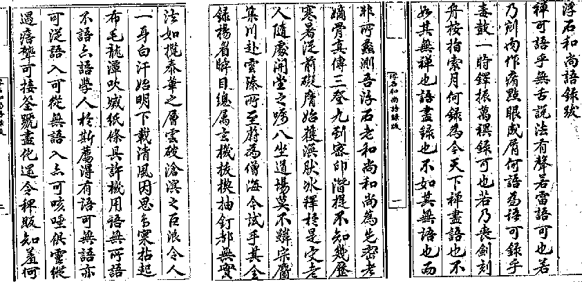
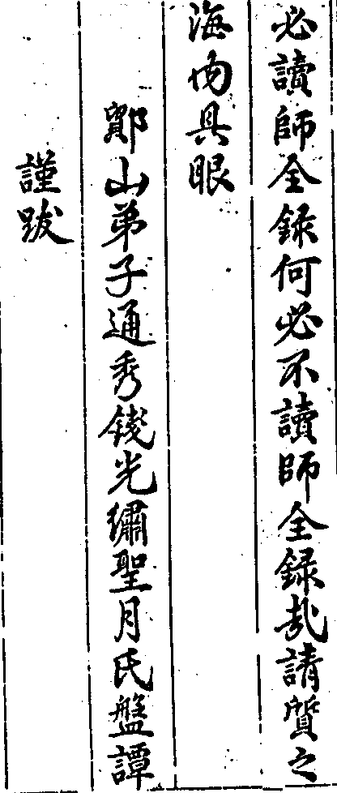

# 浮石禅师语录



> **藏经**：嘉兴大藏经（新文丰版）（嘉兴藏）　**册次** 第 26 册（J26）　**编号** JB185　**部类** 诸宗部　**卷次** 10 卷　**篇幅** 97,778 字

> **作者（译者）**：嗣法门人行浚等编

> **卷／品**：10 卷 · 2 品



---



## 目录



  - [浮石禅师诸会语录序](#浮石禅师诸会语录序)

  - [浮石禅师语录序](#浮石禅师语录序)

- [浮石禅师语录卷一](#浮石禅师语录卷一)

- [浮石禅师语录卷二](#浮石禅师语录卷二)

- [浮石禅师语录卷三](#浮石禅师语录卷三)

- [浮石禅师语录卷四](#浮石禅师语录卷四)

- [浮石禅师语录卷五](#浮石禅师语录卷五)

- [浮石禅师语录卷六](#浮石禅师语录卷六)

- [浮石禅师语录卷七](#浮石禅师语录卷七)

- [浮石禅师语录卷八](#浮石禅师语录卷八)

- [浮石禅师语录卷九](#浮石禅师语录卷九)

- [浮石禅师语录卷十](#浮石禅师语录卷十)



---



浮石和尚语录叙



昔张文定谓：三代以下儒门澹泊、收拾不住，英灵汉子尽归释氏，举马祖、坦然、丹霞辈以实之。张无尽赏为名言。然达磨西来不立文字，形於纸墨何有吾宗？诸方说禅浩浩，徒以组章织句为工，其去经生家掇拾饾饤诧为洙泗渊源者，何殊燕乙也？



夫五宗之盛，莫如临济，自应庵华、密庵杰诸老而降，一条白棒直接人天，大用大机、实心实行，舍密云老汉外，寥寥不少。概见近则首服膺报恩浮老和尚，盖其天怀日朗、道气风疏，早岁餐粝蘸盐，神枯形瘠，发甘死禅席之愿，入定终日如寸香顷，脱白未几，固已人法双忘矣。后从七女尸陀林有省，旋於殿角薰风公案打失鼻孔，得大休歇、得大解脱，觉从前陈烂葛藤看破都只寻常。密老人犹未轻相印可，复取灵苗、根本二语俾作义理禅论，直至表里洞然、手口无碍，始有「随处开堂，代余为众」之记莂。其间啐啄同时、针芥相取，真不啻古人拽倒绳床、辗车直过矣。从此全提正令，八坐道场，用赏用罚，劈面恶钳，魔来、佛来蓦头生按。海内有是父是子之目，今全录具在，掀翻窠臼、洞揭真源、斫伐稠林，都无死句，讵承虚接响一流所能彷佛哉？盖如玅峰亲见德云，茎艸能操杀活，宜乎虞山老毘耶以善财南询、文殊采药为斯编譬喻说法也。



夫曹谿之后分为二枝，而临济独盛。临济之后分为二枝，而杨岐尤盛。可见委曲垂手不如直截提持者之於今为烈矣。



试读师诸录，如百尺孤桐，无枝可荫；如悬崖万仞，迥绝攀缘。虽不离文字，而依然不立文字之纲宗。彼监寺受记於慈明，厮儿受记於黄檗，一则谓异日儿孙遍天下，一则谓吾宗到汝大兴於世，或者与师后先合辙乎？筑土应占，分灯现瑞，黄园五色金莲之徵，庉村浮来石佛之谶，彰彰若彼，岂偶然已哉？



予才让髯苏，莫殚参寥之蕴；悟惭无垢，宁窥妙喜之藏。因师法嗣拳石沃公之请，谬弁数言於首，他日名载传灯，偕垂不朽，澹泊儒门藉以生色矣。



四明弟子史大成立庵父薰沐敬题



------



### 浮石禅师诸会语录序



浮石禅师刻福城语录竟，请余为之序，既而檇李、松陵、广陵诸会语录次第刻成，复以全录序为请。余之序福城录也，举善财南询因缘，谓师於妙峰顶上亲见德云，了毕大事。再举文殊采药因缘，拈出师一片老婆心，与四海禅宗点眼，此中是草？是药？能杀人？能活人？明眼人试一著眼，如数家珍、如观掌果，福城一会如是，檇李、松陵、广陵诸会语录亦复如是；即由此升座说法，坐尽此世界微尘刹数道场亦一一如是。故知师虽坐福城，不起於座，而历檇李、松陵、广陵诸会；师虽现说福城语录，不动舌本而遍说檇李、松陵、广陵诸会语录。何处不是草？何处不是药？何一味不能杀人？不能活人？东涧老人自笑舌头短，为此老作福城语录序如是，乃至作诸会语录序亦复如是。若於此处会得，正不妨一茎草上定纲宗也。老人说是言已，有人笑曰：「文殊师利劝善财南行，於妙峰山顶求见德云，善财至德峰经七日已，迺见德云比丘於别山经行自在，公于福城诸会见浮石和尚，安知和尚在德峰住地耶？在别山经行耶？佛不云乎：「如人持尺量虚空。」复有人随计其数：「公将持尺量虚空乎？抑亦将随后而计其数乎？」余闻之大笑，并书之以为叙。



岁在壬寅五月朔日，虞山蒙叟钱谦益撰



------



### 浮石禅师语录序



不慧忆从丙子初夏，走四明天童觌面密老人。迨己卯初秋，复晤於吾里黄暗翁素园中，值余匆遽赴召，时闻之暗翁云：「适夜梦园池双开五色金莲，恰得浮石、林野两和上为老人同日嘱付的的莫大因缘。」余欢喜赞叹云：「此真祗树给孤独园也。」



嗣后沧桑幻化、踪迹越寥，丁亥冬日，余从雍厢假还晤林和上於东塔方丈，始知东塔为浮和上旧道场。迨壬辰秋日复假还，闻牧和上继林天童之席，浮和上复继牧席，始知天童为浮和上新道场矣。



既得从东谷坚法嗣通一番天童消息，庄诵五会餘录，始知自当湖青莲、而松陵报恩、而海门广慧、而嘉禾福城、而入主天童祖庭，说法浩浩，早已倾溟渤而倒须弥矣。



迨丁酉春日，吾檇李诸檀信虔从报恩延主栖真云谷和上道场，不慧特放远棹，竟日落草，盘桓矜式，孤峻高标，祖风丕振，未几而还主报恩矣。



话到威音那畔，直是竿头进步，彻底掀翻，姜桂天性，到老逾辣，入泥入水，无非为人，九鼎在法门，千秋所希有也。



即有善颂者对蜜说甜，徒作合头诳语，庶几据实叙事，聊当晏坐麈谈云尔。



康熙改元嘉平，月朢国子司业兼掌祭酒事前，戊辰二甲进士虞衡郎、副廷尉冏少卿、曹溪憨祖亲侍弟子福徵谭贞默槃谈譔，时年七十有三。



浮石和尚语录跋











浮石禅师语录目次



卷一住嘉兴府平湖青莲禅寺语录  

苏州府吴江报恩禅寺语录



卷二苏州府吴江报恩禅寺语录



卷三扬州府海门三仙广慧禅寺语录  

嘉兴府东塔禅寺语录



卷四宁波府天童景德禅寺语录  

秀州栖真寺语录  

常州府宜兴善权寺语录



卷五苏州府常熟福城禅寺语录



卷六小参



卷七入室  

问荅机缘  

勘辨垂代  

代古



卷八拈古  

颂古  

法语



卷九偈赞  

佛事  

杂著  

行实



卷十诗偈



浮石禅师语录目次(终)



------



## 浮石禅师语录卷一



**译者**：嗣法门人行浚等编



嘉兴府平湖县青莲禅寺语录



师於崇祯己卯岁十二月十七日入寺。



山门。「门门门出入，无过只这重，今日山僧来把断，管教凡圣不相通。为甚不相通？水归巨海波涛静，云到苍梧气象闲。」



佛殿。「城东老母不欲见，调达比丘长怒嗔，且道佛有什麼过？」展坐具，云：「当初只道茅长短，到此方知地不平。」



伽蓝。「伽蓝神，护法主。」拈起香，云：「此是法，作麼生护？蹑足进前须急急，执鞭当鞅莫迟迟。」



祖师。「六耳不同谋，三人已话堕，不肖儿孙到来，尽情都捉破。且道捉破在什麼处？」呈卧具，云：「𫆏。」



据室。拈拄杖，云：「据新条，行新令，天下衲僧齐乞命，一条白棒尽打惺。」卓一卓。



指法座，云：「从空放下，就地升高，不向须弥灯王借来，惟用当人己力，有眼者见。」遂升拈香，云：「这瓣香高而无上，仰不可及，𦶟向𬬻中，端为祝延今上皇帝圣躬万岁，钦愿福基永固，地久天长，惠泽溥施，兆民乐业。这瓣香内毓三纲、外涵五德，奉为满朝文武、天下勋臣、本府本县各位尊官，伏愿民戴无私之治，童谣良牧之年。这瓣香多生自昧，半世辛勤，今日一回拈出，耑为现住明州天童景德堂上传曹溪正脉三十四世本师密云悟老和尚，用酬法乳之恩。」就座，问荅毕，乃云：「当阳显露，更不囊藏。就体知归，和声揭示。黄鹤楼中吹玉笛，不堕宫商；江城五月落梅花，岂同春色？到恁麼地，知归有分。若向青莲门下，一点也用不著。既用不著，且道用个什麼？」拈拄杖，云：「滴水兴波，滔天作用。若能恁麼，便是撒手悬崖，洞明大法的汉。已过关者，不妨撩起便行；未过关者，且听新青莲为汝道破。」良久，云：「横按莫邪全正令，太平寰宇斩痴顽。」卓拄杖，下座。



上堂。僧问：「禹门殿里上堂，大唐国里打鼓，今日单提正令，和尚如何为人？」师劈头一棒。问：「萌芽未发，老梅早已知春。如何是知春消息？」师云：「杖头指出花无数。」问：「如何是天得一以清？」师云：「云散家家月。」「如何是地得一以宁？」师云：「春来树树花。」「如何是君王得一以治平？」师云：「位临南面。」进云：「和尚得一又如何？」师云：「倒著袈裟闲拍掌。」进云：「未审年朝祝圣一句作麼生道？」师云：「一人有庆，兆民赖之。」进云：「恁麼则金枝永茂三千界，玉叶常敷万古春。」师云：「且喜阇黎得话会。」乃云：「旧年离未远，新岁恰三朝，新旧不相参，世相得常住。所以道：旋岚偃岳而常静，江河竞注而不流，野马飘鼓而不动，日月历天而不周。花根本艳，虎体原斑，虽然不改旧时颜，未免人人添一岁。大众！新旧且置，如何是世相得常住？」卓拄杖，云：「千古长如白练飞，一条界破青山色。」



施主请上堂。「繁兴大用，举必全真，不审低声，无非了义。因机有异，法有差殊，半满偏圆，悉皆平等。故曰：『佛以一音演说法，众生随类各得解。』是以维摩大士以一钵▆饱三万二千菩萨。只如甘贽行者设粥南泉，打破粥锅，且道是繁兴大用？不是繁兴大用？」竖拂，云：「等闲识得东风面，万紫千红总是春。」



西林庵，上堂。「夏日初临四月天，村庄那个得安闲？衲僧分上无餘事，秪要知归便放参。莫有知归者麼？」良久，云：「自是不归归便得，五湖烟景有谁争？」



接济庵，上堂。「遶庵溪水深千尺，四里村庄得万家，饥餐渴饮前朝事，亘古流香挂齿牙。」复云：「昨日正法来，今朝留接济，庵寺虽有殊，主人原不异。要明不异主，春风吹柳絮，於此豁双眸，洞明第一义。还知第一义麼？日高花影重，风暖鸟声碎。」



上堂。「佛佛授手无别授，祖祖相传无别传，炎蒸六月如临火，谁不通身汗似泉？说到行不到，钟中无鼓响；行到说不到，鼓中无钟声；行说俱到，钟鼓得交参。句句无先后，行说俱不到，用尽自己心，笑破他人口。且道离却四句又作麼生？」喝一喝，云：「大抵还他肌骨好，不搽红粉也风流。」



上堂。「无相谓法身，无见谓法眼。以无相故，随机现形；以无见故，随照鉴物。了无造作，不假安排，亦名天真。佛性向上，玄机於中，圣凡不立，人我本空。世法、佛法，融成一片；情与无情，混作一团。自然上无攀仰、下绝己躬，髑髅常干世界，鼻孔摩触家风，便能一为无量、无量为一，於一毫端现宝王刹，坐微尘里转大法轮。且道是什麼人得恁麼地？还委悉麼？披蓑侧立千峰外，引水浇蔬五老前。」



苏州府吴江报恩禅寺语录



佛殿。「先觉非先，后觉非后，先后一如，彼此成就。且道成就个什麼？」展具，云：「撒开坐具大家看。」



方丈。「老维摩於此杜口，妙吉祥於此纳败，山僧於此据令而行，凡圣到来总教吃棒。为甚如此？报恩门下，令不虚行。」卓拄杖便据坐。



指法座，云：「当阳显露，达者方知，从地升高，阿谁无分？正恁麼时，便乃掀翻宝座、喝散大众，岂不俊哉？其或未然，也怪山僧不得。」遂升拈香，云：「此一瓣香，根盘沙界，叶覆大千，端为今上皇帝祝严圣寿，惟愿镕剑戟为农器、归汗马於桃林，四方归化，八表称臣。」次拈香，云：「此一瓣香奉为阖国采僚、苏州府县、诸位高官，伏愿乃忠乃孝，惟德惟仁。」又拈香，云：「此瓣香，丹青描不出，千圣觅无踪，二回拈出，供养天童先师密云大和尚，用酬法乳之恩。」



就座。「懒住深山与市廛，村居闹静两无关，分明拈出先师案，谁是知音得解参？今朝重整旧鱼竿，垂丝意不在深潭，个中如有冲波鲤，好向竿头𨁝跳看。」僧问：「古时大义即不问，今日开堂事若何？」师拈棒，云：「看取令行时。」进云：「如何是十方同聚会？」师云：「汝眼在什麼处？」进云：「如何是个个学无为？」师云：「你在什麼处用心？」进云：「如何是诸佛出身处？」师云：「速退。」乃云：「假使顶戴百千劫，身为床座遍三千，若不传法度众生，毕竟无能报恩者。」竖拂，云：「报恩今日传法也，大众一齐担荷。」掷拂子，下座。



腊八，上堂。「堪笑释迦文，长年摸壁行，雪山今夕午，方得睹明星。自累还自可，那堪又累人？」乃云：「奇哉！众生皆有如来智慧德相，良繇妄想执著不能证得。若是窥籓不入、据鼎不尝的，向未有生佛已前转身，於今时大官路上阔步，终不向葛藤窠里头出头没。众中还有如是汉子麼？如无，报恩只得据款结案，为汝诸人指出一条大路。敢问诸人：除却妄想执著，如何是智慧德相？」举拂子，云：「会麼？莫待夜行刚把火，直须当道与人看。」



岁旦，上堂。僧问：「吴中石佛浮来瑞，灵鹫花香诣报恩，二途即今俱不问，新年佛法若为论？」师云：「东家打锣，西家放炮。」进云：「恁麼则高提祖印光寰宇，大阐洪音唱楚歌。」师云：「迅雷不及掩耳。」乃云：「今日新年头，昨日旧年尾，新年与旧年，年年只如此。所以道：十世古今，始终不离於当念；无边刹境，自他不隔於毫端。于此见得，便知佛祖之道本是平夷，大解脱门原无关钥；於此不见，菩提路上荆棘成林，般若光中迷云蔽日。」拈拄杖，云：「幸有者个木上座，迷悟圣凡俱坐断，新年旧岁总无拘，轻轻拨转无为化，万姓讴歌乐有餘。」下座。



童文芝荐母，请上堂。僧问：「百骸俱溃散，一物镇长灵，正恁麼时，姚氏淑人在什麼处？」师竖拂，云：「在山僧拂子头上。」进云：「老梅枝上含春象，百草头边露月轮。」师云：「了没交涉。」进云：「末后牢关亲觑破，纵横无处不风光。」师云：「转见不堪。」乃云：「数点吴山髻未撒，一溪同水镜忘收，头头尽是闺中物，法法从今不用求。倾盖如故，白头如新，本无延促，那落死生？如水投水、似空合空，遍界了无痕迹，毫端普现色身。」举起拂子，云：「正恁麼时，姚氏淑人在山僧拂子头上成等正觉，现大人相、放大光明，口唱偈云：『百骸溃散杂尘泥，一物长灵复是谁？不得此时通线路，髑髅著地几人知？』现前大众还有和得者麼？」良久，云：「阳春雪曲非凡调，不是知音和不齐。」击拂子，下座。



结夏，上堂。师至法座前，以拄杖畫云：「畫断千圣路头，直踏毘卢顶上，任你须弥灯王，也只退身有分。且道是什麼人境界？」喝一喝，遂升，拈香毕，乃云：「四月十五日以前，春寒愁雨水；四月十五日以后，夏热爱薰风。正当四月十五日，报恩寺里禅和子也不寒、也不热，洒洒落落，饥则有饭、渴则有茶，游戏圆觉，伽蓝安居，平等性智。敢问大众：因什麼到者般田地？还会麼？不因刖足曾三献，那得连城价倍高？」



上堂。「今朝五月一，那事分明极，拟意欲承当，料掉没交涉。有交涉，八面兵戈一齐出。且道：正当恁麼时，报恩还在里许也无？」良久，云：「数声清磬是非外，一个闲人天地间。」



举：「兴化云：『我逢人则不出，出则便为人。』三圣云：『我逢人则出，出则不为人。』此二尊宿，一个遇文王施礼乐、一个逢桀纣动干戈，虽则两得其宜，未免各分疆界。报恩则不然，有时逢人则出，出则便为人；有时逢人则不出，出则不为人。还知报恩落处麼？有意气时添意气，不风流处转风流。」



上堂。举：「德山和尚一日因饭迟，托钵下堂，雪峰见云：『者老汉钟未鸣、鼓未响，托钵向什麼处去？』看孔著楔。山低头归方丈，犹是验知音。峰举似岩头，将谓是同俦，头云：『者老汉未会末后句在。』热涎当面唾。山闻，令侍者唤头：『汝不肯老僧那？』千闻不如一见。头密启其意，始信不讹传。山明日上堂，果与寻常不同。疑杀天下人。头抚掌呵呵大笑，云：『且喜老汉会得末后句也。』『天下人无奈此老何。』堆上更添土。『虽然如是，也只得三年活。』极力赞叹。山果三年而逝。谁肯恁麼承当？看他德山父子一个个如师子游行、象王纵步，旋机活脱，大用现前，报恩虽则鼠尾续貂，秪要诸人启目。」蓦卓拄杖，云：「意气不从天地得，英雄岂藉四时摧？」



上堂。「六月热，五谷结，目下输他汗似浆，秋来嬴得仓廪实。报恩寺里虽种田，不比他家兢得失，七尺单眠露地牛，八功德水济枯竭。虽然自利利他，未是衲僧巴鼻。如何是衲僧巴鼻？一湖同水当门镜，数点吴山入案青。」



解夏，上堂。僧问：「古人道：『若论此事，三贤未达、十圣难知。』今日报恩解夏，未审有何方便？」师云：「看脚下。」乃云：「锄禾日当午，汗滴禾下土，今此盘中餐，粒粒皆辛苦。舍利弗云：『我观三千大千世界，无有如芥子许非是菩萨舍身命处，方乃得成菩提。』以见世间法、出世间法，无有一法不从辛苦中得。」拈拄杖，云：「惟有这条拄杖子，不属世间法、不属出世间法，亘古亘今，撑天拄地，不涉功勋、不假修证。且道：即今解夏一句作麼生道？鹤有九皋方展翼，马无千里谩追风。」



上堂。以拂子打圆相，云：「大众见麼？灵山话、曹溪指、寒山比，惟有盘山云：『心月孤圆，光吞万象，光非炤境，境亦非存。』光境俱忘，复是何物？」复竖拂，云：「鉴光境未忘，复是何物？」放下拂，云：「瞎！还知报恩落处麼？果也知得，不妨拗折拄杖，高挂钵囊，随缘散诞，任意逍遥；脱或未然，报恩为伊更通一线。」以拂作弓弦势，云：「盈亏总在双弦内，隐显还归一炤中。」



结制，上堂。「报恩本无制可结，秖为诸人情未瞥，随例攀他从上条，龟毛绳子缚跛鳖。」以拄杖○，云：「若能个里翻身出，脱体无依大事毕，了得无依、无不依，倒用横拈尽轨则。所以道：一法若有，毘卢堕在凡夫；万法若无，普贤失其境界。要在那边担荷？者里行持？」蓦拈拄杖，云：「且道是担荷耶？是行持耶？」卓一卓，云：「会麼？吾家自有通霄路，不向前人行处行。」



上堂。「结制来经一七日，那事明明无间隔，霜风剪得树头光，远近楼台俱露脊。秪如僧问玄沙：『学人乍入丛林，乞师指个入处。』沙云：『汝闻偃溪水声麼？』僧云：『闻。』沙云：『向者里入。』且道与报恩相去几何？」击拂一下，云：「万派千溪皆渤海，七金五岳总须弥。」



上堂。「释迦已过去，弥勒犹未来，现前火把子，落在报恩手中。拈起也，万象不能藏覆；放下也，千圣无以等阶。正恁麼时，有不被其转变者，出来道个出格句，报恩便分半院与伊。何则？不见道：『不逢别者不开拳，一遇知音便分付。』其或未能，布袋里老鸦虽活犹死也，怪报恩不得。」便下座。



上堂。「霜风凛凛，金刚王剑劈面挥来；冻日洋洋，大圆镜智平空辊出。正恁麼时，森罗万象咸为古佛家风，碧落青霄全是道人活计。打开自家库藏，运出自己资财，与佛与祖同心、同行，同德、同诚，同境、同机，同炤、同用，并无他事。还委悉麼？竹密不妨流水过，山高岂碍白云飞？」



腊八，上堂。「一年一度腊月八，天上明星夜朗然，释迦一睹便已悟，诸人睹之何不然？星是一般星，眼是一般眼，烧了方知地不平，未烧竟道茅长短。」以拂子打圆相，云：「明星现也，大众还见麼？」掷下，云：「若将眼见终难会，耳处看来方始知。」



立监寺，上堂。僧问：「烹金琢玉须还作者钳锤，阐教扶宗必假股肱任运。如何是高低普应句？」师云：「月印千江。」进云：「若然，则草偃风行得自由。」师云：「更须著力。」进云：「雪后始知松柏操，事难方表丈夫心。」师云：「可知礼也。」乃云：「水因风而生纹，火就薪而发焰。以大千界为一招提不以为宽，以恒沙佛同一舍那不以为众，直得文殊、普贤交光相待，观音、势至弹指赞襄，泥猪癞狗悉归从，白牯狸奴咸稽首，方好演无生曲、唱太平歌。正恁麼时，不退转一句作麼生道？佛殿阶前石狮子，大洋海底铁昆仑。」



上堂。「雪后连朝雨，天寒括地风，个中无所取，独抱冷冰冰。大众且道：是什麼人境界？还知麼？九年面壁无人识，五叶花开遍界香。」



春日，上堂。僧问：「三阳开泰，凤历重颁，如何是斩新条令底句？」师云：「石笋抽条。」进云：「如是，则堂前露柱翻筋斗，壁角灯笼笑满腮。」师云：「木人重抚掌。」进云：「无根树上消残雪，没底潭中解冻流。」师云：「石女又梳头。」乃云：「今年四季今日尽，明年四季今日起，时人若不了今日，随世迁移无定止。若能当下了今日，洞山麻三觔、云门乾屎橛、赵州柏树子、台山蓦直去，一了一切了，更不烦心力。只如傅大士云：『须弥芥子父，芥子须弥爷，山水坦然平，敲冰来煮茶。』又作麼生了？还会麼？梅吐玉英香馥馥，柳藏金线冷沉沉。」



岁旦，上堂。僧问：「如何是新年头底佛法？」师云：「拄杖头增白。」问：「年新月新日又新，谁识头头是旧人？旧新即不问，如何是祝圣酬恩一句？」师举拂，云：「但将者点真消息，用保吾王百亿春。」进云：「三脚泥牛耕陆地，大家齐唱太平歌。」师云：「醉后添杯。」乃云：「道在人明，非人无以明道；法由智了，舍智无以了法。道、法不二，人、智奚双，一明一切明、一了一切了，庭前卢橘正芬菲，江上寒梅早漏泄。无一法不彰般若、无一物不露真常，古今不异，凡圣同途。於此明得了得，便知年年是好年、月月是好月、日日是好日、时时是好时，上祝一人之寿、下祈万姓之安，四恩不报而自报、三有不资而自资。回岁旦於今朝，挽丰年於此日，正当恁麼时，衲僧分上又作麼生？」举拂，云：「拈起一枝无孔笛，等闲吹出万年欢。」复击一击，下座。



沈焕一居士请上堂。僧问：「春到人间处处花，不知何处是春家？请师拈出分明示，休使群生汩浪沙。」师举拂，云：「还见麼？」进云：「昨夜梅花开殿角，风摇素影入帘寒。」师云：「清白眼中重著屑。」问：「大海波深，丝纶难下，透网金鳞如何收取？」师打云：「一钓便上。」进云：「搅乱千江成一派，尾巴摇动震乾坤。」师云：「尽在竿头。」乃云：「老梅枝上露全机，曾无识者；嫩草头边横利刃，那敢当锋？高高处观之不足，低低处平之有餘，十地尚乃糢糊，三贤岂能洞达？人境不到处，特地全彰；炤用既立后，杳无消息。望州亭、乌石岭、僧堂前，徒言相见。不是心、不是佛、不是物，枉自猜详。向上一路，千圣不传，学者劳形，如猿捉影。且道什麼人方堪担荷？」以杖架肩，云：「楖栗横担不顾人，直入千峰万峰去。」下座。



清明上堂。「报恩本无法可说，执事请我应时节，夜来曾作一篇诗，拈出今朝去塞责。」乃云：「清明时节雨纷纷，路上行人欲断魂，借问酒家何处有？牧童遥指杏花村。忽有个汉出来道：『长老大好一篇诗。』咄！报恩口里道，谁敢道不好？」



佛诞，上堂。「今朝正是四月八，净饭王宫生悉达，只因我佛太欲速，才出娘胎便[口*忉]𠶒。毘蓝园里少知音，黄金掷却无颜色，独有云门跛足师，道见一棒定打杀。尽道知恩解报恩，将此深心奉尘刹，报恩若见又不然。」拈拄杖，下座，一时打散。



端阳，归院，上堂。「仲冬出，孟夏回，俄经半载；通海云，淞陵雨，同共一天。所以十世古今始终不离於当念，无边刹境自他不隔於毫端，佛法本现成，何必强安排？且道如何是现成底法？年年五月五，艾虎悬当户。」



祈晴，上堂。僧问：「昔年相见礼三拜，今日重来复再参，超越古今一句子，请师拈出大家看。」师云：「未启口时明历历。」进云：「禅堂佛殿门相对，瑞像阶前花药栏。」师云：「堕也，堕也。」进云：「恁麼则庉溪流出同里水，月上东山玉一团。」师云：「虾跳不出斗。」乃云：「梅雨经旬水没田，桔槔声吼叫苍天，为僧若解为农苦，淡饭黄虀也愧餐。古人道：『有句无句，如藤倚树。树倒藤枯，句归何处？』众中还有透得者麼？」良久，云：「如无，报恩未免逐句下个注脚。『有句无句』，阴晴有异。『如藤倚树』，泥里洗块。『树倒藤枯』，赤脚波斯入大唐。『句归何处』，生铁秤锤被虫蛀。若是銕眼铜睛，当阳觑破，便乃把断要津，不通凡圣，不向他语言里作窠窟、机境上受罗笼，直下如大香象摆脱枷锁，了无羁绊；如师子王游行，不求伴侣，得大自在。到恁麼地，须是恁麼人始得。且道：如何是恁麼人？赵州勘破处，验尽天下衲僧；玄沙蹉过处，拣辨诸方作者。鲁祖一生面壁，俱胝秪竖一指，从上诸老如生铁铸就，撼摇他半点不得。何则？秪为他悟处真实、见处透脱、履践处绵密故也。透与不透则且置，即今应时一句作麼生道？」卓杖，云：「水退禾苗长，云开雨脚收。」



上堂。举：「无著往台山，文殊问云：『上座何来？』著云：『南方。』殊云：『南方佛法如何住持？』著云：『末世比丘少持戒律。』殊云：『多少众？』著云：『或三百、或五百。』著问文殊：『此间佛法如何主持？』殊云：『龙蛇混杂，凡圣交参。』著云：『多少众？』殊云：『前三三，后三三。』妙喜云：『我当时若在，即向他道：「和尚如此主持，甚是不易。」』」师云：「不易且置，即如前三三与后三三，毕竟是多少？」良久，云：「云门道底。」



上堂。僧问：「明不犯之令，还许他悟也无？」师云：「犹落第二。」进云：「恁麼则易开终始口，难保岁寒心。」师云：「自领出去。」乃云：「子月一卉木，丛林咸失色，只为霜风快似刀，才入青林成败叶。时人尽被境缘夺，换却乌珠也不识。若要识，何待当来问弥勒？阿呵呵！瞥不瞥？黄鹂上树一枝花，白鹭下田千点雪。」



冬至，上堂。「从是金风入洞房，鸳鸯日绣不成双，今朝仍理前针黹，始觉新添一线长。恁麼时，可谓全机独露，正眼宏开，就手拈来了无餘事，林下人正好休心歇意，直下坐断报化佛头，饥餐、渴饮、闲坐、倦眠，一切时中得大自在。当阳有句不可重宣，趋避无门直须漏泄。大众还会麼？天上月团𪢮，人间冬至节。」



腊八，上堂。「自舍皇宫入雪山，六年冷坐绝追攀，谁知今夜蒲团上，绀目无端发眚斑？山僧恁麼告报，秪要诸人拈却炙脂帽子，脱下鹘臭布衫，便见古释迦不先、今弥勒非后，一切时中不倚一物，净裸裸上无攀仰、赤洒洒下绝己躬，千圣不能知，万灵安可测？一切坐断，不漏丝毫，虽然在报恩门下，正好朝打三千、暮打八百。何以如此？不见道：『横按莫邪全正令，太平寰宇斩痴顽。』」



上堂。僧问：「坐断千差，孤峰独露，觌面相呈，乞师一接。」师打云：「一棒一条痕。」乃云：「腊月半庭际，腊梅花已绽。寒雀知人不自惺，假意相争递相唤，闻者浑如在梦中，几个知归能顾盻？惟有林间抱道翁，年头年尾自惺惺，虽无奇异惊人世，自有清香散四邻。大众还闻麼？不向此中寻落处，象王鼻孔漫撩天。」



上堂。「诸佛非我亲，谁是最亲者？识得最亲者，是为真报恩。诸佛非我道，谁为最道者？识得最道者，是为真报恩。谁知真报恩？原无恩可报，秪在日用中，不昧於自心。所以祖师云：『汝能於心亲，父母非可比；汝能与道合，诸佛心即是。』临济大师云：『佛者，心清净是；法者，心光明是；道者，处处无碍净光是。』三即一，皆空而无实有。若真办道人亲证不惑，念念心无间断，是为真报恩者。达磨大师特特西来，秪觅个不受人惑的；山僧因明岩师及众护法相延至此，更无他事，亦秪觅个不受人惑的。众中如有不受惑者，趁此人天众前略露风规，以滋法化。有麼？有麼？如无，山僧自露去也。」拈拄杖，卓一卓，下座。



上堂。「客岁秋收薄，荒凉禅院深，眉头终日锁，忽到赏心人。大众还知赏心意旨麼？」喝一喝，云：「万丈冷门庭，仗此横开竖辟。」



又喝一喝，云：「一条大官路，出他邪径迷流。」复喝一喝，肩拄杖，下座。



上堂。「时值温和三月天，一轮明月正逢圆，祖翁田地都迷却，谁识青黄间目前？大众还有识者麼？若乃识得，大千震动，花雨缤纷，万象点头，虚空粉碎，能使天上五衰不现、人间八苦停煎，有求皆遂、无愿不从；其或未能，山僧更为诸人通个消息。」竖拂，云：「蛇生绳上还因识，旛动竿头不是风。」



------



## 浮石禅师语录卷二



**译者**：嗣法门人行浚等编



苏州府吴江报恩禅寺语录



元旦，上堂。「昨日旧年，今朝新岁。冻笋抽尖，寒香远递，秖因不变旧时颜，正合人间添一岁。处处儿骑竹马，家家门换桃符，乡村野老放酣歌，林下道人静无语。所以，天不言，四时行；地不言，万物生；圣人不言，垂衣拱手，万国来王；衲子不言，坐断溪山，包罗风月。且正恁麼时，如何是裕国祐民一句？」蓦拈拄杖，云：「杖头拨转无为化，阖国讴歌乐太平。」



上堂。「『有句无句』，朝为田舍郎。『如藤倚树』，暮登天子堂。『树倒藤枯』，将相本无种。『句归何处』，男儿独自强。向此四句中见得彻去，便知向上宗乘、具超方眼目，千圣罗笼无处、万法系缀无由，直下坐断尘情意想，不落见闻觉知，自然机用双行，十虚通透。其或未然，不免向他语言上卜度、机境上抟量，业识茫茫，无本可据。何则？不见道：『言无展事，语不投机，承言者丧，滞句者迷。』且道：二俱不涉又作麼生？了取平常心是道，四威仪内坦堂堂。」



结夏，上堂。僧问：「承师有言：『无禅可参，无法可听。』未审今日结制又作麼生？」师云：「事不重科。」进云：「恁麼则掀倒禅床去也？」师云：「还有转身处麼？」僧喝，师云：「也是泥中洗块。」问：「天地未判、朕兆未分，未审向什麼处结制？」师打，云：「正合其宜。」进云：「何得锦上添花？」师又打，云：「为要阇黎著眼。」进云：「黄金自有黄金价，谁肯和沙卖与人？」师云：「也须验过。」问：「古人云：『尽大地都是觅作佛的，要寻个无心道人了不可得。』未审如何是无心道人？」师云：「问从何来？」进云：「莫谓无心云是道、无心犹隔一重关。」师云：「过得也未？」乃云：「三春已过，九夏方临，了则便了，何用劳神？只要九十日内莫动一步，十二时中莫生一念。一念不生，安居平等性智；一步不动，游戏圆觉伽蓝。如斯履践，自然个个常光现前、各各壁立万仞，不与诸尘作对、不与千圣同途。是以广额屠儿日宰千羊，放下屠刀便云：『我是千佛一数。』云门大师见释迦老子，便要一棒打杀与狗子吃，贵图天下太平。二俱不受则且置，如何是衲僧正眼？」良久，云：「才逢立夏后，是处绿阴多。」



复举：「僧问睦州：『高揖释迦，不拜弥勒事如何？』州云：『昨日有人问，赶出了也。』僧云：『恐某甲不实那？』州云：『拄杖不在，笤帚柄聊与三十。』」师云：「不是师子，定然逐块。若是报恩，待他道：『昨日有人问，赶出了也。』便合掌进前云：『高揖弥勒，不拜释迦，又如何？』待拟开口，拂袖便出，非但笤帚柄短，纵使拄杖子长也打不著。还有为睦州出气者麼？纵然出得，也是同坑无异土。」



上堂。「时逢五月，芒种时节，东家插秧，西家刈麦。宾头卢尊者剔起眉毛，达磨大师刚言不识佛法、世法，打成一片，檀那远供亦可消得。众中还有恁麼人麼？有，则出来道看；若无，山僧自道去也：漠漠水田飞白鹭，阴阴夏木啭黄鹂。」



西堂白峤请上堂。「六月热，五谷结，大有之年验在今日，将谓世俗之谈，未具衲僧眼目。所以道：言无展事，语不投机，承言者丧，滞句者迷。报恩到者里不敢望空启告，节外生枝。是故，世尊说法四十九年，谈经三百餘会，末后乃云：『始从鹿野苑，终至跋提河，于此二中间未尝说一字。』达磨大师见梁武帝，帝问：『朕自即位以来，造塔度僧，有何功德？』磨云：『著相外求非真功德。』『如何是真功德？』磨云：『净智妙圆，体自空寂，如是功德不以世求。』又问：『如何是圣谛第一义？』磨云：『廓然无圣。』帝云：『对朕者谁？』磨云：『不识。』有般汉闻恁麼举，强作主宰，总不恁麼，大棒打不回头、千般罗笼不住，大似十字街头石敢当，秪成得个顽汉。若真丈夫，眼里有觔、皮下有血，一年十二月、一月三十日、一日十二时，时时如是、日日如是、月月如是、年年如是，单单只守个闲闲地饥来吃饭、困来打眠，寒则向火、热则乘凉，上无诸圣可慕、下无众生可度，人与非人性相平等，忽然撞著明眼道流，轻轻拶著，直得山头浪起、海底尘生，且道据个甚麼道理便乃如是？」举拂，云：「会麼？自从踏著生前路，便向威音那畔行。」



上堂。僧问：「昨日迅雷鸣，凉风到处生，我师登宝座，宾主历然分。如何是宾中宾？」师云：「此去西天十万程。」「如何是宾中主？」师云：「龙袖拂开全体现。」「如何是主中宾？」师云：「象王行处绝狐踪。」「如何是主中主？」师云：「归家尽是儿孙事，祖父从来不出门。」进云：「宾主已蒙师指示，向上宗乘事若何？」师云：「日午打三更。」进云：「恁麼则出群须是英灵汉，敌胜还他师子儿。」师云：「如何是敌胜处？」僧便喝，师便打。僧礼退，师云：「更与一顿。」乃拈拄杖，云：「一回拈出一回新，一度用来一度快。你有拄杖子，我与你拄杖子；你无拄杖子，我夺却你拄杖子。芭蕉老汉但能继富，不能周贫，致使后代儿孙节目上更生节目。报恩则不然，有也不与、无也不夺。」蓦拈杖，云：「吽！一种平怀，有谁能及？」



解夏，上堂。「休夏九旬，功圆三月。」以杖敲空，云：「打开方便门，俱从者里出，乍见阴疏嫩柳，俄闻蝉噪秋条，节令推迁，阴阳反覆，无生曲调不越宫商，智体如如离声绝色，从来未尝覆盖，今日岂有遮拦？秪要一念不落情尘，顿证自家境界，如龙得水、似虎靠山，有佛处罗笼不住、无佛处呼唤不回。正当恁麼时，作麼生即是？打开布袋无餘事，秪要勤看水牯牛。」



香山济长老至，上堂。「昨夜灯花爆，今朝喜鹊噪，将谓有客来，恰是门人到。到后事如何？慇懃为解丁香结，放出枝头自在香。」



回山，上堂。「春去秋来事若何？寒江▆钓兴偏多，不将香饵轻相诱，要获竿头称意鱼。既不将香饵，称意鱼作麼生获？鹤有九皋方展翼，马无千里谩追风。」



开炉，上堂。「年年小春月，望日复开炉，近水不近山，柴炭两俱无。那容诸衲子僵卧起为苏？只要当下了，触处自温和，温以自利、和以利他。自利故，上无攀仰、下绝己躬；利他故，上合十方诸佛同一道力、下合六道众生同一悲仰。自利、利他则且置，即今作麼生了？任从沧海变，终不与君通。」



上堂。僧问：「三条椽下则不问，七尺单前事若何？」师云：「急须领话。」进云：「恁麼则掀倒禅床去也。」师云：「脚跟痛与一顿。」乃云：「三世诸佛说不到处、历代祖师提不起处、一大藏教诠注不及处，无大得大，一段光彩尽在山僧拄杖头上。把住，则四圣六凡莫辨；放行，则狸奴白牯瞻依。且道：不把住、不放行又作麼生？山河天眼里，世界法身中。」



接待寺，上堂。僧问：「如何是夺人不夺境？」师云：「丹青描不出。」进云：「如何是夺境不夺人？」师云：「千圣觅无踪。」进云：「如何是人境俱夺？」师云：「胭脂落汉家，胡女无颜色。」进云：「如何是人境俱不夺？」师云：「龙袖拂开全体现，象王行处绝狐踪。」进云：「今古应无堕，分明绝覆藏。」师云：「切莫诈明头。」乃云：「未到接待，早已令人疑著；既到接待，果然门开八字、殿阁精严，诸上善人咸集於此，一个个文殊普贤、一个个释迦弥勒。昼开香积，饭似雪山；夜满参堂，十方云水。山河大地发欢喜心，蠢动含灵咸沾厚德，一切无漏胜善俱从这里流出，有佛处敲枷打锁、无佛处痛下针锥，且总不恁麼时又作麼生了达？天高群象正，海阔百川朝。」



费英仲送法衣，请上堂。「千梭织就，万缕合成，不假苦工，焉成世用？有为之法尚尔，无为之道亦然。故云：『以思无思之妙、反思灵燄之无穷，思入无思，性相平等。』所以三世诸佛也恁麼、历代祖师也恁麼、天下老和尚莫不恁麼，惟有山僧不恁麼。且道：恁麼、不恁麼，还有优劣也无？」提起衣云：「大庾岭头藏不得，如今也要大家知。」



禅智寺，上堂。「未有常行而不住，昨日在报恩；未有常住而不行，今朝来禅智。报恩、禅智虽有殊，行、住从来没两个。既没两个，行时即是住时，目下不离报恩；住时即是行时，向已早来禅智。行无所行、住无所住，行、住两忘，报、禅不二。所以云：『动若行云、止犹谷神，既无心於彼此，宁有象於去来？』正当恁麼时，一句作麼生道？域中日月纵横挂，一亘晴空万古闲。」



上堂。僧问：「随处作主，遇缘即宗，不落棒喝语默，请师直截指示。」师云：「高著眼。」进云：「若然，则超今越古。」师云：「拈却今古又作麼生？」僧喝，师便打。问：「止持作犯即不问，本元心地事如何？」师云：「脑后著眼。」进云：「恁麼则凤羽冲霄汉，神龙便解飞。」师云：「更须进步始得。」问：「坐断须弥顶，掀翻海底天，木人擎日月，未透衲僧关，如何方得透关？」师云：「竹溪水秀。」进云：「龙得水时添意气，虎逢山势长威狞。」师云：「料掉没交涉。」乃云：「腊月天寒，霜花满目，袖手当胸，了无思筭。无思筭，诚思筭，衲僧分上浑无事，冷坐蒲团著眼看。大众！既然无事，看个什麼？」掷下杖，云：「切莫瞌睡。」



上堂。「灵光不昧，万古徽猷，智鉴洞明，十虚普应。所以遇缘即赴、随处立宗，有时向孤峰顶上啸月披云、有时向十字街头抛沙撒土，卷舒在我，纵夺临机，把住，则乾坤黯黑；放行，则日月争光。正当恁麼时，把住是？放行是？」良久，云：「是处是慈氏，无门无善财。」



上堂。「最初机，末后句，亘古亘今，覆天载地，了即便了，会终难会。恁麼说话，已悟者闻之，如水投水、似空合空；未悟者闻之，如热见重裘、寒遇𫄨绤。且道：不落迷悟又作麼生？」以拂打圆相，云：「到头霜夜月，任运落前溪。」



上堂。「饥者易为食，渴者易为饮，不饥不渴者，饮食自无心。大众且道：谁是不饥不渴者？」拈杖，云：「上大人，丘乙己，尒小生，可知礼也。」



归院，上堂。「大道只在目前，要且目前难睹，欲识大道真体，不离声色言语。」



竖拂，云：「大众看看，志公和尚来也，即今在山僧拂子头上横说竖说，汝等诸人还闻麼？若道闻，且道他说个什麼？若道不闻，汝等诸人岂无耳耶？向这里转得身、吐得气，许汝少分相应；其或未能，山僧未免聊通一线：前月十七去，今月十三回，当此何时候，腊梅满树开。」喝一喝，掷拂子，下座。



岁旦，上堂。「元正启祚，万物咸新，年新、月新、日新、时新，纤洪长短莫不皆新。」拈杖，云：「且道：者条拄杖子还有新旧也无？诸方尽道本无新旧，也是布袋里老鸦。山僧即不然，闲时倚壁浑如旧，拈出当阳宛似新。」喝一喝，下座。



解制，上堂。「制有结、有解，法无古、无今，有无之义虽殊，水月空花俱幻。天下东西十三省，南北有两京，中间一条大官路，尽在诸人脚下行。踏著、踏不著置之不论，前程忽有人问：『从甚处来？』切莫道：『报恩来。』因甚如此？不将平实对，秪要使他疑。」



佛诞，结制，上堂。「瞿昙为众不寻常，才出娘胎便举扬，千古相传无别事，乡村四月正农忙。众中如有为众竭力者，不妨出众互相激扬，以启后昆，岂不为妙？如或未能，且听山僧新令。今日报恩结制，开出三条新例：第一、肚饥须向斋堂里噇饭，第二、内逼须向东厕头屙屎，更有一条不说破也，要诸仁各自知。」复举：「芙蓉太毓禅师因行食到庞居士前，士拟接，师乃缩手，云：『生心受供，净名早诃，去此一机，居士还甘否？』士云：『当时善现岂不作家？』毓云：『岂干他事？』士云：『食到口边被人夺却。』毓便下食，士云：『不消一句。』」师云：「太毓因行掉臂，用力不多；居士相孔著楔，甚得其便。二俱作家置之勿论，只如末后道：『不消一句。』且道是那一句？」良久，云：「信心檀越一餐斋，薄供应消四两福。」



普净庵，上堂。「二十年来离此庵，秪因个事诘诸山，而今老大归何得？洒水成冰大伏天。大众！见即见，觅还难，捕风捉影莫追攀，无孔铁锤当面掷，金刚宝剑逼人寒，猿抱子归青嶂外，鸟衔花落碧岩前，分明披露者消息，秪为时人不解参。正当恁麼时，归家稳坐则且置，为物兴慈又若何？」良久，云：「会麼？阵云横海上，拔剑搅龙门。」



上堂。僧问：「二十年来喜复旋，眉毛鼻孔尚依然，锦衣故里人争望，尽道吾师得正传。一句正传则不问，即今相见事如何？」师云：「户外秦峰秀。」进云：「恁麼则猿抱子归青嶂外，鸟衔花落碧岩前。」师云：「是什麼意旨？」进云：「自是不归归便得，五湖烟景有谁争？」师云：「大有人未肯在。」乃云：「饥者食，渴者饮，不饥不渴者，请进云水堂，上单好安寝，不安寝，普净檀林饭似山，饱上加餐终作疹，不作疹，惟有通方过量人，非但吸尽东海水，犹把秦山一口吞。且道：东海水作麼生吸？秦驻山作麼生吞？大众还会麼？鹤飞千丈雪，龙起一潭冰。」



上堂。「施主一粒米，大如须弥山，若人不了道，披毛戴角还。」卓拄杖，云：「薰风自南来，殿角生微凉。」



马鸣庵，上堂。「本是无形，咸曰神灵；本是无声，咸曰马鸣。风来则草偃，水到则渠成，不假半点安排，宁许丝毫凑泊。伶俐汉领在言前、荐於机外，便知长安自闹，我国晏然；脱或未能，山僧未免为现前四众别开一路。」竖拂，云：「大众看看：三教圣人尽在山僧拂子头上，牵枝引蔓，说妙谈玄，言有千殊，理无二致。仲尼云：『吾道一以贯之。』老子曰：『圣人抱一为天下式。』瞿昙曰：『惟此一事实，餘二则非真。』三教圣人虽则把手共行、同鼻出气，在我衲僧分上又且不然。何故？二由一有，一亦莫守，日午打三更，面南看北斗。」喝一喝。



范维那请上堂。僧问：「不属阴阳界，无形本寂寥，今日和尚高升宝座所为何事？」师云：「秪为你者瞎汉。」进云：「相识满天下，知心能几人？」师云：「不打自招。」进云：「将相本无种，男儿当自强。」师云：「痴人说梦。」进云：「苍天，苍天。」师云：「叫屈作麼？」乃云：「客棹泛秋波，芙蓉两岸敷，众公能了达，何异老头陀？便知佛佛授手无别授、祖祖相传无别传，无授、无传明底事，了无奇特惑人间。蒸砂不成饭，掘地难觅天，钝鸟逆风飞，虾跳不出斗。所以云门大师云：『扇子𨁝跳上三十三天，筑著帝释鼻孔。东海鲤鱼打一棒，雨似盆倾。』斯皆直下发明世尊拈花之的旨，岂逞奇特哉？既然无授无传，个事阿谁了得？」竖拂，云：「会麼？报恩堂上曾分付，除却知音更有谁？」击拂子，下座。



松陵护法留住报恩寺，请上堂。居士问：「棒头落处，点铁成金；喝下知归，转凡成圣。更有出一头地的人来，如何接待？」师良久。进云：「如斯荅话，已沐深恩，格外之机，更求垂示。」师云：「顶门更著锥。」士礼拜。乃云：「迷则一切迷、悟则一切悟，迷时迷悟底，悟时悟迷底，迷悟、悟迷，水中咸味、色里胶青。所以当时黄山谷一日访晦堂求示，时值月落金茎，香飘丹桂，晦堂曰：『闻木樨香乎？』谷曰：『闻。』堂曰：『吾无隐乎尔。』黄山谷即便打失鼻孔。今日松陵护法得得造山设供，请山僧上堂，为留久住。众居士若向晦堂提携处了得，不枉耑意而来；如或未会，山僧更为通个消息：只知开口易，不觉舌头长。」



归院，上堂。「至道无难，唯嫌拣择，但莫憎爱，洞然明白。吴江城里诸信士趁水和泥，庉村镇上众檀那设供罗斋，只为报恩堂上石佛一味清清淡淡、朴朴实实，毁之不嗔、誉之不喜，八风吹不动，端坐若须弥。大众且道：作何行业得到这般田地？还会麼？三条椽下忘寒暑，七尺单前著意参。」



孝子行淑为父从心请对灵，升座。「青霭霭，碧丛丛，根盘沙界，叶覆乾坤，中心树子无多子，十界众生隐现中，划然谛信其中旨，汝生之号不虚称。归家稳坐，切勿问程，生也在其中、死也在其中，迷也在其中、悟也在其中，凡也在其中、圣也在其中，其中本自恒清净，眚眼看来便不同。故永嘉云：『大千沙界海中沤，一切圣贤如电拂。』正恁麼时，还识中心树子麼？若也识得，入魔、入佛原无二，人间、天上总清凉；其或未然，山僧今日为汝点破。」竖拂，云：「还会麼？天上有星皆拱北，人间无水不朝东。」



沈孝则居士请上堂。「禅智回山已八旬，云堂法鼓未经闻，今朝打著冬冬响，不是英灵孰善闻？不见香严老人云：『一击忘所知，更不假修持，动容扬古路，不堕悄然机。处处无踪迹，声色外威仪，诸方达道者，咸言上上机。』达道即不问，如何是上上机？」喝一喝，云：「须知鼓响钟鸣后，一一旋归众妙门。」



上堂。「十月应小春，篱边菊尚新，若将时境会，尘梦几能醒？众中还有不作境会者麼？」良久，云：「三界无别法，唯是一心作。」竖拂，云：「者个是法，唤甚麼作心？」击拂，云：「者个是心，唤甚麼作法？如是，则住法无心、住心无法，心法不住，是名大觉。所以道：万法是心光，诸缘唯性晓，本无迷悟人，只要今日了。若能了得，自然头头显露、物物全彰，一道孤光贯通今古，咸令一切有情有求皆遂、无愿不从。正当恁麼时作麼生道？红蓼汀边栖鹭稳，白杨堤畔卧云深。」



开炉，上堂。「报恩堂上复开炉，铜銕金银一火镕，等闲伸出分金手，倒用横拈事莫穷。大众！如何是莫穷之旨？还会麼？指鹿为马，唤钟作瓮。」



上堂。「个事明明绝覆藏，错肩行李扣诸方，昔年看去多奇特，今日观来甚坦然。所以道：三十年前，山不是山、水不是水、僧不是僧、俗不是俗；三十年后，山即是山、水即是水、僧即是僧、俗即是俗。个中有个汉出来，问：『今昔融和，作麼生见？』报恩向他道：『动容扬古路，不堕悄然机。』又问：『不涉今昔又作麼生见？』」喝一喝，云：「鹤飞千丈雪，龙起一潭冰。」



腊八，上堂。「炼得身形似鹤形，柴然枯坐悟明星，人谁不似瞿昙老？只欠依他样子行。所以道：『奇哉！众生皆有如来智慧德相，良由妄想执著，不能证得。』可见言中有响，句里无私。且道：除却妄想执著，作麼生证得智慧德相？」竖拂，云：「会麼？太平原是将军致，那许将军见太平？」



新正解制，上堂。「才拴意马不多时，顷刻隆冬又过之，耳畔只闻锣鼓闹，声声敲入鬓成丝。大众还有不随声色转变者麼？唤甚麼作声色？既不唤作声色，毕竟唤作甚麼？等闲识得东风面，万紫千红总是春。到恁麼地，可谓知归。报恩门下未肯点首在。何也？欲穷千里目，更上一层楼。」



高邮万居士祈寿，请上堂。「德布人间世，仁敷天地间，欲明无量寿，须透祖师关。大众且道：如何是祖师关？」击拂，云：「水向石边流出冷，风从花里过来香。」



上堂。举：「五祖演和尚云：『夫为禅客，须是出阵大将军相似。你拈得一片云门糊饼来，我者里与你半座须弥山；若拈不出，焉敢称禅客？』」师云：「五祖恁麼说话，虽是激发后昆急於进道，大似倚富欺贫、压良为贱。何则？人人有血、树树有皮，那个男儿不丈夫？定要拈他云门的糊饼？敢问大众：如何是你自家的糊饼？」良久，云：「信手拈来无不是，秪因拟议隔千山。」



腊八，结制，上堂。「雪山放参，报恩结制，两彩一赛，终始不二。且道如何是一赛之旨？张郎衫袖大，李老帽簷高。」举世尊在雪山睹明星话毕，乃云：「世尊可谓以己推人，理无二致。检点将来，不无望空启告、捏目生花。」



蓦竖拂，云：「且道者个是智慧德相耶？妄想执著耶？现前大众试定当看。」



师六旬寿诞，洪衍上座请上堂。「春日融和景色新，嫩红娇绿鸟添声，老僧不用安排力，六十年来任变更。」以拂子击香几，下座。



脱粘禅人请上堂。僧问：「奋佛祖爪牙，三尺龟毛刚似銕；剖人天肺腑，一条拄杖利如锥。者段家风还是师翁处得来？还是本分中流出？」师良久，云：「汝剖析看。」进云：「掬水月在手，弄花香满衣。」师云：「也是凑泊来。」进云：「越岭抽条吴地秀，天童果熟报恩香。」师云：「犹带累老僧。」乃举：「云门因僧问：『如何是诸佛出身处？』门云：『东山水上行。』圆悟云：『薰风自南来，殿阁生微凉。』妙喜闻之，豁然大悟。南石云：『云门、圆悟恁麼提持，正是郑州出曹门。妙喜恁麼悟去，真州望长芦。』南石见处，也要诸人共知，诸佛出身处，更不假思惟，早晨吃白粥，如今肚又饥。」师云：「山僧早年亦从此悟入，有颂云：『薰风自南来，殿阁生微凉，我今看破处，也只是寻常。』且道与南石见处是同？是别？若道是同，三十棒；若道是别，亦三十棒。为甚如此？要将未归意，说与欲行人。」



解制，上堂。「百日安居限已圆，四威仪外别无禅，春风三月河堤上，杨柳依依尽带烟。且出门一句如何道？」良久，云：「但有路可上，更高人也行。」



上堂。「莫讶山僧结制迟，懒将三限缚同居，但教脱体无依去，便是孤光绝待时。故经云：『以湛旋其虚妄灭生，伏还元觉得明元觉，无生灭性为因地心，然后圆成果地修证。』修证则且置，如何是元明觉？」竖拂，云：「千山势到岳边止，万派声归海上消。」



元旦，上堂。祝圣拈香毕，师云：「兹岁维新，轮行甲午，四方交泰，万汇昭苏。非厌故以趋新，第无往而不复，如旋火轮无有休息。正恁麼时，且道是谁使令？不见道：『万法是心光，诸缘惟性晓，本无迷悟人，只要今日了。』了与不了则且置，如何是新年头底佛法？千门万户曈曈日，总把新桃换旧符。」



新正八日，上堂。「东筛锣，西击鼓，节拍成令，村歌社舞，此是新年头底佛法，如何是旧年尾底佛法？还委悉麼？霜风剪得树头光，远近楼台俱露脊，只将此旨报檀那，檀那所愿皆如意。」击拂子，下座。



上堂。「冷坐孤村经九冬，较前面壁意还浓，寻常落草求知己，赢得人间断臂翁。昔日陆亘大夫问南泉云：『肇法师也奇怪，解道天地与我同根、万物与我一体。』南泉指庭前牡丹花，云：『大夫！时人见此一株花，如梦相似。』大众！此便是寻常落草边事。还知南泉指处麼？若也知得，趁此人天众前吐露消息，老僧为汝证明；其或未能，且看老僧旧有一颂：『才见花颜识肇颜，花颜怎比肇颜鲜？肇颜不在花颜上，万紫千红尽失颜。』」



蔡居士请上堂。「数载频徵三日聋，横开地面使人通，多时不见相酬者，将谓今朝有蔡公。所以倾盖如故、白头似新，两镜相炤，不隔纤尘。」竖拂，云：「还隔著者个麼？」喝一喝，云：「春色满园关不住，一枝红杏出墙来。」



上堂。「春风荡荡，春雨霏霏，桃英虽未绽，梅玉已飘香。头头吐露真机，为甚时人不荐？」良久，云：「为视寻常景，偏教蹉过多。」



师诞，上堂。「六十餘年一刹那，刹那之内事堪呵？为僧不作离尘行，无奈多生熟习魔。故经云：『一者、刳其正性，二者、除其助因，三者、违其现业。』欲爱乾枯，根境不偶，现前残质不复续生。」震威一喝，云：「当时黄面老子下得者一喝，则不见有我人众生，唤甚麼作现前残质？果到恁麼田地，如来禅许汝少分相应，祖师禅犹未梦见在。且道如何是祖师禅？还会麼？动容扬古路，不堕悄然机。」



解制，上堂。「擦裤摩裙又一番，可曾於此透重关？顶门有眼如还合，解制虚消信施难。何也？不见道：『施主一粒米，大如须弥山，若人不了道，披毛戴角还。』了则且置，将何为道？」左右顾视，云：「还委悉麼？春天不问路，雨过便行程。」



佛诞，上堂。举：「世尊初生时，一手指天，一手指地，周行七步，目顾四方，云：『天上天下，惟我独尊。』云门云：『我当时若见，一棒打杀与狗子吃，贵图天下太平。』」师云：「世尊创业垂统，道化万方，那虑后人之颠覆？云门凤历新颁，肃清宇宙，辄翻上祖之遗规，虽则光先裕后，有祖有孙，简点将来不无自累。毕竟如何得恰好去？」遂颂曰：「天然习气最难忘，才出头时燄炽张，将谓无人能抗拒，谁知后代有韶阳？」



上堂。「水旱连年供米稀，法堂钟鼓面生灰，扫尽客尘频打盹，世间、出世总无知。庭前桃李还仍旧，人老精神异昔时，有可见兮无可见，不迁移内恰迁移，天然一种难思法，千圣从来独自知。且道如何是独自知底事？会麼？莺啭上林花满地，客游三月草侵天。」下座。



中元，上堂。「喜逢自恣日，处处建兰盆，孝哉目犍连，遗规使后遵。自孝令人孝，度亲度众亲，彼此忘岐见，亲疏一坦平。建会诸仁者，功勋岂易论？大众！还有不假追修亲自生天者麼？」良久，云：「拽杖宁虚往，因过觅此人。」卓拄杖，下座。



居士送法衣法被至，上堂。「十载良缘住报恩，一山清澹可超群，僧堂未及容千指，佛殿无能乞四邻。荒田数顷勤耕种，为供林间抱道僧。锦上铺花早已见，雪中送炭晚才逢，我今年耄知休去，遗与当来接上根。大众且道：上根作麼生接？」喝一喝，下座。



------



## 浮石禅师语录卷三



**译者**：嗣法门人行浚等编



扬州府海门广慧禅寺语录



山门。「竖高三际，横阔十方，从上诸佛、历代祖师、天下老和尚俱从这里入。」拽拄杖便进。



佛殿。「城东老母与佛俱生，生不面佛；新广慧与佛俱生，生不背佛。大众且道：不面底是？不背底是？又唤什麼作佛？」以坐具拂，云：「数声清磬是非外，一个闲人天地间。」



伽蓝。「虚而灵，寂而炤，事无巨细，一切管到。」拈香，云：「凡有施为，尽出公道。」



祖师。「心相印，气相求，不用陈年烂葛藤。」举香，云：「拈起分明便知有。」



礼淮海祖师。「昔日闻名，今朝觌面。且道如何是觌面底事？不说不知，不识廉耻。」



据方丈。「从上诸大老尽向这里龟背上拔毛、马头上截角，且道新广慧到来又作麼生？」卓拄杖，云：「有条攀条。」



指法座，云：「人天宝座，三次亲登，要坐便坐、要行便行。」遂升，拈香祝圣毕，次拈香云：「此一瓣香从尸陀林里得来，向千圣出身处决了，不敢囊藏，对众第三回拈出，供养天童堂上先师密云大和尚，用酬法乳之恩。」僧问：「海门狮子吼，龙象总来参，如何是接物利生句？」师云：「瞎。」进云：「一片定光辉宇宙，直教四众尽沾恩。」师云：「谁是知恩者？」进云：「学人有赖去也。」师云：「别日再验。」问：「德山棒、临济喝，除此二途，有何指示？」师打云：「唤作棒喝，入地狱如箭。」僧喝，师又打。问：「离四句、绝百非时如何？」师良久，僧罔措，师打云：「钝置阿师。」乃云：「收拾吴纶到海门，垂钩秪为钓鲲鲸，直饶戴角狞龙至，且向竿头听处分。所以古人道：『你有拄杖子，我与你拄杖子；你无拄杖子，我夺却你拄杖子。』有则偏与，无则反夺，得失、是非，谁能辨别？欲得梅花香扑鼻，定要一番寒彻骨。然虽如是，忽有个不受煆炼底到来又作麼生？」拈拄杖，卓云：「美玉不雕难作器，旃檀受刻始成形。」



上堂。「法身无相，般若无知。无相故，随类现形；无知故，遇缘即炤。三元山高不过十餘丈，日日烟云霭霭；福山渡阔不过百餘里，时时波浪滔滔。海门与寺门贴对，潮音共梵音齐响。旭日炤高楼，衲僧得暖；朔风吹古柏，幽鸟添寒。」竖拂，云：「大众看看：者个是拂子，那个是法身？」指香炉，云：「者个是香炉，那个是般若？直绕道得溪声尽是广长舌，山色无非清净身，拄杖子未肯点头在。何也？曹溪波浪如相似，无限平人被陆沉。」



上堂。「年初三，好事不相瞒。平常心是道，何用更加参？门里出身易，身里出门难。五台山上云蒸饭，佛殿阶前狗尿天。且道是出身句？出门句？」蓦竖拂，云：「竹密不妨流水过，山高岂碍白云飞？」复举：「鹅湖问诸硕德曰：『四威仪中毕竟以何为道？』有者曰：『知者是。』鹅曰：『不可以智知，不可以识识。何谓知者是？』或曰：『无分别者是。』鹅曰：『善能分别诸法相，於第一义而不动。何谓无分别者是？』或曰：『四禅八定是。』鹅曰：『佛身无为，不堕诸数。何谓四禅八定是？』众皆杜口。妙喜云：『相骂饶你接嘴，相唾饶你泼水。』天宁曰：『僧投寺里宿，贼打不防家。』」师云：「广慧又不然，端坐受供养，施主常安乐。」



上堂。举：「六祖大师因僧问：『曹溪意旨什麼人得？』祖云：『会佛法人得。』僧云：『祖还得否？』祖云：『不得。』僧云：『为甚不得？』祖云：『我不会佛法。』妙喜云：『还见祖师麼？若还不见，为汝指出。』乃云：『蕉芭蕉芭，有叶无丫，忽然一阵狂风起，好似东京大相国寺里三十六院东廊下壁角头王和尚破袈裟。』」师云：「且道有指示？无指示？若道有指示，指示在什麼处？若道无指示，妙喜老人岂是妄言？」良久，云：「出头天外看，谁是我般人？」



上堂。「心无自性，假境而彰。」举拂，云：「唤作拂子则触，物无自体，因心而现；不唤作拂子则背，心境俱泯，性体亦忘。毕竟唤作什麼？」摇拂，云：「还会麼？若也不会，更通一线。」良久，云：「明月堂前垂玉露，水晶宫里撒珍珠。」复举：「于𬱖相公访紫玉禅师，问：『如何是佛？』玉召于，𬱖公应诺，玉云：『更莫别求。』公不契。药山闻云：『于家个汉可惜，埋却紫玉山中。』公闻之，竟造求决，依前问：『如何是？』佛山亦呼，于𬱖公应诺，山云：『是什麼？』公于是有省。」师云：「药山秪知紫玉埋却于𬱖，殊不知于𬱖埋却紫玉。于𬱖但知向药山处求救，而不知反被药山埋却。何也？不见道：『向第三句中荐得，自救不了。』」



解制，上堂。僧问：「九旬禁足鱼投网、三月安居鸟入笼，如何是出格为人一句？」师便打。僧云：「白拈手段凭师显，更整纲宗利有情。」师云：「将谓别有麼？」僧云：「头头垂示处，仔细好生观。」师云：「元来，元来。」僧云：「一等擎天手，当机各有奇。」师云：「犹是诈明头。」乃云：「剔起少林灯，谁不生欢悦？吹杀暗中行，各要知时节。奋佛祖钳锤、提衲僧巴鼻，咸谓顶门眼正、肘后符灵，不肯深培厚蓄，急欲播弄唇皮，大似灵龟负图，自取丧身之兆；凤萦金网，欲趋霄汉何期？正当解制，一句作麼生道？春色满园关不住，任他红杏出墙窥。更有一偈举似大众：脚下草鞋肩上包，轻松那怕路途遥？转身换步无多子，试看春风度柳梢。」



弥勒院，请上堂。「二月二，瓜菜荳茄齐落地，来朝受用在今朝，今朝不办来朝悔。世法、佛法没两般，唯有禅家不等闲，赤体挨开无缝塔，常把南辰向北看。更有一般奇特处，寒时向火热乘凉，忽有个傍不甘底出来道：『长老！既是向火、乘凉，有什麼奇特？』只向他道：『茫茫宇宙人无数，几个知归到此间？』」复举：「甘贽行者往南泉和尚处设斋，黄檗为首座，者请施财，檗云：『财、法二施等无差别。』者舁钱便出。须臾复入，云：『请施财。』檗云：『财、法二施等无差别。』者即行嚫。妙喜云：『一等是随邪逐恶，云居罗汉却较些子。』」师云：「且道云居罗汉即今在什麼处？大家指出看。」良久，云：「如无，广慧自指出也。弥勒院里也不识。」



师诞日，上堂。举：「庞居士问马祖：『不昧本来人，请师高著眼。』祖直下觑，士云：『一种没弦琴，唯师弹得妙。』祖直上觑，士礼拜。祖归方丈，士随入，云：『适来弄巧成拙。』妙喜云：『马祖上觑下觑则不无，争奈昧却本来人？庞公作礼也是囫囵吞个枣。祖归方丈，士随入，云：「适来弄巧成拙。」也救得一半。』天宁云：『说什麼救得一半？他日换手槌胸去在。』」师云：「庞居士高高峰顶立，马大师深深海底行，妙喜老汉眼空四海、傍若无人，不料被天宁觑破。且道觑破意作麼生？三级浪高鱼化龙，痴人犹戽夜塘水。」



上堂。「一春三个月，二月多风雨，此月不同前，芳菲遍桃李。桃岂自能红？李岂自能白？红白分明不在花，在花却被他埋没。不埋没，从兹透露真消息，非但觑破古灵云，亦乃觑破老迦叶。所以陆亘问南泉云：『肇法师道：「天地与我同根，万物与我一体。」意旨如何？』泉指庭前牡丹，云：『太夫！时人见此一株花，如梦相似。』南泉点醒陆亘，广慧点醒诸人。且道：广慧点处与南泉点处，是同？是别？若道是同，未具参学眼在；若道是别，亦未具参学眼在。毕竟如何？易分雪里粉，难辨墨中煤。」



上堂。「今朝三月半，春月光缭乱，穿花过柳落前溪，是处澄潭无不现。所谓：相元虚，恒泯一，体性虽实，常在万缘。且道如何是万缘底性？」以拂子打圆相，云：「本无偏炤处，刚有不明时。」



上堂。「三春已过，九夏初临，聚玄徒与林间，扇真风於世外，篆不雕之心印，提出格之宗乘。且道出格宗乘作麼生提？还有道得者麼？」良久，云：「麦子头垂春熟好，荳花口吐荚前心。」



送法被庄严至，上堂。「清淡广慧寺，庄严半点无，通州季庵主成就，化檀那供养三宝尊，得福非小可，为众请说法，度人还自度，此是大乘因，定获大乘果。山僧无法为人说，升座无非告真实，鹊噪鸦鸣代举扬，柳绿桃红呈妙诀。个事从来不覆藏，临济德山徒棒喝，输他鼻祖自知羞，独坐少林唯面壁，此是人间大丈夫，令余千载常相忆。常相忆，内外身心如铁石。大众！身心既如铁石，为甚又常相忆？」良久，云：「是精识精、是贼识贼，毫厘有差，天地悬隔。」



到虎丘，上堂。僧问：「针芥相投，师资契合，隆祖家风，重为克振。」师云：「绿树阴浓夏日长。」进云：「龙得水时添意气，虎逢山势长威狞。」师云：「也是依他做就。」问：「泼天门户，龙象奇逢，旧国新王即不问，子承父业事如何？」师便打。进云：「击开金殿锁，撞动玉楼钟。」师云：「劳而何用？」进云：「秪如坐致太平又作麼生？」师云：「月明帘外转身难。」进云：「四海浪平龙睡稳，九天云静鹤飞高。」师云：「许汝一半。」进云：「这老作家犹在。」师云：「累及老僧不少。」士问：「法王法令今日重新，睡虎遗风乞师垂示。」师竖拂子，云：「还见隆祖麼？」进云：「法窟窟中狮子子，一声哮吼万人惊。」师云：「低声，低声。」进云：「恁麼则水秀山明，地灵人杰去也。」师云：「犹是两重公案。」乃云：「才入空门慕此山，到来果尔不寻常，石头块块生公列，绿树条条露祖颜。先圣时时升绀座，梵天日日绕华筵，众中莫道无闻见，刹说何曾有间然？所以道：诸佛道不及处，人人开口道著；诸佛行不到处，人人举步踏著。既然道著又能踏著，因甚问著？十个有五双不知落处，只为分明极，翻令所得迟。」卓拄杖，下座。



上堂。僧问：「打鼓弄琵琶，相逢一会家，清风拂白月，地角接天涯。宾主相逢即不问，愿闻法要请师宣。」师便打。僧便喝，师又打，僧又喝。师云：「三喝后又如何？」僧礼拜，云：「举头天外看，谁是我般人？」师云：「果然。」乃云：「挈杖沿场事不凡，岂贪香供入人间？一条白棒求知己，果是英灵出众看。」拈拄杖，卓一卓，云：「不向此时亲决了，空教两鬓著霜寒。」



上堂。「前宵愁夜雨，今日喜天晴，了达其中旨，高低一坦平。所以道：藏身须是没踪迹，没踪迹处莫藏身。尘尘尽是毘卢佛，色色无非观世音，海中有月毋捞捉，脚下无舟努力撑。既是无舟，撑个甚麼？下坡不走，快便难逢。」



开炉，上堂。「广慧寺里复开炉，出矿精金会也无？直下不生颠倒见，管教凡圣两情枯。所以古人道：『凡圣情尽，体露真常，事理不二，即如如佛。』且道佛在甚麼处？塞北千人帐，江南万斛船。」



上堂。「天上月圆，人间月半，欲隐弥露，拟晦全彰。是以释迦掩室于摩竭，无刹不现；净名杜口于毘耶，声震大千。无舌人方能解语、无手人正好行拳，德山棒如雨点、临济喝似雷奔，正是好手手中呈好手、红心心里中红心，恁麼事须是恁麼人，若得恁麼人，自然举一明三，目机铢两，面南看北斗，低首望青天，拈起时纤尘不立，放下时万汇齐彰。且道不拈不放又作麼生？当阳皎洁无回互，一道孤光朗太虚。」



上堂。「海门何可羡？所羡是诸山，屡捐清净赀，作供到三仙。三仙无所长，何德报诸山？」呈拄杖，云：「只将这条棒，棒棒棒诸山，棒下忽翻身，所酬非可量。不是涅槃心，亦非正法眼，千圣不能名，万灵徒渴仰，独有过量人，到此绝伎俩。大众！既是过量人，为甚却绝伎俩？四海浪平龙睡稳，九天云静鹤飞高。」



岁朝，上堂。举：「香严云：『去年贫未是贫，今年贫始是贫。去年贫，尚有卓锥之地；今年贫，连锥也无。』真净云：『去年富未是富，今年富始是富。去年富，只有一领黑漆布衫；今年富，添得一条百衲袈裟。』岁朝抖擞呈禅众，实谓风流出当家。凤林云：『香严贫未是贫，奈何犹有个浑身？真净富未是富，家私未免俱呈露。凤林这里不说富、不说贫，随家丰俭没疏亲。』竖拂，云：『收来兔角长三尺，放去龟毛重九斤。』」师云：「可谓蚌鹬相持，俱落渔人之手。广慧鼠尾续貂，也要出一头地。也说富、也说贫，客来管待验疏亲。」竖拂，云：「时逢瓠子弯弯曲，才遇冬瓜儱侗伸。」



解制，上堂。「旧冬结制迟，今春解制速，只要己事明，毋论期延促。笔描菩萨火中行，泥捏金刚水底宿，不作奇特商量，已得见超佛祖。阿呵呵！会也麼？解开布袋口，放出瓮中鹅。」



海安广慧寺，上堂。「才过新春与上元，腊梅开了白梅开，柳眼才青桃萼绽，莫教错过好生看。众中还有善看者麼？不妨出众与拄杖子相见，无则山僧别行一路去也。世尊四十九年说法，未尝道著一字，虽然不道一字，函函翰墨淋漓。祖师十万餘程西来，未尝接得一人，虽然不接一人，个个顶天立地。权实双行，性相不二，纵夺自由，主宾互换。所以天龙秪竖一指、秘魔一味擎叉，德山入门便棒、临济入门便喝，斯皆藏身须是没踪迹，没踪迹处莫藏身。如能谛信无疑，管取一生了办。」复举：「白云端和尚云：『若端的得一回汗出，一茎草上现琼楼玉殿；若未端的一回汗出，纵有琼楼玉殿，被一茎草盖却。』山僧今日拈却一茎草，且道琼楼玉殿在甚麼处？」拈拄杖，云：「还会麼？海门到此二百二，更加二百到扬州。」



上堂。「春风习习，春雨霏霏，阵阵示古佛家风，点点演今时妙义。法无异相，即色全彰；时无异缘，和声吐露。上根利智一闻千悟，获大总持，撒手悬崖更无餘事。且应时一句作麼生道？芍药花开菩萨面，棕榈叶散夜叉头。」



上堂。「目前无法，正体昭然，所以山不是山、水不是水、人不是人、物不是物；万象历然，神机廓尔，所以山即是山、水即是水、人即是人、物即是物。提起金刚王，斩断有无见，向名言未立、文彩未彰已前一时坐断，如天普盖、似地普擎，等虚空之宽广、同日月之恒明，一切处无不圆满、一切处无不周遍，净裸裸了无得失、赤洒洒并绝见闻，上无佛道可成、下无众生可化，向威音那畔藏身，却在声色门头吐气，等闲现出三头六臂，横拈倒用，逆行顺化，随机赴感，於一毫端现宝王刹、坐一微尘转大法轮。正与麼时，且道如何指示？一言难启口，千古意分明。」



启建龙华大会，众居士请上堂。师云：「法无定体，遇缘即宗，祖意全提，十方坐断。从上佛祖有口只堪挂壁，众中有超佛越祖者麼？出来道看。」僧问：「世尊灵山会上说法、慈氏龙华会上说法，是同？是别？」师云：「分身两处听。」进云：「听后又如何？」师云：「便能狮子吼。」进云：「狮子作麼生吼？」师竖拂子，云：「闻麼？」进云：「某甲不闻。」师云：「正是有耳不闻华藏语。」乃云：「昔投嘉会已堪夸，此日还过喜更多，建设重重勤接引，现生同遇入龙华。现前大众既与老僧同入此会，当与老僧同见同闻，龙华教主三会说法，度无量百千亿众，即今在山僧拂子头上现大人相、放大光明，初会说法，大众还闻麼？若也闻得，且道说甚麼法？若道不闻，是为有耳不闻华藏语。既不能闻则不能见，是为有眼不睹遮那身。既然不闻不睹，虽入而不入、虽遇而不遇，便成空过，有何益哉？已过关者，不在其数。未过关者，若是眼里有筋、皮下有血，闻恁麼话便能奋起新鲜志气，咬紧牙根，捏紧拳头，竖起脊梁，昼三夜三，定要讨个分晓。讨来讨去，忽然讨著，便见身心本空，见闻莫及，上无攀仰、下绝己躬，便与龙华教主把手共行，非为分外。到恁麼地，始不负入此大会，使建会众姓各获无量不可思议之福，是则名为福田僧也。敢问大众：讨来讨去，忽然讨著底事作麼生？还会麼？屋上直排三道曲，门前低叫一声糕。」卓杖，下座。



海门众居士请上堂。师云：「百年难遇岁朝春，生世罕逢龙华会。岁朝春不遇，於我何损益？龙华会不逢，福因无处植。是以诸位善信来入三仙，发此莫大之胜心，协力建此龙华大会，成就一切宰官、长者、善男信女，种此莫大之善因，可谓万善同归、六度齐修，自利、利他之佛事皆悉圆满矣。何也？欲引一切成就檀波罗蜜故，建此龙华道场；欲引一切成就毘梨耶波罗蜜故，建此戒堂；欲引一切成就忍辱波罗蜜故，建此般若堂；欲引一切成就精进波罗蜜故，建此大悲堂；欲引一切成就禅波罗蜜故，建此观堂；欲引一切成就智慧波罗蜜故，建此华严堂。虽然，欲穷千里目，更上一层楼。不见梁武帝问达磨祖师：『朕自即位以来，造塔建寺、供佛斋僧，有何功德？』磨云：『此是人天小果、有漏之因，非真功德。』帝云：『如何是真功德？』磨云：『净智妙圆，体自空寂，如是功德不以世求。』帝问：『如何是圣谛第一义？』磨云：『廓然无圣。』帝云：『对朕者谁？』磨云：『不识。』今有一颂举似大众：鹧鸪啼处百花香，信步闲行踏帝乡，寄语途中未归客，休将此语错商量。」下座。



上堂。「龙华教主无我执，故得分身千百亿，百亿世界坐道场，百亿世界庄严具，百亿世界化群迷，百亿世界修供养，身放百亿大悲光，六道众生皆解脱。何故𫆏？狱道众生遇此光，转苦趣为乐土；鬼道众生遇此光，转饥虚为饱满；畜道众生遇此光，转愚痴为智慧；人道众生遇此光，转十恶为十善；罗道众生遇此光，转嗔心为慈悲；天道众生遇此光，舍快乐而修菩提。」师蓦竖拂子，云：「即今弥勒世尊又放一光了也，大众还见麼？若也见得，便与弥勒齐肩；脱或未然，龙华大会难遭遇，报本酬恩在目今。」下座。



上堂。「龙华会启，慈云弥覆於娑婆；水陆堂开，法雨普滋於震旦。一毫头上现宝王刹，庄严别是一乾坤；一微尘里转大法轮，梵呗永歌於昼夜。还有骑声盖色者麼？」良久，云：「不见道：『心如法亦如，无实亦无虚，有亦不管、无亦不拘，不是圣贤，了事凡夫。』若据庞居士，如来禅则可，祖师禅未在。且道如何是祖师禅？阵云横海上。」竖拂，云：「拔剑搅龙门。」击拂下座。



上堂。僧问：「龙树枝头光赫奕，全彰个段真消息，果能直下便知归，何待当来问弥勒？直下知归则且置，如何是个段消息？」师竖拂云：「会麼？」进云：「恁麼则四方八面活泼泼，纵横沙界露堂堂。」便拜，师云：「未是这个消息。」乃云：「昔年去，去实不去，土山岭上多柏树；今岁来，来实不来，山门依旧向南开。不去不来成底事，大家出手建龙华。所以昔日庞婆入鹿寺设斋，维那请意旨回向，婆子拈梳子插髻后，曰：『回向了也。』便出颂曰：『牙梳反插鬓云斜，文彩分明莫点加，堪羡老婆多伎俩，能将公道验龙蛇。』大众且道：如何是庞婆底公道？」竖拂，云：「横按莫邪全正令，太平寰宇斩痴顽。」下座。



上堂。「才过初一，又逢月半，流光易迈，幻境非坚。大家好整归鞭，莫待手忙脚乱，贩夫灶妇恳切瞻依、外道魔人诚心归命，庶免阎老子打算饭钱；其或不然，打鬼胐臀有日在。敢问大众：归鞭作麼生整？不见古人道：『百骸俱溃散，一物镇常灵。』百骸溃散终归土，一物常灵何处安？颂曰：『一物常灵何处安？白云散尽见青峦，排空耸翠磨今古，剔起眉毛仔细看。』如其不会，正好加参。」



上堂。「言言见谛，八角磨盘空里转；句句超宗，三脚驴子弄蹄行。不落离微一句作麼生道？天高群象正，海阔百川朝。」复举：「昔时法华和尚终日诵《法华》，一日诵至『诸法从本来，常自寂灭相』，豁然大悟，添后两语：『春至百花开，黄莺啼柳上。』据老僧检点将来，是则也是、是则未是。何也？只为冬行春令。老僧亦续二语：『诸法从本来，常自寂灭相，十月天渐寒，绵衣及早办。』不敢与古人斗巧，只要应个时节。」下座。



------



## 浮石禅师语录卷四



**译者**：嗣法门人行浚等编



宁波府天童景德禅寺语录



师在华山同叶，受天童众护法请上堂。「报恩担子才交卸，已入西山养病躯，闭户不闻尘俗事，开门接见大檀书。细揣力微难荷重，追思祖席岂容虚？目昏齿落诚无用，自有金汤永护持。大众且道：如何是护持的事？山门镇静灯无尽，祖道重扬叶有光。」



到山，上堂。至座前拈疏，云：「天无私盖，地无私载，乾坤既尔，人理亦然。公正分明，再烦维那宣过。」宣毕，升座，拈香祝圣毕，复拈香云：「此一瓣香第四回拈出，奉供本山先师密老和尚，用酬法乳。」上首白椎，云：「法筵龙象众，当观第一义。」时海众沸腾，遂止问话，乃云：「递代相承，古今不易，法门重荷，贵在有力大人。山僧年当衰迈，时值秋晚，已甘退居同叶，忽蒙檀护见招，因念先人法席，扶病入山，赖有远近檀那、合山大众协力相扶，使法轮与食轮共转，福性与慧性同修；其或不然，未免旁观者哂。此事且置，到山一句作麼生道？」竖拂子，云：「月爱谿声流不去，云怀山色复飞来。」上首复白云：「谛观法王法，法王法如是。」



师至南翔万寿寺，请上堂。「自忘衰朽赴天童，匍匐诸山兴转浓，赖有法嗣咸出手，大家扶起破沙盆。祖翁丛席非轻视，浙省名蓝第一山，天上卿云生泰岳，人间福水长沧溟。正恁麼时，一句又作麼生？」竖拂云：「水向石边流出冷，风从花里过来香。」



开炉，上堂。僧问：「祖庭创辟万山巅，七十餘灯续后先，此日炉开烹佛祖，沙盆意旨请师宣。」师云：「日轮正当午。」进云：「一句归宗万国朝，虚空合掌森罗拜。」师云：「如何是拜的事？」僧呈坐具，云：「和尚也须著眼始得。」师云：「你是个瞎汉。」问：「清光匝地，簇锦攒花，风云际会且置，如何是天童境？」师卓拄杖，云：「失却你眼。」进云：「和尚也须著眼看。」师打云：「还见麼？」进云：「日轮正当午，白云覆青山。」师打云：「总是眼花。」乃云：「天童主法已频更，今腊开炉属老僧，一众同参须努力，大家扶起破沙盆。沙盆扶起不寻常，八面玲珑尽放光，四圣六凡无可避，大千沙界个中藏。大众！藏即且置，为什麼无可避？还会麼？天上五衰相现，人间八苦交煎。」



上堂。僧问：「海众云臻即不问，击鼓升堂事若何？」师打云：「要你荐取。」进云：「应时及节一句又作麼生？」师云：「仲冬犹寒。」乃云：「老僧出世至於今，化主相烦数百僧，惟有迥然真出类，到头不昧始初心。六年苦行缘方就，万里关山觅施人，自利利他办个事，总教当下契无生。大众！如何是无生之旨？」良久，云：「玲珑岩上石，飞去复飞来。」



元旦，上堂。僧问：「一元来复，百福俱臻，庆时纳祐一句如何道？」师云：「岁朝东北，五禾大熟。」进云：「恁麼则人安物阜，海晏河清去也。」师云：「时清休唱太平歌。」乃云：「元旦一，万事吉，衲僧不用加参，管取通身眼彻。因甚如此？不羡銕牛耕陆地，惯能井底种林檎。」



解制，上堂。僧问：「绳头把住，滴水冰生；布袋解开，珠回玉转。妙手僧繇描不就，请师点出大家看。」师便打。进云：「谢师一棒当阳妙，觌面还他作者知，祗如解制一句又作麼生？」师复打。进云：「恁麼则一条拄杖子，随处立乾坤。」师云：「如何是你拄杖子？」进云：「孟春犹寒，伏惟珍重。」便礼拜，师云：「好与三十棒。」问：「三月安居今已满，解制一句乞师宣。」师云：「晴乾不肯走，直待雨淋头。」进云：「踏得故乡田地稳，何须向外去驰求？」师云：「如何是你故乡田地？」进云：「无影树头花烂熳，春光不与四时同。」师云：「如何是你不同处？」进云：「一句迥超千圣路，万灵何处谢无私？」问：「渡头喜得水声息，古国梅花香满林，布袋解开云水去，清关桥翠锁何人？」师竖拄杖，云：「见麼？」进云：「和尚则恁麼，学人又不然。」师云：「又作麼生？」僧顿足，师便打。进云：「拄杖点开新日月，芒鞋一任破青山。」师云：「切莫乱走。」乃云：「独钓寒潭过一冬，竿头称意几回逢？从今且听随流去，等待风云自受擒。众中还有不受擒者麼？」良久，云：「千山势到岳边止，万派声归海上消。」



上堂。「太白峰头，烟云霭霭；清关桥下，涧水潺潺。潺潺非声，霭霭非色，非色非声，谁能荐得？若也荐得，便知天地与我同根、万物与我一体，可与灵云、香严二大老把手共行，同门出入。到恁麼地，只可自利，未得利人。若要利人，须知更有向上事在。且如何是向上事？」竖拂，云：「天上有星皆拱北，人间无水不朝东。」



上堂。「本是没量人，一切难描摹，从出母胎来，将错而认错。」合掌，云：「大众会麼？我不敢轻於汝等，汝等本来是佛。」



佛诞，上堂。「大患莫重於迷为病，良剂莫善於悟为药，直教脱体轻安，药病一齐拈却。所以经云：『破有法王出现於世，随众生欲而为说法。』只如世尊初生，一手指天，一手指地，周行七步，目顾四方，乃云：『天上天下，唯我独尊。』且道：随众生欲？不随众生欲？若人道得贴体句，天童拄杖子即今两手分付；其或未能，莫将闲学解埋没祖师心。」



上堂。「个事明明不覆藏，青山叠叠正当阳，衲僧具有超方眼，盖色骑声脱体彰。所以陆亘告南泉云：『肇法师也奇怪，解道：「天地与我同根，万物与我一体。」』南泉指庭前牡丹花，云：『大夫！时人见此一株花如梦相似。』诸人还知南泉指醒大夫处麼？若知南泉指醒大夫处，便知老僧指醒诸人处；若知老僧指醒诸人处，便知佛佛授手、祖祖相传处。脱或未能，不免老僧再为诸人下个注脚：若将眼见终难会，耳处看来方始知。」



开炉，上堂。僧问：「法幢高竖，利物利生；炉鞴重开，烹佛烹祖。向上钳锤知玅密，当机不让且如何？」师云：「好与三十棒。」进云：「一喝分宾主，炤用一齐行，如何是炤用齐行底事？」师打云：「还识得者个麼？」进云：「恁麼则百战场中夸独胜，万人丛里夺高标。」师云：「未许汝在。」进云：「怎奈龙吟大海、虎啸高原去也？」师云：「正好吃棒。」僧礼拜，云：「沾恩有分。」师乃云：「万古长空，一朝风月。万古长空浑不动，一朝风月任安排，众中还有出手者麼？」良久，云：「如无，老僧独弄去也。朔日开炉谓结冬，无端掘窖陷诸人，如能个里翻身转，便是林间出世僧。大众还知翻身底意麼？不见道：『至道无难，惟嫌拣择，但莫憎爱，洞然明白。』既明白已，正好朝打三千、暮打八百。▆则譬若牛过窗櫺，头角四蹄俱已过，还有尾巴过不得在。过得、过不得则且置，如何是即日开炉底意？百炉鞴钳锤全不用，不加火力自相镕。」



腊八，上堂。「我佛世尊四月八日降生，腊月八日成道。降生时便乃一手指天，一手指地，周行七步，目顾四方，乃云：『天上天下，惟我独尊。』成道时乃云：『奇哉！众生皆有如来智慧德相，良由妄想执著而不能证得。』世尊初生时早已揭露人天众前，临末稍头复言：『成道者何也？』正见世尊乃是古佛再来，度生为急务，故才出胎时便乃全体揭露独尊之旨，欲使一切天人悉皆领悟。怎奈根器未纯，闻如不闻、见如不见，世尊只得隐圣同凡，舍四海之富、万乘之尊，辞恩割爱，离皇宫、入雪山，隳肢体、黜聪明，六年勤苦，於腊八夜睹明星方云成道。此道非我一人独有，乃人人本具，具而不能证者，只为汝等二六时中不思善便思恶、不思善恶便落无记，一切有为之法如梦幻泡影，头头执著、事事认真，所以不能证得。更见世尊慈悲之至、婆心之切，为汝诸人犹未悟去，即今在此讨个甚麼？」以拄杖一时旋风打散，归方丈。



上堂。「急景凋年候，朔风冻雨天，雪中来送炭，千里不辞艰。为甚肯如是？只为闭门造车，开门合辙。忆昔南院颙和尚上堂，云：『诸方只具啐啄同时眼，未具啐啄同时用。』有僧出，问云：『如何是啐啄同时用？』颙云：『作家不啐啄，啐啄同时失。』僧云：『未是某甲问处。』颙云：『汝问处作麼生？』僧云：『失。』颙便打，僧不肯。」师云：「南院可谓孤高，者僧亦为希遇。虽然，仔细检点将来，二俱未在。何也？不见道：『有诸己然后求诸人，无诸己而后非诸人。』即今有傍不甘者出，理前问，老僧向他道：『髑髅常干世界，鼻孔摩触家风。』且道老僧与南院还有优劣也无？如有缁素得明，即今分半座与伊；其或未能，莫将无事为无事，往往事生无事中。」下座。



解制，上堂。「大尽三十日，小尽二十九，解制在岁终，方木逗圆孔。如能句下翻身，不枉摩裙擦裤。果乃见得透、信得及、担荷得去，如龙得水、似虎靠山，逆顺纵横，随缘自在；其或未能，他日阎老子算饭钱，打鬼胐臀有日在。此事且置，即今解制一句作麼生道？蚯蚓蓦过东海，泥鳅倒上须弥。」卓拄杖，下座。



师诞日，古余维那请上堂。那问：「爪牙久伏在深林，未肯轻将露与人，今至法王狮子窟，当阳聊且一嚬呻。」遂一喝，师云：「好喝。」那作圆相，师便打。那云：「棒头有眼，须辨龙蛇。」师云：「瞒他不得。」那又喝，师云：「再喝看。」那云：「不劳再验。」师便休去，乃云：「本自无生庆有生，有生方得契无生，有无坐断非为妙，有有无无建本宗。所以纸衣道者参曹山，山问：『如何是纸衣体？』衣云：『寸丝不挂。』山云：『如何是纸衣用？』衣便脱去。山以手拍肩，云：『只解恁麼去，不解恁麼来。』衣便来问，山云：『一灵真性。』『不假胞胎事如何？』山云：『未是妙。』衣云：『如何是妙？』山云：『不借借。』大众！还知不借借麼？不见《华严》云：『相原虚，恒泯一，体性虽实，常在万缘。』敢问大众：如何是万缘底性？如有道得，恰好老僧拄杖子两手分付；脱或未能，老僧自道去也。」竖拂子，云：「会麼？掬水月在手，弄花香满衣。」下座。



上堂。「今朝六月一，个事纷纷俱漏泄，柳阴深处噪新蝉，池上荷香袭幽室，嘶风木马空成梦，喘月泥牛醉未知。所以当年缺齿翁曾对梁王道：『不识佛心，天子虽聪敏，至此茫然如面壁。』何以？不见经云：『尽思共度量，不能测佛智。』且道如何是佛智？笑里一毛无间断，毫端十字路纵横。」



天童退院，上堂。师云：「昔梦先师唤老僧，老僧出接，见先人手持雨伞，忙撑起，频唤：『来来与共撑。』是故，闻呼予即至，果遭此地两无秋，冥中犹仗先师力，不觉怡然二载周。自揣暮年难独荷，敢邀硕德继先猷，遥请木兄承己诺，残棋一局适将收。敢辞大众出山去，莫讶相逢未有期，须知无去无来者，千里何曾间一丝？大众！既千里之遥，为何不间一丝？」竖拂，云：「会麼？定光金地遥招手，智者江陵暗点头。」卓杖，下座。



秀州栖真寺语录



上堂。拈疏云：「好事不瞒人，对众亲拈出。」复呈云：「大众会麼？恐有不会，再烦维那宣过。」指法座，云：「峭巍巍壁立万仞，孤迥迥突露当阳，和盘托出无人会，曲录重登再举扬。」喝一喝便升，拈香毕，维那白椎，云：「法筵龙象众，当观第一义。」乃云：「才入西山又出山，天缘於此孰能攀？去住不生留别念，一道孤光万境含。所以道：万法是心光，诸缘惟性晓，本无迷悟人，只要今日了。既是本无迷悟，要了个甚麼？」竖拂，云：「还会麼？虽然旧阁闲田地，一度嬴来方始休。」白椎，云：「谛观法王法，法王法如是。」下座。



上堂。僧问：「太白破沙盆旧话，栖真今日又重圆，破沙盆话即不问，栖真新令请师宣。」师云：「门前一对金刚。」进云：「蒙师指出新条令，普使群英尽饱餐。」师云：「如何是你饱餐底事？」进云：「百战场中夸独胜，万人丛里凯歌回。」师云：「未许你在。」进云：「和尚不得压良为贱。」师便打。进云：「杖头点出摩醯眼，烁破晴空亘古今。」师云：「今日且放过。」进云：「大众证明去也。」乃云：「捏不成团裂不开，孤光耿耿绝尘埃，丈夫如未超方便，徒使瞿昙空叹哉。是以，浮谈万卷，不如至理片言；腐药千箱，岂若还丹一粒？还丹一粒，点銕成金；至理片言，转凡作圣。秪如目前天是天、地是地、山是山、水是水、僧是僧、俗是俗，作麼生转？撒开一切浮名目，著著拈来不是尘。」卓拄杖，下座。



浴佛，上堂。僧问：「海天浩渺，法界无边，未审瞿昙又在何处降生？」师云：「脚跟下荐取。」进云：「赤体风前乌律律，放光动地岂繇人？」师云：「莫眼花。」进云：「恁麼则旃檀林里香风发，锦上铺花三两层。」师云：「转见不堪。」僧喝，师便打，乃云：「一番拈起一番新，今日瞿昙得降生，此事明明无间隔，频烧香水浴金身。众中有知恩者，贴体道将一句来。」良久，云：「如无，山僧自道去也。指天指地令人会，七步周行示独尊。」卓拄杖，下座。



上堂。僧问：「绿树阴浓夏日长，子规声里好商量，临济三玄来启问，请师一一为宣扬。」师云：「风吹不响铃儿草，雨打无声鼓子花。」进云：「三玄三要承师指，末后一句事如何？」师打。僧喝，师又打。僧云：「有意气时添意气，不风流处也风流。」师云：「退后著。」乃云：「青悠悠芦苇四遶，白茫茫秀水一湾，庭前古柏参差，阁后新篁直竖，即此便是栖真境，拟问栖真成自昧。问既成昧、不问不知，正恁麼时如何即得？」举起拂，云：「会麼？三级浪高鱼化龙，痴人犹戽夜塘水。」



上堂。「荷叶团团擎翠盖，莲华灼灼斗红粧，馨香越格无人荐，又逐薰风过埜塘。可谓婆心太切，迷子何知？是以，世尊退兜率而降王宫，脱珍御而著弊垢。达磨西来折苇渡江、面壁九载，已见慈悲之极，损己而益人，如母念子，靡所不至。故经云：『达一切法即心自性，成就慧身不由他悟。』香严击竹、灵云见桃、长庆卷帘、百丈扭鼻，斯皆达法自性者也。虽然，只如傅大士云：『须弥芥子父，芥子须弥爷，山水坦然平，敲冰来煮茶。』且道明甚麼边事？」竖拂，云：「还会麼？陈年骨董无人问，拈出当阳也怖人。」击拂子，下座。



龙池扫塔，众请上堂。僧问：「象驾入山，林木尽皆失色；正法眼藏，一众仰望匡扶。报德酬恩则且止，祖祢不了事如何？」师云：「不劳上座担忧。」进云：「秪如三圣推他保寿出头，为甚瞎却镇州人眼？」师云：「秪为流通。」进云：「恁麼则有意气时添意气、不风流处也风流。」师云：「倒一说。」进云：「谢师荅话。」师云：「今日老僧失利。」问：「春雨如膏新点黛，和风树老正垂阴，盖覆乾坤则不问，归源一句请师宣。」师云：「放汝三十棒。」进云：「古塔乔松迎瑞霭，生机独露杖头尖。」师云：「非汝境界。」进云：「与麼则龙池一脉源流远，万派声归海上消？」师云：「远之远矣。」进云：「一雨三根皆普润，大千无处不沾恩。」师云：「知音者少。」僧礼拜，归众，乃云：「递代相承古至今，法音三世布寰中，禹门堂上师亲印，太白峰前兄继灯。惟有老僧缘甚尟，半生清淡寄松陵，戊春为作翁兄奠，努力登山惜暮龄。兹因古帆侄同合山勤旧礼请老僧升於此座，老僧素不知道何法可说，但尽偷心，洞然明白，是以释迦为此掩室於摩竭、净名为此杜口於毘耶、鼻祖为此对梁武道个不识。且道老僧见处与古人见处还有优劣也无？」良久，云：「犀因玩月纹生角，象被雷惊花入牙。」



常州府宜兴善权寺语录



上堂。至法座，云：「法无定相，遇缘即宗；事无一向，有请则赴。」呈疏，云：「大众既已洞明，何烦维那再读？」以拄杖指法座，云：「从空叠就，平地敷陈，祖令既行，当仁不让。」



遂升座，拈香毕，复拈香，云：「此一瓣香，多生种植，半世辛勤，今当第五回拈出，供养天童堂上明故先师密云大和尚，用酬法乳之恩。」敛衣就座，上首白椎，云：「法筵龙象众，当观第一义。」师云：「法幢经偃已多年，众手相扶竖不难，世、出世间功德聚，劝君莫作等闲看。众中还有出手者麼？」僧问：「离墨峰高连太白，曹溪浪涌涨荆溪，把定封彊则且止，随方导物事如何？」师云：「看孔著楔。」进云：「如是则一句无私今古共，清风匝地四簷生。」师云：「从来不敢担当。」进云：「曾经白汗出，茎草现琼楼。」师云：「说得不如行得。」进云：「今日亲领和尚。」师云：「只恐孤负老僧。」乃云：「法幢境界绝思惟，碧眼黄头竟莫窥，任是三贤并十圣，也应到此竖降旗。大众且道：法幢境界有甚奇特？不见教中道：『法幢者，乃表根本大智。』此智为诸佛之师，即如来清净法身，此身即释迦如来本然自性，此性非独如来有之，一切众生皆已具足，只因一点无明当面覆却，遂成迷昧。苟非大智光明炤了，何能转凡成圣，永脱轮回？是以诸佛如来由此大智光明力故，顿获本妙明心，契同毘卢；法界诸大菩萨由此大智光明力故，广修万行，顿成满足菩提；一切声闻、缘觉由此大智光明力故，圆修四果，独证单空；一切凡夫由此大智光明力故，炤空烦恼，彻悟自心；天下宗师由此大智光明力故，据坐猊床，弘扬祖道。是以从上佛佛祖祖莫不由此大智而发行，由行会理，证理成果。凡有动作施为，莫不由此大智而得成就，所谓『百亿毛头师子智，一茎艸上现全威』。兹因明如、商谷等自念：为僧不寓於十科，事佛徒消於百载。是以发弘誓愿，恢复久废之古刹，恭同阖邑缙绅、文学、居士远招老僧主法。自揣年迈无力担荷，再三推委，推委不下，只得勉力诣山，升於此座，证明如上之功德莫不皆从大智而发行，事成功倍，则证理成圣不难矣。凡为善权捐舍一椽、一柱、一砖、一瓦，所获功德与众上人功德无异。虽然，众上人与众施主还见得三轮体空，不住於相麼？」卓杖，云：「因该果海空心量，果彻因源报莫穷。」下座。



监院设斋，请上堂。僧问：「洞壑空山，无声不应；洪钟在架，有扣则鸣。学人拟兴数问，请师一一为荅。」师云：「逐一问将来。」进云：「墀偃千年柏，碑题三世因，如何是善权景？」师云：「两洞真仙界。」进云：「眉横离墨翠，衣挂国山云，如何是景中人？」师云：「游人接踵来。」进云：「任他崖石烂，终古为谁通？如何是人中意？」师云：「到此方知。」「学人未问已前，一句又作麼生举扬？」师云：「秋深黄叶落。」进云：「将谓春归无觅处，依然转入此中来。」师云：「不可妄通消息。」乃云：「进院以来经六日，长宜风俗毫无别，渴饮饥餐事事同，谦和到处生欢悦，个事从来不覆藏，拟议低头成自隔。不自隔，冷灰豆爆豁双眸，天上人间无等匹。今日慈炤监院设斋供众，礼请山僧升座，要与大众结般若缘。若有人问：『结缘且止，如何是般若？』向他道：『林空山露骨，风动水生纹。』」卓拄杖，下座。



浪木静主领溧阳旧县上兴埠董、张、史三居士设斋，请上堂。师云：「子月一西来，祖意分明极，赤体条条不覆藏，玉容点点无遮隔。」举拂，云：「信手拈来不是尘。」击拂子，云：「从来扑落非他物，只要当人见得真，旷劫无明当下息。三世诸佛本同参，历代祖师元气合，圣见凡情一并消，涅槃生死空依号。到恁麼地，且道还假修证也无？虽然旧阁闲田地，一度嬴来方始休。」



腊月，结制，上堂。师云：「善权腊月结制，不效诸方旧例，亦非特出一头，秪要诸人共会。且道作麼生会？昔年迦叶为阿难，倒却门前这刹竿，今日大家共扶起，做个儿孙不枉然。」卓拄杖，下座。



出山回，上堂。师云：「出山经月始回山，旧岁新年莫异看，胸次不存来往迹，超今越古事无难。所以古人道：『不执有相，弗住空寂，二边不住，中道迥立，脱体无依，孤光绝待。』众中还有到恁麼地者麼？」良久，云：「有无且置，如何是超今越古不难底事？」竖拂，云：「莫待夜深刚把火，即今当道与人看。」



解制，上堂。师云：「老僧无福又无能，人事攀缘念似冰，秪可杜门延暮景，那堪摇尾乞诸邻？今朝放出英灵汉，散与诸方继祖灯，他日有缘再相聚，亲疏惟验棒头痕。大众且道：有痕者亲？无痕者亲？有痕者疏？无痕者疏？试检点看。」良久，云：「作麼生检点？试玉须经火，求珠不离泥。」卓拄杖，下座。



------



## 浮石禅师语录卷五



**译者**：嗣法门人行浚等编



苏州府尝熟福城禅寺语录



山门。云：「豁开户牖，内外通彻；凡圣交参，龙蛇互入。」遂喝云：「须知香海宽洪，那比污池浅迮？」便入。



佛殿。云：「佛者，觉也。佛在者里，觉在甚麼处？」呈卧具，云：「无相国中留不住，月华影里觅还难。」



伽蓝。云：「拈香礼拜，神明自知，昔受灵山嘱，今当大护持。」



祖师。云：「只履西归后，儿孙满大唐，不肖忝於斯，惭拈者瓣香。」



方丈。云：「据此室，行此令，驱耕夺食，拔楔抽钉，任他隐胜现劣、以劣作胜，明镜高悬，妍丑自现。」



即日镇台杨护法设斋，请上堂。师指座，云：「只此华王座，人人尽可登，但能真悟彻，足下便升腾。且道悟个甚麼？还见麼？」便升，拈香，云：「此一瓣香，端为祝延今上皇帝圣寿万安，惟愿尧风清六合，佛日炤三千。」复拈云：「此一瓣香，奉为满朝文武、阖国公卿，乃至本府本县各位尊官，咸作王家砥柱，永为佛法金汤。」复拈云：「此一瓣香，奉为护法、檀越、缙绅、孝廉、文学，人人获坚固之身，各各悟毘卢之性。」复拈云：「此一瓣香，奉为本山肇建浮图宝殿大功德主，现生五福，咸臻他报，二严克备。」复拈云：「此一瓣香，第七回拈出，奉供天童堂上明故先师密云大和尚，用酬法乳之恩。」师歛衣就座，维那白椎毕，僧问：「法雷大震，猊座高升，虎骤龙骧即不问，入院风规事若何？」师举拂，云：「看取令行时。」进云：「古虞山色千层秀，新塔风光七级高，如何是福城境？」师云：「亲言出亲口。」进云：「随宜所说法如雨，太白源流一派长，如何是境中人？」师云：「一人上座万人参。」进云：「意气不从天地得，纵横何处不风流？」师云：「切莫诈明头。」进云：「解下虎铃惊大地，象王鼻孔谩撩天。」师云：「料你也不识。」僧礼拜退，乃云：「昔年曾住福城寺，今日依然住福城，彼此处殊名不异，百千诸佛一灯明。故经云：『我见灯明佛，本光瑞如此。』敢问大众：如何是本光？」良久，云：「不明自发则诸暗相永不能昏。」喝一喝，下座(师昔曾住嘉禾福城)。



结制，毛德卿同众居士请上堂。师拈香毕，乃云：「福城寺里始开炉，七事元来一事无，衲子如能真办道，三餐供给有檀那。故曰：『声和则响顺，形直则影端。门内有君子，门外君子至。』秖如道本天然，如何用功方为真办？不见古人道：『若起精进心，是妄非精进。』若能心不妄，精进无有涯。心不妄者，以见真参之力也。因真参力故，故心无妄。经不云乎：『诸妄消亡，不真何待？』」竖拂，云：「会麼？未明有说皆成谤，明了无言死水中。」掷拂，下座。



久隐禅人同童圣修、包祖瑞、陆志一、吴超惺、众优婆夷请上堂。云：「一年四季已过三，惟剩隆冬又将去，衲衣下事豁然惺，拍掌呵呵成笑具。既已得惺，为甚反成笑具？只为踏破草鞋无觅处，得来全不费工夫。」举：「世尊昔日在灵山会上说《无量义经》，入无量义定，是时天雨四花，地摇六震，世尊从眉间放白毫相光，炤见东方万八千土。於是弥勒腾疑，文殊领荅，乃云：『我见灯明佛，本光瑞如此。』即此本光人人本具、个个不无，在圣不增、在凡不减，迷之则生死始、悟之则轮回息。迷悟两无干，方堪入廛垂手、接物利生。昨日夜叉头、今朝菩萨面，逆顺总成权，折摄皆方便。此犹是建化门庭边事，毕竟归根得旨一句作麼生道？」震威一喝，下座。



梁父王居士寿诞，请上堂。僧问：「福城初兴一物无，般般应用仗檀那，今朝虔设云厨供，庆赞因斋事若何？」师云：「风来草偃。」进云：「竺国西天增寿域，须弥顶上𡎺金隄。」师云：「水到渠成。」进云：「大家一钵和罗饭，鼓腹讴歌颂太平。」师云：「分明听取。」僧礼拜退。问：「放行也，是处是慈氏；把住也，无门无善财。请问和尚：即今放行则是？把住则是？」师竖拂云：「汝道看。」进云：「恁麼则两头俱坐断，八极起清风。」师云：「是把住？是放行？」进云：「和尚是何心行？」师云：「路遥知马力。」进云：「学人礼拜去也。」师云：「日久见人心。」乃云：「朔风凛凛岁将周，新旧相交秪一旬，雪月霜花无限意，谁能於此悟天真？是以陆亘大夫问南泉云：『肇法师也奇怪，解道「天地与我同根，万物与我一体」。』南泉指庭前牡丹，云：『时人见此一株花，如梦相似。』大夫无语。大夫无语则且止，南泉荅处大众还知麼？若也不知，老僧为汝下个注脚：不离花颜识肇颜，花颜怎比肇颜鲜？肇颜不在花颜上，万紫千红尽失颜。还知老僧见处麼？若知老僧见处，便知南泉荅处；若知南泉荅处，便知陆亘问处。如总不知，不可丢在无事甲里。不见道：『若人生百岁，不会诸佛机，不如生一日，而得决了之。』此事且置，今日因斋庆赞一句作麼生道？寿山增耸，福海添流。」



启明刘居士荐义兄恃云金居士三七之辰，设斋，请上堂。云：「从苗辩地，因语识人，极尽今时，方堪成立。众中还有极尽今时者麼？有，则不妨露个消息。」良久，云：「无，则老僧自露去也。管鲍分金世所稀，名标青史贵无欺，男儿谁不应如是？独让金、刘二士为？只此一点无欺之正气，充塞三界、包括二仪，万圣千贤莫不从兹流出。故经云：『一切诸佛及诸佛阿耨多罗三藐三菩提法皆从此经出。』此经者，即正气之谓也。吾人众生从无始来迷背此经，名曰无明，顿起三细六麤，造十习因、受六交报，生生死死、死死生生，如旋火轮，无有休息。故曰：『情生智隔，想变体殊。』金、刘二士生则重义，谓之君子；死得正气，必为仁神。在人世中可谓出类拔萃者矣，较於出三界圣人便有霄壤之隔。何也？只为未尽轮回，随业流转，但能回心向道，一念回光，顿破无明，二死永亡，五住究尽，上无攀仰、下绝己躬，净裸裸、赤洒洒。正恁麼时，如何通信？不见一法即如来，是则名为观自在。」



解制，司理嘉生许护法同詹太夫人请上堂。云：「正月才过二月临，流阴半点不饶人，耳边又觉添霜鬓，生死循环悟始停。众中还有正悟者麼？」良久，云：「不见古人道：『悟则不无，怎奈落第二头？』敢问大众：如何是第一头？」以杖驾肩，顾左右，云：「楖栗横担不顾人，直入千峰万峰去。」



季齐王居士请上堂。僧问：「说戒期逢二月初，端然依样畫葫芦，是凡是圣须分别，彼丈夫兮我丈夫。如何是丈夫底作用？」师云：「一人有庆，兆民赖之。」进云：「如何是圣贤底心行？」师云：「地狱未空，誓不成佛。」进云：「戒光从口出，是何意旨？」师云：「蹉过不少。」进云：「如是，则千江有水千江月，万里无云万里天。」师云：「又是从头起。」问：「师将七十古来稀，妙旨当堂接上机，新塔善权同一体，分身两处道巍巍。如何是道巍巍底句？」师云：「楖栗横担不顾人，直入千峰万峰去。」进云：「桃花应节放，黄鸟遇春啼。」师云：「两彩一赛。」问：「浮图耸霄汉，万象悉回旋。如何是新塔境？」师云：「门对虞山添秀色。」进云：「皓然霜雪鬓，四海衲僧归。如何是境中人？」师云：「龙蛇混杂，凡圣交参。」进云：「人境蒙师指，真机又若何？」师便打。进云：「举头天外看，谁是我般人？」师云：「低声，低声。」僧礼拜退，乃云：「头顶天，脚履地，汉语胡言谁不会？触境生情事事垂，言前领旨般般慧。阿呵呵！会也麼？棒打石人头，嚗嚗论实事。且道如何是实事？」良久，云：「暮春三月朔，桃蕊已将麤。」卓拄杖，下座。



信女超琪请上堂。僧问：「妙峰孤顶即不问，特地风生事若何？」师便打。进云：「一条界破青山色，今古长如白练飞。」师云：「承言者丧。」进云：「龙吟雾起，虎啸风生去也。」师云：「滞句者迷。」乃云：「老年昼寝觉身安，春雨频频兴自阑，未得纯修无上慧，人间天上福为先。故经云：『修有为福，舍一而得万报，况修无上慧耶？』且道如何是无上慧？不见道：『觌面相呈第一机，才然眨眼便差违，拟心动作投坑阱，开口分疏落是非。有法尚犹萦见网，无疑未可脱情围，卷帘袖手当轩坐，禅板蒲团为发挥。』且道发挥事作麼生？」震威一喝，云：「但看江南三月里，鹧鸪啼处百花香。」下座。



信女吴门曹氏请上堂。云：「花期三月已轻过，立夏仍交四月初，识得薰风南面起，莫将冷热较亲疏。故经云：『居一切时不起妄念，於诸妄心亦不息灭，住妄想境不加了知，於无了知不辩真实。』所以道：『身世悠悠不系舟，得随流处且随流，今朝有酒今朝醉，明日无钱明日愁。』所以僧问法眼：『如何是曹源一滴水？』眼云：『是曹源一滴水。』颂曰：『曹源一滴有来因，荅处无如问处亲，但见桃花随水去，不知流出洞中春。』且道如何是洞中春？」卓杖，云：「频呼小玉元无事，秪要檀郎认得声。」



明虚禅德同丁用卿、鲍玉泉居士请上堂。僧问：「千里迢迢送供来，忘劳为法世希哉，请师展演超方句，指点当人得意回。」师便打。进云：「有意气时添意气，不风流处更风光。」师云：「被汝道著。」进云：「觌面无私一句子，令人千载骨毛寒。」师云：「负恩者多。」僧便喝，师亦打。乃云：「昨日曾将今日期，秪因檀信远临扉，须知个事离言说，请说令余暗皱眉。所以僧问马祖云：『离四句、绝百非，请师直指西来意。』祖云：『我今日劳倦，不能为汝说，问取智藏去。』僧问藏，藏云：『我今日头痛，不能为汝说，问取海兄去。』僧问海，海云：『我到者里却不会。』僧复举似祖，祖曰：『藏头白，海头黑。』者僧问处，欲向白拈手里分金，却被马家父子当面换却双睛，全然不晓。末后举似马祖，重纳败阙。只如祖云：『藏头白，海头黑。』意作麼生？」竖拂，云：「会麼？黑白口开成话堕，分明土上更添泥。」



启建兰盆胜会，镇台杨大宗请上堂。僧问：「中元节届，一雨凉生，和尚高升此座，毕竟将何举扬？」师便打，云：「向者里荐取。」进云：「恁麼则情与无情皆承此恩力也？」师云：「只恐说食不疗饥。」问：「法幢高竖，四众云临，普利一句，请师速道。」师云：「唵哑吽。」进云：「恁麼则有水皆含月，无山不带云。」师云：「平地上死人。」进云：「谢师荅话。」师云：「放汝一顿。」乃云：「至孝无如目犍连，度亲亲到銕围间，手持钵饭消饥火，业重徒将母手牵。白佛垂慈须仗众，方堪释汝母深愆，趁此良辰僧自恣，广设兰盆供众贤。但得十方云水至，消除母业顿生天，胜事留传千古后，永为孝子度亲缘。由是，镇府杨公及众护法遵依佛制，恭就新塔，福城禅寺建盂兰盆会，福国裕民，广孝报恩，普利道场七昼夜。於中幢幡间列，衲子交参，演诵神章，歌扬梵呗，设香羞供养十方贤圣，然明灯𪸩煌七级浮屠，遍施摩伽斛食赈济大地孤魂。正当人天普集，躬临法筵，虔请山僧升於此座，特为表扬作诸佛事所集功德，专申报荐扬府先远宗亲，乘斯法力速离幽冥，往生莲界，面见弥陀，得蒙记莂。更冀在任为国交征杀戮官民等众，各各解冤释结，咸遂逍遥。伏愿皇图巩固，帝道遐昌，甘雨时调，民灾永息，四方黎庶乐升平，一国生灵歌至治。虽然，万法最初无不善，一心才动有差殊，即今善恶俱拈却，妙性空空体自如。大众且道：如何是空空底妙性？」竖拂，云：「还会麼？声前有语难容舌，惟许头陀一笑传。」下座。



结制，知浴勤修领居士许云翼请上堂。云：「今朝重整没弦琴，非水非山孰解听？果有超群出格者，不妨假指助徽音。」僧出，问：「久仰琴川最上宗，特来千里得相逢，恳垂的旨超方眼，幸冀吾师一线通。」师打云：「便与你通者一线。」进云：「者犹是老汉陈年作用，拈向一边；斩新条令合作麼生？」师复打，云：「且道者是新？是陈？」僧一喝，师连棒，云：「胡喝。」问：「钟鼓鸣时集圣凡，泼天炉鞴实非常，金毛不惧临危事，便请当轩善举扬。」师便打。进云：「棒头击开诸圣眼去也。」师云：「唤作棒，入地狱如箭射。」僧一喝，师又打，僧礼拜，归位。乃云：「九旬结制今朝起，寝息诸缘究本参，㘞地一声开顶目，超凡入圣刹那间。然虽具只摩醯眼，脑后应须痛著鞭，为甚如此？不见道：『欲穷千里目，更上一层楼。』」举：「昔日宝寿开堂，三圣推出一僧，寿便打，圣云：『恁麼为人，非但瞎却者僧眼，瞎却镇州一城人眼在。』寿便下座，归方丈。可谓陷虎机深，擒龙手疾，虽则埋兵索战，怎如箭定天山？正是棋逢敌手，琴遇知音。若在老僧分上又且不然，众中忽有推出一僧，只向他道：『八十翁翁入场屋，真诚不是小儿戏。』恁麼为人，非但瞎却者僧眼，瞎却一城人眼在。更向他道：『啼得血流无用处，不如缄口度残冬。』且道老僧与古人用处还有优劣也无？有，则不妨检点看。」良久，云：「检点且置，即今结制一句作麼生道？钵袋暂将高挂起，草鞋仍晒待春风。」卓拄杖，下座。



佛成道日，知浴领居士请上堂。僧问：「佛身充满於法界，普现一切群生前，世尊为甚却降皇宫？」师云：「岂不闻普现一切群生前？」进云：「世尊未生，度人已毕，因甚雪山六年？」师云：「只为你者瞎驴。」僧便喝，师便打。僧又喝，师连棒云：「胡喝。」问：「世尊初生便道『惟我独尊』，因甚麼睹星方悟？」师打云：「你还知世尊独尊处麼？」进云：「恁麼则知恩方解报恩？」师又打，云：「如何是你知恩处？」进云：「觌面无回互，当机任卷舒。」师云：「犹道得一半。」问：「悟道雪山成话柄，惟明生死绝淆讹，曾闻兜率三关语，还许即今请益麼？」师云：「一一问将来。」进云：「拨草瞻风，秪图见性，和尚性在甚麼处？」师打云：「我也不识。」进云：「恁麼则掬水月在手，弄花香满衣？见性之人能脱生死，眼光落地时作麼生脱？」师云：「待汝眼光落地即向汝道。」进云：「恁麼则云驶和月运，舟行连岸移。能脱生死，必知去处，四大分散时向甚麼处去？」师打云：「向者里去。」进云：「恁麼则潮去还归海，月落不离天。三关已蒙师指示，顿超生死句如何？」师打云：「退后看取。」进云：「一句了然超百亿，拈来恩大实难酬。」师云：「闲言语。」进云：「莫将鹤唳拟当莺啼。」师不顾，乃云：「苦尽甜来孰不然？香糜麻麦岂轻餐？出世、世间底事业，雪山有志定方圆。彼既丈夫我亦尒，不应自卑生退屈。」竖拂，云：「大众！明星现也，还见麼？若也见得，彻去便乃光吞万象，气绝诸尘；其或未然，不免略通一线，当阳见定无毫发，拟议寻思隔万山。」卓杖，下座。



上元，解制，上堂。云：「天上月圆，人间月半，体用双彰，理事一贯。相原虚，恒泯一体，千差摄入而无碍；性虽实，常在万缘，一多缘起之，无边花根本，丽虎体原斑，虽然不改旧时颜，未免人人添一岁。既添一岁，为甚不改旧时颜？任他日月纵横挂，一亘晴空万古闲。更有一颂举似大众：百日禅期幸尔圆，云厨乏供事难全，七旬老矣应休去，此席从兹逊后贤。」



监院慎独为和尚庆诞，领居士设斋，请上堂。师云：「上堂担子已经辞，今又重挑为甚底？只为远来檀信愿，那容固必且随宜。上与不上法元同，毕钵罗岩峙水中，玄辩枢机空荡荡，少林门下路方通。或谓单传直指，全无委曲，今又说个随宜，得非委曲耶？岂不闻德山见僧入门便棒、临济见僧入门便喝？虽然觌体提持，直截分付，不知正是第一委曲也。故曰：『便是犹倍句，动目即差违，欲问曹溪旨，犹成第二机。』大众！如何是第一机？」良久，云：「还会麼？任教沧海变，终不与伊通。」



公鲁周居士设斋庆诞，请上堂。师云：「印心莫若楞伽玅，荡相无如般若亲，会得二经真的旨，千红万紫一般春。虽然，譬如暗中宝，无灯不可见。佛法无人说，虽慧莫能了。且道如何是说底佛法？雨水正月中，惊蛰二月节。」



陈家市众居士请上堂。师云：「投老年来事易忘，任他乌兔两头忙，饥餐渴饮随时过，无力闲游到别方。」举：「昔日同安丕禅师因僧问：『如何是和尚家风？』同云：『金鸡抱子离霄汉，玉兔怀胎入紫微。』僧云：『忽遇客来，将何管待？』同云：『金果早朝猿摘去，玉花晚后凤衔来。』同安老汉虽善荅问，在自己家风了没交涉。设有人问福城：『如何是和尚家风？』只向他道：『老年住个破院子，有鼓无钟响不全。』『忽遇客来如何管待？』『非惟盘内无蔬果，厨下无粮煮饭餐。』且道与古人是同？是别？试检点看。」良久，云：「检点且置，即今因斋庆赞一句作麼生道？七旬祝诞檀家福，一句伽陀佛种缘。」



信女叶氏法名寂广请上堂。「千圣从来有一机，当阳见彻绝离微，试看倒用横拈处，奋怒那咤亦失威。所以昔日僧问乾峰：『十方薄伽梵，一路涅槃门，未审路头在甚麼处？』乾以拄杖畫，云：『在者里。』僧至云门复理前问，门云：『扇子𨁝跳上三十三天，筑著帝释鼻孔。东海鲤鱼打一棒，雨似盆倾。』看他二尊宿，一人要伊觌面搆去、一人要伊暗中领悟，虽则各有为人处，检点将来二俱未善。何故𫆏？一人辞简，转使信莫能及；一人辞繁，翻令摸索不著。若到福城门下总不恁麼，忽有人问：『未审路头在甚麼处？』只向他道：『一片白云横谷口，几多归鸟自迷巢。』」



上堂。「向上一路，千圣不传，直下了达，只在目前。还识目前意旨麼？不见僧问玄沙：『学人乍入丛林，乞师指个入处。』沙云：『还闻偃溪水声麼？』僧云：『闻。』沙云：『向者里入。』目前云水浩浩，识得古人指点处麼？如未识得，更为颂出：东瓜直儱侗，瓠子曲湾湾，将来一锅煮，普请大众餐。」



上堂。「桃李春风锦万机，游人正是赏芳时，王孙不惜黄金弹，拈出林间打雀儿。试看王孙欲获林间一雀，尚且不惜手中金弹，况我林下人图出生死、悟明大道，岂反有所惜耶？是以神光问道于初祖，便乃断臂；船子接人于洙泾，便乃覆舟。斯皆自利、利他不惜身命之样子也。出类拔萃之英雄求道，岂王孙获雀可比？虽然，老僧见处又且不然，上无佛道可成、下无众生可度，数声清磬是非外，一个闲人天地间。」挥拂下座。



上堂。「空劫已前一段事，明明动植共宣扬，道人胸次机轮活，变腐为奇别有方。是以世尊拈花、迦叶微笑、南泉斩猫、归宗断蛇、禾山打鼓、雪峰辊毬、赵州茶、云门饼、曹山酒、金牛饭，斯皆变腐为奇者也。且道：老僧变腐为奇又作麼生？」良久，云：「更有一般难信处，脚尖踢出佛如麻。」



上堂。师云：「一念才生一佛成，河沙烦恼总归真，等闲唱个还乡曲，禅板蒲团子细听。听则且置，还乡曲作麼唱？」良久，竖拂，云：「会麼？千山势到岳边止，万派声归海上消。」



上堂。师云：「小玉声中得路时，揭开藏海显全提，须知琴水溪边意，白鸟双双度柳枝。所以昔日鲁祖寻常见僧来便面壁，南泉闻云：『我寻常向僧道：「佛未出世时，会取尚不得一个半个。他漝麼驴年去？」』」师云：「鲁祖若无南泉，但得其用；南泉若无鲁祖，但得其体。向鲁祖处会得，活了死不得；向南泉处会得，死了活不得。如何方得体用一如、死活一贯去？」竖拂，云：「有水皆含月，无山不带云。」



上堂。「乌飞兔走急如梭，明暗何曾昧得他？个里本来无可说，谓言无说已成多。」竖拂，云：「大众且道：是有说？是无说？」掷拂，下座。



为五空徒起龛。师以杖击龛三下，云：「三年冷坐如弹指，久屈方伸事易为，转身烁破无明㲉，入圣超凡趁此时。」



举火，云：「五空！五空！五法既空，则上无攀仰，下绝己躬，天上人间，惟吾独尊。还知独尊之旨麼？」以火炬打圆相，云：「能为万象主，不逐四时凋。」



------



## 浮石禅师语录卷六



**译者**：嗣法门人行浚等编



小参



结制，小参。僧问：「龙蛇混杂，凡圣同居，今日结制，如何辨的？」师打云：「者里著眼。」进云：「如是，则棒头荐取。」师云：「钉桩摇橹汉。」进云：「煆炼须凭宗匠手，真金终不混泥沙。」师云：「瓦砾不劳拈出。」乃云：「『十方同聚会，个个学无为，此是选佛场，心空及第归。』此四句语正是发明今日结制安禅的意旨。世间有为之法可学，出世无为之法又作麼生学？现前大众可有心空者麼？若或未然，山僧不免为汝葛藤一上。世间之学纯用见闻觉知，出世无为之学全截见闻觉知，然而有为与无为其体无二，秪因最初一念不觉，忽起见闻觉知，即将无为真体转成有为妄法，复起憎爱取舍之情尘，遂感沉沦三界、汩没四生，如旋火轮，无时休息。今日要在一念回光截断见闻觉知，即将有为妄法元归无为真体，若得默契神会，则与诸缘无碍。故经云：『觉见即眚，觉非眚中，此实见见。』云何复名觉闻知见？今学无为欲截见闻觉知，只者个欲截之念早堕於见闻觉知之中矣。是以古人别资一种善巧方便，将个无义味话头抛向学人面前，令其参究。学人但知参究话头，则与见闻觉知不期截而自截，故曰：『十方同聚会，个个学无为。』从上诸祖亦有不因看话头起疑情，而於一言之下顿悟无生者，盖其为生死大事之心真切，脚未跨门，早有一种莫可自决之念梗塞胸中，虽千里万里拨草瞻风，孜孜只欲洞明己事，或十年、二十年不能自决此念，愈久愈坚，终不肯须臾忘却。因有如是之志力，斯得於一言之下顿悟无生，故曰：『此是选佛场，心空及第归。』且道一言之下作麼生顿悟？」良久，云：「分明荐取。」



除夜，小参。僧问：「日从东上，月向西没，作麼生是不迁义？」师云：「自西自东。」进云：「与麼则年年是好年、日日是好日？」师云：「好在什麼处？」僧喝，师便打。问：「岁朝即不问，正当腊月三十事如何？」师云：「满堂添瑞烛。」进云：「恁麼则鼻孔撩天去也。」师云：「且莫草草。」乃云：「今古人如新旧年，去无归所古何迁？须知结角罗纹处，尽在今宵爆竹边。香严老人云：『净洁打叠了，却近前向我觅，我即与你一棒。我有一棒到你，你须生惭愧；我无一棒到你，你向甚处会？』雪窦云：『有一棒到你，你即受屈；无一棒到你，与你平出。』向者里会有者，商量道坐在净洁处，急须打叠；向前觅的，吃棒有分。觅的是病，棒即是药，如此见解尽是义学之流、杜撰禅和，了没干涉。殊不知二大老，一个埋兵掉斗、一个偃武修文，各欲坐致太平，谁知反招怪笑？」卓拄杖，云：「爆竹岂图催猎去？梅花无意挈春来。」



小参。举：「金州操禅师一日请米和尚斋，不排坐位，米到即展具礼拜，操下禅床，米就操位而坐，操即席地而坐。斋讫，米去，侍者云：『和尚受一切人钦仰，坐位却被人夺去。』操云：『若三日后来，受救在。』米果三日后来，云：『前日遭贼。』」师云：「金州失位，米胡遭贼，秤钩打钉，刚是拽直。好个伶俐侍者，惜其龙头蛇尾。若是山僧见米和尚道：『前日遭贼。』便问：『和尚失却什麼？』米若拟议，便与掌，云：『祖祢不了，殃及儿孙。』非但米和尚钦服，直使金州退身有分。大众还知山僧落处麼？如或未知，更为颂出：陷虎机，拔山力，行无礼，必反尔。失火难教不及鱼，覆巢须识无完卵。」



晚参。「古人道：『昨日晴，今日雨，时分不相应，三日后看取。』报恩结制已来不觉又过三日，大众还知三日后看取底意旨麼？知得底，不在此限；不知底，各各提起本参话头，如撞著生冤家相似，生与之俱生、死与之俱死，行也如是参、坐也如是参、住也如是参、卧也如是参，参来参去，参到茶不知茶、饭不知饭，寤寐俱息，动静两忘，忽然㘞地一声，心花发现，方知古人早已为吾漏逗了也。今人不能妙悟者，只为人心不古，口说参禅，但欲读熟几则机缘以资谈柄，做几首诗偈干誉於人，初无一点真实为道之心、决志出生死之念，所以言语转多、窠臼转深、葛藤转盛、生死转炽，永无证悟之期。报恩不惜多言，为众说破，莫堕时流，各须猛省。久立，珍重。」



晚参。「内外大众精勤办道，常住澹薄，无可供养，报恩将尽大地为面、四海水为酵、太虚空为蒸笼，做个馒首大如须弥，硬似顽铁、热若猛燄，供养大众。且作麼生吞？若吞得，便可饥来吃饭、困来打眠，寒则向火、热则乘凉，水边林下散诞逍遥，长养圣胎；如或未然，有寒暑兮促君寿，有鬼神兮妒君福。」



晚参。僧问：「有句无句，如藤倚树时如何？」师云：「两头俱坐断。」「树倒藤枯，句归何处？」师云：「八面起清风。」进云：「秪如沩山呵呵大笑又作麼生？」师打一拂子。乃云：「报恩昨晚将无大得大一个馒首供养现前兄弟，不料现前兄弟客气犹存，更不加餐，遂成虚设。今晚怪不得报恩翻转面皮，反要与众兄弟索取饭钱，以见报恩冤有头、债有主。有麼？有麼？」良久，云：「且道：报恩是何心行？不见道：『你有拄杖子，我与你拄杖子；你无拄杖子，我夺却你拄杖子。』趁此清宵明烛之下、人天大众之前，不涉分毫思筭轻轻还出，便可以搅长河为酥酪、变大地作黄金，婢视声闻、奴呼圆觉不为分外。倘或不能，更听二偈：既然无面为馒首，那要开囊出饭钱？叉手向前轻吐露，方堪拨转上头关。才看结制已经旬，日后工夫要认真，㘞地一声非小可，人间天上独称尊。」



小参。「巍巍不是高，堂堂亦非露，坐断路千岐，踏翻云万斛。大矣哉，不借二仪之覆载；明矣哉，不藉三光之炤烛。出类也，千圣难与同居；拔萃也，万法安能为侣？净裸裸，卷舒自在；赤条条，去住何拘？无可以名其名、无可以色其色、无可以知其知、无可以识其识，不是心、不是佛、不是物，恁麼也不得、不恁麼也不得，恁麼、不恁麼总不得，到这里作麼生称谓？作麼生比拟？作麼生提携？作麼生举唱？纵然有口，秪堪挂壁。何以如此？只为他朕兆未形成露布，言诠才立便乖张。虽然如是，亦不可尽法无民，向异方便中聊通一线。」蓦竖拂子，云：「还见麼？诸佛以此出世、祖师以此西来，历代宗师以此接物利生，天下老和尚以此钳锤衲子。拈起也，咤咤沙沙；放下也，平平贴贴。不拈、不放，又作麼生？咤呀卓朔能哮吼，便是金毛狮子儿。」



小参。「清寥寥，白滴滴，曾无障翳；静悄悄，空豁豁，那有形声？大悲千只眼从者里豁开，释迦百亿身从者里分出，初无前后，一印而成。若是大根大器底，聊闻举著，剔起便行，呼唤不回、罗笼不住，直下不疑天下人舌头，便可以笼罩古今、大方阔步。其或根器未纯，尚留观听，犹滞皮肤，直须向己躬下一一透脱，步步脚踏实地，头头洞彻根源，金刚圈有什麼难跳？栗棘蓬有什麼难吞？自无诸圣可慕、无己灵可重、无见闻可落、无声色可随。净裸裸，常光现前；赤洒洒，壁立万仞。全体恁麼来、全体恁麼去，唤什麼作生死？唤什麼作涅槃？唤什麼作烦恼？唤什麼作菩提？恁麼也得、不恁麼也得，恁麼、不恁麼总得。为甚如此？当体如如，不变不动。所以张拙云：『断除妄想重增病，趣向真如亦是邪，随顺世缘无罣碍，涅槃生死等空花。』推此以导四生、推此以资三有，正当恁麼时，利他一句作麼生道？」击拂子，云：「不须他处觅，只此是家乡。」



除夜，小参。「报恩今夜分岁，不效诸方旧例，也不烹露地白牛，也不里铁馂馅馒首，但将清水茶、白米饭和盘擎出，管教一个个饱齁齁地。倘有个汉未谙本分，更向者里索盐索酱，秪向道：『演若只因曾炤镜，无端疑失自家头，明年更有新条在，恼乱春风卒未休。』」



小参。「妙性冲虚，神机炳焕，非垢非净，不变不迁，迥出断常，全超今古，纤尘不立，遍界难藏，拟议思量，当面覆却。若论当人分上者一著子，本来具足、觌体现成，心、佛、众生三无差别，因迷悟有殊，致圣凡有异。众生因迷而昧，故曰生死；诸佛因悟而了，故曰菩提。菩提、生死，其性无二。无二之性量等太虚，包括二仪、含摄万物，为群生之府、作沙界之依，穷始极终，无一法而不从此建立。若乃当下了悟，岂不庆快？其或未能，亦不可向别处寻讨，只将一个本参话头顿在眼前，如靠一座须弥山相似，生亦与之俱、死亦与之俱，时时参究、刻刻提撕，日久月深，确志勿移。如人行路行到水穷山尽处，自然有个转身的时节。那时，㘞地一声，始信我不相赚。故经云：『有能受持此一法，随顺菩提，正修行因，持一法功德故，速得成於无上道。』各宜珍重，毋劳久立。」



结夏，小参。「一春风雨阻归期，久客他乡独抱悲，非是石头偏路滑，便舟蹉过几多时？还有不蹉过者麼？」良久，云：「待汝刻舟，剑去久矣，我辈衲子等是抛却故乡、舍离恩爱，担囊负钵，度水穿云，那边经冬、这边过夏，若不把自己脚跟下一件大事究教彻头彻尾，也只是徒受辛苦、枉吃清淡，於己何益？报恩者里初本无意结夏，但恐同居衲子空丧光阴、虚消信施，又念得人不在众多，是以复为结制。已过关者不在此限，耑为未过关者设也。更有一种兄弟，坐在半青半白、似有似无，认得目前昭昭灵灵一些影子，自谓了办，及乎被人把断咽喉又去不得，此病最难。所以云门大师道：『光不透脱有两般病：一切处不明目前有物，是一；透得一切法空，隐隐地有物相似，亦是光不透脱。法身亦有两般病：法执不忘，己见犹存，堕在法身边，是一；直饶透得法身，放过即不可，仔细捡点将来，有甚气息，亦是病。』云门大师慈悲太煞，向人无插手处痛下一锥，秪要诸人自肯知非，急忙下手究竟穷极，方为谛当。不然，逗到腊月三十日，一点气上、一点气下，眼前墨黑，肚里惭惶，当此之时，悔将何及？莫言不道，久立珍重。」



小参。举：「古德云：『结夏来三七日，寒山子作麼生？』又有道：『结夏来三七日，水牯牛作麼生？』复有道：『结夏来三七日，灯笼露柱作麼生？』报恩即不然，结夏来三七日，己躬事作麼生？若识得己躬事，便识得灯笼露柱；若识得灯笼露柱，便识得水牯牛；若识得水牯牛，便识得寒山子。若是攒花簇锦、五色鲜妍，还他从上尊宿，报恩者里一点也用不著。」



解夏，小参。「一夏九十日，四十五日病，因兹罢上堂，亦无请说者，诸人还觉空过麼？若觉空过，则不知有尘说、刹说、炽然说无间歇，乌待老僧鼓两片皮然后为说法，诸人侧双耳然后为听法？斯乃缘心听法，此法亦缘，非得法性。须向老僧未入堂、诸人未云集时若乃闻得会得，方可以纵横宇宙，独步大方；其或未能，本参公案急要翻身，胸次疑团直须打破，那时入此鞴中铦利，岂比今日？便乃举一明三、目机铢两，鉴辨邪正、偏枯、赏罚、钩锥、收放。古云：『虽然旧阁闲田地，一度赢来方始休。』」复举：「沩山问仰山：『一夏不上来作麼生？』仰云：『掘得一疄地，种得一箩粟。』沩云：『也不空过。』仰云：『和尚作麼生？』沩云：『午后一餐，晚后一宿。』仰云：『也不空过。』说了便乃吐舌，沩云：『寂子何得自伤己命？』」师云：「沩山父子，虽则父作子述，尽善尽美，正眼观来，大似父不慈、子不孝。报恩又不然，若道一夏空过，却又终日生病；若道不空过，实无斯须所作。且道与古人相去几何？」掷拂子，云：「空将未归意，说与欲行人。」



除夕，小参。「一年一年又一年，人老何曾再少年？今日不知来日事，好花能得几时鲜？大众！腊月三十日，本分事作麼生？」良久，云：「了即便了，不用沉吟，者一条大路千圣共由，自古至今曾无二致。所以道：莫不从兹法界流，一一还归此法界。不见昔日舜老夫好骂天衣怀和尚，秀圆通为之不平？一日舜老夫上堂，秀圆通出众问云：『岂不见《圆觉经》中道？』舜老夫遽云：『大众久立。』便下座，归方丈。秀圆通云：『者老汉通身是眼，骂得怀和尚也。』可谓隔墙见角便知是牛，临机转变如狮子游行得大自在。诸人若善参详，管取千了百当；其或未然，来年更有新条在，恼乱春风卒未休。」



解制，小参。「结有终始，制有修短，迷悟同源，圣凡靡间，即在此时，无不了办。久参宿学，举著知归，后进初机，卒难凑泊。只如威音那畔空劫已前生佛未分，还有结解也无？到者里，三世诸佛口挂壁上，历代祖师缄口结舌。那边且置，秪如现前大众坐立俨然，𬬻中是火，盏内是茶，花开庭砌，燕语梁间，与威音那畔空劫已前是同？是别？但能者里缁素分明，自然目前无法、胸内无心，外不见器界、内不见根身，上无攀仰、下绝己躬，一种平怀泯然自尽。到者里说个结制、解制，长期、短期，不觉付之一笑。且道见何道理便乃如是？」竖拂，云：「会麼？乍喷石榴红似火，新抽蒲草利如刀。」



小参。「广慧寺里初安众，不比诸山事事全，淡饭麤茶聊款客，无床少帐地开单，萧然轻脱无餘事，正是诸人入道缘。旷劫秪因耽厚享，祖师公案未尝参，从今翻转娘生面，反覆追寻仔细看。看到水穷山尽处，冷灰荳爆霎时间，忽有个汉到这田地，便是佛佛授手、祖祖相传，本来成现，何必多般山僧向他道？虽然旧阁闲田地，一度赢来方始休。」复举：「僧问大随：『劫火洞然，大千俱坏，未审者个坏不坏？』随云：『坏。』僧云：『恁麼则随他去也？』随云：『随他去。』又，僧问修山主：『劫火洞然，大千俱坏，未审这个坏不坏？』修云：『不坏。』僧云：『为什麼不坏？』修云：『为同大千。』」师云：「相元虚，恒泯一，体性虽实，常在万缘。大众！恁麼会得如来禅，许你祖师禅未梦见在。要会麼？二由一有，一亦莫守，日午打三更，面南看北斗。」



岁夜，小参。「一年将尽夜，万里有归人，途路忘辛苦，风霜意不禁，祗谋今夕里，事事得圆成。且圆成一句作麼生道？自携瓶去沽村酒，却著衫来作主人。」复举：「五祖示众云：『去年底，今年用不著；今年底，后年用不著。用不著，重遭扑，自古至於今，谁错？谁不错？忽有个汉出来道：「白云不是今日错。」向他道：「错。」』古林和尚云：『扶竖临济正宗，揭示杨岐奥旨，还他五祖始得。虽然，也是泥里洗土块。山僧即不然，去年底，今年用得著；今年底，后年用得著。用得著，重拈却，一步阔一步，一著高一著。或有个汉出来道：「长老恁麼说话，也是无孔铁锤。」向他道：「若是无孔铁锤，正好用得著。」』」师云：「二大老虽然各出手眼扶竖宗乘，捡点将来，不无担板。广慧又且不然，去年底、今年底、后年底，个中无欠亦无餘，用著、用不著，冷暖自家知，饥餐渴饮吾生事，醉后添杯谁道痴？或有个汉出来道：『长老！你底说话大似水面葫芦。』只向他道：『门前定不栽荆棘，免使人来沾著衣。』」合掌，云：「大众万福，承劳久立。」



小参。僧问：「把断要津，不通凡圣，未审还许学人出一头地麼？」师云：「你试出看。」进云：「金毛不距狮王窟，翻身直上绝罗笼。」师云：「犹未出在。」僧喝，师云：「正好吃棒。」进云：「学人知归有地。」师云：「且放汝一著。」乃云：「广慧未启口，葛藤遍天下，若更之乎也，谁能透祖关？所以药山问石头云：『三乘十二分教，某甲粗知。尝闻南方直指人心，见性成佛，实未明了。乞和尚慈悲，为我指示。』头云：『恁麼也不得、不恁麼也不得，恁麼、不恁麼总不得，子作麼生？』山伫思，头云：『观子因缘不在此，江西有马大师，汝往彼去，应为汝说。』山礼辞，径往江西。复理前问，马祖云：『有时教伊扬眉瞬目、有时不教伊扬眉瞬目，有时教伊扬眉瞬目者是？有时教伊扬眉瞬目者不是？』山有省，便礼拜，祖云：『子见个甚麼道理？』山云：『某在石头时，如蚊子叮銕牛。』祖云：『子既如是，宜善护持。』妙喜云：『好个话端，阿谁会举？举得十分，未敢相许。』天宁云：『药山秪知蚊子叮铁牛，不知铁牛叮蚊子，露柱亲遭一口，灯笼无地藏身，吓得马大师变作老妙喜。我且问你：话端从何处说起？』」师云：「话端且止，秪如蚊子叮铁牛、铁牛叮蚊子，且道是什麼人语？是药山语？是天宁语？要透祖关，未有日在。」击拂子，云：「欲得不招无间业，莫谤如来正法轮。」



解制，小参。「世尊不说说，迦叶不闻闻，春天莫问路，雨过便行程。与麼？与麼，天共白云晓。不与麼？不与麼，水和明月流。与麼中不与麼，不与麼中却与麼，处处绿杨堪系马，家家有路透长安。且道路头在甚麼处？」震威一喝，云：「只此一喝，如大日轮升於虚空，有眼者莫不睹其清净光明，虽与空色同居而不与之和合，当恁麼时，还著得『结解』二字麼？还著得『参禅』二字麼？还著得『佛法』二字麼？还著得『世法』二字麼？还著得冬期、夏期，长期、短期数字麼？灼然著不得。不见道：『般若如大火聚，近之则燎却面门；又如涂毒鼓声，闻之则丧身失命。』直饶佛佛祖祖竞出头来，显大神通、作大佛事，横说竖说，莫不在此清净光明之中发现，於衲僧分上了没交涉。且道衲僧有什麼长处？自主自宾还自仆，空庵空榻复空铛。」



冬至，小参。「四序迁移，於中有不移之体；一阳来复，於中有不动之源。洞彻其源、了达其体者，则不见有迁移之四序，亦不见有来复之一阳，等闲悬明镜于高堂、运神珠于掌上，万象森然，举无遗照，从此拨转路头，便可随机赴感；脱或未彻其源、未了其体，未免随波逐浪，循境漂流，一切时中无本可据。须省流阴瞬息时不待人，一失人身万劫难复，真真痛念生死，发大勇猛、起大精进、奋大疑情，不计寒暑，一往直前，忽尔冷灰荳爆，㘞地一声，方信肇公云：『旋岚偃岳而常静，江河兢注而不流，野马飘鼓而不动，日月历天而不周。』物既不迁，我何生死之畏哉？虽然到此，如人入海，愈入愈深。何也？不见古人道：『学道以悟之为难，悟之以养之为难，养之以利他为难。』故经云：『理则顿悟，乘悟并销，事皆渐除，因次第尽。』果真见道之后，须向水边林下长养圣胎，消除旧习，候龙天推出，方可为人；如其不尔，秖可自了。大众！各当记取，毋自遗忘，纵使千圣出来，必以吾言为则。珍重，珍重。」



除夕，小参。「两冬除夕在广慧，腊去春来总一般，惟有面皮成老色，始知世相本无迁。忽有个汉出来道：『面皮岂非世相？既成老色，宁不变迁？』向他道：『今岁今朝尽，来年来日新。』」复举：「僧问香林：『如何是衲衣下事？』林云：『腊月火烧山。』雪窦云：『腊月烧山，万种千般，翘松鹤冷，踏雪人寒，达磨不会，大难大难。』佛果云：『雪窦随搂搜，不能截断淆讹。道林则不然，腊月烧山，特地无端，绵包特石，铁裹泥团。』」师云：「这两个老汉，一个酱中著盐，珊瑚潋滟十洲春；一个雪里送炭，蟾蜍映夺骊龙窟。然虽各得其宜，未能使人顿了。广慧又且不然，腊月烧山，葛藤尽然，清凉片石，凭坐卧间。且道广慧与古人还有优劣也无？」卓拄杖，云：「若将优劣较，错过目前机。」



吴定之请小参。「一钩横似月，三点灿如星，不将心字会，方是契心人。心符居士还知山僧底落处麼？若知山僧底落处，便知历代祖师底落处；知得祖师底落处，便知三世诸佛底落处；知得诸佛底落处，便知自家底落处。所谓：识得一，万事毕。脱或未能，山僧未免为汝重添注脚：诸行无常，示生灭法，生灭灭已，寂灭为乐。於寂灭中，体若金刚、量同法界，同天之覆、同地之载、同日月之炤临、同山川之秀丽，等万象而不遗、齐古今而一致，流金烁石而不热、折胶堕指而不寒，迥离盖缠，超出言义。居士能向者里一肩担荷，洞彻无疑，便见即凡身而证法身、了世智而明真智，高超三界、永绝四流。然后，为人父者即以此教子，谓之至慈；为人子者即以此报亲，谓之至孝；为人君者即以此抚民，谓之至仁；为人臣者即以此事君，谓之至忠。本无罪可忏，罪自冰消；本无福可修，福如川至。无恩不报、无冤不释、无行不圆、无果不克，头头合辙、法法圆融，花中摘其优昙、宝中获其如意，更无有过上者。故经云：『是大神咒，是大明咒，是无上咒，是无等等咒。』且道因甚如斯？此法能超一切，一切不能超於此法。」卓拄杖，云：「千峰势到岳边止，万派声归海上消。」



除夕，小参。「去年除夕在三仙，今年除夕在报恩，去年除夕恁麼道，今年除夕道恁麼。伶俐汉向闻所未闻、见所未见处瞠开只眼，洞鉴玄微，便知释迦如来四十九年说法未曾谭著一字、达磨祖师九年面壁未曾合著口唇。如未能委，直饶你乾坤坐断，一念万年，正是阴中活计，纵使悬崖撒手，自肯承当，大用现前，也须勘过。何也？干将非九冶，锋利只寻常。昔日大慧举：『香严示众云：「如人上树，口衔树枝，手不攀枝，脚不踏枝，树下有人问西来意，荅他则丧身失命、不荅他又违他所问。」是时香严才恁麼道，便有傍不肯底唤作虎头上座出众，云：「树上即不问，树下道将一句来。」大慧云：「险。」香严呵呵大笑。大慧云：「险。」径山这两险，有一险如天普盖、似地普擎，有一险料掉没交涉，还有拣得出者麼？若拣得出，非唯亲见香严，亦使虎头上座无安身立命处；如无，径山将现成公案为你诸人下个注脚：唤著竹篦则触，不唤著竹篦则背。』」师云：「大慧老人可谓好手手中呈好手，红心心里中红心，岂肯自夸？秪要求人报恩，亦因行掉臂，打草惊蛇。会中可有透此关者麼？有则不妨出来道看，无则报恩自道去也。」竖拂，云：「爆竹喜闻仍送旧，来朝共贺太平年。」



小参。「通身是病通身药，药病端端只此身，此身无相亦无形，药病从来没处著，药病无著身亦无，即是诸人真面目。真面目，休卜度，拟涉意根便成错。」举拳，云：「若能於此解翻身，物物头头俱透脱。透脱即不无，如何是物物头头底句？」良久，云：「玉栏杆上青狮子，红藕花间白鹭鸶。」



小参。僧问：「金粟山中无底钵，天童寺里破沙盆，今日东塔意旨乞师指示。」师云：「脚下荐取。」僧以脚打地，师云：「错。」乃云：「一二三四五六七，智愚老少俱明白，忽然问著明白底，鼻祖也曾道不识。识与不识尽掀翻，无位真人不用参，认著依然还不是，低头拟议隔千山。大众且道：如何方得谛当？噫！个中若是白拈贼，他要偷金定不难。」



小参。僧问：「四境相逼时，东塔向什处出身？」师云：「别有通霄路。」进云：「学人不会，请师直指。」师云：「忘却话头了。」乃云：「心本是佛，计较即乖，道不用修，污染不得。只此不污染底现前，诸佛之所护念，过去诸佛亦然、未来诸佛应尔。恁麼道，早已污染了也、早已落思惟计较了也。故曰：『若人欲知佛境界，当净其意如虚空，远离妄想及诸取，令心所向皆无碍。』大众还知佛境界麼？山空云自在，天净月孤圆。」



建薰塔大会，小参。「四楞著地，八面玲珑，巍峨逼塞虚空，争奈时人不荐。山僧寓居於此，虽则闭门打睡，那肯独善其身？法堂前草，亲手芟除，敢问诸人：图个甚麼？且喜文殊大士暗识机宜，把住楗槌，未尝轻下。何则？虽有镃基，不如待时。兹遇本山护法、宰官、善信舍难舍之赀，精彩浮屠严饰殿宇，夜燃七级明灯，昼礼三千诸佛，明明洞地放光，历历和声吐出，斯亦未见未闻之胜举，末法之难得者也。虽然，犹是有为之事，直须顿契无为，方得事事究竟。何也？只因曾见篱边菊，自不重论九月天。」复举：「世尊一日与阿难行次，路见古塔，世尊便作礼，阿难云：『此何人塔？』世尊云：『过去诸佛塔。』阿难云：『是谁弟子？』世尊云：『是我弟子。』阿难云：『应当如是。』大众！既是过去诸佛，为何又是现在世尊弟子？既是世尊弟子，为何又作礼？如是推求，一一相反，阿难为何又言应当如是？能向这里明得、透得，一切有为法，当体即无为。」卓拄杖，起身。



众请晚参。师云：「结制来经一七，瞬息流阴驹过隙，顷刻苍颜变老颜，此时不彻何时彻？隐实施权善导师，教人自扭自家鼻，扭上单，扭落地，遶佛经行扭不易，扭来扭去扭不休，自然扭彻自家鼻。扭彻鼻兮非等闲，跳出樊笼入祖位，脑后还须吃一槌，方可利生作佛事。所以，百丈怀海禅师参马祖，侍行次，见一群野鸭飞过，祖云：『是甚麼？』丈曰：『野鸭子。』祖曰：『甚处去？』丈曰：『飞过去也。』祖遂扭丈鼻，负痛失声。祖曰：『又道飞过去也。』丈於言下有省。次日，祖升堂，众才集，丈出，卷却席，祖便下座。丈随至方丈，祖曰：『我适来未曾说话，汝为甚便卷却席？』丈曰：『昨日被和尚扭得鼻头疼。』祖曰：『汝昨日向甚处留心？』丈曰：『今日鼻头又不痛也。』祖曰：『汝深明昨日事。』」



师云：「马祖如善点龙睛，不点则已，点则飞去。百丈如世良马，见鞭影而趋。师资道契更无过者，此事虽不属师，非师而莫契。故黄檗云：『不道无禅，只是无师。』六祖云：『迷时师度，悟时自度。』南岳偈云：『心地含诸种，遇泽悉皆萌。』我此一众，人人眼里有觔、个个皮中有血，闻恁麼举，当下尽该瞥地。如有瞥者，到方丈通个消息；如未能者，亦不可太迫。何也？将心待悟，其悟转迟，虽然旧阁闲田地，一度赢来方始休。久立，大众伏惟珍重。」



冬至，晚参。师云：「剑轮挥处，日月潜辉；宝杖敲时，乾坤失色。正恁麼时，无佛可尊、无法可说，万象不能藏覆，四时何以变迁？说甚群阴剥尽一阳来复？不见道：『旋岚偃岳而常静，江河竞注而不流，野马飘鼓而不动，日月历天而不周。』以见太阳门下日日三秋，明月堂前时时九夏，既是群阴剥尽，尽从何去？一阳来复，复自何来？大众还会麼？」击拂，云：「观方知彼去，去者不至方。」复举：「赵州问寰中：『般若以何为体？』寰云：『般若以何为体？』」师云：「好手手中呈好手。长水问瑯琊：『清净本然，云何忽生山河大地？』琊云：『清净本然，云何忽生山河大地？』」师云：「红心心里中红心。伶俐汉闻恁麼举，撩起便行，以见天空地阔、海晏河清；其或未然，有寒暑兮促君寿，有鬼神兮妒君福。莫言不道。久立，大众！」



------



## 浮石禅师语录卷七



**译者**：嗣法门人行浚等编



入室



师问：「孤卓！汝字孤卓，是谁证明？若有证明，难以言孤；若无证明，谁知孤卓？」卓云：「瞒和尚一点不得。」师云：「既瞒老僧不得，堕在难以言孤。」卓云：「早被和尚道破了也。」师云：「又堕在难以言卓。」卓云：「试为行浚分析看。」师云：「好与三十棒。」卓云：「不妨起动和尚。」师云：「知恩便是负恩人。」卓礼拜而出。



师问：「范围！汝字范围，即今在什麼处安身？」围云：「遍界不曾藏。」师云：「汝范围耶？范围汝耶？」围云：「唯我独尊。」师云：「低声，低声。」



师问了幻：「前境若无心亦无，则幻是何物？了是何心？」幻云：「幻何必了？了亦无幻，无幻无了，是名了幻。」师云：「无幻无了，谁名了幻？」幻云：「鸟在枝头啼，花在瓶中笑。」师云：「与汝何干？」幻云：「和尚莫瞒人好。」师云：「也是带累老僧。」



懏侍者进，礼拜，师喝云：「四喝中是那一喝？分析得出，许汝参学事毕。」懏云：「紫罗帐里撒珍珠。」师云：「未在更道。」懏云：「明破即不堪。」师云：「如何是你明破处？」懏一喝便出，师休去。



师问百可：「南泉斩猫，赵州顶草鞋而出，二人意旨如何？」可云：「不因媳妇扬家丑，那晓婆婆脚短长？」又问本源，源云：「剑为不平离宝匣，药因救病出金瓶。」问国山，山云：「一条拄杖两人扶。」问鉴可，可云：「两彩一赛。」问志笃，笃云：「和尚珍重，学人礼拜。」师云：「老僧不恁麼道。」众云：「请和尚道。」师云：「落霞与孤鹜齐飞，秋水共长天一色。」



师问百可：「世尊未出母胎，度人已毕，如何又说法四十九年？」可云：「从前汗马无人识，秪要重论盖代功。」「老僧不恁麼道。」可云：「和尚作麼生道？」师云：「不会作客，劳烦主人。」又云：「劳后如何？」「知恩者少，负恩者多。」



问荅机缘



僧问：「如何是佛？」师云：「三脚驴子弄蹄行。」「如何是法？」师云：「八角磨盘空里走。」「如何是僧？」师云：「十字街头等个人。」



问：「四山相逼，如何是出身一路？」师云：「独步大方。」



问：「世尊拈花意旨如何？」师云：「风行草偃。」僧云：「迦叶微笑意旨如何？」师云：「水到渠成。」



问：「牛头未见四祖时如何？」师云：「花园摆宴。」「见后如何？」师云：「茅屋疏篱。」



问：「龙得水时添意气，虎逢山势长威狞，忽然山崩海竭时又作麼生？」师云：「渠侬得自由。」



问：「物有荣枯，岁有新旧，如何是不迁义？」师云：「昨日今朝事不同。」僧无语，师云：「死汉。」



问：「猛虎以肉为命，为甚不食其子？」师云：「方以类聚。」



问：「不是一番寒彻骨，怎得梅花扑鼻香？」师云：「犹为贪饵客，未是绝求人。」僧云：「如何是绝求的人？」师云：「衲被蒙头睡正浓，此时山僧都不会。」



问：「法身有三种病、二种光，未审甚病？甚光？」师云：「若不同床睡，焉知被底穿？」



问：「雪覆千山，为甚孤峰不白？」师云：「从来不受人瞒。」



问：「现成公案，因甚赵州八十行脚，雪峰九上三登？」师云：「不因弓矢尽，那肯竖降旗？」



问：「佛未出世、祖未西来，单传一脉，何人护持？」师云：「从来无间断，不落有无边。」



问：「四大互融，因甚道水火不同器？」师云：「车不横推，理无曲断。」



问：「如何是正中偏？」师云：「灯笼呈笑面。」「如何是偏中正？」师云：「露柱恰怀胎。」「如何是正中来？」师云：「寰中天子敕。」「如何是偏中至？」师云：「阃外将军令。」「如何是兼中到？」师云：「太平无象，野老讴歌。」僧云：「五位既蒙师指示，向上宗乘事若何？」师云：「向前来与汝道。」



问：「所饮母乳如四海水，身所积骨如毘富罗山，未审谁是最初父母？」师云：「开眼也著，合眼也著。」



问：「归来饱饭黄昏后，不脱蓑衣卧月明，且道是什麼人境界？」师云：「有些认得，想不起来。」僧云：「恁麼则逢场作戏去也。」师云：「还过得者里麼？」僧便喝，师打云：「毕竟过不得。」僧云：「一任纵横。」师云：「看脚下。」



问：「尽大地是个解脱门，为甚时人不入？」师云：「尽大地是个解脱门，更向甚处入？」



问：「如何是夜半正明，天晓不露？」师云：「突出难辩。」



问：「突然揣出虚空骨，惊起须弥折断腰，意旨如何？」师云：「重重叠叠上瑶台，几度呼童扫不开。」



居士参，师问：「牛过窗櫺，头角四蹄俱过，为甚尾巴过不得？」士云：「和尚！」师云：「山僧也替你不得，也须要自过始得。」士云：「过也。」师云：「也是囫囵吞个枣。」



问：「一句明明该万象，如何是一句？」师云：「鹞子过新罗。」



问：「函盖乾坤即不问，目机铢两是如何？」师云：「薰风自南来。」



问：「清光炤眼尚迷家，明白转身犹堕位，未审天童意作麼生？」师云：「金屑虽贵，落眼成翳。」



问：「向上一路，千圣不传，万象之中，迥然独露。未审独露个甚麼？」师云：「觑著则祸生。」



问：「《楞严经》佛诃阿难：『汝虽历劫熏修诸佛如来秘密妙严，不如一日修无漏业。』未审无漏业作麼生修？」师云：「不慕诸圣，不重己灵。」



问：「行住坐卧不离者个，如何是那个？」师云：「放汝三十棒。」僧云：「过在甚麼处？」师云：「垛生招箭。」



问：「如何是西来意？」师云：「风过树头摇。」



问：「久秘法音，请师一震。」师云：「分明听取。」僧云：「恁麼则喧天动地去也。」师云：「未是知音者。」



问：「如何是第一义？」师云：「戏论。」僧云：「如何是某甲戏论处？」师云：「但有言说，都无实义。」僧礼拜，师便喝。



问：「无问无荅时如何？」师云：「死汉。」进云：「有问有荅时如何？」师云：「狂徒。」进云：「毕竟作麼生？」师云：「放汝三顿棒。」



问：「著相修行多劫，终成败坏；无心体极一念，顿契佛家。如何是佛家境界？」师云：「四智不能识，五眼不能窥。」



问：「诸佛诸祖权设方便，不离世谛、随顺世间。会，则途中受用；不会，则世谛流布。流布且置，受用一句作麼生道？」师云：「头上笠，腰间包。」



问：「任他天下乐忻忻，我独不肯。未知不肯何人？」师云：「阇黎失却一只眼。」



问：「五宗极则机齐贯，如何是齐贯之机？」师云：「一叶落，天下秋。」



问：「不用两片皮，向上一句道将来。」师云：「曾问人来麼？」僧云：「不曾。」师云：「诳语汉。」



问：「古涧寒泉流不尽，寻源到底事如何？」师云：「乾嚗嚗。」



问：「家亲作祟是如何？」师云：「秪要个护身符子。」僧云：「如何是护身符子？」师云：「但恁麼举。」



问：「朕兆未萌，要会借功明位。既是朕兆未萌，为什麼借功明位？」师云：「太平无象，野老讴歌。」



问：「挨身入剑戟之场，如何得不犯锋铓去？」师云：「切勿自生荆棘。」僧云：「忽遇军兵围绕时，还有出身路也无？」师云：「求出即不堪。」僧云：「恰值囊空物，尽向什处追寻？」师云：「转转没交涉。」僧云：「恁麼则住在白云最深处，依然流水到门前。」师云：「也是虚张声势。」僧云：「和尚切莫压良为贱。」师休去。



问：「报恩胜刹石佛浮来，为是神通妙用？为复法尔如然？」师云：「两头俱坐断，露出自家底。」进云：「古佛浮石而来，今师浮石而住，未审是同？是别？」师云：「一点水墨，两处成龙。」



问：「大地无寸土，因甚妙高峰顶草离离？」师云：「只为无人能到。」



问：「无为无事人，犹是金锁难，如何脱得？」师云：「早起晏眠。」



问：「从上门庭即不问，济下相承事若何？」师便打。僧喝，师又打。僧云：「今日亲见和尚。」师云：「犹少三十棒。」僧云：「作家宗师，天然有在。」师云：「莫污老僧。」僧云：「适来触忤和尚。」师云：「又作者个见解。」僧作礼，云：「者一礼也少不得。」师云：「吃茶去。」



问：「一口吸尽西江水，因甚波浪滔天？」师云：「吞吐不由别人。」



问：「因甚不疑言句为大病？」师云：「不愁剑戟从空下，只恐藕丝绊杀人。」僧云：「秪如攒簇不得底病如何疗治？」师云：「不消报恩一剂。」



问：「大地无寸草，水牯牛向甚处牧？」师云：「本来无住著，遍界得安眠。」



问：「老人带眼镜看书，隔了一层，为甚反见分明？」师云：「明知不是伴，事急且相随。」



问：「满堂僧不厌，一个俗人多，为何地藏容得十个？」师云：「君子坦荡荡，小人常戚戚。」



问：「施主一粒米，大如须弥山，若人不了道，披毛戴角还。且道作麼生了？」师云：「驴膫子短，马膫子长。」



问：「无梦、无想，无见、无闻，主人公毕竟在甚麼处？」师云：「南山起云，北山下雨。」



师问雪岑：「觌面相呈即不问，如何是宾主句？」雪云：「伯牙与子期，岂是闲相识？」师问：「赵州访二庵主又作麼生？」雪云：「寻常一样窗前月，才有梅花便不同。」师云：「怎见得不同底事？」雪云：「瞒和尚一点不得。」师问：「南泉斩猫即不问，赵州顶草鞋意旨如何？」雪云：「幸遇中郎鉴，非同野舍薪。」师云：「赵州勘台山婆子，什麼处是勘破处？」雪云：「子规夜半犹啼血，始信东风唤不回。」师云：「诸大士各说不二法门，因甚维摩默然？」雪云：「效颦岂是良家女？」师乃颔之。



问：「三千七百则公案，且道那一则了得生死？」师云：「三千七百则公案，那一则了不得生死？」僧无语，师打出。



问：「参禅不用心意识，如何得不落去？」师竖拳，云：「者样用便不落。」



问：「有一人终日吃饭不道饱、终日不吃饭不道饥，且道是甚麼人？」师打云：「者个也不识。」



问：「须向六句外鉴，如何是六句？」师云：「你寻常用底。」



问：「大善知识神天莫测，为甚被人梦见？」师云：「长安自闹，我国晏然。」



问：「既是宝塔，因甚拆了一角？」师云：「一人传虚，十人传实。」



问：「千不是、万不是，如何得是？」师云：「因有是可得，不是有千般。」



问：「三藐三菩提皆从此经出，唐三藏因甚又往西天？」师云：「已知灯是火，假意觅邻家。」



师至开先静室，额云「空色同观」。师问开云：「观空非色，观色非空，作麼生方得同观？」开呈起数珠。师云：「此是色，空又作麼生？」开走出，少顷复入，作礼，师云：「未在。」开云：「和尚作麼生观？」师拈数珠，云：「此不是色。」指空，云：「此不是空。恁麼许汝同观？」开一喝。师云：「马祖一喝，百丈因甚耳聋三日？」开亦喝。师云：「汝会得百丈耳聋之旨，方许汝会马祖一喝。汝既不会百丈耳聋之旨，妄加两喝，太煞粗心大胆。」开无语。



扬古问：「言前荐得犹为滞壳迷封，句下精通未免触途狂见。去此二途，如何即是？」师云：「出头天外望，谁是我般俦？」问：「本色道流，原无一事，为甚衲子入门非棒即喝？为是门庭施设？为是本分生涯？」师云：「分身两处看。」问：「从古作家惯布漫天网子打凤罗龙，如何方得出身一路？」师云：「斫额望扶桑，秪要知天晓。」



僧问云：「夜间有虎，忽被拖去时如何？」师云：「四大本空，何处下口？」



蛊门问：「既是无位真人，因甚向古寺栖泊？」师云：「金钩抛四海，玉烛续明灯。」问：「既云『罗汉松』，因甚不向斋堂里应供？」师云：「乞儿箩易满。」问：「嵩山塔、云谷塔，左右交参，且道谁主？谁宾？」师云：「含元殿里问长安。」问：「未过范蠡湖，清波无透路，作麼生与栖真老人相见？」师云：「合掌庵前问世尊。」问：「山门头金刚，目不息怒，拳不伸掌，且道甚麼诤心不了？」师云：「举起轩辕镜，蚩尤失却威。」问：「东石桥与西石桥恰是对头，为甚过溪庵坐观成败？」师云：「踏开生死海，跳出是非门。」



复初问：「若人散乱心入於塔庙中，一称南无佛，皆已成佛道。既是散心念佛，为甚亦能成道？」师云：「大海不择细流。」问：「以我此物周给一国，如何是周给的物？」师云：「破沙盆。」问：「於菩萨法游戏神通净佛国土，如何是菩萨游戏神通？」师云：「昨日夜叉头，今朝菩萨面。」问：「是法住法位，世间相常住，如何是常住的道理？」师云：「太白峰高，清关桥短。」问：「此《法华经》深固幽远，无人能到。如何是深固幽远处？」师云：「海枯终见底，人死不知心。」问：「大通智胜佛，十劫坐道场，佛法不现前，不得成佛道。如何是现前佛法？」师云：「去去西天路，迢迢十万程。」



浔侍者问：「狮子山与虎丘山相咬，且道和山说个甚麼法便得息诤？」师云：「秪消一笑。」问：「天无私盖、地无私载，为甚莲子峰峥峥嵘嵘、天平山坦坦荡荡？」师云：「本自无私，任其力量。」问：「一雨普施，根茎有异，即如无根之草还润泽得他也无？」师云：「全仗渠力。」问：「近闻者里有虎，觌面撞著，如何回避？」师云：「畜生自有分疏。」问：「前面绿荷，背后青松，朝朝相见，夜夜参随，未审他为何事？」师云：「秪要老僧点首。」问：「良医之门足病夫，炉鞴之所多钝铁，如何方得消顽除瘥？」师云：「只为分明极，翻令所得迟。」问：「昨日园中锄断蚯蚓，今朝失足蹋杀虾蟆，忏悔即是？不忏悔即是？」师云：「全靠老僧不得。」



无奇问：「善卷洞游者甚多，为甚不肯停留？」师云：「未得空情识，安能与石投？」问：「虎山日日被人敲凿，还有知痛痒者麼？」师云：「一块铁心肠，老僧浑不顾。」问：「庭前柏树子，天下人榜样，因甚掩在泥里？」师云：「只为韬光后，芳名天下传。」问：「雷书殿柱，有甚麼人证明？」师云：「自有前朝士，分明传至今。」问：「涧水长流不竭，且道源头在甚麼处？」师云：「四海归皇化，千差起杖头。」问：「既是离墨峰，因甚黑漆漆地？」师云：「因明肯且拙，方保一生安。」问：「狮子窟中无异兽，如何容得许多外道？」师云：「归依同一体，存此善陶镕。」



僧问：「临济宗旨即不问，如何是善权底奇特句？」师云：「三门骑佛殿。」进云：「恁麼则鲸吞海水尽，露出珊瑚枝？」师云：「如何是汝露出底枝？」进云：「礼拜和尚。」师云：「放汝三十棒。」



师问众云：「婆生七子，六个不遇知音，只者一个也不消得，便抛下水中。既遇知音，因甚者个也不消得？」众荅不契，自荅云：「知之一字，众祸之门。」



僧问：「倩女离魂，阿那个是真底？」师云：「从来无假，何用问真？」



僧问：「虚空为鼓，须弥为椎，谁人打得？」师云：「无手人善打。」



僧问：「南山起云，北山下雨，意旨如何？」师云：「同道者方知。」



僧问：「无情说法，作麼生说？」师云：「春至百花开，秋来林叶落。」



僧问：「青青翠竹，郁郁黄花，且道谁人受用？」师云：「不见一法者。」



僧问：「怀州牛吃禾，益州马腹胀，意旨如何？」师云：「畜生同一体。」



僧问：「古人未出方丈，庄上吃油糍，意旨如何？」师云：「明修栈道，暗度陈仓。」



石门参，问云：「向叩庉村亲闻法要，今过天童旧面重逢，两上三登即且止，破沙盆句请师通。」师云：「如何是亲闻底事？」门震威一喝，师云：「再喝喝看。」门云：「学人礼拜去也。」



灵常禅人以十二问呈，师垂荅颂示之。



问：「龙女献珠，忽然变成男子，即往南方世界化度众生，为何如此快速？」



师竖拳，云：「是男？是女？」



颂云：是男是女莫分疏，迟速宁非妄见乎？直下了然亲透彻，圣凡元是眼中沙。



问：「钦师点破马师那一圈，那里是他点破处？」



荅：「斫额望扶桑。」



颂云：钦马相驰本偶然，拳来踢去两无偏，但能识得无偏旨，斫额扶桑事了然。



问：「云门饼、赵州茶，是何意旨？」



荅：「有口难尝。」



颂云：赵茶云饼布诸方，味本无形舌岂尝？多少衲僧空自反，谁能於此细参详？



问：「恍恍惚惚，其中有物，唤甚麼作物？」



荅：「驴膫子短，马膫子长。」



颂云：驴马之膫定短长，杳冥恍惚妄追攀，未能直下超方便，徒自区区觅大唐。



问：「破灶堕和尚以杖击三下，其灶为甚堕破？」



荅：「焦砖打著连底冻。」



颂云：灶坍因击事何疑？打冻焦砖恰逗机，不向此中直下领，那及闲神野鬼儿？



问：「仰弥高、钻弥坚，瞻在前、忽在后，是何等境界？」



荅：「也是鬼窟里作活计。」



颂云：道出寻常日用间，浑然一体绝钻研，拟心测度坚高者，竟日情存鬼窟边。



问：「心不在内、不在外、不在中间，毕竟唤甚麼作心？」



荅：「春色满园关不住。」



颂云：三处求心竟没踪，满园春色岂朦胧？拟推内外中间得，关住阳春始许通。



问：「能为万象主，不逐四时凋，万象以何为主？」



荅：「舌头不出口。」



颂云：万象另有主，舌头应出口，两彩元一赛，何用更追求？



问：「泥佛不度水、木佛不度火，离却水火，作麼生道？」



荅：「还我佛来。」



颂云：离却水火佛还来，震威一喝绝疑猜，高山流水古来调，舍却子期善听谁？



问：「一切众生皮褁骨，这个众生骨褁皮，以草履覆龟背上，是何意旨？」



荅：「一盲引众盲。」



颂曰：皮骨从来两不离，强分内外陷当机，前人遗落今人问，引起诸盲无止时。



问：「道也者，不可须臾离也。须臾之间，道在甚麼所在？」



荅：「墙壁瓦砾。」



颂云：说个须臾便间然，须臾问道孰能谙？信口荅他墙瓦砾，未悟之人正好参。



问：「二十年坐破七个蒲团，不明此事，如何一日卷帘忽然大悟？」



荅：「时节若至，其理自彰。」



颂云：昧却当人坐卧间，蒲团七破尚蒙然，卷帘若不因时至，其理如何得自彰？



勘辨垂代



僧参，师问：「报恩在水乡，非舟莫至，还有不假舟楫而到者麼？」



有时云：「既到报恩，无禅可参、无道可学，毕竟图个甚麼？」



因春雪不消，师垂问：「古人道：『直待雪消去，自然春到来。』今日已是春，为甚雪不消？」众下语不契，师代云：「只为春前无雪。」



二僧到参，师问：「三人行必有我师焉，二人同行意作麼生？」僧无语，代云：「同行无彼此，共住不知名。」



师因秋收日忙，垂问：「贪利图名满世间，不如破衲道人闲，为甚终日忙得彻困？」众无语，却问师，师云：「须知有不忙者在。」僧云：「如何是不忙者？」师云：「下了麦子又栽菜。」



众搬砖次，师问：「昨宵意旨则不问，今日搬砖事若何？」众无语，自代云：「不是一番双手黑，难教风雪不来侵。」



师一晚问众：「截断天下人舌头即不无，怎教无舌人解语？如何是无舌人？」浚维那云：「风吹石臼演摩诃。」又问：「内传法印，以契证心；外付袈裟，以定宗旨。如何是内传法印？」那云：「请和尚尊重。」师云：「法印与宗旨相去几何？」那云：「一手犹分掌与拳。」师云：「归堂去。」



行济呈偈，师接云：「更有长处麼？」济云：「尽在里许。」师翻转云：「未见奇特。」济云：「文彩已彰。」师云：「不露文彩处道将来。」济云：「觌面全彰，更无回互。」师休去。



僧参，师问：「那里来？」僧云：「苏州。」师云：「苏州有，有个甚麼？」僧便喝，师云：「除却喝𫆏？」僧拍桌，师云：「除却拍桌𫆏？」僧拂袖而行，师云：「呸！秪是这个戎形。」



僧参，师问：「那里来？」僧云：「栖真。」师云：「栖真因甚不栖真？」僧茫然。师问众，众荅不契，师代云：「为要竿头进步。」



北寺僧参，师云：「既是北寺，因甚门向南开？」僧无语。



因天雨，垂问：「雨落天留客，天留人不留，且道去是？住是？」众下语不契，侍僧云：「和尚作麼生？」师云：「不从天意，岂近人情？」僧云：「毕竟如何？」师云：「老僧自有安闲法，不落寻常去住间。」



问：「赵州一向唤人吃茶，且道是好心？不是好心？」一僧云：「大家在者里。」又，僧云：「珊瑚枕上两行泪，半是思君半恨君。」懏侍者云：「太平无忌讳，何处不风流？」



室中，举：「琅琊问举上座：『那里来？』举云：『两浙。』琊云：『船来？陆来？』举云：『船来。』琊云：『船在甚麼处？』举云：『步下。』琊云：『不涉程途一句作麼生道？』举以坐具摵一摵，云：『杜撰长老，如麻似粟。』拂袖便出。且道那里是瑯琊杜撰处？」泓书记云：「得人一牛，还人一马。」明知客云：「龙蛇易辨，衲子难瞒。」一僧云：「若不同床睡，焉知被底穿？」泽维那云：「其奈增金以黄。」



问：「城东老母与佛同生，因甚不欲见佛？」从维那云：「头上不安头。」沐都寺云：「求人不如求己。」泽维那云：「全体露风流。」一僧云：「水不洗水。」潮侍者云：「腰间自有青萍利，懒见时人舞太阿。」一僧云：「金屑虽贵，落眼成瞖。」师云：「总不恰老僧意。」僧云：「请和尚代一转语。」师云：「见则成错。」



问：「踏翻大海，踢碎须弥，因甚平地上抬脚不起？」众不契，师代云：「只谓用力太过。」



师一日云：「一人发真归源，十方世界悉皆消殒，未审三仙寺还在不在？」众无对。复举：「僧问大随：『劫火洞然，大千俱坏，未审者个坏不坏？』随云：『坏。』僧云：『恁麼则随他去也。』随云：『随他去。』未审大随者语，有为人处？无为人处？」众荅不恰。佛阶云：「识得东风面，拈来总是春。」众问师云：「毕竟还有为人处也无？」师云：「有。」众云：「如何是他为人处？」师云：「无孔铁锤当面掷。」



问：「赵州勘二庵主，庵主齐竖一拳，为甚肯一不肯一？」众荅不契，师代云：「庵主眼里有筋，赵州舌头无骨。」



僧参，师问：「千里同风则不问，觌面相呈事若何？」僧云：「相识满天下，知心有几人？」师云：「如何是汝知心处？」僧云：「开口见胆。」师云：「放汝三十棒。」



师到天童，便出三问验诸衲子，荅者甚众，曾未契合。江北高源禅人再三礼，请代荅，师云：「汝逐一问来。」问云：「太白峰千古长然，为甚麼眼眼看来色是青底？」师云：「千闻不如一见。」二问：「古人道：『桥流水不流。』为甚清关桥端在者里？」师云：「承言者丧。」三问：「玲珑岩远近皆闻，山中人为甚不知漏逗？」师云：「我尝於此切。」源踊跃礼谢而退。



代古



韶山见白头因，问：「莫是多口白头因麼？」云：「不敢。」山云：「有多少口？」云：「遍身是。」山云：「大小二事向甚处屙？」云：「向韶山口里屙。」山云：「有韶山口即从，无韶山口又作麼生？」因无语。代云：「唤无口韶山，得麼？」



玄沙在雪峰时，光侍者谓沙曰：「师叔若学得禅，某甲打铁船下海去。」沙住后，问光曰：「打得铁船也未？」光无语。代云：「若无某甲铁船，今日怎得有玄沙？」



雪峰在洞山做饭头，每日晓色未分，大众吃粥，山问曰：「你因甚麼日日不失者个时候？」峰云：「瞻星望月。」山曰：「忽遇云雾叆叇又作麼生？」峰无语。代云：「师子咬人，韩卢逐块。」



雪峰问僧：「近离甚处？」僧云：「覆船。」峰云：「生死海未度，为甚覆却船？」僧无语。代云：「和尚莫错好。」



昔有僧持钵到长者家，因犬咬，长者问云：「龙披一缕，金翅不吞。上座全披法服，因甚被狗咬？」代云：「云月是同，谿山有异。」



昔有僧到曹谿，因守衣钵僧提起衣，云：「者是大庾岭头，提不起底。」僧云：「为甚在上座手里？」守衣钵僧无对。师代云：「也须验过。」



末山尼因僧到，问云：「谁？」僧云：「狮子儿。」尼云：「既是狮子儿，为甚被文殊骑却？」师代云：「君子能屈能伸。」



有僧化金饰佛，官人问云：「从来只有佛度弟子，为甚却要弟子度佛？」僧无对。师代云：「舍得自己，赢得他人。」



大寂进三界图，帝问云：「朕居何界？」寂无对。师代云：「愿王顿超三界。」



续语四则



兴化问云居云：「权借一问：以为影草时如何？」居无语，后住山二十年，方云：「当时何不向他道『何必』？」兴化闻云：「何不道个『不必』？」大慧云：「何必、不必，绵绵密密，觌面当机(请续末句)。」



师云：「唤龟作鳖。」



天童悟和尚颂夹山参船子云：「离钩三寸如何道？一桡打下洪波跳，忽觉来时自点头(请续末句)。」



师云：「死中得活方希少。」



天童悟和尚示众云：「莫立程途别用功，行住坐卧看何从？忽然看出何从的(请续末句)。」



师云：「越古超今第一人。」



南泉示众云：「王老明明自卖身，一时分付两傍人，可怜天下争酬价(请续末句)。」



师云：「尽是韩卢逐块僧。」



------



## 浮石禅师语录卷八



**译者**：嗣法门人行浚等编



拈古



举：「世尊初生时，一手指天，一手指地，周行七步，目顾四方，云：『天上天下，唯我独尊。』云门云：『我当时若见，一棒打杀与狗子吃，贵图天下太平。』」师云：「世尊才出头来，只要起家立业，那顾垛生招箭？云门大师虽则据令而行，刚成贼过张弓。」竖拂子，云：「大众见麼？不因樵子径，怎到葛洪家？」



举：「世尊在灵山会上拈花示众，是时众皆默然，唯迦叶尊者破颜微笑。世尊云：『我有正法眼藏涅槃玅心实相无相微妙法门，不立文字，教外别传，付嘱摩诃迦叶。』」师云：「世尊拈花，眼空四海。迦叶微笑，傍若无人。且道正法眼藏是什麼乾屎橛？」



举：「外道问佛：『不问有言，不问无言。』世尊良久，外道叹云：『世尊大慈大悲，开我迷云，令我得入。』作礼而去。阿难云：『外道有何所证而言得入？』世尊云：『如世良马，见鞭影而行。』后来百丈恒举此话请益法眼，语未终，眼云：『住住，汝拟向世尊良久处会麼？』丈从此悟入。」师云：「不向良久处会，向什麼处会？」复顾左右，云：「百丈悟处与外道悟处，是同？是别？若道是同，天下宗师尽为外道伴侣；若道是别，东土衲僧不如西天外道。者里缁素分明，许汝参学事毕。」



举：「世尊因波斯匿王问：『胜义谛中有世俗谛否？若言无，智不应一；若言有，智不应二。一二之义，其义云何？』佛言：『大王！汝於过去龙光佛时曾问此义，我今无说，汝亦无闻。无说、无闻，是为一义？二义？』」师云：「世尊虽则善荅，带累波斯匿王堕在死水。山僧则不然，待问：『一二之义，其义云何？』竖拂子，云：『唤作拂子则触，不唤作拂子则背，此是一二之义，毕竟唤作什麼？』匿王若向者里透得，非唯不落一二之数，亦且庆快平生。」



举：「文殊起佛见法见，被世尊威神贬向二铁围山。千岩和尚云：『大众！不起佛见法见，还免得贬向二铁围山麼？世尊也是怜儿不觉丑。』」师云：「千岩恁麼道，也是自屎不觉臭。敢问大众：起也贬、不起也贬，作麼生免得？」众无语，师涌身云：「观世音菩萨将钱买胡饼，放下手却是馒头。」



举：「教中道：『未离兜率，已降皇宫；未出母胎，度人已毕。』」师云：「此是黄面老子闺阁中物，罄底搬出与诸人面前了也。还见麼？若也见得，必自信自肯；脱或未能，不妨更为诸人下个注脚：落霞与孤鹜齐飞，秋水共长天一色。」



举：「世尊一日升座，大众集定，文殊白椎云：『谛观法王法，法王法如是。』世尊便下座。」师云：「世尊虽是头正尾正，却被文殊使令。若是山僧，才见文殊出众，便乃震威一喝，即归方丈，直使文殊一场懡㦬。何也？我为法王，於法自在。」



举：「永嘉云：『江月照，松风吹，永夜清宵何所为？佛性戒珠心地印，雾露云霞体上衣。』大慧云：『者个阿师好与三十棒。且道过在什麼处？不合将常住物入衣钵下。』」师云：「大慧老人虽则捉贼献赃，棒不虚发，怎奈不顾自家失利。大众还知失利处麼？不许他人富，甘得自家贫？」



举：「陆亘大夫对南泉云：『肇法师甚奇怪，道：「天地与我同根，万物与我一体。」』泉以手指庭前花，云：『时人见此一株花，如梦相似。』」师云：「陆亘将此勘验王老师，却被王老师勘验。陆亘虽是无语，其旨了然。若会得陆亘了然处，要识『天地同根，万物一体』有什麼难？」



举：「僧问风穴：『古曲无音韵，如何和得齐？』穴云：『木鸡啼子夜，刍狗吠天明。』径山云：『者黄面淛子恁麼荅话也，做他临济儿孙未得在。今日或有人问径山：「古曲无音韵，如何和得齐？」只向他道：「木鸡啼子夜，刍狗吠天明。」』」师云：「富而好礼，以见无骄；财不苟得，方无滥取。径山老人是不能逃二者之咎，只欲抑人扬己，不惧旁观。虽然，还知径山为人处麼？若非舍己从人，那见婆心太切？」喝一喝。



举：「雪峰仁禅师云：『终日忙忙，那事无妨。且道如何是无妨底那事？』良久，云：『心不负人，面无惭色。』」师云：「报恩则不然，终日闲闲，那事难安。且道如何是难安底事？上床落地，日应三餐。且道与古人是同？是别？若道是同，未免吃报恩棒；若道是别，亦未免吃报恩棒。为甚如此？不是报恩硬与棒，大都缁素要分明。」



举：「千岩示众云：『老僧如猢狲种树，种了便拔，看大众根生也未？』众无语，自代云：『根生也。』」师云：「根生则不然，未免自起自倒。山僧也不种、也不拔，秪问大众如何是无根的树子？」众无语，师云：「无根树子也不识。」



举：「百灵问庞居士云：『石头得力句，曾举似人否？』士云：『亦曾举似人来。』灵云：『阿谁？』士点胸，云：『庞公。』灵云：『直是妙德空生也，赞叹不及。』居士却问百灵：『阿师得力句，曾举似人否？』灵云：『亦曾举似人。』士云：『阿谁？』灵戴笠便行。大慧云：『者个话端，若不是庞公，几乎错举似人。虽然如是，毕竟百灵输他庞公一著。何故？若不得个破笠遮却髑髅，有甚面目见他庞公？』」师云：「百灵戴笠子，正要与庞公相见，为甚大慧道：『不得者个破笠遮却髑髅，有甚面目见他庞公？』还会麼？欲得不招无间业，莫谤如来正法轮。」



举：「临济上堂，两堂首座相见，同时下喝，僧问：『还有宾主也无？』济云：『宾主历然。』复召众云：『要会临济宾主句，问取堂中二首座。』」师云：「临济大师却被者僧觑破。报恩则不然，者僧才恁麼问，劈头便棒，非但使者僧脱洒，亦且与二首座相见。」



举：「兴化谓克宾云：『汝不久为唱导之师。』宾云：『不入这保社。』化云：『会了不入？不会不入？』宾云：『总不与麼？』化便打，云：『克宾维那法战不胜，罚钱五贯，设饡饭一堂。』次日，自白槌云：『克宾维那法战不胜，不得吃饭。』即趁出院。」师云：「兴化法令若不如是之严，何以见他克宾？所谓『父为子隐，子为父隐，直在其中矣。』」



举：「丹霞於慧林寺遇天大寒，取木佛烧火向，院主诃云：『何得烧我木佛？』霞以拄杖拨灰，云：『吾烧取舍利。』主云：『木佛何有舍利？』霞云：『既无舍利，更取两尊烧。』主自后须眉堕落。」师云：「丹霞烧木佛，冷煖自知；院主堕眉须，其祸难了。尽道木佛本无舍利，谁信丹霞以杖拨底？」喝一喝，云：「青天白日，切莫眼花。」



举：「赵州访道吾，吾见来，著豹皮裈，把吉獠棒，在三门前等候。才见州来，便高声唱喏而立，州云：『小心祇候著。』吾又唱喏而去。」师云：「道吾勘验赵州，却被赵州勘验。虽然，赵州输他一著。何故？著贼也不知。」



举：「深、明二上座同行，见一鲤鱼从网跳出，深云：『俊哉，好似个衲僧。』明云：『何似当初未入网时好？』深云：『明兄犹欠悟在。』明行三十里方省。」师云：「结交须胜己，似我不如无。」



举：「灵山会上有一女子於佛前入定，佛敕文殊出之。文殊遶女子三匝，鸣指一下，女子入定俨然，文殊遂运神力托至梵天扑下，女子亦复俨然。佛云：『非但汝一人出此女子定不得，设使百千万亿文殊亦出不得；下界有罔明菩萨能出此定。』佛语未竟，罔明从地涌出，佛敕令出定，罔明遶女子三匝，鸣指一下，女子遂出定。」师云：「文殊自文殊，罔明自罔明，女子与瞿昙，从来不异心。一个点即不到、一个到即不点、一个亦点亦到、一个不点不到，向者里分析得明，方具得参学眼，然未具透关眼在。且道如何是透关眼？一气不言含有象，万灵何处谢无私？」



举：「临济问洛浦云：『从上一人行棒、一人行喝，阿那个亲？』浦云：『总不亲。』济云：『亲处作麼生？』浦便喝，济便打。」师云：「临济探竿在手，深浅预知；洛浦死坐竿头，不求进步。还有知恩者麼？直饶有，也只是吃棒底汉。」



举：「赵州访黄檗，檗见来，便闭却方丈门，州即於法堂上叫云：『救火，救火。』檗开门搊住，云：『道道。』州云：『贼过后张弓。』」师云：「二大老相见，可谓碁逢敌手，落子非轻，一个把住双关、一个频连虎口，虽能各展奇谋，到底不无优劣。且道在阿谁分上？试检点看。」



举：「南阳国师云：『说法有所得，斯则野干鸣；说法无所得，斯则狮子吼。』」师云：「大小国师只解瞻前，不能顾后。有所得、无所得则且置，毕竟唤什麼作法？啼得血流无用处，不如缄口度残春。」



举：「僧问云门：『如何是惊人句？』门云：『响。』」师云：「云门老汉接机甚便，秪是闭门不落闩，空费己力。忽有人问报恩：『如何是惊人句？』只向他道：『低声，低声。』」



举：「雪峰示众云：『尽大地是个解脱门，因甚把手拽不入？』」师云：「雪峰老汉可谓千钧之弩不为鼷鼠而发机。」



举：「僧问高安澄禅师：『旧岁已去，新岁到来，还有不受岁者麼？』澄云：『作麼生？』僧云：『恁麼则不受岁也。』澄云：『城上已吹新岁角，窗前犹点去年灯。』僧云：『如何是去年灯？』澄云：『腊月三十日。』」师云：「高安老汉被者僧看破，且道看破在什麼处？腊月三十日。」



举：「黄檗因南泉问：『什麼处去？』檗云：『择菜去。』泉云：『将什麼择？』檗竖起刀子，泉云：『汝只解作宾，不解作主。』檗以刀子点三下。」师云：「二大老虽是互相勘验，宾主历然，检点将来，南泉输却一筹。若是广慧，见他把刀子点三下，只道个『转见不堪』。虽然，碁逢敌手方堪著，琴遇知音始好弹。」



举：「沩山因仰山摘茶次，谓仰云：『终日摘茶，只闻子声，不见子形。』仰撼茶树，沩云：『子只得其用，不得其体。』仰云：『未审和尚如何？』沩良久，仰云：『只得其体，不得其用。』沩云：『放子二十棒。』」师云：「沩山陆地兴波，仰山随邪逐恶，若无末后二十棒，直至於今没勦绝。何则？一把柳丝收不得，和烟搭在玉栏杆。」



举：「黄檗因百丈问：『什处来？』檗云：『大雄山下采菌来。』丈云：『还见大虫麼？』檗作虎声，丈拈斧作斫势，檗把丈一掴，丈笑归，升座，为众曰：『大雄山下有一大虫，汝等诸人也须仔细，老汉今日亲遭一口。』」师云：「舍己从人，真大丈夫。若非刖足曾三献，怎得连城价倍高？」



举：「僧问大随法真禅师：『劫火洞然，大千俱坏，未审者个坏不坏？』随云：『坏。』僧云：『恁麼则随他去也？』随云：『随他去。』僧不肯。后到投子，举前话，子遂装香遥礼，曰：『西川古佛出世。』谓其僧曰：『汝速回忏悔。』僧回大随，随已化，再转投子，子亦迁化。」师云：「者僧不肯大随，甚是难得，反被投子害他一生。」



举：「李驸马问慈明：『我闻西河有金毛狮子，是否？』明云：『驸马甚处得者消息来？』李便喝，明曰：『野干鸣。』李又喝，明云：『狮子吼。』」师云：「问也问得好，荅也荅得妙，只是末后犹欠收机，未免落他彀中。还有出得者麼？试𨁝跳看。」



举：「唐代宗问忠国师：『百年后所须何物？』忠云：『要个无缝塔子。』帝云：『请师塔样。』忠良久，云：『会麼？』帝云：『不会。』忠云：『我有付法弟子耽源却谙此事，召问之。』国师圆寂后，帝召耽源问，源呈颂云：『湘之南，潭之北，中有黄金充一国，无影树下合同船，琉璃殿上无知识。』」师云：「可谓字经三写，乌焉成马。要会无缝塔样麼？向国师处见则易，向耽源处见则难。何也？毫厘有差，天地悬隔。」



颂古



世尊初生



右胁初生不肖儿，罄将家丑布寰区，只因半点难瞒昧，殃及儿孙无尽时。



女子出定



女子惯自粧妖，瞿昙没点气息，带累罔明文殊，至今遭人甄别。



教中道：「未离兜率，已降皇宫。」



云散家家月，春来树树花，不劳些子力，当处足生涯。



世尊不说说，迦叶不闻闻。



针芥相投绝易难，师资道合本天然，灵山多少奇男子，谁敢轻酬作指南？



阿难倒刹竿



金襕之外更何传？平白阿难起衅端。谁道饮光无把捉？呼唤门前倒刹竿。



今说无心处，不与有心殊。



拟用无心堕有心，通身荆棘入荒林，吾今真得无心旨，声色头头不自昏。



国师塔样



囫囵塔子甚分明，岂是寻常捏聚成？从来有样堪描畫，小似须弥大似针。



青源米价



庐陵米价荅何难？贵贱高低当处看，若是久经行贩者，自然输价两家懽。



马祖不安



身横竹榻懒跏趺，酬酢情怀谩道无，玉质不分梅笑雪，鹧鸪啼得客心孤。



百丈再参



拟喝多云震若雷，天悬秪为错毫厘，谁知百丈翻身处？日午三更悟大机。



南泉牵牛入堂，首座拊牛背三下。南泉出，赵州放一束草於首座前，座无语。



千圣从来只一头，南泉为众自忘羞，引他首座成颠倒，打正还输老赵州。



破灶堕



灶神冷地卖聪明，问著聪明当下昏，不经棒打泥团破，纵有聪明何日惺？



沩山水牯



人牛互唤两无拘，智理虽分共一如，直下见超无别伎，快教扶起净瓶来。



南泉斩猫



提起刚刀问两堂，众中谁敢露锋铓？输他赵老这些子，赤脚悠悠独占强。



南泉云：「马祖说即心即佛，王老师不恁麼说，不是心、不是佛、不是物。」



不是心、佛、物，王老师兮亲口说。是甚麼？没交涉，清白眼中休著屑。



中邑猕猴



无事生端验作家，猕猴内外喻偏赊，若非捉手言相见，辜负当年小释迦。



盐官索扇



扇子破也索犀牛，侍者茫然绝应酬，谁道更阑秋夜永？芦花月色正绸缪。



庞居士到芙蓉太毓禅师处，毓行食与居士，士接食次，毓缩手，云：「生心受供，净名早诃，去此一机，居士还甘否？」士云：「当时善现岂不作家？」毓云：「非干他事。」士云：「食到口边，被他夺却。」毓乃下食，士云：「不消一句。」



不消一句意如何？甘不甘兮没两涂，下食了时无后语，谁知庞老出常徒？



赵州狗子



问处孤巍荅自然，强生拟议隔千山，昔年赵老原无意，莫效韩卢逐块间。



赵州柏树子



庭前柏树子，粒粒甚分明，相识满天下，知心有几人？



夹山参船子



烟水茫茫掷下钩，多年难遇我般俦，点头忽得金鳞现，跳入沧浪即便休。



子湖狗



子湖烈犬正当门，终日横身不露形，触著直教恶性发，无分上下与卑尊。



德山托钵



春满乾坤花满林，绿杨冉冉乱啼莺，湘江一曲渔家乐，不涉宫商调更清。



睦州担板



丈夫意气本无拘，自畫随人唤即违，欲识睦州相会处，岂容担板衲僧窥？



临济三顿棒



三遭问话三遭打，冷汗通身没可把，㘞地归来气象新，𡎺拳鼓掌卖潇洒。



临济入灭



正法眼藏是何物？父子相酬灭不灭？临终被喝心才冷，骂做瞎驴谁透彻？



香严击竹



裹足云林大似呆，生前消息强安排，若非击竹一声㘞，满耳闻来总是乖。



灵云见桃花



春风舒笑艳阳天，逐水桃花烂熳然，可惜一双清白眼，无端擉瞎在桃边。



赵州勘二庵主



古制焦桐弹到今，调中翻覆验知音，高山流水分明极，未识于今孰解听？



芭蕉拄杖



一条拄杖滑如油，与夺从教得自由，有意气时添意气，不风流处转风流。



保寿开堂



棋逢敌手休轻下，优劣全昭一著间，两将未分先觑破，徒教车马各争先。



荆棘林中堪独步，马能千里故追风，直饶翻转无情面，似向南离听处分。



云门须弥山



一念不起须弥山，光前绝后没遮拦，云门忒煞倾肝胆，那个男儿肯荷担？



玄沙问小塘长老：「昨日许多喧闹，向甚麼处去？」塘提起袈裟角，沙云：「料掉没交涉。」



畫虎畫皮难畫骨，知人知面不知心，小塘提起袈裟角，心骨何方彻底倾？



首山竹篦



拈却两头会也麼？轻轻踏著别无他，转身须是英灵汉，不被渠瞒始作家。



婆子烧庵



抱住慇懃问最亲，供他死汉少知情，若还具有罗空手，一弹分明落一禽。



黄龙三关



我手何似佛手？曾盗净瓶杨柳，露出白拈嘴脸，天涯无处藏丑。



我脚何似驴脚？步步全无好恶，早经踏著乌龟，个个都是硬壳。



人人有个生缘。良骏何待加鞭？迅速穿花过柳，追风逐电如烟。



五祖云：「譬如牛过窗櫺，头角四蹄都过了，秪是尾巴过不得。」



透得尾巴过，牛身方始全，纵横泥水里，毛色转新鲜。看得尾巴透，方倾参学心，百花林里戏，片叶不沾身。



破沙盆



沙盆既破量宽洪，包括乾坤更可容，一切圣贤收不得，秪因沙界觅无踪。



僧问本师密和尚：「如何是三宝？」密云：「一餐胡饼两餐粥。」僧云：「不是者三饱。」密云：「老僧日日奉持。」



问得分明荅得亲，奉持那肯别殷勤？茫茫宇宙人无数，几个知归不外寻？



本师一日上堂，举世尊初生话毕，乃云：「汝等不见黄面老子，更向者里讨甚麼碗？」下座，一时打散。



彼丈夫兮我丈夫，有何亏尟向人图？枉教吃尽伶俜苦，到底衣珠外得无。



末后句



末后句，透何难？腊月梅花带雪看，个中若善寻梅者，不用寒香到鼻边。



和普明禅师牧牛颂十首



未牧



蹉过声前这一哮，反生边见历途遥，披毛带角浑无虑，粪草何曾识稼苗？



初调



才识牛兮鼻已穿，翻然自肯更加鞭，暂时不在频偷走，犹把芒绳紧紧牵。



受制



渡水穿云不乱驰，任他呼遣总相随，虽然已是堪调治，未许山童暂放疲。



回首



一回入草一回头，可比初时性已柔，满径落花思践履，客途烟雨岂羁留？



驯伏



玲珑石畔古松边，任运腾腾始贴然，手里有鞭须放下，鼻中去索不须牵。



无碍



触处逢渠得自知，入泥入水又何拘？饥餐渴饮困来睡，底事从来无欠餘。



任运



己眼撑开宇宙中，胡来胡现任茸茸，山童闲唱还乡曲，不觉令人归思浓。



相忘



丧尽偷心豁达中，人牛何异复何同？从今两绝隄防力，可以西兮可以东。



独炤



脱尽皮毛赤体间，堂堂独露笑谈间，不是渠侬能了达，秪因透彻上头关。



双泯



空空寂寂杳无踪，一点灵机尽埽空，智理不存悲化普，一轮明月炤幽丛。



世尊升座，文殊白椎。



法王之法若何观？已见文殊彊指南，不是瞿昙大慈愍，泼水教收智者难。



世尊睹明星



以己方人世尽然，瞿昙未越见还偏，不思愧点胭脂额，故把朱砂畫雪颜。



外道问那一通



那通不识五通虚，树本无根岂有枝？仙人不遇大慈父，两足悬空步步虚。



灵云见桃



因桃起见见非桃，桃既非桃见亦消，桃见两消是甚麼？灵云从此得逍遥。



栴檀瑞像



情与无情共一真，木雕泥塑解飞迎，世尊亲手曾摩顶，你我原非有二人。



婆生七子，六个不遇知音，只者一个也不消得，便抛下水中。



婆婆抱子问来原，抚棹酬机见不偏，不遇知音犹自可，知音知处道情乾。



僧问首山：「如何是佛？」山云：「新妇骑驴阿家牵。」



新妇骑驴阿家牵，因邪打正道方圆，曲高不落寻常调，越色超声契别传。



法语



天植骆居士五十悬弧之辰，作佛事荐其先严，请说。



公今年五十，上天一昼夜，天方梦梦然，不知有佛法。公反胜於天，知苦修解脱，自度能度人，先从度亲始。非但一世亲，世世亲皆度，追思旷劫来，循环六道苦，备知异类身，曾昔为父母，所以调御师，普度於一切。公能效佛行，大孝莫可喻。



示钝斧禅人



非刚打就，岂铁铸成？八风不动，四相无侵。收放自由，佛魔难近，只这一著，无可标名。喜子老大执侍三稔，欲离吾右，刈茅盖头，孜孜无倦操持，实乃僧中之龙。和罗饭，骨董羹，随家丰俭，畅子平生。



金沙众居士以念佛米供斋，求法语。



向来米价贵如珠，此米超珠珠莫及，一句弥陀一粒米，一粒米动一佛出。若将供养老赵州，定然有口也不食，何故𫆏？念佛一声，漱口三日，还会赵州此言麼？秪为念佛人不得理致，心外有法，取舍情生，反污己口，不若不念，故道此尔。要知得理之念谓之正念、失理之念谓之邪念，须是得正去邪始得。且作麼生方乃得正去邪？如大势至菩萨云：「都摄六根，净念相继」，如是念佛，是为得理。何谓都摄六根，净念相继？净念者，念无杂念；相继者，念无间断；六根者，眼、耳、鼻、舌、身、意；都摄者，因眼贪色、耳贪声、鼻贪香、舌贪味、身贪细滑、意贪法尘，贪即是爱。经云：「有爱则生，爱尽则死。」故知贪爱为生死本。如今要断生死，先断贪爱。贪爱作麼生得断？即将一句阿弥陀佛念念相继，则自然眼不取色、耳不取声、鼻不取香、舌不取味、身不取细滑、意不取法尘，总归一句弥陀，谓之都摄六根。贪取谓之乱，一句弥陀谓之净，净以扫乱，乱除爱尽则生死之因自空、轮回之果自息，如是念佛方得断生死、出沉沦、趣菩提、证涅槃，才是究竟念佛，是为得理正念。赵州祖师要人明取念佛之理，接引盲修瞎念之辈，故曰：「念佛一声，漱口三日。」汝等善人担柴运米，助我云厨，老僧特为发明此理。得明是理，归家一心念佛，无杂无断，各各得生唯心净土、个个得见本性弥陀。当生珍重，记取记取。



彻空上人持卷乞法语



上人号彻空，法名曰庆秀，庆则庆其彻，空则空其秀。庆彻彻於空，空秀空於有，於法为真空，於有为妙有。妙有原非相，真空即是物，始知一贯钱，依然两五百。真空不住空，妙有不住有，空有两不住，藏身於北斗。真空不离空，妙有不离有，空有两不离，头陀自抖擞。唤甚为真空？唤甚为妙有？空、有两谁唤？露出本来面。无空说真空，无有说妙有，空、有两俱说，机用安可测？身心本一如，身外更无餘，但有空可彻，土上又加泥。到此际，非容易，报恩犹未轻相许。击破如来藏里珠，掀翻祖师关捩子，会尽古今三术阇，方可利生施法雨。



示监收



常住田畴，赖汝监收，一人轻著力，众得饱齁齁。虽然，粥足、饭足，未是汝足，直教嚼著无米饭，普使人天香满腹。



示润芳



后生家，须早计，莫把光阴虚自弃，为僧若不究根源，生死循环岂儿戏？声名动，有何好？添得眼前闹炒炒，贵图身世事奢华，不顾业识来牵绕。闯驴胎，穿马腹，一旦囊藏俱露布，徒教受苦万千般，有口难言向谁诉？莫待角生悔已迟，即今休把青年蹉，终朝捏个无手拳，打破虚空见碧天，从教混入黄河里，那日随流衣自乾。



回山示众



师云：「古者道：『三日不见，亦须刮目相待。』老僧出山已来，不觉八月矣，院中事务不无干办，未审各各本分事亦有深契否？百丈老祖道：『我被马大师一喝，直得三日耳聋。』如何是耳聋底意旨？速速道来。若有道得贴体者，老僧拄杖子两手分付；如或未能，不可轻易放过。」



示新戒



师竖拂，云：「诸佛子看看：诸佛出世只为发明者个，汝能会得者个，三无漏学悉已具足；其或未然，且依经云：『众生受佛戒，即入诸佛位。』新戒，依佛言是名真菩萨。所以道：『三业清净佛出世，步步踏著黄金地；三业不净佛灭度，黄金地上难移步。』依教奉行，眼前明历历；不依教奉行，脚下黑漫漫。依而不依，口中说食终难饱；不依而依，身上穿衣方免寒。四句百非俱坐断，千生业海顿枯乾，到恁麼地，唤甚麼作菩提烦恼？阿那个为生死涅槃？尽大地人齐斫额，国山峰月炤人寒。」



解期示众



七日禅期虽已周，本参未透岂能休？直须洞彻西来意，生死牢关一笔勾。后生晚进忌聪明，且要虚心学老成，记取古人好言语，要渠痴钝过平生。大道本天然，那许妄穿凿？离心意识参，出圣凡路学。参须真实参，直待冷灰中豆爆；悟须真实悟，更加绝后而再苏，方堪继续祖灯，永作人天龟鉴。切不可半涂而废、得少为足、贪他利养、要人礼敬、假粧知识粉饰无闻、不惭不愧、错因错果、未得言得、未证言证，大妄语成造无间业，一时苦事临头，他日悔之晚矣。诸仁者！当闻是语，铭刻在心，依此而行，超凡入圣，出类拔萃，得大受用，庶不辜负生平。大众久立，伏惟珍重。



迎龙庵，求开示。「去岁承招今日斋，贵图一饱了余怀，谁知众请重开示？须信谈玄口不开。大众！既是谈玄，为甚口不开？不见教中道：『是法不可示，言辞相寂灭。』诸法从本来常自寂灭相，所以昔日外道问佛：『不问有言，不问无言。』世尊良久，外道云：『世尊大慈大悲，开我迷云，令我得入。』於此见得是谓上根，於此不见，可谓东土衲僧不如西天外道。山僧未免更向第二门头别通个消息，正是教中道：『我有异方便，助显第一义。』故世尊初生，一手指天，一手指地，周行七步，目顾四方，乃云：『天上天下，唯我独尊。』是异方便助显第一义。年登十九，念世无常，舍王宫，居雪岭，苦行六年，因睹明星忽然大悟，叹云：『奇哉！众生皆有如来智慧德相，良由妄想执著不能证得。』是异方便助显第一义。隐胜现劣，经行树下，三七思惟，云：『若但赞佛乘，众生没在苦，破法不信受，坠於三恶道。我宁不说法，疾入於涅槃。』寻念过去佛所行方便力，亦应说三乘。作是思惟时，十方佛皆现梵音慰谕我。善哉！释迦文第一之导师。於是，机分大小、道殊半满，说法四十九年，谈经三百餘会。末后於灵山会上百万众前，拈一枝合欢梧桐花举示四众，唯有迦叶破颜微笑，便云：『我有正法眼藏涅槃妙心实相无相，教外别传，付嘱与摩诃大迦叶。』是异方便助显第一义。於此会得，是谓中根。如其根器浅劣，不能领会，且看昔日有智闲上座聪辩过人，问一荅十、问十荅百。一日，参礼沩山次，山问：『闻子聪辩过人，问一荅十、问十荅百，此皆册子中语，向『父母未生前道一句来。』闲乃杜口无对，礼请沩山说破，山云：『我若与子说破。他日骂我在。』乃礼辞沩山，并去所习，结茅於忠国师遗迹，终日呆呆地讨个父母未生前消息。日久月深，忽於扫地次拾瓦砾，击竹作声，顿然打破疑团，洞彻生前消息。便设香望沩山，礼拜云：『当时若与我说破，怎得有今日？』此便是钝根人参礼善知识做工夫悟道的样子。盖因入道迟速不同，故分根器有三种。虽说有三，於悟处无有异。大众！古人如是，尔岂不然？各宜愤悱，急自究取，莫将闲学解，空费好时光。」



------



## 浮石禅师语录卷九



**译者**：嗣法门人行浚等编



偈赞



古林寺募粮



世界未成，此寺先兴，岁序既行，不动此林，中有伟人，劳构轩楹，顿空我相，善接云朋，百事皆具，一切现成，十方归望，若故居亭，骈肩接踵，络绎如云，日给不敷，用告檀那，尽力施来，泥多佛大。



十二时



夜半子，昨日才完今日始，唯有无为学道人，终日凝然猫捕鼠。



鸡鸣丑，一觉翻身便抖擞，无端竖起銕脊梁，惊得泥牛衔月走。



平旦寅，披起衲衣开大门，踢醒岩前睡烟菟，佛祖都来一口吞。



日出卯，万仞山头先已炤，入廛垂手没疏亲，兔儿不食窠边草。



食时辰，一众都餐不湿羹，偃鼠饮河非吾种，大鹏劈海取龙吞。



禺中巳，万行花敷普贤智，岂做寻常鳖鼻蛇？养长头角兴云雨。



日南午，分明打出三更鼓，金毛狮子忽翻身，木马嘶风叫冤苦。



日昳未，大白牛车平等赐，虽有小根小茎来，不效瞿昙羊鹿济。



晡时申，打得猕猴个个惺，直教不外攀花手，便是如来清净身。



日入酉，窗禽也解寻窠走，须臾大地黑漫漫，千圣从来不知有。



黄昏戌，我家猎犬当门立，管你千贤万圣来，劈面一口要见骨。



人定亥，野猪带箭攻人稼，震威一喝豁然惺，一轮明月当空挂。



山中四威仪



山中行，楖栗横担破白云。上层峦，远眺愈精神。



山中住，卓立悬崖无所系。者一层，那个人敢履？



山中坐，炉焚柏子香易过。峭巍巍，冷眼俱觑破。



山中卧，月移松影穿窗过。蝶梦断，不识人间路。



示鉴可禅人



屈指参随已十年，鹏程尤滞半途边，直教展翅南溟候，得座披衣事事全。



观音大士



稽首大悲王，能拔诸有苦，一手援一道，六道悉安妥。欲与一切乐，是乐等於我，若有一不肖，罪自心未普。众生何所之？但向染边趣，舍自尊贵身，说法示同类。日月掌中擎，昼夜永立伫，引入闻思修，共证圆通智。



又



众生好染不知非，大士随机现白衣，瓶泻柳头甘露水，得沾一滴世间稀。



又



须发青疏，慈容满月，跏趺端坐，度诸苦厄。将钱买饼人尽知，拈出瓦瓶谁测识？要测识，问取嘉禾孙和石。



又



谁家篮里无金鲤？卖弄人前努著嘴，不辞提得臂儿酸，要使人人暗相委。暗相委，一段风流彻骨髓。



又



渺渺洪波不易寻，多年捞摸始相亲，今朝岂是闲提出？要使阎浮人见真。咄！



又



普门大士示多身，遍历尘间六道行，逆顺强良慈一体，故将多手接多情。



又



普门大士状千般，随相生情被孰瞒？昨日入廛今出海，何曾异却半毫端？



又



不向街头卖，冷坐待人来，问著篮中物，言鱼口错开。



达磨



一函经，一拄杖，一个钵盂随身放。梁皇殿上圣亦无，少室峰前法岂剩？默然趺坐语如雷，九十六种俱胆丧，接得神光一个儿，断臂安心作榜样。



又



杖头经，脚下苇，褰裳濡足谁相委？不因走入惊人浪，那得竿头称意鱼？



又



采宝须凭识宝人，阳春雪曲孰曾闻？不是祖师来太早，要留样子晓儿孙。



寿亭侯



协力匡先主，全凭偃月刀，七军谋已决，三足鼎时操。破壁光炎汉，封金压魏曹，书中明底事，尽可悟英豪。



天童密和尚像赞



一条白棒，不离宴坐，是圣、是凡，毫无放过，打断命根犹未歇手，直待再苏有出身路。出身路，未举棒前都蹉过。



又



世寿七十七，说法二十五，万指常绕围，半字何曾吐？牵出杨岐三脚驴，便教认取玄沙虎。



邵先生遗真



心宇邵先生，余生未相识，所以睹尊容，是非莫能决。或曰是先生，余乃未敢诺；或曰非先生，余亦未敢别。不诺不别间，恰与先生合。先生达生理，故曰带不来；先生达死理，故曰带不去。不来与不去，此是无生诀。无生、无不生，生生继不绝，临行三嘱言，子孙遵未歇。於此见先生，先生奚生灭。



冶堂孙居士小像



童子倚杖而立，冶翁执拂而坐，余欲发其高谊，未敢轻意露布。不露布，午夜正明，天晓不露。



一空禅师小像



秦山曾结社，东塔共参随，破家散宅后，天涯各自趋。愧我多飘泊，羡君独掩扉，兀坐三十载，陶然如一日。生平不露头角，临终稍吐风规。咄！莫待夜行刚把火，直须当道与人知。



湘南居士乞题行乐



长松下，怪石旁，挥羽扇，坐琴床，一段天机，急须自荐。讨尽世间便宜，不落思筭徬徨，待伊转得身时，方好吃余痛棒。



明湛法师像



听出声，见超色，一点孤明，湛然不息。有时升座谈经，有时跏趺静默，欲识阿师行履，不落圣凡阶级。



俞秋来小像



是僧非僧、是俗非俗，三教精通，百氏咸熟。突出乌珠仔细看，展开两手是什麼？非但净名杜口，鼻祖也道不识。



白斋律师像



四大本空，人人著相；五蕴非有，念念攀缘。著相故，莫肯舍其一毛；攀缘故，谁能空於一念？一念若空舍，全身不吝、四相不著，燃诸体何难？顾尔白斋，其见是欤？两手秪存五指，一身备及万行。古之药王善见即今白斋、今之白斋即古药王善见，分实不分，相原无相，浑古今为一体，济五浊而无方。



先老和尚赞



铜棺山顶大彻，禹门堂上亲传。一条白棒，振起济北将坠之纲宗；六坐道场，直指积劫沉埋之故宝。若贫儿遇王父，受用无穷；似病子得良医，了生脱死。慈悲莫及，恩大难酬。当年不遇提携，今日何从得识？寤寐寻思无可酬，舍己从人堪报德。



又



若言是我师，我师已去世；若言非我师，面目浑不异。是与不是总皆虚，我师之真红冶知。



又



老汉从来没样，丹青妄描其状。若还是我本师，那有闲功坐上忙？忙六道，拯迷流，度尽众生方了愿。



又



描也描不成、畫也畫不就，通身一条棒，棒下令人透，果能透体露，堂堂无别有。咄！



岩芝师小像



才出龙池门，开辟罄山去，今将四十年，撑天并拄地。有耳谁不闻？有眼谁不见？露柱挂灯笼，山门朝佛殿，一生参学事已成，两手相扶犹不放。



护法镇府杨公像赞



堂堂杨公，维周之虎，世出名胄，在夫子所。爰及公身，继光乃祖，不烦一矢，定兹南土。吴民艾安，辞禄养素，德望信人，功烈远播。晚归法王，作法金汤，追美大年，为纪为纲，物外世间，并济休光。眉宇丰隆，实维杨公，南山有松，媲美斯容。



侍者纯素为师祖洞然请题像赞



欲识洞然师，从来未常晤，忽见纸上的，怳然如会过。者个即洞然，只恐成差误，者个非洞然，眉目谁遮护？直须掇转太虚看，万象光中全体露，亭亭兮玉树丰标，凛凛兮冰壶襟度。琅玕山里建丛林，玅泉堂上真慈父，轮珠静坐默无言，从教海底旋乌兔。咄！悬向高堂，松苍石古。



云停耿居士像



身居浊世，意尚清闲，屠刀放下，与佛齐肩。参礼多方知识，唯求一著机先，诚为法门弟子，世儒拱手推贤。仁廉义廉，青草卓卓白云边；道弘德弘，绿水涓涓碧涧中。踏翻大海，踢倒孤峰。咄！这里识得，不枉觌面相逢。



见月律师像



持戒但束身，非身何所束？当头能坐断，是名真见月。



云山居士像赞



云山自古两相依，云作山裳山作居，脱去遍空笼宇宙，收来小坞可藏伊。花开碧轴家常畫，水泻清泉供客炊，彼此互为诚自得，天然一种不思议。



自赞



孤卓首座请



行也然、坐也然，语也然、默也然，行坐语默体安然，从来本体难描畫，畫出谁知失本然？欲本然，卓卓孤峰独顶天。



范围首座请



者汉本来没样，丹青怎生描状？认取者个便是，摘花碓杵头上，不假摩醯只眼，洞彻元初意况。总然畫得成渠，也是范围模样。



无奇西堂请



自他有异，形影还同，两没交涉，吞吐虚空。随缘不变兮，突出难辨；不变随缘兮，触处皆逢。咄！正恁麼时，随缘耶？不变耶？今日斩新翻旧案，曹谿无底水无痕。



均实监院请



先天不生，后天不灭，正恁麼时，丰姿越格。握临济之吹毛，截野狐之窠窟，乘慈明之巨舟，拯苦海之沉溺。惯将一喝验来机，耳聋三日求人识。



拳石都监请



者老汉，禅不明、教不谙、律不持、佛不念，脱体无依，道方一贯。噫！到底还他肌骨好，不搽红粉也风流。



山衣书记请



不谭玄、不说玅，三拜得髓，鼻祖已道。整衣就座又如何？千古万古令人造。



古余书记请



咄哉！者汉全没思筭，圣亦不希、凡亦不厌，好不自夸、歹常自见，轻轻拈出口头句，落草求人续正传。



祖田知客请



前三三，后三三，一领袈裟搭半肩，刚然洞彻其中旨，天上人间事不凡。



碧岑禅人请



手持麈尾默无言，一领袈裟搭半肩，直视两傍筵下众，个中谁不占机先？



玉田知客请



诸佛出世，唯为一事，脱珍御服，著弊垢衣，隐胜现劣，舍净入秽。者汉无端走入群队，被人问著一事，料你开不得嘴。



雪屏知客请



智者不自赞，自赞即是愚，除却愚与智，於中作麼题？欲题题极处，惟有自家知。



白庵维那请



咄哉！者汉无一可羡，自幼家贫失学，未老气血先弱，不贵门庭热闹，秪图贤衲数人，各各冰霜节操，永继太白传灯。



楚云西堂请



天童一会人，惟汝不唧溜，祖师向上事，昼夜苦参究，钝置二十年，方识自家丑。欲作他家儿，莫效伊做就，彻底尽掀翻，斩新成活计，针眼里𨁝跳，刹竿头游戏，始可入廛垂手，定然出类拔萃。



孤岩副寺请



太白峰前事，分明举似伊，手中拈白拂，脚下谩针锥。那边别有真消息？只许浑家父子知。



古天知藏请



影从形生、形从心生，心若不生，形影皆空。空原不空，玅化无穷，无穷妙化，背觉合尘。一条白棒，天下纵横，启迷为悟，点銕成金。能所不立，物我互融，上行下效，永继祖灯。



松源书记请



手拈白麈尾，用处不思议，未具超方眼，谁人识得你？



蛊门书记请



眼里无觔，皮下没血，原来似个傀儡，抽牵便露丑拙。咄！谁知正法眼，向者瞎驴灭？



白峤西堂请



者汉幼愚拙，文义全不识，老大自知非，心常怀映雪。半点不相瞒，尽情为伊说，春风原不在花枝，至体从来无简择。



育焉知客请



者汉为人，别无指示，一条白棒，令人悟去。悟与不悟，有何凭据？狮子解翻身，韩卢唯逐块，一一检点分明，岂肯懡㦬放去？放与不放自家知，珍重儿曹莫效伊。



佛阶书记请



本来无面目，特地五十七，半点不相瞒，浑身皆露出。江南去复来，刺脑入胶漆，若再打之遶，何日是休日？今欲作退藏，佛阶代我划。



雪岑书记请



像像像，者里写得著，方显真见量，非但出人头地，千圣无不逊让。



法喜长老请



十九出家，三十见道，正眼看来，堪发一笑。且道笑个甚麼？一片白云横谷口，几多归鸟自迷巢。



演教退长老请



咄哉！者汉无一可羡，禅未经参，道岂预谙？唯喜恬退，善推过量，荣辱不形、毁誉莫辨，不掩他长、不遮己短，一切时中，二空为观。若真吾嗣，理当一贯。



钝斧禅人请



者汉从来不住相，妍妍丑丑非其状，盖色骑声绝见闻，尘尘刹刹自呈样。功德天、黑暗女、癞狗、泥猪咸共体，只为初时一念迷，直至於今立彼此。巧施炉鞴▆情襟，大举钳锤镕固执，纵逢错节事难分，自有人间钝斧子。



雪衣知客请



道为率性之源，身为载道之器。器洁则形端影直，源净则响顺声和。影直故，皈从者众；响顺故，感化者深。凡为化导之师、荷担法门之任，莫不从修身养性始，惟闲居慎独乃为得之。且道如何是慎独底事？一领布衣光似雪，雒阳归后不曾缁。



灵常书记请



虽坐鬘径峰，实在国山院，彼此没囊藏，拈出与人荐。直下识得渠，真假俱是幻，缁素若分明，堪为我法眷。撮土作香焚，是名真供养。



五空侍者请



无道可尊，无法可说，得座披衣，应个时节。众中虽有玅吉祥，拟欲白椎遭点额。



大圆书记请



这老汉，没崖岸，法界以为身，虚空是其量，五湖衲子孰知踪？四海高人咸罔测，惟有丹青顾周望，妙笔轻轻能写出。拈条白棒按来机，打得心空及第归，更有一般相为处，入门频唤点茶来。



了幻知客请



老汉从来据实，不会无端捏出，荡除佛祖玄妙，扫空魔外妖孽，手拈白拂按来机，觌体为伊浑莫测，唯有禅人字了幻，多载相随方始谙。冷地思量无可酬，权请丹青写模样，他年悬向草堂前，管取野狐自潜状。



法音侍者请



麤眉细目，发白齿落，老老大大，何劳做作？不若放下，身心随处，逍遥快乐。



寄庵首座请



描不成、畫不就，这个阿师，从何逗漏？三尺麈尾信手拈，七尺乌藤竖背后，识得伊家亲做处，方堪踞坐独称尊。



佛杲后堂请



最甘清淡绝攀缘，一种平怀乐性天，高据猊床提正令，横拈麈尾验来贤。灯传太白堂中焰，花吐祇园树里颜，见彻老僧真面目，满林绿叶荫春巅。



其生书记请



咄哉！者贼有甚奇特？指鹿为马、唤龟作鳖，禅不用参、法无可说，惯将三日耳昽案，要使衲僧当下彻。



梵点知藏请



老僧无面目，从缘示幻踪，梦中瞠笑眼，笔底现慈容。悟真元无体，了相亦非身，身体两无处，分身遍刹尘。



慎独监院请



者汉从来无相，恰被丹青描状，处已唯好谦和，待人专於敬让，说法不通文义，治家一味小样，元是没搭煞的阿师，何用焚香供养？



竺堂后堂请



者个阿师，不立规则，闹市里安身、深山里作活，惯用乌豆法，擒取白拈贼，佛魔俱扫，鬼神莫测，今朝图出在人前，一生丑拙难埋没。



石丰维那请



你若是我，有文无质；我若是你，有质无文；你我不二，文质彬彬。非学就，是天生，一团锦绣，五彩粧成，乾坤有改，至体常存。信手拈来无剩法，明明一道古犹今。



大育知事请



幻寓七十翁，潦倒浑无用，强应别山招，始见慈悲重，颇有济众心，奈无法可剩，若更打葛藤，岂有休歇分？



履冰知客请



老僧真面目，原非有相状，迥出於言思，亦超於限量，却在笔尖头，露出者模样。若道是我真，眚见空花像；若道非我真，觅波离水上。忽被无舌人，唤作浮和尚。



用中知客请



不落有无，中间突出，抛钩撒网，不徒自得。在顷刻间坐七处道场，於刹那际了我为僧事，今朝收起丝纶，方可逍遥自适。



文瑞侍者请



昔缘不昧今还觐，侍奉多年若最初，愿子时时频返炤，有朝忽悟赵州无。



晓宗侍者请



人我相空，是非莫论，善应来机，说法无吝。七坐道场，宛如一眴，此是阿谁？福城老汉。



陈羽翀居士——法名行岑——请



见月休观指，归家罢问程，空堂唯独坐，对面孰知音？噫！指天指地没人会，七尺藤条两手扶。



叠山西堂请



镜里花，水中月，看去则有，拈来是无。明眼汉向未落有无之际见得彻去，便自拍掌呵呵大笑，云：「元来老和尚在者里。」



顽衲知藏请



天庭发短，地角须长，上下勿称，笑倒傍观。言中有深意，笑里露吹毛，一句括人天，几曾容眹迹？



纯素教授请



拨转上头关，佛眼觑不见，惟许过量人，可通者一线。气类自相投，风神全体现，拈起一茎草，便作吹毛剑。



蹈先侍者请



瘦有精神，老无倦态，鼓两片皮，说法无碍。扫不空习、驱自欺怪，世、出世间人重事，老僧看去总成呆。



慧晓知藏请



渠不是我，眼里无觔；我不是渠，未到无心。从来自家断，何用他人评？多少阿师闻是说，端然趺坐学无心，莫谓无心便是道，无心犹隔两三重，识得隔，顿超出，者点机须透彻。



周公鲁居士请



渠无我不立，我无渠不尊，渠我原无异，法界示分身。四生等一子，三界视同人，故拈者条棒，棒棒启迷津。



若雷知藏请



尸陀林案阅知归，闻举薰风永绝疑，不是两番霜雪冷，怎教五叶竞芳菲？



梵音禅人请



日中阳焰，火里晶冰，从无而有，随处现身。有既不有，无岂真无？手持一柄拂，终日嘴卢都。



默化禅人请



咄！者里、那个，落得一点墨、著得一毫色，却向皮毛上写几笔，也道像者老贼。若要像者老贼，须向三日耳聋中透彻始得。



天籁禅人请



手拈玉麈面朝南，正坐当轩孰敢攀？纵有佛魔难近傍，天然气概出人间。



恒悟禅人请



默时说，说时默，大施门开无壅塞，者里分明见得亲，便是渠侬真面目。



雪苔副寺请



者老汉，真自在，世、出世间法，看得总平怀。唯拈个拂子，要人明主宰，劫石可移动，此心宁变改。咄！



石门维那请



天庭无剩发，地阁有长须，少小不勤学，老大徒伤悲。一片疑情，时难撒手，十七年来未尝解带，不透诸佛出身处，直至如今安庆快，原来是个钝根阿师，石门何用焚香拜？



佛事



报恩，结制，挂板。师呈板云：「此乃百丈之遗规，祖庭之号令。悬之，则天长地久，为纪为纲；鸣之，则应时识候，有收有放。等古今於一致，齐寡众於一仪，正当恁麼时一句作麼生道？一阵薰风吹古殿，五叶优昙开报恩。」



广慧，结制，挂板。「丛林始建，法席初开，凡圣交参，龙蛇共聚，若无规矩，难正方圆。是以丈祖置此，为僧堂之号令，一众之纪纲，严整威仪，肃恭斋法，推穷谛理，以悟为期。诸佛因此以圆成，列祖藉此以了彻，天龙钦此以护持，魔外仰此以归从，诚万世之良规、千涂之妙辙，亘古亘今，永无移易者。」举板，云：「大众！直下了得，奚假繁词；脱或未能，再通一线。」遂击一下，云：「祖令既行於此日，五叶千灯事转新。」



天童本师密和尚忌日，拈香。「生无亲、死无间，千里同风，我道一贯。人人尽道今日是天童先和尚三周，不肖徒未免随世倒见，虽然菜羹粝饭不成奠，唯愿吾师展笑颜。」



雪峤和尚讣音至，拈香。「语风居千指庵，长年快活，懒下人间，一管笔压倒五湖骚客，半肩发滥同三界愚凡。才见洒洒落落，已上凌霄峰顶；俄然痴痴憨憨，又在五老峰前。也不管佛殿荒芜、也不惜祖庭秋晚，六合藏於胸次、灵符悬於肘间，有人问著西来意，怒目睁睛痛詈言。末后受黄公三请，幡然辞却径山，法幢竖於四处，法语播於尘寰，非唱导之日促，乃世寿之年高，家离久而应归，转鹤发而童颜。如是，则当以奠为庆、以悲为欢，惟冀常寂光中瞠开笑眼。」



本师密和尚十周，扫塔，拈香。「十载亲而不到，一朝到而不亲。从来别馆池塘内，一对鸳鸯畫不成。象王回旋，狮子嚬呻，出头外望，为觅知音。幸入吾师鉴，恩深莫可论。」插香，云：「权焚一撮土，聊尔塞人睛。大众且道：因甚如此？不捐世俗常情见，谁敢当堂面至尊？」



一空师起龛，师以杖敲，云：「敲开龛板便见旧人，指出衣珠方知故宝。知也、见也，如人饮水，冷煖自知。敲兮、指兮，信手拈来，和盘托出。吾兄虽则二俱坐断、一亦不居，简点将来未为尽善。何则？不见道：『枯木岩前端坐易，夜明帘外转身难。』且道如何是转身一句？」又敲龛，云：「到江吴地尽，隔岸越山多。」



举火。「性火真空、性空真火，既为一体，无处可躲。所以道：人人常光现前，个个壁立万仞。吾兄留心此道三十餘年。」以火炬打圆相，云：「还知有者个消息麼？如或未然，不妨更下个注脚。」掷下，云：「烈燄光中亲透过，从今撒手坦然行。」



彻空禅人火。「彻空！彻空！快便难逢，风行草偃，水到渠成，不假半点安排力，自然露出本来珍。」以火炬作圆相，云：「更向者里透彻，涅槃生死俱空。」



德行典座起龛。「当阳坐断，未是到家；平坦游行，犹然错路。直须向荆棘林中透出，方名勇猛丈夫。且道荆棘林中作麼生透出？」以杖畫地，云：「何劳沧海变？当下与君通。」遂引龛而行。



十方禅人火。「十方！十方！无可比量，纵横自在，洞达无疆。处生死流，骊珠独耀於沧海；踞涅槃岸，桂轮孤朗于碧天。你我圣凡尽是虚声，生死涅槃同於昨梦。」掷火炬，云：「若向者里荐得，便能独步大方。」



息尘茶头火。「息尘！息尘！尘息名空，空虽不住，住亦非尘。然虽如是，非为究竟。且道如何是究竟处？频烧锅底汤才热，灶若停烟水自凉。果能谛信其中旨，触处光明遍界香。」



纯觉禅人火。以火炬敲空，云：「敲空作响，击木无声，於兹荐得，纯觉遗身。其生也，春枝发萼；其死也，秋叶归根。不入荣枯之相，安知己力乃充？」掷火炬，云：「咄！」



隐凡静主火。「诸行无常，示生灭法，生灭灭已，寂灭为乐。於寂灭中，无圣可成、无凡可隐，一味平怀，泯然自尽。其生也，春萌夏茂；其死也，秋收冬藏。天有四时而成一岁，人有四相而成一生，还知不随四时之荣枯、不被四相之生灭者麼？」举火炬，云：「佛殿阶前石狮子，大洋海底铁昆仑。」掷下火炬。



得心火头火。「寒是火、热是冰。者里会得，是真得心；若还不会。」以火把打圆相，云：「难逃者里安身。噫！泥牛昨夜遭漂泊，直至如今不见踪。」



南天竺国僧罗汉揜龛。「弗住西乾入大唐，驱驱万里为参方，脚跟未动身先到，四座名山掌上看，不避寒暄寻古迹，但随信施结良缘，我今虽把龛门揜，正体何曾有间然？」



起龛。「当阳晓示，同道方知，觌体提持，全资识者。」卓拄杖，云：「若向者里透得，便可以撒明月珠、喷旃檀气；如或未然，更通一线。」拽拄杖引云：「随我来也。」



举火。打圆相，云：「括尽乾坤，包藏万有，任尔十圣三贤，尽力跳他不出。兹者亡过罗汉，托生西域，圆寂中华，两土胜缘资生颇足，虽不能光扬佛日、接物利生，一片仁慈、十方修德，蒲团午夜净念坚持，正好百年聚首，谁料一旦告终？如今既然到此，可谓世缘毕备，末后殷勤，截断路头，一堆猛燄，且道毕竟向什麼处去？劫火洞然毫末尽，青山依旧白云中。」



净如禅人火。「忆汝曾参金粟禅，灶红眼豁识生缘，而今老大都忘却，天上人间快活仙。才聚首，已三年，个事须知一著先，脱体本无元字脚，生来死生总修然。」撺下火。「今朝撇下娘生裤，一道红光烬目前。」



映山禅人火。「才入空门未几年，便招此疾日长眠，行学两途难已已，无奈多生业力牵，不逢点出金刚体，奚识轮回没变迁？」以炬打圆相，中点云：「咦！汝能谛信其中旨，腊月梅花到处鲜。」



了幻上座起龛。师以杖敲云：「寸板藏身未是长，直须赤体露堂堂，藏露两途俱坐断，翻身便是法中王。随我去，莫迟延。」复敲云：「只将者点真消息，永作人间脱苦方。」



举火。「了幻幻缘何必了？缘生生处即无生，劫火洞然毫末尽，青山端在白云中。今日为汝重注破，人间天上任纵横。」复打圆相，云：「须记取，莫朦胧，自从拨出寒炉火，世世将来续祖灯。」



灵虚禅友封龛。师诣龛前，以杖击三下，云：「叶落林空霜满天，西风吹没渡人船，今朝撇下娘生裤，收拾龛中假我关。」复击云：「假我关灵虚，当下绝尘凡。」喝一喝，拽杖便行。



圣恒知客火。「一生参学事将成，长夜昏沉忽尔侵，了得此身原是幻，谁生谁死绝诸尘。虚明自炤非心力，脱体无依孰圣恒？转身句子亲相示，月挂秋空分外明。」



慧觉火。「慧觉兄！慧觉兄！春风吹暖柳垂青，景德堂前曾觌面，归家自不涉途程。所以道：只此见闻非见闻，无餘声色可呈君。我今更助一把火，管取通身手眼明。」遂撺下火炬。



古余维那父、母、姊灵骨入塔。「一子出家，九族生天，古人垂语，话不虚传。」举灵骨，云：「大众会麼？不因樵父指，怎到葛洪家？」



弥勒慈氏开光。「法身无相，法眼无涯。无相故，端居兜率；无涯故，普现人间。本有常光烁太虚，从来不受尘遮掩，只因隐实施权，一任有开有闭，不妨锦上更铺花，有意气时添意气，随身布袋没些些，等施所求无不遂，十字街头等个人，自笑至今犹未遇。大众且道：还有遇底时节麼？」竖拂子，云：「时时示时人，时人自不识。」



慧津上座火。师举火炬，云：「来无所从，去无所至，巍巍不动，分明举似。所以道：处处真，处处真，尘尘尽是本来人，真实说时声不现，正体堂堂没却身。慧上座向这里荐得，自然上无攀仰、下绝己躬，生死涅槃同於昨梦，一切荡然无罣碍，便是逍遥出世人；其或未能，老僧赠汝一把火，留取人间作慧津。」



法孙等即掩龛。「半生参学事方周，正欲升堂启后眸，不把音声为佛事，便将身教示同流。老僧为汝将龛掩，惟恐令人错较量。」以杖三卓，云：「关。」



龙池万如和尚入塔。云：「无生而生者，法性之随缘；生实无生者，随缘之不变。随缘不变故，山光水色，头头彰古佛真机；不变随缘故，鸟韵松声，法法演圆常妙偈。所谓性相平等，体用一元，从来无我、无人，毕竟谁生？谁灭？惟我法兄万翁大和尚以净法界为身，本无出没，大悲愿力示现受生，既受生已，作人天之模范、为末世之津梁。由是三坐道场，说法二十餘载，所化弟子得一知半见者不可枚举，亲承印可续佛慧命者五十餘座，可谓光前裕后、越古超今者矣。私谓说法既久，化导日长，所化之机不生难遭之想，懈与进修，反荒道业。是以上年十月二十九日身示微恙，忽尔告终。呜呼！顿令山花失彩、松桧生愁、白云低影、黄鸟哀鸣，致使七众无依如失怙恃，欲求耳提面命之诲安可复得？凡有心者，莫不追悔而进修，正见我兄去留得所、顺逆皆权。」以杖指塔，云：「大众看看：还有这个光明幢在，高不可攀、坚莫能动，生凡育圣之胚胎、袪邪怖恶之标帜，天龙拥护、神鬼钦崇。正恁麼时，我兄全身奉重石室安居一句作麼生道？地灵出人杰，源远定流长。」卓拄杖，起座。



五空徒封龛。师以杖指龛云：「生从这里出，死从这里入，生死本来空，焉有真出入？故经云：『性真常中求於去来，迷悟生死了不可得。』真常之性则不问，且道这里是甚麼所在？还会麼？乡村四月闲人少，采了蚕桑又插田，且喜吾徒拨转生机，别行一路，世、出世间俱坐断，管教凡圣不相通。」



仲濂汪居士封龛。师以杖击龛，云：「一生为众太忙生，累得身心两不宁，予昔有书曾已劝，今朝欲作岂能行？人天福果虽勤办，佛祖单传荷未能。」以手掩龛，云：「老僧亲手将龛掩，待汝抽身喝下明。」



杂著



报恩斋单引



赤乌始创，无三宝处建立三宝；石佛浮来，可思议中不可思议。严净莫先於毘尼，宏范孰过於禅道？欲使法云常聚、戒月恒辉，大开香积、广接云临，须凭善信竭力施来，一任衲子横咬竖嚼，助我饱参，报君多福。



禅智斋单引



夫丛林者，乃聚众之所也。草聚而有灵芝、木聚而有巨材、水聚而有鲲鲸、僧聚而有圣贤，草孤则偃、木孤则斜、水孤则臭、僧孤则野，未见少法不仗相资相助而成也。草木以雨露为资、鲲鲸以水深为资、僧众以信施为资，一缺所资，道无可办、福无可求。是以僧仗信施而办道，俗仗众僧而求福，所以财、法二施等无差别。



题十八罗汉图



余闻十八大士曾领旨於灵山，俱登四果，权现形於苦海，迥绝诸缘，广度有情，入深无漏，化导他方此土，应供天上人间，妙用难思、神通莫比，平履於波纹之上、横身於峭壁之间。虎锡振时，镕寒冰为煖地；龙盂洒处，解热恼作清凉。跨鳖附虾，腾云驾雾，遨游龙宫，海藏步武。南岳天台隐显以时、去来无定，忽无心而触目，拟有意而难窥。验仰山於集云峰巅，抛圆相而全机顿契；偕黄檗於瀑涨渡口，掷篷笠而伎俩全施。如今落在山僧手头，也要借渠鼻孔出气。偈曰：圣贤不落有无边，恰被丹青畫得全，拟是拟非俱未在，春风吹出树头鲜。



题成岵吟尊慈王宜人节孝



节孝抚孤幼，先贤未易全。海门岵公母，贤中之最贤，教子已成名，奉姑乐有年，尤胜柏舟誓，报夫非一端，子亦固无负，天理之循环，予知成氏门，忠孝永绵延。



题钱圣月所居𠁼丆



德不孤，必有邻，𠁼丆从此得题名。未举笔时先觑破，圣凡无地可容身，好男不看春、好女不看灯，拟向明中坐，还输暗里行，丈夫须具超方眼，莫被时人换却睛。



题崔曰可家藏东洲先生墨迹



东洲先生乃先朝砥柱、明代才翁，文压欧苏、诗凌李杜、字迈右军，忠烈贯於杲日、仁孝著於海邦。予生也晚，闻而慕之，每抱不得识荆之叹。兹寓三仙，得晤曰可居士，为先生之曾孙，出先生墨迹诗章见示，为之摹写其笔外之意、吟咏其句外之趣，直使白云低影，黄鸟添声，湖山拱秀，翰海停波，黯然而思、惕然而会，令人神清目朗，垂老益壮，怳如面对尊颜，亲闻謦欬，可以释我曩时不得识荆之叹矣，因题数语归曰可居士。



和胜因禅师拄杖子



惺惺寂寂者条杖，情与无情没两样，死死生生涉险夷，一念知归心胆壮。压尘泥，透荆棘，卓卓孤标为众格，冒雨冲风不记年，历尽冰霜成就力。别同俦，离巉岳，随流得妙忘惊愕，聊把寻常鄙见施，偶值英资方许摸。欲埋头，推领众，纵横与夺尽拈弄，杀活擒拏向上机，狸奴白牯咸知痛。策上下，点疏亲，荣辱无拘为利生，将此深心奉刹尘，癞狗泥猪共一身。或时喜、或时嗔，大施常开折摄门，轻轻拨转无为化，圣见凡情总不存。



牧牛



牧牛儿，好著力，牛不驯兮誓不息，从来烈性恣咆哮，权把绳兮紧紧执。按春秋，调岁月，牛始淳兮绳始撇，虽然卓卓在伊前，不侵苗稼方端的。净裸裸，赤洒洒，体露堂堂忘管带，直入千峰与万峰，白云堆里真潇洒。水也足，草也足，随意餐兮随意宿，闲将头角向人施，露出本来真面目。脱蓑衣，解箬笠，悠悠芳草闲吹笛，笛声吹出旧宫商，分明泄漏者消息。得恁麼，且休歇，好个牛儿待时节，忽然大地一声雷，耕遍乾坤在掌握。童牛儿，何所立？人自空兮牛泯迹，一段孤光亘古今，都卢只是无孔笛。阿呵呵！会也麼？眨得眼来满眼花，若还透过者些子，不妨随处作生涯。



善权寺斋单



世尊遗教，命持钵以资身，檀度修因，施斋粮而祈福。身失资，则慧命无依；福不祈，则乐果无由。是以祈乐果者，应施粮以斋众；续慧命者，当持钵以受施。内外交需，彼此努力。



又



丛林复建，衲子云临，常住必仗施主之斋粮成就衲子之修行，施主必仗衲子之修行成就施主之福果，交相成就，如鸟之二翼、车之二轮，缺一则不能行矣。



挂钟板



师执板，云：「敲空作响，重整百丈老祖之仪规；击木无声，始契波离尊者之轨范。斯乃入圣超凡之正路，断情截集之良方，诸佛因之而得证，列祖藉此以悟真，今之学者必也仗此而参修。是以天龙拥护、魔外归从，某也谨遵遗命。」呈板云：「将此高悬。」击板云：「大众闻之，各宜珍重。」



行实



师戊子诞日，大众袖香请说行实。师固辞，众固请不已，师不获辞，乃云：「若论此事，本自现成，在俗、出家原无二致，秖因未得入头要了本分，若非出俗求师，何由洞了？因是背亲投师，其间历尽苦辛不及枚举，然亦不必举，今因大众固请，略举大概。



「予乃赵氏子，父文，母李氏，世居虎林，移徙当湖。父年向老，艰於嗣息，祷神得生，生后家业渐凋。六岁破学，学名重光，家益寒。七岁遂经营度日。十三岁，不茹荤，屡欲辞亲出家，顾鲜兄弟，不忍遽离，因习课诵，晨昏不辍。十九岁，父母欲为我完娶，叹曰：『此时不行，他日难脱矣。』于是背亲至南海普陀礼绍宗禅师，薙发。将三月，即归省亲，亲泣绝而苏者几几，遂不忍相离，便育发以慰母心，日阅《楞严》兼持大悲神咒。一日在母前讲因果，言：『出家有如此之益，在俗有如此之累。』母笑曰：『汝既决志出家，终难苦留，但不远去，我心即安矣。』由是得行己志，复礼武原普净庵乘白法师剃度，受云栖莲大师沙弥戒，从明、耶二法师习教，上莺窠山礼一初禅师。是师慈悲逾等，因发心亲侍三载。时值枯淡，日餐粝粥，箸蘸生盐，致染肠疯，不果所愿。适值湛和尚开讲盐官天宁，遂往天宁，乞圆具足大戒。



「次参闻谷老宿于灵祐，示我参父母未生前面目。是夏结制，秦山逼拶太过，得劳力伤寒。才痊，又值湛和尚于嘉禾东塔开堂，复往求单。进堂，身甚尪羸，众拒不得入，予曰：『得死禅席是大幸也。』众皆叹服，因而得入。由是随众二旬，身体轻安，精神复旧，入定一日如寸香顷。后往莺窠山结制，与法林禅友矢志夜不放参。一夕昏重难遣，因同堂禅侣阅《五灯会元》，值七贤女观尸陀林因缘有省，遂说偈曰：『一池蛙鼓夜喧喧，历历明明道口边，通报五湖林下客，从今不必更加参。』



「下山，急欲遍参知识以求印可，因父母年耄无倚，借缪居士书院养亲。才一年，母去世。次年，父亦相继告终。丧葬事毕，复参湛和尚于天宁，入门便问：『达磨一宗只者是？还别有？』湛云：『还别有。』予便喝云：『还别有麼？』湛云：『还别有。』予即退身三步，合掌，云：『还别有麼？』湛云：『还别有。』予曰：『某即如此，还别有，请和尚道。』湛云：『我要去拜客，待我转来向汝道。』予时不谙，作实语会。私计：果若别有，予之见处未为彻法源底，待其说破，不值半文矣，必须自己参透，方为真得。重理前工，冬上云门，结制，进方丈求单，湛问：『如何是佛法的的大意？』予云：『老老大大，还问者个话。』湛休去，命余为参头。予一日领众入室，湛问：『古人有三句，如何是第一句？』予曰：『带累某不少。』湛云：『如何是老僧带累处？』予曰：『落二落三。』湛又休去。



「次参本师密云和尚於金粟，予问：『如何是即此用？』尚打一拂子。予曰：『如何是离此用？』尚亦打一拂子。予曰：『恁麼则儱侗不少。』尚云：『难道有两个？』予礼而出。明日进方丈，求侍者单，尚允之。一日，侍立次，尚云：『古人问：「如何是诸佛出身处？」荅：「薰风自南来，殿角生微凉。」汝作麼生会？』予不能荅。尚曰：『快还我下落。』予瞢然力参三昼夜，连呈数偈，尚俱言未在，予亦自惭。后果有个会处，便入卧室，礼云：『某会也。』尚云：『如何是汝会处？』予曰：『鹞子过新罗。』尚云：『未在，还我偈来。』予即书云：『薰风自南来，殿角生微凉，我今看破处，也只是寻常。』尚然之，予礼而出。从此自知前来悟处一一无差，因错会湛和尚一言『还别有』，又苦数年，始信古人云：『早知灯是火，饭熟几多时？』



「自此金粟常住，有不周者，予出外募，时或少有所补；发心供众，为浴主一年，维那三年，随师赴闽而旋尚赴育王请，予辞，掩关普净庵。又因受业师得恙甚重，破关侍奉，不久过世。尚复至金粟结夏，予礼觐，尚留予领众为教授。尚应天童请，金粟乏主，尚意属于予，随命朱柏台、费孝廉等坚请三次，余皆不诺。后子谷蔡居士痛哭坚请，余领之交。过三日，忽发眼疾，力辞去，上秦山住静。越三载，赴嘉禾和石孙居士请，住东塔。进院日，众请上堂，予力辞，秪为众说小参。



「三稔毕，谢院事，复上天童省觐，尚仍命为侍者。一日天雪，尚问：『好雪因甚不落别处？』予曰：『秪为大地无寸土。』尚曰：『既无寸土，毕竟落在甚麼处？』予曰：『前山与后山。』师亦然之。后命知客一年，冬辞，出山掩关。尚出二题，一曰：『灵苗秀巧，动止俱妙。』二曰：『根本庸麤，举措乃孚。』授予曰：『能作义理禅二篇，许汝闭关。』予蕴之旬日莫能下笔。一日随众出坡，因冒风疾，熟睡单次忽得题意，即起搆灯，信笔而成。明日呈尚，尚阅毕云：『太明白了。』予曰：『犹恐其晦也。』尚曰：『存之。』次日，辞出山，请题顶相，尚曰：『汝自题罢。』予曰：『某题是某底。』尚即索笔亲书。是夜三更，尚同侍僧玄玄扣予寮门，予启户，尚入坐，曰：『汝年四十七，三年关满恰是五旬，老僧许汝随处开堂。』予曰：『和尚虽是慈悲相许，某自量力可出，福缘不足则不出也，福缘颇足、量力未充亦不出也，必候两可方出。』尚笑然之，遂拜，辞往武原陈仲修家庵闭关。



「明年秋，尚因事出山至苏，宁波海道持书请尚还，瑞屏顾居士亲送入山，路转嘉禾，尚患腹疾，履素黄居士请留家园调治。予闻，特破关，至黄园，值尚斋次，命侍僧曰：『教大家莫散，咸集花厅上。』众集，尚执拂而出，整座而坐，举拂，曰：『浮石！我用不了底，付汝为众去。』予曰：『某何人也，敢当斯任？』尚曰：『知汝持重，不必过谦。』予拜而受之。履素对尚曰：『弟子昨夜梦见小园池中开五色金莲，不知何瑞，乃应今日在此付浮大师，岂不异哉？』众皆闻而惊喜。是冬即应当湖青莲寺请，次迁普度，今往报恩。此予一生之丑拙也，本当自掩，因尔众恳，不能讳却，用是忉怛，至此惟愿大众莫效予之狼狈也。」众皆忻跃叹服，礼谢而退。



------



## 浮石禅师语录卷十



**译者**：嗣法门人行浚等编



诗偈(共计一百六十二首)



五言四句(计十三首)



龙池十景



禹门桥



为锁清溪水，虹蜺驾碧空，游鱼如过此，头角自峥嵘。



娑罗树



禅林多古树，绝少是娑罗，殿角亭亭立，心空绿荫多。



中龙池



水静知龙隐，山高暑亦寒，乘时雷雨动，变化入云端。



分宾岭



道人绝迎送，宾主若为分，极目遥千里，相看岭上云。



白云岩



片片风难动，玲珑若坠云，几多人过此？入眼不能分。



避暑窟



石窟藏深处，炎蒸气不侵，凉风何日至？飒飒动长林。



试心石



块石悬空半，云根万丈深，未能忘我相，到此尽沉吟。



凭虚阁



奇崖搆小阁，时被白云埋，拾级聊凭眺，天风脚下来。



伏虎石



怪石形如虎，当途也畏人，一朝能觑破，从此两忘情。



玉昜台(玉阳本名预昜，以日出先炤得名，因字音相似，遂误为玉)



朝登玉阳台，上下一轮日，俯仰万波红，令人动心魄。



丁堰往如皋



联舟风送稳，天晚趁晴和，行尽千株柳，如皋路不多。



大林五旬



一片清凉地，大林为所依，从来尘不染，何用更知非？



送白岩



不惜灯前别，何劳订晤期？但依松竹老，远隔未曾离。



五言八句(计十三首)



赋茎虀庵



浊富人多竞，清贫世见遗，只知千石酒，谁顾一茎虀？道向淡中得，诗从闲里思，二途虽见彻，取舍贵能离。



次荅蓝田叔(用古韵)



崔白登山暖，头陀入寺寒，昨朝千嶂雪，今午一溪湍。冻解承和惠，情忘仗力参，人心多好智，谁似石头顽？



留别松陵众居士



依依解缆日，握别病来慵，身泛嘉禾棹，情留旧隐蓬。岩花空自玩，萝月暗相通，千里休云隔，云开露碧峰。



侍师过虎溪



不辞肩负锡，且喜命随舟，苍翠雨中树，飞鸣水上鸠。但将心并洽，莫论事难周，山色湖光里，宁堪作浪游。



宿云岫庵遇雪



高卧不成寐，唯嫌衾尚单，几翻炉内火，频压枕边寒。窗色疑残月，篱声谁折竿？晓来山寺外，一片白林峦。



过祇园庵



一入祇园路，迢迢直向前，不经樵父指，独往杏花天。抱拙应忘世，寻贤岂论年？蓬门三下响，打透竹篱边。



过青螺庵



一村又一村，过尽见篱门，野路依然阔，闲花元不繁。雨添新水涨，风起晚鸦翻，若问青螺事，波心印月痕。



送鼓峰之径山



解瓢分碧涧，冷处自能知，未得同山住，临行怨路歧。崚嶒蛮石面，屈曲老杉枝，泉水声长暗，云中听者谁？



师住三仙，众以诗贺，次韵酬之。



老朽多飘泊，恬然了宿缘，岂耽尘世欲？犹寄海门天。广惠前朝寺，三仙昔日贤，逢人恁麼举，离此别无禅。



赋得有约不来，过夜半。



白日空闲放，故将今夕期，琪花难独赏，珂月待联诗。风响如敲户，月移疑到墀，三更空倚望，不省竟何之？



寄族兄



殊居无百里，相见每更年，自觉情疏淡，谁知惜比肩？鹤发成闲事，童心了旧缘，一条家里路，须省快加鞭。



次詹叔臧居士



於世惟甘弱，干戈不用持，失犹吾所贵，得岂彼能遗？道自情空著，才因压众辞，毋烦他处觅，只礼自心师。



秋雨赴请



好日晴偏少，贪程带雨过，黄花庭赏未？红蓼岸看多。否极时当泰，年高志不磨，世缘唯我薄，难免笑懡㦬。



七言四句(计七十三首)



山居



一庵结搆四山中，面面芙蓉插碧空，秪许野人歌白雪，更无游客驻青骢。



又



扫除𫐖轕坐山窗，列祖因之建法幢，大道本无取舍执，初机习重要渠降。



又



巢云野鸟下阶墀，知我生台有法施，渐近僧雏就手食，一回食饱上高枝。



又



抬头秪见白云飞，舒卷无心为发机，尘点劫来何所住？随风聚散竟忘归。



又



烽烟不到此山居，垦土栽蔬得自如，时摘野花供佛眼，清香满室袭人裾。



又



霜飞木落孰无吁？道者随时却自娱，黄独深深埋粪火，不知山雪压吾庐。



又



山深午夜不闻鸡，暗揣人间梦不齐，谁得此时能自醒？转迷成智不劳提。



又



居山岂是把头埋？要把工夫自己揩，一得此心渣滓尽，纵横三界了无乖。



又



山居无主亦无宾，清理田园亦认真，身寄阎浮如旅泊，肯将梦事较疏亲。



又



一身谢事似浮云，云去云来莫与群，不用安排延岁月，径松窗竹自成文。



又



终朝默默坐蒲团，涧水山花代我言，不识此时谁领悟？顿教直下息心猿。



又



屏绝夤缘梦亦安，山窗帘卷看巑岏，不愁贫到无衣食，荷可为衣松可餐。



又



徙倚门前只见山，层层积翠隔人间，吾生居此非图静，要养天机出等闲。



又



山居无事学栽莲，看取花开盛夏天，一阵好风池面过，清香送到鼻头边。



又



门外漻漻水一条，参差榆柳夹谿桥，过桥饮水眠云去，不厌风吹树上瓢。



又



莫道山厨太寂寥，客来野菜作佳肴，天生一种真滋味，嚼著令伊不肯抛。



又



独行独坐意何豪？圣见凡情俱已消，日夕闲闲无所事，逢场作戏似儿曹。



又



不觉山翁发已皤，闲消岁月在岩阿，柴门绿荫啼黄鸟，一段天机会也麼？



又



乱云堆里我为家，遶户寒梅岁岁花，坐对清香消瞌睡，不知人世换年华。



又



闲携竹杖步高岗，远见车尘乱夕阳，富贵目前谁不竞？到头输我善修藏。



又



野鸟关关弄巧声，山床犹未道天明，窗前积翠翳朝日，不是耽安懒惰生。



又



万缘无染始相应，拟重些些便不能，取舍两忘方契道，顺吾取舍可分灯。



又



绳床不动坐长林，细听枝头自语禽，恰是老僧谈不到，好从彻证祖师心。



又



山居道者没虚谭，截去浮词住冷庵，信重一言追年布，生全五语效瞿昙。



又



野草闲花蓦地拈，毋容拟议涉廉纤，造车合辙从来少，为道求人自要严。



又



烟云抹过老松杉，一轴丹青卷入函，妍丑不分消息断，飞来燕子自喃喃。



又



玅理玄言水泻缾，何曾用得一星星？任他惹动天花落，蚤力何能振祖庭？



又



门前一径向云开，万壑千崖脚下来，行到翠微深绝处，数声啼鸟唤人回。



又



丹青描得旧时容，挂向空堂觌面逢，心境相融何所见？黄花翠竹满庭中。



又



闲看青山青几层，短笻随步一身轻，莫言此事沉空寂，到处风光总现成。



又



碌碌奔驰没了期，不如归隐得便宜，山林一段悠然意，未许寰中达者知。



又



心空事事皆无碍，日用何曾不现成？野叟尽情言不及，山禽啼处太分明。



又



岌岌峰峦四悄然，就中别是一壶天，现成祖意无人会，写作山居诗百联。



夏日送雪窦和尚还山



蓬门深掩为谁开？雨歇黄梅法驾来，瀹茗正堪谈契阔，匆匆冒暑又南回。



又



雪顶髼松惊老颜，同参能几导人间？东南法道惟兄振，携杖应须归故山。



次佛慈禅师蜜蜂五韵



一年活计在春时，李白桃红尽采归，众口嗷嗷何所倚？岂贪游戏向空飞？



二



穿花过柳快生涯，趁此春光采入衙，两腿酸麻安敢息？只愁天雨未回家。



三



同餐同作又同时，去去来来不断飞，义气十分成一夥，人能如此快心脾。



四



正逢三月好风光，努力营为日夜忙，采满花心应足食，隆冬天气自相当。



五



君臣道合众和同，少有参差便不通，彼此掉头施冷刺，难教伤处不流红。



赠既明禅人



劫初收得光明镜，蕴在灵台方寸中，若也一锤都击碎，是非形相尽皆空。



赠慧幢禅人



掀翻般若悟天真，闲卜幽居远世尘，不动舌根浑吐露，从教花雨自纷纷。



送德合省亲



秋风吹汝上归程，我有何言赠汝行？明月杖头能著眼，面痕端不负娘生。



落梅



零落枝头春已穷，或沾泥上或飘空，莫言桃李多颜色，尽在东风几日中。



其二



才见东君嫁玉真，恶风毒雨妒来频，莫愁香色消磨尽，更有枝头无尽春。



登烟雨楼



买得扁舟度上楼，远烟浮碧水悠悠，凭阑有意何人荐？忽见沙边数点鸥。



其二



石级层层仰面看，野花无数雨漫漫，客心尽向波心泊，只恐朱颜不耐寒。



其三



湖鸟湖云尽悄然，何人得意晚楼前？看来个个皆游客，谁得凭栏到暝天？



其四



徙倚楼前见远村，烟花雨色混无痕，时时变换湖中景，白鸟飞来不厌繁。



登军山



杨子江边石一团，谁人错指唤军山？若非野衲藏修上，鹤冷云孤孰往还？



其二



海水周遭路不通，恍如蓬岛在波中，若非买个渔船渡，那得亲闻顶上钟？



其三



危危卓立乱波中，尽日寒当八面风，振古如斯常不动，性情恰与道人同。



赠雪炉



道人举步绝无踪，不与时人行处同，焰起红炉消积雪，谁知雪积燄炉红？



赠百峰



顶笠腰包到石鸥，劈空一棒若冤雠，峰头百朵通皆占，恰落寻常第二头。



天台老僧乞偈



满头黑发已成霜，何事区区下石梁？不是住山心不了，秪因未了度人肠。



体素乞偈，寿乃师圆朗五旬。



一段孤光炤刹尘，刹尘圆朗孰为尘？从来寿量原无筭，谁道伊师五十春？



示慈音



万象之中独露身，鸟啼花落尽慈音，不能个里承当去，徒用工夫向外寻。



送聚之游黄山



七十二滩一客舟，上崖不必问徽州，白云成片风吹散，三十六峰多露头。



其二



怪松怪石两争奇，如此黄山谁得知？他日吾兄停策处，春莺也要索吟诗。



送一拙归径山



白云堆里冷难辞，鍊得身心百不知，试问凌霄峰顶月，何人先见上松时？



送初弟之吴门



折得梅花满袖还，春风吹上虎丘山，为余问取松头月，谁是生公昔日颜？



送林野和尚赴请



数载参随太白山，神珠莹净绝追攀，万松关里春雷动，草木昆虫尽展颜。



送僧



离离黄叶满山秋，干木随身信步游，踏得故乡田地稳，清光炤彻万人头。



荅偶僧居士，戏题蝴蝶入窗。



才过西园又复东，穿花戏蕊兴无穷，谁教误入闲房内？纸上寻门卒未通。



其二



逗入窗櫺作网罗，仓忙求脱奈情何，趁时敛翅凝神去，应发天机透露多。



扇语



出入从君秪半年，面皮粧点也徒然，愿存他日思今日，不自轻抛鼠粪边。



示熙凡居士



静把浮生世景看，有谁能保此身安？寻常阅遍古今事，宠辱忧欢几万端。



示永侯居士



拜相封侯身世雄，百年富贵刹那中，何如修省祈真悟，顿使多生业性空。



咏萱花



任他桃李斗芳菲，且自藏头静养机，直待一朝时雨至，满身披出赭黄衣。



示本源居士



本来自性天真佛，不假修为向别求，但要寻常无愧已，自然处处彻源头。



赠勇莲老禅师



握别盐官二十秋，知公白发已盈头，炽然重整参寻念，世上新添一赵州。



示习之顾居士



一点灵机触处陈，百工技艺习来纯，龙官虽具千般宝，采者须求如意珍。



示玄颖朱居士



寻常日用占机先，拟议相违路八千，但得此中亲荐取，寒林仍旧百花鲜。



七言八句(计六十二首)



日中食



望烟乞食向前村，出钵平持立近门，但得一餐随厚薄，便收双足度黄昏。不徒磨我骄奢习，更要知人荣辱根，人世尽缘谋食苦，眼看汤火竞头奔。



树下宿



远承遗范宿林墟，午夜悠悠得自如，细草成茵趺坐软，野花为帐梦魂舒。微微月出悬枝后，淡淡风来动叶初，为省长安珠履迹，陶然于此绝踌躇。



粪扫衣



净洗堆头搕𢶍尘，丝丝寸寸惜如珍，缀成一片浑无破，衲就千针胜却新。披出不愁风似箭，拥来偏觉煖于春，任他寒暑忘更换，愈见风流道不贫。



腐烂药



为道忘躯固有因，幻形扶得道方亲，饥来钵有施贫食，病起囊无买药银。他弃残渣仍细拾，我投宿疾可轻身，苏通不假岐黄手，人我山空效自神。



参金粟本师密老和尚



日脚垂来雨脚收，几村晴树引孤舟，问津曾未迷前路，到寺疑如见昔游。桑鼓远闻金粟外，海光直射石鸥头，幸生斯世逢斯老，得入拈花第一流。



随师入闽，赴黄檗山，次叶台山太师韵。



一回溪迳一回盘，黄檗山开地势宽，云过岭头空鸟道，水莹涧底逼人寒。神珠久隐狮林下，化日新悬麈尾端，负锡不辞千里外，草头祖意指人看。



其二



客棹南来兴不穷，青山两岸一帆风，冲开巨浪鱼方现，划破洪涛景亦空。竹色溪光相映绿，花明霞灿各成红，随师岂浪奔州邑？欲把心宗播海东。



其三



乍入山来天尚阴，雨侵瓢笠度崎嵚，灵渊水泻脚边去，佛座峰高杖底寻。绀殿已藏林树老，疏钟曾共海涛沉，无缘此地何能到？到此毋劳更觅心。



天童十二景



太白峰



群峰难学此峰灵，未雨先云信可徵，自有龙潭通海脉，更无鸟道引人登。崔巍削出空中骨，攀陟争来象外僧，天上长庚今在是，放光如雪荫千灯。



龙隐潭



闻说神龙隐有年，水深潭静竟茫然，一沤灭处消空界，点滴兴时润大千。头角藏来从未露，风雷频起绝无缘，抱珠默养休光在，赢得山灵世上传。



万松关



截断红尘松作关，层层夹立递分班，涛声乱落高低路，翠色晴连远近山。万里鹤归兴有托，五湖僧到动忘还，世人不识从兹叩，匍匐何途入此间？



玲珑岩



翘首岩前接见新，白云四出一嶙峋，麤顽偏怪能生窍，穿凿尤奇不破真。化士涌空身出眼，飞猱伏窦石窥人，松声竹色相呼映，灵洞宁容虎豹蹲？



活眼泉



石上涓涓一眼通，不知流出自何从？隔林听去声疑雨，到涧看来势若龙。万亩山田分可救，千村烟火汲能供，曹源一滴真相似，落在吾家用不穷。



狮子柏



庭前老树忽嚬呻，踞地撑天欲验人，枝叶枯时看骨力，爪牙露处识根因。风来抖擞生灵籁，雨过髼松占好春，狐兔绝踪纤草尽，茏苁特出赵州身。



万工池



一方碧玉印门中，开凿当年动万工，头上有天沉作底，地中生月走如空。深山草木如经雨，古路尘沙不起风，涤腻洗愆曾未吝，几人於此露心胸？



清关桥



漫延松迳到清关，顶笠腰包好息攀，古柏两行中截断，深溪一带接潺湲。掠虚水燕双飞去，吠实山猱独往还，桥内不知桥外事，且遗尘境入青山。



钵盂峰



何人掷钵踏空行？化作孤峰得此名，尽地托来犹尚重，普天装入岂能盈？有时出雾疑初展，镇日藏云似失擎，我欲借来常乞食，好烦飞下一囊盛。



锁翠亭



未到但知亭锁翠，到来方识翠含亭，孑然鹤立浑无倚，忽尔云归若有扃。清冷石泉堪掬漱，虚徐林籁可凭听，凄其风雨何人过？独有叮叮殿角铃。



祖印崖



不惜悬崖举似君，祖师心揭万重云，鸟章龙篆苍烟合，汉刻秦镌碧藓分。点畫未彰先有印，阴阳已判尚无文，丝毫错误终难契，九上三登不厌勤。



问水石



水石从来不共谋，石常镇静水常流，石根偏向水边出，水势争归石处投。决决长年浑未息，颓颓终日独成幽，相离相合缘何事？突兀临湍问得不？



即事



满岩桃李别人间，秪许幽栖道者攀，翠峤插空无鸟度，苍松匝地有船湾。昔人居窦消贪暴，此日藏舟息冥顽，祸福信知非外召，且将末路寄春山。



二



避暑无如傍柳阴，幽居水阁孰相寻？凝然独坐凉生案，莞尔忘言物会心。荷小易撑一叶艇，林深容宿四来禽，此间莫讶真深邃，更有人家住最深。



三



群峰叠叠势争雄，几所楼台隐树中？一带断垣闲菊迳，半空飞瀑乱松风。呼童石上寻芝草，问路谿边见野翁，知有别峰最高处，暂容老衲得相通。



四



闭户垂帘却畏寒，炉添榾柮始相安，已知入谷尘嚣远，岂识登山途路难？雪后看云迷草树，雨中听竹杂风湍，逶迤曳履云根上，声色迢然耳目宽。



友人过访



依依杨柳绿成丛，取次桃花烂熳红，深掩柴门谁剥啄？渐回春梦自蒙眬。枝头好鸟来窗下，天外孤峰落槛中，几度东风吹独坐，今朝石上诘诸公。



客舟夜雨



举棹刚逢夜雨侵，风声和叶战溪阴，远随渔父寻归路，历尽烟波见客心。红蓼汀边栖鹭湿，白杨堤畔卧云深，世间总是荒凉境，好向江天放意吟。



送僧之越



草鞋结束即飘然，踏破前村几里烟？满目青山开越地，一林黄叶落吴天。探津自买云边棹，得句谁闻月下舷？知尔面前山水别，不将到处作三禅。



送僧入山



雪里相逢话竹边，离歌又动柳堤烟，生前再会宁无地？别后添愁自有天。杖拨乱云知路迳，笠移明月到林泉，素怀未必还山慊，谈及人间便不然。



送云藏住山



南北东西走一场，竟将瓢笠入山藏，芒鞋踏破参方眼，布衲披回济世肠。英气却成寒谷彩，道风偏和野梅香，万松林里云常满，不必频频掩竹房。



送等呆住径山



行尽双溪筏不通，杖藜登岸即山中，闲时常识云兴处，忙里偏闻鹤唳空。头发养长成稚子，身心炼得作衰翁，呆师没点安排力，出语应如谷口风。



寄讲师



一局楞严事若何？躬惭婬席扣禅那，因无静默真修力，尚有多闻狂慧魔。爱见不生因克果，心言俱直水同波，欲询大觉初方便，一喝临机细揣摩。



荅可参座主



兀坐寥寥想旧容，犬声忽尔到庭中，去时曾指春堤约，来日当看秋蓼红。满径菊香生客思，一林叶落露家风，直须截舌还能语，拨转宫商调自同。



过尹山，礼永隆禅师塔，追次皇明太祖韵。



道行高标千仞松，便将烈火显真功，多生积爱谁能舍？宿世良缘岂偶从？一片栴檀香世界，两行血字动皇宫，信非般若薰修力，怎得莹然出色空？



西园赴约



湖水湖山路正繁，不辞跋涉到西园，当年招隐曾相许，此日探幽践昔言。近水遥山相映带，长林丰草绝攀援，敢将丛席都抛却，曳杖从兹隐石门。



偶僧居士以诗章见惠，书此荅之。



佳句咿唔口不离，恍如春酒泛酴醾，不由警枕揩磨力，那得挥毫立就奇？卫玠善谭深自愧，子平绝倒有谁知？从来名下无虚士，往往闻人说项斯。



赠明岩大师



片帆高挂向吴来，湖水弥弥眼豁开，风送白云笼古寺，鸟衔金粟遶香台。道全不碍魔来扰，祸尽应知福自回，毁誉两忘堪住世，一轮明月绝尘埃。



示讲主



从来不贵说为行，默默还须履践真，旷劫尘缘应自净，等闲习气莫容侵。一条脊骨如金铸，百折衷肠似銕淋，造到言穷辞绝处，再来吃棒与安心。



次韵荅叔鼎沈居士



寒灯午夜火犹清，炤著令人彻本生，光影门头休驻足，色声丛里好撑睛。不须他处求分晓，但向其中了识情，山埜为公重指月，棒痕突出玉蟾明。



挽夹山林皋和尚



分襟角里廿餘年，远隔溪山思罔然，将谓同条常接麈，谁知一箭竟离弦？踏翻幻海升兜率，剔起真灯续正传，顾我寒林孤吊影，何时重见火中莲？



挽福严费和尚



太白峰前别有年，竖幢吴越共南天，正期退老还携手，岂料翻身蚤息肩？林鸟变声啼不辍，野花作色落还旋，虽然赢我一筹去，他日纲宗孰定传？



挽永泰模公法侄



去年留得老僧来，周折殷勤见大才，自谓百年灯有赖，谁知一夕事都灰？青松雨折伤巢鹤，白雪晴飞痛岭梅，叹息祖庭贤已隐，云堂何日鼓重雷？



张公洞



张公昔日居崖穴，爱选峰峦布室中，遗迹有轩丹灶冷，迎宾无路白云封。高低巧设悬空石，起伏深藏走地龙，始信仙源在人世，到来何事觅无踪？



玉女潭



青山叠叠树丛丛，玉女何缘隐此中？潭水一泓澂似镜，野花无数映如空。只因清冷遗珠翠，长得风流伴竹松，渴鹿趁来随量足，年年深浅底相同。



仲春大雪



寒衣才减复加身，头帽仍添一幅巾，窗上乍闻声飒飒，屋头已见白鳞鳞。腊中到地方称瑞，春半飞空秪益颦，惟愿苍天息灾眚，忍于斯世苦良民。



荅太平庵同尘禅人



六十餘年混世尘，为寻知己历艰辛，乘风欲作投林鸟，破浪欣逢出网鳞。狮窟正宜留象迹，鸡园且喜绝狐身，门开合辙非容易，唯仗悬崖撒手人。



荅圣月钱居士送入天童之作，即次原韵。



祖庭主法责非轻，投老何堪任大名？自分山樗宜退守，敢烦国士远相迎。就途正怯三冬冷，驻锡聊安一众情，太白依然云外耸，到来最喜是天晴。



过芙蓉庄，访钱牧斋太师。



柴门流水杏花香，绝胜当年绿野堂，一代经营真事业，片言嬉笑即文章。非因避俗居东海，且为怡神对夕阳，放鹤养鱼闲不了，乐游原上望晨光。



赠刘启明居士



性天忽尔识云收，独露蟾光皎似秋，乍见眉痕悬碧落，还看镜影堕清流。从教太白抛双手，一任南泉纵两眸，午夜和盘都托出，几人於此悟根由？



赠髻珠严公



浮世光阴若水流，霜花不觉上人头，还丹好向真金炼，优钵须从烈燄求。髻上一珠非易得，掌中滴乳岂能酬？直须吐出如山岳，亘古凝然事始周。



寄湛渊耆德



道眼精明学有师，自甘长隐掩柴扉，但教一念空情界，须信浑身在宝池。定起倚阑观菊处，闲来俯槛听泉时，头头尽契天真玅，不用从人觅指归。



赠医士



知公久抱活人心，筑室多年指杏林，入市悬壶因病发，还山采药拨云寻。往来子母无心计，配合君臣用意深，树德传家持此术，灵枢注就作规箴。



山居



一从孤迹寄虞山，赢得遮头屋数间，生死瞖空双眼净，是非机息寸心闲。懒拈柏子酬僧话，独对梅花破老颜，更喜白云如有意，几回飞去又飞还？



又



放下乌藤懒出山，山中无事涉尘寰，投巢野鹤穿岩窦，借榻闲云拥竹关。半卷残经完月下，一声清磬落松间，溪光草色全身露，不假黄金铸面颜。



除夕



一炉松火伴山翁，坐到三更候岁终，短发数茎强半白，疏牙几个大多空。年华易见更新令，人面何能驻昔容？不向有无寻活计，杖头花发用无穷。



游善卷洞



五色相宣迥异常，昔贤曾向此中藏，看来突兀疑蓬岛，听到潺湲似石梁。觅路已徵张祐句，寻踪未裹宿春粮，早知龙壑深无限，著屐探幽抵夕阳。



善权寺志感(有序)



寺以洞得名，后更卷为权，相传自齐梁间开刱，有雷书偃柏之异，至今犹存。惜乎法席久虚，屋址半为魔民割据，因而赋此。



丹雘楼台绝比邻，几多灵异出崚峋，山开帝主称齐武，柱记雷神识谢均。将谓完全归法化，那知强半属魔民？令人睹此生惆怅，偃柏埋头亦动嗔。



题古仙庵



欲访仙踪何处寻？一庵隐入白云深，遥看石虎途中踞，细听泥龙木里吟。药杵有声迷雾艸，丹炉无火覆烟林，谁知即此人间世？却望辽天朱顶禽。



赠杨总戎



寓形随迹泊西东，总在乾坤化育中，秉钺麾旄能事毕，寻山问水世情融。卜居避地希高尚，转位行权镇乱风，静里豁开空界眼，挥金振起梵王宫。



荅南广和尚遣候，次来韵。



莫春风雨日频来，新塔眉头难打开，契阔未能伸寸楮，惭惶秪为乏长才。庭空那许栖凡鸟？心冷常怀入野梅，惟有同门老兄弟，殷殷寤寐几多回？



寿人六十



天气晴和晷运长，花开红树映华堂，长生烟袅金炉篆，不老浆浮玉斝香。乡里争推鸠作杖，儿孙齐列雁成行，衲衣林下无何祝，愿采松枝一寄将。



寿人七十



两颊朱砂色更鲜，谁知杖国是今年？松筠自茂冰霜后，金玉应成天地先。绿水青山移白眼，黄芽紫雪出丹田，漆园椿树何堪羡？秪说春秋有八千。



题眼镜



老眼昏花无可商，幸逢一物出西洋，只知去翳无真法，岂料添明有玅方？额上带看分早白，面前失视乱青黄，拈针不假求穿线，运笔何忧写隔行？助我临轩翻细字，好将钿匣自珍藏。

