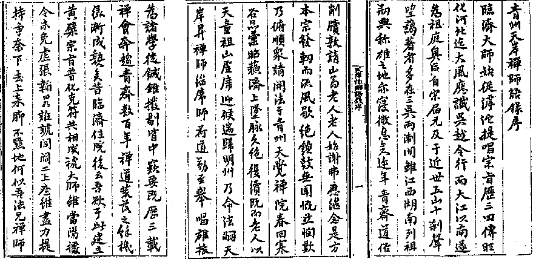
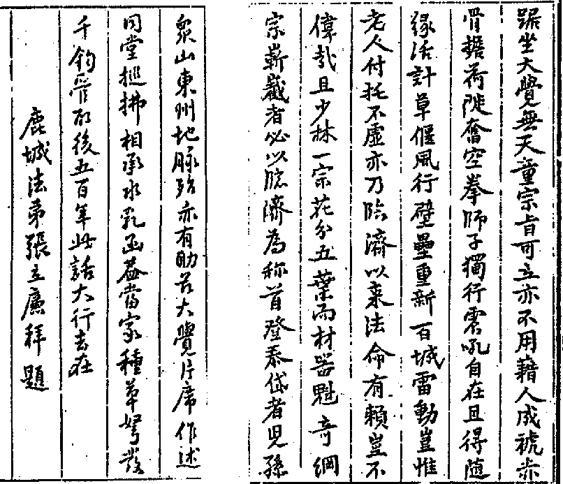

# 天岸升禅师语录



> **藏经**：嘉兴大藏经（新文丰版）（嘉兴藏）　**册次** 第 26 册（J26）　**编号** JB187　**部类** 诸宗部　**卷次** 20 卷　**篇幅** 184,664 字

> **作者（译者）**：侍者元玉记录、侍者溢元记录、侍者溢玄记录、侍者一诚记录、侍者海屿记录

> **卷／品**：20 卷 · 2 品



---



## 目录



  - [青州天岸禅师语录序](#青州天岸禅师语录序)

  - [序](#序)

- [天岸升禅师语录卷第一](#天岸升禅师语录卷第一)

- [天岸升禅师语录卷第二](#天岸升禅师语录卷第二)

- [天岸升禅师语录卷第三](#天岸升禅师语录卷第三)

- [天岸升禅师语录卷第四](#天岸升禅师语录卷第四)

- [天岸升禅师语录卷第五](#天岸升禅师语录卷第五)

- [天岸升禅师语录卷第六](#天岸升禅师语录卷第六)

- [天岸升禅师语录卷第七](#天岸升禅师语录卷第七)

- [天岸升禅师语录卷第八](#天岸升禅师语录卷第八)

- [天岸升禅师语录卷第九](#天岸升禅师语录卷第九)

- [天岸升禅师语录卷第十](#天岸升禅师语录卷第十)

- [天岸升禅师语录卷第十一](#天岸升禅师语录卷第十一)

- [天岸升禅师语录卷第十二](#天岸升禅师语录卷第十二)

- [天岸升禅师语录卷第十三](#天岸升禅师语录卷第十三)

- [天岸升禅师语录卷第十四](#天岸升禅师语录卷第十四)

- [天岸升禅师语录卷第十五](#天岸升禅师语录卷第十五)

- [天岸升禅师语录卷第十六](#天岸升禅师语录卷第十六)

- [天岸升禅师语录卷第十七](#天岸升禅师语录卷第十七)

- [天岸升禅师语录卷第十八](#天岸升禅师语录卷第十八)

- [天岸升禅师语录卷第十九](#天岸升禅师语录卷第十九)

- [天岸升禅师语录卷第二十](#天岸升禅师语录卷第二十)



---



### 青州天岸禅师语录序











天岸升禅师语录目录



------



### 序



第一卷住青州大觉禅院语录



第二卷住青州大觉禅院语录



第三卷住青州大觉禅院语录



第四卷住青州大觉禅院语录



第五卷住青州大觉禅院语录



第六卷住青州大觉禅院语录



第七卷住青州大觉禅院语录



第八卷住青州大觉禅院语录



第九卷再住青州法庆禅寺语录



第十卷再住青州法庆禅寺语录



第十一卷再住青州法庆禅寺语录



第十二卷大觉首座寮秉拂



第十三卷大觉首座寮秉拂



第十四卷示众



第十五卷机缘



第十六卷颂古



第十七卷华严颂古



第十八卷赞



第十九卷偈



第二十卷佛事  

法语  

杂著



------



## 天岸升禅师语录卷第一



**译者**：侍者元玉记录



住青州大觉禅院语录



师於顺治乙未春即大觉首座寮受请，於四月朔旦众请主院事。



佛殿。「丹霞矢上加尖，老母心头著热，大丈夫总不必大人境界，普贤知礼周乐备为标格。」遂炷香，大展三拜。



伽蓝。「赫赫厥声，濯濯厥灵，君既知我，不用叮咛，但信乾坤奉一人。」



祖堂。「一灯燄起，千灯续长；一瑞华开，五叶流香。新长老又排场，嫩绿骎骎过短墙。」



据室。「据此室，行此令，坐却佛祖咽喉，断尽衲僧性命。有包天括地之才，无门入作；具夺角搴旗之用，脑后添锤。新长老不是尽法无民，滴涓竭尽沧溟里，要见鲸鲵浪泼天。」



拈疏。「不是学而第一，何须子曰宣扬？毛锥未动，文彩全彰。若欲重宣此义，谛听右经一章。」



法衣。「脱珍著敝全潮坐，青嶂辞云入闹蓝，从此通身俱是缚，为谁辛苦为谁甘？还有为新长老雪屈者麼？鸡足云开慈氏还。」



法座。「法界高无量，此座高无量；法界广无边，此座广无边。因甚同门出入者迎之不见其首，把臂共游者随之莫得其后？新长老今日为诸仁揭示：一上师子，步象王踪，声光落落，逼塞虚空。」遂骤步登座。



拈香。「此一瓣香，高而无上，贵而无价，奉为北阙之至尊，敬祝无疆之圣寿，伏愿德充寰宇、道洽华夷，河海晏清、普天同庆。」次拈云：「此一瓣香，金为枝，玉为干，从不可思议中拈出，奉为阖国公孤宰执、一州牧伯尊官，伏愿嘉谟协赞乎皇家，愿力不忘乎付属。」复拈云：「此一瓣香，自从七刹追随，一十三载执侍，县崖攃手仍遭毒棒麤拳，绝后再稣转吃千生万受。既尔冤各有头，今日理应昭雪，人天众前特为拈出供养，即此堂上本师山翁大和尚，用酬法乳之恩。」



维那白椎，云：「法筵龙象众，当观第一义。」



师云：「是义非思量分别之所能解，非语言寂默之所能通。既不能通、又不能解，还有向金不博金处与新长老相见者麼？」



问：「释迦说法，多宝证明；和尚开堂，老人在席。如何是续燄连辉句？」师云：「勒回河北千年运，直接曹谿万派春。」进云：「如何是提挈同条句？」师云：「玅舞不须夸遍拍，三台须是大家催。」进云：「如何是接引后昆句？」师云：「风行艸偃。」进云：「昔日临济大师在滹沱河侧住一小院，谓普化、克符曰：『我欲於此建立黄檗宗旨，汝二人须成褫我。』祇如师子游行不求伴侣，因甚要人成褫？」师云：「独掌不浪鸣，两掌鸣掴掴。」进云：「三日后，普化上来问曰：『和尚前日道甚麼？』济便打。意旨如何？」师云：「铁轮天子寰中敕。」进云：「三日后，克符上来问曰：『前日和尚因甚打普化？』济亦打。又且如何？」师云：「玉锁重重金殿开。」进云：「今日和尚出世，如何建立大觉宗旨？」师云：「斩钉截铁。」进云：「如是，则不惟善为继述，抑且振起从上风规。」师云：「久矣向怀。」



蘧伯玉问：「提斩新条令，雨骤缁黄；整济北家风，云臻士庶。正当恁麼时，如何是开堂一句？」师云：「雷轰电掣。」进云：「师子未出窟，万兽已潜踪。即今出窟也，又作麼生施设？」师云：「天高群象正，海阔百川朝。」进云：「恁麼则道泰不传天子令，时清休唱太平歌。」师云：「阿谁不愿？」进云：「将谓少林消息断，桃华依旧笑春风。」师云：「且得共相证明。」进云：「昔日宝寿开堂，三圣推出一僧。意旨如何？」师云：「金将火试。」进云：「寿便打。复作麼生？」师云：「玉本无瑕。」进云：「三圣道：『恁麼为人，瞎却镇州一城人眼去在。』且道是肯伊？是不肯伊？」师云：「同声相应。」进云：「寿擿下拄杖便归方丈。且道是为人？是不为人？」师云：「韵出青霄。」进云：「今朝新大觉亦不用棒、亦不瞎却人眼，且道还有为人处也无？」师云：「相逢自有知音知，何必清风动天地？」进云：「旧时海外风雷震，今日临场更作家。」师云：「不劳赞叹。」



问：「高县慧日新天外，百亿须弥入彩红，望尽慈风今日到，万灵俱摄一光中。为复是把断要津？为复是放开一线？」师云：「南斗七，北斗八。」进云：「手执夜明符，几个知天晓？」师云：「确。」进云：「如是，则龙得水时添意气，虎逢山势长威狞。」师云：「何用为它人喝彩？」进云：「昔日僧问投子：『如何是一大事因缘？』子云：『尹司空与老僧开堂。』意旨如何？」师云：「句里无私。」进云：「今日和尚一大事因缘𫆏？」师云：「脑后拔箭。」进云：「可谓百尺嵒头探虎穴，千寻海底攫骊珠。」师云：「罕遇虎子。」乃云：「问答俱备，总涉繁词。宾主历然，未称好手。不见道：金不博金，水不洗水；佛不求佛，心不传心。是处有慈氏，华柳丛生菩萨云；无门无善财，瓦砾遍圆华藏界。於此信得及去，便见古释迦不先、今弥勒不后，如镜炤镜、如空合空，万古徽猷，真风不坠。直得如天普盖，家家云月是同，南北本通途而合辙；似地普擎，在在封疆不隔，齐鲁不待变而同风。然此犹是区隅自守，未堪绍续门风。若欲倒接无根树，振滹沱旧日风规，横挑海底灯，行河北斩新条令，直须拨转天关、掀翻地轴，糁华枯木，放出曹谿浪里春；横按吹毛，活逼生蛇头带角；别有生机一路，不攀从上枝条，方能遇缘即宗，随处作主。子四生、家三界，艸偃风行；安家国、定乾坤，珠回玉转。正当今日，芳猷克绍，正脉流通，一句作麼生道？」卓拄杖，云：「宝杖撑开新日月，从教大地眼同明。」



起身，云：「本升自揣愚蒙，学疏才浅，兼性多戆直，复年值富强，是以决志林泉，山崖藏拙。不意本师老和尚法幢东指、化日南移，既舆情攀挽以无从，念河北法运之久替，特命本升继席。屡涕泣而坚辞，仍为四众攀辕，再登车而复阻。兹者重承严命指呼、缁素交章劝请，开堂祝圣佛事幸周，敢将谿涧细流增入天池浩瀚，伏愿帝业日隆、金瓯永固。堂上老人德弥尊、道弥大。千秋仰慧日之高县，现前昆仲金为振、玉为声；法社喜真风之不坠，缁素同明正眼，见闻咸发胜心。久立，众慈，伏惟珍重。」



复举：「昔日马大师出世江西，南岳让和尚问众曰：『道一曾为众说法否？』众云：『已为众说法。』让和尚曰：『再无人持个消息来。』乃命一僧至马师座下，待马师升座，出问曰：『作甚麼？』马师云：『自从胡乱后，三十年不少盐酱。』」师云：「义出丰年，还它马祖，然未免带累南岳和尚县挂心头。今日新大觉出世，堂上老人且喜未离丈室，现前昆仲尚乃鹭立鸳行，有华当面插，不用送语传言，白手并空拳，也不著盐蘸酱。生平列列挈挈，畜得一条拄杖。遇圣好与三十，当下空其圣量；遇凡好与三十，当下涤其凡情。直使个个如师子儿，哮吼自在。且道与马师相去多少？」喝一喝，云：「掀翻海岳求知己，拨转乾坤见太平。」



复白椎，云：「谛观法王法，法王法如是。」师卓拄杖，下座。



当晚小参。问：「灵山佛法付王臣，敲唱须凭过量人，华盖今宵临宝座，宗乘向上乞施陈。」师举拂子，云：「有眼皆见。」进云：「彼此相逢全意气，攒眉何必羡渊明。」师云：「却被阇黎道著。」进云：「三尺莫邪横宇宙，洗清魔佛逼人寒。」师云：「今日亲行此令。」乃云：「白云尝念旧嵒阿，几度乘风归绿萝，谁信业缘无避处？牵犁从此水泥拖。既事不获已，信口说伽陀。高地麦，后园蔬，碧桃华发满山坡。一自悟心人去后，几个迷逢达磨？」



复举：「雪峰示众云：『望州亭与汝相见了也，乌石岭与汝相见了也，僧堂前与汝相见了也。』」师云：「大小雪峰，有年无德，屈抑多人。新长老即不然，望州亭也不须相见，乌石岭也不须相见，僧堂前也不须相见。何故？茫茫宇宙人无数，那个男儿不丈夫！」喝一喝。



请冰心雪禅师都寺上堂。「独掌不浪鸣，两手鸣掴掴。提纲挈领，声气相求，须是雪操冰心，毋意、毋必、毋固、毋我，方能屈尊就卑，裁成辅相，相与建法幢、相与定宗旨。且道甚麼人能行恁麼事？打面还它州土麦，唱歌须是帝乡人。」



晚参。「十方同聚会，个个学无为，此是选佛场，心空及第归。前弥勒、后释迦，左阿难、右迦叶，大觉今日筑坛，为你诸人分茅锡土。若承受得，子牙庆遇风云会；傥更踌躇，浩然归去老襄阳。」



上堂。「涧水遶山房，白云抱幽石，此时林下人，活计天然别。却怪德山、临济，星布棋列，摝蚬捞虾，行棒行喝，好与捉来，朝打三千、莫打八百。因甚如此？清平世界，不容艸窃。」



晚参。「旃檀丛林，旃檀围绕，非其种者，鉏而去之。师子丛林，师子围绕，非我族类，其心必异。南来者南去、北来者北归，一任山门路绝、法堂艸深，真金自有真金价，终不和沙卖与人。」



结夏，小参。「未有长行而不住，门未入，常在家中；未有长住而不行，户不出，遍周法界。通上下、彻古今，破明暗、绝疏亲。如是，则何生可护？何足可禁？然虽恁麼去，未过荆棘林，谩云夸好手，平地陷多人。毕竟如何？大象蕅丝突出，神龙针眼翻身。」



上堂。问：「重颁祖令，揭日月之光辉；克绍宗猷，为四生之调御。安居结夏则不问，如何是一言天下化？」师云：「七尺枯藤为君决。」乃云：「大丈夫秉慧剑，般若锋兮金刚燄，非但能摧外道心，早曾落却天魔胆。魔胆既落，天清地宁。三条椽下、七尺单前，一任坐卧经行，是名禁足、是名护生。然虽如是，设遇释迦老子现三十二相、八十种形，唤你游莲华国土玅庄严城，你还肯去？不肯去？」擿下拄杖，云：「不得动著，动著祸生。」



于郡侯至，请上堂。问：「为佛法金汤，必也灵山付属；作苍生福佑，当知金粟种来。不滞二途，请师一句。」师云：「闾丘亲见寒山子。」进云：「昔日李驸马问谷隐禅师云：『某甲还参得禅不？』谷云：『参禅乃大丈夫事，非将相之所能为。』未审意旨如何？」师云：「车不横推。」「祇如李驸马从此悟去，复作麼生？」师云：「理无曲断。」「今日若有人问和尚：『某甲还参得禅不？』如何对它？」师云：「却许参得。」进云：「作家宗师，天然迥别。」师云：「太宰赞仲尼。」乃云：「以大圆觉为伽蓝，统率十方而聚会。忘尊卑、一贵贱，泯凡圣、绝异同。各各据菩萨乘修寂灭行，性相平等、身心安居，所谓有现宰官身者、有现比丘身者、有现居士长者身者、有现优婆塞优婆夷身者。乘时于其中间作大佛事，有持香积而来者、有擎拳致敬者、有散华供养者、有焚香行道者，吹大法蠃、击大法鼓，示最上乘，阐第一义。」卓拄杖，云：「拄杖子涌身七多罗树，高声唱言：『善哉佛子！希有佛事，我於灵山会上亲见亲闻，今此一会俨然未散。』诸人还信得及麼？丰干不是闲饶舌，闾丘亲得见寒山。」



复举：「昔日李牧主请风穴和尚于衙内度夏，普设大会，请穴上堂。才升座，乃曰：『祖师心印，状似铁牛之机，去即印住，住即印破。祇如不去不住，印即是？不印即是？还有人道得麼？』时有芦陂长老出问云：『学人有铁牛之机，请师不搭印。』穴曰：『惯钓鲸鲵澄巨浸，却嗟蛙步𩨍泥沙。』陂伫思，穴喝曰：『长老何不进语？』陂拟议，穴便打一拂子，曰：『还记得话头麼？』牧主曰：『信知佛法与王法一般。』穴曰：『见甚麼道理？』牧主曰：『当断不断，反招其乱。』穴便下座。」师云：「风穴正令全行，芦陂退身卖阵，简点将来，总让牧主一筹。何故？伯牙纵有高山调，不是知音也是闲。」



晚参。「从朝至莫，热棒热喝。万里无云，青天霹雳。把断穆陵关，全齐绝消息。有者进无门、面铁壁，退埋身、路已绝，便思南走吴、北走越，泣长途，血滴滴，殊不知背水功成，拔帜还壮士，长歌入汉关。」



晚参。「它人住处我不住，三峡月明人暗渡；它人行处我不行，逆风柁子转江心。不是与人难共住，从来相见不相识，大都缁素要分明，八两还它是半斤。」拈拄杖，云：「拄杖子愤地不平，道：『长老！休淈𣸩。智即是道，心即是佛。船不离柁，秤不离锤。长老知处我亦知、长老到处我亦到，松自直、棘自曲，乌自玄、鹄自白，一切现成，何须分别？』」乃擿下拄杖，唤云：「拄杖子！」自云：「诺。」「你因甚平地吃交？」自云：「相救，相救。」侍者拾起拄杖，师接得，呵呵大笑，云：「将谓将谓，元来元来。」



晚参。「一二三四五六七，下坡不走快便难逢；七六五四三二一，拨转乾坤一劳永逸。有时逆行顺取，有时逆取顺行。逆取顺行也，丹霞逢院主；逆行顺取也，师子遇罽宾。只如不涉逆顺一句作麼生道？知音无耳朵，六月火边坐。」



晚参。「雷动中天，云行雨施。夫雷之为物也，出乎地、发乎天，而声扬乎太虚之内；视之无形、听之有声，觅之无处、追之不及，不可以有心求、不可以无心得，蠢然者闻之而骇惊、负疚者闻之而惕厉。诸仁者！要识临济喝麼？只者是。要识德山棒麼？只者是。造物行此令而雨施云行，君王行此令而恩滂泽霈，临济、德山行此令而象舞龙奔，大觉今日亲行此令。」卓拄杖，云：「还闻雷声麼？」良久，云：「欲鼓蛰龙从海出，谁知走入鸭群中。」喝一喝。



晚参。「天下无二道，圣人无二心。道远乎哉？即事而真；圣远乎哉？体之即神。真之与神，犹挂唇齿。殊不知，道也者，不可须臾离也，可离非道也。故曰：『至道无难，惟嫌简择。』君子之於道也，造次必於是、颠沛必於是。於是而知焉，之为道。上士闻道，勤而行之；中士闻道，若存若亡；下士闻道，大笑之，不笑不足以为道。且道：如何免得笑去？多言数穷，不如守中。」



上堂。举：「无著禅师游五台，参礼文殊。至山下，投一寺宿。遇一老翁，祇待次，问曰：『上人从何而来？』著曰：『南方来。』翁曰：『南方佛法如何住持？』著曰：『末法比丘少奉戒律。』翁曰：『多少众？』著曰：『或三百、或五百。』著问曰：『此间佛法如何住持？』翁曰：『龙蛇混杂，凡圣交参。』著曰：『多少众？』翁曰：『前三三，后三三。』乃命童子将玻璃盏点茶度著，遂问曰：『南方还有者个不？』著曰：『无。』翁曰：『寻常将甚麼吃茶？』著无对。时天色已晚，著曰：『拟投一宿，得麼？』翁曰：『汝有执心在，不得宿。』著曰：『某甲无执心。』翁曰：『汝曾受戒不？』著曰：『受戒久矣。』翁曰：『既无执心，何用受戒？』遂命童子送出门外。著见寺无额，问童子曰：『此寺因何无额？』童子指背后金刚，著回首，忽失童子并山寺，只见身在林中。」师云：「文殊热谩无著，却乃移华兼蜨至；无著错过文殊，已曾买石得云饶。后来明招和尚颂曰：『廓同沙界圣伽蓝，满目文殊接话谭，言下不知开佛眼，回头只见翠蓝山。』要且不识无著。雪窦和尚颂曰：『千峰蟠曲色如蓝，谁谓文殊是对谭？却笑清凉多少众，前三三与后三三。』要且未见文殊。诸人要见文殊麼？大觉为你颂出：长夏山窗绿正肥，杨华偏爱逐征蹄，关山不尽情难诉，燕子衔将水际飞。然虽如是，要见文殊则易，要识无著则难；要识无著则易，要见大觉则难。何也？共行把手不同途。」击拂子，下座。



晚参。拈拄杖，云：「如世良马，见鞭影而行。」擿拄杖，云：「钝鸟莫栖芦。」便下座。



晚参。「日中必篲，操刀必割；日中不篲，是为失时。操刀不割，失利之期。汝等朝悠悠、暮悠悠，不顾祖翁田地，岁月如流。今有一椿喜事，劝汝同仇。杜宇啼春去，熏风到树头。常住有几亩薄田酸地，麦熟有秋，普请共出手及时收，刀头担头，东坵西坵，西来祖意，塞壑填沟。」



晚参。问众：「今日割麦，镰下割得多少祖师说？」众云：「车推不尽。」师微笑，乃云：「学道先须要学勤，一勤百事可能成。犹如蚕麦肥高陇，不尽登场功莫停。前日大觉劝诸仁者割麦，盖彻彼桑土绸缪牖户之意。现前诸仁有发胜心者，则安而行之；有护常住者，则利而行之；有力不足者，则勉强而行之。虽其行之之不同，及其成功一也。惟学道亦然，勿以钝根而生下劣之想、勿以敏慧而生骄矜之气、勿以博闻强记而生满足之情，此三者皆非入道之基也。然则毕竟如何即得？肯心若办如农事，安有临场不熟时？」



晚参。「恁麼也得，太平寰宇多奸贼；不恁麼也得，射虎不真羽没石；恁麼、不恁麼总得，重添脑后三斤铁，毕竟如何即得？截断红尘水一谿，冲开碧落云千尺。」



上堂。「弥勒真弥勒，化身千百亿，时时示时人，时人自不识。因甚又道天上无弥勒，地下无弥勒？」良久，云：「谁家别馆池塘里，一对鸳鸯畫不成？」击拂子，下座。



晚参。「忌口自然诸病减，多情未免有时劳，贫居动便成违顺，乐得清闲一味高。古人一期方便，似觉可观。若到大觉门下，未放过在。何故？桶箍爆断且自由它，东司净筹阿谁洗刷？」



祈雨，上堂。拈拄杖，云：「云门拄杖子，久置之高阁，便见尘土坌𡋯。世间焦芽败种望救无门，今日令它兴云吐雾看。」乃卓拄杖，云：「南山起云，北山下雨。」顾左右，云：「诸人各各炤顾袈裟角。」复卓一下，下座。



晚参。举：「楚石禅师上堂云：『通身是眼，因什麼看不见？通身是耳，因什麼听不闻？通身是口，因什麼说不到？通身是心，因什麼鉴不出？报恩有一道聪明神咒，布施诸人去也。』便下座。大觉即不然，通身是眼，有什麼看不见？通身是耳，有什麼听不闻？通身是口，有什麼说不到？通身是心，有什麼鉴不出？大觉也无聪明神咒布施诸人，珍重归堂吃茶去。」



上堂。「吃粥了也，洗钵盂去，接响承虚，其僧大悟。悟即不无，落在第二。何也？还家尽是儿孙事，祖父从来不出门。」



谢雨，上堂。「慈云才覆，殷雷遍震乎郊原；一雨普滋，万汇悉沾其润泽。便见江湖澎湃，何止丘壑皆盈？庐陵米价贱如泥，罗睺罗儿喜望外。冬瓜直儱侗，个个添肥；瓠子曲弯弯，条条增大。欣逢时节，庆谢良缘。诸仁者要知：此事亦犹农夫之望雨也。方其未雨，山焦石裂，忧心惕虑，惟雨之是望，不可以语言计也。及其既雨，黍秀苗兴，击壤讴歌，惟雨之是喜，不可以名状得也。若要如是，却须如是；既然如是，方能如是。不见昔日有一人悟后问古德曰：『此事本来现成，何须教学人百计搜求？』古德曰：『若不如是，子安能有今日也？』幸各勉旃，不烦久立。」



晚参。「法离言说，道绝方隅。大海不著死尸，龙门岂有宿客？曹家女，美无敌，奯公妻，娇欲滴。皓齿明珰嫁少年，少年不解加珍惜，浪荡天涯何日归？室中空有人如玉。」喝一喝。



上堂。举：「承天嵩和尚示众：『第一、单枪甲马，第二、甲马单枪，第三、攃星排阵，第四、衣锦还乡。』有僧便问：『如何是单枪甲马？』嵩云：『不是金牙作，争能射尉迟？』僧云：『如何是甲马单枪？』嵩云：『金簇马前落，楼烦丧胆魂。』僧云：『如何是攃星排阵？』嵩云：『阵云横海上，未办圣明君。』僧云：『如何是衣锦还乡？』嵩云：『四海无消息，回奉圣明君。』」师云：「承天虽有图王定乱之谋，不免为太平奸贼。大觉无者许多般去就，却能坐致太平。」乃竖拂子，云：「还会麼？吾宁斗智不斗力，一纸贤於十万师。」



因事上堂。「有转凡成圣之功，方可权衡佛祖。无点铁成金之手，那能掌握乾坤？得大机，明大用，羽檄星驰全杀活，善卷舒奔流度刃。有时光风霁月、有时电掣雷轰，除此二途，向甚麼处与大觉相见？知恩者少，负恩者多。」



晚参。「君子千里同风，因甚东山头唤不应西山主？眼光烁破四天下，因甚庵内人不知庵外事？」良久，云：「手握金鞭问归客，夜深谁共御阶行？」



上堂。问：「人人本具，个个不无，因甚有迷有悟？」师云：「几人平地吃交来？」进云：「如何是悟？」师云：「贪观天上月。」「如何是迷？」师云：「失却手中桡。」「正当迷悟俱忘，如何是学人转身句？」师云：「速礼三拜。」进云：「即今和尚升座，有甚佛法惠诸人？」师云：「无甚佛法见惠。」进云：「多蒙和尚指示。」师云：「承虚接响汉。」乃曰：「欲说又成剩语，不说又成钝置。且道：说即是？不说即是？若道说，即今曾说甚麼来？若道不说，现今牙齿敲嗑何？且道：是已说？是不曾说？於此倜傥分明，方知佛法无多子；其或未然，山僧别资一路去也。片叶飘庭际，西风何处秋？」



晚参。拈拄杖，云：「启解脱门，开无尽藏，大包无外，细入无间，令汝诸人一得永得、一见永见，宜各乘时饱腹观光，瞻仰取足。会中莫还有欠缺者麼？山僧更为平等分付。」卓拄杖，下座。



中元供水陆，上堂。拈拄杖，云：「天人群生类，皆承此恩力。夫此力者，如天普盖、似地普擎，如日普炤、如风普吹，有承此力而为佛祖身、有承此力而为天人身、有承此力而为威德自在身、有承此力而为贫穷下劣身。应以佛祖身得度者，即现佛祖身而为说法；应以天人身得度者，即现天人身而为说法；应以威德自在身得度者，即现威德自在身而为说法；应以贫穷下劣身得度者，即现贫穷下劣身而为说法。且道：拄杖子即今现甚麼身？说甚麼法？」卓一下，云：「剑为不平离宝匣，药因救病出金缾。」



解夏，小参。「疏雨滴梧桐，秋声满院中，炎飙驱户牖，凉气入帘栊。聚首成何事？支笻又别峰。光阴能有几？为子惜匆匆。敢问诸仁者：昔何所闻而来？今何所见而去？去也，须知去处；来也，须识来处。若能去来不涉，中道不居，直下觑透，山僧许你会得个入门句，未会出门句在。若是两眼𥉌眵，来不知来处、去不知去处，是名无地头汉。既是无地头汉，则业识茫茫，无本可据，东西不办、南北不分，依旧向三家村里说黄道白，十字街头点肋点胸，山僧却也许你。许你甚麼？许你大胆。」



上堂。「四月十五日结也，结个甚麼？七月十五日解也，解个甚麼？结亦不可得、解亦不可得，诸方老秃奴，以此为极则。大觉者里敢保未彻。何故？范公泉水日渊泓，云门山子常青碧。」



开山忌，上堂。「昔年今日此时，开山和尚已为诸人真实揭示了也。诸人还荐得也未？若也荐得，开山和尚与诸人同得、同失，同食息、同起居，从来不离寸步；若也不荐，山僧借开山鼻孔，为诸人重说偈言去也。死乃生之源、生乃死之本，若达其本源，无生亦无死。既无生又无死，且道：即今向什麼处与开山和尚相见？」下座，同到真前烧香上供。



晚参。「古人不唧溜，言多成漏逗，百喻不能诙，指注天涯走。天涯走杀人，逐燄事何有？本是金毛儿，无端变作狗，一念自知非，便解大哮吼。且知非一句如何道？若也道得，不用畫地为牢，担枷带杻；若道不得，各各向七尺单前剔起眉毛，自然有日知羞识丑。」



上堂。问：「烹佛烹祖大炉鞲，锻凡炼圣恶钳锤，设遇个无面目汉，如何锻炼？」师云：「痛与三十拄杖。」进云：「可谓处处摧魔外，逢人善举扬。」师云：「你还觉脑门痛麼？」进云：「人人鼻孔撩天，个个脚跟点地。」师云：「饭店里匙箸。」



问：「向上宗乘即不问，炉鞲宏开事若何？」师云：「少柴没炭。」进云：「如是，则不费心力，坐致太平去也。」师云：「上座正闹在。」进云：「荆棘林中曾进步，夜明帘外早翻身。」师云：「不易念得来。」乃云：「诸方此日开大炉鞲、用大钳锤，一千五百，左探右窥，有者围炉商量无宾主话、有者聚头高谭火燄转大法轮，或云：『我善摧残峻峭。』或云：『我善销烁玄微。』大觉门下极猒者般施为，既不商今确古、也不添炭添煤，总有数百衲子，一任东倒西擂。因甚如此？冷灰爆出黄金豆，却胜诸方热哄禅。」



上堂。问：「古人入门便棒、进门便喝，大觉入门如何指示？」师云：「将错就错。」进云：「意气不从天地得，英雄岂藉四时推？」师云：「你还出得大觉门也未？」进云：「龙生金凤子，冲破碧琉璃。」师云：「且缓缓。」



问：「教中道：『二谛融通三昧印。』如何是俗谛？」师云：「成佛作祖。」进云：「如何是圣谛？」师云：「杀狗屠牛。」进云：「如何得融通去？」师云：「屠子成佛。」



问：「『大事未明，如丧考妣』即不问，大事已明，因甚亦如丧考妣？」师云：「香严道底。」进云：「有已明大事者，和尚如何相接？」师云：「正好吃棒。」进云：「不劳锦上更添华。」师云：「黑地里穿针。」



问：「人人鼻孔撩天，个个脚跟点地，因甚临济大师在黄檗会下吃棒？」师云：「偶然著跌。」进云：「男儿自有冲天志，不向如来行处行。因甚大愚肋下还拳？」师云：「翻身鹞子过新罗。」进云：「祇如黄檗，还有为人处也无？」师云：「知音者少，负恩者多。」进云：「教外亲行越格令，五湖四海悉沾恩。」师云：「礼拜了退。」



问：「鼓声才罢，四众云臻，今日上堂有何分付？」师云：「铁棒撑驴眼。」进云：「为众竭力，祸出私门。」师云：「也不亏负你。」进云：「恁麼则人人壁立万仞，个个眼盖乾坤。」师云：「独你扶篱摸壁。」



问：「有眼，因甚麼不见？」师云：「瞎。」「有耳，因甚麼不闻？」师云：「聋。」「有鼻，因甚麼不嗅？」师云：「塞。」「有舌，因甚麼不知味？」师云：「木。」「有身，因甚麼不知触？」师云：「坐冢行尸。」「有意，因甚麼绝思想？」师云：「石头厌艸。」僧礼拜，师云：「便恁麼去也。」乃云：「佛者，觉也。空生大觉中，如海一沤发。且道：觉从何生？琉璃殿上紫金容，千古万古人谁识？」



上堂。问：「古释迦过去，新弥勒未来，正与麼时，谁行正令？」师正身端坐。进云：「恁麼则浅艸深藏，宾能看主。」师便喝。进云：「忽有个大悲菩萨到来，千手千眼一时俱现，和尚如何答话？」师云：「令它无著手眼处。」进云：「禹门三级浪，平地一声雷。」师云：「休吓山僧。」



问：「丛林既佛为尊，因甚麼不居正位？」师云：「随你颠倒所欲。」进云：「无处不称尊。」师云：「此章重出。」进云：「如何是宾中主？」师云：「直岁梆椎子。」进云：「如何是主中宾？」师云：「门外白云深。」进云：「宾主双忘复若何？」师云：「两眼对两眼。」进云：「一堂风冷澹，千古意分明。」师云：「听事不真。」



问：「从上诸佛即今在甚麼处安身立命？」师竖拂子，云：「还见麼？」进云：「恁麼则诸圣各得其所，因甚今日更安佛位？」师云：「差排古佛离窠臼。」进云：「既安位也，度生一句作麼生商量？」师云：「见闻普熏皆寂灭。」进云：「恁麼则愿常处此菩提座，随缘赴感靡不周。」师云：「过。」进云：「观世音既是过去正法明如来，则金不重矿，因甚重发誓愿？」师云：「渠无人我相。」进云：「恁麼则慈航倒驾逆流上，度尽众生愿始休。」师云：「徐六担版。」



问：「万法平沈，如何是本来面目？」师云：「秋空独露。」



问：「《金刚经》云：『凡所有相，皆是虚妄。』因甚麼又唤作佛？」师云：「以楔出楔。」



问：「世尊说法，十界齐闻。和尚升座，有何施设？」师云：「一雨普滋三艸秀。」进云：「还是有佛法？无佛法？」师云：「枯木不逢春。」进云：「多蒙和尚指示。」师云：「冤苦叫苍天。」



问：「混沌未分之始，阴阳未判之先，还有佛法也无？」师云：「有。」进云：「大通智胜佛十劫坐道场，因甚佛法不现前不得成佛道？」师云：「为你眼里无筋。」进云：「太白峰头月，青齐万古寒。」师云：「大虫看水磨。」



问：「玅句奇言即不问，当机酬唱时如何？」师云：「吃得棒也未？」乃云：「佛身充满於法界，普现一切群生前，随缘赴感靡不周，而恒处此菩提座。昨夜，毗卢遮那佛不起於座，向观音院里将钱买烧饼，放下手却是馒头。主林神、主山神忽地生疑，道：『说是毗卢遮那，又在观音院里；说是观音大士，又是毗卢遮那。手中烧饼因甚却作馒头？』会中有弥勒大士向它道：『山神！林神！你只吃馒头罢休，那解是甚深义？』二神懡㦬而退。然则毕竟如何是毗卢正体？」



击拂子，云：「家家门里观世音。」



------



## 天岸升禅师语录卷第二



**译者**：侍者元玉记录



住青州大觉禅院语录



上堂。问：「大善知识能调物情，因甚众生尚有梗化者？」师云：「山僧行年在坎。」进云：「外道、天魔、夜叉、罗刹，四方八面一时俱来，和尚如何扺对？」师云：「山鬼伎俩有尽，我之不采无穷。」进云：「恁麼则厌石推山只等闲，果然世、出世中尊。」师云：「却是阇黎会得。」



问：「向上宗乘即不问，愿闻父母未生事。」师云：「眉毛八字分。」进云：「生后又如何？」师云：「仰面看天不见天。」进云：「生前生后蒙师指，当阳一句请师宣。」师云：「香烟堆里乾坤大。」进云：「谢师指示。」师云：「梦里说惺惺。」



问：「宗乘教乘即不问，如何是大觉境？」师云：「青锁绿围关不住，飞沙时点碧琉璃。」进云：「如何是境中人？」师云：「土面灰头人不识，逆风吹了顺风吹。」进云：「还修行也无？」师云：「不修行。」进云：「日用作麼生？」师云：「杀猪杀狗。」进云：「学人会也。」师云：「你作麼生会？」进云：「太平本是将军致，不使将军见太平。」师云：「错会不少。」



问：「尽大地是清净法身，因甚麼有天堂地狱？」师云：「因你置得。」进云：「天堂谁人住？」师云：「是你住。」进云：「地狱谁人住？」师云：「住天堂者。」进云：「佛言：『须发落地，超五百大劫。』因甚某甲居地狱？」师云：「惟人自肯。」进云：「和尚如何救济？」师云：「山僧救你不得。」进云：「恁麼则天堂、地狱都无实，抬眸三界一真如。」师云：「屙屎见解。」乃云：「狂风一夜吹不歇，匝地风沙劈面来，耳里虽然闹聒聒，眼前潇洒绝尘埃。既是风沙劈面，因甚又道潇洒绝尘？腊月青莲火里开。」



晚参。「本是金沙滩上客，山云海月共忘机，无端误蹈黔驴尾，哮吼声如埜犴啼。埜犴啼闹青齐然，却有个好处。好在甚麼处？不见圆通门大启，驴鸣犬吠示全提。」



晚参。问：「鼓声才罢，猊座高登，利生一句即且止，济宗玄要请师宣。」师云：「山僧幸开杂货舖。」进云：「如何是一句中具三玄？」师云：「埜色更无山隔断。」进云：「如何是一玄门具三要？」师云：「天光直与水相连。」「如何是第一玄？」师云：「前山门。」「如何是第二玄？」师云：「后佛殿。」「如何是第三玄？」师云：「一蹋鸿门开两扇。」「如何是第一要？」师云：「阎罗业镜。」「如何是第二要？」师云：「泰山簿子。」「如何是第三要？」师云：「三皇冢上艸芊芊。」进云：「恁麼则一种没弦琴，惟师弹得玅。」师云：「错下名言。」



问：「楖栗横担不顾人，直入千峰万峰去，毕竟走向甚麼处为止？」师云：「千峰万峰。」进云：「岂有常行而不住者乎？」师云：「待你有住处即向汝道。」进云：「者里还许行鸟道也未？」师云：「险。」进云：「西去济南三百五，无限行人恨路长。」师云：「走杀阇黎。」



问：「钦奉觉皇令，掀翻魔外疆，锦衣归故里，稽首谢君王时如何？」师云：「谁是其人？」进云：「有功之臣为甚麼不赏？」师云：「李陵不是汉家臣。」乃云：「玄玄玄，十四十五月婵娟；玅玅玅，霜天永夜无私炤；也不玄、也不玅，信口道来无不好。达磨西来的的意，二祖亲传曾断臂，曾断臂，血常流，直至而今痛未休。会中还有知痛痒者麼？若有，祖宗门风不至埽地；如无，将谓山僧说玅谭玄。」喝一喝。



上堂。问：「开凿人天眼目，阐扬佛祖宗风。人天眼目即不问，如何是临济宗？」师云：「棒打髑髅痛彻髓。」「如何是云门宗？」师云：「须信山高水又深。」「如何是沩仰宗？」师云：「金锁玉环钩不住。」「如何是曹洞宗？」师云：「宝镜堂前炤绝功。」「如何是法眼宗？」师云：「万象森罗无一法。」进云：「五家宗派蒙师指，未知和尚是何宗？」师云：「点铁使成金。」



问：「如何是得力句？」师云：「浅。」「如何是不得力句？」师云：「深。」进云：「截断两头时如何？」师云：「浅深不识。」



问：「天上月圆，人间月半，脚跟下事，请师决断。」师云：「七棒对十三。」进云：「人人自有光明在，何故日用而不知？」师云：「麻木症从君自害。」进云：「心、佛及众生，是三无差别，为甚有迷悟之分？」师云：「七颠八倒更出谁？」进云：「恁麼则木人高拍云中版，石女空吹海底笙。」师云：「馊茶剩饭，不劳拈出。」



问：「从无住本立一切法，如何是无住本？」师云：「问从何来？」进云：「如何是立一切法？」师云：「你问我答」



问：「终日上堂，端为何事？」师云：「为怜松竹引清风。」进云：「本来无得亦无失，指示学人个甚麼？」师云：「劈开漆桶。」进云：「开后如何？」师云：「大众笑你。」



问：「如何是学人最初一步？」师云：「适才众里来。」「如何是末后一句？」师云：「少顷归堂去。」进云：「大洋海底现明月，万里无云万里天。」师云：「那里学得来？」



问：「昨晚小参，今日上堂，如何是格外全提句？」师云：「昨晚小参，今日上堂。」乃云：「不慕诸圣，不重己灵，罔谭彼短；口吞佛祖，眼盖乾坤，靡恃己长。大丈夫逢强即弱、遇柔即刚，荆棘林内坐大道场，无可、不可，混俗和光。且道：凭甚得到与麼田地？裈无口，裤无裆。」



晚参。问：「『十方同聚会，个个学无为，此是选佛场，心空及第归』，庞居士恁麼道，还有为人处也无？」师云：「有。」进云：「毕竟在那一句？」师云：「庞公在你脚底。」进云：「如何是十方同聚会？」师云：「面面相觑。」进云：「如何是个个学无为？」师云：「只你闲。」进云：「如何是选佛场？」师云：「横亘十方。」进云：「如何是心空及第归？」师云：「你是孙山外人。」进云：「只如大觉今日十方聚会、选佛场开，毕竟有何祥瑞？」师云：「瞻之仰之。」



问：「德山晚参不答话，未知大觉意如何？」师云：「却许答话。」进云：「云门大师有三句，还许学人请益也无？」师云：「念得清楚来。」「如何是函盖乾坤句？」师云：「日炤千门。」「如何是随波逐浪句？」师云：「前谿水急。」「如何是截断众流句？」师云：「合取狗口。」进云：「三句已蒙师指示，向上宗乘是如何？」师云：「炙背可以献天子。」



问：「多子塔前全正令，师今登座有何施？」师云：「胡饼。」进云：「觌面相承，阿谁不荐？」师云：「胡饼讨汁。」乃云：「十方无壁落，四面亦无门，因甚释迦老子又道：『惟有一门，而复狭小，可以出得。』频呼小玉元无事，祇要檀郎认得声。」



因雪上堂。问：「耿耿寒空即不问，雪月交辉事若何？」师云：「日出后看取。」进云：「正恁麼时，还有过也无？」师云：「罪犯弥天。」进云：「谢师指示。」师云：「罗公炤镜。」进云：「处处清风袭人面，家家门首月团圆。」师云：「犹有向隅人。」



问：「雪覆千峰，因甚孤峰不白？」师云：「壶中别有天。」进云：「三界无安一火宅，因甚大地雪漫漫？」师云：「出头天外看。」进云：「雪山白浪，碧海青莲。」师云：「添得阇黎眼里华。」进云：「浪里波涛浪里净，不是知音人不知。」师云：「只知渡水，不觉泥深。」



问：「水底有天藏世界，潭中无物映山河时如何？」师云：「认影迷头汉。」乃云：「前日清寥寥，昨宵白滴滴，山山树树结琼瑶，大地山河成一色。有者便道『普贤瑞象腾辉』、有者便道『迦叶门风漏泄』，无奈今朝日出，瓦解冰消，全无巴鼻，一似一似。一似个甚麼？一似禅和子底琉璃架子，一时倒折。」



冬至，小参。「明头合，暗头合，明暗双双个时节，英雄岂逐四时推？意气不资造化力。慈明揭牓，僧堂虚空，涂墨洞山，掇退果卓，和气尽失。休，休。五湖烟景有谁争？自是不归归便得。」



上堂。问：「灵山涅槃心，少室西来意，大觉棒下无生忍，未审是同还是别？」师云：「从来不畜闲家具。」进云：「十方婆伽梵，一路涅槃门。」师云：「路头在什麼处？」进云：「和尚还了学人青州布衫钱，然后学人还和尚镇州萝卜价。」师云：「路头也不识。」进云：「书云一曲又如何？」师云：「不遇知音者，徒劳话岁寒。」



问：「有物先天地，无形本寂寥，能为万象主，不逐四时凋。如何是有物先天地？」师竖拂子，云：「还见麼？」「如何是无形本寂寥？」师放下拂子，云：「唤作拂子即不中。」「如何是能为万象主？」师便打。「如何是不逐四时凋？」师云：「顶门击碎，永劫莫忘。」进云：「恁麼则天上有星皆拱北，人间无水不朝东。」师云：「引不著。」



问：「古人道：『佛来也打，魔来也打。』学人即今礼拜和尚，是佛？是魔？」师云：「未有吃棒分在。」进云：「实际理地，一物不存，唤什麼人作魔？佛？」师云：「情知你不识痛痒。」进云：「棒头有眼明如日，要识真金火里看。」师云：「鹦鹉却能言。」



问：「秋去冬来，寒暑陵夺，还是暑能夺寒？寒能夺暑？」师云：「误吞弓影却成蛇。」进云：「门外山河秀，庵中坐寂寥。」师云：「口冷心头热。」



问：「斩新条令即不问，如何是和尚家风？」师云：「吹来对面寒。」进云：「学人即不然。」师云：「你试说山僧家风看。」进云：「等闲拈出还丹粒，烧尽人间药汞禅。」师云：「山僧没者闲气力。」乃云：「君子道长，仲尼之后无仲尼；小人道消，卢杞之后有卢杞。争奈何？争奈何？忙忙世事擿如梭，白日易催人渐老，朱颜能得几时过？惜蹉跎，莫蹉跎，磁石引铁，兔不离窝。不见阳回大地不改元初，枯椿华发香透藤萝。阿呵呵！好大哥。」



晚参。「昨日夜叉头，今朝菩萨面，菩萨与夜叉，不隔一条线。譬如镜中华、水中月，月无炤水之心、镜无含华之意。屠子立地成佛，不名性燥；良马见鞭而行，已属钝根。有等小根劣子、毛道凡夫，自信不及，平地生疑时如何？好人不肯做，只要窌里坐。」



晚参。问：「方以类聚，物以群分，因甚选佛场中龙蛇混杂、凡圣同居？」师云：「天高群象正，海阔百川朝。」乃云：「大觉无状村夫，一些长处全无，不是华劈桼桶便，买赵氏葫芦。要者，全然不采；退者，两手招呼。招呼招呼，葫芦葫芦，其中是甚麼药？汝但劈破葫芦。」



上堂。问：「法幢肇建，祖令当行，正恁麼时如何举唱？」师云：「山僧今日伤风。」进云：「昔日普眼因甚不见普贤。」师云：「谁名普眼？谁是普贤？」



问：「祖师直指人心，见性成佛。大觉门下，未审如何？」师云：「龟毛拂子长一丈。」进云：「天下宗风与和尚宗风，是同？是别？」师云：「姑苏绫绢尽属诸方。」乃云：「昨日三十，今朝初一，明眼衲僧，鼻孔打失？不打失？」卓拄杖，云：「释迦老子来也，报道：『吾有正法眼藏涅槃玅心，付与摩诃大迦叶。』」擿下拄杖，云：「呵呵！一场狼藉。」



说戒，上堂。问：「济北宗风即不问，光明宝戒请师宣。」师云：「戒香、慧香、解脱香。」进云：「昔日卢行者即黄梅於糟厂持来，高沙弥不登坛而便名具足，还是神通玅用？法尔如然？」师云：「撞著从前自家底。」进云：「今朝毗尼普施，未审坛上诸师是戒邪？衲子衣钵是戒邪？」师云：「东家点灯，西家暗坐。」进云：「恁麼则自从卢老收归后，须信人人总有之。」师云：「顶戴奉行。」乃云：「大庾岭头提不起底两手分付，鸡足峰前等个人底尽底传持，既尽底传持，复两手分付，则彼彼男子、各各丈夫，何必承禀释迦、让美弥勒？快骑骏马，先逢得意之春，骤步高楼，顿穷千里之目，岂非寒儒脱窭、平地登僊者哉？其或未然，富贵故乡归不得，夜行衣锦待如何？」



成道，上堂。问：「金刚宝戒，少刻圆成，悟道睹星，乞师指示。」师云：「良马已窥鞭影去。」进云：「黄面老瞿昙得什麼消息，便道：『奇哉，众生具有如来智慧德相。』又且众生本来清净，何故更有妄想执著？」师云：「阿难犹立世尊前。」进云：「如来德相从何而证？」师打云：「向你顶门里证。」进云：「《圆觉经》云：『成道亦无得，本性圆满故。』此理如何？」师云：「五九尽日始逢春。」进云：「卷尽白云归洞府，一轮红日挂山河。」师云：「酒畔乞儿。」乃云：「腊月初八，释迦眼错，带累儿孙，胡斟乱酌。吃红糟底，胆大心麤；吃鸡羹底，通身疑著。看来总与十三，免被旁观，咀嚼、不咀嚼，出群须是撩天鹘。」喝一喝。



上堂。问：「临济大师有宾主句，还许学人请益也无？」师云：「快打鱼子念将来。」「如何是宾中宾？」师云：「悦众鱼槌子。」「如何是宾中主？」师云：「朝念楞严夜施食。」「如何是主中宾？」师云：「你是山僧悦众。」「如何是主中主？」师云：「炤顾顶门轰霹雳。」进云：「宾主已蒙师指示，格外全提更若何？」师云：「铁鹞过新罗。」



问：「满座风生湖海客，愿闻一曲万年欢。」师云：「石人无耳朵。」进云：「如何是和尚为人处？」师云：「木马痛加鞭。」进云：「好看太白峰头月，闪烁青齐万古寒。」师云：「不炤覆盆人。」进云：「祇如临济大师有四料简，如何是夺人不夺境？」师云：「见月休观指。」「如何是夺境不夺人？」师云：「归家罢问程。」「如何是人境俱夺？」师云：「船子和尚。」「如何是人境俱不夺？」师云：「打地禅师。」进云：「昔日临济，今朝和尚。」师云：「你道山僧鼻孔在甚麼处？」进云：「捏住将来没半边。」师云：「摸索不著。」



问：「古佛说法、历祖传心，未审大觉有何言句？」师云：「开口见胆。」进云：「不是心、不是佛、不是物，又作麼生垂示？」师云：「好曲不重唱。」进云：「和尚与古人，是同？是别？」师云：「你自理会去。」进云：「是同，各家语句历然；是别，此事岂有二邪？毕竟合作麼生？」师云：「黄粱梦破知天晓。」进云：「恁麼则追风木马空中吼，逐浪泥牛海底行。」师云：「依然寱语不少。」



问：「日中、梦中俱能作主，正当睡著无梦无想时，主人公为甚不知落处？」师云：「胡天雪厌玉麒麟。」乃云：「待要说心说性，好便好，祇是不脱座主气；待要行棒行喝，好便好，只是不脱禅师气。除此二途，如何指示？达磨师不是祖。」



晚参。问：「学人者一点，在天地已前？天地已后？」师云：「是那一点？」僧拟议，师云：「了。」乃举：「玄沙示众云：『尽大地都来是一颗明珠。』时有僧问：『尽大地既是一颗明珠，因甚学人不识？』沙云：『全体是珠，更教谁识？』僧云：『虽然全体是珠，争奈学人不识？』沙云：『问取汝眼。』」师云：「者福建子，生平一条铁脊，到者里和身折到。若论此珠，不但此僧不识，敢保玄沙未彻。何故？民可使由之，不可使知之。人莫不饮食也，鲜能知味也。山东地面，除却小米子饭，其餘都是面，汤面、饼面、馍馍面、𫗰子面，曾闻一饱忘百饥，其奈诸人太无猒。」



晚参。问：「昨晚簷庑炽然火起，众皆惊疑莫测，未审是何宗旨？」师云：「唤起睡中人。」进云：「灰飞烟灭，火光在甚麼处？」师云：「穿过髑髅。」进云：「辨的不须县白泽，森罗何处避菱华？」师云：「知即得。」



问：「有问有答，孤负己灵；举古举今，埋没先圣。除此二途，如何指示？」师云：「一箭过西天。」进云：「恁麼则无影树头撑明月，不萌枝上舞清风。」师云：「三岁婴儿先学走。」乃云：「嚼饭喂婴儿，把手复与杖，权作死马医，究竟不成样。不如钳口过残冬，和气丹田留自养。」复举：「长沙和尚示众云：『我若举唱宗乘，法堂前艸深一丈。』」师云：「何止艸深一丈？山僧若举唱宗乘，直得尽大地人谤讪不已。然虽如是，不入惊人浪，难寻称意鱼。」



晚参。「万物无过出处好，福州橄榄两头尖，味又悭，皮又老，算来何似青州枣？远取不如近得宜，到口甜时却又饱。问诸人，好不好？莫教个个囫囵吞，引得山僧肚皮好笑又好恼。」



晚参。「年穷岁尽，大雪封门，仓无剩谷，厨少积薪。监院叫苦，副寺酸心，知宾眉蹙，直岁眼瞠。诸行者零零落落，禅和子冷冷清清，惟有山僧东行西步，对景高吟。吟个甚麼？君子忧道不忧贫。」复举：「僧问古德：『年穷岁尽时如何？』德云：『东村王老夜烧钱。』」师颂云：「有例不可缺，无例不可起，王老夜烧钱，无佛法道理。」



除夕，小参。问：「今宵腊月尽，明朝日又新，岭上梅华放，门前柳眼青。如何是送旧迎新句？」师云：「百啭黄莺舌。」进云：「如何是旧年尾？」师云：「柏子香消烛影红。」进云：「如何是新年头？」师云：「疏钟声答月楼鼓。」进云：「新旧交际时如何？」师云：「烟华已作青春意，霜雪偏寻旧客须。」进云：「不涉新旧一句又作麼生？」师云：「梅华应可折，惜为雪中看。」进云：「学人即不然。」师云：「你试乱统看。」进云：「但自无心於万物，何妨万物常围遶？」师云：「引不著。」



问：「一阳已动，万物发生。一阳未动时如何？」师云：「小尽二十九。」进云：「且喜寒嵒枯木秀，梅华几点送春归。」师云：「看到梅华春已迟。」进云：「争奈除夕家家然火苣，候春处处献椒茗？」师云：「俗气不除。」



问：「年穷岁尽，贫富一般忙；送旧迎新，僧俗同条例。正恁麼时如何举唱？」师云：「傩翁傩母舞当阳。」进云：「恁麼则天上年光回北斗，人间春发向南枝。」师云：「且应个时节。」进云：「活剥泥牛夸先德，岁分大觉更如何？」师云：「山僧不打者鼓笛。」进云：「学人礼拜和尚去也。」师云：「也好一场筵席。」



问：「欲识佛性义，当观时节因缘。即今是甚麼时节？」师云：「腊月三十夜。」进云：「岁尽年穷日，死生交谢时，未审如何逃得出？」师云：「缓行快步。」进云：「恁麼则人人脚跟蹋地，个个头顶青天去也。」师云：「虚空猒杀你。」



问：「残年过去，新正未来，正恁麼时，如何指示？」师云：「拄杖今日未开封。」进云：「识得一，万事毕，将甚麼作一？」师云：「者是铁如意。」进云：「二由一有，一亦莫守，又作麼生？」师云：「者如意随山僧指使能便。」



问：「腊尽年穷即不问，閟门打睡事如何？」师云：「你是堂中悦众。」进云：「一声爆竹轰天地，惊动人间艸木知。」师云：「鱼子打得恁麼响。」进云：「昔日有问赵州：『一物不将来时如何？』州云：『放下著。』且道者老汉还有佛法也无？」师云：「有。」进云：「僧曰：『一物不将来，放下个甚麼？』州云：『放不下，担将去。』是何心行？」师云：「是者般心行。」进云：「春眠不觉晓，处处闻啼鸟。」师云：「者瞌睡汉。」乃云：「今日腊月三十日也，古人喻此事如欠人债相似。若是已曾还过债底人，腊月三十日到来，自然宽肠大肚畅饮欢呼；若是不曾还过债底人，腊月三十日到来，未免抑抑逼逼下气低眉。祇如禅和家债又作麼生还？莫是寻经讨论还得麼？莫是修禅入定还得麼？莫是明心见性还得麼？莫是成佛作祖还得麼？若恁麼，祇是伶俜乞丐之子，那能还得债来？不见古者道：道远乎哉，触事而真；圣远乎哉，体之即神。即今休去便休去，若觅了时无了时。」复举：「庞居士一日云：『难难难，十石油麻树上摊。』庞婆应声云：『易易易，百艸头边祖师意。』灵炤女云：『也不难、也不易，饥来吃饭困来睡。』」



师云：「三个俗汉，各各好与三十拄杖。何故？者是甚麼所在，说难、说易？即今还有出得难易者麼？」良久，云：「设有，也是腊月扇子。」



岁旦，上堂。问：「三阳开泰，万物生辉，北洋水淼，依旧东归。正当恁麼时，唤甚麼作新年？」师云：「天无二日。」进云：「悟了还同未悟时，依然不改旧行履，未审是甚麼人境界？」师云：「民无二王。」进云：「蹋破寒云千岳秀，和风才动百华香。」师云：「家家门外透长安。」



问：「庭际嫩条抽玉叶，嵒前枯木糁银华，封疆不改还依旧，新春正令请师宣。」师云：「东君须仔细，遍地发萌芽。」进云：「如何是新春境？」师云：「晓风吹绽隔年枝。」进云：「如何是境中人？」师云：「不可白日谩你去也。」进云：「人境交加时如何？」师云：「逆行顺行天莫测。」进云：「除却人境一句又作麼生道？」师云：「大禹惜阴，周公待旦。」



问：「毗卢顶上、迦叶门前，有何商量？」师云：「两重公案。」进云：「眼盖乾坤，口吞佛祖时如何？」师云：「我者里不贵。」进云：「大觉门下，直指人心，见性成佛，如何直指？」师云：「莫谤大觉好。」



问：「天得以清，地得以宁，君王得以平治天下，未审衲僧得个甚麼以脱尘潇洒？」师云：「天无四壁。」进云：「如何是元旦佛法？」师云：「春入万年枝。」进云：「祝延一句又作麼生？」师云：「皇帝万万岁。」



问：「王登宝殿，野老讴歌，太平一句，请师速道。」师云：「五日风，十日雨。」进云：「如何是金佛不度炉？」师云：「入火则镕。」进云：「如何是木佛不度火？」师云：「一烧便了。」进云：「如何是泥佛不度水？」师云：「没头浸杀。」进云：「真佛𫆏？学人礼拜去也。」师云：「错。」



问：「佛真法身犹若虚空，如何是法身体？」师云：「宽廓非外，寂寥非内。」进云：「头头华藏界，步步释迦尊，如何是法身用？」师云：「东涌西没，南涌北没。」进云：「体用双彰时如何？」师云：「头头垂示处，仔细好生观。」进云：「个中消息蒙师指，庆遇春朝事若何？」师云：「露柱顶冠，灯笼束带。」乃云：「第一句荐得，堪与佛祖为师；第二句荐得，堪与人天为师；第三句荐得，自救不了。诸仁得第二句，诸祖得第三句，作麼生是第一句？元正启祚，万物咸亨。」



上堂。问：「岭梅笑雪，就中几个知音？大地回春，万木齐舒青眼。昔日世尊降生，今朝和尚寿诞，且道：是同？是别？」师云：「虚空莫钉橛。」进云：「世尊才出母胎，便能指天指地，云门却道：『我当时若见，一棒打杀与狗子吃。』未审过在甚麼处？」师云：「赤眼撞著火柴头。」进云：「大觉门下忽有恶手脚汉来，和尚如何回避？」师云：「山僧退身有分。」僧拟进语，师打云：「果然不是玉，是玉也称奇。」



问：「净法界身本无出没，大悲愿力示现受生。既无出没，作麼生受生？」师云：「初三初四月如钩。」进云：「如何是和尚乘愿再来事？」师云：「为你打鼓升堂。」进云：「铁棒开彰三要印，纵横杀活利群生。」师云：「八华毬子上，不用绣红旗。」



问：「鸟啼砂碛，梅放岭巅，未离兜率，早降人间。挝鼓升堂即不问，良辰庆赞请师宣。」师云：「有眼皆见。」进云：「威音那畔、空王劫前，如何是未生时面目？」师云：「眉横鼻直。」进云：「巍巍端坐普光殿，万指围遶法中王，如何是已生时面目？」师云：「鼻直眉横。」进云：「敢问和尚：据甚麼令得恁麼行？」师云：「火官头上风车子。」乃云：「诸供养中，法供养最。」以拂子指云：「前云门、后马驿，左白洋、右西岭，湛湛山明水秀，澄澄满目风光，山僧和盘拓出，供养诸人了也。设有人道：『和尚不得将境示人。』大觉今日失利。」复举：「僧问镜清禅师：『新年头还有佛法也无？』镜云：『有。』僧云：『如何是新年头佛法？』镜云：『元正启祚，万物咸亨。』僧云：『谢师答话。』镜云：『镜清今日失利。』又，僧问明教宽云：『新年头还有佛法也无？』宽云：『无。』僧云：『日日是好日，年年是好年，为甚却无？』宽云：『张公吃酒李公醉。』僧云：『老老大大，龙头蛇尾。』宽云：『明教今日失利。』」师云：「一人道有、一人道无，二俱失利，胆大心麤。大觉有三十拄杖，一时发付。且道：在镜清分上？明教分上？二僧分上？若简点得出，可与古人把手同行；其或未然，更为颂出：有利、无利，不离行市；明教、镜清，小儿子戏。新年佛法，百无禁忌，唵咤咤谛，谛都都谛。」



晚参。问：「斩新日月，方外乾坤，信手劈开，阿谁境界？」师云：「是你底境界。」进云：「东风晴卷千品雪，万国江山入畫图。」师云：「且缓缓。」



问：「流水下山非有意，片云归洞本无心。如何是无心一句？」师云：「印版上打将来。」乃云：「心随万境转，转处实能幽，随流认得性，无喜亦无忧。作麼生是诸人随流得性？」良久，云：「马上相逢无纸笔，凭君传语报平安。」



立春，上堂。问：「淑气流芳，阳春布德，不随时变、不逐境迁一句，乞师举扬。」师云：「大地撮来无硬土。」进云：「古人拈一茎艸说无边春，未审大觉指甚麼为春？」师云：「放憨作麼？」进云：「春色无高下，华枝有短长。如何是春色？」师云：「盲人那得见？」



问：「新春佳境，六出飞华，格外之机，请师拈出。」师云：「猫儿打筋斗。」进云：「既是菩提本无树，因甚一华开五叶？」师云：「春风吹转律筒灰。」进云：「恁麼则春色满园关不住，一枝红杏出墙来。」师云：「引得太早生。」



问：「冻开北岸，华发南枝，正恁麼时挝鼓升堂，未审商量个甚麼？」师云：「春宵一刻值千金。」进云：「言前荐得已是落二落三，那堪曲录木上东语西话？」师云：「唤作语话，入地狱如箭。」进云：「依经解义，三世佛冤；离经一字，即同魔说。和尚如何道得？」师打云：「只要你识痛痒。」进云：「蹋破寒云千岳秀，放开梅柳万家春。」师云：「座主见解。」



问：「春风浩浩，东园桃李争鲜；春雨蒙蒙，南隄梅柳滋秀。为作佛法商量邪？抑作世谛流布邪？」师云：「一任颠倒。」进云：「祇如燕语莺啼又作麼生？」师云：「家家门前观世音。」进云：「恁麼则等闲识得东风面，万紫千红总是春。」师云：「朱文公来也。」乃云：「过去诸如来，斯门已成就，却似真个；现在诸菩萨，今各入圆明，错下名言。未来修学人，当依如是法，且莫教坏人家男女。还会麼？一声鸡报五更钟，何人不坐春风里？」



晚参。「才过春朝，又近灯节，天朗气清，灯辉月白，好事堆堆叠叠，全彰本有风光，揭露诸人巴鼻。如不会，更重说。」以如意东西指云：「汝眉得恁麼麤，汝口得恁麼阔。」复云：「隔。」



元宵，上堂。问：「灯月交辉，喧阗万户，应时及节，伫听洪音。」师云：「有意气时添意气。」进云：「横抱没弦琴，请师操一曲。」师云：「不是知音者。」进云：「果然韵震青霄。」师云：「聋人那得闻？」进云：「争奈宫商不犯？」师云：「鹞子已穿云。」进云：「不用频频举，须知暗里惊。」师云：「半夜热萤火。」



问：「一轮皓月长空炤，宝炬家家烈燄烧，为是神通玅用？为是法尔如然？」师云：「我见灯明佛，本光瑞如此。」进云：「譬如暗室，一灯能破。如何是一灯？」师云：「云峰造底。」进云：「灯灯续燄事如何？」师云：「金吾不禁，玉漏初传。」



问：「灯月交光处处辉，太平景象请师说。」师云：「大好一联诗。」进云：「古人道：『一灯能续百千灯。』如何是能续底灯？」师云：「用力添油。」进云：「又道：『我当时如在灯影里行相似。』离却灯影，向甚麼处安身立命？」师云：「青天白日。」



问：「承古有言：『不见一法即如来，是则名为观自在。』如何是自在底事？」师云：「你连日做灯忙。」乃卓拄杖，云：「我见灯明佛，本光瑞如此，昼是日光，夜是月光，室内是灯光，甚麼处是本光？」蓦唤大众，众举首，师云：「待山僧别有会处来向汝说。」



复举：「东坡居士问蒋山佛慧泉禅师：『如何是智海之灯？』泉说颂曰：『指出明明是甚麼？举头鹞子穿云过，从来者碗最希奇，解问灯人能几个？』大小蒋山担版见解，设有人问大觉：『如何是智海之灯？』但向它道：『风吹不灭，雨打不湿，夜夜元宵，朝朝佳节。』」



解冬，小参。「惭媿与诸人共住一冬，山僧从无一字到诸人分上，诸人分上亦不曾受山僧一字教诲。寻常总有一言半句，尽是家常说话。来朝罢炉，东去西去，它时后日，莫道大觉不为人好。」复举：「黄檗禅师上堂，云：『汝等诸人尽是噇酒糟汉，还知大唐国里无禅师麼？』时有僧问：『诸方尊宿匡徒领众又作麼生？』黄檗云『不道无禅，只是无师。』诸人还会黄檗意不？如或未会，一任东行西行；若也会得，切不得离我者里。」



上堂。问：「本无有结，云何名解？」师云：「人贫智短。」进云：「一轮皎洁，何曾彼此之分？万古长空，宁受烟云之蔽。」师云：「犹隔须弥在。」进云：「不二门开，放出泥牛耕夜月；大千界展，嘶回木马骤清风。」师云：「一联又一联」



问：「有结有解祖庭边事，无结无解甚麼边事？」师打云：「是你髑髅边事。」进云：「一期九十日内，未审是谁克证？」师云：「不快桼桶。」进云：「即如龙女当下成佛，为是自性宗通？为是师承秉受？」师云：「不是自性宗通，亦非师承秉受。」进云：「善财既是一期取办，何故又经一百一十餘城？」师云：「须知远烟浪，别有好商量。」



问：「向上宗乘即不问，觌面相逢事若何？」师云：「脚跟下泥深三尺。」进云：「如何是正眼？」师云：「著你不得。」进云：「者是甚麼所在？」师连棒打退。



问：「把住则乾坤失色，放行则瓦砾生辉，即今把住是？放行是？」师云：「水面按葫芦。」进云：「祇如不结不解又作麼生？」师云：「瞌睡作麼？」进云：「向上一路，千圣不传。如何是不传之旨？」师云：「山僧却不谩你。」进云：「善用点铁成金手，滴水兴波浪泼天。」师云：「你纯是顽铁在。」僧喝，师云：「好响铁。」



问：「制解今朝即不问，威音那畔事如何？」师云：「你适才从堂里来。」进云：「白云消散尽，明月一轮圆，曹山三堕，请师拈出。」师云：「不拈出。」进云：「为甚麼不拈出？」师云：「村农何必问朝堂？」乃云：「春山青，春水碧，莺有声，鹃有舌。台山路上寒山子，东行西行；芳艸渡头水牯牛，左触右触。幸然天朗风清，全无荆棘，我有一条楖栗，赠与诸人作别。」擿下拄杖，云：「扶过断桥，伴归明月。」



晚参。举：「昔有二僧论风旛义，一曰风动、一曰旛动，议论不已。时遇六祖，谓曰：『不是风动、不是旛动，是仁者心动。』」师云：「大小祖师恶口，拶著便说心、说性。若是风旛话，非但二僧会不得，敢保祖师也未彻在。大觉今日为你分明剖露：不是风动、不是旛动、不是心动。道得出身句，合受人天供。」



------



## 天岸升禅师语录卷第三



**译者**：侍者元玉记录



住青州大觉禅院语录



到莱府大悲阁，启建千佛道场，请上堂。「众罪如霜雪，慧日能消融，若有沈冤者，依实好供通。」问：「法不孤起，仗境方生；道不虚行，遇缘即唱。未审如何是东莱境？」师云：「两州六县。」进云：「如何是境中人？」师云：「龙蛇混杂，凡圣交参。」进云：「人境已蒙师点出，格外全提更若何？」师云：「撇却苹婆果，沿山摘酢梨。」



问：「昨日大觉受请，今朝福庆上堂，缁素云臻，请师举唱。」师云：「一字两头垂。」进云：「法筵龙象即不问，如何是圣谛第一义？」师云：「达磨师不是祖。」进云：「释迦过去，弥勒未来，正法眼藏，乞师拈出。」师云：「秋千架在绿杨院。」进云：「如何是先炤后用？」师云：「恰好日卓午。」「如何是先用后炤？」师云：「拶破髑髅。」「如何是炤用同时？」师云：「炉红炭热。」「如何是炤用不同时？」师云：「点铁成金。」进云：「福庆门开三要印，向上宗乘喜得闻。」师云：「莫谤大觉好。」



问：「不说通身是口，无言遍界澜翻。通身是口即不问，如何是遍界澜翻？」师云：「绝渗绝漏。」进云：「人人鼻孔撩天，个个脚跟点地，到者里因甚麼缁素不下？」师云：「只缘业识未脱在。」进云：「达磨未至之先，那里得者消息？」师云：「填沟塞壑。」进云：「达磨已至之后，即今何处存焉？」师云：「钝置不但阇黎。」进云：「恁麼则棒头迥出晖空日，烁破江天万树春。」师云：「你尚在寒嵒之下。」乃云：「华不生空，枉翳病夫之目；月无二相，徒劳水面之波。净嬴嬴，赤洒洒，海阔从鱼跃；无系绊，绝遮拦，天空任鸟飞。盖缘业从惑生、惑因境有，惑破境亡，如梦斯觉。梦斯觉已，还同佛智，文殊仗利剑逼如来秉此智也、师子遇罽宾而发药用此智也、二祖往邺都偿宿债安此智也、僧璨於言下灭前愆明此智也。所以道：此罪性不在内、不在外、不在中间。果若於此明辨得出，便可坐断三世诸佛舌头，直使转身吐气不得；其或未然，三千诸佛於此道场内成正觉，度众生，转大法轮去也。诸仁！各著精彩。」卓拄杖，下座。



上堂。问：「昔日华严会上法界同宣，今朝福庆道场若为施设？」师云：「箭穿红日影。」进云：「如何是一点寰中炤极微？」师云：「日月同明。」「如何是智无功处却存知？」师云：「天长地久。」「如何是缘思净尽无餘事？」师云：「一天云散。」进云：「到者里更须转身，未审如何进步？」师云：「八面绝遮拦。」进云：「谢师指示。」师云：「分明记取。」



问：「挝鼓升堂即不问，西来大意是如何？」师云：「六合乾坤大。」进云：「为怜三岁子，不惜两茎眉。」师云：「知恩者少。」进云：「贫儿不恋家中宝，客旅经营自畅怀。」师云：「负义者多。」进云：「如何是有漏之因结无漏之果？」师云：「今日堂中礼忏。」「如何是无漏之因结有漏之果？」师云：「自求多福。」「如何是无漏之因结无漏之果？」师云：「你若无心我便休。」「如何是有漏之因结有漏之果？」师云：「笊篱甑箄。」进云：「因果已蒙师指示，其中还有胜劣也无？」师云：「莫道山僧说因果好。」僧喝，云：「楖栗横担不顾人，直入千峰万峰去。」师云：「放过即不可。」便打。乃云：「夫子之墙数仞，不得其门而入，不见宗庙之美、百官之富。夫子门墙高则高矣，已被端木觑破。若是山僧，寻常一味平坦坦地，却是孤峰壁立；虽是孤峰壁立，却是平坦坦地。盖缘不与诸尘作对、万法为侣，无论普楚失其富、良平失其智、苏张失其辩、贲获失其勇，直得三世诸佛一时齐立下风。且道：据甚麼道理得与麼庆快？」乃喝一喝，云：「莫怪从前多意气，它家曾蹋上头关。」



上堂。问：「蹋翻沧海，大地尘飞，喝散白云，虚空粉碎。正恁麼时，如何举唱？」师云：「白狼河畔音书绝。」进云：「祇如临济大师有四喝，还许学人请益也无？」师云：「你试举看。」进云：「如何是一喝如金刚王宝剑？」师便喝。僧拟进语，师连棒打退。



问：「未离兜率，已降皇宫。且道承谁恩力？」师云：「马便搭鞍。」进云：「未出母胎，度人已毕。受度何人？」师云：「驴便拽磨。」进云：「金鸡未鸣时作麼生？」师云：「天晓犹瞌睡。」进云：「鸣后又如何？」师云：「日午打三更。」进云：「红炉力尽无烟燄，万里平田水自通。」师云：「看脚下。」乃云：「说到不如行到，见到不如蹋到，此事贵乎说到、行到、见到、蹋到。山僧昔日在青州，则见云门山子之崔嵬、范公亭水之渊碧，到莱府则见大泽万松之名胜、瀛洲海市之奇观。所以道：登山须到顶，入海须到底。登山不到顶，不知宇宙之宽；入海不到底，不知沧溟之大。即今还有到顶到底者麼？」卓拄杖，云：「欲穷千里目，更上一层楼。」



上堂。问：「昔日僧问赵州和尚：『甲子多少？』州云：『苏州有。』意旨如何？」师云：「山东亦不少。」进云：「设有人问和尚：『甲子多少？』如何扺对？」师云：「赵州和尚笑你。」进云：「今日相国张太夫人诞日，请师升座。祇如太夫人未生已前，生缘在甚麼处？」师云：「兰馨幽谷。」进云：「生后如何？」师云：「春满皇都。」进云：「因斋庆赞一句又作麼生道？」师云：「世间甲子拘不得，劫外风光常自如。」进云：「学人即不然。」师云：「你又作麼生？」进云：「常将日月为天眼，指出须弥作寿山。」师云：「我不如你。」乃云：「昨晚群僊会集，同赴瑶池，为西王母庆蟠桃之会。西王母曰：『向来群僊聚集，共庆良辰，有者炮凤烹龙、有者摘华献果、有者奏天音技乐、有者奉玉液琼浆，皆是僊家之乐，已所熟闻。但我辈未识佛境界，今与群僊共诣无量寿佛所听闻法要，可乎？』群僊敬诺，乃乘龙、乘象、乘师、乘马，或驾大鹏、或骑青鸟，同诣无量寿佛所请转法轮，顶礼佛足，遶座三匝，各住一面。无量寿佛为说偈曰：『佛身无数等法界，有福众生所能见，如是无数一一身，寿命庄严皆具足。』於是群僊共西王母各悟佛知见、入佛知见，获无量乐、证无量寿，踊跃欢喜，作礼而退散。」问：「大众！佛语僊悟即且置，祇如群僊见甚麼道理便得悟去？」击拂子，云：「千年桃核里，元是旧时仁。」



阖郡法师、诸山大德请上堂。问：「殷勤请法倾都邑，祖意西来愿欲闻。」师云：「春来草自青。」进云：「如何是夺人不夺境？」师云：「细眼乍舒门外柳。」「如何是夺境不夺人？」师云：「锦衣公子醉扶归。」「如何是人境两俱夺？」师云：「乌江力尽难回首。」「如何是人境俱不夺？」师云：「带砺山河属汉家。」进云：「人境已蒙师指示，向上宗乘事若何？」师云：「晴天不肯走，直待雨淋头。」



问：「久处丛林，己事未明，乞师直指。」师云：「长老决定男子做。」进云：「水尽山穷、桥断路绝时如何进步？」师云：「退身看取。」进云：「二祖立雪断臂，为求何事？」师云：「如猿捉影。」进云：「还亲见鼻祖也无？」师云：「脱赚重重。」进云：「从上已蒙师指示，庆斋一句又如何？」师云：「一饱忘百饥。」乃云：「穷诸玄办，若一豪置於太虚；竭世枢机，似一滴投於巨壑。周金刚只是艸里汉，良遂知处，诸人不知；诸人知处，良遂总知。小良遂也是管窥天。不见道：透过银山铁壁，闹市可以横身；若欲闹市横身，透过银山铁壁。高高处观之不足，低低处看之有餘。和泥合水，展拓全机，有权有实，全放全收即且置，正当恁麼时如何展演？」击拂子，云：「五十三人咸在席，善财何必更南询？」



复举：「有王问波罗提曰：『佛性几处出现？』提曰：『其现有八，在胎为身、出世为人、在眼曰见、在耳曰闻、在鼻瓣香、在口谭论、在手执捉、在足运奔，遍现横诙沙界，收摄在一微尘。识者，唤作佛性；不识，唤作精魂。』」师云：「大小波罗提祇识得精魂，佛性未梦见在。今日设有人问：『佛性在甚麼处？』但向它道：『赵钱孙李，周吴郑王。』」



大悲诞日，上堂。问：「格外玄机即不问，大悲愿力事如何？」师云：「西天梵语，东土唐言。」进云：「三千大千世界，无有一处不是设供之处。菩萨受供当在何所？」师云：「有水皆含月。」进云：「只如福庆院里，菩萨还来受供也无？」师云：「无山不带云。」进云：「有个孟八郎汉上来，屏却咽喉，何处出气？」师云：「孟浪无过於你。」进云：「除却语默动静、棒喝交驰，请师直指西来大意。」师云：「礼拜了退。」



问：「年年二月十九庆贺大悲生辰，且道：是古观音圣诞？今观音圣诞？」师云：「非古非今。」进云：「楞严会上二十五圣，因甚独选观音耳根圆通？」师云：「海底涌金乌，榑桑最先炤。」进云：「一根既返元，六处成休，复用许多手眼作麼？」师云：「覆藏不得。」乃云：「闻声悟道，大似望梅止渴；见色明心，何如畫饼充饥？大悲院里日日有斋，烧饼馒头顿顿成现，不劳大士费手费脚，提起放下，祇如东海鲤鱼，为甚棒打不回头？休，休。一领羊裘钓白月，江湖空老使人愁。」



莱府归，上堂。问：「三旬离院即不问，归来一句是如何？」师云：「马蹄蹴碎榆钱绿。」进云：「忽有个截断路头汉，和尚如何措足？」师云：「看君不是金牙作，争解弯弓射尉迟？」进云：「坐断十方犹点额，密移一步看飞龙。」师云：「脚下泥深一丈。」进云：「夜船不犯东西岸，须信篙人用意良。」师云：「泥里出头，堪作甚麼？」乃云：「山苍苍，水茫茫，正值春三二月。村村烟，树芬芳，马蹄蹴碎榆钱绿，拄杖敲残海面霜。相公府、太守堂，供茶献饭，满座辉煌。是则是，却有一种不及处。是那一种？不见道：为客总然诸事好，清贫在舍更安康。」



晚参。问：「知见立知即无明本，知见无见斯即涅槃。且道：无明、涅槃，相去多少？」师云：「风恬林自直。」「永嘉道：『无明实性即佛性。』如何是佛性？」师云：「树静月弥新。」乃云：「昨晚副寺向山僧道：『仓中米麦都完了，众日繁，粮已缺。』奈何山僧也无处置，一夜踌躇到天明。忽然记得远祖有个铁酸馅，拈出供养诸人。若是当下咬嚼得破，非但百味具足，抑且永绝饥虚；若是咬嚼不破，愁人莫向愁人说，说向愁人愁杀人。」



晚参。问：「昔日马祖住江西三十年，不少盐酱。大觉今日因甚柴米俱无？」师云：「浊富不如清贫。」进云：「众中忽有个汉满槃拓出，大众如何领受？」师云：「雷声浩大。」僧拟进语，师喝云：「雨点全无。」乃云：「锅是铁做、饭是米做，大哥是男子做、嫂嫂是女人做，十个九双到者里却易会；锅不是铁做、饭不是米做，大哥不是男子做、嫂嫂不是女人做，十个九双到者里却难会。若向难会处入，自然玲珑八面；若向易会处入，却成立地死人。祇如不涉难易又作麼生入？家贫显孝子，国霸有谋臣。」



说戒，上堂。「有持有犯，如煤与炭；有持无犯，如龙在豢；有犯无持，如马失羇；无犯无持，绝虑忘知。能绝虑，又忘知，芍药华前春渐老，牡丹亭畔月移枝，锦衣公子不归去，犹认华胥眼𪾾眵。」喝一喝。



浴佛，上堂。问：「未离兜率，已降皇宫；未出母胎，度人已毕。为甚灵山会上谭经三百餘会，说法四十九年？」师云：「为你不唧溜。」进云：「佛佛授手，祖祖印心，如何是印心一句？」师云：「牵牛上壁。」乃云：「指天指地甚来繇？毒气纵横遍九州，将谓无人能勘破，谁知身后有同俦？遇同俦，别咎休，倒倾浩瀚千江水，难洗今朝一面羞。」



晚参。「昔大意为众生故，发意入海取明月宝珠以济众生。初入海中，至白银城，龙王与明月珠，有二十里宝。复至金城，龙王与明月珠，有四十里宝。复至水精城，龙王与明月珠，此珠有六十里宝。复至琉璃城，龙王与明月珠，此珠有八十里宝。」师云：「大意志大而愿小。不见道：从门入者，不是家珍。大觉门下有一宝，能令三千大千世界瞻仰，无不满足。」卓拄杖，云：「看看。」良久，云：「见之不取，思之千里。」



晚参。问：「昔日临济大师以探竿在手、影艸随身、杀人刀、活人剑四事接衲子，敢问如何是探竿在手？」师云：「龙牙遭活埋。」「如何是影艸随身？」师云：「云居答不得。」「如何是杀人刀？」师云：「腰包上径山。」「如何是活人剑？」师云：「普化送直裰。」进云：「四事蒙师亲指示，师将何法接禅流？」师云：「断麻穿犊鼻。」僧便喝，师云：「哀鸣也是闲。」乃云：「薰风自南来，殿阁生微凉，诸佛出身处，已是错商量。其餘『东山行水上、劈脊棒头长』，也未是亲切句在。作麼生是亲切句？赤松子是张良。」



晚参。举：「云门大师道：『若说菩提涅槃真如解脱是，烧枫香供养你；若说佛说祖是，烧黄熟香供养你；若说超佛越祖之谭是，烧饼香供养你，皈依佛、法、僧下去。』后来愚庵及禅师云：『若说菩提涅槃真如解脱是，将黑豆换你眼睛；若说佛说祖是，将木患子换你眼睛；若说超佛越祖之谭是，将鱼目换你眼睛，皈依佛、法、僧下去。』」师云：「利刀割肉浑闲事，恶口伤人恨怎消？」



晚参。问：「昔日赵州问南泉：『如何是道？』泉云：『平常心是道。』未审如何是平常心？」师云：「月圆当户炤。」进云：「谢师答话。」师云：「蓦面唾山僧。」乃云：「大通智胜佛，十劫坐道场，佛法不现前，不得成佛道。灵山会上屠子好不丈夫，大集会中魔王却有气概。大觉恁麼举似，还有人知落处也未？若也知得，一盲引众盲，相牵入火阬；若也未知，利动君子。」



上堂。问：「结制、解制，古今旧例。不结不解又作麼生？」师云：「今之古之。」进云：「炉鞲之下，钝铁犹多。今朝大觉炉鞲宏开，忽遇钝铁顽铜，如何点化？」师云：「不点钝铁，直打顽铜。」进云：「恁麼椎边迸出珊瑚月，散作人间不夜灯。」便礼拜，师乃云：「铁钉饭，木札羹，咀嚼无味；金刚圈，栗棘蓬，吞跳实难。果能吞得、跳得，自然八面玲珑。不妨咀之嚼之，有朝百味具足。西天坐夏，以蜡人为验。我者里九十日内，行不许行、住不许住、坐不许坐、卧不许卧，恁麼也不得、不恁麼也不得、恁麼不恁麼总不得。还知大觉为人处麼？要见黄河六月冰，发机须用千钧弩。」喝一喝。



晚参。「昨晚山僧梦见然灯佛与释迦牟尼摩顶授记，云：『汝於来世当得作佛，号释迦牟尼。』过此百千年后，释迦牟尼佛示现受生，成等正觉，坐大道场，说法三百餘会，法华会上授记诸大弟子，乃至有学、无学悉皆成佛。山僧尔时在旁冷笑一声，遂各慞慞惶惶，抱惭无地而退。山僧醒来犹觉齿冷。今晚，敢问大众：山僧作梦即且置，祇如现前诸仁还曾梦见山僧也未？若曾梦见，且道山僧鼻孔长多少？」众屏息，乃云：「山僧尚不曾梦见，何况当时冷笑处邪？」嘘一嘘，便起。



晚参。举：「赵州和尚道：『南方来者与它下载，北方来者与它装载。所以，近上人，问道即失道；近下人，问道即得道。兄弟！邪人说正法，正法亦随邪；正人说邪法，邪法亦随正。诸方难见易识，我者里易见难识。』」师云：「说甚易见难识？昨晚云门山子吞却四大部洲，直得东西不辨、南北不分，复不动步经过百亿须弥卢、无边香水海，忽遇婆稚阿修罗王，蓦头一掴，依然向青州南门外坐地。山是山、水是水，东是东、西是西、南是南、北是北，汝辈东瓜茄子，驴年得知。」



上堂。「但以假名字，引导於众生，我不轻於汝等，汝等皆当作佛。敢问诸人：皮下还有血无？众角虽多，一麟足矣。」顾左右，云：「兔亦不遇。」卓拄杖，下座。



晚参。问：「放行则瓦砾生光，把住则黄金失色。且道：把住即是？放行即是？」师云：「旱天多雨势。」进云：「忽遇晴天霹雳又作麼生？」师云：「可怜涓滴全无。」进云：「一尘才起，大地全收，匹马单枪，背城卷土来时如何？」师云：「汝不是其人。」进云：「谁是其人？」师云：「山僧斫额有分。」僧便喝，师云：「乱喝作麼？」进云：「乾城乍涌浮幢界，蜗国相争古战场。」师云：「白骨满郊原。」乃云：「直下是苍龙，依旧澄潭滞，拟即非春光，立老杜鹃枝。本无是，有何非？一腔心事付谁知？与子相期当岁晚，残红又落钓鱼矶，故人不来来何迟？来也，来也，相逢相见绝相思，天涯流落事何痴？鹧鸪啼出深华里，夕阳仍在柳梢西。」



晚参。「弥勒真弥勒，堪悲堪笑向君说，化身千百亿，等闲占尽大唐国，合伴何人不共伊？泥猪疥狗尽成佛。佛即佛，三家村里臭胡孙，鹘臭布衫未肯脱。若得脱，黄金犹是眼中屑。」



上堂。问：「提三尺青锋，全杀全活；布漫天网子，或纵或擒。设遇四方八面齐来，和尚如何相接？」声未绝，师便打。进云：「棒上成龙去也。」师云：「此去宿迁八百里。」进云：「有一句『三世诸佛说不到、历代祖师提不起』，未审和尚如何举唱？」师云：「要道便道，有什麼难？」进云：「昔日疏山到沩山，问：『承师有言：「有句无句，如藤倚树。」忽然树倒藤枯，句归何处？』沩山呵呵大笑，意旨如何？」师云：「忍俊不禁。」进云：「今日有问和尚，未审如何指示？」师云：「换手搥胸。」进云：「定光金地遥招手，智者江陵暗点头。」师云：「还有一句不曾念得。」进云：「知音不用频频举。」师云：「一钓便上。」



问：「牛头未见四祖时如何？」师云：「两角撑天。」进云：「见后如何？」师云：「四棱著地。」进云：「见与未见时如何？」师云：「流水下山非有意，白云归洞本无心。」进云：「和尚未到天童时如何？」师云：「青青子衿，悠悠我心。」进云：「到后如何？」师云：「帽无簷，鞋无底。」进云：「如是，则闻名富贵，见面贫穷也。」师云：「摘杨华，摘杨华」乃云：「天高地厚，从无纤芥囊藏；古往今来，那有丝豪变易？直得风吹不著、雨打不湿，束虚空为棒，敛手傍观；填河海为辞，缩舌有分。门风迥别即且置，公案现成时如何？」眨上眉毛，复云：「我本无所希求，今此法王大宝自然而至。俊哉，俊哉！不用求真，惟须息见。快活，快活！大众！既息见而不用求真，则诸仁终日佛见、法见、人见、我见、尘劳见、清净见，皆妄见也：大宝不求而至，则诸人终日求佛、求法、求道、求悟、求心，皆妄求也。真不立，妄何存？绝忮求，宝自至，一切处盖色骑声，动用中辉天鉴地，如许门风，当面讳却。噫！止，止！不须说。我法玅难思，诸增上慢人闻必不敬信。」卓拄杖，下座。



晚参。问：「向上一路，千圣不传，未审和尚如何垂示？」师云：「黑云遍野。」进云：「恁麼则剑为不平离宝匣，药因救病出金缾。」师云：「遮却你眼睛。」僧喝，师便打，乃云：「三世诸佛不知有黧奴白牯，却知有『知』之一字众祸之门。何似曹山爱颠酒？君不见？石巩张弓要射虎，一生碌碌空株守，后来射得半个人，依旧困龙藏死水。要识活水龙麼？」擿拄杖，云：「一簇破三关，分明箭后路。」



复举：「镜清上堂，良久，有僧问：『祖歌如何唱？』清云：『拖送醉人酒。』僧云：『与麼则孤负和尚也。』清云：『猛虎不食伏肉。』」师云：「镜清虽是纵夺可观，却乃添杯醉后。大觉则不然，今日设有问：『祖歌如何唱？』但向它道：上大人。更云：『与麼则孤负和尚也。』向它道：可知礼也。且道：与镜清是同？是别？」



上堂。问：「达磨西来，不立文字，为甚有《楞伽》四卷？」师云：「金貂不足狗尾续。」进云：「依经解义，三世佛冤；离经一字，即同魔说。去此二途，请师垂示。」师云：「东瓜直儱侗，瓠子曲弯弯。」进云：「诸法从本来，常自寂灭相，还假修持也无？」师云：「猿猴捉水月。」进云：「昔日武帝问达磨：『朕一生来修寺建塔、斋僧布施，有何功德？』磨云：『实无功德。』意旨如何？」师云：「棒打石人头。」进云：「大觉今日缁素临筵修斋设供，未审当来获何果报？」师云：「个个成佛作祖。」进云：「打面还它州土麦，唱歌须是帝乡人。」师云：「兔子吃牛奶。」



问：「新罗打鼓，大觉升堂，格外之机，请师速道。」师举如意，云：「你道者如意吃多少饭？」进云：「杲日当空，无所不炤。」师云：「瞎。」进云：「大地拈来无一物。」师云：「果然瞎。」乃云：「王节级失却帖，东讨西寻，浑家著跌，问著嵩山老达磨哑口无言，觑破壁走。德山遇临济，不行棒，便是喝，堪笑堪怜，心劳日拙，不如静处萨婆诃，瓮里何曾走却鳖？」



复举：「洞山云：『贪、瞋、痴，太无知，赖我今朝识得伊，行便打、坐便搥，分付心王仔细推，无量劫来不解脱，问汝三人知不知？』后来神鼎道：『神鼎则不然，贪、瞋、痴，实无知，十二时中任从伊，行即往、坐即随，分付心王拟何为？无量劫来元解脱，何须更问知不知？』」师云：「恁般说话，幸遇不在大觉门下过。若在大觉门下，打折驴腰，未放过在。何故？既有让王节，何争洗耳清？虽然如是，也须是个人始得。」



晚参。「昔日云门大师示众云：『直得触目无滞达，得名身、句身，一切法空。山河大地是名，名亦不可得。唤作三昧性海俱备，犹是无风匝匝之波，直得忘知於觉，觉即佛性矣。唤作无事人，更须知有向上一窍在。』」师云：「诸人要见云门麼？昔日曾担睦州版，一朝伸屈在门枢。所以病多谙药性，路远说途艰。若是俊鹰快鹞，总无恁麼事。会中还有俊鹰快鹞麼？若有，云门大师何处置吻？若无，养子不及父，家门一世衰。」



晒藏经，上堂。「诸人大似蠹鱼。何也？有大经卷，量等三千大千世界，书写三千大千中事，蠹鱼生於斯、长於斯、食於斯，而不知全经在腹、全体是经。蠹鱼！蠹鱼！何太无灵？头大尾小，大似衲僧。适有底不甘，便道：『和尚何得将人而比物？』我也知你空腹而高心。」



复举：「古者道：『摩尼珠，人不识，如来藏里亲收得。』白底是纸，黑底是墨，珠在什麼处？只见波涛涌，不见海龙宫。」



上堂。问：「金风透骨，凉雨吹怀，久涉途程，请师一句。」师云：「白云断处见明月。」进云：「祇如临济大师道：『第一句荐得，与佛祖为师；第二句荐得，与人天为师；第三句荐得，自救不了。』」声未绝，师打云：「你是那一句荐得？」进云：「白棒无私，恩归有地。」师云：「黄河三千年一度清。」进云：「圣凡普利一句又作麼生？」师云：「今年禾黍熟，千钱一大斛。」进云：「学人即不然。」师云：「你又乱统。」进云：「蹋得自家田地稳，高山平地总西方。」师云：「看脚下。」乃云：「残暑已退，金风渐多，树头叶落，月影婆娑。砧声催薄莫，蟋蟀叫藤萝，达磨不传心印，释迦玅演伽陀，何似宣房瓠子歌？」复云：「朽木不可雕也，粪土之墙不可杇也。大海波涛涌，小人方寸深。我若提持宗乘，蚯蚓虾蟆退身无地；一向和泥合水，苍蝇蚊蚋扑面撞头。南无佛陀，南无达磨，南无僧伽，七月十五日到也，家家门前为你设食，金钱宝马火速登程，急急如律令，敕。」



晚参。「嵩山面壁，不遇神光。立雪直得，有冤难说。黄檗痛棒，若无临济承当，直教满面惭惶。所以道：鸾凤和鸣，风云聚会，不是当家种艸，徒劳抹粉涂朱。若遇出格英灵，自然龙骧虎骤。即今还有为大觉出气者麼？无人处斫额相望。」



晚参。「汾阳烧纸钱，趁尽闲神野鬼，尚觉太费周折。何似山东地面诸山法师，一封白简、一疋梭布，将大觉门下闲神野鬼一时勾尽。然虽如是，宁可永劫受沈沦，莫谤如来正法轮。」



寿光众信请上堂。问：「古人云：『与我同条生，不与我同条死。』意作麼生？」师云：「髑髅无眼见明月。」进云：「同条生亦同条死，又且如何？」师云：「不识东斗汉。」进云：「即今和尚与学人，是同生邪？同死邪？」师云：「接竹点青天。」僧拟进语，师喝退。



问：「僧问古德：『劫火洞然，大千俱坏，未审者个坏不坏？』德云：『不坏。』有人与麼问和尚，又作麼生畣它？」师云：「不坏。」进云：「古人道过底，和尚如何也恁麼道？」师云：「我与古人同条生，不与古人同条死。」僧喝，师便打。进云：「棒头有眼明如日，要识真金火里看。」师云：「三生六十劫。」乃云：「种一生十、种十生百、种百生千、种千生万、种万生亿，得见谛道：『我舌如青莲，覆面至顶发。』是真语者、是实语者、无异语者、不诳语者。君不见？尼拘陀树子下数万斛，高荫四五里，核如一芥微，繁育乃如许。彼地实无知，其报力尚尔，况发欢喜心，香饭作佛事？请法更殷勤，见闻皆获利，是所植最大，其福不思议。然则如何得见谛道去？八字横开甘露门，高超直蹋毗卢顶。」



晚参。「自笑生来百丑，不肯向人低手，从它佛祖当前，也要生按其首。无端一病经年，雄心化为乌有，虽然潦倒不堪，尚有一张好口。既有好口，对人天众前说些甚麼即得？子午卯酉，面向东南，眼观北斗。」



邠州众信请上堂。问：「昨夜海晏河清，今朝山岳六震，个中消息即不问，虚空粉碎时如何？」师云：「项羽渡江东。」进云：「云面揭开红日眼，山眉愁断白华香。」师云：「雪大师底。」进云：「那里是和尚底？」师云：「山僧无棒打你者痴汉。」进云：「学人礼拜去也。」师云：「礼拜直须头著地。」乃云：「打开无尽宝藏，运出自己家珍，办成三德六味，至心供佛及僧。诸恶莫作，众善奉行，三岁孩儿说得，百岁老人难行。信知佛法无多子，何事诸人不肯承？若肯承，打刀现有邠州铁，眉下何人没眼睛？」



复举：「丹霞问僧：『从什麼处来？』僧云：『山下来。』霞云：『吃饭也未？』僧云：『吃饭了。』霞云：『将饭与汝吃底人还具眼麼？』僧无语。后来长庆问保福：『将饭与人吃，报恩有分，因甚麼却不具眼？』福云：『施者、受者，二俱瞎汉。』庆云：『尽其机来还成瞎不？』福云：『汝道我瞎得麼？』」师云：「丹霞、长庆、保福总合吃山僧手中棒，独许者僧出一头地。何故？不见道：端坐受供养，施主长安乐。」



离幻副寺，请上堂。「震法雷，击法鼓，布慈云，洒甘露。云从龙，风从虎，移香积世界，入玅喜国土。诸禅流忒莽卤，祇知有口饭堪噇，不识钵盂吞佛祖。」



------



## 天岸升禅师语录卷第四



**译者**：侍者溢元记录



住青州大觉禅院语录



上堂。饭头问：「大事不明，如何修摄？」师云：「饭要煮得熟。」进云：「大事既明，如何行履？」师云：「吃饭要知饥饱。」进云：「喜餐法施利人天。」师云：「三十年弄马骑，今日却被驴子扑。」乃云：「三十年弄马骑，今日却被驴子扑，一扑扑倒地，无人扶得起。」卓拄杖，云：「幸赖拄杖子著力撑住，不然直跌倒金刚轮际尚无歇脚处在。此时若遇临济，便须倒退三千里；若见德山，更须别路让它还。拄杖子道：『长老！长老！平日硬纠纠地生按佛祖，今日如何者般委蛇？』呵呵笑云：『拄杖子！你却不知退己让人也是大丈夫事。』」



晚参。「汝等现前一众尽是吾弟子也。既是吾弟子，则尽家里人也；既是家里人，则家中所有已尽见也；家中所有既已尽见，则不可客气相待也；既不客气相待，则有茶吃茶、有饭吃饭，有床睡床、无床打舖，丰俭随时，客寮发付。然则山僧却又如何？相见又无事，不来还忆君。」



上堂。问：「住世春秋八十五，清谿明月炤禅心，而今潦倒龙鍾甚，且喜真人无故新。」师云：「老当益壮。」进云：「悠悠古道行人少，德云常在玅高峰，善财到顶方亲见，未悟凡流那见踪？」师云：「八十翁翁滚绣毬。」



问：「因斋庆赞，万指云臻，大觉宗风，请师举唱。」师云：「念个普同供养。」乃云：「未到大觉，不妨疑著；既到大觉，瓦解冰消。何故？未到大觉，将谓山僧有三头六臂；及至到来，祇见痿痿羸羸个村僧。山僧实无异乎人，人亦无异乎山僧也。诸人寻常饥时吃饭、困来打眠，行便行、坐便坐，坐时无行时底道理、行时无坐时底道理，睡时无醒时底道理、醒时无睡时底道理，饱时无饥时底道理、饥时无饱时底道理，彼彼不相到、各各不相知，诸法无自性，本来空寂故，因甚到此却言不会？会得凡夫法即是圣人法，识得圣人法即是凡夫法。凡之与圣，本来不二，但莫憎爱，洞然明白。然虽如是，更须知有转身句子。如何是转身句子？各各归堂吃茶。」



晚参。「贼是小人，智过君子。山僧今晚为汝诸人捉贼去也。释迦老子是贼首，毗卢遮那是贼体，文殊是贼智，普贤是贼脚，观音是贼耳，势至是贼用，迦叶、阿难是贼通事，三贤十圣是贼走使，达磨是贼儿子，临济、德山是贼远孙。且道：者班贼汉曾盗甚麼来？盗汝诸人眼睛作明珠使、盗诸人耳朵作金环使、盗诸人鼻孔作笔筒使、盗诸人舌头作黄叶使、盗诸人髑髅作溺器使、盗诸人手足作拂尘使、盗诸人体段作驴鞍桥使、盗诸人心肝五脏作脍炙使，诸人总被它盗完了犹自不觉不知。今晚贼赃现在、贼款已供，诸人试判断看。若判断得，可谓失之东隅，得之桑榆；判断不得，可怜历代好簪缨，刚被贼家作行货。」



晚参。「昨晚山僧睡至中夜，有一禅和子喧喧嚷嚷，不自宁戢，被山僧一手擒来，却是一枚大獦蚤。观世音菩萨在被窝里出头抚掌，呵呵大笑，道：『明头也合，暗头也合。』」喝一喝，云：「被山僧当时喝住，眨向大铁围山去也。且道过在甚麼处？」



晚参。「不动唇皮，道一句看。」一僧出作礼，依位而立，师云：「已迟八刻。」一僧出作掀座势，师连棒打退，转身，云：「惯钓鲸鲵沈巨浸，却怜蛙步辗泥沙。」



晚参。拈拄杖，云：「拄杖子有时价重千金、有时分文不值，有时七纵八横、有时抑抑逼逼，有时盲枷瞎棒、有时铢两分明，有时逢彊即弱、有时遇弱即彊。且道：利害在甚麼处？」卓一下，云：「自出洞来无敌手，得饶人处且饶人。」



晚参。「今日山门闲行，见一丈夫倒骑驴子，欲回家舍，鞭策愈急，步趋愈远，遂至堕阬落堑。由是，雪峰辊毬塞其去路，禾山打鼓奋其精神，秘魔擎叉叉其驴项，德山拈棒指其要津，到底莫能动弹，复牵以南岳之牛、驱以大雄之虎，依然如故。傍有一人向它道：『只须掇转驴头，自然不费周折。』其人忽自疑，道：『掇转驴头，我头复背。』又有一人向它道：『汝头掇转，自然顺路归家。』其人复生疑，道：『我头掇转，驴头复背。』山僧忍俊不禁，向它道：『只须顺骑而归。』大众！掇转驴头、人头复背，人头掇转、驴头复背，顺骑而归，指南不贵。既是顺骑而归，因甚指南不贵？荡荡一条官驿路，何人昧却眼睛来？」



开炉，晚参。问：「明旦开炉即不问，赵州四佛请宣扬。」师云：「『佛』之一字，吾不喜闻。」进云：「如何是金佛不度炉？」师云：「锻不得。」「如何是木佛不度火？」师云：「烧不得。」「如何是泥佛不度水？」师云：「湿不得。」「如何是真佛屋里坐？」师云：「动不得。」进云：「四佛已蒙师指示，同弦别调时如何？」师云：「无佛处不得住，有佛处急走过。」进云：「金轮一举乾坤定，自此归家享太平。」师云：「无佛处称尊。」乃云：「世界阔一尺，火炉阔一尺；世界阔一丈，火炉阔一丈。与麼则世界总被火炉占尽了也，诸人向甚麼处安身立命？若者里著得只眼，三世诸佛在火燄上转大法轮；其或未然，火燄烧杀三世诸佛。」



上堂。问：「向上宗乘即不问，开炉一句是如何？」师云：「河无声，狐始渡。」进云：「学人则不然。」师云：「你试乱统看。」进云：「大家团𪢮头，共说无生话。」师云：「如何是无生话？」僧一喝，师云：「胡喝乱喝。」



问：「人人本具，个个不无，大觉开炉，又煆炼个甚麼？」师云：「一言既出，驷马难追。」进云：「恁麼则蹋破艸鞋无觅处，得来全不费工夫。」师云：「如何是你不费工夫底句子？」进云：「大家抖擞精神去，亲到灵山大彻堂。」师云：「太费力生。」进云：「谢师畣话。」师云：「好恶不识。」



问：「今朝结制，端为何事？」师云：「马头觅角。」乃云：「今朝大觉开炉，奉告龙神土地：一、要丛林无难无灾，二、要禅流少病少恼，三、要二时粥足饭足，四、要执事大小和谐。更有一要，山僧不能说得。何故？一字入公门，九牛拔不出。」



晚参。「佩罗山剑，张石巩弓，跨西河师子，射长沙大虫，宝岸尽蹋倒，狐兔死无踪。有意气，添豪雄，年来老大疏慵甚，顺朱村院教蒙童。蒙童蒙童，莫辱祖翁，子不我搆，我心忡忡。我之悠怀，热炙於衷，惟子悯念，及第心空。」



晚参。「未明心地印，难透祖师关。作麼生是心地印？初三初四月如钩。」



晚参。「金毛师子喋屎狗，白象王儿推磨驴，应如是知、如是见、如是信解，不生法相，直饶恁麼，未免陈老师简点在。」



上堂。问：「刮去髓，存个甚麼？」师云：「描也描不成，畫也畫不就。」进云：「虽然不离人间世，别是人间一洞天。」师云：「那里是别洞天？」进云：「大家在者里。」师云：「学语之流，一札千行。」



问：「众色归空，空归何所？」师云：「寒风劈面急。」乃拈拄杖，云：「有利、无利，不离行市，我今为汝保任此事，终不虚也。」擿下，云：「不得春风华不开，及至华开又吹落。」



冬夜，小参。「朔风凛凛，寒月丝丝，书云节届，大地咸知，毕竟阳来何所？试看阴去何之。好消息，露风规，何事男儿眼搭眵？」



上堂。问：「天寒地寒、冰霜凛冽；佛寒祖寒，鼻孔贯穿。应时一句，便请师宣。」师云：「问得却好。」进云：「还许学人请益也未？」师云：「祇许一，不许二。」进云：「拈却一二义，否极泰方来。」师云：「客情步步随人转。」进云：「莫便是指踪学人处麼？」师云：「山僧忍笑不禁。」



问：「阳极阴生、阴极阳生，只如阴阳不到处是何消息？」师云：「文殊堂里万菩萨。」进云：「恁麼则尘中能作主，化外自来宾。」师云：「古人道过底。」进云：「借路经过，有何不可？」师云：「却借得熟。」



问：「阳长阴消即不问，法筵中义若为观？」师云：「眉长不盖眼。」僧指眉云：「且道学人眼上有几茎？」师云：「面皮厚一尺。」僧喝，师打云：「惭惶叫苦。」进云：「龙得水时添意气，虎逢山势长威狞。」师云：「莫吓山僧。」



问：「昨日夜叉心，今朝菩萨面。如何是菩萨面？」师云：「识取夜叉心。」僧喝，师云：「如何即是？」僧云：「异类中行。」师云：「要且不识菩萨面。」乃云：「冷湫湫地去，寒灰枯木去，一念万年去，似者般汉，搥杀千千万万，有甚麼过？直饶燄吐冰河，华开铁树，条抽石笋，正好捉来朝打三千、暮打八百。毕竟如何？衲被蒙头万事休，此时山僧都不会。」



晚参。「左不得、右不得，进不得、退不得，上无冲天之计、下无入地之谋，正当恁麼时如何？苏武回朝，李陵背汉？」



晚参。「拟欲举古人因缘与你说，又堕古人途辙；拟欲举今时因缘与你说，又堕今时途辙；抹却古，坐却今，又堕现成途辙。有般瞎汉便道：『上马见路。』者里要且无你措足处。阿呵呵！汝等父母浑身堕在荆棘，朝朝莫莫望救心切，速速归宁，方显孝子慈孙；其或未然，莫道三冬无霹雳。」



晚参。问：「说性说心，时人功干；行棒行喝，上古风规。去此二途，请师指示。」师云：「笑须三十年。」进云：「谢师畣话。」师云：「笑须三十年。」乃云：「说性说心，时人功干，笑须三十年；行棒行喝，上古风规，笑须三十年。」



「去此二途，请师指示。」「笑须三十年。」「谢师畣话。」「笑须三十年。有人道：『长老恁麼举话，也应笑须三十年。』笑便繇你笑了，且问笑个甚麼？若笑得是，笑须三十年；笑得不是，真个笑须三十年。」乃呵呵大笑。



晚参。问：「一七已前，人人拿龙捉虎；一七已后，个个脱体风光。拿龙捉虎即不问，脱体风光事若何？」师云：「冬不寒，腊后看。」进云：「寒风吹落木，枯梗尽撑天。」师云：「休将闲学解，埋没祖师心。」僧喝，师打云：「胡喝乱喝。」进云：「长老休得在此躲跟。」师云：「却是你在此躲跟。」



问：「透过一切时如何？」师云：「神炉前领纸。」僧礼拜，师云：「便恁麼去也。」乃云：「昨晚云门山子与范公泉商量佛法，云门山道：『此山从混沌未判已前便尔，巍巍卓卓，辉辉煌煌。自秦王剑劈之后，乃致元气尽泄。此山之不灵，秦王之过也。』范公泉道：『此泉自鸿蒙未彰之始便尔，澄澄湛湛，混混渊渊，自范公开凿以来，即苦应用多方。此泉之不幸，范公之过也。』山僧当时喝住，道：『汝二人所谓山精水魅受恩而不知戴者也。』高莫高於五岳，若不封建其长，还同土阜丘陵；深莫深於四渎，若不溯其源流，止成泛滥洪波。是以栋梁之材必经大匠之手，总使精金无杂，也须大冶镕成。所以山僧寻常向诸人道：『此事直须爆地断、卒地折，久久依师决择，得大机、明大法，方堪入作。若不然者，只是依艸木精灵、无尾巴猴子，弄出人前便成笑具。』幸各成龙上天，莫学蚯蚓入地。」



晚参。问：「古者道：『大统纲宗中事须识句。』未审是那一句？」师云：「伊兰作旃檀之树。」进云：「明眼宗师天然有在，祇如末后一句又作麼生？」师云：「甘露乃蒺藜之园。」



问：「一七以内紧捎艸鞋，一七以后艸鞋绳断时如何？」师云：「胡孙上树尾连颠。」乃云：「世尊云：『吾有正法眼藏涅槃玅心付与摩诃大迦叶。』从此西天四七、东土二三递相传心，山僧忝为后裔，今晚将正法眼藏涅槃玅心付与现前诸大弟子。是则固是，切不可使外人闻得。若使闻得，报与官府捉诸人去。」



问：「长老传底是甚麼心？却如何对付？」「对付不得，山僧行脚时学得个海上僊方一并分付。」乃云：「树头，树头。」



上堂。问：「者事从来本无得失，为甚学人不得透脱？」师云：「木人空抚掌，石女不抬头。」进云：「祇如断臂雪庭人，因甚便悟去？」师云：「红炉爆出铁乌龟。」进云：「恁麼则陆地波涛、晴空霹雳去也。」师云：「看脚下。」



又一僧才出礼拜，师云：「今日不许喝，喝者罚银五钱。」进云：「依教奉行。」师云：「羞也不识。」僧拂坐具便行，师抛下拄杖，僧拾拄杖送还，师云：「却也伶俐。」僧拟议，师便打。乃云：「似地擎山，不知山之孤峻；如石含玉，不知玉之无瑕。汝等尽是怀宝迷邦、弃本逐末，背却自己阿爷，到处伶俜作贼，夜里被人家狗咬，白日受人家箭射，非惟痛痒不相关，抑且好恶全不识。只如识好恶、知痛痒者又作麼生？寻常一样窗前月，才有梅华便不同。」



陈、李二邑侯见访，上堂。问：「佛祖因缘即不问，居士分灯事若何？」师云：「光生泉石。」进云：「祇如大颠叩齿，韩文公直下知归；黄檗安名，裴相国便知落处。今日现前尊官与和尚相见，毕竟如何指示？」师云：「相逢自有知音知，何必清风动天地？」进云：「莫便是指示麼？」师云：「是指示即领受去。」进云：「定光金地遥招手，智者江陵暗点头。」师云：「引得却好。」进云：「不是，和尚好与一喝。」师云：「鼠儿伎俩。」



问：「如何是自性佛宝？」师云：「殿里看。」「如何是自性法宝？」师云：「藏楼看。」「如何是自性僧宝？」师云：「堂中看。」进云：「三宝已蒙师指示，向上一路是如何？」师云：「归依佛、法、僧。」乃云：「汝等诸人！未得个入处，须得个入处；既得个入处，须知有出身一路始得。作麼生是诸人入处？如儒家读书相似，自幼读得子史经书，受尽萤窗雪案之苦，一朝雁塔题名，身致青云之上，自此腰金衣紫，出而为国为民。虽无异乎昔人，而不可仍谓之昔人也，此初心入道之样子也。从此既登仕藉，往往有不虞之誉、求全之毁，所谓女入宫而见妒、士入朝而见嫉，须是宠辱不惊、得失无系，居廊庙不异乎山林气味、处山林无越乎廊庙情怀，皆生人之常分，何昨是而今非？此悟后出身之样子也。然虽如是，尤在资格中间，未见超方作略。如何是超方之作？若是陶渊明，攒眉便归去。」



复举：「比部孙居士因杨岐会禅师来谒直示断次，公曰：『某为王事所牵，何由免离？』岐指曰：『委悉得麼？』公曰：『望师点破。』岐曰：『此是比部弘愿深，广利济群生。』公曰：『未审如何？』岐示以偈曰：『应现宰官身，广弘悲愿深，为人重指处，棒下血淋淋。』公於此有省。」师云：「提持恁麼事，须是恁麼人始得。今日承陈、李二邑侯见访，山僧亦有一偈要与古人赛采：宠辱不惊神暇豫，风流逸格任天真，相逢向道休官好，林下而今有二人。」



晚参。「求骊珠者，不惧九洄之深；追蓝琰者，无惮三袭之崄。汝等既称参禅学道，望见县崖峭壁便乃中路而回、闻说剑树刀山即尔浑身怕怖。殊不知涓滴能成大海、星火能烧须弥，若不偷心死尽，安能坐致太平？直须斩尽精灵，方可归家稳坐。不见道：声闻人悲，犹如畫皮；菩萨大悲，犹如破肉；如来大悲，破骨彻髓。祇如衲僧门下又如何？饶君髓骨都捐尽，怨恨方教渐渐深。」



因雪小参。「古人云：『雪下有三种僧：一种坐禅、一种吟诗、一种说食。』此三种僧，且道那一种最亲切？」一僧云：「坐禅亲切。」一僧云：「吟诗亲切。」师云：「总不亲切。坐禅者，大似担雪填井。吟诗者，何异捏雪成团？惟有说食者却最亲切。何故？曾闻一饱忘百饥，此是人间第一义。」



复云：「昨夜杨岐开舖，撒下珍珠无数，怪来鉴炤多端，纷纷各说相似。有说若西昆之阆风、有说若北荒之明月、有说面市盐车、有说梨华万树、有说凝月空阶、有说玉楼银世，纵饶说得十成，不及襄阳居士。不见昔日庞公辞药山出门，道：『好雪片片，不落别处。』既不落别处，且道毕竟落在甚麼处？若知落处，便可坐断庞公舌头；不知落处，反笑普贤骑白虎。」



晚参。「有一句子举似大众。」良久，云：「虽鞭之长，不及马腹。」



晚参。「适来闻鼓声，上堂要说法，忙促失打点，一字说不出。就此各归单，看来亦不恶，但炤顾脚跟，恐阶前路滑。」



说戒，上堂。举起衣，云：「多子塔前围绕底只此物，无别物；鸡足山中等待底只此物，无别物；得髓当年传授底只此物，无别物；曹谿昔日承禀底只此物，无别物。如是，则现前人人迦叶、个个慈尊，说甚大小乘？分别禅律藏？但时当末年，室中无立雪之操持；世日下趋，槽厂无负舂之实履，遂使丰城宝剑埋狱而无光，九曲明珠入泥而晦色。昨晚已为汝等括垢扬尘，今朝复为汝等斩新提出。若能直下承当，可谓功不浪施；其或未然。」卓拄杖，云：「卢行者蓦过西天，优波离杖头突出。」



成道，上堂。问：「正觉山前旧案不劳指注，法王升座上新条便请施陈。」师云：「一轮红日到天心。」进云：「恁麼则个个成佛去也。」师云：「你因甚尚作众生？」进云：「且喜传家最清白，直饶佛祖也羞为。」师云：「庭前师子雪装成。」



问：「炉鞴弘开，直接上乘根器；毗尼普施，曲为后学初机。即今四海云臻，未审如何施设？」师云：「随分纳些些。」进云：「有个无禅可学、无戒可持底汉来，和尚又作麼生相待？」师云：「此间不是嬴形国。」进云：「可谓河北重提佛祖令，寰中千古𢿥嘉声。」师云：「山僧不受诬。」



问：「世尊成道，大觉设供，未审瞿昙老汉还来受供也无？」师云：「阿难笑你。」进云：「既来，又作麼生相待？」师云：「少刻殿上烧香，你也随众得礼拜。」进云：「恁麼则端坐受供养，大众常安乐。」师云：「你只解吃饭。」乃云：「昔日世尊於正觉山前睹明星而悟道，乃叹曰：『一切众生皆具如来智慧德相，但以妄想执著不能证得。』我要问世尊：『当时睹的是甚麼星？是紫微星？是太白星？是北斗星？是毛头星？悟得是甚麼道？是佛道？是天道？是人道？是地狱道？』直饶答得分明，更向它道：『祸不入慎家之门。』若答不得，却有一偈为作解嘲：『六年冷坐太无端，刚睹明星被眼谩，大底入山无合杀，捏成话杷与人传。』然虽如是，正法难扶、邪法灵验，普请大众同上大雄宝殿，讽经上供，非图报德酬恩，就地扬它丑拙。」



晚参。「天寒人寒，一点不相谩；滴水滴冻，到底全无用。有者便道：『时节若至，其理自彰。』似者般底汉，速向荒郊送。君不见？老丹霞烧木佛，院主须眉尽落脱。此事从来今古传，试问诸人瞥不瞥？若得瞥，洞山好佛已舒光；若未瞥，一班木佛留与丹霞烧火热。」



晚参。「昔有一童子求人学识字，人告之曰：『一字是一畫，二字是二畫，三字是三畫。』童子遂向人前夸识字。后遇一人问之曰：『万字如何写？』童子遂欲畫一万。大似今时禅和子学喝底一般，问他：『如何是第一句？』喝一喝。『如何是第二句？』喝一喝。『如何是第三句？』喝一喝。乃至千句万句便下千喝万喝，大智若愚、大巧若拙，达磨不会禅、夫子不识字，后代儿孙皆成相似，鸡似凤、蛇似龙、狗似师子、猫似大虫、衲僧似童子。且道：童子又似个甚麼？未读上大人，莫问丘乙己。」



上堂。问：「大觉堂前有一宝，千人万人觑不著。未审此理如何？」师云：「雪观音向火。」僧礼拜，师云：「瓦解冰消。」复云：「『有句无句』，百千滞货。『如藤倚树』，不误主顾。『树倒藤枯』，卸驮脱笼。『句归何处』，失利失利。且道：是古人失利？大觉失利？诸人失利？青州纸贵，一状领过。」



晚参。「搅长河为酥酪，变大地作黄金，虽善调有餘而补不足，争似大觉此间朝朝握土成金，一钱不肯易使？不是悭、不是妒，要使儿子们各自撑门拄户，免被傍人唤作郎，破败伶俜，辱父骂祖。」



晚参。「归宗斩蛇、疏山木蛇，何似南山鳖鼻蛇？弄蛇须是弄蛇手，阿谁是弄蛇手？」擿拄杖，云：「蛇蛇。」



春朝，早雪，上堂。问：「向上宗乘即不问，西来祖意是如何？」师云：「春朝把笔，百事大吉。」进云：「春行冬令又作麼生？」师云：「日日是好日。」



问：「爆竹一声催腊去，梅华数点送春来。如何是送春来底句？」师云：「一点谩阇黎不得。」进云：「个中消息无人识，独许通方作者知。」师云：「多虚不如少实。」进云：「大众证明和尚此语。」师云：「多虚不如少实。」



问：「阳春才露布，和气渐来临，冰雪宜枯老，时节若为存。」师云：「陈抟古洞日高眠。」



问：「旧日葛藤即且置，应时一句是如何？」师云：「雪消谿畔水潺潺。」进云：「恁麼则寒即言寒、热即言热。」师云：「寒时寒杀阇黎，热时热杀阇黎」进云：「祇如无寒无暑又作麼生？」师云：「冷水浸石头。」进云：「云散碧空尽，江湖万里天。」师云：「直须水底火发，始得圊头。」



问：「诸法因缘生，世法如何尽？」师云：「你祇解运粪入，不解运粪出。」乃云：「东风齐著力，吹转枝头碧，好天孙绣出珊瑚月，呈似普贤王菩萨。普贤怒其尽把天机都漏泄，唤云光、呼六出盖覆盖覆，令它转身吐气不得，殊不知添足畫蛇、弄巧成拙也是为众竭力。」



上堂。「把断要津，不通凡圣，春色缘何入得来？天地合其德，四时同其序，何思也？何虑也？寂然不动，感而遂通，铁牛之机，如是如是。」



晚参。问众：「才有是非，纷然失心。如何是你不失底心？」印缘云：「长安虽闹，我国晏然。」灵石云：「任它风浪起，稳坐钓鱼舟。」师云：「山僧却又不然，烦恼海中为雨露，无明山上起云雷。」复云：「不因讪谤起冤亲，何表无生慈忍力？好事不出门，恶事传千里。佛是西天老比丘，达磨打落当门齿。从古至今，同生同死，但愿你早成阿耨多罗三藐三菩提，皇风荡荡，无彼无此。」



晚参。「诸方善说禅、能说道，大觉此间止说一味。若知味，绝忌讳；不知味，须牢记。著衣不挂一缕丝，吃饭不咬一粒米，庐陵米价知几几？」喝一喝，云：「参。」



晚参。「太颟顸，没合杀，六不收，闹聒聒。有权有实，有炤有用，借人面具舞三台，到底何曾得通达？赵州老，太潦倒，逢人便说青州布衫重七斤，何似现前诸人各各有个破衲袄？好不好，莫教拾得语寒山，饶舌丰干笑不了。」



晚参。「年又尽，岁方新，真薄福，笑难停。去年贫，库中尚有麤茶三五斤；今年贫，赢得现前三五百双光眼睛。眼眼相看，面面相呈，既是你知我见历历分明，山僧亦不劳唇费舌，更将闲事叮咛：但得人情好，吃水也欢欣。」



晚参。问：「已去光阴即不问，年穷岁尽事如何？」师云：「雪溜谿声活。」进云：「如何是离四句？」师云：「十字街头闹聒聒。」进云：「如何是绝百非？」师云：「吹毛利剑逼人寒。」



进云：「恁麼则男儿不借春风力，陆地行舟到岸头。」师云：「撞杀阇黎。」僧喝，师云：「棺材里瞠眼。」乃云：「空合空，水归水，何曾跨出门限里？翻大地，覆乾坤，依然相隔万重云。高处入平处放、平处入高处放，大鹏展翅盖十洲，篱边之雀空啾啾。」



除夕，小参。问：「年去年来即不问，岁除一句是如何？」师云：「敲冰取火。」进云：「恁麼则心思路绝去也。」师云：「百尺竿头须进步。」



问：「年穷岁尽即不问，如何是目前机？」师云：「生铁铸成。」



问：「古人烹白牛分岁，未审和尚将甚麼供养大众？」师云：「满盘拓出。」进云：「一物用不尽，何必许多般？」师云：「且道是甚麼物？」僧呈坐具，师云：「羞也不识。」僧擿下坐具，师便打，乃云：「愚人除境不除心。」以拄杖右边卓，云：「过者边著，智者除心不除境。」以拄杖左边卓，云：「过者边著，直饶心境两俱除，来年更有新条在，恼乱春风卒未休。」



复云：「尽乾坤大地是一个棋局，自古至今，若佛、若祖、若圣、若凡，是弈棋底人。但善弈者著著有出身之路、头头有先见之明，然而残棋败著者多矣，罕见能收全局。自释迦老子於二千年前波波挈挈，下得半局；达磨大师航海而来辛苦万端，也祇下得半局；临济、德山竭力扶持，也祇下得半局。山僧一向痿羸过时，从不散拈著者一著子，今晚适遇年穷岁尽，无可与诸人啗啄，特特下场与诸人对局，还有敌胜惊群，出手为古人了此残局者麼？」良久，云：「棋高一著，缚手缚脚。」



元旦，上堂。问：「元正启祚即且置，斩新条令事如何？」师云：「万人遐仰处，红日到天心。」僧作圆相，云：「者个还属新旧也无？」师云：「陈年故纸。」进云：「镜清道有、明教道无，未审大觉道个甚麼？」师云：「不说有，不说无。」进云：「学人又不然。」师云：「你又作麼生？」进云：「孟春犹寒，伏惟和尚尊候，起居万福。」师云：「却是你来得香灯。」



问：「弃旧迎新即不问，岁朝一句是如何？」师云：「佛殿里烧香。」进云：「拈起，则大千俱现；放下，则法界全收。祇如不拈不放又作麼生？」师云：「山门头合掌。」乃云：「岁朝把笔，百事大吉，风调雨顺，国泰民安，此皇家之吉也。加官进爵，福禄骈臻，此臣宰之吉也。一举首登龙虎榜，十年身到凤凰池，此士人之吉也。五日风、十日雨，此农夫之吉也。生意滔滔长，财源滚滚来，此工商之吉也。作麼生是衲僧门下之吉？」竖如意，云：「一番提起一番新，烁迦罗眼透金尘。」



晚参。「九月黄华满地金，风吹香雾湿成匀，空生只解嵒中坐，错过南无观世音。」



晚参。「大觉有一窍，触著真奇妙，爱弄死虾蟆，致令生叫跳。一跳、两跳、三跳、四跳，跳到三十三天，依旧莫能窥窍。毕竟如何？」卓拄杖，云：「一心请召。」



------



## 天岸升禅师语录卷第五



**译者**：侍者溢玄记录



住青州大觉禅院语录



元宵，上堂。二僧齐出，师云：「一亲一疏。」僧各归位，师笑云：「不消一捺。」



问：「一亲一疏则不问，如何是人中境？」师云：「上元定是正月半。」进云：「如何是境中人？」师云：「嫂嫂元是大哥妻。」进云：「蒙师一滴肝肠泪，今日方知在额前。」师云：「拾涕唾汉老僧。」



问：「如何是麤？」师云：「老大龙鍾。」进云：「如何是细？」师云：「吃饭防噎。」乃云：「天上有月，人间有灯，应时及节，遍界辉腾。寒山子便道：『我心似月。』漳州权复道：『我心似灯。』依稀颇相似，彷佛隔千层。大觉敢道：不是心、不是月、不是灯，面赤不如语直，眼见不如手亲。」卓拄杖，下座。



晚参。「今晚月光如来与灯明如来眉间放大宝光，炤见东方万八千土，所谓阿波波地狱、阿咤咤地狱、十万八千鬲子地狱睹斯光者，无不获大清凉、除烦恼热。独有一狱牢不可破，光不能入。月光如来问曰：『此是人间何等地狱？』灯明如来曰：『兹乃南阎浮提，禅和子用心光不透脱，邪知恶见蒙覆眼睛，或为默炤、或堕顽空、或恋寂静、或弄精魂，不觉不知造成斯狱，假饶千佛放光也难救拔。』旁有德山和尚道：『如来！如来！你祇堪入佛，不堪入魔，待长老舒小神通看。』乃卓拄杖，云：『击碎天灵盖，擉翻鬼眼睛，不借他人力，腾辉耀古今。』大众且道：德山和尚与二如来相去多少？直饶倜傥分明，犹隔然灯十万程。」



晚参。「平地上抬脚不起，荆棘林中难措足；荆棘林中难措足，平地上抬脚不起。直饶透过两重关，未明向上事在。还知向上事麼？穆陵山势崄，黄河水更深。」



解冬，上堂。「解却杨岐驴子，放出长沙大虫，蹋断赵州略彴，收回华顶春风。且道：寒山、拾得姓什麼？他方不解通名姓，此地何曾识主翁？」



晚参。「今日三十，来朝初一，头尾不争多，衲僧好辨别。不辨别，眼里无筋黑漆漆。」



晚参。「贵如金，贱如土，举似人，人莫睹。杨柳何青？芍药何紫？良哉观世音，他方与此土。拟思量，何劫悟？」



晚参。「春光已过半，绿肥红渐少，鬼怪与妖魔，尽渡河去了。山门依旧向南开，寂寂长廊风自埽。庭前陈副使，放生野鴈子，朝暮念佛僧，也解知恩报。嗟！汝学道人终日没头脑，业识苦忙忙，人而不如鸟，如何好？莫怪山僧闲絮叨。」



上堂。问：「如何是善？」师云：「蟺在土里。」进云：「如何是恶？」师云：「鹗在水里。」僧喝，师云：「蟺鸣鹗叫。」乃云：「千说万说、左说右说，直说巧说、显说喻说，不如不说。何故？芍药华开菩萨面，棕榈叶长夜叉头。」



晚参。「一向常住澹薄，无可管待诸人，今晚遇大尽日，作一枚胡饼供养现前大众。」以拄杖作○相，良久，云：「饥逢王膳不能餐。」



说戒，上堂。「惟香象能截流，是天马能追风，果有追风之技，何妨蹈空而行？若无香象之威，那能截流而渡？药山门下放过沙弥，铲艸堂前未行正令，袈裟下覆却活祖师，钵盂中擎出好菩萨。如是信解，方称出格丈夫。别作较量，祇成名字罗汉。各发殷重之心，无生慢易之想。」



晚参。「说法不随机，是名非时语，山僧今晚随机去也。身、口、意清净，是名佛出世；身、口、意不净，是名佛涅槃。」蓦拈拄杖，云：「大众！释迦老子来也。白狗冲开金井索，乌驴系在玉阑干。」



佛诞，上堂。「天上天下，唯我独尊。」向左卓拄杖，云：「过者边著，一棒打杀，天下太平。」向右卓拄杖，云：「过者边著，然后有佛处不得住，无佛处急走过。但见皇风成一片，不知何处有封疆？」



结夏，小参。「护生须是杀，杀尽始安居。且道杀个甚麼？若说杀六尘、杀六入，是堕凡见；若说杀佛、杀祖，是堕圣见；若说总不恁麼，是堕非圣非凡见；若说总恁麼去，是堕圣凡两见。毕竟如何即得？」乃横按拄杖，云：「太阿在握，利斩千丝，当断即断，更莫狐疑。菩萨子！知不知？离四句，绝百非，了无依倚，迥绝攀跻，夺得庞公襆头子，马前喝道状元归。」



上堂。「山僧昔年行脚，于粪埽堆头拾得一个布袋子。今日将山河大地、艸木丛林，若僧、若俗，若圣、若凡，尽情装入布袋，然后将袋口结却，总不许他转身吐气。因甚如此？不见道：绝后再稣，欺君不得。」



晚参。「电光烁破释迦眼睛，迅雷震碎达磨脑盖。好雨点点，不落别处。山前麦熟，正好收割。时雨滂沱，又好种谷。好事堆堆叠叠来，现前时节若为赴？休论东家杓柄长，莫管西邻笊篱窄。大用现前，不存轨则。」



晚参。「今晚四月三十日，忙忙匝地普天热，堪叹奔南走北徒，名利心肠几时歇？适有人道此事，阿谁曾欠少？噫！你眼里因甚有许多垃圾？」



海岸道人见访，上堂。问：「撩起便行，早迟八刻；一锤便就，已属钝根。除此二途，又作麼生？」师云：「鲶鱼上竹竿，一日一千里。」进云：「垂钩四海，祇钓狞龙，忽遇个吞却乾坤的来，如何相接？」师云：「且教立在门外。」进云：「古人九旬禁足，不蹋生艸。今日大觉结夏，锋刃在握，斩艸除根，未审有何饶益？」师云：「钝根阿师。」僧拟议，师便打。进云：「恁麼则冲开碧落松千尺，截断红尘水一谿。」师云：「依然只在者里。」乃云：「选官不如选佛，丹霞忽尔傍瞥，无住而生其心，行者担头忽轻。参也鲁一唯，智愚咸莫睹，迦叶贫等闲，一笑值千金。梵志读尽百王书，死来却受阎王拷。庵主火烧得舍利，何似当时一语亲？是知此道不属坐禅入定、不属文字语言，不属贫、不属富，不属智、不属愚，不属贵、不属贱，不属僧、不拘俗，如猫捕鼠，有肯心决不相赚；如鼠咬彊，无滋味满口流涎。山僧如是告报，已是土上加泥，还有出格英灵者麼？吸尽西江归去后，令人千古忆庞公。」



上堂。「慧光今日设粽供养现前大众，其中有一粒砂，咬著令人牙痛。」卓拄杖，下座。



晚参。「如我身空诸法空，千品万类悉皆同。昨日亡僧向甚麼处去也？灰飞烟烬后，清夜又闻钟。」



晚参。「若论此事，如仲夏酷热，农夫汗滴焦土，不克避日就阴，其心甚苦。东邻有大厦闲房，西圃有高树积荫，望门而投，便欲宁止。起，起！到底不是自家底。祖翁田地，艸盛苗稀，切莫乘凉等过时。」



晚参。「古人道：『望州亭与汝相见了也，乌石岭与汝相见了也，僧堂前与汝相见了也。』大觉则不然，未渡黄河，与汝相见了也；未到穆陵关，与汝相见了也；未跨大觉门限，与汝相见了也。且道：与古人是同？是别？」



晚参。「猪肉案，酒楼头，寥寥一曲，万古千秋，何事后来绝响？令人抱恨悠悠。恨悠悠，不解愁，你若无心我便休。」



晚参。「达磨西来，消息久断，山僧今晚为汝等提掇看。」忽趯下一履，云：「道道。」众不出，乃云：「熊耳月，辉满院。如不会，且还山僧一只履。」



上堂。「长老入山数日，回院并无可说，宜各谨自护持。目今天气炎热，设有道：『长老！此是世法，如何是佛法？』待长老会佛法时再向你说。」



上堂。「雨声真实为汝说了也。滴穿眼睛、浸烂鼻孔即且置，云开雨霁是如何？日面佛，月面佛。」



晚参。「安养国中水鸟树林悉皆念佛，知足天上树相撑触演说苦空，审如是，则现前水鸟树林是汝等真善知识、山河大地是汝等真善知识、山门佛殿是汝等真善知识、前廊后架是汝等真善知识、明暗色空是汝等真善知识、风动尘起是汝等真善知识……，乃至一艸一木皆是汝等真善知识。长老𫆏？但知随例餐𫗰子，也得三文买艸鞋。」



上堂。「大觉有一剑，逢佛杀佛、逢祖杀祖，因甚与现前一众哆哆和和？刚刀虽利，不斩无罪之人。」



上堂。「刚刀虽利，不斩无罪之人。平地上死人无数，汝等诸仁还自甘麼？若自甘去，大觉失利；若不自甘，老胡有望。」



上堂。「若不自甘，老胡有望。且道望个甚麼？望你成佛作祖邪？望你明心见性邪？望你绍续门风邪？若如是，何处有祖师来？既不如是，须另著眼始得。」



上堂。「天得一以清，地得一以宁，君王得一而天下平，衲僧得一，拖犁拽耙，泥水通身。因甚如此？将此身心奉尘刹，是则名为报佛恩。」



上堂。「有一人孤峰顶上呵佛骂祖，我笑它艸里蹲踞；有一人十字街头哆哆和和，我笑它泥里安身。大觉也不孤峰顶上、也不十字街头，半村半郭，绿暗芳洲，晚来雨歇浑无事，卧听莎谿带月流。」



上堂。问众：「今日亡僧向甚麼处去也？」湛维那云：「不离当处常湛然，觅即知君不可见。」师云：「死水不藏龙。」乃云：「昨夜傅大士失却牛，拟向杨岐寻讨，途遇大雄猛虎，便乃骑虎头、踞虎尾，高声唱言：『空手把鉏头，步行骑水牛，人从桥上过，桥流水不流。』大众！若道是牛，又是大雄虎；若道是虎，大士又说牛。却忆老子得个随流句子，呼我为马者，吾以马应之；呼我为牛者，吾以牛应之。阿呵呵！呼之应之，颠之倒之，左之右之，无不宜之。即今还见傅大士麼？」卓拄杖，云：「迟一刻。」



晚参。「玄沙门下有三种病，也是好肉剜疮；赵老庭前三等接人太杀，厌良为贱。大觉也不厌良为贱、也不好肉剜疮，门风广大浑闲事，分付东君仔细看。」



上堂。「文殊拄却笻竹杖，普贤持卷贝叶书，观音提个竹篮子，弥勒肩挑布袋头。且道：大觉用个甚麼？」卓拄杖，云：「安置土床头，急来打老鼠。」



上堂。「广寻文义，镜里求形；息念观空，日中逃影。审如是，又何必续凫截鹤、夷岳盈壑？槐榆影里蝉声急，六月山房冷似冰。」



上堂。「骑骏马，骤高楼，金瓮醅开香馥郁，玉盘捧出味珍馐，特地留君君不饮，投鞭下马去青楼。去去休休，毕尚书被邻家缚、李供奉遭水府囚。」



晚参。举东寺索珠因缘，问众云：「即今还有收得镇海明珠者麼？」一僧出，呈坐具，师云：「此是瓦砾，不是明珠。」进云：「不得厌良为贱。」师云：「蜣蜋抱粪团。」乃云：「东寺索镇海明珠，仰山倾出一栲栳，颇与禅席增光。而今不得动著，动著则瓦砾相当。果系手中知分两的，瓦砾却成明珠；若是眼里无筋者，明珠却成瓦砾。瓦砾、明珠，是一？是二？阎浮树下业龙多。」



晚参。「古者道：『我立地，待你搆去。』又有道：『中心树子还属老僧在。相唾，饶你泼水；相骂，饶你接觜。』将谓是上国观光，无端将驴鞍桥作阿爷下颔殊，不知各有祖翁田业、原本契书，何不自家验取？即今要识原本契书麼？」卓拄杖，云：「不从人得。」



晚参。「大觉今夏下三百六十个吊桶在白洋河里，意在钓鼇；县一口利剑于山门下，志在屠龙；下漫天网子在四篱壁下，拟擒俊鹘。你若退步，钩锥满地；你若进步，剑下分身；你若不进不退，又堕罗网。还有出格英灵与大觉相见者麼？」一僧才出，师喝一喝，云：「敕点飞龙马，跛鳖出头来。」便下座。



晚参。「一尘起，大地收；一叶落，天下秋；一法透，万法周。诸仁要透一法麼？风起梧桐能解语，雨餘明月炤高楼。」



晚参。问：「皓月当空，一轮宝镜初开匣；明星映水，几幅珠帘不上钩？明星映水即且止，皓月当空是若何？」师云：「三十日看取。」进云：「恁麼则与师相见去也。」师云：「秋华容易纷纷落。」进云：「昔日汾阳有四句，人天众前乞师拈出。」师云：「讨甚闲功夫？」进云：「如何是接初机句？」师云：「成佛作祖。」「如何是辨衲僧句？」师云：「呵佛骂祖。」「如何是正令行句？」师云：「杀佛杀祖。」「如何是定乾坤句？」师云：「佛祖纵横。」进云：「四句之机蒙剖露，如何是大觉为人句？」师云：「恩多却成怨。」僧礼拜。乃云：「举一不得举二，放过一著，落在第二。」拈拄杖，云：「大众！德山和尚来也，急须著眼看仙人，莫看仙人手中扇。」



上堂。问：「古人道：『你有拄杖子，我与你拄杖子。』意旨如何？」师云：「多处增些子。」进云：「『你无拄杖子，我夺却你拄杖子。』又作麼生？」师云：「少处减些子。」进云：「除此二途，如何是大觉为人处？」师云：「多亦不增，少亦不减。」进云：「恁麼则超出古人去也。」师云：「你试道看。」进云：「水归大海波涛静，云到苍梧气象闲。」师云：「秦时𨍏轹钻。」乃云：「你有拄杖子，与你拄杖子，多处增些子；你无拄杖子，夺却你拄杖子，少处减些子。大觉门下，多亦不增、少亦不减，不图超出古人，免见递相钝置。还知大觉为人处麼？直饶道得，也是秦时𨍏轹钻。」



晚参。问：「田地更无尘一点，是何人合住其中？」师云：「此间著你不得。」进云：「恁麼则欲穷千里目，更上一层楼。」师云：「看脚下。」僧礼拜。乃云：「色非色、声非声，辘轳子，机不停。食麻食麦者是什麼人？食土食泥者是什麼人？」卓拄杖，下座。



中元，供水陆，上堂。「大道无向背，当机有卷舒，法性等虚空，忘缘无挂碍。无挂碍，真自在，搅长河为酥酪，变大地作黄金，纳芥子以须弥，掷大千于方外。正当恁麼时，白起、周王狱中叫苦，如何答救？」卓拄杖，云：「因从地倒，还从地起。」



晚参。「即总而别，随化现以无方；即异而同，融十虚为一贯。上是天、下是地，圣是圣、凡自凡，乐在天堂、苦在地狱，如何说得一贯的道理？」卓拄杖，云：「若人识得心，大地无寸土。」



上堂。「秋山如玉，秋水如琴，珠露零而嵒桂飘香，梧叶凋而金风体露。明明百艸头，物物西来意，直下一见一切见、一闻一切闻、一了一切了、一证一切证，方知心外无法、法外无心。心外无法也，会万归一；法外无心也，以一统万。以一统万，一月普现一切月；会万归一，一切水月一月摄。展则普天匝地，收来绝厘绝豪。行处如火消冰，用时如拳作掌。只如不涉闻见一句又作麼生道？万机不到处，一句迥当天。」



上堂。僧问：「如何是佛？」师云：「高著眼。」「如何是法？」师云：「聋人那得闻？」「如何是僧？」师云：「不可唤你作俗汉。」僧礼拜。乃云：「如何是佛？高著眼。如何是法？聋人那得闻？如何是僧？不可唤你作俗汉。恁麼便去，已迟八刻；傥更踌蹰，白云万里。」



解夏，晚参。「今岁朝廷放榜，考选州县举子。大觉今夏要选个禅解元，还有作得禅解元者麼？」一僧喝一喝，师云：「闹场，笞三十。」良久，云：「若无，山僧为你结案去也。把住上大人，放行丘乙己，未会佳作仁，难说可知礼。」



上堂。问：「仰山鉏田下种，沩老昼食夜眠，古人一夏俱不空过。大觉九旬结夏，今朝倏尔告终，敢问和尚一夏曾作什麼来？」师云：「痿痿羸羸，但恁麼过。」进云：「恁麼则昔日沩仰，今朝大觉。」师云：「错。」进云：「祇如未解制已前事作麼生？」师云：「眉在眼上。」进云：「解后又如何？」师云：「鼻在觜边。」进云：「学人小出大遇去也。」师云：「摸著鼻孔也未？」



问：「昔日武帝问达磨：『如何是圣谛第一义？』达磨道：『廓然无圣。』还与第一义相称也无？」师云：「一任描摸。」进云：「把断要津，不通凡圣去也。」师云：「箭过西天十万程。」进云：「箭过西天即且置，祇如少林面壁，断臂安心，未审安的是什麼心？」师云：「痴人面前不得说梦。」进云：「当阳一点明如日，万古晴空绝是非。」师云：「遍地荆棘。」



问：「世尊拈华则不问，迦叶微笑是如何？」师云：「扬尘𢿥土。」进云：「今之与古，是同？是别？」师云：「有愿不撒沙。」僧礼拜。乃云：「参方须具参方眼，作麼生是诸仁参方眼？承言须会宗，勿自立规矩。祖师道：如牛驾车，车若不行，打车即是？打牛即是？今朝大觉解夏，诸仁各跨一头水牯牛，牵一轮车子，东行西行、南行北行，触目不会道，运足焉知路？行到水穷山尽处，堕坑落堑也不知、活埋火葬也不知，转得头来是几时？」喝一喝，卓拄杖，下座。



海岸居士病目，请上堂。居士问：「佛是三界大师，因甚尚有肉眼？」师云：「不违世谛而作佛事。」「律陀既得天眼，因甚倩人穿针？」师云：「不因成佛而坏世谛。」士欣然作礼。师乃云：「佛是三界大师，因甚尚有肉眼？不违世谛而作佛事。律陀既得天眼，因甚倩人穿针？不因成佛而坏世谛。果若于此明得，如来、律陀总在者里；其或未然，山僧为你更资一路去也。」卓拄杖，云：「眼若不睡，诸梦自除。」下座。



晚参。「昔日僧问赵州和尚道：『大地无尘，埽个甚麼？』州云：『埽外来的。』后来千嵒和尚道：『若是无明，止向它道：「埽里头的。」』」师云：「大觉有二十苕帚柄，分作两分，教者两汉各吃一分。何故？打它说里说外。」



中秋，上堂。「灵山话不尽，曹谿指不出，惟有普愿独超方，分明得来只半橛。何也？此夜一轮满，清光何处无？」



晚参。「经有经师、论有论师、禅有禅师、律有律师，且道大觉是甚麼师？是瞎师。何故？不是瞎师，如何对著一班瞎厮？」



晚参。「富楼那具佛眼、守佛心、著佛衣、遵佛行，善星比丘坏佛眼、破佛心、毁佛衣、堕佛行，同到大觉门下，各与三十拄杖。还知棒头落处麼？」喝一喝，云：「三十年后。」



懿繁请上堂。「孟懿子问孝，子曰：『无违。』佛乃众生之父、众生乃佛之子，子不宜背于父、父本不离于子，因甚闻者、见者咸莫之顾？拟顾即违、拟不顾亦违，拟顾、拟不顾总违，毕竟如何得无违去？狂机内有道人身，繁兴永处那伽定。」



晚参。问：「西来大意即不问，冬来消息是如何？」师云：「朔风吹破鴈门关。」进云：「纯清绝点无餘事，拄天拄地任纵横。」师云：「犹是阶下汉。」进云：「即今上阶也，如何相见？」师云：「痛与三十拄杖。」僧便喝，师云：「好喝，再喝喝看。」僧礼拜。师云：「了。」乃云：「山僧屡年患病，服药最勤，今已病多谙药性也。你有无边之病，我有无边之药，但汝等有病，入门便知自应与药；汝等无病，入门便知不应与药。有病而不与药，犹为中医；无病而强与之药，为害不浅。今世之庸医，杀人者固不少也。佛乃众生对病之药，众生有病，佛出世；众生无病，佛涅槃。佛如甘艸，亦如食蜜，用水匀调，其味甚适，以之治病则瘥，以之常服亦失。祇如药病俱消时如何？海咸河澹，鳞潜羽翔。」



晚参。「云门大师道：『平地上死人无数，出得荆棘林者是好手。』时有僧云：『恁麼则堂中第一座有长处。』云门云：『苏𠰷苏𠰷。』后来演祖道：『平地上个个丈夫，荆棘林里坐得底是好手。何故？』乃云：『格。』」师云：「一人要出出不得，一人要坐坐不得，要称好手总未是在。毕竟如何？而今四海清如镜，行人莫与路为雠。」



晚参。「云无心以出岫，鸟倦飞而知还。大觉门下有几对白鸽，弃却仓中粮场中粟，朝朝暮暮向外觅食，鹰残鹞打者不知其几；随行逐队，淹杀它家齑瓮者，不知其几。堪笑堪怜，且悲且喜。男儿膝下有黄金，岂肯向无眼人前随倒随起？」顾左右，云：「会中个个还乡底。」



晚参。问：「世、出世法即不问，三玄三要是如何？」师云：「临济何曾有此语？」进云：「如何是第一玄？」师云：「贵州有。」「如何是第二玄？」师云：「福建多。」「如何是第三玄？」师云：「早晚时价不同。」「如何是第一要？」师云：「小人闲居为不善。」「如何是第二要？」师云：「人之视己，如见其肺肝然。」「如何是第三要？」师云：「君子慎独。」进云：「三玄三要蒙师指，向上一句又如何？」师云：「赚杀阇黎。」乃云：「渡河须用筏，到岸不须舟。今之望洋而退者，比比皆是。设有一种，猛志欲渡，有人指筏与它，却又狐疑不信，跂死河边。复有一种，既登筏已，迨至中途风波险恶，弃筏回步，遂致沈溺。复有一种，乘筏而渡，既渡河已却又恋筏不舍。此四种人各执一病：第一种、下劣贱人，第二种、盲无慧目，第三种、半青半黄，惟有第四种其病最苦。何也？筏以用渡，渡已筏弃；恋筏不舍，筏反为戾。祖不云乎？执之失度，必入邪路；放之自然，体无去住。诸仁！还识体无去住麼？」喝一喝，便起。



上堂。问：「吹大法蠃，鸣大法鼓，长老升座作麼？」师云：「在你眼里度过。」僧喝，师云：「在你脚下错过。」僧又喝，师云：「无眼翁翁踢气毬。」



问：「昔日天人送供，今朝居士办斋，是同？是别？」师云：「天寒日短，两人共一碗。」进云：「祇如铁钉饭、木札羹，如何吃得？」师云：「看你吞吐不下。」进云：「恁麼则金鸡解衔一粒粟，供养什邡罗汉僧。」师云：「那里学来的？」进云：「大抵还它肌骨好，不搽红粉也风流。」师云：「老女不嫁只生口。」



问：「如何是言发非声，色前不物？」师云：「当阳荐取。」进云：「分明知有，因甚麼道不得？」师云：「只为分明极，翻令所得迟。」僧拟进语，师便打，乃云：「若能转物，即同如来。青云禅德从安丘发足，到寿光县领稻田，众居士担钱负米到大觉院，设道吾攒饭、点赵州茶，供养十方一切罗汉僧，岂不是能转物？能转物却与如来无差别。无差别，天真佛，信得及，不用当来问弥勒。」卓拄杖，下座。



晚参。「大觉说不到的，诸仁说到；大觉行不到的，诸仁行到；大觉见不到的，诸仁见到；大觉所未了的，诸仁已了。又来大觉作麼？」良久，云：「秤锤厌出黄金汁。」



晚参。「凡夫被爱缚、二乘被离爱缚、菩萨被破执缚，直饶透过三重，犹属然灯后佛。毕竟如何？破灶和尚。」



梵音请上堂。问：「如何是从闻思修得证入三摩地？」师云：「莫妄想。」僧喝，师云：「好喝。」僧又喝，师云：「胡喝乱喝。」僧云：「穿却和尚耳朵。」师云：「换却你眼睛。」



问：「钵降龙，锡解虎，还是神通妙用？还是法尔如然？」师云：「闲言语。」进云：「方以类聚，物以群分，因甚伯牙拊琴而牧马仰秣，瓠巴鼓瑟而游鱼出听？」师云：「一音演唱群机应。」



问：「古云：『只恐为僧心不了，为僧心了总输僧。』请问和尚：唤甚麼作心？」师云：「问取摩斯咤。」进云：「又作麼生了？」师云：「霜落树头空。」进云：「了后如何？」师云：「赚杀阇黎。」乃云：「教中道：于食等者，于法亦等；于法等者，于食亦等。山僧说的是法，居士施的是食，吃饭不曾咬著一粒米，听法不曾闻著一个字。如是见得，万两黄金也合消；其或未然，须知盘中餐，粒粒皆辛苦。」



复举：「天亲菩萨从弥勒内宫而下，无著菩萨问曰：『人间四百年，彼天为一昼夜。弥勒于一时中成就五百亿天子，证无生法忍，未审说甚麼法？』天亲曰：『祇说这个法，祇是梵音清雅，令人乐闻。』」师云：「天子被弥勒舌头瞒、无著被天亲舌头瞒，二大士热瞒即且置，即今会中还有不受人瞒者麼？若有，弥勒、天亲一场败缺；若无，仍借二大士鼻孔为诸人出气去也。」卓拄杖，云：「不因柳毅传书信，何缘得到洞庭湖？」



开𬬻，小参。问：「诸法非心，如何是本心？」师云：「鸡寒上树，鸭寒下水。」进云：「一切有成有坏，那个不坏？」师云：「拆东篱，补西壁。」进云：「如何是第一义？」师云：「适来向汝道了也。」乃云：「大海水无异味，大冶金无变色，因甚擎头带角者药汞交杂？江湖谿涧千差万别，毋乃窒其源、金作铁。君不见？老庞公一口吸尽西江月。又不见？憨布袋信手拈来逢人卖。奇不奇、怪不怪，请君平步上云霄，莫学呆郎火边待。」



上堂。客司问：「向上宗乘即不问，结制之仪事若何？」师云：「顽铜钝铁一时收。」进云：「结后如何？」师云：「久炼成金。」进云：「未结制以前，还有佛法也无？」师云：「有。」进云：「如何是未结制以前的佛法？」师云：「知客事繁。」



问：「垂钩四海，祇钓狞龙，万指云臻，如何利益？」师云：「少刻有斋与你吃。」进云：「恁麼则四众承恩去也。」师云：「莫谤山僧。」进云：「三脚香炉吞佛殿，得风流处且风流。」师云：「又自谤也。」



问：「大觉开炉，煆凡炼圣，还有不假炉鞲者，又作麼生？」师云：「正好吃棒。」乃云：「诸方开炉，十月十五；大觉开炉，十月二十。二十与十五，看来无差别。若道有差别，浑身堕荆棘；若道无差别，依旧须弥隔。何也？未是红炉一点雪。」卓拄杖，下座。



晚参。「结制已三日也，棒打石人头，嚗嚗论实事。如何是实事？一切众生生死相续，皆由不知常住真心、性净明体，用诸妄想。此想不真，故有轮转。」以拄杖畫一畫，云：「截断你脚跟，擉瞎你眼睛，常住真心，性净明体在甚麼处？」良久，喝一喝，云：「莫妄想。」



上堂。「祖师门下，有胜、有负，有强、有弱，拳踢相应，不饶一著，狭路相逢，冤家路窄，不妨好个消息。是甚麼消息？好手手中呈好手，红心心里中红心。」



------



## 天岸升禅师语录卷第六



**译者**：侍者一诚记录



住青州大觉禅院语录



上堂。「斗斗凑凑，打算不就。」擿拄杖，云：「无孔铁锤是大神咒。」



明心请上堂。问：「打鼓升堂即不问，西来的的意如何？」师云：「露柱笑你。」进云：「蹋破艸鞋无觅处，得来全不费工夫。」师云：「灯笼笑你。」进云：「笑我者是我知音。」师云：「面皮一尺。」



问：「皓月当空，无所不炤，因甚不鉴覆盆之下？」师云：「灼然不借它人力。」进云：「如是则烁破乾坤去也。」师云：「你眼何在？」僧礼拜，师云：「暗。」



问：「五色云中师子子，直下翻身事若何？」师云：「差异众生，速须回步。」进云：「更向前一步是何如？」师云：「穿却你鼻孔。」进云：「有鼻孔被和尚穿，无鼻孔，和尚穿过甚麼？」师云：「金毛变作兔。」



问：「你我烧作一堆灰，向那里相见？」师云：「头上黑漫漫，脚下黑漫漫。」进云：「炤天炤地去也。」师云：「且炤取自己。」



问：「从上佛祖向甚麼处安身立命？」师云：「镇州出大萝卜头。」



问：「大事未明时如何？」师云：「屈。」进云：「大事已明时如何？」师云：「屈。」进云：「将此身心奉尘刹，是则名为报佛恩。」师云：「且缓缓。」乃云：「衲僧家须要明心见性。心无形相，如何明得？如来大师道：『无无明亦无无明尽。』祖师道：『但莫憎爱，洞然明白。』如来怕无明、祖师怕憎爱，要得明心，总未得在。大觉敢道：无明明之父，憎爱明之母，识你父、见你母，一任儿子们憎憎爱爱，有什麼碍？无明亘天有什麼过？见得麼？识得麼？见得、识得，洞然明白；见不得、识不得，只管长连床上吃粥吃饭。异日家亲作祟，莫言不道。」喝一喝。



晚参。问：「虚空有体须亲证，虚空体作麼生证？」师云：「风吹大埜。」乃云：「临济杀佛杀祖、德山呵佛骂祖，祖宗气宇如王，后代儿孙抱头鼠窃，东窃西窃，窃得些馋羹馊饭，自谓独得，大似鸱枭吓凤凰，凤凰笑不歇。倒不如三家村里胡张三暗中摸索，一朝摸著旧笊篱，细看却是破木杓。」喝一喝。



晚参。「昨日晴，今日雨，那个是本来天？若道晴的是，不合今日雨；若道雨的是，不合昨日晴。多少人云雾里作活计，便认云雾为天。及至太阳溢目现前，云雾瓦解冰消。又有人便道：『澄清绝点，即此是本来天。』怎奈古人道：『万里无云，青天也须吃棒。衲僧家须办明缁素始得。』还缁素得麼？若缁素得，通天有路；缁素不得，入地无门。」喝一喝。



于副使请上堂。「佛法根源，非正信妙智不能悟入；祖师关捩，非大悲重愿何以开通？悲重则愿力弘深，信正则智光朗耀。智光朗耀，如日轮之处于万方；愿力弘深，同虚空之含于众象。虚空含于众象，于诸境界不生逆顺；日轮处于万方，于诸高下平等悉周。所以道：大人得大见、大智得大用，直得风行艸偃、玉转珠回，有权有实、能卷能舒，杀活临时、纵夺自在。且道：凭甚得到与麼田地？」乃喝一喝，云：「莫怪从前多意气，它家曾谒圣明君。」



上堂。问：「昨晚有一公案，请和尚拈出。」师云：「你向那里瞌睡来？」进云：「恁麼则不费和尚手脚也。」师云：「直须整顿。」僧喝，师便打。



问：「背觉合尘即不问，背尘合觉时如何？」师云：「无端，无端。」僧拟议，师便打，乃云：「锤大钟，击大鼓，长老既升堂，诸仁齐鼓舞。满眼声色时，见闻没可睹，於此见如来，依旧如聋瞽。莫聋瞽，李广当年射石虎。」



晚参。「尽大地是沙门一只眼，佛佛出世在者眼睛里、祖祖相承在者眼睛里、天下老和尚说黄道白在者眼睛里，百亿须弥卢在者眼里𨁝跳、无边香水海在者眼里腾波，佛国天堂出不得者眼睛、三涂地狱坏不得者眼睛。若识得者眼睛，要见无边刹境自它不隔於豪端，十世古今始终不离於当念，有什麼难？若不识者眼睛，可谓有眼如盲。还识眼睛麼？」遂连叩齿，云：「不合攃沙攃土。」



上堂。「昔日僧问云门：『如何是佛？』门云：『乾矢橛。』者僧没兴，无端上门上户讨得一场肮脏热闷。又，僧问洞山：『如何是佛？』山云：『麻三斤。』者僧悔气，本来洒洒落落，自亡讨得麻缠纸裹。大众！沿家觅佛终无所得。设有问大觉：『如何是佛？』蓦觜便掴。蓦觜掴，瞥不瞥？更如何？掘掘。掘个什麼？诸方火葬，此地活埋。」



晚参。问：「自是不归归便得，且道得个什麼？」师云：「鴈过留声。」进云：「不留声时如何？」师云：「投子道的。」僧喝，师便打，乃云：「凡为善知识者，须要与人解粘去缚、拔楔抽钉，驱耕夫之牛、夺饥人之食。大觉寻常不用者般手脚，只用一拳。」



乃竖拳，云：「一拳拳倒黄鹤楼，一脚踢翻鹦鹉洲，有意气时添意气，不风流处也风流。设有人道：『者是古人的，如何是大觉的？』但向它道：『堪恨古人无道理，预先偷我一联诗。』」



上堂。「撞钟撞著老僧心。」以拄杖击禅床，云：「不可不打著老僧心也。因甚诸天恐怖，迦叶攒眉？」乃合掌云：「双林树下。」



晚参。「设有一魔王化作释迦老子来至僧堂，若道是释迦老子，却是魔王；道是魔王，又是释迦老子。如何发付即得？」自云：「双破。」复云：「佛是魔王做，魔王是佛做，把火炤面皮，魔佛一时破。破佛魔，无处所，翻身鹞子过新罗，传语嵩山破灶堕。」



上堂。「堪恨祖师没举止，灯心皂角尽情使，刚刚遗下死猫头，抛来擿去无人理。有人理，滞货一朝脱向你。」



上堂。「昔日杨岐和尚道：『薄福住杨岐，年来气力衰，寒风凋败叶，犹喜故人归。啰啰哩，拈上死柴头，且向无烟火。』」师云：「好便好，只觉太杀寒酸些。大觉则不然，频年住大觉，拄杖活卓卓，当午日轮红，人归已如昨。莫莫莫，柴火一些无，真风自寥廓。」



晚参。「月明星稀，乌鹊南飞，释迦空著恼，弥勒笑嘻嘻。笑又笑个什麼？恼又恼个什麼？伤嗟曹孟德，被困大江西。」



晚参。「俊的太杀俊、俏的太杀俏，呆的十分呆、钝的十分钝。祇如不俊、不俏，不呆、不钝的是什麼人？堪嗟楚下鍾离昧。」



晚参。「生从何来？玄关击不开。死从何去？铁蛇横古路。正当恁麼时，来无路、去无路，作麼生道得个出身句子？若道不得，谩说穆陵山势崄，前途更有最高峰。」



晚参。「应缘而化物，方便呼为智，不可以智知、不可以识识，总有百千方便法门，此中也著不得。如何？如何？铁壁，铁壁。」



晚参。「喜则清风明月，瞋则雨暗云愁。且道：喜的是？瞋的是？有者便道：『无瞋亦无喜。』者个唤作北俱卢洲人，不堪共语。还知落处麼？有时瞋、有时喜，或喜、或瞋无定止，狂机内有道人身，逆顺场中急荐取。」



晚参。「诸人须明本分事好。佛祖言句不是本分事、长老说的不是本分事、诸仁寻常学的解的不是本分事。要识本分事麼？亲从宣德门前过，犹向傍人问帝都。」



晚参。「灯是火、水是波，恁麼会，不较多。祇如僧问赵州道：『狗子还有佛性也无？』州云：『无。』是什麼道理？若道不得，灯元不是火，水决不是波。」



上堂。「十五日已前，万骑追不回；十五日以后，千牛厌不后；正当十五日，森罗拱手，万象咸听。且道听个什麼？」喝一喝。



上堂。「描也描不成、畫也畫不就，未称好手。民可使由之、不可使知之，是何言与？大觉拈得一个古本奇方，要使描就、畫就，诸仁共见共知。古德道：『十方无壁落，四面亦无门。』净裸裸、赤洒洒，没可把。描也描就了、畫也畫就了，还知落处麼？若知落处，僧繇退后；不知落处，可谓畫虎畫皮难畫骨，知人知面不知心。」卓拄杖，下座。



晚参。「昔日庞居士道：『心如境亦如，无实亦无虚，有也不管，无亦不拘，不是圣贤，了事凡夫。』大众！要识庞居士麼？」擿下拄杖，云：「但识取者拄杖。」



冬夜，小参。「天地之道，有阴、有阳，有消、有长。衲僧门下有一片地，无阴、无阳，无消、无长，昼坐夜眠，难背难向，寸步不离，不假思想。因甚诸仁三三两两？只为分明极，翻令所得迟。」



晚参。「相逢不得莽卤，仔细抬头，炤顾分明，临济大龙翻作堂前卧虎，从头一一按过，惊得山僧舌吐。」



晚参。问：「如何是有？」师云：「雷陈。」「如何是无？」师云：「问取东桥骆道士。」「如何是不有不无？」师云：「骑牛老子出函关。」进云：「除却三句外，请师直指。」师云：「彼自无疮，勿伤之也。」乃云：「今晚观世音菩萨现身鬼王，领众受食。若唤作菩萨，却是鬼王；若唤作鬼王，又是菩萨。唤作什麼？即得假名三十二，八十也空声，佛是空声、菩萨是空声、鬼是空声、山河大地是空声、艸木丛林是空声、长老是空声、阇黎是空声。」蓦唤一僧，僧出礼拜，师打云：「切忌逐色随声。」



天童专使刻就青州录回，上堂。「慈父心县游子切，一封书到血滴滴，回皇揾泪不能看。传家端与时流别，卓卓孤风挽世趋，非常建立人难测。可怜求利觅名徒，怨恨满天皆反侧，骨堆平地起江南，谤言诤口如汤沸。岂有曾参果杀人？投梭三报疑难释，昭昭慧日能消融。雌黄之口如霜雪，绵密从前斫不开，笑君枉费多般力。大众要见绵密处麼？」呈语录，云：「日可冷，月可热，众魔不能坏真说。」



晚参。「如来大师道：『无眼、耳、鼻、舌、身、意。』老子道：『器明者之目，杜智者之口，窒听者之耳，斩巧者之手。』大小二人各成担板见解。敢问现前诸仁：即今有眼，曾见甚麼？现今有耳，曾听甚麼？现今有鼻，曾臭甚麼？现今有舌，曾尝甚麼？现今有身，曾触甚麼？现今有意，曾想甚麼？现今有口，曾说甚麼？现今有手，曾捉甚麼？於此见得，有眼、有耳、有鼻、有舌、有身、有意、有手、有口，有甚麼过？其或未然，却被二尊者舌头瞒却去也。」卓拄杖，下座。



晚参。「深固幽远，无人能到，释迦老子话堕了也。既是无人能到，是什麼人知得深固幽远？大觉此间不深不固、不幽不远，却许诸人亲到，但是到者须进大觉门；既进大觉门，须入大觉室；既入大觉室，须明大觉主。阿那个是大觉主？设有人道：『长老话堕了也。』可谓孝顺重生孝顺子，忤逆还遭忤逆儿。」



上堂。「从上佛祖皆以毒箭射人，中其毒者得大自在——迦叶中世尊毒箭，射空眉下双眼；二祖中达磨毒箭，射透心肝五脏；德山中龙潭毒箭，射破千年故纸；临济中黄檗毒箭，射透从上百匝千重；大觉中五磊毒箭，射翻空界月轮。其餘尽是依依稀稀、彷彷佛佛，不堪为的。即今莫有堪为的者麼？」擿拄杖，云：「看箭。」



上堂。「山僧昨晚放一只箭，射汝一群，还有毒发者麼？」良久，云：「钝杀养由基。」



晚参。「一九二九，相逢不出手。今朝十一月二十有四日，正是一九将毕，风和日暖，不寒不热，贫者欢欣、富者快活，惟有三老攒眉，忧心不释，今岁腊不寒，来年人有疾。诸禅德！腊不寒，人有疾，偷心不死终须活。奉劝诸仁：不用作祖成佛，还我死灰淋过来，自然平平贴贴，安家乐业。信得及，一番受用天然别；信不及，记取它年发寒热。」



晚参。举：「庞居士参石头禅师，问曰：『不与万法为侣者是甚麼人？』头以手掩其口，士豁然有省。一日，石头问曰：『子见老僧以来，日用事作麼生？』士曰：『若问日用事，即无开口处。』乃呈偈曰：『日用事无别，唯吾自偶谐，头头非取舍，处处没张乖。朱紫谁为号？丘山绝点埃，神通并妙用，运水及搬柴。』好诸禅德！神通妙用，运水搬柴，来朝普请东庄搬柴，一转路上泥泞，天寒日短，早去早回，不得说长老无情、执事不婉转。我等参禅，禅不会；觅心，心不得。摧我东行西行，肩疼脚湿，一日一日蹉跎时节。引得庞公从旁大笑，合掌啾啾唧唧，衲僧门下全无巴鼻。」喝一喝，云：「多知老翁，未许饶舌。」



晚参。「近日禅门有二种禅：一种、河鲀禅，一种、虾蟆禅。何谓河鲀禅？河鲀水面游，忽然撞桥柱，桥柱本无心，河鲀便纳闷。何名虾蟆禅？虾蟆遇天雨，叫唤声如鼓，天雨岂有心？虾蟆叫：『何苦？何苦？』何苦一味莽卤？纳闷，纳闷，自伤己命。会中莫有江南客麼？好报诸公强扎挣。」



晚参。举：「宝公『鸡鸣丑，一颗圆光明已久，内外推寻觅总无，境上施为浑大有。』」师云：「境上施为浑大有，张公帽戴李公首，认著依然眼失睛，精灵窟破无妍丑。」



晚参。「始欲不说，众生无解脱之期；始欲说之，众生又随语生解。说又不得，不说又不得。菩提树下四十九日默然思惟，肚宽肠热，从此指柳骂槐，狼狼藉藉，心苦口甜，摇唇沸舌。」喝一喝，云：「多少人扶篱摸壁？」



晚参。举：「沩山祐和尚方丈颂云：『沩山方丈，峭峻难上，若人蹋著，气如樊将。』云峰悦禅师云：『作家宗师，天然有在。』僧云：『和尚作麼生？』悦有颂示之：『翠嵒方丈，曾无遮障，衲子入来，便见和尚。』」师云：「一人向泰山顶上架梁，一人向龙宫海藏立柱。然虽如是，未称好手。大觉亦有一颂：大觉方丈，规矩难量，鹘眼龙睛，不容顾盼。」



因湛彻乾三禅有省，上堂。问：「如何是向上一句？」师云：「今日天阴。」



问：「天上天下，惟我独尊是如何？」师云：「云门在你顶门上。」进云：「掀倒禅床，喝散大众去也。」师云：「你试下手看。」进云：「今日且放过和尚。」师云：「伎俩已尽。」乃云：「参须真参，悟须实悟。有者惟凭少许古人影响，般若所知境界以为极则，大似鼠子作窃，昼伏夜行，惊惊怖怖，有甚快活？大觉门下有几个瞌睡猫儿，终朝瞌睡，不知不觉掉下禅床，筑著鼻孔忍痛，不禁向青天白日下行走一遍，高声叫言：『虚空有体，我今亲证。』被山僧趁入水牯牛队里，缩尾藏头，有朝一日露爪张牙，咬杀天下鼠子去在。」



晚参。问：「文殊是七佛之师，因甚出女子定不得？」师云：「大象不游于兔径。」进云：「罔明是初地菩萨，因甚出得女子定？」师云：「三家村里老婆禅。」进云：「祇如文殊、罔明，相去多少？」师云：「一个鼻孔两个圈。」



乃举：「须菩提尊者在嵒中宴坐，诸天雨华赞叹，者曰：『空中雨华赞叹复是何人？云何赞叹？』天曰：『我是梵天，敬重尊者善说般若。』者曰：『我于般若未尝说一字，汝云何赞叹？』天曰：『如是，尊者无说，我乃无闻。无说、无闻，是真说般若。』」师云：「大小须菩提，被梵天换却舌头了也，要且当时放过梵天。昨晚山僧高卧寝室，诸天半夜遍布琼华，若道：『无说、无闻，真说般若。』雨华赞叹，直是不甘。何故？王令稍严，不许搀行夺市。那里是诸天搀行夺市处？大众！今朝好雪。」



晚参。「今日闲行山门，见一唱莲华落者，手拍鱼鼓，高声唱云：『莲华落，莲华落，状元原是元和作，一种风流出当家，柳巷华街真快乐。不求清，不弃浊，情忘简择无拘缚，笑傲乾坤何处家？莲华落兮莲华落。』山僧闻得，觉有味乎其言，乃问曰：『你有如此高才，何不做官去？』渠又唱云：『休休休，试看为官几到头，白屋公卿容易老，朱门将相好担忧。我无忧，也无愁，身轻一似海天鸥，宠辱不关情自健，莲华落里度春秋。』山僧又向它道：『你有如此高志，何不学道去？』渠又唱云：『罢罢罢，学道易将知见缚，忙忙匝地普天人，几个男儿解入作？忘悟迷，绝穿凿，眉宇担头空索索，总饶佛祖好修持，不如唱个莲华落。』山僧闻得，便欲让院与它住，渠又唱云：『住住住，看君住院非容易，毛头星现百千般，猜疑谤口满天地。我无猜，不触忌，雪里横眠风里睡，长伸两脚大天光，起来唱个莲华落。』山僧向前再欲与言，渠乃不顾，飘然而去。大众！还识此人麼？大千沙界视同沤，步步毗卢顶上游，佛祖位中留不住，倒骑驴子下杨州。然虽如是，只可与弥勒同龛，未堪与释迦拽耙。有人简点得出，大觉与它一铤金。」



上堂。「文殊得佛智、普贤得佛行、地藏得佛愿、观音得佛悲，者四个汉各得佛之一体，未得佛之全体在。诸仁要见佛之全体麼？有一无位真人，在汝面门出入，未证据者看看。」便下座。



晚参。「此事如明珠在盘，不拨自转。大众！春生夏茂，秋收冬藏，是转？不转？阿汝诸仁，寒则思衣、饥则思食，从朝至暮，波波挈挈，上来下去，是转？不转？转即且置，珠𫆏？」一僧从东过西立，师云：「专好随人脚跟转。」一僧出立座前，师云：「立地死汉。」一僧云：「不离当处常湛然，觅即知君不可见。」师云：「学语之流，一札千行。」僧礼拜，乃云：「适来灿灿光生，而今却成泥弹。」



晚参。「俱𦙆见人竖指，大觉寻常数指，颠倒逆顺数来，刚刚只得十指，数它作麼？恐后数目不明，被人东指西指。」



晚参。拈拄杖，云：「者是天童送来的拄杖子，若说是天童拄杖子，现在大觉手里；若说是大觉拄杖子，又是天童送来。毕竟如何道得恰好去？若道得，你有拄杖子，与你拄杖子；若道不得，你无拄杖子，夺却你拄杖子。」



晚参。「达磨西来，只觅个不受惑的人。据山僧看来，普天匝地都是惑人，或觅心、或觅佛、或觅禅、或觅道、或觅向上向下、或觅古今公案、或觅自己。」一僧云：「总不恁麼时如何？」师云：「又一惑人来也。」便下座。



晚参。问：「如何是句？」师云：「几乎错答阇黎话。」「如何是句到意不到？」师云：「诗若会吟无剩语。」「如何是意到句不到？」师云：「万语相逢一句无。」「如何是意句俱到？」师云：「季札观乐。」「如何是意句俱不到？」师云：「伯牙断琴。」进云：「恁麼则有句中无句也。」师云：「柳絮随风，自西自东。」乃云：「闹市寰中识取天子，百艸头上荐取老僧。老僧且止，如何得闹市寰中识天子去？昔吴郡有一乡盲，甚狡，自言曾到京师见天子来。有人问曰：『圣上穿戴的是甚麼服色？』盲云：『头戴金子打就的金冠，身穿金子打就的金袍，脚穿玉石雕成的玉履。』傍有一班瞎老婆听得，遂各惊诧：『圣上真是恁般服色。』共相传说，以为实然。适遇智者悯其愚鲁，向它道：『者是瞎说，无恁麼事。』一班瞎汉反共詈其欺己。大众！生长京师，不识天子，况吴地盲人去京师三千里外，如何得见圣上来？无怪一盲引众盲，相传总不真。即今要识闹市天子麼？荡荡仁风扇八方，歌谣满路知何极？」



晚参。「此事如两家做交易一般，买者急切要买、卖者断然不卖，交易不成，归家纳闷。闷之不已，忽然想著吽家中原有，何用将钱别处寻买？此时无著欢喜处也。」下座。



佛会，上堂。「若人散乱心，入于塔庙中，一称南无佛，皆已成佛道。于此明得，阿弥陀佛去此不远；于此未明，此去西天路，迢迢十万餘。」



晚参。「子不见夫逐鹿者乎？今日栏中走出一鹿，直岁打梆，普请逐鹿，有者忙忙拄撑门户、有者努眉把断要津、有者谨守墙垣、有者随鹿趁逐终不得鹿，遂有揭杆持棒、架箭张弓、怒喝高呼、擎拳拍掌，其鹿惊怖，愈不能得，乃复用断贯索、布缦天网、掘平地坑、使钩锥智，虽暂勉强擒获，终是跳擿不宁。山僧乃令众人退后，任它丰艸长林，饥则与之以食、渴则饮之以水。数日，人不逐鹿、鹿亦忘人，人鹿两忘，趁亦不去，于是唤之左则左、唤之右则右，呼之来则来、挥之去则去，乃尒驯乎其驯、善乎其善，然后知向之逐鹿者皆不可以为训也。敢问大众：即今院中，鹿在甚麼处？」众无语，自云：「屋北独宿。」便下座。



晚参。「窃金者诛，窃国者侯。临济大师是白拈贼盗，常住物、作人情，山僧直是气不愤。后来古德遇盗索宝，乃曰：『僧家之宝非君所宜。』盗更诛求，遂与一喝，盗乃加刃。大众！古德自衒其宝，宜其丧身失命者矣。若是大觉遇盗索宝，但向他道：『人人本具，个个不无。』且道还免得丧身失命也无？拄杖子道：『长老！强盗如何也与它说道理？』」自云：「是，是。如今禅和子总是一班不识道理的强盗。」



晚参。「天何言哉？四时行焉。地何言哉？万物成焉。山何言哉？艸木生焉。江何言哉？龙蛇宅焉。海何言哉？宝藏兴焉。予何言哉？拄杖子𨁝跳上三十三天，筑著帝释鼻孔，东海鲤鱼打一棒，雨似盆倾。设有道：『前面说的都出典章，此话是何章句？』」乃呵呵笑云：「可谓仁者见之谓之仁、智者见之谓之智，百姓日用而不知。」



上堂。「本是净琉璃缾，注却一器清水，应用无不具足，无端著盐、著酱，搅为酥酪醍醐，虽然美之至也，已失水性之自然矣。佛祖者，众生之罪人也。」靠拄杖，下座。



晚参。举：「僧问赵州：『狗子还有佛性也无？』州云：『无。』又，僧问：『狗子还有佛性也无？』州云：『有。』」师云：「合将五百斤铁枷枷却赵州驴项，押向酆都狱中，与善星、调达同受三禅天乐。因甚如此？谤斯经故，获罪如是。」



晚参。「煮豆然豆萁，豆在釜中泣，本是同根生，相煎何太急？曹子建虽是七步成章，犹有嫌恨心在。大觉也有一偈：瓜从地上生，有甜复有苦，苦者莫怨甜，甜者不嫌苦。拄杖子道：『长老失却拈韵了也。』」乃呵呵笑，云：「一字不肯放过，又遭上座简点。」



上堂。问：「六户不明时如何？」师云：「今晚三十日。」进云：「向上事又如何？」师云：「来朝是初一。」进云：「向上玄机才拨动，百千三昧一豪端。」师云：「西天人不会唐言。」



问：「头上安头时如何？」师大笑。进云：「转身一步时如何？」师喝云：「山头雪未消。」



问：「如何是先炤后用？」师云：「张华望牛斗。」「如何是先用后炤？」师云：「雷焕入丰城。」「如何是炤用同时？」师云：「风雷闪烁。」「如何是炤用不同时？」师云：「剑入潭津。」



问：「如何是戒？」师云：「山门卧碑。」「如何是定？」师云：「堂前石凳。」「如何是慧？」师云：「东西南北，四至分明。」进云：「戒、定、慧蒙师指示，露柱怀胎意若何？」师云：「肚膨腹胀。」僧喝，师便打。乃云：「德山和尚道：『我宗无语句，亦无一法与人。』且道：与入门便棒相去多少？临济大师道：『大凡演唱宗乘，一句中须具三玄门，一玄门须具三要。』且道：与入门便喝所隔几何？还明辨得麼？若明辨得，临济、德山一场败缺；明辨不得，且看二大士七纵八横去也。」喝一喝，卓拄杖，下座。



晚参。「今岁常住有十种可喜：山门清净一可喜、僧众安宁二可喜、执事和谐三可喜、粥足饭足四可喜、内无诤论五可喜、外绝讹言六可喜、龙象骈臻七可喜、用心不杂八可喜、檀护信向九可喜、长老病愈十可喜。适有禅和子出来道：『可喜可喜，且休提起，我等相随，朝参暮请，参禅禅不明、学道道无影，直待求生不得、求死不得，慞慞惶惶，抑逼难忍，可惧可忧、可怖可惊。』长老闻得，不觉手之舞之、足之蹈之。因甚如此？更添一喜。」



上堂。「释迦西撮、老胡东撮、天下老和尚南撮、大觉北撮，一齐撮来供养：一、元和，二、达磨，三、僧伽，四、宛跶丘。且道：撮个甚麼？」良久，云：「东风。」



晚参。「此事直须英灵担荷始得，如将一百二十斤担子放汝肩上，汝便直下承当，一气走一百二十里，更不回头转脑计较思量担子重轻、路途长远，目不瞚视、气不喘息，轻轻歇下担来不妨畅快。若是三搭四兜、如何若何，先计担子重轻、路途远近，自然一步也难行也。我今不得中行而与之，必也狂狷乎。狂者志大愿高，狷者行不失守而深恶。夫不狂不狷、似是而非者，其名曰乡原，非之无非、刺之无刺，同乎流俗、合乎污世，居之似忠信、行之似廉洁，众皆说之，自以为是，而不可与入佛祖之道，所谓焦芽败种而贼害夫我法者是也。」嘘一嘘，便起。



晚参。「渴鹿趁燄，须饮赵州茶；锦鲤翻身，不食云门饼。即今还有翻身鲤麼？」喝一喝，云：「一齐点下。」



晚参。「昔日僧问风穴禅师道：『鱼隐深潭是如何？』穴云：『汤荡火烧。』诸仁！向者里道个出身句子看。」众屏息，师乃云：「如无，则山僧亲行此令去也。」拽拄杖，一时打散。



晚参。「古者道：『不见一法即如来，是则名为观自在。』又有道：『不见一法是大过患。』因甚一人恁麼道，一人又恁麼道？」一僧云：「频呼小玉元无事，祇要檀郎认得声。」师云：「如何是声？」僧便喝，师云：「猫声狗气。」僧云：「和尚不要分别。」师云：「唤你作猫，得麼？」僧无语，师云：「者畜生不识主人在。」乃云：「若向前句中会得，许你会如来禅；若向后句中会得，许你会祖师禅。山僧恁麼告报，还是注解古人邪？指示诸仁邪？别有道理邪？」良久，云：「前箭▆▆▆▆深。」



------



## 天岸升禅师语录卷第七



**译者**：侍者元玉记录



住青州大觉禅院语录



上堂。「大众！两个五百便是一贯。更问如何？痴汉！痴汉！」便下座。



上堂。「百尺竿头须进步，步步直须蹋实地；锦上铺华又一重，重重春渡大河东。穆陵关出来把住，道：『早哩，早哩。今朝才是二九中，因甚红英落如雨？』」喝一喝，云：「山精退后，不许多语。大觉院里寻常冬行春令，一队英雄又岂肯随四时而推数？」卓拄杖，下座。



说戒，上堂。「适来方丈打点几句佛法发付诸仁，上得座来，一时忘却了也。拄杖子！还记得麼？记不得。如意！还记得麼？记不得。侍者！还记得麼？记不得。阇黎！还记得麼？记不得。引礼！还记得麼？记不得。戒子！还记得麼？记不得。总记不得，可谓佛见、法见一时融，清净戒珠如朗月，炤空人我是非山，金锁玄关拘不得。」喝一喝：「是名持戒波罗密。」



晚参。「师子不咬粪猪，俊鹰不打死兔，大觉往时也有上门上户埋兵掉斗，山僧直是惧怕，退步让它。何故？盖为渠早已通身披挂了也。拄杖子道：『长老不似临济儿孙，未具咬猪狗手段。』」乃呵呵笑，云：「我笑临济太忙，终日咬猪咬狗。」



晚参。「大觉有时戴宝冠缨络，则诸仁惊怖骂詈；不得已而著敝垢衣，则诸仁赞叹欢喜。吾闻越狗吠雪、蜀狗吠日，少所见，多所怪，见骆驼犹言马肿背。既然如是，又争怪得山僧？」



晚参。「人之所弃，长老所取；长老所弃，人之所取。人之所取的是甚麼？菩提涅槃，佛法心性。长老所取的是甚麼？粪埽堆头一文不值的骨董。骨董骨董，逢人相送，送去送来，不脱骨董。设有道：『长老放下骨董，别通个消息来。』」乃展手，云：「骨董骨董。」



成道，上堂。问：「雪山成道，一人传虚，拈却葛藤，请师直指。」师云：「推倒门前大案山。」进云：「恁麼则如龙得水去也。」师云：「蛇头未生角。」僧礼拜。乃云：「昔日世尊睹星悟道，今日大觉指出满天星斗，令诸仁一时悟入。」拈拄杖，云：「拄杖不是星。」举拂子，云：「拂子不是星、山门佛殿不是星、灯笼露柱不是星、山河大地不是星、艸木丛林不是星，于此悟入，依然日午打三更；于此不悟，可谓男儿各有冲天志，不向如来行处行。」卓拄杖，下座。



上堂。拈拄杖，云：「总是一条拄杖，因甚在长老分上杀活纵横，得大自在；诸仁分上抑抑逼逼，豪无受用？同是一个生缘，因甚诸仁知处长老总知，长老知处诸仁不知？一般佛法无多子，两处淆讹试断看。」



上堂：「会中还有姓张的麼？」自云：「有。」「还有姓李的麼？」自云：「有。」拈拄杖，云：「柱杖子！你姓甚麼？」自云：「姓杜，名撰。」「你如何唤作杜撰？」自云：「被长老带累。」「长老如何带累你？」自云：「长老若不杜撰，如何终日与人说张说李？」乃呵呵大笑，云：「苦瓠连根苦，甜瓜彻蔕甜，为怜三尺子，却被木头嫌。」



晚参。问：「赵州狗子，除却有无句，请师速道。」师云：「但向有无里荐取。」僧顿足，师云：「是有？是无？」僧喝，师云：「何曾梦见赵州来？」



问：「生从何来？」师云：「掘地活埋。」进云：「死从何去？」师云：「勘破露柱。」进云：「不来不去时如何？」师云：「堕。」



问：「如何是西来意？」师云：「雪铺满地。」乃云：「爱之欲其生，恶之欲其死，自是常情。大觉此间，爱之，朝打三千、暮打八百；恶之，愿它作祖、愿它成佛，令渠速走它方，免见堂前搕𢶍。拄杖子道：『长老未出常情，敢问如何得出常情去？』」自云：「糊饼。」乃呵呵笑，云：「坐断天下人舌头，不无拄杖子。若是唱教门中，须让长老百步。」



上堂。问：「如何是横也布袋、竖也布袋？」师云：「老鸦。」进云：「放下布袋时如何？」师云：「虽活如死。」乃云：「夜来狂风大作，吹起红尘万里。一尘一佛刹，一刹一如来，一一如来各出广长舌相，说般若波罗密门。阿那律陀终日瞌睡，被揭谛神恶发扭转鼻孔，甚生猒恶，依旧向无人处閟目观空，拟欲背尘合觉，合来合去，终无合杀，更要著艸鞋行脚，觅然灯、问迦叶。」喝一喝：「错过风前弥勒。」



上堂：「南泉斩猫，波罗揭谛；赵州顶鞋，揭谛波罗。大觉只知其生，不知其死，大众要脱生死两重关。」拈拄杖，云：「只向者里道道。」擿下，云：「尸横万里，怎怪当年二首座？」



尹中翰至，上堂。问：「虚空体相，无欠无餘，还假修证也无？」师云：「守寒客路，岂非愚僧？」作舞云：「一拳打碎虚空去也。」师云：「邯郸学唐步。」



问：「信为道元功德母，长养一切诸善法。祇如初中后善，还许学人请益也无？」师云：「打埽面前垃圾堆。」僧拟议，师喝退，乃云：「此吾故友芝仙尹公也。渠本越人，迈迹淄川，特特过访山僧，抠衣问出世法。山僧向它道：『公昔身居凤凰池上，当明良喜起之时，方且为龙为夔、为皋为稷，子见其荣乎？』曰：『不也。』『自后家国变迁，流离转徙，几不免于虎口，日奔走于锋镝，子见其辱乎？』曰：『不也。』『迨至新朝定鼎，起复旧臣，叔孙通兴礼乐于今时，冯老子典文章于当代，子见其贵乎？』曰：『不也。』『即今山林遯志，混迹渔樵，居原宪之贫，乐颜子之乐，子见其贱乎？』曰：『不也。』『荣辱贵贱，是人生四重关捩，公既一一透过，可谓不与万法为侣；既不与万法为侣，则与诸尘绝对；既与诸尘绝对，则座上不见有山僧；既座上不见有山僧，则目前不见有中翰；既目前不见有中翰，则见山不是山、见水不是水、天不是天、地不是地，一道平等，浩然大均；既一道平等，浩然大均，尚无入世法可得；既无入世法可得，安有出世法可得？到者里用不著，君子无所争，须是越人关弓而射之，其至尔力也，其中非尔力也。』大众！长老何似孟夫子？」良久，喝一喝：「长老诲人不以规矩。」



晚参。拈拄杖，云：「我者拄杖只打知痛痒的。祇如知痛痒的，因甚却要打它？」一僧云：「锦上铺华。」师云：「吃棒不了，何不道功不浪施？」



上堂。「纯钢打就，生铁铸成，沩山典座费尽腕头力，五味饡秤锤，供养泰山石敢当，云居土地一点无灵，引得真净老子心愤愤、口悱悱，高声唱言：『头陀石被莓苔裹，擿笔峰遭薜荔缠，满地葛藤，收拾不得。』」喝一喝。



上堂。「顶门眼正，只知有天，不知有地；脚跟线断，只知有地，不知有天。南泉大师道：『我十八上便解作活计。』赵州和尚道：『我十八上便解破家散宅。』若到大觉门下，管教动弹不得。何故？盖为识渠来处了也。设有道：『我也识得长老。』长老要问你：『你在面前识？背后识？』你若道面前识，长老立你背后；你若道背后识，长老立你面前。你若道：『大丈夫汉，何必面前背后？』阿呵呵！自是你不识长老，长老何曾面前背后？」



上堂：「师子吼，无畏说，百兽闻之皆脑裂。埜干化作师子形，师子忽作埜干属，大者如兄、小者如弟，如何鉴别？山僧有个鉴别处：但令它向万仞崖头一一点过，果系吾家种艸，自然腾擿千峰。若是埜干之流，心胆俱碎，急急走三千里外，遇著五百生前旧魂魄，叉手相迎道：『我乃师子父，汝真师子儿。我有窟宅，与君共之；我有眷属，与君同之。』阿呵呵！可奈何？知恩者少，负义者多。捉象全其力，捉兔母乃过，不如青白留双眼，横担拄杖入烟萝。」



上堂。问：「空劫已前一句是如何？」师云：「胡狲骑鳖背。」进云：「未悟的人，佛法还在也无？」师云：「在。」进云：「在什麼处？」师云：「立地尿出。」



问：「六根门头放光现瑞，因甚某甲不识主人公？」师云：「牛上骑牛。」



问：「如何是向上一著？」师云：「掘地活埋。」进云：「昼参夜参，不曾见者个汉，毕竟者个汉是何面目？」师云：「瞎。」进云：「恁麼则当阳不昧本来人也。」师云：「杓卜听虚声。」



问：「如何是正见？」师云：「著你不得。」乃云：「千般说，万般喻，祇要教君休歇去。因甚东胜神洲打鼓，西牛贺洲不闻；南赡部洲点灯，北俱卢洲暗坐？君子喻于义，小人喻于利。」



上堂。问：「透过龙门时如何？」师云：「点。」



问：「既生已后，诸相具足。未生已前，是何面目？」师云：「眼睛突出。」进云：「四大分散时如何？」师云：「死。」乃云：「临济用金刚宝剑，斩尽痴顽；杨岐将玉笛横吹，惊天动地。盐官打破虚空鼓，云门腊月二十五，虽然曲调也称奇，若到大觉门下，直令赛采不得。且道：大觉将甚麼与它赛采？㘞！只者㘞地一声，天下人赛采不得。」



除夜，小参。问：「小尽二十九，大尽三十日，东村王老夜烧钱，还有佛法道理也无？」师云：「问取王老。」进云：「和尚因甚不答学人话？」师云：「山僧因汝颠倒。」僧喝，师云：「却值拄杖不开封。」



问：「诸佛非我道，谁是最道者？」师云：「刍狗吠时天地合。」进云：「父母非我亲，谁是最亲者？」师云：「木鸡啼后祖灯辉。」进云：「恁麼则唱还乡曲调去也。」师云：「如何是还乡曲调？」进云：「途中消息尽，遍界任横行。」师云：「正在途中。」乃云：「今夕除夕，埽除不迭，大雪纷纷，寒风淅淅，吹得普天师吼雷鸣，妆成遍界蛟宫月室。不用露地分牛，何须打鼓弄笛。佛印祖机，天造地设，因甚子湖狗子嗥嗥不歇？咄！眼里有屑。」



复举：「古者道：『刍狗吠时天地合，木鸡啼后祖灯辉，一年光景今宵尽，万里更无人未归。』」师云：「归则归矣，甚麼劫中离家舍来？记得贾阆仙有一篇『黄绢幼妇，外孙虀臼』，举似大众：『客舍并州已十霜，归心日夜忆咸阳，无端更度桑乾水，却望并州是故乡。』」卓拄杖，下座。



元旦，上堂。问：「如何是新年头佛法？」师云：「万年松在祝融峰。」进云：「者一句落在甚麼处？」师云：「真个不知落处那？」进云：「学人不会闲家具。」师云：「朦袋乱呈，犹嫌少在。」



问：「万指丛丛拥法王，高升宝座现千祥，古今有个无私句，新岁新朝乞举扬。」师云：「天上有星皆拱北。」进云：「恁麼则知归有地去也。」师云：「如何是你知归句子？」进云：「人间无水不朝东。」师云：「鹦鹉能言争似凤？」



问：「旧日葛藤除已尽，斩新条令请师宣。」师云：「但愿东风齐著力，一时吹入我门来。」僧礼拜，乃云：「今日元日现前，大众还识元字义麼？大哉乾元，万物资始，天之用也；至哉坤元，万物资生，地之用也。与天地合其德者，惟圣人乎？圣人体元，百执调元。所以道：『君王了了，将帅惺惺，一回得胜，万国咸宁。』宁后如何？横按莫邪全正令，太平寰宇斩痴顽。」卓拄杖，下座。



春朝，上堂。问：「才过岁朝，又逢春节。作麼生是庆春一句？」师云：「大地撮来无硬土。」进云：「还是神通妙用？法尔如然？」师云：「神通妙用，法尔如然。」进云：「因甚学人恁麼道，和尚也恁麼道？」师云：「拈尾作头，有何不可？」进云：「学人拈头作尾时如何？」师云：「颠倒众生。」进云：「且莫厌良为贱。」师云：「还我话头来。」僧拟议，师便打。



问：「不问新奇特，不打旧葛藤，请师直捷道。」师云：「春寒嶚峭。」进云：「蒙师指出当阳句，亲到长安几个知？」师云：「道，道。」进云：「说破不值半文钱。」师云：「坐断舌头。」乃云：「春归也，大地撮来无硬土，柳眼未舒欲舒，桃唇欲吐未吐，黄莺转舌立枝头，粉蜨伸腰学细舞。有一个正衣冠尊瞻视的老先生向山僧道：『齐一变，至于鲁。』」乃呵呵大笑，云：「笑个甚麼？我笑尼山孔圣人，也似西天说梵语。」



上堂。问：「截断黄河水倒流，中兴济北有来由，提纲独振寰中久，海屋添筹更若何？」师云：「南山春色十分新。」进云：「恁麼则家家同庆去也。」师云：「天上天下，惟我独尊。」进云：「设遇跛足阿师，和尚如何相见？」师云：「山僧性命在你手里。」僧拟议，师打云：「令行依旧属山僧。」



问：「诸佛出世，寿等虚空。未入母胎，寿算多少？」师云：「彭铿不为长，颜氏不为夭。」进云：「只如诸佛与和尚，还有同别也无？」师云：「山僧从来不识佛。」进云：「设遇三十二相、八十种好时如何？」师云：「偏是阇黎见得亲。」僧礼拜云：「也不得埋没学人。」师喝云：「忘前失后汉。」



问：「无人相、无我相、无众生相、无寿者相，敢问和尚即今甲子多少？」师云：「七十三，八十四。」进云：「恁麼则无寿者相也。」师云：「向道苏州有，山东却也同。」乃云：「今朝正月初五，自笑虚生浪死，有烦四众庆生，只可吃茶吃果。若有问：『长老生从何来？』直得浑身怕怖。更问：『死从何去？』愈觉寒毛卓竖。设若道：『长老既是大善知识，因甚怕说生死？』不是长老怕说，怕汝诸人依样畫虎。」



晚参。举：「世尊因文殊、普贤起佛见法见，被世尊威神摄向二铁围山。白云端和尚道：『世尊无大人相，承天则不然。若有向承天者里起佛见法见，不敢动著。何故如此？但得雪消去，自然春到来。』五祖演和尚道：『白云则具大慈悲。』遂拍手，云：『曼殊室利、普贤大士，不审不审，今后更敢也无？』自云：『一度被蛇伤，怕见断井索。』」师云：「世尊无大人相，白云不敢动著；演祖随情搂搜，犹欠末后一著。若有向大觉门下起佛见法见，令它东方来者东方坐、南方来者南方坐，香华灯烛四事供养。因甚如此？不见道：齐之以礼。」



送化士。上堂：「发心须勇猛，立志贵坚确。昨夜普化攃风攃颠向山僧道：『某甲打梆摇铃去也。』山僧道：『已近元宵，何不且过灯节？』渠愤然道：『长老说甚元宵灯节？撩起便行，已迟八刻。』大众！俊哉衲子，人人勇猛如斯，个个坚确如此，敢保无事不办。因而赠之以偈：肉案拾得摩尼珍，楼头撞著好菩萨，横担布袋入长安，一似明州憨抹跶，有放收善斟酌跨，鹤归来锦上蹋。」



晚参。「昨夜虚空向山僧道：『求和尚与某甲安个鼻孔，向后好向人前出气。』被山僧蓦头一棒，打得粉碎。缓缓收拾起来，向山僧作礼道：『谢和尚与安鼻孔。』大众！虚空安鼻孔，今古罕闻，传到诸方，岂不大笑？诸方笑即且置，现前诸仁还信得及麼？信得及，犀因玩月纹生角；信不及，象被雷惊华入牙。祇如诸方笑又如何？一任诸方口笑歪，不识虚空安鼻孔。」



晚参。举：「古德道：『吾早年来积学问，亦曾讨疏寻经论，分别名相不知休，入海算沙徒自困，却被如来苦呵责，数它珍宝有何益？』」师云：「数它珍宝有何益？不如珍重便休歇，家家屋里贩杨州，七珍八宝用不竭。」喝一喝，卓拄杖，下座。



上堂：「佛祖尽是懵懂汉，递代相承乱易乱，大觉有个方便门，诸人当断直须断。」擿拄杖，云：「看看。」下座。



晚参。「彼我无差，色心不二。」拈拄杖，云：「唤作拄杖，拔舌有分；不唤作拄杖，入地狱如箭。还道得麼？直饶道得，也与三十。」



施主请上堂。问：「诸上善人，请师升座。如何是教外别传一句？」师云：「三德六味，供佛及僧。」进云：「锦上添华去也。」师云：「莫乱道。」



问：「学人拈出虚空体，请和尚与安鼻孔。」师云：「少刻随众得饭吃。」进云：「一饱忘百饥也。」师云：「乐则同欢。」



问：「推倒须弥山，蹋翻四大海时如何？」师云：「趁出山门外。」进云：「佛祖位中留不住，从教遍界任横行。」师云：「因甚出不得山僧手里？」僧拟议，师便打，乃云：「凡夫具足圣人法，圣人具足凡夫法。」竖拂子，云：「凡圣同时入此宗，大施门开无壅塞。佛法无多子，只要信得及。信为道元功德母，长养一切诸善根。三界无安，犹如火宅，汝等欲求出离，但信自己是佛。佛是众生为、众生是佛作，於此信得及去，变大地作黄金、搅长河为酥酪。供养无心道人、供养百千诸佛，是法平等，无有高下。既然如是，我不轻于汝等，汝等皆当作佛。」



灯夜，小参。「天上月，人间灯，光光相炤，无杂无分。灯联月，月联灯，灯月交联，无二无别。三世如来影里行，百千菩萨光中入。虎咬大虫，全提时节，却怪穆天子骑马走不歇。说道东京灯火盛西京，江南风月胜江北，行尽四大部洲，走遍南天北极，到底人间只一灯，何曾天上有双月？因甚北地春寒，江南秋热？」喝一喝：「个中消息，无人能识。」



上堂。问：「海众临筵，侧聆师诲。如何是灯节一句？」师云：「腾辉遍大千。」进云：「我见灯明佛，本光瑞如此。」师云：「如何是本光？」僧指灯，师云：「瞎。」进云：「烁破乾坤。」师云：「还见山僧麼？」僧喝，师云：「不得礼拜。」僧作礼，师云：「眼私盐汉。」乃云：「天上月圆，人间月半。若道是月半，则违却天上；道是月圆，则违却人间。道得平等句子，许你天上人间；若道不得，万古碧潭空界月，再三捞摝始应知。」



请监寺、知藏、典座、侍者上堂。「捋拳来打我，有意气时添意气；斗劣不伏输，不风流处也风流。瞌睡虎咬碎摩尼珠，水牯牛拓出铁酸馅。唱拍相随，象龙蹴蹋，千古嘉声，丛林标格。」卓拄杖，下座。



晚参。「千人排门，不如一人拔关，何处讨者一人来？僧问赵州：『和尚！如何是赵州？』州云：『东门，西门，南门，北门。』赵州指出四座门，门门有路透长安，只是千人万人，无一人出得赵州门。汾阳和尚道：『汾阳门下有西河，师子当门据坐，但有来者，即便咬杀。作何方便，入得汾阳门，得见汾阳人？』汾阳师子太杀威狞，直令前不搆村、后不迭店，无怪千人万人，无一人入得汾阳门。汾阳门入不得、赵州门出不得，两重关，齐拈出，千人万人不敢拔。一人拔，临济何曾解白拈？天下人遭马驹蹋。」喝一喝。



晚参。「芭蕉闻雷开，葵华随日转，是有情？是无情？枯桑知天风，海水知天寒，是有意？是无意？者里见得，山僧有口挂壁。若是思而知、学而解，总是鬼家活计。大众！要见不思而得、不勉而中麼？香严竹子古今青，灵云桃华红似锦。快与快与，百艸头上荐取老僧，闹市寰中识取天子。」喝一喝。



晚参。「把住也在我、放行也在我，我为法王，於法自在。有时在人不在法、有时在法不在人，有时拈头作尾、有时拈尾作头，还有与大觉同生同死者麼？」良久，云：「缘木求鱼。」



解冬，晚参。「地擎山，石含玉，饱憨憨，道不足。者山望见那山高，温煖却胜冷拘束。解开布袋头，一任走南北，艸鞋费尽不知休，那得皮宽大树宿？更堪忧，虀瓮毒，撞著华亭老锦麟，咬得赤梢苦痛哭。无舌人，再叮属，劝君具眼好参方，起倒莫随人碌碌。」



上堂。问：「九旬已满，圣制告圆，人人似虎靠山，个个如龙得水。如何是解结同时句？」师云：「快马一鞭。」进云：「今古应无坠，分明在目前。」师打，云：「钝鸟莫栖芦。」



问：「如何是法眼？」师云：「山僧不及阇黎。」「如何是肉眼？」师云：「阇黎不及山僧。」「如何是正眼？」师云：「山僧、阇黎，总在者里。」进云：「恁麼则三世诸佛、历代祖师，无二无别去也。」师打，云：「擉瞎汝眼。」进云：「有意气时添意气，不风流处更风流。」师云：「盲人摸象。」



问：「生从何来？死从何去？」师云：「猛虎当路踞。」



问：「艸鞋似虎、拄杖如龙时如何？」师云：「看你走向什麼处去？」僧礼拜，师云：「虾跳不出斗。」乃云：「虚空为关，须弥为锁，透得过者是上大人，透不过者小生而已。吾闻牛山之下有种瓜郎，种得一瓜长丈二，说是金牛洞口锁钥匙，至今抛攃烟雨里，拾得者富比侯王，汝等何必它乡作穷子？可知礼不信，但闻丘乙己。」喝一喝。



送天童专使，上堂。「此去明州三千里，路途遥远，各各珍重，早去早回，山僧更不再属。见老和尚，拜问起居万福，安乐行否？众生易度否？少病少恼否？近闻海上有警，干戈中立太平基，自是和尚寻常手脚，不烦再问。此间山东地面遗下的不了公案，不肖弟子未能了却，终日拄拄撑撑，门户未曾倒塌，盐酱虽不丰富，到也恰恰彀用。尽此身心，报德酬恩，不烦挂念。其餘若见石大兄、李二弟、张三哥，一一问讯尊候起居，各埽门前雪。鼇山店里鳖鼻蛇，口喷毒雾，一度被蛇伤，怕见断井索。谛当灵云，敢保未彻。山东地面，无一些子，土仪相送，无钱难做好儿郎，空疏莫怪。一往的言语助辞，焉哉乎也已是末后句子，不可更提起天地玄黄宇宙洪荒的道理。好曲不重唱，彼此出家儿，放教肚皮大事忙，不及艸书，某甲悚惶再拜。」



晚参。「临济打黄檗不得，道：『当仁不让。』兴化摈维那不得，道：『养子之缘。』还见古人麼？若见，子孝父慈；不见，以怨报德。」



晚参。「春色满园关不住，一枝红杏出墙来。且道：还有佛法道理也无？」良久，云：「勇施菩萨。」



上堂。「许久不说法，口边生白醭，双眼尽[目*麻]眯，两脚成踯躅，勉强上禅床，欲笑反成哭。哭个甚麼？九年面壁人，好意翻成毒。」



上堂。问：「鼓声才罢，四众云臻。如何是大觉境？」师云：「塞瞎汝眼。」「如何是境中人？」师云：「坐断汝舌。」「如何是夺人不夺境？」师云：「不惟眼瞎。」「如何是夺境不夺人？」师云：「且又耳聋。」「如何是人境两俱夺？」师云：「鱼游釜中。」「如何是人境俱不夺？」师云：「死蛇活弄。」乃云：「清明前，寒食后，土馒头下哭哀哀，松柏林梢纸翼翼。秋千架上红粉争妍，芳艸渡头锦衣斗富。须菩提尊者嵒中宴坐，天眼遥观，合掌叹曰：『若有我相、人相、众生相、寿者相，即非如来。』山僧向它道：『尊者只知其一，不知其二。』何也？试看昨宵风雨后，马蹄何处避残红？」



上堂。「佛敕波离尊者开清净法门，虽有恶人，斋戒沐浴，尽可以入此门；庆喜尊者开智慧法门，敏而好学，不耻下问，尽可以入此门。惟有金色头陀行吟微笑，独上高台。吟个甚麼？门门有路透长安，休撚华枝客舍看，杜宇声中春去了，思君倚遍玉栏杆。」喝一喝，卓拄杖，下座。



上堂。「千尺丝纶直下垂，一波才动万波随。」拈拄杖，云：「一波动也。」卓一下，云：「万波随也。还有锦鳞冲浪者麼？」良久，云：「秦水无鱼。」



晚参。「之子何遑遑？卜居须自审，南方瘴疠多，北地风霜甚，荒陬不可居，毒川难可饮，魂兮归去来，食我家园黮。」师云：「寒山菩萨，美则美矣，善则未善。大觉则不然，吃官酒，卧官街，当处死，当处埋。」卓拄杖，下座。



说戒，上堂。「尽大地总是穷子，无由自致身于青云之上。有大智者被之以无价之衣、饮之以无上之味，却乃慞惶惊怖，背驰远方，不得已而告之曰：『身无毛羽，不可嬴而无衣。腹岂匏瓜？焉能系而不食？』由是，应量与器，相体裁衣。得地者恩大难酬、得名者暖衣饱食，善来菩萨，仔细辨别。」喝一喝。



佛诞，上堂。「世尊初生，一手指天，一手指地，周行七步，目顾四方，曰：『天上天下，唯我独尊。』云门大师道：『我当时若见，一棒打杀与狗子吃，贵图天下太平。』」师云：「世尊可谓龙袖拂开全体现，云门真乃象王行处绝狐踪。然虽如是，二俱不了。还有简点得麼？」顾视左右，云：「丈夫气宇如王，肯受囊藏被盖。」



结夏，小参。「释迦老子于二千年前作得一梦，梦于是日率比丘众，据菩萨乘，修寂灭行，性相平等，身心安乐。东土比丘准此规绳，每于是日同作此梦。山僧诚恐现前诸仁梦中作梦无有了期，特借雪峰鼻孔为诸人唤醒一上。」拈拄杖，云：「南山有条鳖鼻蛇，汝等梦中切须炤看。」擿拄杖，喝一喝，下座。



上堂。问：「安居结夏，选佛场开，大众之中还有不受简选也无？」师云：「只你一个。」进云：「恁麼则学人不入众数去也。」师云：「你向什麼处安身立命？」僧喝，师云：「叫苦作麼？」进云：「转见不堪。」师云：「款出囚口。」乃云：「昨日提纲，今朝揭领。敢问透网金鳞以何为食？」良久，云：「看君不是金牙作，争解弯弓射尉迟？」卓拄杖，下座。



晚参。问：「枯木逢春是如何？」师云：「汝运何迟？」进云：「树倒藤枯是如何？」师云：「汝命何促？」乃云：「四月三十日，打鼓为君说，不用别思量，来朝五月一。」



------



## 天岸升禅师语录卷第八



**译者**：侍者一诚记录



住青州大觉禅院语录



上堂。「堪笑祖师巧成拙，古往今来难分雪，迦叶眼里著空华，百丈鸭子穿却鼻。阿呵呵！天下衲僧跳不出。」



割麦，晚参。「欲识佛性义，当观时节因缘。是甚麼时节？今朝五月初七日，高陇蚕麦尽成实，普天大地没饥人，吃了共念波罗蜜。」拈拄杖，云：「拄杖子道：『长老未得到口在。』」乃呵呵笑，云：「要到口，须出手。」



上堂。举：「盐官令僧看见性法门，闻大沩亦尔，密遣二僧往探之。既至，座下凡百提唱俱不识，乃生慢意。一日，会小释迦，曰：『你莫麤心。』小释迦遂作一圆相，以手捧向前，二僧又不识，小释迦云：『你莫麤心。』遂起去。」师云：「二僧麤心，不识小释迦三昧。大觉门下莫有识得者麼？」良久，云：「虽是小过，令人大怒。」卓拄杖，下座。



上堂。「说得一丈，不如行得一尺。敢问现前诸人还曾进得大觉门里也未？」良久，云：「此到济南三百五。」



上堂。「大觉无禅到你参，无道到你学，只是拈出归宗斩的、疏山弄的放汝面前，汝但依样描畫，畫来畫去，忽然畫就，方知自悔。既是畫就，又悔个甚麼？添足了也。」卓拄杖，下座。



晒藏经，上堂。「今日如来打开宝藏，普施大地众生，一切众生自谓各得奇珍异宝。及至前来呈似山僧，山僧向它道：『诸仁只得其子，未得其母。』何也？未曾勘破钵罗娘。」



上堂。「昨在山中，云影悠悠，谿声聒聒，鸟语喃喃，松风瑟瑟。今日回院，殿阁重重，僧徒济济，钟鼓沉沉，香烟缕缕。且道：山中是？院中是？是不是，难指注，须信壶中别有天，堪笑十人九错路。恁般说话，你也没量罪过、我也没量罪过。」卓拄杖，下座。



追严，请上堂。问：「茫茫匝地觅空华，爱浪波中认作家，不见本生真面目，都卢总是眼中沙。祇如色心眼识尽情空却，还与本生面目相称也无？」师云：「正隔须弥在。」进云：「蹋倒须弥时如何？」师云：「茫茫匝地觅空华。」进云：「祇如亡灵向什麼处安身立命？」师云：「今日梵慧请山僧上堂。」进云：「恁麼则死生平等也。」师云：「都卢总是眼中沙。」



问：「庭前柏子西来意，石上青松古佛心。祖意佛心即不问，荐严一句是如何？」师云：「三伏炎炎一片雪。」进云：「大地普滋沾法雨，知恩须是报恩人。」师云：「如何是你知恩的句子？」僧礼拜云：「大众证明。」师云：「寒山抚掌叫苍天。」乃云：「如母忆子，病里双眉不展施；如子忆母，哀哀肠断泪如雨。母慈子孝世所珍，谁信重重立关锁？关锁牢，子背母，爱河枯竭死生乾，佛亦不忻魔不恼。好好好，净秽二邦俱靠倒，突出当阳面目真，三伏日轮正杲杲。」卓拄杖，下座。



晚参。七月十四日，常住设斛食上，师念真言。「大地饥虚绝，是甚麼真言？」遂作振铃势，云：「以此振铃功德。」良久，云：「作法尚生，忘却下文了也。」拈拄杖，云：「拄杖子！救急，救急。」乃呵呵笑，云：「有了，有了，欲救世间苦，念彼观音力。」



中元，供水陆，上堂。问：「清风明月西来意，寒暑交迁古佛心。祖意佛心即且置，应时及节事如何？」师云：「中元定是七月半。」进云：「修斋建会，拔济幽冥，祇如六道众生还有拯济分也无？」师云：「夜来设斛食，一分少不得。」进云：「谢师供养。」师云：「沧海有枯日，人心无满时。」



问：「第一句荐得，佛祖为师；第二句荐得，人天为师；第三句荐得，自救不了。请问和尚：如何是第一句？」师拈拄杖，云：「者棕竹杖出自温州。」「如何是第二句？」师云：「今日在山僧手里。」「如何是第三句？」师打，云：「逐狗趁猪，全赖渠力。」进云：「看取棚头弄傀儡，抽牵元是里头人。」师云：「那个是里头人？」僧喝，师云：「只知弄傀儡，未识里头人。」乃云：「我观三千大千世界，无有芥子许不是菩萨舍身命处。汝等诸人咳吐吐破菩萨面门、动步蹋碎菩萨顶盖、乃至坐卧菩萨身为床榻，恁麼告报也是祭鬼神茶饭，还有知惭识媿者麼？吽吽！沧海有枯日，人心无满时。」卓拄杖，下座。



解夏，小参。「秋风凉，秋夜长，未归客，思故乡。思则不无，故乡在甚麼处？动步则十万八千。」复云：「诸方贵图门庭热闹，每到解夏、解冬，抬出冬瓜印子，将半青半黄、不死不活的禅和打上几个，说是传佛心印。大觉此间住持四载，参随五百，会中尽是真心办道之士，不无透网金鳞，只是未肯放行，待渠瓜甜蔕落、果熟香飘，成一株大树，荫覆天下人去。若信得及，放下腰包，说甚三冬四夏？信不及，一任疾走诸方，领取冬瓜印子。再作一偈以壮行程：金襕今已遍诸方，鸡足空将眼白光，大觉打开门八字，凤麟一任往南翔。」复呵呵笑，云：「果系凤麟，安肯南翔？」卓拄杖，下座。



上堂。问：「寒来暑往即不问，打开布袋事如何？」师云：「一任东西南北。」进云：「恁麼则随缘饮啄去也。」师云：「尾巴因甚过不得窗櫺？」进云：「跃翻大地绝消息，放收何处不风流？」师云：「且炤顾头尾。」



问：「金风满院，龙象交参，解结同时，请师一句。」师云：「白云横谷口。」进云：「与麼则眼界虚明空碧落。」师云：「归鸟已迷巢。」进云：「蹋翻鸟道不留影，好看平步上青霄。」师云：「谨防著跌。」



问：「如何是情与无情同时音吼？」师云：「树头县明月，蝉侣喿高秋。」乃云：「一夏不说法，本来无法说，圣制既告圆，勉强出丈室。曲录既已登，依旧胡淈𣸩，个样丑阿师，也要称知识。丑则不无，三十年后自应有人昭雪。雪个甚麼？真不掩伪，曲不藏直。」卓拄杖，下座。



上堂。问：「稳坐中堂即不问，艸鞋紧捎时如何？」师云：「走杀阇黎。」进云：「如是，则海阔从鱼跃，天空任鸟飞。」师云：「那里是你歇足处？」进云：「处处总成华藏界，脚头何处不毗卢？」师云：「病眼见空华。」乃云：「山路开，木樨吐，吾毋隐乎尔？山谷鼻孔没半边，骑驴蓦过诸人眼睛里，不觉不知横觑直捕，可谓东土衲僧不及西天外道，吾门释种翻逊儒者家风。」



中秋，上堂。「人间只一僧，天上无双月，揭露已分明，重言不当吃。」卓拄杖，下座。



晚参。「大道无言，只在目前。风鸣坠叶，雁叫霜天。恁麼会得，十万八千。」



晚参。「今晚有百千菩萨骑驴走入释迦眼睛里，礼拜焚香，作大佛事。诸人还见麼？若见，释迦眼何在？不见，诸人眼何在？」喝一喝，下座。



晚参。「大觉开炉了也，若唤作炉，即烧杀你；不唤作炉，即冻杀你。烧杀、冻杀，如何合杀？透过两重，更与一蹋。」



上堂。问：「钝钢打就，生铁铸成，今日开炉，何须特地？」师云：「阇黎钝置山僧。」进云：「设遇红炉迸出金弹子，簉破诸人铁面门，又作麼生？」师云：「山僧钝置阇黎。」进云：「因甚如此？」师云：「山僧、阇黎，二俱失利。」



悦众问：「鼓钟才罢，万指临筵，结制开炉，请师指示。」师云：「好生打引磬。」进云：「平帖帖地，去时如何？」师云：「你正闹在。」进云：「还许学人进步也无？」师云：「平帖帖地去。」进云：「百年三万六千朝，反复原来是者汉。」师云：「念言语汉，有甚了期？」



问：「打破禅关句句通，翻南作北换西东，古人旧案都勾却，结解同时事若何？」师云：「汝是山西人，不识山西话。」进云：「结从何处结？」师云：「山僧不识汝语。」进云：「恁麼则结解无处所也。」师云：「汝不识山僧语。」乃云：「往日诸仁钝置大觉，今朝大觉钝置诸仁。何以递相钝置？只因路见不平。还有不受钝置者麼？也好与三十拄杖。」



晚参。「昨日游山，有禅者问曰：『学人见山是山、见水是水时如何？』山僧道：『好。』又问：『学人见山不是山、见水不是水时如何？』山僧道：『好。』又问：『恁麼也好、不恁麼也好，恁麼不恁麼时如何？』山僧道：『好好。』只者四个好，天下衲僧何处讨？有处讨，好事不瞒人；无处讨，重重好事增烦恼。」喝一喝，下座。



上堂。「有拔山举鼎之力，到者里使不著；有七擒七纵之谋，到者里用不著。既然智勇俱困，直须别作生涯，若只株守穷途，空怜目有重瞳子，孤负当年出艸庐。」卓拄杖，下座。



上堂。「高不在山，深不在海，远只目前，近隔千里。参。」



晚参。僧问：「某甲无病，正好参禅。」师云：「参禅也是病。」进云：「恁麼则不参也。」师云：「不参禅也是病。」僧无语。乃问众云：「参禅也是病、不参禅也是病，参与不参总是病，如何免得者病去？」众无语。乃云：「俊鹘穿云，困鱼止泺。」



晚参。问：「久闻临济金刚剑，今日当阳试借看。」师云：「朔风吹汝髑髅寒。」



问：「大悲菩萨千手眼，那个是正眼？」师云：「冬月火烧山。」



问：「如何是佛？」师云：「霜月娟娟炤碧空。」「如何是法？」师云：「一部十七史，从何处说起？」「如何是僧？」师大笑。进云：「何哂之有？」师云：「笑你是个俗汉。」乃云：「冬日闲房静坐无事，欲作山颂当阳举似，万想千思竟无一字，适闻鼓声又出造次，将错就错免相钝置。大众！如是告报，且道：是山颂邪？不是山颂邪？」喝一喝，云：「三尺浪高鱼化龙，痴人犹戽夜塘水。」



因丁氏争地，晚参。问众云：「自己祖翁地，抛撇久荒弃，无事上山门，炒闹争闲气。诸人向者里下一转语看。」湛维那云：「不因一事，不长一智。」师不肯，乃自代云：「人贫智短。」又云：「争之不足，让之有餘。」



晚参。「锤锤歇歇，钢变成铁，再入红炉，为你雪屈。有志衲子，尽力打拍，九转丹成，抽胎换骨，山僧赚汝，定招拔舌。」



上堂。「诸方参得的到，大觉用不著；大觉参得的到，诸方合不著。何故？盖为买卖不当行。祇如诸方参得的，大觉用不著，则故是大觉参得的，因甚诸方也合不著？不见叶公好畫龙，真龙突出却惊怖？」



晚参。「一东二冬，三江四支，海天欲雪，正好吟诗。设有道：『长老说佛法不是？』咄！俗气也不知。」



上堂。「往时门风壁立，近日哆哆和和，全无禅道佛法，终朝信口哩啰。因甚如此？年老成魔。」



至节，上堂。问：「今日冬至，未审日长多少？」师云：「一线。」进云：「法长多少？」师云：「一线。」进云：「既然佛法现前，因甚有明与不明？」师云：「是你眼华。」进云：「如是，则杲日当空无所蔽，新罗城里打三更。」师云：「揭却髑髅鬼眼睛。」



问：「打鼓升堂即不问，阴消阳长事如何？」师云：「鲁史旧书云。」



问：「龙象虽多，那个具正眼？」师云：「水母觅虾。」乃云：「今朝冬至节，阴阳消长不须说，洞山果子一筵，掇退不与人吃。」拈拄杖，云：「大觉有一枚果子，上拄天、下拄地，尝在动用中，动用中收不得，莫怪空疏，端的端的。」卓拄杖，下座。



因雪上堂。「满空尽攃雪珍珠，粲粲霞光映碧虚，贫子依然寒彻骨，向人哀告一钱无。」卓拄杖，下座。



晚参。「昔日赵州和尚道：『「佛」之一字，吾不喜闻。』大小者老汉，小家子禅。大觉此间，真佛、金佛、泥佛、木佛、长佛、短佛、俗佛、恶佛尽皆延接。因甚如此？大海若不纳，百川应倒流。」



说戒，上堂。「自从卢老收归后，须信人人自有之。既是人人自有，又用山僧传持作麼？不因渔父引，争得见波涛？」复云：「不因渔父引，争得见波涛？三世诸佛向钵盂中走马，百千菩萨向袈裟上𨁝跳。应如是知、如是见、如是信解，不生法相；其或未然，执法修行如牛拽磨。」



晚参。「大觉堂中有五禁：一、不许进前退后；一、不许左顾右盼；一、不许中间立地；一、不许架箭张弓；一、不许古庙香炉。一种若犯，打折驴腰；五种全超，且居门外。既是五种全超，因甚且居门外？」一僧云：「寒灰发燄，枯木重荣。」师云：「打折驴腰。」一僧云：「随流认得性，无喜亦无忧。」师云：「且居门外。」乃起身，云：「须知远烟浪，别有好商量。」



上堂。「寿光刘胜泉领众善信设斋供众，虔请山僧说法，山僧尚未启口，释迦老子向钵盂中探头高声唱言：『落七落八。』乃呵呵大笑，被山僧一笑，满面惭惶，蹜头而退。会中还有解者一笑者麼？若解笑，乐则同欢；不解笑，虚消信施。」卓拄杖，下座。



成道，在然请上堂。问：「今朝腊月八，丛林庆悉达。庆即且止，且道世尊未悟时如何？」师云：「只是世尊。」进云：「悟后如何？」师云：「不可有二世尊。」进云：「如是，则一切众生个个成佛，因甚学人不得成佛？」师云：「放下肩头一片板。」进云：「出格丈夫，无可、不可。」师云：「梦里说杨州。」



问：「明星睹处道初成，大地众生识眼睛，众生识眼即且置，世尊成佛，是法身邪？报身邪？化身邪？」师云：「莱州府有法师在。」进云：「长安路远人难识，今日当阳问作家。」师云：「山僧却不作家。」进云：「恁麼则冷煖自知去也。」师云：「如何是你自知的道理？」进云：「拗折洞山铢两称，从今不认定盘星。」师云：「缁素要分明。」僧拟进语，师喝退，乃拈拄杖，云：「在天同天、在人同人，湛然常住，历劫恒新，因甚释迦老子被黑豆换却眼睛？若知落处，天上有星皆拱北；不知落处，少刻有斋，你也随例得饭吃。」卓拄杖，下座。



晚参。「终日婆娑，佛法荒疏，要说两句，连搓至搓，搓个甚麼泥弹子？」



晚参。「诸方有五味禅，甜酸辛苦咸，咬著甜者便说佛法是甜味、咬著酸者便说佛法是酸味、咬著辛者便说佛法是辛味、咬著苦者便说佛法是苦味、咬著咸者便说佛法是咸味。大觉此间一味也无，只有一筵澹话供养诸人。设有禅和子出来道：『不必。』山僧当设饡饭而供养之。」



上堂。「开口成双橛，无言落二三。毕竟如何即是？手执夜明符，几个知天晓？」



上堂。「有一句子，未开口前早向诸人道破了也。且道是那一句？当户远山青又青。」



上堂。「阿难似世尊、有若似孔子，赵昌畫华、叶公畫龙，皆取其相似者而已。似则固似，是则未是，况此门中求个是处早已不是了也，况欲取其相似？山僧恁麼告报，还有直下知归者麼？吽吽！夜来何处火？烧出古人坟。」



上堂。「世尊拈华，迦叶微笑；马祖上堂，百丈卷席。且道：是同？是别？同不同、别不别，弹尽胡笳十八拍，知音知后更谁知？李陵空望雁门泣。」喝一喝，下座。



除夕，小参。「昔日北贤烹露地白牛与大众分岁，牵引争皮夺角，炒闹盈庭。大觉从不见有岁之可分，也无白牛可宰，一众肃肃雍雍，殿堂香烛红满，清茶澹饭度良宵，免致葛藤招贼款。然虽如是，更把『除夕』二字与大众分疏一上。除者，去故纳新之谓也。普劝大众：除人、除我，除是、除非，除得、除失，除妄、除真，除山河大地、除艸木丛林，除日月星辰、除色空明暗，乃至眼、耳、鼻、舌、身、意尽情除却，是为去故。祇如纳新一句又作麼生？来日便是大年朝，不妨一一从头起。」



上堂。「己亥正月初一，大众起居万福，更有一事重宣：长老年登四十。用宣作麼？父母之年不可不知也。」卓拄杖，下座。



师诞日，上堂。「生从何来？山僧觅个来处了不可得。死从何去？山僧觅个去处了不可得。既两不可得，无生亦无死。既无生亦无死，弥勒是吾孙、释迦是我子。」拈拄杖，云：「拄杖子道：『父少而子老，举世所不信。』阿呵呵！从古如斯，为之奈何？两字牢关击不破，空令岁月日蹉跎。」



立春，上堂。问：「春到人间事一家，寒嵒枯木遍生芽，若人会得长春景，铁树横开朵朵华。如何是长春景？」师云：「莫眼华。」「如何是萌芽生？」师云：「看脚下。」「如何是放华时？」师云：「二月三月。」「如何是归根叶落？」师云：「八月九月。」乃云：「去岁立春近年朝，今岁立春近灯节，年朝、灯节一般春，几多不识真端的？作麼生是真端的？前三三与后三三。」



上堂。「春日风和日暖，士女寻芳结伴，山前山后尘飞，斗艸拈华遍满，惊起云洞希夷先生欠身唱言：『春眠不觉晓，处处闻啼鸟，夜来风雨声，华落知多少？』被巡海夜叉闻得，高声喝云：『你者老子得恁麼顽赖。』拈起手中拮撩棒，蓦头一下。走入禅堂东单打坐，依旧瞌瞌睡睡，呼唤不醒。因甚如此？熟处难忘。」



灯夜，小参。「如暗得灯，如贫得宝，赵州和尚道：『有佛处不得住，无佛处急走过。』且道：者老子舌长多少？十成好个金刚钻，摊向街头不遇人。」



解冬，晚参。「大家相聚吃茎虀，若唤作一茎虀，入地狱如箭射。大小古人，小家子禅。大觉九十日内有粥有饭，任汝饱餐；有舖有单，任汝眠坐。从不曾问著卢陵米价，也不曾提起青州布衫。来朝解制，东去西去，还知大觉为人处麼？海阔从鱼跃，天空任鸟飞。」



上堂。问：「和尚无一法示人，诸人无一法可受。今朝解制，如何是临行一句？」师云：「筑破指头不出岭，令人千古忆玄沙。」进云：「恁麼则楖栗横担不顾人，直入千峰万峰去。」师云：「脚跟下事作麼生？」进云：「推倒面前案山子，出头天外看风烟。」师云：「客寮师子雪粧成。」乃云：「尝忆江南杜鹃子，春山无限好，犹道不如归。拟何归？释迦老子在柳眼里，张头探脑；灵云贼秃在桃唇上，瞚目扬眉；慧超在谿声里，转身吐气；香嵒在竹径里，打瓦敲砖。更有庞公俗子叫道：『春来好雪。』者一般汉挨肩擦背，暗暗商量，道：『久向大觉禅和点胸点肋，气宇如王，今日解制，待来一一勘过。』敢问诸人：如何发付？若发付得，横担楖栗，千峰万峰，有甚麼过？发付不得。」卓拄杖，云：「劝君更尽一杯酒，西出阳关无故人。」下座。



晚参。「可怜新妇子，沿门窃绣鞋，窃得绣鞋了，向人夸自裁。本来丑拙妇，那善巧安排？一见公婆面，臙脂汗满腮。大众！参禅切忌学新妇子，既不学新妇子，却又如何？冤家，冤家，背地里向你说。」



上堂。「二月中，鹃语红，啼破口，树头风。因甚如此？弥勒、势至，不解变通。」卓拄杖，下座。



晚参。举：「灵云见桃华悟道，有颂云：『三十年来寻剑客，几回落叶又抽枝，自从一见桃华后，直至而今更不疑。』玄沙道：『谛当甚谛当，敢保老兄未彻在。』试问诸仁：若是谛当，玄沙因甚恁麼道？若不谛当，玄沙怎肯恁麼道？于此端的，许你亲见灵云；若不端的，玄沙在你脚底。」



上堂。「莺觜啄华红溜，燕尾点波绿皱。如是我闻，闻个甚麼？依旧依旧，人与绿杨俱酸。」



清明，上堂。「纸钱飘，蝴蜨舞，潸潸朱泪湿新土。孝子慈孙，千古万古，往者不可追，来者莫可睹，惟有华柳无私，岁岁年年，红飞绿吐。诸佛寂灭性，常住不迁义，几多人摸地捞天，忒杀莽卤？」喝一喝。



上堂。「明镜当台，森罗自现，认著个昭昭灵灵，不堪简点，直饶打破镜来，鬼面神头，你向甚麼处相见？不得已而作死马医。」拍膝一下，云：「大觉今日不著便。」



上堂。「春已半，残华片片飞嵒畔。多口阿师，树头树底声声相唤；公子王孙，魂消目断失打算，吾道一以贯。」



上堂。「一向不与诸兄弟说话，北海龙王愤愤不平，蓦然轰一个霹雳，直得疾风暴雨，振动山岳。苦，苦。苦个甚麼？可怜懵懂禅和，只作一番雷雨。」



上堂。「春去也，夏初来，正当欲去未来之际，是甚麼人为万象主？大众要识其中主麼？容颜甚奇妙，光明炤十方，我昔曾供养，今复还亲觐。」卓拄杖，下座。



上堂。「凡为善知识者，与一切人解粘去缚。祇如善知识通身粘缚，如何解去？楖栗横担不顾人，直入千峰万峰去。」



上堂。「祖师东葛西葛，葛得波斯著跌，拾得南海象牙，叫道：『好枝银烛。』移来供献佛前，烁烁光流四壁，惟有衲僧不见不闻。因甚如此？少智慧人自信不及。」喝一一喝，下座。



说戒，上堂。「法界阔一尺，袈裟阔一尺；法界阔一丈，袈裟阔一丈。如是，则丈六释迦、千尺弥勒，异体同肩，豪无欠缺；其或未然，长者太杀长、短者太杀短，笑倒优波离，无力为缓转。」



佛诞，上堂。「释迦老子拟向虚空穵窟笼，云门大师随邪逐恶，致令千载之下遍界澜翻，总被山僧捉败了也。还见麼？事因叮属起，展转见淆讹。」



赴天童，上堂。「待要往南行，北地人叫苦；待要向北住，南地人著恼。山僧有个方便门，令汝不苦亦不恼。是何方便？南泉斩猫。」



------



## 天岸升禅师语录卷第九



**译者**：侍者海屿记录



再住青州法庆禅寺语录



大内归，上堂。问：「圣主恩及林埜，吾师道重宸衷。阙庭留供即且置，奉旨开堂事若何？」师云：「光武与子陵，不是闲相识。」进云：「但见皇风成一片，不知何处是封疆？」师云：「你也曾谒圣君来。」进云：「昔日梁武帝问达磨云：『如何是圣谛第一义？』磨云：『廓然无圣。』意旨如何？」师云：「棒打石人头，暴暴论实事。」进云：「帝云：『对朕者谁？』磨云：『不识。』又作麼生？」师云：「觌体全彰。」进云：「和尚前在禁闱，皇上设问：『如何是圣谛第一义？』作麼生祇对？」师云：「皇风荡荡。」进云：「设云：『对朕者谁？』又且如何？」师云：「埜老闲闲。」进云：「恁麼则达磨一宗於斯复振也。」师云：「三台须是大家摧。」



僧礼拜，问：「如何是法兴父母未生前本来面目？」师云：「簷头不断前旬雨，电影还连后夜雷。」乃云：「谆奉圣谕，再住青州，赐额赐金，礼出异数，况御笔煌煌、御珍熠熠？尟德凉才，深惭圣眷。古人道：『莫怪从前多意气，它家曾谒圣明君。』大小古人自生怪诞，若是升长老，明君也曾谒过，意气却不多增。何故？本是旧时人，不改旧时行履处。且普天之下莫非王土，在朝、在埜，法无异相；若宠、若辱，神旺不惊。然则因甚玉殿琼楼不肯住，茆堂僧舍苦思归？出头天外看，谁是我般人？」卓拄杖，下座。



晚参。「国门贾客从县赋，小市耕人笑卖华。华簇簇，锦簇簇，长安市上斗双陆，六方骰子满盘红，也是一场空碌碌。紫衣何似衲衣轻？马背不如驴背逸。土为床，茆为屋，北窗高枕悠然足，尚媿破头山顶高，更惭煨芋人如玉。何故？误骑幻马入重城，潦倒一年金网宿。」



晚参。「佛身充满于法界，普现一切群生前，随缘赴感靡不周，而恒处此菩提座。于此明得，许你亲见释迦老子。了了见，无一物，亦无人、亦无佛，大千沙界海中沤，一切圣贤如电拂。于此明得，许你亲见永嘉大师。二边俱已见了，自己立地处𫆏？贪看天上月，失却手中桡。」



晚参。「连日肚皮不紧，泻得毛寒骨冷，佛法一字也无。相逢道个不审，是你不审？是我不审？」良久，云：「不审，不审。」



挂寺额，上堂。「顺治庚子五月初九日，恭奉圣谕，敕赐本寺为法庆禅寺。於今七月二十九日，县挂寺额。据山僧看来，有十种可庆：皇图巩固一可庆、帝道遐昌二可庆、佛日增辉三可庆、法轮常转四可庆、海晏河清五可庆、年岁丰登六可庆、天龙喜悦七可庆、山门生色八可庆、僧众安宁九可庆，更有一庆——家家门首透长安。」



开炉，小参。「闹烘烘处有闹烘烘处的佛法，冷冰冰处有冷冰冰处的佛法。若是闹烘烘处依旧冷冰冰地，少有些子气息；若是冷冰冰处依然闹烘烘地，可谓太杀辜恩。诸方论虚不论实，法庆论实不论虚。诸方学法庆不得，法庆也学诸方不得。」下座。



上堂。「善知识是火种，禅和子是炭团。法庆今日开炉，大大小小、圆圆匾匾黑漆炭团一齐辊入也。有在诸方烧得半生半熟的、也有从不曾见过火面的、也有入火而愈坚牢的、也有入火而成灰烬的，被山僧一齐安置炉中，锻得内外明彻。拄杖子道：『长老！烧者许多炭团作麼？』自云：『烧取舍利。』拄杖子道：『长老痴也，炭团那得舍利？』」乃呵呵笑，云：「长老害痴，阖国咸知。」下座。



上堂。问：「如何是第一句？」师竖拂子，云：「拂子点开千圣眼。」「如何是第二句？」师擿下拂子。「如何是第三句？」师云：「不得向拂子边会取。」进云：「三句蒙师指，忽有个不会佛法的出来，和尚作麼生相接？」师打云：「大棒打老鼠。」进云：「如是则棒头有眼明如日，翻身师子大家看。」师云：「入洞有分。」



问：「如何是独露身？」师云：「黑暗暗处。」



问：「打鼓弄琵琶，相逢两会家，法庆的的意，请师为举扬。」师云：「法庆从不瞎人眼。」进云：「拈起总成触背，放下亦是筌蹄。且道：拈起即是？放下即是？」师云：「一任颠倒。」进云：「胡笳不乱宫商曲，玉笛同将劫外吹。」师云：「壁上畫棋槃。」



问：「如何是不可思议落处？」师云：「拽脱鼻孔。」乃云：「今岁年月不丰，有烦诸大德领众善信担钱负米到寺设斋，虔请山僧升座说法。若道有法向你说，是谤山僧；若道无法向你说，是谤自己；若道说而不说、不说而说，犹是觅涕唾汉。直须透过三重，许你受人天供养；其或未然，反求诸己。」



晚参。问：「大道无言，只在目前。如何是目前的道？」师云：「看你眼睛双𥉌眵。」乃云：「霜天月洁，好个时节，快马追风，眼中著屑。」



成道，上堂。「今日释迦成道之辰，天下老和尚各各升座，拈锤竖拂，鼓舌摇唇，谓之庆赞。若到法庆门下，好与三十拄杖。何故？三尺浪高鱼化龙，痴人犹戽夜塘水。」



除夕，小参。「一向痿羸过时，不觉岁之已暮矣。古者道：『发愤忘食，乐以忘忧，不知老之将至。』云尔。敢问诸仁：者愤又愤个甚麼？乐又乐个甚麼？於此明得，弥勒惺惺；於此未明，宰予昼寝。」



元旦，上堂。「雪霁山眉展，云开天眼青，兆民歌舜日，四海乐升平。祇如林下人如何报答？大家扶起破沙盆。」



解冬，上堂。「今朝二月初三，打开金锁牢关，放出貍奴白牯，一任看水看山，看到水穷山尽时如何？须知别有通霄路，莫只空歌行路难。」



晚参。「残红堆径水平池，杜宇啼春声渐稀，独上畫楼频怅望，此心能有几人知？」



说戒，上堂。「披汝无上之衣，授汝应量之器，多年贫窭一旦消除，历劫饥虚从兹永绝。自今以往，著衣不挂一缕丝、吃饭不咬一粒米，是名依教奉行；其或未然，袈裟下忌失人身，钵盂中空埋佛祖。」



佛诞，上堂。「释迦如来一张好口，云门大师一双好手。而今坐断咽喉，张口不得；夺却拄杖，行棒不得。更有出身之路，许你天上天下；其或未然，一棒打杀。」喝一喝，卓拄杖，下座。



晚参。问众：「百丈开田说大义，今日割麦还有大义也无？」一僧云：「一刀两断。」一僧云：「千粒万粒皆从一粒生。」一僧云：「吹毛用了急须磨。」一僧云：「功不浪施。」一僧云：「一斩一切斩。」一僧云：「大家齐著力。」师云：「还更有道得者麼？」众无语，乃云：「百丈开田说大义，法庆割麦大义无，一刀两断，胆大心麤，千粒万粒，勉强支吾。吹毛用了急须磨，道理今朝说不无。功不浪施者，计程太早。一斩一切斩，正在半途。普请大家著力，莫教孤负老卢。」



晚参。「袈裟里毒药，佛祖尽沈冤，薰风自南来，好生勤晒㫰。赵州和尚道：『近上人问道即失道，近下人问道即得道。』南海波斯献象牙，时人只作骆驼骨。」



晚参。「古者道：『学道如钻火，逢烟莫便休，直待金星现，功夫始到头。』又有道：『学道如钻火，逢烟即便休，莫待金星现，烧手又烧头。』大小古人总脱不得烟火气，若有道得无烟火句，不妨对众通个消息。」



开炉，上堂。知浴问：「开炉一句即不问，如何是法庆为人边事？」师云：「浴水要烧得热。」乃云：「法庆今日开炉，一些柴炭全无，幸有龙神佐助，满天攃下珍珠。拄杖子道：『长老错也，冰炭不相入，如何云佐助？』『拄杖子你却不知，直下盖色骑声便是红炉点雪。』」



晚参。「千钧之弩不为鼷鼠而发机，因甚山僧与东瓜、茄子眉毛厮结？」良久，云：「燕昭筑台。」



冬夜，晚参。「春有春分，夏有夏至，秋有秋分，冬有冬至。冬日寒，秋日肃，夏日热，春日温。温故知新可以为师，不师其德师其意。如何是祖师西来意？庭前柏树子。者个说话经冬历夏，陈烂葛藤，举著害怕。何故？恐汝无智之人尽向鬼门打卦。」



上堂。问：「万卉俱摇落，青松不点头。万卉摇落即不问，如何是青松不点头？」师云：「莫就是你。」进云：「恁麼则能为万象主，不逐四时凋。」师云：「话头也不识。」乃云：「今朝子月一，好个冬至节，打鼓特升堂，与人赌一擿。一阳来复，若有人觅得来处，山僧输它一锭金；群阴剥尽，若有人觅得去处，山僧输它一锭金。拄杖子道：『觅得也，将金子来。』」乃顾视云：「咦！满盆尽是么三，容易要人金子。」



复举：「古者道：『者一片田地分付来多时也，我立地，待你搆去。』法眼道：『者一片田地分付来多时也，我坐地，待你搆去。』一人立得腿酸，一人坐得臀痛。山僧道：『者一片田地分付来多时也，搆得，与你三十；搆不得，也与你三十。』何故？自家一片闲田地，叉手叮咛问别人。」



上堂。「见西知客发清净心，作清净佛事，将清净施供清净大众，复请山僧说清净法，以此清净福田用荐亡父亡母往生清净善地。若道有善地可生，则埋没亡灵；若道无善地可生，则辜负来请。方便说个镜里华、水中月，本无生，有何灭？无边刹境，自它不隔一豪端；十世古今，始终不离于当念，犹未是亡者安身立命处。毕竟如何是亡者安身立命处？梅萼枝头露本真，不须怅望白云白。」



说戒，上堂。「筑基址，厚垣墙，架华屋。有一人抛家散宅，浪走天涯，把手牵它不肯入：有一人富有资财，严城自卫，终身甘作田库奴。阿呵呵！有钱不解使，解使却无钱，凛凛朔风吹不断，令人长忆老南泉。」



成道，上堂。问：「释迦睹星悟道，未审悟个甚麼？」师云：「天上有星皆拱北。」乃云：「日出煌煌，遍炤东方，森罗万象，发燄舒光。堪笑释迦老子，无端六载徬徨，直待星辉午夜，道与鼻孔相当，便自点胸点肋，指点辰宿列张。殊不知日月盈昃，天地玄黄，依然输与齐东老学究孟三郎。」



除夕，小参。「一向不与诸仁葛藤，今晚适遇除夕，无可分岁，欲与诸仁葛藤一上打叠多时，竟无一字。」竖拂子，云：「拂子愤地不平，道：『长老太杀寒酸，看某甲觅些佛法来使用。』由是拂子径往西天，先见释迦老子，释迦老子道：『我从鹿埜苑，终至跋隄河，於是二中间，未尝说一字，只于末上拈华，引得饮光微笑。后被东土师僧摘叶寻枝，分心数瓣，转至眼华撩乱，好好一朵鲜华反被逆风吹萎，你往别处寻讨去罢。』拂子乃转询达磨，达磨大师道：『我破重溟，从梁历魏，嵩山面壁，冷坐九年，后遇神光，苦苦追逼，计穷力尽，断臂安心。我未曾有一法示人，你往别处寻讨去罢。』拂子乃转至东土，往谒马祖，马大师道：『向来盐酱颇也丰富，近被鸡鸣狗盗之徒窃取僭取，使得盐不成盐、酱不成酱，已是无可奈何了，你往别处寻讨去罢。』乃转至德山，德山和尚道：『向来有一条拄杖，硬纠纠地，打雨打风，实是庆快。近被龌龊之徒盗去，使得七蹊八跷，半弯半曲，尘土坌𡋯，不乾不净，实是不成模样了，你往别处寻讨去罢。』乃转至洞山，悟本大师道：『我宗有五位君臣正偏回互，后代儿孙语不识正偏、机不知逆顺，我宗埽地，无处分雪，你往别处寻讨去罢。』乃转至临济，临济大师道：『大凡演唱宗乘，一句中须具三玄门，一玄门须具三要，有权、有实，有炤、有用。近遇知解之徒，句外寻玄、玄外寻要，节目强生，胡乱卜度，破祖裂宗，辱莫大焉，你往别处寻讨去罢。』乃转至赵州，赵州和尚道：『我有一领布衫，是你青州做的。庭前柏树子，是你院中有的。金佛是你殿中有的、木佛是你殿中有的、泥佛是你殿中有的、真佛是你屋里坐的，更向老僧觅个什麼拂子？』乃转复山僧，山僧不觉呵呵大笑。且道笑个什麼？笑你走尽天边，何曾出得者里？」



上堂。「如来者，无所从来，亦无所去，故名如来。昨晚除夕去，今朝岁旦来，来来实不来，去去本不去。阿汝诸仁！生从何来？死从何去？若向者里见得，唤如来作岁旦也得、唤岁旦作如来也得，唤诸仁作如来也得、唤如来作诸仁也得，唤诸仁作岁旦也得、唤岁旦作诸仁也得，取不得、舍不得，名不得、状不得，同不得、异不得，大海水活泼泼、须弥山把便扑，古之日月即是今之日月、今之山河不改旧日山河。佛本西天老比丘，祖师未是白拈贼，法庆终不将官路当人情，年年是好年、日日是好日，但愿东风齐著力。」喝一喝，卓拄杖，下座。



师诞日，值雪，上堂。「佛真法身犹若虚空，应物现形如水中月。大众！月来也，还见麼？若见，则清光炤彻眉宇，出死入生，得大自在，以死生为游戏之场而不被死生之所留碍；不见，则云雾翳天，普贤菩萨为诸仁解嘲去也。雪子落纷纷，乌盆变白盆，忽然红日出，依旧是乌盆。」卓拄杖，下座。



上堂。「雪雪光皎洁，炤破历劫昏衢。大地山河漏泄，漏泄个甚麼？十方一路涅槃门，大丈夫儿休淈𣸩。」



荐严，上堂。问：「如何是释迦如来的孝？」师云：「亲升忉利。」「如何是鲁圣人的孝？」师云：「无违。」「如何是孝廉孙公的孝？」师云：「今日特特请法。」进云：「本来无生死，又用请法作麼？」师云：「虽然无曲路，却有夜行人。」进云：「恁麼则尘刹刹尘无背面，逍遥何处不风光？」师云：「千闻不如一见。」乃云：「予昔闻颜神之墟有隐君子焉，曰赞之孙公者，豪如太白，旷若渊明，抱命世之奇才，理乱如凤，每寄情于曲糱，醉里分明。去岁仲冬，闻驾鹤仙游，有哲人其逝之叹。兹者嗣君道宣，请山僧升座说法，特为庄严净域。据山僧看来，人谓孙公死，予谓孙公实不曾死。有子如仲谋，是不曾死；门庭整肃，是不曾死；田园无恙，是不曾死；琴书楚楚，是不曾死；松菊依依，是不曾死。况旧游之水山如昨，春来之华鸟恒新。所以道：处处真，处处真，尘尘尽是本来人，真实说时声不现，正体堂堂没却身。诸仁！还识堂堂正体麼？须知座下曾参，便是当年曾皙。」



元宵，普利道场毕，上堂。「春光明媚，春雾蒙蒙，春风澹荡，春鸟喈喈，无非发明本地风光，一一全彰妙明心印，欲覆覆不得、欲避避不得，从来无曲路，却有夜行人。今晚月光如来费尽腕头力，灯明如来共相赞助，放大宝光，辉天鉴地，无暗不破、无滞不消、无影不摄、无结不解。于斯见得，涅槃生死等空华；于斯未明，却被二如来翳却眼睛，拂子重为指注去也。」竖拂子，云：「不起纤豪修学心，无相光中尝自在。」



解冬，上堂。「家家门前火把子，炤出大雄山下虎，一任天台南岳行，堂堂大路全无阻。途中忽遇卒风暴雨时如何？若躲躲得过，不妨任意逍遥；躲躲不过，通身是水犹闲事，脚下泥深愁杀人。」



晚参。「杏华村馆酒旗风，埜渡舟横杨柳东，望断江南山色远，人儿不见艸连空。」



因事晚参。「年来嬾病更深，从春徂夏与睡为伍，几不知有人间世矣。忽有一禅和子扼腕立地，向山僧道：『长老终日瞌睡，全不料理院务，直岁将常住物当人情，放出栏中水牯牛，舍其田而芸人之田，是可忍也孰不可忍也。』山僧道：『不妨，不妨。假使百千劫，所作业不忘，因缘会遇时，果报还自受。山僧依旧打眠去也。』诸仁！各各简点自己好。」



说戒，上堂。「戒如冰雪，能除热恼；戒如日月，能破昏暗；戒如舀粱，能济饥虚；戒如舟筏，能赈沉溺。和尚是戒邪？上座是戒邪？搭衣是戒邪？持钵是戒邪？如此传持，正是错认驴鞍桥作阿爷下颔。然则毕竟如何？」抚尺，云：「龙得水时添意气，虎逢山势长威狞。」



佛诞，上堂。问：「昔日释迦、今朝和尚，是同？是别？」师云：「我与释迦同条生，不与释迦同条死。」进云：「弹尽胡琴十八拍，知音知后更谁知？」师云：「阿难空合掌，迦叶又攒眉。」僧礼拜，乃云：「清净法身、圆满报身、千百亿化身，自古及今，不垢、不净，不减、不增，一年一度香汤浴，且道：是有尘？是无尘？」良久，云：「佛即是尘。」



晚参。「久雨不晴，满路泥泞，没却鼻孔，露出眼睛。作麼生是诸仁露出的眼睛？若知落处，今年好贱谷，千钱两大斛；不知落处，鼻孔没却，向什麼处出气？」



解夏，上堂。问：「顽铜钝铁，久炼成金。如何是铁？」师云：「钝置杀人。」「如何是金？」师云：「难逢罕遇。」进云：「蹋著秤锤元是铁。」师云：「黄河三千年一度清。」



塔主问：「打鼓升堂即不问，向上一句是如何？」师云：「夫子入太庙。」进云：「达磨大师来也，向和尚说个什麼？」师云：「教你好好守塔去。」乃云：「凉风天末生，吹白原上艸，岭头千片云，遥遥去三岛。我有径寸珠，昼夜光皎皎，欲以持赠君，君怀莫能了。穆陵峻而高，黄河深且渺，逝者如斯夫，思之令人老。」



上堂。问：「如何是祈福保安的事？」师云：「一称南无佛，皆已成佛道。」进云：「更乞一语，开示四众。」师云：「皈依佛、法、僧。」进云：「以何修证了得『涅槃』二字？」师云：「莫妄想。」



问：「自远趋风，乞师一接。」师云：「你是京师人，好说京师话。」乃云：「蓬莱丘居士能以盛年清斋奉佛，挈其母兄，减口济贫，赈孤恤寡，种种善行未能殚述，犹复深信大乘，为众请法，结般若缘。非有大智慧人，曷以臻此？今此一会，有江西子、淮南子、孔子、孟子、朱子、程子、杨子、李老子、张子、释子、俗子，悉承居士愿力，共入大光明藏。知恩者，饱德无穷；不知恩者，细餐𫗰子，缓嚼香斋。」喝一喝，下座。



晚参。「拄杖子向山僧道：『近日江南有三种禅：一、曰印板，二、曰攒簇，三、曰蜣螂。印板禅者，熟读圆悟、大慧、中峰诸尊宿语录，依稀脱出者是也；攒簇禅者，钩摘奇言玅句，铺华绣锦者是也；蜣蜋禅者，不辨东西南北，不识日月三光而薰天炙地，运粪人前者是也。』拄杖子！你说的是甚麼禅？是破禅！逢印板，破印板；逢攒簇，破攒簇；逢蜣蜋，破蜣蜋。」乃呵呵大笑，云；「拄杖子！你自己合吃三十。何故？为它闲事长无明。若是前三种禅，当请渠住大刹、坐名蓝，用浙中清水白米饭而供养之。何故？有功者赏。」复呵呵大笑而起。



开炉，小参。「长老习嬾，诸人亦习嬾；长老贪睡，诸人亦贪睡；长老爱闲行，诸人亦爱闲行；长老閟门静坐，诸人亦学閟门静坐。来日开炉，将诸人眉毛一齐放入炉中，烧不著者，许你学长老；若是一烧便了，不许更学长老。拄杖子道：『若烧眉毛，先从长老。』」乃呵呵大笑：云：「长老眉毛多时为你落尽，何处更讨一茎来？只是你者木头大须仔细。」卓拄杖，下座。



督府将军请上堂。问：「如何是法庆景？」师云：「风吹大纛暗青天。」「如何是景中人？」师云：「纠纠武夫，公侯干城。」乃云：「有大檀越发最胜心，邀请善友结最胜缘，各各持云门饼、赵州茶、卢陵米、不湿羹，供养：一、释迦，二、元和，三、达磨，四、十方罗汉僧，种植金刚甚深般若。般若如大火聚，能容一切顽铜钝铁；般若如金刚杵，能碎一切无明窠窟；般若如吹毛剑，能斩一切凡圣等情；般若如圣箭，能透百匝千重。去圣时遥，人心澹薄，学般若菩萨无勇猛心、少决定志。今日山僧因斋庆赞，为菩萨子立个榜式，如将军出阵一般，不论如何若何，便请单刀直入。」



晚参。「连日欲雨不雨、欲雪不雪，雾露成团，地天交接，禅和眼睛遮得漆黑。山僧问东海龙神借个霹雳，为诸仁分析。龙神道：『冬月闻雷，恐非时节。』山僧道：『铁树开华，又论甚麼时节？』然虽如是，子不语怪力。」



晚参。「连日咳嗽，不曾与诸人说话。天帝释发一阵冷风，沧海吹得壁立、大地变成生铁，汝等还觉寒毛卓竖麼？若觉得，说甚德山棒、临济喝？若不觉得，可谓劳而无功。」



冬夜，小参。「『十一月十一日，辛巳金斗丸，冬至。十一月中，日出辰初一刻十一分，日入申正二刻四分，昼二十六刻八分，夜五十九刻七分，宜会亲友，不宜出行。』此是刊本历日，何用长老重宣？只因你者一众也有从不曾见过历本的、也有见过而忘失日头的、也有对历本而不识历本字义的，可谓暑寒不变，日月无私，百姓日用而不知。」



复举：「慈明禅师冬日牓僧堂，作此字



，其下注曰：『若人识得，不离四威仪中。』首座见曰：『和尚今日放参。』师闻而笑。」师云：「慈明老人畫长、畫短，畫曲、畫直，大似道士戴冠，一见便露本相。法庆也有一道灵符，不长、不短，不曲、不直，若有人识得，不离四威仪中。」蓦卓拄杖，下座。



晚参。「连日朔风凛冽，冻得地皮俱拆。有一物上拄天、下拄地，吹不破、冻不裂，是什麼？」良久，云：「尽大地觅一个知寒识冻的人也难得。」



说戒，上堂。「龙披一缕尚免金翅之难，因甚袈裟下失却人身？」良久，云：「得之难，失之易。有般汉便道：『长老！是甚麼所在？说难、说易，说得、说失。华街柳巷任意横行，酒肆婬坊横身直过，有什麼违碍？』长老要问你：『弥勒布袋重多少？其中有什麼物？』一一简点得出，许你夸张大口；其或未然，须向得失易难中荐取。」



成道，上堂。「牛羊无角，马兔有角，师姑不是女人，秤锤那是生铁？大道无始、无终，无迷、无悟，无得、无失，无成、无坏，释迦老子当时见个甚麼？一言既出，驷马难追，苦茗清香，将错就错。」



晚参。举：「僧问古德：『年穷岁尽时如何？』德云：『东村王老夜烧钱。』又，僧问古德：『年穷岁尽时如何？』德云：『依旧孟春犹寒。』」师云：「一人俗气未除，一人随时起倒。若有问法庆：『年穷岁尽时如何？』但向它道：『三事衲衣云水外，一壶沈水寂寥中。』」



晚参。「欲待向你说，即哑却我口；不向你说，则塞却汝耳。伶俐衲僧一见便见，若到法庆门下，尚隔三千里。止止，郭象注庄子、庄子注郭象，令人千古添惆怅。」



晚参。「腊月二十五，禅和正打五，拈却四，抹却六，不得坐却五。向者里道个出身句子看。」良久，云：「无限风流都卖尽，潘郎只是不抬头。」



晚参。「骑大马，出官街，戴高帽，插双华，管弦丝竹、琴瑟琵琶，吹的、弹的、歌的、舞的，村的、俏的，贫的、富的，迎春送腊，个个欢欣。却笑长汀子也去随行逐队，肩拖布袋，指点争差。争差个甚麼？华柳丛生菩萨云，时时示人人不识。」



------



## 天岸升禅师语录卷第十



**译者**：侍者一诚记录



再住青州法庆禅寺语录



立春，上堂。「春山明，春水生，春树深，春鸟鸣，春云轻，春艸青，春僧俜。拄杖子道：『前面说的都是好春，衲僧如何说个俜字？』漆桶光生全不见，试问君家俜不俜？」



晚参。「昨晚直岁向山僧道：『禀白和尚，明日上山拽碑。』山僧道：『用牛驾车可乎？』曰：『不可。牛力虽大，不知进退、不识转移。』山僧道：『用工人可乎？』曰：『不可。人工虽众，用力不齐，多费周折。』山僧道：『用寺中僧众可乎？』曰：『可。众僧人齐、力齐、心齐、手眼齐，利便十分、轻快十分，最省心力。』普告现前大众：要知此事亦如上山拽石一般，人齐、力齐、心齐、手眼齐，自然容易成办。有般汉虽具信根，死守善道，往往堕阬落堑；有般汉当断不断，半青半黄，往往中路浮沈。若是伶俐汉，一拨便转，发大勇猛，觌体承当，说甚千钧万钧？一肩荷负，自然直到家也。到家后如何？各各归堂吃茶。」



除夕，小参。「腊尽则春回，岁尽则年回，夜尽则昼回，暗尽则明回。唯有衲僧无明、无暗，无昼、无夜，无年、无岁，无冬、无春，无休、无歇，水浸石头。拄杖子道：『自是长老钝置诸人，目今江南比丘、比丘尼、优婆塞、优婆夷个个成佛，若村、若巷、若市、若廛，尽是红衣白拂，唯有法庆门下如痴如兀，年尾年头从不见个东瓜印子、又不见个手卷如意，古庙香炉冷湫湫地，夫复何尤？』」乃呵呵大笑，云：「拄杖子！你是山东人，好说山东话；长老是江南人，却知江南事。江南有太湖石、昆山石、茅山石、青田石、大松石、楚石、冻石，皆石之似玉而非玉也，好事者衣之以锦、文之以绣，贵买贱卖，只图热闹门庭，父教子承，那管金沙混滥？遂致家珍户惜尽是一等石头，若论希世之珍，实所未见。毕竟如何是希世之珍？」乃鞠躬，云：「来朝更献楚王看。」



元旦，上堂。「天无私盖，地无私载，泰山为屏，黄河为带。𬸚𬸦、凤凰、麒麟、獬豸，物阜民康，君臣交泰，恭惟两序，头首知事安泰，貍奴白牯安泰，灯笼安泰，露柱安泰，拄杖子安泰。长老𫆏？借婆衫子拜婆年，我为法王法自在。」



灯夜，晚参。「百千万人仰面看月而不见真月，百千万人对面看灯而不识慧灯。有般汉便道：『见月是月，见灯是灯时如何？』山僧道：『错。』又有道：『见月不是月，见灯不是灯时如何？』山僧道：『错。』者两错，百千万人透不过；透得过，更与乌藤三十个。」



晚参。「一冬以来搬木运石，冒雪披霜、肩星蹋月，长老无情，叫骂终日，佛道祖风，全无巴鼻。来朝解制，奔南走北，有问如何，但恁麼说。」



上堂。问：「九旬以内即不问，九旬以外时如何？」师云：「大似不曾到法庆。」进云：「行到水穷处，坐看云起时。」师云：「三岁孩儿学老成。」进云：「东君昨夜传消息，绽出红梅第一枝。」师云：「摘叶寻枝汉。」



知客问：「大学言善、中庸言中，中则不问，如何是善？」师云：「门外读书人到来。」进云：「毕竟善归何处？」师云：「好生待客。」



问：「但有言说都无实义，如何是实义？」师云：「你是安丘人，仍回安丘去。」进云：「三心不可得，如何得见我的真心？」师竖拂子，云：「吾无隐乎尔。」进云：「世间多少参求者，错过当阳第一机？」师云：「后生可畏。」



问：「如何是三车？」师云：「窥基法师。」进云：「如何是西来的的大意？」师云：「达磨初祖。」进云：「一口气不来，向甚麼处安身立命？」师云：「观音、势至。」乃云：「南岳天台动经万里，青山白云脚头脚底，杜宇一声声，啼入深华里，叫休不肯休，飞锡云端起。好回头，频记取，青州布衫重七斤，莫教打湿水云里。」



上堂。问：「一言之下，心地开通。如何是一言？」师云：「铁壁。」进云：「如何得心地开通？」师云：「透过铁壁。」进云：「知心是佛，定当作佛时如何？」师云：「凡夫见解。」进云：「坐断凡圣时如何？」师云：「百尺竿头重进步。」



问：「击鼓升堂即不问，临筵酬唱是如何？」师云：「猕猴入道场。」进云：「现前一众欢腾请法，得何果报？」师云：「个个成佛。」进云：「因甚赵州又道：『「佛」之一字，吾不喜闻。』」师云：「那个男儿是丈夫？」进云：「万古碧潭空界月，再三捞摝始应知。」师云：「三生六十劫。」乃云：「二月春将半，欢呼同赏玩，马嘶芳艸地，人醉杏华天。惟有还、朗二禅者，领滨州善信到寺请法。古德道：『作有义事是省悟心。』现前一众，僧也省悟、俗也省悟，圣也省悟、凡也省悟，智也省悟、愚也省悟，还有未省悟者麼？处处绿杨堪系马，家家门首透长安。」



晚参。「昨日山僧登云门绝顶，见陈抟憨眠石洞，以德山棒棒之不醒、用临济喝喝之不醒，乃至拳打脚踢依然不醒。遂命侍者用长撚一条探渠鼻孔，不觉喷涕一声，撑眉竖目，云：『太多事生。』山僧与它劈面一掌，道：『你多？我多？』陈抟无语。今日举似大众，若有人下得一转语，许你平步青霄；若下不得，饶君立地惺惺，它时后日有人瞒你去在。」



说戒，上堂。「怀我好音，食我桑黮，披我法服，入我户门。既入我门，须登我堂；既登我堂，须入我室。作麼生是我室中事？向下文长，付在来日。」



佛诞，上堂。「幽鸟语喃喃，辞云入乱峰，我行荒艸里，君又入深村。现成公案，悉达、云门，试问诸人：谁宾？谁主？谁疏？谁亲？会得，释迦出世；不会，弥勒下生。」



结夏，小参。「我观三千大千世界如一微尘许，汝等诸人行在里许、住在里许、坐在里许、卧在里许。若有一人跨出门限，不在里许者，许它是长老，同参西天此土。每逢夏日，禁足安居，一千五百修寂灭定，大似虚空钉橛。法庆忍俊不禁，欲为诸方拔去此橛，叵耐旋拔旋钉、旋钉旋拔，劳而无功，众寡不敌。还有与长老同时出手者麼？路遥知马力，日久见人心。」



祈雨，上堂。「大旱销金烁石，直得土焦泉竭，枯苗半死半生，农夫抱头饮泣，张法官、李道士，高叫救苦天尊，打破铛鼓铙钹，烧百道灵符、弄千般咒术，伎俩已穷，全无涓滴。法庆略为助力，咄嗟乖龙，顽邪？墯邪？聋邪？瞽邪？」拈拄杖，云：「德山和尚来也，急急如律令，敕。」擿拄杖，下座。



晚参。「无门之门如何得入？」瑞维那云：「用入作麼？」师叱之。复顾众，云：「还有道得者麼？」众无语，乃云：「良哉观世音，全身入荒艸。」



晚参。「太阳门下，日日三秋；明月堂前，时时九夏。大小古人自生怪诞，法庆寒但寒、热但热，有甚麼过？今朝正是初伏，夹背汗流，久立空疏，各各归堂吃茶。」



化士化锅回，上堂。「止止不须说，我法玅难思，是增上慢人，闻必不敬信。大小释迦老子，口门太窄。法庆门下，锅是铁做、饭是米做、长老是男子做。若信得及，便能搅长河为酥酪、变大地作黄金；若信不及，冷眼看它人富贵，等闲无奈襆头何。」



启建万佛道场，督府将军请上堂。问：「畫龙似龙、畫凤似凤，设遇无面目汉，作麼生畫？」师云：「不用起模畫样。」进云：「碧天明皎洁，皓月映寒潭，人人鼻孔撩天，个个脚跟点地，因甚瞿昙说三乘法？」师云：「莫谤瞿昙好。」「如何是上乘？」师云：「向下看。」「如何是中乘？」师云：「两头看。」「如何是下乘？」师云：「向上看。」进云：「佛祖家风，衲僧巴鼻，还是放行是？把住是？」师云：「俱不是。」进云：「不放、不把，又作麼生？」师云：「立地死汉。」乃竖拂子，云：「百亿须弥卢，无边佛国土，俱在一豪端，诸仁齐著眼。著眼亲，诸佛现，或现丈夫身、或现满月身、或现威德自在身、或现相好身、或现大梵身、或现人王身、或现宰官身、或现天大将军身、或现比丘身、或现比丘尼身、或现优婆塞优、婆夷身，如云如盖，逼塞虚空，发耀舒光，降临法会。但于其中，觅一同相不可得、觅一异相不可得、觅一不同不异相不可得、觅一亦同亦异相不可得。以一统万，觅一不可得；摄万皈一，觅万不可得。祖师道：『不著佛求，不著法求，不著僧求。』作如是礼，是名真礼；作如是见，是名正见。以此而忏罪，无罪不忏；以此而祈福，无福不臻；以此而利人天，无一人天不利；以此而度幽冥，无一幽冥不度。佛事门中，奇特中奇特、殊胜中殊胜，然到衲僧门下，未点头在。何故？直蹋毗卢顶上行，将军自有嘉声在。」



上堂。「财、法二施等无差别，莫是居士施的是财、山僧说的是法？如是谓之财施、法施两无差别，可谓差之毫厘，谬以千里。殊不知居士所陈供养，茶里、饭里、面里、果子里、蔬菜里，无不显大神通、具大妙用，一一为诸人发上上机，自是诸人沿家觅佛，舍近而求诸远。诸人要识诸佛，但识自己；若识自己，便同诸佛。作麼生是诸仁自己？日日香华夜夜灯，供养十方无量佛。」



中秋，上堂。「我法平等，无有高下。譬如云中秋月，光辉皎洁，遍炤三千大千世界，除暗室盲人，阿谁不知？阿谁不见？审如是，则灵山话、曹谿指，大似掉棒打月；经归藏、禅归海，正是水中捞月；拦胸蹋倒，拂袖便行，也是影中弄月。诸人要见真月麼？秋风飒飒，秋云漠漠，秋雨蒙蒙，秋光濯濯，却胜长沙老大虫，暗里输人者一著。」



本空、大威二阇黎领众庵主请上堂。「若人能识本来空，具足威光大无比；若识威光大无比，自知法法本来空。果能如是，方可饥来吃饭、困来打眠，或住丛林、或居精舍、或游城市、或卧林泉，放旷随缘，得心自在；其或未然，庵内人因甚不知庵外事？参。」



满散，上堂。问：「五旬期满，佛事已周，祇如教外别传如何指示？」师云：「达磨打落当门齿。」进云：「世尊谭经三百餘会，说法四十九年，临末梢头拈华示众又且如何？」师云：「显发当阳第一机。」进云：「恁麼则昔日世尊，今日和尚也。」师云：「我与你有甚冤雠？」



问：「嚫下甘贽，收放且自由它。斋设檀那，和尚如何庆赞？」师云：「一饱便休。」进云：「恁麼则道出平常。」师云：「你还识饥饱也未？」进云：「如何是圆满一句？」师云：「菩提萨婆诃。」乃云：「四十九日前，诸佛本不曾来；四十九日后，诸佛本不曾去。正当四十九日。」竖拂子云：「百千诸佛尽在者里。不见善财参弥勒，弹指阁门开，入已还复閟。善财於中遍礼诸佛、作种种佛事，末后抬头，许多境界全无消息，善财於此证如幻法门。诸仁者！人人弥勒、个个善财，四十九日道场已毕，证何法门？得何三昧？一一分明，海东亲见文殊；若未然者，普贤菩萨骑白象入诸人眼里，说普门行愿去也。谛听，谛听。」卓拄杖，下座。



晚参。「今朝十月十四，大众普皆会集，有从各省来的、有从各府来的、有从各州县来的、有从城市来的、有从村落来的。未到法庆门下，所闻不同、所见各异。及乎来到寺前，进山门，入佛殿，到法堂，见长老，所见既同，所闻不异，可谓亲到宝山，莫教辜负。不辜负，出海银蟾正当户。」



结冬，晚参。「尝见诸方牧牛者矣，其不善牧者，置之秽地，饮以毒泉，饲以恶艸，瞎其眼目者有矣、损其皮毛者有矣、破其蹄角者有矣、坏其心肺者有矣。其善牧者，置之净地，饮以良泉，饲以美艸，然惟恐其牛之不俊也，勤与多与，翻致宿食未消，展转成疾。牛中复有一种顽皮痴骨，水艸现前全然不顾，其牧者生按其头，强项直颈，瞪目仰视，凡此皆非善牧者也。法庆门下也有一群乳牯养牧，不用别法，但设一栏圈，尽教安置其中，断其水艸，加之鞭箠，务令绝后再稣，方与本分艸料。黄河二千年一度清，还丹九转，点铁成金。牛乎，牛乎，其毋负予之婆心。」



上堂。问：「出门便是艸，观音何处讨？长期、短期，拈向一边，应节及时，请师便道。」师云：「连日都寺事繁。」进云：「既为佛子，当报佛恩。敢问：佛有何恩可报？」师云：「迢迢客路唤归人。」进云：「恁麼则恩大难酬去也。」师云：「知即得。」



问：「结制安居即不问，大众临筵事若何？」师云：「随愿皆饱满。」进云：「恁麼则学道如称称物一般。」师云：「你未识定盘星在。」乃云：「嬾对人鼓粥饭，青州布衫通身破绽久矣，置之高阁闲房，免被傍人起模畫样，无端挨逼，将来依旧出呈丑相，却也相像。相像个甚麼？一像庭前风里破芭蕉，落落零零，全无背向。」



晚参。「千寻峭壁，无你攀援处；万仞县崖，无你措足处。饶是插翅锦鳞摩腾霄汉，且教按下云头，况乎眼目定动之流？直须向独木桥上熟睡一回始得。」



晚参。「举目看著，举口道著，举手摸著，举步蹋著。德山棒打石人头，临济小厮得半杓。」



晚参。「东廊下也喝、西廊下也喝，喝到三十三天帝释天梦中惊起，戴上襆头，拱著拄笏，直至善法堂中击动天鼓，集诸天子而告之曰：『下方何等世界有佛出世？或是诸大知识登坛竖义？棒喝交加，雷轰电掣，我等天子当持香华往修供养。』及乎天眼遥观，却是法庆寺中香客，一群驴子叫，帝释懡㦬而退。却笑帝释，好个因缘，当面错失。何也？驴子叫、祖师喝，仔细看来何差别？眼里无筋，耳中有屑。咄咄！圆通门启，各各端的。」



晚参。「往时多与诸人说话，今岁多病，少与诸人说话。且道：多说的是？少说的是？多说少说，总没交涉。何也？将军不下马，各自奔前程。」



上堂。「朔风凛凛，寒月丝丝，刀鎗遍地，燕雀痴痴。兵法不曰：置之死地而后生，置之危地而后安。法庆今日作背水阵去也。」



上堂。「有相身中无相身，现前四大五蕴是有相身，那个是无相身？」乃喝云：「有眼如盲，有耳如聋。」



上堂。「佛法大有，只是牙痛，大小古人因有佛法是以成病。山僧佛法全无，只是牙痛，大小法庆因无佛法是以成病。大众！有佛法也成病、无佛法也成病，毕竟如何？今日牙痛不能为汝说，异日与你说罢。」



晚参。「昨日灵石从南方来，说：『南方年岁甚丰，只是丛林澹薄。』山僧道：『丛林澹薄也是常事，只恐人心澹薄便不堪也。』今岁山东年岁虽不甚丰，常住费用却不缺乏，只是汝等不能用心办道，与南方丛席相去者几希矣。儒者道：『登东山而小鲁，登泰山而小天下。』汝等皆是泰山顶上行的，大开眼睛，看脚下是何物。」



至节，小参。「山僧久病，忘年忘月，冬夜到来，失候时节。侍者忽然报知，忙忙打点不及。待要书云却堕俗套，待要书符又堕禅套，不免用个急著，请晦堂和尚与诸人相见去也。」蓦竖拳，云：「道，道。」



晚参。「稳坐家堂，因甚不识主人翁？」众下语不契，师代云：「只为分明极，翻令所得迟。」又云：「识得便成两个。」



晚参。「物物上了，头头上明，释迦华一头、迦叶笑一头、达磨壁一头、二祖心一头、马师酱一头、南泉牛一头、临济喝一头、德山棒一头、道吾笏一头、秘魔叉一头、禾山鼓一头、石巩弓一头，东一头、西一头、南一头、北一头，者一头、那一头，何似躬亲到地头？」



晚参。举：「南泉坐次，一僧叉手而立，泉云：『太俗生。』僧合掌，泉云：『太僧生。』」师云：「南泉眼光太窄，俗既著不得、僧又著不得，直令者僧无著身处。法庆此间，叉手也得、合掌也得，僧亦不管、俗亦不拘。何故？庞公一口吸酒江，丹霞夙具英灵骨。」



说戒，上堂。「眼睛与眉毛争长，眼睛曰：『我眼光烁破四天下，眉有何德而居吾上？』遂向额角坐地，众詈之不止。眼睛曰：『想是眉毛为碍，不如除去眉毛，还归本位。』於是脱尽眉毛，众复詈之不止。眼睛谓鼻子曰：『眉实无用，人皆左袒，何也？』鼻子曰：『自是你颠倒错乱，眉毛、眼睛本同一体，眉毛少眼睛不得、眼睛少眉毛不得。眉若无眼，不成面孔；眼若无眉，是何模样？不如各还本位，自然相称。』菩萨子！禅是眼，戒是眉。有戒无禅，眉下无眼；有禅无戒，眼上无眉；眉眼相称，名之为人。禅是体，戒是用。有戒无禅，得用无体；有禅无戒，得体无用；体用兼摄，名之曰道。禅是解，戒是行。有禅无戒，能解无行；有戒无禅，能行无解；行解相应，名之曰祖。」



成道，上堂。问：「无端雪岭受艰辛，刚睹明星梦不成，会得山河浑是我，双眼从兹空古今。眼空今古即且置，直截根源事若何？」师云：「你向甚麼处得者消息来？」进云：「此事纤豪不昧，因甚一切众生自生颠倒？」师云：「却是你颠倒。」进云：「和尚恁麼答话，大似贪观天上月，失却掌中珠。」师云：「因谁致得？」进云：「大地今朝遍香积，普应一句请师宣。」师云：「少刻有斋。你也随例得饭吃。」进云：「智不到处又作麼生？」师云：「念个普同供养。」进云：「万般艸木根苗异，一得春风便放华。」师云：「今朝才是腊月八。」乃云：「释迦睹星悟道，山僧谓释迦犹欠悟在。何也？若是睹星悟道，便应说星长、星短，星大、星小，星阔、星狭，星多、星少，南斗六、北斗七，紫微垣、太阴宫，如何却说如来、众生，智慧德相、妄想执著，有甚交涉？只者没交涉，引得后代儿孙异端纷起。有的便道：『腊八吃鸡羹，才疑祸即生，谿边杨柳影，不碍钓舟行。』又有道：『腊八吃红糟，丛林意气豪，酣酣沉醉倒，更不惹风骚。』一个鸡鸣狗盗之徒，点胸、点肋；一个噇酒糟汉，卖弄麤豪。山僧当时若见，捉来好与廿七。拄杖子道：『长老！须要说明者廿七，还是乌藤邪？竹篦邪？』」乃呵呵大笑，云：「你各人也须自己简点，全要长老说明，与你木头有甚交涉？」



上堂。问：「昨日世尊掀翻大地，今日亡灵浪息风闲，还有优劣也无？」师云：「狗咬枯骨。」进云：「昔渐源挟锹子於法堂上觅先师灵骨，即今亡者灵骨现在？又用特地作麼？」师云：「痴人眼里有空华。」僧礼拜。乃云：「水之积也不厚，则负大舟也无力；风之积也不厚，则其负大翼也无力。不见昔日杨岐参慈明数十年，作监寺，每入室请益，慈明曰：『监寺后日儿孙遍天下在。』今日杨岐之道果大行于天下。今犹古也，古犹今也，去圣时遥，人心澹薄，短贩之徒不能久久依师决择、求古人风规，不道全无，却是罕有。若座下之香都寺，其庶几乎？都寺从予十餘年，行业纯一，勤劳备至，律身甚严，处众和协，复尔乾乾於道，日后未可量也。今为其师入塔，特请山僧升座，山僧道：『有子如此，其师可以死矣；有子如此，其师可谓不死矣；有子如此，其师之面目益光大矣。况复多子多孙，绵绵奕奕者哉？』然则金山上座即今向甚麼处安身立命？」乃召众，云：「都寺今日设斋普请，大众同声共念般若波罗蜜。」



晚参。「昨晚山僧作得一梦，有人以无礼相加，梦中怒甚，怒之不已，忽然醒觉，不觉失笑。汝等参禅学道亦如山僧做梦一般，得个入头，自然失笑去也。」



晚参。「拄杖子向山僧道：『昔日马祖开选佛场，我等今日开选祖场何如？』山僧道：『而今祖师却不中选，不如省事罢了。』拄杖子道：『不为多事。』径往嵩山法堂击动法鼓，随时有五人前进，一曰道：『副是得祖师皮的，与它一枚祖师。』一曰：『尼总持是得祖师肉的，与它一枚祖师。』一曰道：『育是得祖师骨的，与它一枚祖师。』一曰：『慧可是得祖师髓的，与它一枚祖师。』一曰：『碗跶丘是得祖师尿臭气的。』拄杖子道：『者个却不成祖师了也，不堪入选。』碗跶丘愤地不平道：『我亲得祖师尿臭气的，如何不成祖师？目今江南祖师遍地，各各据名蓝、坐大刹，领众匡徒，浩归湖海，何曾闻得祖师尿臭气来？请问还入选也无？』拄杖子直得无言可对、无理可申，山僧在傍不觉失笑。且道：者一笑是笑祖师邪？碗跶丘邪？拄杖子邪？有人简点得出，与它一枚祖师。」



晚参。举：「临济一日侍立德山次，德山顾谓曰：『老僧今日困。』临济曰：『者老汉寐语作甚麼？』山拟拈棒，济便掀倒绳床。云峰云：『二员作家，一拶、一捺，略露风规，大似把手上高山，虽然如是，未免傍观者哂。』大慧云：『云峰老人恁麼批判，大似普州人。径山若见，缚作一束送在河里。何故？不见道？蚌鹬相持，俱落渔人之手。』」师云：「一人高高山顶立，待兔守株；一人深深海底行，捞虾抹蚬。仔细简点将来，俱未得称好手。何故？三尺浪高鱼化龙，痴人犹戽夜塘水。」



晚参。「近日禅和子好弄虚嚣，山僧不耐与它行棒、行喝，止用东坡称子，凡有来者，命侍僧将渠鼻孔一一称过，然后通报山僧。一日，有数僧来，头戴一尺八寸深的帽子，身穿埽地长的春布直身，脚穿八寸高的千针绣鞋，侍者问：『渠甚麼处来？』渠云：『苏州来。』侍者与它称过，报道：『帽子一斤，道袍一斤，鞋子一斤八两，共有三斤八两。』山僧道：『鼻孔𫆏？』侍者道：『苏州禅和眉毛、眼睛、皮肉骨髓，从里至外、从头至足尽是空的，人气尚然没有，何处讨鼻孔来？』山僧大笑。又有数僧来，油帽、油衣、油袜、油履，侍者问渠：『甚麼处来？』渠云：『杭州来。』侍者与它称过，报道：『约有三百餘斤，纯是投子道的，鼻孔全然不见。』山僧道：『一个小人，那讨许多油来？』侍者道：『从渠进丛林参学，堂头和尚耳提面命，密室商量，茶里、饭里、菜里、果子里无非是油，犹恐其油之不饱也，将渠全身浸在油瓮里数十年然后放出，是以耳朵、鼻子、口、舌、唇、皮、肠、胃、心、肺、头、面、手、足无不是油浸透，是以纯油而已，何处再寻鼻孔？』山僧大笑。又有数僧来，大目浓眉，高担阔步，举动村麤，语言直撞。侍者问渠：『甚麼处人？』渠云：『山东人。』侍者与它称过，上得称来，称钩吊直、称梗厌折、称锤跌𤉤、称纽拔脱，只是称它不起，不知多少分两。侍者问渠：『你担带甚麼物，得恁麼重？』渠云：『一味老实。』侍者道：『不是老实，却是痴蠢。』渠云：『痴蠢即老实之别名也，不善粉饰、不弄虚头，无诈无欺、不奸不宄，只是愚鲁呆笨，推不向前、约不退后而已。有一偈口呈：满腹春秋，足智多谋，随机陷阱，举手戈矛。人生不满百，尝怀千岁忧。休，休，苏空头、杭油头，到底不如老实头。』侍者道：『子非东方生，何以善自誉也？』侍者回报，山僧大笑。只者三笑，也有权、也有实、也有炤、也有用，有鼻孔的与它半斤、没鼻孔的还它八两。侍者道：『长老一笑约重多少？』复呵呵大笑，云：『长老一笑重千钧，未许时人测分两。』」



------



## 天岸升禅师语录卷第十一



**译者**：侍者一诚记录



再住青州法庆禅寺语录



上堂。「昔日南岳磨砖，引出马驹风云，腾蹋光昭百祀。迩来法庆终日磨砖，引不出一个驴子，可谓孙膑开舖，无人下顾，三尺龙须，唤作破布。」



上堂。「昨晚文殊、普贤商量佛法：『而今禅和子尽是拖泥带水，我等当救之。』以乾爆爆地遂尔藏锋敛锷，一冬以来全无雨雪，引得清凉山中万菩萨尽道好温和天气也、好晴乾时节也。太古之世，无春、无夏、无秋、无冬，今复运转羲皇也。殊不知冬行春令也是无可奈何，年穷岁尽，梦里蹉跎。阿呵呵！好大哥。」



晚参。「古者道：『乾坤之内、宇宙之间，中有一宝，秘在形山。』又有道：『得到宝山须采宝，莫教空去再来难。』法庆要问：古人唤甚麼作宝？又唤甚麼作形山？形山之外还更有宝也无？宝之外还更有形山也无？更问古人：既是宝山，说甚得与不得？到与不到？采与不采？去是甚麼？来是甚麼？法庆向诸仁道：宝山即是诸仁、诸仁即是宝山。还自信得及也无？若信得及，不但捉败古人，可谓亲到宝山；若信不及，难难难，十担油麻树上摊。」



上堂。「倚它门户傍它墙，刚被时人唤作郎，大郎跨却长沙虎，二郎驾著南岳牛，三郎骑著杨岐驴，各各倚势欺人。拄杖子道：『我於十二时中不依倚一物。』者个唤作第四郎。何故？未曾解读天地玄黄。」



晚参。「文殊、普贤起佛见、法见，被世尊威神贬向二铁围山。且道：佛见、法见有甚麼过？」众下语不契，师代云：「金屑虽贵，落眼成翳。」复云：「金屑虽贵，落眼成翳。文殊、普贤贬在二铁围山，作麼生救得它出？」众无语，师代云：「但得雪消去，自然春到来。」复云：「佛见、法见容不得，何况世俗尘劳见？世俗尘劳见容不得，於中尚容得甚麼？所以道：豪厘系念，三涂业因，瞥尔情生，万劫羁锁。於此倜傥分明，文殊、普贤当处解脱；於此未明，连世尊同时带累入铁围山去也。诸仁各各仔细。」



晚参。「汝等须学河北师子、长沙大虫，无学喋粪狗也。汝知喋粪狗乎？昔有一官，下令欲取猿猴五百，其下人觅得四百九十九个，却少一个，以豝狗皮毛与猿相似，遂以豝狗补数上纳。官长按视众猿，有跳梁者、有叫啸者、有弄石者、有上树者，惟有豝狗东嗅西嗅，嗅至墙下，遇粪便喋。官长曰：『是不似猿。』下人曰：『猿也，是生猿耳。』而今诸方好带生摘取其皮毛相似便与推出人前，迨至日后成个生猿而已。法庆此间若有此辈，便请疾往诸方，不敢久留尊驾。有麼？有麼？」乃左右顾视，云：「此众无枝叶，唯有一真实。」



除夕，小参。「从混沌开辟以至今夕、从今夕至未来际，岁岁年年皆有此夕，且道：还除得也无？若除得，便不复应有今夕；若除不得，因甚又道除夕？释迦老子道：『但以假名字，引导於众生。』还信得及也无？信得及，来年更有新条在；信不及，恼乱春风卒未休。」复云：「古人道：『老僧二十年前有老婆心，二十年后无老婆心。』时有问：『如何是二十年前有老婆心？』『问凡答凡，问圣答圣。』『如何是二十年后无老婆心？』『问凡不答凡，问圣不答圣。』山僧却又不然，十年前无老婆心，问凡答凡、问圣答圣；十年后有老婆心，问凡不答凡、问圣不答圣。且道：与古人是同？是别？同别且置，还知从上佛祖竭尽婆心处麼？不见拈华示众忒杀婆、倒却刹竿忒杀婆、嵩山面壁忒杀婆、磨砖作镜忒杀婆、不少盐酱忒杀婆、扭人鼻孔忒杀婆、六十痛棒忒杀婆、吹灭纸灯忒杀婆。拄杖子道：『住住！年穷岁尽，那有闲工夫说老婆禅？何不说些丈夫佛法，长人志气。』」乃呵呵笑，云：「缘因你者木头无丈夫气，带累长老也不丈夫。你要识丈夫气宇麼？头陀微笑好不丈夫、断臂安心好不丈夫、蹋杀天下人好不丈夫、上堂卷席好不丈夫、胁下还拳好不丈夫、焚却疏钞好不丈夫。但从上婆婆尚多如许，丈夫气宇者不过数人而已。我看现前诸人，个个佛祖、个个德山临济，如何甘心巾帼自守？何不效法古人作丈夫子？然虽如是，男儿各具冲霄志，不向古人行处行。山僧恁般说话也觉婆气了，久立众慈，伏惟珍重。」



岁旦，上堂。问：「新年佛法，请师举唱。」师云：「客至无礼仪，蒿汤便当茶。」进云：「如何是为人句？」师云：「子产以乘舆济人於溱渭。」进云：「如是则有意气时添意气，不风流处也风流。」师云：「且喜没交涉。」



问：「辞旧迎新即不问，斩新条令事如何？」师云：「梅心柳眼同时发。」进云：「有言有句蒙师指，无言无句请师宣。」师云：「灯笼露柱齐点首。」



问：「擂鼓升堂即不问，向上一句事如何？」师云：「层层蹋步上阶梯。」进云：「如何是西来大意？」师云：「东边日炤万方明。」



问：「达磨西来一字无，全凭心地用工夫。既然心地用工夫，如何又说觅心不可得？」师云：「熟读上大人，方识可知礼。」进云：「既不可得，教学人参个甚麼？」师云：「参个不可得。」乃云：「元首明哉，股肱良哉，庶事康哉，一年四季，无难无灾，河清海晏，万泰阶来。林下衲僧又作麼生？个个顶门眼豁开。」



师诞日，上堂。「我与释迦同条生，不与释迦同条死。大众要识老释迦，今日山僧身正是。拄杖子道：『三十二相、八十种好𫆏？』若以色见我、以音声求我，是人行邪道，不能见如来。」



春朝，上堂。「前日妆春，昨日迎春，今日打春，更有人游春、思春、惜春、寻春。」卓拄杖，云：「尽道春归无觅处，不知流入此中来。」



晚参。「昔一士子在京作宦，有投眷弟帖者，士子喜眷字甚新，后上父书，遂用眷男某人百拜。其父大怒，缴回原帖，士子复自疑云：『难道做官的人，亲眷也不许认了？』大似近时说禅者，开口便说心、说性，说禅、说道、说佛、说法，求亲愈疏、说近愈远，何异用眷男帖子上其父亲哉？然则毕竟如何也无、毕竟也无如何，养子不及父，家门奈若何？」



灯夜，晚参。「风埽云天，雪铺大地，打叠玉宇银台，涌出冰轮海底，更兼灯光递相赞助，可谓有意气时添意气。添意气也，则神光不昧，万古徽猷。入此门来莫存知解，若不然者，则见月是月、见灯是灯、风是风、雪是雪，成个担版阇黎而已。大众！放下肩头一片版，长安风月任遨游，今年节较去年胜，更嫌何处不风流？」



解冬，小参。「去岁十月二十日，将山河大地、艸木丛林、若僧若俗、若圣若凡纳入芥子，而芥子不见其窄。今岁正月二十日，将山河大地、艸木丛林放出芥子，而芥子不见其宽。无边身菩萨欲觅芥子顶，上至非非想天而终不见其顶；欲穷其底，下至金刚轮际而不见其底；欲识边表，走尽十方而终不见其边表，乃愤地不平向山僧道：『请长老为我道破。』山僧道：『要识上下边表，无如识取芥子；要识芥子，但识取拄杖子。要识拄杖麼？葛坡早已成龙去，呆郎犹自涧边蹲。』」



上堂。问：「埜鹤原无迹，白云到处家。如何是到家消息？」师云：「出门一路艸漫漫。」进云：「攃手到家人不识，更无一物献尊堂。」师云：「梦里说惺惺。」乃云：「天不言而高，地不言而厚，日月不言而明，达磨不言而断臂安心，法庆不言而诸人终日瞌睡，睡至百日总不见有醒时。拄杖子道：『长老！现前那个不醒？』山僧道：『既是醒时，便请说出一冬以来所作何梦？说得分明，许你真个是醒；说不分明，可谓梦里说惺惺，庭前艸复青，百华开烂熳，风雨又黄昏。』」



晚参。「清明寒食，风多雨多，近时晒㫰，华事蹉跎。老莺琐碎，嫩绿扶疏，灵云尚立残红里，敢保玄沙不奈何。」



晚参。「诸方与人说禅，法庆与人算日，小尽二十九、大尽三十日，今晚正是三月三十日，二三如六、三三见九、九九八十一，敢问一归何处？满地榆钱难买春，光阴流水皆虚度。」



说戒，上堂。「如赫日之破重阴，如青莲之出泥污，如清凉月、如澄水珠、如薝卜华、如吹毛剑，果若当断即断，可谓鹏入南溟。若复纸里麻缠，依然芦栖钝鸟，善自持护，毋怠毋荒。」



佛诞，上堂。「一手指天，一手指地，小儿子戏；周行七步，目顾四方，小儿子戏；天上天下，惟我独尊，小儿子戏；一棒打杀，天下太平，小儿子戏。法庆恁麼简点，还得也无？小儿子戏。」



晚参。举：「那咤太子析肉还母、析骨还父，然后现本身，运大神力，为父母说法。佛眼远云：『肉既还母、骨既还父，用甚麼为身？学人到者里若见得去，廓清五蕴，吞尽十方。』」师云：「佛眼老人半吞半吐，若据山僧见处，尽大地无有芥子许不是那咤现身说法处，只是要问学人：那咤说的是甚麼法？具眼者试道看。」



晚参。举：「迦叶因阿难问世尊：『传金襕外，别传何物？』迦叶召阿难，难应诺，迦叶曰：『倒却门前刹竿著。』」师云：「阿难问得恰好，迦叶答得不玅。何也？人平不语，水平不流。」



祈雨，上堂。「今朝六月三十，旱得地皮焦裂，法官换手搥胸，龙神全无消息，不免奉请诸大菩萨同时为之助力。」乃合掌，云：「南无佛陀，南无达磨，南无僧伽，南无孔子、孟子，南无李老子、关尹子。设有道：『长老！但请诸佛菩萨罢休，何以并请儒门道教？』咄！咄！不见道？有水皆含月，无山不带云。」



晚参。「道士登坛，为旱祈雨，雨若不来，斩首谢尔。失节愆期，全然不雨，官府怒发如雷，万民指摘裂訾，急得道士诚恐诚惶，双眸泪下如雨，连叫：『救苦天尊！臣该万死万死。』忽有一人登坛道：『我代尔祷，以免尔死。』遂尔持咒书符，应声而雨。道士不特起死回生，便尔坛前欢忻鼓舞。尔辈禅和子参禅学道时亦须如道士，大著一回，死急始得。」



晚参。「苗枯豆亦枯，农心死未稣，黑风吹海立，大地尽欢呼。欢呼欢呼，却笑空疏，翻手覆手，依旧嗟吁。嗟吁个甚麼？雷声浩大，雨点全无。」



晚参。「有利无利，不离行市，麻三斤、乾矢橛、金刚钻、𨍏轹钻，贵买贱卖，无人下顾。细细思量，也怪不得。何故？家家门向清江住，担水河头卖与谁？」



晚参。举：「鸟窠因白居易侍郎问：『如何是佛法大意？』师曰：『诸恶莫作，众善奉行。』白曰：『三岁孩儿也解恁麼道。』师曰：『三岁孩儿虽道得，八十老人行不得。』」师云：「鸟窠不合将俗人待侍郎，侍郎不合以禅师看鸟窠，是以格格不相入。若有人能和合者，许他到法庆门下领吃痛棒。」



晚参。「似地擎山，不知山之孤峻；如石含玉，不知玉之无瑕。审如是，则少林面壁、大会拈华总是顺风撒沙。法庆此间，有饭吃饭、有茶吃茶，『佛法』二字终不散挂之齿牙。何故？但使心头平怗怗，何须眼里更栽华？」



上堂。「菊老秋残，云黄山白，文殊普贤，埋身搕𢶍。咄！」



上堂。「连日阅《宗镜录》，永明禅师捧出奇珍异宝，满案杂陈，欲以给散诸人。傍有尼山孔仲尼呵呵大笑，道：『长老太贫窭生，不见赤之适齐也，乘肥马、衣轻裘。吾闻之也，君子周急不继富。』然虽如是，大有东家点灯西家暗坐的，各各归堂简点看。」



晚参。「吃橄榄者嫌枣子之甜，吃枣子者嫌橄榄之苦，若到法庆门下，苦者与他三十、甜者与他三十。何故？这里是甚麼所在，说甜？说苦？」



晚参。「我不散轻于汝等，汝等皆当作佛。释迦老子贡高我慢，小觑夫人。山僧直谓汝等现前个个是佛，僧也是佛、俗也是佛、胡张三也是佛、黑李四也是佛、男也是佛、女也是佛。拄杖子道：『长老𫆏？』」乃呵呵笑云：「你只管作佛罢休，又问长老作麼？」



晚参。「云门山有云窟，渊深不可测。昔有李山人垂绳千百尺，遂乃穷其源。玉殿曾亲蹑，一念忽思乡，依旧堕山侧。是知僊凡路，本来元不隔，李清真俗子，共笑无僊骨。法庆寺是禅窟，大开方便门，一一从君入，不用撩钩撘索，不许回头卜度，全身与麼来，秤锤元是铁。能如是，真奇特；不如是，则昔之笑李清者，李清之后而复有李清也。」



开炉，儒者请上堂。问：「心佛物兮俱不是，圣凡绝却两头看，法庆开炉即不问，其中解结事如何？」师云：「霹雳过头犹瞌睡。」进云：「学人平步青霄去也。」师云：「脚跟红线未曾断。」



问：「广度有情即不问，不展锋铓事若何？」师云：「风刺髑髅寒。」进云：「虽然如是，土旷人稀，知音者少。」师云：「却是阇黎道得亲。」乃云：「云从龙，风从虎，法庆开炉，风生齐鲁，无论德行言语、政事文学，如参之鲁、师之辟、由之喭、回之窭空、赐之货殖，一齐打入红炉，尽成金声玉振。到者里，则申申如也、夭夭如也，仰不媿於天、俯不怍於人，乐以忘忧，不知老之将至。若夫宰予之昼寝、陈亢之疑有异闻、公孙丑之艳称、管晏曹交之假馆，且教暂居门外，或曰善人也、信人也，祖师门下无哺啜之士，盖有一丝豪，便有一丝豪。不见君子之於道也，造次必於是、颠沛必於是，死生以之、荣辱以之，发愤忘食，专心致志，方能求仁得仁，庶乎其可。傥或藉口於力之不足，中道而废，得少为足，或畫地自居，则亦见义不为，何勇之有？君子去仁，恶乎成名？幸各勉旃，毋贻讪笑。」



晚参。「山僧昨夜作得一梦，梦行青天白日之下，忽遇卒风暴雨，急急向桃李阴下躲避，仰见结实垂垂，忽忆『桃李无言，下自成蹊』，但是半青半黄，未可生摘。木上座道：『长老！今日是十月三十日也，那得桃李成实来？』」乃呵呵笑，云：「木头面前不得说梦。」



上堂。问：「击鼓升堂即不问，因斋庆赞事如何？」师云：「家家门里观世音。」进云：「天龙恭敬不为喜。」师云：「你出头来作麼？」进云：「知音须向知音举，不是知音不与弹。」师云：「接竹点青天。」



问：「欲了生死大事，无过参禅。禅在甚麼处？」师云：「槐榆影里喿秋风。」进云：「了大事的人将何为业？」师云：「朝打三千，暮打八百。」进云：「大事蒙师指，齐沾法乳恩。」师云：「莫谤山僧。」乃云：「今此一会知识，施者、受者各各同具金刚正眼。施者若不具金刚正眼，如何来此选佛场中广修供养？受者若不具金刚正眼，如何来此选佛场中端坐受供？所以道：端坐受供养，施主常安乐。却笑净名小家子，生心受施，种种呵责。法庆门庭宽广，尔以欢喜心来施，我以欢喜心摄受，生心也得、不生心也得，终不穷厮煎、饿厮炒。不见庞居士道：『十方同聚会，个个学无为，此是选佛场，心空及第归。』现前一众，个个心空、个个及第，法筵龙象众，此是第一义。」



至节，小参。「芦管飞灰，一阳来复，君子道长，自求多福。衲僧家昼参夜参，若得冷灰豆爆，方知天地合其德、四时同其序、日月合其明、鬼神同其用。爆得也，千足万足；未爆也，譬如众人逐鹿，输与高材疾足。」



晚参。「今朝十一月十四，雪厌竹枝到地，门庭冷落空疏，且喜会中总是真心办道之士。但是禅堂宽厂，冻时冻得壁立；执事失於料理，饿时饿得肚直。然虽如是，犹胜煖室商量者，空自足衣而足食。」



上堂。「钓竿斫尽重栽竹，不计功程得便休。休，休，黄河冰已合，四野冻云流。嘉鱼何处？雪覆孤舟，手冷渔矶难下钩。」



上堂。「断跟艸鞋，尖簷席帽，买卖不当行，无人肯下炤。风萧萧，雪飘飘，试看何人度石桥？」



说戒，上堂。「法庆今日布漫天之网，将虾蟹鱼龙一齐打入，尚恐鱼龙不知性命，更将折箸搅沧溟，洪波万叠、白浪千寻，要且梵音和雅，令人乐闻。祇是诸人当以眼听，莫以耳闻。闻个甚麼？」击尺，云：「即此见闻非见闻，无餘声色可呈君，个中若了全无事，体用何妨分不分？」顾左右，云：「洎合打破蔡州城。」复云：「欲受戒，图了生死，沙弥壮志如天；不受戒，亦无生死，药山齿牙堕地。诸佛制戒为个甚麼？伶俐沙弥，咄！这沙弥犹挂唇齿在，屙辘辘地有甚了期？此四转语，一转语是杀人刀、一转语是活人剑、一转语杀活同时、一转语杀活不同时。有人简点得出，可谓龙生金凤子，冲破碧琉璃；简点不出，山僧为汝念上大人，再说可知礼也。」



成道，上堂。「未到雪山，也只是者双眼睛；端坐六载，也只是者双眼睛；睹星悟道，也只是者双眼睛。现前诸人各各同具一双眼睛，且道与释迦眼睛还有差别也无？若无差别，因甚释迦睹星悟道，诸人不悟？若有差别，释迦𢿥土扬尘，法庆顺风攃沙去也。」卓拄杖，下座。



晚参。「月明夜炤青齐路，几许行人自往还？无限云山足底过，何人解识祖师关？作麼生是祖师关？洋河冻似云门石，一滑滑倒扒不迭。」



除夕，小参。「向来除夕与诸人打鼓弄笛，今岁人事匆匆，无暇与诸人鼓粥饭气，适闻鼓声抑逼上殿，全然打点不迭。待与诸人说露地白牛、独角泥牛，又堕古人蹊迳；待与诸人说禅说道说事、说理，又堕今时途辙；待与诸人说麻三斤、乾屎橛，要且不应时节。直得恁麼不得、不恁麼不得，恁麼、不恁麼总不得，因而想起诸仁一向悠悠忽忽，『生死』二字全不关切，傥遇腊月三十到来，将何抵敌？此非小缘，毋自放逸，各各归堂，不烦久立。」



元旦，启建万佛药师道场，上堂。「据虎头，收虎尾，第一句下明宗旨，河沙诸佛齐立下风，百万人天座前稽首。诸佛有四弘誓愿、弥陀有四十八愿、药师有十二大愿，法庆也有四愿：风调雨顺，国泰民安，佛日增辉，法轮常转。转后如何？道泰不传天子令，时清休唱太平歌。」



师诞日，上堂。「今年四十有五，自笑全无规矩，打人打断脊梁、骂人骂入骨髓，恶名遍满江湖，秃丁真个莽卤。有人打算饭钱，未审将何抵补？却有个抵补处，春山叠乱青，春水漾虚碧，寥寥天地间，独立望何极？设有道：『者个说话有甚麼交涉？』没交涉，有来历，等闲打破祖师关，逆行顺行天莫测。」



灯夜，小参。「万古碧潭空界月，再三捞摝始应知，不须捞、不须摝，今年灯胜去年灯，去年月是今年月，嫂嫂的的大哥妻，上元定是元宵节。古人道我疑，千年苍玉精，一片化为秋水骨，海神欲护护不得，一旦鼇头忽擎出，时节因缘，端的端的。」



上堂。悦众问：「『佛法』二字即不问，如何是法庆景？」师云：「悦众好瞌睡。」进云：「如何是景中人？」师云：「更问阿谁？」进云：「睡中作得主，其心安如海。」师云：「正闹在。」进云：「不风流处也风流。」师云：「依旧归堂打瞌睡。」乃云：「一即一切，一切即一，旷大劫来未曾变易，诸佛世尊是吾弟子。恁麼会，明月清风；不恁麼会，清风明月。不见昔日广额屠儿飏下屠刀，向世尊云：『我是千佛一数。』世尊云：『如是，如是。』何似现前众善信，遵佛教、持佛戒、发佛心、作佛事，各各远持香华，来此万佛道场供养百千诸佛？其为万佛一数，决定无疑。设有问：『如何是诸佛师？』作麼生扺对？」蓦拈拄杖，云：「你有拄杖子，我与你拄杖子；你无拄杖子，我夺却你拄杖子。」擿拄杖，下座。



上堂。问：「不问有言、不问无言，请师指示第一义。」师云：「庭前柏树子圊头。」



问：「万法归一，一归何处？」师云：「圊房要打埽得乾净。」进云：「生死大路还不晓得。」师云：「早晚尿臭气也不知。」



居士问：「一界之中尚有方语不对，尽世界细若微尘，如何是世界不异底的的句？」师云：「诸恶莫作，众善奉行。」乃云：「柳眼舒眉，杏腮吐舌，杜宇枝头立，声声唤道归去来，自是不归归便得。贱卖麻三斤、贵买乾屎橛，即心即佛、非心非佛，不是心、不是佛、不是物，从上古锥只得半橛，庐陵米价贱如泥，达磨西来无妙诀。君不见？塞北春寒，江南秋热。」



复举：「长沙因张拙秀才看《千佛名经》，问长沙曰：『百千诸佛但见其名，未审居何国土？还化物也无？』长沙曰：『黄鹤楼崔颢题后，秀才还曾题也未？』张拙曰：『未曾。』长沙曰：『得闲题取一篇。』」师云：「老长沙虽赴来机，要且只说得秀才家话。若是法庆门下有问：『百千诸佛但见其名，未审居何国土？』向它道：『青州有四座关厢，东关、西关、南关、北关，挨肩擦背长汀子，布袋横拖风月还。』」下座。



上堂。问：「四众临筵即不问，如何是西来的的大义？」师云：「东方来者东方立。」



问：「击鼓升堂即不问，生死大事请师宣。」师云：「众目皆见。」进云：「大事未明时如何？」师云：「不得妄语。」进云：「大事已明时如何？」师云：「不得妄语。」进云：「已明未明时如何？」师云：「不得妄语。」进云：「大事已蒙师指示，向上还有佛法也无？」师云：「不得妄语。」



问：「古人掬沙供佛，果感轮王。今辰众檀设斋，感何果报？」师云：「尽蹋毗卢顶上行。」进云：「三春果满菩提树，一夜华开满苑香。」师云：「俗气也不除。」乃云：「三登投子，九上洞山，世殊代远，斯道日难。若座下之观微上座，庶几有古人之风。其始也，相晤於越城之大能仁寺，后再相从於苕上之虎嵒，三千里外宿水餐风，芒鞋只杖，跨穆陵关，追随予於青州之大觉。别去六载，兹复领密州、胶州、莒州诸大德众善信设斋请法大众。但知随例餐𫗰子，而不知𫗰子之所由来，今对现前一一说破。古人道：『打面还它州土麦，唱歌须是帝乡人。今遇故乡人，须说故乡话。』作麼生是故乡话？杨子江头杨柳春，杨花愁杀渡头人，一声羌笛离亭晚，君向潇湘我向秦。」下座。



晚参。「你若居平地，与你把手上高山；你若上高山，与你生按下平地，自是诸方寻常手脚。法庆即不然，你若居平地，却教荆棘横生；你若上高山，却教壁立万仞。你若向壁立万仞处见法庆，法庆且不在壁立万仞处；你若向荆棘横生处见法庆，法庆且不在荆棘横生处。毕竟向甚麼处与法庆相见？见、不见，霹雳声中光闪电。」



上堂。「对面不寒杨柳风，树头吹落杜鹃红，分明好个无生曲，堪笑白云西复东。」



上堂。「莺梭一声两声，桃萼三朵四朵，唯有杏华满苑红，放出枝头千万朵。诸方打锁敲枷，法庆无可、不可。因甚如此？狼藉枝头多少春，寒山尚在石梁左。」



上堂。「桃华红，李华白，时人只解寻南陌。陌路寻，受苦辛，不识庭前柏树子，家园空自锁松筠。」



上堂。「十方同聚会，个个学无为，此是选佛场，心空及第归。大众！空得也未？空得也，一色杏华红十里，状元归去马如飞；空不得也，解名尽处是孙山，行人更在孙山外。」



满散解冬，上堂。问：「古德云：『有放不收，同凡夫；有收不放，名声闻；有放有收，名秘密境界；收放总不用，名无戏论。』请问和尚：如何是有放不收？」师云：「十字街头石散当。」进云：「如何是有收不放？」师云：「此中有眼不曾见。」进云：「如何是有收有放？」师云：「都寺连日事繁。」进云：「如何是收放总不用？」师云：「非公境界。」进云：「某甲则不然。」师云：「你又作麼生？」进云：「法身遍满三千界，化佛权为十二光。」师云：「我不如你。」乃云：「一百五十日内，坐禅也在里许、礼忏也在里许，礼忏也，人人合掌翘勤；坐禅也，个个壁立万仞。壁立万仞处，不碍合掌翘勤；合掌翘勤时，不碍壁立万仞。可谓：钟中无鼓响，鼓里无钟鸣，钟鼓互相参，句句无前后。而今打开布袋，一任肩横拂子、手挈藤条，南岳天台游行自在。途中设遇把关使者问：『上座从法庆来，佛祖鼻孔轻重几何？短长多少？』作麼生扺对？若扺对得，可谓水向石边流出冷，风从华里过来香；扺对不得，但知随例餐𫗰子也，得三文买艸鞋。」



上堂。「在彼在此，如月临川；或去或来，如风鸣谷。古者道：『佛身充满于法界，普现一切群生前，随缘赴感靡不周，而恒处此菩提座。』只如山僧南行，庆祝老和尚大诞。是去？不去？久参硕德，一举便知；后学初机，切须仔细。」



------



## 天岸升禅师语录卷第十二



**译者**：侍者元玉记录



大觉首座寮秉拂



秉拂。师云：「出匣青蛇气吐虹，平移海岳万千重。会中谁是沉冤客？直请当阳诉异同。」无问话者，乃云：「诸公既是敛衽而退，升上座不免鼓行而前。何故？遇柔即刚。诸公若使鼓行而前，升上座不免奉身而退。何故？逢彊即弱。所以道：知彼知己，百战百胜；知己不知彼，胜负相半；不知己、不知彼，百战百败。诸公！还知得自己也未？知得自己，便知得释迦老子；知得释迦老子，便知得堂上老人；知得堂上老人，便知得升上座；知得升上座，便能转南为北、转北为南。转北为南也，到齐鲁境，登大觉堂，向齐鲁人说江南话，鹧鸪啼处百华香，三月四月已过了；转南为北也，携江南客，入青州里，酌范公泉，饮江南客，沉疴积痞都消尽，罄快平生好自知。小米饭、面馍馍，一饱便休。前日割麦，今日临场，无非妙用；如或未然，君处东海，我处北海，风马牛不相及也。」



秉拂。问：「振领提纲，大吕已闻。翻白雪推班出色，三台又听接新声。承和尚有言：文殊一茎艸，能杀人亦能活人。离却语、默二途，请师旁通一线。」师云：「截断葛藤。」进云：「空劫以前，艸在甚麼处？」师云：「三皇坟上。」进云：「劫火洞然又作麼生？」师云：「烁破髑髅」进云：「既有如是奇特，为甚在文殊手里？」师云：「即今亦不较多。」



问：「丛林表率，开凿人天。表率丛林则且置，如何是座元师为人句？」师云：「一镞辽空擒俊鹘。」进云：「如是为人，瞎却青州一城人眼去在。」师云：「且得同参共证明。」进云：「祇如临济有四宾主句，如何是宾中宾？」师云：「门前浩浩车马声。」「如何是主中宾？」师云：「我是堂中第一座。」「如何是宾中主？」「本空知客，冲虚典座。」「如何是主中主？」师云：「问取堂头和尚去。」进云：「祇如赵州有无宾主句又作麼生？」师云：「庭前一树石榴红。」进云：「如斯举唱，还当得宗乘事也无？」师云：「横看成岭侧成峰。」进云：「作家宗师天然犹在。」师云：「我与你有甚冤雠？」乃云：「九旬禁足，三月安居，诸方常例，有甚希奇？然到大觉门下，跻跻跄跄，尽是铜头铁额之士；雍雍肃肃，无非正因行脚之人。堂头和尚为众竭力，剖腹剜心；头首知事提纲挈领，毕志匡襄。现前清众，打坐的打坐、接待的接待、搬柴的搬柴、运水的运水、烧香的烧香、埽地的埽地，二时版鸣，[打-丁+畣]衣整肃，赴应供堂，斋后洗钵，晨昏课诵，钟磬兮明法，鼓鸣时簇簇，登堂鸳行鹤立，可谓丛林气象，重整大智，规模末法、津梁于斯为盛。普告现前兄弟：得人身难、出家难、遇真善知识难、闻正法难，今人身得矣、出家就矣、真善知识遇矣、正法闻矣，况复逢斯盛会？若不刻刻提撕究明己躬下事，岂不辜负父母养育之恩、师长玉成之谊？此身一失，何时可复？改头换面，相见无期，累他诸佛出世、祖师西来、天下老和尚波波挈挈，纵使石人闻得，也应断肠。



「诸兄弟！你也觉心酸也未？何不称此色力康健时、无病无痛时，挺起铁脊，咬定牙根，寝削万缘，单提正念，孤迥迥，峭巍巍。如大火聚，一镕一切镕；如金刚杵，一碎一切碎。尚有无明烦恼可得入麼？尚有昏沉散乱可得起麼？尚有生死涅盘可得到麼？正所谓：了了常知，目前无法。既目前无法，则内空、外空，人空、我空，魔空、佛空。空亦不立，觉所俱忘，忽然喷地一声，虚空迸裂，山河大地普现全身，岂非县崖攃手，自肯承当，绝后再稣，欺君不得。到此也只入得大觉门，未许入大觉室在。且道：如何入得大觉室？不见适来和尚举文殊命善财采药因缘，令诸兄弟向升上座讨个源委。诸兄弟识得源委也未？若未识得，升上座为你华劈一上。文殊命善财采药，热发作麼？云：『是药者采将来。』也须忌口。善财遍观大地，无有不是药者，刺破眼睛。归报云：『无有不是药者。』妄通消息。文殊云：『是药者采将来。』抑逼杀人。善财拈起一茎艸，相随来也。文殊接得，示众云：『此药亦能杀人，亦能活人。』草本不劳拈出。



「本师和尚云『有效药非灵』，人参、附子一时减价。『无病方乃圣』，尽大地觅不得。文殊热瞒善财、善财热瞒文殊即且置，放过即不可，且道：者一茎艸亦能杀人、亦能活人，利害在什麼处？文殊、善财分疏不下。若向者里明得，便能通权达变，应用无方，寒者与之以衣、饥者与之以食、渴者与之以饮、热者与之以清凉、贫者与之以财宝、病者与之以汤药，有时变黄金作大地、有时变大地作黄金，有时以醍醐作鸩毒、有时以鸩毒作醍醐，有时全杀即活、有时全活即杀，有时杀活同时、有时杀活不同时。多处增些子，你有拄杖子，我与你拄杖子；少处减些子，你无拄杖子，我夺却你拄杖子。全宾全主，全主全宾。如师子儿，哮吼自在；如太阿剑，谁敢当锋？且道：因甚得与麼奇特？与麼受用？与麼纵横？」震威喝一喝，云：「莫怪从前多意气，他家曾蹋上头关。」



秉拂。问：「奋迅全威出窟时，金毛泼喇鼓风蹄，是谁紧捎艸鞋去，抱得云中师子儿？如何是师子儿？」师云：「蹋杀无边裴大虫。」进云：「虽具爪牙，未闻哮吼在。」师云：「霹雳过头犹瞌睡。」进云：「既具爪牙，又善哮吼，因甚被文殊骑却？」师云：「斧斫不开。」乃云：「炎夏已去，金风徐来。白露微微，浦口之归帆似箭；新烟匝匝，林梢之晓月如眉。砌蛩引出万家砧，羌笛吹来千里怨。云出赵州关，一任东穿西穴。秋入云门普现前，七纵八横。无力打禾山之鼓，何心抛象骨之毬？德山棒拈过海东，临济喝吞声河北，直得释迦、弥勒无处出头，文殊、普贤退身有分。于斯时也，唤作佛，眼中著屑；唤作法，千错万错；唤作禅，猕猴弄𥻿胶；唤作道，癞马系枯桩。不见道：即此见闻非见闻，无餘声色可呈君。个中若了全无事，体用何妨分不分。若也明得，便见怀州牛吃禾、益州马腹胀，天下觅医人，炙猪左膊上；于此未明，升上座灰涂土抹去也。虚而灵，寂而妙，声色堆头常了了；净臝臝，赤洒洒，十方世界明杲杲。既常了了，又明杲杲，则尽十方世界是沙门只眼、尽十方世界是沙门全身、尽十方世界是自己光明、尽十方世界在自己光明里、尽十方世界是自己，祇如威音王佛与不动如来今早在梧桐树下商量佛法，说些什麼？」▆▆良久，云：「早立秋，凉飕飕，金风体露，落叶枝头，你若无心我便休。」下座。



秉拂。僧才出，师举拂云：「不因紫陌华开早，争见黄莺下柳条？」进云：「著忙作麼？」师云：「大好一员战将。」进云：「与麼则退身有分去也。」师云：「著忙作麼？」进云：「话头也不识。」师云：「今日事烦。」进云：「且莫诈明头。」师云：「话头也不识。」进云：「古人道：『第一句中荐得，堪与佛祖为师。』如何是第一句？」师云：「看看已过中天节。」进云：「『第二句中荐得，堪与人天为师』，如何是第二句？」师云：「六月炎炎一片雪。」进云：「『第三句中荐得，自救不了』，如何是第三句？」师云：「一叶落知天下秋。」进云：「未审座元师那一句荐得？」师云：「你道盘古皇帝几时登基？」进云：「更有一句，速道速道。」师云：「青州出得好苹果。」进云：「不因今日举，错过目前机。」师云：「如何是目前机？」进云：「青州出得好苹果。」师云：「得与麼伶俐。」进云：「又恁麼去也。」师云：「却被阇黎带累。」乃云：「世尊拈华，雪里卖冬瓜；迦叶微笑，鬼门空祷告。若作佛法商量，错过海门铁鹞。何故？若道世尊华上有佛法，则春有桃华、夏有榴华、秋有桂华、冬有梅华，一一拈出，佛法在什麼处？若道迦叶笑里有佛法，则开口人笑、风生虎笑、雨来华笑、春深鸟笑，面面相呈，佛法在什麼处？有般汉闻恁麼举，便道：『闻声悟道，见色明心。灵云见桃华而悟道，香严闻击竹以明心。水潦被马驹一蹋，笑倒平生。白云被杨岐一笑，打破漆桶。岂不是从上佛祖由此契证？』」乃呵呵笑云：「如此见解，正是错认驴鞍桥作阿爷下颔，何处有佛祖来？不见道：声前有句，坐断乾坤；句后无私，永超声色。直须向世尊未拈华已前、迦叶未笑破已前，一觑觑透，方见世尊拈的不是华、迦叶笑的不是华，灵云见的不是桃、香严闻的不是竹。点火炤看马祖面皮，捋拳打折杨岐驴脚，然后向一切壁卓卓处平坦坦、平坦坦处壁卓卓。壁卓卓处平坦坦，不坐百尺竿头；平坦坦处壁卓卓，移步月明帘外。藏身处没踪迹，金针绣出玉麒麟；没踪迹处莫藏身，铁掌挪成银弹子。拈头作尾、拈尾作头，举一机，机机顿赴；示一法，法法全彰。然虽如是，若要提持佛祖、号令人天，更有向上事在。如何是向上事？」良久，云：「我行荒艸里，君又入深村。」



复举：「崔郎中问赵州和尚云：『大善知识还入地狱也无？』州云：『老僧末上入。』崔云：『既是大善知识，为甚却入地狱？』州云：『老僧若不入，争救得郎中？』应庵和尚云：『善知识！者是大因缘，临垂手时，著著有出身之路。何故如此？不入虎穴，争得虎子？』」师云：「赵州潦倒，应庵随邪，祇堪入魔，不堪入佛。那个男儿不丈夫？何须更借它人力？今日设有人问升上座：『大善知识还入地狱也无？』但向它道：『怕入。』『既是大善知识，为甚怕入地狱？』向它道：『从井救人我不能也。』设有人道：『上座祇堪入佛，不堪入魔。』许它不谬，为大觉禅客。」



秉拂。「举一明三，目机铢两，正是困鱼止泺；隔墙见牛，隔山见火，灼然钝鸟栖芦。承言者丧，滞句者迷，直饶不承言、不滞句，已堕现成途辙。所以道：言前荐得，已落今时；句后承当，埋没自己。盖缘诸人脚跟下有一通天大路，弥纶三界、横亘十方，历劫绝盈亏、当阳无向背，日月未喻其明、冰雪难方其洁，佛不能侵、魔不能害，诸圣蹋不到、众眼觑不及。觑不及处，瞒诸人一点不得；蹋不到处，在诸人寸步不离。增不得一丝豪，减不得一丝豪。向者里摽指见月，得麼？说迷、说悟，得麼？说凡、说圣，得麼？说心、说佛，得麼？说向上、向下，得麼？说别行一路，得麼。不见三世诸佛祇言自知，历代祖师全提不起。一大藏教，诠注不及，明眼汉没窠臼，牙如剑树，口似血盆，眼观东北，意在西南，端居寰海定龙蛇，卷舒自在，电光影里分缁素，杀活临时。杀活临时，于增不得处却增些子；卷舒自在，于减不得处却减些子。横看成岭侧成峰，直须亲到庐山，方识渠侬面目。打著南边动北边，谁道东家点灯，西家却乃暗坐？只苦睦州道底，眼里无筋；堪笑投子锋前，桼桶不快。祇如三乘十二分教是破故纸，千七百则公案是烂葛藤，升上座终日口吧吧地，是故纸邪？是葛藤邪？」震威喝一喝，云：「三尺浪高鱼化龙，痴人犹戽夜塘水。」



复举：「昔日外道问世尊：『不问有言，不问无言。』世尊良久，外道赞叹云：『世尊大慈大悲，开我迷云，令我得入。』外道去后，阿难问佛：『外道有何所证而言得入？』佛云：『如世良马，见鞭影而行。』」师云：「我有六十拄杖，分作三分：一分、打外道，不合平白受人欺瞒；一分、打世尊，不合容易与人冬瓜印子；一分、升上座自吃，不合简点佛祖。若是阿难，且教向世尊右手立地著。」



秉拂。问：「昨日今朝事不同，炎炎朱夏又金风，不伤物义如何道？便请当阳把信通。」师云：「千年田地八百主。」进云：「祇如透网金鳞以何为食？」师云：「云门胡饼赵州茶。」进云：「美食不中饱人餐。」师云：「未必心头似口头。」进云：「金风吹玉管，那个是知音？」师云：「知音一句作麼生道？」进云：「伯牙须是鍾期听，流水高山调转新。」师云：「且信你一半。」



问：「直截当阳即不问，济宗炤用请师宣。」师云：「逐句问将来。」「如何是先炤后用？」师便喝。「如何是先用后炤？」师云：「铁弹打空城。」「如何是炤用同时？」师一喝，随声便打。「如何是炤用不同时？」师云：「没气力答你。」进云：「炤用蒙师指，言前意若何？」师云：「错过也不知。」



问：「前日示众，今日小参，饱领多矣，请更别为拈提。」师云：「山前禾黍熟。」进云：「今日问答，前日唱酬，发扬多矣，更请别转生机。」师云：「后园茄子大。」进云：「恁麼答话，犹是现成途辙，本分家风又作麼生？」师云：「莫向现成途辙著倒。」僧便喝，师云：「好一喝。」僧连喝两喝，师云：「真师子儿，善师子吼。」进云：「也知惯用此机。」师云：「明知山有虎，偏向此中行。」进云：「苍天，苍天。」师云：「何须更叫冤中苦？」进云：「因甚随人起倒？」师云：「从来有些子。」乃云：「转山河归自己，一尘起，大地收；转自己归山河，一叶落，天下秋。撞钟撞著老僧心，落霞与孤鹜齐飞，秋水共长天一色。钟声为甚麼披七条衣？潦水净而寒潭清，烟光凝而暮山紫。总不恁麼道时，如何白云仍在青山里？此五种见不无渗漏，升上座为你一一点出：一人祇明自己，不明目前。」以拄杖向左边卓，云：「且立者边著。一人祇明目前，不明自己。」以拄杖向右边卓，云：「且立者边著。一人活埋声色。」以拄杖约后，云：「退后著。一人通身理障。」以拄杖指前，云：「且向前立地。一人把揽放船。」横按拄杖，云：「中心树子犹属升上座在。如今不论搆得、搆不得，各各领取三十拄杖。何故？」擿拄杖，云：「须知远烟浪，别有好商量。」



秉拂。问：「结制也，平地生波；解制也，从空起窌。直饶不结、不解，犹落时人窠窟，毕竟如何得相应去？」师云：「脑门著地。」进云：「洞山道：『夏末秋初，直须向万里无寸艸处去始得。』意旨如何？」师云：「早已和身艸里辊。」进云：「古人又道：『出门便是艸。』又作麼生？」师云：「无它出头分。」进云：「祇如尽大地艸漫漫地时如何？」师云：「瓮里石人卖枣团。」僧喝，师云：「伶俐衲僧，一拨便转。」



问：「解制、结制，乃是堂头老汉为人边事。祇如作家相见，不展戈矛，如何得胜？」师云：「退身三步。」进云：「云门拄杖𨁝跳上三十三天，触著帝释鼻孔，东海鲤鱼打一棒，雨似盆倾，又作麼生？」师云：「你是没鼻孔底。」进云：「怀州牛吃禾，益州马腹胀，更复如何？」师云：「涅槃山侧香烟霭。」进云：「因甚如此？」师云：「观音、势至引到西方。」进云：「今日且放座元师过。」师云：「者不知死活汉。」



问：「九旬之制今已满，自恣之仪事若何？」师云：「今日为众小参。」进云：「文殊是七佛之师，因甚三处度夏？」师云：「渠侬得自由。」进云：「迦叶是十大弟子，因甚欲摈文殊？」师云：「不因渔父引，争得见波涛？」进云：「我真文殊，无二文殊，若有是者，即二文殊。因甚有百千万亿文殊？」师云：「如天普盖，似地普擎。」进云：「世尊云：『汝拟摈那个文殊？』迦叶无对，则笑倒傍观去也。」师云：「莫谤迦叶好。」进云：「祇如错答一转语，堕五百世埜狐身。大有人空开大口，妄谭般若，又作麼生？」师云：「从来有眼不曾见。」进云：「大众听取阳春白雪，不同下里巴歌。」师云：「是何言与？」



问：「连日西堂师小参，书记师秉拂，孰优？孰劣？」师云：「两曜同行。」进云：「八龙齐奋迅，谁是透关者？」师云：「珊瑚枝枝撑著月。」进云：「座元师又作麼生？」师云：「喜而不寐。」进云：「大人境界普贤知。」师云：「也许你伶俐。」进云：「祇如临济有四料拣，还许请益也无？」师云：「许。」进云：「如何是夺人不夺境？」师云：「范公已去姑苏远，千古留泉炤碧空。」「如何是夺境不夺人？」师云：「宋主待钱王。」「如何是人境两俱夺？」师云：「楚人灭谭，以谭子归。」「如何是人境俱不夺？」师云：「小白入于齐。」进云：「料拣已承师指示，中元解制事如何？」师云：「紧捎艸鞋。」进云：「恁麼则一钵千家饭，孤身万里游。」师云：「得与麼潇洒。」



问：「一夏倾肠吐胆，盖为何事？」师云：「只要人人知有。」进云：「长连床上，还曾觅得一个半个也未？」师云：「你道那个不得？」进云：「既然恁麼，唤阿谁还饭钱？」师云：「却是阇黎还得。」进云：「艸鞋狞似虎，拄杖活如龙。」师云：「一任𨁝跳。」



问：「父母非我亲，谁是最亲者？」师云：「不可有二阇黎。」进云：「诸佛非我道，谁是最道者？」师云：「脚下荐取。」进云：「毕竟如何即是？」师云：「拈却门前大案山。」进云：「恁麼则云散家家月，春来处处华。」师云：「那里学来的？」乃竖拂子，云：「大众见麼？文殊师利菩萨亲承佛敕，于升上座拂子头上为诸菩萨简选圆通，于是诸菩萨各各呈其所证，有从音声色相而入者、有从香严味因而证者、有以触因法因为无上者、有旋见循元反息循空者、有还味循知纯觉遗身者、有解空者、有圆觉者、有降伏魔怨消诸有漏者、有身心通利者、有神通发明者、有尘销智圆者、有悟水因者、有观察风力及虚空无边际者、有无选择都摄舌根净念相继者、有从闻思修入三摩地者……。文殊云：『一等得世尊眉、一等得世尊皮、一等得世尊肉、一等得世尊语言音声、一等得世尊骨、一等得世尊髓。』简选已竟，还报世尊，世尊各各为之摩顶记莂：『汝当来世皆得作佛，同号正法明如来，善自护持大众。』文殊简选，世尊记莂即且置，祇如圆同太虚，无欠无餘；性智平等，无二无别，因甚所见各异、所证不同？还会麼？人居大国方知贵，水到潇湘一样清。」



复云：「赵州和尚道：『有佛处不得住，无佛处急走过，三千里外逢人，不得错举。』」师云：「是甚琉璃瓶子？归宗和尚道：『诸方有五味禅，我者里只有一味。』」师云：「铁打面皮。洞山和尚道：『秋初夏末，诸兄弟东去西去，直须向万里无寸艸处去。』」师云：「先自和身艸里辊。石霜云：『出门便是艸。』明安云：『直得不出门，亦是艸漫漫地。』」师云：「瓮里石人卖枣团。云门云：『还我九十日饭钱来。』」师云：「何曾咬著一粒米？一班汉屙辘辘地，总被升上座拈却了也。而今四海清如镜，要住底，桶里有水、钵里有饭；要去底，艸鞋狞似虎、拄杖活如龙。然虽如是，前途设有人问：『今夏大觉门下有什麼因缘？』如何扺对？」良久，云：「逢人但恁麼举。」



秉拂。「心同虚空界，示等虚空法，证得虚空时，无是无非法。且虚空作麼生证？秋风清，秋月明，秋声瑟瑟，秋色盈盈，秋蝉历历，秋鸟嘤嘤，秋阳杲杲，秋漏沉沉，秋钟迟入梦，秋水炤空清，秋华香陌陇，秋露湿云阴。现前一众光辉溢目，寂尔无垠，尽凡圣情、脱知见缚，赤体担荷得去，如龙得水、似虎靠山，倚天长剑逼人寒，神威凛凛。杲日当空，无不炤光彩澄澄，便见移法界于豪端，擿大千于方外，小儿伎俩；搅长河为酥酪，变大地作黄金，野老家私；无边刹境，自它不隔於豪端，话作两橛；十世古今，始终不离於当念，添足畫蛇。所以道：灵光不昧，万古徽猷，入此门来，莫存知解。直下如鴈过长空、影沉寒水，鴈无遗踪之意、水无留影之心。到者里，释迦赞叹不及、达磨有口难宣；二祖承虚，道个觅不可得；庞公接响，自夸及第心空；百丈峰头，野鸭子点胸点肋；鼇山店里，鳖鼻蛇摆尾摇头；黄檗一条拄杖化作狞龙，龙潭半橛纸条炤出猛虎。从上若佛、若祖、若善知识、若老和尚，无不从此一印印开，一证永证。故经云：『若人欲识佛境界，当净其意如虚空，远离妄想及诸趣，令心所向皆无碍。』非虚语也。祇如竿木随身，逢场作戏，又作麼生？逢著上大人，便说可知礼。」



复举：「云门大师道：『闻声悟道，见色明心，观音菩萨将钱买糊饼，放下手却是馒头。』」师云：「云门牙如剑树，口似血盆，然而只解变通，不解通变。升上座即不然，闻声悟道，见色明心。」卓拄杖，云：「拄杖子穿却沩山水牯牛鼻孔，触发子胡狗子嗥嗥不止。作麼生解交得好？」擿下拄杖，云：「家家门里观世音。」



秉拂。「若论者一著子，如中秋月轮相似，在古不增、在今不减，圣见非明、凡见非暗。然或此夕遇雨风骤至、霹雳交加，则云黯黯以飞扬，雾漫漫而匝地，山林惨澹、星斗潜辉，然于月本无减也。或此夕值青霄碧落，一亘晴空，万里无纤芥之尘，千门有当户之炤，庭树白以栖鸦，露无声而湿桂，然于月亦不增也。其或躬逢胜饯，高集良朋，酌卮酒以问天，櫂轻舟而泛碧，则有欢呼畅饮，集句联吟之兴，然月体不生欢说之相。更或羁人旅客恋土重迁，怀郁郁以多伤，情寥寥而莫诉，则有举头明月，低头故乡之感，然月体不生愁悯之情。既无愁悯之情，又无欢说之相，则欣猒不生；欣猒不生，则取舍不得。取舍不得，是以光吞万象，孤轮朗曜于碧天；气绝诸尘，常光直贯乎今古。不见道：古之日月即是今之日月，今之山河不改旧日山河；古之人物即是今之人物，今之见闻何异古之见闻？审如是，则延一日为亿劫，促亿劫为一日亦可。何故？轮体空寂，故摄万年为一念。廓一念为万年亦可。何故？清光常满。故到者里，灵山不话而溢目晴晖，曹谿不指而妙用全彰。天上无双月，吾毋隐乎尔；人间只一僧，脱体更风流。敢问大众：既是一切成现、一切无私，因甚又道：『万古碧潭空界月，再三捞摝始应知。』还会麼？本无偏炤处，刚有不明时。」



复举：「僧问投子和尚道：『月未圆时如何？』云：『吞却三个四个。』『圆后如何？』云：『吐却七个八个。』」师云：「投子美则美矣，善则未善。今日设有问秉拂上座：『月未圆时如何？』但向它道：『虾蟆吞月。』『圆后如何？』『月吞虾蟆。』且道与古人相去多少？」



秉拂。问：「除却身心佛法，请座元师答话。」师云：「除却身心佛法，致一问来。」进云：「杜撰长老。」师云：「你是第几个？」进云：「苍天，苍天。」拂袖便行。师云：「三十年弄马骑，今日却被驴儿扑。」乃云：「我有一句子举似大众，谛听谛听。」良久，云：「事因叮嘱起，展转见淆讹。」



复云：「有一句到你，你也不增；无一句到你，你也不减。且道是那一句？莫是『即心即佛』麼？『佛』之一字吾不喜闻。莫是『非心非佛』麼？当门不用栽荆棘。莫是『不是心、不是佛、不是物』麼？何须眼下更栽眉？莫是『三玄戈甲，五位君臣』麼？头上平添三尺土。莫是『理存函盖，事合乾坤』麼？杻上何须更著枷？莫是『三界惟心，万法惟识』麼？眼前依旧漫漫地。莫是德山棒麼？隔靴抓痒。莫是临济喝麼？鹞过新罗。若论者一句子，诸人未出母胎，早已辉天鉴地了也；未出家时，早已通身受用了也；未参学时，早已透顶透底了也；未行脚时，早已步步蹋著了也；未见知识时，早已觌面指示了也。所以道：达磨不来东土，二祖不往西天。未跨船舷，好与三十拄杖。望州亭与汝相见了也，乌石岭与汝相见了也，山门头与汝相见了也，僧堂前与汝相见了也。相见且置，祇如古人道：『有句无句，如藤倚树，树倒藤枯，毕竟句归何处？』天无私盖，地无私载，只许老胡知，不许老胡会。」喝一喝，下座。



秉拂。问：「天涯书绝雁凄凉，秋满梧桐夜正长，归梦不成人在远，寒衣未授已飞霜。正恁麼时，还有佛法也无？」师云：「所供是实。」进云：「秋风吹不断，总是玉关情。」师云：「龙蛇易辨，衲子难瞒。」进云：「时节因缘则且置，十智同真事若何？」师云：「劝君莫拾雾烟迹。」进云：「如何是一同一质？」师云：「泥多佛大。」「如何是二同大事？」师云：「水长船高。」「如何是三总同参？」师云：「山河大地。」「如何是四同真智？」师云：「如日普临。」「如何是五同遍普？」师云：「填沟塞壑。」「如何是六同具足？」师云：「巢知风，穴知雨。」「如何是七同得失？」师云：「金弹打下撩天鹘。」「如何是八同生杀？」师云：「杀子纠、相管仲。」「如何是九同音吼？」师云：「虎啸风生。」「如何是十同得入？」师云：「家家门里观世音。」「与甚麼人同得入？」师云：「十字街头廖胡子。」「与谁同音吼？」师云：「木人把拍，石女吹笙。」「作麼生同生杀？」师云：「萧何制律。」「何物同得失？」师云：「塞翁得马。」「那个同具足？」师云：「千江有水千江月。」「何物同遍普？」师云：「万里无云万里天。」「何人同真智？」师云：「泰山石敢当。」「孰能总同参？」师云：「何止大觉院里？」「那个同大事？」师云：「运水搬柴无别。」「共何物同一质？」师云：「钗钏缾盘总一金。」「向上还有事也无？」师云：「犹嫌少在。」进云：「与麼则临济一宗埽土而尽。」师云：「秉拂上座，今日败阙。」进云：「此话三十年后，擿地金声去在。」师云：「自起自倒。」乃云：「祖师心印，状似铁牛之机，去即印住，住即印破。」乃喝一喝，云：「此是铁牛之机。」复喝一喝，云：「如天普盖，似地普擎。」复连喝两喝，云：「百杂碎。于此明得，何止汾阳十智？便可华劈临济玄要，按下曹洞君臣，拈却云门三句，捉败沩山父子，抹却法眼惟心，直得皇风荡荡，触处闲闲，饮啄随缘，浮沈任性，高揖释迦，不拜弥勒，普贤缾泻杜口无门，观音神通傍观束手，更说甚麼龙树、马鸣、提婆、鹙子，辨似县河，智如流水，只可唤来洗脚。其餘说心、说性，说顿、说渐，说妙、说玄，说理、说事，拾人涕唾，增长无明，便与槌杀万千。直下如王秉剑，谁敢当锋；如涂毒鼓，闻者皆丧；如师子弦，抚之则众音绝响；如大火聚，撄之则燎却面门。高高山顶立，深深海底行；深深海底行，高高山顶立。握乾坤枢要，换斗移星；用佛祖钳锤，罗龙打凤。有时夺人不夺境、有时夺境不夺人、有时人境俱夺、有时人境俱不夺，有时一喝如金刚王宝剑、有时一喝如踞地师子、有时一喝如探竿影艸、有时一喝不作一喝用。且道：适才这四喝，是夺人邪？夺境邪？人境俱夺邪？人境俱不夺邪？金刚宝剑邪？踞地师子邪？探竿影艸邪？不作喝用邪？明辨得出，便识铁牛之机；其或未然，鸳鸯绣出从君看，不把金针度与人。」



------



## 天岸升禅师语录卷第十三



**译者**：侍者元玉记录



大觉首座寮秉拂



开炉，秉拂。「驾千钧弩，发万仞机，敌胜惊群，须凭作者。」左右顾视，云：「有麼？有麼？」



问：「有结有解，已是病鸟栖芦；无解无结，犹为困鱼止泺。祇如出格一句作麼生道？」师云：「倚天长剑逼人寒。」进云：「醍醐酥酪元同味，钗钏缾盘总一金。」师云：「且得领话。」进云：「三千剑客今何在？独许庄周致太平。」师云：「澄潭不许苍龙蟠。」进云：「忽遇倾湫倒岳时如何？」师云：「金翅鸟王当宇宙。」进云：「劈开华岳连天色，放出黄河到海声。」师云：「今日无你出头分。」



问：「挥倚天之宝剑，万里光寒；著定乱之戎衣，廓清宇宙。正当炉鞴弘开，如何是座元师为人句？」师云：「秤锤厌出黄金汁。」进云：「恁麼则艸枯鹰眼疾，雪尽马蹄轻。」师云：「看杀傍观。」进云：「祇如人人是佛，为甚麼却用选佛？」师云：「不遇中郎鉴，还同埜舍薪。」进云：「忽有个不愿作佛的人来，未审座元师又作麼生？」师云：「脚跟下痛与一顿。」进云：「如是则恩深无语，怀抱分明。」师云：「只恐不是玉。」乃云：「八字打开把手牵，君行不入，十分成现，攒眉归去不多争。恁麼来者，秤锤厌出黄金汁；恁麼去者，相留共吃赵州茶。宝剑倚天光雪雪，佛来也斩、魔来也斩；漫天网子布重重，龙跳不出、虾跳不出。火燄转法轮，如山如岳；诸佛立地听，落堑落阬。无宾主句阿谁酬？打鼓普请，烈燄光中飞彩凤，横亘十方，直得沩山水牯无处躲跟，无位真人转身不迭，金佛、木佛尽教度炉，铁额铜头唤来重炼。到者里，说甚祇有悟，别无迷？迷悟都来第二头，正是龙蟠死水、鹤入银笼。理无碍、事无碍，理事圆融真法界，未免依稀，越国彷佛扬州，直饶滴水滴冻，敢保老兄未彻在。总尔脱笼卸驮，更须打破蔡州城，四埜分明也。中心树子到你也未点著知有也，紫罗帐里未攃珍珠。乾爆爆、硬纠纠，正好朝打三千、暮打八百，牙如剑、口如盆，更与换骨洗肠，重新整顿。何况雪装师子，琉璃禅、药汞禅，灰烬无餘；纸畫大虫，传来的、学来的，烟飞净尽。佛见、法见，片雪点红炉；圣解凡情，千丝挥利刃。不到县崖攃手，那知平地登仙？直须绝后再稣，方乃欺君不得。所以道：平地上死人无数，过得荆棘林方是好手。祇如过得荆棘林的又作麼生？大冶精金，应无变色。」



复举：「昔日天童先师翁云：『今日禹门院里结制，须与众兄弟一议：不用众兄弟参禅、不用众兄弟会理，单单不容瞌睡。若也瞌睡，一棒打出骨髓，莫言不道。』」师云：「大小师翁单只怕人瞌睡，秉拂上座即不然，今日大觉院里结制也与众兄弟一议：参须真参、悟须实悟，直饶绝点纯清，全无瞌睡，一棒打你髑髅粉碎。何故？棒头有眼明如日，要识真金火里看。」卓拄杖，下座。



秉拂。「昨日有一因缘举似大众：一人坐河边叫渴不止，升上座向它道：『河里是水。』其人摇手不信，遂至抱渴而死。一人坐饭箩边叫饥不止，升上座向它道：『箩里是饭。』其人亦摇首不信，遂至忍饿而终。诸兄弟！河里是水，渴死不信；箩里是饭，饿死不信。当断不断，祇为太近，虽有智者，不能打正。行路难，行路难，万仞峰头君自看。」



开山达法禅师忌日，弟子行俊等请秉拂。问：「山山已抹金风令，树树经霜尽落辉，此境此时即不问，归真一句请师题。」师云：「杲日正当午。」进云：「恁麼则一片白云横海上，几多归鸟尽迷巢。」师云：「自领出去。」进云：「大师也不得无过。」师云：「你吃不得棒在。」进云：「韵出青霄天外响。」师云：「且缓缓承当。」乃云：「杰出青州老象龙，飘然一衲下江东，已窥太白源头活，直引曹谿河北通。渊默雷声酬百问，风行艸偃下王公，至今雨露人心在，灵塔年年泪染红。此盖开山达法禅师有如是气概，故有如是节操；有如是节操，故有如是向往；有如是向往，故有如是识见；有如是识见，故有如是运筹；有如是运筹，故有如是机用。生居无佛之乡，提挈伶俜之子，荒田植以嘉谷，顽石凿其混蒙，插茎茅而变现琼楼，出一语而敬钦神鬼，俨若龙王行雨，高低普润；亦犹长者施财，贫乏悉均。其有功於齐鲁之邦，盖如日之炤、月之临矣，则其感发人心，又岂有生存死没之殊哉？既无生存死没之殊，则诸公挥金办供难尽孝思。秉拂阇黎高登法座，又向甚麼处下口？不免借华献佛，转伸供养去也。」竖拂子，云：「郑州梨，青州枣，万物无过出处好。」擿拂子，下座。



冬至，秉拂。问：「黄钟才动一阳来，万象森罗眼豁开，日出千峰消积雪，一枝春信寄寒梅。偃月长蛇谩劳排出，因缘时节便请激扬。」师云：「黄河连底冻。」进云：「华开枯木三冬秀，石笋抽条劫外春。」师云：「那里得者消息来？」进云：「昔日僧问疏山仁和尚：『如何是冬来意？』仁云：『京师出大黄。』意旨如何？」师云：「泻尽诸方五味禅。」进云：「今朝若有人问：『如何是冬来意？』向它道甚麼即得？」师云：「衲被蒙头万事休。」进云：「得即得，得即不得。」师云：「你又作麼生？」进云：「山近朔风吹积雪，天寒落日澹孤村。」师云：「我不如你。」



问：「西来大意即不问，阳长阴消事若何？」师云：「验在目前。」进云：「阴消阳长承师指，阴阳未判又如何？」师举拂子，云：「能为万象主，不逐四时凋。」进云：「与麼则形名虽未兆，文彩已全彰。」师云：「若将耳听终难会。」进云：「昔日临济大师道：『大凡演唱宗乘一句中具三玄，一玄中具三要。』如何是一句中具三玄？」师云：「无须锁子两头摇。」「如何是第一玄？」师竖拳，云：「捏则成拳。」「如何是第二玄？」师云：「开则成掌。」「如何是第三玄？」师云：「五个指头四个叉。」「如何是一玄门具三要？」师云：「铁轮天子寰中敕。」「如何是第一要？」师云：「轩辕宝镜当堂炤。」「如何是第二要？」师云：「神剑一挥千里血。」「如何是第三要？」师云：「收。」「如是，则临济大师面目现在？」师云：「高著眼。」僧喝，师云：「者一喝，是喝临济？喝秉拂？喝自己？」进云：「何处不为霖？」师便喝。



问：「回天关之妙，用万里阳生，转地轴之寒，芳千山蕴秀。即今八表披光，如何是接物利生句？」师云：「丽天杲日炤寰区。」进云：「听尽诸方下里曲，始识阳春调不同。」师云：「你曾见过几人来？」进云：「利生句子蒙师指，五家堂奥乞重宜。」师云：「葛藤又葛藤。」进云：「劈面来时飞电急，迷云破处太阳孤。如何是临济宗？」师云：「我不可作大觉弟子，不得三十三天腾扇子，千波影里卓红旗。」「如何是云门宗？」师云：「石裂崖崩不是险，无影树头县日月，不萌枝上辨春秋。」「如何是曹洞宗？」师云：「它家自有儿孙在，一轮明月澄清影，万朵烟云作绣衣。」「如何是沩仰宗？」师云：「明暗双双个时节，散发夷犹谁管系？太平无事酒颠人。」「如何是法眼宗？」师云：「不闻三界总惟心。」进云：「一种没弦琴，惟师弹得玅。」师云：「千闻不如一见。」乃云：「群阴剥尽，一阳来复，君子道长，小人道消。此天地否泰之候，亦衲僧转身吐气之一候也。何为天地否泰之候？自立冬至长至日，朔风极其凛烈之威，霜露结其沍寒之体，漠漠彤云，四塞飘飘，六出飞华，鸟兽窜伏，山林惨悴，可谓物物俱丧、事事皆穷者矣。逮至今日，则阳气始回，便见天宫磬动，缇室灰飞，艸绿枯枝，云开冻野。何为衲僧转身吐气之候？自结制以至今日，双眉卓朔，铁脊横撑，内不放出，牙根咬定；外不放入，拶定脚头。取不得、舍不得，在在银山；进无路、退无门，处处铁壁，可谓前不遘村，后不迭店者矣。设若今日冷灰豆爆，便见条抽石笋，燄吐冰河，铁树开华，木人抚掌。所以道：穷则变，变则通。然方其正穷时，通住何所？方其通时，来自何方？及其既通，穷归何地？若於此直下见得，便见今亦如是、古亦如是，穷亦如是、通亦如是，变亦如是，祇如今日还唤作不是一阳来复得麼？待汝等各各有转身吐气处，不妨入室通个消息。」



立春，秉拂。「残腊昨宵去，新春今早来。野色乍开，尚有三冬积雪；溪声已滑，冲开此日坚冰。柳眼细而舒金，莺舌寒而解语。苍山换骨，浑如睡里杨妃；湖水漾青，宛若镜中西子。绿无声而到地，风随令而回东。一任把断赵州关，云霞出海曙；果然匝地云门普，梅柳度江春。弥勒、释迦，前村后巷；狸奴、白牯，送旧迎新。东海鲤个个翻身，后园驴头头吃艸，不由天造，岂属人为？所以此事不可以有心求、不可以无心得，不於菩萨觅神通、不向诸圣求解脱，祇贵当人脚跟下雪老冰枯，自见春光溢目。不见觅心不得，腰齐雪也；华生碓觜，本无物也；滹沱浪涌，蒿枝拂也；竹声乾处，立无锥也；桃放千林，疑团破也；梅子已熟，心即佛也。诸兄弟！冰厚三尺非一日之寒，水涨千溪非一日之雨，朝闻夕死非一日之功，立地成佛非一日之行。物久困而自稣，人积疑而顿悟，因缘会遇时，豪发无差误。正当今日，如何是应时纳祐一句？」以拂子畫此○



相，云：「新春把笔，百事大吉。」



除夕，秉拂。「一年三百六十日，昨日今朝元不别，家家户户贴桃符，桂酒蒸豚叙腊节。韩子便作送穷文，明皇梦里虚耗出，秦中傩作鬼神形，楚地亦云去故日。谁知依旧日东升？那见月从西畔出？人人鼻孔下头垂，个个眼睛乌历历，师姑毕竟女人为，森罗纯作珊瑚色，诸方长老尽谭玄，共把乌龟证作鳖。升公本自不同条，打鼓依然循旧律，虽然旧律自相循，究竟无可为君说，不如唱个渔父词，却胜北贤一筵席。」乃唱云：「爆竹未除今岁历，莺声已报杏华节，春归一树风，初绿本不隔，释迦、弥勒元无别，我本木兰舟上客，眼底波光一万叠，钓竿未肯轻抛擿。忘岁月，待得长鲸心始歇。设有禅客出来道：『升上座！今日是什麼时节？不说些紧要佛法，却自唱歌行乐。』」乃喝一喝，云：「愚人笑我，智乃知焉。」



元旦，秉拂。「春王正月，鲁史谨笔，大书特书，要人鉴别，民无二王，天无二日。孔子一片赤心，在尊周室，人王既尊，心王谁识？我观法界众生灭裂心王，历代佛祖因之僭窃，指天指地，乃问鼎之沿流也；微笑拈华，实亡周之渐次也。嵩山面壁，人而不仁如礼何？得髓安心，人而不仁如乐何？即心即佛、非心非佛、不是心不是佛不是物，三家者以雍彻。道吾舞笏、秘魔擎叉、禾山打鼓、雪峰辊毬，八佾舞于庭。殊不知君子务本，本立而道生。故林放问礼之本，子曰：『大哉问。』然则如何是礼之本？心王不妄动，六国一时通，罢拈三尺剑，休弄一张弓。但见皇风成一片，不知何处有隅封？」喝一喝。



解制，秉拂。「雪色初晴，春山澹荡，桃腮未滴胭脂雨，梅萼先招玉蝶风。忆归期，数归期，别时容易见时稀，杜鹃枝上啼。长相思，短相思，从前客梦已如痴，唤回知几时？诸兄弟！同堂共住以来又是一期了也，升上座自愧不才，终日絮絮叨叨，不是为你破除妄见，便是为你铲削情根。你欲住却不许你住，用锥锥你，用锥锥你也，移华兼蝶至；你欲去又不许你去，用钩钩你，用钩钩你也，买石得云饶。正当恁麼时，欲住未住、欲去未去，钩锥齐歇，两手分付。两手分付也，分明月在梅华上，看到梅华早已迟。所以此事不在久参、不在初学，直须立地搆去。果然立地搆去，则何妨跨杨岐三脚之驴，朝游天台、暮游南岳；解弥勒布袋之口，横卧华街，倒穿柳巷？何故？此人通途合辙，事同一家，对面不相识，千里却同风。其或未然，相思相见知何日？泪落珊瑚正未休。」



秉拂。问：「风摇雪萼家家月，云漾华魂色色光，珍重阳春回足下，特呈旧面发清香。为复是师资契合？为复是啐啄同时？」师云：「随人卜度。」进云：「恁麼则龙向洞中衔雨出，鸟从华里带香飞。」师云：「不动如来在什麼处？」进云：「祇如正当解制之节，临行一句又且如何？」师云：「日中有乌，月中有兔。」进云：「学人又不然。」师云：「你试呈朦袋看。」进云：「鹏飞天外千重影，鲲向南溟万派波。」师云：「琼华观里铁师子。」乃云：「五里一个亭，十里一个舖，云水去趋跄，尽蹋来时路。翠嵒啜齿粘牙、赵州捏鼻呷醋，一个落尽眉毛、一个老无住处，那知洒脱衲僧，脚下绝无回互？虽无回互，莫忘名顾，一句临行平等分付，日中有乌，月中有兔。」击拂子，下座。



万善殿，秉拂。「万仞崖前冰雪封，嬾僧高卧觅无踪，何缘归省玲珑畔？一櫂风吹到帝宫。皇风荡荡，南北宗通，同堂相聚，略展家风。不见道：云月是同，谿山各异。还有解得无舌人语者，不妨出众相见。」良久，众不出，乃云：「此事不在多言，言多去道转远。诸公既知时节，升上座亦说个应时及节底说话，与诸公醒醒瞌睡。得一万事毕，衲僧难办别竿木。既随身潦倒，为君说一元和、二达磨、三碗脱丘，千峰势到岳边止，知止而后有定，那伽常在定，无有不定时。罔明出得，不离者里；文殊出不得，不离者里。者里是甚麼所在？万善堂中，鸾飞凤舞，结制安禅，拷钟伐鼓，十方法界一时闻，闻者一一叹希有。▆按八卦开炉，朱雀、玄武把门守户，第一、不许常州人打爷，第二、福州荔枝须亲到口，然后唤临济拈锤、德山吹火、杨岐添煤、普化佐助，红炉爆出铁乌龟，山河尽作师子吼。阿呵呵！还会否？知恩者道是一人有庆，不知恩者圣人作而万物睹。」



秉拂。居士问：「群阴剥尽即不问，一阳来复事如何？」师云：「君子道长。」进云：「个中端的无人识，尽在头陀一笑中。」师云：「无人知此意。」士便喝，师云：「祇解喝，不解笑。」士云：「识取钩头意，莫认定盘星。」师云：「过在阿谁？」乃云：「连日朔风紧急，吹得崖崩石裂，鸡寒上树难栖，鸭寒下水不得，冻折崖前古柏枝，拈起却是波斯鼻。堪笑堪怜，衲僧落节，两两三三，商量煖室。笑倒黄河水神，涌起高声告白：『河内冰坚且深，衲子面皮不别。何以故？厚一尺。』」复云：「善言言者，言所不能言；善说说者，说所不能说。说所不能说，是为真说；言所不能言，是为真言。者道真言，释迦老子四十九年横说竖说，未曾说著一字；东土二三，未曾说著一字；达磨西来面壁九年，未曾说著一字；天下老和尚，未曾说著一字。今日升上座对众说个甚麼即得？纵饶说尽河沙数，争似谭玄口不开？」卓拄杖，下座。



秉拂。「昨晚升上座梦见世尊升兜率天宫，趺坐已毕，敕诸大菩萨各说法要。文殊师利菩萨说偈曰：『举手攀南斗，回身倚北辰，出头天外看，谁是我般人？』弥勒菩萨说偈曰：『弥勒真弥勒，化身千百亿，时时示时人，时人自不识。』普贤菩萨说偈曰：『身口意清净，是名佛出世；身口意不净，是名佛涅槃。』惟有观世音菩萨将钱买下数千个烧饼，发付金刚力士，属令一百日内现前诸天每人与它两个，佛法一字不说。弥勒菩萨问云：『仁者！此是何义？』大士曰：『胡饼讨甚麼汁？』升上座在傍失笑而醒，今日小参举似大众，敢问诸仁：升上座说的是法邪？说的是梦邪？若说是梦，现今说法；若说是法，昨晚做梦。於此明得，便可亲证无生法忍；其或未然，观世音菩萨将钱买烧饼，放下手却是馒头。参。」



秉拂。「四大无我心如风，现今风声浩浩，风作何状？有者说风是圆底，若不是圆底，如何转辘辘地？有者说风是方底，若不是方底，如何四维上下一吹遍满？有者说风是匾底，若不是匾底，如何窗櫺缝罅横吹直入？有者说风是长底，若不是长底，如何吹得千里万里？恁般说话总是谤风，风不受谤，谤即是风。升上座如是而说，是有说邪？无说邪？无说而说，说亦是风。诸仁立地而听，是有听邪？无听邪？无听而听，听亦是风。寻常离心意识参、绝凡圣路学，向无可参处而参、无可学处而学，参底、学底也是风。既然如是，谤底是风？说底是风？听底是风？参底是风？学底是风？真可谓一堂风冷澹，千古意分明。」



金粟首座寮，秉拂。「东土之山以泰山为首，移置须弥山下，一丘一壑而已。东震之水以沧溟为大，移置香水海边，一杯一勺而已。然善用者，一杯一勺便成巨浪千寻，一壑一丘直下县崖峭壁。拈头作尾，在法不在人；拈尾作头，在人不在法。若有头尾相称者，不妨出众相见。」



问：「转身就父即不问，游子归家意若何？」师云：「九十九峰齐点首。」进云：「如何是入门一句？」师云：「倚天长剑逼人寒。」进云：「如何是门内句？」师云：「清风拂日月。」进云：「归家消息蒙师指，满堂大众尽知音。」师云：「还有未出门一句，如何不问？」僧喝，师云：「胡喝乱喝。」僧礼拜，师便打。乃云：「本升因大和尚寿诞前来庆祝，从青州未发足以前早已打迭，欲觅一语以为庆赞了不可得。及乎发足青州，越水度山三千餘里，欲觅一语了不可得。迨至来金粟寺，人事之餘已经半月，欲觅一语了不可得。何故如此？盖为威音王以前无生尚不可得，何况有生？从此尽未来际无量寿尚不可名，何况岁月日时？然则不可以智知、不可以识识、不可以说说、不可以岁月而求、不可以算数而得，毕竟如何？虚空可量风可系，无能尽说寿功德。此是升上座庆祝之微忱也，再将途中所历与诸昆季宣扬一上，但不可作佛法商量，亦不可作世谛流布。升上座于四月初二日从青州发足，车辚辚，马萧萧，度穆陵关，但见鸟道入云，崄巇欲绝，惜不得县崖攃手，绝后再稣者与之共辔。由宿迁渡河，但见黄河之水天上来，鲸波万里，百折不回，因念曹谿正脉源远流长亦复如是。从淮水入邗沟，正当竞渡之辰，龙舟夺锦，因忆学道先须有悟由，犹如曾斗快龙舟，诚哉是言也。从瓜埠入杨子江，见金、焦二山昂藏屹立，有砥柱中流之势，浩然击楫，平地上死人无数，弄潮须是弄潮人，安得弄潮人与之同载？到京口，万舸争先横截去路，讵知君登舟、我行陆，君行陆、我登舟，彼彼不相妨。过延陵，思季子之高风而问辙焉。到姑苏，仰隆祖之芳躅而瞻礼焉。不意守关使者杜撰，巡官把断要津，不通凡圣，庸讵知它家自有通霄路，君辈其如予何？从此快舸轻舠直至双林，竹篱茆舍，鸡犬桑麻，松竹犹存，林泉无恙，何乐如之？然犹是途路之乐。及乎诣金粟寺，登金粟堂，入金粟室，见大和尚，瞻礼慈容，拜问起居万福，真是远客还家、贫儿见父，欢喜踊跃，生平快乐孰大於是？至於现前昆季，大者如兄、小者如弟，同是家里人，共说家里话。作麼生是家里话？不见临济大师道：『有一人论劫在途中不离家舍，有一人离家舍不在途中，那个合受人天供养？』者岂不是家里话？於此见得，方知升上座住青州一十二载，不曾一日离却昆季；今日与现前昆季相见，要且不曾动步离却青州。所以道：不动步，周遍十方；未入门，常在屋里。对家里人说家里话又添一番快乐，祇恐现前昆季说是道远途长，暑日炎天不劳重举，则升上座自放自收去也。」喝一喝，卓拄杖，下座。



启建华严宝忏，秉拂。居士问：「临济问黄檗佛法大意，吃三顿痛棒。弟子不为佛法而来，又且如何？」师云：「满堂僧不猒，一个俗人多。」士云：「不得厌良为贱。」师云：「壁上畫棋盘。」



问：「古佛垂慈坐道场，随流逆顺驾慈航。当机谁识娘生面？一朵昙华扑鼻香。昙华扑鼻即不问，如何是娘生面？」师云：「你是福建子。」进云：「恁麼则当阳踢瞎摩醯眼，始见前三与后三。」师云：「三山半落青天外。」乃云：「无边刹境，自它不隔於豪端；十世古今，始终不离於当念。兹者康熙乙巳年八月初一日，海盐金粟寺华藏庄严菩提道场成阿兰若，毗卢遮那於中始成正觉，坐宝莲座，遍布身云放光动地，十方微尘佛刹诸大菩萨海会云集，一刹那顷从初会以至十会圆融行布、行布圆融，帝网交罗，重重影现，说无量世界微尘数偈、说不可说不可说微尘数品，善才童子遍礼诸大知识，证无量修多罗法门，奇特中奇特、殊胜中殊胜，谅诸仁者眼无不见、耳无不闻。既同眼见耳闻，则皆诸佛诞生之子；既皆诸佛诞生之子，则若远、若近，若此土、若它方，礼拜行道、烧香散华、擎拳合掌、欢喜赞叹、修斋设供皆是华藏庄严。但於其中不得作佛想、不得作非佛想，不得作法想、不得作非法想，不得作诸相想、不得作非诸相想。能如是见，是名正见；如是知，是名正知；如是礼，是名能礼。所礼审如是，则已亲见毗卢、亲登宝阁、已证普贤妙行、已得文殊大智。何以故？盖为从前所作种种佛事，不假它术，皆吾心之常分耳。若或稍涉迟疑，则请同瞻坛上诸师七七日内随机展、随机演，日日是好日、时时是好时，一切声是佛声、一切色是佛色，色见声求也不妨，机轮转处绝囊藏。信得及，无差别；信不及，则虽智同鹙子、通若犍连，同居道场，耳无所闻、目无所见，终日瞌瞌睡睡，如灯影里相似。」喝一喝，云：「要且亦出不得华藏世界。」



施主请秉拂，今辰乃破堂，禅师赍持岭南檀越奇珍异品、香华灯烛珍羞供养，恭祝老和尚大诞，请转法轮，饶益四众。



秉拂，道：「即此一念早已饶益四众了也，所陈供养早已转大法轮了也。不见华严会上具足优婆夷安置一器，涌无量宝，万方来者悉皆满足。今此会中，一、元和，二、达磨，三、十方罗汉僧，尽皆随例餐𫗰子，各得三文买艸鞋。艸鞋上脚，且莫东行西行。𫗰子满盘，岂止口肥腹饱？须要一一识渠来处。来处若识，黄金合消；来处不识，滴水难受。且道：现前供养从甚麼处得来？从东粤督府刘夫人一念净信中来。信为道元功德母，长养一切诸善根。然则刘夫人不止一佛、二佛、三四五佛而种善根，已於无量百千万亿佛所种种善法、种种善根悉皆成就。何以故？举一法而法法全彰，明一机而机机顿赴，理如是故、事如是故、法性如是故。祇如因斋庆祝一句又如何？一念普观无量劫，无去无来亦无住，如是了知三世事，超诸方便成十力。阿呵呵！说甚尘沙甲子劫？」



秉拂。「更以异方便，显扬第一义，而今宗师家不是摇拂子、定是举如意，不是行棒便是行喝，以为方便极则，殊不知嵒前丹桂，香透毗卢顶𩕳；久雨不晴，浸烂达磨鼻孔。云起南山，岭峻不碍分飞；水涨低滩，竹密何妨直过？常住少米无柴，诸兄焦心竭虑，有一等冬瓜茄子，只管钵盂两度湿。又，谁问你东家杓柄长、西家杓柄短？康僧桥畔露华浓，庭前秋满娑罗树，无边消息几人知？分明月向梅梢度。白鸥滩，重指注，芰荷香散白苹风，箬笠绿蓑尽可住。君不住，涉江又采芙蓉去。」



中秋，请秉拂。居士问：「如何是金粟景？」师云：「白鸥滩上露华浓。」「如何是景中人？」师云：「俗人头戴僧冠帽。」「如何是人中意？」师云：「少刻有斋，居士随例吃饭。」进云：「景意悉蒙详指示，因斋庆赞句如何？」师云：「佛寿无量。」乃云：「一即一切，一切即一。今与古、一多与少、一真与妄、一圣与凡、一佛与众生，一譬如云中秋月，影现千江，唯一月所摄；光生万户，总一光所烛。华严会上师子频呻比丘尼拄玅胜光王日光园中八德流泉、百华宝木，头头映现，一一示身成就一切智。现前普光庵主年登七十，有感必应，无德不修，以平等心作种种平等佛事，不矜其功、不伐其能。今辰设道吾饡饭、点赵州茶，来此华严会上恭祝大和尚寿诞。且道：与师子频呻是一？是二？然则古之日月即是今之日月，今之人物不异古之人物。」乃唤云：「普光庵主！汝愿无尽、功德无尽、法界无尽、佛光明无尽、寿量无尽，劝大众普惺惺，人人各有一光明，明明百艸头边意，著著拈来用最亲。用未亲，弥勒真弥勒，化身千百亿，时时示时人，时人自不识。」



胡思黯居士为母诞日请秉拂。「种谷得谷、种豆得豆，谷应山呼，点滴不漏。近日雨水较多，农夫嬾惰，将祖翁田地荒艸盈坵。参禅如种谷，学道如种豆。赵州祖师道：『我于二时粥饭外，无杂用心处。』心地不生闲艸木，管取随家丰俭足。君不见？元清胡道人，入尘不染心如玉，参寻知识海门东，亲见文殊得礼足，双眼头头是佛乘，心心所种皆佛业、念念发生欢喜门，念念顿超无量劫，无量劫超生死空，生死空时无延促，延促既空佛不殊，福也、寿也何穷极？无穷极，孝子贤孙同庆祝。」



请秉拂。问：「高提祖印，说法利生。高提祖印即不问，说法利生事如何？」师举拂子，云：「拂子点开千圣眼。」进云：「会者，当处受用；不会，世谛流布。世谛流布即且置，如何是当处受用的事？」师云：「馍馍𫗰子，满盘托出。」僧喝，师云：「饥逢王膳不能餐。」



问：「华藏庄严遍法界，老人寿量祝无疆。如何是不思议的句？」师云：「华藏庄严遍法界。」进云：「恁麼则寿若须弥，福同泰岱。」师云：「你那里见来？」僧喝，师云：「你也学它喝。」乃云：「今辰乃自牧禅师领云环王檀越设斋修供，端为恭祝老和尚寿诞，以此胜因回向王公自己，寿山高耸，福海绵延。据秉拂看来：是法平等，无有高下。我师大诞是九月初八，王公寿诞是九月初九；我师大诞是七十；王公寿诞是四十。王公四十即是我师过去的四十，我师七十即是王公将来的七十。七也、四也，有何殊？八也、九也，实平等。过去平等、未来平等、现在平等，我师平等、王公平等，百千诸佛平等、现前四众平等、尽大地众生平等，秉拂以平等心说平等法，福寿庄严，千周百匝。」



------



## 天岸升禅师语录卷第十四



**译者**：侍者溢元记录



示众



万善殿示众。「捉象亦全其力，捉兔亦全其力。昨晚山僧落堂，见一狡兔突兴於前，展手捉来却是一枚死鼠。拾得、寒山在傍，抚掌呵呵大笑。且道笑个甚麼？知耻近乎勇。」



示众。「山僧不解说法，祇会发笑。者一笑，也有权、也有实，也有炤、也有用，也能杀人、也能活人，有时一笑如金刚宝剑、有时一笑如踞地师子、有时一笑如探竿影艸、有时一笑不作一笑用。敢问诸人作麼生会？若也会得，功不浪施；其或未然，山僧失利。」



冬夜，示众。「洞山掇退果桌，直而无礼；慈明揭牓僧堂，迂而成诞。升上座不似古人，今夜大书一千个『云』字，现前诸公每人与你一个。何故？会中总是乘云客，不比寻常下劣人。然却有个说话，既是云中客，定知云里事。敢问：天有几许高？日月有几许大？星辰有几许位？大梵天王今日说甚麼法？一一洞彻，真可谓云中僊子；稍涉迟疑，皇天无亲。」



大觉首座寮示众



示众。「昔日僧问杨岐：『如何是佛？』岐云：『三脚驴子弄蹄行。』诸兄弟！世间止有瞎驴、黔驴、痴驴、强驴，从不曾见有三脚之驴，只可闻，不可见，最玲珑，通八面，能追风驱掣电。」乃呵呵大笑，云：「且道笑个什麼？笑汝等骑驴觅驴。」



示众。「佛法不是冬瓜茄子，与你一头两担；不是羊羹腊酒，与你细嚼麤餐。升上座平常见人饥时，将口边所有之食尽情夺却；见人寒时，将身上所有之衣尽情卸却。且道：是为人邪？不为人邪？」一僧才出，乃震威喝一喝，云：「若不蓝田射石虎，何人识得李将军？」



示众。「久默斯要，不务速说。释迦老子弄巧成拙，觅心不得，安心已竟。达磨臊胡，己眼未正，本来无物，传得衣钵，堪笑卢公一生落节，肋下还拳父子成冤，滹沱小儿千古眉攒。升上座大似不肖儿孙，将祖宗败缺一一点出，还有傍不甘者麼？甜瓜彻蔕甜，苦瓠连根苦。」



示众。「三日不相见，莫作等闲看。从前且置，即今事作麼生？」众无语，乃云：「人平不语，水平不流，洁净地上岂可攃沙？然还知枯木崖前多错路麼？百尺竿头须进步麼？澄潭月影，静夜钟声，正是生死岸头事麼？莫谓无心便是道，无心正隔一重关麼？昨日有人从清凉来，却得南岳信道：『石头大的大、小的小，翠竹几茎长、几茎短，不得作奇特会、不得作平实商量、不得抛在无事甲里。』于此明得，以大圆觉为我伽蓝，天是天、地是地、山是山、水是水，有意气时添意气，青绢扇子足风凉；于此未明，今日热如昨日，更把眉毛厮结，堂前露柱灯笼，好笑同时汗出。咄！是什麼消息？」



示众。「无法可说，是名说法。不是心、不是佛、不是物，是说不说？虚空有路虚空大，可惜时人不解行。」



示众。问：「大觉院中三大士，利人接物事如何？」师云：「众眼难瞒。」「如何是大智无私句？」师云：「日轮正午。」「如何是万行庄严句？」师云：「屏风黑桼。」「如何是寻声救苦句？」师云：「东施效颦。」「三句已蒙师指示，声前未举事如何？」师云：「远观山有色。」「如何是举后绝言诠？」师云：「近听水无声。」「举后绝言既已晓，言答语对又如何？」师打云：「截断葛藤。」乃云：「昨夜普贤大士与观音大士争长佛法，一人道见色明心、一人道闻声悟道，一人道顶门具眼、一人道肘后县符，一人道我以万行庄严成就修多罗法门、一人道我从闻思修得证入三摩地，一人道头上宝璎无价、一人道篮中锦鲤有神，一人道峨眉高耸白云端、一人道洛伽雷震千波涌，一人道象王回顾落华红、一人道鹦鹉啼时芳艸绿。文殊听得忍俊不禁，提起手中剑，云：『任你见色明心、闻声悟道，顶门具眼、肘后县符，万行庄严、闻思修入，宝璎无价、锦鲤有神，峨眉高耸、洛伽雷音，象王回顾、鹦鹉啼春，若到文殊剑下，尽教一击粉碎。』因而更说一偈：『小根小智谩疑猜，利剑曾将逼佛来，富有奇珍俱不贵，贫无儋石未嫌亏。独行天外寻知己，坐断千峰动地雷，百十一城烟水涸，善财何事不来归？』来归且置，还识文殊剑麼？」擿拄杖，云：「冰盘捧出大家看。」



示众。「鹪鹩巢林，自谓得所；鼹鼠饮河，不过满腹。安知天之高、地之厚、山之峻、海之深？是以猛虎不食伏肉，俊鹰不打死兔。你若将临济喝来，我与你塞断咽喉；你若将德山棒来，我与你折作两橛。你有敌国之富，我与你破家荡产；你若贫无立锥，我与你八宝七珍。不见道？你才恁麼，我便不恁麼；你不恁麼，我却又恁麼。平平坦坦处入，须向突突兀兀处放下；突突兀兀处入，须向平平坦坦处放下。你若见我恁麼道，便云：『我会也，我会也。』噫唏嘘！曹谿波浪如相似，无限平人被陆沈。」



示众。「天寒人寒，冻断释迦鼻孔；冰团雪块，刺瞎达磨眼睛。眼睛既瞎，无可描摸；鼻孔既断，全失打算。阿呵呵！辘辘转，不是赵州东壁葫芦，便是秦时𨍏轹钻。」



示众。呵呵大笑，云：「且道笑什麼？适才有一山东人问升上座曰：『贵处？』升上座答曰：『山东。』山东人曰：『贵府？』答曰：『莱州府。』山东人曰：『莱州府城有多少大？其中有几许人丁户口？』升上座不知也，其人大笑。有顷，升上座问山东人：『贵处？』山东人曰：『江南。』升上座曰：『贵府？』山东人曰：『镇江府。』升上座曰：『镇江府城有多少大？其中有几许人丁户口？』其人不知也，升上座亦大笑。诸兄弟！升上座不是山东人，要作山东人，即被山东人取笑；山东人不是江南人，要作江南人，即被升上座取笑。何况学无上妙道，不曾实证实悟、亲到地头，如何晓得地头事？即欲勉强支吾，何异罗公炤镜取笑傍观？不见古德见一学者入室请益，便云：『不是，不是。』如此数番。一日学者忽然自省，入室呈白，古德才见，便云：『是，是。』所以，过量人方晓过量事，地头人方晓地头事。即今还有到地头者麼？试出来道看。如无，升上座自道去也。不离当处常湛然，觅即知君不可见。」



示众。「腊月二十五，收起云门普，把住赵州关，不放大雄虎。四海已宴清，归家路无阻，谨报参玄人，觅甚佛与祖？」



示众。「古者道：『天地与我同根，万物与我一体。』昨晚升上座脚痛，移步不得，诸公也觉脚痛也未？前日升上座牙痛，开口不得，诸公也觉牙痛也未？若道痛，诸公何曾牙痛、脚痛来？若道不痛，如何说得同根一体的道理？」众无语，乃云：「诸公尽患麻木症，带累升公把不定。此症从来难治医，卢医扁鹊拱手回。然却有个医处。作麼生医？艾疮瘢上重著蘸。」以拄杖旋风打散。



示众。「丙丁童子来求火，壬癸忙忙却与水，水火从来不同源，童子攒眉诉戊己。戊己笑谓童子言：『须信壶中别有天，水底有火却须发，火里能开万顷莲。』童子转身仍作礼，归家稳坐心欢喜，赤眼撞著火柴头，焦砖打著自家底。作麼生是自家的？大洋海底红尘起。」



示众。「『心月孤圆，光吞万象，光非炤境，境亦非存』，盘山恁麼提持，祇得一半。历劫无名，说甚麼『心』？月从不欠缺，说甚麼『孤圆』？本来无有世界、众生，说甚麼『光吞万象』？尽大地觅一丝豪了不可得，说甚麼『光非炤境，境亦非存』？升上座恁麼批判，也祇得一半。不见临济大师道：『有时夺人不夺境，有时夺境不夺人，有时人境俱夺，有时人境俱不夺。』」拈拄杖，云：「者是境，作麼生是人？」卓一下，云：「者是人，作麼生是境？」横按拄杖，云：「人境俱夺也，作麼生转身吐气？」擿下拄杖，云：「人境俱不夺也，作麼生领略得去？于此领略得去，大尽三十日，小尽二十九，饱食与高眠，不必问卯酉；于此领略不去，才看立冬日，又是腊月一，光阴不待人，错过好时节。」喝一喝。



示众。「『惟有一门，而复狭小，可以出得』，且道：释迦老子是门内语？门外语？『从门入者，不是家珍』，且道：从上古锥是入门句？出门句？一人入得出不得，一人出得入不得。出得入不得，转身便作辽天鹘；入得出不得，万里重云只一突。也不入也不出，珊瑚枝枝撑著月。既然如是，唤什麼作门？」喝一喝。



示众。「探神珠於苍龙窟内，岂足争奇？解金铃於猛虎颔边，未称好手。何也？傥遇跃翻大地，此时性命何存？忽然倒岳倾湫，直得退身无路。若只黑水自沉，蝼蚁欺其失智；或尔阱阬自陷，狐狸笑其无威。苦痛之言，希垂鉴听。」



示众。「铁锯𨱕秤锤，秤锤痛不禁，走入沩山水牯队，触发云门拄杖子，将山河大地一掴粉碎，惊起杜顺和尚慌慌忙忙高声唱言：『怀州牛吃禾，益州马腹胀，天下觅医人，灸猪左䏝上。』」乃呵呵大笑，云：「错下名言。」



示众。「谗言才入，屈子沉骨于湘潭；云梦伪游，淮阴被缚于汉室。可惜二子乃小丈夫，当时只解步步登高，不解从空放下。吾见其愚，未见其智也。功高者必危，名重者必忌。若使当时知脚跟下有一段奇特因缘，富可敌国而敌国不能侵、尊逾侯王而侯王不能夺、智同佛祖而佛祖莫能窥、明如日月而日月不并炤、功折怨魔而怨魔莫能害，居天下之广居、立天下之正位、行天下之大道，得志与民由之、不得志独行其道，富贵不能淫、贫贱不能移、威武不能屈，岂不毅然大丈夫哉？然虽如是，未是衲僧分上事在。作麼生是衲僧分上事？将此身心奉尘刹，逆风吹了顺风吹。」



示众。「第一句荐得，堪与佛祖为师；第二句荐得，堪与人天为师；第三句荐得，自救不了。未离兜率，已降王宫，未出母胎，度人已毕，者是第一句。一手指天，一手指地，天上天下，唯我独尊，者是第二句。睹星悟道，慨忾众生，拈华示众，说法利生，者是第三句。若第三句荐得，风行艸偃，虎骤龙骧；若第二句荐得，如龙得水，似虎靠山；若第一句荐得，龙蟠死水，鹤入银笼。敢问现前知识：升上座恁麼告报，还是见过佛祖邪？拈尾作头邪？倒置诸人邪？淆讹在什麼处？若简点得出，我当身为床座而供养之。」



示众。「求长生者，行至沙丘而亡；夸胜武者，老上轮台而悔。富有天下、贵为天子，而不足以解忧。超凡入圣看来总是阶梯，妙唱玄谭到底不离窠臼，直饶掀翻世界，推倒佛祖毒气，全然未散。且道：当时秦王觅得长生术、汉武生擒古单于，还足以解忧也未？假使现前杀活自由、纵横莫测，还当得宗乘也未？」良久，云：「为客纵然生计好，何如家坐乐清贫？」



示众。「禅可参乎？无可参也；道可学乎？不可学也。不可学处却须学，白玉琢成西子骨；无可参处正须参，黄金铸就伍员心。然虽如是，它时后日莫道升上座教坏人家男女好。」



示众。「古释迦不先，今弥勒不后，我本无所希求，法王大宝自然而至。且道：宝在什麼处？风鸣簷下铎，梅绽雪中枝，庞犬初钟吠，寒鸡夜半啼。然虽如是，观音菩萨将钱买胡饼，放下手却是馒头，又作麼生？几拟以黄金，铸作鍾子期。」



示众。「禅，禅，秋风吹落树头蝉；道，道，霜天皓月无私炤；佛，佛，胡僧手里一枝拂；法，法，十字街头闹聒聒。疏也疏了、注也注了，还搆得也未？直饶搆得，也是腊月扇子。」



示众。「识得拄杖子，一生参学事毕。且拄杖子作麼生识？若识得拄杖子，则南天台、北五台，扶过断桥水，伴归明月村。磊磊落落，天上人间；逍逍遥遥，魔宫虎穴。放下也，河清海晏；拈起也，七纵八横。若不识得拄杖子，则引入天堂，天堂不足；牵入地狱，地狱难安；驱入人间，人间罔措。由是逼你出家也是它、逼你行脚也是它、逼你参禅也是它、逼你左右不得也是它。诸兄弟！总是一条拄杖，因甚麼识得便恁麼自由自在，不识则与你为害为殃？且道：利害在什麼处？不见古人道：你有拄杖子，我与你拄杖子；你无拄杖子，我夺却你拄杖子。赤心片片莫辜负也，祇如拄杖子毕竟作麼生识？」乃高声召众，云：「诸兄弟！」众举首，擿下拄杖，云：「将谓别有。」



示众。「释迦老子是小脱空，达磨大师是小脱空，西天四七是小脱空，东土二三是小脱空，升上座是大脱空。何故？」竖起拄杖，云：「惯将常住物，官路当人情。」



示众。「白雪阳春调不同，通方作者始能通。若然不遇知音耳，徒有枝头血染红。所以道：大唐国里无禅师。噇酒糟者不知其几，醉后添杯者不知其几，万仞峰头难措足，望崖而退者不知其几，嵒边打落者不知其几。祇如者一队汉一总趁去又作麼生？」顾左右，云：「此众无枝叶，惟有一贞实。」



腊八，示众。「霜风吹绽碧云层，山寺初钟映雪清，树杪垂垂星里绿，普天突出释迦晴。若道是释迦晴，又是天上星；若道是天上星，又是释迦晴。况何日无夜？何夜无星？何人无眼？何眼不明？因甚不知落处，好事全属它人？」乃拈拄杖，云：「释迦老子来也，在升上座拄杖头上高声唱言：『奇哉，一切众生皆具如来智慧德相，但以妄想执著不能证得。』」乃喝一喝，云：「唤那个作如来？唤那个作众生？唤什麼作智慧德相？唤什麼作妄想执著？释迦老子恁麼告报，还免得妄想执著也未？然则毕竟如何即得？」乃竖起拄杖，高声唤云：「大众！」众举首。「星出也。」擿下拄杖，云：「见之不取，思之千里。」



腊月十六夜，示众。「节届星回，时逢鹤语，洞庭之门未掩，风鴈急寒天；金壶玉漏已催，雪峰明晚景。柳条零落，桂干凋残，禽翻竹叶霜初下，寒影落无声；人立梅华月正高，孤城鸣畫角。七穿八穴，触处达磨眼睛；三搭四兜，突露观音巴鼻。却怪杨岐忍饿气，缩项嗟嘘，堪笑灵云不识时，春风坐待。独有孚上座识机宜、鉴休咎，口喃喃道：『知有。』知有个什麼？悠悠寒角发孤城，十里山头渐杳冥，一种是声无限意，有堪听、有不堪听。然虽如是，也是听事不真，唤钟作瓮。不见道：若立一尘，家国兴盛，埜老颦蹙；不立一尘，家国丧亡，埜老讴歌。」复拈拄杖卓一下，云：「大众！风穴大师来也，急著眼觑。」



示众。「归去来兮，田园荒芜胡不归。」顾左右云：「出门便作还乡计，直至而今归未成。然则白云嵒下多沈出格之英，芳艸渡头久滞它乡之客，还有人唱得还乡曲调者麼？」良久，云：「陶潜不肯休杯去，今昔莲宗枉挂名。」



示众。「拟欲为君说，却被舌头碍；欲不为君说，却又难忍耐。既难忍耐，不免将从上佛祖所有之法尽情发付。得麼？错！不免将从上佛祖未有之法尽情发付，得麼？错！且道：是从上错？升公错？错，错。」



示众。「千圣顶门一句子，绝依绝倚；无尽藏中一妙机，非色非心。非色非心也，则亘古亘今了无变异；绝依绝倚也，则乾坤大地迥绝罗笼。于迥绝罗笼处入泥入水，陋巷不骑金色马；于无变异处八臂三头，回途却著破褴衫。所以三百餘会，如虫御木，后代儿孙纸上摸；面壁九年，舍己从权，后代儿孙壁上看。壁上看，好心酸；纸上摸，无著落。不见道：说法利生绝妙，外甥终是不肖，它家自有儿孙，将来应用恰好。作麼生得应用恰好去？直岁今朝普请。」



拈起瓶梅，示众云：「江南此日梅如雪，江北寒梅华未成，肌骨天然元不别，只缘时节后先争。升上座今日用催华鼓，要使寒梅尽发，只是诸公莫以耳听，当以眼闻。」乃作鼓声，复拈起华，云：「华发尽也，诸公还见馨香扑鼻也未？」良久，云：「春风一曲杜韦娘，司空见惯浑闲事。」



掩关立雪庵，檀越请示众。师云：「多说不如少说，巧说不如直说。释迦掩室於摩竭，直说了也；净名杜口於毗邪，直说了也；达磨面壁於少林，直说了也。迨至四十九年东说西说，曲了也；拈华示众，曲了也；打地、擎扠、辊毬、舞笏、竖拂、拈搥、行棒、行喝，曲了也。立人、立境，分主、分宾，三玄戈甲、五位君臣，倚它门户傍它墙，刚被时人唤作郎。攒华簇锦，四六争奇，摇唇鼓吻，搆是争非，养子不及父，家门一世衰。更有一种贩卖佛祖之徒，县羊头卖狗肉，到处说禅说道，逢人摇尾乞怜，是谓师子虫、灭胡种族，又何齿焉？升上座频年方外耻涉见闻，每怀西山高遯之风，景仰华亭泛舟之役。兹者道出松陵，逢故友汉公君仪李叟，就水结庐，当轩下榻，欲使泯闻见、绝往还，於斯时也，把断一切，横截去流，直得日月无光、星辰黑暗，佛祖齐立下风，魔外潜窥无路。然而芦汀宿鸟不▆共口谭玄，云影江声尽是分身化佛。要知：把住有放行处，把住放行也，一室大千；放行有把住处，放行把住也，大千一室。审如是，则升上座虽端居閟户，本与微尘诸佛菩萨、现前大士同得、同失，同立、同坐，同食息、同起居。所谓：虽在孤峰顶上，十字街头相逢；十字街头相逢，仍在孤峰顶上。非是神通妙用，从前法尔如然。苟或迟疑见网、著相寻名，则君向潇湘我向秦，从来共住不知名，消受洞中闲日月，那知人世几冬春？」



复举：「志公问思大禅师曰：『何不下山教化众生？目视云霄作麼？』思曰：『三世诸佛被我一口吞尽，何处更有众生可度？』」师云：「大小思，大口阔，被人拶著便尽情吐出。设有问升上座：『何不下山教化众生？目视云霄作麼？』但向它道：『燕雀岂知鸿鹄之志？井蛙那识沧海之渊？』且教疑去三十年。」



轮沙弥剃发，请小参。「禅无可参，道不须学，剃头不为出家，撘衣未是持戒。释迦老子脚跟自不点地，教人念佛、持戒、精进、禅定、布施、解脱，大似虚空穵窟笼、好肉剜疮。何故？只为人人常光独露，个个运用无私，然而愚昧者多、伶俐者少。譬如穷子舍父逃逝，出于千里之外，若欲归家，须从一里、二里、三里、四里，乃至五里、十里、五十里、百里、五百里、千里登堂入室，途中或乘舟楫、或御象马、或用车乘骆驼等物，所遇之景或洞庭春色、或西湖歌舞、或帝里风光、或闲房古寺，所遇之人或有喜面相迎者、或有埽席以待者、或用语言安慰者、或将饮食相延者，凡此总是途路之乐，未为到家。若得到家，总无是事。然欲到家，须觅个地头人问路始得。若不问过，往往十个九双南辕而北辙。且道那个是地头人？」良久，云：「以吾一日长乎尔，毋吾以也。」



檀越因病荐严，请小参。「觉性真空，真空觉性，既真空觉性，则古往今来於中觅一生死去来之相了不可得；既觅生死去来之相了不可得，於中觅一冤亲相了不可得；既觅冤亲相了不可得，则谁与你为缘、为对？既无与你为缘、为对，则不妨洒洒落落，逍遥乎天堂佛国，又何必包藏瑕疵沈滞乎鬼趣之乡，自缠而自缚。所以道：一切众生皆具如来智慧德相，但以妄想执著不能证得。执人执我是妄想、计有计无是妄想、贪生怖死是妄想、挟雠怀恨是妄想，舍此妄想则一心清净，一心清净则一身清净，一身清净则多身清净，多身清净则世界清净，一世界清净则十方世界一齐清净，十方世界清净则千释迦、万弥勒一时现前。升上座如是告报，尽大地有冤对者，舍其冤对；有辛酸者，释其辛酸；有恚恨者，消其恚恨；陷罗网者，解其罗网，各各手舞足蹈，得大自在神通三昧去也。祇如亡者饶觉嵒又作麼生？错认五更风雨乱，晓来华笑一庭春。」



复举：「一居士问二祖可大师曰：『弟子身缠夙恙，乞和尚忏罪。』祖曰：『将罪来，与汝忏。』士良久，曰：『觅罪不可得。』祖曰：『与汝忏罪竟。』」师云：「祖师祇解弹死雀儿，却无回生手段。今日李君仪因病追严，以释冤愆。设问：『弟子身缠宿业，乞师忏罪。』但向它道：『过则勿惮改。』改后如何？四海浪平龙睡稳、九天云净鹤飞高。」



对灵，小参。「直蹋毗卢顶上，坐断报化佛头，迥绝囊藏被盖，不须者也周由。金风体露，法法头头直下承当得去，生死去来犹如梦幻，荐严佛事已周。其或未然，不免下个切脚：尽大地是华藏庄严海、尽大地是莲华国土、尽大地是清净法身、尽大地是毗卢正体，生也不离者里、死也不离者里，者里是甚麼所在？」卓拄杖，云：「千峰势到岳边止，万派声归海上消。今日乃孝子潘允义因其母曹氏孺人五七之辰，自念罔极之恩百无补报，遍请诸山硕德转经持咒，广作佛事，犹未足以尽其孝思也，特设净坛，严备香华，远请山僧升于此座，举扬向上宗乘，指点唯心净土。山僧道：『孝子未发心时，孺人早生净土了也；当发心时，孺人已生净土了也；从发心后，孺人决定往生净土了也。』不见教中道：『一念普观无量劫，无去、无来、亦无住，如是了知三世事，超诸方便成十力。』又道：『身、口、意清净，是名佛出世；身、口、意不净，是名佛涅槃。』孝子生平虽在尘劳，而不被尘劳之所系缚，心心信向大乘，念念勤学般若，乃至今日欲尽孝思所作种种佛事，可谓身心、口、意无不清净者矣。母啮指，子心痛；子破足，父生天。然则子心清净，母心清净；母心清净，世界清净；一世界清净，则十方世界一时清净；十方世界清净，则千释迦、万弥勒一时现前；释迦、弥勒现前，则无量寿佛不可不现前。既然如是，便请无量寿佛为导师，更请文殊张帆、普贤把舵、观音摇𫇛、势至撑篙，共驾千叶莲舟，现大神通，放大宝光，作妙宝音乐，散妙宝香华，树妙宝幢旛，接引曹氏孺人，不离当处直入功德池中了也。作麼生是到岸一句？百宝庄严无相身，一超直入如来地。」



------



## 天岸升禅师语录卷第十五



**译者**：侍者一诚记录



大觉首座寮机缘



僧问：「如何是西来的的大意？」师云：「我者里无甚西来大意。」进云：「既无西来大意，因甚居一院之首？」师云：「只因无大意，故居一院首。」



僧问：「阿谁拖者死尸来？」师云：「我也疑著。」进云：「死了、烧了，又向甚麼处相见？」师云：「拖者死尸出去。」



僧问：「如何是父母未生已前的事？」师云：「明如镜，黑似桼。」



僧问：「前日亡僧向甚麼处去也？」师便打，僧云：「元来在者里。」师云：「棺材里瞠眼。」



僧问：「学人夜行，撞破虚空、蹋翻明月时如何？」师云：「贼来须打。」



瞌睡次，僧问：「如何是西来的的大意？」师云：「恰值瞌睡。」进云：「如何是西来大意？」师云：「我不患聋。」



浴次，知浴问：「古者道：『浴此无垢人。』既是无垢人，用浴作麼？」师云：「浴此无垢。」



僧问：「不是心、不是佛、不是物，是甚麼？」师云：「从前肝胆向人倾。」



问僧：「到家消息即且置，途中得力事如何？」僧云：「芒鞋绳断。」师云：「适遇荆棘林时如何？」僧无语，师云：「脚跟刺得血淋淋。」



问僧：「昨日有一问在你处，试答看。」僧云：「答过了也。」师云：「你吃饭因甚不漱口？」僧无语，师直打退。



问僧：「尽大地是一口吹毛利剑，你向什麼处存扎？」僧云：「动念即乖。」师云：「钝鸟莫栖芦。」僧无语，师喝退。



问僧：「露柱吃多少饭？」僧云：「随分纳些些。」师云：「常住那有许多闲饭与你吃？」僧无语，师云：「食到口边，被人夺却。」



问僧：「赵州和尚道：『我在南方火炉边有个无宾主句。』如何是无宾主句？」僧云：「不落言诠。」师云：「你因甚五戒也不持？」僧拟议，师便打。



问僧：「并却咽喉唇吻，道将一句来。」僧伫立，师云：「立地死汉。」僧顿足，师云：「棺材里瞠眼。」



问僧：「一口吸尽西江水即且置，你将禅堂吞却看。」僧云：「一粒粟中藏世界。」师云：「你得与麼老大，尿气也不除。」僧拟议，师喝退。



问僧：「心如墙壁，方堪入道。如何是你墙壁的心？」僧云：「针劄不入。」师云：「你背缝绽也。」僧拟议，师打云：「大好针劄不入。」



问僧：「昨日有一问在你处，试答看。」僧云：「只要无风起浪。」师云：「你拟向无风浪处躲跟那？」僧拟议，师直打退。



问僧：「众中有一人坐香不到，速速举来。」僧云：「渠本无名姓。」师高声云：「为我唤遍知来。」僧作礼，师云：「元来，元来。」



问僧：「路逢达道人，不将语默对，将什麼对？」僧云：「相邀来吃赵州茶。」师云：「此人不采时如何？」僧无语，师云：「了。」



问：「你者一队瞌睡汉，终日瞌睡，试拈出瞌睡呈似我看。若拈不出，各罚跪香一炷。」众无语，乃顾尚志云：「你是瞌睡头，试呈似看。」志云：「直得无下手处。」师喝云：「千钧之努不为鼷鼠而发机，吃茶去。」



问殿主：「你殿里的佛为甚麼被人盗去？」僧云：「不曾。」师云：「佛𫆏？」僧拟议，师便喝。



问众：「树凋叶落时如何？」一僧云：「皮肤脱落尽，惟有一真实。」师叱之。一僧云：「华发不萌枝。」师云：「那里学来的？」一僧云：「脱体风光。」师云：「随语生解。」



问僧：「我手何似佛手？」僧云：「随分拈华摘柳。」「我脚何似驴脚？」僧云：「行来步步蹋著。」「人人有个生缘，你的生缘在什麼处？」僧云：「吃官酒，卧官街。」「设遇巡城御史时如何？」僧无语，师云：「七棒对十三。」



问僧：「你我烧作一堆灰，向什麼处相见？」僧云：「青山绿水还依旧。」师云：「山尽水穷时如何？」进云：「唯此一事实。」师云：「如何是此事？」僧喝，师便打。进云：「将谓别有。」师连棒打退，云：「者里无你住足处。」



问僧：「拄杖子吞却山河大地了也，你向什麼处转身吐气？」僧云：「学人吞却拄杖子了也。」师云：「你唤什麼作拄杖？」僧喝，师便打。



师经行次，唤云：「彻眉！」眉应诺，师云：「我叫彻眉，你应作麼？」眉云：「那有两个？」师云：「认著依前还不是。」



问僧：「你作麼生用心？」僧云：「了无依倚。」师云：「那里学来的？」僧云：「觌面相呈。」师笑云：「呈你个桼桶。」



师居金粟首座寮。问新到：「甚处来？」僧云：「福建，见座元师语录，特来礼拜。」师云：「甚处得见？」僧云：「两眼对两眼。」师云：「我瞎你也瞎，又见个甚麼？」僧云：「瞎瞎。」师便喝，僧亦喝。师云：「我喝你也喝。」随声便掌，僧云：「礼拜首座师去也。」师云：「情知你也是没奈何。」



庵居机缘



士问：「《法华经》云：『三界无安，犹如火宅，唯有一门，而复狭小，可以出淂。』未审水心庵门有多少高？」师云：「居士直须亲到水心。」士云：「即今已到了也。」师云：「投子道的。」茶次，士问：「如何是毗卢印？」师拈盘中蕅示之，士点头，云：「拈来便用。」师云：「认著依前还不是。」



僧扇茶次，师问：「唯此一事实，餘二则非真。如何是此事？」僧云：「学人扇茶。」师云：「不扇茶时如何？」僧云：「随处得安闲。」师便喝。



问僧：「一向如何用心？」僧云：「看无字不得力。」师云：「老老大大，终日随人脚跟转。」



问僧：「穵却汝眼，将什麼见？塞却汝耳，将什麼听？割却汝鼻，将什麼嗅？截却汝舌，将什麼语言？拔却汝心肝五脏，将什麼忖量卜度？」僧忽大笑，师云：「你见什麼道理？」僧云：「早知灯是火，饭熟已多时。」师云：「未信你在。」



问僧：「是法平等，无有高下，因甚麼南岸高、北岸低？」僧云：「一任和尚分别。」师云：「如何是你不分别的句？」僧便喝，师云：「喝后如何？」僧无语、师云：「虾蟆只得一跳。」



报恩化士至，师问：「我向与和尚有一因缘，汝还举得麼？」僧云：「某甲那时不在。」师云：「大小终日，业识茫茫。」



一僧斩藤次、师问云：「生死根作麼生斩？」僧云：「一刀两段。」师云：「你向何处下手？」僧拟议，师便掌，云：「何不向者里下手？」



师问新到：「从那里来？」僧云：「天童。」师云：「天童和尚末后句子分付阿谁？」僧云：「大家有分。」师云：「你试举似山僧看。」僧云：「独某无分。」师云：「还是和尚钝置你？你自钝置？」僧云：「直得分疏不下。」师云：「儱侗禅和，如麻似粟。」(时林野和尚示寂天童)



僧问：「城东老母与佛同时，因甚麼不见佛？」师云：「渠侬却有丈夫气。」僧云：「后来十指见佛又作麼生？」师云：「龙头蛇尾。」



与僧闲行至石桥畔，僧问：「赵州略彴度驴、度马，和尚此桥曾度什麼人来？」师云：「不度驴、度马。」僧云：「何故？」师云：「驴马不散度。」



士问：「提婆达多既谤佛，后来因甚却成佛？」师云：「不是冤家不聚头。」



僧问：「如何是和尚本来面目？」师云：「夜叉头，罗刹面。」僧云：「因甚如此？」师云：「只可闻，不可见。」僧云：「如何是学人本来面目？」师云：「三十二相，八十种好。」僧云：「学人怎敢？」师云：「却怪山僧不得。」僧云：「毕竟如何是学人本来面目？」师云：「猪鼻狗耳。」僧云：「何以如此？」师云：「唤不回头怎奈何？」



玩月次，居士问：「虚空有体须亲证，虚空体作麼生证？」师云：「此夜一轮满，清光何处无？」复有一士亦如前问，师云：「孟春犹寒，伏惟珍重。」



居士问：「久向水心，特来参谒。」师云：「却值庵主不在。」士便喝，师乃顾行者，云：「与它一杯茶。」士云：「艸贼大败。」拂袖便出，师云：「满堂僧不猒，一个俗人多。」士乃回身，作礼，云：「适来触忤和尚。」师云：「三十拄杖且待别时。」



七十三翁见，自叙曾亲近云门湛大师来。师问云：「即今湛大师在甚麼处？」翁云：「何得当面讳却？」师乃出位，问讯云：「大师！」作礼，翁面赤，乃与一掌。



闲坐次，唤一僧云：「近前来与汝商量个事。」僧掩耳而出，师云：「伶俐衲僧，一拨便转。」复唤一僧，僧近前，师云：「不是知音者，徒劳话岁寒。」



一僧至，自叙曾在能仁住过，与师是同参。师云：「如何是同参的事？」僧云：「何得忘却？」师云：「我忘却也，你试举看。」僧面赤无语，师云：「好个赤面狐狸。」



一僧至，自叙曾亲近天童老和尚、永觉和尚过来。师云：「即今永觉和尚在什麼处？」僧云：「福建。」师云：「老老大大，五戒也不持。」



僧问：「如何是过去佛？」师云：「昨夜三更月正圆。」「如何是现在佛？」师云：「横按莫邪全正令。」「如何是未来佛？」师云：「莫妄想。」进云：「如是，则人人本具，个个不无去也。」师云：「独你是众生。」僧便喝，师云：「再喝喝看。」僧连喝两喝，师云：「放过一著。」



大觉勘辨



落堂。问众：「适才有一人坐香不到，唤它出来。」众屏息，师云：「一总外边打之遶。」曳拄杖，一时打散。



问僧：「今日做甚麼来？」僧云：「洗饭桶来。」师云：「有一无底桶，还曾洗得也未？」僧云：「既是无底桶，用洗作麼？」师云：「若不洗过，便见不乾不净。」僧拟进语，师云：「果然不乾不净。」复云：「你试将无底桶子呈似山僧看。」僧拂袖便行，师云：「恁麼去只是桼桶。」



问僧：「今日做甚麼来？」僧云：「修藏经来。」师云：「有大经卷在一微尘，此经作麼生修？」僧无语，师云：「汝不会修经。」



僧参，师问：「河水暴涨，如何到得者里？」僧云：「不曾。」师云：「没头浸杀也不知。」



僧参，师问：「汝名甚麼？」僧云：「藏石。」师云：「老老大大，藏块石头行脚作麼？」僧无语，师云：「不是打杀人，定被人打杀。」



问僧：「汝曾亲近大雄麼？」僧云：「曾亲近来。」师云：「大雄近日消息何如？」僧举坐具，师云：「脱空妄语汉。」僧无语，师云：「果然。」



僧问：「见闻不脱时如何？」师指香炉，云：「见麼？」僧云：「见。」复指净瓶，云：「见麼？」僧云：「见。」师云：「有甚麼不脱？」又击香几，云：「闻麼？」僧云：「闻。」复击云：「闻麼？」僧云：「闻。」师云：「有甚麼不脱？」僧云：「某甲恐错认识心。」师云：「识心且置，如何是你的心？」僧无语，师叱出。



僧参，师问：「黄河水深，穆陵关崄，如何得到者里？」一僧拂坐具作圆相，师喝，僧亦喝。师云：「我喝你亦喝。」便打。复云：「第二位过来。」僧伫立，师云：「不劳再勘。」



僧参，师问：「那里来？」僧云：「京师来。」师云：「曾见圣上也未？」僧云：「不曾亲见。」师云：「你不从京师来。」



南方僧求挂单，师云：「我者里要吃小米饭，如何住得？」僧云：「栗棘蓬尚且吞得。」师云：「道甚麼？」僧拟议，师云：「看你吞吐不下。」



把针次，僧问：「如何是西来大意？」师云：「鸳鸯绣出从君看，不把金针度与人。」



僧参，师问：「从什麼处来？」僧云：「报恩。」师云：「曾到金车山顶也未？」僧云：「终日在上。」师云：「石头大小即不问，峰峦高下是如何？」僧无语，师云：「对面热瞒我。」



一晚，进堂。云：「常住驴子尽走出栏外了也，众人快去赶回来。」众愕然，师云：「者班骑驴觅驴汉，不打更待何时？」拽拄杖，一时打趁。



僧问：「学人不晓得做功夫。」师云：「最亲切。」僧云：「乞和尚开示。」师云：「远之远矣。」



一晚，落堂。众下单作礼，师喝一喝，便出。



问众：「先行不到，末后太过，如何得恰好去？」一僧云：「含元殿里更觅长安。」师便喝。



李邑侯问：「如何是宗门下机锋？」师云：「如居士决讼一般。」



经行次，夺僧手中香版，急唤云：「广慈！广慈！」僧连应，师云：「你因甚在我手里？」僧拟议，师便打。



僧参，师问：「诸方何似者里？」僧云：「不隔一丝豪。」师云：「一句合头语，万劫系驴橛。」拈拄杖趁出。



园头问：「如何是妙用？」师云：「粪阬里挑。」



礼五台，僧拜辞，师云：「你到五台，为我寄一信与文殊。」僧伫立，师云：「你信作麼生寄？」僧喝，师云：「你者一喝，是喝文殊？喝山僧？喝自己？」僧无语，师便打，复云：「若见文殊，但恁麼举似。」



僧问：「如何是不怕生死的人？」师云：「即怕生死者是。」



湛维那礼拜，师云：「昨晚公案作麼生？若说是西来消息，却是山僧一只履；若说是山僧一只履，又是西来消息。你试道看。」湛云：「有水皆含月。」师云：「月落水乾时如何？」湛拟议，师叱之。一日，问：「如何是一毛头？」师云：「刺瞎汝眼。」「如何是方便路？」师云：「截断脚跟到者里。」「计穷力尽时如何？」师云：「贼不打贫儿家。」一日，路傍见踢行有省，归呈偈云：「大用从来在己躬，无足人偏解踢行，手眼通身元不昧，一回打著便为赢。」师云：「如何是己躬大用？」湛作踢行势，师云：「恁麼又争得？」湛云：「师意如何？」师作踢行势，湛云：「者是二转了也。」师云：「你只解一转，不解二转。」湛云：「千转万转，只是一转。」师微笑。



东眼早入卧室，云：「某甲证得虚空体了也。」师云：「虚空体作麼生证？」眼打一掌，云：「天明不起，更待何时？」师云：「未在，更道。」眼云：「红日上三竿。」师云：「你吃不得棒在。」归堂去。又一日，呈偈，师云：「我者里不许作偈。」眼云：「者个不是偈。」师云：「是什麼？」眼云：「天晴日头出。」师云：「东扯西拽，有甚了期？」复云：「向后再送偈来，痛与三十拄杖。」进云：「总不送来时如何？」师云：「痛与三十拄杖。」进云：「来与不来时如何？」师云：「痛与三十拄杖。」进云：「过在甚麼处？」师云：「祇要你识痛痒。」师一日唤云：「汝参禅若彻，山僧与汝易名玄彻。」眼作礼，云：「彻也是玄彻，不彻也是玄彻。」师笑与易名。一日，礼拜次，师云：「你不及印缘了也。」眼云：「它有甚麼长处？」师云：「它会踢行。」眼云：「我会打鼓。」师云：「它踢行有省，你打鼓作麼？」眼云：「不见道：打鼓弄琵琶，相逢两会家。」师云：「它会你不会。」



落堂。问众：「并却咽喉唇吻，道将一句来。」湛维那从东过西立，师云：「将头不猛，带累三军。」便出。



僧参，问：「一口气不来。向甚麼处安身立命？」师云：「你是京东人。」那僧云：「是。」师云：「你因甚对面热瞒我？」僧拟议，师顾知客云：「拖者死尸出去。」



师问：「僧从何处来？」僧云：「报恩。」师云：「你到金车山顶也未？」僧云：「山顶盖了个关房。」师云：「有多少大？」僧云：「一间两配。」师云：「你不缪为山东人，出去。」



五台僧参，师云：「闻五台狼虎纵横，是否？」僧云：「而今已太平了也。」师云：「你因甚平地吃交？」僧云：「不曾。」师云：「不识痛痒汉，出去。」



问众：「脚踢脚应，拳来拳应，设若无手人遇著个无面目汉，如何厮打？」众无语，师云：「若无，看无手人行拳去也。」遂打旁僧一掌。



问见空：「汝见既空。」垂下一足，云：「见麼？」僧云：「见。」师云：「蹋瞎你眼睛。」僧无语，师便打。



茶次，问众云：「云门饼、赵州茶，满盘拓出供养诸仁了也，因甚诸仁到者里下口不得？」一僧云：「信手拈来任意餐。」师云：「但知吃果子，不识树曲录。」



问：「透过一切时如何？」师云：「未在。」进云：「既是透过一切，因甚犹说未在？」师云：「前言不应后语。」



问僧：「设有一魔王化作释迦老子来至僧堂，若道是释迦老子，却是魔王；道是魔王，又是释迦老子。你如何发付它？」僧云：「魔佛一时埽。」师云：「埽后如何？」僧云：「天下太平。」师云：「设遇寇来时如何？」僧云：「干戈不动。」师连棒打退，云：「太平祇许将军定，不许将军坐太平。」



居士问：「如何是本来面目？」师云：「俗人头戴僧官帽。」又一日，如前问，师云：「满堂僧不猒，一个俗人多。」



暗中遇一僧，搊住云：「莫是达磨祖师麼？」僧拟议，师拓开，云：「此去流沙十万程。」



灵辔、印缘侍，语及劳山那罗延窟乃古佛道场，五百肉身菩萨居住。师问云：「既是菩萨道场，因甚被道士所居？」灵辔云：「家无小使，不成君子。」印缘云：「龙蛇混杂，凡圣同参。」师云：「也则道得一半。山僧却又不然，大海若不纳，百川应倒流。」又问印缘：「汝所住石门坊，闻昔有野狐蟠据，既是师子儿，因甚向野狐窟中居住？」印缘云：「象王行处绝狐踪。」师笑之。



僧请益，师闭目不顾，僧懡㦬而退。



僧问：「推不向前，约不退后时如何？」师云：「立地死汉。」进云：「如何得活？」师云：「你去叫行者拿饭来与我吃。」僧应声而出，师云：「活也，活也。」



垂代



问尚志：「不事王侯，高尚其志。你志作麼生？」尚志无语。代云：「超佛越祖。」



问圣能：「圣则吾不能，你因甚如此妄自尊大？」圣无语。代云：「却怪某甲不得。」



问僧：「你鼻孔因甚打失半边？」僧云：「通天彻地。」师云：「通天彻地则且置，还我打失的鼻孔来。」进云：「者一半也是多的。」师云：「乱统作麼？何不道：『即今亦不失。』」



问众：「此罪性不在内、不在外、不在中间，在甚麼处？」众下语不契。代云：「逼塞虚空。」



问众：「鬼窟商量，不堪共语，离却鬼窟，道一句看。」一僧云：「甜瓜彻蔕甜。」师不肯，代云：「青天白日。」



有时云：「印板上打将来，模子里脱将出，我者里总用不著，生机处道一句看。」众无语。代云：「和尚放过，学人即道。」



贴单，问众：「人人本有，个个不无，因甚用此一场特地？」一僧云：「龙吟雾起，虎啸风生。」一僧云：「锦上铺华又一重。」师云：「山僧却又不然，不是一番寒彻骨，怎见梅华喷鼻香？」



问众人：「打七七打人。」众无语。代云：「被和尚重重钝置。」又云：「学人今日不著便。」



问众：「如何是不动尊？」众下语不契，乃自代云：「朝游西天，暮归东土。」



问众：「衲僧家罗笼不肯住、呼唤不回头，因甚一堂古佛随山僧驱使？」一僧云：「任大也须从地起，更高其奈有天何？」师云：「你前日寄下三十拄杖，不曾打得。」僧云：「过在什麼处？」师云：「再加三十不为多。」乃自代云：「将此身心奉尘刹。」



问众：「参禅如水中捞月，还有人捞得者麼？」一僧云：「无有著力处。」师叱之，乃云：「不到乌江畔，知君未肯休。」又云：「赚杀一船人。」



------



## 天岸升禅师语录卷第十六



**译者**：侍者一诚记录



颂古



那咤太子析肉还母、析骨还父，然后现本身，运大神力，为父母说法。佛眼远云：「肉既还母、骨既还父，用甚麼为身？学人到者里若见得去，廓清五蕴，吞尽十方。」



雷雨轰轰过晓峰，千山洗出碧重重，桃源洞口华如霰，无数渔郎炤眼红。



迦叶因阿难问：「世尊传金襕外，别传何物？」迦叶召阿难，难应诺，迦叶曰：「倒却门前刹竿著。」



满川风雨渡头船，相唤相呼岂偶然？谁道金襕无别物？刹竿倒却是真传。



刻薄难弟，猜疑难兄，好语不说，问西答东。君不见？一斗粟尚可舂，一尺布尚可缝，兄弟二人不相容。



鹤林玄素禅师有僧敲门，师云：「谁？」僧云：「是僧。」师云：「莫道是僧，佛来也不著。」僧云：「为甚麼不著？」师云：「无栖泊处。」



鹤林风雨晚潇潇，竹户云深锁寂寥，纵使佛来也不著，雪霜横按有吹毛。



为人莫学鲁男子，一往孤行自见长，不见当年柳下惠，满怀风月有何妨？



鸟窠因白居易侍郎问：「如何是佛法大意？」师曰：「诸恶莫作，众善奉行。」白曰：「三岁孩儿也解恁麼道。」师曰：「三岁孩儿虽道得，八十老人行不得。」



俗人酤酒与三升，共话桑麻鸡犬情，若问中书堂里事，侍郎亲向凤池行。



马祖示众云：「凡有言句是提婆宗，以此个为主。」



满天风雪出门游，疋马横身百艸头，闻道平原狐兔狡，频将鹰眼看吴钩。



全凭三寸舌纵横，六国相将贺太平，斗大黄金县肘后，苏秦原是旧苏秦。



松直棘曲，鹊喿鸦鸣，本非有意，不道无情。为欲鱼龙知性命，频将折箸搅沧溟。



邓州丹霞天然禅师参石头，执役三载。忽一日，头告众曰：「来日铲佛殿前艸。」至来日，大众诸童行各备锹镢铲艸，独师以盆盛水沐头，於头前胡跪。头见而笑之，便与剃发，又为说戒，师乃掩耳而出。



石头只说铲艸，丹霞错会不少，谩言头角峥嵘，未免行童笑倒。



偷心千古是丹霞，堪笑石头被艸遮，若使钳锤真玅密，当时逐出较些些。



丹霞於慧林寺，遇天寒，取木佛烧火向，院主诃曰：「何得烧我木佛？」师以杖子拨灰，曰：「吾烧取舍利。」曰：「木佛何有舍利？」师曰：「既无舍利，更取两尊烧。」主自后眉须堕落。



木佛何曾有舍利？惺惺妆作假糊涂，尽言院主招殃祸，试看丹霞眉在无？



大鹏惯展摩天翅，劈海横将龙子吞，虾蟹一时齐乞命，至今千载暗消魂。



明月之珠，夜光之壁，暗投道路，按剑啧啧。清风吹出玉婵娟，炤看面皮是艸贼。咄咄咄！一箭双雕齐打失。



丹霞一日访庞公，见女子取菜次，师曰：「居士在否？」女放下菜篮，敛手立。师又问：「居士在否？」女便提篮去。师回，须臾公归，女举前话，公曰：「丹霞在麼？」曰：「去也。」公曰：「赤土涂牛妳。」



美如西子离金阙，娇似杨妃下玉楼，大义灭亲非小小，肯教婢子逞风流。



大娘剑器太从容，矫若游云健若龙，舞罢华枝轻覆面，免人抵唤小桃红。



潮州灵山大颠宝通禅师，韩文公一日相访，问师：「春秋多少？」师提起数珠，曰：「会麼？」曰：「不会。」师曰：「昼夜一百八。」公不晓，遂回。次日再来，至门前，见首座，举前话问意旨如何，座扣齿三下。及见师，理前问，师亦扣齿三下。公曰：「元来佛法无两般。」师曰：「是何道理？」曰：「适来问首座亦如是。」师乃召首座：「是汝如此对否？」曰：「是。」师便打趁出院。



潦倒疏慵，客来生受，不奈瓢何，打破熨斗。



文公读尽五车书，博识多闻号大儒，那识神龙能变化？风云腾蹋绝方隅。



大颠因文公问：「如何是佛？」师曰：「看。」



沿家觅佛是文公，直指全教双眼空，若道抬头便见佛，文殊笑倒海门东。



凤翔府法门寺佛陀禅师寻常持一串数珠，念三种名号，曰：一、释迦，二、元和，三、佛陀，自餘是甚麼碗跶丘？乃过一珠，终而复始，事迹异常，时人莫测。



劣相殊名共一家，红尘闹市口吧吧，犀因玩月纹生角，象被雷惊华入牙。



深更小玉唤频频，却笑檀郎不识声，啼淂血流无用处，不如钳口过残春。



长沙因僧问：「本来人还成佛也无？」师曰：「汝见大唐天子还自割茅刈艸麼？」曰：「未审是何人成佛？」师曰：「是汝成佛。」僧无语，师曰：「会麼？」曰：「不会。」师曰：「如人因地而倒、因地而起，地道甚麼？」



人世未逢九五尊，春明御杖晓峥嵘，时人只识朱衣贵，错认侯门作帝阍。



天子刈茅也不奇，脱珍著弊想同之，只因不遇金牙作，放过当年老尉迟。



长沙因僧问：「如何转得山河大地归自己去？」师曰：「如何转得自己成山河国土去？」曰：「不会。」师曰：「湖南城下好养民，米贱柴多足四邻。」僧无语，师示偈曰：「谁向山河转？山河转向谁？圆通无两畔，法性本无归。」



者一转、那一转，尺非长、寸非短，几多错认自家身，目前异路难排遣，珊瑚潋滟十洲春，觌面无人识深浅。君不见？陶朱一叶驾扁舟，五湖风月无人管。



《圆觉经》云：「居一切时不起妄念，於诸妄心亦不息灭，住妄想境不加了知，於无了知不辨真实。」



玉沙瑶艸连谿碧，流水桃华满涧香，晓露风灯零落尽，此生无处觅刘郎。



睦州见讲僧乃召曰：「座主！」主应诺，师曰：「担版汉。」



水流元不竞，华落亦无心，若肯机先会，春风别有神。



陆亘大夫谓南泉曰：「弟子亦薄会佛法。」泉便问：「大夫十二时中作麼生？」陆曰：「寸丝不挂。」泉曰：「犹是阶下汉。」复云：「不见道？有道君王不纳有智之臣。」



髑髅喜立，枯木龙吟，漫言春到，水尚成冰。襟怀磊落兮不倚疏篱，眼目[目*麻]瞇兮勿自成羁。阶下汉，知不知？云舒海岳高低雨，鹃爱春华远近啼。



百丈野狐。



一二三四五六七，七六五四三二一，颠倒逆顺与君看，莫证乌龟便是鳖。不是鳖，撩天鼻，转转不错好商量，恁麼亦是眼中屑。



僧问风穴：「如何是一称南无佛？」穴云：「灯连凤翅当堂炤，月影娥眉䫌面看。」



头痛便将手摸，口渴舌抵上腭，观音救苦寻声，处处风前露膊。



宝通禅师初参石头，头问：「那个是汝心？」师曰：「见言语者是。」头便喝出。经旬日，师却问：「前者既不是，除此外何者是心？」头云：「除却扬眉瞚目将心来。」师曰：「无心可将来。」头云：「元来有心，便言无心，无心尽同谤。」师于言下大悟。



龟毛兔角拈不及，未涉玄微机最鲜，狡兔恋窝篱下死，苍龙出窟上青天。



驱耕夺食绝安排，饥极还它饱腹回，从此梅华清彻骨，香风原在旧瑶台。



白水本仁禅师因镜清行脚到，师曰：「时寒道者。」清曰：「不敢。」师曰：「还有卧单得盖否？」清曰：「设有，亦无展的工夫。」曰：「直饶道者滴水、滴冻，亦不干它事。」清曰：「滴水冰生，事不相涉。」师云：「是。」清曰：「此人意作麼生？」师曰：「此人不落意。」清曰：「不落意是此人那？」师曰：「高山顶上，无可与道者啗啄。」



最亲切处非亲切，极分明处未分明，饥餐渴饮凭谁力？绝学无为一道人。



西天有声明三藏至闽，帅请玄沙辨验，玄沙以铁火箸敲铜炉，问：「是甚麼声？」沙曰：「铜铁声。」沙曰：「大王莫受外国人谩。」藏无对。



声前独露本无名，楚馆秦楼买却身，可惜玩华人立老，不知春已渡前村。



云居膺禅师因僧问：「羚羊挂角时如何？」师曰：「六六三十六。」又曰：「会麼？」曰：「不会。」师云：「不见道？无踪迹。」



宇宙清，日月明，万里风光绝四邻，青鸟不传云外信，落华空忆梦中人。魔觑不入，佛智难寻，欲识从前消息尽，髑髅前验始知亲。



清泉禅师因僧问：「古人面壁意旨如何？」师云：「屈。」僧云：「恁麼则不费心力。」师云：「何处有恁麼人？」



海底虾蟆吞月钩，刻舟寻剑几时休？屈雨初收，风卷长空云未净，髑髅一箭更添愁。



黄龙机禅师因僧问：「不问佛祖边事，如何是平常之事？」师曰：「我住山得十五年也。」



无心于事事无心，一种平怀山水清。华自落，鸟不惊，秋月春风难赠人。



问在答处，答在问处，呈出家风，迥无别路。只恐白云庵上来，我住久兮君不住。



玄泉第二世和尚因僧问：「辞穷理尽时如何？」师云：「不入理，岂同尽？」



冰壶▆鉴原无影，宝镜虽空秋尚存，一片虚凝绝情谓，人天从此见空生。



韶国师初见龙牙，便问：「雄雄之尊，因甚麼近之不得？」师曰：「如火与火。」韶曰：「适遇水来又作麼生？」师曰：「去，汝不会我意。」



霜华时遇蓼华天，一片明明俱是白，从来善战不如谋，飞骑将军陷塞北。火与火，面门彻，以水剋之非时节，卷甲但归来，玉关自生入。



沩山三种生：想生、相生、流注生。



闲闲更不涉离微，长对流莺五柳矶，神女本无行雨梦，襄王空逐彩云飞。纸鸢幻影终归灭，木偶多机徒自疲，一念知归无处著，冰消万劫有何岐？



灵鹫闲禅师因仰山问：「寂寂无言，如何视听？」师云：「无缝塔前多雨水。」



无渗漏，绝间歇，任运腾腾於八极，有何出入可追寻？物物示现人难测，闲闲不语坐春风，鸟啼华落传消息。



南院慧颙禅师上堂：「赤肉团上，壁立万仞。」僧问：「赤肉团上，壁立万仞，岂不是和尚道？」师曰：「是。」僧便掀倒禅床，师曰：「这瞎驴乱作。」僧拟议，师便打。



一抽金镞暗称奇，转换更逢霹雳机，楚项用奇走赤帝，汉军乘势袭全齐。出其不意攻无备，失在东隅得在西，两两普州人伎俩，从教对面影相欺。



临济因僧问：「祇如石室行者，蹋碓忘却移脚，向甚麼处去？」济云：「没溺深泉。」



绝虑忘缘去路贫，孤危犹是眼中尘，直须更卷千寻浪，好趁春风入渭滨。



洞山因僧不安，欲见山，山遂往看。僧云：「和尚何不救取人家男女？」山良久，僧云：「四山相逼时如何？」师云：「老僧日前曾在人家屋簷下过。」僧云：「还有回互也无？」山云：「不回互。」僧云：「毕竟向什麼处去？」山云：「粟畬里去。」僧嘘一声珍重，便脱去。



平步登高易，从空放下难，果尔圣凡如电埽，何缘去住得相关？天际云舒卷，沧波月往还，眼底家私都荡尽，清风八极步闲闲。



万里秋风鴈一行，落华流水太茫茫，虽然带月担泉去，未识归途总是霜。



僧问曹山：「抱璞投师，请师雕琢。」师云：「不雕琢。」僧云：「因甚不雕琢？」师云：「始知曹山好手。」



清光一片绝情谓，亘古无瑕烁太虚，更与良工求雕琢，岂知衣里失明珠？曹山老大，舖舒不动，豪端而文，焕乎星汉，调高雪曲，和寡音孤，个里若逢穿耳客，方知脱体在回途。



仰山因赤千行者闻钟声问：「有耳打钟？无耳打钟？」仰云：「汝但问，莫愁我答不得。」行者云：「早个问了也。」仰喝云：「去。」



行者即事知机，仰山惯得其便，万里沧洲下玉蟾，行人尚在垂杨院。咄！流水落华春去也，声前错过观音面。



曹山因僧问：「不萌之艸，因甚能藏香象？」山云：「阇黎幸是作家，又问曹山作麼？」



一蓑烟雨绿春眸，是处垂杨系钓舟，木人睡重不知晓，石女灯挑云外秋。云外秋，谙机酬，风前已失南来鴈，雨后还同月一钩。



僧问云门：「和尚年多少？」门云：「七九六十八。」僧云：「为甚七九六十八？」门云：「我为你减却五年。」



不涉阴阳造化中，生缘甲子自无穷，秋林黄叶随风埽，春路飞华带雨红。几见枯株守旧垒，谁知蕉鹿梦遥空？点金化石僊常遇，除却是非客未逢。



云门在雪峰时，有僧问峰：「如何是触目不会道，运足焉知路？」峰云：「苍天苍天。」僧不明，遂问师：「苍天意旨如何？」师云：「三斤麻，一疋布。」僧云：「不会。」师云：「更奉三尺竹。」后峰闻，喜云：「我常疑个布衲。」



秋江白露和烟岛，终古行人坐荒艸，莫邪横按霜风埽，空懊恼，些声未已哭声号，月皎风清归去好，人情薄似秋云晓，电牙剑舌传家早，对君祷，出门尽是长安道。



一曲离骚肠已断，北邙衰艸更愁时，猿声叫落三更月，鹃唳啼红万木枝。高冢麒麟唤不起，路傍华表恨归迟，楚魂断送湘江上，寒食榆烟空所思。



白苹衰艸色，客路不知秋，若识猿啼处，潇湘水逆流。



僧问风穴：「如何是清凉山中主？」师云：「一句不遑无著问，迄今犹作野盘僧。」



深深水底行，高高山顶立，逢人礼数未曾周，抬眸已过新罗国。野盘僧，野盘僧，千里乌骓不用追，青山绿水何曾失？



鹘眼龙睛觑不及，茫茫宇宙知何极？虽夸好手不张名，直至而今归不得。归即得，鴈声阵阵来沙塞。



僧问风穴禅师：「鱼隐深潭时如何？」师云：「汤荡火烧。」



寒江秋夜碧沉沉，映水芦华两岸明，何处塞鸿来海上？一声啼断万家砧。



又，僧问：「摘叶寻枝则不问，直截根源事若何？」师云：「赴供凌辰去，开塘带雨归。」



锦刀不簇鸳鸯骨，利剑难分水上颜，闲却五湖烟景月，黄金何处买家山？



长沙因僧问：「诸佛师是谁？」师曰：「从无始劫来承谁覆荫？」曰：「未有诸佛已前作麼生？」师曰：「鲁祖开堂，亦与师僧东道西说。」



生佛无名，古今不落，曲为今时，应病与药。无影堂前正令提，不萌枝上清风廓，莫言面壁口何宜？万里天边飞一鹗。



南阳忠国师，麻谷来参，绕禅床三匝，振锡而立。师云：「汝既如是，我亦如是。」谷又振锡，师叱云：「者野狐精。」



手握青锋建大功，红旗面面总玲珑，武侯足智能擒纵，司马多谋暂瞽聋，割据固由高捷足，知机那在并称雄？一天星斗和云乱，送入洞庭烟雨中。



三圣问僧：「近离甚处？」僧便喝，师亦喝。僧又喝，师又喝。僧云：「用棒即瞎。」便喝，师拈棒，僧乃转身作受棒势，师曰：「下坡不走，快便难逢。」便棒僧曰：「者贼。」便出去，师遂抛下棒。



是精识精、是贼识贼，恶人自有恶人魔，新罗人遇普州客。搀旗夺角饶机先，打劫就窠归劲敌，珠走盘，活泼泼，吹毛横按雪霜寒，收下辽天之俊鹘。



两两对面白拈，各各就窝打劫。红旗闪烁兮，先发制人；玉转珠回兮，乘虚便袭。贼贼打面，还它州土麦。



承天嵩禅师因女弟子问：「《金刚经》中六波罗蜜，那个第一？」师云「长城齐崩倒，方见本来人。」云：「学人不会，请师直指。」师云：「白骨如山岳，滴血见真容。」



石女抽簪不易为，承天言下示全归，情穷泪可销金石，恩重缘能起死灰。祇见苍梧云惨澹，未逢塞北鴈南回，王孙携手无归路，城上空闻杜宇哀。



月里嫦娥难畫眉，东君巧借逆风吹，胭脂洗尽桃华面，欲嫁渔郎不用媒。



僧问云门：「父母不听，不得出家。如何得出家？」师云：「浅。」僧云：「学人不会。」师云：「深。」



迥无依倚绝跻攀，犹隔韶阳一字关，若识风前别调者，自应天外渡云间。



百丈惟政禅师因老宿问：「日就窗？窗就日？」师云：「长老房中有客，归去好。」



客来掘地讨天，主人续凫断鹤，夕阳西下，悲风四顾，山窗寂寞。



湖南祇林和尚每叱文殊、普贤皆为精魅，手持木剑自谓降魔，才见僧来参，便曰：「魔来也，魔来也。」以剑乱挥，归方丈。如是十二年后，置剑无语。僧问：「十二年前为甚麼降魔？」师曰：「贼不打贫儿家。」曰：「十二年后为甚麼不降魔？」师曰：「贼不打贫儿家。」



一剑霜寒八百州，沙场苦战志难酬，家园自有琴书在，月白风清归去休。



孚上座闻畫角声有省。



歌管弦中岁月荒，玉楼人醉杏华乡，分明唤起来时路，只道东风有短长。



角声吹落天边月，扬子江头浪逆行，茫茫大地人无数，虚忆楼头别有声。



僧问青林禅师：「径往时如何？」师曰：「死蛇当大路，劝子莫当。」头曰：「当头者如何？」师曰：「丧子命根。」曰：「不当头者如何？」师曰：「亦无回避处。」曰：「正当恁麼时如何？」师曰：「失却也。」曰：「向甚麼处去？」师曰：「艸深无觅处。」曰：「和尚也须隄防始得。」师拊掌曰：「一等是个毒气。」



张颠颠后绝人颠，艸圣呼传醉里僊，断戟短枪浑不顾，至今纸上起云烟。



僧问赵州：「凝然便会时如何？」州云：「老鼠尾上带研槌。」



死水有龙藏不得，玄中无路阿谁知？弃却百千沉大海，一浮沤里漫狐疑。拟会取，带研槌，风吹碧落浮云尽，鴈影秋空不系思。



僧问修己禅师：「如何是祖师西来意？」答云：「舶船过海，赤脚回乡。」



顺水张帆泼浪高，多年滞货脱儿曹，担头赢得轻如叶，只履西归月半瓢。



僧问景清居素禅师：「如何是末上一句？」师曰：「金刚树下。」「如何是末后一句？」师曰：「拘尸城边。」「向上更有事也无？」师曰：「有。」「如何是向上事？」师曰：「波旬拊掌呵呵笑，迦叶抬头不识人。」



末上一句子，生佛难提挈，无端死释迦，带累生迦叶。别别，珊瑚枝枝撑著月。



姜山方禅师因僧问：「如何是不动尊？」师曰：「单著布衫穿市过。」曰：「学人未晓。」师曰：「骑驴蹋破洞庭波。」曰：「透过三级浪，专听一声雷。」师曰：「伸手不见掌。」曰：「还许学人进向也无？」师曰：「蹋地告虚空。」曰：「雷门之下，布鼓难鸣。」师曰：「八华毬子上，不用绣红旗。」曰：「三十年后，此话大行。」师便打。



宾则始终宾，主则始终主，如何不动尊？触著无停处。明明闹市头，深深海底渡，铁鹞无毛掠月昏，俊鹘穿云天正曙。机蹋机箭，锋拄何如？天外展双眸，莫把是非来入耳。



僧问长庆暹禅师：「离上生之宝刹，登延圣之道场，如何是不动尊？」师曰：「孤舟载明月。」曰：「忽遇橹棹俱停时如何？」师曰：「渔人偏爱宿芦华。」



不留不碍行空月，虚舟触浪无痕迹，白苹红蓼秋如织，无家客丝纶千尺。烟波擿罗云钓月，家风别摇摇万顷，苍波碧梦锁空江。秋瑟瑟，忘施设，风来荻苇华如雪。



净因成禅师，一喝分五教。



师弦才举众弦绝，一喝雷轰并电掣，从教八面总玲珑，顿渐偏圆无不入。譬如万派尽朝宗，毕竟千峰岳边歇。小净因，真巨擘，鸿门项羽活埋得，普天匝地汉家春，千古万古谁人识？



九峰虔禅师因僧问：「古人云：『直得不恁麼来者犹是儿孙。』意旨如何？」师云：「古人不谩语。」曰：「如何是来底儿孙？」师曰：「尤守珍御在。」曰：「如何是父？」师曰：「无家可坐，无世可兴。」



尊贵天然原不共，转身有路涉途中，苔封古殿难寻迹，体混诸尘不露踪。旋转华夷皆至化，浩然物我总同风，舜谟禹绩浑闲事，那见家尊更计功？



僧问投子大同禅师：「如何是出门不见佛？」师曰：「无所睹。」「如何是入室别爷娘？」师曰：「无所生。」



不慕诸圣，不重己灵，释迦弥勒，幻影虚声，全超功位，迥绝疏亲。金屑虽贵眼中尘，须信乾坤奉一人。



僧问夹山善会禅师：「十二分教及祖意，和尚为什麼不许人问？」山曰：「是老僧坐具。」曰：「和尚以何法示人？」山曰：「虚空无挂针之路，子虚徒撚线之功。」又曰：「会麼？」曰：「不会。」山曰：「金粟之苗裔，舍利之真身，罔象之玄谭，是埜狐之窟宅。」



疮疣故纸太颟顸，彩畫虚空总不堪，烈燄那容蚊蚋泊？狂猿徒自影空贪。灵锋剑拂珊瑚月，胡饼机超佛祖谭，点石化金仙遇易，教人除却是非难。



夹山在沩山作典座，沩问云：「今日吃甚麼菜？」山曰：「二年同一春。」沩云：「好好修事著。」山曰：「龙宿凤巢。」



拟索家常一碗羹，平将王膳大铺陈，两轮互炤千华顶，双桂同飘五叶春。丹凤和鸣归岳麓，玉龙旋舞出潭津，满盘拓出珍羞供，五味均调献至尊。



庐山永安悟禅师因僧问：「脱笼头卸角驮来时如何？」师云：「换骨洗肠投紫塞，雁门切忌更衔芦。」



平步登高易，从空放下难。君不见？万里侯封俱不羡，只图生入玉门关。



玄沙侍雪峰山行次，峰指面前地云：「者一片田地，好造个无缝塔。」沙曰：「高多少？」峰乃上下顾视。沙曰：「人天福报，即不无和尚；灵山授记，未许梦见在。」峰云：「你作麼生？」沙曰：「七尺八尺。」



师子盘旋，象王蹴蹋，指出当阳无缝塔，好手不沾泥，规模真寥廓，卓出人前，辉煌历落。



长沙岑和尚与仰山玩月次，山云：「人人有者个，只是用不得。」岑云：「我倩汝用。」山云：「你作麼生用？」岑劈胸，与一蹋，山云：「㘞，直下似个大虫。」



一拳打落天边月，就手轻抛陷虎机，有意气时添意气，得便宜处落便宜。



大隋和尚因烧山次，忽见一蛇，以杖挑向火中，咄云：「者个形骸，犹自不放舍。你向者里死，如暗得灯。」遂有僧问云：「正恁麼时，还有罪也无？」师曰：「石虎叫时山谷响，木人吼处铁牛惊。」



无明实性即佛性，幻化空身即法身，烈燄堆中翻巨浪，万山猿叫断肠声。



情忘逆顺月行空，大用从教不立宗，落尽眉毛浑不顾，为怜松竹引清风。



僧问三平忠禅师：「宗门中还有学路也无？」师云：「有一路，滑如苔。」曰：「学人还蹑得否？」师曰：「不拟心，汝自看。」



前不搆村、后不迭店，智不能窥、眼不及见，心行路绝，玲珑八面，本自全身在帝乡，休将闲学拟思量。



超方有路人同到，不用追攀本现成，有意蹑时难措足，无心任运绝疏亲。日中逃影就阴歇，止沸扬汤减灶薪，歇却驰求心行路，脚跟不动御街行。



僧问洛浦：「诸圣恁麼来，将何供养？」浦曰：「土宿虽持锡，不是婆罗门。」



闲神枉顾谩嗷嗷，壁立门庭万仞高，细切清风陈俎豆，薄㓟明月当春醪。空施三奠酬来意，那讨分文买纸烧？一物浑无将底供，雪霜横按有吹毛。



僧问乌牙彦宾禅师：「未作人身已前作什麼来？」师曰：「三脚石牛坡上走，一枝瑞艸目前分。」



空劫已前不较多，三春艸自秀平坡，石牛绳索无拘束，坐卧春风百艸头。



僧问乌牙：「蝭𬟽饮云根时如何？」牙曰：「金轮天子下阎浮，铁馒头上金华异。」曰：「正当恁麼时如何？」牙曰：「当今不坐灵明殿，畫鼓休停八佾音。」



赫日荡妖氛，光辉艸木均，雷轰天外运，大地悉承恩。



僧问笑嵒和尚：「一言道尽，更不容其言时如何？」师曰：「武陵谿畔杜鹃语，十里桃华血染红。」



有语非干舌，无言华雨嵒，到江吴地尽，隔岸越山长。



又



辞穷理尽舌头乾，海底珊瑚撑著月，杜鹃声里落华红，多口阿师全漏泄。



僧问笑嵒和尚：「摩尼珠，人不识，如来藏里亲收得，如何是珠？」师云：「大千影现中。」僧云：「不会。」师云：「阎浮树下业龙多。」



圆陀陀，光烁烁，鹘眼龙睛觑不著，拈来活泼走盘中，帝网交罗光互发，尘劳羁锁暂时暗，无明业覆苍龙窟，密移一步看如何？颔下骊珠神约约。



山翁忞和尚一日牵驴巡堂一匝，命众下语。众下语已，仍以艸一束抛向众前，众不能答。乃代前语云：「宝御珍装尤尚弃，谁能历劫傍它门？」代后语：「但作驴鸣。」



千般泣露艸漫漫，须识吟风总一般，临济白拈非好手，抬眸不共汝同盘。



耀古腾今长自由，披毛端的为时流，水艸现前浑不顾，一声啸出万峰头。



临济四料拣



夺人不夺境



手挈铁轮天子敕，大千何地不归降？射虎斩蛟三害灭，山清水肃一林霜。



夺境不夺人



铲尽从前脚下私，立锥无地可维思，相知不在千杯酒，恩大难酬赤骨时。



人境两俱夺



追符夺魄斩妖邪，总有奇勋不立家，宝惜从前俱荡尽，不萌枝上现昙华。



人境俱不夺



绿杨芳艸披毛角，携手金阶赠玉鞭，龙虎风云光帝德，词臣诗赋献三千。



总颂



一拳打倒化城关，一脚趯翻玄妙塞，南北东西信步行，休觅大悲观自在。



汾阳十智同真



是何物兮同一质



一法全无万法真，莫将明暗别疏亲，敲空寂寂还成响，击木丁丁不见声。华鸟无情能怨客，阴阳有令善移人，就中欲识根源处，钗钏缾盘总一金。



那个与君同大事



水里盐兮色里青，个中何假复何真？火中觅火偏遗火，金里寻金转失金。运斧不开绵密地，逃形难却面前人，不劳指注尘尘现，拟欲寻源转隔津。



孰能与我总同参



带水拖泥不泼尘，一条拄杖任纵横，门开大施无从入，路出台山不计程。回首家山云约约，归途海国月沈沈，年来罕见仙陀客，所遇频遭刻木人。



何人同此一真智



佛眼从来觑莫亲，阿谁於此认分明？佛情未断须弥隔，法见难忘头角生。猛火直教烧令尽，大明须与炤无形，倘能此际忘周折，始谓逢缘不借人。



是什麼物同普遍



海印全彰绝正偏，须知法法已能圆，黄莺共叫春山晓，白鹭齐飞秋水天。声色堆头浑不现，刹尘影里智同玄，填沟塞壑无人会，流落丰城不计年。



阿那个是同具足



从来生佛本无名，烁烁圆辉今古明，芥子还能纳巨海，须弥本不立纤尘。形山深閟谁能辨？逆旅追随总莫亲，难免堂前石柱子，呵呵拍手笑贪程。



甚麼物兮同得失



到处相逢却不识，有时不识却相逢，青山雨过峰峦出，大海波沈天水迷。落魄暂时非有减，簪缨列代不多奇，长鲸一吸沧溟竭，现出珊瑚月满枝。



作麼生兮同生杀



半挈全提善转移，纪纲生杀有多岐，逢强即弱非为怯，遇水登山不是奇。袖里金针穿凤穴，眉间宝剑卸龙衣，倘明格外机先令，月转东兮日转西。



与谁说法同音吼



荒艸横吹白露深，观音于此现全身，世尊不说通身说，迦叶无闻遍界闻。不二维摩且止止，雨华鹙子谩纷纷，绿杨石马鸣春渚，总属聋人也解听。



与甚麼人同得入



故乡不住海门国，挈挈波波意若何？驴本自骑休觅远，头宁有失漫疑多。旅中白发添霜入，梦里云山向晓过，几度临风招隐士，渊明何事只长途？



总颂



极目长安大道赊，纵横十字莫周遮，汾阳据令旨条直，病鸟栖芦眼撒沙。大火岂容蚊聚扑？真金直与锻无瑕，要知十智归源处，空劫春还处处华。



浮山九带



佛正法眼藏带



量周法界了无私，劫历恒沙总不移，智识测时县海岳，攀缘断处绝盈亏。杲如千日光难并，眼若摩醯见已迟，刚道拈华曾属付，泥沙遍界逆风吹。



佛法藏带



苦口喃喃说向人，只因方便有多门，止啼施设圣凡号，掩耳装成顿渐名。叶上寻金金岂现？指中认月月还沈，大千经卷微尘坐，勘破金乌夜半明。



理贯带



不涉古今无异同，谁能於此论穷通？语言道断还成位，朕兆无分已共功。立字立名呼鹿马，觅玄觅智走西东，须知石上栽华发，自见冰生烈燄中。



事贯带



莺啼燕语事分明，桃李华开一样春，乍见青山带雨去，又逢海月拂潮生。尘尘镜体元无昧，刹刹光音透本真，法界承恩知己力，大千何处不称尊？



理事纵横带



一波才动万波随，得意忘言道不违，举目便令三界静，抛纶那见一丝垂？纵横妙唱非干舌，舒卷随流不借师，施设春风无限意，珊瑚月现十千枝。



屈曲垂带



象龙蹴蹋岂驴堪？巇崄滩头把钓竿，虚设化城来海外，空言宝所与身安。醍醐毒药和盘送，芳艸绿杨系马看，多见奴儿逢婢喜，罕逢陶令把眉攒。



妙协兼带



律吕无分金石奇，动弦别曲有推移，高低普应忘心手，缓急随时善设施。殿陛空多兽率舞，梧桐那见凤来仪？师襄一去谁能辨？秋月秋风寄所思。



金针双锁带



迥然一句印无私，百匝千重透不违，三际通该只此旨，十虚顿现岂多奇？依宗觅语非真子，傍户寻真属魅痴，彼彼英豪岂有外？一回举起大家知。



平怀常实带



罢钓归来不系舟，江风渔笛两悠悠，生缘已付华间蝶，埜兴先饶海上鸥。一枕横塘飞白水，两眸碧落看清秋，闲情须是闲人得，不是闲人闲也愁。



------



## 天岸升禅师语录卷第十七



**译者**：侍者溢元记录



华严五十三参颂



引



予於庚寅度夏栖云禅院，料理先业师塔事，土石之餘，日阅《华严经》一卷。有童子进曰：「深得华严之旨乎？」予曰：「否。」童子曰：「然则手不释卷者何与？」予曰：「不见药山道乎？止图遮眼。」童子退而持善财之五十三参索颂於予，予曰：「尽大地一毗卢法身也，至道无难，惟嫌拣择，有情共证，拟向即乖。须知事不碍理、理不碍事，全事即理、全理即事，理事无碍，事事无碍。法界量灭，而后可以言颂。子不见夫云林烟岛乎？鸣风击铎乎？樵歌牧唱乎？山光疏峙水石铿铿之雅奏乎？屠声市语之迭出乎？昼明夜暗星辰灿烂之布置乎？举夫世间之僧俗、男女、外道、工师，以及天僊、人王、刀兵、火宅，若出世间法、非出世间法，凡目所见者，已证普贤妙用；耳所闻者，深入观音智力。发一疑，致一问，文殊指示亲承，然则门门弥勒、处处善财，不离六根云兴三昧，皆真实华严颂也。何待予之葛藤邪？」童子曰：「上根已领，中下未明，不妨更出一手指示愚蒙。」予曰：「如是则被子带累。」



颂



善财童子初诣娑罗林，如来师子嚬呻，文殊象王回顾，六千比丘入大愿海，五众益友顿启初心，得根本智指南法门，证十信心。



历劫何曾寸步离？娑罗城下始相师，悲心早已周沙界，智力还须入水泥。魔佛丝丝情未透，境风浩浩面相欺，应无惆怅沧波远，十三玉楼非所宜。



第二、诣玅高峰，参德云比丘，寻觅七日方见在别峰上徐步经行，顶礼问法，得忆念诸佛普见法门，证发心住。



只顾登高望月圆，谁知夹路鼓风烟？山华冉冉飞红雨，涧水潺潺涨碧天。步步毗卢顶上蹋，头头化佛眼中穿，别峰七日方相见，百艸头边得一玄。



第三、诣海门国，参海云比丘，十二年中观海，现佛千二百岁说经，忆念受持，聚笔难写，得普眼法门，证治地住。



性海无波荡荡平，绝思惟处见峥嵘，华开世界庄严起，念举尘劳佛事成。真即幻中仍住幻，明无明处本还明，普门迸出撩天眼，淼淼千波溢目清。



第四、诣楞伽道场，参善住比丘，现十八变，一切智通，得普速疾供养诸佛法门，证修行住。



行如广漠度孤鸿，往返悠悠绝迹踪，佛国魔宫拘不住，银山铁壁步还通。荡摩日月祇餘事，旋转乾坤岂费功？用处不随风力转，心融方见万缘空。



第五、诣达里茶国，参弥伽长者，散华赞叹，放光普炤，解释轮字，得玅音陀罗尼法门，证生贵住。



一切音声是佛声，佛声演出数微尘，天人众口含多舌，高下华枝总是春。谩说句章犹未发，须知文彩已先陈，会中欲识弥伽士，万类纷张汇一轮。



第六、诣住林城，参解脱长者，身中显现十方佛刹，不来不往，随意即见，得无碍庄严法门，证具足住。



刹尘佛事岂多奇？旷劫还同顷刻时，一月腾辉光遍烛，万川到海水无私。长空过鴈不留影，宝镜含华岂有知？莫怪云门乾矢橛，庄严遍界不相欺。



第七、诣摩利伽罗国，参海幢比丘，出入三昧，其中变现希有奇特，得普眼拾得法门，证正心住。



法法头头备己躬，众生、魔、佛悉皆同，本来清净成无漏，自性庄严岂有穷？周历恒沙不动步，越超三际绝罗笼，坚牢住地能相证，任意纵横遍界中。



第八、诣海潮处普庄严园，参休舍优婆夷，演一解门，启千菩提心，得离忧安隐幢法门，证不退住。



大海澄波赴百川，浮沤切忌认生缘，髑髅乾尽方亲见，识眼未枯正隔渊。月渚风柯俱是口，云林烟岛尽谭玄，生名佛字俱无著，一个闲人天地间。



第九、诣那罗素国，参毗目僊人，摩顶执手，自见其身往十佛刹还归本处，得无胜幢法门，证童真住。



金轮御极王中州，四海文明至治休，社舞村歌非靖献，凤毛麟角不珍求。指挥日月县诸掌，分割河山贯两眸，游戏不拘真解脱，凭渠自在放还收。



第十、诣伊沙聚落，参胜热婆罗门，五热炙身，心生疑惑，诸天共赞，顿悔过愆，直上刀山，投身火聚，得无尽轮法门，证王子住。



止堪入佛不堪魔，逆境生前奈若何？利到崄难心始歇，情因贫困智方多。太平本是干戈定，攃手还须荆棘过，意气果然增意气，境缘如幻任嵯峨。



第十一、诣师子奋迅城，参慈行童女，师子宫殿龙胜天衣，一一器中佛佛影现，得般若波罗蜜多法门，证灌顶住。



一尘一刹一如来，大施门中无壅财，宝座行中呈宝座，楼台影里现楼台。轮轮互炤辉光等，智智同圆微细该，岂有甚深不可思？心华芬馥一枝开。



第十二、诣三眼国，参善见比丘，诸相具足，天龙围绕，净修梵行，历劫难思，得随顺灯法门，证欢喜行。



学无前后不相蒙，閟户装车辙自同，寂寂森罗随步转，昭昭万境与神融。放开云月潭无影，捏聚湖山风转蓬，个里超方也绝胜，是谁能解达心空？



第十三、诣名闻河渚中，参自在童子，八部龙天空中告语，十千童子共戏聚沙，工巧方术、商农算印，得工巧大神通智法门，证饶益行。



二月春风快剪刀，条条垂下绿丝绦，酒楼歌妓莺同舌，柳巷神僊醉解袍。诗若会吟无剩语，水能善没岂辞涛？果知世谛无违相，沙聚金毛掌上抛。



第十四、诣海住城中，参具足优婆夷，敷十亿座，延无量人，安一小器涌无量宝，万方来者悉得满足，得无尽福德藏法门，证无违逆行。



洞里桃华日日春，临风仙子畫眉新，善能刺绣成诸服，不吝烹调荐比邻。百味一盂皆具足，同门就食尽嘉宾，莫言仰给承它力，须信人人不自贫。



第十五、诣大兴城，参明智居士，处七宝台，仰视虚空，如其所须悉从空下，一切众会普皆满足，复为说法，得随意出生藏法门，证无屈挠行。



无私雨露布阳春，品类欣欣各自新，明月何心通万户？清风触处动良辰。含哺鼓腹知深化，蠢动蜎飞戴至仁，尽使百华丛里过，更教一叶不沾身。



第十六、诣师子宫，参宝髻长者，执手观宅，层垣宝阁、佛境齐彰，因过去修因回向三处，得无尽法门，证离痴乱行。



层层殿阁列如麻，凡圣由来共一家，出入同门无二致，尊卑住位莫参差。月移柳巷千枝水，马过潼关一片霞，倒却刹竿无别事，长安市上醉风华。



第十七、诣藤根国，参普眼长者，调香、调药，理身、理事，运平等智，利益无量，得普见诸佛法门，证善现行。



晓嶂琼楼唇所吐，喧喧车马蹋王侯，不禁病眼空华结，却恋深渊抱石投。总有卢医施妙手，何如小白释闲愁？须知仙岛终无药，空赚秦王海上游。



第十八、诣多罗幢，参无猒足王，诏入宫殿，细观善恶，示现调伏，令发道意，得如幻法门，证无著行。



施设门庭别露玄，为人彻骨有由然，刮皮取髓寻常事，摘目刳心惯得便。剑树枝头呈宝座，刀山林里布青莲，古今一片丹霞水，莫认成川血溅天。



第十九、诣妙光城，参大光王，净修菩萨大慈幢行，是行满足，以此法为王，教化世间，得随顺世间三昧门，证难得行。



淳风匝匝遍娑婆，蛊毒全消绝魅魔，雷雨以时农𢿥谷，江山定位海无波。墙垣城堑金为垒，阬坎沟渠玉作坡，八百诸侯咸向化，是谁不唱戴尧歌？



第二十、诣安住城，参不动优婆夷，往劫观星，从空见佛经乎尘劫不生，欲念一切法门皆无忘失，得求法无猒法门，证善法行。



天普盖兮地普擎，清珠四映碧波生，尘飞大地光无垢，风撼须弥神不惊。本未立同那得异？绝无亏处岂能盈？生情佛智俱摧伏，论劫迢迢永自贞。



第二十一、诣都萨罗城，参周行外道，徐行山顶，色相圆明，十千天人，九十六种观器观机方便利益，得一切处菩萨行法门，证真实行。



异类潜行密行周，方圆任器悉能投，三千界内无踪迹，九十六人不自由。出海分流穿曲岸，丽天杲日炤寰区，可怜诸趣随身堕，手执还丹送白头。



第二十二、诣广大国，参优钵罗华长者，善知众香供养诸佛，得调和香法门，证离众生相回向。



非玉非金可和调，如云如盖普周游，门门互入形无碍，处处圆融迹不留。眉下何人非鼻直？闻中普证向谁求？不然火歇烟消后，一段香光更自幽。



第二十三、诣楼阁城中，参船师婆施罗，与一切商人共论宝聚，酌海深浅，於其远近望月观星，知来识往，得大悲幢法门，证不坏回向。



千寻淮海夕漫漫，日布烟霜游子寒，既善移舟谙水脉，自能举櫂别波澜。铁航高驾将谁渡？宝所非遥纵步宽，大地直须涓滴尽，珊瑚簇簇现风湍。



第二十四、诣可乐城，参无上胜长者，在无忧林中理断世务，八部天龙、一切人畜，无贪、无瞋，无斗、无诤，得一切处无作神通法门，证等一切佛回向。



脱珍著弊坐全潮，歌管筵中弄玉箫，每自移华兼蜨至，却因汲水带云挑。衣珠不昧呼重惺，火宅添薪示见烧，因病依然将病药，把竿随处得逍遥。



第二十五、诣输那国中，参师子嚬呻比丘尼，妙胜光王日光园中，八德流泉、百华宝木，头头映现，一一示身，得成就一切智法门，证一切处回向。



随缘赴感摄群蒙，心月孤圆法界融，大智普施无碍力，法云遍布不留踪。一音才演机群应，万德非将境本空，闻见永离分别相，师姑不与女人同。



第二十六、诣崄难国，参婆须密女，全身出广大光明，或见、或触，贪欲顿空，皆获道果，得离贪欲际法门，证功德藏回向。



就尘即指证尘心，天上人间总不禁，宝髻云环风可即，冰壶县镜影何寻？金沙滩上移舟渡，蓝水桥头擿玉沈，赚得世间心力尽，琵琶又调别乡音。



第二十七、诣善度城，参鞞瑟𦙆罗居士，开栴檀座如来堛门，次第见佛入菩萨地，得不般涅槃际法门，证随顺善根回向。



涅槃解脱总深阬，见到依然落二门，镜吐菱华观有色，月依流水渺无痕。为怜稚竹清风引，爱伴孤村晚炤存，脑后廓开千圣眼，哑人梦破向谁言？



第二十八、诣补怛洛伽山，参观自在菩萨，无量菩萨恭敬围绕，宣说大慈悲法，令诸众生远离怖畏，得大悲行法门，证随顺众生回向。



清风明月坐盘陀，普应无方遍刹那，怖刺重重拔不尽，闻尘浩浩日增波。谩言慈眼周天视，说甚悲心如雨多？紫竹敲风君不见，醯鸡蠓蠛诵伽陀



第二十九、即於东方有正趣菩萨从空中来，身光炤彻无量，时观自在菩萨令善财参问，得普门速疾行，证真如相回向。



一箭西行十万程，腾波劈岳许谁争？鹏摩霄汉难追送，象截横流不及迎。司马题桥取汉爵，曹沬按剑得齐平，若无举鼎拔山力，千里乌骓岂易撄？



第三十、诣堕罗钵底城，参大天神，长舒四手取四海水自洗其面，示现珍宝供养如来，调伏众生，离诸贪欲，得云网法门，证无缚解脱回向。



等平宝聚别无虞，天雨纷纷恣所须，网布随情取不禁，云舒称意用仍腴。寸丝有恋醍成毒，脱体无依德不孤，试看王都得意者，当年原是旧贫儒。



第三十一、诣菩提场，参安住地神，以足按地，宝藏涌出，昔善根力佛记无忘，得智慧藏法门，证法界无量回向。



塞壑填沟从地涌，七珍八宝一时拿，多年衣锦曾行夜，一鼓催春触处华。水力难漂常积岳，风吹不散布成霞，从前富贵非人得，晏坐嵒中兴亦奢。



第三十二、诣迦毗罗城，参婆删婆演底主夜神，诸天星辰炳然在体，云雾黑暗，现日月明，巇崄恶道，作桥梁路，得破痴暗光明法门，证欢喜地。



无幽不入细全该，万象森罗蕴一胎，天晓藏峰绝影像，日沈遍界鼓风雷。暗中有体同人证，梦里兴悲化佛来，诸相破除日卓午，月窗无路唤君回。



第三十三、诣菩提场，参普德净光主夜神，成就十法，修四禅定，开出家门，示正道路，得普游步法门，证离垢地。



净极光通法法生，法生生处本无生，普游足住那伽定，燕寂身周三有城。诸相解空俱不取，十门何证又圆成？谩於日午三更会，好看南辰北斗行。



第三十四、不离菩提场，参喜目观察众生主夜神，一一毛孔涌出身云，现相随机，演它心智，入解脱海，成希有事，得大势力普喜幢法门，证发光地。



同音异口语殷勤，遍布多方普立勋，茎缕蘸乾烦恼海，一毛示现刹尘云。普天同庆知嘉乐，万国观光绝雾氛，秉烛不妨游达旦，风流今古特超群。



第三十五、即众会中，参普救众生妙德主夜神，眉间放光，灌善财顶，现大人境界，知普焰出世，妙眼发心，得调伏众生法门，证焰慧地。



皎如无量月空行，世翳全消海宴清，诸趣悉离长夜怖，有情普向智光生。眉毛罅里堆山岳，清净幢中建刹尘，若个不归归便得，五湖烟景有谁争？



第三十六、即道场中参寂静音海主夜神，念念出生无边大喜，心心发起无量大悲，法藏法义，如云如海，得出生广大喜庄严法门，证难胜地。



沧江霜落水生颜，倒影千重绝往还，烟月迢迢波路阔，鱼龙跃跃浪声闲。风恬喜送滕王阁，鸡晓愁开函谷关，本自无枝堪遶泊，南来乌鹊莫跻攀。



扬声止响有多般，羽扇纶巾定百蛮，莫谓修文尽偃武，总因假道破重关。光风霁月闲移步，短篴沧洲暂解颜，究竟何曾得究竟？拟心早已铁围山。



第三十七、诣如来会中，参守护一切城主夜神，普现色身，演佛法藏，闻思修慧，令诸含识守护心城，得甚深自在妙音法门，证现前地。



狼烟尽破指南中，善护金瓯效至忠，无象无形春入律，不留不碍月行空。智愚所见多分别，高下相应绝异同，十五弦中弹不尽，自南自北自西东。



无欠无餘盈法界，重重门户任纵横，因依幻海成诸色，为有众生立化城。不舍攀缘一切境，永离分别本无生，此中欲勘渠侬智，好向虚空背上行。



第三十八、诣佛会中，参开敷百华主夜神，成熟众生，严净佛刹，显因验果，明示前身，得出生广大喜光明法门，证远行地。



离合悲欢也大奇，华胥国里谩迟疑，夜明符执忘归路，天晓风来为别吹。华粉尽收驱蝶恋，槐阴不树绝蚁痴，欲除诸梦先无寐，自识寒山仍在兹。



第三十九、诣道场中，参大愿精进力救护众生主夜神，随机随缘，一身多身，救护罪人，获心眼净，得教化众生令生善根法门，证不动地。



居诸日月炤良辰，万类溶溶各自陈，大地撮来无寸土，萌芽遍发有多春。蟠桃果熟风霜旧，石笋条抽雨露新，一印印开无别共，莫教离幻外寻真。



第四十、诣毗岚园中，参妙德圆满主夜神，普观十方一切佛降，住劫乳母今作园主，悟受生藏生如来家，得受生自在法门，证善慧地。



一家有事百家忙，翳不生空眼自狂，何物受生曾示现？却将十法喻郎当。灵根未种华先发，道树不栽果已霜，直待毗岚方得见，瞿昙取次鬓苍苍。



第四十一、诣法界讲堂，参释种瞿波女，一万宫神俱来迎，赞现前法尔，过去因缘於香牙园种菩提智，得观察三昧海法门，证法云地。



了了常知何所见？谩将延促计方圆，云霞落水红生浪，艸树依冈绿到天。槌迹钉空话已堕，棒痕打水觅何玄？皇封自古无高下，不必吹笙玉女传。



第四十二、诣此世界中，参佛母摩邪圣后，在宝莲华台楼观之上，广纳法界，普现色身，为诸佛母，得大愿智幻生法门。



神女高唐梦未回，晓峰漂渺蹋青来，纸鸢对对抛湖面，木偶双双系楚台。畫里山形呼厌客，杯中弓影祸成胎，赚渠夸父追阳燄，千里邓林化可哀。



第四十三、诣三十三天，参天主光天女，历劫事佛，受持修行恒不忘失，得无碍念清净庄严法门。



种谷何曾得豆芽？山呼谷应理无差，莫言云散家同月，不必春来树亦华。埋璧冲辉尚射斗，宝珠四映有谁遮？忆持旷劫终无变，举念亲承佛似麻。



第四十四、诣迦毗罗城，参童子师遍友，即时指去，参众艺童子，不示一言。



须信壶中别有天，桃华如锦柳如烟，风雷遍𢿥威音始，爻象分明未兆前。指指寻声终失旨，言言见谛已成筌，枢机玄辩河沙数，何似毗耶一默便？



第四十五、不离当处，参众艺童子，以无碍智穷世间艺，唱诸字母，入诸法门、鸟兽音声、云霞气候，得善知众艺菩萨字智法门。



不必杨朱泣路岐，歌童市巷有吾师，曲成尽是高山调，善听还须鍾子期。一字惊心枯木啭，数声遶屋静猿悲，雍门若个从中过，为觅韩娥一吊之。



第四十六、诣婆呾那城，参贤圣优婆夷，心自开解，利乐众生，六根智性出生功德、神通无尽，得无依处道场法门。



本无位次绝遮栏，盘走珠兮珠走盘，汉地不收秦不管，触渠难近背难瞒。相看历历形山面，壁立时时赤肉团，莫谓道场同解脱，几人愁处几人欢？



第四十七、诣沃田城，参坚固解脱长者，十方佛所勤求正法，未曾休息，得无著念清净庄严法门。



雷行雨施不居功，遍界横行绝迹踪，竹密岂妨流水过？山高无碍白云通。手攀南斗魔宫远，身倚北辰佛国空，处处风流浑不染，任它啼鸟唤春红。



第四十八、即此城中，参妙月长者，不谭法义，略示名字，得净智光明法门。



河沙寂炤渺无痕，大地虚空一口吞，巨细悉投体不昧，暗明普合智无昏。清波不透捞无路，有指难标炤覆盆，千日舒光非并立，一轮朗耀独为尊。



第四十九、诣出生城，参无胜长者，见无量佛，得无尽相法门。



恒沙妙喻不能该，大用云兴显化才，疥狗、泥猪同一体，披枷带锁舞三台。镬汤错唤清凉界，茎艸谁呈丈六来？调御十身不可见，鱼腮鸟嘴鼓风雷。



第五十、即此城南聚落，参最寂静婆罗门，发菩提心无有退转，得诚愿语法门。



梵语唐言事若麻，从苗辨地有参差，华而未实终多咎，听若无文味甚奢。忠悃披陈镕铁石，谠言不讳定龙蛇，倾心说与何人听？长忆将军季布家。



第五十一、诣玅意华城，参德生童子、有德童女，幻境自性不可思议，得菩萨幻住法门。



同门出入不相妨，月影华阴宿小窗，公案两重收不得，风光一路绝囊藏。瑶琴思寄还乡引，玉管声吹别怨长，举步欲穷千里目，登楼更有好商量。



第五十二、诣毗卢藏楼阁，参弥勒菩萨，合掌赞叹，伫立门前，菩萨从别处来，弹指门开，入观妙境，重重映现，佛佛全彰，出已还閟，思议不及，得一生佛果三世境界法门。



占断风光作主人，马蹄步步蹋香尘，偶因雷送千峰雨，究竟华无三月春。日月岂真秦世界？山河暂假汉君臣，茫茫一櫂风吹去，烟晓桃源何处津？



第五十三、诣佛会中，参文殊、普贤二大菩萨，各为摩顶说法，具足无量大智光明，得一切佛刹微尘数三昧法门。



一事一经长一智，相随得得赚人来，重过不见桃华面，玅舞空将好手回。破镜岂堪重对炤？落华不可更催开，昔人非是人尤昔，一片丹心已著灰。



一豪头上定乾坤，寔际和融显至尊，佛大泥多何足异？船高水长有来源。碧嵒翻落衔华鸟，青嶂啼归抱子猿，法界承恩知己力，纵横盖代莫重论。



善财参遍。



千般泣露艸茫茫，叶落根归十月霜，海岸已知无果觅，树头那得有心尝？破沙盆足家常用，朱紫贵从热眼忙，遍历南询谁可意？钓鱼船上谢三郎。



颂毕，以示童子。童子欢喜踊跃，复进而请曰：「此於宗门中事，同邪？别邪？」予曰：「金屑虽贵，落眼成翳。若到祖师门下，当甚热碗鸣声？且更有一颂未完，尔当续末后句。」童子曰：「要道便道，有甚麼难？」予曰：「不然。智者莫於言下觅，英雄肯向佛边求，直饶跨过黄金限，旛绰依然笑不休。既是跨过黄金限，因甚又笑不休？」童子无语，作礼而退。



------



## 天岸升禅师语录卷第十八



**译者**：侍者一诚记录



佛祖尊宿禅师赞



西方三圣



直欲手援天下溺，悲同一体愿无涯，盲龟队队波心入，只恋漂流不念家。



六字横开甘露门，祇缘杂毒满家园，三人耐久为朋侣，从井何其不惮烦？



水鸟树林皆念佛，知恩应是感恩深，此方狭劣众生甚，舍父横趋荆棘林。



无目众生不识父，父来就子也徒然，劳劳空炤天边月，处处春山泣杜鹃。



观音大士



闻无所闻，见无所见，杨柳在缾，春风拂面。如月在而非指，不开卷而自现，稽首人天大导师，慈悲善应诸方便。



盈盈两眼静涵秋，收拾丝纶不下钩，缾柳回春莺未晓，天华无语座难酬。金沙夜渡人何在？海国鱼沉愿未休，水肃山清如可接，又移明月过沧洲。



万竹风摇满地金，秋光笼翠湿无痕，劝君莫拾雾烟迹，白月横穿过海门。



鱼篮观音



影现无端特地来，鱼腮鸟嘴鼓风雷，欲钩折断随波去，犹有沙头人望回。



大悲菩萨



不坐白华嵒畔，终朝闹市红尘，直得皮穿骨露，夜行转转多人。劳太甚，愿弥新，夫是之谓大悲救苦菩萨现身。



三十二应(有引)



予卧疾，西山有一士子携文三桥三十二应畫卷索赞，且曰：「乞师倣古辞令以作指南。」忆予少时阅诗餘，见其辞令俊美，才情赡富，每惜其不作有义语，徒付之情词艳曲间也。然今古不乏才人，能以深情雅思赞叹大乘，则习日浅、慧日深，亦几几乎近道矣。何浪费翰墨为哉？不然，伯时之讥、鲁直之诮，不独前人已也。丙申菊月朔日，书于凝碧山房。



第一、童子殷勤礼竹院(浣沙溪)



敲金戛玉翠琅玕，妙演伽陀舌不乾，有求心欲见还难。  

因我须知得礼汝，返闻闻处智应宽，全身久已白华滩。



第二、偃卧峰头视毒龙(蜨恋华)



腾波劈岳势无已，毒燄通身逆横真无比，峰头偃卧遥相视，雄心力尽还宁止。  

如斯调伏最为美，智巧能降其心，未必死恶来慈，摄真嘉旨，谁言龙性难驯耳？



第三、莲华遶座(临江仙)



朝夕横身险恶道，脚头步步生莲华，台原不在西天，香风吹面面，秽土出金仙。  

雨过云收山岳露，坦然兀坐峰颠。慈眸下视海方圆，鱼龙混扰扰，何日解忧煎？



第四、老母顶礼云端佛(如梦令)



彩云影里佛露，便尔殷勤向慕，一天云散时，试看佛依何住？莫误莫误，莺报杏华深处，



第五、魔子负儿随后行(忆王孙)



迢迢客路苦争多，指点家山脚底过，不须求佛远诸魔。抱云和，夜深唤月出藤萝。



第六、遥舒一手引童子(鱼游春水)



大地浑遭跌，手援能得几许力？霎时倒地，童儿望救，心急应念，随舒一臂来去天，何止百千尺？不猒勤劳，婆心太切。  

丈夫应当自立，起倒随人没颜色，荡然一物无依，透过荆棘，又何须借手行拳？横行阔步皆炟赫，庆快生平，菩萨愿息。



第七、韦天按杵立台前(生查子)



端坐莲华台，风行艸自偃，宝锷不露锋，怨魔皆已远。



汩汩与滔滔，行路胡多蹇，当断不断时，威光乃自损。



第八、携篮卖锦鲤(鱼家傲)



六幅裙拖湘水碧，环佩风飘香紫陌，可钦可仰不可迫。笑落节，种情千种空狼藉。  

多少英雄埋巾帼，满面春风驱霹雳，爱河截断波千尺。愁方释，锦鳞便插摩霄翮。



第九、鹦鹉宿杨枝(丑奴儿令)



百鸟倦飞无处息，杨柳轻盈，缾水澄清，时哉饮啄绝人撄。  

寂寂春归无处觅，闲听流莺，巧奏如筝，唤回午梦只三声。



第十、端坐师子座(风流子)



雄雄王百兽，无人近腾，踔舞云中，天生质不凡，威狞磊落，皮毛骨相，安肯雷同？大方独步，不受黄金索，奋迅任西东。追随绝后，双眸迥迥，杀裴家虎、灭姓胡宗。  

身心奉尘刹，懦顽无立志，师德瞻风，也应黾勉自励，莫被痴蒙。君不见？菩萨端坐师子，心安如海，指顾从容，方信金毛在足，失御途穷。



第十一、手捧莲华佛(菩萨蛮)



翻手成云覆手雨，幻化纷纷不可数，玉剑贮冰盘，捧出大家看。  

外求有相佛，与汝不相得。月不在别枝，见梅早已迟。



第十二、坐石观水月(木兰华令)



兀坐临流兴不小，石纹如绣绿烟窅，江风吹绽碧云时，一抹岚光天欲晓。  

飞华片片座中遶，流水潺湲清落沼，月在波心说向谁？双眸直视千波淼。



第十三、倚坐绿荷看水禽(捣练子)



青莲座，碧荷擎，轻柔影里不胜情，鹧鸪啼出深华里，白水横塘空浅清。



第十四、圆光内立盛缨络(雨中华)



陋巷不骑金色马，盛缨络宝冠都雅，还掩掩遮遮，圆光晃目，无处辨真假。  

嗟汝穷儿出大厦，心不住情存取舍，纵遍体清辉，不知不觉，明珠成砾瓦。



第十五、渡海立莲瓣(唐多令)



苦海阔无边，鱼龙皆逐膻，看波澜汹涌洄漩，业风鼓荡，舟无泊两岸，绝入深渊。  

飘然一瓣莲，稳步水中天，一险夷任运推迁，弄潮果是弄潮手，随逆顺解方圆。



第十六、应身长者梦(醉落魄)



大槐树底，无数痴螘为梦使，悲欢离合何时已？应梦现身，唤汝梦中起。  

瑶台蹋月人如水，相逢举手生欢喜，只道风光真帝里，漏尽钟残，菩萨亦梦耳。



第十七、独立龙项(苏幙遮)



猛虎项、毒龙口，谁则敢撄？就地夸好手。奋迅来时山岳震，不动不摇菩萨立其首。  

海底鳅，宜藏丑，勇猛千般，虾跳不出斗，吐雾兴云何足贵？项下骊珠光灿曾知否？



第十八、行提宝塔小童随(长相思)



绿蓑衣，蹋春隄，百万浮图赤手携，东西任转移。　忆追随，莫追随，指顾乾坤掌握时，不说君自知。



第十九、背坐绿杨听鹦鹉(江城梅华引)



偶来石上听流泉，艸芊芊，月娟娟，绿柳千条，袅袅拂轻烟，黄鸟啼春。春去了，人在尔，好因缘，不著便。  

几多人觅绿杨边？宛在前，又隔天，轻云触处，飞舞散如鸢。春风不在树枝县，杨柳渡头谁是主？风露冷，谿流碧，炤啼鹃。



第二十、石上宝莲华衬足(蹋沙行)



石上栽莲，尘中罕见，须知石即菩萨面，一拳如幻碧嵯峨，脚头脚底华如霰。  

芳艸夕阳，峰头莺啭，顾盻有怀心眷眷，别峰相见竟无人，空教独倚双眸倦。



第二十一、老人坐石顾儿童(江城子)



春归消息几多长？大难量，石衣香，独坐跏趺，有语与谁商？为顾儿童莫玩志，年华去，鬓如霜。  

芳郊一路艸茫茫，游蜂狂，心日忙，回首唤君，底事太郎当。华药阑珊君觅路，人已隐，在高冈。



第二十二、步行露洒童子顶(梅华引)



露盈卮，折柳枝，春风拂拂向人披。不多奇、不争奇，子念如饥，菩萨心已知。  

遍界空驰阳燄鹿，尽底瓯顷不满腹，最堪悲，最堪悲，赤脚蓬头，朝朝落尽眉。



第二十三、少女坐前对老子(青玉案)



玉容倏赋天然貌，问谁家女郎年少？窈窕多情倾燕赵，全身荒艸，云腮月脸，赌华羞不了。  

风流那得日尝好？转眼扶黎人已老，桃萼杏红都不保，朱颜无据，晓星残月，一霎何时讨？



第二十四、海面坐莲舟(虞美人)



淮海漫漫夕不晓，人在波心杳，飘然一叶坐中流，示四无畏，自在运虚舟。  

菩萨为我树赤帜，重重拔怖刺，可怜戚戚小儿童，悄悄沈溺，不自解西东。



第二十五、提筐卖竹篱(千秋岁)



华街紫陌，一路莺声窄，卖竹篱，与木杓，堪怜无著价，蠢愚皆吝惜。愁日暮，家家閟户空萧索。  

虾蚬皆捞摸，贵贱都无责，走市巷，真落魄，我欲问菩萨，谁家无几只？又何必？南北聚头多狼藉。



第二十六、手持贝叶坐磐陀(鱼游春水)



叶叶贝文紫义天，朗耀春风里，我观以字不成、八字不是，喃喃说甚陀罗尼？见者、闻者都不委，如是我闻，波波皆水。  

因甚离波觅水？十七史何处说起？可怜一个普门，翻作蔓蔓葛藟，须知指月月非指，三藏皆拭疮疣纸。作如是观，其直如矢。



第二十七、宝冠缨络坐沙滩(天仙子)



白沙浅涧流青玉，看不尽滩头红蓼，宝冠缨络座如云，人穆穆，风肃肃，贫儿羡不足。  

北地竹兮南天木，起倒随人空碌碌，华闲有约语分明，人如梏，忠难告，清流炤我辱。



第二十八、儿童随后求甘露(鹧鸪天)



雨露恩垂不可思，普天华柳更无私，谁家灶底无烟火？错认黄粱别甑炊。  

重指点，谩相随，醍醐不在碧琉璃，琴心挑得文君至，及至相逢调别吹。



第二十九、竹林鹦唤儿童睡(风中柳)



短短长长，翠舞琅玕金凤，遇佳人，好风相送。云在青天，甘露满金瓮，君不知，为君拈弄。  

玉华倒倾，狼藉几多心恫？最堪怜，惺惺作梦，属鹦哥，宛转将情讽，怎奈何？依然醉懵。



第三十、回身海底看金乌(南乡子)



大地黑漫漫，金乌海底赤团团，前途大有风波险，回看面门，烁破绝遮阑。  

生死海难乾，威光无限侵狂澜，何人解拂珊瑚树？奔湍脚头，踢出日如盘。



第三十一、端坐磐陀石(南柯子)



俨坐磐陀石，凝然有远思，微尘佛刹睹斯时，门启圆通，此心谁得知？  

海国鱼音断，莺声报亦迟，一默风雷遍界驰，若个无闻，闻闻是我师。



第三十二、琅函置石侍女持缾(蓦谿山)



双荷叶卷，不展天华乱，识字义，炳然觉，顽石也应出汗。翠屏斜倚，怅望碧云天，珠满案，与谁看？孤鸿目送断。  

缾有甘露，为君顶门灌，时时寄羽翰。君不来，君来当断复不断，空令相忆，相见不相逢，重剖析，大井索，小钱索，断麻总一贯。



初祖折芦渡江



降旗高竖石头城，独自凄凄江上行，无数鱼龙脚底过，可怜不敢更高声。



对朕尚言不识，拟欲偷天换日，不是灵利梁萧，几被眼中著屑。满肚无明，何处出脱？行到大江路又绝，情知无可奈何，羞向芦华分说，休休歇歇，早已泥水通身，谩言行不脚湿。



凤阙龙楼难系留，闲华埜艸更添愁，君王异日休相忆，江上芦汀不耐秋。



楞伽在握



直直曲曲，半遮半掩，云雾为衣，飞龙敕点。既一默以辞丧。复何凭而竺典？楞伽四卷古佛心，字字血洒嵩之阴，镡津龙飞怒挟石，戽水何人立夜深？



传佛心要，爱打闲之绕，行到大江波渺渺。满腹高，心不了，嵩山脱赚，神光已复，哑口郎，当何物？楞伽四卷，囚手供出真赃？



即文字说，隔宿黄莺啼绿树；离文字说，十更打尽天难曙。即文字说非文字，渴鹿空驰阳燄路；非文字说即文字，皓月依然藏宿雾。不可以智知、不可以说说，奈何臣逢其君、子证其父，直使鱼目明珠混之，莫顾老胡。老胡唾之不得而辞，罪之莫得而恕，何况复有扶篱摸壁之夫为之诠、为之注？为登座而论量，为击尺而分布？谓佛心印将在是，是真齐东埜人之鄙见，訾尧詈舜，肆口于不识不知，则又卑卑何足数？



揭钵图



众生慧目痴爱所昏，死魔心结为害为冤，牙如剑树、口似血盆，破尔积习，坏尔樊垣。魔本善诱，眷属云屯，爱不能舍，又被佛吞，爱子堕钵，钵斩爱根，爱歇钵揭，佛亦不存。佛因魔有，魔以佛援，尽凡圣量，彻底掀翻，出头天外，极目轩轩。



渡海罗汉图



尔何为者，腰包杖笠，出没波涛，昂昂若有所适？天台乎？南岳乎？峨嵋乎？洛伽乎？显尔神通玅用乎？将往山中入定乎？但有一问：尽大地是一香水海，尔欲渡则通身泥水，不渡又没头浸杀。若下得一转语，渡亦可、不渡亦可；若下不得，麤行沙门定当斫折尔足。



罗汉图



逐队随行，山南海北，自在安闲，动静语默，尽谓各证神通，彼彼不知不识。我却识，终朝捏定死蛇头，看破分文也不值。



罗汉



落叶门扃风自清，裁云书梵任天真，苍崖远见邻庵叟，曳杖相寻未起迎。



金碧峰禅师



奋师子威，拔犹豫箭，怪力乱神，随机影现。九重知遇，渺焉一叶之轻；魔外规图，镕如赫日之霰。宠辱既不惊，双眸烁如电，即俗明真，通权达变。咦！大人境界普贤知，千古万古无人荐。



道峰山翁忞和尚(河南僧法航请)



貌若寒嵒古寺松，情同皓月临芳沼，大悲院里老头陀，到处与人鉏荒艸。不管河北河南，说甚十洲三岛？驾一只小航，入洪波杳渺，几度黑风吹不沈，啾啾笑倒篱边鸟。直饶行，不湿脚，入室登堂，难当暗里旗鎗，而况望崖便退之夫，只堪门外打之遶。噫！下与末法埽秕糠，夜行几个知天晓？



栖云高原普和尚(东剡岳禅师请)



未出荆谿门，早识曹谿路，霜风刚扑鼻，虚空脊骨露。打失眼睛总不知，坐断通玄舌不顾，从兹贱卖栗棘蓬，到处惯抛泥里刺。佛祖结生冤，象龙遭肘掣，迈迹栖云十五秋，声名日与泰华峙，而况云从龙、风从虎？越王城畔如汤沸，则又安得波旬不瞋、魔子不妒？祈其速死之为幸，而终无损于豪毛。遗风餘烈，又非人力之所能掩者矣。何以知之？月出剡谿，云开岳浦。



周栎园司农时观察青州



大河洋洋，云门天作，伟人南来，丰度磊落，胸藏锦谷，神鬼错愕，清同寒梅，皎若秋壑，苏黄文章，韩范才略，隋珠邪？卞璧邪？身居庙堂之上，而怀同乎山林埜逸，将作赤松子游乎？其为濂谿夫子、香山居士、洛中司马乎？其问之，幅巾布袍，携笻者独立。



闻闻老师



此予故友闻闻老师也，予与师游时，齿最少，而师不以少而少予，相见彻以己事相针劄，每挀著其痒处，即心解神怡。生平无怒容，不揭短、不市美、不施劳，惟乐与人为善。其襟度汪洋，所谓澄之不清、搅之不浊者也。予生也晚，犹得与师交，每瞻其德容，盖欲景仰从事而未能也。不幸北上，业堕青州，而师竟舍我而西矣。丙申秋，冰心禅师至自吴门，携师顶相，索赞于予，盖亦以予言未必足以重师，而知师莫予若也，乃敬为之赞曰：



瞻彼麻源，其水洋洋，既澄且泚，德音汤汤。有隐君子昭美一方。君子云何？闻师实臧。师少而儒，为凤为凰，遭时不偶，仪羽潜藏。既不奋翼，归咏沧浪，以耕以读，种麻植桑。眼无忤视，胸肃冰霜，乾坤陡变，易我衣裳。师义仲连，速我行装，捐除须发，归投觉王。勤恳求道，宁处不遑，不耻下问，共榻艸堂。风灯雨夕，肝膈是将，我阅人众，双鬓渐苍。虽睹其美，与道实荒，谁似我师，行解相当？惜乎老矣，不克舟航，虽不舟航，我法津梁。昔天随子，亦隐是乡，至今千载，风高且长。惟师潜德，其名不彰，以方前哲，实大而光。万顷澄碧，数亩修篁，师仪宛在，永矣难忘。



智观禅师



铁骨横撑青嶂里，一生行解果无违，千古万古人谁识？鹿峰产出玉麟儿。



胜果上座



金玉其人，铁石其面，无党无偏，热肠一片，将身心兮奉刹尘，述先志兮能仁院。人无僧俗见春风，事无巨细躬亲选。舒卷兮无痕，穷达兮不变。雪操冰心，力彊神健。咦！说甚麼普化摇铃？恐不及胜公无倦。



题东粤杨鹤田扪虱图



形臞骨峭，神健眉舒，吟追梁父，客避子鱼，舌在不谭。当世务神交，惟读古人书。襟澹荡，韵萧疏，鹿门一榻高千古，深浅何人识得渠？



题陆母像



王陵之母贤，王珪之母圣，古来贤圣不徒生，声光动地何其盛？近代眉须罕丈夫，尽如嫠妇背公姑，安得冰霜同陆母？皎皎令德日月扶，敬以事夫妇道顺，义以教子子道正，今以气节扶化风。阿母当时曾有命，不独陵母、珪母贤，义方真不愧三迁。有母种德既不朽，肯使英雄之子常抱璧而问天。



自赞



嫌憎满江湖，指骂遍天下，少年恶秃丁，毒害人人讶。面皮四覆三翻，舌头七缠八差，已痛愈加锥，遇贫越著价，平欺佛祖而指为虾蟆。破坏先宗而生机自诧，如斯忤逆辱杨岐，五月雷声也不怕。



孤芳卓卓，烈燄轰轰，点胸自肯，荷灭先宗。有妙喜之机用，无演祖之含容。父不以之为子，弟焉识其为兄？无怪乎吠虚逐块，遍满江东。不是天童家业大，大千何处著渠侬？



双眸迥迥，破衲髼髼，龌龊当代贤圣，涕吐琉璃宝宫，一字不轻假借，半豪那肯包容？盖由其太阿在握，莫敢当锋。直饶有普贤行愿遍满虚空，弹指埽踪灭迹而何有？夫蝇声蚊觜、埜犴神通，敢不吞声饮气而疾走夫南北西东？



崔崩石裂，犹说云门调不高；撒风撒颠，却笑曹山未饮酒。藐视乎东土释迦三昧之非玄，抹杀夫三界惟心之恶口，靠倒大雄峰，按杨岐驴首，破门灭户败家儿，无怪与时而莫偶，况复唇皮不紧，指槐骂柳，毒棒狞拳，趁猪逐狗？侍者报说：「法堂艸深一丈了也。」长老道：「不妨，不妨。雪曲从前和者稀，社舞村歌随处有。」



佩觉王正印，挈列祖纲宗，驱负山之猛虎，驾入海之狞龙，生缘多澹荡，度量少冲融，眉如剑戟，面带棱峰，痛狂澜之既倒，障百川而归东。人祇见其风雷闪烁、烈燄腾空，便欲望崖倒退，入作无从，而不知慈悲当骂詈，霜雪载春风。噫！知音人既罕，举世好雷同，却许湛然窥半面，从教收拾而置之深山大壑之中。(印缘湛维那请)



口满雌黄，胸无黑白，叩其所以，缘性是率。甚恶夫胡广之中庸，深快夫汲黯之戆直。呜呼噫嘻！斯何时也？居是邦而不肯友其贤士大夫之仁，处一身而绝无温良恭俭让之德，宜乎秦令加以逐客之威，齐人吓以夸诈之力，安得妙手之卢医，施良药以消其梗骨。



------



## 天岸升禅师语录卷第十九



**译者**：侍者一诚记录



偈



次韵酬二愿居士



不昧当人理，君有智无师，明如日普炤，疾如风普吹，不从疑悟得，何处立根基？缘子不自返，故为说悟疑。悟疑程限说，慧刃实君持，当断直须断，起倒莫人随。说食终不饱，畫饼亦安宜，服药不瞑眩，病乃在心脾。古人汲汲志，办道如渴饥，此事贵猛烈，智识不及推。能了一切了，处处逢大悲。



恭祝本师老和尚六旬寿旦



圣贤不徒生，生则必为命世英；佛祖不徒出，出则度生心汲汲。尼山木铎万古新，曹溪一滴化巨渤，千派万派悉朝宗，滔天汹涌源不竭。世殊代异窒其源，一线支分太白前，禹门三汲浪重涌，岭南古佛得真传。岭南自古无佛性，选官、选佛俱嫌病，万指丛丛夺锦标，大地宗风归一柄。道场七坐法筵开，不转法轮动地雷，雨露均沾艸木润，无私春色大方该。师之说法法不说，赤心片片皆成血，是以其言金石贞，雨洗风磨光不灭。师之机用用非机，掣电徒劳人伫思，是以其机逸群格，龙睛鹘眼莫能窥。师之肺腑江汉濯，澄之不清搅不浊，是以魔外莫能侵，逆顺境缘长安乐。师之文章得天真，风雷走舌如有神，是以云烟生纸上，笔下全无半点尘。我欲诵师之德兮，天之覆、地之载，终无以望其门阈。我欲诵师之道兮，岳之高、海之阔，终无以喻其阃奥。而况诵其生缘甲子节令佳辰，黄华翠竹、松柏鹤龄，则又何异病目生华，望空而祷告？岂不闻？佛真法身水中月，光炤人间无欠阙，一念无私空合空，佛与众生无间发。我愿众生刮却眼中尘，共证无生生不生。众生同庆师亦庆，共玩良辰百亿春。



次韵答韩娲石进士



蝉影薰风动夕阳，维摩对榻谭不二，何从天外赏心人？扇头幻出如珠字。玄言高致水成文，松风拂月韵堪比，我本柴林枕石翁，挹君丰度能驱睡。仪形想像已多时，玉骨拟来谪僊类，寥寥海内几人知？枯椿死守成何义？斯道昭昭亘古今，共由人莫知其意。十方廓落本无拘，麻缠纸褁自成累。攃手那边无一物，岂容描模窥其位？迷中无悟悟成迷，异中有同同有异，悟迷同异透重关，把手共行不思议。因思黄帝失玄珠，无心罔象安能致？因思朕兆未分时，承谁恩力生天地？此言人口已多年，究竟无能识其自，肯究根源眼豁开，何人不是曹谿嗣？须信居尘不染尘，何碍市廛作山寺？此事从来贵决烈，英灵旷代真难遇。此事从来贵信根，醍醐承接须佳器。凤凰飞鸟不同伦，我待其人从出类，三军帅可夺其威，匹夫不可夺其志。志坚入道我独醒，我独醒兮人共醉，真如握剑敌万人，此中豪厘不容伪。觅玄觅法岐路多，生公显异宗风坠，皮髓瓜分亦浪传，此中幽远无人至，心印从来不覆藏，觅之无处理难遂。珊瑚撑月影团团，直指己曲子深愧，苏黄逸格未风流。知君自有无师智，葛藤旧案不须拈，剑出镡津凭一试，此事奇搆并奇逢。万载优昙一现瑞，茫茫匝地火生莲。如君气骨真不易，荆山抱玉人未归，簪缨历代荒郊寄。朱夏炎炎日正长，珍重予言无可记。



达法禅师道行碑铭诗



大国洋洋山海错，云蒸霞蔚英灵拓，道尊竺法王公孚，德重支昙神鬼愕。象法垂秋贤圣厄，好音响绝南阳席，疏星晓汉夺晨光，炎冈何地求昆璧？夸诈功利染日深，交咻众楚默齐音，祇见青莲沉火宅，谁知焦尾富佳琴？应是异人乘愿来，五浊波中一挽回。铁骨横撑东海月，证心冷地爆寒灰，卓卓气宇逸群翮，艸鞋费尽浑不惜。三千里外绝淆讹，黄金再煆重生色，归扬法化意非轻，重得法王勉有成。心绝贪求艸可茹，情忘爱憎虎同行。天人协赞宝坊就，杰础畫梁空自绣，规模宏丽状天童，如斯功业六年奏。人情仰羡己如饥，相国张公更过之，两寺住持不说法，意中欲待南禅师。追模大智有深衷，丛林巨细可为风，如云行举生平一，收养遗孤丧乱中。至人导物在一诚，幽冥相去不多争，一纸能安伯有鬼，祇园梦感国王情。不怒而威魔胆栗，神诃鬼运候不失，唐铎何人一死生，岂固鬻香普化匹？是知不奋士不发，何地无才多沦没？龙门万仞壁嵯峨，透过自然化巨渤。因其所法益崚嶒，胸襟浩荡自清澄，毗岚风起难摇动，荣辱情如火里冰。哲人其逝梁木摧，远近皆闻动地雷，慈心一片无存没，为唤愚蒙梦眼开。光昭日月共争明，雨洗风磨光益清，我语非石石非语，师之行业金石贞。



赠苇灯禅师



苇兄质禀若子路，兼人气夺西江怒，身才椰大吞庐峰，壮志如云天不住。临济未喝喝先来，德山大棒棒不惧，掀倒禅床何足云？堂前筋斗不知数。几回斗劣赵州前，几回决胜龙舟渡，人言斗大胆姜维，我言此子胆莫喻，胆大庸人心易麤，此子胸中若武库。有时赋出帝京篇，有时诗吐春山句，浩浩瀚瀚望无涯，纤纤簇簇觅无路。吁嗟乎，少年人奇不足奇，奇如我公真异度。陵伽在鷇已先声，何须向后看仪羽？莫怪胸中磊落多，英雄安肯随人步？



即韵酬沈秀才



展转读君辞不寘，知君胸臆非文字，诵尧法舜为醇儒，毕志孔孟一生事。立身行己贵大端，入世纲常无可避，但思电拂百年身，向后茫茫何所据？生死海中没了期，一息不来谁再至？去路分明已不知，礼乐文章皆幻寄。手握黄金指是鋀，孰窥鞭影同良骥？斯道昭昭亘古今，不必多方求巧譬。树有本根泉有源，人孰无心口空肆？识得心时寸土无，目前由我生天地，多怪渔翁不放舟，一沤便作全潮视。君是儒门杰出人，埜夫饶舌深增媿。



村居



一庵卓此地，稳僻胜山居，水泛经年绿，窗仍四面虚。忘机情自阔，安嬾习成疏，谁解浮生理？同兹学荷鉏。埽径非缘客，编篱云自穿，鸠鸣疏雨后，磬响夕阳边。物物皆真趣，头头合性圆，自非同道者，那得坐忘筌？已谢荣枯事，轩窗纳柳风，无舟尘客远，有径白云通。岐路休悲路，忘弓人得弓，须知无别理，达本识还空。一方开别墅，种竹已成龙，小摘寻园圃，香粳倩水春。辰昏劳宿雁，阴雨课新农，纯朴存吾道，羲皇不愿逢。闻说庵前路，人言崄与夷，到门知不远，回望却多岐。渔篴风吹断，版桥人度危，频将华叶露，聊偿蜨蜂饥。一户竹光绿，千村烟火微，孤云无侣伴，白鸟与同归。树密日忘午，波平月更辉，且于盂钵里，古佛示全机。形骸我已外，礼貌莫吾拘，得意常知足，忘言自不诬。浅深随揭厉，名字任贤愚，试看区区者，何年达帝都？当户田华远，空阶绿影齐，风前聊纵目，烟外又闻鸡。声色无它共，威光已显提，祇缘人自委，不觉滞封迷。春前三尺雪，腊后一声雷，石笋初生子，寒梅已脱胎。破苔惟鹤迹，茂艸少人来，剃发经冬嬾，胡须已满腮。东邻有隐者，高简不言文，智养桑麻性，仁同鸟兽群。力耕知稼穑，访道语殷勤，自得东村住，往还只此君。曳杖经行处，幽华开满园，人情无琐细，莺语解寒温。炤户云光静，吹池风色喧，迟迟聊纵目，松火一村村。入夏火云近，柳谿当户寒，川流情不竭，新燕翼初乾。岸静立渔子，交贫绝羽翰，身闲无所事，日日看风湍。良辰黄鸟至，乔木鸣喈喈，一枕羲皇梦，半窗华雨怀。不弹雪岭曲，却笑秘魔叉，公案人人现，劳生可活埋。



答侯秀才



骏骨惊千里，寒灰埜衲心，登途非一辙，异响乃同音。怀客月常好，呼秋雁独深，相如勤作赋，何事病泉林？中秋昨岁访，昨岁复中秋，月宛当时月，游同昔日游。往还情了了，今古人悠悠，莫怅经年别，徒怜江上鸥。



寿止水禅师得桃字



和风感百物，雨露发新条，瑞应元宵节，愿乘华柳朝。无瑕人是玉，有美佛能超，不羡三春月，灵云悟碧桃。



送善长禅师之淮上



焚却青龙钞，遂轻良遂知，虚空信有口，万象答无时。已夺群龙席，能恢旧祖基，应知三楚地，久矣望君仪。



游海庙次，壁韵赠边涯上人。



乘驴初出郭，绿树有禽鸣，引我入山寺，寒华炤眼明。鱼龙沈海黑，钟磬出林清，应是归依处，朝朝佛念生。僧闲爱习静，潮似雨声鸣，即悟声非色，何愁空不明？波摇疑日动，龙跃见天清，更有怡情处，无闻理乱生。



恭祝本师老和尚寿旦



杲杲秋旸曝桂辰，相传古佛示全身，擎来太白峰头月，拨转曹谿浪里春。何止法门谢太傅？直为济北汉真人，风高华岳难称颂，石笋抽条历劫新。



次韵答远庵禅师



履雪衣霜走越城，相逢喜见步犹轻，怀中风雨归何处？客里谿山赋已成。枫落满江空瘦影，月临断壑别生情，爱君磊落负奇骨，目对秋空处处明。



蒙庄物类大难齐，兄处城南弟复西，月午怕看潮后白，鸦寒愁听晓初啼。纵知垂手尘无滞，终叹行廛面有泥，何日壤居真定卜？君前曳耙我牵犁。



千里常怀寄素书，萍踪咫尺转无如，媿同作客仍怜客，笑以贫躯惜病躯。嘉植候君成大荫，活埋念我应无餘，狂澜末年如何挽？日坐寒潮有望舒。



门开不见故人车，目纵霞红海色餘，蜃市幻看非世界，茆庐缚就且安居。风霜已饱人情后，面目存真利害初，且喜岁寒呈晚节，同条时寄有鸿鱼。



於今安望鉴雄雌，𪉄鷃依巢便鹄欺，已卜丘山云可种，任呼牛马世安疑。金虽沙聚终存价，梅不春须别露姿，已识虚舟天地共，不妨逆顺有风吹。



即原韵酬故崇明侯杜文焕



深惭埜叟媿非才，此日逢君在钓台，江海无家情自远，风雷有舌句全该。论心早已消尘梦，学道应须尽法财，肯到县崖方攃手，梅华不在别枝开。



止檀越修庵之举



风叶虫音满四邻，苔封藓碧称闲身，只怜多病容藏拙，莫猒清贫易告人。竹户艸连云日静，版桥路断水恒新，况闻征税民苛甚，勿为山僧种苦因。



送森鉴禅师归江西



相去依然不隔天，春风秋雨又经年，祇堪越𪩘吾埋骨，何事江西子种田？掘强克宾难折项，攃颠普化善挥拳，南能庾岭如相见，直使獦獠舌路乾。



葛藤相续已如毛，那得乘风有利刀？为爱逃名先我去，谁怜泣玉是人豪？月行岘首千山寂，秋到浔阳一雁高，莫怪送君惜寸步，已曾却埽杜烦嚣。



送友人还归宗



家本浔阳五老西，归时重看白云低，采薇路熟湾湾谷，种树春藏曲曲谿。远水明帆开夕炤，青藜拨雾听天鸡，入门问讯归宗老，蛇死而今产狻猊。



除夕示诸禅



岁月茫茫安可期？飘零此际共栖迟。一年聚首成何事？渐觉蹉跎过好时。几拨寒炉腾赤燄，谁遭毒棒拂蒿枝？青春不惜如流水，白首当知已在兹。



辞老人大觉之命



缾钵追随十五年，恩深何止戴如天？切磋有志追先哲，荷担无能起后贤。三十名闻非我福，四方风动散云缘，逢人不出吾家事，岂羡逃名著祖鞭？



次韵答万开来副使



胸藏春谷涣凝冰，应是玉楼谪未升，天或妒才何可问？人其怜我不如憎。醒中闻见真难识，醉里乾坤较易能，玩世即今同阮子，襟怀潇洒岂输僧？



此身炼就火中冰，一任热轮顶上升，白璧何妨尘眼摘？青莲不碍淤泥憎。荣枯意外看云幻，险恶波中验己能，我自无心物自扰，古来蛇虎伴山僧。



寿闻闻老师



擿去闲名等一毛，胸中所证绝丝豪，琴留雅道门常掩，鹤放秋空天愈高。齿德推尊君子社，威仪约束小儿曹，清风瑟瑟标千古，不似东方学窃桃。



千崖冰雪冻无痕，春长桃谿绿遶门，得意沧浪高自咏，会心饮水默无言。灵禽语细幽堪谱，菡萏华开香可餐，如幻身心观物化，何须庭下更栽萱？



赤贫所到已无锥，险处抽身不立危，莺唤上林春有舌，月移空界树无枝。逶迤能作斯人主，泥水何妨以类随？潦倒生缘师了了，插竿高揭信风吹。



庵居



支公何必买山居？著处无喧即我庐，放眼直看天接水，欹窗时听乌呼闾。望中古木云从起，静里孤村峰俨如，却笑住来谁主伴？半床明月半床书。



庵居，闻乱，有忧予无垣扉者，戏为赋此。



孤村行尽更孤村，村尽桥南小筑存，自笑冰霜篱有燄，不惭风雨舍无门。一灯耿耿摇寒影，数犬唠唠吠夜昏，斗室从来餘壁立，诸君知我可无喧。



庵居，有僧惧乱辞行，因叹之。



蕴魔未破目沈沈，在处生阴孰可禁？人我聚头胸有胆，风雷起处舌无音。数年林下逞予智，半载庵居见道心，谩说乱离离此地，前途戈戟更森森。



绝粮募缘。



曾闻受厄有先贤，我亦何人共此缘？自笑生平真俭德，可知恰好遇饥年。一人易守固穷志，众口难成辟谷仙，周急从前君子事，况令福海更绵绵。



水心庵化修造



屋角雨催声欲折，几番撑拄力难胜，通身泥水堂前佛，满目风烟爨下僧。屡空自知还自遣，出门人告恐人憎，岂无树德求滋者？似此空疏见未曾。



武林金刚庵募修佛殿砖瓦



精蓝久已擅钱塘，鸾凤锵锵此地翔，坐视佛头招雨打，忍看殿脚砌云凉。杨岐有智徒吁壁，云盖无谋独遶廊，为报贤于大长者，嘉声好与共流芳。



席三道者同室人坚修净业，乞偈。赋此，志美亦志勉也。



东土西方不隔天，一心清净便超然，孟光乘愿勤求法，甘贽忘缘爱学禅。德必有邻今已见，华开并蔕古难全，尽空诸相如来见，此是当年佛口宣。



冲虚上座七旬初度，乞偈



甲子人间论大椿，我云古佛坐微尘，莺华闹市年年换，风月长安岁岁新。除境只因心未遣，忘缘方与道为邻，居廛行解能相应，历劫何曾有二人？



梅道者六旬初度，乞偈



却爱青莲火里开，信知赋性自天来，气同玄度雅相许，人似孤山又姓梅。道价每传非一口，德容乍见识多才，傥能世谛全空相，甲子难将劫数推。



梦中对菊闲吟，有「世味尽於浓处薄，诗情也觉澹中长」之句，朝起足成。



金萤遶屋晒寒香，独与幽期梦不忘，世味尽於浓处薄，诗情也觉澹中长。云容渐老苍山骨，鴈字分题丹叶霜，瓢笠只今神自健，名华招隐正相当。



再题云门



次第雄分泰岱边，萝垣薜户日高县，青霄有路登金阙，下界何人学睡僊？鼓角一城春艸绿，风雷万壑洞龙眠，我来天外寻知己，直欲藏身北斗前。



将赴匡庐，留赠僧裔



锦谷冰华六月麤，石龛僧老听高梧，年来未买匡庐舍，何事残宵雨雪俱？



寥寥祖道不堪秋，年少如君岂等俦？冰雪肯埋青嶂骨，溅人梅子出常流。



别友



鸡声带雨杂江烟，分袂依依春水涟，本自与君同意气，千山迢递岂殊天？



复唐梦赉太史(次韵)



飘飘僊客骨如梅，鹤立风前玉一堆，欲问生前真面目，须将心眼著寒灰。



尽知泉水出高原，大施横开不二门，但识入尘原不染，名场利锁总家园。



个事如同入战场，一人战退万儿郎，若能勇敢如斯去，不致杨朱岐路伤。



已去光阴少水鱼，百年弹指剩无餘，脚跟活计能知足，诸葛何曾出艸庐？



不须礼诵觅安禅，静坐闲看炉上烟，香尽烟消空了了，眼前何物更循还？



赠海南寺继光法师



何年得兔尽忘筌？日对闲云埜寺眠，弟子执经来问义，老来无法与人传。



有时不借虚空口，谭尽河沙数已周，今作海山无事客，天华犹自雨床头。



赠毗卢阁印潭禅人



毗卢阁架三乂口，为众勤劬已数秋，若欲更穷千里目，百城回望在高楼。



珠米桂薪行路难，跄跄云水竞头攒，慈心一片海东月，夜夜清光炤百滩。



别唐人韦蟾，赠商山隐者诗(附原韵)。



商岭东西路欲分，半间茆屋一谿云，师言耳重知师意，人是人非不欲闻。



渭清泾浊不须分，空际何曾有碍云？若怕是非来入耳，胸中已涉是非闻。



木鸡炼就境何分？蛇虎同眠石上云，纵使风雷鸣大地，眼中逆顺总无闻。



山色苍苍午不分，紫罗帐里半堆云，不知身在千峰上，只觉天低罕见闻。



月色平铺白不分，庵前万竹埽晴云，兴来高唱无生曲，崖石点头个个闻。



身前身后一无分，折脚铛中煮白云，佛法尚然言不会，那来餘事得堪闻？



百川到海水无分，万族鱼龙欲攫云，待得春雷鸣大地，为霖为雨普天闻。



绿树春迷晓不分，一枝桃发悟灵云，嵒华吹落红无数，消息知师已熟闻。



飘飘桂子落秋分，香透嵒前石上云，山谷虚空曾著耳，好音不断与君闻。



天入鹳群高不分，青霄目视看流云，挂瓢岂欲争清节？佛字犹来不喜闻。



蜀魄连宵叫不分，鵽𩾗终夜又啼云，圆通门启全无碍，若个醒醒不共闻。



空阶月色昼无分，雪积千峰石上云，烟岛云林俱是口，莫将耳听自能闻。



佛音遍界拟何分？华柳丛生菩萨云，记得酒楼歌妓曲，至今千载悦人闻。



鞭影才窥缁素分，崖崩石裂破迷云，可怜滞㲉迷封者，渊默雷声总不闻。



炽然无间说无分，隔叶黄鹂唤白云，迷子未归春又老，断猿声在隔谿闻。



艸深一丈路难分，相识惟餘谷口云，百鸟不来华自落，此时此景与谁闻？



青苔鹿过径初分，细补袈裟剪碎云，时语冲霄鹤止止，莫教烟外有人闻。



举头天外目无分，何止青霄绝翳云？万象森罗俱是口，聋人无耳也应闻。



谷口烟迷树不分，一重山尽一重云，千峰独立舒长啸，只许松梢鹤共闻。



火烧黄独意何分？荣辱无干只卧云，莫把闲名撩齿颊，又成佳话广传闻。



示天池禅人



一笻烟雨度淄河，山舍无尘有薜萝，且喜住庵人再见，满庭花药影扶娑。



昨岁到庵秋瑟瑟，今来郊埜夏云屯，天池识得源头活，始见曹谿出一门。



知浴慧光募建甘露菩萨像，乞偈。



僧繇昔日描难得，浴主而今欲立身，借得龙王些少便，朝朝甘露洗红尘。



进水心庵午斋次，缶华有新蛛百餘，结缕如珠贯。申甫徐文学以二偈见寄，因口占四偈酬之。



主宾相见绝疏亲，媿我无能指一真，不谓蜘蛛太饶舌，空中抛下玉丝纶。



说有说无浑是梦，知之一字祸之门，须向声前明的旨，方知大地悉承恩。



有无不涉作何观？迸出虚空玉一团，犹忆庞公见马祖，西江一吸至今乾。



空中楼阁纷纷布，何似天华雨满庭？识此幻成如幻理，石头说法老僧听。



示王思山居士



个中原不假思惟，直下承当第二机，推倒面前案山子，双眸炯炯绝离微。



赠东剡禅师(为升受业高原和尚法嗣也)



秋风秋雨谒同门，形影相看尔我存，数日共君灯下语，可怜无处著寒温。



且喜门庭仍肃肃，旧时泉石洗新秋，先师灵骨依然在，传语诸方莫浪求。



祖灯寥落久支离，拾得巴歌作雪辞，提唱见君多古调，令人有路忆杨岐。



送万缘知客住庵



常忆先贤拨死灰，腾空烈燄走风雷，嘉声应尔追先哲，不负吾门有俊才。



送昙燄煖禅人



秋风索索去何之？桂子飘香正此时，要见联芳昙燄发，好看华煖最高枝。



梵慧禅人为三际阇黎造寿塔，既成，乞偈，以志不朽，因为赋此。



齿德俱尊有几人？戒珠更尔净无尘，逍遥重整来时路，一塔长县劫外春。



人间何物最坚牢？德润身时第一高，行解应同石不朽，千霜永永寿儿曹。



赠马织造



谁信居尘不染尘？金刚历劫种多因，而今上国称良弼，允作佛心补衮人。



楚公



亲捧丹书下玉京，勤劳全不惮艰辛，若非慧业多生种，安得白云深处行？



冯公



摩尼手握布千珍，梵行闻君不可伦，尤忆西江都吸尽，莫教输与姓庞人。



张居士



华柳丛中有佛身，笙歌宛转唤归人，何缘门第君偏好？双凤争衔鹿苑春。



示杨鍾秀居士



微尘内有空王佛，几个男儿见得亲？欲识家山千古秀，岭梅玉破一枝新。



示李完初居士



生死崖头浪泼天，随波古佛有千千，但能识得元初面，烈燄堆中开白莲。



赠大慱禅师



高骑玉象下峨嵋，步步凌空绝后随，拾得苍龙头上角，长安价重几人知？



送彻眉知客归江南



千里来归信有由，江南江北没同俦，从今当作龙门客，浅水澄波莫浪游。



门庭六月肃如霜，爱子相从已备尝，此去滔滔皆热浪，恐于冷眼不相当。



募建普同塔



珊瑚林里福身入，意躁天中净信生，充国黄金随意取，湘南潭北路分明。



赠丘子羽守备



异地相逢亦偶然，芝兰之契是前缘，丈夫夙具英雄骨，选佛当为第一员。



赠丘蓬莱居士



生成俊骨迈常流，急水抽回破浪舟，蓦入青莲国里坐，万人争仰五君丘。



次拟将韵答房沆庵方伯



拟将萝薜挂鹑衣，万仞崖前坐石矶，目视流云足底过，那知越瘠与秦肥？



拟将香芷结蓑衣，柔橹轻舠明月矶，直钓钓鼇称意得，归来江柳绿阴肥。



拟将雪鬓卧峰头，茅屋如拳傍斗牛，六月雪封山径断，天荒地老任悠悠。



拟将清啸付重阿，孤木寒云一鸟窝，谁识香山心夙契？红岚翠雨入新歌。



------



## 天岸升禅师语录卷第二十



**译者**：侍者海屿记录



佛事



埽受业栖云和尚塔。「松门一径艸萧萧，碧嶂猿啼霜月高，谁识先师真面目？祇堪闻见不堪描。祇如不肖到此，又如何话会？恩逾泰华难称颂，水出潇湘一样清。」



尊月山、霞屋二禅师。「双剑平分镜水中，霜锋雪刃气磨砻，太平未斩痴顽贼，何事镡津风雨空？情不滞，语藏锋，鹡鸰泪洒杜鹃红，遥遥空望南天尽，霞散千峰海月东。」



尊智观禅师。「一回相见一回老，永诀谁知竟各天？难弟难兄今已矣，茶筵空设觉留连。莫留连，岭外霜鸿啼不断，与君把手月明前。」



开山忌。「待文王而后兴者，凡民也。若夫豪杰之士，虽无文王犹兴。且道：谁是其人？前年九月二十一，闻君直下苍龙窟，阖国人追不再来，狸奴白牯常相忆。休相忆，佛殿对山门，仓库傍香积。」



开山忌。「沙里有黄金，石中出白璧，卓卓天人师，丛林为标格。嗟尔齐东人，景仰胡弗及，岂力不足哉？人人盖自畫。不自畫。」指真云：「面目俨然，宜师宜式。」



开山忌。「有纪有纲，有条有律，小大无不周，后先何其悉？直为一代之伟人，岂曰齐国之巨擘？一度烧香一度思，一回饮水一回噎。」



挂钟版。「赫赫威灵气似王，爪牙遍布绝囊藏，千秋号令人天首，万古权衡佛祖场。木女吹笙丹凤集，金童把拍蛰龙翔，一槌两当无回互，直看雷音震大荒。」



移钟版。「触著便知有，通身俱是口，既得之於心，自应之於手。大众！要见得之於心、应之於手麼？」举槌，云：「大启圆通门，遍界传师吼。」



移钟版。「权衡佛祖，表率人天，趋蹡鸾凤，孰散后先？若向未举槌已前荐得，则玅用全彰，佛祖罔窥其涯涘；其或尚留观听，则观世音菩萨展拓全机去也。」遂击钟三下。



为新钟发声。「无翼而声鸣九天，无足而雷行大地。近者悦、远者来，敕制寰中。神鬼敬、天龙钦，威行塞外。风规八面，何止气象壮丛林？演畅一音，直使希声辉佛日。且道：承谁恩力？红炉直下翻身转，拍拍皆成玅舞回。」



为▆蓝安位。「有主有宾，有礼有乐，魔外潜消，丛林安乐。丛林既安乐矣，如何报答？将此身心奉尘刹。」



为轮沙弥剃落。「圆陀陀，光烁烁，亘古亘今，巍巍卓卓。自是你自劣狭，抛家散宅无拘钥，汝今从我归去来，放下笊篱，提起木杓，将此身心奉尘刹。」　付衣。「此是坚誓铠，一名无上衣。著斯衣，顾斯义，我今有语须牢记：服尧之服，诵尧之言，行尧之行，是尧而已矣。」



为志沙弥剃落。「若欲脱体光鲜，须是纤尘不立；既到纤尘不立，未是脱体光鲜。大丈夫须向高高山顶立、深深海底行，老当益壮，穷且益坚。且道：承谁恩力？」举刀，云：「自是不归归便得，五湖烟景有谁争？」



为宗、粲二沙弥剃落。「打刀须是邠州铁，举起通身光雪雪，男儿当断立断时，皮毛脱落露真实。作麼生是真实处？心华粲兮吾宗灭。」



沙弥剃落。「截爱河，出尘网，将相莫能为，丈夫诚倜傥。既倜傥，直向毗卢顶上行，天然不是闲卤莽。」　付衣。「条条锦缝直，簇簇彩霞奇，大庾岭头夺不去，鸡足峰前等亦痴。何似现前两手付？纤豪不费恰相宜。然虽如是，顶戴须知谨护持。」



老少二沙弥剃落。「七十不嫌老，二十不嫌少，攃手共归家，无老亦无少。老少且置，如何是归家的事？我犹昔人非昔人，得大清凉除热恼。」　付衣。「披忍辱铠，坐法空座，只得其名，弥天罪过。作麼生得名实相称？不用再四叮咛，免见人前话堕。」



沙弥剃落。「有一豪兮是一豪，直须斩尽显英豪，朝生俊鹘穿云去，始信人间有凤毛。」



沙弥剃落。「既为大丈夫，须发丈夫志；既发丈夫志，须行丈夫事。如何是丈夫事？斩钉截铁不容情，吹毛横按雪霜利。」



鼎、真二沙弥剃落。「一柄金刀，人天榜样，刮去皮毛，露真实相。真实相既露矣，向后如何？应须熟念上大人，方识佛身无有量。」　付衣。「龙披一缕，遂免金翅之难。因甚袈裟下失却人身最苦？毒药醍醐一道行，当阳不是小儿戏。」



沙弥剃落。「火里发青莲，炎冈出白璧，佛祖尽欢忻，怨魔不敢逼。且道：承谁恩力？」举刀，云：「金刀灿灿寒光烈。」　付衣。「操智慧弓，著坚固铠，射透百匝千重，万人丛里赛采，慎厥终，勤自揩，古佛形仪常不坏。」



为羽衣剃落。「祇恐为僧心不了，为僧心了总输僧。作麼生是为僧所了的心？」举刀，云：「吹毛横按雪霜利，无限天魔丧胆魂。」　付衣。「放下朝天笏，卸却版头巾，汞金俱不炼，风吹入我门。一领袈裟才挂体，人天从此尽称尊。」



沙弥剃落。「一往东卜西卜，起倒随人碌碌，而今咬定牙根，慧刃如霜在握，斩钉截铁好男儿，不止须眉出尘俗。」



沙弥剃落。「金刀举处天魔丧，爱网穿时佛国亲，毋慢易，念深恩，从今不是等闲人。」



沙弥剃落。「一二三四，四三二一，善哉丈夫，伟然自立。好记取，莫忘失，从今不是旧时人，天上人间称第一。」　付衣。「著衣吃饭寻常事，若说寻常却又难，粒米寸丝檀信施，作何消受作何偿？勤打算，细商量，前三三与后三三。」



沙弥剃落。「只恐为僧心不了，为僧心了总输僧。祇如心作麼生了？万仞崖头亲攃手，何妨遍界任纵横。」　付衣。「平步登高易，从空放下难，出难易，不多般，清净身披坚固铠，从教一镞破三关。」



智玄学、闻修聪、智光慧三禅师入塔。「玄路无门已绝学，闻思修入证圆通，何如慧刃光生处？不历僧祇建大功。恭惟三位禅师，丛林树秀，矫矫凤翥而鸾翔；埙箎同时，卓卓三分而鼎峙，特地瞻风以拨艸，斩新方外立乾坤，几度栉风沐雨，半生带月披霜，殚心协赞宗猷，宗猷克振，毕志匡扶法社。法社重光，正期玉立栴檀，何遽后先继逝？既已归根得旨，岂宜常宿艸庵？今则於无影山前成就一舖功德，如天普盖、似地普擎，一人一世界，一人一日月，轮轮互炤不相妨，把手同行无隔碍。然则现成公案不必重拈，掉臂因行，应时相送。」乃指塔户，云：「八万四千非凤毛，兄弟三人入虎穴，脑后神光亘古圆，云封岳面知何极？」复喝一喝，云：「佛也觑它不出。」



恭庵上座示寂邻庵，移至寺前，起龛。「生平有志相亲傍，老病牵缠不自由，今日住庵人再见，笛声换步下沧洲。重指点，漫周繇，但信目前无异路，它方此土任遨游。」　下火。「诸仁还识者上座麼？形如岭上孤松，心似谿头片月，暑寒一衲披身，禅诵六时不缺。僧无愚智颂其贤，俗无贵贱钦其德，盖缘其行己也恭，而与人也无莫无适。岂非来学之典型？实为齐国之巨擘。祇如末后一句如何点出？春风不待到枝头，火里白莲开似雪。」(立春尚隔八日)



为三际阇黎入塔。「生缘八十有七，一衲暑寒不易，霜月逊其清标，卓卓孤风自立。虽然，立著坐不得的也是一病、坐著立不得的也是一病，我今为阇黎指个安乐法门，从教坐立自由，石老云封不计秋。」



知殿法音起龛。「尽大地是音法𫆏，尽大地是法音𫆏，金鸡飞出玉栏杆，一声唤起珊瑚月。」　下火。「日日香华夜夜灯，辛勤佛果也圆成，祇缘习气多生染，末后从教不识真。要识真，红炉燄里翻身转，突出元初双眼睛。」



司牧满愿火。「亲见沩山老作家，涅槃生死等空华，而今风雨抽身去，满目家山兴转赊。愿司牧前途，恐你尚周遮，为你更资一把火，铁牛索断好横行，青莲蹋出千千朵。」



振空禅人起龛。「满肚无明方脱却，涅槃堂里便翻身，星驰电激宜前进，胜热门头有好音。」　举火，振衣。「千仞之冈不用回头转脑攃手，威音那畔自然七纵八横。恁麼便去，不须借手行拳；其或未然，烈燄光中急荐取，转身抹过太虚空。」



尔尚禅人起龛。「三冬病苦一朝脱，快活可称平地僊，去国一身轻似叶，行程芳艸碧如烟。」　下火。「不远千里相从，尔志诚然可尚，谁知担带得重，入门肚䏺腹胀？不是汝孤负吾，也非前缘业障。不见道？未跨船舷，早已吃吾三十拄杖。便恁麼去，可谓生平快畅；其或未然。」擿火炬，云：「烧却从前骨董禅，通身煆就黄金相。」



非尘庄主起龛。「种麻得麻，种豆得豆，雨过云收，青天白昼。还识转身句麼？芒鞋踪步出郊原，田地更无尘与垢。」　下火。「空手把鉏头，赤心沥胆；步行骑水牛，拽耙牵犁。为常住如护眼珠，拼自己不惜身命，既孳孳而业业，终恳恳以勤勤。五十六十而扶树丛林，冬月春月而抱病难醒，今朝攃手归休也，火里优昙一朵新。」



礼监。「收起龛脚头，脚底事茫然，须信壶中别有天，蹋得自家田地稳，何妨踪步礼青莲？」　下火。「志亦高，量何隘？力最勤，眼太窄。因兹染病深，医药救不得，攃手太杀孤危，助汝末后一著，有礼、无礼一并烧，火中突出辽天鹘。」



古杭睿弘侍者起龛。「将谓吾孤负汝，谁知汝孤负吾？虽是婆心太切，分明犹在半途。作麼生是归家一句？下坡逢快便不用更踌躇。」　下火。「看尽六桥风月，犹嫌未称游情；蹋遍台山路头，到此忽然歇担。信矣人能弘道，灼然非道弘人。道则且置，人𫆏？劫火洞然豪末尽，青山依旧白云中。」



晓如叡侍者起龛。「连霄风雨乱枝头，晓来月出千峰白，万里无云一色新，更须换步苍龙窟。叡侍者还知换步也未？十方一路涅槃门，线断脚跟活泼泼。」　下火。「百骸俱溃散，一物镇长灵，巍巍卓卓，任运腾腾，红炉燄里清风起，六月炎炎冷似冰。」



净慧禅人起龛。「门里出身易，门外转身难，要识转身句，步步绝追攀。」　下火。「必死之症在膏肓，走尽南天求玅药，谁知两脚已梢空？到底何曾得半杓？没半杓，费驴脚。」举起火苣，云：「要识真金火里看，十方世界遏辣辣。」



禅人起龛。「来也赤条条，去也赤条条，一物无依倚，信步得逍遥。」　下火。「我不知汝名，汝熟识我面，一病乃经年，回首急如箭，火里快翻身，归根句急荐。要识归根句麼？秋风一阵来，落叶两三片。」



玅义营办起龛。「有利、无利，不离行市，抹过定盘星，脚下尽平等。」　下火。「一向攃风攃颠，知你是凡？是圣？今日买卖当行，放下大斗小秤，真金须向火中看，无私玅义权衡定。」



彻天火。「果得彻头，地天不隔；未得彻头，天地县隔。彻不彻？飞入红炉一片雪。」



庆元行者火。「汝擎茶，我接盏；汝礼拜，我合掌。得人一牛，还人一马。今日庆，无不宜，拈尾作头亦可，无手人点灯、有足人把杖。」



禁苑闽僧忍僊起龛。「一队死人送活人，活人须识活人句。要识活人句麼？手握金鞭问归客，夜深谁共御街行？」　下火。「玄沙不出岭，脚头遭𡎺破，东土与西方，观天井底坐。何如忍辱僊，亲为法王佐，曾谒圣明君，回途不少挫。既不少挫，作麼生是回途的事？黄金煆就赤珊瑚，春风影现乾坤大。」



非乘老僧起龛。「享年八十八，姜桂晚益辣，风火乍相煎，四路皆通达。风火相煎，因甚四路通达？一生担带俱抛却。」　下火。「事师如事佛，可谓孝矣；远徒如远敌，可谓慈矣。六十出尘，孝慈备至；九十辞世，福寿骈臻。攃手为通末后句，大千沙界燄腾腾。」



慧宽禅人起龛。「本图你送我，谁知我送你？逆行而倒施，得路休停止。莫停止，眼前秋色明於水。」　下火。「宽廓非外，寂寥非内，内外一如，随行自在。行到水穷山尽时如何？慧苣炤破形山界。」



遍知起龛。「往时虽活如死，今朝虽死却活，擿下拄杖腰包，不用扶篱摸壁。不摸壁，脚头步步得轻松，门外三车为汝设。」



除夕，值生戴佛子起龛。「一生老实头，𫗪驴并𫗪马，水艸应及时，不多亦不寡。更有一希奇，临行识真假，事事豫安排，纤豪绝牵挂。既绝牵挂，腊月三十日到来，直下红炉也不怕。」



成火头起龛。「一不成，二不是，绝遮栏，没门户。堂堂八字打开，运足便知是路。」　下火。「冷灶著把，热灶著把，借婆衫子拜婆年，烈燄堆中堪走马。」



野夫起龛。「咄哉！是夫性野心麤，贪得一口，丧却全躯。作麼生是汝出身的路？堂堂大道如周砥，莫更恹恹苦向隅。」　下火。「安稳寺中居，苦要出门去，化得千文钱，乞得一疋布。布不及遮身、钱不及用度，两脚已梢空，到今犹未悟。悟不悟？点起死柴头，炤出大雄虎。」



湛然上座起龛。「去岁东行，志彊力健；今岁西来，神疲身败。自识归元无二路，须信往还祇一人。既然如是，一任东西南北，逍遥自在游行。」　下火。「老成忠厚，正直端方，为众如为己，老大气愈刚。盖由心无委曲，故能末后弥光。百里特来呈旧面，果然行解两相当。即今临行又作麼生？一朵优昙开烈燄，春风在处送天香。」(病危吕乐必欲还寺见予，然后瞑目)



仰庵副寺起龛。「离我七八年，光阴疾如箭，挈挈与波波，住庵人再见。忙忙别路又重行，冬叶如华满郊甸。」　下火。「一生为众勤劳，行若霜天皎月，好个仰庵库司，老来当著不著。寿光止宿艸庵，患毒经年勿药，直得红烂通身，末后尚欠一著，是那一著？锦鳞插翅红炉跃。」



劫外起龛。「病到十分只云无病，死到头上尚云无恙，似者顽钝无知，今日合吃拄杖。何故？嬾牛鞭起入云中，免於岐路增惆怅。」　下火。「小事糊涂，大事糊涂，生既糊涂，死亦糊涂。而今送你入红炉，还见眉毛在也无？」



无漏起龛。「一生号无漏，老来成有漏，漏到皮穿骨绽时，腊月始登涅槃路。路头在甚麼处？上下四维，任尔纵步。」　下火。「生缘临胊而不住，受业松庵而不师，以丛林为家舍，迨时至而豫知。也大奇，也大奇，末后光明急荐之。」



野云法师火。「『古貌崚𡾓肖鹤形，一庭松柏两函经，门关不许红尘入，只有云山当户青。』此予七年前赠野云法师偈也。法师少游燕市，一缾一钵，遍历讲坛，号为义虎，颇有似於周金刚之未出蜀时也。及其受知都宪，遁迹南阳，却客闭门，人罕窥识，则有似于亮座主之入西山。垂老数谒予於大觉，叩问己躬，峭壁县崖，迥绝攀跻，则有似於良遂之参麻谷。及予南旋北返，而法师告寂，於兹五年矣，云横谷口，雪满郊圻，且得与法师重圆旧话。」乃竖起火苣，云：「春风吹活死柴头，一朵优昙火里现。」



为寺众入普同塔。「者一队骨董，江西、湖南、天台、南岳，拨艸瞻风，披霜戴月，也有树绩丛林的、也有亡身为法的、也有毕志参请的、也有苦行头陀的、也有道眼初明的、也有双瞳如瞽的、也有半明半暗的、也有全明全暗的，一往南北奔驰，到今东西抛攃。有㳷然上座，发最胜心、卜最胜地、建最胜法幢、成最胜功德，如天普盖、似地普擎，说甚烟霞无背面，任渠星月遶簷楹，风雨不能侵、霜露不能坠，天眼莫能窥、魔外不能害，一人半人非宽、千人万人不隘，奇特中奇特、殊胜中殊胜。兹乃吉日良辰，远近少长毕集，但恐未得其门，山僧为汝提挈。」指塔户，云：「八字打开，纵横直入，华屋匪牢，艸庵难宿。兹吉祥地坚逾金石，天龙拥护，神鬼钦悦，千古万古，珊瑚撑月。」



满堂下火。「一一豫安排，事事前打算，历久病而愈安，到临危而不乱，好个满堂，始终一贯。虽一贯，须倒断，三冬暖气没些些，即今更入红炉煆。」　入塔。「生居丛林，死入普同，汝愿已毕，汝事已终。终后如何？枯木龙吟方见道，莫教兀坐听春风。」



碧辉上座起龛。「生缘河南，住居瓦棺，石头一片未归心，金粟峰头日打算。莫打算，浙水吴山总一贯。」　下火。「骨刚如铁，面辉似月，金粟、天童，全无欠缺。我爱我敬，遽言永别，末后光明，为君点出。」举火苣，云：「飞入红炉一点雪。」　入塔。「青霄绝云翳，碧落浸寒辉，未是道人活计。如何是道人活计？打开一路涅槃门，南北东西观自在。」



法语



杨本宣祈嗣乞语



若论此事，如人求嗣相似。家中有无数珍宝、无数房舍、无数田地、无数林园，看看桑榆已晚，未逢弄瓦之忻；白发垂垂，庭鲜斑衣之戏。回顾所有财宝、所有房舍、所有田地、所有园林，一一未有属拓，况祖宗血食绵延，惟恐由我而斩。所系甚大，自然废寝忘餐，孳孳业业。念之所起，无第二念；心之所思，无第二心。乃至祈禳告祝，无非此事，初心学道应当如是。迨至一日忽逢兰桂生芳、凤麟至趾，虫斯羽斯，少女怀洞上之春；竹子槐孙，石笋迸阶前之绿，则是家中财宝、房舍、田地、园林一一有所属拓，祖宗血食赖以奕世绵延，如将千二百斤担子一时卸却，一生庆快无过於此，入道因缘亦复如是。然此向后又须知保任始得。所谓：积德以遗其身，抚育以成其长，家教以约束之、师傅以训导之，然后成栋成梁、为霖为雨。悟后因缘亦复如是，所以古人喻此事如石女怀胎、如初生孩子。



山僧因居士祈嗣，尽情向居士吐露了也，更借古人一颂与你结案：庭前露柱久怀胎，生下孩儿颇俊哉，未解语言先作赋，一操直取状元回。居士还识露柱怀胎麼？归家努力，珍重。



杂著



三玄三要说



玄要之於宗门，犹鸟之有翼、人之有目。人无目则不能见，鸟无翼则不能飞，宗门无玄要则无以利生接物、验邪正、辨伪真。或见识之滞一隅者、或承虚接响于中道者，或活而不能死者、死而不能活者，惟玄要可以解粘去缚、拔楔抽钉，捣虚袭抗，摄伏偷心。则凡主持宗教者，舍此又奚为焉？乃临济以上用之而不列其名，至临济始申而明之。奈何字经三写，乌焉成马，而后世之言玄要者节上生枝，旁引曲喻，认为奇特，愈求愈远，殊不顾名思义。不见？临济大师云：「大凡演唱宗乘，一句中须具三玄，一玄中须具三要。」有权、有实，有炤、有用，可谓彰明昭著者矣。乃于句外寻玄、玄外寻要，不特玄要之旨不明，殊失从上为人之意。更或有识三玄之旨而不知三要之归，遂谓玄要不可分。



祖汾阳之事难分，得意忘言为极，则竟不看下文云一句明明该万象，是何形段？重阳九日菊华新，是何落脉？乃知古人言句断不可艸艸。升上座今日路见不平，不免重为拈出。要识三玄麼？铁蛇横古路，蹋著便惊人。要识三要麼？秋阳驱霹雳，逆探骊龙瞋，选佛无斯眼，宗门那到今？



跋休上人血书《华严经》



昔越王勾践困于会稽，用臣种蠡计脱，归国卧薪尝胆，不数年而沼吴。呜呼！法道至今日，正卧薪尝胆之秋也。而士怀逸豫，人习便安，将有吝惜其身外所不足贵者，又安望其视头、目、髓、脑，舍如涕吐，而剥皮为纸、刺血为墨，书写数千万言以炤耀夫人间世哉？某上人之志佳矣，然吾更有进焉。夫华严一真法界，尘尘刹刹为卢舍那身，则上人此身即卢舍那身也。经云：「出佛身血是七遮罪。」上人於此试下一转语看。



跋与游居士墨书《华严经》



事事无碍资生业，等现慈氏之全身；法法圆融治世语，言露善财之巴鼻。四五百条华柳巷，头头华藏庄严；二三千处管弦楼，在在毗卢宝阁。咳唾掉臂，无非文殊指示亲承；坐卧起居，尽是普贤神通妙用。则夫毛锥未动，早已文彩全彰，何待浓泼墨华，始见琅函遍布？故知华藏法界与游居士全体备之，居士全体华严佛真法界摄之。然则人存经隐、经在人亡，又作麼生理论？只见波涛涌，不见海龙宫。



七佛开光榜



盖闻天眼洞明，包括恒沙而绝瞖；佛身普现，不离诸相以全彰，乃后先本无二致，即今古共一刹那。缘众生目有空华，劳诸佛手垂宝印髻珠随示。谁到宝山空手回？绀目澄清，怜汝贫儿穷乞状，由是刹尘舒妙相，拯群迷而共证真常法界。现全身，携万汇而同超苦海。皎如宝月凌空，入一波而波波皆现；浩如春风御野，形一物而物物生辉。然则一不成、两不是，却因有你得礼我。南斗六，北斗七，何妨借手以行拳？是以功德未成，僧繇拱手，道场既备，大智同瞻。要知：佛眼在汝面，未经点出早已烁破太虚；圣量即凡情，直指当头，依旧双眉卓竖。但愿殿里底、闹市头，莫被一茎覆却；紫磨体，金色身，正须触处逢源。慎勿坐待当来，错过现前好日。



钟铭



现无边身，示广长舌，不谭而谭，非说而说，宣大法音，雷轰电掣，启蛰户昏，号长夜月。刹海非遥，大千靡隔，以破幽途，以觉冥域，息苦停酸，万年昭式。



赈济疏



伏以皓月腾辉，万暗悉消于无影；师弦乍展，众音绝响于太虚。业不自生，从惑而起；法非本有，因病而施。佛无方而不现，情有感而必通；嗟幻妄之难消，指一真之有在。千门各向，家家路透长安；合辙分途，处处风生楼阁。切念八方亿气未脱生死之轮，万族分门终归摩竭之口。或天道、或人道，总属无常；若畜生、若饿鬼，当何究竟？修罗恶战已苦，地狱无日停酸。垒垒荒郊，流水断桥魂不渡；蔓蔓葛路，凄风苦雨魄无依。闻落叶以伤情，听鸣猿而下涕。呜呼！鹤归华表，子规枝上月三更；泉炤松门，蝴蜨梦中家万里。境风浩浩，归路无期，饥火炎炎，主人安在？是用门开八字，快看指月当天；饭设七珍，莫错口边王膳。伏愿一波涌，万波随，异派声消于海上；南山雨，北山云，千峰势尽于岳边。一饱息百饥，沈沦迥脱；久忘忽自忆，迷滞全消。人已非人，孟浪是谁？觅食鬼、何曾鬼，直须当下知归。萎华尽而莲华生，业风息而清风起，一时吹入我门，莫更别生头角。



为某茶庵募修殿，兼造毗卢佛疏。



体用兼摄，宝王刹现一豪端；理事圆融，毗卢师出三叉口。是知华藏界处处圆成，灼然丈六身人人本具。不蓄一粒米，通衢接待，十方水赴云奔。打开布袋头，路口等人，一任肩摩踵接。甑满金牛饭，那问南往北来？瓯注赵州茶，不管冬行夏令。树本既茂，何愁华果不繁？植福有基，不患大功无主。会见琼楼玉殿，幻成十字街头，不昧正体毗卢，捧出当阳面目，拳开别者，眼具同人。

