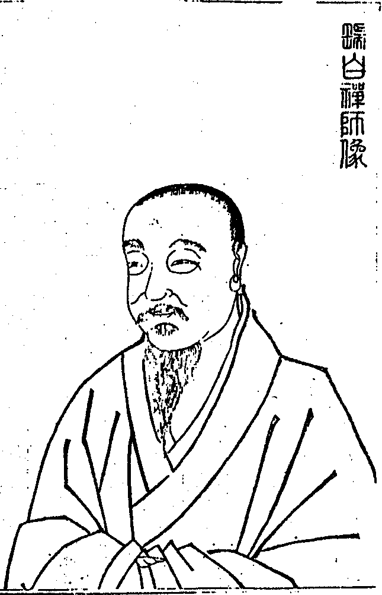
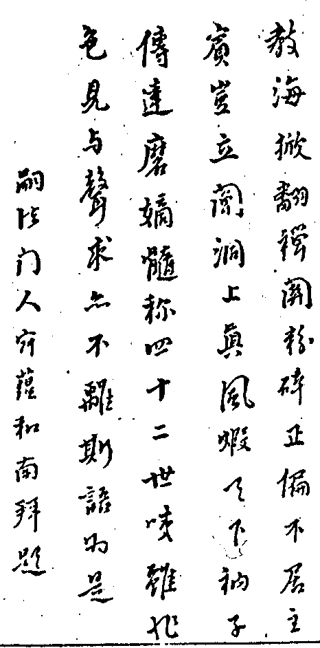

# 入就瑞白禅师语录



> **藏经**：嘉兴大藏经（新文丰版）（嘉兴藏）　**册次** 第 26 册（J26）　**编号** JB188　**部类** 诸宗部　**卷次** 18 卷　**篇幅** 144,454 字

> **卷／品**：0 卷 · 3 品



---



## 目录



  - [编刻瑞白禅师语录序](#编刻瑞白禅师语录序)

  - [旧序](#旧序)

  - [序](#序)



---



### 编刻瑞白禅师语录序



瑞白大师为云门湛然大师嫡嗣，溯之洞山为三十二世，溯之达磨为四十二世，宗风大畅将二十年，嗣法门人三十餘数。崇祯乙亥秋，嘱啸云和尚主天台护国席。丙子夏，嘱久默禅师主弁山龙华席。大师退隐崆峒，归寂百丈塔，葬龙华啸云。和尚为大师，嫡嗣少林，谓之得髓也。行道天台，重辉宝镜，所谓振佛祖将坠之宗风，开人天已翳之眼目，使曹洞一宗，丽如杲日。故钱太师序和尚语录曰：「弁山有天台，犹孔之有孟、老之有庄，父子一家弘扬至道，皆归无为之化也。」予读之，踊跃欢喜，非特见和尚之心，亦见弁山大师之心矣。和尚以深大愿力，为大师存日所有语录，虽已梓行大传於世，然未刻之散稿尚多，不意法兄久默，禅师亦随归寂，况旧有同编之订未果，是以和尚收先后、刻未刻者，总编为全部，成十八卷。将大师平日为人一片老婆心重重拈出，使后学共览皆知。言即无言，其说法七七，未谈一字，与拈花面壁，总在此矣。秋日上人幻如徵序於予，予虽不知禅，亦幸忝参席末分，固难辞，不容不言也。时



崇祯十六年岁在癸未季秋望日参学弟子小寒山陈函𪸩顿首譔



------



### 旧序



越国宗风，云门倡始，而金粟磬山继之。云门逝，弁山兴，於是曹洞之宗大振。余未及见弁山之面，然已见其心矣。宝镜悬空，十方普照，主宾偏正，形影历然，洞山禅已属老汉矣。吴兴唐祈远，雅有道风，杖履往来，与师倡和。尝与余订湖上之盟，过弁山而问道。虎谿之笑，其再见於斯时乎？



黄端伯



祖师西来，不立文字，然犹怪其垂法诸语，较之拈华微指，尤章彩兆。何也？世以下世灯以照灯篇帙之盛，几揜三乘十二分而出其上，施设门头丹青笔意，翻引一期室洒，增长葛藤啼不止、黄叶不辍。所谓临摹古畫，转失本色。惟我瑞白禅师不然，扼住要津，稍通消息。将与麼地、与麼时、与麼机缘，向诸人髑髅边穿却一双正法眼，如鸟度空、如羚羊挂角，不存轨则。此案真可以捄拖泥带水者之病？既听云门曲，又从我弁阳看弄遮般师子，莫把禅师一片老婆舌作文字理会好。



张时化陈函𪸩顿首譔



至道无隐，荷担惟人，乃补偏救弊之方，则乘时而起，无有定执。吾儒自六经晦𩞾异喙沸腾，程朱子起而彰明辅翼之，扶教以明宗也。所以玄诠微旨，即深造实履而益著，继而训诂沉埋涂饰，规表焚坑之惨，诸儒自为之而加烈焉。阳明子崛起于万死，一生中与之昏衢宝炬而昭揭中天，明宗以扶教也。所以匡时持世取诸良知二字卷舒裕如然，而总以云救初无偏畸。释氏何独不然？禅宗虽五宗分派，总归一地流行。柰道法垂秋，不无泛滥，承滞语言、慧巧穿凿，至以传灯续命一桩，等作沿门戏具，吾滋惧焉。瑞老大师为云门冢子，畅洞上玄风，九坐道场，嗣法三十餘人，道化条达，血系衍繁，猗欤盛矣，亦知老人致此之繇乎？无被寝处者十三年，七参尊宿孳孳若渴，且苏复绝、绝复苏，并不轻肯，究乃瞥地。师之精进谦退何如也？若夫身律之严，而即严以率众，如法学习，不徇情求，谆谆遗教经，犯者呵为叛臣逆子，尤足砭挽近膏肓。衣拂之下尤严，更无一人竽滥，如徒侈热闹门头，不顾将来决裂，谓法王何至？师之拈提个事，煆鍊学人，真所谓轰雷掣电，眼目动定难施鸟道、鱼踪光影索摸莫及者矣。而一片切切为人热血，读其书犹将点点滴滴，喷吐迸出。噫！若大师者，复何间然？行解圆融，宗教摄合，谓无渗漏、善回互，卓哉定评乎？盖无渗漏，则正令全提，善回互，则不存轨则。所云补偏救弊，无有定执者，儒与禅宁岐术哉！余在护国，亲遭毒手，惜乎辜负婆心。今幸啸云大师处几番寒热，流浪知归，始悟啸大师之愿力机权，直与老人和玉乳、透金针，同口出气而已。洞山父子其遗风再振乎！兹春重梓全稿，成啸大师之志，余亦怂恿之故，竟读新编，而斋祓为之序。



时己丑年孟秋日参学散人吴应芳敬题



入就瑞白禅师语录目录



卷首像



------



### 序



卷第一上堂(二十九则)



卷第二上堂(二十一则)



卷第三小参(三十一则)  

夜参(二则)



卷第四茶话(三十五则)



卷第五茶话(二十一则)  

示众(十四则)



卷第六问答机缘(五十五则)



卷第七问答机缘(三十一则)  

垂问(七则)  

答幻轮法师十疑问



卷第八颂古(一百一十五则)



卷第九颂古(一百三十六则)



卷第十法语(十一篇)  

法偈(七十二首)



卷第十一歌(十五首)  

赞(五十一首)  

铭(二首)  

说(七篇)  

叙(一篇)  

疏(三篇)  

佛事(十一则)



卷第十二诗偈(一百一十五首)



卷第十三诗偈(一百首)



卷第十四书复(二十八篇)



卷第十五书复(三十一篇)



卷第十六书复(十一篇)  

参请因缘(七篇)  

行脚(一篇)  

附来书(十四篇)



卷第十七塔铭(一篇)  

传(一篇)



卷第十八行状(二篇)  

跋(一篇)



瑞白禅师像











入就瑞白禅师语录卷之一



明住天台护国寺嗣法门人寂蕴编



上堂



崇祯元年十一月二十七日，绍兴府太史姜箴圣，少府陶石梁，封翁余心源，孝廉史汝谐、凌二铉，文学沈求如、管霞标，及众居士等，请师继住云门显圣寺。崇祯二年九月初十日，众请上堂。



师拈疏云：「会麼？世尊未出世，达磨不西来，已有这个消息；其或未会，有烦维那为众拈出。」宣疏毕，指法座云：「坐断千差路，魔外不能知。威音王未晓，弥勒亦生疑。咦！且看雪上座行履。」遂登座，拈香云：「此一瓣香，三德圆明，六通具足，发一切智之光华，结菩提果之秀丽，信手拈来，端为供养本师释迦牟尼万德慈尊，伏愿人人性海圆成，个个智门了办。此一瓣香，奉为当今皇帝万万岁，伏愿龙图如芥城而永固，凤历齐劫石以长春。此一瓣香，奉为满朝文武、合国勋贵，分守宁绍宪台，绍兴府主，山会两县，上下诸衙各位尊官，绶章齐显，禄位同尊。此一瓣香，受灵山之付嘱，承愿力以熏修，穿过三纲五常，透出止观定慧，𦶟向炉中，端为越州护法宰官、居士等，福基慧命，各愿昌隆，智种灵苗，同希增秀，常作国家柱石，永为佛法金汤。此一瓣香，全越威音那畔，独超今世门头，不须雨露滋培，宁受云霞覆育，信手拈来，端为供养显圣堂上传达磨正宗第四十一世湛然大师大和尚，用酬法乳之恩。」遂敛衣就座。参头白槌云：「法筵龙象众，当观第一义。」师云：「若论此事，无人不具，无刹不彰，圆陀陀包括虚空，活泼泼遍呈万象，露裸裸全无渗漏，赤条条永绝周遮，左右逢源，随流得妙。」遂竖拂云：「会麼？於此会得，一双孤鹿奔山头。於此不会，独只双鸾栖海底。」乃举：「昔日法灯禅师云：『山僧本欲潜栖岩壑，养拙过时，柰缘先师有未了公案，今日出来，特为了却。』时有僧问云：『先师有甚不了公案？』法灯打云：『祖祢不了，殃及儿孙。』僧云：『过在甚麼处？』灯云：『过在我殃及汝。』今日山僧本欲潜栖岩壑，养病过时，亦为云门先师有未了公案，今日出来，特为了却。或有问云门：『有甚不了公案？』只向他道：『石女惊回霜夜梦，木人扑落午天星。』或云：『过在甚麼处？』向道：『易使清风梳翠竹，难教明月住须弥。』大众！雪上座恁麼举扬，且道与古人相去多少？还有辨得出者麼？如无，更听一颂：秋老园林红叶飞，渔翁月下整竿丝。扁舟不向芦湾宿，举棹金波任往回。今日虽不敢与他争锋，也要诸人据款结案。」下座。问荅不录。



上堂。「今朝九月十五，翠竹黄花歌舞，白云片片岭头，明月团团洲渚。金风拂拂西来，落叶纷纷覆土，鸿鴈一声嘹喨，边塞征人凄楚。大众！且道他凄楚个甚麼？鸿鴈不来霜不至，及其霜至又逄冬。」僧问：「昔日世尊拈花示众，和尚今日将何利生？」师云：「篱边黄菊嫩。」进云：「劫外灵枝，如何拔折？」师云：「林中老叶新。」僧礼拜，师下座。



上堂。「三秋梦过又逄冬，绿竹依依笑我侬，彻尾彻头浑不荐，白云空自锁花宫。咦！须领略，莫朦胧，傲霜黄菊今犹在，蝴蝶寻香何处容。」僧问：「玉峰雪岭寒葩绽，暗吐浮香浸太虚时如何？」师云：「一九二九。」进云：「还许学人折一枝否？」师云：「汝非其人。」进云：「却将何物应天时？」师云：「一枝雪里吐红霞。」进云：「寄报上林游玩客，江南特地占先春。」师云：「闲言语。」僧拜，师下座。



上堂。「世尊曰：『治世语言，资生产业，皆与实相不相违背。』夫子曰：『吾道一以贯之。』昨夜捣臼生花，乌龟发笑，香炉峰神恶发，蓦头一掴，腾过东海，撞破龙王脑壳，直得血染香水海。天明起来，大地一交严霜。会麼？会麼？久立，珍重！」僧问：「雪浪掀天舞，苍龙出窟游，正恁麼时如何？」师云：「瑞气满乾坤。」进云：「如何是他灵运行藏处？」师云：「布雨不兴云。」进云：「布雨不兴，云即不问，还归大海事如何？」师云：「两岸东西。」僧拜师，下座。



上堂。「没意白云封岳麓，无心明月印寒潭。於是句中全晓会，依然又隔一重关。既是晓会，为甚麼又隔一重关？向道莫去，归来背父。昔日世尊在神通大光明藏中与清净慧菩萨云：『居一切时不起妄念』，明月团团元不炤，『于诸妄心亦不息灭』，春日容容草自青，『住妄想境不加了知』，穿花蝴蝶忘情意，『於无了知不辨真实』，不知谁是弄香人。大小世尊只可抱桥柱洗脚。今日云门虽与他著语，犹未剿绝，更有一偈举似大众：香炉飞过海，石伞便撑开，铁马云中吼，泥牛上五台。具眼者辨取。」僧问：「黑荳未生芽时如何？」师云：「金鸡啼半夜。」进云：「生后如何？」师云：「玉犬吠天明。」进云：「黑荳已蒙师指示，开花结子事如何？」师云：「石伞峰头明历历。」僧拜，师下座。



冬至上堂。「明明声色难该，历历覆藏不可，直须言外知归，休向句中担荷。清净伽蓝乌容瞌睡，百花丛里岂可散心，石伞峰头那堪住足？万竹林里快且翻身，鉴湖波底行拳，玉笥山头歌舞。还有恁麼人知恁麼事麼？」良久云：「暑退三秋起，冬至一阳生。今日是冬至节届，跃云禅友入山设斋，更请山僧登座说法，为大众结般若缘。正所谓财法二施。今问大众，且道应时纳祐一句作麼生道？天寒日色淡，水冷草方枯。(下座)」



上堂。「道本无言，徒为指示。杀活纵夺，露布门庭。这边那边，总无正意。全身担荷，犹在半途。觌体承当，奴儿婢子。谈今论古，播弄唇皮。驱魔使佛，元非尊贵。既不恁麼，且道毕竟作麼生？」复高声云：「密移一步虚空外，鹤出银笼始是奇。」僧问：「这边那边即不问，大中现小事如何？」师云：「金鸡初唱佳林晓。」进云：「如何是小中现大？」师云：「鉴湖月落潭无影。」进云：「不大不小又如何？」师云：「五云溪畔木人歌。」僧礼拜，师云：「切莫承虚接响。」又僧问：「朔风凛凛逼冬过，白驹驰骋似投梭。学人向甚麼处安身立命？」师云：「日落海底枯。」进云：「还有处也无？」师云：「大唐休住足，新罗莫倚停。」僧拜，师下座。



上堂，正值鸡鸣，乃云：「窗前鸡唱午，屋后鸟鸣中。明明相告报，休得更朦胧。大众！珍重！」僧问：「天气寒冬霜雪皎，庭前桂立影娑婆。意旨如何？」师云：「两春夹一冬。」进云：「恁麼则拔枝弄影去也。」师云：「无被煖烘烘。」僧云：「叶落归根时作麼生？」师云：「赤条条底。」僧拜，师下座。



云门先和尚忌日，上堂。「此日先年，先年此日，四野冰花，朔风历历。正恁麼时，且道先师即今在甚麼处？」良久，云：「木人夜半绣花冠，石女天明打破镜。」遂下座，率众到像前顶礼，拈香云：「此一瓣香，𦶟在炉中，不为别事，秪要报冤雪屈。且道与先师有甚麼冤雠？」以手指像云：「当初只为路长短，今朝方觉水河多。」僧问：「生如寄，死如归，未审先师归於何处？」师云：「石伞峰头云霭霭。」进云：「几时复来？」师云：「万竹林中绿依依。」「恁麼多时不见先师面，依然不改旧时颜。」师云：「莫眼花。」僧拜，师回方丈。



解制上堂。「把住则黄金失色，云门寺里拗折拄杖，高挂钵囊，一个个扫踪绝迹。放行则瓦砾生辉、万竹林中横担拄杖，紧峭草鞋，一个个放光动地。且道放行好？把住好？且待别时来。」乃举：「昔日洞山解制云：『兄弟东去西去，直须向万里无寸草处去。』今日云门不问东去西去，直须向枯木生花处去，冰河发焰处去。只如冰河发焰处作麼生去？」良久云：「兔角杖头挑日月，龟毛绳子缚虚空。」僧问：「软草敷座坐九旬，界中个个证无生。堂里圣僧证个甚麼？」师云：「如是如是。」进云：「还向人天说法否？」师云：「他从来不开口。」进云：「水鸟树林皆演无生，他为甚麼不开口？」师云：「只为阇黎不荐。」僧拜云：「大众却闻法竟。」师拂拂子，下座。



崇祯三年九月廿七日，绍兴府众乡绅太史姜箴圣、倪鸿宝，藩司徐亮生，学宪李玉完，孝廉凌二铉、史汝谐，及文学众居士等，请师住延庆寺开堂。师拈疏云：「三世诸佛、历代祖师一大事因缘，尽向此中漏泄了也。会麼？若也不会，有烦维那为众拈出。」宣疏毕，指座云：「宝座从空涌，佛日自天开，觌面无回互，当下绝往来。」喝一喝，遂升座，拈香云：「此一瓣香，供养本师释迦牟尼万德慈尊，伏愿三途登十地之阶，九有证菩提之果。」又拈云：「此一瓣香，奉为当今皇帝万万岁，伏愿尧风永扇，八表安宁，舜日高悬，四方乐业。」又拈云：「此一瓣香，奉为满朝文武合国公卿，同布仁风，高增禄位。」又拈云：「此一瓣香，奉为越州护法宰官居士，伏愿智慧齐日月以长明，福慧仝须弥而巩固。」又拈云：「此一瓣香，非三草二木之形，非青黄赤白之相，四时收不得，八节岂能该？信手拈来，供养云门显圣堂上湛然大和尚，用酬法乳之恩。」就座。白椎竟，师云：「若论第一义，只在当人自己，二六时中，辉辉於万象之表，荡荡於六根之门，历历於声色之间，灵灵於交接之际。横之则周遍法界，包括虚空；竖之则透彻古今，融通三世。意欲取之，处处无踪；意欲舍之，头头显露。魔佛齐该，圣凡平等。应用无亏，随缘自在。」遂竖拂云：「会麼？若也不会，山僧再与你通个消息。」良久，云：「石牛吐雾三冬暖，木马嘶风六月寒。」僧问：「人天辏集，龙象云臻，当阳句子，请师指示。」师云：「杲日团团。」进云：「如何便得承当去？」师云：「金风飒飒。」僧拂坐具云：「谢师指示。」师云：「放汝三十棒。」僧拜，师下座。



上堂。「九月重阳十月朝，林中落叶悉萧萧，鸿鴈北来霜露重，四邻砧杵乱轻敲。须领略，休自挠，当机觌面无逃避，莫教辜负我侬豪。」遂竖拂云：「会麼？水底木人吹铁笛，云中石女弄琵琶。」僧问：「云门一路人皆委，延庆家风事若何？」师云：「屋后千竿竹。」进云：「忽遇上上根人来，如何接取？」师云：「门前万叠山。」进云：「金风剪尽秋林叶，露出枝头一点红。」师云：「莫错会。」遂下座。



上堂。「今朝十月十五，山河元来故土，白云澹泞无穷，秦望峰峦起舞。鉴湖彻底清流，日月星辰炤普。越州瑞气腾空，城中士民辐辏。觌面举似无藏，休更迷头狂走。咦！山头翻白浪，金牛变作狗。」僧问云：「秪如金牛击桶道：『菩萨子吃饭来。』意旨如何？」师云：「菊花朵朵黄。」进云：「今日檀那设供，大众临筵，和尚又何指示？」师云：「芙蓉簇簇娇。」进云：「会中个个肚皮憨。」师云：「全赖阇黎力。」僧拜，师下座。



上堂。「庐陵米价高，赵州茶钱大。曹山酒甚严，胡饼无缝鏬。南山鳖鼻蛇，陕府铁牛怕，延庆拄杖子，一齐都按下。且道拄杖子具何威光？咦！放去乾坤窄，收来毫发宽，敲落虚空髓，搅尽碧波潭。」遂举南泉斩猫话云：「昔日南泉两堂争猫。」师云：「逐境漂流汉。南泉提起云：『道得即不斩。』」师云：「虽是落草求人，也要决断是非。」众人无语。师云：「死汉！也须恁麼始得。南泉将猫斩为两段。」师云：「正令当行，已展不缩。至晚，举似赵州。」师云：「秪要圆成前话。州戴草鞋而出。」师云：「虽是贼过后张弓，也要据款结案。泉云：『子若在，却救得猫儿。』」师云：「重赏之下必有勇夫，也是怜儿不觉丑。依山僧看来，二俱有过。南泉颟顸、赵州儱侗，各与三十棒。今日延庆恁麼批判，也要诸方简点。会麼？若将得失论长短，依然辜负祖师机。」僧问：「双剑挂眉间，铜头翻铁面，未知是何人？」师云：「雨过青山碧。」进云：「满山荒草，为甚麼不住？」师云：「鉴湖波浪宽。」进云：「恁麼则自在去也。」师云：「切忌显颟顸。」又僧问：「不问西来大意，请师洞上玄微。」师云：「风来水面纹。」进云：「甚喜荡荡平平，无反无侧。」师云：「铁船水上游。」进云：「尽道寰中天子贵，那知阃外有将军？」师曰：「阇黎非为分外。」僧拜师，下座。



上堂。「碧天皎皎，一个金乌藏玉兔；星河灿灿，两行玉树宿乌鸦。寂寂鉴湖，驾扁舟於莲野；巍巍秦望，锁白云於林间。正恁麼时，君臣道合、父子一如即不问，作麼生是转身一句？」良久云：「庭前翠竹和根拔，免教丹凤再来巢。」下座。



上堂。「天寒地冻裂，万象森罗歇，水底金乌结，广寒宫亦绝。眼中童子疾，石女流出血，延庆分明说，诸人得自得。大众！得且不问，作麼生是说底事？相逄尽是扬家丑，几个休心息是非？」僧云：「进无门，出无路。正恁麼时无回互，门路则不问。如何是无回互底事？」师云：「堂堂独露身。」进云：「恁麼则一轮明月无人管。」师云：「五岳清风秪自知。」僧拜师，下座。



上堂。「一念普观无量劫，无去无来亦无住。」遂竖拂子云：「三世诸佛历代祖师天下老和尚，尽在山僧拂子头上放光动地，谈说般若。西方极乐世界、娑婆世界、阿閦世界、香积世界，一切世界亦在山僧拂子头上大小相容，净秽交泰，重重无碍。会麼？如此会得，十世古今始终不离於当念。如此不会，无边刹海自他不隔於毫端。今日是仕望陈居士为令先君十周年，特自入山斋僧，请山僧升座敷扬般若。以此功德，惟冀见弥陀於极乐，授记莂於莲台。」又竖拂云：「如此会得，君臣道合父子一如。其或未会，山僧更与通个消息。」良久云：「琉璃殿上青苔冷，翡翠帘前玉枕寒。」有僧问：「檀越设斋，请师说法。即今陈处士在甚麼处安身？」师云：「归家乐业。」又僧问：「一念普观无量劫，无去无来亦无住。为甚麼目前有生有死？」师云：「空花镜里观。」僧打圆相云：「恁麼恁麼𫆏？」师云：「亲见弥陀，亲蒙授记。」僧拜，师下座。



解制上堂。「百日道场功德聚，三身圆现十方尊。提起也，水到渠成，充塞法界；放下也，风行草偃，遍满乾坤。秪如不提不放一句作麼生道？」良久云：「吹笛木人腔调美，抛梭石女锦绫新。」僧问：「一期圣制周圆，群士星归林野，转身句子，请师分付。」师云：「步步霜花厚。」进云：「如何得不涉程途便还本处？」师云：「煦日水质清。」又僧问：「有佛处不得住，无佛处急走过，毕竟在何处安身立命？」师云：「三冬寒气重。」僧打圆相云：「蒙师指示，学人便恁麼去也。」师云：「切莫草草匆匆。」僧拜师下座。



崇祯四年九月，湖州府众乡绅，唐司马存忆，沈司寇何山，闵冢宰曾泉，朱太史平涵，韩太史求仲，及孝廉文学众居士等，请师於白雀寺开堂。师升座拈香云：「此一瓣香，虚空包不住，大地载不起。今日拈来端伸供养本师释迦牟尼万德慈尊，伏愿三途圆种智，九有脱轮回。」又拈云：「此一瓣香，奉为当今皇帝万岁万万岁，伏愿道德同尧，舜帝业等羲皇。」又拈云：「此一瓣香，奉为分守嘉湖宪台、湖州府主，并归、乌二县上下各衙，伏愿仁政闻四海德，化满乾坤。」又拈云：「此一瓣香，受西天之付嘱，为东土之檀那。今日拈来，奉为唐司马、沈司寇、闵冢宰、朱太师、韩太史等一班护法宰官，及众孝廉众居士等，伏愿道心坚固，福禄绵延。」又拈云：「此一瓣香，无干无枝，四时香馥，没头没尾，八节光腾，端为供养绍兴府云门显圣堂上湛然大和尚，用酬法乳之恩。」遂就座。白椎竟，师云：「秋色渐深，满林红叶承玉露，金风乍起，半山冷气逼人寒。彻骨彻髓自家知，通天通地何人晓？道有也，觅之不见丝毫；道无也，用时遍满法界。触处灵明，何须他觅？」遂竖拂云：「会麼？乌鸦藏玉树，泥牛舞碧波。」僧问：「师唱谁家曲？宗风嗣阿谁？」师云：「黑狗白云蹄。」进云：「宗旨已蒙师指示，曹溪一滴事如何？」师云：「泥牛翻白浪。」僧礼拜。又僧问：「金风吹落林间叶，还有不落处也无？」师云：「古干赤条条。」进云：「曹溪水白浪滔天，还有无波浪处也无？」师云：「大地尽皆湿。」僧拜。又僧问：「击鼓升堂即不问，狮子出窟事如何？」师云：「一声哮吼惊天地。」进云：「青龙岗上生波浪，九曲池中水逆流。」师云：「未具牙爪在。」僧呈坐具礼拜，师下座。



结制上堂。师竖拂云：「会麼？活泼泼，触处灵明；圆陀陀，随缘无碍。遍法界，不离当处；该万有，只在目前。无古无今，贯通三际；非彼非此，坐断十方。历劫孤明，阿谁无分？若能直下领略，且喜穷子归家。其或拟议思量，枉受伶俜辛苦。」又竖拂云：「会麼？铁犬吞大象，石女模螺蟴。今日是结制之辰，乃有沈居士宿禀善根，不忘付嘱。建此法幢，令堂太宜人设斋，邀同众居士入山，请山僧敷扬般若。佛云：『以大圆觉为我伽蓝，身心安居平等性智。』既以大圆觉为我伽蓝，则十方世界无边香水海，百亿须弥、百亿日月、森罗万象、草木丛林，尽入山僧大光明藏中。既云身心安居平等性智，则若圣、若凡、若人、若天、若修罗、若饿鬼、若地狱、若畜生，悉皆成佛，证大解脱，个个得真如三昧、一相三昧、一行三昧、无缘三昧直道。作麼生是平等性智？不因西风起，争得树头红？」僧问：「大开炉鞲，急挝毒鼓，选择圣凡句，请师指示。」师云：「杲日辉辉。」进云：「瞿昙已灭度，弥勒未降生，阿谁得中？」师云：「大众济济。」进云：「铜头铁额汉，如何相见？」师云：「两眼对两眼。」进云：「只如无位真人又作麼生接待？」师便喝，僧礼拜，师下座。



上堂。「漫天网未张，唬得金乌藏海底；涂毒鼓才振，惊起玉兔上松稍。藏白额於烟云，笼金乌於寨岭。龙吟雾起，虎啸风生，篱菊呈祥，芙蓉现瑞。正恁麼时，且道是何人境界？」竖拂云：「会麼？山头白浪涌，海底火正红。」拈拂，下座。



上堂。孝廉唐祈远居士设斋，请师求忏宿业。师升座云：「杲日初升，大地浓霜尽消灭；微火乍降，万山薪积顷成灰。任他黑业冰坚，凭我智慧了却。」喝一喝云：「若向这里会得，霜也日也、薪也火也、愚也智也、罪也福也、染也净也、烦恼也菩提也、生死也涅槃也，悉皆消灭。何故？清净个中，元无他物。今日祈远居士，乃唐司马大公子也，身处孝廉不受五欲，弘荷大法不昧初心，决志禅门栖心净土，恐有无始业债以为障道因缘，特担钱粮入山礼忏，请山僧举扬般若以消宿业。古云：『罪从心起将心忏，心若无时罪亦忘。罪忘心灭两俱空，是则名为真忏悔。』所以三祖参二祖云：『弟子罪障深重，乞师忏悔。』二祖云：『将罪来，与汝忏。』三祖打个反观，良久云：『觅罪性了不可得。』二祖云：『与汝忏悔竟。』居士若向这里会得，即如罪性不在内、不在外、不在中间，当下清净。会麼？更有个末后句举似：石女穿针挑蜀锦，木人搓线绣鸳鸯，欲知忏悔真真意，好向其中仔细参。」西堂出问：「弁山峰顶云霭霭，太湖波底月团团。是何意旨？」师云：「篱边黄菊秀。」进云：「即今钟鼓交参，居士临筵，万象森罗咸皆稽首，是甚麼时候？」师云：「日午打三更。」进云：「只如月落云收、光境俱忘。请师再道。」师云：「且喜太平。」进云：「明暗双双俱不炤，未审此时作何活计？」师云：「楖栗横担不顾人。」堂礼拜云：「不登弁峰极目望，怎识太湖涯际宽。」师云：「切莫草草。」又僧问：「了则业障本来空。为甚麼瞿昙不免金鎗之厄？」师云：「铁马趁泥牛。」进云：「及乎未了者则何如？」师云：「金乌啣玉兔。」僧拂坐具云：「学人纵横去也。」师云：「且喜没交涉。」僧礼拜，师击香台下座。



上堂。「扶桑日出，须弥突兀。北俱卢洲人无贪欲，南阎浮提衣足食足。特地报知，莫生疑惑。且作麼生是不疑的事？」良久云：「静倚长松忘百虑，抬头秪见帝王家。」下座。



上堂。师升座云：「飒飒西风，片片白云缭乱舞；澄澄碧汉，团团明月逞全辉。不离寂场，千江有水千江月；无心舒卷，万峰锁住万峰寒。炤无炤功，无炤何妨曾炤；来无来相，无来岂碍常来？古今印同，十方合一，人人炤烛，个个现成。会麼？有意气时添意气，不风流处也风流。」遂竖拂，下座。



上堂。「孟冬初临大地，朔风寒彻骨；一阳才复乾坤，万象气稍和。茅笋土底抽芽，水仙盆中发笑。梅蕊含玉粒，茶花吐珠玑。正恁麼时，且道是何人分上事？咦！黑帝令行犹正切，那许东风弄柳条。」下座。



天台护国寺僧月堂，绍兴府众乡绅，钱相国麟武，陶给谏虎溪，商开府等轩，余太史武贞，吴孝廉佩兹，及众文学居士，致书备礼上弁山白雀寺设斋，请师住护国寺。上堂乃云：「好音在耳，历历风生弥六合；真机满目，明明万象遍乾坤。左之右之显神通，江北江南何须觅。会麼？今日天台护国寺月堂，同众居士，至弁山设斋，请山僧过天台。山僧以弁山期限未满，待三年后方可同诸公搬砖弄瓦、运水打柴，发扬无为以助国化。且作麼生是无为底事？户外竹风声细细，涧中流水响潺潺。」僧问：「师搭紫衣登宝座，未知说法度何人？」师云：「霜花满地。」进云：「三冬瑞雪家家有，何须特地又相为？」师云：「秪为狂徒浑不荐，所以今朝为指明。」进云：「等闲识得东风面，万紫千红总是春。」师云：「不因柳毅传书信，怎得家音到洞庭？」进云：「说法度人蒙师示，应请天台事若何？」师云：「古路风霜细。」进云：「岭上寒梅才放蕊，江南早有十分春。」师云：「我这里无此闲事。」僧礼拜，师击禅床，下座。



上堂。「一九与二九，相逄不出手。南北岭头云，片片冰花就。东涧西溪冻断流，犹若银丝穿古岫。大众！正恁麼时，寒威沉沉，朔风凛凛。且道是何人境界？」良久云：「一片长空浑若洗，两轮日月壮山河。」僧问：「凛凛朔风寒彻髓，迸出梅花遍界香。正当恁麼时，和尚作麼生庆赏？」师云：「红炉添白炭，满酌并浅斟。」进云：「庆赏一句蒙师指，醉人归去事如何？」师云：「红罗帐里睡昏昏。」进云：「眉毛尖上呈春色，大地全彰白玉洲。」师云：「切莫逐境漂流。」僧礼拜。又僧问：「如何是炽然不二句？」师云：「朔风凛凛，雪花片片。」进云：「恁麼则彻骨彻髓无缝鏬，透顶透底绝遮拦。」师云：「正好三十棒。」进云：「不涉功勋，岂受赏罚？」师云：「犹有不涉在。」僧拜，师下座。



上堂。「主山高，案山低。白虎长，青龙短。洗钵崖前触著磕著，迎圣道上往往来来。且道是何人境界？咦！不因樵子径，怎到葛翁家？今日是沈居士身染微恙，道友莫居士等，特担钱粮入山饭僧，更请山僧升座举扬般若，以消夙业，更祈世寿与佛寿绵长，色身同法身坚固。须知古人有语：『若欲忏悔者，端坐念实相。』且道实相作麼生念？」良久云：「木人醉倒乾城里，石女吹箫入畫楼。」竖拂，下座。



上堂。「今朝腊月一，枯木生银华，千峰咸玉耸，万水总白霞。古渡迷过客，林深隐樵家，鸟道无踪影，玄途安可夸？大众！正恁麼时，六花现瑞，寒光散彩。且道是正位一色也？今时一色也。会麼？琉璃殿上君臣合，珠玉帘垂父子同。」僧问：「雪覆青山顶，梅花唱好音。这段风光事，受用是何人？」师云：「顽石无高下。」进云：「花落雪洋时，还成甚麼境？」师云：「东涌西没。」进云：「恁麼红日当空炤，清波遍界流。」师云：「兴波作浪。」僧礼拜云：「几番彻骨寒风尽，枯木花开色更浓。」师云：「不是时节。」又僧问：「朔风凛凛通身是，寒彻髓底事如何？」师云：「秪要大家知。」进云：「彻髓一句蒙师指，迸出红轮又若何？」师云：「炤天炤地。」僧礼拜，师下座。



解制上堂。「一百二十日修炼般若，结制於圆觉体中。一千四百四十时究无上道，解制於光明藏里。其结也，枯木寒崖，滴水滴冻，壁立万仞，凡圣不通，扫踪绝迹。其解也，阳和气转，一叶一花，聊通一线，僧俗曾会，觌体全彰。结解且置，秪如收因结果一句作麼生道？」良久云：「乾坤扑落须弥倒，透出虚空外面行。」便下座。



入就瑞白禅师语录卷之二



明住天台护国寺嗣法门人寂蕴编



上堂



唐孝廉祈远居士请师乌镇圆义庵上堂。师升座云：「灵机未动，十方刹海冷沉沉；智境才彰，觌面当阳明历历。寸丝不挂，何妨戒定慧以薰修；不立一尘，岂碍万象森罗而依附。孤迥迥，穿过铁壁银山；峭巍巍，透彻金轮水际。其大也，包括虚空；其细也，纤毫无间。坐断千差路，扫除凡圣名。若能直下承当，始信本来是佛。」遂竖拂云：「会麼？苍苍弁岳摩今古，新新花柳醉游人。」下座。问荅不录。



蒋夫人寿诞，请上堂。师升座云：「荡荡和风，起寒塞之柳眼；辉辉煦日，发枯稿之花心。兰萼骋香机，桃李舒艳质，韶光弥而六合满，春色临而宇宙新。添一纪而万纪同庚，增一福而百福齐举。正恁麼时，且道是何人分上事？」良久云：「十二朱门添吉庆，三千玉阁霭祥云。」下座。问荅不录。



长兴孙夫人寿诞请上堂。师升座云：「金笼放鹊，愿寿命之龟年；畫像呈诗，祝永龄于鹤筭。诵经礼忏，宿业顿尔冰清；供圣斋天，福寿绵然沧海。同虚空之不老，等松柏以长青。若能当下知归，方知定有餘庆。会麼？权将日月为天眼，指出须弥作寿山。今日长兴孙夫人天命之年，入山礼忏饭僧，更请山僧说法以延福寿。虽然，须知福寿之根本始得。」遂竖拂云：「若向这里会得，则过去无量劫无量劫生日秪是这个，今日生辰也秪是这个，未来无量劫无量劫生日也秪是这个。会麼？如此会得，须知更有向上一窍在。作麼生是向上一窍？」良久云：「白云淡荡西风急，刺破髑髅阿个知？」僧问：「讽经延寿即不问，卧月眠云时如何？」师云：「刺破你脑壳。」进云：「黄金殿上金凤舞，白玉阶前玉鸡鸣。」师云：「非汝境界。」僧拜，师下座。



崇祯六年九月二十二日，绍兴府众乡绅胡冏卿璞庵、陶少府石梁、刘纳言念台、董宝卿皇庭、徐兵宪檀燕、王制宪峨云、丁宫坊欧石、邢天部淇瞻、倪侍御三阑、余殿撰武贞、孝廉史汝谐、凌二铉，及众文学居士等，自弁山请师於蕺山戒珠寺开堂。师升座，拈香云：「此一瓣香，秉三皇之敕令，行五帝之仁风，四海尊崇，万邦仰望，奉为今上皇帝圣寿万岁！万岁！万万岁！」又拈云：「此一瓣香，禀忠孝以生成，统三纲而和畅，奉为现前大护法胡、董、刘、徐、陶、王、丁、邢、倪、余等一班宰官，洎居士檀越等，伏愿道德与圣德同修，君命共至命齐布。」又拈云：「此一瓣香，出自摩竭提国，长在弁岳峰头，三玄三要以薰修，五位君臣而建立，𦶟向炉中，端伸供养显圣堂上圆寂先师湛然澄大和尚，用酬法乳之恩。」遂敛衣就座。白槌竟，师云：「若论第一义，五目不能观，六通岂可及？诸佛不到处，难话祖师机。实相本无名，言论难开口。直得心思净尽万行空，餘一段灵光，处处显露。明明不昧，寂寂无私。本自现成，阿谁无分？」遂竖拂云：「会麼？泥牛撞倒须弥顶，木马嘶乾四海云。」西堂孤崖问云：「越地双狮吼，龙象尽交参，威振大千句，当阳请举宣。」师云：「金花遍界新。」进云：「满盘都托出，谁是知恩者？」师云：「宝剑赠与烈士。」进云：「恁麼则恩归有地。」师云：「阿谁无分？」进云：「今日人天交集会，腾腾瑞气满精蓝。」师云：「且喜天下太平。」堂礼拜。僧问：「诸佛不到处，难话祖师机。祖师机即不问，如何是诸佛不到处？」师云：「黑漆漆。」进云：「恁麼则越州石鼓惊天地，引得泥牛就地来。」师云：「乌龟飞上天。」僧拜师，下座。



上堂。「金乌乍起，紫气腾腾，玉兔高悬，寒光淡荡。蕺山亭上，物色鲜明，如来藏中，境界殊胜。直示临济三玄三要，发明洞上五位正偏，父子功齐，君臣道合，功位全彰则且置，功位俱隐一句作麼生道？」良久云：「泥牛踏翻潭底月，木马嘶风透碧霄。」僧问：「三玄三要即不问，五位君臣事若何？」师云：「炉中香袅袅。」进云：「如何是正中偏？」师云：「石女夜不眠。」进云：「如何是偏中正？」师云：「秋到树头赤。」进云：「如何是正中来？」师云：「泥牛上五台。」进云：「如何是兼中至？」师云：「黄叶颇相似。」进云：「如何是兼中到？」师云：「踏破波底月。」进云：「恁麼则父子功齐，君臣道合。」师云：「闲言语。」僧拜。又僧问：「狮王哮吼蕺峰前，狮子增威异兽潜，是甚麼时候？」师云：「日轮当午。」僧拂具云：「恁麼则露爪张牙去也。」师云：「看箭！」僧呵呵，遂拜。师云：「头落也不知。」便下座。



上堂。「秦山卓烁，鉴湖寥廓，炉峰岋崿，会稽咭咶。昨夜一阵西风起，满山黄叶尽零落。会麼？须弥𨁝跳三千界，磉礅花开百亿春。」下座。



上堂。「生而无生，千红万紫，争奇巧灭而不灭，满林黄叶尽消磨。」遂竖拂云：「且看山僧拂子，还是生耶？灭耶？来耶？去耶？有耶？无耶？常耶？断耶？会麼？石女惊残梦，木人解唱歌。今日是跃云禅师四七之辰，其徒自得设斋，请山僧升座说法，以此般若功德增崇品位，庄严报上。且道荐拔一句作麼生道？」良久云：「秦望青松古，戒珠蕺花香。」僧问：「生不曾来，死不曾去，为甚麼又有生方之说？」师云：「黄花遍地开。」进云：「即今弥陀又在甚麼处？」师云：「七宝池中光灿烂。」僧合掌云：「恁麼𫆏？」师云：「未梦见在。」进云：「作甚麼便得高超去也？」师云：「秦望山头云。」僧拜。又僧问：「彩云生灭即不问，即今立处请指示。」师云：「鉴湖波底月无形。」进云：「恁麼泥牛踏破峰头月，脱体全彰海底眠。」师曰：「浴鹅池上放光明。」进云：「幸到源头清彻处，沤生沤灭水无痕。」师云：「你不知去处在。」僧拜，师下座。



上堂。「万象森罗尽说法，露柱灯笼常咭咶。诸人何故不自知，更用山僧来叨呾，不叨呾，爬下眠床穿著袜。」遂竖拂云：「文殊菩萨现普现色身三昧，钻入你诸人眼睛里去也。会麼？」良久云：「满林黄叶地铺锦，朔风炭冷水成冰。」僧问：「金锁玄关即不问，慧镜阁中是何人所居？」师云：「乌龟飞上天。」进云：「恁麼则不必猜疑去也。」师云：「阿谁无分？」僧作插香势云：「还许学人恁麼相见否？」师云：「不许。」僧拂坐具云：「不恁麼去也。」师云：「放汝三十棒。」击香台，下座。



上堂。「本来恒寂寂，施为动作遍乾坤；用处常空空，见色闻声没半点。没半点处，万别同途；遍乾坤时，千差一致。空中鸟迹，水底鱼踪。且道是甚麼人境界？孤猿叫落三更月，野鸟啼开四季花。今日是星楼祝居士，为荐令先君设斋，请山僧升座说法，以此功德追荐见泉处士庄严报境。大众！且道见泉处士即今在甚麼处安身立命？」良久云：「蓬莱三岛神仙住，九品莲台佛祖行。」僧问：「世尊道：『迷悟生死了不可得。』即今见泉处士生耶死耶？」师云：「云锁长空日不见。」僧呈具云：「若於个中能领略，朝生暮死不相关。」师云：「三十棒。」僧拜云：「谢师荅话。」师下座。



上堂。「孤圆活泼，人间天上尽该罗；廓彻灵明，十方三世总无隔。四圣六凡等有，青红赤白无依。心佛生从来一体，儒释道本自无差。若向这里承当，直下现成受用。」遂竖拂云：「会麼？」良久云：「白云常自来青嶂，明月何曾离碧天。」僧问：「儒释道无差，为甚麼门庭各立？」师云：「黄叶飘飘。」进云：「大有人不肯，师又作麼生方便？」师云：「朔风自凛凛。」进云：「恁麼则一轮杲日无违背，团团水月影难分。」便拜，师曰：「正好著力。」又僧问：「长空云散现杲日，大海波澄露锦鳞。正当恁麼时如何？」师云：「冻断五云溪。」进云：「便恁麼去，又作麼生？」师云：「三江潮头息。」进云：「还有向上事也无？」师云：「有。」进云：「如何是向上事？」师云：「蕺山亭𨁝跳。」僧拜，师下座。



上堂。竖拂云：「闻声悟道，见色明心。蕺山亭𨁝跳上三十三天，撞破天王脑壳，东海龙王鲜血迸流。天下觅医人，将阎罗王脚跟一艾爝，大唐天子通身庆快。会麼？今日是俞居士同令堂及众夫人设斋，请山僧升座说法，为大众结般若缘。且道如何是般若？」良久云：「黄牛头上两个角，草鞋肚里四条觔。」僧问：「千尺寒松秀，金鸾石凤啼。是何意旨？」师云：「石伞峰头传消息。」进云：「是阿谁的境界？」师云：「五云溪畔长冰花。」僧拜(师下座)。



上堂。「飘零黄叶，传古佛之家风；游衍行云，显当人之面目。稽山寂寂，西来大意全彰；炉岳巍巍，列祖真机独露。戒珠闪烁，慧镜常明。一道神光，贯彻今古。会麼？觅火和烟得，担泉带月归。今日是邢吉先居士设斋，为山僧庆诞，请升座说法，为大众结般若缘。即此以祈居士智门了办，道果圆成。大众！且道圆成一句作麼生举扬？」良久云：「转功就位琴堂冷，退位朝君古殿寒。」便下座。



解制上堂。「把住也，结定布袋口，封住拄杖头，铁壁银山，鸟不飞度，直至三江浪息，大地波沉；放行也，阳和气转，遍界春回，直得枯木生花，冰河发焰。正当恁麼时，还放行好？把住好。」良久云：「且随老木同寒瘠，将逐春风入烧瘢。莫有逞驴唇马嘴者？出来吃棒。」僧问：「把住放行即不问，当体无依事若何？」师云：「今朝腊月八。」僧拂袖云：「恁麼无挂碍，随处逞风流。」师云：「三十棒。」进云：「冻云飞尽孤轮迥，彻底无私遍界辉。」师竖拂云：「跳不出这一重。」僧喝，礼拜，师呵呵大笑，下座。



上堂。湖城钱夫人设斋，请师升座。云：「三春已过韶华老，李白桃红何处讨？菜花满地黄如金，燕子梁间指示人。」遂竖拂云：「会麼？於此会得，头头释迦出世；於此不会，步步弥勒下生。」良久云：「鸟啼花发笑，云兴宇宙清。今日是湖城钱开府老夫人及众比丘尼送法衣上山，设斋修福延生，请山僧升座，为众结般若缘。且道般若一句如何举扬？夏初日渐暖，行人尽解襟。」后堂素朴问：「高提祖印，最上一乘，弘范毘尼，一乘最上。今日和尚二法并谈，施主功德还有边际也无？」师云：「弁石播苔痕。」进云：「青龙峰顶狮子吼，百千群品证无生。」便礼拜。师云：「非为分外。」遂下座。



上堂。崇祯甲戌年十月望日，龙华结制。唐孝廉祈远居士，请师升座。拈香毕，乃云：「世尊初成道日云：『奇哉！众生皆具如来智慧德相。』儒书亦云：『在明明德。』《康诰》曰：『克明德。』《太甲》曰：『顾𬤊天之明命。』昨夜青龙岗起舞，花石涧𨁝跳，惊得狮子岩，向象王峰鼻孔里藏身，直得弥勒峰呵呵大笑。且道笑个甚麼？他道皆自明也，皆自明也。会麼？昼午月明皎，夜半日轮红。山僧一向有病，佛法付在首座。杜绝人事，以尽残喘。清晨内外大众诚心跪请，故不得已乃升此座。」遂竖拂云：「若向这里会得，则现现成成个个具足。其或未然，可将个本参话头顿在目前，念兹在兹，如鸡抱卵、如猫捕鼠。打成一片，情境俱亡，见色时不知色，闻声时不知声。忽尔触著㘞地一声，始知成佛其来旧矣。更有末后句，举似大众，一月印千江，千江同一月。於斯会得时，乌龟唤作鳖。」西堂离言问云：「不问洞上旧家风，请指龙华新气象。」师云：「宝珠池内水长流。」进云：「秪如冻云弥布，日月潜辉。又作麼生？」师云：「家家围炉添白炭。」进云：「恁麼则泥牛耕破龙岗脉，桃花依旧笑春风。」师云：「未是龙华气象在。」堂一喝，师云：「今日不打你。」堂礼拜归位。僧问：「升堂即不问，卷席意旨如何？」师挥一拂。进云：「朔风吹黄叶，明月下太湖。」师云：「非汝境界。」僧礼拜，师拈拂，下座。



上堂。解制，严充涵、唐祈远、严渟之、沈仁叔、丁子敬、丁逸群、姚圣锡、王禹南、朱心印、李明吾，暨众居士等，请师升座。师竖拂云：「会麼？一向把住，今日放行。其把住也，山河失色，截断众流，波澜不生，鱼龙潜跃黑漆漆，无声无臭，六户不通风。其放行也，幽兰现瑞，百草排芽，柳眼重新，乾坤增彩明晃晃，在前在后，宇宙咸光辉。秪如放行把住二俱不涉，诸公作麼生商量？」良久云：「石女惯吹无孔笛，木人善弄没丝弦。今日一期圆满，莫有悟明自心者，出来与汝证据。」僧问：「来去主宾即不问，五位功勋事若何？」师云：「木人惯弄无孔笛。」进云：「如何是向？」师云：「且莫妄想。」进云：「如何是奉？」师云：「秪要归家。」进云：「如何是功？」师云：「锄天掘地。」进云：「如何是共功？」师云：「木人舞袖归来晚。」进云：「如何是功功？」师云：「石女讴歌罢戏场。」进云：「不涉功勋句子，再乞垂慈。」师一喝。僧礼拜云：「古风来鹫岭，今日始重光。」师云：「闲言语。」又僧问：「正当解制即不问，放下一句事如何？」师云：「横肩拄杖。」进云：「虚空昨夜传消息，惊动垂杨两岸摇。」师云：「切莫东逴西逴。」僧礼拜。又僧问：「滴水滴冻即不问，大地回春事若何？」师云：「处处山花粧得巧。」进云：「恁麼则荡荡东风若管弦，惊醒多人开梦眼。」师云：「十字街头，一任东逴西逴。」僧礼拜，师下座。



崇祯八年乙亥八月，师从天台回龙华。孟冬望日结制，请上堂。师登座拈香毕，乃云：「经之纶禅和邀同众上座，请病朽升堂，举扬这一个。」竖拂云：「会麼？觌面无向背，当处绝遮拦。无向背处，严密不通风，绝遮拦时，行藏难著眼。为万物之本，作生佛之基。三际凝然，十方不隔。要用便用，棒喝交驰明妙旨；要歇便歇，寂然无语显单传。正偏兼带则且置，秪如不涉离微一句作麼生举？」良久云：「象骑铁马行宇宙，乌龟骑鹤上昆仑。」首座历然举坐具云：「这个是无向背底。如何是绝遮拦句？」师云：「寒风飕飕。」进云：「是甚麼人境界？」师云：「无鼻孔长老。」进云：「不涉离微，请师再举。」师云：「三冬无暖气。」进云：「恁麼则九夏雪花飞。」师云：「未是时节在。」座礼拜。归众。知客问云：「人天交集，选佛场开。觌面相呈，请师的的。」师云：「弁山𨁝跳。」进云：「久知个里无多子，竿木随身任纵横。」师云：「花石涧边行藏好。」进云：「不是特来陈旧话，秪因举起又重新。」师云：「再犯不容。」进云：「莫将鹤唳唤作莺啼。」师云：「错。」客礼拜。又僧问：「结却布袋口，封住拄杖头，正当甚麼时候？」师云：「冰厚三尺。」进云：「还许傍通一线麼？」师云：「不许。」进云：「与麼则即今结制去也。」师云：「相逄莫出手。」僧礼拜。又僧问云：「大开炉鞴，铸圣镕凡，即今凡圣交参，请师妙手。」师云：「个个鼻孔辽天，人人脚跟点地。」进云：「倘遇无面目汉，和尚又作麼生款待？」师云：「三十棒。」僧拜，师拈拂，下座。



祈远唐居士荐妹请上堂。师升座云：「西风乍起，千林落叶尽归根；玉露才临，万派清流回源早。既尔转功就位，全在得力儿孙。若乃借位明功，须知父祖不出。父慈子孝，严严密室不通风；君敬臣忠，巍巍宝殿排班早；直须正偏不立、手足情忘，一道虚明，触途宛尔。会麼？今是金门唐氏法名大贞，顿舍尘劳，顷趋宝所。弃娑婆如涕唾，取极乐如上乘，亲觐弥陀，记授莲品。兹今五七之辰，乃兄祈远居士入山饭僧，请山野升座说法，荐拔唐氏大贞，增崇福智。大众！且道作麼生是荐拔一句？」良久云：「寒潭月落泥牛吼，大野云乾木马嘶。」僧问：「大圆镜中本无来去，即今亡者向甚麼处安身立命？」师云：「秋色沉沉。」僧礼拜云：「出没终不离乾坤。」师云：「寒光荡荡。」便下座。



季玉严居士同令堂太夫人请上堂。师登座云：「子湖狗子，饮尽赵州茶；南泉猫儿，吃却乾屎橛。嘉州大象恨不伸，陕府铁牛泪成血。木马嘶风秋色老，石虎频吞波底月。报君知，得不得，居士今能知时节，严太夫人亦欢悦。大众！且道如何是那一节？」良久云：「象王鼻头长，波斯面孔黑。」季玉居士出问：「古云：『我若一向举扬宗乘，则法堂前草深一丈。』未审今日弁山草深多少？」师云：「三长两短。」士转身顾视一拜。师云：「恁麼则露裸裸地。」进云：「草枯鹰眼疾。」师云：「只恐不知春。」进云：「和尚快下座。」师云：「秋色满庭。」进云：「雪尽马蹄轻。」师拂拂顾众，下座。



云门先和尚九周年上堂。师升座云：「先师自丙寅年腊月初四日去世。」遂屈指云：「丁卯年腊月一周年，戊辰、己巳、庚午、辛未、壬申、癸酉、甲戌、乙亥，却有九周年也。虽去世九年，元不曾离今日。虽不离今日，却又去世九周年。且作麼生话会？若也未会，病朽为汝举扬正偏五位，以报先师恩德。」遂喝一喝云：「病朽未出法堂，元无此一喝。既登此座，方有此一喝。是正中偏也。即此一喝，当处寂然，是偏中正也。即此一喝，不带名言，是正中来也。今对诸人有此一喝，你等诸人因此一喝得知本有，是兼中至也。我此一喝，圣凡情尽，能所两忘，妙尽有无，是兼中到也。以济宗论之，正中偏，夺人也；遍中正，夺境也；正中来，人境俱夺也；兼中至，人境俱不夺也。兼中到，即玄要妙旨也。以云门宗论之，即此一喝应彼来机，谓之函盖相应句。即此一喝凡圣扫除，绝彼知解，谓之截断众流句。即此一喝问事荅事，问理荅理，谓之随波逐浪句。以沩仰宗论之，即此一喝直显大月轮三昧，谓之圆相。即此一喝，示向上一机，谓之暗机。即此一喝元从自心流出，谓之意语。即此一喝，见者闻者默默知归，谓之默谓。即此一喝无量妙义一时收尽，谓之义海。即此一喝四十二字母及世间文字无不统摄，谓之字海。以法眼宗论之，即此一喝直示一真法界，谓之总。即此一喝有炤有用，有收有放，有赏有罚，谓之别。虽纵夺赏罚之别，总归一心，谓之同。虽同一心，纵不是夺，赏不是罚，谓之异。虽赏罚收放之异，咸成一个自己，谓之成。虽成一体，不妨杀活纵夺，各住本位，谓之坏。非惟一喝如然，至于一棒一拂，一句一字，乃至扬眉瞬目，折旋俯仰，莫不皆然。诸方野狐禅以达磨对梁王实无功德一语，谓之济宗；以人天小杲一语，谓之洞宗；又有一等以棒喝谓应酬虚套，尽属支离邪解。故病朽发明此旨，勿使后学蹈於邪坑。」复喝一喝云：「且道此一喝是正耶？偏耶？人耶？境耶？三句耶？圆相耶？六义耶？若简点得出，则参学事毕；其或未然，可到先师座前触礼三拜，先师为汝说破。」首座出问：「和尚未出方丈先，云门及五家宗旨宛然，至于升堂就座，也是畫蛇添足。未审和尚以为何如？」师云：「猿抱子归青嶂后，鸟啣花过碧岩前。」进云：「与麼则十方原不隔，今古一毫端。」师云：「峰峦挺秀，鹤不停机。」进云：「有意气时添意气，得风流处且风流。」师云：「未许话会在。座礼拜归位。」僧问：「长空日落峰含翠，老树云凝塔影闲。正当恁麼时，云门和尚还应供否？」师云：「冰河燄燄。」进云：「与麼则银浪涌山头。」师云：「雪花片片。」进云：「一自优昙开越岭，至今清味彻苕溪。」师云：「切莫妄生节目。」僧礼拜。僧问：「五家门庭蒙师指，云门大师面目在甚麼处？」师云：「描不成，畫不就。」进云：「南北山头云，宝珠池内月。又作麼生？」师云：「还许话会麼？」僧礼拜云：「谢师荅话。」师云：「未许话会在。」便下座。



解制。祈远唐居士设斋请上堂。师登座云：「巍巍煦日添心色，荡荡和风起见尘。如此句中玄会了，依然堕在冷冰冰。直须恁麼中不恁麼，不恁麼中却恁麼。恁麼中不恁麼，解制何妨结制；不恁麼中却恁麼，把住岂碍放行。正是太阳门下日日三秋，明月堂前时时九夏。秪如功位俱隐一句作麼生道？」良久云：「铁马空中吞皓月，泥牛生得一双寅。」僧问：「三月安居徒自缚，请师为众施寥廓。」师云：「拄杖横挑拨乱云。」进云：「纵横一任天涯外，阛阓山林色色新。」师云：「眠牛岭下且安身。」进云：「瀑落声沉鸟，云飞势断峰。」师云：「游人独自逞风流。」进云：「风流久操胡笳调，今日龙华值子期。」师云：「且莫草草。」僧礼拜。又僧问：「一鉴无私辉宇宙，晴空万古绝瑕痕。正当与麼时，是解耶？结耶？」师云：「桃红柳绿。」进云：「恁麼则一众沾恩有地。」师云：「横担拄杖。」僧拂坐具云：「便独步去也。」师云：「草履破云行。」又僧问：「把定重关即不问，放开一线意何如？」师云：「紧峭草鞋，一任𨁝跳。」进云：「秪如风行草偃、水到渠成，又作麼生？」师云：「衲僧跻跻登堂后，檀越巍巍送供来。」进云：「与麼则云移出谷浑无碍，月临沧海任纵横。」师便打，僧拜，师下座。唐祈远居士至室中，问：「如何是参禅得力处？」师云：「头头上了。」曰：「如何是参禅险难处？」师云：「切莫妄思量。」曰：「如何是参禅受用处？」师云：「全体绝遮拦。」曰：「起灭不停时如何？」师云：「不是别人家里物。」曰：「熟处难忘时如何？」师云：「好个消息。」曰：「风恬浪静时如何？」师云：「全家安乐。」曰：「铁壁银山时如何？」师云：「莫向这里躲根。」曰：「一念无私时如何？」师云：「正好吃棒。」士礼拜而退。



崇祯十年丁丑四月八日，江西南云山慧灯寺说戒上堂。师云：「南径荒凉，特为举扬。慧灯燄燄，祖印重光。大明春色至，万物尽芬芳。南云遍覆娑婆界，一片风光满上冈。於此会得，释迦降生皆觌面。於此不会，依旧薰风度短墙。会麼？如或未知，且听受戒。」



入就瑞白禅师语录卷之二终



入就瑞白禅师语录卷之三



明住天台护国寺嗣法门人寂蕴编



小参



住云门小参。师举：「《证道歌》云：『心是根，法是尘，两种犹如镜上痕痕。垢尽时，光始现，心法双忘性即真。』大小永嘉秪道得一半，云门即不然。心是根，法是尘，两种犹如车两轮，两轮未转车无用，两轮转处示车身。且道与永嘉相去多少？莫有与他出气者麼？出来与山僧相见。」僧问：「宝镜当台，为甚麼胡汉不现？」师云：「贼身露也。」僧礼拜，师便打。



小参。举起茶鍾云：「今朝七月三十日，地藏菩萨降生，向山僧茶瓯里洗浴。诸人还见麼？若如此见得，众生度尽方证菩提。於此不见，地狱不空誓不成佛。若有通方作者，出来相见。」时有僧出问云：「如何是云门主人？」师云：「林中整日懽。」进云：「如何是云门家风？」师云：「淡饭凭君吃。」进云：「客来以何款待？」师云：「黄虀任意餐。」僧礼拜，师回方丈。



小参。「欲知佛性义，当观时节因缘，时节若至，其理自彰。灵云见桃花是时节因缘，香严击竹是时节因缘，玄沙𡎺指是时节因缘，乃至世尊夜睹明星，皆是时节因缘。秪於诸兄弟清晨下床，著衣吃饭，屙屎放尿，迎宾待客，烧香扫地，莫不皆是时节因缘。且道作麼生是自彰的理？还会麼？朔风彻骨人皆委，霜花满地阿谁知？」僧问：「如何是云门境？」师云：「翠竹摇风声飒飒。」进云：「如何是境中人？」师云：「整日无事做，闲步竹林中。」进云：「还有向上事也无？」师云：「有。」进云：「如何是向上事？」师云：「踢断五云溪。」僧礼拜。



小参。「方才过元旦，不觉三十日，梅蕊已飘空，堤柳含烟绿。林远和风轻，山深寒气毒。觌面已相呈，荐取那一著。大众！且道如何是那一著？会麼？绿竹无向背，青松绝往还。」便归方丈。



小参。「春风荡荡，春雨霏霏。泥泞路滑，行人湿衣。就里暗通消息，那个男儿知归？且道通个甚麼消息？会麼？顺风过若耶，随流落鉴湖。」



小参。「三尺冰河连底冻，数竿枯树尽银花。太阳一出峰头外，清潭依旧走鱼虾。见色明心虽好事，撒瞎时人几眼沙。莫有清净宝目不受翳障者麼？出来高鉴看。」时有僧出云：「狮儿独吼云门里，杳象群藏北斗中。」师作嗄嗄声。僧拂袖云：「岭外彰爪牙去也。」师云：「这野狐精。」又僧问：「富翁锦上重添锦即不问，孤鴈寒江事若何？」师云：「千江有水千江月。」进云：「冻滩独立迟春信，为甚不见东风弄柳堤？」师云：「寒气太重。」僧云：「何时得一声嘹喨斜阳外，带得平安书信归？」师云：「一枝梅蕊传消息，万里山河享太平。」僧礼拜，师回方丈。



小参。「越州一朵梅，炉峰东畔西，有人玄会得，绿竹放红丝。会麼？会即便会，不许节外生枝。若要节外生枝，打折你驴腰。莫言不道。」有僧问：「如何是威音那畔事？」师云：「石伞峰𨁝跳。」进云：「恁麼则离家转却云山外。」师云：「伶俜汉。」进云：「过在甚麼处？」师打云：「教你不要节外生枝。」僧礼拜，师回方丈。



住延庆小参。「一段真风本现成，当人何必苦追寻。森罗万象舒光彩，随缘用处即天真。众兄弟做工夫，不可驱昏敌散、不可断妄求真、不可高标圣境、不可希图悟门、不可沉空滞寂、不可流浪前尘、不可举处承当、不可即念即真、不可拨波求水、不可妄认身形。若能如是行去，正所谓当处即天真佛也。虽然，须知更有向上一窍在。且道如何是向上窍？」良久云：「杲日无私炤，任运过西峰。」僧问：「桃花三月茂，梅蕊雪中香。」提起坐具云：「未审此枝花属何境界？」师云：「冰河三尺浪。」进云：「叶落枝枯后又如何？」师云：「泥牛雪里眠。」僧礼拜，师回方丈。



小参。「虚寂寂，明历历，举步莫疑，动用不悉，遍满乾坤，时人不识。释迦两脚舒，达磨惟面璧，弥勒呵呵笑，休更生疑惑。大众！作麼生是不疑惑的事？飕飕林上叶，飘飘舞太虚。」僧问：「水穷山尽向甚麼处著脚？」师云：「坐看云起时。」进云：「虚空粉碎，如何下手？」师云：「泥牛吼水面。」进云：「空悬烁烁一龛灯。」师便打，僧礼拜。



小参。「一个话头明历历，内不出兮外不入，忽然蓦地爆一声，方始彻皮又彻骨。大众！彻皮彻骨即不问，作麼生是爆底事？还会麼？疏疏翠竹通身冷，皎皎澄潭彻底寒。」



小参。「朔风凛凛逼人寒，大地霜花添瑞色。满目文殊是对谈，休向南方寻知识。南方知识即不问，作麼生是对谈底事？」良久云：「翠竹枝头冰叶重，乌鸦体上冷毛轻。」僧问：「古云：『直饶学到佛边事，犹是错用心。』毕竟如何始得相应？」师云：「鞋薄脚底冷。」进云：「上无佛道可成，下无众生可度，为甚麼又道个超凡入圣，了生脱死？」师云：「衣短肋下寒。」僧礼拜。又僧问：「即心即佛则不问，非心非佛是如何？」师云：「翠竹浓霜重。」进云：「恁麼则脱体无依，迥然独露。」师云：「水中已生骨。」进云：「向上还有事也无？」师云：「来年二三月。」僧礼拜。



小参。「百岁光阴一梦周，几番欢喜几番愁。一声鸡唱惺惺也，苦乐盈怀秪自休。人生在世，总是一梦而已。或梦做轮王，统御四天下。或梦入山林，修无上佛道。或梦转法轮，度无量众生。或梦做菩萨，行六度万行。或梦修十善，而报生三天，受享快乐。或梦造十恶，堕於三涂，忍无量苦。忽然一觉，如大梦醒，始知从前所作所为了不可得。如醒时人说梦中事，心纵精明，欲何因缘取梦中物，直得默休而已。莫有百花林里过一叶不沾身者麼？出来与雪上座相见。」时有僧出问：「一切有为法，如梦幻泡影。如何是非幻一句？」师云：「石女唱山歌。」僧礼拜。



小参。「年新月新日又新，和风吹破碧潭冰，慇懃报与诸禅者，乌龟骑鹤上昆仑。乌龟骑鹤即不问，且道作麼生是新年底事？」良久云：「阳和布德泽，桃李又重新。」便归方丈。



小参。「一碗无油灯，历历甚分明，昼夜无私炤，达者暗里惊。炤即不问，作麼生是灯？」遂竖拂云：「彻地通天光灿烂，老少盈怀任意观。」



住龙华小参，师登座云：「开疆展土，弥勒楼现於当处；伐木诛茅，普光殿建於目前。宇宙高人出出入入乾坤道者，往往来来。性海悟於刹那，行门成于顷尔，星霞散彩，日月舒光。正恁麼时，成家乐业一句作麼生道？」良久云：「四海衲僧明正化，十方檀越助无为。」僧问：「新年佛法则不问，茎草现琼楼是何人境界？」师云：「一枝梅蕊传消息。」进云：「丈室现三万二千狮子座，还是神通妙用，还是法尔如然？」师云：「处处阳和大地春。」进云：「我佛成道，长者施园，获何功德？」师云：「遍界不曾藏。」僧礼拜，云：「弁山腾瑞气，霄汉产祥光。」师云：「莫眼花。」又僧问：「上香呈般若，点烛布禅机。秪如未上香时，般若在甚麼处？」师云：「雨打阶前湿。」进云：「般若已蒙师指示，新年佛法事如何？」师云：「爆竹一声除腊去，梅花几点送春来。」进云：「恁麼则道场建处祥云集，佛法兴时秀水朝。」师云：「也不为分外。」僧礼拜。



小参。「玄鸟来翼，苍庚初鸣。桃花结蕊，雷霆发声。西来大意全彰，祖师巴鼻独露。正恁麼时，截断众流即不问，随波逐浪一句作麼生道？柳眼乍开风日暖，山河无处不新机。」有僧出问：「九九八十一，犁耙一齐出，是甚麼消息？」师云：「老笋抽芽。」进云：「梅花飞片玉，桃蕊吐红霞，仗甚麼人恩力？」师云：「太湖波底月，弁山崖畔春。」僧礼拜。



小参。「一向恁麼，一花一弥勒，一叶一释迦，头头显妙，处处呈奇。一向不恁麼，削迹吞声，壁立万仞，孤迥迥，峭巍巍，三世诸佛无开口处，历代祖师无措足处。且道二俱不涉作麼生商量？会麼？无阴阳地草常秀，花发寒崖不带春。」僧问：「今朝二月望，桃李花未放。如何是万紫千红境界？」师云：「今日是花朝。」进云：「花在那里？」师云：「东山西岭一枝红。」僧礼拜。



小参。「两轮日月快如梭，荡荡薰风度薜萝，满目清凉可人意，试问诸公会也麼？须领略，莫蹉跎，觌面当机如不荐，去问龙华阿逸多。莫有高揖释迦、不拜弥勒者麼？出来相见。」时有僧出礼拜，问曰：「善财童子登妙高峰顶，为甚不见德云？」师云：「绵密不通风。」进云：「为甚别峰又相见？」师云：「傍通一线。」僧礼拜。有居士问云：「特到龙华求佛法，慇懃秪见撒明珠。明珠即不问，如何是佛法？」师云：「今朝又起风。」进云：「起后如何？」师便打，士礼拜。



小参。「一向恁麼，秪是入廛垂手，随波逐浪，杀活纵夺，收放自如。一向不恁麼，壁立万仞，截夺众流，魔佛不通，圣凡绝迹。其或恁麼中不恁麼，不恁麼中却恁麼，冰河发燄，枯木生花，石女吹箫，木人演武。秪如恁麼也没交涉，不恁麼也没交涉，恁麼不恁麼总没交涉，且作麼生？」良久云：「大海不容明月炤，禅室岂留半夜灯？」僧问：「如何是恁麼一句？」师云：「清流落太湖。」进云：「如何是不恁麼一句？」师云：「弁山绝消息。」进云：「如何是恁麼中不恁麼？」师云：「弁山峰顶云，太湖波底月。」进云：「如何是不恁麼中却恁麼？」师云：「太湖波底月，弁山峰顶云。」僧礼拜。



小参。「因中明果德，果后施因行。因行一齐彰，圣凡无二道。既无二道，则知未离兜率已降皇宫，未出母胎度人已竟。如是则知亘古亘今秪是一念，无凡圣、无得失、无是非、无生佛，无有无尘尘尔刹刹尔，处处绿杨堪系马，头头显、物物露，著著全是祖师机。於此会得，总是建化门头边事。须知更有向上一著子在。」良久云：「木人才抚掌，石女笑呵呵。」僧问：「寒山雪覆乌藤树，枯木逢春花再开，是如何？」师云：「九夏雪花飞。」进云：「等闲识得东风面，万紫千红总是春。」师云：「秪明今日事，昧却本来人。」进云：「撒手悬崖下，分身遍刹尘。」师云：「且喜没交涉。」僧礼拜云：「瞒人不少。」



住白雀小参。师举：「船子偈云：『三十年来江上游，水清鱼现不吞钩。钓竿斫尽南山竹，不计工程得便休。』大小船子虽是落草求人，大煞劳嚷生。弁山即不然，数十年来山上游，草深林聚兽鸟稠，等闲撒个漫天网，也有金毛也有狐。只如野狐堪作何用？寻常翻个筋斗子，惹得傍观笑忻忻。野狐且置，莫有金毛狮子麼？出来抖擞爪牙看。」时有僧出，以坐具覆头云：「和尚会麼？」师云：「野狐精。」僧礼拜云：「又被风吹别调中。」师云：「总没交涉。」便回方丈。



小参。「顶门正眼，要在作者知归。肘后灵符，须凭英雄提掇。杀活纵夺，珠走盘而盘走珠。人境交加，位转机而机转位。圆陀陀，体用一如。赤洒洒。逆顺自在。且道是何人境界？」举：「雪峰在德山作饭头。」师云：「倚门傍户汉。一日饭迟。德山托钵向斋堂。」师云：「虽然正令全提，也是怜儿不觉丑。峰云：『这老汉！板未鸣，托钵向甚麼处去？』」师云：「不妨拶著。德山低头归方丈。」师云：「可惜放过。雪峰举似岩头。」师云：「辜负己灵。头云：『这老汉未会末后句在。』」师云：「东家死人，西家助哀。山闻令侍者唤岩头至，云：『汝不肯老僧那？』」师云：「陷虎之机。头遂密启其意。」师云：「岩头道甚麼？一条拄杖两人扶。山至来日上堂，果比寻常不同。」师云：「虽然将错就错，谁不识汝狼心虎胆。头至法堂，抚掌大笑云：『且喜老汉会末后句也。虽然，后来只得三年活。』」师云：「这里有些子淆讹。莫是徒弟授记师父麼？且喜没交涉。莫是神通知道麼？且喜没交涉。莫是如虫御木麼？且得没交涉。既不如是，毕竟作麼生？」良久云：「霜花和石冷，青松带月寒。」



小参。「一段真光觌面来，何须特地强安排？神通变现无踪影，秪在当人眼自开。」以拂子打圆相云：「此是真光，作麼生是眼开底事？」将拂子放开云：「此是眼开的事，作麼生是真光？会麼？山僧拂子是指月，山僧语言是话月。作麼生是真月？若会得真月时，无有圣凡大小得失是非，无有祖师机关，亦无衲僧巴鼻，亦无正偏五位，亦无三要三玄，亦无炤用人境，亦无三种渗漏。还会麼？坞内霜花满，六合冻云轻。」



住龙华小参。李祖虞居士请小参。师云：「业逐残冬去，福同春日来，欲知个中意，泥牛上五台。会麼？今日是祖虞居士为荐孙氏孺人，请山僧小参，以此般若功德资助孙氏往生极乐。古云：『因缘和合，虚妄有生；因缘别离，虚妄名灭。』虚妄有生，生即无生。虚妄名灭，灭即无灭。既无生灭，即无来去、无彼此。无生灭，则十世古今始终不离於当念。无彼此，则无边刹海自他不隔於毫端。」遂竖拂云：「会麼？殷勤为解丁香结，指出莲花胎里人。」僧问：「云去云来天本净，莲花托化事如何？」师云：「七宝池中香馥馥。」进云：「孝子忘却思亲念，吾师棒下长灵根。」师云：「亲见弥陀别样春。」僧礼拜，师归方丈。



元旦小参。师登座竖拂云：「昨夜弥勒世尊降迹龙华，放玉毫相光，令诸世界合成一界；令森罗万象草木丛林明暗色空诸色合成一色；令四生六道地水火风诸相合成一相，令四圣六凡若大若小、若男若女若僧若俗，一切无明妄想智慧愚痴烦恼颠倒生住异灭一切心数之念合成一念；令过去未来现在三世诸时合成一时。新旧不别，圣凡一体。正恁麼时，且道作麼生商量？」良久云：「弁山古涧波中石，花柳枝枝不带春。」有僧出问：「今朝第一日，师登第一座。如何是第一句佛法？」师云：「雪覆青山峰不露。」进云：「恁麼则空里银石舞，无根树生花。」师云：「没却汝头。」僧礼拜，师回方丈。



小参。「三世诸佛以一大事因缘故，出现於世，历代祖师亦以一大事因缘故，出现於世。天下老和尚莫不以一大事因缘故，出现於世。所谓开示悟入佛知见也。世尊拈花，皆是开示；迦叶微笑，是悟入也。马祖一喝是开示，使百丈悟入也；黄檗三顿痛棒是开示，使临济悟入也。香严击竹、灵云见桃花，是悟入也。方才孟夏时节，榴花现瑞，栀子呈祥，玄符未挂，魔王胆落，菖蒲剑立平寰宇，金莲拳打破虚空。正恁麼时，莫有悟入者麼？出来呈似看。如无，再过二三日，畫桡舞碧波。」僧问：「四月闲人少，农家尽插秧，觌面当阳旨，请师为举扬。」师云：「山高水低。」进云：「当阳一句蒙师指，向上宗乘又若何？」师云：「明月挂松稍。」进云：「恁麼则弥勒峰头拍手笑，青龙岗上浪滔天。」师云：「浸杀你。」僧礼拜，师归方丈。



壬申冬结制小参。「几片白云，露当人之面目；一轮杲日，显佛祖之真机。更兼满地霜花，况乃遍空冰冽。如此会得，归家稳坐。如此不会，伶俜辛苦。会麼？」良久云：「木人唱曲浑闲事，石女吹箫始是奇。今日弁山结制之辰，山僧久病向不升座。大总宪唐老居士具香仪，命祈远居士入山，同长兴众居士启请为众说法。山僧久病，无法可说，有一则古语，举似大众。」遂竖拂云：「会麼？古云：『万象之中独露身』，这个是象，如何是身？」复摇拂云：「这个是身，如何是象？如此会得，弁山顶上七纵八横。如此不会，老僧归方丈去也。」便打。



元旦小参。「黄道启文明，处处门符迎，新岁阳和布德泽，家家爆竹振尧年，冰花解而煦日威，柳眼开而和风力。兰花挺秀，梅蕊含香，寒岩枯木，心回岭头，稿草芽发，森罗添吉，庆宇宙，涌祥光，正是转位，就功时节。秪如君臣道合，父子如如，作麼话会？」良久云：「弹琴石女音声美，鼓瑟木人韵调高。」僧问：「黄道文明启，何人得所繇？」师云：「全赖东君力，处处强出头。」进云：「恁麼则学人相见去也。」师云：「觌面相呈事作麼生？」僧便喝，师云：「未在。」僧礼拜。又僧问：「东君昨夜传消息，报道今年煦日新。如何是新的句？」师云：「百草头边杨柳青。」进云：「一毫端上呈春色，万紫千红遍界辉。」师云：「还有春寒四十五。」进云：「新句已蒙师指示，向上宗乘又若何？」师便喝，僧礼拜，师回方丈。



上元小参。「今朝正是十五，处处喧天锣鼓，报道上元佳节，遍地灯毬乱举。文殊大显神通，诸人切莫莽卤。若还逴得些儿，当处超佛越祖。作麼生是超佛越祖底事？柳眼乍开风细细，兰香初起日融融。弁山三月安居，冬期已过，今朝正是正月十五日，虽不解制，一任东走西走；虽然放行，不曾动著半步。如此会得，太阳门下日日三秋。如此不会，不妨明月堂前时时九夏。会麼？山头翻白浪，海底火正红。」僧问：「把定重关经九旬，蓦然打破事如何？」师云：「今日是元宵。」进云：「恁麼则展翅冲霄去也。」师云：「金翅鸟王当空。」进云：「纵横奔出乾坤外，翻身踢破太虚空。」师云：「早被他拿下了。」僧一喝，礼拜而退，师云：「虾跳不出斗。」又僧问：「百日期限今已满，归家底事是如何？」师云：「黑漆漆。」进云：「归家后如何安养？」师云：「整理意气新。」进云：「正当元宵节届，和尚又作麼生庆赏？」师云：「灯花灿烂。」进云：「堂前瑞草传消息，引得男儿满面春。」师云：「三十棒。」僧礼拜，师(归方丈)。



住蕺山小参。「触著磕著，无非本地风光；左之右之，全彰自己面目。拈起则该括森罗万象，放下则迥脱虚寂孤明。即如不拈不放，如何为人？」良久云：「朔风大地寒，煦日花枝放。今进堂将一月了，莫有工夫透脱者？出来通个消息。」僧问：「拖泥带水忘物我，大方独步任腾腾时如何？」师云：「旭日炤窗前。」进云：「恁麼则踏破千江月，独露戒珠光。」师云：「又有一重在。」僧礼拜云：「耀古腾今辉宇宙，冲开碧落任纵横。」师云：「看取脚下。」又僧问：「虎头带角出荒草，未审以何为食？」师云：「吞却你也不识。」僧拂坐具云：「横冲直撞去也。」师云：「粉骨碎身。」僧一喝，师打一棒，便回方丈。



小参。「阳燄翻波五十年，空里栽花颠倒颠。时人添得眼中翳，妄为山僧庆诞缘。须领略，莫迟延，拟议鹞子过碧天。」竖拂云：「大众！且道山僧年纪毕竟是多少？」良久云：「秦望山头翻白浪，鉴湖波底剔银灯。汝等诸人一期将过，已过关者不在此限。若未过关者，古人云：『若究理坐看，一七若不悟明，截取老僧头去。』今尚有二七日在，再加精进、再加勇猛，策励身心。忽然一念相应，心华发明，炤十方刹，始不辜负结制参禅也。其或未然，话尽山云海月情，依然不会还飞去。珍重。」



夜参



住云门夜参。「一叶扁舟浪里颠，丝纶抛去看浮钱。钩头忽尔金鳞现，不负渔翁冒晚烟。」遂以拂子作掷钩势云：「雪上座今夜抛钩掷钓，莫有负命底鲲鲸麼？出来吞啗看。」时有僧出礼拜，师云：「元来是个虾蟆。」僧问：「如何是佛法？」师一喝，僧无语，师云：「果然是个死虾蟆。」便打。



住龙华夜参。举：「三祖云：『有即是无，无即是有。』又云：『一即一切，一切即一。但能如是，何虑不毕。』大小祖师口门窄说，到这里伎俩已尽。雪上座即不然，昨夜磉礅开花，露柱发笑，灯笼𨁝跳上三十三天，触著帝释鼻孔。多闻天王恶发，将须弥山王一掴，直得东海龙王头疼三日。会麼？若会得，出来通个消息。其或不然，明日登坛受戒，与诸人说破。」



入就瑞白禅师语录卷之三终



入就瑞白禅师语录卷之四



明住天台护国寺嗣法门人寂蕴编



茶话



住云门，结制普茶。师云：「今朝九月九，个个咸知有。芙蓉开口笑，黄花尽稽首。石女舂糍糕，木人捧盘走。爱吃赵州茶，不饮曹山酒。且道如何是赵州茶？满酌浅斟皆具足，何须山野再来倾？」僧问：「如何是结制？」师云：「归单去。」进云：「如何是解制？」师云：「今日不向你道。」进云：「如何是不结不解的意？」师云：「汝非其人。」进云：「还有向上事也无？」师云：「无。」僧云：「为甚麼无？」师云：「云门结制。」僧礼拜。



茶话。「选佛场中明圣智，红炉鞴里煆真金，妄昏从此无逃避，管取凡心即祖心。众兄弟！各人将从前所有贪嗔痴爱、无明烦恼、禅道佛法、昏沉妄想、圣情凡见、真如佛性、菩提涅槃，一收收来，放在大炉鞴中，然后架起智慧火一烧，烧教无有起处、无有灭处，无有来处、无有去处，无有圣凡魔佛、邪正是非、净秽好恶，到与麼时，岂不是凡心即祖心耶？虽然如是，若是祖师向上一窍，未梦见在。且道如何是祖师向上窍？」良久云：「日来石伞峰头白，水出昌源波浪清。」



茶话。「一个话头牢把持，绵绵密密莫寻思。努力今生了却去，休待当来弥勒时。众兄弟！三七排遣已毕，明日四七坐香起头。三七日中所做工夫相应麼？话头纯熟麼？妄想平贴麼？昏沉轻清麼？可通个消息来。若全无得力，可再发大志，精进中更加精进、勇猛中更加勇猛，将一个话头一扣扣住，如无始以来冤家相遇一般，与他一滚滚作一团，内不放出、外不放入，茶里饭里、眼里梦里、行住坐卧里，不可丝毫放舍。直得东西不辨、南北不分，触境逢缘，㘞地一声，始知成佛其来旧矣。还识旧时佛麼？金风飘落尽，古干赤条条。」僧问：「一叶不留时如何？」师云：「古干赤条条。」僧礼拜，师便打。



茶话。「一迷大觉性，六道受沉沦，妄想能消灭，当处即天真。所以世尊初成正觉之时，叹曰：『奇哉！众生皆具如来智慧德相，良繇妄想执著而不证得。』诚哉斯言。众生执有是妄想，人天执十善因果是妄想，声闻执偏空是妄想，缘觉观生灭因缘而证果是妄想，事度菩萨执六度万行是妄想，大乘菩萨去二边存中道是妄想，乃至等妙有微细所知亦是妄想。即今堂中高标圣境、希图妙悟是妄想。或妄认识神者、或拨波求水者、或沉空滞寂者、或遏捺妄心者，总不出妄想。若是丈夫汉，一念看破一齐放下，当处是一尊天真佛也。三祖云：『虚明目炤，不劳心力。非思量处，识情难测。』到此地位，权且引汝入门，要汝知有。若是祖师门下，正好买草鞋行脚，正好来山僧手里吃棒。何故？须知有向上一著子在。且道如何是向上一著子？」良久云：「湛水无龙隐，枯木有花开。」僧问：「如何是向上一窍？」师云：「向下会取。」僧云：「还许学人知也无？」师云：「不许。」僧云：「为甚麼不许？」师云：「为你不通向上窍。」僧礼拜。师云：「果然。」又僧问：「瑞花今已现，瑞果几时红？」师云：「三冬日色冷如冰。」进云：「还许学人偏众去也无？」师云：「不许。」进云：「为甚不许？」师云：「秪为人人有分。」进云：「花果已蒙师指示，请师再露瑞根看。」师云：「一枝雪里弄馨香。」僧礼拜。又僧问：「正恁麼时，全身独露，正体堂堂。独露一句即不问，正体堂堂事若何？」师云：「玉烛摇红影。」进云：「转身后一句又如何？」师云：「石伞笑吟吟。」僧礼拜。



为了幻知宾住护珠庵茶话。「赤水有玄珠，人人须探觅。离娄不可求。罔象偏能得。欲识护珠人，问取幻禅客。大众！护且不问，作麼生是珠？」良久云：「鉴湖多媚色，长渎有光生。」僧问：「如何是禅？」师云：「禅。」问：「如何是道？」师云：「道。」问：「如何是父母未生前？」师云：「风生壁下寒。」僧以手作插香势云：「还许学人恁麼会否？」师云：「不许。」进云：「零霞落野田。」师云：「莫被声色转。」僧礼拜。师云：「又恁(麼那)？」



茶话。「古云：『一入门来，先须知有，知有者，始可奉重。』作麼生是奉重底事？莫是臣奉於君、子顺於父麼？且喜没交涉。既不如是，毕竟作麼生？」良久云：「相逢尽道休官好，林下何曾见一人？汝等众人进堂已五十日了，在禅堂中挨磨经行团团转转、七尺单前上上落落事作麼生？秪如二六时中三餐茶饭，荳腐面觔，青菜萝卜，废了常住多少油酱青菜荳腐即不问你，各人向萝卜头上道取一句来。若道得，皇恩佛恩、檀越之恩一时酬毕；若道不得，他日见阎罗老子吃铁棒有日在。莫言不道。」时有僧问：「古人云：『不可以有心求，不可以无心会，不可以语言造，不可以寂默通。』除此四路，和尚如何接人？」师云：「铁牛不怕狮子吼。」进云：「恁麼则石伞峰前演摩诃。」师云：「如何是摩诃？」僧一喝，师便打，僧礼拜。



茶话。「紧著程途再著鞭，草鞋更用把绳添，行到水穷山尽处，大家齐和太平年。而今众兄弟做工夫，必须要透顶透底，彻头彻尾，彻将去方好，不可半途而废。如人行路相似，但有路可上，更高人也行。直行到水穷山尽，再跨一步，方有少分相应。亦如将军上阵一般，虽然捉其先锋、擒其殿后。若餘党未尽，待汝卸甲停戈，贼兵复起，依旧丧身失命。必须破其窠窟，勦其巢穴，灭其餘党，然后为太平也。前半期排昏敌散去其麤重，后半期有微细流注，必须以智慧炤破尽净无餘，方可心地太平。虽然如是，此乃功勋边事，须知更有不涉功勋坐见太平者。且如何是坐见太平底事？」良久云：「虚寂六宫天下治，舜日辉辉炤大千。」僧问：「月团前后总不问，正当月团时如何？」师云：「明朝十五日。」进云：「意旨如何？」师云：「大众普茶。」僧打圆相云：「还许学人恁麼会否？」师云：「不许。」进云：「为甚不许？」师云：「正当十五日。」僧礼拜。



茶话。「过去未来及现在，十方不隔一毫端，若人於此能明了，历历分明珠走盘。今劝众兄弟，先要明了自己进堂时，是自己做工夫。到於今也是自己，明日出堂时也是自己，从无始以来也是自己，威音王佛出世时也是自己，乃至释迦佛时也是自己，当来弥勒佛时也是自己，直至师子佛时、娄至佛时也只是自己，曾无第二人第二念。一身如是，多身如是，一世界如是，多世界如是，乃至尽虚空所有世界，尽世界所有众生，莫不皆是自己。所以经云：『十世古今，始终不离於当念；无边刹海，自他不隔於毫端。』此之谓也。莫有识自己者麼？出来呈似看。」时有僧问：「直指单传即不问，三藏殊文事若何？」师云：「白月印长江。」进云：「初机难会，乞师下个注脚。」师云：「清波明透露。」僧礼拜。



解制茶话。「月钩云饵整常抛，湛水澄潭正寂寥，有时浪里吞钩去，收卷丝纶意气高。大众！且道收纶卷钓一句作麼生道？」良久云：「柳条横串花篮里，街坊高叫卖新鲜。」僧问：「金钩玉线将收挽，鲸鲵忽现事如何？」师云：「虚空撒下漫天网，纵使英豪怎出头。」僧云：「拿云攫雾去也。」师云：「霹雳一声魂胆碎。」僧云：「三汲浪高鱼化龙，渔翁空捕夜江水。」师云：「已被柳条串却。」



住延庆茶话。「十方同聚会，个个学无为。此是选佛场，心空及第归。今日选佛场开，十方同会。且道作麼生是无为的事？秪如佛又如何选？」遂竖拂云：「白云缭乱舞，翠竹冷飕飕。」僧问：「碧油幢鼎建，祖令若何宣？」师云：「秦望摩霄汉。」进云：「即今君臣道合、文武功齐，和尚又如何阐扬？」师云：「溪水澄澄洗玉肌。」进云：「恁麼则阙里祥光包宇宙」。师云：「今日结制。」僧礼拜云：「林间瑞气新。」师云：「知恩者少。」



茶话。「应缘莫执，沉寂莫贪，风摩霄汉，月映寒潭，魔佛齐收，总属颟顸，有无不立，是非之端。毕竟如何？唵[口*籃]唵[口*籃]。会麼？世事秋云薄，人情露水长。」



茶话。「大道无形相，自心等虚空，证得自心时，无有是非者。既无是非，则无生灭、无去来、无取舍、无凡圣、无高下、无得失。如是则三教一理也、三观一心也、三世一时也、古今一念也、三德一智也、圣凡一体也、物我一如也、僧俗一性也、五教一乘也。」遂竖拂云：「会麼？若也不会，山僧便与你通个消息。」良久云：「篱边黄菊金粧就，树头红叶朱染成。」僧问：「白水煎茶叶，香气满瓯来时如何？」师云：「供养大众。」进云：「即今茶与赵州茶，是仝是别？」师云：「一口吞却。」僧礼拜。



茶话。「善恶分明报，乾坤岂有私？泥牛遭霹雳，木马害痈疽。威音那畔，魔佛潜踪。今世门头，有无并立。前三三，后三三，明陈数目，不落因，不昧果，五百生野狐。恶人烧佛眉须落，赞劝闻经福无涯。且道凭何节目得恁麼利害？」竖拂云：「有水皆含月，无山不带云。」僧问：「时人造业有何报？」师云：「金花剪就檀香木。」进云：「体中办茶供众，有何福德？」师云：「蜡烛烧成柏木油。」僧礼拜。又僧问：「是人犯杀盗婬妄，向和尚忏悔。和尚终日阿佛骂祖，向甚麼处忏悔？」师云：「香烟冲碧汉。」进云：「恁麼则无忏悔处。」师云：「金花落眼前。」僧礼拜。又僧问：「尽大地是个禅堂，唤甚麼作界外？」师云：「延庆寺。」进云：「尽大地是个蒲团，又唤甚麼作界内？」师云：「延庆寺。」进云：「即今结制安禅，升堂入室，和尚与学人说个甚麼？」师云：「延庆寺。」僧礼拜云：「谢师指示。」师云：「莫谤老僧。」



茶话。「真空不自空，明月印西东，妄心不自妄，春情来柳上。识得真妄时，依然成两样。不两样，三十棒。咦！石女害相思。泥牛吃铁棒。会麼？若也不会，再与你打些葛藤。今夜是商吕及众居士办茶供众，请山僧结般若缘。」遂竖拂云：「若向这里会得，一切现成、一切受用、一切自在、一切超脱，不须驱昏敌散，断妄求真，总是一个自己。既是自己，不须做作。你若认自己，是头上安头。你若别求自己，是斩头觅活。如刀不自割、指不自触、眼不自见。眼若可见，眼即成境；刀若自割，刀即成物；指若自触，即成别指。所以见物者是眼，断物者是刀，触物者是指，二六时中当下运用者，是个自己。会麼？切莫作梦好。」



茶话。「枯定愚痴窟，狂慧生死根，定慧等双持，真是如来子。经云：『如来所得法，定慧力庄严。』而今做工夫者，或枯身泯智、歇灭妄心以为禅定，殊不知皆是愚痴也。或穿凿古德机缘下得几句转语，听得几部经教以为智慧，殊不知皆是生灭根本也。当知正慧与狂慧不同，正定与邪定各别。见境不生心动念者，正定也；了达诸法无我者，正慧也。定慧皆是庄严自心之道也。定不自定，依我作定；慧不自慧，依我作慧。如此观之，则定慧皆是假名，须知定慧向上有事在。会麼？三旬红日三千热，一夜冰花大地寒。」一僧礼拜，问云：「离却定慧，请和尚速道。」师打一棒，僧拂袖而去。师云：「三十棒，一棒也饶不得。」



茶话。「提起智慧刀，万缘俱勦绝，话头莫放宽，直须穷彻骨。古云：『一念万年去，寒灰枯木去，古庙香炉去。』今时久做工夫，不办长远心、决定志，或半月一月、半年一年，稍见些影响以作了悟者，或认些门头户底以为罢参者，或看些言句以为得入者。此都是妄认前尘，错乱修习，非我种草也。莫说学所得者皆是影响，总有真实悟入者。古人云：『大道未明如丧考妣，大道已明如丧考妣。』二六时中战战兢兢，如临深渊如履薄冰。所以涌泉四十年方成一片，赵州三十年不杂用心，岂似而今容易得者？当须体究不可草草，莫有百花林里过，一叶不沾身者麼？」良久云：「泥牛吐雾方才美，枯木生花始是奇。」僧问：「大道未明如丧考妣，大道已明为甚麼也如丧考妣？」师云：「前途路更赊。」进云：「蚕要温和麦要寒。」师云：「也须保重始得。」僧礼拜。又僧问：「如何是暗中明？」师云：「白云笼月色。」进云：「如何是明中暗？」师云：「翠竹舞清风。」进云：「明暗双双即不问，即今觌面事如何？」师一喝，僧礼拜。



住龙华茶话。元宵普茶次，师云：「昨夜明月潜辉，暗通一线，今宵灯光普煦，觌面无私。花毬散彩，蜡烛争奇。正恁麼时，且道承谁恩力？还有人道得麼？」良久云：「东君昨夜传消息，陇上梅花有几枝？」



茶话。「薰风拂拂，糜雨飕飕，田苗增秀，圃菜添容。恁麼会得，何必言功？且道不涉功勋一句作麼生道？雨过山头碧，月升大地光。」



中秋茶话，师云：「亘古亘今一轮月，刹刹尘尘俱炤彻，时刻清光觌面提，何故今宵称佳节。缺与圆，圆与缺，添却时人眼中屑。莫有不受翳障者麼？」良久云：「此处一轮满，清光何处无？」复云：「秪如人人有段清光，为甚麼不炤？」时有一僧出，将袖一拂打个翻身，云：「此还是炤麼？」师云：「怎柰五云攒簇。」僧云：「恁麼则收光摄彩去也。」师云：「何处更囊藏？」僧礼拜。



新春为李宅忏毕茶话。「和风荡荡，消积劫之坚；冰煦日辉，辉勋寒崖之枯木。坚冰消，则定水处处澄清；枯木勋，则慧芽时时增长。且作麼生是不涉生灭一句？还有人道得麼？如无，山僧自道去也。弁山烟浪尽，明月下太湖。」僧问：「脱鼻金牛眠露地时如何？」师云：「东林西林。」进云：「孤舟已系垂杨岸，不怕狂风猛浪来。」师云：「过头过底。」僧礼拜，师归方丈。



住白雀茶话，师至白雀普茶次，当家启请为众说法，师遂云：「白雀飞来，添湖中之瑞气；青莲涌出，阐弁岳之风光。九曲彻底清流，太湖万里波浪。正恁麼时，且道是何人境界？会麼？满堂僧簇簇，千古道风香。」僧问：「狮子未哮吼，龙象已交参。主伴圆融句，请师一举扬。」师云：「莲花从地涌。」进云：「佛法不敢问，到院事如何？」师云：「宾主交参。」进云：「恁麼则青莲解说法，白雀亦知音。」师云：「千古意分明。」僧礼拜。



定职事茶话。「文殊智头头显露，普贤行处处全彰，根境不相知，事理俱无碍。且作麼生是无碍的事理？」遂竖拂云：「会麼？木人轻拍掌，石女笑呵呵。」开示不录。



结制普茶次。师举起茶鍾云：「会麼？若向这里会得，无圣无凡、无小无大、无漏无为、无真无妄、无内无外、无僧无俗、无我无人、无结无解。何以故？我王库内无如是刀。其或未然？且将个本参话头顿在目前，如靠须弥山相似、如猫捕鼠相似、如鸡抱卵相似，切切孜孜绵绵密密，忽然撞著㘞地一声，始知成佛其来旧矣。」又举茶钟云：「泥牛翻白浪，木马吼清风。」西堂孤崖出问：「九旬结制今宵始，此夜临筵事若何？」师云：「金风黄叶落。」进云：「多子昔年千户晓，今宵公案又重新。」师云：「霜花满地。」堂估供花云：「今古相承惟个意，描不成兮畫不成。」师云：「历历分明。」堂礼拜云：「某甲恁麼去也。」师云：「切莫乱走。」又僧问：「坐断千圣舌头，把住诸佛要关事如何？」师云：「凡圣不通风。」进云：「只如东西不辨、南北不分，又作麼生？」师云：「弁峰寂寂。」进云：「恁麼则三百五百，证龟成鳖去也。」师云：「切莫草草匆匆。」僧礼拜。



浴头办茶。「十六开士随类而行，蓦头一泼，忽悟水因。既不洗尘，元无二人。亦不洗体，岂有两身？中间寂然，脑后抽钉。妙触宣明，佛祖俱陈。」师复喝云：「此是妙触，作麼生是宣明的事？其或未会，且向浴锅中擦痒揩背，忽然摸著，方始心安。今日是心安办茶，请予指示。山僧无可指示，曾记得古人一则因缘。昔有一无垢世界，造化浴室，后有老宿问云：『既是无垢，为甚麼却造浴室？』至今无人下语？汝等诸人各下一语看。」西堂云：「若不造浴室，怎显无垢？」师云：「谁不识汝是西堂？」



茶话。「观音峰下，洗钵崖前，红叶历落，石壁悄然。如此会得，不用参禅。会麼？白云岭头住，清泉涧底流。」问荅不录。



茶话。「识时机，破时弊，明眼宗师；通回互，知进退，伶俐学者。若还清浊不分，必然法道废矣。上古之时，淳朴之机，行过於解，静沉死水，难以发言。所以径山七百高僧无人发问，百丈遣黄檗至径山发问，然后始解问话，岂比今时道理？不知青黄工夫、不知进退，妄生穿凿，或云乾屎橛、柏树子一切皆空，但凭我拈来即是。或云机锋如空谷荅响，如有人叫一声，谷中即应一声。所以有人问一句，我即荅一句，犹如空谷之应声也。若如此会，尽是地狱种子，破败禅门，安可为当家种草也？秪如大慧禅师呵叱人说道理，彼时人坐在百尺竿头，守住道理，不能翻身，故此大慧呵叱，要使竿头进步。今时人道理全然不晓，却教人不要明道理。秪如不从道理而得者，有几人也？自七佛所传者，皆传此清净心体也。岂可不明道理乎？如临济、香岩、南泉辈，皆云精通性相，熟练教乘，然后为禅师也。岂可不明道理？如古人云：『秪贵子之见地，不贵子之行履。』今日以山僧观之，秪贵子之行履，不贵子之见地。何也？古人质朴，言不妄发，今人淆漓，听其言，则超佛祖之先；观其行，则落凡愚之后，岂可重其见地也？古之人以行过解故，不重其行，不是无行。今之人解过行故，所以不重其解，不是无解也。山僧所举，皆是时弊，你等他日为善知识，若不革故自新、儱侗过日，秪图门庭闹热，非佛弟子也。珍重！」



普茶次，师举：「古人云：『即此见闻非见闻。』」师云：「一有多种，二无两般。『无餘声色可呈君。』」师云：「唤作声色即错，个中若了全无事。」师竖拂云：「者个是甚麼？『体用何妨分不分？』」师云：「言语道断。非去来今即且置，秪如石女抛梭又作麼生？还会麼？若不会，山僧再与你打些葛藤。只如你们清晨下单来，耳闻钟鼓铃鱼之声，眼见森罗明暗之色，有甚麼隔碍你？有甚麼系绊你？你拈将半毫声色来看，要且声不是声。何故？声色从因缘所生，当体全空。以全空故，当体无生；以无生故，则无去无来、无取无舍、非有非无，当下只是个本地风光，不可向外驰求，以作声色会也。既不是声色，且道毕竟是个甚麼？古云：『填沟塞壑无人会，堪笑骑牛更觅牛。』珍重！」



普茶。师云：「大众！山僧在此，待你们搆去，还搆得麼？搆得亦是你，搆不得亦是你。正当此时，历历孤明，无昏无妄，无有思惟分别，唤作识心得麼？既不是识心，且道是个甚麼？总是你自己，唤作一时一念一刹那际三昧，曾无甚麼隔碍你，无有纤毫盖覆你，何不恁麼会取好？昔有僧问归宗：『如何是佛？』宗云：『若向汝道，恐汝不信。』僧云：『和尚重言，焉敢不信？』宗云：『即汝便是。』僧云：『如何保任？』宗云：『一翳在眼，空花乱坠。』好言语，汝但著佛见、祖见、菩提见、涅槃见，悉是空花。汝但不起一切见，连这不起亦不起，方得净尽无餘，方唤作无心道人也。今日是季清程居士，宿秉善根不忘付嘱，大心顿发护持三宝，得得入山办茶供众，以行菩萨行。汝等须当各各努力，一念纯真，方可唤作无心道人，方可消受得他的供养。汝若散心杂话，滴水也难消。你要学佛、学祖、参禅悟道，明几则公案，此是这边语、那边语，此是向上语、向下语，此是隔身句、纵夺句、杀活句。若如此会，尽是散心。切莫草草。时寒，珍重！」僧问：「赵州三十年不杂用心，他在甚麼处过日？」师云：「九九八十一，今日从头起。」进云：「至於穿衣吃饭又作麼生？」师云：「薰风自南来。」进云：「为甚麼八十犹行脚？」师云：「朔风从西起。」进云：「如何是悄然处？」师云：「石女睡正浓。」僧礼拜。



普茶次。师云：「一句当阳绝正偏，岂分位次涉言诠，电光石火如能荐，始识拈花教外传。教外别传之旨，不涉言诠句意，思量分别识心，一切净尽无餘，秪露目前些些。古云：『承言者丧，滞句者迷。』要在圆陀陀、活泼泼处，要会即会，不许拟议，一拟便落二落三了也。你看！僧问赵州：『如何是西来大意？』州云：『庭前柏树子。』僧云：『和尚莫将境示人。』州云：『老僧不将境示人。』僧云：『如何是西来大意？』州云：『庭前柏树子。』虽然道个柏树子，元不将境示人，虽不将境示人，不妨道个柏树子，何尝涉於言句情境？今时人只管穿凿古人语句，此是正位、此是偏位，此是人、此是境，远之远矣。且道作麼生是不涉言诠的句？」良久云：「污泥出没浑无染，流水滔滔绝往还。」



龙华除夜茶话。师云：「弁山没有甚麼与大众分岁，有一则古语，举似大众。三祖云：『至道无难。惟嫌简择。但莫憎爱，洞然明白。』今日是除岁，明日是新年。作麼生不简择？左边是厨房。右边是斋堂。作麼生得无憎爱？若向这里晓得亲，剥泥牛与大众分岁；其或未然。且归堂中参究，不得草草。」僧出云：「岭上寒梅带雪开。」师云：「是简择。」进云：「多谢泥牛。」师云：「又是憎爱。」又僧云：「和尚未开口已前，早已勘破了也。」师云：「灼然简择。」僧便喝。师云：「憎爱。」



端阳茶话。「今日端阳佳节，畫龙艾虎斗额，夺得锦标归来，特与诸君漏泄目。作麼生是漏泄的事？石榴红似火，栀子白如绵。」



竖碑茶话。「碑文镌白字，万古徽猷；当道种青松，见闻不昧。如此会得，犹在半途。如此不会，白云万里。会麼？」良久云：「弁山一日雨，桥流水不流。」僧问：「弁山风景事如何？」师云：「花红柳绿。」进云：「还有向上事也无？」师云：「有。」进云：「如何是向上事？」师云：「弁山吞却西湖月。」僧礼拜，师打云：「将头不猛，累及三军。」



唐祈远居士设茶。师云：「内护外护要心坚，般若通明绝万缘，透出毘卢顶𩕳外，始是吾家祖师禅。般若无名，非凡圣故；般若无形，非长短故；般若无相，非青黄故；般若无知，非意识故。欲学般若者，将心意识扫得絜洁净净，然后始相应也。古云：『众生心识，处处能缘，惟不能缘於般若之上。』盖般若离一切相故。诸人还会得般若麼？藕断丝不断，功深愿亦深。」



普茶。师问众云：「绍兴请山僧戒珠寺开堂，且道我去？不去？若道不去，古人云：『随缘赴感靡不周。』若道去，又道：『而恒处此菩提座。』若道得，许过戒珠；道不得，且住弁山。汝等诸人如何定当？」僧出云：「舟行岸移。」师云：「而恒处此菩提座𫆏？」又僧出云：「长空一片月。」师云：「随缘赴感靡不周𫆏？」僧礼拜，师便打。



沈居士请茶话。师云：「明月映寒潭，千波顿息树，头叶不动，大地风澄。直饶心境一如，光含万象，未知有向上一窍在。且道如何是向上一窍？泥牛撞倒须弥顶，木马嘶乾四海潮。莫有问话者麼？」有居士出，礼拜归位，师云：「好与三十棒。」



入就瑞白禅师语录卷之四终



入就瑞白禅师语录卷之五



明住天台护国寺嗣法门人寂蕴编



茶话



师赴蕺山请，过报国院，曹源禅者同众居士设普茶，请茶话。师云：「三世诸佛为一大事因缘故，出现於世间，莫不使一切众生开示悟入佛之知见也。达磨西来，扫除名相，不立文字，直指人心，见性成佛，亦为此佛知见也。」遂竖拂云：「若向这里会得，则现现成成。二六时中触著磕著，穿衣吃饭、屙屎放尿、迎宾待客，莫不具足。若也不会，将此佛知见顿在面前，如鸡抱卵、如猫捕鼠，念兹在兹，打成一片，情境俱忘。忽然一念相应，㘞地一声，始知成佛久矣。莫有会得者麼？可出来通个消息。如无，山僧自道去也。」良久云：「尘累不侵金菊蕊，冰轮常映碧潭深。」僧问：「如何是宾中主？」师云：「我是弁山老。」进云：「如何是宾中宾？」师云：「门外弄猢狲。」进云：「如何是主中宾？」师云：「满街花柳新。」进云：「如何是主中主？」师云：「乌龟飞上天。」进云：「还有向上事也无？」师云：「有。」进云：「如何是向上事？」师云：「石女唱山歌。」(僧礼拜)



住蕺山结制茶话。「不了於自心，云何知正道？彼繇颠倒慧，增长一切恶。所言自心者，即当人二六时中，折旋俯仰、迎宾待客、屙屎放尿，一切处灵明廓彻、放光动地者是也。昭昭於心目之间，恍恍於色尘之内，毫无间然。柰何众生迷而不知，谓之背觉合尘。诸佛证之、祖师悟之，谓之背尘合觉。虽悟迷之不同，未曾欠少也。」遂竖拂云：「若向这里会得，则现现成成。其或不能，可将个本参话头顿在目前，如一人与万人敌相似，莫教丝毫放过。或一年二年，乃至十年三十年，打成一片，情境俱亡，忽尔㘞地一声，始得其自心也。今日戒珠结制，与诸兄弟同期妙悟、同期出生死、同期证无上菩提。且道如何是同期的事𫆏？会麼？水向石边流出冷，风从花里过来香。」僧问：「不问佛祖机缘，请指戒珠家款。」师云：「蕺山亭。」进云：「阿谁领略去？」师云：「浴鹅池与汝无分。」进云：「千里同风，为甚麼无分？」师云：「不是个中人。」僧礼拜云：「大众证明。」师云：「且喜没交涉。」



张居士保病设茶。师云：「病从业缘生，业从心识有，心识本来空，病缘无所住。病缘既不住，真心恒遍知，一切日时中，法道不思议。且道如何是不思议法？青女乍临树头赤，碧波潭底桂轮明。今日张居士，身染贵恙，入山办茶，求大众转念，使他魔障消除，身体康健。秪如转病为福一句作麼生道？病退身安混闲事，积德堂中庆有餘。」僧问：「铜肝铁胆人皆具，为甚人无荐得时？」师云：「太煞不唧溜。」进云：「还许他领略麼？」师云：「不许。」进云：「为甚麼不许？」师云：「好事不如无。」僧礼拜。



茶话。师竖拂云：「拈起拂子，穿过你诸人眼睛；放下拄杖，压碎你诸人髑髅。只如不拈不放，你诸人向甚麼处著倒？」良久云：「会麼？风舞松枝龙耀日，水流黄叶蝶沉波。」僧问：「得其门者，等诸佛於一朝；失其门者，徒修行於旷劫。请师指出其门，普令诸人得入。」师云：「戒珠圆陀陀。」进云：「恁麼则五百高流众，全身在个中。」师云：「也是寻光认影。」进云：「离名绝相非今古，越圣超凡在此时。」师云：「三十棒。」僧礼拜。



陶陈吴▆▆居士设茶。师竖拂云：「会麼？圆陀陀，不受纤毫盖覆；赤洒洒，全无半点囊藏。炤万象以无私，周法界而光耀。直须迸开顶门正眼，彻见自己家珍。作麼生是自己家珍？」良久云：「秦峰一片云叆叇，鉴湖几处水叮冬。今日是陶陈吴邢众居士设茶，请山僧说法。若论此事，达磨西来，只要人信得自己。所以大珠见马祖问云：『阿那个是慧海的宝藏？』祖云：『即今问话的便是，一切具足，无所乏少。』这是第一个信自己的样子。又大梅参马祖问云：『如何是佛？』祖云。『即心是佛。』繇是大梅直信自心，向大梅三十年不出山。这是第二个信自己的样子。」遂竖拂云：「众居士！若向这里信得及，说一个成佛也是多的。所以古人云：『踏破铁鞋无觅处。得来全不费工夫。』珍重！」僧问：「圆陀光烁即不问，炤破顶门事若何？」师云：「蕺山顶上风光好。」进云：「无孔铁锤深逼拶，眉毛血溅几多人。」师云：「戒珠堂中瑞气新。」进云：「杖头截断三江浪，剔起骊珠耀太虚。」师一喝，僧礼拜。



茶话。「向上一窍，千圣不传；目前一机，列祖莫辨。逴得，逴不得，石火电光；有思惟，没思惟，难免话会。莫有密移一步者麼？出来通个消息。」良久云：「直须透出虚空外，始好和光混太清。」僧问：「擦掌摩拳即不问，卧月眠云事若何？」师云：「水寒石骨冷。」进云：「莫就是他受用处麼？」师云：「风清月色明。」进云：「假饶三根椽下七尺单前又作麼生？」师云：「触著磕著。」僧礼拜，师回方丈。



茶话。「水性常清净，波澜本自如，如来清净禅，圆明具足者，人人自心个个圆满具足，若圣若凡、若老若少、若僧若俗，虽迷悟不同，不曾欠少。」遂竖拂云：「即此拂子，人人皆见。三世诸佛也如是见，博地凡夫也如是见，老也如是见，少也如是见，僧也如是见，俗也如是见。即此见性，各各圆满具足。既然各各圆满具足，必须起行操修，所以有三期结制之说。汝等诸人既以进堂，半期已过，若有工夫已入手者，正好造修，使其纯熟，习气轻薄，妄想平净，保养圣胎。若是未入头者，再加精进，再加勇猛，以期妙悟，不可中路懈退。珍重！」



僧问：「师今显此大神通，的的明何意？」师云：「法界本无私。」进云：「恁麼则棒打石人头，嚗嚗论实事。」师云：「秋深黄叶老。」僧礼拜。



茶话。「心同虚空界，示等虚空法，证得虚空时，无是无非法。所以达磨西来，不立文字，扫除名相，直指人心，见性成佛。此是达磨传见性之章本，岂有是非也？又七佛传法偈云：『身从无相中受生，犹如幻出诸形像。幻人心识本来无，罪福皆空无所住。』罪福皆空，独露心体。此是七佛传清净心体之章本，不逐声色也。今时有等妄生穿凿，自立臆见，教人不要看心看性、看理看玄，单单向事相上看，谓之一切事究竟坚固。此岂不是杜撰也？若如此做工夫，落於声色，尽是邪魔外道，岂同诸佛诸祖传清净心体、见性成佛之法门也？岂不见僧问赵州：『如何是西来大意？』州云：『庭前柏树子。』僧云：『和尚莫将境示人。』州云：『老僧不将境示人。』僧云：『如何是西来大意？』州云：『庭前柏树子。』看他赵州，虽然道个柏树子，原不将境示人，古人为人拨掉尘境事相，单单直示人心。岂似今人不许看心，只向事相上看？此岂不是迷却自心，逐境飘流也？若不以心为本，则开示学人做工夫者，当参个甚麼？悟又悟个甚麼？真谓之邪说也。古人扫除道理者，秪为学人坐著自心静沉死水，故为扫除也。所以云：『认著依然还不是。』黄檗云：『是甚麼心教你向境上去看？纵然会得，也只是个炤境的心。』灵云见桃花悟道，所以玄沙云：『谛当！甚谛当！敢保老兄未彻在。』此正是不许你认著自心也。一向往往有人传来，山僧不信，今见其开发示语，山僧不得不言，岂可坐视缄口？今特举似大众，一任简点。」



茶话。「三祖云：『法无异法，妄自爱著，将心用心，岂非大错？』世尊云：『有无俱遣，净觉随顺。』直下教人识取自心，岂有异法耶？六祖云：『不思善，不思恶』。或云放下著，或云莫妄想，皆直指无异之自心也。法虽云易，而行者实难。后来诸祖或教看话头，亦只以异方便明此自心。或看万法归一，一归何处者，或看乾屎橛者，麻三觔者，或看柏树子者，或看无字者，不许你起情识测度，要你起真疑，断偷心，打成一片，根境俱亡，忽尔㘞地一声，识取自心也。有等不识此意，将此众话头一齐拨掉，单单只看竹篦子，正所谓妄自爱著也。若竹篦子是，则众话头亦是；若众话头不是，则竹篦子亦不是。何故？是则总是，不是则总不是，岂有好歹耶？秪如天奇毒峰俱看谁字话头发明，高峰看万法归一，雪岩钦看无字话头，亦有看炭团而悟者，亦有看摩诃二字而悟者，似无念和尚看黄瓜茄子而悟者，皆是起真疑使然，岂有取舍耶？若有取舍，正所谓大错也。今特举似大众，免蹈前阱。珍重！」



茶话。「实际理地不受一尘，三观何施？六度安用？今世门头不舍一法，万行齐修，千仪悉备。即今森罗满目，灯烛𪸩煌，且道还是今世门头耶？实际理地耶？会麼？红炉焰里冰花结，三九天中柳絮飞。今日是颖水居士办茶，为荐令岳母孙夫人高超净土。」遂竖拂云：「若向这里会得，则孙夫人不来不去、不生不灭，向拂子头上坐宝莲花，亲觐弥陀，亲蒙授记。」良久云：「鸦鸣鹊噪频伽鸟，古木森森宝树行。」祁骥超居士问云：「修行的人了却本分事，为甚麼有佛可成？」师云：「秪为了却本分事。」又问：「六度万行从何处起？」师竖拂云：「从这里起。」又问：「善恶二涂本无差别，大修行的人为甚麼诸恶莫作，诸善奉行？」师云：「当初秪为茅长短，烧了元来地不平。」士礼拜而退。



茶话。「水碧秋深处处寒，大菱落水望泥钻，毛荳摘来和壳咬，现成公案不须参。不须参，纳被蒙头万事完。若向山僧数语下会得，一切现成，无所乏少。其或不然，将个本参话头顿在面前，念兹在兹，绵绵密密，打成一片，忽尔㘞地一声，始知不须参之意也。」



解制茶话。「十世古今，始终不离於当念；无边刹海，自他不隔於毫端。即如你诸人，出家也是这一念，行脚也是这一念，参善知识也是这一念，结制进堂也是这一念，堂中看话头也是这一念，咬牙侧目、擎拳竖臂、摩裈擦裤、研真断惑，种种施为总不出这一念。诸人还识这一念麼？」良久云：「三九寒气重，围炉火正红。」



僧问：「一念即不问，一念未生时如何？」师云：「乌龟爬上壁。」进云：「香烟宣妙法，那个是知音？」师云：「张阿郎。」进云：「露柱证明。」师云：「三十棒。」又僧问：「牙齿藏日月即不问，眉尖逞风流一句请师宣。」师云：「通身赤条条。」进云：「朵朵雪花开四野，清香直透万重关。」师云：「还有一重在。」进云：「活泼泥牛随处吼。」师云：「撞著广额屠儿剥了皮。」僧喝，师云：「头落也不知。」僧拜。又僧问：「如何是临济宗？」师云：「三十棒。」「如何是曹洞宗？」师云：「破草鞋。」「如何是沩仰宗？」师云：「大烧饼。」「如何是云门宗？」师云：「海中翻白浪。」「如何是法眼宗？」师云：「炉中火正红。」僧拜，师归方丈。



住龙华结制普茶。师云：「久默斯要，不务速说，今日当场分明露泄，敢问诸人还得不得？若得，方可结制过冬。其或未然，再与你通个消息。病朽辞显圣渡江欲往终南习静，今虽居此，也是逢场作戏(云云)。」



茶话。「圆明精妙体，应物不能拘，一切日时中，恒常露现者。」遂竖拂云：「若唤作拂子，将何为圆明精妙体？若唤作圆明精妙体，又将甚麼为拂子？如此会得，三条椽下、七尺单前保养圣胎，佛也无柰你何，祖也无柰你何，阎罗老子也无柰你何。其或未然，可将个本参话头一扣扣住，如丝绵团遇著倒挂刺相似，一滚滚作一团，行不知行、坐不知坐，穿衣不知穿衣、吃饭不知吃饭，打成一片，根境俱亡，忽尔爆地一声，方可到家，始识圆明精妙体也。呵呵。」



住护国结夏制茶话。师曰：「老僧因为养病，不暇为众说法。虽然如是，蚤已漏逗了也。大众！且道漏逗个甚麼？会得者试出通个消息看。」一僧才出礼拜，师拈拄杖便打。又僧问：「如何是护国景？」师曰：「青松翠竹。」曰：「如何是景中人？」师曰：「七长八短。」曰：「如何是人中意？」师曰：「病躯思药饮。」曰：「向上还有事也无？」师曰：「有。」曰：「如何是向上事？」师曰：「紫霞峰顶浪滔天。」僧拜归位。又僧问：「如何是纵？」师曰：「上座堪雕琢。」曰：「如何是夺？」师曰：「打杀你。」曰：「如何是杀？」师曰：「不存你性命。」曰：「如何是活？」师曰：「且放你出气。」进云：「纵夺杀活蒙师指，直捷一句又如何？」师一喝，僧礼拜，师归方丈。



秋七月十五日解制预夜茶话。师举：「洞山示众云：『秋初夏末，一任东去西去，直须向万里无寸草处去。秪如万里无寸草处作麼生去？』」师复曰：「这里下得一语，始许明朝解制。」众下语不契。师乃云：「结是解时，解是结时，识得此个时，便是时节至。所谓时节若至，其理自彰。诸人还会麼？秋日木稚香，吾无隐乎尔。」僧问：「结解即不问，不涉修证一句，请师直指。」师竖拳头云：「会麼？」僧进云：「木稚香满院，人人鼻皆闻。既是解制时，为甚有会与不会？」师云：「茅本无长短，原来地不平。」进云：「国师始创，和尚中兴，护国家风，今昔同否？」师云：「去却异同心，方知今古事。」僧礼拜云：「洞上宗风重振此，天台不异昔灵山。」师云：「作麼生是不异事？」僧复作礼云：「谢师此问。」师微笑。



住龙华茶话。「时因结冬制普茶示众，斋堂新起、法席初开，四海龙象云赴而来，且道弁山将何供养？」良久云：「临济馒头曹山酒，云门糊饼赵州茶。珍重！」



碧岑设普茶，请说入道捷径。师竖拂云：「挺然独露绝周遮，拟欲修行两眼花。万苦千辛遭挫折，十方坐断路转赊。能领略即归家，何须门外觅三车？大众！且道家在甚麼处？日炤寒光淡，风高秋色深。今日是碧岑办茶，请山僧说做工夫捷径。若论本分一著子，不属修证。古云：『无你用心处』，或云莫妄想，或云放下著，岂工夫可做？古有一言之下心地开通者，有一喝下、一棒下明白者，如百丈被搊得鼻头痛而悟入，岂用工夫也？但做工夫，是不得已为下根人的事。如山僧最初念佛，后遇一老宿授以半偈，念得口中白醭流，又不知何者是四大，何者是心境？又遇一老宿教我听楞严经，至同别二种妄见处，遂悟得根身器界总是空花，单只得个空境，不得自心，遂生拨无之念。后见云门先师，先师云：『四大是假，心境本空。何者是汝自己？问话者又是何人？念佛者又是何人？』我被说著病根，是时疑情顿发。至绍兴府延庆寺，一连七日七夜立在佛前，如人推一推，这边跳过那边，胸中忽涌起两句证道歌『不离当处常湛然，觅即知君不可见。』忽然悟得自己，此是得本也。如高峰在三塔阁上，见五祖真赞『百年三万六千朝，反覆元来是这汉』一般，只是不能转身吐气。与柏树子诸公案俱不知道，遂佛前发愿拈阄，拈个一归何处。终日提一句，一句追将进去，紧一阵、缓一阵，冷一阵、热一阵，只是不晓得。后来先师在广孝寺开堂，末后有四句偈云：『竖起脊梁生铁铸，放下面皮莫回顾，犹如象王脱金锁。若不如是何劫悟？』我随依而行之，一连做了十多日，打成一片行也如是，坐也如是，即如高峰『浩浩作得主』一般，只是不明一归何处。次日，老和尚小参，举：『南泉斩猫话，汝等作麼道？』我即丢蒲团过去。如此不期然而然，即会转机也。次日，有位同参道友颂南泉斩猫，我即知他错处。彼云：『汝颂颂看。』我即提笔成颂，彼不服，即呈先师。先师云：『汝不是。汝不如瑞白不通文者。』过了春期夏间，又约六七众打七。至第六日闻钟声，忽然身心脱落，不见有一物当情，此正是虚空粉碎，大地平沉时节，正如高峰『枕子扑落地』一般的工夫，才得个太平时节。我是万历三十六年下山，将自己衣单尽舍与人，单只一衲瓢杖蒲团而已。七年衲不解带，十三年无被。至泰昌元年，具足师弟见我甚寒，白先师，先师命他送被一床，自此方才盖被。上来所举，这都是我钝根人为的事。若是上根，何用费许多周遮？」遂竖拂云：「莫有从这里荐得者麼？」良久云：「叶黄秋色老，水清彻骨寒。」时有僧出一喝，礼拜而去。师云：「且喜没交涉。」遂归方丈。



茶话。「进堂一个月，那事瞥不瞥，更拟问如何，今朝冬至节。节节若吃白果咬破壳。莫有悟明心地者，出来通个消息，拄杖子与汝证据。」开示问荅不录。



海空设茶请茶话。师云：「花开春满树，叶落尽归根。海空终见底，人死不知心。死后且置，即今诸人现在，那个是汝底心？且道此心是青耶、黄耶、赤耶、白耶？常耶、断耶？圆耶、方耶？有耶、无耶？若人识得，可出来通个消息；若也未知，切不得熟睡饶谵语，杓卜听虚声。」



师设普茶嘱托，乃云：「老僧今日设茶，有所付托。」遂举：「赵州问僧云：『曾到此间否？』僧云：『曾到。』州云：『吃茶去。』又问僧云：『曾到此间否？』僧云：『不曾到。』州云：『吃茶去。』所以老僧设一杯茶，使汝诸人各各荡了嘴唇。汝等可知否？此是第一等付托。第二、汝等堂内禅师，各各用心做工夫，参禅发明心地，使慧命有所赖。此是第二等付托。第三、内外一切职事，各各为常住、为法门、为众生，要永远坚固。此是第三等付托。第四、湖州及长兴众居士，各各护持佛法、护持钱粮，他日俱是龙华会上人。此是第四等付托。各各记取。」僧问：「如何是第一付托？」师云：「茶碗乾到底。」「如何是第二付托？」师云：「一呷三口。」「如何是第三付托？」师云：「赏你一个圆眼。」进云：「恁麼则人人撑天拄地去也。」师便打，僧一喝礼拜，师呵呵。唐祈远居士问：「尽大地是个自己屋里，为甚麼要回九华？」师云：「也少这一瓣香不得。」士云：「恁麼则和尚元不离弁山，弟子常得亲觐。」师云：「善哉！善哉！付托有在。」士礼拜。



示众



住龙华示众。「四禁语，第一、不许暗中独坐；第二、不得寻光推求；第三、不许搜拣语言；第四、不得门外打之遶。如此做去，不妨克日成功。」



过密印寺，众请示众。师云：「荡荡和风过晋昌，李白桃红满院香，秪为诸君浑不荐，今朝特地为举扬。须领略，谩商量。」竖拂云：「会麼？无边花柳一时新。」拽杖(便行)。



示众。「一、不得放过；二、不得话堕；三、不得孤峰顶上行；四、不得三家村里坐。於此会得，逍逍遥遥；於此不会，亦不曾失落。作麼生是不失落底事？」良久云：「一条拄杖无长短，满面春光满面凉。莫有问话的麼？」僧问：「薰风南来，是处生凉，为何弁山逼人大热？」师云：「太湖波浪三千丈。」僧礼拜。



示众。「暑气将清未清，梧桐叶落不落，不是三要三玄，亦非君臣道合。会麼？秪待交秋之后，岭上白云寥廓。」



住护国示众。崇祯八年乙亥二月初二日入院，内外众请上堂，师不允，惟大书数字榜於室前曰：「佛法不在升堂，当知不离日用。若能此处会得，更有何事不毕？如或未知，各当努力，开田锄地，运水搬柴，舍此他求，非吾至道。珍重！」



示众。「山僧住此山，为了诸公愿。若论佛祖相传事，不在高登大座，拈搥竖拂，一问一畣，彼此酬唱，谓之说法为人。古人岩居穴处，茅屋石室，张弓打土，搬柴运水，挟篱插锹，皆是弘扬个事。尔等日用时中能守本分，莫向外驰，或劳或逸，或出或入，蚤则起，晚则宿，饥则食，渴则饮，无非当人妙处，岂乖佛祖相传之事哉？虽然，切忌认著，但能默契，何事不毕。珍重！」



示众。「祖师云：『外息诸缘，内心无喘，心如墙壁，可以入道。』果有如此行履、如此力量，便是大力人，超凡圣之机，脱生死之径，乃在迩矣。何在病朽警策如何若何，方能了事乎？思之，参之，自不相赚。」



嘱托职事。「夫为佛子，当报佛恩。所言报佛恩者，非但拈椎竖拂为然，即看守古道场者，刱建梵刹者、聚众坐禅者、掩关者、斋僧者、造像者，种种佛事，莫不皆是报佛恩德耳。今以弁山无主，向未曾交脱，不料觉元又不唧溜，故此暂回龙华料理一番，交脱清楚，然后再来与诸公商量个事，拈提格外，以作休老之计。愿诸社友各发大心，念祖道之荒凉，愍护国之颓朽，秉四愿以维持，空三轮而造作，精勤造守，真报佛恩。」



过石宕庵示众。「桃源洞口来，清泰庵中过，明月庭前辉，清风白云播。如此会得，觌面无私。如此不会，也不妨处处磕著。会麼？天台山上清流水，一路随吾(下剡溪)。」过天华寺示众。「清风微微，细雨霏霏，天台老汉，带水拖泥。」良久，举拂云：「会麼？扁舟过若耶，白浪涌清池。」僧问：「清风微微细雨霏霏即不问，如何是带水拖泥句？」师曰：「蒿坝乘船到天华。」进云：「还有为人处麼？」师云：「领常住茶。」僧礼拜。



住崆峒山元旦示众。师云：「老僧有数语举似大众。」乃云：「监院请我上堂，老僧特为宣扬，劈脊三十痛棒，彻骨彻髓清凉。诸人若也会得，不负老婆心肠。诸人若也不会，天明点烛烧香。不敢为诸人说法，只要据款结案。」



戊寅十一月八日，崆峒山建达磨堂，上梁示众。师云：「伐木诛茆，三世诸佛全身露；搬砖运瓦，历代祖师显神通。湛监院两肩担当，众禅和一心真切。十方禅衲争长兢短，肯肯綮綮；八表檀那弃堵倾囊，英英卓卓。同祈国祚永固，共明般若真宗。即今达磨堂已建立，且道达磨大师在甚麼处？会麼？崆峒山色常春色，宝盖峰高始道高。」监院问：「初祖佛法即不问，和尚今朝事若何？」师云：「蜡烛尽𪸩煌。」进云：「恁麼则炤天炤地后，毕竟作麼生？」师云：「两脚趱钱粮。」进云：「此是监院事，和尚事又作麼生？」师一喝，院礼拜。僧问：「崆峒故坵则不问，达磨新建事如何？」师云：「横梁竖栋。」进云：「恁麼则盖天盖地去也。」师云：「天下人有赖。」僧礼拜。



示众。师病，概不见客。一日，西堂同众职事进方丈问安云：「多时不见和尚，待我等礼一拜。」师便拈起竹篦，一齐打出，复以偈示之曰：「众职入室问安，堂头拈起竹篦，当头劈面便挥，不知是何意旨？咦！九月杨花落满堤，三伏炎炎冰骨脆。」



庚辰仲秋，师受南昌王请主百丈，道过吉安府，居士刘养纯、赖中衡、伊北尤，暨众居士等设斋於沩仰寺，请示众。师云：「明暗交参杀活机，正偏兼带显离微。大丈夫儿须了却，莫负当阳第一机。且道如何是第一机？」举起念珠云：「万云从空起，千波逐水流。於斯会得，现现成成，无欠无餘。二六时中，一切具足。圆陀陀，活泼泼，净裸裸，赤洒洒。头头释迦出世，步步弥勒下生。正庞居士有云：『日用事无别，唯吾自偶谐。』到这里，既是自己，说个正偏杀活纵夺，总是闲言语，於本分事了没交涉。其或未然，直须看个话头，毕竟是个什麼？朝参暮究，念兹在兹。至於穿衣吃饭，迎宾待客，屙屎放尿，总莫放过。一朝冷灰豆爆，蓦地一声，管取现成受用。大众努力！今生须了却，莫待当来弥勒时。」僧问：「如何是本分事？」师云：「香烟缭绕。」进云：「如何是向上事？」师云：「烧饼一口咬个缺。」僧及众居士礼谢。



入就瑞白禅师语录卷之六



明住天台护国寺嗣法门人寂蕴编



问荅机缘



除夜。僧问：「古人烹泥牛与大众分岁，未知今日云门以何物分岁？」师云：「石女烹茶。」僧云：「恁麼则谢供养去也。」师曰：「木童把盏。」



僧问：「如何是云门一句？」师便掌。僧一喝，师又打。僧云：「看破了也。」遂礼拜。师曰：「久违，久违。」



师一日礼云门先和尚像，僧云：「像在此，老和尚在甚麼处？」师云：「东山西岭松。」僧无语。师曰：「且道在甚麼处？」僧云：「东山西岭松。」师打云：「学语流。」



僧问：「达磨面壁，意旨如何？」师云：「九载不通风。」又问：「人天交接，两得相见。如何是相见的事？」师云：「两眼对两眼。」



僧问：「横抱焦桐觌面酬，请师弹出汉宫秋。」师云：「南无阿弥陀佛。」进云：「牛儿未解朱弦韵，恳再从头鼓一周。」师云：「这一落索那里来？」进云：「朝飞雉，水吟龙，尽在梅花一曲中。」师云：「学语流。」



僧问：「一灵真性，依四大而住。四大分张后，向甚麼处安身立命？」师云：「山花开四色。」进云：「和尚归方丈，学人进禅堂中间事作麼生？」师云：「立地可知归。」



僧问：「如何是云门境？」师云：「绿竹青松。」进云：「如何是夺境不夺人？」师云：「阇黎解转身。」进云：「如何是夺人不夺境？」师云：「翠竹满山林。」进云：「如何是人境两俱夺？」师云：「乾坤一齐崩。」进云：「如何是人境俱不夺？」师云：「香风吹遍野，游人意气新。」



僧问：「如何是四句？」师一喝，僧一喝，师便打。



僧问：「五家宗派流芳远，洞下玄微请示陈。」师云：「寒蛩鸣砌壁。」进云：「意旨如何？」师云：「白鹭上青松。」进云：「与麼则事理全彰。如何是不涉理事一句？」师云：「鉴湖波底月。」进云：「学人则不然。」师一喝，僧礼拜云：「鉴湖波底月。」师云：「学语流。」



僧问：「千山叠叠，万竹森森，是什麼人行履处？」师云：「秋风来我舍，细雨洒芭蕉。」



僧问：「皓月悬空，玄珠护水，相隔天渊，如何捞捕？」师曰：「大菱和壳咬。」进云：「还仗阿谁力？」师云：「圆眼去核吞。」僧拂袖云：「承和尚指示，学人恁麼去也。」师云：「且喜没交涉。」



僧问：「文殊是一切智人，为甚麼出女子定不得？」师云：「嘴长三尺。」进云：「罔明为甚麼出得？」师云：「舌短二寸。」进云：「出得出不得，是同是别？」师云：「猛虎咬大虫。」



僧问：「桂轮孤朗，为甚麼清光不炤？」师云：「忘功体更赊。」问：「雪锁梅花，为甚麼香分岭外？」师云：「灵气难藏隐。」



僧问：「单明大法，不明自己，此人只具一只眼。如何是大法？」师云：「棒喝交驰接后机。」进云：「如何是自己？」师云：「猛虎咬大虫。」又问：「如何是尊贵堕？」师云：「大地平沉。」



僧问：「南泉庄上吃油糍，意旨如何？」师云：「官不容针，私通车马。」



僧问：「灶神闻嵩山和尚说无生法，得生天上。既是无生法，为甚麼却生天上？」师云：「若不生天，怎显无生？」



一日，师指施生台云：「此物得甚麼古？」傍僧云：「古到古，只是藤多些。」师云：「若不藤多，怎显古器？」



僧问：「古云：『终日吃饭，不曾咬著一粒米。』既吃饭，为甚麼不咬著一粒米？」师云：「奉亲事忙。」



僧问：「师住皖山，还知皖山境界否？」师云：「顽石团团，青松郁郁。」



僧问：「如何是正法眼藏？」师一喝，僧一喝，云：「两喝后如何？」师云：「合著你的嘴。」



铁壁居静室。僧问：「如何是无梦无想主人公？」师云：「铁壁山高。」僧云：「莫就是麼？」师云：「是即头上安头，不是即拨波求水。」僧云：「无是无非，是否？」师云：「无是无非，死水身栖。」僧拜云：「恁麼则来朝天池挑泥。」师不顾。



僧问：「如何是不思议境界？」师云：「螺蛳吞大象。」



有僧碧文从少林来，言在北方讲下十餘年，少林住三载。师即问曰：「宗教两般都不问，你将脚跟下一著子道一句看。」僧云：「自己脚跟下没有甚麼说？」师笑，僧少停，请师道。师云：「待石磉礅开花即向你道。」僧云：「石磉礅开花也。」师云：「向汝道竟。」僧云：「谢师指示。」师云：「承虚接响汉。」



居士问：「户外清风正入室时，见个甚麼？」师云：「相识满天下，知心能几人？」又云：「瞎。」又问：「十方声动，一时俱闻，正恁麼时如何抵对？」师云：「游丝风前舞，一句绝异闻。」又云：「聋。」又问：「有时山青水绿，有时不山青水绿，有时花开蝶满枝，有时花谢蝶还稀。恁麼风光落在何处？」师云：「石女唱山歌，清韵无腔调。」又云：「过。」又问：「五根性地，用之则同，五处境缘，是同是别？或分未分，谁做阿翁？」师云：「黑漆灯笼光炤夜。」又云：「同别总是境，分不分是尘。空花何足究？兔角不须论。谁做阿翁问端的，从来雨落地下湿。」问：「有气为生，无气为死，生即生有，死即死无。无既无生，云何生有？谁从无来，能知无底？」师云：「石笋抽条色更鲜。」又云：「生本无生，死亦无死。生死性空，缘生则聚。能知其底，铁犬嚎吠。」问：「天上天下，唯我独尊；此我是我，指我作我；彼若立我，必有所对。云何独尊？独尊无配，毕竟作麼？直言无讳。」师云：「露。」又云：「既云独尊，元无有对，觌面无私，风吹柳絮。」问：「佛法僧三连则儱侗，分则成橛。毕竟如何，方不二说？」师云：「铁褁绵团。」又云：「佛法心三，元是名言，儱侗成橛，总是妄谈。不二之说，松竹唱言。」问：「且勿论古，亦不立今，正恁麼时，尘劳顿起，燕雀争吟。除则增头，著则失身，这位真人，位居何地？」师云：「泥铸金钟，铁打茅苫。」又云：「古今不立，正性条直，尘劳顿起，光腾万里。增头失身，是自家底。这位真人居何地？夏池荷叶生青翠。」



居士问：「银汉无声，冰轮直上时如何？」师云：「清光普炤。」问：「手足俱无，如何是为人处？」师云：「一枝枯木正芬芳。」问：「不执本来中间是甚麼人？」师云：「胡张三，黑李四。」问：「明君登极，四夷咸宁。各营不卸甲时如何？」师云：「时时奉重。」问：「龙女献珠成佛。为甚即今立菩萨下风？」师云：「若不立下风，怎知他成佛？」问：「善财一生果证，为甚麼今尚双髻小儿？」师云：「易分雪里粉，难辨墨中煤。」问：「若人识得心，大地无寸土。许多卉木何处栽培？」师云：「落花随流水。」



居士问：「经云：『心生法生，心灭法灭。』何故大慧云：『心生法灭，性起情忘。』似意相乖。」师云：「石人打破水中天。」士复请开示，师云：「心生法生者，根尘对偶之妄心也。妄心单根不立，独境不彰，所以同生同灭。大慧云：『心生法灭，性起情忘』者，真心露而法尘灭，本性起而妄情消是也。」



博山三问问学者，时有禅人持此语，请师荅之。问：「古涧寒泉，水作何色？」师云：「明月映芦花。」问：「不萌之草，为甚能藏香象？」师云：「焰里梅花开四色。」问：「脱体无依的人，向何处安身立命？」师云：「大唐说法，新罗打鼓。」



张居士问：「经云：『大火所烧时，我此土安隐。』如何是安隐处？」师云：「三两绵子六两绦。」问：「经云：『我今为汝保任此事。』如何保任？」师云：「明月炤阶前。」



王印海居士问曰：「老师大事彻矣。」师曰：「敢问居士以何为大事？」士曰：「性命为大事。」师曰：「以何为性命？」士曰：「万象森罗，悉无不是。」师曰：「此是境缘边事。且道放下境缘，如何是性命？」士以脚踏一下。师曰：「此亦是境缘边事。」士无对。师曰：「而今人都向情识边作活计。撇下境缘，毕竟寻个落处始得。」士曰：「老师落处作麼生？」师云：「今日天晚明日来。」士曰：「道无蚤晚。」师曰：「又堕情识。」士无对。



沈求如同史青都、子虚居士上山吃茶次，师曰：「沈居士五六年不相见，未知你本分事何如？」沈曰：「唤甚麼作本分事？」师便掌。沈曰：「还嫌钵盂无柄那？」师曰：「你元来在鬼窟里作活计。」沈曰：「没眼汉。」师曰：「本分事也不识。」



谢居士问：「如何是法身？」师云：「五位峰头浪泼天。」「如何是报身？」师云：「花红柳绿笑嘻嘻。」「如何是化身？」师云：「明月印千江。」士礼拜而退。



问：「《金刚经》云，如何是过去心不可得？」师云：「水底月。」「如何是现在心不可得？」师云：「空里花。」「《圆觉经》云，如何是非幻不灭？」师云：「万里一条铁。」士礼拜。



僧问：「如何是闭门造车？」师云：「鲁班真脉线，不许外人知。」「如何是开门合辙？」师云：「羊肠大路一条线。」



西堂孤崖问：「如何是无佛处主伴重重？」师云：「我同你在这里。」问：「作麼生是度生时圆音落落？」师云：「唵嘛𠺗叭𠵸吽。」问：「仰山当时插下锹子，沩山道：『南山大有人刈茅。』意旨如何？」师云：「虎有起尸之德。」问：「只如仰山拈起锹子便行。又作麼生？」师云：「子承父业。」「九峰为甚麼不肯首座？」师云：「峰峦奇秀，鹤不停机。」问：「只如他道：『明一色边事，不契先师意旨。』未审先师意旨如何？」师云：「枯木生花。」问：「古德道：『无身有事超岐路。』云何是无身有事？」师云：「野岸不逢人。」问：「无事无身落始终。作麼生是落的意？」师云：「月落潭无影，灰飞烟亦无。」问：「猛虎以肉为命。为甚麼不食其子？」师云：「草鞋肚里四条经。」问：「法法不相到，为甚麼风来便息了灯？」师云：「眼花作麼？」堂拈起灯柱云：「既是分明极，为甚麼又道所得迟？」师云：「过蚁难寻穴，归禽易见巢。」



僧问：「一口气不来，何处安身立命？」师云：「日炤寒光淡。」进云：「毕竟如何？」师云：「山色冷如冰。」僧礼拜起，少停，又问曰：「山色冷如冰，意旨如何？」师云：「大地彻骨寒。」问：「如何是佛？」师云：「叶落秋林。」僧云：「学人不会。」师云：「遍地残红。」



僧问：「如何是住山斧子？」师云：「八两半斤。」问：「古云：『渠正是我』，为甚我不是渠？」师云：「秋水连天碧。」问：「摩竭令、提婆宗，是同是别？」师云：「弁岳呵呵笑。」问：「如何是大机大用？」师云：「三十棒，一棒也饶汝不得。」问：「如何是末后一句？」师云：「须弥𨁝跳上三十三天。」问：「这



字意旨何如？」师云：「瞎。」问：「灯笼遭扑，为甚麼露柱头疼？」师云：「九曲池近来被沙塞。」问：「牛过窗棂，头角俱过，为甚麼尾巴过不得？」师云：「虚空粉碎大家看。」



僧问：「父母未生前，如何是学人本来面目？」师云：「红日上粉墙。」进云：「学人不会。」师云：「光明灿烂。」僧礼拜。



一僧住山，求师指示，师云：「一下锄头三刀粟。」僧云：「种后如何？」师云：「茅团芋头好煮粥。」僧无语，少停，师问：「你归山一句作麼生道？」僧云：「单瓢直杖。」师云：「恁麼则行脚去也。」僧云：「正是住山。」师云：「未有住山意在。」僧云：「学人只如是，和尚又作麼生？」师云：「弃却瓢囊击碎琴。」僧礼拜。



僧问：「鸿蒙未判，天地未分，如何是空劫已前事？」师云：「水冷草枯。」问：「如何是今世门头事？」师云：「一阵和风起，遍地尽花开。」问：「世尊为甚麼拈花？」师云：「秪为你不荐。」问：「迦叶为甚麼微笑？」师云：「一人传虚。」问：「如何是衲衣下事？」师云：「横针竖线。」问：「一人发真归元，十方虚空悉皆消殒。如何是消殒的事？」师云：「玉人梦破一声鸡。」



离言西堂问：「善财遍参知识，为甚麼独不参卢舍那如来？」师云：「谁是卢舍那？」曰：「遍参知识，为甚麼独往南方？」师云：「空拶空。」问：「善财初见文殊，已得根本信智，其后又见文殊，是何意旨？」师云：「骑虎头，收虎尾。」问：「文殊遥伸右手，过一百一十城摩善财顶，还摄不见。有何深意耶？」师云：「叶落归根。」问：「龙女成佛，为甚麼须待分身佛集？」师云：「月落潭无影。」问：「多宝出现，为甚麼须待分身佛集？」师云：「月落潭无影，光明遍大千。」问：「一宝塔中为甚麼却容两佛？」师云：「乌鸦头戴雪。」问：「佛土本净，为甚麼更须三变？」师云：「黄金瓦砾。」



眠石西堂问：「上既无佛可成，下亦无生可度，未审诸佛出世作麼？」师云：「叶落阶前袅。」问：「达磨西来，不立文字，因甚又道『楞伽四卷可以印心』？」师云：「竹密不妨流水过。」问：「弑父害母，不容忏悔，呵佛骂祖，还有过也无？」师云：「花落鸟不惊。」问：「不立阶级的人，如何接待？」师云：「苍天！苍天！」问：「宗教无二致，因甚门庭各立？」师云：「油、盐、酱、醋。」问：「事事无碍缘，何水不容火？」师云：「天空云影转。」问：「戒为定慧之基，因甚麼不守？」师云：「嘛呢叭𠺗吽。」问：「三世诸佛为甚不知有？」师云：「只为你多事。」问：「狸奴白牯因甚却知有？」师云：「触著磕著。」



僧问：「拨草瞻风，秪图见性，即今学人，性在何处？」师云：「山高水低。」进云：「见得自性，便脱生死，眼光落地作麼生脱？」师云：「西风飒飒。」进云：「既脱生死，便知去处，四大分张向甚麼处去？」师云：「草枯霜花冷。」



僧问：「兴化摈克宾维那，意旨如何？」师云：「孟母三迁。」教僧求颂，师云：「蓦地相逄探个人，寒岩独坐自沉吟。棒头觌面全提挈，从教日后自分明。」僧礼谢。



僧问：「绀目澄清四大海，未审佛身何许大？」师云：「黄瓜茄子。」问：「一切有分，何为独许狸奴白牯？」师云：「秪为安分。」问：「古云：『禅是佛心，教是佛语。』然而语从心发，如何有宗通教不通者？」师云：「哑子话古今。」问：「佛祖出世，凡有施为，莫非为人。如何是自受用的？」师云：「目瞽童人不出头。」问：「宗门无肯语，如何又有付法之说？」师云：「木人害相思。」



僧问：「古人谓：『向上一路，千圣不传，把断要津，不通凡圣。』今云若有佛法可传，便与古人斯言相背；若实无可传，则今举扬酬唱者是甚麼法？」师云：「不因柳絮随风舞，怎得桃花逐水流？」问：「大彻悟的人为何命根不断？」师云：「当初秪为茅长短，烧了元来地不平。」问：「有不悟的人，还出生死也无？」师云：「大唐天子不肚饥。」



僧问：「古云：『有佛处不得住，无佛处急走过。』要问个住处，不知向甚麼处开口？」师云：「上来供通是实。」曰：「不落不昧，向甚麼处商量？」师呵呵大笑。问：「北雁归南地，还有西来意否？」师云：「一回饮水一回咽。」



僧问：「世尊云：『如来清净慧，皆因禅定生。』六祖云：『我这里不论禅定解脱，贵乎见性成佛。』佛祖一个鼻孔，因甚各有不同？」师云：「一点水墨，两处成龙。」问：「知之一字，众妙之门。因甚又道众祸之门？」师云：「镜中无痕相，河底却有沙。」问：「有一人，禅也不参，道也不学，佛亦不做。未审此人还拨因果也无？」师云：「三十棒贬向铁围山。」问：「极目能察秋毫，因甚不见眉毛？」师云：「这里不是。」问：「人人有个主人公，为甚只是不见？」师便打云：「见麼？」问：「无一法当情，为甚被物所转？」师云：「秪为无一法当情。」问：「《楞严》云：『圆明了知，不因心念。夫心有念有，心无念无。』且了知既不因心念，愿闻其旨。」师云：「动容扬古路，不堕悄然机。」



僧问：「一念不起，净眼圆成；一切事法，宛尔无殊。此之境界与悟人境界，是同是别？」师云：「秋深冰含碧。」问：「心不是佛，智不是道，如何是真佛真道？」师云：「海棠满院香。」问：「水中盐味作麼生分析？」师云：「花香满粉墙。」问：「一句话头绝断一切事法，如兵讨贼，贼尽兵休，而因甚不悟？」师云：「铁马吼虚空。」问：「话头提拶得力，绵蜜处忽身心世界尽、情忘却时，主人公复在何所？」师云：「泥牛撞倒须弥山。」



雪航法师问：「若人识得心，大地无寸土。即今山河大地是有是无？」师云：「镜里莫攀花。」问：「念念释迦出世，步步弥勒下生，为甚麼又说拟心即错，动念即乖？」师云：「长安甚闹，我国晏然。」问：「才生一念即伤他，永嘉又云：『若实无生无不生』。」师云：「贫恨一身多，富嫌千口少。」问：「菩萨护生犹戒草木，为甚麼南泉斩却猫儿？」师云：「当阳拈出无缝罅。」问：「古人道：『若论此事，直须如镜常明。』为甚又说：『打破镜来，与汝相见。』」师云：「柳巷花街无住足。」问：「自心起信，还信自心。且道信后如何操履？」师云：「石牛玩月。」问：「达境唯心已，分别即不生。毕竟如何达境唯心？」师云：「潘塘花柳醉游人。」问：「如何是今日事？」师云：「花红柳绿。」问：「如何是无见顶露云攒急？」师云：「夜半正明。」「如何是劫外灵枝不带春？」师云：「天晓不露。」「如何是那边不坐空王殿？」师云：「莫守寒岩异草青。」「如何是争肯耘田向日轮？」师云：「不向红紫斗芬芳。」



僧问：「参到急亲急切处，一念不生时，回头返炤，尚有一念不生。在此后当如何用心？」师云：「此处正是生死根本，须要努力打彻始得。」问：「参到内不见心，外不见境，止有虚明一片凝然不动者，如银山铁壁去。此后当如何用心？」师云：「境空而心不忘，正要跳过银山、钻穿铁壁，方可到家。」问：「参到急亲急切处，不自执迷，不取解脱，不断生死，不求菩提，当此际也，虽有妄想，亦不留碍，此后毕竟如何用心？」师云：「此处正是铁山下鬼窟，莫守寒岩异草青，坐却白云宗不妙。必须百尺竿头更进一步始得。」问：「参到根境无依，犹如空中楼阁，七倒八颠相似，毕竟于用心处云何倒断，方能续佛慧命，广导群迷，以报我和尚之恩耶？」师曰：「必须将此七颠八倒抖擞乾乾净净，向那边更那边打一个翻身回来，却向今世门头应用无碍。虽然如是，更须知有向上一窍在。若要知此向上一窍，老僧与你通个消息。三秋篱菊陈金色，映水芙蓉朵朵鲜。」



僧问：「如何描得先师像？」师畫圆相示之，僧无语。师良久云：「会麼？」僧云：「不会。」师云：「先师像也不识。」僧礼拜。



僧指先师像云：「这个丑陋形，阿谁肯供养？」师云：「专为流通。」问：「最初威音王，末后楼至佛，参见何人？」师云：「胡张三，黑李四。」问：「如何是宽阔句？」师云：「包天裹地。」问：「多年旧病不痊，乞赐一方。」师云：「慈心汤送死猫头。」问：「家遭贼劫，贼又不知，赃又不认得，乞赐神力相扶，扫除安静。」师云：「王莽元是汉朝臣。」



黎明郭居士送书至，师开见一张白纸，师云：「已吃吾三十棒了也。」遂将此语寄回。



师一日上堂，有僧问云：「修证则不无，染污即不得。一物无依的人，作麼生修证？」师云：「秋树梧桐老。」僧拟议，师便打。三日后，僧进方丈，师云：「败兵来了。」僧云：「今会也。」师云：「秋树梧桐老，汝作麼生会？」僧云：「当体赤条条。」师云：「未在。」僧即云：「秋树梧桐老，当体赤条条，随缘闲应用，何处不逍遥？」师打一竹篦，僧礼拜。



僧从木渡来求住，请开示。师打一棒，云：「会麼？」云：「不会。」师云：「汝向这里看去。年深日久，自然有个入头，瓮中不曾走却鳖。」复示之以偈云：「一棒当阳势自彰，要伊直下肯承当。电光石火如能荐，顿息伶俜返故乡。」



座主修和参礼人事次，问云：「门庭施设即不问，如何是乾清宫中事？」师云：「木人舞袖。」修作礼。师反诘曰：「宫中事且置，门庭边事如何？」僧拟议，师便打。



入就瑞白禅师语录卷之六终



入就瑞白禅师语录卷之七



明住天台护国寺嗣法门人寂蕴编



问荅机缘



师住护国，众请结制上堂，不允，惟任入室请益。一日，内外坚请上堂，师遂呵骂，拄杖打出。有僧曰：「请和尚说法。」却被打出。又一僧曰：「这老汉全身为人。」



僧问：「如何是宗乘？」师曰：「破草鞋。」



僧问：「如何是禅？」师云：「松枝垂曲曲。」



居士问：「生死不明，乞为开示。」师曰：「尔既不明，何因到此？」士曰：「仰和尚大名。」师曰：「承谁恩力，能知瞻仰？」士沉吟，师震威一喝，士遂有省。



居士问：「天台山高未为高，和尚德重是为重，请垂悲愍，为示至道。」师曰：「道在尔边，求之却远。」士曰：「弟子迷昧，敢乞指明。」师拈起竹篦曰：「会麼？」复击案曰：「吽！吽！」士连拜曰：「即此是也。」师打一竹篦曰：「更道！」士复作礼而退。师曰：「会则迷，迷则通。」士沉吟，师曰：「依此看去。」



僧问：「昔韶国师绍法眼正脉，未识国师正脉，还有相继也无？」师曰：「历历曾无昧，佛祖总相传。」进曰：「恁麼则五宗原一脉，堪笑复分门。」师曰：「阇黎知一脉也未？」僧沉吟，师曰：「若是到家人，何须话长短？」



僧问：「赵州有，赵州无，还是有无否？」师曰：「天清地浊。」进云：「许人学说道理否？」师曰：「不许。」僧曰：「为甚不许？」师曰：「佛祖无法说。」僧无对，师打一篦曰：「参。」



僧问：「如何是室中事？」师曰：「非汝能知。」僧曰：「请和尚指示。」师曰：「且去，明日来。」僧礼拜，师打一篦曰：「这里无内外。卓卓要分明。」



僧问：「护国十景，如何是紫霞峰？」师曰：「仰之弥高。」「如何是玉印峰？」师曰：「钻之弥坚。」「如何是永护峰？」师曰：「瞻之在前。」「如何是三台峰？」师曰：「忽焉在后。」「如何是莲花池？」师打一篦，曰：「会麼？」僧曰：「景致蒙师指，宗乘事若何？」师曰：「主山高耸案山低。」僧作礼。师曰：「还有问麼？」僧无对。师喝，复曰：「归堂去。」



如安、丽然论古，彼此不服。师闻，唤入室中，曰：「你各举来。」二僧将开口，师曰：「每各好与三十棒。」皆作礼而出。时有僧曰：「是赏？是罚？」师打一竹篦曰：「归堂去。」



素朴阇黎问：「天台闻久，今日亲来，不涉途程一句，请师明示。」师曰：「露柱怀胎赖灯笼。」进云：「与麼则宗风遍大地，个个获清凉。」师云：「在汝分中如何受用？」僧拜云：「头头自偶谐。」师微笑。



僧问：「昨日灯笼发笑，今朝大地增光，秪如光景俱忘，又作麼生？」师曰：「石女踿跹无朕迹，木童抚掌孰能窥？」僧拜曰：「谢师荅话。」师曰：「得兔贵忘蹄。」



四月八日戒期毕，园头问：「如何是戒？」师曰：「莫动著。」「如何是定？」师曰：「洪波本自如。」「如何是慧？」师曰：「光明曾遍。」「如何是向上事？」师曰：「霞峰卓尔出群峰。」僧拜，师打曰：「少此棒不得。」



师垂问曰：「宾主睦时全是妄，君臣合处正为邪，作麼生得不妄不邪去？」众下语不契。时啸云上座即趋室中曰：「闻和尚垂问，今来奉荅。泥牛吼破沉潭月，木马嘶空峻岭云。」师微笑曰：「亲到始得。」云曰：「这是甚麼处，还著得个亲疏？」师休去。次日，结夏制，命为第二座。时有数僧乞为说破，云曰：「请问和尚去。」僧问师，师曰：「问取西堂去。」僧回复问，云曰：「问和尚否？」僧曰：「和尚叫来问师。」云曰：「昨夜石虎生双子，今日依然不见踪。」僧不会，作礼而去。云曰：「苍天！苍天！」师闻曰：「疑杀世间人。」



僧入室礼拜，呈梦曰：「昨夜得一梦。梦师付拄杖一根，即升座说法，今特呈师。」师曰：「你若除却虚浮心，肯真实做工夫，日后自有悟在，何必打妄想作梦？又来说付法，恐有人笑你在。」僧面赤而出，师大骂之。



有僧呈纸一张，跪地求法语，内要师赞美，师大书一篇，末后乃曰：「能依病朽语，不枉为个僧。不然，终是驴前马后辈○。会麼？风吹阵阵桂花香，红轮映入鸡冠赤。」



师游桃源洞回，作诗一律，侍者舒光问：「如何是杖头春色？」师曰：「照天照地。」进云：「如何是钵底清风？」师曰：「八面四方。」进云：「人人有分，为甚麼和尚独自受用？」师曰：「柰他脚跟不点地。」进云：「恁麼则个个受用去也。」师曰：「且到桃源洞口看。」僧礼拜曰：「不外此山中。」师微笑。



僧从天童来，呈颂一本、行脚机缘一本，乞师印政。师曰：「若求印政，则非正也。」僧不服，无语，师斥之曰：「野狐精！处处食人涎唾，济得甚麼事？」僧知非，乞开示求住。师令焚之，复开示。僧半月不睡，后有省。



师住崆峒，座主率众参问云：「如何是无声闻？」师云：「鸦鸣鹊噪。」「如何是离色见？」师云：「青黄赤白。」「如何是和尚眼？」师便喝。「如何是学人心？」师云：「鉴炤。」进云：「和尚莫分别。」师哂云：「汝又向分别处作活计。」



僧问：「如何是子仙禅院事？」师云：「人人鼻孔撩天。」进云：「秪如崆峒八景又作麼生？」师云：「怪石奇峰秀。」进云：「崆峒八景与子仙禅院事，是同是别？」师云：「青流落贡溪。」



石鼓参，问云：「学人偏位中来，请师正位中接。」师云：「不接。」鼓礼拜云：「谢和尚慈悲。」师云：「话未圆在。」鼓人事毕，侍者礼拜，问云：「石鼓问话未圆，请和尚圆却前话。」师云：「你问来。」者云：「为甚麼不接？」师曰：「恐汝向正位中作活计。」



本珠问：「雪覆千山，何处觅归家之路？」师云：「看脚下。」问：「明月芦花，如何辨别？」师云：「瞠开眼。」问：「佛祖近傍不得的人，作麼生亲觐？」师一喝，珠礼拜。



好木问：「学人妄习尘劳，断不是、不断不是，毕竟如何是？」师云：「莫把是非来辨我，浮生穿凿不相干。」问：「鬼窟风起，家贼难防，还许剿麼？」师云：「正好听用。」问：「智识俱泯，圣凡不立的人，为甚麼还有嗔喜？」师云：「煤人头戴五花冠。」问：「千刀万刃不能入的是甚麼物？」师云：「水底灯花。」问：「有无俱非，如何是非非旨？」师云：「一呼三尺浪，一吸九州乾。」



界滋问：「历代规模从何而起？」师云：「看取令行时。」问：「如何是山中禅？」师云：「顽石苍苔古。」「如何是市中禅？」师云：「驴嘶马叫。」「如何是村中禅？」师云：「犁耙日日新。」问：「尽大地骷髅如何活去？」师云：「花开碧嶂红如锦。」问：「拈刀弄斧，如何不犯锋铓？」师云：「雨打梨花蛱蝶飞。」问：「截断命根如何下手？」师云：「头落也不知。」问：「出脱这个，将甚麼提携？」师云：「葫芦浪里颠。」问：「鸟道玄路，如何得纵横无碍？」师云：「横冲直撞。」问：「如何是君？」师云：「紫石磊磊尊。」「如何是臣？」师云：「雄峰草色青。」「如何是君视臣？」师云：「青镜炤花林。」「如何是臣奉君？」师云：「黄叶舞秋林。」「如何是君臣道合？」师云：「古殿无朝客，永绝天子音。」问：「古云：『投子山打瓦鼓，杨平山撒白雨。』秪如瓦鼓子作麼声？」师云：「冬冬。」进云：「白雨下取龙女，织得绢二丈五，一半属罗江，一半属玄武。这疋绢又作麼生分张？」师云：「你一半，我一半。」问：「古人阅破灶堕因缘，忽然大悟。如何是他悟处？」师云：「白日见青天。」问：「前问一并芟却，请师没口道一句。」师畫○。



僧问：「世尊拈花，达磨面壁，崆峒为甚麼水上来？」师云：「一机独露。」问：「江西马祖称选佛场。秪如不落凡圣的人，又作麼生选？」师云：「高中一名。」问：「活泼泼转辘辘地，未审节目在甚麼处？」师便咄。问：「同光帝问兴化：『朕收得中原一宝，秪是无人酬价。』化云：『借陛下宝看。』帝以手引扑头脚。此意如何？」师云：「白鹭下田千点雪。」问：「云门一宝，如何秘在形山？」师云：「黄鹂上树一枝花。」问：「如何是大唐国里无禅师？」师云：「古路不逄人。」问：「如何是廓然无圣？」师云：「故国绝疏亲。」



僧问：「悟后的人，未审以何为食？」师云：「一株菜，三茎虀。」问：「达磨大师只履西归，得何方便？」师云：「兔角拄杖闹长安。」问：「前百丈为甚堕野狐身五百劫？」师云：「阴花难盛露。」「后百丈为甚麼出得野狐身？」师云：「朝阳日色舒。」问：「文殊为何出不得女子定？」师云：「雄峰觌面存。」「罔明为何又出得女子定？」师云：「松翠锁云烟。」问：「高峰枕子未落地时是如何？」师云：「宝持琉璃瓶，安能快撒手？」「枕子落地后时是如何？」师云：「家中无一物，出门利万金。」问：「如何是𩿶崛救产难因缘？」师云：「一片祥云起，几处妄疑猜？」问：「如何是昆仑骑象鹭鹚牵？」师云：「石笋开花色正鲜。」问：「大千却坏时，如何得不随他坏？」师云：「牛皮鞔鼓响冬冬。」



曹自悦居士问：「一念未起时如何？」师云：「石人戴銕帽。」复颂曰：「石人戴銕帽，不落古今调。真机觌面提，当下没可保。」问：「万念纷扰时如何？」师云：「纵横自在。颂曰：纵横自在，成团作块，坞里桃花，岸边柳絮。」问：「忽然忘念时如何？」师云：「夜半日头落。颂：日夜半日头落，当念亡穿凿。识得渠侬时，驴子三只脚。」



师上百丈，泰和县妙合请斋於苾刍园，杨塞云居士问云：「大师亲觐湛老和尚几多年？」师云：「前三三，后三三。」又康田甫居士礼拜，有杨行甫居士云：「此公乃宗门中人也。」师提念珠云：「这个是宗耶？教耶？律耶？净土耶？」康云：「总不与麼。」师云：「居士毕竟又作麼生？」康无语，师云：「好与三十棒。」



宗侯朱玄阿居士问：「江西缘起无风之波，振一旅之师防，不须打杀，如何得天下太平？」师云：「木女弹琴。」问：「孔子厄於陈蔡，从者不亚崆峒，千古文章，於斯为盛。今日大师遭围，是同是别？」师云：「石女观阳燄。」问：「白法道场今已复，某甲昼夜黑漫漫。敢问众缘作麼生得净？」师云：「木马游春。」



僧参云：「会曹洞宗旨。」师乃举：「僧问洞山：『蛇咬虾蟆，救即是？不救即是？』山云：『救即双目不睹，不救即形影不彰。』如何是救即双目不睹？」僧云：「犹带识在。」师云：「如何是不救即形影不彰？」僧云：「犹带情在。」师云：「恁麼则未知洞山宗旨在。」



师复举此以验大众，各下语呈颂，俱不契师意。维那克归请师代语，师云：「你问来。」归礼拜问云：「如何是救即双目不睹？」师云：「芳花无艳色。」「如何是不救即形影不彰？」师云：「銕壁也须放光明。」复请师颂，师乃颂曰：「芳花不艳澄真迹，銕壁放光露古颜。正去偏来全理用，没弦琴上有音鲜。」



僧复呈八问，师一一荅竟，更请师颂，师颂八首以示之。僧问：「如何是一色？」师云：「云封古岫。」复颂云：「云封古岫本无差，心境何劳验作家？两岸芦花飞白雪，禅人依旧眼睛沙。」问：「如何是不得色？」师云：「根境不到。」复颂云：「铁壁银山若个攀，大千沙界绝遮拦。石牛高卧忘水草，独坐巍巍睡正残。」问：「如何是借？」师云：「清风明月。」复颂云：「脱体无依绝往还，也须垂手过前山。桃红柳绿花狼藉，满面东风开笑颜。」问：「如何是借借？」师云：「明月炤见夜行人。」复颂云：「一颗摩尼全体露，赤白青黄影现中。方圆长短浑无碍，痴儿切忌堕偏中。」问：「如何是不借借？」师云：「石牛吐露三冬暖。」复颂云：「夜深独自寂无依，开门闲步月明时，藤萝倒挂悬崖下，又听猿猴唤子归。」问：「如何是全超不借借？」师云：「石女踏翻水底灯。」复颂云：「寒冰冷冻正威严，玉关寂寂有谁前？琉璃殿上君臣泯，杳杳未央不露颜。」问：「如何是始？」师云：「肇。」复颂云：「有时觌面不相逄，有时相逄不觌面。瞥尔一念露真规，石火光中须急荐。」问：「如何是末？」师云：「黑。」颂云：「末后一句太无端，木人归去夜深阑。麻衣脱却形踪泯，衲子徒劳著眼看。」蕃光问：「久别尊慈，特来省候，如何得不辜负去？」师云：「只要你设斋。」光举坐具云：「请和尚慈纳。」师一掌，光礼拜云：「谢和尚不吝慈悲去也。」师呵呵大笑。



垂问



师住龙华，护法唐司马存忆居士诞辰，又因荐举招尤师，命众讽莲经延生。解释经毕，师垂问云：「退位朝君即不问，冠带还乡事如何？」众下语毕，请师代语。师云：「归隐林泉荣祖业，那管长安车马喧。」



师住崆峒，因侍者玄辅礼佛，师问云：「礼拜为求智慧，为甚愚痴？吃饭为要腹饱，为甚肚饥？」者无对，请师代语。师云：「执药应成病，贪餐过转赊。」又云：「一带烟岚封宝盖，数点残星霄汉中。」



崆峒除日，供云门大师真，师问众云：「从古已来，皆称顶像。老僧今日将云门先师写作像顶，汝等诸人商量看，还是顶像耶？还是像顶耶？说得端正，明日秉拂。」众下语毕，师云：「总没交涉。」克归问云：「师意如何？」师蓦头一棒，便归草龛。克归复问：「毕竟是像顶？是顶像？」师云：「云封宝盖，雾锁崆峒。」克作礼而退。



元旦斋毕，师问：「尽虚空所有世界，尽世界所有人物，言过年拜节。还有不过年的人麼？」众下语不契，僧请代语。师云：「宝镜不随春色转，澄潭岂逐月轮飞？」



众入室问安，师问：「昔日十大高僧，为郤氏夫人礼忏，郤氏得脱蛇身。今汝等二十人礼忏，为老僧保病，忏完为甚老僧病不愈？」侍者云：「豪门偏觉贵，天子不知尊。」师云：「也只道得一半。」者问讯云：「谢和尚证明。」



师于戒珠垂问云：「黄昏鸡报晓，为复不知时节？为复别有长处？」



又问云：「有一人，大唐国里不许安身，蛮夷邦中无容住足。且道过在甚麼处？」



师百丈垂问三则云：「佛殿当门簷椽，因何堕落一花？」问：「野狐既脱去皮袋，因甚虚名千古不昧？」问：「冬天日色为何寒冷？」



荅幻轮法师十疑问并书○(附来书)



伏惟宗门久旷，湖地更疏，数百年不闻提唱之声、几千里少见举扬之事。兹者禅师出世，弁𪩘流光，整持已坠之纲、振起永沦之界，人天拭目以观瞻、龙象倾心而咨请。大闻向阅禅篇，殊多疑阂，未逄具眼作家，曾无剖决。幸遇出群宗匠，有藉指归，望金錍之抉翳，眚目辉华；愿宝镜之鉴微，愚里朗豁。略申十则，颙俟报音，激切具陈，伏希慈悉。



世尊降迹，惟指一心，无人担当，三乘别演。开性相於空有，谈经论於五时，方便调机，皆为一致。拈花破笑，乃心体之传来；不立语言，实觉知之格外。迷之者，禅自禅而教自教；悟之者，禅即教而教即禅。惟在人明，道元无二。今承数问，理矌机微，略陈鄙怀，宁副尊意？伏惟明鉴，草复不宣。



今於十问，每一问下，各有二荅：先以宗眼提持，然后依理破疑。



问：世尊始降，分手指陈，天上天下唯我独尊。此宗门第一则公案也。疑曰：宗门之唱必为接机。当此之时，所集者不过宫娥彩女、走使黄门而已。谁能领悟玄旨，而世尊急忙举扬此道也。且功不浪施，法无虚设。若唱此玄宗无一人领略者，不徒然其闻。设乎此事在教，用显三界独尊则便，在禅而为第一极，则恐未必尽与否。



荅：明月舒光。



又破疑云：虽知根钝，且称本怀，也要露个消息。世尊一目，曾非男女、黄门之别也。



问：普眼欲见普贤，三度入定不可得见。佛教普眼但於静三昧中起一念便可得见。普眼依之，果然得见普贤。疑曰：禅宗之道，要在一念不生。纯清绝点，太虚相似，尚难凑合。此何入定不见而反起念得见耶？岂静定之功，不如动念之有力耶？今欲求见法身，还以静定而得见耶？还以动念而得见耶？



荅：秋风吹黄叶。



破疑：法身无相，不可以动念见也，无动念处是真见法身。普贤即自心之行也，行以动念观之故见耳。



问：世尊说大集经，敕一切众生各发弘誓。唯一魔王曰：「我待众生悉尽成佛，无有众生名字，我乃发菩提心。」疑曰：此魔王者，住何境界而作如是倔强之说也？然此是能发菩提心者耶？是果不能发菩提心者耶？



荅：月落潭无影。



破疑：真法界中无有发不发耳，祗是一个魔王，何境界之有哉？



问：调达谤佛等罪，生身入地狱等。又经言：「调达累世与佛为雠。」至於《法华》则言：「调达是过去授法之师，转授调达当佛之记。」疑曰：调达於此果入地狱耶？不果入地狱耶？入地狱则违《法华》师佛记佛之文；不入地狱，则背谤佛雠佛之说。毕竟是何意耶？



荅：风吹柳絮毛毬走。



破疑：实际理地，不受一尘，秪是一个调达，无有堕地狱成佛之事。今世门头不舍一法，则先酬其报而后成其佛，有何不可？



问：世尊灵山会上拈花示众。众皆默然，唯迦叶微笑，故得付法。疑曰：此是百万人天众，非不广也。教化已久，根非不熟也。迦叶之在法华，犹为中根。其餘上根利智，非无杰出之人也。此道人人有分，何止一人独得，而餘皆绝望也。经云：「但有闻者，皆得作佛。」岂教之接机普，而禅之接机隘也。



荅：仲冬严寒。



破疑：虽众广根熟，所悟不同，一人领解者，意在付嘱此道，非广隘之谓也。



问：世尊临入涅槃，文殊请再转法轮。佛言：「我四十九年，未曾说一字。」疑曰：佛法流入此土者尚五千餘卷，而天竺及天宫海藏不知其若干数量矣。经云：「去来坐立，常演斯经。」文云：「炽然说，无间歇。」而世尊何缘作如是说耶？佛无妄语，毕竟是曾说耶？未曾说耶？



荅：门外歌声滑。



破疑：五千餘卷、龙宫海藏者，乃黄卷赤轴也。常演此经无间歇者，乃自心之旨也，岂关名句、文身事乎？



问：从上禅宗一向辟教，然初祖西来，即以《楞伽》付二祖为印心之本。五祖以《金刚》而设化，六祖闻无住生心之旨而开悟，后之繇《华严》、《法华》、《楞严》、《圆觉》等发明此道者不一，则教无负於禅也，而禅何妨於教而用辟之，兹复还并行而不悖与否？



荅：石女梳粧。



破疑：曾无祖师辟教之说。或有辟者，皆是呵叱其病也，非叱其教也。如永明、天如、泐潭诸大老，皆宗教并行之。



问：古闻禅律相非，盖禅则直捷简径，律则琐细劳烦，故两不相入也。然禅是佛之所传，律是佛之所制，其源同出於佛也。僧者，均是佛徒，同尊佛道，何故相非？还当各循一法而行也，还宜兼修而两无害耶？



荅：芳花无艳色。



破疑：通人达士必无此说，执相迷心故尔相非。禅是心之体也，律是心中相用也。有用无体，全是虚诈；有体无用，必丧孤危。若缺一者，乃凡夫见耳。



问：中峰禅师云：「禅者，净土之禅，净土，乃禅之净土也。」有言：「参一归何处，与参念佛是谁，皆可以起疑情，发悟门者也。」如永明、天如、楚石、空谷诸师，皆以禅净兼修。今可即念佛以参禅，不离当处求生安养与否？



荅：九品无冬夏。



又曰：禅土皆自心耳，如中峰所言。



问：大闻愚昧，一法无知，曾览《华严》一真法界，廓尔虚通。次探《法华》实相玄宗，凝然常寂。究《楞严》妙如来藏，会万有以忘缘。研《圆觉》平等性智，合群灵以朗鉴。《涅槃》之法身常住三际，文虚而绝待。《般若》之炤体独存，纤尘片境以无根。法有多门，理无二致。依教之见解如斯，於禅如何得契合也。



荅：阳焰翻波。



又云：且喜公会如来禅矣。若要会祖师禅，须向僧问云门：「如何是透法身句？」门云：「北斗里藏身。」从这一语下会得，即契合一道也。末后观禅歌甚妙，大有宗趣，公当禅教并行之也。



入就瑞白禅师语录卷之七终



入就瑞白禅师语录卷之八



明住天台护国寺嗣法门人寂蕴编



颂古



世尊升座



当场一机，觌面示伊。不假声色，宁属有为？文殊白槌，畫鼓声催。昨宵一阵春风起，山花处处笑微微。



拈花



拈花示处无多子，秪要当机见得亲，赖有头陀解微笑，直至而今花更新。



未离兜率，已降皇宫；未出母胎，度人已毕。



煦日炤大千，明镜含万象。万象一光收，本无来去相。石女唱啰𪡏，蟭螟吞大象。



乾闼婆王献乐，迦叶作舞因缘。



锦上添花色更鲜，婆王自昧作习言，长空云散青天皎，五湖波底月团圆。



世尊敕天上人间魔王护法因缘。



分明语处露堂堂，谁云真佛与魔王？不识梅梢春色意，空有声香度粉墙。



《圆觉经》居一切时不起妄念四句。



天明鸡报晓，日落鸟归巢，雨打阶前湿，风和花更娇。



《楞严经》若不见吾不见之地，自然非物，云何非汝？



扫去千崖雪，指出老猴精，一双皂子眼，彻底放光明。噫！半夜皂裳休著美，天晓牙床不睡强。



经首[米-木+八]字



不是以，不成八，人人对面如盲瞎，开口叫时唤不出，仔细思量却恼杀。休恼杀，四七元来二十八。



女子出定



本无来去，何有出入？出入元非真，来去总成迹。文殊与罔明，徒废己之力。烧却枯椿飞尽灰，樵人何处下刀劈。咄！



(师室中常以女子出定因缘诘问禅人，往往皆作道理会，昧却宗旨，故示之以颂。)



女子文殊罔明，拈来勘验禅人，逐境皆因昧己，归根格外翻身。曙色朦胧兮金乌似箭，更阑深暗兮玉兔如银。



𩿶崛摩罗救产难因缘



寒泉古涧兮绝波澜，三个鲤鱼兮弄影潭。山僧看破兮无踪迹，万古清风兮播宇寰。



(完初禅人每入室次，师以产难因缘诘之，惟以道理相酬，不能转身吐气，捩转向上关。师遂以颂示之。)



石火光中立问端，秪要神龙起波澜。神龙不解翻身转，依然死水黑漫漫。须领略，没交关，莫向言中觅指南。春回大地兮山花烂熳，秋色澄清兮石骨冰寒。



金棺示双趺



四十九年无一字，椁示双趺重举似，大千沙界任流通，西风吹起黄花异。



达磨大师对武帝因缘



一句全酬，截断咽喉，临锋宝剑，孰敢陈头？朔风弥布兮寒威凛冽，六花飘荡兮冰骨齐周。争柰皇图劫石固，任从风雨御阶流。



碧眼胡僧早破家，梁王殿上撒泥沙。龙床稳坐憨憨睡，脚踹芦根意气赊。断臂安心传底事，而今满眼数如麻。



武帝请傅大士讲经



大师挥尺涉廉纤，那堪更向艸中盘？楚王不识连城璧，徒使荆人献圣颜。



宝公刀尺



主持个事听从为，刀尺杖头祖意垂，利物应机随处用，家私狼藉有谁知？



青原不落阶级



撒手舍筌蹄，时人那得知？菊花三月茂，腊月柳花飞。



石头云：「恁麼也不得，不恁麼也不得，恁麼不恁麼总不得。」



石壁非泥，石瓮非携。打破菱花，无像可施。垂翼大鹏无伴侣，阴迷六合达天池。



马祖云：「有时教伊扬眉瞬目，有时不教伊扬眉瞬目；有时扬眉瞬目者是，有时扬眉瞬目者不是。」



石篑如藏，石鹞如翔，无可不可，南乡北乡。春兰秋菊人皆美，花下相逄笑一场。



僧问马祖离四句绝百非话



昆岗之玉，荆山之璧，价重连城，时流莫识。藏头海头，银山铁壁，要津把断无人渡，一片银花黑似漆。



马祖日面佛、月面佛



日面佛，月面佛，西湖南岸三天竺，南高峰对北高峰，六条桥锁垂杨绿。



曹山死猫头



古岩高挂任风吹，雨淋日曝无乾湿，若还触著些儿气，大地众生脑破裂。



曹山辞洞山，山云：「向甚麼处去？」荅云：「不变异处去。」洞云：「不变异处，岂有去耶？」曹云：「去亦不变异。」



碧潭秋夜蟾华映，镜像分明岂动摇？识尽髑髅谁赏鉴？木人高步出青霄。



南泉斩猫



提起剑，斩却猫，一段春光人不晓。南泉举似作家儿，赵州老人头戴草。头戴草，凛凛威风振华表。



三世诸佛不知有，狸奴白牯却知有。



王宫深寂寂，禁外莫能知，一声哮吼处，花叶惹游丝。



百丈再参马祖因缘



互换之风畫足蛇，振威一喝意便赊。全提正令全机丧，那许时人弄爪牙？



僧问百丈：「如何是奇特事？」丈云：「独坐大雄峰。」



独坐大雄峰，亲言指示侬，长空孤月皎，几处色溶溶？



马祖送酱百丈因缘



马祖频陈，雄峰全举，一唱一酬，师资相许。芳草萋萋，春光烂熳。黄菊离离，白帝起舞。



百丈得大机



一喝大鹏擘水开，百千龙子尽藏埋，玄关三句轻掣断，皮髓何曾得到来？



黄檗得大用



一掌擘开华岳秀，源头流出活水来。门风荡荡乾坤振，普令儿孙绍祖怀。



黄檗在百丈开田筑地因缘



师资唱和意非轻，打地酬他问地因。空里一声轰霹雳，电光影里又翻身。



德山托钵



明修栈道，暗度陈仓，岩头老汉，善挈宗纲。密启意，别宫商，风送清香到洛阳。



法眼指帘



指帘当处验，渴鹿逐阳焰，若能解返掷，免被清凉骗。



汝为我开田，我为汝说大义因缘。



大义从来不较多，舒开两手演摩诃，片云归岭青山露，水面风生六月波。



柏树子



柏树子，会也麼？一轮明月炤娑婆，时人不肯抬头觑。水中捞摸受奔波，绝奔波，折角泥牛出爱河。



南泉山下有一庵主，不礼南泉。



宫乌栖去玉楼深，微月生簷夜夜心，香辇不回花自发，春来空带辟寒金。



赵州今夜荅话



今夜去荅话，招商店里将旗挂，引得商人进门来，夺却财宝遭打骂。老赵州，老赵州，一段冤憎万古愁。



台山婆子



一指路，二勘破，梅花镜里清香堕，时人徒自眼糢糊，却向光中寻堕过。今日云门为举扬，雪山六载瞿(昙坐)。



麻三斤



洞山麻三斤，无星秤上称，识取钩头意，莫认定盘星。



乾屎橛



乾屎橛，对面说，拟思量，千里隔。一个漆桶向空抛，两个乌龟笑不歇。



云门六不收



六不收，四时有，万仞峰头看垂手，等闲眨眼过千山，瞎驴落在吴塘后。花正开，柳正舞，石女畫眉懒梳洗。



云门须弥



须弥山兮觌面提，从来不属有无知，牢关打破念情净，赤日萧萧任所为。



云门扇子𨁝跳



扇子𨁝跳，拄杖解笑，拂子高飞，禅板嘶闹。云门老汉总不知，三世诸佛曾未到。



云门一字关



普响新露确，电光难凑泊。遇著雪公子，一串都穿却。错！天下衲子徒描摸。



云门饼



橘赤橙黄，桃红柳绿，现前三昧，时人不复。堪羡云门老古锥，问著只将胡饼𡎺。咄！明眼衲僧莫轻忽。



南山起云，北山下雨。



南山起云北山雨，无阴阳地花飞舞，折脚波斯摘一枝，清香飘入邻家去。



仰山指雪狮子话



雪狮子，指示人，不解翻身平地沉。赖有云门傍著眼，转躬推倒楚王城。和风起，煦日临，超然一色化乾坤。柳垂烟岸添新色，上苑花开布锦屏。



板齿生毛语



何曾祖意有西来？板齿生毛若话陪。雪覆千山人影绝，夜深拨棹古湾回。



投子荅赵州，不许夜行，投明须到。



不许夜行投明到，玉石铸成生铁铫，木童拿去煎糍糕，石女看来呵呵笑。



赵州茶



遥想当年赵州老，逄人秪献一瓯茶。如能当下亲承得，明月清风意自赊。



丹霞烧木佛



丹霞烧木佛，火燄为三世诸佛说法。院主眉须堕落，穿却祖师鼻孔，天下禅和穿凿，料掉没交涉。且看老瑞如何颂出。



木佛烧来显大机，眉须堕落又相为，要知个里端的意，秋林黄叶逐风飞。



百丈野狐



不落不昧露堂堂，五百生狐绝覆藏，杖头挑出明举似，方知异类放毫光。



黄龙三关



我手何似佛手？南北乌飞兔走。我脚何似驴蹄？石女踢翻须弥。人人尽有生缘。五虎曾下西川。(咦)一枝梅破腊，几处草芽鲜。



大萝卜头



赵州拈出大萝卜，塞断天下衲僧口。千古万古硬紏紏，黄头碧眼难下手。忽下手，铜儿倒骑铁马走。



日日是好日



日日是好日，元旦即初一，春至百花开，秋来树头赤。



婆子三十年供养个死汉



枯木寒崖，髑髅遍地，湛水澄潭，睡龙藏聚。浪里翻身，世间有几？一条白练锁虚空，明暗双双何忌讳。



风穴一尘



明暗繇来显妙传，扫除明暗若为观？日头夜半升峰顶，瑞草无根色更鲜。



僧问大随一字坏



大随一字坏，匝地清风扑面盖，常流衲子眼未开，千里迢迢还路债。投子忒煞老婆心，犹自装香遥礼拜。遥礼拜，露古熊，一阵微雨洒东林，满地落花真可爱。



僧问大随：「如何是室中灯？」随云：「三人证龟成鳖。」



句中无味若为参，禅者徒劳话岁寒，焰焰祖灯明历历，朔风吹处岭云寒。



草鞋覆龟



一个乌龟觌面提，何须更问祖师机？草鞋盖覆重拈出，雨滴簷头地有泥。



玄沙脓滴滴



脓滴滴，君难识，红如朱，黑似漆。玄沙恶气遍天下，至今闻者头脑裂。



玄沙天龙见虎话



是虎是汝两俱错，雪窦更添一落索。石人半夜睡正浓，此时谁能下注脚？不注脚，桃花绽去春风恶。



僧问巴陵：「如何是吹毛剑？」陵云：「珊瑚枝枝撑著月。」



吹毛觌面提，珊瑚当处绝，娇花不带春，秪要应时节。别别，秤锤陀上三斤铁。



巴陵祖意教意



鸡上树，鸭下水。好个铁蒺藜，亏了巴陵使，来年七月中，秋风又复起。



高峰无梦无想主人公



打碎琉璃碗，卸却珍御服，枕子开口笑，双髻骂天目。



钦山一镞破三关



一镞破三关，晡时夜未阑，与君放出关中主，煤人头戴铁帽舞。碧眼胡僧尚不知，释迦弥勒目双瞽。



白水声色



借来聊尔了门头，岂把芒绳系死牛？玉鼠银盆虽类色，到头不许一般收。



五祖演云：「如牛过窗櫺，头角四蹄都过了，秪有尾巴过不得。」



功齐功化何曾了？已到家乡未彻头。直须翻转乾坤也，杨子江心水倒流。



圆悟问大慧云：「踞虎头，收虎尾，第一句下明宗旨。如何是第一句？」慧云：「此是第二句。」



抹杀人，灭却法，第一句中阿喇喇，狮子翻身入母群，免堕寒岩青草下。



僧问审哲禅师：「如何是佛法大意？」哲曰：「贫儿抱子渡，恩爱兢随波。」



薰风渡汨罗，绿水涌清波，遍界云影动，涉躐尽偏颇。



僧问云居简：「孤峰独宿时如何？」简曰：「九间僧堂不宿，谁教你独宿孤峰？」



夜深石女卧眠床，天晓木人忙唤起，池上鸳鸯独自鸣，一声飞入红蓼里。



香严上树



树上树下最威雄，铁额铜头怎触锋？云散长空孤月净，天柱却在万云中。



疏山造塔



一文钱，折角泥牛海底眠。二文钱，石女梳粧出庭前。三文钱，柳绿桃红三月天。九斤龟毛长三丈，腊月莲花色更鲜。寻声逐色兮徒劳侧耳，返本还源兮鼻孔辽天。



猫儿偏爱捉老鼠



朝悠悠，暮悠悠，金风匝地冷愀愀。天皇皇，地皇皇，三春柳絮白如霜。化母造成无功锦，那许傍人话短长。



疏山问沩山：「有句无句，如藤倚树。树倒藤枯，句归何处？」沩山呵呵大笑，归方丈。



东京扫荡西京灭，一统山河归至尊，笑罢不知何处去，霜天月夜子规鸣。



婆子请赵州转藏



一匝旋来大地收，任他诸佛莫能酬，纵饶婆子解机变，也是人前强出头。



仰山插锹



父子相逄事便奇，插下锹时已露机，南山刈茅人大有，宗风从此振华夷。



熊秀才乘蓝舆至西山，偶见一僧貌古神清，庞眉雪顶，叶衣坐於磐石，才下舆问曰：「莫是亮座主麼？」老僧以手向东一指，才随手东视，回观老僧不见。



一指当阳举似人，韩卢逐块枉劳神，若向东方空看指，回头昧却本来真。



秀才叹曰：「夙缘不厚，虽遇而不遇也。」



虽遇而不遇，瓮中不走鳖，再上蓝舆时，虚空吞皎月。



香严独脚颂兼著语



子啐母啄(动也动也)，子觉母壳(转位就功即不无，怎奈抛家散走)。子母俱亡(那畔今时一齐归)。应缘不错(物物全彰，头头合辙)，同道唱和(月印寒潭)，方名独脚(惟我独尊)。



子母从来不二途，子才触处母同游，孩儿若得身荣贵，脱却老娘旧住楼。子母如能俱亡也，九月杨花遍地周，柳林黄鹊穿梭舞，那有青红染指头？



染深水牯牛(有僧从金粟来，说金栗有染深水牯牛话，请师荅语，更请颂之。)



天明放去离栏圈，烈性猖狂舞似风，烦恼海中双足涉，无明林里一身冲。东西两岸贪苗稼，四弃三途露影踪，忽地拽来蓦鼻看，依然还是这牛儿。



事事无碍



事事无碍，非中非外，打破虚空，销镕法界。石女腾空，铁船装载，火里蟭螟，现神作怪。



颂云栖大师公案一则



黄侍郎问师云：「夜来老鼠唧唧，说尽一部华严经。」大师云：「猫儿突出时如何？」黄无对。大师代云：「走却法师，留下讲案。」



华严历历谈非舌，闻者应须著眼参，突出乌花白猫子，管教一吼髑髅。乾云栖老几多般，法师走却兮云封古岫，留下讲案兮雾锁寒潭。



颂云门显圣先和尚公案十三则



神珠问：「某甲不恁麼问时如何？」师曰：「戏论。」珠云：「恁麼问时如何？」师曰：「戏论。」珠云：恁麼不恁麼总不问时如何？师曰：「戏论。」珠云：「还有向上事也无？」师曰：「有。」珠云：「如何是向上事？」师曰：「戏论。」



本入龙宫探骊珠，觌面拈来一物无，不是龙王多把住，恐教大地别亲疏。



僧问：「祖师禅，如来禅，是同是别？」师曰：「古越是杭州。」曰：「恁麼则同也。」师曰：「长江分彼此。」



古越是杭州，长江分彼此。若知弦外音，扬声啰啰哩。



僧问：「如何是圆相？」师曰：「大烧饼。」



烧饼托出任君飧，底意繇来非等闲。不是仰山亲嫡子，何能特地示毫端？须领略，莫颟顸。春风荡漾兮花开碧岫，秋色临空兮雾起寒岩。



师同陶石篑、无念师向火。石篑曰：「无念师在此，阿师得力句，乞为举似。」师曰：「向火背犹寒。」



六月日头炎似火，三冬朔气冷如冰，一句当阳无缝罅，不落言思始可亲。



僧问：「如何是暗机？」师曰：「凌霄峰。」



凌霄峰，莫朦胧，摩尼宝珠，映现无穷。识取珠体，莫认青红。金风黄叶秋林落，几家砧杵月明中。



僧问：「如何是义？」海师曰：「半山亭。」



胸中无得失，舌底是非空，一轮明月皓，几处色朦胧？



僧问：「如何是生死中不生死的道理？」师曰：「舌头短三寸。」



三寸舌头短，衲僧巴鼻长，秋风吹桂萼，遍界尽馨香。



僧问：「十方薄伽梵，一路涅槃门，乞师指个路头。」师曰：「那个是御爱峰。」



水流东径朝西径，云起南峰过北峰，举似分明无别旨，涅槃头路翠丛丛。



和尚一日吃茶次，拈果子云：「法身遍满一切处。若道这个果子具法身，恁麼则吃却法身；若道不具，则法身有不遍之处。汝等诸人拣点看看。」



是法身，非法身，两重枷锁难为情，透网金鳞摆尾去，岂向钩头把饵吞？径山老，休颟人，泥童玩月消情绪，木马嘶风俊不禁。



和尚一日举云栖大师云：「我闻云栖和尚灭度后，有人於库房中见。若他道生西方，为甚麼又在库房中？既在库房中，有违西方愿力。汝等诸人试定当看。」



脱体无依绝去来，径山和尚强安排，没弦琴韵人难委，独坐朝阳空抱腮。



僧问和尚曰：「乞和尚指示心要，出离生死真实的意。」和尚曰：「我从来无一字与人。」



铁甲将军塞外威，痴心只要讨皇基，钳锤击碎黄金骨，脱却龙袍卸甲归。



僧问和尚曰：「和尚在此作甚麼？」师云：「杀人。」僧云：「只恐和尚不会杀。」师便掌。



眼盖乾坤意气高，吹毛倒握验英豪。可怜不解知机变，徒把残躯一旦抛。



僧问：「四大分散后，向何处安身立命？」师曰：「你问这样大法，也不礼三拜？」僧礼拜，师呵呵大笑。



急水滩头著一篙，惹得骊龙鼓浪涛，万斛之舟俱覆却，篙师犹执手中桡。



颂金粟密云禅师十则



粟顾汉月，举：「僧问古德云：『朗月当空时如何？』古德云：『犹是阶下汉。』僧云：『请师接上阶。』古德云：『月落后来相见。』既是月落后，且道如何相见？」月便出法堂，粟下座。



海枯水竭须弥倒，黄头碧眼一齐扫，下座出堂端的意，金毛狮子不落草。



汉月问：「海众云从慈霖天澍现跃飞腾则不问，如何是驱雷掣电底句？」粟便喝。进云：「恁麼则金粟花开，宝林果熟去也。」粟又喝，月礼拜归众。



一喝须教作者知，更加一喝大慈悲。双收双放明宗旨，不忮不求世所稀。风磨铁壁犹如洗，雨洒残红衬马蹄。



僧问：「狭路相逢，髑髅粉碎。当恁麼时，无位真人在何处安身立命？」粟云：「天上天下，惟我独尊。」僧云：「恁麼则万里无云一轮迥炤去也。」粟云：「脚跟下好与三十棒。」



三尺短，一尺长，个中元不带商量。万里无云一轮炤，脚跟红线绊千行。三十棒，断愁肠，扫除凡圣，提挈宗纲。山花发笑兮春回大地，篱菊开残兮冬有严霜。



僧问：「曹溪一滴直透龙池。曹溪一滴即不问，如何直透龙池底事？」粟云：「穿过髑髅。」进云：「源远流长一句作麼生道？」粟云：「但与麼去。」僧便礼拜。



直透龙池伸一问，广慧波涛如海阔，金粟门头不见人，大地山河俱覆却。与麼去，真洒落，不立圣凡，乌有圭角？蓬莱高阁兮越州圣境，烟雨楼台兮福城清乐。



僧问：「如何是金粟境？」粟云：「四野桑田。」进云：「如何是境中人？」粟云：「金粟峰头望。」僧云：「人境已蒙师指示，击鼓升堂事若何？」粟云：「瞻之，仰之。」



四野桑田不是境，峰头望底亦非人，当阳拈出无回互，瞻之仰之觌面陈。电光石火兮拿云攫雾，慈霖普澍兮广济众生。



僧问：「声色未萌，睹闻莫及。正恁麼时，乞和尚通个消息。」粟默然良久乃震威一喝。僧云：「人间四月春光尽：金粟秋来菊正开。长恨春归无觅处：谁知转入此中来。」师云：「葛藤窠里，藏头缩尾。」



踢倒蕊香幢，须弥山粉碎，毘卢不现境，乾坤无一事。金藏云起世间成，界立娑婆分四至。



僧问：「如何是佛法的的大意？」粟便打。僧云：「犹是古时家风。」粟复打云：「汝作古时家风会？」



咄！活泼泼，转辘辘。觌面全提，无荣无辱。一段灵光绝古今，何须特地生疑惑？



僧问：「如何是本来面目？」粟云：「舌头拖地。」



眼观山色秀，耳听水声悠，舌头拖地处，特地为君酬。



金粟示众云：「突出难辨，坐断千差，万别一尘，举起透彻，万别千差。」



没踪迹，断消息，上下四维，银山铁壁。机思尽净绝尘埃，一个銕锤空里掷。空里掷，船高水长，雨落地湿。



拄杖子



棱棱角角，闪闪烁烁，炤用齐行，杀活纵夺。棒起临济正宗，扶持杨岐驴脚，虚空搅得成团，大地撒为尘末(咦)分明指示诸君也，惟有桐溪最清彻。



僧问倪禅师：「如何是石门境？」倪云：「猿啼狮子崖前石，龙吼文殊寺里钟。」



一声渔笛破沧浪，几点桃花映水红。清兴一团何所有？游人空自对东风。



又问：「如何是境中人？」倪云：「踏破虎溪桥下月，坐断天池第一峰。」



世界清平宇宙宽，得盘桓处且盘桓。东山石女三分话，西海泥童话几般。



总



辉煌灯火元宵夜，灿烂星河霁碧时，觌面相陈无剩语，徒教人境话支离。



大阳三句



平常无生句



乍起和风柳眼青，头头善应妙难寻，空中鸟迹水中影，碓嘴生花色更新。



玄妙无私句



棒喝交驰任意游，金针玉线缝皆周。弘通妙挟无遗影，法界尘毛两俱收。



体妙无尽句



一颗摩尼触处彰，施为尽是白毫光。古今烁破曾无间，涉水登山任举扬。



入就瑞白禅师语录卷之八终



入就瑞白禅师语录卷之九



明住天台护国寺嗣法门人寂蕴编



颂古



正偏五位



正中偏，夜深玉女不成眠，渔翁举棹清波上，搅动澄潭月一团。



偏中正，万象森罗圆古镜，物物全彰炤不差，丝毫皆入那伽定。



正中来，有无不涉绝尘埃，炎天大雪飘飘坠，火里莲花朵朵开。



兼中至，宾主相逄天然义，全凭语脉露单传，一句当阳明的的。



兼中到，打碎髑髅真个妙，劫外今时俱不拈，那有毘卢印可宝？



功勋五位



> 本无位次绝参商，也须移履下村庄，六户灵灵忘死舍，何劳守住在枯桩。向



> 念念无私不敢迷，百花丛里看为持，千红万紫芬芳好，总属东君一道施。奉



> 不居空有谩商量，纵使离娄眼似盲，无孔铁箫云外品，不干六律与宫商。功



> 心色相交理事融，权施应物道人风。昨日家童频报道，葵花倾向日明中。共功



> 不向威音那畔行，岂从今世门头立？浑然打破旧时窝，铁鹞钻天没踪迹。功功



夺人不夺境



一树碧桃红似锦，两瓶金菊赛金莲，个中非是阴阳地，不许佳人著眼看。



夺境不夺人



春风疑不到天涯，二月山城未见花，公子王孙徒玩赏，那有红紫带回家？



人境两俱夺



天崩地裂人民丧，那有君王正令行？神剑亡锋归宝匣，生佛而今徒有名。



人境俱不夺



携酒游东郊，山花遍地红，笑谈歌舞去，意气自匆匆。



三玄三要



第一玄，动静不干绝众缘，更阑万籁声俱寂，禅者徒劳著眼看。



第二玄，威风凛凛剑光寒，红旗闪烁乾坤净，电转星飞过碧天。



第三玄，越州城里倒撑船，东双桥下多装载，西郭门头去复还。



朕兆未分作麼道？石女头戴紫罗帽，深闺不出冷愀愀，宫漏沉沉天未晓。(一)



一法元无万法周，喝下何曾有去留，转侧木人刚半夜，珍衣不挂柳稍头。(二)



日出峰头本自孤，高低普炤有於无，百花竞秀争光彩，半点工夫用得麼？(三)



一喝如金刚王宝剑



神威凛凛倚天寒，阿个男儿敢近看，拟议欲将佛祖现，人亡马丧满长安。



一喝如踞地狮子



全身独露冲寰宇，那有妖狐现本形？一吼乾坤皆振裂，个中谁是对机人？



一喝如探竿影艸



试将一语知端的，验彼来人有与无，穿过髑髅行正令，神嚎鬼哭两眉㤤。



一喝不作一喝用



喝时秪麼忘消息，佛祖机缘收不得。野鸭湖中翻浪飞，不知身上乾和湿。



宾主历然



月色穿云透碧霄，波斯夜半舞风涛，山头白浪连天地，石女经行俏步高。



正法眼藏



扫除空有任繁兴，大地山河一掌平，法法头头开正眼，寒崖花发不沾春。



妙唱不干舌



青松翠竹解谈禅，流水高山总亦然，二六时中无间断，老僧何用口唇宣？



死蛇惊出艸



骨烂皮穿气息无，忽然撞著爪牙舒，神威一振清四海，狼烟灭尽岂踌蹰？



解针枯骨吟



铁围山下骨一堆，些儿触著振全威，惊回石女双流泪，至今犹自倚云飞。



铁牛舞三台



千载铁牛忘水草，而今放出两岸来，足伸踏破毘卢印，尾摇扫尽九垓灰。



三堕颂(并问荅)



僧问：「如何是类堕？」



师荅云：「触处逍遥，丝毫无染。」



披毛戴角混尘埃，足舞西风类莫该，芳草垂杨俱踏遍，浑无些子带回来。



问：「如何是随堕？」



荅云：「百花林里过，一叶不沾身。」



声色丛中任意游，哄然出没岂能收？山花鸟语纵横现，何有纤毫染污尤？



问：「如何是尊贵堕？」



荅云：「不住九五位，常与群臣游。」



虚寂灵源不自尊，常随六国走烟尘，秦楼玩月燕邦戏，到处逍遥到处人。



涅槃经四生颂(并问荅)



僧问：「如何是不生生？」



师荅云：「冬至才逢九，春来百花开。」



明净摩尼珠，本来无一物，当台鉴炤时，随处陈方色。



问：「如何是生生？」



荅云：「青山点翠。」



忽然一阵雨，溪涧长洪波，枯稿悉滋润，农人笑呵呵。



问：「如何是生不生？」



荅云：「境像收归古鉴中。」



桃李花无艳，游人兴自衰，水中无月影，免使费心裁。



问：「如何是不生不生？」



荅云：「石女打破镜。」



石女忘归路，木人何处寻？杳然无影迹，佛祖莫能形。



就路还家



触目青黄露本真，纵横到处是家珍，水底金乌天上口，眼中童子面前人。



新丰曲子



昔日新丰曲，无人和得齐，今朝重举似，音韵果然奇。



明月印芦花



芦花开遍野，明月挂中天，不识其中意，都言一色然。



镜里梅花清香堕



石光闪若电，渴鹿逐阳燄，木女害相思，泥人绣花绢。



竭尽今时



真如心里妄，涅槃性上尘，自己非堪宝，佛祖是闲名。



分明月在梅花上，看到梅花早已迟。



一段风光炤眼鲜，何须携手入桃园？运足已乖空劫旨，拟寻思去隔天渊。



汾阳重阳九日菊花新



义公拈出胶盆，汾阳不觉粘手，赖因菊底翻身，不然甚麼开口。不开口，木人捧起盘儿走。



重阳日颂示禅人



重阳九日菊花新，特示三玄意旨深，报尔知音禅衲子，今朝篱菊又重芬。



法身



云起山头暗，风生树摇尾，桃开三月花，菊绽九日蕊。



法身向上事



铁树花开正是时，忽被石女摘一枝，沙神怒发须弥倒，惊起泥龙上玉池。



万象之中独露身



赫赫威音外，独超万象先，明明无隐匿，何处有三玄？



法界缘起



一波才动万波随，滴滴全彰造化机。落叶梧桐秋已蚤，百花开处鹧鸪啼。须领略，莫狐疑。翠竹摇声兮风生大野，月映寒潭兮碧水畫眉。



僧问百丈超云：「某甲今日辞去，或有人问：『和尚说甚麼法？』向他道甚麼？」超云：「但道：大雄山顶上，虎生狮子儿。」



虎生狮子儿，木人唱巴歌，拟议停思者，却被佛祖呵。



僧问明炤安：「一藏圆光。如何是体？」安云：「劳汝远来。」僧云：「莫便是一藏圆光麼？」安云：「更吃一碗茶。」



问处分明荅处彰，圆光之体露堂堂。春风布遍山花早，秋气临时树叶黄。



僧问百丈惟政禅师云：「牛头未见四祖时，为甚麼百鸟啣花献？」师云：「有钱千里通。」云：「见后为甚麼不啣花？」师云：「无钱隔壁聋。」



一段春光炤眼鲜，攀花弄柳任溪边，时人须识东君意，莫向枝头觅翠妍。



百丈普请鉏地次，僧闻鼓鸣归院因缘。



鼓声才动竞头奔，卉木俱沾雨露。恩重勘过眼中钉，百花丛里觅鲜新。



百丈因一僧哭入法堂因缘



哭上法堂，草深一丈，一时埋却，野狐伎俩。匝匝清风扑面来，舒襟乐意频收放。



百丈惟政禅师问南泉：「诸方善知识，还有不说似人底法也无？」泉曰：「有。」政曰：「作麼生？」泉曰：「不是心，不是佛，不是物(云云)。」



一问一荅，真机漏泄。更欲重徵，乔木生节。寒凝遍布兮霜花朵朵，黄叶飘零兮朔风凛冽。



僧问百丈智映宝月禅师云：「师唱谁家曲？宗风嗣阿谁？」月云：「窣堵那咤掌上擎(云云)。」



窣堵掌上擎，觌面已分付，更欲问如何，特地成露布。不露布，初生孩子元无裤。



百丈道恒禅师三诀因缘



吃茶珍重歇，时人眼中屑。若唤作三诀，重添第二月。穿衣褁脚下禅床，运水搬柴知时节。



百丈惟古禅师上堂多虚不如少实



一卓一语，机用双举，更问如何，大虫捉鼠。



百丈中靖元肃禅师塔



尖尖耸青虚，巍巍磨太古。欲识渠侬言，但看清风舞。



渔家傲题船子夹山因缘



一语合头犹未彻，禅师笑倒才方革，劈面三桡君已瞥。眼中屑，回顾频频系木橛。



覆却舟儿真剿绝，夹山从此偷心歇。两岸芦花飞白雪。向谁说？几度秋光与明月。



又颂



金鳞已遇意偏攸，诚老何曾覆却舟？万古清风波浪吼，依然兰棹在中流。



僧问梦笔禅师：「如何是佛？」师云：「不诳汝。」僧云：「莫便是麼？」师云：「汝诳他。」



寂寂沉沉无所倚，全提觌面莫能拟，春风散尽桃花飞，秋月影临江水止。



闽王延梦笔禅师斋，王问曰：「好将得笔来也无？」师云：「不是稽山绣管，惭非月里兔毫。大王既垂顾问，山僧敢不通呈？」



觌面通呈非兔毫，轻分闽主不辞劳，梅花吐处春香露，煦日才临冰质消。



王又曰：「如何是法王？」师曰：「不是梦笔家风。」



不是家风一句机，偷香暗里有谁知？千峰布列须弥势，万派宗分大海归。



云门三种狮子(师居云门室中作)



入窟狮子



敛迹藏形古壑中，岂寻声色受华荣？圣凡扫却无依倚，斗柄星河霁碧空。



出窟狮子



爪牙抖擞望天关，哮吼一声碧嶂寒，魔外不知何处去，威灵耿耿落人间。



不出不入狮子



窟内未曾留形迹，人间那得有声名？石笋抽条千丈碧，泥花发艳四时春。



圆觉经颂



文殊章



本起如来清净因，桃红柳绿一般春，凡夫不了元无我，病眼空花认作真。圆炤婆伽亲指示，依然幻翳眼中生。文殊当下知消息，石女峰头唤故人。



普贤章



幻化元来生觉心，春风微动水生鳞。时人但见波涛滚，岂识波涛全体真？有觉还同如幻立，若缘无觉镜中痕。两重公案都除却，天柱峰头莲萼新。



普眼章



渐次修行灭幻门，火风地水究元辰，忽然突出娘生面，刹刹尘尘总是春。掷柳黄莺歌上苑，穿花杜宇遶南林。泥人玩月思情美，石女簪花巧样新。



金刚藏章



金刚抉破三疑网，幻戏场中脱却衣。若说本来成佛道，挖疮好肉事非宜。只因蒙昧难开晓，金喻重重说是非。识得上林花满地，风翻蝶舞过东篱。



弥勒章



起心若欲断轮回，荆棘丛生觉地迷。梦去虽然诸种事，醒来何有半毫微？若能寤寐都拈却，撒手悬崖好作为。銕犬山中呼万岁，泥猿树上唱啰哩。



清净慧章



声闻魔佛及菩萨，正眼观来总是邪，朕兆未分难话会，鸿蒙已判念心差。千红万紫筵青嶂，总是阳春一气嘉，踢破乾坤收脚转，回头别有好生涯。



威德自在章



突出乾城三观门，止啼黄叶却非真，新人乍出梳粧巧，莫认衣裳要认人。戏水游鱼知水意，穿花蝴蝶味花深，长安一曲有餘乐，野老君王共太平。



辨音章



二十五轮遍互修，一轮於内作根繇，列开宝网光相映，影现重重无尽头。四塞八蛮朝帝主，两京七地总皇猷，乡村野老茶盐足，一曲升平乐事稠。



净诸业障章



万象收归古鉴中，我人生命尽消融，空中飞鸟无形迹，水底游鱼有甚踪？出岫浮云何处往？乘风花瓣任西东。回头忽听木人鼓，魄散魂飞没影踪。



普觉章



作止任灭听从为，休将四法取圆基，平怀一种随高下，大道从来没是非。碧嶂野花开似锦，石人观去绝惺迷。妙开宝印空中起，印印何曾半点非？



圆觉章



上下中期结制修，钝根须假煆尘浮。大鹏翼展冲霄汉，岂类𫛩鹑落草坵？十世古今顷一念，谁能百日定程途？狸奴白牯咸知有，饥则餐兮渴饮流。



贤善首章



三世如来一口宣，流传须要善贤兼，能闻一句胜多宝，罗汉难同半偈肩。不是天然生就觉，又非观行始成圆。鹭鸶昨夜沙汀宿，分付渔翁仔细看。



总



一道灵光贯古今，刹尘俱是一毛吞，独超物表离名相，阿个能言圆觉心。一自伽婆分旨后，千灯千炤续灯新。孑芦随海飘波去，熊耳峰头花满岑。



首楞严经要颂



大佛顶



三德圆明非形相，直教佛祖也难观。一声胡笛边营外，几处凄凉几处欢？



首楞严王



一相该通空劫前，河沙功德孰能宣？超然不属青黄色，了了无依当处玄。



七处徵心



七处徵来七处真，鹧鸪啼在百花林，游人沉醉桃园里，昧却枝头好鸟音。



五阴



真如迷却翻成妄，相妄空时当处真，收拾伽缶归去后，白牛耕破劫前春。



六入



一团空聚无彼此，痴儿妄自别疏亲。堂堂天子登朝日，六国文明贺太平。



十二处



尘尘三昧首楞严，拟心取著早乖迁。月穿潭底非形相，痴子徒劳摸碧川。



十八界



本来一相无疆界，那许其间物我分？十八疑关齐击碎，滔滔流水下沧溟。



七大



事理交参周法界，将心拟处涉流沙，情尘识破元无事，木马游春意自赊。



声尘圆通



妙音本自无来去，闻声悟入已成虚，直须透彻声前韵，浩浩红尘任卷舒。



色尘圆通



色色尘尘净法身，秪因憎爱昧天真，苟能触处通消息，堪笑沙陀入圣伦。



香尘圆通



妙香元不从天降，𦶟向炉中塞碧虚，触著些儿头脑裂，衲僧巴鼻尽蠲除。



味尘圆通



古今一味平胃散，点著通身冷汗流，庆快怡然抛药病，那容更犯死猫头？



触尘圆通



能洗所洗性本然，蓦头一泼触光圆，器界根身浑一色，辉辉秋月炤中天。



法尘圆通



心缘既寂法尘空，事事全彰振古风。东岭桃花红烁烁，西溪流水响冬冬。



眼根圆通



见色非关眼上能，时人休向眼中亲。应知那律非循目，智鉴圆明耀古今。



耳根圆通



反观闻性性俱空，顿入圆明显妙功，历历松声连夜吼，呱呱鸟语乱山中。



鼻根圆通



循空返息本非真，翻身踏倒涅槃城。红日舒光来岭畔，清风明月过溪滨。



舌根圆通



身心世界两相遗，觌体全超知不知，处处总成真法界，禅儿何事苦寻追？



身根圆通



无痛痛觉觉亦空，根身从此影无踪，出门不踏来时路，方显男儿志气冲。



意根圆通



物物头头本自真，何须旋法美空生？宝明空海人元具，桃李争妍处处春。



眼识圆通



心见圆明处处彰，白云闲矣水偏忙，为怜頞下生盲者，权示沤和演妙常。



耳识圆通



无心闻处是心闻，尘刹全彰这个人，百亿分身无去相，六牙常在宝王城。



鼻识圆通



鼻端白相示修行，暂尔权为缚犊绳，忽然摸著娘生鼻，林泉岩谷悉光明。



舌识圆通



奇哉妙舌自天然，不假喉唇齿吻宣，无孔笛吹清韵彻，满慈谩谓得亲传。



身识圆通



身本无根何用执？心本无生何用息？身心寂灭两俱空，透此方名真法质。



意识圆通



一段情城当下除，神通游戏总无拘，坞中昨日蒙蒙雨，岭上今朝日色舒。



地大圆通



根身器界若微尘，微尘空处即天真，堪羡顶门开正眼，大千沙界一齐平。



水大圆通



滔滔流水性真常，若个於斯返故乡，直於山海忘能所，蝴蝶穿花过粉墙。



火大圆通



凡火欲火智慧火，清净宝焰光裸裸，大千闪烁炽穹窿，燃却佛魔与物我。



风大圆通



群动悉凭风力持，反观风力亦无依，忽然踏著风中主，飘飘一叶过南池。



空大圆通



色空本自一真空，逐境迷心有异同，异同炤破真空现，翻转真空跨铁龙。



见大圆通



六根清净生元佛，六根妄染佛为生，见觉圆明生佛净，个中那有乐邦名？



识大圆通



十方唯识镜中痕，但离取舍妙圆成，头头尽是天真佛，念念全彰阿逸身。



圆满菩提归无所得



元宵通夜家家火，水月交光处处圆，五十七番虚涉后，始知空费草鞋钱。



总



二十五个铁蒺藜，头阤拶作雪花飞，绿水溶溶归巨壑，白云片片遶须弥。



金刚经要颂



世尊著衣持钵



一段风光秪在斯，著他依旧不为奇。清风阵阵飘香至，碧水滔滔畫翠眉。



应如是住



搬柴运水寻常事，觌面无非是道场，触处尽成安乐地，何须此外更商量？



如是降伏其心



著衣吃饭任从为，映色摩尼众像随，但得有无诸念净，金乌依旧落城西。



实无众生得灭度者



空花镜像了无关，拟欲援生堕铁山，踏破瞿昙关捩子，风自清兮云自闲。



不住於相



祖印高提不住中，巍然大用有无空，腾腾任运靡存迹，雾锁秦宫绝雁鸿。



应无所住而生其心



坐断两头中莫立，逢缘击节任纵横，摩尼现色原非有，石笋开花映水红。



无我、人、众生、寿者



木子山中敲鼓锣，泥人拍手助高歌，忽逢瞽叟来瞧见，满面惭惶没柰何。



四果不作是念



设分位次隔参商，息却名心绝短长。若是威音亲嫡子，不从这里费商量。



燃灯佛所於法实无所得



倚门傍户走他乡，云水将来作道场，倏尔踏翻潭底月，了无一法赠刘郎。



持四句偈得福甚多



家藏白泽胜神符，百怪安能敢秽污，若得空王真号令，三千诸佛作驱奴。



歌利王割截身体



忍辱功能作圣人，幻成四大却非真，任他节节支离去，一段风流独露身。



一念信心即得菩提



弃家浪走不如屠，自昧千金七宝躯，偶尔忽逢长者示，凡心即与圣心符。



「受持读诵此经，若为人轻贱」一节



念念输忠不敢违，色声丛里了无羁，苔封古殿忘臣主，阿个能言佛祖机。



三心不可得



兔角为刀出远征，乌龟跨下羽毛生，木童拔去搓绳索，缚住虚空架火烹。



无法可得



三藏灵文不较多，权将音语示娑婆，忽地双林开正眼。试问还曾有也麼？



如来说非众生是名众生。



生佛从来共一程，凡民何必羡公卿，如能当下归家也，凡圣原来是假名。



如来者，无所从来亦无所去。



一念缘生即是游，靡分红紫有何愁？威音那畔元无动，今世门头示两眸。



总



忉忉怛怛老婆禅，失却瞿昙脸半边，四相扫除无一物，呼名般若亦𦈐涎。



法华经颂(二)



三乘不立一也无，三一元来醒梦夫，若是空王殿上客，撒手归来月满湖。



妙法不在声名上，尊者徒劳授记功，欲识个中端的意，桃花却白李花红。



入就瑞白禅师语录卷之九终



入就瑞白禅师语录卷之十



明住天台护国寺嗣法门人寂蕴编



法语



示唐祈远居士



欲出尘劳、断生死而证无上菩提者，必须参扣话头而期妙悟也。所言话头者，即自己本地风光，历历孤明，不可丝毫间断。古云：「暂时不在，如同死人。」要念兹在兹，如此做去，或三年、五年、十年、二十年打成一片。人法俱空，偷心净尽，露裸裸，赤洒洒，如明镜当台，物来斯鉴，来无所粘、去无存迹，不执留、不计忆，任运腾腾，觅丝毫起灭之相了不可得，此时方唤作大光明藏也。虽然如是，须知更有向上一窍在。且道如何是向上一窍？石女懒畫眉，木人呵呵笑。



示张我复居士



道本现成，仁者自昧，但向己求，莫从他觅。何也？盖人人脚跟下一著子，本来现成，二六时中放光动地，辉腾古今，无有间然。良由众生迷背自己光明，循诸声色，念念攀缘，无有停息，曾不自知，故称为迷也。公等既已知非，必须发勇猛心，立金刚智，二六时中但扣己而参，密密孜孜，看这见色闻声，生心动念，妄相攀缘，屙屎放尿，拖著死尸行的毕竟是个何物？从无始以来至於今日，还有第二人耶？还有第二念耶？若无第二人、第二念可见，秪是自己一段光明，何不如此著眼承当个事，免向外求，穷劫无有得时，转求转远也。如此见得透、信得及，此但秪是今世门头，古人唤作弄光影汉，须知更有空劫已前一著子声色之所不到者，古人所谓无声无臭，此也诚能离却声色，至於静悄悄、虚寂寂、露裸裸时，自然与他相应。不然，光阴易度，时不待人。努力！努力！



示笥石禅人



迥然独露，不用寻思。湛海圆澄，森罗随映。刹那忘炤，瞥尔情生，智境睧曚，白云万里。直须向随缘应用处，拄定脚跟，不昧丝毫，看是何物？忽然摸著自己鼻孔，打翻旧日家风，一段光明，始能常在。○会麼？朔风满地霜花巧，冻日和光澹荡行。



示胡内生



家国无常，身势幻梦，念念迁谢，不暂停留。学道之人，惟在决志透彻祖师巴鼻、洞见圣贤心肝，作一个顶天立地大丈夫汉也。若要作此一大丈夫汉，二六时中不被声色转，不被名誉缚，莫苦饥寒，勿受利养，秪究己事为怀，切参为念。虽与众同处，不与众同流。切切孜孜，绵绵密密，忽尔相逢，平生庆快。到此方知圣贤佛祖也，生死与涅槃也，才智也文学也，是甚麼烂狗污，始觉本来无一事也。勉之，勉之！



示跃云禅友



一跃而登青云，至也。虽至涅槃义天，不可坐却，直须转身离位。亦不可住於这边，虽闻声见色，亦不可分别青黄好反，应物现形，如水上胡芦相似；圆陀陀、活泼泼、转辘辘底，无有丝毫住著，方能妙运无穷也。若如此行去三二十年，自然烦恼不能缚，生死不能拘。捧足既无路，潜觑岂有门？阎罗老子虽有供养，亦无处施设。古云：「那边不坐空王殿，岂肯耘田向日轮？」然虽如是，更须知有向上一著子始得。欲知向上一著麼？鉴湖明月映，炉岳白云封。



示隐颐禅人



皖城僧隐颐设斋，怀香入室，求开示。师打一竹篦云：「会麼？」颐曰：「不会。」师又打一竹篦，云：「会麼？」曰：「不会。」师云：「不知痛痒汉。」颐悲泪，乞求微细开示。师云：「求开示底是甚麼人？」曰：「不知。」师云：「即此求开示者，当下是汝自己本来面目，亘古亘今，先天地不生，后天地不灭。经中所谓不生不灭，二六时中了了常知心心无间，色经眼即知青黄赤白，声历耳即知钟铃锣鼓，气入鼻即知香臭腥膻，味入舌即知甜酸苦辣，触入身即知冷煖涩滑，意思法即知过未善恶。现现成成，丝毫不昧。为甚麼不自领略，返向他求也？」颐曰：「若如此者，莫认识心乎？」师即唤云：「隐颐。」颐即应诺。师云：「是识耶？是真耶？」颐曰：「弟子愚昧不知，乞求和尚说破。」师云：「古人道：『佛法不离穿衣吃饭处，屙屎放尿处迎宾待客处。生心动念，即不是了也。』汝不生心、不动念，唤一声，应一声，且道不是汝本来面目，是个甚麼？此处不可唤作识也。」颐曰：「若然者，识与真何所分乎？乞垂指示。」师云：「见色闻声，历历孤明，不生分别者，曰真曰智；生心动念思量分别者，曰妄曰识。所以云：生心动念即不是也。」颐曰：「蒙和尚慈悲开示，若恁麼，则大煞现成，云何又说参话头做工夫？」师曰：「秪为分明极，翻令所得迟。只为你不信，所以教你参话头做工夫，做来做去，做到结角罗纹处，偷心净尽。忽尔触著自己本来面目，方始信得及也。你若当下肯信，何用许多周遮，与他三二十年做工夫，信的总是一般。三世诸佛出来，只要人信自心是佛。所以云：『一切众生皆具如来智慧德相。』又云：『一切众生皆证圆觉。』又云：『汝等所行是菩萨道。』岂不直指尔耶？又临济曰：『道流即此历历孤明，听者闻者，是汝自己佛，更莫外求。』马祖曰：『即心是佛。』又僧问归宗：『如何是佛？』宗曰：『即汝便是。』僧曰：『如何保任？』宗曰：『一翳在眼，空花乱坠。』何其直捷？何其现成？岂非要人直下信去也？」颐曰：「蒙和尚委曲开示，弟子信得及，怎柰无始已来妄想流注何？」师云：「汝唤甚麼作妄想？古人云：『识得不为冤，曾非别人。』罗山问岩头：『起灭不停时如何？』头云：『是谁起灭？』当知妄想全体是个自己。若人识得心，大地无寸土，何尘境之有哉？汝今於妄想既不能全体担荷，当以智力治之。一观妄想，当体全空，了不可得；一於妄想起时，莫生厌心、断他心，亦莫随顺他去。古云：『但有念起，即莫随之。』则久久工夫纯熟，自然成一真法界矣。勉之。」颐作礼，再叩而退。



示镜愚禅人



今时住静者，或以偷安躲懒为事者，或哄几个斋公、斋婆以过日者，或孜孜於茶笋、山花以营为者，皆非道人之所为也。汝当发大志，奋大勇猛，以本分事为念，饮食、衣服助道而已。若可消遣即休，不必苦劳身心，虚度岁月，学彼不唧溜者。但自知足，即是富贵。古所谓忧道不忧贫也。尔其勉之。



示存焉禅人



学道之人，将心地打点得乾乾净净，不留一丝毫杂念，则真心之所存焉。若有一毫之念而起者，则盖覆自心，为障为碍，昏沉暗昧，真体何繇而得明洁也？若真心存，则定水清、慧鉴朗，万象莫能逃其形，生佛莫能隐其质。昭昭然物来无所粘，迥迥焉物过不留迹，寂静孤圆，卓尔象表，岂三世十方之所间隔者哉？



示离愚禅人



天人执有愚也；二乘堕空愚也；菩萨住於中道愚也；等觉菩萨有微细所知并极微细所知愚也。衲僧有禅道佛法见知，逮机锋转语，向上向下，全提半提，总皆愚也。佛虽五住究尽、二死永亡，以法界海慧，炤了诸相，犹如虚空。若见量未脱，此亦愚也。且道作麼生得离愚去？咦！三脚香炉腾过海，无毛鹞子扑天飞。



示恒阒禅人



雪关云：「镜愈磨而光愈现。」古人云：「打破镜来与汝相见，又作麼生？」若向这里会得，方好参禅，可吃崆峒手中痛棒。不然则踏破铁鞋无觅处，徒劳磨炼费工夫。



示曹自悦居士



僧问赵州：「狗子还有佛性也无？」州云：「无。」但恁麼看去，因甚道无，不得作有会、不得作无会，但只提一声无，又恁麼看定。行亦如是、坐亦如是，动静闲忙亦如是。参来参去，忽尔㘞地一声，看破无字，捉败赵州，则不被天下老和尚舌头所瞒。曹公还识无字落处麼？遍地霜花美，朔风夜正寒。



法偈



示久默首座



直上峰头脚步宽，全身拶入骨毛寒，一日关山开霁色，鹊跃芦花心自安。



示啸云西堂



习静从来称小节，弘扬正法分当为，宗纲能续家风盛，始是超群佛祖儿。



示惠斯书记



如来根本慧，有无俱不立，会得个中意，铁毬水上踢。



示朗然上座



混不得，类不齐，折角泥牛碧天飞，有时撞入乾城里，带水和泥指路迷。



示本珠监院



鉴湖一轮月，发扬佛垄春，百花齐放处，大地喜吟吟。



示破暗侍者



如来净慧灯，能破众生暗，大地悉光明，燄燄无穷尽。



示起元侍者



净体本无生，缘生皆如幻，如幻非生灭，当处真元者。



示元洁侍者



元妙寂净，洁彻无瑕，横亘十方，莹然应物。



示仁亭阇黎



三世圆明，十方不隔，一念万年，是真实说。有即是无，无即是有，阳焰水波，阿谁过咎？我即是渠，渠即是我，恁麼会得，山花朵朵。尘境莫随，智炤勿立，空空荡荡，一轮杲日。



示陈道人



英雄丈夫，特发大志，看个话头，决非容易。造进其心，莫中路退，昼夜六时，忿然精锐。见色闻声，切莫纵意，切切孜孜！急著眼觑。努力真诚，忽然瞥地，大地山河，一光现瑞，裸裸现现，丝毫不昧。当此之时，再进一步。向上一机，诸佛亡示。顷尔翻身，山河粉碎。咦！半夜鹭鸶飞入海，天晓乌鸦上帝畿。



示吉先邢居士



英勇丈夫，特发大志，禅宗须参，儒宗须契。气宇如王，顶天立地，切切孜孜，单明此事。二六时中，勿得虚弃，以悟为期，以了为毕。恶境当前，无得纵意，顺境临头，亦莫随去。顺逆皆空，必如是觑，看破源底，即这个是。奋然一挥，三千俱备，石女观花，木人游戏。三教心宗，一言已蔽。



示复初堂主



既复其初，须超其后。初后俱超，一心可透。森森万象，彼彼无咎。陕府铁牛，撞倒古路，更问如何，三十竹就。



示素朴阇黎



自性清净，纯素无瑕，朴实行去，到法王家。有亦不立，无亦不拘，森罗万象，亦任其舒。云行雨至，水到渠成。棒喝交驰，机用皆能。



示侍者舒光



净裸裸原无缝鏬，赤洒洒周遍大千，打破旧时精魂，石女解驾铁船。



示启元禅人



大丈夫，须立志，圆顶方袍非容易。努力精勤莫暂停，时时参扣西来意。鸢飞鱼跃显真机，咳唾掉臂秪这是。莫放宽，不可住，做到水穷山尽处，翻身直过故家乡，三脚鲶鱼爬上树。



示怀止禅人



参禅人，须猛烈，紧作工夫莫放缺，行住坐卧用心追，急急要拿这个贼。若闻声，若见色，此是禅家好时节。一念相应捉败渠，凡圣两途一齐歇。



示审可禅人



汝来参我已多年，只为心头未了然，克苦三冬明道德，辛勤九夏究禅源。水中捉月何曾有，镜里观花未可拈，识破祖师言外意，方知石女唱啰𪡏。



示如安知客



吾宗细密欲知初，莫效时流卤莽居，保养深藏毛羽健，鹏程九万任如如。



示张望百之东山坐禅



心本无东西，地却有南北。君今此一行，须奋大猛烈，撑起两茎眉，牙关咬作铁，捏定金刚拳，要拿这个贼。莫向动中求，莫向静中得，孜孜只麼寻，密密心莫歇。忽尔心境如，此是好时节，撒手再前进，上关打教彻，和赃捉败渠，乌鸦头戴雪。



示慧然禅人



汝求警策，工夫莫歇。放下身心，一尘不立。密密绵绵，看是何物？莫往有邦，休住无国。但恁麼去，风清月白。忽尔掀翻，证龟成鳖。更问如何，青山罗列。



示自愚慧知客



撇却聪明智慧，佛道祖道齐倾，但秪饥来吃饭，管甚五位功勋。做个死人有气，触著即便翻身，风起自然树动，何存劫外而今。若能如是行去，自愚著著知音。咦！叶落梧桐处，露珠坠地时。



示慧日禅人



自心智慧，犹如杲日。普炤万方，无处不悉。光明焕赫，圆满无欠。触著磕著，法法周遍。不用管带，亦勿动念。应物虚明，事事成现。若外追求，古佛难见。



示世调禅人禅净不二



禅不自禅，因心而禅；土不自土，因心而土。偏执其禅，见之不圆；偏执其土，心之染漏。禅土齐修，九品优游，禅土齐蠲，弥陀现前。无量寿佛，不带名言。



示顾镜沧居士



宠辱镜中花，恩情水上燄，尔今识破渠，惟道能堪羡。急早做工夫，从缘恁麼荐。孤明绝意想，个里常时现，蓦忽露真机，虚空解掣电。



示(魏净玉闵净道)二居士



自心本无瑕，贪嗔痴有染，挥除这三毒，急早寻方便。看个赵州无，工夫急如箭，闲忙动静间，要打成一片。时中露裸裸，未尝挂丝线。捉败老赵州，方知𨍏轹钻。本来常清净，何曾有染玷？



示不溢维那



百川入海何曾满？万象含空岂有抑？况复吾心包太虚，从今亘古元非溢。



示位中书记



参禅不重有诸新，揭尽根源始得真，撒手归家无所事，泥牛吼破碧天春。



示盘铭禅人



提起话头莫放宽，绵绵密密要勤参。昏沉不可容他入，妄想来时扫荡完。历历孤明是甚麼？夏天暑气逼人寒。



示西航禅人



披云当衲走诸方，拨草瞻风意气昂，拈却君臣言外会，扫除空有个中彰。主宾相见应回互，父子投机谩度量。纵使门庭如铁壁，轻轻一拶彻当阳。



示持印禅人



活泼圆明，非中非外，运水搬柴，烧火切菜。秪这便是，幻然皮袋。更问如何，漆桶不快。



示玄所禅人



历历分明处，时人几个知？尔今玄会得，所用绝思惟。



示观初禅人



此心才肇观初成，觌面全提露本真，一段光明无住处，依然石女过西秦。



示完初禅人



信手拈来妙入神，偷心净处露家珍。荒田不简无非草，月印寒潭玉兔陈。



示堂中禅者



一个话头牢把持，精勤努力莫依稀，磬鱼击处忘能所，触破珊瑚树上枝。



示乞食



从来托钵有来繇，佛语阿难依佛俦，重示古规登圣径，门门粒粒可皆周。



示古柏禅人



参禅者，莫外求，好向自心觅踪繇。言谈语句非他物，动静施为到处周。离计著没羁留，一颗摩尼映碧秋。



示梵僧大海



航海冲波十万程，名山亲谒契无生，杖头脚底浑非碍，踏遍烟霞我独尊。



示众旨趣偈。因中也设问，众荅之，不惬师意，故书偈示众曰：



秪因日起明中暗，原为月落暗中明，须知明暗元无二，只因起落暗明形。



中也呈偈，师亦荅之曰：



敲唱俱行觌体赊，明暗双临验作家。若是门前坐草客，安知杀活事无涯？



示娄居士。因士问：「如何是主人公？」师以香几击之，复示偈曰：



拈香示处要君知，觌面何尝有是非？六九梅花春色露，秋深黄菊绽东篱。



示金贞度居士。因士问：「赵州八十犹行脚，只为心头未悄然，如何得悄然去？」师云：「恁麼行来亦



非闹。」复示偈曰：



居士问我悄然事，恁麼行来亦非闹，举处分明向上关，谁能更守於常道？



示谢玄中居士



玄途休住足，中道不须安，会得个中意，泥鳅上竹竿。



和魏东晓居士偈



两忘净秽亦非中，声色繇来树过风，个里虚明全体露，泥牛夜半撞金钟。



示黄蜃涛居士



富贵贫穷一蜃楼，莫将心识苦追求，须从今日亲明破，好向如心道地游。



示长兴众居士



提起话头莫放宽，绵绵密密要真参，昏沉抖擞当精彩，妄想轻清勿卤憨。执有魔王堪作队，随无穷子正同班，两头扫却无依倚，历历孤明珠走盘。



示李警庵



既然不挂紫罗衣，速速归来已是迟，顿欲洞明诸祖意，秋林黄叶又离枝。



示姚居士



是甚麼？夜半三更吹著火，无底铫儿去烧茶，拈著磁鍾成话堕。



示方居士



见色闻声本现成，何须特地苦追寻？而今触处逢渠也，野鸟山花觌面陈。



示沈仁叔居士



志立坚强猛丈夫，操功七日自心孤，慧刀劈破无明网，放起铁船水上浮。



示江弘之居士



一尘浑不染，诸佛悉皆明，鸟道从来寂，冰花火里生。



示江犹甫居士



莲可坐兮桂可攀，从来儒释一心间，如能确实行将去，浪涌桃花烧尾班。



示兴国众居士求偈



一个弥陀本现成，思惟运用放光明，果能不外寻知见，即是莲花胎里人。



提起话头莫放松，行住坐卧要加功，忽然看破原无底，秪是寻常旧主翁。



五蕴元非有，三毒本来空，识取天真佛，东南西北风。鴈过长空处，影沉水底时，若然玄会得，真妄自如如。宝镜当台时，光中含万象，形影一齐蠲，銕鹞飞天上。白云陈祖意，明月印禅心，觌体齐兼带，何须问老僧？八月西风紧，三秋菊正黄，若问祖师意，从来不覆藏。



示信豊众居士



坐卧经行须著眼，看渠渠果是何人？贯通三际元非异，唤一声时应一声。



青山耸翠有谁知？流水滔滔最上机。奉白诸公须荐取，休教错认浪花飞。



一个话头明历历，动静施为自现前，当念和赃俱露彻，低头便见水中天。



百不思时是阿谁，经行坐卧露天机，若向其中开只眼，石女生儿骂古锥。



一个仙桃觌面陈，直须细嚼囫囵吞，若还尝著些儿味，管取凡心即祖心。



薰风阵阵自南来，惠我清凉暑意开，无限祖机都露泄，何须俛首更疑猜。



信步行来路不差，求之仍复远天涯，直下能知无一事，不须更御曰牛车。



有无俱遣谩追寻，逄缘不借是真身。星沉水底金钱灿，怪石山中狼虎形。



示鍾魁所居士



孤明寂历少人知，指物传心为标的，智者於斯了达时，顿同诸佛亡修习。



题自性弥陀



一个弥陀恒不离，六门常自放光辉，青松带月和烟冷，翠竹穿云映日奇。雀噪簷前彰法语，鸦鸣树上显圆机。穷途接引无休歇，何故众生不肯归？



降魔偈



魔佛从来不共家，力扶正法扫群邪，多生愿力如山重，那管时人厌与夸。



拟荅复礼法师



真法性本净，元无妄念起。病眼见空花，假说妄生始。若了花无生，当时妄即止。妄止无明空，原不有起止。一念亘古今，何尝历生死？



付袈裟



金栏袈裟，锦色堪夸，付吾儿，传遍天涯，流通慧命，坐断尘沙，好提妙音，开盲昧，折群邪。



付拄杖



一条青梨，佛祖齐垂，付吾儿，点豁盲迷，廓清宇宙，正令全提，却扫功勋，无背触，妙钳锤。



放开遍大千，收来在掌握。付与克家儿，光明恒不没。咦！秋林果熟红，岩前弘两足。



入就瑞白禅师语录卷之十终



入就瑞白禅师语录卷之十一



明住天台护国寺嗣法门人寂蕴编



歌赞铭说叙疏佛事



十二时歌



半夜子，睁开两眼翻身起，满天星斗坠寒簷，错认金花放玉蕊。



鸡鸣丑，启锁开门放出狗，拨火烧香探有无，堂中礼佛忙稽首。



平旦寅，舀水添柴煮菜根，古灶锅前吹把火，半升罗里解翻身。



日出卯，山中犹是不明晓，乱峰脚踹似颠狂，拽杖随行入荒草。



食时辰，肩冲腰斧去樵薪，万年枯树连根斫，百劫香藤带叶焚。



禺中巳，肩荷云锄去种地，东西两岸一齐翻，又有茅团又有芋。



日中午，忽听堂中三下鼓，双手捧起钵多罗，始忆当年金牛舞。



日映未，白云片片如破絮，盖却南山与北山，尔从何起亦何住？



晡时申，大道忙忙有几人？踏破草鞋赤脚走，横担直负受辛勤。



日入酉，骑却昆仑颠倒走，须弥岌岌海水腾，惊起波斯大张口。



黄昏戌，掩却柴扉一墨黑，转身露柱才磕著，信口念个波罗密。



人定亥，收入从前憨布袋，脱下娘生牛鼻裈，长伸两脚浑无碍。



牧童歌(因看慈明禅师牧童歌故作此和之)



净裸裸，赤洒洒，倒跨牛兮没可把，信口唱出曲无腔，散诞清风明月下。赶入山，纵意游，白云影里任悠优，枯树烟生芳草绿，岂味寻常这一头。水草足，饱齁齁，两岸东西得自繇，从今不犯他苗稼，不用鞭兮绳也休。牧童儿，真快活，手把泥团空里捋，搓拢乾坤又放开，浑然不知舒与缩。日已高，午正好，蹄角精纯不须保，横眠倒卧柳阴边，这段风流世莫讨。日已暮，收归栏，劫外今时水草闲，从今鞭杖何须问？一个闲人天地间。这牧童，真奇怪，不姓张兮不姓戴，借问牧童何处居？千山万壑元非在。



赠顽石禅友歌



常兀兀，谩腾腾，挺然独露放光明，触目世间人不识，权且呼为顽石名。顽石头，最高大，镇压山头无缝罅，三世诸佛赖尔维，碧眼胡僧常倚借。顽石头，最坚利，金刚力士无能碎，如来掌上显神通，外道天魔谁敢觑？顽石头，压尘世，生在深山绝名利，披云著雾自优游，历劫何曾异今日？顽石头，最堪爱，生在烟霞与物外，博山峰顶气雄豪，云门脚下常自在。顽石头，有志气，独立峰头绝忌讳，任从日晒与风吹，凝然一块何曾异？顽石头，真奇怪，婬房酒肆浑无碍，磊磊落落秪麼行，体性虚融戒非戒。顽石头，最包容，十方刹海一毛中，自他不隔无来往，那居边际於其中。顽石头，多智慧，不论三乘与四谛，圣凡情尽绝古今，身居刹那离三世。顽石无名无形段，劫成劫坏靡改换。娑婆境内暂安身，应物逢缘光赫焕。顽石从来没滋味，世间愚者尽抛弃，不知内藏无价珍，通方作者方能识。愚人只知顽石名，如何知得顽石心？顽石心量绝有无，是非得失岂能拘？浩浩红尘到非到，白云常锁如自如。有问如何是顽石？苍苔片片印清虚。



草龛歌(师初住崆峒，寥无一物，搆箬屋、缚草龛以居之，故有此歌。)



草龛儿，最空虚，包含法界尽无餘，三世如来头出没，四生六道任其居。随其有，随其无，挂拂卷席总无拘，有时子仙成大睡，有时瑞老上跏趺，四禅八定从此起，五位三玄任卷舒。草龛儿，真有趣，声闻圆觉莫能觑，十地菩萨较些儿，解向其中舒两臂。草龛儿，真奇妙，通身连络通身窍，内外虚明绝点埃，那有雌黄与做造？草龛儿，真奇妙，侯王将相无能到，琼楼玉殿莫堪伦，铜雀灵台难比耀。草龛儿，亡冬夏，寒不侵兮热不怕，假使三灾迁变时，一个浑然无缝罅。有问草龛意若何？三更红日亦无夜。



雪山像赞



弃却皇宫，雪山打坐，六年苦行，后人规模。忽睹明星，悟得遮个。咦！婆心一片有谁知？流水高山重点破。



圆相半身佛赞



不是月轮，亦非宝镜，权现半身，且彻尔困。咦！灵木条然凤岂立？无影林中鸟不栖。



观音大士像赞



见色如盲，闻声如聋，弘音不昧，号曰圆通。



心经观音像赞



通身是经通身像，遍界无声遍界闻，一念心空观自在，鸦鸣鹊噪任纷纭。



释迦文佛像赞



咄！这老汉，从无始来，浑忘得丧，不合去睹明星，向鹿野苑却陈伎俩，惹得五天国王起模畫样。本待以火焚之，权留道握供养。(姚道握请)



水月观音像赞



大海之中，磐陀石上，耳听潮音，千形万状。闻修净尽，坦然自放，救苦寻声，慈功无量。咦！踏翻波底月，铁船水面浮。



达磨大师像赞



剿却梁皇意根，断送神光手臂，恰恰道个安心，露出风流体态。从兹家丑外扬，后代儿孙逐队。咦！渡江原不传宗旨，跋岭空留破草鞋。



梁皇不识，二祖岂逄？嵩山之石，乃知其翁。



达磨渡江像赞



双眼圆明，六宗俱契。琉璃殿上，不许安身；乡村渡口，连忙走过。咦！随波一苇妙无穷，云在青天花在树。



达磨面壁像赞



面目虽无，脊骨已露，后代儿孙，个个看透。



达磨西归像赞



本来东土度有情，却又只履西归去，不是一番走烟尘，争得双株遍地布？



玉弥勒佛赞



通身白毫，全体明彻，龙华寺里显神通，兜率陀天藏丑拙。呵呵呵，识不识，霅溪一带锁虚空，弁岳苍苍常卓卓。



高峰大师半身像赞



抬头见真赞，收回自己；枕子扑落地，打碎虚空。三关留不住，半节与儿孙。咦！春风荡荡花狼藉，仍是从前旧主人。



手捧宝塔罗汉像赞



一顶摩霄，两脚踏地，手捧宝塔，示第一义。咦！双睛觑破光明也，兔角生花遍处香。



吕岩真人像赞



挂却儒冠去学仙，半升铛内煮山川，黄龙语下知端的，颠酒扶妖总不言。



平之畫无量寿佛像为母庆诞请赞



其寿无量兮曾何终始？其土极乐兮曾何泰否？不去不来兮岩松点翠，无生无灭兮秋江渟沚。



云门先和尚真赞(四首)



这老汉，多伎俩，心记五车，胸怀三藏。棕榈拂子，左抛右抛；斑竹拄杖，东荡西荡。演一乘於万竹林中，布十德於海塘边上。指渗漏，断衲子命根；立君臣，为人天榜样。到今日，觌面全提。众儿孙，休云畫像不畫像。咦！六出满山河，遍地银波浪。



手持如意，巍巍独坐，普为群生，全提这个。时人不识，当面错过。咦！几瓣梅花落剡溪，四明山下神风播。



石伞峰前，万竹林上，坐断乾坤，孰堪论量？咦！和风荡荡兮绿柳垂丝，煦日明明兮红桃播浪。



依真畫像像非真，从像显真真非实，非实非真两皆幻，难描老人真仪质。要识老人面目麼？三冬桃瓣随风舞，九夏霜花遍地铺。



雪关禅师像赞



行曹洞机，传博山拂，独坐胡床，乾坤一握。且道是谁？异师白足。



无碍像请赞



孤巍卓立无情绪，迥历灵明不覆藏，特为诸君通一线，休从像上觅真光。



道兴小像请赞



拂子挥天，蒲团著地，独坐巍巍，示西来意。咦！翠竹摇风彻骨寒，钱塘江水多滋味。



乌镇密印寺虚怀小像赞



身如木石，意若死灰，手持素珠，且道是谁？咦！寿圣塔边传今古，青溪岸畔示菩提。



慧心小像请赞



历历分明，不用外寻，崖前独立，即此慧心。咦！怪石苍苔古，青松白鹤奇。



道诠小像请赞



眼不见色，耳不闻声，纤毫无昧，梧桐叶青。



黄唇涛居士为母真请赞



朕兆才分，坤道流行，为贤者之母，作万物之根。咦！降身百亿无来往，莲花胎里又重新。



萧月瑞居士为母真请赞



法界之母，闺门范仪，空花示现，镜像何归？咦！香烟堆里莲花国，宝树行中古佛垂。



自题



这汉生来倔僵，语话相逄不让，皖公山顶笑傲云霞。显圣寺里大兴波浪。拈一条没巴鼻的竹根东触西触，打得那杜禅和彻骨彻髓无处安身。播两片有涎唾底臭皮左说右说，哄得他行脚僧忘境忘人横来竖撞。以柏树子为人云是返魂香，将乾屎橛施陈道是人天供养。似这般不唧溜的汉子，也有人写他在纸上。咦！分付诸方禅学者，莫被他瞒换眼睛。



这个阿僧，有骨无筋，巍巍独坐，何喜何瞋？撑开石伞，弁岳重新，劈破崆峒，剔起慧灯。咦！南云花烂熳，平川水漃清。



这阿师，没嗒𠿓，手握山藤，圣凡俱杀，破异道於笔端，呵邪禅以口咶。识者知是达磨嫡骨儿孙洞山正脉，不知者亦随人异讶。



兀兀兮若山，寂寂兮真闲，圣不可并，凡莫能攀。境上无心恋，忙中事不关。咦！一片浮云何住处？数员顽石自斑斑。(西堂离言请赞)



我像无形，非眼力之所能见；我像无色，非青黄之所能成。湛如秋水，空若太清。六合无高下，古今一坦平。说甚麼十二类生？(监院湛空请)



寂寂兮无闻，历历兮有色，正令全提，人天法则，觌面横施佛祖机，聊通你等个消息。(侍者镜愚请)



咄！这顽像，没伎俩，云门寺里惹得人憎，弁岳峰头浑亡得丧。既不能演教谈经，又安知捧钵持杖？有问西来之意若何，便将他蓦头一棒。本待要以火焚之，权留与儿孙供养。(侍者舒光请)



默默无言，巍巍独坐，舜若多神，莫能看破。唤作瑞僧，早已话堕。(侍者宁远请)



这汉痴迷，不识威仪，轻轻触著，声吼如雷。咦！秪为慈悲心大切，喜兮怒兮与人提。(侍者遍闻请)



堪羡良工笔力精，笔笔全提此个身。虽然眉目咸相似，一点中心难畫成。难畫成，五彩分明事最亲。(西堂中也请)



渠正是我，我不是渠，恁麼会得，克家之儿。峒山芳菲兮春色之英，鄱湖澄清兮秋风之精。(维那克归请)



明暗交参，互同生杀，偏正齐捐，劫外火发。(侍者破暗请)



心遍十方，身通三际，默坐无言，示第一义。咄！(西堂不溢请)



宝盖峰前花发笑，金莲山上草呈吟。咦！是这阿僧，非这阿僧？尔其细听。(侍者元洁请)



传达磨六七世之正宗，忝洞山四八代之真子，居崆峒五位之山中，提正偏兼带之心旨。这便是杨阿师的脸嘴。(辐轮请)



是像即真，是真即像，不像不真，是何形状？坐断十方，觌体坦荡。(西堂石涧请)



体非玄素，何有此像？此像非真，玄素不状，假斯纸墨，权为供养。(侍者玄素请)



生在桐城，薙发九子，操方越国，云门真子。咦！以乾屎橛为沉香，便就是你。(一念请)



五蕴山头一片雪，湛水澄潭一轮月，清波荡漾妙何穷，认著依然犹未彻。(源初请)



一心常在那伽定，眼若盲兮耳无听，任他声色乱丛丛，何曾动著毘卢印。(姚福吾请)



和风吹起柳条新，煦日临头花似锦，绿水汶澜陈道貌，切休唤作世间境。(不逾请)



有眼兮非见，有耳兮非闻。有鼻兮何嗅，有口兮难言。惟心兮漠漠，廓落兮谁亲？咦！怪石枯藤和露冷，金镖宝盖带烟横。



这汉呆痴，独自亡思，青黄莫辨，动静焉知？手持白拂，胡施乱施，不识者以为祖师之机。咦！风起船头波浪涌，水澄山色印寒潭。(存璞请)



砚瓦铭



觌面无遮，通身没缝，书大藏经，作人天供。世间功业，赖渠所成。若非渠力，何繇作文？体若刚坚，心绝异缘。平尝独露，不受绵缠。本不可说，表里漆黑。识得渠时，成佛心歇。



铜香炉铭



触目无私，通身赤露，篆烟袅袅，消大千垢，包括虚空，容纳微尘，即此便是，乌用别寻。



尊称达磨正宗说



千流万派，一源而出，千枝万叶，一本而生，何得认流迷源，执干弃本也？今人必称五宗为始者，皆是迷源之谓也。古云门、沩仰二宗已绝，法眼一宗传於高丽国，只得洞、济二宗在於震旦耳。今依愚见，当尊达磨大师为始。盖我国之心宗，自达磨大师航海而来，至於我土，直指人心，见性成佛，由是心宗传布四方。而今丛林皆设达磨大师之像，良有以也。在西域当尊迦叶尊者为始，在东土当尊达磨大师为始。若尊曹溪，尚有五位祖师在前，故有遗也。源达磨则该曹溪，亦该洞山；本洞山则遗达磨，亦遗曹溪。故本能该末，卑不该尊也。是以当尊达磨大师为始，自达磨大师至云门，先师乃四十一世矣。知我罪我，何敢辞焉？后代所称者，当云传达磨正宗第几十几，方不遗其源，则见源之有始也。



达磨西来说



禅心湛寂，本自虚玄。三际融通，十方不隔。柰何情生智暗，逐境迷心，认妄失真，飘流莫返，故劳大圣降迹，现化西乾，四愿严身，六度济物，使人人返本，个个归家。揭破无明，点开慧眼。操舟破迷天之大浪，扬帆鼓觉海之洪波。直抵梁朝，发明圣谛。一语不契，折芦直显旧家风；入魏知机，面壁全彰目前事。至宝不昧，冷眼难瞒。断臂安心，神光有在。雪花遍处，瑞气常新。禅髓传时，门风大振。谛不为，何阶级，觌体堂堂。有修证，无染污，总明自己。德山棒，临济喝，机用全彰。大雄虎，南山蛇，杀活自在。云行雨至，断尽衲子命根；掣电轰雷，施设佛祖机要。炎焰日中冰雪，朔风水里杨花。森罗万象无私，千古真风不坠。由是教外一脉东土大行。故禅宗直指之始，祖始于达磨大师也。



恕己说



世尊云：「天上天下，唯我独尊。」以此观之，则在天而天而不天，在人而人而不人，乃至地狱、饿鬼、畜生及与诸类亦不诸类。如是则无往而非我，亦不我无我。此圣凡不涉、有无无拘，人我两忘、恕责齐遣，是谓真恕己焉。



开炉说



嗟嗟末世，去圣时遥，概以讹传，曾不知反。只此开炉一事，古之丛林或十月十五，或十一月初一日开炉，正月十五日止火。有炉头、有炭头，为大众煖寒，故有开炉之说。到开炉日，炉头散炉，炭头散炭，善知识藉此以拈提指示大众，故有「洒扫开炉烧榾柮，团头扠手大家烘，你也烘，我也烘，深藏稳便度隆冬」之说，赵州曾作炉头，因缘可攷，云峰悦化炭，俱载方册。今时丛林将古规事迹俱以昧却，但见语录中有开炉二字，单只以结制、上堂为开炉，谓之陶铸圣凡。似即也似，是即未是。何也？将丛林煖寒一段因缘，俱以昧却，不知出迹，深可叹也。若要复古，依旧到冬日寒时，散炉散炭，善知识於此上堂，庶事理双全，规制不废矣。又到夏天五月初一日挂帐，九月初一日收帐，亦丛林规范，乌得不审哉！



辩率发微说



余想作文字者，驰骋笔砚，若非细心，不无一时之失。《林间录》云：「古塔主去云门之世，无虑百年，而称其嗣。青华严未始识太阳，特以浮山远公之语，嗣之不疑，二老皆以传言行之自若。」复曰：「其於己甚重，於法甚轻。」此觉范所论，是论之未当也。古塔主既去云门百年，而未识云门，输己以承嗣，得非轻己重法乎？青华严亦未见太阳，而以浮山远公之语嗣之，又非轻己以重法乎？反谓於己甚重，於法甚轻，是何言欤？青华严依远公之语，嗣之不疑，此尊人也。既从远公有所悟入，此入圣位也。然而输己为物，重法重人，此华严大师万古一段英气，起洞宗已坠之风，开投子永垂之道。后之学者，及与不及，虽未得而知。且浮山远公提挈华严，为法门之真子，使其承嗣太阳，而不为己之嗣，真以大道是辅，何尝以洞山、临济二其心哉？试观今之人，去古人远矣。或有亲己门下者，毋使过他人之室。悲哉！



藏经述意说



藏经之来，本乎西土，始因摩腾、竺法，后有玄奘大师涉险登危，斯文乃至。白马坛上，帝主亲验伪真，佛经火中光明，彻於霄汉。因是道经灰灭，吾教流通。钦此宝文，传布宇内。见了义句，顿悟灵觉之心；闻般若名，永证菩提之果。言言见谛，字字真诠，庶使后学有闻，不负请经初志。



戒约说



世尊在世，僧依佛住，世尊灭后，僧依戒住。戒也者，出三界之元首，登四圣之要道，不可一日有怠。戒若有怠，则尘不可出、道无所明、愿无所兴、生无所度，何得为众圣之皈者乎？如是则知戒为无上之梯航、破暗之明灯，应当至意涤虑，翘诚求佛冥加，感发戒体。所言戒体者，即我等之自心也。是心觉遍谓之佛，是心轨持谓之法，是心和合谓之僧，是心圆净谓之戒。是以即四法而为一心，即一心而为圆宗戒体，即戒体而为万行根基，乌可有怠也欤？



戒杀或问叙



世人烹众生肉以充自己腹者，迷倒之盛矣。何也？盖众生与吾人一体，吾身乃地、水、火、风所成，众生亦地水火风所成耳。经云：「一切地水是吾先身，一切火风是我本体。」以此观之，有何异焉？既尔，谁肯烹自己之手足以充口腹哉？手足既不可烹，则众生之肉亦不可烹也，明矣。古云：「心佛及众生，是三无差别。」又云：「凡有知者必同体。」如是则知心性亦何异哉？吾人爱其衣冠整肃，饮食甘甜，彼亦爱其毛羽洁净，所食味丰。吾人适意，则喜乐盈怀，不则忧愁煎逼。且众生亦尔，放之则鼓舞飞鸣，囚之则惶惑惊悸。是以物我不异，杀而食之，岂其仁欤？兹者仁叔沈居士，夙愿深厚，示现名门，不染繁华，留心祖道，於弁山发明本有，不胜喜跃。复念众生沉迷，何以导之？遂体上帝好生之德，兴圣贤同体之仁，戒杀放生，假设问难发明孔孟佛祖之心，名曰戒杀。或问实苦海之慈航，大病之良剂也。余一见而加额合掌，聊叙数语，以为击节。倘遇大集会中狞恶鬼王曰：「仁叔仁叔，我待一切众生成佛，尽众生界空，无一众生名字，我乃戒杀放生。」且道仁叔又作麼生？老僧秪为大笑呵呵。



募茶疏



茶为奉客之先，供止渴之要汤。才入门来即与一碗，使其沾著唇齿，当下知归故尔。赵州无论到与不到，咸云：「吃茶去。」今日弁山意欲借彼发明诸人大事，乞众檀那各出只手，成就胜缘，俾饮者尝者枯肠顿息，不受伶俜，入清凉地，获如意果，则诸檀福德孰可(量哉)？



乞米疏



金牛饭普周沙界，云门饼塞满虚空，一粒米撞倒须弥，两文钱各出只手，使无口人受食，无腹人饱餐，则大檀之功等太虚量也。



重修洞山祖塔题辞



洞山古刹，我等祖基，倾颓已久，瓦砾不存。今幸孤崖上座住持，欲重新祖塔，柰工力浩繁，凡我辈为洞上儿孙，乌可坐视乎？必思水源木根，法道有本，各出只手，共力可成。一砖一石，建祖塔於当场；一瓦一椽，覆灵骨於本处。法幢高竖，祖道重新，始不负我等微末报本，亦可启迪后昆孝道有在。



佛事



为启明举火



执火炬云：「银光耿耿，且喜穷子归家。宝月辉辉，琉璃殿中朝父。恁麼时，君臣道合、父子一如。是何人境界？启明上座厌尘世而高登九品，弃娑婆而端居净土。会麼？」以火炬打圆相云：「烈焰丛里翻身，常寂光中(自在)。」



为心光举火



「泥牛吼尽澄潭月，木马嘶乾四海云，一段心光归去也，九莲台上又重新。且道还乡一句作麼生道？烈焰亘天星宿朗，雾锁长空山色青。」



为亡僧举火



「生死去来，目前包褁，般若如清凉池，四面皆可入。生死去来总没交涉，般若如大火聚，四面不可入。今日这方来上座，挺身担荷，觌面全提。且道是出也入也？」以火炬打圆相云：「通身一具黄金骨，烈焰光中仔(细看)。」



为奇风举火



「细雨乍收孤日朗，白云才破碧天青，一段奇风全体露，再驾赤龙行一程。咦！转位忘功归去也，青山绿水自知音。」



为玉章举火



「玉章玉章，收回文彩，以空合空，岂有去来？其来也，转位就功，弁岳峰头花烂熳。其去也，转功就位，碧波潭底桂轮空。正恁麼时，明暗双消，君臣不立，且道在何处安身？咦！海底吹来三昧火，顷刻烧乾五岳云。」



为觉元举火



「觉元觉元，返本还源，菩提触目，掷却大千。秪如天台不住、龙华不去，且道向甚麼处安身立命？」以火炬打圆相云：「咦！再向红炉亲煆过，任汝分身尘刹中。」



为明轨上座入塔



「本自无缝罅，八面绝遮拦。一顶摩霄，四棱著地。圆陀陀，藏了几多骸骨，活卓卓，收尽无限髑髅。人人对面齐观，轨上座亲登此处。」以手抚骨云：「轨上座，听吾说。今朝正是清明节，百花竞秀杨柳青，夜深更看峰头月，无缝塔里快翻身，荆棘林中忙举足。过此二途，且道向甚麼处安身立命？」良久云：「几树桃花无艳色，数枝枯木尽芬芳。」



为矩耆二上座入塔



「朔风匝地霜花满，万籁无声境寂寥，今日与君轻决断，翻身此处路非遥。二上座，听吾教，娑婆世界休生恋，西方净土快须逃。过此二者，且道向何处安身？咦！三冬枯木秀，九夏雪花飘。」



扫云门散木先和尚塔二则



「秋风飕嘶，秋云披离，秋雨历落，黄叶纷飞。此是先师容仪会麼？转功就位无遗影，古殿苔生阿个知。」僧问：「先祖仪容即不问，圆音周遍事如何？」师云：「青天白日。」进云：「恁麼则水注松涛宣妙法，青山翠竹演无生。」师云：「非汝境界。」僧便喝，师云：「未曾见面在。」僧云：「归去罢。」师便休去。(癸酉秋)



「山之高兮，水之源兮，先师之心兮晴空一声，霹雳泥牛，木马奔驰。如此会得，则先师仪容宛尔。如此不会，桃花依旧笑山堤。会麼？」遂顾众顿足云：「苍天！苍天！」即上香。(乙亥春)



扫百丈大智祖塔



「雄峰锁白云，诸祖真机独露；千林飘黄叶，衲僧巴鼻俨然。满目仪容，通身师表。会得者，全体受用；不会者，运水搬柴。会麼？会麼？今日特具瓣香，聊陈薄供，以为大智老祖扫塔之敬。诸人还见(智祖麼？」良久云：「石塔苍苔古，翠竹绿衣新)。」



入就瑞白禅师语录卷之十一终



入就瑞白禅师语录卷之十二



明住天台护国寺嗣法门人寂蕴编



诗偈



游云门十咏



寻路



兴哉拽杖行，信步入荒草，问取采樵人，咸云此路好。



上炉峰



白云缥缈处，独立两山间，分付登临者，藤萝信手攀。



陟崄



悬崖多崄峻，磊落路难行，步出棱层外，坦然一掌平。



绝顶



云外孤峰立，群峦足下蹲，卓然无与并，唯此独为尊。



下石屋



踏破苍苔径，徐徐下古丘，红霞穿石屋，疑是化天楼。



过梅坞



才闻梅坞径，倏尔口流涎，会得其中趣，何须更问禅？



宿旃檀林



林中无异木，纯是旃檀遶，一宿此林中，时闻香风好。



禹陵



圣德乾坤并，仁风日月齐，功圆归正寝，残蜕留会稽。



樵风径



采樵人已去，曲径水长流。拂拂仙风起，飘飘转畫舟。



问归



红日落山堤，游人问故栖，牧童遥指处，转过石桥西。



游云栖五云峰



循溪直下五云峰，绝顶苍苍霄汉中，绿水青山环满目，何须更羡梵王宫。



登投子有感



忆音当年美道风，法音雷吼振花宫。宁期圣迹成荒阜，秪见山头树树松。



山居杂咏(前五首绍兴铁壁山居作，后七首潜山皖山习静作。)



铁壁花开三月春，桃红柳绿乱莺鸣，峰峦兢秀常盈目，莫不皆承化母恩。



茅舍寒严因雪冻，云厨供缺为粮虚，山僧尽日无他计，笑饮清泉乐自殊。



嵯峨铁壁锦屏风，展在天池峻莫穷，人鸟不来消息断，个中谁许话禅工？



软似绵团硬似铁，任从禅者来咬捏，闲餘散步下天池，啸傲清风与明月。



自适常居铁壁岩，脚踪曾不到人间，有时洞里朝阳坐，惹得天花雨满山。



自搆茅庵万仞峰，四时烟雾𡎺门封，有时寒结稍头露，疑是琼花长谷中。



荣辱无干意自如，瓢囊高挂隐山墟，终朝独适非为寂，喜有闲云伴我居。



青石坞中青石主，常将薄粥为宾煮，满盘托出任时餐，滋味须知无几许。



山居多野趣，松竹锁云霞，谷鸟时频唱，令人兴转赊。径幽人迹少，竹密鸟声多，纵目传心旨，何须问达磨？华堂尘事冗，茅舍道心宽，体挂金鱼客，宁如破衲安？皖山峰顶别诸方，青石坞中意气长，散步林间观日驶，跏趺石上笑云忙。清泉沸涧凉堪浴，爽气临人兴愈彰，野鸟山花频适趣，不论荣贵几存亡。



和桐城何太师探五印寺藏主偈(三首)



藏满龙宫不较多，一微尘内尽包罗，任从黑白惟心现，识与不识总非他。



四缘开合亡生灭，碍与无碍不是尘，但得异同心念息，芬芳红叶满乾坤。



万象能言非有意，虚空作语绝知音，偷心丧尽真机显，尘刹无劳耳去闻。



和阳明先生良知偈(二首)



五月端阳节届时，艾符觌面不须知，凯风飏飏榴花舞，满目清光更是谁？



满目清光更是谁？畫龙争斗舞灵知。清波荡漾全神力，才涉思惟即有为。



和具足师弟活埋偈



汝既活埋我亦埋，白云流水两悠哉，苍苔明月无穷意，一任四方八面来。



和李其张梅诗韵



奇伟灵苗出世才，冰肌玉骨岂能栽？春花秋月难堪并，万古馨香绝去来。



题龙华寺



豁开心地龙华现，万象全彰阿逸多，纵使当阳亲荐得，依然眼底又蹉跎。



龙华八境(并引)



龙华八境，偶尔点出，拙不我藏，首刱八偈，以为抛砖之意，俟诸英才，各陈其美，永永连续，继诸来者云尔。



弥勒峰



春花艳艳体全彰，冠月披云镇八荒，祗为世间人慕切，浑忘兜率坐来长。



青龙岗



发脉须弥起弁峰，飞腾形势若游龙，层层鳞甲松粧就，慈氏宫藏眉睫中。



象玉峰



卓然崒嵂耸菰芦，紫雾红霞覆体如，却笑普贤牵不去，老僧常在背跏趺。



狮子岩



岩似金毛踞弁坵，未伸牙爪绝狐游，口从天地同开起，吼到而今声未休。



宝珠池



竭罗腹内已多年，何故遗来弁岳前？昼夜清流无间断，骊龙永劫尚盘旋。



花石涧



古涧清流入帝基，粼粼花石缀新枝，喜如畫意将归院，宋子看时亦谓奇。



六和泉



甘泉常喷碧云开，玉色澄明何处来？想是华林园内老，为怜枯竭润山隈。



天井岭



玲珑一窍半巅中，却是摩醯一目同，流注甘泉滋化物，免教青翠绝葱洪。



和唐祈远居士韵



草色萧萧日已秋，那堪霜发又临头，道心固异尘心切，祖语还将世语酬。惟使钵盂两度湿，浑忘冠盖满门留，龟毛拂示那伽定，亿劫参差霎尔瘳。



师登天台护国寺，祈远居士以六绝送行，师用原韵以复之。



人人心地有花开，何必从他羡宝台？当下诸尘浑不染，光明卓尔透天台。



迢迢千里到松门，石壁藤萝古道存，流水满溪含宝月，凭栏高看野狐狲。



石梁亿劫一朝僧，岂料而今已共陵？脱尽繁华尘世梦，杖头高剔佛前灯。



问我西来何所酬？落花片片水同流。忘机独坐千峰外，谁识狮儿聚窟洲？



天台高卧白云，多那识全身入薜萝，坐断烟霞心梦寂，故人未到柰如何？



巉岩绝壁漫追攀，洞口胡麻尽可餐，聊寄清香君自识，无弦曲调要亲弹。



退隐崆峒居士仍用前韵，以六绝送行为三请之意，亦用原韵复之。



当日龙华已撇开，谩劳三请上师台，苕溪山色常谈此，何必重还接众台。



本无壁落亦无门，觌面堂堂何念存？报与知音祈远士，从来不重弄猢狲。



放却龙鍾一老僧，何须翰墨苦相陵？穷岩喜自逃真趣，日落黄昏剔祖灯。



护法之情莫可酬，权为瓒老隐山流，悬崖永绝圣凡路，飒飒清风播九洲。



愚顽寡学一婆多，收卷丝纶入薜萝，已获金鳞归去也。从今不必问如何。



胜景虽殊我不攀，常煨紫芋供朝餐，草龛独坐亡生佛，那管瑶琴弹不弹？



乙亥春登天台步阮仙韵



为因古刹到天台，恰值东君伴我来，号令未曾传信息，山城几处尽花开。杖头煦日谁堪并？钵底清风任往回。一段玄情惟自适，从教顽石点苍苔。



护国即景四绝



紫霞峰



卓尔冲霄汉，幽微云雾关，松风常不昧，清韵落人间。



玉印峰



当空悬宝印，玉石点苍苔，宇宙增光彩，宗风觌面来。



舍利塔



三塔标原迹，於中舍利藏，生机时复感，触处悉成光。



莲花池



乾坤开一窍，清水四时流，红日争奇媚，香风遍界周。



游桃源洞



昔年怀此胜，今日始亲来，刘阮仙何在？胡麻迹未灰。晓花迎日媚，野鸟带云回。径转情犹适，仰观石上苔。



宿慈云寺



信步寻芳径，逍遥翠蔼中，慈云荫古寺，法帜显双松。水活龙堪隐，山高禅亦丰。钟声敲月落，红日又升东。



登高明寺



峭壁闻清响，天关对白云，松风无限趣，谁识个中亲？



游国清寺兼赠不讹禅者



雨花飞瑞色，双涧吼清波，仙灶陈真迹，频观总不讹。



再游桃源至普光寺赠了心大德



寻芳兴未竭，拽杖喜风凉，扪壁登玄路，攀萝上普光。山高僧腊长，树老道风香，相见如相识，清谈意更长。



过香柏峰同达虚坐月茶次即事



扶笻陟险过峰前，香柏烹茶问妙玄，明月一轮东岭上，谈禅不用老僧宣。



丙子季冬祈远居士浼竹知到崆峒接师回弁岳，以五绝送行，师和原韵以慰竹知辛勤云。



劳公跋涉到崆山，一路风霜闻也寒，水涌船头银砌岸，琼刀刺足甚为难。



忙把枯柴信手烧，通身和煖路非遥，姜汤到口寒衷解，暂且安单竹箬寮。



海内寻师尔一人，三千里外涉烟尘，和风乍起忙归去，寄朵梅花报早春。



他方即与此方通，僧俗元同祖道风，若遇知音频举似，而今不必说空空。



迥绝诸尘出上方，从今不话祖师堂，玄途鸟道俱无影，生佛之缘两并忘。



回首座久默



龙华不比古云门，云门住处未亲承，龙华命帖昭星月，毋得推辞往别行。



复方大方居士偈(步韵)



劳病多年萃草丛，秪缘退养寓崆峒。休心禅观诸缘寂，息影云霞万壑空。有赖大檀兴保社，还从蠰佉振玄风。君今若问回桑梓，日到西峰又转东。



和友人



劳君携杖过茅庵，峻岭藤萝尽可攀，鸟道玄途休住足，翻身直过上头关。



静坐偶作



饥餐渴饮总休功，终日清闲翠竹中，无事藤床心亦寂，那知身在梵王宫？



除夜



今年今夜尽今时，种火围炉半榻栖，一觉鼾呼清梦断，乌轮依旧转东篱。



闻爆竹声



㘞地一声吼，沙界悉皆闻，催去三冬冷，惊回大地春。



渡江即事



为怀缘行笃，宁怯渡江滨，冒雪冲寒去，银舟破浪行。



题弁窝池古柏



昔日赵州曾指示，今朝池畔又重拈，禅人於此能亲荐，不负高标觌面传。



题红莲



钵头摩现宝池中，如月如轮显妙躬，泥底根潜丝密运，水浮香雾气明通。因心即与果心合，素质何堪众质同？体色幽微浑不染，从教八面有薰风。



题竹劲鞭



棱棱层层，无物可及，擢破乾坤，卓然独立。信手拈来，非鎗非戟。用去体遍十方，收来纤尘皆息。警惺大地昏迷，拨出长天杲日。提起魔军胆丧，放下佛祖莫测。击碎威音髑髅，穿过衲僧巴鼻。有问如何若何，蓦头便与三十。



题扇



全体一片白云，通身一具金骨。一个鼻孔辽天，半轮明月往复。展开遍满大千，收来在吾掌握。拈起当处清凉，放下红尘即没。摇荡乾坤兮清风飒飒，舒卷寰中兮元无背触。



飞来峰



人号飞来兮出自何方？充塞寰中兮其体恒常。突兀嵯峨兮威雄无比，磊落昂藏兮气宇难量。一片阴云兮形藏不见，清明皎洁兮觌露堂堂。万山分派兮此是其源，寒暑相迁兮渠自不伤。形影孤高兮万方瞻仰，声名遍布兮千古流芳。



坞口圆觉潭



坞口一横桥，桥下一潭水，潭水清如镜，炤彻法源底。两岸竹松佳，一天星月美，形形不相知，影影含潭里。风动水生纹，风息纹无起，听其清浊流。湿性无彼此。道人心亦然，秪在於动止，动止两相遗，若水而已矣。



龙松



不假良工手，全无刀斧痕，天然奇特性，峰顶伴闲云。



藤如意



本自无根蒂，何有圣凡名？坐断千山色，堂堂独露形。拈起天花落，发扬大地春。若问其中旨，天心挂桂轮。



雪



冽冽寒威遍界周，六花飘荡满空浮，乾坤今日一时老，处处青山尽白头。



盖覆乾坤全在我，囊藏异色岂繇他？殷勤报与诸禅者，切记休云六月花。



一色充然满，纯真绝点埃，大功无隐晦，觌面为君开。



雾



倏尔形充霄汉中，浑然一色意何穷？离娄望去明非极，罔象行来路正通。上下参差难辨的，东西起止那分容？密移一步虚空外，倒跨飞龙绝妙功。



渔家傲咏雪



轻飞妖袅通身白，万象森罗秪一色。大地嵯峨藏，丑拙无差别。琼楼玉殿咸欢悦，五湖四海冰花结。六合弥漫云阵冽，枯木寒岩樵者绝。威逼逼银花，满目谁人识？



渔家傲自庆



自庆僧缘多劫就，亲承佛法离尘垢，单传直指吾今透。无绾手，趺坐蒲团忘白昼。慈悲愍念将生捄，旷劫深因弘愿厚，坚铠精军长夜骤。雄紏紏，魔王逃窜无门路。



风月比怀



秋月明，难比道人心，月明不炤覆盆下，道心能鉴於古今。秋风清，难比道人身，风清犹落千林叶，道身不染世间尘。



窗前梅



腊梅花傲尽，冰霜苦玉骨。展开人已知，清香放出风。堪鼓报春回，特向窗前吐。



窗前竹



窗前竹寒，苦倍精神，雪到枝头，坚节操风。来林干长威狞虚，心腹不改四时青。



岭头松



岭头松，挺立冲霄汉，烟雨滋培气色鲜。云霞馥郁，清光焕峭，巍巍风月恒相伴。



寻山至崆峒



(丙子夏初，师离弁山欲隐终南，道过[(童-土+十)*頁]州，闻崆峒幽邃可栖，故舍舟入山，卓锡于此。秋七月二十六日也。)



为寻山水过虔西，顶笠腰包上贡溪，一到崆峒诸相净，浑然忘却往来机。



结茆



诛蓁展土结茆房，为遯浮名隐上方。一片闲心无个事，枯枝高枕笑云忙。



上梁日落雪



辟艸峰头竖栋梁，十方同集喜营粮，诸天也解生恭敬，故有奇花雨满堂。



草龛



草龛不比朱门屋，蒲榻过於七宝床，高枕无虞尘自净，白云终日意便长。



别崆峒



(因山顶俗姓种田扰溷，亦因唐祈远居士屡赉书请师回弁岳，故别崆峒他隐。)



逃禅息影虔南地，不奈音书甚苦催。辞别崆峒他处去，层峦叠嶂又深栖。



南云山慧灯寺即景



(丁丑二月十三日，师离崆峒，隐迹于此。)



凤翔峰



当阳独立绝商量，不堕群峰出上方，极目欣然无别示，南山凤势在空翔。



狮子巷



古称狮子巷，觌面少人知，踞地神威露，何须岭外驰？



化龙泉



龙从一滴变，再滴鼓风涛，活泼谁能测？终归为海潮。



象鼻坡



南山已峻极，众兽未能栖，何用撩天鼻，来呈向上机？



放生池



杀尽偷心者，光生在放生，临机垂一语，不昧自分明。



游鱼屿



鱼屿一念游，能周万古秋，固然空寂寂，到此识踪繇。



天生莲



觌面呈佳瑞，应机解放光，天生香馥郁，妙德个中彰。



钵盂山



世尊方托出，赞叹美空生，自昔降龙后，黄梅传到今。



盘龙涧



涧曲似盘龙，何人识此宗？真机全体露，勿可复蒙眬。



香炉峰



喜有香炉不计年，薰天薰地自周全，而今抛在南云里，说向时人不值钱。



闻梆声示众



一下梆声满坞聆，提持个里甚分明，髑髅击碎能知痛，始许诸人荐得亲。



初夏挽春



桃红已褪芰荷新，栀子清香亦爽襟，满眼韶光元不减，依然春色在乾坤。



夏日即事



一番雨过一番晴，花果鲜荣稼穑青，竹底风生凉拂拂，山家野老尽舒襟。



蚊虫示众



南云山墺草生多，可趁蚊虫遣睡魔，况复痛锥亲彻骨，痴人不省为痴何。



双茶点翠



双茶耸翠立庭前，占断春光年复年，法说炽然谁个会，徒教终日锁岚烟。



并头莲示众



一蒂双花灿，明明兼带齐，时人知妙用，不负露真机。



入就瑞白禅师语录卷之十二终



入就瑞白禅师语录卷之十三



明住天台护国寺嗣法门人寂蕴编



诗偈



再住赣州崆峒山



崇祯十年丁丑秋，监院湛空并赣城高楼居士会，同鍾玉所、鍾鸣宇、刘宽我诸护法，赉书上南云山，再请师还山，赋此。



策杖重来此，纵观仍旧游，何期刘子树，肯首笑相留？



崆峒诸景



缘起



丙子秋七月廿六日，予到山时，蓁莽蓊郁，藤萝绊腰，遂令拨云辟径诛茅，始缚箬屋、结草龛以居之。既居矣，犹未穷此山中诸景。既而过南云山，丁丑秋再上崆峒，稍阔其居，渐开四野，不觉佳景天然露现，始名五位山、宝盖峰等八景。至戊寅春游之，又立飞龙岗等四景名。初夏之时，梅雨绵沥，古路从蜡烛园过阪，因田塍窄，来往者未便。予偕隐虚等八人，从水口下，新开一横迳，又得罗汉之名。举目远瞻，危峦怪石，罗列屏几，烟霞满岫，苍翠森然。则又有奇峰纱帽石、观音嵒、清凉嵒之名。至秋游历群峰，又睹有眠牛石、一脉泉。己卯春，偕诸子再登奇峰，又见石铲、石鲤等，耸然而立，宛有参天之势，故尔名之。然景无前后，前后在人，自劫初成之时，诸景一时罗列，虽后有探幽赋咏者，年远亦无所考。今或山灵有在，老僧有缘，自到山渐诛草莽，取景题名，总为崆峒山之诸景，固是钵盂安柄，亦可存于后贤。知此则有佳咏，志之不朽也。



崆峒即景(并引)



崆峒山荒凉甚久，断碑古碣尽已湮没。子仙初到，惜无片言只字可攷。但观其山形相似物类者，指出八景，示诸禅衲，共相唱和，以为永远之志。其院前觌面一峰，形如宝盖，故称为宝盖峰。院之东角一峰，俗呼为酒坛山，形似金镖，故名金镖峰。院后主山，五峰并列，偏正互陈，君臣不乱，称为崆峒五位。山门前一池，圆如宝镜，故名宝镜池。院右一崖，世呼仙人著棋之处，故名仙人崖。院右一石，俨似龟形，故名龟石崖。院之西畔，新开一泉，内有一龙头石，水从其出，故名龙头泉。院南宝盖峰之腰有一石，其形似虎，故名虎儿石。此崆峒之八景，余养病之餘，咏颂八首，俟诸文翰，共咏精华，以壮崆峒胜概云。



崆峒五位山(八绝)



五位元一座，偏正历然分，君臣同妙显，宾主互相陈。险峻鹤难立，平怀步入轻，位功齐转处，木马吼天庭。



宝盖峰



宝盖觌空悬，弥然覆大千，禅流咸荫被，妙色古今传。



金镖峰



形似金镖，卓然独立，戳破虚空，有谁能识？



仙人崖



挺然一座崖，上有神仙立，昧者眼糢糊，何能对面识？



宝镜池



圆明湛漃，犹若宝镜，含尽法界，毫无餘剩。隐显俱该，不存邪正，放去收来，大地彻困。



龙头泉



一窍开天际，石龙吐水流，味甘禅德美，益见洞山幽。



龟石崖



一石横空起，其势若龟形，草嫩绿毛长，苔生八卦陈。伸头提正令，缩尾迹何存？举目全体露，灵德甚分明。



虎儿石



怪石草中埋，犹如猛虎踞，爪牙虽未伸，来者生惊怖。



又题四景(并引)



任运禅人搬木回至五龙湫，憩息举目，偶见一水瀑布喷珠而下，遂有瀑布泉、五龙湫之诗以呈老僧，老僧亦击节和之，故得瀑布泉、五龙湫之二景矣。惊蛰节届，久雨初晴，偕二三子步於南墺之石濠，见一岭似凤蹲立，有所待焉，遂指曰：蹲凤岭。从凤岭而去，不里许有冈，若怒龙奔海腾空而过，指曰飞龙冈。诸子各呈诗，老僧亦占拙偈，不觉四景流落人间也。



瀑布泉



谁将白练挂长空，界断青山路不通，多少行来难措足，骚神阁笔费神功。



五龙湫



五龙潭底隐，滴水示全身，泽世功无量，三根得自荣。



蹲凤岭



峮岭盘旋万壑中，宛然彩凤五云笼。不闻秦主吹箫笛，惟听崆峒午夜钟。



飞龙岗



嵷嵱转变若龙腾，驾雾排云势自神，不向海中求德宝，惯居山顶听残经。



锦花水(并引)



戊寅春，传以为瀑布泉。己卯春，余亲观之，犹如锦花铺设，泛澜无穷，故名锦花水也。



浪花翻作锦花飞，意趣天然吐妙机。化母织成无功绢，散之湖海作龙衣。



崆峒即景(十四绝)



路迳新开气象鲜，碧嵒紫石锁岚烟，有人踏著些儿地，蓦直登临极果巅。



奇峰



崆峒多秀丽，怪石亦生奇，竹翠通禅髓，花黄启道颐。藤萝佛膝曲，古蕨圣心怡，极目频临望，悠然任所之。



纱帽石



天然紫石长苔封，却似乌纱振国风，想是辞官修道者，故将冠冕挂崆峒。



观音嵒



森然乔木古藤封，紫石磷层布锦峰，趺坐忽闻清籁响，谁知大士启圆通？



清凉嵒



苦乐无能到，炎凉岂可侵？忘机独自坐，那有世间尘？



眠牛石



云根高卧似眠牛，历尽寒炎不计秋，鞭杖而今谁更用？祖翁田地赖耕收。



一脉泉



活泼无依倚，常年不竭涓，荣枯咸被润，盖自有来源。



石铲峰



形如铁铲立峰头，触碎虚空独自幽，魔佛一齐俱荡尽，谁人能入此中游？



石鲤峰



一石参天似锦鳞，龙门已透若何升？苍生枯槁须当济，秪待云雷布雨行。



崆峒水口



一带溪流下碧岑，喷珠击石响清音，常年似唱胡笳调，不许眼观闻在心。



罗汉松



翠叶婆娑色愈娇，和风鼓舞带云飘，空山独立清蒸暑，多少行人息苦劳。



空王坟



空王元无形迹，微尘堆里藏身，今日分明指出，青山绿水白云。



懒汉床



石榻萧然崆峒天，懒人时未离床弦，自从劫外长眠起，睡到而今不计年。



甶石



彷佛子母尊天，依稀面然大士，崖前独立提持，傲尽风霜月岁。



崆峒家法十偈



崆峒家法绝连纤，一句当阳直指全，剿绝葛藤亡渗漏，方知劫外有禅天。



崆峒家法绝连纤，棒喝交驰机活圆，点著禅人通体快，何须格外更求玄？



崆峒家法绝连纤，弗使诸人仍自缠，截断葛藤和水拔，翻然当下证金仙。



崆峒家法绝连纤，雨过青山色更鲜，万象无情能说法，何劳病朽口重宣。



崆峒家法绝连纤，野鸟山花不间宣，风卷残红亲彻骨，真机满目个中圆。



崆峒家法绝连纤，月上东冈一颗圆，宝色辉辉高下炤，谁云祖印有其偏？



崆峒家法绝连纤，风舞清香袭法筵，只为老僧心力倦，也来助我一谈禅。



崆峒家法绝连纤，那畔今时已尽捐。月印寒潭常坦坦，风吹觱策自玄玄。



崆峒家法绝连纤，五位三玄总不然，闲蹈峰峦观秀色，映红遍地草芊芊。



崆峒家法绝连纤，有甚工夫有甚禅？昼饱三餐日落后，长伸两脚任憨眠。



春游崆峒



崆峒景色自奇哉，红白枝枝间错开。破衲袖惊怜蕊落，芒鞋步动喜香来。空中乱舞随风意，岩下披离壮石苔。踏遍烟岚情未已，携笻更上一崔嵬。



清明日偕诸子游奇峰



策杖步奇峰，芒鞋意趣浓，野花近笑语，翠蔼露清容。爆竹运天吼，欢呼满坞雍，烹泉敷石坐，不尽话重重。



过云龙山



竹舆度山坡，嵒深锁薜萝，拨开荒草迳，点出古崖阿。旧屋添新象，老僧益壮多，相看供蕨茗，谈妙喜闲过。



观奇云偈(并叙)



乙卯夏，崆峒闲居，养病自适。晚餐之暇，夕阳初落，餘晖散彩，祥云呈奇，变幻莫测，或为狮儿返踯，或作象王嚬呻，或现海马腾波，或现凤凰展翅，楼台殿阁，人畜龙仙，无所不有。时余与二三子酌清泉，纵奇观，偶占偈一首，诸子亦各有和韵，可谓不负天开畫图之妙耳。



远望夕阳落，斜晖映彩云，神奇莫可测，变化几般形。携杖同诸子，频观兴愈清。烹泉亦敷坐，快意乐天真。觌体非他物，不知谁肯惺？



陈乾所居士捐资为师造一团瓢，立春前五日而始落成。时诸弟子各呈偈颂，以为庆意。师亦



示之以偈。



者个团瓢，昂然自在，囊括虚空，含容法界。六户玲珑，非中非外，六角棱层，大千俱盖。惟有一门，往还无碍。雾起连天浑一色，风吹碧落皆庆快。



警浣菜



一鉴清池觌面开，厨人时以涤蔬薹，莫教黄叶随流水，惹得禅和步迹来。



新正雪覆绛桃(赠云隐)



一树红花覆白雪，通身却似玉粧成，寒凝不露真机骨，惟有清香到处闻。



师居崆峒，养病无事，每敲禅板自适，或禅人请问工夫，随敲示之，一日示之以偈。



不扬麈尾不拈花，专敲禅板作生涯，分明击碎虚空髓，直下翻身意自奢。



闻尽眉声



空山有畫眉，时向窗前语，问渠何所言？报云柏树子。觌面为人提，阿谁能会取？炽然说法罢，飞入峰头去。



送克归维那回浙



克究宗乘忘倦久，偶因浙底省师回，东风乍起孤帆展，再上崆峒笑自开。



示诸禅客



昼夜精勤莫暂违，应知佛法绝离微，个中一点通玄路，秪在搬柴运水回。



诸祖西来意，欬声并掉臂，玄中更有玄，碓嘴生花赤。庭前柏树子，赵老为君指，会得其中意，扬声啰啰哩。昔时杨大年，决志为参禅，相见慈明后，声名播九川。



赠宗侯朱南美居士



廓彻虚明本地光，个中无物不含藏，从来法界人天美，宝树花开到处香。



贤侯垂护道中兴，盖为灵山嘱托深，孝敬双亲天地格，珠兰夜半现中庭。



侍御张瑶碧求偈



大道通三际，恒沙历历周，孤明常应用，尽在一毫头。动静皆由我，愁欢两尽忘，莫将心意会，明月印千江。



老病感怀



劳病多年老更彰，幸今已歇自心狂。眼昏无力看经慢，齿缺多风说法难。脚懒山行嫌峻岭，身居龛内喜茅房。世间出世俱忘论，惟觉头寒一顶霜。



己卯夏经行失跌因伤手有感



尝谓多生业惑深，而今病苦渐相陵，寒伤数月精神减，脾疾连年血力贫。朔气才交嗽又发，颽风初度手遭侵。虽然宿债随缘遣，难动虚闲一点心。



题弁山龙华寺种树



(丙子夏，师离弁山，隐迹崆峒，复迁百丈。久默法兄主龙华席，栽引路松数里，师乃赋此。)



新种松杉满道傍，婆娑遥荫到禅堂，坚牢神力能堪护，万古龙岗翠色彰。



答给谏熊青屿次原韵



逃禅浪迹在天涯，钓尽烟波意始嘉。更遇大檀知个事，陈年枯木又开花。



题百丈诸景



庚辰秋，　建安王念百丈法席久虚，虔修书币，遣使特入崆峒山，延师重兴祖道。师于十月初二入院扫祖塔竟，因阅寺志，复登山玩景，成二十首。



百丈寺



名蓝高百丈，胜景冠诸方，此地何今古，溪清映月光？



大雄峰



高标耸出太虚空，脱尽凡尘孰与同？百丈峰头弘祖道，芳花古木自丛丛。



大智塔



石塔摩霄汉，真身自内藏，祥云弥四野，灵木占高岗。说法青松吼，谈禅翠竹扬。愧予无所敬，一礼一炉香。



钵盂峰



孤峰圆立在山丘，形似多罗意甚悠，开口朝天吞日月，乾坤作供一齐收。



锡杖峰



一峰觌面存，直示如来旨，开展有谁能，至人常在此。



释迦峰



天宫不肯住，降迹万峰头，大智相逢后，声名遍九州。



迦叶峰



瞿瘠棱层出世奇，寰中独立露真机，烟霞常作袈裟搭，鸟语花香笑自微。



凤凰窝



昔日宣宗圣驾临，凤凰特立现佳徵，而今香道仍寥寂，惟有清名世上存。



石笋



平空迸出几千秋，恰似天龙一指头，触目能知元自具，宗风从此满皇州。



七星桥



七星布列在山门，为锁曹源一滴春，度马度驴凭跳踯，曾无些子喜和嗔。



师表阁



古阁凌霄汉，层层锁雾霞，纶言师表赐，道望满天涯。



野狐岩



五百生前异类身，一言迥脱悟天真，从兹月映中堂满，故有名闻震古今。



灵景亭



景胜灵俱胜，灵空景亦空，诗人多点缀，遗迹古今同。



大义石



顽石不开口，善能说大义，一尘含法界，万物悉皆备。眼里能闻声，个中可领会，当阳绝覆藏，真谛明丽丽。



黄犬坟



十二类生触目该，圆明一性总无乖，闻经既证天中乐，名在而今土一堆。



木人墓



木偶会开口，鉏破水中天，何朝犁罢去，空墓锁寒烟。



大夫松



独立山头势接天，枝深叶秀锁苍烟，昔闻宣帝曾临此，既与安名不偶然。



龙蟠石



兀兀卧兹山，风霜不改颜，一朝龙坐饮，名称落人寰。



驻跸山



嵬峤摩碧汉，清气远人间，御驾登临后，春风几度还。



三旋岭



三旋是何意？为君指路迷。石门双豁处，不必更思惟。



洞山即景五绝



(洞山者，价禅师古道场也。崇祯戊寅秋，孤崖禅师重兴主席，孤崖乃师之法嗣，因重修洞山志，师有感赋之。)



洞山寺



梵宫高耸洞山奇，谁是通家路不迷？眼里青黄如未荐，钟声击处为重提。



和尚峰



孤峰耸立若僧仪，细草婆娑似发垂，云作袈裟松作杖，俨然半步不曾移。



五位桥



一石横空起，正偏兼带齐，此中能进步，不涉杖头泥。



逄渠桥



洞桥似月半开舒，未有登临不自如，触目波澜皆性色，可知处处得逄渠。



登云居室



幽室高居峻不通，天人何故得相逄？念存有念神来供，心若无心佛莫穷。碧嶂野花陈翠色，清溪流水现佳容，真诚祖道谁能委？总在儿孙一目中。



美僧四调



堪羡僧家，脱却繁华，勤精进，定慧无瑕。王侯匪重，名利匪夸。果极清高极，志气最亨佳。



圆顶方袍，迥出尘劳，观大地犹若鸿毛。纵横物外，不受烦嚣，却远情根，远爱欲，有禅逃。



一衲逍遥，拄杖横挑，寥寥悬一个瓠瓢。远村乞食，古洞为寮，也不参禅，不学道，无矜骄。



禅板叮敲，信口声嘲，无腔调韵彻清霄。身心洒落，不染尘胶，乃绝羁麼，绝毁誉，不世交。



山居四仪调



山中行，踏破羊肠古径云，徐徐直上会峰顶，转盻天池气象新。



山中住，闲看浮云还又去，忽尔狂风四面来，不知踪迹归何处。



山中坐，默默无言谁伴我？柴扉不掩客来疏，惟听幽禽吟户左。



山中卧，衲衣当被和头褁，瓠瓢作枕正堪眠，忽被猿啼又惊觉。



四仪禅调



山中行，草鞋儿，都踏破，穿过了，古松阴，又上前坡。破衲衣，将藤花咸挂落，烟霞随杖转，禽鸟听指呼，一般样底神通，谁侬不似我？



山中住，二六时，真快乐，喜清风，玩明月，发明圆觉。也无忧，也无虑，活泼泼，念想随处净，尘缘总不著。一段底真风，世人难比和。



坐蒲团，半跏趺，万虑定，无昏沉，没妄想，廓尔太清。魔与佛，若到此，俱乞命。如来正受处，光明藏里身，忽尔的忘缘，三世刹那顷。



卧藤萝，枕云根，都放下，闲清风，空明月，事不交赊。四围山，悄寂寂，如帐挂，青天锦被盖，白云破絮遮，一觉儿醒来，红日照著咱。



警世四调



叹众生，真颠倒，随无明，入荒草，步步忘却长安道。你只图妻财子禄，造下了罪业山高。劝君家，早回头，莫待临时懊。



纵贪嗔，何日了，迷自己，那能晓。汩没尘劳投荣耀，身穿著华衣美服，口要吃百味佳肴。劝君家，早回头，莫待临时懊。



争人我，惹烦恼，爱娇奢，几时了？因循造下来生报。谁知道无情阎老，业镜前毫不相饶。劝君家，早回头，莫待临时懊。



报君家，早知道，省前愆，休营造，好将贤圣语言效。念一句弥陀古佛，思量那极乐清高。劝君家，早回头，莫待临时懊。



入就瑞白禅师语录卷之十四



明住天台护国寺嗣法门人寂蕴编



书复



住龙华复唐司马存忆沈司寇何山请主白雀寺启



秉敕旨於灵山，同扶末劫；辟津梁於震旦，不负初心。大道既弘，诸佛咸喜。恭惟大居士阁下，德弥朝野，道王人天，四兵摧魔外之威狞，三尺禀觉王之律令，世法之中，常行正法；国恩之外，先报佛恩。宰官身柱石，一时菩提愿。金汤万里，似杨大年之行正令、若李都尉之近西河。但愧浅陋，息影半龛，素爱清虚，随缘一钵。何期鼎翰谓兹道俗晦多年，岂敢当阳重向人天竖一指，固是宗门有幸，况复重任难堪。承金汤垂护之雅，斯则有命当遵。在父母未生之前，实亦无法可说。先凭短牍，敬谢高情。



附请启



伏以万象森罗，法本周於万古；一音提唱，权有属於一时。频伽妙响，已知来自鷇中；狮子神威，贵使伸於窟外。借人天之宝座，导佛祖之弘慈，众望允归，合词虔请。恭惟瑞白大禅师莲座下，玄珠久握，智印旁通，接洞上之真传，受灵山之密嘱。鼻孔辽天，蕴弥天之辩慧；脚跟点地，露本地之风光。大千界内，摄受无遗；二六时中，逍遥自在。石室跏趺，驯扣阶之猛虎；孤峰啸傲，度问偈之飞仙。甘露已澍於他方，化雨未敷於此土。行锡既临，忍杜毘耶之口？慈航在望，孰恢般若之缘？况道场山之法轮未转，则湛大师之遗恋方深，赖今日之宣扬，补当年之缺陷，自非克家令子，谁为通事舍人？法华寺者，古德名区，西吴胜概，尼总持之发轫，大光师之踵兴。祥徵白雀，远符白马之踪；瑞应青莲，不改青山之色。必逄大士，始继前修，乘乎愿力，庶几有志竟成；虚此觉场，或者后来居上。沩山主人，不待下语而决；无垢居士，何必结庵以招？伏望悯斯缁素，作我津梁。豁开户牖，拯末俗於牛车；截断众流，报深恩於鹫岭。浴日月之光华，大昭佛慧；平山河之坑坎，永奠皇图。反闻闻性，处处开小白之花；自觉觉他，人人证菩提之果。恭迎法驾，特布微忱。谨启。



住龙华复韩太史求仲潘侍御青莲请主白雀寺启



不忘嘱累，庶令禅德增辉；悟彻本来，普使法幢重竖。志扶末运，力阐真风。恭惟大居士阁下，河山毓秀，奎璧储精。珠回玉转，综五经廿一史于毫端；霞涌云蒸，占三百六十名为榜首。洵朝端之柱石，为佛教之金汤。三氏兼通，儒释道何他何自；一真不昧，戒定慧孰动孰澄？威音那畔悟真机，今世门头通消息。不昧弘深愿力，故能说法现身。居士有九成、伯思垂护之心，山僧乏大慧、黄龙接引之力。既蒙见召，岂敢固辞？不揣愚衷，统祈鉴炤。



附请启



二十八代纲宗，提佛正令，百千万人观望；示世威仪，师门无多，谁敢横分户牖？学者虽众，必须荡尽干戈。喜来病匝之医王，重振尘中之法鼓。恭惟大师座下，鹤鸣九皋，河润千里。居则枯木止水，晏坐十方；出则鸣凤游麟，祯祥万物。值耆年凋落之日，当正宗冷淡之时，深赖典型，用销同异。滴水滴冻，原来布袋解开；入淖入泥，末后牢关自握。铲尽法堂之草，吹光布衲之毛。莫负识痛痒之心公，用布学菩提之种子，三轮普现，一印顿圆。驴迹坡间，步步象王脚迹；雨声蓬底，点点龙女珠玑。担荷难辞，合众拱听。谨启。



住龙华复孝廉史汝谐启



受灵山之嘱，三才赖以匡扶；秉东鲁之规，两仪藉以位育。恭惟居士，胸怀日月，掌握权衡，洞悟心宗，透明理学。建法幢於越地，四海钦闻；护祖印於戒珠，六合仰望。山野德凉学浅，抱病岩阿，翰墨飞神，何敢违拒？谨此奉复，惟祈鉴谅。不悉。



住龙华复吴太史(观我)



接手教云：教乘粗知，别传未决，乞天甘露瓶一滴以豁我盲。何如？夫教意宗乘，原非别物。恭闻老居士於世间经书文字及三藏十二部、一切修多罗，皆已透彻，毫无餘剩，或意识之未到者，不曾研究耳。古云：「太末虫处处能泊，惟不能泊於火燄之上。众生心处处能缘，惟不能缘於般若之上。」惟祈将从前所知所解，尽情放下，放得洁净，然后向百不知百不会处下手，使他冷冰冰地，空寂寂、虚豁豁，无有一法当情，其本地风光方可透露。古所谓：「外绝诸缘，内心无喘，心如墙壁，乃可入道。」此唯在笃行，不复烦赘。拙偈奉览：心意缘有量，不能缘无量，本色修行人，去却有无量。妄想生死根，破妄涅槃城，涅槃生死绝，亲见本来人。若见本来人，魔佛俱不论。有问西来意，鲶鱼壁上行。



陈居士到山云：「老居士精勤护法，决意宗乘，年虽老而志益坚，肤虽雏而心愈锐，英雄之气，莫可摧也。」先师塔铭，向蒙慨诺，今将行实，一一开呈，伏祈慧鉴，则先师末后一段，光明全在。老居士智海翻波，舌锋卓焯，日虽西而餘影留，可谓圆音再振，森罗万象现金容；笔舌重宣；明暗色空咸侧耳。宣王道、释迦道，一并拈来；实相禅、文字禅，二俱指出。法音大阐，宝月流辉。后学有归，真风永扇，临楮飞神，翘伫之至。



住龙华与唐孝廉(祈远)



即尘劳而行佛事，假世相以演真乘。毘目仙人，相存外道；具足优婆夷，不坏女流。此华严中一真法界菩萨子也。何待易其形而后为道哉？昨闻居士有出家之志，切宜止之。庞居士、杨大年，在家成道；善星比丘、云光法师，亦堕轮回。道繇心悟，何分僧俗？惟在居士二六时中，将个本参话头提起力究，不可斯须间断，只向行住坐卧、屙屎送尿，拖著个死尸行底，毕竟是个甚麼人？於此看来看去，蓦忽撞著自己，㘞，始知成佛其来旧矣。



薰风拂面，秀万卉之花心；杲日临头，成百木之果实。榴红通祖意，栀白显西来。护持正法人，当在此时洞然矣。至嘱！



朔风紧急，刺破人人面门。不知居士可知否耶？知则古干赤条条，不知依旧一团茅草乱蓬蓬去也。先和尚传稿，未审近日清否？曾付梓否？当旋音慰我。不悉。



嘱托



弁山龙华寺，承居士愿力所成，病朽如风烛草霜，岂长久哉？今复托重永为金汤者，盖居士之诚敬、居士之信心、居士之行门，必为灵山记莂。随类现身、宰官说法，乃如此也。愿居士如吕文正公，后代不信三宝者勿生公家。生公家者个个簪缨、人人冠冕，作朝廷之柱石、为佛法之金汤。是吾愿耳。然参究工夫，但只以柏树子话时时提持，勿紧勿慢，久久纯熟，自然打成一片，有个到家时节。不明时不可烦懆，不可懈怠，亦不必执坐，但行住坐卧无令打失为玅。护法亦须具择法眼。彼师具正知见，为法门、为后学，须要护持，使慧命有在。若彼师为利为名、为处所、为眷属者，此为不净说法也。经不云乎：「末世之中，魔王说法如恒河沙，众生愚昧不自觉知。」其为护法者，可不慎哉。惟祈为法门为众生驱邪辅正，是祷是幸。



别



为众竭力，劳病临身，神倦气微，难以应接。所以向深谷以养沉疴，住穷岩而尽残喘。力疾当行，准在此日。龙华院事已付久默，全在居士力请为之，庶使佛法有人、寺得其主。吾愿满足。故遣奇珍，驰书奉达。



住龙华复沈司寇(何山)



既知渠是我，则普天之下莫非王土，率土之滨莫非王臣。又谓流转随他去者亦是我也。须知我无有我，无我之我岂妄者哉？达此真我，则众流自绝矣，奚把柄之谓乎？



住龙华复严比部(充涵)



西堂回持老居士尊干及斋僧银上山，老居士功德福寿，可谓与和风并布、煦日同辉矣。承问参究工夫事，古云：「参禅无秘诀，秪要生死切。」二六时中但只猛著精彩，莫管他闲忙得失。将一句本来面目，一提提起，一靠靠定，只恁麼参将去，行也如是参，坐也如是参，动静闲忙亦如是参。参来参去，日久岁深，自然有个落处。至嘱！



住龙华复邢文学(吉先)



朔风弥六合，霜花遍大千，锦衣公子，兽罏添白炭；百衲禅和，藤床度饥寒。正寂寥中，忽接翰墨，不觉喜动眉颜，寂寥翻为和风煦日矣。何也？喜居士於此有入处，则吾法门有赖，但未知信得极否？果信得极，则识得渠今正是我，我今不是渠。直须恁麼会，方得契如如之义矣。若复向此如如中作活计，正所谓锦狱安身，犹带一重羁锁，何繇而得解脱乎？古云：「若遇御饭，亦须吐却。直向高高山顶立足，十字街头横身。」虽在十字街横身，不妨高高山顶立足。古所谓夜半正明，天晓不露，正此意也。如此会得，须知更有向上一窍。要知向上一窍，且待和风解冻后，历然还越时。



住龙华复周广文(身为)



接手教，知居士乃个中人，非泛泛可比，若非亲秉灵山记莂，曷如是哉？谛观来书，见地似有眼而无足。何以故？见虽精明，而不能行履。盖功夫未到究竟，故有此疑耳。今劝居士可将从前所知所解一切放下，放得洁洁净净，不留丝毫，触境逢缘，如空谷答响、明镜炤像，不执留、不记忆，来无所黏、过无所从。如此行去十年廿年，自然不须问人矣。观二转语，见地不无，但未剿绝。果要谛当知发棒之所以，须要见彻摈首座、维那落节处才玅。承五问，今奉荅。问生死梦幻，鼎镬当前，不能怡然。答：石女观花。问：情缘假捏，骨肉当前，岂能漠然？答：木人饮酒？问：肉身泡影，冻饿当前，岂能洒然？荅：金佛不度炉。问：较量卜度，撮摩虚空，拂逆当前，岂能恬然？荅：马蹄踏微尘？问：日间犹可把持，梦中不能自主，事变忽生，更难卒应。荅：明月应清波。居士若於荅语中透得，不妨做个洒洒落落丈夫、立地成佛汉子；其或未然，切莫草草。



向者白雀一别，清诲疏闻，缅想高风，日时畅望。忽接尊翰，始知起居中带恙坚修，未尝少怠，真老当益壮也。来翰云：所窥不无影响，不能一脚踏著，遇个促风暴雨，不能安闲。然修行人要紧，正在此耳。秪恐居士二六时中不曾回头力究，惟向文字知解边作活计，如说药人相似，真药现前，便眼花撩乱了也。居士果要真实相应，必须万缘放下，放得洁净无餘，丝毫不存。古所谓：「百不知，百不会。」如此日久，自有自繇分，他时阎家老子亦没柰何。不然，只恐岁月蹉跎，韶光难再，道力不充，临时未免忙乱，可不慎欤！



住龙华复史文学(颖水)



别来数载，清叙无繇，忽接尊教，心中积想顿然释矣。来书云：久厌尘劳，志本真谛。甚喜。但做工夫人，於尘劳当减处须减，不必厌烦。若生厌烦，则愈加尘劳。且看尘中聿身而过者，是甚麼人？看来看去，忽然看破，始信尘中能作主，化外自来宾，可谓真彻矣。居士果有此志，当贵乎发大愤、立大志，直下做去，自有得力处。若悠悠洋洋，即来翰所云来日之短，此不待山僧重悉矣。



住弁山复俞文学(浪澄)



接来翰，知居士用心真切，造诣渊微，真法门之良器也。羡羡。承如所言，生不是佛，而皆心也；刀不是锄，而皆銕也；瓶、盘、钗、钏，皆一金也。果识金体，何妨瓶盘之殊？果识目心，岂碍生佛之异？即生佛而真心，即瓶盘而金体，何差别之有哉？须知古云：「不是心，不是佛，不是物。」且道居士向甚麼处著眼？此处著得只眼，须知更有向上一窍。要明此一窍，问取智慧二子始得。



住弁山复丁文学(子敬)



适承佳贶，谢谢。来翰云：身心总非，无乃落空。此因世人执身心实有，故吾佛破之，令知身心空花，当下即归真际，岂复落于空哉？又来云：山河大地咸属玅心中之物，混沌未剖，向何处安身立命？此处正要。居士疑著，病朽聊通一线云：无舌童儿解唱歌。又来云：寂寂惺惺时，却似无极涵太极。寂寂惺惺，此乃永嘉惺寂双流、体用一如之义，总不出自心。若达自心，无极太极亦在其中矣。柏树子话，乃祖师向上提持，不落有无及非有非无四句。须离四句百非外会取始得。如不会，但秪恁麼参去，自有到家时节也。



住弁山复沈文学(仁叔)



接来翰，知居士为个中事恳切真诚，非宿根深厚，示现说法曷如是也。羡羡。若论亲切下手处，诸佛无二道、圣人无两心，三教圣人出世莫不指一心之道也。夫心者，乃当人二六时中，迎宾待客、折旋俯仰，虚灵不昧一段光明，曾无闲然者也。或有认作妄想者，佛云：「了心及境界。」或执有所得者，佛云：「三心不可得。」此不过随时破执之语，但有言说都无实义。居士若要亲切下手处，但将册子上看得底、解得底、记得底，尽情放下。《楞伽》所谓：「五法三自性俱离，八识二无我俱遣。」既遣既离，这里正好看个毕竟那个是我底自心？行也如是看，坐也如是看，穿衣吃饭如是做，迎宾待客如是做。妄想起时，切莫随之、亦莫厌之、亦莫断之，只莫管他。但恁麼做去，打成一片，情境俱忘，触著磕著，忽尔㘞地一声，始知诸佛无二道，圣人无两心也。



住弁山复严文学(季玉)



接来翰，知居士意气耸耸然，锋铓铦铦然，大似一员猛将，有八面受敌之威风。但未久经行阵，若遇强中强、胜中胜，恐被他生擒活捉，则体面不雅。只宜深蓄厚养，餘思净尽、般若圆明，那时出头来，一棒一条痕、一掌一握血，杀活自繇、收放自在，岂不快哉！



住弁山复张居士



接来书，知用心之深、造诣之切，真尘劳中丈夫也。来书云：昔日聪明见解，山河大地都向盘古已前去了。是则固是。且道盘古已前是甚麼人？道一句看。又云：忽将佛祖化作一团没眼耳鼻口的东西，塞住三千大千沙界。既无眼耳鼻口，且道足下在何处安身立命？又作麼生见闻？作麼生唱饮？向此无眼耳鼻口处道得一句，可来山僧手里吃棒。不然，秪是意解所通，依草附木，岂知佛祖之道哉？



住弁山与湛初怀悦二居士



奔流日月，旧人已换，新人飞箭，岁时新物，难同故物。若夫林间野壑抱道之士，稳坐清虚，恒处寂灭，睹时迁以忘意，观物改而无心，万古真常焕然不变者，乌有新旧之迁哉？奉劝诸公，顿发大心，舍尘劳於贪嗔爱见，证佛道於戒定慧门。古所谓：「念佛则高登极乐，造恶则永堕沉沦。」报应无私，可不慎欤？盖谓善以薰成，恶乃习就，莫待无常促至而后方省。须知参禅定然悟道，持素必也生天。若听予言，不枉平日知我之深也。



住弁山与吴居士(晓庵)



登山须到顶，不到顶不知山之高；入海须到底，不到底不知海之深。学道须明极，不明极不知道之几。微闻汝要坐关，此不可也。坐关乃是养道之位。汝若参得透顶透底，古今差别了了无疑，方可杜门息影调养习气。不然，可谓不知其时、不知其位。他日莫言(不道)。



住弁山与首座(久默)



子承当个事，必须精修造守，弘扬大教，以报佛祖深恩。无得效世之常辈，作个座主体态，说些名言因果，哄些斋公斋婆过日子也。大凡住持，其刹无论大小，众不拘多寡，必要率众精严，规矩紧密，赏罚分明，不可怠惰，此为主者之所当然。不可滥同诸方，礼仪有所不备，规矩有所不齐，赏罚有所不明，则住持之道废，己道安在哉？



住弁山复禅者(石门)



接来书云：昏散昭昭，未有一时清净。又云：是其无生而有生者耶？永嘉云：「若实无生无不生」，既无▆不生，何厌其昏散昭昭耶？当知昏散昭昭，曾非别人，即是汝自己。昏者是汝昏，散者是汝散，以其有汝自性清净之水体，故有汝妄想之波浪；若无水体，则妄想波浪何处安著？既知昏散非别人，亦不可认著为是。从今已后，将昏散二念放过一边，单只以本参话头为怀，昏也如是做，散也如是做，闲忙也如是做，动静也如是做，做到人我两忘，根境双绝，忽尔触著磕著，㘞地一声，始知不汝欺也。



住弁山复禅友悟空



和风再布，煦日重新，是处山增色，遍地花满岑，则弁山台岳，不隔一线矣。月灯云衣，一般春色，烟霞气味，大地逍遥，任他狼烟四起，我国晏然，何惊悸之有哉？护国之来亦不定矣。直待禅堂已成，或可不可，且看天缘。惟愿乡亲，紧把绳头，牢握露刃，劈柏子於当处，破赵关於目前，他日相逄，只得呵呵。



入就瑞白禅师语录卷之十四终



入就瑞白禅师语录卷之十五



明住天台护国寺嗣法门人寂蕴编



书复



住弁山复唐大总宪(存忆)



向来海众安和、吴浙法门兴盛，皆赖老居士弘庥之力也。每欲共谈个事，惟待归隐林泉。今虽谪任而归，是亦福力所致，龙天助此良缘，令修吾佛出世之道。此时正好，反观前来所历，许多名位、许多威权、许多显赫、许多荣耀。而今数月之坎坷、之毁责，总是一梦而已，乌得不为虚假者哉！所以《金刚经》云：「一切有为法，如梦幻泡影，如露亦如电，应作如是观。」既知身外之物是虚假，则知自身亦是虚假。从头观之，皮肉筋骨皆归于土，涕唾脓血皆归于水，煖气归火，动转归风，四物各离，此身何有？惟有常住真性，充遍十方，不假包胎，凝然独露。若不向此时究明，辜负己灵，岂大丈夫哉？若待翻个觔斗，则前路茫茫，不知何处安身。今劝老居士，将世出世间一切外累一放放下，看个不与万法为侣者是甚麼人，一扣扣定，与他辊作一团，行也如是、坐也如是、卧也如是，不可斯须放过。倘或遇境逄缘，触著磕著，一念相应，宁不为出世大丈夫耶？即现在之庞蕴、杨大年、李都尉把手共行，儒释一贯，岂不幸哉！是祷！是祝！



住弁山复周羽士(三畏)



白马坛上，俱剃度以皈依；黄龙山前，碎瓢囊而证佛。一时舍邪皈正，皆因仰慕上乘。贤弟既有出尘之心，病朽岂无接引之意？但深思幻化，见桐邑之灾危；须确究真宗，望诸祖而力学。知无常之促至，生日几何？念父母之深恩，薙发报效。倘得发明心地，必须代祖弘扬佛恩，君恩亲恩顷尔报荅，灾障业障报障忽地冰消矣。



住天台复沈司寇(何山)



辱承华翰，顿令泉石增辉，愚心亦铭刻矣。老居士既以法门为念，病朽固可速整归帆，犹待桂子飘香，孤云自来弁岳。



住天台复陈吏部(木叔二篇)



大道将隳，赖仁人而护佑；禅门圮落，仗贤哲以安宁。若非智者倾心，何能永标法帜？唐居士见天台之久废，意在求人；思公力以护持，飞神远迓。幸居士愿力深厚，意在未睹之先；为道悬心，留神已发之际。云林泉石，咸有欢声；地土泥沙，悉皆企仰。居士有忠懿王之大力，山野无德韶老之宗风。福薄才轻，有辜重望，权作断桥之略彴，暂为黑夜之萤灯，以俟高贤续来禅林，始可兴盛。惟祈鉴烛，佛日增辉。幸幸！



欲知佛性义，当观时节因缘。时节若至，其理自彰。古有闻蛙声、指木樨而悟者，时节因缘也。忠懿王供礼韶国师，建二十七刹，亦时节因缘也。护国之兴，赋田千顷，饭僧万人，房寮六百餘所，焕若天宫，亦时节因缘也。后来田地一旦属於豪家，房舍变为瓦砾，亦时节因缘也。病朽至此，不过随缘度日，况欲搆室以为退休之计。不期常住淡薄，虽有钵资之餘，已作云厨之供，何有赎田之意哉？纵有此意，亦候时节因缘，必不强也。聊此奉复。



住天台复严文学(渟之)



别时桃花呈笑脸，而今栀子露芳容，任他万物陈奇玅，个中不与古今同。正来书所云：无缚无脱之旨也。既得斯旨，终日洒洒落落，何五欲习气之有哉？何圣凡魔佛之有哉？何境风扇动之有哉？遇缘即炤，触境便知。乌得不为秋空月影乎？乌得不为夜静钟声乎？到与不到，无足论也。古所谓：「万象之中独露身，惟人自肯乃方亲。」公既自肯，更何黏坠？若稍有境风习气，则自心不透；当深造之，则日进日玅，自然万无一失矣。虽然，且道鹤出银笼一句作麼生道？若道得，可谓亲见弁山来。不然，且待桂子飘香后，南飞北鴈与(君知)。



住天台复严文学(季玉)



居士夙根淳厚，愿力弘深，故能于般若中才涉参情，便有入路，岂非示现受生同事之摄乎？若真信得及，如杲日丽于中天，无物不照、无物不临，则知一切习气总是自心发现，何差别焉？何羁绊焉？古所云「万象之中独露身」，岂非解脱乎？纵有多生习气，但以知见力治之。所言知见力，即是自心，非别物也。如水起波，全波是水；从心起妄，全妄是心，何差别之有哉？即此是梦觉一如。但於此做去，久久纯熟，自然言思路绝，心体湛然，何亲疏、何精缓？如此著得一只眼，可谓向上机关著著全提大用，始信十方世界中惟有一乘法。诸佛无二道也。提也是、不提也是参。亦不是别人放下，亦不是别人可度生死海、可登涅槃山。虽然如是，且道骑佛殿入库中，将山门安灯笼里又作麼生？如此有疑，必须再参始得。但有路可上，更高人也行。观公偈句，见地不无，只恐依他作解耳。拙偈奉复：堪羡汝今全体露，拈花老子何曾付？机缘偶尔霎时逄，始信人人皆本具。咦！青龙巢在鹪鹩头，石虎翻腾迎海度。青龙巢在鹪鹩头即不问，秪如石虎翻腾作麼生道？道得，不枉亲见弁山；若道不得，且待黄花绽，相逄笑脸开。



住天台复丁文学(子敬)



经云：「十世古今，始终不离於当念；无边刹海，自他不隔於毫端。」夫如是，则吴越一致也，万法一心也，始终一如也，僧俗一体也。何东西两浙之有哉？如居士始到弁山谒予，即此一念也。同予上天台，入护国，游桃源，观石梁，回剡溪，渡钱塘，乃至归家，莫不皆此一念也。何始终焉？何彼此焉？可谓不离苕上而亲炙病僧，不出台岳已入龙华。如是会得，乃名小歇场。须知更有祖师巴鼻在。会麼？要知瑞老归期日，且看橙黄橘绿时。



住天台复沈文学(仁叔)



末世佛法凋零，若非大菩萨现宰官居士身为众生说法，则众生沉沦苦海，何繇同事摄化哉？想居士夙愿深厚，道基恢弘，才入禅门，顿省心地，岂非亲受灵山记莂乎？接手教，知居士以再入炉锤重加煆炼为念，此真勇猛丈夫。且吾出家辈舍俗趣真，三二十年习气不得顿断，况居士才入此门，焉能顿断乎？古云：「理则顿悟，乘悟并销，事非顿除，因次第尽。」当二六时中，要真真实实看得破、放得下，正念当时时现前，不可昧却，暂时不在，如同死人。若正念现前，孤迥迥、峭巍巍，纵有感慨之怀，桑梓顾惜之念，如明镜鉴像，来无所黏、过无所从，岂非是洒洒落落闲道人也？既知火宅道场原非二地，行成解绝岂有两心？只在当人二六时中操守，切莫放过，必须以斯道而觉斯民，可以语戒者戒，可以语禅者禅，可语道者道，即是随类化身也。今天台冠天下名山，护国为韶国师大刹，桃源洞乃刘阮之仙境，石梁桥壮宇宙之奇观。倘居士真能作洒落人，不妨驾高车一游，畅望抒情，莫如此山之胜也。



住崆峒复唐总宪(存忆)



五月八日接翰教，知老居士以碧岩相召，非渥爱愚庸，曷至此也？柰山朽抱疴深重、应接艰难，力竭神衰、心枯血少，只得退隐崆峒，以尽残喘。特此拒命，有辜贤乔梓之重望矣。更祈二六时中将己躬下一段大事，不可放过，必须精精勤勤，自勉自励，与他三世诸佛把手共行，方为出世大丈夫，不枉尘劳一回。致祷致祷。



复娄文学(抱玄)



瑞生至，接尊翰，知居士留心此道，克究宗乘，为法门之金汤，作文江之柱石。忻羡。来翰云：念佛难使一心不乱，参禅疑情不起，断断续续，淫怒窃发。虽知淫怒佛性无二，而又不敢直下承当也。盖参禅人十个则有五双堕此病中，皆因生死心不切耳。若是生死心切，将个本参话头一提提起，如一人与万人敌相似，莫教斯须放过。倘或手宽眼慢，即被他斩却头去也。诚能如是做去，不日成功，立地可待，发明本有，则不著问人矣。既明之后，露裸裸、赤洒洒，则知念佛心与淫怒心皆不可得，曾无来处亦无去处，何一乱之有哉？亘古亘今，曾无欠少，岂有断续耶？如斯说个玅悟，亦是闲名，乌得不累赘乎？到此头头显现、物物全彰，切忌认著，认著则依然不是。虽然，更须知有向上一窍在。若要明此向上事，可到南云山中，拄杖子与汝指出。餘不琐琐。



复魏文学(东晓)



前者道驾过山，陋室荒凉，慢甚。初七晚接尊翰，如晤道颜，亦知居士还楚矣。来书云：若见自己面，则不见种种矣。既不见自己面，所见种种者，是何物见耶？若以眼见，眼似葡萄朵，不能见也；若以心见，心如工技儿，亦不能见也。何则？心如幻故，一灭永灭，何能再见也？要知数数而见者，毕竟是何物？而能於此触著磕著，必要讨个下落，不枉居士顶天立地做个大丈夫汉子也。不然，且看古人云：「万象之中独露身，惟人自肯乃方亲。」若向这里看破，则山僧此一络索皆为剩语矣。



复严比部(充涵)



接尊翰，知老居士留心此道，真切做工夫，入龙华，随众坐香，话头颇驯习，尚多起倒漏逗，更以初学指南长途截径为问。若论指南截径，二六时中折旋俯仰，迎宾待客，抱子弄孙，一一无非截径处，一一无非指南处，只为老居士自不知耳。虽然不知，与他历代祖师有何差别乎？古人云：「佛法不离穿衣吃饭处，屙屎放尿处，迎宾待客处。」生心动念，即不是了也。若不生心动念，则无往不是。个事现前，於此觑得破，担荷得起，奚得不为截径旨哉？若不於此领荷，徒自劳碌耳。经云：「不从人得，何藉劬劳肯綮修证？」诚足以为证也。



复唐孝廉(祈远二篇)



行业弘深，为华严之长子；道德高广，作佛祖之真儿。其唯护法也欤？苕上一别，又经菊梅几换，荣枯难忘。是以龙华寺是居士血疏所成，莫改初心，终期果满。柰缘山野病惫，不能接众谈禅；寡学愚顽，其实有辜道望。心枯喉燥，岂堪久居？脾弱气虚，胡为众首？只得退归嵒壑，以尽残年，是予之志愿也。今承居士翰墨远颁，欲予再归，不得不书此奉复。且久默上座向日已曾面嘱，当请入华林升堂说法。衲僧济济，乃龙华之胜事；檀越纷纷，实护法之心诚。何在区区病朽之野衲哉？内外若有梗法，不遵方丈之规约者，居士与默公当以清规治之，或罚或摈。如不依者，王法处之。则龙华永固、默子心安，即山僧居龙华亦无二也。



窃谓居士於此门中已将十年矣。不知近日曾透彻不？不可悠悠徉徉。今日也恁麼，明日也恁麼，腊月三十日到依旧黑漫漫地，反怨佛法无灵验。且阎罗老子不怕修福者，转轮圣王其福最大，亦难逃乎他手。亦不怕文学辩才者，如古之才子、今之会魁，即吴都御等尚入地狱，其才力虽大，亦难免乎他手。夫如是当知，明道要紧，可将世出世间尽情放得乾乾净净，必须努力中更加努力。精进中更加精进，一念相应，则全体显现，通身手眼，古今机缘了了无疑，可谓活泼泼，转辘辘，随处自在，不亦庆快平生欤？是不枉为法门出人头地之一人也。



复赖居士



大丈夫，观身世名利，如梦幻泡影，倏尔消落，原非长久，何得悠悠徉徉，待乎临头之雨哉？来翰索良方，只有一服平胃散奉寄。偈曰：山中与井市，元不有尘土。识得个里人，触处皆清楚。个里人何识？愤起大信力。提起吹毛剑，境缘当头劈。



复丁文学(子敬)



昨承翰问，知二六时中未敢忘却话头，足见用心之真、造诣之切，非泛泛可比也。四偈，首偈略可，三偈尽属道理，於祖师关太远在，必须於话头做去，待他卒地断、嚗地折，方与祖师关捩子少分相应。若要知「夜半日轮红，石女绣鸳鸯，木童把酒盏，泥牛眠海底」之旨，此非心思意解得底，直须绝后再苏，始可知此无义味话。要悟明自心、要了生死、要透祖关，当知一切言教俱属方便。古云：「但有言说，都无实义。」即龙女成佛，示为法门，故亦须转，然自古至今未始有一女佛也。若据佛法向上而言，曾无转与不转。若以幻化而言，亦无男女之相，何转之有哉？望居士努力加功以期玅悟，直与历代祖师把手共行。方知吾语不虚(至嘱)。



复鍾居士(玉所)



来书云：主人公朝夕不离，作麼生会？既朝夕不离，则不必会矣，不必得矣。若要更会更得，则是头上安头，乌得为主人公耶？又谓入门大事，更望提诲。若要明此大事，但於洗面时摸著鼻孔，便知端的；或仰面见青天时，亦知消息。於斯得个消息，更上山头，拄杖子与汝剿绝。何如？



复席居士(珍宇)



接尊翰，知居士有决绝尘劳之志，力究祖道之心，老当益壮，则三世诸佛合掌赞叹有分也。再祈居士更发勇猛、坚固志愿，弗使中路懈退。不然，则靡不有初，鲜克有终，於道何益矣？然真要了此大事，但二六时中将个本参话头紧紧扣住，於动静闲忙之时、逆顺闹乱之际，切勿丝毫放过，功夫自然纯熟，打成一片，忽尔㘞地一声，捉败这贼，可谓即尘劳而作佛事也。即今之维摩居士也，何在出家而后为学道哉？



复鲍文学(思薰)



皇图末运，佛道垂秋，非菩萨降迹，兴慈运悲，则一切众生何繇得其安乐哉？向闻居士开大方便，作大佛事，施药施财，利济无量，此非菩萨莫能矣。令甥回山，接尊翰，知居士从门入、意识会，於悬崖撒手处，绝不可冀为念。但今时士大夫辈莫不堕此意识领会之病，居士可将从前学解得底，尽情扫向一边，此是对症与药，更须参则机缘。如庞居士曾参：不与万法为侣者是甚麼人？只恁麼看去，一切施为动静闲忙处，但只紧紧看住，看来看去，忽然打翻自己家珍，捉败庞蕴老汉，自然悬崖撒手，自然露裸裸而赤洒洒，觅其半毫世法佛法了不可得，岂不快哉！



复余文学(万容)



令师回山，接手书，承种种过谕，复云：根器虽卑，而有佛祖之志，可谓真大丈夫也。公既有佛祖之志，必要行佛祖之事。所言佛祖之事者，外以慈心济物，内以定慧修身，自他一体，物我同观。若能如是行去，真为佛祖之儿孙。更须知有脚跟下一件大事始得，所谓本命元辰公可知否？若不知，但恁麼看去，切不得丝毫放过。倘触著磕著，忽然如此了当，即是选佛场中已中甲科矣，故谓之心空及第归也。



复泰和禅客(恒明)



一切世出世间法，皆是依时对机之所建立也。若谈性，则一切皆真；若破妄，则一切皆假；若谈根境，则一切皆是尘缘。故法无定法，随人施设。公所说者，正是真如之理，引《维摩》、《圆觉》二经「淫怒痴俱是梵行」等，此正是真如，谓之理窟，谓之理障，谓之如来禅，谓之百尺竿头坐的人。百尺竿头须用进步，理窟、理障、如来禅须用扫去，方可透彻祖师关。不然，只在死水里浸却，何能知向上事乎？如僧问赵州：「如何是西来大意？」州云：「庭前柏树子。」柏树子，岂非黄花翠竹之类乎？若以翠竹柏树子俱作真如会，则教家足以明矣，何谓教外别传？何用祖师西来？何能开人眼目？何可称为祖师关向上事？何能唤作悟心人？当细思之。古人云：「若论此事，尚不与教乘合，况世间文字乎？」所以云：「不向言中取，不向句中求。沉言者丧，滞句者迷。」此之谓也。真如之理，焉可及哉？



复山主李居士(明吾)



久违道范，时切瞻依，想近来念佛心纯，莲台标号，实大檀功力之所至也。病朽每感贤乔梓辱爱为方外交，忻然舍寺址搆梵宇。四众既有依止，而明心达本，则居士之福德诚不可量矣。柰病朽劳病多年，心枯血少，气衰力微，只得退处深嵒，将龙华尽付久上座掌管。予素知此人，朴实任重，今所托得人，亦不孤大檀之望也。更望道念坚固，庶令龙华永兴，不惟居士合族之福绵远，亦且法被万世之下，皆居士之福也。再祈紧著绳头，一句弥陀，时刻莫放，至於心佛不二，是为真实受用。嘱嘱。



复龙华久默上座



近闻龙华规矩整肃，道风远播，遐迩知皈，正宜子之有力人主席，何劳絮絮叨叨望病朽回来？若不为养病，一接便归，何在四五请而再之又再也。老僧原说，病躯若愈，到六十岁，或可回浙扫塔。若不愈，则老死嵒阿而已。衰朽之身心，岂能伴精壮之机器哉！田地可以清理者理之；不可清理者，还契书而弃之，免使后人业累。其餘琐末，汝当裁之。



复护国啸云上座(二篇)



向将护国付托，乃病朽平日深知，非偶然也。旧秋出山时，嘱众职事，同心料理，虽许再来，亦病朽方便，以慰众心耳。汝宜善守，自能兴复，调众有方、服人以道，何必忉忉而望再来？此亦有时，非自强也。山中道场，不比坡下丛席，须效古之百丈、今之寿昌，种田吃饭，劳逸同心，何患后日道之不行哉？病朽意在四月八日上九华终南，兹笔难尽，尔自勉旃！丙子二月廿日，弁山入就老人书。



病朽丙子夏，初离弁山，意往终南隐迹。舟到赣州，闻崆峒幽深可栖，因喜居之。观来书并正宗说，皆慰吾(意，益)知天台众职同心，不负病朽之嘱。当思古之为丛林主者，为弘祖道乃重其地。地胜则人集，人集则道行，劳必身先，逸必居后，斯则德充道播，无愧古人。今闻同甘枯淡，作务能随，昔百丈作食开田之风规，羡有在焉。近日有某妄判古人，谓济宗以棒喝为本分，洞宗以语句为本分。又某妄判世尊睹星明道，六祖本来无物之偈并洞山偈，皆载语录中。此若不与论之，恐误后学。今有书到弁山久默处，汝等当判之，毋纵彼妄说。妄说既杜，法门幸甚，后学幸甚，病朽为法门之愿亦尽矣。若不依余，坐视不理，将何以报佛祖正法之恩？思之，为之，人天庆幸！



复禅者(念微)



来书云：祖意教意，有人问著，或时有语，或时无语，不能应机无滞，伏希开示方便。古云：「偷心净尽，方堪措泊。」若论此事，惟在当人悟得亲、见得彻、信得及，方可用得出。若稍假拟议，即落二落三了也，即是偷心了也。古云：「入荒田，不拣草。」应机有滞，皆于荒田中拣草之谓也。若不拣择，拈来无不是，何滞之有哉？如洪钟在架，有扣则应，皆无心也。若无心而应，则偷心断尽，二六时中总是一颗摩尼宝珠，放光动地，应用无穷，何滞之有哉？



与西堂(中也)



子承当个事，不可草草过日。古人修道，不为住处，不为衣食，不为徒众利养，必以弘荷大法为怀，利济众生为念。二六时中造成一片黄金骨，自尔烁开顶门眼。他时论佛论祖亦无愧也。嘱嘱！



复禅者(位中)



德舟到山，知近日工夫，掬饮搬薪，一一成现，则与三世诸佛同一鼻孔出气。但以机未圆活，过后张弓之说为问。此正汝识心之过耳。若能虚中而应，不假思惟，如钟受桴、如水银堕地，无有不响应圆活者也。古所谓：「偷心净尽，方堪措泊。」不然，则措泊不上。参之。



复禅者(悬㘞二篇)



梵语阿弥陀，此云无量寿，亦云无量光。公素心固愿，欲得见此弥陀者，则六根门头放光动地，无处不是相见处，无处不是著实处，折旋俯仰，触著磕著，无处不是接引处，何不明之言哉？何铜墙銕壁之碍哉？主张亦是汝，不主张亦是汝，勿谓无明烦恼却非本来面目，谁知声色里元是法王身？虽然如此承当，正好向山僧手里吃棒。何故？须知更有向上事在。



来书云：疑团顿破。又云：证之一字，尚未的确。足见汝未具顶门眼，惟依他作解。若疑团顿破，彻法源底，一亦不立，况其二耶？佛祖之道岂有二乎？二六时中穿衣吃饭，迎宾待客，折旋俯仰，无非是尔证处。古云「今世门头不舍一法」，不舍一法处，头头显现、法法全彰，是尔真赃定案也。「实际理地不受一尘」，即是元无口也，何必问人？处胎出胎，至于成佛，皆独尊之旨。雪山修行，为法作则，用拔诸苦，正所谓修证即不无，亦显独尊矣。当知不可寻言逐句，但向二六时中动转施为，无憎无爱，看来看去，自然明白。



入就瑞白禅师语录卷之十五终



入就瑞白禅师语录卷之十六



明住天台护国寺嗣法门人寂蕴编



书复



住崆峒山复洪都　建安国主请住百丈山启



伏以濬哲遐舒，金轮衍御，协重华于帝道，允执厥中；孚锡极于攸甸，讴歌壤内。赖我王之多福，庇兆姓之咸安。恭惟　千岁殿下，德迈宗彝，名魁贵胤，聪明天纵，才博义丰，赡二酉之坟典；至道精微，辩雄问下，罗五性之遍圆。声闻色见，了自性归。趣大藏教，总在里许。竖弄横拈，抉祖师关，键一毫头，识尽原根。何期宣室之再来，龙章远锡；怜念祖庭之下替，睿翰星驰。(某)山野病夫，深惭袜线，智门弘敞，曷克撑持？辱使命以传呼，竭陬愚而顶戴。伏愿法幢广竖，令德日新；衣珠深藏，自知有在。髻中至宝，著价无人。言念不忘，丕显百丈之前谟，均渐雨露；纶音常赫，翊赞万年之国祚，媲美陶唐。咫尺尊颜，无任瞻仰，屏营激切，称谢以闻。



附请启



恭惟大师座下，名喧宇宙，道括古今。纵象王之威猛，诸方胆丧；张狮子之牙爪，四众心倾。末后关虽轰雷掣电，未足以喻其神机；个中事即竖拂拈槌，犹难以形其玅用。为曹洞之真子，接少室之单传，慈云既已遍满乎虚空，法雨亦几普周乎沙界矣。不谷寡昧无闻，承当有媿，徒勤向往，莫遂瞻依。虽樊笼霄汉之相悬，固时节因缘之有待。典型在望，冀宗旨以弘扬；缁素投诚，希大悲而接引。念祖庭秋晚，惟西江最称冷落；嗟古刹草深，独百丈极其荒芜。山以人灵，欣瞻古佛再来；兴繇废起，快睹慧幢重竖。聊成一时之胜果，实结千载之奇缘。大振旧家风，共睹人人登正觉路；全提新祖令，争看个个入不二门。引领以俟锡来，临书不禁神往。



住百丈上　建安国主(已下皆百丈书)



睿扞渊深，令仪孔迩，继起祖庭之坠绪，履安王道之平夷。草劲风知，遇疾风而不偃；金将火试，经百炼以弥神。不有多虞，曷表金汤之大力量哉？自别豫章，溯流新邑，舣帆驶骤，仰沫何穷？一道安和，承恩有验。初二甫入百丈，漱莲封木，犹存大智之遗风，孰谓凛凛清规，消磨殆尽？古竭新裁，宛尔宣宗之弘范。且喜紏紏法堑，先后同揆，旧愿竟成，信不诬矣。仰冀留心内典，剋志真宗，识锁情关，原非他物，明几净御，且道是谁？殿角微凉，始信面南看北斗；竿头更进，还期石虎夜生儿。未尽纤翳，迷封万里，所虑巧萌，销骨事起。投杼全凭大手之维持，永固雄峰之铠胄。谢言难罄，面晤可期。缕缕襟怀，惟冀一公之口述，不胜悚栗之至。



上大宗侯(南美)



恭惟殿下，金枝毓秀，孝格兰馨，玉干腾辉，忠孚御诏，德泽久侔於召杜，旁求遐迈於东平。鹫岭亲盟，展维城之赤手；法门重系，运御侮之嘉猷。狂澜倒而更洄，慧炬微而复炽，自古迄今，所未有也。洎到百丈，遥想仁风，愧乏投瑶，弥加铭刻。烹茗曲水，颙象驾以云移；扫石流觞，望真机而雨沛。现成公案，一句了然，目击道存，神孚默契。犹恐魔风易煽，疑谤横生，赝真不辨於金鋀，清浊无分於泾渭，仰烦睿虑，俯赐斡旋，至於郢筭入神，又非臆见所能测矣。临楮踊跃，翘企之至。



复越州乡绅大司马王峨云请回显圣寺启



关山迢隔，久失晤言。翰墨南颁，少舒宿悃。细询起居之秩秩，缅惟外护之惓惓。垂念云门移章，贡水久虚，法席大檀，犹且寒心。切感师恩病朽，讵能坐视？但甫迁百丈，未及经旬，遽尔远归，奚逃舆议？欲振先师之道法，可延同社之尊耆。扫塔还山，备陈衷曲，统希炤入，不禁神驰。



复祁侍御(世培)



云门邂逅。十载暌违。遐想丰神。时增眷眷。自来宗风大盛，无逾越之外护颇多。至于一种热肠，倾心护法，独让于令严。而复继美前人、更光先烈者，又惟大居士为尚矣。先师道价久播丛林，世系金汤，绵绵不替。虽云门一席觉有萧条，况洞上一宗已大传海内，重兴之望指日可待矣。既蒙佳音，极承厚爱。久病不堪应酬，崆山又多岚瘴。俄迁百丈，坐席未温，难遵还山之命，恒为怅耳。今秋新刻传灯世谱，令先君与石篑老居士俱纂入先师会下，庶灯灯续灿，后学亦有所瞻依也。向闻居士志祖道有年，更望真参实究，於二六时中默默提撕，毕竟是个甚麼。蓦然冷灰豆爆，漆桶掀翻，雅绍先宗，璧联昆玉。即使无尽、大年复起，不觉退身三舍。虽然，后日还云门扫塔时再为勘过。病中简率不恭，是宥。



复祁文学(骥超)



捧读尊教，知居士为云门之意，诚且笃矣。但山僧病躯，只堪静养，复莅大刹，深愧无能，恐负众望之心，实难应命也。戒珠别后，良晤无从。未审近日道候何如？禅者入山，知居士承当个事，不胜欣慰，更冀深操实践，解行相符，毋使玄黄交战於胸中，逆顺纷驰於境外，情生智隔，霄壤悬殊，丈说尺行，犹宜勉励。直饶坐断十方，须信密移一步，掀翻宝所，踢倒化城，透过衲僧巴鼻，横行佛祖顶𩕳，乃可绍吾宗猷，光扬法道，诚法门之幸也。千里面谈，伏惟自玉。



上潘藩宪(青莲)



辛未春，辱翰教，未获识荆，亹亹之情，时挹怀抱。爰丙子春，志图终养，退隐南虔，瘴重岚深，病躯莫遣。兹新吴百丈因法席久虚，雀角蜗房，风寒月冷，萧条景况，闻者怆然。夫佛祖儿孙，能不寒心哉？适　建王远召荷书币入山，不揣病衷，𫏐应斯举。中秋发棹，舟次瑞筠，不期疑者，谬冒法宪，致使霄壤情封，几乎掣肘。复蒙高鉴，备析缁素，而俯循舆议。既叨护宥，敢不铭心，勗覆车于往日，仰德泽于斯时。更冀台下不吝鼎言，大作金汤重护，则两浙吴山俱沾福庇矣。临楮(恳祷之至)。



与刘乡绅(振宇)



久仰遐风，幸瞻倾盖，复辱厚贶，愧感弥深。予丙子春解弁山院事，退老虔南，岚封烟雾，莫适病躯。兹因百丈古刹，法席久虚，师表名存，清规实废。荷蒙建安殿下书币远颁，旧住印宗承筐匍匐，痛祖庭之寥落，诺千里之丹忱。不腆鄙衷，俄尔领命。中秋发棹，直抵瑞筠。李下一咻，群相和附。误干法宪，众议纷纭。目虽无愧于天表，犹豫尚乖乎人心。幸叨明鉴，得藉升需，扫塔入山，观元踵谢。但虑玉石滥觞，鋀金未析，幸闻抚台，同盟缔好。敢望台驾，俯赐先容，则法门有赖，槐荫何穷。祖佛冥加，遥伸合掌。小刻奉览，伏惟哂入是荷。



复赣城众乡绅文学公请回虔启



恭惟台下，硕彦遗风，名宗瞻美，痛虑久湮之丛席；蝇慕蚁膻，共扶将坠之宗纲。折枝反掌，斯人斯德，式敬式崇。同者既蒙邀惠于崆山，复荷垂情于百丈，启旌函而读罢，雪敷满岫之莲；扪衷曲以倦游，愧谢嵯峨之榻。住持此地，在我谓公，欲永金堤，惟凭护力。庶使城里优昙与山中隔年桃李，共斗芬芳，则兆隆功德，久久不替矣。俟或松欹崖畔，煮石峰前，数载襟怀，再伸罄谢，未可料也。谨复。



与张侍御(瑶碧)



阆苑春先，香生四野。崖前飞瀑，韵丝竹以无心；槛外流莺，奏箫韶而有意。文明兆启，足可徵焉。德履攸深，揆之素矣。贺贺。客秋极承厚贶，趋谢未遑，耿耿私衷，时增愧赧。兹启樟江解才，晚泊瑞筠，罹鼓舌以寒心，藉餘光而憩息。常嗟古刹草深，法门莫振，若非大力，曷巩金汤？灵山嘱莂，正在此矣。矧百丈迺洪都古迹，纶音胜概，税驾品题，宝之册牍者，指不胜屈，惟祈光临垂览，惠藻春生，是，岂惟山灵之声价倍重，亦且庶志垂於无穷之世，大幸於法门也。肃此伸候。(伏惟台炤。不宣)。



师初行脚参请七大师因缘



师参云栖大师，问曰：「《圆觉经》有作、止、任、灭四病，於今但生心动念，即堕四病，作麼生出得去？」大师曰：「但凭你作止，只莫生心取圆觉，即出四病也。」



师参黄蘗无念和尚，师问：「学人千里远来，乞师指示。」念曰：「有甚麼指示得？佛法？又不是青的黄的白的？」师问：「即无指示，可保任否？」念云：「保任个甚麼？」以骂云云。待其骂毕，畫一圆相呈似，念即一掌，师拂袖而出。



参憨山大师，师问：「一尘不立时如何？」曰：「曾到这境界不？」师云：「若到，即是尘也。」憨变色云：「弄虚头作麼？」



参峰顶养庵老师，师问：「雪覆千山，和尚如何为人？」养庵即一掌。师云：「莫就是和尚为人处麼？」养云：「我同你去看雪。」同行至门外，师云：「正当此时，狐狼野干百兽俱无踪迹。」养曰：「止有狮子在。」师曰：「亦是野干。」



参博山无异禅师，山问：「从甚麼处来？」师云：「桐城来。」曰：「桐城风境比这里如何？」师云：「处处绿杨堪系马。」曰：「犹作此解。」将桌一推，进方丈。师云：「这老汉又恁麼去也。」



参金粟密云和尚，入门便喝。粟云：「好喝。」师连喝两喝便礼拜，粟打一棒，遂人事。值抬船次，师云：「虚空驾銕船时如何？」粟便打。师接拄杖云：「波浪涌千寻时如何？」粟欲打，脱拄杖不能。师云：「和尚无下手处。」粟云：「且道承谁人力？」师遂鸣指一下，粟微笑而归。一日，搬瓦次，师问：「片瓦飞空时如何？」粟便打。师云：「恁麼则盖覆三千大千去也。」粟复打，师拂袖便行。结制普茶次，师问云：「法筵肇启，龙象骈填，当阳一句，乞师举唱。」粟云：「老僧耳聋。试再举看。」师云：「金风吹落林间叶，野老围炉笑语频。」粟云：「闲言语。」一日上堂，师问云：「正偏兼带即不问，临济家风事若何？」粟便打。师云：「金鸡唱落中天月，泥猿吼尽五更风。」粟复打云：「再犯不容。」普茶次，师问云：「慈云普覆三千界，只怕冬寒一夜风。秪如狂风四起，和尚向甚麼处安身立命？」粟云：「一脚踢你。」师云：「恁麼则秦驻山前端然坐，金粟峰头任往还。」粟云：「你要第二脚那？」师礼拜归位。普茶次，师问云：「东征西讨乾坤静，今日临期事若何？」粟默然。师云：「四海密传天子令，乡村野老乐丰年。」遂礼拜归位。六十上堂，师出问云：「六十岁已前，风行草偃；六十岁已后，水到渠成。正当六十，和尚如何为人？」粟便打一棒。师云：「恁麼则寿祝须弥，福庆四海。」遂拜归位。上堂，师出礼拜，起便喝，粟便打；师又喝，粟又打。师云：「这老汉败阙了也。」



散木和尚开堂显圣寺，师为第二座，出问云：「大众济济，灯烛𪸩煌，请和尚指示。」和尚云：「有眼皆见。」师云：「恁麼则个个成佛去也。」和尚云：「你眼元不瞎。」又问：「石伞峰头即不问，万竹林中事若何？」和尚云：「三茎四茎斜。」师云：「秪如石伞峰头又作麼生？」和尚云：「七茎八茎曲。」师云：「石伞峰与万竹林，是同是别？」和尚云：「三茎四茎斜，七茎八茎曲。」师云：「向上还有事也无？」和尚云：「有。」师云：「如何是向上事？」和尚云：「七茎八茎曲，三茎四茎斜。」师云：「法道今蒙师指示，正偏不落有无机。」和尚云：「不落有无一句作麼生道？」师问讯归众。上堂，师问：「桃花浪里翻身去，拿云攫雾事如何？」和尚云：「莫学无量。」师曰：「恁麼则一滴遍大千。」和尚即下座。一日化亡僧，师问：「亡僧迁化，向甚麼处安身立命？」和尚即蓦头一杖。师云：「恁麼则分身尘刹中去也。」和尚倒拖拄杖便行。



行脚



师一日茶话毕，首座参头众职事，请师说行脚。师止之，众请之再三，师不得已，乃云：「予桐城杨氏子，父一举早丧，母卓氏。自小有出家念，每见有乞食破衲，即跟随许远，不忍舍去。意欲出家，以母老为罣念。遂至十九岁，老母天年已尽，二十岁遂往九华，聚龙庵法光和尚处落发，即烧火执役三载，每扣以生死大事，但云：『性命交与龙天，四大交与大众，作务去。』予心下思忖：『若作务能成佛，则人家做年者亦成佛矣。』心中不悦，每见有耆宿老衲必参扣之。忽遇知休禅师，久宗讲席，予参扣求出生死要诀，彼即问我发心所以。我云：『吾一向为生死要，白日飞升，超脱轮回。』休师云：『此是外道见解，我佛法中要悟明心地，成佛作祖，才为了生死。』吾慌忙作礼，问曰：『何以为悟？』休师曰：『若要悟，须参善知识。付以话头，昼夜参扣，十年二十年。一旦豁然开悟，谓之明心见性。』予欢喜踊跃，又问：『法光和尚开示我念佛作务，何也？』休师云：『作务虽是好事，非汝等黑漆皮灯笼之所为也。古云：「先入毘卢性海，后行普贤行门。」岂似尔等一团无明身心行行？若供养如意也有些福；不然连福也无？』予闻此言，心中畅快，即便下山。适遇西倩老师，即参扣大事，倩师云：『我见达大师授以毘舍浮佛半偈受持。』予即请问半偈，虽则受持，亦不知何者是四大，何者是心，何者是境？但只持诵而已。后来行至泾县幕山，参隐安老师。彼师见我初进，教我看《止观》及《永嘉集》，又见二外道：一云观空，谓小真空见老真空；一云白虎透三关。予闻而不行，此是宿生正信之力也。一路行来，因大事未明，只是不悦，昼则乞食，或一餐，或两餐，夜宿古庙，衲不解带。行至南京普德寺，闻二学者论《楞严经》九十六种外道，一云即我土亦不少，或云白虎透三关者，或云婴儿𡛥女者，或云小真空见老真空者。予闻此言，向日所闻即时瓦解冰消。后至灵谷付衣，复至浙江入云栖受具，历明耶二师讲席，听《楞严经》至同别二种妄见，忽悟根身器界总是空华。前来半偈了了无碍，自以为罪福皆空，遂生拨无因果之念。忽得一场伤寒病，作不得主，方才悔过，病已将好。闻邻单师云：『我绍兴有一悟道禅师，号湛然和尚，甚是奇特，今在寿圣讲经。』予闻心中甚喜，即往参扣。礼毕，和尚问：『向来做甚麼工夫？』我云：『向来持毘舍浮佛偈。』和尚云：『四大是假，妄心是空。甚麼人拖著你这死尸来？即此问话者又是谁人？』我被这一句无可做声，方知向来所解空境全然不是。径到绍兴延庆寺七昼夜，疑情不开，至半夜立於佛前，忽然间似手一提，不知这边那边，遂得个轻清，心下忽涌起不离当处常湛然，觅即知君不可见，便晓得这拖死尸的这问话底，方知前来悟的心境虽空，而不得常住心体，非为正悟。此一番虽得其体，未得其用。欲见和尚，适往他处。见几位老师，他问我柏树子、乾屎橛。予不能对，因为不明，心中疑云：『这还不是将从前放下再参？』就参个一归何处？从此延庆挂搭两年。一日浴出，於竹园乘凉，一阵风来，将竹一推，遂会得无情说法。从此工夫一日一日自有妙处。闻知显圣寺坐禅，遂去求单，蒙本际兄慨诺，遂上显圣。坐禅期完日，和尚不在寺中，当家相留，因住下单，只听板吃饭，闲事不管。於此不明，心中只是烦闷，遂不语一百日，又昼夜不睡。打七七日不明，又是七日。又不明白，於禅堂四角俱贴起话头，一句一句追将去。苦哉！苦哉！追得我前气不接后气，如挑千斤担子相似，无可奈何。四十二年甲寅岁，云门广孝寺请老和尚开堂，众约我去坐禅，我云：『待我明白此事方可去。』时有若虚、本际二兄再三相劝云：『古人开堂，三五百众朝暮参请，正为此事，不可坚执。汝若亲近，甚有利益，不可错过。』予闻此语，遂即同去。和尚结制上堂说法，末后有四句偈云：『竖起脊梁生銕铸，放下面皮莫回顾，犹如象王脱金锁，若不如是何劫悟？』予闻此一参法语，痛哭一场，即依和尚此偈做将去，挺起脊梁，捏紧拳头，放下面皮，再不回头转脑，凭他死也罢，活也罢，由是猛著精彩做去。连做了十日，遂成一片，昼夜凝然不散，心中始知得力。一日，和尚小参，举：『南泉斩猫云：「道得即不斩。」以手作提猫势云：「汝等作麼生道却救得猫儿？」』和尚将手正作提势，时予心中忽然有个领悟处，遂将蒲团一丢。众人各下语，和尚云：『一语下徐州。』一同参通文者颂之，谓得意。予不肯，同曰：『你试颂看。』予信口颂曰：『提起剑，斩却猫，一段春光人不晓。南泉举似作家儿，赵州老人头戴草。头戴草，凛凛威风振华表。』同不肯，呈和尚。和尚曰：『还是不通文者好。』异日和尚於桥上乘凉，即云：『溪水潺潺，汝等各下语看。』众各下语，予云：『敲空有响，击木无声。』和尚笑而颔之。后入方丈，和尚问：『工夫如何？』予一一实说。和尚云：『从今已去，一切放下，但只休歇去。』予闻此语，心下还不肯。至夏期，再约七众同志道友打七。至第六日，正经行间，闻钟声，忽然身心脱落，将从前一片凝然工夫，一总都无了，站立佛前半炷香，又渐渐觉来，自云：『不可住著！』从此一番，始是无疑。后随和尚上径山，至福城东塔。期完，和尚应石佛请讲经。予遂往皖公山住静，方方一丈茆蓬，住三载，遂下山，参黄蘗无念和尚。至匡庐，见憨大师。往峰顶叩养庵老师、参博山。至庚申春和尚六十，却回云门。显圣天启元年，於越之䖾蜲山，住静三年。天启癸亥和尚开法显圣，予为西堂，助扬化仪。天启甲子，复住静於阳明洞。乙丑冬过金粟，领众助扬法化。丙寅春，复回静室。至八月，和尚从闽中回。初五和尚诞日，予过显圣问安庆寿。至初七日，蒙和尚授以衣偈，予拜辞欲往南岳，众居士再三相留，遂为予另择鍾山古基新建静室居住。不期和尚入般涅槃，丛林无主，城中众居士请予住持。予以福薄，不堪领众却之。复因众弟兄邀同护法来请，予不得已，秪得从命。今冬在此，已扬家丑，甚不唧溜，那堪参头与众板首今夜问予行脚，不觉叨叨至此。若是上根利智者，何费许多周遮？正所谓不唧溜中，更不唧溜也。时寒，珍重！」



附来书



给谏陶虎溪侍御倪三兰等请师主护国启



恭惟大师蓍阇景贤，禅河滴派，秉宗律之二法，开善信之津梁。竖拂玅演，彷佛祗林天外语；苦行坚操，依稀面壁坐中身。法自受以云门，道先行於吴地。兹月堂上人遍游诸岳，转锡天台。觅护国之崩陊，悯发弘誓；幸檀施之协助，大建庄严。八载精诚，追踪神禹之悴；一朝抵续，聿新法王之筵。金磬振於枝瓶，奚翅八十一问广长舌；日光射於莲座，恍现八万四千陀罗躯。是此翚革之落成，正堪大乘之税驾。名蓝更造，洵乎典废之有时；玄度重逄，讵非夙果之难已。伫盻慈航速企，瞻仰宝筏徐来。临楮曷任颙候之至！



大司马王峨云请师主护国启



戒珠胜会，获聆法尘之玄音；茅塞顿开，实为生平之大幸。握别已来，忽复经岁，望风怀想，如何可言？伏谂道体清佳，法雨广被，人天景从，遐迩皈依，可胜欣仰。兹者天台月堂上人，以十载苦缘，重兴护国古刹，善信咸集，恭迎老禅师法从弘阐宗风，启诸蒙暗。万祈慨然飞锡，光寒拾之遗踪，表应真之旧迹。名山幸甚！大众幸甚！造次附请，不悉不恭，统惟慈谅。



文林郎许惺台陈奕垣率众请师书



昔承慧日远照，光遍幽明，昨读语录神奇，如入宝所，睹觉树满林，旃檀扑鼻，令梦觉生香，肝胆馥郁，惟恨不及早日归依座下，以聆天鼓耳。兹天台护国，旧为佛祖散花之地，人天归投之所。今幸重建，众亦有依，皆仰大师飞锡，惠此一方，显了义於直下，示尼珠於众前，俾诸情与无情，披云睹日，萎草台邑，顿遇阳春，所谓翠树细鳞，皆普现色身三昧也。翘首赤城(幸赐怜恳)。



吏部陈木叔上师书(二篇)



函𪸩记读书匡庐时，才十餘载，偶遇宗师指点，便欲打破石璧，撞倒铁城。少参临济之门，一闻台山之路，不谓机缘不偶，误落名场，尘网缠身，住火宅中，已将三十餘载，蠹苑鸡坛，滞人特甚。今复脱湿裘而挂劳车，前途不知税驾之地，拟绕座三匝，求我师以热棒醒尘迷耳。护国荒颓，久就蓁棘，承荷再转法轮，特开觉路。宗门大意，岂人人所能领略？惟闻木樨而悟无隐，指柏树以悟西来，畫葫依样，不过套子话头，心印了然，自觉无言可说。𪸩钝根顽质，尚容叩大坛，以求特示，非区区影响之谈，敢遥相问讯也。山寺闻食指甚繁，无从借饭香积如来，七十二寺之遗踪，大半归於豪家。向𪸩所撰缘簿，已详言之。有寄嵊县吴年兄一书，烦便致之。瞻仰慈颜，徒深依怙。临楮神往(不宣)。



天台称天冠道场，五百应真示现之方，近渐鞠为茂草，护国一袈裟地，久矣荒颓。幸蒙老师和尚飞锡远临，山川生色，栖真千仞，衍法三车，比於道猷再来、智师登座，而木樨无隐、柏树无言，直指根宗，正拟以顽石听；虎丘说法，不谓人天瞻仰。弁霅邀灵，相传法驾，复赴诸前辈先生敦请，何桃源桐柏之间，不能稽首攀留，致暂违弘慈覆芘耶？仲秋初九日，从高足得师手书云：弁峰道场尚未嘱付，法嗣契乎真传，何烦世尊惓惓授记？譬如弥天法雨，东霈西沾，揆之大众归依，皆引领而跂足矣。伏愿我师特悯废墟，大真宝刹，法轮再转，庶佛日得以增辉，而宗门因之不坠，岂独弟子诸人之望岁哉！函𪸩五根独钝、三业未清，虽怙恋师门，而下愚中痞，未能洗耳叩洪钟、涤肠尝法味。尚冀老师，而始终诱掖教诲，庶不致竟沦堕落，以负玉成。至于山寺倾圮，此皆𪸩等之责，自当少效护持，以展犬马。前允中上人往东瓯，亦曾托之诸相知者矣。𪸩亦拟於是月十二过苕溪，而尚滞家冗稍羁趋，侍舟过岘山时，亟图蹑芒，拜远公也。



孝廉吴芝庵上师书



芳业深器劣，蒙数提示，初无下手处，日在丈室，又开方便，令百不思百不为，善恶俱莫管，放得空空荡荡，当时静坐默观。此真对症之剂，才觉得从前劳碌，终何益也。护国中兴、宗风重振，诚名山之镜霓，南方所共仰。第施给未敷，责有攸归。然古道场初隆，皆以寥寥寞寞起脚。此在龙天自有重护，当弗烦吾辈过计。陈木叔书，殷殷垂念，留心此地，可谓诚恳。邢公来县又畏暑，而不能一面，徒怀耿耿。天气炎蒸，望加珍摄。



刑部尚书沈何山请师书



飞锡远迈，想天台石梁炽然说法，参方衲子一时云集也。弁峰苍翠，翘企杖履，护国之期，已洽众望。专候和尚，复归方丈，以慰大众渴仰，尚容面叩以领(法音。不尽。)



孝廉唐祈远请师书



弁山大众暨合郡若缁若素，惓惓望和尚复还龙华，不啻以日为岁。愿和尚俯顺众情，早定归期。彼护国不可无人，若於法嗣中择一人主之，两地交光，相得益彰，韶国师道场自有重新之日，即同和尚在彼无异也。颙候返锡，附此仰恳，伏冀慈愍，俯允愚言。



总宪唐存忆居士上师书



承慈诲谆谆，心目俱豁，复读新刻，其中抑扬杀活，纵夺自如。至於辨邪正、判古今，皆不近人情，非大师不能出此手眼。庶后学一览，可谓金鋀自分，不惟法门大幸，亦王纲大翼之幸矣！前阅《禅灯世谱》一书，将云门、法眼二宗列於马祖派下，某甚疑之。或谓出自天童手笔，问儿竑，亦莫知。某谓必非密老之意，或门下借密老之名，图炫名闻，妄改有之也。今闻大师欲翻此板，仍依藏板改正，不致转转谬传，甚慰愚意。稍待秋日，谨奉刻资，以植法幢光明种子。临楮瞻依。不悉。



越州乡绅请回显圣寺启四函



大司马王峨云请师书



暌违教尘，悃积岁年，遥瞻飞锡，祗有神往。伏谂法候清胜，化雨普施，故山大众，日切引领。今洒扫显圣禅堂，复集旧门龙象，云凝谷口，香满炉峰，同开无住之宗风，满逗别传之至教。人天共企，遐迩同祈。谨启。



侍御祁世培请师书



恭惟大师以古佛之应身，佩洞宗之祖印，劲骨高风，实履真造，海内所望，以追踪先哲，力砥今时者，实惟大师是赖焉。彪佳自显圣一觐慈颜之后，风尘碌碌，亲教无繇，而翘渴之衷，十载如一日也。显圣寺为湛大师唱道之地，越中佛法颇於此卜兴衰焉。第因一二宵小，于中为祟，使住持知识屡不能久安其位，今寥落之况，不啻法堂草深。越中四众念湛大师法嗣中继祖灯，启后学，而使海内衲子倾心归附者，莫大师若也，率皆竭诚致辞。托季玉师，特走虔州，奉迎法驾，复归云门，使石伞峰头再迸掀天白浪，显圣寺内重开烹佛红炉。想湛师於常寂光中，正当合掌欢喜，而四众欣仰之私，不言可知矣。至於寺中不肖之尤者，当先清汰一二，以待大师之临。而大师道高德重，才一光降，则颓纲堕绪自当立起。而彪佳等不敏，亦不敢一日忘金汤之责耳。先君向与湛大师为世外交，得闻教外之旨，今彪佳等获於大师槌拂之下，亲观第一义谛，何幸如之哉！此番奉迎，非比寻常，而彪佳亦非敢以启请套柬上溷清严。伏惟俯鉴舆情，速启莲驾。临楮可胜翘注。



文学祁骥超请师书



当今洞上一宗，固不乏人，所称行解俱到，齿德俱高，具古佛之真心，佩西来之密印者，舍和尚其谁属哉？非敢为佞也。骏佳不敢自谓顶门具眼，而参方眼目。颇有一隙之明，故于和尚有深信、有真服焉。自戒珠亲承槌拂之后，无日不仰企道风。今春适有香城师之便，正欲附布一言，以通数年翘渴之私。不意先慈于顷刻之间无病而化，茕茕草土中不及一伸，款款私衷，曷任耿耿？兹有启者，显圣为老和尚中兴洞宗之地，而和尚又法嗣中有力担荷之人，今听其荒衰寥落，和尚想亦有不安于心者。今越中四众念非得和尚法驾降临显圣，决无可起之理矣。是以合词致柬，托季玉师特走奉迎，伏乞垂念。越中自三十年来，儿童妇女皆知有参禅一事，机缘亦在将熟之时，得和尚雷音一再吼，末法当有重兴之望。寺中一二不肖，当先清汰一番，以待法驾之至。其餘庸庸之辈，和尚一临，自当革面，显圣亦有重兴之望矣。万乞即启法幢而移之东南，佛法幸甚，众生幸甚！即老和尚亦当欢喜于寂光中也。骏佳溯水源木本，一日不敢忘老和尚，其敢一日忘显圣哉？一日不敢忘显圣，其敢一日不冀和尚之光降而中兴之哉？哀毁之餘，语无伦次，然一念之诚，天日可鉴耳。伏乞垂鉴为荷。



文学张懿才(显圣山主)



缅惟大师，玅明朗彻，法曜圆通，五台以北、两浙以西，谁不景仰德辉，皈依大乘，赵州、曹溪无过是矣。忆自扫塔松间相晤后，七易寒暑，大师之法慧日隆，不肖之尘缘日障，静言思之，可悲可怖！客冬有僧无虞，还霅水，曾草数行并拙作一首相候，想晋之玄览矣。兹因显圣禅林实尊师湛老和尚起手归根之地，乃超天以后梵众靡所宗主，爰坚请大师坐镇方丈，咸登欢喜地。而大师欲遍度十方，于是法驾所驻，到处崇瞻。然今愿力已酬，宁忍视本山之荒废耶？今诸善知识暨诸檀越家合词，具请得师座还山，大阐宗猷，永光慧燄，非但众生之福，而实不肖之幸也。颛候云旌，统惟慈炤。临楮可胜合掌顶礼之至。



赣城乡绅文学卢观象、谢赞、杜郁之、萧良相等众居士请师回虔公启



诸方思服后先，虽在乎因缘，一雨普滋沾被，宁分于彼此。故四十九年说法，人间天上，处处启方便之门。而三百餘会度人，梵宇名蓝，在在应群机之感，自非大愿是乘，谁则深心以奉？恭惟上瑞下白大师，不事文言，堕支离之见网；直指宗印，阐秘密之玄机。道大则刹刹现身，论久而人人徯志。矧虔汇双江以锦石，琐百折于玉虹，郡中古刹犹瞻巨丽者，斯嵯峨乎？况自敕建大唐院名寂炤寺曰报恩。旧因虔神江东签中有虎头城里看嵯峨句，贵人显官，占此频验，亦时往来，梦寐相通。载在燕京关圣灵签，及曾任本郡濮阳参军颂语，可据寺中上建释迦、弥勒、迦叶、阿难，傍奉观音、地藏、罗汉圣僧，森森济济，象教巍峨。宛因鹿苑移来，化为西江兰若；鹫峰现出，结成北岭招提。柰缘一毁百毁。至尔因颓愈颓，鸟篆蜗涎。痛矣野猿献果；风催雨惨，曷胜燕雀巢泥。眼前功果未明，身后因缘何有？今合郡宰官而卫护玉屑珠霏，四方善信以维持捐赀著力。看走输而削墨。九仞非难；俾筑土以弘基。期月易就；伏乞百丈大师，龙天推毂嵯峨之主席，岂曰偶然；今古同符报恩之鼎新，殆非人力。或返崆峒而驻席，再开宗眼之门；但洒章贡以飞甘，普润焦芽之种。风行草偃。望祖印之重新；面命耳提，伫法王之复至。云山在目，何妨掉臂即行；龙象相随，正好逢场作戏。愿从缁白之请，无执谦让之怀。欣然肯来，可胜幸甚。临启，无任瞻仰之至。



入就瑞白禅师语录卷之十六终



入就瑞白禅师语录卷之十七



明住天台护国寺嗣法门人寂蕴编



附塔铭传



塔铭(并序)



若昔大猷载在儒典，静言圮族有诛，慢自贤、志自满有诛，朋家作雠、作威、作不典有诛。所称唐虞之际，三代之英，设坊自上，犹有险肤诪张聒聒屑屑之辞，胥动多方，而下滥为庶人之议者。呜呼！非天子不议，议逮庶人即天子不复可问，而天其或者于庶人中笃生大人焉，俾以直议诛横议而收其后，如乡原之议狂议狷，杨墨之议仁议义，其言教尝碎、其议尝横而诬，必如孔子之议乡原，名之曰德贼；孟子之议杨墨，名之曰道贼，而群碎乃帖然，而议乃大定。此之谓齿齐舌广和合诤斗，具大人相作直心道场者是耶。我闻《仁王经》云：「若国欲乱，鬼神先乱；鬼神乱故万人乱。」乱所自起，亦维曰：国之王臣互相是非而已。是非在国，且以开乱，况在天子不问之草莽人乎？况在天子不臣之方外人乎？呜呼！越自菩提多罗翻四七之后劲，作二三之前茅，衣法传，是非亦传；中间六试毒而三挥剑。西乾东震，剩有宿债应偿；北教南宗，谁是一枝横出？竞饮分河之水，争操入室之戈，古既有之，於今为裂，斯亦大人收后之时矣。问谁其人？佥曰：弁山瑞白禅师，盖以身任之。师枞阳杨氏子，法讳明雪，署号入就，诸方字之曰瑞白禅师。方毁龀，遽脱左髦，事母卓以孝闻。比学礼之年，失恃而为之袝，曾不能饮杯圈，则既田衣菅屦，持𨩲唱跋，思以三尊之教度二亲矣。九华慧公，其薙染师也。有休公者，激发之，使见知识。于是始有事南询香积，取诸分卫，旦过取诸半跏，漂梗栖苴，都无一向。邂逅紫柏之徒，授以毘舍浮偈，颇受持之。历幕山之门，惎之阅教，非其好也。慕云栖莲公之为人，造问作止任灭四病，曰：「只莫生心取圆觉，师出四病也。」师拜其语，受具而去。闻《首楞严》别业同分二见，忽觉根身器界，灯影日晕而已。前所持偈，亦自洞然。无何，且病病，辄不能自主，始信圆明禅师有云：「十二韦陀典，一标月之指」耳。昔在祖师说法，华坠天、莲涌地，尚未出离生死，况是区区者何济？庚戌春，闻诸道路，云门显圣有至人焉，曰湛然大师。师摄衣往从之，问：「向来作甚麼？」师曰：「持毘舍偈。」曰：「四大是假，妄心是空，阿谁拖你者死尸来？」师罔然为钝置者久之。至第七夜，于延庆殿立香，忽地涌起，不离当处尝湛然，觅即知君不可见，方晓前旨。及被人问著𫍢讹，正复在扬州越国间。辛亥归显圣坐禅，不语者百日，不眠者数七，奋迅之气，猛于捉象。甲寅春，随云门迁广孝，闻上堂激扬机语，大非思量所及，不觉痛哭，自誓曰：「死也罢，活也罢，拚此一生去。」工夫既成片，视向来差省力矣。小参，举斩猫因缘，师於言下知有，将蒲团抛出，云门曰：「一语下徐州。」时有同参通文墨者颂之，自谓佳。师不肯，乃信口曰：「提起剑，斩却猫，一段春光人不晓。南泉举似作家子，赵州老人头戴草。头戴草，凛凛威风振华表。」同参亦不肯，进而质之云门。门曰：「不通文者佳。」会从桥上过，垂一语云：「溪水潺潺。」众下语皆不契。师曰：「敲空有响，击木无声。」云门颔之。嗣入室，师一一诣实而供，门曰：「自今以往，休去歇去。」师犹不自肯，更加精彩，因闻钟声，瞥地大彻，灼然有一到家休歇处。自是机辨峭拔，尟有婴其锋者。尚自陆沉众中，随侍云门巾瓶，赴径山、应东塔为下板也。丙辰春往皖公山养静，只一茆龛，广可十磔手、轮可四十肤，时与何太师芝岳伽陀酬唱不啻，公美之。遇断际虑别有旨，不关纸墨事。己未下山，访黄蘗无念大士，盘桓信宿。念谓侍僧曰：「者衲子他时有把茆盖头在。」次第访憨山大师、养庵老宿、博山和尚，诸大老各有机缘，并见语录。师之引重诸方，亦略可见矣。庚申归省云门，明年屏居天柱峰，即宛委也。癸亥显圣结冬，龙象麇至，擢师为第二座。初苦堂规不整，师有意振之，偶如厕迟归，为止静者所谁何，即长跪佛前作▆，一众肃然，一期斩然。正使道学先生见之，亦当谓三代乐礼尽在是乎？云门念师分座为劳，利生时至，欲有所付。师底力辞之，珍重如千年桃正熟，不易作退华杏子摘却也。甲子诛茆铁壁，居云水，往来如织。有僧问：「如何是无梦无想主人？」公曰：「铁壁山高。」僧曰：「莫便是麼？」曰：「是即头上安头，不是即拨波求水。」僧曰：「无是无非，是否？」曰：「无是无非，死水身栖。」一日，有女人上山，师曰：「遮里不著神钱，社火去。」昔少年苾刍指云峰为不通方汉，此又过之矣。乙丑参金粟，入门便喝，粟曰：「好喝。」师连喝两喝，便礼拜，粟打一棒。人事毕，值抬船次，师曰：「虚空驾铁船时如何？」粟便打。师接住拄杖曰：「波浪涌千寻时如何？」粟欲打，脱拄杖不得。师曰：「和尚无下手处。」粟曰：「且道承谁人力？」师鸣指一下，粟微笑而归，留师为第二座。每粟上堂，师必出众作一番哮吼蹴踏，马群为之一空。粟盖属意焉。当此之时，所谓天下权在信，只争左右投耳。而师顾未之许，意谓嗣粟则孤云门也，乃行。丙寅归云门，呈偈曰：「蒙师饶舌十餘年，本分繇来不可传。有见原非解脱道，无心岂是祖师禅？三玄四喝闲家具，五位君臣总白拈。欲识老胡亲的旨，金乌夜半丽中天。」云门曰：「语无渗漏，不落正偏，是真个曹洞儿孙。」遂付衣法，并偈曰：「诞生原是自心名，空里栽花本现成。满口道来无可道，威音那畔几知音？」嗣为洞山三十二世也。师既受嘱，累欲隐南岳，未果行。而云门逝，众请继席焉。师仍然西南向，以让有德。戊辰姜太史箴胜诸檀护，洎阖山勤请，事不获已，则应之。得坐披衣后，自有本分钳锤、作家罏鞲，不妨钝铁点作纯金，而跃冶之子不堪重锻。又如真药现前，拈得便用，玅手所触，杀活自繇。而初学卤莽，但窃其似，未免认杜漏蓝作绵州附子，自误误人，过亦不在医王，此可明乎？无师之智，不从人授，师亦未尝有定法授人也。本分繇来不可传，只此一语与他湛老人作供养足矣。时师有云门三种狮子颂，鲙炙藂林。庚午夏，将有终南之役。经吴兴，为吴兴所遮道，住弁山龙华寺。才驻锡，越中士绅倪太史鸿宝、徐藩侯亮生、李学宪玉完请于延庆开堂。蜡月归弁山，殿宇初搆。明年，有一阐提者，将不和於法门。孝廉张鲁平以书劝师稍避之。师曰：「我自以法道，阴翼王度，苟无愧心，何避之有？」不听所云。阴翼王度，语出柳子厚。我明太祖尝引此以阳翼佛法，岂非法王翼人王、人王亦翼法王，大人作略先后同揆，使彼蠢尔小丑，早见御制文，愧死犹晚矣。无何，唐总宪存忆入山，盖亦有闻而来。先是道场山，请云门说法。缘会未期，唐孝廉祈远每念及，则以未事云门为憾，嗣闻师风如历饥渴，遂横身荷之。而师之开法於弁，尔时道价顿倾流辈，逼亚老南矣。是秋，受沈司寇何山、闵太宰曾泉、朱太师平▆、韩状元求仲请主白雀。师平凡概以佛法接人，会有俗客过访，不相见而去。师曰：「亦不孤他来意。监」院请云：「何不遂以三门外接下等人礼接之。」师曰：「若尔，何谓平等？」自是有感铁面一钵五湖之志矣。



解制，复归龙华。师他日无故不出山，即会下人，总不许应人佛事。虽尝住时有缓急，亦不许那借人物。尝曰：「随家丰俭，有饭则饭，无饭则粥，无粥则散。」更不喜人间庆吊礼及行苞苴酬酢，曰：「此谓污他家，行恶行。佛制所不许。」癸酉，胡冏卿璞庵、刘纳言念台、董玺卿皇庭、徐观察檀燕、王制台峨云、丁宫端欧石、邢铨部淇瞻、倪侍御三阑、余中秘武贞请师蕺山戒珠寺开堂，众倍白雀。甲戌，还弁山，绀殿落成，众倍戒珠。乙亥，陶给谏虎溪、商开府等轩请住天台护国寺。将行，严比部充涵率诸子侄登山相留，师曰：「许之矣，不可爽。」比入院，百废毕举，多年埋没之招提，一旦恢复。秋还弁山。明年，以病谢院事，挽之不可，乃飘然一往，意在终南也。舣舟湖口，为石尤所阻。邻舫一赣客见师异之，扣所往，曰：「此中有山名崆峒，拔地数万仞，泉石殊胜，足可乐道，何必终南？」师遽移舟登巅，一览则二水夹驰，眴目离合，鱼龙猿狖在空蒙缥缈中，彻顶彻底别开眼界。师乐之，若将终身焉。未几，吴兴书来趣归弁，不许。汀州、太和各有书抵师，争以名蓝相延，皆不许。承古有言，蚁寻腥走，蝇向臭飞，问道之履亦未尝不填户外也。　建安王钦师道望，赍尺一牍，殷勤币聘，住持洪都百丈山。师雅慕百丈，乃随机赴之，挟襆追逐者百餘衲，舳舻相衔而进。至瑞州则兵守之矣，盖是逻倅惊谓寇至，报之官司，将以献首功幕府耳。师为轩渠一笑。幕府知之，遣官卫之上山。师到山，亦第举所谓百丈清规而重巽之。时复荷锸与作务人俱，人谓大智再来也。何期化缘毕於此，明春谷日，示微疾，调众益笃，谭笑自如。三月十九迟明起浴，谓侍者曰：「扶老僧入龛去。」小间手书偈曰：「来亦无一物，去亦无一物。若知端的意，百丈花稍月。」掷笔以手招众。众前，师已吉祥而逝矣，日正卓午也。师示生万历甲申十一月二十六日戌时，示寂崇祯辛巳三月十九日午时，世寿五十有八，僧腊三十有八。塔全身於弁山龙华乙山辛向，正面方山，师所筮也。　建安差官设祭，议欲留龛，见遗命但存发塔於百丈。先是弁山报塔工竣，师手书曰：「讣到便来接龛。」复大署纸尾云：「老僧不过四月矣。」又书真赞有「再过十日」之语，凡皆预知时至也。师行脚十三年，未常解衣卧。及出世，止衣草布，诸所创建仅蔽风雨，曰：「吾傚云栖之作法。」凉也，喜莳竹木。去之日，犹加灌溉功。或谓之多事，曰：「招提在也。」尝解衣，衣穷乏，或谓之不均，曰：周急所以均也，病者药石之，老者扶持之，有所诺，无或许而不予，无或不时予，予则忘之，无或责报。天怀坦率，提奖风流，与人相游光霁中。逼拶学人，则不稍假颜色。遇侍者尤严，每痛像季不重木叉，虽所犯轻，必重绳之，曰：「五分法身尚不成就，又能全该三德乎？」其垂训初学，必曰：「僧不看《遗教经》，法王之叛臣也。」故所在匡徒虽众，初不滥竽，四食三衣，如法学习，以期于事存高素，归趣圣方，要有不落今时者。师之身律盖如此，见学人久不还乡，师贤之；或告归宁，师亦贤之，嘱曰：「使父母知出世之因，岂不逾胜世孝万万。」师之锡类又如此。乃至嘻笑怒骂，布武布席、一欠一伸一涕唾，无不可作佛事者。每见人堕邪道中，必起同体悲，导入正道。或其人己眼本正，因师故邪，了无一长，先学慢我，则教中有云：「如诸蠕动，实不推理，而举螯张鬐，怒目自大，是为断慧命人，不忍不急救之。」然是导师之过，又不得不从发病处，一根挌之。首座敷谏曰：「斗诤世界，以诤诤诤，彼亦谓诤。奈何？」师曰：「摧邪辅正，令法久住，佛之愿也。吾为此惧，又复何惧？」师故倔强，他日尝谓我为法王，於法自在，故行止自主，绝不傍人，而一时正人君子，颇以是增而重焉。吴太史观我云：「吾邑之有弁山，犹龙舒之有博山。此非寻尝，定知地涌菩萨不忘慈誓，以佛知见为我等辈留影是邦。」知言哉！盖此洞彼济门户之分，已非一朝一夕，师用意良独苦顾，又未尝不嘉兴为和合也，而曰千流万派，一源而出，在西域当尊迦叶为始，在东土当尊达磨为始。今后当称达磨几十世，则举本该末矣，谓之尊称达磨正宗说。倘亦灵源自称释迦文四十八世孙之旨，而向所云齿齐舌广具大人相，师盖其人乎！师九坐道场，别有语录流传，并辟判十餘卷，异方便一卷。得法三十餘人，曰久默音、曰孤崖聪、历然相、离言义、啸云蕴数辈而下，详在行录中，不具列。裕入山以来，焚笔研有年矣，尤逊不敢为诸尊宿作邈真语，亦小避诤风嫌於佐斗之意。而起元生公是三十人中一数，持弁山法嗣久默音公等书状来，命裕为塔上之铭，重以唐孝廉祈远为之，绍一再往，返不听辞。谨序其事，而为之铭。铭曰：



> 我曹洞宗，两刃交锋，共功不功，曰诞生王。  

> 密密堂堂，祖父之光，何期法筵，作仇自贤。  

> 参蜗国禅，何期么麼，饮水分河，入室操戈。  

> 爰生大人，驱魔白民，作佛忠臣，爰有弁山。  

> 振解斗镮，破是非关。迦陵出音，孔雀空群。  

> 铩羽翂翂，盖胆有毛。怒目失螯，英风𩙫𩙫。  

> 乃息纷拏，乃秉木叉，乃别牛车，一众肃然，  

> 一期斩然。泥莲火莲，阴翼人王，阳翼法王，  

> 法昌天昌。破驴足蝇，夥蚁寻腥，嫌太僧生，  

> 我思终南。我龛我碞，我刳我杉，而得崆峒，  

> 缥缈空蒙。咄哉老翁！缘起洪都，相衔舳舻，  

> 伍伯追呼。化虫化沙，摝蟹摝虾，一龙一蛇。  

> 龙蛇之年，圣贤之躔。苍天苍天！内绍儿孙，  

> 多树仍晜，足报云门。忽疲津梁，无缝斯藏，  

> 副在青琅。



菩萨戒弟子石头布衲道裕，前通议大夫，四任职方郎。初以劾政府，予告再，以不奉诏忤逆珰，为民三。以覆疏错一字降调。两赐环，一奉御劄以清执还原官，以筹边功。历太仆太常卿，巡抚　山东，以登抚兵变并逮谪高凉。今以甘肃旧功，蒙特恩，复初服还。



石头城余大成撰文



传



忆昔云门湛大师最后说法吾郡道场山，甫四日，而魔作罢去。余时乡居相距百里，虽同郡莫以告者，不知也。既而云门道经吾里，始获一瞻晬容，别未几示寂。俄而弁山弥勒峰之麓，有泊然宴坐者，距郡郭又数十里，余亦不知也。明年，门者呈张孝廉鲁平居士募册，余展阅次，始知有瑞白大师云。以示儿子竑，竑卧疾久，欣然曰：「云门法嗣也。向者交臂失之，引领道场，山有餘歉焉，盍以今人之东隅，补昔人之桑榆乎？」余曰：「汝病未能出，吾先往。」往则弥望荒莱，数椽阒如徒四壁立，衲僧数辈，菜色蓝缕，师气宇岿然，如莅千众，留余同饭，一菜而已。时阐提乘墉，谤讟腾播，闻於当道，余为白焉，始有宁宇。师初至，人无知者，坐是名乃著，缁素日渐奔凑。盖五年，而向之荒莱，渐成宝坊。然无岁不出，其赴天台请也，曰：「不归矣。」黑白敦请始归。归未几，复飘然长往。往之日，曰：「将诣终南。」俄闻卓锡虔南之崆峒山，黑白敦请还吴，岁岁不辍如初。而师一别五年，俄闻赴百丈请。又未几，复飘然长往，则尽大地人觅踪影不可得矣。呜呼！师何往乎？叶落归根，知再来否乎？於是儿子竑持行状来，得细读之，始知其愿之坚也、行之力也、证之真也。其落䰂之地曰九华聚龙庵。当执爨时，决志超凡。既闻悟明心地之言，昕夕以之。出门参方，初诵舍浮偈，继游讲肆，所至若有负者。闻外道语，如水投石。即有证有得。复自策弥笃。至闻云门一伽陀，恸哭，拚身命以从事，啐啄时至，云门印之矣。犹若不释然者，必无憾而后即安坚矣哉！其愿也至！其行脚，自离灶下养即遍四方，瓢衲外百无一储，孤村乞而古庙栖，寒夜无衾者十有三年。己事未明，皇皇焉，自鞭其后。尝百日不语，昼夜不交睫以求之。每奋迅，辄曰：「死即死耳，不返顾也。」冻馁所侵，患伤寒濒死者三。晚年病肺而畏寒，每冬日炽薪，室中自温，头面为赤。或规之师曰：「而岂知吾昔年苦哉？」既出世为人，仍禀毘尼甚严，御下一遵规绳，不少贷，小逾越谯呵及之，侍者数受笞终无怨者。初住显圣，为兄弟藂林动患掣肘，不遂意，弃而渡江止弁山，荆榛蛇虎之区，垦土结茆栖焉，衲子时往从之。吾郡禅宗久废，闾阎从不闻百丈规，何事相与怪之，谤且撼者百出。既鸣官，或骇曰：「捕者至矣！」鲁平居士虚精舍邀师𫏐避，学徒喜怂恿之。师骂曰：「痴众生，世岂有畏难善知识耶？苟无捍禁网、梗皇化，脱有意外听之耳。难可苟免乎？」安坐如初？久之，耳目所薰，渐生渴仰。今本山著姓李，举族皈依，道德所感也。达官贵人欲致师一面，师曰：「苟慕道，彼不能来乎？」有比丘尼游诸大家，老矣入山，礼师自请募千金建刹，乞下院开，女期所获檀施，悉输尝住。师不许，监院方苦匮乏，从容言：「下院距寺数十里而遥。四部弟子古固有之，何害？」师曰：「彼借龙华为名，相距远，终吾属也。且今安得如古？汝曹聚首学道，当道犹兢兢虑之，况尼乎！龙天道场即匮乏，有尸其责者吾，何藉千金为？」监院曰：「彼游朱门，纵不藉其力，奈腾谤何？」师毅然曰：「吾无可谤，复何虑？」卒不许。尝住窘，戒那贷，曰：「有饭则饭，无饭则粥，无粥则散，一那贷即错因果矣。」龙华草创，艰苦备尝，甫就绪，忽弃之他适，缁素奔走恳留，有跪且泣者，师翻然出门，竟不顾。初居崆峒，改号结团瓢截枯木支茆，匠者欲加琢，不许。同居不过十餘人，辞归者复数人，师独乐之，将终焉。俄而学人四合，绅衿虚席请说法，师复避之南云山，众迎还崆峒。江右　建安王慕师道风，驰书币请重兴洪都百丈山。师闻，慨然曰：「天下清规所自出也，兆足以行矣。吾纵老病其忍辞？」遄赴之，取道瑞州，值有司以寇警毖功，令干掫戒严。比丘百餘警而相告曰：「数千群起，谁何之？」邑令亲入舟，见师不觉意消，曰：「此岂为恶者耶？」加礼犒从者而去。抚军闻，初以兵至，既得实，乃听师住百丈，但戒途次勿留，多人而已。师到院，修大智之废坠，拟荷锄力作，为四众先，而病魔数挠之。伏枕次，问道乞偈者，未尝不谆谆答也，且招之曰：「及吾能答。」时病已棘，语期期不辨矣。犹伸纸疾书代面命，盖始终未尝先四大而后人也。力矣哉！其行也，若乃证入之深密，济不敏，何能悉之？姑述其可传者。首参云栖，问：「作止任灭四病，如何出得？」栖曰：「从汝作止任灭，但莫生心取圆觉，即出四病也。」参黄蘗，问：「学人千里远来，乞师指示。」蘗曰：「佛法那可指示？」问：「可保任否？」蘗骂曰：「保任个甚麼？」师畫一圆相，蘗便掌，师拂袖出。蘗顾旁僧曰：「这僧却有把茅盖头在。」参憨山，问：「一尘不立时如何？」憨曰：「曾到此未？」师曰：「若到，即尘也。」憨变色曰：「野狐精弄虚头。」参峰顶，问：「雪覆千山，和尚如何为人？」顶便掌。师曰：「莫就是为人处否？」顶曰：「我同汝看雪。」看雪次，师曰：「正当尔时，狐狸野干都无踪迹。」顶曰：「止有师子在。」师曰：「亦是野干。」参博山，山问：「何来？」师曰：「桐城。」山曰：「风景较此何如？」师曰：「处处绿杨堪系马。」山曰：「犹作此解？」推案入方丈。师曰：「又恁麼去也。」参金粟，入门便喝。粟曰：「好喝。」师复连喝，便礼拜，粟便打。抬船次，师曰：「虚空驾铁船时如何？」粟便打。师接住曰：「波浪涌千寻时如何？」粟欲打，曳杖不能脱。师曰：「和尚无下手处。」粟曰：「且道承谁人力？」师鸣指一下，粟微笑而归。粟上堂，师时为第二座，问曰：「正偏兼带即不问，临济家风事若何？」粟便打。师云：「金鸡唱落中天月，泥猿吼尽五更风。」粟曰：「再犯不容。」普茶，师问：「慈云普覆三千界，只怕冬寒一夜风。秪如狂风四起，和尚向甚处立？」粟曰：「一脚踢汝。」师曰：「恁麼则秦驻山前端然坐，金粟峰头任往还。」粟曰：「汝要第二脚耶？」师礼拜归位。上堂，师出，礼拜起便喝，粟便打；师又喝，粟又打。师云：「老汉败阙了也。」便归位。普茶，师问：「东征西讨乾坤静，今日临朝事若何？」粟默然。师曰：「四海密传天子令，乡村野老乐丰年。」礼拜归位。云门小参，举斩猫话，师忽有省，抛出蒲团，门云：「一语下徐州。」门坐桥上曰：「溪水潺潺，汝等道看。」众下语不契。师曰：「敲空有响，击木无声。」门笑颔之。旋入室，师陈所见。门曰：「从今休歇去。」师犹不自肯，更勇参六日，闻钟声，始豁然门。上堂，师问：「大众济济，灯烛辉煌，请和尚指示。」门曰：「有眼皆见。」师曰：「恁麼则个个成佛去也。」门曰：「汝眼原不瞎。」时为第二座，癸亥岁也。又二年，乃至金粟，共展化仪。明年复还云门，呈偈曰：「蒙师饶舌十餘年，本分繇来不可传。有见原非解脱道，无心岂是祖师禅？三玄四喝闲家具，五位君臣总白拈。欲识老胡亲的旨，金乌夜半丽中天。」门曰：「语无渗漏，善解回互。」遂付法并偈曰：「诞生原是自心名，空里栽花本现成。满口道来无可道，威音那畔几知音？」盖於洞宗为三十二世也。旋住鍾山。门示寂，师继席显圣。未几，飞锡来弁山，复古龙华寺为开山，俄应越延庆寺请，期毕还龙华。明年，应本郡白雀寺请，期毕复还。又二年，应越蕺山戒珠寺请，期毕复还。明年，藂林始落成。明年，应天台护国寺请，是年秋，余及诸绅衿缁素恳迎始还。明年，复扫塔九华，往崆峒矣。师自渡江后，时时欲往终南，值北方道多梗，意犹坚，既离龙华，舟指终南，辄阻石尤者数四。师曰：「天也。」偶邻舟赣客鍾，愿为地主，迎师崆峒，遂从之。已而避喧南云山，复还崆峒。庚辰秋，应　建安王请住百丈。明年春寂矣。临终偈曰：「来亦无一物，去亦无一物。若知端的意，百丈花梢月。」餘法语载在前后录中，不具述，时崇祯辛巳三月十九日午时也。距生时万历甲申十一月二十六日戌时，五十八年矣，僧腊三十有八。先是建寿塔於龙华寺之北，甫成报师。师喜曰：「俟老僧讣音到，即迎龛入塔。」其贻儿竑书亦然，颇讶之。信使还，濒行寄语曰：「告尔堂头，秋间书来，老僧归矣。」又闻季春九之日，有学人求师像赞，题曰：「再过十日，且看咭咶。」盖预知也。始师将往天台，指方丈后牡丹谓侍者曰：「明年开一花，吾当归，非是不归矣。」明年果开一花。及庚辰夏方丈榴花忽变白，至是始验其兆。噫！神者告之，岂偶然哉？师说法白雀，孤崖大师为西堂，后於戒珠授衣法。住洞山，次说法天台，啸云大师为西堂，至秋八月，付衣法，主护国席。师即回龙华，欲隐终南，值今堂头久默大师为座元，即以龙华委之，师仍居首寮，虚方丈以俟师再来者，累年数奉严命，始据坐。餘后先付法称嗣子，龙华所录，凡二十餘人。后元洁师侍龛归，携有稿本，又十餘人得戒。请益称门墙者，不可胜数。以十月之十三日，奉全身入塔。先是　建安王闻讣，为文遣祭，至则龛行矣。於是百丈僧赍文护龛至弁山，设祭於龙华，远迩思慕，瓣香叩几筵者不绝。其徒求塔铭於余。余谢不承，又以传请，不可以再辞。为传，其略如此。



赞曰：洞上一宗，显於云门，克家肯搆，师为哲嗣。怀香问道，上逮王侯，名声普闻，可谓殊胜矣。晚岁因高峰枕子一颂，法战不休，击鼓扬幡，竟天殷地旁。观者口呿目眙，莫适所从。乃吾闻之儿竑，师数称天童。命儿速往瞻礼，且曰：「老人年尊矣，不往更复何待？」呜呼！此足以见师之心矣。末法斗争坚固，诸善知识，即现斗争身而为说法，纵横逆顺，罔非激扬，吾安知反唇而稽者之非前于后，喁攘臂而仍者之非左提右挈耶？夫师之真参实悟，盖自老师大衲以暨走卒儿童，都无闲言，非有期会要约也。或曰：「师悟繇较高峰果何如？」曰：「止止毋多言，不闻惟证乃知乎？我非其人，安用与间斯事哉？」



晋昌唐世济撰



入就瑞白禅师语录卷之十七终



入就瑞白禅师语录卷之十八



明住天台护国寺嗣法门人寂蕴编



行状



师讳明雪，字瑞白，号入就，族姓杨。父一举，桐城人。幼孤，事母卓甚孝。髫志超尘，见僧则喜。年二十杖桐合葬讫，从九华聚龙庵慧公剃落，跪爨三祀。遇长老知休，指参知识，始发足超方，带空𫔁为行厨，徙枯庙为旦过，邂逅紫柏尊者之室洒，授毘舍伽陀，信而持诵。历幕山，惟令阅教游讲肆，不嗜糟粕。慕莲大师，造云栖，问：「作止任灭四病，如何得出？」曰：「只莫生心取圆觉，即出四病也。」师作礼，圆具而辞。听耶楞严阐二种妄见，忽觉根身器界总是空花，所持偈为无碍，病不能支，方悔。庚戌，闻会稽云门显圣寺有悟道知识湛然和尚，世所希有，忻然往参。门曰：「向作甚麼？」曰：「持毘舍偈。」门曰：「四大是假，妄心是空，阿谁拖你者死尸来！」师钝置疑甚。至第七夜，於延庆殿上立香，忽然涌起「不离当处尝湛然，觅即知君不可见」，方晓前话。为人问一归何处，犹碍，复看。辛亥入显圣。不语百日，昼夜不睡数七，勇猛大过气如负重。甲寅，随门迁广孝，闻上堂激切，痛哭发愤曰：「死也罢，活也罢！拚此身去。」不自成片，自觉省力。小参，举斩猫话，领略抛出蒲团，门曰：「一语下徐州。」时一同参通文墨者颂之，自谓佳。师不肯，同曰：「若试颂看。」师信口曰：「提起剑，斩却猫，一段春光人不晓。南泉举似作家子，赵州老人头戴草。头戴草，凛凛威风振华表。」同亦不肯，质於门。门谓同曰：「尔不如渠不通文者。」门於桥上曰：「溪水潺潺，汝等道看。」众下语不契。师曰：「敲空有响，击木无声。」门笑而颔之。入室，一一实似。门曰：「今后当休去歇去。」师犹不放，更添意气。阅六日，闻钟声大彻，机用拔萃，尚陆沉，而扈云门赴径山、应东塔为下板也。丙辰，养静皖公山，茆蓬方十尺，尝分半榻，以待往来，青蔬白水，必与之共。时与何太师芝岳赓偈。己未，黄蘗盘桓，信宿而别。蘗谓侍僧曰：「者衲子他日却有把茆盖头在。」参憨山、峰顶、博山，诸大老莫不青眼，机缘并见语录。博山留单曰：「莫道无人也，有个在。」惟蘗与博皆严许可，遇师如是，见重诸方。庚申，省云门。明年避寂天柱峰，即蜿蜲也。癸亥，显圣结冬，海内英灵骈集，擢师为西堂，激扬老炼返掷频施。门欲付师，不受。人多之初，堂规少严，师偶於厕回迟，款门入曰：「闯静者谁？」师已跪香佛前矣。一期清肃，悦可众心。甲子，住铁壁，即阳明洞也。云水憧憧，因僧问高峰主人公话，师颂曰：「打破琉璃碗，卸却珍御服。枕子开口笑，双髻骂天目。」有女客来进香，师让曰：「此非神坛，社庙去。」卒绝，乙丑，过金粟，领众佐化仪，独称酬唱之白眉，兼作尸罗之具寿，粟属瞎驴边，师摇赤稍鲤，意谓嗣之则孤云门，乃行。丙寅，呈云门偈曰：「蒙师饶舌十餘年，本分繇来不可传。有见原非解脱道，无心岂是祖师禅？三玄四喝闲家具，五位君臣总白拈。欲识老胡亲的旨，金乌夜半丽中天。」门曰：「语无渗漏，善解回互。」遂付衣拂，并偈曰：「诞生原是自心名，空里栽花本现成。满口道来无可道，威音那畔几知音？」盖门嗣慈舟念，念嗣幻休润，溯洞山三十二世也。既受，欲适南岳，缁素挽止鍾山。无何，门逝，请师继席，力辞，诸方称迟重。戊辰，姜太史箴胜、陶少府石梁诸护法复请，不获已而应之。据室多时，尚称静主，师自谦也。钳锤绵密，莽卤者罔知痛痒；语句直截，支离者不识旨趣。及诸尊宿来为影响，大叩大应，方始钦服，驱牛夺食，辣於云门，不忝克家，故有云门三种狮子颂，句句惊群。上堂，偶值鸡鸣，乃曰：「窗前鸡唱，屋后鸟鸣，明明告报，更莫朦胧。大众珍重！」解制普茶次，僧问：「金钩玉线将收挽，鲸鲵忽现又如何？」师曰：「虚空撒下漫天网，纵使飞鳌争出头？」僧曰：「拏云攫雾去也。」师曰：「霹雳一声魂胆碎。」僧曰：「三级浪高鱼化龙，渔翁空捕夜江水。」师曰：「已被柳条穿却。」师之酬机类此。庚午夏，将驾终南息影，经吴兴，为沙门炤宇、文学李明吾等邀入弁山。师见山水幽雅，寻披榛支茆，梵侣拮据经始龙华也。秋，越之乡绅倪太史鸿宝、徐藩司亮生、李学宪玉完，延於延庆寺结制。届蜡归弁，殿宇新搆。登座曰：「开疆展土，弥勒楼现於当处；伐木诛茆，普光殿建於目前。烟云散彩，日月舒光。秪如成家乐业一句作麼生道？」良久云：「四海衲僧明正化，十方檀信悟无为。」师之随宜说法类此。明年，有信不具者，将不利於法门。张孝廉鲁平劝避，师曰：「吾行佛道，导人趋善，阴翊王度，於心无愧，何畏之有？设有所加，亦缘也，可苟免乎？」不听，安若须弥。不日，唐总宪存忆入山，彼风乃息。先道场山，请云门说法不终，三吴四众，慨声未息。唐孝廉祈远闻是云门嗣，即怀香晋谒，为金汤之首也。繇是缾盂葛附，冠冕葵倾，宗风丕振。是秋，郡绅沈司寇何山、闵冢宰曾泉、朱太师平涵、韩状元求仲，迎过白雀寺开堂，唐总宪於寺迟，师成律曰：「坐对神山迟海月，静听铃语落松风」颔联也。衲拥五六百，士夫问道络绎，自登曲录来，直以佛法相见。客有不悦而去。师曰：「亦不孤渠来意。」监院请易宾主相见，师曰：「此地无缘，则住餘处，未闻呵世，可行道也。」期毕，归龙华，示众曰：「剃除须发，而被法服，所为何事？必须痛念生死，立决定志，发勇猛心，求无上道，未能了达，且看话头，如鸡抱卵，念兹在兹，绵绵密密，用力久之，忽然㘞地一声，始知成佛，其来旧矣。」初不轻易下山，有显耀者，欲对灵演法，厚礼连迎，师终不赴。即门下者，总不许应人间佛事。云厨至冷，不容赊借。尝曰：「随家丰俭，有饭则饭，无饭则粥，无粥则散。若赊借，未免错因果也。」素不事庆吊，有充街坊者，行苞苴。师曰：「此谓污他家，佛不许，可逐之。」或曰：「有来无往非礼也。」曰：「僧为良福田，奚以世礼酬酢为？」癸酉，会稽胡冏卿璞庵、刘纳言念台、董宝卿皇庭、徐兵宪檀燕、王制宪峨云、丁宫坊欧石、邢天部淇瞻、倪侍御三阑、余殿撰武贞，请於蕺山戒珠寺安期，众倍白雀，道声载路，请益填门。解制还弁，藂林落成，众倍戒珠。乙亥春，陶给谏虎溪、商开府等轩，虚天台护国为请，即韶国师法席也。将行，严比部充涵率子侄登山曰：「高坐弁峰，化及天台，如何？」师曰：「相许久，可爽乎？」至苕城，黑白遮道，师曰：「有缘再来。」皆依依而别。途中见师，相貌殊特，或谓王公肥遯，或谓古佛再来。入寺，百废并举，一旦恢复。秋日即托啸云西堂主方丈，还弁。初赴台时，门下乞归期，师指牡丹曰：「开一朵必归。」后果丙子，因病，言隐他山，众恳不定。沈中丞彦威曰：「谁主方丈？」曰：「久默音公。」竟飘然九华扫塔，更号子仙，嘱从者毋称和尚。意兴终南，舟至湖口，石尤频作，师曰：「缘也且泊。」邻舫一赣客，识荆问及师直达，客曰：「敝乡有山名崆峒，拔地数万仞，峰峦并秀，泉石俱幽，足可乐道，何必终南？」师曰：「且去看。」登其巅，览而乐，结草龛，翛然自适，有终焉志。席未暖，风闻远，两浙道俗为龙华，太和乡绅杨寨云、肃伯玉为般若，汀州黑白为聚龙峰，争请师，一不允，更避南云山。明秋转崆峒，问禅乞戒者鳞聚，不三年成巨刹，额子仙禅院。初托不溢，满两月即逝，更托谓斯教主之。庚辰秋，　建安王钦师之道，币书延主洪都百丈山，师重清规而应焉。衲百餘、舟五尾至瑞州，沸然吠日，一虚百实，误报数千，疑而围之，师怡然安坐。诸当事登舟相见，始信善知识，乃解且赆。复从会城转，龙象蹴踏，轮蹄辐辏，王臣送供，刘乡绅拦途膜拜，熊给谏属诗相贺，抚台委职护送上山。师入院，斩新条令，整旧家风，肃清规，扫荒畬，亦将荷鉏随作，人称大智再来。不期众生缘薄，明春谷日示疾，勉众愈笃，谈笑自若，嘱累石涧西堂主百丈。至三月十五日，令净发。十九侵晨索浴毕，谓侍者曰：「扶老僧入龛。」曰：「和尚一动。众皆不安。」师休去。半晌，手书后事偈曰：「来亦无一物，去亦无一物。若知端的意，百丈花稍月。」掷笔以手招众，众前，师已吉祥而逝矣。当午时也。师生於万历甲申十一月二十六日戌时，寂於崇祯辛巳三月十九日午时，世寿五十有八，坐夏三十有八。塔全身於弁山龙华寺，去三门之北五百尺。乙山辛向，正面方山，遵遗命也。初寿塔成，正月往报，师手书曰：「讣音到，便来接龛。」后书种种，意皆言表。尾又致声内外，老僧不及写书矣。谁知是长别书哉？持书者将行，又曰：「老僧不过四月矣。告尔堂头，秋间有书上老僧则归。」卒成迎龛之谶。又三月初九，自题真曰：「再过十日，且看咭咶。」后果浃旬而往，此预知时至也。龙华石榴，先夏变白，涅槃之兆也。遐迩闻讣，受益者堕泪，未面者叹息。奉新沈邑侯枚臣欲晤未获，亦登山拜奠而去。　建安王欲留龛，遵遗命护送归，弁展玉轴而祭焉。师行脚时，十三年无被，未尝解带而卧。龙天推出，仍依粗疏。人施细滑，则唱而膳众。数建藂林，仅蔽风雨，傚云栖之尚朴，勤种竹木，临去犹莳，或曰：「行矣，何为？」曰：「招提在也，来无居乎？」尝施衣，但与乏者，或讥不均，曰：「周急，吾之均也。」病者躬视，老者时慰，警以法要，济以药石，诺人一物终不爽，襟怀洒落，时露天机，令人闻风振起。及锻炼学人，不假辞色，全提正令，彻骨为人，故预师会得省发者众，所谓大开炉鞲，点铁成金也。待侍者尤严，诸方闻而胆悸。悯末世不重木叉，自洁冰霜，见犯末篇不恕，防微杜渐。尝训初学曰：「为僧不遵《遗教经》，法王之叛臣，慈父之逆子也。」拂下虽众，未尝泛纳，若未受具、若受不持、若离田服、若年轻、若狂妄，俱不纳。惟向上志者，乐而亲之，否则望风而退。师之严峻又如此。见门人久拚乡曲者贤之，请假归宁者亦贤之，赆而嘱曰：「谕父母出世之道，方为至孝。」师之锡类又如此。凡接机，随来而应，或时怒作佛事，则轰雷掣电；或时喜作佛事，则婆婆和和；或时游山玩水作佛事，则遇景而颂，皆以第一义谛示人。或时病作佛事，则警四山之逼；或时贪作佛事，则纳香贽而结诸善缘；或时舍作佛事，则藂林成而掉头不顾，或顺或逆，或隐或显，种种为人，无有定法。若有一定，则鸡鸣狗盗者众矣。心直口快，见善则赞，见不善则呵，诸方於法门有所左者，则力辟之。音尝谏曰：「今末世，明眼者不多，公心者甚少，不作是非会者能几，况斗争坚固时，彼必强辩，反增葛藤。何必？」师曰：「摧邪辅正，令法久住，佛祖之愿，吾岂畏刀避箭哉？」所谓说障道无畏也。师性倔强，行止自断，尝曰：「我为法王，於法自在。」师造道则剋苦，十餘年而尽精微；养道则深蓄，十餘年而至繁衍。故行道则纵横自在，得不为大善知识正人君子所重哉！如　建安王曰：「名喧宇宙，道括古今。纵象王之威猛，诸方胆丧；张狮子之爪牙，四众心倾。」唐总宪曰：「作过量人，证希有事，传的的意，具上上智。」黄司理元公曰：「宝镜悬空，十方普炤，洞山禅已属老汉矣。」又吴太史观我曰：「吾邑之有弁山，犹龙舒之有博山。此非寻常，定知地涌菩萨不忘慈誓，为我等辈也哉！」亦有逆助，如吴与瑞，少焉自化，因而更振，所谓慈善根力也。於鍾山时，有王姓者，施地祈嗣，师题券尾曰：「还他二子。」后应其言。师见时辈有此洞彼济之分，而曰千枝万叶一本而生，在西域当尊迦叶为始，在东土当尊达磨为始，今后当称达磨几十几世，举本该末，谓之尊称达磨正宗说。师九坐道场，各有语录，总十餘卷。辟判名《狮子吼》一卷，《别峰相见》一卷。其法嗣自癸酉秋於弁山，付不肖音。於戒珠，付孤崖聪。次於弁山，付离言义，历然相。天台，付啸云蕴。至崆峒百丈，所付凡三十餘人，受益得戒者不可胜数。窃窥师之为道、为众生、为法门，必乘悲愿而来。嘉言善行，不能殚述，略录游化之迹，以贻后尔。



嗣法弟子大音槃谭状



行状



师讳明雪，字瑞白，入就别号也。桐城杨氏子。父一举。幼孤，事母卓甚孝。髫志超尘，见僧则喜。年二十，双亲葬讫，出家九华，闻宗门下事。诣越参云门湛然大师。门问：「向作甚麼？」曰：「持毘舍浮佛偈。」门曰：「四大是假，妄心是空。阿谁拖你死尸来？」师无对。七日有省。诸淆讹尚未彻底，独看一归何处。门一日举斩猫因缘，师遂领略，抛下蒲团。门曰：「一语下徐州。」又一日，门于桥上问众曰：「溪水潺潺，各下语看。」师曰：「敲空有响，击木无声。」门笑颔之。嗣入室，门谓师曰：「自后当休去歇去。」师犹不肯。忽一日，闻钟声，豁然大悟。往皖山，住静三载，遍谒黄蘗、博山、峰顶、憨山诸尊宿。黄蘗、博山，每于众中称美。庚申，省云门归越。明年避寂天柱峰，即䖾蜲山也。癸亥冬，云门结制，海内莫灵骈集，擢师为西堂，激扬老鍊，返掷频施。门欲付法与师，不受。甲子，住铁壁，即阳明洞天也。乙丑冬，过金粟，领众佐化仪，称酬唱之白眉，为尸罗之具寿。粟极称，欲付之，师亦不受。众曰：「何哉？」师曰：「云门不可负也。」解制遂行。粟送河滨而别。丙寅，归云门，机缘问答，芥锋相投，复呈偈曰：「蒙师饶舌十餘年，本分由来不可传。有见原非解脱道，无心岂是祖师禅？三玄四喝闲家具，五位君臣总白拈。欲识老胡亲的旨，金乌夜半丽中天。」门曰：「语无渗漏，善解回互。」遂付衣拂，并偈曰：「诞生原是自心名，空里栽花本现成。满口道来无可道，威音那畔几知音？」盖门嗣慈舟念，念嗣幻休润，溯洞山三十二世，溯达磨四十二世也。既受，欲习静南岳，缁素挽止鍾山，然师亲云门最先、蒙印可最先，惟付法最后，故道风德化为时首推。云门逝，诸檀护即请继席，而开法独早。具足、石雨二大师，屈居左右二座，助扬化仪，诸方美云：「此等高风，足范百世。」然师道化愈畅，诸公之盛德益美，视近世操同室之戈者，何啻霄壤哉？即戊辰己巳岁也。庚午夏，将适终南息影，经吴兴，缁素闻之，请入弁山弥勒峰，文学李明吾施山结茅，师喜山水幽清，乃居之。秋日，越之乡绅请于延庆寺开法。届腊解制，归弁。湖郡众绅请主白雀寺开堂，台越众绅居士请主天台护国席，师命西堂孤崖、本珠诸公预往，料理期毕，仍归弁之龙华。不数年，开基斩草，英灵毕集，古之龙华由是恢复矣。癸酉秋，师赴越戒珠寺，请开堂毕，仍归龙华。乙亥春，护法诸绅陶给谏虎溪、倪侍御三兰、商开府等轩、吴孝廉芝庵等，为天台护国韶国师道场，法筵久寂，再致书敦请师于二月初二日入院。自湖城至杭，黑白盈道，睹师威仪端严，咸谓大和尚古佛再来，随途设坛，具供瞻拜为幸。其后至者，犹望尘悲泣而忍去。其为一时倾仰如此。然天台百餘年来，不知宗乘何事，幸师宗风丕振，遐迩归依，皆称兹山中兴主也。师入院，不允上堂，惟随机开导，有居士访师，师示之曰：「观白云缥缈谁欤？」士罔措。师复曰：「听绿水潺湲此矣。」众闻，皆乞书之，为示众语。又示众曰：「佛法不在升堂，当知不离日用。若能此处会得，更有何事不毕？如或未知，各当努力，开田锄地，运水搬柴，舍此它求，非吾至道。珍重！」示众：「老僧因为养病，不暇为众说法。虽然如是，早已漏逗了也。且道漏逗个甚麼？会得者试出通个消息。」其机缘问荅、法语，皆载前录，兹不繁述。至秋月，欲付嘱院事，遁迹终南，又因龙华虚席，众绅屡请，遂语内外，以护国付予。予思负性堪同野鹤，耻好为人之师，即欲携笻远遁云壑，力辞而不获，乃曰：「师命不可违。」既受付毕，仍居二座以待师归，师亦不顾去，赴龙华之请。结冬制毕，次年丙子四月八日解制，即以院事嘱首座久默，遂飘然南迈。舟至赣湖口，石尤频作，师曰：「且泊。」因闻有山名崆峒，幽邃，乃栖之。是时龙华方丈得人，崆峒丛席亦就。丁丑春，师遂遁迹南云山。未几，众复请归崆峒，问禅乞戒者云集，不三年，成大刹，额子仙禅院。托谓斯教主之。庚辰，　建安王钦师道德，请主百丈寺。将次南昌，相从缁素瞻仰者充斥于道，鹢首蔽江而下。时督抚方戒严，疑不测，陈兵欲拒。闻师号道风，遂加敬礼。至寺，整肃旧规，百废俱备。至辛巳春，忽示微恙，饮馔随常。至三月三日，对侍僧曰：「吾体渐衰，知非久矣。」初八日，有禅人浙中来，见师有恙，明日捧师真请赞，师题曰：「崆峒山顶，快活不杀，被阵业风，雄峰挂[打-丁+畣]，一条性命，今已七八，再过十日，且看咭咶。咦！日日水东流，年年花三发。」至十二日，唤诸弟子入室，付托后事，嘱西堂石涧主百丈，命监院造龛送入龙华塔中，于是勉策愈笃，而笑谈自如。至十五日，唤侍者净发。至十九日，迟明浴罢，谓侍者曰：「扶我入龛。」少刻，复索笔书种种嘱语，诫诸弟子。至末后，大书偈曰：「来亦无一物，去亦无一物。若知端的意，百丈花稍月。」乃掷笔手招众，众近前，师已吉祥而逝矣。三月十九午时，应前初九日书真赞，恰十日归寂。此预知时至。　建安王欲留师龛，造塔于百丈，因遵师命，护送归弁，展玉轴设祭，致弟子礼。湖嘉绍台诸官绅及缁素，皆迎师龛于百丈。至十月十三日，奉全身葬于弁山龙华寺右塔中。师生于万历甲申十一月二十六日戌时，寂於崇祯辛巳三月十九日午时，世寿五十有八，坐夏三十有八。师行脚时，十三年不置被，至夜不解带而卧。及出世，仍旧粗疏，人施细滑，则唱之膳众。数建丛席，仅蔽风雨，效云栖之尚朴。勤种竹木，临去，犹诫众曰：「一朝僧能护，千年常住，则后学有栖止，佛法亦在焉。」平日常施衣，但与乏者。或讥不均，曰：「周急，吾之均也。」病者躬视，老者时慰，警以法要，济以药石，煆鍊学人，不假辞色，全提正令，彻骨为人。故凡预师会，得省发者甚众，所谓大开炉鞲，点铁成金也。待侍者甚严重，诸方闻而胆悸。悯末世不重戒律，自洁冰霜，见犯末篇，依规不恕，防微杜渐。尝训初学曰：「为僧不遵《遗教经》，法王之叛臣，慈父之逆子也。」拂下虽众，未尝泛纳，若未受具、若受不持、若初离田服、若年轻、若狂妄，俱不纳。惟向上志者乐而亲之，否则望风而退。师之严峻又如此。见门人久拼乡曲者贤之，请假归宁者亦贤之，赆而嘱曰：谕父母出世之道，方为至孝。师之锡类又如此。至于应事接物，方便大施，或时轰雷掣电，怒作佛事也；或时婆婆和和，喜作佛事也；或警生死无常，以示疾为佛事也；或示语言三昧，以歌咏为佛事也。亦有莫测者，或以贪作佛事，则纳香贽而结诸善缘；或以舍作佛事，则丛林成而掉头不顾。或顺或逆，或隐或显，种种为人，无有定法。所谓大机大用，不存轨则。是以心直口快，见善则赞，见不善则呵。诸方於法门有所左者，则力辟之，庶妄见自息也。其护法明眼者，皆赞不已。至末后，将示寂半月之前，预知时日，书真赞并遗偈而笑谈自如此，来去自由。正古所谓生平打彻，末后自由，足为天下后世风规、得道之实验也。然师平日行道，纵横自在，来去无拘，尝曰：「我为法王，於法自在。」故示寂亦然。　建安王钦师道风，乃赞之曰：「名喧宇宙，道括古今。纵象王之威猛，诸方胆丧；张狮子之爪牙，四众心倾。」唐总宪曰：「作过量人，证希有事，传的的意，具上上智。」黄司理讳端伯曰：「宝镜悬空，十方普照，洞山禅已属老汉矣。」李冢宰梦白曰：「露地白牛，凭他牵引，无边宝刹，尽现毫端。」吴太史观我曰：「吾邑之有弁山，犹龙舒之有博山，此非寻常，定知地涌菩萨不忘慈誓，以佛知见为我等辈留影是邦也。」亦有逆助，如吴与瑞，少焉自化，因而更振，所谓慈善根力也。住鍾山时，有王姓者，施地祈嗣，题券尾曰：「还他二子。」后应其言。离弁山上天台，时众跪请复归，师曰：「牡丹今夏若开，吾或有再来缘也。」夏日，果开一枝，弁山持书报曰：「后园牡丹花开。」师笑曰：「莫有归弁之缘乎？」初到天台，未半月日，闻门前二塔有佛舍利，乃昔韶国师所建，因祝曰：「此地若兴，有人继席，当放大光明。」於是每夜师常见二塔放光，唤众同观，有见者不见者，师命众礼拜毕，乃曰：「舍利之光即佛光，业障深者虽不能睹，然而必有解脱之期。忆昔韶国师曰：『此乃大乘之地，世世当有大善知识，弘扬祖道。』今塔光既放，足信不虚矣。」时绍兴钱相国麟武钦师道化，欲将所敬，遂据寺旧额，仍书护国寺，遣使赉礼入山。桐城何相国芝岳，扁宝镜重光，令仆入山设斋。陈吏部木叔书曰：「荷师大转法轮，特开觉路。」邢天部淇瞻曰：「洞上宗风，大畅云门，师居首焉。」吴孝廉芝庵书曰：「护国中兴，宗风重振。」众宰官护法尊重如此。师九坐道场，即越州之显圣、之延庆、之戒珠，湖州之龙华、之白雀，天台之护国，赣州之崆峒、之慧灯，南昌之百丈，各有语录，共一十餘卷。辟判一卷，名《狮子吼》。其嗣法凡三十餘人，剃度弟子若干人，室中密印者若干人，护法王侯、士大夫问道，得明指归者若干人。至于闻名睹相，若隔江招手、出山踢指而领悟者，亦不可胜数。至于辟判诸方诟厉学者，世俗不谙，或作是非会去，岂知无非提持正令，一片热肠待人，何尝有洞济之分哉？是以著达磨正宗说一篇，庶主曹洞宗者皆称达磨为始祖，意在息洞济之诤。苟知始祖原只一人，则异派之诤自息矣。诚足以见师之为法门，乃彻底婆心，非比诸方妄自炫燿，以是为非、以非为是，致使后学转增慢见，以斗诤为是也已。倘幸无私而有乎大公，是非莫偶，斗诤自息，则辟判亦为剩语。如或未然，不妨与一十餘卷语录，并垂理究，毋作是非会去为幸。师嗣云门澄和尚，望洞宗为三十二世，望达磨则四十二世，溯之摩诃迦叶则六十九世。今称达磨正宗四十二世，乃尊此土之始祖，为息异派之诤也。嘉言善行，固难悉述。兹略录游化之迹，以见师之为道、为众生、为法门，必乘愿再来也。



崇祯十四年辛巳十月十有四日住天台护国寺嗣法门人寂蕴於弁山室中和南谨状



刻语录跋



昔人有言曰：「先人之业振否，皆在子孙也。振则克之，否则过之。」故从上诸祖承荷拈花大法，皆体先觉之心，务在后之有传，光前耀后，则其先业法道皆有所振者也。是以释迦文佛二十八传至达磨大师，再五传至青原，再五传至洞山，再三十二传至我先师和尚，其中虽有隆替不一，然至先师之法道亦大盛矣。故天下问道缁素，如水赴壑。师九坐道场，刹刹重新，语录盛行，有一十餘卷。崇祯辛日春，不幸归寂百丈。其后之续刻虽多，记者不无鱼鲁之谬、三豕之讹。冬日，塔事毕，法兄久默时主弁山席，约予明夏入弁编刻，以为垂后实录。亦不幸。夏初，久兄告寂，遂负缺然矣。然同门虽多，星散不一，或有若久兄之志者，蹇值世乱，而艰于聚首，亦有若久兄之早去而为古人者。且予先年虽主护国，僻居台山，幸值餘暇，敬简前后遗稿，并已刻行者，一一据题编次，曰上堂、曰小参、曰茶话、曰示众、曰机缘、曰颂古、曰法语、曰歌偈、曰诗赞、曰佛事，曰铭、曰状等。其中辟判一卷，原为息法门之诤。今诤既息，譬如病既去，则清温虚实之剂，复何施焉？故删不录。其《传灯世谱》一书，已刻于百丈，兹惟集语录一十八卷，几欲付梓未果。至丁亥冬，退隐嵊之深山，会诸护法绅衿阅订助资，己丑春初始完其志。孝廉佩兹吴公曰：「余尝与诸公谓先大师语录，语最平易，而机锋峻拔，亦复金针绵密，重新洞山之风，真为万世之典型，后学之明鉴者也。当请入藏，共契经弘传，庶彰大师末后光明，同日月之并行而不悖。非独不负师之克振坠绪之志，亦使我辈护法酬教益之恩，在此举矣。」于是予欣然不已，曰：「诺。」



己丑春嗣法门人寂蕴和南谨跋



剡县优婆塞戒弟子马智福、优婆夷弟子余天智，乐捐赀刻此瑞白禅师语录壹部，所祈国泰民安，福慧并长，情与无情，同圆种智。



四明王家琦书



岁在己丑春三月深山智通谨识

