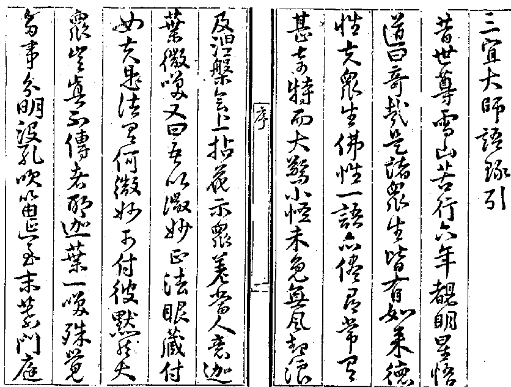
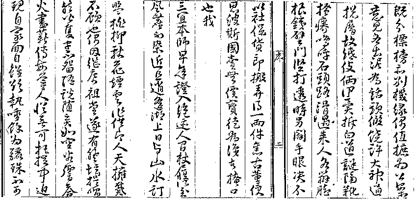
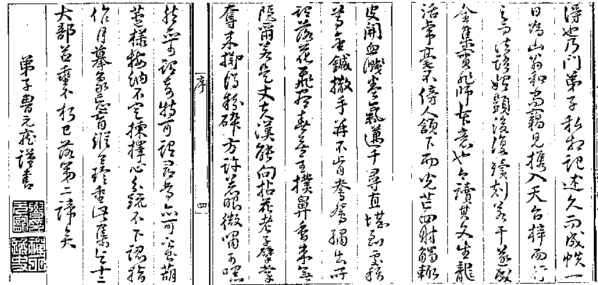

# 三宜盂禅师语录



> **藏经**：嘉兴大藏经（新文丰版）（嘉兴藏）　**册次** 第 27 册（J27）　**编号** JB189　**部类** 诸宗部　**卷次** 11 卷　**篇幅** 147,696 字

> **作者（译者）**：住云门显圣寺门人净范编

> **卷／品**：11 卷 · 1 品



---



## 目录



  - [显圣三宜禅师语录序](#显圣三宜禅师语录序)

- [三宜盂师语录卷一](#三宜盂师语录卷一)

- [三宜盂禅师语录卷二](#三宜盂禅师语录卷二)

- [三宜盂禅师语录卷三](#三宜盂禅师语录卷三)

- [三宜盂禅师语录卷四](#三宜盂禅师语录卷四)

- [三宜盂禅师语录卷五](#三宜盂禅师语录卷五)

- [三宜盂禅师语录卷六](#三宜盂禅师语录卷六)

- [三宜盂禅师语录卷七](#三宜盂禅师语录卷七)

- [三宜盂禅师语录卷八](#三宜盂禅师语录卷八)

- [三宜盂禅师语录卷九](#三宜盂禅师语录卷九)

- [三宜盂禅师语录卷十](#三宜盂禅师语录卷十)

- [三宜盂禅师语录卷十一](#三宜盂禅师语录卷十一)



---



### 显圣三宜禅师语录序



世尊有密语，迦叶不覆藏。夫一华拈出，觌体全彰，果世尊有密语乎？然而百万人天，咸皆罔措者，何也？昔者赵简子，因姑布子卿，以翟妃子毋恤为贤，欲试之，乃告诸子曰：「吾藏宝符於常山上，先得者赏。」诸子驰之，常山上求无所得。毋恤还曰：「已得符矣。」简子曰：「奏之。」毋恤曰：「从常山上临，代代可取也。」简子於是知毋恤果贤。则世尊拈华之旨盍可心知，而百万人天且碌碌如诸子，直以常山有符在焉耳！故四十九年从佛口生，皆如诸子。而末后始以正法眼藏付嘱摩诃迦叶者，所谓废太子伯鲁，而以毋恤为太子者也。西天无论已，东国自有宗门以来，师师授手，皆命世亚圣。大人虽机用罗张於李唐，语言绚烂乎皇宋，一如青天霹雳，旱地雷鸣，南山起云，北山下雨，苟非毋恤之雄略，罕窥其意旨之所在者，沿袭至於元明之季，尊其师说而已，无复神而明之之道，遂使从上真规死於绳墨，千秋堂搆坠之非人，彼步趋尤难，况奔逸绝尘，得游戏如风大自在三昧者耶？三宜禅师，天岸祥麟，云中逸翮，茂龄悟道，石笋抽洞上之条；早岁分镫，空华结云门之果，尤复涉南北於数千里外，困风霜於二十年间，始归而遯迹化鹿山之阳。会尔密澓公迁化显圣，席虚四众，挽之出世。於是果熟之香，风飘偏界，盈科之水，决而滔天。遂有升堂示众等语，皆脱略窠臼，铲去尘封，直欲与五祖共唱巴歌，瞎堂同呼哨指，乃过践偃师之迹，不许流传一字。侍者随闻记集，仅若干篇。余过吼山，始得读於尼净琦家，不觉掩卷拊几，长太息曰：「此龙光射斗者也，曷为薶藏於此？」因持入天台为之参详校订，复捐赀寿梓公诸同好。於乎师弦绝响，野干乱鸣，彼黄头乳口尚往往以禅语衒保社，况牙似剑、口如盆，反深自弢藏有如师者。往余与师同参黄檗，继今乙亥，盍廿有餘禅，始获对谭五云山下，然皆法门细大无他，及逮过显圣观所为，布置丛林，缔修堂舍，亦可谓二严无憾者矣。当丙戌之秋，因事径拂衣去不顾，则视蚖蛇恋堀，掩先业为己有者何如？而增上慢之徒，且以风流潇散短之。龙象蹴蹋，抑岂跛驴所堪哉？



岁在著雍困敦月维林鍾同参弟广润道忞谨题















三宜禅师语录目次



第一卷住云门显圣禅寺语录



第二卷住云门显圣禅寺语录



第三卷住姑苏古朱明寺语录



第四卷小参  

晚参



第五卷普说



第六卷普说  

问答机缘



第七卷拈古



第八卷颂古



第九卷佛祖历传像赞



第十卷佛祖像赞  

自赞



第十一卷佛事  

塔铭(附)



------



## 三宜盂师语录卷一



**译者**：住云门显圣寺门人净范编



山阴嗣法弟子祁净超较订



住越州云门显圣禅寺语录



山门。「八万四千门，门门一切境，白狗上树，乌驴落井。」



大殿。「佛身充满於法界，普见一切群生前。大众！觌面相呈又作麼生？」展坐具云：「盖覆却。」



伽蓝。「金汤佛法，干城净侣，灶底要有柴，锅里要有米，禅道佛法不劳重举。」



祖堂。「来时无口，去时无舌，且喜诸公鼻孔依然。」拈香云：「以此为验。」



据室。「骑虎头，收虎尾，第一句下明宗旨。拾得师桦冠楮衣，达磨老当门缺齿。」



谒当山先湛老和尚像。「昔既非亲，今则成冤。华开銕树，火里红莲。」



上堂。拈檀越疏云：「大众！莫被者毛锥子将黑荳换却眼睛，鸟篆龙章，纸墨文字，秪可作世谛流布，岂可作佛法商量？且道如何是佛法？」度疏与维那云：「你试念看。」



法座。「未有世界，先有此座，十方诸佛不敢正位，历代祖师秪可旁立。山僧今日倒骑佛殿，顺跨山门，且道却为何事？」卓拄杖云：「若不登高望，焉知沧海深？」升座。拈王臣檀护香讫，复拈云：「此一瓣香，根生灵鹫，叶覆娑婆，今日拈来，却为山僧二十年前在瓶窑烧得一担破砂盆，自谓奇奇特特，谁道云门路滑，和身跌倒，人天众前不敢覆却。奉为显圣堂上传曹洞正宗三十二世先散木大和尚，用酬法乳之恩。」白椎竟，师云：「若论第一义，华擘了也，向山僧未屙已前荐取，早已落七落八，况在文字语言白云万里，除此二途，君子可八。万不得已借路经过，聊塞一时之责。」蓦竖拳云：「此是老和尚一生用不尽的馊残盂，上座贵买贱卖，不妨奇特。」屈指云：「一二三四五。南赡部洲普请，北俱卢洲打鼓，七金山下，乾闼婆、阿修罗、迦楼罗耸身起舞，须弥山顶帝释天主高声唱道：『汝等佛子，各各本有灵明玅智，与刹等、世界等、诸佛等、菩萨、罗汉、贤圣僧等、众生等、神通等、玅用等、说法等、寿量等、相好等、光明功德等。』」拂一拂云：「这一络索向甚麼处去也？风从华里过来香，水向石边流出冷。」



度僧，上堂。「甘霖弥八极，起枯槁於田畴；德泽被三根，丽芬芳於原野。法无定相，是处可以圆融；理绝自他，随方不妨建立。是以道人行履，迥异常情，有时独足立於万仞峰头，把臂行於际天洪浪，纵使一色边也须尽情铲却，果是无瑕玉，也要一椎击碎。」遂拍案云：「呵！呵！呵！前无村兮后无坫，雨过谿塘柳如线。青蓑绿笠旧家风，吹落荷华三四片。」擿拂云：「鉴。」



祈雨，上堂。拈拄杖云：「震法雷兮鸣法鼓，山门头弥勒开眉，布慈云兮洒甘露，塔尖上商羊起舞。四海龙王脑门裂，三十三天叫冤苦。云锁赵州关，雨打云门普。拈起一豪端，尘刹无焦土。於此作佛法商量，笑诸君从头莽卤。所以此一著子，大似龙王行雨，不从龙王身出，不从心出，不自云生，亦非空有，以不思议力时行雨事，成熟谷稼，繁长艸木。大众！既不从身、心、空、云中出，且道雨自何来？」卓拄杖云：「赫连皇甫。」



尔密和尚入塔，上堂。白椎竟。师云：「若论第一义，适才密兄道过了也。山僧仰不得已，赴众贤姪之请，只可依科顺释，据理分章。」击拂一下云：「二繇一有，一亦莫守。雨餘松径苔钱滑，水到石头声转高。若是白云中坐，任绣帏里藏身，堪作甚麼？所以没量大丈夫，去住自繇，非凡情之所测识。播弄乾坤，棋分岳渎，黄金铸就，銕疾藜到口便吞，白玉碾成金刚圈，横身直过针锋上，走马钱眼里秋千。其住也虎踞嵒前，其行也龙归渤海。回视以鹪鹩窝为玉殿琼楼，鼷鼠穴为广宫大厦，可谓崖州万里。山僧作恁麼语话，密兄闻之，不觉绝倒。大众！你道笑个甚麼？宝镜堂前万竹圃，雨一天，云一坞，丈夫经济，平生肺腑。」以拂左击云：「赵州关。」右击云：「云门普。」中间一击云：「带月担泉，和烟取火。」



上堂。举：「僧问赵州云：『万法归一，一归何处？』州云：『我在青州做领布衫重七觔。』这老汉潦倒龙鍾，齿不关风。山僧即不然，今日十月初一，种麦刈禾俱毕，知事行人收收拾拾，不胜劳力。堂中首领执事，上单下单，与你同休同戚，独有山僧，随例打哄，两饭一粥，坐方丈楼，唤侍者开却前窗后窗。看他落霞孤鹜齐飞，秋水长天一色。从上来这些禁鬼神底符子，我今为你分劈。」乃舞拂，作喷水势云：「太上老君急急如律令。敕。」



上堂。「最相应……」竖拂子云：「这句子，不起於此座，可以超生死。眼里著却须弥山，耳里能藏四海水，蹋翻四部洲，身如葶苈子，口中不断玅伽陀，头戴华冠手持杵。」击拂一下云：「我见灯明佛。本光瑞如此。」



上堂。「芭蕉碎剪难添线，霜叶因风落似华，最惜上林萧索，也不知华发在谁家。谩咨嗟，到得一番寒彻骨。」竖拂子云：「且看雪里一支斜。」



上堂。时值鸡唱，师云：「叫一声，应一声，声声唤出本来人。」左右顾云：「情知汝等向四大里作活计。」复云：「大众！窗外红冠上座，从晓至昏，为你提纲挈领，你总不会。适来鼓声带我披帽，钟声穿我艸鞋，走入厨房里，得罪了普贤菩萨，回到僧堂中，触忤了文殊大士。只得向佛殿前高声唱云：『若耶谿上云门寺，万竹林中最深处，我是观音独露身，为君拔却眼中刺。』大众！大众！频呼小玉元无事。」



上堂。举拂云：「向这里见得彻去，七穿八穴，东涌西没，便向粪埽堆头，拈起一丝豪许。可以塞破虚空、平沈大地，尽十方世界是个眼睛，你向何处顾盻？尽十方世界是个鼻孔，你向那里喘气？然后转过身来，七珍八宝填沟塞壑，无有寸土不是金铺玉甃，琼楼珠殿宝树华台随身受用。切忌向钵盂内经行里著衣吃饭，迎宾待客边作窠臼立墙堑。岂不知，显圣这里滴水滴冻，偶然咳嗽一声，也遭他简点。」良久云：「如何得不遭他简点？」竖拂子云：「玅法坚手天、华鬘天、四王天、忉利天、夜摩天、他化自在天。」乃嘘一声，下座。



上堂。「夜来月色溶溶，今朝烟雨蒙胧。谁家华表柱，水上卖东风，一个衣绿，一个穿红。衣绿者手拨琵琶，穿红者羯鼓冬冬。高声唱道：『应物见形，如水中月。』」竖拂子云：「佛真法身，犹若虚空。」擿拂子，呵呵笑云：「到头辛苦到头穷。」



上堂。「今朝十月有十五，两个孩童弄华鼓，左边打了右边舞。露柱与灯笼，声声叫怨苦。鸟啼两岸苍黄，猿叫千山月午。」良久，顾左右云：「大众莫莽卤。」



上堂。「好休休去不休休，白首登科恋墨裘。黄菊谩夸霜后色，白云红叶满荒丘。舍利弗，没来繇，剑去徒劳更刻舟。果然世系金轮子，岂肯要功万户侯？大众！且道舍利弗悟个甚麼？」良久，云：「两段不同，消归上科。」



上堂。「漪漪修竹千竿，清沁一谿流水，有智不在多言，好景何藉华卉？笑他聚石谭经，无事听闲人说鬼，可惜日居月诸底事如何不委？若要委，且看銕树生枝，华开碓嘴。」



上堂。「疏雨打窗清梦里，好山深锁白云中。有题最是难藏覆，竹浪萧萧一夜风。百艸头识取祖师，艸枯了也。闹市里识取天子，市散了也。与诸兄甚处相见？」良久，以手招云：「猩猩我与汝相见了也。」



上堂。「寻常肝胆向人倾，底事堪嗟叶满庭。好句不知谁领得，寒鸿依旧宿沙汀。释迦老子说法四十九年，谭经三百餘会，撮东风；达磨航海西来，撮东风；历代祖师升座说法，撮东风。众中有个师兄突出众前，高声大叫：『盂上座！你恁麼道，也是撮东风，可谓出乎其类，拔乎其萃。』大众！你道他具个甚麼眼，便敢恁麼？」良久，云：「撮东风。」



上堂。「山顶月微微，林外云无迹，不见渡头人，独自谿边立。」以手招云：「在者里，休相忆，令佛放光明，助发实相义。当日山僧若在座下，拄杖子决不放过，秪如不放光明实相义，那里缺半边，何处失一角，南北何曾长，东西何曾润，红日岂从西出，明月岂从东落？只是你诸人眼里耳里，闻见熟了，头头放过。山僧作是说时，主山案山一齐冷笑不禁，且道笑个甚麼？主山道：『长老只见锥头利，不见凿头方。你道头头放过，病在于何？有禅有道是病，有佛可成，有法可得，有众生可度是病。』案山道：『你只见凿头方，不见锥头利。岂不闻病从心生，心从业生，业从妄想生。妄性本空，不在内、不在外、不在中间，于病何有？心无病故一身清净，一身清净故多身清净，多身清净故一切众生清净，众生清净故世界清净，一世界清净故尽十方世界一切清净。』」喝一喝云：「若不喝住，直说到明日。」拍案一下云：「谁家萧管梅花引，惹得春风入户来。」



上堂。「曲不藏直，真不容伪，寒鸿至而霜满林，黄鸟啼而春光媚。得之于心者，一尘一佛国；失之于旨者，触树而迷昧。」击拂子云：「碎。」



上堂。「道吾舞笏小神通，石巩张弓失楚弓，堪笑西河弄狮子，一拳打杀岑大虫。」竖拂云：「总不若山僧此拂子，在众生唤作现行无明，在诸佛唤作根本性智。在他分中无可不可，无彼无此。有时以根本智作现行无明，有时以现行无明作根本智，所以众生淳如也，诸佛淳如也，世界淳如也，虚空法界淳如也。然后兴大慧云、布大法雨，使一切众生从大梦觉，具顶门眼，方知道嵒头针锋上有无边世界，灵照菜篮里有百亿须弥。禾山击著涂毒鼓，闻者丧身失命。云门胡饼，骑声盖色，超今越古。然虽如是，还我翠嵒眉毛多少长，达磨鼻孔几许大。罢罢罢，休休休，山青水绿，听取云门一曲。」以拂子置案上，作抚琴势，连挥拂子云：「玅玅玅，纯如也，皦如也，绎如也。」擿拂子云：「以成。」



上堂。「连宵好，雨初晴。远山叠翠，碧水生澜。正恁麼时，有一句子，蹋破艸鞋赤脚走，金毛师子云端吼，海底波斯暗展眉，八臂那咤难下手，投老归来事事空，翻然一笑无何有？」击拂子云：「三三成一九。」



长至，上堂。「今日一阳复始，穷汉摇头摆尾，眨眼之间，会见千红万紫。诸禅德！好个时节，诸佛出世，祖师西来，也不过为此个时节。历代宗师激扬酬唱，亦为此个时节。尽大地艸木丛林、人天诸趣，蠢动含灵，一举一动，总是此个时节。不料汝等一队蒙懂汉，见山僧上堂，便延颈举踵。及乎一下座去，松风竹韵，犬吠鸡鸣，寻常放过，就不关你事了也。但只闻钟响，念功课也；闻打鼓，上殿也；打梆，普请也；打木鱼，吃粥吃饭也。山僧恁麼举扬……」以袖掩面云：「羞杀我也。」复云：「东方朔平原厌次人。」



值雪，上堂。「一片两片，佛祖正眼觑不见；五花六花，八臂那咤不敢拏。落地无声，混沌银成世界；太平有象，天开玉砌。楼台最苦，鹭鸶无处避，飞上松梢，有时白鹤共翱翔，寒空清唳。一色边坐住，元非本地风光；洁白里安身，岂是到家消息？文殊不出头，风来时满林狼藉；普贤呈丑拙，日出后一场懡㦬。今日檀信，不在家中受用红炉煖阁，得得入山，将珠尘玉屑轻轻攃向诸人面前，更要山僧说些闲话，向雪里送炭。好雪呀，片片不落别处。且道：落在那里？」竖拂子云：「求福者福臻，祈寿者寿永，求消灾者灾消，禅德家又作麼生？雪与梅共嚼，不惟齿颊生香，亦且清芬肠胃。归堂去，试嚼看。」



上堂。「描不成兮畫不就，山光飘渺水连天。髑髅有眼看霜叶，枯木龙吟古路边。逢迎处，吾无隐乎尔，何必道象帝之先。幽禽处处呼人梦，莫待春风听杜鹃。」



上堂。「隔林残月晓诸峰，竹色霜华荐朔风，山得我游权有主，云过西岭碧玲珑。若物属他，他所守护。世间一事一物，总属于人。惟谿上清风，山间明月，尽可以适性怡情，取之不尽，用之无穷，是所谓造物之无尽藏也，却又被拄杖子管辖。没奈何，只得行则偕往，往则同居，休戚相关，性命连络。渠得我如虎靠山，我得渠如龙遇水。山僧偶然瞌睡，他便作怪去也。耸身上忉利天，击著帝释天鼓。尔时天鼓作如是言：『人天诸佛子还识拄杖子麼？有句无句，顶天立地。上无片瓦盍头，下无卓锥之处。遇富贵而不骄，居贫贱而不媚，能使蠛蠓醯鸡，浩然之气塞乎天地，螳螂蛣蜣，净智光明遍乎寰宇，续佛祖之命脉，作众生之本智。如我鼓声，不从内出，非从外来，亦非空有。以不思议力出此音声。』复鸣云：『冬冬冬！』山僧此时骤然惊觉，拄杖子依然在手。」蓦举手云：「呀！原来是空手。分明香在梅花上，寻到梅花究竟无。」



上堂。「耿耿寒灯劳睡眼，其如所禀天资浅，不若当时般若多罗老瞌椿，常转如是经，百千万亿卷，化城固虚设，家乡去不远。秪如宝处在近，毕竟在甚麼处？」良久，云：「险！」



请宝寿和尚上堂，引座。「澄江清浅时，白鹭和烟岛，良哉观世音，全身入荒艸。古人恁麼说话，虽则如骇鸡犀骊龙珠。山僧则且不然，松阴野寺遥，堆积无人扫，清风来故人，竹暗啼幽鸟，畏寒烘焙煖，贪眠不觉晓，岁月成蹉跎，可惜衣中宝。大众！如何是衣中宝？」以拂子连拂云：「曼陀罗华、曼殊沙华、栴檀香风，悦可众心。」喝一喝，云：「下座同请宝寿和尚说法。」



上堂。「霜重芦花柳岸低，一钩新月钓寒谿，金鳞已是无消息，又听前村报晓鸡。鍾楼上撞钟，墙脚下种菜，猛虎山里踞。大众！且道与古人回互不回互？」以拂子左击云：「回而更相涉。」右击一下云：「不尔依位住。」



送六如禅师入祖堂，上堂。「头枕须弥峰，脚抵云门麓，芥孔里游戏，大海中洗浴。是葛天氏、无怀氏、混沌氏之流，从来不受官家禄，手持断贯索，神号而鬼哭。今朝荆门上座，送六如法兄木主入祖堂，便抴条竹杖子，要来显圣这里，量香炉峰几许高、探耶谿水多少深。山僧略施神通，香炉峰已被云遮了，若耶谿被雾掩了。无计可施，别行一路，拏了些砒霜巴豆，饭里菜里水里都放些些，大众！切防丧身失命。山僧抑不得已，将六如兄留下底云门饼供养大众去也。」以拂子打圆相云：「一把柳丝收不得，和烟搭在玉栏干。」



上堂。「丈夫儿，无等级，所以人天不可测。行藏著著异常流，岂肯随人畫模则？广南珠，作麼色？白月白兮黑月黑。大众！如何是五百弟子衣下明珠？」师作咳嗽云：「失。」



上堂。竖拂子云：「大众！这句子与三乘十二分教是同是别？同同同，一声羌笛白云中；别别别，芦华搅乱江天雪。除却同异两重关，露柱灯笼炽然说。」喝一喝云：「也是证龟成鳖。」



解制，上堂。「风吹上马石，雨打望僊桥。圣僧前问讯，山门外伸腰。乌鸦飞过岭，白鹤立松梢。显圣这里，气宇如王，顶天立地，艸鞋似虎，拄杖如龙，就是钵囊鞋袋，针筒帽样，也会放光动地，超佛越祖。说甚麼雪山六年苦行，冷啾啾地末梢头，又道睹明星悟道。」举头望琉璃云：「山僧今日睹见琉璃，且道悟个甚麼？」蓦拈拄杖擿下云：「不是。」下座。



上堂。「修多罗，青天云翳，老瞿昙，眼中一刺，四十九年云行雨施。末后又道：『我未曾谭著一字。』盂上座也是抴尾灵龟，无事生事。不见道：『如虎之缺，如马之馵。』」



上堂。「穿靴赤脚走，面南观北斗，我脚是驴脚，我手是佛手。用尽自己心，笑破他人口。更有一句子，大众还知否？」良久，云：「曹山颠酒。」



元旦，上堂。「旧年今日新，新年昨日旧。新旧自迁讹，梅花一枝秀。俊哉拄杖子，不肯随人后。是以衲僧家，有格外提持，别行一路。释迦老子不降生，达磨祖师不西来，堆山积岳，填沟塞壑。若还向他语脉上跻攀、旧路里挨排，何异蒙人离拄杖，寸步难移。显圣今日，悬斗大之胆，开谩众之口，洒洒落落，自繇自在，拈须弥山卓你眼里，掬四海水灌你耳中，运阿修罗手拊摩日月，广舜若多身塞破虚空，然后随分，甚麼油煎马杓，酢浸擂槌，新换桃符，陈年爆竹，一事一物，气宇如王。向毘卢顶𩕳上，大方润步，神歌社舞，鼓响钟鸣，都可以振提蒙聩，起发将来。三藏教诠显不著，历代祖师拈提莫及。且道如何得恁麼灵玅？」嘘一声云：「掀翻海岳求知己，拨动乾坤见太平。」



回院，适诞日，上堂。「自离真寂，来归显圣，在山僧分中，所谓泥上偶然留指爪，鸿飞那复计西东。」拈拄杖云：「总不如此。木上座无去来今，绝尔我想，灵枝永秀，智种常明，齐无量寿为日暮，总法报化为一身，外绝遮拦、内无藏覆。你诸人举足便蹋著他影子，开眼便看见他光明，属耳便闻他音声，只恁麼寻常过了。山僧不惜与你通个消息。」卓拄杖云：「但愿春风齐著力，一时吹入此中来。」



上堂。「大众！莫道槛外微阴，正好搪风抵露，直教盖覆人天，一个个不致风吹日暴。所以道：『此事不在言诠，秪贵心领神悟。』月照一帘秋水，夜半正明；云藏几处峰峦，天晓不露。类之不齐，乱落树头红叶；混则知处，浅水银砂白鹭。透得赵州关，不重云门顾。且道以何为验？正是不欺之故。」



上堂。「恁麼也不得，不恁麼也不得，恁麼不恁麼总不得。潦水静而寒潭清，烟光凝而莫山赤。我适曾供养。」竖拂子云：「今复还相识。」合掌云：「南无药王菩萨摩诃萨，摩诃般若波罗蜜。」



上堂。「取次闲行看暮鸦，白云依树便成霞。首题最是难消释，错恨瞿昙欠作家。世尊拈华，如虫御木；迦叶微笑，偶尔成文。只如前谿一带水，不待拈而知其水也；远山数点青，不待笑而知其山也。却来观世间，犹如梦中事。恁麼告报，犹欠彻在。且道过在於何？也是矢上加尖，堆头添土。」



上堂。「是则穆王骑八骏马，非则纪信驾九龙车。事事无碍，霜横篱落华犹在；法法无差，鹭鸶谿上啄睛沙。直得是非不立，理事两忘，鹏搏万里，凤翀霄汉。若是死守寒崖蚖窟蛙墟，堪作甚麼？大众！观世音菩萨来也。」以拂子作吹箫势云：「咿唔咿唔，松间惊起鹤飞去，数点残霞接断云。」



上堂。「火燄里拈得眉毛，大海中寻得绣针，惯打漫天网子，怕见清平世界。向者里挨身而入，才有你说话分。若是山河大地煆炼得无有织毫过患，如新磨镜水洗一样，只是把缆放船，抱桥洗澡。更有个汉，将佛祖言教，诸子百家，束作个枕头，长伸两脚，终日打眠。佛来摩顶授记，他也不采。祖师送禅版拂子与他，他也不要。泰山崩於前，疾雷震於后，他也不动。山僧且疑著这汉，拈条纸撚悄悄向他鼻孔里一通，这汉也忍俊不禁，打个喷啑，依旧将三藏十二部教，诸子百家一时倾出。何以如此？夹路桃华风雨后，马蹄何处避残红。」



上堂。「新丰一句，当阳道破，不涉唇吻，已成露布。细雨蒙蒙，黄花满路，打失衲僧鼻孔，忘却邯郸故步。古镜台前，几多错误。大众！一切众生皆繇不知常住真心、性净明体，用诸妄想，此想不真，故有轮转。且道既不用诸妄想，毕竟用个甚麼？」左右顾大众云：「骼。」



东山诸法姪过显圣扫塔，请上堂。「未老先惊鬓发秋，陆沉季子弊霜裘。徒知年往无生计，日操南音学楚囚。苍天！苍天！先兄若在，山僧必不致恁麼败落。此老汉一生来抖擞精神，拳倒了舜若多神，踢翻了须弥山王，呼喝之间，四大部洲缩入藕丝孔里，只差些性气不驯，至使艸枯蓬断。犹幸有麟趾振振、凤羽翩翩，山僧所以不甚寂寥，如今总无他说。所虑诸兄弟，向靛缸里漂白，酒瓮里签油，没奈何，只得将先兄遗下底破家破伙提掇一上。」遂竖拂子云：「此是他赶蚊虫过底，要他作麼？」乃擿下。复拈拄杖云：「此是他打癞狗过底，要他作麼？」亦擿下。乃嘘一声云：「曾经三峡猿啼处，不待三声已断肠。」



上堂。「丰标太古，雕绘今时，月色共星河散彩，梅华与雪浪争妍。澄江如练，碧落无瑕。正恁麼时，尊而无比，切忌向十字街头，遇著个扬尘播土汉，不免惜破甑於回头，惊蜂虿於掉臂。设使透过无厌足王底牢关，觑破胜热婆罗门底机械，须信衲僧家，更有向上事在。今日檀信要与山僧相见，於三千里外，不妨奇特。直得耶谿水逆流，秦望山起舞，尽大地艸木昆虫，一时间转凡入圣。何以见得？过头拄杖，齐眉帽子，独自行，喃喃语，石伞峰前，云门路里，茫茫烟雾潇潇雨，数点鹭鸶飞起。」喝一喝，下座。



先湛老和尚讳辰，上堂。举：「僧隔窗问石霜：『咫尺之间，为甚麼不睹师颜？』霜云：『遍界不曾藏。』大众！不曾藏，东风摇抴柳丝长，红肥绿瘦。纷纷蛱蜨度危墙，燕子双双遶畫梁。」遂作弹琵琶势云：「漫剔银红夜，深独自理宫商。」喝一喝，下座。



上堂。「天地与我同根，万物与我一体，秦望山为头，大峰山作尾，游偏了四大部洲，托生在三江城里。当初姓张，如今姓李，资积富称敌国，终日愁柴少米，且道是甚麼人？」拈拂子击左边云：「露结为霜。」击右边云：「云腾致雨。」



上堂。摇拂子云：「一声鸡唱梦初回，雁带新霜数字来，好个祖师亲切句，向人开口惹人猜。昨日三，今日四，要得茅塞开，拔去了眼中刺，衣冠美丈夫，岂可无此志。大众！昨日释迦老子从山门里来，被山僧一顿拄杖打出去。尔等寒症未除，吃一粒米也可成疾。」左右顾云：「险些反输一帖。」



谢两序，上堂。「大业不论功，大悟不存师。龙门跃鳞，不堕渔人之手；来仪彩凤，岂入庶子之家？山僧与古人，可谓同港不同舟。不见道：『南山有竹，不扶而直，筈而羽之，其入不愈深乎！北溟鱼化，不假他缘，风培云拥，其飞不愈疾乎！』」拈拄杖云：「渡水穿云，全凭渠力。且道是甚麼力？摘杨华，摘杨华。」



解制，上堂。「云堆浪打竹枝邪，不见梅华见雨华。无限白云浑似海，不知何处有人家。然虽如是，山僧有时恁麼，泥猪癞狗气宇如王，有时不恁麼，三贤十圣饮气吞声。看看逗到末梢头，就是释迦老子，也只得和盘托出。况是诸兄临行之际，山僧如何忍俊得禁？没奈何，今日缶泻河倾去也。」乃咳嗽一声，下座。



大悲菩萨开光，上堂。「知人法无我，烦恼及尔燄，常清净无相，而兴大悲心。一目二目，八万四千清净宝目；一臂二臂，八万四千母陀罗臂。金色臂腾耀古今，青莲目横亘十方。初不因山僧未至，少却一目，又不因山僧已至，增却一臂。然虽如是，今赴请至此，又不可一往拖顺风旗、打太平鼓去也。」拈拂子云：「山僧拂子善别机宜巧於冥应。有时东山水上行，有时北斗里藏身，一茎艸见丈六金身，一微尘见大千手眼，缩四海水入一豪端，纳须弥山芥子孔内，直得海龙王发恶，阿修罗动瞋，帝释天主再三劝勉道：『观音玅智力，能救世间苦，十方诸国土，无刹不见身。』且道见甚麼身？」喝一喝。



元旦，上堂。「隔得一日，添却一岁，长汀憨布袋，无钱终日醉，却笑卢行者，黄梅去舂碓。辛苦几多时，依然道不会，致使儿孙辈，成群而打队。大众！千说万说，总在今日。今日若清楚得去，不必得横挨竖拶，便能怀揣日月、袖纳乾坤，山青水绿、万紫千红，不著一些儿气力都领略了也。不管他钵盂大小、净缶阔狭，总在里许。」拍手大笑云：「独有山僧不在里许。何以见得？有名闲富贵，无事小神僊。」



上堂。「明月照华胥国土，白云笼金阁宝坊，於斯也有人焉，而不知谁之嗣。柳生乎肘，腹栽松树，我知之矣。繇是之故，我不敢轻於汝等。汝等皆是，是个甚麼？」顾左右云：「贼。」



荐亡僧，上堂。「山色蒙茸，春光明媚。」竖拂子云：「独有这个迥超物外。」复击一下云：「一击粉碎。然虽如是，佛界则可，魔界未在，须得向破沙盆里陶铸一番，折脚铛中煆炼一上，一任落花飞絮风打成堆，水流夹岸藻荇参差，然后羚羊挂角也得，狮子嚬吟也得，佛界里作班头，魔宫中为首领也无不得。今日心莲上座将四亡僧鼻孔一串穿却，向山僧这里要发付个下落。还著在佛界耶，魔界耶？闻说莺啼在杨柳，如何尚有未开华？」喝一喝。



上堂。「枫无賸叶，瓦有重霜。寒鸿健翮，夜过钱塘。日居月诸，一切寻常。万法归一，一归何处？谩说青州布衫。朝日上团团，有事不相谩。芭蕉难补袈裟破，山月重新窗外光。」



送先湛老和尚，入径山祖堂，觉浪和尚请上堂。「未有此山，先有其人。未有此位，先有其道。是其人则山道两忘，契乎道则人位双泯，然后可以坐断十方，陵铄今古。到这里，诸佛不敢正坐，祖师秖可旁立。若万仞悬崖相似，且不许你攀仰，况游历乎？万不得已说有个绝顶句子，如凌霄峰，只可从偏径而入。有般汉才到得半山亭，便恁麼去，更不知有向上一路在。审如是，则何以见有空中宝阁幻化琼台，翠遶松杉森围古寺？所幸有径山法兄，公天下无我之心，定古今不易之论，越阡度陌，互为宾主。左手提纲，右手张目，向高高山顶，打个漫天网子，尽大地鱼龙虾蟹，无地藏窜。山僧恁麼道，有个汉出众高声云：『秖如龙门显圣又作麼生？』大众！云幕幕，水滔滔，但见树老，不觉天高。就是顾虎头，吴道子有笔难描。」以手招云：「大众！大众！饭后闲行，何处不凌宵？」复喝一喝，下座。



上堂。「破晓春霜压残雪，梅华弄景寒香冽。多因为惜陇头春，折向人前叹奇绝。」竖拂子云：「释迦老子秖得一橛，要得完全，听吾重说。」遂下座。



上堂。「好生怕杀升堂鼓，侍者憨头不知苦。提衣催我上高台，枯肠无字从人吐。孩提失读上大人，於今老大将何补？最喜华亭船子风，烟蓑雨笠清江浦。一切智智清净，无二无二分，无别无断故。松颠早晚弄波涛，寒窗带月连风舞。」



结制，上堂。指座云：「大众看看！须弥灯王如来，玉齿唠唠，咬文嚼字，太无厌生。山僧为你剿绝去也。」良久，嘘一声，乃升。白椎竟，师高声云：「龙象众还闻麼？木上座与磬长老互相激扬，一槌之下，敲出诸佛骨髓，披沥祖师肝胆，汝等耳又不聋，更何假於山僧？设使山僧见出三头六臂，左手擎著须弥山，右手掬著东海水，你又道是山僧捏怪。不得已，脱珍御服著垢弊衣，随你颠倒一上。大众！如何是颠倒？」良久，云：「今日结制。」



上堂。「夜深纸帐梅花冷，尝思羁客回乡井。今朝且喜得相逢，不是相逢吊孤影。」竖拂子云：「如何是还乡句子？粪火煨香芋，松子煮龙泉。饱食香田脱粟饭。」放下拂子云：「日高三丈我犹眠。」



到吼山，请上堂。「携笻独自步睛沙，风卷霜林似落花。犬吠只疑门有客，原来竹里有人家。大众！且道：是甚麼人家？还是彭泽五柳，还是右丞辋川？山僧只是不能忍事，往往向人道破，放年签相似，不管人要不要送上门来。然一生止有者点热肠，别无长处。倒吊起来，要点墨水也无。昨日受请，勉强打点得几句，及乎升座，却一字也忘了。罢罢罢，休休休，四十餘年早白头，破衲胜重裘，水边林下得优游处且优游，青目睹人少，白眼笑王侯，残霞落尽前峰外，又见飞鸿过渡头。云门云：『六不收。』」



上堂。「钟鸣鼓响下堂来，郁郁惭惶拨不开，若问旧时闲骨董，风吹黄叶满苍苔。大众！古往今来列圣相传，原秖得这些子，间或倚门傍户，沾著纤毫气息，便好骤千里追风之马，展鹏搏六息之翼。火不能焚，水不能溺，入军不避甲兵，入林不避兕虎。所以道：『世界阔多少，古镜阔多少，劫运长多少，古镜长多少。』山僧这里虽是旧时文约，无不是以一偿十，以十偿百，以百偿千，以千偿万。而况今日受檀越之请，升此宝华王座，岂可盖覆却耶？」拈拄杖击香几三下。



上堂。「森罗万象，一法之所印。龙门阬里三条桥，鹦鹉峰前九曲岭。猢狲惯上树，虾蟆跳入井。还知一法麼？两段不同，收归上科。」



上堂。「山僧有生已来，将铜銕铸得一副心肝，打得一副面皮，陵铄诸方，气吞佛祖。正恁麼时，咳唾之餘，便好擿地作金声，弹指之下，不妨珠回而玉转。三年前，跨入显圣寺门，被个绊脚索子跌上一交，便恁麼软挼挼地，不知不觉，闯入个野狐精，瞎秃丁夥队里，挨到此一时，提掇个事，何啻千钧之重，直至如今分疏不下，诸兄弟幸自可怜生，好个时节。且道是甚时节？」竖拂子云：「甲子乙丑。」



上堂。「衲僧家高高山顶立，深深海底行，十二时中，红炉片雪，百千三昧。擿剑挥空，列圣笼罩不住，万灵不可为俦，天共白云晓，水和明月流。咄！」



上堂。竖拂子云：「描不成，畫不就，添不得一丝，减不得一豆，三世诸佛趁伊不上，历代祖师参前落后。盂上座只好做个通事舍人，所以不敢轻于左右，学得神僊好方子，自然点石黄金就。」



上堂。「阴极则阳生，腊尽春来早，略见梅花报早春，窗前适有呼春鸟。殷勤报与白头人，怎奈白头人不晓。古人也虑头角生，佛法二字何曾表。今日檀信一以荐先，一以度生，请山僧升座说法，可谓一椎两当。山僧如搭箭之弦，势不容己，打开布袋头，将七珍八宝，撒向山门佛殿厨库厢廊，填沟塞壑磕头撞脑，曾无一字覆藏，好似向火焰里添油，冰盘里泼水。便饶恁麼，尚且有不知冷煖底汉子以手拊胸云：『气逼杀人。』大众！要且无他，有个关捩子儿，若是拨得转，水鸢也会翀霄。若拨不转，就是宝剑空埋泉下。山僧今日为你拨转去也。」乃拍案一下，下座。



上堂。「昨日冬行春令，会见千红万紫，打开地网天罗，放出无毛鹞子。拈花微笑，睹桃击竹，吹灭纸灯，三顿痛棒，立地成佛，超生脱死。巢知风，穴知雨，鸡鸣丑，鹤鸣子，既不是神通玅用，又不是法当如此，为甚麼刺脑入胶盆，钻他故纸，认奴作郎，被渠驱使？今日宗林上人，设斋办供，山僧睡如小死，设斋者是真法供养，打眠者是真精进之旨。三世诸佛赶入水牯牛队里，何处更容得达磨这个胡子？诸兄弟！诸兄弟！归去好，归去好。残雪在山梅有月，莫教冷落花无主。」



上堂。「禀明於心，不假外也。薄批潭底月，细切岭头云，吃则从君吃，不吃也从君。蜉蝣吞却须弥山，白牯蹋翻沧海水。我在峰头最高处，细数飞鸿渡江浒。」



------



## 三宜盂禅师语录卷二



**译者**：住云门显圣寺门人净范编



山阴嗣法弟子祁净超较订



住越州云门显圣禅寺语录



解制，上堂。「诸兄弟！山僧一往来，竖拂子敲香几鼓两片皮，总道是三江人唱曲，尔等都不在意，且莫说起。只如尔等上来下去打坐经行，松风竹韵，鸟语泉声。若是有血气底汉，闻见便好通身汗下，如何就像个厨下木鱼子，终日唤人吃粥吃饭，自己一粒也咬不著，岂不惭惶杀人？又有个汉，如登秦望山，见个平坡处，便乃坐定，还要擉瞎释迦眼睛，有甚明星可睹？抹杀三世诸佛，有甚菩提可成？大尽三十，小尽廿九，殊不知有极则事，诚为可惜。今日临行之际，别无他说，秖要个本道底公验，印信分明，到前途去，被人盘诘，不致差讹，山僧不免两手分付去也。」擿拄杖，下座。



上堂。「残月如钩，柳青谿堰，把住则霜风凛冽，放行则桃花人面。若究到露柱灯笼，释迦老子犹隔一线。」



赴吊佛日，请上堂。「扁舟薄暮上亭皋，风飒飒，雨潇潇，昔人已乘黄鹤去，空教孺子泪如潮。松窗一夜听鸣条，寒入裘貂。往事且置，秖如诸兄们，镇日在黄鹤山下，只恁麼食息兴居，认渥洼池为沧海，将僊姑洞作窠臼。堪作甚麼？若据山僧，何不向玉门山挨身而入，便截断了。杜长老悟道松有甚麼，半青半黄铲去了。怀禅师葛藤椿，管甚麼一枯一荣，然后可以将黄鹤峰放在钵盂里，玉屏山纳在龙藏中。到这里方有一条择木岭底出路，任你象王行、狮子吼，岂不庆快。然虽如是，有个汉中途把住，要问你：『近来佛日法道如何？』作麼秪对？梅花掩露潸潸泪，夜来邪月上栏干。」



上堂。「陕府銕牛转作嘉州大象，本是一版，印出看来，却成两样。观音菩萨饱食胡饼，憨布袋膨脝气胀，葛藤桩子重新举，无端笑倒天台拄杖。且道笑个甚麼？春风是处有香来，鹧鸪啼在花枝上。」



武林宗会庵结制，上堂。「丁一卓二，雨七长五，风送残云，月沈前浦。诸仁蹋步向前，问长问短。只见山僧是个卖糖老儿，却拏了些锈钉烂銕，到这里讨个甜头，那知山僧向陈年布包中，取出些老鼠药来撒向面前，你也不问好歹，取放口中，忙忙捄得转来，不是耳聩眼盲，便是手挛脚跛，诚可惜许。山僧恁麼举扬，不甘者秖道：『和尚是个人，原来是个货郎儿。』」顾左右云：「大众！人家须是自家做，有钱何处不家乡？莫教倚他门户傍他墙，刚被时人嗔作郎。参！」



上堂。「法王法令超群生，尝以法财施一切。」以拂子左拂，左顾云：「漫空匝野。」右拂，右顾云：「填沟塞壑。然虽如是，有个汉总不恁麼，他也弥纶八极、融贯十方，奴呼诸佛、婢视列祖，向刀鎗林里过不损一毛，蹈水赴火不焦不湿，地狱天堂系属他不得，所到之处随分拈一毛一粒、一尘一沙，可以富称敌国、贵比王侯。今日檀那在匕箸上显大神通，盘盂中作大佛事，要使大家亲见一回光明烜赫耀古腾今，山僧今日不妨为渠拈出。」拍案一下云：「骊龙珠在手，何处不称尊？」



上堂。「如是身空法亦空，千差品类悉皆同。大众！这个空字，陶渊明饮酒，苏子瞻脸红，棕鞋竹杖自西自东，篮舆最爱秋光好，历遍桃花杨柳风。」



上堂。「秉金刚王宝剑，才可杀活临时。开摩醯首罗眼，方有定乾坤句子。倔起於艸莽之间，开辟于垂绝之世。差珍异宝随处受用，寿量光明本自天成。毘卢遮那不与方乎境界，无量寿佛那共论乎短修？等闲垂一机一境，立一事一法，皆可美流万世誉播今时。丈夫汉都不分外，但山僧从来与这些窠臼无缘，如针毡石壁相似。不惟无缝罅可入，亦且坐住不得，盖为资性鲁钝，自幼失师友之教，迄今老大无成。所以四十年来，墨突不黔，孔席不煖，奔驰云水之间，啸傲烟霞之际，有时与林处士把臂孤山麓，有时与韬光师话会冷泉亭。不意寒虫蛰户不紧，被业风吹到宗会这里，与诸仁者眉毛厮结，搆海大冤雠，你一个个头角峥嵘，山僧秖可惭惶有分。今日众居士，又把山僧逼拶到宝华座上人天众前，其奈腹中原无一点墨水。」蓦展两手云：「教我说个甚麼？苍天！苍天！大众！八十婆婆旧话头，买些脂粉卖风流，招人谈笑惹人羞，只得无言下翠楼。」以袖掩面，踊身下座。



上堂。「一声鸡唱五更中，多少英灵一梦同。却怪道人闲理会，楼头又打晓来钟。」遂击拂一下，下座。



上堂。僧问：「鸟啼华笑风动尘起，明明西来意，为甚学人不会？」师云：「争怪得老僧。」僧顾左右，师一喝，僧云：「一般清意味，料得少人知。」师乃竖拂子云：「大众会麼？一般清意味，料得少人知。若真师子儿，不入他群队。提持佛祖命脉，开张向上纲宗，移星转斗，纬地经天，横冲直撞，左右逢原，向肉案头展具，酒楼上闯席，憨布袋十字街等人，丰干老方丈中养虎，袈裟里艸鞋，赤脚下桐城，得大自在。如风奋迅三昧，所以测识他不得，名目他不得，趋向他不得，比拟他不得。如水中木，不住此岸，不住彼岸，不著中流，顺流而入萨婆若海、三昧海、智慧海、福德海、寿量海、神通光明海。此也是你本有底，山僧到这里添减他一丝毫不得。适有一事与诸人商量，僧问赵州：『至道无难，唯嫌拣择。岂不是时人窠臼？』州云：『曾有人问老僧，直得五年分疏不下。』」拈拄杖卓一下横几上，乃屈指云：「一祖摩诃迦叶，一祖阿难，三祖商那和修，四祖优波鞠多。」喝一喝云：「若不喝住，数到明朝。」擿拄杖顾左右云：「漆桶不快。」



上堂。「密室深闺不见人，纵然桃李未逢春。偶来月下调弦管，隔院梅华照比邻。」竖拂子云：「贼身已露。」



上堂。拈拄杖云：「见麼？」卓一下，云：「闻麼？即此见闻非见闻，无餘声色可呈君。」举拄杖云：「此是体横案上，云此是用。个中若了全无事，体用何妨分不分？所以一句能该八万门，说甚麼云门胡饼？一机迥超生死路，又何须赵老清茶？若是悬照妖镜，秉昆吾刀，坐断十方，冶铸古今，便见天平地成万民乐业。诸仁者！不望你手段恶辣，在毒蛇头上抓痒、猛虎口中分腥，但切莫向虚空中挖缝、顽石上栽华。今日好生底，向本位中去，鹭鸶腿，蜘蛛腰，紧峭艸鞋，结束将来，山僧当头点你一棒，你也须知痛痒始得。」嘘一声云：「摘杨华，摘杨华，苏𠰷悉唎吽泮咤。」



上堂。「远山如黛，野水碧波清漾。斜桥隐隐，听鸡鸣村舍竹篱门巷。鹭鸶刷羽芦汀，征雁数声嘹亮，风中箫管短长，夜来月自凋桐上。政黄牛橘皮汤止渴，懒残师芋香无样。发长藉艸坐南曛，白眼视公侯卿相。化山老僧、船子和尚，堪笑个不唧溜汉，摈出院又罚饡饭。总不若今朝善信设伊蒲，管教你个个气充腹胀，免使得穷厮煎、饿厮怅。吃饱了，经行似群蜚之鸟，打坐如土木之像。十洲春尽华凋残，珊瑚枝头红日上。参！」



上堂。「一切声是佛声，一切色是佛色。钟沈露晓烟光涩，清唳芦汀鸿雁集，落叶打寒窗残灯。一夕天宽地广个闲人，搅动愁肠如织，谁相识？」



上堂。「捏不成团，一池冰映水晶盘，放无著处，碧琉璃月冬青树。鸣条之风，难为把捉。秦宫之火，谁敢栖住？有时还漏泄，幽鸟蹋寒华而共语。不意自然来，白云覆青山而淡泞。离别处，伯仲同欢；相逢时，参商异处。日月非明，四时无序。盖升沈者如幻，生灭者无住。山海不足以并其高深，太虚安能共乎宽裕？山僧到这里，无可奈何，双手度与，你却又不解接，罗列在眼前，你又看不见。放在口里，你亦不解吞，流入耳里，你又不解闻。只得向粪扫堆头拈一片黄叶来，你才接得便欲去打鉼环钗钏，山僧亦无可奈何。」良久云：「懵懂者一任懵懂，惺惺者到底惺惺。」



上堂。「六般神用空不空，一颗圆光色非色。沈香亭畔牡丹风，师子岩前虎狼迹。百城烟水走天涯，投老归来暗相惜。如今麤可立门庭，又被雷公打霹雳。」击拂子云：「百事大吉。」



上堂。「中邑猕猴，长沙老虎，沩山水牯牛，南山鳖鼻蛇，为人为己，撒沙撒土，金刚王剑，法堀爪牙，东涌西没，随处作主。总不如十字街头石敢当，顶天立地，周匝十虚，终日叨叨呾呾、啀啀喍喍，绝没个人会得。纵然智如鹙子、辨若满慈，到这里也无奈何他。山僧不避腥膻，也有些子，只是诸人见得熟了，把将来不当个事，眉毛落在钵盂里，你便和饭吞下，鼻孔失却茶盏中，你亦连水咽下，总不知滋味香臭。山僧所以随搂搜打搂搜，屋上架屋、楼上安楼，收摄玄要主宾，该罗君臣偏正。」击拂子三下云：「俞任袁柳苗凤花方。」



至能仁寺，请上堂。「日月灯明佛、威音王佛、大通智胜佛，过去二万亿佛。」竖拂子云：「此是万仞崖、千丈阬，攀揽者、跳跃者，悉皆近傍不得。盖为搏积厚之风，盘清虚之汉，差排佛祖，铸冶古今，实南金之一人而已。吾乌得名言哉？昨来买櫂山阴依例晋谒，那知能仁法兄，钩锥便利，雷电难期，团仁义忠信为栗棘蓬，煆禅道佛法为金刚圈，其奈山僧荒疏已久，到这里直得吞又吞不下，透亦透不过。」展两手云：「却说个甚麼来？」拍案一下云：「罢罢罢，休休休，樛木园里能仁寺，晒书台上藏经楼，许玄度祁德侯，红灯毬打紫灯毬。」拂一拂子云：「收。」



上堂。「万象之中独露身，呼不来，趁不去。金毛师子，五彩凤皇，毛羽可怜生。空将欲归意，说与不行人。」



圜戒，上堂。「阿难尊者不历僧秖，地狱天子高超十地，岂知野鸭子飞过去也？隔江望见资福刹竿，横趋不顾，犹隔津在。释迦老子昨夜睹明星悟道，被山僧逐向他方世界外去。所以道：『言前荐得，屈我宗风。句下分明，沈薶佛祖。』若是个丈夫汉，断乎不向人家门户偎倚。揭开顶门，放出烁迦罗眼，拈却髑髅，剖破娘生鼻孔，直得露迥迥地，虚空与针眼同宽，世界与古镜不二，然后拈瓦砾土块，便好作无边佛事，放无量光明，度无量众生，一一众生得无边三昧、得无边智慧、得无边神通，却笑长汀布袋里，贮百亿香水海。百亿须弥卢卢舍那如来，於摩醯首罗天王宫，对千释迦传佛大戒道戒，如明日月，亦如璎珞珠，微尘菩萨众，繇是成正觉，被山僧将布袋子撦得粉碎，喝散大众，弥勒菩萨也只得呵呵大笑云：『鲸吞海水尽，露出珊瑚枝。』」



上堂。「无缝塔，盖覆官家；吃油糍，难瞒土地。三世诸佛，有智而沈下寮；黧奴白牯，无德而居上位。直贱非贱，直贵非贵，总不若露柱灯笼善於和会。」卓拄杖云：「此是无诤三昧。」



上堂。「冬至有富家作酒，冬至无穷汉数九，衲僧家向火曝背，呵脚呵手。」忽竖拂子云：「看看！波斯匿王於龙光佛所曾问此义，佛亦无说，王亦无闻，无说无闻，是名一义二义？」放拂子云：「雁栖湘浦月，船泊鉴湖霜。」



上堂。「公输子木狗司夜，自行车供母，竟失其母，刻飞鸢七日而不下，其妙在关捩子也。诸仁不得圜活高蜚远走者，关捩子拨不转尔。我今为汝转却。」遂拍案一下。



上堂。「才有是非，纷然失心，等人不来，闹市望河里，失钱河里寻。拈花旨，祖师心，错将鋀石认黄金。」以拂子作垂钓势云：「不如蓑笠烟波叟，独钓落华春水深。」



解制，上堂。「山僧向居湖上，但见云留峰顶，水满堤塘，两山开四序之华，六桥映五更之月。洎至宗会这里，又见桑林池沼，野坫孤村。市井闻隔河之语，旁晚听萧寺之钟。然则湖上之境，不可移至宗会；宗会之事，不能置之湖滨。彼彼不相知，各各不相到，物各性住於一世，无有往来之理。故世尊三昧迦叶不知，迦叶三昧阿难不知，阿难三昧商那和修不知。譬如水波浪，前际与后际，各各不相知，诸法亦如是。譬如大火聚，前燄与后燄，各各不相知，诸法亦如是。山僧今日破其籓篱，去其墙堑，拈五印土为新罗国，将兜率天为震旦方，十方世界融为一刹，各不留碍，亦不相参。来来来，无所来，晓云南陌白银堆。去去去，无可去，夜深叶落塘南树。不来不去两无交，华影横窗月色娇，一枕松风鹤梦醒。」拂一拂云：「飞过湖山十二桥。」



结制，上堂。「蜗牛角上三千界，云月谿山共一家，知是业缘无避处，不如随分纳些些。古人到恁麼田地，也秖是万不得已。山僧三十年前却是我累著他，三十年后却是他累著我，所以投老领众，扶病渡江，子细理会将来，东西南北、上下四维，就是千佛出世，也是回避不得。山僧没奈何，只得和康粜米，搀水卖油去也。」竖拂子云：「西余师子子湖狗、云门胡饼曹山酒，摄无量劫为须臾顷，撮十方世界针锋首，随事建立，浑然大有。」嘘一声云：「风来松顶掀涛，云戴远山微皱。」



上堂。击拂子云：「依无住本，建一切法。春风至而万物萌动，鲲化为鹏，抟风而上，几几万里。凤来仪而致祥，龙得云而翀举。山苍苍而韫玉，水含珠而潴成。川浒风翔则风，霜蜚则霜，露翥则露，雨舞则雨。勃然而生，忽焉而萎。雕镂万物，彩绘群汇。心不可思，口不可议，杳不知其所以。三世千佛以虚空为口，须弥为舌，秖说得万牛身中一毛头许。历代祖师有擎山举鼎之力，也担荷不起，总不若山僧这里。今老矣，尽收拾在骨董箱里。」乃袖拂子，下座。



上堂。僧问：「向上一路，千圣不传；向上一路，千圣不然。秖如五台山上云蒸饭，佛殿阶前狗尿天，还是向上事向下事？」师云：「不传，不然，陆地行船。」僧作听势，云：「依俙似曲才堪听，又被风吹别调中。」师乃曰：「向上一路，千圣不传；向上一路，千圣不然。真师子儿，难为话会。此也是破网兜风、篾篮挑水。自古及今，多少英灵豪杰，尽欲向生銕秤锤、白木砧杵上求些五滋辣味。殊不知空花佛事，水月道场，与尘劳中颠倒妄想，都来是庄周一梦，幻住三昧。山僧今日提个断线傀儡，无灯影戏，直是好笑。大众！蓼花红，芦花白，扁舟一钓，江天月霜。雁宿沙汀，烟村明灭。惭愧老僧……」擿拂子云：「无法可说。」



宝福达姪、九逵和尚请上堂。「昔有僧问：『十方薄伽梵，一路涅槃门。未审路头在甚麼处？』云门酬机大奢，乾峰荅他大啬，奢则不便愚蒙，啬则不周广众。」竖拂子云：「显圣这里，九逵八达之路，其道坦坦，其平如底。君子所履，小人所视。一任你骑驴骑马，奔南走北，经商负贩，来来往往，秖是山僧于津口要路，要讨个本道公验，你却又眼𥉌眵地了无下落。山僧今日不若两手分付，免使后来说长说短。」以拂子畫一畫云：「此是朱签。」拍案一下云：「此是印信。」良久，云：「汝等还要讨甚麼碗？」下座。



上堂。拈拂子一缕，良久嘘一声云：「可惜许，秖此一丝豪，日月不足比其高明，四海不足方其深广。超劫石而长龄，等虚空而不朽。正四序也，为华为实，为雪为霜；济物类也。为瑞为祥，为霖为雨。若是立待搆去，坐待搆去，说甚麼赵州关、云门关、黄龙关，直是横身而行掉臂而过。所以道：『家国兴盛，野老宁怗，地平天成，河清海晏，风不鸣条，雨不破块。』况进于此者，举一念动一步，游历十方恒河沙世界，承事恒河沙诸佛，闻恒河沙诸佛所说玅法，证无量三昧门，得无量陀罗尼门，此也是你脚前脚后底事。有般汉只管提灯觅火、家里问程，山僧亦听其自然，却不道瓮中走却鳖。」以拂子打圜相云：「大众！正觉山头月一轮，不分昼夜照乾坤，昨宵抛向波心里，自是鱼龙不解吞。」击拂子三下。



果园请上堂：「欲识佛性义，当观时节因缘。时节若至，其理自明，绿橘黄柑，未霜而摘，何异退华杏子、落地杨梅，滋味全无，徒增酸涩。既不能益于己，又不可利于人。海外有蟠桃，一华一实，各三千年，果熟香飘，法利人天。若是尝禅师，梅子虽熟，吞得吐不得，甘蔗种一枝，扫土而尽。须知有向上一著衲僧巴鼻，於此转得身来，方堪受用。所以象骨山老汉拈一颗荔枝，塞断天下人咽喉。有个泰首座果子，方到口边一口吞却。是以祖师道：『吾本来兹土，传法救迷情。一华开五叶，结果自然成。』」竖拂子云：「大众！华开也。且道成个甚麼？庵摩勒，毘黎勒，诃黎勒。」喝一喝，下座。



商韦绪居士捐躯死义大祥，请上堂，竖拂子云：「会麼？百尺竿头舍得性命，针锋上也好走马，陆地上也好行船。诸兄弟！你一往底秖抱得个不哭孩儿，总不曾经过毒拳、毒掌、恶棒、恶捶，所以临敌而怯，见事而馁。你看他古来豪杰之士，从容就义，杀身成仁，视死如归，不可枚举。更看他肇法师就白刃似斩清风，岩头老一吼等若雷轰，有此等志勇，有如是气骨，方堪绍述吾宗。刀山剑树，纵身游历，镬汤炉炭，自在纵横。韦绪居士果然丈夫，方且操导禅师之权柄，跨师子尊者之阃阈，说甚麼三界尘劳、四生桎梏？更听一偈：脱却儒衣著战袍，丈夫身世等鸿毛，佳筵移到华间饮，一曲清歌月渐高。」



上堂。「游江海，涉山川，寻师访道为参禅。自从认得曹溪路，有生死，拈将来，我为汝了。」顾左右云：「又恁麼去也。大众！你不远千里，担囊挈钵，走诸方参尊宿。及乎到这里斗凑言语，问甚麼向上向下，讨山僧颔下涎，何不将个自己，与你问端，一齐抛却。更将山僧弄猴狲底圈套，与那系驴撅子拈放一边，转过位来，向枕头边床脚下，试一摸索看，或者偶然觅得个夜光珠连城璧，岂不庆快平生。即如今日众善人，将▆七珍八宝和盘拓出，你们总用不著，更向山僧这里鹰头鹘脑宝笼儿里看，纵使山僧拈与你，却又是他家之物。大众！昼夜日月运行，霜雪衰杀林薮，禽会飞，兽能走，一一天真本来，自有王逸少能书，顾虎头善畫。又何假他人之手？」以拄杖舞云：「东抛西擿。」乃掷下云：「腊月二十九。」



解制，上堂。「那伽大定游戏三昧，春风堤上柳丝轻，月上湖心清彻底，钵盂里洗澡，净瓶中撒屎，新妇禅、女儿禅、郎君子弟禅，努目切齿，岂知那师子奋迅牛王哮吼，象王回踽。」击拂子云：「尝把一声归去笛，夜深吹出潇湘雨。」



元旦，上堂。「年新月新，一纪二纪，世法佛法，抹桌儿另起，何吕施张、朱秦尤许，露结为霜，云腾致雨。所以道：『圆觉自性，非性性有，循诸性起。』正月悠悠，二月耕田使牛，三月花柳满林丘。志士晚闻道，聊以拙自修，下文繁长，念佛回向。」乃轮珠念佛，下座。



龙门石和尚木主入祖堂，诸法姪请上堂，击拂子云：「此是虎穴龙渊，鸾巢凤窟，一切人无敢措足。除非没量大人，方能移乾转坤，唤东作西。所以道：『向这里去则易，向那边来则难。』二俱不立，中间不住，一柄石伞，盖覆无边，一脉耶溪，润泽群有。」旋拂云：「收圆结果，仍到此间。」嘘一声云：「雨餘泉响隔华谿，谿上芹芽长玉犀，大家相聚吃茎虀，隔林犹有鹧鸪啼，谩看白雪踏乌鸡。」



祈嗣，请上堂。「有时不恁麼，则迅雷疾电，等於秋虫萤火；有时恁麼，则驴鸣犬吠，鹊噪鸦啼，著著都有下落，故能额上挜摩醯首眼，指上见金毛师子，向酒楼肉案城市山林，随分作些去就。直使一个个气冲宇宙，不废本业，行诸佛事。不似那释迦老子阔大门庭，惊群骇众。又道是澜翻海藏云拥灵文，使后来山精水怪，据曲盝木析楚分秦，大惊小怪称郑称王。山僧日来偶作个勾当，喜得露柱生儿节届三朝。朱居士特为弄璋之庆，邀尔辈仝作汤饼之宾，要使家业有承，先宗可继。大众！还识山僧作略麼？」喝一喝，云：「向疑春色偏桃李，自是根深子亦繁。」



普门大士诞辰，上堂。「独坐须弥峰，吸乾四海水，眼见则瞎，耳听则聋。尽大地人，无敢近傍，就是云门古佛，赵州杰出丛林，德山牙如剑树，口似血盆，洞山横抽宝剑，玅协弘通，这些老汉曾未动著一丝豪头许。今日冠裳济楚，四众骈阗，没奈何，只得另开三径，别启偏门。」以手招云：「善男子，来柳陌华街，神歌社舞，艸褥苔茵，拏三道五，反舌黄鹂，律音相鼓，观音玅智力，能救世间苦。」



上堂：「日上海门东云里，越山无数。前村红树欲与杏华相妒，横桥野水，杖藜徐步，秖恁刘郎前度。一切智智清净，无二无二分，无别无断故。」



过漏泽寺，上堂。「非尝之人，乃有非尝之用，真师子儿，善师子吼，将南北二高峰，取向秀州来，其或有之。移鸳湖彪湖，至金牛湖，则不可。近有个没面目汉，把住关津，不通水泄，就山僧到来，也要向他喉下取气，更说甚麼烟雨楼𨁝跳上三十三天，东塔三塔解打悬空筋斗。且道为甚如此？」良久，云：「纸灰飞作白蝴蜨，血泪染成红杜鹃，正是清明三月天。」喝一喝。



上堂。「对朕者谁诚不识，良遂知处或可知。去岁岭梅新岁落，今年华发旧年枝。」



过白莲寺，上堂。「岁月如流，物理变更，来时梅花将破玉，只今柳线舞轻风。」拈杖云：「惟有山僧拄杖子，根深心实，冬夏常青，虽不是龟息延龄、熊伸鸟经，却要与释迦老子同寿量光明。」卓拄杖云：「佛界魔界，总难桎梏。大众！有竹不俗，有堂可宿；一饭两粥，千足万足。莫向灯窗下钻他故纸眼华碌碌。」复卓拄杖云：「白莲多福。」



上堂。「大众！秖如世尊拈华后，还有人举著个事者麼？」良久，云：「要识来年米价，问取东村王大。」



上堂。「文殊、普贤二大菩萨，庭前相扑。东司厕筹，厨房面杖，僧堂里横冲直撞。大众见麼？」以手前指云：「云重雨微山色淡，风高原野雁痕斜。」



请漏泽和尚，引座。「无位真人筑大愚胁下，老婆心切掌黄檗面门，烹凡煆圣，随身七事，互主回宾，料拣四科。大悟不存师，掘阬生葬；大方无轨则。法座掀翻。电光影里穿针绣凤，击石火中掉棒降魔。言前荐得，知君未彻；句下承当。犹在半途。万寿这里可谓毉师之门足病夫，𬬻鞴之下多钝銕。诸兄弟！我寻常教你凡事必须预先整顿手脚，你总不在心上。今日要你师子尾上抽騣，猛虎口中截舌，情知你是做不来底。然趑趄不能行，嗫嚅不能语，则亦不可。若是临出嫁毉瘿袋，将进场染胡须，堪作甚麼？速速请盆漏泽和尚，切莫蹉过。」



上堂。「前山门，后佛殿，一到便见。青菜心，白米饭，一任你横吞竖咽。桃花人面，柳垂青线，春暖旸旸，终日打眠无厌。又被众居士催逼，到这里来，要我说甚麼金牛饭、赵州茶、云门一箭，其奈学疏才浅，老人家久弛笔砚，怕与诸人相见。」高声云：「侍者行童卷起帘来，放进那一双孤燕。」僧问：「山门与佛殿斗额，且道孰胜孰劣。」师云：「厕阬筹子，神通十八变。」



上堂。「雨后远山风致美，窗前红树看花萎。楼头清夜洞箫声，月下相将步烟水。委不委？切莫蹉过棚头傀儡。」



上堂。「万寿院里，声钟考鼓，侍者拈香，两序施礼。直得尽大地艸木丛林，飞禽走兽，改头换面。东海阿修罗王、大自在天，坐不稳席，睡不安枕。文殊普贤中庭相扑，释迦老子独自个走入銕围两山之间，其奈无人证明，累他众居士，将些馒头𫗰子，一齐下将来。你又眼瞉瞀地，总没奈何伊。就使将个箸子噇将下去，你也总不知。个须弥山底软硬、四海水底咸淡，东胜神洲、西牛货洲长短阔狭，山僧不向你道，又道是主令不行，将道废矣。但山僧有三十棒，没个人下得手。总使下得手，我要问你：上座棒教谁吃？」喝一喝云：「鸳鸯湖里桃花浪，烟雨楼前杨柳风。」又一喝，下座。



上堂。「如世巧幻师，幻作诸男女。息机归寂然，白鹭归烟渚。鱼行偶然水浊，鸟过适时风霁，长藤紫翠，压倒了凌霄古树，飘飖柳絮，取不得，舍不得，招不来，趁不去，好生愁绪。万寿这里也秖得开只眼、闭只眼，随你长街短市，三三两两，渡头人晚霞西聚，等个船儿归去。」喝一喝，下座。



上堂。「牛头前百鸟街华，牛头后野鬼飞沙。堪笑长汀布袋子，却从闹市作生涯。大众归堂，请吃茶。」



上堂。「这里开却两扇大门，自来无人拦阻。一任你掉臂直进，秖如平地上有个陷阱，你不蹋著，转弯头有个机械，你未拨著，吃万寿饭、饮万寿水，交肩过、顶足睡，都道无一星子事了，他时后日尽谓曾见万寿来，殊不知，闹市中有个无厌足王底恶器甲、万华丛里有个婆须密女底软套索，不放你在，须是空却五漏壳子，入火不损一毛、入林不沾一片，可中便见石乌龟向火，乌刍瑟摩烧得虚空粉碎；瓦兽头澡浴，跋陀婆罗悟得妙触宣明。阿那律陀，盲人绘像；观音菩萨，聋子调琴。月光童子、水天如来，鸳镜湖交明空底，琉璃光法王子与不动世尊，汇龙山坐镇乾坤。」竖拂子云：「此是摩诃悉呾哆般怛啰无上宝印。」击拂子云：「此是妙莲华王十方佛母陀罗尼微玅章句。大众会麼？华残细艸春如织，粉蜨黄蜂绕地飞。」



上堂。「西风一夜好雨，古佛过去久矣。独有文殊普贤特地较量彼此。禅和子！禅和子！为甚东倒西起？」顾左右云：「老僧罪已。」



上堂。拍手云：「牛背无鞍稳便骑，任伊芳艸绕湖堤。晚霞又促人归去，短笛无腔信口吹。」以拂子作品笛势云：「咿唔。」遂下座。



上堂。「不是心，不是佛，不是物。王廿八老，开眼著贼，非背非触，东震旦国升堂，中印土打鼓。古殿风摇挂角铃，一钩新月清江浦。」



上堂。竖拂子云：「不得已作死马医。东西十万，南北八千，须弥倒卓，四海播迁。刹竿头上煎𫗰子，三个猢狲夜簸钱。」



上堂。「飘风不终朝，骤雨不终日，躁人之辞多，吉人之辞寡。上来下去，朝参莫礼，讨甚麼碗？若是手亲眼快，善别来机，向粪埽堆头拾得一颗鼠黏子，便好塞断天下人咽喉。那里来，长篇秖须三两言，短偈只消数十行，万寿今日因齐庆赞，事不分外。你若臭布衫脱得下，破艸鞋丢得去，闺阁中物放得尽，陈年骨董扫得净，今时门头清明如镜，向风吹艸动处豁尔圆闻，再到万寿这里来分，顶门与你一棒，向后去莫得辜负万寿，亦不可带累万寿。那时节，一任你𨁝跳，擿玅喜世界如陶家轮，拈舜若多神放入龟毛孔里，背手插华支，面南观北斗，三三成一九。」一喝，下座。



上堂。「尽十方世界拈来如粟米子大，擿向人前不直钱。可惜许！残冬日煖花偷发，况复春深三月天！」



上堂。「矫矫佳公子，终日醉银泥。一曲阳春调，无人和得齐。容成氏，大庭氏，柏皇氏，中央氏，桌陆氏，骊畜氏，赫胥氏。」



上堂。「雷惊蛰笋，电萎荳花。犀玩月而角成纹，豹披雾而体生霞。天高地厚，情无情万别千差。此是你面前背后底事，岂可推向他家。就使山僧将三藏十二部瓶泻出来，你又当作呢喃燕子、官田里虾蟆。而况这著子，臣不能上之於君，父不能授之於子，朋友不得彼此相馈，兄弟不可共菂分瓜。山僧没奈何，左不得，右不得，但秖暗里咨嗟。最爱他放下屠刀底汉子，荷鉏归去僧伽。风吹古殿，雨打篱笆，九十日春将归去。是可惜千红万紫，一随流水委泥沙。幸喜官闲无事，霍山庙里且退衙。」良久，高声云：「阔门呀。」



上堂。「大丈夫汉，事不寻常。手握灵符，胸藏韬略。佛祖是冤家，言句是鸩毒。尽世间无物可以笼罩，等闲拈弄一些，挥珠吐玉，点銕成金，是他品第高、骨气峻，波澜阔、法性宽，所以有如是威光，有如是玅用，有如是超脱，有如是广大。却不是抱桥洗澡，把缆放船，打洁净毬子的所能梦见。尔辈眼里著不得一微尘，耳里灌不得一滴水，一具臭骨头，栽下许多无根荆棘，动则牵絓又引他，山高壑深，松直棘曲，鹄羽白、鸟色玄，鹤胫长、凫胫短，孔子与阳货形同伯仲，颜渊共盗跖寿若彭殇。将许多络索，做个护身符子，总来可发一笑。」以拄杖横案上，云：「不消一弄。」



上堂。「点得无油灯，豁开顶门窍，走入闹市丛中，左右逢原得玅。如何寒山子，忘却来时道。阮藉倡狂，孙登长啸。」



合郡士绅请上堂。「吾道一以贯，青衫不换鹔鷞裘；吾法贵无住，渔郎随处系孤舟。万寿则不然，别卖天龙一指头，堪笑台山老婆子，撮俏卖风流。诸仁者！你似𤸳似痴，山僧作哑作聋；一任你山悠悠水悠悠，得休休便且休休！何必重参旧话头。煮新茗，对沧洲，你一盏，我一瓯，消却胸中万斛愁。桃花日煖春光好，明月清风十二楼。说甚麼披发左衽，思彼管仲；乘桴浮海，从我其由，君不见禹王脱衣而入裸国，孔子微服以过宋州。君子素其位，时哉不自繇。僧邪？俗邪？儒邪？释邪？华邪？夷邪？天共白云晓，水和明月流。」喝一喝。



上堂。「山僧披珍御服如羊裘，而钓於大泽之中，不免为人物色；若是著垢敝衣，行於长街短巷，总不见有甚奇特。所以日光烁破阇黎面，明月照见夜行人。水泛荷钱，风飘柳絮，你们便恁麼寻尝放过，山僧也秖得坐而听之，一任你钻龟打瓦，暗里念灶经，灯下写神符。个个都道才高班马、智决先天，及乎山僧将个障眼纱儿向他面上一罩，竟不知爻象从那里畫起，字句甚麼处写来？可惜一世辛勤，白首无冯，回头转来却又道：『佛法无灵，祖关无济。』」击拂子云：「但向此中提掇得起，举一不得举二。天得一以清，地得一以宁，侯王得一而天下平。」竖拂子云：「引起卧龙梁父吟。」击拂子云：「听。」



上堂。「有缘佛出世，缘尽佛入灭，到处度众生，犹如水中月。水中月，香山居士李谪僊。」以拂子打圜相云：「捉得便呈君，万里山河明不彻。山僧夜起，北窗看芦华，浪静寒江雪。」



上堂。「祖翁巴鼻，达磨不识，流传至今，织壁织壁。」



上堂。「古路坦然谁措足，无人解唱还乡曲。清风月下守株人，凉兔渐遥芳艸绿。」竖拂子云：「万寿一条古道，七通八达，直透长安。船来陆来，无不可者。但是乾峰为你太简，云门为你太奢。山僧波波汲汲，前导后奖，左提右挈，也不过要你到得家歇得下，彩服堂前面奉二亲，紫荆花下重逢伯仲。此时山僧添不得你一丝、减不得你一缕，你自家到此田地，方信吾言不谬。虽然如是，秖如混沌未分、阴阳未剖，那里是你家乡？威音王以前，佛未出世，那个是你父母？此却不是认驴前马后得底，须得把胶盆子击碎、顶门眼豁开，将十方虚空鍊作銕蒺藜，解吞亦解吐，诸佛众生煆作金刚圈，直透又横行。吃官酒，卧官街，当处死，当处埋，红稻啄残，鹦鹉粒碧，梧栖老凤皇台。」一喝，下座。



上堂。竖拂云：「尽大地众生向一尘入正受，诸尘三昧起，萱艸能忘忧，秦禽解人语，巢知风，穴知雨。」



上堂。「万寿这里原高绿野水艸俱，便养得个露地白牛，角明蹄健，拦又拦他不住，遮又遮他不转。直得露迥迥地，举足蹋著，开眼便见。大众会麼？若道个逢人即出，群盲摸象；逢人即不出，众手淘金。不若一切处放教闲闲地，不犯他家苗稼，要骑便骑、要下便下。到此际，佛祖犹是冤家，况有甚麼生死可说？今日周居士为荐先兄，又要讨个生邪死邪底下落。山僧若向他面门上写个姓字，手心里著个华押，闻者见者，岂不可笑？不若分付与东风，吹得华飞水面红。今朝是春尽，明日夏初烘，竹高堪宿凤，松老自成龙，总是飘蓬湖海客；你兄即我兄，我翁即若翁，家家新月照帘栊。」遂击拂子三下。



上堂。「万法归一，一归何处？赵州道：『我在青州做领布衫重七觔。』山僧却不恁麼，人行窄径印霜踪，残月僧房淡晓钟，好句等闲狼藉也，断云斜挂隔林松。」



上堂。「锦江澂，练天际，征鸿一线，秦山蜀阜。晚云绮僩小桥西，孤村野坫政黄牛。已矣，共谁闲玩？幸有个人儿，不随四时迁变。且道是甚麼人？日面月面。」



真如文大师七秩，众居士请上堂：「今朝三月十五，蓦地声钟考鼓，遍界六种震动，四海龙王起舞。真如塔样，尖新格调，迥超今古，启智轮於法际，阶差类同先祖。大众！山僧今日借座灯王衣、婆衫子，开虚空口、覆广长舌，略说如来寿量品。夫世寿之言修短者，有以时计之，日月计之，此虫、鱼、鸟兽之筭，人寿则以岁计之，诸天则以劫计之。」竖拂云：「惟有这个不随四序推迁，等太虚而永固。既以虚空为身，还将法性为寿，就以性寿发为妙用。如赵州老百二十龄，操道履德之为寿也；宝掌存影济物，以大悲为寿也；宾头卢尊者不入灭，应四天下供，此以良福田为寿也。是以应迹圣贤，入微尘国，化随类身，其身与寿，随众生心，应所知量，初不异乎真如之体、法性之量。所以非常之人，有非常之智，而运非常之用。其人也，解脱坚固；其智也，多闻坚固；其用也，塔寺坚固，是吾文兄之谓也。寿七秩而备七级之塔，应以天华而散其处，融三宗以摄三轨之仪。庄严佛土即非庄严，正犹大禹之治水，挂冠不顾、过门不入，平成江河淮济；女娲氏炼石，补天之缺、平地之窳，斩新日月乾坤。是以崇高而不危，行大而愈精，撑天拄地，镇古维今。」竖拂云：「大众！此中有如来全身，还见麼？」左右拂云：「为供舍利，严饰塔庙，国界自然，殊特妙好。」



------



## 三宜盂禅师语录卷三



**译者**：住云门显圣寺门人净范编



山阴嗣法弟子祁净超较订



住姑苏古朱明寺语录



乙未岁十二月初十日，合郡檀护请入院。



山门。「东西十万，南北八千，森罗一印，出入圣贤。春回腊后梅花玉，衬步香生贴地莲。」



佛殿。「星宿劫、贤劫、庄严劫，法身佛、报身佛、应身佛，天籁、地籁、人籁，横说、竖说、倒说。」以手指上云：「你秖知背手弯弓，却不虑当面著贼。」遂大展三拜。



伽蓝。「金炉内腾法界之香，蜡炬上分四照之光，自非夙乘悲愿，我与你咫尺参商。」烧香云：「闰餘成岁，律吕调阳。」



祖师。「摩腾竺法兰，破东震之荒；菩提达磨老，凿混沌之穴。百丈规绳，顶门著楔。今日撞著个无情汉子。」烧香云：「烧却这一橛。」



据室。「蹋翻沧海，坐啸乾坤，太行千里墨，黄河一度清，澜翻舌卷，寂若无声。」卓拄杖云：「碧宾斑豹剥，当滴帝都丁。」



即日上堂，拈疏云：「龙章凤彩，云篆星文，珠明照乘，玉润连城。若是雕琢将来，堪作甚麼？但成文彩，即属染污。其或畫前有易，删后无诗，山僧到此口挂壁上。」乃度疏云：「通事舍人试道看。」



师指法座云：「狮子吼，黄金遍地；象王行，匝野花红。霜鸟上枝栖一声，啼破陇头春色。」遂升座，拈香毕，乃云：「诸佛出身处，苏台水上行，朔风自北来，殿角生微冷。清除荆棘林，幻出祗园境。日射风窗鸾凤鸣，月高霜瓦鸳鸯影。弥勒道场，闹市丛中，梵王宫殿，福城烟井。侧布金砖，前朱公、后朱公；当空宝剑，人王令、法王令。钟磬笙歌，黄粱唤醒，将陈年滞货，提向十字街头，出卖云门胡饼。」良久，云：「领。」



元旦上堂。「宝炬香生玉鼎烟，和风淑景贺新年。春光一到花枝上，笑破沈空自了禅。年新与月新，晴霞转绿苹。梦回蝴蜨梅花圃，缓步黄鹂杨柳滨，且喜官清民乐，舜德尧仁，道人高枕。」竖拂子云：「宝筏度迷津。」



立春值雪，青龙斯长老至，上堂。「今日朱明寺里玉砌楼台银粧世界，略无缝罅，入我门来，扑头扑面，无处回避，绝教通身是，遍身是。更喜青龙岁首春回万井，遍界琼瑶，满城箫鼓。只是谿深，雪厚难觅芹芽。客来无秖待，如之奈何？」拈拂子一缕云：「幸得这里还有些些。」下座。



合郡护法绅衿等请上堂。「古圣前贤，主世界，声教化，或有言，或无言。其有也，灵文宝藏，玉轴琅函；其无也，心心相印，脉脉相连。即以此正人伦、立纲纪，定出处、建功名，利己利人，启后承先。朱明这里，不住两岸，不住中间。春风芳艸，万卉争妍，桃花人面，杨柳拖烟。上林雨过沸笙弦，不是黄鹂是杜鹃，正是姑苏二月天。」上堂。「朝朝日出，朝朝雨细，艸沈沈，杏花如许，反舌新莺啼，在深林里好，一似织锦天孙，丝丝缕缕遍乾坤，总属朱明春晓，惭愧杀达磨胡子。」



长水古资圣寺大殿落成，腊八日请上堂。「此一具地，寻方琢圆，不惟契约分明，亦且代有令主。千圣万贤，各各居神通大光明藏，兴大佛事，显大神力，现等法界身庄严云，历等法界梵行庄严云，证等法界定慧庄严云，声等法界音教庄严云，至於人天七趣亦不失。三昧正受尘，须弥吸沧海，如佛身如法界，出百万亿宝手，献百万亿宝供，竖百万亿宝幢，悬百万亿宝幡，覆百万亿宝盖。山僧既作飘蓬之客，随例闯入毘卢遮那庄严藏大楼阁中，一时遍历无边刹海，何止移武林来嘉禾、将秀水入姑苏而已哉！适当解维之际，聊以一偈为别：云霭霭，风凄凄，殿角凌云接爽溪，梅花新月野云低，一色香光照水西。大众！葫芦提又葫芦提。」



归院，请上堂。「旅雁书空队不孤，盘旋犹忆洞庭湖，好将南国花堤月，残雪连山夜入吴。拄杖捎空，往复无际，芒鞋海阔，动静归源。」竖拂云：「虽然如是，也须识得这个，方可毛吞巨海，芥纳须弥，拽取占波国，与新罗斗额。东涌西没，南涌北没，云行雨施，艸木蒙润。大众会麼？一阳复始春将至，遍界奇香发满枝。」



上堂。「长门永巷，寂寞秋清，古寺荒园，萧条风景。法堂前艸长，厨灶下断烟。法昌遇挝鼓，还他一力泉，大道应门，秖用小童。倩人看院，始是全提。破屋杨岐，才能半展。所以黄茆白屋之下有盖世英雄，清泉幽石之边住超尘逸格之士。运日月于掌中，正乾坤于跬步，与诸佛以齐肩，同圣贤而一躅。就使一劫二劫，直逗到八万四千劫，总不出今时。上方下方，东南西北方，仍在这里。潇潇洒洒，勤勤渠渠。杨柳日高，浪激太湖之碧；桂花雨后，风摇月下之香。任意徜徉，洞府潇湘。大众！恕我老狂。」



至崇先寺，请上堂。师云：「大众！十五日以前，有个截流句子，须是向威音那畔，父母未生时会取始得。你若眨上眉毛，便不是也。岂不知，崇先有个没人情汉，若向门前抽起桥板、截断往来，你等从何处跻攀？山僧今日忽撩起衣云：『此是借来衫子，假道于虞，不妨为你，花擘一上。』」展两手云：「呀，到这里又忘却了也。」复以手招云：「来来！事无一向。」拍案一下云：「一任船来陆来，黄鹤峰前辟通天大路，龙到水到，师子窟内有踞地之威也。只为祖父田园儿孙受用，开甘露门，列君臣位，小可作个去就。直得黄金遍地、朱紫满林，十月应小春，花开一坞；三冬临大有，月映千江。水足艸足，家丰民乐。有不唧溜汉，漆桶不快，往往于虚空穵缝，离水求波。是以山僧向未屙以前，先步先趋，若逗到十五日，堪作甚麼？然虽如是，不直我浪兄一笑，且道：笑个甚麼？他道是钝鸟先飞，直其后也。珍重。」



师集诸山知识为西遯超道者庆六秩寿，上堂。「宝镜堂前风月，石伞峰下家声。没量汉，手眼通方，出处无碍。陶靖节，松菊犹存。程明道，花柳随步。维摩诘，儒冠说法。庞鹿门，儿女团𪢮。戒禅师，何妨乘愿再来？严头陀，且於梦中显现。大众知麼？超道者一向足不越户、药不离唇，谁知他斗室中藏无边佛土，葫芦内有大路通天。」击拂三下，云：「老僧今日借一节渔鼓、三尺板简，唱个道情，引起白云用之。花发四时，红深绿浅，隔帘栊清香一线，移时添海屋筹，那知门儿外沧桑几变？此是他自受用的履践。如梦中人上兜率宫，受无量乐，虽同寝者，不闻亦不见。老僧到此有口难宣，下座去，请诸上座助显第一义，说个异方便。」顾左右云：「切莫刻舟求剑。」



请天界和尚上堂，引座。「君视臣恭，道统源长；子孝父慈，法绳绵远。得之者，月上照梅花；失之者，古镜添黑漆。思大鼻孔撩天，雪峰眼睛遍地。」拍案一下，云：「这个所在，争容得妖狐首领、魔种元凶，薄我籓篱、穿予墙堑。所以洞山老祖横抽宝剑，斩诸见之稠林，妙协弘通，截万端之穿凿。古道寥寥，玄音绝唱，幸有我天界法兄，节拍相谐，嘉猷并谛，其奈门庭高峻，波澜浩大。」竖拂子云：「大众会麼？殷勤为解丁香结，放出枝头自在春。」



上堂。「稻子秋登蟹正肥，果然一饱便忘饥。堪嗟清白传家客，身入西山自采薇。云冉冉，水依依，主人何事不来归？大众！要识主人麼？」以手斫额云：「猫。」



上堂。「雁唳秋声到客窗，寒风独坐剔银缸。筹输白手成家子，博得蓝田玉一双。些个事，恼人肠，从前事业费商量。夜月一钩清汉碧，渔歌嘹亮在沧浪。还我云门一句子，前三三与后三三。」



上堂。「不应住色生心，不应住声香味触法生心，应无所住而生其心。」师望空打一掌，云：「者老汉，老老大大牙黄口臭，作恁麼说话。大众谛听！」良久，云：「若也不会，山僧打之遶去也。」左顾云：「大众应如是住。」右顾云：「大众应如是降伏其心。」复喝一喝，云：「参！」



果园净器净辨舍法衣，请上堂。「黄梅亲手付将来，大庾岭头争不去？提起也，乾坤失色；放下也，艸木腾辉。少林初祖，衣法双传。衣在者里，如何是法？唵摩诃迦婆波咤悉帝娑诃。」



上堂。「日出皇皇，那事如尝。邪桥连野店，新米菜羹香，因寻酒浪子，小艇泛谿光。大众！今日有佳客来也。且道是甚麼人？」摇拂子云：「贺家池上天华寺，日午三更到客航。」



上堂。「言无展事，语不投机。承言者丧，滞句者迷。祖师道：『非风旛动，仁者心动。』十月二十九，上高楼，饮好酒，你弹琵琶我拍手。」以拂子击三下云：「甲申乙酉。」



上堂。「岁登事事收成足，正好窗前含苦读，冠天履地丈夫儿，岂可因循类流俗？异时马上锦衣归，法雨均沾於艸木。阿呵呵！且唱云门一曲。」良久，云：「六六三十六。」



上堂。「触处逢源识得渠，石伞峰前一带溪。落花无限春山暮，就路还家听鸟啼。老僧四十年前于先显圣处狭路相逢，纳尽许多败缺，一回想起满面羞惭。今日春山不远，啼鸟依然恻恻关心，也要大家委悉。」



上堂。「霜重芦华柳岸低，一钩新月钓寒谿。金鳞已是无消息，又听前村报晓鸡。钟楼上撞钟，墙脚下种菜，猛虎山里踞。大众！且道与古人回互不回互？」以拂子左击云：「回而更相涉。」右击一下云：「不尔依位住。」



上堂。「残月如钩，柳青谿堰，把住则霜风凛冽，放行则桃华人面。若究到露柱镫笼，释迦老子犹隔一线。」



上堂。「丈夫格调原超脱，岂肯从人觅绣针，十里繁红原旧物，冰华二月本无心。」竖起拂子云：「若向者里结搆得去，头正尾正。者里若结搆不去，君归东鲁我归秦。」



武林古报恩寺入院，上堂。师云：「本是潇湘一钓客，自西自东自南北。端狮子解翻筋斗，老僧秖知拍手。潦倒龙鍾，甲子乙丑，学得个象王回顾，拈得鼻头失却口，更说甚麼江水逆流、日月倒走。兹者辱承众护法之招，聊塞一时之丑。桑梓不叙生缘，展驴脚而为佛手用处；猫头当药，挝涂毒以开枢钮。」蓦拈拄杖云：「也只可将虾钓鳖，掉棒打狗。」



结制，上堂。问：「陶铸圣凡即不问，如何是无生一曲？」师云：「老僧向你道不难，不可作野狐精见解。」进云：「因甚又道，三贤未达，十圣难知？」师云：「三贤十圣且置，达磨在你脚跟下。还知麼？」僧便喝。师屈指云：「老僧被你一喝。」僧礼拜云：「是何言欤？」问：「经有经师，论有论师，今日伐钟捶鼓，和尚升堂为些甚麼？」师云：「两肩挑不起。」僧拟议，师一喝。问：「昔日瞿昙说法四十九年，无一字可说，今日和尚升座，将何法与人？」师云：「才过万松关，便见浙江潮。」进云：「踢破分明。」师乃竖拂子云：「向这里搆得，撩起便行。」顾左右，良久笑云：「恁麼则老僧诳谑你去也。新罗国里谭禅，济济英贤，车马骈填，拄杖子飞上三十三天，癞虾蟆做了月里婵娟，碧海清光万古悬，一似水银泼地，大也圆圆，小也圆圆，凤皇山下好因缘，步步衬青莲。」拍案一下云：「入我门来全，福全寿，全，更向凌烟阁上题名，到处流传。山僧又将七珍八宝，撒向闹市街前。阿呵呵，说向人前不直钱。」



请崇先和尚上堂，引座。「世界未分，先有此一坐具地，千佛出世，无敢正坐。不意普通年间，达磨老臊胡，窥我藩篱，揜我畿甸。山僧自堕下母胎，便带得有一条云门拄杖，不但使其喂狗饲狼，直欲勦其窠窟，灭其种族，使一个个作顶天立地大丈夫，光齐二耀，物不能碍。奈有其志而不逮。逗到今日，方知道捉刀翁真英雄也。他一双眼耀古腾今，数茎眉撑天拄地，胸罗星斗，寥廓太虚，掌握乾坤，气吞佛祖，扭转达磨鼻孔，抽换野狐肝胆，钻仰者徒然，攀仰者莫及。今日，以慈悲故，为不请宾。此番佛事，大非小可。汝等当敛其锋，韬其耀，避其爪牙。设或犯手伤锋，莫谓老僧不为汝等说破。」下座。



上堂。僧问：「万卉俱狼藉，寒风逐月波。如何是境？」师云：「杖黎不为前村酒，乘霁登高看远山。」进云：「如何是境中人？」师云：「到江吴地尽，隔岸越山多。」进云：「如何是人境俱不夺？」师云：「愁过万松关，山路滑如油。」进云：「如何是人境俱夺？」师云：「塞外绝烽烟，将军数雁行。」僧礼谢。师乃云：「好棚傀儡，线索何繁，五车书不消一瞬，三藏教贵在离言。授衣钵於黄梅，行者领袈裟，乃树下头陀，至人不逾乎常情，大圣心如赤子。有般汉秖知道到江地尽，犹不识隔岸山，多以情见而望胜果。几多蹊径，惟晏坐而散天花，尚属嶒岩，况乃潮生汐落，伍相国吞吐钱塘，地转天回。维摩诘掌擎佛刹，凤皇山下凤皇儿，狮子窟中狮子子。大丈夫不受囊藏，好男子肯投虀瓮。宝镜悬如杲日，吹毛利似严霜。地藏这里，竹摇拭翠三更雨，松卷寒涛一坞风。知之者，吾无隐耳；不知者，人可玩乎？所谓恁麼也不得，不恁麼也不得，恁麼不恁麼总不得。审如是，则老僧不奈诸君何，诸君又何奈老僧何？云飞岭北，雁度前津，我归东鲁，君向西秦，大家丢得不猩猩。」击拂子三下。



鼓山永和尚讣音至，上堂。「今日有一句子，山颓石裂，川竭泉枯，万里无寸艸，遍界绝遮拦。虚空突出面孔，月下写得真容。」举讣音云：「大众！此是南闽鼓山尊宿永觉老和尚末后一著，有烦专使三千里外持来个消息，顶相圆光更无回互。大众！还知此老汉麼？儒释兼备，金翅腾空，宗教两优，骊龙出海。数十年来，壁立千仞，虽侍者边，了无个入处。有时节泽沛为霖，虽婴儿亦受奖提。喝水逆流，曾不著意；主山倒卓，太煞无情。其德隆道茂，俨宴国师之再来；贞亮含弘，乃古寿昌之家法。联博山而为昆季，契真寂以为金兰。钵袋子宁教鼠蠹虫食，水田衣肯教魔孽假贷。长年不出户，掩被单而高卧，接向上机，今日始亲承，向帷幕里低声，来中下士。实为法门之墙堑，亦乃后叶之籓篱。惟吾师腊高而德长，且倦乎津梁。顾吾辈德薄而人微，谁为砥柱？」师泣云：「罢罢罢！哀哀哀！今也借人情为佛事。业宝志公之遗烛，备汾阳昭之楮钱，聊为曩日於真寂院继灯室中一面之交。其来不来，享不享，火中纸鹞子，水底石麒麟。」



自觉禅人领众请上堂。「出郭面无尘，登山眼无障，抹过了世界，又不著虚空，赤骨律浩浩地，脚头脚底磕著撞著。」拂子左一拂云：「此是湘江头。」右一拂云：「此是湘江尾。」掷拂子云：「不见湘江人，只见湘江水。大众！大众！对面不相识，咫尺成千里。啾啾一夜寒蛩语，西风乱卷芭蕉雨，宵昼不成眠，那人儿在那里。」擎起拄杖云：「哪。」复掷下云：「朱秦尤许。」



若云监院为寿冯昆石居士，请上堂。「千岁宝掌遍历支那，百二赵州吞吐诸方。枝强知本固，源远识流长。有如是履操，则有如是福德；有如是悲愿，则有如是寿考。所以光明硕大，照映今昔。」竖拂云：「总从这里蕴藉将来。山僧今日不妨因行掉臂，顺水张帆。一一为你指出。」以拂指云：「此是金刚宝窟华藏楼台，阁道旁通，朱栏曲折，窗开四面之天，门对远山之秀，乃佛祖之化域，亦众生之栖止。所以善财童子，举一步过无量无边佛刹，一一刹礼无量诸佛，一一佛演无量契经海，化无量众生海。一一众生证无量三昧海，入无量辩才海，得无量神通海，悟无量陀罗尼海。诸兄弟！你身在其中，开眼便见，举足踏著，为何当面蹉过？」良久云：「大颠昼夜一百八，若人不会从头数。」下座。



武林众护法请上堂。「老僧辱在桑梓，勉承众护法之请，虽则踞此宝华王座，岂可向鸿儒宿学前引蔓牵枝？但家里人说家里话，自古及今，诸缙绅借方外以雪胸中块磊，凡老衲假名贤，为吾道之金汤。以故钱武肃与寿禅师节拍，苏眉山同元长老输筹，儒释同揆，素缁比翼，天共白云晓，水和明月流。若夫门庭峭峻，天龙竖指谈禅；本色家风，地藏栽田博饭。识取城南艸色，便可对御谭经；触著庭际花香，肯向痴人说梦。我这里祖翁，分付下一片田地，券约分明，四至无恙，罗刹带长江之险，金牛潴震泽之澜。晓鸡唱，扶桑日上；春鸟啼，天竺云深。聚宝为塔，月轮峰月离沧海，筑钱为塘，凤皇山凤落瑶池。沙平鸿雁落，风定白鸥闲。山水鍾灵，英奇粹美，玑衡象正，忠义联芳。却怪法眼二十年只作境会，雪峰尽大地是眼睛。」竖拂子云：「大众且道：是甚麼眼目？一枝梅破腊，万象尽回春。」



解制，上堂。托出拂子云：「卖不了的鲜鱼。」掷拂子云：「仍旧放在西湖里，游泳乎绿波之上，潜藏於九渊之底，不问他禹门浪滚桃花雨，更不知化金鹏搏风万里鱼。乐云乎哉？一任流行坎止。岭之西，三山半落青天外，岭之东，十二书桥春如许。出没卷舒总在这里。大众！我与你散步湖山，试看千红万紫。」喝一喝。



上堂。「云山何苍莽，人从迢递来，惭愧黄牛师，遗累生公台。如何沧海里，㶿㶿飞尘埃，君母谓萧瑟，取次梅华开。有三摩提名大佛顶首楞严王，蟭螟虫儿无大人相，眉毛孔里有百万龙天。一一都来香象，往十恒河沙界外，严持香华供养薄伽梵。问道：『一路涅槃门，路头在甚麼处？』」师咳嗽一声，云：「伤风多发呛。」



上堂。「何处仙人下九垓？飘飖衫袖笑盈腮，果然一展秋波后，多少英雄当下呆。舍不得，取不得，勃然沧海飞尘埃。不可得中恁麼得，特地虚空眼豁开。」击拂一下云：「观音玅智力，能救世间灾。」



上堂。「三十六种随器能，银盆盛雪，明月藏鹭；一十四种悲智心，类之不齐，混则知处。君不见，寒山子，十年归不得，忘却来时路。饶君神用百千般，不若云门者一顾。」



示众



示众。以拄杖畫一畫云：「向这里去，不可落他家蹊径，其餘言教，如过蛊毒之乡，水也莫尝他一滴。释迦老子、达磨老汉，你眼里看他一字则眼瞎，耳里听他一字则耳聋。看话头底，堕穿胸地狱。学转语底，堕拔舌地狱。做静工夫底，堕黑暗地狱。做偈作颂底，堕滚油地狱。」师正说时。忽和身跌倒叫云：「相救相救。」三四僧忙来扶起，师各与一掌，复云：「山僧今日生陷地狱，还有救得者麼？」一僧云：「苍天！苍天！」师举手云：「我手何似佛手？」僧云：「请和尚救取。」师指琉璃云：「琉璃上道一语看。」僧云：「二边不立。」师急以拄杖指圣僧云：「圣僧又如何？」僧无语。师以手指僧云：「情知你是个死汉。」复云：「还有救得者麼？」一僧云：「请和尚归方丈。」师云：「乌龟钻破壁。」僧无语，师便行。



示众。「不道流光似箭忙，菊华初萎早梅香，莫悲往复催人老，只恐心田蔓艸荒。古人道：『大家相聚吃茎虀。若道一茎虀，入地狱如箭射，既不许道是虀，你道是个甚麼？』玄沙拈荔支云：『这个荔枝得恁麼红，那个荔枝得恁麼赤，不得道荔枝。既不道荔枝，且道是个甚麼？』所以道：『唤作竹篦则触，不唤作竹篦则背，不得有语，不得无语，不得作女人拜，不得拂袖便行。』古人披肝沥胆，投明珠於暗里，赠尺璧於穷途，可惜许诸禅德，不向意根下卜度，便於举起处承当，有甚了期？若然定当得去，移山门来佛殿里，将厨房放僧堂中，总非分外。虽然，且道圣僧落在那里？」良久云：「旧阁闲田地，赢来方始休。珍重。」



瓶窑真寂院示众。「鬓霜斜插一枝华，老卖春风笑作家，十二楼头闲岁月，暗题诗句暗咨嗟。山僧向年被先老人将猢狲圈子套却，十有餘载左右不得自在。后被业风吹过钱塘江，撞著个无面目汉，暗排八阵，明布三军，虽有赵常山胆勇、韩淮阴韬略，无敢与之对垒。正恁麼时，山僧将左眼角一觑，从上诸祖直得摸索不著。从此已来，笑傲林泉，随意放旷。然虽如是，此二老汉恩大难酬。近来出羞卖丑，自觉惭惶，今日又被众耆旧将先老人手书符约，要讨山僧破砂盆落处。其奈山僧向年总不当个事，至十字街头，不觉失手，打作粉碎。欲要另烧，不是本匋之物；意欲买赔，却非古时之式。烦大众下一转语，免致诸师向山僧需索。如无，山僧自道去也。」以手打圜相云：「廿七。」



示众。「超离朱之明，辨锱铢於未兆；夺师旷之聪，识宫商於匪形。宝剑出匣，寒光射斗牛；骊珠泛海，绚赫争日月。两堂争底是猫儿，南泉斩底不是猫儿？赵州顶底不是艸鞋，南泉斩底却是艸鞋？既不是猫儿，又不是艸鞋，且道是甚麼？」摘下竹篦云：「山僧有一语相诳，甘堕拔舌地狱。」



示众。「箭穿石虎，囓指心痛。唐王挥剑，阆守堕头。李善报主，男身涌乳。古德云：『五台山上云蒸饭，佛殿阶前狗尿天，刹竿头上煎𫗰子，三个猢狲夜簸钱。』恁麼说话，闻见岂不骇异？若是头脑清楚，如观掌物。有般汉只管向秤锤上呷汁、沙石里打油，堪作甚麼？且道如何是头脑？」良久云：「东。大众！且道是那个东字？还是东西底东字？冬夏底冬字？」众无语。师乃云：「苍天！苍天！」



示众。「五九四十五，多不须增，少不须补，孔夫子千古圣人，禁不得子路冯河暴虎。新春至今才一七，长不必添，短不必析，释迦老子三界大师，免不得提婆达多流言下石，所以道：『高处高平，低处低平。在僧而僧，在俗而俗，在天而天，在人而人。』厉与西施，恢诡憰怪，道通为一。」起身立云：「大众好去看，残雪未消，满庭月色。」



四弘摄真寂院事，请示众。「此院为佛法之丛林，执事为佛法之辅弼，乃至一茶一饭、一举一动，无往而非为佛法也。同住大众即此推广，更愁甚麼道业不办、丛林不兴？虽然，不知唤甚麼作佛法？若道山僧举拄杖子是佛法，则山林树木竹摇艸动皆是。若以山僧举拂子为佛法，则牛狗尾巴东摇西拽也是。若谓弄两片皮鼓粥饭气为佛法，则鹊喿鸦鸣亦皆是。则新监院请予说法，已自错了也。又虽然，若论佛法固有，道亦不难，只是说破不值半文钱。大众还会麼？典座切菜失手，割破指头，这里打入，一生参学事毕。饭头下米，偶然溅起一点沸汤，这里领得，何等直截。行堂的掇著一桶粥，忽被门槛绊倒，桶箍爆断，何等庆快。圊头浴锅里，柴头柴担上，园头镢头边，尽有亲切句子，何待山僧口吧吧地，然后为佛法邪？若恁麼，则先老人在也是佛法，不在也是佛法。山僧开口也是佛法，不开口也是佛法。住也是佛法，去也是佛法。」以手掴两掴云：「早间道牙痛，胡说个甚麼？」便归方丈。



水月庵示众。「衣下有珠，蓝田有玉。分明此道通长安，多少人龟钻瓦卜。释迦老子八字不著人，达磨西来一字重添畫，所以个中人，能转得十二时，错乱了东西南北。山僧以初度将临，贤主人致申万福设斋筵罗品核，尽道是华封三祝，是以山僧不惜为君刳心剖腹。」屈指云：「正月、一二月、二三月、三四月、四五月、五六月、六七月、七八月，未圆桂华发，罗睺罗命犯生杀，吃了好茶好饭，终日里咳咳。」连咳数声云：「会麼？」众无语。复云：「唐明王会打羯鼓，惹得猿啼三峡。」



示众。「昔有僧问青林曰：『如何是学人自己？』林曰：『丙丁童子来求火。』后有僧问云门先师：『如何是学人自己？』先师云：『汝无自己。』僧云：『因甚学人无自己？』先师云：『汝若有自己，则不来问老僧。』」举竹篦云：「青林不合将一杓恶水蓦头泼，使后来人错认驴鞍桥作阿爷下颔。先师恁麼道，不独有杀人剑，且有活人刀。忽有人问山僧：『如何是学人自己？』」以竹篦指左右云：「你这一队瞌睡汉，怎麼看得？」下座便行。



示众。云：「乾坤之内，宇宙之交，中有一宝，随处逍遥。华岳山崩，压断了天台石桥，寒山拾得，有命难逃。普化木铎，志公剪刀。」



示众。古德云：「知而无知，不是无知而说无知。露凝残月梨花瘦，丁香纽缬鸳鸯扣，垂杨堤上马嘶风，烟浓绿厚黄鹂斗。畫楼人眉峰双皱，琴调管协，落在人儿后，俯瞰花影穿鱼，金针难绣。参！」



示众。举：「龙牙问翠微：『如何是祖师意？』微曰：『与我将禅板来。』牙遂过禅板，微接得便打。牙曰：『打即任打，要且无祖师意。』又问临济：『如何是祖师意？』济曰：『与我将蒲团来。』牙乃过蒲团，济接得便打。牙曰：『打即任打，要且无祖师意。』后有僧问：『和尚行脚时，问二尊宿祖师意，未审二尊宿明也未？』牙曰：『明即明也，要且无祖师意。』」师云：「龙牙问祖意，於翠微、临济俱唤度禅板、蒲团，二师接得便打，牙皆答曰：『打即任打，要且无祖师西来意。』雪窦颂云：『龙牙山里龙无眼，死水何曾振古风？禅板蒲团不能用，只应分付与卢公。卢公付了亦何凭，坐倚休将继祖灯，堪对暮云归未合，远山无限碧层层。』觉范见瞎龙死水之句，意谓雪窦罪龙牙。洪公具如此眼目，敢复轻重古德，然不知罪雪窦者，自罪之矣。圜悟勤有拈语，试一辨看。」



示众。举：「圜悟懃云：『古有定乾坤底眼，方有定乾坤底剑。正令当行，十方坐断。此事知如此分明，不在情尘意见上讨。若向情尘意见上讨，则孤负南泉。』大慧云：『归宗斩蛇，南泉斩猫。学语之流多，谓之当机妙用，亦谓之大用现前，不存轨则。殊不知总不是这般道理。具超方眼，举起便知落处。若大法不明，打瓦钻龟，何时是了？』诚哉言也！何不看他题目，东西两堂争猫儿，南泉提起道：『道得即不斩。』当时合下何语？纵有人下语，难道南泉便恁麼休去？惟赵州戴草鞋出去，泉云：『子若在，救得猫儿。』即赵州在，试为赵州卜度看，赵州下甚麼语始得不斩猫儿？除却情尘，向顶门大开正眼，看他千圣万灵，间世同揆的道理，如指诸掌，却又极现成的事，即千圣亦移易，不得一丝毫许。雪峰问德山：『南泉斩猫，意旨如何？』德山以柱杖便打趁出。又真净举拂子云：『今日归宗举拂子，与当日归宗斩蛇，是同是别？』又云：『南泉斩猫、归宗斩蛇，丛林中商量，还有优劣也无？只如赵州顶草鞋出去，又作麼生？於此明得，德山呵佛骂祖；於此不明，丹霞烧木佛，院主堕眉须。只如世尊拈花，迦叶微笑，节目在甚麼处？便以涅盘妙心流传将来。』又道：『这等样事极易明者，偏淆讹处又为极难明者。』雪峰道：『望州亭与汝相见了也。』作麼生见？香岩上树如何下语？玄沙三种病人如何接取？山僧不惜口业，为汝花擘一上。还知麼？老僧话堕也。明眼者试辨看。」



示众。「临济住黄檗三年，为睦州激劝，且授问端，始知参请，则胸中曾未有个佛法知见。后筑拳於大愚肋下，反掌於黄檗面门，则宾主玄要料拣诸事毕露於此。凤有九苞，麟有五彩，胎壳中皆天成者也。洎住镇州，垂法立宗，辨魔拣异，克符普化，互相酬唱，所有建立，亦不过发扬所得。然居黄檗时，师资之间，已是层见而叠出。祗如鉏地一则，黄檗见之，师拄镢而立。檗曰：『这汉困那？』济曰：『镢也未举，困个甚麼？』檗便打，济接住棒，一送送倒。檗呼维那：『扶起我来。』维那扶起曰：『和尚争容得这风颠汉无礼？』檗才起便打维那，济镢地曰：『诸方火葬，我这里活埋。』其次栽松话，代饭头下语等。黄檗以先知其他日为人钳锤𬬻锻之妙，故云：『吾宗到汝大兴於世，用棒用喝，岂师授耶？磁石吸銕，有不知其然而然。会下参徒多效之，此所谓学我者拙。』上堂次，两堂首座齐下一喝。僧问：『只如两堂相见同时一喝，还有宾主也无？』师曰：『宾主历然。』复谓众日：『要会临济宾主句，问取堂中二首座。』试拣点看，那家是宾那家是主？何处是宾主互换？若道无宾主，现道宾主历然。若道有宾主，同时一喝，向何处分宾分主？」卓拄杖一下，复喝一喝云：「我这里也有宾有主，有照有用。若拣点得出，可与二首座同参。若拣点不出，与拄杖子同参。有麼？否则山僧自道去也。」复喝一喝，曳杖竟行。「又有僧问临济：『如何是佛法大意。』师便喝，僧作礼。师云：『你道好喝也无？』僧曰：『草贼大败。』师云：『过在甚麼处？』僧曰：『再犯不容。』师复谓众日：『要会临济宾主句，问取堂中二禅客。』师会下有同学二人相问，一云：『离却中下二机，请兄道一句子。』一云：『拟问则失。』一云：『与麼则礼拜老兄去也。』一云：『这贼。』师闻乃升座云：『要会临济宾主句，问取堂中二禅客。』下座。异日复示众云：『参学之人大须子细，如宾主相见，便有言论往来，或应物现形，或全体作用，或把机权喜怒，或现半身，或乘师子，或乘象王。如有真正学人便喝，先拈出一个胶盆子，善知识不辨是境，便上他境上作模作样，便被学人又喝。前人不肯放下，此是膏肓之病，不堪医治，唤作宾看主。或是善知识不拈出物，秪随学人问处即夺，学人被夺，抵死不肯放，此是主看宾。或有学人应一个清净境，出善知识前，知识辨得是境，把得来抛向坑里，学人言：「大好知识。」知识即云：「咄哉！不识好恶。」学人便礼拜。此唤作主看主。或有学人披枷带锁出善知识前，知识更安一重枷锁，学人欢喜，彼此不辨。唤作宾看宾。古德贻型范之先，且以身试之，注释亦甚明显。后之不惟溟滓其语，阃幄嘉猷，略而不问，是可危也。方其令之所属，师资易位彼此相忘，观者擗易不知所裁。两镜相悬，於宾主大法之中，垂之於千百世之下，将有以继斯化者耳。皆以门庭相尚，尟有以此话及，稍有拂意，大相諠噪，更敢复前所谓草贼大败之语以进之耶。』德山示众云：『道得也三十棒，道不得也三十棒。』临济闻得谓洛浦曰：『汝去问他，道得为甚麼也三十棒？待他打汝，接住棒送一送，看伊作麼生？』浦如教而问，师便打，浦接住送一送，德山便归方丈。浦回举似临济，济曰：『我从来疑著这汉。虽然，你还识德山麼？』浦拟议，济便打。又僧参，南院问僧：『近离甚处？』僧曰：『襄州。』院曰：『来作甚麼？』曰：『特来礼拜和尚。』院曰：『恰遇宝应不在。』僧便喝，院曰：『向汝道不在，又喝作麼？』僧又喝，院便打，僧礼拜。院曰：『这棒本是汝打我，我且打汝，要此话大行。瞎汉，参堂去。』至如守廓侍者，拣点鹿门，鹿门纳款，摧辱华严，声满天下。鹿门华严是皆出世有众，少不相当，降阶下礼。古德藉重於宗旨，无彼我威势也如此。所以鹿门为侍者，煎茶晚参云：『夫参学龙象，直须子细，入室决择，不得容易。逴得个语，便以为极则，道我灵利。只如山僧当初见兴化时，认得个动转底人，道一喝两喝便休，以为佛法。今日被明眼人觑破，却成一场笑具。图个甚麼？只为我慢无明，不能回转亲近上流。赖得明眼人不惜身命，对众证据。此恩难报。何故？兴化云：「饶你喝得兴化老人上三十三天，却扑下来，一点气也无，款款地苏息起来，向你道未在。何故如此？兴化未曾向紫罗帐里，撒真珠与你在。胡喝乱喝作麼？」真谓药石之言，道流难信，如今直须明辨取，岂不庆快。』平生参学事毕，鹿门明明道动转施为的，一喝两喝认作自己既是无明我谩，下针砭於膏肓，可不一惺耶？此非兴化侍者，鹿门未必诚服。然非鹿门返醍醐为毒药，早见一场人我是非也。又兴化谓克宾维那曰：『汝不久为唱道之师。』宾曰：『不入这保社。』化曰：『会了不入？不会不入？』曰：『总不与麼。』化便打曰：『克宾维那，法战不胜，罚钱五贯，设钻饭一堂。』次日师自白椎曰：『克宾维那，法战不胜，不得吃饭。』即便出院。云居舜云：『大冶精金应无变色，其奈兴化令行太严，不是克宾，大难承当。若如今泛泛之徒，翻转面皮多少时也。』又从漪上座到西院旬日，常自曰：『莫道会佛法人，要觅个举话底人也无。』西院闻之而默然。漪异日上法堂次，院召从漪，漪举首，院曰：『错。』漪进前三两步，院又曰：『错。』漪近前，院曰：『适来两错，是上座错？是思明错？』曰：『是从漪错。』院曰：『错错。』乃曰：『上座且在这里过夏，共汝商量这两错。』漪不肯便去，后住相州天平山，每举前话曰：『我行脚时，被恶风吹到汝州，有个西院长老勘我，连下两错，更留我过夏，待共我商量。我不道恁麼时错，我发足向南方去时，早知错了也。』老僧每举此话问学人来十餘年，无有惬意者，都道天平后语，正与未跨船舷，未过新罗，早已吃三十棒了也。一模脱出，有何二致？苦哉屈哉，天平以我谩偷心，不肯度夏商量，致使终身不知西院落处，至后开法犹作个语话，可谓迷而不返。我辈更食他唾餘，不肯虚心体究。鹿门所谓认得个动转底，便以道极则极灵利，此之谓佛法也。天平别西院不知多少时了，将语录成一则，是有待后人拣点，必有大义存焉。何不细心体究看？便恁麼容易开口，若未跨船舷之语，有何难会？不见首山拈云：『据天平作恁麼解会，未梦见西院在，何故话在？』圜悟懃云：『如今人闻他道，未发足向南方去时，早知道错了也。便去卜度道，未行脚时，自无许多佛法禅道，及至行脚，被诸方热颟。不可未行脚时，唤地作天，唤山作水，幸无一星子事。若总恁麼作流俗见解，何不买一片帽大家戴，有甚麼用处？佛法不是这个道理。老僧要与二老把臂共行，西院要做他家嫡骨儿孙，观风知变，不昧其源，七事随身，师子威狞，有照有用。将道天平是个人，临济爪牙实有望焉。那知是个抱桥柱洗澡汉。有欲与天平雪屈者，试来与老僧商量这两错看。』」



------



## 三宜盂禅师语录卷四



**译者**：住云门显圣寺门人净范编



山阴嗣法弟子祁净超较订



小参



住显圣，当晚小参。「底事无端苦催逼，柳丝烟惹梨华湿，黄鹂声里鹧鸪天，依俙曲调叫冤屈。屈屈屈，东山兄向南山隐，化山主领云门职，旧者不往新不来，前山后山春如织。端师子巧翻筋斗，岑大虫所向辟易。巧伪不如拙诚，说得不如行得。吾有一句要紧佛法，仔细听我分析。早来春仲犹寒，恰好二月廿一。」



普请砍柴，小参。「毒日斫青柴，昏灯打死坐，恁麼住丛林，大似挨銕磨。仔细一思量，都为山僧故。大众莫蹉过。」左右顾云：「祸！昔小寿禅师因堕薪有省，说偈曰：『扑落非他物，纵横不是尘。赤眼撞著火柴头，山河及大地，全露法王身，眼上不可栽眉。』大众！小寿担柴，诸兄斫柴，是一是二且置，只如道山河大地既是法王身，恁麼则斫也斫却法王，烧也烧却法王。若不斫，则常住又无柴烧。且道如何折合？」以手作斫势云：「是甚麼茅梗松丫！」下座。



中元普度，小参。拈拂子云：「今朝七月十五，夏去秋来莽卤，脚跟未曾点地，艸鞋又沾泥土，带累目连尊者，钖杖卓开地府，无量劫来若冤若亲，霎时间停酸息苦。有个强项提婆达多，他要做狱中高祖，高声道：『你一队不唧溜汉，东去西去。听我临行之语。若到人间天上，切不可皈依佛、法、僧。走诸方参这些老秃奴，鸣钟拷鼓，竖狗尾巴，摇唇鼓舌，使汝填胸塞腑。本来大丈夫英灵汉，岂可将来赚误大众？』提婆达多可谓诬人之诬，反自诬也。何以见得？」喝一喝，云：「芭蕉风雨袈裟破，海棠露湿臙脂虎。」



过天华庵，请小参。「天华庵对贺家池，月映寒空雁落迟，千手大悲藏不住，梅华香散向南枝。僧问：『古德千眼大悲，如何是正眼？』古德云：『如人夜半摸枕子。』恁麼则诸人有生已来，有手执捉，有足运奔，在眼曰见，在耳曰闻，又何秪摸枕子而已？尊而为诸佛菩萨，卑而为鼠肝虫臂，不害其为染净分岐，亦不失其为无方玅用。所以道：『灵光独耀，体露真常。但离妄缘，即如如佛。』佛如如、菩萨如如、众生法界如如，一如无二如。或千世界见千界身，或百世界见百界身。其中天龙八部，人王、宰官、命妇、大家、童男、童女，随一一类说种种法，此是古人建化门庭，随人颠倒。忽若休歇得去，那见有许多般事？所谓见闻如幻翳，三界若空华，闻复翳根除，尘消觉圆净。」竖拂云：「还见麼？」复击云：「还闻麼？既是见闻了然，作麼生说个觉圆底道理？」收拂子云：「掬水月在手，弄华香染衣。」



小参。「风光匝地，满目韶华，杨柳放圆通眼，谿声吼师子音。山华似锦，难为话会；好鸟呼春，不堪图度。得之者，握土成金；失之者，刻舟求剑。君不见金轮王御四天下，到处称尊。又不见，寒山子，十年归不得，忘却来时道。」击拂子云：「坐著其中宗不玅。」



过宗会庵，请小参。「哉生明，哉生魄，箭急流阴，荣枯存活。唯有山僧拄杖子，不随四序推迁，渡水穿云，良宵玩月，一任你杜长老肆口批评，那知我这里龙象蹴蹋。宗会庵特地乾坤，斩新日月，山僧到来，敢有甚麼指东畫西，横说竖说？咦！满庭桂子泛清香，远山翠映秋云薄。」



世臣徐居士荐严，请对灵小参。「生死乃含灵之大变，涅槃为至圣之通津。了变如幻，明星不消一睹；识妄归真，朗月已谢重轮。擿世界如陶家轮，纳虚空於葶苈子，分身异类，不变精金，往复随缘，无端环玉，直其秕糠之餘耳，况有进於此者乎？恭惟汉文老居士，知儒契释，综博该通，阳春与伊长老赓谐雪曲，共本禅师酬唱。性同姜桂，老而愈辣，身如松柏，岁寒后凋。疾革之初，山僧隔江招手，所图神会治命之际，居士入水求人，有望同伦。不居印土，释迦老徒然饮气；匪入莲邦，弥陀佛且尚吞声。但临行仓卒，失下个护身符子，此却是假借不得底，在居士岂有藉於他人？梅华自有天成骨，六月犹能傲雪香。」举扇云：「居士会麼？伏惟尚飨！」



结制，小参。「老将临场，当有作家战将，试出相见。」僧出礼拜，师云：「不是鲸鼇客，徒劳上我钩。」进云：「欲听凤鸣，反闻鸡唱。」师云：「吉了舌头三千里。」进云：「和尚先须缩却。」乃云：「欲听凤鸣，反闻鸡唱，此也是盲者不见，聩者不闻，却争怪得山僧？」竖拂子云：「岂不道法雨均沾，二木三艸，雨霁后远山浓淡，却又是杜鹃春晓，残红满地休教扫。谁家亭院数声啼鸟，游春人历尽芬芳多少？」放下拂子云：「你看他卖尽风流，自取闲愁恼。」以手斫额云：「今宵月上梧桐早。」掷拂子，下座。



六通堂头伊姪木主入祖堂，请小参。「天地有正气，物冯之则为瑞为祥，人禀之则为直为方，况进之以道德，沃之以文章。故人存则道固兴隆，人亡则道亦不熄。今日是六通伊长老忌辰，顾渠生气勃然。」竖拂子云：「欲向山僧拂子头上扬眉吐气，发泄胸中平昔所积。」击拂子云：「天普盖，地普载，四时各得其位。二三子以我为隐乎？吾无往而不在。白云几片竹林东，青山数点斜阳外。大众进祖堂，触礼三拜，一轴丹青，古之遗爱。」



小参。「若论盖天盖地，未出众前早成话堕，更得掀翻法座，早已落七落八了也。所以当家种艸不用栽培，宿学饱参从来本色。握一段竹篦，勘佛勘祖，拽七尺藤条，驱鬼驱魔，风行艸偃，水到渠成。今日檀越设斋，也不过要诸人饮水知冷煖，吃饭识饥饱。大众！莫管他，一七、二七、三四五七，以至八万四千劫，总在今时，三条椽下七尺单前，大展愁眉，鼓腹雍熙，说甚麼宝华王座、金色之躯，那怕瓮中走却鳖，簖里失了鱼。」以两手左右撒云：「东撒些，西撒些。七珍八宝贱如泥。」高声云：「大众随分纳些些。」



小参。「云门乡里，若耶溪上，隐六寺之幽踪，矗三台之秀朗，书藏玉笥，路入花宫，牧童归去，短笛横吹，樵子还家，山华满鬓。泉涓涓以含珠，山苍苍而蕴玉。游不足，看不足。带以长流，绕以修竹，闲来无事，杖笠逍遥，楼阁重重，宝树簇簇。」竖拂子云：「青色光明云，因陀罗摩尼璎珞云，帝青宝摩尼璎珞云，金刚摩尼璎珞云。」拍案一下云：「大方广佛华严经，世主玅严品第一。」



小参。「行到水穷山尽，转将过来，自然有到家消息。老鼠入牛角，透得过去，方见本地风光。有般汉秖管向白云堆里坐住，纵然於平地上，也解弄些神枪鬼棒。及到千丈岩前、银山銕壁处，却又缩手无措。所以古人有许多系驴橛子，唤作祖师关、云门关、赵州关、黄龙关，向这里一一清楚得来，便好独镇寰区超今压古。山僧所以有时雷霆、有时阳春，忽尔狂风暴雨、忽尔霁月光风，也只要向无星秤上定得觔两分明，说甚麼无量百千三昧门，无量百千神通门，无量百千总持门，无量百千辩才门，好似梦里渡黄河，用尽多少方便，及至醒来，嗄，窗前一夜芭蕉雨。」擿下拂子，下座。



小参。「若立一尘，色香溢目，紫翠盈衢；不立一尘，万籁悄然，古路无踪。山僧数十年来，小可立个家计，也只是烟霞肺腑，泉石膏肓。於今老矣，和个家计也无没奈何，秖好唱个随心曲子自来腔。诸兄弟谩商量，且听山僧话短长。东村人姓李，西村人姓王，清闲快乐住，村庄门前一湾水，屋后数株桑。新艸荐，旧绳床，一睡睡到大天光。大众请归堂。」踊身，下座。



觉如禅人祝母九十寿，请小参。竖拂子云：「大众！试看渠曹家之女。」左拂云：「现身如云。」右拂云：「说法如雨。一切地水是我身，一切火风是我体。虚空既与之同生，世界亦随之共起。向往无终，最初无始，沙算之龄不多，尘点之劫无已，身心乃能度百千劫犹一弹指，更说甚麼洞府仙班、诸天净侣？释迦如是，弥勒如是，拄杖如是，拂子如是，今日沈善人也如是，大众亦如是，以八千岁为春秋，却又值清明在迩，庭前柳引东风，门外花堤映水。」击拂一下，云：「委。」



吴居士荐室，请晚参。「摄大地春来一枝头，引大海水归一滴内，殊非分外事。若夫失其旨趣，云生湖面，鸳鸯失偶，迷其源委，浪起海中，比目难偕。山僧此间拄杖点出西方捷径，人人可证。拂子豁开华藏玄门，个个堪登千里。不妨对面隔世，无异同时。所以道：『生而天纵者灵，死而不已者寿。』今日吴永言居士设伊蒲之供，藉众僧之力，要与他尊夫人指出金刚正体，弘开般若真乘。更要山僧於晚参一席之中，讲涅槃经四十一卷。这也不难，但须是无心者领略，无耳者听闻。」拍案一下，云：「如是我闻，一时佛在。」便下座。



晚参。「簷前雨滴，春归花萎。寒山、拾得向国清寺里发狂，却怪丰干多觜。须菩提岩中晏坐，不免白日里见鬼。恐怕路绝人荒，西丽桥、北丽桥、马台石、祇树林相为料理。」左右顾云：「山僧这里一向来拖泥带水。」



沈木公居士荐室，请晚参。「山僧一向来，有一曲高山流水，知音若鍾子期者，固亦尟矣。今日木公沈居士袖香入室，更请山僧作孤鸾别鹤之操，直得乾坤失色，云雾惨愁，簷前紫燕不敢双飞，池上鸳鸯黯然独立。居士伉俪之情，要问个离色身外毕竟归於何所？山僧道：『譬如浮木，不住此岸，不住彼岸，不为樵牧之所薪，不为鬼神之所碍，顺流而入萨婆若海。至此心眼开明，虚空粉碎，观玅喜世界如在掌中，以随类身行无为事，回视昔日脂粉绮罗，恍如春梦，即义重恩深，亦若空花。』还知渠落处麼？」以拂子打圆相云：「行到水穷芦荻暗，碧天初涌一轮高。」



铸钟开炉，请小参。「月沈清籁五更钟，有者惺惺有梦中，不是圆通起分别，一般声作两般风。古人恁麼告报，也是为钝汉而说。若是不烦𬬻鞴、不用钳锤，生銕面孔、纯钢肝胆，岂肯从模则里脱印出来？所以有亘古声名，超方声教。著著提持，在威音王那畔更那畔，十二时中，自然如大火聚，无你趋向处。若毘岚风，无你近傍得。或者於建化门头，强教你从火燄中脱尽皮毛，橐籥里换转筋骨，也须要一火铸成，然后可以升之於殿堂之上，悬之於簨虡之间。大扣则大应，小扣则小鸣，聋者得闻，梦者得醒。云集法会，开拓弘基，击大法鼓，吹大法螺，演大法义。」以拂作扣钟势云：「锽。」下座。



师至蜀阜，鉴姪启明和尚请小参。「祖翁田地，父母乡邦，嫡骨儿孙掌握著真文旧契，正好承家绍业，点课收租。若山僧者，似冯驩之市义，文券已焚，既无立锥之地，秖可沿村行乞，觅得些残羹馊饭，便拟陶铸圣贤，不免取笑大方。唯我东山兄所贻克家之子，符印在手，号令严明，将三世诸佛历代祖师一脉接下，可谓玅协通玄，正偏交互，鹭鸶雪里争妍，乌鸦炭中斗色。大众！正恁麼时，如何话会？」以拂子向空一点云：「东方启明。」



结制，小参。问：「有时吟风啸月，有时补柳栽花，还是调心？还是垂手？」师云：「秦望山大有长处。」进云：「若非和尚，未免遭人拣点。」师云：「君子避醉汉。」进云：「万绿丛中红一点，动人春色不须多。」问：「大开炉鞲点銕成金，是金到来作麼生？」师云：「败銕。」进云：「老老大大，话头也不识。」师便打，僧无语。师云：「果然败铁。」乃云：「放闲则万绿丛中红见，把住则真金色里无黄。太平市上足醉人，𬬻鞲之门多钝銕，岂知云门这里煨萝卜也好，大展佛法，炙茄子亦显玅用通神。又有个净寮里茂实上人，将三世诸佛道不尽底，历代祖师提不起的，满盘托出诸人面前。有者似饿虎食羊，总不知甚麼滋味。有者眼睁睁地无下口处。有者但知好吃，不解吐核。似此般邋遢穷酸，堪作甚麼？所以山僧寻常道：你须有一层去一层，直得净臝臝赤洒洒，更须向盆池里刮垢磨痕，香皂汤洗出一身白汗，然后到山僧这里来，当头点你一棒，方才成得个出格汉。」拍案一下云：「会麼？雨催樵子还家，风送渔舟到岸。」喝一喝。下座。



小参。僧问：「盘山道：『向上一路滑。』南院道：『壁立万仞险。』临济道：『石火电光钝。』未审和尚作麼生道？」师云：「只怕你不问，问则山僧自有话说。」进云：「请和尚道。」师云：「可怜生，可怜生。」进云：「和尚惯用此一机。」师云：「不但一机，还有元木。」乃云：「向上一路，千圣不传。石霜云：『向上一路，千圣不然。』大慧云：『向上一路，热碗鸣声。』」蓦顾左右云：「放你三十棒。山僧今日里不得已，别行一路，略通个消息。黄蘗三顿棒，活埋却一个临济后生；西园三拊掌，断送了一个俱胝老汉。鲁祖无转身句子，且喜堂头老汉果与寻常不同。所以云门有脑后箭，岩头有末后句，此是古今透不过底重关，从来割不断底葛藤。」左拂一拂云：「罢！罢！罢！」右拂一拂云：「休！休！休！这总之和尚门庭高峻，何不向侍者边觅个入处。」卓拄杖复擿下云：「荐。」(时元木为首座，一机为西堂。)



小参。竖拂子云：「还委悉麼？自地登空，也须从空放下，以其培风厚，所以波澜阔。从一毛窍中、绣针眼里，总不著意流出些珍珠、玛瑙、珊瑚、琥珀。虽是世宝，他却也会拈弄些佛事，或放光明，或震世界，或供养诸佛，或成就众生，或庄严佛刹，或广行万行，或为宝楼阁云、宝宫殿云、宝池、宝树轮台基陛。好一个华藏庄严世界海。」竖拂云：「我是善财，善财始自文殊、德云，以至弥勒、普贤，经历一百餘城，所证法门，敢於龙天众前，横开大口。寿命无量，福德无量，智慧无量，三昧无量，神通无量，辩才无量，现身说法无量，广化众生无量。」忽顾大众云：「你道不拏得栲栳来。」袖拂子云：「我且收归宝藏。」下座。



能仁斯姪百愚和尚至，小参。「活烹佛祖，生锻圣贤，笑比黄河昺，銕面霜气侵人慈犹白堕。忠国师春风入座，嵩长老一生怒骂，邓隐峰到老颠狂。山僧从道场来，扁舟刺入樵风径；游涅槃海，杖黎拨动石帆烟。要须家里人，方知家里事。诸兄弟！你却好笑，将些天晴日头出，雨落地下湿，小尽二十九，大尽有三十，两个五百共一贯，师姑原是女人做，这些平实头话，绨巾什袭宝燕石以为良玉，忽有个汉将一件物置在你面前，长不盈尺，短可接天，大如芥孔，细若虚空，平如山岳，峻似康庄。你就眼盵瞪地，可惜许老胡一杖扫地而尽。且幸天之未丧斯文，有我能仁长老在，他是个未睡著底骊龙，你试探𧷤看。」竖拂云：「不行山下路，争见虎狼踪。」击拂三下。下座。



冬至，小参。「日月星辰，垂四时之象；山川艸木，运一岁之机。物有流动，人之常情。若夫百千万劫一念中，十方世界一毛头，物各性住，自觉圣智，是以圆融则浑元一气，行布则天干地支。乾坤若有主宰，万物各有司衡。主山神、主海神、主地神、主林神、主江神、主河神、普德净光主昼神、婆珊婆演底主夜神，或得救护一切众生离灾难，得安乐海，解脱门，保绥国界，无争兢离兵戈解脱门，成熟谷稼永离饥馑解脱门。若昼若宵梦想无惊骇解脱门，离痴暗解脱门，使一切众生智慧海解脱门。」竖拂子云：「独有此上座！节候不迁，绳约不受。善财童子出门去，信手拈来都是药。潘阆倒骑驴，笑倒黄旛绰。大众！皈依佛，皈依僧，皈依法。」喝一喝。



至能仁，请小参。「破砂盆，有人提去了十字街头。相待者，出来相见。」僧才出，师云：「冒名者不准。」问荅竟，师乃云：「下方城郭近，钟磐杂笙歌，酒楼肉案，法窟禅林，推倒界墙，打成一片。到这里，那许你别圣甄凡，分净拣秽。秖见云生远岫，雁落前蹊，禹帝宫前山拱北，越王城畔水东流，许玄度千古卧龙，祁德公一时名凤。此是南国冠冕，江东佳秀。山僧今日因访友以游山，被方丈长老引到此间，也须仰酬今古人物，不辜十方龙象始得。其奈山僧少小不勤学，老眼泪空流，索尽枯肠，无可应酬。诸兄弟！我也知你有些钵囊鞋袋，针筒袜底，更有裈无裆、裤无口，补底要补，修底要修。」拱手云：「老僧只得再四哀求，何不问取自家堂头？」以袖掩面云：「老婆怕见桃花面，寂寞无言下翠楼。」



小参。「鹫岭玄风，原无定法，云门古调，幸有家传。调狮弦於水际，鱼龙起舞；吹凤管於林中，鸟兽惊飞。堂开五位，次列君臣。机贵回互，行须绵密。枯木龙吟，白云不坐。胶不上者，终是他人；割不开者，始称父子。渠与我秖是难分，主中主难为话会。风摇浅碧门窗静，雨打梅华古殿深。善男子，来来来，受用还须自己，家宝岂从外得？宝树琼林，金阶玉殿，三山洞府，十二楼台。又道是渠无国土，何处逢渠？大众！宰我、子贡、子路、颜回。」喝一喝。



晚参。「多子塔前消息，别开谿径；立雪庭中家法，暗转机筹。东震旦国未有此事，原是个水清月白底世界，人人气冲宇宙，艸木昆虫，头角峥嵘，无敢撄触。可怜生！流传将来，举国若狂，总之是看他眼目定动，借他鼻孔出气，和个自己也忘却了。或有个间世英杰，拈起豪端，若迅雷疾电，於一弹指顷，成就百万人天檀波罗蜜具足圆满，戒波罗蜜具足圆满，却又被那寒山、拾得拍手呵呵大笑。此一笑，笑得好。旧畫龙眠新著彩，锦堂灯火照春风。」喝一喝。



退院，谢两序，小参。拈拄杖云：「山僧老矣，鬓销容皱，筋衰力竭。」卓一下，云：「全凭此上座左提右挈，还有首座借去看牛，西堂携来玩月，打克宾维那建立宗旨，指杨岐监寺竭尽股肱。典座撼门，圆却野狐公案；知浴挑柴，续他堕薪家风。」放下拄杖云：「山僧叙谢两序，本拟说些法要，为甚麼却将个拄杖来塞白？诸兄弟！只因一期中，今朝小参，明日普说，逗到临末梢头，自然肚里乾乾净净，无一字可吐。山僧今日打个赊帐，你们到湖上来，呵，小庵前有扁舟一叶，泉烹虎跑，茶饮兰雪。」作摇橹势云：「咿咿哑哑载你去。」以手西指云：「此是两峰插云。」东指云：「又看断桥残雪。且住著。到晚来，雷峰夕照，直玩到三潭印月。」擿拄杖云：「接。」



荐亡，又因事小参。「山僧数日前，也备得些馒头𫗰子、楮锭羹汤，其奈显圣这里尚有祭不了底鬼神，静夜里啾啾唧唧。适遇檀越荐亡，不免与他一总荐却。」左擿拂子云：「唵哑吽。」右擿拄杖云：「唵哑吽。」以两手望空一撒云：「唵哑吽。」下座。



施主忏罪，请晚参。「提婆达多全性起恶，身遍法界，业遍法界，苦具遍法界。释迦老子全性起善，智遍法界，道遍法界，神通光明遍法界，说法利生遍法界。独是山僧拄杖子，功德天、黑暗女，有智主人不如此。南山云，北山雨，泥猪癞狗气冲寰宇，有时飞上兜率天，有时闯入魔宫里。惹得乌刍瑟摩降大火轮，将四天下烧作微尘许，四天王转瞋作喜说道：『露出水晶宫，吸尽沧海底。』」下座。



住朱明寺，当晚小参。「具超世之品，行出尘之业，视身界若浮沤，等富贵如水月。梁陈卖身，王许舍宅，奈何缁衣之流，衣虎之皮，见艸而悦，曾不若尘劳中现身而法说。君不见，姑苏台，吴王殿，一时富贵汤浇雪。此日朱明亘古今，谭禅演教无时歇。十字街头活祖师，三餐烂嚼邠州銕。」



为山阴奕远祁公对灵小参。「再闰姑苏麦正秋，扁舟枕疾下扬州，一腔热血英雄泪，细雨猩红百艸头。恭惟奕远祁公，阀阅名门，簪缨艺圃，潇洒襟怀，宽弘量度，玩诗酒以遣兴，借优场以自污。控鹤上维扬，冥鸿落江渡。山僧辱把臂於世系之交，君之知爱，稔我狂素，世外金兰，兼美檀护。今者鹅儿瓶破，猩猩出户，姑苏台畔山阴道上，随方显露。」师高声云：「奕远。」复顾众云：「还闻麼？蘧庐逆旅，生死旦暮。赤肉团，嫩绿池塘黄鸟；无位真人，明月坡头白鹭。二鼠难侵，三尸无措。放鹤亭，吴门市，别展家风，与君相晤。」击拂三下云：「上飨。呜呼！」



为语溪子虎吴文学对灵小参。「赤乌挟日飞，箕星灿昏晓。如何修文郎，不待春秋老，武略与文韬，一梦归花鸟。山僧来也，鸿雁南翔。子虎去也，鹏抟万里。雁无遗迹之心，鹏有凌霄之志。乾坤浩渺，沙界纵横。庞居士口吸西江，张秀才手擎沧海。山僧只将旧日锁匙付与子虎，便花分华岳，直透威音。」竖拂子云：「山僧今日可谓吾无隐乎尔。子虎子虎，故当知之。莫愁夜落霜风叶，会见春回雨后花。」



惠安寺请小参。「春雨丝丝嫩柳条，逻斋山院度华朝，道人拄杖浑无住，最爱闲云缔不牢。兹者常山惠安禅寺，内有贤主，外有弘护。山僧去年，偶为业风，吹上博山，得奉光仪，今岁来自博山，又承款留。假如博山有山僧，杭州却无；常山有山僧，博山却无。他日别去，常山向日之有，又如博山、杭州之无矣。都来是藏山於泽，藏舟於壑，不免有力者负之而趋。作麼生说个藏天下於天下的道理？除是将山僧烧作一堆灰，撒向三千大千世界，一尘一沙，一艸一叶，总万物无不是。山僧恁麼则举足蹋著，伸手摸著，开眼便见，属耳便闻，正是取不得，舍不得。桃花红，李华白。去不逝，住不留，山苍苍兮水悠悠。」竖拂云：「大众！莫教虚度韶华空白头。」拂一拂云：「卷起湘帘，好看西峰新月白龙湫。」作抚琴势云：「此是云门一曲暗凉州。」下座。



为祖洲吴大金吾对灵小参。「乾坤秉太极之真宰，贤圣揽洪范之道揆。真宰也，化育无穷；道揆也，备集五福。燕山窦培厚德而为祥麟威凤，汾阳郭建勋业而表大义精忠。」竖拂子云：「太极洪范，真宰道揆，总向一豪头上，纶贯无遗，包罗周备去也。恭惟祖洲老居士亲传大司马安邦雄略，特著大金吾捧日功勋，德厚坤舆，芝兰馥郁，器宏乔岳，松柏岁寒。当变革而康宁如故，登上寿而观化归真。大众会麼？存顺没宁，儒者为性命之归源，何来何去？释宗示涅槃之大道，生死亦大矣，竹密不妨流水，尘鞅亦繁矣，山高岂碍白云？是故大丈夫行履，若师子迅象王旋，人世不能羁，天堂不能安，随他极乐琉璃国，拈来粟米纳大千，擿向人间当等闲。」击拂子云：「卧云深处不朝天。」



为宁国白云庵心如禅人对灵小参。「西天竺国，东真丹邦。」竖拂子云：「原有此一句子，其奈开眼著贼，梦中说梦。自我达磨始祖权衡两土，道振千秋，更有认贼为子，头上安头。有类乾坤衰杀，日月晦明，除是烈丈夫，不为其所移易，迥超凡圣，别行一路。兹者心如禅人，脱却壳漏，不带联纤，两土不能收，真俗俱不住，不离跬步来我钱唐。正值春风二月，湖光抹腻，花柳成行，逐队鹭鸶，比翼鸳鸯。山僧这里，多不敢添，少不须增，借无尽藏於造物。加以溪芹，荐以羹汤，可谓真智无碍，明德惟馨。伏维尚飨。」



入云栖扫塔，净莹禅人荐严，请小参。「山雨朦胧，松竹摇空，偶然不收拾，打湿了主人翁。没奈何，就瓮为钟，或西或东，随处相逢，两袖春风。今日山僧以扫塔入山，净莹禅人设茶汤礼，要觅个尊亲落处。」打圆相云：「我道总不离这里。山连琪树，德水藏龙。灵禽异鸟踏花啼，夜月朝云一坞钟。且又是列祖托宿之地，诸佛之所住处，雨洗淡红，风摇浅碧，藤萝石壁，大块小块。山僧到者里，不会不会。」



为高善人对灵小参。「日上海潮落，观音独露身。圆通无剩法，随处易天真。是以妙性圆明，朗秋清，皓月净，智无依廓，太虚寥寂。月色本无，向背空体，迥绝去来。所以圣凡一贯，事理交融。失之者，纵使拔宅飞升，白日冲举，总属支岐。得之者，到菩提岸，踞涅槃城，游功德林，开智慧花，结总持果，皆归圆觉。回视尘寰，可谓却来观世间，犹如梦中事。高善人，只为当时一念点染，便见多少青黄赤白，自闯入个脂粉行中，不免恩情爱欲。今也四大分张，谁是其主，五蕴散坏，何处生心？即今无主无依，正是常光独露。本命元辰，正好向这里，识取净土天宫，随缘自在。不因桐叶落，那见菊花秋。」



为章门李孺人对灵小参。「要知千佛居何国，黄鹤楼前一首诗。大启阁门通法界，莫教游子叹归迟。闻夫月缺花残，催龄促筭，世所共惜。殊不知，月有重轮之日，花有再艳之期。舍一壳漏，受一皮囊，移因易果，此界他方，如环无端，犹轮相次，无有已也。有者道一死永灭，此㑋士之见，若不知有因果循环耳。是以吾佛世尊，启日月之休明，豁虚空之广厦。世界幻域也，躯壳幻影也，心识幻梦也，不随乎幻漏之所迁变者，活泼泼如雪峰毬子，光烁烁犹东平宝镜。涅槃妙德，正智圆明，情无情一体，生与佛同源，真常流注，无时而已。李孺人听著，你但除却脂粉态，断尽儿女情，灵明朗照脱体无依。咦！雪消峰顶仍如黛，会见梅花报早春。」



为密玄㔾公对灵小参。「夫为大雄氏之子，宅心於道揆，智忍於利物，惟戒、定、慧为三无漏学。是则如来清净明诲，虽曰未备，可以为阶。只如密玄㔾公，种竹留门，因花扫径，辟一具地，以纳方来，搆数楹椽，将待老僧，固未游历，曾亦心许。惜乎尽瘁而不寿，垂成而中止，孰不兴叹？兹者老僧因事而来，副其先志，以一宿为住持，领三餐作佛事。」举拂子云：「复留取一丝头，以待将来扩充，便见清凉地上龙蟠虎踞，三山半落青天，二水中分白鹭，作圣贤千古弘基，为生灵通霄宝路。脱或密公再来。」击拂三下云：「也不离这里。大众！须认取刘郎前度。」



为徐母陈孺人对灵小参。「明湖征雁唳西风，山路如花踏乱红。好是归源亲切句，月明南北二高峰。呜呼！生灭去来，枯死残蠹，在古皆然。至如手握金刚宝剑，胸题炤胆菱花。出矿之金，百炼愈精；无瑕之玉，不受点染。作尘中主，冲虚妙粹，炳焕灵明，卓然而独存者，岂可以凡情拟议哉？惟这孺人，大梦方惺，孑尔西来，金牛鼓浪，彩凤笼烟，葛坡下化龙之杖，钱塘君镇海明珠，信手拈来，通身受用。既能从空放下，何妨随处逍遥？试看弥陀向山僧拂子头上放白毫光，炤彻微尘刹土，山河大地无有纤毫过犯，琉璃宝地宝阁华台。其奈观世音菩萨出自三天竺路，大势至菩萨来从九里松关，向横冲桥把住要津，讨个末后句子。」竖拂云：「弥陀觌面无回互，何必池开九品花。」



为玛瑙寺允若上人对灵小参。「玛瑙山前月，明湖碧玉光，本来真面目，晓起蒲头霜。恭惟允若上人，自有风光，原非他处移来；泼天富贵，由我胸中流出。擎妙喜世界於掌中，纳须弥山王於毛窍。即真即俗，无佛无生。入刹那际三昧，古今一贯；升大菩提场，百界同源。法遍天下，我本无心；经传后裔，不落言诠。婆伽梵涅槃一路，祖师门空印同文。於戏乎！哲人已往，犹冀仰山再来，还向闹市丛中设教，好从苏子堤边闲玩。」举拂子云：「葛岭岁凋仙子柏，园梅犹放允公花。」



为先慈大椿寿师太对灵小参。「覆载慈恩六十三，幸於法海共波澜。功归有地临行验，一朵莲花火里看。哀哀我母，折肉无补，现身说法，却不是我。」蓦竖拂云：「贼身已露，却无处躲。大众！若将容易会，便作等闲看。即这一句子，全主全宾，偏正回互，似虎之缺，如马之馵。如荎艸味，似金刚杵。所谓五彩描成白凤皇，黄金铸就銕金刚，乾坤吞却复吐却，震动东溟主藏王。上出顶天，下透风轮，贯古该今，陶铸贤圣。难信之法，难解难入。诸佛同证，诸祖行履，诚不可得而思议，不得已而形诸言语。我母大人严若秋霜，和似春风，吐气犹虹蜺，双睛若闪电，一怒如雷霆，泛爱如时雨。这又是子称父德，识者所鄙。即今顶相圆明，神光万里，法尔如然，元非修契，更有一般杜禅和担板汉，毕竟向这里要说个本命元辰，归根之地，分秦别楚，指东划西。老僧这里，生也不道，死也不道，请益亦不道，打老僧去亦不道。则如沿街唱道情，当门念宝号，直得左不得、右不得，分别不得、意想不得，两相钝置，分疏不下。到这里，罢罢罢，休休休，龙飞凤舞钱塘。柳洲亭地涌金牛，九里松风天竺路，两峰云绽，雷峰落照，湖心亭新月如钩，十里荷花烂熳红，畫舫笙歌十二时。别有采莲舟，得休休便且休休，不风流处也风流。唱个驻云飞恩重山丘，五鼎三牲，未足酬亲，得离尘垢。子道方成就。孝子贤孙，好向真空究。大众且道：如何是真空？」良久顾左右云：「你这一队黄瓜茄子。」



孙启晟荐亡，请小参。「彭殇修短类蜉蝣，生死迁讹水面沤，究竟总归无住本，一双孤雁落沙洲。於戏！孙孺人，芳兰入梦，紫翠初齐，惜乎鸾镜中分玉钗，惊断党里。惜其贤淑门庭，伤其短筭。我母孺人，素昧生平，同日仙游。可谓虽不同条生，却与同条死。今其孝眷人等，特请老僧举扬个德山岩头公案。先母之长寿，孺人之短筭，毕竟有个末后句子，正是紫薇风细水亭凉，芙蕖水面香畫舠。虽莫不归去，一曲在潇湘。」以拂左拂云：「这是同条生。」复右拂云：「这是同条死。」竖拂云：「这是最初句。」放下拂云：「这是末后句。」复打圆相云：「总收归在金刚圈里。孙孺人你听著，这是金刚王句子，横摄十方，竖该三际，生佛一致，染净同源。正好向这里放下闺阁中物，脱却鹘臭布衫，友菩萨僧、侣阿罗汉。游历十方世界，供养十方诸佛。犹出谷之云、归洋之水，了无罣碍，正是江干潮汐西湖月，水色天光总是秋。」



众请为先慈大椿师太小参。「露湿豆花羊眼泪，风摇衰柳断肠诗，人情佛事聊酬德，难挽终天去后思。於戏！我母之及笄而字寒宗，上有再娶之严姑，下无携瓶之弱婢。短袂操作，洗手调羹，井臼躬勤所不能免，而况鞠我伯仲十餘辈三十餘年，有子之累，更无所委者。自愚昆季稍可成立，流离颠沛，死亡相继。我母孀居，训育幼弟，其於心境情绪，总无善状。至老僧搆室湖滨，少尽菽水之娱，而我母之年已耄耋矣。奈老僧辱有主法之名，符牒相招，奔走於东西南北，是虽有养亲之名，而无定省之实。今者示微恙，不崇朝而逝，追思曩昔，五内俱裂，深惭敬养，寸肠几断，正是曾经三峡猿啼处，不是愁人也断肠。或有谓这老汉为禅者，而不达生死乃生人之常分，涅槃为诸圣之归途，衣麻哭泣，俨然流俗，是可怪也。老僧今日承诸上座之请，因行掉臂，试一论之。曾闻古德凌晨闻丧歌云：『红轮毕竟沉西去，未审亡灵往那方？』棺旁孝子应声泣云：『哀哀哀！』古德於此旷劫无明一时放下，便能横冲直撞，东涌西没，作大佛事。况乎肉案头片片皆精，酒楼上声声演妙，皆是古德放舍身命处，这些却又是三藏十二部所不能诠显者。老僧今日於我母之灵前炷香时举哀，上食时举哀，答礼时举哀，逢节忌举哀，唤一声我母，哭一声我娘。直得川竭泉枯，赤地千里，四海波腾，须弥震动。且道与昔孝子是同是别？是僧是俗？是事是理？这是天共白云晓，水和明月流。岂知老僧秪知有我母，不知有众生、诸佛世界、山河，绝教大地众生、艸木丛林，一时痛哭云：『哀哀我母！墙角榴花似火，万绿丛中露出这个。哀哀我娘！水面白藕，花香分明，祖翁田地，错认西方。哀哀师太，法身无赖，生死涅槃，融成一块。哀哀我亲，孔子圣人，樊迟问孝，颜渊问仁，道孝悌也者，其为人之本欤？义者尊贤为大，仁者亲亲为大。』又道：『诸佛非我道，父母非我亲。』大众！你自有个肉块子已来，总非伊尹生於空桑，除却生身父母，那个是你至亲？」遂放声大哭，下座。



荐严，请小参。「往复犹环旧主人，辛荑初放柳条春。当阳指出通霄路，不必从人辨主宾。灵光独耀，迥脱根尘，但离妄缘，即如是佛。此虽古德一期酬应，正是人人放身命处。若向这里了得三界羁縻，醒却积生幻梦，逼塞虚空，无藏隐处，几无藏隐。」竖拂云：「就在这里，显出脱体神光。此段光明，诸佛谓之觉性，众生谓之灵性，包罗万有，谓之法性。审如是，则华藏庄严世界海，东方阿閦、西方弥陀，亦在许里。今日老僧受孝子鹏等，为其妣陈孺人要说个生前死后落处。试问孺人，你有生来事父母、敬公姑谓之孝，亲爱宗族谓之仁，戚睦党里谓之义，恩加庶类谓之慈。见觉闻知，灵明不昧，此段光明上齐列圣，下共含识，决不是有漏败坏之躯，亦不是迁流幻妄业识。脱或要问孺人，即今毕竟落在甚麼处？」复竖拂云：「大众看看，山尖残月江天晓，露滴春风隔院花。」



为灵悦善人请小参。「二由一有，一亦莫守，云中狮子赵州狗。移花兼蝶至，买石得云饶。星罗碧落，帝网光交。须知我此法门，广大难量。如琉璃瓶盛多芥子，粒粒皆明。似海中明月，浪浪成金。得之者如龙王施雨，一掬之水，便能倾湫倒岳。老僧今日借邻壁之光，续已烬之灯。为灵悦善人重说偈言。敢向一毛端上转大法轮，于微尘里现宝王刹，通贯十虚，平吞三际。灵悦善人，汝还知麼？皮袋一灵，一灵皮袋。生死涅槃，涅槃生死。菩提烦恼，烦恼菩提。虚空大地，大地虚空。众生即佛，佛即众生。类之勿齐，混则知处，推不出，约不进，清净圆满中不容他身，含十方无尽虚空，以故佛亦可，生亦可，既不择乎净秽之方，更不定乎随类之身。花飞尽道春归去，会看新红上海棠。」



荐亲，请对灵小参。「迤𨓦香生雨后花，送人亭子步晴沙，亭边有个船儿渡，彼岸先登即问家。大道通长安，潼关秪在半途，须知有帝乡。极则处也得挨身进步，努力向前，方知本地风光。」竖拂云：「这是空王宝殿，亦名毘卢遮那庄严藏大楼阁，诸佛诸祖托宿之处，或为常寂光土、实报土、方便有餘土、凡圣同居土，而况西方安养，东震广严，而不在其中耶？今日因孝女为先母张孺人，迟老僧前趋之路，拜申鹢首，请说个死此生彼之由。夫孺人寿高大耋，藻行坚贞，其於世法，立身成人，又何足言？至於离却这壳漏子，生前所为，总属华胥。若论此去下落，要出法界量，去无可去，来亦无踪，净土亦可，天宫亦可，到处安闲，随心自在。」复竖拂云：「总不离此空王宝殿，从兹处处闻天乐，幽树深林鸟乱啼。」



为徐太夫人小参。「楼阁台池尽宝庄，池生间色妙莲香，花开露出金刚体，天乐声中礼法王。又道来来来，实不来，古路生苍苔；去去去，实不去，月上珊瑚树。不来不去两难言，生銕秤锤被虫蛀。到这里，无法可当情，火中飞鹞子，所施皆妙用。海底浴泥牛，其来也春回大地，其死也叶落秋林。在处莲邦，随心佛国。日映江淮，声归空谷。约类现身，五德五福。具丈夫相，二利二足。生也不道，死也不道。握剑当轩念宝号，了知生死不相关。大虫戴纸帽，惊人又好笑。如何寒山子，忘却来时道。僧问涅槃门，乾峰以柱杖一畫，云门云：『扇子𨁝跳，上三十三天，触著帝释鼻孔。东海鲤鱼打一棒，雨似盆倾。』一人为人太俭，一人为人太奢，我则不然。」竖拂云：「太夫人，还会麼？梅花开近屋，窗前带月香。」



为单门张孺人对灵小参。「晓泛明霞白葛凉，扁舟迤𨓦藕花香。得来为指通霄路，不作人间儿女行。天高地厚，山深水长。寻思罔极，拟报无疆。」竖拂云：「这是白毫相光，甘露琼浆，骊珠独耀，妙莲华香。得之在一毛头许，博地凡夫可称法王。举足踏著，开眼觑著，瓮中不怕走鳖，取之一似探囊。生死去来，空花梦影，世界净秽，法菩提场。方便以为父，智度以为母。善心诚实果，法性以为家。一弹指头，遍参知识，历尽南方。老僧今日作慈悲法施，借水鸟树林共演真常。」弹指一下云：「露零残月江天晓，古寺钟声出凤皇。」



------



## 三宜盂禅师语录卷五



**译者**：住云门显圣寺门人净范编



山阴嗣法弟子祁净超较订



普说



普说。喝一喝云：「山僧连日来，抖擞尿肠，费尽气力，总不见有个出格丈夫，向山僧未开口前，掀翻法座，把山僧打进方丈去。一者见得显圣法社有人。二者免致山僧向耳里灌水、眼里攃沙。山僧留个缝罅与你，尚不会挨身而入，更说甚麼狮子颔下摘铃，猛虎口中夺食？汝既认黄叶为精金，山僧不免著水卖米去也。」以拄杖击香几三下云：「此三击，有一击超威音那畔，越象帝之先，转南为北，易东为西，十方诸佛不敢正眼觑著，历代祖师亡锋结舌。有一击，虾蟆吞却香炉峰，走入蟭螟虫眉毛孔里，高声唱云：『五台山上云蒸饭，佛殿阶前狗尿天。刹竿头上煎𫗰子，三个猢狲夜播钱，镫笼沿壁上天台。怀州牛吃禾，益州马腹胀。』有一击，乾三连，坤六断，震仰盂，艮覆碗，离中虚，坎中满，兑上缺，巽下断，主山高、案山低，大尽有三十、小尽二十九。若向这里简点得出，潦水尽而寒潭清；简点不出，烟光凝而暮山紫。诸兄弟！此一著子，没量大人到这里斗凑不上。你诸人今日三、明日四，半青半黄、半生半熟，奴奴娘娘，有甚交涉？所以古人云：『此事不在语言文字上。』又云：『吾宗无语句，亦无实法与人。』父母未生前会取，未举心意识前会取，始有少分相应。又古德云：『法性不宽，波澜不广。』盖为命根不断，所以被山僧轻轻拶著，便七华八裂，手忙脚乱，他日如何抵得阎老子銕棒？古人公案，虽是破艸鞋，不如赤脚走到爽快，也须穿破，始肯丢下。若一串穿过，自然左右逢原，八面受敌，两头不著、中间不居。即如今日施主送供请说法要，若道有财可施，水也难消；若道有法可说，开眼做梦。记得昔日波斯匿王问佛：『世俗谛中还有圣义谛也无？若道是有，智不应一，若道是无，智不应二。一义二义，其义云何？』佛言：『大王！汝於龙光佛所曾问斯义，我亦无说，你亦无闻。无说无闻，是名一义二义？』这老汉秖可欺他俗汉，当面热谩。据山僧判断，将平天冠、衮龙袍，与世尊穿戴了，将毘卢帽、僧伽梨与匿王披顶了，正恁麼时唤作世尊，又是匿王；唤作匿王，又是世尊。且道如何折合？」竖拂子云：「梅华连月和香送，玉映清芬进户来。」



普说。「大道只在目前，要且目前难睹。欲识大道体宽，不离声色言语。大众！作麼生领略？莫得一往向册子上忆持、语言里卜度，见山僧升座时鼓两片皮，便道说佛法，及乎山僧下座去，其中佛殿山门、廊厢厨库，又却蹉过也。鸦鸣鹊噪，语笑喧哗，又不是也。正恁麼时，见色处眼又不瞎，闻声时耳又不聋。且道：目前大道在甚麼处？昨日吴居士进方丈瓣香作礼云：『弟子母亲产难身故，切思欲报亲恩，须脱生死，因入显圣，日则挑水，夜则禅思，一切所为，回向先母。』山僧道：『你要报母恩，今日母在甚麼处？』士云：『不知。』山僧道：『你礼拜著。』士便作礼，山僧笑云：『我儿，你会礼拜耶。』士懡㦬而退。今日又设茶，请山僧为众开示，亦为度他母亲。大众！要见吴居士母亲麼？」高声云：「行堂的摆茶去。」良久云：「大众会麼？今日居士尊亲在你茶杯果碟里，现神通十八变。身上出水、身下出火，或见大身满虚空、或见小身如尘微，大复见小、小复见大，入地如水、履水如地，男子身中入正定、女人身中出，比丘身中入正定、比丘尼身中出，色尘中入正定、声尘中出，眼处入正定、耳处出，耳处入正定、鼻处出，拄杖身中入正定、拂子身中出。」竖拂云：「山僧拂子吞却乾坤去也。直得四海波腾、须弥震动，於中人天八部鱼龙诸趣惊恐无量，吓得帝释夫人走向东北欢喜园中，手攀员生树枝高声道：『阿呀呀！下方世界，为甚这等热闹？』山僧道：『夫人不要慌。』」擿下拂子云：「放下便安稳。」



普说。「欲行千里，始於初步。云门这里虽则石路坦夷，动著则丧身失命。有入水不动波、舞蹈不生尘者，请出相见。」僧出礼拜，师指云：「两堂人总不如此僧。」僧拟问，师云：「依俙似曲才堪听，又被风吹别调中。」又僧问：「独行千里即不问。如何是密迻一步？」师云：「樊江未举足时道将一句来。」进云：「鹤出银笼始自奇。」师云：「去樊江远在。」问：「如何是心意识？」师云：「不蹑前踪，更置一问来。」僧举拳云：「这个是离心意识。」师云：「可知道。」乃云：「离心意识参，绝凡圣路学，白鹤出银笼，猴子过山峡。是恁麼人，随处拈来，可以塞断咽喉。若赵常山向百万军中取胜，淮阴侯背水阵上建功，到这里一齐抹过。纵能运筹於帷幄之中，决胜於千里之外，堪作甚麼？吞得栗棘蓬，透得金刚圈，袖里藏杀活剑，口中有纵夺机，更向此中觅为人句子，崖州万里。诸兄弟！切弗艸艸，佛法须是个汉子，若是朝三莫四，总没交涉。僧问赵州云：『学人乍入丛林，乞师指示。』州云：『吃粥了也未？』僧云：『吃粥了也。』州云：『洗钵盂去。』其僧言下大悟。云门拈云：『且道：赵州有指示无指示？若道有，且道赵州向伊说甚麼？若言无，此僧为甚麼悟去？』云峰悦拈云：『云门不识好恶，大似为蛇添足。云峰则不然，此僧恁麼悟去，入地狱如箭射。』」师云：「赵州向蝎瓮里蹲踞，云门入蛇阬中坐卧，云峰向虎穴里游戏。蝎不能螫，蛇不能毒，虎不能措其爪牙，果然玅手。据山僧判断，赵州也无洗钵盂话，云门纵有畫蛇之笔，向甚处添足？还是云峰入地狱，此僧入地狱？」拍案一下云：「山僧今日将三大老顶相光明，神通玅用，拈向诸人面前，漆桶不快。」喝一喝云：「万山紫翠烟岚里，浓淡浮沈畫不成。」



普说。「连日来东语西话打一返，观八万四千毛孔，根根卓立。且道病在何处？」良久，云：「作贼人心虚。」复云：「山僧病处，惟我自知。诸兄们何不自体贴看？莫只南去北来东奔西讨，学得些些以当平生。及乎被山僧轻轻拶著，虾蟆禅也跳两跳，总没个丝线脉络。曾记陆亘大夫问南泉云：『肇法师也大奇，解道天地与我同根，万物与我一体。』泉指庭前牡丹云：『时人见此一枝华，如梦相似。』审如是，则适才钟鸣鼓响是梦，沈檀龙麝是梦，膏粱美味是梦，见前听法意下卜度亦是梦。你莫见山僧与麼举，便道这样语句是谁不会？山僧还要问你三十三天、帝释夫人、乌纱冠顶，何处得来？山僧为你颂看：好支华向梦中看，紫翠芳菲色已阑，到得惺来华又落，前三三与后三三。诸兄弟！你於古人平实处不妨领得，少觉淆讹，便吞吐不下。如僧问古德：『如何出得生死？』荅云：『无生死你出。』『如何是佛？』『即心是佛。』『如何是道？』『平常心是道。』有些滋味，便去咬嚼，被他别行一路，将黑豆子换却眼睛，就不是也。东寺会禅师示众云：『佛无住处，说甚即心？心如工技儿，意如和技者，如何即佛？』复云：『心不是佛，智不是道，剑去久矣，汝方刻舟。』诸方尊为东寺禅。东寺是马祖儿孙，便翻案了也。何尝一往平实将去？山僧也有一颂：『杨柳莺声春昼长，桃华寂寞暗生香。谁家曲调吹离恨？客思凄然空断肠。』后仰山来参，东寺问：『那里来。』山云：『广南来。』寺云：『闻广南有镇海明珠，可收得否？』山云：『收得。』寺云：『珠作麼样？』山云：『黑月即隐，白月即显。』寺云：『何不呈似老僧？』山叉手向前云：『昨被沩山亦索此珠，直得无言可对，无理可伸。』寺云：『真师子儿，善能哮吼。』山复整威仪进人事，寺云：『才方相见了也。』山云：『恁麼相见，莫当不得否？』寺便归方丈闭却门。后来仰山举似沩山，沩云：『寂子是何心行？』仰云：『也要识得他。』大众思忖看！古人通身手眼恁麼样子，问他明珠却恁麼道。若是今时，便竖指下喝，张唇努舌。如何及他不费纤豪气力，活活泼泼，自繇自在，何曾思议造作得来？山僧不惜为你一一颂出广南珠作麼色？白月白兮黑月黑，十二连城换不来，海藏龙宫收不得，攃向人前太狼藉。牧童牛背无腔笛，住！住！住甚麼？南泉陆亘，东寺仰山。」拍案一下，云：「不消山僧一拍，百杂粉碎。」顾左右云：「你这队噇酒糟汉又却如何？」嘘一声云：「自出洞来无敌手，得饶人处且饶人。」



普说。举拂子云：「摩尼珠人不识。」良久云：「如来藏里亲收得。」顾左右云：「漆桶不快。诸兄弟！你岂不是正因出家、好心学道，及至挟袱子、担钵囊上他门户，便见许多淆讹。这也是你眼里无筋、骨头软脆，自家，不能成立，一往随人上下，不知不觉，打入骨董袋里去，筑了一肚皮杂毒种子，口滑如油，自称禅客，不知古人苦口切诫，何曾教你留个元字脚於胸中，但教你休去歇去，上无攀仰、下绝己躬，识情枯得尽、妄想放得下，还有甚麼事来？诸兄弟！你走诸方参请，为个甚麼事？你莫生死不了，脚跟下事不荐，祖关不透、心地不明麼？且生死是甚麼东西？把将来，我为汝了却。若是脚跟下事，不著问人。又不知脚跟下甚麼线索羇绊著汝，更道祖关不透。我问你，祖师有几个关，你过去不得？殊不知，古人随人颠倒，一时酬唱，你去不得，立地便成隔碍，何曾有恁麼事？若问心地，汝心本自清净，用明作麼？」良久云：「虽然如是，痴人前不可说梦，也须打彻一回始得。我且问你，唤甚麼作心？莫是见觉闻知，动用不失，昭昭灵灵者是你心麼？若此是心，因甚庆喜尊者认个见前能推的，被世尊呵为虚妄想相？无始至今认贼为子。我再问你，秖如二祖求达磨安心，至觅心了不可得，与汝安心竟便悟去，为甚麼后来在婬房酒肆？人问其故，曰：『我自调心，非关汝事。』若心既安，云何欲调，则安者何心，调者何物？若道一心，何为有安调二致；若说二心，有是理乎？试定当看。果若心即是佛，都莫分别，如何马祖又道：『非心非佛。』又云：『不是心，不是佛，不是物。』又云：『智不是道，心不是佛。』即汝自心，便有许多安顿不下。总之情识用事，将意路通处认作心性，所以东磕西撞，不得痛快。今时有一等，於心意识路上，略通得去，便自称为了事人，因果罪福曾无畏惧，跨脚出众，置个问头，定要问到座上老汉，不管语脉乱统，将来与你分门别户，某是某非怀著许多心行。大众！此正所谓生灭心也，去道远矣。阎家老子打你鬼骨臀有日在。这著子莫说未得的人不可造次，就是得了还须保任。涌泉景欣禅师云：『我四十年在里许，尚有走作，汝等诸人，莫开大口。』古德云：『见解人多，行解人万中无一。若识漏未尽，敢道轮回去在。』又曰：『汝但尽却今时，始得成立，亦唤作立中功，转功就他去。亦唤作就中功，亲他去。』所以道：『亲人不得度，渠不度亲人。』恁麼譬喻，尚不荐取，秪管乱动舌头。不见洞山道：『相续也大难。』盘山道：『譬如擿剑挥空，空轮无迹，剑刃无伤。』又道：『时中常在，识尽功忘，瞥然而起，便是伤他。』你等向人天众前，欺心乱统者，试将从上古人真掺实履，一自反看，禅以何为力？以不欺为力。又曰：『若以豪端许言於本末者，皆为自欺。』惟古人见彻处，方可谓之不自欺也。五祖演和尚，在白云端处掌磨司，一日端至，语之曰：『有数禅客，自庐山来，诘之，皆有悟入处，教伊说亦说得，有来繇举因缘，向伊亦明得去，教伊下语亦下得，秖是未在，你道如何？』演於是大疑，即私自计曰：『既悟了，说亦说得，明亦明得，如何却未在？』遂参究，连日忽然有省，从前宝惜一时放下，厥后尝语人曰：『我因兹出一身白汗，便明得下载清风。』雪堂行，有颂发挥之，曰：『脑后一椎，丧却全机，净臝臝兮绝承当，赤洒洒兮离钩锥。下载清风付与谁？』大众知麼？凡船自南运货而北，谓之上载，自北卸货而还，谓之下载，此是夜静水寒鱼不饵，满船空载月明归之意。你看演和尚，在众时岂不是翘楚，犹自甘没下寮，一闻举著，便自不安，此正所谓不自欺也。又道『从前宝惜一时放下』，放得下，方名到家，则多知多解大不相干。故古人心如太虚，随叩而应，就等闲垂一机、发一语初不著意，你却尽平生力量咬嚼他不破，其或旗鎗展布各有回互，纵使横拈倒弄，事无虚设。你既宗旨不明、语句不透，不曾到古人地位，硬著牙关，要图排抑堂头，呕血有分在。你道利害在甚麼处？盖为情识用事。我见未空，此是你百劫千生受亏底，至今犹不知非，诚可怜悯。我举则极熟公案，与你商量看。僧问赵州：『如何是祖师西来意？』州云：『庭前柏树子。』僧云：『和尚莫将境示人。』州云：『我不将境示人。』曰：『如何是祖师西来意？』州云：『庭前柏树子。』彼时觉銕觜到法眼处，眼问：『承闻赵州有柏树子话，是否？』觉云：『无。』眼曰：『往来皆谓有此语，上座何得言无？』觉曰：『先师实无此语，和尚莫谤先师好。』大慧拈云：『若道有此语，错过觉銕觜；若道无此语，又错过法眼；若道两边俱不涉，又错过赵州。直饶总不恁麼，别有透脱一路，入地狱如箭射。毕竟如何？』举拂子云：『还见古人麼？』喝一喝，大众听著，要识赵州麼？如天普盖，似地普擎，觉銕觜坐镇寰中，四方纳款。且道：大慧知柏树子落处麼？春风隔院桃华煖，不许游人浪品题。还有六十拄杖，三十拄杖打法眼，三十拄杖自有一人领去在。可知山僧这里赏罚分明。又僧问赵州：『狗子还有佛性也无？』州云：『无。』玅喜老人，恒举此话，令学人参，云：『佛语祖语，诸方老宿语，千差万别。若透得个无字，一时透过。』又五祖演云：『狗子胜猫十万倍。』我常室中举此则因缘问人，一味乱下语。南泉赵州一等是公案，为甚麼五祖却恁麼道？聱讹在甚麼处？若是透得斩猫公案，我要问你赵州狗子。若两则语，一齐穿过，无丝豪疑虑，我要问你，五祖演意在何处，作此语话？试听一颂：荒院深村景寂寥，有门无奈客来敲，子归啼瘦华无主，夜静钟沈月又高。这些关捩子，你敢一时抹杀麼？若是清楚不来，打一反观，岂不惭皇杀人，尚敢大呼小叫，妄自尊大、惊愚骇俗耶？大众！此一络索，潜心体究看，若向这里掉臂而行，方出得生死，三界不能管辖，佛也无奈你何，洒洒落落，作个大丈夫汉，回视山僧所说，岂不开眼见鬼。」以拂子直一直云：「我为你一笔勾销。」



普说。师升座，大众集定。师蓦云：「讨甚麼碗？」即下座。复转身云：「大众！你既恁麼，莫怪山僧泼恶水去也。诸禅德！你蹋步向前，莫不是问佛麼？莫不是问法麼？且问你唤甚麼作佛？唤甚麼作法？即今佛在那里？法在那里？却不去自家理会，只管倚门傍户，向人口角边、册子上筑上许多奇言玅句在肚里。所谓泉眼不通，被沙塞了，道眼不明，知解碍了。诸仁者！若是此一著子，在语言文字上，为甚麼世尊说法四十九年，又有末后拈华？彼时百万人天，无敢措一辞者。是他寻尝秖向语言里作窠臼知解，上去留心，所以搆他不著。迦叶尊者，此时忍俊不禁，不觉微笑，这也是如空合空、似水投水。世尊方才道：『我有正法眼藏涅槃玅心，付与迦叶。』则知四十九年所说，直是正法眼之绪餘耳。要知诸佛出世递代相沿，不过开发你我本有光明，唤作正法眼，名为涅槃心。云门垂语云：『人人尽有光明在，看时不见暗昏昏，作麼生是诸人光明？』自代云：『厨库山门。』又云：『好事不如无。』圜悟勤云：『如今人才闻举著光明，便去瞠眼云：「那里是厨库，那里是山门。」且喜没交涉。所以道：识取钩头意，莫认定盘星。此事不在眼上，不在境上，须是绝知见、忘得失，净臝臝、赤洒洒，各各当人分上究取始得。』云门云：『日里来往，日里辨人，忽然无日月灯光，於半夜中未曾到处取一件物，还取得麼？』《参同契》云：『当明中有暗，勿以暗相睹。当暗中有明，勿以明相遇。』若坐断明暗，且道是个甚麼？所以心华发明，照十方刹。盘山云：『光非照境，境亦非存，光境俱忘，复是何物？』你看张拙秀才参石霜，有个入处，解道光明寂照遍河沙，凡圣含灵共我家。下边两句又注得好，一念不生全体现，六根才动被云遮。有者秖认得个昭昭灵灵底业识，他所以道：『要一念不生方见全体，六根才动便不是也。』下来又道：『断除妄想重增病，趋向真如亦是邪。』玅玅看他得底人，出语不同，断除是病，趣向亦是病。所以道：『取不得，舍不得，不可得中恁麼得。』雪窦显禅师特颂此一则语，山僧不妨随例打哄。颂云：『自照列孤明，为君通一线。』山僧道：『益州瓠子建州姜。』『华谢树无影，看时谁不见。』山僧道：『麻黄巴荳，砒霜毒药。』『一时撒来见不见，倒骑牛兮入佛殿。』山僧道：『若不是闭却天，麦门冬槟榔木泽，一时闯将进来。』诸兄弟！这些葛藤椿子，识得则包罗目前。若不会，且向此中透过一番。五色线断，自然八面玲珑，随处自在。岂不见香严在沩山会下，问一畣十，问十畣百，及乎问著父母未生前道将一句来，不能加畣。披简旧日所见书籍，无有一字可雠，然后焚弃所业，往南阳忠国师旧址，结茅内究。一日除瓦砾击竹，有声凝滞，顿然开豁。便矢口说个偈云：『一击忘所知，更不假修持，动容扬古路，不堕悄然机。』此却不是当年学识来的，亦非是知解边事。所以置个上树公案，却也奇特。道：『如人上树，口衔一支，脚不踏支，手不攀支。树下忽有人问西来意，不对则违他所问，若对他又丧身失命。』会中有个虎头上座，领得香严意，便出来道：『上树即不问，未上树请和尚道。』香严呵呵大笑。」师竖起拂子云：「山僧今日上树去也，置将一问来。」代云：「金香炉下銕昆仑。更听一颂：黑貂裘敝出秦关，万言书上不为难，穷到骨头皮里出，肘悬金印故乡还。诸兄弟！一等是个参禅，这些圈缋若不打彻，尽是鬼家活计。如今一个个都道大事了毕，我且问你，十方总一个法身，为甚麼南阎浮提不晓得北郁单越事？东弗提婆不晓得西瞿耶尼事？居下方不识忉利天、非非想天事？在天上亦不知地狱道事？」竖拂子云：「山僧今日将东胜神洲为西牛贺洲，转南赡部洲作北俱卢洲，搅作一团，混作一块，东西不辨，南北不分。西来意即东土意，恁麼则上树也是这个，未上树也是这个。拈华微笑，厨库山门，举著便知光明寂照，父母未生，符到奉行，岂不快哉。诸仁者！莫道山僧恁麼举话，便去商量公案，此则如何，那则又如何？大众断断乎没有此则会了，那则不会底事。昔大慧杲禅师，斥尽诸方禅病道：『一种商量古人公案，谓之针线工夫。又谓之郎君子弟禅，正堕在言语文字之最恶者，故痛斥之。如商量女子出定话云：「文殊是七佛之师，为甚麼出女子定不得？」曰：「文殊与女子无缘。」「罔明是初地菩萨，为甚麼出得女子定？」曰：「与女子有缘。」便下语云：「冤有头债有主。」又有商量道：「文殊不合有心，所以出女子定不得。罔明无心，所以出得。」便下语云：「有心用处还成错，无意求时却宛然。」又有商量道：「文殊为甚麼出女子定不得？」曰：「杓柄在女子手里。」「罔明为甚麼出得？」曰：「如虫御木。」又曰：「因风吹火。」又云：「争奈女子何？」邪解甚者，至於作女子入定势、出定势，推一推、弹指一下，哭苍天数声，伏惟尚飨，拂袖便行之类，冷地看来惭皇杀人。』玅喜颂曰：『出得出不得，是定非真定，罔明与文殊，丧却穷性命。』你看透关人，出语自有来由。又如大愚芝禅师，每举此问僧，莫有对者。乃自代云：『僧投寺里宿，贼打不防家。』石门禅师特爱此语，作偈记之曰：『出定只消弹指，佛法岂用工夫。我今要用便用，不管罔明文殊。』真净和尚见之，明日升座曰：『文殊罔明见处。还有优劣也无？若言无，文殊何故出女子定不得？只如今日行者击动法鼓，同到法堂，与罔明出女子定是同是别？』良久云：『不见道，欲识佛性义，当观时节因缘。』亦有偈曰：『佛性天真事，谁云别有师，罔明弹指处，女子出禅时，不费纤豪力，何曾动所思。众生总平等，日用自多疑。』」师竖拂子云：「大众！玅喜大愚石门真净，在山僧拂子头上放大光明，照彻微尘刹土，直得山河大地俱时不见，云台楼阁宝网庄严，毘卢遮那如来据天光台，文殊师利说十信法门，法慧菩萨说十住法门，功德林菩萨说十行法门，金刚幢菩萨说十回向法门，金刚藏菩萨说十地法门，普贤菩萨说等觉地行位，如来说玅觉果海自受用境界。还有善财童子，自德云比丘，历五十三善知识，末后於普贤菩萨毛孔中，一时顿证佛等、刹等、神通等、相好光明功德等。」拂一拂，喝一喝云：「此一络索，向甚麼处去也？依旧山是山、水是水，众生世界一一如然，所谓不坏法界性，而显法界理。百华落尽啼无尽，更向乱红深处啼。」复拂一拂，喝一喝云：「此一络索又向甚麼处去也？大众！山僧岂敢恃有超前作略，贵图今人与古人相见，将这些老骨董缚作一团，放在太上老君炉里炼作一堆灰，分与娑竭罗龙王，从色究竟天雨将下来，直得尽大地一艸一叶、一尘一沙，无一处不是这些老骨董，恁麼坐则见文殊，立则见罔明，一举一动；大愚石门，真净大慧，如影随形，朝莫不离。开眼也见，合眼也见，眉毛眼睫间，无处不是。」拂一拂云：「狭路桃华风雨后，马蹄何处避残红。」



普说。「老僧彻困也。」良久云：「谁人知此意，令我忆南泉。诸兄弟！总无一星子事，放下去好。山僧不得已随你颠倒，向盘碗里撒上些藿头，你便道有味，却不识好歹，以虚为实。殊不知，我这里是木札羹，无你绵味处；是銕钉饭，无你咬嚼处；是涂毒鼓。无你听闻处；是銕壁铜墙，无缝罅可入处；是栗棘蓬，无你插足处；是金刚圈，无你透过处。自你走诸方参得多少禅，菽麦不分、指鹿为马，似个猴子相似，到处攀缘，狂象一般，信脚乱走，亦似个羊吃物，触著便安在口里，又似穷措大见食，好歹筑上一肚，点胸点头道：『我会禅。』生大我慢，自误误人，不问青白，开口乱道，坐绳床底，自眼不开，不透古人关捩，安有为人手段。所以临济大师道：『参学之人大须子细。如宾主相见，便有言论往来。或应物见形，或全体作用，或把机权喜怒，或见半身，或乘师子，或乘象王，如有真正学人便喝，先拈出一个胶盆子。善知识不辨是境，便上他境上作模作样，被学人又喝，前人不肯放，此是膏肓之病，不堪医治。唤作宾看主。或是善知识不拈出物，秖随学人问处即夺，学人被夺抵死不放，此是主看宾。或有学人应一个清净境，出善知识前，知识辨得是境，把得抛向阬里，学人言大好善知识，知识即云：「咄哉！不识好恶。」学人礼拜。此唤作主看主。或有学人披枷带锁出善知识前，知识更与安一重枷锁，学人欢喜，彼此不辨。此唤作宾看宾。』大德！山僧所举，皆是辨魔拣异，知其邪正，看他临济立出个宾主，彼时善其机者亦不多得，况至今日，此道寥寥玄音绝唱。适才有僧问我宾主人境，因之话及：若论主看宾，如安石围碁，赌墅破符秦百万，直得艸木皆兵，如公瑾羽扇纶巾焚赤壁，樯橹一时灰飞烟灭。若论宾看主，如武王陈师牧野，纣兵倒戈，如沛公直抵函关，子婴啣璧。若论主看主，则彼此主将善别来机，虽则旗枪展布，对垒交锋，看去似有输赢，并不损兵折将。若论宾看宾，则彼此主将非人，两军步伐不整，不审虚实强弱，不识进退作止，两下乱杀一场，各各覆师辱国。此等大概，诸人也须共知，莫一向瞒盰乱统，秖成一场笑具。临济之后，首山中兴，他更将宾主话特出手眼示众曰：『诸上座！不得胡喝乱喝，寻常向汝道：宾即始终宾，主即始终主，宾无二宾、主无二主，若有二宾二主，即是两个瞎汉。』又曰：『我若立，汝须坐，我若坐，汝须立，坐即共汝坐，立即共汝立。虽然如是，到这里著眼始得。若也眼目定动，中间即千里万里。何故如此？隔窗见骑马，眨眼便过去也。直须仔细，不得掠虚好。』山僧今日试举几则话柄，贵与首山相见。法华举到瑯琊觉处，琊问：『近离甚处？』曰：『两浙。』曰：『船来陆来？』曰：『船来。』曰：『船在甚处？』曰：『步下。』曰：『不涉程途一句作麼生道？』举以坐具摵一摵曰：『杜撰长老，如麻似粟。』拂袖而出。琊问侍者曰：『此是甚麼人？』者曰：『举上座。』琊曰：『莫是举师叔麼？先师教我寻见伊。』遂下旦过问：『上座莫是举师叔麼？莫怪适来触忤。』举便喝，复问：『长老何时到汾阳？』琊曰：『某时到。』举曰：『我在浙江，早闻你名，原来见解秖如此，何得名譒寰宇？』琊遂作礼曰：『某甲罪过。』大众！你看他作家相见，有如是风规，有如是进退。大慧拈云：『二大士蓦劄相逢，主宾互换，直下发明临济心髓，苟非彻证向上巴鼻，具出常情正眼，未免得失论量。』或者道：『举公前来，一一据实秖对。琅琊末后，不合作佛法道理，是杜撰处。』或者道：『琅琊被他道个杜撰，心中疑惑，即时倒戈卸甲。挽留举公咨决此事，谓之坐参。』一犬吠虚，千猱啀实，盖由主法者智眼不明，疑误后人。殊不知二大士激扬，若日月丽天，龙象蹴踏，非驴所堪；井蛙醯鸡，又焉知宇宙之宽旷乎？又如僧问桐峰云：『和尚这里忽遇大虫作麼生？』峰便作大虫吼，僧作怕势，峰大笑，僧云：『者老贼。』峰曰：『争奈老僧何？』雪窦云：『是则是，两个老贼，只解掩耳偷铃。你看此两人，自起自倒，彼此干戈。』山僧有一颂云：『山里大虫山里吼，借你拳头筑你口。』大丈夫，气宇如王，岂肯参前落后。贼贼贼，喜的是风，怨的是雪。又如甘贽行者，一日入南泉设斋，黄檗为首座，行者请施财，座曰：『财法二施，等无差别。』甘曰：『恁麼道，争消得某甲嚫？』便将出去，须臾复入曰：『请施财。』座曰：『财法二施，等无差别。』甘乃行嚫。翠岩真云：『甘贽行者，点儿落节，黄檗施财，何曾梦见？』玅喜举翠岩语云：『一等是随邪逐恶，这云居罗汉犹较些子。』翠岩大慧观风知变，裁抑有方，只是但见锥头利，不见凿头方。黄檗运筹帷幄之中，决胜千里之外，行者两度冲锋，一抬一捺，黄檗坐观成败，可谓用尽自己心，笑破了他人口。又一日入寺设粥，仍请南泉念诵，泉乃白椎云：『请大众为黧奴白牯念摩诃般若波罗蜜。』甘拂袖便出，泉粥罢问典座：『行者在甚麼处？』座曰：『当时便去也。』泉便打破锅子。兔子怀胎，蚌含明月，三十棒寄打。雪窦六不收，看破云门。女娲氏炼石补天，秦始皇驱山塞海，虽然如是，三十年后一回饮水一回噎。又如谷泉慈明一见便问：『白云横谷口，游人何处来？』谷泉却乃左右顾云：『夜来何处火，烧出古人坟？』你道我白云横谷，我还你赤火烧坟。慈明到者里，直得无可奈何，便裂幅布遮却面皮，呵曰：『未在更道。』谷泉乃作虎声，慈明以坐具摵之，谷泉接住推置禅床上，慈明却作虎声，谷泉大笑曰：『我见七十餘员善知识，今日始遇作家。』今时据曲录木底，若不具如是爪牙，不知宾主互换，要擒纵临时，岂可得也。且断断乎不是斗百艸底，你一语，我一句，不问主宾，无有合杀。方知我此法门，如龙有翼，似虎戴角，婴他不得，近他不得，如一盆猛火，触著便烧，大方阔步，起死回生，继佛慧命，岂不美哉？又如三圣问雪峰：『透网金鳞以何为食？』峰云：『待汝出网来，向汝道。』圣曰：『一千五百人善知识，话头也不识。』峰云：『老僧住持事繁。』三圣是将门之子，用处固有家法，雪峰是卜商之后，善於方人。一个是海东青，惯打天鹅，一个是金翅鸟，擘海吞龙。虽然，作雪峰则易，作三圣则难，他要从刀鎗林里过，不损一毛，百花丛中来，不沾一瓣，始是作家。又如岩头一日参德山，方跨门，便问：『是凡是圣？』山便喝，头礼拜。有人举似洞山，山曰：『若不是奯公，大难承当。』头曰：『洞山老人不识好恶，错下名言，我当时一手抬一手捺，德山是韫玉之璞石，岩头是剖玉之良工，始终俱玅，秖不当持一条断贯索，要量无边身菩萨身，才多少长，不免被旁人耻笑。且道笑个甚麼？笑他是贵介公子，打敺傩沿门乞丐。』大慧拈云：『猛虎不识阱，阱中身死；蛟龙不怖剑，剑下身亡。岩头虽於虎阱中别有透脱一路，向剑刃上有翻身之机，若子细检点将来，犹欠悟在。』山僧极爱大慧此一拈，时尝举以验人，无有惬老僧意者。但大慧拈底固玅，中间有个丝头不接处，直待你五色线断，方才向你道。山僧上来一一恁麼批判，你若向语言上卜度，则山僧有没量罪过，若一往不疑言句，则你有没量罪过。所以道：『识取钩头意，莫认定盘星。』有者道：『但尽今时，莫著言语，今时若尽，更有甚事？』山僧道：『你若语句过去不得，今时正未尽在，盖为一法不明，尽是生死根株。』又有强作主宰，秖要谩过一时，所以光阴唐丧，虚度一生，又不肯潜心体会，虚心请益，是以言不足听、行不足法，取次乱道，识者所鄙，可发一叹。」掷拂子，下座。



冬至普说。侍者烧香毕，师蓦云：「烧香了，礼拜了，十一月二十八千好万好。」便下座。顾左右云：「作麼作麼？」复升座云：「乾坤生息，衲僧巴鼻，四序迁流，横三竖七。天得之以清，地得之以宁，侯王得之而天下平。这里了得，见前受用，其或未然，枝蔓上更添枝蔓。有物流动，人之常情，徒知年往，不觉形随。又道：『子在川上，逝者如斯，未常往也。』火传於薪，火传也，不知其尽也。所以千圣万贤间世而出，不过提掇，我见前这著子，只是个活猴子，总没奈伊何，都道我是衲僧，奔南走北，八字脚立在法座前，问个向上向下，纵有些长言短句，却又是经行路里、长连单上穿凿来底。仔细回头打一想，何曾於己分中些须受用得著，未梢头依然打入轮回里去。黄面老子所以设下许多圈缋，为你无明不尽，说个菩提；生死不了，谈著涅槃；妄想不净，立个真如；见前不荐，是鸣佛性。这也是抚婴育孩，提蒙振瞆底标指。若是无明体空，说甚菩提生死，无住涅槃亦假，妄想无性，真如无处，合觉背尘，佛性亦空。山僧这里别转家风，另行谿径。南岳天台，灯笼露柱，厨库山门，钟楼佛殿，行来坐去，总在里许，要取也取他不得，舍也舍他不去。如有人欲取虚空，尽千万亿恒河沙劫，亦取不著。更有一人欲舍虚空，尽千万亿恒河沙界外，亦无有能舍去。所以道：『佛真法身犹若虚空，应物见形，如水中月。』」竖拂子云：「此是物，作麼生说个应底道理？」挥拂子云：「此是水。」复打圜相云：「此是月。作麼生说个如的道理？於此会得，菩提涅槃，无明生死，真如佛性，妄想尘劳，打作一团，掷向他方国土，直得世界山河含蠢蠕动，不一不异，无断无坏，非彼非此，如天帝网，重重交映，光光相摄。苏州城中打鼓，显圣寺里舂米。弥勒菩萨呵呵大笑，十方诸佛俱共弹指。寒山拾得发垂肩，达摩老是个胡子。」置拂子云：「总在这里。」喝一喝，下座。



------



## 三宜盂禅师语录卷六



**译者**：住云门显圣寺门人净范编



山阴嗣法弟子祁净超较订



普说



万寿禅院普说。「这著子，如节度使符到手便行。」擿拂子云：「莫妄想。」良久云：「便恁麼去，已是不著便，何况挤挤匝匝，讨甚麼碗？古人入艸求人，锤拂之下诚恐渠承当不性躁，若是皮下有血、眼中有筋底汉，捺著便动、拨著便转，那讨甚麼脓脓滴滴，不乾不净，长篇短偈，杂污心田。山僧也曾被些真言咒语狐媚过来，今日可谓浪子怜客、病夫知医，不惜为你披析一上。众兄弟！你离乡别井辞亲割爱，走丛林参知识，甚麼是你究竟事？听经听论，通性通相，当得究竟事麼？问禅问道，学偈学颂，当得究竟事麼？不知三藏十二部都是纸墨文字，且道里边说些甚麼道理？他不过指你本有之性，生佛平等，教你尽却今时，别无他事。你却自己不了，将来筑在肚里，增长我见，竖无明幢，何曾依他行得些子？纵有一二聪明人，也解弃讲入禅，又秖认得个驴前马后边事，问他如何是你主人公？或竖一指，喝一喝，退身三步，拂袖便行。嘘一声，作女人拜。除此昭昭灵灵，能竖能喝的，便茫然无主。正如洞祖云：『苦哉苦哉！今时人例皆如此，秖认得驴前马后底，将为自己佛法平沉。此之谓也。宾中主尚未分，如何辨得主中主？』遂说偈曰：『嗟见今时学道流，千千万万认门头，却似入京朝帝主，才到潼关即便休。』正切时辈参禅之病。又有一种，打入骨董袋，学相似语者。问他青州布衫，他道：脱不下。问他狗子为甚麼无佛性？他道：若论佛性，非但狗子。又指灯笼问渠，他道：杭州买来底。又问露柱，作麼生道？他说是桐油灰布底。又问：『我手何似佛手？』曰：『月下弄琵琶。』『我脚何似驴脚？』曰：『穿靴水上立。』『人人有个生缘，上座生缘在甚麼处？』曰：『某甲是秀州人。』倚墙傍壁，弱羽循支，语不离窠臼，安能出盖缠，情识依通，落在蕴魔界中。又有道：『祖师西来意，极是径捷，天晴日头出，雨落地下湿。大尽三十日，小尽二十九，如何是道？墙外底，如何是佛？殿里底。』这唤作平实禅，不用心思意想，随口畣出，何其成现？山僧道个未在，他便作色道：『和尚秖如墙外底与殿里底是赵州语，为甚也道不是？』山僧道：『你怎麼带累赵州入地狱？』他却又懡㦬而去，是以山僧每每拈提聱讹公案也。秖为今时师僧家，或堕在儱侗，或落在平实，或堕在穿凿，或坐在死水。饶你苦口相劝，一总付之不闻。堂头老汉，连他自也分疏不下，况能为人？彼此颟顸，秖恁麼流传将去，胡种绝矣。后生晚进，无所适从，可悲可痛。兹有个香严李居士，前有书来见教，又亲来坐谈竟日，总是近来诸方弊病。山僧矢口信意说些话，正是居士疑处，故要山僧拈出病根，布施大众。山僧曾见大慧录，谦禅人为秦国夫人计氏请普说，并要说些禅病。大慧曰：『禅有甚麼病可说？禅又不曾患头疼脚痛，又不曾患耳聋眼瞎。』山僧道：诚然诚然！若如古来大老，真参实究，必至大悟。命根不断，必不肯歇手者，有甚麼病加得他上？其或师家失於锻炼，学人不务实参，失锻则容情，不实则认识，此其所以无病生病也。山僧记得，古人有个譬喻正切时症。昔日王荆公新法病民，有一宰官借疾上疏曰：『臣本无宿疾，适遇庸医妄授药剂，始也肢节之伤，竟为心腹之患，且将有性命之忧云云。』大众！你们用功未猛，话头不清，昏妄为祟，此病尚在肢节。若向古人相似门头配合领略，某句如何，某节若何，实无契证，用些情识拟度将去，病已入心腹矣。遇境逢缘飘流无主，一场热病便手忙脚乱。临命终时，原与流俗人无二，此却正是性命之忧了也。更遇个瞎汉，自眼不明，好为人师，便将个鹘臭布衫浪打冬瓜印子，不知害却多少好人。盖因今之开法者，惟图门庭热闹，不念法道陵夷。学人中，或望族或富姓，或诗文有声，或人才可观，一进门，便下钩饵，款以上宾，沃以优礼，宠之要位，置之明窗，或以诗偈奖誉，或以法语赞扬多方，推毂百计，周旋学人。所惧者，入室辨验，所安者，偈颂著语，便教渠长篇累牍写将来，便道：『老僧也秖到得这里。』或曰：『汝已有省，去不远矣。』或曰：『汝已悟心，法尚未明。』或曰：『汝须久住莫离，方得入吾堂奥。』苦哉屈哉，上古何曾有此等事？大慧云：『佛法不是日逐长进底。』又曰：『我宗无语句，亦无实法与人。若以实法黏缀人，土也消他不得。』若是个人，风规愈峻，法爱愈深，钳锤愈辣，亲附愈众。大慧室中不假辞色，学者亲如父母，可见彼时师资皆人杰也。不特此也，如叶县省撒灰泼水，浮山远只是不肯舍去，后复百般摈罚，愈见貌恭色和。遂云：『叶县这里有个古佛，你看善煆人的知识，何曾款曲？』学人具眼的衲僧，何曾要人款曲？又如黄檗云：『将先师禅板拂子来。』临济云：『侍者将火来。』授受之际，如此光明烜赫，道法所以至今不泯。你看古人几曾有轻付授的事，又几曾有要付授的衲子。至於师家，还有个锻炼人灵丹，湛堂所谓『今时诸方多是无此药头者』此也。试看洪觉范拈灵云见桃因缘云：『沩山老子无大人相。』便曰：『从缘入者永无退失。』独喜玄沙曰：『谛当甚谛当，敢保老兄未彻在，犹较些子。』客问觉范：『未彻之处安在？』作偈曰：『灵云一见不再见，红白枝枝不著华，叵耐钓鱼船上客，却来平地摝鱼虾。』初时觉范参侍真净，一日客问净曰：『洪上人参禅如何？』净曰：『也有到处，也有不到处。』洪公殊不自安，即诣真净求决所疑。净乃举风穴颂曰：『五白猫儿爪距狞，养来堂上绝虫行，分明上树安身法，切忌遗言许外甥。且作麼生是安身法？』洪公便喝，净曰：『这一喝也有到处，也有不到处。』忽於言下有省。一日因违禅规，删去寓杭之净慈，以颂发明风穴意，寄呈真净曰：『五白猫儿无缝罅，等闲抛出令人怕，翻身跳踯百千般，冷地看他成话霸。如今也解弄些些，从渠欢喜从渠骂，却笑树头老舅翁，只能上树不能下。』大众！灵云以偈呈悟，沩山证据他，为甚麼觉范爱玄沙语而抑沩山？觉范在真净门下，岂非一个英杰？真净酬客，当播扬其美，却为甚说个有到不到？觉范於此有省，且道：省个甚麼？试参取看。有者道：『万寿老汉不识好恶，古人一期抬捺，怎麼将来作实法会。』山僧道：『说得有理，为甚麼山僧此间钳锤紧些，你却撩起便行？见他家有商量处，肯道你个好字，你便被他罗笼下。古人底既不是实法，他底说话便认作实法。你道可笑不可笑？设使你果有悟门，我这里正要整顿你一上，实法也与三十棒，不是实法也与三十棒，且看你作麼生？』山僧今日手攀剑树、身坐刀山，作个语话，谤大般若，将古人公案，不合向诸昆仲华擘至此也。只是为众竭力，祸出斯门，秖要大家晓得，我此法门不是等闲。这里少觉用情，便见七华八裂。近来闻见比比皆然，引得那一队不务实底汉子，将付受一事类同儿戏，不管生死了不了、大法明不明，学转语、作偈颂，弄得一张口滑似油、尖似钻，打听得某日堂头上堂，便於打坐时、经行里打点问头，我如此问将去，待他荅我，我却又如此再问上去，直要问得他口哑，方才是人天众前得胜。可怜生！古人为生死不明，不惜身命，千山万水请为决择，怀著疑团出众申问，诚望向一言半句下了脱生死，那里似如今，怀了一腔生灭心，造泥犁业者乎？古人纵使偶有抑扬，也不过是到家人干木随身，逢场作戏，一一从不思议中流出，岂似今人打点作意来的。又有𠠢利禅和，或古诗，或自造，约成六句，分为三联，首二句谓之钓话。待座上荅完，便念第二联，谓之转身句。座上又荅了，再念第三联，谓之结案句。下边还有个尾声道：『恁麼则礼拜和尚去也。』或云：『大众证明。』或顾左右云：『还是者老汉。』或云：『大众蒙恩去也。』如此之类，不能尽述。座上汉也随他念上两句，刻在语录中成一篇，问荅若拆开，原是二首诗，问者荅者，各不相干，可笑可笑。前者升座，有僧出问曰：『澂潭无影像，霜月不留光，如何是脑后一椎？』山僧曰：『你问我，脑后一椎，山僧不荅你，大众笑山僧去在。』僧云：『错。』山僧道：『恁麼则大众笑上座去在。』僧又云：『错错。』山僧今日将此话与诸人一解说，看此僧问，澂潭无影像，霜月不留光，是个清净境；后边带著个脑后一椎，与上两句，全不相干。他只看你怎麼荅，他下边打点个字等著。若向上两句荅他，自然是错了；如在脑后一椎上荅他，也是错了。山僧秖就他语上道将去，此是运筹於帷幄之中，决胜於千里之外。他初下个错字，这也罢了，山僧道：『恁麼则大众笑上座去在。』却怎麼连下两错，此却放在那里？若是个汉，待山僧道：『大众笑上座去在。』何不道个『某甲罪过』，岂不据款结案，为甚麼连错错将去，就使你千错万错，将秀州城銕，通来铸成个错字。且道：『山僧还肯点头麼？』又一僧问云：『太阳普照，诸暗皆明，正令全提，群邪敛迹，还是神通玅用，还是法尔如然。』山僧道：『谢胡子吃辣面，一头吃，一头扇。你道是神通玅用？法尔如然？』他原打点著三联六句，山僧荅他就带著一问，他却第二联用不著了，便懡㦬而退。又一僧出众便喝，山僧竖两指云：『两重公案。』他道：『老汉放憨作麼？』及至山僧法语说竟，又出众曰：『和尚三重公案了。』大众，彼时山僧竖两指，已是落七落八，若是法语说竟，十百千万了也。若果然善别来锋，待山僧竖指恁麼道时，却反问我：『如何是一重公案？』待山僧一喝，彼时道个『三重公案了』，岂不美哉。如何说法已竟，作恁麼语话。山僧秖轻轻道个贫儿思旧债，已有三十棒在里许矣。又前日山僧为众入室，指香炉问僧云：『此是香炉，不得道道过了也，不得道香炉。试道看。』此僧拈香盒便走，山僧云：『我问你香炉，你为何拈香盒去？』僧以盒置原处云：『恁麼则还和尚也。』山僧打云：『这汉瞌睡犹未醒在。』有者道：『当时和尚问香炉，便与他掀翻香几。』有者道：『把香炉覆却。』有者道：『拈一瓣香，𦶟向炉中道，是出此僧一头地。』可不惭皇杀人。不见玄沙道：『用处不换机。』你既不善来风，只管东卜西卜，就是尽你力用，山僧还肯点头麼？盖为语不知偏正，为人则祸生。山僧今日不妨因邪打正，不惜口业，为你注释一上。昔闽王送荔枝与玄沙，沙拈起，示众曰：『这个荔枝得恁麼红，那个荔枝得恁麼赤。诸人作麼生会？若道一色，犹是儱侗，若道众色，又落断尝。诸人作麼生？』时有个彦瑫上座曰：『只是和尚自生分别。』沙曰：『这儱侗愚痴，有甚麼交涉？』又有个冲机曰：『都来只是一色。』沙曰：『总与麼儱侗，有甚了时？』乃回顾问皎然：『汝作麼生道？』曰：『不可不识荔枝。』沙曰：『只是荔枝。』又曰：『汝诸人如许多时在我这里总与麼说话，不辨缁素、不识吉凶。我比来向汝道，用处不换机，因甚麼只管对话，有甚麼交涉？』大众！看他拈荔枝问，你就上边转个机用，道一色众色，便手忙脚乱去也。久参宿学，且尚如此，况其他乎？所以先圣悯汝颠倒驰逐，使汝死却偷心，然后盖天盖地，一从自己胸中流出，开口动舌，自然识些好恶，秖如山僧问云：『此是香炉，不得道道过了也，不得道香炉。试道看。』你却问我：『和尚不是问某甲香炉麼？』我道是，你便道：『和尚还识香炉麼？』彼时下得此一语，纵使山僧有棒，也打不下来。山僧拈香炉，正要与荔枝相见，你却乱做乱道，有甚交涉？大众，你莫见山僧恁麼说，便去暗地揣度，当时应该如此，如彼打点问荅斗凑话头，仍旧打入近时野狐队里。殊不知胸中流出一一天真，水到渠成，风来纹现。几曾是你安排得来，布置得就的事？纵使学得来时，徒增口业，於道愈远。又有道：『山僧不许集诗句问话。』背地里作恼道：『古人问荅亦有成联句子。』诸兄弟！诚然有之，但古人与你不同，他却临机随事，信口道来，俱是主宾回互，函盖相承。不似今时没有杀合。不见大慧至奉圣初和尚处出问：『承师有言：「金莲从地涌，宝盖自天垂。」为是神通玅用？法尔如然？』初曰：『金莲从地涌，宝盖自天垂。』大慧曰：『鸾凤不栖荆棘树，燕雏犹恋旧时窠。』初曰：『三年不相见，便有许多般。』大慧曰：『秖如适来这僧道，昔日世尊，今朝和尚，又作麼生？』初便喝，大慧曰：『这一喝未有主在。』初回头取拄杖稍迟，大慧曰：『掣电之机，徒劳伫思。』拍手一下归众。大众！你看他成联句子，却不是预先斗凑的。设若大慧先有这句存乎胸中，与奉圣荅处，无干乱道，将来成个甚麼？这个所在，问者荅者，原非艸艸，一句不来则千里万里去也。所以嵒头道：『但明取纲宗本无实法，向上觑即疾，若向意根下寻，卒摸索不著。』又曰：『此是向上活计，秖露目前些子，如同电拂，如击石火。截断两头，灵然自若。道向上有法有事，真热碗鸣声，涂糊汝、系罩汝，古人唤作系驴橛。』又曰：『夫大统纲宗中事须识句，若不识句，难作话会。甚麼是句？百不思时，唤作正句，亦云居顶，亦云得住，亦云历历，亦云惺惺，亦云的的，亦云佛未生时，亦云得地，亦云与麼时，将与麼时等，破一切是非，才与麼便不与麼，便转辘辘地。若也看不过，才被刺著，眼𥉌眵地，恰似杀不死底羊。若是个本色底，拨著便上，咬人火急，却似刺猬子，未触著时，自弄毛羽，可怜生！才有人拨著，便瞋斗吼地，有甚麼近处？』又曰：『但放却，自然露臝臝地，才有所重，便成窠臼，古人唤作贴体衣，病最难治。』又曰：『若是有筋骨底，诸处行脚，也须带眼始得，莫被人谩。不见道：「依法生解，犹落魔界。」夫唱教须一一从自己胸襟流得出来，与人为榜样。』此等语并载岩头录中，汝等看语录，只爱相似语。山僧独喜啮不破、钻不入、打不透无意味语。汝等爱看尖新句，山僧最爱德山恶口恶骂句，大慧所谓第一慈悲法施也。若是识羞耻底，打一反观，自然面热耳红，不敢自欺。今时人若不到，古德绝后再苏，不识古人末后一句，守著个死猫头见识，跳几跳虾蟆言句，以当生平，直是无惭愧自欺汉，堪作甚麼？试看大慧在圜悟薰风语下，豁然前后际断，动相不生。圜悟察其坐在清净处死了不得活，谓曰：『不疑言句是为大病，不见道，悬崖撒手自肯承当，绝后再苏欺君不得。』又令参有句无句话，才开口便曰：『不是。』大慧念念不忘於心，陪客饭时，把箸在手，都忘下口。后悟举五祖相随来也等语，当下释然。悟举淆讹因缘，酬对无滞。此岂不是一个参禅的样子。又高峰见反复元来这汉之语，已打破拖死尸之疑，自谓虚空粉碎，大地平沉，物我俱忘，如镜照镜。及雪岩诘以无梦无想时主在何处？便去不得。雪岩嘱以，饥来吃饭，困来打眠，才睡觉来，抖擞精神，看我这一觉，主人公毕竟在甚麼处？如是经於五载，因旁僧推堕枕子，廓然大彻，如在网罗中跳出，如泗洲见大圣，远客归故乡。此又是一个参禅的样子。再看雪峰与岩头，至澧州鼇山阻雪，头每日秖是打睡，峰但坐禅。一日唤曰：『师兄师兄，且起来。』头曰：『作甚麼？』峰曰：『今生不著便，共文邃个汉行脚，到处被他带累，今日到此又秖管打睡。』头喝曰：『噇眠去，每日床上坐，恰似七村里土地，他时后日魔魅人家男女去在。』峰自点胸曰：『我这里未稳，不敢自谩。』头曰：『我将谓你他日向孤峰顶上盘结艸庵，播扬大教，犹作这个语话。』峰曰：『我实未稳在。』头曰：『你若实如此，据你见处，一一通来，是处与你证明，不是处与你铲却。』峰曰：『我初到盐官上堂，举色空义，得个入处。』头曰：『此去三十年，切忌举著。』又曰：『见洞山过水偈曰：「切忌从他觅，迢迢与我疏，渠今正是我，我今不是渠。」』头曰：『若与麼，自救也未彻在。』又曰：『后问德山：「从上宗乘中事，学人还有分也无？」德山打一棒曰：「道甚麼？」我当时如桶底脱相似。』头喝曰：『你不闻，从门入者不是家珍。』峰曰：『他后如何即是？』头曰：『他后若欲播扬大教，一一从自己胸襟流出，方始盖天盖地去。』峰於言下大悟，便作礼起。连声叫曰：『师兄！今日始是鼇山成道。』住后有两僧来，峰以手托庵门，放身出曰：『是甚麼？』僧亦曰：『是甚麼？』峰低头归庵，僧辞去，峰问：『甚麼处去？』曰：『湖南。』峰曰：『我有个同行住岩头，附汝一书去。』书曰：『某书上师兄，某一自鼇山成道后，迄至於今饱不饥。同参某书上。』僧到岩头问：『甚麼处来？』僧曰：『雪峰来，有书达和尚。』头接了乃问僧曰：『别有何言句？』僧举前话。头曰：『他道甚麼？』曰：『他无语，但低头归庵。』头曰：『噫！我当初悔不向伊道末后句。若向伊道，天下人不奈雪老何。』僧至夏末请益前话，头曰：『何不早问？』曰：『未敢容易。』头曰：『雪峰虽与我同条生，不与我同条死。要识末后句，秖这是。』后有僧问招庆，庆云：『彼此皆知。何故？我若东胜神洲道一句，西瞿耶尼洲也知，天上道一句，人间也知，心心相知，眼眼相照。』雪窦颂曰：『末后句，为君说，明暗双双底时节，同条生也共相知，不同条死还殊绝。还殊绝，黄头碧眼须甄别，南北东西归去来，夜深同看千岩雪。』山僧不惜狗尾续貂，亦有一颂曰：『去年桃李今年节，打著心头脸儿热，幅巾携手步芳丛，飘飘柳絮梨华雪。没奈何，为君重解丁香结。』又德山一日饭迟，德山擎钵上法堂，雪峰晒饭巾次见，乃曰：『钟未鸣鼓未响，托钵向甚麼处去？』山便归方丈。峰举似岩头，头曰：『大小德山未会末后句在。』山闻，令侍者唤头去，问：『汝不肯老僧那？』头密启其意，山乃休。明日上堂，果与寻常不同。头至僧堂前，拊掌大笑曰：『且喜堂头老汉会末后句，他后天下人没奈伊何。虽然，也秖得三年活。』山果三年后示寂。大慧杲颂云：『一挝涂毒闻皆丧，身在其中总不知，八十翁翁入场屋，真诚不是小儿戏。』天童觉颂曰：『末后句，会也无，德山父子太含糊，座中亦有江南客，莫向人前唱鹧鸪。』好个太含糊，只是无人领得，若也领去，始知恩大难酬。山僧亦有一颂云：『榴花红似火，芙蕖飘暗香，夜来风雨后，零落满池塘。三年活，甚参商，令人错忆修文郎。总来二大老，一个在高高峰顶立，一个在深深海底行，一个山上行船，一个岩前走马，直得华飞锦上，月上林梢。』然虽如是，禾黍不阳艳，竞栽桃李春，反令力耕者，半作卖华人。又清素侍者，久依慈明，老寓湖湘鹿苑，人莫之知。偶从悦禅师，与之邻居，同食蜜渍荔枝，素曰：『自先师亡后，不食此久矣。』悦曰：『先师为谁？』素曰：『慈明，某忝执侍十三年。』悦乃疑骇曰：『十三年堪忍执事之役，非得其道而何？』遂稍稍亲之。素问：『子所见何人？』悦曰：『洞山文』曰：『文见何人？』悦曰：『黄龙南。』素曰：『南匾头见先师不久，法道大振如此。』悦益疑骇，遂袖香诣素作礼。素避曰：『吾以福薄，先师授记，不许为人。』悦益恭，素乃曰：『怜子之诚，违先师之记。平生所得，试语我看。』悦具通所见，素曰：『可以入佛，不能入魔。』悦曰：『何谓也？』素曰：『岂不见古人道：「末后一句，始到牢关。」』如是半载，素方印可，仍戒之曰：『文示子者，皆正知见，然子离师太早，不能尽其妙，吾虽为子点破，使子得大自在，他日切弗嗣我。』后出世，如素所戒，仍嗣真净悦禅师。又将个末后句，网得张无尽解道：『鼓寂钟沈托钵回，岩头一拶语如雷，果然只得三年活，莫是遭他授记来。』无尽后、语觉范曰：『可惜真净不知此事，予欲为点破。』方叙末后句未卒，此老大怒曰：『此吐血秃丁，脱空妄语，不得信之。』既见其盛怒，更不欲叙之。觉范笑曰：『居士秖知龙安口授末后句，真药见前不能辨也。』张大惊起，执范手曰：『老师真有此意耶？』觉范曰：『疑则别参。』张急请真净像，展拜忏悔。诸兄弟！你看得的人，到这里尚过去不得，你莫开大口道，我会禅会道，盖为你所遇庸医，以致病根日深日厚。山僧今日不妨为你发药去，将些砒霜、巴豆、麻黄、朴硝，纵你不肯吃，我也管你不得，灌将下去，直得八万四千毛窍，通身换过，三百六十骨节，一一改变，扭转娘生鼻孔，揭却顶门一盖，大死后醒将转来，然后始开著眼，便见世界作黄金色、白银色、琉璃色、玛瑙色。将须弥山四海水纳在毛孔里，自身走入蟭螟虫眉睫间去，三藏十二部抛向东洋大海里去。释迦老子口挂东壁，历代祖师锁却咽喉。其逆行也，婬房酒肆，天人莫测。其顺行也，身云法雨，乐利有情。」卓拄杖云：「此却是你自家底，不从外来。」忽起身云：「既不从外来，你一队拾涕唾汉，还在此听些甚麼？」以拄杖赶散，归方丈。



问荅机缘



垂问云：「迻山门来佛殿里即不问，圣僧前一句试道看。黄鹤峰前亲切句，鸟啼花落分付阿谁？山前山后随君玩赏，前村土地与你道甚麼来？」



垂问云：「霜风遍寰宇，含元殿里作麼生？红树满千山，白鹭点沧波时如何？动著即头角生，如何免得无过？」



垂问云：「老鼠咬破云门胡饼，露柱镫笼连声叫屈。五台山上石梁桥、麒麟阁下马台石，是何宗旨？」良久，代云：「摩诃般若波罗蜜。」复云：「洗脚上床眠。」



垂问云：「不学佛祖行径，方堪荷负。钟楼佛殿请下一语，除却露柱灯笼，还有出身句也无？虚空销殒那里是你立地处？」



垂问云：「父母未生前，万丈髑髅圜，须弥山倒卓，家家化楮钱，向者里通个消息看。」众无语。师代云：「三餐一觉睡，何必问神僊。」



垂问云：「钟声披我七条，鼓声撞破秀州城。声前一句作麼生道？」众下语不契。师代云：「某甲只道得声后底。」



垂问云：「有问有荅即且置，无问无荅事如何？」众下语不契。师云：「你问来。」一僧理前问，师擿下拄杖而退。



僧问：「千里闻风，特来亲近，如何指示？」师云：「请作揖。」进云：「即此便是？别更有？」师云：「你适才见个甚麼？」僧礼拜云：「谢师指示。」



普请次，师擎起数珠翘一足云：「向这里道得一语，免汝等出坡。」一僧云：「放下著。」师云：「什麼所在？」又僧竖拳，师云：「乱道，出坡去。」



一僧辞曰：「某甲出山去，和尚有甚佛法说否？」师云：「脚下艸鞋系紧些。」僧云：「恁麼则得路便行去也。」师云：「看前头路滑。」



僧问：「取不得，舍不得，是个甚麼？」师云：「你怎麼打碎常住碗一个不赔钱？」僧无语，师便打。



僧问：「如何是生死透脱处？」师云：「翠竹黄华有甚麼孤负汝？」僧无语，师便打。



僧问：「和尚还许商量麼？」师竖拳云：「商量看。」僧拟议，师打出。僧复入云：「看破了也。」师云：「那里是看破处？」僧亦竖拳。师云：「拄杖为题，试一颂看。」僧拟议。师云：「弄虚头汉。」亦打。



居士问：「儒家道：『智者见之谓之智，仁者见之谓之仁。』未审和尚见之如何？」师云：「居士今日从那里来？」士云：「无立地处。」师云：「毕竟居士向那里安身？」士沈思久之。师云：「学来底，且坐。」士又曰：「如何是圣人心？」师云：「九月菊华。」黄士云：「弟子未到秋底田地。」师笑云：「又在秋边著脚。」士作礼而去。



一僧入室云：「求和尚解制。」师曰：「金针入眼事如何？」僧无语，师打出。



一僧云：「赵州狗子被某甲打死了也。」师云：「赵州道：『我在青州做领布衫重七斤。』是甚麼意？」僧拟议，师云：「打死狗子，还我骨头来。」僧无语，师打出。



晚参次，僧礼拜云：「求和尚开示。」师云：「迻镫台过来。」僧迻过，师便喝。



僧问：「某甲一向参底是死句？不得活句。如何是活句？」师云：「我右边耳聋，你过左边来。」僧过左边立，拟问，师便起身云：「你敺死人。」



僧问：「圣僧前著一分，是何宗旨？」师云：「此话那里来底？」僧云：「贴在穿堂里。」师便掌云：「是这宗旨。」



居士问：「吾道一以贯之，且道一从何来？」师即席拈豆示云：「东关籴来，二两九钱一石。」士罔措。师云：「我不负汝。」



居士问：「竹篦子公案，意旨何如？」师云：「雪化见尸。」



居士问：「青州布衫，意旨如何？」师翘一足示之。



僧问：「二亲俱丧时如何？」师云：「好个消息。」进云：「还假保任否？」师云：「一翳在眼，空华乱坠。」



僧问：「最初工夫从何得入？」师以手畫地云：「从者里入。」进云：「入后如何功行。」师云：「一翳在眼，空华乱坠。」进云：「毕竟遇何境界，方可休息？」师竖拳云：「会得者个，方可休息。」进云：「正恁麼时有何受用？」师云：「会得受用，不会则不受用。」僧乃拜云：「几番误入烟霞内，今日云披不昧天。」师笑云：「闲言语。」



僧问：「洞山云：『吾尝於此切』，意旨如何？」师云：「老僧二十年亦曾疑著，今日被你一问，直得口哑。」



僧问：「逼塞虚空，如何转步？」师云：「我对你说，你不可与人说。」僧拟议，师云：「妄想作麼？」僧云：「把断关津，还许通个消息麼？」师云：「如何是把断关津？」僧无语，师云：「者消息也不少。」



僧问：「念佛是谁？」师云：「城东南。」进云：「和尚将第二门头示学人看。」师云：「瞎汉！」僧礼拜。



僧问：「万法归一，毕竟一归何处？」师云：「我清早割菜，晚上抬水，那有闲气力与你们缠？」僧无语。师云：「菩提萨婆诃。」僧礼拜。



垂问云：「唤作竹篦则触，不唤作竹篦则背。速道！速道！」僧云：「老汉伎俩不忘。」师云：「艸贼大败。」僧云：「勘破了也。」



垂问云：「恁麼也不得，不恁麼也不得，道将一句来。」僧云：「和尚未入室已前，早已三十棒了也。」师云：「者棒教谁吃？」僧云：「不得连累学人。」师云：「苍天！苍天！」



问僧云：「镫笼沿壁上天台，明甚麼边事？」僧拟议，师震威一喝。



问僧云：「怀州牛吃禾，为甚麼益州马腹胀？」僧云：「香炉两个耳。」师云：「未在，更道。」僧拟进语，师云：「者个所在，许你打妄想那？」便趁出。



问僧云：「你做甚麼功夫？」僧云：「参如何是佛法大意？」师云：「你为甚麼进厨下去，偷萝卜吃？」僧罔措，师一喝。



问僧云：「你做甚麼？」僧云：「参主人公。」师打喷嚏一下，僧罔措。师云：「谁在那里说我了。」僧礼拜。师顾左右云：「老僧入地狱有分。」



问僧云：「万法归一，一归何处？」僧云：「并却咽喉。」师起身顿足云：「者里一个老鼠。」僧伫思云：「一归何处？是某甲明白底。」师云：「青州布衫试道看。」僧云：「只知一归何处，他总不知。」师云：「怪道一个老鼠没奈他何。」僧无语，师直打出。



问僧云：「孤山牛鹿在你肚里。」展手云：「还我马来。」僧云：「看本来面目。」师云：「你不要说谎。」僧无语。师打云：「是个木头。」僧作礼。师云：「今日捉败你老贼。」



僧问：「某甲参万法归一不明，求和尚开示。」师顾侍者云：「者个袖口，你与我缝缝。」僧罔措，师便喝。



僧问：「如何是法身句？」师喷嚏一下。进云：「如何是透法身句？」师云：「礼拜著。」进云：「勘破了也。」师云：「也须记取，还我北斗里藏身来。」



问僧云：「还委悉得麼？」僧云：「香烟与和尚道甚麼？」师云：「朝打三千，暮打八百，东家杓柄长，西家杓柄短。还有话会也无？」僧拟议，师便打。



一僧礼拜起，师云：「错。」僧一喝，师以杖作呈势云：「此令合上座行。」僧以坐具打圜相，师搊住云：「何不道将一句来？」僧云：「恐成狼藉。」师连打云：「一个纸老虎。」



问僧云：「道个如如早已变了，如何免得无过？」僧云：「动即不动。」师申手云：「我与你打个拳。」僧拟议，师便打。



一僧才入，师转身背立，僧亦背立，师直趁出。



僧礼拜起，师以鞋覆桌上云：「是何意旨？」僧一喝。师云：「是何意旨你便喝？」直棒出。



师阅语录次，指录中有施主妇人入院，行众僧随年钱，僧曰：「圣僧前著一分。」妇人曰：「圣僧年多少？」僧无对。师问侍者云：「合下得甚麼语方好？」者云：「待某甲悟后自然有语。」师曰：「你问我。」者举前话，师曰：「和盘下将来。」



僧入室。师云：「万里无云，青天也须吃棒，且道过在甚麼处？」僧云：「正要问和尚。」师便打出。至明日，复进云：「和尚昨日问著某甲疑处。」师云：「昨日道甚麼？」僧云：「万里无云，青天也须吃棒。」师转面云：「话也不会举，出去。」



问僧云：「尽大地是黄金，为甚麼东邻西舍一贫如洗？」僧呈坐具，师便打。



问僧云：「天地与我同根，万物与我一体。为甚麼皋亭山与南高峰，各各不相知，彼彼不相见？」僧拟议，师便打。



问僧云：「一人在昭化寺，一人在宗会庵，不得道相见了也，试道看。」僧云：「人天善知识，作者个去就。」师云：「问你相见，说甚麼去就？」僧礼拜，师便打。



师问云：「除却抽钉拔楔外，还有甚麼事也无？」众下语皆不契。宣侍者云：「苍天中更添冤苦。」师唤宣侍者至，云：「是你下底语麼？」侍云：「是。」师拈竹篦云：「错下转语，该打三十。」侍云：「苍天！苍天！」师打一竹篦云：「苍天中更添冤苦。」复代云：「枷上更著杻。」



仪侍者云：「某甲看忘却用心时是个甚麼？两年无所契入，乞师指示。」师云：「堂里开静也未？」侍云：「未。」师展两手云：「忘却用心时。」



垂问云：「尽大地是自己，北俱卢事作麼生？未跨船舷，早已三十棒。且道节拍在甚麼处？有问有畣，尽是鬼家活计。未开口已前，试道看。」



垂问云：「古德曰：『遇著道伴交肩过，一生参学事毕。』且道节凑在甚麼处？」众无语。师代云：「霜天月冷数痕雁，万里关山愁杀人。」



师入堂，一僧云：「昨日有个僧到方丈里未开口，和尚便打，还是赏伊罚伊？」师竖拳云：「会麼？」僧拟议，师便打云：「云门这里，赏罚分明。」



垂问云：「拄杖子吞却乾坤了也，特舍儿担枷过状。」众下语，皆不契。一僧入室，云：「昨日和尚垂底语，某甲畣不得，请师代一语。」师云：「你问来。」僧理前话，师云：「可惜释迦老，丧却穷性命。」僧作礼而出。



一日，普请挑柴次，师问曰：「大众挑柴，且道圣僧作麼生？」畣者不甚惬意，师代曰：「幸不登金榜，悠然林下人。」又曰：「明日再担一转。」又曰：「如今老大无筋力，独倚衡门数雁行。」晚坐次，又问曰：「午上挑柴，为甚麼佛牙塔震动？」众畣不契，师代曰：「东胜神洲，西牛货洲。」



师过天华，请上堂。西堂出众，师云：「龙生龙子，凤养凤儿。」堂云：「忙作甚麼？」师云：「话头安在？」堂便喝。师云：「忙作甚麼？」



僧问：「法雷震处声传谷，惹得云来遶座行，未审还有为人句子也无？」师云：「此去绍兴二十里。」进云：「恁麼则任运东西去也。」师云：「一听上座卜度。」



僧问：「不是杨岐三脚驴，亦非沩山水牯牛，得得请师亲指出，免劳平地起戈矛。」师云：「断索系銕牛。」进云：「夜来风色紧，满地是严霜。」师云：「可怜生。」进云：「长剑逼人寒，佛祖无藏处。」师云：「也须惜取眉毛好。」



僧问：「父母未生前，与即今面目，是同是别？」师云：「同则春华红满路，别则秋叶舞长空。」进云：「为甚麼头上安头？」师展两手云：「是谁之过与？」



先和尚讳日，僧问：「昔年此日，惊天动地，今夜此日，动地惊天。意旨如何？」师云：「雪压梅华靠粉墙。」进云：「老和尚即今在甚麼处？」师云：「山僧在云栖见憨大师，面如传粉，唇似丹砂。」进云：「是何面目？」师云：「我道你不识。」进云：「老人末后句，何不布施大众？」师云：「尽道了也，只是你不会。」



师至弁山，僧问：「云门发燄，弁岭飞光。正恁麼时，未审和尚如何酬唱？」师云：「松宜近竹种，华应傍柳栽。」



僧问：「阴阳未判，难以得名。朕兆已形，当分五位。请问：如何是正中偏？」师云：「提镫夜入百华园。」进云：「如何是偏中正？」师云：「疏星残月芦华泾。」进云：「如何是正中来？」师云：「虚空特地笑颜开。」进云：「如何是兼中至？」师云：「鸟蹋华枝啼不住。」进云：「如何是兼中到？」师云：「闹市丛中识天子。」



僧问：「如何是事事无碍？」师云：「青山掩映斜阳外。」进云：「如何是法法无差？」师云：「寒崖古木乱啼鸦。」进云：「秖如事事无碍底人，还超得一切否？」师云：「上座恁麼问，未领话在。」僧指净缾云：「还超得这个麼？」师云：「这个是甚麼？」僧便喝，师云：「盖覆得好。」僧礼拜云：「作家宗师。」



僧问：「今日比丘追荐先亡。未审先亡，超登何处？」师云：「雨过君山一点青。」



僧问：「陵铄诸方，气吞佛祖，以此为极，还有向上事也无？」师云：「达磨祖师在你鼻尖上，还见麼？」进云：「横开尽在枝头上，无有风流别样奇。」师云：「教你吞吐不下。」



僧问：「二十年前左遮右掩时如何？」师云：「谩上座一点不得。」进云：「二十年后通身显露，又作麼生？」师云：「苍天！苍天！」进云：「忽有个汉总不恁麼来时，如何与他相见？」师云：「三十棒自领出去。」进云：「坐断十方犹点额，密迻一步看飞龙。」师云：「切忌撞倒露柱。」进云：「顺水张帆易，逆风把舵难。」师云：「倒也，倒也。」



僧问：「斩钉截铁，固是作家宗师；丝豪不滞，亦是通方作者。旧舖重开，如何酬唱？」师云：「明让不赊。」进云：「石伞峰侧耳，秦望山吟哦。且道明甚麼边事？」师云：「莫将黄叶当春华。」进云：「好个斩钉截铁宗师。」师云：「莫涂污人好。」僧云：「恶。」



僧问：「昔日亮座主见马大师后，一入西山，杳无消息，未审他见个甚麼道理便恁麼去？」师云：「一钓沧浪烟水秋。」进云：「有个无面目汉，与他同条生，不与同条死，还许此人麼？」师云：「相逢那得此般人？」进云：「羚羊挂角千峰外，更有羚羊在上峰。」师云：「闲语作麼？」



荅位中符姪湖上问



问：「南高峰晴，北高峰雨，一般是湖上峰峦，为甚乾湿不等？」



师云：「西施老态浑娇绝，不点臙脂坐翠楼。」



问：「师子峰高摩云汉，直是三世诸佛也搆不及，为甚却被钱塘江渡船子笑？」



师云：「一从和靖归山后，湖上渔郎尽有声。」



问：「荷榭酴酥犹未罢，畫楼歌管又相邀时如何？」



师云：「月上苏堤人未散，荻丛嘹亮雁声过。」



问：「雾锁南屏，烟埋龙井，寂寂不逢人时如何？」



师云：「谁道晚霞苍翠里，风中吹出柳枝歌。」



问：「一笛清风，信轻舠所至，无问朱门艸阁，兴亦至矣。忽被个汉夺却时如何？」



师云：「白鹭啄沙牵老兴，古墙亲写断肠诗。」



问：「拳倒孤山，踢翻石屋，意气则不无，且道济得个甚麼边事？」



师云：「拭目远山烟卷去，独许雷峰镇古今。」



问：「官巷口掣风掣颠，断桥头拏三道五，食不论顿，困不择所，未审凭何节目乃敢尔耶？」



师云：「高阳才子青楼女，花落花飞尽可偕。」



问：「适才湖心亭见个官人奴尧婢舜，未审他是何种族，得恁尊贵？」



师云：「明州市上憨和尚，近日风流不让人。」



问：「昨夜黑观音生得个白头孩子，三天竺为甚麼一总不知？」



师云：「飞来峰下石幢子，席帽红衫进武林。」



问：「湖涌堤没、城涌山没底汉，为甚却被个岳武穆庙里典馔夫收下了也？」



师云：「苏公风雅传今古，题遍湖山事等闲。」



二僧洗浴次，一僧问：「你那个为甚不同来浴？」其僧无语，因请益，师代云：「赤身露体，不为你说佛法。」



------



## 三宜盂禅师语录卷七



**译者**：住云门显圣寺门人净范编



山阴嗣法弟子祁净超较订



拈古



世尊因长爪梵志索论义，预约曰：「我义若堕，当斩首以谢。」世尊曰：「汝义以何为宗？」志曰：「我以一切不受为宗。」世尊曰：「是见受否？」志拂袖而去。行至中路有省，乃叹曰：「我义两处负堕。是见若受，负门处麤；是见不受，负门处细。一切人天二乘不知我义堕处，惟有世尊、诸大菩萨知我义堕。」回至世尊前曰：「我义两处负堕，故当斩首以谢。」世尊曰：「我法中无如是事，汝当回心向道。」於是同五百徒众，一时投佛出家，证阿罗汉。



师云：「梵志拂袖而去，不足以定麤细负处，是弟子之所贺。天人二乘又何得而知？梵志回以赴斩首之约，此政大丈夫所为，不失为外道之魁。如能拂袖於世尊问汝义以何为宗处？虽世尊亦当赞善，岂不俊哉？老僧谓此处负堕，更麤於请斩首以谢不闻，未跨船舷已吃棒乎？」



女子出定



师云：「女子入定於世尊之前，固非所宜。文殊运智力神力，可谓至矣。女子必不能为其所移，岂女子优於文殊，抑世尊使之尔耶？世有舍兹二力，而能使乾坤易位，日月退舍，四时失度，生佛倒置，更不失其为山川时序，十界所置之常，请问罔明大士。」



世尊因波斯匿王问：「胜义谛中有世俗谛否？若言无，智不应二，若言有，智不应一。一二之义，其义云何？」佛言：「大王！汝於过去龙光佛时曾问此义，我今无说、汝今无听，无说无听，是为一义二义？」



师云：「王之问：『真俗二谛互与否耶？』世尊用今之语答龙光佛时问。不识匿王於彼时，何如人哉？世尊亦谁与？使匿王即古佛之再兴，是不得为佛之子。若世尊居龙光而王，匿王之与龙光之席，舍龙光而问王，有是理乎？吾於此思定，人王法王久不可明，是名一义二义。」



乾闼婆王奏乐，迦叶尊者起舞



师云：「方乐王质尊者事，是可疑也。然以头陀之藻行素有重望，三作三舞，此又非乐王之所知，尊者忍为之，此何说乎？山河大地协宫商而鸣，迦叶协宫商而舞，乐王为然？宫商为然？尊者竟可例之於物类，物类宁不可为尊者乎？指万物为阿罗汉，可乎？云中之雨点疏密有度，水边之沙粒行次无移，风之触物而成籁，抑亦乾闼婆王所为耶？」



殃崛摩罗因持钵至一长者门，其家妇人正值产难，长者曰：「瞿昙弟子汝为至圣，当有何法能免产难？」殃崛语长者曰：「我乍入道，未知此法。待我回问世尊，却来相报。」及返，具事白佛，佛告殃崛：「汝速去报言：『我从贤圣法来，未曾杀生。』」殃崛奉佛语，疾往告之，其妇得闻，当时分娩。



师云：「殃崛为传语，则不足以明。彼妊妇又安得而知所传之语，与临产之事，毫不相关。余初入道独於此碍膺者久之。既读大慧语录，请益湛堂。后读《华严．十地品》，始有入，复以颂明之曰：『华阴山前百尺井，中有寒泉彻骨冷。谁家女子来照影，不照其餘照斜领。』始知所谓金矢法耳。今复请世尊以殃崛为千百亿身传语至阎浮提，使蒙者明、聩者聪、偻者舒、跛足挛手颠痫痼癖者各得安其常。即一语一人，所愈者众，彼蒙聩挛癖者不知也。殃崛为传语，亦不知也。」



马祖因僧问：「离四句，绝百非，请师直指西来意。」祖曰：「我今日劳倦，不能为汝说，问取智藏去。」僧问西堂，堂云：「何不问和尚？」僧云：「和尚教来问。」堂云：「我今日头痛，不能为汝说，问取海兄去。」僧又问百丈，丈云：「我到这里却不会。」僧却回，举似祖。祖曰：「藏头白，海头黑。」



师云：「僧问：『离四句，绝百非，请师直指西来意。』为祖者说法为任，竟以劳倦辞；西堂则头痛，百丈却不会。三大老被这一问，四百四病一时拶出，则西来意固亦难言耶？这僧来往亦不易。凡为人天师，当知有药头之妙，方能纵夺临时，不假拟议。心性之学，至马大师为大变矣。握一口剑，横挥竖削，鲜有不受其伤者，就入泥入水，无不臻妙；失之者摸索话头，斩新辞句，则何有於药头之妙？此其所以去古远矣。还知马大师麼？如今老大无筋力，独倚衡门数雁行。」



南阳慧忠国师，一日唤侍者，者应诺，如是三召三应。国曰：「将谓我孤负汝，却是汝孤负我。」



师云：「国师三唤，侍者三应，节拍分明。下个注脚道：『将谓吾孤负汝，却是汝孤负吾。』丛林古宿便有许多络索。有谓侍者却会，若不会，争解恁麼应？好一碗羹，却被鼠粘污却。有谓国师、侍者总欠会在。试问：作恁麼话会，桶底脱落也未？」



天童净禅师，上堂云：「霜风号肃杀，霜叶堕萧𩙫。」举拂子曰：「看！惟有玲珑石，崔嵬望转高，所谓天童滞货，今朝短贩一遭，莫有酬价底麼？」下座。



师云：「端午后神符，除夜旧历日，请自留取糊壁。」



忠国师因丹霞来访，值睡次，乃问侍者耽源云：「国师在否？」者曰：「在即在，秪是不见客。」霞云：「太深远生！」者云：「莫道上座，佛眼也觑不见。」霞云：「龙生龙子，凤生凤儿。」国睡起，侍者举似国，国打二十棒趁出。丹霞闻，云：「不谬为南阳国师。」



师云：「国师高枕，丹霞得以乘间而入。耽源道：『莫道上座，佛眼也觑不见。』却被丹霞从𰩍隙中送眼旁偷，耽源吃棒出院，此时和耽源也不相见了也。虽然耽源两处受棒，还知丹霞受棒处麼？若知得，好与国师相见，亦不谬为佛祖儿孙；如或不知，莫向秦庭夸好手，荆卿事业竟何如？」



青州辨云：「二边纯莫立，中道不须安。且道甚处相见得个端的？」



师云：「可怜无定河边骨，尽是春闺梦里人。」



又云：「回途转位，直须戴角披毛。唤作畜生，得麼？」



师曰：「妓女不知亡国恨，隔江犹唱后庭花。」



百丈再参马祖



师云：「始而百丈语黄檗云：『老僧昔被马大师一喝，直得三日耳聋。』黄檗闻举，不觉吐舌。此宗之妙，自马大师融冶乾坤，指挥神策，百丈握阃外之威权，黄檗搀鎗夺鼓，所向无敌。故知机用为列祖之神髓，乃万类之钳锤。汾州谓：『悟去便休，更说甚麼三日耳聋？』石门云：『若不三日耳聋，争得悟去？恁麼批判，古人还甘麼？』老僧不避腥膻，试为断看。烽火渔阳楼上月，曲中都是断肠声。」



青州辨云：「念念释迦出世，步步弥勒下生，为甚麼拟心即错、动念即乖？」



师云：「富嫌千口少，贫恨一身多。」



青州辨云：「有口赞不尽，无言心自明，是则裂破虚空，不是则鬼家活计。上人端的处道将一句来。」



师云：「骨锉。」又云：「背手抽金镞。」



百丈因沩山、五峰、云岩侍立次，问沩山：「并却咽喉唇吻，作麼生道？」山曰：「却请和尚道。」丈曰：「不辞向汝道，恐已后丧我儿孙。」又问五峰，峰曰：「和尚也须并却。」又曰：「无人处斫额望汝。」又问云岩，岩曰：「和尚有也未？」丈曰：「丧我儿孙。」



师云：「百丈置个问端，沩山曰：『却请和尚道。』五峰曰：『和尚也须并却。』云岩曰：『和尚有也未？』象王回顾，挂角羚羊，还他三老，临场试卷却忘了题目。明明道：『并却咽喉唇吻』，乱开口作麼？脱有问老僧曰：『和尚试道看。』老僧时以『他事所移，不及与渠分秦别楚、前汉后唐。』一揖而别。」



青州普照一辨禅师，垂语曰：「声前荐得，落在今时；句后承当，迷头认影。作麼生是空劫已前自己？」



师云：「道即不难，恐落今时。」或曰：「试道看。」师打一掴，曰：「羞也不识，要称禅客？」



百丈野狐



师云：「前百丈错一转语，五百生为野狐，利害在甚处？大凡宗师家著著拈提向上，先自有出身之路，则不被目前所碍；若儱侗将去，则不堪也。云峰圆闻二僧举野狐话，一僧云：『不昧因果也未脱得野狐。』一云：『不落因果，又何曾堕野狐来？』道圆过涧有省，更以呈偈南公，公见之，为之助喜。圆公悟去则不无之，二僧披毛戴角有日在。」或曰：「谢师授记。」「咄！这野狐精！」复云：「不落因果，兔子窠边遭野火；不昧因果，粉蝶飞上梨花朵。参！」



大名雪岩满禅师，参普照宝，宝垂示语曰：「兄弟年俊，正宜参叩，老僧当年念念常以佛法为事。」满避席曰：「禴尚而今如何也？」宝曰：「如生冤家相似。」满曰：「若不得此语，几何枉行千里。」宝下禅床握满手曰：「作家那。」



师云：「普照当初待他问：『和尚而今如何也？』分顶门一棒。或再进语，再与一棍。且教这汉参三十年。普照若行得此令，吾宗不致寂寥也。便软拖拖地道『作家那』，虽然烂泥里有刺，作者方知。」



百丈普请镢地次，忽有一僧闻鼓鸣，举镢头，大笑便归。丈曰：「俊哉！此是观音入理之门。」丈归院，乃唤其僧问：「适来见甚麼道理便恁麼？」曰：「适来肚饥，闻鼓声归吃饭。」丈乃笑。



师云：「这僧闻鼓声举镢头大笑便归丛林，喧传赵州洗钵盂话，此则因缘宁不胜他十倍，但在千百众中夺锦而归，及乎询其所以，却又将扇子掩面而避。镜清云：『沩山当时有此僧。』鼓山云：『沩山当时无此僧，普请镢地次时实有此僧，荷锄归去实无此僧。』则二师为僧担板，各有所见。要识此僧也大难在。分明只在秋江上，明月芦花何处寻？」



鹿门觉禅师示众曰：「尽大地是学人一卷经，尽乾坤是学人一只眼。以者个眼读如是经，千万亿劫无有间断。」



师云：「正恁麼时，有经处无眼，有眼处无经，举意读时便成间断。报恩秀云：『看经不易。』」师咄云：「寐语作麼？」



百丈谓众曰：「有一人长年不吃饭不道饥，有一人终日吃饭不道饱。」一僧著语云：「一对鸳鸯池边独立，一双孤雁扑地高飞。」



师云：「堕地狱如箭射。」一僧著语云：「渠今正是我，我今不是渠。」师云：「衔銕负鞍有日在。且道过在甚麼处？试检点看。」



报恩万松行秀禅师示众曰：「机轮转处，智眼犹迷；宝镜开时，纤尘不度。开拳不落地，应物善知时，两刃相逢时，如何回互？」



师云：「遍身绮罗者，不是养蚕人。」



大名宝禅师示众云：「若论此事，如人作针线，幸然针针相似。忽见人来，不觉失却了针。者边寻也不见，那边寻也不见，却自曰：『近处尚不见，远处那里得来？』多少时寻不得，心烦不好，昏闷打睡，拽衣就枕，方就枕时，蓦然一劄，曰：『原来在这里。』」



师云：「且道是针？不是针？」复曰：「大名不能为后人抽钉拔楔，作洒落了事人，反引渠向针线上作活计。就使摸索得来，往往迷头认影。虽然，三十年后，一回饮水一回噎。」



南泉问黄檗：「定慧等学，明见佛性，此理如何？」檗曰：「十二时中不依倚一物。」泉曰：「莫是长老见处麼？」檗曰：「不敢。」泉曰：「浆水钱且置，艸鞋钱教阿谁还？」妙喜曰：「路逢剑客须呈剑，不是诗人莫献诗。」



师云：「老僧则不然。南泉还浆水钱，黄檗偿艸鞋钱。不见道：『贼是小人，智过君子。』」



盐官谓众曰：「虚空为鼓，须弥为椎，甚麼人打得？」众无对。有僧举似南泉，泉云：「王老师不打这破鼓。」黄龙云：「甚麼处是破处？直饶拣点得破处分明，我还要觅鼓在。」



师云：「山僧有鼓便打，有笛便弄，无论渠破与不破。若要问我觅鼓在，自领出去。」



王山体禅师发明洞上宗旨曰：「既有尊贵之位，须明尊贵底人。须知尊贵底人，不处尊贵之位，方明尊贵，不落阶级。」



师云：「如何黑漆屏风上，更畫卢仝月蚀诗。」



南泉因陆大夫道：「肇法师也甚奇怪，解道：『天地与我同根，万物与我一体。』」泉指庭前牡丹花曰：「大夫！时人见此一株花，如梦相似。」陆罔测。雪窦颂云：「见闻觉知非一一，山河不在镜中观。霜天月落夜将半，谁共澄潭照影寒？」



师云：「梦中作梦法师语，南泉梦中占梦，也大奇怪。雪窦善於原梦，镜里山河、影中闻见，扑碎镜，拂却影，可惜一株花，拈向霜天月下，更来到澄潭摸索，可不道月落夜阑，不知何处相见？知有者拣点看。」



万松示众云：「去则留住，住即遣去，不住不去，渠无国土，何处逢渠？在在处处。且道是甚麼物得恁麼奇特？」



师云：「枰锤蘸醋。」



南泉问座主：「讲甚经？」主云：「弥勒下生经。」泉曰：「弥勒几时下生？」主云：「现在天宫，未来。」泉曰：「天上无弥勒，地下无弥勒。」



师云：「南泉等闲置个问头，不特座主口哑。洞山被问，直得禅床振动，火炉振动，太阳玄地动，彼此随搂搜。你也动，我也动，动到弥勒下生，有甚了期？忽有问：『天上无弥勒，地下无弥勒，谁与安名？』老僧直得八万四千毛窍一时卓立，打失了娘生鼻孔。」



万松示众曰：「动则埋身千丈，不动则当处生苗。直须两头撒开，中间放下，更买艸鞋行脚始得。」



师云：「曾经三峡猿啼处，不是愁人也断肠。」



南泉住庵，一僧到，泉向伊道：「我上山去作务，待斋时作饭自吃了，送一分上来。」少时，其僧作饭自吃了，却打破家事，就床卧。泉待不见来，便归庵，见僧卧，泉亦至僧边卧，僧便起去。



师云：「可惜这僧泯然无闻当时风仪，令人可爱。南泉过后思君子，见之晚矣。彼时下山来，何不掘个坑，将这僧埋却，岂不据款一结？或云：『老汉𫆏？』老僧与一顿棒，趁出山门。」



万松示众云：「踢翻沧海，大地尘飞；喝散白云，虚空粉碎。严从立令，犹是半提。大用现前，如何施设？」



师云：「琉璃殿上无知识。」



南泉示众云：「唤作如如，早是变了也，如今师僧须向异类中行。」归宗云：「虽行畜生行，不是畜生报。」泉云：「孟八郎汉又与麼去也。」



师云：「似地擎山，不知山之孤峻；如石含玉，不知玉之无瑕。大通智胜迁座而成正觉；善财童子别峰而见德云。」僧云：「智不到处，切忌道著，道著即头角生却。为甚麼作这般语话？」乃喝一喝，云：「孟八郎汉又与麼去也。」



万松示众曰：「向上一机，鹤冲霄汉；当阳一路，鹞过新罗。直饶眼似流星，未免口如匾担。且道是何宗旨？」



师云：「闭眼食蜗牛，一场酸涩苦。」



南泉问僧：「夜来好风？」僧云：「夜来好风。」泉云：「吹折门前一株松。」僧云：「吹折门前一株松。」次问一僧云：「夜来好风？」僧云：「是甚麼风？」泉云：「吹折门前一株松。」僧云：「是甚麼松？」泉云：「一得一失。」



师云：「一僧云：『这公案与赵州验二庵主、法眼指帘一样。』一僧云：『刁刀相似，鱼鲁不同，争之不能，已以质之。』老僧乃云：『一得一失。』」



西京雪庭福裕禅师，因僧问：「如何是祖师西来意？」庭曰：「待乳峰点头即向汝道。」师曰：「一字入公门，九牛拔不出。」僧复问曰：「如何是尊贵一路庭？」曰：「渔歌惊起沙汀鹭，飞出芦花不见踪。」



师云：「乳峰点头也，道个甚麼？火里鹪鹩吞大虫。」



南泉上堂云：「王老师自小养一头水牯牛，拟向溪东牧，不免犯他国王水艸；拟向溪西牧，不免犯他国王水艸，不如随分纳些些，总不见得。」



师云：「且道这些子还是溪西溪东？除是这牛儿，不啮一茎艸，不饮一滴水始得。就使牵到他方世界外，还出得他国王水土麼？试请王老师定当看。」



灵隐文泰禅师，上堂云：「尘劫来事，只在於今；河沙妙德，总在心源。试教渠觌面相呈，便不解当风拈出。且道过在甚麼处？」卓拄杖曰：「秪为分明极，翻令所得迟。」



师云：「只如灵隐还拈得出麼？若拈得出，何不略借一观？若拈不出，河沙妙德向何处去也？隔墙恩怨如何说？独抱琵琶月下弹。」



南泉上堂云：「王老师卖身去也，还有人买麼？」一僧出曰：「某甲买。」师曰：「不作贵，不作贱，汝作麼生买？」僧无对。



师云：「雪窦拈云：『雪窦拟酬个价，直令南泉进且无路，退亦无地。「不作贵，不作贱，作麼生买？」「别处容和尚不得。」』山僧独爱此语。然虽如是，雪窦只可作南泉奴。秪如进且无路，退亦无地，还容得雪窦麼？」



宝应遇禅师，因僧问：「如何是西来的的大意？」遇曰：「风送泉声来枕畔，月移花影到𰩍前。」



师曰：「大小祖师引人向声色里作窠臼，好与三十棒。除却声色，也与三十棒。秪如老僧𫆏？点石化为金玉易，劝人除却是非难。」



南泉云：「三世诸佛不知有，狸奴白牯却知有。」



师云：「试问如何是狸奴白牯知有的事？或曰：『黄金国土琉璃地，师子岩前水艸香。』作恁麼语话，衔銕负鞍有日在。」



香严文才禅师依缝州福严普公出家，尝读《证道歌》，至「幻化空身即法身」之句，豁然契悟，乃入还源之室。



师云：「若向这里悟去，披毛戴角有日在。」



盐官安国师，一日唤侍者曰：「将犀牛扇子来？」者曰：「破也。」安曰：「扇子既破，还我犀牛儿来。」者无对。



师云：「犀牛儿随扇子破了，就将得来，也是无用之物。」投子云：「不辞将出，恐头角不全。」资福作一圆相，心中书牛字，师云：「当时盐官原向侍者根讨个活泼泼的牛儿，诸方拈颂总是死牛。」良久，云：「老僧恁麼告报，还得麼？」



俱空契斌禅师，因僧问：「如何是空劫已前底事？」斌曰：「乌龟向火。」



师云：「料掉没交涉。且道过在主家？宾家？这里明得，方许你会空劫已前事。如或不明，且看乌龟向火。」



鲁祖宝云禅师，寻常见僧来便面壁。南泉闻，乃云：「我寻常向僧道：『佛未出世时会取，尚不得一个半个。』他漝麼，驴年去。」



师云：「也奇怪！古人拈弄个事，费却许多威神，露风规於百艸头上，总不放过。释迦掩室，净名杜口，须菩提晏坐，岩中诸天散花谢法，又何常绝无会取领意者。南泉作个语话，学人须知岩头道：『雪峰！我当时不与伊道个末后句。若识得末后句，天下人没奈伊何。』吁！番令力耕者，半作卖花人。」



大觉方念禅师游初祖面壁处，忽然契悟，乃曰：「五乳峰前好个消息，大小石头，块块著地。」



师云：「祖师恁麼悟去，且教面壁。」僧曰：「和尚不肯古人耶？」师打一下，曰：「你还梦见麼？」



盘山宝积禅师云：「诸禅德！譬如掷剑挥空，莫论及之不及，斯乃空轮无迹，剑刃无亏，若能心心无知。」妙喜云：「咄！咄！咄！我王库内无如是刀。」



师云：「若论本色衲子，实无是刀；若论本色衲子，实有是刀。」一僧哂曰：「不见盘山道：『学者劳形，如猿捉影。』」喝一喝曰：「情知你坐在鬼窟里。」



云门澄和尚至，云栖莲大师举高峰海底泥牛话问门，门推出傍僧曰：「大众证明。」莲颔之。



师云：「彼时此语传之海内，直得须弥震动、大海波腾，阿修罗手擎日月，高声唱曰：『邪正不分，过由傍僧。』」



澧州茗溪道行禅师尝曰：「吾有大病，非世所医。」



师云：「吾有大病，一物可医，不识是甚麼物？若拈得出，可与茗溪同病。」



云门澄和尚一日送亡僧回，云栖问：「亡僧迁化后向甚麼处去？」门出众曰：「谢和尚挂念。」栖休去。



师云：「云门老汉虽善机宜，还得替这僧入涅槃堂始得。」



西园昙藏禅师，一日烧浴次，僧问：「何不使沙弥？」师抚掌三下。曹山云：「一等是拍手抚掌，就中西园奇怪，俱胝一指头禅，盖为承当处不谛当。」



师云：「俱胝一指，诸方古宿拈颂揄扬，不翅稻麻竹苇。曹山引西园一相形比，和俱胝承当时便差了。大众！为复是一期压捺？为复别有道理？有者道：『古人提唱，总不可作实法会。』理固如此，也须要头脑清楚。西园抚掌是甚时节？俱胝竖指是何节目？这里缁素得出，许你亲见西园。否则在人家屋簷下住著，驴年去在。」



云门澄和尚上堂说法竟，问众曰：「还有问者麼？若有，出来，祗要打艸惊蛇。」一僧才出，门曰：「真是一场业地。」卓拄杖，下座。



师云：「这老汉图得一时俊快，不顾后日风波。这片地从古至今，何曾清净得来？偶然一时打艸，却被这僧靠倒。」



乌臼和尚，玄绍二上座参。臼问云：「二禅客发足何处？」玄曰：「江西。」臼便打。玄曰：「久知和尚有此一机。」臼曰：「汝既不会，后面个师僧祗对看。」绍拟近前，臼便打曰：「信知同坑无异土。参堂去。」



师云：「乌臼只管据令而行，弥勒、释迦立在下风。试问二禅客还甘麼？若甘，则瞎却天下人眼；若不甘，瞎却乌臼眼。或曰：『甘与不甘，一并收下。』也是瞎驴趁大队。」



乌臼问僧：「近离甚处？」曰：「定州。」臼曰：「定州法道何似这里？」曰：「不别。」臼曰：「若不别，更转彼中去。」便打。僧曰：「棒头有眼，不得艸艸打人。」臼曰：「今日打著一个。」又打三下，僧便出。臼曰：「屈棒元来有人吃在。」曰：「争奈杓柄在和尚手里。」臼曰：「汝若要，山僧回与你。」僧近前夺棒，打臼三下。臼曰：「屈棒，屈棒。」曰：「有人吃在。」臼曰：「艸艸打著个汉。」僧礼拜，臼曰：「却与麼去也。」僧大笑而出，臼曰：「消得恁麼，消得恁麼？」



师云：「要做济下儿孙，须知有这般机用。我坐你立，收放自由，主宾互换，血脉贯通，自然风云凛冽，所以谓之得大自在。若一棒差排到底，了无杀合，不识曾一览乌臼语否？今之所谓风斯下矣。」



则川和尚摘茶次，庞蕴曰：「法界不容身，师还见我否？」川曰：「不是老僧泊答公话。」士曰：「有问有答，盖是寻常。」川乃摘茶不听。士曰：「莫怪适来容易借问。」川亦不顾。士喝曰：「这无礼仪老汉！待我一一举似明眼人。」川抛却篮，便归方丈。



师云：「庞公向雪中觅粉、墨上寻煤，则川把定牢关，不通水泄，可谓头正尾正。庞公用尽自己心，笑破他人口。幸而免者，不为则川所逐。」



净杯和尚，凌行婆来礼拜，杯与坐吃茶，婆乃问：「尽力道不得底句，分付阿谁？」杯曰：「浮杯无剩语。」婆曰：「未到浮杯，不妨疑著。」杯曰：「别有长处，不妨拈出。」婆敛手哭曰：「苍天中更添冤苦！」杯无语。婆曰：「语不知偏正，理不识倒邪，为人即祸生。」后有僧举似南泉，泉曰：「苦哉！浮杯！被这老婆摧折一上。」婆后闻，笑曰：「王老师犹少机关在。」澄一禅客，逢见行婆，便问：「怎生是南泉犹少机关在？」婆乃哭曰：「可悲！可痛！」一罔措。婆曰：「会麼？」一合掌而立。婆曰：「伎死禅和，如麻如粟。」一举似赵州，州曰：「我若见这臭老婆，问教口哑。」一曰：「未审和尚怎生问他？」州便打。一曰：「为甚麼却打某甲？」州曰：「似这伎死汉，不打更待几时？」连打数棒。婆闻，却曰：「赵州合吃婆手里棒。」后僧举似赵州，州哭曰：「可悲！可痛！」婆闻此语，合掌叹曰：「赵州眼光烁破四天下。」州令僧问：「如何是赵州眼？」婆乃竖起拳头。僧回，举似赵州，州作偈曰：「当机觌面提，觌面当机疾。报汝凌行婆，哭声何得失？」婆以偈答曰：「哭声师已晓，已晓复谁知？当时摩竭国，几丧目前机。」



师云：「可惜浮杯带累著王老师。赵州不打澄禅客，这婆子视秦无人矣。毘耶离城，摩竭提国，多少奇特，我此一宗，尽底掀翻是，所以光明烜赫，照映千古。设有问老僧，乃曰：『试举看。』僧才举，老僧揶揄曰：『话也不会举，更问甚麼浮杯？』僧曰：『不识和尚如何举？』老僧打曰：『可悲！可痛！』」



遵布衲浴佛时，药山曰：「这个从你浴，还浴得那个麼？」遵曰：「把将那个来。」药山休去。



师云：「好个休去。药山岂不能似今时粗浮暗短之流，宗旨不分、血脉不贯，满腔是生灭心、胜负见，问个把将那个来，便打便喝，掀翻浴盆，乱统一上，好不知羞。我道：药山若不休去，提将来撇向东洋大海里，绝教他浴个像心像意，待弥勒下生，我还要他把将那个来。」



药山因僧问：「平田浅草，麈鹿成群，如何射得麈中主？」山曰：「看箭！」僧放身便倒。山曰：「侍者！拖出这死汉！」僧便走。山曰：「弄泥团汉有甚麼限？」



师云：「这僧置个问头也不易，及乎发箭，原来是个死鹿。或幸而他处饮甘露而再生，不失其为威音王如来始祖。」复望空作弯弓式。



药山因僧问：「学人有疑，请师决。」山曰：「待上堂时来，与汝决。」至晚，上堂，众集，山曰：「今日决疑上座在甚麼处？」其僧出众而立，山下禅床把住曰：「大众！这僧有疑。」便与一推却，归方丈。



师云：「是醍醐，是毒药，杀人剑，活人刀。」



药山久不升座。一日，院主白云：「大众久思和尚示诲。」曰：「打钟著时。」大众才集定，便下座归方丈。院主随后问云：「和尚许为大众说法，为甚麼一言不措？」山曰：「经有经师，论有论师，争怪得老僧？」



师云：「经师论师不失其为，药山於一弹指顷，成就灵山百万龙神、人非人等。有个汉断断不受老汉颟顸，可以为千佛师。药山虽用尽伎俩，争怪得这僧？」



丹霞烧木佛，院主堕眉须。



师云：「时天实寒，大地人冻死几半，独丹霞有出身之路，不致为害。院主为常住惜责任，当言这是常理。祗如寮舍僧徒𬬻煨，榾柮炽炭闲谈，院主为客计则吝，为主计则奢。还知丹霞眉须被火燎却，赖得院主救取一半麼？是则龙女顿成佛，非则善星生陷坠。」



丹霞访庞居士，见女子灵照洗菜次，霞曰：「居士在否？」女子放下菜篮，叉手而立。霞又问：「居士在否？」女子提篮便行。霞遂回。须臾居士归，女子乃举前话，士曰：「丹霞在麼？」女曰：「去也。」士曰：「赤土涂牛妳。」



师云：「维摩会上散花天女，与舍利弗用尽神力，显个不思议解脱法门，不如灵照一个菜篮，十八代先灵同受供养。丹霞只见菜篮，惜乎不见居士、灵照。若不是个菜篮，何处觅他父亲？居士曰：『赤土涂牛妳。』非此一端。」



黄檗希运禅师，一日捧钵向南泉位上坐，泉入堂见，乃问：「长老甚年行道？」檗曰：「威音王已前。」泉曰：「犹是王老师儿孙，下去。」檗便过第二位，泉休去。



师云：「王老师年尊，何不退位，致使后代儿孙向头上屙，是何道理？」



黄檗示众云：「还知大唐国里无禅师麼？」时有僧问：「诸方尊宿尽聚众开法，为甚麼事却道无禅师？」檗曰：「不道无禅，秪是无师。」



师云：「黄檗一时将个正法眼擉瞎，要津坐断，却被个噇酒糟汉一拶粉碎。」



大慈寰中禅师，上堂：「山僧不解荅话，秪能识病。」时有僧出，寰便归方丈。



师云：「不是这僧，争见国手。且道这僧是甚麼病？我道：『这问便是。』还甘麼？」



赵州到一庵主处问：「有麼？有麼？」主竖起拳头。州曰：「水浅不是泊船处。」便行。又到一庵主处，问：「有麼？有麼？」主亦竖起拳头。州曰：「能纵能夺，能杀能活。」便作礼。



师云：「一样拳头，两个庵主，两样判断，一个拳头生銕铸就，纯钢打成，一任挨排。还曾动著他丝发许麼？然不可不知赵州择法眼，亦不可失二庵主。又要知赵州落处，不可颟顸，不可儱侗。」竖起拳头云：「试定当看。」



赵州因僧问：「学人乍入丛林，乞师指示。」州云：「吃粥了也未？」云：「吃粥了也。」州云：「洗钵盂去。」其僧因此大悟。后雪窦云：「我不似云门为蛇畫足，直言向你道：『问者如虫御木，荅者偶尔成文。』虽然与麼，瞎却衲僧眼，作麼生免得此过？诸仁者！要会麼？还尔赵州吃粥也未，拈却这僧吃粥了也。雪窦与你拄杖子。归堂。」



师云：「这僧千餘年下，又得雪窦一拄杖子。老僧道：『且缓缓地，要过赵州桥则易，要闯雪窦关则难。』无风荷叶动，决定有鱼行。」复云：「瞎。」



赵州因僧问：「如何是祖师西来意？」州曰：「庭前柏树子。」曰：「和尚莫将境示人。」州曰：「我不将境示人。」曰：「如何是祖师西来意？」州曰：「庭前柏树子。」后法眼以此话问光孝觉，觉曰：「无。」眼曰：「往来皆谓赵州有此话，上座何得言无？」觉曰：「先师实无此语，莫谤先师好。」



师云：「衲子竞头纷纭，柏树子话则所尚者，岂非话柄？纵你识得赵州意，还须知有觉銕嘴这一门限在。」卓拄杖一下，云：「今日要与光孝相见者，试道看。」一僧才出，师便打，僧掀翻香案，师直打趁出。



赵州因僧问：「狗子还有佛性也无？」州云：「无。」



师云：「妙喜将僧问一节，至赵州荅无处止，令学者参，但透得无字，一切皆明。又五祖演和尚示众云：『狗子胜猫十万倍。』要须搂破南泉窠窟，掀翻赵老家私，再看五祖为甚麼平白地上分个胜负？为复抑扬之语耶？为复故意扭捏耶？为复一期方便耶？若作如此见解，不惟不识五祖，要见南泉、赵州远之远矣，亦且呕血有日在。古德一般提个事，利害在甚麼处？法性不宽，波澜不广，不到七通八达，难以评量，古今却不是一味，盖抹得去的道理。不见道：『当时摩竭国，几丧目前机。』」



赵州因侍者报：「大王来也。」州云：「万福。大王。」者云：「未到在。」州云：「又道来也。」



师云：「侍者虚报军情，赵州望敌轻进，直得双凤云中扶辇下，六鳌海上驾山来。」



赵州因二僧相推不肯作第一座，主事白州，州曰：「总教他作第二座。」事曰：「第一座教谁作？」州曰：「装香著。」事曰：「装香了也。」州曰：「戒香、定香、慧香、解脱香？」



师云：「赵州著个座元於佛祖位上，使天下丛林无敢正坐规绳。自此一跌，直至于今，整理不起。还有人为法社正纪纲者麼？不必相推，请来相见。如无，则山僧摈却圣僧去也。」



赵州因僧问：「至道无难，惟嫌拣择，是时人窠臼否？」州曰：「曾有人问，老僧直得五年分疏不下。」



师云：「赵州古佛，尚且经年道不得，何况其餘？你们只管乱开大口。」旁僧哂之。师打三下，曰：「举似明眼人看。」



赵州勘台山婆子。



师云：「赵州婆子，这僧以诸方判断，互有勘破处。台山一条路，直得七湾八曲，无所适从。不若这一队汉，总被台山路勘破，合吃台山路手中棒。这也免不得，依样畫猫儿，还知麼？这婆子是个老滑头，佛来也恁麼道，祖来也恁麼道，赵州久经行阵的老将，岂是寻常行脚之流？这僧踏毘卢之顶，超佛祖之上。若论赵州勘破婆子，苏卢悉利娑婆诃；婆子勘破赵州，悉利苏卢娑婆诃；这僧勘破婆子，苏卢苏卢娑婆诃；台山勘破诸方，悉利悉利娑婆诃。」僧云：「和尚𫆏？」师云：「老僧罪过。」



赵州因有一婆子，令人送钱请转藏经，州受施利了，却下禅床转一匝，乃曰：「传语婆，转藏经已竟。」其人回，举似婆，婆曰：「比来请转全藏，如何秪为转半藏？」



师云：「赵州既受施利，许为转藏，以不全转，大失所望。历来禅林诸大老拈颂批判，总为那半藏，欲补赵老之不足，细筭大藏之数，却也争不多了？其餘只待星宿劫千佛出世以补之，或不能待，老僧不惜腕头气力，代为一二却也。懒下禅床，更不能绕经周匝，极是省便。分明记取数目，更不可谓老僧负汝也。」



赵州因僧问：「承闻和尚亲见南泉，是否？」州云：「镇州出大萝葡头。」



师云：「要见南泉则易，要见赵州则难；要见赵州则易，要见萝葡则难。还有要见萝葡者麼？请来与老僧相见。老僧卖身供养他。不见道：『拾薪设食，乃至以身而为床座。』」



金川操禅师请米和尚斋，不排座位。米一到，便展坐具礼拜，操下禅床。米乃坐操位，操却席地而坐。斋毕，米便去，侍者曰：「和尚受一切人供养，今日坐位被人夺却。」操曰：「三日后来，即受敕。」在三日后，米果来，曰：「前日遭贼。」



师云：「当时米和尚一到，便席地而坐，绝教金川上天无路、入地无门，直坐到楼至如来出世，我那时再来与渠相见。」以手斫额曰：「猫。」



湖南上林戒灵禅师，初参沩山，山曰：「大德作甚麼来？」林曰：「甲胄全具。」山曰：「卸却了来，与上座相见。」林曰：「卸了也。」山咄曰：「贼尚未打，卸作甚麼？」林无对。仰山代曰：「请和尚屏却左右。」沩山以手指曰：「喏！喏！」林后参永泰，方谕其旨。



师云：「且道上林悟沩山旨耶？悟仰山旨耶？若从沩山上悟来，甲胄何在？若从仰山上悟来，试问仰山：『还曾屏却也未？』若总不恁麼，从自己领得，卸却个甚麼？或曰：『和尚何得以己方人？』以手指曰：『喏！喏！』」



沩山上堂，僧出曰：「请和尚说法。」沩曰：「我为你得彻困也。」僧礼拜。



师曰：「须知沩山未上堂，早已彻困也。」



沩山一日唤院主，主便来，沩曰：「我唤院主，汝来作甚麼？」主无对。又令侍者唤第一座来，座便至，沩曰：「我唤第一座，汝来作甚麼？」座亦无对。



师云：「若是不来，有违师命。随唤而至，又触师嫌。已后第一座师自下堂，见他便了。」



沩山一日见刘銕磨来，沩曰：「老牸牛！汝来也。」磨曰：「来日台山大会斋，师还去麼？」沩放身作卧势，磨便出。



师云：「沩山被銕磨一问，直得倒街卧路，牛马践踏，总不顾也。且道大会斋还去不去？到来日再看。」



沩山与仰山行次，指前枯树问仰山云：「前头是甚麼？」仰云：「只是枯树子。」沩却问耘田翁，翁亦云：「枯树子。」沩云：「这耘田翁向后亦有五百众。」



师云：「沩山作恁麼语话，耘田翁未肯点头在。」



云岩扫地次，道吾曰：「太区区生。」岩曰：「须知有不区区者。」吾曰：「恁麼则第二月也。」岩竖起扫帚曰：「是第几月？」吾便休去。玄沙曰：「正是第二月。」



师云：「云岩果是第二月，玄沙只见第二月。争者不是，辨者不真，所以道吾休去。」



灵云志勤禅师见桃花悟道，有偈呈沩山云：「三十年来寻剑客，几回落叶又抽枝。自从一见桃花后，直至如今更不疑。」沩览偈诘其所悟，乃符契嘱曰：「从缘悟得，永无退失，善自护持。」玄沙闻云：「谛当！甚谛当！敢保老兄未彻在。」



师云：「灵云若不是玄沙，几被桃花误了一生，沩山也是怜儿不觉丑。或有问老僧：『灵云未彻，在甚麼处？』曰：『不妨疑著。』」



仰山在沩山为直岁，作务归，沩问：「甚处来？」仰曰：「田中来。」沩曰：「田中多少人？」仰插锹叉手而立。沩曰：「今日南山大有人刈茅。」仰拔锹便行。



师云：「作务归来，父子酬唱，直得填沟塞壑，无处出头。雪窦道：『仰山被沩山一问，直得无绳自缚，死去十分。』还知仰山麼？偶行花下路，惊起树头莺。」



临济见僧来，举起拂子，僧礼拜，济便打。又有僧来，济亦举起拂子，僧不顾，济亦打。又僧来参，济举拂子，僧曰：「谢和尚指示。」济亦打。



师云：「有宾有主，有照有用。其中一棒超诸佛之先，一棒为列祖顶门，一棒撑天拄地。试拣点看。」旁僧云：「这老汉向这里分先分后，论佛论祖。」师便打。



临济问僧：「甚处来？」曰：「定州。」济拈棒，僧拟议，济便打，僧不肯。济曰：「已后遇明眼人去在。」僧后参三圣，才举前话，三圣便打，僧拟议，圣又打。



师云：「竹上泉通竹下水，涧东花发涧西红。」



三圣慧然禅师至仰山，山问：「汝名甚麼？」圣曰：「慧寂。」山曰：「慧寂是我名。」圣曰：「我名慧然。」山大笑。



师云：「仰山向虚空里穵缝，三圣炼石补天。陈希夷一觉睡千年，至今不知。直是好笑。」



三圣上堂云：「我逢人即出，出则不为人。」便下座。兴化云：「我逢人则不出，出则便为人。」



师云：「三圣不为人，不知误却多少人；兴化便为人，不知误却多少人。还有不误者麼？相看两不厌，惟有敬亭山。」



桐峰庵主僧问：「和尚这里忽遇大虫来时如何？」主便作大虫吼，僧作怖势，主大笑。僧曰：「这老贼！」主曰：「争奈老僧何？」



师云：「桐峰不用棒，所以妙。这僧不用喝，所以妙。桐峰大笑，这僧亦大笑。梁山泊里称豪杰，看来都是不良人。」



夹山将示灭，垂语洛浦曰：「石头一枝，看看即灭矣。」浦曰：「不然。」山曰：「何也？」浦曰：「他家自有青山在。」山曰：「苟如是，即吾宗不坠矣。」



师云：「石头一枝，有赖洛浦此语。坠吾宗者，惜夹山后语。减价卖丝帛，儿孙尽布衣。」



白头因参韶山。山问：「莫是多口白头因麼？」因曰：「不敢。」山曰：「多少口？」曰：「通身是。」山曰：「寻常向甚麼处屙？」曰：「向韶山口里屙。」山曰：「有韶山口即得。无韶山口，向甚麼处屙？」因无语，山便打。



师云：「拨艸蛇伤，惹火烧身，恁麼人在在有之。因禅多口，直得闭杀；韶山无口，直得屙杀。」



岩头一日参德山，方跨门，便问：「是凡是圣？」山便喝，岩便礼拜。有人举似洞山，山曰：「若不是奯公，大难承当。」岩曰：「洞山老人不识好恶，错下名言，我当时一手抬、一手搦。」



师云：「还是洞山错？岩头错？」复云：「德山有定乾坤的句，岩头握阃外之威权，虽二大老，犹不免千秋之下遭人拣点。且看他罅漏必竟在甚麼处？」



雪峰普请次，路逢一猕猴，峰曰：「人人有一面古镜，这个猕猴亦有一面古镜。」三圣曰：「旷劫无明，何以彰为古镜？」峰曰：「毛生也。」圣曰：「这老汉著甚麼死急！话头也不识。」峰曰：「老僧住持事繁。」



师云：「好一面古镜，被二大老椎得粉碎，直至如今，要个完全也难得。」一僧曰：「老汉又恁麼去也。」师云：「老僧罪过。」



雪峰因僧问：「声闻见性，如夜见月；菩萨见性，如昼见日。未审和尚见性如何？」峰打三下。后问岩头，头打三掌。



师云：「雪峰打，岩头打。若论见性，如隔罗縠在。」



雪峰上堂云：「南山有一条鳖鼻蛇，汝等诸人切须好看。」长庆出曰：「今日堂中大有人丧身失命。」云门以拄杖撺向峰前，作怕势。有僧举似玄沙，沙曰：「须是棱兄始得。虽然如是，我即不然。」曰：「和尚作麼生？」沙曰：「用南山作麼？」



师云：「雪峰毒气薰蒸，长庆拚命挨拶，云门矢上加尖，堪作甚麼话？玄沙用南山作麼？巧不如直。然虽如是，即今还有不被其所薰者麼？不妨出来与老僧相见。罢罢，救得来已是不堪了也。」



雪峰上堂云：「尽大地撮来如粟米粒大，抛向面前，漆桶不会，打鼓普请看。」



师云：「会得则埋身千丈，不会则遍地尘埃。」



雪峰上堂云：「诸上座！望州亭与汝相见了也，乌石岭与汝相见了也，僧堂前与汝相见了也。」



师云：「请和尚下涅槃堂里去。」



北院通禅师问夹山曰：「目前无法，意在目前，不是目前法，非耳目之所到，岂不是和尚语？」山曰：「是。」院乃掀倒禅床，叉手而立；山起，打一拄杖，院乃下去。



师云：「夹山好拄杖，秪是分付迟了。待北院问到岂不是和尚语处便打，此时北院纵有神用，也措手不及。虽然如是，北院待夹山打一下始行，是何意思？弄玉已随萧史去，丹青留与后人狂。」



芭蕉慧清禅师上堂，拈拄杖云：「你有拄杖子，我与你拄杖子；你无拄杖子，我夺却你拄杖子。」靠拄杖，下座。



师云：「老僧即不然，你有拄杖子，不是我与的，你无拄杖子，不是人夺你的。与不得，夺不得，善用则敲骨打髓，不善用则当面著贼。芭蕉滞货，只好靠壁。」



玄沙师备禅师问镜清：「教中道：『不见一法为大过恶。』且道不见甚麼法？」清指露柱云：「莫是不见这个法？」沙曰：「淛中清水白米从汝吃，佛法未梦见在。」



师云：「玄沙幸遇镜清，若是个返踯的汉，那里容得。我常见欺敌者亡。」



云门到洞岩，岩问：「作甚麼来？」门云：「亲近和尚来。」岩曰：「乱走作麼？」门曰：「𫏐时不在。」岩曰：「知过即得。」门曰：「乱走作麼？」



师云：「得便宜处失便宜。」



云门问卧龙：「明己底人还见有己麼？」龙曰：「不见有己，始明得已。」又问：「长连床上学得底是第几机？」龙曰：「是第二机。」曰：「如何是第一机？」龙曰：「紧峭草鞋。」



师云：「锦包特石，銕里绵团。」



云门闻斋鼓，曰：「鼓声咬破七条。」乃指僧曰：「抱取猫儿来。」良久，曰：「且道鼓因甚置得？」众无对，乃曰：「因皮置得。我寻常道：『一切声是佛声，一切色是佛色，尽大地是个法身，枉作佛法知见。』如今柱杖但唤作拄杖，见屋但唤作屋。」



师云：「鼓因皮置得，拄杖唤拄杖、屋唤屋，瞎却云门一众眼即得，如何瞎却天下人眼？」



云门云：「光不透脱，有两般病：一切处不明，面前有物是一；又透得一切法空，隐隐地似有个物相似，亦是光不透脱。又法身亦有两般病：得到法身，为法执不忘，己见犹存，坐在法身边是一；直饶透得法身去，放过即不可，子细点检将来，有甚麼气息，亦是病。」



师云：「世尊三昧，迦叶不知；迦叶三昧，阿难不知；阿难三昧，商那和修不知；佛祖三昧，众生不知；众生三昧，山河大地不知；灯笼三昧，露柱不知。打破情识窠臼，掀翻从前鬼窟，柏树子开花，虚空粉碎。且道是三昧，是病？若捡点得出，好参云门禅。捡点不出，不免髑髅前见鬼。试商量看。」



云门垂语云：「人人尽有光明在，看时不见暗昏昏。作麼生是诸人光明？」自代云：「厨库三门。」又云：「好事不如无。」



师云：「云门代两语，一语水里拈星，一语山头张网。大唐国里打鼓，新罗国里鸣钟，料掉没交涉。请归堂吃茶。」



云门拈杖云：「凡夫实谓之有，二乘析谓之无，圆觉谓之幻有，菩萨当体即空。衲僧家见拄杖，便唤作拄杖，行但行，坐但坐，不得动著。」



师拈拄杖云：「凡夫、二乘、缘觉、菩萨，总向这里著倒，直得行不得、坐不得，动不得、静不得。」掷下云：「如今抛向东洋大海里，免教向这枯木上生枝生叶。」



云门因僧问：「树凋叶落时如何？」门云：「体露金风。」



师云：「释迦老子无事向水中捞月，达磨祖师有手只可擎空。挨得黄檗痛棒，再到睦州折脚，三个毬子一时辊来，四下藤条好称禅佛。」竖拂子云：「云门大师来也。你若向体露金风上见，崖州万里。」



云门问岭中顺维那：「古人竖起拂子，放下拂子，意旨如何？」顺曰：「拂前见，拂后见？」门曰：「如是！如是！」师后举问僧：「你道当初诺伊？不诺伊？」僧无对。门曰：「可知礼也。」



师云：「和尚也须防护口业好。」



云门上堂，拈起拂子云：「这里得个入处，去捏怪也。日本国里说禅，三十三天有个人出来唤云：『特舍儿担枷过状。』」



师云：「是时，诸天子雨曼陀罗花、摩诃曼陀罗花、曼殊沙华、摩诃曼殊沙华，旃檀香风，悦可众心，漆桶不快，请过一边。」



云门上堂，众集，门以拄杖指面前曰：「乾坤大地微尘诸佛，总在里许争佛法、觅胜负，还有人谏得麼？若无人谏得，老汉为你谏看。」僧曰：「请和尚谏。」门曰：「这野狐精。」



师云：「这老汉挟势陵人，取面镜来，请老汉试照看，且道面皮厚多少？」



云门上堂：「眼睫横亘十方，眉毛上透乾坤、下透黄泉，须弥塞却汝咽喉。还有人会得麼？若有人会得，拽取占波国，共新罗斗额。」



师云：「上南京船，往福建去，北京人来，为甚麼不得江西信？试道看。」



风穴延沼禅师，上堂云：「若立一尘，家国兴盛，野老颦蹙；不立一尘，家国丧亡，野老安帖。於此明得，阇黎无分，全是老僧；於此不明，老僧即是阇黎。阇黎与老僧，亦能悟却天下人，亦能瞎却天下人。欲识阇黎麼？」右边一拍曰：「这里是。欲识老僧麼？」左边一拍曰：「这里是。」



师云：「吃官酒，卧官街，当处死，当处埋。妙手何须夸板拍？三台须是大家推。」



明招德谦禅师在疾，一日，国泰深和尚来问疾，侍者通报云：「深师叔来。」明乃令请入方丈，明曰：「阿㖿！阿㖿！深师叔救取老僧。」深云：「和尚有什麼救处？」明举头一觑，云：「咦！眼子乌㖀㖀地，依前是旧时深上座。」乃回身面壁，便不相见。



师云：「高声唤侍者拏汤来。」复云：「苦哉！屈哉！」



明招与僧拥罏，僧问：「目前无法，意在目前，不是目前法，非耳目所到。那句是主，那句是宾？」明指火罏曰：「与我向此中拈一茎眉毛，得麼？」僧曰：「非但学人，尽大地人丧身失命。」明曰：「汝因甚麼自把髻投衙？」



师云：「前不搆村，后不搆店，且幸留得个火罏子。」



招庆道匡禅师，於中路按拄杖问僧云：「上窟泥？下窟泥？」僧云：「上窟泥。」招打一棒。又问一僧，僧云：「下窟泥。」招亦打。又问明招，招放下泥担叉手云：「请师鉴。」招便休。



师云：「上窟也打，下窟也打，放下泥担便休去，好不了事。且道是赏伊？是罚伊？若捡点不出，也与你一拄杖。」



大龙智洪禅师，僧问：「色身败坏，如何是坚固法身？」龙曰：「山花开似锦，涧水碧如蓝。」



师云：「试问大龙还曾梦见坚固法身麼？」



广德周禅师因僧问：「教中道：『阿逸多不断烦恼，不修禅定，佛记此人成佛无疑。』此理如何？」广曰：「盐又尽，炭又无。」曰：「盐尽炭无时如何？」广曰：「愁人莫向愁人说，说向愁人愁杀人。」



师云：「不是问津来洞口，安能游遍武陵春？」



洞山守初禅师参云门，门问：「近离甚处？」初云：「查渡。」门云：「夏在甚麼处？」初云：「湖南报慈。」门云：「几时离彼？」初曰：「八月二十五。」门曰：「放汝三顿棒。」初明日却上问讯：「昨日蒙和尚放三顿棒，不知过在甚麼处？」门曰：「饭袋子！江西、湖南便恁麼去。」初於言下大悟。



师云：「云门到这里也把不住，使人上头上脸会见，老胡一枝扫土而尽。」



洞山初示众云：「言无展事，语不投机，乘言者丧，滞句者迷。於此四句语中见得分明也，作个脱洒衲僧，根椽片瓦粥饭因缘，堪与人天为善知识；於此不明，终成莽卤。」



师云：「夜梦不吉，题破在壁。君子读过，化为大吉。」



洞山因都监大保问：「眼处入正受，诸尘三昧起。此意如何？」洞山云：「洞山茶碗里有太保，太保茶碗里有洞山。」太保无语，却将此语问谷隐。隐云：「不落无言说。」问延庆，庆云：「唤甚麼作三昧？」



师云：「一个老婆禅、一个新妇禅、一个女儿禅，总被太保折倒了也。」



奉先深禅师，同明和尚到淮河，见人牵网，有鱼从网透出，深曰：「明兄俊哉！一似个衲僧相似。」明曰：「虽然如此，争如当时不撞入网罗好？」深曰：「明兄！你欠悟在。」明至中夜方省。



师云：「一年被蛇咬，三度怕烂草。」



首山省念禅师，因僧问：「如何是佛？」山曰：「新妇骑驴阿家牵。」曰：「未审此语甚麼句中收？」山曰：「三玄收不得，四句岂能该？」曰：「此意如何？」曰：「天长地久，日月齐明。」



师云：「钦深渊默漆鸡头，大将军除壁虱。」



龙济绍修禅师示众云：「具足凡夫法，凡夫不知；具足圣人法，圣人不会。圣人若会，即是凡夫；凡夫若知，即是圣人。此语具一理二义。若人辨得，不妨於佛法中有个入处；若辨不得，莫道不疑。」



师云：「辨得来也是艸里汉，辨不来也是艸里汉▆。龙济不敢批评，请自领去。」



法眼禅师因僧问：「声色两字，甚麼人透得？」眼即谓众曰：「诸上座！且道这僧还透声色也未？若会此僧问处，透声色也不难。」



师云：「平地上死人无数。」



石霜诸禅师问英首座：「近离甚处？」英曰：「金銮。」霜曰：「去夏在甚处？」英曰：「金銮。」霜曰：「前夏在甚处？」英曰：「金銮。」霜曰：「先前夏在甚处？」英曰：「和尚何不领话？」霜曰：「我不能勘得汝，教库下供过奴子来勘。且点一碗茶来，与汝湿口。」



师云：「石霜不柰这担板汉何，只得打个悬空觔斗？何不与渠本分艸料，赶出山门？绝教渠一世向金銮坐著。」



大愚芝禅师示众云：「三世诸佛不知有，狸奴白牯却知有。」乃拈拂子云：「狸奴白牯总在这里放光动地。何为如此？两段不同。」



师云：「大愚拈个狸奴白牯，还曾梦见麼？」



大愚因僧问：「通身是眼，口在甚麼处？」愚曰：「三跳。」僧曰：「不会。」愚曰：「章底词秋罢，歌韵向春生。」



师云：「大愚果有悬河之辨，争奈这僧无眼。」



舒州法华全举禅师，到瑯琊觉和尚处，琊问：「近离甚处？」华曰：「两浙。」曰：「船来？陆来？」华曰：「船来。」曰：「船在甚处？」华曰：「步下。」曰：「不涉程途一句作麼生道？」华以坐具摵一摵曰：「杜撰长老，如麻似粟。」拂袖而出。琊问侍者：「此是甚麼人？」者曰：「举上座。」琊曰：「莫是举师叔麼？先师教我寻见伊。」遂下旦过问：「上座莫是举师叔麼？莫怪适来相触忤。」华便喝，复问：「长老何时到汾阳耶？」曰：「某时到。」华曰：「我在浙江早闻你名，元来见解秪如此，何得名播寰宇？」琊遂作礼曰：「某甲罪过。」



师云：「妙喜曰：『宾则始终宾，主则始终主。』二大士蓦劄相逢，主宾互换，直下发明临济心髓。苟非彻证向上巴鼻，具出常情正眼，未免作得失论量。」复引：「云门问洞山：『近离甚处？』曰：『查渡。』『夏在甚处？』曰：『湖南报慈。』『几时离彼？』曰：『八月二十五。』门云：『放你三顿棒。』为证。大慧法眼精明，鉴彻千古，使法华瑯琊辉腾，末后石霜克宾，亦得之以发扬。不合为蛇添足，具眼者试拣点看。」



法华示众云：「释迦不出世，达磨不西来，佛法遍天下，谈玄口不开。」



师云：「法华龙头蛇尾。」



天衣义怀禅师，示众云：「古人云：『五蕴山头一段空，同门出入不相逢，无量劫来赁屋住，到头不识主人翁。』有老宿拈云：『既不识他，当初问甚麼人赁屋，恁麼拈也太远在。何故？须知死人路上有活人出身处，活人路上死人无数。』那个是活人路上死人无数？那个是死人路上活人出身处？若捡点得分明，拈却炙脂帽子，脱却鹘臭布衫。」



师云：「辨金鋀，分玉石，还他天衣古佛。不解出身者，不免向鬼窟里作活计。这里甄别得出，正好戴却炙脂帽子，穿却鹘臭布衫，且道与古人是同是别？」



------



## 三宜盂禅师语录卷八



**译者**：住云门显圣寺门人净范编



山阴嗣法弟子祁净超较订



颂古



世尊初生，云门太平。



韩侯开国已多谋，岂忆邦宁将不留？堪笑云门诚厚面，自添脂粉不知羞。



世尊拈华，迦叶微笑。



杜鹃飞入春园里，稳蹋华枝零碎语。林间惊起昔愁人，眼看华枝泪如许。最难举，东土西天骤红雨。



五通仙人问那一通？



那一通，你问我，猢狲上树偷生果，满口嚼得不甘香，眼里耳里都是火。忽然撞著看园翁，没处躲。



女子出定。



玄石一醒醉三年，妻儿抱首哭苍天，饶君题尽招魂赋，落得安闲自在眠。文殊智，罔明贤，出入如何得话圆？春光不改东风面，惹得江南啼杜鹃。



金刚经以今世人轻贱三句。



抱璧投秦定国谋，指瑕多为易城羞，归来不失荆山宝，明月清风满御楼。



楞严经见见之时四句。



九里松风天竺路，十洲月上珊瑚枝，此来山水连天碧，正是吴江枫落时。急著眼，莫差池，此事如何说与知？玉鹭飞归芦荻渚，芙蓉寂寞秋光迟。



圣女三般物。



髑髅遍野实堪嗟，拈著无端变作蛇，能是女郎机更捷，解从石上插成华。



殃崛尊者救产难。



厨下嫂，堂上姑，不是家亲，谁敢相呼？平心等视，失却宗图。咄！莫谓六桥花烂熳，须知春色满皇都。



冰挟虾蟆，火飞蝴蜨，柳絮愁霜，荷花爱雪。要得燕国宁，太子入秦质。



去年今日此门中，人面桃花相映红，人面不知何处去，桃花依旧笑春风。



六祖风旛、雪峰与棒。



一点私情奈得羞，也曾漏泄在君侯，病躯正值春三月，华落华开总是愁。



一祖安心。



教子番成不克家，无端清眼见空华。当时若不来兹土，连璧如何得有瑕？



国师无缝塔。



月照芦华，霜风凛冽。渔歌一曲沧浪里，芙蓉秋老寒江侧。



洞山寒暑。



畫阁钟沈隔亮纱，梧桐微映月痕邪。海棠春暮成狼藉，风打停舟起浪华。



经首▆字。



以字不成，八字不就，乍看是岂，细读如豆，不若两宜，剜襟续袖。



德山托钵，岩头末后。



榴花红似火，芙蕖飘暗香，夜来风雨后，零落满池塘。三年活，甚参商，令人错忆修文郎。



洞山麻三斤。



龙鳞独角碧麒麟，火眼流光若电新，金锁玉栏留不住，夜来飞上紫霄宸。



敲空有声，击木无响，喘月吴牛，得珠象罔。不必如之若何，岂用心思意想。直底直似弯弓，曲底曲如秤干。棒打石人头嚗嚗，短幸底安能漏网。



兴化摈维那。



苍天！苍天！长底搆不著，短底探过肩。汉王滴泪斩丁公，东方朔割肉而伤廉。王彦方德被乡井，感得盗牛人守剑之虔。



赵州勘婆子。



赵州勘破婆，羲之好养鹅，白毛浮绿水，红掌拨清波。



百丈野狐，黄蘗赤须。



黄连性苦，甘艸性甜，不落不昧。穷汉赌钱，赢得五百，输了一千。岳阳楼上春风煖，为看桃花自卷帘。不向骊龙求夜光，野狐之说成商量。可怜一段天机锦，裂碎人间作小裳。落不落，昧不昧，春风一曲蔷薇醉。



沩山、仰山摘茶体用。



只得用不得体，沙里无油却有水；只得体不得用，龟毛拂子三斤重。放子三十棒。呵呵呵，衣罗娘子自言俏，三度下堂呼婢子。



国师三唤侍者。



端阳解粽，中秋步月，不是好事，应个时节。彭祖奇寿八百岁，有话不对妻儿说。



三呼侍者，弄巧成拙；侍者三应，自失一橛。天上月圜，人间半月，有恩难报，朝提暮挈。复云：「咄！」



赵州斗劣不斗胜。



得便宜底常带羞，赢官司底常叫屈。为甚如此？小雪见雪囤，米底折一橛。



黄龙三关。



我手何似佛手，鼻头底下是口？若不是王老师机，关险些儿证猫成狗。



我脚何似驴脚海？龙王昨夜恶发，连下了三日三夜，石乌龟几希晒杀！



人人有个生缘，不是花边是柳边。吕洞宾岳阳三醉，张果老骑驴上天。



灵云见桃花悟道。



一分春色一分华，却笑灵云眼翳沙。假若鄙夫无识见，定知田服是僧家。复斫额云：「㘞。」



子湖狗。



子湖狗，竹响风过便哮吼。取人心，取人首，衲子望崖俱却走。纵使当时不渡江，也被拦胸伤一口。为甚如此？骏獒原不受人驱，司夜韩卢随处有。



赵州佛性有无。



狗子有，卖扇老婆日遮手。狗子无，种瓢先得吃胡卢。天禀原来各不同，卢仝不饮刘伶酒。



乾峰举一，云门出众。



桃如是红，李如是白，虽则各无言，一一依时节。鸟飞空而无踪，鱼行水而不辙，非因缘之他宗，非自然之邪说。问取露柱灯笼，有口两难分别。



疏山造塔，罗山著语。



一文钱，纷纷叶落正秋天。两文钱，水光山色楚江边。三文钱，杏花如雨柳拖烟。不若南阳无缝塔，官家亲为发工钱。至今独镇乾舆里，山海悠悠月自圜。



船子接夹山。



灵龟抴尾迹偏赊，挂角羚羊事可嗟，不若石人骑木马，临宵解辔早归家。



夹山接洛浦。



沈香亭下醉题诗，宠辱相怜在一时，云月谿山同有异，终身落魄夜郎西。



临济吃棒，悟后还掌。



冶城鞴銕冲牛斗，黄檗偏遭霹雳手。掀翻沧海蹴须弥，阵衄修罗俱北走。儿孙从此说家风，罗刹江声日夜吼。



金刚宝剑。



出鞘龙泉觌面挥，临机正令壮军威。徒劳拟思难回互，腥血从兹溅衲衣。



踞地狮子。



锋牙利爪踞崖前，叠嶂春风华木鲜，香象且无栖泊地，野狐何事得跻缘？



探竿影艸。



水满平湖月满川，梢人难自定风烟。要知入海堪行候，且看云飞出渡前。咄！请下一转语。



一喝不作一喝用。



电卷星驰难侧转，穿针石火休迟眼，吹箫人在畫楼中，华落莺啼水清浅。



婆子转藏。



转全藏，初三月挂梅枝上；转半藏，春光深入蕉心放。妺嬉尤物能亡国，僊子修丹在蓬阆，要得公案圜，臭鹘臀挥三十棒。



香严击竹，仰山亲勘。



悟在从缘得最亲，也胜纸墨远求人，从兹一击清风起，翠影萧萧抴四邻。



云门须弥山。



须弥山，南州之北北州南，腰躔日月天在顶，李四不识问张三，洞庭湖阔连天堑。秋深水色湛如蓝。



鼓山箭折。



夺路临机自得宜，宁知出马被人嗤？纵然箭折归城去，不受军师暗里欺。冻侬老，有乡情，黄河千载一时清。果然豹有吞娘志，两个黄鹂一样声。



瑞岩主人公。



瑞岩老翁，唤主人公，一声霹雳，打死雷公。



玄沙因我得礼汝。



因我你得礼，对镜勤梳洗，一个搽臙脂，二人红却觜。



寰中大慈禅师云：「山僧不解畣话，秖能识病。」时有僧出，师便归方丈。



霜摧秋叶满秋山，古路无人鸟自还，出谷白云飞不定，数行征雁影斑斑。



赵州勘二庵主。



有口难言不共雠，赵州陆地善行舟，严陵岂肯从君命，稳坐潇湘明月楼。



赵州云：「佛之一字，吾不喜闻。」



佛之一字不喜闻，长安争看状元新，金花亲赐金銮殿，不是当时窗下人。恩可酬，怨难申，面南率土皆王土，易姓良臣便不臣。



黄檗坐南泉位。



陷虎之机，当仁不让，可惜王老师，输却无头状。



盐官犀牛扇子。



扇破之言却好酬，如何诘著便亡牛？盐官只为婆心切，彼此都成第二头。



东寺示众曰：「心不是佛，智不是道。剑去远矣，尔方刻舟。」



水村山郭自成家，前后红黄四序花，渔舟傍晚不归去，深树高栖乱乳鸦。



西园昙藏禅师，一日自烧浴次，僧问：「何不使沙弥。」园拊掌三下。



寻得桃源好避秦，桃花又见一年春，花飞已是随流水，引得渔郎来问津。



金牛舞饭。



龙得水时添意气，虎逢山势长威狞，黄河尽有通天路，不是其人不敢行。



浮杯和尚，凌行婆来参(至)为人即祸生。



觌面之机，作家颇爱；失之豪牦，汞飞炉内。



后有僧传至南泉(至)伎死禅和，如麻似粟。



灵龟负图，两彩一赛，可悲可痛，失钱遭罪。



一举似赵州(至)几丧目前机。



拈得黄金，变成土块，碧琉璃缾，一锤击碎。虽然坦途，好生险隘。



道吾云岩，一荣一枯。



云岩春色满皇都，叶落根枯是道吾。还有春秋俱不涉，洞宾腰挂药胡卢。



丹霞烧木佛，院主堕眉须。



丹霞火浴三千佛，院主眉藏五老峰，莫道是非难辩别，有钱何处不春风？



大颠摈首座。



一样酬机动齿龂，生缘难说共青春，雷同若是登金榜，误杀英雄没量人。



一、释迦，二、元和，三、佛陀。自餘是甚麼碗跶丘。



释迦元和与佛陀、摩诃㗭达哩娑诃，自餘甚麼碗跶丘。六一居士欧阳修，三山半落青天外，二水中分白鹭洲。



百丈并却咽喉唇吻。



却请和尚道，野火烧神离古庙，折角泥牛飞过山，风卷波涛云渺渺。和尚也须并却，大雪纷纷正飘攃，蓝关欲度马难行，云里僊人绾ㄚ角。和尚有也未？泥塑天王打瞌睡，寒山拾得笑归来，两脚何曾蹋著地。



人梅鼠声。



即此物，非他物，杜鹃啼出猩猩血，行人错认柳梢头，春城几个知时节。山有谷而藏云，水有渊而含月。家家地上可栽松，一任枝枝与叶叶。



南泉斩猫，赵州顶鞋。



南泉有擎山之手，赵州有掬海之能。令严则佛祖攒眉，法正则四海准绳。分明白日昭昭也，多少愁人暗里行。



刀头有物甜如蜜，玅在善尝不割舌，赵老曾不动锋芒，烂嚼秋江一片月。



三世诸佛不知有，黧奴白牯却知有。



三世诸佛不知有，自甘落魄沽清酒，终日昏昏不举头，猢狲海底翻筋斗。黧奴白牯却知有，指挥日月朝东走，端的难谩王老师，癞猪生得子湖狗。



香严独脚颂。



子啐母啄易，子母两亡难，夜来霜重芦枝折，鹭鸶对对出沙滩。



钟楼上唱赞，床脚下种菜。



十字街头石敢当，离家日久却思乡，鲈鱼毕竟江南美，莼叶浮波橘正黄。



渐源觅灵骨。



败子当时不做家，却来洪浪汰金沙。犀因玩月纹生角，象被雷惊华入牙。针劄不入何处觅？銕锤煮出黄金汁。秦皇暴虐好焚书，土壁泥墙幸收得。



大死却活，侯黑侯白。



此事谁言调不同？原来到处有春风。作家彼此皆堪赏，竹杖投陂化作龙。识药忌，正宗风，可知版荡出英雄。



兴化打中间。



古庙里，堪避雨，白日休言曾见鬼。柳条芳艸一时新，池塘香透荷华蕊。



桐峰大虫。



山里大虫山里吼，借你拳头筑你口，丈夫气寓信如王，岂肯输人甘落后。贼贼贼，喜底是风，怨底是雪。



岩头四藏锋：一、就事藏锋。



就事藏锋理不诠，秖於事上用绵绵，黄鹂不为贪华住，飞入桥西杨柳烟。



二、就理。



就理藏锋理最真，晴空无地著纤尘，鹭鸶夜宿芦华里，秋水秋光一色新。



三、入就。



入就藏锋理事全，白云飞起正晴天，青猿攀折香梨树，万水归江月满川。



四、出就。



出就藏锋事理融，一轮红日正当空。龙吟虎啸宣何旨？木马泥牛调不同。



雪峰南山鳖鼻蛇。



好条蛇，谁解弄？动著蓦然生罅缝。长庆老，不惜命，出向人前夸口骋。云门拄杖似县弧，玄沙所贵言前定。象骨山高艸最深，如何能得免蛇侵？锋牙吐毒气熏天，龙甲金精千百变。学禅翁，须子细，十二时中切须避，些些失照便遭伤，鲜血淋漓腥满地。



曹山井觑驴。



驴觑井，尊中错认弓蛇影；井觑驴，滚油铛里煮醯鸡。两重公案一般参，庄周蝴蜨二俱宜。春回是处难藏隐，琼林华发珊瑚支。



禾山四打鼓。



嵇康精於锻，冯妇善搏虎，纷纷衲子用心求，争似禾山解打鼓。君不见，有条攀处便攀条，黄帝以蹴鞠而练军武，拟求禅道佛法，高声云：「苦！苦！苦！」



雪峰火焰，玄沙王令。



一番提起一番新，续火传薪用得亲，二老欲思重话会，佛前银烛笑频频。阿呵呵！荒田没人耕，耕动便来争。



长庆二种语，保福吃茶去。



如来语，无二说，棱公何苦霜加雪，儿啼不止无柰何，笑指精金即黄叶。二种语，吃茶去，夺得锦袍称及第，棱公棱公休耳聋，一轮月上海门东。



云门对一说。



对一说，较奇绝，白额大虫新出穴，风行艸偃吼如雷，牛羊不见流鲜血，韶阳老，失一橛。



玉不雕而有文，空已印而成诀，宝轴盈海藏龙宫，金章与法界齐说。四十九年，波翻海口，三百餘会，长空满月。只为逗教关机，失却从前一橛。对一说，万里一条銕。



云门倒一说。



倒一说，难语决，镂尘析缕重重说，云起南山雨又来，大抵不是晴时节。白白白梅花，香冷霜天月。



云门倒一说，临济白拈贼。虎养豹须防，狮子解反掷，月落潭有声，花飞侵艸色。柄杀活之威，得权衡之诀。倒一说，趯倒系驴橛。



云门六不收。



金木水火土，西天人打鼓，惊动海龙王，苦苦苦，水晶宫里日方午。



云门日日好日。



日日是好日，何劳魏阙颁春历，古今晷运送春秋，虚空畫出龙蛇迹。山苍苍，水潝潝，西江一口从容吸，南高峰瞌睡了一生，错计小尽无三十。



云门顾鉴咦。



已入吾门不再三，祇於顾处越重关，可怜拟议成涂路，要转灵机直下难。



法灯西来意。



版齿毛长白醭生，唠唠犹说继传灯。要知世代金轮子，不受台衔俊髦称。



倩女离魂那个真？



离魂倩女忽还家，堂上相逢不较些。月下错惊梅蕊落，原来上下一枝华。



玅喜问僧：「五祖道：『赵州狗子无佛性，也胜猫儿十万倍。』如何？」僧云：「风行艸偃。」喜云：「你也不乱道，却作麼生会？」僧无语。喜云：「学语之流。」便打出。



狗子胜猫十万倍，金毛狮子艸里擂。艸偃风行不乱说，玅喜大似白拈贼。学语之流正好打，苏噜㗭唎吽泮咤。



竹篦子。



推位让国，有虞陶唐，始制文字，乃服衣裳。此去三千里外，切忌举著，为甚如此？不见道：「云腾致雨，露结为霜。」



镇州萝卜。



镇州萝卜青州枣，万物无过出处好。炉里炼底不是精金，绨箱畜者还非至宝。赵州本为定干戈，惹得烽烟云袅袅。



云门乾屎橛。



鸡冠华，当当顶上胭脂搽，秋初夏末红满园，却被杭州城大井巷里张妈妈家，满头插得向人夸，高声唱云好刷牙。



仰山明珠。



师子儿，善哮吼，明珠不惜当人剖。匠石斫垩兮运斤成风，良庖解牛兮曾未伤锋犯手。能明能暗兮黑月白月，有擒有纵兮乌飞兔走。超群还说石崇家，顾指挥珍八百斗。



雪峰三相见。



相逢不在望州亭，相见何曾在僧室？杖头果若有餘钱，莫愁天下无相识。乌石岭上，闲云浓淡，太华山顶，秋风萧飒。南岳天台觌面逢，高拱手兮低作揖。



马祖一喝，百丈耳聋。



霹雳一声天地开，银山銕壁已成灰。谁言毒鼓无消息，百丈魂褫当下薶。有机用，绝安排，电光影里雨华来。江西从此宗风立，法令严行遍九陔。



平常心是道。



古今天地乾坤，来往星辰日月，寒则寒杀阇黎，热则阇黎都热。山高翠嵷，云霄水远。沧茫不辍，春回是物。生光柳絮，纷纷似雪。



云门胡饼。



闻声无道悟，睹色无心见，一个銕囫囵，大地成一片。细读寒山诗，饱吃青州面，观音买胡饼，青天飞闪电。



龙牙二鼠侵藤。



二鼠啮枯藤，渠侬善隐身，天宽覆不及，华开不遇春。胡僧无觅处，佛眼觑难真，龙牙机辩捷，一语见君臣。



审卞畣僧问佛法大意，贫儿抱子渡，恩爱竞随波。



滔滔云影共天流，切骨恩情不忍投，两岸芦华飞玉蜨，半江秋色一腔愁。



玄沙三种病人。



闭门打睡艸萋萋，客到何妨三转泥？若肯同居分脱粟，自家有病自家知。



鸟窠吹布毛。



长林幽鸟谩嘈嘈，嫩柳临风舞翠涛。富贵春城谁不爱？引人徐步上林皋。



高峰无梦想主人公。



青年负侠骨，操锤击秦主。臣事汉高王，报韩心未死。定鼎戮力非臣功，挂冠辟榖归赤松。阿呵呵！垂条春晓水西东，十二楼台路路通，所爱风光只如此，一谿流水落华红。



高峰枕子堕地。



富春居士钓江矶，得味无如茹蕨薇，不意羊裘囊颖露，动他星象宿宸围。枕子落，梦初归，月照梅花泪湿衣，丈夫心事谁相委？白雁数行霜夜飞。



西院两错。



狮子反掷，象王回踽，孔夫子失了仁义礼智，却是他自家言语。羿之妻，窃得一丸灵药，倒做了月中之女。瑯琊觉，法华举，匝匝清风遍寰宇。错错错，不须提起。



深明二上座见捕鱼。



渔歌一拍芦华雨，鹭鸶惊入秋烟里。向来羇宦长安游，此幸承闲步清浒。苏公苏公刎颈交，如何艸具酬知己。



香岩上树。



月色迟迟舞鹤桥，香嵒公案利吹毛。当时祇道簪缨美，谁识孙登一啸高。出其类，在吾曹，拈来瓦砾等琼瑶。莫从树上寻消息，圣主何曾一姓尧？



父母未生前。



父母未生前，无星秤子两头县，莫从傀儡寻消息，须知定有里头牵。栽五柳，忆陶家，停车坐爱枫林晚，霜叶红於二月华。



五位偏正(有序)。虚空著色，畫出劫外真容；白日挑灯，照见当时面目。如劫前未兆，可以墨上加煤；事落今时，难辨雪中有粉。故知言无其言，鼓橐籥之宫商；事无所事，敲秋雯之髓骨。惟证据者知之也。



正中偏，秋光雪影楚江天，寒鸿不到芦华岸，隐隐山河色未全。



偏中正，婴儿白发羞窥镜，梅华雪里最难分，乌鸦点破寒光印。



正中来，泥牛蹋破石苍苔，鸟飞虽到华枝上，啼尽春情不染埃。



兼中至，露刃交锋撤红帜，挥戈指日战犹酣，剑去刀来善周致。



兼中到，庖丁善得屠牛道，一般锋刃用来殊，不落庸情方得玅。



荅即念法姪梦话二十二问并颂。



问：「如何是佛？」荅：「猢狲吃苦瓜。」



怨家生劫难回互，却遇云门恨转赊，满身有口难分说，饿久猢狲吃苦瓜。



问：「如何是法？」荅：「阃外将军令朝中天子宣。」



塞外将军令最严，朝中谁敢悖君宣？如今海晏河清日，处处讴歌乐舜年。



问：「如何是僧？」荅：「锡杖拨开金世界，袈裟斜搭晚来云。」



锡杖拨开金世界，袈裟斜搭晚来云，异时展钵吞铜汁，带角披毛共一群。



问：「如何是法身？」荅：「瞎子不眼华。」



瞎子从来眼不花，骑牛终日不还家，谿边捉得乌龟子，产下高飞赤老鸦。



问：「如何是透法身？」荅：「骑驴上火墙。」



骑驴上火墙，苏武牧羝羊。昔时人已老，归家笑一场，惊走新媳妇，东山水上行。



问：「如何是向上事？」荅：「今岁天多雨，米价不如常。」



问予向上事，老鼠吃生姜，今岁天多雨，米价不如常。



问：「如何是向下事？」荅：「愁杀李将军。」



手拈黄叶笑殷殷，为止儿啼唤作金。烽烟未息边多事，一时愁杀李将军。



问：「如何是最初句？」荅：「嚼饭𫗪婴儿。」



少林面壁强安排，多少英雄掘地薶，识破英雄关捩子，何须沈醉舞三台？



问：「如何是末后句？」荅：「屋里贩扬州。」



掣电之机亦强为，只祈当下自知归，西施若不来吴国，勾践如何霸九畿。



问：「如何是道？」荅：「猛虎挂金铃。」



石女秋深夜击碪，方知枯木里龙吟。原来祖道无他故，只要檀郎认得声。



问：「如何是禅？」荅：「迷人不问路。」



困人窗下忆鹏程，岂道诗书不误人？相思何事关情急，一树桃华几度春。



问：「如何是宗？」荅：「教书不识字。」



宗绪繇来立祖翁，各随门户显家风，奈余邋遢居村里，数树春华几样红。



问：「如是日用事？」荅：「新妇下厨房。」



紫芋新煨午膳香，随缘事事得寻常，泥牛从是归沧海，展脚高眠折脚床。



问：「如何是衲僧巴鼻？」荅：「湘江水倒流。」



不因吸尽西江水，那得中峰向下垂？可惜至今无定迹，依俙拈作雪峰蛇。



问：「如何是衲僧拄杖子？」荅：「穷汉哭家亲。」



一条白棒，专打龙象，佛祖若来，当仁不让。无根无枝，难比难况。有人问我是何宗？秋高月照梧桐上。咄！又道难比难况。复云：「参。」



问：「如何是洞上五位？」荅：「除夜旧门神。」



君义臣忠，父慈子孝，要嫁竹夫人，土地前讨笤，报道石幢子，生来多不肖。且道侍奉一句又作麼生？若还借借终不玅。



问：「如何是三要？」荅：「棺材屋里挂鍾馗。」



大虫带纸帽，惊人又好笑，老鼠打壁洞，猫儿爱钻灶，为甚如此？不见道：「不许夜行，投明须到。」



问：「如何是三玄？」荅：「哑子看西厢。」



第一玄，月落不离天；第二玄，姜维一计害三贤；第三玄，绣针眼里打秋千。第四玄，自笑云：「多了一玄了。」呵呵呵！关主胡须落半边。



问：「三玄三要，是同是别？」荅：「闭眼食蜗牛，一场酸涩苦。」



若道同十个，驼子各有宗；若道别纷纷，大雪难分说。癞子唱个谎山歌，碧眼胡僧都结舌，我也似矮子看戏，你若笑时我眼热。



问：「如何是四料拣？」荅：「西湖犹说林和靖。」



夺人不夺境，谢隐山华开似锦；夺境不夺人，汝州山畔楚王城；人境俱不夺，洪都江渚滕王阁；人境两俱夺，塞外将军无勋爵。祖翁立此别邪宗，等闲漏网成虚谑。



问：「如何是四宾主？」荅：「华子拜财神。」



宾中宾，抱璞投人不赏音，多少夜明帘外过，顽銕如何点作金？



宾中主，是谁能敢锋前语？二月寒风愁杀人，宇宙横行难伴侣。



主中宾，秋风吹起海天云，当锋宝剑吹毛利，若个龙门运斧斤。



主中主，修罗趯倒须弥柱，四海波翻怒不休，此来失却金师子。



满腔心事语人难，空向松窗耐岁寒，主主是谁相续得？宾宾错认失邯郸。主宾彷佛门庭事，宾主依俙悟后看。岂是强猜心意识？珠圜不拨自周盘。



问：「如何是九十七圜相？」荅：「狗不咬家人。」



圜相有六，所谓○相，曰暗机、曰义海、曰意语、曰默论，曰回互。咄！住住住！恁麼说话，好似数他家宝，祖师门下有甚交涉？阿呵呵！且道笑个甚麼？不见道：「将酒酬人意不差，灵龟特地自生嗟。暗机夜奔文君女，义海难明鳖鼻蛇。」问荅不摇三寸舌，有言何必五乘车？眈原远授手，繇兹各一家。



乌石因雪峰扣门，石问：「谁？」峰云：「凤凰儿。」石曰：「作麼生？」峰云：「来啗老观。」石开门搊住曰：「道！道！」峰拟议，石托开，掩却门峰住后，示众云：「我当时入得老观门，你这一队噇酒糟汉，向甚处摸索？」



凤凰儿，善锥啄，乌石峰头云漠漠，翻腾碧浪觅金鳞，几个解寻师子躅。悔悔悔！恨不当时下一错。



古德吃油糍。



日上扶桑遍界晖，竹林新汲启柴扉。问津小艇偏多语，逗得郎君笑眼微。



头上花枝照酒卮，酒卮中有好花枝，身轻与世太平日，眼见六朝全盛时。



------



## 三宜盂禅师语录卷九



**译者**：住云门显圣寺门人净范编



山阴嗣法弟子祁净超较订



佛祖历传像赞



毘婆尸佛



世种刹帝利，受身了无相。母槃头婆提，以幻出诸幻。不动遍尘刹，至尊以化王。复以一微尘，含摄莲华藏。华藏复有尘，海会亦无量。是处宝庄严，幻出诸形像。世界与众生，幻师心所创。试觅幻师心，沤华起洪浪。沤灭惟虚空，明月来青嶂。



尸弃佛



明相与光耀，表世彝伦道。一坐分陀利，始唱通别号。七众如云骧，初会即申诰。聚业如聚沫，随心妄颠倒。祸福缘善恶，颠倒心所造。心如风过枝，风息但虚窍。七浪依境风，智海成浩浩。智不得有无，悲愿随所好。说法终三会，晴空起雷瀑。



毘舍浮佛



居城无以喻，况复慈尊也。命世须有繇，坐娑罗树下。训尔身心空，犹吾假四大。汝固执有身，散坏亦可诧。更执心不灭，离境胡为者。心境与罪福，空花一开卸。何须问开落，一悟出长夜？吾父名善灯，吾母称戒姹，世幻出世幻，郁多摩侍者。



拘留孙佛



一会一弹指，一悟人四万，同证金色身，一济菩提岸。佛身无实身，佛幻是人幻，生佛身心空，吾道以一贯。我无授汝记，汝亦不须赞，是汝本有之，一鉴森罗判。我坐尸沙树，花开正烂熳。法法本天然，何物为羁绊？说是法要时，天女持花散。



拘那含牟尼佛



烦恼及菩提，一智无二智，说法清净城，惟此无二事。垂发与火轮，翳眼心之使，了妄不从心，当下偷心死。文殊试仗剑，如来岂能弑？如彼梦中人，杀盗与婬肆。既已违条律，怕怖有追吏。忽焉从睡觉，业性了无恃。云绽见青天，虚空无姓字。



迦叶佛



种姓婆罗门，亦住波罗国。众生性清净，谁为汝桎梏？神珠原不染，并复离罪福？试取道中泥，梵相金庄簇。像坏复为泥，成毁在倏忽。成既不为净，毁亦不为浊。猒喧而取静，所以为独觉。常御白牛车，宝所可托宿。尼拘律陀树，永劫为覆育。



释迦牟尼佛



现生迦维罗，以手指天地，受请净居天，龙马逾城去。一睹长庚星，超然登宝位。且著垢弊衣，鹿苑谈四谛。迦叶现传衣，弥勒当来记。娑罗双树间，去住作游戏。一自拈花来，虚空用绳系。此土沐弘恩，起自汉明帝。东震古圣贤，是谁传舍利？



一祖摩诃迦叶尊者(西天初祖)



可令法久住，笃行第一义。身衣粪埽服，随身十八事。全体阎浮金，衣罅黄金悴。金棺示双足，如来意已至。瓦钵金襕衣，大法之所寄。解行鸟二翼，法眼愈精睟。阿难漏未除，不得入众位。一激而果成，安非师所厉。鸡足有龙眠，脉脉启灵瑞。



二祖阿难尊者



如相拟如来，为佛之从弟。宝缾贮甘露，旷劫备明慧。以弟而事兄，佛裔饮光裔。刹竿既倒却，春风起棠棣。如何水潦鹤，取与正法戾？摧邪即告寂，国主为零涕。地震吼江海，闻见辄悲殪。金色殑伽河，分身竟长逝。闻闻非反闻，虚空始落地。



三祖商那和修尊者



师生应奇谶，岩麓生瑶艸。服饵衣云霞，清虚住蓬岛。顾命受恒河，顿契如来道。梵室据龙宫，化风正浩浩。鞠多小侍僧，一老一不老。授法即深隐，随身一缾藻。鞠多鸟集树，徒众多潦倒。复现龙奋迅，断彼诸烦恼。火化入三昧，舍利为世宝。



四祖优波鞠多尊者



十七证十力，道震魔军怖。三尸酬璎珞，群魔罢牴牾。石室筹化机，奚不怕沙数？香众长者子，不与羊皮伍。数语代悬金，即为授剃度。汝父梦金日，大法之园圃。心法本诸法，我悟契汝悟。踊身虚空中，竟趋涅槃路。阇维用室筹，云散阴风暮。



五祖提多迦尊者



巍峨大宝山，鸣泉涌香玉。山生照乘珠，泉明落清旭。法源与灵岳，何期出常俗？於时遵导师，吾师住身毒。法缘将有待，仙子来焦沃。同师大梵天，弥遮备陈告。曾忆阿私仙，记我受师最。八千艸衣人，一时叙齿录。法藏得斯人，前后光明续。



六祖弥遮迦尊者



大法系一身，所关亦以大。深山友麋鹿，岂虑不测祸。兢兢履先训，所念在良佐。雉堞有祥云，不惜风尘播。阛阓有人焉，提樽欲前过。逆问自何来，邂逅为倡和。我名婆须密，世系颇罗堕。师资俱秉记，是以相克荷。试观末法流，青蝇溺於唾。



七祖婆须密尊者



我初未入道，或吟或狂啸。壶中别有天，谁识壶中妙？无羁赤梢鲤，亦上弥遮钓。竟尔改前辙，遵奉如来诏。声化摩罗国，慧光烁微爝。须知鸾凤鸣，岂是寻常调？平居常在定，屹然若山峤。诸天复哀请，定中现微笑。更作最后谈，从兹归寂照。



八祖佛陀难提尊者



顶有肉髻相，复姓瞿昙氏。辩才可万敌，转折了无匮。师事密多尊，庶几可无愧。领徒以行化，所到即竖义。偶睹白光下，当有大乘器。伏驮年五十，与世迥相异。亲既非我亲，道复何所事？汝智汝心亲，悟此无二致。绳绳甘蔗种，永永为标帜。



九祖伏驮密多尊者



昔者不能言，说法遍天下。避秽不他适，道行已无价。自夸者不行，多言转多诈。斯宗贵默证，三藏可以谢。肘后悬灵符，印度为设化。嗟彼香盖子，处胎六十夏。此儿非常儿，与吾可并驾。试与授毘尼，戒珠光照夜。一箭中一群，从此不须射。



十祖胁尊者



师生周一甲，精进无伦匹。定慧为园苑，胁亦不至席。龙头属老成，何须问文质？宁有跻祖阶，唐丧此白日。兹地当有异，指处变金色。少顷长者子，合掌於前立。我住如无往，我与佛相秩。说斯法要时，金光相矞矞。如以印印空，岂是从门入？



十一祖富那夜奢尊者



生缘华氏国，与佛同世谱。胁师针芥投，遂尔绳干蛊。寻诣波罗奈，一发千钧弩。正值马鸣师，相与展旗鼓。问佛惟一体，佛岂有行伍？木义锯义解，闻之便蹈舞。乘先而启后，转转相跨釜。记来六百年，若子即若祖。愿海既无涯，相为济群苦。



十二祖马鸣尊者



尊为毘舍王，复化为微类。彼马亦何知？长鸣若妩媚。玅论建高幢，用以摧邪魅。果有魔幻兴，少以神力被。魔悸已难支，复形求忏悔。忏已尽归命，得与旃林位。乘戒两俱优，幸闻无上义。付受居大定，龙奋迅三昧。定中现红轮，金鹏一展翅。



十三祖迦毘摩罗尊者



术精异论师，力能搅沧海。就正三千人，悉被慈悲铠。一闻心海法，方知有真宰。印度遇檀越，太子云自在。请供於青宫，佛戒不敢怠。北山有禅窟，竟尔登隗嵬。毒蟒气如烟，殊不挠神彩。蟒复作人形，深悔先世罪。师枉欲栖钖，龙树最爽垲。



十四祖龙树尊者



山北大树王，垂荫覆原野。龙神被其化，岂曰窃名者？大蟒亦有灵，俛首受罏冶。岩旷集异类，到者亦以寡。身云而法雨，随机若缾泻。聿来大导师。负图藉龙马。遂作月轮形，无言谭般若。月下惜花人，提婆尊者也。造论熄左道，月上秋风洒。



十五祖迦那提婆尊者



瓦钵贮新泉，金针刺轻縠。水月幸冥契，瑶光映寒绿。春风长者园，池上花如簇。芝菌生幽香，比丘亦报木。宿缘殊可徵，舍子供简牍。随至巴连城，异教为窘蹙。手持金错旛，立论数反覆。邪不能干正，望风尽欸服。寻复放身光，竟趋寂光域。



十六祖罗𥈑罗多尊者



宿符为教主，世尊有亲记。闻法舍尘鞅，受授始染薙。虽生迦毘罗，应缘室罗际。奇哉金水河，五佛舒光丽，依光溯其流，果有贤者憩。论空奚身心？复以金井说。既尔定师资，亦复了夙慧。擎钵至梵天，香饭开明叡。我师南天竺，吾子娑罗帝。



十七祖僧伽难提尊者



储位宜青宫，七岁而猒世。说偈恳后王，请遂多生志。王命就宫居，禅寂而不寐。一夕乘异光，竟尔飘然避。岩下惟禅那，身与土木类。顶巢而膝芦，星霜十餘祀。罗𥈑远方来，定起两相视。於斯有人焉，请为如来嗣。攀树而立化，就树为塔寺。



十八祖伽耶舍多尊者



童子之所之，常有紫云盖。手提大圆镜，晶光无内外。问年言百龄，不识何三昧？出自郁头蓝，难提亦叵奈。殿角戛铃声，出语有兼带。传持继上乘，青丝质方艾。颖囊既披露，便乃吹螺贝。教被月氏国，月镜此幸会。定里腾红光，竟尔焚其蜕。



十九祖鸠摩罗多尊者



闭门以拒客，开门续祖灯。绍隆应嘉运，月邦一个僧。复示阇夜多，善恶繇业兴。我昔自在天，遇物起爱憎。缘是谪忉利，复闻最上乘。惟尔常萦疾，可以我为凭。业识心为依，心净业不胜。吾心如皎月，云散而水澄。告寂自剺面，分光照远嶒。



二十祖阇夜多尊者



几微古圣师，启我渊弘智。照业繁霜日，破痈为利刺。敢以独善身，怠忽行法施。随至罗阅城，其中有金翅。一食复不卧，精励头陀事。勤苦不明道，难免狂心炽。不慢不须礼，不坐亦不肆。是名平等心，与佛无二致。遍行心顿降，一洗成良器。



二十一祖婆修盘头尊者



礼塔求良嗣，双珠出圣姥。树此精进幢，末世所依怙。手内有神弓，辩论摧陵侮。宁碎我头目，无毁我佛祖。我师阿罗汉，出世年十五。得戒大菩萨，砺行良亦苦。后遇阇夜多，一偻复三俯。少生轻慢心，学语之鹦鹉。诚勗摩拏罗，竞竞法前古。



二十二祖摩拏罗尊者



生为国王裔，出世法王子。复化印度王，不愧如来使。吾徒鹤勒那，宝印王所止。欲化且迟往，焚香作符玺。鹤众礼香光，师亦随香起。为说龙子因，再示鹤原始。鹤翔而龙潜，报缘固如此。随流识取性，此是吾心髓。鸣鹤之在阴，吾子和之矣。



二十三祖鹤勒那尊者



吾母金色光，梦环喜嘉肇。生而有异徵，无敢忽少小。闬里昧淫祀，童子叱为沼。乡民呼神童，神亦无敢扰。国王无畏海，迎师以旌旐。日月二天子，谢法腾缥缈。上足师子尊，博识何皛皛？南北贯白虹，请师谕先兆。知难但密示，忧心徒悄悄。



二十四祖师子尊者



圣子婆舍斯，来化罽宾国。复有五禅众，亦隶缘将熟。聪辨达摩达，於心未膺服。愤悱若不平，迭难何漉漉？耽定为胜乘，安知惟朴樕？於兹虽可裁，祖亦未之录。童子舒拳珠，岂非有昔夙？外道善嫁祸，师已谙先嘱。白乳飞长虹，清风度林木。



二十五祖婆舍斯多尊者



梦剑而师生，师生屈其指。九鼎悬一丝，微师则已矣。有剑但诛魔，有珠尊道纪。师难不能援，弘法足可耻。遂尔避深岩，衣艸掬寒沚。於时弘法者，谁不悲隄螘。寻思法有属，不如蜜多子。饮毒试焚衣，邪暴抑至此。蒙难几两叶，吾子须自砥。



二十六祖不如蜜多尊者



我是国王子，宁复要外护。所为璎珞子，是以至印度。长爪老梵志，奴颜以自固。白气临休徵，反以妖氛䜣。虑王或迁善，移山雪其怒。师指反制之，魔党不胜怖。王出师同车，璎珞丐於路。相看叙夙因，还复来相度。势至即璎珞，慈云与甘露。



二十七祖般若多罗尊者



韬耀居尘寰，摧辱不与诤。人字以闲名，问姓则同姓。谁知般若师，所履如来行。玉未出荆山，难与石相兢。一遇丰城宰，愕然而起敬。南印香至王，奉珠以尊聘。擎珠验三子，菩提道光映。知是宁馨儿，授以先宗命。金河作二流，两土分真圣。



二十八祖菩提达磨大师(东土初祖)



法雨自东来，楞伽与贻谶。长夜天将旦，大梦始一震。祖道普通年，梁王争一瞬。飘然泛一苇，面壁俟神骏。首接可禅师，引臂而迎刃。重法而轻身，果有大乘信，得髓付袈裟，此行不为吝。受毒为传心，於此我心尽。塔於熊耳山，宋云岭头觐。



二十九祖慧可大师



闲辟首庶物，东土一轮红。为道而致命，大雪满长空。日上而雪消，大地瑶光同。少林春始花，谁不藉和风？危哉病居士，传衣继祖翁。攘攘义学流，奚不愧斯宗？猜忌挟豪势，所以外头凶。晦迹而韬明，屠门酒肆中。辨和翟仲侃，竟作师子虫。



三十祖僧灿大师



得法且受具，千载而一遇。计功则白衣，论修则病痼。操刀作屠户，释刀便开悟。若非顿教师，几为绳趋误。来隐皖公山，师年竟以暮。沙弥始十四，伯乐赐一顾。病老与童子，我不知其故。法眼何精明，曾不失晷度。信心既铭矣，秘传略披露。



三十一祖道信大师



克荷方幼冲，宁不为警惕。择居以自安，胁亦不至席。珍爱六十年，总以法道惜。吉州兴戈矛，弭兵般若力。黄梅梅子熟，小儿独戏剧。偶与谈大道，一悟显奇迹。斯时应化师，愍物将大奭。太宗政宝御，凤诏促传驿。师三以疾辞，赫赫见标格。



三十二祖弘忍大师



破头山上云重重，时有道者来种松，青松方毓秀，黄梅产异童。母弃之浊港，肢体花融融，里人相聚叹，相与古圣同。受法而领众，比师还幼冲，法道此一震，靡不知宗风。神秀七百首，行者劳夜春，法不先文学，竟尔授卢公。三更潜入碓房里，曹溪又种破山松。



三十三祖慧能大师



新州困蓬庐，采薪而奉母。客偶诵金经，明星正当午。辞亲走黄梅，一似出林虎。问字不识字，问义却能诂。弘师大无情，领执下廊庑。任春始八月，一旦受图谱。守纲混流俗，荷法良亦苦。法性开性法，始获落僧数。理楫归新州，一挝退堂鼓。



三十四青原弘济行思禅师



曹溪分一脉，得髓居首席。我道既坦彝，何处存阶级？师弟来寻思，巍然一片石。赠君𨱄斧子，西来此舟册。六世衣不传，惟道相追绎。神会亦同师，但解振身立。犹各分门庭，真金与瓦砾。请食庐陵米，自然见端的。下世徒窥藩，一津自相隔。



三十五南岳石头无际希迁禅师



衡山石可居，便尔寄幻迹。奇哉肇法师，亦解惟心式。乘龟共游泳，我祖道同域。向云石路滑，行者多匍匐。诫尔参同契，光阴莫虚掷。先佛传此宗，初不论禅寂，或问曹溪旨，不会者能得。问禅是碌砖，问道是木杙。石路云门里，万古所凭轼。



三十六澧州药山弘道惟俨禅师



始石头，终石头，马祖山前好放牛，向说三乘十二分，如今绳断一时休。三条篾，住山去，某甲何人如此住？云岩道吾高沙弥，枯荣两是两不是。声钟集众将法说，经师论师两俱歇。洞庭雨骤水滔天，此僧可惜不能瞥。化主纳疏岳阳回，两铤白金是赃物。嫌他逐句弄泥团，看经遮眼眼何别？长啸一声天下秋，千山万山一轮月。



三十七潭州云岩无住昙晟禅师



百丈二十年，虽僧尚俗气。只是一味禅，如何不能契？且喜没交涉，三句外六句。拄杖趁众散，海兄亦精细。广南一片石，方知移不去。翻身弄师子，或弄或时置。大悲千手眼，取枕夜展臂。扫地非区区，竖帚第几义。要见第一月，看取涅槃际。十六月上时，云散山光霁。



三十八瑞州洞山悟本良价禅师



三十走诸方，和璞待敏手。临溪一睹影，一笑无何有？始解邈师真，谁为辨妍丑？泐潭初座元，难为师子吼。新丰抽宝剑，通古归枢钮。诸方尊洞宗，嘉猷传不朽。宝镜受亲印，五位为组绶。既尔愍穿凿，更剪邪见薮。山穨梁木摧，徒然望霄斗。



三十九洪州云居弘觉道膺禅师



幽州王氏园，产得蓝田玉。丱岁便离尘，不习小乘牍。初参企洞山，应对转辘辘。思大不作佛，住山占一国。累日不下堂，天人供香𫗧。推挽住云居，四众云簇簇。最尔衣线下，不悟可悲哭。衣锦琉璃殿上行，也须击碎珍绨瑑。鍾王尊礼世世师，那知世世尊吾属。



四十洪州凤山同安丕禅师



凤山山上鸟无巢，无缝塔里天涯路。日出鸣金鸡，月明升玉兔。青猿偷果客投空，鸟衔花去游人误。木童善乡语，石女易生怒。不若孤峰挂薜萝，试看白云逐飞鹭。短贩樵人徒自夸，剑甲未施贼身露。这是同安一只箭，佛来也不敢当面。箭过问如何，月落后相见？



四十一洪州同安志禅师



驴马不同鞍，这驴差可辔。踏断升仙桥，张果老不会。大雪满长安，我却有三昧。多子塔前风凛凛，五老山头蹄对对。卷起夜明帘，簪缨摇玉珮。万里和歌谣，尘面得一沬。觅渠遍处不逢渠，款段走入师子队。目前不现句不迷，嫦娥嫁取月中妹。



四十二鼎州梁山缘观禅师



和尚家风，益阳春水，白鹿松高，鸟栖花橤。水急鱼行涩，松高白云徒。贼据无生国，久之谋不轨。飞龙居九五，风云周帝里。炯炯正法眼，烨烨南华里。祖印岂从葱岭来，达磨不过老胡子。红罏焰上绦丝缕，叆叇云中劳屈指。后人邈我真，看取红罏里。



四十三郢州大阳警玄禅师



一语上丰碑，频伽方出壳。名无翼而飞，道无踪而岳。履剑刃轻冰，景行惟卓荦。语路确难陈，净名居帷幄。师子一嚬呻，五位麟三角。大海飞红尘，须弥波濯濯。长年不越阃，日中惟一食。耄耋无惰容，危坐崒骨律。法寄远禅师，不欲授无实。连理栖青鸾，皮履偈亲笔。



四十四舒州投子义青禅师



展翅南图，入华严海，梦兆高宗，昙华蓓蕾。浮山分玉玨，师善连环解。秘府出直裰，大阳颜不改。曹溪钩洞帘，金凤飞绚彩。高卧圆通席，逢场戏傀儡。威音王一箭，直透千层铠。借得秦淮月，郢阳光叆叆。弥勒楼中百亿日，夺耀辉腾及千载。



四十五东京天宁芙蓉道楷禅师



庭训遵父规，我是列祖命。再之受师模，我是千佛印。髑髅乾教彻，革囊不足信。表谢紫方袍，孤风亦清劲。违旨下庭尉，敢妄辞以病。受刑戍远州，衲子复奔兢。一啜与一匙，拳拳法先圣。肃肃而凛凛，一堂风月净。犹谓惭古人，念之泪珠迸。



四十六邓州丹霞德淳禅师



擘开宇宙，打破形山，运日月以西行，摄江海而归一微尘间。千山雪似鹭鸶衣，一轮月上白芦湾。我宗有语句，金刀剪不开。我宗有玄妙，玉女夜怀胎。我与德山别，还共德山来。梅花树下梅花影，轻盈香色绕莓苔。十成事，请飏却，掷地金声总戏谑。



四十七真州长芦悟空清了禅师



襁褓何所知？见佛动眉睫。灵鹫一枝花，禅源一滴血。才上钵盂峰，解却丁香结。四海一闲人，所以号真歇。通身已红烂，从此口门拙。借火焰而转法轮，共江山而齐说妙。在一沤前，竟越三祗劫。幻化身，过桥村，酒美虚空身，隔岸梅花雪。穷玄微而失宗，体灵妙而道绝。良久，曰：「红叶岭头风，青松潭底月。」



四十八明州天童宗玨禅师



峨峨太白峰，玲珑岩上月。一过小白岭，知君已落节。况复入我门，眼里著金屑。承君问我道，十字街头有豪杰。进曰：「如何法隔篱，野菜飞蝴蝶。虚静敛氛，白云被寒嵒而啮；灵光破暗，明月随夜船而折。斫额望前山，前山烟似雪。」



四十九雪窦足庵智鉴禅师



图畫自天开，山僧独怡悦。瀑布落千寻，仙音广长舌。象骨山深百怪兴，老僧不采徒轻亵。夜来独自上崚嶒，海涛一卷惊三淛。果是明星也诱人，谁道世尊证寂灭？忆我孩提时，曾解吞热銕。世尊有密语，迦叶不覆藏。一夜落花雨，满城流水香。山高不宜久立，且归方丈房。



五十天童长翁如净禅师



松萝亮格笑，枯枝落地解𨁝跳。奉黄麻，住云隩，短贩开箱走国宾，滞货弥天略粗糙。饭饱便弄箸，满床尽屎尿。天童銕臭老拳头，打杀参徒称有道。灵云见花开，天童见花落。花开一杯茗，花落初登广严阁，春风勾引鹧鸪啼，萝葡芋艿糁香藿。文殊智，普贤行，隋珠秦镜陶渊明，陆修静酒政茶政。



五十一襄州鹿门觉禅师



接人弄笻竹，汲水用长瓢，路远艸鞋穿，云重袈裟潮。蜘蛛吸尽沧海水，蜻蜓翼负泰山高。蜘蛛肠饱蜻蜓重，天网恢恢两相弄。却被狂风两拆开，卢生一觉黄粱梦。始知大地一卷经，娘生大地两眼睛。经长眼捷日方午，经了睡来枕其股。玉盘金井秋寥寥，后山跳出斑斓虎。



五十二青州普照一辨禅师



主化当青徐，衲子走秦晋，嗟彼乾慧徒，垂兹二百问。关吏一何严？假鸡且莫近。声前荐得落今时，不落今时是何韵？中边有著不须安，何处与君接雅训？裂破虚空绝拟议，请君为我通底蕴。衲子既望崖，缩肭无敢酬。且藏三尺匣中剑，荒径客来芳艸幽。



五十三磁州大名宝禅师



深宫月锁主高眠，一片虚明照碧天，手握骊龙珠，从今不说禅。携手相将贺太年，熙熙风物暮春前。金针穿玉线，寒罏继断烟。线断失金针，鸳鸯谱未圆。木童俛首觅，石女痛加鞭。须弥峰下七金山，杼尽湘江及九渊。呀！鼻尖头上觜唇边。



五十四太原王山体禅师



巾缾十载大名宝，牧牛不犯官家艸。牛驯骑到家，衣上惹山花。花香蜂蝶随，山巅日已斜。衣中有宝不他求，一旦飘然十二州。侍者会禅否？岂似春风辊絮毬。如其终不会，堤边芳艸绿。茵柔於此两堪疑，吾师亲送渡扁舟，果至王山建梵刹，瓣香法乳为师酬。师子有三种，细看还是牧来牛。



五十五磁州雪岩蒲禅师



寻师撞著生冤家，千里兹行苦路赊。师握手，不胜嗟，少露大虫一爪牙。凡有诲，必跪受，多见操戈类禽兽。吾道无诤古圣铭，余今肯落他人后。王山山头有法王，领得王山大明咒。诸兄弟，莫艸艸，打叠灵苗异时秀。秋初夏末东西行，蔓也难图且易茂。及尽今时绝覆藏，会见龙骧而虎骤。



五十六燕京万松行秀禅师



道者曾栽万树松，如今僧老松如龙，转却山河为自己，松化龙兮龙化松。独有玄沙不肯在，玄沙水际一枯桩，骑驴不下亦何妨？猴子偏能入道场。禁庭亲赐紫伽黎，此会人王与法王。大功无所宰，至化却无方。机轮转处智犹迷，宝镜开时月满廊。向上一路鹤翀霄，当阳一著鹞儿翔。



五十七少室雪庭福裕禅师



太原张氏小儿圣，五龄头角便清劲，佛乎岂在一卷经？知其不可与之竞。仙岩古佛识龙象，一见肃然为起敬。后造万松炙清芬，十年为扫松花径。宿硕倚为甘露门，松茂少林允册命。受知世祖在潜邸，宪宗嘉号师辨正。诱掖后学无倦容，游戏翰墨行祖令。有问西来祖师意，五乳峰峦点头竟。



五十八西京灵隐文泰禅师



祖谶吾宗藉嫩桂，昌昌条茂今犹在。不是斯源系祖庭，振起江南何所赖？雪庭消雪产奇英，济济当时称二泰。中兴晋祀皆天功，谁道文公难克配？嵩山山高洛水长，文师挝鼓升高堂。尘劫前事河沙德，嵩山云绕山花香。殷勤为君拈出看，於兹不会诚荒唐。花落悲黄鸟，堤柳鸣蜩螀。



五十九宝应还源福遇禅师



落䰂首师兜率院，遍历艺园肆弘辩。义虎虽狞犹畫虎，天花曾雨神光祖。宁使口边生白醭，丈夫可是耽糟粕。一遇文翁罢坐驰，桃花开上梅花枝。悔悔当年从外觅，迢迢与我遥相隔。风送泉声来枕畔，月移花影𰩍纱乱。



六十邓州香严淳拙文才禅师



问法身云：「枯椿幻化身，虚空骨枯椿。析细为邻虚，又向虚空长眉目。法身果若是枯桩，腐艸流萤不应育。法身幻化诚如然，红烂真常鸱犬福。我以此解呈还源，源老当膺只一擉。自此寻隐香岩山，不欲庭除伐筠绿。留取清风伴明月，差胜三冬倚枯木。」



六十一南阳万安松庭子严禅师



缑氏山头吹凤箫，霓裳羽衣风萧萧。樊家有儿幼敏捷，耳聆笔绘歌虞韶。一曲唱出断肠韵，宝镜堂前有新证。自尔传衣五老峰，耀后光前提法印。驱牛耕种祖翁田，活泼生涯百丈令。荒田脱粟款诸方，金牛作舞因斋庆。宸帷颁赐紫田衣，谁道老农无善政？



六十二嵩山凝然了改禅师



鼻祖初来嵩山麓，泰室少室松风谡。寥寥不但鸟难栖，祖翁所食皆鸩毒。神光雪里和阳春，春回二室花如簇。自尔花香大地春，一隆一杀几颠覆。且幸梁山入少林，绳绳嘉裔存西竺。离微仅得凝然师，一言迥脱续昭穆。言中取则句外明，彻古彻今方郁郁。



六十三嵩山俱空契斌禅师



枞然溢目无与结，又道色前而不物。空色相持两不降，是与白马较白雪。即物而推肇论师，南泉指花警梦说。俱空政为两不空，一睹秦槐愕然瞥。凝然一见不待辞，从上机关都漏泄。向来纸上觅禅心，那知离指方见月？打破虚空月更明，松𰩍风响芭蕉叶。



六十四西京定国寺无方可从禅师



始入龙潭问蛰龙，未获龙珠竟他徙。底事不明安肯休？劳劳杖笠参烟水。五乳峰前有一灯，吞刀刮肠去瑕玼。一造庭帷已茫然，再叩筹室觉自鄙。退归客次细追寻，天衣取像差可矣。一位才分五位彰，此时一似离弦矢。百丈狐窝狮子岩，九峰首座徒然死。



六十五嵩山月舟文载禅师



提刀肘佩将军印，拍马膺锋西渡河。蓦然释铠投弓矢，乔松得以依青萝。坐参古宿竹𰩍下，执柯取则而伐柯。幅然一衲走关外，就正禅翁鸣玉珂，盘旋回互继宗猷，织锦天孙暗里梭。五宗九鼎系单丝，宇宙於今安奈何？三十六峰烟浪阔，投老归庵花满坡。



六十六燕京宗镜小山宗书禅师



业儒循圣纪，所谓尽伦理。圣脉有道衍，岂书史而已。登山而觅符，符在空门里。欲了此平生，一勇代可取。若一法不明，君子之所耻。釜破不须顾，弃家如弃屣。白业贵履践，八载无敢弛。受请领大刹，不失吾师委。日居而月诸，勤劬尊簠簋。假我而偷安，法道何所倚？



六十七西京幻休常润禅师



孤鹤之在群，自与群禽异。一飞而惊人，遥空一清唳。水上按毬子，夙兴不成寐。忽尔身心空，顽空非正慧。偶阅迦叶圆通章，方识阿难有真契。初心必不欲碎镜，及乎镜破了无倚。呈偈伸所得，乾坤纳蚊蚋。彩凤一腾霄，銕牛没绳系。表表人天师，芳名一何丽？



六十八燕京大觉慈舟方念禅师



何幸普通年，法雨澍南粤。神庙辛卯秋，慈云覆於越。始祖破天荒，吾祖中兴杰。於兹一甲周，海内绳瓜瓞。长夜而再旦，洪波砥[山/絕]嵲。玉殿真珠帘，纲宗起阀阅。宝镜白泽图，亭毒在明哲。阅人亦广矣，法眼何精晰？危哉无镞箭，未发先溅血。



六十九越州云门显圣散木圆澄禅师



呼吸毘岚风，手握追魂药。石路云门宽，却无处著脚。和蔼惟姁妪，近之则焦灼。森森万竹林，峨峨一峰削。耶溪逆洞流，栎树居广莫。日上海东潮，三浙为禹凿。法脉所注地，宇宙尽磅礡。狮弦振天音，狐兽归阴壑。曜灵既西垂，万山尽寥廓。



------



## 三宜盂禅师语录卷十



**译者**：住云门显圣寺门人净范编



山阴嗣法弟子祁净超较订



佛祖像赞



世尊



拈华默契，披心髓也。印空印水授受，以取信也。星分碁布，风云际也。鋀石辗成白玉钏，黄金打就象牙环，所以声化也。雪堆师子火鍊成，泥塑金刚水底眠。三老汉是不负於君也(傍立迦叶，下立达磨)。



我有真经，了无一字，通古称尊，无所事事。有感斯应，不动而至。松风瑟瑟，对谈初志。乘愿利生，以行以智。若遇云门，失却本事。且请向陶潜篱下看秋花，枝枝霜厌苍苔砌(坐树下，二大士侍)。



玉琢麒麟，纸糊大虫，秖可在身毒国无佛处逞尽英雄。二尊者在左右，声呼声应，彼此朦胧。丈夫汉岂随你转西为东？山僧也依例脑门点地。前有溪，后有松，尔翁即若翁(亦二大士侍)。



证向今古，钻龟打瓦，睹星说梦，晴空可把。道无可道，骑牛不下，教设伦理，麟经自写。世哀道丧，幽然长夜。於乎吾徒，与之俱化。奚以为辞，之乎者也(三教图)。



入舍卫国城，祗园无我，青眼观空，狂华万朵。目翳既除，却无处躲。一钵多罗，明珠甚夥。贪饵之鱼，打成社伙。幸际风云，一场懡㦬(托钵像)。



观音



等法界身，秋潭月印，等众生缘，智悲兼运。如生如界，一时顿应，拯溺救焚，不起於定。春在华枝，物临乎镜。饫我以甘露之浆，谁不稽首而皈命？



残夜海天日，春风初到华，不因怜赤子，瓢笠走天涯。空凌一月，已炽然说，赤子可怜，饫以禅说。一杨柳枝，甘露津津，三艸二木，泽谁不均(水月)。



弘慈叵测，文在其中，不作字想，无以句通。即普门品示普门翁，是一是二，得弓失弓。如月在水，未许尔逢，不持军迟，不随一童。默而识之，庶可以风(周身书普门品)。



朱鱼卖尽出金沙，腊月能开火里花，此后春风竟寥廓，帘栊清瞰月痕斜(鱼篮)。



月色朦胧，倚松而立，水声淙淙，松阴泻碧。是独露身，有谁相悉？念彼长流，奚时宁寂？不言而化，惟三昧力。顿入无生，海天一色(水月)(三昧禅人请)。



合佛慈力，悲济含灵，三俱无迹，月朗波澄。其智止水，其行繁兴，非心所拟，非笔可形。瞻图思义，莫认丹青，一念清净，顿入圆乘。



悲愿在躬，与汝同尘。慈颜妙相，岂吾真身？离此而求，钻仰无因，犹第二月，孰幻孰真？非眼所见，亦非耳闻，百艸头上，甘雨祥云。



幻住南海，来自西洋。太虚之体，应化无方。有水皆含，是月之光。举众生类，比翼同行。我目众目，手足偕彰。业海无际，与之茫茫。智山慧苑，与之相羊。悲愿乃尔，积劫津梁。弹舌称名，如莲花香。一举心念，宝相琳琅。即今何在？山高水长。



倚松而立，晴空寥郭。翠涛风卷，溪云磅礡。童子不来，山尖月落。收起丝纶，囊中无药。一切众生，同归圆觉。因有情根，茂慈悲树。同体普门，遍法界处。生界未空，大悲无住。醉象狂歇，月明清曙。野水涵碧，遥空无玼。如是生心，应如是住。



一坐弥纶，森罗在定。寂场声化，巨细齐应。如类而身，犹生之命。逆顺叵测，无择秽净。意卜情求，空华眚病。离波问水，执柯觅柄。是耶非耶？以斯为证。



宝陀大士，敻居天外，天竺慈尊，祝融劫坏。宁知我太虚之身，纳尽尘沙之界。大海旋流，无所不在。展轴谛观，望容肃拜。注耳而听，谆谆慈诲。我於古观音如来证此三昧，将寄辩於君伟中禅人自珍自爱(伟中请)。



十八罗汉



飞埃凝露，佛清净智。众生昧之，烦恼煎炽。幻人机息，安有其事？生佛互融，於世出世。游戏叵测，唯高上士。有孚终吉，凌波而至。一贝多罗，有言无字。调师以驯，华飞无住。莲华我心，芥孔吾处。负此一囊，太虚可贮。钵有潜龙，为霖斯注。乘以大空，威而不噬。随颠倒想，坐菩提树。如寤时人，说梦中事。掀然一笑，海天清曙。



达磨大师



江水汪洋，秋风萧索，君子之行，见机而作。涉魏游梁，出门便错，五乳峰前，异花零落。



普贤洗象图



不调而驯，以时拂拭。他方界外，有发普贤行者，大士所知，象王亦识。等法界之普贤，如所乘而不失。彼其现异类之形，具如斯广大神力，敢复以萤火之光，向虚空而著色。



先师云门澄和尚



盂生而晚，亲师未久，得丧不惊心，雌黄不及口。呼谷而应，於谷乎何有？太虚之量非宽，沧海之度如斗。或入室而操戈，或面呈而背丑，或媚彼而反咎，以至腾谤书而相忸。师闻之，殊无可否。数十年於兹，可谓阅人多矣。千日后，始知醉我者中山之酒。如其法道，非我所知。炙吾师之餘绪，敢沐手书而稽首。



道蹇於人，如处幽夜。神庙御宇，吾师以驾。振起东南，不在禹下。二轮双辔，宗教兼化。假三寸镞，为羿之射。英彦奔流，指澥为舍。应疾施剂，法雨瓴泻。究极离筌，以借不借。次列门户，腐鼠而吓。燐火燎原，幽怪叱诧。飞章陈垒，以乘㽄罅。师以无闻，漫言无暇。於乎吾侪，奚辞以谢。



聿兴於越，辟大法久荒之径，云龙风虎，始得绍悬丝慧命。敲唱合拍，以镜临镜。不动舌根，陶凡铸圣。甄别得宜，老僧姓枰。执柯取则，空印水印。月上波心，水天交映。圆下有孚，古今向证。智无师而师，道法奚传而传，令赫烜光明，渊源相晟。步趣武接，绳绳裒顁。式昭式穆，浩归祖政。於戏乎！日月出矣，爝火奚竞？嫉忌分岐，岂不曰僧中枭獍。



云栖莲大师



回曜峰高，攀跻莫及。戒月慈光，水天一色。以声为教，用形为则，不起灭尽定而智悲事毕。禅耶净耶？戴角虎，师子翼，如何狂慧之徒，以萤火之光拟乎天日。



灵峰受嘱，津梁之累。聿兴末运，方网三昧。即形声化，假言启类。珠圆随映，玉方雅粹。岩岩峻极，渊渊川汇。临深罔测，望岩自退。炙其贻训，抚膺默愧。瞠若绝尘，造父失辔。即之可楷，岂其图绘？俯影而嗟，感时而悔。春后之花，我生安贵。青狮入窟，原野狐媚。谁为障川？禹无稽会。风斯下英，苍生奚罪。冀其再兴，殍骸望岁。吾其已矣。炷香雪泪。



锄骄去吝，尘芥荣贵。蒙稚可矜，谆谆提诲。圆慈寂定，方网三昧。道大叵思，闻名心醉。以形设教，不居尊位。末运颓波，所为不类。望容膜拜，继之以泪。哲人已矣，珠沉玉碎(锄麈上座请)。



天童密和尚



手握灵蛇，穿破髑髅，起济北欲墬之风，障东南趋下之流。玲珑岩坐啸乾坤，化雨所及，叶落知秋。



七事风驰，八纮被泽。旱地轰雷，血痕加炙。望尘目昧，峨峨太白。偶幸下寮，何睹影而自失？久之始定，梅花月色。



真寂闻大师



玉露明滩月色寒，苕源谁复再垂竿？大悲阁下春如许，梦入梅华露欲乾。



行踪一挂羚羊角，劫火投薪烧不著。苕溪一脉通长安，石头之路果然滑。庚寅春仲携李来，童子至今奉菩萨。况复曾聆毒鼓音，当年饮者今药发。安得金堤鸳水湖，千里狂澜泞清汋。



道行八闽，化敦吴越，嘘蜃气而为宝阁琼楼，惜骊珠而颠倒豪杰。白马之夙负不偿，云栖之新殃未雪。始闻龙池有一顾之私，竟遗之於佞人之谱牒。於戏乎！英哲讳名，出类取洁，名随以彰，道碑叵灭。窃疑乎四十餘年，粹凤毛麟趾之俦，苕蓝之室，称师林虎穴如何，一泾上座不得与国士之捋想，或拟博山舣之不授，訚公之二师，借二子将欲启末运之雏，秋霜之叶，授受戏剧，慧命殀折，祖庭芜秽，纪纲灭裂，锄芟信种，燎延缁白。呜呼乎！睹帧兴嗟，援毫涕雪，博山圣人，瓶窑古佛。



弁山瑞白雪和尚



烹博山茶，用弁山水，年历不乖，饮者都醉。散木一枝，化为芝兰玉树。金针在手，巧绣出鸳鸯一对(破暗灯姪请二象同轴)。



香幢法师



虎无齿，龙无鳞，兽不敢触，物不敢婴。卖一指头坐断古今，严冷之风，以愧夫炎附者之心。贝叶窗虚，寒虫助吟。潜谿之畔，水月为襟。名利之徒，秪可隔岸兴叹。三径艸深，青霜满林，余得与乎伯仲之列。遗语往行，惟兹可钦。



东山尔密澓和尚



急性天尊，雷公菩萨。撩著烧身，冲口恶发。乃佛乃祖，无地安插。挝东山鼓，高挥大抹。二曜炳然，野火徒爝。一自锣鸣，万象磅礡。琵琶曲调谁成谱？试问菩昙长老深公自若(自若深姪请)。



广润山翁忞和尚



余晚年狂逸，山翁兄勉之！摄众甚力，实规我也。因图像以随，一以自教儿，一以戢良规。赞曰：



「方面皆正，骇鸡之犀，式衡式仪，形於坐驰。珠玉是瞻，难为瑕玼。」



天界觉浪盛和尚



老虎无齿，卧龙无鳞。威而不咥，妙化如神，公诔曰毅，刚果纯訚，私谥曰文。大造经纶，犹不足尽，吾道超伦。赵州古佛，问世而津。竖帜殄邪？向德来宾。维石岩岩，泉源新新。秽流滥觞，电目而暝。雎阳捍御，嚼齿穿龂。吾为名乎，卫道遗身。昊天不吊，竟尔传薪。吾道东矣。有子同尘。斯清可濯。贤溪之滨(贤溪同尘灯公请)。



道契古今，法遍天下，胸次落落。所以光大。维金刚幢，明珠照夜，有知而未识，识而不知。心窃疑之，试问取东村老谢。



博雅渊贯，如渔竭泽。探𧷤穷奥，水源山脉。繄禹之功，苍生有宅。翰墨波澜，化周蛮貉。致雨之龙，出林白额。孔席不温，作烟波客。云山在望，难以栖泊。幸辱同伦，略书其迹。



广厦须支兮，奈余惟退残之黄耇。闻变而奔赴兮，中心自忸。望天堑之芦雪兮，徒然搔首。走长干而兴叹兮，我膺如剖。松柏葱茏兮，荫吾侪之君后。丽阁凌烟兮，翳谁之有。风驰兮师吼，云澄兮仰斗。踏毘卢顶兮，是所以越五十三友。应机声教兮，若不以口。摄生兮，曹山之酒。无町畦兮，维网维纽。虎角兮翼，银蹄兮黑狗，霜凌兮双树，无怙兮无诱。天不吊兮，豺狐躏蹂。呜呼乎！吾欲无言哉。瓣香兮肠揉，残烟兮哀柳。



龙门石雨方和尚



胸县宝镜，肘佩神符。摵瞎摩醯首罗眼睛，击碎赵州东壁胡卢。於乎方今之际，莫赤匪狐，莫黑匪乌，起以振之者，岂可得乎？风清古路无人到，月落云轻听鹧鸪。



响毡拍版，横说竖说，拊没弦琴，调高韵别。坐断古今，讨甚涂辙。冰谿上人，万不可忘却，松篁桥上，偕师玩月(冰溪西堂请)。



义以人合，法以天随，一语类通，倾胆扬眉。既挹其衷，复亲其仪，衾影无愧，砥之砺之。吸尽西江水，寒月上华枝。



硬似绵团，软如生銕；龙门峰峻，望崖自跌。哆哆和和，以罗英杰。出处洞然，念兹末劫。一倦津梁，长空皓雪。君岂往乎？听炽然说。



钓得鱼来放却生，龙宫虎穴灿珠明，到今剩有西湖月，坐对孤山落二更。



嘉禾挺秀，金风剩叶。定光摇影，击竹云裂。掷下木鱼，神机活泼。钓鱼放生，水澄月白。化陵八闽，道周两浙。奖育儿婴，姁妪明哲。峻其门庭，心枯情折。佩镜照妖，图县白泽。辞翰聊尔，示广长舌。佛日西沉，龙门积雪。无梁之津，胡为厉涉。云山在望，云山[山/絕]嵲(位中符姪请)。



我以默为说，所以门风别。度尽诸有情，一坐十小劫。全入涅槃城，证此甘露灭。至今龙门山，桃李花红白。我既援毫无一辞，法社处处飞春雪。



与君交臂，别来经纪。此日重逢，楞伽会里，握手无言，相视而已。少焉凭怒，振衣而起。吾道金瓯，谁为摧毁？我法宫垣，坚不可圮。颓澜下趋，一至如此。吾兄神明，鉴之晚矣。佛有先识，自兹而始。请君缄口，无问簠簋。威如猛虎，软似绵团。脚尖头不避佛祖掌握。著生杀之权，五色粪切诫霜秋，拄杖子卓破常住方砖。远门姪，勉旃勉旃(远门座元请)。



因我得礼，为近事男，间世而遇。等乎优昙，宗说缘偶，不啻喃喃，亲亲仁仁。前三后三，可偕而玩。夜月渟澜，相依而听。春鸟秋蝉，毋忘先诫，庶几再参(丁居士请。居士父子侍于像测)。



难描难摹，睹影犹疑。问津求道，杨朱之岐。石田薰能复肇兴，长耳相呼为客儿。润龙门雨，启佛日曦。雨过明珠千万斛，临风著意向人倾。是渠之题，瞻之礼之，庶几解颐。



雪窦石琦云和尚



藤谿源委，太白兴波，沥血书经，尽瘁鸣珂。即义谊可以振迁就之法，况法道耸雪窦。峨峨狐腋之裘，一掌千羊之皮，何足云多？



无趣老人



杀活有刀，得之於野翁。笑里鼓翅，鸡鸣如斯而已。僧耶俗耶！杏花红雨。鸳湖有滔天之浪，何必曰断桥流水。吾师之塔，且幸与堂庐密尔，免致使野狐之属穴土穿圹，反常越礼。有者於兹，然爝火而助明，宁知乎日月之光已周寰寓？



嵌石大师



月来一天风韵，雨过青山一抹。道行则钻之仰之，谧然则蕴却威音王那著。威而不猛温而厉，允吾夫子，其三泖中柳隄之一筏也。



君岂迈乎？犹新交臂，泖水云门，俨然生气。精操匪倦，欃枪变异。岩头老大叫一声，果尔惊天动地。於戏已矣，摩顶松东向，共来说西游传记。



古心律师



入狮子林，俨闻哮吼。或瞻遗像，若丧吾偶。盛世祥麟，末运瑶玖。玉碎犹方，盘珠自走。四衣分化，维德不朽。轮翼福智，纪纲贤否。受嘱灵峰，援携群有。折憍慢幢，焚邪见薮。烁迦罗眼，母陀罗手。案金刚杵，灵符在肘。睹彼萤焰，为光奚久？黄钟绝响，今惟瓦缶。钻仰莫及，望容泥首。罄南山行，赞不及口。波离再兴，奈余衰耇。陵秋法社，其如妖丑。



无作法师



四依应迹，三轨律身。龙树垂荫，金地通津。弘辩声化，法王功臣。鸣指喧殿，七众訚訚。福城东际，企仰后尘。双轮斯御，向德来宾。人道攸关，请祷犹椿。手持叶物，得之秋林。虽无藻翰，可代徽音。止啼啼止，微哂而吟。儿辈勉旃，此非黄金。



释尊说法五聋集听图



观音正反闻，世尊若瓴泻。定慧圆明因果殊，如何法界犹长夜？定里之身定里闻、梦中般若随机化。比丘有目非不闻，目既能闻鼻可诧，根门可互法皆圆。艸木瓦砾摩尼价，即彼异生身我身。我身诸圣同无罅，譬以灯辉类法身。千灯一室交相射，龙以角听牛以鼻，异国尚有形语者。舜若多身映佛光，无身之身等空大，如以虚空纳一毫。次公阁笔难为下，空不可图赞愈难，老僧无语深深谢。



大椿寿老宿(即师之母也)



我母慈仁，其性天植。口无阿语，心如弦直。善则揄扬，过亦难匿。惜生犹子，爱人以德。表里俱正，恶闻邪僻。奉戒精笃，晚年愈格。至於梦寐，佛声啧啧。所以垂终，别无他绎。趺坐而逝，时当赫日。三曰掩龛，了无异色。生平修进，於兹可核。辛丑腊八，全身窀穸。图形拜赞，永为贻则。后贤知之，业儒奉释。



自赞



火里鍊成波底月，黄金铸就玉麒麟，千年桃核逢春发，结子开花是旧仁。



忖其菲才，僻处穷陬，翻然而迈，痛此先猷。知不可为，复泛扁舟，益友孔多，以类而俅。狎玩既不可以风偶，临众以规下；秋名不可以久居，处瑕污以优游。其虎皮也庄重，其羊质也俳优。笃至性，遵福田，若有所繇。禅道佛法，楼上驾楼，如出如处，如愚如慧，莫与之为俦。似傲似狂，似真似伪。水上按毬。清者也，和者也，任者也，火中之沤。抑亦船子和尚、泉大道、政黄牛，卖盾卖矛，庶几乎东方曼倩之流。此余状，此余传，后来塔上之铭，无用他求(题存玛瑙寺孤山法师塔院)。



瓶匋领八藤条，偷心不死，憨大师呼为不怕虎新生犊子，玉笥山下石桥边，果见千红万紫。足踪几遍天下，囊无半文钱。使耽书史若贪饕，援毫抽思，却无一字上纸，如今老倒郎当甚。远禅人，请自言之，余不能细染谿藤弄古鼠(宗莲远教授请)。



风乾羊枣道旁苦，李范禅人，爱人之所不爱，取人之所不取。以汝之贤，孰不欲明窗置汝。过不我摘，詈不我去，吾不知其所以。或有一於此门对层峦碧水，月上南屏钟，里风动幅巾斜，小舟听其所止(为则范侍者请)。



布荆棘林，开没缝户，我有通津，君绝行路。少觉伫机，野鸭子过。云兴博辨，不消一顾是。这等露刃之剑，脱韬之矛，也有个汉赤身而步(元木恒座元请)。



法无秦楚，道乃至公。金玉定价，不约而同。沉檀龙麝，何必当风。献公献公，汝老矣，我龙鍾，德何足以作汝翁，且与你偷闲，学少过前川，柳绿花红(献公真座元请)。



振我家犹，所贵英硕，泽彼季昆，美兹器识。尊不在位，望以副德。西河之有师子，东山之有三佛。余终愧乎老云门，者水溪禅人，伐柯取则(冰溪融西堂请)。



龙门为宿客，数载叩吾道，可知我门风。熨斗煎茶有同调，图心或有之，图形苦难肖，异时拈出，向诸方大虫戴纸帽(一机瞬西堂请)。



言隐则矫，既出太鲁子高之畫龙，绘中之绣虎，风不冽而云不生，啸无声而鳞不舞。生无闻，死无补，独得之於高山流水。非知己者，不敢轻吐(道和穆侍者请)。



君子知时，达人通变，迹似渔樵，不攻文焕。榴华竞渡锦隄风，莲叶跳珠柳垂线。任伊呼我济公颠，笑舞狂歌适清玩。知我者仁甫，不知我者可憎可厌(何仁甫居士请适端阳日)。



秋云轻，秋月明，既无用於世，姑藏拙於山城。政黄牛之清风，匪不钦企；亮座主之高蹈，实愧吾生。或亦处乎季孟之间，庶几坐苔石而听潺湲之声。



夜月湖心玉一片，远山云静墨痕新，沙隄绿柳黄鹂语，水际青萍白鹭春。咄！清风明月一闲人。



明日扁舟发，今宵请像题。人去杨花渡，伫立版桥西。谁道人生难再少？试看游子有归期，休将白发唱黄鸡(师将游江右，众请题)。



烟蓼同舟上富春，秋华堪对月华新，睦州幸有陈尊宿，肯惜关山礼后尘(严州钱居士请)。



睡不足，食不饱。兼人尚道饥，天明不道晓。日中欲逃影，枕上听啼鸟。利人寡学识，自救且未了。如此形神，不若住山好(道晓维那请)。



策杖走天涯，拨艸寻知己，白额遇大虫，却是我和你。南岳与天台，冤冤相对理，踏断艸鞋筋，展手云：祁季超，如斯而已(西遯超道人请)。



慧日峰前，湖光漠漠。金牛呈瑞，狮子一角。异花堤柳，残霞西落。枯木龙吟，秋原萧索。六桥烟静，愚庵行乐(慧峰禅人请)。



思大鼻孔撩天，法相两耳结颐，闻嗅既不异乎寻常，是不敢向颊上栽眉。绘事后素，书记坦持(坦持隆禅人请)。



科场捷报，我孙山后，文腹枵然，敢期渊秀？取适於林下优游，德惭往行几多漏逗。秉烛整理，老而无捄。畫虎不惊人，木鸡不堪斗。散步於花间柳边，秋堤水际，尚有黄鹂声奏(予获捷禅人请)。



面上益三毛，何有於英迈？銕铸觜唇皮，毒愈蜂趸三十年，坐席未温十八上，却问中书堂做甚买卖。析骨尽无一星子，血气擢发不足以声其罪，不知有甚长处。多载巾瓶，劳而不悔。理公理公，泥团土块一何足贵。买朱砂，中秋月，倩人图绘(法聚理侍者请)。



膏焚以明，麝剖以香，处之樗栎，无何有乡。匠石不顾，斧斤不伤，悠裕乐只，元吉黄裳。人随天放，澹漠优长。容成氏子，北牖羲皇。无位而怡，去名致祥。彼萋菲者，断水吹光。击节而歌，接舆凤皇。



徒有其年，无知俗汉。到处胡言，得以人慢。不谙佛律，千佛难忏。性同姜桂，恶如爆炭。燎著便烧，有甚涯岸。谤书成帙，阎王有案。如斯行止，叠言为赞。是佛是魔，具眼者看(自讷法孙请)。



著彩瑱朱，三村土地，破庙灰罏，台盘酒器，泥滓合成，有甚名字？愚夫祈禳，智者委弃。筊卜休咎，神谋鬼计。年已往矣，生无二利。疲牛不耕，老虎瞌睡。绳灯继叶，为不了义。愚拙无似，此余之谥。论心与形，都不足视。禅人诫之，以我为试(法纯上座请)。



个里能藏法界圆，两峰云净月华天，分明觌面难回互，无那丹青畫不全(玄印侍者请)。



兀坐如痴，盲龟待木。披衣似僧，须长似俗。茆塞未开，藻华枵腹。病蹇累人，事煨萝卜。问亦赴机，随声鸣谷。抚松玩石，闯门看竹。如斯而已，胡为碌碌。生无可道，丹青一幅(谷鸣侍者请)。



长歌怜凤皇，短歌悲铜驼。时乎且居易，君子志不磨。孤山梅花媚，香雪映月为清波，小舟泛月剪重罗，渔父为余歌复歌，乐只明湖公无渡河，凤兮凤兮将奈何？



为目无光，为腹不慧。田服圆颅，执拗无类。齿豁头童，年穷太岁。滥狮子座，猴蹲鸟喙。声化履操，援毫有愧。月落山晓，所望贤辈。坐向湖滨数雁行，八翼斜飞说两对(晓山讲主请)。



苕水洋洋，石伞高张。龙门一跃，化鹿苍苍。思尽所业，禅讲趋跄。竟成图龙，唐丧星霜。今也奚如？秋尽寒螀。抚膺自顾，无物以方。指源模像，请说寸长。阁笔而绎，几断枯肠。既不成句，托事相羊。能蔽我拙，卷而复藏(指源上座请)。



风摇荷叶雨珠活，月照梅花露玉香，黄鸟踏枝金点翠，鹭鸶傍水雪飞光。咦！君居东越，我近潇湘(季眉上座请)。



语水摄心，绕林环水。自余而后，来宾粹美。居是思之，期其英伟。道在一芥，一芥纲纪。维世垂法，边幅筥簋。玉卮有玷，乌足以齿。鼠璞名滥，朱乱於紫。用器卜智，惩后知始。不为鼎梅，宁居苦李。作赞中诫，付子获子(行乐子获禅人请)。



以之为讲师，蛇麻莫辨；以之为禅翁，车牛逆施。滥缁流，而僧中之刺；多俗气，而玩物成痴。山居少宁静，湖寓多坐驰。得人詈，惹人嗤，老不知休，逝者如斯。阎家老子符牒至，大冶禅人为我维持(大冶上座请)。



院主请晚参，慈明不事事。端公少丛林，剪彩弄狮子。一色潇湘云，朗秀开动止。拟将追后尘，纷然乱朱紫。请以法乎天，一任指瑕玼。宇宙既茫然，事不止於此。适腰者忘带，适足者忘履。以道历诸境，如斯而已矣(道表禅人请)。



沾涕食芋，分明俗汉。倒著艸鞋。实不耐看。过独木桥，若荷重担。问著个事，满身白汗。龟缩有餘，蛇行不惯。图形上帧，墨中添炭。请君收起，鼠窝蠹饭(离微禅人请)。



来住集福，桂花芬馥。云兮出岫，清和之朔。幻迹萍踪，徒然描摸。赞毁不惊，形骸土木。彼虚空身，香涂刀割。既不我知，胡闻而愕。扪心而忖，梦蕉铸错(集福寺觉圆监院请)。



恶沉寂而赞禅悦，鄙知解而升座谈经。禅者斥为山外，讲宗目为滥膺。凫鹄相异，金鋀两惩。智非有无，水炭相陵。为学既驳，为道无凭。德天暗女，总属可憎。水底花枝，第二月指，目之奚称？或可以呼牛类马、即俗而僧。宇宙亦广矣，何所不容？樗栎之才，幸勿以樟梓而绳。我自逢场作戏，湘江水上波，映日早霞升(存嘉禾万寿禅院)。



面厚三指，觜长尺五。自处无益，法门无补。倔强性成，加以愚卤。以我为戒，超佛越祖。无可安顿，且作关主。垂嵒之木，已灰之火。於世漠然，望道不果。随风下趋，打入社伙。静犹壳虫，动若水母。追绎浮生，总之是左。日势西沉，霞光万朵。日落天空，是你是我。



眉寒骨冷，心劳日拙。慢山毒海，人所不屑。既不法古，所履覆辙。姜桂不化，至老愈烈。垂西之影，秋林之叶。遗此陋形，纳诸箱箧。无使智知，谓我多喋。或询真伪，庄周蝴蝶(即中允西堂请)。



石上栽花，水中取火。古董陈货，麻缠纸里。时宜不合，所至坎坷。耳目不灵，难入社夥。水边林下，无可不可。我本无形，你却是我。何事无言，瞪睛而坐。真月似月，二俱负堕(瞻明堂主请)。



自唤猩猩，三呼不起。虽非木石，了无生理。不焰之灰，污池之水。江西湖南，芒鞋万里。至老不衰，为寻知己。觌面相逢，如斯而已。毕竟是谁，大虫无齿(若木禅人请)。



口生白醭，耳有鸣钟。胶柱调弦，子高畫龙。龙不致雨，弦韵不融。二利既失，三轨无从。请戒之哉，取譬陋容。慧业峻德，潭水孤峰。飞声走誉，启迪聋蒙。百川障回，末运帡幪。烛幽一炬，赖有丽公(丽公法师请)。



跛鳖登山，蒙龟值木。缘高愈卑，前趋后覆。休荫林泉，且教藏六。宁静寡尤，知足不辱。忖无寸长，诸方不录。老志成灰，狂牛不牧。在山出山，遇物即触。阎家老子，上福上福(际如知浴请)。



执卷横杖，为余开说。听不用耳，语不关舌。水乳主宾，若无可别。君臣父子，梅花雪月。以万象口，谭虚空事。心不可拟，言不可议。碓觜开华，铁棰虫蛀。和尚门庭，乌龟上树。向侍者边，觅个入处(天界和尚同轴，睿水侍者侍侧)。



居今之世，跼天踏地。汝将入山，老僧偕去。目视云汉，周览无际。龙山我师，大梅贤契。枕流漱石，藤缠麻系。虚空扑落，柏子花谢。三年之期，岂余之计？清余上帧，结伴同住(柏子上座请)。



落空外道，著相凡鄙。捉摸不住，线穿不起。虽具袈裟，全非缁侣。照镜爱头，摘花空里。无可药救，自忖亦耻。长老何心，味兹苦李。设与之化，吾门孔鲤。如或异趣，跨釜可矣。若和融融，渭泾同趾。百年之后，是我是你(高闲维那请)。



龙蛇之蛰，以趋时也。尺蠖之屈，以求伸也。物类之微，不移其度。法时履信，以乘其化。我故与隐道启公，维时峻德，终其身而不忒，不得已，徇情领刹。席未温，即弃去，犹不忍作断佛种人。残僧数辈，谆谆提诲。神鼎𬤇冷落门庭，法昌遇一力挝鼓。人不我知，世不我容。独受之老僧，图形请赞。醴泉芝艸，不必有本。青蓝水冰，固当自爱。老僧节隐道之概以自赞。春树花芳，秋潭月映，隐道之启我多矣(隐道启长老请)。



------



## 三宜盂禅师语录卷十一



**译者**：住云门显圣寺门人净范编



山阴嗣法弟子祁净超较订



佛事



宗会庵县钟板。「鸿雁知秋，商羊识雨，畫随灰而月晕缺，箫吹寒谷而华开一坞。黄初平叱石成羊，李将军箭穿石虎，谩道感应，灵通其然，法如是故。」举椎云：「若向这里会得，自然翕辟古今，纵横佛祖。其闭也，乾坤失色；其开也，万象起舞。且道不开不闭时又作麼生？」击钟板一下，云：「还有个末后句子。」度椎与座元云：「若到诸方，不得莽卤。」



蜀山集善寺县钟板。「前佛后佛，其道一揆；千圣万圣，其理一贯。多少人向此中，挨身不入，插足不下。」举椎云：「幸流传得这一句子，提纲挈领，模范后昆，师子哮吼，象王回觑。今日晴，昨日雨，孤村红树，寺门清浒。」击钟板云：「我见镫明佛，本光瑞如此。」



嘉禾万寿院县钟板。举椎云：「大众！此是列圣之顶𩕳，先宗之弘范，匿迹豪端，光被九有。以其履操明白，所以出处洞然。辟幽墟而为丛社，起顽懦而为玅灵，异目超宗，原在声前；耀古腾今，还居句外。其顺行也，人天瞻仰，古佛齐肩；其逆行也，群魔拱手，外道丧胆。困鱼止泺，可惜许，一向逐响寻音；钝鸟栖芦，悲乎哉，往往沈空。」滞寂良久，复举椎云：「大众所作皆办，具诸佛法。」遂击钟板一下。



朱明寺县钟板。「玅湛圆明，裁为规矩，换斗移星，拈头作尾。黄鍾与大吕，声价满寰宇，憍陈那纲纪丛林，观世音圆通会里挟带挟路，敲唱双举。晴空霹雳，乾坤一轨。」乃击。



天华庵大悲像开光。「远山横八字纤眉，野水湛百千宝目，既以虚空为体，复将法界为身。道有也，文殊丧其智体；道无也，普贤失其行门。正恁麼时，如何说个应物见形底道理？」举笔云：「如来眼有大人相，名自在普照云，以种种玅宝而为庄严，摩尼宝光清净莹彻，普见一切皆无障碍。既然如此，还著得一纤豪麼？你才动念，却不是了也。所以道：『金屑虽贵，落眼成翳。』盖不知有向土一窍在，如群盲摸象，异端竞起。大众！如何是向上一窍？」以笔点睛云：「珊瑚枝上日杲杲。」



观音、势至二大士开光。「三十二相紫摩金色身，总之是修来面孔。有一人不习佛行径，不历贤圣阶梯，眼同世界阔，身等虚空齐，一毛孔里藏却百亿须弥，泽利九法界众生，云行而雨施，却与大众眉毛撕结，眼眼相觑，独来独往，处处逢渠，秖为太近，所以逢渠而失渠。山僧权作丹青手，写出庞儿耀古今。」遂点睛。



古报恩寺挂钟板。「天目为群山之祖，龙蟠凤翥，结脉开阳，落在这里。东海乃百谷之王，天旋地转，洪波浩渺，直抵钱唐。今古人才到万松关，便道：已见山海大略。总不知其源委，所以昧却本来人了。不识有函盖乾坤的句子，也只是无人点破。若知其源、识其委，便可以权衡佛祖，号令人天，声色堆里坐卧，魔佛界中出没。山僧今日为你点破去也。」乃击钟板一下。



普明寺大佛开光。「大众！世尊今日重整灵山故事，拈起一枝花，解笑者岂止头陀？直得春回大地，遍界生香，现前缁素人等，即凡成圣，随处解脱，自一枝以至於百千万枝，今一时至於百千万世，灯联焰续，继往开来，派列洞源，尊而无比，贵不可言，儿孙遍地，法化无穷。」举笔云：「山僧今日信手拈来，要与和璧争辉，隋珠并价，夺山川之秀丽，朗日月之光华。且道山僧手中拈底与世尊手中底是同是别？」以笔畫[○@、]相云：「今宵月上珊瑚树，海岳同时放宝光。」



埽光湛老和尚塔。「玉鹭云边没，乌鸡火里飞，物类既繁植，蒙庄不可齐。山僧二十年前，被我老人煮阳燄止渴，炙畫饼充饥，转南为北，移东作西。既不能倒断於当初，直得在洁白地上屙屎攃尿去也。」以拄杖划地云：「春夏秋冬。」



尔密和尚起龛。「囊钵走诸方，天下寻知己，蹋断艸鞋跟。」以手畫



相云：「原来在这里。恭惟宝龛中，尔密法兄大和尚，气吞佛祖，天然有不肃之威严；仁育四来，法尔具无缘之慈爱。泥牛衔月，覆盆下无不照之方；木马嘶春，不萌枝有新开之萼。珠穿帝网，正偏互互；镜对菱华，宾主重重。临机应敌，任器施权。遶指柔，拟之即丧；神臂弓，谁敢当锋。今也虚空粉碎，大地银装。化山弟是个无情汉子，若是把住关津，不通水渫，有脚銕牛行不动，插翅大虫飞不回，在我法兄固当别论。大众且道，放开一线作麼生道？磨盘空里走，銕锯舞三台。」　入塔。「不挂本来衣，姓字无人识，手提华药篮，东山水上立。五帝三王是甚麼？天上天下无弥勒。珊瑚林里水晶宫，琉璃殿上黄金色，斑毛师子白如霜，藏身之处没踪迹。松窗独坐两和谐，夜半吹灯读周易。铁新样子南阳来，大明国里藏不得。一自春回物阜时，艸木瓦砾通消息。大众！既是大明国里藏不得，此后向甚麼处相见？」卓拄杖云：「雪深埋却鹭鸶，乌龟飞上兜率。」



恒荫榆监收火。「才参萝卜禅，便作生姜汉。三十年来惜尝住，如保护眼珠调。大众！若司空见惯，毁不加挠、善不须赞，饶君百炼精金，也著红炉再煆。万山火烧赤，虚空流白汗，清净法身无处避，淮阴侯弃楚而归汉。大众！秖如亡僧迁化后向甚麼处去？」顾左右，乃擿火炬云：「老僧只管看。」　入塔。卓拄杖云：「识得拄杖子，立地超生死。三山海岛六鼇擎，一毛头上金师子。长生方子涅槃禅，廓落无遮离彼此。看他榆上座，急水滩头打毬子，解放不解收，至今无安处。」指塔户云：「不若这里，万物一指。」



瑞彰禅人入塔。指塔户云：「这一窍是千佛之堂奥，诸祖之归源。东西十万，南北八千。云漠漠，雨涟涟，鸢飞戾天，鱼跃於渊。」举骨云：「瑞彰瑞彰！你今日落在化山手里，纵使是火里炼过底精金，荆山新剖底美玉，也须更进一步始得。大众且道，从那里入？」擿骨云：「一从游冶江山遍，始信壶中别有天。」



埽弁山瑞和尚塔。「霅水汪洋，弁峰突兀，水自耶谿发源，山从炉峰起麓，蜿蜒起伏三百餘里。」卓拄杖一下云：「谁知结脉开阳，落在这里。若是灵利衲子，这里那里总不著问人。其奈这老汉一似山僧鼻孔，虽知决在面上，却二十餘年摸索渠不著。何以见得？这老汉斩荆棘而成丛林，植豪末而为梁栋，启三会於龙华，振五宗於崆峒，抚英育俊，惜麟哀凤，慨法道於陵夷，念下流之可恸。瞎宗师、杜长老，心怀嫉忌，百端吹索，在这老汉分中，殊不足为轻重，可谓遍地云门，一时曹洞。为甚麼却又留下个未了底公案？」以拄杖畫圜相，进前立云：「大众！珍重。」



六如和尚起龛。「识得一，万事毕，若耶谿上打毬子，秦望山头独足立，万古徽猷祇这是，展开坐具乾坤窄。恭惟云门堂上法兄六如和尚，踞涅槃城，生法王家，以六度为丛林，以智光为家室，引三昧水灌智慧苗，植菩提树长功德花。虽然如是，在这老汉则得。若是初心后学，向这里一坐坐住，则何以竿头进步、悬崖攃手？大众！山僧为你转却去也。」向前举龛云：「金炉香冷，玉殿苔生。」　封塔。「荆山韫无瑕之璧，白发归来人未老，红炉有百鍊精金，浪子惜华春起早。手执夜明符，全身入荒艸。石女夜登机，密室无人埽。所贵野老讴歌，不喜乱红啼鸟。一喝堂中风悄然，五云山下音书杳。粪扫里明珠，灰堆中至宝。坐断报化舌头，蹋破毘卢顶脑。这老汉一生来澜翻藏教，火急宗乘，如象王任重，若师子游行。今日若是缄默不言，则何见得提纲挈领，振末扶颠？山僧不妨为渠道破去也。若耶谿上浪滔天，秦望山头日皎皎。」



孤山法慧圆法师迁塔(戊子年十一月十二日启塔，得一瓦缶，中有銕塔一座，高七寸餘，小瓦罐一，中贮尊者顶骨舍利，一齿八骨，舍利四枚)。「恭惟法慧法师，真中性具，惟善惟恶，玅协圆六，不纵不横。整足三千，该事理以无遗；天成六即，贯生佛而一致。惜吾完器，济衍门之三术；叹彼破瓶，导观法之十乘。境观双融，金神七煞。无敢谁何，智悲兼利。天龙八部，为之呵护。辟通衢於九达，临法化於三根。言何足贵？契证法身。常住道乌可凭，仰瞻舍利重光。开门人，闭门人，因缘不偶；古塔主，今塔主，均显鸿慈。湖山旧日音容，霜月今时仪范。三角麒麟何处觅？独有梅华傲晚香。」



野航禅德火。「三十九年江国，春风一度；千七百则葛藤，掀翻几多滞货。随身宝剑，谁敢当锋？出匣菱华，等闲扑破；皮袋一灵，一灵皮袋，且道一个两个？叶落归根，破灶已堕；肘后县符，岂肯挨门傍户？自从舞折柳腰枝，至今不入桃源路。」



能仁寺无量敬耆旧起龛。「万里不挂寸云，虚空七片八片。切莫问是凡是圣，亦不坐佛见法见。龙女须臾成佛，善财百城参遍。摄海会而为一尘，通古今而为一贯。不坏法界性，而行法界事百千方便。是以僧俗男女、圣凡、魔佛不隔一线，而况被如来衣、行如来行。慈非一种，行非一愿。起荆棘而为丛林，拈茎艸而作琼楼玉殿。即此是渠生平梗概，又何须问荐与不荐？山僧今日把住要津，要讨个本道公验。」良久，云：「大众！此是他亲口出亲言，何其成见？汝若不会，到塔上来，且看他神通显见。」　掩塔。「夫非常之人，有非常之用；具超师之作，方解报师之恩。若以功行而窥量兄，祇见一斑；不以功行而目量兄，则何以起迪后昆？惟吾兄双径发源，云门结脉，銕罗汉戒珠圜净，石如来普照难穷，弥陀佛福基两造，阿育王舍利维新。起数百年已废之能仁，开百万亿难行之保社。虽垂老而益坚，乃扶病而缔搆。今则秦山惨澹，镜水烟愁，虽路人而为之感动，是同侪岂不兴嗟？岂知寂光真应无缝塔，却教有缝真人得；位有量身，竟成无量。大众！向后去，且道何处相见？藏阁钟楼，山门佛殿。」



报国院养源耆旧入塔。「以义为身，以道为宅，言出无声，色前不物。见居士相，可称一席之师；作比丘僧，不入他家途辙。法缘知契，迥出常情。庞家父子，门风自别。但得头正尾正，一任横说竖说。如今老唱还乡曲，看取桃红李白。」



玄旨监收入塔。「露湿层苔，华飞柳陌。祖师心印，几多漏泄。既是玄旨，安用言说？一大藏教藏山於泽，不若藏天下於天下。」指骨云：「这些骨董，杨柳岸头，晓风残月。」



蜀尼明珠火。「披衣来，有德有齿。蹋遍了，蜀山楚水。飘然耳，老到还乡。总不烧钱化纸，我为汝指出明珠。只恁麼，五热炙身，四山交逼，便可见千红万紫。毕竟向甚麼处安身立命？」擿火苣云：「庭前柏子。」



三亡僧入塔。临入时，失敬文一具。「摩竭提国亲行此，令弟子如文殊、普贤不敢措一词。维摩老汉虽有锦心绣口，祇可析线分科。」指骨云：「此上人，他要与释迦老子把臂共行。梵王赞叹莫及，帝释散华无地。独有敬文长老不入此夥队，骑泥牛入海去也。所以道：『金佛不度炉，木佛不度火，泥佛不度水。』」复指骨云：「祇如这个，著在甚麼所在即得？」指塔云：「烟霞生背面，星月遶檐楹。」



良玉、润微二僧火。「识得一，万事毕。达磨胡子直得分疏不下，九年面壁；云门老汉抖擞肝肠，道得个廿七。独有此两个上人，不待山僧解制，通身委悉。」举火苣云：「大众看看，双垂两相，二始同时，大藏教一时演出。且道是甚麼法？」擿火苣云：「銕壁銕壁。」



起日禅人火。「力疾为君举火，要见空华结果。我有时写马成乌，汝却能反可为叵。彩凤岂可笼牢？师子孰能羇锁？因甚麼临行时一足微跛？这些儿略肖。云门是可录。吾宗家谱末后句，我却分明。」擿火苣云：「破沙盆从新入火。」　入塔。「白头人送少年郎，不但堪悲可断肠。说与神僊无秘诀，从今祇可自商量。起日禅人，你尝追随我於松间谿上，将谓启予者商。昨夜一火，锻成个黄金弹子，不妨拈来，举似诸方，打散了双飞孤燕，惊起了独宿鸳鸯，活捉得南山鳖鼻。」擿骨云：「总教渠北斗里深藏。」



无逸禅人火。「夜色上梧桐，打送亡僧鼓，蹋著两头蛇，相逢白面虎。不去见阎王，须是纯阳祖。山僧则不然。」擿火苣云：「纸鹞子落河，雪观音向火。」



性空静主火。「夜雨蒙蒙，秋云叆叆。汝性本空，累却皮袋。我有个安乐法门，得之者，通身庆快，不往琉璃佛国，不生弥陀清泰，於刹那际，证入神通三昧，劫火洞然，这个不坏。大众！是甚麼？」擿火苣云：「甲戌乙亥。」



进可直岁火。「八月十二日，贺者在门，吊者在闾。我明日生，汝昨日死。要服延龄药，先烧短白纸。进可进可，你好似东方朔，有口腹之累，四上蓬莱，我却要行茶毘法。就是銕拐李再来，只可借尸於乞丐。若谓附赘县疣是这皮袋，且道汝之一灵毕竟安在？」蓦以拄杖打旁僧一下，众中忽荅一语，师擿火苣云：「好好。既有上座陪行，不劳山僧覆盖。」　入塔。「大道无径，大方无隅，蟭螟眉里藏却三世诸佛，蚊虻翼上载著百万亿天王。进可进可，你既有如是神通、如是玅用，为甚麼前日被山僧一把火烧得天地玄黄，直至今日悄无一言？大众！盖为他一向来认著个知痛知痒底，所以蚊虫咬革，蚤钉都当极则。山僧向父母未生前，轻轻一劄，直是好笑。」取骨云：「冤家！我与你道破了罢。」喝一喝，云：「龙师火帝，鸟官人皇。」



送六如坤禅师木主入祖堂。「泥牛入市廛，猛虎当头立，同气连枝，万法归一。」指牌云：「独有此老汉，天上归不得，地下归不得。」以拄杖击祖座三下：「权放在这里，银山銕壁。」



中秋雨霁，为本际耆宿迁塔。「九原既可作，今古而旦暮。如何寒山子，忘却来时路。老兄，二十年前，曾与你谭笑於万竹林中，不期今日破镜重完，圜光复睹。别转乾坤，总不离本地风光。百艸头边，见出琼楼玉树；一豪端里，具有金刚宝库。向这里得之者，其出其处，利己利人，无可不可。向这里失之者，动翻识浪，静遭羇锁。其奈山僧门庭迥异诸方，所以尚隐不尚显，贵藏不贵露。金师子，且教渠敛爪藏威。多宝塔，还可如故。大众！还识此老面孔麼？秋老桂华藏不住，雨餘香满山前路。」



忍仪庵主火(值旁僧未烬)。「一生来六和完备，果修到无垢世界，掩不住衣下明珠身光明，两边色赛，离彼离此，无向无背。五浊世，独自抽身；净国土，恰好有队。山僧为汝借邻家之火，解开布袋，坐入三昧。」擿火苣云：「秋水连天碧，长松发幽籁。」



恒如老宿入塔。「今朝九月初一，黄华一时开毕，香风穿透髑髅，会得圜通消息，銕蛇钻入眼里，乌龟扒上板壁。狗子原有佛性，万法不许归一。且道：一归在那里？」擿骨云：「摩诃般若波罗蜜。」



奕生老僧火。「出门不动步，归家不煖席，面阔七八丈，觜长三四尺。夜光眼睛杨柳腰，銕铸眉毛铜铸脊。独坐香炉峰，对面无人识。当日礼天童、参宝寿、觐东山所得法门，今日不妨和盘托出。其在山僧，放过即不得。」擿火苣云：「銕锤挤出黄金汁。」



一如尊宿起棺。「道繇心证，法藉人弘。六度万行，种智光明。应迹圣贤，命世高流。古盖有之，今未闻也。钦惟越中首领浙右白眉一如尊宿大禅师，其庶几乎。大众！还识此尊宿麼？一向来乳怜赤子，提奖婴儿。谦逊如不胜，虽舆抬厮役，一皆育以春和。力学如不及，纵名儒才士，不敢与之抗席。躬自厚而薄责於人，自既利而复利於他。今则高踞於万仞峰头，追踪莫及。龙蟠大海，天然高尚，凤不栖梧，宛尔凌霄。笑释迦老楼上安楼，鄙孔夫子屋上架屋。山僧虽不能与二古人扬眉吐气，要在临行之际，讨个的确符验。金棺里展足，直裰上摇铃，这里总用不著。」举拂子云：「释迦如、弥勒如、众生如、世界如、一如无二如。乾峰云：『举一不得举二，放过一著，落在第二。』举一既不能，放过即不可。且道如何折合？」敛手云：「苍天！苍天！蓼华秋水下夏桥，不是愁人也肠断。」



正鹄监院封龛。「正鹄禅人，你尝树化山旗、打云门鼓，尔密兄处开华，山僧这里结果。心如直弦，宽弘大度。为人犹己，立身如堵，义之所在，挥金若土，丝粒锱铢，不昧因果。你累我不合劝做云门堂头，我累你延为化山佐辅。今日来脱却项上枷，开却心头锁，趯破虚空，我为汝补。」　起龛。「愁云层叠化西东，泪洒秋风血样红，岂是道人溺情见，法门牚拄赖英雄。去岁致君来，长空雪舞梅华开；今日送君去，银钩月照梧桐树。不来不去山水长，生銕秤锤被虫蛀，不受人家齑瓮淹。丈夫自有冲天志，去去去，一箭透三关，猛虎当路踞。」　举火。「已度生死大鱼口，已出黑暗无明薮，如今独步玅高台，清歌一曲曹山酒。」举火苣云：「大众！今日树提上座为正鹄禅人，从顶上放大光明，照诸佛刹，作大佛事。从胸臆放大光明，照诸天上人间，增益福寿。足下放光明，停酸息苦。且道：如何是光？」擿火苣云：「甲子乙丑。」　入塔。「囊括三千界，眉藏石伞峰，吸尽西江水，肘上种青松。如何白云里，见出金芙蓉。若论这著子，佛祖攒眉，圣贤罔测。总不若化山当家正鹄禅人，今日四楞塌地，八面威风，胡来见胡，汉来见汉，孤迥迥，峭巍巍，终日在你诸人脚前后底放光动地。」拈拄杖云：「二繇一有，一亦莫守。」举骨云：「且道：这个是一是二？」擿骨云：「日午观星斗。」



为何净僧入塔。「四壁青山列畫图，白云影里一峰孤，睛舒眺眼天无际，一线征鸿落鉴湖。大众！此善人前未皈依，今作吾徒去，却面上千斛尘，要作人间美丈夫。脱去湿重布袄，留下赤水玄珠。」举骨云：「祇这些儿，如何发付？」擿下云：「殿围深密重重锁，金鸭香销玉鼎烟。」



子白禅人火。「子白禅人，你饮麦浪兄乳，服瑞白兄药，鹤立不群，举止英发，而嗜以銕蒺藜充饥，热镕铜止渴，既作赤梢鲤鱼，肯向齑瓮里淹杀。李长吉二十七，身为名累；颜渊子未三十，鬓多白发。为人厌者，纵长龄，而生已枯骨；为人惜者，虽短筭，而死有餘香。」以火苣打圜相云：「雪里貍猫拏不住，月中桂树和根拔。」



入塔。时有宝泉二亡僧骨同入。举子白骨云：「此小师曾入大海中寻针，猛火里拾芥。今日粉骨碎身，祇图酬报个所亲诸大善知识法乳之恩。果然倜傥，留得一口宝剑，山僧收在这里。今日法席将终，有道得者，山僧双手相赠，总不分外。有道得者麼？」众无语。「恁麼则山僧自道去也。寒来暑往，秋收冬藏。」乃擿骨。复指二僧骨云：「惟有此两具骨蕫，收不得，藏不得。寒不能侵，暑不能炙，入火不动眉毛，过水艸鞋不湿。释迦老子分疏不下，达磨大师道个不识。大众！收底是？藏底是？雪华莫作芦华看，始信黄泉是宝泉。」



万峰禅人火。「隔越数日不见，虚空突出一片。一春雪雨阴晴，万峰日面月面。受付托而不迻，临大难而不变。莫道唐丧，居诸今日为君略通一线。」喝一喝，云：「旱地忽雷。」举火苣云：「晴空闪电。」



日华、灵腑二禅人入塔。「师子不食雕残，俊鹰不打卧兔。临济只好掉棒打月，云门徒自东顾西顾，说甚麼玄要宾主、君臣佐辅。」擿骨云：「一对鹭鸶三片翼，夜深飞入清江浦。」



尼戒初火。「癸未岁暮，甲申日来，梅华映雪，葭管飞灰。独有此婆子，不受他四序差排，一任渠桃符新换，爆竹如雷。金刚坚固无生国，琉璃世界黄金台。人踪不到，迥绝尘埃。」举火苣云：「看看！远山如黛春将至，嫁与东风不用媒。」　入塔。「年穷月尽，有一物剩，放之则弥六合，卷之则尽大地人。索命开秘密藏，佩毘卢印，慧云法雨，那伽大定。大众！要到此地位，绝似不难。」以拄杖划一划，云：「但得春到来，何愁雪不尽？」



五人入塔。「相将携手人烟霞，异姓相逢共一家。看尽落华无与结，都来接拍弄琵琶。如今弦断难为理，角楼清夜听悲笳。云门这里，面如铁冷、胆如斗大。」以拄杖点五骨云：「纵使此五人，若临济、若曹洞、若沩仰、若法眼、若云门，都作一阬埋却，使天下人眼横鼻直气冲寓宙，其餘摘叶寻枝之流何足言也。」举骨云：「大众！你道他甚麼过，作恁麼语话？太平本是将军定，不许将军见太平。」



六和庄谢庵主入塔。「黄蒿没胫纸钱香，鼓吹灵舆到宝方，惊起松巅双白鹤，和烟飞入水云乡。」指龛云：「大众！此庵主他擅美四德，契合六和，既以身为律令，复将行作津梁，向大寂定中，一坐十小劫，今日密迻一步，更进一层，无缝塔中遍参知识，云门山里亲见作家。山僧亦不敢妄有所加，祇要他做个洒落丈夫，如香象渡河，非羊鹿者比。即今脑后圜光壁立千仞，又何须起模畫样？咦！无腔曲子随心唱，不必宫商韵已齐。」



仲雅禅师火(以掌毒故)。「髫年闬里会要久，把手同行不同走。蹉跎白业非如君，多少丈夫空白首。能於此际唱归欤？艸木瓦砾师子吼。恶拳毒掌自能施，舞之蹈之浑大有。却是由僧门径宽，任君气宇冲牛斗。」举火苣云：「仲雅仲雅，你道是甚麼？」擿火炬云：「拖金杨柳。」



智安禅人入塔(时值久旱)。「行舟於陆地，千里飞尘埃，灯笼夜哮吼，沿壁上天台。母子投机，玉兔怀胎。」指骨云：「大众！此僧也到乾爆爆地，总不见有洪波浩渺、白浪滔天底作略，只为一向坐在洁白地上、鬼堀里安身。山僧今日教你老鼠入牛角，便见到底。」入骨云：「前山应有雨，云自洞中来。」



龙门石和尚封龛。「祖道临川叹末流，谁人独上远山楼？西谿雪色梅华路，兔迹狐踪上古丘。恭惟法兄佛日和尚，西筑庵木鱼擿地，放生鱼原是钓来。古石田，今石雨，事不崇朝；先云门，后龙门，要终原始。与你同条生，君不愧双珠老蚌；不与你同条死，我却愧联璧荆山。香柏峰循规蹈矩，鹞儿山攃风攃颠。法雨所沾，三艸二木同归甘润；慧日有临，五岳四渎总属含弘。上八闽入水求人，回两浙烧山觅虎。操入室之戈，宁可人负于我；挂回车之剑，无使我负于心。饶你一橛，头硬差排，天上天下，唯我独尊。须知三渗漏，软套索，左旋右转，落吾圈缋。金针入眼，乱却玄黄朱紫；疾雷在耳，难分角徵宫商。」蓦举封条云：「大众！此是先兄一生用不尽底鼠黏子，塞断天下人咽喉。法弟今目也只得看篓打篓、相车造车，管教你进了出不得，关了不许开。为甚如此？折角铁牛何处觅？鹦鹉峰前月一轮。」　县真。「大众！最初句则易，末后句却难。肃清寰寓，函盖乾坤，千眼大悲觑不见，八臂那咤无处寻。洞山过水，失却了自家面目；大梅临终，错听乎鼯鼠之声。大众！要见末后句麼？」展真云：「哪！」　迻像入祖灯阁。「难得不相见，夜来月上林东；今日始亲承，一湾水落清渚。离师子堀，看取落花无住；升忉利天，不外菩提宝树。所以没量大人、超方上士，石火电光，难为顾注。一坐十小劫，百劫千劫，直逗到八万四千劫，总在今时。从此一方，东方西方，纵迻到十方世界外。」卓拄杖一下，云：「不离当处。大众！先兄一生来，十餘坐道场，虽则俨临万指，不废吟风弄月，岂肯向鬼堀里安身，死水中浸杀？今日密迻一步，便见神号鬼哭。山僧不得已，只得放开一线，令诸大众见我先兄不难。」左右顾云：「且道如何见𫆏？」喝一喝，云：「皋亭夜月春风煖，十里桃华惹梦香。」乃安位　秉苣。「豁其门户，放出无毛銕鹞；决破籓篱，难留折角泥牛。鹭鸶牵昆仑之象，銕蛇入金刚之眼。恭惟法兄龙门和尚，唯德者有容，乃智者摄众。绳继先贤，惜珠惜玉；奖提后学，攃土攃沙。法犹在耳，鹦鹉峰华开鸟沸；道岂泯乎，龙门山云去月临。拆不散，生冤家，显圣室中交臂，唯弟唯兄；打不开，死对头，鹞儿山下连床，即师即友。一朝管鲍，义同骨肉。终古参商，痛切发肤。天然法系，定论难逃。当家佛事，不邀而至。胜热婆罗门，通身是眼；火首金刚王，随处光明。直得七珍遍地，八宝弥空，不须寻讨，枉自他求。分明一具黄金骨，却在洪波浩渺中。」　入塔。「断拂子，华开拄杖；赤骨𩪸，不动一尘。利生事毕，即此物离此物，留与人间作模则。十景神驹渡海南，五色祥麟下天北。一十餘座道场，二十年来狼藉，却道是清凉池？大火聚？可入不可入？总不若今日提持，可谓超方越格，赵州老胡卢，端自挂东壁。」



心珠禅人掩关。「拗折拄杖，高挂钵囊。达磨老汉，请出门外；德山临济，唤来栽树。到这里，天地澄平，万物雍熙。根本智，一切智，从这里流出；三昧门，神通门，亦从此中收摄。古人得意之后，向茆茨石室中长养圣胎。名利不干怀，声色不撄虑，其出其处，无所不可。且道：凭个甚麼道理？天高群象正，海阔百川朝。」拈封帖云：「内不放出，外不放入。寒山拾得来，又作麼生？苏噜苏噜。」



亡僧入塔。「火出木尽，风送渔舟到岸；灰飞烟灭，露出脑后圆光。此是他身后底形模，却是尔辈生前底仪状。可惜许！唐丧光阴。我为汝等，尽情道破。」举骨云：「会麼？」复云：「莫妄想。」



天真寺存虚老僧火。「师子岩秋风萧瑟，凤皇山江天一碧。为提持额上之珠，偶打失祖翁巴鼻。为甚麼？群盲摸象，或是或非；众手淘金，有得有失。愚智但在反掌，圣凡秪争一息。豪牦有差，天地县隔。」举火苣云：「任他旷劫无明，究竟只在今日。竹景幽窗到者稀，松风古殿无人识。」以拄杖击棺三下，云：「今日是你收因结果之时。还会麼？好向此时转得身、吐得气，八字打开，和盘托出；不则山僧为汝道破。」卓拄杖云：「不识。」



为了尘长老起龛。「千圣同涂，万灵一辙，迷则有生，悟不存佛，迷悟两忘，红炉片雪，了尘非相，水清月白。到这里万不可坐住，上一层，进一步，脱却鹘臭布衫，翻却胡狲窠堀，才有说话分。且道：东方阿閦佛乃至北方成就佛等，各各有依报庄严，华台宝阁，毕竟在甚麼处安著？」击龛一下云：「了尘长老，你随我来。」抴杖而出。　举火。「知幻即离，不作方便，石中取火，麦中打面；离幻即觉，亦无渐次，见性隔罗，眼中著刺。所以淡漠高流、超方上士，游冶于山水之间，超然无事。说甚麼睹明星悟道，达磨西来，断臂安心，三顿痛棒，吹灭纸烛，洞山过水，一点浮云翳太清，晓来雾锁塘南树。又道是八万四千三昧门、陀罗尼门，菩提涅槃、真如佛性，根本智、后得智，如虎之缺、如马之馵，更问父母未生前，死了烧了，落在何处？」喝一喝云：「鸟啼华落赵家村，柳阴残月湖心寺。」



恒然如监院入塔。「四十八年一梦，临行时虚空迸却一缝。我道死水无龙，寒山子认作神僊八洞，走却金章师子，藏不住绿毛么凤。我今为汝补却，免使后来津送。」掩塔户，云：「恒然监院，珍重珍重！」



六通伊姪愿庵和尚火。「古藤一俯麦华秀，断拂灵苗簇清昼。共本同根原委来，岂为异种萃光后。天空眼界下诸方，傲骨棱棱碧峰瘦。明因杀艸山欲颓，六通破院天欲漏。任伊千指热门庭，我此山门蒙古垢。墨瀋撩狂笔似椽，缃缣剡楮龙蛇骤。祝余兴叹三复言，庶艸凡华易开茂。狐狼砺爪新其牙，日暗镫昏薄我牖。愿公斯感将有为，灼肺焦肠不能捄。谁道公为泉下人？生气如然正襟袖。此后拈提向上机，疾电奔雷不堪凑。霜风一似春风娇，朱紫玄黄满林斗。」举火苣云：「大众！正恁麼时如何？」乃擿下云：「相捄相捄。」



龙门石和尚木主入显圣祖堂。「先兄与山僧三十年，凭著些血气之勇，於此室中东壁打到西壁。就是散木老人有三头六臂，无处藏影，将些家藏之宝尽情狼藉。先兄得了许多奇珍异贝，游三楚，上八闽，回两浙，历三泖。西谿东皋，神奇鬼怪，东涌西没，总使人不可测识。今日叶落归根，坐镇寰宇，肃清海岳。山僧又恐有日难见、有耳莫闻，不免向大众再揭露去也。」遂展真云：「但愿春风齐著力，一时收入此中来。」复捧木主云：「大众！看看。佛祖位中留不住，笑入芦华信水云。」



亡僧火。「旭日曈曈，春色胧胧，梅华破玉，见主人翁。山僧这里太杀不情，借此东风加以火攻，绝教身不迻影，足不留踪，洁洁白白，廓彻虚空，沾他一滴师子乳，好看拄杖化为龙。」



因之老僧火。「出海明珠，剖石和壁，十二连城价，三千大千值，留与人间照耀古今，日月光明所不能及。山僧三十年来，总不惜东抛西掷。因之老师向岐路中偶然拾得，便可出此入彼，东涌西没，诸佛国土一时游毕。今又节届清明，雨淋寒食，木笔春风别院香，海棠梦冷池塘侧。」



德宣高公火。「近海风多利，春寒禁落花，鸟鸣乡曲语，游子正还家。」举火苣云：「一条白练，江山共色；万里神光，天涯咫尺。诸佛无缝可出，列祖无罅可入。岂知僧俗男女，世法佛法，平等法门，一时收毕。深深海底行，万仞峰头立。」



万寿院诸亡僧焚棺。「金笺玉管，走声誉於词坛；宝盖云幢，播佳名於法社。陈年骨董，不妨提掇；旧日家声，正好维新。▆移一步，追给孤长者之芳猷；允我西迁，实前代黄龙之道范。况茶毘乃先圣成规，三塔系丛林旧式。死了烧了不须问，踢倒须弥山一座，生耶死耶何足言，吸尽黄河水断流。山僧与诸公，生前无半面之交，末后有同心之倡。」举火炬云：「会麼？好生识取金刚体，所幸来乘般若船。」　入塔。「穵空寻世界，笑憨布袋；掘地觅青天，恼杀空生。丹青写行乐，谩道本来面目；鼓吹上优场，错认自己营生。所以道：『有一层，去一层，出家还须出世。进一步，退一步，利己先在利人。』天宁庄，万寿院，沧桑一变；昔幽墟，今宝地，庆吊同程。兹者卵塔重新，存没咸归福化；刹竿初建，往来幸有安居。前僧后僧原无二姓，古佛今佛本是一家。含元殿里位次，岂从外得？娑罗园中主人，要自天成。师子吼，花红满地；象王回，艸遍郊原。」入骨云：「请君为我永振丛林。」



为端实小师火。「粟畬里只恁麼去，纸衣下解恁麼来。饱食香积饭，好打愚痴斋。无依国解铁锁鍊，金刚堀举琉璃杯。严禅人，你但知古路长松，却不管玉殿生苔。骨鲠之臣其庶乎，跛足阿师何俊哉？哀哀白头人，送乌头子。落叶西风覆艸莱。」　入塔。「端以自持，实以律众。一布衲，终身不易；三条篾，毕世无他。食则同众，卧则同堂。嫉恶如雠敌，乐善若醇醪。掩芝兰之幽香，甘樗里之退藏。山僧今日一任你归元还寂，若赵氏连城之壁。」以手拊骨衬云：「送君归旧府，月满前川碧。」



泾庵主火。「銕船入海，枯木花开，白云冉冉长空色，带水拖泥几度来。一切智触目而现，一切门应手而开。泾庵主不行鸟道玄路，却与古德律洽声谐。」擿火苣云：「我今赠你一茎柴。」



道声尼火。「云在岭头闲不彻，水流涧底太忙生。当头一句明如日，多少时人暗里行。山僧法席将终，多宝塔现，有龙王女变成男子，即往南方无垢世界成等正觉，遗下个护身符子。山僧不免亲手奉送。」举火苣云：「打破万重关，唤醒这猩猩。」



法相淡庵老宿火。「长年不出户，天下无人识，只许老胡知，不许老胡值。百艸头上光烨烨，闹市丛中鲜滴滴。更说甚麼金棺自举，双林示寂？大丈夫区处得宜，又何曾於生死去来，患失患得？出匣惊人，开弓中的，直逗到奔马临崖，推车撞壁，向这里转过身来，更进一层，三个胡孙夜簸钱。」掷火炬云：「一把无明当面掷。」　复为木主安位。「渊智藻德，砺行惟粹，终古彝伦，纪纲品类。道无可道，名无可名，所以位非其位，当堂不正坐，玉殿苔花翠。此是威音王以前缺限，释迦老子求之未遂。山僧今日补前人之所未备，起风规于将坠，日暮宿鸟投林，月里鹭鸶成队。」整位云：「天然尊贵。」遥为元木恒首座火。「八字打开，和身脱落，双眉乍敛，彻底掀翻。文殊舒右手於百城之外，资福吐心肠於一水之东。从前恩怨三更月，此后相思一笑空。恒上座，你历参名宿，裂断葛藤，望起吾宗之将坠，有敷末叶之灵葩。不意先我著鞭，早唱归欤。老僧不惜持一炬火，神往於数百里之外，纵有丧予之叹、长恸之悲，总分付与前江巨浪，远岫层云。睦州越岭同风处，不是芦华是雪华。」



荆门法姪封龛。「秦望古路，道韵冲虚。晋代云门，家风迥别。狮子子，遵贤法圣；凤凰儿，逸众超群。门锤拍板，禅参九带三玄；锡杖军持，律奉五篇七聚。吹无孔笛，春花满谷；抚没弦琴，露艸生光。火𬬻与法界齐宽，古镜同虚空阔大。」卓拄杖云：「此是诸佛秘密藏，藏不得，覆不得，岂可与外人窥识？」



献公真首座火。「含元殿里苔生，锦带桥头花雨，金牛断索凌空，鼯鼠一鸣而已。春风匝地无遮，何曾隔却越山吴水？河南三脚驴，云门赤梢鲤，胜热婆罗亲切之句，方得扬眉吐气。不知谁委？缓行缓行。我有一语雨。」



琶山印空老师起龛。「即其室寂，若无人披其帷。其人在斯，印空大德，你欲十小劫而为一坐，摄尘点而为一时。山僧且未许你在。何故𫆏？佛道垂成，十劫观树，就是大通智胜如来也须迁座成道。所以普眼之见普贤，别峰之见德云，自古以来有此法式。」以柱杖击龛云：「你今日若向这里坐住，神通光明总成窠臼。山僧为你密移一步，转功就位去也。」卓杖一下云：「琵琶弦上新翻调，响彻梅花月上枝。」　入塔。「残月蕾霜花，书空雁字斜，道人本无住，插艸且为家。一生功行，百世丕因。那知到末稍头上，收圆结果。有印只可打空，无言方成不二。师子潜踪，羚羊挂角，障蔽魔王无处摸索，洞山土地莫可追寻。寂光有真境，非权乘之所知；界外有净尘，岂凡夫之所识。华藏庄严世界，毘卢遮那如来，逝多林法菩提场，近有毘卢遮那庄严藏广大楼阁，摄无边法界海，无边诸佛海，无边菩萨众会海，无边众生差别海。此乃离垢者之所住处，净觉者之所住处，真实无碍者之所住处，超世者之所住处。尔时弥勒菩萨从别处来，弹指作声，令善财入，入已还闭。」击塔三下，乃入。



道和穆孙火。「国有大难，以身殉之之为忠；国有大事，以身成之之为功；国有大义，以身任之之为勇。此三不朽者，吾宗何独不然？呜呼！道和穆禅人，茂年入道，壮受嘱累，吾门亢宗，法社英秀。适当狮虫起於济北，戈戟掺於同衣，穆禅人抚膺裂眦，誓靖其难，以子房搏浪之胆，继明教叩阙之风，奔走南北，如救头然。率能感动天龙，赖诸弘护，逐其人、火其书，熄其邪、正其谬。然事固毕矣，而臣之精已消亡矣。以视吾宗之中，有袖手而观者，有趋避其焰者，有闭户不闻者，有坐视而哂者，以视禅人之鞠躬尽瘁，宁不愧死乎？乃若辈不死，而禅人乃死乎？岂不哀哉！至其疾革之际，犹喃喃以法社善后为虑，益可以愧若辈之心矣。老僧哀之，至於再三，不啻颜氏子之可恸也。然见其委顺之时，报谢怡然，较往比今，可以无歉，老僧复奚言哉？」执火炬，高声唤云：「道和！道和！虽然我欲无言，止有一句子，不可不与尔重宣，以为津送。」举火炬云：「一灵真性，不假胞胎时如何？」掷火炬云：「鹤翀霄汉和云白，雁入芦汀带雪栖。」



守真禅人火。「寿弥甲子，事我十年，端恭谨饬，不约而虔，短袂操作，在人之先。处众如水乳，律身犹治田，以其不忤於物，故抱恙也孰不怜？既具云鹤之志，故临岐也洒然。闯莲华国，游性海天，老僧之庶事丰约，杓柄短长，汝固知之。兹以秉炬之际，为汝状，为汝赞，庶几可传以风后贤。」举火炬云：「大众！八万门一句当天。」



万英座主火。「云门扇子𨁝跳，露柱灯笼好笑。林木池沼，皆演法音，观音菩萨大开当门一窍，直得万紫千红映碧溪，头头得妙，水底銕昆仑，火中飞纸鹞。」　入塔。「游华严之性海，借百川而为浴，要灭南方魔种，却被婆子窘辱。烧却青龙疏钞，接得龙潭纸烛，便尔卸甲抛戈，好向孤峰独宿。瑞峰坞里覆祥云，差胜湘南潭北。碧霄洞里安身，孙膑门户卖卜。」



恒心禅人入塔。「二由一有，一亦莫守。葛坡下竹杖，云中哮吼。普化摇铃，曹山颠酒。跬步不移，鸟飞兔走。十方无壁落，四面亦无门，八臂那咤，无处下手。恒心禅人，我道日中不藏影，受用施为浑大有，一对鸳鸯畫不成，秪可藏身北斗。」



自觉修禅人火。「住毘耶城，居维摩室，掌擎佛刹，毛纳大虚，即小不思议境界，没量大人难测。正是自觉觉他，将法界众生一时圆寂。既是实无众生得灭度者，所以不住涅槃。四德独蹈大方，光明赫奕三界，优场推车撞壁，更问个立命安身，惹得丙丁童子发恶，烧得石乌龟眼赤。」



润凡老宿火。「乌刍瑟摩侍卫尊，蓦然闯入圆通里，夹岸斜飘杨柳风，蒲园乱落桃花雨。那伽大定用繁兴，正是春光遍寰宇。磨盘空里显神通，石头大小皆能语。柱杖从兹拔却根，数珠莫教从头起。」举火炬云：「者点光明遍刹尘。且道：是你不是你？」



吴门两孺人点主。「佳山开凤翼，不必问牛眠，峻德归幽圹，家声起后贤。恭惟吴太夫人并老夫人，母仪可则，内政堪贻。耸南山之大师，浚圣水之贤明。仁慈春蔼，人得而亲。至性天成，姑嫜有托。门楣茂丹桂之香，阀阅列芝兰之裔。隋珠在乘，前后俱照；宝镜临台，高低普应。兹者受贤孝子之请，要山僧向笔尖上说归元著落底道理。」举笔云：「看看！任从世界沧桑变，一点灵明亘古今。」



坦持镒小师封龛。「云山嵯峨，古木长萝，定光圆寂，彼岩之阿。惟坦持镒公，德不自彰，行不存迹，超超玄著，落落襟怀。其慧敏，其学优，其理圆，其用周。以山门之故，鞠躬尽瘁，其成与否，殊不足介。惟不能忘情于祖道，垂秋其志，在支大厦之将倾，障狂澜之趋下，昊天不吊，吾其已矣，又何言哉？虽然如是，思大师有言：『三世诸佛被我一口吞尽，更说甚麼度众生事。』审如是，则镒公大事毕矣。春寒竹屋梅花近，闭却窗儿看月明。」　举火。「只履言旋葱岭西，如来寂灭双林晓。佛祖虽超生死沦，也示众生业颠倒。识得沤花有漏躯，丈六金身同腐艸。镒公身是乱峰云，去来踪迹难寻讨。今日重参胜热师，山前历乱啼花鸟。」举火炬云：「这段威光古定光，同途异辙归家好。」



一机关主封龛。「卜筑西溪溪曲里，屋绕琅玕花覆水，家风不让芭蕉庵，门庭冷落祥庵主。邋遢穷酸只恁过，何曾一念吾宗旨。近来踪迹似羚羊，绝无一法为倚依。闭却柴门春昼长，这回相续主中主。」



胡瞻云点主。「宝镜临台著眼看，胡来现胡汉来汉，一点灵明亘古今，翻覆从前无两样。兹者瞻云胡居士，德以为科，党里共闻。大义天成，愚智俱瞻。忠信可通於遐迩，仁爱姻睦於庭帷。不欺於人，不负於己。去后追思，无愧於衾，无惭於影，盖棺始定。夙种有培，为吾道之金汤；灵苗再植，作金田之秀实。金枝衍茂，宗祧有承，贞嫠呈祥，门阑可庆。山僧今日向锦上铺花，镂金嵌玉，要使人人知有，即俗可以明真，因华以望得果，现居士身，行如来事。」举笔云：「留取汗青垂不朽，江淹笔上亦生花。」



沈居士请为荐亲点主。「春尽野花浓，云开见远峰。老僧三昧广，动处显神通。」举笔云：「大众！看看，这管城子放大光明，照东方十万八千佛土，皆明金色。其中显现无量佛刹，见无量佛，以无量佛事，化无量众生，得无量三昧。大众还见麼？」点主云：「一点水墨，两处成龙。」



妙香养虚上座起龛。「往复本无际，动静归一源。毘卢遮那不动，而身临尘刹；大通智胜迁座，而立证菩提。圆明如照乘之珠，洁润似连城之璧。法界圆摄，智周无际。有如是威光，有如是神用。若是金锁玄路，槁木寒灰。在古德之所切诫，断断不是自己家乡。山僧兹者来自圣湖，袖匿烟霞，眉藏丘壑。」竖拂云：「这里尽可适性怡情，濬养道胎。养虚上座既与山僧有法门瓜葛，宗裔攸关，何不向山僧拂子上转过身来？方显通津玅用。你有拄杖子，我与你拄杖子，你无拄杖子，我夺却你拄杖子。到这里会见，两峰云净千山月，三竺花连十二桥。」　举火。「常光如寂，脱体无依，赤肉团真人，𨁝跳白拈贼。神异难思，精金出矿，掷剑挥空，荳爆冷灰，花开烈燄。当门不挂牌，闭户请救火。往时君是君，今朝我是我。顶相圆光亘十虚，清净法身无处躲。」举火炬云：「好个收因结果，插翅大虫超海岳，无毛鹞子贴天飞。」　封塔。「曹源一滴沾唇，好共江山齐说，脱却鹘臭布杉，还我五湖风月。红炉煆就銕蒺藜，玅香世界黄金阙。这是没量大人、超方上士，圆成四德涅槃，可谓大休大歇。生死关，人鬼关，祸福关，掉头勿顾；涅槃门，菩提门，般若门，有位不居。更说甚麼莲邦震旦，指东话西。今日是一阳复始，春色尚迟，且教韬其辉、敛其耀，似拙如愚，良贾深藏若虚。大众！自今已后，且道何处与养虚上座相见？且喜今年冬暖，南枝早开香雪。」



普明石照烨禅师起龛。「磨东山旗，打云门鼓，犹子比儿，有光先祖。其静也月印三潭，其动也春花一坞。若夫动静无干，云门云：『腊月二十五。』兹我普明法侄，冈陵丘壑之怀，月白风清之度。赤手拟扶末法之颓，弘济欲拯苍生之苦。其奈天夺其筭，只尺成今古。可怜风雪满乾坤，至今大地无寸土。水寒鱼不饵，且教收拾丝纶，长空雁字斜，云归别浦。」　入塔。「野鸭子落在何处？白鹭鸶刚方下田。极尽玄微，施张门户，总不离这里。若是没底篮儿，盛漫天大雾；有缝微尘，纳十界虚空。乌豆子换却眼睛，銕蒺藜塞断咽喉，普明长老惯得其便。今也岁穷月尽，山僧只可借婆衫子拜婆年，捉住了海底泥牛，能开腊月红莲。墨上添煤，雪里著盐。铁围山，弥楼山，大海江河，移置他土菩提树，师子座多宝塔，此会方圆，高至四天王宫。龛室千万，宝铃万亿而悬其上。若要问塔中真主，八臂那咤擎海岳，三脚虾蟆飞上天。」



具宗谟禅师掩龛。「弁岳垂青，耸嵊山之岩壑；云门衍派，来语水之波澜。圆明双眼，杀活群机。总持家法，克振先猷。克五位於过溪渠我，利三根於大地含灵，观行两融，悟迷齐泯。慨枯禅之沉寂，洒之以津津甘露；悲狂慧之轻佻，丽之以赫赫曦和。无心出岫，宛尔寂光三昧；有翼翀霄，同臻觉路圆常。生不道，死不道，灵骨依然；钻弥坚，仰弥高，肉团真宰。兹者节届中元，瑶光后及。於呼乎！吾道何辜？苍生奚恃？」举拂云：「大众！向这里不必低头归庵，道取个末后句子，许尔未跨船舷，领得当头一著。否则山僧借路经过，自道去也。」举封云：「且教闭却广寒殿，露滴秋香听木樨。」



天界觉浪和尚讣音来愚庵设位致奠。「塞雁凌霜唳月明，不堪闻此断肠声。芙蓉渡口无船渡，愁绝行人此一程。恭惟浪兄天界大和尚，赤手空拳，纬天经地，扬眉瞬目，陶凡铸圣，融摄宗教，贯通儒释，世之所见者，直文章耳。舍此而求，其戒律精严，略无绳尺，绝意纷华，不为矫饰，此其末事也。即於太平狱谳一节，身不辱於明教，辞不屈于刀锯。文章见诸行事，道义本乎天性，骈古方今，盖僧中之杰者。顾夫假窃之徒，蝇应声而集膻，蜣群力而举秽，名之可滥，不问彝伦，利之有属，竟遗清议，行说相乖，恃才欺世，又何足道哉？今也讣音远致，法社陵秋，弟谨奉片香，聊陈蔬果，将表其诚。呜呼！只恐千峰万峰无处觅，馒头锤子下将来。」　封龛。「君从千峰万峰入，我自千嵒万壑来，云月溪山了无异，借婆衫子舞三台。恭惟天界法兄浪大和尚，悬白泽图，佩秦宫镜，妖狐丧胆，佛祖攒眉。几七十载身云，随方陶铸；历四十年法雨，充栋琅函。道通睿圣贯珠错锦，行比婴儿浑金璞玉。主中主，不难於相续；借不借，何碍於通途？菲於奉身，陋於希世，以不窘於世，故不累於俗。若夫卫教御侮，假文章以感动儒林；驾俊与贤，借辞锋以风摇曲学。弘慈济物，若紫金山砥柱中流；立论摧邪，似石头城坚不可破。八柱擎天，亭毒群有。是其法性广，波澜阔，左右逢源；本根固，枝叶茂，高低普应。祖寿昌，而大好山影落群峰；师东苑，而曹源水稽天洪浪。维弟者，拟附骥以追风，苍生乎，眩青燐於白昼。」举拂云：「大众！这是山僧千里持来个消息，要向凤凰台上吹笙，师子林中蹴鞠。不过要显这老汉一生来提持个威音王以前最上一著子。」拈封条云：「大众！看看，玉殿无人虚夜月，琼林花谢掩重门。」



慧光尼火。「染净诸刹，犹网罗状。佛及众生，别异无量。以手运之，如陶家轮。千峰万峰去，横担拄杖，会见卢舍那如来，登千华台上久修业，所得慧光照无量。一生来护惜个渡海浮囊，丢得不惺惺，秦亭山下致累老僧，剔起佛前灯，了却一函经，又听得林外啼山鸟，口口教人归去好。劫火洞然时，露出衣中宝。有性无性，齐成佛道。」



熊庵惟实静主火。「山雨蒙蒙，秋风萧索。游子还家，故乡寥廓。可惜庞蕴婆，至今无下落。蓦直相逢见不难，烟云缥缈黄金阁。正好话团𪢮，同跻寂灭乐。夫唱而妇随，母觉而子啄。昆弟姊妹，优昙萼萼，同声相应，鸣空天乐。释迦引前，弥勒约后，中间的是什麼人？师子游行，不求伴侣。西湖水上行，六桥烟雨，火中纸鹞，泥牛落水。」掷火炬云：「且道是你不是你？」



德音老宿起龛。「梅花似月月如雪，大功一色离分别。深山里大小石头，炽然说，说说说，水流涧底太忙生。云在岭头闲不彻，不如破衲道人闲。静然安不动，一坐十小劫，要合前古，请观古辙。岂不闻迁座成道，大通智胜佛。德音老宿，你随我来，今宵却好是上元佳节，前来看高峰残月。」　举火。「正智妙超伦，脱却形骸累。惺眼阅尘樊，不酒而自醉。超然独露身，岂是狐群队？惟吾德音老宿，享古稀之寿。奉毘尼二百五十条律，弘慈利物，调众得方，踵云栖之芳躅，遵月国之嘉猷。城市不堪飞钖，深山阖户精修。到如今，直得髑髅乾彻，枯木龙吟，来无伴侣，去无踪迹。好似春回大地，花在枝头，月到峰尖，云眠山麓，处处藏锋，头头显露，面目俨然，不直云门一顾。电光影里现全身，只合还归炭里坐。」



性林静主起龛。「信有桃源路，无人得再游，偶来逢渔父，援引上秦楼。古人道：『有佛处不得住，无佛处急走过，除却两重机，鼻孔下头大。』然虽，未有常行而不住，未有常住而不行。即使到五百由旬，已进宝所，须知向上还有事在。性林师随我来。」卓拄杖云：「春花已放岭头，看取幽香一坞。」　举火。「识得目前，廓彻无碍，掀翻大地，不遗粒土。智周三世，而无来往。生死涅槃，空花水月。烦恼菩提，乾城阳燄。腰缠上市来，百事成现。一点光明亘古今，开眼也见，闭眼也见。博地凡夫，弹指顿超。衲僧家横抽宝剑，阿罗汉结习未除，十地菩萨见性尚隔一线。性公，你知不知？荐不荐？我者里有个巧方便。」以火炬打○相云：「万姓笙歌彻夜明，火树银花广寒殿。」



(通共三百三十页，总共板壹伯陆拾八块，该板价银拾两贰钱，计字十二万二千餘，连写刻银共该捌拾伍两二钱，膳银贰拾伍两，通共银壹伯贰拾两二钱零。　尼净名助银拾两，　▆▆▆助绵䌷四疋，　商文净濬助银壹两。)



云门显圣愚庵盂禅师塔铭



敕赐太白山天童弘法禅寺弘觉禅师道忞譔



飞行皇帝身膺七宝，王有四天，苟无圣后所生太子，则宝马金轮次第隐没，七日之内，王祚随终。况复正法眼藏，赖以传持者乎？粤自灵山嘱累饮光以来，相与继继承承者，非大德天生，即应真降迹。所以僧伽本树王再世般若，亦势至重来。他若灵彰秀艸，瑞应金环，圆鉴呈祥，明珠协吉，殆有不可殚纪焉者。故得大法东流，千灯照耀。於乎羽嘉与凤凰日远！彼翾飞维鸟者，且为鹏为枭、式贪式戾，当世称为天外鸿、云中鹤。如我愚庵禅师，复不慭遗一老，俾守我圉予，奈何不夷考其生平，表章其行事，以龟鉴一世哉！请得而论次之。按师钱唐丁氏子，讳明盂，字三宜。晚筑室西湖，自以为愚，复号愚庵，本四明望族，五世祖迁杭，为武林人。幼闻梵呗则心悦，睹象设即膜拜，往往於夜寐中起坐念佛，过公府，疑为寺宇，亦胡跪作礼。年十四，矢志离尘，入云栖，从莲大师受五戒。直中元建会，为命今名，归而念佛益切，时觉心想不停。询一高道居士，士亢声曰：「即今念佛者是谁邪？」师为芒负，坐卧不安，疑情顿发。年十六，阅真净语有省，矢口成偈曰：「红日当空，抬头便见。掇落大门，便好开店。」身心自此宁怗，恒加趺累日不起。后因禅侣激劝，教看高峰主人公话，历三载，触发庞居士语，忽成偈曰：「铁牛解吼，木人善走。心境如如，打个筋斗。」时武林禅讲之师刹竿相望，师靡不叩关请益，深臻其奥，独於真寂闻大师尤服膺焉。年二十，投真寂脱白，为童行，职槽厂，日劳众务，常蓬头垢面，为诸同学援经引论，剖析疑义。有诘以离心意识参话，师答曰：「离心意识作麼参？空钵无聊直到庵，沿路拾来皂角子，可当蓬阆大还丹。」闻者咋舌，师亦点胸自喜，但於托钵产难，诸大禅头摆扑不破，未能释然。二十三岁，薙发堕僧数，益远大，自期禅悦法喜，日注身心，尤复旁及百氏家言，一时法社尊宿，如憨山、雪峤、南明辈与师语，未尝不击节称善。闻大师直以为佩觿长傲，屡挫抑之。一夕遶佛经行，暗触香桌，豁如云披月现。自况鳌山今日成道，趋闻就质。闻反覆徵验，不容申说。然师至此，机辩纵横，不可遏矣。有僧以高峰四句问师：「未审那一句能纵能夺，能杀能活？」师曰：「是第五句。」曰：「如何是第五句？」师曰：「小鬼挨磨，金刚解锯。」既而闻显圣宗风大𢿥，四海云从，忽动再参之想。会闻亦远出金陵，乃截江，过云门，参湛然澄和尚於显圣。盖师未披缁时，澄游省会，曾一参礼，蒙诲谆切，内铭於心。至是益发坚勇之志，且曰：「大慧以再夏为期，今我以再七为期。禅若不异，我亦作无禅论去也。」於时坐立经行，方著意提撕，忽澄入堂，高声曰：「放下著。」不觉掀眉一笑，简点从前碍膺，直如大慧撒手天宁，时种种差别淆讹迎刃而解，遂披衣入室求证。澄问：「怀州牛吃禾，为甚益州马腹胀？」师曰：「问取露柱去。」「祗如树倒藤枯，毕竟句归何处？」师曰：「长江翻白浪。」「如何是一口道不尽句？」师曰：「小月落孤峰。」复命作偈，师口占曰：「石伞峰前玉一溪，逢源那说动舟迷？落花无限春山暮，得路还家听鸟啼。」澄曰：「好𫆏！」师曰：「且莫涂污人好。」复索狗子无佛性颂，师曰：「佛性如何道有无？秤锤落井却能浮。曾经捉败赵州后，拍手终朝唱鹧鸪。」澄遂以洞上法印属累师焉。时饱参宿学鳞集座下，师年方二十有五，未久之间，遽蒙印可。一众崖柴，度不可留，乃辞云门别真寂。由吴入楚，一衲孤笻，探竿独挈，凡循山傍涧，一人半人之所，罔不披榛叩激，阐发大猷。一日，道旁见草舍，有僧近百岁，师入索茶，僧目视茶铛，师指棚上瓜曰：「可吃得麼？」僧曰：「留种。」师曰：「此种何来？」僧西指曰：「那畔。」师曰：「那畔即不无，争奈种杂何？」僧曰：「请佳种看。」师拱手谢茶。僧曰：「效颦魔子。」回身入内，不复见。抵黄麻，参无念有禅师。有见师来，诟骂不已，师遽问：「南泉斩猫意旨如何？」有凭陵曰：「我杀不得汝邪？」师曰：「杀即任杀。南泉意旨毕竟如何？」有曰：「待赵州来，与汝道。」师拂袖便出。从此嵩山礼祖，燕市求人，晨餐暮宿，则野庙孤村；肝胆形骸，则冰霜土木。见者莫能测也。及乎洪音一唱，云蒸霞蔚，又莫不海沸波腾。时师痁病连年，衣惟骨见，自号白骨道人，远近趋参，即传为白骨会云。居燕凡五年，闻显圣归真，天童旺化，即日赋诗南迈，有「云辞双凤阙、麦秀五陵秋」之句，岂甲申之兆，师固前知者邪？既归，哭临显圣，圆聚天童，返省真寂，复掩关于语溪之摄心庵，犹以愚痴没生死，广化在多闻，故虽祁寒冱冻、溽暑流金，而师嗜学之志，如海吞流，无厌怠时也。未几，应屺瞻葛太常之请，出住龙门。龙门岭纡市远，寺无恒产，仰给山君。师芒鞋短褐，日负薪而鬻，於诸学子不废提持。居一载，因事去，为季超祁仲子迎还会稽，奉师化鹿山中。师久怀深隐，乐与劳侣驱犊饭牛。来者既不辨师，适有问者，师则策牛饮涧，多惝怳而返。久之，显圣席虚，舆论归师。一时贤士大夫与当山耆宿同申劝请，师亦以先师公案未了，故不峻拒，直装包赴焉。视篆之后，整饰规绳，肃张法令，升堂入室无虚日，学者至不能容，乃外集檀施、内竭衣赀，凡堂庑寮舍前人所未备者毕举。时戎马生郊，四野寒色，独师得悉心缔搆，增其式廓，非天龙拥卫道德之灵，曷以致之？住五年，因僧犯诤，止之不可，乃拽杖入化山，不复出。禅流失怗，法社中衰，山阴道上、若邪溪头，鞠为渔汀、樵径，越都人士，殆不能一日忘师也。往来敦请，迄无虚岁者三年，不得已再还显圣。以三载为瓜期，三载后于诸法姪中举唯岑嶾公代主其席。师则挝鼓退，即还西湖旧隐，所谓愚庵者是也。初师建此庵，为修孤山舍利塔，后度母为尼，以此庵近市便甘旨，故师终身奉母，长居此庵。至若住越州蜀阜、秀州梵受、苏州朱明，或应弥陀、应宗会、应福臻，或过天华、过佛日、过真寂，因而或讲《华严》、《法华》、《楞严》、《楞伽》、《金刚》、《圆觉》、《梵网》、《惟识》，在处布慈云，随缘施法雨，不吝情於去来，亦无心於彼此，殆如鴈过长空，霞生碧落而已。所有衬施，或赎生命、或惠孤贫、或济人之有急难者，餘则悉以养母，故得甘毳不绝於饔餐，利养不分乎清众。所以不别搆周母之堂，不更织陈蒲之屦。或晴岚拨棹，或雪港携舟，放意湖山，市城绝迹，良有以也。至年六十有三，母始顺世，师哭踊悲号，日夕孺子慕，睛为之枯焉。自此不训徒、不赴请，闭门敛迹。又四年，而师亦迁化矣。盖康熙乙巳孟冬之十一日也。寝食谈笑如常时，忽语侍僧曰：「三日后，吾行矣。」集诸弟子规训法门细大，不可滥名苟位取玷先宗，言皆切至。诸弟子为流涕请偈，师瞋目曰：「痴众生，不说偈便死不得邪？」如期众集，相与语曰：「师今尊候如宜，安得撒手便行？」师曰：「看老僧登场一笑。」泊然遂逝。世寿六十七，僧腊四十六。遗言水葬，莫慰群心。属门人范为则主显圣，乃即前冈建塔，归窆全身焉。师生知夙禀，妙慧天成，宗通则横穿四七二三，说通则综括千经万论。奯公偃老，言前契旨。悟后周参忠国大珠，禅备众体，法汇多门。东山演、大慧杲口似悬河，机如劈箭，拈来即是，流出无垠。师殆兼而有之。若夫乾坤寄傲，山水怡情，风流倜傥，豪放不羁，则端师子、政黄牛之英匹也。住则随缘，去则无矣，耻作呈身之客，羞为恋窟之蚖，则高庵悟、山堂震、或庵体之俊流也。缅怀高尚靖退是居，厌薄十字街头，架大屋，养闲汉，至於梵受、朱明由师顾鉴，蔚为宝坊，一皆拨置不问。其草芥名场，霜雹利养，为若此也。有恩必报，无怨不忘，不以好恶偏心，不以亲疏异视。至於我宗我堑，我法我圉，焚我郊葆，穴我藩垣，则不难背城，借一鞭橐是从。其临危不慴，见义勇为，又若此也。师少时恒梦游葛岭，往来甚频，当世学者多称师为孤山。后身质之曹溪，八十生为善知识，益知师为再来人，信不诬矣。嗣法弟子自净范以下三十人，传讲弟子二十人，传法居士，三人剃度，亲依得戒，与士大夫之问道获益者，不可悉数焉。师没之明年，弟子范为则、挺俍亭，各以师状谒铭，乃取二公之状，与予生平所见知於师者论次，为铭曰：



佛正法眼，千圣攸宗。西东分布，世擅人龙。道行有待，至德乃凝。昌期五百，运会师兴。生知特异，迈往独前。鼇山此日，大慧当年。汲造幽深，探穷经论。宗通说通，嵒瀑飞潠。贯花新偈，日演千行。牙横剑树，舌奋苏张。妙语霞缫，神机电疾。捷狖魂亡，天孙巧失。进非坎满，决若江河。风行吴越，草偃支那。千里裹粮，百舍重趼。从者如云，师心无选。落魄乾坤，聊以寄傲。凡百有为，风烟一扫。显圣拮据，朱明缔搆。屡典名坊，云胡不逗。爱道佛归，章母师养。德报劬劳，道宁有上。呼山邀月，筑室湖滨。六十孺慕，大孝终身。敦崇罔极，培植彝伦。谁敢予侮，动厥讥唇。高并秦山，清同鉴水。百世师仰，曷其有已。罏峰巀嵲，天柱嵯峨。铭诗我作，终古载歌。

