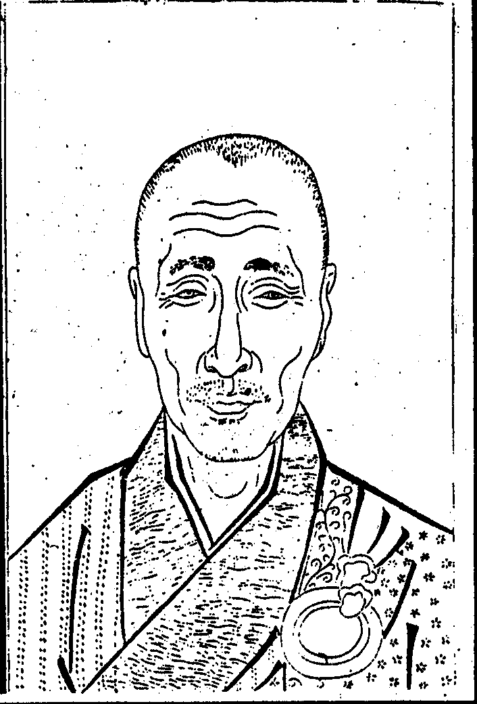
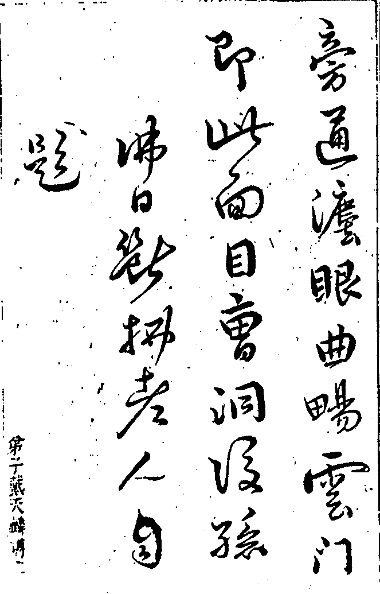

# 石雨禅师法檀



> **藏经**：嘉兴大藏经（新文丰版）（嘉兴藏）　**册次** 第 27 册（J27）　**编号** JB190　**部类** 诸宗部　**卷次** 20 卷　**篇幅** 153,536 字

> **作者（译者）**：嗣法小师净柱编

> **卷／品**：20 卷 · 12 品



---



## 目录



  - [卷第十六序](#卷第十六序)

- [石雨禅师法檀卷第一](#石雨禅师法檀卷第一)

- [石雨禅师法檀卷第二](#石雨禅师法檀卷第二)

- [石雨禅师法檀卷第三](#石雨禅师法檀卷第三)

- [石雨禅师法檀卷第四](#石雨禅师法檀卷第四)

- [石雨禅师法檀卷第五](#石雨禅师法檀卷第五)

- [石雨禅师法檀卷第六](#石雨禅师法檀卷第六)

- [石雨禅师法檀卷第七](#石雨禅师法檀卷第七)

- [石雨禅师法檀卷第八](#石雨禅师法檀卷第八)

- [石雨禅师法檀卷第九](#石雨禅师法檀卷第九)

- [石雨禅师法檀卷第十](#石雨禅师法檀卷第十)

- [石雨禅师法檀卷第十一](#石雨禅师法檀卷第十一)

- [石雨禅师法檀卷第十二](#石雨禅师法檀卷第十二)

- [石雨禅师法檀卷第十三](#石雨禅师法檀卷第十三)

- [石雨禅师法檀卷第十四](#石雨禅师法檀卷第十四)

- [石雨禅师法檀卷第十五](#石雨禅师法檀卷第十五)

- [石雨禅师法檀卷第十六](#石雨禅师法檀卷第十六)

  - [序](#序)

  - [香雪遗稿序](#香雪遗稿序)

  - [雪峰语录序](#雪峰语录序)

  - [汪子野山中乐序](#汪子野山中乐序)

  - [南明禅师语录序](#南明禅师语录序)

  - [和栯堂诗序](#和栯堂诗序)

  - [度亲庵序](#度亲庵序)

  - [鸳湖禅师语录序](#鸳湖禅师语录序)

  - [严无敕居士山居诗序](#严无敕居士山居诗序)

  - [陈默公居士诗序](#陈默公居士诗序)

  - [香幢兄山居诗序](#香幢兄山居诗序)

- [石雨禅师法檀卷第十七](#石雨禅师法檀卷第十七)

- [石雨禅师法檀卷第十八](#石雨禅师法檀卷第十八)

- [石雨禅师法檀卷第十九](#石雨禅师法檀卷第十九)

- [石雨禅师法檀卷第二十](#石雨禅师法檀卷第二十)



---











石雨大师法檀叙



自五镫分焰，洞上一宗精详绵密，辨魔拣异，真如宝镜高县，狐妖落胆，救颟顸大病之良药也。一橛头乱统禅望崖而退矣，乃反从而讥之，曰是义解也、是教理也，犹越人安於断发文身，见章甫玉帛而讥其为繁文缛节耳。



夫一棓一喝出自德山、临济觌面提持，自是迅雷掣电、利剑慧刃，奈法末人漓，稍具一知半见者能倣而行之矣，久之而狂狐野干之属竟冒而行之矣。惟洞上宗旨，慧刃利剑即是玉线金针，掣电迅雷具有正偏回牙，以儱侗承当之不得，以意识凑泊之不得，苟非彻法源底、脱尽窠堀，乌能达五位之玅用、出三漏之网罗哉？从上诸大老潜机密用至今日，而犹有升其堂、入其室者，宝镜之光𪸩，其佛法之命脉乎？



中兴洞宗而为法王之周宣汉光者，江西则有寿昌、两淛则有云门焉。石雨大师，云门之法嗣也，知见超越，机用敏捷，导大行於闽淛之间，真云门克家之子。忆癸亥岁，云门大开𬬻鞲，集龙为万指，而蒙印可受付嘱者乃为两少年沙弥——石雨、三宜二大师是也。当时一军皆惊，而后皆服云门择法之精盍分豪不爽，益信云门深得曹洞不传之秘，而辨验之下自能弃汞取金，进璠玙而退碔砆也。



大师初披缁於武林，法相即有俯视一世之概，一钵飘然，寸丝不蓄，遂为新安诸名士所重而纳交，焉非所谓「虎生三日，气已食牛」者乎？大师门人集师语成录，予读而快心焉，直截与精密盍两得之矣，亟请梓之，以救末法颟顸之病，而因弁数言於首。予之师事大师，犹先大参之师事云门也，不复以不文为辞矣。



山阴祁彪佳拜譔。



石雨禅师法檀叙



云门宿古庙中，拾得洞山宝镜，圆明清净，鉴照十方，佛来、魔来，面目全露，末后以光明藏嘱付石雨禅师。余舟过镜湖，宝光露现，镜中相见，眉目宛然，乃知云门犹在也。镜里机缘无容久蕰，特为拈出，以示诸方。



海▆道人黄端伯题。



石雨禅师法檀总目



原叙(祁彪隹　黄端伯)  

卷第一住绍兴府天华禅寺语录



卷第二住绍兴府云门显圣禅寺语录  

住杭州府宝寿山光孝禅寺语录  

住福州府怡山西禅禅寺语录



卷第三住福州府雪峰禅寺语录  

住汀州府灵山禅寺语录  

住建宁府普明禅寺语录



卷第四住建宁府考亭灵峰禅寺语录  

再住绍兴府天华禅寺语录  

再住杭州府宝寿山光孝禅寺语录



卷第五住杭州府龙门山悟空禅寺语录  

住嘉兴府东塔广福禅寺语录



卷第六住杭州府皋亭山佛日禅寺语录上



卷第七住杭州府皋亭山佛日禅寺语录下



卷第八绍兴府象田禅寺语录  

绍兴府兰芎山禅寺语录  

普说  

示众一



卷第九示众二



卷第十机缘



卷第十一颂古



卷第十二赞



卷第十三法语  

诗偈一



卷第十四诗偈二



卷第十五诗偈三



------



### 卷第十六序



记  

铭  

跋



卷第十七疏  

书问一



卷第十八书问二



卷第十九佛事



卷第二十祭文  

杂著  

行状  

塔铭(嗣刻)



------



## 石雨禅师法檀卷第一



**译者**：嗣法小师净柱编



住绍兴府天华禅寺语录



崇祯五年，十二月十二日，入寺。



三门。「者里是甚麼所在？」旁僧曰：「是三门。」师曰：「已后向人切忌道著。」



大殿。「於一毫端现宝王刹，用许多气力作麼？坐微尘里转大法轮，占许多世界作麼？总不如山僧将错就错去也。」遂展具。



伽蓝。「山僧一向吃饭穿衣、屙屎放尿不著个所在，今日借重了也。」



祖师。「一向你拖累我，今日我拖累你。」拈起香曰：「会麼？不会，看取下梢头。」



方丈。「若道此是毘耶离，又不是个维摩诘；若道此是摩竭提，又不是个黄面贼。且道：毕竟是个甚麼？」良久，曰：「莫教疑杀天涯客。」



即日上堂，拈疏，曰：「自从若耶溪上得者个消息，从来不曾举示於人，今日仰劳维那对众宣出。」宣疏竟，指法座，曰：「此不是宝华严饰，又非嫩草铺舒。咦！且看方上座坐断天下老和尚舌头去也。」遂升座拈香，曰：「此一瓣香，竺乾付嘱、震旦流芳，君臣得之而有义、父子得之而有亲、夫妇得之而有别、长幼得之而有序、朋友得之而有信。且道：衲僧得之又堪作个甚麼？」良久，曰：「今日热向炉中，端为祝延　今上皇帝圣寿万安，皇后齐年，太子千秋，文武官僚咸增禄位，更愿本府各厅、两县诸衙泊、及本寺护法檀那，不负灵山之付嘱，永为我道之金汤。此一瓣香，下种於南高峰锡杖泉边，生芽於南岳山毘佛洞里，发干於天目圆通巷口，开花结果於云门石伞峰头，果熟香舒於黄安小天台鹞儿山下，狼藉一个、两个於南天台香柏峰前，飘落三个、四个於宝泉象田及兰芎山畔，今日天华堂上和盘拈出，供养显圣堂中传曹洞正宗第三十二代湛然大和尚，用酬法乳之恩，伏愿处处园栽无影树，家家花发不萌枝。」遂敛衣就座。白槌毕，师曰：「若论此事，如优昙华时一现耳，众中还有不惜身命向悬崖绝顶攀折得者麼？」良久，曰：「如无，山僧且牵枝引蔓去也。山僧也不知佛、也不知法，只晓得游山玩水、啸月眠云，与猿猴为伍、麋鹿为群，誓不出山，活埋为计。所以自志偈有『翻转杜园还杜田，那管十年、廿年、三十年』之句，今日为甚麼又作者个彀当？噫！要且不为别事，昔日大慧禅师於行脚时，因见宗风寥落、混滥者多，所以誓不作者般虫豸。已后出世，有人问云：『和尚向道誓不作者般虫豸，今又争得如是？』慧云：『尽大地是个杲上座又作麼生？』虽则事无一向，未免相累解嘲。今日山僧倘有人问及，又当作个甚麼解嘲方法？」以拂指前曰：「你看天华落也。」大众回顾，师便下座。



结制，上堂。拈疏，曰：「释迦拈的、迦叶笑的、达磨坐的、神光立的、一切护法国王宰官护不尽的，悉在里许，有烦维那对众宣出看。」宣毕，指法座曰：「举足、下足，动念即乖；瞬目、扬眉，拟心即错。且道：毕竟如何？咦！不见道：若有路可上，更高人也行。」遂登座。白椎毕，师曰：「者个第一义，达磨西来已被梁武帝当头一问，直得口如扁担、眼似流星，满口舌头道个廓然无圣，不知已落二落三了也。争奈武帝有杀人见血的手段，又拶一问云：『对朕者谁？』达磨答个：『不识，不识。』虽好，也只救得一半。及乎凄凄渡江，九年面壁，要救那一半不得。后得神光立雪断臂，不惜身命也要扶持那一半，乃至六代五家沿流至今也要扶持那一半。殊不知，那一半人人本具、个个不无，为甚麼不知？不道你不知，只是你不会。即今天华会上，若圣、若凡，若男、若女，若贵、若贱，若长、若幼。」遂举拂曰：「还知麼？既知，为甚麼问著那一半便忙然不会？莫道你不会，即三世诸佛也料理不下。故古德也只好旁通一线，道：『欲识佛性义，当观时节因缘。时节若至，其理自彰。』大众且道：如何是自彰的理？众中有倜傥者出来商量看。」



僧问：「如何是不识的意旨？」师曰：「恐汝不能皆随我道。」进曰：「不识意旨蒙师指，满口道廓然无圣意如何？」师曰：「九月莫道春风多。」进曰：「恁麼则人天皆仰，四众咸尊去也。」师曰：「钝汉。」



问：「十方云聚，克志无为，无为的句，乞师垂示。」师曰：「霜叶红於二月花。」进曰：「人人鼻孔撩天，个个脚跟点地。」师曰：「知恩方解报恩。」进曰：「恁麼则万方归化日，九土仰清光。」师曰：「且到堂中稳坐去。」进曰：「眉毛烁破四天下去也。」师曰：「闲言语。」



上堂。「噫！莫妄想，山僧者里无恁麼馊茶臭饭秽污大众，只解春耕、夏耨、秋收、冬藏，积几担米、堆几担柴，集几个没伎俩禅和整备著铜琵琶、铁拍板，相聚吃茎虀，放个太平曲，只是莫唱无生歌。者无生歌，黄面老子语言，如山堆海积，四十九年不曾唱著一字，即历代祖师说个师师相授，也秪是递相热瞒，直得先师於慈舟师公处窃得个拂子，不值二三十文以为奇货，出入随身，逢场作戏，拖泥带水，造妖捏怪，惹得四众攒头。又道『三根普利』，将者拂子用得柄断毛枯，付与山僧，曰：『向后人天众前举扬个事去。』山僧彼时几乎被他连累，幸得眼清手快，接来抛向粪扫堆头十有餘载，今日见他伎俩俱消、光怪俱绝，特地拈来，忽得一梦，梦见一个无面目的童子，唱个歌儿，著实有些奇怪。歌曰：『日出堂堂，照见皇皇，皇皇骑马上伧塘。』山僧闻得直得通身毛竖、夹背汗流，只得掩耳而归，幸不闻他末后一句。若闻得，如何有今日事？众中还有忍俊不禁者，出来试道看。」



僧问：「凡圣不通，人天莫测，深深密密的句请师道看。」师曰：「巧言不如直道。」进曰：「大小天华被某一问，直得指东话西去也。」师曰：「阇黎伎俩只如此耶？」进曰：「任从扯来盖覆，秪得一半。」师曰：「者一半还让阇黎得麼？」僧一喝，师曰：「野狐精。」



小参。「『金粟打，黄檗骂，才到云门便放下，若还以此作禅宗，后代儿孙成话靶。』此博山大师偈也，流布诸方，尽作是非话会。天华今日拈来，虽不能起博山一笑，也要诸方简别。他道『金粟打』，大似自无手，怪人打。『黄檗骂』，大似自无口，怪人骂。『才到云门便放下』，大似自无落处，却怪人说放下。『若还以此作禅宗』，大似灵龟曳尾。『后代儿孙成话靶』，却被他道著。且道：道著个甚麼？放下著，大众！此是先师泼不了的恶水，今日事不获已，不免又污大众。期已过半了、米已吃完了、柴已烧尽了、行人筋骨已磨穿了，山僧在方丈里引领而望，巴不得个还饭钱、柴钱，酬劳行人的来，直望到如今杳无消息，所以今日只得教你放下。」良久，又曰：「放下。」又良久，曰：「更放下。诸兄弟！还放得下麼？昔日大死翁参宝峰，入室，峰云：『直须断起灭念，向空劫已前扫除玄路，不涉正偏，尽却今时，全身放下，放尽还放，方有自繇分。』翁即顿领厥旨，峰乃击鼓告众曰：『深得阐提大死之道，后学宜依之。』诸兄弟！还似你才做到无捞摸处便怕落空亡去麼？还似你才得一知半解便胡做去麼？还放得下麼？放不下且置，毕竟如何是阐提大死之道？」众无语，久之，师大怒，骂不止。一僧才出，师以杖打骂，归方丈。



求嗣，上堂。「第一义，第一义，打破虚空补不及。第二义、第三义，以楔出楔终不济。第四义、第五义，如何说个西来意？」乃屈指曰：「第六、第七、第八、第九……，乃至千义、万义、无量无边不思议义，总不如个观音菩萨买糊饼，放下却是个馒头。」良久，曰：「馒头且置，毕竟如何是观音？若识得，便晓得住处；晓得住处，便晓得他去处、来处；晓得去、来、住处，便晓得他不去、不来、不住处，便晓得他三十二应、十四无畏、四不思议，便好求男得男、求女得女。」举拂，曰：「莫者便是麼？若不是，毕竟向甚麼处求？大众！今日斋主求嗣，请山僧升座，於中儒宗贤圣闻得山僧如此举扬，大有相违。既是三教一家，孔子道：『富而可求，虽执鞭之士，吾亦为之；如不可求，从吾所好。』何故释门只是教人求？殊不知孔子语句四方受敌、八面玲珑，只因自古圣贤将孔子鼻头一把捏住，吐气不得，直得释迦老子为通一线，尚未相信，今日山僧与他大通一下。我也说道：『富而可求，虽执鞭之士，吾亦为之；如不可求，从吾所好。』你道：『今日斋主所好，好个甚麼？』他好生男，好生福德智慧之男；他好生女，好生端正有相之女。大众！此是孔子自家说的，与山僧无干。」



观音诞日，小参。「你道观音今日生，我道观音今日死；你道观音今日不曾死，我道观音今日不曾生。不是拗直为曲，实乃顺理成章。今日山僧落堂，幸而不随大众脚跟。若随，还教我庆即是？吊即是？」良久，曰：「昨日有人来显圣，明朝更有下天台。」



上堂。参头白椎，曰：「法筵龙象众，当观第一义。」师亦高唱曰：「法筵龙象众，当观第一义。」乃召大众，曰：「恁麼，还是山僧辜负参头？参头辜负山僧？若山僧孤负参头，却是银碗盛雪；若参头辜负山僧，却是明月藏鹭。若山僧即是参头、参头即是山僧，却又类之不齐。若道：『有甚麼山僧？有甚麼参头？』却又混则知处。诸兄弟！须知人人有如是奇特、有如是神通、有如是游戏、有如是三昧，为甚麼自己埋没了，向人家脚根下求佛、求法？祗因你向人求，所以自己许多妙用都在山僧光明里许。汝能一念回光去，山僧却在汝光明里许，二六时中一举一动有甚麼过？所以道：拈来无不是，用去莫生疑。岂不见《法华经》云：『治世语言、资生业等皆顺正法。』不要听得恁麼说，便将杀盗婬妄、贪瞋痴慢一味卤莽承当将去，必须试看：境界现前，不似落汤螃蟹一般麼？一言半句，自然合宗合教麼？所以山僧寻常见此等人有个验处，只如上大人丘乙己化三千七十士，你道合那一家宗？合那一句教？若合不得，切须仔细。若不仔细，祗是个卤莽无惭愧汉。」



举：「夹山道：『老僧二十年住此山，未曾举著宗门中事。』有僧问：『承和尚有言：「二十年住此山，未曾举著宗门中事。」是否？』山曰：『是。』僧便掀倒法座，山休去。至明日，普请掘一坑，教昨日问话僧来：『老僧二十年说无义语，今日请上座打杀老僧，埋向坑里。若不打杀老僧，上座自著打杀，埋在坑中始得。』其僧束装潜去。」师曰：「你看，此等便是卤莽承当汉。若是真个有气息的，待他要你须自著打杀，便如前掀倒法座，岂不俊哉？虽然，夹山有法座许你掀，假饶无法座，又掀个甚麼？」师忽作掀势，曰：「哱𠾐。大众！此在夹山处即可，若是天华者里，须别著个语话始得。」众下语都不契，师曰：「山僧与你代转去也。待他问道：『无法座又作麼生？』」师又作掀势，曰：「哱𠾐。」



宝泉寺，请上堂。「男子身中入正定，女子身中从定起；女子身中入正定，男子身中从定起。人人认作南山云，依稀变作北山雨，分明月色在梅花，看到梅花迟了矣。又何须挂飞帆、携短棹，惊风破浪怜同调？阿呵呵，笑欲倒，出门步步皆青草。出门青草且置，直饶不出门亦是草，众中有入理深谈者出来道看。」



僧问：「鹤出银笼即不问，寒雀啄冰珠曾得饱也无？」师曰：「你道今日唱的是天华曲？宝泉曲？」进曰：「入口无踪，因甚不知冻馁？」师曰：「曾到宝泉也未？」进曰：「分明踏在天华上，看到天华早已迟。」师曰：「争怪得？」进曰：「恁麼则故园侵丽色，林外换春声去也。」师曰：「有甚麼交涉？」乃举拂子，曰：「大众还见麼？尽大地人无明烦恼、贪嗔痴等命根，如斩一握丝，一斩一切断。还信得及麼？若信得及，从此归家，士农工商、挑花纺织，尧之天、舜之日，同唱太平歌，共乐无为化。若信不及，便於拂子头上分彼、分此，分亲、分疏，此是著了拂子的汉。若更离了，却是徐六担板，各见一边。且道：毕竟如何？」掷拂子，曰：「增钱不如再看。」



佛诞，小参。召大众，曰：「各各于此日降王宫，出母胎，四天王捧足，九龙吐水沐浴已竟，还信麼？若不信，各与三十拄杖；若信，也与三十拄杖。且道：既信，为甚麼也与三十拄杖？」良久，曰：「无风荷叶动，必定有鱼行。」



上堂。良久，曰：「还见麼？释迦老子初降生时，应持菩萨亲手捧持，谛审谛观，不见如来顶相。你看他用了许多殷勤，不消山僧一觑。又有不唧溜的无边身菩萨要见佛顶，将根竹杖子量了丈六又丈六，直量到梵天，毕竟不见，乃掷下竹杖，说偈赞曰：『虚空无有边，佛功德亦然，若有能量者，穷劫不可尽。』你看他用了许多气力，不消山僧一拓。大众！若依天华，则辜负二位菩萨；若依二位菩萨，则辜负天华。到者里，须吐得口气，方有自繇分。若不得自繇，便於佛顶头上推度，道：『佛是有神通的，所以人不能见。』殊不知，不独佛顶，即山河大地、明暗色空、草芥人畜等，你还见麼？若见，即今面前香炉你还作青见？黄见？赤见？白见？长见？短见？方见？圆见？若作方、圆……等见，即是个方、圆……等相，要且未见香炉在。若毕竟不能见，为甚麼有香炉、佛顶……，及山河大地一切等名？到者里更须转身始得。若转不得，秪是个百尺竿头坐的人，亦名金刚圈、栗棘蓬。金刚圈，须要透过始得；栗棘蓬，须要赤身坐卧始得。还透得麼？还坐卧得麼？」



僧问：「如何是宾中宾？」师曰：「路逢剑客须呈剑。」进曰：「如何是主中宾？」师曰：「端坐焚香拜鬼神。」进曰：「如何是宾中主？」师曰：「梅须逊雪三分白。」进曰：「如何是主中主？」师曰：「不是诗人不献诗。」进曰：「宾主已蒙师指示，向上玄关事若何？」师曰：「你还见大众麼？」僧礼拜，师曰：「一场懡㦬。」



弥陀诞日，上堂。师召大众，曰：「即此便是西方，还信得及麼？若信不及，要过十万亿佛土；若信得及，也要过十万亿佛土，有世界名曰极乐，其土有佛号阿弥陀，今现在说法。大众还闻麼？若闻，汝等尚以缘心听法，此法亦缘，非得法性；若不闻，尚以不缘心听法，此法不缘，亦非得法性。总不如不离禅者，年年此日烧几对烛、点几炷香，为阿弥陀佛庆贺母难之辰，欲得自利利他，特请山僧升座为他阐扬。他欲年年与佛同生、生生与佛同住，更欲人人知有个西方，个个西方有个极乐国土，个个极乐国土有个弥陀，个个弥陀有个佛母，个个佛母於此日生阿弥陀佛，个个弥陀於今现在说法。大众还闻麼？」良久，曰：「弥陀说法且置，山僧恁麼告报，大众还闻麼？」又良久，曰：「莫因竹密妨流水，尽谓山高碍白云。」



过显圣，扫塔，上堂。召大众，曰：「石伞峰倒卓了也，还见麼？若见，切忌扬眉瞬目。若耶水逆流了也，还闻麼？若闻，切忌伸头侧耳。直饶不见不闻，却是知恩者多，报恩者少。山僧於天启癸亥年间从此打失先师鼻孔，流落天涯，奔南走北，直至天华，天华不现，及至显圣，圣又未显，不如少顷向无缝塔前撮土焚香，求过忏悔去也。」便下座。



端午，小参。「众兄弟！汝等人人脚根下有一无名肿毒，生则痈肿，死则溃烂，只因无量劫来被诸佛祖说真方，卖假药，所以至今不能平复。今日是五月五日午时，正当虫毒潜藏、百艸芬馥之际，於中有依时及节者，折取一茎目疗取去好。」



结制，上堂。「古道今开，切忌填泥塞土；新逢旧识，何须眼去眉来？蹑足进前，未免颟顸佛性；簇鞭退步，犹是儱侗真如；直饶不进不退，亦不出孟冬初冷。众中有不待东风花信发，先来通个小阳春？」



僧问：「进不得、退不得、中不得，请问和尚如何下脚？」师曰：「正好下脚。」进曰：「恁麼则一声吼破澄潭月，万古从教彻底清。」师曰：「又成进退去也。」僧一喝，师曰：「放过则不可。」乃曰：「古人问答，大似玉线金针，一来一往，总不徒然。今时不出常流，只解粘皮搭骨。所以，向他道：『山自高，水自深。』个个攒头凑额，尽为知有。若向他道：『鱼大于海，鸟大于山。』未免半疑半信，何况要他山上捞鱼、海中觅鸟？则个个退身千里。所以天华今日开个舖子，只有山田脱粟米，野菜淡黄虀，芙蓉楷道：『吃则从君吃，不吃任东西。』天华则不然，吃即休云饱，不吃莫嫌饥。」



冬至，上堂。「群阴剥尽之后、一阳未发之前，普慧问若云兴，普贤答如瓶泻，虽不露扬家丑，也是好肉挖疮，惹得断拂子恶发，轻轻一掴，打得雨散云消，那个不知？那个不见？为甚麼又要升座？莫更有别事商量麼？」



僧问：「群阴剥尽一阳生，大地乾坤笑满襟，未审何人受用？」师曰：「退步莫落后。」进曰：「还有不落时节的麼？」师曰：「进步莫向前。」僧一喝，师曰：「者一喝却有落处。」僧拟进语，师便打，乃曰：「今日虽则一阳初动，幸而万象未新，若肯直下承当，山僧不妨与他饮玄酒，把臂论文；调太音，逢场作戏。若更要论佛性义又如何、时节因缘又如何，如何得时节自至、如何得其理自彰，总不如门外青山青又青、屋边流水深又深，客到莫炊无米饭，月林连夜褁馄饨。」四顾大众，喝一喝，下座。



付首座即念法，上堂。「云兴雾起，皆显别传之旨；龙吟虎啸，齐承密受之宗。别传何传？尽谓释迦不说说；密受何受？俱云迦叶不闻闻。赖有超师作略，捉取木毬安旧处；求人为法，刹竿倒却出常流，盖为人心不古、学处不玄。宗师家举扬者多，大都以字不成；学人辈承当不少，依俙八字不就。所以道：入我门来，一机一境不用，当场拈出，拖泥带水，直须异类中来。近有说正、说偏，往往乌焉不辩；论玄、论要，明明鱼鲁难分。纵有师资道合、宾主协通，只解袖子里暗传春色，谁能向树凋处独露金风？今日天华登座，不敢说扶扬宗祖，祇因他曹洞中衰，偶尔借雪峰毬子轻轻抛出，孰能假庆喜刹竿缓缓扶将？众中若肯欣然，终不囊藏被盖，还肯麼？」



首座出曰：「如是我闻。」师默然，座便礼拜，曰：「明言犹未的，密嘱岂应真？」师索笔，曰：「众兄弟！莫因他在香雪庵辅具足兄如师麼？在东山寺事尔密兄如长麼？为什麼到天华却不肯住？且看山僧下个注脚。」遂疾书付法偈，书竟，乃举问大众曰：「还会麼？不见道：住即印破。虽然，三十年后，错举者少，举错者多。」



解制，说戒，上堂。举如意，曰：「尽大地人都来总是者个，只因你要修行、出家、参禅、受戒。」复以如意打此○相，曰：「所以被者个碍却。及至入禅堂，受具戒，说迷、说悟，说犯、说持。」又以如意打此㊀相，曰：「所以又被者个碍却。及乎今日解制圆戒了。」又举如意，曰：「依旧原是者个，有什麼碍与不碍？所以道：原来只是旧时人，不是旧时行履处。」



乃举：「法眼问永明潜云：『隔壁闻钗钏声，律中便名破戒，今日朱紫骈阗又作麼生？』潜云：『好个入处。』」师曰：「今时错会者多，尽道触目皆是，所以擎拳竖指、胡言乱喝，认作六根妙用，於事无心，无非入处。苦哉，若作是解，不唯不得名为解制，亦不得名为圆戒。且道：毕竟如何理会？」良久，曰：「久晴无骤雨。」



上堂。「滴水不滴冻，腊月春风动，缘心听法人，切忌作春梦。大众！世尊道：『汝等尚以缘心听法，此法亦缘，非得法性。』众中还有不以缘心听法而得法性者麼？」



一勤宿出众，打一圆相，问曰：「和尚！者个是缘心？不是缘心？」师默然，宿礼拜起，师曰：「者个是缘心，不是缘心。」进曰：「先师灵骨何在？」师曰：「老兄也须具眼。」进曰：「人天交接，两得相见。」师曰：「隔靴抓痒。」乃举：「庞居士参石头，便问『不与万法为侣』话。」师曰：「你看者两个老汉，一个诱人犯法、一个停囚长智。天华则不然，待他问：『不与万法为侣者是甚麼人？』即向他道：『六祖道的。』大众！你若要了生脱死，须向石头掩口处会取；你若要续佛慧命，须向一口吸尽西江处会取。虽然，若不会天华六祖道的，犹是依门傍户汉。」



退院，小参。「庭际蕉，轩后竹，三年爱惜如珍蓄，大雪打不枯、大风吹不曲，一旦辞之过别峰，细雨萧萧初夜中。不学白云端去瞥，只因无个圆通讷，所以迟迟一盏茶，攒头共语笑相别。大众！相别且置，如何是别后一句？」良久，曰：「不见道：难得不相见。」



(嘉兴府平湖县东皋释行旦施赀刻)



------



## 石雨禅师法檀卷第二



**译者**：嗣法小师净柱编



住绍兴府云门显圣寺语录



崇祯七年，甲戌腊月十二日，入寺。



三门。「从门入者不是家珍，为什麼倚肩踏蹑？大众！且道：唤甚麼作门？」良久，曰：「莫待当来问弥勒。」



大殿。「洞山麻三觔，名不须虚；云门乾屎橛，迹不须实。且随我将错就错，切忌道：『如何是佛？』」



伽蓝。「宰一寺之权衡，须要密不通风；作众生之保障，仗你略通一线。」



祖师。「放去西天，为惜法堂深草；拈来东土，犹怜遍界葛藤。明年更有新条在，脑乱春风卒未休。」



方丈。背先和尚像，曰：「大众！祖父从来不出门，为甚麼▆▆▆爷向里头？因惜隆冬春意动，漏泄寒梅香几枝。」



拈疏。「山僧一向鼻孔撩天，因到天华，被者个碍却；今到显圣，又被者个碍却。且道：者个是甚麼？试宣看。」维那宣疏竟，师曰：「还有向上事也无？」良久，曰：「且向下会取。」遂升座，拈香祝圣竟，师曰：「随缘赴感靡不周，何故寂然不动而常处此菩提座，却又道感而遂通？切忌道『依稀相似』，谁敢云『彷佛不同』？不特儒扶释教，亦乃释合儒宗，喜得山僧闲却，众檀越又要向蜃楼上重施栋梁、冰花上刻畫青红，有时向显圣堂前屙屎、撒尿於净白地上，有时向天华寺里说妙谈玄於闹市场中，更有闲工夫於若耶溪汲水浣石伞峰。若欲撑天柱地，须仗众兄弟各显神通，有麼？」问答竟，师曰：「如此问答，还当得神通妙用麼？明日天晴再主张。」



剃度，上堂。「天华寺以九龙水沐浴已竟，显圣堂将金刚刀剃度为僧，倘得不待雪山六年苦行而睹星成道，则不惟观彼久远犹若今日，则心、佛、众生三无差别，情与无情共一体真。大众！此个语话才入门来，阿那不知？且问：既共一真，何故一人食时难令众饱？」问答俱不契，师曰：「恁麼则无量劫来头发把尽在山僧掌握中。」遂下座。



法相寺，上堂。「古定光，今法相，蓦地相逢难度量。短十尺，长一丈，横看成岭侧成峰，几希恼杀丹青匠。无底钵盂一个，断鼻草鞋一緉，海角天涯走一回，两耳依然在肩上。锡杖卓开不是他，忽作江湖大波浪。谁能知有？莫能知，重将旧案新提唱。作麼唱？鸭吞螺蛳两眼胀。」



上堂。举拂，曰：「未入云门，人人尽有者个，及至到来，为甚麼却在山僧手中？莫为两眼所瞒麼？且道：者个唤作什麼？」众无语，师曰：「尽道冰霜苦，谁知节后寒？」



付石浪首座法，上堂。「天华寺，华落也，果熟也。云门寺，门开也未？若开已，重重楼阁、种种庄严，更须知开已复闭的道理，便见弥勒、善财同在山僧鼻孔里，许得大安乐、得大自在、得大受用、得大解脱、得大无碍。」师忽打喷涕，曰：「正恁麼时，且道在甚麼处蹲踞？山僧今日初度升座，为浪首座向在天华会中识得曹家女话，便拟唱还乡曲调，入岭受徒住寺。因山僧书去，脚根未稳，领众来云门，且喜稍通浙语，故在人天众前有个断拂子与他，只可赶苍蝇子。若是传法利生，更听取一偈。」遂展卷，曰：「分明识得曹家女，便把闽言通浙语，石伞峰高浪泼天，谁信耶溪净如洗？一枝断拂春风生，谩道无头亦无尾，相续情知也大难，持书莫到他家里。大众！既是持书，为甚麼莫到他家里？」



首座出，提坐具，曰：「者一枝花，谁人拈得起？」师曰：「谅阇黎也不得。」进曰：「暗去明来又若何？」师曰：「昨日雷声浩大。」进曰：「也是雨过云门。」师曰：「雪雹分身又作麼生？」(时雪雹大作)座以坐真搭肩上，曰：「且喜今日唱个耍孩儿去也。」师遂拈印打卷上，曰：「耍孩儿且置，还识得者个麼？切忌道：宝印当空妙，重重锦缝开。」



司理元公黄居士请上堂。士礼拜，曰：「请大师举扬云门未了公案。」师曰：「竹拖凤尾慵迎客。」士曰：「今日亲见作家。」师曰：「松作龙吟懒送人。」乃曰：「说法不待人，待人乃可说，及至有人来，依旧无言说。无言说，佛殿山门强饶舌。大众！今日元公居士特特入山，要山僧举扬未了公案，祗如大慧禅师道：『二僧入门，一僧已悟，一僧未悟。』不待他开口便拣办得出，方可为人。且问大众：还办得元公居士已悟、未悟的端的麼？铁山推倒谁能信(此是居士省发因缘)？深入云门孰可凭？」士遂问：「还扶得铁山起麼？」师曰：「山门头与居士道了也。」进曰：「明头来时如何？」师曰：「耶溪不许扁舟宿。」进曰：「暗头来时如何？」师曰：「此去钱塘尚隔程。」进曰：「不明不暗来时如何？」师曰：「杭州理公事，时向居士道。」



小参。举：「中丞卢航居士与圆通旻禅师拥炉次，士问：『诸家因缘不劳拈出，直截一句请师指示。』通厉声指曰：『看火。』士急拨衣，忽大悟，谢曰：『灼然佛法无多子。』通喝曰：『放下著。』士应：『诺，诺。』」师曰：「圆通只知自己杀活施为，不顾他堕坑落堑。山僧则不然，待他道：『诸家因缘不劳拈出，直截一句请师指示。』向他道：『随缘宿一宵。』他若悟了，道：『灼然佛法无多子。』向他道：『明朝相送一杯茶。』」



住杭州府宝寿山光孝寺语录



崇祯九年，丙子春，入寺。



唐祈远孝廉请上堂。拈香，曰：「此一瓣香，顽鉏底下掀起尧风荡荡，𨱄斧头边披开舜日巍巍，𦶟向炉中，端为祝延圣寿万安。此一瓣香，荆棘所不能埋、瓦砾所不能没，用报唐将山、宋石田、薰禅师建立之德以及宰护之诚。此一瓣香既已贵买於江南，终不贱卖於江北，端为供养显圣堂上传洞上正宗三十二代散木大和尚，用酬法乳之恩。」上首白椎，师举拂子，曰：「此是第二义。」又举，曰：「此是第三义，百义、千义、万义，咄！有甚麼交涉？若是个汉子，拈起斧子，从教斧子讴歌；放下鉏头，直得鉏头作舞。那管江南、江北，瓦砾、荆棘？如或未然，也要披苔剥藓，读残碑，续断碣，免使碌砖瓦子七片、八片，泥金刚努目、木罗汉攒眉。」



僧问：「重扬古路，拈提今事门头。今事门头且置，重扬古路一句请师指示。」师曰：「鉏头柄短斧头长。」进曰：「今事门头又作麼生？」师曰：「栽完芋子又栽瓜。」进曰：「恁麼则曹源一滴浪滔天，没却三千及大千。」师曰：「开田去。」



士问：「如何是参禅得力处？」师曰：「拂子头边无限春。」进曰：「如何是参禅险难处？」师曰：「溪山溪水莫留停。」进曰：「如何是参禅受用处？」师曰：「明日到瓶窑。」进曰：「逼塞虚空时如何？」师曰：「香烟堆里看。」进曰：「学人正当进前无路、退后无门时，和尚如何相救？」师举拂子，曰：「者个是甚麼？」士拟议，师曰：「又道进前无路，退后无门。」



师举庞居士参石头、马祖因缘，乃曰：「诸方尽谓石头处得名、马祖处得地，石头处得体、马祖处得用。若作如此批判，入地狱如箭。且问：不作如此批判，又作麼生？会得，不妨重显宝寿家风；若不会，则定打瓶窑上径山。」



甘露寺，请上堂。「萧萧一夜雨，为人何太切？其奈负心何？杜鹃啼不歇。春去了，春去了，明明大棒当头楔，髑髅痛痒有谁知？淋淋甘露啼成血，忽然识得主人心，石女扬歌笑不彻。」师回顾大众，曰：「且道：如何是主人心？有识得者，不妨出来通个消息看。」良久，曰：「门前有古路，一直透长安。」



上梁，小参。拈拄杖，召大众，曰：「还见麼？者个人人有分，为什麼却在山僧手中？不见道：千年田，八百主。」又拈曰：「且道：者个是什麼？独有青山人不取，古殿无香烟，▆壁多风雨，泥诸天撒手跌脚，木罗汉自言自语，惹得主山神忍俊不禁，撑的撑、拄的拄，尽谓革故鼎新，我道是将败坏补败坏而已。」举贤於长者插标建刹因缘，师曰：「大众！者一标子上，三世诸佛、泥诸天、木罗汉向何处蹲踞？」众无语，师蓦卓拄杖，曰：「不信天开黄道日，都言平地涌楼台。」



为嗣南容公茶毘，小参。「孤孤迥迥，崚崚𡾓𡾓，青松为友，翠竹为朋，一生滴水滴冻，今朝雨似盆倾。大众！此是龙门旧住容公本有家风也，争奈现前一切眷属拈提不出。若拈提得出，方见容公末后殷勤，不惜眉毛，彻底为汝；不然，未作龙门客，空教点额回。」卓拄杖，下座。



除夕，小参。「八除二成一十，九除一成一十，除到今宵无可除，休从杓柄听凶吉。不见道：愚人除境不除心。唤什麼作心？智者除心不除境。唤什麼作境？不知心境本如如，戍犬黄昏趁野猪，触目明明无障碍，明朝更有新条在。晦堂老人无大人相，说心、说境，说智、说愚，说如如、说无碍，宝寿今夜一一归除，祗解依时及节，敲破锣、打破鼓。若是本色住山人，毕竟了无刀斧痕。要识刀斧痕麼？说佛、说法是刀斧痕，说心、说性是刀斧痕，说迷、说悟是刀斧痕，说贤、说愚是刀斧痕，且听爆竹声中一岁除时如何？珍重，珍重。」



住福州府西禅长庆寺语录



崇祯十一年，戊寅十一月念二日，入寺。



三门。「古人道：『入门须辨主。』即今入门也，还辨得主麼？」良久，曰：「只见潮生朝自暮，谁知山色古犹今？」



佛殿。「丹霞烧的、云门打的、山僧即今礼的，还有差别也无？不是我来时候早，只因庭外荔枝无。」



伽蓝。「邪可驱，正可辅，忽遇没面目汉，你又作麼生？噫！大似当年忘付嘱，而今劳我更嘘嗟。」



祖师。「祖祢不了，殃及儿孙；儿孙不了，殃及祖祢。且道：为甚如此？不是不分先与后，大都冤爱要分明。」



方丈。「坐断十方，山僧自肯，密移一步，分付诸人。还会麼？补出蒲团秋月现，列开五位照人难。」



山门。「疏酬佛恩报佛怨，世、出世间都在里许。」



维那宣竟，师曰：「是则是，更有『不落言诠，坐致太平』一句作麼生会？」良久，曰：「恁麼则山僧拖累去也。」遂升座，拈香祝圣竟，乃曰：「雨浙僧，八闽客，为君一一皆狼籍。会得者，退席五千；不会者，万无一失。失不失？闪电光中寻古迹。且道：是什麼迹？长庆破蒲团、怡山发愿文、懒庵裂缝掖，者一队老古锥个个鼻孔辽天，今日总被山僧拂子头穿却了也，还有救得者麼？」众无语，师曰：「今日光禄王京台居士特地入山设供，请山僧升座，未免便借教敷扬。教中道：『应以宰官身得度者，即现宰官身而为说法。』说法且置，宰官身作麼生现？」顾左右，曰：「乡风处处别，日月一般明。」



上堂。「第一义无可说，无可说非第一义，尽道狭路相逢，个是法门兄弟，今日陈居士自皈依先师以来深念闽中祖庭寥落，特特入山，要山僧举扬第一义，怎奈黄河水向源头浊了也。释迦掩室於摩竭，净名杜口於毘耶，坑陷众生个个不得转身、不得吐气，致使达摩西来，对武帝道个廓然无圣，大似披心挖胆，转见利害。所以，历代祖师事不得已，将第一义唤作长庆蒲团、云门胡饼，今日又突出洞山宝镜，无非要人枯木上生些子花、寒灰里发些子焰，使汝一切动转施为圆陀陀、活泼泼，尽大地都做个大解脱场，世、出世间永不被人瞒，岂不快哉？山僧每见人信不及，不惜口业，更向人道者第一义即是吾人的本命元辰，亦唤作主人翁、亦唤作未生前面目、亦名菩提、亦名涅槃、亦名真如、亦名佛性，可谓尽情注破，今日何须重宣？殊不知，钱塘江解缆时为大众道了也、策杖仙霞岭为大众道了也、游南浦咏绿波为大众道了也、过潭阳历剑津为大众道了也，既而泊洪塘登岸应供入山作佛事，乃至王光禄请上堂，总为大众道了也，何得今日更要在山僧口中取气？不知此事全靠山僧不得，请各各自道取看。」



首座石浪问曰：「既是沿途卖弄，因甚麼弟全归兄？」师曰：「人天首座也须珍重。」进曰：「嚼尽杨枝，谁人知味？」师曰：「问取堂中长老。」进曰：「大众难瞒。」师曰：「大众在甚麼处？」座曰：「一片青山，无痕不净。」



有儒者持书呈曰：「弟子有几则问头，请和尚批判。」师立，举书曰：「大众看看，批判了也。」便下座。



陈玉尺居士请上堂。召大众，曰：「还识玉尺居士不是好心麼？居士以儒业潜修佛道，入我云门法眷，今日便将玉尺要量我断拂子多少长短、多少阔狭，噫！直饶你竖量量得竖穷三际、横量量得横亘十方，也量他不著。殊不知，者断拂子向在云门显圣堂中因打蝇子忽然断却，至今不能相续，有时在粪扫堆边放光动地、有时在十字街头带水拖泥，有时在高高山顶、有时在深深海底，且问：你向何处寻觅他？」乃竖拂子，曰：「莫者便是麼？若是，则天无二日；不是，则家无二主。居士不如将玉尺自量一量好。若要自量，直须向未生更未生已前下手，量得定定当当、方方圆圆，然后向已生后及未来更未来俱量定当已，自堪安邦定国，维持世难。那时，断拂子不妨出来与你同报国恩、同报佛恩。两个眉毛撕结，玉尺与断拂子打作一团，如何分别？」遂以手作鸠觜势，曰：「谷呱呱，且道：为甚如此？只因昨夜梅花放，惹得行人报晓春。」



上堂。「天何言哉？地何言哉？人复何言哉？所以古人道：『我语显无语的。』大众！还识得无语的麼？若识得，便可添寿於山、纳福於海、增禄位於无极。若是游山须见顶、玩水要知源底，便要问如何是无语的？」卓拄杖，曰：「者是语，如何是无语的？若道离此是，即同魔说；若即此是，亦非圣解。不即不离又作麼生话会？会得，不妨山头白浪、海底红尘；如或不会，大家齐念萨婆诃。」



从天宁过南禅寺，上堂。「过去天宁寺不可得，汝作麼生观？未来西禅寺不可得，汝作麼生观？现在南禅寺不可得，汝作麼生观？莫是象骨分枝，致使威光赫奕麼？是则是，奈被浪首座昔日拈一茎草插破面门，带累一切人拖泥带水，及至云门显圣堂上和盘踢倒，直得海底翻身。今日众善信福有所归，住持者功有所满，且道：承谁恩力？还知麼？听取半偈：终日承渠力，相逢不是渠。既是相逢，为甚麼不是渠？昨宵春雨足，枯木尽生机。」



结制日。宗晓张方伯为保厘请上堂。「天得一以清，云兴雾起时如何？地得一以宁，崩峦偃岳时如何？君王得一以安天下，虏寇纵横时如何？莫是不曾得一麼？莫是得而不行麼？莫是行而不普麼？莫是云兴雾起不干天事麼？莫是崩峦偃岳不干地事麼？莫是虏寇纵横不干君王事麼？不干且止，且道：者个一为甚与麼难会？还许会麼？泥牛吼月去。还不许会麼？木马嘶风来。若是座主家，便以释迦掩室於摩竭、净名杜口於毘耶为极则事，谓是不二门，殊不知已落二、落三了也。所以，我曹洞宗有臣须辅君、子须顺父，不顺非孝、不奉非辅，要汝诸人於见、於情、於语言处绝渗绝漏，直须如击石火、闪电光。还有向石火光中垂手、电光影里翻身者麼？有，则便好与他商量道：『今日张方伯设斋结制，要祈阴翊王度，大家须时时奉重、念念输忠，以图报酬有地。』还委悉麼？虽然，此犹是因斋庆赞，毕竟如何是结制一句？」乃抛出拄杖，曰：「波涛静处蛟龙隐，兵革销时宇宙宁。」



上堂。「昨日法，今日说，明日听时方解脱，世人尽欲报亲恩，自家恩爱何时撇？昨夜观音、文殊、普贤等一队汉，被老僧各与二十拄杖趁出山门。且道何故？只因他自未度而度人，为菩萨发心故。果自未度而可度人，为甚大目犍连是神通第一的，度母不得，劳他世尊教供养十方贤圣，仗彼威神方可得度？老僧与汝判去：世尊权衡在手，目连舍重从轻，只知目连母生天，殊不知众圣贤著贼。还知麼？老僧从西阶上，向东阶下，若有个汉出来道：『老和尚袈裟著地也。』与我同参有分。」



师诞日，上堂。「未离兜率，已降王宫，降王宫后，一场懡㦬。未出母胎，度人已毕，出母胎后，一场懡㦬。致使历代钉桩摇橹、把缆放船汉，个个尽道不动步而周遍十方，不开口而言满天下。苍天，苍天，总不如东村西舍，胡张三、黑李四，朝随流水去，暮踏白云归。前日有个衡廷道：『人道此是大解脱场，大无碍处。』被山僧捏住鼻孔，七日不得吐气，今日却来为山僧庆寿。寿则从汝庆，秪如僧问赵州：『和尚年多少？』州云：『苏州有。』汝又作麼生？」良久，曰：「莫谓江南霜雪少，松枝不逐岁寒凋。」



上堂。「极苦无苦，极乐无乐，拄杖一条，千岩万壑，只为证龟成鳖，劳动箍篱木杓。昔日甘贽行者入南泉设斋时，黄檗为首座，行者请施财，檗曰：『财、法二施，等无差别。』者曰：『恁麼道，争消得某甲嚫？』便将出去，须臾复入，曰：『请施财。』檗曰：『财、法二施，等无差别。』者乃行嚫。且道：差别在甚麼处？此是一段未了公案，今日为大众了去：行者请施财，拈来无不是。檗曰：『财、法二施，等无差别。』用去莫生疑。者曰：『恁麼道，争消得某甲嚫？』但有天在上。须臾复入请施财，更无山与齐。檗曰：『财、法二施，等无差别。』者遂行嚫。且道又如何判？一片白云青山内，一片白云青山外，青山内外俱白云，白云飞去青山。」师颂至此，良久，曰：「还有人续得后韵者麼？」僧曰：「在。」师打三棒。复问曰：「还有麼？」乃卓拄杖，曰：「三世诸佛只颂得到者里，历代祖师只颂得到者里，山僧也只颂得到者里。」复卓拄杖，曰：「者里是什麼？於此会得，不妨省力；如或未然，祗为农夫爱春雨，从教鸠妇怨苍天。」



(嘉兴府平湖县东皋释行旦施赀刻)



------



## 石雨禅师法檀卷第三



**译者**：嗣法小师净柱编



住福州府雪峰寺语录



崇祯十二年，己卯四月二十二日，入院。



京台王光禄请上堂。拈香祝圣竟，就座，召大众，曰：「心外无我，我外无物，物外无人，人外无心。所以道：尽大地是个解脱场，一机一境尽从自己胸中流出，直得盖天盖地。大众！既是自己胸中流出，自然孤迥迥、卓巍巍、活泼泼，阿谁无分？不见雪峰大师与岩头同至鳌山，举向来见人得力处，被岩喝曰：『不闻道：从门入者不是家珍。若要播扬大教，一一从自己胸襟流出来，与我盖天盖地去。』峰於言下大悟，连声叫曰：『师兄！今日始是鳌山成道。』大众！还见鳌山麼？只在雪峰里许。还见雪峰麼？只在各人自心里许。还见自心麼？」良久，曰：「快筑堤塘水，风来文自生。」



上堂。「雪峰大师来也。还见麼？若见，则官不容针；若不见，则私通车马。雪峰从先德山处传得石头祖师秘密法门，今日被不肖儿孙一时揭露，然一显、一密，一抑、一扬，环转无穷，也是诸人本有事，众生於此轮回、三贤於此安身、十地於此立命、诸佛於此设教，立数、立量，说大劫、说小劫，结筭到一十三万四千四百万年以谓始终之极，且喜未梦见在，纵饶於华严会上说到不可说不可说转不可说的田地亦未梦见在。禅门以为格内事做尽伎俩、用尽手段，直得斩钉截銕，要将者轮环子扑破。」乃打一圆相，曰：「总不如雪峰用得恰好，一个、两个、三个，数到尽未来际，其实也只是者个。今日本真请山僧上堂，自己却叨叨呾呾说了许多，将谓拦我毬门路。」乃打拂一下，曰：「还拦得麼？不是自家无伎俩，令人特地忆玄沙。」



结制，上堂。击拂子三下，曰：「会麼？此是石头路滑不死的命根。德山棒打不回的消息，一句是甚麼？杀人不见血。三毬觌面提，节外生枝，到者里，须是剑刃上行、冰凌上走。若一味道是古人分上事，大似千年田八百主，者一藏文书正好合药，有病者出来问取。」良久，曰：「脉断去也。」



求嗣，请上堂。「古今一道，生佛皆然，若论感应道交，便有门庭施设。得之者，腊月莲花；失之者，炎天瑞雪。今日山僧升座，尽大地人一时升座；大众立地听，尽大地人一时立地听。大众听时，山僧与尽大地人俱在大众耳边放光动地；山僧说时，尽大地人俱在山僧舌根上语四言三。所以，雪峰辊出木毬，养子之缘犹在；玄沙捉归旧处，事父之道居然。祗如魏善人求子一句又如何举？不见道：常念观世音菩萨，便生福德智慧之男。且问：观音菩萨作麼生念？若解念，不用默念、不用响念、不用口念、不用舌念、不用心意识念，应如是念。如是念者，佛亦如是、生亦如是，今亦如是、古亦如是，雪峰亦如是、玄沙亦如是，山僧亦如是、大众亦如是，尽大地一切如是。众中有如是念者麼？」



僧问：「门外风声炽然念，未审和尚作麼生念？」师曰：「巢知风，穴知雨。」进曰：「恁麼则无刹不念去也。」师曰：「耳朵当眼睛。」僧礼拜，曰：「不劳赞叹。」师曰：「将谓赞叹。」



月印师五十初度，请上堂。「天不足为长，地不足为久，闪电影里翻身，石火光中垂手。难垂手，捞得若耶溪月，大似腰悬金斗，到处印泥、印水、印空，若经、若论、若律，究竟如何下口吹布毛？曾学安心卖生姜，仍有辣手；吃著大颠拄杖，便去诸方乱走，逗到今，始知非，七七消归四十九。」乃卓拄杖，曰：「若要庆我月印兄寿，须向者里会取。不见释迦老子成佛已来甚大久远，寿命无量。」复卓拄杖，曰：「也出不得者里。尽未来际行菩萨道所有寿命亦复无量。」又卓拄杖，曰：「也出不得者里。且道：者里是甚麼所在？」良久，曰：「炎风吹不到，且作雪峰看。」(月曾作云门侍者及库头首众)



游鼓山，上堂。「敲空作响，击木无声，唤甚麼作声？唤甚麼作响？还有道理商量麼？若有道理，安得有今日事？若无道理，安得有今日事？且道：如何是今日事？莫是拈槌竖拂要接续晏国师圣箭麼？屴崱峰高沧海近，片帆早已透钱塘。莫是语言三昧要起博山遗香麼？游人不坐忘归石，水尽山穷总是愁。莫是为张道人因斋助荐麼？昨夜面燃亲口说，鬼王早已自知羞。恁麼则总不干今日事也。虽然，要会今日事也不难。大家汲鼓山水、烹鼓山茶、吹鼓山笛、唱鼓山歌、兴鼓山丛林、作鼓山佛事，只不要打鼓山鼓。何故？只恐落在今日故。」



元旦，上堂。「阳春布德，何必囊藏被盖；百物咸新，不须天外举头。大众！今日是　圣天子体元居正之晨，我林下人合当酬恩报德。若一向目视霄汉，身坐白云，且道：臣退位以朝君一句作麼生道？」良久，曰：「条风开献节，灰律动初阳。」



古泉庵，请上堂。「日日日东出，月月月西没，偶尔扶笻下，雪峰相逢尽。问承谁力？此处若有代山僧下得一语，不妨𨱄斧头边铲去参天荆棘；如或未然，昼见白、夜见黑，业识茫茫，如何委悉？好委悉，拈起云门六不收，谁知临济打黄檗？一切声是佛声、一切色是佛色，鸟自空啼，花自狼籍，又道耳不闻声、眼不见色。」乃击拂子，曰：「者个是什麼？」良久，曰：「青山雨过真堪惜，涧水无情日夜忙。」



解制，小参。大众云集，师曰：「今日解制，须要各人自家解始得，若要我解则不同。银花砌就、玉树粧成，识得春风面目，管取破颜有分；若识不得，去即印住、住即印破，夜明帘外转身难。门外也滑倒、门内也滑倒，荆棘林中下脚易。到者里，解结从人，收放在我。若是虚空无背面，解即是？结即是？各各亲切道一句看。」众无语，师曰：「恐汝不能皆随我道。」



住汀州府灵山禅寺语录



崇祯十四年，辛巳三月，入寺。



上堂。拈香，曰：「此一瓣香，阴扶王化，阳翼宗风，端为祝延圣寿万安，伏愿不忘佛嘱，摄护生灵，秉般若锋而消兵甲，挥金刚焰以照群昏。此一瓣香，九龙滩上洗出根源，銕石矶边掀翻瓦砾，专为供养开山耆硕重刱觉灵，伏愿处处长菩提之树，枝枝放优钵之花。此一瓣香，夜半明传，当阳密付，端为供养会稽云门显圣堂上传曹洞正宗三十二代湛然澄和尚法乳之恩，伏愿人人悬照魔之宝镜，个个佩驱外之莫邪。」白椎竟，师曰：「若道灵山未散，大似眼花。果是真龙，便解拿云攫雾，游戏性天之外；若是香象，不妨截断众流，超出心海之边。大众！取辨个事大须子细，祗如智者大师，见个甚麼道理便云：『灵山一会俨然未散。』须具眼始得，岂是者般死呆呆地、口巴巴地，有甚交涉？即今山僧竖拂，大众扬眉，与昔日灵山拈花微笑是同？是别？到者里，回互、不回互，二俱有过。何故？不见道：如是之法，佛祖密付。」



浴佛日，开戒，上堂。以拂子打圆相，曰：「会麼？会得，犹是戒相。若是戒体，须向父母未生前会取。父母未生前作麼生会？须向己生后会取。手清脚快者，待他㘞地一声便捉败将来，管取报恩有分。若眼睛动定，待他手指天地，周行目顾，九龙吐水浴将去、持地菩萨捧将去，便见荐取不及，更待成佛道，降外道，度众生，说法四十九年入涅槃，远之远矣。今日山僧为汝将一个优波离、一个大迦叶扭作一处，你道图个甚麼？不见？者里唤作灵山，如人地起，还从地倒。若会得，四恩与汝一时报竟；如或未然，《梵网经》中道『汝是当成佛、我是已成佛』，常作如是信，戒品已具足。更要识相护持，听取诵戒。」



五月初六日，结夏，上堂。「搅长河为酥酪，有背拈花之旨；变大地作黄金，全乖微笑之宗。若道灵山未灵，赖有谷神呼彻应，休云銕石非銕，纵使金刀剪不开。昨日采药，蜈蚣、蚰蜒、蚖蛇、蝮蝎藏踪有地；今日用药，菩提、涅槃、真如、佛性敛迹无门。到者里说个病瘥药除，也是灵龟曳尾，总不如㙔埠众信炊无米饭、调不湿羹，一齐供养将来禅众。若无握菖蒲剑、驱艾叶虎的手脚，拟欲吞噉也大难。果是善知时节，不妨骑龙头、踞虎尾，与大家厮斗一场，略有些子气息；如或未然，要说个结制法，教山僧向何处下口？倘谓结即是解、解即是结，结不是解、解不是结，於中便有一句子能杀、能活，能纵、能夺，未免遭人简点。毕竟如何？」良久，曰：「人人尽谓西天有，那个男儿不丈夫？」



解夏，上堂。「若论结也，不论凡圣贤愚、冤亲高下，尽大地人一时结；若论解也，亦不论凡圣贤愚、冤亲高下，尽大地人一时解。到者里，正令当行，杀活在我。於中有一个不解不结的，山僧要他有个用处。你若草深一尺，拄杖子也深一尺；草深一丈，拄杖子也深一丈。纵饶白云万里，拄杖子也不得不随他去。」乃卓拄杖，曰：「且道向什麼处去？」良久，曰：「相随去也。」便下座。



橘山，上堂。「辟草开荒，我王库内无如是刀，幸有銕炉在近；随缘乞食，大庾岭头拈提不动，此去瓦窑不远。虽然，泥土烧成的，山僧要与他打碎；金銕炼就的，山僧要与他摧折。饶有二虎把门、天神送供，也须退身三步。不见？四祖见牛头山紫云如盖，亲访懒融，见二虎把门，祖作怕势，融曰：『犹有者个在。』少选，祖却於融宴坐石上书一『佛』字，融睹之竦然，祖曰：『犹有者个在。』便尔契合，自此三虎绝迹，天神不来。者个公案，拈提问答自来已久，山僧有一颂为大众料理去：无端要显祖师风，惹得旁流乱正宗，今日为君俱截断，唯留一线话相逢。话相逢，鸟自啼香花自红。」



延祥新林庵，上堂。「山上田，高处高平；田下山，低处低平。夏木阴阴，幽鸟唱新林之曲；凉风拂拂，野老集延祥之庆。虽无本据，煞有来由。人人放定光之光，举一步如狮子游行。凡夫日用而不知，凡夫若知，即是圣人，个个具法相之相，回一盻如象王旋转。圣人亦日用而不知，圣人若知，即是凡夫。所以常不轻菩萨道：『我不敢轻於汝等，汝等皆当作佛。』」乃召大众，曰：「你看他道：『我不敢轻於汝等。』多少直捷？及至说个：『汝等皆当作佛。』便被一切众生各以杖木瓦砾而打掷之。今日山僧则不然，我不敢轻於汝等，汝等皆不作佛。众中亦应以杖木瓦砾而打掷之，管取报恩有地。还有麼？如无，山僧自打去也。」卓柱杖，下座。



住建宁府普明寺语录



崇祯十四年，十月二十九日，入寺。



上堂。拈香祝圣竟，乃曰：「文不加点，蛇不添足，为甚麼诸方尊宿尽道继宗续祖，高登曲录？不见临济向三圣道：『吾正法眼藏被者瞎驴边灭却。』不知即今继的是何宗？续的是何祖？若道千年文书好合药，你看尽大地那个是病的人？贪者是贪、嗔者是嗔、痴者是痴，唤甚麼作病？须知：贪、嗔、痴不是病，能知贪、瞋、痴的却是病。知得病的定应知有，知有的定能打破玄关，辟开要路，山僧要与他相见。临济祖师道：『一句中具三玄，一玄中具三要。』若识得一玄一句，则五位、三玄、四宾主、四料拣是甚麼乾屎橛？大众！今日普明寺接断桥伦一脉，山僧只好作个证明。何故？不见道？他家自有儿孙在。」



荐母，请上堂。「佛法虽下秋，逢人莫蹉过，拗折拄杖头，不为人超度。何以故？泥佛不度水，金佛不度炉，木佛不度火。」乃召大众，曰：「得好休，不肯休，惹他说个真佛家里坐。且唤什麼作真佛，致使赵州老不能无口过？还会麼？若不会，曹山所以立三堕：一者、类堕，沩山水牯牛是一个？是两个？二者、随堕，山色与溪声，不知有何过？三者、尊贵堕，垂衣而治者，古今能几个？若谓今日是李成濂荐母上堂……」乃呵呵曰：「设有个汉出来道：『也是龙头蛇尾。』又争怪得他？何以故？普明寺里僧，不见有鬼故。」



朱联岳、黄苏门二孝廉请上堂。「报本、酬恩，一义？二义？选佛、选官，是同？是异？到者里分疏得下，不唯就路还家，抑且心空及第；如或未然，纵饶是个昔日丹霞，忽被禅者一问，直得脚不点地。大众！你道今日檀越入山，为是选官耶？选佛耶？荐父耶？保母耶？各各下取一转语，方可为应供之张本。还有麼？」众无语，师曰：「恁麼则山僧代转去也。若是保母，须以智度为母；若是荐父，须以慈悲为父。若是选佛，百草头上会取祖师；若是▆官，闹市丛中识取天子。闹市里识得天子，则念念不违於北阙；百草头会得祖师，则时时奉重於西天。以大慈悲为父，则先天地而不为精；以智度为菩萨母，则后天地而不为老。於此彻去，所求皆遂；於此未彻，且要祖道重兴。试问：如何是重兴一句？普明一向门朝北，懒得从人复向南。」



冬至，上堂。举乾峰举一不得举二话，师曰：「诸人还知乾峰意麼？也是一面送客、一面留人，云门也只得随波逐浪。今日山僧要与大众判去：举一，过水脚不湿。不得举二，烂泥里有刺。放过一著，鵔鹞赶不著。落在第二，即今在甚麼处？昨日有人从天台来，山门未开时，如何却往径山去？」良久，曰：「相续也大难。大众！拈也与你拈了、判也与你判了，若要应个时节，更须听取一颂：君子道长，小人道消，阴阳交接，不隔纤毫，若隔纤毫，昨日明朝。会麼？」无语，师曰：「大家应取时节去。」



众女信请上堂。「今日女信入山，与他说禅，他又不会；与他说净土，又不是者拂子本怀。大众！还有方便麼？」僧曰：「两个五百却是一贯。」师曰：「不是今日当机。」又，僧曰：「不男不女，请师别道。」师曰：「别道个甚麼？」僧无语。又，僧曰：「一称南无佛，皆以成佛道。」师曰：「是你自己境界。」又，僧曰：「请观音菩萨出现。」师曰：「出现也未？」僧一喝，师曰：「不是。」乃曰：「还有麼？若有，大众吃斋，与山僧无分；若无，山僧吃斋，与大众无分。毕竟如何完满利益他去？」良久，曰：「山僧有个方便。」乃唤慧定尼，尼出，师曰：「应以女人身得度者，即现女人身而为说法。」遂下座。



上堂。「道无可道，孔子无知，达磨不识，一个陆地行舟、一个水中走马、一个当道栽荆棘。普明者里则不然，以一言三，石马骤千山；会三归一，泥牛奔大泽。到者里，得之即失、失之即得，得失分明，天地悬隔。不悬隔，儒冠道履释袈裟，一担担来当面掷。」乃顾众，曰：「向甚麼处去也？」西堂曰：「好个消息。」师曰：「只是难委悉。」



上堂。「有物先天地，将甚麼作眼？无形本寂寥。」举拂，曰：「者个是什麼？能为万象主，天际日上月下作麼生？不逐四时凋，瞒历代老古锥即得。今日普明者里也有一偈：无物先天地，有形本寂寥，不为万象主，尝逐四时凋。于傅大士边会得，百鸟衔花，二虎把门，天人送供；於普明者里会得，腰缠八斗，肩挑十二，化米斋僧。虽然，若得江南风气煖，梅花何必待春开？」



李居士为母初度，请上堂。「父母未生前是第一义麼？」良久，曰：「生也。众中还有不报四恩三有的麼？不报四恩三有的人，还堪应供麼？若堪应，则终日吃饭不曾嚼著一粒米；若不堪应，则粒粒咬著。粒粒咬著的，如子忆母，子得母而常静；不曾嚼著一粒的，如母忆子，母得子而常动。常动，则海底尘飞，山头浪滚；常静，则龙吟雾起，虎啸风生。到者里直得动静双消、子母俱遣，方与香岩独脚颂子相应。颂中道：『同道唱和，玅云独脚。』且问：既曰同道，为甚麼又曰独脚？於此彻去，同报不报之恩，共助无为之化；如或不然，大家相聚吃茎虀，不吃任从伊。」



上堂。举药山供养主抄化因缘，师曰：「药山虽办来锋，争奈行者兵符在手，不唯化主著贼，药山著贼犹深，直得带累尽天下丛林凡受供者至今著贼，行者至今把住不放。若是山僧，待化主持归举话了，便命知事收入库房上常住簿云：『某日收甘贽行者买药银二锭。』管取行者一场败阙。今日普明者里化主回来，收已收了、帐已上了，且道：山僧举他作麼？只要一手扶起药山，一手放倒行者。众中还有救得行者的麼？」众下语，师皆默然，良久，曰：「解制已在近，鼻孔漫撩天。」



腊八，解制，上堂。举拂子，曰：「见麼？夜半明星，何似者个。瞌睡朦胧，说悟不悟，一唤即醒。天晓不露，逼塞虚空，向何处去？去不去？住不住？鹘眼龙睛，徒劳伫顾，滔天白浪紫云峰，为君脱却娘生裤。脱却也未？」喝一喝，下座。



(嘉兴府平湖县东皋释行旦施赀刻)



------



## 石雨禅师法檀卷第四



**译者**：嗣法小师净柱编



住建宁府考亭灵峰寺语录



崇祯十四年，腊月十五日，入寺。



元旦，上堂。「不经一事，不长一智。衲子无家，随缘即住。住不住，法堂深草雨滋培，般若林凋孰撑拄？好撑拄，年新、月新、日新、时新、一切新，只是不劳顾伫，顾伫依然成旧去。独有拄杖无旧新，只解朝游山水、暮宿烟霞，依稀逗到灵峰寺，只见西邻进椒酒、东舍饮桃汤，到者里作何抵待？」乃卓拄杖，曰：「会麼？此去武夷应不远，何须重举赵州茶？」



朱居士请上堂。「山为寿，海为福，一毁一誉；齐彭殇，一生死，半醒半酣。易短寿为长年，转祸患为福乐，以楔出楔。所以道：人人本有，个个不无。只是取之不得、舍之不得，说个不取、不舍恁麼得？我道：也不得，也不得。大众！於此会得，省力异常。若待黄面老人说圣、说凡，说心、说性，说罪、说福，说生死、说涅槃，亦是当道栽荆棘，致使达磨特特西来，对梁武帝只道得个『不识』，乃至九年面壁得个神光，也只道：『觅心了不可得。』今日居士以庆山僧之寿，即忏自己之愆。你看：三祖以居士身来参二祖，曰：『某甲身缠夙疾，乞师忏罪。』祖曰：『将罪来，与汝忏。』士曰：『觅罪了不可得。』祖曰：『与汝忏罪竟。』有僧问赵州和尚：『尊姓？』州曰：『常州有。』又问：『和尚年多少？』州曰：『苏州有。』你看：赵州、苏州有为寿，三祖觅罪不得为忏罪。山僧虽不肯与赵老仝年，且要居士与三祖同忏。还忏得麼？虽则新年新令好，挨过明朝始是春。」



朱步紫使君祝师五旬，请上堂。「慧业文人、云游野客，觌面相逢，妙云不识。」乃召大众，曰：「山僧恁麼举扬，还有向上事也无？若道有，则山僧辜负大众；若道无，则大众辜负山僧。到者里，山僧既已知非，大众无烦复庆，何迺掬溪水以为觞、折松枝以为拂，会启人天，场开选佛？且道：那个溪无月？何山不带云？若论祝　圣寿以无疆，保万民而乐业，此是拄杖头本分家风，乌纱下寻常活计，独有同补灵峰缺陷句，搔著山僧痒处，亦搔著大地人痒处。且问：唤甚麼作灵峰？还会麼？只在你穿衣吃饭处、迎宾待客处，倘暂时迷昧，急须补葺故。山僧有重兴偈曰：尽地是个灵峰，大家住在里许，见得者边颓落，便请者边修起。还修得起麼？」良久，曰：「灵山一会果然在，你是何人他是谁？」卓拄杖，下座。



福州众宰官居士同诸山禅宿庆寿，请上堂。僧问：「无量寿佛与那个同年？」师曰：「空山白日静。」进曰：「山与那个同年？」师曰：「流水百花香。」进曰：「和尚与那个同年？」师曰：「脚跟下好与三十棒。」进曰：「世尊未出母胎度人已毕，今日说法更度阿谁？」师曰：「不度者一个。」进曰：「者个不愿成佛。」师曰：「愿成个甚麼？」僧曰：「礼拜去也。」师曰：「好个不愿成佛的。」乃曰：「芥城劫，拂石劫，一坐十小劫，头脑莫教错接。虚空寿，寿山寿，福城宰官、居士、各山禅友耆旧也要依时及候。何时候？只因爱向武夷游，被人唤作归灵鹫。灵鹫南，考亭北，十里梨花香透骨。会得者，一叶不沾身；不会者，寻香还听馥。若遇有智主人，一齐贬向无生国。咄！有人报道：『今日是清明。』直是古人坟也要放他三木掴。何故𫆏？不见道：以德报德。」



上堂。僧问：「《戒经》云：『光非青、黄、赤、白。』毕竟光作何色？」师曰：「汝信得及，向前来与汝道。」进曰：「师师相授，祖祖相传，莫非是者个麼？」师劈头一棒。僧一喝，师曰：「此是近日一橛头禅，有人吃在。若是灵峰则不然，待他道：『师师相授，祖祖相传，莫非是者个麼？』与他劈头一棒。众中且作麼生商量？」一僧曰：「也是一橛头禅。」师曰：「情知你恁麼。」乃曰：「明朝是浴佛，周行目顾，手指天地，云：『天上天下，唯我独尊。』之日。云门道：『我当时若见，一棒打杀与狗子吃，贵图天下太平。』禅和家只知打佛，要打云门却难；打云门亦易，要打山僧却难；打山僧亦易，要各各自打却难。还自打得麼？请出众来的的道看，待到明日以香水蓦头浇便见不堪。若道不得，你要扶律，扶律已怜猿捉月；你要谈常，谈常犹愧乌啼花。」喝一喝，下座。



上堂。僧问：「积骨如毘富罗山，那个是最初父母？」师曰：「看脚下。」进曰：「恁麼则未出母胎早已相见。」师曰：「非汝境界。」进曰：「谢师答话。」师曰：「赏罚也不知。」乃卓拄杖，曰：「从佛口生、从法化生，养子之缘，老瞿昙婆心犹在。如来禅、祖师禅，未生面目，香严老未识玄微。要知未生面目麼？耕犁只解农夫意，行路谁知客子心？」复卓拄杖，下座。



结制，小参。僧问：「《法华经》云：『是法非思量分别之所能解。』」声未绝，师曰：「思量也，思量也。」进曰：「恁麼则圆明了知，不因心念。」师曰：「放汝三十棒。」乃曰：「外结其身、内结其心，龙王不怕海深；内不放出、外不放入，波斯那愁脚湿？若论参须实参、悟须实悟，簷前水点点，岂落别处？昔日梵志以左右手擎合欢梧桐花供佛，佛曰：『放下著。』志放下左手一株花。佛又曰：『放下著。』志又放右手一株华。佛又曰：『放下著。』梵志曰：『我今两手皆空，更教放下甚麼？』佛曰：『我非教你放舍其花，教汝放下外六尘、内六根、中六识，一时舍却，无可舍处是汝免生死处。』梵志於言下悟无生忍。大众！你看上古人心质朴，教他放下便尔悟去。岂似今时人雕琢扯拽不上，不得已，历代祖师说玄说妙。其实也无玄妙，也不过教你放下，只是改文易字，便被他换却眼睛，至使参询不歇。若问山僧：『两手俱空，更教放下个甚麼？』向他道：『佳作仁，可知礼也。』」



再住绍兴府天华寺语录



崇祯十五年，壬午十一月，入寺。



上堂。拈香祝圣竟：「天之高，地之厚，啾啾乱鸣，人物鸟兽、黧奴白牯，撩起便行，三世诸佛多不唧溜，还有横身宇宙坐镇乾坤者麼？有，则山僧要与他商量。还见寒山云：『十年归不得，亡却来时道。』麼？此是千古垂慈法则。今时才入门来，便学手指天地，天上天下，唯我独尊为据，竖我慢幢，争强争胜以为能事。殊不知，睹星悟后便说一切众生与我平等无异，尚且四十九年不曾度得一个，及至末后拈花博得迦叶一笑。今日天华结制，且道图个甚麼？」良久，曰：「自地登空易，从空放下难。」



上堂。师挥拂子，曰：「儒与释合、仁与慈合、明与悟合、参性与求心合，独有者断拂子则不然，有时举头天外、有时入水求人、有时孤峰独宿。若道『钟中无鼓响，鼓中无钟声，钟鼓不交参，句句无前后』，断拂子则又不然，有时与朋友结伴同参、有时与大众眉毛撕结、有时带水拖泥。且道：於此两间还有处断也无？不见古人云：『士庶公卿一道看，贵贱贤愚明渐次。』若是久参耆宿，一点便行；后学初心，三回六顾。一点便行的，野老讴歌；三回六顾的，家国兴盛。且问：家国兴盛堪作什麼？莫要与今日斋家祈福麼？」



僧问：「断拂子在甚麼处？」师曰：「山远疑无树。」僧礼拜，曰：「天空一任行。」师曰：「好个公案。」又，僧问：「离却百非兼四句，请师尽力与提纲。」师曰：「提不出。」进曰：「为甚麼提不出？」师曰：「耳朵在甚麼处？」进曰：「日头东出三分白，入暮投林一点红。」师曰：「且缓缓。」



上堂。「智者一言，快马一鞭，眼目动定，直待驴年。大众！今日众居士请山僧升座，欲种无量寿因、结无量寿果，被断拂子蓦将鼻孔一齐穿却了也，还吐得气麼？三十而立、四十不惑、五十知命、六十耳顺，众中设有一人呵呵大笑，将谓是曹洞宗师原来是个老学究，方许他具一只眼。可有恁麼人麼？」良久，曰：「南山仍秀异，灵鹤不停机。」卓拄杖，下座。



上堂。举舍利弗变天女因缘，师曰：「舍利弗探竿在手，将天女一探便招成个十二年无女人相。变舍利弗为天女，舍利弗不知；天女化身如舍利弗，舍利弗亦不知。可谓宾则始终宾、主则始终主。虽然，正当舍利弗与天女互换之际，若唤作舍利弗又是天女，唤作天女又是舍利弗，毕竟如何定夺？山僧有个颂子举似大众：一条拄杖两人携，你向东行我向西，四面八方行一遍，日头依旧落前溪。」



上堂。「操一叶之扁舟是第一义、泛鉴湖之晓月是第一义、拈妙香而氤氲是第一义、散天华以怡悦是第一义，法筵龙象众在甚麼处去也？移彤山向天华，天华不大；移天华向彤山，彤山不小。没弦琴弹得者，头头合拍；篱边菊赏得的，处处成欢。虽然，若是闻渊明，何须赋归去？」



显圣众耆宿请上堂。「昨日病，今日不病。宾主相逢，天华显圣，且道：木罗汉与泥天王觌面，那个是宾？那个是主？若道泥天王是主，木罗汉是宾，钟中无鼓响又作麼生？若道木罗汉是主，泥天王是宾，鼓中无钟声又作麼生？若道宾主历然，钟鼓不交参，句句无前后又作麼生？到者里，麻缠不住，刀剪不开，忽有个汉喝散大众，掀倒禅床，扶起曹洞正宗，且教他缓缓，洞水逆流了也，还见麼？」良久，曰：「东关关吏虽无阻，公验淆讹未可行。」



僧问：「马大师来了，还有宾主也无？」师曰：「水寒鱼入窟。」进曰：「兴波不作浪，买石得云饶。」师曰：「天冻鸟栖巢。」进曰：「宝镜堂前群象正，若耶溪畔百川朝。」师曰：「再犯不容。」进曰：「争奈新豊一曲千古如新？」师曰：「犹费唇齿在。」



上堂。「东尽头，西极则，相逢原不识，唯有把桡人，来往通消息。消息通，绝异同，庐陵米价知多少？拟意相隔便不中。乾峰道：『举一不得举二，放过一著落在第二。』到者里，才有宾主，便有遍正，便有君臣。所以道：诸佛皆垂方便门，禅宗亦通一线道。此在诸方即得，天华者里，只要个不许夜行投明须到的人，与他在妙高峰顶把手同行；如或未然，尽是别峰客，谁当此日机？」



上堂。「一阳未动，物体全彰，描写将来，犹亏一半。众中有善施五彩的，为山僧出一手看。」



僧问：「凤不栖荆棘，和尚又作麼生？」师曰：「不是僧繇手。」进曰：「龙仍归大海。」师曰：「徒劳话正遍。」进曰：「格外弹弦处，知音能几人？」师曰：「且去，别日来。」



问：「方才和尚垂示，祇得一半，那一半向甚麼处去也？」师曰：「明朝向汝道。」进曰：「为甚麼𫆏？」师曰：「犹欠一日在。」进曰：「学人礼拜圆得麼？」师呵呵大笑。



师曰：「大众与麼问，山僧与麼答，还有利益麼？若无利益，又道人人具有如来智慧德相；若有利益，又道皆因妄想执著而不证得。释迦老子既以龙头蛇尾，今日折合将来，且道：成得个甚麼？」良久，曰：「织成古锦含春象，犹较当年十万程。」



上堂。举：「『至道无难，唯嫌拣择』，赵州拈云：『才有语言，是拣择？是明白？老僧不在明白里。』」师曰：「大小赵州大似抱赃叫屈，山僧则不然：『至道无难』，父母未生前道取一句看。『唯嫌拣择』，不可如羊相似，乱拾物向口中。『但莫憎爱』，功德天、黑暗女，受则是？不受则是？『洞然明白』，月落后相见的具甚麼眼目？到者里拣点得出，不妨扶起赵州，捉败老汉。」



上堂。「若要举扬个事，直须四方受敌，八面当机，鴈过长空，会得横抽宝剑，云归远岫，明他脑后钳锤。若是以言遣言、以理遣理，忽然撞著无手人行拳、无舌人解语，便道是格外之谈、无义之语。若要与他施主福寿双圆，水也消他不得。何故𫆏？不见道：飞骑将军入虏庭，再得完全能几个？」



解制，上堂。「如镜照镜，石人正令方行；似空合空，木女讴歌始歇。千唤不回的，看取出门是草；一捺便转的，直须下脚无私。且道：既是夜半正明，为甚麼天晓不露？」乃拍拄杖，曰：「木上座为汝道去也。何须残腊尽，方见晓春回？」卓拄杖，下座。



过宝泉，代具足法兄付德师侄法，上堂。「荒田不垦，百丈之风难搆；牢关不掩，高峰之案谁圆？终年吃饭，贵乎颔下无喉；镇日无言，妙在口中有舌。今日举扬具兄灵骨，香雪遗踪，且道：以何为验？」乃托起衣钵源流，曰：「看：饮牛溪畔月初晓，莫逐泉声落剡江。」



过象田，上堂。师召大众，曰：「者片田地人人都有，只是不会料理，致使荒却。所以劳他上古象为之耕、鸟为之耘、梵卿禅师为之开掘，即念现关主不惜身命为之重兴古灵，致禅者继之劳筋苦骨，领诸善信请山僧升座，为汝证据。众中还有承当者麼？若有，也不在你闲、不在你忙，不在你静、不在你闹，但得一锄翻转便好自成自立，管取秋风浩浩、春水溶溶，那时节，一任他闲也得、忙也得，闹也得、静也得，山僧有个全纸契书两手分付。还有恁麼人麼？」良久，曰：「牛生三个子，到老自拖犁。」下座。



象田，结制，上堂。「小阳春，十月节，雁声高，坠红叶，时人错认桃花飞，依稀惹动啼鹃舌。大众且道：山僧恁麼举扬，还有为人处也无？有，则三世诸佛忍气吞声；无，则白牯黧奴扬威耀武。到者里，心之与性，如月行空；妙之与玄，如云布野。若更说修、说证、说悟、说迷，横担拄杖游山去，一任开期复解期。」



再住杭州宝寿山光孝寺语录



送尔密法兄圆寂，上堂。「风雨发恶，滔天浪作，师兄灵骨，何处摸索？休摸索，举出东山水上行，从教大地入牛角，还有转得身吐得气者麼？」良久，曰：「问取化山和尚去。」



上堂。「十载天涯放浪游，依稀忘却来时道，轩窗仍向水中开，至今弥勒咍咍笑。且道：笑个甚麼？三世诸佛也在布袋里许，历代祖师也在布袋里许，四生六道也在布袋里许。今日忽然有一个汉要出头来，出则任出，且问你：布袋外是个甚麼？向者里道得一句，不妨十字纵横，重兴祖道。」



到弁山龙华寺，上堂。「辟土开荒，创始之功何住？栽松种竹，守成之德靡存。所以蜃楼海市巧呈幻有，苍狗白云独显真空。若有个汉便尔踢翻狮子窟、推倒象王峰，一任天魔外道、魑魅魍魉现多神变，身上出水、身下出火，播弄到三十三天，轻轻下来，要觑者龙华，觑则眼瞎；要闻者龙华，闻则耳聋，方可报我瑞白兄不报之恩。若以强争强、胜争胜、以是非出是非，敢保未在。何故𫆏？不见道：冰生於水寒於水，青出於蓝色愈蓝。」喝一喝，下座。



师诞日，上堂。「百不为多，一不为少，虽有彭殇，实无寿夭。」拈拄杖，曰：「大众！还见麼？若见，则三世诸佛依教奉行；若不见，则历代祖师一时靠倒。今日云阶居士以积功累德之心为山僧庆寿、为自己纳寿、为子延寿，众中有堪应供者，出来相见看。」



僧问：「红日丽天，满林增色，四众齐迎，特为吾师祝寿。祝寿一句，请师举扬。」师曰：「未离正月节，犹是孟春寒。」进曰：「七十二峰齐稽首，光孝年齐万劫春。」师曰：「争奈水流花落何？」进曰：「犹是眼糊涂。」师一喝。问答竟，师曰：「大凡一问一答须有来繇，祇如问在答处、答在问处，还能用处不换机麼？不尔，则信口道，不独不能为应供张本，水也消他不得。何故𫆏？生逢新甲子，谁不爱春晴？」



结制，监院请上堂。「其大无外，其小无内，把住放行，超群入队。石火光里安得家，煞有来繇；闪电影中立得业，不妨尊贵。高挂瓢囊，横眠拄杖，结制之意未必如斯；朝随云出，暮踏月归，监院之心庶几可遂。大众！昔日杨岐监院有『三脚驴儿弄蹄行』话，还有会得者麼？」



院出，问：「高挂瓢囊则不问，横眠拄杖事如何？」师曰：「三脚驴儿弄蹄行。」进曰：「向上事又作麼生？」师曰：「三脚驴儿弄蹄行。」进曰：「恁麼则相随去也。」师曰：「三脚驴儿弄蹄行。」院喝，师曰：「好一喝。」院礼拜，师下座。



悉檀法孙请上堂。「今日踏春风，昨日踏春雨，有问西来意，何曾肯负汝？异姓骨肉，各自同居，沿流不止，何处逢渠？渠今正是我，我今不是渠，洞山老子一面头上安头，一面斩头觅活。今日悉檀法孙入山谢孝，既知祖父不出门，又知推爷向里头。且道：曹山孝满一句，大众作麼生委悉？」僧才出礼拜，师曰：「自家骨肉尚如此，何况区区觅路人？」



解制，上堂。「共住不相识，千里却同风，出门不落草，何处不亨通？众中若有一个从来不入保社的，也要还山僧草鞋钱始得。」良久，曰：「恁麼则途中善为。」



上堂。「三世诸佛言诠不及、历代祖师形容不出，所以说个直指，早已迂曲了也，不如向佛未出世、祖未西来以前觑得破、立得定，不妨横行宇内，独蹈大方。若一入他释迦门庭、达磨群队，便见有贤愚良贱、迷悟升沉，还有向佛祖以前觑得破的麼？」僧才出，师便打。僧曰：「看破了也。」师曰：「大众！还见者僧不惜身命为他施主麼？」众无语，师曰：「秉三羯磨作法忏悔看。」



上堂。「天地同根，万物一体，唤甚麼作根？唤甚麼作体？」良久，曰：「露也。还见麼？见不见且置，既是同根，为什麼宝寿山七十二贤峰，有的举头天外、有的入水救人、有的在十字街头七横八竖、有的在孤峰绝顶呵佛骂祖？既然如是，山僧今日要一个与胡居士为子保延，还有麼？」



僧问：「未出母胎，度人已毕，且道：黄面老汉今日出来做甚麼？」师曰：「梅子熟时栀子香。」进曰：「春色满园关不住，一枝红杏出墙来。」师曰：「种田去。」



上堂。「日日日，是好日，一番拈起一番新，祇要钵盂两度湿。」喝一喝，曰：「当时若下得者一喝，不妨随波逐浪，免得世尊降王宫，出母胎，手指天地，说个唯吾独尊。」又喝一喝，曰：「当时若下得者一喝，不妨函盖乾坤，免得入雪山，成正觉，降外道，转法轮，度众生。」又喝一喝，曰：「当时若下得者一喝，不妨截断众流，免得今日九莲剃度，入僧伦，登戒品。」又喝一喝，曰：「且道：是截断众流？是函盖乾坤？是随波逐浪？有人简点得出，许他具一只眼。」问答不契，师复曰：「还分得麼？」良久，曰：「目前景物人皆见，取用谁知各不同？」



新监院请上堂。「拈一尘，大地起；举一纲，众目具。所以曹山道：『莫行心处路，不挂本来衣，何须正恁麼？切忌未生时。』大众！人人要搆父母未生前一著，为什麼切忌未生时？人人要得恁麼时节，为什麼何须正恁麼？人人要见本来面目，为什麼不挂本来衣？人人要识得心，为什麼莫行心处路？若论失人则废、得人则兴，管取十个有五双躲避不去。虽然，且道：大家入者个保社，毕竟图个什麼？」良久，曰：「莫将闲学解，埋没祖师心。」



唐祈远请对灵，升座。「春荣秋落，盖是寻常；日往月来，无非妙用。若为生死所牵、恩怨所缠，阴阳隔绝，疑信相参，山僧为你指个路头，也须谛听。」乃击拂，曰：「还闻麼？若闻，非汝父母所生之耳。」又挥拂，曰：「还见麼？若见，非汝父母所生之眼。既非父母所生眼耳，毕竟以何为见闻？到者里，便好全身直入，即证真常；如或未然，更有半偈：香烟堆里翻身去，红烛光中自在归。」



汪子野居士请升座。「乾坤之内、宇宙之间，中有一宝，秘在形山。古人尽力道，只道得八成。祇如乾坤未判、宇宙未分、形体未造，宝从何生？乾坤既坏、宇宙既毁、形骸既销，宝从何灭？於此会得，视死如生、视亡如存；於此不会，情生智隔，曷遂超生之路？背觉合尘，难成荐往之方。今日子野居士为其先考仲玄汪公，特请山僧对灵说法，争奈山僧口舌迟钝，不能广演言教，只据现前道理与公分析一上。祇如公之生平，能安司马长卿之贫、抱愚公北山之拙，又能重然诺、广交游，冰霜傲骨，诗文绝代。今子子野既能继父之风，又能陶情世外，克究己躬，可谓青出於蓝青於蓝者矣。痛思罔极，追念养子缘深，梦想之中音容如在。山僧谓若果音容如在，即谓公不曾灭，只是即之不得，即谓公不曾生，不灭不生，荐亡已竟。若以能贫、能拙、能重然诺、广交游、冰霜傲骨、绝代诗文为公本色，殊不知此是浮形幻影。如摩尼宝珠常现五色彩光，五色彩光实非摩尼本色，不过随方应现，无有真实。且道：如何是摩尼本色？」良久，曰：「人天交接处，觉路此时开。」喝一喝，下座。



上堂。「结夏安居，鸢飞鱼跃；设斋办供，电卷星驰。若作佛法商量，管取不曾具眼；将谓世谛流布，不妨共入玄微。虽然，忽遇一担两头脱的，圣名凡号呼唤不回，世出世间牢笼不住。还有恁麼人麼？若有恁麼人，愁甚麼斋供不消、丛林不办？」



僧问：「荒在草深频料理，上流人到事如何？」师曰：「青山处处堪留夏。」进曰：「凉风阵阵侵肌骨，争奈渠侬自不知？」师曰：「两重公案。」



问：「千丈深潭，鱼为甚麼不现？」师曰：「现也。」进曰：「潭𫆏？」师便打。僧曰：「龙行不带三江水，虎若无山定不行。」师曰：「犹少一棒在。」



乃举：「甘贽行者入南泉设粥，仍请南泉念诵，泉白椎曰：『大众！为黧奴白牯念摩诃般若波罗蜜。』甘拂袖便出，泉粥后问典座：『行者在何处？』座曰：『当时便去也。』泉遂打破锅子。」师召大众曰：「且道：者锅子是为典座打破？为行者打破？诸方尽道用剑刃上事，且喜没交涉。山僧今日要与他扶起，还肯麼？不是炼石手，徒劳说补天。」卓拄杖，下座。



颐浩寺，上堂。「白云澹荡，达磨不来东土；绿水周遮，弥陀不住西方。且道：不住西方，在什麼处？」乃举拂，曰：「看看，大众被者个上座换却眼睛了也。若有转得身、吐得气，不用三祇炼性、百劫调心，管取旷劫无明一时顿断。如或未然，待山僧缓缓结个草菩提座，再与大众一一据款结案。祇因者里从来不敢放屎撒尿，秽汝心田，所以昔日世尊才升此座，文殊便乃白搥曰：『谛观法王法，法王法如是。』世尊便下座。虽则世尊随机应变、文殊善把要津，若遇个伶俐衲子向世尊未升前掀翻宝座、喝散大众，不唯使世尊一场懡㦬，亦使文殊无下手处。须知古人用尽苦心，蕴酿将来，要人向父母未生前道取一句，争奈时流若不静沉死水便乃动落。今时只有香严祖师是问一答十、问十答百的人，到此不敢容易，直至久久击竹方悟，如今还有道得的麼？」良久，曰：「洙泾船子垂丝后，几个从今再下钩？」卓拄杖一下。僧问：「法王法幢随处建立，今日和尚升座毕竟凭何建立？」师曰：「莫将五老峰头月，特地随波照九峰。」僧曰：「大众瞻仰有分。」师开示，不录。



祈嗣，请上堂。「亘古亘今，绵绵不绝，递代相承，复是何物？信得者，水边林下长养圣胎；不信者，七尺单前唤龟作鳖。山僧恁麼举扬，众中有不甘者麼？」



僧问：「亘古亘今，且道是何物？」师曰：「落叶无人扫，难成宾主欢。」进曰：「霜风月皎。」师曰：「是什麼时节？」进曰：「正当恁麼时节。」师曰：「恰值老僧不恁麼，又作麼生？」进曰：「山高云静。」师曰：「闲言语。」



师复曰：「信如潮汐，至海无疑；信如日月，光天无疑；信如荣枯，相地无疑；信如迷悟，性人无疑。昔日崔赵公问国一钦出家事，钦曰：『出家乃大丈夫事，非将相所能为。』公有省。后李遵最公问谷隐出家事，隐亦以此答之，公亦有省，遂作偈曰：『学道须是铁汉，把手心头便判，直取无上菩提，一切是非莫管。』此真可谓人无疑者。虽然，今日居士特来求嗣，且道：如何举扬？」良久，曰：「晓洞云腥龙孕子，夜天月冷兔怀胎。」卓拄杖，下座。



上堂。「古今天地、古今日月、古今山川、古今人物，会得者，能杀、能活，能纵、能夺；不会者，阳长阴消，依时及节。若论群阴剥尽而不知，知者犹寒；一阳初生而不觉，觉者未暖。但肯孕结将来，则时节一至，其理自彰。如药山参石头，头曰：『恁麼也不得、不恁麼也不得，恁麼、不恁麼总不得，你又作麼生？』药罔措，头曰：『子因缘不在此，可往马大师处去。』参马祖，理前问，祖曰：『我有时教伊扬眉瞬目，有时不教伊扬眉瞬目，有时教伊扬眉瞬目者是，有时教伊扬眉瞬目者不是，你作麼生？』药乃契旨，礼拜，祖曰：『你见个什麼便礼拜？』药曰：『某在石头和尚处，如蚊子上铁牛相似。』祖肯之。大众！你看古宿为人还有实法与人麼？还教人如何参、如何究麼？还教人坐禅麼？还教人做功夫，昼三夜三磨裈擦裤麼？学者悟处，曾见光见怪麼？曾说有得有证麼？但说个『我在石头处，如蚊子上銕牛相似。』你看：石头与马祖是六祖两派下来，还分彼此麼？还分旁正麼？还曾捞笼学者麼？今时不知从上诸圣是一鼻孔出气，接引学人同出一手，岂似如今分门列户，说南岳为正、说青原为旁？若要说，难道他们当时不会说？直待如今方说，羞也不识。也不把从上命脉摸摸看、也不把从上机缘审审看，信口乱说，旁若无人。今日一阳初生，君子道长，小人道消，故山僧略将法门举示大众，须知石头为人榜样、药山参询榜样。虽然，药山恁麼悟去，也是急水上打毬子。何故𫆏？相识满天下，知心能几人？」



为正修入塔，上堂。「君子道长，小人道消，天堂地狱，任意逍遥。天堂不为乐，地狱未为苦，要吃金牛饭，须打禾山鼓。无缝塔，休莽卤，大家相送意如何？师恩友义成千古。千古目前，目前千古，朝来大雪空中舞。若道亡僧面前，万里神光顶后相，五五依然二十五。大众！古人道：『枯木龙吟方见道，髑髅无识眼初明。』祇如正修禅者髑髅已净、识阴既销，如何是他初明的眼？」



僧问：「初明眼即不问，万里神光事若何？」师曰：「为甚不问初明眼？」进曰：「有意气时添意气。」师曰：「仲冬无严寒，点水不滴冻。」进曰：「恁麼则一阳来复，万木惺惺去也。」师曰：「还知赏罚麼？」进曰：「谢和尚证明。」师曰：「大众证明始得。」



又，僧出众，喝问曰：「唯此一事实，餘二则非真。」师亦一喝，曰：「唯此一事实，餘二则非真。」僧礼拜起，曰：「真实消息蒙师指，上品莲台已降胎。」师呵呵笑曰：「将谓活人送死人。」便下座。



石浪首座请上堂。师升座，浪礼拜，师背立不顾，座遶一匝依位而立。师曰：「大众！会麼？若作子归就父，父全不顾见，此是世谛流布想。且道：何故如是？曹山未曾孝满在。」遂下座。



普香寺，请上堂。「道不在远，唯人自远；亦不在近，唯人自近。山僧口舌拙讷，机思迟钝，两个只好唤做一双，总不如古人酝酿将来，说道：『目前无法，意在目前。不是目前法，非耳目之所到。』大众！到者里，手足攀揽得著、耳目追纵得及底，若有密移一步看取飞龙的人，方可报答檀越护持之诚、施主供养之德，国王水土一时酬毕。若在长连床上打得两个瞌舂以为禅定，学得两句转语以为机锋，敢保土也消他不得。昔年高太傅是在家居士，自参芙蓉省发之后，便开口说大话，曰：『悬崖撒手任纵横，大地虚空自坦平，照壑辉岩不借月，帘前别有一轮明。』此是宰官居士修行榜样。如今尽是倚门傍户，如何得大地虚空一坦平去？如何得撒手任纵横去？虽然，更须撒开帘子，打破光明，方可与他普香寺里相见；如或未然，狮子峰高对象主。」



上堂。卓拄杖，曰：「今日是木上座㘞地一声时，是哆哆啝啝时，是有句耶？是无句耶？从佛口生的、从法化生的，为什麼有得皮、得肉、得骨、得髓之意？大众！论量论量看。道副曰：『不执文字、不离文字，而为道用。』祖曰：『汝得我皮。』尼总持曰：『如庆喜见阿閦佛国，一见更不再见。』祖曰：『汝得我肉。』道育云：『四大本空，五蕴非有，无一法可得。』祖曰：『汝得我骨。』慧可出，礼拜，依位而立，祖曰：『汝得我髓。』咄！达磨大师被人换却眼睛也。若是耳朵当眼睛的，定不作此分别。何故𫆏？不见道？狮子窟中无异兽。若以不执不离为见不消，错了也；若以一见不再见为不离窠臼，错了也；若以无一法可得为十成语，错了也；若以礼拜归位为倜傥之机，错了也。你看：目前跻跻的，阿谁不可付嘱？拣择个什麼？且阿谁不具足，还有欠少些的麼？何故老大达磨分出个皮、肉、骨、髓来？还知他曲为今时麼？苦哉，山僧也曾付嘱几个来，还有者领破袈裟在，若有人，向四错外说说所得看。」问答不契，师曰：「牛生三个子，到老自拖犁。」



上堂。「船来、陆来，什麼物恁麼来？朝去暮去，什麼物恁麼去？若欲掘开石坝，踢翻塘岭，且未是到家消息。何故？祇如诸人未跨船舷，一个宝寿早已注汝心源了也。乃至一路路来，穿衣吃饭、语言谈笑，各各一个宝寿，不高、不低，不大、不小，及乎到来，乃被水鸟树林、钟铃锣鼓换却眼睛。虽则水鸟树林等不离宝寿，汝还听得水鸟树林悉皆念佛、念法、念僧麼？古人到者里说个『若将耳听终难会，眼里闻时方始知』，且道：眼作麼闻？耳作麼见？现前考钟伐鼓，试问：无耳的人眼，还闻麼？现前天光云影，试问：无眼的人，耳还见麼？参学的人到此须解得、会得，始得；不然，宝寿山为汝解去也。」良久，曰：「车不横推，理无曲断。」



上堂。「如是之法，佛祖密付，汝今得之，宜善保护。」乃召大众，曰：「得也未？若也未得，密在汝边，殊不知说个密字早已显了也。显密且置，祇如云岩老人开口说个如是之法，还有指处麼？还无指处麼？若无指处，争奈有言语在？若有指处，指个什麼？莫指个拄杖麼？此是山崖里砍得的。莫指拂子麼；此是建宁五分银子买得的。如何合得密付的道理？若合得，则银碗盛雪，明月藏鹭，中间建法幢、立宗旨，说个臣奉君、子顺父，不顺非孝、不奉非辅。你看：此宗法门何等巍堂？何等气宇？岂是小知小见苟窃得的？你看：古人说法结果将来，自然头正尾正。要知云岩老人头正处麼？如是之法佛祖密付。要知云岩老人尾正处麼？潜行密用，如愚若鲁，但能相续，名主中主。所以但识得主，吾宗未许。还识得主中主麼？春风不出坞，满谷蕙兰香。」



过显圣，上堂。「古道无人行，行之亦坦平，樵歌并牧唱，听者绝知音。知音绝，主宾赓和成欢悦，入理深谈，门庭施设，赞叹不及处，宝寿峰祇可旁通；称扬不及处，化鹿山唯堪击节。」良久，以拂子打圆相，曰：「大众看看：到者里，祖宗田地方才隐密。」又打圆相，曰：「大众看看：屈屈。」



化山和尚问曰：「正恁麼时如何？」师曰：「请老兄珍重。」山顾左右曰：「大众！毕竟还是者老汉。」师曰：「也是老兄饶舌。」



请化山和尚引座，上堂。「梅花熳熳，春信纷纷，深水高山，水消雪解。倘有枯木寒崖，残雪未消、坚水未解的，请化山和尚为汝消却解却。请师之语，汝合自陈，恐汝未能，皆随我道。」下座。



(嘉兴府兴善寺比丘明馨施赀贰两，净见、净照、智觉、智乐、智达共壹两，净慧五钱，智瑛、智昙、智源共壹两，净趣、智常共肆钱，智鉴参钱，簷葡林净月壹两，智孚贰钱五分)



------



## 石雨禅师法檀卷第五



**译者**：嗣法小师净柱编



住杭州龙门悟空禅寺语录



崇祯十五年冬受请，至甲申二月入新方丈。



屺瞻葛太常请上堂。拈香祝　圣竟，师以拂子打一圆相，曰：「者片田地，本是平常、本无高下，不烦造作，不用阶梯。若便尔休去，即是大言不惭的汉，未透龙门关在，烧尾曝腮有何利益？还要透龙门关麼？才见鹦鹉峰，上到九曲岭，便唤作透关得麼？入大殿、进方丈，识得檀越是谁、住持是谁，便唤作透关得麼？纵饶你识得住持是别传一脉、洞上一宗，权开五位、善接三根，便唤作透关得麼？若有个汉向下方来，从最初一步不妨手清眼快，透得些子，然后，途路中也是透关处、见鹦鹉峰也是透关处、登九曲岭也是透关处、至大殿入方丈也是透关处，岂不直绝？岂不痛快？何烦更去说修说证？何烦更去长连床上攒眉皱目，向鬼窟里作活计？所以雪峰祖师道：『乌石岭与汝相见了，山门头与汝相见了，僧堂前与汝相见了。』且道：如何是相见的意？莫是两眼对两眼麼？是则是，毕竟唤甚麼作主中主？」良久，曰：「相续有甚麼难？」



为荐亲，上堂。「教中道：『大慈悲为父，知度菩萨母。』若能会得，则多生父母一切幽魂尽在龙门拄杖头上放光动地。信得者，真是知恩即是报恩，方可谓之不生、方可谓之不灭，方可谓之无恩可报。何故𫆏？」以拄杖横按，曰：「者个得与麼长？」复以拄杖竖起曰：「者个得与麼短？会麼？」喝一喝，下座。



过栖真寺，上堂。「游山好，游山好，青山面面无烦恼，逢村遇市设斋筵，百味珍馐只一饱。一条拄杖活如龙，个是衲僧无价宝，逢场作戏任纵横。有人问道：『当头考无端，逗到桃源乡，栖真寺里僧多少？』那管前三与后三？阿谁共我游山好？游山好，游山好，试问游山有何好？名缰利锁不能牵，秋林落叶随风扫。大众！今日斋主特为求福故，请山僧登座。为甚麼只管长歌短唱？」乃蓦拈拄杖，曰：「看看，此是庄严百福身，时人尽向外头讨。不向外头讨，还向里头讨得麼？」复击拄杖，曰：「且喜助歌声有鸟，劝君一念早回头，家家有个来时道。来时道，无玄奥，须信出门便是草。为甚麼道不出门亦是草𫆏？路逢死蛇莫打杀，无底篮子盛将归，又作麼生？」卓拄杖，曰：「阿谁共我游山好？」



寿绍南老居士请师显教寺上堂。「乾坤之内、宇宙之间，中有一宝，秘在形山。古人可谓藏头露尾，今日特为大众全身显露。祖师道：『在眼曰见，在耳曰闻，在鼻嗅香，在口谈论，在手执捉，在足运奔。』此是宝在六门显现处，为甚麼又道知者即是佛性，不知者唤作精魂？」遂拈拄杖，曰：「见麼？」复卓一卓，曰：「闻麼？若於此转得即名知者，知者即见佛性；如或未然，山僧与老居士酬唱去也。居士请山僧说法，是宾中主；山僧与居士说法，是主中宾。山僧说时、居士听时，大众共知，即是宾中宾；居士听时、山僧说时，大众不知，即是主中主。既是主中主，为甚麼大众不知？不见道：只可自怡悦，不堪持赠君。」



上堂。师抖擞袈裟角，曰：「第一义𫆏？」复抖拂子，曰：「第一义𫆏？」乃召大众，曰：「若道是有，为甚麼抖擞不出？若道是无，为甚麼天神地祗以此为宫殿、鱼龙鸟兽以此为窟宅，即诸佛菩萨百千法门无量妙义以此建立，西天四七、东土二三以此相传，乃至五家以此分列？所以有无不得，谓之不是目前法，非耳目之所到，为甚麼又道意在目前？莫是更有玄妙处麼？到者里，大须仔细，君君、臣臣、父父、子子总出不得者个绻缋。虽然，臣能退位，始可朝君；子若转身，方堪就父。还有转身退位者麼？」众下语不契，乃下座，曰：「牛生三个子，到老自拖犁。」



为息波入塔，上堂。「声前荐得，犹如鹞过新罗；句后承当，已是不快漆桶。恁麼道也是事从叮嘱起，然古人真为生死不明克苦参究，一日忽听送丧者唱曰：『红轮决定沉西去，未委魂灵往那方？』孝子哭曰：『哀，哀。』遂大悟。看他如此悟去，说得他是声前麼？说得他是句后麼？秪如今日息波禅者毕竟在甚麼处？大家道道看。」众下语杂乱，师曰：「总是野鸡啼，老僧只得自唱个薤露歌去也。生生生、死死死，不生不生、不死不死，生而不生、死而不死，不生而生、不死而死，佛以一音演说法，众生随类各得旨。夜来猛虎咬大虫，晓起泥牛惊入海，囫囵一个无缝塔，暂可安身在里许。莫动著，休拟议，仍要大家相送你。且道：如何是相送一句？」良久，曰：「雪点红炉何足异，踏翻波是水方奇。」喝一喝，下座。



结制，上堂。「登山把钓，石浪翻空，云饵月钩，谁能吞噉？若是锦鳞吞得吐得，摆尾摇头自遭点额，如何透得龙门关去？且道：唤甚麼作龙门关？」以拂子畫一畫，曰：「还透得麼？透不得，山僧又扯葛藤去也。昔日冯济川居士参龙门，远闻童子吟『万象之中独露身』，远拊公背曰：『好𫆏。』公即契入。后参大慧亦蒙印可，尝自咏曰：『公事之餘喜坐禅，少曾将胁到床眠，虽然现出宰官相，长老之名四海传。』如今士大夫也有学得的、也有作偈的，只是不曾谛当，未免操履不密。如冯公预知时至，公堂设座，僧衣道履，拜辞北阙，叮咛官吏道俗扶持佛教，握杖蜕去。漕使曰：『安抚去住自繇，何不留取一颂以表罕闻？』公张目索笔，书曰：『初三十一，中九下七，老人言尽，龟哥眼赤。』到者里，岂是你学得来的？须在『万象之中独露身』上悟得谛当方能如此。秖如花瓶、蜡台、香炉是万象，毕竟唤甚麼作独露身？」有僧拂袖而出，师曰：「若识结制，识取解制。」遂下座。



元旦，上堂。「一新条令，万古洪规，今既非增，昨亦何减？心之与性，虽是假名，悟之与迷，确乎有据。千丈岩前进得一步，看取飞龙在天；九曲岭头倚肩踏蹑，致使潜龙勿用。只为诸人自暴自弃，博得山僧自起自倒。」乃以拂子畫一畫，曰：「若向者里扯得平交，那管若鱼、若龙、若虾、若蟹？一任天来、龙来、神来、鬼来，总要他知时识节，自然庆无不宜。还有麼？山头打辊龙天喜，闹里参禅佛皱眉。」喝一喝。



师诞日，上堂。「佛种从缘起，是故说一乘。春霜不露白，露白两盆倾。秪如露柱怀胎、特牛生子，不知以何因缘而有此瑞？若一向手指天地，说个唯我独尊，管取世界不能安立，所以他不得已，只得酝酿将来，要使一味中百味具足，又说个一切众生与我悉皆平等。若从平等处荐得，不妨云兴问难；若只在唯我独尊上著倒，说出话来知甚赏罚？所以曹山道：『莫行心处路，不挂本来衣，何须正恁麼？切忌未生时。』龙门者里蓄得个石鹦鹉，终日啼风唤雨，说五位、说三玄、说四料拣。若依洞山老人道：『若将耳听终难会，眼处闻时方始知。』也是怜儿不觉丑。龙门则不然，直须父母所生耳听取始得。且道：即今说甚麼？」后堂曰：「大雪满山寒。」师曰：「须是者个老头子始得。」



圆修庵主请上堂。「春无三日晴，春无三日雨，若作佛法会，半许半不许。人人尽道『直指人心，见性成佛』，且道：达磨指的是那个心？神光见的是那个性？尽谓『心无形状，心无踪迹，是故觅心不得便是安心』，切莫梦话好。所以历代祖师升堂入室、竖拂拈槌，总要从头按起，只为黄河水自源头浊了也。不见？仰山问新到云：『向甚麼处来？』僧云：『幽州来。』山云：『汝还思彼中否？』僧云：『常思。』山云：『所思是境，能思是心。彼中楼台殿阁、鸟兽人畜，返思思的心还有许多般否？』僧云：『总不见有。』山云：『信位即是，人位未是。』且道：如何是人位？问取圆修庵主。」



上堂。「智者一言，快马一鞭，一言不会，千言万言。若有人向千言万言处会得即是一言的道理，方可道『为人则不出，出则不为人』。古人云：『闭门打睡，接上上机；竖拂拈槌，曲为中下。』何故定要山僧摇唇鼓舌？莫是诸兄弟自甘中下麼？所以断拂子只得随汝颠倒，以缁为素，仍要诸兄弟随流得妙。秪如搬柴运水是流、担土负木是流，以西岭之有餘补东冈之不足是流、栋梁椽柱凑合得来金碧交辉是流，至使一切游者、玩者、近者、远者知龙潭之有源、山峦之有灵，总唤作流。且道：毕竟如何是妙？忽有一人出来道：『恁麼则达磨一宗扫地尽也。』且道：许他即是？不许他即是？若许他，则辜负己灵；若不许他，则埋没诸圣。到者里，直得鹦鹉峰飞鸣始得。今飞鸣也，还会麼？一人传虚，万人传实。」喝一喝，下座。



众女信请上堂。「『过去心不可得、现在心不可得、未来心不可得』，此是佛在金刚会上说的。彼时若有个汉出来道：『者个是甚麼？』管取黄面老子忘前失后，一场败阙。只因未得其人，所以逗到如今。山僧不惜唇皮与他注脚一上：『过去心不可得』，昨日分明十二日。『未来心不可得』，明日分明十四日。『现在心不可得』，春风处处花狼藉。」遂举拂子，曰：「金陵俞道婆来也，他在瑯琊会下闻得无位真人话，后因丐者唱莲花落，云：『不因柳毅传书信，何缘得到洞庭湖？』遂大悟。凡见僧至则云：『儿，儿。』一日，问安首座曰：『甚处来？』安云：『德山。』婆云：『德山泰乃老婆儿子。』安曰：『婆是甚人儿子？』婆云：『被上座一问，直得立地放尿。』你看者婆窃得些子便会兴风作浪，有时在高高山顶、有时在深深海底，有时踞诸佛顶𩕳、有时卧众生脚下，可谓纵夺自繇，所以一切人奈何他不得。今人一味争强争胜，动著便夺，所以常被人奈何。」又举拂子，曰：「断拂子化为龙也，吞却乾坤也。且道：纵即是？夺即是？」喝一喝。



吴山诸居士请上堂。举：「狮子端禅师因见弄狮子发明心要，遂合彩为狮子皮，被之终日，撒疯撒癫，或歌或笑。一日有人讥之曰：『村里狮子耳。』即应声曰：『村里狮子村里弄，眉毛与眼一齐动，开却口，肚皮直儱侗，不爱人取奉，直饶弄到帝王宫，也是一场乾打哄。』」师曰：「恁麼则三世诸佛也是乾打哄、历代祖师也是乾打哄、今日斋主特特入山设斋也是乾打哄、山僧特为升座也是乾打哄，设有人出来道：『者汉祗解说一边话。』且道：许他不？许他？」良久，曰：「痴人面前不得说梦。」



僧问：「昨日即不问，如何是今日事？」师曰：「知恩者少，负恩者多。」进曰：「和尚还有为人处也无？」师曰：「有。」进曰：「如何是为人处？」师曰：「也是一场乾打哄。」进曰：「恁麼则云在岭头闲不彻，水流涧下太忙生。」师曰：「又恁麼去也。」



进香普陀，请上堂。「还要知第一义麼？拂子是棕榈做的、拄杖是藤条做的，要收大家好收、要用大家好用，为甚麼说个『法身充满於沙界，普现一切群生前』便眼青眼黄？且道：毕竟唤甚麼作法身？若见得彻，真观清净观，广大智慧观，常愿常瞻仰；若闻得透，妙音观世音，梵音海潮音，胜彼世间音。请问：何故善财参德云比丘於妙高峰顶却在别峰相见𫆏？如是，则观音不在南海。既不在南海，在甚麼处？莫在动步处麼？莫在下船处麼？莫在风波险恶处麼？若在诸处见得，犹是座主见解，到龙门者里一些也用不著。何故？不见道：明年更有新条在。」



剃度，上堂。「金刀才剪，僧俗繇分；袈裟未披，智愚莫辨。若论最初一步，说个未离兜率、未出母胎，只可依稀相似，更要末后一句，直饶目顾周行，指天指地，其如彷佛不同，真是超佛越祖的汉，揭开本地风光，踢倒当阳独露，自然迥达大方。如或未然。」拈袈裟角，曰：「也少者个不得。且道：者是甚麼？不见道：鸡足峰头风悄然。还会麼？四长一短，割截衣持。」喝一喝。



送云门湛老和尚木主人径山祖堂，上堂。觉浪和尚白槌竟，师曰：「拈镜花，捉水月，祖祢不了，殃及儿孙。吹龟毛，掷兔角，儿孙不了，还及祖祢。到者里，撮土为香，恩仇莫辨；扬歌当哭，庆吊难明。须是披双径、圆双目，列五峰、开五位的，方能斟酌。设或大人峰无大人相，宴坐峰只图晏坐，那肯管鹏抟峰展翅不展翅？此事且置，秪如有僧问国一祖师：『如何是道？』答云：『山上有鲤鱼，海底起蓬尘。』且道：是答他话？还是别行一路？还是格外提撕？还是直指人心？还是无义味语？此等见解尽属知解宗徒。毕竟如何理会？若理会得，方不负我径山法兄救时救弊，一番苦心；如或未然，裂开片石成二位，宾主何妨分不分？」喝一喝，觉浪和尚结槌，师下座。



破暗法侄请上堂。「连日雨滂沱，殷勤为甚麼？不因梅子熟，争奈烂泥何？烂泥路，殊难渡，到者情知不动步。钟鼓交参海众多，主宾明暗无回互，新丰一曲老龙吟，法门骨肉方能和。能和且置，如何是我弁山法侄不动而至道理？还会麼？雨过雷惊千尺浪，龙门更有一重关。」



上堂。举那咤太子析肉还母、析骨还父，然后现本身运大神通，为父母说法。师曰：「既是骨已析了、肉已析了，身又如何现？法又如何说？」良久，曰：「见麼？九曲岭头云，去作人间雨。」



弥陀寺，请小参。「度岭登山，拖泥带水，为道为名，必有所以。若为道，道无可道；若为名，名无可名。无道之道，道遍天下；无名之名，名满十方。名满十方，不动而变；道遍天下，无为而成。无为而成，雨落定是阶下湿；不动而变，天晴定是日头出。若作道理商量，不妨弘教，与诸人说说。如《弥陀经》云：『雨天曼陀罗华，其土众生常以清旦各以衣裓盛众妙华供养他方十万亿佛，即以食时还到本国。』者个本国，你还道理诠注得麼？直饶文殊无说、维摩默然，总未梦见。莫是一念不生是本国麼？若作恁麼见解，打折你驴腰。且道：过在甚麼处？参。」



住嘉兴府东塔广福寺语录



崇祯十七年，甲申十月十三日，入寺。



司空谭埽庵居士请上堂。师至法堂，曰：「云水家乡意在云水，别行一路事在檀那，去此二途速道看。」众无语，师曰：「牛生三个子，到老自拖犁。」遂升座，拈香祝圣竟，师曰：「还乡一曲，开口成乖；故旧相逢，转眼即错。到者里会得，不妨省力。若更说玄、说妙，道个无舌人解语、无眼人能观，却是抱柱洗脚、把缆放船的汉，有什麼用处？昔日善才童子於福城塔庙见文殊象王回顾、狮子嚬呻，便得根本智。山僧道：『未梦见在。』既是根本智，为什麼向回顾嚬呻边得？且道：毕竟向什麼处得？」师乃左右回顾，曰：「山僧罪过不少，还要识得差别智麼？若识得，便好与埽庵居士为夫人荐往；如或未然，德云端在妙峰顶，尽向别峰深处求。」喝一喝，下座。



上堂。「如是之法，佛祖密付，山僧今日为众显说了也，还会麼？」良久，曰：「若不会，则莫怪山僧涂污你好。人人尽要成佛作祖、说悟说见，不知汝作麼生悟？作麼生见？佛祖毕竟在什麼处？」



举：「廓侍者问德山曰：『从上佛祖向什麼处去也？』山曰：『作麼？作麼？』廓曰：『敕点飞龙马，跛鳖出头来。』山休去。来日，山浴出，廓过茶与山，山抚廓背一下，廓曰：『者老汉今始瞥地。』山又休去。」师曰：「者个公案，古今商量者不少，不知却被德山『作麼』两字误却，所以逢人见鬼胡喝乱道，拖了个棒，到处将父母鼻孔扭捏。不知廓侍者一问，诸佛诸祖全身显现，须是眼清手便的人於此觑破，说成佛也是、说作祖也是，说悟、说见总是。须知德山别有长处，只是被侍者把得定，道个『敕点飞龙马，跛鳖出头来』，德山休去，到来日抚廓背一下，廓曰：『者老汉今始瞥地。』可谓头正尾正，依旧把得住，山又休去。会麼？会得，则汝今得之，宜善保护。」



上堂。「山僧到东塔已来，上堂数次，不曾见有无求而请者，山僧亦不曾有无说而应者。今日众信却以无求故请，山僧以无说故应，可谓财施、法施等无差别。若向者里领略得去，拍拍合令、句句超宗，便好向百花林里一叶不沾、十字街头横来直往，便好听尘说、刹说、炽然说无间歇。若是向意根下卜度，道施主无求而求、求而无求，老汉说而无说、无说而说，此等见解，做他法师使下也不得。何故？不见道：隔壁炒荳香，我在隔壁张，你也不与我，我也不思量。有个傍不肯的出来道：『既不思量，张他作麼？』众中还有恁麼人麼？」喝一喝，下座。



天宁寺，修毘卢阁，请上堂。「於一毫端现宝王刹，坐微尘里转大法轮。」蓦举拂子，曰：「大众看看：宝王刹𫆏？大法轮𫆏？到者里，直得释迦老子无暇旁通、历代祖师不遑曲畅，须是个格外汉子於此识得，尽虚空是个宝王刹、尽三世是个大法轮，无大、无小，无偏、无圆，无成、无住、无坏、无空，亦能有成、有住、有坏、有空，有偏、有圆，有大、有小，皆随众生根之浅深，圆融行布、行布圆融。所以逗到天宁寺里，为诸刹之独尊，关一郡之隆替。今日会首执事特请山野於此阁中指出渗漏破缺处，固是好事，争奈古人有语道：『昨夜雨滂烹，打倒蒲萄棚。知事普请，拄的拄、撑的撑，撑撑拄拄到天明，依旧可怜生。』试问：既是可怜生，又要撑他作麼？若道：『莫不从此法界流，究竟还归此法界。』此是座主见解。毕竟如何？」良久，曰：「不是苦心人不知。」喝一喝，下座。



上堂。「有一句子虚中有实、有一句子实中有虚、有一句子虚中有虚、有一句子实中有实，者四句人人本有、个个不无。」举拂，曰：「断拂子有时四句作一句说、有时一句作四句说，若分疏得下，不妨向四后句足成五句。还有麼？」良久，曰：「山僧自足去也。」遂下座。



荐侍御曹石仓，上堂。「四大本空，五蕴非有，久旱甘霖，俱开笑口。只是不见了石仓曹护法，各处丛林似乎掣肘。且道：他向甚麼处去也？」良久，曰：「分明月在梅花上，看到梅花早已迟。」



荐朱广原司寇，上堂。「持戒但朿身，非身何所朿？古人恁麼道，虚声听杓卜。甚麼作持戒？甚麼作非身？山僧恁麼举，拌命吃河鲀。大众！今日葵石居士为显考三周忌临入山，在令先司寇一生护法，定能世世作佛金汤。奈何居士未能自信，又入戒坛斋戒，众既闻戒已，须信孝名为戒，何必又要山僧说禅说道以为助荐？昔有一僧问曹山：『灵衣不挂时如何？』山曰：『曹山孝满。』僧云：『孝满后如何？』山曰：『曹山好颠酒。』天童颂云：『新孝满，便逢春，醉步狂歌任堕巾，散发犹夷谁管系？太平无事酒颠人。』天童恁麼颂也是因斋庆赞。山僧亦有半颂：新孝满，好斋僧，人人鼓腹去腾腾，近日醉乡风俗恶，净土何妨且共登？大众！为甚麼去则实不去，生则决定生？」良久，曰：「问取曹山。」



香萃庵，请上堂。「现成公案，不用如何，撩起便行，何烦侧耳？目前无法，意在目前，文殊与我携水去。不是目前法，非耳目之所到，普贤犹未折花来。香萃庵启，华严期深，知经有无量品，品有无量偈，偈有无量言，言有无量义。将此法界收入香萃，法界不大，香萃不小，奈何知音者稀，又要别行一路，俟会满之日，启创大悲道场，特请山僧为作证明。然大悲有八万四千烁迦罗眼，复有八万四千母陀罗臂，於中或慈、或威，或显、或密，能纵、能夺，能杀、能活，三根普利，万德全彰。设有一个傍不肯的出来道：『大悲千手眼，那个是正眼？』管教三贤胆丧、十地魂惊。何故𫆏？不见道：寒蝉抱枯木，泣尽不回头。」喝一喝，下座。



敬畏庵，上堂。「尽言城市有山林，古佛家风一径深，无缝塔存灵骨在，相携缁素共追寻。寻不得，儿孙脚下知端的，断桥桥断断还连，临济名为白拈贼。大众！无趣老人上传临济正宗，下接断桥一胍，可谓彻上彻下，所以临终偈曰：『皮袋付与丙丁公，白骨断桥随众，末后道得好呵呵，明月清风吟弄。』大众！皮袋既付丙丁，白骨交归断桥，毕竟将什麼吟风？将什麼弄月？」良久，曰：「为见烟霞生背面，因知星月绕簷楹。」



摄心庵，上堂。「桑麻曲径，旧日门阑，寂寞家风，无人能到。所以启明法侄别开一径，若依旧向外打团团，争觅得个中心柱子？不道你觅不得，只是你用不得；不道你用不得，只是你见不亲。倘见得亲，雪盛银碗，鹭宿芦花，有什麼难辨？若是一担芝麻十斗粟，落在八斗糟中，要寻个出头路也大难在。不如按下云头，二六时中仔细看，毕竟是何道理？说得要行得。且作麼生行？不见道：足迹不闻寻路者，橹声尝听钓渔舟。」喝一喝，下座。



小参。「以有塞有，将空道空，和尚斋僧理亦通，熨斗煎茶铫不同。」乃召大众，曰：「洞法师一生说心说性、谈有谈空，可谓说得一尺；今日他眷属以耕种之餘入山斋僧，特请登座，可谓行得一寸，此真青出於蓝者矣。在东塔门下即不然，要你说即说取行的、行即行取说的。」乃卓拄杖，曰：「者是行的，如何是说的？」又卓一下，曰：「者是说的，如何是行的？於此分疏得下，许他宾主相见；设或未然，无功来受禄，寝食岂能安？」



(松江府华亭县信士朱尔千捐赀贰两)



(嘉兴府嘉兴县信士周必成壹两，冯邃昌、周在鲁各壹两，冯球五钱梓)



------



## 石雨禅师法檀卷第六



**译者**：嗣法小师净柱编



住杭州皋亭山佛日净慧禅寺语上



顺治，丙戌九月十五日，入院。



山门。「维摩不二门，密密难通；弥勒楼阁门，重重杂沓。总不如密移一步普门开，法雨共沾甘露润。」



伽蓝。「你是外护、我为内护，内外无私，鼎新革故。」



祖师。「西天四七、东土二三，若人不会，前三后三。」



大殿。「巍巍堂堂只是者个，者个不识，许多回互；要不回互，别行一路。且道：别行那一路？展开坐具大家看，切忌前瞻并后顾。」



入室。「据此室，行此令，若论曹洞云门，不用棒头取证。」拈拄杖，曰：「且道：者个木上座要他何用？须知佛日开山老，坐断乾坤不放行。咄！」



上堂。拈香祝　圣毕，师乃就座，曰：「日日是好日，登高也待重阳；时时是好时，收稻必须霜降。若不登高，焉知眼界之宽广？若非收稻，安得香积之充盈？所以道：时节若至，其理自彰。秪如大众要请山僧来应，岂不是自彰的理？出宝寿，送者送、迎者迎，岂不是自彰的理？过北新关，此时宾主未分，中途栖泊宿紫云庵，岂不是自彰的理？过拱辰桥，至军屯里，到松篁亭，雨露沾濡，心田得润，岂不是自彰的理？只为你大众顾盼不及、攀揽不著，必待山僧登座指挥，以为入院佛事，殊不知换却诸人多少眼睛了也。设若更要黄鹤峰两翅蹁跹，佛日峰辉光灿烂，则山僧罪过不少。不得已，引古证今，说过去、说未来、说现在，要你按图索骏，因言会意，各各溯流穷源，触著、磕著，那里欠少一些？那个智眼不具？若是辜负己灵，全仗山僧鼓两片皮，说开山本空禅师用木上座，十三岁行脚，震起佛日家声，至今不坠，总不如松篁亭外承清韵，流水桥边听好音。」



监院化主请上堂。「衲僧本无事，无事非衲僧，会得个中意，符来好奉行。所以古今丛席得人则兴、失人则废，若是其人则富之与贫，横担而走，好之与恶，直负而趋，乃至任恩承怨，超是越非，尽是当家本色，更要横拖布袋，为众打街坊在。山僧赞助不及，中峰国师有个托钵句子略为举似：或与多，出门拍手笑呵呵；或与少，但得悭囊开便了。或言无，随缘善巧著工夫，待得倾仓都舍与，翻转钵盂浑不取。且道：浑不取，教大众吃个甚麼？到者里，百千三昧、无量义门一时现前。若真是个汉，如经蛊毒之乡，水也不肯沾他一滴。何故𫆏？十万八千圆满日，归来一一报君知。」



上堂。举拂子畫圆相，曰：「大众看看：三世诸佛跳不出、历代祖师跳不出、一切若圣若凡总跳不出，于中有个东西不辨、南北不分的汉，衔取一茎草来，个个供养得著。」又畫一圆相，中书十字，曰：「三世诸佛向甚麼处去也？历代祖师向甚麼处去也？一切若圣若凡总向甚麼处去也？于中有个七通八达、眼目分明的汉，尽办得饆𫗩𫗰子、乃至珍馐百味，从教没处殷勤。所以道：把住则黄金失色，放行则瓦砾生光。黄金失色则野老讴歌，瓦砾生光则野老颦蹙。大众！此虽从上法式、万古规模，且道：黄金失色处，野老何故讴歌？瓦砾生光处，野老何故颦蹙？若分析得出，不妨横行直撞，自在自由？如或未然，总不如横肩布袋米，个个不肚饥。」



为鹫林入塔，上堂。僧问：「百骸溃散皆归土，一物长灵何处安？」师曰：「你问那个长灵？」进曰：「暗地好惊人。」师曰：「度亡已竟。」进曰：「秪如死人路上有活人出身处，活人路上死人无数，又作麼生？」师竖拂，曰：「且道：者个是死？是活？」进曰：「死去生来更不疑。」师曰：「拈一放一，不是好手。」乃举：「僧问曹山：『灵衣不挂时如何？』山云：『曹山孝满。』僧云：『孝满后如何？』山云：『曹山好颠酒。』」师曰：「若向好颠酒处会得，鹫林觉灵往生已竟；若向曹山孝满处会得，无竭孝道已成；若向灵衣不挂时会得，大众助往已毕。虽然，若要入他无缝塔，日轮午后再商量。」



结制，上堂。「祖师心印、古佛过去久矣。山僧只有断拂一枝，三十大光钱买的，也解穿人鼻孔，直饶你踢倒须弥、踏翻海水，绕四天下走一遍，且问他草鞋绳断也未？所以道：凡夫日用而不知，凡夫若知即是圣人；圣人亦日用而不知，圣人若知即是凡夫。佛日者里总要往来绝迹、凡圣情忘，行也赤条条、坐也赤条条，逗到他浴锅里去，见得既不洗尘、亦不洗体，忽悟水因尚是依教修行，只可博他馒头粉汤、风菱橘子。若要金襕袈裟，直待弥勒下生。何故？不见道？鸡足峰头风，悄然喝一喝。」



上堂。因裱瑞白和尚像，僧指问曰：「和尚终日上堂，为甚麼弁山和尚口挂壁上？」师曰：「恰好。」进曰：「秪如弟全归兄一句作麼生道？」师曰：「更须归父。」进曰：「归后又如何？」师曰：「同时不识祖。」进曰：「谢师答话。」师曰：「还识祖麼？」僧礼拜，归位，师曰：「一场懡㦬。」乃举拂子曰：「看看：于此鉴得定、踏得稳，那里有干戈扰攘、剑戟纷纭？所以道：道人行处如风行草偃，开口则天魔拱手，动舌则外道潜踪。还鉴得定麼？踏得稳麼？不得已说个『银碗盛雪，明月藏鹭』，义解者唤作一色，争奈类之弗齐，混则知处。又道『意不在言，来机亦赴』，祗如此是言，还动得些子麼？动成窠臼。还差得些子麼？差落顾伫。老僧如此判断，且道：与义解者有甚麼差别？若识得破，即唤做一人发真，归元十方，虚空悉皆消殒。还知麼？腊梅花放处，何待晓春回？」



上堂。「僧斋僧，金博金，如镜照镜，似心合心。大众！今日具之、履澄请山僧上堂，欲令戒基坚固，殊不知离金泽，跨船舷，早已破戒了也；过嘉兴，由崇德，早已破戒了也；到塘栖，入佛日，登戒录，要羯磨，早已破戒了也。何故𫆏你向佛求是出佛身血、向法求是破转法轮、向僧求是破和合众，俱不得戒。若不向佛求、不向法求、不向僧求，自然如珠走盘，宛转横斜，有甚麼留碍？离金泽，跨船舷，也是就路还家；过嘉兴，由崇德，也是就路还家；到塘栖，入佛日，登戒录，要羯磨，也是就路还家。虽然，若是家亲作祟，也须识破始得。须知者著子直是触他不得、背他不得，所以资镜三昧道：『背触俱非，如大火聚，但形文彩，即属染污。』到者里，十个五双未免坐在洁白地上。不得已，又说个夜半正明，天晓不露。大众！既是夜半正明，为甚麼天晓不露？」良久，曰：「为物作则，用拔诸苦。」



道怀禅人荐亲，上堂。「如是之法，佛祖密付，教家以经首二字为指法之辞，不知所指何法？到者里，一场懡㦬。不意云岩老人宝镜三昧付嘱洞山，也说：『如是之法，佛祖密付。』不知早已显说了也，及乎道个『汝今得之，宜善保护』，大似将常住物私做人情，只知智动君子，不顾利动小人，至今有得法保护之说。不见？秋来叶落，春至花香，时节若至，其理自彰。祗如今日群阴剥尽，一阳上升，君子道长，小人道消，焉有亡灵不能超脱？则知今日道怀设斋荐亲，也是将常住物私做人情；山僧应请，也是将常住物私做人情；大众济济共临法会，也是将常住物私做人情。如何得至公无私去？不见道：银碗盛雪，明月藏鹭。」



上堂。举拂，召众，曰：「会麼？此是波罗提木叉，卢舍那佛已如是结、千花上佛亦如是结、千百亿释迦亦如是结、此方教主亦如是结、今日山僧亦如是结。山僧且不是老胡群队，他只会好肉挖疮，山僧要疮挖好肉。如何是好肉？只在脓滴滴处。如何是脓滴滴处？过去佛已说，未来佛当说，现在佛今说。且道：说个甚麼？过去菩萨已学，未来菩萨当学，现在菩萨今学。且道：学个甚麼？咦！有条攀条，无条攀例。」



上堂。召大众，曰：「还知万方多难麼？为甚麼法地不动？且问诸人：唤甚麼作法地？莫是清净伽蓝、草木丛林是法地麼？此是凡夫庸见，不劳拈出。莫是沉空滞寂、凝神敛念是法地麼？此是小乘邪见，不劳拈出。莫是搅长河为酥酪、变大地作黄金是法地麼？此是如来禅，不劳拈出。莫是泥牛吼月、木马嘶风是法地麼？此是祖师禅，不劳拈出。啊！恁麼则居士设斋、禅和应供是法地了也？似则似，是则不是。何故？你若求福，福在东海；你若求寿，寿在南山。纵饶中间踏得著、立得稳，更须知有佛日一关在。所以道：句中别有意，意中别有句，意句不相知，方有汗臭气。不见？初祖西来，武帝问：『朕布施度僧有何功德？』祖曰：『实无功德。』可谓髻中明珠两手分付。争奈武帝承当不下，更问：『何以无功德？』祖曰：『此但人天小果，有漏之因，如影随形，虽有非实。』可谓龙头蛇尾。武帝也解用软尖刀法，缓缓问曰：『如何是真功德？』祖曰：『净智妙圆，体自空寂，如是功德，不以世求。』可谓转见不堪。武帝当时若有咬猪狗的手脚，道个：『原来只是者般见解。』将初祖贬向法海边外，焉得有今日事？居士前到宝寿，闻个无住相布施话，又向佛日设斋，且道：如何是无住的意？还会麼？」良久，曰：「山僧借花供佛去也，若以色见我、以音声求我，是人行邪道，不能见如来。」



元旦，上堂。「山僧新拄杖是本空老人故物，本空木上座是山僧新用。到者里，金刀剪不开、金针缝不合。日往月来，初无实迹；新之与旧，悉是假名。若有一个干戈不动，自然坐致太平。还有麼？有，则和神养素；无，则庆无不宜。珍重。」



葛去浇居士为显考屺瞻先生请对灵，升座。「江山有隆替，日月示往来，不有斯文主，谁将慧眼开？屺瞻翁！屺瞻翁！性既不生不灭，身能全始全终，为佛法之金汤也，感缁流之已识面、未识面，共山僧而助悼；续孔门之慧命也，使后学之已及门、未及门，同孝子而追踪。至于处浙而不居、入闽而不出，此翁之末后风光也。且问：即今安身立命毕竟在甚麼处？」良久，曰：「大众！还闻麼？若不闻，山僧代为下个注脚：南浦绿波静，西湖烟雨寒。珍重。」



摄心庵，上堂。「领众托钵，钵盂口阔，一任将来，有口无舌。无舌人，语最真，木人抚掌，石女嚬呻。十字街头关门闭户，三家村里绝迹无人，逗到摄心庵里来，鸣钟擂鼓，设席肆筵，要山僧升座。且道：是何心行？他要问我父母兄弟一门出家，今日同众居士围绕法座，岂不是人？是则是。不见？明明百草头，明明祖师意。咄！向甚麼处去也？雪消溪水活，又见一年春。」



解制，上堂。「夜半金乌，突出难辨；日中玉兔，觌面犹迷。齐彭殇、一生死，儒家之妙唱；即生灭、非生灭，释氏之玄提。露柱怀胎，特牛生子。且道：作何诠注？不得已说个格外提撕，便有结制、解制，开堂、升座，说参、说悟诸事，还有知非的麼？若肯知非，一期所修、所证、所得、所悟，纤毫吐不尽，俱成祸患。所以，僧问赵州：『初生孩子还具六识也无？』州曰：『急水上打毬子。』又问投子：『「急水上打毬子」意旨如何？』子曰：『念念不停留。』可谓漏泄家风矣。诸仁者！各各既有如是威光，为甚麼被山僧拂子穿却？左不能左、右不能右，还有脱得的麼？莫将送客风，翻为留客雨。珍重。」



上堂。「南天台，北五台，朝随云出岫，暮踏月明回。所以佛日山门八字打开，也不管你法尔如然、也不管你神通妙用，一任往往来来，只是一宿一供，虽是淡饭黄虀，也要和风相送。秪如昔日文喜问文殊：『此间如何住持？』文殊曰：『前三三与后三三。』且道：毕竟是多少？若道得，携五台山向佛日寺里来；若道不得，携佛日寺向五台山里去。还有麼？」良久，曰：「山僧代道去也，昔日文殊曾看母，倒跨金毛狮子来。」喝一喝。



上堂。卓拄杖，曰：「天高地厚。」又卓曰：「日左月右，无不照临、无不载覆，今之古之，法法何咎？为甚麼黄鹤峰与仙姑洞商量，将一切狐狼野干驱逐在法海边外，使水鸟树林同声念无量寿？虽则因斋庆赞，争奈三日口臭？何故？南泉祖师云：『三世诸佛不知有，黧奴白牯却知有。』且道：知有个甚麼？明年五十一，去年四十九，为甚麼今年不道？」师忽展手，曰：「我手何似佛手？」复卓拄杖，曰：「还会麼？不见道：父母所生口。」



上堂。召大众，曰：「现成公案，放汝三十棒，汝还甘麼？若甘，则如虫御木，偶尔成文；若不甘，则明珠在渊，如何捞摝？黄帝游于赤水，因罔象而得之，一人传虚，万人传实。开山本空禅师为问二龙争珠而失之，一人传实，万人传虚。到者里，虚之与实、隐之与现，如何分析？今日山僧以禅说戒，因戒说禅，且道：是虚耶？实耶？隐耶？现耶？若谓是虚，为甚麼道白月则现？若谓是实，为甚麼道黑月即隐？若谓是隐，为甚麼道胡来胡现、汉来汉现？若谓是现，为甚麼道胡汉不来，全无伎俩？于此分疏得下，不唯扶起本空，抑且捺倒老汉；如或未然，说个戒如明月珠，亦如净满月。屈。」



上堂。「道，道，岭外猿啼，簷前雀噪。不道，不道，到即不点、点即不到。」以拂一拂，曰：「释迦老子来也，汝诸人为甚麼眉间白毫大光普照？汝还见菩萨处林放光，济地狱苦，令入佛道麼？汝还见佛子未尝睡眠，经行林中勤求佛道麼？汝还见受具足戒，威仪无缺，净如宝珠以求佛道麼？若见，则白日青天，飞星闪电；若不见，则夜光投人，鲜不按剑。今日日新居士为父母求荐、为生母求福、又为自己求进道无魔，要山僧作个证明。山僧念过一遍《法华经》了也，还当得证明麼？若当不得，再劳大众为渠向父母未生前道一句看。秪如香严不会父母未生前一句，直至击竹才悟，说个『一击忘所知，更不假修持』。且道：他还会也未？莫被他瞒好。还有不受瞒者麼？」良久，曰：「春梦未醒先入夏，普梆相送采茶歌。」



硖石惠力寺，上堂。举：「世尊一日敕阿难：『食时将至，汝当入城持钵。』阿难应诺，世尊曰：『汝既持钵，须依过去七佛仪式。』阿难便问：『如何是七佛仪式？』世尊召阿难，难应诺，世尊曰：『托钵去。』山僧则不然，有问：『如何是七佛仪式？』向他道：『待钵满归来向汝道。』不知与世尊是同？是别？」良久，曰：「两山相硖千年寺，流水中分万姓家。珍重。」



上堂。师举拂子，曰：「观音菩萨来也，应以比丘身得度者，即现比丘身而为说法，昨日事已过去了；应以居士得度者，即现居士身而为说法，今日重新又起头。到者里，观音礼大士，大士礼观音，求人不如求己，求己不如求人，直得刀割不断、剪剪不开，山僧但可旁通，大众只堪曲畅。昔日曹山问德上座曰：『佛真法身犹若虚空，应物现形，如水中月，作麼生说个应的道理？』德曰：『如驴觑井。』山曰：『道则太煞道，只道得八成。』德曰：『和尚又如何？』山曰：『如井觑驴。』曹山只知入海救人，不顾通身泥水。秪如山僧今日应斋一句又如何道？」良久，曰：「能知六月炎天雪，定识三冬枯木花。」



钱圣月居士请升座。「隐显殊途，存亡各异，常人之情见；彭殇一致，生死齐观，智者之心期。若经道眼，犹是隔靴搔痒、隔罗见月，得入维摩不二法门，直得觅他病处不得、生处不得、死处不得，到者里，说个郡侯安人全体独露已是不堪，何况更修追悼？虽然，公于唯识宗旨，生死以之、梦寐以之，已知山河大地、明暗色空都是识体。山僧有一问：既知都是识体，为甚麼道生灭与不生灭和合，非一、非异，名阿赖耶识？能于百尺竿头更进此步，则虚空粉碎何须顾，大地平沉不用疑。珍重。」



德藏寺为修殿，请上堂。「大功无功，因真果的；大德不德，形端影直。惯听没弦琴，闲吹无孔笛，三十餘年思故乡，及至故乡人不识。人不识，打动乡谈俱点额。还知乡谈麼？揭谛揭谛，波罗揭谛，波罗僧揭谛，菩提萨婆诃。此个乡谈，从威音王佛传至如今，不论男女僧俗、富贵贫贱俱能传诵，于中智不能知、识不能识，所以达磨特特西来要传此法门。梁武帝问曰：『朕造殿修佛有何功德？』磨曰：『并无功德。』又问：『如何是圣谛第一义？』磨曰：『廓然无圣。』帝曰：『对朕者谁？』磨曰：『不识。』即此不识，直接上根；其奈小根下劣，闻此无功德、无圣、不识，便拨无因果，才有施为叱为有漏，善因尽是人天小果，一文不舍，专事空言。殊不知，此无漏善因全在施为动作处，能以无漏心修无漏殿、无漏心装无漏佛、无漏心植无漏因、无漏心得无漏果，便见人人各有一所殿堂，只因中间佛不灵圣，劳他善众领首敲梆打铃，秪要唤得你灵，便见人人各有一段因果，只是中间稍有差误，故劳他诸佛说个因该果海、果彻因源。还知麼？大家出只手，扶起不须疑。珍重。」



西林寺，上堂。「昨日不著便，今朝更莫疑，钵盂安个柄，也要大家知。说佛、说祖是钵盂安柄，说菩提、说涅槃是钵盂安柄，说向上、说向下、说佛未出世、说威音已前总是钵盂安柄，所以三藏十二部一切修多罗尽谓之附赘悬瘤。虽然，一人所在也要到、半人所在也要到。要识一人所在麼？直得三世诸佛口挂壁上。要识半人所在麼？诸佛诸祖传法利生。所以此事不当容易，历代祖师上堂说法，只要你会取一人所在，亦因你人人有分。所以云：『百姓日用而不知，百姓若知即是圣人；圣人亦日用而不知，圣人若知即是凡夫。』又云：『「知」之一字，众妙之门。「知」之一字，众祸之门。』更能于此开看、合看，左看、右看，忽然一旦会去，有甚麼难？昔有婆子送钱与赵州转藏，州遶禅床一匝，婆云：『我要转全藏，为甚麼只转得半藏？』此可作一人、半人所在一大注脚。」又举拂，曰：「会麼？西林更有西林寺，且把西林作样看。」



上堂。「春无三日晴，春无三日雨，雨既不足忧，晴复何须喜？忧喜既无，永绝生死；生死既超，寿之与夭、老之与少，何彼何此？为甚麼？僧问赵州：『年多少？』州曰：『苏州有。』又，僧问寿山：『年多少？』山曰：『与虚空齐年。』若有问佛日：『年多少？』荅他道：『五十五。』中有一句与佛祖为师、有一句与人天为师、有一句自救不了，简点简点看。」



荐亡，上堂。「昨日斋祖师，既已书符咒水；今日荐亡僧，一任炼纸烧钱。若问祖师来不来、亡僧度不度？山僧终不为伊指东话西，转生作熟。何故𫆏？东塔有个澄泉老衲，自少亲近我慈舟师翁，稍见一班便隐迎阳。至云门先师继主东塔，又以师礼事之，及山僧复继主席，亦以师礼相待，不异法门骨肉。观其训徒有礼、治家有法，有事不避、无事不求，至于垂老，示病善终，可谓深得应门大体者矣。奈何有时隐隐呵欬作声，为孝孙者欲为荐往，唯恐不顺孝道；不为荐往，又恐不顺孝道，要山僧为伊下一转语。山僧口门窄，特请大众下一语看。还有麼？海为龙世界，天是鹤家乡。」



清明，上堂。「石头祖师道：『谨白参玄人，光阴莫虚度。』且道：即今是什麼时光？莫只听东邻子哭父、西舍母哭儿，家家踏青草，处处纸钱标，还算得不虚度麼？山僧幼时记得一颂曰：清明时节雨纷纷，路上行人欲断魂，借问酒家何处有？牧童遥指杏花村。咦！好个消息，三千里外，切忌错举。」



紫云庵，小参。「燕语莺啼，非耳之所能听；花红柳绿，非眼之所能观。於此会得，步步有出身之路，不妨拈一茎草作丈六金身用、拈丈六金身作一茎草用。昔然灯佛与众同游，忽指地云：『此处宜建一梵刹。』中有贤於长者拈一茎草，插向指处，曰：『建梵刹竟。』诸天散花赞善。今有一等痴人见得如此省力，便云：『何必用许多栋梁椽柱，金碧交辉方成梵刹？』殊不知，许多庄严能向一茎艸上脱出模子来便成佛事，若不向此一茎草上脱出，尽属世谛流布。如长修居士以来紫堂供佛，深体给孤长者之心，立愿永为一方福地，又於今日结餘生社，山僧因名之曰『紫云庵』，取牛头紫云如盖，有异人故事。且问。众中谁是异人？若道总不是，争奈大家在此盖覆下；若道总是，山僧有个验处。」遂高声，曰：「速道看。虽然旧阁闲田地，一度嬴来方始休。」



梅溪庵，上堂。「古今天地、古今日月、古今人事，有条攀条，无条攀例。祗如蟠桃花三千年一开、三千年一结，犹可攀揽；若是优昙钵花，时乃一现，且道：向何处凑泊？有一等义解者流便道：『时之义大矣哉！时不可失，时，然后言，时节若至，其理自彰。』今日陆府张氏恭人八十寿旦，请山僧庆赞，以世法论之，可谓多寿，更能于无量寿佛念取一句。细看此一句佛，前念非古，后念非今，忽然前后际断，弥陀古佛面目全露。昔有僧问赵州：『年多少？』州曰：『苏州有。』还攀揽得麼？还凑泊得麼？还义解得麼？不独山僧难为转款，即三世诸佛、历代祖师，直得口挂壁上。何故𫆏？明朝持钵去，又过一村庄。」喝一喝，下座。



王侗璧居士请升座。「生如寄寄迹犹存，死如归归踪何处？到者里，一人发真归元，一人虚空悉皆消殒；十人发真归元，十人虚空悉皆消殒；千万人发真归元，千万人虚空悉皆消殒。若不消殒，便有阴阳相隔、存殁相违。若孝子能于违隔交感之际觉得音容如在，便知今日怡庭公的落处。怡庭公有灵，亦知今日孝子落处。岂不子从父生、父因子存？所谓金刀剪不开即此义也。昔有送丧者歌郎振铃云：『红轮决定沉西去，未审魂灵往那方？』孝子哭云：『哀，哀。』旁有禅者闻之大悟。且道：悟个甚麼？▆▆无住迹，西土莫留神。珍重。」



清河庵，上堂。以拂子打圆相，曰：「会麼？领众托钵，钵盂口阔。若欲说法，有口无舌。无舌人，语最亲，只要时人听得真。听得真，清河庵是女丛林。大众！从来说大道不分男女相，为甚麼分男分女？会得者，倜傥分明；不会者，未免世谛流布。昔日舍利弗问月上女曰：『汝何不转此女人相？』女曰：『我旷劫来觅女人相了不可得，不知当何所转？』若真到觅女人相不得，不妨穿衣不见有穿衣相、吃饭不见有吃饭相、迎宾不见有迎宾相、待客不见有待客相，如此可称独脱丈夫游行无碍。今日宝台庵主为自己诞辰要山僧与他证据，知非之日还知非麼？若知得，则无少、无壮，无老、无病，无生、无死，方不负此一场热闹。山僧恁麼告报，可谓棒打石人头，嚗嚗论实事。」又举拂，曰：「会麼？遍界稻禾香，芰荷香更甚。」掷拂，下座。



龙门，上堂。师拈疏曰：「即此物，非他物，会得者，言满天下全无口过；不会者，佛祖家风一时漏泄。不漏泄，有烦维那善为宣说。」遂登座。宣疏白槌竟，乃举：「乾峰曰：『举一不得举二，放过一著，落在第二。』龙门则不然，举二不得举一，放过二著，落在第一。且道：与乾峰相去多少？」良久，曰：「多少且置，祇如山僧未到者里，与人说青道黄，说玄、说妙，说修、说证，说消灾、说获福，说荐升、说超度，乃至说戒、说定、说慧，既到者里，为什麼口挂壁上？且道：者里是甚麼所在？鹦鹉峰为汝道了也。向汝道甚麼？莫为汝转根本法轮麼？根本法轮是有耶？有，惟汝自有；根本法轮是无耶？无，惟汝自无，与鹦鹉峰有甚交涉？所以东坡居士说个溪声是广长舌、山色是清净身，后有简点道：『溪若是声、山是色，无声无色好愁人。』且甚麼处是无声无色处？莫是鬼窟里作活计是麼？莫是静悄悄处是麼？太远在。莫即于色上见取个无色的、声上闻取个无声的麼？且无色的又作麼生见？无声的又作麼生闻？」乃举拂子，曰：「唤什麼作见？」又敲拂子，曰：「唤什麼作闻？到者里，信得及，岂不洒落？岂不解脱？所以道：一入信门便登祖位，既登祖位，说青、说黄也得，说修、说证也得，说玄、说妙也得，说消灾、获福也得，说荐升、超度也得，说戒、说定、说慧也得。」乃张口，曰：「你看老僧舌头在麼？」喝一喝，下座。



浴佛日，徐长修居士请上堂。「戒生定，定生慧，颗颗明珠，海神不贵；慧生定，定生戒，处处玲珑，实无缝罅。到者里，诠注不得、比量不得，只得举起个泥牛吼月、木马嘶风，惭愧时流却向者里说是格外之谈、说是向上一著、说玄说奥，殊不知本来面目涂污了也。更追思黄面老子降王宫，出母胎，周行目顾，手指天地，学他天上天下唯我独尊之旨，尽是依草附木的精灵，有什麼自繇分？若是自繇的，终日孤迥迥、活泼泼，触著便消、磕著便碎，直是停机伫想不得。所以沩山向仰山道：『寂子速道，莫入阴界。』比如现前有人语话一般，如何分别得他在阴界？不在阴界？所以自为则易，为人则难。难易且置，今日徐长修居士因设戒坛中，要山僧举扬个事，诸戒子又要山僧即在曲录木上布施戒，到者里，类之弗齐，混则知处。试问：如何布摆？还有布摆得的麼？波罗提木叉，相貌应当学，敬谨奉持。」



(嘉兴府东塔雨花兰若弟子净介施赀五两绣)



------



## 石雨禅师法檀卷第七



**译者**：嗣法小师净柱编



住杭州佛日净慧禅寺语下



结制，上堂。僧问：「开选佛场，续诸佛之慧命；登宝华座，振洞上之玄风。还有不涉化门一句也无？」师曰：「有。」



进曰：「如何是有的道理？」师曰：「皋亭石鼓冬冬响。」



僧打一圆相，以坐具作呈势，师曰：「放汝三十棒。」



乃曰：「选佛场开，只要个心空及第的人。既是其人，便能善通个消息，若一机一境、问答语言，转身拂袖以为能事，教山僧何处与汝分个优劣？你又何处会得舌根谈而不谈的道理？



「若会得，终日穿衣不曾挂著一丝，终日吃饭不曾嚼著粒米。稍不如是，一入门来便死在佛日语下，要见佛日重辉也大难在。还要见佛日重辉麼？倒骑黄鹤峰，何须问弥勒？珍重。」



上堂。师举拂子，曰：「看看：有心所作难成，无作随缘易就。到者里，迷之与悟、圣之与凡，直是刀剪不开。所以二僧一齐卷帘，便道一得一失；二僧同时下喝，便道宾主历然；二僧共入法堂，便道一迷一悟。近日宗师家要具如是眼目，岂能容易？山僧忝主此席，只解吃饭时知得茶味、尝苦时识得甜味、尝辛时却知酸味，便要与古人抗衡，自知惭愧。今日庵主以设浴入山，请扬般若、贵期彻悟，发丈夫心、立丈夫志，要与天下比丘尼出口气。美则美矣，若要种秧，须看上带。如昔空室道人因看法界观有省后，在保宁设浴，揭榜曰：『一物也无，洗个甚麼？纤尘若有，起自何来？道取一句子玄，方可大家入浴。』又曰：『尽谓水能洗垢，焉知水亦是尘？直饶水垢顿除，到此亦须洗却。』大众！且道：水垢既除，洗个甚麼？於此会得，悟迷有甚麼难辩？凡圣有甚麼难分？虽然，佛日者里更有事在。且道：是甚麼事？若到诸方，切忌错举。」



上堂。僧问：「人人气宇如王，为甚麼触著便生窒碍？」师曰：「还见方才孩子麼？」进曰：「也是某甲为众竭力。」师曰：「哆哆啝啝，说个甚麼？」进曰：「从教大家自在去也。」师曰：「一任𨁝跳。」



问：「坐断十方犹点额，密移一步看飞龙，如何是密移的事？」师默然。僧礼拜，曰：「谢师指示。」师曰：「飞龙𫆏？」僧便喝，师曰：「灼然不见。」乃曰：「寒风落叶，格外钳锤，夜雨空阶，个中炉鞴。於此会得，才发心来所求皆遂；如或未然，不免引古证今。苏子由参佛印，曰：『麤沙供佛佛喜受，怪石供僧僧不嫌，空手远来还要麼？更无一物可增添。』佛印曰：『空手呈来放下难，三贤十圣聚头看，此般供养能歆享，木马泥牛亦喜欢。』子由可谓抱赃叫屈，佛印也是将错就错，总不如今日施主设斋供众，一饱能忘百饥，老实求福要福、求寿要寿、求般若要般若。且道：般若还求得麼？者里也须子细。不见庞公道：『难，难，十石油麻树上摊。』庞婆道：『易，易，百草头上祖师意。』灵照道：『也不难，也不易，饥来吃饭困来睡。』且问：还依那个即是？若是总依般若，岂有三路？若只依一路，争奈公案不圆？若总不依，则莽莽荡荡。毕竟如何？还听见方才孩子声麼？不见道：如世婴儿，五相完具。」



上堂，师召大众，曰：「今日水月庵主为求干戈寝息，天下太平，要山僧升座与他道取一句。山僧住持事繁，仰劳大众代答一句看。」众下语不契，遂下座，曰：「牛生三个子，到老自拖犁。」



云萍师请上堂。僧问：「云师入山，为是因寻故旧？为复就里呈机？」师曰：「一人传虚，万人传实。」进曰：「宾主相见，所谈何事？」师曰：「忙者不会，会者不忙。」进曰：「不落宫商曲，阳春和者稀。」师曰：「我只会唱个打草竿。」进曰：「相逢谩道空归去、洞口桃花也笑然。」师曰：「看取露柱。」僧拂坐具，归众，师曰：「错。」



问：「师子游行不求伴侣，忽遇道伴，交肩一句请师道。」师曰：「我者里不道。」进曰：「为甚麼不道？」师曰：「不见有道伴。」进曰：「一种没弦琴，惟师弹得妙。」师曰：「放汝三十棒。」乃曰：「天无私不盖，地无私不载，人无私不和。且道：主山、案山，今日商量个甚麼？于此会得，客听主裁；不会，则主随客便。我云萍兄，自先师迁化，住个菩提山子不涉世缘，一任松参霄汉、竹遶柴扉，可谓得计，何故又损口腹之餘斋我数百闲汉？且道：是何心行？若要举扬先师宗旨，争奈先师无宗旨？」遂举拂，曰：「既无宗旨，且道：者个又从何处得来？若分疏得下，大家相聚吃茎虀。为甚麼唤作一茎虀，入地猷如箭射？参。」



紫云庵，开光，上堂。师举拂，指曰：「看看：六凿未分，至体虚玄，一爻才动，妙用无际。到者里，合不为一、分不为二，乃可观天文、察地理、知休咎、识生死。虽然，若要施五彩、列五眼，全仗此一毫头上放光动地，始知肉眼则碍、天眼则通，法眼观俗、慧眼观空。且道：佛眼要他作甚麼？虽然无用，也要伊灯灯相续、代代相承。祗如西天四七、东土二三，直至於今光遍大千，为甚麼又借儿孙得力，方见双眼圆明𫆏？莫不是从此法界流，还归此法界麼？此犹是教意。若能易短为长、转麤作细，变大地作黄金、搅长河为酥酪，犹是以幻修幻。且道：更有向上事麼？鸭栏兜里木，仍旧是栴檀。」



相鲠生求嗣，请上堂。「夜天月冷，白兔怀胎，晓洞云腥，神龙孕子。世、出世间，何彼何此？一入信门，沿流不止。所以道：信为道元功德母，长养一切诸善根。秪如相居士为世间法求子、为出世法求道，是他信心切处麼？逢干戈而不扰，遇祸患而不侵，是他信心切处麼？发心至此，途路迢遥，盗贼无干，虎狼不惧，是他信心切处麼？似则似，是则未是。何故𫆏？将云间移向皋亭山，皋亭不知，你还知麼？若知得，真是信心切处。将皋亭山移向云间，云间不觉，你还觉麼？若觉得，真是信心切处。且道：掬水月在手，弄花香满衣，又是甚麼道理？」良久，曰：「参取去。」



启建保安道场，小参。师召曰：「大众！」众俱回顾，师曰：「者里非哀乐所及、非祸福所到，亦名凡圣同居处、亦名方便有餘处。若觑不破、立不稳、踏不著，便有山河大地、明暗色空遮汝眼睛，声色货利役汝心虑，以至生死轮回，无有了期。若觑得破，立得稳、踏得著，那里有山河大地、明暗色空遮得你？那里有生死轮回得你？那里有声色货利役得你？即今万方多难，也有趋吉避凶者、也有趋凶避吉者，若是有智主人，二俱不受。今日一方善信建此道场，毕竟有何功德？昔日达磨老胡说个功德实无，争奈萧帝不肯全身担荷，致使凄凄渡江，九年面壁。若肯向无功德处担荷，将来管取一色、一花、一香、一味、一顶礼、一合掌、一低头，语言谈笑、咳嗽掉臂尽入此无遮法会，无非解脱道场。且道：无功德处毕竟如何担荷？」良久，曰：「目前景物人皆见，取用谁知各不同。」喝一喝，遂下座。



荐亡，上堂。「昨夜西风萧瑟，晓起日光失色，不作佛法商量，管取度亡事毕。大众！为甚麼不许作佛法商量？祗如道佛身充满於法界，为甚麼天地悬殊？普现一切群生前，为甚麼阴阳相隔？随缘赴感靡不周，为甚麼生死离别？而恒处此菩提座，为甚麼日上月下？会得者四个为甚麼，死人头边有活鬼；若不会，活人头边有死汉。珍重。」



𮘗《药师经》，小参。「僧心月现，客意泉清，宾主相逢，合谈何事？到者里，转得身、吐得气，不须更造续命旛灯、修诸福德，自然人有无量寿、寿有无量福、福有无量乐；如或未然，然灯造旛、放生修福，一些也少欠不得。倘能依教奉行，易短寿为长年、转愚痴为智慧，有甚麼难处？且道：因斋庆赞一句又如何委悉？」良久，曰：「药音树下传消息，看取琉璃遍界光。」



远思曹司理为太夫人庆寿，请上堂。「心心心，念念念，无寿相，有定限。大众！既无住相，为甚却有定限？若能奋起金刚威，逢山把柁、遇水乘车，踏断溪桥、踢倒山门、掀翻法座、喝散大众，始见莲华峰现瑞、黄鹤峰呈祥，看取蟠桃一会俨然犹在。若论佛日家风，直须扶起法座，唤回大众，整理山门，接起溪桥，依旧陆行车马、水渡舟航，稳到家庭，抱子弄孙、呼奴使婢，看取灵山一会俨然未散。如或不然，下寿六十岁、中寿八十岁、上寿一百岁。忽有个长老出来道：『今日远思曹司理护法为太夫人寿诞请师上堂，为甚麼说佛？说仙？说人？』到者里，山僧妙语只可旁通，大众玄言秪堪曲畅。且道：如何是通畅一句？」良久，曰：「散心杂话，信施难消。」



养虚堂主请上堂。僧问：「个中若了全无事，体用何妨分不分？如何是体？」师曰：「佛殿东南缺一角。」进曰：「如何是用？」师曰：「脚跟下。」进曰：「如何是体中用？」师曰：「香炉缺两耳。」进曰：「如何是用中体？」师曰：「拂子头边无限春。」师举拂召众，曰：「今日拂子拖累诸人去也，还有转得身、比得气的麼？你若向拂子头弄机锋、呈转语，如日中逃影相似，走愈速而影愈随矣。不是拂子有如是威光、有如是能事，只是大众寻常日用为物所转，无能自由，所以拈出拂子，见著便粘住。若於此脱得，自然於物物头头上不作冤亲见、不作逆顺见、不作尔我见，便是独脱丈夫。山僧如此说话，也是入水拖人，自救不了。何故？今日堂主又要山僧为他荐亡，秪如荐亡一事，或看经可以仗经力、或持咒可以仗咒力、或斋僧可以仗僧力、乃至修桥砌路等福可以仗福力。」以拂子击座，曰：「到者个曲录床上，又无情绪、又无道理、又无言句、又无可为人处，毕竟作何荐拔？若於此信得，五僧度一鬼；于此不信，一鬼度五僧。」掷拂子，曰：「险。」



玄珠关主请上堂。僧问：「透关的人来，如何接待？」师曰：「不接待。」进曰：「为甚麼不接待？」师曰：「只为他透关的人。」进曰：「若然，则礼拜和尚去也。」师曰：「错，错。」



问：「玄珠护于赤水，为甚麼又要求出？」师曰：「你者问何处得来？」进曰：「举起，捞摝无踪；放下，普天匝地。」师曰：「忽然泥沙混时如何？」进曰：「有求皆应。」师曰：「不是，不是。」乃曰：「『十方同聚会，个个学无为』，既是无为，又如何学？『此是选佛场，心空及第归』，且道：归向甚麼处去？大众！相集未久，只因题目未见，所以只将个窗下拟的、灯下读的，到者里十个有五双不济。你看：或庵参此庵，举到『此是选佛场』，此庵便震威一喝，或庵大悟，作偈曰：『商量极处见题目，途路穷边入试场，拈起毫端风雨快，者回不作探花郎。』你道他见的是甚麼题目？入的是甚麼试场？拈起毫端做的是甚麼文字？为甚只说不作探花郎，今时流辈便作状元郎去也？所以，是者等人，下者等钳锤，便承当得去。你看：他不等到『心空及第归』，便一喝喝住，若是初修后学话，也被人喝住了，还要念尽方歇。是此等人，如何下得驱耕夺食的手脚？适才僧问：『玄珠赤水。』虽也恰好，待山僧道：『忽然泥沙混时如何？』便见不堪，又焉能消得？出关斋供，忽被索取饭钱，毕竟将何抵对？」掷拂子，曰：「参。」



弥陀诞日，为剃度上堂。「山头昨夜剪新茅，体露金风正寂寥，更问出家求解脱，我王库内无此刀。大众！既无此刀，将何作个剃度佛事？到者里，说个无量寿佛是今日生，且道：既称无量寿，为甚麼说今日生？既是今日生，为甚麼说无量寿？於此分疏得去，佛事已竟；如或未然，更要说个『身口意清净，是名佛出世；身口意不清净，是名佛灭度。』此等尽是不了义语，所以今人更要觅个身口意清净的境界。秪如三羯磨、三皈依是清净境界麼？错。求忏悔、发弘愿是清净境界麼？错。搭衣剃度、受持戒法是清净境界麼？错。会得者三错，不妨将错就错。忽有人问：『岂非大错？』你又如何答他？」良久，曰：「有漏笊篱，无漏木杓。」



冬至，上堂。「铜墙铁壁，撞头磕额，密移一步，通个消息。若待举头天外看飞龙，直饶骏马良驹追踪不及。噫！好消息，汝等比丘、比丘尼、优婆塞、优婆夷，只知严净毘尼、高登戒律，那里晓得昨夜子时初刻灰飞六律？山僧只得整备个无底壶、没孔笛，要你大家和取太音一曲、尝曲玄酒一滴。呵呵！且道：太音是甚麼曲？玄酒是甚麼味？若道玄酒淡味、太音稀声，却似扬声止响，何处有衲僧气息？如何是衲僧气息？不见道：光阴莫虚掷。」



僧问：「一阳已动，五位才分，如何是不迁义？」师以拄杖东触西触。进曰：「不迁意旨蒙师指，出格一句如何道？」师曰：「拄杖无头。」进曰：「推出五位通前径，裂破三关世界宁。」师曰：「为甚麼𫆏？」进曰：「石虎啸峰前去也。」师下座。



上堂。「昨夜才添一线长，今朝便拟绣鸳鸯，金针欲度谁能度？屋后腊梅空自香。大众！你道金针是有耶？为甚麼不度与人？道是无耶？鸳鸯将甚麼绣？於此谛当得，即是菩提涅槃、即是诸佛真体、即是亲得戒法、即是大解脱场，便好说道三羯磨时早已破戒了也，便好说淫怒痴即是戒定慧。虽然，於如来禅始得。若是曹洞门下，直须横抽宝剑，斩诸见之稠林；妙协弘通，绝万端之穿凿。不知谁是其人？」良久，曰：「还会冬至起头九麼？一九二九，相唤不出手。」喝一喝。



荐亡，上堂。「钟中无鼓响，鼓中无钟声，钟鼓不交参，句句无前后。此等说话，古人做到细腻处方能如是论量。若是初修晚学，听得钟鼓一齐震动，便觉分疏不下。虽然，便恁麼去，即是在天而天、在人而人、在六道而六道、在轮回而轮回，更须知在天非天、在人非人、在六道非六道、在轮回非轮回，方称了事人。今日石微禅者为荐母设斋，请山僧上堂，要许多清净僧众为汝超度。汝还知母落处麼？若知得，度母已竟。如目连尊者为寻母落处，却在地狱里相见，放声大哭，求脱无由，乃於七月十五日设盂兰盆会，求仗清众，仅得生天。殊不知，母亲不在地狱、不在天上、亦不在人间。且道：在甚麼处？若知得落处，则应时超脱矣，又岂止生天而已哉？大众！各各所生父母今在何处？乃至过去父母复在何处？试说看。」



一僧出众，顶坐具，曰：「某甲供养父母去也。」师曰：「不孝之子。」一僧问：「那咤太子析骨还父、析肉还母，将甚麼说法？」师曰：「冬不寒，腊后看。」



上堂。「应以比丘身得度者，即现比丘身而为说法；应以比丘尼身得度者，即现比丘尼身而为说法。正当比丘说法时，众中无有一比丘尼者；正当比丘尼说法时，众中无有一比丘者。还会麼？若道默时说、说时默，无法可说是真说法，此等见解只可做得座主使下。我者木上座自从开山本空祖师传到如今，他不甚肯放人过，今日要与大众论量。诸大德！既是默时说，者木上座即今现在说法，但不知所说何法？华严耶？阿含耶？方等耶？般若耶？法华涅槃耶？试说看。」众下语，师俱曰：「不是，不是。」维那结椎，曰：「谛观法王法，法王法如是。」遂下座。



为剃度上堂。「胡三黑四，张七李八，治世语言，皆顺正法。佛日者里也无心传、也无妙法，只要机教相投，有问有答。答若不在问处，莫怪我松篁桥滑。」举丹霞铲草因缘，师曰：「你看他有甚禅道佛法麼？有甚奇言妙句麼？也只是一个观机逗教，一个依教奉行。若差些子则不顺正法，若不顺正法，则一戒应当学，敬心奉持。」



化主荐亲，请上堂。「智者一言，快马一鞭，便恁麼去，犹涉联纤。」卓拄杖，曰：「松篁桥水逆流了也，既不见地，复不见天，又何处见有人物龙仙？」又卓拄杖，曰：「松篁桥水顺流了也，一任你蓬头赤脚，愿募个十万八千，要将恶因缘劝作好因缘，又要山僧将他三爹八母从九地之下超归九天。」喝一喝，曰：「消得龙王多少风？」



平湖众居士请上堂。「尘说、刹说、炽然说、无间说，释迦老子恁麼告报，大似卿自用卿法；尘听、刹听、炽然听、无间听，山僧恁麼举扬，也是吾自爱吾庐。若要主宾互换、父子协和，且看：今日化主与施主同参。若施者、受者一齐说，且道：听者是谁？若受者、施者一齐听，且道：说者是谁？呵呵！还见月下孤舟渔子笛麼？自家吹与自家听。」



腊八，道怀禅人荐亲友，请上堂。「『举一不得举二，放过一著落在第二』，古人恁麼举扬，大似开眼说梦。今日说个孝，名为戒、亦名制止，孝顺至道之法，山僧亦是开眼说梦。道怀禅人为荐亲友，要山僧善入游梦三昧，还见昨夜明星独露麼？致使好梦难成。有个公案为汝拈出：昔日十地菩萨梦见众生身堕大河，欲救渡过，忽然猛省。且道：省后如何？若道『梦里明明有六趣，觉后空空无大千』，你看者千二百五十人俱是个甚麼？」良久，曰：「一百应当学，敬谨受持。」



众戒子请上堂。「恁麼也不得、不恁麼也不得，恁麼、不恁麼总不得，过去事已过去了。恁麼也得、不恁麼也得，恁麼、不恁麼总得，未来何必预思量？无可得时与麼得，与麼得时无可得，即今即道即今句，腊梅花里水仙香。大众且道：腊梅花里为甚麼却是水仙香？古人道：『持戒但朿身，非身何所朿？』大似不曾圆菩萨戒在。何故？比丘朿身不犯，菩萨朿心不犯。设有个人出来道：『持戒但朿心，非心何所朿？』又作麼生抵待他？」良久，曰：「途中善为。」



除夕，火头请小参。「小尽大尽，同归於尽；小年大年，等是一年。若是知时识节的汉，自然古今虑绝、新旧情消，更须跟脚坚牢、田地稳密，不妨辊雪峰木球、打普化觔斗，吹无孔笛善解改腔、弹没弦琴偏能易调。倘不如是，便去念贫米无、春笑富、粉转磨尽、虎卫凶、桃符捉鬼，直饶唱到普天乐、步步高，总属世谛流布，是非留於心、憎爱存於念，胸中如沸汤相似，何时有休歇处？更有一等，略肯回头，只解扬汤止沸，又谁知有灶里抽薪的方便？还要灶里抽薪麼？问取火头看。」



元旦，上堂。「一轮始曜，万物维新。信手拈香，普天共庆；低头作礼，匝地同欢。荣耳目之观，情知云月是同；崇玩弄之好，须信溪山各异。且道：今日吉祥方在甚麼处？」良久，曰：「眼底休寻两道眉。」



初三日，解制，上堂。僧以坐具打圆相，曰：「佛祖圣贤为甚到者里不肯住？」师曰：「途中善为。」进曰：「岭上数枝梅，长空一轮玉。」师曰：「此去长安不远。」进曰：「赤体无依表，分身万象中。」师曰：「甚麼人境界？」进曰：「别行一路人难识，借婆衫子拜婆年。」师曰：「草鞋绳断也未？」进曰：「伏惟和尚万福。」师乃曰：「人人藤斗笠，个个水云包，出门踏著草，途路转迢遥。到者里不倒断得一回，直饶说个回途得妙，就路还家，便是千里万里。昔洞山辞云岩，岩问：『向甚麼处去？』山曰：『无。』岩曰：『莫还乡去麼？』山曰：『无。』岩曰：『几时回？』山曰：『待和尚有住处即回。』岩曰：『此去难得相见。』山曰：『难得不相见。』今日若道『难得相见』，便生几多情见了也，只因洞山是个得的，便道个『难得不相见』，看他何等稳密？何等把细？佛日期中岂少一知半解？只是到者些原委处未免走作，即今你要东去西去。不见古人道：『直须向万里无寸草处去。』又云：『出门便是草。』又云：『不出门亦是草。』便见举措不得，只因你不能向异类中行。且道：异类又如何行？」乃屈指，曰：「一、鸡，二、犬，三、猪，四、羊，五、牛，六、马，为甚麼『七、人』不道？参。」



即晚，升座。辞众，曰：「一期圆满，可谓有始有终。若论本分家风，一落始终必不免於始终之患。须知：本自无始，又何有终？今人不解自推，只管向外推求，推到伏羲、神农、黄帝以上，说盘古便为分混沌之始，不知盘古是个甚麼？混沌是个甚麼？若看一念未萌以前、父母初生之际，岂不真是盘古？真是混沌？只因不觉总在始终里面安身，一有始终，便有生灭、便有轮回。所以一切圣贤苦口教你参禅，参到一举一动亦无始终处，便是就路还家，便是出轮回处。且道：始终毕竟如何免得？你且将年、月、日、时推看，推到一刹那际，如击石火、闪电光相似。」以拂子击案，曰：「如者一响，说他始也得、说他终也得，说他生也得、说他灭也得。若再推到初生即有灭，再推到当处发生、随处灭尽，再推推即是不生不灭，便好孤迥迥、峭巍巍，一任逆来顺往，七纵八横，踢倒便行、撩起便走，有甚麼拘恋处？便是解脱丈夫，便是出尘罗汉。还有此等人到此等地步麼？不，则惜取眉毛好。」



(嘉兴府东塔雨花兰若弟子净介施赀五两绣)



------



## 石雨禅师法檀卷第八



**译者**：嗣法小师净柱编



绍兴府象田语录



崇祯三年，庚午冬，结制，小参。「春已暮，落花纷纷下红雨，南北行人归不归？千林万林鸣杜宇，我无家兮何处归？十方刹土奚相依。『老夫有个真消息，昨夜三更月在池』，此先象田梵卿禅师上堂语也。山僧今日拈来，大似冬行春令。虽然，争奈先象田与山僧同个鼻孔、共个舟航，他既拦头，我须把柁。然此柁子把来久矣，奈何不遇其人，未免东飘西泊。今值大众问渡於我，欲入溟海采宝求珍，如是，则大众性命全在我渡子手中矣。倘遇洪波浩渺、白浪滔天，切忌动著，动著即丧身失命，莫道我不先道破好。更有一个把柁歌，昔在云门若耶溪上学得来的，今日拈来供养大众。歌曰：逆风去，顺风回，溟海重重宝所开，波斯不必频频献，探取骊龙颔下来。」拈拄杖，曰：「此是骊龙颔下，还有不惜身命者，出来探取看。若探得，不唯堪为破暗之明灯，亦可作人天之眼目；若探不得，只得转过别湾，更与大众说个甚深方便去也。」遂放下拄杖，开示。



小参。「初七排遣，将毕未毕，大好光景，莫待来日。枯木堂中枯木僧，枯木花开在今夕。」举拂子，曰：「枯木花开也，还见麼？若不见，是无明窟、黑暗狱，合吃山僧二十拄杖。若见，是眼里花、空花、狂花、妄想花，亦合吃山僧二十拄杖。如此看将起来，山僧大似关吏把关相似，然诸方关吏只要散金碎银，秤平斗满便放过关去，独象田者里不须他物，只要公验分明。所以，於中个个张帆驾马求出无繇，屡将凭票试验，只为来处未真，尽成滞货。此等说话，似乎官不容针，太少方便，又未免为大众私通车马去也。」复举拂，曰：「大众！枯木花又落了也。」



小参。「无为堂须说无为法，无为法须是无心人，者『无心』二字实无阶级，但近时人多浅识，不能造人真正无心境界，错认者多，所以劳他世尊道：『供养凡夫、声闻、缘觉、菩萨、诸佛，不如供养一无心道人。』者样看来，今时闭眉合目、外寂中摇者，尽是外道凡夫；及乎厌有而空诸所有、著无而实诸所无，是声闻无心；至於无无明亦无无明尽，是菩萨无心；度生无生可度、说法无法可说，是佛的无心；直饶到我说无心处不与有心殊，犹是祖师无心，与道人无心了不交涉。且道：毕竟如何是道人无心？若识得，日费斗金非分外；若识不得，寸丝粒米也难消。」



普茶，示众。将斟茶，师举拂，曰：「住，住。诸方先吃茶，后开口；象田先开口，后吃茶。且道：为什麼？如是也只要象田令行，毕竟如何是象田令？」良久，曰：「逢人且说三分话，未可全抛一片心。」



解制，示众。举拂，召大众，曰：「者断拂子，云门先师不识好恶，付了个杜撰禅和，从来不曾举出。今因象田寺里拈来，结制、坐禅、直至解制都用者拂子，于中领众排遣、坐香、经行也是拂子，受十方檀信供养也是拂子，谢诸菩萨殷勤也是者个拂子。者拂子人人本有，个个不无，奈何不觉，更劳先象田在拂子头上放光现瑞，高唤道：『拂子惺惺著，莫颟顸好，须知恩好。莫道自悟自解，忘却立期运力好，莫忘却山僧不惜眉毛好。』还闻得如是告报麼？若闻，明星见道当年事；若不闻，顶笠腰包明日人。」



绍兴府兰芎山语录



崇祯四年，辛未，小参。「药苗已枯，丹灶已灭，丹井已竭，辘轳上下何忙忙？汲得龙王头脑裂，仙家伎俩止如斯。衲僧三七功夫切，切则切矣，还识得兰芎真面目麼？花开不待春秋节，有眼者觑不及、有鼻者嗅不著，独有白牯与犁奴，触翻哭笑一齐发。哭者哭，未曾有；笑者笑，无奇特。馨香馥郁不能藏，切忌粘皮并搭骨，拽出山僧，掀倒宝席，要且未是兰芎真气息。且道：如何是兰芎真气息？直须向未入大殿、未出禅堂已前，轻轻将山僧拦胸把住，问道：『向甚麼处去？』待开口，便劈面掌，方有少分相应。今己事不获已，未免向肚底下翻个交儿看，还有翻得者麼？」良久，曰：「梁湖隔断娥江水，万古人悲行路难。」



小参。喝一喝，曰：「者一喝，密不通风，管取黄金失色。」又喝一喝，曰：「者一喝，七通八达，从教瓦砾生光。」遂举拂，曰：「大众！我者断拂子也有一喝供养大众。」以拂子抛出，曰：「且道：者一喝是把住句？是放开句？还有定当得者麼？若定当得，不妨在拂子头上现宝王刹；若定当不得，拂子在大众头上转大法轮去也。」复收拂子，曰：「者拂子从云岩老人，因先洞山问无情说法话一番拈出，争奈洞山不会，劳他老人鼓粥饭气云：『不见道：水鸟树林悉皆念佛、念法、念僧。』洞山便随语生解道：『也大奇，也大奇，无情说法不思议，若将耳听终难会，眼里闻时始得知。』山僧今日亦因一僧问及，只得也把者拂子竖起，问他曰：『见麼？』他云：『见。』我对他道：『既见却又不会。』兹复重新拈出，供养大众。他日大众若在十字街头开粥饭舖，接待往来，也少他不得。若信得者拂子及，则草芥人畜、瓦砾墙壁都来是你自己。还信麼？昔日东坡居士自无正眼，便道：『从上佛祖言句，如医者医眼相似，只有去翳药，实无与明药。』殊不知山僧者里则不然，若有害眼人来，也不用金錍刮、金针剔、药来涂，也不用去他翳、启他明，只办得一个石灰把子，凡有来问便蓦面撒，使他立地识取无自己去，要他识取自己即是者拂子去，要他立地识取拂子说法去。众中还有闻此不生惊疑者麼？若有，则不於一佛、二佛、三四五佛而种善根。」



僧问：「赵州门墙承引入，愿闻堂奥事如何。」师曰：「如何是赵州的门墙？」僧拟进语，师遂起身，以拂子作摇铃势，曰：「玲琅，玲琅，穿长街、过短巷去也。」



示众。「白浪滔天，曹娥江北，兰芎绝顶，垂丝千尺。当年把钓王弘之，今宵平地捞鱼客。捞不得，辜负西江那一吸。且道：为甚麼却成辜负去？留待来朝煮茶吃。大众！结制茶已吃了、不语茶已吃了、普众茶已吃了，还有知茶味者麼？者盏茶，亦能杀人、亦能活人，在天而天、在人而人，即在兰芎分中，可以聚幽人、可以集韵士、可以资谈柄、可以清客襟、可以兴丛林、可以训童行、可以导一方、可以作佛事，在行人分中、可以拌性命、可以忘疲劳、可以利自他、可以成无漏，在禅师分中，可以作话头、可以起疑情、可以兴问难、可以破死生。大众！且道：者杯茶在山僧分中，又成得个什麼？有出来道得者麼？」良久，有僧将致问，师曰：「忆昔管鲍贫时交，何事今人弃如土？」



示众。师召大众，畫圆相，曰：「还识得那个麼？那个与天地同根、与虚空同寿，在凡不减、在圣不增，人人本有、个个不无。山僧於二十二岁出家，南高峰，西竺庵，结伴念佛。一日念佛真切，忽於日中踏著一块石头，只觉软如绵絮，拾得将来却是那个。」以手作抛向后势，曰：「那个且置。」又以手作圆相，曰：「还识得者个麼？者个不与虚空同寿、亦不与天地同根，在凡不识、在圣不知，人人非有、个个本无。山僧自得那个之后，参礼云门先师。先师才见，便说：『放下著，却又拾得者个。』自得者个之后，到南京看朋友，侍病僧，同三宜兄入楚中，见黄蘗，住茆屋，尝尽淡饭黄虀，因闻先师入灭，归来扫塔，入天台，住香柏，同瑞白兄结冬显圣。去年象田、今岁兰芎，总不出者个，今夜拈来供养大众。」复召曰：「众檀信从此还家，便好孝顺父母，尊敬长上，和睦乡里，教训子孙，各安生理。」师以拂子畫一畫，曰：「住，住。且道：后句为什麼不与诸人道？」良久，曰：「凡事留人情，后来好相见。」



示众。举拂子，曰：「者拂子今夜不答话，有问得希奇者，一任问将来。」又举曰：「者拂子亦不问话，有答得巧妙者，一任答将来。大众！且道：既不问、不答，为什麼却教人问、教人答？寒鹊簷前噪不休，岭上梅花笑不彻，解行拳者不须手，解谈论者不须舌。所以，兰芎者里，佛殿山门、灯笼露柱，他也会行棒、也会行喝，虽不立宾立主，亦且有纵有夺，百丈闻之三日聋，临济道如蒿枝拂。妙矣哉，乐乐乐，白银世界平如漠。怪矣乎，苦苦苦，孤舟独钓空归浦。也不乐，也不苦，伸脚眠，缩脚坐。也会歌，也会舞，打开布袋笑呵呵，一任吹箫并打鼓，忽忆岩头与雪峰，鳌山此日成莽卤。且问大众：雪峰与岩头说行脚，鳌山成道，为什麼却成莽卤去？惜乎，雪峰当时犹欠急风暴雨的手脚，若有，待他说：『直须从自己胸中流出。』便好蓦胸扭住，问他道：『不从自己流出，难道向别人流出的麼？』他若开口，便劈头槌，方有狮子返掷之势，不至遗臭至今。今夜大家打开布袋，将一期行脚倾将出来，简验简验看。」



普说



「普明普说，朝来一雨，洒遍尘埃，更欲普说，天何言哉？大众！若便尔休去，只具一只眼，还要双眼圆明麼？不见黄面老子受无传之传、迦叶头陀受无付之付，乃至安无心之心、忏无罪之罪，皆从一模子上脱将出来，初无彼此、初无旁正，六祖大师恐分旁正，衣止不传，如石头、马祖、青原、南岳，父子承绳，兄弟和协。马祖见丹霞来，呈起襆头便道：『据子因缘，合在石头。』以后洞山见雪峰，覆却米盆，便道：『据子因缘，合在德山。』你看他是甚麼眼目？后分五家，亦不过如一人乘马、一人乘舟、一人乘车、一人策杖、一人悬崖绝壁。悬崖绝壁的，驻足不得，相逢不相遇；策杖逍遥的，拨草惊蛇，相遇不相识；龙车凤辇的，左右欢呼，相识不相知；乘舟入海的，见风使帆，相知不相值；乘马登山的，瞬目千里，相值不相交。到者里，还分得麼？若要分，分在汝边，汝边觅得，定多分别、定多是非，不达源头、不知根本。大众！要知根本麼？教中谓：本觉者，本来明觉，本自圆成，人人本具，个个不无，不劳修证，本无言说，但有言说，俱是始觉中收。今有一等称善知识、登曲录床的，将世尊一手指天，一手指地，天上天下，唯我独尊，以为本觉、以为极则，便欲拟傍他一味气吞杀人，谓四海之内唯我独尊，还惭愧麼？何不将人人本有的来合合看。还合得麼？既已大本语录刻将去，还有人简点麼？佛法平沉，此其兆矣。此是极易明、极易辩的事，如世尊辞家入山，睹星悟道，便云：『一切众生具有如来智慧德相。』始觉得人人本有，故名始觉。若以唯我独尊为本觉，且问：者始觉还合得来麼？既合不来，不得名为始觉合本觉矣。口称知识，轻诃座主，你且去问问座主看，此不特座主，即才入讲席的也知你者等判断决定是邪、是外，又何敢分洞、分济，分青原为旁、分南岳为正耶？你不知临济照用同时、洞山遍正兼举，还分得麼？如南岳见六祖是主看宾，才见来便问：『甚麼物恁麼来？』岳云：『说似一物即不中。』祖曰：『还假修证也无。』岳云：『修证则不无，染污即不得。』祖曰：『即此不染污是诸佛之所印。』青原见六祖是宾看主，故问曰：『当何所务即不落阶级？』祖直得无转身处，不得已，说个：『汝曾作甚麼来？』原曰：『圣谛亦不为。』祖曰：『落何阶级？』原曰：『圣谛尚不为，何阶级之有？』祖深器之，即举为首座。你看：此不落阶级与不染污，还有旁正也无？论旁论正，俱是向汝边觅的人，不知根本，妄自批判，生人我心，造地狱业。故山僧常劝人务本，不可向半腰里参起，参到老来，根本不立，终无稳处。今日普明者里有两个堂头挨拶你们，凭你从临济入也得、从曹洞入也得。谧然居士不惜身命，护持期场，特请普说，略举法门弊端，更有一偈赠之：『人生入堪忍，譬如行险径，隐怪信多端，所贵在眼正。谧然洞其灵，择师如择镜，真寂光寂然，普明复辉映。髓脑俱可捐，须发何足剩？留以护丛林，以振临济令。我今为证明，范居士尊姓？』此偈如牛过窗楞相似，头角四蹄俱过了，只有尾巴过不得，大众过过看。」



僧曰：「不辞向和尚道，相续也大难。」师曰：「只道得八成。」又数僧俱下语竟，师曰：「恁麼则毕竟难过也。」良久曰：「山僧也过不得。」下座。



普说。僧问：「懒居明国，不住夷邦，且道：是什麼人？」师曰：「不是铃鸣不是风。」进曰：「未审此人还许亲近也无？」师曰：「痴人认作主人公。」进曰：「与麼则和尚也须下座。」师曰：「老僧罪过。」僧礼拜，曰：「谢师答话。」师曰：「大众看取。」乃曰：「昨日十一，明日十三，西来祖意，不用颟顸。於此会得，省力多少？若更如何，只得为汝扯葛藤一上。秪如山僧只举昨日明日，何故不举即今？只为即今一句，不唯一切人举他不著，即诸佛诸祖亦难下口。所以，石屋禅师要道即今句子，只可说个梅子熟时栀子香，任你说个即今、说个十二，不知一昼夜有三十须臾、一须臾有三十息、一息有六十瞬、一瞬有一百二十刹那、一刹那中有九百生灭，到者里，你还道得麼？若是真实道流，左看右看，看到牛角尖里、一毫头上，直是动转不得、施为不得、开口不得，到者里方唤作拟心即错、动念即乖。说个即今，不知过去多少时了也。今人不知事无一向，有等从无量劫来般若根深，才出头来，一闻千悟，言下知归，棒下了办。有等初心精进，必假工夫穷参极究，做到动转不得处，触著磕著，不觉悟去，得遇真正知识，不许他坐在百尺竿头，要他转一机、著一语，使他更进一步。今人还曾真到转动不得处麼？古人真到的，逢人便问：『刹那便去时如何？』你看答者是个作家，对他道：『逼塞虚空作麼生去？』若是如今弄虚头汉，敢保摸也摸未著在。只好说个无事禅，说时相似，背地看来，若逆、若顺，于苦、于乐，还真得无事麼？若是不得，即是骗茶骗饭，图人恭敬，哄人供养的无赖恶人，因他自家不曾经过，每遇入理深谈便一向推开，以不知不识谓之最上。不知者个『知』字，在凡夫分中，知之一字众祸之门；在得的人，知之一字，众妙之门。所以道：百姓日用而不知，百姓若知即是圣人；圣人亦日用而不知，圣人若知即是凡夫。可笑一味执死蛇头的，以谓圆通不开生药铺，单单只卖死猫头。殊不知，死猫头儿今日卖不得了也。何故？不见道？东风急，被蓑立。」



示众一



天华示众。「有贵见识而不贵操履者，有贵操履而不贵见识者。贵见识者，一味学转语、学机锋，弄得口头活脱，操履全无，则心行不佳；心行既不佳，纵有见识，亦是魔王眷属。贵操履者，一味灰头土脸，以苦行为极则，若无见识，与外道何异？殊不知，古人论见识即是操履边的见识、论操履即是见识边的操履，故天华者里也不管你有功夫可做、无功夫可做，有道可悟、无道可悟。你若道无功夫可做，还是未入天华便有此见？还是已入天华才有此见？若未入天华便有此见，且问：你又来作麼？若已入天华才有此见，你试为我说看。」乃举：「黄龙南禅师住归宗，因火烬入狱，六十日不食，得释后住石门，谓门弟子曰：『我当时在狱中，得法华游戏三昧。故经云：「菩萨游戏神通，於净佛土中，心不喜乐。」盖因小乘不能度生耳。』弟子请闻其说，南曰：『大凡狱吏之治有罪者，痛加槌楚，欺诈情尽，虽有严刑不能加也，就死无恨。』今学者有狂妄心、欺诈心，不以知见慧力治之，何繇得安心哉？故天华苦苦教你不要求安乐，病来、痛来、一切苦来、警策来、一一不如意事来，都是你亲切善知识。若将情见待你、恣纵你、放逸你，使你一一如意，便要晓得是你生冤家。此等说话，那个不知？只是境界临头，依旧只要如意去了。我若见你放舍得做到紧要处，我或扯你一把，不惟我扯你，即钟声鼓响、鹊噪鸦鸣，一切都与你发机去在。久立，珍重。」



示众。「药无贵贱，贵在对病；法无邪正，正在投机。故我先师曾道：『汝等一人所在也要到，半人所在也要到。』即当时南堂亦曾示众云：『参学至要只在最初句与末后句，若透得，参学事毕；如或未然，更与汝等分作十门。』今天华一一要与大众简辩：第一、须要信得有教外别传。教外别传，且道：怎麼样信？即如香严教乘该博，问一答十、问十答百，忽要他向父母未生前道取一句便不能得，退去将平生所参所习的一一翻过，却将不得来答，向后直待击竹，始信有教外别传。大众！既入天华，定相信者，须更明第二、知有教外别传。故香严悟了便道：『一击忘所知，更不假修持。』又道：『我有一机，瞬目视伊，若人不会，别唤沙弥。』所以，他凭人勘验，验他不倒。虽然，你若向他言语上辨的，便是过在寻他舌头路，不知有言外知归的意见，说时道有、不说便无。所以，第三、要知无情与有情说法无异。若知，须要谛实。若不谛实，只如我前日问众兄弟香炉说法意旨，大家东凑西泊，不能了决。故第四、要见性如观掌上，了了分明，一一田地稳密。既稳密已，亦只是我自了汉。若是为人，更要第五、具择法眼。假如两人入门，一人已悟、一人未悟，不待开口，就能简别得出，方可为人。虽然，若不行鸟道，被猎犬一味寻踪嗅迹，若是羚羊挂角，不但踪迹，气息也无你寻处。是故第六、须行鸟道。第七、又要文武兼济，要教便教、要宗便宗。虽然，若不具大骨力，不能驱邪显正。当时有端师子推倒回头，趯翻不托，此是样子。又，古人道：『三家村土地庙里若有个汉，我也托钵供养。』始得与第八、驱邪显正相应。若一味门庭施设、一机一境分别宗途，利人不普，故第九、要大机大用。虽然，若第十、不向异类中行，不能超玄截妙。



「如此十门，南堂所设辨验人的。他是临济的骨儿孙，何尝不细？故我前日举无情说法话，人以为道理支离，曹洞则可，临济不然。殊不知，古人虽立门庭不同，於中为人无别。故南堂又道：『若是只图自了，闭门作活，不在此限。若要为人，须将此十门一一透过始得。』还透得也未？若透得，方可踞曲录床。若一味弄虚头，被阎老子打窟臀有日在。」



示众。「诸方禅易学而难参，此间则易参而难学，所以寻常接待弟兄不用门庭施设，一味寒暄。若是本色人，自然宾主协通，言语合他古辙；只为不本色，不得已设个门，教你入我门来。殊不知入门即入本色，门无有希奇玄妙，今人不知，将谓入门是有奇有妙。又有将一棒一喝为入门者、有将轻安寂静为入门者、有将一知半解为入门者，也凭你当个门，只是入门了，更须知有堂奥中事。我说个堂奥也即是本色，堂奥亦无奇妙，奈何今人又将三玄三要、四料拣、五位君臣等为堂奥，不知此亦是寻常本色语。今日天华结制，须将平日求玄觅妙处尽情吐却，吐不尽，未入我门在。若得言下知归，入门辨主，何用一期百日？即今开堂已竟。且开堂一事，大明国里屈指不多，江南却有三处，可为末法中极盛时节。然而盛必有衰，切不可作久长想、不可作一期想、不可作如意想，做得一日功夫是一日、了得一日是一日事，大家紧把绳头打得彻去，待他盛也好、衰也好，一日也好、一期也好，此等即是本色道流。虽然，也须验过始得。」



示众。举拂，召大众，曰：「十方诸佛、六道众生，却被断拂子把住脚根，要行行不得、要住住不得、要坐坐不得、要卧卧不得。大众！山僧恁麼告报，不是落水拖人，只为同船合命。你若要行，山僧与你同行；你若要住、要坐、要卧，山僧与你同住、同坐、同卧。只是者断拂子性子恶，切不得触著他，若触著他，则孤魂杳杳不知归；亦不得背著他，若背著他，则业识忙忙无本据。于中还有不背不？」师忽作咳嗽声，曰：「断拂子败阙了也。且道：为什麼如是？不见道？不斩萧何律不行。」



(嘉兴府嘉兴县弟子沉净素、朱行应、陈德成，　各壹两。)



(天宁寺净御、智圆各壹两，仝梓)



------



## 石雨禅师法檀卷第九



**译者**：嗣法小师净柱编



示众二



中元，示众。「大众！今日是目连救母、地官赦罪之辰，云集忏悔，亡者可以超生、存者可以获福，此是世间父母也。然出世间亦各各有个父母，他能长你法身、养你慧命，大众还知麼？者个父母非形像可求、非远近可见、非呼唤可应，然众中亦有父母俱丧者、亦有父母俱存者，且道：又如何忏悔使他超生？又如何保佑使他获福？还有停当得者麼？」



冬至，普茶，示众。因咬核桃声遍响，师曰：「圆眼壳薄，核桃壳厚，爆地一声，如狮子吼。乃佛乃祖，抛向脑后，人喜神欢，应个时候。大众！圆眼已吃了、核桃已破了，还有一个果子，自古至今不曾有人咬著，你道是什麼果子？昔日洞山与泰首座吃果子次，乃问：『有一物，上拄天、下拄地，黑如漆，常在动用中，动用收不得。且道：过在甚麼处？』泰首座云：『过在动用中。』洞山唤侍者掇退果卓。今夜还有与首座雪得屈者麼？」良久，曰：「洞山果子且置，天华者里也有一物，上不拄天、下不拄地，明如杲日，不在动用中，动用即收得，有什麼过处？且道：与洞山是同？是别？若道是别，吃了洞山的还须更吃天华的始得。若道是同，如何是同的？意请将平生所参所悟的尽力携来，细细商量看。」



祁季超居士昆仲请示众。「簷前滴沥非关雨，阶下腊雪作春水，一轮明月黑云遮，不照其餘照盆底。于中有句全扶、有句全捺、有句半扶半捺、有句不扶不捺，还有简别得者麼？」问答竟，复举拂子，曰：「唤作拂子则触、不唤作拂子则背，毕竟唤作什麼？」良久，曰：「应以居士身得度者，即现居士身而为说法。」遂掷拂子，归方丈。



为来云进关，示众。「教网弥天，禅关匝地，须具透网功能，方可游身网内。不有过关作略，那堪滞迹关中？出入自由者，将大地作一关房，不用大家著力。隐显无碍者，将关房作一大地，岂容独自承当？著力承当，也须验过始得。今夜且与大众略序闭关大意，有世间关、有出世间关，世间关又有多种、出世关亦有多种。然在来云分中，实非此例，唤作总不与麼关得麼？」良久，曰：「池边柳欲拖金袅，屋后梅将趁蝶飞。」



法相寺，示众。「别复聚，聚复别，五年绝足不曾来，生者自生灭者灭。若知生灭本来无，大小眉毛喜生睫。若不知，更饶舌，须信说时无可说，深夜诸山万籁空，孤雁一声天外切。更不会，争奈何？不如念句阿弥陀。阿弥陀，最亲切，莫动口、莫动舌、莫将心意默默然，数珠不用频频拨。大众！既不动口、不动舌、不默然，且道：毕竟作麼生念？」良久，曰：「锡杖卓开流不住，秋尽西湖彻底清。」



宝寿，示众。「若论向上事，本无迷悟、本自现成，只为你信不及、不肯承当，所以又入者个行队。既入行队，切不得又说无修无证的话，须实实从脚根下苦参力究，必须识取自己病根在甚麼处，从病重处著些子力气，不得断他，须一一透过始得。比如贪、嗔、痴等虽重，似难治，若能勇猛却易治；无贪、无嗔、无痴，病虽轻，似易却难治。凡做工夫先须识病，次须识药，次识取药中所忌，又须知在向上事则无与麼事。不见瑯琊觉禅师问讲僧：『如何是居一切时不起妄念？』答曰：『起即是病。』『如何是於诸妄心亦不息灭？』曰：『息即是病。』『如何是住妄想境不加了知？』曰：『知即是病。』『如何是於无了知不辨真实？』曰：『辨即是病。』琊曰：『汝识药矣，然未识药之所忌也。』为之偈曰：『黄花熳熳，翠竹珊珊，江南地煖，塞北春寒。游人一去无消息，留得云山到老看。』此是诸人做功夫次第榜样，请看他颂与圆觉四句如何会通？只因他是真悟的人，所以将病与药与忌简点将来，何等亲切？颂将来，何等脉络？所以悟与解天地悬殊。你看：二祖见初祖，初祖不曾道一个字，只因他信得及，听说轻心、慢心，便把臂断将下来，要求安心。及觅心不得，只与他一点道：『与汝安心竟。』便知他是悟的。若是信根微薄，虽也解去觅心，也到觅心了不可得，只因下手轻、信根薄，所以道是解。解只解得个古人公案，商量时便相似，遇境逢缘便不相似矣。」



示众。「大颠摈首座，只为佛法一样；西禅打首座，只为世法两般。若要名布寰宇，父子仍旧团𪢮。团𪢮且止，秪如韩文公问大颠：『春秋多少？』颠举数珠，云：『昼夜一百八。』公不会，乃问首座，座扣齿三下。复见颠，问前话，颠亦扣齿三下。公曰：『元来佛法无两般。』颠乃打趁首座出院。且问：一样扣齿，正是师资道同，为何打趁出院？大众会麼？若会得，即知西禅打首座意；其或不会，则被我父子翻转面皮，换却诸人眼睛，便各生惊异、各起是非，有甚交涉？须知者一场热闹，直待三贤胆丧、十地魂惊，众中还信得及麼？如信不及，一任是非去。」



开火路，示众。「有路有人行，通途通车马，为甚麼今日开火路，火却不能通？只恐大众不知，昨夜特举雪峰在僧堂内烧火，却闭门叫曰：『救火，救火。』玄沙以片柴从窗櫺投入，峰便开门。汝等下语虽略有相应，恐是鬼窟里活计，即今当面另下一语看。」众下语不契，师乃曰：「雪峰舍得自己，赢得他财，玄沙明知故犯。我已为汝下语，汝为我开火路去。」



示众。「做功夫元要死中得活。且问兄弟：曾死得也未？只管怕到死桩桩地要人激发，不知古人亦有言下知归者，俱在去死十分的人，才闻点著便即搆去，不是你一毫放舍不下，专等人来激发也。山僧举则话与兄弟试试看：昔日瑞岩常自唤道：『主人公！惺惺著，莫被人瞒好。』从古颂者不少，近日有个没头脑汉颂得颇奇，颂道：『白日青天做梦，梦中频唤主人，直饶惺惺诺诺，也是无主孤魂。』此颂有一险二难，如何是二难？他若知有，争肯与麼道？若不知有，争解与麼道？如何是一险？若被大众看破，讨甚麼饭吃？险难且置，祇如瑞岩是了手的人，他颂道是无主孤魂，不知瑞岩过在甚麼处？」众俱下语不契，师曰：「莫道没有人激发好。」



灵峰，示众。「昨夜雨，今日晴，若作晴雨会，诸佛眼难明。《金刚经》道：『若见诸相非相，即见如来。』你看：男是男相、女是女相、房廊屋舍是房廊屋舍的相，毕竟如何是非相？若即相求非相者是菩萨也，离相求非相者是外道声闻也。相上求非相者有二：一者、析色明空，二者、即色明空。析色明空者，如法堂相似，栋、梁、椽、柱一一分析开来，栋是栋、梁是梁、椽是椽、柱是柱，法堂相在甚麼处？若道法堂相虽不可得，栋、梁、椽、柱仍有相在，乃更分栋、梁、椽、柱总是微尘合成，微尘又是邻虚尘合成，更析邻虚便是非相。即色明空者如镜炤物，一往观览，不起分别，实无有相，以第二念分别故有相；若离分别，终日吃饭不曾嚼著粒米，百花林过一叶不沾。此二种非相，若真实见到、行到，亦名自了汉；若只见到便为了当，以谓大道不分男女相，说在空中、行在有中，此与无为密密等外道无异。从上祖师也只为此等无惭愧的别立宗门，殊不知一等下流到处瞒人，图人利养，硬硬说道：『我自悟的，一切无著，逆行顺行，天也莫测。』寻常委实难辨，所以宗师家不得已，说个探竿子，奈者探竿子一些也瞒他不得，故见人来便问：『唤作拄杖子则触，不唤作拄杖子则背，毕竟唤作什麼？』道得相应便休，不然终不肯他，终是外道。」乃拈拄杖，曰：「且问大众：毕竟唤作什麼？」众各下语，不录。



诞日，示众。「把酒称觞，举茶为寿，僧俗虽殊，二俱有咎。拄杖子生，则山河大地、明暗色空、草芥人畜一切皆生；拄杖子老，则山河大地、明暗色空、艸芥人畜一切皆老。生不庆生、老不寿老，不得已，说个如镜炤镜、似空合空。还照得麼？还合得麼？到者里，直得无舌人解语、无手人行拳，木人抚掌、石女呵呵。且道：石女作麼生呵呵？木人作麼生抚掌？无手人作麼生行拳？无舌人作麼生解语？会得者，方可与山僧庆寿，不唯与山僧庆寿，即与汝自己庆寿、亦即与三世诸佛庆寿、亦即与大地人庆寿。还会得麼？若不会，记得卢仝七碗歌曰：『一碗润喉吻，二碗散孤闷，三碗搜枯肠，惟有文字五千卷，四碗发轻汗，平生不平事，尽向毛孔散，五碗肌骨清，六碗通仙灵，七碗吃不得也，但觉两腋习习清风生。』众中有不随世谛流布者，不妨亦有一番快畅。如或未然，山僧亦有个七碗歌：一碗要知有，二碗不须守，三碗主宾分，四碗绝渗漏，五碗振先宗，六碗隆末后，独有七碗难下口，直饶饮到半夜子鸡鸣丑，若人不解自知时，七七元来四十九。且道：毕竟何时是五十？再斟茶看。」



示众。「古人道：『诸方说禅浩浩，我者里种田博饭吃。』虽然，此是因病施药，如初祖见我此方落於文字，特来扫除。今人执药反成大病，此为不可。若一向坐在洁白地上，谓之坐断白云终不妙，谓之万里无云天有过，故不妨青天上著些子尘，明镜上著些子垢。不见？凡夫发心至於妙觉顺流而至，佛乃逆流而出，直是蹲坐不得，既生西方，连忙便要回入娑婆，分身无量度脱众生，方成了办。才一坐著，便名得少为足、亦名悟习未除。今人还曾到此地位麼？还得如大梦觉麼？还得旷劫无明一时顿断麼？既不能到此地位，那有闲工夫觅他诸子百家的糟粕？况三乘十二分教及祖师公案尚未叨陪，但做得几句诗、学得两句话，便拟轻人傲物，如半瓶糟水相似，被人摇著便当当响。若真满的，有甚麼响处？」



颐浩寺，示众。「相遇故乡人，须唱故乡曲，欲听故乡曲麼？须知各各自有一段本地风光，向因不觉，赖他世尊四十九年横说竖说，其实不出故乡说话。如华严最初三七，其中所谈不过直显当人日用寻常现成境界。其奈迷来既久，致使二乘声闻如聋若哑，何况博地凡夫？故不得已，诸佛菩萨放下一头，教人发心，兴立丛林，化利一方。然发心有二：有自未度而度人者、有自己度而度人者。自未度而度人者，即是诸方粥饭丛林，接待往来贤圣，供养知识，使若僧、若俗，各各知有故乡田地，其於自己甘心劳苦，不求自度，故名菩萨。全身放下，不顾得失、不虑安危，使十方施主一文一粒投入真福田中，生生发生真种，功德难量。若徒有粥饭，佛法不弘、贤圣不集，纵有施主布施，投入邪途，不唯无益，抑且有损。今日颐浩寺禅堂房室粗完，贤圣已集，当家之德不当小可。众中还有知德者麼？知德即知心，知心即知故乡田地，知得故乡田地即知故乡语话。虽然，古人道：『若人识得心，大地无寸土。』又作麼生？参。」



昭庆庵，示众。「我说你不信，你信我不说，相遇不相逢，天机俱漏泄。从上古人发一言、垂一语，尽是垂丝千尺，意在深潭。不论居家、出家，须知古人为人苦心方肯立志。若得自己明了，必须利人。以自己明了，不过复还做人本等，然后随我愿力垂手接人，化利有缘。今人不信成佛成祖，皆因眼前不见。佛祖现身，隐显不定，应以显现得度者即以显现度之，或现神变、或於临终才有遗付；应以秘密得度者即以秘密度之，或为人父母妻子、或为人朋友邻里，但得一人一家於一言一念种真种子，一了夙愿又迁他化，使人不知不觉。故我现在大众凡遇有眷属发善心、劝善行，当如佛菩萨想，莫当容易，故说必须知佛菩萨苦心，舍命为人。如船子和尚从药山处悟道已后，独向洙泾，把钓轮竿，不避风雨，扁舟撑渡，得一夹山便踏翻船子而化，故称船子祖师。此即菩萨度人榜样，凡为佛子者须办苦心，勿令放逸。」



示众。「『大道本无男女相』，不知出何教典？此语有一利一害。如世尊说法，有比丘、比丘尼、优婆塞、优婆夷四众人等同缘共会，和光相集，僧尽僧学、尼尽尼戒，助转法轮，了无异说，此一利也。若僧尼混杂，坏教败伦，此一害也。有一等俗人闻得是法平等，无有高下之说，便君不成君、臣不成臣、父不成父、子不成子、主不成主、仆不成仆，乃至男不像男、女不像女，搅乱世间，皆因错会佛语，不通理路，以至如是。殊不知，世尊大意要汝君君、臣臣、父父、子子，主是主、仆是仆、男是男、女是女，不得动著、不得违越，自然平等平等。如世尊为母上忉利天说法竟，众欲遥迎，有莲花色比丘尼自念女身，见佛必居僧后，乃现神力变为转轮圣王，千子围绕，最初见佛。佛见诃曰：『汝何得越大僧见我？汝虽见我色身，且不见我法身。』此教体如是。若论宗门会下别有出格一路，如妙总尼因参访得悟后，为郡守张公请，住资寿禅寺，开堂，曰：『始从鹿野苑转四谛法轮，度百千万众。山僧今日与此界他方乃佛、乃祖、山河大地、草木丛林共转大法轮，若一草一木不转法轮，则不得名为转大法轮。』大众！且道：者老尼得个甚麼道理便解开此大口？虽然，有个疑处，山僧蕴於胸中三十餘年不曾举著，今日要问大众：既是乃佛乃祖、至於一草一木共转法轮，不知听者是谁？参。」



示众。「若论此事，十方无壁落，四面亦无门，只为你不肯承当，一向入门入户不能通达无碍，所以佛日者里随汝颠倒，更说个门，与你刻期立限。若是个汉，一入门来便出得去，解制已竟，不是死定要你坐满一期名为结制。即在堂外执事，於苦心志、劳筋骨处透得一关，不妨痛快。若无个出路，便是倚门傍户的人。若要硬硬里大言不惭，以为了手、以为解脱，殊不知者里有个辨金石子，不被你瞒过。若是真解脱汉，时时现前点著便到、触著便知。若是假的，忽地问著，便面如墙壁，正是暂时不在，如同死人，待你停机伫思，便有禅道佛法机锋转语搬出一栲栳来，总名鬼家活计，亦名心识运为，有甚麼用处？如今日贴单，大家只管贴单，正碌碌中被山僧一问曰：『名是虚的，为什麼贴将起来，个个认得到那里去？』大家一时无语，虽元木维那请归方丈，也只救得一半。此皆谓之念头不在的人，以后须知惭愧努力参究。堂内堂外倘能递相护助、遍相警策，庶不负此艰难世界相聚。吃杯茶，说几句家常话，莫当容易，施主一粒一丝舍来，都是要偿还的，不是等闲。努力，努力。」



示众。「古人云：『有佛处不得住，无佛处急走过。』又有道：『祖师心印状似铁牛之机，去即印住，住即印破。』又有道：『藏身处没踪迹，没踪迹处莫藏身。』此等垂语圆活约有两义，若作道理依通，唯是不许人住著；若别有说，唯在学人善会。今夜且问：若无住著，大似脚不点地的人；若有住著，便不相合。如何古人有许住阿兰若？如何又许佛子住持？须知：不许住者，恐你住於身、住於心、住於家事、住於眷属、住於冤、住於亲等。你若不住於色、不住於声、香、味、触、法，终日钉钉著也是无住、绳缚著也是无住，所以得无住者方许住持、方许住阿兰若、方可受施主供养。所说施主供养一法，施者、受者各约有三种也。有人情施者、有轻慢施者，如蹙尔謼尔之类，此是下等；有望报而施者，舍一文要一文福，不与你儿戏，此是中等；若是上等，即是施恩不望报，即是无住相布施。受者亦然，有受而不知恩者，骗得些、哄得些，因果不顾，自私自利，一味放逸，无惭无愧，此最下流也；有受一文必要报一文者，此中等受施者也；若是上流，不见有所施者、不见有能施者，此等方可报不报之恩。如今日养虚堂主不肯自受利养，特为施主转为供养佛日禅众，亦见无住之一班矣。所以，经云：『供养多凡夫僧，不如供养一四果；供养多四果，不如供养一菩萨；供养多菩萨，不如供养一佛；供养多佛，不如供养一无心道人。』但不知如何是无心道人？所以，常对大众道：古人云：『佛法在屙屎放尿处、在穿衣吃饭处、在迎宾待客处，你若举心动念即不是了也。』毕竟如何是举心动念的穿衣吃饭？如何是不举心动念的穿衣吃饭？若分不出，饶汝说妙谈玄，都是从半中腰参学起的，都是不知先后的。所以，只管学机锋、学转语，做颂、做偈，大似未学跁先学走，一般饶你走得不知跁的光景，亦不能接引后来，不可为人。向来山僧住几处道场都贵单提向上，将谓者些粗浅门头户底定是明白的，不知问著个个面墙。山僧自出家一两年，者些便解，无有遗餘，只是用不著。常念先师见学人到做不来处便学机锋转语，歪知歪见筑著一肚，说道：『今生纵不能彻悟，得个正知正见也永无退失。』故山僧近日拈出极寻常的话问人，要人从脚跟下稳实去。所以，拈出云栖大师见道偈来问人云：『祇如道「二十年前事可疑，三千里外遇何奇？焚香掷戟浑如梦，魔佛空争是与非。」那里见得他见道处？』若道二十年前话头不明，直到三千里外遇著某知识才悟为奇，何故不见他行实里参某话、遇某人、逢某境、某处是三千里外？纵许有参某话、遇某人、逢某境，便述此说话，如何见得他悟道？若不知他落处，不见他有宗门眼处便好一日做他几首，人人做些，难道都好筭得悟道麼？若於此看得他个落处、看得他眼出来，不妨唤他个知有的人。



「今年大众可称老成，可谓精进，众中也有弃功名来的、也有丢书本来的、也有舍安乐来的，大家同堂共住，无是、无非，无争、无闹，不要说请，方要此期场绝少，即我坐道场以来总不能及此。故道粮虽有欠缺，丛林事虽繁杂，山僧不敢辞劳。虽甚辛苦，因心甘受，不至疲病。恐你们坐在此中不知难得，若知得，自当庆幸，死心守住，孜孜参究，久久不放。山僧情愿化米供养，此亦可报不报之恩处也。珍重。」



秋轮禅人备茶筵，请示众。「佛说天下有二十难：贫穷布施难、富贵学道难、拚命必死难……，乃至善解方便难、随化度人难、心行平等难。如山僧住佛日难，又岂止二十而已？大刹复兴难，今已兴。新旧和合难，今已和合。末法开堂难，到处狂禅炽盛，呵斥参究，今堂中二百餘众俱是苦参。离乱集众难，今禅戒共有千二百餘，如水乳合。岁俭募化难，今各会首领募四十八愿成就者多化了。一直到家难，今已得路途无阻。到岸运入常住难，今已运入。运入了，炊煮的人难、消受的人难，今喜各各欢喜、各知惭愧。道场圆满难，今已圆满。圆满已，从新起头难，大家领领缘簿，愿者领去，不得勉强。谢茶。」



------



## 石雨禅师法檀卷第十



**译者**：嗣法小师净柱编



问答机缘



师住兰芎，因僧举托钵因缘呈解，师曰：「若论此等公案，要说有什麼难？只是辜负德山。」师忽作托钵势，遶禅床，大叫曰：「你道是什麼境界？」时久默忽悟，曰：「蒙师作托钵势，不唯捉败德山，即向日所疑勘破婆子因缘亦捉败了也。」呈偈曰：「台山语直绝商量，何必逢人话短长？无怪将军重出令，只缘战马未收缰。」师曰：「何不道已收缰？」默礼拜，师曰：「你道改者已字意在什麼处？」进曰：「将留些与儿孙受用那。」师曰：「赵州公案似入门墙，别路葛藤未免绊倒在。」默趋出。



师主天华，即念首座入室，呈德山托钵颂。师曰：「颂且置，如何是密启其意？若道是无语，则应录默然良久；若作形势，则应录其形势；若有言句，自然应录言句。但曰『密启其意』，毕竟是怎麼样光景？」座曰：「两眼对两眼。」师曰：「此是你意，未是岩头意。」座曰：「占波与新罗斗额，虽不可凭亦似有据。」师曰：「有甚麼据？」座曰：「灼然瞒不得和尚。」师遂索座当下作颂，座信口曰：「小客一头牛，死活在里头，任辽天索价，著地且相酬。」又曰：「知我春秋，罪我春秋，明赏暗罚，以惧诸侯。」师一日又问座曰：「观音菩萨买胡饼，放下却是个馒头，此意如何？」座曰：「草鸡报晓。」师曰：「更落草道看。」座曰：「格外之谈，岂容无语？」师便休去。



师在报国院，与石车和尚同座，司理黄元公居士问车曰：「往天童还到云门否？」车曰：「且看。」士曰：「雨大师不放过时如何？」车曰：「与他一顿棒。」师曰：「居士还甘麼？」士曰：「天童和尚在背后。」师曰：「原来不甘。」士又问车曰：「两石相磕时如何？」车曰：「一辗便死。」士顾师曰：「和尚如何？」师曰：「只可自怡悦，不堪持赠君。」



元公黄居士问：「如何是主中主？」师曰：「江南不曾带得来。」自若问：「和尚为甚麼不曾带得来？」师曰：「也亏你。」进曰：「露柱子又中一问，请和尚答。」师曰：「昨日南高峰为汝道了也。」若礼拜曰：「谢和尚答话。」



师与元公居士吃茶次，士拈圆眼，问曰：「者个是什麼？」师拈枣子，曰：「枣子也不识。」士曰：「错了也。」师曰：「错，错。」师问士曰：「昨曾见居士法相告示，已见居士护法之诚。」闻子将居士在座，曰：「旧岁弁山化钟有些魔事，亦蒙示种种法语。」师曰：「只是太狼藉生。」公曰：「和尚还闻钟声麼？」师曰：「钟也未铸，说什麼声？」士曰：「和尚莫耳聋。」师曰：「不劳过赞。」士曰：「还受赞叹也无？」师曰：「争奈居士何？」士曰：「作家，作家。」师休去。



师问深谷：「古人有无情说法话，汝曾见麼？」曰：「见。」师乃指香罏曰：「香罏说什麼法？」进曰：「仰口笑虚空。」师曰：「那个得闻？」进曰：「那个不闻？」师曰：「我何不闻？」进曰：「和尚自颟顸。」师曰：「你还闻麼？」进曰：「终不向鬼窟里作活计。」师举洞山偈曰：「『我今独自往，处处得逢渠』，汝如何会？」进曰：「两眼对两眼。」师曰：「逢渠后如何？」进曰：「寸步不离。」



问：「此事本无师之智，知是般事便了，如何必要师承？请问：承个甚麼？」师曰：「如是，如是。」



黄元公居士将北上入山，别师，彻夜道话，公自谓：「於物不迁，颇臻其奥，所谓当处发生，随处灭尽等。」师曰：「今时法师岂不谙此理？但论时似是，及乎当面一一辨验，便见相违。」师乃遽拈核桃，从桌东过西，曰：「东已无此，西已有此，何名不迁？」公曰：「大师见有核桃？」那师曰：「不见核桃，将何立论？」公曰：「师意如何？」师曰：「我见有核桃，但不见全核桃耳。」公踊跃。公又举百丈耳聋因缘，及雪窦颂古，并祇要重论盖代功等，曰：「俱不知拈。」又拈雪窦也，师颔之。又以高峰枕子因缘类同百丈，师乃不肯。



明晨，公呈颂曰：「推倒蒲萄棚，撑起蒲萄棚，天明知事散，依旧可怜生。」师因以木如意一枝为之饯别，复以偈书扇曰：「相逢几度语无差，今日重拈镜里花，饯别木蛇公旧物，似将曹女嫁曹家。」士拜领而别。



师主西禅为监院，六十三初度，上堂。伟侍者问：「七九六十三且止，父母未生前还许学人会也无？」师曰：「问即不得。」进曰：「恁麼则不弄啼莺舌，解吟无字碑。」师曰：「易拾炉中雪，难分海底灯。」进曰：「肯诺不全蒙师指，不犯师颜请借宾。」师曰：「好炊无米饭，供养莫将来。」进曰：「祇如将来又作麼生？」师曰：「恐丧我儿孙。」者作女人拜曰：「恁麼则借他香烛，称他寿去也。」师曰：「新荔枝，新荔枝。」师至方丈，复问曰：「适才道新荔枝，是赏你？是罚你？」者曰：「恰好拈出，供养大众。」



师供云门老和尚像次，师曰：「今日供养先师，先师还来麼？」士曰：「有饭即来。」师曰：「毕竟在甚麼处？」曰：「问取大众。」师曰：「觜长三四尺，尽作畫图看。」



大鼎问：「昨日雨，今日晴则不问，世尊睹明星意旨如何？」师曰：「途中善为。」进曰：「恁麼则枯木花开也。」师曰：「开后又如何？」进曰：「一枝直入千峰去。」师曰：「折向谁家仔细看？」进曰：「黑白分明贺太平。」



师问来云：「云门胡饼话，汝作麼生会？」曰：「君尊臣卑，父慈子孝，若还不是，不妨别道。」师曰：「未在更道。」曰：「嘉州牛吃禾，益州马腹胀。」师休去。



集生余居士问：「雪峰大师所遗三个毬子，还是一时用？为是次第用？为复总不用？」师答以偈曰：「雪峰毬子总不用，死烂蛇头能活弄，次第拈来举向人，眉毛与眼一齐动。一时抛出大家看，波斯乞命无门缝，三转语酬余石头，莫教磕破人间梦。」



僧入室，问：「古人云。」师厉声曰：「你自己的问将来。」进曰：「适问午星禅友迷中有悟，悟中有迷。」师又厉声，举笔曰：「你不晓得此笔会吃饭。」僧出，师遂颂曰：「迷中有悟悟中迷，笔能吃饭几人知？直须打破灯笼看，露柱分明说向伊。」以笔畫一畫，曰：「噫！」



师与鹤凌侍者等围炉次，举须菩提岩中宴坐，诸天散花赞叹因缘，曰：「空生宴坐岩中与枯木还有差别也无？若有差别，在甚麼处？若无，诸天何不散花与枯木？各各入理深谈，道一句看。」一僧曰：「养子方知父慈。」一僧曰：「苦匏连叶苦，甜瓜彻蒂甜。」鹤凌曰：「不是苦心人不知。」师曰：「各只道得一半。」凌问曰：「和尚作麼生？」师曰：「为空生能如枯木故。」进曰：「若然，则堕於偏空二乘。」师曰：「二乘不能如枯木。」进曰：「为甚麼枯木庵前不见天华？」师曰：「为他不如空生。」凌乃礼拜。



位中参，师曰：「那里来？」进曰：「江西赣州。」师曰：「崆峒和尚即今在什麼处？」中进前问讯，曰：「恭惟和尚万福。」师曰：「错了也。」进曰：「莫压良为贱好。」师曰：「错，错。」



师问午星：「镇州出大萝葡头，意作麼生？」午曰：「某甲二十年前向者里打失眼睛。」又问：「暂时不在，如同死人。老僧不在，汝作麼生？」午曰：「正快活。」师休去。



师问樵之：「既到灵峰，为甚麼不见灵峰？」进曰：「主山太高。」一日吃糕饼次，有面狮子被老鼠咬，师曰：「既是狮子，为什麼被老鼠咬？」樵之曰：「当仁不让。」午星曰：「三十年后，此话大行。」师笑之。



碎愚参学人在门外来，乞师向门里接。师曰：「老僧不在门里。」曰：「为甚麼不在门里？」师曰：「不接客。」曰：「也是和尚慈悲。」师休去。



师问九逵：「如是之法，佛祖密付，汝今得之，宜善保护。作麼生保护？」进曰：「大众珍重。」师曰：「银碗盛雪，明月藏鹭，意作麼生？」曰：「木稚花里引游人。」师曰：「如何是曹洞宗？」曰：「日落空山照远林。」



僧问：「南泉未出方丈，为什麼去庄上吃油糍？」师曰：「你几时离禅堂到者里？」曰：「还是神通妙用？法尔如然？」师曰：「会即法尔如然，不会即神通妙用。」又问：「毕竟作麼生参？」师曰：「麻三斤，乾屎橛。」



僧问：「产难因缘，求师指示。」师示颂曰：「燥热不可说，一雨忽清凉，独有传言者，东村王大娘。」时当骤雨，僧欲解说颂意，师曰：「我颂也不过依时及节。」僧又不会，师复颂曰：「世尊有语俱不会，初生孩子却知音，及至长成人问及，依然卤莽复忘恩。」



师落堂，僧出，问：「取不得、舍不得时如何？」师曰：「你果到者田地也无？」进曰：「请问和尚。」师咤曰：「若果有者等功夫，如老鼠入牛角，可立等你悟去；如不曾到见解得，说他作麼？」彻岩出曰：「若论取舍不得，春温夏热各自依时及候去好。」师曰：「即今作麼生？」进曰：「滴滴泉声穿众穴，沉沉夜色没疏亲。」师举香板曰：「且道：者个是亲？是疏？」进曰：「和尚自分明。」师曰：「我不识。」进曰：「莫道和尚不识，三世诸佛不敢正眼觑著。」师曰：「上座还觑得麼？」进曰：「若觑著则瞎却眼。」师曰：「古人道：『盏子落地，碟子成七片。』你作麼生会？」进曰：「盏子落地，碟子七片，拟议思量，脑后中箭。太虚闪电不停机，千丈深潭和底见。」师曰：「忽然有人问你：『水牯牛多少价？』又作麼生？」进曰：「识破不直半文钱。」师曰：「且去。」



乳峰问：「福城高挂剑，斩尽五峰寒，当机一句作麼生道？」师曰：「将有餘补不足。」进曰：「共含千古意，雨过一山青。」师曰：「路遥知马力，岁久见人心。」峰举坐具，曰：「总不出者坐具头上。」师曰：「祇者坐具甚麼处得来？」峰喝，师曰：「更道看。」峰遂礼拜，师曰：「也不出者圈圆。」



僧问：「数日把住关津，只为齐家治国。於今家齐国治时如何？」师曰：「佛殿山门齐拱手。」进曰：「大开关钥又作麼生？」师曰：「香炉无耳莫颟顸。」进曰：「端坐皇极殿，游步逍遥宫。且道：是甚麼人的行履？」师曰：「不是上座境界。」进曰：「与麼则辜负人心。」师曰：「灼然孤负。」



僧呈题扇偈曰：「盐官错唤作犀牛。」师曰：「不唤作犀牛，唤作甚麼？若道不得，当罚钱三百供众。」僧礼拜，师曰：「礼拜且置，毕竟唤作什麼？」僧展扇曰：「请和尚看。」师曰：「恁麼与犀牛何异？」僧罔措，师与一掴，曰：「三百钱，一文也少不得。」



问：「如何是正中偏？」师曰：「驴前马后不须言。」曰：「如何是偏中正？」师曰：「马后驴前无正径。」曰：「如何是正中来？」师曰：「驴前不是马后。」曰：「如何是偏中至？」师曰：「马后不是驴前。」曰：「如何是兼中到？」师曰：「下座时不向汝道。」



问：「不是心、不是佛、不是物，是什麼？」师举圆眼曰：「者个唤作什麼？」进曰：「圆眼。」师曰：「又道不是心、不是佛、不是物。」进曰：「和尚莫将境示人。」师曰：「瞎。」



僧问：「今日居士请回向《金刚经》，提坐真曰：未审者个经还假回向也无？」师曰：「忙者不会，会者不忙。」进曰：「纵饶回向得，又明个甚麼边事？」师曰：「你道我怎麼回向？」进曰：「千峰势到岳边止，万派声归海上消。」师曰：「还当得回向麼？」进曰：「也须和尚证明。」师曰：「我无恁麼闲功夫。」



钱圣月居士问：「赤肉团上有一无位真人，四大未成时，且道：真人在甚麼处？」师曰：「莫被临济瞒却好。」进曰：「只今𫆏？」师举拂，士礼拜，曰：「频呼小玉原无事，只要檀郎认得声。」师曰：「如何是声？」士无语，归位，师曰：「莫颟顸去。」



僧问：「如何是清净法身？」师曰：「今日不打你。」进曰：「如何是圆满报身？」师曰：「还要第二杓那？」进曰：「如何是千百亿化身？」师便打。



梵则侍者问：「古人道：『出门便是草，不出门亦是草。』请问和尚：为甚麼不出门亦是草？」师曰：「唤什麼作门？」曰：「恁麼则三世诸佛、历代祖师尽是草里汉也。」师曰：「说三世诸佛、历代祖师的，请出来与老僧相见看。」曰：「相逢不拈出，且道：具眼？不具眼？」师曰：「直饶举意便知有的，亦未许他具眼在。」曰：「毕竟是什麼人才许他具眼？」师曰：「脑后见腮，莫与往来。」曰：「谢师答话。」



师问僧：「如何是在的人与不在的人？」僧下语不契，遂问梵则：「如何是在的人？」曰：「不敢相违和尚。」师曰：「如何是不在的人？」曰：「金砂易辨。」师曰：「语虽去得，不甚谛当，你问我看。」则问：「如何是在的人？」师举起扇子，曰：「者个是甚麼？」曰：「如何是不在的人？」师曰：「者个是扇子。」则礼退。



师问紫仙：「我有一物，无头无尾，汝毕竟唤作什麼？」进曰：「净阳争敢瞒和尚？」师拈拂子，曰：「者个又唤作甚麼？」仙夺拂子，曰：「要用便用。」师曰：「恁麼则不成宾主。」仙送还拂子，曰：「始成宾主。」师乃掷拂曰：「与汝打蝇子罢。」



师问鼾开：「嘉州牛吃禾，益州马腹胀，汝作麼生会？」关曰：「儿孙得力，室内不知。」师颔之。



问：「识得拄杖子犹是途中事，作麼生是到家的事？」师曰：「走过长亭又短亭。」



问：「心月孤圆，光吞万象，如何是吞万象的光？」师曰：「识得心也未？」问：「不是心、不是佛、不是物，毕竟是个甚麼？」师曰：「老鼠吞大象。」



僧问：「古人道：『恁麼道则易，相续也大难。』」指香炉曰：「者个作麼生续？」师曰：「听得他答你麼？」进曰：「恁麼则相随来也。」师曰：「且去。」



问：「吹法螺、击法鼓，号令人天。展令旗、架令箭，群邪失色。赤剑当机一句作麼生道？」师曰：「一不只，二不双。」进曰：「用后如何？」师曰：「眉毛在眼上。」进曰：「还许藏锋纳销也无？」师良久，曰：「会麼？」僧拟议，师曰：「去去。」



僧入方丈，问：「某甲做功夫觉心口痛。」师曰：「心口痛不如不做。」曰：「某甲参本来面目，定要见他个落处是否。」师曰：「本来面目眼不能见，若要见，还仗耳朵鼻头。」僧礼拜去。傍僧失笑，师骂曰：「笑个甚麼？」僧曰：「说个眼不能见便好，说甚麼耳朵鼻头？」师曰：「他若问：『不将眼见，将甚麼见？』你如何答？」侍者应声曰：「却是眼能见。」师曰：「眼见，青的？黄的？」者曰：「若有色相则不能见。」师即扭住，掌曰：「无色相，又见个甚麼？」者一喝，师又打曰：「除了喝，说一句看。」者提衲头襟，曰：「某甲祇知是件衲头。」师休去。



黄元公问：「云门大师云：『法身有三种病，两种光。』且道：是甚麼病？甚麼光？」师曰：「再求，再圣，再复，再灵。」问：「雪覆千山，为甚麼孤峰不白？」师曰：「家家有路透长安。」问：「如何是夜半正明，天晓不露？」师曰：「露也，露也。」问：「东山水上行，毕竟明什麼边事？」师曰：「也是蚁子负须弥。」问：「坐断十方犹点额，密移一步看飞龙，如何是密移一步？」师曰：「一寸光阴一寸金。」问：「从天降下则贫穷，从地涌出则富贵，如何是从地涌出则富贵？」师曰：「白蒲枣，吃了又来讨。」问：「古云：『清光照眼尚迷家，明白转身犹堕位。』且道：意作麼生？」师曰：「丑妇抹胭脂。」问：「杨大年云：『八角磨盘空里走。』意旨如何？」师曰：「堕也。」问：「上座以露柱明不迁义，水流风动又作麼生？」师曰：「到即不点。」问：「玄沙云：『谛当甚谛，当敢保老兄未彻在。』请师道一句来。」师曰：「脑后见腮，莫与往来。」问：「寿昌大师云：『奋然揣出虚空骨，惊起须弥折断腰。』且道：如何是虚空骨？」师曰：「出。」问：「杜顺和尚云：『怀州牛吃禾，益州马腹胀，天下觅医人，灸猪左膊上。』意旨如何？」师曰：「腊月火烧山。」



僧问：「世尊拈花，迦叶微笑，世尊云：『吾有正法眼藏付嘱与汝。』设使斯时百万人天俱笑，正法眼藏付与阿谁？」师曰：「贪观天上月，失却手中桡。」问：「有一人不从云水至、不从人天来，和尚与他何处相见？」师曰：「吃茶莫动口。」问：「有一棒打不回头，还是师子儿？凤凰儿？」师曰：「同坑无异土。」问：「头头显露，物物明真，不用踌躇，直截便道。请问和尚：道个甚麼？」师曰：「心不负人，面无惭色。」问：「《华严经》曰：『刹说，众生说，三世国土说。』请问和尚：说个甚麼？」师曰：「三年无改，可谓孝矣。」问：「日月照临不到、天地覆载不及、劫火烧他不著，毕竟何处是他安身立命所在？」师曰：「邻家乞新火，分与读书灯。」



问：「如何是向？」师曰：「我问非有餘。」「如何是奉？」师曰：「汝答非不足。」「如何是功？」师曰：「唱者哑。」「如何是共功？」师曰：「听者聋。」「如何是功功？」师曰：「龟毛兔角，磕头绊脚。」



问《楞严经》：「如何和合妄生？和合妄死？」师曰：「赶得著，谢双脚。」问：「如何是『八角磨盘空中旋』的意旨？」师曰：「贼是小人，智过君子。」问：「长安大道长游戏，处处无私空合空。请问和尚：如何是『处处无私空合空』的意？」师曰：「脚上带黄泥，定是远来的。」



墨镜问：「马祖一喝，百丈耳聋，黄蘗吐舌，即今闻之，又当如何？」师曰：「更须验过始得。」问：「破沙盆何故水屑不漏？」师曰：「低声，低声。」问：「牛儿以草为命，因甚不许他食？」师曰：「言清可恕。」问：「天地古今，有几件用不得的事？」师曰：「短撑门，长种火。」问：「春花一样开，为何有结果、不结果？」师曰：「贪程犹是可，错路实难容。」问：「会向上事的人为何现前拈不出？」师曰：「再求，再圣，再复，再灵。」问：「因甚成了佛祖公案？」师曰：「老僧住持事繁。」问：「向上、向下，是同？是别？」师曰：「热时向火，冷处添冰。」问：「黄龙三关，赵州三度，意旨如何？」师曰：「将谓救不得。」问：「一样狶子，为甚有精肥之异？」师曰：「闲人不是等闲人。」问：「彼时夹山回首，船子作何方便，免得自身不湿？」师曰：「更使沩山笑转新。」问：「苦甘齐结实，为何时节不同？」师曰：「知恩者少，报恩者多。」



问：「古人云：『渠即是我，我不是渠。』渠我两不立，何处得相逢？」师曰：「尧眉八彩，舜目重瞳。」问：「禅关不放开，生佛那里来？」师曰：「禅关已放开，生佛那里来？」问：「神有五通、佛有六通，未审那一通如何是？」师曰：「曲径遶青松。」问：「有一人目蒙、口哑、耳又聋、手足全无直儱侗，有人问佛法一句，将何祇对？」师曰：「只见锥头利，那见凿头方？」



问：「二六时中还有不穿衣吃饭的人也无？」师曰：「觅，则葛藤满路；不觅，则当处生苗。」



雪涧问，余集生居士更欲师代答。问：「既是光明台，因甚麼夜来复暗？」师曰：「将谓亲见光明。」问：「古人拈一茎草，建刹已竟，光明台为何费了许多心力？」师曰：「话作两橛。」问：「九旬禁足，三月安居，内无半亩之田，外无十方之供，往来龙象憧憧，毕竟吃个什麼？」师曰：「上座向甚麼处来？」问：「谓是宰官、长老之名四海传，谓是长老文多了几茎须发，毕竟是同？是别？」师曰：「菩萨子吃饭来。」问：「昔日维摩卧疾毘耶，见文殊谈不二法门。今日石头掩室光明，见某甲谈个甚麼？」师曰：「我不谈不二法门。」问：「楼观沧海日，门对浙江潮，拈来用得却好，且道：是什麼人境界？」师曰：「尺璧非宝，寸阴是竞。」问：「佛真法身犹若虚空，应物现形如水中月，即今西禅有请，博山又请不得，彼先此后，作麼生是应的道理？」师曰：「三月三，九月九，行人莫向江边走。」问：「博山已去，瀛山又归，寿昌微言几乎绝响，幸有石头老人在，缘何隈山傍水，虚度光阴？莫是有待时节麼？」师曰：「闲人终是等闲人。」问：「圣人不出世，万古如长夜，如何得一道光明普照去？」师曰：「黑。」问：「邪风时时炽盛，正法日日陵迟，将何以为中流砥柱？」师曰：「来说是非者，便是是非人。」



法林问：「天上无弥勒，地下无弥勒，谁与他安名？」师曰：「欲穷千里目，更上一层楼。」问：「达摩不来东土，二祖不往西天，谁人传授？」师曰：「雪后一朝霜。」问：「马祖曰：『藏头白，海头黑。』是何道理？」师曰：「猩猩自古惜猩猩。」问：「赵州生而知之，因甚麼八十犹行脚？」师曰：「只为生而知之。」问：「香岩上树，有人问西来意，答他好？不答他好？」师曰：「堕也。」问：「兴化打中间的，遇著卒风暴雨，因甚麼向古庙里躲过？」师曰：「恩大难酬。」问：「古人未出门，为甚麼却去庄上吃油糍？」师曰：「不会栽秧看上带。」问：「彻底无依，毕竟向甚麼处安身立命？」师曰：「鸡寒上树，鸭寒下水。」问：「一悟永悟，因甚麼却有大法未明？」师曰：「无米熟熬油。」



僧问：「某僧问博山：『命根断后如何？』山曰：『正好吃茶。』於此有疑，今更请问和尚。」师曰：「未许吃茶。」曰：「毕竟意旨如何？」师曰：「看取博山上文。」



蓝觉非居士问：「昔日大颠打首座，今日西禅打首座，是同？是别？」师曰：「城门失火，殃及池鱼。」问：「一了百了，一悟永悟，因甚麼有先得后失？」师曰：「祸因恶积，福缘善庆。」问：「一言合理，天下同归，因甚麼有先与后夺？」师曰：「俗眼难瞒。」问：「大彻底人作麼生根本无明不了？」师曰：「休把枯杨树名为系马桩。」问：「不籍缘生，不因境起，者等人曾堪入道麼？」师曰：「自粪不臭。」



僧问：「暗室张灯，成何事业？」师曰：「师子身中虫，自食师子肉。」问：「笑展眉毛，那头不现？」师曰：「现也。」问：「两镜互照，阿谁隐显？」师曰：「有眼无筋，不是好人。」问：「别出乾坤，还有盖麼？」师曰：「苦匏连叶苦。」问：「彼此同门出入，因甚麼觌面忘知？」师曰：「自起自倒。」问：「大悲千手眼，云何不居尊贵？」师曰：「养子方知父慈。」问：「此土无佛，向那里描畫去？」师曰：「眉毛俨然。」又曰：「贼身已露。」问：「拈不起一句子，毕竟重几觔？」师曰：「不是半觔，定是八两。」问：「并却咽喉唇吻，请和尚答话。」师曰：「此问不答。」



刘若朴居士问：「现前者点灵明，最初从何而生？」师曰：「生也。」问：「凡有言句，尽是点污，如何得不点污？」师曰：「巡人犯夜。」问：「入门须辩主，不露锋芒时，如何辩主宾？」师曰：「足上带黄泥，定是远来的。」问：「君子龙兴，大人虎变，本色道人唤甚麼作通变？」师曰：「一色非关雪。」问：「山门头有两个无面目汉来时如何相见？」师曰：「点即不到。」问：「古人生也不道、死也不道，和尚为甚终日口喃喃？」师曰：「不道，不道。」



师与相鲠生居士同游龙潭，师指石曰：「可取得云间去麼？」居士抚掌一笑。至晚设茶，师曰：「古人说：『学道须是铁汉，把手心头便判，直取无上菩提，一切是非莫管。』且道：菩提作麼生取？」居士出众，曰：「日间所指石头实取得去。」师曰：「你试取取看。」士便转身作负石势，师曰：「你可放得下麼？」士作放石势，曰：「有甚麼放不下？」师信口偈曰：「深山佛法，石头小大，负之而趋，不烦挟带。」士欣然礼谢。



> (松江府金泽信官赵捐赀壹两，颐浩寺弟子净穆参两)



> (嘉兴府太平庵广言壹两，仝梓)



------



## 石雨禅师法檀卷第十一



**译者**：嗣法小师净柱编



颂古



世尊初生(二首)



风凄凄，出林虎，烟迷迷，雾锁锁，大地众生眼欲开，忽然撞著云门普。楚歌声，一何苦？八千兵，散何所？袅袅餘香满世间，伊谁听者忘凄楚。



鹘臭娘生裤一腰，痴人道是赤条条，纵然夜半明星皎，汲尽天河洗不消。



世尊睹星悟道



今也见，古也见，何曾能得全身现？抬头失却眼睛光，大似优昙时一献。奇哉三界苦众生，一时炤破娘生面。



世尊拈花



世尊逼猪，迦叶打狗，李四知香，张三识臭。我欲驴前为证明，依稀又落马蹄后，若是云门偃祖来，满口不消道个瘦。



庵提遮女问文殊：「明知生是不生之理，为何却被生死之所流转？」殊曰：「其力未充。」后进山主举问修山主，修曰：「笋毕竟成竹，即今作篾，得麼？」进曰：「汝向后自悟去。」修复问进，进曰：「者个是监院房，那个是典座房。」修礼谢。



说真方，卖假药，绝处逢生，还须扁鹊。甚麼处去也？千里追风赶不著。



金刚王宝剑



出匣寒光四海宁，收来满地血犹腥，太平原是将军定，不许将军定太平。



踞地狮子



敛爪藏牙合两睛，全身不动转威狞，狐疑不决忘前后，香象怆惶醉未醒。



探竿影草



家家深夜稳眠床，风送花阴过短墙，欲识里头真富足，定多篱窦吠寒𪚓。



不作一喝用



鸢飞戾天鱼跃渊，哥哥骑马嫂乘船，若还说与娘知道，朝打三千暮八千。



德山托钵



破烂袈裟搭半肩，出游无度取人嫌，归来独掩三更月，又被狂风揭草帘。密启意，太联纤，活得三年岂偶然？



洛浦参夹山



前脚不著实，后脚忽移步，跌倒烂泥中，傍人称怨苦。莫怨苦，唤得起来连累汝。



兴化摈维那



其父攘羊子证之，三通法鼓摈犹迟，维那昔若能几谏，不枉称为唱道师。



以今世人轻贱故，先世罪业即为消灭。



关关幽鸟啼红翠，一榻熏风惊午睡，舞袖单衫入市廛，张公吃酒李公醉。



日日是好日



日日是好日，岁朝不是年初一，端阳粽当重阳糕，中秋月饼元宵吃。风日阴晴屈指推，腊尽都言是岁毕。咄！



赵州狗子



家家有幅遮羞布，放下便能当雨露，独怪当年老赵州，掷却头巾顶却裤。



藏身处，没踪迹，没踪迹处莫藏身。



花落花开花复残，鹃喉宛转旅魂单，伤心最处啼成血，万古人悲行路难。



赵州勘破婆子



以楔出楔，弄巧成拙，銕打心肠，绵团口舌。活人即用杀人刀，至今遍地流腥血。



疏山造塔



愚者见之，名正言顺；智者见之，一味悭吝。蓦地相逢老算师，掀翻几个腌虀瓮？



赵州与侍者赌饼



同调相怜事隐沦，深山锄土不锄金，拈开觉得金如土，高下千秋定管歆。



上马金送去，下马银接还，存亡汉室在其间，思归不解亭侯印。一剑如何破五关？不见道：行路难。路难不在登高山。



云门一棒打杀与狗子吃



纷纷落井去拖人，愧我无绳千尺深，万里无云天有过，碧潭似镜月难寻。



乾屎橛



门外小人至，门内有小人，一掌一握血，一棒一条痕。噫！桃花浪破渔舟稳，万里征人泣断魂。



南泉斩猫



蓼花汀里小机关，物外独超也著瞒，入水救人春浪起，至今点额未曾乾。



钓得乾鱼架火熬，逢人失手可怜宵，朝来无限风波活，赤鲤从今带尾焦。



心不负人双首座，满面羞惭王老师，举直更兼能措枉，草鞋头带较些儿。



收拾乾坤把住猫，飞刀血溅梵天高，无端变作金狮子，万里迢然路正遥。



女子出定



酒逢知己千鍾少，话不投机半句多，我醉欲眠君且去，明朝有意抱琴过。



举一不得举二因缘



短亭不觉又长亭，秪为留君与别君，忽忆虎溪桥外事，笑声今古许谁闻？



僧问审下：「如何是佛法大意？」下云：「贫儿抱子渡，恩爱竞随波。」



尽谓易分雪里粉，谁知难辨墨中煤？音书有恨曾相寄，未审游人归不归？



婆子烧庵



冬令冬行也大奇，何缘劫外起春鹂？惊残旅梦天明后，几个惺惺几个迷？



高峰无梦无想主人公



半生活计一渔舟，几度风波为下钩，行向桃花源尽处，归言独自访仙游。武陵守，亲垂叩，兴败无寥方自咎。休自咎，一溪水缘仍如旧。



雪峰义存禅师参德山，问：「从上宗乘学人还有分也无？」山打一棒，曰：「道甚麼？」峰曰：「不会。」至明日请益，山曰：「我宗无语句，实无一法与人。」



不是骑牛觅牛，便是以水探水，一劈华山两开，自首从来免罪。未免罪，黄金无假不须真，才到鳌山俱扑碎。



鼇山成道因缘



随风逐景探烟霞，浪子回头便做家，若道今朝方悟道，鼇山依旧在天涯。



盐官洞上德山来，桶底三番大脱开，不是岩头周匝好，至今儱侗不堪抬。



雪峰见僧来，以手托门，放身出，曰：「是甚麼？」僧亦曰：「是甚麼？」峰低头归庵。僧到岩头举前话头，曰：「我当初若向他道末后句，天下人不奈雪老何。」僧后再请益，头曰：「雪峰虽与我同条生，不与我同条死，要识末后句，秪者是。」



一个为人须为彻，一个杀人须见血，欲得烧成九转丹，同条生不同条灭。



雪峰见僧来参，便曰：「是甚麼？」



是甚麼？月满长安路，正堪眠，不免曹山堕。



是甚麼？红炉不是火，炼成金，今人弃如土。



雪峰上堂，辊出木毬，玄沙捉安旧处。



半夜三更，神出鬼没，演咒书符，还见也不？



雪峰因玄沙来，三毬一时辊出，沙作卧势，峰曰：「你寻常用几个？」曰：「三即一，一即三。」



人人尽道雪峰有，当阳难掩玄沙口，一三三一是几多？分明露出家常丑。



南山鳖鼻蛇因缘



父子相将学弄蛇，一千五百眼俱华，南山喝去全身露，毒气弥深莫触他。



拖人下水不湿脚，下水拖人脚不湿，玄沙不顾犯当头，一手扶人一手搦。



雪峰示众，曰：「饭箩边坐饿死人，临河渴死汉。」玄沙曰：「饭箩里坐饿死汉，水里没头浸渴死汉。」云门曰：「通身是饭，通身是水。」



说边说里说通身，总是畫蛇添足人，旷劫无名名饭水，一番拈出一番新。



雪峰上堂，曰：「尽大地撮来如粟米粒大，抛向面前，漆桶不会打鼓，普请看。」长庆问云门曰：「雪峰与麼道，还有出头不得处麼？」门曰：「有。」庆曰：「作麼生？」门曰：「不可总作野狐精见解。」



电卷星驰会者稀，满山依旧雪霏霏，云门长庆遵师旨，普请搬柴尚未归。



雪峰游山次，指面前地，曰：「者一片地，好造个无缝塔。」沙曰：「高多少？」峰乃顾视上下，沙曰：「人天福报即不无和尚；若是灵山授记，未梦见在。」峰曰：「子作麼生？」沙曰：「七尺八尺。」



顾视上下，七尺八尺，佛界人天分等级。无等级，通途特地栽荆棘，一尊塔样两人争，塔卵爆尽我还出。



雪峰指火曰：「三世诸佛向火焰里转大法轮。」沙曰：「近日王令稍严。」峰曰：「作麼生？」沙曰：「不许搀行夺市。」云门曰：「火焰为三世诸佛说法，三世诸佛立地听。」



杀人火，活人火，火性无情莫莽卤，凿壁偷光已有人，兄弟相将学步武，久假不归归便休，眉毛惜取留还我。



雪峰普请次，路逢一猕猴，乃曰：「人人有一面古镜，者猕猴亦有一面古镜。」三圣曰：「旷劫无名，何以彰为古镜？」峰曰：「瑕生也。」圣曰：「者老汉著甚死急，话头也不识。」峰曰：「老僧住持事繁。」



话端使不是瑕生，古镜无明辨不清，蓦地持归相炤耀，猕猴从此露全形。



雪峰在洞山作饭头覆却米盆因缘



一枝佛法到龙潭，吹灭残灯彻髓寒，九上三登明此意，砂盆覆却总无端。



雪峰因僧问：「古涧寒泉时如何？」峰曰：「瞪目不见底。」曰：「饮者如何？」峰曰：「不从口入。」僧举似赵州，州曰：「不从口入，不可从鼻孔里入。」僧却问：「古涧寒泉时如何？」州曰：「苦。」曰：「饮者如何？」州曰：「死。」峰闻得，乃曰：「赵州古佛。」遥望作礼，自此不答话。



药因救病出金瓶，剑为不平离宝匣，相如何事爱廉颇？赵国方今在兵甲。



雪峰曰：「世界阔一尺，古镜阔一尺；世界阔一丈，古镜阔一丈。」玄沙指火炉曰：「阔多少？」峰曰：「如古镜阔。」沙曰：「老和尚脚跟未点地在。」



从来好手让僧繇，畫影图形未肯休，自古志公无面目，于今点出一双眸。化为龙，飞去了，堪笑三郎坐钓舟。



雪峰因闽王施银交床，僧问：「和尚受大王如此供养，将何报答？」峰以手拓地，曰：「轻打我，轻打我。」



欲见雪峰无处真，闽王银椅验来亲，谁知一代传持者，却作灵山护法人？



雪峰因闽王封柑橘因缘



咒咀诸毒药，所欲害身者，念彼观音力，还著于本人。



雪峰僧堂内救火因缘



柴头发火救须柴，此事谁人省得来？要见父慈因子孝，自将门闭自还开。



病入膏肓可奈何，良医拱手药谁和？如非别有超师作，海上奇方有几多？



三圣金鳞



卖油娘子水搽头，不觉衣衫尽是油，更欲当风兼卖俏，被人掀倒骂无休。



雪峰因闽王问：「拟欲盖一所佛殿。」



诱人犯法得人僧，反逼将来愧不胜，两手摊开遮不住，至今枯木倚寒藤。



雪峰望州亭相见话



乌石岭头石色鸟，望州亭望赵州过，二番相见无差舛，及到僧堂便懡㦬。



一大藏教是个之字



只知以楔出楔，不解将空塞空，葛藤窠里翻身易，当道难栽无影松。



玄沙三种病人



将谓抱赃叫屈，原来卖弄家私，硬证乌龟作鳖，钓鱼习气还痴。



甘贽入南泉，请黄蘖散嚫。



痴憨顽钝，潇洒风流，学人不会，休休休休。



玄沙因我得礼汝



因我得礼汝，谁云话彼此？隔岸咬蛇声，带累虾蟆死。



夹山无舌人解语



无舌人，无舌人，千年枯木一回新，杜鹃元不唤春去，客路伤残梦自嗔。不用嗔，就路还家尽是亲。



法眼问永明智云：「隔壁闻钗钏声便名破戒，今男女骈阗又作麼生？」智云：「好个入处。」眼云：「此子他日有五百毳徒。」



几多媸蠢几多妍？览遍名山又市廛，无奈家贫遭劫久，借婆衫子拜婆年。(其一)



春光别贮一金壶，拟学江南唱鹧鸪，谩把花枝招石女，横推不倒直须扶。(其二)



和普明禅师牧牛颂



无端露地忽咆哮，踪迹分明路已遥，无计唤回奔竞苦，权将野草当灵苗。(未牧)



崎岖石径四蹄穿，水尽山穷下一鞭，且得鼻头绳在手，东西从此任吾牵。(初调)



颠狂每欲息驱驰，你若思归我亦随，运足不知途路远，绿杨鞭影送顽疲。(受制)



也只寻常这一头，何须今古较刚柔？前村更有闲田地，水草依依且暂留。(回首)



每忆溪山山那边，饥餐渴饮更天然，一声黄鸟春归去，鼻有芒绳不用牵。(驯伏)



踞虎盘龙总不如，随缘坐卧已无拘，横拈短笛松阴下，一曲斜阳尚有餘。(无碍)



倦来聊睡柳阴中，牛入花茸又草茸，随分纳些终不犯，睡惺重睡睡犹浓。(任运)



人牛俱在此山中，何必相烦问异同？随处风光随处好，不妨明月下天东。(相忘)



觉来拍手一身闲，记得当年此日间，独立曾无牛可牧，无牛犹有一重关。(独照)



阿谁不欲共追踪？到此方知万象空，空处不留如不信，前村芳草又茸茸。(双泯)



密移一步看飞龙



日出东方月落西，茆堂端坐掩柴扉，春来夜雨雷初动，松老成龙唤不归。



转身就父



那个台无月？谁家树不春？反手摸著枕，定是夜眠人。



嘉州牛吃禾，益州马腹胀。(拈曰)



牡顺和尚只知拈头掇尾，不解泥里洗土块。(颂曰)



长亭又短亭，赵氏送夫行，雁杳鱼沉后，孤征万里情。



(松江府弟子相净权三两，丁智感、赵净尘各壹两)



------



## 石雨禅师法檀卷第十二



**译者**：嗣法小师净柱编



赞



骑牛出山像赞



食雪山雪，白而且肥，一色边事，人所见希。随类而堕，如虎之赴，蓦尔骑归，忘却旧路。噫！随缘水草纳些些，花落珠藤鸟乱啼。



莲花座观佛赞



法身本无相，无相非法身，六载雪山雪，忽尔春风新。春风新，鹧鸪频，宝花王绽绝纤尘，刹那邈得伊神否？拟议几何失却真。



佛牙赞



如何佛说法，亦不惜齿牙？牙、法两无坏，永永镇群邪。



细字金刚塔赞



金刚为体，无缝可通。慧命所寄，能仁所宗。天光明净，云色朦胧，如沙聚海，如蚁行空。即之也，寒潭月影，捞摝无踪；望之也，撑天拄地，八面玲珑。斯之谓宝王塔而现於一毫之中。



接引像赞



不立一尘，舍师不得；不舍一法，取师不得。不取不舍恁麼得，依旧劳他一臂力。



吾师脚跟不点地，才闻唤著忙回视，一缕纤云引臂长，逢人便道西方事。霜林夜半鸟惊栖，无令好梦风吹去。



尽作唯心净土观，迟迟五浊放身安，迢迢每欲空回首，臂已长伸屈复难。



普贤大士赞(二则)



热恼场中众苦交逼，左之右之无法可释，腾腾象王以雪为食，从眉山来，业示其白，异类中行，普眼莫测，但存想间，仪容俨集。咄咄！获得真赃走却贼。



万行庄严如意之故，走遍大千不曾动步，尽道恩承白象力，谁信曹山立三堕？



献象图



散星成象，睹星成佛，牧象以奴，献象以法。法邪乃狂，法正乃降，佛从海涌，波浪汪洋。汪洋奈何，截流而过，得善现者，庶不负图。



观音大士赞



闻得老兄当年买胡饼，放下却是个馒头，只今在此死丁丁立个甚麼？噫！踏著了也，贪他一滴枝头水，不得纵横自在游。(鳌头手执杨枝瓶)



不提鱼去沽村酒，不踏鳌头海上来，鹦鹉堤边衔柳去，南询童子未曾回。咄！且问：你将什麼利生？休休，腾云驾雾不如你，说法还须老比丘。(云端)



应现重重三十二，光彩无非一月真，除却寒潭千尺影，谁得当天指示人。(水月)



神悲行苦，言真露甘，热跣其足，寒幪其毵，无刹那顷思静离喧。婆心最在无人处，细把杨枝著意参。(杨枝净水)



应无子之求，怜有子之累，只手迎送间，施彼了无畏。(送子)



幪头唯衲被，观者自知音，逐臭随香者，多从纸上寻。才放鱼篮，便把经卷，掣电之机，换善财眼。噫！净瓶打破方知歇，今且从人乱指点。



因看月在水，万境悉平沉，再四亲捞摝，良哉观世音。(水月)



世界大海中，众生没于苦，自古运悲人，慈航把柔橹。西行浪复东，无计回长风，业有所不免，变现终无穷。独有普门士，应身三十二，如解转拳人，手无缚鸡势，聊尔借婆衫，拜婆了年事。隐隐袈裟吹，隐隐双趺危，宝髻青山耸，缨络秋云垂。忽尔全身坐，忽尔众生度，不见有众生，秪把杨枝顾。痴情尽说飞甘露，分明以水济于水，丈夫终不从他误，志公十二面难描，从兹笔底无回互。(大海中柳枝)



即此物，非他物，得到手，鲜泼泼。任君杀、任君活，价不相应卖不成，短巷长街唤一声，人人打动化龙情，犹待春雷撼地鸣。(鱼篮)



原非男女，忽示女相，女人得度，何男女相？



垂手不入廛，动足不点地，身居洁白中，好愿酬还未？稽首挹香风，萎花愿吹去，更雨新好者，接人方有据。噫！忆昔孤峰绝顶时，一捏直教成粉碎。(莲花)



随众生机，性恶、性善，觌面提撕，宝花利剑。



目横秋水，眉舒柳色，喝开童子，渺然玄寂。一字一句从胸流出，通身是口示普门德。谁是知音？还从胸没，女人应受，因类女则。(普门细字像，从胸书起，末复至胸，可开，神妙)



大士既证此圆通，又不肯住在里许，要我题破其中意，言外知归还让你。(圆光下像)



一波才动，万波随之，云行风卷，柳露垂丝。一钓便上，当机者谁？不择异类，良哉大师。



布袋和尚赞



遇物便采入，遇人便倾出，问他作什麼？倚杖笑而立。设更拟议间，提起走不及，无奈袋口何，所以成狼籍。包乾褁坤，容妍纳丑，四十九年，何所不有？忽尔知非，拄杖在手，便好乘闲，打开袋口。呵呵宝寿，山高月半，衔渐出云，衢人见否？携归更问长耳叟。(为法相可公五十寿)



松根为枕，布袋为席，白云青天，懒去求食。一觉醒来，腹犹果哉，千古一笑，两眉豁开。



伏虎罗汉赞



猛於虎者，唯慈忍力，大空、小空，就手而食。大空既空，小空不从，频频回顾，示以怒容。



朝阳补衲赞



荷叶收香，秋麻正长，鹑衣结就，粪扫堆旁。衲头下事，针针相似，咬断线头，方可接续。



寒山拾得赞



寒岩寺里讨饭来，国清寺里烧火去，尽道文殊与普贤，相逢狭路难回避。噫！石块木桩，有何凭据？



十八大阿罗汉赞



长眉曝日而童子进香者



离离披披，水田其衣；霏霏拂拂，霜雪其眉。心拟向日，乃负其坐，背痒不禁，侍者之故。



对岩花而翻贝者



依文解义，三世佛冤，离经一字，即属魔言。颓然一翁，二俱不羡，岩花似火，双眸若电。



倾瓶放光而出神游戏者



倚光而出，非意所生，不知何日，打破净瓶？放过一著，落在第二，一若不存，二复何寄？



山居静坐而猿猱献果者



蟠桃既熟，知是几年？偷心所得，谁为汝怜？尔不异我，不许藏躲，但办肯心，妙哉厥果。



坐参经义而执卷忘倦者



老老大大，手不释卷，懒逐文言，只图遮眼。眼既自全，月亦自圆，世人若看，牛皮也穿。



携卷坐柳阴而次第简阅者



出息不涉，入息不居，众缘阴界，不能碍渠。杨柳春回，莓苔转绿，一大藏经，从头再读。



定中有鬼撼锡而不动者



把住要津，官不容针，略通一线，山鬼入林。不采无穷，伎俩有尽，过十小劫，金锡乃振。



倚树高卧而猕猴为伴者



津梁既疲，未忍言归，尚有侍者，聊以应机。侍者为谁？二猕猴子，一动一静，自成宾主。



拈丹桂枝以示鹿麋者



无法可说，花拈一枝，香生满谷，悟者为谁？鹿性既驯，驯复何守？庶几无聊，可以为友。



骑三脚蟾以出海者



无物不有，无时不然，龙宫虽好，不可久延。撒却骊珠，衣中自有，为有力者，负之而走。



骑虾精破浪而出者



江既无底，海亦无边，路头在手，白浪滔天。如人履地，人乃不会，何独疑于，一虾之背？



握玻璃盏以调药饵者



玻璃盏子，内外明彻，人兮无此，何以利物？药饵渐调，慰彼疲劳，匪酥匪酪，饥渴乃消。



擎钵多而降龙者



我无神通，神通在龙，云周雨遍，不离钵中。纵以为体，夺以为用，谁为阿师？只堪应供。



努臂目而伏虎者



爪牙既敛，夙习未除，努目而视，安敢纵渠？大空、小空，始绝回互，若欲把门，还少一个。



亦有布袋而非弥勒者



同不在心，异不在腹，以有布袋，令人描摸。是耶？非耶？拟之即差。可知兜率，不是尔家。



坐睹塔光而拥衲者



孤峰一衲，似有来繇，谁知只在光影门头？光不透脱虽云是病，不妨借此为炤妖镜。



坦腹而布袋者



天上无姓，地下无名，当年一问，粉碎乾坤。廓落一囊，嗒然忘我，大千有物，无不包裹。



击磬而出定者



欲观自在，未绝偏圆，离出入际，默尔忘缘。既非无语，亦非有证，谁似其人，一鸣其磬？



宝公赞(鹤凌侍者请)



十二时歌步步娇，曾从异类出鹰巢，还须化鹤凌霄汉，尺拂休忘镜剪刀。



初祖赞(昆石请)



昆山有良璧，如何唤作石？武帝问西来，西来道不识。不立文字，谁是知音？楞伽四卷，可以印心。但能推倒嵩山壁，便好为他的子孙。



立雪齐腰赞



齐腰不没膝，此意许谁知？只可面当壁，翻身早已迟。冷眼难瞒，热心一段，死不干休，雪花片片。可怜坐断十方者，到底被他将眼换。



好雪片片落不著，面壁多年不禁寒，心未安时臂未断，展开还好与人看。



真歇了禅师塔在皋亭山，方被劫火，其僧以绘像索题募建。



题落驴前，赞落马后，秪这些子，火烧不透，殃及儿孙，是谁之咎？使有人云歇了休，拽取鼻头来宝寿，不应触讳犯当头，红炉雪又重芳茂。



云栖宏大师赞



生平不识弥陀面，今日毫端全体现，人人尽道见云栖，谁向云栖那边看？



云门湛然和尚赞



洞山於良久，邈得云岩禅，谁知因过水，两眼方始圆？年深代亦远，几希失所传，江南云门里，放下无联纤。复为分明极，令人话正偏，宝寿山何秀？西溪水亦鲜。以此示后贤，后贤曰俨然。



古越云门，法幢独露，价贱如金，贵如土故，有空王俸，了不知顾，邪风振摇，即随类堕，令人对此忆曹山，毁之誉之谁之过？



闻说云门，夜半日出，一人传虚，万人传实。捧拂拈篦，对面不识，祖弥不了，所以殃及。



两手握何物？持归问汝师。汝师曾问我，我今复何辞？譬如溯流者，溪石多参差，攀揽所不及，情知源在斯。因师乃闻我，因我闻祖翁，祖翁曰耳聋，知此乃可起，曹洞之正宗。(为寉陵智超请)



宗传曹洞，戒受云栖，教尊贤首，总作全提。或拖布袋，郎郎当当；或登宝座，巍巍堂堂。云门惺惺，天华寂寂，养子之缘，子肉不食。拟报师恩，几缺师耳，描师邈师，随类堕只。



真不可邈，一邈便像，眉目俨然，却成两样。不两样，能随类堕者，是之谓云门湛老和尚。



石伞在上，若耶在东，门齿不缺，耳朵不聋。是耶？非耶？岂力未克？噫！持书千里迢迢客，毕竟何繇到此中？



博山无异和尚赞



脚下无私，随往自适，今之古之，路迳开辟。举寿昌宗，起博山宅，把住要津，为眉毛惜。噫！拂子横拖不顾人，至今几个知恩泽？



密云和尚像赞



一条白棒显家风，今日相看影现中，道师不足隆临济，怒发茎茎直指空。



麦浪法兄如六贼戏弥勒像赞



举动如天衣再来，游戏如弥勒应世，秉拂於显圣云门，住持於弥陀梅市，悄地里结却袋口，忽然间拽杖而去，那管伊六贼六通？一任他扯来扯去，斯之谓麦浪怀兄永不负先师之记。



闻谷大师赞



云栖的嗣，净土正宗，龙池有嘱，掉头弗从。西来祖意，曲畅旁通，川趋流赴，苕溪道中。随方应化，雁过长空，影非留水，此似谁容？我生武水，乡与师同，拟议师德，海月可笼。吾师之德，捞摸无踪，瓶窑火发，庶几可攻。说净土法，开慈悲方，师去我来，喜挹遗香。净慈隔岸，游芝山堂，开卷拜赞，是我同乡。



东山尔密和尚赞



东山阿兄，宗通说通，谁是其人？水上寻踪。



具足禅师赞



白石之上，青松之下，是谁似伊，得能潇洒？何以孝闻，左无股者？解脱自居，世间顿舍，同师点沸，共抽薪也。派出源分，易几冬夏，泡沤复亲，活埋话新。电影忽堕，空花未沦，且结空果，聊以献苹。秋风落落，难拟其神；春流浩浩，彷佛其身。身与神会，午夜红轮，手执何物？欲谁付与？我为证明，须一转语，不是木蛇，岂曹家女？唤作如意，非我俦侣，兄虽点头，我亦不许。荐取荐取，不负同处。



题瑞白和尚住阳明洞銕壁居秋景畫像，时开法云门。



坐破銕壁，伊谁可测？常扃柴扉，见亦不识。别峰拜之，一龟毛拂，举兔角杖，搂阳明窟。飞一叶秋，揭藤斗笠，不离把茅，启云门席，岂忍不禁？先师累及。噫！尽道世间行乐好，逍遥那及在山日？



巍巍堂堂，辨邪别正，六出瑞花，其白无并。寒杀阇黎，韬几晦微，曹洞一脉，大地春归。



南明大师赞



远临临济，中接断桥，车车溪水，鸳湖淊淊。噫！者个缘何无一滴？沿流不止问吹毛。



自题



若耶溪上云门月，流落清流话圆缺，平旦拈来作镜看，却教胡饼知时节。何时节？试问黄橙与绿橘。(寓清流橘山，为旦平请)曹洞正宗，何背何向？试问观者，果像不像？不是暂时落魄，便是白衣拜相。



宝寿龙门，枯藤槁木。顾虎头辈，十描九错。宝镜无尘，黄金无真，因缘时节，藤木生春。噫！省然眉目雾将散，看取麟湖月上新。(省眉请)



雁过长天，秋霞作笺，一笔两笔，影落寒泉。泉不留踪，雁不遗影，你是何人？示人以景不是景，手执木蛇知为谁？昨夜梦溪清梦醒。咄！(印如请)



西溪深处，古杭之餘，峰七十二，何处逢渠？昔有政公，好骑黄犊，人或拟之，柳鞭一促。(骑牛象)



奇哉宝寿，追踪熊耳，九年面壁，沿流不止。鱼鲁须眉，鸟焉衣履，毕竟如何？逆流洞水。(九壁请)



宝镜堂前，一轮明月，背触俱非，如入虎穴。拟犯其威，遭其耳缺。吾道欲隆，记取时节。正月小尽，梅花似雪，寒影入溪，任人拈掇。(道隆请)



三唤三应，意岂有他？只此断拂，觌面非赊。梧桐泻影，秋月欲斜，西山虽好，不是你家。(为日生侍者请，时生将归宁化之西山庵)



因汝识我，我不是汝。高踞要津，把断拂子，净玉瑕生，曹溪洞水。何物沿流？云祗者是(净玉请)



衲僧气宇，山清水碧，尘累既清，无往不适。拄地撑天，此外无禅，可密传者，密在汝边。(传侍者请)



如是之法，佛祖密付，逗到灵峰，一拶便露。任伊描得十分真，宁识曹山尊贵堕。咄！



玄豹斋中，偶然伫立，一人传虚，万人传实。若道是曹洞正传，为甚麼到者里拈椎竖拂？咄！(汀州本然请)



是渠非渠，镜里寻渠，扑破镜来，触处逢渠。天华显圣，雪峰长庆，只因宝寿，扯拽不定。扯得定，绵江捞得狮峰影，衣里戒珠须自证。



宝寿之宝雪峰雪，分付诸人莫辨别，若搭生姜卖与人，管教辣断娘生舌。(云库头请)



说像不像，野烧不休，燎天灼地，此个独留。愚者怖走，此复谁收？问取净节，是真火头。(节火头请)



旁通法眼，曲畅云门，即此面目，曹洞后孙。



题久默像



弁岳峰头浪泼天，谁云妙唱不干舌？太湖澄碧峰影斜，不务速说今已说。



唐存忆居士行乐图(子孙拱立，童子送芝)



人生行乐耳，玅云乐有极，宝树行有林，盘陀坐有石。花轮胎始成，蒲轮拟相迫，此际紫芝香，即之不可得。色果即空耶？寿兹良可释，选佛亦选官，语诸贤子息。



题章天对居士小像



角巾原不染风尘，博得清闲倍爽神，树下有形能息影，石边童子惯随人。破瓢掷去成奇响，斗笠掀开不厌贫，古镜自来如面阔，一回深炤一回新。



题穆溪野老小影(即曹愚公居士)



优哉游哉，出朝入埜，丰草长林，是所思也。道可乐乎？道可行乎？溪影自炤，渠正是吾。



题江阴芙蓉庵渭筠真



日中逃影，既已知非，摄身松下，似与世违。身亦是影，孰究其微？芙蓉湖上，秋月辉辉，再三捞漉，始得忘机。



远思曹司理乞题行乐图(三首)



一经既明，志忽青紫，春至花发，於我何喜？(励志一经)



归受一钱，恐伤我廉，传经之外，此复何嫌？(廉风两袖)



身心家国，拟负而出，月明星稀，照我迥立。(静夜忧时)



澄泉行乐图



华严五山，一山之首。有老比丘，年七十九。见慈舟翁，亲云门叟，静养自怡，不遑他走。香水海月，豁开户牖，如宝镜光，毕彰妍丑，隐现之机，永垂不朽。明年好学赵州禅，若到龙门即宝寿。



孙冶堂居士像



五百头陀结一缘，扁舟别业到梅川，红衫竹杖追莲社，世外风流不问仙。



刘元城居士像



游云游宦，前身后身，水月既隐，镜花复新。拨转镜看，何喜？何嗔？是速朽业，是千古真。



(嘉兴府天宁庵比丘明净施赀一两，信士徐焕净、璞智萌各五钱，广远、霞谷、智开各三钱，金门智全、汤门智信各三钱，仝梓)



------



## 石雨禅师法檀卷第十三



**译者**：嗣法小师净柱编



法语



付法偈



无付即有法，有付即无法，有无付有无，付有无无法。



示唐祈远居士



参禅到无参处始是参，有得力、有省，但属想边收，是明白路亦是门，须打无门路处入。且道：无门路处又如何入？若道入了，也还见石女生儿麼？参。



参禅到昏沉妄想、众苦交逼处才好下手，不得躲避、不得等待，待得清闲安乐，十个五双要打在无事甲里。故於清安处似得力多，於苦难处似退失易，然宁向苦难处退到大洋海里，莫向清安处得力到佛祖头边。还有从大洋海里下手的麼？剑去久矣，徒劳刻舟。



参禅到公案明了处，且莫草草，急简点山河大地、明暗色空、身心世界、众生诸佛有毫发许差别也无？逆顺境缘有毫发许留碍也无？参到自己明了处亦莫草草，急举个古人公案，看一则、两则、至於千七百则有毫发许差别也无？三乘十二分教有毫发许留碍也无？於此二边，合看、分看，横看、竖看，看得脚跟稳贴贴地，不妨著草鞋行脚。若遇著没个面目汉把住要津，透不去，掇转头来，上大人丘乙己，从新念起，方有些子丈夫汗臭气，莫局定自己有夙根、无夙根，必远得、必近得，但限一刻、立一时，万不得已，流至第二、第三，直须念念如初，及至到家，说个太近尚尔隔津，况远乎哉？居士字祈远，则远在目前。且问：目前无法，又作麼生？拨开宝寿山头浪，扬取苕溪水底尘。



示金曼庸居士



凡学道人，打头切忌分儒、分释，要从自己不明处发心，便无许多是非畔岸。即发心不在广学见闻、不在避喧求静。所以道：此事在穿衣吃饭处、迎宾待客处，举心动念即不是也。请看：不举心动念，宾客如何迎待？衣食又如何穿吃？於此彻去，儒不能拘、佛不能束，可称过量丈夫。士曰：「我於此似略沾味道。」余笑谓：「只恐不是蜜，是蜜也大甜，毋自欺焉。」



示晋朗



旭天欲朗，野水先明，俯仰优分融然忘，谓此功奏之极玄，导达之遒迈也。在晋之上九当伐其私，如禅者之治心，勿以纤过而存之。虽然，狮子搏兔，颇费全力，亦可吝也。



示竹虚



三冬养就，一旦干云，亭亭直上，终不倚墙傍壁者，竹之性也。枝叶婆娑，随风摇曳，根本不动者，竹之韵也。外实中虚，首尾有节，独见知於君子者，竹之品也。今子字竹虚，应具此性，神超物表，受世外之风韵，立衲僧之品节，庶不虚此字矣。



示秋萍



秋风萍浪，澹泊江湖，办道高流，殊堪受用。一任春回，草末鸟啭，花梢而寒，暄无变矣。无变随缘，剖微尘以出大千经卷、纳须弥於芥子，此秋萍开士之转杂花也。



木蛇为祁季超居士所得，以偈赠之。(有叙)



木蛇子打风打雨，不曾打著些子，即有一二见而死者久矣，委诸岩壑。戊寅秋杪，适居士四九初度，入山深语数日，夕偶尔失手，侍者相救，势已入穴，不可倒拔，因笑曰：「若欲取之，必固与之。木蛇子，苍天苍天而已。」



唯偕我处者，十有餘年矣，羞囊颇赖渠，逢人接言语。可随优劣机，优劣可随此，秋夜挑残灯，寥寥扣知己。一擿西风寒，萧萧拄天地，和取寒山诗，拾得祇者是。



附祁季超居士复语。昨见宝寿山，澄浪千尺，偶尔涵泳，误触香饵，被大师放出无影木蛇，弥天开口，拟欲浑身吞噬，虽则不惜性命，一手擒下，然已遭他毒气不少矣。者个保社为须大家打哄一场，昔日顽皮懒骨，未免带锁披枷，冷面疏情也。应搽脂抹粉，本是木石野人，强作登场傀儡，冷地思量，冲天怨气，一点深恨，万劫难忘。吴山越水同作证明，大地虚空无从回避，恭伸惘愫，伏惟鉴涵。



示藻雪



洁如藻，白如雪，究竟不知是何物？江南闻说有云门，但有纤疑必可决。我无玄，亦无奥，相逢只唱渔家傲。更问如何性与心？断拂一枝当面挫。也作诗、也作偈，协韵何曾有文字？兴到随腔信口歌，记取是名雪书记。



四十一初度



香泄梅梢，好禽唧唧，初度因缘，忽然记忆。说是来朝，却是昨日，人人有气，出娘生鼻。若能摸著，一时贺毕。



书扇示炤渠侍者



扇面虽丑，不可弃渠，秋月在炤，暑尚有餘，纵经腊后，亦可应机，何必破也？觅犀牛儿。



题松庵图，为青林兄六十。



青青者松，神静而工，无矫於夏，无歉於冬。拟共松老，结庵於中，听入耳顺，忍俊不禁。风声、松声，杂然不混。忽遇赵州，竖指勿吝。



付大鼎新



掀翻教网重重，拾得金针玉线，绣出枯木生花，雪峰毬子如箭，蓦尔拈归本处，也是玄沙旧面。



示柱书记



负律入禅，万无一失，以古较今，语不同日。古推见地，今论操履，诸方不言，言自余始。况当汝躬？机与言同，回波逆浪，无逐浇风。愿志不深，我宗莫寻，不许离我，我不许亲。明月藏鹭，有过？无过？速道速道，错不错错。



示悉檀法孙



惜哉大荒，宗风碌乱，洞上一派，不容妄荐。遍代相传，徵文验券，赖有契书，柴林一段。樵牧放歌，狐狼恣践，溯流得源，任恩任怨。(柴林盖九默别号也)



付宝维那



曹溪一滴，耶溪之源；耶溪一滴，流入龙门。当轩布鼓，若个知恩，愚者一击，打碎乾坤，速须缝起，付与儿孙。五位全彰开宝镜，半轮新月在丝纶。



付律侍者



洞上一宗，机贵回互，人天众前，密受密付。金砂易辨，有话不堕，见不拈出，竿头进步。师资道合，偶成唱和，不肖儿孙，永永流布。



示一苇



楖栗一条，道人活计，片语不合，掉头而去，可怜世人，反耽世味。纵有学人，自称标致，触著便喝，胃承临济，忽遇利名，如蝇死涕。汝其慎之，听我半偈：佛法、世法，一苇瞥地。



示自勉



铜墙铁壁，趋向不得；百尺竿头，动步即失。诸佛现前，无可为力，唯自勉之。识渠是贼，渠正是汝，堕身荆棘，横行直撞，以怨报德。何以故？转侧转侧。



示肃容



真实践履，无剪爪工，拌速朽质，山穷水穷。银山銕壁，虎豹后攻，动著即丧，不动即凶。转得一语，巍巍大雄；不转不得，摄身其中。意不在语，为超生死，生死既超，虎豹自耻。壁裂山崩，归家莫止，佛佛道同，无住真空。打天打地，骂雨骂风，将五道五，拿空道空。从空放下，仍入此中。此中楼阁，百万亿重。重重涉入，善肃其容，盘珠宛转，何去何从？始堪道入长庆堂，曾参洞上之宗。



乙酉冬，从宝寿至兴善，补祝馥生兄五十寿，值馥兄又过东塔归晤。



举棹何捷？波澜匪别。万方多难，路引风雪。空堂客襟，信宿独吟，相彼何适？云水为林。天命不虞，知之者娱，双溪秦溪，乃避乃趋。



示景林智志



讳尔智志，岂在温暖？至冷莫中，精进无转。字尔景林，取舍从心，心若了了，景亦无侵。了心有法，戒品善达，先参其身，身从心发。心在何处？参参不住，一钵天涯，衣瓶锡具。坐卧之中，行住相从，暂时失照，其过无穷。



示相鲠生居士



万法归一，一归何处？自问自答，应无所住。无住无功，无功无空，泥牛吼月，木马嘶风。



示无外



汝发大心，我说大戒，从此永无退，其大乃无外。



付刘养纯居士



我道东篱菊绽，尔言黄叶飘空，既已善知时节，密移步，看飞龙。



四威仪



山中行，竹杖只宜轻。拨拨草，不过使蛇惊。



山中住，客来都不惧。说说鬼，亦自饶幽趣。



山中坐，石烂莓苔破。白云归，忘却来时路。



山中卧，那得论朝暮？有梦时，好歹俱应做。



远门以续灯元辞游嵩岳，搜求诸祖遗言，偈以付之。



继祖续宗，贵子眼通，纯金璞玉，野鹤孤鸿。千里万里，踏倒能峰，还乡一曲，善为道中。



示端白侍者



僧心本净，当台明镜，端谨仪形，清白梵行。寂照虚容，垢尽斯证，禅无妙玄，亦无动静。贵出生死，一唤一应，应者是谁？冰澄月映。



道怀告假归，恐其耽著窠臼，以此警之。



菩萨未离觉，不能证极果，而况凡夫僧，乃敢倚门户？直须方外游，只影自担荷，有无面目人，真是汝亲故。相逢出是非，佛日始独露。



鲠生居士从云间远来，时余兼理龙门，喜留信宿。



云间过武林，误入西溪里，相逢匪无人，何以为鸡黍？迎笑情颇欢，指看溪源水，此去龙门高，登[啃-月+少]春云起，云中隐逸流，语子必有以。



鹦鹉，为朱尔干居士作。



金笼锁鹦鹉，鹦鹉苦思归，既失烟霞伴，徒伤锦绣闱。临风吐音响，对月理毛衣，但得君恩放，还寻陇树飞。



念佛偈，示鲠生、令慈、戒用。



念佛须念心，心净佛土净，六字大真言，生方亲把柄。眷属团𪢮头，修行堪共命，世事只随缘，同遵法王令。



参禅偈，示鲠生、内壸、智达。



参禅参自心，自心在何处？早晚细追求，莫随烦恼住。眷属同勤修，超出人间世，请看愚痴人，忙忙作何事？



诗偈一



四言



为来云题畫



山藏云出，云入山开，试问云山，从何处来？



示深谷还乡



古佛道场，秋风肃肃，拟传其声，好深其谷。



爆竹



者儱侗汉，通身毒药，劫火洞然，七零八落。



煨黄独



种似西来，单传有据，每颗一食，地炉生计。



晒鹿皮



南轩奏晴，午睡乍醒，复展卧具，瑶光夺睛。



牧牛图



云门山前，草足水足，若欲牧牛，返被牛牧。



寄曹白僧居士(五首)



山胡为高？水胡为长？石雨道业，白僧文章。



其二



常行粥饭，一饱便歇，鬼脸神头，弄巧成拙。



其三



弄拙成巧，是名颠倒，夜光投人，按剑不少。



其四



一月在溪，一月在谷，请出指观，匪僧匪俗。



其五



闻我欲去，闻君欲来，狭路相逢，咄哉咄哉。



住天目山西方庵(以下五言)



偶以天为胆，攀空蹑其奥，回首笑猿猱，猿猱可能到？



其二



杖头红日挂，眼底白云行，何独无人迹，寥寥绝鸟鸣。



红梅



人间脂粉气，染不到梅花，分得海棠色，春晴散晓霞。



订访嵌石兄，因病不果，寄怀。(六首)



生平托知己，懒集一身贫，兼病三月餘，遣人安得人？



其二



梦我复梦君，与君同笑语，尸卧仍隔津，梦醒俱逆旅。



其三



买舟一叶轻，欲棹每无力，何处轻薄儿，飞帆去能疾？



其四



深夏金石流，溪水却胶舟，负病乞时雨，一雨安能周？



其五



云出山则雨，入山农复苦，安得呼长风，吹云到青浦？



其六



立秋秋已立，喜雨雨已集，鴈来还未来，何处敛高翮？



题畫



一叶横烟波，丝纶已在手，试问浩荡情，亦知秋暮否？



和横山草堂诗(有序)



横山草堂，武林江邦玉居士偕隐处也。访之，欲有言以入集，索其题，指历幽胜，复出文起文公所咏视余。余归，躬耕问，就题携镢，依韵运鉏，其奈山荒草深，兴败中止何？



漱雪桥



石梁千尺雪，且作漱流观，十载忘归道，於兹一倚栏。



蓄翠泉



苔影寒不留，烹试此常想，苏子於虎跑，匏樽咏清赏。



鹿藩



初防鹿女心，啣花乱幽景，不觉老维摩，默然深以静。



扃岫



山有囊云岫，溪无留水花，渔郎从此去，著意敛餘霞。



竹浪居



隐小若知足，深山在夏凉，数椽浮竹杪，摇撼接江光。



空蕴庵



蕴岂蕴诸空？空岂空诸蕴？微风拽梵音，每与书声近。



香梦窝



游梦入众香，若为香所转，觉起坐岩窝，炉烟袅餘篆。



挂屐寮



挂冠洁其名，挂屐净其声，相逢啜茗事，多半圣之清。



巢松



倚葛量苍松，危楼更架重，拟将身类鹤，一唳响千峰。



云肆



酒徒初散雾，茶侣乍生烟，物物蜃楼耳，长生不是仙。



悠然见南山斋



采菊意何深？无弦空抱琴，南山亦在望，真得古人心。



却月廊



每当明极处，不忍坐其下，挈影就回廊，深於爱月者。



浴砚池



一洗黑云乱，鱼龙竞其光，唯故所难革，我亦惜遗香。



醉山楼



酒其可解醒，何物不堪醉？所以江家楼，对山有酣致。



杂咏八首



云气秋未清，道心贫未切，未清秋未深，未切贫未彻。



其二



节山高结屋，种竹插天绿，日月遶人间，扪天何所欲？



其三



碧沼不盈尺，竹影深不极，兼彼高云天，沉沉安可测？



其四



秋花不易开，秋花不易落，所以老成人，出处慎轻薄。



其五



有言入荒艸，无言空渺渺，万窍因风号，听者俱了了。



其六



幽径苔无痕，至人言无门，望之若可即，鸟迹空中存。



其七



上山不能迟，下山不能疾，鄙哉猛虎行，谁为山水惜？



其八



悠悠日复日，丈夫挽弓射，衲僧拄杖头，撑撑愿努力。



百丈岩



岩有凌空志，人无物外愁，相将尊百丈，六尺自甘休。



一线天



谁将巨灵斧，劈破青山痕？人游向幽谷，一啸开天行。



钟



有声复无声，放下复悬起，勘破老阇黎，从今不打你。



鼓



牛皮在者里，牛在甚麼处？来朝升座时，分明指示去。



古镜



揭开方寸光，大地现神力。谁丑复谁妍？尘堆二三尺。



初住宝寿，得石田禅师塔。



故身俱地土，地土中为谁？千尺松根远，其如事可追。



其二



五百年前后，曾闻长者言，塔门非自启，吾辈未知源。



其三



广广六尺餘，深深一寻许，唯不逐沧桑，焚香荐藜糈。



隐真火头



忽尔饭香蔼，忽尔茶气伸，何时茶灶堕？免尔劳其薪。



丁怙思居士以乩仙语指来佛日，一见如故，志感。



相看明镜里，佛日自无尘，彼此如相信，何烦复问津？



赠道怀禅士五十初度



出家复出家，佛日照袈裟，学到知非处，心空自雨花。



夹纱扇竹影



空中拾鸟迹，写出竹心虚，似隔纱窗月，横空雪一枝。



示赵净尘居士



一日入名山，三日无俗虑，虽然非急务，此中有深趣。



赠伯瑞仁丈，劝省夙因，超此浊世。



人生定有因，性善习相累，知此返夙根，果熟为人瑞。



(松江府华亭县弟子丁智感参两)



(嘉兴府平湖县弟子泰智岗、管智韶、徐如水、刘智京、喻天桭、袁敏文、释净津各贰钱，智雷四钱五分)



(仝捐资寿梓)



------



## 石雨禅师法檀卷第十四



**译者**：嗣法小师净柱编



诗偈二



五言律



对月怀白僧



念属怀君细，宵严景亦工，一方云影净，万里月光通。好护北堂草，须珍林下风，团𪢮如有语，应寄老山翁。



移菊



何处残秋色，当窗复傲然，以争松柏秀，因对雪霜妍。冷淡宜孤衲，疏狂见隐贤，许多深远意，如不耐人怜。



石城送兰友居士，复游江陵。



几度天涯聚，云游与客游，论心萧帝寺，读赋仲宣楼。世外成千古，人间定白头，何难于此别？吴楚一江秋。



同树倩闭户真州



不期为市隐，畏暑息肩轻，畫壁秋烟动，茶炉夜瀑清。岂寻闲学解？因对古先生，未谙深山理，宁知闭户情。



立秋夕，共嵌石韵，怀诸法侣。



爽气排空度，凉晖迫暮低，信怀邀满月，却意敛长霓。世路平难涉，名峦险易梯，引身招隐谷，秋近海门西。



住天台香柏峰



香柏峰无柏，频频设问端，秖因溪藓滑，错认石头顽。砌冷蛩方闹，林幽草未残，不禁餘习遣，常作举头看。



游新安，访曹白僧一蕊，同入黄山，徐渭友同曹石叶浙下，因赠渭友。



性情分地主，随往惬幽寻，浩渺归狂谱，高寒得隐心。飞桡轻与翼，理杖迅於骎，山水非吾辈，悠悠空古今。



赠月涵(二首)



废灯空籁后，启幕信生平，止水光能发，顽虚性可成。亏盈存至理，黑白寄浮情，霜重寒梢折，一声栖鸟惊。精霜复严雪，寂照乱云平，已许愁心寄，还期净业成。昼光谦尔德，秋气浩吾情，深岫梅胎结，无令蝶梦惊。



立秋警众



草木接秋气，雨餘开竹扉，扶花怜我道，听水觉前非。白日静於夜，纤云凉似衣，无为山好住，向便逐时机。



和答博山雪关禅兄原韵



把茅既已盖，随地复精蓝，插草一何易？拙鸠殊未谙。怜时初放菊，清露正流甘，深愧痴憨梦，绿萝空自庵。



入闽纪游



此去如招隐，迢迢一老僧，仙霞知岭峻，南浦挹波澄。买渡怀船子，登台吊子陵，一丝千古意，离钓道谁能？



初春即事，寄怀京台王居士。



祖道春寒色，遮遮犹在衣，雪峰云影乱，长庆梵音微。却喜残梅吐，偏怜野鹤飞，怀君还惜别，未忍便言归。



答黄井门居士谢茶韵



偶携身作客，无语制三关，茗碗方招隐，诗筒已贮闲。女萝墙角外，玉磬响餘间，一点衣光白，松灯独照还。



雪峰元旦



试作初生看，山鸡忽地鸣，有峰先沐日，无地更沾情。保子能如赤，求心不待诚，夜来闻杓卜，必定是虚声。



答林有道居士原韵



极目望何赊？行行更结跏，息心孤夜月，耐眼澹秋花。慧业蝉声噪，餘生峰影斜，家风偏寂莫，招隐愧袈裟。



喜陈孔端同郑天御夜过灵隐寺



相携踏黑月，游览得其神，寺古传灯远，僧贫款话真。杯茶三刻饱，疏雨一番新，问到无心处，超超物外人。



方宾侯居士先梦入雪峰，及至，一与梦中无异，因赠。



交游迥不杂，选屐访山僧，目引秋空路，心持腊月水。山门相见了，堂奥梦初徵，一一生前境，虽虚却有凭。



同陈五台、希节二居士中秋夜话



爽雨三日后，对客当中秋，不语朗天性，或言消茗瓯。澹烟摹月去，清露逼人流，徙倚更珍重，千峰峰上头。



答林羽仲居士见访韵



且煮雪峰雪，无论前后身，烟霞开梦幻，星月近天真。片语投深夜，杯茶试小春，不辞酬酢礼，为结再来因。



再和答翁公若居士



客来无可待，绝顶一闲身，试问人间好，何如我意真？荷锄三作礼，倒屣一回春，有兴同怀古，先应结净因。



和韵送翁公千居士归三山



交理薄云气，情真敬老松，福田耕梦笔，慧业扫邪宗。语别灯花焰，心期春草茸，再来能不远，残雪有餘峰。



九日



绝顶当重九，何由复问高？扪天能不远，念友觉无聊。下视吾安敢？凌霜菊自骄，折来许可寄，插鬓任山樵。



蓝长者名与雪峰大师并美，其德可配给孤。



施德尊西竺，神州一给孤，王封唐代爵，家庆富村图。遗嘱言犹在，法堂草已多，后贤方继美，仍念雪峰无。



升山度元宵



山已随仙化，谁开选佛场？从唐推小劫，礼塔辨遗香。灯续人间火，云生月上光，生平几登眺？此度较清狂。



对灯



那须频顾影？入炤不胜情，发白明非镜，怀伸愧独丁。破窗星已散，联榻梦谁惊？晓发天涯去，修香助短檠。



游桃源洞



此行非误入，不复记归踪，叶艇初辞钓，花源已褪红。僧无迷路恨，樵有避秦风，鸟道谁为凿？神仙亦易逢。



秋夜，同永中居士及来云、幻来诸子待月。



花不拈吾懒，如何可破颜？拾题人事外，得句道情间。云净依秋立，山奇入夜闲，钟敲残月上，餘半在溪湾。



辞雪峰日寄怀王东里总宪



拟寄雪峰雪，毬门路不通，两番虽觌面，千里但同风。梦卷烟云外，怀伸杖履中，昔年王太傅，指钵定降龙。



从九龙入灵山寺



欲疗烟霞癖，先凭佛祖嗔，临奇应冒难，涉险在无因。三峡梦曾幻，九龙舟未沦，挂瓢山寺小，问法喜无人。



柘浦值笔山费明府贻诗，和韵奉答。



度岭冲云脚，晴风拂路尘，崎岖非世理，萧散任吾人。交浅神先合，机投话转亲，相携推出处，家国与心身。



示休山



龙门无宿客，尔独爱休山，忍俊看云幻，安心傍石顽。蕨肥克一钵，茆短缚三间，不逐春风暖，寒炉古庙间。



立秋听月



寂寂先秋声，杂以微虫鸣，遶砌听何极？转转成凄清。仰天发孤啸，怒者其谁生？扣所以听者，月击空潭明。



龙门山十二景



半山亭



信是来时道，忘来知几年？涧分蛮暑外，桥度早秋边。瘦策支还歇，枯藤断复牵，踌躇当进止，崖背一亭悬。



九曲岭



一歌登一曲，汗漫不为遥，逼面云连石，过头杖没腰。竹疏生就懒，松老养成骄，锁得溪声住，流泉不可招。



石壁土地



伊谁怀巨灵？一削开青壁，老树已栖神，岑楼方篆额。蛟龙信有门，狼虎岂无宅？樵牧所避趋，愿言仗威德。



鹦鹉峰



名自何年命？凌风势欲飞，无情能说法，有恨复谁归？立雪怀西陇，披云学舞衣，老僧禅定久，尔亦竟忘机。



积雪泉



洗出泉如雪，玲珑石罅中，神功归造化，古迹见宗风。照影谁无愧？论心我未空，难将妖怪胆，似镜得含容。



钓岭



霁色添飞瀑，山僧徙倚时，宜亭茆未剪，拟钓竹先垂。负命鱼难得，直钩人正疑，何如卷丝去？名利不吾欺。



千丈崖



孤危成久立，一啸振崔嵬，鸟已衔花去，猿难摘果来。风云磨岁月，草木避尘埃，小劫论初辟，龙门自此开。



伏虎洞



旷劫虚岩腹，乘闲几度登？石顽疑伏虎，洞暖合居僧。不羡桃源好，谁矜避世能？更无烦结搆，随意卷萝藤。



瀑布



山无五岳势，瀑挂一天虹，雨过拖银练，风回挽玉骢。沧洲归浩渺，帝座复灵通，临下登高者，翩翩气自雄。



石关



石关僧似吏，难禁采樵人，恐趁衔花鹿，还嗔主树神。凄清扃碧岫，离乱在红尘，宰相无何宰，烟云经济新。



杂花居



偶搆藏经室，山推此最幽，杂花因聚散，野客为焚修。变豹屯香雾，饮牛归上流，当年李大士，枣柏味堪求。



龙潭庵



奇哉绝𪩘下，每听老龙吟，鳞隐终难测，潭空不可侵。倾珠飞夏雪，激玉写秋琴，上有寻源者，禅安活水心。



甲申除夕



逼近干戈岁，人间梦不赊，雪残遮忍草，春信报灯花。谈理何妨剧？推心未有涯，团𪢮联友义，不尽在杯茶。



乙酉人日



砚拭隔年尘，寻欢一试新，羊朝刚积雪，谷日始逢春。屈指推前事，伸怀想故人，天涯多半在，记此最灵晨。



春杪得曹白僧居士诗札，依韵答之。



世路穷鱼涩，难禁海亦枯，山空一病叟，蓝载几门徒？春月云非净，晨灯影欲孤，寥寥长梦里，子得独醒无？



中秋苦雨(乙酉)



一雨逼中秋，况当多难日？湿烟挥涕眦，薄粥委饥质。鼓战轰溪声，兵交迸岩石，月淹霄汉间，僧亦误良夕。



除夕，赠适园主人。



是处靡宁日，凭舟去若云，村深诸籁远，别业一香焚。鸡犬能无恙，干戈付不闻，未疑僧乍到，却喜岁将分。



丙戌试笔



试笔先书吉，无文莫问奇，未堪铭座右，聊且命诗题。观化临池得，占眉拂镜疑，志言俱有待，趋避总相宜。



元旦，用除夕韵。(二首)



春风初酝酿，晓色护新云，园乃澹於古，梅唯烂若焚。履端端不俗，卜响响何闻？所愿还明霁，乾坤岂易分？春与精华惜，寒香复冻云，鹑衣僧尚结，木佛许谁焚？乍可离声臭，殊难远见闻，何期冰雪外，一径小桥分？



过陆庵，吊楚石琦禅师遗踪。



灵骨觅还无，昼清啼夜狐，残碑摹碧藓，败塔礼於菟。大块皆遗迹，荒村一径芜，徘徊青筿下，翻惜老松孤。



夜雪示定严



百物严身具，心从何处生？风吹柳眼大，雪打竹头轻。啜茗推枯定，修香集夜晴，云中还见月，月窟更谁明？



螺髻斋(丙戌春居适园所搆)



屋如螺髻耸，斜倚高花枝，拜舞竹风细，飞腾鱼浪吹。异香妍藓径，苦茗啜微思，尽力排春梦，仍归梦醒时。



菩提山云萍兄寿日



妄作彭殇语，如何举寿觞？花枝春过半，山路昼初长。寂养沿流地，闲超离乱乡，菩提果无树，时至亦芬芳。



机山钱太师过访华藏庵，原韵答之。



杯茗推名理，无能话别传，怀深聊借问，机契岂期然？短棹垂杨外，安车落照边，道人离合意，多半信前缘。



初住佛日，柬三宜兄。



翻思茆屋下，日用不多忙，地扫三苕帚，炉供一炷香。放参云阒寂，请益鸟苍茫，此意谁同得？诗成即寄将。



佛日十二景



向上庵



每从公事暇，便入皋亭间，结屋贮遐想，安心向上关。苔花寒古砌，天籁杳空山，更有通霄路，人何去不还？



寻本空禅师塔



持帚觅灵骨，云波烟浪中，风生猛虎气，草没象王踪。扫石石无语，问樵樵径空，我师名自达，佛日岂朦胧？



黄鹤峰



仙人事飞举，黄鹤化为峰，禅室开初地，明珠斗二龙。云深丹灶冷，霜重药苗空，会取西来意，无情话始通。



渥洼池



渥洼所以名，怪石卧深清，学士言犹重，龙驹势若狞。藻荇生古鬣，日月转双睛，听法鱼曾化，闻雷此弗惊。



悟道松



赵州指庭柏，明教种蹊松，掩映亭桥外，婆娑古寺东。惊心鸣竹翠，照眼露桃红，触处能缘会，言松悟亦通。



仙姑洞



曾闻有女英，采药事仙行，髻挽山花秀，裙拖云练轻。深违闺阁梦，秘养太玄羹，岁月藏来久，唯存古洞名。



石鼓亭



西蜀有灵桐，皋亭虚石鼓，张华试一鸣，佛日传千古。杳杳征途间，凄凄问渡苦，只知山坞名，何不寻山谱？



莲花峰



西盻入林杪，天中涌石台，名虚偏有韵，形似复何猜？拔地一茎起，凌云几瓣开，法空云是座，不必坐如来。



别泉



在水必同源，分流是谁始？几年穿石垠，一旦合溪沚。味别胡为奇，香芬未足美，汲之不可盛，性所使然耳。



龙藏



山将添物色，不耐隐龙鳞，头角峥嵘日，泉源活泼春。灵通溪窈窕，遗蜕石嶙峋，追彼藏修意，为吾拥护神。



龙洞



顽然大块下，何物许玲珑？洞口搏虬树，溪隈舞箨龙。雨餘云吐白，风静雾埋空，秉烛游人意，冥冥不测中。



松篁桥



桥上山重重，桥下水淙淙，已无车马至，未许烟云封。春老斜风竹，秋深细雨松，不因闲送客，谁续虎溪宗？



闻雪峤大师讣



道大不容偶，如颠事独征，怜时垂老健，易调谱新声。菊绽秋光重，月沉霄气清，一林霜似洗，山水谢闲名。



壁观石影像(有引)



大师面壁九年，影射入石，俨如墨迹。远门首座以续灯元走少室，用纸描归，眼鼻宛然，此非测度所能知也。格外提撕，谁是其人？



持来呈旧面，千里一何钦？不是三光影，分明九载心。癞腮癞石入，碧眼碧苔深，莫作寻常看，寻常何处寻？



五言古



雪后独游，耿天台先生天台山绝顶。



洗新青竹杖，直取台之颠，一步一遗世，两腋云翩翩。诸顶雪方霁，於彼何凝然？涧杳裂山色，途穷每愿还。忽然响猿啸，引藤蹑其玄，一坞若天设，寒犬遥迎宣。人也居士秃，不佛复不仙，一宿理微径，回首迷晓烟。俄耳跃而出，宛然空处天，周目渺不碍，晨星纳袖圆。古迹鲜难觅，蚀以枯藓钱，近代有先哲，以山得氏焉？脱冠隐其意，题崖撑数椽，况多浣其石，粒土俱为田？有岩可留月，有池堪龙潜，一叶触其水，晴空喷怒涎。须臾雨漫漫，须臾云绵绵，雷洞雷吼击，风洞风盘旋。榜石曰试心，心散者不前，曰关曰了心，未了者何缘？吾欲挈同调，力耕民其衣，可以忘岁年。



投老七十二贤峰下



我乡无云峦，拳石乃如宝，所以五岳游，孤笻费鞋草。归老西谿梅，溪与山相抱，七十二贤峰，朝暮可寻讨。俗人不愿来，愿来幽士少，何处是他乡？对此永为好。



题醉茶庵，赠念庸庵主。



意思道忽绝，醒极却如狂，所以赵州老，一言千古忙。主亦何攸往？明珠尝自藏，长夜栖迟者，宁辞惊异光。解酲既须酒，茶醉非荒唐，不息参寻客，长安在路傍。



再过横山



越岭问远嶂，乃作平林行，松竹塞古路，幽寻邃隐情。苔藓足阶砌，溪涧何凄清？屐痕不忍蹑，忍纵车马声。引策历重赏，杰阁藏契经，铿尔发钟籁，深理超渊明。尘氛久横绝，横山所以名。



先是雪关禅师订游西禅不果，华雨监院复同众护法招余，余至，赋赠华公。



生爱游名山，心期遍区宇，无奈杖头何？处处风霜苦。山随溪水深，岭入梵宫古，所以入岭人，每忆玄沙虎。首谒长庆棱，蒲团破堪补，百鸟啼残冬，单衫笑欲舞。地暖海风和，吹雪化为雨，雨石亦雨花，一喝定宾主。



庚辰夏，杪天御郑居士飘然来数宿而去，书扇送之。



雪峰亦人间，人乃不可到，有客骑天风，素影造玄奥。暑气辞衣裾，寒云信风扫，重岩骄虎狼，法窟恣荒草。我闻跫然音，一啸辄倾倒，采芝作香糜，汲溪浣怀抱。怀乎不可留，指向来时道。



怀鸳湖禅兄(雪峰作)



本是故乡人，同为异乡客，客路何参差？一得复一失。得者全节名，失者信狼藉，蒲团补愈穿，毬门路愈塞。赖有望州亭，引领慰朝夕，每见非其人，中心转抑抑。三界无归期，唯期共加食。



沈槐庭居士生西实录



人生浮云中，昏昏长自蒙，智者觉其幻，一月光乃通。愚者逐于水，而寻来去踪，非愚亦非智，问彼槐庭公。槐公岂无来？来兮水所宗。槐公岂无去？去兮水所穷。水性辨消长，月明随异同，既已知时至，生方即有据。觉号口应心，贯珠手应句，嗒然丧其绿，倏然犯其忌。良哉去住情，示彼儿孙意，相将眼共瞒，一喜复一惧。亲友亦见闻，何不玅于契？胡然尔为尔，胡然誉为誉，我赞赞槐公，槐公知也未？



武夷纪游(二首)



披缁厕水云，愿言羡肥遯，名峦信衲衣，奇崄遍幽振。入闽胡为哉？三年仅一问，款款潭之阳，好友事玄论。买楫联游心，复为春雨禁，从者亦累人，孤锡不容震。日夕连霞光，百里自囚顿，病逐霞气生，一策夜中奋。明灭星影低，武夷乃在近。



巀嵲纵玄赏，游次不欲工，按图非所愿，灵绝情已鍾。手摹碑藓碧，九曲歌晦翁，佳此善栖托，妙与仙佛通。层层扪仙掌，天游岂无踪？雨气吝遐瞩，凝意开晴空。忽复雨如注，归卧舟自从，雨复不为苦，被笠搜蒙茸。垂垂二三子，扶蓑颇未慵，指顾了不俗，归记相奏功。(壬午仲春作)



示范济美居士



人生天地间，不知来所自，茫茫几十年，去复何止至？试于二六时，反覆静以思，思不出其位，下学以达之。不达世间理，安知出世书？回观顶至踵，一笑当何如？不尔第二义，令勿信尔意，致身清寂间，看心当动处。勿遏其不萌，勿虑其不宁，常念梦里身，与醒唯一灵。梦时非无有，醒已不能守，应知醒所持，至梦亦徒手。梦醒同大梦，吉凶人所共，谁能一体观，趋避乃自重？摄心于一经，此乃避之精；摄经于一义，此乃趋之明。譬之登绝顶，一览小众景，万山拜其下，烟云任驰骋；譬之临济水，济澄月斯美，千江千月轮，得一无此彼。来知其所来，去复何徘徊？长空云影静，廓然心镜开。



游五泄初渡



廿年游五泄，渔浦得初渡，临浦江更幽，食乞秋田富。潮下鱼虾多，稚子泥沙卧，栖真寺里僧，袖香踏江路。日暮肩舆归，说法因茶故，茶醉人心醒，达者妙於悟。世界总不宁，此何独安坐？奋此游山身，竟若桃源误。



入洞岩纪游



落叶惊杖履，发我十日游，沿村正登谷，瓢笠资晴秋。积此廿年想，拟一舒双眸，双眸不足仗，张炬开冥幽。吁嗟天地裹，天外谁举头？复何幻空洞，索隐垂玄钩？扪壁洗题字，辟荒追蒋侯，宅舍袈裟地，不下祗给流。挈妻裹粮去，千古何悠悠？往往踵其迹，深崄安能求？或遇兴败返、或毕穷日搜，水隔深不测，小隙烟气浮。忽忽附蛇鳖、忽忽委马牛，百怪疑海市，黄昏开蜃楼。独见天池徐，志怪诗尚留，不得袁石公，文章覆瓮休。二子不可极，欸乃闻江流，我亦觅归路，魂梦殊难收。五泄拨朝露，游侣兴愈遒。



端午后三日，柏子持象田书至，因寄诸禅士。



孤灯忽自语，晨鹊噪重簷，复省夜来梦，有因岂无缘？苔扉向空寂，此际谁垂涎？或者迫於愤、或者发於颠，颠此乃为正、愤此乃为贤。盥沐礼黄面，幽事非空传，剡上旧游集，染思多象田。宝泉及蒿芝，清梦犹拘牵，草木澹生计，鸟兽深云烟。一自饮苕水，忘来不记年，迩闻异人树，结影枝叶连。枝叶所未贵，心腹奚相怜。心腹是何物？哲人玩其先。其所以玩者，勿谓玄复玄。言路不可继，意思徒蔓延，明明一切境，逆顺何沦涟？苦实不可逭，触目溟渺焉。此时扪铁壁，铜墙觑应穿，所以从门入，最上长弃捐。况当劫小浊，一览眉须攒？丈夫别有泪，途穷呼苍天。呼不再三应，响寄空谷全，神气为虚化，斯理胡无嫌。试观化化时，殊难洞源渊，如有所立卓，旦暮遇始圆。



寿昆石冯居士六十偈。



我从宝寿山，来住佛日寺，不惯提纲宗，何曾唱玄义？携笻黄鹤峰，翩翩挹仙意，忽逢檀施家，眉寿方开际。庭前多桂兰，偕老有伉俪，百龄考会欢，五福箕畴备。贞下而起元，归根而复始，所以耳顺年，恰与圆通遇。如镜与镜涵，光辉自相契，处世世不羁，出世世无系。周全乎两间，团𪢮乎一谛，华封三祝优，冈陵半偈记。记复何所云？宝寿闲家具，拈出大家看，贤峰七十二。



喜嵌石、澹然二兄至。(癸未春作)



友道兹已忽，所珍良在僧，僧无情云浮，耐久来远朋。千里神自接，命杖何腾腾？闲林春正好，兰气不觉蒸。



其二



片言不易尽，杯茗不易轧，可以徵我道，不羡空盘桓。事存毫发细，理进百尺竿，从此慎轻别，天海何足宽？



其三



举论别无客，雨久愁亦安，采芝候新霁，贫计聊为欢。楚歌正楚楚，春梦方酣酣，但得每联席，安能愧素餐？



其四



世界入小劫，骨肉亦星列，吾辈喘息餘，何以慰时节？平生空花交，还愿空果结，所以怜我痴，我痴笑不歇。



(嘉兴府嘉善县闻子净觉捐赀贰两，平湖县弟子陈智谷、王智因、陆智元、陈智远、赵智日各五钱，梅智果、陆颛奉各参钱，仝梓)



------



## 石雨禅师法檀卷第十五



**译者**：嗣法小师净柱编



诗偈三



七言绝



白莲



轻云新夏叶初擎，嫩蕊俱含无染情，雨过明珠千万斛，临风著意向人倾。



自笑



持梳不耐聊成秃，作佛无心偶出家，究竟不知因底事，也来随众挂袈裟。



重登黄鹤楼(有序)



戊午秋，同叶西、一蕊入南岳，从此过洞庭，登岳阳，险涉君山。今叶西已作故人，一蕊又栖迟旧里，余因参黄蘗，将游眉山阻风，复登一望，愁赊不胜肠结。



转蓬飘泊又经秋，情在那堪此再游？明日洞庭风纵便，拼教不上岳阳楼。



翻空恶浪想君山，涉险乘桡共往还，何事殊途今日泪？当时谈笑死生间。



死者难追生者疏，名山五岳更愁余，痴心终拟同禽向，肯使山涛请代书。



九峰送士逊居士还蕲水



暂离不必重为约，相聚何曾夙有期？归去致声真好友，九峰新得一相知。



送九峰三如行脚



多年浪子不还家，对此因怜客路赊，会得隔江招手意，送行茶是罢参茶。



拾枯



学个樵夫打个歌，无腔无奈兴来何？牧童笑倒黄牛背，约我明朝早上坡。



同三宜法兄踏月过秦，止于豹囊斋。



鹞儿山下两狂僧，卜夜登临引瘦藤，犬吠豹囊斋上月，敲门唤醒读书灯。



住香柏峰(六首)



石梁三度半生餘，山鸟溪花也笑余，掷却破瓢拗折杖，吾心休矣卜吾庐。



断桥残雪犹迷路，几片落花何处渡？溯流披雪得其源，茆庵一个无人住。



初居积雨憩劳肩，山境商量勘老禅，一喝箨龙齐竖指，满山鸡蕨也擎拳。



打笋错过罗汉菜，采茶开遍了松花，归来拨火忙敲石，煮得羹成日已斜。



无端妄想不能降，种芋便闻煨芋香，想到鼻边流涕处，更添三召也寻常。



休粮一味打黄精，无意飞升脚已轻，五百头陀邀赶供，不分远近好同行。



答汪天如居士



殷勤积取十分闲，买得天台半角山，君欲住时须借看，清贫几许在腰间。



赠南湖万如禅师新筑桐月庵



残雨残烟湖水隈，新桐为月遶篱栽，得闲舞棹乘桡去，等个人来问渡来。



宿云窦，阅默先稿。



微云拂月不知春，露滴幽香冷彻神，夜半细敲天外响，是铃？是塔？是风筠？



负暄



抱衲重岩扪虱儿，不禁背痒唤沙弥，无端搔著虚空脊，说与傍人但朵颐。



答石梁陶居士索竹栽



欲空诸有维摩室，一日不宜无此君，数缕秋云扫花去，闲庭月影任纷纷。



送正南监院乞粮



一钵千家自在身，神通未及饱诸人，应知牛首辞天供，背负腰肩肯厌频。



看嵌石、此间二关主於小东山



山亦爱谦名自小，人俱尚隐共为关，隔江洗屐游如倦，石指长伸羡此间。



三十初度



偶来掘地觅青天，㘞地无声三十年，直却鼻梁横却眼，几回堪笑又堪怜。



施茶庵



客到便请吃茶去，赵州昔日嘴头禅，儿孙近代成狼籍，处处为人种福田。



大佛顶



峨峨佛顶觏何难？解者须从脚下看，更请扑翻千古镜，红光觌露影团团。



云镜行脚，颂三转语赠之



饶不出门亦是草，游情当下宜了了，囊中惜取草鞋钱，路债须防人索讨。



出门便觉草萋萋，良骥偏为鞭影欺，何似牧童扬曲去，饱餐黄犊任东西。



万里无寸草处去，死蛇满路须回避，逢人急著早归鞭，共我开田说大义。



挂瓢堂



林深忽见许由情，身外能将长物轻，道似未同耽寂寞，尚餘风打挂瓢声。



和陈居士韵



当阳一曲落梅花，冬暖三山草亦芽，千古流传无孔笛，不逢知己自须夸。



示禅人



天地如舟一水浮，从来船子善遨游，仝人也解垂丝意，谁是金鳞得上钩？(一水)



古寺云横径不通，鸟啼花落自从容，僧心不是羚羊角，只为时流逐去踪。(云径)



石岩如凤自栖迟，岂不飞鸣为待时？翼未凌云空掠掠，衔鱼白鹭上杨枝。(凤岩)



人人眉底眼横空，三际如何竖可穷？独许摩醯罗面上，如伊三点异还同。(竖目)



敲空作响不须疑，击木无声亦可思，曾信祖师亲口说，闻时用眼始方知。(闻空)



悟得浮云无去来，道人於此眼初开，几时化作如膏雨？看取龙惊动地雷。(悟云)



数墨寻行读梵文，烟迷雾锁正纷纭，忽然月出开残卷，弹舌横眸举向君。(古梵)



日既历天而不周，葵心倾倒欲何求？形端影向中庭直，你若无心我亦休。(葵心)



山隈发塔雨烟堆，昔日从空震法雷，我到湖光开晓镜，宛如螺髻见如来。(法雷)



有灯破室千年暗，无法传人半夜心，若问度生谁易度？木毬辊出任他寻。(传度)



枯木逢春花未开，花开要等个人来，望州亭外重为望，明月如珠出蚌胎。(珠胎)



学道从来要素心，轩窗无恙掩关深，何时打破关来看？欲上峰头尚隔津。(素轩)



玄路须知到者稀，碧云如水露华微，千秋锡杖泉边月，肯与人间照是非。(玄微)



非台明镜即无尘，自古皆知面目新，近代殊多抹胭粉，几何昧却祖师真？(非台)



僧心净即现昙花，不负安身佛祖家，但有木毬皆会辊，悟迷何必隔天涯？(悟昙)



宝筏何愁浪泼天？为怜无主趁风船，指开古岸无多隔，只在当人回首边。(是岸)



生即无生悟未曾，谩夸博饭种田能，询参百丈当年意，大义分明上祖灯。(无生)



孤情卓尔出鸡群，幽谷阴崖叩藓纹，风翮有时超物表，此行宁免累浮云。(鹤凌)



砚田何似慧田宽？唤出沩山水牯看，耕破石田知宝寿，祖师灵骨露巉岏。(慧田)



摩尼至宝伴衣襟，尽地人俱向外寻，净极瑞光遮不住，真堪耀古与辉今。(瑞真)



雪峰泉水应潮生，一滴能谙巨海情，是法本无高下路，谁能自肯放心平？(应生)



不鸣则已鸣则惊，不修则已修则成，会须啄破无明壳，瑞羽灵毛贺太平。(鸣岐)



唯有尘中作主人，能知化外自来宾，儒冠释履千江月，喝去浮云只一轮。(尔宾)



红尘浩浩不胜情，一念回光宇宙宁，但得怨亲平等看，团𪢮便好说无生。(宁宇)



欲溯西溪觅本源，群居七十二峰贤，浴开万古瞿昙面，石涧淙云出细泉。(石淙)



喜陈克一居士入山



蹑屐呼笻挈伴游，雪峰堂上整三毬，因而识得衣珠在，用处应如急水流。



祁德公、季超止、祥世培冒雨入山



剔起灯花仔细看，曲谈名理总无干，交驰棒喝空山里，竹影敲窗月又残。



送敬愚法姪携母归江南



骨破皮穿事弁山，天华丛里每伦闲，曾携宝镜堂前月，照过东关送尔还。



话月轩



月当圆处难为话，指向人添指上痕，意在圣经贤传外，一回亲见始忘言。



同浪首座应建州葛含初家信宿，言及十年前先师亦曾宿此，屈指三代矣。



递代沿流过建川，相逢懒话祖师禅，争看梅蕊含初碧，我爱千秋火里莲。



飞来廨



谁为片石本无情？飞去飞来主废兴，忆昔梵卿隆宋世，此番不逐野云轻。



雪峰寄曹能始居士



登几重云天几重？长年无夏那知冬？衲衣一种高寒色，山外凭人想雪峰。



克壮方居士负高才，秋试未遂，欲弃去，诗以慰之。



选官、选佛较疏亲，肯赚丹霞见未真，及至见真烧却佛，不如留取旧头巾。



喝水岩



震威一喝响千秋，何止泉从别处流？多少游人犹不信，翻山争礼石龙头。



狮子峰



石如狮子踞孤峰，雾锁烟笼几万重？一日吼教群兽恐，爪牙摹捋弄晴空。



如意赠考亭朱步紫使君



如意家传上祖图，赠君老景扶高歌，高歌切莫捶吐壶，吐壶捶缺将奈何？



考亭书院看梨花



玉雨香飞趁霁游，高人自起理茶瓯，灵峰溪古连书院，千树梨花千树侯。



游武夷



虹桥断板阁高岩，非鬼非神可得参，款乃一声清夜分，半空明月挂仙帆。(仙船岩)



岩岩虎踞水龙盘，吟啸风生百谷寒，降伏不烦仙佛力，直教霞搏与云搏。(虎啸岩)



十二楼头第一宵，城高不让五城高，相逢不复疑仙迹，节节梯云犯九霄。(城高岩)



尽诧神仙也爱钱，我来探讨岂徒然？披云一解山灵愧，散作苔文片片鲜。(铸钱岩)



石龙千古镇长吟，喷沫成溪八曲深，中有老僧闲结搆，万山春雨和鲸音。(龙吟庵)



武夷归道



九湾三十六峰头，应笑披图学卧游，老病不烦登陟力，雨轻云细一帆收。



山居七首



采薇不足又采蕨，山居那得贪嗔歇？草鞋绳断行复行，大啸一声探虎穴。



飘花过眼白兼红，片片香随何处风？幸自夜来春梦稳，不从醒后更谈空。



当牖森森起箨龙，未惊雷雨未成功，一枝石里夜斜出，便拟临崖学钓翁。



幽居初见树惊秋，山上登山当远游，一览不知天下小，镜湖隔岸晓云流。



夜咏秋空梦欲清，西风故作短长声，寒塘晓起看摇落，自爱岩松老不惊。



白云片片欲飞秋，桥断天台不断流，好友有怀谁到梦？远山何事独登楼？



身间橡栗满秋林，眼向人翻白转深，两袖持归珠欲泻，沩山千古一知音。



钱武山太守过皋亭，相访不值，寄怀。



皋亭山似武陵山，种遍桃花户不关，为寄问津贤太守，再来应不怨空还。



钱雍明居士以护法入皋亭，因赠法号掌亭。



谈空亭里莫谈空，八面春风入座中，宿食事完何处去？不妨别别主人公。



主人无客亦寥寥，听鸟观花暮复朝，闻道主中还有主，踏翻流水断溪桥。



赠楞严坛忏主(十首)



观入微尘法界宽，不劳心力得心安，花香散满全无物，少室天台总一般。



不将心去复观心，诸佛全身何处寻？一色一香一作礼，几乎漏泄垢衣珍。



解未圆通证未圆，香台遶遍话犹偏，袈裟角上风轮辐，扑灭灯花月一天。



大时梵响奏晴空，诸佛何妨影现中？一散烟云遍花雨，抬头子夜日轮红。



细和香土结坛仪，不是其人不可依，二十五尊同学侣，善观音响即当机。



结侣登坛不等闲，况当劫浊乱离间？谁云法地曾无动？呵护神工让主山。



春光周匝主山神，缭绕风幡话不真，一句伽陀无义语，若云心动赚当人。



经行坐卧在其中，海印光生触处通，举意尘劳先起客，施为动转未忘功。



咒心熟处凭三昧，三昧圆时赖咒心，撮土作香香作土，会须弹动没弦琴。



咒力功深愿力深，共将大地变黄金，更转黄金作大地，了然无事昔时人。



寄次升陈孝廉



桃绽天台刘阮心，皋亭石鼓待知音，神交不复论深浅，论到神交言也深。



香上叶孝廉拟裂逢掖，乐搭袈裟，谋予以书诗亦真切，真慧业文人，何遽轻天福耶？因先以法号大梦，喻而止之。孝廉尊慈霞举，然后抽身入山，饭牛上流、风瓢挂树，非分外事也。其他参究上乘，衲不能更添饶舌，即请质之大梦禅士。



蝴蝶庄周两未真，回看总属故园春，至人无梦堪游梦，哀乐难寻梦里身。



陈次升居士以「桃花风雪，孰寒孰暖」为问，因答四偈。



桃花日暖雪风寒，道在平常日用看，看到不分寒暖处，人生甘为眼睛瞒。



桃花非暖雪非寒，不涉春秋心已安，燕去雁来缘底事，当阳一问海天宽。



雪风扑面一何热？日晒桃花片片寒。岂是阴阳故颠倒？不妨作句话头看。



没风雪亦没桃花，寒暖教人何处夸？撤断溪桥复招手，隔江相见话偏赊。



寄横山江云叟寿



苍松气结紫芝香，石老云凝碧藓凉，久向住山知此意，何妨更送引年方？



示晴云



青天吃棓亦奇哉，多少禅人著意猜？拂拂清风磨日月，晴光不碍白云来。



募三衣



何故僧衣似水田？檀那种福要丰年，耕锄不费纤毫力，我搭袈娑汝出钱。



募荳腐



供佛西天用乳糜，此方唯腐更相宜，秋收颗颗摩尼重，磨水成舟点得奇。



下雪峰，坐古泉精舍，适何道人索书，偶拈一偈示之。



闲居何事可思量？思入无思道味长，梅向寒岩将脱冻，春回难挽世情凉。



示赵净尘居士



下地修行早已迟，团𪢮眷属好寻思，从今识取为人本，父母生前尔是谁？



偶成



峰高佛日洞山宗，成始因缘见本空，明教重兴支派正，难将断拂又成终。



秋雪滩



昨日山中始立秋，如何积雪满汀洲？风翻日晒芦花白，浪拍波飞趁小舟。



七言律



答天目友人问行脚



别来君独隐松关，愧我瓢囊曾未闲，先煮瀑花浇渴想，漫移残月照颓颜。棒头几度辞黄蘗，屐底三翻破博山，语及云门不欲语，一溪风雨过潺湲。



乞粮



静侣星分已有年，偶然云聚柏峰前，三间细雨斜风屋，数亩寒苔瘦石田。拄杖埋头应自遣，钵盂开口畏人嫌，庞公倘未浮家去，且结今生未了缘。



访盘铭弟，掩关古庙，适闻昨夜破关，入小天荒噉笋去矣。



庙古炉寒涧草香，有扉慵掩护云光，扣门殊愧言辞拙，饮水宁甘杓柄长。发不剪除真抖擞，诗非摸拟旧文章，狂歌昨夜破关去，笋欲参天上小荒。



为得山林农部五十寿



机前殊不少知音，把臂於君语更深，忠胆暂从林下碧，香台曾向梦中寻。筹刚半贮沧桑室，杖每双悬缁素心，验取若耶溪上记，疏通洞水正如今。



答昌基陈居士来韵



一曲春先已落梅，为谁搽抹强登台？旗峰未展机如电，鼓石方挝吼似雷。香啜数瓯茶尽醉，光吞万井月初开，梦回卜夜成多事，銕笛敲残惹凤来。



游勺庵，答雪涧禅士、勺园居士原韵。



三千里外是何人？拟易疏渠拟易亲，妍丑许谁窥宝镜？浅深容我探波臣。涧犹冻锁雪峰远，园已春回勺土新，看到落花思结子，不须梅熟齿津津。



灵峰见雪



酒斝茶卮较异同，老梅吹瓣又春风，犬声似豹惊山屐，溪势如雷骤玉骢。萧寺岁归闲倚磬，贤关读罢冷欹桐，千秋自许尊凝静，对雪长怀到剡中。



雪中补寿朱步紫使君七十



薄雪沾松鬓欲垂，考亭文业信繇谁？才推玉枕谈名理，又索灵峰补寿诗。上国懒呼鸠似杖，沽村嬴得醉如泥，岁寒不倦寻游履，共揽烟霞接武夷。



寿京台王光禄六十



共乞新秋巧月凉，朝餘瑞霭为称觞，呈将延引芝苓术，品入氤氲鼎鼎香。言不虑深於耳顺，交非云浅则情忘，雪峰若是前身我，檀越当年亦姓王。



游溪山寺



横拖拄杖入溪山，博得同游半日闲，话到中兴黄菊绽，摹开断碣碧苔斑。机锋欲解东坡带，公案须参佛印关，茶罢索书留偈别，尘劳有路又思还。



同公履、次伦二居士游龙潭



蛟户风回度石关，此番恰值远游还，搏珠反掷当儿戏，屑玉飞空似等闲。不为诗人消渴想，亦应於我破颓颜，情知世界纷无绪，何事归山又出山？



守岁得岁



炉灰消尽不胜寒，又向循环觅起端，乡国梦魂星散散，水云骨肉日团团。香凭梅蕊开诗眼，法禁椒花入颂盘，弹指剔翻灯是火，无边忧喜不相干。



祝香幢兄六十寿



一湾芦荻一溪烟，一个庵头一指禅，春信鹧鸪传语外，生涯黄叶止啼边。风高檇李心先醉，声遍胡笳耳不宣，试问阿兄多少寿？赵州还有半生缘。



登拱宸桥有感



为问甘泉学避兵，乡名调露正秋清，人烟已逐浮云散，烽火犹连野烧明。身在茱萸囊且佩，篱无黄菊把难盈，登临虽有津梁在，欲远尘氛傍禁城。



居山



虽则深山亦不宁，草衣木食尚堪撑，古人为道尊清寂，我独偷安避战征。呼吸光阴真可惜，死生大事岂无惊？曾闻有片闲田地，得者方知不染情。



七言古



寒食，怀叶西眉子。



寒食食寒食不得，阴窗凄凄暗云逼，四野风号薤露悲，白杨酒空鬼雨泣。千古如藤一握愁，慧刀欲裁提复休，桃花峰顶(在匡山，叶西塔于此)琴溪里(在古歙，为眉子归安处)，卧碣沉碑未易求。



答曹白僧居士索黄独



住山人，堪辟谷，山尾山头种黄独，日日时中煮一枚，额定一年三百六。西风起，一朝霜，家家门口稻头黄，山居我亦秋收足，松鼠牵藤落子香。北邻老，病初好，裁诗寄柬频相讨，杖头掘起雪丝根，大者如瓜小如枣。呼童子，听吾诀，莫著油盐火须裂，送与主人亲口尝，气味相投再来说。



再过江陵，访兰友居士，哭眉子、叶西二法友，将辞，游峨眉。二友，是丙寅秋，同作于此。



君家黄山下，别业楚江头，一帆缥缈三千里，来往常为云水游。我亦生平耽此癖，十载飘流再经历，徘徊指屈社中贤，此日惟君款瓢笠。荒园流水便河桥，要离隔岸纸钱标，凄凄风雨当寒食，懒上幽魂似可招。多情有约追圆泽，相逢那必三生石？木供绵绵如有神，欲理愁肠向谁泣？景物依依情总关，无寥辞拟上峨山，峨山峨峨不忍攀，三峡猿啼路几盘？



活埋社言志(并序)



往阅高峰录，至掩死关处畏其骨几欲退还，及游天目登千丈崖，履酸不敢上，谒中峰活埋庵读紫柏大师题像云：「自古名高累不轻，饮牛终是上流清。」吾师未死先埋，却更向巢由顶上行，因爱二老之风并爱其山，得一绝崄居之，二易寒暑以侍师。归江南，初沾法乳即叱余远游。复适楚，久之，忽闻师讣，奔丧归，与田园二兄言旧聚行脚事，深慨道法零落，有意续活埋之灯，见余同志即欲结影，恐香雪未深邃意得更入层峦，共我一坑埋却。比余有天台之兴，偶得香柏峰颇寂，故驻锡迟之。今处已定志、已决侣、已集田，兄嘱余叙活埋之约，余谓：活埋何约？第苦久长，难得人耳，略请各言其志，以见终老之怀。不同志者不得入社，他时或有岐路借意，龙天忍俊不禁者，不惟永绝交游，北山当更有移文在也。



半生山水固耽神，博得身贫道亦贫，潦倒自甘成废弃，骨头那许埋红尘？中峰昔亦患此癖，几度欲埋埋不得，其父高峰抱枕眠，扑然一笑成狼籍。惭哉，而我何人？斯敢以其名契所思？所思未遂在佳侣，顽锄拙斧今相知，相知不必忘我你，你去搬柴我担水。好在无心唱一歌，举起镢头齐和取，翻出春云鸟乱鸣，飞花不向水流轻。本色自超诸隐逸，肯使华歆笑管宁，灵云悟桃香严竹，遗臭累人空碌碌。何似衡山芋子香？千秋粪火今犹熟，但得团𪢮志不迁，蒲团破烂补教坚。开转杜园还杜田，那管十年、廿年、三十年？



同嵌石游石梁下寺，和壁间杨修龄先生韵。



瀑声杂雨声愈恶，新霁携笻搅云脚，云飘微风吹瀑花，散入修篁翠盈壑。玄龙化石眠横空，欲跨拟心那能著？应供人归泻影轻，巉嵈锡响从空落。三度何缘我得游？结邻更许甘贫薄。有时耽懒依重岩，不禁爽朗凭寥廓。寒拾风流不可忘，挈侣登临愿如昨。偶一行吟句可书，空山毫楮何从索？清磬一声分下方，寒涛面面迎松阁。泉石何曾非旧时？何似翻翻成旅泊？杯茗悠然客气消，主亦忘怀心自诺。



再和前韵(有序)



辛酉春，偕吴翰生、曹一蕊游有归，邀白僧同投闲散之愿。余时已肯之，今余与嵌石结居二载，音问绝闻亦可念也，适有僧归新安，书此寄怀。



意趣不佳神亦恶，三日芒鞋懒萦脚，士夫胸贵五车书，山僧秪愧无丘壑。隔院苔荒仙迳幽，石枰花影空相著，徘徊可忆烂柯人，悠悠何处星零落？洞口残红如饯春，凉飙忽赠秋云薄，信是高岩暑不归，披襟一啸何清廓？课程且喜定登临，明日断桥华顶昨，枕瀑石梁今夕眠，灵踪五百堪须索。都来不出魂梦中，认是昙花罗汉阁，万里郎当到水云，骇目那能暂栖泊？烦归传与有心人，回首看看全旧诺。



送即念西堂归小天荒



送君归住茆屋，有好茶、有好竹，溪声久不共人语，拽杖莫惊山宿鹿。梅花开，须早来，天华随意点苍苔，人生韵事春风足。放个小舟，山阴溪上，回乐已哉，烧却茆庵请不猜。



赠懒散莲花庵掩关



大地一关房，知音不少；关房一大地，识者偏多。若论懒散分中，两俱不涉。虽然，直得莲开腊月满湖香，须记天华旧风月。



警侍者净地



住山好，住山好，犁锄放下三餐饱，枕石高歌带月眠，犊儿不唤归来了。我无端，你何缘？打起腰包出翠岩，又道不明生死事，挈锡持瓶愿颇坚。瞒却母、辞却父，父送子行三五步，忍泪千行无可言，子若修行来度我。破险浪，惊长江，眼眼红尘非故乡，戒基不筑随流去，他日如何架栋梁？起五更，睡半夜，吃饭穿衣是什麼？冷灰煨荳热将来，爆地一声真痛快。急收装，归故里，双亲一见愁生喜，不羡人间衣锦衣，逍遥旧日闲田地。



示空诸



既空诸有，复空诸无，空诸又空，雪点红罏。红罏雪花偏洁，不逐春风轻漏泄，掀起眉毛问是谁？屈，屈。掉棒打月。



赠道兴关主再住钱塘



钱塘江上结茆处，先师亲手栽杨树，一点千秋利济心，几度海风吹不去。岂少天涯弟与兄？惟君已去还来住，不负先师嘱托因，茶汤冷煖随人意。越水吴山来问渡，天华、龙华两条路，云门道法似中兴，凭君指去无差误。



示谦光重住小天荒



天荒未破云苍苍，天荒已破水茫茫，水冷云寒人去去，萧萧瑟瑟仍荒荒。汝其复住无多事，离披草屋因风拄，东斜西倾没可何，添新换新随他去。不雕不琢山之灵，一丘一壑僧之精，倚松倒影碧潭静，清宵要使龙吟声。莫遣春雷知所止，龙不隐鳞真可耻。我亦当年学住山，住不惯时看样子。单丁结伴依穴巢，草衣木食耕火刀，骂风搥雨暮与朝，而今博得徒劳劳。汝其汝其无以我，谦乎谦乎光乃超。



题悟衡手书《华严》



佛岂不知不可说？最初三七何饶舌？小圣当场哑复聋，微尘偈秘苍龙穴。菩萨名龙亦可疑，入宫探讨知时节，从兹传演纷纷然，毕竟何者为华严？走杀芒鞋瞌睡禅，问著葫芦口向天，何如深掩破蕉庵？胁不沾床信笔参。十年銕坐只尺龛，如无所获宁自甘？顾我眉毛何足惜，忖彼之心之所宅。须弥可握海为墨，赞彼东南指西北，以彼之心拟佛心，佛心拟经亦如惑。我赞鼎立于其中，任人千古空思测。



祝吴真人(灵峰伽蓝)



三月十五真君生，九十六岁真君死，若将生死见真君，灵峰未识伽蓝主。灵峰、伽蓝今若云，不护、不法凡愚群，论其有祷必有应，不择良贱唯真君。曾闻真君寓此像，潭阳敬之、负之降，两地相争莫可何，听之溪流溯流上，始知真君护灵峰，随缘赴感施神通。我来寄锡非无谓，扫其尘坌修其宫，为其辨出茶酒味，悟比纯阳了无异。世人只闻醉洞宾，不闻曾受黄龙记，从今了此生无生，觉得赵州茶有味。缁素相将献一杯，神通便与灵峰契。



示省一



省得一，万事毕，稍不然，勤旦夕。东若安，西可必，祖师意，最省力。柏树子，莫忘忆，信手拈，当面掷。



为灵韵禅士题「不借居」



说即不说，借即不借。打开袋盆倾瓶泻，结却口木枯花谢，闲言散语尽期无，至道于中讨甚价？有人来讨草鞋钱，竖起拳曰：「借不借？」



访云屏兄於菩提山



绝顶结屋矮亦高，海风吹老松枝骄，养性不令双眼纵，紫竹遮窗不剪梢。每当静夜枯定起，爱听松涛连海涛，客来躬自为桔槔，汲泉煮茗翻山腰。七间僧堂不肯住，孤峰独宿何其劳？我来话旧夜扣关，开门一笑掀眉毛。



(嘉兴府万寿庵智耕施赀一两，净行、净戒各五钱，智古三钱，薛凤岑、成筏、吴佳道、显道、闻净雯、润凡、心贤等上，比丘尼炤真、慧光、寂空、内音各二钱五分，仝梓)



------



## 石雨禅师法檀卷第十六



**译者**：嗣法小师净柱编



### 序



### 香雪遗稿序



昔大阳玄将入灭，思无可踵其迹者，作偈并顶相，革履及衣寄托浮山远，偈曰：「杨广山头草，凭君待价焞，异苗翻茂处，深密固灵根。」远受之。一夕，梦青色鴈，晓起得投子青，符其梦，大阳一丝复继皆远之力也。嗟乎，具足兄与余同出先师之门，各天一涯，聚首未几，忽言长别，亦以如意、法衣、法卷寄余，曰：「香柏支峰秀，随缘折一枝，花开香雪远，何必异苗为？」盖香柏是余栖懒处也。比读偈时，屈指其门所游处者，为予、默静、即念、现子。数子三年来俱周旋其间，余非敢暂疏其意也。今结制天华，仲冬无严寒，盘铭弟辑余剩语，得香雪录，共谋入枣。将落成，索叙於余，余曰：「此吾未了事也。」遂欣然点笔。即拟声钟，告众曰：「道得即今句子，即入天华一数；道得过去一句，即是香雪一流。」余肯以香雪作异苗观耶？抑非异苗耶？请看看：若耶水逆流了也。



------



### 雪峰语录序



古尊宿剩语如雪峰者，殊难多得，但其间赵州不肯处至今疑赚杀人，若不是个里转身、具一只眼，未易望残蠢而津津也。得山林居士以入道因缘纪号於雪峰梦里，云门先师奇之，将谓拾得、寒山同时说梦，居士亦以梦身奇缘，不忍忘却雪峰法脉，辄寻诸简编，获玄沙稿，请序於先师，然犹以未行雪峰语为怅耳。偶从云水拾全帙，欣未曾有，书付剞劂，政山野抵西禅日也。适问及雪峰语录，居士跃然曰：「何缘奇若此？」因备述前话，并梦中景索予弁言。窃谓居士梦入雪峰，见的是紫衣罗汉，胡亲到时，面目俨然，而衣焕金色，脱无主僧说破，未免觌面疑生。则是录也虽现成，古板在乎眼底一新，亦须另著一番话会，庶几与雪峰亲相见乎？顾所喜当年原梦於先师者，今日梦破於山野矣。



------



### 汪子野山中乐序



乐有世间、出世间。世即身口、家事、眷属，入山林为清、出城市为浊，以未参乐地，乐实苦也。出世亦然，以既参乐地，苦实乐也。乐地者，净土也，境缘殊胜也。境胜则触处皆乐，无退转繇也，此以舍受言也。现在何如？一心不乱也，不乱则境不能动，谓之有主。主为何？六字真言也。即此六字逼塞虚空，虽身口等满前，如子龙挟真命天子，直破重围而致坐平也。然则禅与净一乎？曰禅无著力，净可著力也。抑有异乎？曰禅从无主而得主，主即有仗。忽问：「正睡著无梦，主人何处？」则真主现前而不识，必欲死关遇缘方识，识则安邦定国矣。净从有主而无主，无主即空寂，故目前法法宝花行树而不觉，必欲亲见弥陀而后回入娑婆，回入则安邦定国矣。一、异之义如是。然此一络索何因？因吾友澹然与子野汪居士交喜，居士之为人严身口以持戒，俭家事以供僧，对妻子同梅鹤，以闭户为深山，乃深信净土而不毁禅，并其著述视予，予则不啻搔著痒处矣。余愧生不谙音律，见人歌辙喜，喜至忘倦，故咏居士之作不觉云兴霞举，虽不合韵而七十二贤峰皆响。转忆寒山诗谓「入夜歌明，月侵晨舞」，白云居士足以当之；谓焉能住手口，端至鬓棼棼？予足以当之。即此歌舞，生则定生，去实不去，又讵可与愚者道？



------



### 南明禅师语录序



昔汇云门先师稿，有无趣、无幻二大师语录序，其中称趣为仰山再来，称幻为临济直下儿孙、无趣克家之子，乃知南明大师为幻之嫡传也。余初参云门即入龙居禅席，值南师首众，重蒙提挈。一日，遽问曰：「一念缘起无生，超彼三乘权学。等见阿谁缘起有生耶？」师与一喝，余时茫然，夜坐单后过数炷香如弹指顷，始知有做功夫事，南师之力也。时同席有玄微兄者，又为南师嫡嗣。及师迁化，余在山水中每遇玄兄聚旧，即以大事为问。玄兄以病自谦，遯名匿影。余住雪峰，尝一接书问，再接偈言知己住持普明矣。迨余游汀州，遣礼招至，欲行古道，逊余上堂，余复邀众檀护迎请升座，坚执不允，故勉为结制，竟成宾主焉。话次，复及大事即颓然示疾，余曰：「断桥伦一脉至兄止耶？」曰：「不然，脱有可兄意者，能指出以相示乎？」余唯唯，即索南师源流，并断桥伦历代付法偈及语录一卷，庄读行状，益知居常孤洁，不肯轻展鎗旗，竟以退托终其身。故余不得不凭赃揭出，使人知断桥儿孙犹在也。



------



### 和栯堂诗序



凡和诗者，不超原唱不若无和。此余於栯堂山居几搆而几阁笔也。兹读鸳湖兄所和，如啜萝岕於酩酊，令人眼目一新，实称老手。近代禅讲集必有诗，诗必有山居、多屐、不食、丘壑、杖、不饱烟云，纵描写十分，何异矮子观场而因人啼笑哉？鸳兄一生肥遯，全节避名，故自比於龙山之菜叶、黄牛之橘皮，其高卧何惭哉？急付剞劂，以代招隐。



------



### 度亲庵序



孝有世间、出世间，世间资身、出世资神，世间资存、出世资亡，世间资近、出世资远。为人子者，若不会远近、存亡、身神为一致而超然於世、出世外者，何足以语孝哉？凡有身者必有心，有心者必知身之所从出。有身而无心，异类也；有心而不念身之所自者，夷狄也。能知身之所自，即知有亲，有亲始有本，有本始有末。如树本生枝叶仍受雨阳以资本，未有暂不资本而能枝叶婆娑以荫覆於人也。外道有忘身离念、耽空滞寂者，佛必深呵痛叱。此不以无身为贵也，贵有身而知本知末。本末不离此，人子所以不可不孝，亦必不能不孝也。虽然，永言孝思，世有几人？嗟乎，此儒之追远、释之荐升、道之祭祀不撤，可不严整痛志不忘耶？古航师倣武林度亲庵事，庵为葛屺瞻公舍宅供佛，中设接引弥陀，旁设上、中、下位，不论富贵贫贱、僧俗男女，各以宗亲牌位罗列香花，六时佛号，钟鼓晨昏。主其事者，俱精律衲僧，至今远近缮绅士庶咸欣然从事，谓度亲第一义谛。此余发心欲随处举扬於古师之先，而行迟於古师之后，故一展师疏愧喜兼抱，敢不合掌敬附，永言遐哉？古师也既已超然物表，何患亲不可度？而犹深体佛言。佛言二亲最神也。最神之言，智者参之，则度亲之举将见争趋竞赴，而梵宇辉煌殆不烦神运矣。



------



### 鸳湖禅师语录序



近代禅宗多旋蒸熟卖，且向人曰：「直待龙天推出，语此太平话耳。」斯何时也？敢栖隐耶？初闻亦觉心爽，更二十年彼此悟者皆是也。三家村土地庙点心舖子唯恐不售，甚至挑糖担子敲锣上门，换乱头发铁钉者又不可胜数，欲求如鸳湖兄东躲西逃，避名全节，曾不一二见。其又患断桥脉微，实当己躬，林下水边炤影珍重，故其器之晚成，不期自贵。余下雪峰，以富沙之普明招余开法，余亦为挝毒鼓推出瞎驴，拈五位、入三玄，绝无剩少，及辑南明大师语录叙之，知为临济二十九世孙，鸳兄即踏翻船子法嗣如夹山者。三人录师遗语，过宝寿请叙，并塔铭。忆昔云门先师叙无趣、无幻二老录，则今日之叙又敢以不文辞耶？随事写神，庶使生摘之流与分洞分济者一醒春梦，其中夺食驱牛、雷奔电掣，当有如张无尽者点出金刚眼在。



------



### 严无敕居士山居诗序



诗中有禅者，唯奇幻绝人，非有关於性命也。道人之诗，不真玅悟必多杂蔬笋气，易令人作呕。无敕老居士因病得闲，日叩大事因缘，融文心为禅思，和唵㘕山居诗，语语遒迈，复多警人心意，如流水细听看念断，非老於林下听水二三十年者，乌能至是哉？此真诗禅也。



------



### 陈默公居士诗序



泊舟苕上，寄宿溪庵，晓窗炤雪，人尽称快，快应候耳。默公在座，歌落花三十韵，一助飘瞥。忆曾补落花廿八言，不因学士遣黄州，彭泽先生醉未休，懒向春篱数狼藉，谁知依旧可怜秋？殆补菊花也，拟更补雪花，饭香催供而止。



------



### 香幢兄山居诗序



香幢兄代先师座，余亦得次僧伦，颇称交契。及兄分化檇李，真得兼宗，说於先师者，每托病韬晦结一指庵，吟咏水边，远绝四邻，若深山谷，余亦为名山累，了无定踪，时法门既碌碌矣，兄自若也。余适楚归，同鸳湖兄访之，鸳居桐月衡宇相望、气味相类，余自顾觉形秽焉。及僭主天华、显圣、住宝寿、入闽归，法门更碌碌矣，兄犹自若也。每一兴怀，得不移我北山，亦既幸矣。寒松颜色，敢冀复青耶？客冬作三泖游，取道一看，话旧而已。兹主东塔，复得披襟领契已出意外，更出平生法语诗偈，一字一珠读不忍置，因以山居小册序梓，以鸳兄稿成，余亦得董其事耳。聊志欢喜，敢让不文。



记



上虞宝泉寺记



上虞宝泉寺，去县南五十里，建於唐大中七年，咸通六年赐额。寺南为南宝村，隔饮牛溪数十武，渡溪北折里许即寺，溪西三里即剡溪，可通竹筏，雨过溪深，则大帆乘潮直泊山趾。缘溪东南二里曰牛步，以昔为白道猷骑牛入山处，牛隐其地，有牛倒形迹。江公亮诗曰：「乱山深处隐招提，古木层阴白昼迷，好是道人岩畔月，夜深清照饮牛溪。」此指其肤近者。言其前后在望则覆卮东山，两俱为灵运游乐处。若夫云连台岳波接海涛梯，宝泉顶𩕳一览而尽。寺之兴废，自唐及今不知几几。予庚午年入寺，时闻诸乡老曰：「数十年前寺经大废，国产四百餘亩，古册尚存至今，俗呼为和尚田，竟为居民所有。」指旧住僧仁贤曰：「彼重兴时仅复山田百餘亩。又以乡宦有图风水成讼，后废去。」复指寺前梵宫池白莲曰：「此种每年间发，居民无知，侵为稻畦。今师来，复睹此花之盛，且欲卒仁贤之业，则仁贤之功不虚矣。」询昔贤名氏，则曰：「有白禅师住此，不知何许人。」因忆公亮诗「乱山招提」之句，知其为骑牛翁无疑也。



寺有古观音、伽蓝二尊，是守道场主，见侵害者辄多灵护。古磉、石板、山门、石柱旧迹此不繁述。考诸新志，款只有三，志丛林则有建寺赐额及废并事；志轶事则有大和中郑注在寺出身事；志山川则有白道猷从此入山事。新志为神宗时邑侯大聘徐公所修，故凡志废寺概以国初目之，其过於略可知矣。抄册又以寺产易为旧田，其故又可知矣。



有心此道者，深念国家多事，未暇及此，则新刱庵院不能无故，宜以此不朽之迹主之，庶使诸方衲子有所归、佛道有所赖，即国亦有所补也。因记之。



复宝寿泉记



「戊寅初夏，弥月不雨，泉井俱涸。饭头西土者，引锄觅源，直入主山后涧，掊棘裂石，迸沙而出者三，其次者已似兔儿梅花虎跑，上者笕痕尚存。」知其为五百年前所铭宝寿泉也。味特香润，土人相传饮者多寿，盖指此耳。诸禅侣争以偈呈，以美西土之勇焉。余乃向疑井在怀远楼下，其阴重，易使人病。即室后小泉，雨过，浊不可煮。兹得此，知井上之铭皆后人衰相，不求源而源愈没矣。今当填井，废小泉，移铭，以复其源。俟夫有福者来，他日千钵盈盈，即真石田再世也。诸禅侣其深识之。识毕，大雨三日，予复为之歌曰：「入虎窟，探蛟宅，棓棘烈荆身不惜，虎跑锡卓何足奇？顿令锄齿生津液。阁下井，室后泉，细品情知味不鲜，不似厌常新可喜，寻源意在石田边。竹苗枯，秧苗死，山下人家望云驶，一雨三日谁之功？能令枯者荣、死者生、夭者寿、病者起？」吾聊以徙其碑，复其古，记其事而已。



铭



调象庵越山兄塔铭



向上一路，千圣不传，却之不后，引之不前。所好者道，进乎学也。才既吾竭，恩爱自舍，越山峥嵘，实称其名。朋来以乐，未免於情，缝掖思裂，髭发思截。会稽云门，中有古佛，挈侣辞家，岭出仙霞，不惜脚指，却笑玄沙。登云门堂，遐契於夙，摆坏金锁，香象踯躅，叶落思根，酬及至恩，还乡一曲，友谊复敦。鼓山灵骨，蔓不可觅，祷於北林，舍利涌出，建宰堵波，结茅於窝。通霄古路，剪藤伐萝，虎窟狼窟，百废始葺。遥迎博山，躬为辅弼，溯流建川，盟结死关。老矣瓶窑，指畫其间，复归屴崱，调象为适，象王回旋。度生事毕，有塞优婆、仙陀、纯陀，永佩遗则。塔样峨峨，我铭其上，不几点污。



林孔升居士旅庵铭



二界旅泊，贤愚共处，吉凶系焉，趋避取与。爰有居士，结庵以志，占旅之易，在九之四。良哉至道。惟嫌拣择，素位之思，安往不适？



方竹拄杖铭



内法於天，外法於地，以礼节之，逢场作戏。



拄杖铭



迷为彼用，悟则用彼，两端忽超，此公之旨。



其二



山无高下，水无浅深，穷玄极奥，资尔行吟。



碗铭



虚而能受，应量无咎，饭食已讫，勿存窠臼。



龛铭



天地一龛，一龛天地，因坚固物，置不休器。死埋则同，生埋则异，生死一如，离出入际。



跋



寄浮法师手书华严跋



寄师以亲老不事远游，甘隐法华山坞，於织履之暇书此大经，点畫从虚精孝思中流出，故严谨之气开卷挹人。观其轴终愈整，使龙树当时以上本品偈传诵人间，寄师见之，或未以为繁耶？昔子瞻谓颜鲁公书雄秀独出，以其精神，盖有感於以死赴国之时也。而寄师其严谨，独出者欤。



心海师数珠七翼跋



一集春雨，古涧流香，究其所自，费我商量。提起数珠，举似亦易，欲理其由，与水何异？座有耆宿，胸自渊博，寻流得源，其书可读。嗟彼世人，日用不知，今也百八，颗颗可思，或显、或密，深入理窟，如杂宝丛，无所不摄。读罢联末，雨歇花芳，梦亦就醒，枯木欲狂。



严印持居士日记卷跋



记功论过，凡有心者俱可能之。至於无功之功、无过之过，俱不可能也。今居士日记大半从本地证得，所书师友法言，如人饮水，冷煖自信。自信、信人，何过之有哉？无过、无功，则孰曰中庸不可能也？我故曰居士能之。



唐祈远居士所蓄关虚白山水图跋



以见山忘道之说，遂废幽寻者，此俗子也，何足与语道？尝见袁石公有「听水无荡思，爱山无热颜」之诗，何止深於山水？亦能深於道矣。余行脚时，於山水不啻如头、目、髓、脑，南岳、匡庐、天目、黄白台宕，出入瓢囊者二十餘年，然亦不费苦参，而转烦恼作清净，如明师、如良友然。迩来尝以湖光溪色、远嶂平林指点向人，以振西来祖意，人往往曰：「吾因是而见道矣、忘山矣。」我亦曰：「此俗子也，何足与语山水？」今从江南云门迁居闲林宝寿山，坐七十二峰楼上，戏作赵州水法，间以子瞻枯木竹石缀之，至苦无知己。忽祈远居士以关子图索题，开卷三丈，烟云吐纳，不知其几千万里，长江、太湖、石山曲折，种种毕具，兼读后跋韵，极可称二绝，遂书此於卷端，请视诸知己。我衲辈尟知此者，知此唯径山雪峤师耳。雪师见此，定当点头，曰：「此三绝也。」



真歇了禅师碑尾跋



物不速朽，曰金与石，金石匪坚，以示灵宅。灵之起伏、人之贤愚，得人则引、失人则漓。爰有禅士，字曰虚量，讳曰慧明，能起塔样。塔既祝融，铭亦丙丁，遍告同志，数年克成。一字一句，无损无益，我为合掌，以记时日。



省眉禅士书《华严经》请跋



拈来皆是，用去无疑，无内、无外，孰能辩伊？一微空处，众微若为？譬如春至，花敷枝枝，一枝受暖，万木依依。秋风叶落，归根何知？人之履践，七通八达。是大丈夫，两眼斯豁，具大总持，无所不摄。尝海一滴，识全海味；会全海波，归一滴义。只在毫端，变幻无际。作如是想，书经有地。杂花荣荣，菩萨宝髻，髻中明珠，书得也未？



(嘉兴府香萃庵等雄捐赀壹两；东塔浮璩、祥符普闻、选胜净仪、法华寂涵、楞严海坤，各五钱；照内、牲鉴，各参钱；普忍、净照，各贰钱五分。)



(绍兴府天华寺智孝五钱)



------



## 石雨禅师法檀卷第十七



**译者**：嗣法小师净柱编



疏



装大悲像疏



示菩萨身，影现婆娑，众生心量，种种自讹。如千江水，千月随波，大施、小施，福女、福夫。所以庄严手眼，不可无如是之多。



装地藏像疏



胜奇贤侄为度母故诵《地藏经》，见圣女救亲因缘即发心装愿王圣像，复思：「人人有母，吾安得而尽度之？」欲即此一尊结普利缘，乞疏於予，予诺之，久之无只字，又久之复无只字，别曰：「行矣。」又复无只字。余自笑曰：「予岂无母耶？予岂不孝母耶？予岂不信有冥苦耶？予岂信而不愿入耶？何钝置若此？」适三宜兄在座，笑曰：「作疏已竟。」予亦大笑，索笔疾书曰：「明珠晃晃，金锡琅琅，是几许短？是几许长？人人有个地藏王，何论贫富兼存亡？色身、金身一任装。」三宜兄曰：「咦！」



重修大船砌路疏



持地菩萨因平地而得平心，云门先师因平心而得平地，盖先悟后修、先修后悟之谓也。余忝继踵天华，欲重修大船，广运沙石补其坎坷，固其隄防，使代代平先师之心，年年平持地之地，愿施者、劳者与天华共成不朽之业。虽曰末法三灾难逃定论，独不闻有妙庄严路一门超出者乎？



修宝泉寺疏



古虞宝泉，色味俱佳，源流不绝，故古人以此名寺。柰久经废荒，僧多散去，今衲辈偶尔云留，拟疏其源、通其流，欲使尽地人寻心地流者易得其源耳。今在著力之始，能有一助锄凿於其间者，他日宝泉遍地流香，烦客一杯清凉热恼，其福利有不可思量者，莫道山僧以境示人好。



活埋社募藏经疏



药山看经祇图遮眼，离经一字魔言说；赵州转藏只解遶床，依文解义佛冤家。社结活埋，经师经、论师论，何关数墨寻行？田开大义，参实参、悟实悟，岂类死灰寒木？宗通处，管取山神难著眼；说通时，从教顽石易颠头。



募三教方册疏



「为学日益，为道日损」，此齐运之语也。各见一边者遂成偏僻，殊不知日损即损为学之益，日益即益为道之损也。果以废学为道者，岂孔子十五志学，於中尽废其学而平至从心所欲乎？以余论，即为之废学亦可也，第废学之学不易为愚者道耳。古灵欲择三教中所堪助道之损者而学之，当以我语俟诸中行君子，或不无少助山居之高志云。



兰芎山募藏疏



兰芎秀发，壁立江干，善接一方，总归三宝。然三宝虽一体，使人知有佛而敬僧，乃法宝流通之力也。能流通者，似又僧尊。奈何近代僧多口受，口受则疑误后人，此兰芎主者所忧而发心募藏之所缘起也。募毕，当大开阅藏道场，使一方生正信、驱邪外、备伦理、人通途，知三教之大全、知自性之本有。此本有之法，佛不能宣、僧不能演，吾故曰法尊。



摄心庵𮘗《华严经》疏



摄心庵古名清溪，雪师盖误称也。国初耆旧以清溪虽幽隐，未称实参本色，故以摄心易之，欲以诸所有物摄归於心，入一微尘里冥搜禅定，已二百餘季矣。神宗末年，有涵如、承云诸公者从云门饱参归，结社其中，剖破微尘，出大千经卷，为语溪一带有缘檀信作无边佛事，三载一周，周而复始。复请三宜和尚掩关三年。兹当来云上座新董其事，以此新新无尽之义正之於余，余因喜而助言，并疏其所从来云。



龙泉寺改应为禅募疏



刱业易，守成难，此世俗家之说也。佛家亦然，一人为道处亦随之而兴，兴必有衰，衰而不至淹没无迹者，赖应教存羊之守居多也，以羊存故有贤子孙者出，知礼之可复，则合众归仁焉。内仁而外必有仁者至，此龙泉剑合之举，感来平石禅友之谓也。人有一矣，翕然来归，十方响应，转瓦砾作金碧，特易易耳。将使天下应门徒守，而不能克一己之私者，闻此发心跃然，乐改为禅，当自龙泉始，善信其乐助之。



法相寺募建白衣大士阁疏



定光现相，元是主张宗乘大事；留下肉身，原是拖泥带水心肠，所以感得一切求男女人终日耳朵边唢唢聒聒，不得已搀行夺市，随所乐求莫不响应。兹者白衣大士忍俊不禁，拟向山门头把住要津，要挂专门牌额。虽然，宝寿於此不无线缘，宁忍坐视？乃因晴雪融禅而说偈言：长耳乃可圆通，圆通岂离长耳？闻说主中有宾，便要宾中有主。阁高，高耸千寻；衣白，白云万里。融禅毕竟能融，一任人人参取。



大悲庵化米疏



得住山三昧者，必以大悲心为体，不与厌喧求寂者同日语也。故我友平石见庵以「大悲」名即喜而隐之，不专以木食草衣为得也。予愿所见闻者俱发大悲心，行正施度，所有四事供养尽入大悲体中平，必从正定心受之，正定中所受即万两黄金也合消，请诸善信勿以隐居无为谓施无所著而失善利也。



葺小荒天疏



会稽山有天峰，今名天荒，俗所误耳。曾是云门先师圆顶相处，故天荒以避名称小，真天峰之隐山也，宜乎隐山之流居之。故即念与谦光亲手诛茅，广仅盈丈，既蔽风雨，槁守三年，苔田渐辟，可绝外缘。以予住天华，强念出山，及归，道侣云从遂成雅集。次年，又强之首众，归为小东山庵主邀入关，似亦爱其字小，偕嵌石弟而从之，天荒则有古灵书记受托焉。盘铭弟往来养疴，两山相望，朝云夕霞，正得意时也，忽败茅风妒，古灵欲葺之。余曰：「近地住山者，尽天荒耳。今赖即念，仅得一破，何复补之？」「古曰：『天荒可破，茆屋不可破也。』」余嘉其志之坚，喜而助之，并嘱其辑集凡所题咏法语诗赋，使千古之下知我道亦有破天荒之故，绝胜天台一招隐峰也。



报国院募疏



证道歌云：「住相布施生天福，犹如仰面射虚空。」狂慧者往往呵布施为有为。余谓住相布施为有为，固是矣，请不住相布施可乎？则知乃福乃慧，只知住与无住一布施间，非离布施而别说无住也。今报国院往来浩繁，监院事者深忧粥薄，发愿以百福庄严接待高衲，募三石，三年为一愿，一任水云朝暮挂笠携囊。请问：昨日有人天台来，却往径山去，不知是住？非住？道得者，也要一愿；道不得者，也要一愿。何故？一盂香饭子，何处有饥虚？



如离掩关募疏



参究到黑漆桶、牛角尖，当银山铁壁转侧不得处，此关意也。其次，禁游览客喧、屏嗜好、焚笔砚吟咏，槁其身心一番寒彻，大地回春则梅花扑鼻矣。今法相皎然，耽心翰墨，余以向上事发之，遂猛欲避去，易字为如离，傋笻笠为远遁。余复缓之，且曰：「今以大地为关房者，皆是说空行有，不敢效之。且从迹上彻去，甘为钝根，不到千稳百当不休。」复拟掩关，又不暇计日给之需，余不得不告诸檀护共成其美也。



西禅结制募米疏



世有论儒释者，以是证非而已。是非心生，未免乎兢兢，则於道悬远，此过在言遣言也，复不能废言以近道。故大觉琏以三皇治世，及五帝三王弊而为秦汉，得我教迭相扶持，配以四时循环，可谓千古确论矣。戊寅冬，余应雪峰西禅之招，先集西禅与诸护法谈三教同家，意出大觉答孙莘老书，读之咸谓阴翌之论为不虚，即以护国保民报亲之道与林下人计，书疏遍告结制一期。以西禅是唐懒安禅道入闽初地，至雪峰则大盛，当时国界之盛亦随之矣。奈威仪久既不堪，得余中丞集生公同众乡绅并力并爨，举花雨监院总之，功亏一篑耳。愧余耽山水人，无补助才，每挥麈弄无义语为活。中有不甘炊无米饭者，领疏分卫，为法忘躯，倘或同道相亲，直出是非之表，当以予言作无言观。



尧峰山募建藏经阁疏



姑苏名蓝，尧峰其一也。观夫耸出奇峦，白云朝暮，直不下虎丘诸峰，而主席代不乏人，规绳整整，夜半钟声，千古破客船之梦矣。迩林皋禅师以磬山法道补次其间，一枝笑杷觌面相呈，三藏十二部置之空闲无用地，不为分外。然虽如是，离经一句即同异说，固当以金针玉线庄严正法眼藏，令向往者至重重楼阁，弹指门开，诸佛全身於中独露，庶几尧峰道场更添光彩云。



东塔募建山门疏



把住放行，全赖者个，大家扶起，出入有度。



无住勤旧接待募疏



生缘在钱清而不居，出家在方外而不寓，此无住耆宿之行脚也。见行脚僧往来钱清者，乞茶、乞饭，颇烦施主心力，欲体施主之意，结庵为主以接纳之。朝朝暮暮，迎云送水，愿成就日，抖抖空囊，一文不带。比诸昔守郡侯投一钱而水清，不又超胜？有功不宰，无住之真也，檀信其成就之。



化千僧锅疏



「无底锅炊无米饭，木偶人调不湿羹」，乃祖师之玄唱。「锅须底，饭须米，唯有智人，能和妙馔」，是如来之实语。若各见一边者，名担板汉，不劳拈出。今皋亭山佛日寺有数百僧，俱弄虚头汉，被老僧把住要津，使他步步踏著实地，粒粒咬著米糁，此全非禅者募大锅所由起也。人以腰缠十万贯骑鹤上杨州为得意，不知游戏无端，不如全非。不带一文，赤脚下杨州，使杨州罹变之地转祸为福，知有此无漏功德，庶不虚往全非其努力焉。



静闻堂主结社，兴万寿禅院，为接待疏。



昔宝峰真净禅师举渊首座主奉新县慧安禅院，时湛堂为座元，问渊曰：「公去如何住持？」渊曰：「某无福，当与一切人结缘，日负栲栳，打街供众。」湛堂以偈饯行。渊去，逐日打化，遇暂到即请归院歇泊，容某归修供。如此三十年风雨不易，百废具举。一日，见黄龙死心禅师访之，渊曰：「新长老！汝常使没意致一著子该抹人，今夜且留此，待与公理会些细大法门。」新惮之，不宿而行。今静闻堂主辞佛日库司，结社共兴万寿禅院，虽不及渊北人之孤硬而慈意过之，他日有如黄龙者来，不知如何接待？若肯一味承迎礼拜，茶饭殷勤，宿歇方便，亦不管他有意致、没意致，亦不管他是圣、是凡，一任他去诸方摆尾摇头，定不怪静闻烂泥里有刺也。呵呵！



古泉庵募藏经缘疏



泉从地涌，庵得泉名，僧依庵住，法藉僧弘。然僧欲弘而法有未广者，此古泉募藏所由兴也。时当末运，僧行荒疏，才入禅流，便学遶禅床为转藏、出入息为转经，动欲废置文言。殊不知，不属文言，何从得此省事法乎？且一大藏教不过说此省事法耳。从上古德莫不精心妙思，悉了佛之方便，乃得门庭阔大，宗说兼通，然后随机设化，非如不识一丁者专以一机一境为得也。今古泉禅众力事耕锄，减口接待，一时名士、高僧向集淳风，渐成法窟，种田博饭与商量浩浩并行，食轮与法轮共转，报四恩、资三有，俱承此一滴泉开甘露门，他时源远流长，有莫可涯量也，其成就者福亦如之。



大佛厂募供佛地疏



净光禅士，古德法师之嗣，祖云栖之净业，结侣发愿，募造西方三圣，身皆丈六，不惜顶踵，历数寒暑，今始得成，金光焕赫，见者钦仰。以未得善处供养，正与余谋，客曰：「佛灵自解寻觅住处，何劳人力为？」余曰：「人力即佛灵也。一念精进，劝破悭囊，令人舍所难舍、办所难办，无非接引大意，悉是弥陀化身。以我化身严我法报，心、佛、众生三无差别，良有旨哉。外道欲毁外像，别说报身；小乘欲离报化，别说法身；凡夫欲舍自性，别说佛性。所以，不信立地成佛。有如此者，则庄严为自庄严、舍为自舍、办为自办，自性自度、自性自成，一香一花、一瓦一笠是真布施，施能即到彼岸，即到彼岸非立地成佛之别名乎？」客又曰：「燃灯佛指释迦佛布发掩泥处曰：『此一方地宜建一梵刹。』众中有贤，於长者持标於指处插曰：『建梵刹竟。』时诸天散花相赞，此是宗门捷迳，愿事斯语矣。」余曰：「识得此一方地，则大地具足；识得此一标子，则万木森然。如或未然，再请净光禅侣从头指出。」



书问一



答太平山一我徐居士



买山而隐，可屈本怀，但贫无所措则不可也。倘得居士为外护主，衲为内护，聚几个可雕琢汉，一整开田说义之风，山居庶几可守矣。何如？何如？别后无他念，独以居士英气未消，知见太阔，做不得钝工夫为怀耳。大凡不肯钝做者，才到无趣向处，十个有五双退还，脚底一丝终不能断，此皆近代士大夫参禅通病也。见居士不以衲为白墨，屡施惠教，衲虽不敏，又敢以居士作士大夫观耶？翻贝虽佳第，居士此时尚是出炉热铁，极宜一气打成，若於道理栖迟，便道冷落，他时欲重整钳锤，只恐头醋不酸，二醋可知矣。



答子将闻居士



昔曾识面於西筑，虽不及接语，然以亲近家师得神交於居士久矣。昨家师过天华，蒙寄问参话因缘，正抓著贫僧痒处。适值季超祁居士设茶，茶话已悉其概，兹以居士深心此道，故不得不重饶舌耳。所谓「参了竹篦话了，又参三玄三要」者，盖因彼不知凡是话头，杀活俱具，将谓竹篦但能杀为小法，为一橛头禅。故须更参三玄三要以活之，为之堂奥、为之大法。使一切瞎驴见人便道：「我已会竹篦话了，今正参三玄三要在。」或云：「三玄三要等俱会了，一切淆讹公案尚未透脱在。」此皆以古人有某处得名、某处得地之说贮於胸田。殊不知，得名非小法也、非一橛也，亦与话头无涉也。悟之浅深也，悟竹篦小法为一橛即一橛小法也，悟竹篦为堂奥为大法即堂奥大法也。故古人有「一兔当阳横古路，苍鹰才见便生擒，后来猎犬无灵性，空向枯桩旧处寻」之偈，又有悟三玄三要者曰：「得意忘言道易亲。」岂拘拘以话头为浅深耶？以话头为浅深者，即认语中有语，名为死句，死句其可示人乎？



居士履践既久，或以此探贫僧则可耳，若果未能确然不回狂澜於既倒，则未之信也。近来宗门杂沓，非内外护者不能拣别，或有人问唤作竹篦子话，即向他道：「石人惯弄无针线。」又有问三玄三要话，即向他道：「石人惯弄无针线。」请问：同耶？别耶？深耶？浅耶？大法耶？小法耶？居士能一眼觑定，定不以野狐涎为是师子乳耶？非师子乳耶？以家师还渡吴山，匆匆喋喋不觉满纸。闻公车北上，战胜归时，当与居士共出只手，一斩支离。何如？何如？



答祈远唐孝廉



自先师圆寂，愚兄弟俱抱拙岩阿，唯家瑞兄努力一出，别业弁山，非居士不忘佛嘱，为功德主，恐道风未能遐布之。若是也，谢谢不尽。敝寺天华虽系先师残局，奈贫衲薄德尟福，纵有云水相依，不过种田博饭而已。获蒙来问，愧无以酬，忽记古人有「若有路可上，更高人也行」之句，则知所云：「半年参究，毫无进步。」是居士真实得力处也。果能以此无进步穿衣、无进步吃饭迎宾待客，有什麼过处？近时宗门杂沓，知解纷然，赖我弁山古朴孤硬，稍可一挽软暖邪风，然非国主大臣并力於其间，必难扶持此末运者。昨冬艸艸登座，门人随录剩语梓行，聊寄一册，并先师塔铭及拙题大士畫像以赴尊意。晤面之缘，不识在何日也，临楮依依。



答即念首座



吾弟出先师之门，赖诸方知识及众兄弟钳锤，虽在天华人天众前偶尔成文，亦是吾弟本有之物，於我何关？况欲易此虚幻之名分乎？若欲与近代法门有益，则吾弟自有兼人之度，当於授徒之际虚净一派，以智字传，则不负先师、不辜兄弟，无损於古、有益於今，可以循昭穆、可以便稽致，而一举尽得之矣。故讳与字俱仍旧贯，唯号赠此间，盖取前题小东山之诗曰「山亦爱谦名自小，人俱尚隐共为关，隔江洗屐游如倦，石指长伸羡此间」之意，亦不俗也。



答蔡雷让居士



向闻居士造履绵密，将谓专修净土中人，及一促膝，居然禅宿也。古谓见面不如闻名，唯居士能反是耳。本色修行人何又欲烦行脚为？云门虽浅，赖有竹可看、泉可饮，如肯留意，衲当分半榻以俟。日来与诸衲力用磨砖法，顷刻无暇，忽睹尊翰及诸法言，固自一种意味，然未免心识运为耳。衲又不喜人脱空漫语，於其间不识何以教我？来语偶以朱笔点污，想在个中必能情谅也。又见索颂古公案，若不淆讹处果得净尽无碍，更说淆讹无有是处。



答宝寿众檀越



僧懒僧也，喜闻宝寿可容我懒，有檀越可成我懒，又何烦尊翰为？即欲月杪拽杖，以云门兄弟尚尔联纤，故先遣徒数辈料理之。只影渡江，当不出春半间也。俟入山后，方敢遣讯通意，盖不欲以住持俗套相及耳。倘檀越亦能以野人宥之，使他日懒瓒家风复布寰宇，或可一遣热闹时流，是檀越之正信护持也。呵呵！



与黄元公司理



清浅若耶，不能久款玄论为怅，兹入西溪深处，宝寿家风不减杨岐，唯春暖花香，仅免缩项嗟吁耳。浪首座尚未能以公署作蓬户观，又不欲效颦投刺，倘居士不惜乘桡，衲当以快镢掘迸土箨龙，供居士大嚼一回也。何如？



答祁季超居士



正岑寂间，忽得知己书，如获至宝，又与世宝兼及，感当何如？更感餘杭邑宰之嘱，此又居士与令弟之分身护法也，便当达之。昨小徒三登回，知居士同令弟结制寓山，不胜欣羡。衲常谓令弟既精於游宦，其游禅窟亦必有精而后已者，今果孜孜无倦耶？二令兄、八令弟曾入七期否？烦俱为致声。天童、历然之争，居士欲衲有以息之，此亦有关大事，意欲居士先我著眼。倘於此辨得，不惟可验两家之妍丑，即天下衲僧正邪俱可验矣。惟试为辨以寄我，衲当相随来也。



与严印持居士



别后访瓶窑老师，谈及法门，何啻抓著痒处？惜居士辈不在座，未便趁水推船耳。其间更多忍俊不禁处，俟晤语时述之。倘有及於子将居士，幸以此意通之，使此老不致埋没一生扫荡。近日野狐狂妄，然得处所就成、广容万指，不可不商诸海岸公也。心海师卜居净林寺侧，获一访之，恨识之晚。彼闻居士许我度岁山中、亦为生喜，品字炉头，当有一段佳话在也。



(嘉兴府梅溪庵通胜助刻资贰两，东塔盛时壹两，净朝五钱，通识三钱，宛在庵行普壹两，仝寿梓。)



------



## 石雨禅师法檀卷第十八



**译者**：嗣法小师净柱编



书问二



与石浪首座



自首座去后，每以入山不大深为忧，故今年春亦欲掩关以深之。忽无所至，知首座早已出关住超山矣，岂技痒之？若是耶，朽尚掩关者有四故：一、以法门愈乱愈不可辨，亦且不必辨，以正不胜邪故；二者、观时观机，知分知力，恐不知不观，非唯无益，且有损故；三者、屡有不可却之招，恐费周折故；四、以行人数十辈忍苦忍贫，死守不去，唯恐住持不耐，久为不安，以约三年之限为慰诸行人故。但不识首座何所见而入、何所见而出也？前光明寺有二僧来，一称首座为姪、一称首座为弟者，俱以老成，俱以吾首座不甘寂寞为言，今闻迁住，可谓之知侄与弟者矣。虽然，倘住超山，自有别意，非人所能料，则慰我甚矣。



前得首座书，读未竟，而象田即念书亦至，彼亦往往以我不复出为愿，故闻其守益坚、语益切，此与吾首座临行与藻雪言无异也。倘首座之守亦无异，则云门二甘露门，他日普天匝地有不可量者在也。观象田尝以得吾首座为有同气，为幸为庆，此深有挽回薄俗之度者，首座又不可不时通气脉，为他日计也。



又闻首座每与人抗，此金与石触之谓也，知不可胜而为，不可也。况法门虽属不堪，不久自有定论，何用是汲汲为故？



我於二月十五入关，大书联曰「定论不须下千古，偷安聊尔约三秋」，此立而待之之道也，愿吾首座亦宜安心而待之。



今洞下虽不乏人，但少递相护惜者，闻永觉师为人颇端，此可幸事，但可赞之而已，以其扶律，行事不致损故耳。无诤无辨之道，正宜今日力行，山居殿有半功、葵心，已退执事月印、嵌石二公，并知众敬愚及数十辈少枝叶可称精进，即鹤凌孙亦颇能逐队执劳，能久久不退，或有过师之作，未可定也。首座所应承缘事，得能修德以化之，则无不济者。若以末为本，我不愿也。



目下近远意颇悦从，但以岁俭为难，禅堂从房一齐歇下，听缘而已。方今各各努力，锄镢山田，较首座去时俱已转生作熟，盏饭可供四十人，菜圃春收可续绝粮。即堂中主有山鸣，悦众有维弦，书记有藻雪，普梆一响，草鞋如虎，此山居之近况也，寄闻吾首座喜之。



复黄元公司理



宗风杂沓，王事勤劬，此穷和尚之对极门徒也。承订梅花开后，主人对客。今梅花开已，主对客已。有人问客：「如何是主？」不识居士何以答之？山中万境虽闲，无奈诸禅者往来煎逼特甚，此入山不大深之故也，故限约三年掩关以深之，昨已偷安矣。



与余集生中丞



昨承光顾，使十四年来积想一倾，颇称庆快。及捧读复黄海岸居士书，至「为道不为名，为法不为身」处，令人愧愧不休，几欲薄懒瓒而不为矣。复自顾疏拙，恐螳努之，取笑於人也。然法门危乱，得居士兼内外而护之，衲辈敢终默而置於不闻耶？第观时观机，思懒瓒之尚不可薄也，容山居残局苟完三年，鄙愿得遂，当拼此残质，唯命是从，是至愿也。



复章天对居士



每当岑寂时与道侣相集，一咏郁花，令人游梦无尽。忽接惠翰，畅读花因，欣慰欣慰。爰发孝廉已先居士著鞭耶？天华护彩，舍此其谁？山荒失贺，居士能为我致意否？禅道之衰，今时已剧，所期入此门者以真实履践为先，然后应机接物，妍媸自辨。所以佛祖言句大似试金石子，具正眼者用之，任他颂古拈古、转机著语，是佛、是魔无不悉辨，履践不真者未免金鋀易换矣。居士天性生知，读书之暇又能搆此格外语言，逢场作戏无不可者，再得捉膝时一番商确，然后流通为美，郁花之洗豁人目，见者无不以为不朽之业也，恨不能多得耳。昨有相知，欲为小序，至手当即寄览也。



复曹一蕊居士



前接尊翰及箑头，深知不忘我故人甚，但天各一方，流光渐远，每一兴怀不能罢。众命千里杖为愧，仲春得脱云门，入西溪宝寿，非隆庆也，较隆庆深数里，竹木萧疏，修径不减雪栖，是严印持。闻子将诸公所蓄以迟某者，忆往与兄辈愿颇不浅，此特为之先导耳。天如居士两番入山场后后访之，想已还新安矣，其冷骨如故，真隐君子也。闻白僧兄独居故里，欲附一信，与天如往，奈又不果。山居初得安懒，几与世隔绝见闻，故不及为觅便邮。兄有书往，幸达此意，不识何时来湖上也？



闻兄近不乏道交为慰，又得赵居士偈意更慰，第不即觌面为惜，想真办道人应不便尔休去。其间出入，於境缘逆顺处定能以不欺自鉴耳，聊评其意以复。长至边，果能一游乎？先附力主做功夫语，二纸一烦致之。



嵌石兄近况每同弟打橡栗为安心法，因续元去，促托笔伸意。翰生栈西兰友兄弟踪迹，何似有便，通我以慰念旧之怀。世情扰扰，法门犹恶，有心者能一拣邪正，庶报佛恩於万一。弟亦当於岑寂自砥，以观其时也。



又



承书与续元禅友来，如亲觌一度，即以书复续元去，亦应如见我然，犹未免於一水盈盈之思也。不如天如兄偷空入山数日，与七十二贤峰分宾列主，谈以为畅，力穷向上，不涉世缘，令人益珍其为老成。闻兄近况颇细，稍慰。悬悬赵公之约，何以杳然？不可以兄之憨法带累人也，笑笑。



答祁德公居士



秋空岑寂，忽承令弟至，得接尊翰惠施，又知道念日坚，虽觉喜跃，然犹未能深慰鄙怀者，以居士是大猛烈人，定能一刀两段讨个分晓，而肯悠悠说坚、不坚乎？坚、不坚，则疑信相参，随人上下而已，宜居士所不为也。近欲入闽，将有一年之别，古人云：「三日不相见，莫作等闲看。」想居士自能努力，而不俟衲归，当先有便，羽报平安也。



答邢吉先居士



前翰中有「一切无心即离俱病」之问，此特遣著语耳。苟执而不化，则又有「无心犹隔一重」之语，其疑又何有已时乎？真办道人观时观机，竿木随身，逢场作戏，出处听缘而已。至於功名，宜冷则冷之，离亦一道也；宜热则热之，即亦一道也。但得左右逢原，何病之有哉？



与蔡子谷居士



世情恋恋，法爱犹觉依依，但不可为愚者道耳。分袂归，每与相知言及护持金粟之神，餘光岂止被及一法相而已哉？不知近日戒酒光景何似？石车兄以雨阻，不及入山，特遣侍者渡江践约，可谓不负先师者。见时烦为致意。元公居士几日曾相见否？



与集生余中丞



承护念，入闽冬复春矣，不识道体健饭否？丛林得人否？某抵长庆来，缙绅居士俱欣然，诚不虚老居士愿。华雨监院虽根性过缓，亦称稳当。腊八日，付戒一坛，春新积香仪，续置禅堂一所。张方伯捐俸结制，内外三百餘俱精进。拟浴佛解制后，同京台诸居士上雪峰，或可存老居士意，第欲并爨恐不易也。大约闽中法道，邪禅未熏，似有起色在，宿愿未酬者，今正是时。且僧俗望驾如渴，未审肯即扶策否？否则冤有头、债有主，与山僧有何交涉？衡廷田事势不可复，兹另舍百金造廊。起手其东边精室，向为人得，今己力为复之，以满尊愿，为杜口处耳。此间兴废任在居士，故不得不喋喋也，餘不悉。



与季超祁居士



闽中缘未竟而归思动者再矣，虽知僧无家，其如知己何？近闻边报甚恐，而忧国忧民之人未审此时作何话说？阴翌之论，斯林下人所深愧也。观令弟才力里赤片片，终不甘弄寓山片石已者，居士能佐之乎？今居士既承当个事，则知向之称隐称逸，可谓前言戏之耳。古云：「见道易，守道难。」而行道复难，况戴两茎发而居於行守之间，抑又难中之最难，不可不深慎也。居士勗之。



与陈华甫居士



福建佛事，喜无男女杂踏之扰，诸乡缙绅俱认真护念，第衲所深意投老者，唯宝寿拳石耳。况与诸善信大有夙缘，令人梦寐以之，非勉强也。惟居士力护，以俟衲归，归期旧约，或半年、一年，决不至爽信者。今秋入闱，定当努力，念我山林人自不能安邦定国，又无德堪为阴翊，惟居士蠖伸一肩任之而已，使人人各发此念，而国界未有不安者，居士勿以一人力微为自怯也。我教谓一人发真归元，十方虚空悉皆消殒。此虽理路，亦可事推，况居士已知会万法为自己者，则一人自干一人事，皆居士之本愿，衲特为饶舌耳。忝知爱之私，故私望之。



答陈克一居士



石头南岳上诸祖，以人多质朴，故酬对处显多密少。其真证者即显亦密也，其未证者俱以意通，意通则落知解，即密亦显也，非师家咎也。至於石头南岳犹显密兼唱，下及五家分门列户，纯贵乎密者，以人心雕琢殆尽，有错会者、有附会者，真假莫辨，非的悟的传、暗机圆合、宾主协通者，孰能把住探竿知水之深浅哉？所以推此秘密一路最妙最玄、极尊极贵，使放僻邪侈、恶魔外道不能假借以乱真，此不得不密也。古谓威音王以前无师自证即得，威音王后无师证者尽属魔邪。良有以矣。今居士虽做处质朴，省处亦真，故见诸祖平实显言，一印印去，略隐密便料理不下，此过在以显为显，未能显密圆通耳。如居士所印正脉中南泉之宽廓非外、寂寥非内，及不是心、不是佛、不是物等谓无疑，至於斩猫、赵州顶鞋等谓不了则疑信相半，非过量人所自安者。唯居士更过此关，则一任怀中抱子、脚后登妻，尽是秘密法门，否则平地上跌有日在。珍重，珍重。



复赣州嵯峨诸檀护



灵际斯兴，道音远播於桑门；佳声此振，德化潜施於词苑。瞻贻言而色起，闻高韵以神飞，恭惟诸大居士阁下：心空及弟，气吞秋月之长江；意极无为，法运春风之百丈。嵯峨古刹，赖檀信而重整型规；寂照宝方，得法侄而一新仪范。丛林干蛊，祇树金汤，内外得人而有庆，迩遐获善以无虞，想佛法之隆盛俱让豫章，思祖道之恢弘咸输庐阜。衲入於仙霞，经三百而游七闽，目穷水山之势，离乎浙地几十度，而接八行招归故里之殷，且解富沙之新令，还酬宝寿之旧缘，或趁春风而笠戴，江西事难预定，或取白门而棹游贵境。法不先期，兹承宠召，未便专辰，聊申裁复以代晤言。



复王东里总宪



下雪峰满，拟走候道履，奈随缘转流，览古汀淹滞山水，曾以数行遣徒代讯。复为永安路阻，至今觅便无邮，每念华林把晤，若非老居士打开格则的，又焉能令贫道肆口恣心，横拈到弄，为作家相见也？呵呵！冬制正结建宁之普明，而洽禅友适至，捧读翰招住持三平，不胜踊跃。奈先一日为建阳灵峰邀住，未及应命而至，然积想未消，终当向百丈漈边与老韩觌面相见，不烦向侍者处寻消问息也。偈扇伴启，草复不宣。



答考亭朱步紫使君(附来问)



佛曰觉、儒曰睿作圣，皆属思也。六祖乃谓不思善、不思恶，则孔子九思中间，思明、思聪、思问难等独非善欤？周公夜以继日，思兼三王而施四事，岂非欲多多益善欤？善何不可思也？关睢寤寐反侧，鍾情窈窕，思果善欤？恶欤？岂圣人独难之欤？且善恶双遣，思置何处？释亦戒偏空也，抑闻之老庄，其言：「上善若水。」水和万物而不争。又曰：「贼莫大於德。」有心，而心有眼，六祖无，亦欲人忘其争、去其眼欤？易称无思也，寂然不动，感而遂通天下之故，此语颇有会欤？三教一理，愚蒙未能融合，大和尚何以教之？



人生日用杂念虽多，不出善、恶、无记三性，出则为空、入则为有，空为小圣、有为凡夫，唯大根器、大力量人以中道第一义谛，不偏不倚，极学穷参，一旦豁然，空、有双销，二六时中随缘任运，不著於凡、不住於圣，两边不立，中亦不居，克尽己私，复还天理。如镜垢尽，因人妍丑，非镜有妍丑也。佛为觉、睿作圣，亦若是而已，非属思、非属无思也。非思，故寂然不动；非无思，故感而遂通。道之上善、儒之至善、释之性善，非善恶相待之善也。此语三教真可会通，一言以蔽，又何足疑？若疑六祖不思善、不思恶，似属无思，不妨深体六祖问意，即知宗门谓「教外别传，直指人心，见性成佛」，直接引人之言外风规也。



彼以三教学人著於言教，不重己灵，去道似远。间有体认，误以思惟测度圣人境界，说时似顺，行时却违，不肯将此思惟测度的心体究一番。故祖师西来，见人说心、说性，要觌体举出个心来、性来；见人思善、思恶，要人觌体举出个思善、思恶的道理来。故六祖问惠明曰：「不思善、不思恶，正与麼时，如何是明上座本来面目？」惠明言下大悟，则知宗门为人别有长处，其意非专教人不思善恶也。



今老居士既已会通，肯於不思善恶处更加参究体认一番，定知饭是米做，从上疑情一笑而释矣。然参究体认是又思，思者与思不同。教中先以无思为体，后以有思为用，尚属渐途，以其不如顿教，以思无思之妙反思灵燄之无穷也。故终日思而无思、无思而思，高登圣域，岂小圣只知无思而凡夫只知有思耶？



此六祖去古未远，尚可如是提撕。处今之世穿凿殆尽，才有言语知解横生，不能复尔激发后昆，至使升座指挥难为下口，不得已曲畅旁通。若一味以言遣言、以理遣理，使人撞入葛藤，无有解脱，此无贵於宗门也。衲不敢以宗自居，特信宗之妙，或可与老居士同参。何如？



答唐祈远孝廉



昨走数行，草草附讯，正恐道驾冒暑，令人不安，忽接惠翰，殊慰鄙怀。所云：「弁山法道，居士全始，实赖全终。」然全终惟艰，贵使先瑞兄安於常寂耳。虽云门一脉靡靡不振，而弟兄之分恒安枘凿者，皆贫道自甘所致。今一旦僭窃，不唯取笑诸方，亦获罪於常寂矣。况宝寿虽小，未可遽有庖人之越，万不得已，尚容秋凉一奠弁山，择一法侄主之，一整无诤之风，庶不负全始盛怀，而且为全终稳策，餘则不敢与闻。向承布施，百不却一。此谨奉璧者，恐蹈伤廉故辙耳，笑复不尽。



复弁山诸法侄



丛林者，道德之所从出也。欲行道德，先正名言，名言不正，道德废矣。今弁山法道已遍天涯，而狮虫咀啮，赖以镇安，使愚得以傍观泉石，犹冀略伸管见於他日耳，恐一番当局未免迷生，此在诸法侄所宜深护於我也。况百丈移龛未曾亲送、二世新迁未曾遣吊，万勿复举，杜我将来。常住公物，檀护公书，统此璧谢。



与离言法侄



「冤有头，债有主」，此大众告诸龙天，而吾法侄有不容避者。昨数行中无许多便宜与法侄讨得，若为先谶焉？兼之护法倾城，即请高踞龙华顶𩕳，则宝寿峰在西溪深处当赞叹无尽也。



复考亭朱步紫使君



一出仙霞，略无宁晷，此佛法之累人耳。至於千里神驰，梦无迷路，知老居士正入慈恩院里游也。自念形骸虽远，而玉枕峰松终无变色，此亦贫道於居士另一思路矣。冰轮至，得接惠翰，不异把臂一度，何啻闽越作同室观耶？灵峰残局全赖护法为之合尖，其丛林规矩决意付托来云入室主之，以幻来年老、午星善病樵之时，想住山恐不与一人肩之，则递相推托，殊非长策。餘乐助者助之，贫道则年已知非，不复料理常住。明年俟宝寿稍妥，准顶笠一行、一瓢一侍，别搆一茅於寺之北隅、或资化寺侧，得与老居士啜茗对奕。拭眼看来云与大众之有为，此又不啻乐死也。



复会稽诸护法



向年滥席天华，过蒙内外之护，至今铭佩，犹怀恋慕之私缘。贫道分惭迂拙，道力浸微，祇合屏迹空岩，任情丘壑，故拂然渡江，似不再问人间事矣，岂期入闽？辄尔数年，盖素爱闽山，故有是举。虽彼刹纷及，略不加顾卒，一旦竟归者，原为宝寿破坏，意欲粗加修葺，得把茅盖头，足了一生，誓不欲再现前粧重新旧样。



区区此心大都如是。前渡江登拜欲写阔悰，复以缘隔不偶，兹蒙瑶翰忽颁。琅琅珠玉且复有天华之命，是更欲钟鼓爰居耶？虽达师弟暂避巽床，奈某衰朽，难承鼎𫗧，况师侄辈俱翩翩超逸，自能料理，何藉手一踯躅朽僧渡江濡首耶？万不获已，一到即行，并候兴居，聆霏霏玄屑也。



复曹石仓侍御



西溪道上，等个人来，十里梅已脱雪飞花，而个人犹属杳然。忽接翰惠，虽免梅花笑人，终未似把袂闲林，生我山光也。承命作赞，聊搆小偈塞责，谨书请政静闻，假归便谢，不宣。



别夏缓公居士



贫和尚，清宰官，正尔相当，唯损清惠，为受不安耳。贵境多善信，款话甚殷，此皆赖呵护使然。所喜郡伯政亦甚善，似不复用头陀法、行常不轻行也。至廿五日始解缆，满拟一造高斋，作数刻别语，闻交游接踵，唯望风依依，觉新我瓢笠，晤谢有期，为道自爱。华藏庵朴僧数辈人颇怜之，第怜之以道者，又不得不仰仗鼎言於郡伯处矣。



答王祇叔居士



正卧疾间，高人韵士一时良集，复得居士至，使荒山生色不浅。贱恙亦繇是起，第愧黄牛橘皮，助话太清耳。前已承惠，兹复损米，正当结制，敢不拜领，为居士结一度禅悦也。谢谢。佳扇如命涂抹，容补。不尽。



复福城众护法



灵山亲嘱，原为末法之金汤，梓里光招，适惬同仁之志愿。岂是祖祢不了？端因道种将圆，固渐添锦，聊用续貂。恭惟诸大护法台下朝廷柱石，乡国观瞻，摅席上之经纶，不难旋转乾坤，拨林皋之餘暇，亦且推敲堂奥，以治国者治心，无异孔颜面目，展报君者报佛居。然杨李芳踪，所惜祖庭秋晚，兼之狐迹纵横，愧无宝剑之横抽，犹藉杵光之镇肃。宠翰来当重九后，郁郁菊花新开。期谅在小春初，融融冬日暖。敬酬台谕，无任溯瞻，谨复。



复天宁大众书



干木随身，意在惊蛇拨草；逢场作戏，妙於唱主酬宾。奈何近日宗风似隆而实替，法席似安而实危矣？佛恩难报，信施何当？福城东塔既为先师来应，万寿天宁复因宝阁相招，虽指挥不能推重於人天，登临未必增辉於梵宇，喜法舟之灵塔犹存，汉官之威仪复整。移藤不远，觌面非遥，此复。



与存忆唐总宪



昨者瑶翰贲临，兼承隃糜管城之锡，奈艸野不文，无以克当雅惠，可胜缺然。蒙君以蚤年掇巍科业，已追踪继美，复以慧眼勘破世篱，飘然长逝，此岂高闾门陈车马之亢宗也哉？行将起九世之白骨，登之宝池珍域，矧陟岵在瞻，宛然康寿，倘转哀为乐，决疑成信，只净名庞老不得擅媺於先宗矣。拟欲躬吊灵龛，奈方结制，不便行迈，谨遣监院俚语代伸，并祈老居士熙熙怡怡，完此一段家风，则光前耀后。虽今日之慈孝，乃他日之道爱也。耑此布悰，统希鉴茹，无任颙溯。



与扶摇唐居士



犹忆曩岁，萱慈遐逝，山僧曾以葛藤一络索向𰬸帷饶舌，尔时尊公深道德器，可徵世德之报不爽，不料尊公便尔撒手，政以继美有人，掉臂不顾，真解脱丈夫也。拟躬吊灵位，奈时方结制，不便携锡，谨以俚语半纸代伸，统惟亮鉴，可胜瞻跋。



寄次升陈孝廉



久向高致，不异大苏，乃从小苏边得精神交接，何幸如之？因忆皋亭桐扣，虽绝响来久，以衲观之，遍山皆石鼓也，第复俟知音耳。他日既闻声逸遐迩，当不使张华擅美千古矣，况渥洼池读书处踪迹无恙？岂慧业文人多忘前事耶？笑笑。



寄稚升陈居士



紫云、佛日两度快谈，草草送别，虽不作世情想，而道念犹觉依依，不识日来精进何似？深羡师资相契，寻常已是难得，况契以道乎？且当仁不让，顿入顿深。吾宗谓「智过於师，方堪传授」，岂虚语哉？



卷第十八(终)



------



## 石雨禅师法檀卷第十九



**译者**：嗣法小师净柱编



佛事



雪峰，挂钟板。击板一下，曰：「八百年中祇是者个，千五百人向甚麼处去也？若论兵随将印、马听锣声，也须各各有出身之路始得。出不得，山僧为你出去也。」乃击钟一下。



宝寿，挂钟板。「旧日规模，一任梅花连夜发；斩新条令，岂容客子带春回？铜头铁额的，到此也须重锻；龙驰虎骤的，不妨依教奉行。今有密言，有谁唱和？」良久，曰：「无，则仰劳二上座去也。」遂击钟板。



为冲天开关。「三载黄金应失色，一朝瓦砾自生光，禅和特地来相接，一句明明为举扬。」乃举钥，曰：「个个顶天立地，为什麼被者个转却？」冲一喝，师曰：「恁麼则更劳弥勒重弹指去也。」



为瑞峰开关。「从门而入，不涉程途。从门而出，岂离当处？何用山僧重添注脚？」师以钥畫此⊕相，曰：「三年暗里添秋色，一日清香菊满林。」



为来云封关。「我手何似佛手？露柱忽然开口。我脚何似驴脚？却被灯笼道著。上座生缘在甚处？碓觜开花春又去。大众！昔日黄龙禅师以此三关语勘人，自古至今，闻者各各藏踪敛迹。今日山僧举出，莫是要封上加封、锁上加锁麼？」良久，曰：「欲知华藏庄严界，且入微尘一点看。」



为妙天蕴空封关。「化金牛饭，不斋罗汉僧；煮赵州茶，懒作人天福。腰包顶笠渡钱塘，安心欲寄云门足，云门因我不留情，移笻更向清凉宿。清凉山，甚奇特，不离红尘高突兀，忽忆骑狮看母人，依稀尚有苔封迹。就崖茅屋起三间，隔断红尘唤作关，有人问及关中主，指出飞花共鸟语。知见何须妙入天？诸蕴空来不是汝。不是汝，倒跨文殊銕狮子。銕狮子且置，毕竟如何是封关一句？」乃举銕锁，曰：「銕上座与诸人道了也。」喝一喝，遂封。



为来云迁关。「天华关不住，云门住不关，圣凡无限意，截断在其间。大众！且道：如何是其间的意？噫！只尺不见他家事，遍界无藏汝不干。」



推来云为监院开关。「入门不是藏踪，出门亦非显迹，若道不变随缘，犹是当年气息。饶你随缘不变，不妨等待他日。且道：如何是今日事？」良久，曰：「腰缠莫惜冲寒去，背负休辞冒暑回。」



为隐明开关。「银山銕壁，黄金失色，渊海空天，光生瓦砾。若是密移一步看飞龙，个里依然无出入。有出入，毕竟以何为准的？」乃举锁匙，曰：「看看，且要劳他一臂力。」



为尸行芥城封关。「海阔天空，智者不居；铁壁银山，愚人不识。然则如镜照镜，不妨者边、那边，死限之心既固，活埋之念须坚。虽然，欲知此话行，须看三年后。」



为正衡开关。「若论尽大地是个关房，本无出入，只因迷故，关上重关，亦是迷上重迷之意。今人只思寻悟，全不知迷，既不知迷，悟从何得？所以老僧常向人道：『迷有十分，悟有十分。』今日开关，岂属迷悟？大众！听取一偈：有出入，无门户，无开掩，有封固。若是香象截流机，终不从他觅头路。」乃举锁匙，曰：「且道：者个是甚麼？试开关看。」



苍龙峰新建山门，祝语：「苍龙饮碧潭，千古饮难乾，放行兼把住，来往客心寒。宗乘中道：『无门为解脱之门。』教乘中道：『开广大之慈门。』且道：毕究从那一边即是？」乃卓拄杖，曰：「且从者里入。」



扫散木老和尚塔。「烂煮石牛头，活烹木虎尾，供养不将来，将来不供养。大众！先师有伴也，先师来也。且道：那个是伴？」举数珠，曰：「莫者便是麼？噫！无缝塔前无影树，果熟香飘劫外春。」遂展具，曰：「仰劳大众同声回向，扫灵云祖师塔，人见我亦见，飞花如血溅。昔日鹧鸪啼，春风为吹断。断不断？古月峰高事可疑，从今扫破春风面。」喝一喝，曰：「礼拜看。」



扫九峰慈慧禅师塔。「沩山一脉，天涯不隔，会得此意，峰峰秀出。不止於八，终不至十，但能千里外逢师，鸟语花香看今日。咄！」



扫升山道希禅师塔。「春鸟自语，春花自红，古今有异，仙佛同宗。雪峰道绝，玄沙路通。咦！平高就下承渠力，山化为龙若个逢？」



扫长庆安禅师塔。「读无字碑，知音罕遇；礼无缝塔，作者难逢。不如撮黄土香，作女人拜也，图个开山可报，祖道重隆。且道：如何是重隆的意？」良久，曰：「不须今夜明星现，踏著源头水自通。」



扫玄沙备禅师塔。「我亦当年脚指破，塔样分明呈者个，师不出岭我不入，世人拟说两何故？偶然踏断偃水声，百万人天俱见过，昨夜黄犬吠大虫，侍者从今不回互。亦回互，解道原来不是你。咄！自此儿孙更莫疑，个个疏通石头路。」



扫长庆棱禅师塔。「家家逗到清明节，处处骨堆都迸裂，独有西禅长庆寺，低灰化作白蝴蝶。」顾问大众，曰：「又向甚麼处去也？各礼三拜看。」



扫古灵赞禅师塔。「境寂山空，百丈家风唯师证得；归报师翁，无声三昧末后路通。大众！且道：如何是无声三昧？噫！青草凄凄没不得，鸟解啼春花解红。」



扫雪峰真觉大师塔。「奯竹森森，柽枝曳曳，扫出全身，见闻即别。望州亭相见了，茶倾三奠不为多；乌石岭相见了，香𦶟三枝不为少。僧堂前相见事如何？还让再来蓝长者。且道：以何为证？不见余中丞道：『辊得毬儿是雪峰。』」



扫鼓山晏国师塔。「有来由，无缝罅，不坚久，难败坏，分明写出秋山容，祖师灵骨难遮盖。」卓拄杖，曰：「好遮盖，他家有路通霄外。诸大德！还有把臂共行者麼？」良久，曰：「且回向看。」



扫云门先师塔。「烟云冬夏，花鸟春秋，有恩难报，有怨难酬。若道石伞峰依然突兀、若耶水仍旧东流，且喜未见先师灵骨在。还要见先师灵骨麼？」良久，曰：「不见道：祖襧不了，殃及儿孙。」喝一喝，曰：「回向。」



扫天衣怀禅师塔。「往昔曾挑水，一担两头脱，传得云门宗，我来为扫塔，一扫葛藤窠，一扫秋风叶。噫！祇因埋没本空踪，至使吾师今受屈。」良久，曰：「屈。」



扫皎律师塔。「不举宗乘，不拈经教，昭庆登坛，暂时颠倒，归来拟欲露全身，塔头无缝埋荒草。荒草枯，蛇足多，扫除一句问如何？大家齐念萨婆诃。萨婆诃且置，不知塔还受扫也无？」师以坐具打一圆相，喝一喝：「回向。」



扫具足禅师塔(克圣净贤请)。「欲揽青风以为帚，朝云扫却暮还有；欲撮黄土以为香，山自高兮水自长。汝欲克念以作圣，以德报德非究竟；汝欲净意以为贤，知恩报恩恐未然。汝欲我为作方便。」遂以如意畫一○相，曰：「一切存亡此中见。若是具兄嫡骨儿，定应著眼急须荐。若不荐，作麼生成得个扫塔事？」良久，曰：「不见道：宝印当空锦缝开。」即以如意打圣一下，曰：「后句也须你自道始得。」



奠瑞白法兄塔。「挽青云而作拱，撮黄土以为香，法门之理如斯，兄弟之情何在？不得已，倒拈帚柄，一扫寒空。若扫尘不扫塔，恭而无礼；扫塔不扫尘，同条生不同条死；尘塔俱不扫，争奈白浪滔天？尘塔一时扫，且道：我师兄灵骨在甚麼处？欲知他日龙华会，且续开山一代憕。」



封尔密法兄龛。「巍巍堂堂，辉辉煌煌，出不全露，入不覆藏。打开玄路，掣开金锁，欲助慇勤，实伤我股，赖有后昆，交参钟鼓。钟鼓声，何凄楚？休凄楚，云门门外更封云，且看回互不回互？」



为久默禅师起龛。「狮子出，狮子入，全在狮儿奋迅力。虽然有手大家扶，不劳动著纤毫忽。大众！且道：既不许动，如何说个出入的道理？咦！海神不贵夜明珠，信手撮来当面掷。」封塔。「日中月，夜半日，会得者，万里神光；不会者，惆怅何极？太湖南，方山北，莫道此中无缝隙，彷佛栽松当道青，依稀字刻碑文白。舟藏壑，山藏泽，天下情知不可藏，祇贵瞒人双眼黑。众中还有不受瞒者麼？」良久，曰：「莫怪早秋凉，都缘风雨急。」



供佛日。「中兴十二代，觉灵斋呵呵，者一队老汉，开山也是你、中兴也是你，今朝鼻孔头，却在我手里。」顾众曰：「还有与祖师出气者麼？宾则始终宾，主则始终主。」



祭金台抡法师塔。「佛日既重兴，不能逃定业，今日累我来，一一为公说。且道：说个什麼？」乃顾彼眷属，曰：「孝子与贤孙，大家在者里。」



行知山封龛。「善行知山，汝听我言，我来汝去，六门紧关，更须封固，矢上加尖。噫！若要光辉前后际，无过末后一堆柴。」



澄源耆旧火(曾以卖墨为行脚)。「澄源老，澄源老，天下名山几遍了？不寻朋友不寻师，不为参禅不问道，隐向天华十有年，晨昏惟数自家宝。且道：如何是他自家宝？」良久，曰：「妙品极品，大国香寥，天一金不换。莫遮便是他自家宝麼？昨夜一时分散了，直须贬向无生乡，也要天华重煆好。」



幻虚禅人火(时当雷雨乍歇)。「虚空幻出无本性，本性幻出无虚空，霹雳一声云散后，乾坤依旧月明中。更有截断联纤一句，仰劳大众共送云程。」



安心禅人火。「尽道虚空突兀，谁知大地平沉？虽则名曰净息，未可号作安心。」乃举火炬，召大众，曰：「山僧欲烦者个上座送彼一程，得麼？」掷火炬，曰：「切忌攒头入此中。」



海火头火。「一向你烧火，今日火烧你，但得火性空，你性亦复尔。海火头，会也未？一阵无风波浪生，智海虽深终见底。」



尼僧火。「八苦交煎一老尼，业缘了却是归期，联纤唯有髑髅在，百炼精金略较些。从此去，莫狐疑，欲识路头真实处，夜半乌鸡焰里飞。」



俞宗明火。「临终剃度，沙弥身、居士相，三年已前绝较量，忽然今日春云生，青天何必重遮障？妻泪泣、母泪泣，一一为伊俱剖析。且道：剖析后一句作麼生？从教烁尽无明火，切忌西方祇者是。」遂擿火炬，曰：「失。」



玉函禅人火。「昨夜白牛卧深雪，晓来有眼难寻觅，迷时从此迷、悟亦从此彻，迷悟不相关，撒手便言别。大众！且道：他路头在甚麼处？看取火聚婆罗门，分明炼出黄金骨。咄！」



嗣南容公火。「白云坐断已三年，顶后神光此日圆，历代祖师无巴鼻，黧奴拈起一毫端。恭惟嗣南容公一生操守精严，末后孤峰独宿。若是今日灵龛自举、性火自焚，无以慰彼高足孝思。故特邀我山野，聊借胜热婆罗门火光三昧为津送之资。且道：津送一句如何举扬？」掷火炬，曰：「会得龙门无宿客，谁分东土与西天？」



胜莲禅人火。「秋风清，秋雨频，大地从今绝点尘，临行切莫轻移步。」乃举火炬，曰：「此个西方路最亲。且道：路头在甚麼处？」遂掷曰：「也胜莲花足下生。」



完修禅人火。「完修既以修完，大众作何话会？若作末后商量，莫惜山中柴贵。咦！一堆烈焰亘天红，道火须防烧著讳。」



达之禅人火。「达之！达之！人谓你死，我谓你生；人谓你生，我谓你死。不是我不顺人情，只为你本来如此。不如此，青山雨后青，达之在何处？若道者个是，松声戚戚；若道者个不是，涧响凄凄。噫！总不如个丙丁童，炤破神光千万里。」



敬泉居士火。「草凄凄，烟没没，春复秋，夏复腊，分明指出，是俗？是僧？又谁管你？非生、非灭。」掷火炬，曰：「咄！一生疑虑从今彻。」



无说禅德火。「一念万年，万年一念，放过石火，遗下闪电。恭惟无说禅师，一生竭力丛林，头目髓脑俱舍。既植无漏正因，必登无漏正果，唯是儿孙孝思，特请山僧举扬末后一句。听取偈曰：不假灵犀一点光，情知瞥见我清凉，今朝搅动无明火，东土西方总道场。」乃擿火炬，曰：「咄！」



智悯火葬考妣。「云栖一胍，西方路通，生前归命，死后遗踪。有子出家，世孝匪同，晨昏参叩父仪母容，再三哀恳宝寿石翁。无明一举，烧破太空，眉毛犹在，付与丙童。」喝一喝，曰：「回向。」



鹫林勤旧火。「白云漠漠，流水淙淙，云程迢递，木落林空。鹫林公！鹫林公！破家荡产安宁后，舍命忘躯始见功。虽然，若非末后光生，未免终成滞货。且道：如何是末后光𫆏？胜热婆罗门恶发，撩取眉毛过别峰。」



静虚耆旧火。「秋风萧萧，白云瑟瑟，生名静虚，死称其实。向上一关，恐汝未识，大众送汝，莫留朕迹。」掷火炬，曰：「咄！」



心量庵主火。「青山寂尔，绿水悠然，生灭既灭，寂灭现前，路头入手，便拟争先。莫争先，烈焰亘天烧不尽，一任人来看九莲。咄！」



权厝嵌石兄佛事。「浮生如寄，人所共知。死亦非归，阿谁委悉？且道：今日将我嵌兄权厝於此，毕竟图个什麼？婆心最在流连处，水尽山穷卒未休。」



具足禅师入塔。「生於越，长於越，股为疗亲刀见骨，清道桥边露夙根，若耶溪上连枝脱。游剡溪，住香雪，拖泥带水藏真说，惹得儿孙逐队疑，今日分明都漏泄。不漏泄，无底钵盂谁动得？噫！若是师兄滴血儿，会取当阳遮一掇。」



清池兄入塔。「分明一派清凉池，几度曾经劫火炊？此物至今终不坏，耀地辉天也大奇。」乃举骨，曰：「且道：是什麼物与麼奇特？」遂掷曰：「大众普送看。」



灵鉴法师入塔。「舌头有路不难寻，转入临平路始深，恐或赚人思自覆，层层无缝复森森。」



为宗明入塔(时雷雨方息)。「死不尽，烧不尽，霹雳一声天地震。天地震，塔门开，眷属何须复举哀？咦！青松依旧青如洗，翠竹重重翠莫猜。」



为净坐送母明悲入塔。「母以大悲心生子，子已出家；子以大悲心送母，母已苦拔。虽然，直待子母情忘，方可入此无缝宝塔。且道：无缝塔作麼生入？」坐曰：「无缝塔且置，某甲母亲毕竟在什麼处？」师掷骨曰：「行到水穷处，坐看云起时。」



静安入塔。「有妻已为尼，有子作沙弥，故乡情已尽，何得更言归？风凄凄，雨凄凄，江北江南事可疑，山僧特特与伊决，日出三更未是奇。」乃掷骨，曰：「咦！」



定生禅者入塔。「无缝无影，撑天拄地，生决定生，住实不住。即此非此，好个入处。咄！烟锁云门几万重，不须回首频频去。」



尼净轮入塔。「若道是一堆枯骨，又是净轮尼；若道是净轮尼，却又是一堆枯骨。他既赤体为人，人宜全心委悉，更要彼此利益，莫待平空一掷。为甚麼如是？不见道：迢迢与汝疏，切忌从他觅。」



为界如入塔。「死不尽，烧不了，去不得，住不好，无缝塔，一时倒，末后句，莫寻讨。五番服毒达磨心，争如者个无烦恼？」乃举骨曰：「且道：者个是甚麼？昨夜月明云散了。」



达禅人入塔。「出得者个，入得者个，不出不入，当面蹉过。欲不蹉过，须是者个。」师指山曰：「为甚麼虎山缺了一块？」众回顾，师掷骨曰：「达之向甚麼处去也？」良久，曰：「六月炎风吹不到，解转身来能几人？」



为盘铭弟入塔。「盘铭弟！盘铭弟！尔谓我生忙，我为尔死计。我生既有所，尔死亦有地。毕竟问盘铭，即今在何处？若道此即是，此内无盘铭；若道此不是，此外无盘铭。好山不自秀，好水不自清，一曲、两曲无人会，啭作迦陵频鸟鸣，於今不是苦吟声。咦！依栖尚有石田熏，千古为君作证明。」



为法雷送母净缘入塔。「白云无迹，绿水有源，二俱不住，谁是净缘？会得者，男相、女相悉归安养；不会者，无缝塔里暂尔偷安。且道：无缝塔又如何偷安？昨夜花枝零落尽，晓来依旧北风寒。」



为有道梦期入塔。「桃红柳绿，尽是髑髅眼睛，不劳左顾右盻。日暖风和，尽是亡灵神识，何须说出说入？到者里直下会得，无缝塔豁然大开；如或未然，春风昨日通消息，鸟语枝头指向西。咄！」



法平座主入塔。「『是法平等，无有高下』，此是法平座主一生讲不了的公案，今日要山僧与他了却。听我偈曰：生同大众，死同大众，塔头无缝，大家相送。大众！既是无缝，如何说个送的道理？」良久，曰：「试回向看。」



顾养心居士入塔。「雪满乾坤，江山一色，色即是空，唯君委悉。生前奉素养心，末后全归子德。大众！既是子归就父，为甚父全不顾？」良久，曰：「但解早翻身，何非极乐国？咄！」



为太常葛屺瞻居士点主。「山高为笔，水长为墨，先生之风，描写不及。其天道也，天何言哉？其文章也，文不加点。虽然，湖南夫子成千古，风月依稀任主张。」



嵌石兄入塔。「天无私不盖，地无私不载，独有者著子，至公而无外。恭惟嵌石明普师兄，生缘在楚，出家於当阳之青溪，参访适越，受学於云门之显圣，行道入吴，驻锡於金泽之云关，总不出者著子的威德。其间风霜云水，冰雪丛林。洁身也，畏五色粪之染污；严心也，学三无漏之精备。譬诸美玉，不过无瑕；譬诸青天，但能绝翳。如我嵌兄带水拖泥，和光混俗，末后又有酬还夙债之风流，不食周粟之标致，可谓世、出世间道谊朋情无所不被者矣。大众！我嵌兄既有如是作略，山僧何故与他烧作一团、炼作一块？只有东村王大老挑柴过唐公岭，忽然一担两头脱，却向宝龙桥上高叫曰：『悔，悔。』虽然如是，我嵌兄一世清高，又岂肯向俗人口中取气？且道：如何是他清高处？大家听我一偈：凿石束虚空，虚空入方器，同条生不同条死，唤作岩头末后句。」送骨，曰：「咦！」



栖烟、盘铭、山鸣同入塔。「常寂光土，凡圣同居土，一手遮拦、一手揭露。栖烟、盘铭、山鸣三位觉灵，既已共命同船，从此不须回牙。要回牙，同气相求、同声相和。」擿骨，曰：「陊。」



迻宝寿旧普同灵骨入新普同塔。「如来禅、祖师禅，尽付春风二月天。东云水、西云水，鹧鸪啼落花飞去。众觉灵，且莫动，虽然不食空王俸，也要大家知奉重。」擿骨，曰：「送。」



九莲庵主入塔。「朝九莲，莫九莲，今日晴明色更鲜。虽是春初行夏令，腊月曾经火里看，百尺竿头开别径，密迻一步绝联纤。尔等徒众还知路头麼？」良久，曰：「苍天，苍天。」



鹫林勤旧入塔。「昨夜雨声滴沥，今朝红日西没，送者玅用无穷，亡者神通叵测。山僧有语叮咛：野鸟枝头唧唧，凡圣同居，撩起便行，常寂光土，不劳驻锡，只有一尊无缝塔，动著依然入不得。且问：不动又如何？不见道：海为龙世界，天是鹤家乡。」遂擿骨，曰：「咄！」



为大和长老、鲁庵居士同入塔。「腊尽春回，青山雪布。虎咬大虫，一个？两个？缁素同途，有过？无过？噫！看他直入无生土。」乃以拄杖击三下，曰：「露。」



------



## 石雨禅师法檀卷第二十



**译者**：嗣法小师净柱编



祭文



祭具足法兄文



於乎於乎，於乎哀哉。一恸欲继，再恸复苏，三恸复欲继。道乎，情乎，肠俱可裂，生未同埋，死未同穴，此恸於情也。生也不及，死犹可追，此恸於情之至也，而又何恸乎？死者自灭，生者自存，此恸於道也。死实生也，生实死也，此恸於道之至也，而又何恸乎？继复苏，苏复继，道乎，情乎，吾已矣乎，於乎尚飨。



祭麦浪法兄文



云门一派，兄为次子，我又次之，百难一比。兄具说通，拖泥带水，我溺烟云，掉头不理。不水则山，忽数寒暑，散曰自高，愧不能耳。闻先师赴，归首讯兄，法座改观，金光增明。天台且入，蝇翅已成，修涂骥尾，终拟附行，不期法华，竟成终席。我过联床，剧谈两夕，登座指挥，属累如昔。兄亦有心，我自不识，指云门言，寥落何堪？老弟当此，我亦已甘，兄再三让，我再三谦。今日回思，句句哽咽，以哽咽意，可奠兄乎？复不成歌，奈何奈何？



祭西筑宗禅师文



至灵前，拈祭文曰：「生从何来？死从何去？那个能无此？一滴泪，将此一滴飞入九天，九天不知；滴入九地，九地不会。且问：灵骨毕竟在什麼处？」良久，曰：「到江吴地尽，隔岸越山多。」



维那遂宣祭文，曰：「师乎，师乎，赴至之日，殊不可信，云已二七。所可疑者，先有十日，梦师怡然，欲有他适，送师迟迟。云颿只尺，追不可亲，如千里隔。无可疑者，师向无疾，曰近有之，无众苦厄，别子将闻，趁残暑入，九日不出，索饮食毕，兀坐胡床，合掌西讫，随暮课声，渺然圆寂。某曰不然，师愿颇坚，字虽曰西，意不在焉。筑西筑室，锡杖泉边，志之所共，证诸流泉。同辞西筑，受云门嘱，某苦游询，师归碌碌，效古定光，示人以福。诗乞补松，号栽松子，古殿一新，庄严不止。至孝慈严，语溪所传，事翁与母，相继解县。寄闻天华，荐升於天，书乃约曰：『世事纭纭，了武唐局，可以就焚。独忆云门，汝已潦倒，屈指诸方，磬山已老。我独慕之，门庭尚悄，得遂所怀，是生可了。』是故闻之，痛为蹰踟，梦耶？非耶？占其来辞，红轮既陨，秋风凄其，采菊盈把，雨泪如澌。西湖已竭，棹不可拽；高峰已颓，杖不可挈。愁云四垂，萧萧落叶，定光无光，法相相灭。末后殷勤，无德可畣，问师何之？示人亲切，人自不知，某亦饶舌。撮土为香，当龛一𦶟，大众哀哀，一时漏泄。」



祭尔密法兄文



呜乎，日中玉兔，夜半金乌，霜飞六月，大地淆讹。哭既不成，歌复无声，要终原始，实烦忍听。花宫烨烨，同参乍结，万指丛中，目击而合，并触逆流，洞水分游，剡溪、雪棹，东山是幽。初开讲席，香台焕赫，循循诱人，憧憧谢屐。石伞忽摧，载撑载持，未克手足，力曷可支？重开五位，推兄独贵，一整复整，颓纲大备。伤哉法流，运不可周，津梁示倦，一疾弗瘳。嗣法有人，庶得其真，我归自闽，陟江若奔。合掌一别，笑谈不撤，如深夜灯，炽然乃灭。是眼可瞒，神光却圆，敬修杯茗，滴破重玄。重玄若许，乌兔复处，红炉迫霜，瓣香一缕。



祭瑞白法兄文



正惜狂澜不可遮，那堪砥柱复倾斜？才掀百丈潜狐穴，又逐千江涌素车。叶落有根归石伞，法流何处剩龙华？瓣香一扫寻灵骨，痛唱新丰慰克家。



祭久默法侄文



惟苗有种，灵根独拥，一穗两岐，分香播陇。得名兰芎，天华首众，得地龙华，其名愈重。或出、或处，或夺、或纵，去就得宜，低昂贾勇。欲隐如影、欲讳如钟，靖共尔位，人天接踵。建无胜幢，妖邪震恐，戒云栖虎，法云门龙。端规肃矩，复整颓风，水之四海、月之天中。影分流散，莫不朝宗，法流宝寿，句与山崇。当我闽适，扺掌谈衷，闽归未久，讣音何从？珠光含浦，剑气埋丰，不堪著眼，烁破虚空。今夕何夕？鴈堕塔丛，薄修钵饭，泪卷西风。尚飨！



祭嵌石兄文



於乎！兄之生也，荆南之青溪。我之生也，浙西之武水。云水相逢，影形相倚，共礼云门於石伞耶溪，联策诸方於名山胜水。兄精严也，嫌五色粪之恶臭；我疏散也，事一瓢饮之闲游。参询既暇，随缘去留，或高、或下，一出一处，两心相参，易地相许。兄念母仪，兄母即我母也，我不远三千里之波涛，代为亲省。我劳拮据，我处即兄处也，兄不惜一喘息之匡赢，躬为佐助。我已倦飞而知还，乐西溪之偏僻，兄又无心而出岫，欣金泽之云关。往往来来，越寒度暑，拟投老於龙门之鹦鹉峰居，讵意单丝不线，寄遨游於宝寿之七十二贤峰畔，此则孤掌谁鸣？脱尔长行，谓宿债之必酬勤乎，嘱累示定业之难逭。呜呼！精严毕竟先驱，灵骨先归无缝塔，疏散终成滞货痴。魂滞此，最顽皮，兄其有灵，忍受蔬仪，我虽不敏，敢轻杯茗，一滴九泉，三生永赖。呜呼尚飨！



祭即念关主



「一炷香，一杯水，将谓汝供我，谁知我供汝？一生上下分明，今却拈头作尾。且道：何故如是？」良久，曰：「不顺非孝，不奉非辅。」



奠正法禅侄文(即唐祈远)



呜呼！惟灵处为真儒，唯孝与廉；出为真释，唯净与禅。其外护也，云兴霞举；其内护也，珠藏玉贮。龙华得名，闲名已成；金粟得地，地偶欹倾。干戈四起，归宁故里，一方庐舍，庶几可倚？咄哉！性空撒手波洪，佛法、世法，两不耐功。噫！不因昔日旁参我，谁送呜呜一笛风？尚飨！



杂著



规约



读「贺家池上天华寺，一一轩窗向水开」之诗，则知寺之阅人多且久矣，今复新於陶章诸宅宗晓、张道尊共请先师湛然和尚雅集龙象，重整宗纲，复得达虚关主辅翼之。自先师圆寂，门庭愈肃，僧众愈调，关主兹又以谦自居，特虚丈室，见招山野，欲思所以报佛恩於不朽，防渗漏於未然耳。奈山野久耽山水，少入丛林，无可益於法门，但怜时弊、慕古道，近贤者、远不肖，或堪与同志者共。诸师友！能不以人废言，信从少分清规递相砥砺，即是自信信人，终不至於慢人自慢矣。又何佛恩之不可报、檀信之不可酬、慧命之不可永继乎？



堂约



若未知有者，须信矿中有金，必用勤淘勤汰。既知有者，须信金中有矿，还有热灶热炉，一口气打将来，管取成钗成钏，迟延些冷将去，未免费炭费柴。作是观者，则惟恐规矩之不严，又何虑绳墨之络索哉？恐有以放肆为洒落、将狂妄作逍遥者，鼓而攻之，约罚如左。



宝泉寺规约



上古丛林都遵佛制，自百丈大师以来宗门大盛，故有不作不食之风，开田说义之举。及乎沿流至今，半以耕锄为业，惟汲汲以利自图，竟不知义从何说。智眼观之，实为可叹。仅有寿昌、黄蘗诸老，虽不离锄镬，不妨规矩可观、威仪可畏，此真可起作食之风者。今宝泉破宇颓垣，大众云集，二时所须不能尽取给於檀那，未免有效颦之愧。若更疏慵，威仪全缺，不惟向去道法不隆，吾又恐退失一方善信而后已，故趁此时，约诸兄弟，为法、为众、为此一方各自努力执务，恪守清规，共安澹泊，必以见道为期。至於兴废盛衰，自有分在，无甚强焉。约立於左。



题法相戒酒卷后



长耳古佛风颠无定迹，递代沿流变现不尽，应以宰官、居士、诸男女得度者，能俱现身为说本法，更多酒徒词客，应接无虚往。予踞西筑庵，闻酒气与茶香斗额，愧不能和其光。因寻参方外，往来二十年矣，今值司理黄公一整茶鎗酒旗大败，予来得升座，话清平话，沤和勤旧出卷读之，何异老衲法言？此又宰官之现比丘身也，逆顺随缘，彼此相现，莫要扶持此末运麼？请看脚下是什麼？下得一语，现与不现俱成剩义；其或未然，且吃茶去。



云门初住规约



近日住持，不无条约，但设而不行、行而不整，致使人心日下，丛席就衰。今显圣家声未坠，先师遗属犹存，诸兄弟惜乎丈室久虚，恐负方来龙象，复蒙护法宰官、正信居士见招山野住持，业已不辞，众请规矩重新，则我岂敢？谨就先师所未足，参入云栖之少分。佛法无多，贵在力行而无倦。行之既整，何烦王法以加焉？



题苏门黄孝廉太上感应袖珍



圣贤经传，深浅随机，易乎明著，难乎隐微。如药之性，妙於应病，如影赴镜，妍丑斯正。或专受持、或工书写、或随传唱，同归善也。枣割新裁，继往开来，功高敷演，其利博哉。工於佩带，无往不在，曲顺人情，体物无累。



放生大意



登越山，得山林居士邀过草堂坐，忽苍头告主人有馈生鱼者，主人即速命放，以适丁禅侣良集为喜。余因引郑子产章为问，孔硕诸公子各说所见已，余曰：「子产之道恐即在圉圉洋洋，悠然而逝处。盖校人烹之即校人之鱼也，使畜而至於得其所哉，是子产之鱼也。子产可欺也，子产放鱼之道不可欺也，即子产之鱼亦千古不可烹也。」诸公子俱跃然，喜得放生大意。时武林报国院三学师在座，索余为文以竟放生池事，遂走笔记此。倘见闻者以余语为当，则同证无生，不特同证子产之道，同放子产之鱼而已，又何止放生得长生耶？



说梦篇



方宾侯先曾梦游雪峰，及入山历诸境，喜与梦中无异，告余，余曰：「即今是梦，唯文殊菩萨亲证。所以道：却来观世间，犹如梦中事。真是大梦觉人，故能於梦醒俱梦之中承昔愿力，善入游梦三昧，指迷人间，示同迷梦，非真如梦中人於违顺境起苦乐见也，亦非冥然无苦乐违顺而言醒也。」余自乙亥冬主会稽云门席，喜陶石梁居士讲学甚得宗门旨趣。一日，偕祁季超居士访余，曝背簷下，梁曰：「连日讲学，谈及因果，人不甚信，因以梦喻，颇觉晓了。」余曰：「山僧亦喜说梦，每对人说你即是我，人不甚解。乃以昔年梦事告之：初梦入山，觉幽邃可爱，忽值虎哮吼奔突，余时魂分失意，复得樵者相救，击虎虎毙，且感且醒，身汗漓漓，魂犹未定，见月明在牖，山鸡奏更，斯时斯境，梦耶？醒耶？庄周蝴蝶了不可辨。」复自念曰：「一卧如尸，尸是我也。梦身入山，身是我也。梦山，山亦我也、虎亦我也。我复爱我山、畏我虎，复得我樵击我虎而救我身，以感我之樵。醒时一览违顺苦乐，物物头头亦复如是。」两居士大笑。余又尝以我证我境、游我之梦告我之人，而我之人亦不信，真可谓寥寥天地间，独立望何极？安得人焉与同游梦乡、同作梦事，心心相知、镜镜相炤，牙为宾主？振我说梦之宗，而大梦觉仍书赠宾侯居士，其为我分身说梦乎？



普明寺安执事引



泥金刚不入水，筋骨不出；木罗汉不入火，舍利不明。所以普明寺寒炉发焰，紫云峰白浪滔天，要使久参、初学各各量才，堂内、堂外齐齐知有。倘有出格汉子不拘绳墨，也要还我三玄三要的落处，方可明窗安置；如或不然，大家相聚吃茎虀，不吃任从伊。



斋单引



经云：「饭千亿三世诸佛，不如饭一无念、无住、无修、无证之者。」且道：普明寺里，谁是其人？有甚饆𫗩𫗰子一任下来？还有麼？不见道？财、法二施，等无差别。



堂规



安禅结制原是好肉挖疮，以世无生知，必待挖疮而医药，疮愈而后知全体之妙。有疮未愈而遂废医药者，如大事未明而便忽规绳也。野鹤孤云，谁非自在？既肯放下云头，必有大不得已事，然后信人，入人保社，听人炉鞲，岂又厌钳锤之严密哉？姑立十则，务在力行，微细条章，事凭众职。



行状



师讳上明下方，字石雨，出禾之嘉善，陈氏望族。父文锦，进礼退义，以型其躬，一乡儒者为之下。晚以艰於育子，令其庶徐氏如法相祷定光古佛而有身，徐实为师生母。



师之生，明万历癸巳，正月廿九日午也。自幼徇齐，气宇俊逸，如独鹤摩霄。稍长入塾，所诵习即了大义，不屑句读，亦不慕儒冠。



二九谐伉俪，则曰：「从父所制，匪我思存也。」



父游双塔，师随之行，见缁衣攸叙，宛然三代礼乐，计决出家，既又曰：「老父在，未可奉身而去也。」迨父捐馆营窀穸已，母令依法相西筑宗禅师薙染相传，甲寅孟秋之朔，云：「嗣是恒与静安老宿专修净土。」一日念佛，忽擿鱼子，笑曰：「不特西方可生，东方亦可生矣。」静曰：「莫艸艸，未是汝到家处。」示以南泉三不是语。师钝置，疑碍横生，胸痛不止。



乙卯春，参云门湛老和尚於禾之石佛，师以前念佛事呈，门曰：「此信心真切，尘劳暂息耳。」复以碍胸作苦事告，门曰：「愚痴东西，参禅图大安乐，岂是苦得来的？纵苦得来，也是苦禅，参他作麼？」师承启迪，如暗得灯，自此工夫不用气力矣。



时辈多弄口头，擎拳竖指者满堂，师窃谓：「禅若是者等参的，我也会得。」一日，见邻单商量公案，到相关处，师出曰：「我却道得。」众曰：「你试道看。」师作女人拜而出，一众失色，师笑曰：「禅至此亦为可怜。」俄舍去，一钵飘然，有孤身万里之志，遂为新安诸名士所重。



后憩承天，阅《楞严》至「如汝文殊，更有文殊是文殊」者，忽觉身心世界打成一片。同参微相谓曰：「石公似有所得，请试看。」蓦扭住曰：「道，道。」师满口逼抑无对。



闻门主东塔，又如请益，门示以「一人所在也要到，半人所在也要到」，遂南询拨草，乞食罗岩山下，虽无深入宇宙每一𫖯仰，自谓寸丝不挂人矣。



丁巳春，参博山来禅师，以颂偈呈政，山曰：「语句未玄。」谆谆以死工策励。直抵衡岳，结茆毘佛洞，刀耕火种，值岁俭，即以带沙糠为禅悦，师恬如也。



戊午夏，游五乳，谒憨山大师，谈至无生话，酬唱甚洽。



己未，觐云门，升坛纳满。



壬戌春，辞门住山，门曰：「下流，甘堕小乘那？」师曰：「岂懒赞之流亦小乘耶？」门曰：「亦是小乘。」奈单丁苦究之愿甚坚，登天目最奇崄处。庵曰：「西方潜一载餘，枯槁淡薄倍於南岳，工夫至此，所谓死得活不得者是也。」



癸亥冬，闻云门大开炉鞲，海内英衲无不毕集，即下山。进堂，默祷韦驮曰：「一生所参学问、积劫所护命根，尽情交与菩萨，惟凭菩萨慈悲。」说竟大恸，自此精进日倍。



一日，因见堂中商量浩浩，结同志者十人约不语，限七日彻证。未至所期，门上堂曰：「放下著。」忽觉通身庆快，如穷子归家，口占偈曰：「平空一掷绝踌躇，转眼风波彻太虚，会得竿头舒卷意，放生原是钓来鱼。」录呈云门，门阅毕，大呵曰：「弄者个彀当作麼？」门取偈入袖中。又三日，闻僧举大慧竹篦子话，曰：「如荔枝相似，壳也去了、核也去了，放在人口中，只是不解吞。」师不觉失声大笑。首座麦大师问曰：「做甚麼？」师正色曰：「幸遇我持不语戒。」自是，首座每邀入室，不让於师矣。



一日，门火浴僧，有问：「亡僧迁化向甚麼处去，身甚抖战？」门曰：「且莫问话，先把者抖战去了著。」师出曰：「和尚何得以相貌取人？」门将答，师即作抖势，曰：「又作麼生？」门曰：「贼。」师曰：「贼贼。」便归众。



嗣同化山和尚入室，门问曰：「如何是一口道不尽底句？」师曰：「晨昏礼拜和尚也是寻常事。」门曰：「赵州道无意作麼生？」师曰：「和尚喜著棋，某甲麤知。」门曰：「他道有又作麼生？」师信口颂曰：「家家有幅遮羞布，放下便能当雨露，独怪当年老赵州，擿却头巾顶却裤。」门喜之，以偈印曰：「分明识得赵州狗，拾得鼻头失却口，莫於万丈峰头立，且向丛林陆沉走。」并付断拂一枝，故师自号断拂子，嗣为洞宗三十三代也。



继谒黄蘖，有禅师於棋隆以绝学无为徵论竟日，大为赏识。寻往黄安鹞儿山养静，冬夜不设卧，且竟夕趺坐，积草为裯。时当体罢，则幪首假寐，毕尽抖擞之风。



偶游渚宫，闻云门讣音，南还显圣，卜塔竟，治任入天台，栖息香柏峰。



庚午春，同具足和尚住嵊之西，明作活埋计，有「翻转杜园还杜田，那管十年、廿年、三十年」之句。继徙宝泉，因象田兰芎坚请结冬，不得已而起。



壬申，出住天华，暨登座，举扬大法，玅协全提，至若钳锤学者，别具作家手眼，因邪打正，俾帘外转身，知有尊贵一路。每见狂妄之徒谬称证悟，师以金针玉线细密工夫为之落草盘桓，则口噤不能加答。盖师平日所贵者，真操实履，直达佛祖堂与，其家风严密率类此。



甲戌冬，峨云王冢宰、世培祁中丞等请主显圣。杭州司李黄元公闻师敏捷，未有以异之，一旦徒步入山，即鸣鼓请说法。师便升座，公礼拜，问曰：「请大师举扬云门未了公案。」师曰：「竹拖凤尾慵迎客。」公曰：「今日亲见作家。」师曰：「松作龙吟嬾送人。」乃垂示法语，皆赴来机，公嘉叹，复问曰：「明头来时如何？」师曰：「耶溪不许扁舟宿。」公曰：「暗头来时如何？」师曰：「此去钱塘尚隔程。」公曰：「不明不暗来时如何？」师曰：「杭州理公事时向居士道。」



一日，在报国院与石车和尚同座，公问车曰：「往天童还到云门否？」车曰：「且看。」公曰：「雨大师不放过时如何？」车曰：「与他一顿棒。」师曰：「居士还甘麼？」公曰：「天童和尚在背后。」师曰：「原来不甘。」公又问车曰：「两石相磕时如何？」车曰：「一辗便死。」公顾师曰：「和尚如何？」师曰：「只可自怡悦，不堪持赠君。」师之应机详载语录，兹不广引也。



丙子春，严印持、闻子将诸居士请主宝寿，即宋石田薰禅师息影处也。先是有「五百年前石田，五百年后石雨」之谶，故诸居士请师益坚。师顾众曰：「能事镢头者随我而去。」



师见法门愈乱，不久自有定论，掩关，大书曰：「定论不须下千古，偷安聊尔约三秋。」于关后葺茆为别室，忽得石砌如八角古井，师启视之，见舍利杂五色土，知为薰公窆地印持。诸公以为舍利藏见有时，谶之所云，良不诬矣。



集生余中丞会同闽绅京台、王光禄等於戊寅冬迎，主闽之长庆。



己卯夏，徙雪峰，集诸房众，导以上进，渐知向风。



辛巳，游古汀舣舟韩埠，缁素遮道，延入灵山结夏。秋寓狮峰，开戒。及冬，应鸳湖禅师、孝廉朱联岳、黄苏门普明之请。才解制，而赣州、嵯峨、漳州三平俱以住持相延，师底力辞之，居考亭之灵峰凡五阅月，复归宝寿，是冬再主天华。



癸未春，屺瞻葛太常请兴龙门，师见栋宇湫隘，乃卜筑东偏鼎新殿堂，躬先荷畚，为大众倡鸠工庀材，不两载而已落成。



甲申冬，石仓曹侍御等请主禾之东塔，期毕归龙门。



乙酉秋，会四方多难，兵燹交加，龙门邻刹半作行营，一众耸惧，师示以安心静守，昼夜结参，因或少懈。荷戟之士钦其道力，莫敢举刃相傃焉。



山阿以宁皋亭之阳有佛日者，唐本空禅师故刹也，迩来住持难得其人，本山勤旧偕护法存忆、唐总宪武山、钱郡伯等数延师主席，师不允。



丙戌秋，敦请至三，有泣言「大师不往，古刹必废」者，师幡然从之。比入院，参徒骈集，廪无宿春，领众行化以瞻不足，而废者修、缺者补，丛林应用，翕然就绪，及开炉弘戒，众万有二千餘指。师书门以示来参，曰：「择木岭相见了也，松篁桥滑倒时如何？松篁桥相见了也，为甚僧堂前不肯住？僧堂前相见了也，且道：丈室向东？向西？若也道得，许汝相见；不，则且居门外。」



丁亥夏，闽抚佟君持景师道，望修币，遣官迎，兴芝山、雪峰二刹，师婉辞以谢，抚军顺其意，不强起之。



孟秋，魔事忽作，师不惟不校，深加怜恻，故唐总宪曰：「道高、魔高，道与魔原相对待，吾师汪汪千顷，於人何所不容？」尤见道力弘深，化人以不屑之教诲，大为羡服、大为浣慰。



届冬结制，宿衲响臻倍於客岁。一日，坐金汤阁，叹曰：「世界如此多事，不如归去好。」乃嘱维那元正三日解制，众咸惊异，盖师历坐道场，凡结冬俱於正月廿九日解，因师以是日诞，诸禅德必申庆祝而后去也。众白师请如初，师不许。



三之日解制，上堂，曰：「人人藤斗笠，个个水云包，出门踏著草，途路转迢遥。到者里不倒断得一回，直饶说个回途得妙，就路还家，便是千里万里。昔洞山辞云岩，岩问：『向甚麼处去？』山曰：『无。』岩曰：『莫还乡去麼？』山曰：『无。』岩曰：『几时回？』山曰：『待和尚有住处即回。』岩曰：『此去难得相见。』山曰：『难得不相见。』今日若道难得相见，便生几多情见了也，只因洞山是个得的，便道个难得不相见，看他何等稳密？何等把细？佛日期中岂少一知半解？只是到者些原委处未免走作，即今你要东去？西去？不见古人道：『直须向万里无寸草处去。』又云：『出门便是草。』又云：『不出门亦是草。』便见举措不得，只因你不能向异类中行。且道：异类又如何行？」乃屈指曰：「一、鸡，二、犬，三、猪，四、羊，五、牛，六、马，为甚麼『七、人』不道？参。」



至晚升座，示众，曰：「一期圆满，可谓有始有终。若论本分家风，一落始终，必不免于始终之患。须知本自无始，又何有终？今人不解自推，只管向外推求，推到伏羲、神农、黄帝以上，说盘古便为分混沌之始，不知盘古是个甚麼？混沌是个甚麼？若看一念未萌以前、父母初生之际，岂不真是盘古？真是混沌？只因不觉，总在始终里面安身。一有始终，便有生灭、便有轮回，所以一切圣贤苦口教你参禅，参到一举一动亦无始终处，便是就路还家、便是出轮回处。且道：始终毕竟如何免得？你且将年月日时推看，推到一刹那际如击石火闪电光相似。」以拂子击案，曰：「如者一响，说他始也得、说他终也得，说他生也得、说他灭也得，若再推到初生即有灭，再推到当处发生、随处灭尽，再推推即是不生不灭，便好孤迥迥、峭巍巍，一任逆来顺往，七纵八横，踢倒便行，撩起便走，有甚麼拘恋处？便是解脱丈夫，便是出尘罗汉。还有此等人到此等地步麼？不，则惜取眉毛好。」



初四日，辞众出山，柱作礼，问曰：「和尚几时来？」师曰：「初八、九日便回。」初五日，次上墩。初六日，至宝寿嘱付事宜，谆谆不倦。初七日，上龙门。是日山风甚厉，师有寒色，遂泄泻示疾。至晚付托后事，亦如宝寿。次早命具汤沐浴，旋谓侍者智海曰：「扶老僧起来。」师端坐不语。时同门兄妙首座、宝首座、律监院等侍侧，察师有去意，亟问曰：「和尚还有分付也无？」师曰：「我无甚麼分付。」



少顷，寄浮法师仝陈华甫、益朋二居士恰从禹航来问候，师一见，合掌微笑，遂坐脱，时戊子正月初八日申时也，赴及远迩靡不惊痛。



越九日，化山和尚渡江来封龛，容貌如生。封竟，乃筮塔於龙门案山金龟岩下，去寺三百武，坐南向北。



师世寿五十有六，僧腊三十又五，初师主龙门，葛公屺瞻恐师再受别请，师曰：「脱余若赴诸山，毕竟归根此地。」公欣然。今师豫知时至，示寂兹山，信师言之不爽已。



师天性冲醇，凡应缘酬物俱以慈忍力循循善诱，有媺必彰、有瑕必隐，为世导师，罕有其比。然整躬勤，励自超方，以至行道三十餘年，虽祁寒溽暑，丙夜不寐。



先觉有言：「古之君子，其责己也重。」以周师之谓，与嗣师而建幢者，即念现主越之象田，石浪如主信之鹅湖、饶之荐福，其餘尚在水边林下潜行密用。



师尝谓门弟子曰：「诱引后学，度量须倣博山；接纳上流，机用宜如显圣。双眼圆明，振起吾宗，使狐狼野干假借不得，是所深望也。」



每见时辈分洞、分济，抑此扬彼，主普明时挝毒鼓，推出瞎驴，使接断桥一脉，有曰：「洞济相参，千古一遇。」至若所历，道场去住，如云停鸟飞不可方格。其机辩峭拔入理深谈，则见於各会语录中，其游戏翰墨绰有风雅，则见於雪蕉诸作，别有辟邪说合若干卷并传于丛林，后之览者将藉是以知师者焉。



不肖柱觐师有年，维是生平涉历、本末机缘闻之颇详，谨倣年谱例譔次行实，惟祈立言君子博综先师遗墨，摘其大要论而著之，以垂不朽。后学幸甚，往哲幸甚。



时戊子仲春朔旦，摄佛日方丈事，嗣法小师净柱拜状。



(杭州府海宁县慧力寺比丘净时等助刻资肆两。檇李苾刍弘籥、梁溪苾刍等睿、盐官苾刍智圆，仝劝募刻此。)



(佛月石雨大和尚法檀二十卷，费银九十五两)



(岁在己丑春王正月，鼾关道人识)

