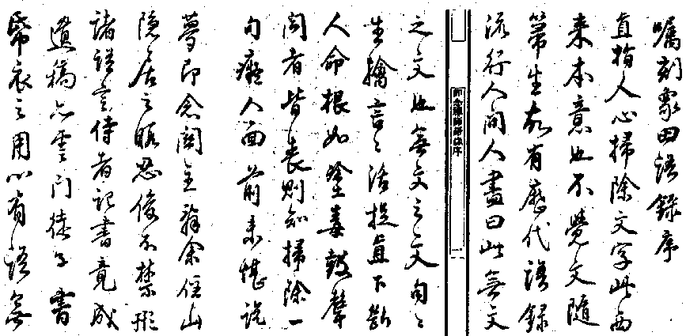
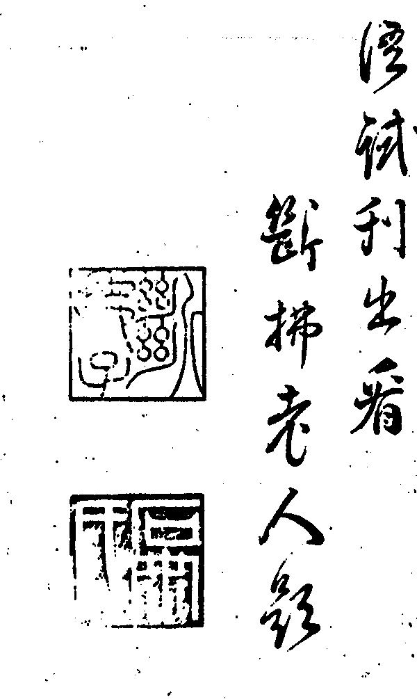
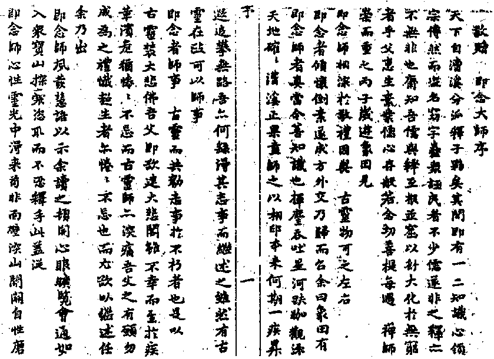
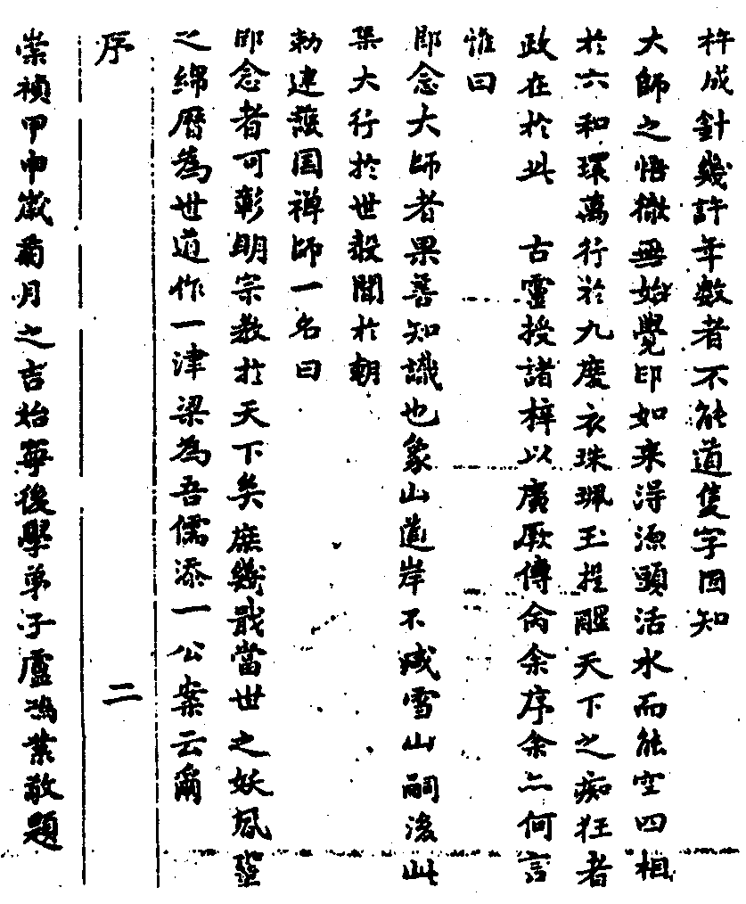

# 象田即念禅师语录



> **藏经**：嘉兴大藏经（新文丰版）（嘉兴藏）　**册次** 第 27 册（J27）　**编号** JB191　**部类** 诸宗部　**卷次** 4 卷　**篇幅** 41,831 字

> **作者（译者）**：书记净痴录、书记净珠录

> **卷／品**：4 卷 · 2 品



---



## 目录



  - [嘱刻象田语录序](#嘱刻象田语录序)

  - [敬赠　即念大师序](#敬赠即念大师序)

- [象田即念禅师语录卷一](#象田即念禅师语录卷一)

- [象田即念禅师语录卷二](#象田即念禅师语录卷二)

- [象田即念禅师语录卷三](#象田即念禅师语录卷三)

- [象田即念禅师语录卷四](#象田即念禅师语录卷四)



---



### 嘱刻象田语录序











------



### 敬赠　即念大师序











象田即念禅师语录目次



卷一小参  

示众  

秉佛  

示做工夫要语



卷二颂古  

问答  

机缘  

杂著



卷三室中漫言



卷四山居诗  

关居诗  

杂咏



------



## 象田即念禅师语录卷一



**译者**：书记净痴录



门人本致辑



崇祯己卯冬，结制小参。「『闻声悟道，见色明心』『观音将钱买胡饼，放下手却是馒头』，这般话也大奇特。山僧则不然，夜半摸得个拂子，拈起也是拂子，放下也是拂子，也有些子奇特。拈起时，直得乾坤陡暗；放下时，从教海晏河清。更有不拈不放的句子，诸善知识若也知得，便可与三世诸佛、历代祖师把手共行；其或未然，且听山僧处分。」蓦举拂，云：「这个，天见之为天、人见之为人、仁者见之为之仁、智者见之为之智，百姓日用而不知，良可悲哉。且道还有知者麼？今日法筵初启，四众云臻，岂不是知有此事？云峰禅人为山僧造祖衣、请说法，岂不是知有此事？及众护法宰官参请，岂不是知有此事？信麼？信则知，知则信。」乃举袈裟角，云：「大庾岭头提不起，我今举出大家看。」



僧问：「闻声悟道，唤甚麼作道？」师云：「君子惟慎口。」进云：「见色明心，将什麼作心？」师云：「山僧口唇未生白醭在。」进云：「『观音将钱买胡饼，放下手却是馒』头意旨，请师再举。」师云：「且道我舌头在不在？」僧拟进语，师便喝。



晚参。「二七去、三七来，也曾大遣、也曾大排，白汗出了又出，妄缘灰而复灰，秪恁麼休去歇去、木头石块去，第一义谛灼然昭著，从教枯木花开。大众还信枯木花开麼？」作手舞势，云：「只有一双无相手，不曾容易舞三台。」



小参。「三七从来二十一，若智若愚俱委悉，及问前三与后三，十个五双会不得。千七百则亦复然，拶未透时如铁壁。朝铁壁、暮铁壁，二六时中无罅隙，人人不奈铁壁何，谁知铁壁好消息？好消息，识不识？远山浓似佛头青，近水湛如僧眼碧。」乃举：「昔日白云端云：『参究古人公案，未透时如铁壁相似；及乎透了，元来自己是铁壁。』山僧则不然，参究未透时如铁壁，及乎透了百杂碎。且道：古人道的是？山僧道的是？试简别看。」



一僧出云：「二俱有过。」师云：「百杂碎。」进云：「转见有过。」师云：「晴天不肯走，直待雨淋头。」



监院问：「三七已去，敢问赤梢鲤鱼能有几个？」师云：「满堂俱是。」进云：「个中还有透网金鳞麼？」师云：「驴子脚下骑。」进云：「恁麼则堂内坐禅、堂外禅坐去也？」师云：「再跳跳看。」院礼拜，师便下座。



小参。师举拂，云：「大众！拂子举扬个事了也、说法了也，直得三世诸佛侧立下风、历代祖师亡唇结舌。只这拂子有如是威光、如是奇特，山僧今日为他作个通事舍人。且道：如何是他拂子所说的法？他道：『五蕴山头一段空，明明独露主人公，殷勤五七无寻处，只为全身在此中。』这个意旨，初结制时山僧已曾举拂子道：『得鱼忘筌，得兔忘蹄，得意忘言。』争奈诸人不能直下荐去，乃不得已扯上葛藤，还将拂子盖覆，殃及诸人朝寻暮寻、横寻竖寻，三七排遣、四七立香，及乎寻至五七日，有寻不得者，攒眉蹙额；或有见些光影者，眼豁眉开。殊不知总不干拂子事、亦不干山僧事，却是你诸人觌体错过有如是事。而又五日一考工、七日一小参，挨拶得你诸人行也如拂子、住也如拂子、坐也如拂子、卧也如拂子，眼也如拂子、耳也如拂子……，乃至心、意、识皆如拂子。何以到我室中，问著诸人拂子，便道不知？我道：『不知却好。』妳又道：『不会。』我道：『不会最亲切。』你又道：『不知。』恁麼教我也没奈何，又只得教你极力参取去。众中如有知得拂子落处者，出来相见。」



僧问：「拂子说法且置，如何是觌体一句？」师云：「唤作拂子则触。」进云：「古人道：『第一句荐得，堪与佛祖为师。』如何是第一句？」师云：「无你问处。」进云：「『第二句荐得，可与人天为师。』如何是第二句？」师云：「你问不著。」进云：「『第三句荐得，自救不了。』如何是第三句？」师云：「问著则不堪。」进云：「敢问吾师，还是那句中荐得？」师云：「你不会我意。」进云：「恁麼则拂子头边无限春也？」师云：「闲言语。」



小参。「辄辄结制来，不觉期已半，无相主人公，朝暮惺惺唤，父母所生眼，莫教乌荳换。向来拂子说法已六七矣，争奈不遇知音，今日借重拄杖子，行新条令。」乃卓拄杖云：「说法了也，当知拄杖子相承少林单传之旨，直指人心，不立文字。有所说法，是真语者、实语者、如语者、不诳、不妄、不异语者。于斯会得，便知青青翠竹总是真如、郁郁黄花无非般若，变大地作黄金、搅长河为酥酪，不为分外；其或未然，自是诸人根性迟钝，莫道拄杖子有所秘密，不显说好。」乃举：「昔日芭蕉和尚道：『你有拄杖子，夺你拄杖子；你无拄杖子，与你拄杖子。』」师复云：「阿㖿山僧错说了也，众中可有记得芭蕉说的麼？出来举看。」



监院问：「毕竟如何是芭蕉说的？」师举拄杖云：「会麼？」进云：「大众证明。」师云：「也须知恩报恩始得。」院便礼拜。



师诞日小参。「一念浑忘吾我我，了无生死得相关，本来面目元如是，奚假南山作寿山。诸仁者！还见本来面目麼？」良久，云：「秪这是，若向这里会得，始不被佛祖相瞒。」乃举：「世尊初生，一手指天、一手指地，周行七步，目顾四方：『天上天下，惟我独尊。』这则公案，商量者极多，错会者不少。人人尽道：『世尊离兜率，降皇宫，方能如是。』还梦见麼？殊不知水牯牛初生下，不止周行七步、目顾四方而已，又作麼生会？即我山僧初生时无气，及烧胞始叫一声，而举家相庆然。彼时山僧曾不知父母生我，亦不知自有气、无气，及烧胞始叫一声举家相庆；亦不知有内六根、外六尘、中六识，乃至物我之名、圣凡之号，混混沌沌，七窍未凿，浑然一际。大众！盖此初生时节，非独山僧如是，要且若男、若女莫不如是。然则何以佛是佛、水牯牛是水牯牛、吾人是吾人？诸仁者！知麼？镜分金殿烛，山答石楼钟。」



冬至小参。举：「古云『有物先天地』，甚麼物？『无形本寂寥』，强叨叨。」师拈拄杖，云：「我今为众亲拈出。」乃卓一卓，云：「从来只麼赤条条。赤条条，似吾曹，能为万象主，不逐四时凋。诸仁者，好生观，刹刹尘尘绝覆藏，为渠非物非非物，切忌从中道短长。」乃举：「昔有僧问一老宿云：『一阳来复，日长一线，未审佛法长多少？』宿云：『长一线。』后复有一老宿云：『一线长。』」师拈云：「二老宿虽有补缀虚空的手段，要且红线未断，只向长短上作活，相去佛法奚啻十万八千。若是山僧，则向他道：『休将玉线较长短，好把金针绣出看。』且道绣个甚麼？」师以拂子打一圆相。



僧问：「既云一阳生，为什麼古干依旧赤条条？」师云：「冬至子之半，天心无改移。」进云：「秪如霜清月冷、水冻鱼沉，又作麼生？」师云：「一阳初动处，万物未生时。」进云：「节令乍从今日起，岁华犹似去年晴。」师云：「玄酒味方淡，太音声正稀。」



僧问：「有物先天地，无形本寂寥，还许学人会麼？」师云：「万里长空，片云点破。」进云：「木女频频挝石鼓。」师云：「但形文彩，即属染污。」僧礼拜，起立云：「正恁麼时𫆏？」师云：「好个漆桶。」



书记问：「鸳鸯绣出从君看，不把金针度与人，三藏十二部一千七百则都是鸳鸯，如何是金针？」师以手搔鼻，云：「山僧鼻孔有些痒。」进云：「某甲则不然。」师云：「你又作麼生？」书竖一指，云：「穿却佛祖鼻孔去也。」师云：「也许你一半。」



结制，示众。「得鱼忘筌，得兔忘蹄，得意忘言，得了那个？」蓦竖拂，云：「忘了这个。且道如何是那个？」乃放下拂子，良久，云：「还有相委悉者麼？须知达磨西来，直指人心，见性成佛，然乃心无形相，且作麼生？指性无方，所又作麼生？见莫是无见而见麼？莫是见物便见心麼？莫是心地法眼能见麼？直饶与麼见得，未是衲僧巴鼻。且道如何是衲僧巴鼻？一堂风冷澹，千古意分明。」



旧住大本老宿设茶请示众，师云：「大众茶多吃鍾，大本老师为此象田二十餘年辛苦，方有今日。」悦众云：「茶已吃了，请师还茶钱。」师云：「更要山僧畫蛇添足麼？」乃顾监院云：「常住有事，不妨商量商量。」



院举三登禅师作知客，登出众，固辞。师云：「我有一问，如道得，许坐禅；道不得，即作知客。」登云：「某向无舌头。」师云：「这般话当不得，也要山僧肯。」乃托手，云：「你更道看。」登默然，师遂说偈云：「托出虚空一片心，秪将此事售知音，筵中若有真相识，黄叶何妨指作金？」复云：「大众谢茶。」



觉初禅者设茶请示众。「古人道：『人莫不饮食也，鲜能知味也。』是这般话言淡而旨远，时人往往强作道理，解注怎解注得下？要且有口者，孰不解饮食？有舌者，孰不知滋味？然吃淡即知淡味、吃咸即知咸味，以至吃酒定不说是茶。且有善吃茶者，才沾唇便知此是天池、此是龙井、此是松萝，一毫也瞒他不得，那里不是他知味处？大都不知正味耳。诸仁者！要知正味麼？须向未吃茶时识取。若识未吃茶时滋味了，更须知入口时滋味；若知入口时滋味了，又须知吃茶后滋味。直饶恁麼了，要知觉初禅者今夜设茶的意，秪要诸禅德闭口。然而丈夫有口，要开便开、要闭便闭，为甚麼要人设茶然后闭口？有等好事之者，或逞才辩、或逞学问、或逞道理，摇唇鼓舌，妄生长短，殊不知言生理丧，故藉善知识于空中突出一言半句，直如金刚圈、栗棘蓬，使人吞不得、吐不得，等闲塞断人咽喉，饶你有口到这里也无用处。只如昔日赵州问一僧：『曾到这里麼？』僧云：『曾到。』州云：『吃茶去。』又问一僧：『曾到这里麼？』僧云：『不曾到。』州亦云：『吃茶去。』时院主在座，问云：『和尚为甚麼曾到也吃茶、不曾到也吃茶？』州亦云：『吃茶去。』诸禅德！这则公案千古之下塞断人咽喉，然还塞得山僧的咽喉麼？」良久，云：「且喜山僧咽喉不塞自断也。」便归室。



示众。「挂钵千山里，霜空境寂寥，一心冰更冷，诸念已圆消。且道是甚麼人境界？上来诸佛祖，斯门已成就，现在诸禅侣，合各证圆明，行行诸菩萨，应当如是学。诸仁者！切须笃信力行。若信有十分，则悟有十分；悟有十分，则行有十分；行有十分，则证有十分。所谓佛法如大海，转入转深，直到修证不立、人法两忘，直须更进一步，则知海底飞红尘，山头翻白浪。」



僧问：「『海底飞红尘，山头翻白浪』，是阿谁境界？」师云：「问在答处。」进云：「『烦恼海中为雨露』又作麼生？」师云：「答在问处。」进云：「吾师恁麼话，惯卖死猫头。」师云：「一般冷色空山里，霜叶虽红不是春。」



桂庭居士设茶请示众。「静夜霜鸿天外过，圆通筵上几禅和？声消闻脱浑无际，谁谓观音在普陀？大众要知：〈普门品〉人人具有。所以道『应以佛身得度者，即现佛身而为说法；应以菩萨身得度者，即现菩萨身而为说法；应以居士等身得度者，即现居士等身而为说法。』虽则现身可知，且道法如何说？即如鸡鸣清晓、犬吠黄昏，事存函盖，理应箭锋。又如磬出云衢，歌来渔浦，醒迷途之幽梦、启静虑之玄门，妙在浑忘管带，不立功勋。所以道：将闻持佛，佛何不自闻？闻盖闻理，既妙见性亦玄然。理固如是，且道事作麼生？秪如今夜桂庭居士闻此象田安般若期，特特入山设茶供众，又合将何酬他则是？」良久，云：「即此见闻非见闻，无餘声色可呈君。」



尔策居士设茶请示众。「古镜埋尘黑似漆，左揩右磨光赫奕，悬向虚空炤胆寒，偷心管教一时息。大众！要见古镜麼？」以如意畫圆相，云：「应如是知、如是见、如是信解，莫生法相。倘有个汉出来道：『法相生也。』便向他道：『应如是知、如是见、如是信解，莫生法相。』所以古德道：『须参活句，莫参死句。』若向活句中荐得，可与佛祖为师；向死句中荐得，自救不了。」



乃举：「云居舜老夫少时在洞山聪会下，一日乞食鄂渚，有居士问舜云：『古镜未磨时如何？』舜云：『黑如漆。』又问：『磨后如何？』舜云：『炤天炤地。』居士笑云：『上人不是洞山来耶？』舜默惭，驰归，举似聪，聪代前语：『此去汉阳不远。』又代后语：『黄鹤楼前鹦鹉洲。』舜悟其旨。今夜居士若问山僧：『古镜未磨时如何？』则向他道：『门前水一溪。』『磨后如何？』便道：『屋后山万层。』居士若向这里会得，始知本有光明炤天炤地，不孤今夜设茶；其或未然，大须策起眉毛好。」



僧问：「古镜当空，胡来胡现、汉来汉现，胡汉不来时，又作麼生现？」师云：「吃茶也未？」进云：「露滴松枝翠，青山绝点埃。」师云：「吃茶莫道渴。」进云：「恁麼则『惯捉龙头擒虎尾，无名山上显云雷』？」师云：「闲言语。」



僧问：「人人有面古镜，且道如意还有古镜也无？」师云：「牙齿一具骨。」进云：「打破镜来，又作麼生相见？」师云：「耳躲两片皮。」进云：「恁麼则『云归五夜晓。月落万山寒』？」师云：「知你不知落处在。」



师诞日，莲宗禅人设茶请示众。「养愚端的在萝间，终日无心思往还，雨滴乔松声历历，风疏修竹韵珊珊。因观流水心常寂，为玩浮云梦亦闲，满座嘉宾岂偶尔？煮茶相共话青山。」竖如意云：「大众！今日是我如意师兄诞日，莲宗上人特特设茶，而幸嘉宾毕聚，亦莫大之缘也。诸仁者！欲识佛性义，当观时节因缘。今既是我如意师兄降诞时节，便好识佛性义，发如意信。既信入已，更当修如意行、成如意事、作如意福、满如意愿，至于如意了达、如意证入，则世、出世法莫不如意。还信麼？信，则法法皆如意，究竟般若波罗密。」



僧问：「佛性义师已道了，秪如今夜上坐下陪，主宾奉向，且道是向上事否？」师云：「吃茶如意。」进云：「烧破烛痕红滴滴，何人不吃赵州茶？」师云：「吃果如意。」进云：「即此月冷香沉、风高树肃，又作麼生是茶罢一句？」师云：「知音不在重重举，达者应须暗里惊。」



法源禅人设茶请示众。以如意畫圆相，云：「众兄弟看看：此乃万法之源、众灵之宅，不可以空空、不可以色色，包法界而非宽、入微尘而非窄，然则有渠不得、无渠不得，名渠不得、状渠不得，向渠不得、背渠不得，取渠不得、舍渠不得。」良久，云：「默时说、说时默，大施门开无壅塞，无壅塞。青山青、白云白，白额尾巴焦乌龟，眼睛赤好消息明，中坐舌头，暗里抽横骨。今夜法源上人设茶，偶尔话及，若也知端的，夜半金乌出。还有知端的者麼？出来相见看。」



僧问：「如何是万法之源？」师云：「生铁如意被虫蛀。」进云：「『彻法源底』一句作麼生道？」师云：「默时说。」进云：「万古碧潭空界月，再三捞摝始应知。」师云：「说时默。」



炳宇姜居士设茶请示众。「世上万般皆小事，惟有参禅是大事，参禅意在了生死，诸人生死了也未？话头却是取灯子，点著炳然炤海宇，回此光明反炤看，物物头头皆自己。皆自己，忘彼此，秪要诸人心自委，但得心空及第时，始知佛种从缘起。炳宇居士慕庞老，慕庞老，君财莫沉湘水好，将来施与转法轮，二施之功非小小，了得三轮体本空，即此便是无上道。今夜炳宇设茶，仍请山僧示众。记得高峰和尚道：『资生贵图求富，参禅贵图求悟。参禅若同资生，个个超佛越祖。』甜瓜彻蒂甜、苦瓜连根苦，吾闻居士善能作家，又慕禅道，可谓佛法、世法打成一片，乃甜瓜彻蒂甜也。虽然如是，且道：庞居士问马祖：『不与万法为侣者是甚麼人？』祖云：『待汝一口吸尽西江水向汝道。』意旨如何？」



僧问：「『心空及第』且置，『佛种从缘起』请师再举。」师云：「香烟书梵字。」进云：「不因修竹吟风弄，怎解孤松吼太虚？」师云：「好诗句。」



湛如上人设茶请示众。「尽十方世界是个自己，争奈诸人不委？只得强你看个『念佛的是谁』，大似按牛头饮水，前日也按牛头饮水、今日也按牛头饮水、后日也按牛头饮水、后后日也按牛头饮水，且教日日只如此，却如梦里合眼跳黄河。人人将谓逃生死，一朝忽地醒将来，啐！只道有多少奇特，元来只是这般底。脱却笼头，谢却角驮，捩转面皮，当处作主，从前许多淆讹公案解交不得的，当下如冰释耳。今夜湛如上人设茶，复请山僧示众，简点将来，大似佛殿里屙屎。众中或有未尽然者，不妨再泼一杓恶水，往往谓念佛、参禅不同，谁道参禅、念佛不二？当知：参禅参此心也、念佛念此心也。盖参禅者，贵乎心如墙壁，方可入道；念佛者，贵乎一心不乱，始得三昧。若得心如墙壁，自然一心不乱；若得一心不乱，自然心如墙壁。岂有二哉？所以古德道：『参禅为了生死，念佛亦为了生死。』要在生死切，则信心切；信心切，则参念切；参念切，则一心不乱；一心不乱，则无一法当情；无一法当情，则惟心净土、本性弥陀现前；本性弥陀既现前，见色时则弥陀眼家出现、闻声时则弥陀耳家出现……，乃至分别法时则弥陀意家出现。然弥陀既在六根门头出现，则六尘自净——眼见色，则色乃净土；耳闻声，则声乃净土……，乃至意分别法，则法乃净土。六根、六尘既如是，则六识亦如是，要且不离秽土而见净土。是故，一句弥陀有如是威光、如是妙用，能使上根者直下荐取，等诸佛于一朝、越三祗于片念；中下者，不妨渐修渐证；至于匹夫匹妇，亦可与知与能。大矣哉，阿弥陀欤！」



僧问：「既云『惟心净土，本性弥陀』，为甚麼教中又道『从是西方过十万亿佛土』？」师云：「从是西方过十万亿佛土。」进云：「又道『人人本具，个个圆成』，为甚麼学人不会？」师云：「人人本具，个个圆成，为甚麼不会？」进云：「恁麼请大众谩念弥陀，再吃杯茶去？」师乃高声叫云：「大众再吃杯茶。」僧礼拜。



慧空上人设开口茶，请示众。「永嘉道：『了了见，无一物，亦无人、亦无佛，大千沙界海中沤，一切圣贤如电拂。』若依山僧简点将来，大小永嘉却似寱语。何则然？既无人无物，又见个甚麼？见者又是个甚麼？象田这里则不然，有好山、有好水、有好宾、有好主，堂里诸师不语而语、堂外诸师语而不语，又喜执事殷勤，内外和美，但光阴迅速，一期又将毕矣。今夜慧空上人又设好茶，请禅师开口，试请出来开口看，且道：象田与永嘉，是同？是别？」众默然。师云：「既吃开口茶了，大家不妨说说。」一僧云：「师耳聋麼？」师云：「唔！只可堂里讲话。谢茶。」



解制夜，道兴师设茶，请示众。「乾峰道：『举一不得举二，放过一著，落在第二。』云门出众，云：『昨日有僧天台来，今日却往径山去。』」师云：「山僧则不然。」蓦举如意，云：「大众会麼？如意之法如优昙花，时一现耳。向这里荐得，则知举一；其或未然，则落二去也。今夜道兴师设茶，请说解制意。若论解制，则须上大人丘乙己一一从头起。今冬一期，乃亏了如意拂子说法也，是如意拂子答话也。是如意拂子，有时问如意答如意、问拂子答拂子，有时问如意不答如意、问拂子不答拂子，有时问如意答拂子、问拂子答如意，有时总不恁麼，所谓回互不回互，回而更相和，不尔依位住。大众！若知得如意的落处，则知拂子落处；若知拂子落处，则知如意落处。知麼？堂里也如意、堂外也如意，及施主来设茶办斋悉皆得如意。既皆得如意，为甚麼如意却在山僧手里？」良久，放下如意，云：「如意则且置，如何是解制一句？有麼？请出来道看；如无，自道去也。」便归方丈。



庚辰岁冬，不语期结制，小参。「江南不语期其来久矣，上承石霜置枯木堂，安枯木众，务在克期取证者也。是以贵乎操履，而不贵乎言说。然初又不妨言说。何以？盖其人既众，则未免见有明昧、行有浅深，故进期头三日必须勘验见地，审究工夫。见处既明、路头已正，然后特设闭口茶，以一众志而惕励深操。於是继之，三七排遣，要在洪波浩渺处证取也；四七站香，要在壁立万仞处证取也；至于五七坐香以去，要在寂然不动处证取也。於四仪中如是用心，则契道忘言，故谓之不语，岂做模打样者可同日语哉？然虽如是，众中倘有不待修证而荐去者，不妨出来相见。」问答不录。



晚参。「忙忙日月相催逼，才则安期已二七，莫道家书无路通，霜鸿声度孤峰侧。众兄弟！闻不闻？闻，则遐迩一体；不闻，则动静体一。若恁麼领略，何其现成？何其省力？从教眼处闻声、耳门见色，然虽如是，更须知有衲僧巴鼻。且道如何是衲僧巴鼻？」乃卓拄杖，云：「咦！」



晚参。「一七一七不觉三七，扑面霜风令人汗出。且道：既是扑面霜风，为甚麼却令人汗出？知麼？时不待人，生死事迫，兄弟家果能信得生死事迫，不怕疑情不奋发、不怕工夫不得力、不怕心地不开通、不怕公案不明白；如或未然，看看一期逗将毕，个事依然黑如漆，他日老阎拷饭钱，朝打三千暮八百。咄！」



晚参。师良久，以如意击香几三下，云：「会麼？先以定动，后以智拔，法身不堕於诸数，四七从他二十八，麻三斤、乾屎橛，千七百则烂葛藤，信手拈来都是药。兄弟家，随分服取一贴，管取身病、心病、禅病，乃至无始已来世医拱手的夙病，一时都了却。昔日文殊师利命善财童子采药，殊云：『是药采将来。』善财遍采，无不是药，却来白云：『无不是药者。』殊云：『是药采将来。』财拈一茎草度与殊，殊接得，示众云：『此药亦能杀人、亦能活人。』有杀、有活，有纵、有夺，还他作家。」蓦竖如意，云：「象田者一茎，亦能杀人、亦能活人，脱或遇著个四大忘我、百骸调适的出来，且道杀他则是？活他则是？」放下如意，云：「须知者一著。」



晚参。「五七三十五日矣，个事诸人委未委？分明动静总承渠，何自忙忙寻自己？寻自己，强作主，一朝兴尽路头穷，始信踏翻波是水，伶俐汉撩起便行。明头一句且许你，暗头一句犹未许。且道：如何是暗头一句？」举：「杜顺和尚法身颂云：『怀州牛吃禾，益州马腹胀，天下觅医人，炙猪左膊上。』只此一颂，直如万仞银山，你欲上，作麼生下脚？亦如一团栗棘，你欲吞，作麼生下嘴？山僧不惜眉毛，一一下个著语。怀州牛吃禾，上大人；益州马腹胀，丘乙己；天下觅医人，化三千；炙猪左膊上，七十士。众禅德！如其忍俊不禁，齐出来道：『长老恁麼著语，大似将土泥里洗。』则向诸人道：『尔小生，八九子，佳作仁，可知礼也。』」



晚参。「六七工夫成底事，诸公不用重筹虑，千方百计总徒劳，但得心空方及第。山僧恁麼告报，如王髻珠双手分付，为什麼无人承当得？莫是只为分明极，反令所得迟麼？莫是小见狐疑，转急转迟麼？莫是夙习浓厚，盖覆佛性麼？莫是现业流识，违时失候麼？莫是家贼难防，损失法财麼？莫是一曝十寒，工夫间断麼？须知总繇自己，不干他人事。你若只为分明极，反令所得迟，何不剔起眉毛，直下觑破去？你若小见狐疑，转急转迟，何不放之自然，体无去住去？你若夙习浓厚，盖覆佛性，何不高提慧剑，斩断情根去？你若现业流识，违时失候，何不把住要津，不通凡圣去？你若家贼难防，损失法财，何不捉贼见赃，搂番巢穴去？你若一曝十寒，工夫间断，何不单刀直入？」良久，云：「后句还有续得者麼？」众下语不契。



晚参。「七七懒，调平亥，信口道、信手拈。」乃卓拄杖，云：「鬼神莫测，莫测莫测，拄杖原来是楖栗，西来大意有甚奇特？大众还见达磨祖师麼？」良久，云：「但秪恁麼，几乎面壁。」



师诞日小参。「湛兮，寂兮，父母未生之先。寥兮，廓兮，有生之后依然，生死其犹旦暮。」蓦竖拂，云：「这个本不变迁，既不变迁，则其寿量南山曷得而喻焉？松柏曷得而喻焉？龟鹤又曷得而喻焉？直饶溟灵寿、大椿年亦不可得而喻焉。则当知其尘点劫前本不曾灭，今日又何以生？本非众生，今日又何以成佛？本无元字脚，今日又何以说法？本非佛、非众生，今日又何以度生？然既如是，要且世尊何故离兜率、降王宫、八相成道说法度生也？只为应个时节。今日大众为山僧庆诞，复请小参，也不可不应个时节，且道如何是应时及节的句？」以拂子拂一拂，云：「不萌枝上花开，无影树头凤舞。」



心田赵居士设茶，请示众。「佛说僧为净福田，福田端的在心田，心田居士信福田，为种福田到象田。教中较量福田功德，云：『饭恶人百，不如饭一善人；饭善人千，不如饭一持五戒人；乃至饭三世诸佛，不如饭一无心道人。』毕竟何等样的是无心道人？惟有真参实悟的衲僧，不求诸圣、不重己灵，净裸裸、赤洒洒，没可把，终日吃饭不曾咬著一粒米、终日穿衣不曾挂著一缕丝，方可为无心道人。今晚心田居士设茶供众，结般若缘，大众相聚吃杯茶，且道还从口入麼？如从口入，必然灌溉心田；既灌溉心田，平日所参知识、所有般若种子自当发生。为甚麼道：『善财参遍处，黑荳未生芽』？」蓦竖如意，召云：「大众！」众举首，师云：「黑荳芽生也。」



设开口茶，请示众。「拈花微笑，不传之妙；少林面壁，重玄之则。是乃至道也，而世人希及之。善继其道者，非吾枯木堂中客而谁？兄弟家合生庆幸，当知不是一生、两生、三、四、五生而种般若根，定是灵山亲承授记来，还识不传之妙麼？」以如意左边击，云：「咦！还识重玄之则麼？」以如意右边击，云：「咦！向这里会得，一任开大口，吞却乾坤、吸乾沧海；其或未然，吃茶也须防咽。」



解制，小参。举：「世间觅一个无事无为人难得，不碌碌于名利则碌碌于衣食。」拈拄杖，云：「只有这个木上座，终日赤条条，不挂一丝、不占粒米，无声无臭、无事无为。衲僧家若能如是，则可与伊作同参，有自繇分；若不然者，明日出门不易。洞山道：『兄弟家东去西去，须向万里无寸草处去。』象田则不然，兄弟家东去西去，一任向草披离处去，秪是不得触著死蛇头，若触著他，则断子命根；亦不得背著他，背著他，则不知伊落处。要且不触不背，一句作麼生道？」放下拄杖，云：「了。」



示众。「至道无难，唯嫌拣择。若然，则何必辨金沙、分玉石？」



拈拄杖，云：「恁麼拈来用得亲。」卓一卓，云：「会麼？」又卓一卓，云：「不会麼？但莫憎爱，洞然明白。虽然，更须知有一人不在明白里，大众还识此人麼？」复卓一卓，掷拄杖，归室。



小参。「今日不为别事，有则古公案与众判断判断。」良久，以拂子拂一拂，云：「判断了也。诸仁者！还见据款结案处麼？如未见，且看判第二则去。」举：「世尊一日升座，默然良久。羊打乾处卧。文殊白椎云：『谛观法王法，法王法如是。』驴打湿处溺。这则公案，自古至今俱判为作家相见，高提向上。若如斯见解，要见他师资唱和的落处，何异面南看北斗？今日山僧于无意中蓦忽觑破黄面老子与文殊做处，大似把手上高山，未免傍观者哂。」



甲戌冬，天华寺。秉拂，举拂云：「拈起天华拂一枝，冲开石伞云千尺。」遂竖拂，云：「会麼？」放下拂，云：「不会麼？须知会与不会，总不干他事，所以达磨西来，直指人心，不立文字。」良久，云：「大众莫更要首座畫蛇添足那？」以拂左右击，云：「不徒打草，只要惊蛇，莫有丧身失命者麼？」回顾大众，云：「阿谁不挂眉间剑？莫待腥红溅梵天。」



僧问：「群阴剥尽时如何？」师云：「明日一阳生。」进云：「一阳生后如何？」师云：「万象增辉。」进云：「正恁麼时，是何时节？」师云：「非君境界。」



晚参。「道人贵办铁肝肠，逆顺情尘俱莫顾，吹毛利在及时磨，直下莫留凡圣路，丝毫念起丧天真，点著不来何劫悟？瞥尔情忘万境闲，色色声声是甚麼？不是心、不是佛、不是物。」以拂打圆相，云：「敢问诸人睹不睹？团团月上圆如鼓，今夜清光绝覆藏，等闲识得云门普。」敲一拂，云：「当阳一击碎空明，拈来殃及诸君补。恁麼补？不许恁麼补。不恁麼补，却许恁麼补？要且端的意如何？苏鲁苏鲁，苏鲁悉利娑婆诃。师兄弟！首座恁麼举扬，还有直绝承当者麼？不妨更借一则古人公案，一一下个注脚，与师兄弟简辨看。」



乃举：「药山参石头，脚跟下错过了也。山对石头云：『某甲三乘十二分教，颇知藏舟於壑。闻南方「直指人心，见性成佛」，实未明了藏山於泽，乞师指示藏天下於天下』。石云：『恁麼也不得』，面赤不如语直；『不恁麼也不得』，千虚难抵一实；『恁麼、不恁麼总不得』，门外远山寒有色，槛前流水寂无声。山不契，铁橛铁蒺藜。石头指参马祖，低声低声。山依教参马祖，如前问，千里持来呈旧面，一番举起一番新。祖云：『有时教你扬眉瞬目』，心月见天水，无复乃相比；『有时不教你扬眉瞬目』，月明心水清，情尽物殊始。『有时教你扬眉瞬目者，是学道苦无方，致穷欣有具；有时教你扬眉瞬目者，不是徘徊清素光，寒石高天吹。』山於言下大悟，也是哑子吃苦瓜。无伎俩可呈，识法者惧。但低头礼拜而已，知者不贱用。祖云：『你见甚麼道理便礼拜？』瞒不得和尚。山云：『某甲在石头处，如蚊子上铁牛。』相似不是苦心人。不知师兄弟，首座与麼注脚，了『蚊子上铁牛』的意，端的得也未？如未端的，须各努力。」问答不录。



小参，以拂畫圆相，云：「高悬炤妖镜，不降镜里怪。昨夜南山白额虎，咬杀街心石敢当。海底泥牛痛不禁，贺家池上虾蟆叫。怨苦悲哉，妈妈观世音！全身入草泪满襟，欲把净瓶水手掬与洗，令具慈忍力。蓦有一个不顾好恶的孟八郎，劈头撞著便一喝，观音菩萨连忙旋倒返闻机眼门，火星已迸出，等闲烧却须弥卢，大千世界无灰迹。咦！若向者里直下会得，更有甚麼可得？不见达磨位下有个神光，抛却己见，为法断臂。至於觅心，了不可得，达磨便与他安心已竟，这是第一个参学的榜样。而今时世不古，多觅知解，且好奇特，只管图口头便利，自谓会得禅了，殊不知全是弄精魂，与本分事料掉没交涉。若不信，但日用中向脚跟下简点看，一切情尘于染不著麼？习气使我不动麼？明心见性，如观掌中，了了分明麼？无梦无想时，主人公知得落处麼？真当了得我生死麼？如果能彻头彻尾了，不妨拈来无不是用去萨婆诃。脱或未然，所谓未得谓得、未证谓证，大妄语成，忽地生死到来，业识茫茫无本可据，入地狱如箭射。苦哉！痛哉！悔之晚矣。



「现前诸兄弟虽真实要做工夫，然多有不能了当者，过在於何？不是看做平常、或忒看奇特了。不知个事初无易难，贵乎撩起便行。如其不能直下领略，自当奋发勇猛心、真切心、长久心，若具有此三心，随分参取一则公案，无有不悟去者，只争早晚耳。其於工夫自能得力，疑情自能顿发、妄想自能不生、一切境界自能动我不得，那时孤孤迥迥、峭峭巍巍，直是银山铁壁顿在面前，要推也推不去、要歇也歇不下。然到者里，无你用心意识处，慎勿打退鼓，要晓得无你用心处正好用心、无你捞摸处正好捞摸、无下手处正好下手，推门落臼，岂有他哉？达磨所谓：『外境不入，内心无喘，心如墙壁，可以入道。』正是者般时节。但莫顾危亡，只恁麼蓦直向前挨拶将去，自有日忽地磕著㘞，原来者般现成的，始信睦州见人便道：『现成公案，放汝三十棒。』无业国师见人便道：『莫妄想。』至於即今天华堂头和尚横拈倒用了无疑矣，亦信首座今日之言不谬妄也。珍重。」



示做工夫要语八则



参究个事，如祖上一片闲田地，久被牛羊践踏，瓦砾堆积间无空隙，苟要洁净，须著打屏一番。当知吾人心地亦然，本来清净无物，奈何无始虚妄、人我践踏、五欲尘劳堆积于中，求斯须净处亦不可得，安得与大道相应？惟有看个话头是把铁扫帚，直须拼命迅扫一番，始得虚豁豁、平贴贴，身心一如、身外无餘。正与麼时，回观古人千七百则是甚闲家具？虽然，犹有人不放过你在。



做工夫无有别法，惟精切而已。精，则用志不分；切，则专一研究。用志不分，则杂念不生；杂念不生，则心光独露。专一研究，则无有间断；无有间断，则性体全彰。所谓「譬如磨镜，垢净明现」，岂有他哉？



有久看话头而疑情发不起、于日用中不得力者，无他，一者、把生死不以为然，二者、把话头看得泛了，遂致疑情发不起。疑情既发不起，工夫便不得力；工夫既不得力，便与昏散打做一团。且昏散尚打不脱，要脱生死不亦难乎？须把生死要看得毕竟是一件极大的事，盖古人示语是断生死的公案，若于公案不决，则生死断断不明，而欲不疑可乎？要明生死，只将个本参死不放舍、顿在目前，反覆看渠是个甚麼道理？毕竟祖师意在甚麼处立地？要讨个分晓，不明断不休。苟得真疑奋发，壁立万仞，便是好消息。向这里著一只眼，悟去有甚难？



有多于无义味话头咬嚼既久，不得其滋味、又不得其趣向，往往自谓工夫做不上，打退鼓，把好光景当面错过了。殊不知，但向无滋味、无趣向处吃紧看去，便是工夫得手处。如若于兹不下手，然欲望其闲悟，驴年去。若信得此语，及不管做得上、做不上，得力、不得力，有滋味、无滋味，尽情不顾，只把个本参横咬竖咬，时刻不放，但孜孜矻矻，一味咬将去，脱或错口一咬百杂碎，那时通身罄快，始知我语不欺人也。



兄弟家要了生死、明大道，必先把现前习气及爱恶情识等一朿丢开，然后看个「本来面目」，或看「念佛是谁」、或看「万法归一」、或看「狗子无佛性」等话，切须咬定一则，直下看去，从教孤孤迥迥、洒洒落落，如香象摆脱枷锁，于日用中荡荡然，无丝毫系绊，管取㘞地一声有日也。



做工夫到水清月白时，觉纤悉洞然，所谓虚明自炤，不劳心力也。虽然，犹未是歇脚处，须知心炤俱亡复是何物？



工夫贵在一门深入，若稍带联纤，则到底知见淘汰不尽，心挂两头，徒自泣岐，至于白首无成，悔之晚矣。



参禅参到觌体处，如日方中，万象昭著，岂容拟议？然亦须知『日午打三更，夜半日头红』意旨落在何处，始可归家稳坐也。



------



## 象田即念禅师语录卷二



**译者**：书记净珠录



门人本致辑



颂古



世尊初生



特达施为非近理，真龙不在丹青里，分明说与无人解，莫怪杜鹃啼不止。



世尊睹星



六年坐得眼如眉，忽睹明星便谓奇，哑子游春作麼说？风流岂合自家知？



世尊升座



首出庶物，倩影难描，七佛之师，蜜口心刀。咦！灵鲲独运兮，摩云降霄；枇杷肯翠兮，梧桐肯凋。



世尊於一切众前现大神力，出广长舌，上至梵世。



以相见如来，是人无智慧，口缝未开时，舌已超梵世。



外道问佛：「有句？无句？」世尊良久，外道谓：「开我迷云。」



死活将来难世尊，世尊有耳若无闻，从教伎俩全消落，方入吾家解脱门。



阿难随即问：「外道有何见处便云得入？」世尊云：「如世良马，见鞭影而行。」



良骥天然自不群，不烦鞭影骤风云，驽骀侧耳瞠乎后，犹待重论盖代勋。



善财参德云比丘



瞻风拨草路方穷，四顾寥寥两眼空，莫怪德云无觅处，只因亲到妙高峰。



按下云头过别峰，谁知不觅却相逢？芒鞋踏遍春方歇，无影枝头花正红。



文殊三处度夏归会中，解制，迦叶欲白椎摈出，会中有无量文殊，世尊云：「汝欲摈那个文殊？」



净眼何曾著得沙？一尘才翳落空花。文殊无数将谁摈？笑倒傍观老作家。



女子出定



伯夷、叔齐耻食周粟，介子焚身、比干剖腹，哭不得笑、笑不得哭。一曲离骚自隐身，汨罗江上空捞摝。



少林面壁



折芦暗渡蹑寒冰，憨坐栖栖冷彻心，不料雪中人断臂，腥风千古振丛林。



百丈参马祖



一喝耳聋惟自知，得便宜是失便宜，无弦音韵谁能会？须把黄金铸子期。



佛法从来不顺情，耳聋吐舌话分明，小根魔子随人转，往往空瞠鬼眼睛。



德山参龙潭，一夕侍立，次至更深，潭点纸烛与师，师拟接，潭吹灭，师于此大悟。



暗向当空书一字，行人觌面却成迷，纸灯吹灭方明见，始信无题是大题。



德山托钵



意外之谈没主宾，寻常蓦面便欺人，曹溪波浪如相似，无限平人被陆沉。



睦州举一不得举二



买上明知，买下放生，始悔打杀。二人同心，其利断金。



僧问睦州：「一气还转，得一大藏教也无？」州云：「有甚饆𫗩𫗰子？快下将来。」



饆𫗩𫗰子下将来，担板老师图口实，顿渐偏圆且许你，大经敢保转未得。



赵州赌饼



洗耳其如落一筹，饮牛何事占高流？堪怜二子轻天下，可怪驴虫斗赵州。



赵州问僧：「甚处来？」僧云：「雪峰来。」州云：「雪峰有何言句示人？」僧云：「雪峰寻常道：『尽大地是沙门一只眼，汝等诸人向甚处屙？』」州云：「上座若回，寄个锹子去。」



寻常默默念弥陀，见者咸疑暗骂他，知己幸遗闲话柄，只应撒手笑呵呵。



青州布衫



长江影浸一天秋，霜叶飕飕风骨愁，野老忽歌新水令，浪花惊起月边鸥。



台山婆子



冤有头，债有主，狭路相逢不容己，杀活锋藏语话中，冷口热心谁个唯？唯不唯，已已已，负恩者多，报恩者几？



万法归一，一归何处？



万法归一一归何？老鼠搬金恨不多，争奈肚饥吃不得，虽然似有却如无。



婆子烧庵



寒崖何意避阳春，倩女无端解诳人，烧却茅庵浑不管，一回拈起一回新。



南泉斩猫



拈出无情三尺铁，虚空也著流鲜血，草鞋独贵逞风流，拈得鼻孔失却舌。非折合，有正经，公宪容情罪不轻。



南泉云：「心不是佛，智不是道。」



逢人且说三分话，未可全抛一片心，琴子无弦如弄引，世间几个是知音？



南泉：「不是心、不是佛、不是物。」



野渡无人解问津，自言自语抑伤神，杜鹃枝上啼红雨，啼乱东风杨柳春。



庄上吃油糍



江北牯牛伸一鼻，搅乱江南千顷麦，若作神通法尔看，马驴相对胆生寒。



沩山笑



问得孤高答亦亲，呵呵赤胆向人倾，布单卖了浑无事，却使沩山笑转新。



沩山水牯牛



唤作沩山，又是水牯；唤作水牯，又是沩山。两边不实，中道亦闲。青山叠叠，古涧潺潺，行住坐卧，常在其间。



洞山价禅师过水睹影大悟



无底篮盛活死蛇，藏身露影混尘埃，独临水镜忘回互，渠我相逢擘不开。明中暗，去还来，谩把空花石上栽，脱或邈成虚幻影，远山如黛望天台。



洞山麻三斤



如何是佛麻三斤，无星称子好生称，钩头曲是初三月，看去迢迢十万程。



洞山辞云岩，问：「百年后有人问：『还邈得师真否？』如何秪对？」岩良久。曰：「秪这是？」师沉吟，岩曰：「价阇黎！承当个事，大须审细。」



畫虎畫皮难畫骨，知人知面不知心，鸳鸯毛羽金针出，彩线无施何处寻？



僧问洞山：「清净行人不入涅槃，破戒比丘不入地狱，何如？」山曰：「度尽无餘影，还他越涅槃。」



一叶翩翩不系船，夜深月落正堪眠，芦花两岸无餘影，白鹭飞来破晓烟。



洞山因僧问：「寒暑到来时如何回避？」曰：「何不向无寒暑处去？」曰：「如何是无寒暑处？」曰：「寒时寒杀阇黎，热时热杀阇黎。」



目窈窈兮，见而不见；耳肃肃兮，闻而不闻。明暗代谢兮，虚空常若；寒暑变迁兮，至道无分。偏来正去兮，虚舟不系；功明位转兮，郢匠运斤。寒时无寒、暑时无暑，父来就子；寒时寒杀、热时热杀，臣去朝君。还知有那边事麼？夜来何处火？烧出古人坟。



洞山蛇咬虾蟆



救取还他不救人，岂从形影妄疏亲？机轮活转无踪迹，叵耐渔郎错问津。



云门偃禅师因僧问：「如何是超佛越祖之谈？」师曰：「胡饼。」



超佛越祖谈，胡饼何奇特？自古真师子，咬人如火急。



乾屎橛



拈出通红铁一囵，哪咤辣手一难扪，曾经巴峡猿啼处，不是愁人莫与论。



观音胡饼



黄鸟啼春黄菊令，秋风吹起故园春，易识阴阳颠倒术，难知石虎产麒麟。



回天关、转地轴，日出西、月东没，兔生丝、马生角，倒骑驴、登华岳，言前荐得自嘘嘘，句下承当阿错错。



门里出身易，身里出门难。



句中无句若为参，才著思量早不堪，脱体道来犹不许，那容儱侗逞瞒盰？



翠岩眉毛



伯夷之清，下惠之和，伊尹之任，孔子之时。噫！身到黄河，此心不死，三千里外，切忌错举。



无著五台与文殊对谈



三三不解问均提，石火宁容伫所思，端的大人门下事，依稀不许野僧知。



俱胝指头禅



既知明本分，又用指头何？斫却月中桂，清光应更多。



大颠摈首座



才得春风花正开，翩翩蝴蝶过墙来，忽然又被风吹落，庶免游蜂胡乱猜。



临济见僧入门便喝



佛法无我、无人，何劳特地生嗔？引得瞎驴趁队，当阳乱触嘉宾。



临济一喝分宾主



一喝谁云分主宾？垂钩意在钓金鳞，繇他白浪风涛险，收放须凭把柁人。



兴化摈维那



自来无实法于人，兴化老汉解当真，屈辱维那犹自可，餘殃后代恨何伸？



芭蕉拄杖



贪者不与、廉者不取，忘取、与者，一任随喜。



鼓山赴请



凡圣交参总成戏，何如傀儡夜登场？夜阑人散场收后，留得虚声到处扬。



水庵一禅师曰：「西天胡子因甚无须？」



西天胡子没髭须，逐日同门见也无，不是顶门开只眼，宁知此语不欺吾。



佛炤禅师因孝宗宣问：「释迦佛入山六年，所成何事？」对曰：「将谓陛下忘却。」



六年坐卧白云深，天眼龙睛孰解寻？幸赖君恩犹记得，春风化雨满丛林。



疏山造塔



为卖丁田故弄钱，登山志岂在腰缠？幸然古佛谙家计，一状领过公案圆。



疏山尝手握木蛇，有问：「手中是什麼？」曰：「曹家女。」



以木为蛇早眼花，那堪字女姓曹家？无端邈摹虚空骨，怪得沩山笑转赊。



夹山无义语



廿年胡乱语如雷，平地无端起骨堆，伶俐衲僧忽掀倒，一坑埋却请无猜。



如来转物



有物可转被物转，无物可转转亦多，有无心物两不立，虚空奚碍白云过。



杨岐三脚驴子弄蹄行



心意相像，马面团𪢮，驴子三脚，明眼难瞒。



雪峰砂米



淘米、淘砂验若翁，无钱名纸信难通，饶将砂米一时去，熨斗煎茶铫不同。重勘过活，搏龙相见，饶伊过别峰。



雪峰云：「望州亭相见了也，乌石岭相见了也，僧堂前相见了也。」



望州乌石先相见，莫看仙人手中扇，若然不具摩醯眼，等闲错过娘生面。僧堂前见又怎生？脱底漆桶不劳呈。



雪峰召曰：「傋头陀何不遍参去？」备曰：「达磨不来东土，二祖不往西天。」峰然之。



嬾向青山举足，浑忘白日移轮，翡翠踏翻荷盖，鹭鸶冲破溪云，虽是龙头蛇尾，到底卑不动尊。



僧问岩头：「古帆未挂时如何？」师曰：「后园驴吃草。」



古帆未挂蓼花汀，水碧苹香野趣真，料得问津人不解，风前一笑动江滨。



云居膺禅师因僧问：「羚羊挂角时如何？」师曰：「六六三十六。」



好个六六三十六，斩草为筹数不足，踪迹羚羊固不同，痴狂猎犬空相逐。



曹山章禅师因僧扫地次，曰：「佛前扫？佛后扫？」答曰：「前后一时扫。」师曰：「与我过靸鞋来。」



善属文者不起稿，善走之人不触道，说得分明直甚的，争如过靸鞋来好？



南院颙禅师问僧：「名甚麼？」曰：「普参。」曰：「忽遇屎橛时如何？」曰：「不审。」师便打。



普参不审乾屎橛，不审便打知赏罚，若然特地审将来，肯把不审轻埋没。



九峰不肯泰首座



石霜枯木谁堪偶？布衲区区尝克守，将谓坐断九峰舌，孰解返遭渠毒手？噫！久案谁为断不平？乌台之畔起包丞。



云盖问石霜：「学人无奈何时如何？」霜曰：「老僧亦无奈何。」



云霞作饭满林泉，露柱无心不解餐，禅客有心餐未得，只应常供觉皇前。



龙湖问石霜曰：「祖师事肯相付乎？」霜云：「莫谤祖师好。」湖云：「是虚妄耶？」霜云：「是实事耶？」



仰之弥高钻弥坚，瞻之在前忽后焉，非实非虚传未得，教君莫谤祖师禅。



张拙参石霜



巧不可得拙何为？点铁成金不费辞，随顺世缘成大用，孰云妙悟不从师？



地藏种田



熏风翻片雨，翼翼野苗新，浩浩商禅处，何如树下人？



僧问落浦：「一向何处逃难？」浦云：「阛阓中。」



避秦阛阓一何深？为报渔郎莫浪寻，啼断子规花事了，杖藜闲步绿杨阴。



报慈屿禅师因僧问：「如何是佛性？」师曰：「谁无？」又问净果，果曰：「谁有？」



佛性谁有？谁无？自己原不糢糊，大人磊磊落落，婴儿哆哆啝啝。



同安丕禅师因僧问：「依经解义，三世佛冤；离经一字，即同魔说，如何？」师曰：「孤峰迥秀，不挂烟萝，片月行空，白云自异。」



依不是、离不是，玄机妙处须神会，孤峰元不挂烟萝，片月行空云自异。是则是，莫错会，乘言犹未离心意，撒手悬崖苏醒来，斯时宗教浑闲事。



佛印问东坡云：「四大本空、五蕴非有，学士向甚麼处坐？」士无语，师代云：「适才冒犯。」



捏定咽喉塞却口，一切佛法谁敢有？牢关把定不通风，飞骑将军何处走？



白水声色



声非声兮色非色，狼藉幽芬满都邑，呼卢喝采非丈夫，万两黄金只一掷。



瑞岩彦禅师尝坐石上，每唤主人翁，复应曰：「惺惺著，他后莫受人瞒。」



惺惺石上重重唤，无耳阿师孰解闻？唤起怪生连累汝，傍观俱道弄精魂。



玄沙三种病人



佛法不在阴界里，三种病患无端起，地藏善回逆水波，玄沙自合惭惶死。



玄沙白纸



封取虚空上雪峰，果然千里喜同风，为怜漏泄虚空髓，仍把虚空漫塞空。



仙棋仙著许谁晓？胜负寻常一笑了，堪怜傍玩采樵翁，烂却斧柯何处讨？



镜清道怤禅师因僧问：「未达其源，请师方便。」师曰：「若是其源，怎受方便？」



不识其源出处何，谁知与世不同波？澜翻不借东风力，倒岳倾湫见也麼？



镜清问：「门外是什麼声？」曰：「雨滴声。」师曰：「众生颠倒，迷己逐物。」



门外何声轻借问，髑髅穿过不多争，众生颠倒无分晓，解作萧萧雨滴声。



风穴昭禅师因僧问：「如何是道？」师曰：「五凤楼前。」曰：「如何是道中人？」师曰：「问取城隍使者。」



五凤楼前达四方，城隍使者貌堂堂，鹧鸪自古啼南国，风气初移到北方。



风穴因僧问：「如何是佛？」曰：「杖林山下竹筋鞭。」



杖林山下竹筋鞭，偶露春风舞翠烟，杜宇声中归去好，休教遗恨在桑乾。



明招谦禅师上堂，众才集，曰：「今日风头稍硬，不是汝安身处，且归煖室商量。」便归方丈，大众随至，师曰：「才到煖室便瞌睡。」以拄杖趁散。



风头稍硬便抽身，煖室商量意气新，开眼其如皆瞌睡，一时趁散有来因。



白马霭禅师因僧问：「如何是清净法身？」曰：「井底虾蟆吞却月。」



寸草拈来善隐身，虾蟆吞月显诸仁，果然独步威音外，别有壶天不夜春。



首山念禅师因僧问：「亲到宝山空手回时如何？」师曰：「家家门前火把子。」



门前火把炤荒凉，空手归家活计长，若也贪他一粒米，管教失却半年粮。



首山因僧问：「如何是祖师西来意？」师曰：「风吹日炙。」



不是心兮不是佛，风吹日炙是何物？穷深不必复挑灯，炤破多年山鬼窟。



法眼益禅师因琛和尚问：「何往？」曰：「行脚去。」曰：「行脚事作麼生？」曰：「不知。」曰：「不知最亲切。」



衲僧行脚事何如？亲切原来当不知，行到水穷山尽处，坐看云起夕阳时。



法眼因僧问：「如何是曹源一滴水？」师曰：「曹源一滴水。」



答处仍将问处酬，从来直道懒绸缪，茆庵一个源头上，那管飞花逐水流？



天台韶国师因闻前语即得开悟



万山堆里碧崔嵬，占断春风消息稀，无意反闻闻底事，曹源一滴绝流机。



宋太祖问：「卧龙深处不朝天，来此何事？」雪窦云：「难逃至化。」



白云岩下不贪闲，直欲敲开金锁关，不是无心逃至化，大都有意面尧颜。



宋太祖托钵问王随：「大庾岭头提不起，今日因何在朕手里？」丞相无语。



不忘付嘱作家君，治化渊源迥不群，托起钵盂轻借问，智臣应得谙斯文。



僧问投子：「一大藏教，还有奇特事也无？」师曰：「演出一大藏教。」



尝言一字值千金，写尽黄庭一卷经，世上所传皆膺本，徒然留得换鹅名。



五祖戒禅师因僧问：「如何是佛？」曰：「踏著秤锤硬似铁。」



秤锤踏著硬紏紏，拾得归来便好休，只个己灵仍不重，阿谁更向佛边求？



太阳玄禅师曰：「道即不辞，恐上纸笔在。」



蓦会观音吴道畫，始知处处得逢渠，道即不辞恐上纸，斯言镌石又何如？



清凉灯禅师问：「如何是西来意？」僧曰：「不东不西。」师不肯，僧即蹑前问，师曰：「不东不西。」



杀活从来作者机，莫将心识妄思齐，凤凰鸣在青霄上，争比山鸡胡乱啼？



慈炤圆禅师因僧问：「如何是佛？」曰：「水出高原。」



水出高原味异常，休从涟漪裛餘香，源头本在威音外，佛祖从来不敢尝。



慈炤圆禅师因僧问：「如何是古佛家风？」师曰：「银蟾初出海，何处不分明？」



转出水轮空界行，千山万水忽光明，众生心地元清净，古佛家风自坦平。尽道金波无透露，谁知银汉好藏形？栖栖乌鹊南飞尽，又听啼鸡报五更。



慈炤因僧问：「如何是不动尊？」师曰：「提不起。」



甚的提不起？目前露些子。不与同床卧，谁知被无里？



慈炤因僧问：「如何是佛法大意？」师曰：「一亩之地，三蛇九鼠。」



一亩古地足蛇鼠，没量大人请随喜，举头明月在孤峰，放目已临千涧水。



佛鉴禅师因僧问：「如何是佛？」师曰：「吃饭咬著砂。」



吃饭咬著砂，连饭须吐却。肚里没冷病，不消服热药。



大慧杲禅师因僧问：「心、佛俱忘时如何？」师曰：「卖扇老婆手遮面。」



无心作佛佛无心，个是丛林没处寻，陌路忽然亲会著，几乎无语对知音。



高峰上堂，作女人拜。



八十老婆重带花，淡粧浓抹拜年华，只图诸子伸眉宇，净眼谁知也撒沙？



高峰悟道因缘其来久矣，比年众论纷然，各封己见，莫一是非。余因不揣鄙陋，欲以己见折中之，辄作十颂，谨似宗匠，虽亦掉棒打月，然而知我、罪我，我何辞焉？



本来非佛亦非心，无梦何缘梦里寻？莫谓主人成断灭，不闻闻即是观音。



梦想俱无睡正酣，兹时孰与对谈禅？醒来忽地开双眼，月挂长空印百川。



一拶五年疑不彻，闻声荐去话头圆，但得时中不瞌睡，苍苍元是旧青天。



懵懂无知水牯牛，顶门扑破展双眸，当年枉向无中觅，到此方知总自繇。



劫外今时有宗旨，尊卑贵贱当知耳，驴前马后认主公，者等何曾出生死？



娘生皮袋假名人，似幻如风总不真，一念不生谁是我？岂容仍认梦中身？



扑落无物岂不伟？头正尾正能有几？若然死抱主人公，虽作阎王犹是鬼。



法身不堕於诸数，执有、执无总差误，有想、无想仔细观，是我、非我秪者个。



遍界无我遍界身，莫依己见妄疏亲，须将猴子一刀断，始见本来真主人。



露柱灯笼竞不休，聊将古句为君酬，而今四海清如镜，行人莫与路为雠。



一喝金刚王宝剑



万里飞霜一剑收，挥时魔佛尽含愁，直教舜若难逃避，死活须来剑上游。



一喝踞地狮子



石头坐破未开口，狐自潜踪象自走，夜深极目月光寒，肯向南岩看北斗。



一喝探干影艸



你诵诗书我读易，乌焉莫是探来客，生平不作亏心事，半夜敲门不惊吃。



一喝不作一喝用



木人执笏舞三台，礼岂玉帛云乎哉？杨柳蕴情歌石女，乐岂钟鼓云乎哉？



偏正五位



正中偏，金乌夜半丽中天，本来非炤非非炤，突出无门显妙传。



偏中正，动涌吼击谁司柄？万民乐业夜停巡，道泰不传天子令。



正中来，玉堂无锁禁门开，静鞭初向香云袅，不挂纤丝舞御台。



偏中至，大权在握无猜忌，推枯拉朽戏功前，岂待心空方及第？



兼中到，该罗五位三玄要，内外和融宾主忘，山门佛殿呵呵笑。



问答



答海岸黄居士十二问，并为颂出。



问：「法身有三种病、两种光，且道是什麼病？什麼光？」



答：「几乎错答。」



颂：



云山叠叠，流水漫漫，擒虎容易，告人固难。



问：「雪覆千山，为什麼孤峰不白？」



答：「阿谁面前无三尺暗？」



颂：



眼不自见、耳不自闻，两个八两，元是一斤。



问：「如何是夜半正明，天晓不露？」



答：「明修栈道，暗渡陈仓。」



颂：



至人出处，隐显无方，身居朝市，意在沧浪。



问：「东山水上行，毕竟明什麼边事？」



答：「烽火连三月，家书抵万金。」



颂：



雁声本哀，猿声本切，忽动秋砧，一鸣肠绝。



问：「『坐断十方犹点额，密移一步看龙飞』，如何是密移一步？」



答：「里急屙去。」



颂：



煮凤烹龙，未足惊异，吃得、撒得，福不思议。



问：「『从天降下则贫穷，从地涌出则富贵』，如何是从地涌出则富贵？」



答：「禹力不到处，江河流向西。」



颂：



旧性不改，仍旧下海，臭鲞烂鲊，卖与要者。



问：「清光炤眼却迷人，明白转身犹堕位，意作麼生？」



答：「幽州犹自可，最苦是新罗。」



颂：



关中令严，不许私市。一家有事，四邻坐罪。



问：「杨大年云：『八角磨盘空里走。』是何意旨？」



答：「秋风生，蟋蟀鸣。」



颂：



有口无舌，证龟成鳖，西国乡谈，音韵自别。



问：「上座以露柱明不迁义，水流风动又作麼生？」



答：「火就燥，水就湿。」



颂：



旋岚常寂，兢注不流，火传薪灭，切忌他求。



问：「玄沙云：『谛当甚谛当，敢保老兄未彻在。』请师道一句。」



答：「者田库奴。」



颂：



者田库奴，一刀两断，放过一著，三马九乱。



问：「杜顺和尚云：『怀州牛吃禾，益州马腹胀，天下觅医人，炙猪左膊上。』意旨如何？」



答：「道火不烧口。」



颂：



大人坦荡，开口厮当，无实无虚，不诳不妄。



问：「寿昌大师云：『奋然揣出虚空骨，惊起须弥折断腰。』」



答：「言不该典，君子不谈。」



颂：



言不该典，君子不谈，木童何意？特地𧮪諵。



答云怡陈居士十七问



问：「渴鹿逐阳焰时如何歇？」答：「只须高著眼，不用动干戈。」



问：「摩尼珠久埋没尘土中，如何急切觅得？」答：「到头霜夜月，任运落前溪。」



问：「一斩一切断，如何得此利剑？」答：「劄。」



问：「等是水味，有品为第一泉、有品为第二泉，作何剖分？」答：「饮者自知。」



问：「黑夜中认贼为子、认子为贼，作何判断？」答：「唯云怡。」



问：「家亲作祟，如何处置？」答：「家堂前上一分羹饭。」



问：「的的主人公，如何得觌面一见？」答：「莫怪相逢不相识。」



问：「堪舆家罗经纵横移动，针必指南，是谁作主？」答：「居士莫嫌无棒分麼？」



问：「家宅是诸人生身活计，见得什麼便肯破家散业？」答：「我闻上古其风朴略。」



问：「电光中良骥瞬息千里，如何得一往追上，揽辔入手？」答：「知音不在频频举，达者应须暗里惊。」



问：「大慧云：『将八识一刀。』凭什麼安身立命？」答：「山高月小，水落石出。」



问：「胡来胡现、汉来汉现，是镜体？是镜光？」答：「古岸黄鹂弄好音，六桥桃柳不胜春。」



问：「未开口以前，为甚便棒便喝？」答：「将为仙陀婆。」



问：「日升月沉、雷轰电掣、水流花开、农歌牧唱、妇谇儿嬉，莫非是这个迸现？如何拈向得脚根下要用便用？」答：「白家酒三盏，犹道未沾唇。」



问：「修行人多怕去后黑漫漫地，不知现前黑漫漫地更苦。尽说生死事大，不知现前刹那死死生生更切。此际重关一击，如何下手？」答：「打鼓下沧洲。」



问：「高峰语：『大彻的人不脱生死，为甚命根不断？』命根未断而云大彻彻的何事？」答：「明年更有新条在，恼乱春风卒未休。」



问：「一句当天百万门永绝生死，者一句得恁麼有力？」答：「为我移却净瓶来。」



答盘铭师十六问



问：「古人道：『青山覆白云，白云终日倚。』为什麼又有道：『白云与青山，从来不相到』？」答：「夜来无相火，烧出古人坟。」



问：「受尽天下人供养不知惭愧者，此人如何？」答：「土地前更著一分。」



问：「又有一人知惭识愧，不受一切人供养者如何？」答：「髑髅里眼睛。」



问：「如何是向去的人？」答：「人情可恕。」



问：「如何是却来的人？」答：「物理难容。」



问：「如何是不去不来的人？」答：「昨日有人亦如是问。」



问：「有一无病人服尽灵丹，命在呼吸，未审是什麼人？」答：「不因渔父引，怎得见波涛？」



问：「有一大病人从来不服药，寿得长生，未审是何病？」答：「叔孙礼可信，天子贵难明。」



问：「当途猛虎踞，劈头相遇时如何？」答：「背后的一场懡㦬。」



问：「除却现前身，如何本来面？」答：「悄语不若低声。」



问：「生长王宫不知贵，穷途落薄时如何？」答：「莫将前路险，说与夜行人。」



问：「家私荡尽无锥立，伏藏出现时如何？」答：「眼里无筋，不是好人。」



问：「客路中人，前不及村、后不迭店，没栖泊时如何？」答：「一翻雨过一番寒。」



问：「拈槌竖拂不当宗乘，古人横拈竖弄又作麼生？」答：「山东宰相山西将。」



问：「繁兴问答只为其中，如何是其中的？」答：「东西休辩，南北须分。」



问：「其中端的承玄旨，不落其中又若何？」答：「苏噜苏噜㗭利苏噜。」



答无情话九问



问：「无情说法是何章句？」答：「家藏白泽图，不降门外怪。」



问：「拂子说法，香炉得闻麼？」答：「两耳对两耳。」



问：「有情说法，无情还闻麼？」答：「同家不共活。」



问：「佛祖说法，是有情说？是无情说？」答：「更教我道甚麼？」



问：「佛未出世，草木瓦砾还说法麼？」答：「只许和南，不容礼拜。」



问：「灵云见桃，香严击竹，莫便是无情为有情说法麼？」答：「笑时牙齿露。」又云：「马是官马，不用搭印。」



问：「生公说法石点头，为什麼无情类有情？」答：「孤雁声回沙塞梦，芦花影动钓渔舟。」



问：「会无情说法者，向上还有事也无？」答：「减灶不添兵。」



问：「无情说法，是最初句？是末后句？」答：「添兵不减灶。」



答本行禅人四问



问：「善财童子在妙高峰参德云比丘，如何又在别峰相见？」答：「欲见葛仙翁，须繇樵子径。」



问：「世尊在法华会上指示化城人，只言宝所在近，不言其方，何也？」答：「指不指指。」



问：「二祖云：『觅心了不可得。』如何经中又道：『应无所住而生其心』？」答：「驴头没，马头回。」



问：「善财楼阁参弥勒，何故弥勒又从他方来？」答：「不放风前火，难烧山里山。」



答禅客十八问



问：「向上转处可以穿天下人鼻孔，如何是转处？」答：「无须锁子两头摇。」



问：「大用现前，不存轨则。如未现前，还有轨则也无？」答：「吃饭休言饱，休粮莫道饥。」



问：「古人道：『一纵、一擒，一杀、一活。』有甚麼本据用此等作略？」答：「后园萝卜大。」



问：「『香象渡河，截流到底』，如何是到底的事？」答：「长鲸一吸西江水，露出珊瑚撑月枝。」



问：「难咬、难嚼，难见、难透，节角淆讹处请道一句。」答：「痴人面前不要说梦。」



问：「机机相赴，句句相投，且从上来甚麼人合恁麼事？」答：「开眼莫尿床。」



问：「声前一句千圣不传，如何是不传意？」答：「波斯嚼冰铁。」



问：「会，则涂中受用；不会，世谛流布。会与不会，过在甚麼处？」答：「不敢相欺。」



问：「建法幢、立宗旨，向何处举扬？」答：「牛字从头起。」



问：「定龙蛇、别缁素，在那里施设？」答：「雷门布毒鼓。」



问：「天不盖、地不载，是甚麼物？」答：「无可奈何花落去，似曾相识燕飞来。」



问：「来为先锋、去为殿后，只饶不去不来又作麼生？」答：「几乎打破蔡州。」



问：「运筹帷幄，决胜千里，甚麼人底手段？」答：「丈二眉毛颔下生。」



问：「斩钉截铁，衲僧本分，无此作略，如何为人？」答：「杀人不用刀。」



问：「顶门具眼，肘后有符，不恁麼来如何接待？」答：「漆桶不快。」



问：「牢关把住，锁断要津，有方便也无？」答：「其意至诚，无不感应。」



问：「『似鹘摩天，如虎插翅』，此意如何？」答：「不因沙塞雁，怎识海门秋？」



问：「水上葫芦，是肯语？不肯语？」答：「驴唇搭马嘴。」



机缘



僧问：「但有佛法可商量，亦是韩卢逐块；若无佛法可商量，犹如离宫失殿。如何得却好一句？」师云：「舌头百杂碎。」僧云：「犹是胡饼里讨汁。」师云：「血滴滴的。」



为海浪禅人举火



「父母未生前，境界风未起，觅海浪了不可得；父母既生后，境界风正起，假名为海浪；即今境风已息，海浪初停，有眼不见色、有耳不闻声。然虽不见、不闻。」举火炬，云：「要且海印发光上来与麼举示？海公还会麼？」掷火炬，云：「不见一法即如来，是则名为观自在。」侍者问：「亡僧即今向甚麼处安身立命？」师云：「在你鼻孔里。」



杂著



题达磨像赞



者个若是老达磨，当时天子识何难？汝不是渠渠是汝，分付诸人仔细看。



生死十咏



生同梦里醒，死似梦中睡，惟有大醒人，惺惺常不昧。



生谁拖死尸？死奚拖不去，梦想两不俱，枕头忽堕地。



生死人间世，堪嗟事似麻，尽营儿女计，谁悟眼前花？



生忧难得官，死忧官不久，除却陶渊明，孰不恋五斗？



生前秉大义，死后护禅思，勇敏独髯公，一点吹毛利。



生死因缘会，参寻贵眼明，悟迷谁得失？隔壁堕钗声。



生缘荐得亲，死句投机钝，黄蘖打临济，婆心为彻困。



生既未知生，死又焉知死？达磨不会禅，夫子不知礼。



生死出入息，寿夭原不贰，彭祖八百年，陈团一觉睡。



生时竖一指，死时垂一足，十力大丈夫，始终道不辱。



和普明禅师牧牛颂韵



未牧



只在山前山后哮，苔痕新迹似非遥，锄犁不得牛来拽，野水荒田怎种苗？



初调



顽蛮打教肉皮穿，鞭断从新再换鞭，若更奔驰逞野性，夜间高系日间牵。



受制



殷殷调尔暂忘驰，忽忽乖违用紧随，直下教伊狂性歇，丝毫不尽肯言疲。



回首



喜尔知非自转头，轰轰烈性已温柔，还如顽铁初经煆，炼久方纯绣不留。



驯伏



放去看伊往那边？荒田不拣草绵然，东西不乱纤毫步，尔既驯兮我不牵。



无碍



路头纯熟意方如，鼻断枯桩不受拘，喜得山中水草足，一声短笛日无餘。



任运



绿水青山在眼中，寒岩看尔草茸茸，而今运足知伤触，体尽虚明夜色浓。



相忘



往来路断白云中，月色依依绝异同，不是草深无觅处，都缘无意辩西东。



独炤



觉来一曲万缘闲，明月孤圆空汉间，影落寒潭无透路，殷勤捞摝始相关。



双泯



云无虚影月无踪，孰证从前云月空？不信泥牛归大海，别参木马骤花丛。



警玄篇(并序)



古者以日、月、星配乎三教，今有不得其旨者互相诋訾，以惑来学。於戏！殊不知见性无尚乎释、保命莫过乎道、治世必遵乎儒，是三者纲维大道犹鼎之足也。且夫释家衣钵代不乏人，今虽像季，犹有得其传者，儒则无论，惟道家竟失其传，然有修者循名滞迹亦鲜成功。余皆年亦曾访及终南，得一二稍通玄理者，犹未尽然，故作警玄篇以晓其趣，亦犹黄龙点洞宾之意焉。其词曰：



静观造化根，阖辟犹橐籥，吾人空洞心，泛应无适莫。昧者多劳劳，惺者惟落落，飘然烟霞外，昔亦慕所乐。流览诸子书，丹经知大约，精神行气主，气馁精神恶。要欲迈形骸，必先志寥廓，无欲是丹头，忘情乃灵药。精一坎离交，失念火候错，存诚神复虚，中和道盘礡。沐浴去渣滓，防危安淡泊，会理总无门，施为各有托。孟子养浩然，老聃守柔弱，犹羡康节云：「天地尚吾作。」名教凭群英，随宜善斟酌，灵性即金丹，餘门总戏谑。故吾老金仙，圣凡齐扫却，故吾非故吾，故吾方洒落。浮世逐浮华，谁解真修学？为报参玄人，无为名迹缚。



在渊珠公结制兰芎，参无字话。一日于洗面处忽触石巩因缘，摸著自己鼻孔不无欢喜，争奈仍被赵州狗子拦却活路，不解作狮子翻身，因述二偈示之。



石巩一张弓，自射却不解，架箭三十年，拗折始痛快。



打杀赵州狗，烂醉曹山酒，莫道佛性无，一吐七八斗。



示静心禅人



言思动静自分明，不动干戈定太平，佛祖到来无著处，莫嫌衲子不容情。



示心印禅人



叵耐西来老达磨，九年面壁竟何图？自云航海传心印，及至传心一字无。



示大生禅人



道成须得髑髅乾，熟息移人固自难，一息不来谁是我？君今应作死尸看。



示五云参「谁」字



念佛者是谁？晴空轰霹雳，当机觌面提，云卷千山亟。



示行者作务



作者是何人？务者是何物？直下便承当，主人仍受屈。



示水头



溪浅杓柄短，溪深杓柄长，忽然杓柄断，斯不属商量。



坐石



若将石作佛，人人皆礼拜；若将佛作石，坐卧有何怪？



题天童密云老和尚像赞



咄哉！者老和尚，单用一条白棒，不管是非便打，佛祖也难近傍。



题梦云静主募米疏



吾友梦公殊不群，欲结茅庐掩白云，探尽青山尚无处，数声猿啸已先闻。然虽万事皆已休，己躬下事仍为谋，良以不能煮白石，夫惟檀越资清修。但得四八愿成就，一卷真经消白昼，消白昼，檀信之功自无漏。



募讽华严经引



佛种从缘起，殊因信心力，受持尚杂花，功德不可测，即于一尘中，示经现尊特，在在处处然，法法心心得。舌相流泉光，慈容出山色，琅𪻱才展看，梵音动林樾。心开古岫云，性冥清溪月，不须移一步，百城顿已谒。奉劝清信士，莫昧灵山记，标名选佛场，皈命华严会，夙业等闲消，常光永不坠，好把不坚财，博兹真富贵。



堂规



世良马不烦鞭影，仙陀婆曷待叮咛？所以上根利智之士，入门知有乘言会宗，自是不规而规、不矩而矩，何法道绳墨之不合哉？今禅侣既众，其机器云为，宁无太过不及者乎？故约堂规数条，各知遵守，庶使就乎中道，而殆无索盐奉马之误，亦鞭影之谓也欤。



僧约



盖巧木不弹而自直，智人不令而自行，奚待夫绳墨而后为然哉？其如品类间有不齐，苟非规矩而孰能一之？是以百丈建立丛林，所制有礼法焉、有摈辱焉，务使人人举措得宜，威仪整肃，动静有常，去取有节。莫不规正学者之心术，而后可使决择其玄奥耳。赏罚既分明人矣，故尔略取数条，砥砺吾人智刃，庶齐其所不齐，以报佛祖之恩乎。



------



## 象田即念禅师语录卷三



**译者**：书记净珠录



门人本致辑



室中漫言



道不可以有言、不可以无言，有言之则局於有、无言之则局於无，所以宗门垂示，语带玄而无路、舌头谈而不谈，其朿於名教者，不可以语道也。



夫言不尽意、意不尽道，故须忘言以会道，是以得意忘言之道非证莫知。然则道其不可示乎？於是佛祖立言以示意、立意以示道，鼓之舞之，以尽不言之妙。



道无方、道无心，道无得，无心得道，道无不在，神用莫测。古人全心在道，所以通身是力，其於造次颠沛之际系绊他不得，如香象王摆脱枷锁，去住自繇；其应机接物亦然，辄能全体大用，与夺临时。正如狮子虽捉兔亦用全力也，岂泛常禅流可同日语哉？



百川万流皆水也，而清浊浅深异焉。注焉而不满、酌焉而不竭，澄之不清、淆之不浊者，惟大海能，然以其下之也。夫道亦然，诸子百家皆道也，而邪正曲直分焉，大包无外、细入无间，泯是非、绝对待，唯悟唯心者为然，以其无我也。



山溪之水流而常清，远尘垢也；至人之心用而恒寂，忘物我也。



人无幽显，道在则为尊；法无高下，理当自可贵。所以君子不器，神用无方，而处之在我，惟义是从也。



佛祖递代出兴，或语、或默，纵横莫测。正如掷剑挥空，剑刃无亏，空轮绝迹，后之学者不得其神解，将谓有禅道佛法与人，遂成世谛流布想耳。



既为佛祖儿孙，固守道德不待言，亦须善养气节。历观前辈立身行事，其处顺逆得丧，卓然与时流不侔，要皆平日有养而然也。轲氏所谓「是集义所生者，非义袭而取之」也。吾侪固能好善如好好色、恶恶如恶恶臭，而君子自亲、小人自远，实充於中、德符於外，自然清振一时、美流万世。纵使无缘，其固穷之节，谁得而掩诸？盖夫道人言行动天地、感鬼神者无他，惟其胸中空洞元气完聚，其盛德合天地、其高明并日月，故动静俯仰遂乃参造化，是以有感即应，疾如影响。非吾人至诚实德之所在，孰能与於此？



古人云：「妄想从来本是真。」然既曰妄矣，又云即真，何也？切不得作文字道理念过了，须著贴体不二始得。



昔人云：「虽有驷马以先拱璧，不如坐进此道。」而云栖推之，不惟驷马拱璧，虽王天下亦不如坐进此道；又推之，不惟王一天下，虽王四天下亦不如坐进此道；乃至三千大千世界亦不如坐进此道。然昔所云：「此道乃长生久住之道。」云栖所谓：「乃无上菩提大道也。」当知此道，人人具足、个个圆成，只欠笃信力行，所以不得相应。唯笃信者自能力行、力行者自能笃信，如其半信半疑，焉能为有？焉能为无？



慈受深禅师曰：「忘名利，甘澹泊，世间心轻微，道念自然浓厚。」谛此则知：人心、道心，云泥迥别。



夫人心本自圣，一为物蔽即鄙夫耳，苟非修省，何以克复？是故，学者必兢兢业业以收摄其心，令几微不敢自昧，克完吾固有之德岂有他哉？古德所谓：「修证则不无，染汗即不得。」乃万世之心要也。



人莫不有所好也、莫不有所养也，至人好之以道、众人好之以物。好以道者，养之以恬惔；好以物者，养之以嗜欲。嗜欲令人心动，心动则神疲；恬惔使人心安，心安则道得。



有善剑者，藏而不用，宝之至也；得至道者，晦而勿彰，养之至也。



学者於日用自当观其存心，若存心於道，耳目所接皆道；若存心於物，耳目所接皆物。中心树子一错，凡圣悬隔，是故存心不可不慎。



吾人一灵真性不澄而寂、不虑而知，岂非元自明妙？然而丝毫念动则蒙蔽矣，何况终日攀缘曾不自觉？望其不汩没尘埃得乎？於是先圣悯之，多方设化，淘之汰之，使复其本有耳。苟闻而不信、信而不行，诚为自暴自弃之徒，可不哀哉？



视夜杌意为鬼，杌岂能迷人？睹弓影疑是蛇，影胡为毒客？心怖成境、意疑为病，如能以此推之，则可知四生如幻翳、三界若空华，惟心之旨无外于是矣。



逐兽者不见山，物敝其目；攫金者不见人，利囿其心；住山者不见道，境移其智；见道者不见山，识忘其心。惟无住而生心者，无见而无所不见也。



心之妙不可以喻喻，曷可以言言？止动无动，行云讵能拟其妙；动止无止，湛水奚足方其清。



人之有佛性，犹木中之有火也，苟非方便则不能彀出得，必须加精进力钻之研之，钻研不已，火星自见。古德所谓「学道如钻火，逢烟未可休，直待金星现，归家始到头」，而参禅之要莫出於此矣。今之学者务多欲速，微有知解已谓到家，是不惟逢烟而休，亦乃未见烟而休者矣。学道如此，安望其实证实悟者哉？



古人有言：「学道须是性躁汉，若是孟八郎，更不回头转脑，一踏到底。」袁石公又曰：「学则无不入之理，但莫急性是第一义。」然则性躁、急性理岂二耶？此所谓毒药、醍醐并行不悖之谓耳。且善用在人，不在法也。若真为道者，将古人一则没滋味话头到手决定，不令流至第二念，当下要讨个了段。如遇杀父冤雠，若不一死，定不开交，宁肯依门傍户求人和释者哉？若然如是，管保大彻大悟，此之性躁不可无也。若也行人为道不切、急求解会，比并合头求相似语，所谓「依他作解，塞自悟门」。今之学者十有五双堕于此窠窟中，即谓急性，则走入知解窠里容易，脱不出也。切哉是言，此公真过来人也。是故，古人有曰：「欲速则不达。」如是急性不可有也。



去古日远，於道日支，过在於何？良繇主法者不以本分事为人，只管哆哆啝啝，牢笼三五百众热闹门庭以为侥幸，全不顾学者有真参、无真参，是实悟、非实悟，只要他说得相似，即与冬瓜印子印将去便了。而学者又不带行脚眼，但见众多处便攒头而入，亦不顾主法者有鼻孔、无鼻孔，了得我生死、了不得生死，一往懡懡㦬㦬觅得些子知解将为究竟。可怜可怜，上下苟合，递相聋[(壴*皮)/耳]，此则末法之大弊，深可痛惜者也。



万庵谓辨首座略曰：「常常在绳墨上行，勿趋势利佞人颜色，生死祸患一切任之，即是不出魔界而入佛界也。」近有一辈邪禅，不思古人所明履践如此，妄谓道本天然、事事无碍，至于流俗卑陋之事靡所不为，反谓见地超诣，入得魔界。嗟夫！毫厘有差，天地悬隔，何况谬解至此？诚可谓波旬之流亚矣。自魔犹可，魔人奈何？他时异日向泥犁中吞铁丸、吃铁棒，且看道无碍得麼？



曹溪转识成智颂，其末曰：「若於转处不留情，繁兴永处那伽定。」是知道人不为情牵，一动一静无非那伽定矣。然情见如芭蕉相似，剥一层又有一层，直饶剥到无下手处，仍恐坐著净妙境中。古谓之：「见地不透脱，障正知见。」而况凡情乎？是故，经云：「知我说法如筏喻者，法尚应舍，何况非法？」呜呼！吾辈日用，自视为何如耳？时当勉栴。



石霜诸禅师尝示人：「休去歇去，一条白练去。」特置枯木堂，安枯木众，故其门下多坐脱立亡者，如泰首座自誓香烟尽处便脱去，囚九峰侍者不肯他会先师意，而后人多藐视之。殊不知首座摇头、侍者摆尾，中间一著，同道方知。不见役役於外物者，求其炷香安静尚难，何况脱化如游戏乎？呜呼！参此者其思之。



达磨九年危坐，虽非习定，然未尝不定也。今人多尚慧解，忽於禅定，殊不知性犹鱼也、定犹水也。鱼不可一日离水，离水则死；性不可须臾离定，离定则慧命断。昔者圆通讷禅师常入定，初叉手自如，中夜渐升，至膺侍者每视以候鸡鸣，竟岁如此，可谓本其源矣，非苟然也。吾辈不承古人深操，将欲忽之，皆自欺耳，得无愧乎？



今时学者多见不祈妙悟，只管向古人言句中卜度，错过好光阴。殊不知饶你卜度得七通八达了到底，抵不得生死、受用不著。何故？要知全是意识作活，举时似有、放下全无，所谓相似禅也。怪乎德山云：「你诸人好似老鸦，身在虚空，心在粪堆上，只觅死物吃」者，此也是。乃古今通弊，有志学道者切勿踏此。



今时一等伶俐禅，从不曾用死工夫，猴狲子终日跳梁，曾无一念停息。遇境逢缘，不管他相应、不相应，但儱儱侗侗都作禅会了。且说法一般也、说得拈颂一般也、拈颂得转机著语一般也，会得，自谓参学事毕更无餘矣，只道古人悟处也只与你相似，岂不闻「毫厘有差，天地悬隔」？不知古人生死心切，至於用力之久，一旦磕著砰著，卒地折、爆地断，豁然开悟，彻见本来者，绝不与你相似。秪如香严击竹悟了，遂有「一击忘所知，更不假修持，动容扬古路，不堕悄然机」之句，可谓从胸中流出，曾不用心思意度得者。尚且仰山恐伊悟处不实，而曰：「此偈聪明记持得者，须某验过始得。」严复作颂曰：「去年贫未是贫，去年有卓锥之地；今年贫始是贫，今年连锥也无。」仰云：「如来禅，许师弟会；祖师禅，未梦见在。」严又作偈云：「我有一机，瞬目视伊，如若不会，别唤沙弥。」仰方肯云：「且喜师弟会祖师禅也。」你看他古人真到不疑之地者，自然一颂一颂俱有出身之路，入理也入得，格外也来得。今人一般说禅说道，称杨称郑，果到恁麼田地，也未如其未到与麼地，切忌错认驴鞍桥作阿爷下颔好。



诸子百家之书及吾佛经，纵极深玄处，具可以智知识识；唯宗门语句，非唯不可以文字道理求，抑且不可以智知识识。何也？须知古德云：「垂钩四海，只钓狞龙。格外玄谈，为求知己。」是故，凡看宗门语录须另具眼始得。



自有禅道以来，儒家有信者、有谤者。且置而莫论，每见教家尚不信禅，何也？此亦无怪其然，古谓「三乘胆丧，十地魂惊」，岂虚语哉？噫嘻！禅客相逢只弹指，此心能有几人知？



石头参同契云：「乘言须会宗，勿自立规矩。」自是宗门秘要也。是知从上大老得之机先，及其应用如击石火电光，使人应接不暇，随意所如皆入法则，岂预存规矩者哉？只是渠悟处真，所以用处亲耳，以是为神品也。



向学人问，不到处问，问在答处；就佛祖答，不得处答，答在问中。虽然言无展事，要在善巧投机，方见乐从者，宿根发现，将成乎千仞之山；一闻深悟者，暗机成熟，始完美一篑之土。岂偶然哉？



理路不可不熟，若遣不去，反为理障；世法不可不通，或看不破，徒增烦恼。是故，法无定法，妙在机宜，自为、为人，岂容莽卤？



人知格物，不知物本无物；人知穷理，不知理本无理。理无理，故理斯穷矣；物无物，故物斯格矣。子韶格物、妙喜物格，良有以也。



教中谓「烦恼即菩提，生死即涅槃」，固是难信之法，而六祖特为之释云：「前念迷即烦恼，后念悟即菩提。前念起即生死，后念灭即涅槃。」祖师婆心如此，「伤夫！人情之惑也久矣！目对真而莫觉。」饶直示而奚为，哀哉。



向声色里识得自己，形骸自化于心念上，不昧性空，情境俱融。如是，则佛法、世法打成一片，真身、应身讵碍千差。



度人者，不应舍筏；自度者，法亦成多。用之在我，舍岂繇人？



千七百则公案，皆是古人入道之溪径、暂时之岐路耳，后人於兹研求解会，是乃岐路上更增岐路也。岂不闻「从门入者不是家珍」？若也真要入古人堂奥，必须有真正悟门始得。岩头云：「一一从自己胸中流出，方始盖天盖地。」岂欺人哉？



大海水波澜浩渺，何曾有意？禅和家机锋峻利，悉属无心。



今时知识说法，有好新奇、有好平淡，有好走明路、有好走暗路，种种不同，且不识古人用意，因时说法，不自立规矩耳。以其得处深玄、用处潇洒，时出新致，不主故尝。初未尝有意於新奇及平淡等，然或时音变，要皆从平淡中逸出，故新奇处未尝不淡宕耳，岂有意乎哉？所谓「明暗相参杀活机、大人境界普贤知」，此今人所未尝梦见者。



古人云：「祖师公案状是铁牛之机。」尝见此语令人汗流，岂同比来狂禅，解得几则公案、看取几卷语录，𡎺取一肚皮杂骨董影响，得些子解路以当悟门，自谓为禅也，便不思真实履践妙契真宗，一味逞狂解，逢人便斗机锋角伎俩，谁知此正是鬼家活计、阎胡子案前的招头？尔还梦见祖师也未？余只闻「此是选佛场，心空及第归」，曾未闻口头滑溜谓之禅也。



禅机乃到家人会道语也，虽有言句，然其意出于文字蹊径之外，自非妙悟者不可得而彷佛焉。今之禅者工夫不知路头长短，本参未识性地青黄，便要转机著语颂古，何异八𪃿学人语乎？自误犹可，误人多矣。呜呼！不知错答一转语，五百生野狐，况乎一味莽卤无本可据，悉啻野狐而已哉？正恐饮铜食铁有日在。是故，须求正悟，莫图解会，二者如甘草、甘遂之相似而相反，误服者必至於丧身失命，禅者不可不知利害。



岩头嗣德山，而不肯德山末后句，疑杀天下人，将无青出於蓝、冰寒於水乎？故先辈目为淆讹公案，孰知岩头乃屋里贩杨州耳？虽然如是，要且大德山家者岩头也。千古以之辩魔拣异，岂非於选佛场中竖大法幢者？是所谓知过於师，方堪授受。



一日偶阅《涅槃经》众盲摸象喻，不觉慨然流涕，深感我佛预知末法之病，故说此喻，发挥执己见者殆无不尽。然众盲所说之象非象耶？曰象也，但不见其具体，故执异端而是非蜂起，惟具眼者始能会众说为同体、混是非为一致，即以其众说而说之，或言其首之若此、或语其尾之若彼、以至或形容其背、其腹、其蹄而随宜所说，岂有异象乎哉？众盲尚惑其语，有似己者而犹固执之，可不悲乎？迩来禅者则何异於是？未见道之全体而拟为人说法，或即其所见而说之、或莫之见而臆说之、或习古德理路机缘逞知解而说之。是故，有喜棒喝为痛快者、有喜语句为绵密者、有喜石火电光不容拟议者、有喜入理深谈可以智知者，如斯之类不一，故《宗镜录》有一百二十种痴禅之说，彼岂非各有所见而然耶？但所见者非具体耳。悲夫禅者固封己见而是此非彼，与众盲摸象何异乎？



拄杖、拂子及竹篦之类，要知不易拈弄，是乃师家妙用宗眼关系处，临时一拈一放，无非要点活人眼目，决非苟然者。故前辈即物寓神，随人施设。如雪峰辊毬、玄沙砟牌、禾山打鼓、道吾舞笏，各以之应机接物，其间杀活纵夺如云行水涌，变弄一时，其音响节凑自然合拍，天机所在岂虚鼓弄哉？今人于拄杖、竹篦之类一般皆用，只是往往用不落拍，岂非自误误人？要且罪过不小，利害利害。



今时知识说法亦有与古人绝相似处，评者皆谓可与古某颉颃并重，余独不肯。焉知其非摹拟得者？直须目击其平日为人真履实践何如耳。



宗门所有言句往往超然，谈在格外，而使人心思识想之莫及，所以教家与儒者见之，十有九不能信，以为其语言无义味故耳。此亦不思之甚欤。当知世教不出五经子史、出世教不出经律论，而况兼后贤著述，其两家道理典故莫不备且极矣，何待祖师更言之乎？然而达磨西来，自谓教外直指意超出常情。即如司空图之论诗而曰：「梅止于酸，盐止于咸。」饮食不可无盐梅，而其美常在咸酸之外，盖自列其诗有得於文字之表也。况我宗直指之禅而翻可以文字义理求之者乎？吾独服云栖论义而随笔云：「古尊宿作家相见，其问答机缘，或无义无味、或可惊可疑、或如骂如谑，而皆自真参实悟中来，莫不水乳投、函盖合，无一字一句浪施也。后人无知效颦，则口业不小。」譬之二同邑人千里久别，忽然邂逅相对，作乡语、隐语、谚语，傍人听之亦无义无味、可惊可疑、如骂如谑，而实字字句句皆衷曲之谈肝肠之要也。傍人固不知是何等语，而二人者则默契如水乳、如函盖矣。噫！自信者方能信人，云栖识见语言卓然，如是，彼虽不主宗门，孰敢不信其为格言？



云栖大师答石篑陶太史书云：「参一句死话头甚善，非死不活，恐时人未信耳。」玩「时人未信耳」一句，即可想见大师精神乃经验切言，岂泛泛入耳出口者可同日而语哉？



门庭嫌冷淡，不知冷淡乃佛祖家风。人意喜喧嚣，孰识喧嚣即众生境界？舍尊崇而不居，甘下劣以流落，哀哉。径山道人不赴来日之斋，岂非痛念生死事大、无常迅速者乎？今之称道人者，作法不古，往往攀缘以事积蓄，是则何为者也？将谓古不足法耶？然则当真生铁灌铸脚而永不死耶？不然，何以作此痴计？噫！知识如此，亦可谓真痴矣。



颠倒是凡夫常习，或有不情处、犯大义处为知识者，如见此辈，不必惊怪、不必怨恨、亦不必尽情欲推之于沟壑，当起慈悯心、发救济心，善巧随宜折摄，令其服善。若见是辈真心恨毒，而我于彼何殊？知识每多称性，于此寻常忽略，亦是一种颠倒，不可不审。



刚於取义、柔於辩非，福德日集而灾害自远；厚於责己、薄於责人，怨毁日消而仁闻自著。



利诱之不去者，乃善根成熟法；禁之不止者，是业力使然。



天大事，放下便了；丝毫念，纵之无穷。



备尝世味，说著梅子流涎；久经险处，话及悬崖腿战。于斯堪悟惟心，触处自能转物。



庞居士以家财沉海，世人莫不大惊小怪，不知居士犹寻常也。何故？盖世人以财为宝，而不宝其道；而居士以道为宝，视财物为尘埃耳。夫送尘埃於海，何怪之有？



世间但知功名、富贵、财色为乐，是故深深好著，不知出世间恬惔无为之乐而更超过万万倍者，人莫之信。且古云：「贪世乐是苦。」因要知世乐有得则有失、有聚则有散、有合则有离，所谓功德天、黑暗女紧相随也。惟出世法乐历劫不坏，亘古如然。所以天女得维摩居士开示法乐，不肯复享五欲之乐，即可知二者之优劣矣。斯乃希有之法，人多难信，苟能反其好五欲之心而好道，敢保妥手可得耳？故孔子先我叹曰：「吾未见好德如好色者也。」又曰：「仁远乎哉？我欲仁，斯仁至矣。」教中目孔子为菩萨，诚然可信。若有疑信未决者，姑请一试之，始知所言不妄也。



快意事人情喜做，殊不知乐是苦因，当场时急宜退，省逆耳语，自觉怕闻，谁知道苦口良药？对谈处固要虚怀，居富贵无骄倨傲慢之态、有仁慈忠恕之心，抑且不恋世荣、雅好佛法，是乃决非凡品，吾谓定从灵山付嘱来者。



富贵而贪心不止，总富贵犹贫贱；寒微而素分知足，虽寒微胜富贵。



以情视之，有贵、有贱。以道视之，何荣？何辱？是以圣人视富贵如浮云。



人而有才，苟非圣贤，不为君子即为小人，此确论也。幸而从君子则君子矣，不幸而近小人则小人矣。是故，亲师择友不可不谨也。



世典云：「凡读圣人之书，当以变化气质为美。」今有熟烂佛经祖录，而人、我，贪、嗔益炽者，何也？岂宿习之难除乎？抑亦佛法之无灵验乎？悲夫！



经云：「末世诸众生，心不生虚妄。佛说如是人，现世即菩萨。」诚哉佛语，而今求一实头人固自难得。



夫造物者能造於物者也，故物为所造，还为所化，化化无穷，生生不已，消息盈虚，周而复始。唯人自心非古、非今，本不可造，孰能化之？明者明之、昧者昧之，呜呼，孰知虚灵其为造化根？



王阳明云：「处处相逢总戏场，还如傀儡夜登坛。」此老自是活佛出世点化世间，惜乎知恩者少耳。固以冷眼看来，尽乾坤大地是个戏场，男女人物是一班子弟，古今治乱兴亡、贫富贵贱、于中离合悲欢是一本做不了的传奇。奈何世人无慧眼，看不破是戏，从无始至今将身心世界件件认以为实，而轮转是中无有底极，可不悲哉？故我佛特愍斯辈，示离兜率，降王宫，至有游国四门见生老病死，一旦感激，顿舍国城妻子而发心出家，然后成道说法利生，也只为一番点化世人耳。以是知，灵山一会亦戏场也。然做戏者将千百年事摄在旦夕，令人看之宛然，《法华》云：「五十小劫坐如食顷。」而较之何异？然则岂非人人可以现证法华三昧也欤？故述是语以警策夫信者。



或谓余曰：「儒礼事师已极其尊矣，然观释礼又倍於吾儒，盖执劳奉养且不待言，加之日夕三时礼拜，得非太过乎？」曰：「不也，须知出世间为教不同，得益亦异。长吾法身、开吾道眼，非师其孰能之？是故，古人为法忘躯，其服劳礼拜又何足道？师尊法尊，心虚道进，委身尽敬，不亦宜乎？」



崔赵公问径山道人法钦：「弟子可出得家否？」钦曰：「出家是大丈夫事，非将相所能为。」赵公叹赏其言。盖径山自处何其高尚也，然亦出乎理之当然，非强言也。良繇相，有才者则可致；将，有力者亦可致；惟出家于才力无预焉，自非宿植德本善根成熟，则莫能离烦恼之家，割尘劳之网也。而况沙门志在超佛越祖，奚翅将相而已乎？故明教嵩作尊僧篇云：「其为僧也，以佛为性、以如来为家、以法为身、以慧为命，至於僧乎，其为人至、其为心溥其为德备、其为道大，其为贤，非世之所为贤；其为圣，非世之所为圣，出世殊胜之贤圣也。如此可不尊乎？」又云：「僧者，天子不得臣、诸侯不得友，可辱而不可轻、可同而不可损。」今吾徒如其不自奉重，以身徇名、徇物，苟同于流俗者，岂非径山明教之罪人乎？佛示比丘常自摩头，厥旨深矣，予故朝夕自警，不敢不勉。



------



## 象田即念禅师语录卷四



门人本致辑



山居诗



烟水倦南寻，茆庵搆北林，道同山并见，静与竹俱深。逐日宁辞影，安心在息阴，夕阳栖鸟定，课罢磬声沉。



空山谁作伴？身与影为双，积雪留深壑，孤烟度远江。机忘狞虎善，念息毒龙降，一种平怀久，真成寂灭幢。



幻寄千峰里，随缘度岁华，世人俱有族，衲子一无家。林末风声细，云中日影斜，难堪春欲去，不忍看飞花。



野性只宜山，舒怀寥廓间，法凭流水说，心共嬾云闲。当吾定方出，幽禽去复还，此中惟自得，与世不相关。



固穷君子道，陋室畅余怀，但得中无愧，何妨俗不偕？空花徒把玩，生计懒安排，况惜千金体？终消一把柴。



结庐松树下，复用松为椽，门就松根设，壁将松板编，茶收松子煮，炉扫松丝然，还以松为榻，松月炤吾眠。



丘壑古风在，邻庵畔不分，地餘同种竹，田瘠并耕云。果熟先尝我，黍香方请君，兹当吾辈乐，薄俗不堪闻。



启牖焚香坐，秋风冷竹屏，四山红叶乱，一榻篆烟轻。是日景方淡，于吾思益清，未知羁絏者，此际若为情。



花间蝴蝶醒，问尔黑甜时，昔是庄周化，今知君姓谁？未穷生灭幻，安解梦魂为，犹惜南华意，劳吾一赋诗。



风里花神乱，雨中蛙吹频，谁怜九十日？又过一年春。衰质同残艳，空言徒自新，那堪清两眼，相看老红尘？



澹泊为长策，安心独老禅，非关文字得，岂藉异人传？托钵嫌村远，开田较力便，仍餘言外意，峰顶月孤圆。



青山欢喜住，素性懒逢迎，世法何妨淡，人情不厌轻。云笼崖树暗，日炤水痕明，石上苍苔路，寻常只独行。



村寺檀那厚，山堂一味清，晚参忘夜永，蚤课候禽鸣。如此终身世，自然空死生，古风惟冷淡，吾辈合相承。



秋砧鸣远近，凉叶日飕飕，僧定依山寂，鸥眠任水浮。是知机息者，宁与世同俦，堪叹沧江上，更谁垂直钩？



日脱青桐叶，覆虫声似诉，起看秋水篇，因知养生句。得道岂无方？致穷欣有具，徘徊清素光，寒石高天吹。



冬日山多冷，池常不解水，远山惟有雪，近境寂无人。衲破何妨旧，围炉不惜薪，自惭修德浅，安得不孤邻？



幽谷风光淡，情忘物自灵，篱间蛇入定，竹上鸟闻经。日色兼云暖，花阴和艸馨，堪怜人世上，几个得惺惺？



道人宜远俗，遂性乐山中，灯续松梢月，经翻蕉叶风。感怀双树老，得句一花红，此况谁堪共？多嫌趣不同。



从来道与利，自是不相参，颇有忘机友，方堪共艸庵。家蔬随地种，野菜遍山探，秪取寻常用，谁嫌吾辈贪？



单丁居剡上，锄镢乐无穷，傍屋留疏竹，缘山足老枫。梵书翻夜月，虫语乱秋风，境寂尘情远，无烦更论空。



僧俗谁无累？休心累自轻。看空身外物，何有事关情？直道天相眷，无欺梦不惊，始终深谷里，庶几乐平生。



拽杖独登眺，栖栖鸟闹林，自疑同野鹤，何事亦惊禽？径转孤峰出，溪回众壑深，默惭居薄世，犹得畅幽寻。



深山何所乐？幽寂不期然，有地偏宜竹，囊空仍好贤。良谋殊物外，远托古人前，难舍惟书史，禅餘未暇眠。



风气日趋下，安能似太初？溪山饶古意，云物及时娱。於世惭无策，浮屠赖有书，身心犹幻寄，此外更何如？



素怀无俗好，活计爱山林，木石同知己，风泉并素琴。虑忘千嶂寂，闻入一音深，不是幽居久，安知古隐心？



穷谷少人住，空山我独家，个中常自足，意外复何加？如问居山趣，休言酬话夸，大都无俗物，只是有烟霞。



溪源深酿白云浆，流水烹来气味香，访道他山皆暂住，卜居此地可终藏。因寻古迹披荆棘，为创新基就石床，一枕浑忘人世梦，醒来高咏破天荒。



百叠青山一个身，岭头雨过景初新，高崖瀑泻晴空雪，小径花开幽谷春。物外逍遥真极乐，俗间名利尽埃尘，此中自可忘人世，何独桃源好避秦？



尘埃尽是自甘心，几见英雄肯陆沉，得宠有谁怀范蠡，事穷徒尔叹淮阴。休云北关恩荣浅，当惜南山隐欠深，垂老更投荒僻处，千秋下必有知音。



佛诫沙门远市朝，为言底事尚孤标，公侯向道惟躬扣，天子曾师不可招。野鹤秪怀腾碧落，海鸥何意下奔潮？是知世外无羁侣，去处飘然一破瓢。



非耽游玩爱青山，秪爱青山一味闲，习气从教闲里断，妄情每向静中删。屋梁月落顿生白，槛壁云凝渐上斑，竹韵松涛清耳目，自来忧患不相关。



庵中尽日吾何事？拾得名香独自焚，白日易过人易老，青山难得道难闻。惟岑惟寂峰头石，忽有忽无溪上云，梦里每惊时世异，只堪麋鹿与同群。



秪个无心妄自沉，何烦云水费参寻？清贫到底情方逸，疏懒从教山更深。只有松风宣梵韵，更无尘影乱禅心，古琴别调操犹在，不识谁能解正音。



夏日炎炎似火烧，赖居幽谷每逍遥，溪云片片飞来冷，岚气飘飘近可撩。趺坐日移阴石磴，翻经风动韵芭蕉，炎凉秪是人间有，暑到山中也自消。



从来阒寂是山居，一榻清风万虑除，目尽翳花忘起灭，捞空水月绝踌蹰。玄机自许还龙象，文字惟堪饱蠹鱼，为道有餘仍为学，不教错解圣贤书。



山中境不费安排，溪遶峰回足可佳，一任白云封竹户，从教青艸上莓阶。纷纷极目非他物，历历于心自偶偕，此外更无尘得遣，晏然终日坐清斋。



半窝修竹翠森森，添长新篁居倍深，有限风光宜取适，无涯尘事莫经心。卷帘当昼溪云淡，移榻将曛阶砌阴，且喜青山不用买，从吾早晚恣幽寻。



新晴清景引清机，闲看溪禽斗远飞，风趁云归空海甸，花排香出袭人衣。当年有约同袍友，此际无人扣翠薇，所得只堪成独咏，固知雪曲和应稀。



清眠初未启山窗，何处歌声入艸房？带梦将疑过钓叟，开门方喜见樵郎。溪前霜压梧桐老，篱外风吹橘柚香。羽士或来频采药，为言余也解休粮。



处世让他呈伎俩，藏身许我道山林，峰峦苍翠晓方露，溪水澄停秋渐深。白饭新炊香满钵，黄花初绽色含金，道人居此更何事？惟有寥寥无住心。



堪嗟人世不知休，转眼看看白了头，性命工夫无一办，浮云富贵尽多求。花开那见经三宿？松老曾云树百秋，智眼观来方感慨，阿谁不是梦中俦？



剡上山峰个个尖，参差如畫向茅庵，春时簇簇红如锦，雪里堆堆白似盐。所赖天公旋幻就，不劳人力去庄严，自怜魂梦尝相得，睡起从容揭艸帘。



竹指才申破藓钱，飞花满径带云翩，闲心似水虚含月，宴石如人醉倚轩。黄鸟引雏枝上织，白猿弄子岭头喧，不遑应接山阴道，一斗茅蓬醒梦缘。



念余自小懒为家，喜与儿童戏聚沙，情性至今忻木石，梦魂安肯负烟霞？一钱不有何妨得？粒米如无且自奢，壁落任疏风雨夜，盖头聊藉把茆遮。



寻常僧俗各争长，今日何妨略较量？利锁名缰人苦具，蒲团禅板佛津梁。当知世俗灾危阱，须信空山安乐乡，高著一双云汉眼，试看沧海变田桑。



得把茅盖头，万事皆可休，任从风雨急，此处竟无忧。



情忘心自妙，道在不愁贫，寂寞深山里，青松常傲人。



竹外日初暑，竹中凉似水，坐久心自怡，追念古君子。



触处有真趣，猿闻溪外山，白云飞亦寂，流水动常闲。



濠上观鱼乐，园中蝶梦优，借问漆园里，那个是庄周？



不住华房住草房，玄机不待再商量，寻常趺坐青松下，阒寂中闻鹤息长。



溪畔桃花逐燕飞，关心谁不叹春归？山僧别有闲情绪，且喜庵前笋蕨肥。



僧住深山意固优，柴门静掩冷如秋，蒲团一个云根坐，野鸟啣花袭布裘。



闲看溪云多变态，忽然淡了忽然浓，阴晴未定明朝雨，不意先吹一夜风。



草迷古径不妨勤，每喜携锄𣃁白云，斜倚锄头看落日，山冈尘鹿漫成群。



关居六首



丛林秋晚秪堪悲，百丈清规孰护持？拂子头边如不荐，衲衣下事吾谁欺？风尘一日老一日，岑寂片时安片时，所好掩关无别法，身居方外合无为。



数闻荒乱足堪忧，扰扰劳生不自繇，为避风尘侵病骨，且扃蓬户暝闲眸。半窗影碧千山月，一窦光澄四海秋，屈指同年几人在？吾心休矣复何求？



浮世曾无顷刻停，谁同山野乐清宁？关中日月居三载，静里工夫养一灵。橘柚颗黄霜正白，雕胡米黑叶犹青，自怜时节等闲过，闭户真堪老著经。



世间无事吾堪任，独掩空关惬素襟，趺坐浑忘今日我，看书方见古人心。庭花砌月投禅思，岩桂柯风引静吟，得句於怀殊自乐，箧中留稿待知音。



自喜关居趣味闲，况兹关复傍青山？因题短句蕉新剪，为补疏篱竹故删。纸被勤熏香气透，席帘懒卷雪痕斑，此中风景谁相识？只有云禽共往还。



深掩山扉僻坞东，谩云千里有同风，云林自许烟霞合，苔径宁容车马通。竹色映杯茶透绿，桦香书篆火潜红，单丁尽日餘何事？古教相于乐此中。



补屋



茅蓬年久鼠攻穿，风雪满床心自怜，斧钝磨消溪畔石，椽枯斫断岭头烟。藤萝自绊千条线，莓藓频添几片钱，从此梅花春梦稳，奔雷一任老龙颠。



十僧诗



山僧



云岫多松桧，萧萧来万籁，低头向下看，牛马似蚁大。



禅僧



坐得蒲团破，何愁家活窘？俱胝个指头，一生用不尽。



讲僧



法华一妙字，九句谈不彻，顽石解点头，何劳鼓唇舌？



诗僧



鹑衣百结心，吟成惊世句，深文动鬼神，谁悟劳生具？



游僧



遍投佳山水，天台访寒拾，蓦地问西来，悠悠指杖笠。



贫僧



身贫未是贫，道贫无剩物，烟消古庙中，一钵千家乞。



孤僧



割爱为修行，孤居完己志，翻然忆隐伦，梅鹤犹多事。



病僧



太息健时身，倦抬今日手，惟同枕子亲，其外非我有。



懒僧



懒瞠云汉眼，慵揩寒涕鼻，三召不抬头，当今还有不？



老僧



发白志随灰，精神日徂落，怪哉老赵州，八十犹行脚。



象田咏



观象田兮景物幽，原元化兮明化则。山蟠龙兮祖四明，势迢迢兮云翊翊。怪石露兮鹞子尖，松妖矫兮虬儿螣。盻攒丛兮远近峰，指越州兮一点墨。意缥缈兮视听凝，俄混沌兮忘南北。坐中闻兮天若语，仔细听兮不可即。隔红尘兮静可居，不干人兮亲稼穑。大舜耕兮犹老农，梵卿祖兮曾修洫。飞来廨兮今不飞，动静道兮人莫测。自来风兮达自然，鉴舜井兮清可克。罗汉塘兮水清沧，小天台兮山崱屴。好鸟鸣兮韵致高，栖翠竹兮候生食，将得食兮声喈喈，余默时兮他亦默。笕流泉兮便种蔬，浇花果兮易讨力。果将熟兮松鼠多，半咬破兮情难拭，善言嘱兮若不闻，日徘徊兮管到黑。谷麦熟兮人暗偷，菜甲肥兮虫又蚀，设谨防兮不奈何，讪吾侪兮没慈侐。作佛易兮为人难，三自反兮心不忘。世纷纭兮冷世肠，自坦率兮还自得。爱山水兮不惮劳，任甜淡兮学韬匿。翻贝叶兮导山灵，课坐禅兮奉己职。觉荒唐兮笑鹭鸶，殊独立兮傲㶉鷘。防疏惰兮学种瓜，任优游兮旷胸臆。盼穷途兮叹阮狂，顾老梅兮哀靖殖。何所为兮掩山关？每相笑兮问奇特。月孤悬兮境未忘，且随缘兮调平亥。青山诺兮如我怀，老青山兮何所惑？



即事喻古灵监院



屋壁虽疏破，应知胜树间，精神能有限，日月况无还？所为道难办，将非余爱闲，杨岐真可法，不是妄追攀。



物可入剡山采茶，赋得辛苦歌为赠。



莫辞辛，休道苦，既为僧，师佛祖。佛祖皆从苦过来，声光浩浩垂千古。朝辛苦、暮辛苦，赋性拙，勤可补。那事虽然本现成，也须福智为佐辅。苦娑婆，无不苦，火宅喻，君稔睹，藉此堪忍励吾操，存心期与古人伍。旧年已辛苦、今年又辛苦，苦因缘，君荐取，荐取从前苦者谁？威音那畔无宾主。无宾主，有何累？为君歌，采茶去，西来大意满茶山，眼辩手亲无处避。昔日沩山勘仰山，仰山便撼茶树意，者般节目岂难论？直须用去忘猜忌。理非理、事非事，一回碾碎紫龙团，习习清风生两翅。脱然未透古人关捩子，宁许栖迟安乐地。好光阴，莫虚弃，此去好看，经风耐雪黄金芽，烹来满碗冰霜气。



寄赠天华正衡关主



不自掩重扉，安知与世违？定中忘岁月，静里泄真机。避俗地兼远，爱闲人更稀，关居吾亦久，此道固深微。



送尔戒兄长往



千嶂孤明一夕分，疏藤挂断剡溪云，鹤飞数转沧浪外，为吊芦花影不群。



赠予默兄同谦光园居



僻寓荒园里，高怀俗莫知，人心俱有属，君意独无为。日宴起嫌早，月低眠故迟，料来交际少，相得狎鸬鹚。



寿得法和尚(时和尚住持云门)



曾闻玄侣，话游终南，邂逅异人，佩剑携甔，饮伊潇湘，道经商蓝，山有数老，同坐小庵。其须皓如，其貌憨憨，问渠路迳，以目视韽，势跨苍穹，足音洞函，物陈奇状，花见优昙。遥光夺目，高峦有三，正中一门，悬石如弇。山深境寂，峡丽云含，上有重台，高不可探。偶见苍龟，背圆毛毵，毫光怳欻，五气相惔。左有老柏，婆娑大泽，亦多芝艸，有群仙奕。右傍古椿，高千万尺，树上老鹤，鹏大而白。树下鹿薮，孙麑育奭，鹿和鹤鸣，上天惊怿。溪前牧童，骑牛读易，令骑此牛，其台可适。瞥尔之间，见苔上额，风鼓真气，飞光赫奕。直造其堂，形容莫格，香空人心，风清人魄，非高士居，必圣贤宅。中有一叟，神明敦厚，风骨刚悴，宝冠严首，万指围绕，作狮子吼，扣彼大道，直指本有。问渠春秋，手指南斗，祝愿云门，同彼福寿。



次和尚启宝寿石田禅师塔韵三绝



宝塔既现矣，试身堪是谁？不因亲著眼，千古许谁追？



五百年前话、五百年后言，开门忆闭者，一笑自知源。



深广寻尺餘，全身曰里许，注念光不隔，特地荐黎糈。



金泽十咏(并序)



嵌石长兄自己卯掩关於金泽颐浩寺微笑堂，即佛鉴和尚弘宗处也。每于禅寂之暇，即其莺啼花笑、月落霜飞，餐采而为诗，阐夫微笑之意及表徐公衮衣护法之诚。咏怀不已，灿然成章，并赋八景诸作，以慨畴昔之盛，意欲使诸缁白，知有此段大事因缘，岂小补哉？遂信笔。



微笑堂



迦叶一破颜，笑声千古遍，快哉颐浩寺，建此堂独善。



有衮楼



衮衣珍护法，重在衮衣人，有衮楼如在，遗风与日新。



五老峰



玩此五老峰，何似庐山者？得趣乃为优，万物总一马。



空假山



平地叠为山，日夕恣登眺，前后望菰湖，湖人弄轻棹。



不断云



神奇不待论，致雨宜君事，每看电光中，自有从龙势。



梅雪轩



梅雪难兄弟，名轩意最新，玩时诗兴发，宜得雪梅神。



簷葡室



簷葡有清香，高僧命为室，怀幽宜此居，珍重花狼藉。



天香亭



天香异世香，氤氲空中布，步月此庭前，餘芬闻坠露。



贝多林



每入贝多林，如闻仙梵音，无心入三昧，浮虑顿消沉。



金鲫池



循飞腾赋性，晦迹养全神，试待春雷动，乘风跃锦鳞。



东山棋墅



石上楸枰久，昔人还在否？松楸影乱敲，风月偶然友。黑白能误人，行藏让隐叟，试看樵子过，斧柄谁无有？



小东山



奇哉两峰高，自名为小东，居高以卑处，大有道人风。苍苍松杉谷，萧萧两三秃，土瘠少腴田，沿山种黄独。但不学古人，一年三百六，饥仓饱便休，何须蔑朿腹？兴至偶然歌，击木惊山鹤，山鹤竦然闻，渐近渐相属。不须名世花，自长青青竹，槲叶侵云香，古藤垂异木。春有映山红，秋有傲霜菊，何贵金谷园？聊堪以逸目。金谷景虽饶，买石成山碌，斯山天生成，居之岂小福？总在天地中，于世不同轴，山下桃花飞，山上梅方馥。云深花自迟，树老果先熟，爱夏日深凉，喜秋气高肃。所茹惟菜根，壮岁如僚倒，人老鬓犹苍，鬓苍心已老。歌笑友同声，何异寒山道？径僻行踪稀，花落宁容扫？三冬更好笑，日头搕著脑，寒灰惊爆荳，何用问伊讨？或时豁远眸，山阴山水渺，南顾剡溪长，北觇秦望小。绰约西子来，若水浮鸥鸟，五云遶若耶，屈曲如丝袅。两岸高远林，隐隐似禾秒，兹山久埋头，始得吾侪投。誓不走名利，愿为终老俦，梦中犹得意，觉忆颇奇猷。白日两无事，相对常悠悠，真源流白乳，可以润诗喉。青嶂有云鹿，可以同遨游，山中所出息，颇足度春秋。药简药方种，花依花史修，自足知自若，心幽境更幽。佳山并佳侣，尘世亦难周，半生贫所博，可以忘百忧。吾将与天言，欲起高高楼。



春梦



春山涩断花间路，呕虎惊风落花露，暝戛香吹入竹鸣，萧嘈呼枕飞声度。山头光吐拟天开，山腹归云击关户，欲藉轻云踊碧空，清磬一鸣如昨寤。



柴门犬吠和盘铭兄韵



安贫僧舍少桑麻，小犬寻常只管花，荒径岂容过驷马？生池谁敢摝鱼虾？惊风惊月声应缓，关雨关晴亦不哗，今夜无端声切切，多缘渔火隔溪斜。



笔泪歌(并序)



石屋一均老师以道义相爱，交往有年矣。每叙间未尝谈及世谛，唯以佛法为念，多慨今时禅病单尚见识，不知有函养工夫，乃被逆顺境缘和身没却，犹为全体作用。引经据教，将一切障碍即究竟觉等论并古德机缘为证实。此老师所深痛惜者，尝谆谆然以「香林赵州不杂用心」等语诲，及至于堕泪处多也。又素招现同住，因自癖犯，山居独处，有孤其愿。师寿逾古稀矣，自壬申岁结制柯亭，季冬示微恙，及孟春若愈，现往叩之，喜不自胜，畅语连日，引古人「知有奉重」之语叠出，恨己不能为法门增气为叹。临别嘱云：「而今时道不古，唯住山庶几也。今日一别，不及再见矣。」携杖送出山门，怅望而别。于癸酉五月间，是日早嘱付快作龛，遍阅祖像已，索笔写偈，跏趺而逝。时现在小天荒，屡梦日月西坠，一日闻讣音，痛绝而苏，泪下如雨，呜呼不及再遇矣。今于耳目间，迥迥然惟一老师，意忘之转转如在，繇是举笔，泪而歌之。



歌曰：



日月西坠，世途危矣。巨树摧颓，庶无居矣。秋风萧萧，山寂寥矣。矧奚悴憔，怀悠悠矣。嗟兮，忡兮，绝帡幪矣。眷西顾东，天悾恫兮。哲人靡兮，道几穷兮。仰白云兮，问清风兮。宣离微兮，慰忧衷兮。伏惟格思，药瞑眩兮，策剔玄源，击闪电兮。磨厉禅雄，麾素先兮。不饬不讳，互闻见兮。古兮，今兮，别方甸兮。在为之则兮，没令警栗矣。云死云生兮，影动神谧矣。经斯时渐兮，知音何戌矣？愿勿售昨兮，斯心委毕矣。凤隐麟潜兮，宁再出矣？莫为之歌兮，泪零笔矣。



和石篑先生题兰芎韵赠瑞峰关主



形胜从来不自陈，知音点出一番新，藤花草果藏灵药，鹤迹仙踪隐石鳞。学道既能追古德，题诗宁肯让前人？可中两眺难同语，极目谁谙不是尘？



送大生参方



落落象田山里僧，且喜不曾谙佛法，江北江南任脚行，泥水莫教轻溅著。



赠君谦族侄二首



贫贱志须恬，交游义尚廉，骑牛堪读易，成务信凭占。多学理自得，阙疑书下签，圣明徵有道，君术善能谦。



苟复初心善，自然能日新，染情早晚淡，静虑见闻真。有志从先子，何妨作野人？直饶文雅士，此不易为陈。



拟洞宾参黄龙



精气载神游天渊，凡世声色一敛藏，真息内发天根光，精神炯炯炤沧茫。河车自运归黄房，白鹿紫芝生河傍，寤寐闲闲静一床，龙昂虎伏龟蛇盘。主人惺惺视明堂，黄婆婀娜醉郎当，三十六宫春正芳，花气氤氲风异香。召尔琼京时分良，俄陟太清无有乡，下视八荒空苍苍，凡愚错识殆可伤。庶几神仙大眼眶，内外谛观规中常，物虑冰消形神忘，杳兮忽兮灵化阊。乾坤日月葫芦囊，随意卷舒妙无方，阴滓炼尽号纯阳，真境自任气鹰扬。翩翩跨鹤过潇湘，来参黄龙矜自强，粟藏世界九转羌，锅煮山川配酒觞，却遭黄龙呵空亡，听之悱愤气荒唐。腰间飞剑逞猖狂，空中飞遶音凄锵，左右将刺难近旁，一咄两剑插高冈，收之不去心徬徨，信得禅门别有长。重新屈膝启法王，蓦与一拶空飞霜。饶君云水徒跨张，云尽水乾尔何将？神机到此亦难量，犹待黄龙出现章，伊人方悟非玄黄，始知寿命本无疆，不炼汞中金玉浆。



咏蝉



所性能清洁，时栖择柳阴。无功耻食粟，饮露自甘心。蜕质如仙化，怆音似苦吟，愁生羇客梦，归思转教深。



种茶



乞得蒙山一段春，将来深种白云根，每从雨后频芟艸，待摘新芽醒梦魂。

