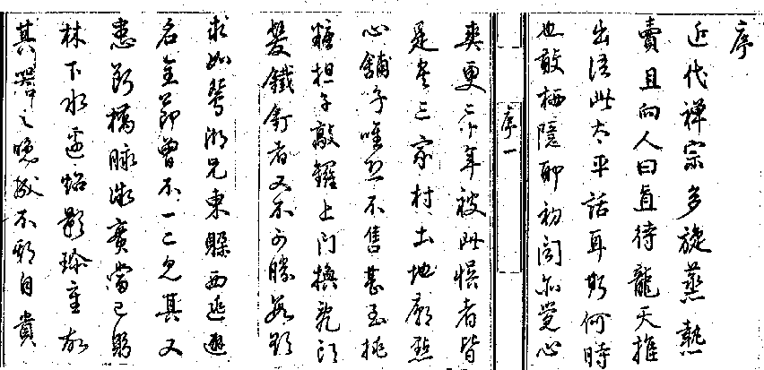
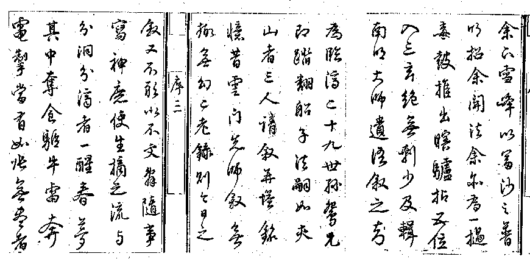
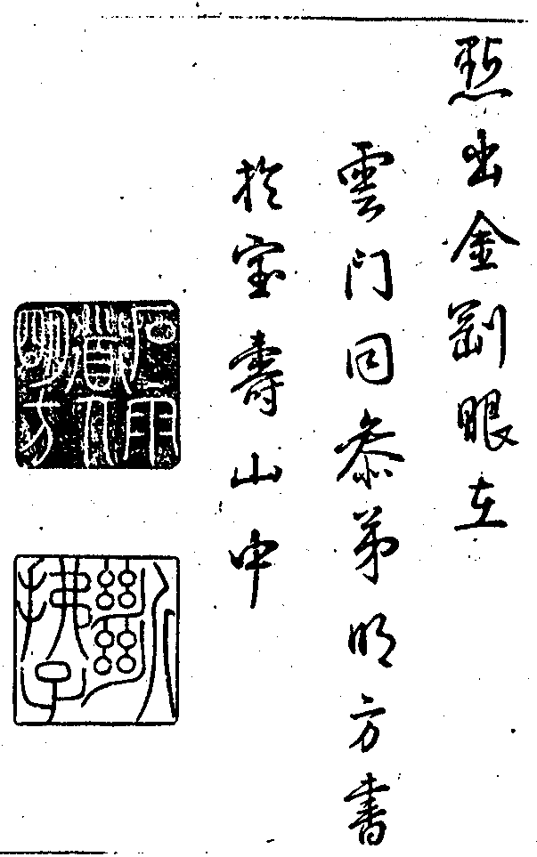

# 鸳湖用禅师语录



> **藏经**：嘉兴大藏经（新文丰版）（嘉兴藏）　**册次** 第 27 册（J27）　**编号** JB196　**部类** 诸宗部　**卷次** 2 卷　**篇幅** 26,905 字

> **卷／品**：0 卷 · 3 品



---



## 目录



  - [序](#序)

  - [鸳湖禅师语录序](#鸳湖禅师语录序)

  - [序](#序-1)



---



### 序















------



### 鸳湖禅师语录序



予闻至道无言、妙悟无传，则历代祖师相禅所传何也？既云无言，则语说三乘千七百则又言甚麼？然传固有不能传者在，言亦有未尽言者存也。予每见吾鸳湖大师有龙山黄牛之遗风，与石雨禅师为同参兄弟。石师受法云门，吾师嫡嗣南明，常有书偈来往，称莫逆焉。庚辰春，吾郡请师住持普明，而石师自雪峰来，同众敦请吾师开堂结制，吾师谦让，坚以恙辞。予因而请曰：「师是千圣法眼，蕴无上妙义，何惜广长舌，不为三根人一接引耶？」师曰：「人固有可已、有不可已者。幸予友天华兄在，老僧何更赘词哉？」婉辞过逊，若是者三，不得已而登堂，四众云集，一时聆其法旨，若弘钟大吕，敲破人世昏梦，顿令人蘧然觉、跃然起，而莫不服我师迥脱根尘神化无方者也。故吾师一棒一喝，无非醒世金针；微言片偈，如毒鼓声，远近闻者皆丧。有不丧者，细阅是录，字字真诠、言言妙谛，宛如觌面说法。固门人笔记成帙，斯亦吾师之慧机捷发，广觉人世。虽云至道无言、妙悟无传，神会是录，则有言终归无言，而无传悉得所传矣。呜呼至矣哉！



芝城弟子朱乔秀拜撰



普明鸳湖用禅师语录目次



------



### 序



卷上升座  

小参  

机缘  

拈颂古  

像赞  

法语



卷下书启  

偈颂  

杂著



附行状  

塔铭



鸳湖用禅师住福建建宁府普明禅寺语录卷上



嗣法门人　悟进　悟元　等编



长水退庵　法孙　真智　重梓



升座。师云：「若论佛法，老僧无下口处。今日偶见新山门，拿我拄杖子浪荡游戏。穿过果子岭，直到火烧桥；失脚一跌，落在深溪。幸有旧佛殿肯来相救，不惟相救，抑且骑却项归来。新山门叫屈，未免要老僧判断。新山门好与三十拄杖，旧佛殿亦好与三十拄杖。何故𫆏？车不横推，理不曲断。」掷拄杖，下座。



石雨和尚同步紫朱史君请升座，士问：「芙蓉出匣，正令当行，斩新一句作麼生？」师便打。士云：「早知和尚有此机要。」师云：「你那里见得？」士喝，师复打，士拟议。师云：「且去，且去！」乃举拂子拂云：「大众！会麼？即心即佛，犹是淆讹；非心非佛，可无趋向。不是心，不是佛，不是物，穿花蛱蝶深深见。取不得，舍不得，不可得中恁麼得，点水蜻蜓款款飞。普明恁麼举扬，挀著灵峰痒处。忆知抛家散宅，阔步大方，峭巍巍，孤迥迥，净裸裸，赤洒洒，踏倒诸圣顶𩕳，把住凡灵要路。虽然，有时把住，有时放行，有时把住中放行，有时放行中把住，还知栴檀林里纯是栴檀，狮子窟中无非狮子麼？众中莫有伶俐汉出来道：『普明无端露布灵峰蕴底。』山僧但向伊道：『秪因曾与同床睡，是故深知被底穿。』」卓柱杖，下座。



辛巳冬，万如和尚，同诸绅衿护法，遣僧赍送鸳湖老人衣拂至，请升座。师指云：「诸大德！这些滞货自敬畏无趣老人付於车溪无幻祖翁，无幻祖翁付於南明本师和尚，本师付于病僧，病僧一向冷眼相看，撇在壒𡒁堆头，今日拈来更新光彩。」遂拈起法衣云：「揭起古法衣，寸丝不曾挂。」拈起麈拂云：「指挥旧麈尾，野干多惊怕。」拈起手卷云：「惟有这个无用处，惹得时人添话杷。去年有个白拈贼，未尝见此先窃下。如今且向静处收藏，他日再有个忤逆儿孙，定是钻龟打瓦。诸大德！且莫觑著，觑著则瞎。」



壬午春，万如微和尚入山设斋，请升座。僧出礼拜，师举拂子云：「会麼？」僧云：「恁麼则直截当机。」举：「四众尽知恩。」师便打。僧问：「坐断孤峰即不问，宾主交参事若何？」师打云：「会取这一棒。」僧喝，师复打，乃云：「每怀往日同居，况屈指别来五六春。闽地吴山何阻碍？一番拈起一番新。」遂举拂子云：「昔日世尊拈花，迦叶微笑，世尊云：『吾有正法眼藏，涅槃玅心，付嘱摩诃迦叶。』自此便有教外别传，直指人心，见性成佛之旨。这老汉今日在普明拂子头上放大光明，且道那个可证？幸有受兴化请者如如和尚而得证明。大众！若也见得，不妨同出同没，同行同坐。若也不知，却笑普明一场露布。且道那里是露布处？」掷拂子，便下座。



中元，孝廉苏门联岳二居士同众等请升座。僧问：「如何是古佛心？」师便打。进云：「如何是学人心？」师云：「欲攫游龙，蝘蜓已上。」进云：「毕竟作麼生？」师复打。乃云：「法身流转於五道，便有人天三途之异。有升有沉，有出有没，有高有下，有苦有乐。诸仁者！欲得资彼三途，离苦得乐，须一念心清净，一念心光明，一念心无碍。心清净是真佛，心光明是真法，心无碍是真道，真佛无形，真法无相，真道无体，三即一，一即三，此犹是名言。必须竭尽自己那边觑破，冷灰里转得身来，便好全身担荷。到这里赤条条光烁烁，三世诸佛也不出这里，十方菩萨也不出这里。西天四七，东土二三也不出这里，天下老和尚也不出这里。所以云：『头头尽是光明藏，处处无非解脱场。』虽然如是，且道向上提持又作麼生？」遂喝一喝，卓拄杖，下座。



苏门黄春元荐慈请升座。师云：「春风黯淡过，细雨鸟悲呼。出没无踪迹，铜人涕泣何？」拈拄杖云：「大众！见麼？若见是有，一切认以为有，把髻投衙，担枷过状。或有于此，脱略风尘，觑破世故，一切认以为空，又落于偏空窠臼。所以古德云：『弃有著空病亦然，犹如避溺而投火。』脱有大丈夫汉打点精神，竭尽心意，拶到悬崖撒手，自肯承当，绝后再苏，欺君不得，那时八字打开，非但得知徐氏孺人的落处，即与三世诸佛诸祖同证游戏三昧去也。虽然，若到普明门下，三十棒一棒也较不得。」卓拄杖，下座。



师诞日升座。僧问：「乾坤无著处，日月不停机。不涉今古一句，请和尚指示。」师云：「今朝十月七。」进云：「灯笼传消息，露柱叹奇哉！」师云：「非汝境界。」又一僧出，师便打云：「敕点飞龙马，跛鳖出头来。」僧喝，师复打。乃云：「释迦老子四月八日降生，普明病僧今日酉时出世。且道是同耶？是别耶？若道同，则万别千差；若道别，则事同一家。诸大德！请缁素看；不然，更听一颂。瞿昙昔日已出世，普明于世未尝出，涧底水流忙太生，岭头云散闲自得。」便下座。



小参。「巽向朔风寒戚戚，背山水牯冷呆呆。懒病从来懒做事，只宜手捧煖茶杯。煖茶杯，通身煖，气冷如灰。诸禅德！既是通身煖气，为甚麼冷如灰？若於此见得，不妨安茶适饭取性过时。其或未然——」拈拄杖，卓一卓，云：「拄杖子为诸人道去也。」复卓一下。僧问：「古殿重开即不问，普明一句事如何？」师便喝。进云：「恁麼则龙兴风后舞，冲破碧波流。」师云：「闲言语。」



除夕小参。「天寒作九，岁残须守，举杯拈果，大家出手，吃茶吃水，大家湿口，各个现成，都该知有。大众！且道知有个甚麼？假称为佛陀，方便呼为智。欲明此智，直须向三条椽下七尺单前，擦裤磨裙，忘餐废寝。然此智秪在动用中，不离眉睫上。所以赵州凡见僧来参，便问：『曾到此间麼？』僧云：『曾到。』州云：『吃茶去。』或云：『不曾到。』亦云：『吃茶去。』院主问云：『和尚为甚麼曾到不曾到，俱教吃茶去？』州呼院主，主应诺。州云：『吃茶去。』赵州老汉轻口快便，院主不识好恶。普明者里不管他吃茶吃饭，只要伊单刀直入。且道与古人是同是别？有伶俐衲僧出来道道看。」众无对。师喝一喝，云：「日月尽时岁已残，钓舟归去静芦滩，丝纶一把忙收拾，且待春风再往还。」拈拄杖便起。



机缘



师举永明偈问云峰钧云：「化人问幻士，谷响答泉声，欲达吾宗旨，泥牛水上行。意旨如何？」钧云：「梦眼见空花。」师云：「空花事作麼生？」钧云：「莫将耳听。」师又问：「临济祖翁有一句子，你作麼生道？」钧便喝，师便打；钧又喝，师又打，钧礼拜。师云：「元来是瞎驴子。」钧拂袖便出。



介庵参方跨门，师云：「是什麼？」庵拟对，师震威便喝，庵豁然契悟，便掩耳而出。



师一日唤一初入方丈，云：「我心里不安，你还得太平也未？」初云：「苍天！苍天！」师亦云：「苍天！苍天！」初拍膝一下便出。



一初礼拜起，师举拳云：「道一句看。」初便掌。师亦掌云：「且道你一掌，我一掌，甚麼意旨？」初云：「请和尚珍重。」师乃休，初一喝，便归侍寮。



僧参，师问：「那里来？」云：「浙中来。」师云：「途中见甚麼？」僧拟议，师便喝，僧亦喝。师打云：「这一喝落在那里？」僧礼拜云：「谢师指示。」师复打。



暗斋黄廉宪升任广东，入山作别，问云：「临行一句，乞师指示。」师云：「三千里外逢人不得错举。」



一日，师欠安，介庵侍次，师命茶，问云：「汝字觉先，唤甚麼作先？」庵云：「且喜今日得自在。」师云：「如何是觉后？」庵云：「请和尚尊重。」师云：「你还分得先后麼？」庵良久，师便喝。庵云：「某甲只管吃茶。」师云：「如何是吃茶的事？」庵云：「柿、枣、腐乾都在这里。」师云：「你作麼生？」庵云：「却被某甲一口食尽。」师云：「滋味如何？」庵云：「甜者自甜，咸者自咸。」师云：「未在，更道。」庵云：「某甲谢茶。」便礼拜，师深喜之。



僧参，师云：「一向那里住？」云：「旧秋如如庵，过岁在金粟。」师云：「东住西住有甚麼事？」云：「是！是！」师云：「不是！不是！」



二僧参，师问：「到这里做甚麼？」一僧云：「特来亲觐和尚。」师云：「却值老僧不在。」僧无语。师云：「三十棒自领出去。」又云：「第二位作麼生？」僧云：「请和尚开示。」师适值咳嗽，乃云：「却值老僧咳嗽。」僧亦无语。师云：「且坐吃茶。」



一晚师落堂云：「一夏已过，汝等有得力处，不妨剖露看。」一僧云：「方才礼拜和尚。」师云：「未在，更道。」僧云：「昼长人倦。」师云：「非汝境界。」僧云：「和尚又作麼生？」师云：「昼长人倦。」僧便礼拜。



问：「须弥纳芥子，芥子纳须弥，意旨如何？」师云：「恰好。」



僧问：「某甲甚是要明此事，自觉工夫亲切，为甚不肯透脱？」师云：「昨晚公案，你还会麼？」云：「这个瞒学人不得。」师云：「又说不肯透脱。」僧伫立。师叱云：「死汉！出去！」僧出，至午复持止静牌呈云：「还了和尚。」师扭住云：「道！道！」僧喝。师云：「未在，更道。」僧又喝。师云：「喝后又作麼生？」云：「簷前雨滴滴。」师云：「簷前雨滴滴，干汝什麼事？」僧又喝。师云：「乱喝。」便推出。



问：「迷中有悟，悟中有迷。作麼生悟中迷？」师云：「乱问作麼？」



月竹庵僧参，问：「如何是藏身处没踪迹，没踪迹处莫藏身？」师云：「月竹庵不许你躲跟。」僧云：「如何是是法住法位，世间相常住？」师指彼坐位云：「这个位是你的。」僧无语，师便打。



拙崖参，师云：「作麼不去？」进云：「正恁麼时，未审谁去谁住？」师良久云：「会麼？」进云：「会且止，毕竟是谁住？」师云：「你还妄想作麼？」进云：「怎奈这个何？」师云：「你在那里见老僧？」进云：「两眼对两眼。」师云：「瞎。」进云：「瞎瞎！」师便喝。



师一日命介庵进、一初元颂末后句，二人呈上师阅毕，遂俱付嘱偈云：「沿流一段事，竟无头与尾，付与狮子儿，哮吼满大地。」



拈古



举：「瑞岩彦禅师每日自唤主人公，复自应诺，乃曰：『惺惺著！他后莫受人瞒。』」师云：「白日青天作梦，梦中频唤主人，直饶惺惺诺诺，也是无主孤魂。」



举：「天宁法舟济禅师，因五台陆公问：『畫前元有易否？』宁曰：『若无，将甚麼畫？』公曰：『畫后如何？』宁曰：『元无一畫。』公曰：『现有六十四卦，何得言无？』宁曰：『居士莫著文字好。』公曰：『请师离文字发一爻看。』宁召五台，公应诺。宁曰：『者一爻从何处起？』」师云：「畫前畫后，论有论无，总与大易无涉。直饶一唤一诺，爻象分明，也未是衲僧极则。畫前元有易否？天宁老汉何不当头便唤五台，待他应诺，却好云：『元有易否？』陆公者里必然别有所入，且免后来许多周遮。」



举：「横川珙禅师晚参：『少室无门户，如何便得通？夜深宁耐立，听我说西东。』」师云：「大好无门户。」



举：「南明广和尚看雪次，侍僧曰：『满山都是雪。』南曰：『随声逐色汉。』僧曰：『请师离声色道一句。』南曰：『满山都是雪。』」师云：「者僧身挨白刃，活得命来，不妨好手。南老人费尽盐酱，究竟不获称心。者里有向声色外别道一句者麼？」良久云：「切忌道满山都是雪。」



颂古



世尊初生



知得恩来解报恩，当机安肯放云门？后代莫言空辣手，至今一棒一条痕。



世尊拈花



末稍拈出示人天，一笑相逢非小缘，万象森罗皆正眼，优昙花放火中鲜。



外道问佛



玉箫清浊吹新调，毡板轻敲合得腔，争奈座中不解听，别赓一曲乱宫商。



百丈侍马祖游山归寮，哀哀大哭，同事问云：「忆父母耶？」丈云：「无。」云：「被人骂耶？」丈云：「无。」云：「哭作甚麼？」丈云：「问取和尚去。」同事往问祖，祖云：「你去问他。」同事复至寮，见丈呵呵大笑，问云：「适来为甚哭？如今为甚笑？」丈云：「适来哭，而今笑。」同事罔然。



一番哭也一番笑，先后总归太古调，纷纷不是子期心，随声逐色难知玅。



南泉示众曰：「不是心，不是佛，不是物。」



杀人不见血，乃是王老师，放身舍命处，正是报恩时。



僧问赵州：「狗子还有佛性也无？」州云：「无。」



狗子却酬无佛性，绵包突石行正令，须弥顶上击金钟，猢狲惊出那伽定。



赵州问南泉：「知有的人向甚麼处去？」泉云：「山前檀越家作一头水牯牛去。」州云：「谢师指示。」泉云：「昨夜三更月到窗。」



昨夜三更月正幽，克家相见出常流，绿草青青随处好，山前山后任优游。



赵州问投子：「大死的却活时如何？」子云：「不许夜行，投明须到。」



翻手成云覆手雨，伸脚元在缩脚里，悬羊卖狗老当行，有利无利不离市。



僧问首山：「如何是佛？」山云：「新妇骑驴阿家牵。」



新妇骑驴阿家牵，玅体端严出自然，不是首山相见后，好因缘做恶因缘。



临济升座，有僧出，济便喝，僧亦喝，便礼拜，济便打。又一僧来，济竖拂子，僧礼拜，济便打。又一僧来，济竖拂，僧不顾，济亦打。又一僧来，济亦竖拂，僧云：「谢和尚指示。」济亦打。



朔雪飘飘开鴈门，平沙历乱卷蓬根，功名耻计擒生数，直斩楼兰报国恩。



玄沙见新到礼拜，乃云：「礼拜著，因我得礼你。」



因我得礼你，啰哩啰啰哩，磕破臭髑髅，法身藏在北斗里。



明招上堂，众才集，乃云：「风头峭硬，不是你安身立命处，且归暖室商量。」便归方丈。大众随至立定，招云：「才到暖室，便见瞌睡。」以杖趁出。



风头峭硬语朦胧，暖室商量转不中，欲得安身立命处，直须扫尽野狐踪。



玄沙云：「若论此事，譬如一片田地，四至界分结契卖与诸人了也，只有中心树子，犹属老僧在。」



备头陀，惯卖巧，田园结契从何讨？老年犹抱这枯椿，不顾浑身没荒草。



夹山云：「目前无法，意在目前，不是目前法，非耳目之所到。」



声色纯真列满前，拟将观听总非干，为伊浑是官家物，不许平人私自探。



洞山云：「言无展事，语不投机，承言者丧，滞句者迷。」



卖扇婆子手遮面，卖油娘子水搽头，不是还他肌骨好，任搽红粉不风流。



芭蕉上堂，拈拄杖子示众云：「你有拄杖子，我与你拄杖子；你无拄杖子，我夺你拄杖子。」靠拄杖，下座。



家风逞尽老芭蕉，举措施为行莫嘉，仁义固从贫处断，世情偏向有钱家。



僧问岩头：「古帆未挂时如何？」头云：「小鱼吞大鱼。」



小鱼吞大鱼，须弥趁入海，古帆未挂时，铁船风背撼。



鼓山折箭



好义多从过勇功，才来冲阵箭颓锋，可怜鼠伎索瘢手，犹笑乡情老冻脓。



婆子烧庵



桃红含宿雨，柳绿带朝烟，芬芳春最好，几个眼睛穿？



赵州因僧问：「乍入丛林，乞师指示。」州云：「吃粥也未？」僧曰：「吃粥了。」州曰：「洗钵盂去。」其僧有省。



金风阵阵著些凉，狼藉秋光满路傍，行客纷纷归未得，逢人切忌错商量。



物不迁



笋抽必竟易成竹，花落难教缀上枝。记得小儿骑竹马，如今又是白头时。



赵州问南泉：「如何是道？」泉曰：「平常心是道。」



怒时烦恼，乐时戏笑，若道平常，新罗过鹞。



汾阳十智同真



二八娥眉俏十分，幽闺空怨忆私情，频呼小玉非无事，只恐郎心非我心。



雪峰上堂曰：「诸上座！望州亭与汝相见了也，乌石岭与汝相见了也，僧堂前与汝相见了也。」



象骨崖前语最亲，僧堂乌石望州亭，太末虫缘红燄火，蟭螟睫戴铁昆仑。



镜清问玄沙：「学人乍入丛林，乞师指个入路。」沙曰：「还闻偃溪水声麼？」清曰：「闻。」沙曰：「从这里入。」



乍入丛林问入路，没头浸杀偃溪声，可笑谢三无别法，惯将官物作人情。



灵云见桃花



春芳处处著繁华，游客纷纷眼尽遮，不信东君有私意，灵云独许悟桃花。



僧辞赵州，州曰：「甚处去？」曰：「诸方学佛法去。」州竖起拂子曰：「有佛处不得住，无佛处急走过，三千里外逢人不得错举。」僧曰：「与麼则不去也。」州曰：「摘杨花，摘杨花。」



心思路绝太间关，纸裹麻缠有几般？任是龙睛鹘眼汉，杨花乱落也难看。



陆亘大夫问南泉：「弟子家中有一片石，或坐或卧，今拟镌作佛，还得麼？」曰：「得。」大夫曰：「莫不得麼？」泉曰：「不得，不得。」



造化纷纷意气奢，不周遮处复周遮，东风淡荡无多力，吹得开花又落花。



僧问乾峰：「十方薄伽梵，一路涅槃门。」



一片婆心指问僧，争如不识是非生？自来古路犹弦直，返使崎岖屈曲行。



赵州使得十二时



亥戌酉申未午巳辰卯寅丑子皆随老僧，勦得无毛鸟兔尽，风流无限过平生。



疏山问沩山：「有句、无句？」



藤枯树倒句归何？古佛垂慈不较多。幸得因风吹火力，晃然笑里见干戈。



陆亘问南泉举肇法师话



大夫空递昔人言，王老庭花梦里看。缁素欲明端的旨，快将细末好盘桓。



云门拈拄杖，举：「教中云：『凡夫实谓之有，二乘析谓之无，缘觉谓之幻有，菩萨当体即空。』」乃云：「衲僧见拄杖，但唤作拄杖，行但行，坐但坐，总不得动著。」



千江有水千江月，万里无云万里天，今古山川人自异，衲僧拄杖又重宣。



台山婆话



多事台山指路婆，更怜勘破谂头陀，任教暗室亏心事，争奈神明如电何！



云门云：「闻声悟道，见色明心。」乃云：「观世音菩萨将钱买胡饼，放下手云：『元来只是馒䬦。』」



聋瞽无聊举话由，却拈胡饼作馒䬦。是非不到高岩下，又逐春风鼓树头。



和普明禅师牧牛颂



未牧



黑云低处一声哮，足底程途那信遥？童子个时将贯索，未尝留意惜良苗。



初调



鼻孔今朝始受穿，十分狂性只宜鞭，要渠了了寻常事，不管通身黑业牵。



受制



蹊径於今不枉驰，鞭绳缓缓肯相随，家山水草随时给，信步风流也不疲。



回首



绿杨堤畔碧溪头，景自晴和风自柔，水牯转头初自肯，月明归路谩迟留。



驯伏



那里随来过这边，左盘右转总安然，黄莺叫得山花笑，声色中能不被牵。



无碍



脱落虚空万象如，人牛浪荡不相拘，鞭绳飏下无些子，引兴梅花一调餘。



任运



我自悠然一觉中，任渠草径玩纤茸，落花没膝春山晚，犹泼红霞锦绣浓。



相忘



白云拖过月明中，月与云和一色同，智境此时多不会，论何南北与西东？



独照



家破萧然四壁间，於今云静月明闲，固非逞日程途事，尚好挨身拶过关。



双泯



剧尽何方觅影踪？不应空里镂虚空，有谁道露堂堂地，蜂蝶痴迷花底丛。



临济宗



棒如雨点喝如雷，生佛从教脑裂开，一自灭他正法眼，幸然无事可安排。



曹洞宗



古殿香消灯尽时，月明帘外步犹迟，玉阶天晚和云静，金锁玄关不易窥。



云门宗



气宇如王度量迂，惯，将一字设关枢，纷纷物类知何数，塞断咽喉气也无。



沩仰宗



父子浑家梦里身，弄丸作息总非亲，看看机尽情忘处，谁是呼驴唤鹿人？



法眼宗



青山绿水作通玄，珠网交参在目前，行布一回收拾尽，赤穷四譬空萧然。



像赞



观音大士(深远庵请)



这位上座！冷地默坐，兀兀痴痴，思忆甚麼？想你当时，置身无措，尝在洛阳桥边，卖尽风流，金沙滩头，许成夫妇，紫竹现形，白衣风度，三十二应，识时达务，千眼千手，作福作祸，寻声救苦，添盐添醋，造妖捏怪。何故？何故？谁不丈夫？无数无数。简点将来，皆成话堕。争如今日，归到深远院东寮，闲却心情无数慕，一炉香烬一瓶花，白日青天人莫睹。



又



南海风波险复深，三天竺寺少知音，轻身躲入畫工手，寄语时人莫浪寻。不浪寻，杨柳依然插净瓶。



又



云山紫竹白鹦鹉，绿柳净瓶水月心，个是圆通真面目，一番写出一番新。



踏鳌像



紫竹下踏鳌头，十分气概，执杨枝洒甘露，一片慈悲。累他善财立得脚跟酸，鹦鹉高飞，犹较些子。



普贤大士像



是大愿王，从本显迹，一念不生，普眼难觅。将谓骑白象，更欲作逋客，却遇普明老，冷眼得觑见。且道觑见个什麼？瓯子跌落地，碟子成七片。



布袋和尚像(讷生求赞)



拖布袋，遭人怪，笑怡怡，遭人爱。街头曾乞一文钱，看你偿不尽人间债。



本师南明和尚像



新丰寺里老头陀，啸傲颠狂孰奈何？棋酒一声高价尽，翻然踏倒古毘卢。三杉堂前探溪量水，五老峰顶作浪兴波，钳锤衲子，勘验精麤，末梢必竟何分付？钩线沉江懒唱歌。



云栖莲大师像



裂破缝掖，搭紫伽黎，七笔勾下，诸方参随。辟五云之榛莽，整伏虎之古基，换人眼睛以黑豆，断人性命加钳锤。咦！几度竹窗拈铁笔，香风吹遍藕华池。



真寂闻大师像(慧基请)



一片老婆心，整理时人手脚，十分恶辣口，骂倒拍盲禅学。宝於善，净於慈，无是不是；大之定，慧之基，将错就错。若问真寂家风，切莫向影子上卜度。



皓公七十半身像



赞此古锥，寿登古稀。示长耳相，秀距罗眉。问渠家风，无意无为。熟味般若，喜怒逢时。有时迅雷疾风，不减阿修罗之怒威；有时春花秋月，犹胜观世音之慈悲。世有张吴之玅手，畴能模倣其全躯，敢问诸孙那半身。▆咦！



自像(总题)



骨瘦若不胜衣，心毒难辩真假，端坐并无入正念处，相见又无慈悲喜舍，横按一条白棒，佛来也打，魔来也打。



苏门黄居士养志图并跋



玲珑绣石，盘曲苍松，云山浩渺，鹤鹿从容。中有乔梓，如过庭时。不在诗礼，静摄栖迟。志存孝养，岂泥色难？婉容膝下，乐以盘桓。家僮捧献，敢是羊枣。问其有餘，对以不少。净几所置，花香是玩。经函未展，理事已办。即此林落，何异极乐？十万餘程，秪在一觉。



居士之显考易箦，顾命久矣，固能追念往恩，绘此图曰养志，复代为皈戒，取其法名曰觉愿。愿其一觉而行愿是齐。普明因是诚而鸣之也。



法语



示赞若黄居士



佛说一切法，为度一切心，我无一切心，何用一切法？正法尚不立，邪教从何有？言正因对邪，其正安可得？邪正是名言，都无有实义。众生不了故，吾宗说直指。直下便承当，分明日用事，一处透得去，处处一时了。回观此名言，亦是梦中语，梦语亦不立，是何等境界？普明老秃奴，说尽老婆禅，自吃三十棒，一棒较不得。



示兆禅人



文彩未形，安能下笔？既发毫尖，纷然现迹。禅人於此觑得真，波斯海底烧红日。



慧灯禅人求示



本具一慧灯，劫前不可得，偶尔随缘起，光明太周匝。暗却佛祖明，烁破群生黑，致语灯禅人，切莫为剧则。



杜华宇出扇求示



盐官特觅犀牛扇，澄江搅动苍龙现，杜君若也能唧溜，将铁蒺藜红炉煆。火燄头说无生法，三世诸佛立地看。不是半满与偏圆，亦非权实并顿渐。扫尽葛藤闲露布，披衣得坐空王殿。拦街倒巷自家底，认著依前还不荐。



径山智一禅人求示



智一禅人不远数千里而来，并持诸缙绅信劄，邀余回浙相聚，缁素眉毛撕结，了诸人生死大事，此亦婆心太切也。然诸佛菩萨用心，不违众生意愿，而病朽虽坐懒惰，亦有此心也。且如欲回路，前后铁围相逼，左右虎狼狮子，那时如何进步？智禅人这里道得，管取了得向上事，就把洞山麻三斤称起三十三天，云门乾屎橛撬破地皮，七横八裂去也。



赠德云禅人



德云云：「住玅峰顶，大似充饥求畫饼。」德云不住玅峰顶，亦如奔日欲逃影。两途截断未亲切，取著中间犹陷阱。是古是今，非彼非此，两不成双一不单。已豫章省下，话生缘安居，却在宣城里，掣断拦路索，参请诸方禅。吴水铁船任浮载，越山有月不在天，天童胡乱挥白棒，桐月与君多一言，归去西江十八滩，一口吸尽须教乾，转身吐气一句子，好看枮井生波澜。



示上水邹医士



堪怜人间世，无有不病人。邹君谛思惟，玅指按得真，香附热，黄连凉，拈来无不是，用处却相当。然虽具此能，犹欠这一著。争如瘥病者，不假驴驮药。君不见，维摩老，引得傍人打之遶，唯有曼殊较些子，未免浑身入荒草。又不见，谢三郎，巧施三病诮诸方，被人劄著难措口，十分意，兴成惭惶。



示史斋士



病僧口里元无舌，从来不会哆啝说。兹问了衡史道人，装香扫地凭谁力？一朝觅著这个人，便得出离生死窟。那时捉败黄面老？好做街头白拈贼。贼贼！三十拄杖也要吃。



示悟香禅人



香是甚麼物，悟者甚麼人？灼然见得彻，未免滞途津。所以一念参方急，江西湖南问知识，知识口里水漉漉，说得亲时难指出。忽尔踏破草鞋底，脚边瓦砾皆黄金。建溪水作一口噎，铁狮峰吼如雷音。那时优游任德性，无喜无忧可忧喜。水间林下水草餘，闲时唱个啰啰哩。



示王汝良居士



拈铁如意等霹雳，当下了明何快极？这里冥冥无所知，依然脚下生荆棘。参到离心意识时，火中木马生一儿。学到圣凡之路绝，鞭下泥牛尝出血。也不参，也不学，丈夫怀抱能寥廓。万法枞然本是闲，何得无绳而自缚？休自缚，出穴烟菟戴双角。



吴君羡居士出扇求示



寸丝不挂，一幅素绫；点畫不加，一段彩文。若恁麼会，万八千程。不恁麼会，失却眼睛。君不见，庞公去参马簸箕，一口便把西江吞，财宝尽情倾湘海，破笊篱下差营生。自此英名压天下，煞有气岸不易伸。吴君若肯蹈芳躅，也认葫芦作帝瓶，直须踏断毘卢顶，始是男儿出格人。



正因果侍者求示



正因果侍者，合掌求开示，病朽何有言？有言非的据。昔日鸟窠老，未免堕圈缋，拈起布毛吹，侍僧便悟去。而今学道流，切莫随言句。但看眼前色，松帚扫山翠，又听耳畔声，溪风宣密意。撇脱根尘识，不居空有地。有声声自闻，见色色不避。如箭既离弦，直无回转势。日用四仪中，眨眼好荐取。父母未生时，安身在何处？蓦然撞著时，处处非自己。铁蛇钻入金刚圈，鹭鸶踢倒须弥碎。



鸳湖用禅师住福建建宁府普明禅寺语录卷上终



鸳湖用禅师住福建建宁府普明禅寺语录卷下



嗣法门人　悟进　悟元　等编



长水退庵　法孙　真智　重梓



书启



与江海若居士



春间，辱承乔梓高驾腴田之惠过情，屡屡感愧。惟老居士德满润身，老当益壮，可谓富贵家不为富贵之所移易，自肯存神内典、亲近方外。教中有言：「菩萨夙承般若力，不为声色之所转。」于六波罗蜜、四无量心，念念策进，念念成就，未尝斯须忘者，殆非一生两生种植来也。兹闻重筑佛室于府第之后，严于净业，甚惬愚意。教中又云：「天鼓忽自鸣，告谓诸天子曰：『诸法苦空，无有真实，勿贪五欲，以快一时。』当力求道果，以悟本来。」且道果如何求？本来作麼生悟？然老居士既隆三宝，备作佛事，独于本来事，亦可理会一上。本来事既理会得，则十字街头茶歌酒唤，无非不是自家本来事也。那时不妨抱子弄孙无非佛事，即以本来理求福则福无不崇，祈寿则寿无不永，庄严法界无非成就本来事也。



答朱其梁居士



接翰阅之，乃见左右陈述备细，吐露真实，诚为为道之心甚切也。第未能脱略融化尔。来论妄缘情念者，乃是屋里茶饭，岂可除而断耶？吾佛不云乎：「心佛及众生，是三无差别。」奈众生无始习熟，不能证入，非佛之咎，皆为自无肯心，生死不切，工夫不猛，所以自甘流浪也。在左右分上，此段大事必信得极矣。既信得极，岂亦自甘流浪耶？又云：「身家念轻，生死事大。」果尔，既知生死事大，无往而非大事矣，又何必凝神静坐，然后为得耶？然左右岂不知昔有王庞及无尽大年辈，许多上《传灯》没巴鼻汉子，竟不知今日亦有居士耶？乃事无彼此，若是个汉，剔起眉毛，生与同生、死与同死，直捷向前，方有少分相应。若论佛法世法，原不两样，何尝妨碍？又云「数月无事则体究，有事则废。」既大事在我，讵可夺去耶？又欲贫道示个方便法。盖有个方便，不是心，不是佛，不是物，毕竟是个甚麼？于此一咬便破，那时不胜庆快也哉！虽然，正好吃棒在。何故？普明门下，令不虚行。



与暗斋黄廉宪



夏初一晤，不觉深秋矣，念流光如此迅速耶？私喜老居士于热恼时，不与世人同受，独入山林领略幽况，但不知本参得瞥地否？昨闻有双径之行，甚欲一会，又在病中，未遑即晤。



上密云悟和尚



自违座下屈指将十白矣。今值和尚古稀，奈贱体尝在病中，何堪跋涉？但晨夕神往，念和尚恢廓法道，开示人天。秪如有一人不受化下者，毕竟如何摄受？肃此代面，聊奉寿仪将意。



与振侯许春元



叨斋次，承居士举断峰度乐因缘，惟在自己辨别，切不可向他人口里讨雌黄。病僧因居士问，一时谵语，若谓宗乘门下，三十棒一棒也较不得。然此个门头，从来无语句，亦无一法与人。古云：「若有实法与人，水亦消不得。」岂欺人耶？嘱嘱！



寄去尘朱居士



别来观语涩不能脱口，然左右往来，非为不久，亦深知于此道留神有日，何故不脱洒，为出格丈夫尔？近日可刮目也无？秪如庞居士问马大师云：「不与万法为侣者是甚麼人？」答云：「待汝一口吸尽西江水即向汝道。」你看！这汉一具大口在甚麼处？何不于此瞥地作个无事汉？岂不庆快平生也哉？又如赵州道：「诸人被十二时使，老僧使得十二时。」且看他据个甚麼道理便作如是语话？所谓饥时吃饭，寒则添衣，客来抵对言谈，客去闭门高卧。非去尘有第二人，亦非落空去。于此觑得一班，亦能随时受用。若向上提持，正好吃棒在。



答苏门黄孝廉(法名悟第)



接翰教及扇头歌章，阅之不释手，但有虚誉处，自觉赧然。盖来问印心三句，贫道但不知唤甚麼作印耶？唤甚麼作心耶？切不可向玉石上躲根。又歌章中身心俱解脱，及胜于一宿觉之句，在左右分上，果能解脱也未？果能一宿觉也未？解脱且置，所觉者是何事耶？若果有所觉处，早通个消息来，贫道为左右助喜。何如？



答清伯黄居士



阅手教，知尊恙复萌，贫道尝念左右个中留心有年，即今本命元辰，可知下落也未？观左右根器不凡，第看南岳让参六祖，祖问：「什麼物恁麼来？」让曰：「说似一物即不中。」祖曰：「还假修证也无？」让曰：「修证即不无，染污即不得。」愿左右于此觑破，不妨饥餐渴饮，寒暖热凉，见色闻声应时纳祐，二六时中，四威仪内无不现成，拈来无不是，用处莫生疑也。嘱嘱！



答鲁一徐孝廉



僻居穷山，乃辱尊教，敬展读之，而欲贫道垂示，曷胜愧颜乎？然不敢埋没左右一段真诚，不免从翰教中点出。来谕尘世劳攘，大堪厌弃。贫道所见，此正是最初下手吃紧工夫，即于劳攘处著得一只眼，谁是尘劳者？谁是厌弃者？蓦然觑破，朝夕间自得主持，不作尘劳想，不作厌弃想矣。



答杜华宇居士



细读来偈，也知此僧学问甚通，知解亦好，果能出言顾行，行与解同，多受钳锤，稳实操履，成佛成祖，非从外来，原是自家事，固不难也。他时日后，长养圣胎，臻厚道德，自有龙天公道，推在宝华王座，说法利生，呵佛骂祖，观其时节因缘尔。争奈今时学道者，学得少许相似语言，凑得几句麤疏文字，便尔自称悟道。到处瞒人，不畏因果舛差，只要口头热闹。莫道有学问有知解，以当平生。只恐一朝打到阎老面前，随业定罪，赦书何在？那时可求甚麼人相救得麼？所以古德云：「吾宗难得其妙，切须仔细用心。」又云：「八十翁翁入场屋，真诚不是小儿戏。」承左右欲病朽勘偈之虚实，不觉葛藤如许。望左右自己下一番工夫，透得本分事，那时事到眼前，不著问人，自知真假矣。



答吴君羡居士



来谕何得离此壳漏子，以修上乘法门？奚乃语言之不审乎？然左右即今带壳漏子，是谁耶？要离壳漏子是谁耶？壳漏子又是谁耶？於此觑破，释然一笑矣。虽然，尚未许觑破。何故𫆏？苟欲觑破，更添一重病苦也。谨嘱。



与量虚禅师



风月是同，谿山各异。暌孤两地，不无兴怀。尝忆上座，根器自美，而于此门，著力趋向，较今末世比丘，实云泥也。然不可以百步为笑五十步而止，固当直前勇猛，作一精进幢，为后昆模楷，是病朽所望也。



与化林



别去不觉匆匆将一周，谅汝血书已完旧愿，当开淡斋，养得色身健好，做自己一件无大极大事，二六时中你仔细究取看，不号化林者在甚麼处？不可一向在法王座上，做鬼法、装腔调，礼大忏、念法华，今日应李宅、明日赴张家，不知自己浑身脱在万仞深井中，两耳可能绊得牢麼？思之思之。今日病朽恁麼话，终是逆耳不耐听，异日阎老子前吃铁棒，那时念我之语，悔之晚矣。万万留念，莫作树头风声听却。嘱嘱。



辞径山观音殿再请启



爰启化导，无不原繇，正觉山前，忍俊不禁呈败阙，跋提河畔唾餘技。痒卖家私，偶尔拈花，刚道别传心印，俄然失笑，便言托付金襕。更互阐扬，是为重担，递相授受，岂曰小缘。切思愚也，何有良缘。五老峰前尝预会，不无奇遇；大悲阁下久埋头，自愧昏蒙。此日尚淹，跛鳖终惭，樗栎昔年，徒次祖庭。况兼夙愆如海，病骨如柴，缅思道业无锥，岂於法门有补？庶几村曲藏形，苟延岁月而已矣。伏承妙玄禅师洎承合山耆硕，不弃猥鄙，再投名札。开缄敬披，却犹明月在掌，循文三复，徒使蓬户增光。所云柱石标幢，过於奖诱，甘浆慈雨，何其谬称。更锡诸品帑物，令人转益赧颜也。忆令先师遗范，聆略羹墙，第於诸师辈德容有悭面炙，几欲登颠闻问，奈缘拄杖伶仃，兹乃屡辱见招，未能即近聆教，特复数行敬辞尊意。伏惟气宇宽洪，宥斯不谷，慧心昭廓，原此微悰。违命多愆，必祈慈谅。



辞嘉兴普明众护法启



某滥投佛院，虚受檀门，愧预祖席有年，实乏缁田一篑，固无鹰鹫快眼，灰心差许寒冰，惯於鹿豕躲根，善病秪餘柴骨，自守枯禅，法门无补，徒增愆咎，恩德何酬？兹承众缙绅，洎承诸文学，未始缅思，遽贻重托，虚誉文章，欲冀病僧有诺，兼侑物色，徒令桐月无颜。复普明之古刹，功虽不在崇高，副禾城之众心，事岂繇於藐劣。播闻此话，笑破诸方口吻。拮据静室，不无怪骂山灵。敢露丹衷，敬辞檀越。言乃荒谬，三宝自堪证明；情固真切，众圣堪为昭格。既忝相知，伏惟相谅。



复联岳朱知州



贫衲道基不厚，学解尤荒，滥厕缁伦，徒忝法化。恭惟居士不忘鹫岭遗言，载现紫阳嫡裔，欣然为宝地之雄藩，畅矣作词坛之赤帜。顾贫衲何人，敢当垂念，远投珍翰，耀及穷山。敬捧披宣，过情奖谕，其如贫衲不胜愧悚何。然匋山振锡闽地，普闻台下受化熟机，外护游刃，法门金汤，皇家柱石，何往而非谛当哉。曩者贫衲信步携笻，俄然憩足，慕芝城之仁德，喜山水之优游，留意乞茆盖头，足延懒病餘景，讵敢玷名胜福址，而作挂瓢久计也。兹寺寻闻，虽非廓大，亦是聚众之所，岂在朽腐而擅此名刹乎？必欲固辞，恐违尊命，况怜圣相受厄之秋，绀宇离披之际，居士辈恺树福田，贫衲宁甘冷眼？暂允挂笠延时，以俟后贤开化。伏惟台炤。



复众绅士启



贫衲谬披方服，只是淋过死灰，误厕丛林，终为腐朽樗栎，有辱乎迦维后裔，尝玷乎济上祖庭，揆已扪心，恐惶夙夜。恭惟居士辈熟游法苑，悉称信檀。鹅湖锡飞，受入道之初训，寿昌驾至，得增上之胜缘。博老金针，加密天童，铁棒痛施，匋山会下，亲炙有年，鉴咦堂前，旦夕提命。莲峰秀瑞，天花飘香，灵地固然，杰人多矣。岂属宗风久扇，而不受披拂者乎？然今远辱佳函，敬披华藻，过奖乃尔，愧赧不胜。盖贫衲昔年，抱疴肥遯，挈杖携瓢，未能探碧水丹山，秪拟乞把茆盖顶，岂曰践流菜编麻之芳躅，实效颦橘汤煨芋之清风，何有纤细存化利之心于其间哉？寻闻东峰宝方，俨然胜概，兹欲任于废人，岂独山灵见怪，将恐天龙之不护祐乎？所以未易荷担，实犹探汤。然又怜荒凉兰若，剥落金容，业已有给孤之见招、祗陀之属命。贫衲若不董其事，复恐深负檀那之大心乎。不者将错就错，于此日待仁，兴仁于异时也。聊摅荒言，敬复尊意，不宣。



偈颂



示华严座主



浪说人人有大经，大经曾道在微尘，沉埋不谓伶俜子，剖出还须过量人。自在象王频顾伫，威狞师子谩嚬呻，就中有意难分析，露柱花开色更新。



华藏世界(时值梅雨)



雨密烟浓若有无，村村叠叠总糢糊，河沙世界知何数，并作目前华藏图。



示清伯黄居士病中



病苦人人不奈何，是谁能得不渐磨，亟宜著眼看端的，病与病人是甚麼？



光禄寺谢殿邦过访二首



径草堂前丈许深，何堪高驾耀荒林，相逢一字无能说，秪听山禽唱好音。



山野原非佛印行，不将四大作禅床，堪怜往日东坡老，玉带输来爱好藏。



立秋有感



有道人兮悲早秋，年华与我亦为仇，菱花现影颜多改，竹杖扶行力不周。明月照人舒听耳，西风扑面掩昏眸，一番天地重消落，更问而今作麼休。



示苏门黄孝廉



唾手功名是等闲，素心皈佛远盘桓，喜从初地开怀抱，惹得青山展笑欢。瓮里有鹅须好出，指端无韵谩空弹，一机领得言前意，吸尽西江也大难。



示戴九林孝廉



青山处处白云堆，切莫囊藏被盖来，红燄炉中捞得月，葡萄朵里两瞳开。



示用书童孝廉



霜酣红树万山花，一笔图成锦绣霞，来路若知归路处，普明何用口吧吧。



示鲁一徐孝廉



活卓卓兮明落落，刚然举步即迷津，君来若问个中意，大小石头说得亲。



示康侯魏孝廉



寒风撩乱整伽黎，榾㭾炉边礼法亏，会得相逢弹指旨，泥牛海底昨生儿。



示言坡林孝廉



的的普明无一句，拟来相问也非亲，山家处处皆秋色，秪许当人见得真。



示天闲张孝廉



普明有路不相瞒，大块秋毫尽入官，红树万山霜醉色，劫前有眼好生观。



示联岳朱孝廉



不是心佛不是物，一擦泥人露觔骨，瞥眼早知已错过，那堪胡饼重求汁。



示我厚丘孝廉



幽幽山鸟弄晴霞，百草头边祖意奢，声色明明犹不荐，拟来伸问隔天涯。



示殿邦谢光禄



一条古路如弦直，直处须知也有弯，平坦高低多历遍，不妨重过普明关。



示螽子叶孝廉



株株霜树笔填朱，四顾秋云弗畫图，路上行人皆眚眼，问君到此欲何需？



众信求吊火场



焦头烂额为上客，眉须堕落好因缘，恁麼赤条条地去，不妨作佛与生天。



古德蝇子透窗偈步韵



痴蝇只管蓦头钻，出处那知难不难，若也肯从人点破，大方世界不能瞒。



示启卿清信



撩乱风尘无尽期，急须方寸好思惟，谛观父母未生日，何处安身立命时。



示振侯许孝廉



时中怀想许疯魔，杯酒相逢百万疏，七日当年旧公案，而今桶底脱还无。



凿井



平时凿井非逾分，患渴须防未渴时，世上几能无渴病，莫教临渴悔求迟。



示金陵本空禅人参四大本空



拆得东篱补西壁，乞儿孤露倩人怜，珍重北城本禅者，何须掘地觅青天。



与𨍏轹严居士



每忆君家痒口唇，不依本分乱狺狺，自余勘破归于闽，他日何人勘破君。



示周秀才来韵



觑破人间牛马呼，往来自许鹤云途，当阳指出原非境，觌面提持泻净壶。三界为家非是客，一身在署岂云孤，萍僧久蕴舟居趣，不若同来学泛湖。



示范谧然居士



欲知生死何来去，扇子蓦然跳上天，打著帝释脊梁骨，波斯痛倒海门前。



示徐达吾居士



社中七日意何为，拟议不来施一喝，惊起法身北斗藏，泥牛海底咬生铁。



示邹礼门居士



如虫御木偶成文，透过尘劳八万门，眼底一机追电影，针头削下铁千觔。



示江天如居士



未动口前无半句，一言出口自何来？江君这里分疏的，石上莲花瓣瓣开。



示谢纯一居士



相逢开口不谈玄，色见声求总未然，直使顶门开正眼，黄华山顶浪滔天。



师与杨复自众文学话别，士问：「如何是临行亲切为人一句？」师密移一步，众不谙。遂拈偈示之。



富沙城畔话相别，亲切为人会也无，万水千山炽然说，何须老衲嘴卢都。



示翁振公文学



昔年七日旧公案，此日还曾瞥地无，角里街头亲见的，达磨元是老臊胡。



移山路



移得先天一道平，要俾个个坦途程，莫言路坦便无事，须看铁蛇脚下横。



礼白云约禅师塔



白云门户泼天开，不顾浑身露土埃，扶倒瘦躯凭竹锡，陪从千指破苍苔。断碑残玟何堪览，白牯黧奴亦为哀，三拜起来添一顾，何年整顿订重来。



和闻大师放生社咏



生门开向万家城，若个如何不爱生，此日净慈重揭示，当年流水复名声。寻尝佛号提撕切，尽夜天花飘飏轻，纵壑鱼龙云外鸟，任渠随类乐优情。



怀净土示吴兴人



心土何关东与西，青莲随处较堪齐，云山层叠玉阶净，花木扶疏行树低。露冷慈容宵月淡，风翻佛号野禽提，大千捏聚陶家手，目击休言十万迷。



答朱玉如居士韵



相逢物外欲谈玄，愧我萧疏意未然，白社惊人频得句，缁衣迷宝欲成颠。客窗直拟紫阳室，野寺羞称懒瓒禅，殊有宗雷闲意气，不妨同座课栽莲。



题兴善寺(有引)



余自戊戌浴佛日入此寺，因循至戊申得走诸方，然於此地颠末，竟赴之乌有，亦可笑也。戊辰夏游倦，重歇足焉。适达澄同人二兄枉过，不嫌荒陋，反爱岑寂，仍考碑志，略知其概。间有诸公题咏，予胡知音律，亦成二首。



坦旧伦耆法正沉，梁碑宋碣迹何寻，绿萝龛掩从僧静，白屋门开任草深。帘卷野风传牧笛，磬敲空翠抹疏林，独怜慧火无新燄，秃首频搔嗟古今。



高木清溪遶寺深，短桥几处便来寻，浮图并峙惊晨鸟，香殿参差欹昼阴。松径封云须纵佚，柳塘扳月动长吟。锡飞高士题名胜，犹愧当年受业心。



答达澄禅师见访



故人殷殷来破暑，逢迎不觉倒著履，问君途中事若何，笑指簷前一滴雨。言前机发眼独清，对月吟咏心共盈，聚首此际不等易，免教足底飞云生。



答同人禅师见访



栖迟萧寺岂云家，信得人嫌村路赊，瘦骨秪应初歇足，高流何事远投车。论禅坐月松云静，写句吟风竹韵嘉，相忆五峰旧行径，隔林箫管是胡笳。



答牧云禅师见讯



霜天寒月著萝阴，彷佛诗痕抹半林，何事物情知意久，已充笺素写怀深。暌违岂类风尘堕，结梦犹描笑语寻，剩有冷梅花此际，不妨摘取报知音。



慰移梅



芳庭岁岁泼春娇，移此毋嫌太寂寥，仍旧月华疏旧影，更新雨露润新条。幽林既足生机分，清梦无劳熟处描，幸是一般深厚土，犯寒原许作花标。



书华严经示友人



滴露耕烟和杂花，无端一念效蓬麻，彩云碧汉挥毫阔，翠竹清风写偈奢。砚底触翻香水海，笔尖掀倒率陀家，相逢索示无奇句，请看珊瑚树影斜。



示子荇居士参天童



八月参行去越中，秋山处处露金风，秪看乃尔江飞浪，休问如何月满空。太白峰前全肯诺，贺家池上绝锥穷，更拈亲切临岐话，天晓推篷日正红。



登烟雨楼二绝



清景相怜在麦秋，二三买渡试登楼，晴明莫道无烟雨，空翠阴阴满目浮。



水亭渔艇各幽然，畫谱诗情远近边，盘礡不知天欲暮，盐仓万井尽炊烟。



答浮石禅师来韵



东际禅林世古风，好凭高节复追踪，梅花香递南湖曲，慰问何须接道容。



答空林禅师见访二首



正惜杳鱼鴈，何期过野田，相逢能信宿，同住胜多年。悲法稽先古，伤时击茗莚，怜君谦学地，喜是更求全。双眼能筋骨，茫茫看世人，也教流俗辈，竟不堕风尘。到处云山伍，随时花柳邻，乾坤皆属我，生受岂为贫。



密印振林老师枉过



廿载高林迹，如何过远村，别因添岁月，晤以悉寒温。交谊欲从古，忘年自屈尊，愧余樗栎者，名理复为论。



和龙门十可行



宴坐



脱出生娘一具骨，撑天拄地绝周遮，佛魔坐断无消息，天女从何觅散花。



入室



才进门来施一喝，纵教狮子丧全威，禅和若再鼓唇舌，脑后须还添一椎。



普请



北俱卢洲发普梆，阎浮界内衲僧忙，病僧无力难担重，只负须弥作案山。



受食



称菩萨子吃饭来，金牛无礼口轻开，争如桐月庵中辈，铁项铜头唤不回。



洗衣



拖泥带水娘生裤，濯垢还从阿耨池，高眼阎浮檀树上，从他日炙与风吹。



经行



前步未移趱后步，那知步步不相及，大千沙界遶一回，脚底何曾动毫忽。



扫地



昨夜虚空跌落来，撒开满地是尘埃，老僧眼里难著屑，刚把铁笤帚扫开。



诵经



谩向禅床走一遭，啷啷转诵声何高，相知自喜同袍客，不许痴婆三寸饶。



礼拜



今佛不拜过去佛，已成屎臭遍诸方，老僧日日勤勤拜，试问如何作较量。



道话



泥人木偶偶相逢，撕结眉毛话兴浓，竹凳香台陪夜坐，瓶花满座笑春风。



和雪大师山居十首



青山秪许白云侪，又著团瓢许我埋，冷淡山容相看我，空蒙云影露僧鞋。



疏慵与世不同侪，只把形骸深处埋，打算从前闲骨董，悔教踏破几双鞋。



浑然忘却旧朋侪，枯寂头陀独个埋，坐断空山无底事，等闲不费负钱鞋。



有时忽忆旧朋侪，名利深坑尽力埋，何似山家无事汉，闲陪竹杖与芒鞋。



清风白月属吾侪，山色溪声个里埋，云梦几生行履处，绿苔衬足不穿鞋。



群猿野鹿是同侪，日把茆团活火埋，盐酱年来不曾少，豪门不到老僧鞋。



春山雨后惬吾侪，绿树红花云为埋，乘兴过溪登眺远，何方打湿脚跟鞋。



嗟彼丛林有一侪，葛藤窠里没头埋，何年若有归山日，也悔多经踏破鞋。



求佛求仙各有侪，尽成窠臼自相埋，当年也道骊珠爱，今日看来破草鞋。



形影周旋似有侪，青山笑我静中埋，今朝稳坐看容易，几度磨穿铁底鞋。



喜雨



添得催诗数片云，一犁新雨万家欣，听来句句升平曲，望去田田野水纹。下土孰非酬上德，北窗谁不乐南薰，乞瓢可必餘生计，潦倒吟怀兴十分。



赋得溪西鸡齐啼



一室探幽喜傍溪，函关可是在溪西，江城杳杳沉鼙，鼓，村落喧喧戒晓鸡。斜月朦胧声应缓，晨风苏爽唱来齐，有时栩栩成蝴蝶，赚听侬家窗下啼。



船庵二首



盖茅如艇泊烟湖，清梦无非在水途，炊灶每教渔火觅，山童几作榜人呼。桐阴风峭惊篷转，窗晕月移疑浪扶，疏影庵前千个竹，好将平地钓江鲈。



云壑栖迟且定踪，沧江野况可形容，浸阶月色平铺水，高屋松阴密盖篷。飞瀑远看花浪走，邻家近拟客舟逢，任渠指点居山者，予独盟心鸥鸟同。



归云



闲云偏爱野僧家，故故飞来傍碧崖，抹断一行书字鴈，迷归几个觅巢鸦。轻涂梅上寒花淡，重挂林前瘦竹斜，谩说山中栖泊久，春风还许出烟霞。



冻云



长天云冷若痴顽，黯黯低垂如可扳，无雨未应凝冻色，有风何不趁归山。浮踪乍可为空骨，定迹非同阻客关，万井江村炊夜火，乱烟敲碎欲成斑。



坐雨



雨声历乱洗青山，客坐萧条滴滴闲，清韵谩敲诗骨冷，湿痕频溅衲衣斑。梳空风竹贪披雾，露玉寒梅懒笑颜，坐拥红炉何所意，湍流几处响潺潺。



送月



笑玩冰盘意谓迟，行行那许话相离，怜君空静成孤往，赚我清吟为尔思。款到梅标将挽住，较於花影忽催移，空林倘允来宵约，莫若今宵博送诗。



山中咏雪



野僧耐冷看飞扬，若个峰头不覆藏，竹底老梅偷破玉，簷前驯鸟酷求梁。娟娟月色浑无影，片片花容竟不香，对尔高怀吟几度，颠毛只恐也苍苍。



拟贯休公古意五首



号风荡秋空，吓吓惊林薄，所以宇宙中，往往如囊栝。鼓动万化间，蠢蠢皆笼络，夫我老襟怀，不受渠挥霍。天地何物耶，众籁亦糟粕，晏然云阁下，漠然混寥廓。于焉了不会，有眼且非瞙，题目乱纭纭，输我一大噱。



其二



群然有物化，不真岂曰假，鼎鼎人世间，难为造物者。苦乐原其由，荣枯宅其舍，人何自蒙昧，纷纷趋上下。多以失马忧，不知还得马，人生知此理，百年好潇洒。我道本自若，不属彼陶冶，问其何为乎？而我不知也。



其三



南山有丈夫，气宇诚英豪，尝登泰华峰，尝探沧海涛。所得既不浅，所见亦甚高，峨然据匡床，下视有生劳。皎皎盈桂魄，对之乐陶陶，天香云外来，吾当吸之操。



其四



寥寥天地心，可见不可拟，寄於春花枝，仍托秋风里。荣华与摇落，明明无二旨，所以古君子，万物皆同己。生民未始异，为其不知止，孰肯慎思之，复此生生理。



其五



今交古交人，古交今交义，何必论故新，但观其所为。道兮情兮交，所向各有类，若以道为谋，何往而非谊。缘其为道寡，对面即相离，多见尚情者，面真而心伪。故无分金意，一朝便轻弃，嗟嗟复踌蹰，清风倘未坠。能有松柏操，愿与结同志。



示徒



省俭家风非我悭，繇来用度出人间，须惭道业多荒怠，莫向檀门频往还。聊补饥疮克粝食，稳藏幻质惜穷山，脚跟一步欲知的，肯把工夫轻放闲。



示白生开孙



开卷星驰莫蹉过，出声吐字要清和，经前偪塞虚空句，试问而今会也麼？



示戒中



弹指安详入厕仪，运筹滴水得其宜，桶箍后架一声爆，拾取先贤两道眉。



示是渠



参方须具参方眼，乱喝胡挥要辩真，踏破草鞋应自惜，莫贪山水脚头勤。



示克初



莫言待客易陪茶，窦老当年一句差，点破不因韩大伯，如何轻易辩龙蛇。



示越凡



出得家来岂偶然，勤行行业必争先，自看佛子非容易，重担须还仔细肩。



示去凡



麤重无明放下时，下心学问要头低，果能道业剋期就，好整行藏讨律仪。



示镜华



操持稳实访诸方，挂搭何妨乞进堂，竖起脊梁冰雪冷，岂堪杂话丧时光。



财色名食睡五首



黄金白镪与青钱，积聚如山亦可怜，堪笑老庞倾海底，何妨任运所须便。



分明娇艳一枝花，若个逢渠不眼遮，总是老僧相爱久，时时独向镜中拏。



一物无形充九垓，贤愚荣贱各盈怀，若斯窠臼谁能脱，我亦浑身个里埋。



谩言粝食充皮袋，休羡佳肴味自甘，舌上精粗成一度，自生欣厌不瞒顸。



未到黄昏先欲睡，半惺天晓尚贪眠，朦胧物物无端的，寤寐将来搅一团。



杂著



挂云板。师云：「云板高悬，丛林号令，有眼皆见，知恩者少，有耳皆闻，负恩者多。」蓦拈起椎云：「诸大德！还有下得手底麼？争奈杷柄在山僧手里。」遂鸣一下云：「一击虚空成粉碎，铜头铁额尽皆归。」



圆觉社偈引



黄面瞿昙，惯向虚空挖窟；十二大士，都于火燄觅冰。何处讨圆觉伽蓝，唤甚作修多罗教？即今诸仁者，自能饱餐白饭，吸尽南湖，何不和身担任，尚欲结社修持？正所谓白日青天，鬼魅所著。然虽如是，诸仁者未肯草草承当，不入今时儱侗之数，甚为难得。徐出手卷，合掌作礼，向余乞书示语，病僧亦未免随邪逐恶，聊著数语，复赘偈曰：「平等安居作麼生，街头巷尾莫因循，俄然踏断还家路，好把南湖一口吞。」



拈华社引



世尊一生下来，奇奇怪怪，风风颠颠，便尔阔步大方，高谈阔论，大似含血喷人，自污其口。复于正觉山前，睹星悟道，叹言：「奇哉众生！具有如来智慧德相。」便尔说顿说渐、说空说有，转见不堪。及乎临末梢头，犹有一件滞货未曾脱手，而于大众中拈起一华，于时百万人天，一个个气昂昂，谁将正眼觑著，犹较些子。间有金色头陀，破颜微笑，大似家门不禁，生此忤逆儿来。又言：「吾有正法眼藏，涅槃妙心，付嘱摩诃迦叶。」重重纳败。兹幸檇李众居士，各有气吞佛祖眼，盖诸方将欲捉败，两个老贼结个禅社，名曰拈华。此诚火中莲花，世所希有。余居南湖之村曲，抱病株守吃饱饭打瞌睡过日子，一事不为久矣。承居士辈请质于病僧，余不获已，将一段落索涂抹一上。倘有傍不甘者，拽病僧腿折，烂槌一顿，余亦何辞。



兴善禅堂装大悲像偈引



稽首大慈悲，薰闻得圆通，示现无尽时，亦不拘方所。兹於兴善寺，复出世说法，百鸟为鹦鹉，何异小白华。雕镂及金漆，所计若千金，愿播闻众心，存想菩萨像。千万人心想，即千万菩萨，彼彼不相异，皆是圆通尊。自然发喜心，助此创缘者，朱提及青蚨，何论多与寡。众信领此单，各各互相劝，施来如聚沙，必就胜福德。是植圆通因，必得圆通果，此数句伽陀，实不虚妄说。



净缘侍者化衣钵引



吾佛垂慈，说一时之律法，波离继躅，延末世之规风。今也空门落莫，一钵未全，世谛萧疏，三衣何办？万丈游丝，未许引针而作线；半空云片，那容下剪以成衣。须假信心檀越施来，免得朝阳缝破衲，便使无事衲僧清净，好来对月了残经。萍行头陀真实告报，即此福德是真福德。



募钟鼓疏



净慈庵者，乃吾浙西匋山闻大师创始也。盖大师乘戒俱急，禅净兼弘，飞锡循方，化导缁白，特其无作无为之游刃，尔适至镡津、剑津，凡立赤帜，不知几几。复於慈心三昧中，悯及水陆飞行，含灵蠕动，月启放生护生社，故有放生所设焉。然亟於救生如然眉，而於法器未全，自可知也。爰夫丛林设焉，钟鼓备焉。呜呼！第以丛林云乎哉？在乎得人。钟鼓云乎哉？在乎弘法。缅怀迦维灵鹫，大觉世尊凡启法会，必先声钟集众、震鼓登坛，直欲大地群生，言前荐取、声外知归，刹那间从迷得悟，转凡成圣，其名器之法利溥而且博，岂易涯量耶。所以祗陀园林击钟验尝以显闻性，耆阇崛山振大法鼓弘无量义，皆万古不磨之式也。兹庵当任者为某某，乃其长序。均念既忝后昆，当踵芳躅，陡然以圆通意造鼓，以生铁心铸钟，不欲请诺於独力奏功，特愿罄折於万缘凑聚，观其用心亦善矣。敢有高明檀越，而勿忻然点笔乐助乎。余闻之甚喜，谓有丛林矣，有钟鼓矣，於是不避无文，弁诸卷首。



修华严经疏



龙树大师探取杂华小半部，于阗尊者译成十兆百千言。震旦国皆是遮那身，东照房宁非华藏界。装潢既久，天丝锦绮欲成灰；岁月迭更，鼯鼠蠹鱼将饱腹。朗禅者慨惜不胜，有意仔肩修补，檀越家悭贪自破，请从指廪开箱。知因报尔好因缘，必也形端影直，种福还他多福果，定应响顺声和，阅此数言，谁不乐助？



中峰禅师示庄提举法语跋



桐邑西北去半舍，有庵曰怀远。中有师僧号中岩，与余为同门兄弟，参请诸方有年，已肯歇足。一日偶於灰尘壁落间拾片纸，细玩之，乃幻住老人亲书法语，贻余阅之。余曰：「老人全书，葛藤满架，何少此一段？」特简之广录中，竟无此语，尤为奇，故珍藏久矣。适许翁二居士过庵，结七日禅限，合掌乞为开发，余舌且秃、喉且哑，借此支应一上。二公见之，不觉惊喜，便命寿之碔砆。呜呼！一盲引众盲去也。



孝廉苏门黄居士书佛果老祖示士大夫法语跋



佛果老祖望临济十一世也，宗门杰出见地超卓，故其应机开示，如明珠走盘，活脱自在，直捷痛快，觌体指挥，所以交接士大夫法语盈牍，岂有限耶？今摘此一篇，勘破世故，亲切简净，可谓善说法要。虽然，也是一期方便，犹粘唇齿在。乃者居士欲得觑破风尘，要做当家种草，直须鹘眼瞥地，空里翻身，透出古人圈缋，坐断报化佛头，便能於八达大衢要关把断，棒喝古今、呵骂佛祖，不妨道普明不知好恶，说长说短，道雌道黄，锢镂人家好男好女，作生死业。在那时，普明只得放尔出头去也。然虽如是，有个钝斧子，杷柄犹在普明手里，若道得一句子亲切，两手分付。



题血书金刚塔



熙公何人哉，得幻三昧力，视身若泡影，视血若唾沫。奏刀非肯綮，运毫等风疾，文不加一点，字不著一畫。即为书是经，而亦名是塔。揭起铃铃风自喧，珊瑚灿烂夜光寒，石人无梦曲肱卧，明月尝来寂寂看。



蟹石架录



突起哲人，幻出奇祥，何山之灵，蟹石是藏。少加良工，自然玲珑，眼布四围，水泄俱通。从古迄今，称蟹石架，形名未兴，毫没缝罅。蟹不见蟹，石亦非石，形名既兴，证龟成鳖。



经椟铭



维此厨牍，亦随事名，即理元空，能贮契经。形固寂默，炽然阐扬，稽首名器，即大宝王。



眼镜铭



拈起者个，光明显露，大地纤尘，尽教勘破。



送僧可行脚



杳杳欲经未行路，脚跟一步何愁，破瓢破衲尽风流，月中形影吊，物外水云俦，杓柄东西长与短，随深随浅溪头，目前无意目前收，稻香千顷绿，烟冷万家秋。



和苏长公二月卖新丝五月粜新谷词韵



恨造物兮太不公道，人世偏有荣枯，我生田舍桑柘与犁禾，几见年来少穗，箱廪尽彻底虚无，男和女家亲几个，争得好支吾挨过。春二月预卖新丝，权将口糊，又怎待延迟，成熟秋租，插秧已贷新谷，谁知我情剧心刳，叹前因习成，苦楚终日急波波。



鸳湖用禅师住福建建宁府普明禅寺语录卷下终



建宁普明鸳湖禅师行状



师讳妙用，号鸳湖，盐官郑氏子，生于万历丁亥年十月初七日酉时。少恶荤茹，志慕拔俗，年十二投兴善寺，礼济舟为师。十七薙发，每念生死无由脱离，往谒车溪无幻老人，请益参究之要。即上径山侍南明大师。一日偶阅《思益梵天经》有省，呈偈，南见而呵之，遂不作偈颂。后见白云端提五祖，明得下载清风，始脱然无碍。庚申秋南病笃，举香严偈问师。才拟开口，南震威便喝。师复拟开口，南又喝，师乃点首，南即付以偈曰：「无传无受法，无传无受心，付与无手者，掣断虚空筋。」复嘱曰：「汝当操守，向后得一个半个，庶续断桥一脉，亦不负先人付嘱也。」而南示寂，师治后事毕，唯杖笠随缘，枯淡自若。或水边林下，或单丁鲁庵，或引退于霞幕，而人莫能测。乙亥，禾郡石苍曹侍御等，以普明延师主席，几一载竟拽杖入闽，晦迹吉阳山中三载。庚辰春，建绅朱联岳、黄苏门以师礼，同众请住云峰普明，时衲子辐辏，师与勘辩，总无契者。辛巳冬，石雨和尚领诸檀恳为开法，师不得已而升座示众。举扬南大师未了公案，闽中缁素咸仰尊之。廉宪暗斋黄公作别，问临行一句，乞师指示。师云：「三千里外，逢人不得错举。」壬午示疾，索笔书偈曰：「生也错，死也错，铁狮掣断黄金索。」掷下笔云：「咄！」遂寂。时崇祯十五年十月十一日辰时也，世寿五十有六，僧腊三十有九，嗣法弟子三人。遵遗命穸灵骨于本山，齿奉归塔兴善寺之后。师行履超卓，柴骨清臞，出入有度，谈笑以时，故学者多望崖而退。其有一知半解者，总不肯许也。今略述其梗概，使后览者，知师之珍重如此。



金明小师悟进拜状



福建建宁紫云山普明堂上传临济正宗第三十世鸳湖用禅师塔铭



吾檇李金明寺堂头介庵进禅师，奉其本师鸳湖用和尚语录、行状，及𨍏轹严居士所著《玄微老人传》，皋亭虚量明禅师所著《法门显微录》，来属埽道人勒铭窣堵，以识不朽。缘畴昔鸳和尚与埽道人，在白苎普明废刹中，早以佛法相见，落草盘桓非一日事。能为末后表章者，非埽而谁也？介师既同一初元禅师，从沧桑兵燹中往还数千里，赍负灵骨归禾，复从馥生馨师、白生开公卜地建塔，於兴善故刹，以究竟脱白。初因在鸳师，则返本还源，在介、一两师则孝持道本，可谓善继善述矣。埽道人备阅传状，而见鸳师之道解，更阅《显微录》，而见鸳师之道行。古宿云：「行解相应，方堪作祖。一知半解，何足为师。」若鸳师者，修证俱到，行解双圆，是不可以无碑。又从上无趣空、无幻冲、南明广三大和尚，并有语录行状授受渊源，而衣钵已彰，金石未勒，更不可不诠次颠末，而合为之碑。其文曰：



鸳湖和尚，法讳妙用，字玄微，父杭州海盐郑公启儒，母陆氏。髫时性茹斋蔬，喜亲三宝。年十二出家，礼嘉禾兴善寺济舟为师，十七薙染即知有向上一事。时戊申岁，南明广禅师得法於无幻冲禅师者，其初亦从兴善薙染，适曳杖自径山还故刹，师一见心企，曰：「乃今得所皈依矣。」即随侍诣云栖受具戒。南明回径山，师旋走车溪，谒无幻师翁请益，参究禅要。次年春南明同闻谷诸师结禅期於径山，师晚参闻举木樨香话，自此发愤忘寝食。是秋径山请车溪无幻主法，未一载幻示疾下山，命南明继席，警策倍至。师一夕阅《思益梵天经注》有省，即呈无生偈云：「铁壁银山谁敢摧，贼身蓦地拶将来，相看原是旧相识，当下惭惶笑脸开。」又云：「历劫多年穷苦事，风光流得到今朝，笙歌车马门如市，内院依然锁寂寥。」南阅之，痛加诃叱，乃誓不作偈颂，单提本参。辛亥冬师与雪峤信大师围炉次，雪云：「雪狮子向火意旨如何？」师云：「露。」雪颔之。壬子师在禅单，愈愤励痛念生死，每坐香毕，见分斋果，哽噎不下，辄避单后。癸丑南下山，掩关皋亭永庆寺。师为护关四载，曾不少懈。时云门湛和尚，开堂於嘉禾东塔，师往谒问云：「目前无法，意在目前，作麼生？」湛云：「闻你令师要出关耶？」师云：「不是目前法，非耳目之所到，又作麼生？」湛揖云：「请出，我要止静。」师便出。(丙辰)龙居起禅期，请南出关主之。时石雨方禅师参南明，师与同游白下禾城，甚契。戊午秋南恙，作师侍，汤药三载无倦色。值南下山，因就医禾城祗陀庵。一日举香严偈问师，师才拟答，南便喝，复拟开口，南又喝，师点头下泪。南即嘱付偈曰：「无传无受法，无传无受心，付与无手者，掣断虚空筋。」复嘱曰：「汝著力操守，向后得一个半个，不负先人付嘱耳。」未几南示寂。此鸳大师入室得法机缘也。若其从上源流机语可类记者，则自断桥伦禅师始分。断桥与雪岩钦同出无准范禅师之门，并为临济儿孙，均系佛祖慧命，非旁正绝续可容边见者也。自无准付断桥，法偈云：「真理直如弦，何默更何言，我今善付嘱，表心本无得。」断桥付方山宝，以下至无趣空，十传付嘱法偈，具载《灯录》中，无趣付无幻冲云：「师传拈花宗，示我微笑法，亲手转付汝，持奉遍尘刹。」无幻付南明广云：「得本无所得，传亦无可传，今付无传法，东西共一天。」此鸳大师从上得法来源也。若夫师嗣法后之操履，善藏历始终之潜提密行，则更有可纪者。师当南寂时，主后事毕，虽承重付，终不自肯，幽寄澹漠，住静霞雾山者久之。一日读永明偈云：「化人问幻士，谷响答泉声，欲识吾宗旨，泥牛水上行。」遂得脱然无碍。又阅白云端提省五祖演因缘，始明下载清风。时雪大师以旧约招住径山千指庵，师即往同住三月，值上弦夜看月次，雪指月云：「这半个那里去了？」师良久云：「会麼？」雪云：「也只得半个。」师云：「这半个那里去了？」雪亦良久。师云：「也只得半个。」相与大笑。甲子春下山，回兴善掩关二载，闻密云悟和尚开堂，金粟师往谒云：「特来亲觐。」密竖拳云：「见麼？」师云：「见。」密云：「见个甚麼？」师云：「大家在这里。」密休去。因请师为首众，期满退隐长水鲁庵，疏篱败屋，独居两载。日披麻布伽黎，沿村持钵，遵七佛仪式，平等教化。饭时必施禽畜渊鱼，为说戒法。二时施鬼神，食尤谨。师善病，体不胜衣，然自处极泊，馈供果者，未尝私食，文钱水腐蒸餐四日，茶必重烹载晒，足裹破衲之餘。皋亭量公以新裹足布进，师云：「檀信敬心，尚难消受，况同衣乎？」量为汗颜再拜，自此亦不妄制新衣。有某师拜送香金，师正色却之。复移住鸳水桐月庵，即今万如禅师如如庵也。万初年亦脱白兴善，为师高足，与师先后同为大善知识，上溯南明，而三师住鸳水数载，此鸳湖之号所自始也。时许孝廉振侯一辈，拟为结社参。禅师以平实策进，不应多事，谢之。崇祯庚午辛未间，𨍏轹严居士大参恢复白苎普明寺废址。盖石晋天福年间，普明禅师道场有牧牛十颂，自为十图。云栖大师为梓而传之者，即其所建梵刹地也。𨍏轹特求真参实悟、老成持重者，植竿开荒。见师形灰意冷，接机稳贴，乃捐赀搆静室。同郡绅曹侍御石仓、黄给谏暗斋、谭水部埽庵，强师住锡主持。尔时狐兔纵横、雀鼠搆讼，爱者劝师远引、忌者慑师宵遯。师独利害不撄，屹然无动。俟风波既息，乃拽杖赴闽，则丙子秋月事也。师匿迹建宁吉阳山三载，孝廉黄苏门、朱联岳一辈，访道及之，率众就紫云山破寺基重建山门，请师扬化，师因号其寺曰普明而开法焉。此不忘檇李普明因缘，随处示现之义，亦犹畴昔之易号鸳湖也。阐化未几，百废具举，石雨、万如两禅师时并主闽刹，相继请师升座，因访石雨於灵峰，诸檀护咸集请升座。举拂子云：「会麼？即心即佛犹是淆讹，非心非佛可无趋向，不是心不是佛不是物，穿花蛱蝶深深见。取不得，舍不得，不可得中恁麼得，点水蜻蜓款款飞。普明恁麼举扬，挀著灵峰痒处，忆知抛家散宅，阔步大方，峭巍巍孤迥迥，净裸裸赤洒洒，踏倒诸圣顶𩕳，把住要关，有时把住，有时放行，有时把住中放行，有时放行中把住。还知栴檀林里纯是栴檀，狮子窟中无非狮子麼？众中有伶俐汉出来道：『普明无端露布灵峰蕴底。』山僧但向伊道：『秪因曾与同床睡，是故深知被底穿。』」卓拄杖下座。师自开法后，得法嗣三人，为云峰钧、介庵进、一初元。嘱付法偈曰：「沿流一段事，竟无头与尾，付与师子儿，哮吼满大地。」师初住闽普明时，即有限住三年之语，果如所谶。至壬午孟冬示疾，告众云：「大凡禅众，辞亲割爱，饕餮信施，皆赖三宝之恩光也。上者参禅学道，次者乘戒俱急，又次肯心办行，其餘碌碌不足齿也。病朽亦从个里过来，今虽风火将散，乃得觑破一机，不被昔缘缠缚，且道病朽一机作麼生道？清风鴈落声声羽，秋雨梧桐脉脉山。珍重。」复索笔辞众护法云：「贫道昔年曾在祖庭，闻生死二字，乃是禅之骨髓，到这里禅也不可得，生死也不可得。今将风火解散，惟剩普明禅寺。原是众护法所成，今原付与众护法。谅灵山付嘱必不忘也。谨此谢别。」遂书偈曰：「生也错，死也错，铁狮掣断黄金索。」掷笔一喝而逝。时崇祯壬午十月十一日辰时，距生万历丁亥十月初七日酉时，世寿五十有六，法腊四十有四。埽道人尝论：得法禅那，密行尤重。四祖既嗣祖风，摄心无寐，胁不至席者六十年。五祖亦谓：「受衣之人，命如悬丝。」元叟端禅师，诏住径山，历年最久，至寂灭无一夕解衣而寝，岂徒以嗣法行化为胜任，而自愉快哉？《显微录》中记师书法苍古，尝写《华严》、《般若》大乘若干部，凡纸笔装潢之需，曾不错用，零星残纸作稿乃焚，未见片字狼藉，具见一机一境，无非古佛用心，与夫不矜细行终累大德者，霄壤悬绝。至於力挽颓风，深几韬寂，来去自如，尤法门中百世师表也。是宜为铭，铭曰：



断桥石，石中铁，车溪水，水中月，鍊石补天天不阙，指月印溪溪不竭。可使卷石当岱岳之峰，涓滴濬曹溪之泬。咄咄！兴善刹，代有堕地狮，瘗无阴阳穴。车起鸳湖振长源，桥接普明辉古辙。



顺治甲午长至日钦命国子监司业兼掌祭酒事前戊辰二甲进士工部虞衡清爽司郎中大理寺左寺副



曹溪憨祖弟子福徵道一居士埽庵谭贞默槃谈撰

