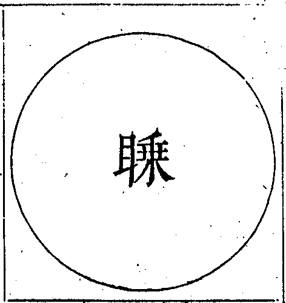

# 雪关禅师语录



> **藏经**：嘉兴大藏经（新文丰版）（嘉兴藏）　**册次** 第 27 册（J27）　**编号** JB198　**部类** 诸宗部　**卷次** 13 卷　**篇幅** 176,740 字

> **卷／品**：0 卷 · 7 品



---



## 目录



  - [记序](#记序)

  - [序](#序)

  - [雪社缘起序](#雪社缘起序)

  - [感应篇序](#感应篇序)

  - [禅镜偈语序](#禅镜偈语序)

  - [重兴天慧堂序](#重兴天慧堂序)

  - [绍觉法师行序](#绍觉法师行序)



---



雪关禅师语录总目



卷一住博山语录



卷二住鼓山语录  

住虎跑语录



卷三住妙行语录  

住瀛山语录(附各刹法语)



卷四答问  

禅净发隐  

归云夜话示禅人



卷五拈古



卷六拈颂  

颂古



卷七禅镜语(附禅镜偈)



卷八文赋



------



### 记序



题跋  

疏说



卷九启  

尺牍



卷十尺牍



卷十一偈



卷十二偈颂  

赞诗



卷十三诗歌  

杂著  

塔铭  

行传



雪关禅师语录总目终



雪关禅师语录卷之一



侍者成峦传善录



法孙开诇编



信州博山语录



崇祯壬申孟夏朔旦，信州众檀越暨合山大众请上堂。



师登座，拈香云：「此一瓣香，气压群芳，遍空遍界，光吞万象，亘古亘今，𦶟向罏中，专为祝延今上皇帝圣寿万安，伏愿金瓯永固，满朝尽是夔龙；黄河再清，四海争歌尧舜。此一瓣香，无烟火处拈来，薰凡灼圣；没鼻孔人嗅著，彻地通天。𦶟向罏中，专为山中檀越外护众居士，所冀真俗不二，远振庞老之风；心镜双融，大彻子韶之格。此一瓣香，价高无比，灵根占断灵山；酷烈难当，毒气亲由洞水。𦶟向罏中，专伸供养博山堂上先大师异和尚，用酬法乳之恩。」就座，维那白椎竟，师云：「夫为沙门，欲荷担大法者，必须先明第一义，具择法眼、彻法源底，於二六时中，法为家务、法为城墙、法为舟车、法为茶膳。不见道：『心同虚空界，示等虚空法；证得虚空时，无是无非法。』古今知识横说竖说，总贵在舌头不黏著肉、好眼不屑点沙，终日说有不堕常、终日说无不落空、终日说非有非无不属相违、终日说亦有亦无不名戏论，如吹毛在手，杀活自繇；如明镜当台，妍媸随照，才是大方家接人手段。若夫初机学人，大法未明，必须真实操履、真实究竟，果到此个田地，即使埋藏山谷，自有人剜肉燃灯，舍身为座，虽诸天魔梵亦将同请转大法轮，岂阐提只手能掩其太阳光辉乎？今日檀越众居士洎合山诸禅德，殷勤劝请举扬博山宗旨，如将千斤担子逼上肩头，山僧秪得冒登此座，为诸仁者说几句麤茶淡饭，若唤作说法，大有人笑这个虫豸在。笑则任从，且道訚上座毕竟是博山逆子耶？孝子耶？」卓柱杖云：「自从拗折撩天杖，今日重拈活似龙。」卓拄杖下座。



沙县陈秉初居士请上堂。



僧问：「拟申一问，以为探竿影草时如何？」师云：「拈却探竿著。」进云：「既是拈却，更说个甚麼？」师云：「无舌童儿语似雷。」进云：「和尚为人一句作麼生道？」师云：「缦天帐子无人见，笑把鲛珠倒撒来。」进云：「三圣道：『我逢人即出，出即不为人。』此意如何？」师云：「我不似乌龟钻破壁。」进云：「兴化道：『我逢人即不出，出即便为人。』又作麼生？」师云：「也是反手卸笼头。」进云：「正当出与未出时如何？」师云：「眼横鼻竖。」进云：「可谓於一毫端现宝王刹，坐微尘里转大法轮。」师云：「不可在焦螟眼里作活计。」僧礼拜，师乃云：「万水千山特地来，为求法施请登台；山僧指示无他语，长夏山中正熟梅。昔甘贽行者入南泉设斋，仍请南泉念诵，泉乃白椎云：『请大众为狸奴白牯念摩诃般若波罗蜜。』者拂袖便出。泉斋后问典座：『行者在甚麼处？』座云：『当时便去也。』泉便打破锅子。」师云：「行者入寺设斋，砒霜甜似蜜；南泉打破锅子，毒手利如锥。简点将来，父子失情，匆匆放过。今日陈秉初居士若请山僧念诵，秪向他道：『住持事繁。』免得打破锅子伤了客情。山僧与麼道，且道与古人是同是别？」良久云：「临机若不通权变，纵到无心滞一隅。」



四月八日上堂：「教中道：『未离兜率，已降皇宫；未出母胎，度人已毕。』与麼说话，大似锦被盖孩儿，遮掩得好。诸禅德！若於此觑得破，尽大地是释迦老子面孔，亦是诸人自己面孔，诸人与释迦老子更无差别；於此不会，却劳他从头离兜率降皇宫一场败阙。所以初生下来便乃指天指地，独自称尊；却被个跛脚阿师要一棒打杀与狗子吃，贵图天下太平。诸禅德！云门虽具杀佛底恶辣，未免伤锋犯手。山僧今日恰要一棒打杀云门，贵图两得相见。诸禅德！还有替跛脚阿师作主者麼？」众默然，师笑曰：「不是山僧逞人我，果然难得十成人。」



栴檀像成，洪惟心居士请上堂：「赵州云：『我有时将一茎草作丈六金身用，有时将丈六金身当一茎草用。』曹山问僧云：『佛真法身，犹若虚空；应物现形，如水中月。作麼生说个应底道理？』僧云：『如驴觑井。』山云：『道也太煞道，秪道得八成。』僧云：『和尚作麼生？』山云：『如井觑驴。』」师云：「善塑无如曹山，善雕无如赵老；不露些子刀斧痕，真个手段高妙。若会得如驴觑井，便晓茎草即丈六金身；若会得如井觑驴，便晓丈六金身即茎草。目犍连枉运神通、优填王徒烦匠巧。丹霞正令劈头行，谁道子孙贤不肖？今日新安洪居士为报先慈，敬塑栴檀尊像一躯，送入先师塔院供养，仍设斋请山僧为众说法。且道毕竟造像斋僧有何功德？」卓杖云：「不求有漏人天福，大孝全彰古佛心。」



玄锡关主同弟彦秀宗侯请上堂。「参学人如久客思归，不辞辛勤跋涉，透出情关叠叠，穿过解路重重，历尽旅邸烟霜，便见家山风月。秪如今日玄锡关主从豫章至，恰值山僧自闽岭回，两人齐到，且道意旨如何？还乡尽是儿孙事，祖父从来不出门。」遂卓拄杖下座。



端阳上堂，师举：「南阳忠国师问西天大耳三藏云：『闻汝具他心通是否？』藏云：『是。』南阳良久云：『汝道老僧在甚麼处？』藏云：『和尚一国之师，因甚在天津桥上看弄猢孙？』南阳良久又云：『老僧只今在甚麼处？』藏云：『和尚一国之师，为何向西川看竞渡？』南阳良久又云：『老僧即今在甚麼处？』藏罔措，南阳叱云：『这野狐精，他心通在甚麼处？』」师云：「桥上弄猢孙，西川看竞渡；隔壁听梭声，知有窗问妇。忽然密室不通风，因甚麼觑他不破？汨罗江上客，元是独醒人。」



上堂，僧问：「德山托钵上堂，雪峰道：『钟未鸣，板未响，这老汉托钵向甚处去？』德山便归方丈。此意如何？」师云：「竿头才露影，谁识转身人？」进云：「岩头云：『大小德山，不知末后句。』未审不知在甚麼处？」师云：「攘羊证父。」进云：「密启其意，未审如何？」师云：「汝道他是甚意？」进云：「德山便休去，不知是何心行？」师云：「才是德山。」进云：「明日上堂，果与寻常不同。不知不同在甚麼处？」师云：「汝且道我今日上堂是寻常、是不同？」进云：「且喜老汉会末后句，不知会在甚麼处？」师云：「末后句且置，汝还见德山麼？」进云：「岩头云：『秪得三年活。』未审岩头具甚麼眼便恁麼道？」师云：「也是蝇子放卵，不顾佛头。」进云：「谢师答话。」师不顾。僧问：「从缘荐得即不问，如何是就体消停？」师云：「暗里逢知己，闹丛不识渠。」进云：「与麼则屋后青松长挺秀？」师云：「早被风吹折了也。」进云：「是甚麼风？」师打云：「汝何不辩来风？」僧问：「离四句，绝百非，请师直指西来意。」师云：「千年池里鳖，一钓上竿来。」僧拟议，师云：「倒拖出去著。」僧问：「如何是祖师西来意？」师云：「西来意且置，你是那家甲首？」进云：「到这里是和尚甲首。」师云：「你因甚麼欠官钱，少私债？」僧云：「也不欠官钱，不少私债，秪是无有入处。」便出。师云：「草贼大败。」僧回首云：「某甲出坡事忙。」师云：「忙煞也中何用？」数僧竞出，师约住云：「不解做贼，都来献赃。若论此事，如人捉贼相似，必先知贼处所、见赃分明，即立时捉下，自然打破窠窟。诸禅德！山僧与麼告报，在诸人分上早是著贼了也。著贼且置，且道临济白拈，何似山僧白拈；山僧白拈，何似临济白拈？」卓拄杖一下云：「贼已过了，谩劳张弓。」



腊八上堂：「直下承当，是何话杷？官不容针，私通车马。须弥高大柱堪题，海天空阔桥难跨；花隄柳巷尽穿通，宝殿珠帘谁放下？雪山夜半睹明星，通身是口装聋哑。」卓拄杖云：「若是这老子，好吃痛棒打。」复卓拄杖云：「果是这老子，何消痛棒打？」靠拄杖下座。



结制上堂，僧问：「先锋即不问，如何是殿后事？」师云：「出身虽有路，举步即迷踪。」进云：「三军一命，重在己权。」师云：「倒跨毘卢印，横挥宝剑寒。」进云：「恁麼则四海讴歌乐有餘？」师云：「是甚麼歌？」答云：「吽吽！」师云：「汝却解西天人梵语。」师举：「曹山云：『从缘荐得相应疾，就体消停得力难；瞥起本来无处所，吾师可说不思议。』诸禅德！若论不思议即是向上一路，既非诚实可造，又非巧力可预，妙在借资还须脱颖，若乃诚实太过，未免眼昏手钝，焉能瞥地从缘？假饶智巧入神，其奈思行头撞，焉知就体消停？所以徐六担，板秪见一边。山僧者里，遇著诚实底，与伊一点，教伊透脱玲珑，免得尖纤搭滞；遇著智巧底，也与伊一点，教伊归根得旨，免使随照失宗。虽然，点銕成金，那个掉头不顾？若有恁麼人，结制浑闲事；若无恁麼人，结制是常事。何故？钩头著饵闲抛水，自有吞舟透网鳞。」



上堂，僧问云：「座主家患不知禅，多喜拈禅判教；宗师家患不通教，多爱傍教说禅。拈禅则堕粘缀，傍教则落依倚，如何得免斯咎？」师曰：「昨有僧问：『如何是大通智胜佛？』我向道：『大不通。』僧云：『如何是大不通？』答云：『空中楼阁，八面玲珑。汝若知得这则答问，便乃宗教兼通。』诸禅德！时当末法见解人多，行解人万中无一，尽道我通宗教、会佛法，岂知打破大唐国，觅个不会底人也难得？不见僧问六祖：『衣钵是甚麼人得？』祖云：『会佛法者得。』僧问：『和尚还得麼？』祖云：『我不会佛法。』这个卖柴翁，真个圆明廓彻、八面玲珑，人问《法华》便为说《法华》要义，开众生惑即如来见；若问《涅槃》便为说《涅槃》妙旨，翻无常义便是真常，可谓如珠走盘、如盘走珠，要且不曾道著一句，妙在信手拈来、信口道著，宗无心而合教；教无心而合宗，岂可思量打算、摸地捞天？自非通身是眼、彻底掀翻，未免说禅便逗机锋、说教莽开解路，总是关捩未透，谩劳注脚分明，安能向有依倚处翻个无依倚的觔斗；就粘缀人点破不粘缀的手脚？甚乃自高赤帜、别立门风，纵生灭心、起胜负见，明呵暗斥臆论何凭？殊不知教有教意、宗有宗眼，宗教甄明不容混滥？除是通向上路，一一从自家胸襟中流出，此人说法自然超越格量，如𬬻锤在手，器器成金；象兔逢狮，个个伏地。不见古德道：『向上一路，千圣不传。』又有道：『向上一路，千圣不然。』诸禅德！汝道不然底还是与不传底翻案耶？还是不传底与不然底合券耶？其间大有淆讹，须教辩别始得。如或不然，唤作徐六担板，总须吃山僧手中痛棒。还会麼？千言易得弥天秀，四海难逢不惑人。」



立忏期上堂：「毘舍浮佛偈云：『假借四大以为身，心本无生因境有；前境若无心亦无，罪福如幻起亦灭。』能知起灭是幻，则造业修善皆幻也；天堂地狱亦幻也；生死涅槃是幻也；众生诸佛亦幻也。现前镜水禅人邀集净侣修礼万佛忏摩，与大地众生作如幻佛事、入如幻法门，转恶为善、转凡为圣，点銕成金、消冰归水。诸禅德！若以幻为幻，是幻非真幻；以非幻为幻，是亦非真幻，除却是非两途，非但疾证如幻三昧，亦乃知得三祖忏罪已竟。然虽如是，一切人罪业皆通忏悔，以起灭如幻故，唯有山僧罪业不通忏悔，以如幻不可得故。且道不可得毕竟如何？」良久云：「魔佛从来都杀尽，神头鬼脸假慈悲。」



上堂，师乃云：「禅非可参，还须参透；道非可学，贵在学成。今人徒知参禅之高，不知学道之妙，从恣狂慧，偏癖非常，多从从文字钻求，遂失悟门长处，譬如刻木为人，形虽酷肖，难瞒智者傍观。是事且置，秪如慈林关主同南昌陶居士登山设供，且道还有意旨也无？双手捧来银碗雪，满笼蒸出铁馒头。」



结制上堂：「道贵真醇，志防驳杂，无一向决定之志，人品尚不谛当，见谛焉有分明？洪炉大治，若非久炼成刚，短贩生涯，多见风吹别调。德山老人道：『毫厘系念，三涂业因；瞥尔情生，万劫羁锁。』汝若有一毫念头向身心世界上作活计；名闻利养、是非人我上作活计；古今因缘、学解机智上作活计，便是一翳在眼，空花乱坠。曹山大师道：『如人过蛊毒之乡，水也不得沾他一滴。』今日是结制之期，山僧为诸禅德倾取四大海水掬洗禅床，𦶟起百和名香薰陶净器。欲成大树先拣参天；欲莳嘉苗先除稂莠。决要参寻祖道、荷负宗乘，必须翻转铁石心肠、别立新鲜志气。若也如此挺特、如此愤发、如此究竟，我亦为汝保任此事终不虚也。山僧与麼道，也合吃苕帚柄一顿。何也？不合向搕𢶍堆上簸土扬尘，污却诸人面目也。然虽如是，不将苦志参禅道，空向宗门望额牌；生熟路头都走过，铁鞋踏破笑归来。」



上堂，卓拄杖云：「诸禅德！分明秪这个，因甚麼有一类人捏不杀猕猴子？」又卓拄杖云：「分明秪这个，因甚麼有一类人弄不活猕猴子？若还弄得活、捏得死、放得开、收得住，管取任意逍遥，随缘散诞。其或未然，九旬禁足，还须坚铸铜墙；三月安居，正好高累銕壁。莫教揭破封皮，决定走风露影。秪饶不露风影又如何？鸡声假报秦关晓，关吏而今不受欺。」



上堂，僧问：「上来道个不审，能销万两黄金；下去道个珍重，亦销得四天下供养。若作佛法会，滴水难消；若作无事商量，眼中著屑。请问和尚如何即是？」师云：「你却伶利。」僧一喝，师云：「秪易叱他泥犊子，难教击破鹘仑砖。」僧云：「光透日月，明暗不收时如何？」师云：「是甚麼光？」僧又喝，师云：「莫便是光麼？」僧又喝，师云：「你秪有这个结局。」便打。僧问：「如何是沙门所重？」师云：「戴角披毛总不知。」僧礼拜。师举：「东坡云：『宁可食无肉，不可居无竹；无肉令人瘦，无竹令人俗。』后有人添两句：『若要不瘦与不俗，莫若餐餐笋炒肉。』诸禅德！佛祖言教如竹肉俱美，又作何去留？若将佛法贴在额楼上，何异俗汉爱肉而不爱竹？不将佛法贴在额楼上，又类东坡爱竹而不爱肉。倘具衲僧家眼孔，不被方便语罗笼，如词客添句笋肉俱好，而妙在取裁，山僧恁麼语话？还有能掀翻此案而道得相应底句者麼？」众无对，师笑云：「果然！」



上堂：「六祖云：『佛法在世间，不离世间觉；离世觅菩提，犹如求兔角。』曹谿此语，秪要人百草头荐取祖师、闹市中识取天子，虽然竭尽婆心，争奈全彰家丑。如今讨个过水不湿脚、解走不触道底人也难得。何也？秪为顽情郁结，难挑暗室之灯；直饶痴兀忘缘，未具透关之眼。且道山僧分上又作麼生？」卓拄杖云：「任运住持三三不偶。」



寿昌阒然禅师与缁素请上堂：「六月炎蒸似釜焦，轻舟千里访同条；法堂秋晚风趍下，厚道如斯未寂寥。昔法昌遇禅师，因黄龙南公至，上堂云：『𬬻鞲之所，钝铁犹多；良医之门，病者更甚。瘥病必资灵药；销顽须借金锤。法昌这里有几个躲根阿师，病者病入膏肓、顽者顽彻骨髓，若非黄龙老汉到来，未免虚生浪死。』法昌寻常气吞诸方，及南公至便自生退屈，抑压诸贤。山僧则不然，今日阒然师叔及诸禅德！远顾自非，虚怀无我，何能重法倾诚？山僧也不说诸大众病入膏肓，顽彻骨髓；也不要诸大众更求妙剂，别觅𬬻锤，秪教追踪前哲，见贤思齐，更要知师叔为人。昔年海岸黄公称如幽院梅花芳香晚吐，盖以师叔久预寿昌师翁筹室，兼受博山先师钳锤，可谓百炼真金，火候已足，岂似今时孟八郎汉在三家村里浑拈椎拂、乱施棒喝者同日而语哉？所以道参学者，若眼不别缁素、品不辩高下，此人虽参遍诸方，未免依然错过。且道错过在甚麼处？」良久云：「按图易索千金骏，对面难知本色人。」



徽州慈浚、了尘众禅人请上堂：「达磨大师云：『无上妙道，旷劫辛勤，岂可以轻心小智而求得乎？』二祖慧可闻诲，遂断臂磨前求与安心，磨云：『将心来，与汝安。』可云：『觅心了不可得！』磨云：『与汝安心竟。』这老臊胡，言翻语覆，知他是何心行？当时赖遇二祖，受得这等毒药。若似今时人，惟用俊鹰快鹞手脚，闻说个『无上妙道，旷劫辛勤』，好与打折驴腰。何故？直下便悟犹迟八刻，岂况教人钉桩摇𫇛、按牛吃草？至若石霜坐枯木堂、沩山置圆木枕、长庆七破蒲团、高峰不沾床凳、香林四十年打成一片、赵州三十年无杂用心，如此苦参皆成钝汉，唤来与近代禅客提瓶挈杖也没用处。噫！末法轻嚣，人尟实行，秪喜参容易禅，就机打发，笼罩得人，学者争趋座下，背地里习学问、答偈颂，机锋转语，传授成家，自少林帕子之后，又出此一套恶风殊可怜悯，真个达磨一宗扫土而尽。殊不知识漏未乾无明最重，便道我能逼生蛇、化活龙，争奈业躯未卸，安易吸尽万顷沧波？衲僧家理不尽於心、机不尽乎妙，必须苦参力到彻底掀翻，岂可被师家愚弄，生受热瞒？与个冬瓜印子，便如生身父母感恩无地，更闻他家有人非，且相与搜寻贬剥无所不至，不推倒其门户不休，如此行径又何能梦见？丹霞参马祖，复指见石头；洛浦事临济，后服膺夹山，一种大人标格高越常流，岂以人情系缀而为佛法流布？山僧则不然，山田脱粟饭，野菜淡黄虀；吃则从君吃，不吃任东西。且道与芙蓉老祖是同是别？还知麼？竿头不著闲香饵，直钓元求负命鱼。」



上堂：「五蕴山中，埋尽有情佛子；赤肉团上，裹却无位真人。终日拈匙把箸，不知饥饱为何？个中俯仰折旋，借问主宾谁立？更有肆狼贪虎噬，甘自造铜柱镬汤。愆深似海，难教业浪拭乾；爱重如山，岂易罪花凋卸？轮回路徒劳，建不拔根基；生死窠有几个，解抽身汉子？今日孝子周爌入山礼忏报荐先君，特请山僧升座说法。秪如山僧恁麼道？大似泥里洗土块，未为本分草料。且道如何是本分草料？曾向百花丛里过，果然一叶不沾身。」



上堂：「痴盲无觉照，业识纷沉掉；起床忙到晚，伸脚睡到晓。醉生梦死多，丧却形山宝；縠穿雀惊飞，藤枯树崩倒；无限聪明人，送命还阎老。诸兄弟！此是未悟人光景，阎老子算饭钱也合甘受。秪如大悟人分上，还被阎老子拘束也无？」蓦卓杖子云：「阎老子！你合吃山僧痛棒。何故？不识庐陵米价，与人算甚饭钱？山僧倒行此令，苍天抱屈含冤。」靠拄杖下座。



上堂，僧问：「弃恩入无为，真是报恩者。如何是报恩一句？」师云：「穿过驴胎马腹来。」进云：「蓦然裂断铁绳头，虚影未知落何所？」师云：「阇黎绳头在老僧手里。」进云：「蒙师舒出一毫光，极目欣瞻华藏界。」师云：「钓鳌须是下金钩。」进云：「绿野青山收不住。」师云：「有甚麼收不住？」进云：「如今搭在玉栏杆。」师云：「犹带蓝毵，不堪乃白。露柱产婴儿，灯笼抱作子；结就肉团身，呼娘还认父。梦里强悲懽，空花成散聚；永劫苦轮回，长夜醉生死。不悟幻因缘，恩爱藤缠树；毕竟事如何？要在知落处。秪如慈林关主设斋供养大众，报荐先君吴道辰居士，且道先灵听法落在何处？」卓拄杖云：「若愿生西方，这里好入路。」又卓云：「若愿生娑婆，这里好出路。二俱不愿生」，复卓云：「且住！且住！」



上堂，举：「玄沙大师问镜清云：『古人道「不见一法是大过患」，你且道不见甚麼法？』清指露柱云：『莫是这个法麼？』沙云：『浙中清水白米从你吃，佛法未梦见在。』」师云：「此则公案，不识者将谓玄沙不肯镜清，殊不知两尊宿俱游雪峰之门，旗鼓相当、埙箎迭奏，可称难兄难弟矣！所以天童老人道：『镜清久不作佛法梦也。』又云：『须是玄沙同参始得。』天童可谓善知无舌语、解听没弦琴，真个是二老赏音者也。若作胜负商量，此人未梦见佛法在。近来法门淡薄，兄弟家相见惟叙寒温情面款待，佛法两字绝口不谈。看他古人一唱一酬，如函合盖、似箭投锋，足为千古眼目。今日是五慈禅友从浙中来，曾与张午正居士法喜交深，以久参先博山之故特来扫塔，仍请山僧上堂激扬斯道。可见世虽末法，人尚古风；然正眼观来不是好心。何故？你在浙中吃了清水白米，却来累及山僧偿他口债。且道口债作麼生偿？」师举起拂子击香案云：「不见道：『布施我者，不名福田；供养我者，堕三恶道。』与麼道却又反累施主还债耶？」掷下拂子云：「除是维摩老，知吾施受心。」



浴佛日，杨镜菱居士请上堂，僧问：「世尊初生，手指天地云：『天上天下，唯吾独尊。』且道见个甚麼便开恁麼大口？」师云：「老成见惯浑闲事。」进云：「后来云门大师道：『我当时若见，一棒打杀。』未审具甚麼眼？」师云：「我不似云门著惑。」进云：「万古浴龙水，年年一度浇时如何？」师云：「你一定作浴佛会。」师举：「僧问五祖演禅师：『如何是佛？』祖云：『新生孩子掷金盘。』又问：『如何是祖师西来意？』祖云：『荆棘林中舞柘枝。』诸兄弟！这僧问处也寻常，老宿答处甚奇特，若向这两转语里会去，如镜里看形，面影皆真，非但亲见世尊，亦乃亲见祖师；若以意识卜度思量，如畫上写照，虽丰神酷肖，亦秪匹似间耳！更道个年年四月八，唤作释迦生，大似风吹垢，伤人好眼睛。毕竟如何？」卓拄杖，便下座。



中秋上堂，僧问：「八月中秋月，夜深光皎洁。请问和尚！如何是中秋月？」师云：「不隔千重縠。」进云：「清蟾飞上界，丘壑悉皆明一句作麼生道？」师云：「劈破昆仑弄得圆。」进云：「恁麼则人人得玩赏，个个尽同看去也？」师云：「谁是月中人？」僧礼拜云：「谢师答话。」僧问：「落叶知秋即不问，如何是把定乾坤句？」师云：「恰值中秋节。」进云：「四至风月，横担拄杖，是阿谁境界？」师云：「非阇黎境界。」进云：「是谁境界？」师云：「还他向上人。」进云：「不跨云桥浪里舟，因甚人在彼岸？」师云：「阇黎掉在水里。」进云：「恁麼风卷岭头云，浪翻潭底月去也？」师云：「那里学得虚头来？」僧礼拜云：「看脚下。」师云：「好与三十棒。」乃曰：「道非明暗，若以明暗而论道者，好与三十拄杖；时无寒暑，若以寒暑而论时者，好与三十拄杖；月无亏盈，若以亏盈而论月者，好与三十拄杖。何故？不曾见谛终迷茫，光影门头；直饶识真翻不转，明白窠臼。山僧棒头有眼，打人极有分晓，争肯模糊放过也！寒山道：『吾心似秋月，碧潭光皎洁；无物堪比伦，教我如何说？』这老儿家虽是阶下汉，却较些子，将华藏世界熬成一个大月饼，与尽大地人同赏中秋。还有一口吞得尽底麼？」良久云：「纵然咬得百杂碎，细嚼麤餐尚欠功。」



结制上堂，僧问：「象王行处绝狐踪时如何？」师云：「放牛须越岭，下马急收缰。」进云：「恁麼大地没遮拦去也？」师云：「鹭立三溪水，云游五座峰。」进云：「虚空没缝罅，云水逗清光。」师云：「更须钉取这一缝。」乃曰：「诸方狂浪滔天，博山死水浸杀；看来担板禅和，枉费钩锥点拨。点不点！拨不拨！把断关津须定夺，龙王按剑绝傍观，看谁来把虎须捋。还有捋虎须者麼？」众无对，师笑云：「直饶捋得，也是沿台盘乞儿。」



以宁上座请普说：「若欲参究此道，必须见地明白、操履真实，然后可以完全此个净白心地。当知净白体上污染不得，即此不污染是诸佛之所护念。何谓污染？但形文字即是污染。若落语言、才涉思惟即是污染，所以《楞伽》云：『离文字相，离言说相，离心缘相。』盖体性自离，不属能离所离，若著个离字，心头蚤被污染了也。非但净白体上著不得个离字，即圣凡、迷悟、善恶、邪正、好丑等字悉著不得。若有丝头许打叠不净，便是尘飞蔽天、芥堕覆地，非但不能自己护念，即使诸佛三加五被，亦不奈汝何？古德云：『就中不落第二念，方入我法门。』还有不落第二念底麼？试出来道看？如无，且听山僧再打葛藤。今日以宁上座殷勤劝请对众普说。山僧道：法无新弊，妙在提唱者不失纲宗、不存轨则。石头老祖云：『承言须会宗，勿自立规矩。』要在称性而谈、随机善说，当观人根性应以何法示之，则为说其法要。《金刚》云：『无有定法，如来可说。』若宗师家一向以直捷示人，过在儱侗；若一向以玄要示人，过在穿凿；若一向以痛快示人，过在趁俊；若一向以婉转示人，过在回互；若一向以奇特示人，过在伤巧；若一向以平实示人，过在太拙。若偏喜人立地悟去，则个个视为易事；若教人次第悟入，则步步落在阶级。若以胜心说法，此乃慢幢过人；若以诤心说法，打在是非窝里。能离此种种过患，可谓善说法，要妙在舌头无路、足迹如空。譬扁鹊料症而施方、波斯识货而打价。若不料症而施方，必为庸医误人；若不识货而打价，必被市估所欺。所谓提挈纲宗者，如揭杲日以丽天，绝无私照；似任大地而载物，靡不生成。登须弥则众岳朝宗；观大海则百川归派。森罗万象，孰能外於虚空？蛮貊中华，悉皆归於王化。不以一木而搆大厦之广；不以一狐而成千金之裘；不以一味而和众羹之美；不以一药而疗众人之症。圆机普应，不滞一隅；窠臼打翻，不著一境。握随色之摩尼，纵返掷之狮子。自餘失其纲宗、强立宗旨，各分门户、自树籓篱，相非则对垒争锋、异见似分河饮水。多见混帐禅和、担板知识，七偏八癖之人收为法嗣、山蛮社拗之说刻板流通，戏论笑杷传满诸方，臭驴汗到处称尊、破庙里纷然升座，皆繇师匠不观非器、妄付来源，只图眼前热闹门庭，那管后来吾徒败缺？禅到于今，风真丑矣！殊不知祖庭授受必须真参实悟之人，旗鼓登坛原是大方作略之手。烧生柴而带叶，不许全落无明；就盂水而投针，须是醇全妙器。撑天拄地，事岂寻常？铁骨铜筋，才堪担荷。诸兄弟！莫嫌料拣，各自知非。若秪趋群逐队，打入此等社火，百劫千生秪成得个野狐种草。若更闻此禅风恶习，辄生鄙厌，别行一路，一生便不参禅，此又是无气血底汉子，若终身不肯参究，毕竟生死关头如何打过？阎老铁棒如何躲得？不见李驸马云：『参禅还须铁汉，著手心头便判；直趋无上菩提，一切是非莫管。』果是英灵有志，必须努力加鞭，慎勿因时退屈，所贵参寻明眼，死做工夫，千煆万炼，必须见地明白，操履真实，然后完全此个净白心地，便是超群上士特达丈夫。然虽如是，訚上座无端向净白地上说出许多不乾净底语来。且道净白体上毕竟是污染邪？不污染邪？还委悉麼？肚无偏癖病，何怕冷油虀？」



舟中放灯小参，僧问云：「恁麼来时如何？」师云：「看取脚下。」进云：「不恁麼来时如何？」师云：「转身就位。」进云：「恁麼不恁麼来时如何？」师云：「撞入葛藤窠。」僧礼拜。又僧问：「千灯水面照，未审光从何发？」师云：「亲见龙潭涌出来。」师复云：「性水澄清，元无飘没，妄波鼓动，遂有升沉。既迷出世津梁，不睹光明宝藏。千波兢涌，谁燃照水之犀？一口吸乾，孰是倒澜之手？溺而不溺，直须跳出这层波；生而不生，转取腾霄那一步。秪如白浪滔天，还有不被颠溺者麼？」良久云：「移舟不别水，举棹却迷源。」



小参：「诸人未见山僧时，喜地懽天，执香献花，愿得一睹。及到山僧这里，耳不得听、眼不得顾、心不得思、口不得语，恍恍忽忽作不得主，尽力扪摩没个入路。若向这里放过，百劫千生，对面不遇；直须针劄不入，寻个入头，忽然作得主、开得口，管取通身庆快，不妨足蹈手舞。若不然，自是诸人辜负山僧也，不是山僧辜负诸人。何故？法不空施，福无虚布。」



玄诣禅人从漳泉行化回，小参：「诸禅德！心地难明、日子易过，栗棘蓬吞不下、铁馒头咬不破，每日吃施主斋茶，且道是福是祸？你若将吞不下底吞下、咬不破底咬破，任是天龙送供，竖一指云：『不劳谢他这个。』其或未然，拼命吃河豚，眼前且救饿，消得消不得，罪过不罪过，总要诸人自著力，全靠山僧则不可。」



元宵小参：「雪前先办柴，可以御隆冬之寒；灯前先办火，可以傋元宵之观。参学人亦然，必先精勤办道，道眼顿开，可以领纳现前受用。今夜与诸兄弟在雪里过元宵，灯不见灯、花不见花、月不见月，冷冰冰地在屋里坐，独有一人不惧寒威、不守冷坐，戴雪为笠、踹雪为履、披雪为衣、餐雪为饭，终日在雪里行走坐卧，笑看琼楼玉殿，别是一样乾坤；火树银花，无非妙严境界。先大师云：『人生一日不可无此光景。』还有受用此个光景者麼？」广福非师云：「净瓶张口笑，雪里一枝开。」师云：「难得和此一曲。」



先和尚三周年，众请小参：「今日是先师三周之辰，福州林衡庭居士设茶供众，请山僧小参。山僧无可举扬，记得昔年先师迁化之顷，山僧问云：『去来自繇，和尚作麼生道？』先师索笔大书云：『历历分明。』复云：『汝意作麼生？』彼时山僧悲恋躄踊不及答语，先师云：『留此不了公案，待汝了却。』遂掷笔而逝。当斯时也，予思法门不幸，痛失正眼，不即外扬家丑，今日狭路相逢，不免举似诸兄弟商量，若能圆得末后句，不惟使先师骨血不寒，亦见先师光明焕赫；其或未然，山僧且归方丈，待列位明日替山僧了此不了公案。」复举：「巴陵鉴禅师，有僧问：『如何是提婆宗？』陵云：『银碗里盛雪。』又问：『如何是吹毛剑？』陵云：『珊瑚枝枝撑著月。』『如何是正法眼？』陵云：『明眼人落井。』后有僧举似云门，云门云：『秪消此三转语，足可供养老僧。』博山昔年有道开禅者自称得悟，争论不已。先师鸣鼓升座，将寻常看验学人四问唤渠出答，渠不能对。彼时山僧轮值监院，以事未及趋听，先师命侍者唤至，将前四问复问：『殿角风摇树，行人尽解衣时如何？』山僧答云：『微云笼海岳，疏雨滴岩花。』又问：『清风拂白月，野老笑相亲时如何？』答云：『界破青山色，黄河水倒流。』又问：『佛殿东南因甚缺了一角？』答云：『恰值博山修造才了。』又问：『僧堂中几人坐卧？』答云：『东西十万，南北八千。』先师又云：『四问许汝答，四问外汝又作麼生？』答云：『热场何妨撒手。』诸兄弟！巴陵三转语，足可供养云门；山僧四转语，还可供养得博山先师否？诸兄弟！若也评量得出，许汝问答如流；其或未然，若无把定乾坤眼，纵遇金鋀辩不真。」



诞日小参，师以手指自身云：「这一件破袄子，四十九年前从娘母胎里借披出来，如今若教脱却，又恐冻杀法身；若不脱却，未免负债不还。且道脱却即是？不脱即是？请诸上座代一转语。其或未然，山僧自己不妨颂出：『析骨还父，析肉还母；现那咤身，瞥喜瞥怒。缘木求鱼，关门逐虎；偶尔成文，随缘作主。』且道訚上座生缘在甚麼处？从来不打诳语。怎见得不诳语？信州便是广信府。」



因事小参：「山僧喜人坐禅，亦喜人办行，禅行双修，方继祖道，若偏喜坐禅不肯办行、若偏爱办行不喜坐禅，俱名担板汉子，非称当家种草。当知从上师德，无不从行门中成办出来，多见血汗成功，岂忍坐销信施？青原老祖见石头打坐，因问云：『汝在此作甚麼？』头云：『一物不为。』原云：『与麼则闲坐也？』头云：『闲坐即为也。』你看他古人一物不为，亦不肯闲坐。诸兄弟！闹烘烘处好坐禅、冷冰冰处好办行，向禅堂里耕翻大地，长养灵苗；向锄头上稳坐蒲团，掀翻世界。如此则终日坐禅不守枯寂、终朝办行不见劬劳，终日为而未尝为、终日坐而未尝坐。到此田地，自然心安如海，不知把缆行船，管甚倾湫倒岳？且道因甚麼如此妥当？还委麼？繁兴无动止，一道岂偏颇？」



除夕小参：「大尽三十日，小尽二十九，果然及得尽，岁月更长久。长久且置，诸方龙象都到博山过年，且道无位真人在甚麼处度岁？若有晓得，不妨递个消息出来；其或未然，问取壁上桃符，便知端的。」



小参：「生从何处来？死从何处去？大家业识茫茫，可怜无本可据，秪如有本可据的人又作麼生？拏住布袋口，掷却拄杖子；左手控飞龙，右足跨猛虎。乱把绣毬抛，倒踞香台舞；浪荡不归家，何彼复何此？彼此且置，秪如今夜茶筵，是周仲让居士荐亡弟季材文学，且道先灵在此座筵闻法，毕竟是业识耶？非业识耶？有本可据耶？无本可据耶？咄！不入祖师室，茫然趣两头。」



郑式蘧居士荐张淑人请小参：「如来常寂光，如月印秋水；众生心水浊，月即难鉴取。佛开净土门，岂离心境有？心净土亦净，吞却山河影。土净心亦净，击碎玻璃镜；心土二俱离，莲花出淤泥；心土二俱即，娑婆真乐国。卖花人过野桥香，窠松鹤唳疏枝湿。」



小参：「心眼本开，无奈空花自翳；性天廓朗，秪因迷雾长昏。佛说世智辩聪是八难中之一，以学解多知遂成理障，故翻不转文字窠臼、打不破生死牢关。当其迷时，文字语言总是障道根本；及其悟也，语言文字原是解脱正因，妙在反手覆手耳！昔李渤刺史问归宗常禅师云：『须弥纳芥子即不疑，芥子纳须弥莫是妄谭否？』宗云：『人传使君读万卷书，是否？』渤云：『然！』宗云：『摩顶至踵如椰子大，万卷书何处著？』复问：『一大藏教明甚麼边事？』宗举拳示之云：『会麼？』渤云：『不会。』宗云：『这措大，拳头也不识。』渤云：『请师指示。』宗云：『会则途中受用，不会则世谛流布。』」师云：「万卷书何处著？伸脚处便缩脚，掀翻窠臼绝狐疑，真个拳头好作略，不在途中不在家，世谛流布亦不恶。秪如茶筵中报荐先相国方水大居士，是他生平读万卷书，毕竟向何处安著？还会麼？儒佛原无两个心，绝学始称真道学。」



忏堂小参：「若论本地风光，如摩天俊鹘，岂落二机？如踞地狮子，全威不动，直下便见，无第二人，拟议即乖，焉容钝置？正位尚嫌尊贵，偏方岂落程途？旋风千匝打归来，机轮绝断无回互。昔三祖求二祖忏罪，二祖云：『将罪来与汝忏！』三祖云：『觅罪了不可得。』二祖云：『与汝忏罪竟。』审如是！理忏尚且不有，事忏更复何凭？事理双融，便证礼佛三昧更有向上事在。」僧出礼拜，师云：「问话且置，汝礼底是甚麼？」进云：「能礼所礼性空寂。」师云：「此是教家极则。」进云：「宗教不二。」师云：「向上事何不道取一句？」进云：「一轮红日照禅堂。」师云：「此犹是向下事。」进云：「恁麼则请和尚指示。」师云：「脚跟点地滑如苔。」时有傍僧下一喝，师云：「掠虚汉不许搀行夺市。」僧云：「临济道有时一喝如金刚王宝剑，如何是金刚王宝剑？」师云：「我不用此钝锋。」进云：「有时一喝如踞地狮子，如何是踞地狮子？」师云：「我家无此畜生。」进云：「有时一喝如探竿影草，如何是探竿影草？」师云：「闪踪露影作麼？」进云：「有时一喝不作一喝用。」师云：「赚杀他家儿孙。」进云：「四偈已蒙师指示，本地风光事若何？」师云：「指头无缝露全机。」进云：「请和尚归方丈。」师云：「唤侍者点茶来。」僧问：「选佛场中大开𬬻鞲，祖师门庭不涉阶级。意作麼生？」师云：「看脚跟线断也未。」进云：「红日窗前影，明月落堂中，是那一边事？」师云：「不是汝住脚处。」进云：「石虎当头露，野兽绝狐踪时如何？」师云：「好吃一顿，别与商量。」僧问：「如何是宾中宾？」师云：「面面扑灰尘。」进云：「如何是宾中主？」师云：「归家不坐堂。」进云：「如何是主中宾？」师云：「出门不上路。」进云：「如何是主中主？」师云：「猊床不露影。」进云：「宾主已蒙师指示，知音一句作麼生？」师云：「试唱一曲看！」僧问：「如何是切上加鞭？」师云：「千里追风不涉程。」进云：「家贼难防时如何？」师云：「谁教你认他作子？」进云：「修此礼佛三昧，向后还有罪也无？」师云：「勤礼不知劳。」进云：「还有这个在？」师云：「且喜汝无这个。」便打。



元夜茶话：「岁月如环无起尽，揭翻新历又周流；未知石笋抽条意，好趁春风迸出头。且道迸出后如何？」僧云：「撑天拄地。」师云：「三茎四茎斜，一根两根曲，你道堪作何用？」进云：「学人不会。」师云：「何不道：『舟汉成龙去，清时引凤来？』」又问一僧：「适才维那答了也，汝又作麼生？」僧云：「须弥掉落虚空里，海岸蓬头天外天。」师云：「犹欠尽力迸出在。」进云：「恐太孤负和尚！」师云：「不得孤负人。」



中秋茶话：「教中道：『菩萨清凉月，常游毕竟空；众生心水净，菩提影现中。』山僧今夜与诸兄弟随群逐队，同赏中秋，又得欢笑一场，将茶筵排列丹墀之上，将谓廊房之下无月，玩赏天上之月。殊不知月轮不在天，月轮不在地，上下四维观，都不见月影？或有个出来以手指月向山僧道：『这个唤做甚麼？』山僧道：『唤作苕帚柄，会麼？』不见云岩扫地次，道吾云：『太区区生？』岩云：『须知有不区区者。』吾云：『莫有第二月麼？』岩乃竖起苕帚云：『这个是第几月？』吾便休去。秪如诸兄弟唤作月，山僧唤作苕帚柄，且道苕帚柄上是真月耶？是第二月耶？是烦恼月耶？是清凉月耶？清光此夜家家有，切忌分为两段看。」



茶话：「僧问云门：『如何是法身边事？』门云：『枯桩。』『如何是法身向上事？』门云：『非枯桩。』若论法身边事，知有底未必能知；若论法身向上事，不知有底却又知有。或有个知有不知有底出来，你道此人是会得枯桩耶？非枯桩耶？」师举起茶盏云：「张三贪杯，李四酒醉，茶钟落地，果碟粉碎。直饶晓得正按傍提，也难与睦州老人弄唇接觜。秪如今夜茶话，为郑若休居士报荐祖婶周氏恭人，且道此位先灵闻法当生何处？夜明帘外难寻迹，无影峰头不借缘；好共庞家灵照女，饥来吃饭困来眠。」



诞日茶话：「无端突起一个泡，泡里安身自里缠；旷劫秪明今日事，虚空划界论何年？诸上座！诸佛是泡也、众生亦泡也、天地世界是泡也、父母我身皆泡也。汝若作个泡会，唤作毛道凡夫；你若不作个泡会，犹是邪见边事。山僧将此种种差别，总作一个大泡，抛向诸上座面前，且道是诸上座底泡耶？是山僧底泡耶？若道是诸上座底泡，昧却山僧；若道是山僧底泡，恰又瞒却诸上座。还有拣辩得出者麼？一沤未起犹嫌冷，万丈波澜岂顾高？身土互严浑梦事，吞乾沧海钓飞鳌。」



雪关禅师语录卷之一终



雪关禅师语录卷之二



门人成峦侍者传善录



法孙开诇编



鼓山语录



崇祯壬申，总宪能始曹公农部，得山林公及众乡绅请师于福州鼓山涌泉禅寺开法，以六月初三日入院。



上堂，拈香云：「此一瓣香，千祥具足、百福庄严，端为祝延今上皇帝圣寿万安，伏愿　一人常有庆，万国以常春。此一瓣香，氤浮尘刹、瑞霭娑婆，专为山中檀越护法、宰官居士，伏愿作儒林之柱石、为法苑之金汤。此一瓣香，雪山朽尽、少室重华，专伸供养　博山堂上先师异大和尚，少酬法乳之恩。」就座，白椎毕，师乃云：「若论佛法，如蚊子上铁牛，无你开口处，今权向第二门头说个譬喻，若要造进此道，如人行路一般，必先寻一条直捷路上行，更要向差别路头一一透过始得。秪如山僧在博山束装出门，诸兄弟有先从柘浦抵芝城，顺舟而下不数日便到鼓山，何等快捷？山僧从鹅湖穿马岭，经寿昌登广福涉镡津，其间历峻岭而千盘、经回溪而百折，所过州城，纷人士香花之接；遍游兰若，观丛林法化之仪，经六十餘日始到鼓山，何等曲折？若论一踏便到，诸兄弟诚得便宜；若要曲尽逶迤，须学山僧重重经履险夷始得。今人参学，多喜直捷理会，不知果有见处更要踏翻差别关头，才具决择法眼，然后清机历掌，珠滚盘圆，万化从心，兵随印转。咄！此总是途路边事，料掉没交涉。且到家一句作麼生道？大众无事，各自归堂好。」



郑汝交刺史请上堂，僧问：「法幢高树，龙象争趋，如何是当前标示？」师云：「香帐花龛。」进云：「适才钟鸣鼓响，即今声归何处？」师云：「问取玄沙。」进云：「今日宰官临筵，作麼生不辜来意？」师云：「因斋庆赞。」进云：「此居士莫是灵山中再来否？」师云：「也是龙华树下人。」进云：「还有点破言句也无？」师云：「的。」进云：「兴圣国师未了之句，请师直指。」师云：「箭过九重城。」郑使君问云：「昔日神晏，国师在石岩下坐，因水声喧甚，将东涧水喝向西去，泉声遂涸。今日请和尚将西涧水喝转东来，还可得麼？」师云：「彼涧即是此涧，喝去何须喝来？」使君礼拜，师乃云：「今日是使君设斋请山僧升座举扬佛法，山僧无可为说，不免将适来公案再举一回也。」遂高声喝云：「转了也。还闻水声麼？忽有个出来道：『和尚莫瞒人好。』山僧向他道：『被汝勘破了也。』且道如何是勘破底事？吞乾众壑谈犹易，拨转千峰别有功；不是太原孚上座，鼓山争与显神通。」



结制上堂：「乱意猿奔树，尘缘马过桥；不到心空处，何日得开交？所以古人立个期限，要你向瓮中捉鳖。诸兄弟！直须内不住心、外不住境，黏胶既脱、窠臼掀翻，果到心境双亡，正好通个消息。还有通消息者麼？咦！龙门高万仞，腾跃是何人？」



诞日上堂，僧问：「象赴龙奔，各趋庆贺，请问和尚年多少？」师云：「与拄杖子同年。」进云：「然则不历春秋度，常延不老春也？」师云：「狸奴白牯自知时。」僧礼拜归位，师乃云：「业风吹堕阎浮界，肉袄频经脱换来；觑破未生前面目，方知露柱是娘胎。教中道：『诸法不自生，亦不从他生；不共不无因，是故说无生。』山僧道：『诸法从自生，亦复从他生；亦共亦无因，说甚麼无生？』诸兄弟！若向教中意会去，如斩开荆棘，指出一条大路；若向山僧句里会去，如不动旗鎗，便尔就路还家，所谓发足有殊，到家则一也。」僧出问和尚：「因甚麼忘却生身父母，与露柱作儿？」师曰：「苗从地发，花借春开。」便下座。



元旦上堂：「春色无分新旧，年光岂有去来？洞见刹那三际，从他叶落花开。不见白杨顺禅师道：『染缘易就，道业难成。』不了目前万缘差别，秪如昨日唤作除岁，今日唤作元朝，浮字虚名，凭谁安得？若乃千门爆竹，使大地而惊雷；万户桃符，替虚空而挂彩。银烛透纱笼之影，铜瓶簪杨柳之春。堂奏管弦响，送木人之耳；炉烧榾柮威，袪石女之寒。景物森然，风光满目。若唤作目前底法，则心外别有境象；若是自家屋里事，如何领略此段生涯？还委悉麼？根尘元是吾家宝，无奈空花翳眼珠；果尔斯须常返照，自然不到丧居诸。」▆



林性端居士诵《圆通经》请上堂，卓拄杖一下云：「观世音菩萨来也，在山僧拄杖头放光动地，现色身三昧，洒火宅以甘露，能令热恼众生入火不烧；驾欲海之慈航，能令痴爱众生入水不溺。秪如观世音菩萨从闻思修入三摩地，毕竟是何境界？菩萨道：『我不自观，以拄杖子观；我不自闻，以拄杖子闻。』如今见闻拈放一边，且道是拄杖子化为菩萨耶？菩萨化为拄杖子耶？若人定当得出，不消根选圆通；其或未然，且将拄杖子送与性端居士，挂在家中壁上烧香供养。」



履徵上座母难日请上堂：「《梵网经》云：『孝名为戒，亦名制止。』玄沙得悟父生天、目连证果母离狱，所谓沙门出世，正大孝之极则。今日是履徵上座母难之辰，上座戒行冰霜、法门城堑，跋涉千里，将迎两世法幢，导诱此方，岂不利及先亡父母？且道先亡父母即今在甚麼处？若也会得，非但利乐上座父母，且利及大地有情父母。然虽上座底先亡父母毕竟在甚麼处？」良久云：「尊贵未尝居佛位，刀山剑树岂轮回？」



结制上堂：「古人参究此道，意在克期取证，立地便搆去。末世流弊，视结制为故事；藐生死如等闲。话头不切，宛如捕影追风；誓志不坚，谁比封衾转枕？挂名色为禅和、将佛法当儿戏，弄到没滋味、没捞摸处，便放意荡情，业识难制。殊不知古人求法心真，苦到恳切，虽躯命可拼。故雪山童子闻半偈而投崖、少林二祖乞安心而断臂。高峰妙要人然指然顶，无非示诚重之心；投子同令人自米自炊，秪欲验坚确之志。汾阳昭酒肉散徒；叶县省水泼旦过。风规若此，今日何如？若非慈明七众、浮山二公，未免撩天索价，无人博地相酬，辜负一片婆心去也。诸禅德！若欲荷担此事、力究深参，必须鉴上高流，莫甘堕于庸鄙。将一副成佛作祖心肚，如生铁铸就；把百千万种攀缘妄想，融作一句话头；银山铁壁，化为一所禅堂。全身拶入，剔起眉毛，不容丝毫走作，管取九十日期内克办此事，咬破铁蒺藜，还我当门齿。到此田地，便见南泉斩猫、香严上树、仰山落井、大愚锯解秤锤、赵州庭前柏树，一一分明，不是别人屋里事。秪如天童道：『清光照眼向迷家，明白转身犹堕位。』毕竟利害在甚麼处？」良久云：「轻车就熟忘驰骤，古路天晴滑似泥。珍重。」



上堂：「昔人谓临济之道迥出常情，驱耕夫之牛、夺饥人之食，敲骨取髓、痛下针锥，其钳锤妙密，互换主宾，可与曹洞宗风相为表里，三玄三要乃全该五位，之中照用后先似善转机位之妙，通达权变不滞一隅，所以道：『我有时一喝如金刚王宝剑；有时一喝如踞地狮子；有时一喝如探竿影草；有时一喝不作一喝用。』兴化亦云：『诸人且莫胡喝乱喝，直饶喝得兴化向虚空里打个筋斗扑落，待我苏醒起来，款款向汝道，我不曾向紫罗帐里撒珍珠与汝诸人在，你胡喝乱喝作麼？』看他恁麼说话？大似王家令严，不许搀行夺市，把得住、放得行。喝既如此，则知他有时一棒拿龙捉虎；有时一棒旋乾转坤；有时一棒壁立万仞；有时一棒遍界分身，故云：『棒头有眼明如日，要识真金火里看。』可见他家风活计何等涧大！岂比瞎棒狂喝、瞒鼾儱侗？又临济云：『沿流不止问如何？真照无边说似它；离相离名人不禀，吹毛用了急须磨。』与麼道，孟八郎汉摸他脚跟下一茎毛未有日在。近时有一等拍盲禅者，高谈临济专事棒喝，离此别无长处；更有一类麤蛮底汉子，狞如把势之徒、村似匹夫之勇，一味性燥，菽麦不分，飞脚舞拳，似小儿弄戏，具搥头破脑，如狭路遇冤家，相逢驴唇马嘴，落得笑柄一场。如此丑态，岂不使临济一宗扫土而尽？所望者主法尊严，庶可作狂澜砥柱。



「訚上座二十年前，亦曾把他弓、骑他马，将他家骨董搬弄一番。如今老大知羞，要且随时拈用，可以推临济为先锋、挽曹洞为殿后，亦可挽临济为殿后、推曹洞为先锋，直得仰山拱手、云门服膺，一味平怀，诸宗齐贯。虽则一一分明，不在分明里著脚，不见洞山老人遣沙弥传语云居，乃嘱云：『他或问和尚安否？但道：「云岩路相次绝也。」汝下此语须远立，恐他打汝。』沙弥承旨，传语声未绝，早被云居打一棒。你看他父子如此照应，可见运筹帷幄决胜千里，银河界断平空接起，虹桥关塞不通，雁影传回书信。亦如青林打僧一棒云：『铁轮天子寰中敕。』这般作用更较临济一筹。诸禅德！若要通他诸家宗旨，须知同中有别、别中有同，同中全同、别中全别，自然道眼圆明，会尽佛祖淆讹公案，免被诸方简点，唤作无眼长老。秪如訚上座恁麼举扬，且道是有眼长老耶？无眼长老耶？」良久云：「些些力量分缁素，荡荡身心绝是非。」



薛迎薰居士请上堂：「大凡参学必先去其所重，岩头亦云：『才有所重，即落窠臼。』何为所重？随声逐色是所重；粘情带识是所重；憎凡爱圣、抛迷就悟是所重；胡问乱答、搬弄业识是所重；遏捺妄想、虚空现量是所重；棒喝交驰、守他珍御是所重；总不恁麼是所重。若能一一去其所重，如人脱衣解带相似，重重褫尽，自然赤裸裸、净洒洒。忽有个一丝不挂的汉子出来，还教伊脱个甚麼？」卓拄杖云：「但愿空诸所有，慎勿实诸所无。」



安海薛华锦居士请上堂，僧问：「雪峰三登，投子九上，洞山为甚麼却向鳌山成道？」师云：「雪峰未曾得恁麼消息。」进云：「秪如后来住庵，有僧敲门，雪峰放身出云：『是甚麼？』僧亦云：『是甚麼？』毕竟作麼生？」师云：「俱是诈明头。」进云：「僧举似岩头，岩云：『我当时若向伊道末后句，天下人不奈雪老何！』如何是末后句？」师云：「疑杀天下人。」进云：「岩头又道：『雪峰虽与我同条生，不与我同条死。要知末后句，秪这是。』此意如何？」师云：「年老成精。」进云：「今日不但亲见雪峰，亦乃亲见和尚去也。」师云：「阇黎向甚处见？」进云：「争奈一枝圣箭直射入九重城里也。」师云：「依稀似曲才堪听，又被风吹别调中。」进云：「佛祖机缘蒙师示，超佛越祖望指南。」师云：「我不似相楼打楼。」僧礼拜，师乃举：「达磨大师云『外息诸缘』，风不动也；『内心无喘』，树不摇也；『心如墙壁』，斫却中心树子著；『方可入道』，掷下斧头来。诸禅德！向此四句里觑个七穿八穴，自然撒得开、捏得聚、扑得破、补得起，非但晓得达磨面壁，亦乃知得壁面达磨。诸禅德！达磨面壁则故是，且道壁面达磨是何意谓？」复笑云：「唤甚磨作壁？」



林从元居士为父诞日请上堂：「山僧未出方丈门，有僧问云：『诸供养中法供养最，如何是法供养？』山僧答云：『匙挑不上。』进云：『未审供养甚麼人？』山僧荅云：『不落施受者。』进云：『争奈无厌足何？』山僧合掌道：『果然难消！』不见《宝镜三昧》云：『臣奉於君，子顺於父。』不顺非孝、不奉非辅，人能解奉顺无违，便知供养之法最妙。所以重重无尽，广辟普贤行门；展转成缘，庄严华藏法界。然虽如是，也须不被葛藤绊倒始得。庞居士云：『有男不婚，有女不嫁，大家团𪢮头，共说无生话。』侍郎杨杰云：『男长当婚，女大须嫁，讨甚闲工夫，共说无生话？』看这两个俗汉，一人顺水推船，不解逆风把柁；一人逆风把柁，不解顺水推船。简点将来，佛法世法各得一橛。山僧与麼批判，大似渔人收鹬蚌，偶然得利。今日是林性端居士诞辰，其嗣君从元登山设斋请山僧升座，举扬第一义谛，可谓能知孝道、善顺亲心。秪如山僧祝龄一句，为是说无生话耶？不说无生话耶？若人定当得，堪消檀信脂膏；其或未然，且听一偈：『他家父子真奇特，似脱庞杨印子来；妙契缘生无性旨，昙花劫外带春开。』」



上堂，僧问：「当阳一击乾坤碎，尘刹山河寸地无，还当得宗乘中事也无？」师云：「脚跟下道将一句来。」进云：「曾向水晶宫里过，十字街头赤骨眠。」师云：「潭底毒龙还驯也未？」进云：「几度龙门遭点额，这回不怕泼天潮。」师云：「快些还我一滴水来。」进云：「凡圣位中留不住，回途石马出纱笼。」师云：「鸟去分烟色，风来打旋涡。」进云：「把断要津不通凡圣，请师开一线道。」师云：「过头拄杖好惊人。」僧礼拜，师乃云：「参禅不制心，业识纷飞苦；僧家不养猫，禅堂多老鼠。忽被猫儿追到牛角里时，且道老鼠还有性命也无？」拈起拄杖子作摇势云：「若人捉得渠，当下偷心死。」连卓两卓下座。



上堂，僧问：「久钓深潭，为何骊龙不见？」师云：「莫在死水坐麼？」进云：「乘风破浪意作麼生？」师云：「掷下钓竿来。」进云：「犹在某甲手里。」师云：「还见骊龙麼？」进云：「抒教沧海竭，变化有神龙。」师云：「泼天云雾起，谁是采珠人？」进云：「从上诸祖是个传语底，未审传甚麼人语？」师云：「问取黄面老子。」进云：「穴细金针，芒长玉线，请师穿却诸人鼻孔。」师云：「掩襟衣缝绽，拂尘晓风清。」师乃云：「说底不是禅，悟底不是道；推倒蒲萄棚，春风寒料峭。然虽如是，今日若是端师子来，也合吃山僧拄杖。何也？为他不解扶起，秪解放倒。忽有个傍不甘底出来道：『和尚你还会扶起麼？』山僧也与拄杖。何故？为他矮子看戏，随人上下。」



腊八上堂：「释迦老子没好丑，笑指南辰当北斗；雪山六载道何成？缚起虚空为扫帚。眼见阎浮一切人，通身搕𢶍通身垢；扫佛扫祖扫邪魔，扫凡扫圣扫空有；佛法腥膻尽扫除，世间万事真刍狗。看看！今日扫向诸人头上了也。某甲稽首和南三界大师，我此一众嫩叶新条，不堪霜雪，望大师宽荡涤之仁；开涵养之路，将此一柄扫帚留在无阴阳地上，与后来结个远因远缘。何故？春来不化松千树，冬至应生竹万竿。珍重！」



解制上堂：「一念万年，布袋头昨日结；万年一念，布袋口今日开。开秪恁麼开？结秪恁麼结？开结不同时，瓮中捉得鳖。诸禅德！九十日期今已满，闭门作活事如何？不曾捏杀猕猴子，重叠关山未易过。末法禅期，真参罕遇，口苔舌醭，谁到未萌？纵他意树抽枝，未见心花成片。然虽如是，冷灰里岂无一粒豆爆？还有不跨石门扶竖晏祖门风者麼？如无，且向芦花深处宿，月明穿过钓鱼台。」



元旦上堂：「新岁履端开泰运，诸人分上寿添年；法身虽是无增减，也要随缘验不迁。」卓拄杖一下云：「拄杖子！你底寿命是增耶？是减耶？你底岁月是迁耶？是不迁耶？却被拄杖子倒喝一声道：『和尚莫乱统好。』山僧秪得结舌低声。今日是元旦令节，且下座与诸兄弟向佛殿里拈一瓣香祝延圣寿。」



郑汝交刺史诞日请上堂：「傅大士云：『有物先天地，无形本寂寥；能为万象主，不逐四时凋。』近时有等捏怪邪人道：『虚空世界，万象森罗，情与非情，尽从我之所生。』然则生身父母推置何地？若还撞入母胎，披此壳漏出来，则生有所生，岂曰独生？秪如『有物先天地，无形本寂寥』，则知天地非生，我亦非生；万物无形，我亦无形。又『能为万象主，不逐四时凋』，则知万象非主，我亦非主，四时不凋，我亦不凋。若道我能生天地万物，即堕邪见；又认定我此身是父母所生，是天地所赋，则是见沉生灭，不出轮回。深嗟末法邪见如林，不信自心作佛，甘作阐提，局梦幻空花之身，讵解缘生无性？抱胜负是非之见，焉能离句绝非？纵心肆意谤佛谤法，若知心即是佛，则谤彼者是谤自心之佛。心既无形，佛亦非有，心佛俱非，谁受谤者？谁为谤者？教中道：『诸罪虽重，惟谤三宝，不通忏悔。』以谤佛是损众生之福田、谤法是伤自己之慧命，永投业浪，枉受漂沦。今日是郑汝交居士悬弧令旦，登山设斋，特请山僧升座举扬佛法，此一篇说话，大似路见不平拔剑相助。然此居士正信三宝、力护法门，福田深种嘉苗、寿岳堪齐嵩华。秪如旧岁唤作五十七，新春唤作五十八，且道父母未生已前，春秋却高多少？壶中日月光华发，寿越须弥过量人。」



水口兴济寺请小参：「来从渊关来，去从渊关去；来去自奔波，困关浑如故。不见祖师道：『万法本闲，唯人自闹。』若知闹底即是闲底，便见灯花灿烂，色不关情；若知闲底即是闹底，便听箫鼓骈阗，声非碍耳！何故？有物为物，则被物物碍膺；尘本非尘，则可尘尘合道。」举起拂子云：「拂子是尘，唤甚麼作道？拂子是道，唤甚麼作尘？」掷下拂子云：「还知麼？关津虽放过，不许贩私盐。」



开元寺请小参：「古德〈悟道偈〉云：『一拳拳倒黄鹤楼，一踢踢翻鹦鹉洲；有意气时添意气，不风流处也风流。』惭愧！古人露手露脚，鼓粥饭气，大似个白拈贼。殊不知天关未转、地轴未旋，徒尔惊群，难极底蕴。訚上座则不然，展开坐具包群象，抖擞袈裟里太虚；六臂三头夸好汉，轮王未与髻中珠。何故？大方无轨则，应物任偏圆。」



董岩请小参：「道人用处，如风行空。理透彻而意自玄，机虚闲而神自王；一任神驹蹴踏，还如灵鹤翱翔。盖得无心於事、无事於心，自然虚而灵、寂而妙，不拘修证，宁滞有为？诸兄弟！若欲得此受用，直须绳头紧把，自然透出重关。且道透出关外底人是何作略？天容难覆载，器水逐方圆。」



茶话：「古人慎重大法，发语行事如守瓶口相似，不乱泻水。云居老人道：『得者不轻微，明者不贱用。』若是逢茶说茶，逢饭说饭，滑弄唇皮，成何了办？秪饶合得嘴，卢都也是冻杀当年立雪汉，所以道：『恁麼也不得；不恁麼也不得；恁麼不恁麼总不得。』拈开三段，便有出身之路。出身且置，秪如二祖大师云：『我自调心，非关汝事。』与麼道，较当时立雪光景是同是别？肝肠烹鍊过，火镬冷如水。」



梦生禅人请茶话：「时十四夜月，吃茶知是茶味，吃饭知是饭味，因甚麼又道：『人莫不饮食，鲜能知味？』毕竟此味作麼生知？不见僧参赵州，州问：『曾到此间否？』僧云：『已到。』州云：『吃茶去。』又问一僧：『曾到此间否？』僧云：『不曾到。』州云：『吃茶去。』监院问云：『和尚因甚麼到也吃茶去，不到也吃茶去？』州唤监院，院应诺，州云：『吃茶去。』诸禅德！若知赵州三度茶话，则茶味饭味彻底皆知；其或未然，试听颂出：『赵州吃茶，通身是口，不论主宾，宁拘好丑？南北东西各一桮，虚空浇湿眉毛皱。皱不皱！瘿婆看月问中秋，夜寒忘却笼双手。』」



恒光禅人请茶话：「教外别传，不繇文字；四面无门，好个入路。敕点飞龙，倒跨猛虎，妙挟兼中，须知回互。若不回互，譬枢不旋而必蠹；水不流而必腐，何故？斩钉截铁，是时人之窠窟，乃法王之宝聚。」



超灯禅人请茶话：「乾坤靡久停之客、红颜无可粧之丹、日月穿眼底之梭、人命似急流之水。伶俐汉向急水滩头下得脚稳、就无阴树下终日打眠，扭碎虚空，蓦翻筋斗，然后拈来世谛总是昙花；转步尘劳无非华藏。果能到此境界，不妨道个处处绿杨堪系马；家家有路透长安；其或未然，且与众道友多饮几杯茶，浇散胸中磊块著。」



辞众茶话：「山僧今晚借龙泉一杯茶与大众告别。当知山僧来也不曾出博山、去也不曾离鼓山。纷纷尽是拖泥水、动念无端滞往还，总是情关不破、识浪难乾，所以把手忍分、判袂愁诀，当知道人分上不然。不见进山主云：『来来实不来，途中好善为；去去实不去，路上莫亏危。』若知得山主底意，便知訚上座不离丈室，常在途中；不离途中，常居丈室。还委麼？月印千江曾未往，镜含十刹岂云来？」



杭州虎跑语录



崇祯丙子春，太守岳衡山、司李黄海岸、榷关冯际明、钱塘邑侯刘鹿鳌、臬幕吴赤城、中丞余集生、中丞洪清远、宪副钱从卓、大参翁水因、司理许瑶房、中翰周朗垣、鹾伯李仲休、刘绩庵、柴文伯、严印持、邹孟阳、秦心卿、沈时可、严忍公、严无敕、顾霖调、闻子将、卓左车、邹仲锡、李烟客、王元建、方子凡、钱公积、闻子有、沈泽民、陆文垓、邹孝直、凌履旋、沈英多、吴以德、张秀初、卓珂月、俞企延、沈吉人、江道暗、徐元之、徐羽侯、唐友白、陆不远，高处上众居士请上堂。师拈香云：「此一瓣香，氤氲结而地天交泰，盘旋覆而海岳春融，𦶟向炉中，端为祝延今上皇帝，圣寿万安，前星朗耀，后岳齐高，伏愿皇仁浩荡，与日月齐明；圣历绵延，等嵩华永算。此一瓣香，瑞接空中紫气、香分劫外优昙，端为满朝文武、合郡宰官、虎林护法居士、信心檀越、诸山耆宿、本寺监院众执事，伏愿道标峻揭，长为法海神龙；愿驾高骖，允作清朝仪凤。此一瓣香，吞吐千秋灵气、含藏刹土风光，端为供养开山寰中大师、寺主三空和尚，伏愿玄风再振少林，开无影之花；法苑重新大树，垂普天之荫。此一瓣香，杂毒为丸，祖佛也须蛊杀；旃檀和粪，贵贱不许论量，端为供养博山堂上先大师异和尚，伏愿毫端露华藏之天、鼻索随逆儿之手。」就座，维那白椎竟，师云：「今日升座，诸方龙象拥集，肩挨脚拶，推倒香台，直饶汝向千万人藂中翻身跳出，还须与老僧把手同行始得。还有麼？如无，山僧打葛藤相谩去也。」黄海岸居士问云：「虎跑法会，万众云臻，燕语莺啼，花红椰绿，斩新春令一句请师道来。」师云：「谢居士说了也。」僧问：「今日大开炉鞲，煆炼圣凡，有个纯钢打就、生銕铸成底汉子出来，还受煆炼也无？」师云：「也要与脑后一锤。」进云：「灵山一会，迦叶亲闻，今朝法会，何谁得闻？」师云：「灵山且置，你因甚不照顾这一锤？」问云：「百尺竿头一步，作麼生进？」师云：「倚石推云远，凭崖接树高。」



师复云：「若论参学，似登峰者必须造极、溯流者决要穷源。秪如此一坐具地，乃唐寰中大师道场，这老汉脚踏实地不弄虚头，其垂示云：『说得一丈不如行取一尺，说得一尺不如行取一寸。』这般言句如开大炉鞲，秪要铸成纯钢汉子、打就生銕心肝，方能了死脱生成佛作祖。汝若说得行不得，如空谭楼阁，终无结搆之功；汝若行得说不得，如灵雏在壳，未成啐啄之用；汝若行说俱到，则知果熟曾经霜久，瓜甜原为地肥；汝若行说俱不到此，是不唧浏汉。诸兄弟！诸佛祖师在汝脚跟下答话已久，汝若更胡答乱问，来寻老僧斗觜弄舌，非但迟了八刻，何曾梦见佛法臭汗气在？当此之时，真风莫挽，颓波日靡，禅宗凋弊，与世界涂炭，真可痛哭流涕。所以山僧到淛中来，蒙合郡宰官檀越洎诸山名宿敦请开堂，意在因邪打正，止法门互诤之风；点铁成金，消末劫兵荒之苦。诸兄弟！必须真参实悟究竟得个大透脱光景，其或未悟称悟，非但瞒却他人，亦乃欺瞒自己，尽是泥犁种草波旬眷属，千佛出世亦救你这班东瓜茄子不得。然虽如是，山僧到这里开个舖面亦有所图，且道图个甚麼？抛钩为钓鲲鲸族，小小虾蟆谩上竿。」



上堂，居士问云：「沤生沤灭江还碧，意旨如何？」师云：「你须一口吸尽西江水始得。」进云：「雪消关破，主人公何处安身立命？」师云：「銕牛冲不过。」进云：「可见昔日婆心、今日婆心？」师云：「这里说甚麼今昔？」士礼拜，师云：「空头没顶𩕳。」师复云：「老苍天，靠你住，昨日难防今日事；花妍椰嫩正骄春，晴空霹雳生风雨。剌剌金蛇扑地飞，岩泉迸溜峰攒雾；雨过天晴日出头，始知变态常如故。不如故！岂不见雪窦老人道：『大丈夫先天为心祖。』」



瓶匋闻老师招同黄海岸、钱从卓、吴心阳、柴文伯、方墨池、许瑶房、钱瑞星、周朗垣、李仲休、邹孟阳、邹仲锡、闻子将、闻子有、严印持、严忍公、顾霖调、钱公积、于行素、王元建、钱赓明、钱雍明、林道周、林兰硕、陆文垓、陆不远、查醉白、虞大赤、虞仲皜、陈西五、顾超士、邹孝直、邹子猷、邹朿仲、邹蔼生、邹叔夏、江邦玉、沈英多、沈吉人、沈启敬、李子先众居士等西湖放生，至净慈寺请上堂：「山僧出虎跑三门，赴闻尊宿洎合郡宰官居士湖上放生之约，不意偶过净慈，诸公转请上堂，不知是何心悻？可谓『依稀似曲才堪听，又被风吹别调中。』然虽如是，不妨借路经过。夫肖翘爱命、蠕动贪生，业最惨于杀伤、慈莫深於救护，一夫骛渔猎之利，何止戕百万生灵？一家奉蔬水之餐，亦足活无限物类。宾筵殚水陆之珍，游魂满案；食品耗万钱之费，快意何甘？既乏同体之悲，焉无反噬之报？因中失悯，果亦无怜。仁人君子，能全恻隐之风；活路生机，原开仁寿之域。是以西湖胜集众善，骈臻轮月放生，群公佳举，可以续云栖大师悲深愿广之法乳，庶不孤瓶匍尊宿利生接物之盛心。所以太师翁云：『若恩周多命则大积阴功；或惠及一虫，亦何非善事？』即此祝　圣历绵延之算，共抒忠诚；转寰宇太平之风，阴裨王化。秪如永明大师道：『高低岳渎，共转根本法轮；大小鳞毛，普现色身三昧。』还有知得永明老人落处麼？」海岸居士问云：「如何是色身三昧？」师云：「色身且置，居士得何三昧？」进云：「要且不是鳞毛。」师云：「也像这个虫豸。」进云：「护生须是杀，杀尽始安居。毕竟杀生是？放生是？」师喝云：「莫被人惑乱好。」进云：「果是作家。」师云：「念汝尊官，饶过一掌。」便下座。



王庵主同郎生左居士请上堂：「教中道：『譬如琴瑟箜篌，虽有妙音，若无妙指终不能发。宝觉真心，各各圆满，如我按指，海印发光；汝暂举心，尘劳先起。』」师云：「黄面老人五百生前曾做乐官，来这些习气，熟处难忘。山僧素乏师传，指法太钝，秪有一曲没弦琴，弹得最熟。」击拂子云：「这个若唤作妙指，又将甚麼作妙音？这个若唤作妙音，却将甚麼作妙指？」掷下拂子云：「曲终人不见，江上数峰青。」



上堂，僧问：「不立儒、不立佛、不立道，如此人来作麼生相见？」师云：「问取三教先生。」进云：「不落这个阶级。」师云：「雪巢眠未稳，终是嫩雏禅。」进云：「不妨处处垂方便。」师云：「这是甚麼所在说方便？」便打，僧拍掌而退，师云：「大似弄鬼戏。」僧问：「如何是直示底句？」师云：「踏破梯无级，何愁上下难？」进云：「如何是转身句？」师云：「烟村三五里。」进云：「直示转身是同是别？」师云：「峰路万千层。」僧礼拜，师云：「且下阶去。」师复云：「诸兄弟！禅傋众体，岂落一机；理贯千差，岂拘一辙？如海酿百川而成味，滴滴全波；地揽众岳而成山，峰峰递秀。珠走盘圆，拏捉不著。昔洛浦机锋俊捷，临济尝称为：『门下一只箭，谁敢当锋？』后来辞去，临济道：『好一尾赤稍鲤鱼，不知向谁家虀瓮里淹杀？』」师云：「临济怜儿不露丑；洛浦趁俊太过头，所以父子含糊，匆匆放过。后来参夹山，进门但叉手而立，山云：『鸡栖凤窠，非其同类。出去！』浦云：『自远趋风，乞师一接！』山云：『目前无阇黎，此间无老僧。』浦便喝，山云：『住住！且莫草草匆匆，云月是同，溪山各异，截断天下人舌头则不无，阇黎争教无舌人解语？』浦无语，山便打，浦从此服膺。诸兄弟！还知他洛浦在夹山手里落节麼？」良久云：「罗龙须是调龙手，岂受寻常落地欺？」



上堂，师举：「南泉禅师云：『王老师自小牧一头水牯牛，拟向溪东牧，未免食他国王水草；拟向溪西牧，未免食他国王水草，不如随分纳些些总不见得。』」师拈云：「溪东牧、溪西牧，知其背、知其触，不如随分纳些些，纵逾矩兮从所欲。诸兄弟！若晓得孔子道底，便可移性复情；若晓得南泉道底，便可返道合常；若晓得山僧道底，堕坑落堑。」复卓拄杖云：「出了也免死，停囚长智。」便下座。



孝廉闻子将、严印持、邹孟阳、王元建、方子凡，同钱机山相国，沈彦威、余集生两中丞，李仲休鹾伯、钱淇水二守、梁维章光禄请上堂：「钱塘江上春风起，三月桃花翻浪势；五云山里众鳞龙，风雷特地催烧尾。禹门万丈跃烟霄，振鬣掀鬐鼓异涛；不但丰年霖雨足，吸乾沧海巨波消。而今得个闲栖泊，相将盘踞炊烟阁；倒卷绡帘转出来，面前颗颗骊珠烁。且道是甚麼人为他点眼？」良久云：「水晶宫殿杳，淡墨也难描。」



钱从卓宪副、柴文伯封公、周朗垣中翰、钱瑞星太史、翁水因大参、俞无文别驾、顾霖调太学，闻子将、柴云倩、朱夏朔、方子凡诸孝廉，设斋请上堂。余集生居士问云：「云门拈起糊饼云：『我秪供养两浙人，不供养向北人。』今日浙人也来供养、北人也来供养，和尚还一体回施、还似云门两般管待？」师云：「雪关更过云门量，口阔从来吞十方。」进云：「一口吞尽十方，却向甚麼处屙？」师云：「施不择地。」进云：「这个供养，还须阿难唱个僧跋，方见得有宾有主。」师云：「难得居士赓前和后。」进云：「赓前和后且置，洞山有个颂子：『五台山上云蒸饭，佛殿阶前狗溺天』时又如何？」师云：「山僧则不然，红稻啄残鹦鹉粒，碧梧栖老凤凰枝。」进云：「恁麼则沩山柿子大家有分，秪合代大众礼拜。」师微笑云：「放过一著。」弘赞上座问云：「如月在水，孤明历历时如何？」师云：「击碎精灵窟，通身毛骨寒。」进云：「便恁麼撒手时还有事也无？」师云：「切忌坐明头。」赞礼拜。



师乃举：「裴公美相国守新安日游大安精舍，见壁间畫像问黄檗老人云：『真仪可观，高僧何在？』檗朗声唤云：『裴休！』公应诺，檗云：『在甚麼处？』公於言下领旨，如获髻珠。山僧道：黄檗提头，裴公知尾，一个舌亲，一个手快，秪见草枯鹰眼疾，不知雪尽马蹄轻。



「韩昌黎公一日谒大颠禅师云：『弟子军州事繁，佛法省要处乞师一句？』颠良久，公罔措，时三平为侍者，乃敲禅床三下，颠云：『作麼？』平云：『先以定动，后以智拔。』公乃礼谢云：『和尚门风高峻，某於侍者边得个入处。』山僧道：龙楼稳密，近侍能知；和尚门风高峻，侍者边得个入处。须知转深转有，还须转有转深，撞见个啮镞人来始得。」



「杨文公大年谒广慧琏禅师，琏接见问：『秘监曾见何人道话来？』公曰：『某曾问云岩谅上座：「两个大虫相咬时如何？」谅云：「一合相。」某曰：「我秪管看，未审恁麼道？还得麼？」琏曰：「这里即不然。」公：「请和尚下一转语。」琏以手作拽鼻势云：「这畜生犹𨁝跳在。」』公於言下领旨，脱然无疑，遂呈偈云：『八角磨盘空里走，金毛狮子变作狗；拟欲将身北斗藏，应须合掌南辰后。』山僧道：方位易辨，肯綮难知，若要彻骨彻髓，更须亲见广慧一回始得。



「张侍郎无垢初参柏子话未有入，忽闻蛙声有省，偈曰：『春天月夜一声蛙，撞破乾坤共一家；正恁麼时谁会得？岭头脚痛有玄沙。』山僧道：筑著磕著，未足好手。后来至径山参妙喜老人，与冯给谏诸公议格物，山曰：『秪知有格物，不知有物格。』公茫然，山大笑，公曰：『师能开论乎？』山曰：『不见小说载唐人有与安禄山共谋叛者，其人先为阆守，壁间畫像在焉！明皇幸蜀，见之怒，令侍臣以剑击其像首，时阆守在陕西，首忽堕地。』公於此顿领深旨，题不动轩云：『子韶格物，妙喜物格；欲识一贯，两个五伯。』山僧道：格物物格，强分皂白，若会万物为自己，说甚物格与不格？然虽如是，囫囵吞栗即不得。诸道友！今日是合城大护法众居士设斋，此诸公才兼韶美、名媲韩杨，拈起庞老箭锋，穿杨可待；靠倒维摩方丈，入室无难。山僧未到虎跑先蒙书币殷勤，既到虎跑又承盘桓眷顾，久居虎跑更蒙法供稠叠。佛法付於国王大臣，然则灵山嘱累正在今朝，教中道：『诸供养中法供养最。』秪如今日众居士设斋，且道是法供、不是法供？」良久云：「毒药醍醐俱上味，不知那个饱膨脝？」便下座。



孝廉唐祈远设斋请上堂。祈远居士问云：「如何是参禅入手处？」师云：「吾常於此切。」进云：「如何是参禅险难处？」师云：「一一经过始得。」进云：「如何是参禅得力处？」师云：「把定乾坤。」士作礼。一僧随问云：「如何是参禅入手处？」师云：「截千人之头臂，剜万人之心肝。」又问：「如何是参禅险难处？」师云：「拆佛殿，毁魔宫。」又问：「如何是参禅得力处？」师云：「逆水船开顺水风。」僧礼拜。师乃举：「径山老人道：『赵州禅秪在口唇边。』山僧道：赵州禅如神庙里签，千掣千圣、万掣万灵，初不曾安排吉凶使人规避祸福，若以是非得失而论古驳今，山僧绾上眉毛，一任诸方贬剥。」卓拄杖下座。



上堂，兵曹徐独往居士问：「博山言句虽多，肚皮乾净？」师云：「乾净是一机，先师不在这里。」士云：「乾净便好？」师云：「语不离窠臼。」士云：「如何出得窠臼？」师云：「居士保重尊体。」士云：「病也不妨？」师云：「忌口强吃药。」士欣然。师乃举：「傅大士偈云：『空手把锄头，步行骑水牛；人从桥上过，桥流水不流。』这老子做个法身颂子，尽力描写却道不出，不消山僧一句便颂了也。且道是那一句？」卓拄杖云：「美食不中饱人餐。」便下座。



解制上堂：「山僧手脚类园丁，日午浇瓜惯不曾；今日根芽舒遍地，春风引上石瓠棚。秪如水到渠成，瓜熟蒂落，还有人道得麼？一月期长云里过，天明分晓各归窠。」僧问：「放行则日月生光，把定则乾坤失色，还是把住是？放行是？」师云：「一任阇黎裁取。」进云：「恁麼则囊锥脱颖去也。」师云：「你底锥在甚麼处？」僧便喝，师笑云：「喝破口唇皮，锥儿寻不见。」僧云：「不犯当头，因甚麼又犯？」师云：「不打自招，趁出去。」茹无栋居士问：「如何是杀人刀？」师云：「倒挂眉端。」进云：「如何是活人剑？」师云：「不斩死汉。」士礼拜，师云：「收。」师复云：「诸兄弟！此一禅期乃司理黄海岸居士启请，余集生居士肇端，洎会城诸公禅侣莫不欢心延接，可谓金城百仞、宝堑千重，意在挽太平中兴之国运、起法门无诤之真风。诸兄弟！胜缘难遇，大心须发，虽时风洼陋，先圣可攀，玄沙衣取蔽形、食取接气，傋头陀之名，岂因浪得？大沩冬不围炉、夏不摇扇；哲侍者之枕真个惊人，率多真参实究，岂徒驰猎虚声？古人道：『知是般事便休。』或亲明眼，久受钳锤；或居深山茆屋边，秪待囊锥脱颖、果熟香飘；或游十字街头，却道我自调心非关汝事。宜追先轨，勿堕时流；其或未然，纵有好因缘时节，未免依旧当面蹉过。设有个不错过底出来，也须向千峰万峰深处亲见老僧始得。」



瓶匋闻老师同古德、新伊二法师洎众宰官居士请小参，师云：「宗门下事，正令当行，直饶佛祖出来也少不得劈头一棒，何况论宾论主，礼貌周遮，折旋俯仰，寒温语笑，与本分事有何交涉？然主不轧主、法不说法，明眼人前，撒土撒沙一场笑柄。况瓶匋师翁法云普覆，慧镜浑圆，寓直指于曲礼之中；谦光满目，移法幢於虎跑之寺，降尊就卑，虽真歇老祖摄诱温人无过此意，即法眼就玄则之座助化何如？兼有古新二法师，皆一时义虎，正宜就此法筵之中，互显不说之说。当知未开口已前，如挝涂毒鼓，石人侧耳久矣！无奈众居士鼓弄风涛，要使香海神龙法战一场，却被三尊宿勘破了也。且道勘破在甚麼处？」黄海岸居士突问云：「此三尊宿且道是那一个具眼？」师云：「请公高鉴。」士云：「勘破了也。」师云：「勘破在甚麼处？」士云：「请师道。」师云：「草里汉！」士礼拜。余集生居士问云：「和尚今日亲到虎跑，一声哮吼，唤醒夜深臣子，就中虎啸风生一句无人道得，却请和尚道。」师云：「夫子自道了也。」士云：「请师再吼。」师云：「不碍连声吼，恐惊座上人。」便归方丈。



全梦泽邑侯、王荆白郡幕、吴心阳封公请小参，师举：「庞居士偈云：『但自无心於万物，何妨万物常围绕？銕牛不怕师子吼，恰似木人看花鸟。木人本体自无情，花鸟逢人亦不惊；心境如如秪这是，何虑菩提道不成？』这老汉千秋雪胆、万古冰肝，一任红尘扑面，何妨白汗盈躯？妙在心不碍境、境不碍心，心还是心、境还是境，直得心境双融，卷舒自在，然后可以治国治家，上致君、下泽民，即家庭而为佛事，火中拈出莲花；就风尘而结道缘，空里不留鸟迹，纵在万境交加之际，恬然如入那伽大定。秪要信得此事及，把柄在手。如山僧先占法台上坐，任他千人藂观、万人环绕，毕竟动山僧这一步位不得。我若招你上来、推你下去，要且一切人不奈山僧何，山僧却奈得一切人何。假如有个不受招不受推底人出来，又作麼生道？若道得，山僧与你柱杖；若道不得，山僧也与你柱杖。」傍僧云：「因甚麼如此？」师云：「为你不如此。」进云：「如此时又如何？」师云：「正好吃棒。」



小参，僧问云：「万古灵机追虎穴，千峰踏破复归崖。蹋破千峰即不问，今居虎穴事如何？」师云：「还我草鞋钱来。」僧鸣指一下，师云：「不要乱做。」僧云：「不乱做底请师道。」师云：「你号做甚麼？」傍僧云：「这僧在磬山来，号『孤崖』。」师问：「曾到博山麼？」僧云：「到。」师云：「你是那家小贩？凡问话，临济有临济底妙处，曹洞有曹洞底妙处。」僧云：「我但不知何等底妙处？」师云：「妙处也不知！」僧云：「这是什麼所在，扯这些葛藤？」拂袖便出，师云：「者梢郎子未遇人在。」师乃卓拄杖，举：「芭蕉清禅师云：『你有拄杖子，我与你拄杖；你无拄杖子，我夺你拄杖子。』芭蕉老汉扳例随条、就窠打劫，要且自己无为人处。山僧则不然。」卓拄杖云：「秪个拄杖，不与不夺，柱地撑天，如龙之活。然虽如是，非但芭蕉结舌，山僧亦结舌有分。且请拄杖子为众宣说。」卓拄杖云：「还闻麼？」众无语，师云：「大地是聋人。」



太学佘象纬居士请小参，师举：「马祖问南岳云：『如何是心地法门？』让云：『汝学心地法门，如下种子。我说法要譬彼天泽，汝缘合故，当见其道。』诸禅德！情乾识漏错认法身，言滞句迷焉离毒海？法身边事，犹可以依稀彷佛；法身向上事，有几个自在纵横？高峰老人偈云：『海底泥牛衔月走，岩前石虎抱儿眠；銕蛇钻入金刚眼，昆仑骑象鹭鸶牵。』会得此一偈，则照用料拣、棒喝交驰，正好作曹洞儿孙。洞山老人道：『五台山顶云蒸饭，佛殿阶前狗尿天；刹竿头上尖锥子，三个猢狲夜簸钱。』会得此一偈，则偏正妙协、机位环旋，正好作临济儿孙。恁麼道大似搓圆捺匾、换柱移梁，要且不是乾曝曝地。或问山僧又作麼生？规圆方竹杖，漆却断纹琴；家活临时用，安排便不真。」复笑云：「也秪八成。」



寿昌寺黄海岸居士请小参：「万壑千峰路委蛇，到来不动脚跟皮；荡家须是兴家子，祖父田园尽属伊。不肖乃伶俜之子，久滞他邦，今也喜得还乡，始知博山是父、寿昌是祖，将一个华藏世界，为我祖父田园，抛来撒去尽著受用。有时花擘星分不动纤粟；有时堆山积海不留一文，妙在有为有守，善能受用，自他皆成三昧。今日到来寿昌门下，幸有法叔诸师证知，且喜家私完全、券契明白，信是克家之子，还有个欠佛法债不了的，且道阿谁？」良久云：「唯餘海岸黄居士，澜漫家风彻骨贫。」



净慈寺小参：「永明寿禅师云：『高低岳渎，共转根本法轮；大小鳞毛，普现色身三昧。』然则飞潜动植佛性无殊；网罟畋渔业报相值。夫肉食者断大慈悲佛性种子。《涅槃经》云：『慈即如来，如来即慈。』所以戕他物命者，即戕自己之慧命；活彼生灵者，即活自己之生机。抛纶掷钓，解开宿世冤憎；纵壑凌霄，透出通身活路。衔环报德、铸印封侯，历有显徵，不虚恻隐。今净慈寺有徐澹初众居士，乘弘愿而兴悲运智、立莲社而念佛放生，现宰官说法之身、行菩萨方便之事，使孩提亦知驯雉之异、满城兴解网之仁，故知放生潭即功德海也。秪如庞居士云：『护生须是杀，杀尽始安居。』此意又作麼生？眉端笑挂吹毛剑，逆顺皆行平等慈。」



回龙寺小参：「世人嗜五欲，沉酣不醒悟；蝇子落酒缸，一醉饱而死。有智大丈夫，翻转不如此；唾视诸欲境，肝胆生銕铸；拶碎万重关，坐断千峰路。譬如无手人，善挝涂毒鼓；如撑无底船，截流而飞渡；凛若捧泰山，轻如穿薄雾；穷化尽端倪，决不堕诸数。秪如石头禅师道：『回而更相涉，不尔依位住。』此意如何？辘轳银索断，洒落起清风。」



秪园小参：「禅堂稳密不通风，静坐参禅好用工；忽听庭前鹦鹉语，声声唤醒主人公。主人公！何面目？才涉思惟隔千幅；目前有路不通针，万里天边如射鹄。还有收得箭锋者麼？铜睛銕眼汉，不落二三机。」复笑云：「须是其人。」



师初至虎跑，杭州岳衡山太守黄海岸司理洎余集生中丞请茶话，师云：「定慧旧多讲席，今禅期之设，乃虎林众在道宰官居士意欲山僧握三尺黑蚖，鞭象挞龙、煆凡锤圣，无端搅乱法门，不知是何心行？山僧为云栖扫塔而来，撞著两个拦途老虎。昔日跑开泉眼，今更作怪兴古，坐此虎跑殿上，威风四顾，却被山僧畫个圈儿，一齐收住。」海岸居士进云：「和尚照顾自己性命。」师咄云：「好个没毛大虫。」进云：「横身当路时如何？」师云：「倒骑下也。」进云：「怒爪张牙时如何？」师云：「蚤被吞却。」进云：「跑开泉眼时如何？」师云：「欠吼一声。」师复云：「且道是那两个老虎？一个是黄海岸司理。」进云：「那个为甚麼不道？」师以手指云：「一个是余集生居士。」士复进云：「和尚是第三个？」师移椅起身云：「大家看虎。」士拽师衣云：「拿住尾巴时如何？」师笑把士须云：「你不解捋虎须。」便归方丈。



谢虎跑监院众执事茶话：「因花没蔕信，结果於斯时；行海非波始，滥觞於此际。云从龙！风从虎！繇来主伴交参；轮孤运！掌孤鸣！焉能节拍相和？必借帆蓬篙柁，共撑无底銕船；须加炭火炉锤，方成销金巧手。一丝安易织锦；杂华乃可成林。然则虎跑期场之设，诚乃三吴两淛第一胜缘，万古千秋藂林盛事。山僧今夜一杯茶，未足为诸公荅谢。所望开场选佛，立地逢人，厩什方足下之驹，蹀躨千里；接洞山崖上之树，美荫参天。以此为谢，何谢辞之可及？」



净慈寺讯诚上人同姚文茂居士请茶话，僧问：「劫火洞然，大千俱坏，未审这个坏不坏？」师云：「添起一堆柴。」进云：「红霞穿破壁，白日遶须弥。」师云：「那里学得来？」进云：「在和尚处。」师云：「戏台添脚丑，笑杀满堂人。」师复云：「参禅亲切句，莫挂口皮唇；好看澄潭水，龙须毒手驯。且道毒龙作麼生驯？不见适来有个僧，如掣风颠相似，他问山僧：『灶下没柴烧，将何煮饭？』山僧道：『和汝皮袋烧却。』僧竖起三指，山僧道：『既烧却，犹有这个在。』僧翻身而去，山僧道：『你须脱胎换骨来始得。』诸兄弟！这便是山僧驯龙手段。还有别具手眼者麼？有则出来道看；如无，打断葛藤，各自归堂。」



方以让居士请茶话，茹无拣居士问：「鸳鸯绣出从君看，不把金针度与人，如何是鸳鸯？」师答云：「一双扑地恁孤飞。」士问：「如何是金针？」师云：「从来不度。」士云：「恁麼则君臣道合，国泰民安去也。」师云：「更须参见洞山始得。」士礼拜而退。师云：「南人不梦千人帐，北人不梦万斛舟，以耳目所接不同故也。秪如梦香花、梦楼台、梦佛像，此乃圣境，冥符《法华》所谓常有是好梦也。山僧适来倦睡得一梦，既非熟习胜境，且道是甚麼梦？正假寝间，梦一人至方丈求偈，山僧道：『老僧贪睡，可问取木上座。』座云：『和尚说底才有灵验。』山僧道：『借拳行令打虚空，大地山河切恨同；至道从来嫌拣择，赵州齿缺不关风。』才醒起来，忽遇以让居士请山僧茶话，山僧肚皮乾枯无可施设，秪得将此偈拈出布施大众，三十年后莫道山僧与大众说梦。」



宝方与黄海岸居士茶话：「一杯茶是醍醐，不善饮者能丧身失命；一杯茶是毒药，知其味者能起死回生。醍醐毒药本无差，杀活当机谁善用？毕竟还有知味者麼？」海岸居士云：「请和尚吃茶！」师云：「莫教一滴沾唇。」复云：「且道赵州茶与今夜茶是同是别？」士云：「和尚请道一句！」师云：「还我茶钱来。」士举杯便乾，师云：「何不更请一钟？」士云：「和尚还有果子麼？」师笑云：「吞不下，吐不出。」



兴济堂茶话：「至道无文，至理无说；无说无文，是何妙诀？闭门造车，出门合辙；如豹泽毛，如龙蛰穴。鼓浪乘风，江河倒决；转妙旋玄，其机始彻。一棒当头，破皮出血；担板不圆，秪得这橛。机权变化，不思议舌；会尽淆讹，众流可截。且道截断众流底人是何手段？不曾过水口，那识是渊关？」



元宵茶话：「正月十五是元宵，露柱畫眉灯笼描；元宵正是正月半，灯笼放花露柱看。张三月下打秋千，李四风前吹玉管；若是闹热门庭家，家知有入理深谭。且道是僧家有？是俗家有？庞居士云：『但自无心於万物，何妨万物常围绕。铁牛不怕狮子吼，恰似木人看花鸟。木人本体自无情，花鸟逢人亦不惊；心境如如秪这是，何虑菩提道不成？』诸禅德！向庞居士句里觑得七花八裂，纵不唤作圣贤，也唤作了事凡夫；其或未然，一句弥陀无间歇，家悬白泽镇妖图。」



师初至云栖，众居士请茶话，黄海岸居士问云：「云栖大师，净佛国土，末后一句未曾轻意举似於人，今日请和尚分明指出！」师云：「寿昌门里贼，不是等闲心。」士礼拜，复问云：「木佛度火时如何？」师云：「添上榾柮著。」进云：「金佛度炉时如何？」师云：「看取燄中轮。」进云：「泥佛度水时如何？」师云：「脚跟不曾湿。」进云：「为甚麼真佛内里坐？」师云：「闭门打瞌睡。」进云：「如何是家里佛？」师云：「老僧不在此坐。」进云：「如何是最初句？」师云：「退步识取。」进云：「如何是末后句？」师云：「进前验取。」进云：「如何是中间句？」师云：「和盘走珠子。」余集生居士问：「和尚有云：『到处寻人挝毒鼓，毒鼓震时远近皆死。』秪如遇著个毒鼓未挝时先死底人，和尚如何接？」师云：「惟有居士听得最真。」士云：「谢和尚相接了也。」师云：「博山真印子，不合水和泥。」士作礼云：「收起好。」师拱手而笑。僧出问：「如何是净土？」师不答。僧又问，师亦不答。居士问云：「如何不答？」师云：「若答他是土上加点，便不净也。」师乃云：「山僧舌头真古怪，不学风吹狗便吠；从他债主逼临头，闭上庵门憨打睡。佛法不是火烟炮，点著便烧真利害；云栖宝库揭封皮，发向虎跑行舖卖。且道卖底是甚麼货？马师盐酱新鲜甚，知味欣逢高尚人。珍重！」



雪关禅师语录卷之二终



雪关禅师语录卷之三



侍者成峦传善录



法孙开诇编



妙行语录



崇祯丙子春，司理海岸黄公、中丞集生余公，洎武林众缙绅居士请师重兴妙行禅寺，以三月念五日进院。三门。「八字打开，旋风百匝，先在其中，犹迟八刻。咦！且从者里入。」



天王殿。「不动而升，普光明殿！帝网幢前，与麼相见。」



伽蓝殿。「明月为廊，清风作殿！拈起锄头，从头翻转。然虽如是，善建者不拔。」



祖师殿。「万派千枝，源头一线，信手拈花，无人能荐。」咄云：「展。」



佛殿。「玉殿苔封不带埃，珠林宝网镜光开，世尊犹自拈花笑，且道笑个甚麼？咦！笑有个人重来。」上堂，指法座云：「作礼灯王，借此宝座，大家有分，得坐便坐。」遂升座，拈香祝圣竟，敛衣就座。维那白椎毕，师乃云：「生平不学杨岐老，破院风光却俨然；今日又来湖墅寺，起炉搭灶竖空拳。枣柏大士道：『法无定相，遇缘即宗。』山僧在博山，出门不知有虎跑底事；在虎跑，开堂不知有妙行底事。即今受请而来，都著一毫念头预为不得，此喻弥陀一坐具地因缘成，既有坏废必当兴，倘藉众缘或可济事。然则缘之一字安排不得，躲避不得，所以云：『万般从此道，一味信前缘。』」拈拄杖云：「秪有拄杖子不属因缘、本无成坏，亦不用安排躲避，却能为一切众生之所凭靠。山僧登山涉水、拄地撑天，全承渠力，岂更由谁？倚在禅床角，则声臭俱无；拈出法堂前，则乾坤搅动。诸人还知麼？将此深心奉尘刹，是则名为报佛恩。」卓拄杖下座。



黄海岸居士封翁八十诞，会城众宰官居士请上堂，海岸居士问：「寿等虚空是何人？」师云：「量过虚空者。」进云：「虚空如何过？」师云：「出门先辨路，转步按飞云。」进云：「恁麼则过了也。」师云：「切忌撞倒烟楼。」士礼拜云：「还须老汉始得。」师云：「普！」良久乃云：「海岸居士，两任浙中司理，投钱饮水，清畏人知，决谳平反，视民如子。其尊翁自昆居士，亦尝令建德，先后美政俱擅，循良可见，趋庭义方，别有家传。今首夏初三日，乃封翁八十华诞，武林众士绅，想其人、颂其德，无以效华封之祝，因各以衣裓盛诸香花，诣妙行禅院请转法轮，以祝封翁无量之寿。山僧道：以法为亲，以慧为命，不但父子同条，亦乃祖佛齐证。如胁尊者八十出家、老赵州八十行脚，全凭者个风流，趁入花丛矍铄。非特此二老也，一切诸佛诸祖以及自昆居士、海岸居士，亦无不凭者个而入大光明藏，成就世出世间诸大功德也。功德且置，秪如今日因斋庆赞一句又作麼生道？无根树子无今古，果熟香飘溢寿筵。珍重。」



郑三渠、方清寰二居士设斋请上堂，僧问：「高高山顶立时如何？」师云：「岩颠惊石坠。」进云：「深深海底行时如何？」师云：「水怒浪花翻。」进云：「推倒香台子去也。」师云：「扶起圣僧来。」僧礼拜。师乃云：「莺声乍啭百花洲，又觉薰风徂麦秋；时节将人双眼换，个中谁不被迁流？诸仁者！秪可恁麼过日子，不可这等过时光，此乃寿昌师翁语脉。若搆得，任汝七纵八横；如或不然，开口被栗棘蓬碍、举步被金刚圈碍、动念被须弥山碍。设有个不被碍底出来，又作麼生？还知麼？鸯掘摩罗持钵到，忽然产妇便生儿。」



侍御叶庆绳居士请上堂，僧问：「如何是曹谿路？」师云：「撩起便走。」进云：「滑脚难行时如何？」师笑云：「谁教你撩起便走？」进云：「恁麼则不去也？」师云：「行步平正，其疾如风。」又僧问：「如何是金刚杵？」师云：「不降汝这小魔。」进云：「忽遇大魔王来时如何？」师云：「消得龙王多少风。」



余龙、江云江两居士设斋请上堂，僧问：「如何是藏身没踪迹？」师云：「天寒方袖手。」进云：「如何是没迹莫藏身？」师云：「春至好扶犁。」进云：「因甚道吾在药山二十餘年才明此事？」师云：「久炼成钢。」进云：「师住博山二十餘年，明此事否？」师云：「幸自可怜生，搜甚破[袖-由+((臘-月)-?+?)]底？」僧问：「倩女离魂时若何？」师云：「月淡花移影。」进云：「未审他是业识、是意生？」师云：「风摇水作波。」进云：「毕竟是一个是两个？」师云：「形影不须彰，便脱狐窠臼。」进云：「脱却后如何？」师云：「急急如律令。」又僧问：「请师答话。」师云：「卖精光汉。」师举：「昔世尊经行次，指一片地云：『此处宜建梵刹。』帝释尊天随拈一茎草插地上云：『建梵刹已竟。』诸天散花赞叹！山僧道：划破虚空，个个具经天纬地之手；撮来大地，人人有插草建刹之能。因甚麼昔日灵山，不消费力。今朝妙行，特地兴工？且道一迟一速有何差别？」击拂子云：「妙用难思议，功须无作成。珍重。」



余集生居士诞日，众请上堂，师云：「山僧夜来得一梦，梦见善导和尚邀住光明台赴斋，为石头长老祝寿。时瓶匋闻尊宿亦在座，乃以钵伸手，往香积国盛取香饭供养大众。有余未也居士出众作礼云：『今日是家君诞辰，诸大师将何为寿？』善导和尚以手指虚空云：『三世诸佛寿如此、黧奴白牯寿如此、石头长老寿如此，以斯上寿寿斯人，续佛慧命无穷数。』山僧道：『虚空疗狂子之方、黧牯换时人之眼，以此为石头长老寿，量恐未欣然在。』忽有个傍不甘底出来道：『訚上座汝寿作麼生？』山僧卓拄杖云：『此是先大师受用不尽底付与雪关；雪关受用不尽送与石头长老，接寿昌之血脉、展博山之家风。』复寿以偈云：『口阔吞乾沧海，手快裂破虚空；炼就铜头銕额，穿过虎穴魔宫。』尔时善导和尚从其口门放无量光明，一光有一台，一花有一佛，时诸天、龙神、乾闼婆王、阿修罗众，各各散香花奏音乐同声赞叹！石头长老云：『尔能布施不求天福、尔能参禅不图开悟、尔能出家不除须发、尔能津梁亦不疲厌，倡毘耶之作略；夺庞老之机锋，非汝而谁？』赞叹未了，忽被石头长老倒喝一声云：『你这一队不唧浏汉，在这里寱语作麼？』山僧惊醒起来，才觉今日是瓶匋闻尊宿设供，余未也居士请上堂祝寿，诸兄弟！好一篇寿文，切忌作梦话会。」



康蓝田、芝田两居士设斋请上堂，僧问：「喻弥陀斋僧化缘有个木杓，和尚斋僧化缘用个甚麼？」师云：「提起破布袋。」进云：「斋得几万僧？」师云：「大方无外。」师复云：「昔喻弥陀斋三百万僧，辟此道场与天宫斗丽，师乃地位中人，见地超旷，行果因花，成此一大功德海也。今有康蓝田、芝田两居士好善乐施，以饭僧为佛事，此者设斋报荐先君康思萱、先妣萧氏一门宗族俱证莲胎。山僧要选个无事道人出来，酬他信心斋供。且道那个是无事道人？古德道：『眼里著不得沙，耳里著不得水，个是无事道人。』又有道：『眼里著得须弥山，耳里著得大海水，个是无事道人。』雪窦道：『恁麼也不得，不恁麼也不得，恁麼不恁麼也总不得，个是无事道人。』山僧道：三个无事道人，总是不唧浏汉，要消施主供养，依旧还难。且道毕竟是甚麼人消得？」师指露柱云：「露柱呵呵开口笑，横吞倒吐肚皮宽。」



解制上堂，僧问：「昔日世尊在秪桓坐夏自恣，和尚今日在妙行安居解制，是同是别？」师云：「我不会贩滞货。」进云：「如何过得这重关？」师云：「问取把关吏。」进云：「叶落归根时如何道？」师云：「倒拔石头根万丈，玲珑八角势排云。」僧问：「解结即不问，如何是衲僧向上事？」师云：「何不向下会？」进云：「向下事又作麼生？」师云：「井底虾蟆飞上天。」师乃云：「他弓莫把，他马莫骑，一线直路，不许人知。诸兄弟！清心禅堂是个系驴橛、祖师公案是个葛藤椿、四海禅和是一緉破草鞋、天下善知识是一味断肠草，直须斫倒系驴橛，庄严无边楼阁；拽断葛藤桩，涌出义海词峰。掷却破草鞋，踏遍千山万水；拈却断肠草，令人起死回生。果能具此知见、具此作略，不妨千峰顶上，却在十字街头；十字街头，却在千峰顶上，绕他华藏世界百千万匝，依然坐一毫端不移寸步。且道因甚得恁麼自在？清风饶下载，八极任轩腾。珍重。」



盂兰日余集生、闻子将、方子凡、王大含、王元建、沈英多众居士请上堂，师云：「今日山僧拂子作大师子吼，为四众举扬第一义谛，曰诸佛菩萨、声闻、缘觉，也是这橛逼塞虚空；天、人、修罗、地狱、鬼、畜，情与非情，也是这橛逼塞虚空。不见道：『三界唯心，万法唯识。』唯心故有千变万化，原无许多觜脸抹粉涂脂；唯识故有四圣六凡，添出差别路头争迷说悟。总由丧本失真，所以东颠西坠，此时更有一场笑杷。残杯冷炙，家家屋里安排；野鬼闲神，处处门头探祀。若乃礼忏转经，悲衔风木，散花行道报答亲帏，据理而论追荐先灵也是好事，但向上全提未免多了一著。山僧拄杖子闻说此义，却愤然不平，亦出众作大师子吼曰：『夫说法者不坏世间法而谭实相。』六祖云：『佛法在世间，不离世间觉；离世觅菩提，犹如求兔角。』审如是，春烝秋尝是世间之常典；救倒解悬乃佛法之正理。於是拄杖、拂子互诤不下，山僧不免以锡解二虎之斗云：『拄杖建立，拂子扫荡；一个半斤，一个八两，各显法门广博，无量信心者闻欣然合掌；明眼者闻拍破双掌。』」师召大众云：「且道合掌底是？拍掌底是？」众无对，师笑而傍顾云：「赖有石头长老与众居士证明。」便下座。



中秋月，黄元明同湖墅众居士请上堂，师云：「心如虚空逼塞，碍而无路；心如大地骨堆，起而不平。失慈悲种，驺虞变狼虎之声；除虐害心，泥犁化天宫之殿。所以众生界全是诸佛国、众尘劳原是解脱门、淫怒痴即是戒定慧、烦恼性即是菩提种。得之于心，伊兰化旃檀之树；失之于旨，蒺藜生甘露之园。《楞严》亦云：『若能转物，即同如来。』妙在善转其心，则获一切胜妙因果。今日是黄元明同湖墅众居士设斋，恭请山僧举扬佛法，庆赏中秋。此众居士力行善事，堪为般若灵苗；多放生灵，弘开仁寿之域。肯趋向上一路，则大庾岭头一铺功德从此成就去也。寒山道：『吾心似秋月，碧潭光皎洁；无物堪比伦，教我如何说？』寒山老子恁麼道，输却山僧一筹了也。何故？看月便了，要说作麼？」便下座。



徽州洪惟心居士请上堂普说，僧问：「如何是功位边事？」师云：「莫混头。」僧便喝，师云：「汝功位尚且不明，乱喝作麼？」僧云：「莫将鹤唳误作莺啼。」师云：「是阇黎误？是老僧误？」僧无语，师云：「秪个误字也不知，问甚宗旨？」僧问：「如何是正中偏？」师云：「何不会取偏中正？」又问：「如何是正中来？」师云：「何不会取偏中至？」又问：「如何是兼中到？」师云：「汝地步尚远在，且礼拜了退。」师乃云：「诸兄弟！参禅容易，宗旨难明，若不具缁素眼到个彻骨彻髓田地，即如汝问，我若据实答汝，汝也不知；我若平空瞒你，你也不晓。汝若具缁素眼，作家相见，纵是残羹馊饭，拈出倒也新鲜，不是当机如隔壁骂聋人，何曾知得？即如适来这僧问功位边事，复下一喝。山僧道『功位尚且不明，一喝焉知落处？』他道『莫将鹤唳误作莺啼。』山僧道『是阇黎误？是老僧误？』僧无语，山僧道『秪个误字也不知，安可与汝论宗旨乎？』又有僧出来问『如何是正中偏？』山僧道『何不会取偏中正？』又问『如何是正中来？』山僧道『何不会取偏中至？』又问『如何是兼中到？』山僧道『汝地步大远在。』若是个一得都得底汉子，没有个晓得功又晓不得位；晓得正又晓不得偏。若与麼问，未免靠人墙壁。山僧不是个虾蟆禅，那里等你一钓便上也？岂不见云门参曹山问云：『密密处，因甚不知有？』山云：『秪为密密，所以不知有。』门云：『此人如何亲近？』山云：『莫向密密处亲近。』门云：『不向密密时如何？』山云：『始解亲近。』门云：『喏喏！』妙喜云：『浊油更著黑灯心。』云门又问云：『如何是沙门行？』山云：『吃常住苗稼者是。』门云：『便恁麼去时如何？』山云：『你还畜得麼？』门云：『畜得。』山云：『你作麼生畜？』门云：『著衣吃饭有甚麼难？』山云：『何不道披毛戴角？』门礼拜。山僧道：人人道『云门曹山各有门庭事在。』看他云门深明曹山意旨，恰象屋里人，所以宾主问答如水乳合。又纸衣道者来参曹山，山云：『莫是纸衣道者麼？』者云：『不敢。』山云：『如何是纸衣下事？』者云：『一裘才挂体，万法悉皆如。』山云：『如何是纸衣下用？』者进前应诺，便立脱，山云：『你解恁麼去，不解恁麼来。』者忽开眼问云：『一灵真性不假胞胎时如何？』山云：『未是妙。』者云：『如何是妙？』山云：『不借借。』者便珍重脱去。山复示颂云：『觉性圆明无相身，莫将知见妄疏亲；念异便於玄体昧，心差不与道为邻。情分万汇沉前境，识鉴多端丧本真；如是句中全晓会，了然无事昔时人。』纸衣乃济北法嗣，即克符道者是也。看他生死分中来去俱得，何等洒脱？秪是问处偏枯，所以曹山道『未是妙』。及问『如何是妙』，山云：『不借借。』直饶纸衣去得分明，曹山也不放过，故示此颂如夺命符相似。若无此颂，何处讨好曹山耶？所以曹洞有三种渗漏、五位君臣，虽曲尽机妙，要且不落玄妙窠臼。曹山云：『夫取正命食者，须具三种堕。如何是三种堕？披毛戴角是类堕；不断声色是随堕；不受食是尊贵堕。』太阳云：『此三种须明转位始得。一曰水牯牛是类堕，是沙门转身语、是异类中事，若不晓此意即有所滞，直是要你一念无私，即有出身之路；二曰不断声色是随堕，以不明声色随处堕，须向声色有出身之路；三曰不受食是尊贵堕，须知那边了却，来这边行履，若不虚此位，即坐在尊贵。』又僧问香严：『如何是道？』严云：『枯木里龙吟。』僧云：『如何是道中人？』严云：『髑髅里眼睛。』僧不领，乃问石霜：『如何是枯木里龙吟？』霜云：『犹带喜在。』僧云：『如何是髑髅里眼睛？』霜云：『犹带识在。』又不领，乃问曹山：『如何是枯木里龙吟？』山云：『血脉不断。』僧云：『如何是髑髅里眼睛？』山云：『乾不尽。』僧云：『未审还有得闻者麼？』山云：『尽大地未有一人不闻。』僧云：『未审枯木里龙吟是何章句？』山云：『不知是何章句，闻者皆丧。』遂示偈曰：『枯木龙吟真见道，髑髅无识眼初明；喜识尽时消息尽，当人那辨浊中清？』昭觉拈云：『念不异！心不差！圆融五位君臣、跳出无明三毒，便可以向枯木上掺花、寒岩中吹律。』看他三个老宿，一人透语渗漏；一人透情渗漏；一人透见渗漏。若善参详，便可玄关独步。还委悉麼？莫守寒岩异草青，坐断白云宗不妙。后来妙喜举昭觉前话云：『诸人还拣得出麼？若拣不出，妙喜不惜眉毛为诸人说破。香严透语渗漏，被语言缚杀；石霜透情渗漏，被情识使杀；曹山透见渗漏，被见闻知觉惑杀。分明说了，具眼者辨取。』又觉范云『喜识尽时消息尽，当人那辨浊中清』者，即达观所谓『偏正互纵横，迢然忌十成；龙门须要透，鸟道不堪行。石女霜中织，泥牛火里耕；两头如脱得，古木一枝荣是也。』诸兄弟！曹洞宗旨乃宝镜三昧，洞见古今尊宿五脏心肝，汝等参须真参，悟须实悟，不须各锢门庭担板哄过日子。你看他真临济即是真曹洞；真曹洞即是真临济，他两家宗师原共一个鼻孔通风。祖师道：『心同虚空界，示等虚空法；证得虚空时，无是无非法。』既云『心同虚空界，示等虚空法』，则百千法门、无量妙义、诸子百家，尽在其中；既云『证得虚空时，无是无非法』，又何必扬我宗之是、抑他宗之非，强生分别耶？山僧所以举妙喜、云门、觉范、昭觉诸大老语句对众发扬，也要大家知，有以见古人深明曹洞宗旨，不虚称为临济云门，岂似今时说禅如两家对垒、饮水分河？古德道：『秪缘未彻，所以说是说非；盖为不真，便乃分彼分此。』汝若果到此个地步，则不劳山僧接机，自然格外相见；其或未然，真个是莫将鹤唳误作莺啼。珍重。」



妙行寺谢众居士斋法语：「世间饮食，若还吃得消不得，是可忧底事；维摩香积饭吃得消不得，却是好事。秪要吞得下，吐得出，便是超方出格手段，非但能消四事供养，亦可消得万镒黄金。假饶有个不吞不吐底出来，且道将何供养？薄批明月浑闲味，细切清风更是奇。」



雪关禅师语录卷之三



雪关禅师语录卷之三



侍者成峦传善录



法孙开诇编



信州瀛山语录



师于崇祯己巳，受相国郑方水居士请瀛山开法。



初入院，示众：「昔杨岐会禅师辅弼慈明三十餘载，师资道合，雪曲赓酬，后来却住个荒村破院，老屋败椽，仅蔽风雨独乐时光。衲子有请更创者，固止之曰：『尔辈出家做手脚未稳，早已三五十年，何暇闲工夫事丰屋耶？』翼日上堂云：『杨岐乍住屋壁疏，满床尽撒雪珍珠，缩却项！暗嗟吁！翻忆古人树下居。』观此老铜筋銕骨，久经大冶红炉，雪胆冰肝，坚耐岁寒，节操故能砥柱法门，力振慈明之道；中兴临济之宗，令人千载景仰。山僧虽乏古人风致，然亦头脑相似，忝依博山二十餘年，媿无辅弼之才；滥膺椎拂之任。今力尽神疲，稍寻个小歇场，强来住此瀛山破院，篱穿壁坏，日炙风吹，且与诸昆仲吃些麤茶淡饭，过此时光，要且不曾将佛法两字挂在唇齿，今日不免为大众聊拈一偈，要与杨岐合拍。瀛山乍住壁篱疏，月满床兮雪满庐；受用不嫌真淡泊，家风亲见赵州无。」



端阳上堂：「江天空阔鸟低飞，鼍鼓喧阗竞渡时；两岸高声齐喝彩，看谁夺得锦标归？诸禅德！弄潮作戏尚且不顾危亡；破釜焚舟必先鼓其锐气，何况生死大事？若不努力打彻，决了何期？心苟怯弱，终为落节之人；志意坚强，才是胜敌之手。虎斗龙争即不问，急水抛篙一著又作麼生？截流须是香河象，小小狐儿过水疑。」



中秋上堂：「云掩中秋月，雨打上元灯；几多痴俗汉，坐待月华明。殊不知，人人分上都有一轮明月，风吹不动、云罩不著，修罗不能掌、妖蟆不能吞，非匠斧之所修成，岂罗縠之可能隔？山僧今夜放爱月光三昧，与诸兄弟同赏中秋。还有见此月轮麼？自从斫却娑婆树，真个清光分外明。」



禅堂成，上堂：「伐无影树、烧不泥砖、炊无米饭、起没柱楼，纵有经天作略、纬地才能，也须大家出一只手相助始得。昔世尊与帝释经行次，指一片地云：『此处宜建梵刹。』帝释插一茎草云：『建梵刹已竟。』惭媿！昔人插一茎草便云建刹已成。訚上座连日普请大众，拖泥运磉、带雨升梁，因甚麼劳逸不同？还知麼？菩提畫栋连霄起，兜率飞甍控日扶；谩道天人惟插草，须知劳尽始安居。」



浴佛上堂，师云：「释迦老子解捏怪，向无生处说生；破院道人不曾生，无生可说。释迦老子会装巧，向无灭处说灭；破院道人不曾灭，无灭可说。与麼则释迦老子全身堕在生灭；破院道人全身跳出生灭？且道跳出底是？堕落底是？不见道：『他人住处我不住，他人行处我不行；不是与人难共住，大都缁素要分明。』」



除夕上堂，师云：「欲识佛法，当观时节，因缘时节若至其理自彰。诸禅德！今夜是除夕，明旦是元朝，时节已至，作麼生是自彰之理？」拈拄杖云：「山僧二十年前，如个木偶相似，寒不知寒、热不知热，桃符换，不管春来；爆竹响，那知腊尽？虽则如痴似懵，要且世法瞒我一点不得。二十年后，寒即知寒、热便知热，迎新岁也贴门神；送残冬还烧榾柮，要且佛法瞒我一点不得。如今说知也得，说不知也得，说知不知总得。何故？不萌枝上，从来暗辩春秋；无影峰前，几番明占气候。诸禅德！秪如年更岁换、腊去春来，在诸人分上，还是知耶？是不知耶？若道知，未免唤作毛道凡夫，谩道花枝偏有色，空劳莺语为谁娇？若道不知，坐在净白窠臼，秪为冰坚难跃鲤，却缘水浅不藏龙。去此二途毕竟作麼生？还会麼？鹘臭布衫都脱却，穿婆帔子拜婆年。」



上堂，僧问：「如何是函盖乾坤句？」师云：「开合浑无缝。」进云：「如何是截断众流句？」师云：「吞尽不曾乾。」进云：「如何是随波逐浪句？」师云：「穿过髑髅寒。」进云：「三句外，请和尚道。」师云：「一句全收万象闲。」进云：「今日下堂有何佛法示人？」师云：「满口道尽，不许人闻。」僧问：「如何是瀛山境？」师云：「千峰顶上叠青螺。」进云：「如何是境中人？」答云：「不露眉毛。」进云：「狮子未出窟时如何？」师云：「绝哮吼。」进云：「出窟后如何？」师云：「吼尽没人知。」进云：「学人秪求向下一著，望师指示。」师云：「你少那一著？」师复云：「明暗相参，便知函盖乾坤句；万机寝迹，便知截断众流句；得来得往，便知随波逐浪句。向此三句领略分明，非但透过云门三关，亦乃透得临济三玄，不作干戈相待；彻见洞宗五位，妙握枢纽圆旋，不落思议，宁容穿凿？岂不见跛脚阿师道：『高低一顾，万象齐彰，拟议之间，横尸万里。』秪如不涉拟议底人是何境界？关津容易过，祖道不通风。」



结制上堂，僧问：「昔时黄龙，今日瀛山，法席不同，法门不二，如何是不二之谈？」师云：「眉毛分八字。」进云：「分后如何？」师云：「垒垒见青山。」进云：「见后如何？」师云：「拈却著。」进云：「青山青翠翠，绿水绿盈盈。」师云：「除却山水之外，道一句来！」进云：「此去博山不远。」师云：「未梦见瀛山在。」进云：「门里出身易即不问，如何是身里出门难？」师云：「一线通天别有门。」进云：「好个无生曲，繇来和者稀。」师云：「谁是其人？」僧礼拜归众。僧问：「如何是正中偏？」师云：「当门见路。」进云：「如何是偏中正？」师云：「把镜照颜。」进云：「如何是正中来？」师云：「珠帘倒卷。」进云：「如何是兼中至？」师云：「露刃横抽。」进云：「如何是兼中到？」师云：「风流人不见，头戴玉簪花。」进云：「五位已蒙师指示，谈不及处乞师宣。」师云：「山僧柱杖子不曾发令，你吃得几棒？」进云：「恁麼则人天皆仰，四众咸尊去也？」师云：「不在多言。」僧问：「大冶红炉炼圣炼凡，体非凡圣作麼生炼？」师云：「烹金虽有彩，治玉本无瑕。」进云：「意旨如何？」师云：「重叠关山千万层。」僧问：「昙瞿现世，地涌金莲，和尚今日有何祥瑞？」师云：「火里青莲朵朵鲜。」进云：「还有为人处也无？」师云：「随家丰俭。」进云：「分明踏在瀛山上，看到瀛山早已迟。」师云：「屋后青松绕翠屏。」进云：「向上玄津，更乞师指。」师云：「今日不向汝道。」进云：「为何不道？」师云：「案山未曾点头在。」僧礼拜。师乃云：「诸禅德！调心正直，不落中边，正是入门要领，入门之后，更须知有转位就机乃正不立玄；转机就位乃偏不附物；机位俱隐乃正偏不立；机位俱转乃偏正互融。妙在知婉知直、能刚能柔，处险不堕、即危常安，然后临机应物，不滞一隅。凌行婆云：『语不知偏正、理不识倒邪，为人则祸生。』看他是个婆子，宛有丈夫作略，所以南泉赵州尽力把当亦不奈何。不似而今人，依门傍户尚且巴搆不上，又安易自己杰出手眼乎？我这里粘带不是、乾净亦非，要个直腰曲背的汉子，向此门里觑个四通八辟，然后向十字街头扬声大叫『土旷人稀，相逢者少。』诸禅德！参须真参、悟须实悟，莫守顽期，结解如故，格外明宗，岂落今言中，取则聊稽古；直饶超越古今，瀛山拄杖子未肯点头相许。何故？」卓拄杖一下云：「行尽石头苔路滑，承渠恩力始知恩。」便下座。



附各刹上堂法语



宝方黄海岸居士请上堂，举：「傅大士云：『空手把锄头，步行骑水牛；人从桥上过，桥流水不流。』这老儿家玄则玄矣！且问他空手把锄毕竟成何事业？寿昌先师翁则不然，一生秪将一把没柄锄头，辟虚空而翻世界；更穿一领无缝蓑衣，遮须弥而盖华藏，非但成三大梵刹，且又掘开百万人天脑门，厥功伟哉，非可傋述。虽然，山僧恁麼实供，也是扬今抑古，未免笑破天下衲僧鼻孔。殊不知傅大士是个不唧浏汉，恃他是补处慈尊，多端捏怪，将谓瞒尽天下人，岂料今日被訚上座和赃捉败了也。诸禅德！还知寿昌师翁前身麼？傅大士即是；要知傅大士后身麼？寿昌师翁即是。且道以何为证？从来肥瘦虽差别，靠下锄头便一般。」海岸居士问云：「和尚还识傅大士否？」师云：「居士从甚麼处来？」进云：「和尚证明。」师云：「同在双林寺里，还记得否？」进云：「从天降下时如何？」师云：「高山虽凛耸，平步莫崎岖。」进云：「从地涌出时如何？」师云：「莲花开朵朵，下载起清风。」进云：「寿昌佛法分付博山，博山佛法分付阿谁？」师云：「谢居士证据。」士礼拜云：「且喜博山佛法有幸！」师云：「莫涂污人好。」



中天寺上堂：「造极登峰事若何？魔宫虎穴尽穿过；白云深处无人到，谁共吟风啸月歌？天台韶国师云：『通玄峰顶，不是人间；心外无法，满目青山。』既是满目青山，何处不是通玄峰顶？既是心外无法，何处别有人间？所以道：『一切智智清净，无二、无二分，无别、无断故。』若晓得这般说话，便知山僧未离博山，初步身已遍坐道场，虽居中天寺里，迹亦周游华藏。何故？尽大地是此个峰头，藏博山於中天寺里亦得；遍刹尘是吾家国土，置中天于博山寺里亦得。诸禅德！还知此山来历麼？乃国初仪忠禅师道场，旧曰『天堂』，先大师易名『中天寺』，嘱累剡兄率众住持。山僧今日到来，秪见门庭清迥苍翠郁，盘立千仞而不危，自是沉沉气象；环众山而荅响，分明落落圆音。烹茶分活水，泉眼常流；倚树听幽禽，松竽叠奏。山川既能助道，此地必尔毓灵，将来龙象骈臻，丛席恢扩，深有望矣！虽然，秪如今日熊希亮居士设斋，恳请山僧登座特为举扬，且道将何为证？」良久云：「眉毛拖地浑无影，舌底舒光孰可量。」



西禅上堂：「闽山矗秀参天汉，闽水通灵接海潮；不独朝端多宰辅，从来法窟产英豪。历观全闽尊宿，声光半列传灯；遍览诸祖道场，刹竿尽标名胜。门庭此际灰冷奚堪？岂是宗风寥落，大都不肯承当？若也肯心顿发，阿谁欠少毛头？不见当时此山有长庆棱禅师，苦心参究，坐破七个蒲团，因卷帘大悟，便解道：『也大差！也大差！卷起帘来见天下，有人问我解何宗？拈起拂子劈口打。』玄沙是伊亲兄，於时不肯放过，他便颂云：『万象之中独露身，唯人自肯乃方亲；多年误向途中觅，今日拈来火里水。』沙乃深肯之。诸禅德！快须打起精彩，莫错过时光，提一句无义味话头，疑情顿发，参教彻头彻尾，讨个自肯底时节，始不让长庆好手能拈火里冰也。今日乃华雨上人与性端林居士及众宰官等特请山僧上堂，欲振兴西禅祖席，故不免为大众说个因缘。昔庞居士学道，沉十万家私於湘水，带累灵照女做一长柄笊篱，至今捞漉不出。若人捞漉得出，直下已竟檀波；其或未然，好把一文来乞我，刹竿扶起大家看。」



兴济堂上堂：「来从渊关来，去从渊关去；来去自奔波，渊关浑如故。不见祖师道：『万法本闲，惟人自闹。』若知闹底即是闲底，便是灯花灿烂色不关情；若知闲底即是闹底，便见箫鼓骈阗声非碍耳！何以故？有物为物，则被物物碍膺；尘本非情，则可尘尘合道。」举起拂子云：「拂子是尘，唤甚麼作道？拂子是道，唤甚麼作尘？」掷下拂子云：「还知麼？关津虽放过，不许贩私盐。」



双漈寺上堂：「夫信心难生，人能具真信心者，即是成佛种子，譬如良田虽具，若无嘉苗焉能登获？佛性皆有，若无信心焉能悟入？虽然如是，且道阐提成佛，还具信心也无？一超直入犹嫌近，搥碎香台不坐莲。珍重。」



开元寺上堂：「古德云：『一拳拳倒黄鹤楼，一踢踢翻鹦鹉洲；有意气时添意气，不风流处也风流。』惭媿！古人露手露脚，鼓粥饭气，太似个白拈贼。殊不知天关未转、地轴未旋，徒尔惊群，难极底蕴。山僧则不然，展开坐具包群象，抖擞袈裟里太虚；六臂三头夸好汉，轮王未与髻中珠。何故？大方无轨则，应物任偏圆。」



董岩上堂：「道人用处，如风行空，理透彻而意自玄；机虚闲而神自王。罗笼不住，方能与住境而潜通；呼唤不回，正好回身魂而遍覆。一任神驹蹴踏；还如灵鹤翱翔，玄路纵横，不触鸟道，盖得无心於事，无事於心，自然虚而灵、寂而妙，不拘修证，宁滞作为？诸禅德！绳头紧把，自然直透重关；活眼通身，方好悬崖撒手。且道悬崖撒手底人是何作略？天容包覆载，器水逐方圆。」



天心寺上堂：「茱萸禅师云：『理随事变，寂寥非内；事得理融，宽廓非外。』事理若无融贯，心境决定差违。差违则说理偏枯，行事莽荡；融贯则得心自在，触境安闲。若非从真操实履中来，未免作机锋问答，𨁝跳掷舞如见神鬼相似，此皆业识未曾陶铸、情解依然莽卤，所以异论横生是非倒置。诸仁者！参须真参，悟须实悟，未能超越人天，切莫欺罔佛祖。且道如何是不欺佛祖底人？豁开双眼净，电火烁难追。」



胜果寺上堂：「在昔菩提眷属，因缘旷劫难量；鹤勒化多鹤众，龙树亲作龙王。净藏王官转父，善权示现多方；惟有古灵揩背，果然好所佛堂。师度弟子虽广，弟子度师何妨？烈汉打翻筋斗，大家载上慈航；殊因必招胜果，奇哉选佛开场。且道开场选底是甚麼佛耶？泥塑木雕是佛耶？三十二相是佛耶？十力不共是佛耶？妙觉圆证是佛耶？咄！莫寱语好。」蓦拈拄杖云：「唤你作佛，犹较些子。何故？生成不假重雕琢，信手拈来自放光。」



常山惠安禅院元节上堂：「遥望三门到惠安，征夫行旅尽开颜；个中不涉程途者，木马泥牛暗度关。度关则从，且道把关底是谁？不见道：『顶门竖亚摩醯眼，肘后斜悬夺命符。』诸兄弟！此惠安禅院乃先檀越定斋詹公捐资重建，移书博山请万融圆公住持，以故金汤世胄代不乏人，法社云仍森然挺秀。今日众护法中，五詹公等恭请山僧上堂，激扬斯道、掖诱群机，可谓灵根有种，惯栽火里优昙；神骏不羁，何劳手中鞭影？然虽如是，山僧今日到来，毕竟将何佛法布施大众？」良久云：「水中补月，元宵分外光辉；锦上铺花，片地皆含春色。」复笑云：「三十年后此话大行。珍重。」



鼓山恒如上座请示众：「洞山老人道：『嗟见今时学道流，千千万万认门头；恰似入京朝圣主，得到潼关即便休。』此谓参禅人业识麤浮，不知三种渗漏；智眼暗浊，莫辩五位纲宗，惟认光影门头当作自己。汾阳禅师亦云：『五位参寻切要知，纤毫才动即差违。』彼乃济下儿孙，尚且於此留心，则知洞上宗风重玄复妙，未易搆会耳！有般底，不曾踏破一緉草鞋，便说到家话头；不曾参个禅字，便称大了事人，可谓夏虫不知有水也。余初谒博山先和尚，蒙击发此事，如中毒相似，寝食都无意味，昼则就蒲团打坐、夜则绕殿柱而行，经八个月，渐觉身心澄莹，昏散并一。偶见槽厂拽磨，忽然磨鼻拽脱，遂尔省入。即诣方丈呈一偈曰：『直下相逢处，繇来绝覆藏；舌头元是肉，嚼破也无妨。』师云：『子可参得禅也，吾助汝喜。』且示偈曰：『渠侬没巴鼻，至理绝商量；未及朝天子，回机却有妨。豁开无碍眼，放出玉毫光；欲知真圣谛，野老卜丰穰。』予读之骇然曰：『和尚道未及朝天子，回机却有妨，若不是深入阃奥，穿过魔佛境界，所谓得到潼关即便休者也。』因矢志久依，服役无违。师一日问曰：『汝还看话头麼？』对曰：『常看。』师曰：『汝作麼生看？』曰：『话头举起如大阐提汉杀人放火相似。』师曰：『直须杀尽烧尽，敢保大事了毕。』一日侍座次，师指衲衣谓予曰：『此是寿昌老汉底，我曾以一偈博得，子能似我，我当不惜。』予乃孟浪应曰：『莫是师翁睡著，被和尚窃来。』师笑曰：『汝试窃看？』予曰：『某甲不止一首，当用五颂。即援笔立成曰：掀翻海岳浑闲事，拨转乾坤未是奇；到得纵横无滞用，一重衣剥一重衣。一重衣剥一重衣，电卷星飞尚尔迟；若也解拈穿日箭，青山绿水付全提。青山绿水付全提，下载清风几个知？不是灵云遭蹑后，玄沙善用盖头机。玄沙善用盖头机，人不风流也大痴；剔起眉毛何处去？金毛狮子变狐啼。金毛狮子变狐啼，明眼宗师自在时；万户千门俱透过，特来和尚领全衣。』师阅罢置案曰：『据子见处，天下人把你不住，我这里未肯点头在。』予曰：『何谓也？』师曰：『汝偈皆佳，但患风骨太露。须知宗门语句，如满口含水，不曾道出水字。』仍示偈曰：『春雨淋不去，桃花绽倒枝；枯椿惊犬吠，柳絮陷淤泥。啄月非关鸟，刮毛不用皮；笑吹无孔篴，正好韵新诗。』复诲曰：『汝根利，当钝汝利，使死却全心始得。』予再拜受教，即闭关六载，思古人已明未明如丧考姚之语，遂不看经书、不作偈颂，亦不喜见人，唯坐一火箱上兀如朽株。常置大镜一面，日对跏趺，才觉业识心起，无明种子发现，便指镜中人唾骂。忆得《华严》云：『绝心生死，伐心稠林，浣心垢浊。』此语不是说得乾净，因从头向脚下褫剥千回，整顿百转。对治既久，觉这头业畜儿不挞自驯，且收放得其自繇矣！师一日见予所作〈雪关歌〉，因击节称善，乃为予开关，偈曰：『始行大事六年雪，顿入圆明一片水；今日幸亲无缝塔，掣开关锁万千层。』时大树堂初起，长期海内英衲咸集，师命予秉拂。晚率众入室，师问曰：『堂中首座人天眼目，如何是人天眼目？』答曰：『顶门上。』师曰：『还假鉴照也无？』曰：『君不见。』曰：『不虚参见作家来。』予乃掩耳而出。自是机筹屡示酬唱繁多，兹不能殚举。一日受瀛山请，师乃坚留，予因问和尚：『把住时如何？』师曰：『放开一线。』曰：『放开时如何？』师曰：『把住不容行。』曰：『如何是放行中把住？』师曰：『阇黎看脚下。』曰：『如何是把住中放行？』师曰：『拂子在我手里。』曰：『大善知识也要让人出得罗笼入得罗笼。』师曰：『争奈老僧何？』曰：『冲霄须彩凤，透网是金鳞。』师便休。诸禅德！山僧二十年前有师家几分作略，所以自己不肯自己，亲炙既久，深蒙导诱方得完全。如今禅客参禅不消些子气力直下承当，何等容易？山僧却经许多时节虚费盐酱，何等为难？岂不见《楞严》云：『除其助因、刳其正性、违其现业。』此乃真操实履边事；若将机锋问答棒喝等情印去，便蹉过此意耳！谚云：『山河易改，禀性难移。』若非按下云头，向自家一副炉鞲陶鍊几番过来，拿不住本命元辰，未免依旧是无明用事，敢保一生习气变化不得，日用中被他境缘业力夺却，安能转得业力境缘耶？向这里放过了，又安能穷诸三昧透彻上关？要到鸟啼无影树，花发不萌枝亦难乎哉！山僧年来住个荒村破院，本欲藏拙，无奈先师累及业债难逃，秪得家丑外杨。今朝被恒如上座搜索将来，大似贫儿思旧债，不觉满面惭惶。惭惶且置，诸禅德！你道宗乘中事，容易得底是究竟耶？难得底是究竟耶？」乃抚掌大笑云：「滞货多年不值钱，他家自有通人爱。珍重。」



龙居永庆禅堂示众：「植根不固，必无銕干；虬枝力量不克，焉易摧峰抒海？贵在深参极究、历远穷高，事镜与理镜齐彰、行到与说到俱畅，然后圆机普应不滞一隅，信手拈来信口道著，若以浅识劣根剽窃称禅，将瓯盛水空拟大洋。」



雪关禅师语录卷之三终



雪关禅师语录卷之四



门人成峦录



法孙开诇编



答上廓居士陈懋德问(云怡文宗)



(问云)「博山要见上廓，上廓未来，上廓亲到博山，博山已去，博山上廓为甚无缘？」



(答云)「早个相见，不道无缘。」



(颂云)森罗万象描真相，对面玄谭不隔丝；果到无缘亲切处，法身露出两茎眉。」



(问云)「昨礼博山，塔前小像宛然如生，为甚默默无言？」



(答云)「炽然说法无耳人闻。」



(颂云)塔前瞻礼，亲见师来，虽然无说，其吼如雷。」



(问云)「博山、上廓若非纸上一场懡㦬，几乎觌面蹉过，毕竟蹉也不蹉？」



(答云)「看脚下。」



(颂云)大地从来无缝罅，渠侬相见镜交光！若知蹉过都成妙，遍界逢师不覆藏。」



(问云)「和尚答句杀尽安居，要问杀法如何？」



(答云)「气急作麼？」复笑云：「掷下刀来。」



(颂云)欃枪不尽成劳攘，放出屠龙手段豪；八面冲开锋路险，太平治象显功高。」



(问云)「蒙示末后句最为紧要，敢先问取当头一句？」



(答云)「掉转身来著。」



(颂云)出身先践后，退步急当前；抖擞袈裟角，乾坤包里圆。」



(问云)「古人末后句，因甚德山师不会，岩头弟子却会？」



(答云)「猛虎喉中飞活雀。」



(颂云)鹞过新罗鹘未知，从来家富产骄儿；德山也是随颠倒，爱放岩头卖弄师。」



(问云)「劫火烧空，洪水弥天，风石搏击，山河粉碎，此际向何处安立？」



(答云)「把住噤喉。」



(颂云)惊天动地，意句交驰，一回捉败，痛与针锥。」



(问云)「自己与千万人同饿，偶得半升脱粟，还食自己？还食千万人？若食自己，安能独餐？若食千万人，如何分饱？」



(答云)「偪塞虚空，何分饥饱？」(复云)「夺食也甘当。」



(颂云)饥同饥！饱同饱！鼻孔从来无两窍；下咽紧把箸头看，彼此调和单复妙。」



(问云)「咒咀诸毒药，所欲害身者，念彼观音力，还著於本人。东坡杜撰改云『大家都没事』，俗眼观之，却是大士憯刻，东坡平等。且道如何领取？」



(答云)「笑倒普陀岩。」



(颂云)大士热肠不毒，东坡冷眼有心；解道大家没事，岂知还著本人？」



(问云)「跛鳖曳尾泥中，脚脚著地；神龙夭矫云际，首尾无踪。两者孰实孰虚？孰胜孰劣？」



(答云)「深含独占更加参。」



(颂云)傍观者胜，高步者虚；两头坐断，亲炙毘卢。」



(问云)「眼见分明不肯全身拶入，过在甚处？」



(答云)「夜鼠愈走，冻蝇不飞。」(又云)「过在不肯处。」



(颂云)秪为分明极，翻令拶入难；衣间开一线，迸破转重关。」



(问云)「家珍虽不被劫，偷儿时来零窃，如何勦除？」



(答云)「一齐飏下著。」



(颂云)撒却闲家宝，免教作贼媒；外甥虽不肖，恰好用将来。」



(问云)「以尘劳烦恼作道场，谁为法侣？」



(答云)「十缠九结。」复云：「不是冤家不聚头。」



(颂云)瞥喜瞥嗔，与法为亲；泥猪癞狗，妙极通神。咦！我不是这般人。」



(问云)「宗家建立问答，与面壁胡僧是否同一鼻孔？因甚儿孙多事？」



(答云)「也是祖宗殃及渠。」



(颂云)祖祢若不殃及，子孙焉得绳绳？莫怪千差万别，分明列燄一灯。」



(问云)「廓今无问，师作何答？」



(答云)「早知居士，有此一问。」复云：「居士何不忌口？」



(颂云)居士无问，山僧无答；好个入门，石头路滑。」



(问云)「曹洞回互当头，临济当机不让，师法眼家，僧问：『如何是曹源一滴水？』眼云：『是曹源一滴水。』且道三家落处是甚麼所在？」



(答云)「且过者边立。」



(颂云)一个回互当头，一个临机不让；和他法眼出来，总与三十拄杖。」



(问云)「曹洞四禁：莫行心处路、不挂本来衣、何须正恁麼、切忌未生时。且道禁此之外又作麼生？」



(答云)「别行一路滑如苔。」



(颂云)四禁分明绝断桥，行人到此太无聊；他家自有通霄路，不混渔郎不混樵。」



石头余居士云：「答事若以言句凑泊，皆属情见；拟议如绘士花，畫得逼真，一段春色却描写不出。雪关大师能於不萌枝上点缀天葩、无影树头灿敷灵蕊，自是空谷应声、洪钟赴扣，其问在答处、答在问处，如环夹钩锁开合无痕。然则打鼓弄琵琶，海内赏音，不少是机也。陈云怡居士发起，余谓无舌人语须无耳人听始得，若不如此，唤作问答，剑去久矣！徒劳刻舟。」



答集生余居士问



(问云)「永明寿禅师云：『有禅有净土，犹如戴角虎。』为当参学事毕旋取西方？为复直下单提潜续净念？就中不无抗互，请和尚特为现前大众放一线道。」



(师云)「四料简乃永明大师宗教双通，融会禅宗净土，两无二种、一有多般，深救禅门偏枯之病也。盖狂禅掠虚，初无实地，高视祖庭，蔑裂净土，遂致念佛一门沉埋不显，非惟失释迦弥陀两教主普利三根之旨，抑且贻禅净两门永为矛盾之愆，故开〈料简〉极力融会，使禅徒无滞一隅通方知变，曲尽化仪之妙；杜教家人诬我宗乘，作担板汉之诮。六祖云：『东方人造罪愿生西方，西方人造罪求生何国？』此说乃曹溪单提惟心净土，政合禅宗，非毁往生、抹杀教意。若谓大鉴不韪西方，此人不独昧教，亦岂通宗？是谤南能之阐提，失却一只眼矣！又见赵州道：『佛之一字，吾不喜闻。』遂笑念佛人乃下根行径；或复引『念佛一声，漱口三日』之说为据，是皆邪见种草，陷弥戾车。永明大师深悯此辈，垂手拯拔，使知真禅宗即是真净土，唯心之外无别佛；真净土即是真禅宗，唯佛之外无别心。以心佛不可岐而二之、禅净不可离而异之，故拣云：『有禅有净土，犹如戴角虎；现世为人师，当来作佛祖。』苟见真虎，似不必有角亦能噬人；苟悟真禅，似不必修净亦能成佛。然虎既狞而复有角，虎愈雄威；禅既通而兼有净，禅愈发明。以沉空守寂之枯禅，不若提醒念佛亦得三昧，故复拣云：『无禅有净土，万修万人去。』以靠实踏稳之净土，远胜狂解失心，何关正悟？故复拣云：『有禅无净土，十人九错路。』其无禅无净，原是毛道凡夫，既无开悟之机、复迷往生之路，自取轮回，佛亦难收。故佛辟净土一门圆收广摄，苟具信行愿三种，则虽不悟唯心，亦预同居化境，所谓才称宝号，即投种於莲胎；一发信心，便标名於金地。以戒善虽享天宫之乐，下品便胜其人；蜎蠕虽堕飞走之微，佛光遍触其类。临终十念，旃陀罗带业往生；舌吐莲花，鹦鹉鸟立亡奇特。是知念佛普被三根，圣凡齐、游四土，漫天布网，捞漉大地群灵；苦海架桥，度尽有情种类。永明往矣！谁作梯航？余谓云栖大师悲深智广，乘愿再来，禅净互融为一贯、宗教博综为圆乘。昔景濂宋学士，悟前身为半塘书经长老，即寿师脱胎应现。然则二百餘年以来，永明老人安得久潜化迹，倦於津梁而径蔑闻其影响乎？今观《弥陀疏钞》博采广罗，抽《宗镜》之精华酿成美味；换禅门之格调振起莲宗。所谓滔天之际尚作慈舟；大夜方沉犹为宝炬，此永明而遯入云栖，藏真禅於净土、移少室於东林，非具眼者，曷能辨其来繇知其作略？独集生余居士蚤年熏持净业，得大师心髓之传；后来参究禅宗，运博山筹幄之筭。禅净双契，似戴角之虎，而坐云栖堂上弄爪张牙，欲余共作鼓簧，扬两家之丑，使各各知云栖脚下儿孙，转入博山社火，大似偷梁换柱，改门风而不改家传。然则唤博山禅宗，即云栖净土亦得；唤云栖净土，即博山禅宗亦得，又何移易丝毫？唯效颦不真、禅净两失，则不独云栖不许，即博山何取？毋怪乎集生居士料古简今、雪关道人饶唇鼓舌而揶揄不休也。秪如问禅净兼修者，为当先参禅而后修净土？为复先修净土而后参禅？故云旋取西方潜续净念。此问甚为泥於融会者必须甄别。若初心参学，宜求一门深入，不可脚踏两船。参禅则单提一句公案，彻悟本地风光；念佛则单提一句弥陀，究极唯心净土。然后融禅入净，似一毫致於太虚；融净入禅，譬一滴投於巨壑。可谓：埜色更无山间断，天光直与水相通。」



答雪航法主问(别号汝航)



(问云)「婆子烧庵，者僧如何？」



(答云)「任从风浪起，稳坐钓鱼舟。」



(问云)「上树落水同别？」



(答云)「一笼收取。」



(问云)「赵州救猫事若何？」



(答云)「父子心险。」



(问云)「那边不坐空王殿，是何旨趣？」



(答云)「为他不堕尊贵。」



(问云)「不问镜破光归，疑从何有？」



(答云)「扑得破，补得起。○」仍作此相呈，师改



此相。



(复云)「且学雷公卦，逢人乞烂钱。」



僧(问云)：「如何是宝镜三昧？」



师(答云)：「不照闲光影，还他旧面皮。」



(问云)「如何是一老一不老？」



(师云)「痴翁卖俏。」



(问云)「云居打沙弥，意作麼生？」



(师云)「非父不生其子。」



(问云)「如何是不呈底句？」



(师云)「贼赃已露。」



答闻子将居士问



(问云)「如何是真实信？」



(答云)「銕轮天子玺。」



(进云)「如何是真实疑？」



(答云)「一堵墙百堵调。」



(进云)「如何是真实见？」



(答云)「一点瞒不得。」



(进云)「如何是真实用？」



(答云)「钩锥都放下，呼遣自知时。」



(进云)「以上四则，在学人不妨一一问，和尚不妨一一答，於无入门指个入门，於无究竟说个究竟，幸甚！」



(师云)「学此道最先发心时要一味真实，则中间工夫所到如一气呵成。以发心真实，则所信无不真实；信既真实，则所疑无不真实；疑既真实，则所悟无不真实；悟既真实，则所用无不真实。其所以不得真实者，最初发心时多是掠虚，则入路不真；业惑深固，则所信不真；揣度浮想，则所疑不真；暗中摸索，则所见不真；卤莽施为，则所用不真。此宗门唤作孟八郎、担板汉，即先圣亦痛为此辈严设籓篱，不许混乱闯入，故付授之初，必先选择根品，譬有嘉谷宜莳良田，譬欲制琴贵选焦桐，譬贮狮乳须得宝缾。缾不真则器乳裂，桐不清则琴声亡，田不良则嘉苗瘁。所以古德道：『遇人则途中授与；不遇人则世谛流布。』所谓遇人者即真实发心人也。所以大梅问马祖：『即心是佛。』他便信得及，后来住山三十年脚跟稳当，马大师亦惑他不动。居士要问：『如何是真实信？』此可做样子。灵云道：『三十年来寻剑客，几番落叶又抽枝；自从一见桃花后，直至如今更不疑。』此便是棒打不回头底汉子，虽玄沙恶辣亦拦当不得。居士要问：『如何是真实疑？』此可做个样子。进山主道：『是柱不见柱，非柱不见柱；是非已去了，是非里荐取。』居士要问：『如何是真实见？』此偈可做个样子。真净老人颂《华严．四法界》云：『事事无碍，纵横自在；手把猪头，口诵净戒。趁出婬房，未还酒债；十字街头，解开布袋。』居士要问：『如何是真实用？』此颂可做样子。若疑今人真实做处无可凭据，然则大梅常、灵云勤、龙济进、真净文，此数老皆是发心极真、信得极切、疑得极到、用得极熟，如生米造成熟饭、钝銕打成快斧，足可为千古标格也。大都真实两字，便是当人心体。达磨西来，不立文字，直指人心，见性成佛，亦是直指各人实际风光。秀师亦云：『直心真实，菩提道场。』以世风下衰，情根嚣伪，器乏醇正，解多穿凿，既不能具斩钉截銕之手，未免多倚墙靠壁之见。如来问中切中流弊，亦自料简分明，则知居士信不泛常、疑必结案、见须审择、用不浪施，肯细将〈三祖信心铭〉、〈永嘉证道歌〉时置座右深绎久味，领略全旨一番胸次，更不存个元字脚，当自豁然洞如千日。」



僧(问云)：「猛虎为何不食子？」师



(答云)：「留个知恩底本源。」上座



(问云)：「古人道：『鱼不识水、鸟不识风；迷不识性、悟不识空。』此意如何？」师



(答云)：「所供诣实。」



答玄钖关主问



(问云)「东坡道：『作刽子手，得遇个肥汉剐。』假使尽大地皆是肥汉，向甚麼处剐起？」



(师云)「游刃有餘。」



(问云)「般若如大火聚，近之则燎却面门。蝍蟟虫因甚不通身红烂？」



(师云)「皮下没血。」



(问云)「佛法无多子，久长难得人。既谓无多子，更教人久长，是何心行？」



(师云)「若不久长，争知无多？」



答颖学禅人问



(问云)「倚天长剑，触之则丧身失命，因甚麼命根不断？」



(师云)「卸却毛袋好。」



(问云)「一人破家荡产；一人兴家立业，二者孰优孰劣？」



(师云)「一齐趁出著。」



(问云)「夜半正明，天晓不露，秪如无晓夜时又作麼生？」



(师云)「波斯屈膝捧盘珠。」



(问云)「大地无寸土，一破坐具向甚麼处安著？」



(师云)「展开平地礼千花。」



(问云)「浮山道：『不得匹马单鎗，不得衣锦还乡；鹊不得喜，鸦不得殃。』直饶总不与麼时，作麼生通个消息？」



(师云)「推倒葡桃架子，糊起黑漆屏风。」



答文学祈季超问



(问云)「逼塞虚空如何转步？」



(师云)「请居士转一步看。」



士顿足一下。



(师云)「跳不出圈缋。」



(士云)「向别峰相见。」



(师云)「相见事如何？」



(士云)「昨日相见了也。」



(师云)「今日又作麼生？」



士不顾。



(师云)「锥汝不破那？」



士亦不顾。



(师云)「背后有人推倒你也。」



士旁顾云：「问侍者。」



(师云)「龙头蛇尾。」



答文学严季玉居士问



(问云)「博山峰头相见了也，即今宾主相见，又明得甚麼边事？」



(师云)「此一问，相见迟也。」



(进云)「日日接待，几个酬恩？」



(师云)「居士还酬得麼？」



(进云)「争奈某甲耳聋眼瞎。」



(师云)「毕竟是酬得酬不得？」



严喝一喝。



(师云)「纵然好喝，未是酬恩。」



(进云)「恁麼则法王行正令，宾主绝嫌疑。」



(师云)「多此一令。」



(进云)「截断葛藤。」



(师云)「何不早道？」严礼拜而退。



答太宰李梦白居士问



宰举〈圆悟颂〉金鸭香销锦绣帏(云云)，〈演祖颂〉丫鬟女子畫娥眉(云云)。



(问云)「圆通大师戒山谷，作艳词不止马腹。今二尊宿作此词，若云吞针公案，鹞子已过新罗矣！枯木寒岩，犹有人未肯在。」



(师云)「二尊宿颂，针挑不入，无容止可露；若唤作艳词，圆通入地狱，山谷出泥犁。」



(宰云)「出了也。是老夫罪过，不敢贻累和尚！」



(师云)「可惜许。」



答楚黄宋心白居士楞严四问



(问云)「十方如来於十八界一一修行，皆得圆满无上菩提，文殊选根独取耳根，何耶？且既曰『返闻则不取音声』，即千二百功德与八百功德皆非所论，何得以耳根独利於圆通耶？又所谓：逆流果收视返听耶？若曰返闻自性，则自性有何境界？抑于无可指示中有可指示耶？」



(师云)「独取耳根者，是就诸根中选胜，非尽弃根界概不取也，以音闻乃逗机之要，故独选耳胜。如文殊云：『此方真教体，清净在音闻；欲取三摩提，实以闻中入。』是也。譬宗师家教人看话头做工夫，此是禅门最捷径，较餘门学道如蚁子登山，非谓话头独悟，餘皆不可入也。返闻自性，非但不取音声、不论功德，自性境界著不得个元字脚，即返闻二字早是灸瘢，如云彼自无疮勿伤之也。选圆通者亦不限耳，诸根皆可第入圆通法门，即百丈所谓：『灵光独露，迥脱根尘；无耳能闻，无眼能见。』既云迥脱，又谁拘一根多根而论圆通不圆也？逆流即入流，其实即返闻意，与收视返闻不别，自性无性，何境界之可拟？盘山道：『向上一路，千圣不传。』若道有指示即传也；若道无指示，争奈又有向上事？居士如此彻去，便可与观音、文殊二大士把手同行矣！更要傍人指点堪作甚麼？」



(问云)「观音云：『我从闻思修入三摩地。』又云：『初於闻中入流亡所。』此二闻字同耶？否耶？窃谓思则不亡，亡则不思；妄则不宜于思，真则不宜于亡。今既曰思又曰亡，果何思何亡耶？且动静二相了然不生，则闻与不闻皆非所计，何必曰『从闻入，於闻中入流亡所』耶？」



(师云)「闻具能所，根是能闻、尘是所闻。从闻之闻具师资义，谓从师得闻音教，然后思修证入，则未入流前闻中兼所；入流之后独有根存，故云亡所也。以此拣闻，似有异同耳！又来问：『思则不亡，亡则不思。』此正不审思为何思？亡为何亡？教家有分三慧以疏经者，谓：闻慧、思慧、修慧，以诱人循循而入。所云亡者，亡其缘所之声，未亡能闻之根。及乎所入既寂，动静二相了然不生，此亦秪是打叠声尘乾净。如是渐增，闻所闻尽，才显能所双寂，到此境界则能闻所闻之根俱不生也。经本文亦自层次分开，如云『初于』；又云『渐增』；又云『尽闻不住，觉所觉空』。长水释云：『尽闻之处即思慧，亦名为觉至。』云『觉所觉空』者，非但遣却闻慧，即思慧亦不立矣！又云『空觉极圆』者，泐潭标此处修慧现前也。又云『空所空灭』者，此修慧亦遣也。前三慧未空，宛成生灭；此三慧俱遣，顿入圆明，故下文云『生灭既灭，寂灭现前。』又璇师分此段经文为四：一亡前尘、二尽内根、三空观智、四灭谛理。然则亡所之亡，亡前尘也；尽闻之尽，尽内根也；空觉之空，空观智也；空灭之灭，灭谛理也。寻绎斯旨，则曰思曰亡非漫无阶梯，其中有观照差别之异，如嚼蔗味渐入佳境。若必如居士所谓『亡则不思，思则不亡』，此又似今时拍盲禅人，蔑裂教网混同作解，不顾教家销文有次第、科经有节目，翻被渠笑为杜撰。又来谓：『妄则不宜于思，真则不宜于亡』，此亦正坐前惑。殊不知思则观智深入，善销能所之妄，何得不思？真乃寂灭现前顿亡生灭之见，何谓不亡？第思须防其邪思，防害乎观智也；亡须汰乎断空，恐伤於寂灭也。若思得无思之思，即禅那愈朗；亡至绝待之亡，即真理圆照，斯又何害也？又来问：『动静二相了然不生，则闻与不闻皆非所计，又何必曰：从闻入，於闻中入流亡所耶？』此说近是，若再详前意彻法源底，又深入一层也。据宗旨直捷为人，如吹毛在手尽截情见，向世尊未开口已前会得犹较些子。若要理会他教乘中事，又须向葛藤窠里研穷钞疏通诸解释，然后下笔如流惑滞自遣。公亦通人，或藉此为探竿，则山僧媿未师安，实不中难也。然须如是，切忌错下注脚。」



(问云)「生灭去来本如来藏性；又曰：性真常中求於去来迷悟生死了无所得。不两相反乎？又如而如来藏本妙圆心，非心非空，以至非常乐我净；即如来藏元明心妙，即心即空，以至即常乐我净。皆两相反。何耶？岂所指性有二、心有二耶？抑五阴法尘所指有二耶？不然终于非、即本无二义不明也？」



(师云)「迷则起众生见，见有生灭去来，则如来藏性随为去来生灭矣！悟则本如来藏，求其生死去来了无所得，则生灭去来皆合如来藏性也。以迷悟相翻似反，若知真妄无别，则非反也。又如来藏有三：初显空如来藏离一切相，故俱非；次显不空如来藏，故俱即；三显空不空如来藏，故离即离非、是即非即，此合中道义。以阿难首请妙奢摩他最初方便，世尊至此圆答三谛始酬前案。居士详此，则来问非即本无二义，无不洞然明了，更不疑性有二、心有二，及五蕴法尘有二也。居士初疑其两反者，盖不闻双即双离之妙，故惑非即差岐、依违介念。佛告富楼那云：『汝以色空相倾相夺於如来藏，而如来藏随为色空周遍法界；我以妙明不灭不生合如来藏，而如来藏惟妙觉明圆照法界。』泐潭谓：『此妙用如水投水，不分能所，繁兴大用，起必全真。』要以不思议心得不思议用，则三谛妙义皆日用中事，拈来无不是用处。莫生疑！一涉思惟，徒劳卜度。」



(问云)「以是因缘，世界相续，两仪未生之先，妄想因缘何人何自而有生耶？又云：诸佛如来妙觉明空，何当更出山河大地？则此世界诸佛所不容，不亦留碍乎？且山河大地不生则同混沌矣！又何以成世界耶？」



(师云)「居士问：『两仪未生之先，妄想因缘何人何自而有生耶？』此问大似演若迷头，狂性未歇耳！岂不见经中道『宝觉真心，各各圆满。』若必推求他人之所自生，则居士宝觉真心全亏无分矣！佛不云乎『如我按指，海印发光，汝暂举心，尘劳先起。』温陵云：『世界、业果、众生皆妙心影，明如镜中头，分别则妄，不随分别则狂心自歇也。』所以本经亦自断案，明白道：『汝但不随分别世间、业果、众生三种相续，三缘断故，三因不生。』又云：『妙净明心，本周法界。』审如是，则众生界全是佛界，以迷妄故，虚空世界生起纷然；妄尽归源，则山河大地纯是一真法界。《中论》亦云：『诸法不自生，亦不从他生；不共不无因，是故说无生。』然则两仪未生已前，早个依正互严、生佛齐现，唤作无生犹不可，唤作妄想因缘又可乎？况疑其他生自生，抑又可乎？又岂可落在顽空作断灭想？将谓佛界成，则不容有众生界，矧又疑山河大地不生，则混混沌沌不成世界耶？此问正似满慈腾疑，细研佛答则所惑自袪。昔长水璇师问琅琊：『清净本然，云何忽生山河大地？』琊凭凌答云：『清净本然，云何忽生山河大地。』璇公于此悟入。居士兼参此旨，则即时豁然便得本心，不俟予叨叨饶舌也。」



答优昙庵主三问



(问云)「『止止不须说，我法妙难思。』意旨如何？」



(师云)「好消息。」



(进云)「文殊菩萨是七佛之师，如何不能出女子定？」



(师云)「倒卷帘儿别有人。」



(进云)「达磨至震旦，净智妙圆，体自空寂，如何又有面壁之说？」



(师云)「待壁倒向汝道。」



(进云)「庞公自取涅槃，如何灵照先登一步？」



(师云)「俊鹰生儿成快鹞。」



答毛奇生居士问



(问云)「猛虎喉中飞活雀，怎能得入、怎能得出？」



(答云)「唤作雀儿即不可。」



(问云)「三十年来富贵过眼成空，直将一刀斩断，何处著力？」



(答云)「易开终始口，难保岁寒心。」



答天旋禅人问



(问云)「外缘不入，内缘不出，一念不生，万境空寂，正恁麼时，还许学人受用也未？」



(答云)「秪恐你缝罅太多。」



(问云)「有人不在地上走、不涉水中行，有时动身撞倒须弥、有时举步蹋破长安，这汉子未审脚跟点地也未？」



(答云)「且道藕丝孔里藏得几个阿修罗王？」



(问云)「单刀直入万人阵，八面箭锋匝地围，翻身跳出时如何？」



(答云)「险阱更难过。」



(问云)「一人在高峰绝顶立，一人在东洋海底坐，两人拟欲相见，作何商量？」



(答云)「待辘轳先生来作通事始得。」



答径山语风禅师问



师赴司理黄海岸居士招西湖泛舟，时径山语风老宿在坐，(问云)「师何不上径山？」



(师曰)「脚头未便。」



(风云)「有何不便？」



(师曰)「有些病痛。」



(风云)「我一生不病。」



(师曰)「病过一番亦好。」



黄问风曰：「秪如古人道：『吾有大病，非世所医。』未审是何病？」



风摩胸云：「阿㖿！阿㖿！」



(师曰)「老老大大，话作两截；先说一生没病，而今又叫苦痛？」



风指黄云：「他是个贼。」



(师曰)「还是捉住他好？纵容他好？」



风含笑不答。



(师曰)「著贼了也。」



少顷同登小舠，蓬忽碍



师顶，风笑曰：「打头不遇作家。」



师指蓬架曰：「这蓬头果不作家。」众大笑。



方子凡居士问：「灵隐有石佛七尊埋在地下，今已掘出，秪得六尊；大师若住灵隐可补一尊？」



风摇手云：「我不在数内。」



(师曰)「补数也好。」



(风云)「何为？」



(师曰)「业在其中。」



师请语风老宿斋次，(风曰)「先大师专持净土一门诱摄群机，道有西方可生。秪如古佛道：『身从无相中受生，犹如幻出诸形像；幻人心识本来无，罪福皆空无所住。』既无所住，要往西方作麼？」



(师云)「无住即西方。」



(风曰)「若人识得心，大地无寸土，又分甚麼东西？」



(师云)「恁麼道，徒称云栖脚下儿孙。」



(风曰)「我不吃他茶饭。」



(师云)「也要拈他一片香。」



(风曰)「我却不信西方。」



(师云)「若论向上人，说个东方，好与三十棒；说个西方，好与三十棒。」



风呵呵大笑。



(师云)「地狱未为苦，此一笑最苦。」



风连叫曰：「苦苦！」



师乃笑曰：「我却快活。」



风又问：「教中道『十方虚空悉皆消殒』，此意如何？」



(师曰)「要费许多气力消殒作麼？」



(风云)「径山不在其中？」



(师曰)「蚤消殒了也。」



风又问：「赵州道：『有佛处不得住，无佛处急走过。』意作麼生？」



师指案云：「此食品新鲜，不作馊气。」



风以箸挟菜云：「且吃菜好。」



(师曰)「还有果子请你吃。」



(风曰)「古人道：『我有个休粮方子。』如何是休粮方子？」



(师曰)「吃到饱方休。」



师复谓风云：「长老骨气棱层，必然高寿。」



(风曰)「多蒙授记。」



(师云)「争得恁麼甘心？」



斋罢，(风曰)「灵隐住得成，还可时时相见，有得葛藤打在。」



(师曰)「有心开饭店，不怕大肚汉。」



临行，风问曰：「一口汲尽西江水时若何？」



(师曰)「何不更吃一杯茶？」



室中勘验



师问道裕余集生居士云：「闭门作活为何事？」



(士云)「出卖𨍏轹钻。」



(问云)「补网张风成何用？」



(士云)「添个黑捞波。」



(问云)「八卦正位如何排？」



(士云)「切忌当头。」



(问云)「路逢猛虎如何避？」



(士云)「一任𨁝跳。」



(问云)「一条直路如何入？」



(士云)「巍巍堂堂。」



(问云)「斜街曲巷如何通？」



(士云)「婆婆和和。」



(问云)「中心树子如何斫？」



(士云)「亚父空劳樽俎计。」



(问云)「关津把断如何过？」



(士云)「苏卿元是汉朝臣。」



(问云)「如何是透顶人？」



(士云)「脚跟点地。」



(问云)「如何是透底人？」



(士云)「鼻孔撩天。」



师因在犙禅人侍次，乃曰：「先师有垂语三则，汝还委悉麼？」犙曰：「请师举示？」师曰：「不萌之艸为甚能藏香象？」犙曰：「好者畜生，欲隐弥露。」师曰：「古涧寒泉水作何色？」犙曰：「五眼觑不得。」师曰：「彻底无依，向甚麼处安身立命？」犙曰：「锄却虚空带活埋。」师曰：「放汝三十棒。」犙便珍重。



师住妙行在，犙禅入回觐，师曰：「子会见什麼人来？」曰：「某甲不见一人。」师曰：「子眼何太高？」曰：「和尚莫污人好。」师曰：「还见老僧麼？」曰：「若见和尚，何异诸方？」师曰：「老僧今日欺汝不得也。」曰：「争敢冤屈和尚？」师曰：「三十棒自领出去！」曰：「和尚莫全靠学人。」师便休。



答舍逸居士参禅要语



夫禅门之学，非世间语言文字，乃心法妙悟，超乎情见之局量者也。然非独方袍圆顶而后可以从事斯道，即在家尘劳中，色声对待之际、宾主酬酢之时，乃至咳唾掉臂、折旋俯仰，六根门头皆有自己真佛放光，妙在处处参寻、心心提醒，忽然开口咬著舌、洗面抹著鼻，便知本来成佛不假外求矣！然乎生佛无殊，秪在迷悟两字遂隔霄壤，故龙女七岁献珠，顿然成道；善财一生取证，不历僧祗，如一向无臂之人，忽获两臂，便解扼揽屈伸耳！昔庞公沉巨赀于湘水，及见马大师便悟得一口吸尽西江之句，繇是机锋迅捷。即庞婆子女，皆宗门正箭。庞公一日云：「难！难！十石油麻树上摊！」庞婆云：「易！易！百草头边祖师意。」女灵照云：「也不难！也不易！饥来吃饭困来睡。」奇哉！何法窟爪牙尽在此老一门？今人徒来世间扰攘一场，终日开口动舌，不曾半句说著自家屋里事，可谓醉梦中人不可与语醒时景况，岂知贪嗔毒海正是宝筏玄津，烦恼稠林皆为诸佛华座？所以《维摩》云：「譬如高原陆地不生莲华，卑湿污泥乃生此华。」然则人品有优劣，佛性无贵贱。丹霞一书生也，如选官不如选佛，机缘果在；石头玄沙乃渔父也，抛钩入雪峰之室；南能乃卖柴汉也，负舂领黄梅之衣。裴相国以黄檗圭峰为师友；苏学士以东林佛印为导标。陆大夫之金鹅养熟，被南泉老唤出缾来；黄太史之丹桂飘香，因晦堂师搊住鼻孔，斯皆宗门中具眼者，亦浊恶世界光明幢耳！非特此诸君子为然。



自佛法入震旦，历汉、魏、六朝、唐、宋迨明，其间贤君宰辅居士辈，或精探奥义，博综龙藏之文；或深慕禅宗，妙彻拈花之旨，皆能游戏尘中而作佛事，其臻彼岸者不翅恒河沙数。然慈航普度，辄有焚舟之人；法席宏收，时遇操戈之士。自宋儒树异端之论，莫不以空寂为禅门病，故封疆畫界，甘裹足不入其门。



於戏！禅何病於人乎？而人自病于不知禅，遂指空寂异端妄生异议。佛不云乎「即心是佛」，然则排斥者无乃排自心之佛乎？佛亦何尝受其一毛之损徒自损云尔？或曰：「吾教亦有禅，何必参尔家之禅以糅吾道耶？」予曰：「噫！争尔我者乃禅家膈上病，但从克念工夫褫剥将去，直得人我双亡、纤尘不立，便知孔子担起底便是释迦放下底，秪要放下底担得起；担起底放得下，才可与语禅宗极致。」



居士问曰：「担起放下即不问，且道孔子与释迦是同是别？」余曰：「同别且置，秪如天地未分、父母未生已前，孔子与释迦在何处安身立命？」士不答。余曰：「居士向这里看得破，便晓得释迦与孔子安身立命处，亦晓得自家安身立命处。到此光景，可谓野色更无山间断，天光直与水相通。」



禅净发隐



余驻锡虎跑，一日瓶匋闻尊宿招同武林众宰官居士湖上放生，偶舟过净慈，而泉宪钱从卓居士亦至，乃握余手曰：「云栖先师虽两经大手为塔上之铭，然己躬下一段光明终未揭露，海内但知为莲灯绍燄，而不知先师确是宗门郢匠禅净双通者也，其专主净土者，唯恐九人错路，故苦心开导，宁受斋公之诮、不逗角虎之机，讵可以寻常臆见测其权巧弘愿哉？今博山以宗证净、先师以净含宗，真为显密互融、后先交彻，是敢请为先师另撰一塔铭，庶几有所表章，惟不吝慈悲随所恳！」余谢曰：「太师翁如随色摩尼，何人不睹圆照？其序《高峰语录》亦自禅净双扫，云『千丈岩！七宝池！有智主人，二俱不受。』则知舌藏霹雳、足迹如空，焉易描邈彼之真哉？」



时闻尊宿亦以传略授余，且谓曰：「钱居士乃先师赏音弟子也。先师少治举子业，与其先公卓庵宪副素相莫逆，今居士又预先师筹室，法乳渊源诚有所自，此请殆为法门关系，倘得如椽一挥，抉出先师末句真髓，则云栖念佛一门如日中天矣！」余曰：「赵州道：『诸方难见而易识，老僧易见而难识。』然则识得赵州者须再来古佛，窃谓识得云栖者亦须通身是眼。今观师所述传略，与憨大师、吴太史两塔铭，其平生行宝，如虎头写照，颊毛风采俱一笔畫出，讵可谓不识云栖者耶？独太师翁於禅宗一事，如手中影草，本是隐身之术，原使人不之见为妙也。兹承嘉命，敢罔恤忌讳？太师翁乃圆乘人也，具一证一切证手眼，理无不彻、机靡不贯，虽单示一门，而无量乘门总持互摄，参之不见其杂、析之不见其分，识之者必曰：『云栖门庭渊广，如君统万邦为一家。』惑之者必曰：『此不过一净土偏安之主也。』迹其未出家时，阅《坛经》即以生死贴额楼，及礼性天理和尚薙颅，从无尽行律师禀具，北游五台感文殊放金光照触。初参遍融老宿，后谒笑岩和尚求开示，岩曰：『阿你三千里外来开示我，我有甚麼开示？』师恍若有省，辞过东昌，道中闻谯楼鼓声忽悟其旨，作偈曰：『二十年前事可疑，三千里外遇何奇？焚香掷戟浑闲事，魔佛空争是与非。』此可见最初行脚单以参究为主，而净土惟心原从悟门所得。



「但入明以来，宗门寥落，律居不振，讲席多隳，禅净两门漠然无主。太师翁观时节因缘，欲竖法幢无如念佛，善诱三根专以持名一心不乱为宗。盖持名乃一种紧峭简捷工夫，妙在提头知尾就路还家，一念相应即见自性弥陀，所谓径中之径者，意不在兹乎？太师翁以杂华为堂观、以净土作门径、以禅宗为壸奥、以教相为羽仪，不以一味而尚王之膳、不以单方而穷医之技。今之居曲盝称知识者，如千蹊万径中示人直路到家，然到家后贫从自窭、富从自奢，苟无制驭折衷之法，则无明习气陶汰不净、情根识蒂黏带不清，殊乏精扃严键、远到深蟠，自家儱侗不拘，种草皆收；骨气生狞冀怙，门风有党，此乃禅家近癖，毋怪乎燃犀照水者骇为怪事也。太师翁虽不开堂说法，然有扣及宗乘中事无不唱酬，如《竹窗随笔》云：『忆在家时，一儿晚索汤饼，时市门已掩，家人无以应，丸米粉与之，啼不顾，其母恚甚，予曰：「易事耳！」取米丸匾之，儿入手，哑然而笑。时谓：「儿易诳若此。」』固知今人轻净土重禅宗者似焉！语以丸汤饼之净土则啼，易以匾米丸之禅宗则笑，此真与儿童何异？此等譬喻则知太师翁之所唱导，政观时施设，原非按牛吃草也。又王敬所侍郎问：『夜来老鼠唧唧，说尽一部《华严》。』师云：『猫儿突出时如何？』王无语，师自代云：『走却法师，留下讲案。』且颂曰：『老鼠唧唧，《华严》历历，奇哉王侍郎，却被畜生惑。猫儿突出畫堂前，床头说法无消息；无消息！大方广佛华严经，世主妙严品第一。』如此答颂，假续之於灯版，谁不曰此古尊宿作略也？世多以念佛斋公行径疑之，遂抹杀不传，惜哉！贵耳贱目，伯牙宁不绝弦？或问：『《华严五教》禅居顿位，顿之去圆，未达一间，何得并举？』师答云：『清凉赞天台四教，理致圆傋，而五教加顿，补台之傋而未傋也。以达磨一宗无可安著，聊判归顿，而实顿有二义：一但顿、二圆顿，此禅宗正圆顿之顿。然可以不名为圆，良繇专重直指见性以破渐宗，於法界缘起之义，虽具在中而非所重，救时为急，无暇论故。又此宗本曰教外别传，则小乘、大乘、一切乘所不能收；四教、五教、一切教所不能摄。不惟出彼渐阶，亦复不居顿格；非但超乎顿位，亦复不受圆名。贤首判教亦不得已而姑为寄位，岂可真以位分拘耶？』予谓：扶竖宗风，具正法眼，见彻少林骨髓，此老非独好手，抑亦少林功臣也。今有钝置禅宗位居别教，使不得预台教之圆位，太师翁岂不弘教乎？於台宗贤首无不逗肯中綮，其推重禅宗又何等平心快论？然则此抬彼搦，如点灯吃饭两家分明，不然达磨一宗几遭义虎崖柴。其种种提持发挥向上，不但於宗乘中而直指曲喻，即笺一疏、释一钞咸以称理为极则，令人帖帖地服膺。即《禅关策进》，甚为启蒙金錍；禅海二珍，甚为道眼证据。苟不究其深旨，则诸所著述曲尽一片婆心，为谁对症发药也？然生平厚自韬晦，不以悟门居称、不以拈颂衒人、不以标帜自高，此等迈轴殆为学地中人出一身媿汗、解几重颜甲，孰易知其恩德哉？然则禅净教律，师能缚为一束、劈作四架；六度妙行，师能融为一心、发为万善；慧辩道德，师能傋於一身、辉映千古。譬圆伊三点，纵横不得拟其势；毘卢称性，顿渐不敢配其乘，所谓通身手眼者非师其谁欤？若夫愿广悲深，真古佛再来。



「於时祖庭秋晚门门萧索，太师翁特以普字三昧圆应广唱综禅之致，如永明闲律之学、如宣祐弘教之义、如台贤而主鬯莲宗，则兼擅七祖之长，遂使震旦佛法真如揭日月而重光，其储材得人，如豢律虎、义虎、角虎於一圈，俟其牙爪距狞驯攫俱用，然后出而哮吼如狮王惊人。此太师翁生平践真履实之效，不独深望於来哲，使千古下有能窥其机用如此缜密、如此博赡、如此扩大，是则与师把手同行大寂光中矣！又何更疑之为抑禅宗扬净土，独骂之为丰干老贼乎？正所谓：『佛祖位中留不住，夜深依旧宿芦花。』真酷似其人也。」



归云夜话



心耽静境者，投足散乱之场，畏态不胜嫌避；形参闹迹者，冥心真寂之境，躁性不耐幽闲，故担版汉所见各滞一边。祖师道：「出息不涉众缘，入息不居阴界。」此等妙语，不可不参。



天性寡淡，入道最得便宜；欲爱乾枯，对境自然亡所。道人甘得清苦，受用更大。雪峰呼玄沙为再来人，以其衣取蔽形、食取接气，真冰霜衲子也。每想古人拾橡栗、衣荷芰、吃璎珞饭、点橘皮汤，不觉嗜好之念竟惭沮矣！



闹篮里钻头，打失了静定光景；坐境中昏闷，提不起本参话头。正所谓静沈死水、动落今时。要得工夫成片，大须仔细用心，久久操存，自然归一。



抱负心胜者，未免傲习成癖；经干多能者，终见识情揽事；利害眼明者，打入是非窠臼；伎俩心多者，断然机械不忘。其痛病非一，未易枚举，须是自家觉察，损至於无损，其习气豁尔消融也。不恃为美，恃则为障，学佛法须是将自己平日胸中学解知见尽情芟去，然后可以参悟，不然则心境驳杂，未免镜上添痕。昔康昆仑从段师学琵琶，段先令不近乐器三年，忘其本领，然后穷段之艺，妙绝一时。况学无上妙道，若不换骨洗肠，通身整顿别是一番境象，则欲望造祖佛堂奥，其可得乎？



道人之心，不可著一物，好经论则被文字缚杀、好谈唾则被语言缚杀、好思惟则被情识缚杀。翻得转、摆得脱虽是好手，要不被境风所转而能转于物者，还他有力大人。所以道：「肚无偏癖病，何怕冷油虀？」



工夫做到情忘理极处，自然与法身理相应，如脱鹘臭布衫、拈却炙脂帽相似。若终日识心纷飞，触境不能忘情，虽坐禅床上，如猢孙系露柱，敢保血肉团包里无位真人、妄想坑埋没自家宝藏，纵得透脱，犹是枯桩边事，况未得透脱耶？



学道须以高远为期，苟不至於大悟，不可随情生灭放纵身心，及离了真正明眼师匠，别图去就、建立生涯，作半路抽身汉，如渡海人牢把风柁到岸方休。古人吃折脚铛中饭，向水边林下保养圣胎，是谛当后事，直须打彻一回顶天立地，可以与祖佛夺权衡、可以与人天作眼目，斯乃大乘菩萨发心，真不负出家之志矣！



心地未明，开口即错，纵有高论，非是定见。居学地者不可轻易持论古今得失，但当存疑，俟他日道眼明白，方可决定是非邪正。



眼前有一毫顺境来迎我，不可过生欢喜，当观如梦幻空花，快意后一场懡㦬；眼前有一毫逆境来加我，不可便生烦恼，当观如疾风暴雨，天晴后一场懡㦬。古人多体究言句，不专在一句话头上用心，一语投机千疑顿发，故圆悟说大慧：「汝不疑言句，是为大病。」今时惟喜单提一句公案，如百万军中拖刀直入，虽得斩截便宜，若要筑著磕著通身是眼，须向杂毒海里一一验过始得。



凡机锋问答全主全宾，须是作家相见，自然节拍相应。若是学地中人道眼未明，凡见宗师家须虚心请益以求决择，不可贪求印证。大丈夫儿掀翻彻底，尚不自肯住脚，况挟复上门求人打东瓜印子耶？多见一等瞎汉乱统，如醉汉发风、如痫病发狂，古今有智识者决不如是。虽呈偈呈解问答，要且自知时节，不同他人弄鬼戏也。



道人胸次居常磊落超旷，固是格外人物，然于生死祸患，不先有以明决处断，则临事未免周章惶悚丧其所守，此平日心境放闲未尝远虑，故不经磨鍊也。看祖佛言教，须洞晓深旨，不可打印板在胸中著意摹拟，如看《径山语录》便椿定个大慧模样出来；看《高峰语录》便占在高峰面前，行走说话都是他家口气，及乎举措施为，恰又不相似，此是识见浅陋融化不得。彼高峰、大慧二老何等手眼？千古下有几人俦匹？便如此容易躐等耶？善学者无所不得，妙在抽筋不动皮、换骨不见血，虽吃他家饭、不屙他家屎，此才是潜行须与古人同处。非圆机活眼，则胶柱调弦、按图索骏，此愚者之通病，药石难医奈何？



要作宗门正眼，必须学悟兼优；要振祖佛门庭，尤贵机辨无碍。古今明彻理性者，能兼诸用而傋全体，方为第一流人物、然尤在道德礼义四字辅翼成功，才可建经久远大事业；苟恃尺寸所长，外鹜虚声，学无通方之识、悟非超师之见，此流俗阿师，直饶动地惊天，终见一场败缺，复何益于教门哉？



好人品不在立意，要做个标格出来，但当一心究理、性地明白，其人品不扶自正；苟有一念好奇特之心、强分同异，故与流辈相违，此等不堕轻忽、便落侥幸。狂慧少定、枯禅乏智，二病相倾今古不齐。故知圣智入作，必善用其机，所以大有为者先有守，譬夫庭禽养勇，一奋惊群；雾豹泽毛，七日不食，苟无定力以持心，则自己走作尚不奈，况能为济世舟楫哉？



古今悟道，善能游戏尘劳广作佛事者，要先得三昧王三昧，则一切三昧无不总持，如人教一棚肉傀儡相似，脚底线头都已晓，牵抽全藉里头，人到此田地，佛法世法是甚麼？唤作热碗鸣声也是强说道理。



学道之士见善必迁、知过必改，积功树德惟日不足，苟不慎护三业，忽被境风触动便斗争到底，如矢在弦上迎机连发，此盖平日无制心工夫，不能居逆受顺、处顺如逆。古德云：「衲子虽有见道之资，若不深蓄厚养，非惟无补于教门，将恐有招祸辱。」可不慎欤？



憎爱两字最为入道障门，极难打破。禅人知此病痛，直得法爱兼忘，管此进道如鸟飞空无有阻碍，所以三祖云：「但莫憎爱，洞然明白。」此是如透万重关锁，一击俱开。



学道人当虚怀无我不见彼过，莫因私愤遂塞公道，如世谛中人暗箭伤人，不顾损德自丧心术。予少时尝有偈警世云：「朝看东邻花，莫赏西园蘜；不妒他人时，终还自家福。」此言虽鄙，读之可以令人荡不平之气。



示心鉴禅人



吾辈忝称释种堕三宝数，当时自反照剋责，既辞违二亲趣此非家，必欲何所图乎？方其袍、圆其顶，可谓僧相严特矣！若不愤发精彩，令志气日新，以求悟明己分中一生死大事、荷担大法，则所谓好一座佛堂，空然无佛矣！若更纵恣情欲放荡身心，或嗜膏腴，受用骄态；或依轩冕，从游声利；或三业四仪，不拘戒捡，荒唐偷玩虚掷光阴，如此为僧与流俗何殊？古德云：「地狱未为苦，袈裟下失却人身为最苦也。」如今要跳出三界业网、不受阎老拘束，须是打翻无明窠臼，参教透顶透底，与佛祖把手同行始得。所以药山道：「此事直须高高山顶立，深深海底行，闺合中物舍不得，便为渗漏。」且道作麼生得个不渗漏去？禅者向这里会取，药山不曾入灭。



示心启禅人



入此宗者，宜先截断葛藤最为捷径。学解塞於胸襟、语脉障于咽喉、缘念坌于识田，无往而非熟境。欲以希望心、聪明灵利心，虚浮不真而入此门，譬剪彩作花，其如大地阳春何？必须忘缘泯念专心一路，将无义味话头极力参研，如猫捕鼠追到牛角表，自有倒断时节也。



云栖示禅人



中峰老人云：「一片陈年銕石心，行藏寂寂冷沉沉；硬拳紧握栖茆屋，那肯轻抛半片心？」此偈余尝体贴其意，则工夫无时刻放过，即放过亦有工夫，此乃已验灵方，能如此切心则悟门不必重说。



雪关禅师语录卷之四终



雪关禅师语录卷之五



侍者成峦、传善录



法孙开诇编



拈古(并评著语)



波斯匿王问世尊曰：「胜义谛中有世俗谛否？若言无，智不应二；若言有，智不应一。一二之义其义如何？」(评曰：波斯匿王眉底著眼，觑破黄面老子家风。是甚麼家风？打破镜来即向汝道。)佛言：「汝於过去龙光佛法中曾问此义，我今无说，汝亦无听，无说无听是名一义二义。」(著语云：果是悭。)



拈曰：世尊意路分明舌头太短，王於龙光佛时曾问此义，虽於般若缘熟，其奈佛法习气未忘。然虽如是，不因龙跃浪，争见禹门高？



东印度国王请二十七祖般若多罗尊者斋次，王问曰：「师何不转经？」祖曰：「贫道出息不涉众缘，入息不居阴界，常转如是经，百千万亿卷。」(评曰：出息不涉，入息不居，如牛拴鼻，似盘滚珠。如斯会得，经即转、转即经，甚麼处不见尊者？)王乃欢喜作礼，从此信入。(著语云：不转底也是经)。



拈曰：国主请斋，不是好意，要与尊者算饭钱。如是经转得妙，大藏小藏都从此演出，尊者非但受得天厨妙供，亦能消却万镒黄金。秪如万镒黄金作麼生消？良久云：「量宽福大。」



南天竺国异见王，达磨大师之亲姪也，初废黜，沙门因与宗胜论义，稍屈，王欲摈之。忽波罗提尊者至，王问曰：「何者是佛？」提曰：「见性是佛。」王曰：「师见性否？」提曰：「我见佛性。」王曰：「性在何处？」提曰：「性在作用。」王曰：「是何作用？我今不见？」提曰：「今现作用，王自不见。」王曰：「於我有否？」提曰：「王若作用，无有不是；王若不用，体亦难见。」王曰：「若当用时，几处出现？」提曰：「若出现时，当有其八。」王曰：「其八出现，当为我说！」波罗提即说偈曰：「在胎为身，处世为人；在眼曰见；在耳曰闻；在鼻辨香；在舌谈论；在手执捉；在足运奔。遍现俱该沙界，收摄在一微尘；识者知是佛性，不识唤作精魂。」(著语云：不识即是佛性，识即唤作精魂。)王闻偈已心即开悟，悔谢前愆，遂精勤白业护持三宝。一日因达磨大师辞游震旦，王乃涕泪交颐曰：「此国何罪？彼土何祥？叔既有缘，非吾所止，惟愿不忘父母之国，事毕早回。」王即具大舟，实以众宝，躬率臣僚送至海壖。



拈曰：尊者善说佛性义，如将傀儡线索一时抽动，王闻心即开悟，便知得青布幔里有人。简点将来，当时唤作佛性，尊者面皮已厚三尺；更说八处作用，教坏人家多少男女？然虽如是，比一等弄精魂手脚犹较些子。



梁武帝闻达磨大师从西域航海而来，乃遣使赍诏迎请。师至，武帝问：「如何是圣谛第一义？」师曰：「廓然无圣。」帝曰：「对朕者谁？」师曰：「不识。」(著语云：这便是祖师关。)(○评曰：千七伯则葛藤从此惹起，此一问答曰铜墙万仞、铁壁千重，透得者能有几人？)帝初不契，后悔悟曰：「见之不见，逢之不逢，今之古之，悔之恨之，朕虽一介凡夫，敢师之於后？」



拈曰：武帝是佛心天子，达磨大师是踏毘卢顶上行底人，故武帝一时趁之不及，后乃悔悟，不是迷逢达磨，却是贼过弯弓。



唐宪宗皇帝尝诏鹅湖大义禅师入内，於麟德殿论义。时有法师问鹅湖曰：「如何是禅？」湖以手点空，法师无对，帝曰：「法师讲无穷经论，秪这一点尚不奈何！」(评曰：古今不奈何这一点底甚多，且道利害在甚麼处？)鹅湖一日举顺宗问尸利禅师：「大地众生如何得见性成佛？」利曰：「佛性如水中月，可见不可取。」因谓帝曰：「佛性非见必见，水中月如何攫取？」帝乃问曰：「何者是佛性？」对曰：「不离陛下所问。」帝默契真宗，益加钦重。



拈曰：英明圣智一点便知，信是飞龙不同跛鳖。若道不离陛下所问即是佛性，鹅湖眉毛亦须倒竖。何故？秪晓眼横，不知鼻直。



唐肃宗皇帝闻南阳忠国师道行卓冠一时，敕中使赍诏徵赴京师，隆以师礼，帝问：「师在曹谿得何法？」师曰：「陛下还见空中一片云麼？」帝曰：「见。」师曰：「钉钉著、悬挂著。」



拈曰：帝问曹谿心法，国师分明说不出口，指东畫西，天眼已洞瞩矣！秪如空中这片云，钉著是？挂著是？弥天才作盖，遍界又成霖。



帝又问：「如何是十身调御？」师乃起立曰：「会麼？」帝曰：「不会。」师曰：「与老僧过净瓶来。」



拈曰：肃宗帝问个十身调御，太煞有佛法玄旨，国师恁麼答，非惟不孤来问，且有翊赞王化之功。秪如道「与老僧过净瓶」意作麼生？灵山付嘱，不似今朝。



代宗皇帝问南阳忠国师曰：「师灭度后弟子将何所记？」师曰：「告檀越与老僧造一所无缝塔。」帝曰：「请师塔样看。」师良久曰：「会麼？」帝曰：「不会。」师曰：「贫道去后，有侍者应真却谙此事，乞诏问之。」帝后诏耽源问前语，源良久曰：「圣上会麼？」帝曰：「不会。」源述偈曰：「湘之南，潭之北，中有黄金充一国，无影树下合同船，琉璃殿上无知识。」(著语云：不谬为国师侍者。)(○评曰：国师塔样，太鹘仑生；耽源塔样，太玲珑生。且道国师底是？耽源底是？)帝大悦。



拈曰：大小国师费却如许气力，畫个无缝塔样不出，乃推过侍者耽源。虽则巧运砖石合成尖圆之相，不知反为七花八裂，被大唐天子看破。



唐文宗皇帝好嗜蛤蜊，一日御馔中有擘不张者，帝以其异，即焚香祷之乃开，见菩萨形仪梵相具足，帝遂贮以金栗檀香合覆以美锦，因问群臣：「斯何祥也？」或奏：「太乙山惟政禅师深明佛法、博闻强记，乞诏问之！」帝即诏政问其事，对曰：「物无虚应，此乃启陛下之信心耳！故契经云：『应以此身得度者，即现此身而为说法。』」帝曰：「菩萨身已现，且未闻说法！」政曰：「陛下睹此为常耶？非常耶？信耶？非信耶？」帝曰：「希奇之事，朕深信焉！」对曰：「陛下已闻说法竟。」(评曰：许多帘前赐紫、对御谈玄，未若政公启人主信心语最简当。)皇情大悦，遂留政於内道场供奉咨询法要。



拈曰：《华严》云：「菩萨於一微细众生身中，示现成正觉、转法轮、度众生、入涅槃，而此众生不觉不知。」然则像现蛤蜊腹中，君臣叹异合国皆知，且道与不觉知是同是别？具眼者试辨取看。



唐庄宗问兴化奖禅师曰：「朕收中原获得一宝，秪是无人著价！」(评曰：输王髻珠，非强手难得。)化曰：「请陛下宝看。」帝拈襆头带示之，化曰：「君王之宝，谁敢酬价？」(著语云：兴化酬了也。)



拈曰：同光帝拈起襆头带，未免带累兴化颟顸，当时赖遇无人识者，若有，堪作甚麼？如今还有识得者也无？金轮天子玺，散粟不知名。



宋太宗皇帝一日幸相国寺，见僧看经，问曰：「是甚麼经？」僧曰：「《仁王经》！」帝曰：「既是寡人经，因甚却在卿手里？」僧无对。(雪窦禅师代云：皇天无亲，唯德是辅！)(○评曰：帝通身是眼，乃人王中法王也。)帝擎钵问丞相王随曰：「既是大庾岭头提不起，为甚麼却在朕手里？」随无对。



拈曰：问问奇特、语语超见，非作家君王，何以臻此？帝擎钵问丞相曰：「大庾岭头提不起，为甚却在朕手里？」代云：「陛下亲到曹溪。」又云：「帝力何有哉？」



仁宗皇帝尝诏庐山大觉琏禅师入内问佛法大意，奏对称旨赐「大觉禅师」之号。至和中，觉乞归老山中，乃进偈曰：「六载皇都唱祖机，两曾金殿奉天威；青山隐去欣何得？满箧唯将御颂归。」帝和偈不允，仍宣论曰：「山即如如体也，将安归乎？」既而遣使赐龙脑钵，师谢恩罢捧钵曰：「吾法以坏色衣、以瓦铁食，此砵非法。」遂焚之。(评曰：此钵虽焚，此节不坏，非师作略，安能永表圣恩？)中使回奏，上嘉叹不已。



拈曰：帝降谕云：「山即如如体也，将安归乎？」非眼光烁破四天下，不能道此语，不但见彻理性，亦知帝处金屋如茆簷矣！或问：「理如何彻？」曰：「同道方知。」



孝宗皇帝宣问灵隐佛照光禅师：「释迦佛入山修道六年而成，所成者何事？」对曰：「将谓陛下忘却。」



拈曰：问在答处，答在问处，佛照老人舌头拖地也。秪如道「将谓陛下忘却」意旨如何？言出齿外，犹道不知。



维摩诘居士住毘耶离城，因示疾次(评曰：滞货不脱，招人上门，若非曼殊觑破，怪病难医)，世尊敕文殊领诸大弟子共维摩诘问疾。时诸菩萨各说不二法门竟，文殊曰：「我於一切法无言无说、无示无识，离诸问答，是为菩萨入不二法门。」於是文殊又问维摩：「仁者当说何等是菩萨入不二法门？」维摩默然。(著语云：看你出不得门。)文殊赞曰：「乃至无有语言文字，是菩萨真入不二法门。」



拈曰：维摩不二法门，文殊尽其神力捶击不开，争奈保福犹嫌未出化门。为甚如此？大抵禅关无险易，繇来玄路有高低。



善慧傅大士翕一日披衲顶冠靸履朝见，帝问：「是僧耶？」士以手指冠，帝曰：「是道耶？」士以手指靸履，帝曰：「是俗耶？」士以手指衲衣。(著语云：拏住了也。)(○评曰：大段作怪，名他不得、状他不出。)又曰：「空手把锄头，步行骑水牛；人从桥上过，桥流水不流。」(著语云：要得个撩天索价、博地相酬底人方会此语。)又曰：「有物先天地，无形本寂寥；能为万象主，不逐四时凋。」(著语云：唤作物即不可。)



拈曰：嵩头陀劝还兜率，惟度生为急，不思彼乐。这老儿家爱向闹篮里钻头显异惑众，好与三十棒。如今向甚麼处去也？复拍手笑云：「识取明州憨布袋。」



张拙秀才(青五石霜诸嗣)参石霜，霜问公：「何姓？」曰：「姓张，名拙。」霜曰：「觅巧尚不可得，拙自何来？」公忽有省。(著语云：何不道拙得巧，巧得拙？)乃呈偈曰：「光明寂照遍河沙，凡圣含灵共我家；一念不生全体现，六根才动被云遮。断除烦恼重增病，趣向真如亦是邪；随顺世缘无罣碍，涅槃生死等空花。」



拈曰：好偈，道也太煞道，秪是不曾踏著向上关捩。恁麼道是蹋著、是不曾蹋著？未知有者疑著好。



吕岩真人，字洞宾(青八黄龙机嗣)，尝游庐山归宗书钟楼壁曰：「一日清闲一日仙，六神和合体安然；丹田有宝休寻道，对境无心莫问禅。」(著语云：问过黄龙始得。)未几，道经黄龙山，值黄龙升堂，龙见意必吕公，欲诱而进，厉声曰：「座傍有窃法者。」吕毅然出问：「一粒粟中藏世界，半升铛内煮山川，此意如何？」龙指曰：「这守尸鬼。」吕曰：「争奈囊有长生不死药？」龙曰：「饶经八万劫，终是落空亡。」吕薄讶，飞剑胁之，剑不能入，遂再拜，求指归，龙诘曰：「半升铛内煮山川即不问，如何是一粒粟中藏世界？」吕於言下顿悟，作偈曰：「弃却瓢囊摵碎琴，如今不恋汞中金；自从一见黄龙后，始解从前错用心。」龙嘱令加护。(评曰：吕紫岩真人云：「丹田有宝休寻道，对境无心莫问禅。」及见黄龙，又道：「始解从前错用心。」今有以玄门坐功而拟禅理者，岂不错哉？)



拈曰：吕既悟矣！龙又嘱令加护，此去如何？但行好事，莫问前程。



唐裴相国休，字公美(南四黄檗运嗣)，游大安精舍，因观壁间高僧真仪，公曰：「真仪可观，高僧何在？」执事无对。公曰：「此处莫有禅者否？」曰：「近有一僧投寺执役，颇似禅人。」公曰：「可请来询问？」时黄檗运禅师混迹劳侣，於是执事寻至，公欣然曰：「休适有一问，诸德吝辞，今请上人代语。」檗曰：「请相公垂问。」公举前话，檗朗声曰：「裴休！」公应诺。檗曰：「在甚麼处？」(著语云：解呼诺底不是高僧。)公当下知旨，如获髻珠。



拈曰：黄檗老人善用宗门爪牙，如苍鹰攫兔，见即生擒；裴相公当下悟去，可谓知灯是火，不觅邻烟。要且未吃黄檗痛棒在。何也？不曾行鸟道，终是隔烟村。



崔赵公(四祖旁八径山钦嗣)问径山国一钦禅师曰：「弟子出得家否？」师曰：「出家乃大丈夫事，非将相之所能为！」公於言下有省。



拈曰：国师话甚奇特，崔赵公位登枢要、具将相才，非大丈夫耶？乃谓其出家不得，公返於言下有省，如香象渡河之势，截流径过；有狮子脱绊之威，游行无畏。勇哉！丈夫见超言外，可谓真出家者矣！出家且置，或问：「如何是大丈夫事？」别有超方眼，还他过量人。



宣州刺史陆亘(南三南泉愿嗣)问南泉禅师曰：「肇法师也甚奇怪，解道：『天地与我同根，万物与我一体。』」泉指牡丹曰：「大夫！时人见此一株花，如梦相似。」陆罔测。



拈曰：天地同根，万物一体，此语平常，元无奇怪，陆大夫作奇怪想，遂有此问。南泉老人道：「时人见此一株花，如梦相似。」却甚奇怪，陆大夫翻作平常会去。雪关与麼批判？且道是奇怪？是平常？向这里拣辨得出，许伊亲见南泉。



睦州陈尚书操(南五睦州陈尊宿嗣)斋次，拈起糊饼问僧：「江西湖南还有这个麼？」曰：「适来吃个甚麼？」公曰：「敲钟谢响。」(著语云：收鞭太速。)



拈曰：这僧俊鹘冲霄到也快便，怎奈末上遭他网子？秪如道：「敲钟谢响又作麼生？」对他合云：「草贼大败。」



又斋僧次，躬自行饼，一僧展手拟接，公却缩手，僧无语，公曰：「果然果然！」(著语云：公心太险。)问僧：「有个事与上座商量得麼？」曰：「合取狗口。」公自掴口曰：「某甲罪过。」僧曰：「知过必改。」公曰：「就阇黎乞取口吃饭得麼？」(著语云：好赢头。)



拈曰：陈尚书之机辩峻比云门、辣似睦州，盖从二师处得来，故纵夺临时、杀活自在，真宗门入作，所以下刃最紧也。还识尚书麼？电火难追影，风云莫辨真。



白侍郎居易(南三佛光满嗣)守杭州日，闻鸟窠林禅师居秦望山，躬往谒焉！因问：「如何是佛法大意？」窠曰：「诸恶莫作，众善奉行。」公曰：「三岁孩儿也解恁麼道。」窠曰：「三岁孩儿虽道得，八十老人行不得。」公作礼而退。(著语云：鸟窠不是善心人。)



拈曰：诸恶莫作，众善奉行，此佛法大意，非但白太傅佩为至训，千古之下饮人以甘露也。然虽如是，知恩者少，负恩者多。



韩文公退之(青三大颠通嗣)谪潮州日，闻大颠禅师道风远著，因往谒之，问曰：「和尚春秋高多少？」师提起数珠示云：「会麼？」公曰：「不会。」师曰：「昼夜一百八。」公罔措，遂回。次日仍至寺门，见首座，便举前话问意旨如何？座乃扣齿三下。及见颠，仍前问，颠亦扣齿三下，公曰：「信知佛法无两般！」颠曰：「何以见得？」公曰：「适来问首座亦如是。」颠遂唤首座问：「适来是汝如此袛对否？」座曰：「是。」颠便打趁出院。



拈曰：首座眼亲、颠师手快，未免被文公勘破。虽然，还知大颠打首座意麼？翻云全在我，覆雨更繇谁？



公一日诣颠，请曰：「弟子军州事繁，佛法省要处乞师一句？」颠良久，公罔措。时三平为侍者，乃敲禅床三下，颠曰：「作麼？」平曰：「先以定动，后以智拔。」公有省，乃曰：「和尚门风高峻，弟子於侍者边得个入处。」



拈曰：大颠吹无孔篴、打不响鼓，雪曲难酬，赏音谁与？三平善能承虚接响，略通一线，不然文公了无入处。且道如何是文公入处？穿林虽有径，转盻更登峰。



公一日问禅者云：「承闻讲得《肇论》是否？」答曰：「是。」公曰：「肇有四不迁是否？」曰：「是。」公遂将茶盏扑破云：「这个是迁不迁？」禅者无对。(评曰：得底人，虽讥呵怒骂皆为佛事，然则排斥诋毁岂亦公善为佛事者耶？昔程明道先生尝游岭南，因至潮州访公，与大颠师往来问道书凡二十四封，及留衣事，有遗亭在焉！乃作诗曰：「昌黎文字如山斗，原道深排佛老非；不识大颠何似者？数书珍重更留衣。」盖诗之意，疑公初惑而后信也。今人学韩排佛，无乃为文公所惑乎！)



拈曰：文公扑破茶盏论迁不迁，不惟勘破禅者，且能勘破肇公。且道勘破在甚麼处？咄！无汝著眼处。



鼎州李刺史翱(青三药山俨嗣)向药山玄化，屡请不赴，乃躬谒之，山执经卷不顾，李性福急，乃曰：「见面不如闻名。」拂袖便出，山曰：「太守何得贵耳贱目？」李回拱谢，问曰：「如何是道？」山以手指上下曰：「会麼？」李曰：「不会。」山曰：「云在青天水在缾。」(著语曰：言端语的。)李欣惬作礼，遂述偈曰：「鍊得身形似鹤形，千株松下两函经；我来问道无餘说，云在青天水在缾。」又问：「如何是戒定慧？」山曰：「贫道无此闲家具。」李莫测玄旨，山曰：「欲得保任此事，直须向高高山顶立、深深水底行，闺阁中物舍不得便为渗漏。」



拈曰：见面不如闻名，拂袖而去；贵耳何得贱目？蓦鼻牵回。药山之妙用如此，岂不令人捷悟哉？秪如道：「闺阁中物舍不得便为渗漏。」此是炼石补天手法，语尤绝妙。秪如当时李公道：「渗漏亦不恶。」还契他药山意麼？具眼底试缁素看。



襄州王常侍敬初(南四为山祐嗣)视事次，米胡和尚至，公乃举笔示之，米曰：「还判得虚空麼？」公掷笔入宅，更不复出，米致疑。明日凭鼓山供养主入探其意，米亦随至，潜立罘罳间侦伺。供养主才坐，问曰：「昨日米和尚有甚言句便不相见？」公曰：「师子咬人，韩卢逐块。」米遽出，朗笑曰：「我会也！我会也！」公曰：「会即不无，你试道看？」米曰：「请常侍举！」公乃竖起一只箸，米曰：「这野狐精。」(评曰：米胡也是奇衲子，不因失节，那能拔本？)公曰：「这汉彻也。」(著语云：常侍彻也未？)



拈曰：王常侍可谓铁眼铜睛，不但令米胡致疑，亦疑杀天下人。虽然，当时也草草放过。待米胡道：「这野狐精。」复抽身便入。何故？要教伊疑个彻底。



太傅王延彬(青七长庆棱嗣)到招庆煎茶，朗上座与明招把铫，忽翻茶铫，公问：「茶罏下是甚麼？」朗曰：「捧罏神。」公曰：「为甚麼翻却茶？」朗曰：「事官千日，失在一朝。」公拂衲便出。(评曰：王太傅如秤衡上星儿，斤两分明，秤得天下衲僧也。简点将来大似白拈贼，已被长庆、明招二师捉败。且道捉败在甚麼处？)明招曰：「朗上座吃却招庆饭了，却向外边打野梩。」朗曰：「上座作麼生？」招曰：「非人得其便。」(著语云：不识明招。)



拈云：朗上座也是招庆寺里僧，若不向外打野梩，争显太傅门户崇高、明招家风阔大。然虽如是，「非人得其便」，知他是甚麼心行，道出这般语来？



宋杨文公亿，字大年(南十广慧琏嗣)，因微恙问环大师曰：「某今日忽违和，大师慈悲，如何医疗？」环曰：「丁香汤一碗。」公便作吐势，环曰：「恩爱成烦恼。」环为煎药次，公叫曰：「有贼！」环下药於公前，叉手侧立，公瞠目视之曰：「少丛林汉。」环拂袖而出。又一日问曰：「某四大将欲离散，大师如何相救？」环乃搥胸三下，公曰：「赖遇作家。」环曰：「几年学禅道，俗气也不除。」公曰：「祸不单行。」环作嘘嘘声。(著语云：死也快活。)



拈曰：文公与环师病中问答，法战可观。今人稍有恙，即手忙脚乱，况临终之顷大作佛事，视生死如游戏者乎？盖灵符在手，与夺自繇，阎老子生他不得、死他不得。然虽与麼道，毕竟生死两字是有耶？无耶？请过关者道一句看。



丞相王公随(南九首山念嗣)尝谒首山念禅师，得言外之旨，自尔履践深明大法，临终书偈曰：「畫堂灯已灭，弹指向谁说？去住本寻常，春风扫残雪。」



拈曰：此偈乾净轻快，春风扫残雪，不知者错作诗会，便昧却此老从亲践实履中来化境语也。且道雪消日出又作麼生？自代云：「满。」



驸马都尉李遵勗(南十谷隐聪嗣)，一日慈明禅师来谒，公阅刺，使童子问曰：「道得即与上座相见。」明曰：「今日持来相看。」又令童子曰：「碑文刊白字，当道种青松。」明曰：「不因今日节，餘日定难逢。」童又出曰：「都尉言：『与麼则与上座相见去也。』」明曰：「脚头脚底。」公乃出，坐定问曰：「我闻西河有金毛师子，是否？」明曰：「甚麼处得这消息？」公便喝，明曰：「野干鸣。」公又喝，明曰：「恰是。」公大笑，遂为道交，往来甚暱焉！



拈曰：慈明与都尉作家相见，不妨干戈略设，一任礼乐相酬，互换主宾风流，落草譬善，谑浪者不为虐耳！秪如道师子吼、野干鸣，还有同别否？请分彼此看。



高太傅世则，字仲贻(青十二芙蓉楷嗣)，初参芙蓉楷禅师，蓉令去其所重，扣己而参。一日忽造微，密呈偈曰：「悬崖撒手任纵横，大地虚空自坦平；照壑辉岩不借月，庵头别有一帘明。」



拈曰：此老所诣处坦夷明白，可谓山河大地不碍眼光；若要摆手过漳江，更须撤却帘儿相见始得。假如相见时如何？家庭才转步，道路又分携。



洪州许刺史式(青十洞山聪嗣)一日与泐潭澄、上蓝溥坐次，潭问：「闻郎中道：『夜坐连云石，春栽带雨松。』当时答洞山甚麼话？」公曰：「今日放衙早。」潭曰：「闻答泗州大圣在杨州出现底是否？」公曰：「别点茶来。」潭曰：「名不虚传。」公曰：「和尚早晚回山。」潭曰：「今日被上蓝觑破。」蓝便喝，潭曰：「须是你始得。」公曰：「不奈船何，打破戽斗。」(评曰：一队乐神从乾闼婆城来，光影自别。)



拈曰：贼来相趁、客来相待，一个引玉抛砖、一个埋兵掉斗，无端殃及上蓝，真个是不奈船何打破戽斗。要识三大老面目麼？琵琶随手拨，箫鼓应时鸣。



节使李端愿(南十一金山颖嗣)参达观颖禅师，问曰：「天堂地狱毕竟是有是无？请师明说。」观曰：「诸佛向无中说有，眼见空花；太尉就有里寻无，手摣水月。堪笑眼前见牢狱不避、心外闻天堂欲生，殊不知欣怖在心、善恶成境，太尉但了自心，自然不惑。」公曰：「心如何了？」观曰：「善恶都莫思量。」公曰：「不思量后心归何所？」观曰：「且请太尉归宅。」公曰：「秪如人死后心归何所？」观曰：「未知生，焉知死？」公曰：「生则某已知之。」观曰：「生从何来？」公罔措。观起，揕其胸曰：「秪在这里，更拟思量个甚麼？」公曰：「会得也。」观曰：「作麼生会？」公曰：「秪知贪程，不觉蹉路。」观拓开曰：「百年一梦，今朝方省。」(评曰：观师问公生从何来？公罔措，及乎揕胸一拶，当下知归。此段公案与季路问死相似，惜乎不遇观师终作问津之客。悲夫！)



拈曰：达观老人此一番开示，直捷简当；李节使拼却性命不顾危亡，如老鼠被猫儿追到牛角里，是尽头去处，忽悟云：「秪知贪程，不觉蹉路。」可谓踏破草鞋时节也。且道悟后如何？行人犹在青山外。



杨礼部杰，号无为(青十一天衣怀嗣)，晚从天衣怀禅师游，衣每引老庞机语令研究。后奉祠泰山，一日鸡鸣，睹日如盘涌，忽大悟，乃别有男不婚，有女不嫁之偈曰：「男大须婚，女长须嫁，讨甚闲工夫？说甚无生话？」书以寄衣，衣称善。(著语云：将谓公是个俗汉。)有辞世偈曰：「无一可恋，无一可舍，太虚之中，之乎者也，将错就错，西方极乐。」(评曰：辞世偈如黄绢幼妇，使杨修见，便知妙耳！)



拈曰：公因参老庞机缘得入，乃别其偈曰：「男大须婚，女长须嫁。」其悟门超旷不让老庞，真彻底人也。秪如西方极乐国中还著得此老麼？自代云：将错就错。



学士苏子瞻轼，号东坡(南十三东林总嗣)，东林与照觉总禅师论无情话有省，黎明以偈献曰：「谿声便是广长舌，山色无非清净身；夜来八万四千偈，他日如何举似人？」(著语云：要举似人作麼？)(○评曰：公自悟前身是戒禅师再来，其省发后，凡游戏翰墨皆法喜禅悦，得文字般若之妙，如风行水面、春在花枝，不可以即离拟之耳！)后过金山，有写公照容者，公戏题曰：「心似已灰之木，身如不系之舟；问汝生平功业，黄州惠州琼州。」(著语云：熟处难忘。)



拈曰：坡公面目他人描写不出，其题自像二十餘字，可谓无斧凿痕、有金石声，潇洒之极也。秪如身历三州毕竟是何功业？咄！问取戒阇黎。



太史黄山谷庭坚(南十三黄龙心嗣)参晦堂禅师，乞指径捷处，堂曰：「秪如仲尼道：『吾无隐乎尔！』太史如何理论？」公拟对，堂曰：「不是不是！」公迷闷不已。一日侍堂山行次，时岩桂盛放，堂曰：「闻木樨花香麼？」公曰：「闻。」堂曰：「吾无隐乎尔！」公释然，即拜之曰：「和尚得恁麼老婆心切？」堂笑曰：「秪要公到家耳！」



拈云：吾无隐乎尔！桂子月中落，天香云外飘，山谷不遇晦堂，鼻孔搊他不住。虽然，争奈脚跟红线犹未断在。何也？路头才撞入，关锁转难通。



公因谒黄龙死心新禅师，龙问曰：「新长老死、学士死，烧作两堆灰，向甚麼处相见？」公无语。(著语云：何不道何处不相见？)



龙曰：「晦堂处参得底，使未著在。」后谪官黔南，忽有省，乃曰：「寻常被天下老和尚谩了多少，惟有死心道人不肯。」(著语云：因甚不肯？)可谓真实相为也。



拈曰：铁面去皮，晦堂拆肉，死心又敲骨出髓矣！山谷始得疑情尽、命根断。若到山僧者里，且立一边著。何故？铁壁从渠透，银山更要通。



夏英公竦，字子乔(南十谷隐聪嗣)，偶上蓝溥禅师至，公问：「百骸溃散时那个是长老自家底？」蓝曰：「前月二十日离靳阳。」公休去，蓝却问：「百骸溃散时那个是相公自家底？」公便喝，蓝曰：「喝则不无，毕竟那个是相公自家底？」公对以偈曰：「休认风前第一机，太虚何处著思惟？山僧若要通消息，万里无云月上时。」蓝曰：「也是弄精魂。」



拈曰：追狡兔于三窟，穷猎人之能；忘全牛於游刃，呈庖丁之技。此一则问答如官马相踏，英公不遇上蓝，洎合放过。或有问：「如何是你自家底？」却唤云：「诺！」免得干戈相待。



富郑公弼，字彦国(青十三投子颙嗣)，闻颙禅师主投子法席冠淮甸，因往质所疑。会颙师为众登座，见其顾视如象王回旋，公微有得，因执弟子礼趋函丈，命侍者请为入室，颙见即曰：「相公已入来，弼犹在外。」公闻汗流浃背，即大悟。(评曰：富郑公因清献公激励，灵机顿发，遂夤缘入颙师之室，谚云：「贼无种，相鼓笼，以同类化同事，其利在反掌之间。」故此道得师友策发则易，不得师友策发则难。唐宋得理者最多，皆藉此因缘力也。可不信哉！)



拈曰：颙师道：「相公已入来，弼犹在外。」公出一身白汗遂悟入。且道伊悟底是一个、是两个？



胡文定公安国，字康侯(南十五上封秀嗣)，依上封秀禅师得言外之旨。时游药山，有禅人举南泉斩猫话问公，公以偈答曰：「手握乾坤杀活机，纵横施设在临时；玉(或作两)堂兔马非龙象，大用堂堂总不知。」



拈曰：此偈颂斩猫公案恰当甚好，更须亲见南泉老人始得。何故？机虽明杀活，理要彻岩廊。



参政苏公辙，字子由(南十三上蓝顺嗣)，上蓝顺禅师与其父文安先生有契，因往访焉，顺示搐鼻因缘。俄而有省，作偈呈曰：「中年闻道觉前非，邂逅相逢老顺师；搐鼻径参真面目，掉头不受别铃锤。枯藤破衲公何事？白酒青盐我是谁？惭媿东轩残月上，一杯甘露滑如饴。」



拈曰：坡公谓子由，不好作禅语，及有省便吐辞不同。怪哉！掉头不受别铃锤。此语虽长，公可逊一步，然彻底处直须格外明机，不在言中取则。



寺丞戴公中孚(南十四黄龙清嗣)咨扣灵源，一日有省，以偈呈清禅师曰：「杳冥源底全机处，一片心花露印纹；知是几生曾供养，时时微笑动香云。」



拈白：穷源见底，灿露一片心花；微笑破颜，知是多生供养。果然稳当，头尾完全。若要撒得开、捏得聚，须更穷尽变化始得。



枢密吴公居厚(南十五圆通旻嗣)拥节归鍾陵，谒圆通旻禅师曰：「某顷赴省试过此，因问前住讷老：『透关底事如何？』讷曰：『且去做官。』不觉五十餘年。」旻曰：「曾明得透关底事麼？」公曰：「八次经过，常存此念，然未甚脱洒。」旻度扇与之曰：「请使扇。」公即挥扇，旻曰：「有甚不脱洒处？」公忽有省曰：「便请末后句！」旻乃挥扇两下，公曰：「亲切亲切！」旻曰：「吉獠舌头三千里。」(评曰：透关事一蹉过便五十餘年，争奈不努力何？今人不肯留意，不知蹉过又是几生？可惜许！)



拈曰：圆通若无后语，未免钝置吴公。秪向挥扇处弄精魂，有甚了期？秪如道吉獠舌头三千里，是何意旨？



左丞范公冲，字致虚(南十五圆通旻嗣)，繇翰苑守豫章，过玄通谒旻禅师，茶罢曰：「某行将老矣！堕在金紫行中，去此事稍远。」通呼：「内翰！」公应：「诺。」通曰：「何远之有？」公跃然曰：「乞师再垂指诲！」通曰：「此去洪都有四程。」公伫思，通曰：「见即便见，拟思即差。」公乃豁然有省。



拈曰：圆通老人囊中有妙药，能起死回生在顷刻。左丞虽於此省入，去此事不远，争奈乡音犹易识，家国尚茫然？



提刑郭公祥正，字功甫(南十三白云端嗣)，谒白云端禅师。云上堂曰：「夜来枕上作得个山颂，谢郭居士庐山二十年之旧，乃曰：『上大人，丘乙己；化三千，七十士。尔小生，八九子；佳作仁，可知礼也。』」公切疑，后闻小儿诵之，忽有省，以书报云。云以偈答曰：「藏身不用缩头，敛迹何须收脚？金乌夜半辽天，玉兔趁他不著。」(著语云：捉下了也)



一日至云居，请佛印禅师升座，公拈香曰：「觉地相逢一何早？鹘臭布衫今脱了；要识云居一句玄，珍重后园驴吃草。」召大众曰：「此一瓣香熏天炙地去也。」印曰：「今日不著便，被这汉当面涂糊。」便打。(评曰：此老古怪，也解如此拈弄。不是云居，几乎遭他一场糊涂。)乃曰：「谢公千里来相访，共话东山竹径深；借与一龙骑出洞，若逢天旱便为霖。」掷拄杖下座。公拜起，印曰：「收得龙麼？」公曰：「已在这里。」印曰：「作麼生骑？」公摆手作舞便行，印抚掌曰：「秪有这汉较些子。」



拈曰：白云颂子绝妙上大人也，使他悟去，可谓牛溲马渤都是良药，秪贵在医家善用耳！郭公与佛印酬唱，大好一场曲调，悟底与悟底人相见果然不同。且道如何不同？好手手中呈好手，红心心里中红心。



枢密徐公俯，字师川(南十五昭觉勤嗣)，丁父忧，念无以报罔极，请灵源升座说法，源曰：「诸仁者！秪如龙图平日读万卷书，如水传器涓滴不差，且道寻常著在甚麼处？而今舍识之后，这著万卷书底又却向甚麼处著？」公闻之洒然有得，遂曰：「吾无憾矣。」(评曰：灵源可谓善说法要，不但令龙图脱死，抑又使枢密回生，其般若灵验若此。)源下座问曰：「学士适来见个甚麼，便恁麼道？」公曰：「若有所见则钝置和尚去也。」源曰：「恁麼则老僧不如。」公曰：「和尚是何心行？」源大笑。(著语云：一脚踏到底。)寻参圆悟，悟亦喜其见地超迈。一日至书记寮，指悟顶相曰：「这老汉脚跟犹未点地在。」悟曰：「瓮里何曾走却鳖？」公曰：「且喜老汉脚跟点地。」悟曰：「莫谤他好。」公休去。(著语云：此公知休即得。)



拈曰：果然超迈，不然圆悟脚跟未易许他摸著。复笑云：「摸著也防后患。」



郡王赵令衿，字表之(南十五昭觉勤嗣)，圆悟禅师居瓯阜，公欣然就其罏锤，悟不少假，公固请，悟曰：「此事要得相应，直须是死一回始得。」(著语云：今人怕死，水里浸杀者多。)公默契，尝自疏之，其略曰：「家贫遭劫，谁知尽底不存？空屋无人，几度贼来亦打。」悟嘱令加护。



拈曰：公既有省，又嘱令加护，意作麼生？欲穷千里目，更上几层楼。



侍郎李弥逊，号普现(南十五昭觉勤嗣)，参圆悟禅师。一日早朝至天津桥，马跃忽有省，通身汗流，直造天宁。适悟出门，遥见便唤曰：「居士且喜大事了毕。」公曰：「和尚眼花作甚麼？」悟便喝，公亦喝，於是机锋迅速。忽一日示微恙，遽索汤沐浴毕，遂趺坐作偈曰：「谩说从来牧护，今日分明呈露；虚空拶倒须弥，说甚向上一路？」掷笔而逝。



拈曰：此公了事快当，非全机领荷，安能当圆悟老人神锋八面耶？临行一偈真个得来去自繇，从来牧护非无蕴藉工夫，贵有化手也。



尚书莫公将，字少虚(南十五大随静嗣)，因宦西蜀，谒南堂静禅师咨决心要，堂使其向好处提撕，无所入。适如厕，忽闻秽气甚急，以手掩鼻遂有省，彻见南堂相为，乃呈偈曰：「从来姿韵爱风流，几笑时人向外求；万别千差无觅处，得来元在鼻尖头。」堂印之。



拈曰：尚书虽是苦心造到，简点将来犹带些秽气在。何故？为他向厕坑头著到。



给事冯公楫，号济川(南十五龙门远嗣)，参大慧杲禅师，因坐夏径山，榜其室曰「不动轩」。发明大理，慧以偈印之曰：「梵语唐言，打成一块，咄哉俗人，得此三昧。」(评曰：此公如衲僧家行履，跃浪神鱼非业网可罩，不然，何易入此三昧乎？)自题其像曰：「公事之餘喜坐禅，未尝将胁到床眠；虽然现出宰官相，长老之名四海传。」



拈曰：公游妙喜之门，所见固自超皂，其像赞乃一首行状，亦可窥古人居官参究如此用心，真示现於簪绂者也。且道他公事极忙又喜坐禅，是忙里偷闲？是将勤补拙？咄！莫寐语好。



龙图王公肃，字观复(南十五大随静嗣)，留昭觉日闻开静板声有省，复谒南堂静禅师，问曰：「某有个见处，才被人问却开口不得，未审过在甚处？」堂曰：「过在有个见处。」堂却问：「朝旆几时到任？」公曰：「去年八月四日。」堂曰：「自按察几时离衙？」公曰：「前月二十。」堂曰：「为甚麼道开口不得？」公乃契悟。



拈曰：王龙图自道有个见处，才被人问，却开口不得。南堂如畫龙点睛，令其乘雾飞去，公忽有省，便开得大口。虽然，你还合得口麼？若合不得，口是祸门。



侍郎张公九成，号无垢(南十六大慧果嗣)，谒大慧杲禅师，与冯给事诸公议格物，慧曰：「公秪知有格物，而不知有物格。」公茫然，慧大笑。公曰：「师能开谕乎？」慧曰：「不见小说载：『唐人有与安禄山谋叛者，其人先为阆守，有畫像在焉！明皇幸蜀见之，怒令侍臣以剑击其像首，时阆守居陕西，首忽堕地。』」公闻，顿领深旨，题不动轩壁曰：「子韶格物，妙喜物格，欲识一贯，两个五百。」慧乃印可。



拈曰：千个万个，总作格物解，若论物格，曾家老子恐亦未梦见在。无垢居士於此悟入，却晓得一贯是两个五伯。且道恁麼语是格物？是物格？於此辨得，决知造饭是米、打面是麦。



公设心六度，不为子孙计，因取《华严》善知识，日供其二回食以饭缁流，又尝供十六大天，而诸位茶杯悉变为乳。书偈曰：「稽首十方佛法僧，稽首一切护法天；我今供养三宝天，如海一滴牛一毛。有何妙术能感格？试借意识为汝说；我心与佛天无异，一尘才起天地隔。倘或尘销觉圆净，是故佛天来降临；我欲供佛佛即现，我欲供天天亦现。佛子若或生狐疑，试问此乳何处来？狐疑即尘尘即疑，终与佛天不相似。我今为汝扫狐疑，如汤沃雪火销冰；汝今微有疑与惑，鹞子便到新罗国。」



拈曰：茶杯变乳，可见公格物而且格天，若乃供佛佛现、供天天现，则格字又是一道灵符，无不感召矣！虽然与麼道，个中存格想，乳复变为茶。



丞相张公商英，字天觉(南十四兜率悦嗣)，一日谓大慧曰：「余阅雪窦拈古，至百丈再参马祖因缘曰：『大冶精金，应无变色。』投卷叹曰：『审如是，临济岂得有今日耶？』遂作一颂曰：『马师一喝大雄峰，深入髑髅三日聋；黄檗闻之惊吐舌，江西从此立宗风。』诸方往往少知余者，师自江西法窟来，必辨优劣，试为老夫言之！」大慧曰：「居士见处与真净死心合。」公曰：「何谓也？」大慧举真净颂曰：「客情步步随人转，有大威光不能现；突然一喝双耳聋，那咤眼开黄檗面。」死心拈曰：「云岩要问雪窦，既是大冶精金应无变色，为甚麼却三日耳聋？诸人要知麼？从前汗马无人识，秪要重论盖代功。」公抚几曰：「不因公语，怎见得真净死心用处？若非二大老，难显雪窦马师尔。」



拈云：雪窦拈〈无尽颂〉一彩两赛，不识者谓无尽具翻腾手段，雪窦不如。殊不知无尽秪颂得耳聋吐舌，要见百丈黄檗则易，要与马祖相见还须雪窦老人始得。秪如恁麼道，是扶无尽、扶雪窦？作家宗师，请定当看。



参政钱端礼，号松窗(南十六护国元嗣)，淳熙冬，简堂住平田，遂与往来。丁酉秋微恙，修书召堂及国清瑞岩，主僧诀别言笑，移时即书曰：「浮世虚幻，本无去来；四大五蕴，必归终尽。虽佛祖具大威德力，亦不能免这一著子。天下老和尚，一切善知识，还有跳得过者无？盖为地水火风因缘和合、暂时凑泊，不可错认为己有。大丈夫磊磊落落，当用处把定，立处皆真，顺风使帆，上下水皆可，因斋庆赞去留自在。此是上来诸圣开大解脱，一路涅槃门，本来清净空寂境界，无为之大道也。今吾如是，岂不快哉？尘劳外缘一时扫尽，荷诸山垂顾，咸愿证明。伏惟珍重。」置笔顾堂曰：「某坐去好，卧去好？」堂曰：「相公去便了，理会甚坐与卧耶？」公笑曰：「法兄当为祖道自爱。」遂敛目而逝。(评曰：透出重围，坐断绝顶，故有一味平实受用，真得解脱自在也。)



拈曰：此一篇遗书，可见公生平履践明白，其得力处，临生死去来谈笑自若，如门开相似，禅不负人如此。秪如简堂道「相公去便了」，未审教渠向甚处去，公遂敛目而逝？且道是去耶？不去耶？明眼人必有甄别。



知府葛公剡，号信斋(南十六灵隐远嗣)，谒佛海慧禅师，请示非心非佛之旨。海以偈发挥，公遂豁然顿明，乃呈颂曰：「非心非佛亦非物，五凤楼前山突兀；艳阳影里倒翻身，野狐跳入金毛窟。」海曰：「居士见处止可入佛境界，入魔境界犹未得在。」公请益，海曰：「何不道：『金毛跳入野狐窟？』」(著语云：此窟何如彼窟？)(○评曰：佛海老人有旋天关回地轴之手，一拨便转，其妙如此。)公乃痛领。



拈曰：葛使君顺水推船，佛慧老逆风把柁，意有抑扬、理无胜负，然轻轻掉转渠头，便觉通身庆快，非句中定有优劣也。秪如魔佛不到处，是野狐？是狮子？自代云：「且饶过一喝！」



潘待制良贵，字义荣(南十六佛灯珣嗣)，参佛灯珣禅师问南泉斩猫儿话求开发，灯曰：「你秪管理会别人家猫儿，不知走却自家狗子。」公於言下如醉忽醒。(评曰：佛灯舌是金錍，刮却千古人翳膜，真格言也。)灯曰：「不易，公到此一步，更须知有向上事始得。如今士大夫说禅道，秪依著义理便快活，大率似将钱买油糍，吃了便不饥，其餘便道是瞒他亦可笑也。」公唯唯。



拈曰：理会别人猫儿，走却自家狗子，个个都是如此，潘待制且喜免得过，秪是不知有向上事。且道如何是向上事？咄！参个头正尾正始得。



参政李公邴，字汉老(南十六大慧杲嗣)，醉心祖道有年，闻大慧排默照邪禅，疑怒相半。及见慧示众，举赵州庭柏垂语曰：「庭前柏树子，今日从新举；打破赵州关，特地寻言语。既是打破赵州关，因甚麼特地寻言语？当初秪道茆长短，烧了方知地不平。」公领悟，谓慧曰：「无老师后语，几乎错过。」(著语云：引贼过界。)后以书咨决曰：「某近扣筹室，承蒙击发，蒙滞忽有省入。顾惟根识暗钝，平生学解尽落情见，一取一舍如衣坏絮行荆棘中适自缠绕，今一笑顿释所疑，欣幸可量，非大宗匠委曲垂慈何以致此？自到城中著衣吃饭、抱子弄孙，色色仍旧，既无拘执之情亦不作奇特之想，其餘夙习旧障亦稍轻微，临行叮嘱之语不敢忘也。重念始得入门，而大法未明，应机接物触事未能无碍，更望有以提诲，使卒有所至，庶无玷於法席矣！」(评曰：禅人履践明白，晓得自家屋中事，便知此书下落处。)又书曰：「某自验者三：事无逆顺，随缘即应不留胸中；二、宿习浓厚，不加排遣自尔轻微；三、古人公案，旧所茫然，时复瞥地，此非自昧者。前书大法未明之语，恐得少为足，当扩而充之，岂别求胜解也？净胜现流理则不无，敢不铭佩？」(又曰：此三种可以验己验人，参学者不可泛视。)



拈曰：李汉老此书叙其生平悟繇，所供是实。至云穿衣吃饭，抱子弄孙，色色仍旧，既无拘执之情亦不作奇特之想，是此老脚踏实地处，未得理者切忌效颦添丑也。恁麼道，是把定、是放行？咦！若无舟一粒，难点銕成金。



博学刘彦修，字子羽(南十六大慧杲嗣)，出知永嘉，问道於大慧禅师，慧曰：「僧问赵州：『狗子还有佛性也无？』赵州道：『无。』但恁麼看？」公后乃於柏树子上发明，有颂曰：「赵州柏树太无端，境上追寻也大难；处处绿杨堪系马，家家有路透长安。」



拈曰：这老子也奇怪，秪教他看个柏树子，却到又晓得长安路。作麼生是长安路？曰：「平分八字行，直打之遶走。」



凌行婆不知何许人，因参浮杯和尚，问曰：「尽力道不得底句分付阿谁？」杯曰：「浮杯无剩语。」婆曰：「未到浮杯，不妨疑著。」杯曰：「别有长处，不妨拈出。」婆敛手哭曰：「苍天中更添冤苦。」杯无语，婆曰：「语不知偏正、理不识倒邪，为人则祸生。」(著语云：剜睛剔髓。)(○评曰：舌剑唇鎗，难为敌手。)后有僧举似南泉，泉曰：「苦哉！浮杯被这老婆摧折一上！」婆后闻，笑曰：「王老师犹少机关在。」



澄一禅客逢见行婆便问曰：「怎生是南泉犹少机关在？」婆乃哭曰：「可悲可痛。」一罔措，婆曰：「会麼？」一合掌而立，婆曰：「伎死禅和，如麻似粟。」一举似赵州，州曰：「我若见这老婆，问教口哑。」一曰：「未审和尚怎生问他？」州便打，一曰：「为甚麼却打某甲？」州曰：「似这伎死汉，不打更待何时。」连打几棒。婆闻却曰：「赵州合吃婆手里棒。」后僧举似赵州，州哭曰：「可悲可痛！」婆闻此语，合掌叹曰：「赵州眼光烁破四天下。」州令僧问：「如何是赵州眼？」婆乃竖起拳。僧回举似赵州，州作偈曰：「当机觌面提，觌面当机疾；报汝凌行婆，哭声何得失？」婆以偈答曰：「哭声师已晓，已晓复谁知？当时摩竭国，几丧目前机。」(著语云：大似战将，不胜不休)



拈曰：凌行婆具超方作略，语句惊人，虽赵州古佛，亦让他一筹，诸尊宿尽奈伊不何，倒被浮老人不动干戈捉败这老魔魅也。且道何人为证？乃以手搥胸曰：「苍天！」



庞道婆入鹿门寺设斋，维那请意旨，婆拈梳子插向髻后曰：「回向了也。」便出去。(著语云：吃他斋也难消。)



拈曰：不谬为庞公道伴。



温州陈道婆尝遍扣诸方名宿，后於长老山净和尚语下发明，有偈曰：「高坡平顶上，尽是采樵翁；人人尽怀刀斧意，不见山花映水红。」(评曰：语脉难通。)



拈曰：到是过量人。



一婆子供养一庵主，经二十年，常令一二八女子送饭给侍。一日令女子抱定曰：「正恁麼时如何？」主曰：「枯木倚寒岩，三冬无暖气。」女子举似婆，婆曰：「我二十年秪供养得个俗汉。」遂遣出烧却庵。(评曰：阎老算饭钱，未必如婆子利害。)



拈曰：婆子烧庵，却与阿师添些光彩。阿师被趁，倒会勘破婆子家风。且道在甚麼处勘破婆子？遂合掌云：「谢供养。」



灵照女因丹霞天然禅师访庞居士，适到门，逢灵照，问曰：「居士在否？」女子放下菜篮敛手而立。霞又问，女子提起菜篮便行，霞遂回。居士归，女子举似前话，士曰：「丹霞在麼？」女子曰：「去也。」士云：「赤土涂牛妳。」(评曰：丹霞灵照都被庞公盖却。)



拈曰：庞公若无后语，几乎被灵照女丧却家风。秪如道「赤土涂牛妳」，意作麼生？不教蜂蝶误，错认隔墙花。



一婆子令人送钱与赵州谂禅师，请转藏，州下禅床遶匝云：「转藏经已竟。」婆闻云：「比来请转全藏，如何秪转得半藏？」(著语云：那半藏赵州也未曾转。)



拈曰：婆子送钱转经，起动高年老宿；赵州下床遶匝，不孤施主好心。分明全藏掀翻，却道秪转得一半，且道那半藏落在何处？任从黄叶落，不与止啼钱。(已上五人未详承嗣。)



俞道婆(南十四瑯琊起嗣)凡见僧至则曰：「儿儿！」僧拟议，即掩门。佛灯珣禅师往勘之，婆见如前问，珣曰：「爷在甚麼处？」婆转身拜露柱，珣即蹋倒曰：「将谓有多少奇特？」便出，婆蹶起曰：「儿儿！惜你则个。」(著语云：输得去，赢得来。)灯竟不顾。



拈曰：佛灯打入魔队来也，不是翻身便出，几乎被妖霾毒雾罩却。这婆子蹋倒蹶起，手脚稳便，可谓造次颠沛俱不失妙。虽然，也秪是老婆禅。



池州南泉普愿禅师(南二百丈海嗣)，陆亘大夫问师曰：「古人瓶中养一鹅，鹅渐长大，出瓶不得。如今不得毁瓶、不得损鹅，和尚作麼生出得？」师召大夫，陆应诺，师曰：「出也。」陆从此开解。



拈曰：陆大夫缾鹅设问甚是巧妙，若不遇王老师，未免缾破鹅飞伤了自己性命。且道唤出后如何？万里鹏同远，千年鹤共飞。



抚州曹山慧霞禅师(青六曹山寂嗣)，僧问：「四山相逼时如何？」师曰：「曹山在里许。」曰：「还求出也无？」师曰：「在里许，即求出。」



拈云：潦倒曹山被者僧拶得立地尿出。



舒州白云守端禅师(南十二杨岐会嗣)，提刑郭公一日谒师，师问：「牛醇乎？」公曰：「醇矣！」师遽厉声叱之，公拱而立，师曰：「醇乎！醇乎！」於是为公升堂曰：「牛来山中，水足艸足；牛出山去，东触西触。」



拈曰：郭公水牯牛醇则醇矣，惜乎欠些头角。当时待白云厉声叱时，便好拽下座痛与一顿。



婺州智者法铨禅师(青十三长芦信嗣)上堂：「要扣玄关须是有节操极慷慨、斩得钉截得銕硬剥剥地汉始得，若是畏刀避箭碌碌之徒，看即有分。」以拂子击禅床下座。



拈云：智者恁麼道紧似铁箍，秪见一边则固。然如今诸方在者里作麼生，始得与此老别出一头地？良久云：「坐断两边中不立，还他过量越情人。」



明州天童宗玨禅师(青十四长芦了嗣)，僧问：「如何是道？」师曰：「十字街头休斫额。」



拈云：天童老汉向当阳指出，八达康庄人人可得而履，固称作者，然犹未是衲僧痛快。或有问山僧：「如何是道？」便与劈面掌云：「谁教你艸窠里走出去？」



雪关禅师语录卷之五终



雪关禅师语录卷之六



侍者成峦传善录



法孙开诇编



拈颂



福州普光禅师(青三潭州川嗣)，僧侍次，师以手开胸曰：「还委老僧事麼？」曰：「犹有者个在。」师却掩胸曰：「不妨太显。」曰：「有甚麼避处？」师曰：「的是无避处。」曰：「即今作麼生？」师便打。



拈云：者僧也正要棒吃。



颂曰：黄金色相露堂堂，开掩胸前卍字光；却被者僧都勘破，棒头无屈不成赃。



瑞州九峰道虔禅师(青五石霜诸嗣)，僧问：「无间中人行甚麼行？」师曰：「畜生行。」曰：「畜生复行甚麼行？」师曰：「无间行。」曰：「此犹是长生路上人？」师曰：「汝须知有不共命者。」曰：「不共甚麼命？」师曰：「长生气不常。」



拈云：今年果子熟，和核都烂却。



颂曰：鸟道崎岖尽踏平，横身异汇不同行；深明治乱无他事，野老讴歌四海清。



福州覆船山洪荐禅师(青五石霜诸嗣)，僧问：「如何是师子？」师曰：「善哮吼。」僧拊掌曰：「好手好手！」师曰：「青天白日却被鬼迷。」僧作掀禅床势，师便打曰：「驴事未去，马事到来。」师曰：「灼然作家。」僧拂袖便出，师曰：「将瓯盛水，拟比大洋。」



拈云：若不是覆船肘后灵符，几被者僧夺却。



颂曰：竿水逢场戏一回，寻常等个作家来；虽然雪曲难赓和，笑逐巴歌上舞台。



福州牛头微禅师(青五投子同嗣)，僧问：「如何是和尚家风？」师曰：「山畬脱粟饭，野菜淡黄虀。」曰：「忽遇上客来又如何？」(师曰)「吃即从君吃，不吃任东西。」



拈云：生铁铸心肝，打得丁当响。



颂曰：野老家风水样清，无人不掩破柴荆；黄虀脱粟从餐饱，主客情忘嬾送迎。



吉州禾山无殷禅师(青六九峰虔嗣)，江南李主召而问曰：「和尚何处来？」师曰：「禾山来。」曰：「山在甚麼处？」师曰：「人来朝凤阙，山岳不曾移。」国主重之。



拈云：当时李主若道：「与麼则和尚遣侍者来耶？禾山又作麼生？」请代禾山对语看。咄！速道速道。



颂曰：天王为向道风高，凤阙香烟引毳袍；来往不知山岳动，锡飞随意出云巢。



福州雪峰义存禅师(青五德山鉴嗣)，玄沙对师曰：「某甲如今大用去，和尚作麼生？」师将三个木毬一齐抛出，沙作斫牌势，师曰：「你亲在灵山，方得如此。」沙曰：「也是自家事。」



拈曰：父作子述，真个克家，捡较将来，未免挂人唇齿。



颂曰：大事临机秪贵亲，抛毬须是斫牌人；不因喝著推聋汉，孤负全锋验主宾。



天台瑞龙慧恭禅师(青五德山鉴嗣)谒德山，山问：「会麼？」曰：「作麼？」山曰：「请相见。」曰：「识麼？」山大笑，遂许入室。



拈云：得恁麼太近？



颂曰：行脚虽然紧峭鞋，是门何更入门来？额颅真个刚如铁，脑后犹知欠一槌。



台州瑞岩师彦禅师(青六岩头奯嗣)，每自唤主人公复应诺，乃曰：「惺惺著！他后莫受人谩。」



拈曰：此老一生怕险。



颂曰：自唤惺惺恰似渠，主翁何必再三呼？玄沙许你较些子，笑弄精魂隔壁徒。



福州罗山道闲禅师(青六岩头奯嗣)，在禾山送同行矩长老出门次，把拄杖向面前一撺，矩无对，师曰：「石牛拦古路，一马生双钩。」



拈云：也要防闲始得。



又云：与我过拴索来。



颂曰：面前撺杖来风骤，一马双驹意更玄；莫怪同参人不会，他家犹未踏船舷。



福州香谿从范禅师(青六岩头奯嗣)新到参，师曰：「汝岂不是鼓山僧？」僧曰：「是。」师曰：「额上珠为何不现？」僧无对，遽辞。师门送，复召上座，僧回首，师曰：「满肚是禅。」曰：「和尚是甚麼心行？」师大笑而已。



拈云：者僧前面失节，后面拔本，香谿为什麼到者里却放过？良久云：「须知笑里有刀。」



颂曰：满肚是禅珠不现，翻成滞货烂如瓜；旋身不落香谿阱，也解迎风倒撒沙。



吉州灵岩慧宗禅师(青六岩头奯嗣)，僧问：「如何是灵岩境？」师曰：「松桧森森密密遮。」曰：「如何是境中人？」师曰：「夜夜有猿啼。」



拈云：灵岩答处，几多人作人境话会。



颂曰：如何却是灵岩境？描写将来未是真；拟向丹青寻落处，头头错过境中人。



福州玄沙师傋禅师(青六雪峰存嗣)，因雪峰指火曰：「三世诸佛在火燄里转大法轮！」师曰：「近日王令稍严。」峰曰：「作麼生？」师曰：「不许搀夺行市。」



拈云：阵前势锐，殿后机深。



颂曰：韬铃自古属孙吴，老将谈兵不在书；父子机筹闲较计，尔何赢了我何输？



福州长庆慧棱禅师(青六雪峰存嗣)参灵云，问：「如何是佛法大意？」云曰：「驴事未去，马事到来。」师如是往来雪峰、玄沙二十年间，坐破七个蒲团不明此事。一日卷帘忽然大悟，乃有颂曰：「也太差！也太差！卷起帘来见天下；有人问我解何宗？拈起拂子劈口打。」



拈云：还知他卷帘悟处麼？青山陡竖面门寒。



颂曰：卷起帘来见也麼？岩前风逗落花坡；虽然七个蒲团破，认著依然错过多。



福州安国院弘瑫禅师(青六雪峰存嗣)举国师碑文云：「得之於心，伊兰作旃檀之树；失之於旨，甘露乃蒺藜之园。」问僧曰：「一语须具得失两意，汝作麼生道？」僧举拳曰：「不可唤作拳头也。」师不肯，亦举拳别云：「秪为唤这个作拳头。」



拈云：大小安国犹被拳头著倒。



颂曰：伊兰化作旃檀树，甘露翻为蒺藜园；得失两头都坐断，指端闲握掌成拳。



南岳金轮可观禅师(青六雪峰存嗣)，僧问：「如何是雪峰见解？」师曰：「我也惊。」



拈云：金轮可谓见过於师。



颂曰：未见雪峰担板汉，龙门点额太迟生；一回踏倒系驴橛，不是闻雷诈作惊。



福州大普山玄通禅师(青六雪峰存嗣)，僧问：「如何是祖师西来意？」师曰：「咬骨头汉出去。」



拈云：骂得伊彻困去也。



又云：当时这僧便作狗吠声，普老又作麼生？



颂曰：杀人剑里活人刀，一句冲锋命莫逃；禅客不知成褫意，依然孤负我吹毛。



福州长生山皎然禅师(青六雪峰存嗣)在雪峰普请次，雪峰负一束藤，路逢一僧便抛下，僧拟取，峰便踏倒，归谓师曰：「我今日踏这僧快。」师曰：「和尚却替这僧入涅槃堂始得。」峰便休去。



拈云：雪峰又被这汉踏倒了也。



颂曰：老大逢人爱掣颠，一交踏倒哭苍天；归来犹自夸雄健，却被儿孙报了冤。



福州仙宗院行瑫禅师(青六雪峰存嗣)，僧问：「如何是西来意？」师曰：「熊耳不曾藏。」



拈云：缺齿老翁犹在这里。



颂曰：熊耳无藏意作麼？西来东土岂偏颇？应知踏著来时路，无奈横街直巷何？



福州永泰和尚(青六雪峰存嗣)，僧问：「承闻和尚见虎是否？」师作虎声，僧作打势，师曰：「这死汉。」



拈云：不是泰师老辣，几乎被猎犬咬杀。



颂曰：猛势跑哮跳过墙，大虫岂为小虫伤？输他白额翻身转，独坐雄峰作吼王。



池州寿昌院守讷禅师(青六雪峰存嗣)新到参，师问：「近离甚处？」曰：「不离方寸？」师曰：「不易来。」僧亦曰：「不易来。」师与一掌。



拈云：枯柴逢钝斧，一劈两开交。



颂曰：千里迢遥步不曾，腰包放下太无凭；分明是贩私盐贼，一掴如笞三十藤。



福州兴圣重满禅师(青七罗山闲嗣)，僧问：「如何是宗风不坠底句？」师曰：「老僧不忍。」



拈云：怕寒怕热，即坠宗风。



颂曰：不坠宗风意若何？老僧无奈患愁魔；赵州头白年高大，也媿修行放过多。



福州仙宗院契符禅师(青七玄沙傋嗣)开堂日，僧问：「师登宝座，合谭何事？」师曰：「剔开耳孔著。」曰：「古人为甚麼却道『非耳目之所到』？」师曰：「金樱树上不生梨。」曰：「古今不到处请师道？」师曰：「汝作麼生问？」



拈云：非关道不得，孝子讳爷名。



颂曰：曲盝高登吼若雷，诸人耳目著飞埃；金樱树上梨儿熟，瞒汝当筵不摘来。



福州升山白龙院道希禅师(青七玄沙傋嗣)，僧问：「请师答无宾主话。」师曰：「昔年曾记得。」曰：「即今如何？」师曰：「非但耳聋，亦兼眼暗。」



拈云：唤白龙老人是个卖皮灯毬客，得麼？



颂曰：南方相对火炉头，主献宾酬今也休；得坐披衣浑不顾，从他枝上辨春秋。



福州安国院慧球禅师(青七玄沙傋嗣)亦曰「中塔」，僧问：「云自何山起，风从甚涧生？」师曰：「尽力施为，不离中塔。」



拈云：遮天有影，盖地无垠。



颂曰：云意徘徊渠自得，风声怒吼我何知？滔天浪鼓山相击，中塔憨翁笑展眉。



福州螺峰冲奥明法禅师(青七玄沙傋嗣)，僧问：「如何是螺峰一句？」师曰：「苦。」



拈云：文不加点。



颂曰：重叠关山几度过，螺峰一句尽消磨；若然老骥雄心在，争卸笼头与角驮。



福州大章山契如庵主(青七玄沙傋嗣)，僧问：「生死到来如何回避？」师曰：「符到奉行。」曰：「恁麼则被生死拘将去也？」师曰：「阿㖿㖿！」



拈云：这老汉恁麼放憨，直得阎家拱手？虽然如是，更须勘过始得。



颂曰：家常茶饭不曾抛，逆水滩头惯著篙；生死牢关容易过，不须舐蜜掷金刀。



福州莲华山神禄禅师(青六雪峰存嗣)，僧问：「如何是和尚家风？」师曰：「毛头显沙界，日月现其中。」



拈云：费长房失却一个悬壶，却被此老收得。



颂曰：大千沙界一毛头，现量须弥日月周；渴饮饥餐随分足，横吹铁篴过沧洲。



福州报慈院慧觉禅师(青七长庆棱嗣)问僧：「近离甚处？」曰：「卧龙。」师曰：「在彼多少时？」曰：「经冬过夏。」师曰：「龙门无宿客，为甚在彼许多时？」曰：「狮子窟中无异兽。」师曰：「汝试作狮子吼看！」曰：「若作狮子吼，即无和尚。」师曰：「念汝新到，放汝三十棒。」



拈云：如此用棒，功不浪施。



颂曰：卧龙禅客颇通方，不宿龙门肯浪狂；既到报慈休慢过，这般茶饭也须尝。



福州长庆常慧禅师(青七长庆棱嗣)，僧问：「燄续雪峰，印传超觉，不违於物，不负於人。不在当头，即今何道？」师曰：「违负即道。」曰：「恁麼则善副来言，浅深已辨。」师曰：「也须识好恶。」



拈曰：得与麼铢两分明？复笑云：看取定盘星。



颂曰：善应来机辨浊清，就渠捩转鼻头绳；能於触忤通无忤，竖撞横冲似不曾。



福州石佛院静禅师(青七长庆棱嗣)，僧问：「学人欲见和尚本来面目！」师曰：「洞上有言亲体取。」曰：「恁麼则不得见去也？」师曰：「灼然！客路如天远，侯门似海深。」



拈云：依稀芍药栏边过，彷佛葡萄架下行，再退一步，斯人无患深远矣！



颂曰：本来面目见还难，莫向仙人扇上看；狼噬虎跑惊胆碎，柴扉谁更为花关？



福州枕峰观音院清换禅师(青七长庆棱嗣)，僧问：「如何是法界性？」师曰：「汝身中有万象。」曰：「如何体得？」师曰：「虚谷寻声，更求本末。」



拈云：搊峰作翠浑无翠，击水寻波不见波。



颂曰：万象身中无法性，身中万象有灵光；寻求本末呼空谷，括尽三千剩破囊。



福州东禅契讷禅师(青七长庆棱嗣)，僧问：「如何是东禅家风？」师曰：「一人传虚，万人传实。」



拈云：透得云门普字关，才见此老家风。



颂曰：东禅破落旧家风，虚实其中妙莫穷；雨至普天轰霹雳，秋来满院落梧桐。



福州东禅院了空禅师(青七长庆棱嗣)上堂：「大好省要，自不仙陀，若是听响之流，不如归堂向火。珍重。」



拈云：丹青易绘，淡墨难描。



颂曰：举止分明不露容，仙陀善巧意玲珑；水晶宫里藏身稳，倒跨沧洲短尾龙。



福州仙宗院守玭禅师(青七长庆棱嗣)，僧问：「十二时中常在底人，还消得人天供养也无？」师曰：「消不得。」曰：「为甚麼消不得？」师曰：「为汝常在。」曰：「秪如常不在底人还消得也无？」师曰：「驴年。」



拈云：有个消得消不得、常在常不在底出来，还受得人天供养也无？试定当看。



颂曰：人天供养怎生消？担板禅和棒不饶；谁在其中谁不在？花开花谢恕无聊。



福州报慈院文钦禅师(青七保福展嗣)，僧问：「如何是妙觉明心？」师曰：「今冬好晚稻，出自秋雨成。」



拈云：知时识节，须是报慈，若论妙觉明心，未梦见在。且毕竟作麼生是妙觉明心？喝一喝！



颂曰：妙觉明心莫浪猜，河沙德用露全该；报慈秪个机圆熟，信手和盘托出来。



福州永隆院明慧瀛禅师(青七保福展嗣)，僧问：「如何进向，得达本源？」师曰：「依而行之。」



拈云：戴天履地。



颂曰：一枝藤杖手中携，脚下曾拖三尺泥；行过前村烟雾里，瘿婆来问我谁妻？



建州白云智作禅师(青七鼓山晏嗣)参鼓山，山召曰：「近前来！」师近前，山曰：「南泉唤院主意作麼生？」师敛手端容退身而立，山筦然奇之。



拈云：未窥雄豹势，喜见毒龙降。



颂曰：不跨石门须跨过，筹添丈室匪差丝；谩言兴圣门风竣，水尽山穷始见师。



福州鼓山智岩禅师(青七鼓山晏嗣)，僧问：「国王出世三边静，法王出世有何恩？」师曰：「还会麼？」曰：「幸遇明朝，辄伸呈献。」师曰：「吐却著。」曰：「若不礼拜，几成无孔铁锤。」师曰：「何异无孔铁锤？」



拈云：鼓山若无后语，几被这僧笼头络手。



颂曰：龙王按剑风清肃，鲛客呈珠解弄奇；饶汝进前施巧手，鹘提鸠子仰天飞。



福州龙山智嵩禅师(青七鼓山晏嗣)，僧问：「古佛化导，今祖重兴，人天辐辏，於禅庭至理，若为於开示？」师曰：「亦不敢孤负大众。」曰：「恁麼则人天不谬殷勤请，顿使凡心作佛心。」师曰：「仁者作麼生？」曰：「退身礼拜，随众上下。」师曰：「我识得汝也。」



拈云：识得这僧是何面貌？代云：也是头出头没汉。



颂曰：人天辐辏作何谭？有口从来是匾担；却被阇黎搜索过，笑垂舞袖倚栏杆。



福州龙山文义禅师(青七鼓山晏嗣)，僧问：「如何是人王？」师曰：「威风人尽惧。」曰：「如何是法王？」师曰：「一句令当行。」曰：「二王还分不分？」师曰：「适来道甚麼？」



拈云：龙山被这僧问得倒走上壁。



颂曰：人王何似法王尊？调御金轮分不分；遍界光辉开佛日，乾坤浩荡属皇恩。



福州鼓山智岳禅师(青七鼓山晏嗣)，初游方至鄂州黄龙，问：「久向黄龙，及乎到来，秪见赤斑蛇。」龙曰：「汝秪见赤斑蛇，且不识黄龙。」师曰：「如何是黄龙？」龙曰：「滔滔地。」师曰：「忽遇金翅鸟来又作麼生？」龙曰：「性命难存。」师曰：「恁麼则被他吞却去也？」龙曰：「谢阇黎供养。」师便礼拜。



拈云：今日撞著个买剑客，三十文货与一口。



颂曰：不落黄龙擒纵手，岂同淹杀瓮中鱼？参方若作寻常客，终是难当肘后符。



金陵净德院慧悟禅师(青七鼓山晏嗣)，僧问：「如何是大道？」师曰：「我无小径。」曰：「如何是小径？」师曰：「我不知大道。」



拈云：与麼则小大繇之。



颂曰：兔径能骖象驾游，塞流人解驾横流；个中小大浑无迹，彻尾何尝不彻头？



福州报国院照禅师(青七龙华照嗣)，因佛塔被雷霹，有问：「祖佛塔庙为甚麼却被雷霹？」师曰：「通天作用。」曰：「既是通天作用，为甚麼却霹佛？」师曰：「作用何处见有佛？」曰：「争奈狼藉何？」师曰：「见甚麼？」



拈云：此老辣手，更过霹雳。



颂曰：惯向雷门挝布鼓，遣呼随我逞神通；几多未具惭惶者，秪谓通天作用雄。



福州罗山义聪禅师(青七安国瑫嗣)，僧问：「手指天地，唯我独尊，为甚麼却被傍观者责？」师曰：「谓言胡须赤。」曰：「秪如傍观者有甚麼长处？」师曰：「路见不平，所以按剑。」



拈云：罗山打破韶阳关寨。



颂曰：云门已是添疑橛，问著罗山更滑稽；不与独尊傍出手，无端沙上又堆泥。



福州安国院从贵禅师(青七安国瑫嗣)上堂云：「直是不遇梁朝，安国也谩人不过。珍重！」僧问：「请师举唱宗乘？」师曰：「今日打禾，明日搬柴。」



拈云：不识安国，才识安国；若识安国，便非安国。



颂曰：周遮一上不须多，谩尽诸人没奈何；曲尽床边重请问，搬柴未了打田禾。



福州怡山长庆藏用禅师(青七安国瑫嗣)上堂，众集，以扇子抛向地上曰：「愚人谓金是土，智者作麼生？后生可畏，不可总守愚去也。还有人道得麼？出来道看。」时有僧出礼拜退后而立，师曰：「别更作麼生？」曰：「请和尚明鉴。」师曰：「千年桃核。」



拈云：长庆平空捏怪虽奇，据款结案更妙。



颂曰：无端拥上法王台，两片皮难仓卒开；扇子忽然惊𨁝跳，千年桃核种成梅。



福州安国院祥禅师(青七安国瑫嗣)，僧问：「不涉方便乞师垂慈？」师曰：「汝问我答，即是方便。」



拈云：这僧掩袊露肘，不奈贫何？安国补破遮寒，随缘布施。



颂曰：目前无路透关河，来问随笻指出坡；秪恐阿师蓦直去，台山路上遇颠婆。



蕲州四祖山清皎禅师(青七白兆圆嗣)，僧问：「师唱谁家曲，宗风嗣阿谁？」师曰：「楷师岩畔祥云起，宝寿峰前震法雷。」



拈云：铁石铭心印，云霞衬衲衣。



颂曰：歌客曾从郢上游，动弦别曲有来繇；亲承白兆来源远，不是簪缨落魄流。



福州升山清慕禅师(青八白龙希嗣)，僧问：「如何是白龙密用一机？」师曰：「汝每日用甚麼？」曰：「恁麼则徒劳侧聆。」师喝曰：「出去！」



拈云：升山吓杀阇黎，阇黎何不还他一喝了出去。



颂曰：白龙密用本无多，争奈群机测量何？一喝突然狮子吼，失威香象枉奔波。



福州灵峰志恩禅师(青八白龙希嗣)，僧问：「如何是吹毛剑？」师曰：「我进前，汝退后。」曰：「恁麼则学人丧身命去也。」师曰：「不打水，鱼自惊。」



拈云：还我挂剑处来。



颂曰：霜锋冷燄露吹毛，倒按横拈气象高；万里雄风都杀尽，如今秪在匣中弢。



福州东禅玄亮禅师(青八白龙希嗣)，僧问：「本无迷悟，为甚麼却有佛有众生？」师曰：「话堕也。」



拈云：且道是这僧话堕？东禅话堕？请论量看。



颂曰：迷悟才彰生佛名，瞥然一朵墨云生；好风吹散阴霾看，白昼依稀斗柄横。



杭州灵隐清耸禅师(青九清凉益嗣)，师问僧：「汝会佛法麼？」曰：「不会。」师曰：「汝端的不会？」曰：「是。」师曰：「且去，待别时来。」其僧珍重，师曰：「不是这个道理。」



拈云：不因捉月深潭底，争得骑鲸上九天。



颂曰：玉人清贮一壶冰，双手呈来莹且凝；如意倒拈都击碎，迟迟日影遶觚棱。



福州广平院守威禅师(青十天台韶嗣)参天台国师得旨，乃付衣法，时有僧问：「大庾岭头提不起，如何今日付与师？」师提起曰：「有人敢道天台得麼？」



拈云：直饶提起未免㲯毵。



又云：道是天台得不是，不道天台得亦非。



颂曰：大庾岭头争逐鹿，尽其神力莫能提；有人道我天台得，恰似藩篱触小羝。



广州光圣院师护禅师(青十天台韶嗣)，僧问：「昔日梵王礼佛，今日国主临筵，祖意西来如何举唱？」师曰：「不要西来，山僧已举唱了也！」曰：「岂无方便？」师曰：「适来岂不是方便？」



拈云：俊鹰便攫，嫩雏学飞。



颂曰：本无方便善随宜，凶吉才分兆属龟；千载无人谭正始，匡诗聊说解人颐。



福州玉泉义隆禅师(青十天台韶嗣)上堂：「山河大地尽在诸人眼睛里，因甚麼说会与不会？」时有僧问：「山河大地眼睛里，师今欲更指归谁？」师曰：「秪为上座去处分明。」曰：「若不上来伸此问，焉知方便不虚施？」师曰：「依稀似曲才堪听，又被风吹别调中。」



拈云：纳大海于牛涔，栽花枝于石上，又作麼生指归？



颂曰：虚空逼塞眼睛中，偃岳旋岚化手工；会不会时俱瞥地，行船秪要看来风。



福州严峰师术禅师(青十天台韶嗣)，僧问：「灵山一会，迦叶亲闻，严峰一会，谁是闻者？」师曰：「问者不弱。」



拈云：这僧问处大似把炬逆风先著手，严峰答处正如当炉卖酒便倾卮。良久复云：笑杀旁观。



颂曰：饮光闻后更谁闻？厚币将来璧返君；此去长(安虽)咫尺，含元殿里霭祥云。



温州瑞鹿寺上方遇安禅师(青十天台韶嗣)尝阅《首楞严经》，到「知见立知即无名本，知见无见斯即涅槃」，师乃破句读曰：「知见立，知即无明本；知见无，见斯即涅槃。」於此有省，有人语师曰：「破句了也。」师曰：「此是我悟处，毕生不易。」时谓之：「安楞严」。



拈云：安师若不是悟处，几多人笑水潦鹤也。且道伊悟底是有知见？无知见？



颂曰：一句楞严破读奇，旁人任笑老安痴；中心树子和根拔，成坏相参总是知。



杭州龙华寺慧居禅师(青十天台韶嗣)上堂，有僧出礼拜，师曰：「好个问头，如法问著。」僧拟进前，师曰：「又没交涉也。」



拈云：秪许抬眸，不许侧耳。



颂曰：爱人趋侍忌人亲，又要狞兮又要驯；若是金毛狮子子，不来这里弄频申。



福州支提辩隆禅师(青十灵隐耸嗣)，僧问：「如何是向上一路？」师曰：「脚下底。」曰：「恁麼则寻常履践？」师曰：「莫错认。」



拈云：平风无静浪，险道有康庄，向上路滑杀人在。



颂曰：向上关津事不难，油麻十石树头摊；纵然锦上添花好，无奈虚空髓被剜。



福州保明院道诚禅师(青十报恩明嗣)，僧问：「圆音普震三等，齐闻竺土仙心，请师密付？」师良久，僧曰：「恁麼则意马已成於宝马，心牛顿作於白牛去也。」师曰：「七颠八倒。」曰：「若然者几招哂笑？」师曰：「礼拜了退。」



拈云：搴旗何如息鼓，走马不及坐船。



颂曰：密付无分东与西，灵苗元不犯锄犁；知其收护难拴放，电影风蹄不畏泥。



福州普贤善秀禅师(青十二芙蓉楷嗣)，僧问：「如何是正中偏？」师曰：「龙吟初夜后，虎啸五更前。」曰：「如何是偏中正？」师曰：「轻烟笼皓月，薄雾锁寒岩。」曰：「如何是正中来？」师曰：「松瘁何曾老？花开满未萌。」曰：「如何是兼中至？」师曰：「猿啼音莫辨，鹤唳响难明。」曰：「如何是兼中到？」师曰：「拨开云外路，脱去月明前。」



拈云：杂货舖里即得，真金铺里又作麼生？



颂曰：井觑驴兮驴觑井，井驴翻却不留踪；若将机位为心法，曹洞门庭立下风。



吉州青原齐禅师(青十三石门易嗣)示寂日说偈遗众曰：「昨夜三更过急滩，滩头云雾黑漫漫；一条拄杖为知己，击碎千关与万关。」



拈云：恁麼是迁化底，有个不迁化底请相见。



颂曰：一条拄杖为知己，何不临岐掷葛陂？笑倚千峰归未得，倒来月下听猿啼。



福州龟山义初禅师(青十四长芦了嗣)上堂：「久默斯要不务速说，释迦老子寐语作麼？我今为汝保任斯事终不虚也，大似压良为贱。既不恁麼，毕竟如何？白云笼岳顶，翠色转崔嵬。」



拈云：释迦老子早恁麼说，免得五千比丘退席。



颂曰：千年故纸药笼收，扁鹊重拈笑不休；无上医王屋里坐，膏肓业病一齐瘳。



福州雪峰象敦禅师(青十泐潭澄嗣)，僧问：「如何是佛？」师曰：「把火照鱼行。」曰：「如何是法？」师曰：「唐人译不出。」曰：「佛法已蒙师指示，未审毕竟事如何？」师曰：「腊月三十日。」



拈云：若作佛法会，三生六十劫。



颂曰：佛法犹如水一般，方圆随器现多端；个中须是调羹手，惯使盐梅不到酸。



福州广明常委禅师(青十四祖端嗣)，僧问：「知师久蕴囊中宝，今日当场略借看？」师曰：「看！」曰：「恁麼则谢师指示。」师曰：「等闲垂一钓，容易上钩来。」



拈云：这僧送却性命了也。



颂曰：孟浪当场借宝看，阿师聊与弄泥团；游鱼不识钩头意，却被渔翁钓上竿。



建州崇梵餘禅师(青十一云居舜嗣)，僧问：「恁麼来底人，师还接否？」师曰：「孤峰无宿客。」曰：「不恁麼来底人，师还接否？」师曰：「滩峻不留船。」曰：「恁麼不恁麼则且置，穿过髑髅一句作麼生？」师曰：「堪笑亦堪悲。」



拈云：也是瞥嗔瞥喜汉。



颂曰：善接来机不失追，轻轻滑动口唇皮；要知堪笑堪悲意，穿过髑髅忘是非。



福州天宫慎徽禅师(青十一育王琏嗣)上堂：「八万四千波罗密门，门门长开；三千大千微尘诸佛，佛佛说法。不说有、不说无、不说非有非无、不说亦有亦无。何也？离四句、绝百非，相逢举目少人知；昨夜霜风漏消息，梅花依旧缀寒枝。」



拈云：此是莫莫堂。



颂曰：秃帚横拈扫太空，百非四句舌如风；梅花点缀寒枝上，报道行人消息通。



汀州开元智孜禅师(青十一天衣怀嗣)上堂：「衲僧家向针眼里藏身稍宽，大海中走马甚窄，将军不上便桥，勇士徒劳挂甲，昼行三千夜行八百即不问，不动步一句作麼生道？若也道得，观音、势至、文殊、普贤秪在目前；若道不得，直须撩起布裙紧峭草鞋。参！」



拈云：翻身才下楼，急走不出户，且道是动步不动步？



颂曰：针眼藏身宽不碍，虚空走马窄难容；夜行昼伏知关险，古道如今信步通。



福州中际可遵禅师(青十一报本兰嗣)上堂：「咄咄咄！井底啾啾是何物？直饶三千大千也秪是个鬼窟。咄！」



拈云：尽大地是个鬼窟，被这一咄粉碎。



颂曰：沙门只眼照乾坤，物我昭昭烁众昏；掷出骇鸡犀一点，大千黑漆映红轮。



福州妙峰如璨禅师(青十一广因要嗣)上堂：「今朝是如来降生之节，天下缁流莫不以香汤灌沐共报洪恩，为甚麼教中却道：『如来者无所从来。』既是无所从来，不知降生底是谁？试请道看。若道得，其恩自报；若道不得，明年四月八，还是蓦头浇。」



拈云：截断悉达太子命根是甚麼剑？



颂曰：还他一杓蓦头浇，何必穷根要实招？若使儿孙都晓了，法门从此寂无聊。



福州越峰粹珪禅师(青十三本觉一嗣)，僧问：「机关不到时如何？」师曰：「抱瓮灌园。」曰：「此犹是机关边事。」师曰：「须要雨淋头。」



拈云：汉阴丈人姓甚麼？



颂曰：伎俩都来落二筹，机关不到木人愁；穿山透海非无力，大似金刀划水流。



福州鼓山体淳禅师(青十三净因岳嗣)上堂：「繇基弓矢，不射田蛙；任氏丝纶，要投溟渤。发则穿杨破的，得则修鲸巨鳌；只箭既入重城，长竿岂钓浅水？而今莫有吞钓啮镞底麼？若无，山僧卷起丝纶、拗折弓箭去也。」掷拄杖下座。



拈云：渔猎坠里，识取者老。又云：关。



颂曰：潜有丝纶飞有弓，繇基任父作禅翁；老僧不设闲机筈，养得猿兮豢得龙。



平江府万寿如溃禅师(青十三长芦信嗣)开堂日，僧问：「如何是苏台境？」师曰：「山横师子秀，水接太湖清。」曰：「如何是境中人？」师曰：「衣冠皇宋后，礼乐大周前。」



拈云：这是上丹青底境，还有描不成畫不就底，非但这僧问不著，敢道万寿答不得。



颂曰：素缣一幅最堪夸，图写将来便不佳；更有境中人识否？落花流水水流花。



福州雪峰大智禅师(青十三雪窦荣嗣)，僧问：「如何是祖师西来意？」师衔拂柄示之，僧曰：「此是香严底，和尚又作麼生？」师便喝，僧大笑，师叱曰：「这野狐精。」



拈云：含血噀人，先污自口。



颂曰：不攀不踏不含枝，此是香严上树时；却被阿师窥破笑，脚尖踢走睡猫儿。



福州雪峰隆禅师(青十四净慈明嗣)上堂：「一不成，二不是，口吃饭，鼻出气，休云北斗藏身，说甚南山鳖鼻？家财运出任交关，劝君莫竞锥头利。」



拈云：贫如猗顿，富似范舟。



颂曰：谁家只犬吠成群？满目红霞秪片云；不必锥头图小利，打开宝藏运家珍。



五台山隐峰禅师(南二马祖一嗣)，一日推车次，马祖展脚在路上坐，师曰：「请师收足。」祖曰：「已展不缩。」师曰：「已进不退。」乃推车碾损祖脚。祖归法堂执斧子曰：「适来碾损老僧脚底出来。」师便出，於祖前引颈，祖乃置斧。



拈云：鱼乃吞舟，理能伏豹。



颂曰：煞神当令不容情，撞倒当头太岁星；逐鹿过山都不看，繇来虎将爱强兵。



洪州黄檗希运禅师(南三百丈海嗣)在南泉普请择菜次，泉问：「甚麼处去？」曰：「择菜去。」泉曰：「将甚麼择？」师竖起刀，泉曰：「秪解作宾，不解作主。」师以刀点三下，泉曰：「大家择菜去。」



拈云：荒田拣草犹存草，沙里淘金始识金。



颂曰：一茎菜上勘来机，不是随群打混儿；骨髓皮毛分得出，通身缝罅绝离披。



潭州沩山灵祐禅师(南三百丈海嗣)摘茶次，谓仰山曰：「终日摘茶，秪闻子声，不见子形。」仰撼茶树，师曰：「子秪得其用，不得其体。」仰曰：「未审和尚如何？」师良久，仰曰：「和尚秪得其体，不得其用。」师曰：「放子三十棒。」



拈云：鸾随凤舞，蝇见蛆懽，且道是得体？是得用？



颂曰：不露形踪秪撼茶，狮儿触著便咤沙；通身反侧无黏带，体用虚分眼里花。



福州长庆大安禅师(南三百丈海嗣)，僧问：「一切施为是法身用，如何是法身？」师曰：「一切施为是法身用。」曰：「离却五蕴，如何是本来身？」师曰：「地水火风，受想行识。」曰：「这个是五蕴。」师曰：「这个异五蕴。」



拈云：这个是五蕴，秪知拖泥不见带水；这个异五蕴，秪知带水不见拖泥。且道长庆在泥里？在水里？



颂曰：一亘晴空犹是翳，千波竞涌未为涛；两途拈却无情谓，处处春风绽柳桃。



杭州千顷山楚南禅师(南四黄蘗运嗣)参黄蘗，蘗问：「子未现三界影像时如何？」师曰：「即今岂是有耶？」蘗曰：「有无且置，即今如何？」师曰：「非今古。」蘗曰：「吾之法眼已在汝躬。」



拈云：金无杂矿，玉不留瑕。



颂曰：入得重门始是门，梵音深远令人闻；分明影象都忘却，井底虾蟆带月吞。



福州乌石山灵观禅师(南四黄蘗运嗣)，曹山行脚时问：「如何是毘卢师法身主？」师曰：「我若向你道，即别有也。」曹山举似洞山，山曰：「好个话头，秪欠进语。何不问：『为甚麼不道？』」曹却来进前语，师曰：「若言我不道，即哑却我口；若言我道，即謇却我舌。」曹山归，举似洞山，山深肯之。



拈云：钟常敲而绝响，鼓不打而自鸣。



颂曰：探竿在手不闲携，浅处还教深处追；拨转摩尼盘里走，呵呵大笑任傍窥。



福州寿山师解禅师(南四长庆安嗣)尝参洞山，山问：「阇黎生缘何处？」师曰：「和尚若实问某甲，即是闽中人也。」曰：「汝父名甚麼？」师曰：「今日蒙和尚致此一问，直得忘前失后。」



拈云：得恁麼灵利，锥汝不破。



颂曰：生缘既已是闽乡，父母缘何姓又忘？不怕善攻能善守，城中原有墨家郎。



广州文殊院圆明禅师(南四长庆安嗣)，枢密使李崇矩巡护南方，因入院睹地藏菩萨像，问僧：「地藏何以展手？」僧曰：「手中珠被贼偷却也。」李却问师：「既是地藏，为甚麼遭贼？」师曰：「今日捉下也。」



拈云：捉下且置，珠在何处？枢密当时置得此问，管教老汉立地尿出。



颂曰：展手何尝不是珠？那僧指贼强分疏；宰官却是傍偷眼，要识波斯别宝胡。



福州九峰慈慧禅师(南四沩山祐嗣)，因沩山上堂：「汝等诸人秪得大机不得大用。」师便抽身出去。沩召之，师更不回顾，沩曰：「此子堪为法器。」一日辞沩山曰：「某甲辞违和尚，千里之外不离左右。」沩动容曰：「善为！」



拈云：好一枚铁橛。



又云：作麼生是善为底事？自代云：「男耕女织，牧唱樵歌。」



颂曰：作佛须求不惑人，肯随天下乐欣欣；途中授汝传家宝，受用无忘疏与亲。



汝州翠岩可真禅师(南十一石霜圆嗣)，因金銮善侍者激之，还谒慈明，明问：「如何是佛法大意？」师曰：「无云生岭上，有月落波心。」明嗔目喝曰：「头白齿豁犹作这个见解，如何脱离生死？」师悚然，求指示，明曰：「汝问我！」师理前语问之，明震声曰：「无云生岭上，有月落波心。」师於言下大悟。



拈云：重添一灶火，饭熟满锅香。



颂曰：波心月落岭无云，石女怀胎娩欲分；不是金銮垂毒手，如何亲入石霜门？



福州白鹿山显端禅师(南十一瑯耶觉嗣)，僧问：「如何是教意？」师曰：「楞伽会上。」曰：「如何是祖意？」师曰：「熊耳山前。」曰：「教意祖意相去几何？」师曰：「寒松连翠竹，秋水对红莲。」



拈云：宗教俱无意，雌黄在舌头。



颂曰：狸奴惯秉龟毛拂，白牯时拈兔角椎；祖教为伊门外汉，上流应不啜糟醨。



福州长庆惠暹禅师(南十二净因臻嗣)，僧问：「离上生之宝刹，登延圣之道场，如何是不动尊？」师曰：「孤舟载明月。」曰：「忽遇橹棹俱停又作麼生？」师曰：「渔人偏爱宿芦花。」



拈云：我不与麼道。有问：「如何是不动尊？」秪向道：「烧香礼拜著。」且道与长庆是同是别？



颂曰：独尊不竖一威毛，岌岌风棱撼妙高；历劫有缘亲相好，瞻光非但在眉毫。



建宁府开善道琼首座(南十四泐潭祥嗣)，分座日尝举只履西归语谓众曰：「坐脱立亡倒化即不无，要且未有逝而复出遗履者，为复后代儿孙不及祖师？为复祖师剩有这一著子？」乃大笑曰：「老野狐。」



拈云：木庵也好吃棒。何故？不合彰扬家丑。



颂曰：分皮分髓太无端，撒手西归迹已残；葱领潜行人撞著，故将只履掩羞惭。



福州玄沙合文禅师(南十二黄龙南嗣)，僧问：「如何是道？」师曰：「私通车马。」僧进一步，师曰：「官不容针。」



拈云：非但张顺水之帆，亦能把逆风之柁。



颂曰：酬机也秪看来机，善打围兮脱得围；拟骋华骝千里步，金鞭被我掣将归。



隆兴府泐潭洪英禅师(南十二黄龙南嗣)，僧礼拜起便垂下袈裟角曰：「脱衣卸甲时如何？」师曰：「喜得狼烟息，弓弰壁上悬。」僧却揽上袈裟曰：「重整衣甲时如何？」师曰：「未到乌江畔，知君未肯休。」僧便喝，师曰：「惊杀我。」僧拍一拍，师曰：「也是死中得活。」僧礼拜，师曰：「将谓是收燕破赵之才，元来是贩私盐贼。」



拈云：将军节制屈杀偏裨，当时这僧何不道：「贼！贼！贼！便出去。」



颂曰：破赵收燕主阃才，输机夺转胜筹来；通身是胆冲锋便，战出重围又被围。



福州兴福院康源禅师(南十三东林总嗣)上堂：「山僧有一诀，寻常不漏泄，今日不囊藏，分明为君说。」良久云：「寒时寒，热时热。」



拈云：有一人未肯全诺，且道是阿谁？



颂曰：普天热了普天寒，识尽其间变化端；更有不甘全诺意，於斯透得彻重关。



庐山罗汉院系南禅师(南十三云居祐嗣)临示寂，升座曰：「罗今日倒骑铁马、逆上须弥，踏破虚空，不留朕迹。」乃归方丈，跏趺而逝。



拈云：这老汉犹在罗汉院里，唤伊便出。



颂曰：倒骑铁马逆空行，踏破天金帝释城；谁道影藏无缝塔？披他毛袋又横生。



福州广慧达杲禅师(南十三玄沙文嗣)上堂：「佛为无心悟，心因有佛迷；佛心清净处，云外野猿啼。」



拈云：纵遇马师也惑你不得。



颂曰：迷悟关头无别路，却因心佛乱如麻；个中不被金沙混，始见梅开雪里花。



福州雪峰慧空禅师(南十三泐潭清嗣)，僧问：「和尚未见草堂时如何？」师曰：「江南有。」曰：「见后如何？」师曰：「江北无。」



拈云：也须靠倒草堂，入室相见。



颂曰：江南江北见依稀，露影藏踪瘦似肥；遍逐轮蹄无觅处，有时倚杖看云归。



福州东禅从密禅师(南十三泐潭乾嗣)上堂：「开口不是禅，合口不是道；踏步拟进前，全身落荒草。」



拈云：且道东禅还落草麼？



颂曰：开口相应合口同，惯吹无孔籥宣风；通身落草浑无影，笑杀东禅老脱空。



福州雪峰毬堂慧忠禅师(南十五雪峰需嗣)上堂：「终日忙忙，那事无妨。作麼生是那事？」良久曰：「心不负人，面无惭色。」



拈云：了！



颂曰：那事无端逐日忙，也须了却事无妨；纷纷蜂蝶过墙去，春在邻家花正香。



福州玄沙僧昭禅师(南十五昭觉勤嗣)上堂：「天上无弥勒，地下无弥勒，且道弥勒在甚麼处？」良久曰：「夜行莫踏白，不是水便是石。」



拈云：亲见弥勒来。



颂曰：弥勒分身千百亿，缘何遍界不逢伊？作家觑破真消息，天上人间正遍知。



福州东禅蒙庵禅师(南十六径山杲嗣)上堂，僧问：「如何是初日分以恒河沙等身布施？」师曰：「从苗辨地，因语识人。」曰：「云何是中日分复以恒河沙等身布施？」师曰：「筑著磕著。」曰：「如何是后日分亦以恒河沙等身布施？」师曰：「向下文长，付在来日。」复曰：「一转语如天普盖、似地普擎；一转语舌头不出口；一转语且喜没交涉。要会麼？惭愧世尊面赤，不如语直大小岳。上座口似磉盘，今日为这问话僧讲经，不觉和注脚一时说破。」便下座。



拈云：此老有逼生蛇化活龙底手脚，才善讲此经。



颂曰：碎末如沙身等施，常啼卖却活心肝；超他黄面闲方便，说法如丸手弄抟。



福州清凉坦禅师(南十六育王裕嗣)，有僧举大慧竹篦话请益，师示以偈曰：「径山有个竹篦，直下别无道理；佛殿厨库三门，穿过衲僧眼耳。」其僧言下有省。



拈云：大慧竹篦被此老折为三段，掷向狗屎堆头，要人知些臭气，不得动著，动著打折驴腰。



颂曰：竹篦子话等闲拈，那个男儿拼命先；不是食牛生胆气，猫头争似虎头圆。



福州中际善能禅师(南十六云居悟嗣)，往来龙门云居有年未有所证，一日普请择菜次，高庵忽以猫儿掷师怀中，师拟议，庵拦胸踏倒，於是大事洞明。



拈云：因祸得福。



颂曰：忽讶猫儿掷入怀，拦胸踏倒免狐猜；千钱难买者交跌，白汗通身庆快来。



信州龟峰慧光禅师(南十六乌巨行嗣)上堂，有云：「你诸人休向者里立地瞌睡，殊不知家中饭箩锅子一时失却了也。你若不信，但归家简点看。」



拈云：剩有长柄木杓在。且道以何为证？乃舀水便泼云：「看！」



颂曰：归家简点没些留，此苦人生几易求；失却饭箩锅子了，命根全断肯甘休。



福州鼓山木庵安永禅师(南十七西禅需嗣)，僧问：「须弥顶上翻身倒卓时如何？」师曰：「未曾见毛头星现。」曰：「恁麼则倾湫倒岳去也。」师曰：「莫乱做。」僧便喝，师曰：「雷声浩大，雨点全无。」



拈云：泛应曲当，须是水庵。



颂曰：翻身倒卓玅高峰，将谓阇黎活句通；纵有倾湫倒岳手，须知百艺不医穷。



福州鼓山宗逮禅师(南十七东禅岳嗣)上堂：「世尊道：『应如是知，如是见，如是信解，不生法相。』」遂喝曰：「玉本无瑕却有瑕。」



拈云：觑破黄面老子心肝五脏。



颂曰：讲席从来多义虎，徒然潦倒说金刚；秪缘灵鹫亲身到，一句花开铁橛香。



颂古



赵州无字



平空撒出漫天网，万里飞潜命莫存；直得大唐人错愕，新罗夜半火星燔。



赵州勘婆子



魔王手里追魔印，展也何曾露出来？不是脚跟红线断，台山之路滑如苔。



船子藏身



笙歌院里低昂舞，锦字梭肠宛转看；近日洞庭秋水满，古帆风便过千湾。



婆子烧庵



婆子烧庵庵愈好，海中红焰烁天高；目前秪要添些子，向后从他怨寂寥。



南泉白牯



生佛齐通一鼻风，都来吸尽不同同；狸奴白牯超方后，坐断山头一段空。



临济三顿棒



金刚宝剑用非常，截断廉纤露本光；佛法无多休更道，从来这个绝商量。



灵云桃花



灵云偶中桃花毒，玄沙善用盖头机；若无把定乾坤手，金毛狮子变狐啼。



德山托钵



越格超方用不同，节节生机活似龙；千圣不传末后句，任是岩头也莫穷。



云门乾屎



三五百条花柳巷，二三千处管弦楼；少年行乐夸豪富，金印腰悬傲五侯。



万法归一



万法归一一何归？撒手亲逢万仞崖；乘风鼓荡沧溟水，笑看华鲸吸浪回。



钦山一镞



透过三关犹折镞，钦山把断要津奇；穿杨须是繇基箭，一发神弓不浪施。



古灵揩背



行脚归家问本师，纸窗钻孔笑蝇痴；一回揩破娘生背，放出毫光佛是谁？



南泉斩猫



露刃横抽血溅空，两堂无语尽符宗；死猫毕竟归何处？月落猿啼西岸东。



赵州戴鞋



虎穴由来生虎子，赵州活路不通风；草鞋头戴波波走，忘却风清月白中。



沩山水牯



老大沩山不识羞，千般古怪弄虚头；畜生安甚闲名字？迥地遮天秪自繇。



雪关禅师语录卷之七



侍者成峦录



法孙开诇编



禅镜语(附禅镜偈)



义理禅



何谓义理？有等不能超出情见二途真参实究，将谓宗门中事没巴鼻无捞摸，便欲讨寻义路引发知解，或被宗乘教理玄妙沉埋、或在经史外学穿凿几过，依稀相似彷佛不同，不能打翻窠臼别立生涯，秪爱依傍道理，病在逼真，故开口落笔不是腾波澜于舌本，便乃走珠玉於毫端，注脚分明惟恐不了，或奥旨浅解、浅说奥求；或偏好奇特之谈；或单取平实之致；或强分皂别白一文一句，皆有分剂头数；或例和麸籴面，麤言细语浑仑辊作一团。究竟将来，最初不从实落工夫透顶彻底七穿八穴，做个掀天揭地汉子，打开父祖宝藏，运出无尽家珍，未免都在文字见解上作活计，不被古今方便言句罗笼，便不曾向得罗笼中透出。直饶总不恁麼，又堕在净白地上面墙担版，为可怜怋也。古德云：「灵光独耀，万古徽猷，入此门来，莫存知解。」又曰：「见河能漂香象。」盖见不透脱，所以日用应酬，或帘纤搭滞，有黏皮缀骨之病；或偏枯渗漏，无掣电奔雷之机；或直遂欠回互之作、或轻脱乏沈毅之用，皆繇泥于情解义理，故不知机位旋转之妙耳！所以临济大师道：「驱耕夫之牛，夺饥人之食。」敲骨取髓，痛下针锥。能知此意，方为当家种草，自然道出常情，回视义理禅，如宿食不消，彼悟底人非无义理妙解，他如无病人，吃得消得也，若是平日百不知汉，此剂返为毒药，识者宜详慎之。



极则禅



何谓极则？有等利根聪辩、识性疏通，将如来五时所说教理，条分缕析，偏圆半满之说、顿渐小大之殊，莫不麤知梗概，纶贯殆尽矣！直饶因解起行修到行成解绝，亦不过法身边事，乃教家极则地位，况未易到者耶？故开口便笑禅者有参无学、有宗无教，不信参话头起疑情底道理，将谓禅是个鹘仑砖打不破，麻三斤、乾屎橛，是宗师家要人猜三枚光景。不见杜顺和尚是教乘中义虎？其作法身颂云：「怀州牛吃禾，益州马腹胀；天下觅医人，灸猪左膊上。」今人以教意平实，疑禅宗为高诞者，独不思此偈出自讲主之口，为何等奇怪？又可不为之倒参以彻其阃奥乎？若以多闻博辩为得者，如香严问一答十、问十答百，及被沩山折倒，因击竹大悟，虽仰山毒辣之手亦把遏不住。当时问他：「父母未生前一句作麼生道？」翻尽经本无可秪对，若不是自解翻身寻个瞥地处，莫道会得祖师禅，连如来禅也未梦见在。德山老人初不识禅，闻南方知识有直指人心见性成佛之说，遂愤然不平，挑《青龙疏钞》出游，欲搂碎诸方魔子窠窟、推倒宗门大老刹竿。及到龙潭气魄丧尽后，因吹纸烛光灭，遂豁然大彻，且焚却疏钞曰：「穷诸玄辨，若一毫置於太虚；竭世枢机，似一滴投于巨壑。」可谓珍宝满船，遇长风而到岸也，自尔锋辩峻捷，多用棒喝接机。今人纵或弃教参禅，多不能拨转向上关捩，盖错认如来禅以为极则者，又安得如二老似透网金鳞不堕渔人之手乎？所以病在卤莽、不肯求人决择，虽高标自许终类牦牛爱尾，不到古人境界，究竟何所成欤？若果掀翻彻底，得个大庆快处，此人出头地来断胜枯禅百倍，然自负者多，可惜耳！



话头禅



何谓话头禅？上代祖师虽不曾明白教人看话头起疑情，然彼时禅宗方兴，其传法之士多圆机利智，故入此道如香象渡河截流而过；亦如大富长者将尽底家财付与当家之子，两手分付接得便行，更不消费许多叮嘱教伊生受。昔百丈被马祖一喝，直得三日耳聋；黄檗闻举便吐舌悟去，贵在能明大机大用，方为克绍箕裘。故遇人则途中授与；不遇人则终身缄嘿。所以针芥相投，必须机理齐契；师资道合，方能敲唱俱行。后来法久弊生、根器渐劣，承当大事，罕遇全锋制胜之人；龙象蹴踏，非驴驽之所能堪矣！今人多自称有悟门，却又不信提话头做工夫底道理，如人自生两翅翀举，便笑他著草鞋走千里枉受奔波，不及其身轻有翼能追飞鸟，是岂通论也哉？圆悟老人谓妙喜曰：「不疑言句，是为大病。」故疑有十分则悟有十分。又古德云：「不疑不悟。」长庆坐破蒲团七个，即是疑此事悟此事者也；香林四十年打成一片；赵州三十年不杂用心，亦是疑此事悟此事者也。所以尊宿道：「今人非但不善悟，要亦不善疑。」彼不信有疑情可起者，是决不知有悟门可入也。余初看话头无所入，及乎疑情发起，如大阐提汉提把刀要杀人放火相似，因请益先师，师曰：「直须杀尽烧尽，敢保大事了毕。」予从此信及，日有趣向处。时有僧问：「和尚秪今作麼生？」答曰：「澜漫春光无影像，柳条穿起拂东风。」



业识禅



何谓业识？谓禅人虽欲参究此道，不曾做死心工夫，将自己本命元辰如生冤家相似刻苦励志从头整顿一番，故无明习气时时发现。所以贪欲、嗔恚、好乐等事乃学道人之蟊贼，欲断而偏炽、好正而固邪，良繇积劫熏染，此等情弊恶觉在八识田中根深蒂固，卒未易能拔。又或秉质软弱者，思欲耸壑昂霄，不胜夫懦夫之态；赋性刚戾者，拟学慈和柔顺，时复现修罗之相。或掉举心，多把捉不定；或调戏意重，放逸难收，心里却明明知得如此过患，虽痛自惩艾，无可奈何！谚云：「山河易改，禀性难移。」《楞严》云：「理虽顿悟，事假渐除。」正谓此业识心不是小小神通容易奈何！所以古人参禅得力处，正要将这奈何不得底奈何得下，才见工夫有神验；若一向恣肆不顾，任其生灭流注转变不常，便是被业识使，安能使得业识耶？必须灵符到手，虽造化繇我斡旋，还如大冶烹金，因煆炼愈加光彩，妙在融化此个气质，自然转物为道。若真正参究之士用心激切，此般若智力如大火聚，何蚊蚋而敢洎薪草而得存乎？僧问梁山老祖云：「家贼难防时如何？」山云：「识得不为冤。」进云：「识得后如何？」山云：「贬向无生国里。」进云：「莫是他安身立命处也无？」山云：「死水不藏龙。」进云：「如何是活水里龙？」山云：「兴波不作浪。」进云：「忽遇倾湫倒岳时如何？」山下座，握手云：「阇黎莫教湿却老僧袈裟角。」灵利汉向这里全身领荷得去，若有向伊道这个唤作业识，便可蓦面唾。何故？虎口何妨飞活雀？龙门正待跃华鲸。



俊秀禅



何谓俊秀？以禅者有天资聪敏气宇明茂，论其学可以穷汗牛充栋之富、观其神有水壶秋水之朗，具此美质，岂不谓之英标衲子乎？然惜乎不肯努力办道，向门外打野梩、或有爱明窗净几，惟耽於染翰操觚；或有修边幅仪容，受用些清福乐事，养成骄惰，玩剧光阴。用志既无卧薪尝胆之苦，操心岂若封衾转枕之忧？所以乏经久远大谋猷，秪忻小效罕见全成。如世俊秀子弟，秪一措大青衿便沾沾自足，更不思巍科高擢以图发轫。至有心极灵利，一切祖佛言教举起如会，以人品清秀，故烦恼无明亦稍尔轻微，其视见道也似乎容易，求其彻法底蕴与事理相应，则不胜矛盾之病，况堪砥柱法门乎？如人爱惜琉璃缾子，喜其晶莹皎洁，忽欲与伊捏破便舍不得，以有宝重之心在也。故参禅无决烈底志气、学道无猛利底心肠，毒气未能攻出、命根不曾嚗断，若趁入水牯牛队里，便不解向异类中行。所以道「若无举鼎拔山力，千里乌骓不易骑。」何也？芝兰玉树止可荣堂陛之观，要为佛法栋梁必当尽力扩充，具翻转乾坤手段始得。不然，如《法华》授记作佛尚在远劫，倒被广额屠儿占却第一座也。



椎鲁禅



何谓椎鲁？以禅者多有根性迟钝语言蹇涩，与之语死工夫辄容易信及，若谈向上关捩一著，事存函盖合、理应箭锋拄，便不知是何境界？盖其有一味诚实之心，醇朴太过，或情执胶固不能圆活，故虽提话头参究，奈痴著心重，尽力抖不下耳！必须奋求利智伺察机宜，磨其昏、斤其滞，解其黏辍、出其依倚，自然胸襟廓荡妙运无方。斫倒系驴之橛，神骏不羁；拨转走盘之珠，石人拊掌。到此境界，虽终日放憨放痴无可不可，尚匪利钝可及，此乃大智若愚非真愚也。



文物禅



何谓文物？有等秪从文字中寻究义路，心力柔弱、气魄不伟，或因最初做得细腻工夫，便喜纯粹精密，以为圆悟如儒者，认惟微一贯之旨极为精妙，便为微细才是真脉，麤重则非。余尝见一居士快论此义，因笑曰：「昔盘山入市，见屠儿操刀，有买肉者曰：『精底割一斤来！』屠儿遂释刀叉手云：『你道那一些不是精底？』盘山豁然省悟。」似此可博居士一粲。苟能具择法眼拣辨明白，则知麤中有细，不可以麤重而独喻其旨；当细中有麤，不可以微细而专探其赜。又麤中极麤无别细；细中极细无别麤。向此套数里熟谙步骤，然后精麤同致，方为究竟妙道矣！不然，则打入阴界区宇、堕在精妙窠窟。古德云：「知解入微，不名见道。」故谓之文物禅者，以其血脉深细无有力用也。



道者禅



何谓道者禅？盖真正道学者，应不拘执其操守，自有一种磊落气象，超放时便自谨饰、委曲处却又挺劲，虽不泥于道学，亦不离于道学。其不得道学之妙者，不带些迂阔便著少矜持，或动辄牵经引史，印证玄理。又有一等装就道学模样邀人称誉，道学之士是岂当然？虽然时当末法，求一真实抱道衲子如星中拣月。湛堂云：「祖庭秋晚，林下人不为轻嚣者固自难得。」审如是！秪今邪风遍地讹态袭人，禅道无复取重，要寻一两个假道学禅出来也绝少。何故？彼虽未极透脱，即人品庄重几分亦足镇亹亹颓俗之风，然责备求全正在此辈。



三教禅



何谓三教？有等多智好学，喜作世间通人，将三教坟典都简阅几过，错综义理无所不窥，然多有博而不精强异为同，不能深入堂奥。或将经传相似之说穿凿禅理；或援宗教向上之语筌解老庄，是皆情识比量非为究竟，乃最初欲撮集三家奇绪以成广学，不过逞己英明，博取一时虚誉耳！所以善为道学者，要先从一门深入，然后百千法门无不洞彻，又岂止三教而已哉？盖心地明白如握秦宫玉镜，照见群僚肺肝，彼千古圣贤奥域悉是吾心镜中影像。佛不云乎：「制之一处，无事不办。」好博而不精者，病在杂用心耳！



效颦禅



何谓效颦？有一等未到真实悟处，或蹈袭古人陈迹、或窃取先德言句，假装虚头套数、卖弄古怪行藏，将谓古人如此我亦如此，古人在某处得个脱洒，我也在某处得个快活。或看拈颂便学替古人翻案；或见问答便喜斗转语机锋；或胡喝乱棒，鼓粥饭气；或擎拳竖指，弄鬼眼睛；或机器不逮，妄拟德山、临济之门风；或学识短暗，谬辟天台、贤首之著述。强说几椿好事，令人传为行实；捏出几件怪异，要令名播诸方。殊不知高明贤哲之流，皆道全德傋名实俱称，若著意摹倣则弄巧成拙。因此辈初无实地工夫，以虚伪心东捞西摸，拾别人残唾视为珍馔、描他家影像认作阿爷，正如西子捧心，丑女效其颦耳！可不嗤哉？或曰：「道不师古，孰为指南？今若鄙其效尤，禅人将何取则？」余曰：「形骸之学去古愈远，善师古人者，妙在法法印心不泥其辙；若不得其精神融贯，徒以彷佛依违，终无所补，如解做贼人，不露些子赃证才有手段也。」



空洞禅



何谓空洞？有等天性虚旷、物不留情，故眼界空阔，外不见有圭角可露；胸次乾净，中不见有城府可窥。饭来张口、倦来倒床，认著个赤裸裸、净洒洒一段光景便为了事。若与语从上祖佛阃奥一切玄妙关键，竟掉头不顾了没交涉，可谓空空一鄙夫耳！岂知古人道：「无为无事人，犹是金锁难？」盖此事直须知有，若不知有，如人处安闲自在境界绰尔有餘，忽有人从屋背后杀将来震撼连天，手无寸刃卒莫御敌，其人不遭攘劫之患者几希？盖平日不知有而安闲，故临机纵夺不能应变多有错认。六祖道「本来无一物，何处惹尘埃」等语，执以为病，遂不服药。殊不知祖师实怕人落在空见，乃辟曰：「不见一法存无见，大似浮云遮日面；不知一法守空知，还如太虚生闪电。此之知见瞥然兴，错认何曾解方便？」今愚昧之人多起此病，唤作堕坑落堑，不遇真知识用打破虚空底手段，施煆炼生铁钳锤，未免流入空见魔网横生邪解，一切佛事因果扫荡空无毁斥殆尽，恰似个破粪箕秃扫帚底精怪出世，卒不可救也。悲夫！



俊快禅



何谓俊快？此谓灵利衲僧善通机变，才闻举著宗乘下事，其精思敏速趠得便行，闪烁机如掣电，把拦不住；飘忽眼似流星，惟恐钝置丧锋死在别人手里。凡有问答更不迟疑忖度冲口即说，或进门便喝一声，逢人揕胸要你速道速道，稍若失利就擘口筑你一拳、拦腮掴你三掌，一向以为奇特，自谓迅捷无比。此等意智，虽有几分明利性习，却带一种轻嚣，如快鹞冲天捉他不得；赤鲤摆尾活动难当。然火性躁急不能耐久持烦，故参禅未能深入理性，但资狂见；看教未必剖析幽彻，秪成涉猎；学问未能穷极渊源，巧于剽窃；人品未必堪作模范，近于流俗。苟不肯虚心改过折节求师，业识未能陶镕、实际无从造诣，纵得个粥饭因缘牵强为人，原无含蓄气象，不惟无补于教门，亦恐有招于祸辱，惟识法者惧，定不卤莽耳！昔洛浦机锋俊快人莫敢当，临济尝对众称之，后来撞遇夹山方入虀瓮里淹杀。佛果当时不识演祖，何等倔强？大慧不见圆悟，命根不断，后来声光赫奕，皆师胜资强之力，所以钳锤之下器器成金。秪如唐宋已前宗匠纷出多正法眼，岂谓今日大唐国里独无禅师乎？盖何代无才？何人非品？惟伯乐不遇，即良骥亦服盐车；王良在御，虽驽骀皆可远驾。实以师法相成，遂令世无乏贤耳！不然，虽有上根利智，亦未免为入爨之焦桐；切泥之利剑，可不惜哉？或问曰：「机锋快捷方称英俊，衲僧今独裁而抑之，岂非压良为贱耶？」余曰：「非也。雪堂云：『爪牙欲其利；肘臂欲其重。非重无以权衡佛祖；非利无以开拓人天。』故密师伯见一白兔走过曰：『俊哉！恰似白衣拜相。』洞山不然之，乃云：『积代簪缨，暂时落魄。』所以不知奉重者，一味趁俊便不好也。」



担版禅



何谓担版？若禅者悟非洞达、见不圆融，秪会得自己禅、不会祖佛机，单明空劫事、不识宾主句，秪知法身边是枯桩，不知法身向上非枯桩也。或有系心在境，多执事而迷理；有沈思空寂，惟顺理而废事，情存取舍，见处偏枯。古德云：「一法若有毘卢，堕在凡夫；万法若无普贤，失其境界。」又有为虽假，弃之则佛道难成；无为虽真，执之则慧性不朗。皆此等人之偏癖病耳，故参究用心多滞于一边。如今要治此病，除是踢倒须弥吸乾沧海，坐断毘卢顶上横行，荆棘林中通身活眼，始可与雪峰担版汉相见。不然，秪作徐六担版，不干雪峰事。



犹豫禅



何谓犹豫？此谓禅者疑情不决、见处不明，心中未有稳当，平日不曾猛向实际理地打彻一回，秪以识心揣度，故现前瞥尔相似，及转脑又觉光景不同，所以腔次荧惑了无主宰，欲作恁麼解会不敢承当；不作恁麼解会别无趣向，进无新证、退失故居。学人当此境界，未免狐疑满肚、懊恼迷闷，正如路到中途艰险之处，火坑燄前、豺虎逼后，左列刀兵、右丛荆棘，真个忧惶无措，直须不顾危亡，撒手悬崖之下、翻身绝壑之中，如灵云见桃花便悟，打破疑团，无一业惑而不冰消瓦解，此回方到不疑之地耳！不然，则被见思无明等惑，如纸里麻缠剥了一重又一重，直饶净尽无餘，敢保老兄未彻在。何故？眼花山影转，依旧路迷人。或曰：「此等惑心何时可止？」余曰：「千峰势到岳边尽，万派声归海上消。」曰：「恁麼即是不疑之地耶？」曰：「待骨烂皮销即向汝道。」



黏带禅



何谓黏带？有等参得个入路光不透脱，如刺脑入胶盆，出气则鼻孔碍人、开口则心胆战虚，不能横冲直撞，做个洒落底汉子。触事如冤债临门、避世如鹅头缩颈，其病在不能转身吐气，故粘缀搭滞展拓不开。又有一等临机应事也解活泼泼地，闹市里却曾识得天子、百草头也会荐取老僧，然其情尝附物，未免目前包裹，其病在熟处难忘，故根尘识阴未能迥脱，时为境风所飘。所以中峰云：「悟非情尽莫能晓，情非妙悟莫能忘。」洞山云：「峰峦秀异，鹤不停机，灵木迢然，凤无依倚。」洞山此语为痴兀忘情，被玄境留碍者痛与脚跟一锥，令知竿头进步也。临济云：「沿流不止问如何？真照无边说似他；离相离名人不禀，吹毛用了急须磨。」临济此语为随波逐浪者，令知退步藏锋，别寻向上一路也。种种心病不同，要皆不曾彻证，除是得不思议三昧表里融通，如雪消春水来，然后却粘带些子病都是药。



光影禅



何谓光影？有等参禅不解方便，纯在妄想上作活计，依稀彷佛捏出许多光景，或见华台宝座楼阁庄严、或见山河国土人物异常，种种境像随意识，到处无不显现在前，终日搬弄，正是活了死不得。古德云：「颜色规模恰似真，人前拈弄越光新；有时入火重烹鍊，到底终归是假银。」此等如抽傀儡相似，直待线断方休，若还被业识所使，一向心欣胜妙境界，不觉非真耽玩不舍，遂有外魔从想阴中潜入心腑，愈滋显现，以至偈颂诗赋冲口便成，渐到年深月久无人警觉陷入邪网，殆不可救者，此光影禅之病也。《楞严》云：「若著圣解，即受群邪。」如人途路经过，虽流览山川景物终不恋著，必以到家为乐也。



机境禅



何谓机境？有等做工夫渐有省发，或因事上觑破些子作略、或在言句上荐得少分光景、或於棒喝上承当、或在声色中透露，如洗面摸著鼻孔、兜鞋捉著脚跟，秪在一机一境上得个瞥地，其实不曾到七通八达如空中楼阁面面玲珑，所以心里却似分明，口中要道不得。若一向执认为是，不肯求明眼人决择，却似深侍者拈起火柴头得个省处，不晓得别有好商量，故下稍又不免鬼搬弄，被湛堂跶倒如瓦砾塔子响也。此等唤作机境上生涯，不知有淆讹差别底道理，被自己境量局了也。



印板禅



何谓印板？有等靠墙摸壁，自无真正见解，全藉古人言句做拄杖子。如看《高峰语录》，胸中便有一副高峰印板解路；如看《檀经》，便喜其直捷，一向作直捷会去。如看大慧、中峰等录，便喜大慧机用痛快、中峰警励激切，不知自心初无如是见解，因看久渐熟，刻意摹拟，不觉影子落在八识田中，亦如孙叔敖学优孟，抵掌谈笑无不相似，未能刻鹄似鹜，多半畫虎类狗，遂有许多不唧溜做出来。殊不知古人真实受用处非一，未必能学。或固信一家之长，以病诸家之短；作胜负是非之论，以其见不瞥脱。学乃肤受，不善搆语脉，左袒一边，唤作印板禅耳！善看祖佛言教者，不被方便语句牢笼，则种种有益，可谓抽筋不动皮、换骨不见血，才是学悟兼通有蕴藉者也。



狂子禅



何谓狂子？有等品地狭劣根器不正，原非圣贤资格道德丰骨，才跨禅门不知调伏身心循守规绳静探理致，便涉猎古今公案胡乱穿凿。或谓佛法一切现成，不消苦心参究，如人在路傍，忽撞著个驴儿骑得便走，却快活不彻；翻笑蒲团上做工夫，都是伎死禅和。繇此少分谬解邪见，欢喜发狂自称大悟，我知见作略过人，便竖起大我慢幢大言无惭，呵佛骂祖，恨不一棒打杀释迦老子与狗子吃。长时掣风掣颠见神见鬼，如人染痫症目中无人可意，除是平日喜他打东瓜印子，许他底老和尚且让三分，不然，纵有宗匠如德山、临济辈，亦扫向粪坑中，怕谤不杀你耶！逢人掉三寸舌头，向平地上翻浪滔天；走笔作千首偈颂，如患鸦臭当风而立。病在不知惶愧，做出千般恶敝殊可憎厌。繇此引发一类狼子狐儿汉狂悖猖獗，使法门凋丧邪秽熏天，为可痛哭流涕者也。世丁末法，此等歪邪种草无所不至，往往栉比不遇真正明眼宗师，用咬猪狗手脚，施毒辣当慈悲、行折挫为调御，导以醇正平易之风、示以高远精邃之旨，使其磨棱削角革秽去滓，以复还一片清白心地；不然，自损损他千佛难救，其殃祸矣！初心若不识破，一为魔气所鍾，打入狂子禅种族无药可疗，智者其慎诸。



山蛮禅



何谓山蛮？有等内无智识自任偏僻，性情执拗一味糊涂，目不识丁无义理以宅心；不亲师友，乏良模而陶铸，故梗概之胸莫能融化，即使入道究理，未免胡解乱说，设或出头为人，亦秪刚腹自用，既素无学解机智，则不达权宜事变，岂能与佛祖妙道冥契不二乎？晦堂云：「谁谓秤尺平？直中还有曲；谁谓物理齐？种麻还得粟。」若秪一条硬直，刚而不能柔、直而不知曲，就如一个山蛮子倔疆无比，全没些子通方，故呼之为山蛮禅。



嫩鶵禅



何谓嫩鶵？有等进步参究，或稍知影响落处，秪是参不彻悟不透，不思陶汰煆鍊深加操履，以求实证境界，恣向人前开口乱道，惟恐人不知他有个见处。纵有见处如虾蟆不过几跳、似蚱蜢岂有多油？喜做诗偈判论古今，到处去印证人，复觅人印证。或轻慢尊宿，口业重於泰山；或举动嚣浮，福气薄于蜨翅。此盖不知深含远占养雾培风，故毛羽未成丰翰，如嫩鶵学飞虽翔而不远也，岂能及大鹏展翮一举直上九万里哉？古云：「山不厌高，上有重岩积翠；海不厌深，下有四溟九渊。」非识力远到，未易语此。



油觜禅



何谓油觜？有等不肯做死心工夫，脚跟未曾点地，因见古德道：「欲识大道真体，不离声色言语。」又云：「未了之人听一言，秪这如今谁动口？」《华严》刹说、尘说、横说竖说、三世说、炽然说无间歇，便卤莽承当，逢人即卖弄觜头，心里热忙动辄乱统，妄谓此事贵宗通说通，每以问答为务，如风吹草动犬见便吠，不想说得一尺不如行取一寸。洛浦云：「末后一句，始到牢关；把断要津，不通凡圣。任从天下乐欣欣，我独不肯。何哉？高明上士不把佛法贴在额楼上，如灵龟负图自取丧身之兆。须向言中取则格外明宗，石人机似汝，也解唱巴歌；汝若似石人，雪曲也应和。」观他古人标格如此，岂是寻常腔调不按节拍，如村歌社曲秪博墟落人一场懽笑耳？云居膺祖云：「宗门下言语，如钳如夹、如钩如锁，要连环不断以取血脉贯通。」故洞山宗旨如金针玉线，盖回互缜密也。又云：「得者不轻微，明者不贱用；言语不在多，多则无用处。」一言参差千里万里，古人到杀佛活祖手段、具抟象格兕威狞，坐断天下人舌头方开口无畏，盖择法眼明白，虽有机锋语句，把得定放得行；岂比大家打哄骗过昭关，赢得舌快口滑耶？所以田地稳密底人，开口自不孟浪，纵不开口亦犹二祖不言，少林谓之得髓矣！然则开口问答贵知时节，若不契理契机，虽答如缾泻、问若河悬，皆是方木逗圆窍。若是铁眼铜睛，争肯受人热瞒也？山僧政要觅个善问答底出来做个同参，不然，如五乳老人亦谓：「近时禅客，多半是卖油觜汉，不肯真参实究，惯弄虚头，口里要饭吃一般，怕饿杀耳！」此语果然。若是好打口鼓底人，暂时不说恐丧气失声，岂知口醭舌苔别有一段好光景？描不成畫不就，直待酿熟花香时，方泄漏些子风光，所谓：「殷勤为解丁香结，放出枝头自在春」是也。



儱侗禅



何谓儱侗？有等生无慧目、知见朦胧，虽云肯心参究，其奈菽麦不辨、缁素不分，真妄不能判，然囫囵打作一块，孰为佛境？孰为魔界？铲地不顾，糊涂承当。至若临济之三句玄要、料拣宾主；曹洞之君臣妙挟、四转五勋；沩仰之牯牛圆相；云门之一字三关；法眼之独露身、透声色，古今玄言妙语，何为门庭施设？云何人理深谈竟莫晓其旨趣，焉能彻其纲宗？虽然此净白地上，你若拣辨，大似虚空中畫疆界；你若不拣辨，又是漆桶里坐墨煤。毕竟作麼生得不懵董去？古德云：「涅槃心易晓，差别智难明。」要须向千差万别中一一透过来，然后诸家堂奥、一切淆讹公案如视诸掌，方称道眼明白。岩头云：「句能划意，意能铲句；意句交驰，是为可畏。」参学人若不具超方眼，千个万个都堕在儱侗之中；直饶不儱侗，未免分别拟议。且道如何即是？咦！曾说燃犀知水在，果然择乳羡鹅王。



拍盲禅



何谓拍盲？有等看教不知教意、参禅不悟禅理，一向认定个没巴鼻底作本来主人翁，行也坐也觑是他，乃至穿衣吃饭、动静语默，如灯下看影子相似，寸步不离，可谓跛者命在杖、颠者命在舟。长沙云：「学道之人不识真，秪谓从前认识神；无量劫来生死本，痴人唤作本来人。」盖最初失参学眼，不曾提话头发疑情以求悟明，故浸杀於死水里、陷落在鬼窟中。玄沙亦呵为堕空亡，外道唤做魂不散死人，年深月久漭旷无依。或肆志横行不知忌惮，反做出几多魔在事来，乃至毁戒律如弁髦、恣淫杀如阐提，不惧善恶因果造地狱业，大似近日一种无为邪教行事，正所谓一盲引众盲，相将入火坑。吁哉！不识好恶如此，若肯知非便舍，遇人点眼，不妨拈却炙脂帽子、脱却鹘臭布衫，走木马於云端、驾铁船于空里，定盘星上斤两分明，又正好放拍盲禅治那一队野狐精也。



驳杂禅



何谓驳杂？此禅人虽说参究心不纯一，或贪求学解别开异路，故念头参杂无决定志向，所以话头不得绵密，时为情境变迁，於此净白体上，裂为零碎斑驳，精神散耗不能简刷归一。要如雪山白牛，常食肥腻香草；还同抱卵乌鸡，时接斯须暖气，方可截断流注之病根、补缀虚空之缝罅。古德云：「就中不落第二念，方能入我法门。」直须是铁汉子乃可相应耳！不然，唤作杂食者，邪命自活，非正命食也。若要知参而不杂、乱而不分底妙用，更须裂破面皮待别时来始得。



熟路禅



何谓熟路？此谓禅者根性明利，故理趣稍易入，然其发用处元非死中得活，则日用事上未免故态复萌，纵有见处，不过从心境上领略些子光景，便谓受用不尽，如轻车走熟路，殊不劳力。盖先已认个无明实性即佛性、烦恼根本即菩提，所以纵心生灭、狂情愈放，或触对境缘时，如象马难调，其儱悷至脱略忌讳处、似河流尽决其隄防；或嫚骂诸方贬剥前辈，自以为宗门当作略如此。因不曾从工夫中彻骨彻髓，发挥无穷蕴奥，具驯龙捋虎手段、有翻天易地功能，则大地虽阔，且无放舍身命处，依旧秪搬弄识神，捏不杀这猕猴子。岂知真参实究有移情复性之致，如烈日以销，水得融化；心境之妙似真金而出矿，生处要教熟，熟处要教生，将自家一片虚妄心从大罏鞲里千煆万炼，故《华严》云：「绝心生死，浣心垢浊，伐心稠林，解心执著。」此正是吃折脚铛中饭，饮水自知冷暖人也。亦是药病相治，纵有吸在肝膈上底无始病痛、中在膏肓里底旷劫风恙，尽情攻发不妨以毒去毒，然后揽乳酪醍醐为一味、镕瓶盆钗钏作一金，直得咳唾掉臂，俱与西来意不相违，虽有心悻业力，应念化成百千三昧，可谓处处绿杨堪系马，家家有路透长安。



活跳禅



何谓活跳？有等极灵利汉，以动境为命根生机活路，如旋风车、如抽辘轳，如马蹄拨剌、如蝇子寻腥。《楞伽》云：「躁动如猕猴。」正谓其儇习惯便不能得顷刻自在，方寸闹乱所以做工夫不得，才静坐片时，如针毛刺体、烟气冲喉，盖平日是掉举底人，号叫跳掷便觉快活，不知有调柔伏忍底定力控制其身心，禅床上香也坐不得一枝，何繇深入理性？古德云：「探珠宜静浪，动水取应难。」必须痛自鞭策紧把绳头，休歇妄缘澄神定虑，做到寒潭秋月静夜钟声，随扣击以无亏、触波澜而不散，这回正好来吃痛棒别有分付处。何故？不见道：「犹是生死岸头在。」



死心禅



何谓死心？谓真切做工夫底人万缘放下，百念灰冷，像个绝气息死汉子，直得身心一片滴水成冰，如澄潭放棹渔蓑钓雪光景，秪是死了活不得。古德道：「清光照眼尚迷家，明白转身犹堕位。」到此境界，若不踏著向上一路，切忌百尺竿头，坐底人虽然得入，未为真去也。你若是个机智活泼底，到这一步转位就功也不难。倘秪一乾嚗嚗法身，三搭不回、五拨不转，大有些事体打办不彻在。毕竟如何？且作死马医。



糊口禅



何谓糊口？有等己眼不明。所见不高，倚禅宗为奇货，将千七百则公案记得熟烂，到处为人讲宗说教，镂东爪印子禅，贩佛法打葛藤，口觜簧鼓后生，希图利养恭敬，自不具眼却要瞎他人眼，诈现知识名色，踞曲盝床不知羞耻，如世乡较，原无真才实学，不过糊口而已，秪管要为人师，不知教坏他家男女。纵实有个悟门，亦须韬光铲彩，向水边林下葆养圣胎，以待天龙推出，方可扶竖宗风；不然，盲枷瞎棒胡乱提唱，爱他闹篮里钻头，尽是热忙汉耳！又有般禅客，无长久志气，或参学经年不能打彻，便尔软却双脚，图他三间茆屋林泉幽雅，且做个小歇场温饱过一生，不思大法未明何容息肩之处？故鄙之为糊口禅，令毋中道自畫，不肯到家也。



气势禅



何谓气势？有等因事行中操鍊得惯熟，力强气壮、刚骨棱层，可以负巨舟而转方石、格猛虎而拔狞牛，或搬泥拽木几回，汁汗通身，荷镢扶犁，所作穷年竟日，大抵提起甚易放下则难，动境即得静处便亡，秪解入麤不解入微，如《华严》一尘中含无边法界；一毛头现百亿师子，便罔然无措矣！所以负血气之勇者，必有刚悻之病，其诤胜人我心亦繇此愤激。初祖云：「外息诸缘，内心无喘，心如墙壁，方可入道。」果能到此田地，所谓水明老蚌怀胎后、云重苍龙脱骨时，自然触事遇缘，随流得妙也。



邪人禅



何谓邪人？有等不具正眼深著邪见，开种种异解，如西天九十六种，总不出遍计二字，於正道为害，故名外道亦曰邪人。此类犹可点化，虽非正解渐近佛乘。故外道问佛：「不问有言，不问无言。」世尊良久，外道曰：「世尊大慈，开我迷云令我得入。」遂礼谢而出。阿难问曰：「外道见何道理，便云：『得入。』」世尊曰：「如良马见鞭而行。」至若此方邪辈，邪见、邪行无一可取，与西天外道做洗脚奴亦不可得，如方袍圆顶反学黄白之术，妄谓坐禅即是坐功，故吞咽华池、升降水火，鸣天鼓、扣金钟，谬传达磨亦有胎息，遂终日搬精运气以当工夫。或教人参六根门头，效《楞严》圆通之法；或教人修七日净土，依往生极乐之方。虽遵先佛良规，不知圣人乃随宜设教，今何时节而欲按牛头吃草耶？要为越格翻成捏怪，岂知禅净两门乃千古大光明幢？学者当从一门深入，若妄生节目便垂正宗，反堕邪径矣！故门头驳杂则用心不专，如《圆觉修习观法》乃云：「非彼所闻境界，终不可取。」贵在工夫纯一也。又有习天台止观安般数息之法，虽亦称禅寂可以借路明心，若雷同直指即误落邪见，却不如小乘矣！总之参学未透岐诣、道眼不曾明白，神不能与理合、智未极与境冥，苟存一毫佛见法见而为戏论者，皆名邪人耳！



魔业禅



何谓魔业？有等因无始颠倒业力牵使，或用心急切逼开蕴性，从一蕴空处心若邪思，便有外魔乘间而入。如《楞严》说五十种魔事皆能害正道、盖初才发念参究时，如握金刚王宝剑，便与八万四千魔军而为怨敌，你若是参究这念始终正当，不被业识境缘邪解之所惑乱，管取诸佛诸祖亦不奈何，而况天魔阴魔而不推伏？若还自己一念差错，则家鬼作祟非关外来，故打头不遇明眼宗师开导正因，但盲修瞎鍊，稍有见处便不胜欢喜，以欢喜故即失正念，遂有外魔潜入心腑。傍无师友警觉，不自知非，日久魔气深中，卒不可救，时或歌笑哭泣、时或叫撼颠狂、或裸衣丑露不顾男女、或谎传祸福妄见神鬼、或学俱胝童子断指头、或学普化盘山翻筋斗，甚有穿旃陀罗之肆，饮啖不拘；坐摩登伽之床，行婬不碍，此皆近日所目击者。呜呼！何业重而至此耶？所以道：「佛法如师子乳，非琉璃缾则裂。」斯之谓也。今有我慢自矜，不肯虚心折节亲近真善知识，时时请益未闻。或自僻处一隅散诞放逸；或虽依止丛席，不勇猛办道；或虽复参禅自生狂见；或少有领解便以为足；或丧荡失度破坏佛祖规制；或胡拈乱颂，妄评古德机缘。无道德而好为人师、不唧留而玷污法门，既无益于己，复无益于人，此皆为魔徒之所管摄也。虽教中谓：「魔有四种，内外异名。」然真正参学人，纵有境界现前，但安心不采，彼即自起自灭也。复有人多喜看《济颠传》及皓布裈、端师子，所行多不羁之事，无知者亦能资其颠狂种子。殊不知彼圣贤示迹非可以凡情测度，况复效颦弄假成真乎？诸有智者当乘其金刚正眼，毋致自招殃咎也。



三昧禅







禅镜偈



参禅不痛切，生死何时决？轻抛分寸阴，眼里流鲜血；世念冷如灰，心肠刚似铁，拼命直前行，到家有时节。参禅不绵密，话头长打失，斯须岂可离？昼夜无间隙；一念如万年，千朝同一日，无孔生铁锤，捏出黄金汁。参禅不决烈，诸缘难了撇，脚跟自拖泥，皮下元无血；宁可敲响铜，莫秪打顽铁，历历与惺惺，安肯顺生灭？参禅不忘怀，头头记上来，情关难放过，识锁莫能开；系念魔偏入，无心道自谐，未离惺寂病，也好学些呆。参禅不觉察，懵懂无省发，放逸恣性情，因循过伏腊；善也嬾修行，恶也仍泼撒，善恶都不思，置在无事甲。参禅不拣辨，择法眼何验？病因儱侗生，理岂浑仑荐？差别智如灯，缁素眼掣电，函盖理相应，机锋如劈箭。参禅无蕴造，识不关玄妙，秪会自家禅，焉知佛祖道？随分得皮毛，依稀昧堂奥，作家老宗师，笑你行不到。参禅念头杂，多虑心难遏，才觉话头来，又遭岐路夺；转变志不常，欲死机偏活，除是一条心，真疑方顿发。参禅学心在，难舍佛法爱，不是恋词章，便为求知解；运粪污心田，刳龟图灵在，直饶广博通，抛家仍走外。参禅昏散重，两个魔军弄，排遣费工夫，对治劳神用；提起话头来，打教精彩动，沉掉等持平，开眼好做梦。参禅多执著，执著翻成错，大道理虚玄，无绳君自缚；手段要翻腾，胸次须宽扩，急促入邪魔，多因此病作。参禅执情解，强作道理会，三枚信口猜，隔靴搔痒在；如灯影里行，被葛藤桩碍，斩钉截铁人，不欠他家债。参禅著魔境，种草来非正，逼拶蕴性开，勾引颠风症；见鬼复见神，现凡而现圣，贼不打贫家，急急如律令。参禅怕落空，多因妄想浓，蕴界安身命，识神认主公；鱼游忘却水，鸟绊不知风，打破精灵窟，虚空落片红。参禅起圣解，我慢增高大，自称果地人，妄认佛境界；见刺入心深，法尘将眼碍，贬斥与讥呵，眉须堕落在。参禅著静定，定久沉慧性，惟守六窗虚，不顾千波竞；枯桩花不开，黑山鬼入定，拶碎老苍天，笑碾玻璃镜。参禅多灵利，机关心难死，搬弄鬼聪明，担阁圣贤事；廓开大胸襟，匡救法门弊，莫逞小神通，锥头利不是。参禅带狂妄，脚跟不稳当，口舌要争强，见处成卤莽；破除潦草心，制死浮躁想，一味放平怀，自然销孽障。参禅带习气，憎爱心难治，生死根不除，恶作机常起；熟境变教生，活蛇弄得死，识破不为冤，转变成大智。参禅器量窄，触境动声色，烦恼火烧天，无明云泼墨；德性欠雍容，词气多忙迫，小节忍不来，大悟何超豁？参禅人我大，不肯倒了架，胜气一生高，傲骨千金价；斫却心中树，按下云头马，钱塘潮声来，方知我是假。参禅无实地，虚头弄到底，门面爱装花，脚跟那点地；逢人恣谈禅，开口便成偈，线断傀儡时，方知是鬼戏。参禅逞能所，十个有九个，圭角露微痕，瑕疵生百过；用处善藏锋，明中防暗坐，大智兀如愚，佛眼觑不破。参禅去药忌，心病休增炽，乘言丧本宗，滞句迷玄旨；法爱不关情，悟来亦无意；如过蛊毒乡，莫沾滴水味。参禅要起疑，疑与悟为师，如坠求离井，似烧急救眉；路头谙入处，箍底爆开时，一句无他子，芭蕉剥尽皮。参禅落思议，总属识心意，分别起支梧，抟量摸影子；不解剥芭蕉，却添骈拇指，注脚总分明，已落第二义。参禅休歇得，到有好消息，分娩一身轻，鬻薪无气力；虽非第二人，还有千重壁，相逢狭路来，几个知反侧？参禅须明理，理即法身是，毫厘有差殊，白云千万里；宝镜彻无疑，金屑眼空翳，直下便承当，何容生拟议？参禅休避事，矢上加尖子，语嘿领全机，动用参活句；尘劳解脱门，魔王真法似，从缘入得深，终无退失步。参禅莫住脚，住脚成黏缚，去杌却通途，旋机方入作；催开铁树花，翀起烟霄鹤，师子善游行，摆脱黄金索。参禅不执是，是与非何异？不但诤空言，抑且昧真理；师子解翻身，牦牛偏爱尾，打破是非关，是非里游戏。参禅须自重，骨董休搬弄，道德贵尊崇，神鬼潜钦奉；如荷千斤担，高竖法门栋，象王回顾时，天惊而地动。参禅识得一，何事不了毕？吸尽路傍人，披开雾中日；数量岂须穷？孤标亦不立，一通一切通，譬喻莫能及。参禅要质实，虚伪成何益？面貌赛春风，胸次饶荆棘；谄曲非道情，粉饰坏本色，因地心不真，果位成虚僻。参禅要蓄德，莫作嚣浮客，须知自怨尤，勿遭人指摘；美玉贵无瑕，真金愈增色，一为败缺徒，便成恶知识。参禅有超放，神奇还跌宕，磊落定非常，潇洒真高尚；家驹千里姿，铁鹘旋霄响，不是了脱人，如凤遭金网。参禅有平实，万法都归一，如龙得水时，似虎排山日；高低路总通，奇正兵兼出，千峰笑踏平，归来道不必。参禅有俊捷，痛快真奇杰，气概似雄彪，性灵如毒蝎；活眼走铜铃，婆心浇热血，不是临济儿，谩作宗门哲。参禅有灵妙，心若玲珑窍，卍字圈中呈，三匝床前遶；左盻生羽仪，右顾成牙爪，横拈倒卓时，不动真机要。参禅有作略，智力能恢廓，转变不寻常，妙用自挥霍；纵夺顺机宜，杀活临时作，如遇国手棋，别有超方著。参禅要打彻，淆讹都剿绝，言句尽疑通，宗趣善分别；穿过险关津，拔却闲钉楔，千了百当人，万机流可截。参禅要煆炼，工夫自成片，一具骨头灵，八面神锋健；搅乳成醍醐，镕金作瓶钏，惟一坚密身，一切尘中现。参禅要小心，调御用功深，意句须齐到，方圆妙自寻；矜持防太过，疏放要相亲，履薄临深者，从来胆过人。参禅知因果，动念休差错，修证即不无，污染即不可；还他净白心，简点纤毫过，莫论野狐禅，不脱亦不堕。参禅要得妙，随机成善巧，过水那湿脚，解走不触道；闲穿花柳丛，爱听琵琶调，还他了事人，七颠仍八倒。参禅贵回互，当风休触忤，臣辅不忘君，子归还背父；横抽剑刃寒，坐断舌头路，若秪闪电光，交加定罔措。参禅能会物，无情解成佛，六道孰轮回？四生示出没；万象露全身，虚空揣出骨，横行异类中，奉重休轻忽。参禅知时节，随分藏吾拙，经霜果自香，久酿尊方烈；披残荷叶衣，吃尽松花屑，天龙推出头，尚自无心悦。参禅图名色，到处称禅客，未煖七尺单，又振千山锡；记忆满肚皮，抄写盈几尺，逢人打口鼓，曾见多知识。参禅无道眼，公案胡批判，不辨十同真，那问四料拣；作颂播诸方，据位称师范，自瞎瞎他人，不分菽麦汉。参禅没惭媿，多是无知辈，好丑自当知，过咎常思悔；吃水要防噎，扫脚须惊鬼，为汝苦叮咛，不才当谨退。参禅心洁净，光皎真如镜，法身乾嚗嚗，白牛露迥迥；有物非碍膺，无漏岂实证，三光不透脱，终犯云门症。参禅助发机，声色不须离，竹击曾因悟，桃开尚破疑；圆通从此证，普眼颇相宜，不二门开处，花红鸟乱啼。参禅行门办，先哲为龟鉴，添石负云舂，栽田博茶饭；临济自持盂，雪峰躬典爨，受用不知艰，终媿污血汉。参禅妙兼带，偏正融无碍，针线巧安排，脉络相通会；交罗珠网光，回互绮生彩，节拍妙相应，卷舒大自在。



雪关禅师语录卷之七终



雪关禅师语录卷之八



门人成峦录



法孙开诇编



文



示修念佛三昧文



娑婆苦海，回头彼岸非遥；清泰乐邦，举念家乡便到。世尊金口极赞、弥陀宝号易持，上根者，悟唯心之净土，生即不生；中下者，乘弘誓之慈舟，度无不度。十念尚跻安养，深信岂阻疑城？四花孕质，不落垢秽之胎；九品成台，顿超凡圣之级。游戏无非净侣、庄严胜过天宫，珍禽宝树，六时齐演梵音；珠阁璚楼，七重何异华藏？三途永隔，万善同归，所餐皆禅悦之羞、有闻俱圆顿之法。蒙尤摄受，蜎飞亦得往生；发愿熏修，何人不登佛国？带业濯乎德水，即证法身；闻名纵在苦轮，便销罪障。若能专心系念，刹那偏历莲池，果然直下承当，寂光不离当处，心境互彻，生佛靡殊。



云栖扫塔文



维崇祯九年，岁次丙子正月望，越十一日，博山法孙某某，谨以办香素馔，致奠于云栖先师太莲池大和尚常寂光塔，曰：於戏！游云栖之门，如钝鸟飞汉，莫能知其空边；窥云栖之奥，纵长鲸饮川，未易吸乾见底。不肖自壬子秋，从先师来礼足时，侧聆震吼，状洪音之发虞钟；窃被慈恩，胜枯荄之遇膏沐。继而阅太师诸所著述，如大官赐膳、医王施匕，恍令人病骨颈苏。一展卷而空腹欲果、味疏钞则莲胎有种，才念佛而佛成，披发隐而法铠严身，不摧魔而魔伏。全开宝库，赈乏靡虚；濬抉香河，流润不竭。踞一乘而辟无量乘义，珠网交辉；燃一灯而朗百千灯光，暗室齐照。旁敲曲唱，禅匪专谈；善诱广苞，土皆圆净。续莲宗而宛瞻庐阜；移祖庭而不在少林。智齐极果，俨然古佛再来；风肃前规，一仍百丈旧贯。诚末代法施之主，无聋聩而不开；只千古未有之师，垂龟镜而永赖。



呜呼！道山峻极妙高，惭其嵯峨；梁木倾崩法门，孰为砥柱？绳绳到我，落落匪材，媿为脚下儿孙，无繇述其祖德，不成法中供养，此行聊表孝思。春深花坞，那禁闻啼鸟几声？月照萝龛，犹睹放慈光三昧。太虚莫绘，赞叹奚为？杯茗既陈，渊嘿何酹？望风前而洒泣，岂越常情？溯海若而朝宗，全收众派。知弗嫌於一滴，欣来鉴於微诚，尚飨。



祭博山先师文(二则)



维崇祯三年岁次庚午九月望，越三日，弟子某谨以办香素馔，致奠於博山堂上圆寂先师大和尚猊座前。曰：於戏！我先大和尚，包虚空以为量、遍法界而为身，掣华亭浪里之金鳞、夺寿昌手中之玉尺，超今迈古，祖庭之焰重辉；迥地遮天，大树之荫广芘。握群宗之纲领，魔外锋摧；踏千圣之顶𩕳，辨才瓶泻。空花影里，何妨撒却戏台？生死场中，一任打翻筋斗。哀号失怙，大似地裂天崩；恋慕衔悲，宛如考丧妣逝。洪钟莫扣，绕狮座而寂尔无闻；法幢既倾，胆鹫峰而俨然未散。杯花聊奠，海岳齐悲，呜呼尚飨！



於戏！我先大和尚，法门砥柱、像季标幢，为当代法施之主，化门广辟；用一味伽陀之药，禅病皆苏。布网漫天，捞尽鱼龙虾鳖；镕金作器，打为钗钏盘瓶。慈与威而并施、宗与教而响答，摘骊颔之明月，入水元不动波；捋虎颧之雄须，得子贵亲入穴。圆机活眼，淆讹一串穿来；巧手妙心，应变多方不倦。糠秕犹能陶万汇，何法非宗；欬唾足以润群灵，有萌皆发。



不肖某久淹虀瓮、滥厕罏锤，难描彷佛之真、几费节拍之和，羽毛未傋，空追妙翅抟风；牙爪未成，漫劳狮王调弄。虽毒拳之未报，何曾放过些来？念痛棒之屡尝，如今更思一顿。时至也！拄杖撩起便行；缘尽兮！骨董何妨撒却？春雨淋不去，昔年之句如何？桃花绽倒枝，今日之言已验。掣开无缝锁，湘烟潭水总传神；穿过涅槃堂，鹤唳猿啼皆助哭。惭愧不成供养，悲伤无限衷情。於戏！尚飨！



赋



雪关赋(博山)



夫玅门无门、真关无关，入乎无门也濬矣，发群灵之枢府；达乎无关也皇哉，统圆觉之伽蓝。非广非狭，虚空为粒粟之大；不住不出，针锋持法界之函。匪凿诸见之牖兮，双掌展开华藏閟；周悬八正之镜兮，千光互映网珠攒。故瞿昙履於斯域兮，兀坐雪山六年往；达摩践於斯阃兮，壁面少林九载残。慈氏辟为内院兮，云捧千层金菌，阁吸仰山而梦游；净名踞为丈室兮，星罗万点宝花，座答曼殊之问安。下脚难行，滑兮布石头之路；拶身不入，险兮立云门之关。洞山接悬崖之树，垂荫后人；济北栽三门之松，境致可观。绵密兮，缀庭柏之子；萦回兮，转花药之栏。清凉石磊磊落落、沩山井黯黯潭潭，转深转有，愈敛愈宽。奇岩万仞兮，俨云与乎答问；迅瀑千寻兮，似瓶泻乎玄谈。祥麟露角兮，笑点青原之额；神驹出厩兮，蹋翻南岳之峰。云嵒趁师子而捉象、雪峰逼生蛇而化龙，春风吹不动之轩，客是重来；萝月照死关之夜，活在其中。法雷震兮骇众聩，法雨澍兮濯尘封；观灵涛兮泛慈楫，蹈宝所兮示瑷琮。缅宗风之遐振，统今昔其攸同；伊道貌之华腴，实真关而冥冲。是以融万派千流，为法海之一脉；联西天东土，续祖灯于无穷。譬夫太虚寥廓，恣鸿鹤之翱翔，乃能适万里之清飙也；大海渊旷，任鱼龙之窟宅，迺能鼓百川之洪涛也；康庄八达，凭金根之游历，迺能运无方之轨辙也；修涂千里，纵飞黄之步骤，乃能发绝尘之骏足也。向使神物安牛蹄之涔，必无攫浪之势；逸翮顾雕笼之豢，焉有冲霄之凌方？车阨湫隘之巷，讵适通都之要？良骥困服盐之御，徒敝追风之能。故知受色声笼闭者，神理不能超豁；入妄想蕴聚者，圣智不能虚亮；𣨼有心思惟者，灵鉴不能洞物；住无思渊嘿者，真机不能流鬯。亦犹夫彼四物者或有所窘，则不能顺其天然变化，而肆其遨游超放也。吁！此其为关，谁不蒙其桎梏？若乃宅唯心之广宇、镜万象于玄烛，揽有绾无，靡释动以求静；骑声盖色，不拨尘而见佛。坐栗棘蓬里，而妙转天关；入猛火聚中，而寒嚼水骨。探皓月於琉璃波底，跃出金鳞；簸红浪於碧玉峰头，横撑铁舳。根尘识境，全彰解脱之门；骨髓皮毛，尽化金光之簇。偏尘偏刹，开关闭关，住千劫如一眴之顷；齐片念於万年之间。斯道人也，包恒沙世界而为室，岂比夫鹪鹩而恋乎一枝之安？



记



寻源记



范家庵初性天和尚挂瓢笠於此，即云栖先师太落发地，有老衲了心向余谭其事，且招游再四，余思二老遯影处必奇绝可观，抑师资邂逅一段机缘海内传为佳话，譬悉达出家，净居天人捧马足，逾城迨入苦行林光景，使倾国欲挽其踪不可得矣！



丙子秋，余浮寄妙行，时卧疴新起，乃觅笋舆，将识其幽靓何许？至则披烟莽，梯筿道履悚仄而上，策几莫支。乃到门，见两行松竹似近代手植，其鳞节不甚皱密。折数武，入视地不盈亩，恰类袈裟片角。有堂半区供经像，篱疏壁坼略无装点，询昔时所栖把茆，柴枯苫烂久矣！继住者转而庵为椽瓦，庵复迭更主人，今了心憩此又二年所矣！余因吊往慨来，仰窥俯察，面无全峰，响乏鸣泉，较无门紫云诸洞壑，都可争灵角胜，此山独擅乎无奇，斯乃标隐者之奇。然而高风既邈，遗尘不泯，彼山灵亦藉有餘芳，宁羡幽谷之兰欤？时余亦若倦翮，情欲投林，流连眷睇，竟尔忘归。饱饭后，徐就榻放憨，起而散步高阿，忽登冈后，望西湖一带，秀爽若屏张绣簇，南北两高红叶霜飞，众刹竿毛头隐显，大段武林山水如一杼美锦，任侧裁正剪随制皆好。斜烟晚照之中，远映雉城百万家，胥江潮声直接海门洴湃，天将曙，升初阳台，看扶桑浴日，即庵之落脉顶也。雁荡双目，举全浙尽入图中，始诧斯人可尚，斯概无取，不谓兹览，殆绝无双，譬长者外弊衣而内珍御意深叵测，然则山亦善转《法华》，且揭示人以宝所耶！因笑谓了心曰：「向非诱我穷源，几不到此佳境，幸己孔硕，宜笔记为谢。」并颜其庵曰「滥觞居」，盖重二老发迹於是，不忘乎本源也。更赘以偈曰：



「法堂丹霞薙草，槽厂黄梅传衣；当年云栖父子，这里花擘家私；不识将甚付法？问取地神证知。咦！莫莫！」



贯花阁记



江邦玉居士有薖轴情、无烟火气，先年於城阓中搆一澹园，位置如丘壑，已足佳玩矣！复於此卜筑横山草堂，不减辋川兴致，四方轩舄沓来，一时赏咏之士，多风雅擅场辈，观其款峰纳瀑，挂馆飞廊，拳勺披露，天然似掖，人罨畫中行。然其才品作达而念笃好佛，自谓无许大清福领此佳山水，乃先辟一庵奉绀像，然后将泉石一一庄严，尽回向於香水海内遍供刹尘，其意趣抑何深欤？岁丙子秋，余获两度卧游，饱放馋眼，适居士又葺一阁贮方册竺坟，余得随喜𫖯眺，因颜之曰：「贯花阁、繇草堂，穿小径、陟其巅，江声迎梵、螺色围龛，四顾闾接秀奇，於雁荡双目阁之下修忏摩以向来。扶花植竹，点缀嵒阿，此虽一种清癖，亦属贪痴，而旷劫尘累，涓委岳积，苟不时掬甘露大与湔祓之，何以臻乎大解脱自在耶？」余谓居士：「甚得净名家法，既善空诸所有，复尔不实所无，称为空蕴，居士亦可以不媿乎云栖发弟子矣！彼忉利有欢喜园，诸天子采女娱戏其中乐而忘归，乃天鼓无舌以扬声、仙鸟能言而说法，警令勿恣逸。今居士能以台榭为佛事，是别出一段因缘，使探奇揽胜之流、登高作赋之客，引上此个峰头，则又推转法轮揭开宝藏，大是与人换新眉目似，不烦鸟语鼓声，警人更切。教中道：『先以欲钩牵，后令入佛智。』其此之谓欤！佛说始从鹿野苑，终至跋提河，於是二中间未尝说一字，然则居士此阁何用记为？须知古佛舌头短，所以说即未尝说；雪关笔尖秃，记即未尝记。不见药山老人道：『我看经秪图遮眼；你若看，则牛皮也须穿。』其有登斯阁善翻阅不透牛皮者，居士当分半庵以居之，请以此为质券。」



------



### 序



### 雪社缘起序



客问：「雪社立於何处？」答曰：「余先年觅一坐具地，在太甲瀛山之下，近复新搆数楹，堂皇峙列宛成丛席。邑侯瑞芝王君大有佛性，慈恺袭人，崇护真乘，实法门金汤也。适幼晋宗候从南州来，高风远致殊类毘耶，且一片热肠勉予撑拄宗风。时冬杪，雪片飞裾，玉楼粟起，长林邃壑，劲风冷号，乃令公瀛山之游如欠夙债，忽以书约孝廉李君曰：『雪中访雪师，宜单骑而往。』遂联翩过我。自非多生定水洗襟、戒香薰体，则此际正好衔杯暖阁、拥坐兽炉，谁更屏却吏从来顾破院中人谭无义味话耶？少林庭下夜深，何物齐腰？仰山指端点破，谁过此色？是日也，略有飘霰之意、喜无封谷之迷，平空飞洒疑即天花，然此景已为群公说法，山僧更复何言？乃幼晋先生谋於令公，欲遍集名贤倡为雪社，权以诗招，倣束林结莲之意，余因谓曰：『匡山十八贤，俱修念佛三昧；今瀛山兹举，不有功课，徒成词客采烟霞▆游耳！』云栖老人云：『末世庸流，业重福轻、障深慧浅，没有有罪圣人，没有无罪凡夫。』昔世尊旷劫修因，遂成正觉，而我辈沉迷无始，被业网笼罩，虽有一念信心，如草头露水，千生业浪海不为深。〈愿王品〉云：『假使罪业有形，则尽虚空界不能容受。』所以聪明不敌生死、乾慧难免轮回，若不努力修行，乃欲作几篇绮语、斗几转机锋，下稍儿翻成阎老子吃铁棒公案，究竟何益？然则雪社之创宜修忏摩，先开雪过之原，次诱参禅之法，如此修证，欲人人陶洗出一副雪胆水肝，然后不立修证，南岳所谓『修证即不无，污染即不得』，方称大彻悟人。审如是，则雪社缘起较庐阜之风犹为远胜，即入社诸贤贤，於宗雷多矣！」



时有居士问曰：「尽大地是雪、遍法界为社，未审何人在雪社之外？」余曰：「瓮中走却鳖，斗里跳出虾。」曰：「虾鳖且置，如何是和尚打凤罗龙手段？」余曰：「惯撒漫天网，常悬夺命符。」曰：「还有不顾性命扯破网夺却符者麼？」余曰：「横空腾妙翅，谁解出樊笼？」曰：「与麼则大庾岭头全提正令也。」余曰：「关津都透尽，一句万机圆日，如何？」「是那一句？」余日：「不辞向汝道，秪恐汝错会。」因书是缘起，以遂宗侯劝请云。



------



### 感应篇序



教中道：「无作业者，无受报者。」则机感相召，亦何所自来？惟能造有因、所集成果，故善则降百祥、不善则降百殃，原非我释尊独唱感报。〈太上〉不云乎：「祸福无门，惟人自召。」此醒世顶门针也。故无门也，则业与报而寂尔无生；自召也，则报於业而油然偕起。古德云：「真法性本净，随缘染净起；不了号无明，了即是真智。」人能了此真智，则无明痴暗不假日月灯乃晃然大光明藏。是篇也，令人自觉妍媸，察镜中之影像、洞法界之真邪，虽入间休咎，安能外此一心？唯不外此一心，故云栖大师以授于居士刻为世诏，用以开诱蒙俗，孰谓无补於化导哉？



------



### 禅镜偈语序



大圆镜里说个禅字早是痕生，况又说许多禅病出来？明眼人前反添搕𢶍。盖参学者流决择不精、非证道眼，料拣不明、混同魔异，所以禅镜之作，不得已热为后昆赠点眼方子。若云制之一处无事不办，秪消一句话头不起第二念，则此种种指示，诚为制字下注脚耳！秦官玉镜，照人肝胆，牛渚犀光，洞怪隐状，去圣时遥，宗门流弊不可胜言，訚上座眼不耐见，将此一柄秃扫帚向少林门下，从新打叠一回。当时初祖面壁嵩山，掉落个影子在熊耳峰前，或有人捞摸得著、描写将来，使祖道重光不亦幸乎？若作实法缀人，宁可付之丙丁童子，不欲令好眼著屑耳！



------



### 重兴天慧堂序



双径自天目发脉，盘郁飞扬，真如龙腾凤翥，灵秀攸萃，千嚣万的，霞外争奇。其峭拔者独凌霄，尤为诸峰巨擘、山川擅胜，宜乎禅龙僧虎续焰，如云天慧堂相传为蒙庵聪禅师休逸之所，今有荒趾存焉！义航法师三学该练、辩才泉涌，久已韬晦光彩，从博山来即住此涧阿，将十餘年所矣！把茆局促，酷似鸟窠，因寻蒙庵老人故事，重辟天慧，一则修前哲之废绪不致芜没，一以藉岩栖之幽胜足以助道。空生原是同参，帝释雨花而赞叹；大梅果到不惑，马师丈室以添筹。灼然自信，长水何疑？弘经妙在统归，永明全彰宗镜，吾有远期，正欲为老兄奉一镢，使活埋聪老、击醒钦师，八十七传之灯更有光辉，此住山之效验也。



------



### 绍觉法师行序



曩博山先师入淛时，曾与师云栖相识，归而揄美曰：「绍觉法师，行解该练，求之肇、叡中，未易甲乙也。」及余到武林，师已示寂矣！窃淑师所注疏，辞简义晰、教眼洞开，殆得旋陀罗尼，其胸次灿若星河，兼善韦陀以御外侮，故名儒硕彦争折节请益，类凿齿之服弥。天性严峭，不趋显达、不面女流，客无将迎、语绝寒暄，学徒执经问难，开口如擘竹，不终朝而讲三四译，茅檐矮小，即家庵而成丛林，居二十年不嫌其迫隘，杜门六载，恪事忏摩，至感乌龙君护法，皆修持之力也。事母躬涤佥目，为织屦老人严持毘尼，凛有系草风。师系云栖代讲座，彼中多义虎，似无过於毛色者，丙子春，余於虎跑邂逅新伊真公，即师之继席家嗣也，神姿敦美、克荷析薪。因略概师行状，慨龙象隐伏之秋、狐兔学泛驾之步，挥麈凭凌不无其人，行业不湔如涂人执炬，若师之品芬道峨、行说俱畅，足树来学典型，斯亦罕俪者矣！因为之赞曰：



「天台之响閟兮，端在挥弦妙手；慈因之绪绝兮，全凭振臂一呼。功倍前叶，智揭无师，季世毓此僧宝兮，亦卓今越古之丈夫。」



题



题闻汝东居士揭钵图



老瞿昙！忒打哄；将蜜果，换苦种。赚他一子藏钵盂，惹得万鬼争漆桶；尽其神力莫能扛，爱水情山和钵重。放他雏命救儿归，彼此骊珠仙掌捧；婆生七子弃洪涛，秪个不消成卖弄；直饶子母话团栾，痴人面前休说梦。



题张梦宅居士畫牛图



牧童惯识牛儿性，涧饮山奔恣所之；秪在索头收放力，绿杨阴下睡如痴。山月照！谷风吹！此际人牛两不知；随分纳些真个好，沩山老子得便宜。



代笠庵为儆凡禅人题



揭开头上笠，雨洒地不湿；好个茆茨阔似天，无边华藏都收拾。笠代庵！庵代笠！倒骑驴兮速不疾，东西南北骋游踪，闭上庵门偷打息。忽然窗外唤猕猴，秪恐猩猩应不及；恶风吹倒此庵时，莫教失却笠子寻人觅。



题董玄宰宗伯畫卷后



世人牵妄想丝到不到之地，烟云随手，花鸟迎机。佛言：「心如工畫师，幻出诸形象。」果得如幻三昧，则未泚笔已前，有一幅真山水挂在大虚中矣！请诸公高著眼。



题笠云讲主卷



讲下贵说到，宗门要用到；用说一齐通，此人真法宝。何故？腰缠十万贯，骑鹤上扬州。忽有人问：「你有笠子，我与你笠子；你无笠子，我夺你笠子。」又作麼生？请笠云法主道一句。



题万寿放生池后



世之莳敬田者盖寡，耘悲田者更希，如树佛塔庙致孝堂帏，此知乎敬上也，若乃饷圜扉而转忧不继、拓池囿而甚适其生，譬慈媪之舐犊殆不过是，自非深心学佛，则两段福田几不鞠为莠草，岂足令仁人长者引发此菩提种子耶？仁会诸公见义勇为，然畚锸争先则较子凡居士功多，抑以先世承天公读书地辟池放生名「万寿」，意在巩祝一人、风清四郊，益孳洽苍生，斯善治敬田润以悲水者也。生机活路正可作向上前矛，庞居士护生话，谁道两重公案？



题泰寿承居士卷



射有贯虱之精、技有棘猴之巧，况学无上妙道，不极力尽心如处重云羃历之下，而欲睹羲御纤阿，其可得乎？大都情关万叠、识锁千重，苟非具大勇猛，如战将突出垓心、利刀疾解螫手，此乃申枨之类嗜欲深而天机浅者也。寿承居士英姿敏特，肯心顿发，视学佛参禅如本领，其毅然入道之心端可中鹄，第须精密无间打成片段，自然贴体承当，俟解弢时不妨呼卢喝采也。



题赠方子凡居士卷



抱道之人多特达，善建其基应不拔；雄豪弗透祖师关，揭地掀天徒轫发。圣根贤骨异常曹，选佛场中夺帜高；按下云头重整顿，炊香堂里细推敲。翠壁苍崖扪万仞，一线通天玄路尽；师王哮吼直前奔，妙翅旋风和鹄运。吹毛在握笑凝眸，解轭驰驱六辔道；真得不思议妙力，为霖为雨佐商周。通身三昧如游戏，世出世间随我傋；知君成办事无难，肘印悬期亲授记。



题邹孟阳居士卷



此事繇起疑而入悟，如因行路而到家，直须就一疑打透，则千疑万疑一齐贯彻，以疑情肤浅，罕见有彻骨彻髓之人，譬阅《坛经》者各各自谓领解，殊不知斜睇摩尼偏执一色，故明教嵩和尚向空划界、割水分痕，却道个：「天机深者得其深，天机浅者得其浅。」正使竞斟海量纳异牛涔，可见镡津之水始与曹溪埒派耳！余为诸公招主虎跑，因为衲子四八入室，拈三问勘验，其一问：「针劄不入时如何？」二问：「得坐披衣，自解作活，如何是作活底人？」三问：「把定乾坤具甚麼眼？」若向第一问答得亲切，则入头清楚；第二问答得相应，则淆讹彻旨；第三问答得谛当，则入彀无疑。孟阳居士饱参此事选佛可期，因出纸索语，聊为施是法饵，以钩到不疑之地。果到此际，拙札付丙丁童子。



跋



王弱生文宗手书华严经跋



不观大《华严》，不知佛受用。然则王居士手书是经，扬波墨海，放光毫端，谓其不知佛受用，何能如此？故百川宗海、诸经归王，此圆顿教原合向上宗乘，观是经者要不存元字脚，始得眼空金屑而字字灵源也。



光明台缘起跋



横山光明台，香海中小浮幢也。屏幄张千峰之绣、衣带控两浙之潮，山水绝奇，天龙呵护，若有待乎今日。即善导老人八百年前坐此台上，口光飞佛亦先授记之矣！所授记人乃石头长老，戒乘傋而行解足、忍铠披而愿棹横，兼有主伴云从、影响遐附，然其滞货多年，欲开行舖赚人脱手，却将博山一个阔大虀瓮尽吸钱塘江水，虾不捞、蟹不漉，云为饵、月为钩，打尽无限鱼龙，个个负他性命。设有个不负命底来，訚上座补个破网收去，石头长老亦不为怪。何故？不见道：「指教临济参黄檗，接得云门嗣雪峰。」复笑云：「我也不爱效颦。」



分灯集跋



琪花瑶草，不产粪土之堆；师子象王，岂践狐兔之径？两浙三吴，旧称佛国，婺山瀫水，多毓圣僧。自大士之现迹双林，灵枝竞秀；暨宝掌之流憩浦邑，云岫有人。不因岩洞擅奇，讵易川岳降瑞？分灯所摭，雄冠一隅。嗟！末劫之胥沦，到处有城东老母，何法门之寥落，阿师多博地凡夫？无怪阐提甚生我慢。时有赏音佳士唱出古锥家风，何幸救世宰官激扬向上佛事，相逢狭路，索题片辞。当年清献闻雷，犹道蓦然撞采；今日丰干饶舌，也要立地逢人。还有知雪崖居士心行底麼？借刀杀却英雄汉，那个皮无点血人。



宝梁亭跋



宝梁从拱宸桥得名，瓶窑闻老宿颜其桥傍亭施茶浆处也，且欲人人持《金刚经》及大悲陀罗尼，藉斯威神，令桥石贞槃长寿度人，甚德意耳！桥当武林北关，枕水陆之交，有锁钥巨望，去水回情，不忧直泻。是功也，不独作会城千秋保障，无揭厉之崇，抑又涌出草庵一所，如甘露之施，将见词林杰出多贤、佛国挺生异表。此一津梁，虽倾宝藏未足为酬，是则宝梁之称较赵州略彴亦输半筹。如断案不下，请质之陆逾凡居士如何下转语。



彦威沈居士手书金刚经跋



中丞公彦威沈居士，当先慈讳日，手书金刚般若，直是正因，津往生之行李，自非得此经三昧，何以脱然排俗，资先引后乎？其郎君稚弢勒摹上石，盖锡类同心，孝思脉络可见，菩提眷属旷劫逢缘。若知那咤太子析骨还父析肉还母，此即顶门迸出金刚正眼，居士又当深入一重矣！



疏



径山重建十僧阁疏



双径拔千峰之灵秀、据全淛之形胜，襟带川岳、脉络鹫山，为东南第一鉅刹，握法门之筦枢、树人天之幢盖，麟集僧园、凤骞丹壑，代至八十七灯，顾昔之盛，今复何如？迨自析烟而居、分房而食，雕甍畫栱渐为茂草之墟、绀室金姿时惊郁攸之祟，乃山灵之气运将转，何四方之俊髦齐臻？鳞次岩隈，编茆作屋，翚飞殿角，饭众鸣钟，如一片旃檀之地，尽复馨香；譬一机美锦之丝，随人裁剪。视古锥挈纲举领，殊未振起一段真风，晚季祖庭有此光景，不减末世正法，然崖栖壁立间有异苗，藏爪露牙难防毒噬，或验之於来日可也。观音殿千僧阁者，正妙喜老人群英毕聚之地，登斯阁者，如中青钱之选、夺锦标之奇，一大炉鞲之所自出也。今妙悟上人师资道侣，既力鼎其地成一院宇，而复欲恢弘阁制以图旧观，顾略无隙亩展拓不来，乃相与咨诹耆硕，议将西廊周遭一带拆去差池，则复道相连擎云耀日，此等布置更有环互，又何患泉刀小利谁不乐从乎？或曰：「昔日千僧阁有大老主法，能煆炼天下英才；今斯阁重辟，不过逢齐延纳，饱后归庵，讵有禅于禅客乎？」余曰：「深山大泽俱有圣僧所居。然则得居是山者，非鹤林宿莳之乔木，亦国一所豢之灵鸡。大慧明月之珠，诸师法乳之胤，其可以凡臆测度，彼端元叟为径山四十八代主人，帝释天王酌议不下，将来此个峰头披衣据坐焕赫有人，第不知其谁，复如端公之简拔耳？吾将拭目以待。」



西高峰藏经阁疏



伏以金口灵文，汉炬不灰一字；琅函妙义，天花常雨四筵。自非大智慧人，曷剖出微尘经卷？须是过量作者，方运来伏藏珍奇。通身领荷，谁传神於鹫鹿之先？信手揭开，妙得意在筌蹄之表。上根虽然瞥地，亦要向者里面蕴藉将来；中下宜在逗机，宁许向圈儿外颟顸说得。即文字而能离文字，少林亦所不呵；由多闻而后舍多闻，庆喜因斯结集。流通大教，必资瓶泻之谭；演畅辩才，应彻贯花之旨。常山西高峰有藏经阁，某上人心希竺典、志慕高流，思坐阅以结长期、将校雠而探奥颐，既匪一朝卒业、聊程限于三年，况阶众友问津，宜里粮于千日，是敢告於福田长者，并乞缘於慧业文人。赵州半转，曾烦婆子施钱；秪树全提，亦藉给孤布地。今古岂无嗣响？果因终不唐捐。悭囊打破，方知龙藏有珠；贝叶掀翻，谩道牛皮穿透。檀波愿遂，般若功圆。



化钟疏



敲钟谢响，有人山下；回头演呗，登楼问谁？床脚种菜，好是风晨；月夕吹到；耳边带累。露柱灯笼，打得心痛；机无小大，扣之则鸣。声彻幽明，闻斯透脱；当机一击，万象知音。



重建真歇了禅师塔院疏



真歇了禅师，道契丹霞、脉传洞山，荷如来之重担、握法门之要枢。七坐名蓝、五承紫诏，其出世一段光明、利生无边作用，天童觉和尚铭其塔文，概述之矣！塔在皋亭山，宋孝宗敕建禅寺，名「显孝」，谥曰「悟空」，真身藏石龛中，覆以甍栋。元阿术曾发龛，见师端坐颜貌如生，十爪从两袖出，绕腹三回，阿术惊异膜拜，亲抱石揜之。自宋迄明，岿然无恙，即有颓弊，随葺复新。有昱庵、心空二上人，近仍增寘绀殿以事金容、拓新讲堂以谭贝叶，禅侣有室，延纳水云，厥功岂不伟哉？旧冬蜡前一火，径剩劫灰，或谓上人行门虽优、愿力未深，今其裔慧明禅人复获群公福力，历三世而其成，必永固无替矣！余曰：「佛祖威灵，神变不测。」信夫！一毁一新，总有机缘，否则檀波种子无从萌始。《法华》云：「佛种从缘起，是故说一乘。」有问：「尽大地是个祖师无缝塔，因甚麼又起模畫样？」众居士有道得也乞一文；有道不得也乞一文。何谓？财法二施，等无差别。



淮安普门社盖佛殿缘疏



妙庄严海，云台宝网，布满太虚之中；如幻法门，玉殿璚楼，迥出难思之表。好手劈空架造、至人插艸成功，不属有为，焉滞无作？破悭囊免落五家坑阱、积善因愈培百福根基，将茅屋翻成瓦屋，远胜笠盖如来；望三门喜到普门，遍接烟包禅客。不私一粒，誓其十方，此某上人烹金治玉心肠。从博山社火穿过，得费居士输柴运米供给，任四海龙象往来，事在扩充，缘须广博，善财参遍处见弥勒楼阁也。从者里入门，青原勘来繇，索庐陵米钱，岂无个僧著价？大家欢喜，不日圆成。



接待寺修造佛殿募齐粮疏



拈茎草而遍现楼台，家风本有；即粒米而含藏世界，受用皆然。布袋盛来供养，钵盂托出谁知？雪峰挪饭巾于厨堂，为众竭力；金牛乱作舞于座下，卖弄过头。提持个事，秪要逢人；成办资粮，无非助道。药山销疏，撞著居士知音；南泉开堂，叵耐行者入作？街头久立，等个人来，簿上勾销，请完公案。



化禅帐疏



大地没遮拦，好向虚空中见佛；禅床无缝罅，从来青帐里有人。识得其人，揭开帐来与汝相见；其或未然，不妨盖覆将来。



说



平常说



夫教外别传之道，如雪曲难酬，非绝调希声之士，安能合其宫商和其节拍也哉？自达磨示传衣之法、南岳磨作镜之砖，遂尔声光震荡枝派分流。建法幢者云腾保社、匡祖道者雷动寰区，故有非常之人能建非常之事，其为临济者惯用抟龙之手、宗云门者善能捋虎之须、嗣曹洞者妙针线于绮互、契沩仰者合暗机于转园，至乃唱法眼之道者，如衡锤鉴物、炉鞲销金，非独五宗各斗峥嵘之势出语惊人，至于千七百家变幻纵横之用，莫不钩垂香饵。独有南泉老人直示平常心是道以接赵州，观其宗趣虽吐露不同，究其旨归情何霄壤？若谓南泉赵州家风，秪在一味平常处，此未入二老之堂奥者也。若谓云门临济专事雄捷、沩仰曹洞惟尚圆妙，此殆未识诸老面目者也。彼诸大老岂好强生枝节别立门庭，以簧鼓宗风疑赚后昆乎？其实都共一副心肠、各具一般手眼，譬诸皇城四辟、康庄八达，其来者但随方而导、信手而接，所贵行人一到而已，岂必以东西南北而为区分程限也哉？故知登万仞悬崖者，跬步不曾离地；泛万里惊涛者，斯须不能无筏；妙悟神奇者，日用不违常道；善通机变者，行藏妙在平怀，所以卷舒自在、隐显随时。苟能具此作略得此见谛，虽灵山拈花妙旨、诸师棒喝机用千变万化，皆是平常一宝之道。故知心境平常者，即非常人所得无碍境界，如兵家善操奇正之术者能用兵如神也。然则此平常者，即非常人所得之平常，非平常人可以测度其平常者也。人能得此平常之理，纵有胸中磊块傲骨棱层，亦可顿尔销融如水无筋骨也。到此光景自能踢翻大地，不见纤尘之低昂，扑破虚空，何妨万象之差别？信手抛来，撒去随时，就下平高，其一段受用三昧，真可谓出格超方，奇特丈夫迥脱名言之外，何有碍膺物而为平与不平、常与非常者哉？



憨郎说



灵利心人放痴憨不得、痴憨心人使灵利不来，此俱赋质之偏，即参禅二俱有病，直须灵利中带三分痴憨、痴憨中用三分灵利，常灵常憨、常憨常灵，然后把憨灵辊作一团，抛向太虚空里做个没巴鼻汉，土面灰头始可参得禅也。周鼎于居士乃丰谿第一佳士，所学必秘笈奇书、所交多海内翘楚，故其为人跌宕伟异超伦绝比，窥其胸次，非真灵利之人安能若此磊落耶？然犹慕绝圣去智、藏巧於拙，以求复还真如寂妙之体，因自号「憨郎」，乃徵予片语表而出之。予曰：「以迷而言，则痴憨灵利皆病也；以悟而言，则痴憨灵利皆入道因缘，故《圆觉》云：『智慧愚痴通为般若。』善融化者二俱妙明，心中受用三昧，譬之百川归海，无一滴而非海水；穷万法而归一理，无一理而非妙法。审能谛此，则终日不憨而中自憨也。不憨而憨，故因号曰『憨郎』，不亦宜乎？或有问憨郎居士：『憨从甚麼处来？』居士若明来处，不劳动舌而答之已竟；若未明来处，请从今日始参个憨郎居士在甚麼处。蓦地撞著时，不得当面讳却。」



放生说



或问：「刀兵劫运从何而来？」答：「从大地人无慈悲杀业处来。」《涅槃经》云：「食肉者断大慈悲佛性种子。」唶广额日刲千羊，一旦飏下屠刀，便道：「我千佛一数。」设举世尽如广额，则阿谁不见佛性？奈何放不下这把刀儿，故杀时无慈，报便失悲，秪怪流寇荼毒可怜，宁知饕餮人杀生食肉时哀呜未绝顷成糜烂，何曾道著一声可怜耶？不见佛云：「假使百千劫，所作业不忘；因缘会遇时，果报还自受。」你如今不杀他，他向后也不杀你；你如今肯放他，他向后也肯放你。雀解衔环、龟解顾纽，明珠由救蛇而致、蕊榜因渡蚁而登，其物命虽微而含性最灵，彼流水长者子活十千游鱼，命终皆作天人长者子，成佛天人皆闻法悟道。知此则蚁子不敢踏过，恐他生成佛，我何面目相见？



止谤说



或问弭谤之方於道人，道人曰：「谤人无口，听人无耳，作如是观，谁受毁誉？」如人日中避影，愈走愈纷，不若就阴而憩，其影自息。苟闻谤之是非，不争曲直但返观自己，脚跟不沾泥水，便好向虚空中打筋斗过日子，彼世间人且摸索汝影子不著。何哉？彼能谤人者，安能谤得虚空耶？吾心原同虚空，不碍浮云几点。假饶众口铄金，吾听之若树头风过，更能闻谤生喜如吸甘露，即永嘉所谓「销融顿入不思议」也。



芭蕉庐说



竹林居士以芭蕉名其庐，曰环庐之外皆植芭蕉，望之绿影森然，如宫扇摇雉尾也。此意虽明，未若维摩老云：「是身如芭蕉，中无有坚。」则视此庐为幻身旅泊之所，义更通畅。若能觑破蕉即庐、庐即身，身庐无别，则通畅尤甚。然有以蕉覆鹿者，遂梦鹿与蕉，殊不知人如蕉也，鹿亦蕉也，我为梦也，其天地屋庐皆为我一大梦宅也，此特其看破浮生身世底最初关钥，未知有禅宗肯綮，又不必外乎身世而自超於身世之外者。古尊宿云：「参禅如剥芭蕉相似，剥了一重又一重。」此所谓「鲸吞沧海尽，露出珊瑚枝」。或有问雪关道人：「假如剥尽芭蕉，未审心在何处？」雪关云：「眉毛动也。」更问：「动后如何？」却向伊道：「来年更有新条长，恼乱春风卒未休。」居士欢喜合掌作礼，因以芭蕉记庐云。



攫金说



昔庞居士蕴初学道时，便硬起一副铁汉心肠，将十万家赀沉于湘水，此等作略固非寻常人可企及。予尝怪其不散给于阛市饥寒，而罄投於冯夷窟宅，今乃知舍钱帛於人易，有恩可念；弃财宝於水中难，无德可归，此乃上智大丈夫向难割处痛下一刀，才是有力量人也。施居士某久发道意、信力坚持，二十年间，一隘庖无日不饷云水、一小楼居常接足高流，然亦不择贤愚，与诸方结欢喜缘，其道誉遍海内远矣！且能行布施而不住布施，妙解三轮体空，非宿熏般若灵苗纯熟何易能此？一夕，偶旅舍为盗发箧，持去金二百餘两，且连年横罹多变皆出不意，阐提人咸以此挑动居士，而恣口弹谤；居士乃笑谈如平日，问道愈笃，略无些子烦恼。如此胸襟坦荡，不被缘境所逆，此亦从庞公家法处得来，彼能破悭於湘水、此竟忘情於绿林，盖以道眼观，则了知失与得等、掠与施等、怨与亲等、戚与欣等、是谓入不二法门，与维摩大士把臂同行矣！苟能於一切美恶境上都作此观，不惟善能解脱尘劳一丝不挂，且尔直入无上菩提如箭射鹄、如刀破竹，无难事者矣！予得不为居士庆慰也哉？是为说。



法海津梁说，送体邃上人住集云峰兰若。



夫法海非一味之水，津梁岂片叶之舟？溯其流者望滔天而无际，操其筏者信彼岸而非遥，然乎！三界沤华翻腾今古，众生识浪起灭不停，圣人观彼妄性元虚、灵源本湛，故随其业流湾环之智、妄波出没之情，设为方便济以慈航，使长劫沦胥之夫，尽跳出无明之海；必大乘兼载之器，乃横驾生死之流。故知海以纳百川为广，无涓滴而不是醍醐；佛以尽众生为缘，无一门而不该慈度。缘起无心，自通群性；法非有说，善赴来机。然则众生之机性匪一，说岂有常？如来之法海无边，饮者皆满。所以释迦老子说法四十九年，经谈三百餘会，有时拈一黄叶，顿止婴儿之啼；有时拈一枝华，笑破头陀之口。唤色作空、指空为色，无非为一大事因缘，成就法海津梁，度尽器界中一切含识也。嗣是诸祖相承、东西密付，汇为曹溪一脉、濬发五宗之源，沩仰家风旧在集云峰下矣！吾体邃禅兄者乃僧中之琅玕玉树也。插锹旧话，也曾带水拖泥；南山刈茅，重来结庵傍树。盖将有意於折脚铛边煨熟佑公橡子，且待乎栲栳盘里倾出镇海明珠，广为彼处有缘大作津梁，於法海佛祖渊源，重有望于来哲，君其勉旃。



转物庵为费无学居士说



有物亦物，无物亦物；二物俱忘，转者何物？知转无转，星流电卷；悟物非物，揣空出骨。物转不见，天青一片；转见不动，掀翻簸弄。究物之体，黄金国充；达物之用，变化无穷。知变化者，则能转物；能转物者，则同如来。故长沙禅师云：「转得山河大地归自己未为奇特，转得自己归山河大地方是作家。」然则此庵即物、物即此庵，还有能转此庵向万仞峰头旋风千匝，然后从空按下，向十字街头同游戏三昧者麼？良久云：「水自石边流出冷，风从花里过来香。」



曹原水说



濬禅人，字曹原，或称曹水，两呼不定，余遂阄而拈之，乃得曹原，因复用古原字。尔能原始要终，曲尽宗乘之妙彻法源底，则可以倒翻慈明窠臼，便知水出高原即曹原一滴水之原也，故呼为曹原不亦可乎？因偈以记之。曹原不带些儿水，学海波澜一夜乾；笑看华鳞吞吐尽，红炉烹尽雪涛寒。



为澹衷居士说



达无象之象，不沦空有之阶；识非心之心，始通真俗之妙，良以五欲惑志、六尘染情，此个念头如猪膏转轴，无一刹那少停，见闻觉知牵妄想丝深入不到之境，而本际一段风光未尝觏得者，盖私欲敚乎天理，而真觉隐於妄觉之中也。惟至人高超空洞，善用灵明，虽居浊染，如出水莲花自然脱世之黏。《楞严》云：「若能转物，即同如来。」斯之谓欤！澹衷先生，绝世之品也，以其得无味之玄曰「澹」；体至中之理曰「衷」，尤喜闻禅道，俾予作禅语以为力究空劫前一大事，予曰：「语即禅也，禅非语也。若唤作禅，语则触；若不唤作禅，语则背。澹衷居士毕竟唤作甚麼？」於此会得，奚容赘言？



雪关禅师语录卷之九



门人成峦录



法孙开诇编



启



复闽中众缙绅居士



伏以法幢胜刹，长开闽岭之春；愿驾悲花，不枉灵山之嘱，光飞束帛，报乏瑶华。恭惟大居士台下，香海神龙、圣朝仪凤，结来莲社，称四君子以为朋；坐破蒲团，疑诸尊宿而再世。瞻德云而遐布，见昔日鼓山之缘；思佛日以重轮，荷今时涌泉之约。但某无关祖道，游霞外以放憨；空食人施，在法门而何补？远惭晏老，难酬圣箭之机；近愧先师，莫逭析薪之负。蒙斯眷注，敢不趣承？缘先师入塔方新，而贫僧出山未便，庶秋风之相待，或杖履之有期，统冀海涌，宥其方命。某曷胜悚仄之至？



与张二水相国



恭惟大居士，庙堂硕畫、法苑光幢，夙驾愿乘，神龙出於香海；天然慧性，良驹不待影鞭。昔枉高轩屡承翰教，西江吸尽已知不让，▆寿闽岭，特来无从，得攀道眼，徒敲石鼓，清响谁闻？翻忆渚宫，家声犹在，未了先师公案，莫趋元老台墀。白昼惊雷，个事还思清献；银杯变乳，此情欲问子韶。格物无难，赏音有几？聊通一线，敢云千里同风；不出三门，自信毫端匪隔。祗封白纸，远候金汤。



与林季翀宗伯



恭惟大居士，补衮妙裁，暂优游於绿野；为霖硕望，难高卧於东山，况　圣主思贤？良才首用，如敝乡郑方水先生新膺台鼎，则翁台乃金粟再世，定卜金瓯。先大师昔辱光仪，枉顾周旋麈论，訚上座每想徽猷亲炙，一快禅心。知慧镜纤翳不存，笑高僧就墙唤出。兹为榕城诸荐绅大士招席鼓山，重圆先师一未了公案，勉临福地龙门，虽近未繇坐对春风，鸿羽将飞，聊代躬瞻山斗，所愿佛祖庭中双豁乾坤正眼，人天丛里益高城堑法门。临楮曷胜虔候？



答武林众乡绅居士(附请启)



伏以峰顶碧云，妙开遮於无意；天心朗月，普示现於随方。自魔外之力寝疆，而祖师之传渐失，驴呈虎技、虫咬狮身，不辩皂白青黄，嫌依旧样；乱动琵琶鼓钹，喜变新声。苟非直接初祖之机，谁能倒用如来之印？恭惟雪关大师，光映博山炉，照天照地：气吸西江水，浸古浸今。句活如走盘之珠，时闻霰集；理融似出峡之瀑，讵待晲消？摄化十方居，非呆桩枯木；转移万类出，为疾风震霆。惟兹武林，实为善国，夙习西方之观、近闻东渡之机，虽欲闯玄关，而未明宗主。惟老和尚正法坚持，众生愍视自了，真彻骨见髓，为人肯带水拖泥，剑口吹毛杀活如意、杖头豁眼痛痒自知，虎跑寺旧店新开、寿昌师积货广卖，捞得一个半个，顿令老马生驹；灭却千魔万魔，不使野狐假虎。冷灰爆豆，飞雪点炉，岂惟惊混集之龙蛇？亦以润太平之草木。愿从勤请，𫖯慰虔思。谨启。



护法居士王业浩、钱养庶、洪瞻祖、刘九功、吴继志、钱受益、钱震泷、周兆斗、闻涞、宋守一、严调御、顾懋樊、邹之峄、闻启祥、严武顺、宋楚望、王克家、李兆勋、龚五韺、张墉、洪吉臣、余大绶、方杰、姚奇胤、钱德昌、钱喜起、洪吉晖、陆焘、洪吉符、闻启祯、严渡、严津等顿首启：



伏以狮弦高奏，遥传毘耶之声；虎锡闲游，将入五云之坞，何期舟次，忽拜笺函。况佛地必称武林，惟宰官皆为菩萨，树干城於法苑，羡群公乘愿再来，受付嘱於灵山，想在处津梁靡倦。嗟芙渠不生原陆、惭跛驴宁及象龙，华严知识，率多示现名场；少室儿孙，挽近翻成戏具。禅门收拾不住，无乃转让鸿儒；祖灯冀望重光，或可有待来哲。佩先德说尺行寸之训，便是登堂；修下衲投璚报李之章，愿辞执耳。政恐座中有客，莫唱鹧鸪；久知瓶里呼鹅，尽成舟凤。倘游窣堵，相期拈出片香；许酌跑泉，不妨订盟华刹。恭裁短劄，深谢高情。临楮曷胜瞻溯！



答虎跑慧公(附请启)



伏以普天暗室，假慧日以开明；千仞悲幢，向中流而砥柱。殷殷拯溺，有望在兹；耿耿皈心，爰瞻惟命。恭惟和尚，肘后悬博山之真印、胸前涌卍字之奇文，建旗鼓而杀活因人、走龙蛇而风云匝地，顿令山岳平沉，星辰壁立。顾鄙山创自寰祖，再造幻师，迢递於今，宗门益坠。敬祈飞锡惠临、威狞特震，可使山中诸祖冷骨重温、槛外跑泉寒花自泛，唤醒脚跟下事，个个知恩；不负顶门上针，人人出血。临楮曷胜翘伫之至。



名山胜刹，从昔继开，有人打鼓弹琶，贵在唱酬应手。久聆道誉，千指乐从，欲溯玄风，孤策悬望。虎跑泉而涌醴，思共酌於椰瓢；狮擎座以铺茵，媿滥虚于麈拂。倘绕匝寰师之塔，或得随谂老之笻，先指五云、继游奥域，深眸苦口，不妨与诸禅德剧谈；高座白椎，原自有一方耆硕。实冀垂慈高鉴，俯遂出山本怀。凭楮遥辞，临风布谢。



复妙行众檀护



云栖杖笠未游，虎跑催符便至，流连匝月，欲返故山，忽承众居士大檀越瑶函下及、珍币殷勤，意在鼎新妙行、恢复喻老奇迹。独惭薄德眇躬，终恐难肩重任，况地当佛奥祖区，知僧多玄梁法栋，倘容偷懒，别迓高闲，万或布诺不施，一当侨居暂借，且莫管扬大化，庶得与诸明公指瓶论道，家风追远药山；挥扇谈玄，旧案重翻旻老，此亦鄙愿所欣惬也。造次高情，奚谢明德？



复吴江众居士



赤脚踏寒冰，六月凉生火宅；白云封碧嶂，一声雁过茆堂，正枯坐以无聊，惊华笺而忽贲。双径历来法窟，真狮子吼时时响振霜林；一国尊称圣师，大龙王池滚滚祥开月殿。千有餘年胜概，作兴必藉名贤；八十七人传灯，承接还须郢匠。凌霄峰畔应识有人、兴圣堂前登座已久，在群公协其声调，不难赓雪曲之歌；听下衲别有机缘，当展拜祖庭之侧。所望众居士深追远到、践实履真，入门便是，春风吹不动之轩；登岸非遥，野渡横无人之棹，俱作截流香象、遍为护法金刚。握尘何期？焚檀致谢。



尺牍(瀛山)



答吴观我太史



法门真吼，世久隳其幢矣！自非豪材杰干，於宗门下事莫易支倾。然此道有根智卓迈之姿，概可得之，大都为趁俊过头收拾不下，虽欲趋向上一路，莫不尽其巧力，望崖而退下，稍儿赢得一场懡㦬。惟是大居士夙莳往熏，圆机活眼，兼於海内尊宿多参承法印，故践真蹈实，人咸仰是毘耶后身。愚窃景如《华严》知识，虽未亲聆謦欬，亦尝於撰述中私淑大教多矣！钝根虚受，老汉剪拂，望先德风规，如跛驴学象王之步，好生惭恧。年来厌倦心生，聊觅一枝栖息。昔龙山客到，烧庵便遯，顾自抱拙，素非其俦，岂敢曰吃折脚铛边饭作佳话也？贯公隐景星岩有云：「休将琐末人间事，换我一生林下闲。」此与鄙怀略近，生平不敢效颦，惟尽力行其可行、止其可止耳！来教谓山僧在博山如妙喜之在圜悟，虽承奖借过分，自揣肖拟无似，然彼当时向树倒藤枯句边通身庆快。訚上座惭媿，二十餘年扶个破沙盘不起，不独远望妙喜老人头脑迥别，抑亦近与博山和尚眉眼较殊，然果得底人又何尝不同一鼻孔通风耶？参学儿若不识破自家肝膈上病，要与古人把手同行，未免依稀越国、彷佛杨州。所以今时禅者多是见地淆杂，浑同作解，平时不曾操履分明，无决了智，一旦涉历境缘，胸中漫无谛当，不是把古人格则语为凭仗，便被目前逆顺境所掣肘。直饶总不与麼，亦是学壶公隐身术子，蓦地与伊打破壶儿，敢保佛界易入，魔界又难透也。故临济用驱耕夺食之机、洞上合转位就功之妙，善融会此两宗奥旨，则五宗无不合辙，自然家活阔大，应变非常。若一向在蒲团上讨、方册语脉中求，便摸索不著；必须就缘境上勘破，始得大自在，纵忙不彻时亦是闲不彻也，惟一类担版人难投此剂。赵州谓：「要与空王为弟子，莫教心病最难医。」是他在膏肓里病过一番来，故得起瘠回春，自然说著苦心中事也。大居士是屋里人，故敢对说家常话，不然世谛寒暄徒勤笔札。惟大居士切于此、彻于此，则与远录公碁盘著著对手山野，何敢傍添一子？和尚是贵乡曲人，自当了浮山未了之局，或有缘，晤坐春风中有日矣！



复余集生冏卿



去岁，道兄至博山，拨草瞻风大有来繇，正如金龙出水，而和尚似妙翅急提，拏云攫雾，已具一副爪鳞；倒岳倾湫，未见滔天白浪。訚上座不合从傍敲击，被道兄觑破不是好心。然一片热肠不过求个同参，将老汉拄杖子双手交付，知道兄中毒已深、报怨不少，千斤担子还须有力丈夫，第不识末后一句曾彻底掀翻否？和尚得得而来，大半为道兄点开活眼，了却生平缘会，恨薄祜人不及翼行，为初住片茆动身不便，道兄倘有意乎法门，昆仲当留一蒲团地，俟他日索取那颗神珠，不妨倾出栲栳，勿谓依样畫猫儿殊非妙手。愿道兄快些拨转走盘，非但勘破仰山东寺，且又捉倒佛鉴圜悟也。



答方士雄居士



居士已具大乘根力，所得灼有根据，既迸开一线，须踏著向上关捩彻骨彻髓，然后千差万别一串穿过。盖佛祖堂奥未易窥测，大人作略原不寻常，如善财发菩提心已更踏步南询，见五十三员不唧浏，然后刀山火聚虎穴魔宫，都得游戏三昧。况宗门中许多聱讹公案，若秪将一个道理会去，未免囫囵吞枣，所以道：「向上一路，千圣不传。」又云：「道旷无涯，逢人不尽。」彼善财参见弥勒后复指见文殊，非无意谓自是学地中人，心识麤浮不极其致。鄙意亦似寒山忘却来时路、拾得相将携手归，不知居士肯然其说否？居士若果到不疑之地，博山草鞋钱正好还却，何故在屋里贩杨州？得见明眼人，不妨留一两则唱酬，为法门盛事也。



答蒋一个文学



祖庭灵气大半在桐子国中，故人龙僧凤互挺奇杰，无如此一时之盛，而当世称才品者，又望居士赤帜为前标，然则优钵天花岂作凡卉香艳耶？近时学禅者纷如牛毛，求其妙悟者不啻麟顶觅角，病在灵心太活，逞巧辨则如花枝畫出、露智刃则便四射光芒，拟吐惊人句、翻成落套诗。盖最初要按下云头，如寒岩立雪始得枯木回春，果到此个境界，虽孔颜未必知有此乐，况向上事重玄复妙灵变无方，圣智未易管窥，凡情焉能蠡测？必也诚重情轻，自然求深愿遂，譬旱地穿泉，不得水终不放下锹子。右是个一脚踏到底汉子，此说却又打之遶。噫！生知敏识，震旦复有几人？居士是我辈已上人，更不敢以秽食置公宝器，第不识是抛竿掷钓手、是溯流寻源人耳！论此事须得个入处，方好共盘吃饭各路还家；不然，非但被博山和尚瞒，又恐遭雪关拦却路头在。若能掉臂横行，自当放开一线道也。



与詹禹明居士



居士仙莹其姿、佛镂其骨，一双智眼看破浊世上事，如弄棚头傀儡，若更向祖师门下参寻要旨迸开衣线，则知止字法门便与法身理同。更透法身向上事，则尘尘三昧如揭衣裾见宝，不待傍人手拨，自然辘辘地转也。



与毛鉴仲文学



居士品俊神清，手标秀出，必夙从般若中来，肯从此培植善根以禅理究心，不但超然世网如出水莲花，且得洞明自性如空中楼阁，何等玲珑也？惟望内勤返照、外积功德，至戒杀放生尤为日用中破业缘要事，昔人活龟蚁微命，而享报擢第封侯，以居士之高明，知不在山僧饶舌也。



答座元知非正公



生平不望报，缘热处可过冷处不妨，尽觉此破院风光住亦恰好，譬之橘皮作汤、毬花为罏，坐盘中玩月，政公方以为清讙，同流不无蹙额，盖浓淡异趣，亦各从其天性不可强也。近日情况闲甚，思得道兄笑言句日，菜汤稀粥亦不甚难为东道也。



答石浪关主



参禅明理者多，善变其用者无几个耳！真得妙悟者，如神龙借一杯水便乃兴云作雨，终不学鼋鼍恋窟，多见闭门作活，设尽计较不开交，总是命根子扑不断，生灭微细流注，不是走作便蹲窠臼。若是个穿胆拶髓汉，就底蕴里一齐勘破，直得脚跟下红丝线断、舌头上十字关开，向千圣顶𩕳倒立横行，遣得去、呼得来，通身口眼，天下人不奈渠何？渠能奈得天下人何？倘不到这田地，未免向别人架下行，秪得稽首归命，望他曲盝上老汉放光令我开悟，岂不痛屈哉？石浪道友还是个杀佛杀祖底阐提，还是个知识手里乞命人耶？妙喜道：「大胆驾头冲突过，小胆哀鸣告所繇。」有此等标概，参学自然不立下风；不然，非但不能捋虎口须，恐不免遭其猛噬也。



与夏伯功太学



读归云堂诗，知汪文定公尝游瀛山也，苍崖摩汉独少飞流，此中颇得岑寂之娱。每想昔贤届止，必为古尊宿建幢地，今惟一荒村破院，然兴隆三宝俟乎有力量人，倘台轺肯为借光，可以共蒲团茗碗，商量本地风光，洞口桃花指出灵云面目。想明公皆般若中人，当不令香火缘成落莫也。



与何惺谷居士



观居士所辑之稿，见地尽有，第参得古人言句及经教中义理禅多，故下笔便波澜叠叠，若是透顶彻底汉，掀翻今古别有一副炉鞲，拈一毫头来作无边佛事，可以应机答话，识得古今人一切言句、破得天下人一切疑情，譬善杀人者向咽喉下一刀便了，若持刀乱砍，非但不能截人命根，抑且自己伤锋犯手。如书中与诸公上人驳论，彼此争长各不相下，大都金屑未空、道眼欠圆，所以鉴来机不的，大似恶口小家斗舌一场，未免胜负有在。须是自家田地稳当，步步踏著实地，纵渠来徵诘辩难，轻轻捏住鼻头，无伊出气处，何烦许多葛藤要证明此事耶？就使说得十分明白，所谓言语愈多去道转远，秪成得个卖滞货搬骨董的手脚，未有肯綮之谈服得天下具眼人心也。窃谓此稿宜藏在他日操履到佛祖不思议境界，从头按过方可，此时且望再加彻底工夫，不得粘皮缀骨将古人言句及经教上所得视如残瀋，纵自己胸中流出亦须尽情吐却斩新条令，然后运无畏之辩才、开八面之雄锋，受勍敌於天下，虽佛祖再出头来，亦不敢正眼觑著也。若即刊行，时流者骇以为奇，恐明眼人见，犹是药汞银未入煆鍊也。僭妄之极，恃在道爱。谅不怪。



省郑六具居士



古者道：「劫火洞然，世界俱坏，惟有这个不坏。」门下若得这个不坏受用，便是镇家之宝。彼幻化蘧庐忽有忽无，纵烧了更可新造，如天帝释插一茎草，便现宝殿璚楼，想门下久已看破世境尘劳如梦幻空花，连这个不坏底也要飏却，况可坏者而复有芥带乎？虽然灾之一字也不可轻易放过，圣贤犹有反咎，愚亦不敢为门下说空话，以譬喻恐见尤耳！



与郑赤求文学



来教与偈，捧读间如撞入水晶宫，披襟相对脚下廉纤俱绝矣！然宗门秪唤作法身边事，更有法身向上事，何得自讳却也？杜顺和尚颂云：「怀州牛吃禾，益州马腹胀；天下觅医人，灸猪左膊上。」此正向上人行履，是文殊普贤大人境界，不知门下能与此偈相应否？若能，则日用中如龙得水、似虎排山，虽万境纷扰於前，著著皆游戏三昧，纵横自在，不离魔界即是佛界。六祖云：「佛法在世间，不离世间觉。」可见春来无处不开花也。



答杨舍逸居士



南禅师尝以佛手驴脚生缘勘验学人，学人多下语，师惟瞑目而坐绝无可否。或问师：「何不为人决疑？」师曰：「如过关人掉臂而行，从关吏问可否者，此未透关者也。」公既力参此事，予即把关吏也，若真透彻，安能把得公住耶？直须沧海口吸乾，始与庞公作个同参。若不如此，是怕事汉，辜负老僧一片婆心也。



与封翁吴居士



株守一隅、藤牵百事，望毘陵如在天上；每思光霁，莫逐云飞，昙公来辱，华韩注存，高情远顾，似於楮颖间恍对真人面目。想老居士灵根天植，慧与福齐，选官选佛两帜争高第，渺隔蒹葭，不及握麈共谭追深扣远。昔人谓：「此事直须高高山顶立、深深海底行，闺阁中物舍不得便为渗漏。」不知公於此旨谛当否？方外寒暄，何干至听？布此为侯，冀有赏音。



与陈云怡文宗



昨承枉驾空山，高论往复如对毘耶，先生尽曼殊机来，献酬不及，第向上关捩子重重觑透，一串穿来，再携蒲团拄杖向别个峰头寻野衲脚跟在何处点地。大居士穷高极远，深固难知，第所望者秪贵田地稳密，得个千了百当，那时快活不彻也。分宜抠衣趋候侧坐春风，缘久未出山，锡声一振恐又惊畫楼莺啭也。



又



辱大居士垂问，千机顿发，满盘托出，可谓通身是口矣！所贵者先要全身拶入，将此件鹘臭布衫重重扯破，密密缝来，然后龙袖拂开全体现、象王行处绝狐踪，其机理必一齐贯彻也。如命根难断者，须向万仞峰头打个筋斗下来，始可横冲直撞，推倒吸乾，入细入麤，和泥合水。盖参禅人识漏不尽，则被识心哄入悟境，转深转有，愈妙愈玄，唤作守他珍御，若打叠不下反被个悟字坑杀，必须随他哄透顶底，觑破七穿八穴，方好和悟字吐却，始信古德道：「昔日迷悟非迷，今日悟迷非悟。」此乃透过迷悟两关，如人得效传方，真有灵验也。大居士非常作略，自是大人境界，待一口吸尽西江，其彻证向上关捩定无难矣！何俟山野饶舌？第一片热肠更欲起疑，疑到不疑之地，方可打鼓笛相贺也。



答朱明府



紫阳先生少年喜看《径山语录》，又因谦禅师悟入，则其性理之学亦渊源有自矣！后遍注经传，为儒宗千古之雄。向使不力排佛学，则儒学微而佛学盛，故知此老之排佛非排佛理之精麤，乃排其好尚之偏者，亦冀濂洛洙泗之传不致冷落也。然虽卫道有功，窥其心事殆亦类乎逢蒙者矣！故晚年作诗多降叹禅门，复称达磨一宗视义学犹为高妙有故，盻指心性名言，超有无之句，盖其功业已成，始平心佛老，故作定论亦谓佛氏之学与儒理甚相似，然则生平排佛之心始末俱露矣！如韩昌黎公作《原道论》，深沟高垒以拒佛老，后谒大颠禅师乃有悟，始知其门风高峻未易入也。故明道先生至潮州访遗书及留衣亭，乃作诗以讽之，其心迹又被此老窥破矣！所以濂洛二程诸君子皆不甚毁佛，且遍参宗门诸大老，如《太极图说》得东林总之旨诀也。后之通儒兼禀佛学者，莫不鉴二贤之用心所在，但植教甚严、偏斥太过，抑多不韪其说。如罗景纶自称早年洞究释氏之学，故於佛理惟有信而不讳也。来教谓「佛不谭性命，不与彝物作则，不知觉所自来及有体无用」等问，盖佛称大觉，岂不知觉所自来？如〈华严偈〉云：「若人欲了知，三世一切佛；应观法界性，一切惟心造。」既曰惟心，则凡言性、言命、言体、言用，一切皆心也，如饮海一滴，味具百川。论乎性也，则凡言觉、言命、言体、言用，一切皆性也。以命繇心造，故惟一心，不说性命；以用在体中，体从用摄，未有无用之体、未有无体之用，如灯必有光，火必有热，岂有举用而遗乎体者也？如《华严》四种法界有理无碍法界、事无碍法界、事理无碍法界、事事无碍法界。若入得理无碍法界，则所问性之与命、体之与用，与夫觉所自来、为物彝则者，无不明矣！入得事无碍法界，则知先佛设教有权有实、有事有理、有顿有渐、有偏有圆，及孔老随时制教之疑，无不明矣！入得事理无碍法界，则佛法即是世间法、世间法即是佛法，此二无不明矣！入得事事无碍法界，则知达磨不立文字，复以《楞伽》印心，立文字亦得、不立文字亦得，指禅即净土亦得、指净土即禅亦得、禅净兼修亦得、禅净持操亦得，乃至妇人孺子抵掌嬉笑，皆是侈谭佛事。无厌足王之好杀、摩登伽女之邪秽，云门偃之辣棒、玉泉皓之布裙，及呵佛谤法亦游戏三昧，如昌黎、晦庵之毁斥，此道皆事事无碍境界也。可谓百花丛里过，一叶不沾身。参学人到此田地，则造化在手，性命两字复是何物哉？盖此个境界，直得三觉已圆，向佛祖头上横行直走、魔王队里东倒西歪，岂不知觉所自来乎？能以十法界为一大鞲洪炉，将四圣六凡无不陶铸，孰有彝物而不作则也哉？但当深参远到研穷祖师妙旨，博通三藏教乘，然后回视外学，不啻牛涔之拟渊海也。门下高明久著，彻鉴无餘，何俟山野饶舌？兹承华翰下问，略述大概以酬来意。以门下深信佛乘，故不敢以胸臆之论渎於钧听，幸为照察是望。



与解初上座



公於此道，肯心参究亦切切矣！第生灭流注变化多端，必须坐断千差意路，向万仞崖头撒手一回，然后临机应物如珠走盘，不但转得尘劳归自己，且转得自己归尘劳；苟有纤毫情识，及佛法知见不空，则未免荆棘林碍塞胸次矣！幸当加意研穷到大安乐田地，始可随缘放旷也。



与郑方水太史



明公妙辩夙慧，黏缚皆脱，虽事朝参，如方朔吏隐金门，视出犹处。今圣天子当扆，贤无不用，而宏猷硕抱如明公者，知遇必隆。青山虽好，恐未遂疏广之高，故不欲作急流勇退语以惑钧听，谓今日之子瞻固不藉参寥八行然后洒落也。道无尊贱，惟爱畏两关打得过，皆有自繇分。昔人谓：「枢得其环中，妙应无穷。」则知君臣道合，默协洞上宗风，佛法不在庙堂之外，明公实能似之矣！



与俞东倩司马



门下以实德行实政，洞烛民间苦瘵，使辇毂下无一物不在覆载煦濡之中，如此行履便是《华严》知识境界，又何必谈玅说玄然后为修持径路哉？惟在力行不倦，虽有刚强难化之民，亦惟将此不倦之心修菩提行，应折伏者而折伏之、应摄受者而摄受之，则顽石可以点化，况同禀血气者乎？故诸佛菩萨从无量劫来化导众生，多就国王宰官身，行其难行、忍其难忍，方成就福德智慧，誓度尽器界中一切有缘也。



与余毓蟾刺史



捧来教，知枕席上多般生受，厌此苦器真度日如年也。第业有定报、生有定命，促之莫得、延之无方，但拼著个死字时节若到，撒手便行。目前且随痛忍痛、遇苦叫苦，更不作厌苦救痛之想，直於痛苦处看破此受痛苦底是阿谁？则痛苦奈何不下底亦连赃捉败矣！此乃禅家对治病苦生死底玅药，试为门下施此真方以博一笑，想门下见时必然喷案，惟善自调慰。不赘。



与李龙石太守



学佛法易，先推倒此一座五蕴山头为难，苟情关不破、识锁未开，纵智辩过於鹙子、闻见齐於难陀，其奈命根不断生灭炽然何？吾不知老居士何为而捷至於道如此其爽快耶？可谓香象过河，兔马奚及。往游齐昌甚辱道爱，至今想毘耶斋头团栾共话，真不减庞家父子也。



与袁沧孺刺史



明公江汉硕儒，双融真俗，向慕光霁，匪夕斯朝，然未常不在镜智中相对眉宇以谭第一义谛也。昔张无垢居士与径山杲公论格物，山笑曰：「子韶秪知格物，而不知物格。」再徵辨问，士遂豁然有省，乃曰：「子韶格物，妙喜物格；欲识一贯，两个五百。」山然之。明公於此道参究有年必有深诣，贫衲敢借一问聊为相见，秪如格物与物格还是同个鼻孔通风？还是各自咽喉出气？未审格物在先，物格在后；抑物格在先，格物在后耶？若道本来无物可格，无后无先，便落在古人圈缋；若道有物可格，有先有后，又落在今时窠臼。毕竟作麼生得个不涉古今有无？请别道一句以慰翘渴，庶不虚与至人生同时、道同契也。



与彭质先国博



接手教，知近来工夫紧切道眼将开，故有种种魔事来扰。昔黄面老人坐菩提树下垂成正觉时，波旬弄尽伎俩不奈渠何，以得甘露灭，遂能降伏魔军。况我博地凡夫夙业深厚，初机入道，未免道高一尺魔高一丈，必须信力愈坚、道念愈笃，如竖金刚胜幢，彼将自隳裂矣！第彻理人分上，虽历诸患难，如梦事、如影戏，不作苦境想、不作魔障想。《法华》云：「如有勇健能为难事，王解髻中明珠与之。」以其能与诸魔共战，兵胜有功也。古德云：「入得佛境界易，入得魔境界难。」然则拂逆我者、颠沛我者，正是好遭际处，亦是天龙成就人处，如烹金谢火治玉蒙石则感恩无地，若更印以道眼，则又当作战胜想、赐珠想，视此魔境即珠光发现，妙在拨转便辘辘地耳！世尊旷劫修行，历试诸境，皆极难行难忍之事，无一恶趣不生、无一业躯不受，大千世界无一芥子许不是舍身命处，然后灵山涌现，助扬法化，或为常随、或为影响，所以打鼓弄琵琶，相逢两会；家无一怨亲，不为佛子也。推此而言，则今之子女缘、冤贼缘皆当转作道缘，则爱憎苦恼等情总是庄严菩提妙用。此是点铁成金语，知此则可转祸为福、转物为道，造化入吾手矣！盖大凡修因，必须就缘境打得过，要见千摧不倒、百折不坏，方成一株大树，覆荫得天下人也。来云：「家道残破矣！骨肉惨伤矣！功名偃蹇矣！尚自寝食不失其常、志愿不更其故。」虽亦忍力所到，尚似排遣未尽释然、忘情消融归于寂灭地耳！又云：「晨起奔驰，夜就鼾睡，蓦然开眼，戏耶？梦耶？世事如斯，究竟安在？」此乃心犹涉境，工夫不得力处。若还信得及、把得定，十二时中有自繇分，岂被识情所转耶？如雪岩问高峰：「日间浩浩作得主麼？睡梦中作得主麼？」峰俱答云：「作得主。」及问他：「无梦无想，主在甚麼处？」便不能加答。后因邻单推枕落地，便豁然大悟云：「由来秪是旧时人，不改旧时行履处。」质先居士但恁麼依样畫葫芦参去，定有彻头日子在，幸深信焉！



与袁公寮太学



事贵高识、行贵实践、理贵真参，唯雄杰丈夫肯自己担当，则世出世间不见有难为之事；苟从旁观望欲入不入，所谓绕指柔非百鍊钢耳！故一超直入，唯广额先生飏下刀来，自谓千佛中一数，岂不称大勇烈哉？然以理观之，旧佛新成尚多个成字，况以难字为关，便如万里望崖州，恨不得到耶？即到后更须洗刮陶汰，极尽功力，然后处顺如逆、居逆犹顺，于一切境缘中得游戏自在，不然荆棘林非容易过得也。



答周贯庵居士



即心是佛，是马大师答大梅和尚问也。大梅住山三十年，秪将这话头用心，后马大师著僧往问：「汝得何道理便此住山？」梅云：「大师教我即心是佛。」僧云：「大师如今却又道非心非佛！」梅云：「这老汉惑乱人无有了时，任他非心非佛，我秪管即心是佛。」僧回，举似大师，大师云：「梅子熟矣！」如今若有个不受惑底汉子，秪把这句即心是佛一味参去，管甚麼廿五圣旋根返元证圣得果？管甚麼瞿昙拈花、达磨面壁？任他五家宗师有等玄言妙句、棒喝槌拂，尽是弄猢孙家具、祭鬼神茶饭。何故？实际理地著不得个元字脚，秪这一句即心是佛，早是遭他老鼠药了，何况餘事耶？所以赵州云：「佛之一字，吾不喜闻。」佛且不喜，则伊没闲工夫向他家门庭东觑西睹可知也。若实不曾到得这田地，不可便一切拨置，须知他人不是謼神吓鬼，秪如临济一喝如金刚王宝剑；一喝如踞地师子；一喝如探竿影草；有时一喝不作一喝用；会得时一喝中便具四喝。若在这一喝上彻见得去，说甚麼宗与教、离与合、是与非，直得不疑生、不疑死、不疑先圣后圣、不疑生灭寂灭，释迦老子便是素王、素王便是释迦老子，旁流异派总是一源、千门万户都是一喝。秪是不得作一喝会，若作一喝会，入地狱如箭射；若不作一喝会，入地狱如箭射。这里大须审细始得。至如诸家拈棒、擎叉、挽弓、竖帚，虽拈弄不同，要皆同一机用也。来问云：「寂灭现前，正觉正定中何故忽生此相？岂有大人仪则，将非卖弄家风而於正宗无当耶？」如上所难，问者盖不明他机用之妙，故有此疑。昔世尊因乾闼婆王献乐，於时山河大地皆作琴声，迦叶起舞，王问：「迦叶岂不是漏尽罗汉，何更有餘习耶？」佛曰：「实无餘习，莫谤法也。」王复抚琴三度，迦叶起舞如前，王曰：「迦叶作舞，岂不是？」佛曰：「实不作舞。」王曰：「世尊何得妄语？」佛曰：「不妄语。汝抚琴，山河大地皆作琴声，岂不是？」王曰：「是！」佛曰：「迦叶亦然，所以实不曾作舞。」王乃信受。此个公案，恰当居士疑他正定寂灭中有此相，便疑迦叶作舞一般。若非此可为证，则与居士终辩不及，因不明这一喝妙处，所以疑情不解，何得不疑？诸师零言碎语棒喝等情这里错过，不知日用中错过许多好事。若他棒喝不是，你拈匙把箸做甚麼也不是。所以不肯直下承当，便谓日用中都是尘劳分上事，便要去做背尘合觉工夫。有尘可背、有觉可合，便分尘是外境、觉是内心，不能打成一片。取舍心在，生灭宛然，可谓认贼为子，与道全乖矣！山僧为此不惜口业与居士通一线道：「不要走他家去，如油入面。纵饶三二十年苦工，秪到得一半，如来禅许会得，祖师禅未敢保在。」莫见恁麼道，又疑他五灯未然之前皆失谛也，而宗出末世、量过群圣。如今且莫管他过与不过，秪把个万法归一提撕将去，行住坐卧、动静语默总休暂舍，蓦然撞破额楼大叫一声，方好道著贼了也。那时訚上座也藏羞无地。何故？不合为公透引。虽然如是，还我个元字脚来再向汝道。



复郑汝交使君



二千餘里入闽，正欲寻一个皮下有血底汉子，趁其性燥好与一足踏杀。居士既肯拼却性命，要来急索此事，正须上山商确，何故在屋里贩杨州耶？昔张子韶见妙喜便屏息家累，闭不动轩，矢志发明。居士是大有才智人，近又为此念顿切，应好猛利一气做上，更莫转脑回头，但秪看我主人翁面目落在何处，决要讨个分晓，虽应酬事事，莫作夹带想亦莫作撇下想、莫作烦恼想亦莫作解脱想，贵在念念不放过、处处著眼觑，如此紧追密究到个针劄不入处，忽然捉败这枚贼，则旷劫无明当下摧破，便是大得手也。待有如此光景，可打鼓相贺。



复郑天柱居士



读《鼓山志游》见高才藻思，如畫出涌泉，令人心眼泠然。翻思昔贤如白侍郎、苏学士、黄太史辈，不甘流入名韵，耽风流文酒之癖，其一段精光收拾向禅理中方为究竟。公人物英华不下诸公，不知肯听招入莲花社里否？承佳句见投并索游序，聊以寱语塞责，第不识毳袍可坐黼黻中耶？



与林狷庵明府



蜡屐游山，顿醒千古之梦，昔人误入桃花源，恐无此个消息，明公以为奇觏否耶？略对麈谭，恍然猛省，知天机之灵妙夙植因深，佛谓人能闻法顿悟，如良骥窥鞭而追风，明公倘肯从此深入，必将心空及第，推倒选佛丹霞；眼竖顶门，笑杀闻雷清献。



与徐大玉太史



昨得叨陪麈论，乃知大智慧人不昧夙因，外境诸缘超然莫系，而一片真实心，必欲洞明己躬下事为急，且曰：「参禅此著，如救头然。」果激发如此，则可立地觏取，使旷大劫来不失之物顿获现前无难矣！盖过量人，妙能扑破虚空、吞吐华藏，得三昧王三昧，无纤毫空缺处、无一点渗漏处，自然事镜出非、理鉴忘是，将佛法尘缘打成一片，为世出世间一大解脱观自在岂不大快乎？王荆公尝自谓：「我得百丈『是甚麼？』一句做宰相。」然则宗门语句，其开豁人意，迥越常情，如披云见日、如点铁成金，所望居士得此末后句，他日补衮受用，岂不法门藉有重光乎？邂逅之缘似非偶尔，或般若因中曾有同参之约，第吾辈接机气力尚弱，惟大居士高踞愿乘汲引同类，则片语醒人力重千钧，岂自了汉可窥其作略哉？



与陈云怡居士



六祖云：「欲识真不动，动上有不动。」此语足与持衡经世者作个金刚幢王。居士履践亲切，虽有节旄柄文之冗，正好於烦剧中荐取不动之旨，撒手悬崖分身万象，终日应酬不见有应酬之事，是名大了事人，又岂粘情带识之流可企及其片晌受用哉？



答蔡宣远明府



读佳句心花灿露，不减优钵之香，知般若种子顿生于八识田中矣！倘从此勇念进向，忽於觅心不得处竟尔心安，则黄梅衣钵惟带发上人得之，居士幸无以须发自碍也。



与天台邑侯彭赤霞



庞公问马师：「不与万法为侣是甚麼人？」师云：「待汝一口汲尽西江水即向汝道。」公於言下大悟。此老费尽一生气力，到这里卸角驮、收笼头，较马师道：「自从胡乱后，三十年不曾少盐酱。」却又别是一段风光。一人破家荡产、一人立业兴家，两个共鼻窍出气，不识居士於此古锥舌头，还一齐截断否耶？想日亲簿书，翻著自家公案，放渠热棒，不啻径山竹篦决牍如流，总是大用现前。葛洪有言：「若不是脚跟线断也难得个自繇。」敢问居士还是自繇耶？繇人耶？简点得出，好个不少分相应。



与仁和邑侯宋喜公



城北破院前，得台车枉顾，群公在座，裾舄骈临，不及与居士澜翻舌本极谭妙旨，虽上上根人不待扬眉鼓舌已自知音，然格外相逢，非世间寻常机会，似不可当面蹉过，倘不鄙野鹿行踪，相期於郊坰之外，得罄半日清谭，谁谓公事与佛事相担阁耶？昔人道：「十年磨一剑，霜刃未曾试；今日把似君，谁有不平事？」借彼证此，可作一偈，为公尽情道破也。



与闻子将孝廉



春来为脾家受亏，至今犹未疆饭，思得一晤，以旅泊风光时时领珠唾兰芬不落枯寂，何快如之？月潭禅友至，询知起居违和，不胜同病相怜之意。洞山老人看病，不见有病，此固得安闲法耳！老子云：「吾有大患，为吾有身。」此即外其身而身存。古人内脱身心、外遗世累，则身虽病，攒簇他不得、黏缀他不得，八苦交煎总不妨公，示同净名说法，此等身心患业已皎然澄莹，即抱疴亦游戏乎！因布候不觉甚赘！



复吴心石鹾使



大居士天真不扰、性地虚明，肯於向上一路如推车相似，忽然撞著石壁寻个入头，自然出息不涉众缘、入息不居阴界，常光体露，滚似盘珠。果得如此受用，则世间境情，何乐可喻乎？



与徐独往兵曹



吃人残唾是近来学人无化腐气质，若单爱自家杜撰，亦是聪明好辩所受病处。石头老祖云：「乘言须会宗，勿自立规矩。」此千古明眼证据。今师家无此法，故衡物失准、第灸必著。穴斧不留痕，方为了手人，善能高鉴，若恣性奇谈，不以平心较论，恐螳螂捕蝉，莫知黄雀在后。古人简点抑扬，都与人做个手眼，所以赏罚分明，不似今人一棒打杀都无救活手段，妙在杀得人，活得人，临机应变与夺随宜，公於此觑透则如所驳者，政所谓：「剑为不平离宝匣，药因救病出金瓶。」



复西水超座元



虎跑一期才散，又住一破院，想公曹溪闲光景却无此等繁难，便西水堂闻风规颇整，众心信向大有可观，老居士亦欣然助喜，不媿博山家声。所以举公者，本分为人，谦卑自牧，善诱后来，大都道香价重，自然出一头地。百凡望加珍重，不令人觑破底囊，此大受用也。



与薛缑山兵宪



敛刹土於毫端、截众流於一句，此是入门捷径。若不如此则识心纷飞，纵然门外觅车、路途打遶，其奈到家转远何？昨承大居士积诚问道，故不敢更作葛藤语，恐负来机，但请急地看个万法归一，一归何处？工夫绵密如弦路直，忽然磕著额楼，不妨道个相随来也。此时快活不彻，亦须把得住；不然，流入欢喜魔自亦不觉，先要照破始得。凉色渐多，轩帷还可晤谭，并问约之何日？



雪关禅师语录卷之九终



雪关禅师语录卷之十



门人成峦录



法孙开诇编



尺牍



答杭州黄海岸司理(附来书)



博山钵袋子久付堂头，今虎林大众跂望法雨，正恐一脚踏破洞水逆流耳！无齿大虫拦街打坐，应有不惜身命汉子夺却项下金铃也。万象渴仰，惟飞锡蚤临，莫道我无佛法与人便闭门打睡也。菲仪修候，并▆录存。



三家村里唱几句蛮歌野曲，若推向十字街头，便露出杜撰手脚。此行为云栖扫塔实副本怀，他则非杖笠所之。舟次捧翰教，知大居士一片婆心，原欲接寿昌此脉，洞水逆流，第年来赢病愈侵应酬不及，虎林高衲如云明公盛集向上机筹，大有人东提西唱，似不必骈拇汉更出标指也。幸为曲施权巧，转语善辞，或图共酌名泉，借轩帷入山，罄数日之谭。此为鄙望，餘容面对。光风极领，欬唾他不赘。



答瓶匋闻大师(附来书)



去夏辱慈爱慇懃，俾印折福不少，归即一病濒死，迄今犹未全愈，然每从往来衲子得吾师法席隆盛，化道洋溢之信，殊慰病怀。启者祖庭秋晚、魔外侵疆，谅非祖令高提声光藉甚者，不能镇挽也。兹幸元公公祖集生先生，洎武林荐绅长者居士，一时云龙风虎，仰重吾师，欲屈慈云东覆布濩群生，谨择江干大慈山虎跑寺，乃寰中老祖开山，曾感猛虎输泉、赵州执帚，遂令说丈行尺之话遍天下，顾此道场非博山冢嫡，又安能继席哉？切愿玉殿开封、金针密度，令浙西夜半正明，帘外转身一步，何幸如之？临楮曷胜西瞩？



去夏得扳慈锡光照一丘，至今松杉之上犹挂法云，濒行曾告以云栖扫塔之情，缘两山众务繁琐，遂尔愆期。今开岁出门，舟次瀫水，忽辱来翰，展读如金光远瞩，辉我眉端。第此行办香展敬，不昧为饮水知源，亦惟绕匝绳床面聆謦欬，其他则非本怀也。促笔不庄。



答西溪古德法师(附来书)



不晤道颜久矣！每有人自博山来，必询定动，知宗风大震不减当年，清约肃然、光逾旧制，江西再见一马驹矣！喜踊喜踊！此方宰官居士久渴醍醐，今耑人敦请，想吾兄大慈，宁不悲悯而普其法化耶？如慧光垂照，岂止草泽增辉，謦欬之间将见祖灯转炽矣！



连年唱扫塔之行，无那两山牵绊，今开岁径来将度瀫水，忽接尊翰，如玉毫一道飞照孤蓬，欣慰何已？第此行瓣香，原为五云拈出，惟有策杖西溪，饫闻法教，一腔倾渴之诚，此外却不敢闻命也。趋教有日，布谢无言。



复李西有太宰



客秋，慈遍禅人归，接翰贶，愧喜交集。大居士端居大光明藏，想日用事善自偶谐，自不违时失候，其他多三昧，虽差别各殊。昔人谓：「得用随宜即便休。」若更不断丝头，终被人哄入行舖搬骨董不了。明公原晓事人，野衲何敢寱语？



复钱坤诚居士



读社告信，居士荷鹫峰之嘱累、树毘耶之灯幢，开六堂转大法轮，先戒如筑𫮃，弘教如庀材，祖灯如堂皇，卫生如浆脯，忏摩如浣濯，净业如床蓐。譬善治生者，缺一事则用不彀，骈众美而屋乃润，此杂花之所圆演、永明之所统归。居士从源疏派、接树遮阴则是搆深得云栖家法，然须择行解兼傋始能典其事，以执耳之人非止匡辅大教，亦乃裨赞王化，恐时师僻习，焉足以振闳大之举？然虽如是，设有个一不立六不收底来问居士入社，未审安置他在那个堂好？想眼具缁素、勘辨龙蛇，一点瞒公不得，但不知谁是其人？幸有以报我。



复沈彦威中丞



虎跑一度将谓台从复枉，生柴怕猛火也，要大家逼手如击布鼓相似，先须紧鞔密钉而后响逾重垣。居士若道我性急作麼？则雪关呵呵大笑，放下双槌更不重挝也，公又如何酬机发问？



与钱从卓宪副



云栖先师翁，道全德傋、千圣同行，薄劣之姿安足揄美？蒙大居士见委，当竭愚力以副授简盛心。第脚下儿孙无自撰塔铭之理，若改一题目补篇行状亦可，如台谕自当添入印法弟子，为莲宗拔帜嘉选耳！



与钱机山相国



台车一顾，清谈半日，虽华严之机缘郑公顿契、黄檗之旨趣裴相知归，较大居士此晷风光，似亦不减。功名富贵是顺缘，公也尽尝滋味；忧畏患难是逆境，公也无不经历。此际肯一齐看破、顿然放下，提起这著做去，譬剥芭蕉，心自露矣！况是品地完全、真醇合道，果体究紧切，无斯须放空处。昨云：「将谓远，原来近，却被道著。」然可作悟谶，猛著精彩。伫听捷音，冗笔不庄。



与徐太玉太史



五云枉顾，又得一宿深谭，较鼓山更有风光，别后想正眼顿开、惑路辨清，其工夫可直捷而入，知不靠倒壁观老子不休也。在虎跑，日与衲子切磋陶汰，如飓母风消，鲸波势息，惟有下万丈深潭探取骊颔，似难其人耳！且别选一室颜曰「炊香阁」，更与居士中有血性者痛加钳锤，觉近日许多口头禅一齐捉败，后来缁白如云，使宗门不乱，旗鼓标帜有在世，亦佛法之幸，独不能时与大居士握尘凭陵论向上事为快意，然亦打鼓相贺等候多时，公当猛省一决也。



与岳衡山杭州郡牧



到武林即游春风化日中，况虎跑得借榻安禅，无非呵护之力，然法喜唱酬，其一腔属望之情，还须上上根人当机领荷。想大居士以公庭为道场，躬勤惠政，德感人天，肯参此末后句，如壮夫伸臂，似不难其力耳！



与许云宾宁波郡牧



大居士能於朱绂场中作善知识，宽平为政，便是福星清耿，但愿就路还乡，二六时中紧把绳头，看个主人公落处，忽然云开日出雨过山青，便好抚掌大笑，赵悦道闻雷，真个撞染耳！



复董治声文学



文章如做茧，脱此软壳须有异人，不然裹却一生，秪成学问边事。居士伟哲非常，能儒佛两办，则出人头地远矣！昨对尘次，偶及不肯，非断断要人如此，以挽近师资弄成套索，学者多爱人肯、怕人不肯，即师家亦喜人顺、不喜人触，审如此，则择法眼了无足凭。若真是个銕汉子，他自知分晓，肯与不肯是两头话，坐断双关别寻活路，直得千机顿发一事无干，若到此个地位，决不比山蛮社拗，任天下老宿肯亦得、不肯亦得、肯不肯亦得。果能裂破老僧圈缋，跳出亦好、不跳出亦好、跳出不跳出亦好，不必问人，秪消自家断案可也。



与方肃之太史



闻大居士近家秣陵，野衲亦驻锡虎林，衣带不遥，每思玄度，虽闲情相忆，不难乘兴剡溪，然向上人自有向上机，寒暄事似不烦于屑屑。曩先师以馆阁相期，政谓今日可膺灵山付嘱之任。然付嘱者，必知法而后能护法，不然徒护外而忘内；以内外兼护，惟大居士实能之。窃谓先师所期望者必其人，而语亦中其期，是知期以佛法，乃望公钧衡其地能行佛事，即佛事亦须知向上事为极则，然后择具正法眼之人，而横身为护，使转此正法轮，斯为真护法矣！况居士根品殊胜智发无师，其蹴踏超象拔龙，非跛鳖盲鳅可及。第今日禅风弊陋，缶乱钟声，公如鲸吼，在虡不揣妄拟蒲牢奋力一扣，若曰：「非我赏音，终自閟其洪响。」则野衲诚为狂悖，敢不领嘿摈之戒？呵呵！



与谭梁生水部



坐石头庵问偶然长老：「金汤中有几人知个事？」彼谓：「谭梁生居士甚有血性，不让屠刀汉子。」私衷辄为向往。前始入院，承顾次不及畅谈，以一惫而迎众剧秪得放过，居士亦何故置为闲著不急敲枰，无乃冷眼觑破非敌国手者耶？洪钟閟响不藉扣击，何以发乎希声？窃意公亦不避锥劄向上机筹，原俟特达人，倘许再来，何等延跂？



与刘胤平太史



现身簪绂，濯迹风尘，公也夙与般若缘，不为不深矣！虽借名场经过，犹神鱼跳网、彩凤冲霄，似不待诸天扬鼓声，而后为警觉之耳！大都浮华驶景，换人眼珠，急水滩头进一篙退十篙，如此学道便不得力。公久游先师之门，接博山之响，当勇树光幢作一了事烈汉，就同事妙权为金紫先导，此为同门扳拊之望。舍此不谭，徒勤笔札，非道爱真切者之交，想公亦不甘厚币添绝倒耳！向承许为先师作塔铭，不知如椽曾脱稿否？焚香专俟，何如？



复钱机山相国



正怀仰间，忽翰教下及，且云：「此中蹙然，如有所动。」此便是灵机发枢、神光透露，若尽情打动，将无始窠臼彻底掀翻，然后风清海晏寂然不动，则向上路譬轻车驾熟原是旧家茶饭，此个大安乐自在法门，公已现成受用之矣！第在入路稍艰，不敢不为先道破。



答詹中五文学



禅净何岐？人心自别，但请一门深入彻旨后，则融合两字亦多矣！居士既皆请益，互相参扣，知识原无二心、口光殊有多色，其垂手或稍差异，到家时一齐并却。若存些子人法不忘，是脚跟红线未断，被人牵掣不能自繇自在耳！居士岂甘如是哉？



与唐祈远孝廉



承枉驾湖寺，得芝眉一见，道风蔼人，何等欣快？世称外护不少，能知法而护法始为真护，否则一檀越主徒饱斋嚫而已。居士於檀护双绝，故临行三问，对众拈出，使餐维摩香饭底也须防噎，可惜其间觅个吃得销得底人，为居士谢斋恰是难得。第或众中有奢望者，尚须饱吃一顿，故未即还饭钱，不知公施心有厌耶？还是野衲子希望无厌耶？惟居士更下一转语。



与黄海岸居士



榷关蠲赋使者护送，俾妙行木料速如神运，大士威灵赴感如此，且见同事摄化之妙，其仰庇则诚无量，若称谢即涉於施受，恐居士亦绝倒矣！昔须达布金、祗陀舍树共成功德，不知才经营时，兜率天宫庄严先就。然则妙行未成，公之住处逸多老子先为敷座，但不识他日居第二座说何法耳？



又



寿昌师翁道得底人，你打我一棒、我骂你一顿，彼此欢喜无爱憎相。前为居士用些椒姜辣手，且与师翁出气，以寿昌真子非公而谁？虽是遍参，如灯版各有承嗣都不滥收。昔人谓：「寒山忘却来时路，拾得相将携手归。」前见回余集老书，便知居士心事明白，不昧来源，此外原为恶谑恼乱春风。知量过太虚，深加庆快。即从前许多触忤，无非为此一著，今日可请荆矣！一笑。



与钱元冲大理



大居士近日出世心深为此著，如逼石牛生牸，母鸡抱卵，既有此办道烈性，草鞋跟峭且紧，何患乎不到家也？富郑公之候华严、孙汉老之扣昙晦，皆从言下顿豁所疑，倘轩帷过我，作数日清谭，将个事罄底商量，推窗见月、就火点灯，似不可少人拨。公特达丈夫也，一瞥地肯与二公作后尘哉！



与钱瑞星太史



参学人唤安身立命处权名家舍，正谓其能内脱身心、外遗世界，毫发不蹲窠臼，大段以清风为舍、明月为家，凡寝兴饮喙、应烦酬剧常在其中，一涉动定便落途次风光、於斯能步步回头、刻刻还乡，是之谓虽涉程途不离家舍者以此也。杨次公云：「无一可恋、无一可舍，太虚之中，之乎者也。」审如是，山僧掉老婆舌头，强分家舍，浪说途中，无乃之乎者也，遮盖虚空而已。来劄云：「却又在家舍上生出许多俗情事，奔驰不了。」是则家舍愈真，法身愈远。前不言乎：「尝因送客处，记得别家时。」正以送客为泛酬、忆家为本领，不可奔驰时便忘却这里亦斯须不可离之意。大居士不受人瞒、不坐暗地、不说未会便是会，此真具打翻彻底手段，大光明藏从此昭揭。或时命驾相过，极谭向上，单刀直入，更让谁先？



又



大居士有赵清献之风、富郑公之品，顾下劣虽无蒋山、华严手眼，然一腔仰望之心不敢自嘿，每承高轩过我，必以此恳到击发。昔人谓：「但办肯心，决不相赚。」所患难入门者，在贵乡道交多一面说禅、一边主净，依违相效返误工夫。佛不云乎「制之一处无事不办」，万望大居士超然格外不泥兼程，二六时中但一力如箭射的，无有不中之理，即有多方便语句，譬舟子善把篙，不嫌港曲也。果再打并一念唱还乡调，定在祖佛顶𩕳上行，谁敢只眼觑公哉？



与叶庆绳侍御



喻弥陀斋四百万众，或我辈亦当年从瓢笠中作破落僧欠渠饭债，故今与补还，一为薄福住持、一为热忙化主、一为供众檀越，此三者皆博山脚下儿孙，无端俱打入社火，其间不无有因地种子，公能原及三世乎？窃自忆喻公时常携一木杓化缘，苏长公有颂，子旌美之，然此杓即山僧前身也。又尝为一坠腰石久压祖背，今此石亦山僧前身。或疑二物皆属无情，何繇而化为老衲，且受得人天礼拜，将无怪事惊人耶？然鄙语虽似谐谑，据得底人真个是木杓谈天、石块说法，惜大地人不晓，将谓老僧非木石、木石非老僧，不见古德道「情与无情同一体」，此语亦可确证也。居士能彻见斯旨，便可将十世古今融为刹那一念、无边刹境收为自己家园，得好同伴，山僧亦甘作劳侣一听主挥，但望公多与雪长老雇工钱可也，更愿勇加参研，此为神交真切之爱。承惠斋僧，每月逢五即设供行，嚫以严百福之资，俟完日当有报命耳！



又



大福慧人，现菩萨身、说宰官法，慈威并用而不偏、宽严得中而有则。此大士折摄二权，抠要位中佛事者也。若乃究心之法一简综烦，但能不忘本参，自然随处话头现前，收放都在绳头矣！



与余集生居士



拄杖头拨著一个半个否？闽中山水可以逸老否？法兄行道为人，亦须观其时缘，无心应物，随顺世场，睹恶不嫌，善不勤措，此老臊胡善抽身处，法兄得此便宜已久，何俟饶舌？昔人谓：「寒山忘却来时路，拾得相将携手归。」此可助拍掌耳！今罗峰来，寄此布候，其妙行光明台来，舌广长可以道尽，道不尽底句法兄可勘过，打亦好不打亦好。



复郑潜庵兵宪



钱太史归，接手教并佳刻读之，顿见华严地位中人，不特於佛法信入圆位，至於治世安民，能为全城保障，硕畫奇算、曲尽机宜，真是救焚拯溺好手。现菩萨宰官身不可多觏也，况以本地风光参研极则？故垂问处贵寻主人翁下落，不肯放过此，又何等吃紧著鞭？如所谓斩外寇必先斩内贼，诚为高见。第此事如握金刚利剑，要杀得天下人，须杀却自己；杀得自己，才能杀却天下人。若是情根欲境犹易扫开，理路解会倒绊脚跟，大段要从己躬下穷其褫剥工夫方堪入作，不然毫发渗漏过於蛊毒。昔人言：「过此乡，水也不得沾他一滴。」政谓情见两途俱要拈却，然后拨转向上关捩，千自繇百自在，虽有习气业识纷飞，到此际如野烧回青、红炉点雪，不妨道个有意气时添意气，不风流处更风流。



与董寅谷兵宪



大居士从天人中来，福慧两足，先於功名富贵中尝尽滋味，则胸次可以入道，如珍宝满船遇风便到岸矣！不知二六时中工夫绵密何如？古人道：「直须高高山顶立，深深海底行，闺阁中物舍不得，便成渗漏。」公於此语句还得相应否？宜加努力，立地搆去。大智慧人何俟饶舌？因风布候，亦见岩壑人一腔热肠，不负道盟也。



复董尔基文学



春上得接紫芝眉宇，欣畅何可言？别后不识公於此事还著忙理会否？若视为不急之务，则此外又何急乎？大都与衲僧相见，如债主临门须酬却所负，即无逼恼之患，不然问一句子如何是本来面目？若答得恰好，即如填却债也；若还答不得，也须计较开交，不然，莫怪老僧不容情逼人太甚。



复徐兴公山人



读《雪峰志宛》，露出真觉目面，其恢复盛心数表见於来劄。吾辈既作如来使，则处处祖庭皆可涂肝抹胆，况雪峰乃闽天第一道场？一兴废间，皆於佛法关气运怡。山云：「但有利益，莫不修崇。」衲僧家吃此碗茶饭、做这家儿孙，坐视居士拮据，不自竭蹶，为之可乎？大段世间事，出不得个缘字，即小可团瓢，苟无缘不易彀茆檐一宿，况名山巨刹耶？公但坚誓力图，自有应谷之呼，第自己有座好佛堂，不知古佛放光否？此不急急下手，则殿倾庑坏不在彼而在此。《武夷记》才情颖迈真射雕手，承招容迟迟应命何如？



与曹能始大参



殷中军才致渊富，支公见辞而不往，彼时讲观为极则，故学解能障悟门，率为词人所赚。彼少林西来，以别传之道直指心法，故白太傅、苏眉山、黄鲁直、张无垢、杨大年诸公便下心参学，知味承风。然则禅不碍文，文何碍禅也？但不肯打成一片，自相支离耳！闽固佛法渊薮，雪峰、玄沙较支郎神骏，品未低昂，第其生啖人心肝、别换人毛骨大可骇畏，使殷中军见之亦当褫魄，复何辞而不往耶？以有碍膺之物，则虽善谈名理，理不化而成障。昔米胡问仰山：「今时人还假悟否？」山云：「悟即不无，争奈落第二头何？」赵州云：「佛之一字吾不喜闻。」此乃蹴踏毘卢顶上行，古尊宿多这些子作略，所以高筑降城能拔赵插汉，使古今天下人服心者，得此灵符解夺命耳！居士品轶中军，词林久属重望，昨承佳召，重振雪峰，第虚怀欲往，不敢以渊富致惮，将恐居士返以此著见避，如达磨见梁武不无懡㦬。想本地风光，居士此时已洞彻心髓，如伏波老将，盘马据鞍犹胜年少，偏裨百倍大力无畏，何难对垒乎？



复兰谿邑侯吴公良



现宰官身与现比丘身，两虽不同，其亲践实履似不可隔一丝毫。忝与居士俱游博山之门，同气相求惟此一著，先师座下一真实汉子，端有望于居士也。木佛天然，恰似渡江影子，但恐丹霞见而恶作，有些救他不得。奈何！



又



此事如贼入空屋，头头撞不著，若有些儿屏除不尽，即被窃弄矣！昔人谓「贼不打贫家」亦此意。古德云：「十二处忘闲影响，三千界放净光明。」此是得返魂香、换骨方，别开只眼透向上生机活路者也。今初心参究，必须打并归一，心无异缘，久久自成片段耳！居士根性明敏，善能辨析，将来入大光明藏，如百川到海、万花坼春，朗月当空、寒潭无影，三昧王在掌握中矣！



与吴接侯孝廉



去岁，在博山相见后又在郡城相见，今游虎林又得与居士相见，相见如此，道缘不为浅矣！何那事都忘却耶？雪峰道：「望州亭与汝相见了也；乌石岭与汝相见了也；僧堂前与汝相见了也。」此乃觌面相呈更无避讳，向这里不瞥地，蹉过无位真人，莫怪被老僧推作门外汉，返不相识矣！



与庞序皇太守



虎林为昔年公凭熊地，一段清高风韵如写在湖山烟光中，恨游晚不及面承謦欬叠捧、瑶笺嘉贶，缘此中领一破院作粥饭主人，出门便如藤牵棘挂。不然寻大居士商榷公家旧案，秪如一口吸尽西江水，可曾和马师盐酱吞却否？此时殊多清暇，要体究本有风光如倒囊出物。昔人谓：「探珠宜静浪，动水取应难。」若是个彻底汉，又好道：「不入惊人浪，难逢称意鱼。」此二语在居士分上，还是探珠时节、得鱼光景耶？舍此不问，恐居士亦嬾作世谛语闲答耳！因风裁候，并谢高情。



与萧合初居士



此事贵在在决了，廉纤未尽遂有不谛当之语，是犹被解会所碍，此辈极多。公参究已极，但未尽却疑情。古人道：「尽力推爷向里头。」此可举似作道眼一助，但恐出而哕之，诚不足为公饷耳！



与张二水相国



浴佛前，二禅人来捧华劄并佳惠，何等慈念？未及裁答，以乏便邮耳！石刻起人清贪，既喜法韵锵然，又爱墨妙道婉，金粟如来毫端说法，真令箧笥藏不住放光矣！想近日悟门都已忘却，更不为老居士打葛藤，恐美食不中饱人餐也。前所供通，并是诣实。



与林季翀太史



旧冬在怀玉道上，辱停车裁答，具见道念深衷，尝谓：「倾盖道傍，折节犹龙。」亦尼父遍参之意，雁不遗踪、水无留影，虚怀相照，互证何妨？世尊见人舁猪子也须问过，况轩盖到门而不一问，相见之情可乎？捧报章如生身父母之喻，甚善譬也，在居士偶然一交臂则可，在他人受法乳之深似不可，例恐损我师资道义也。然王臣外护自有付嘱芳规，倘可以砥柱法门则力为之，金汤又何吝青莲舌也？兹便鸿致谢，并报区区伸问之私，原非划空作界，亦遥服大居士所论诚是也。



与沈君庸文学



居士伟姿杰骨，原是金刚种子，肯办己躬下事，超格上流，非寻常能及，第不知是说得耶？行得耶？果决烈不回，则踏碓翁有一段机缘。有曹溪僧来也，公能助半臂力，胜著槽厂作务。道驾肯再过湖墅，剧此向上谭否？想秋凉可驻棹也延伫。



答徐大玉太史



自大慈解制，转为破寺主人，杖笠所至一味从缘，然则得住把茆、得饮口水属有定分，若强作去住，未必在我不在龙天也。日甚怀念，未得消息，意大居士杜门壁观，迥立千仞，其办道坚锐，必若破釜焚舟，不决胜不休也。然大力量人，即车徒驰逐之间皆可臻悟，如所谓轮刀上阵亦得见之，何必冷坐闭目始为办事乎？



又



昔大慧以偈寄张无垢云：「上苑玉池方解冻，门前杨柳早垂春；山堂尽日焚香坐，长忆毘耶多口人。」每一举此，宛见古人神交。居士入门最切，对面非遥，恨不时时得亲玄唾为怅耳！承翰教下，慰如坐春风俟！当遣人奉迓，罄此秘谭。



与沈英多文学



闽中行脚游历祖庭，此兴亦不浅。第参方一事必须具眼，不然狐禅遍地却被热瞒，草里有人翻成蹉过。如庞老子手脚快，便不犯锋芒，截得人舌头断、栽得人命根活，到处咬得人怕。若枘凿不相入，便被他捉住真老贼也。居士能如此拍弄，可谓竿木随身、逢场作戏，快活何可当？



与鞠岩长居士



禅客虽多掠虚之病，净土亦有靠实之过，二法融通才好趋向上一路，可无滞隅担版也。法丁诤劫，魔帜高张，故先大师与闻老宿皆救弊因时，乃有度几个老实禅人念佛之语。若一向安桩凿孔、换局更筹，不若度几个老实念佛人参禅，亦不无其人，大都工夫做到家，一任乱翻筋斗，倒拔钉楔，禅也料掉没交涉、净也料掉没交涉、和料掉没交涉、也料掉没交涉，便知得杨侍郎杰无一可取、无一可舍，太虚空中之乎者也，将错就错西方极乐。公既承两知识婆舌开导，必深有所得，来翰恐是试水探竿，兹不得已聊为葛藤一上。若要彻见念佛是谁？除是眼前空俗物、脚底露茎毛，自然补碎成片也。



复樊紫盖兵宪



既有包天纳地胸襟，一腔悲悯，不见怨憎，此黄面老子度生心肠。虽历劫舍身送命、乞目剜睛，无不应众生之求，故作忍辱仙人五百生，任节节支解略无嗔念。大智慧人通身学佛，则触境不但消融且欢喜顺受，能转令发菩提心，此所以度尽众生无一生而不成佛者作用也。前八行已详为公开譬，兹复再三无非要居士如红炉点雪了无片滓为得也。



与王大涵孝廉



令郎来，似为居士作善知识，提金刚王剑截断爱根，此时绝无动念翻哭为笑，才表学道心肠，劲挺不堕情境，如香象摆坏銕锁而行，公於此时哽咽俱忘、襟怀愈畅，足见於无生法忍深得力矣！璚枝结子，自有个翻筋斗再来，且看他来底是那个？公须深达玄旨，便知养子原是父慈。



与岳衡山居士



世界颠危，视鸟窠住处虽险，较安白太傅所以扣凤林得旨深矣！识天下事，赢筹不为乐、输局不足耻，公胸次廓然，似不於忧患介其念。第般若正因从此猛著精彩，看个是甚麼，必然撞入门快捷无比。昔人谓：「我得百丈一句子，做宰相，受用不尽。」惟大居士努力著鞭，此野衲非泛常情谓也。



复严琢庵宪副



一夕深谭，旦暮千古，曾与大居士激发向上之机，使持诵外猛提一句话头，工夫纯熟，虽应酬事务如嬾安牧牛，纵渠入草蓦鼻牵回，到此田地即兼持诵、忘持诵俱可。来翰云：「浊恶世中略种福田，为脱离苦海之计，不知有当於福德性否？况每日贪嗔痴不少，斋头翻涉经典亵渎圣相，恐并此持习反成罪案，不若姑己之据，姑己之问。」则知公参究念头似乎提起提不起、持诵功课恰欲放下放不下，欠个决定，遂成犹豫。既欲脱离苦海见福德性，则无如参悟一著，豁开本地风光，苦海无非莲国、贪痴原是戒珠，所受用者无穷宝藏，此乃直见福德性矣！何更有持习等过而疑成罪案耶？公但信得及肯行路，何愁不到家？



与葛屺瞻太常



大居士踞菩萨乘、说宰官法，凡在法门皆藉宏护。此时有禅期之便，倘得枉我蓝舆，光扬法席，何幸如之？在明公，道眼融通无所不入，得云栖之秘密三昧，向上机筹又不妨拈出也。



复马僧摩文学



隔年在山中，闻大士踞虎林，高提慧锋折伏魔喙，一时法门知有正眼意。今春走云栖扫塔，得与公把臂深谭，以声气相求，即余集生居士亦常对榆美，恨不得同聚茆檐共商个事。长安乃龙象蹴蹋之地，公游其间随机摄诱，维摩无尽灯从此愈增光焰耳！二祖得法后常游闹处，人或疑之，祖云：「我自调心，非关汝事。」公於此老行履，还曾勘破否耶？今雏禅片地，莫知乌之雌雄，皆繇主法不严，遂使伊兰混品、旃檀减价。昔人谓：「我眼本正，因师故邪。」所以山蛮乱统、爪印妄传，瞎却天下人眼，即有识者愤然不平，其亦奈之何哉？居士缁素眼明一点难瞒，不知赏音者谁？幸有以诏我。



与汪本和戎幕



接回翰，辨析分明，灼然有见处，不虚参见作家来也，但能决了无疑，毫发不存解会。玄沙云：「道人行处如火销冰，终不却成冰。」庞公云：「但自无心於万物，何妨万物常围绕？」此即不离事物而证真如。龙牙亦谓：「但於事上通无事，见色闻声不用聋。」此皆脚跟线断自繇自得。以法兄是超脱人，何敢更拈葛藤？亦不过聊相证明。三祖云：「归根得旨，随照失宗。」然则「寒山忘却来时路，拾得相将携手归」，正此意耳！



又



接来问数语，具见本怀，如云：「讽经之外静坐简点，觉但尽凡情别无圣解，又无始积习还须顿除、抑繇渐消？中间前后明知是空，忽有不能空者，何故？若谓离去事物，则又落在顽空。」此繇参究多年不得勦截，故有明知是空，却有不能空处。不见庞公云：「但愿空诸所有，慎勿实诸所无。」又何必论空与不空？如斩钉截铁相似，两头坐断中间放下，到此境界脚跟自然点地、鼻孔一任辽天，秪要本来面目无丝毫间隔，自繇自在耳！古德道：「一法若有，毘卢堕在凡夫；万法若无，普贤失其境界。」此与庞公空慎一揆。若深彻理性源底，则凡情圣解顿除渐消之说，一时冰消瓦解矣！



与陈旻昭居士



接手诏，见道谊真切，以法为亲不啻骨血，禀先师之声教，惟公深且久。透网金鳞，犹然滞水；回途石马，始出纱笼。公之不决於彼，当决於此，选官未就，选佛又何难乎？然世出世事都有时节因缘，水到渠成、果熟香飘，似不容自己安排，况傍人又安得从谀之耶？



又



偈跋八首，俱有义味，披玩数过，恍露金刚正眼，空生把臂同游矣！法门此时求先师星中拣月，惭我爝火随渔父之灯时明灭耳！岂不取笑大方乎？魔徒日炽，惟事斗诤，天下英灵好汉，能跳出是非窠臼不知几人，乳上涂毒欲为保母，不知毒杀许多孩子也。言之可胜扼腕。



与荆扶宇给谏



台车之莅信州也，与博山有一宿之缘，璇题彩笔照映林壑，珠谭玉唾恍露真机，独不审公之大智慧光曾照见本来人否？轩冕场中原是菩提大道，以至人出应昌期无非救世。火坑妙吐莲花；苦海高驾舟筏。度此苍赤，桢干国家，虽公事皆佛事也，护法即护世也。第造福作业在於几微之分，亦惟平日提醒此念，如明镜当台，呵之不昏、拂之不莹，自然即事酬机，一点难瞒高鉴矣？



与蔡子谷居士



魔无他力，以强为胜，法门孱弊之秋，得一没量大人，现那罗延身，挥楼至宝杵，所在雷轰飙击，直令波旬群魅一时败衄无处藏身，惜无迁固雄笔为公作传耳！



与钱机山相国



春上承法从俨临，较虎跑初相见时真机愈发、慧眼顿开，般若无虚弃之功，行一步、深一步，从此愤力精进如破釜焚舟，不胜局不休也，中间最怕反念，别行门径则不免寒暴之喻。大居士具大智力，决择已定，断不为别念游移，立地可以搆去。李都尉云：「学道还须铁汉，著手心头便判；雨催樵子还家，风送渔舟到岸。鉏麑触树迷封，豫让藏身吞炭；鹭鸶飞入秋江，惊起芦花两岸。」二偈一并拈似，冀明公有以断案。



雪关禅师语录卷之十终



雪关禅师语录卷之十一



门人成峦录



法孙开诇编



偈



示周匡圣文学



一条断贯索，蓦地忽拴回；石壁冲开走，虹桥跨转来。旋天须妙翅，起蛰俟春雷；入得无门者，雄吞下马台。



与胡调仲居士



及尽无门路，分明撞入头；钓鳌忘雪夜，猎兔趁天秋。平踏峰千转，深捞月一钩；此身游万象，宝藏许全收。



金岂凡岳牧索和鹅湖师翁一衲遮身(博山)



一衲遮身百事荒，蓝襂不补也无妨；自从揭露怀中宝，谁更伶俜滞远邦？云起孤峰攒顶急，鸟啼深树逗声忙；年来学得三分懒，笑策双眉粲似霜。



一衲遮身百事勾，苍天宁抱杞人忧；有津且听渔郎问，无笋谁惊婆子偷？万窍合成灵籥韵，四时清唱太平讴；羸夫力可扛神鼎，笑压鹅湖逼逼浮。



一衲遮身百事完，穿廛入市闹如闲；披残常老荷犹易，补起龙牙袜更难。石女穿针和月绣，木人抵掌话更阑；掀翻底事无餘蕴，好共空生坐碧岩。



一衲遮身百事忘，换来毛骨放金光；拍双掌破青天笑，跌一交流白汗凉。到处相看非客邸，此珠原不外皮囊；知音过我明窗下，别甑风吹饭正香。



答汪协圣居士



知有安闲绝所求，不知我亦肯甘休；藏身无影游天下，触处逢渠指路头。电激雷奔皆定力，风清月白好圆修；銕船刺破从新补，不用鹅儿下峡浮。



白乳交流点滴亲，理明何事事何人？行过鸟道无非路，识得渔郎问甚津？脱尽皮肤犹隔膜，掀翻窠臼得全神；而今知见无藏讳，爱著衣衫转换新。



与杨小虎居士



义味全无作甚参？通红炼出雪成团；未挥宝剑先归匣，一拨圆珠便走盘。提处果然明历历，知音不说响珊珊；个中消息原如是，点眼成龙始不难。



答周安期文学



从他巧匠起洪炉，銕额铜头铸得无；粥饭二时撑个饱，君臣五位道何殊？惯移茆屋隈山老，睡著猕猴撼地呼；彻底不留元字脚，何言犹有涉程途？



金岂凡岳牧至山中承偈因答



雪色窗前月，松声屋里涛；西江看吸尽，滴水化金鳌。



示法忍禅人



忍人难忍处，行人所不行；破除憎爱见，涉世一身轻。



山居杂偈



珊瑚枝上月，流影照寒涛；我亦垂竿者，无思得海鳌。苍天浑不昧，明暗两相参；体尽方圆意，南询不再三。荷动知鱼掉，花香引蝶飞；分明兼带意，那个悟全机。流转成生灭，幻化何时了？君看走马灯，一团机心巧。夏虫可语冰，曲学难谭道；巧说有多门，直指无玄妙。水性湾环合，山光紫翠骄；随流能得妙，桀犬也欣尧。居正绝方隅，个中太尊贵；削角不磨棱，即偏皆本位。语脉联还断，神锋疾带迟；如圜无起尽，方显妙圆机。朝看东邻花，暮赏西园菊；不妒他人时，终还自家福。理路争分辙，情尘乱染丝；归源无二致，眼上笑横眉。白云竞飞扬，青山抱沈郁；动静两能超，何愁心不佛？有路从渠入，无门赚客来；若非弹指汉，楼阁几时开？洞口桃花笑，灵云道眼开；不知金屑贵，佛面满尘埃。我不说此法，万象齐开口；恼乱太虚空，河山颠倒走。毫厘休系念，瞥起即伤他；止止不须说，分明妙《法华》。道且绝朝闻，神何容夕死？此理亘古今，瞒过七十子。濠上知马乐，园中梦蝶飞；物情无外我，奇诡说天倪。御寇仙都子，乘风羽翰飞；不知风起处，且坐钓鱼矶。憎爱家常饭，死生衣里珠；红炉烹炼过，片片映冰壶。捏聚眉毛短，放行骨节疏；倒拈苕帚柄，无字擘窠书。虚堂一夜雨，滴碎古人心；最有木人巧，无弦抚妙音。天不扫自青，心不污自灵；元是大圆镜，情生智即冥。



和相国张二水白毫庵韵



(余读相国二水居士庵居偈，其吐词不带烟火、脱去筌蹄，妙拨无思关捩，譬畫师畫水，以能尽谙水法，故信笔一挥如风涛怒作、波澜荡折，至观壁间悄然，初无动静掀涌之相。居士性海澄清，得此心水之法，故有时滔天不有、有时湛碧非无，初未尝求工於翰墨，然笔端自莫能秘其天巧。陶歇庵居士亦云：「人胸中有无限好诗好字，特以此窍不开，所以壅而不泄。」余谓：「读白毫庵主人诗，当别具一只眼，始可打关破寨、通其梗塞，渐入坦夷真境；不然，非但被此老笔端热瞒，即雪关舌头亦瞒人不少。」或谓：「得底人何烦纸墨？」余曰：「得底人虽终日打葛藤，都是巧心妙手，亦能令人证入无声三昧，文字奚赘哉？」居士乃亲作小楷寄余，年高兴逸，笔法精绝，余固宝为眉山之带，留镇三门，因步韵赓和以缀其末，大似投璚报李，不善献酬，博居士一粲可也)。



石笋倒抽绿竹，豆棚乱引瓜藤；问我属何因果？释迦传自然灯。



不在昂如孤鹤，何言泛若轻鸥？纵到步机地步，鹅湖笑人逼浮。



胸次未销磊落，纵然好事不佳；真个了无憎爱，心如腊月莲花。



树密多藏幽鸟，荷动决戏游鱼；众喙交争不定，一筹肯让有餘。



乌兔何尝运转？虚空那怕消磨？无字碑文难打，石人壁上摩娑。



出门笑渠落草，回途见我家山；六月峨眉千丈，倩谁移在雪关？



魔军易教败北，飓母难定指南；最好详辨消息，莫秪牝牡相参。



泉眼水流接笕，石边笋迸成鞭；一饱顿忘百味，三竿犹恣酣眠。



竹径夏怜蔽日，茅堂冬爱迎阳；脱得汗衫乾净，风吹荷芰衣凉。



闹市丛中合伴，刹竿头上翻身；虽然无缚无脱，何妨繇我繇人？



截鹤续凫信手，移花接木随缘；銕杵成针有日，针成銕杵何年？



骂坐通身是胆，唾面一忍如灰；静躁多生习气，善用吻合本来。



问道如盲见日，涉世无风起波；聪明不了生死，甘心受拷阎罗。



平地吃交气喘，空中走马心安；入得尘尘三昧，拈花赚杀开颜。



筋斗且从人打，傀儡看是谁抽？底蕴尽情勘破，成魔作佛自繇。



至道难容落落，真我岂逐纭纭？肯向长江掷笔，洞庭波水流文。



云起陡遮峰乱，月来照见窗虚；闲步空中楼阁，忙栽石上芙蕖。



杞人空抱忧悒，接舆徒逞狂歌；我也时歌时悒，秪嫌不及太过。



清献空闻雷响，子韶误听蛙声；夜半踢翻溺器，至今犹笑江陵。



绿焙春尝茗苦，朱筐夏荐瓜甜；不食他家烟火，禅宗五味俱沾。



山色面门指示，溪声耳畔丁宁；返顾不曾移步，果然亲到祖庭。



的鹄还期必中，口款断要亲供；孝子从来避讳，驴鞍莫唤爷容。



受用千波百挈，相忘尔寂我惺；解镌石头作佛，试问那窍不灵？



吴门笑看雪练，胥江怒射秋潮；问我今何所见？白云半抹山腰。



米盐吃尽如许，光景剩有几何？当面若还错过，低头枉费揣摩。



水漾晓霜如镜，花开碧峤欲然；莫问山家历日，弹指荚万椿千。



切忌朝三暮四，权可呼卯作寅；使得时辰颠倒，让他无位真人。



赵州庭前柏翠，大士山顶云黄；是物莫来占我，风清月白草堂。



木人杯倾北海，石女貌越西施；我亦七遮八掩，难藏雪鬓霜眉。



疑岂无因而至？悟乃不期而然；疑悟一齐冰涣，扑破补起青天。



从缘非无退失，绝后方得重苏；悬崖打个筋斗，撒手如在平无。



孟浪徒夸有作，拍盲尽说无修；饶渠脚跟线断，触处未能自繇。



未晓维摩一嘿，无声早是喃喃；朱笔描成粉字，青袍拖出蔚蓝。



憨叟本无忌讳，懒禅不管蹉跎；弄得曹家女熟，阿谁奈尔爷何？



有药反添怪症，不磨愈见真天；恩大难酬主遇，情多偏为儿怜。



死句原为活句，无方始蹈大方；虎穴须亲得子，蜂群不乱随王。



袜带解开无漏，酒楼笑证圆通；财多漫夸客富，锥无不道家穷。



蒲团坐破未悟，布单卖尽何穷？推倒青牛老子，兴来我亦犹龙。



鸡犬随时收放，舟车任我往来；自繇既得自在，优哉更亦游哉！



盲舌谭何九带？婆心说甚八还？赵璧朝翻汉帜，齐鸡夜度秦关。



有路还非入处，无家政好安居；就里聊知贴体，过头不学掠虚。



世上从渠毁誉，个中莫论疏亲；剜出虚空骨髓，恩雠岂有二人？



流水三湾打碓，苍松四壁围庵；山窗斜开木末，柴门远望冈南。



香气冲开鲁直，高声唤醒裴休；今日宰官队里，赏音公复何求？



卢老随群打猎，庞公戴发出家；最有双林古怪，黄冠朱履袈裟。



眼亲捉著鹞子，手快救得油糍；与你解黏去缚，便是落地阿师。



佛祖可容下视，魔王未易平欺；百蛊丸成妙药，服之脱尽肤皮。



遮天树阴郁郁，逆流水势淊淊；香海吸乾不竭，孤峰立尽何高？



将谓难乎今日，焉有易於来年？烈汉一脚趁上，蹋翻无底舷船。



善触当锋不犯，惯奉无物可将；虽是空如来藏，金珠车载斗量。



大智度越格量，不投也是投机；看经权遮两眼，好眼遮亦成非。



业惑分迷分悟，小根说即说离；大都不识休咎，穿凿妄谓灵知。



▆可挥扇遮日，毋劳仰屋窥天；问取丙丁童子，家家火带青烟。



香严一贫彻骨，无锥更道锥无；后来赚人上树，笑杷成何规模？



没缝衣裾绰若，无孔篴韵悠然；退步若知错路，抬头依旧观天。



大力浑忘担荷，好手颇具辣辛；宁使刚刀截命，不将[死/目]井坠人。



当路休呈剑术，到门且吃杯茶；举意早先知有，不劳拈出更佳。



曾作潇湘钓客，渔竿任掷西东；提得瓮中老鳖，夜来飞出成龙。



意路搜开百道，情关劈破千重；调御丈夫控辔，何愁醉象狞龙？



果正贵在因真，一是能翻百错；猕猴抬入道场，古怪走而不作。



寄余集生居士时谪岭南



芭蕉剥出心来，枯木糁些花子；不因雪上加霜，争识赵州苦死。



打破蔡州是贼，漂堕鬼国非邪；且喜停因长智，五灯开朵新花。



圣主非常罏鞴，祖家别样枪旗；尽道五羊戍客；新添一发禅师。



瀛博两山父子，曹洞千古儿孙；居士亲遭虎口，西江又被鲸吞。



性命休轻抛掷，肝胆不受遮瞒；大死如今得活，主恩定放生还。



纱帽视为苦具，缁衣未了道缘；问取曹谿行脚，何时顶相重圆？



谢相国方水惠磁瓯



洞山银碗盛雪，文殊玻璃酌霞；今日家风迥别，卮卮甘露浮花。



乳海方圆各适，太庙中正不欹；会得吃茶公案，赵州未唤先知。



山居杂咏



桃萼几枝红雨，柳丝一把苍烟；眼底风光澜漫，问君春在谁边？



麛鹿群中散步，渔樵队里相将；真懒几分幽趣，天放一种清狂。



泥里新抽石笋，洞门长吼松风；乍见云生岭上，不知月在潭中。



茆屋三间稳住，千株松树闲栽；菜熟饭香饱吃，笑看何处客来？



滩下篙声乱刺，牛背笛韵横吹；柴门白昼自掩，石床或坐或欹。



石骨穿云欲露，泉声带雨分流；种竹平遮地角，卓庵先占峰头。



不见崖猿捧钵，时看谿鹿衔花；偶逐渔樵归去，行过村里三家。



一夜立教雪积，万仞拶到崖崩；错受神光三拜，至今笑倒胡僧。



饭熟不经烟火，茶香别展枪旗；信口道将一句，轻轻动著唇皮。



少林面处皆壁，韶阳普字为门；问我雪关何据？杖头点破乾坤。



布袋打开没口，钵盂洗净安唇；咬破庐陵一粒，果然价重千斤。



尽道掀翻窠臼，许多卖弄精魂；捏杀猕猴无影，海门迸出红轮。



口阔吞乾沧海，胆大裂破虚空；鍊就铜头铁额，穿过虎穴魔宫。



好个路头入处，风流出自当家；种菊非关对酒，爱莲谁道贪花？



水底鱼群畫影，空中鸟迹旋风；知尽行藏显晦，居家常在途中。



铁石道人肝胆，云霞野老衣裳；骨气三分劲挺，心花一片柔飏。



万壑水声迸泻，千峰云意骈行；禅界虽然无欲，佛心叵耐多情。



鴈阵遥分兄弟，蜂窠不乱臣王；知尽妙明伤触，恰好随圆逐方。



世味如人嚼蜡，尘缘似马过桥；万事灯前弄影，一场闹热元宵。



燕市霜蹄电走，吴门雪练光飞；秪在虚堂瞩听，梯山航海人归。



苦乐场中观剧，荣枯梦里看花；玉琢不移坚润，金烹愈见精华。



雨过荷翻翠盖，风来蝉送瑶琴；六月绿何无暑？凉生雪胆冰心。



养女还同灵照，沈财不学庞公；佛体嫌他白净，禅心爱杀赤穷。



曲磴遥峰数里，断桥流水三湾；有鸟来啼竹院，无人闲杀花关。



拜寿昌老和尚七十荣寿(博山)



寿昌之寿寿非生，脑后眉拖雪万茎；坐断须弥浑不露，愿留一半上丹青。



圆明何处非慈照？万里真光遍界该；倘许僧堂前觌面，铜头铁额撞关来。



祖道凌迟几百秋，祖今法海涨洪流；儿孙无计酬恩力，手挽银河灌铁牛。



大好山中无剩语，相将雨织共烟耕；逢僧若问西来意，笑指庭花换眼睛。



空中宝盖谁持献？海底珊瑚自涌来；我欲散花为供养，春风优钵满庭开。



谢峰顶和尚惠饼



一个二个千万个，红炉煆出玉团栾；虽然不入云门数，脑后圆光遍界谩。



呈方丈和尚



生铁铸锤安虎胆，黄金烹汁淬龙泉；虚空不挂针锋路，无限春风透鼻尖。



开关偈



劈破青山春水流，百花攒出绣红毬；如今大散门开也，笑转云门六不收。



送座元知非兄入堂结制



多子塔前分半座，今朝随例也攀条；轻轻按下云头看，万派千流到海潮。



送悦众玄镜兄



众里悦人无不喜，宾中作主自相亲；踢开万丈澄潭水，一串穿来透网鳞。



寿陈景阳居士六十



顶天立地志何雄？要解拏烟更捉风；把住眉毛无渗漏，虚空抖碎浪千重。



示观一上人



个中一句若为观，竖起青天逼面寒；万仞须弥推得倒，笑骑铁马上长安。



寄千顷无择庵主



放行把住知机纽，活捉生擒弄爪牙；惜取眉毛浑不见，面门优钵夜开花。



赠径山庵主



弥陀一句活冤家，土面灰头拶著他；今日抛教千里外，眼中争肯屑金沙。



赠觉空上人



谁向空中安觉字？石人颠酒骂瞿昙；春风把定闲抛掷，卖弄前三与后三。



送雪航洞然二禅友入关



楼阁重开又闭门，百城烟水笑鲸吞；先师炉鞲从头试，期尔入酬莫大恩。



示郑姇尹居士



才涉思量便落窝，心如墙壁绝扪摩；神龙搅动香河水，真个无风起白波。



示郑立生居士



万境虚闲不系心，入门转见此中深；灵枢拨动真关捩，透脱无依自在人。



示刘出子居士



万法齐归此正宗，个中玄妙不同同；掀翻本有根源看，始信仙人欠一通。



题郑是则居士书金刚经



万花谷里藏春色，百草头边放宝光；舜若毫端书不倦，本无一字是金刚。



赠余得之居士



以鲁得之成一贯，真诚办道譬登山；千峰顶上高闲眼，始信毫端宇宙宽。



赠余皋卿居士



得禅之髓入圆明，真个如龙借水行；有问西来何意旨？皋陶元是帝尧卿。



雪中



法身冻煞无遮盖，带雪和烟更活埋；一脉生机全荐得，果然豆爆出寒灰。



冰山雪洞都推倒，立尽孤云道眼高；明月芦花犹不似，灵云错认是夭桃。



色映梅花不带尘，冰条别种一枝春；谁同仰峤看狮子？除是能过此色人。



示罗峰侍者祝发



当央除去周罗结，为表人天大丈夫；勇健事难今已做，轮王亲与髻中珠。



示无知禅人



我号无知君有知，有无那个得便宜；果然妙极无知处，狭路逢渠笑展眉。



为义公法师



舌本翻澜义贯花，可如长水见瑯琊；笑挥麈底清风起，无语犹闻说法华。



寄宋化卿居士



五云法道垂垂绝，此日凭君续一丝；般若心光无不照，转天旋地走盘珠。



与在兹禅人



从来牧惯这牛儿，放出收回信在兹；多少时人调不熟，秪缘业识纵难羁。



与华亭钱机山相国(虎跑)



依稀一线露风光，入处繇来远近忘；百八念珠穿却串，莼鲈真个出松江。



与冯际明水部



一片湖光映座清，此心对越即瑶京；衣裾自有神珠在，照见河山万朵晴。



与钱瑞星太史



石头路滑不惊难，举步先吞烟水乾；夜半扶笻游岳顶，海门日出涌金盘。



与洪清远中丞



大事原从大发挥，经纶妙手即圆机；莲台不是闲阶级，也要心空及第归。



与钱从卓宪副



表表神姿王木鸡，心花一瓣自云栖；舌尖吐出弥陀佛，好眼无沙刮甚𫔇。



与闻子将居士



弥天秪服安公秀，四海争高凿齿名；千尺寒松抽石笋，透关人不让登瀛。



与严印持居士



不将只字换红鹅，词苑人欣写贝多；学海波澜都吸尽，西江滴水起洪波。



与周朗垣中翰



不种青莲向绿漪，惯从红燄发灵枝；阎浮捏聚毫端上，风起池塘乱柳丝。



与翁水因大参



才高不作啖名郎，簪绂场中放宝光；折箸为君聊一搅，神龙得水是家乡。



与李仲休鹾伯



老僧好杀语惊人，君太生机活羽鳞；杀活顿教成一命，风柯月渚咏天真。



与顾霖调居士



当机一语便惊疑，豆爆寒灰岂待期？铁橛花开春满树，渠侬相见笑扬眉。



与姚有仆孝廉



开皇姚宋皆知佛，鸿业曾欺岱华高；选佛选官齐喝彩，姓刘原是卯金刀。



与朱夏朔孝廉



桥上行人桥下水，倒看无影树萧森；指端响发千年调，始信渊明独解琴。



与钱淇水州牧



相逢二十年前事，今日须眉各自皤；满地风涛无处避，奈君寻著岸头何？



与吴心石使君



遗爱争摩碑上字，清名难损此壶冰；眼前莫使愁魔逼，一段风光自兀腾。



与沈泽民居士



胸吞云梦未为奇，撞倒须弥更与搥；倾峡不存元字脚，曹娥江上好题碑。



与邹孝直居士



吹律易回寒谷暖，骑驴难觅雪中诗；生涯一段凭何得？搔痒元来秪自知。



与俞企延居士



一重疑剥一重疑，竹箨逢春解尽衣；知道家山风景好，高眠无事掩柴扉。



与严子岸居士



指月其如月指何？忘筌人解唱渔歌；华亭船子抛桡笑，不顾金鳞跃甚波。



与陆文垓居士



道人风骨天然秀，想见冰壶彻底清；弹指便将心事了，不留公案待来生。



与洪载之孝廉



翩翩鹊起旧词林，宝藏从来溢美珍；会得当年龙猛旨，水盂倾覆不留针。



与洪原明居士



千金声价购鸡林，争肯轻抛衣里珍？悟到至文无只字，笑从人乞顶门针。



与许瑶房节推



天树璚葩吐早芬，楚山人尽望龙云；婆心为甚拈花笑？宝印全彰无字文。



与柴云倩孝廉



澄心听法入圆通，万户千门洞启中；此事真如龙得水，一杯酿雨起长虹。



与钱公积孝廉



什方门下良驹疾，不假蚁封试捷蹄；万里蹋翻无寸草，笑收鞭影日斜西。



与黄海岸居士



天下争传姓秤人，岂教虚两博全斤？玉泉长老虽高旷，一喝逢君不敢伸。



与沈彦威中丞



出则将兮入则相，祖庭原是凤麟才；疑情一决金刚剑，无限心花石壁开。



与沈则平居士(吴江人)



居常以此为遭毒，发愤终须做个穿；请向定盘星上看，许多漏落在中边。



与周元湛文学



重门深入好旋身，盘踞千峰线路亲；指顾风雷皆我物，乾坤独住不容邻。



与钱仙巢比部



一接光风爱语亲，决疑须是入疑深；若然平反心无怍，此即慈航得手人。



与佘周生参戎



两世亲标护法幢，大缘端不落寻常；梦回霜月帘前晓，觌面堂堂见宝王。



与李烟客孝廉



曹谿原是家山境，君到能知路近遥；拼个软绵无气力，翻身一箭贯双雕。



与亦非石头侍者(别字渠庵)



天生决裂奇男子，兀地如愚细汰陶；蓦把石头庵撞倒，老翁笑为制云袍。



与余未也居士



八尺龙媒非是马，什方门下弄蹄游；一回收转闲拴索，异类风光得自繇。



与康蓝田居士



斋僧无米向邻赊，甘贽当年愿更奢；撞著南泉锅打破，将何手段补咤沙？



与莲居新伊法师



曾与章安为弟子，义通性相贯千花；良遂敲门心忽肯，始知禅讲不分家。



与徐太玉太史



倏然屏处何清课？冷坐焚香踞竹床；水到源头千顷碧，个中择乳想鹅王。



与徐独往兵曹



一双碧眼验纯疵，信是波斯别宝胡；竖入横趋应有作，何人过水倒骑驴？



与沈何山大司寇



反手为琵却手琶，康昆仑意乱如麻；妙音谁解空中发？心法相忘指不差。



与净慈寺住持



六桥双塔湖南寺，水榭山房畫里居；君与千岩为领袖，其中师表事何如？



与王大含孝廉



一微涉动颓山势，要见心如墙壁人；衣线迸开无罅缝，珠回玉转好时辰。



与蔡密汝光禄



密在汝边亲切句，分明漩澓合曹谿；千枝万派归源后，掷却温郎照怪犀。



与张二无文宗(妙行)



圣见凡情两不羁，空中木马步如飞；此时更有收鞭手，妙在舒徐宛转机。



与董尔基文学



入道还须心似铁，急追本有莫忘疲；一回揣出虚空骨，把断关津更是谁？



与珂雪禅友



贯休能畫复能诗，迹落风骚品格奇；却被石霜追上壁，此心从此有人知。



寄刘胤平太史



金马从多称吏隐，绯衣岂故堕凡胎？何年相访空山里？壁上高僧唤出来。



慧禅人掩骼求偈



活人收拾死人骸，惹得苍天笑助哀；翻忆当年临济老，将人无故带生埋。



似邹仲锡居士



光风未面即遥披，麈次相逢率尔时；云在山兮舒卷意，此情君似不难知。



送我空监院回秣陵



慈爱於人春不去，谦和接物暑生凉；心光廓照如霜月，千里相看共一堂。



与密印禅友



两度相逢鬓更苍，浮图几处尽恢张；何如壁立孤峰顶，笑月眠云石作床。



答董玄宰大宗伯



大海红尘扑地飞，随流须得截流机；笑穿轩冕场中过，抖擞千年火浣衣。



答兰谿令吴雪崖



莲花偏爱泥中出，可是居官不染心；笔底棒头开活眼，放光何必在祗林？



与马半邡中丞



衣内明珠不覆藏，揭开底蕴放真光；从来把定乾坤手，正好筹边佐庙堂。



与洪鸣南文学



话头原是金刚剑，一句全提识浪枯；衣缝迸开珠忽露，分明捉倒赤须胡。



讯张莂公孝廉



曾游瀛博两山来，不隔罗浮梦里梅；近日人传消息至，吟风啸月凤凰台。



山居



柏子长烧香满炉，磐陀坐听鸟声呼；瑞岩不识庵中主，刚要惺惺唤醒渠。



龙山客到便移庵，拽尾灵龟我不堪；混众独居皆可意，白云深处又封关。



几树肤红山果熟，一条白练瀑泉飞；道人不到忘心境，遏捺如何息得机？



剩栽多福门前竹，笑指南泉梦里花；不了目前差别事，果然惑障翳尘沙。



怪道乱传梅子熟，青苔滑动口唇皮；松花落尽荷衣破，露出常公两朵眉。



泉石独饶清供好，烟岚竹树畫图开；从来身在千峰里，长啸高歌归去来。



热闹门庭饶一著，幽深境界占三分；苍松白石容高卧，隔断红尘遍是云。



出处已安吾定分，鼻绳终不为人牵；柴门两片开还闭，好结青山未了缘。



雪关禅师语录卷之十一终



雪关禅师语录卷之十二



门人成峦录



法孙开诇编



偈颂



僧代雪岐禅人求示



无常迅速，生死事大；古学道人，身命可舍。倩求开示，为诚可讶！隔蓬买鹅，敲壁传话。非做冤家，贼难捉下；业识奔忙，腾猴跃马；不大掀翻，如何脱洒？



与吉操禅人



最初参禅，念如木石；纵历境缘，昧予不得。心须灵明，志贵挺特；识贪嗔痴，无始蟊贼。欲得剿擒，这里著力；真正禅人，履践明白。莫矜己长，勿擿他隙；居逆受顺，处顺如逆。如火销冰，那容情识；一点真光，韬藏固密。



玄寅禅者乞警语



汝若为生死，眉毛长厮结；提起话头来，不悟宁休歇？是非都莫管，情绪须教绝；打开大胸襟，竖起脊如铁。坐不见身心，行不见日月；一生恁麼去，到家有时节。不是明眼人，莫听伊胡说；衣食名利养，视之若黄叶；未透祖师关，勇猛须常切。



如意颂赠余集生居士



三到博山门，此到更为切；君如先师意，善解同心结。天关妙能旋，地轴何愁折？指挥生风云，运行扶日月；阴翼皇度人，分明得这橛。



示非文禅者



决志参禅客，心坚铁石如；面皮全放冷，肝胆直无迂。剔起眉毛看，逢渠莫认渠；时时万人敌，念念六窗虚。打破情狐窟，拴回识马驹；日中旋玉兔，月里锁金乌。力断憎和爱，毋分亲与疏；机须明杀活，理莫堕偏枯。穷子珠频夺，耕夫牛好驱；吸乾沧海水，笑倒赤须胡。



示灿宏禅人



此道最幽玄，莫计程途远；不被境缘牵，直下如射箭。佛祖众机缘，一一皆方便；透得一椿去，拈来都成片。切忌乱商量，狐疑起邪见；非真明眼人，莫遭胡指点。抖擞复抖擞，机关自圆转；魔佛皆杀除，事理齐双遣；心地放教空，如云从舒卷。



嘱云岫侍者



丈夫既出家，情念都休绝；行住坐卧中，话头须紧切。一念堕空闲，六贼来相劫；若真学道人，心劲如生铁。直教大理明，通身流鲜血；死中翻活来，表里俱融彻；好生著精彩，莫负吾真说。



瀛山示禅人



参禅最怕落窠臼，要解虚空翻筋斗；尘情切忌弄沤花，诸见莫教开户牖。分明提起金刚王，摩醯眼烁顶门光；三头六臂擎天地，坐断毘卢碎十方。个中事本无难易，秪为人根有钝利；利钝齐能办片诚，掀翻海岳真和底。剔起眉毛莫放闲，疑情瞥透须弥山；若还冷坐无思算，不堕偷心便落顽。死生岂可同儿戏？光影门头休认是；打破阎罗业镜来，方才好嚼庐陵米。淊淊尽是宗门客，不逞狂谈守枯嘿；君须跳出两重关，翻澜逆溯曹洞脉。



万安一近士持金刚经有年乞数语明示



金刚字字涅槃心，昔日南能悟入深；觑破脚跟无所住，打开伏藏尽黄金。居士善根原自厚，笃信斯经乐持受；世尊敷座何寻常？空生特地称希有。我人四相孰安名？就里掀翻最上乘；至理不留元字脚，虚空缚杀烂麻绳。秪将一句提朝暮，千圣出离同一路；微尘剖处露全经，笑看森罗齐作舞。然灯受记释迦尊，早是空花落眼痕；空色两关都击碎，大家扶起破沙盆。



示耳圆禅人



参禅要在真刚烈，拶碎疑团情谓绝；譬升楼阁望虚空，八面玲珑俱透彻。莫将情识乱商量，口里波澜尽属狂；洗却肠兮换却骨，打翻窠臼没遮藏。无明两字心相续，大似汗衫黏赤肉；须教里许细参详，桶底脱箍如爆竹。



嘱颖学座元



参禅之以贵明利，如握吹毛能断制；制之一处兀无移，劈破青天呈胆气。气象端凝万仞高，龙飞虎步恣雄豪；如骑鹏背翻身下，四顾春云满锦袍。法身冻煞无遮盖，上下八方须缆带；正中妙挟理忘玄，事事纵横得自在。自在还须心境空，一丝才挂便朦胧；葛藤窠里通身转，拄杖无依活似龙。道人不许沾情识，添上些儿为彩色；随流辩得浊中清，堪与宗门垂轨则。敏而好学颖如锋，此事分明彻底穷；根固自然枝叶茂，花香果熟耐霜红。缘因妙在观时节，躁进从来防失跌；逆风把柁顺流行，魔佛俱空眼里屑。



嘱在犙静主(时在杭州横山光明寺)



禅如狮乳贵真器，非器盛之成枉弃；若个男儿不丈夫，脊梁挺起须刚利。圣凡截断心如墙，迸碎虚空连架坠；活路生机死得回，此回见山不是醉。宗乘教窟彻掀翻，自在纵横何讳忌？佛祖逢之遭骂呵，男女谁家不魔魅？君臣宾主强安排，自笑真人真无位；者畔闲名书牯牛，那边却懒骑金翅。逆流洞水看波澜，一任傍人添意气；黑狗今朝烂银蹄，石人昨夜怀胎出。



颂南泉不是心不是佛公案赠马半邡中丞



非物非心复非佛，澄然如水无筋骨；打破云门胶脑盆，翻身搅动苍龙窟；笑看一马生三寅，下载清风随剪拂。



师至云栖扫塔时黄海岸余集生洎武林众檀护居士请上堂师辞以偈



杭州司理黄居士，曾向寿昌吞毒饵；如今毒发不容情，到处寻人挝毒鼓。业风吹我到云栖，拥篲惭非屋里子；居士爪牙狞且雄，禅净兼如戴角虎。分明觌面见师翁，家丑何须更扬露？琴瑟琵琶总法音，门门自有当家人。搀行夺市成何事？搽粉涂脂枉效颦；座中都是江南客，仍唱鹧鸪非本色。石头布衲胜庞翁，兼有群公同节拍；若教野叟更登台，郎当舞袖何奇特？师翁净土本清严，切忌重屙臭气息；倒拈笤帚扫庭除，顿使门风增洁白；大家游戏常寂光，不打鼓篴真鼓篴。



冰轮禅人乞警语



参禅志向须决烈，一副心肠刚似铁；埋身万丈古坑中，绝后再苏心始歇。莫弄巧舌头，休管通身热；冰河发燄猛烧天，铁树开花笑不彻。心要细！胆要大！空中飞走行无碍；须弥推倒势何雄？沧海吸乾犹未在。故乡未到切须归，归到还须更活埋；识漏不乾终带病，道胎无养祸常来。记我话！莫闲猜！了后犹愁不了怀；金蕊银丝犹是药，空王不坐宝花台。



参禅四警为元方禅人



警於春：百草头边祖意新，瞥见桃花无讳处；许多人落眼中尘。休蹉过！著精神！光景门头谩认真；烂漫风光收不住，柳条穿起付东君。



警於夏：炎日当空浑雪夜，野老穿残荷芰衣，木人推倒蔷薇架。觑眉端！窥脚下！首尾分明难入畫；重重说破好参详，梅子熟时连核大。



警於秋：海岳掀翻吼铁牛，分明突出新罗鹞，扑地还成一对鸥。时节换！莫随流！佛祖玄机未易酬；拈起黄花成独笑，看谁共倚木兰舟？



警於冬：万壑千岩绝路通，冻杀法身谁盖得？枯椿烧火一冬红。时欲暮！岁将终！禅客参禅作麼穷？不是天寒三个月，好花争便遇春风。



示履徵上座



藏身处，没踪迹！华鲸掣断丝千尺；没踪迹，莫藏身！双手扶回日月轮；分明踏上毘卢顶，倒跨横趋不见人。忘疏亲！绝彼此！森罗万象成宾主；与物随缘作比邻，清波透出红尘路。



示玄盖禅人



举不顾！即错过！是甚麼兮成话堕？本来面目露堂堂，秪为周遮翻昧我。不坐中堂不落隅，钓雪渔翁重点破。休点破！龙未飞时鳖未跛。



示古眉禅人参死了烧了



死了又烧了，烈焰光中须急讨；迸开一缝透银山，烟崖雪岭还须到。按下云头彻底参，生死关兮如影泡；不得重重锦缝开，争知宝印当风妙。



与李季寅琴师



妙指发箜篌，清音传海印；试问弹者谁？为君通个信。不见，道曲中人，不见江上数峰青。



无言禅友出手卷求师圆相，师挥笔一点复书以偈。



白纸加一点，虚空万象都圈遍；若道这点也不消，九十六种成断见。说常说断是狐禅，圆相如何亲履践？且道履践底是甚圆相？咦！究取这一点。



像赞



旃檀像赞为孝廉闻子将居士题



黄面瞿昙太煞苦，教化众生挝口鼓；才偷忉利片时闲，便有人来忙觑捕。优填老贼解搜求，这副赃私遭露布；摩顶授记向支那，千年香火八伯主。虎林居士效其颦，石上打摹争快睹；赞叹既不名福田，供养翻成罪过事。此何故？人人都有玉毫光，莫教眼花添影子。



弥勒大士赞



怪哉怪哉！你又出来；这般模样，倒地卧街。布袋破落，拿住撒开；大千包裹，无物累堆。龙华会上相逢日，我要轰天掌尔腮。复笑云：「也是阿呆。」



观音大士赞(二首)



无眼是名观，无耳是名音；一尘旋转转，诸尘豁开兮！非但八万四千烁迦罗目返照也，岂止三十二面净妙色身？大千刹土分身看，半朵寒山半朵云。



大千经卷光明藏，普照阎浮作宝幢；一缕通身扬墨海，群生无不在慈航。



罗汉赞四首为密印禅友题



游戏神通，各得一橛；衲绽针缝，将勤补拙。也不拙！说时默兮默时说。



目不识丁，手不识卷；穿透牛皮，说些杜撰。不杜撰！月朗星辉何所见？



按下云头，掀眉举似；狭路相逢，那个是虎？唤作虎！蹉过金毛狮子子。



龙性易驯，钵盂难动；些子伎俩，显异惑众。惑不动！也是一场闲卖弄。



罗汉赞



众生幻，是佛幻，千奇百怪描来看；山川草树及微尘，无非是佛是罗汉。一图畫就任君观，纸上求真秪得半。那半何如？讨甚麼碗？



达磨大士赞



走来东土贩滞货，面壁九年等个人；一花五叶开狼藉，毕竟谁知底里春？



当门齿落是何年？又被丹青作畫传；面壁那知林外事，儿孙不肖各谭禅。



真了歇禅师像赞



身颀而颐，眉疏而秀；师子群中，此为真吼，回眸则海岳俱旋，低头则日月倒走。刀尺罏锤，随材曲就，泥紫无心应诏行，刹竿遍地扬家丑；曾被丹霞一掌轰，恨入髓深谁解纽？



性天老和尚赞



从关中来，行脚到此，观虎林有大乘法器，磨快剃刀藏在袖子，等个人来和发剪去，这老贼若不去，必被人捉住。



云栖师翁赞



悲何深？愿何广？天台后身，丰干贼党；虽不捏怪，有些伎俩。捞漉群生，漫天布网；荡绝纤尘，富有万象。无量法门，如历诸掌；戒律中兴，扫除秽壤。净土禅关，分斤擘两；千古云栖，丛林榜样。



紫柏大师赞



师当末季运，吾宗何澹薄？独起振臂呼，群雄争逐角。禅河壅复流，鱼龙正瀺灂；不是銕肩头，千斤担扑落。如人悬巨钟，一线刚吊著；慧命苟扶倾，万金躯可铄。秪图枝叶茂，那顾伤盘错？贤哉紫柏翁，刀山成正觉。



鹅湖养庵心师翁赞



质如不雕之玉，道如没蔕之花；辨老厨前打翻茶铫，华山队里误折担头。戒莹秋空之月，孝全长芦之名；鹅湖说法春秋老，不爱油糍心事清。



磬山天隐禅师小影赞



千尺寒松抽石笋，嶙峋气概绝摩扪；尾巴亸地眠如虎，衲子撩他命不存。何故？牙如剑树，口似血盆。



闻师翁赞



行云流水不留踪，垂老千山策瘦笻；归到破匋庵里坐，一双冷眼看蛇龙。



不醉禅！不慕佛！推挽群机，掀翻理窟，一片心肝銕，打成破沙盆，是匋中物，年老成精，好枚淈𣸩。



博山老和尚赞



两道眉毛扫太空，一条拄杖活如龙；袈裟包里三千界，唯有瀛山不在中。缘何不在中？出得罗笼，人得罗笼。



这尊慈，拈穿胆之锋，无机不透；旋曜眼之镜，过物即彰。一片热肠，爱儿孙敲水浴火；十分胜气，与佛祖夺格换机。眉毛忒麤，老胡僧也须压倒；手段极辣，诸尊宿立在下风。奋雄辩则雷振风飞，魔外莫不丧气；摧异见则刀开斧劈，疑难顷尔冰消。接伶俐汉，满口含糊；对生盲人，一腔明白。当初未遇刚求见；今日相逢不欲亲。何故如此？险机暗用常担板，毒口才开便铄金。



德宗法师像赞



挥麈横经气截虹，精抽教义活如龙；有时洗尽铅华态，众卖花兮独卖松。



灵源法师赞



库有明珠，无人著价；独有绍师，昧色得马。袈裟被体，须发随下；率尔横经，宿学争嗄；云栖之后鼓餘波，金玉其人难上畫。



玄箸法师小影赞



僧宝如林，独称义虎；辩若悬河，肇邻叡伍。坐如枯木听龙吟，有问拈来这串子；归去来兮不记年，賸道生缘五十五。



白拂师赞



铁面禅和，带獦獠气；我早相逢，有点畏你。二十餘年盂锡分，且喜你真个呷粥啖虀做到底，而今隔岭手招呼，不知相见如何底？



怀愚禅师赞



形仪苍古，影分臞鹤之清；性地虚明，手握灵蛇之宝。立千僧而角映；似孤月而独辉。昆山片玉，喜无雕琢之痕；曹溪滴水，已具滔天之势。好坚必出群木，频伽逾乎鷇音，脱然非逝，再来即今。



碧天老宿赞



铁石心肠，山林骨气；壁立岩栖，道人风味。个事自知，洞表见里；法海重兴，公有夙誓。拚命特来，缘逢时至；罗山功成，千古谁媲？脚下儿孙美荫成，宝树遮天仍迥地。咦！不可涂污你。



忍生上人小像赞



生有可忍乎？生无可忍乎？於此二俱了，超然古丈夫。



自赞



枯如赵老穿庭柏，瘦似曹山觑井驴；大明国里没个像，佛祖堂中岂著渠？



不像祖师不像佛，不像爷娘不像物；千不如人万不如，所以丹青描不出。既是描不出，且道这个是阿谁？相似瀛山破院中，寒涕懒收痴突兀。



岳牧金岂凡居士小影索赞



这个俗汉，随著方圆；身藏针孔，手掷大千。射杀路边石虎，养熟树上心猿；捉败维摩行脚，夺却庞老家缘。毕竟具何手段？拍掌笑破青天；问我末后一句，华藏倒挂眉尖。咄！



孙冶堂小影赞



伟哲风标，邃澄器宇；观其所繇，罔测乎莳。幻住阎浮，来为何故？肯将本分事陶镕，两肩担子堪分付。咦！我不在影子上相睹。



题以文上人



拈匙便吃，想个甚麼？翻转钵盂，放身倒卧。咦！憨打呼则不可。



题印潭上人小像



行脚直随烟水去，德云相见别峰寒；依稀印破澄潭月，更问何人把钓竿？



题玄铠禅人小影



永夜焚香箕坐时，不知想著甚东西？树头明月来相照，此际光辉更问谁？



题昙初禅人小影



坐盘陀上，想个甚麼？放下顶笠，行脚如何？蓦忽念著自家底，无舌童儿解唱歌。



题松雪禅友小影



尔爱肥，我爱瘦；两个相逢，都忘好丑。问公般若体如何？笑缚龟毛为扫帚。咦！若道这个是，更有畫不就。



题嗣南上座小影



口阔吸尽金焦，脚宽踏遍闽楚；梦中撞著石头，记汝南方一子。舌本澜翻，惊倒角虎五云山；里贩珠郎，衣带蓝毵藏不住。且道阿师秪今在甚麼处？咄！莫道隔丹青，这幅半相似。



诗



送吉水陈青逵文学归阅藏



世罗密如发，众爱织成目；既堕此中生，超然几脱俗。非有大力人，泥深没象足；苟无决裂志，安能翻此局？君今何高挺？灵锋慧自夙；爱子且能捐，尘缰岂能束？千里望云山，轻舟来何速？相送儿出家，还归谢故属。静掩三间茅，闲简千餘轴；了却生平愿，别唱无音曲。家在青原山，山光照几牍；烂煮庐陵米，折脚铛中熟。咬破一粒时，百味随心欲；丈夫疾求道，抽刀剖寒竹；直下便承当，六六三十六。



寄董郧阳八际使君



凉奏北岩吹，茆堂秋欲沐；峰气邈含阴，太灏颠何肃？似濯烦歊襟，清镜超蒙俗；廓视寰中虚，真机朗如烛。旷古彻来今，千秋瞬不足；至今空洞怀，万事云流目。撄锋截毛寒，骅骝疾驱毂；出则蛰龙飞，处则神鸡木。伏御两忘情，柴桑遂贞复；庐阜不多高，远公道名馥。当时十八贤，气味相浑穆；杖筣偶过桥，笑声虎惊谷。世岂无渊明？破院惭幽独；安得长者车？答歌莲社曲。拥帚每跂予，还期访修竹；不必论禅深，浩然公素蓄。永嘉到曹溪，何妨留一宿？



读寒山诗作



我爱寒山诗，不入时人调；句句洗尘情，安在事华藻。至人宁逐物，廓然飞空鸟；岂但出樊笼？兼忘脱矰缴。俯视天壤间，几个离沈掉；长眠松下石，兴来歌浩浩。拊掌笑如狂，东颠复西倒；高挥石壁上，暗书木叶杪。乍看意句新，转玩滋味好；冷眼观戏场，热闹何时了？相逢拾得来，快把笤帚扫；垢面与蓬头，不令俗子晓。恰被阎丘生，觑破神通小；至今天台山，白云封海峤。日日松风吹，夜夜江月照；此意人不知，对面千里邈。我唤渠即来，来处亦不道。



赠禅者居山



山居清绝处，万境喧嚣息；此时道人心，相与同岑寂。涧水响如琴，猿啸下石壁；风柯作梵音，岩花吐幽色。俯拾橡栗餐，闲煨魁芋吃；乐此烟霞情，触目心境即。见山若忘道，依旧重关隔；见道忘却山，逢渠不相识。两忘复居存，此见真殊特；君能了斯旨，动静随意适。



为圣慈师作



僧中有翘楚，神骨异凡鄙；挺然好坚木，来学望标帜。观师道器醇，慈和心笃挚；重法轻己身，茧足询烟水。讲席既咨求，宗阃亦游诣；所贵在真参，宁肯滥相似。事母学长芦，尸饔躬涤器；庵居澹忘情，不苟徇声利。长跪书《法华》，焚拭山窗几；一畫一称名，一字一投地。墨花浮素缣，展诵毫光起；七轴六万言，一义无量义。笔端转妙轮，见者皆欢喜；以此勇勤精，慧深行亦傋。今年度逢初，天命知无始；生从何处来？笑裂虚空齿。



送孝廉闻子将居士



上士不循名，经世便出世；禔躬饬百行，干国富鸿艺。品高治美玉，心清类上帝；明良姤其遇，忠原出孝弟。驱车游畏途，稳驾泥中橇；气宇蹲师儿，吼必惊狂猘。大贪乃生怖，外欲神通慧；廓露太虚颜，空王抡及第。我憩虎林策，与君最县契；濯濯见灵根，纤草手俱薙。饭色本无殊，诸天不同嗜；均之涉洪流，凭人善揭励。愿勿计时艰，雨久还澄霁；平忽岂其颠？茶或甘如荠。完节非能渝，目正无斜睇；超然履错盘，道大忘边际；青山盟未寒，把手摩丛桂。



坐玄锡恩公山房有赠



南屏古寺连城市，数点寒山足幽意；清心林下道人闲，空诸所有相忘世。道人其谁更心寂？恩公夙持般若力；火里花开白藕香，肉边菜拣黄虀吃。舌根妙吐优昙华，白牛露地穷三车；眉毛似雪空今古，眼孔无沙验正邪。自扫茆堂如镜里，日日花龛奉香水；一灯夜坐绿萝床，双膝晓盘黄竹椅。满目纷华绝所思，不贪世味那如师；等闲击破香严竹，笑索盐官扇子犀。



送体邃愿公



君昔少年多俊迈，出家敏利冠群英；舌上寒涛随思涌，四座听之辩悉倾。翻思名相如声伎，娱人耳目徒标指；月岂飞光在指头？俱胝截断将何示？从此跻攀上翠微，峰腰岭脊掩柴扉；情忘且种宽皮树，寒尽方知扑鼻梅。一条迸破衣间缝，大事还须知奉重；守他珍御尚然非，岂肯随人抛骨董？虽然禅在口唇边，不变随缘触处玄；红罏莫厌重添火，秪要真金百鍊坚。



寄古辉藏主



佛说无生生意饶，权随时节应生朝；分明示现胎中事，无舌童儿振海潮。旃檀楼阁乘空下，象辂云从皆圣者；未离兜率降皇宫，已竟一场闲话杷。君今悬弧争媚寿，法社弟兄诗各首；雪关亦在雁行间，节拍和来何殿后？嵩安百二赵州齐，面目相同雪映眉；布袋结头收放好，谿东才牧过溪西。



复和张相国二水居士



虚堂宴坐清无事，开缄远承瑶帙寄；新诗百首手自书，锥沙截銕饶风致。词家三昧属何人？公於翰墨聊游戏；一毫端上现神通，笔劄大小神全傋。夭矫香海出游龙，挥霍长风抟妙翅；谁谓笔腕疲精思？恰似希夷偷打睡。字学无心诗偶工，个中活句难思议；山中多少缚茅僧，输与白毫庵主意。无门锁子缝轻开，没底船儿篙惯刺；逢人借问绿葡萄，满盘拓出鲜红荔。读公诗！无义味！空空洞洞欺边笥；舌头原是肉生成，挥洒千篇无一字。



上樊山主



本是金轮裔，何须紫气占？群灵皆翼卫，百福自庄严。道不繇师悟，才真与德兼；神全多蕴藉，语至绝廉纤。秘笈探龙藏，新诗吐凤笺；屏翰宗社倚，城堑法门瞻。赋草随时得，心花信手拈；光风难再睹，去棹欲留淹。



上憨大师



法乳流天下，儿孙几个知？门庭宽似海，心印烂如泥。惯弄鲸波手，轻撚虎颔须；匡扶回劫运，正脉续杨岐。



答所上人



大千无蕴界，触目寓玄因；花鸟传心印，烟霞裹法身。床空唯木枕，窗破任飞尘；好看澄潭水，龙须毒手驯。



送吴山人道甫归华亭



孤笻霜径出，臞甚鹤憎颜；我任虚舟泛，君随旅泊闲。吟狂时发笑，骨傲癖成顽；月照虎溪水，书招早入山。



三华宗侯访子出家至博山赋赠



一棹烟江水，天寒溯上流；帆冲凫雁影，雪点鹔鷞裘。兴为参禅发，情非舐犊游；因君聊指示，月满待中秋。



赠孟别驾高是



相过挥麈处，宛对紫霞君；不欲轻轩组，常时断酒荤。动中观佛性，障里拨迷云；记得来时路，无劳更返闻。



寄丁哲初司寇



不作烟霞梦，还为霖雨思；悬知心在道，肯以佛称师。陶令非贪酒，远公善说棋；前身如可忆，好读石桥碑。



赠若师



优昙吾不见，纵见不如君；得法如传水，挥毫欲吐云。久知鹅择乳，应见骥空群；说罢《楞伽》义，心花露印纹。



次韵林狷庵明府



宰官心似佛，便是出家僧；既信人皆可，休谦我未能。神珠光本莹，定水搅还澄；芥孔藏针处，烟岚好借簦。



寄黄季常郡伯



试问镡津水，何如刺史清？居官勤励政，学道岂关情？秋月当堂照，青莲把笔生；禅心都不泥，公案自然明。



寄曹大参能始



心事冰壶湛，词名天苑葩；懒夸金粟口，善御白牛车。骊颔珠经摘，仙姿扇莫遮；相知无别问，铁橛可曾花。



游雪峰憩瀛山堂



我住瀛山寺，兹堂喜共名；峰青连树秀，沙白恍星明。潮水迎帆影，溪风扑磬声；扶笻登雪岭，此宿想多生。



宿范家庵



病骨贪僵卧，颓然木榻虚；客居山片许，世与我何如？鹤性巢松便，驹神逐电舒；隐身符已到，廛涧总萧疏。



游龙门过石雨禅师赋赠



雨洗千竿路，晴峰半泼蓝；龙门留我住，鸟道问樵谙。投子油瓶在，杨岐老屋甘；到来无可赠，两字为题庵。



黄司理招同语风老宿湖船小集，时闻子将、方子凡两孝廉亦在坐。



出门凉笠便，片舫载山看；凫鸭皆游伴，烟霞不设籓。群贤风致足，两座雪人寒；说法成颠语，清谭茗碗乾。



菊潭胡太史还朝过别



岑寂无山水，廛居却似村；香才添柏子，车忽到柴门。翻转远公局，推开不动轩；坡仙重换骨，格外透玄言。



送严琢庵宪副惠潮



岭海慈云引，潮阳甘露飞；贼船消海警，使节肃天威。借寇民皆喜，尊韩佛不非；大颠门径在，谁更可留衣？



与陈侍御憨园



春色浮桑梓，恩波及弹丸；为民真造福，抱道好居官。正气崖千仞，虚怀竹数竿；澄清天下志，作佛事无难。



送张为龙孝廉



书札三年外，交谭半日前；心常归一处，道不在多言。造极如扳仞，挥毫似涌泉；法门添宝堑，良骥岂须鞭？



瓶窑舟中



乘兴将何适？舒怀舴艋中；四山搴薄雾，远日澹寒空。霜冷鸟喧树，溪红叶剪风；虚舟原不系，我与世浮同。



与杭州郡丞姜山启



官况清如水，民歌政若春；轻刑从恕字，好事每书绅。直谅心符道，谦光德醉人；如何明大意？碧涧采鲜芹。



赠灵隐法师



宗说俱融畅，斯为双眼明；大方无点滓，万物在钧衡。鱼以忘筌得，金须出矿精；长途千里骥，不逐驽骀行。



答竹山西堂



不辞风雨至，为有意同然；采药投苍壁，扶笻入暮烟。机从全寝后，炤在未言先；何处寻灵骨？滔天白浪悬。



与张二水相国



一宿曹溪去，高风未再扳；白毫庵自主，金粟梦相关。茶熟逢僧话，花香破佛颜；何缘重论道？命驾枉空山。



贺詹月庵明府任瓯宁



清白门风好，神君不谬传；果然心是佛，真个吏如仙。逸致翀霄凤，灵根出沼莲；闻琴思妙指，谁共日谭禅？



答州牧王主字



乾坤皆我宇，何地不禅林？有得非深证，无言显妙心。蒲团从坐破，俗物那相侵；领略家山水，真成丝竹音。



赠姑苏无住师



无住为真住，安居百尺竿；莲胎窥妙蕴，珠颗走灵盘。倒吸虚空髓，横抛花药栏；家风非净秽，优钵火中翻。



礼七祖青原思禅师塔



晴云片片拂簷楹，塔外峰开面面城；圣谛何尝落阶级？宗风谁不范仪型？千僧犹剩前朝釜，半壁重花倒插荆；今日幸亲从饱饭，不疑米价重和轻。



喜谢青莲司马辞官归养



飘然芥视一官微，踵接疏家千古稀；冠盖忍看临祖帐，扳舆已许奉慈帏。喜完水蘖清臣节，剩有霜翎旧道衣；为爱蒲团重整顿，芭蕉剥尽露全机。



寄蒋一个居士



江左才名称独步，肯教选佛让丹霞；石头扪著麟生角，燕市飞来骏踏花。砖亦可磨光作镜，珠元无价照盈车；截流自可追香象，虽在风尘逾出家。



赠叶鍾灵文学



长日青山闭草堂，门前苔藓滑如霜；已无过客惊云版，喜有封书到石床。枯木自怜吾道拙；莲花欲借姓名香；他年倘入匡山社，茗战先期醉不妨。



春居



细草新苔织石衣，山深转觉到人稀；疏钟过午连云落，小燕抟春挟雨飞。傍水种杨围涧绿，穿林采蕨饤盘肥；年来自觉清闲甚，日倚荆扉望翠微。



与杨无山明府



千里骅骝足似飞，岂因伯乐顾生辉？下车期月称神政，荐剡清风动帝畿。拂绶时闻花气过，调琴爱向月明挥；磨盘八角家声旧，好对禅家第一机。



王邑侯同朱幼晋宗侯、李鳞玉孝廉雪中过访



梅花一路绕空山，下马先愁破院寒，嬾起藜床迎客屦，笑擎茗碗解君颜。登峰笑处天如划，入我门来雪欲关；公案现成何必说？赵州庭柏喜重参。



鹰字二首



浓云似带墨痕餘，巧得人间制字初；苍颉正须观鸟迹，白羌疑是赫蛮书。乱飞星汉成蝌蚪，半没江天混鲁鱼；不似回文机上女，寒灯夜夜思踌躇。



偶来池上逐鹅群，欲换黄庭学右军；万国秪今思羽檄，三冬应待尔书云。传将蔡女胡笳曲，写入湘灵瑶瑟闻；畫破长江秋一色，洞庭波水尽流文。



雪关诗四首



俨坐如山独峙高，大千厮结两眉毛；娑婆云布千花座，华藏光腾百宝毫。香雾夜分微欲线，琴声风送急如涛；道人此境常时别，九月花开绛树桃。



真心寂尔自形忘，涉入洪波不近狂；语共赵州呈漆器，默同毘耶颤空床。霞笼金粟滋琼露，月上青萝放镜光；不是万重关钥破，几多旅泊未还乡。



虚空偪塞是吾关，不与乾坤共两间；扑碎须弥通刹境，统开法界入湾环。摩尼殿角龙盘影，菡萏花中佛破颜；却笑空生岩下坐，不曾推倒涅槃山。



岐路亡羊觅转多，多岐与我不偏颇；骑归遶市生狞虎，唤出离缾熟养鹅。坐得莲台非是佛，夺他拄杖自成魔；如今笑杀沩山老，水牯投胎奈尔何？



与侍御曾儆弦



丈夫为道不徇名，心印灵山夙有盟；未跨石门先已到，欲留宝带笑相迎。花开古洞春风好，龙起寒潭活水生；此事捷如呼谷响，还将一唯振家声。



与文学林懋礼



东林原不慕高名，为有群贤结社盟；然我未能弘法化，笑公无乃枉相迎。千灯祖焰凭何续？一雨人花好自生；也欲与君赓雪曲，吾家三昧本非声。



与徐兴公居士



自呼自诺瑞岩名，石上同参这个盟；今日相逢都唤醒，当年暂别喜重迎。沤花场里闲观剧，鹰母巢中笑托生；欲共君谈长劫事，不妨击碎唾壶声。



与陈鹿门山人



破衲何心薄海名？秪缘支许旧同盟；清风朗月披襟想，楚水吴山拥锡迎。无说能教花雨落，有缘亲见钵莲生；人天自可随机应，棒喝元非真吼声。



与陈叔度居士



不学诸方浪得名，拂衣霞外谢浮盟；灯传象岭声光在，书到鹅湖节次迎。古路白云行过熟，何人黑豆未芽生？君能饮啄都无事，此是灵山付嘱声。



与高景倩居士



夙熏心以佛为天，愿海如乘万斛船；慈学护生求戒急，志存入道照机先。毫端快睹金光聚，眉际新开绀目莲；迷悟两关俱勘破，相逢笑指月儿圆。



与张云庭居士



自然醇质合乎天，载道安如畫鹢船？既信人皆成佛可，当机我岂酿渠先？霜锋匣里时闻吼，月面空中宛坐莲；本地风光如彻见，毫端现刹等流圆。



送老宿游南海



欲辞兰若朅天涯，为礼旃檀面洛伽；禹穴经行衣湿翠，海门杯渡汐飞花。梵声遥接湖山寺，塔影低栖晓暮霞；好向莲洋峰上望，天中水月照恒沙。



雪关禅师语录卷之十二终



雪关禅师语录卷之十三



门人成峦录



法孙开诇编



诗



山行



孤笻无事遶林行，高树凉风细细生；天远望穷云落片，山空坐彻水流声。竹窗幽放茶烟出，石几香飘柏子清；秖此一间风味足，几人能得此中情？



怀李龙石使君



当年为郡握铜符，临政犹参狗子无；已羡急流能勇退，直趋大道绝迂徐。饱餐香饭围麟趾，梦想春帆过蠡湖；杖笠欲寻衡岳顶，因君重访凤山庐。



和大司马林季翀韵



尊贵犹嫌落圣胎，摩尼圆转不须猜；律回寒谷葭先动，水到春池月自来。万象发挥月镜净，微尘剖破瑞莲开；如今火宅水清甚，穿过龙楼登凤台。



寄问卿余集生



烟水南询新得意，道人格外最相亲；俊机不下摩霄鹘，活句争夸透网鳞。佛本即心谁具眼？身通是胆我何人？关津把断从君过，趁出青原一角麟。



赠慧山上人



家风不愧岭南能，道行相传海内僧；负米懒融供众饱，栽松道者续传灯。曾闻插草成藂席，可是拈花继上乘；拶倒慧山高万仞，蒿枝痛吃当乌藤。



寄陈旻昭文学



列艘香花蠡左迎，远来特地见真诚；无边佛事浑如梦，这段慈缘度尽生。山谷▆闻岩桂馥，子韶误听夜蛙声；犹疑君会先师意，跃山华鲸江水清。



寄徐六石郡伯



香台夙昔道缘深，凭轼重来祗树林；世事可堪开笑口，微言不觉豁清襟。千僧饱此伊蒲饭，半偈真如伏藏金；许大梦场公醒否？何妨长过白云岑？



送宗妙禅友远游



壮岁参禅众独先，曾经铁脊夜撑天；几回水雪心俱冷，一领云霞衣欲穿。此去谩寻峰顶住，再来还我过关钱；行藏舒卷随君意，好整袈裟裹大千。



山居



居山须是活埋人，法外相亲别有邻；大泽雾深方隐豹，顶门角动始惊麟。不嫌鼓铸经魔队，也爱高闲迈客尘；耕遍霜畦多种菊，难齐春草目前新。



寄文宗陈云怡



烟水盘桓已隔年，梅花院角又争妍；至人不浪游方内，真我常如对面前。吸尽西江驹出厩，接回岩上树参天；无边三昧毫端现，参饱之时懒说禅。



答袁稚圭明经



大千总是一蒲团，鸡肋何惭薄选官？宦辙秪凭心在道，禅床曾宿梦犹寒。浮生萍梗家无定，好手棋盘著未残；佛性乌纱争盖却，门前路路透长安。



赠张澹如郡伯



不是多生有道缘，岁除那到访林泉；非关熊轼来探胜，为近猊床听说禅。救世宰官原是佛，下车父老便呼天；南方人性如焦燄，甘露须教沃大千。



与李无垢居士



不繇阶级到门来，非镜如何便说台？问路石头真滑脚，观场木偶笑盈腮。呼名已出沩山井，掩耳休闻清献雷；一片秋光深且碧，寒岩更有雪开梅。



与钱沃心节推



一肩春雨湿山舆，泉石清谈乐有餘；宦海秪将莲叶泛，公堂岂异象王居？岩花指点吾无隐，水影分明我是渠；此事目前君领荷，不须重问舁何猪？



雪中卢君常山人至



不辞芒𪨗到瀛山，雪磴水岩带湿攀；千佛从来留好地，诸天先许借禅关。目中形胜庵罗果，世界舆图芥孔间；君到悬崖须撒手，英雄谁不此中还？



次韵酬郑相国方水



攀空起意漫成柯，纵到忘机落了窝；筋斗打翻犹未是，蒲团坐破更如何？三关莫问黄龙过，一字无烦白马驮；谁道归云堂寂莫？老僧高卧碧嵯峨。



自寿



藏身秪在白云层，瘦骨如柴强兀腾；看破风光随冷暖，老乾皮面带霜水。当门齿落今重长，拖地眉生倒卓棱；我亦不知何岁月，浪从人说五旬登。



寄徐太王太史



格外深谭喜有君，相看崱屴海峰云；偶然击竹原无悟，大率拈花岂属文？珠在盘中光自转，剑挥空里迹何分？钱塘江上潮声急，知我方知我不闻。



寄方肃之太史



桐子青鹰何处飞？再来人换旧荷衣；官如白傅浑闲事，禅笑眉山落钝机。轩冕多生游外护，箭锋一句透重围；先师指示无他语，觑破驴兮井亦非。



秋雨掩室书事



静依小阁手披经，门掩疏桐雨一庭；山叶落鸣秋磬响，江云飞入晓峰青。阶前行潦侵趺榻，座右黄花映胆瓶；清兴不教枯坐尽，傍岩千树有茆亭。



寿邹南皋先生



刚骨一生担荷大，千斤担子蹑千寻；泰山高比擎天手，东海深如捧日心。空是家乡容放鹤，松为知己听鸣琴；先生不是人间寿，长啸超然越古今。



似总宪曹能始



住山虚挂道人名，何意追从白傅盟？石鼓有缘思欲击，天龙未许枉烦迎。身将到处云为伴，面对高谭风自生；金粟堂前今咫尺，狮弦应听不凡声。



贻黄季常郡伯



十二时辰便转丸，争教些子落瞒顸；道人顷刻无忘照，公事仓忙匹似闲。穿过花丛何碍叶？吸乾沧海握珠看；针锋头上通关捩，真是维摩作宰官。



留别林得山民部



迸破衣间一线天，弄潮惯趁浪头船；旋风千匝从空下，劈箭重围透的先。月到窗前藏雪鹭，鱼行水底动漪莲；尽情说与君知得，脱却廉纤末句圆。



留别林文范太学



烁破乾坤别有天，踏翻无底破蓬船；其人恍在水壶里，此眼谁开藻鉴先？款乃声中歌白雪，广长舌上吐青莲；莫教忘却来时路，好看真光一点圆。



留别黄可程文学



高高崱屴似登天，君到如行陆地船；个事可曾谙落处；此闱应见擅场先。蒲团鸿造千秋业，彩笔香飘四色莲；秪在其中亲履践，何愁慧性不灵圆？



春日偕余集生居士访金台法师



葛藤椿倒倩谁扶？笑问云居舜老夫；照水不知遗雁影，看花也爱听莺呼。天教秀壁环灵气，代有高标映哲图；座上文忠能赏识，缁门今见此郎无。



白法师



三十年前语笑稠，此生温饱不曾谋；自从烟水分行脚，独爱山居枕石头。鹏背因风终得力，鸠瞗控地欲何求？铜肝铁胆谁相似？喜到营泉缔旧游。



挽单传上人



逦迤行脚岭南来，衲子丰标果俊哉；尽受病魔围枕席，独将正念炯灵台。纸衣欲卸胞胎去，普化翻摇铃铎回；无缝塔前曾有问，春风吹散涅槃灰。



博山八景为郑相国方水



卓锡泉



天台卓庵日，应手灵泉沸；金山顶上尝，可是此中味。



讲经台



空生岩下坐，雨花落如霰；白马未曾来，早已传经遍。



浴龙池



龙驯风雨息，清水浸莓苔；坐石闲看惯，猿归鹿又来。



栖凤岭



石壁桐花落，山空小鸟飞；岭头霞色起，知是凤来仪。



灵源桥



雨过夜塘深，鸬鹚飞欲起；桥上望秋山，影倒流水里。



禅那窟



禅那即此窟，此窟即禅那；七个蒲团破，依然蹉过多。



玉罏峰



大地为洪罏，虚烟作沈水；借问未拈时，香风自何起？



金绳界



界以金绳名，路自青荆上；坐断孤峰人，不作恁麼想。



石仓园为曹能始大参赋



梅花馆



径逐疏篱折，阶缘众石欹；春经寒色逼，消息露璚枝。



淼轩



大地淼然观，轩庭水漠漠；终日此中行，看谁不湿脚？



山居杂咏(十首)



选石留人坐，拈花供佛龛；年来禅寂乐，不独在蒲团。石壁看云走，萝龛抱月眠；横行三界遍，坐拥十方圆。鸟来传法语，天为雨新花；莫论玄中旨，相逢且吃茶。石上老藤花，风吹落涧水；山雨隔峰来，飞鸟一齐起。澄江无限碧，水底畫鱼踪；岂为临渊羡？忘筌谁与同？水流岩答响，花发洞藏春；不晓居山趣，山中亦是尘。嫩锄穿石笋，老摘坠藤瓜；虽是山居乐，平生口懒夸。树匝峰千转，崖飞瀑万寻；到来非遯世，门径自幽深。庭树禽为宅，岩花蜂作粮；山僧居破院，与尔共风光。不羡箪瓢乐，聊耽丘壑清；柴乾谿水便，称我住山情。



寄冢宰李西有



西陵望有道人气，起自西翁眉睫间；选佛选官都得了，葛巾野服看青山。



与中丞梅长翁



全活一城人性命，从来太煞好心肠；如今打破魔军队，物外风尘总道场。



寄俞公远居士



瓦缶茆龛一个灯，白云为幔坐闲僧；夜来借问天边月，曾到君前照未曾？



答李飞侯文学



青莲仙品落人间，何意巾车过雪关？相见不须施棒喝，夜深明月照花龛。



寿古德法师



天台座下多灵吼，独有章安辩绝群；今日云栖真弟子，狮弦高调几如君。



与刘和鹤居士(二首)



十年钓尽寒潭月，海晏波澄绝照时；今日金鳞休滞水，冲开铁网浪头飞。



透出楞伽山顶路，和烟垂柳搭栏杆；因风寄语黄山谷，笑倒云门花药栏。



与荆扶宇给谏



松杉夜气清如许，借榻停车问法来；目尽秋空无数鹰，玄沙白纸为君裁。



挽半偈师



紫柏冷香凝嫡血，化为莲炬照千峰；而今掷下辽天杖，无限门人泣抚松。



咏三圣人圆



一圈三点偶然分，谁道同途辙异痕？堪笑当年傅大士，衣衫冠履不成门。



送郑相国方水先生北上(有引)



(初秋予过淤上，公将俶装北上，且先寄诗别予曰：「大甲之下是滨山，依稀破屋两三间；闻公支伞过天漏，譬似杨岐雪满关。」又曰：「吾出如云度远汀，归云堂下有云停；云归云出云无意，万古青天秪麼青。」按玉山旧志，瀛山寺在石僧岩之北，有归云、十如等堂，为黄龙南公受业师所创，宋状元汪文定公有〈归云堂诗〉，故宗伯及之，予句中亦酬唱也)。



一幅柴帘一掌庵，庵前争拥好峰峦；年来偷得些儿懒，睡到三竿未放参。



归云不似旧归云，片石岩堂草色纷；昨夜从龙闲出岫，雨淋破院湿禅裙。



栽田博饭新家活，禅煞方知验屎金；使得这头牛已熟，忙闲穿做一条心。



梅花庵为李乾二孝廉赋(二首)



万树千林骄雪色，幽姿素艳斗琼花；庵中有个人如玉，绝胜林逋趣更佳。



又



无数水条压槛香，胆瓶输供礼空王；灵山信手曾拈起，漏泄东风笑饮光。



拥书楼为江邦玉居士赋



四山骈坐拥书楼，翠匝飞檐澹作秋；大是主人能领略，点醒泉石尽风流。



礼雪峰禅师塔



不识雪峰担板汉，浪传石卵爆重来；许多向塔傍偷眼，贪看莲花腊月开。



洗耳泉(顽石庵五咏)



不见根尘为污物，何须巢许结心期？鹿群时下平分饮，树杪瓢声风倒吹。



听经石



水鸟风柯皆说法，岂应磊砢独无情？若教听众顽如尔，定见桃花换眼睛。



此君庵



青山放眼多狂客，玉版传餐对宰官；多福门前千万亩，秪应不许子猷看。



醉墨蕉



谁分鹫岭贝多树？翻惜羊欣白练裙；记得寒山诗句好，笑书澜漫到斜曛。



乌道门



曲迳委蛇石作门，宛疑山鬼甃墙痕；莫教忘却来时路，一片云横洞口昏。



瀛山景



最上峰(此峰居中俨然尊贵，群峰环拱如畫屏然，故以最上名之。)



不可往巅犹可往，毘卢绝顶那容窥；千岩万壑都游历，始信中峰第一奇。



一指峰(在最上峰之右，芙蓉秀濯，若天龙之竖指头。)



西来大意凭渠说，壁上孤峰竖指头；烟水百城都影现，善财犹自向南求。



紫云峰(在一指峰右，常有紫色云气覆其顶，如幢盖然。天将雨，此巅必先吐雾，雨即至。)



白气横空藏道者，紫烟旋盖聚高流；山僧误并双林姓，漫说云黄即此丘。



撒手崖(出最上峰之下，峭壁插地陡不可攀，虽飞援亦不能扪也。)



险布危分应有作，一回撒手见巍峨；莫言尊贵犹嫌堕，倒看苍松挂薜萝。



宝鼎山(即殿后一冈，其体势尊隆，望如鼎重，故以镇宝命之宜耳！)



四面霞蒸如鼎峙，千光花捧似台垂；天然一缕分朝夕，长祝金轮万寿期。



香象峰(踞最上峰之东，背若龙马负图，予以其不类，因取香象为名。)



生狞气势度香河，截断中流万顷波；何事横眠烟雾里？笑看兔马走前坡。



塔涌峰(在紫盖峰之右，如窣堵层峙，柱立刹标，乃群峰之巨擘也。)



此地繇来转法华，一峰高涌塔凌霞；天风謦欬时吹落，多宝如来问释迦。



献珠山(即近案小山，堪舆家谓此山形概如苍虬出洞，龙性喜珠，故此案如献珠焉！)



补陀秪在海之隅，龙女分明此献珠；娑竭几回收不去，波斯觑著眼重膜。



五影池(嵩山头陀携傅大士照水，睹圆光宝盖，又难提尊者居金水河有五佛影池，取此义以楼殿倒影无不照映水中耳！)



闹市不思兜率乐，水中照影识前人；池边遮莫栽松树，恐误龙疑是自鳞。



紫芝坞(在虬髯冈之麓，旧产一芝甚奇秀，今亦有掇之者。)



石骨蒸云芝草秀，松脂润地茯苓多；结茆此处人稀到，水面香风吹绿荷。



修竹坞(在虎爪坡之麓，多植竹，望之如绿天。)



种来一径筼筜绿，玉版逢人恣说禅；迸出龙孙千万个，春风补我破苔钱。



如意泉(在紫芝坞之傍，子初至，水涸，因讽《华严》祷求，乃手携如意探其下，泉应指出，经冬不竭，因命名。)



泥深草湿乳泉藏，小鹿贪眠树底凉；试向源头挥一镢，四时花坞水流香。



东涧水(出自香象峰之右，淙淙成陂陀，灌荫千田，流入小谿。)



鸟惜落花衔去缓，鹿窥清影下来忙；闲情饱看青山色，坐听潺湲归亦忘。



西涧水(出一指峰下，双流夹喷如虹，起霓伏汇，入怀玉谿矣！)



雪瀑交飞谷里喧，石桥虎过渐黄昏；瘦笻问我谁为伴？笑指扳岩下树猿。



归云堂(旧瀛山，去寺十里许，原有归云堂，宋汪状元应辰有诗并文以纪其事，今仍此堂名而搆之，庶存其故典。)



云去云归一草堂，垂帘闲坐懒焚香；昔人面目今犹在，枯木何须问石霜？



虬髯冈(即寺之东麓)



平分冈势挟游龙，铁戟苍髯望远松；䗖𬟽渴来奔涧饮，镜清水底落痕红。



虎爪坡(即寺之西麓)



长林丰草衬坡低，雨过於菟印翠泥；抱膝盘陀无一事，知音深树有禽啼。



破落轩(予初住此破院，颓然自乐，今虽易数椽，其破落轩犹故，吾将终身居之可也。)



青天不受云遮盖，好鸟惟凭树作居；几度猛风吹不倒，归来破院住如初。



二老亭(予欲于殿后平冈之上结一草亭，思命名「万山一览」，时相国郑方水居士以诗来约，云「便欲结亭成二老」，予乃欣然更之名「二老亭」焉。)



添个蒲团图作伴，挂冠未遂梦青山；人生清福难轻许，二老亭餘一老闲。



金钟山(即第二层案山也)



不待华鲸吼晓风，赋形疑即蜀山铜；希声岂入时人耳？一扣声传万壑中。



秋日山居



山居随意度秋光，红擘墙头橘子霜；黄叶烧泉风味足，石边添起一罏香。



仙门石(邵武广福寺八景之四)



仙扉出入不曾开，捭阖乾坤手自抬；万象森罗关得住，雪峰牵不入门来。



古梅湾



一幅瑶华见素姿，春风攧落梦中思，青山尽日无人到，开到江南第几枝？



茶窝



竹床茶灶草为龛，活水烹泉湛若蓝；三度唤渠▆上钓，赵州千古自颜惭。



竹圃



多福门前何屈曲？香严耳里太玲珑；来年更有新篁长，引得孙枝化作龙。



鼓山喝水岩



看石听泉冷欲秋，苍松倒挂壁如虬；截流人在岩中坐，水自无声别涧流。



夏日偶过昭庆，宿海眼观上人房



幽眠随处成丘壑，一帐梅花半枕藤；从此禅房无六月，为君留得玉壶水。



秦心卿山人畫山水赠岳郡侯因索题



崖陡飞猱难上树，雪晴喧瀑欲筛林；不教茆屋添松下，也要人知住处深。



游法相坐竹阁赠完凡上人



雨竹风蕉响阁秋，半规月下此峰头；闲情撞入游人队，秪得些儿转处幽。



邵武北岩寺有豫章古木一株，腹中空洞可十笏，观者奇之，予因赋此，且将以为关焉。



谁开斗室邀云卧？似听松声搅露寒；容得万千师子座，维摩移榻此中安。



十围空洞藏春老，千古婆娑带日殷；树下魔军今战伏，不妨枯木借为关。



歌



雪关歌(博山掩关时作)



天地一蘧庐，古今谁搆始？而我揜斯关，安车毛孔里。毛孔不窄关不宽，金乌玉兔时往还；照见幻栖关里事，玲珑八面浑无阻。坐听流泉松下鸣，倒看云影峰头露；青天放眼瞠不睹，石人欬唾生风雨。有时藏身没踪迹，槛外琼枝分野色；有时没迹莫藏身，钓尽寒潭跃浪鲸。此关何为雪呼六？六月红罏飞霰扑。我关不记春与秋，花开叶落山常幽；我关不占天和地，一段光明覆无际；我关非内亦非外，扁舟荡漾游沧海；我关非动亦非静，旋岚偃岳心恒定。万象为关关万象，空合空兮联帝网；卑而不下高不危，疏而不漏暗复朗。谁谓此关小？圆合太虚无欠少。谁谓此关大？秪在一尘含法界。法界所有关中聚，笑掷大千为戏具；法界无物关中空，放开捏聚如游龙。龙飞虎步恣腾蹋，板桥忽动霜蹄滑；劈破云门一字关，剔起眉毛还险煞。有问关中主若何？指头无缝全机活。



破院歌



破落僧！住破院！破破落落无藏闪；十方通洞没遮拦，玲珑一座空王殿。昼无香！夜无灯！风过长惊壁倒声；法堂几丈生荒草，佛面飞埃堆作层。树为龛！苔作簟！一餐脱粟千家膳，竹笕泉分花坞来。石头敲！火烹茶！便客到稀僧过少，寡迎逢兮罕谈笑；扶罢犁儿放却牛，攀崖独坐看云鸟。猿窥厨！鹿饮涧！相近相亲如作伴；长打门前之遶行，知予胸次无涯岸。松何苍？峰何秀？石壁潺潺下飞溜，身在千岩万壑中；道人行履君知否？恣情怀极潇洒山。灵供轴！天然畫！闹热门庭让别家，烟霞笑傲过王伯。呵呵呵！煞颠倒！说甚禅机谈甚道？顺情逆境两重关，几个不随分丑好。休扫圣！莫轻凡！罢论前三与后三；索价撩天夸至宝，争如伸脚放痴憨。虎踞前！豹哮后！见我耽如垂耳狗；生平毒恶不关怀，摧化狞心如拉朽。浪担忧！空过虑！恐怖之中观自在；自家佛殿好庄严，依报缺些也无碍。嫌淡薄！爱温饱！此等何繇知道妙？一生橡栗著荷衣，千古高标人莫造。从荒凉！任倒坏！破而不破真如界；弹指轻开楼阁门，捉败明州憨布袋。老杨岐！古神鼎！藜床积雪那伽定；更有栽田博饭翁，令人想像偏饶兴。破落僧！住破院！意趣幽深人不见；流俗阿师未必同，纵居华藏生忻厌。



如意泉歌(有引)



(瀛山为太甲、衍龙双涧夹流，在左右两翼峰之外，寺有井暨五池。时秋亢无以汲，予因携笻入坞之东，觅得一泉从石宝间迸出，味极甘冽，可供数千指，因作歌志喜，且呼为「如意泉」，盖予手持铁如意拨开泉眼，水即应指而出，故因名云。)



山色巃嵷何秀拔？疑是鹫峰分太甲；如幢似盖涌神嚣，翠积楼台霞欲泼。中藏乳窦秘寒湫，未滥觞时似截流；我来匡徒食指众，秋深井沼竭难求。稽首杂华香水海，娑竭遥分脉非外；手携如意蹋林皋，所控必无爽诸丐。俄闻好鸟树头鸣，树下幽崖小鹿行；俯视草深淤湿处，声生觱沸耳边清。呼童荷镢开泥面，石罅才疏珠急溅；喜将柄铁发其淙，迸破源头那一线；柔光湛碧注玻璃，煮出瓯花晕绿脂。忽阵松风传磬响，佛前先供满瑶卮；笑呼同侣斟还坐，知味其中能几个？三唤无颊老赵州，肯与茶仙较清课。此泉未出山之垠，澄不停兮搅不浑；此泉崩流通浩翰，绠莫及兮竿莫探。要知滴水广含藏，万派千枝同一贯；更有神龙深处蟠，酬经变化雨潭潭；军持直透金轮际，倒汲沧溟彻底乾。



杂著



寿匡与禅人



岁辛未秋八月十有三日，吾徒匡与禅人年逢知命，吾爱其为丛林焦劳竭力，自出家来未尝偷安片晷，惟知辅弼知识成办众事，苟有利益於众，虽拚身命不顾，直心直行三尺童子也。悦其为人，故二十年间，先和尚器而用之，署为监院者再，亦颇谙本地风光，性率真、不阿曲，观其言貌本色朴实，无一点粉饰也。予嘉其操行苦心，因呼为老友，今迺还其生平大概，并缀一偈以勉其来日，尔其始终，尽美行业无亏，陶铸出一副生铁心肝，不可软却些子，以作一撑天柱地丈夫，管取千生百劫，续佛祖慧命，寿等金刚不坏，岂比世间人以蚍蜉之岁月；槿花之旦暮而为期颐之称哉？偈曰：銕汉身心无别用，坚真求法誓忘躯；此生甘作如来使，永劫芳名继祖图。普贤行愿属何人？一脉菩提贯古今；不坏金刚无量寿，花开优钵万年春。



扫寰中大师塔



拈尺论丈，量空之手；鸣金戛玉，希世之声。感神虎而跑泉，翻移海岳；逐神驹而出厩，蹴踏风云。今日窣堵坡前，恍然觌师真面。且道觌面事如何？参差烟树里，翠滴晓风寒。



扫三空老师塔



行愿弘深，挑得千斤担子；法音广被，具见一片婆心。三世家传衣钵，谁道不度亲人？七十三年梦幻，依然不灭全身。杯中笑酌跑泉水，一酹风前味更新。



为介山法师举火



金刚焰是师心，莲花幢是师舌；此舌此心谈不竭，盛名两浙一高僧。四依菩萨同俦列，天台鹰荡表奇姿；挥毫纸上江河决，赤旛竖论胜群雄。鞭草血流题石裂，魔宫虎穴恣游行；不与常流同轨辙，鸦飞蛇伏听经来。是圣是凡难辨别，难辨别！髑髅敲响无生灭，白浪滔天知不知？瓮里何曾走却鳖？以火打一圆相云：「𦶟。」



瀛山安众偈



昔年招手不思归，儿女团𪢮信有期；满目琅玕鳞甲异，泼天风雨湿田衣。



临岐佛事



和尚以丁丑年十月十一日寅时告寂，夜半呼大众曰：「我身既无常，汝辈安有常乎？大家努力，此处无汝著脚地，不必多言。」临终时索水漱口竟，复索笔亲书辞众檀护，书曰：「薄祜之人，带病而归，残喘不留，古今如是，今命某禅人附此一谢，此外不可知也。」书毕，时寿昌阒然师太在傍问云：「和尚安否？」师弹指一下，然云：「末后一句如何分付？」师云：「且道我生耶？死耶？」遂微笑长逝。



寿昌阒然师太封龛法语



瀛山古佛，月皎风清；寂后一笑，坐断群英。坐断且置，秖如大师即今在甚麼处安身立命？咦！无缝龛中传正令，大家齐听帝嘟叮。



雪关禅师语录卷之十三终



博山雪关智訚禅师传



闽中西峰居士曹学佺撰



师讳智訚，上饶传氏子，八岁丧父，母郑氏送依景德寺长老传公为童子，传公教令顶礼观音大士。一夕梦大士手摩其顶，由是泛览群书，奭然意解。一日见《坛经》「火烧海底」句，疑之，乃参礼博山来公，山令默究船子藏身公案，行住坐卧提撕不忘。偶入槽厂，行见磨鼻拽脱有省，有偈呈博山曰：「直下相逢处，由来绝覆藏；舌头元是肉，不用更商量。」博山喜曰：「子可参禅也。」后作五颂，请寿昌衲衣，山曰：「宗门语句，如满口含冰，不曾道出水字。子风骨太露，更须死心一番始得。」师乃掩关，谢客兀坐，返参凡六载，经几重㓟剥始彻源底。偶作〈雪关歌〉，山见称善，乃为开关，有偈曰：「始行大事六年雪，顿入圆明一片水；今日幸亲无缝塔，掣开关锁万千层。」继命首众。一日领众入室次，山垂问曰：「堂中首座，人天眼目。如何是人天眼目？」师曰：「顶门上。」山曰：「还假鉴照也无？」师曰：「君不见。」山曰：「不虚参见作家来」，师掩耳而出。



己巳受瀛山之请，瀛山古刹四壁萧然，作〈破院歌〉以自乐，相国郑公方水以诗慰之曰：「太甲之下是瀛山，依稀破屋两三间；闻师支伞过天漏，譬似杨岐雪满关。」居无何，博山和尚迁化，师奔丧，至丧事毕，众推继席，自是往来瀛博之间，提示不倦。督学陈公懋德入山访师，置二十五问，师应答如流，陈大服膺。



壬申春，予同诸公以鼓山延师结制，於是演法鼓山，玉莹珠回，玄风遐播，期满还锡博山。丙子春，中丞余大成、司理黄端伯，以杭之虎跑请师应之，大弘祖道，舌唇才动，辄滚滚不竭，环座而听法者万指，继而妙行请师重建，经营二载，大殿落成，师曰：「吾今可以谢喻弥陀矣！」



丁丑秋示微恙，乃谢院事，鼓舟南迈。孟冬朔旦行抵瀛山，病体尪羸，群心汹汹，乃作遗书谢诸檀越。时寿昌阒公自博山来候，匡坐叙别悰，阒公问和尚：「安否？」师曰：「且道我生耶？死耶？」阒公曰：「末后句也须分付。」师弹指一声，遂微笑而逝。弟子弘恩、成许等迎归博山，建塔莲花峰之西原。



师示生万历乙酉年九月初一日，示寂崇祯丁丑年十月十一日，坐三十一夏，享年五十有三，有语录若干卷行世。



信州博山能仁寺雪关大师塔铭(有序)



杭州推官法弟黄端伯稽首撰



云岩以宝镜三昧密付洞山，圆湛心光拣魔辨异，於是主宾互应、敲唱双行，乃沿流至今。法久成弊，盲枷瞎棒带累儿孙，识者悯宗旨之失也。余晤雪关大师于玉山，神骨清耸，却令侍者柬问洞山宗旨，漫答十条，夜梦两目俱盲，不解其故。明旦见师判「瞎汉」两字不觉惊叹。师问公：「当时所得处，试举似看？」余叙四明夜坐，寂嘿无言，忽觉身心轻安，涌起空际，师笑曰：「是何难哉？」举话未终忽现前境，乃知《华严》所指身心柔软如初生胎者，人人有此三昧也。及读师《住山语录》，玉莹珠澄，博山所印圆明一片水固已漏逗阿师宗眼矣！丙子仲春，余与中丞余公大成请师说法虎跑寺，於是洞山宗旨流布十方，宝镜神光通天彻地，大哉！



师讳智訚，上饶传公崇俭子也，八岁辞寡母郑氏，依景德寺长老传公，传公矜师体羸，教以顶礼



观音大士。忽梦手摩其顶，肢骨渐疆，泛览群书，奭然意解。一日见《坛经》「火烧海底」句，疑之，参礼博山无异和尚，默究船子藏身公案，行住坐卧提撕不忘。偶入槽厂见磨鼻拽脱有省，呈偈曰：「直下相逢处，繇来绝覆藏；舌头元是肉，嚼破也无妨。」和尚喜曰：「子可参禅也。」师复颂寿昌所付衲衣，连呈五偈，和尚曰：「据子见处，天下人把不住，我却不肯点头。」师问：「何也？」和尚曰：「宗门语句如满口含冰，不曾道出水字。子风骨太露，更须死心。」师归自云栖，掩关谢客，兀坐火箱上，悬镜返参。偶作〈雪关歌〉，博山称善，示以偈曰：「始行大事六年雪，顿入圆明一片水；今日幸亲无缝塔，掣开关锁万千层。」特以座元属师。领众入室，和尚垂问曰：「堂中首座人天眼目，如何是人天眼目？」师曰：「顶门上。」和尚曰：「还假照鉴也无？」师曰：「君不见。」和尚曰：「不虚参见作家来。」师掩耳而出。



己巳师受瀛山别请，和尚留之，问答机缘语具博山全录。既至瀛山，古刹四壁萧然，作〈破院歌〉自乐，相国郑公方水以诗慰之曰：「太甲之下是瀛山，依稀破屋两三间；闻师支伞过天漏，譬似杨岐雪满关！」居无何，博山和尚迁化，推师主丧，往来瀛博之间，提示不倦。督学陈公懋德入山访师，置二十五则问头，机锋相契。未几，观察使曹公学佺复以鼓山请，於是行扫寿昌经和尚塔，更名「道訚」，绍寿昌宗派也。演法鼓山，玄风遐播，遍历雪峰西禅诸院，还住信州。



丙子赴请武林，弘扬祖道，环猊座听法者万指有奇。再兴湖墅妙行道场，经营餘岁，庄严佛事，独冠东南。师曰：「吾今可以谢喻弥陀矣！」杭州太守石公万程请师升座，垂诲惓惓，遂以院事属迩，公鼓舟南迈。孟冬朔旦行抵瀛山，病体尪羸，群心汹汹，於是谧公自博山往候，匡坐叙别悰，谧公问曰：「和尚安否？」师弹指一声，谧公曰：「末后句也须分付。」师曰：「且道我生耶？死耶？」遂微笑而逝。弟子弘恩、成许等迎归博山，建塔莲华峰之西原。师生於万历乙酉年九月初一日，殁於崇祯丁丑年十月十一日，坐三十七夏，享年五十三云。铭曰：



> 娑婆世界，有大法王，胸悬宝镜，刹刹放光。  

> 觌面相逢，渠元是我，正眼堂堂，全身裸裸。  

> 阳春冰泮，洞水逆流，波翻浪涌，突现泥牛。  

> 初入福城，鼓山击鼓，大海横掀，高峰倒舞。  

> 武林虎啸，震动乾坤，神威建立，遍地儿孙。  

> 明月当空，千江普现，皎洁冰轮，是吾师面。

