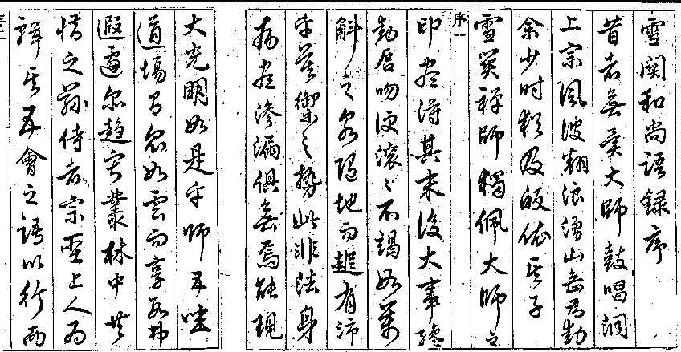
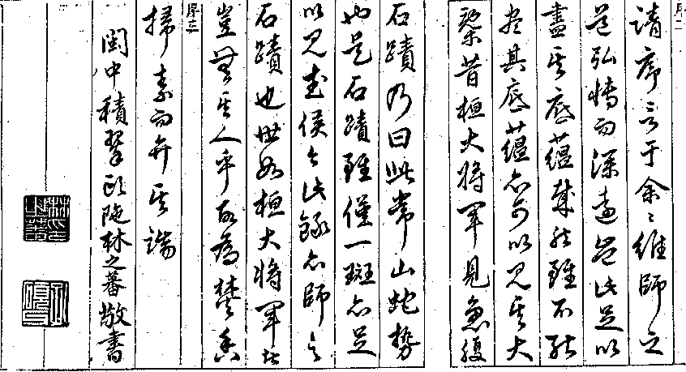

# 雪关和尚语录



> **藏经**：嘉兴大藏经（新文丰版）（嘉兴藏）　**册次** 第 27 册（J27）　**编号** JB199　**部类** 诸宗部　**卷次** 6 卷　**篇幅** 45,105 字

> **卷／品**：6 卷 · 2 品



---



## 目录



  - [雪关和尚语录序](#雪关和尚语录序)

  - [序](#序)

- [雪关和尚语录卷一](#雪关和尚语录卷一)

- [雪关和尚语录卷二](#雪关和尚语录卷二)

- [雪关和尚语录卷三](#雪关和尚语录卷三)

- [雪关和尚语录卷四](#雪关和尚语录卷四)

- [雪关和尚语录卷五](#雪关和尚语录卷五)

- [雪关和尚语录卷六](#雪关和尚语录卷六)



---



### 雪关和尚语录序











雪关和尚语录目次



------



### 序



传  

卷之一瀛山语录  

博山语录  

鼓山语录



卷之二虎跑语录  

妙行语录



卷之三拈古  

颂古  

赞  

偈



卷之四偈之餘



卷之五尺牍  

疏  

祭文



卷之六诗



博山雪关智訚禅师传



闽中西峰居士曹学佺撰



师讳智訚，上饶傅氏子，八岁丧父，母郑氏送依景德寺长老传公为童子。传公教令顶礼观音大士，一夕梦大士手摩其顶，由是泛览群书，奭然意解。一日见《坛经》「火烧海底」句，疑之，乃参礼博山来公，山令默究船子藏身公案，行住坐卧提撕不忘，偶入槽厂，行见磨鼻拽脱有省，有偈呈博山，曰：「直下相逄处，由来绝覆藏，舌头元是肉，不用更商量。」博山喜曰：「子可参禅也。」后作五颂，请寿昌衲衣，山曰：「宗门语句，如满口含冰，不曾道出水字，子风骨太露，更须死心一番始得。」师乃掩关谢客，兀坐返参凡六载，经几重㓟剥，始彻源底，偶作雪关歌，山见称善，乃为开关，有偈曰：「始行大事六年雪，顿入圆明一片冰，今日幸亲无缝塔，掣开关锁万千层。」继命首众。一日领众入室次，山垂问曰：「堂中首座，人天眼目。如何是人天眼目？」师曰：「顶门上山。」曰：「还假鉴炤也无？」师曰：「君不见。」山曰：「不虚参见作家来。」师掩耳而出。己巳受瀛山之请，瀛山古刹四壁萧然，作破院歌以自乐，相国郑公方水以诗慰之曰：「太甲之下是瀛山，依稀破屋两三间，闻师支伞过天漏，譬似杨岐雪满关。」居无何，博山和尚迁化，师奔丧。至丧事毕，众推继席，自是往来瀛、博之间，提示不倦，督学陈公懋德入山访师，置二十五问，师应答如流，陈大服膺。壬申春，予同诸公以鼓山延师结制，於是演法鼓山，玉莹珠回、玄风遐播。期满，还锡博山。丙子春，中丞余大成、司理黄端伯，以杭之虎跑请，师应之，大弘祖道，口唇才动，辄滚滚不竭，环师而听法者万指。继而妙行请师重建经营，二载大殿落成，师曰：「吾今可以谢喻弥陀矣。」丁丑秋示微恙，乃谢院事，鼓舟南迈，孟冬朔旦行抵瀛山，病体尪羸，群心汹汹，乃作遗书谢诸檀越。时寿昌阒公自博山来候，匡坐叙别悰，阒公问：「和尚安否？」师曰：「且道我生耶死耶？」阒公曰：「末后句也须分付。」师弹指一声，遂微笑而逝。弟子弘恩、成许等迎归博山，建塔莲花峰之西原。师示生万历乙酉年九月初一日，示寂崇祯丁丑年十月十一日，坐三十一夏，享年五十有三，有语录六卷。



------



## 雪关和尚语录卷一



侍者传善辑



瀛山语录



崇祯己巳，师初住瀛山，郑方水相国请开法。



初住院，示众：「昔日杨岐会禅师辅弼慈明时，师资道合、雪曲赓酬，后来却住个荒村破院，老屋败椽仅蔽风雨，人不堪其忧，师独不改其乐。衲子有请更创者，固止之曰：『尔辈出家，做手脚未稳，早已四五十岁，何暇闲工夫事丰屋耶？』翌日上堂，云：『杨岐乍住屋壁疏，满床尽撒雪珍珠，缩却项，暗嗟吁，翻忆古人树下居。』观此老，铜筋铁骨，久经大冶红炉；雪胆冰肝，坚耐岁寒节操，故能砥柱法门，力振慈明之道、中兴临济之宗，令人千载慕蔺不及也。某虽乏古人风致，然亦头脑相似，忝依博山二十餘年，媿无辅弼之才，滥膺椎拂之任。今力尽神疲，稍寻个小歇场，强来住此。瀛山破院，篱穿壁坏，日炙风吹，且与诸昆仲共吃些麤茶淡饭，过此时光，不曾将佛法二字挂人唇齿。今晚茶筵为某禅人特请开示，訚上座别无布施，聊拈一偈，以当效颦。瀛山乍住壁篱疏，冰满床兮雪满庐，受用不嫌真淡泊，家风亲见赵州无。」



端阳，示众：「江天空阔鸟低飞，鳌鼓喧阗竞渡时，两岸高声齐喝彩，看谁夺得锦标归。诸道友！弄潮作戏尚且不顾危亡，破釜焚舟必先鼓其锐志，何况生死事大，若不努力打彻，决了何期？心苟怯弱，终为落节之人；志意坚，强才是胜敌之手。虎斗龙争即不问，急水抛篙一著又作麼生？大胆驾头冲浪过，小胆难忘覆溺愁。」



浴佛日，示众：「释迦老子向无生处说生，破院道人无生可说；释迦老子向无灭处说灭，破院道人无灭可说。与麼道，释迦老子全身在生灭之内，破院道人全身跳出生灭之外。且道跳出底是？在内底是？不见古德道：『他人住处我不住，他人行处我不行，不是与人难共住，大都缁素要分明。』若向者里缁素得出，跳出底不妨在内，在内底不妨跳出，搊住释迦老子鼻孔，一任转身吐气，务破破院道人面门，岂碍簇锦攒花。何以故？无生犹是末，声色本非生，不因荷叶动，那识有鱼行。虽然如是，三十年后莫道破院道人为你诸人说梦。」



除夕，示众：「沩山大师道：『欲识佛性义，当观时节因缘。时节若至，其理自彰。』诸禅德！今夜是除夕，明旦是元朝，时节已至，作麼生是自彰之理？訚上座二十年前，如个木偶相似，寒不知寒、热不知热，桃符换不管春来、爆竹响那知腊尽，虽则如痴似懵，要且世法瞒我一点不得。二十年后，依然业识从头，寒便知寒、热便知热，迎新岁也贴门神、送残冬还烧榾柮，虽则随波逐浪，要且佛法瞒我一点不得。如今跛跛挈挈，只与麼过时光，说知也得，说不知也得，说知不知总得。何故？不萌枝上从来暗辨春秋，无影峰头几番明占气候。秪如年更岁换、腊去春来，在诸人分上还是知耶？是不知耶？若道知，未免顺俗违真，不了佛法边事，坐在尘俗境界中，谩道花枝偏有色，空劳莺语为谁娇；若道不知，又是顺真逆俗，不了世法边事，坐在净白窠臼里，只为冰坚难跃鲤，却缘水浅不藏龙。只如去此二途，毕竟怎生说个真俗双彰底道理？还会麼？鹘臭布衫都脱却，穿婆帔子拜婆年。」



问荅



僧问：「昔日黄龙，今日瀛山，法席不同，法门无二。即今龙象之中，如何是不二之谈？」师云：「眉毛分八字。」进云：「分后如何？」师云：「叠叠见青山。」进云：「见后如何？」师云：「拈却如何若何。」进云：「门里出身易，身里出门难。即今六路齐收，出门一句，求师指示。」师云：「一线通天别有门。」进云：「好个无生曲，繇来和者稀。」师云：「谁是其人？」僧礼拜，归众。



问：「世尊出世昙花现，瑞地涌金莲；和尚出世有何祥瑞？」师云：「火里青莲朵朵鲜。」进云：「还有为人处也无？」师曰：「随家丰俭。」进云：「分明踏在瀛山上，为甚麼看到瀛山早已迟？」师云：「秪识门前路，难寻殿后峰。」进云：「山后事如何？」师云：「屋顶青松绕翠屏。」进云：「更有向上玄津，乞师指示。」师云：「今日不向汝道。」进云：「为何不道？」师云：「案山未点头在。」



问：「如何是瀛山境？」师云：「千峰顶上叠青螺。」进云：「如何是境中人？」师云：「眉毛不露。」



问：「大冶红炉，炼凡炼圣；体非凡圣，作麼生炼？」师云：「烹金虽有彩，治玉本无瑕。」进云：「意旨如何？」师云：「重叠关山千万层。」



博山语录



崇祯壬申春信州众檀越及合山大众请师住博山，以四月朔旦开堂。



上堂，拈香云：「此一瓣香，气压群芳，遍空遍界，光吞万象，亘古亘今，𦶟向炉中，专为祝延今上皇帝圣寿万安　皇后齐龄　东宫衍庆，伏愿金瓯永固，满朝尽是夔龙；黄河再清，四海争歌尧舜。此一瓣香，无烟火处拈来，薰凡灼圣；没鼻孔人嗅著，彻地通天，𦶟向炉中，专为山中　檀越，外护众居士，所冀真俗不二，远继庞老之风；心境双融，大露苏公之舌。此一瓣香，价高无比，灵根占断，娑婆酷烈难当，毒气亲由洞水，今日𦶟向炉中，专伸供养　博山堂上先大师异和尚，用酬法乳之恩。」敛衣就座。维那白椎竟，师乃曰：「夫为沙门，欲荷担大法者，必须先明第一义，具择法眼，然后思所以弘法利生，於二六时中，法为家务、法为城墙、法为舟车、法为茶膳。不见祖师道：『心同虚空界，示等虚空法，证得虚空时，无是无非法。』古今悟道知识横说竖说，总是说此无是无非之法，妙在舌头不黏著肉、好眼不屑点沙，终日说有不堕常、终日说无不落空、终日说非有非无不属相违、终日说亦有亦无不名戏论，撤四句之籓篱、翻百非之窠臼，如吹毛在手，杀活自由，如明镜当台，妍媸随炤，所以道法无定相，遇缘即宗。大抵法性宽波澜阔，才是大方家接人手段，著著都有妙处。今时学做善知识为人说法者，多求其深知法体、深通法性，善说法要者如麟顶觅角无几人耳。初心参学分上，若大理未明、大法未了，必须要真实操履、真实究竟。果到此个田地，即使埋藏山谷不肯出头，自有人剜肉然灯、舍身为座，虽诸天魔梵亦将下来请转法轮，岂阐提只手能掩其太阳光辉乎！今日檀越众居士洎合山诸禅德，殷勤劝请山僧举扬博山宗旨，如将千斤担子逼上肩头，责备将来躲闪不得，山僧只得冒登此座，为诸兄弟说几句麤茶淡饭；若唤作说法，大有人笑者个虫豸在。笑则任从，且道訚上座毕竟是博山逆子耶？孝子耶？」卓拄杖云：「自从拗折撩天杖，今日重拈活似龙。」复卓一下云：「珍重。」



沙县陈秉初居士请上堂。「万水千山特地来，为缘听法请登台，山僧指示无他语，长夏山中正熟梅。昔甘贽行者入南泉设斋，仍请南泉禅师念诵，泉乃白椎云：『请大众为狸奴白牯念摩诃般若波罗密。』行者拂袖便出。南泉斋后问典座：『行者在甚麼处？』座云：『当时便去也。』南泉便打破锅子。」拈云：「甘贽入寺设斋，砒霜甜似蜜；南泉打破锅子，毒手利如锥。简点将来，父子失情，匆匆放过。今日陈居士若请山僧念诵，秪向他道：『住持事繁。』免得打破锅子伤了客情。山僧与麼道，且道与古人是同是别？」良久云：「曹溪波浪如相似，无限平人被陆沉。」



四月八日上堂。「教中道：『未离兜率，已降皇宫；未出母胎，度人已毕。』与麼说话，大似一床锦被盖孩儿，遮掩得好。诸道友！若向父母未生前觑得破，便见尽大地是释迦老子面孔，尽大地亦是诸人自己面孔，诸人自己面孔与释迦老子面孔更无差别；於此不会，却劳他从头离兜率、降皇宫、出母胎、度幻众，真个是纳一场败阙，所以初生下来，便乃指天指地，独自称尊。二千年外，却被一个跛脚阿师，要一棒打杀与狗子吃，贵图天下太平。诸兄弟！云门一棒刚要打杀释迦老子，山僧今日一棒恰要打杀云门。秪如山僧替释迦老子出气，诸兄弟！还有替跛脚阿师雪屈者麼？」众默然，师笑曰：「不是山僧逞人我，果然难得十成人。」



栴檀像成，洪惟心居士请上堂。「赵州云：『我有时将一茎草作丈六金身用，有时将丈六金身当一茎草用。』曹山问僧云：『佛真法身，犹若虚空，应物现形，如水中月。作麼生说个应底道理？』僧云：『如驴觑井。』山云：『道也太煞道，秪道得八成。』僧云：『和尚作麼生？』山云：『如井觑驴。』山僧道：善塑无如曹山，善雕无如赵老，不露些子刀痕，真个手段高妙。若会得如驴觑井，便晓茎草化作金身；若会得如井觑驴，便晓丈六金身当草。目犍连枉运神通，优填王徒烦匠巧，丹霞正令劈头行，谁道子孙贤不肖。今日是新安洪惟心居士设斋，为报荐先慈，敬塑栴檀尊像一躯，送入先师塔院供养，仍劳书币殷勤，以山僧诞辰，恳请为众说法。说法且置，毕竟造像斋僧，有何功德？」卓杖云：「不求有漏人天福，大孝全彰古佛心。」



上堂，举：「玄沙大师问镜清云：『古人道「不见一法是大过患」，你且道不见甚麼法？』清指露柱云：『莫是者个法麼？』沙云：『浙中清水白米从你吃，佛法未梦见在。』」师拈云：「此一则公案，不识者将谓玄沙不肯镜清，殊不知两尊宿旗鼓相当、埙箎迭奏，可称难兄难弟矣。所以天童老人道：『镜清久不作佛法梦也。』又云：『须是玄沙同参始得。』天童可谓善知无舌语、解听没弦琴，真个是二老赏音者也。若作胜负商量，此人未梦见佛法在。近来法门淡薄，兄弟家相见，惟叙寒温、情面款待，佛法二字绝口不谈。看他古人一唱一酬之间，如函合盖、似箭投锋，足为千古眼目。今日是五慈禅友从浙中来，以久参先博山之故，特来扫塔、设斋供众，仍请山僧上堂，激扬斯道。可见世虽末法，人尚古风，不媿为法门昆仲矣。然正眼观来不是好心，何故？你在浙中吃了清水白米，却来累及山僧偿他口债。且道口债作麼生偿？」掷下拂子云：「除是维摩老，知吾施受心。」



报荐先相国方水大居士上堂：「心眼本开，无奈空花自翳；性天廓朗，只因迷雾长昏。佛说世智辩聪是八难中之一，以学解多知遂成理障，故翻不转文字窠臼、打不破生死牢关当。其迷时，文字语言总是障道根本；及其悟也，语言文字原是解脱正因，妙在反手覆手耳。昔李渤刺史问归宗常禅师云：『须弥纳芥子，某即不疑；芥子纳须弥，莫是妄谭否？』宗云：『人人传使君读万卷书籍是否？』李云：『然。』宗云：『摩顶至踵如椰子大者，万卷书向何处著？』李复问：『一大藏教明甚麼边事？』宗举拳示之云：『会麼？』李云：『不会。』宗云：『者措大拳头也不识。』李云：『请师指示。』宗云：『会则途中受用，不会则世谛流布。』」师拈云：「万卷书，何处著？伸脚处，便缩脚。掀翻窠臼绝狐疑，真个拳头好作略，不在途中不在家，世谛流布亦不恶。」下座。



上堂：「据理而论，世法中埋没多少人，佛法中醒却多少人？争柰古德道：『佛法中迷却多少人，世法中悟却多少人？』古德此语未易搆他语脉何也？佛法固是难通，红尘扑地能有几个辊出头来？若往昔未熏般若，直须正念全提，如猛将战出重围，方可解戈卸甲。到此则太平世界任讴歌尧舜之风，清白门庭争接起夔龙之武，不碍逢场作戏，何妨借路还乡。秪要踏得稳、靠得实，然后扩为利济、广被无涯，将世法唤作佛法，将佛法唤作世法，有何不可？虽然如是，秪恐不是玉，是玉也太奇。」



舟中放灯小参：「性水澄清元无漂没，妄波鼓动遂有升沉，既迷出世津梁，不睹光明宝藏。千波竞涌，谁然照水之犀；一口吸乾，孰是倒澜之手？溺而不溺，直须跳出者层波；生而不生，转取腾霄那一步。只如白浪滔天，还有不被颠溺者麼？」良久云：「移舟不别水，举棹即迷源。」



小参：「生从何处来，死从何处去？大家业识茫茫，可怜无本可据。秪如有本可据底人又作麼生？拏住布袋口，掷却拄杖子，左手控飞龙，右手跨猛虎，乱把绣毬抛，倒踞香台舞，浪荡不归家，何彼复何此。彼此且置，秪如今夜，现前大众毕竟是业识耶，非业识耶？是有本可据耶，无本可据耶？咄！不入祖师室，茫然趣两头。」



忏堂小参：「若论本地风光，如摩天俊鹘，岂落二机；如踞地师子，全威不动。直下便见，无第二人，拟议即乖，焉容钝置。正位尚嫌尊贵，偏方岂落程途。旋风千匝打归来，机轮绝断无回互。昔三祖求二祖忏罪，二祖云：『将罪来与汝忏。』三祖云：『觅罪了不可得。』二祖云：『与汝忏罪竟。』审如是，理忏尚且不有，事忏更复何凭？假饶事理双融，便证礼佛三昧也，未知有向上事在。汝等诸人不可匆匆放过。珍重！」



茶话：「如来常寂光，如月印秋水，众生心水浊，月即被云遮。佛开净土门，岂离心境有？心净土亦净，吞却山河影；土净心亦净，击碎玻璃镜。心土二俱离，莲花出淤泥；心上二俱即，娑婆真乐国。卖花人，过野桥，香巢松鹤，唳疏枝仄，且道毕竟事作麼生？」师按指云：「东土西天，一丝不隔，今夜是郑式蘧居士入山修忏，报荐淑人张氏，有令兄尔周居士设茶供养大众，命山僧鼓两片皮。当知淑人灵爽，顿坐上品花轮，亲瞻紫磨金相去也。夜寒，珍重。」



茶话：「身心犹泡沫，世界若乾城，情想等空花，生死如梦幻，不达梦幻，无以超生死；不了空花，无以破情想；不识乾城，无以出世界；不知泡沫，无以了身心。譬如空中蜃气，许多妄认楼台；阳焰非波，渴鹿谓真是水，所以轮回苦海无有脱期。圆觉经云：『知幻即离，不作方便，离幻即觉，亦无渐次。』若能如是，究竟不妨宴坐水月道场，转此如幻法轮，降伏镜里魔军，成就梦中佛事。到此境界，则所谓如梦幻、如空花、如乾城、如泡沫者，皆如海印发光，成就游戏三昧矣。今夜郑式蘧居士追荐淑灵张氏，设此茶筵，我等饮水谢源，不可忘却檀施。且道不忘底意如何？」师乃拈起果子召众，众举首，师笑云：「不可日用而不知。」



茶话，举：「僧问云门：『如何是法身边事？』门曰：『枯桩。』又问：『如何是法身向上事？』门云：『非枯桩。』若论法身边事，知有底能知；若论法身向上事，不知有底却又知。或有个知有不知有底出来，你道此人是会得枯桩耶，非枯桩耶？」师举起茶盏云：「张三贪杯，李四酒醉，茶鍾落地，果碟粉碎。直饶晓得正按傍提，也难与睦州老人弄唇接觜。」



问荅



僧问：「和尚为人一句作麼生道？」师云：「缦天帐子，无人见笑，把鲛珠倒撒来。」进云：「三圣道：『我逄人即出，出即不为人。』此意如何？」师云：「我不似乌龟钻破壁。」进云：「兴化道：『我逄人即不出，出即便为人。』又作麼生？」师云：「也是反手卸笼头。」进云：「正当出与未出时如何？」师云：「眼横鼻竖。」僧礼拜。



僧问：「德山托钵上堂，雪峰道：『钟未鸣，鼓未响，者老汉托钵向甚处去？』德山便归方丈。此意如何？」师云：「竿头才露影，谁识转身人？」进云：「岩头云：『大小德山不知末后句。』未审不知在甚麼处？」师云：「攘羊证父。」进云：「密启其意，未审如何？」师云：「汝道他是甚意？」进云：「德山便休去，不知是何心行。」师云：「才是德山。」进云：「明日上堂，果与寻常不同。不知不同在甚麼处？」师云：「汝且道我今日上堂是寻常、是不同？」进云：「且喜老汉会末后句，不知会在甚麼处？」师云：「末后句且置，汝还见德山麼？」进云：「岩头云：『秪得三年活。』未审岩头具甚麼眼便恁麼道？」师云：「也是蝇子放卵，不顾佛头。」进云：「谢师荅话。」师不顾。



僧问：「离四句，绝百非，请师直指西来意。」师云：「千年池里鳖，一钓上竿来。」僧拟议，师云：「倒拖出去著。」



僧问：「先锋即不问，如何是殿后事？」师云：「出身虽有路，转步莫迷踪。」进云：「三军一命，重在己权。」师云：「倒跨毘卢印，横挥宝剑寒。」进云：「恁麼则四海讴歌乐有餘。」师云：「是甚麼歌？」答云：「吽！吽！」师云：「汝却解西天人梵语。」



僧问：「上来道个不审，能销万两黄金，下去道个珍重，亦销得四天下供养。若作佛法会，滴水难消；若作无事商量，眼中著屑。请问和尚如何即是？」师云：「你却销得几何？」僧一喝，师云：「秪易叱他泥犊子，难教击碎鹘仑砖。」僧云：「光透日月，明暗不收时如何？」师云：「是甚麼光？」僧又喝，师云：「莫便是光麼？」僧又喝，师云：「你只有者个结局。」便打。



僧问：「落叶知秋即不问，如何是把定乾坤句？」师云：「恰值中秋节。」进云：「不跨云桥浪里舟，因甚人在彼岸？」师云：「阇黎掉在水里。」进云：「恁麼风卷岭头云，浪翻潭底月去也。」师云：「那里学得虚头来？」僧无语，师便打。



僧问：「恁麼来时如何？」师云：「看取脚下。」进云：「不恁麼来时如何？」师云：「转身就位。」进云：「恁麼不恁麼来时如何？」师云：「撞入葛藤窠。」僧礼拜。



僧问：「如何是宾中宾？」师云：「面面扑灰尘。」进云：「如何是主中主？」师云：「猊床不露影。」进云：「如何是主中宾。」师云：「出门不上路。」进云：「如何是宾中主？」师云：「归家不坐堂。」进云：「宾主句蒙师指示，知音一句作麼生？」师云：「试唱一曲看。」



学宪陈云怡居士问



问：「蒙示末后句最为要紧，敢先问取当头一句？」师云：「掉转身来看。」



问：「眼见饿夫满前，自无粒米，陡起悲心，作何救济？」师云：「虽无粒米，倒廪倾仓。」



问：「自己与千人万人同饿，偶得半升脱粟，还食自己、还食千人万人？若食自己，安能独餐？若食千人万人，如何分饱？」师云：「偪塞虚空，何分饥饱。」



问：「咒咀诸毒药所欲害身者，念彼观音力还著於本人。东坡居士杜撰改还著句云：『大家都没事。』俗眼观之，却是大士憯刻东坡。平等慧眼观之，如何领取？」师云：「笑倒补陀岩。」



问：「跛鳖曳尾泥中，脚脚著地；神龙夭矫云际，首尾无踪。两者孰实孰虚，孰胜孰劣？」师云：「深含独占更加参。」



问：「眼见分明，不肯全身拶入，过在甚处？」师云：「夜鼠愈走，冻蝇不飞。」又云：「过在不肯处。」



问：「多生来一领贴肉布衫如何即脱？」师云：「要脱作麼？」



问：「家珍虽不被劫，偷儿时来零窃，如何勦除？」师云：「一齐飏下著。」



问：「弹无弦之琴，唱希声之曲，急切觅不得一个半个知音，请问博山三十年来知音有几？」师云：「蒙此一问，直待案山点头。」



问：「廓今无问，师作何答？」师云：「早知居士有此一问。」



鼓山语录



崇祯壬申，总宪能始曹公、农部得山林公及众乡绅，请师于福州鼓山涌泉禅寺结制，以六月初三日入院。



上堂，拈香云：「此一瓣香，端为祝延今上皇帝圣寿万安，伏愿　一人常有庆，万国永无虞。此一瓣香，专为山中　檀越护法、宰官居士，伏愿作儒宗之柱石，为法苑之金汤。此一瓣香，专伸供养　博山堂上先大师异和尚，少酬法乳之恩。」就座。白椎毕，师乃云：「若论佛法，如蚊子上铁牛，无你开口处，未免权向第二门头说个譬喻去。若要造进此道，如人行路一般，必先寻一条直捷路上行，更要向差别路头一一透过始得。秪如山僧在博山束装出门，诸兄弟有先从柘浦抵芝城，顺舟而下，不数日便到鼓山，何等快捷。山僧从鹅湖穿马岭，经寿昌、登广福、涉镡津，其间历峻岭而千盘、经回溪而百折，所过州城，纷人士香花之接，遍游兰若，观丛林法化之仪，经六十餘日，始到鼓山，何等曲折。若论一踏便到，诸兄弟诚得便宜；若要曲尽逶迤，须学山僧，重重经过险难始得。今人参学，多喜直捷理会，不知果有见处，更要透过差别关头，始具决择法眼，然后清机历掌、珠滚盘圆，万化从心、兵随印转。咄！此总是途路边事，料掉没交涉。且到家一句作麼生道？大众！无事各自归堂好。」



结制上堂：「乱意猿奔树，尘缘马过桥，不到心空处，何日得开交。所以古人立个期限，要你向瓮中捉鳖。诸兄弟！直须内不住心、外不住境，黏胶既脱、窠臼掀翻，果到心境双亡，正好通个消息。若有露得消息者，山僧当拭目以待。咦！龙门高万仞，腾跃是何人？」



诞日上堂，僧问：「象赴龙奔，各趋庆贺，请问和尚年多少？」师云：「与拄杖子同年。」进云：「然则不历春秋度，常延不老春也。」师云：「狸奴白牯自知时。」僧礼拜归位。师乃云：「业风吹堕阎浮界，肉袄频经脱换来，觑破未生前面目，方知露柱是娘胎。教中道：『诸法不自生，亦不从他生，不共不无因，是故说无生。』山僧道：诸法从自生，亦复从他生，亦共亦无因，说甚麼无生？诸兄弟！若向教中意会去，如斩开荆棘，指出一条大路；若向山僧句里会去，如不动旗鎗，便尔就路还家，所谓发足有殊到家则一也。」僧出问：「和尚因甚麼忘却生身父母，与露柱作儿？」师曰：「苗从地发，花借春开。」便下座。



解制上堂：「诸兄弟！九十日期今已满，闭门作活事如何？不曾捏杀猕猴子，重叠关山未易过。大抵末法禅期，真参罕遇，纵他意树抽枝，未见心花成片。虽然如是，冷灰里岂无一粒豆爆！还有不跨石门扶竖晏祖门风者麼？如无，且向芦花深处宿，月明穿过钓鱼台。」



元旦上堂：「春色无分新旧，年光岂有去来，洞见刹那三际，从他叶落花开。不见白杨顺禅师道：『染缘易就，道业难成。』不了目前万缘差别，秪如昨日唤作除岁，今日唤作元朝，浮字虚名，凭谁安得？若乃千门爆竹，使大地而惊雷；万户桃符，替虚空而挂彩，银烛透纱笼之影，铜瓶簪杨柳之春，堂奏管弦响送木人之耳，炉烧榾柮威袪石女之寒，景物森然，风光满目。若唤作目前底法，则心外别有境象；若是自家屋里事，如何领略此段生涯？还委悉麼？根尘元是吾家宝，无柰空花翳眼珠，果尔斯须常返照，自然不到丧居诸。」



茶话：「吃茶知是茶味，吃饭知是饭味，因甚麼又道『人莫不饮食，鲜能知味。』不见僧参赵州，州问：『曾到此间否？』僧云：『已到。』州云：『吃茶去。』又问一僧：『曾到此间否？』僧云：『不曾到。』州云：『吃茶去。』监院问云：『和尚因甚麼到也吃茶、不到也吃茶？』州唤院主，院应诺，州云：『吃茶去。』诸禅德！若知赵州三度茶话，则茶味饭味彻底皆知。诸兄弟！须知此茶不论主宾、宁拘好丑，南北东西各一杯，虚空浇湿眉毛皱。大众！夜寒，珍重。」



茶话：「乾坤靡久停之客，红颜无可驻之丹，日月穿眼底之梭，人命似急流之水。伶俐汉抖碎虚空，蓦翻筋斗，便好向急水滩头下得脚稳，就无阴树下终日打眠，然后拈来，世谛总是昙花转步，尘劳无非华藏。诸道友！果能到此境界，不妨道个处处绿杨堪系马，家家有路透长安。」



辞众茶话：「山僧今晚借龙泉上人一杯茶与诸君告别。当知山僧来也不曾出博山，去也不曾离鼓山，纷纷尽是拖泥水，动念无端滞往还，总是情关不破、识浪难乾，所以把手忍分、判袂愁诀，当知道人分上却不其然。不见进山主云：『来来实不来，途中好善为；去去实不去，路上莫亏危。』若知得山主底意，便知訚上座不离丈室常在途中，不离途中常居丈室。还委麼？杖头踏尽纵横路，遍坐青山作道场。」



水口兴济堂请小参：「来从渊关来，去从渊关去，来去自奔波，渊关浑如故。不见祖师道：『万法本闲，唯人自闹。』若知闹底即是闲底，便见灯花灿烂，色不关情；若知闲底即是闹底，便听箫鼓骈阗，声非碍耳。何以故？有物为物，则被物物碍；膺尘本非尘，则可尘尘合道。」举起拂子云：「拂子是尘，唤甚麼作道？拂子是道，唤甚麼作尘？」掷下拂子云：「还知麼？关津虽放过，不许贩私盐。」



又夜请说茶话：「至道无文，至理无说，无说无文，是何妙诀？闭户造车，出门合辙，如豹泽毛，如龙蛰穴。鼓浪乘风，江河倒决，转妙旋玄，其机始彻。一棒当头，破皮出血，担版不圆，只得者橛。机权变化，不思议舌，会尽淆讹，众流可截。且道截断众流底人是何手段？不曾过水口，那识是渊关。」



黯淡寺请小参：「禅非放意可参，道非矜持可得。矜持则心头常惴，安能顺水张帆？放意则绳头不紧，焉能逆风把柁？如人未过黯淡滩头，未免心惊险堕；既过黯淡滩头，便乃放身倒卧。如此参学，终有矜放之失，安契中道之妙。惟智者善能陆地行舟、空中走马，夷险皆如，逆顺何讶。且道因甚麼得如此稳便？移舟不别水，举棹即迷源。」



开元寺请小参：「古德悟道偈云：『一拳拳倒黄鹤楼，一踢踢翻鹦鹉洲，有意气时添意气，不风流处也风流。』惭愧古人露手露脚，鼓粥饭气，大似个白拈贼。殊不知天关未转、地轴未旋，徒尔惊群，难极底蕴。訚上座则不然，展开坐具包群象，抖擞袈裟裹太虚，六臂三头夸好汉，轮王未与髻中珠。何也？大方无轨则，应物任偏圆。」



董岩请小参：「道人用处如风行空，理透彻而意自玄，机虚闲而神自王，一任神驹蹴踏，还如灵鹤翱翔。盖得无心於事、无事於心，自然虚而灵、寂而妙，不拘修证，宁滞有为？诸兄弟！若欲得此受用，直须绳头紧把，自然透出重关。且道透出关外底人是何作略？天容难覆载，器水逐方圆。」



------



## 雪关和尚语录卷二



侍者传善辑



虎跑语录



崇祯丙子春，司理海岸黄公、中丞集生余公，洎武林众缙绅居士，请师于虎跑定慧禅寺结制。



开堂，师升座拈香云：「此一瓣香，氤氲结而地天交泰，盘旋覆而海岳春融，𦶟向炉中，端为祝延今上皇帝圣寿万安，前星朗耀、后岳齐高，伏愿　皇仁浩荡，与日月齐明；　圣历绵延，等嵩叶永筭。此一瓣香，瑞接空中紫气、香分劫外优昙，恭为　满朝文武、　合郡宰官、　虎林护法居士、信心檀越、诸山耆宿、本寺监院众执事，伏愿道标峻揭，长为法海神龙；愿驾高骖，允作清朝仪凤。此一瓣香，吞吐千秋灵气、含藏刹土风光，专为供养　开山寰中大师，伏愿玄风再振，少林开无影之花；法苑重新，大树垂普天之荫。此一瓣香，杂毒为九，祖佛也须蛊杀；旃檀和粪，贵贱不许论量，恭为供养　博山堂上先大师异和尚，仰酬法乳之恩。」敛衣就座。维那白椎竟，师乃云：「今日升座，诸方龙象拥集，肩挨脚拶，推倒香台，直饶你向千人丛里翻身、万人队中跳出，还须与老僧把手同行始得。还有麼？如无，老僧打葛藤相谩去也。若论参学，似登峰者必须造极、溯流者决要穷源，莫同流俗专学乱统。秪如此一坐具地，乃唐开山寰中大师道场。者老汉脚踏实地，不弄虚头，舌拄梵天，掀翻到底，故其垂示云：『说得一丈，不如行取一尺；说得一尺，不如行取一寸。』者般言句，如开一副大炉鞲，秪要铸成纯钢汉子、打就生铁心肝，方能了死脱生、成佛作祖。汝若说得行不得，如空谭楼阁，终无结搆之功。汝若行得说不得，如灵雏在壳，未成啐啄之用。汝若行说俱到，则知果熟曾经霜久、瓜甜原为地肥。汝若行说俱不到，此是不唧浏汉。诸兄弟！三世诸佛百千祖师在汝脚跟下荅话已久，若更想些胡荅乱问，来寻老僧斗觜弄舌，非但迟了八刻，何曾梦见汗臭气在。当此之时，真风莫挽、颓波日靡，观禅宗凋弊、与世界涂炭，俱可痛哭流涕。所以山僧到淛中来，蒙合郡宰官、洎诸山名宿敦请开堂，意在因邪打正，止法门互诤之风；点铁成金，消末劫兵荒之苦。诸兄弟！必须真参实悟，究竟到头，方得个大透脱时。如其未悟称悟，非但瞒却他人，却是欺瞒自己，尽是泥犁种草、波旬眷属，千佛出世亦救你者般东瓜茄子不得。虽然如是，山僧到者里开个舖面，且道图个甚麼？抛纶为钓鲲鲸族，小小虾蟆谩上钩。」



上堂：「老苍天，靠你住，昨日难防今日事。花妍柳嫩正骄春，晴空霹雳生风雨，剌剌金蛇扑地飞，岩泉迸溜峰攒雾。雨过天清日出头，始知变态常如故。不如故，岂不见雪窦老人道：『大丈夫先天为心祖。』」



净慈寺上堂：「山僧出虎跑三门，赴闻尊宿洎合郡众宰官居士湖上放生之约，不意偶过净慈诸公，却转请上堂，不知是何心悻？然虽如是，不妨借路经过。夫肖翘爱命、蠕动贪生，业最惨于杀伤、慈莫深于救护。一夫骛渔猎之利，何止戕百万生灵？一家奉蔬水之餐，亦足活无限物类。夫何全无不忍之心，甘填难满之腹，宾筵殚水陆之珍，食品耗万钱之费，既乏同体之悲，焉无反噬之报？因中失悯，果亦无怜，所以年来杀戮遍行、生民涂炭，良有以也。惟仁人君子能全恻隐之风，活路生机原开仁寿之域。是以西湖胜集，众善骈臻，轮月放生群公佳举，可以续云栖大师悲深愿广之法乳，庶不孤瓶匋尊宿利生接物之盛心。所以太师翁云：『若恩周多命，则大积阴功；或惠及一虫，亦何非善事。』即此祝　圣历绵延之筭，共抒忠诚，转寰宇太平之风，阴裨王化。秪如永明大师道：『高低岳渎共转根本法轮，大小鳞毛普现色身三昧。』还有知得永明老人落处麼？」海岸居士云：「请问和尚如何是色身三昧？」师云：「飞者飞，跃者跃，是个甚麼？」进云：「如何是根本法轮？」师云：「能为万象主，不逐四时凋。」进云：「护生须是杀，杀尽始安居。毕竟杀生是、放生是？」师便喝。进云：「果是作家。」师云：「念汝尊官，饶过一掌。」士礼拜，师下座。



孝廉闻子将等请上堂：「钱塘江上春风起，三月桃花翻浪势，五云山里众鳞龙，风雷特地催烧尾。禹门万丈跃烟霄，振鬣掀鬐鼓异涛，不但丰年霖雨足，吸乾鲸海巨波消。而今得个权栖泊，相将盘踞炊香阁，倒卷珠帘转步来，面前颗颗骊珠烁。且道是甚麼人为他点眼？」良久云：「水晶宫殿杳，淡墨也难描。珍重。」



孝廉唐祈远居士请上堂。祈远居士问：「如何是参禅入手处？」师云：「吾常於此切。」进云：「如何是参禅险难处？」师云：「一一经过始得。」进云：「如何是参禅得力处？」师云：「把定乾坤。」居士礼拜退。又一僧出问云：「和尚是个饼面舖，趁炉灶热再搭一个。」师云：「你问来。」僧乃问：「如何是参禅入手处？」师云：「截千人之头臂，剜万人之心肝。」进云：「如何是参禅险难处？」师云：「拆佛殿、毁魔宫。」进云：「如何是参禅得力处？」师云：「逆水船开顺水风。」乃云：「诸兄弟！者些荅话，虽是搬他闲骨董，也不曾思索出来。不见洞山雅禅师云：『言无展事，语不投机，乘言者丧，滞句者迷。』他家是透顶彻底的人，临机应用洒脱非常，不似今人要句句投机，却被言句碍杀。径山老人道：『赵州禅只在口唇边。』山僧道：赵州禅如神庙里签，千掣千圣，万掣万灵，初不曾安排吉凶，使人规避祸福也。方山老人道：『得意者所说皆是，失意者所言皆非。』若以是非得失而论古驳今，山僧绾上眉毛一任诸方贬驳。」卓拄杖，下座。



解制，上堂：「山僧手脚[(申/八/女)*頁]园丁，日午浇瓜惯不曾，今日根芽舒遍地，春风引上石瓠棚。秪如水到渠成、瓜熟蒂落，还有人道得底麼？一月期场云里过，天明分晓各归巢。」



小参，师拈拄杖，举：「芭蕉清禅师云：『你有拄杖子，我与你拄杖子；你无拄杖子，我夺你拄杖子。』芭蕉老汉扳例随条、就窠打劫，要且无为人处。山僧则不然。」竖拄杖云：「只个拄杖，不与不夺，拄地撑天，如龙之活。然虽如是，非但芭蕉结舌，山僧亦结舌有分。且请拄杖子为众说法。」卓拄杖云：「还闻麼？」众无语，师云：「大地是聋人。」



小参：「诸禅德！情乾识漏，错认法身，言滞句迷，焉离毒海？法身边事犹可以依稀彷佛，法身向上事有几个自在纵横？高峰老人偈云：『海底泥牛啣月走，岩前石虎抱儿眠，铁蛇钻入金刚眼，昆仑骑象鹭鸶牵。』会得此一偈，则炤用料拣，棒喝交驰，正好作曹洞儿孙。洞山老人道：『五台山顶云蒸饭，佛殿阶前狗尿天，刹竿头上煎𫗰子，三个胡狲夜簸钱。』会得此一偈，则偏正妙协，机位环旋，正好作临济儿孙。恁麼道大似搓圆捏匾，换柱移梁。或有个乾嚗嚗底问山僧：『又作麼生？』规圆方竹杖，漆却没弦琴，家活临时用，安排便不真。」复笑云：「也只八成。」



龙居永庆禅堂示众：「植根不固，必无銕干虬枝；力量不充，焉易摧峰抒海。贵在深参极究、历远穷高，事境与理境齐彰、行到与说到俱畅，然后圆机普应不滞一隅，信手拈来、信步踏著、信口道著。若以浅识劣根剽窃称禅，何异将瓯盛水空拟大洋？」



扫寰中大师塔，「拈尺论丈，量空之手；鸣金戛玉，希世之声。感神虎而跑泉，翻移海岳；逐神驹而出厩，蹴踏风云。今日窣堵坡前，恍然觌师真面。且道觌面事如何？参差烟树里，翠滴晓风寒。」



问荅



僧问：「木佛度火时如何？」师云：「添上榾柮著。」进云：「金佛度炉时如何？」师云：「看取焰中轮。」进云：「泥佛度水时如何？」师云：「脚跟不曾湿。」进云：「为甚麼真佛内里坐？」师云：「闭门打瞌睡。」



僧问：「如何是城里佛？」师云：「城外有。」进云：「如何是山里佛？」师云：「市上有。」进云：「如何是家里佛？」师云：「老僧不在此坐。」



僧问：「如何是净土？」师不答。僧又问，师亦不答。居士见而问云：「如何不答？」师云：「若答他，是土上加点，便不净也。」



余集生居士问：「禅净兼修者，为当先参禅而后修净土？为复先修净土而后参？」禅师曰：「此问甚为泥於融会者，必须甄别。若初心参学，宜求一门深入，不可脚踏两船。参禅则单提一句公案，彻悟本地风光；念佛则单提一句弥陀，究极惟心净土。然后融禅入净，似一毫致於太虚；融净入禅，譬一滴投於巨壑，可谓野色更无山间断，天光直与水相通。若先系缀两头，用心不一，则两端交战於胸中。佛不云乎『制之一处，无事不办。』此可证也。」



妙行语录



崇祯丙子春，司理海岸黄公、中丞集生余公，洎武林众缙绅居士，请师重兴妙行禅寺，以三月念五日进院。



天王殿：「不动而升。」普光明殿：「帝网幢前与麼相见。」



伽蓝殿：「明月为廊，清风作殿，拈起锄头，从头翻转。然虽如是，善建者不拔。」



祖师殿：「万派千枝，源头一线，信手拈花，无人能荐。咄！」云：「展。」



佛殿：「玉殿苔封不带埃，珠林宝网镜光开，世尊犹自拈花笑。且道笑个甚麼？咦，笑有个人重来。」



上堂，指法座云：「作礼灯王，借此宝座，大家有分，得坐便坐。」遂升座，拈香祝　圣竟，敛衣就座。维那白椎毕，师乃云：「生平不学杨岐老，破院风光却俨然，薄福又来湖墅寺，起炉搭灶竖空拳。枣柏大士道：『法无定相，遇缘即宗。』山僧在博山出门，不知有虎跑底事；在虎跑开堂，不知有妙行底事。今日受请而来，大似梦境相似，著一毫念头预为不得。此喻弥陀一坐具地因缘成，既有坏废必当兴。山僧业债难逃，忽然落魄至此，倘藉众缘或可济事。然则缘之一字，安排不得、躲避不得，所以古人云：『万般从此道，一味信前缘。』」拈拄杖云：「秪有拄杖子不属因缘，本无成坏，亦不用安排躲避，却能为一切众生之所凭靠。山僧涉水登山全承渠力，拄地撑天岂更由谁？倚在禅床角则声臭俱无，拈出法堂前则乾坤搅动。诸人还知麼？将此深心奉尘刹，是则名为报佛恩。」卓拄杖，下座。



黄海岸居士封翁八十诞，会城众宰官居士请上堂。海岸居士问：「寿等虚空是何人？」师云：「量过虚空者。」进云：「虚空如何过？」师云：「出门先辨路，转步按飞云。」进云：「恁麼则过了也。」师云：「切忌撞倒烟楼。」士礼拜，师乃云：「海岸居士两任淛中司理，投钱饮水，清畏人知；决谳平反，视民如子。其尊翁自昆居士，亦尝令建德。先后美政，俱擅循良，可见趋庭义方，别有家传矣。今首夏初三日，乃封翁八十华诞，武林众士绅，想其人、颂其德，无以效华封之祝，因各以衣裓盛诸香花，诣妙行禅院，请转法轮，以祝封翁无量之寿。山僧道：以法为亲，以慧为命，不但父子同条，亦乃祖佛齐证。如胁尊者八十出家，老赵州八十行脚，全凭者个风流，趁入花藂矍铄。非特此二老也，一切诸佛诸祖，以及自昆居士、海岸居士，亦无不凭者个而入大光明藏，成就世出世间诸大功德也。功德且置，秪如今日因斋庆赞一句，又作麼生道？无根树子无今古，果熟香飘溢寿筵。珍重。」



康蓝田居士请上堂：「昔喻弥陀斋三百万僧，辟此道场，与天宫斗丽。师乃地位中人，见地超旷，行果因花，成此一大功德海也。今有蓝田居士好善乐施，以饭僧为佛事。今日是居士设斋，报荐先君康思萱、先妣萧氏，一门宗族，俱证莲胎。山僧自惭德薄，难消信施供养，众中要选个无事道人出来酬他信心斋供，且道那个是无事道人？不见古德道：『眼里著不得沙，耳里著不得水，个是无事道人。』又有道：『眼里著得须弥山，耳里著得大海水，个是无事道人。』雪窦道：『恁麼也不得，不恁麼也不得，恁麼不恁麼总不得也。是个无事道人。』山僧道：三个无事道人总是不唧浏汉，要消施主供养依旧还难。且道毕竟是甚麼人消得？」师指露柱云：「露柱呵呵开口笑，横吞倒吐肚皮宽。」



结制上堂。僧问：「解结即不问，如何是衲僧向上事？」师云：「何不向下会。」进云：「向下事又作麼生？」师云：「井底虾蟆飞上天。」乃云：「他弓莫把，他马莫骑，▆线直路不许人知。诸兄弟！清心禅堂是个系驴橛，祖师公案是个葛藤桩，四海禅和是一緉破草鞋，天下善知识是一味断肠草。直须斫倒系驴橛，拽断葛藤桩，掷却破草鞋，拈却断肠草。果能具此知见、有此作略，不妨千峰顶上却在十字街头，十字街头却在千峰顶上，绕他华藏世界百千万匝，依然止在一毫端。如其不然，且向一线直路行去好。珍重。」



谢众居士斋小参：「世间饮食，若还吃得消不得，是可忧底事；维摩香积饭，吃得消不得，却是好事，秪要吞得下、吐得出，便是超方出格手段，非但能消四事供养，亦可消得万镒黄金。假饶有个不吞不吐底出来，且道将何供养？薄批明月浑闲味，细切清风更是奇。」



问荅



僧问：「一天法雨洗兵威，今日重辉古殿基。如何是古殿基？」师云：「不见绿苔生。」



问：「今日大开炉鞲煆炼圣凡，有个纯钢打就、生铁铸成底汉子出来，还受煆炼也无？」师云：「也要脑后一锤。」



问：「高高山顶立时如何？」师云：「岩颠惊石坠。」进云：「深深海底行时如何？」师云：「水怒浪花翻。」僧礼拜。



问：「倩女离魂事如何？」师云：「月淡花移影。」进云：「未审他是业识、是意生？」师云：「风摇水作波。」进云：「毕竟是一个、是两个？」师云：「急急如律令。」



问：「佛法无多子，久长难得人。既无多子，更教人久长，是何心悻？」师云：「若不久长，争知无多。」



问：「古人道：『鱼不识水、鸟不识风、迷不识性、悟不识空。』此意云何？」师云：「所供诣实。」



问：「劫火洞然，大千俱坏，未审者个坏不坏？」师云：「添起一堆柴。」



问：「云居打沙弥，意作麼生？」师云：「非父不生其子。」进云：「如何是不呈底句？」师云：「贼赃已露。」



茹无拣居士问：「鸳鸯绣出从君看，不把金针度与人。如何是鸳鸯？」师云：「一双扑地恁孤飞。」士云：「如何是金针？」师云：「从来不度。」士礼拜。



楚黄宋心白居士四问



问：「十方如来於十八界一一修行，皆得圆满无上菩提，文殊选根独取耳根，何也？且既曰返闻则不取音声，即千二百功德与八百功德皆非所论，何得以耳根独利於圆通耶？又所谓逆流果，收视返听否耶？若曰返闻自性，则自性有何境界耶？抑于无可指示中有可指示否耶。」



师云：「独取耳根者，以音闻乃此方逗机之要，故独选耳。如文殊云：『此方真教体，清净在音闻，欲取三摩提，实以闻中入。』是也。返闻自性者，非但不取音声、不论功德，自性境界著不得个元字脚。逆流者即入流，其实即返闻意，与收视返听不别。自性无性，何境界之可拟？盘山道：『向上一路，千圣不传。』若道有指示，即传也；若道无指示，争奈又有向上事？居士但恁麼做去，若得到日，如人饮水，冷暖自知，不用问人也。」



问：「观音云：『我从闻思修入三摩地。』又云：『初於闻中入流亡所。』此二闻字同耶、否耶？窃谓思则不亡，亡则不思，妄则不宜于思，真则不宜于亡。今既曰思，又曰亡，果何思何亡耶？且动静二相了然不生，则闻与不闻皆非所计，何必曰『从闻入』『於闻中入流亡所』耶？」



师云：「闻具能所，根是能闻、尘是所闻，从闻之闻，具师资义，谓从师得闻音教，然后思修证入，则未入流前闻中兼所，入流之后独有根存，故云：『亡所也。』又来问『思则不亡，亡则不思』，此正不审思为何思？亡为何亡？教家有分三慧以疏经者，谓闻慧、思慧、修慧，以诱人循循而入。所云亡者，亡其缘所之声，未亡能闻之根。及乎所入既寂，动静二相了然不生，此亦只是打叠声尘乾净。如是渐增，闻所闻尽，才显能所双寂。到此境界，则能闻所闻俱不生也。经本文亦自层次分开，如云『初于』，又云『渐增』，又云『尽闻不住觉所觉空』。长水释云：『尽闻之处，即思慧为体，亦名为觉。』至云：『觉所觉空者，非但遣却闻慧，即思慧亦不立矣。』又云：『空觉极圆者，泐潭标此处修慧现前也。又空所空灭者，此修慧亦遣也。前三慧未空，宛成生灭，此三慧俱遣，顿入圆明。故下文云「生灭既灭，寂灭现前。」』又璇师分此段经文为四：一亡前尘、二尽内根、三空观智、四灭谛理。然则亡所之亡，亡前尘也。尽闻之尽，尽内根也。空觉之空，空观智也。空灭之灭，灭谛理也。寻绎斯旨，则曰思曰亡，非谩无阶梯，其中有观炤差别之异，如嚼蔗味，渐入佳境。若必如居士所谓亡则不思，思则不亡，此又似今时拍盲禅人蔑裂教网混同作解，不顾教家销文有次第、科经有节目，翻被渠笑为杜撰。又来谓『妄则不宜於思，真则不宜於亡』，此亦正坐前惑，殊不知思则观智深入，善销能所之妄，何得不思？真乃寂灭现前，顿亡生灭之见，何谓不亡？又来问『动静二相了然不生，则闻与不闻皆非所计，又何必曰从闻入于闻中入流亡所耶？』此说亦是未明前意；若明前意，当不复有此疑也。若不从闻入，何由得见动静二相了然不生乎？」



问：「生灭去来本如来藏，又曰性真常中求於去来，迷悟生死了无所得，不两相反乎？又如而如来藏本妙圆心，非心非空，以至非常乐我净，即如来藏元明心妙即心即空，以至即常乐我净，皆两相反，何耶？岂所指性有二、心有二耶？抑五阴法尘所指有二耶？不然终于非即，本无二义不明也。」



师云：「迷则起众生见，见有生灭去来，则如来藏性随为生灭去来矣。悟则本如来藏，求其生死去来了无所得，则生灭去来皆合如来藏性也。以迷悟相翻似反，若知真妄无别，则非反也。又如来藏有三：初显空如来藏离一切相故俱非，次显不空如来藏故俱即，三显空不空如来藏故离即离非、是即非即，此合中道义。以阿难首请妙奢摩他最初方便，世尊至此圆荅三谛，始酬前案。居士详此，则来问非即本无二义，无不洞然明了，更不疑性有二、心有二，及五蕴法尘有二也。居士初疑其两反者，盖不闻双即双离之妙，故惑非即差岐、依违介念。佛告富楼那云：『汝以色空相倾相夺於如来藏，而如来藏随为色空周遍法界；我以妙明不生不灭合如来藏，而如来藏惟妙觉明圆照法界。』泐潭谓『此妙用如水投水，不分能所，繁兴大用，起必全真。』要以不思议心得不思议用，则三谛妙义皆日用中事，拈来无不是用处。莫生疑，一涉思惟，徒劳卜度。」



问：「以是因缘，世界相续，两仪未生之先，妄想因缘何人何自而有生耶？」又云：「诸佛如来妙觉明空，何当更出山河大地，则此世界诸佛所不容，不亦留碍乎？且山河大地不生则同混沌，又何以成世界耶？」



师云：「居士问两仪未生之先，妄想因缘何人何自而有生耶，此问大似演若迷头狂性未歇耳。岂不见温陵云：『世界、业果、众生，皆妙心影子，如镜中头，分别则妄；不随分别，则狂心自歇也。』所以本经亦自断案明白道：『汝但不随分别世界、业果、众生三种相续，三缘断故三因不生。』又云：『妙净明心本周法界。』审如是，则众生界全是佛界，以迷妄故，虚空世界生起纷然；妄尽归源，则山河大地纯是一真法界。然则两仪未生已前，早个依正互严、生佛齐现，唤作无生犹不可，唤作妄想因缘又可乎？又岂可落在顽空作断灭想，将谓佛界成则不容有众生界乎？矧又疑山河大地不生则混混沌沌不成世界乎？此问正似满慈腾疑，细研佛荅，则所惑自袪。昔长水璇师问琅琊：『清净本然，云何忽生山河大地？』琊凭陵荅云：『清净本然，云何忽生山河大地。』璇师从此悟入。居士兼参此旨，则即时豁然，便得本心，不俟予叨叨饶舌也。」



------



## 雪关和尚语录卷三



侍者传善辑



拈古



陈操尚书一日斋僧，躬自行饼，一僧展手拟接，公却缩手，僧无语，公曰：「果然，果然。」又问僧：「有个事与上座商量得麼？」曰：「合取狗口。」公自掴口，曰：「某甲罪过。」僧曰：「知过必改。」公曰：「就阇黎乞取口吃饭得麼？」一日同众官登楼次，见数僧行过，一官人曰：「来者总是行脚僧。」公曰：「不是。」曰：「焉知不是？」公曰：「待近来与勘过。」及僧至楼前，公蓦召上座，僧皆举首，公曰：「不信道。」



拈曰：「陈尚书之机辨，峻比云门，辣似睦州，盖从二师处得来，故纵夺临时、杀活自在，真宗门入作，所以下刃最紧也。还识尚书麼？电火难追影，风雷莫辨真。」



韩文公问大颠(云云)。



拈曰：「首座眼亲，颠师手快，一般抵对佛法，妙在见几而作、据款结案，也是正令当行，不为屈棒。文公犹是俗汉，当时若开眼，未免傍观拍掌。还知大颠打首座意麼？翻云全在我，覆雨更繇谁？」



高仲贻太傅参芙蓉楷禅师，蓉令去其所重。扣己而参，一日忽造微，密呈偈曰：「悬崖撒手任纵横，大地虚空自坦平，照壑耀岩不借月，庵头别有一帘明。」



拈曰：「此老所诣处坦夷明白，可谓山河大地不碍眼光；若要摆手过漳江，更须撤却帘儿相见始得。假如相见时如何？家庭才转步，道路又分携。」



洪州许刺史式，一日与泐潭澄上蓝溥坐次，潭问：「闻郎中道，夜坐连云石，春栽带雨松，当时荅洞山甚麼话？」公曰：「今日放衙早。」潭曰：「闻荅泗洲大圣在杨州出现底是否？」公曰：「别点茶来。」潭曰：「名不虚传。」公曰：「和尚早晚回山。」潭曰：「今日被上蓝觑破。」蓝便喝，潭曰：「须是你始得。」公曰：「不奈船何，打破戽斗。」



拈曰：「贼来须趁，客来须待，一个引玉抛砖，一个埋兵掉斗，无端殃及上蓝，真个是不奈船何，打破戽斗。要识三大老面目麼？琵琶随手拨，箫鼓应时鸣。」



黄山谷居士初好作艳词，得圆通秀禅师激发，遂悔过绝笔，后参晦堂，因闻木樨香释然。



拈曰：「吾无隐乎尔，桂子月中落；尔无隐乎我，天香云外飘。山谷不遇晦堂，鼻孔撩天，搊他不住；虽然荐得些子，争奈脚跟红线犹未断在。何也？路头才撞入，关锁转难通。」



山谷居士因谒死心禅师，随众入室。心见，张目问曰：「新长老死、学士死，烧作两堆灰，向甚麼处相见？」公无语。心约出曰：「晦堂处参得底，使未著在。」后左官黔南，道力愈胜，於无思念中，顷明死心所问。报以书曰：「往年尝蒙苦口提携，长如醉梦，依稀在光影中，盖疑情不尽、命根不断，故望崖而退耳。谪官在黔南，道中昼卧，觉来忽尔寻思，被天下老和尚谩了多少，惟有死心道人不肯，乃是第一相为也。」



拈曰：「铁面去皮，晦堂析肉，死心又敲骨出髓矣。山谷居士悟入深奥，得三尊宿炉鞲之力也。秪如疑情尽、命根断，死心道人还肯他也未？铁壁从渠透，银山更要通。」



寺丞戴中孚咨扣灵源，一日有省，以偈呈清禅师曰：「杳冥源底全机处，一片心花露印纹，知是几生曾供养，时时微笑动香云。」



拈曰：「穷源见底，灿露一片心花；微笑破颜，知是多生供养，果然稳当，头尾完全。若要撒得开、捏得聚，须更穷尽变化始得。」



左丞范致虚繇翰苑守豫章，过圆通谒旻禅师，茶罢，曰：「某行将老矣，随在金紫行中去，此事稍远。」通召内，翰公应诺，通曰：「何远之有？」公跃然曰：「乞师再垂指诲。」通曰：「此去洪都有四程。」公伫思，通曰：「见即便见，拟思即差。」公乃豁然有省。



拈曰：「圆通老人可谓有囊中妙药，能起死回生在顷刻耳。今宗师家未尝施此国手，便谓外护沉痼莫疗，不亦冤哉。左丞虽於此省入，去此事不远，争奈乡音犹易识，家国尚茫然。」



尚书莫少虚因宦游西蜀，谒南堂静禅师，咨决心要。堂使向公案上提撕，无所入。适如厕，忽闻秽气，急以手掩鼻，遂有省，即呈偈曰：「从来姿韵爱风流，几笑时人向外求，万别千差无觅处，得来元在鼻尖头。」堂印之。



拈曰：「万别千差无觅处，得来元在鼻尖头。虽是苦心造到，简点将来犹带些秽气在。何故？为他向厕坑头著到。」



凌行婆问浮杯因缘。



拈曰：「凌行婆具超方作略，语句惊人，虽赵州古佛亦让一筹，诸尊宿尽不柰伊何，倒被浮杯老人不动干戈捉败者老魔魅了也。且道何人为证？」乃以手搥胸曰：「苍天！」



婆子烧庵。



拈曰：「婆子烧庵，却与阿师添些光彩；阿师被趁，倒会勘破婆子家风。且道在甚麼处勘破婆子？」遂合掌云：「谢供养。」



一婆子令人送钱与赵州请转藏。



拈曰：「婆子送钱转经，起动高年老宿，赵州下床遶匝，不孤施主好心，分明全藏掀翻，却道秪转一半。且道那半藏落在何处？任从黄叶落，不与止啼钱。」



颂古



赵州无字



赵州无字漫天网，虾鳖鱼龙一口吞，问取大唐人不会，新罗夜半放僧参。



赵州问大死的人



十万里鹏才展翅，一千年鹤便翱翔，到家底事人难会，不涉程途用果长。



赵州勘婆子



魔王手里追魔印，展也何曾露出来，不是脚跟红线断，台山之路滑如苔。



船子藏身



笙歌院里低昂舞，锦字梭房宛转看，近日洞庭秋水满，古帆风便过千湾。



婆子烧庵



婆子烧庵庵愈好，海中红燄烁天高，目前秪要添些子，向后从他怨寂寥。



南泉白牯



生佛齐通一鼻风，都来吸尽不同同，狸奴白牯超方后，坐断山头一段空。



忠国师三唤侍者



重重提出摩尼宝，晶光独露更非他，养子虽是婆心切，怎奈当机错过多。



临济三顿棒



金刚宝剑用非常，截断廉纤露本光，莫言佛法无多子，者个从来绝论量。



赵州吃茶去



逄人只是者杯茶，虚空浇湿眉毛皱，吃著若能知味者，必然空里翻筋斗。



灵云见桃花



灵云偶中桃花毒，玄沙善用盖头机，若无把定乾坤手，金毛狮子变狐啼。



德山托钵



越格超方用不同，节节生机活似龙，千圣不传末后句，任是岩头也莫穷。



赞



闻谷大师赞



行云流水不留踪，垂老千山策瘦笻，归到破匋庵里坐，一双冷眼勘蛇龙。



博山和尚赞



这尊慈拈穿胆之锋，无机不透；旋曜眼之镜，过物即彰。一片热肠，爱儿孙敲冰浴火；十分胜气，与佛祖夺格换机。眉毛忒麤，老胡僧也须压倒；手段极辣，诸尊宿立在下。风奋雄辩则雷振风飞，魔外莫不丧气；摧异见则刀开斧劈，疑难顷尔冰消。接伶俐汉，满口含糊；对生盲人，一腔明白。当初未遇刚求见，今日相逄不欲亲。何故如此？险机暗用常担版，毒口才开便铄金。



偈



禅镜偈(有序)



大圆镜里说个禅字，早是痕生，况又说许多禅病曲折出来，明眼人前反添搕𢶍。大都参学者流决择不精，非证道眼，料简不明，混同魔异，所以禅镜之作不得已，有一腔热肠，聊为后学赠点眼之方。若云制之一处无事不办，只消一句话头，不起第二念，则此种种指示，诚为制字下注脚耳。然秦宫玉镜照人肝胆，牛渚犀光洞怪隐状，去圣时遥，宗门流弊败阙不可胜言。訚上座眼不耐见，将此一柄秃扫帚，向少林庭下从新打叠一回。当时达磨大师面壁嵩山，掉落个影子在熊耳峰前，或有人捞摸得著，描写将来，使祖道重光，不亦幸乎。若作实法缀人，宁可付之丙丁童子，不欲令好眼著屑耳。



参禅不痛切，生死何时决？轻抛分寸阴，眼里流生血；世念冷如灰，心肠刚似铁，拼命直前行，到家有时节。参禅不苦志，安能做到底？不为恋残躯，便是恣嬾意；嚼出苦中甜，参到难处易，能知哲侍者，方称铁汉子。参禅不猛利，优游成钝滞，道力莫能充，病根拔不起；势若破重围，雄心须奋厉，做个大阐提，舌根藏口里。参禅不耐久，性喜狂奔走，牵挂寸丝头，分明业鬼诱；不做死冤家，魔王焉授首？香林四十年，一片方打就。参禅不绵密，话头长打失，斯须岂可离，昼夜无间隙；一念如万年，千朝同一日，无孔生铁锤，捏出黄金汁。参禅不劲挺，骨格非中正，为人必泛常，作事徇情境；气概要刚方，志意须坚硬，昂藏大丈夫，佛祖听号令。参禅不著意，莽荡无成褫，邋遢似神仙，疏散学高士；大理既未明，喻如丧考妣，不到大脱空，逍遥谁许你。参禅念头杂，多虑心难遏，才觉话头来，又遭岐路夺；转变志不常，欲死机偏活，除是一条心，真疑方顿发。参禅学心在，难舍佛法爱，不是恋词章，便为求知解；运粪污心田，刳龟图灵怪，直饶广博通，抛家犹走外。参禅多执著，执著翻成错，大道理虚玄，无绳君自缚；手段要翻腾，胸次须宽扩，急促入邪魔，多因此病作。参禅著机境，眼眚花翻影，百怪与千奇，都是识心病；急须顾本参，不可恋光影，门外打野榸，路头恐不正。参禅执情解，强作道理会，三枚信口猜，隔靴搔痒在；如灯影里行，被葛藤椿碍，斩钉截铁人，不欠他家债。参禅心枯槁，喜沉不喜掉，如坚冰夹鱼，似巨石压艸；冷浸死水里，忘却长安道，澄潭舞毒龙，好把苍波搅。参禅带狂妄，脚跟不稳当，口舌要争强，见处成卤莽；破除潦草心，制死浮躁想，一味放平怀，自然销业障。参禅带习气，憎爱心难治，生死根不除，恶作机常起；熟境变教生，活蛇弄得死，识破不为冤，转变成大智。参禅气量窄，触境动声色，烦恼火烧天，无明云泼墨；德性欠雍容，词气多忙迫，小节忍不来，大悟何超豁。参禅无实地，虚头弄到底，门面爱装花，脚跟那点地；逄人恣谈禅，开口便成偈，线断傀儡时，方知是鬼戏。参禅似儿戏，颠倒心难制，触境便随流，律身忘禁忌；烂泥不上壁，醉汉长倒地，惟愿痛加鞭，牢拴牯牛鼻。参禅没结局，短贩随流俗，制衣转为裳，弹琴不终曲；图他小歇场，享个便宜福，下稍如此流，路遥知马足。参禅去药忌，心病休增炽，乘言丧本宗，滞句迷玄旨；法爱不关情，悟来亦无意，如过蛊毒乡，莫沾滴水味。参禅要起疑，疑与悟为师，如坠求离井，似烧急捄眉；路头谙入处，箍底爆开时，一句无多子，芭蕉剥尽皮。参禅落思议，总属识心意，分别起支捂，抟量摸影子；不解剥芭蕉，却添骈拇指，注脚总分明，已落第二义。参禅心愤发，便有好机括，如人恶发时，放火将人杀；毒气既攻心，命根应倒拔，莫学死猫儿，捕鼠眼睁煞。参禅信得及，休向外边觅，若真师子儿，岂吃残羹汁；成佛不繇他，如何黑似漆，立地便承当，一门超直入。参禅要师友，痛处加针灸，冶就巧模成，璞待良工剖；不是明眼人，锥劄徒生受，切磋与琢磨，亲炙还须久。参禅愿力坚，铁壁拶教穿，誓死无移志，捐生尚勉旃；求深应遂意，理极自忘筌，铁杵成针日，香飘果熟天。参禅休自畫，秪要加鞭策，莫愁半路艰，毋虑前途窄；根器谁不如，悟来焉可测，拼个两三生，定然要明白。参禅助发机，声色不须离，竹击曾因悟，桃开尚破疑；圆通从此证，普眼颇相宜，不二门开处，花红鸟乱啼。参禅须明理，理即法身是，毫厘有差殊，白云千万里；宝镜彻无疑，金屑眼成翳，直下便承当，何容生拟议。参禅不执是，是与非何异，不但诤空言，抑且昧真理；师子解翻身，牦牛偏爱尾，打破是非关，是非里游戏。参禅不怕错，妙在自知过，一句绝狐疑，无可无不可；打正贵因邪，欲补先扑破，灵符到手时，造命都由我。参禅要质直，虚伪成何益，面貌赛春风，胸次饶荆棘；谄曲非道情，粉饰坏本色，因地心不真，果位成迂僻。参禅宜澹泊，嗜好天真铄，清虚理易明，滓秽神俱浊；璎珞粥可餐，橘皮汤好瀹，咬破铁蒺藜，法味怡神乐。参禅行门办，先哲为龟鉴，添石负云舂，栽田博茶饭；临济自持盂，雪峰躬典爨，受用不知艰，终媿汗血汉。参禅有作略，智力能恢廓，转变不寻常，妙用自挥霍；纵夺顺机宜，杀活临时作，如遇国手棋，别有超方著。参禅妙兼带，偏正融相碍，针线巧安排，脉络相通会；交罗珠网光，回互绮生彩，节拍妙相应，卷舒大自在。参禅要打彻，淆讹都勦绝，言句尽疑通，宗趣善分别；穿过险关津，拔却闲钉楔，千了百当人，万机流可截。参禅要操履，步步踏实地，事理贵双融，矛盾即不是；途中好善为，家业从新起，拈起一毛头，都有西来意。参禅知因果，动念休差错，修证即不无，污染即不可；还他净白心，简点纤毫过，莫论野狐禅，不脱亦不堕。参禅要得妙，随机成善巧，过水那湿脚，解走不触道；闲穿花柳丛，笑听琵琶调，还他了事人，七颠仍八倒。



和白毫庵偈(有序)



余读相国二水居士庵居诗百首，其吐词不带烟火，脱去筌蹄，妙拨无思。关捩居士乃亲作小楷寄余，年高兴逸，笔法精绝，余固宝为眉山之带，留镇三门。因步韵赓和以缀其末，大似投橘报李，不善献酬，博居士一笑可也。



石笋倒抽绿竹，豆棚忽引瓜藤，问我属何缘故，释迦传自然灯。



不在昂如孤鹤，何言泛若轻鸥，纵到回机地步，鹅湖笑人逼浮。



都有一条坐具，无烦借座灯王，穿过鱼庖酒肆，展开佛国道场。



胸次未销磊落，纵然好事不佳，真个了无憎爱，心如腊月莲花。



乌兔何尝运转，虚空那怕消磨，无字碑文难打，石人壁上摩娑。



出门笑渠落草，回途见我家山，六月峨眉千丈，倩谁移在雪关。



泉眼水流接笕，石边笋迸成鞭，一饱顿忘百味，三竿犹恣酣眠。



竹径夏怜蔽日，茅堂冬爱迎阳，脱得汗衫乾净，风吹荷芰衣凉。



闹市丛中合伴，刹竿头上翻身，虽然无缚无脱，何妨繇我繇人。



截鹤续凫信手，移花接木随缘，铁杵成针有日，针成铁杵何年。



骂坐通身是胆，唾面一忍如灰，静[跳-兆+(畚-田+水)]多生习气，善用吻合本来。



妙翅摩交远汉，骊龙吸尽寒渊，丸弄虚空万象，大都率我天然。



问道如盲见日，涉世无风起波，聪明不了生死，甘心受拷阎罗。



历劫筭来片晷，大千辊入戏场，解脱门门可入，牵渠不肯还乡。



鹏举依然控地，鹤冲宛在庭中，亲见德云面目，须弥不隔别峰。



筋斗且从人打，傀儡看是谁抽，底蕴尽情勘破，成魔作佛自繇。



竹杖旋纹有节，芒鞋绽底多年，分甚刹那亿劫，一贯原是千钱。



精卫填河难满，乌鹊跨桥欲周，解省些儿心力，还他看象截流。



山色面门指示，溪声耳畔叮咛，返顾不曾移步，果然亲到祖庭。



磬折逄迎有礼，泛应曲当无心，𣃁断井藤百尺，接起崖树千寻。



受用千波百挈，相忘尔寂我惺，解镌石头作佛，试问那窍不灵。



吴门笑看雪练，胥江怒射春潮，问我今何所见，白云半抹山腰。



劫数何曾增减，浪谈过现未来，三世诸佛吞尽，思大口何鲸哉。



米盐吃尽如许，光景剩有几何，当面若还错过，低头枉费揣摩。



疑岂无因而至，悟乃不期而然，疑悟一齐冰涣，扑破补起青天。



至理无分三乘，真文不属五车，拙夫宁为小技，烈汉岂蓄秘书。



未晓维摩一默，无声早是喃喃，朱笔描成粉字，青袍拖出蔚蓝。



香严一贫彻骨，无锥更道锥无，后来赚人上树，笑杷成何规模。



有路还非入处，无家正好安居，就里聊知贴体，过头不学掠虚。



世上从渠毁誉，个中莫论疏亲，剜出虚空骨髓，恩雠岂有二人。



没缝衣裾绰若，无孔篴韵悠然，退步若知错路，抬头依旧观天。



将谓难乎今日，焉有易于来年，烈汉一脚趁上，踏翻无底舷船。



善触当锋不犯，惯奉无物可将，虽是空如来藏，金珠车载斗量。



业惑分迷分悟，小根说即说离，大都不识休咎，穿凿妄谓灵知。



大力浑忘担荷，好手颇具辣辛，宁使刚刀截命，不将眢井坠人。



灰冷地炉剥芋，烟红瓦灶催茶，清绝恐添诗料，净瓶反手插花。



当路休呈剑术，到门且吃杯茶，举意早先知有，不劳拈出更佳。



曾作潇湘钓客，渔竿任掷西东，捉得瓮中老鳖，夜来飞出成龙。



意路搜开百道，情关劈破千重，调御丈夫控辔，何愁醉象狞龙。



果正贵在因真，一是能翻百错，猕猴抬入道场，古怪走而不作。



------



## 雪关和尚语录卷四



侍者传善辑



偈之餘



五言



示禅人



此道最幽玄，莫生别欣厌，但办一心求，莫计程途远；一要意真诚，二要绝贪恋，不被境缘牵，直下如射箭。佛祖众机缘，一一皆方便，透得一桩去，拈来都成片；切忌乱商量，狐疑起邪见，非真明眼人，莫遭胡指点。抖擞复抖擞，中道莫疲倦，只靠话头行，机关自圆转；汝若计空言，太虚生闪电，自古参玄人，刻刻常自勉。



与李季寅琴师



妙指发箜篌，清音传海印，试问弹者谁，为君通个信。不见道，曲终人不见，江上数峰青。



与胡调仲居士



及尽无门路，分明撞入头，钓鳌忘雪夜，猎兔趁天秋；平踏峰千转，深捞月一钩，此身游万象，宝藏许全收。



金岂凡岳牧顾山中以二偈见投因荅此



芥孔藏身稳，到来忘浅深，蒲团翻得转，尘刹现全身。



其二



雪色窗前月，松声屋里涛，西河看吸尽，滴水化金鳌。



示懒云禅人居山



无事居山好，山中事若何，遍栽松欲老，舒卷任云萝。



山居杂偈



翛然无个事，展卷读残经，谩道图遮眼，磨天镜更清；一片顽石头，平生最相似，不必镌作佛，何用安名字？指汝心即佛，何繇信得及，不隔一重门，牵手谁肯入；妙悟非繇他，丈夫须了义，不在语言多，步步踏著地。居正绝方隅，个中太尊贵，削角不磨棱，即偏皆本位；直遂难藏曲，盘旋又太纡，当机先一喝，笑倒赤须胡。一个铁馒头，具足百滋味，尽力忽咬破，不见当门齿；朝看东邻花，暮赏西园菊，不妒他人时，终还自家福。不挂一丝头，超然忘管带，只恐水牯牛，斑驳未驯在；有路从渠入，无门赚客来，若非弹指汉，楼阁几时开。净土我常生，莲胎亲入定，禅净拟分疏，转隔西方境；洞口桃花发，灵云道眼开，不知金屑贵，佛面满尘埃。众味方作羹，一缕不成绣，所以杂花林，庄严殊妙有；毫厘休系念，瞥起即伤他，止止不须说，分明玅法华。般若何为体，虚空笑破口，体用分不分，依然落窠臼；道德五千言，那句是真道，八十母腹中，白头儿已老。御寇仙都子，乘风羽翰飞，不知风起处，且坐钓鱼矶；憎爱家常饭，死生衣里珠，红罏烹炼过，片片映水壶。凿井须及泉，钻木期出火，寄语学道人，自畫终不可；险岩须踏稳，曲巷要穿通，识尽还乡路，家中客邸同。垂丝千尺水，意在掣华鲸，透网将何食，煮茶敲涧水；虚堂一夜雨，滴碎古人心，最有木人巧，无弦抚妙音。是非关里过，击碎是非团，浑仑吞双枣，如何过得关；参禅如铁石，心境自双忘，扑破玻璃镜，花开枯木堂。智管谩窥天，识蠡安测海，破尘出此经，虚空碎米大；忍人难忍处，行人所不行，破除憎爱见，涉世一身轻。学道非难易，从门那得门，问津无入路，不觉到桃源；水流岩荅响，花发洞藏春，不晓居山趣，山中亦是尘。岩深人不到，到必不为深，唯有深无底，乾坤在此心；饭熟菜羹香，石坐苔裀煖，将就过时光，减劫难求满。



六言偈



寄余集生居士时谪岭南



芭蕉剥出心来，枯木糁些花子，不因雪上加霜，争识赵州苦死。



打破蔡州是贼，漂堕鬼国非邪，且喜停囚长智，五灯开朵新花。



圣主非常罏鞴，祖家别样枪旗，尽道五羊戍客，新添一发禅师。



纱帽视为苦具，缁衣非了道缘，问取曹溪行脚，何时顶相重圆。



山居杂偈



一夜立教雪积，万仞拶到崖崩，错受神光三拜，至今笑倒胡僧。



少林面处皆壁，韶阳普字为门，问我雪关何据，杖头展布乾坤。



布袋打开没口，钵盂洗净安唇，咬破庐陵一粒，果然价重三斤。



好个路头入处，风流出自当家，种菊非关对酒，爱莲谁道贪花。



世味如人嚼蜡，尘缘似马过桥，万事灯前弄影，一场闹热元宵。



匝地纷华悦目，长年丝竹写音，不是圆通上士，色声谩道唯心。



苦乐场中观剧，荣枯梦里看花，玉琢不移坚润，金烹愈见精华。



雨过荷翻翠盖，风来蝉送瑶琴，六月缘何无暑，凉生雪胆冰心。



七言偈



示禅人



参禅最怕落窠臼，要解虚空翻觔斗，尘情切忌弄沤花，诸见莫教开户牖。个中事本无难易，只为人根有钝利，利根不肯办真诚，返被钝根做到底。剔起眉毛莫放闲，精神愤发透重关，若还冷坐无思筭，不堕偷心便落顽。死生岂可同儿戏，光景门头休认是，打破重重关锁来，方才好吃庐陵米。



荅瓶匋闻大师



赵州曾访寰中老，般若亲提苕帚扫，八旬行脚掣颠风，缺齿逄人先咬倒。瓶匋尊宿虎跑来，眼光闪烁语轰雷，四众丛观如矗岳，鹞追鹘子抟天飞。其时略露些头角，回帆挝鼓游川薄，湖南寺里大鏖兵，劈空架造珠楼阁。劫家人被贼家偷，引向潮前拍弄舟，千尺寒松擎嫩干，笑看石压笋斜抽。枰边冷地敲闲著，惯打不妨薶手脚，此情说与大家知，个是没毛虫太恶。也不恶，苦似蜜兮甜似药。



示万安一居士持金刚经



持经不必较功德，千卷万卷须自得，持经不可轻易用，福德智慧从此涌。但向心中著意参，字字皆为般若种，金刚般若丈夫心。昔日南能悟入深，觑破脚跟无所住，打开伏藏运黄金。居士善根原自厚，笃信斯经乐持受，天龙八部护琅函。四八何妨在经首，三十二分强安名，就里掀翻最上乘。至理不留元字脚，虚空缚杀烂麻绳，然灯记莂释迦尊，早是空花落眼痕。空色两重关击碎，大家扶起破沙盆。



题梦泽居士畫牛图



牧童惯识牛儿性，涧饮山奔恣所之，只在索头收放力，绿杨阴下醉如痴。山月炤，松风吹，此际人牛两不知，随分纳些真个好，沩山老子得便宜。



长乐陈觉非居士书法华经跋之以偈



三周九喻妙莲华，权实双彰法界家，秪贵心中开宝所，无烦门外觅牛车。何人凿井方求水，穷子归家喜见爷，今日觉非非已觉，笔端花发自灵芽。



赠百拙关主



真关巨辟启重玄，海印空澄镜百川，好拼青苔生我舌，从他黄口说雏禅。水晶珠莹和盘转，霜剑锋寒出匣便，夺得轮王真子印，者回方许话头圆。



与樊宪副紫盖居士



木蛇解握便忘言，撞著疏山笑拍肩，不向瞿昙输落后，却嘲灵运枉争先。月华冷照霓裳舞，石女新梳鸦鬓妍，选佛场中穿下过，风光随地是家园。



与樊伯括文学



说痴即慧两无根，妙在随缘返本源，风自吹开红日路，云如点破碧天痕。五湖不碍扁舟泛，一口谁将万象吞，家有庞公为圣父，团栾都是好儿孙。



与三山陈参军



一道灵然性本光，上根人自肯担当，入门果见羹墙面，出水方知菡萏香。心地融通谁不佛，津梁随处岂须航，虽於富贵场中走，触目无非是故乡。



寄徐太玉太史



格外深谭喜有君，相看屴崱海峰云，偶然击竹原无悟，大率拈花岂属文。珠在盘中光自转，剑挥空里迹何分，钱塘江上潮声急，知我方知我不闻。



赠马半邡居士



非物非心亦非佛，澄然如水无筋骨，打破云门胶脑盆，翻身搅动苍龙窟，笑看一马生三寅，下载清风随剪拂。



雪关杂咏八首



虚空偪塞是吾关，不与乾坤共两间，劈破须弥擎露柱，统开法界入湾环。摩尼殿角龙藏影，菡萏花中佛破颜，却忆当年天目老，高风绝世邈难扳。



俨坐如山独峙高，大千厮结两眉毛，娑婆布满千花座，华藏虚游百宝刀。香雾夜分微欲线，琴声风细急如涛，道人此境常时别，九月花开绛树桃。



真心寂尔自形忘，涉入洪波不似狂，语共赵州呈漆器，默如毘耶颤空床。霞笼仙掌盘承露，月遶天池镜放光，且喜重重关钥破，几多旅泊尽还乡。



岐路忘羊觅转多，多岐与我不偏颇，骑归遶寺生狞虎，唤出离瓶养熟鹅。坐得莲台非是佛，夺他拄杖自成魔，如今笑杀沩山老，水牯投胎没奈何。



不逐闲情起爱憎，也无佛法继南能，春来杨柳枝枝月，腊后梅花树树冰。熨斗煎茶殊有味，钵盂安柄太劳形，赵州嬾下禅床揖，冷眼看他岐路僧。



倒骑黄犊上青皋，踏折山腰旧石桥，平地雪抽三尺笋，南山云覆半簷茅。悬崖截断人难度，碧落冲开鸟独骄，渺渺一江烟水阔，是谁隔岸手相招。



百堵周墙竹一丛，香炉木榻对禅翁，鹧鸪夜宿花间雨，燕子朝翻帘外风。住世浑疑游梦里，忘情何必隐塘东，浔阳江上潮声急，近日麻姑书信通。



几多花鸟几阴晴，春树春山映月明，黑漆关头如未透，迷云眼里自添盲。清风倒跨鹏程远，千里横奔骏力能，要解出廛行旧路，也须毛骨一齐生。



关中呈方丈



爆地忽雷惊白昼，谁家黑狗尿青天，夜深弥勒穿廛过，手把袈裟笑掣颠。



示悦众琮友



参禅心似离弦箭，一镞三关直要穿，狭路逄人浑不顾，等闲拈出火中莲。



示无知禅人



我号无知君有知，有无那个得便宜？果然妙极无知处，狭路逄渠笑雪眉。



示智实禅人



家破人亡不挂丝，迸开衣缝露明珠，追风良马行千里，笑看收鞭却是谁。



与文学沈泽民居士



胸吞云梦未为奇，撞倒须弥更与搥，倾峡不存元字脚，曹娥江上好题诗。



与文学邹孝直居士



吹律易回寒谷煖，骑驴难觅雪中诗，生涯一段凭何得，搔痒从来只自知。



与文学洪原明居士



千金声价购鸡林，争肯轻抛衣里珍，悟到至文无只字，笑从人乞顶门针。



与太学龚华茂居士



格外求人不论文，才华如骥出空群，赠君一管无毫笔，书破羊欣白练裙。



与文学周元湛居士



重门深入好旋身，盘踞千峰线路亲，指顾风雷皆我物，乾坤独住不容邻。



与嘉兴朱宝台居士



名场已放闲拘束，此事如今可著鞭，点得铁成金汁后，拈来瓦子当珠圆。



与蓝郡董寅谷居士



丈夫别有千秋业，此个根基不等闲，铁壁银山挨得入，与君弹指笑开关。



与文学董尔基居士



入道还须心似銕，急追本有莫忘疲，一回揣出虚空骨，把断关津更是谁。



仁和宋喜公邑侯有兴复智果之意以偈寄之



坡仙梦绕湖山胜，不忍参寥地劫灰，茂宰风流今接踵，俸金倾出布香台。



似詹中五居士



一线通天别有门，横奔直走任掀翻，个中不立闲窠臼，随处方圆达本源。



答大宗伯董玄宰居士



大地红尘扑地飞，随流须得截流机，笑穿轩冕场中过，抖擞千年火浣衣。



答兰溪令吴雪崖居士



莲花偏爱泥中出，可是居官不染心，笔底棒头开活眼，放光何必在祗林。



与参戎徐巨升居士



道人缮守此心城，鱼丽纵横练法兵，一片雄心收得尽，霜锋冷焰世清平。



与文学沈吉人居士



一回谈唾便开颜，不为闲情数入山，此道如人登绝顶，莫教中路畏巑岏。



与莲居新伊法师



曾与章安为弟子，义通性相贯千花，良遂敲门心忽肯，始知禅讲不分家。



与密印禅友



两度相逢鬓更苍，浮图几处尽恢张，何如壁立千峰顶，啸月眠云石作床。



与郑是则居士



灵根本是祗林树，直待参天始见高，好向蒲团开只眼，溪山春色满云袍。



与郑尔周居士



一门深入自忘缘，万仞峰头片月圆，打个翻空觔斗下，珠帘倒卷看青天。



与郑姇尹居士



才涉思量便落窝，心如墙壁绝扪摩，神龙搅动香河水，真个无风起白波。



与郑立生居士



万境虚闲不系心，入门转见此中深，灵枢拨动真关捩，透脱无非自在人。



示銕幢禅人



銕脊撑天即此幢，波旬一见倒戈降，偏方正位都经过，八面玲珑笑掩窗。



示亦非禅人



心佛亦非非亦非，无思灵燄发千机，魔旗祖帜都挥下，始信如今战胜肥。



与蔡光禄密汝居士



密在汝边亲切句，分明漩澓合曹溪，千枝万派归源后，掷却温郎照怪[尸@坐]。



与余未也居士



孰云未也入无门，不道圆通属耳根，春到桃源花发处，乾坤原是我家园。



寄陈旻昭居士



穷经谩道志相违，无地容锥尚有依，尽力打翻窠臼去，旋风妙翅九天归。



示遗闻上人



脱去廉纤道眼开，火中拈出片冰来，盘旋妙翅乘风力，擘海曾吞龙子回。



雪中作



雪作笺兮冰作句，不须呵冻笔为奇，银花玉树纷开遍，犹待长空迸赫曦。



眼底清光银世界，一声裂帛响空飞，何人放出雕笼鹤，转引天鹏万里归。



冰山雪洞都推倒，立尽孤云道眼高，明月芦花犹不似，灵云错认是夭桃。



色映梅花不带尘，冰条别种一枝春，谁同仰峤看师子，除是能过此色人。



示空诸禅人



身心无处好参寻，习气销融矿即金，两朵眉毛如剑刃，不妨随地振丛林。



与刘和鹤居士



十年钓尽寒潭月，海晏波澄绝照时，今日金鳞休滞水，冲开銕网浪头飞。



示心地禅人



莫谓即心云是佛，从来净地却难忘，直须透出威音外，翻转虚空作戏场。



山居



几树肤红山果熟，一条白练瀑泉飞，道人不到忘心境，遏捺如何息得机。



空谷足音闻欲喜，静中思动反添尘，纵然千指常围绕，元是孤村一个人。



剩栽多福门前竹，笑指南泉梦里花，不了目前差别事，果然惑障若尘沙。



几静窗虚蕉映绿，幽然清磬出林皋，摊经谩道图遮眼，屋里何妨走一遭。



竹篾三条束肚皮，此情惟有药山知，马师抛出闲裷缋，也是怜儿丑露时。



------



## 雪关和尚语录卷五



侍者传善辑



书



答司理黄海岸居士



三家村里唱几句蛮歌野曲，若推向十字街头，便露出杜撰手脚。此行为云栖扫塔实副本怀，他则非杖笠所之。舟次捧翰贶，知大居士一片婆心，原欲接寿昌，此脉洞水逆流，第年来赢病愈侵应酬不及。虎林高衲如云、名公盛集，向上机筹大有人东提西唱，似不必骈拇汉更出标指可也，幸为曲施权巧转机善辞。或图共酌名泉，借轩帷入山罄数日之谈，此为鄙望，餘容面对光风极领欬唾，他不赘。



答虎跑慧公(启)



名山华刹从来哮吼，有人子唱父歌，相传节拍能和，久聆道誉，千指乐从，欲溯玄风。孤策悬望虎跑泉而涌醴，思共酌於椰瓢，师绝响以续筋，媿难赓于雪曲。倘绕匝寰师之塔，或得随谂老之笻，先指五云，继游奥域。清香苦茗，不妨与诸禅德剧谭；高座白椎，原自有一方耆硕。实冀垂慈高鉴，俯遂出山本怀。凭楮遥辞，临风布谢。



复妙行众檀护



云栖杖笠，未游虎跑，催符便至。流连匝月，欲返故山，忽承众居士瑶函下，及珍币殷勤，意在鼎新妙行，恢复喻大师奇功伟迹。惭薄德眇，躬难肩重任，况萍光梗景，未必稳栖，地当佛奥祖区，僧多玄梁法栋，倘容偷嬾，别请高闲。万不蒙允，当借居停数日，藉广道缘，或得与诸公拈皮论髓，远追少室家风；指扇索犀，重翻盐官旧案，此亦鄙愿所欣惬也。造次布复，百谢高情。



复吴江众居士(启)



赤脚踏寒冰，六月凉生火宅；白云封碧嶂，一声鴈过茅堂，正枯坐以无聊，惊华牋而忽贲。双径历来法窟，真师子吼时时响振霜林；一国尊称圣师，大龙王池滚滚祥开月殿，千有餘年胜概作兴，必藉名贤，八十七人传灯承接；还须郢匠，凌霄峰畔应谶有人。兴圣堂前登座已久，在群公协其声调，不难赓雪曲之歌。听下衲别有机缘，当展拜祖庭之侧，所望众居士深追远到践实履真，入门便是，春风吹不动之轩；登岸非遥，野渡横无人之棹，俱作截流香象，遍为护法，长城握尘，何期焚香致谢。



复太宰李西有居士



隔秋慈遍禅人归接翰贶，因兵火震邻、饥荒接壤，往来衲子不便，所以难致邮也。大居士净性调直，足下无私，此便是端居大光明藏，想日用事，善自偶谐，自不违时失候，其他多三昧虽差别各殊，昔人谓得用随宜即便休，若更不断丝头，终被人哄入行舖搬骨董。不了公原晓人，野衲何敢寱语，聊藉以布候兴居，亦见丘壑人向往切切也。



复钱坤诚居士



读社告信居士荷鹫峰之嘱累、树毘耶之灯幢，开六堂转大法轮，先戒如筑𫮃，弘教如庀材，祖灯如堂皇，卫生如浆脯，忏摩如浣濯，净业如床蓐，譬善治生者，缺一事则用不彀。骈众美而屋，乃润此杂花之所，圆演永明之所统归，居士从原疏派接树遮阴，则是搆深得云栖家法，然须择行解兼备，始能典其事。以执耳之人，非止匡辅大教，亦乃裨赞王化，恐时师僻习，安足以振闳大之举？然虽如是，设有个一不立、六不收底来问居士入社，未审安置他在那个堂好？想眼具缁素勘辨龙蛇，一点瞒公不得。但不知谁是其人？幸有以报我。



与相国钱机山居士



台车一顾，清谭半日，虽华严之机缘，郑公顿契；黄檗之旨趣，裴相知归，较大居士此晷风光似亦不减。功名富贵是顺缘，公也尽尝滋味，忧畏患难是逆境，公也无不经历，此际肯一齐看破，顿然放下提起者著做去，譬剥芭蕉，心自露也。况是品地完全、真醇合道，果体究紧，切无斯须放空处。昨云将谓远，原来近，却被道著矣。然可作悟谶，猛著精彩，伫听捷音。冗笔不庄。



与太史徐太玉居士



五云枉顾，又得一宿深谭，较鼓峤更有风光，别后想正眼顿开、惑路辨清，其工夫可直捷而入，想不靠倒壁观老子不休也。在虎跑，日与衲子切蹉陶汰，如飓毋风消、鲸波势息，惟有下万丈深潭探取骊颔似难其人耳。且别选一室，颜曰炊香阁，更与居士中有血性者痛加钳锤，觉近日许多口头禅一齐捉败，后来缁白如云，使宗门不乱，旗鼓标帜有在世，亦佛法之幸，独不能时与大居士握尘凭陵论向上事为快意，然亦打鼓相贺等候多时，公当猛省一决可也。



与杭州郡牧岳衡山居士



到武林即游春风化日中，况虎跑坐具地得借榻安禅，无非覆载之力屡承台顾到一次如添一重法堑，惟有瓣香遥祝太尊翁松乔永筭，大居士霖雨普天，此为报谢微念。然法喜唱酬，其一腔属望之情，还须上上根人当机领荷，想大居士以公庭为佛事，抚字如度生，躬践实政德感人天，肯参此末后句，如壮夫伸臂，似不难其力耳。禅期将毕，回策及时，第不克抠趋，一握尘谭而别，怅慕何如。



与宁波郡牧许云宾居士



大居士能於朱绂场中作善知识，宽平为政便是福星，清耿居官堪行佛事，但愿就路还乡，二六时中紧把绳头，看个主人公落处，忽然云开日出、雨过山青，便好抚掌大笑，赵悦道闻雷声，真个撞采耳，卒然一晤，千载成缘，因风裁谢，犹忆奇逄。



复海宁董治声文学



文章如做茧，脱此软壳须有异人，不然裹却一生，只成学问边事。居士伟哲非常，能儒佛两办则出人头地远矣。昨对尘次偶及不肯，非断断要人如此，以挽近师资弄成套索，学者多爱人肯、怕人不肯，即师家亦喜人顺、不喜人触。审如此，则择法眼了无足凭。若真是个銕橛汉子，他自知分晓，肯与不肯是两头话，坐断双关别寻活路，直得千机顿发，一事无干。若到此个地位，决不比山蛮杜拗，任天下老宿肯亦得、不肯亦得、肯不肯亦得。果能裂破老僧圈裷，跳出亦好、不跳出亦好、跳出不跳出亦不必问人，只消自家断案可也。



复相国钱机山居士



止怀仰间忽翰教下及，且云此中蹙然如有所动。此便是灵机发枢、神光透露，若尽情打动一番，如六返震摇将无始窠臼彻底掀翻，然后风清海晏、寂然不动，则向上路譬轻车驾熟，原是旧家茶饭，此个大安乐大自在法门，公已现成受用之矣。第在入路稍艰，不敢不为先道破，捧佳箑读之，皆是入门语脉，竿头进步更有好音。布袍之赠，尤感道念深厚，草率布谢，仍伫来仪。



答文学詹中五居士



禅净何岐？人心自别。但请一门深入，彻旨后则融合两字亦多矣。居士既皆请益互相参叩，知识原无二心，口光殊有多色，其垂手或稍差异，到家时一齐并却。若存些子人法不忘，是脚跟红线未断，被人牵掣不能自繇自在耳。居士岂甘如是哉？想亦甄别之当然也。



与太史钱瑞星居士



昔人问老宿：如何是言说法身？荅：断头船子下杨州。近日公从广陵回，还荐得此意否？若於斯领略，虽在途中不离家舍；於此未会，虽居家舍常住途中。大居士若道我已坐断两头、别行一路，则野衲所借拄杖早赐封还可也。一笑郑潜老，经天纬地之才、杀佛活祖之手，惜不及面谭，尽情捉下。有复劄，敢望转致，以报道怀。



复郑兵宪潜庵居士



钱太史归，接手教并佳刻读之，如见华严地位中人，不特於佛法具有深心，信入圆位，至於治世安民，能为全城保障硕畫奇筭曲尽机宜，真是捄焚拯溺好手，现菩萨宰官身说法者，世不多觏也。又见居士素以本地风光参研极则，故垂问处贵寻主人翁落处不肯放过，此又何等吃紧著鞭。如所谓斩外寇必先斩内贼，诚为高见，第此事如握利剑相似，要杀得天下人须杀却自己，杀得自己才能杀却天下人，若是情根欲境，犹易扫开；理路解会，倒绊脚跟。大段要从己躬下极其褫剥工夫，方堪入作，不然毫发渗漏过於蛊毒。昔人言：过此乡，水也不得沾他一滴。政谓情见两途俱要拈却，然后拨转向上关捩，千自繇、百自在，虽有习气千般、业识纷飞，到此际如野烧回青、红炉点雪，不妨道个有意气时添意气，不风流处亦风流。居士若具透关眼，自不疑野衲舌头一片婆心，拖带泥水以报问法，远诚未必无少补也。



与天台邑侯彭赤霞居士



庞居士问马大师：「不与万法为侣是甚麼人？」师云：「待我一口吸尽江西水即向汝道。」士於言下大悟。此老费尽一生气力，到者里卸角驮、收笼头。较马师道：「自从胡乱后，三十年不曾少盐酱。」却又别是一段风光。一人破家荡产，一人立业兴家，两个共鼻窍出气，不识居士於此古锥舌路，还一齐截断否耶？想日亲簿书翻著自家公案，放渠热棒，不啻径山竹篦；决牍如流，总是大用现前。葛洪有言：「若不是脚跟线断，也难得个自繇。」敢问公还是自繇耶？繇人也？简点得出，不亦少分相应矣。



与兵曹徐独往居士



吃人残唾是近来禅者无化腐手段，若单爱自家杜撰，亦是聪明好辩所受病处。石头老人道：「乘言须会宗，勿自立规矩。」此千古明眼证据。今师家无此法马，故衡物失准。第灸必著穴、斧不留痕，此了手人善高鉴处，若恣性奇谭，不以平心较论，恐螳螂捕蝉，莫知黄雀在后。古人简点抑扬，都与人做个手眼，所以赏罚分明；不似今人一棒打杀，都无救活手段。妙在杀得人、活得人，临机应变，与夺随宜。公於此觑透，则如所驳者，政所谓剑为不平离宝匣，药因救病出金瓶。谁能逃乎秦王镜晶晶然照见肝胆耶？居士知我不讳颇似真切，藉以为格外神交，亦不孤虎跑相见一回，此而布候殊无他语，亦欲讯公近日行履也。



复兵宪董寅谷学宪张二无两居士



世界当缺减之劫，旄头骄杀运之秋，不有治世菩萨保障东南，则流寇所垂涎处，不几墟而无完郛矣。想贵乡有两居士，如紫芝黄云之气罩映江左，而一带安堵皆福星所芘。屡承手诏，窃慕道风，岂止作天际真人想，实以华严上士多寄迹于尘寰之中，游戏阎浮而作佛事。愧痴蝇蘸唾莫可飞举，非特缘之绊人，亦笑自绊其缘耳。公等根力擎天、象龙高步，肯一念回光，便仝本得。来问不独敲钟送响，亦善动弦别曲，聊因裁荅，冀有赏音。此中湖山多胜，足称高游，倘秋凉放棹，得对毘耶老子谈向上搥开不二门，庆快何可喻也。便鸿布谢，益溯光风。



复兰溪邑侯吴公良居士



大云一席之谭，世外奇觏，再想过华封听弦诵重谭末句，忽飞翰至，如快睹光霁，昔人谓作县如制锦，此居士事也，野衲屡住破院、似补鹑衣，此可见多生植本输公一筹。第锦裁必须刀尺，衣补全在针线，若谓刀尺不假针线，还无绵密功夫；针线不从刀尺，终乏裁剪功能。然则公庭皆是佛事，丛林亦犹政务，等与世造福耳。现宰官身与现比丘身虽不同，其亲践实履似不可隔一丝毫。忝与居士俱游博山之门，同气相求，惟此一著。先师座下一真实居士，端有望于公捧来教甚惬鄙意也。木佛天然，恰似渡江影子，但恐丹霞见而恶作，有些救他不得，奈何。



与鞠岩长居士



禅客虽多掠虚之病，净土亦有靠实之过，二法融通才好趋向上一路，可无滞隅担版之诮也。法丁诤劫魔帜高张，故先大师与闻老宿，皆救弊因时，乃有度几个老实禅人念佛之语，若一向安桩凿孔、换局更筹，不若度几个老实念佛人参禅，亦不无其人，大都工夫做到家。一任乱翻筋斗，倒拔钉楔，禅也料掉没交涉，净也料掉没交涉，和没交涉也料而掉之，便知得杨侍郎次公无一可取、无一可舍，太虚空中之乎者也。又云将错就错，西方极乐。公既承两知识婆舌开导，必深有所得；来翰恐是试水探竿，兹不得已聊为葛藤一上。若要彻见念佛是谁，除是眼前空俗物、脚底露茎毛，自然补碎成片也。



复兵宪樊紫盖居士



众生业轮不息，世界魔运愈开，流贼好杀▆人如犬，[(雪-雨)/(矢*(十-〡+几))]无日不动刀俎。梅长公书来却怪佛菩萨不救。山僧道：庖丁挥刃时，公何不即刻敕而放之耶？信称安土谷忽价涌数倍，八十翁从不闻此玉粒之贵，饿殍相枕，真一时奇灾也。然闽浙皆然，似补烽垒不及之惨。公卜邻葛水，初谓兵可避，而不知灾不可避。群虿肆忿，不过趁队蜂起，忘乎有手者能扑杀之。譬贫儿学偷，大段饥寒所逼耳。居士心天仁爱、视民如子，且以佛法观，则冤亲皆可度，无一人不在光风化日中。倘未结案，幸再宽开一面网。禅道无他，妙在心能转业，则就此际，望公入慈心三昧，大行权巧干旋一番，不报无戆之施；此后扳卧辕前，感泣遮留，何更有跋扈者哉！前居士有持戒念头，此亦学佛者吃紧一著，更有修忏摩以浣祓，则宿孽可清，俱成最上胜因，想大智慧人知鄙说若合券耳。



答邹孟阳居士



此事繇起疑而入悟，如因行路而到家，直须就一疑打透，则千疑万疑一齐贯彻；以疑情肤浅，罕见有彻骨彻髓之人。譬阅《坛经》者，各各自谓领解，殊不知斜睇摩尼偏执一色，故嵩明教老人向空划界、割水分痕，却道个「天机深者得其深，天机浅者得其浅。」正使竞斟海量、纳异牛涔，可见镡津之水始与曹溪埒派耳。余承诸公招主虎跑，因为衲子四八入室，拈三问勘验，其一问：针劄不入时如何？二问：得坐披衣自解作活，如何是作活底人？三问：把定乾坤具甚麼眼？若向第一问答得亲切，则入头清楚；第二问答得相应，则淆讹彻旨；第三问答得谛当，则入彀无疑。孟阳居士饱参此事，选佛可期，因出纸索语，聊为施是法饵，以钩到不疑之地。果到此际，拙札付丙丁童子可也。



答闻子将居士



学此道最先发心时，要一味真实，则中间工夫所到，如一气呵成。大段发心真实，则所信亦无不真实；信既真实，则所疑亦无不真实；疑既真实，则所悟亦无不真实；悟既真实，则所用亦无不真实。其所以不得真实者，逆料渠最初发心时，多是人品掠虚，则入路不真；业惑深锢，则所信不真；揣度浮想，则所疑不真；暗中摸索，则所见不真；卤莽施为，则所用不真。此宗门唤作孟浪汉，即先圣亦痛为此辈严设籓篱，不许混乱闯入，故付授之初，必先选其根品。譬有嘉谷，宜莳良田；譬若制琴，贵选焦桐；譬贮师乳，须得宝瓶；瓶不真则师乳迸，桐不清则琴声亡，田不良则嘉苗瘁。所以古德道：「遇人则途中授与，不遇则世谛流布。」又曰：「非遇上根，宜慎辞哉。」古德所谓遇人者，即真实发心人也。略举一二与居士做个样子。昔大梅问马祖即心是佛，他便信得及。后来住山三十年，脚跟稳当，马大师亦惑他不动。居士要问，如何是真实信？此可做个样子。灵云道：「三十年来寻剑客，几番落叶又抽枝，自从一见桃花后，直至如今更不疑。」此便是一棒打不回头底汉子；虽玄沙恶辣，亦拦当不得。居士要问如何是真实疑，此可做个样子。进山主道：「是柱不见柱，非柱不见柱，是非已去了，是非里荐取。」居士要问如何是真实见，此偈可做个样子。真净老人颂华严四法界云：「事事无碍，纵横自在，手把猪头，口诵净戒，趁出婬房，未还酒债，十字街头，解开布袋。」居士要问如何是真实用，此颂可做个样子。若疑今人真实做处无可凭据，然则大梅常、灵云勤、龙济进、真净文此数老，皆是发心极真、信得极切、疑得极到、用得极熟，如生米做成熟饭、钝铁打成快斧，足可为千古标格也。太都真实两字，便是当人本心；达磨西来不立文字，直指人心，见性成佛，亦是直指各人实际风光。秀师亦云：「直心真实，菩提道场。」以世风下衰、情根嚣伪、器乏醇正、解多穿凿，既不能具斩钉截铁之手，未免多倚墙靠壁之见。如来问中切中流弊，亦自料简分明，则知居士信不泛常，疑必结案，见须审择，用不浪施，肯细将三祖《信心铭》、永嘉《证道歌》，时置座右，深绎久味，领略全旨，一番胸次更不存个元字脚，当自豁然了然，洞如千日矣。



短疏



化修造



穿凿不相关物外烟霞，赢得一身潇洒；庄严非有碍空中楼阁，果然八面玲珑。龙池与凤岭争奇，为祖师漏泄西来大意；佛殿共三门论议，笑维摩空谭不二法门。山僧只手欲成功，盖为扶他五叶居士万缘都舍尽也。须乞我一文，向百艸头边锄破白云；无非开场选佛，就三条椽下抉开金锁。秪要立地逄人。咦！銕杵成针无别道，木人敲斧不须猜，黄金伏藏都倾出，自有摩尼特地来。



化油灯



道非明暗，僧堂前日照三更；夜有短长，佛殿里光吞一点。烁破青山万朵，那知纸撚无油；点开大地群盲，谁道寒灰没燄。觅火直须深拨，投明不假夜行。拶破碧琉璃，焜煌乎千门同炤；揭开多宝藏，交罗也万象联辉。果能油贵添灯，滴滴具百千日月；管取性天揭晓，人人有万丈毫光。何以故？我见灯明佛，本光瑞如此。



化钟釜



敲月鸣风，到处钟须耳听；烹山煮海，繇来锅有人烧。莫问铁和铜，每日键锤无不响；但添水与火，三餐茶饭自然香。虽云：物乃家常，何烦檀越！大抵器须冶造，必假炉锤功。倘遂于鼎，成福定随乎响应。变生为熟，岂没个知味里之玄；轻击远闻，定有人会声前之句，虚心一扣，垂手全提。



祭文



云栖扫塔



维崇祯九年岁次丙子，正月望越二十六日，博山法孙某，谨以瓣香素供，致奠于　云栖堂上先师太莲池大和尚之灵塔前，而言曰：於戏！游云栖之门，莫能知其向背；窥云栖之奥末，由辨其中边。不肖自壬子之秋从先师来礼足时，侧聆震吼，状洪音之发虡钟；窃被慈恩，胜枯荄之遇膏沐。继而阅师太诸所著述，如大官赐膳、医王施匕，恍令病骨顿苏、直教空腹欲果。味疏钞则莲胎有种，才念佛而佛成；披发隐而法铠严身，不摧魔而魔服。全开宝库，赈乏靡虚；濬决香河，流润不竭。踞一乘而辟无量乘义，珠网交辉；然一灯而朗百千灯光，暗室齐照。旁敲曲唱，禅靡专谭；善诱广苞，土皆圆净。续莲宗而宛瞻庐阜，移祖庭而不在少林。智齐极果，俨然古佛再来；风肃前规，一仍百丈旧贯。诚末代法施之主，无聋聩而不开；只千古未有之师，垂龟镜而永赖。呜呼！道山峻极，妙高惭其嵯峨；梁木倾崩，法门孰为砥柱？绳绳到我，落落匪材，媿为脚下儿孙，无由述其祖德。不成供养，聊表孝思。春深花坞，唯闻啼鸟几声；月照萝龛，犹睹慈光三昧。太虚莫绘，赞叹奚为？杯茗既陈，音容如在。知弗嫌于一滴，欣来鉴于微诚。尚飨！



祭博山先师



维崇祯三年岁次庚午，九月丁丑朔越十有八日甲午，合山弟子某等，谨以瓣香素供，致奠於　博山堂上示寂先师大和尚猊座前，而言曰：於戏！我　先大和尚，包虚空以为量、遍法界以为身，掣华亭浪里之金鳞、夺寿昌手中之玉尺，超今迈古，祖庭之燄重辉；迥地遮天，大树之荫广芘。握群宗之纲领，魔外锋摧；踏千圣之顶𩕳，辨才瓶泻。空花影里何妨撒却戏台，生死场中一任打翻筋斗。哀号失怙，大似地裂天崩；恋慕啣哀，宛如考丧妣逝。洪钟莫扣，绕狮座而寂尔无闻；法幢既倾，瞻鹫峰而俨然未散。杯花聊奠，海岳齐悲。呜呼哀哉。尚飨！



又



於戏！我　先大和尚，法门砥柱、像季标幢，为当代法施之主，化门广辟；用一味伽陀之药，禅病皆苏。布网漫天，捞尽鱼龙虾鳖；镕金作器，打为钗钏盘瓶。慈与威而并施，宗与教而响答。摘骊颔之明月，入水元不动波；捋虎颧之雄须，得子贵亲入穴。圆机活眼，淆讹一串穿来；巧手妙心，应变多方不倦。糠秕犹能陶万汇，何法非宗；欬唾足以润群灵，有萌皆发。不肖某久淹虀瓮、滥厕罏锤，难描彷佛之真，几费节拍之和。羽毛未备，空追妙翅抟风；牙爪未成，谩劳狮王调弄。虽毒拳之未报，何曾放过些来；念痛棒之屡尝，如今更思一顿。时至也，拄杖撩起便行；缘尽兮，骨董何妨撒却。春雨淋不去，昔年之句如何；桃花绽倒枝，今日之言已验。掣开无缝锁，湘烟潭水总传神；穿过涅槃堂，鹤唳猿啼皆助哭。惭愧不成供养，悲伤无限衷情。於戏哀哉。尚飨！



------



## 雪关和尚语录卷六



侍者传善辑



诗



五言古



彭质先广文诞日诗以贺之



濬哲本天人，数非灵蔡卜，千岁轶庄椿，五经笥边腹。夙慧冠词林，挺然好坚木，汉品晋风流，文章锦绣谷。骅骝碧玉蹄，款段安能逐，手持天竺书，根利刀批竹。心潭龙未降，义薮虎先服，超出尘象表，头上冠宁束。广文岂为毡，中丞厌食肉，愿作宰官身，因深缘自熟。栽莲愧比匡，呼鹅应待陆，一枝优昙花，聊佐飞觞祝。骏发在兹时，鸿猷当秉轴，勿使道盟寒，灵山曾受嘱。



送吉水陈青逵文学归阅藏



世罗密如发，众爱织成目，既堕此中生，超然几脱俗，非有大力人，泥深没象足，苟无决烈志，安能翻此局？君今何高挺，灵锋慧自夙，爱子且能捐，尘缰岂能束？千里望云山，轻舟来何速，相送儿出家，还归谢故属。静掩三间茅，闲简千餘轴，了却生平愿，别唱无音曲。家在青原山，山光炤几牍，烂煮庐陵米，折脚铛中熟，咬破一粒时，百味随心欲。丈夫疾求道，抽刀剖寒竹，直下便承当，六六三十六。



与董郧阳八际使君



凉奏比岩吹，茆堂秋欲沐，峰气邈含阴，太灏颠何肃。似濯烦歊襟，清镜超蒙俗，廓视寰中虚，真机朗如烛。旷古彻来今，千秋瞬不足，至今空洞怀，万事云流目。撄锋截毛寒，骅骝疾驱毂，出则蛰龙飞，处则神鸡木。伏御两忘情，柴桑遂贞复。庐阜不多高，远公道名馥。当时十八贤，气味相浑穆。杖藜偶过桥，笑声虎惊谷。世岂无渊明，破院惭幽独，安得长者车，荅歌莲社曲？拥帚每跂予，还期访修竹，不必论禅深，浩然公素蓄。永嘉到曹溪，何妨留一宿。



送孝廉刘和鹤居士北上



二月桃始花，策马游上京，春云如送远，春鸟如缓程。执手问行役，君去路自平，盘腹既万卷，落纸江涛声。十年悟一字，海岱无留情，持以献明圣，旦夕富苍生。固若筹闲事，君岂淹世名？心为度人楫，身作护法城。游尘满衣带，终返青山盟，归来小庵树，已匝茆檐荣。朝饭一口雪，晚壁半点灯，问荅维摩似，起坐文殊并。嗒然笑相视，不觉松风清，此意与君说，聊为蓟门行。



无奇歌赠杨生



山奇峰戍削，水奇波荡折，物奇吐精华，士奇标卓越。君生负奇姿，骏采神先轶，落笔驱前茅，不逐时流辙。一出诧空群，辟易千夫杰，旗鼓目无牛，气吐虹光烨。愿言资醇平，游奥𬯀堂阙，珠以蚌为衣，玉以石作穴。山川媚而辉，灵閟后乃泄，售奇岂因炫，嫉奇不为跌。欲上凌云梯，眼空出金屑，杨雄亦有言，雕虫非所挟。豹雾泽其毛，七日食俱辍，游鶤息以翔，六月天风捷。虚怀己亦忘，得妙江河决。



读寒山诗作



我爱寒山诗，不入时人调，句句洗尘情，安在事华藻。至人宁逐物，廓若飞空鸟，岂但出樊笼，兼忘脱矰缴。长眠松下石，兴来欹浩浩，拊掌笑如狂，东颠复西倒。高挥石壁上，暗书木叶杪，乍看意句新，转玩滋味好。冷眼观戏场，热闹何时了？相逄拾得来，快把苕帚扫。垢面与髼头，不令俗子晓，恰被闾丘生，觑破神通小。至今天台山，白云封海峤，日日松风吹，夜夜江月照。此意人不知，对面千里邈。



赠禅者居山



山居清绝处，万境喧嚣息，此时道人心，相与同岑寂。涧水响如琴，猿啸下石壁，风柯作梵音，岩花吐幽色。俯拾橡栗餐，问煨魁芋吃，乐此烟霞情，触目心境即。忆昔永嘉书，左溪尚未识，君能了斯旨，动静随意适。



七言古



次韵寄永嘉何山人无咎



维摩昔日谁为爻，文殊普贤称最厚，君今辨才如泻缾，吸尽西江无出右。曾闻落笔走波涛，妙解入廛看花柳，想是双林再出来，还疑永嘉亲世久。虽然堕落此风尘，一点灵光不辜有，翻笑庞公儿女痴，说甚无生话太丑。年来金屑眼中空，惟餘夺命符悬肘，江南俊彦足如云，几个藏身依北斗。潘髯程虎擅芳声，播弄精魂入诗酒，近从宝婺识王即，风流藉甚都人口。八悲曾尔誉鸡林，一览便能识虀臼，岂因造物妒人奇，无耐生机贼其肘。去年健足走如飞，今朝杖子不离手，盘跚强赋出无车，牢落谁怜衣短后。相逄知己话寒灯，不觉精神俱抖擞，岂无爱客孟尝君，弹铗何堪迫衰朽。茂陵作赋气凌云，病渴多因怜少妇，丈夫筋骨可撑天，到底情关谁自剖。还如老象没泥中，尽其神力难奔蹂，读君临别赠千言，彼岸相呼疾回首。灵苗不必待新栽，般若何须探二酉，心如湛水生莲花，触处欣逄无量寿。当时彭泽素心人，亦厌浮名等刍狗，东林往事成空谭，未若参禅贵知有。我欲来看雁荡山，相期不必裹粮糗，问疾搥开不二门，拈花同礼灵山叟。



武昌寒谿寺乃远法师道场，时孟玄旨孝廉得一大士像，从野老茆檐灰烬中出，非金石土木之所成，容仪殊特，观者叹异，因赋此志之。



江面数峰凝紫翠，榜人遥指寒谿寺，隔岸苍烟抹丽谯，黄州百雉明秋帜。落日林端逗磬声，入门想见古风清，山川遗𫮃思高躅，道价嶙峋岂浪称。昔闻灵姿跃鱼网，今复茆楹腾瑞像，非关罏冶与埏埴，分明妙相呈灰壤。光仪闪烁非金银，范手雕工枉用神，大士标奇真叵测，物无虚应示当人。君不见，陶公侃，文殊捧足双舒掌，江汉重逄孟孝廉，宝珞亲瞻事非两。夙缘何幸对披襟，挥麈凭陵吐妙音，问我洛伽何处是，楚天鴈叫碧云深。



雪关歌



天地一蘧庐，古今谁搆始，而我揜斯关，安居毛孔里。毛孔不窄关不宽，金乌玉兔时往还，照见幻栖关里事，玲珑八面浑无阻。坐听流泉松下鸣，倒看云影峰头露，青天放眼瞠不睹，石人欬唾生风雨。有时藏身没踪迹，槛外璚枝分野色，有时没迹莫藏身，钓尽寒潭跃浪鲸。此关何为雪呼六，六月红罏飞霰扑。我关不记春与秋，花开叶落山常幽。我关不占天和地，一段光明覆无际。我关非内亦非外，扁舟荡漾游沧海。我关非动亦非静，旋岚偃岳心恒定。万象为关关万象，空合空兮联帝网，卑而不下高不危，疏而不漏暗复朗。谁谓此关小，圆合太虚无欠少。谁谓此关大，只在一尘含法界。法界所有关中聚，笑掷大千为戏具，法界无物关中空，放开捏聚如游龙。龙飞虎步恣腾踏，板桥忽动霜蹄滑，劈破云门一字关，剔起眉毛还险煞。有问关中主若何，指头无缝全机活。



破院歌



破落僧，住破院，破破落落无藏闪，十方通洞没遮拦，玲珑一座空王殿。昼无香，夜无灯，风过时惊壁倒声，法堂几丈生荒艸，佛面飞埃堆满层。树为龛，苔作簟，一餐脱粟千家膳，竹笕泉分花坞来，石头敲火烹茶便，客到稀僧过少寡。逄迎兮，罕谈笑，扶罢犁儿拴却牛，攀崖独坐看云鸟。猿窥厨，鹿饮涧，相近相亲如作伴，长打门前之遶行，知予胸次无涯岸。松何苍，峰何秀，石壁潺潺下飞溜，身在千岩万壑中，道人行履君知否。放情怀，纵潇洒，山灵供轴天生畫，热闹门庭让别家，烟霞啸傲过王伯。呵呵呵，煞颠倒，说甚禅机谭甚道，顺情逆境两重关，几个不随分丑好。休扫圣，莫轻凡，罢论前三与后三，索价撩天夸至宝，争如伸脚放痴憨。虎踞前，豹哮后，见我耽如垂耳狗，生平毒恶不关怀，摧化狞心如拉朽。浪担忧，空过虑，恐怖之中观自在，自家佛殿好庄严，依报缺些也无碍。嫌淡薄，爱温饱，此等何由知道妙，一生橡栗著荷衣，千古高标人莫造。从荒凉，任倒坏，破而不破真如界，弹指轻开楼阁门，捉败明州憨布袋。老杨岐，古神鼎，藜床积雪那伽定，更有栽田博饭翁，令人想像偏饶兴。破落僧，住破院，意趣幽深人不见，流俗阿师未必同，纵居华藏生忻厌。



如意泉歌(有引)



瀛山从太甲分枝，有双涧夹流在左右两翼峰之外，去寺稍远。寺有井暨五池，时秋亢无以汲，予因携笻入坞之东，觅得一泉从石窦间迸出，味极甘冽，可供数千指，因作歌以志喜，且呼为如意泉，盖予手持一铁如意，拨开泉眼，水即应指而出，故命名云。



山色巃嵷何秀拔，疑是鹫峰分太甲，如幢似盖涌神嚣，翠积楼台霞欲泼。中藏乳窦秘寒湫，未滥觞时似截流，我来匡徒食指众，秋深井沼竭难求。稽首杂华香水海，娑竭遥分脉非外，手携如意踏林皋，所控必无爽诸丐。俄闻好鸟树头鸣，树下幽崖小鹿行，俯视艸深淤湿处，声生觱沸耳边清。呼童荷镢开泥面，石罅才疏珠急溅，喜将柄铁发其淙，迸破源头那一线。柔光湛碧注琉璃，煮出瓯花晕绿脂，忽阵春风传磬响，佛前先供满瑶卮。笑呼同侣斟还坐，知味其中能几个，三唤无烦老赵州，肯与茶仙较清课。此泉未出山之垠，澄不停兮搅不浑，此泉崩流通浩瀚，绠莫汲兮竿莫探。要知滴水广含藏，万派千枝同一贯，更有神龙深处蟠，酬经变化雨潭潭，军持直透金轮际，倒汲沧波彻底乾。



题白毫庵偈后



虚堂冥坐清无事，开缄远承瑶帙寄，新诗百首手自书，锥沙截铁饶风致。词家三昧属何人，公於翰墨聊游戏，一毫端上现神通，笔劄大小神全备。夭矫香海出游龙，挥霍长风抟妙翅，谁谓笔腕疲精思，恰似希夷偷打睡。字学无心诗偶工，个中活计难思议，山中多少缚茅僧，输与白毫庵主意。无门锁子缝轻开，没底船儿篙惯刺，逄人借问绿葡桃，满盘拓出鲜红荔。读公诗无义味，空空洞洞欺边笥，舌头元是肉生成，挥洒千篇无一字。



五言排律



读曹能始观察游福庐山记，知为海上名山，其寺乃相国叶公道场，时云会上人来索予诗，因赋此以当卧游。



阆风多玉削，海上近移来，壁罅天门陡，峰腰佛殿开。涛奔千涧雪，树抱七层台，蜃气飘空散，鲸波荡日回。异香传洞口，幽境逼天台，石尽玲珑态，亭多曲折隈。浮图悬谶许，紫阁再来裴，香火地偏胜，金汤劫不灰。卧游如历掌，枚叔信奇才。



上樊山王



本是金轮裔，何须紫气占，群灵皆翼卫，百福自庄严。道不由师悟，才真与德兼，神全多蕴藉，语至绝廉纤。秘笈探龙藏，新诗吐凤笺，屏翰宗社倚，城堑法门瞻。赋艸随时得，心花信手拈，光风难再睹，去棹欲留淹。



赠法主



来从师子窟，一吼便惊群，智迈三支秀，才兼八索文。广陵涛作辩，雪岭草同芬，目富心俱饫，器传水不分。道安倾众难，庆喜擅多闻，赤脚幡犹竖，青龙钞已焚。鞭前窥骏影，树下服魔军，目翳空金屑，心花灿印文。迦梨吾不爱，得意许传君。



五言律



同费海鸥山人经台看石



山中清富贵，怪杀石头奇，座涌狻猊皆，花擎菡萏枝；秋云兼鸟落，午溜觉风吹，霞外心相许，非君更有谁？



赠若惺师



优昙吾不见，纵见不如君，得法如传水，挥毫欲吐云；久知鹅择乳，应见骥空群，说罢楞伽义，心花露印纹。



次韵送吴山人道甫归华亭



孤笻双径出，臞甚鹤憎颜，我任虚舟泛，君随旅泊闲；吟狂诗发啸，骨傲癖成顽，月照虎溪水，书招早入山。



寄白明府



此邑方分竹，他城候及瓜，公堂县夜月，山廓富春花；到处民安堵，来时雨裛车，香山白太傅，遗艸满禅家。



游圣水岩



谷转树苍苍，桥边过野堂，石屏云泛影，天镜月临光；寒漏猿传磬，空更鹿遶床，岩前流圣水，野老卜丰穰。



宿湓江作



风俗邻蕲楚，山川秀且妍，浪头高似雪，江面阔如天；客店芦花岸，渔家杨柳烟，持盂行欲乞，远浦不停船。



荅董德受居士



一返西江棹，迢迢海上峰，龙门难密迩，凤彩想仪容；岂为千山隔，还如对面逄，宛同真臭味，毒我玉芙蓉。



游雪峰憩瀛山堂



我住瀛山寺，兹庵喜共名，峰青连树秀，沙白晃星明；潮水迎帆影，溪风扑磬声，扶笻登雪岭，此宿想多生。



题天镜岩



扃秘灵奇久，鸿蒙忽启藏，岩吞江雾白，泉洒洞门凉；镜可容天面，窗惟贮月光，道人何所见，一鸟过沧浪。



七言律



寿郑相国方水先生六秩



珮声辞曳五云端，出处分明谢险竿，客饭愁无鲑作菜，道装也爱箨为冠；罗应笑翟门前设，琴或思聪指下弹，身似虚舟还不系，壶中跳入弄双丸。



慈功上人栖鼓山诗以送之



绝顶无过屴崱峰，海天极目水朝宗，一枝圣箭遥穿鹄，半壁神泉倒喝龙；路入白云行杳霭，殿开碧嶂望巃嵷，何年振策寻烟岛，饱看高高石罅松。



寄金岱舆宪台



万方悬覆一天云，使节遥临粤岭分，地接炎荒如洒雪，风清蛮洞早沉氛；信州父老思遗爱，江国才名望不群，此日台阶星斗近，金汤佛土借鸿勋。



与董仁原明府



万松阴里借篮舆，香积盘餐品只蔬，栖凤岭多趺坐石，浴龙池有放生鱼；回头记得来时路，见道何须万卷书，元是旃檀林下客，明珠依旧在衣裾。



自寿



住老空山鹤伴眠，披蓑来往钓鱼船，逄人有点装憨相，说法原无出格禅；熨斗煎茶供万口，袈裟作被盖多年，问予寿量今何数，笑看龙牙袜底穿。



其二



发长貌丑一头陀，破衲从新补嫩荷，日月两丸穿眼镜，烟霞千嶂隐身窝；笑看石女梳霜鬓，长听黧奴唱野歌，旷劫促延拘不得，春秋半百岂为多。



郑方水相国见访山中次韵酬之



百里巾车度委蛇，清光萝际共云披，不嫌野饭同僧钵，若问宗风看祖碑；梵静独餘天乐细，诗成犹较烛花迟，山窗月上仍忘寐，去汲清泉烧竹枝。



游西岩



振策来游百丈巅，道人无住宿风烟，洞门豁若鲸开口，石壁危疑佛坐莲；隐约尽岩还有路，玲珑一孔别通天，大千掌上如观果，万朵河山入镜妍。



寿融暗上人



雪浪庵头供采汲，恩公衣钵许亲传，神珠独耀夸明月，妙翅高摩逼义天；手种昙花今几树，人如宝掌住千年，生平不解离圆觉，对客清谭舌涌泉。



山居



年来瓶锡乐幽林，禅寂何尝事若吟，掬水引鱼时上下，穿云采药几晴阴；锅儿扑破何须洗，树子无根懒去寻，才听溪边人有语，又随麋鹿入山深。



五言绝句



山居杂味



选石留人坐，拈花供佛看，年来禅寂乐，不独在蒲团。鸟来传法语，天为雨新花，莫论玄中旨，相逄且吃茶。流壑声无尽，春山烟更晴，偶来松涧曲，闲与鹿群行。竹里安茶灶，松间挂鹭瓢，山窗凉树密，五月听鸣蜩。嫩锄穿石笋，老摘坠藤花，虽是山居乐，平生口懒夸。树匝峰千转，崖飞瀑万寻，到来非遯世，门径自幽深。闲拈松作尘，自叠石为城，占断峰深处，扶笻绝顶行。栗黄垂壳坼，芋熟拨灰香，供佛秋花少，芙蓉开小塘。不羡簟瓢乐，犹贪丘壑清，柴乾谿水便，称我住山情。



讲经台



空生岩下坐，雨花落如霰，白马未曾来，早已传经遍。



浴龙池



龙驯风雨息，清水浸莓苔，坐石闲看惯，猿归鹿又来。



栖凤岭



石壁桐花落，山空小鸟飞，岭头霞色起，知是凤来仪。



灵源桥



雨过夜塘深，鸬鹚飞欲起，桥上望秋山，影倒流水里。



七言绝句



寄俞公远二首



瓦缶茆龛一个灯，白云为幔坐闲僧，夜来借问天边月，曾到君前照未曾。



树底常闻鸟说经，山泉惯汲满铜瓶，松风不肯容高卧，梦到谿亭吹忽醒。



徐山人香水有章台之恋因以儆之



梦里花枝蝶自迷，醒来犹恨五更鸡，莲花虽向泥中出，争肯和根倒入泥。



答李飞侯文学



青莲仙品落人间，何意巾车过雪关，相见不须施棒喝，夜深明月照花龛。



题听松山房



似闻白马起潮头，惹得钱王控弩愁，我试与君坡下听，分明天乐响箜篌。



山居



叠个石头松下坐，选枝竹杖手中携，看山莫道无闲伴，野鹿成群送过溪。



柏子长烧香满炉，磐陀坐听鸟声呼，瑞岩不识庵中主，刚要惺惺唤醒渠。



龙山客到便移庵，拂尾灵龟我不堪，混众独居皆可意，白云深处及封关。



邻僧送个藤花枕，纸帐无钩竹榻低，几度放憨呼不醒，那知窗畔日头西。



泉石独饶清供好，烟岚竹树畫图开，从来身在千峰里，长啸高歌归去来。



热闹门庭饶一著，幽深境界占三分，苍松白石容高卧，隔断红尘遍是云。



瀛山八景



一指峰



西来大意凭谁说，壁上孤峰竖指头，烟水百城都影现，善财犹自向南求。



香象峰



生狞气势度香河，截断中流万顷波，何事横眠烟雾里，笑看兔马走前坡。



紫芝坞



石骨蒸云芝艸秀，松脂润地茯苓多，结茅此处人稀到，水面香风吹绿荷。



修竹坞



种来一径筼筜绿，玉版逄人恣说禅，迸出龙孙千万个，春风补我破苔钱。



如意泉



泥深艸湿乳泉藏，小鹿贪眠树底凉，试向源头挥一镢，四时花坞水流香。



东涧水



鸟惜落花啣去缓，鹿窥清影下来忙，闲情饱看青山色，坐听潺湲归亦忘。



西涧水



雪瀑交飞谷里喧，石桥虎过渐黄昏，瘦笻问我谁为伴，笑指扳岩下树猿。



金钟山



不待华鲸吼晓风，赋形疑是蜀山铜，太音岂入时流耳，常自声传万壑中。



六言四句



山居



曲磴遥峰数里，断桥流水三湾，有鸟来啼竹院，无人闲闭花关。



准拟岩栖壁立，还思泛宅浮家，兴到间寻烟峤，倦来一枕芦花。



桃萼几枝红雨，柳丝一把苍烟，眼底风光烂熳，问君春在谁边。



石罅安排茶具，松阴听𣃁苓镵，坐逼风泉欲冷，何人招手高岩。



麋鹿群中散步，渔樵队里相将，真嬾几分幽趣，天放一种清狂。



石骨穿云欲露，泉声带雨分流，种竹平遮地角，卓庵先占峰头。



不见崖猿捧钵，时看谿鹿衔花，偶逐渔樵归去，行过村里三家。



觅伴松间敲火，呼童涧底担泉，过量何分七碗，贪杯笑倒玉川。



雪和尚语录跋



夫弘法为人，非细事也，必须行解相应、事理函盖，始堪是任，不然则山鸡凤冠虚妄之流耳。善丙子冬出岭参叩，得侍　雪老人之侧，见其操行端方，应机圆活，或隐或显，人莫测其涯涘，但愧缘悭，仅一寒暑而　老人西迈矣。彼时见其语录散漫，欲为编辑而力有未逮。至戊子春，又闻博山经房已罹回禄，板尽化于灰烬，至今九载，未有修复。因追绎　老人所说之法玉莹珠回，堪为后来龟鉴，讵可任其湮没弗传乎！於是不揣鄙劣，将五会之语编而辑之，分为类者九、为卷者六，付之剞劂，用贻同志聊比书绅。云尔。



岁次丙申仲春中浣侍者传善稽首谨跋

