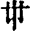

# 百痴禅师语录



> **藏经**：嘉兴大藏经（新文丰版）（嘉兴藏）　**册次** 第 28 册（J28）　**编号** JB202　**部类** 诸宗部　**卷次** 30 卷　**篇幅** 324,437 字

> **作者（译者）**：嗣法门人超宣等编

> **卷／品**：30 卷 · 19 品



---



## 目录



  - [百和尚语录序](#百和尚语录序)

  - [百痴元和尚语录序](#百痴元和尚语录序)

  - [序](#序)

  - [序](#序-1)

- [百痴禅师语录卷第一](#百痴禅师语录卷第一)

- [百痴禅师语录卷第二](#百痴禅师语录卷第二)

- [百痴禅师语录卷第三](#百痴禅师语录卷第三)

- [百痴禅师语录卷第四](#百痴禅师语录卷第四)

- [百痴禅师语录卷第五](#百痴禅师语录卷第五)

- [百痴禅师语录卷第六](#百痴禅师语录卷第六)

- [百痴禅师语录卷第七](#百痴禅师语录卷第七)

- [百痴禅师语录卷第八](#百痴禅师语录卷第八)

- [百痴禅师语录卷第九](#百痴禅师语录卷第九)

- [百痴禅师语录卷第十](#百痴禅师语录卷第十)

- [百痴禅师语录卷第十一](#百痴禅师语录卷第十一)

- [百痴禅师语录卷第十二](#百痴禅师语录卷第十二)

- [百痴禅师语录卷第十三](#百痴禅师语录卷第十三)

- [百痴禅师语录卷第十四](#百痴禅师语录卷第十四)

- [百痴禅师语录卷第十五](#百痴禅师语录卷第十五)

- [百痴禅师语录卷第十六](#百痴禅师语录卷第十六)

- [百痴禅师语录卷第十七](#百痴禅师语录卷第十七)

- [百痴禅师语录卷第十八](#百痴禅师语录卷第十八)

- [百痴禅师语录卷第十九](#百痴禅师语录卷第十九)

- [百痴禅师语录卷第二十](#百痴禅师语录卷第二十)

- [百痴禅师语录卷第二十一](#百痴禅师语录卷第二十一)

- [百痴禅师语录卷第二十二](#百痴禅师语录卷第二十二)

- [百痴禅师语录卷第二十三](#百痴禅师语录卷第二十三)

- [百痴禅师语录卷第二十四](#百痴禅师语录卷第二十四)

- [百痴禅师语录卷第二十五](#百痴禅师语录卷第二十五)

- [百痴禅师语录卷第二十六](#百痴禅师语录卷第二十六)

- [百痴禅师语录卷第二十七](#百痴禅师语录卷第二十七)

- [百痴禅师语录卷第二十八](#百痴禅师语录卷第二十八)

- [百痴禅师语录卷第二十九](#百痴禅师语录卷第二十九)

  - [序](#序-2)

  - [亲恩必报序](#亲恩必报序)

  - [寿王氏夫人六十序](#寿王氏夫人六十序)

  - [寿华宇六十序](#寿华宇六十序)

  - [季寅居士自纪篇序](#季寅居士自纪篇序)

  - [送道洵禅德住庵序](#送道洵禅德住庵序)

  - [金粟志山图序](#金粟志山图序)

  - [景云二会语序](#景云二会语序)

  - [送祖庚上座回鹦湖荐母序](#送祖庚上座回鹦湖荐母序)

  - [送妙上座偕兄回里序](#送妙上座偕兄回里序)

  - [一击序](#一击序)

  - [毛开石松泉畫轴序](#毛开石松泉畫轴序)

  - [鹊巢序](#鹊巢序)

  - [暗然居士乞塑母像序](#暗然居士乞塑母像序)

  - [黄檗时默公七十三岁序](#黄檗时默公七十三岁序)

- [百痴禅师语录卷第三十](#百痴禅师语录卷第三十)



---



### 百和尚语录序



宗门之语语法也，正所以语心也。盖此心法不容拟议、不容限量，审时度节，随因溯缘，或语地、或语人，或语语、或不语语，乃称独步者，曹溪而上莫以喻其前颂开来者，太白而下反若窄其绪而不知，语虽不同，心无二心、法无二法也。



惟心法昭而笔墨皆生动、齿颊皆馨香，我法兄百翁悉备而光大之，有才而若无才、具识而若无识，捷得心印而若一无所得、广传贤圣而若一无所传，恂恂然，一举一动皆实心、一咳一吐皆实意。



真不可语，何尝不语其似者？似不可语，何尝必语其似者？语所当语，何尝不语其真而似、似而真者？语所不当语，何尝必语其真非真、似非似者？总之，千百年之血脉流传於此一语，千百世之肩荷弘护於此一语，此而犹得谓一人之事业乎？此而犹得谓一世之文章乎？吾披阅再四爽焉。



若失西江之可以一口汲也，茫茫大海亦复如是；东山之可以小鲁登也，巍巍泰山亦复如是。吾深羡其如是，竟不知其何以如是，建瓴之水万里濯足，倒峡之势千仞振衣，至於静里传响、冷地发燄，尤在善解者迎其刃焉。



时顺治辛丑岁，暮春谷雨日，法弟无依道人　徐昌治觐周父盥题。



------



### 百痴元和尚语录序



入门喝，蓦头棒，滹沱宗祖垂手为人处极直截痛快，故正脉流传愈久而愈光大。百痴和尚从本师费老入棒下发明，便能掀倒禅床，赤身担荷，历数会开堂，语要波澜浩荡，机用纵横，电激雷轰，星移斗换。譬彼名藩宿将秉握威权，而方城连帅无敢违越。



▆嗣法弟子若干，如明觉禅师憨公，今上特召入内谈玄赐紫，即此益见师之炉锤与寻尝迥别。所谓狻猊产白泽，哮吼声高；薝卜接栴檀，芬芳味远。树祖坛之赤帜，扬万古之真风，不其然乎？读兹录者另具一只眼始得。



时顺治己亥岁，暮春朔日，同门法弟𨍏轹道人严大参焚香盥手敬题。



------



### 序



百痴大师，三山狮子，一代马驹，现光明拳，照波若眼，历坐道场，素缁倾慕，洵可以远吸曹溪，迩跻大白者矣。



曩岁吾郡超果开席金鳗青虎之墟，瓢衲麇至，余获晨夕觐侍，其间窃稔师之为人道韵渊澄，辩才飙发，钳锤来学困彻婆心，虽以轰雷激电之机而寓霁日光风之意，岂秋晚以来呈身长老、杜撰宗乘、黄茅白草之徒所得窥其涯涘者哉？



无何谢去，屏迹谷水之阳，华药罗窗，枫芦翳径，余辄挐一苇从之，获睹是编妙绝语言，脱离窠臼，因乐序而流通焉。若以这钝汉为济川子韶者流能赞师一辞乎？则惭媿一杯姜杏汤久巳。



顺治庚子岁，桂月之朔，茸城学人弘尚单恂槃昙谨序。



百痴禅师语录目录



序文  

卷第一福建建宁莲峰禅院语录  

建宁宝峰禅院语录



卷第二建宁百山景星禅院语录



卷第三浙江杭州皇岗太平禅寺语录  

杭州金山长庆禅寺语录



卷第四嘉兴金粟山广慧禅寺语录



卷第五嘉兴金粟山广慧禅寺语录



卷第六嘉兴金粟山广慧禅寺语录



卷第七嘉兴金粟山广慧禅寺语录



卷第八嘉兴金粟山广慧禅寺语录  

嘉兴梵胜禅院语录



卷第九江南松江明发禅院语录



卷第十松江超果禅寺语录



卷第十一再住松江明发禅院语录



卷第十二松江明发禅院语录



卷第十三福建兴化莲山国懽崇福禅寺语录



卷第十四示众  

金粟首座寮秉拂



卷第十五小参上



卷第十六小参下  

入室



卷第十七拈古  

颂古  

问答机缘



卷第十八法语上



卷第十九法语下



卷第二十偈上



卷第二十一偈中



卷第二十二偈下



卷第二十三启  

疏引



卷第二十四书问



卷第二十五说



卷第二十六跋题  

歌  

辞



卷第二十七赞



卷第二十八佛  

铭  

记



卷第二十九行实  

赋



------



### 序



祭文



卷第三十杂咏



目录终



------



## 百痴禅师语录卷第一



**译者**：嗣法门人超宣等编



福建建宁莲峰禅院语录



师於崇祯辛巳年十月初七日受众绅衿请，就院开堂。法座前拈疏，云：「珠回玉转，百匝千重，佛祖纲宗，尽在里许，烦维那道破，令四众咸知。」



指法座，云：「宝华座，最高层，谁人敢踏上头行？新长老今朝独步，廓然八面风清。」



拈香，云：「者一瓣香巍巍乎如天普盖，荡荡乎似地普擎𦶟，向炉中端为祝延当今世界主皇帝陛下圣寿万岁万岁万万岁，伏愿舜德逾新，坐镇金轮而致治；尧仁广运，增绵神荚以无疆。



「者一瓣香，光透仲尼，日月瑞应，上极星辰，𦶟向炉中，奉为阖国审僚、文资武列、建宁本道、本府建瓯两县诸位高官、今日请主外护绅衿，伏愿克孝克勤，作熙时之舟楫；迺悠迺久，壮法苑之干城。



「者一瓣香，不从别处收来，秪於棒头点出，直得家倾业破，至今没地藏身，𦶟向炉中，耑为现住浙江嘉兴金粟山广慧禅寺传曹溪正脉三十五世本师费隐容老和尚，用酬法乳之恩。」



遂敛衣就座，上首白槌，云：「法筵龙象众，当观第一义。」师云：「好个第一义，一槌打叠了，也便尔罢钓，理却相应，设欲添花，事无不可，莫有乘时唱和者麼？」



僧问：「第一义佛眼难窥，龙象众作麼生观？」师竖拂，云：「这里荐。」进云：「直得上无攀仰，下绝己躬。」师云：「秪恐不是玉。」进云：「曹溪波浪如相似，无限平人被陆沉。」师云：「也须记取。」



问：「如何是最初一句？」师云：「杲日当空。」僧礼拜，云：「谢和尚指示。」师便打。



乃云：「当阳的旨今古该通，直截根源圣凡统摄，头头显露，物物圆成，迥绝见知，了无回互。於此洞明得去，不妨就地施设，现处举扬，掀展鹫岭家风，揭开少林宝藏，向霁天化日之下以与泥猪疥狗共赞升平，凤子麟儿齐彰海印。



「虽然如是，犹未足称衲僧意气。如何是衲僧意气？三尺龙泉光照胆，万人丛里夺高标。」卓拄杖一下。



复举宝寿开堂，三圣推出一僧，宝寿便打，三圣云：「与麼为人瞎却镇州一城人眼去在。」宝寿掷下拄杖，归方丈。



师云：「主寰中正令，握阃外威权，宝寿固是作家，简点将来只得一半。若据山僧见处，当时待三圣恁麼道，和声亦与一棒，要见赏罚分明。」



上首复白槌，云：「谛观法王法，法王法如是。」谢词不录，下座。



立头首执事，上堂。僧问：「越圣超凡则不问，建功立业事如何？」师云：「大家出只手。」进云：「恁麼则安贴家邦去也。」师云：「不是苦心人不知。」



乃云：「独掌不浪拍，独虎不成群，坐为丛林主，端的要弟昆。弟昆既端的也，则有法必守、有令当遵，高低普应，左右逢原，逆顺场中无罣碍，相看扶起破砂盆。」



开炉，上堂。云：「平地畫关牢，明瞒暗骗；赤身就炉鞲，附热趋炎。有不假钳锤底衲僧，出众相见。」



僧问：「大地完全一个炉，看来都是火柴头，还许学人炉边添炭也无？」师云：「无汝凑泊处。」进云：「学人信手轻挑拨便解翻身，动地流时如何？」师云：「许汝是个汉。」进云：「觌面何须亲付嘱？扬眉早已过新罗。」师云：「话头也不识。」



乃云：「火燄为三世诸佛说法，三世诸佛在火燄里转大法轮，这般说话，知他是有耶？是无耶？莲峰若放过，厕坑筹子瞒杀诸人；若不放过，诸人又觉皮焦面赤。」



蓦拈拄杖，卓云：「看看：今日事已到头了也，顽铜钝铁、美璞精金，且入此红炉中千烹百鍊，他时成龙者跃天、成蛇者撺草，各各具一种神通，也信未敢相负。然虽如是，寒猿夜叫巫山月，客路繇来不易行。」



上堂。僧问：「草鞋踏破已多年，拄杖横担万里天，跛鳖鲁吞三世佛，卖来不值半文钱。」以坐具打圆相，云：「学人上来请和尚鉴。」师便打。



进云：「秪这个，还有麼？」师又打。



进云：「少年一段风流事，只许佳人独自知。」师云：「未必心头似口头。」



乃云：「鸱睛射日，凤尾凌空，树染霜华分外红，无位真人拦不住，谁家蓦面喜相逢？忽相逢，门门有路路路通，因忆当年临济老，一堆屎橛动腥风。」遂掩鼻，云：「欲避无从。」下座。



上堂。僧问：「如何是夺人不夺境？」师云：「有约不来过夜半。」「如何是夺境不夺人？」师云：「闲敲棋子落灯花。」「如何是人境两俱夺？」师云：「千山鸟飞尽，万径行踪绝。」「如何是人境俱不夺？」师云：「蓑衣竹笠翁，独钓寒江雪。」进云：「料拣已蒙师指示，向上还有事也无？」师打云：「且领前话。」



乃举盐官示众，云：「虚空为鼓，须弥为槌，什麼人打得？」众无对。南泉云：「王老师不打这破鼓。」法眼云：「但道王老师不打，自然是个破鼓。」



师云：「南泉、法眼，总是随队氀𣯜汉，而孰知这个鼓子完完全全，纵使千槌万槌也打伊不破。莲峰今日无事，要击一通与盐官出气。」



遂拈拄杖，卓一卓，云：「还闻麼？」复掷下，云：「若到诸方，一任举似。」



荐亲，请上堂。「欲荐生身父母，须寻本有爷娘，顶𩕳豁开正眼，脚头脚底全彰，枯骨多年一齐鞭起，觉灵不昧度以慈航，直教个个达上方，珊瑚树语频伽鸟，栏楯交罗放异光。所以道：刹那契本，三有均资，一念知归，四恩总报。是汝今日还委悉麼？泼天大路如弦直，努力勤行尚未迟。」



上堂。僧问：「如何是莲峰境？」师云：「门映东溪水。」「如何是境中人？」师云：「扶笻看落花。」进云：「人境且置，达磨西来意若何？」师竖拂，云：「向这里荐取。」



僧礼拜，师乃云：「若向这里荐得也，达磨祖师唤来洗脚有分。天下老和尚暮打八百、朝打三千，穷厮煎、饿厮炒，上刀山、履剑树，盖是寻常。三十年后有般漆桶效恁麼去就，亦怪伊不得。何故？彼彼丈夫儿，气分决然相应。然虽如是，当门不用栽荆棘，致使行人惹著衣。」



冬至，上堂。「冬至月头卖被买牛，冬至月尾卖牛买被，山僧牛幸有一头，且不必买，被只有一领，且无可卖，无买无卖，随时自在，直里横骑，风流莫赛，短笛没腔信口吹，金鞭遥指乾坤外。大众！水牯牛来也，切莫犯伊蹄角好。」便下座。



上堂。「夫宗师提唱不在繁，端就一境、一机、一字、一句，著著皆出身之路，只是罕遘。其人事弗获已，更为你费尽口头，黑漆拄杖有屈无叫处。



「岂不见？药山久不升座，院主白云：『大众久思示诲，请和尚为众说法。』山令打钟，至座前便归方丈。主随后问故，山云：『经有经师，论有论师，争怪得老僧？』



「看这老汉果然劳而无功，秪如今日懋院主设斋，请山僧升于此座，钟已打了也、说已说了也，又作麼生折合去？」



良久，云：「不可矢上再加尖也。」便下座。



上堂。「天寒人寒，言端语端，直下便会，有甚麼难？普贤床榻近，文殊境界宽。其或未然，无事偶从廊畔过，灯笼露柱也相瞒。」



复举僧问香林：「如何是衲衣下事？」林云：「腊月火烧山。」



师云：「大小香林尽力，只道到这里。」



腊八，上堂。僧问：「世尊才出母胎便已称尊，何故又至雪山睹明星方为悟道？」师云：「祸不单行。」问：「今朝腊月八，明星光烁烁，堪笑老瞿昙，触著眼睛瞎。」师云：「汝自己分上作麼生？」僧喝，师云：「好这一喝。」僧无语，师便打。



乃云：「风剥剥，骨棱棱，夜静一天星斗横，六载辛劬向这里讨个合煞，虽然拾得鼻孔，未免失却双睛，带累阎浮多少汉？直至於今，描也描不就、畫也畫不成，殊不知总是一盲引众盲，相牵入火坑，仔细思量著，真实可怜生。」



喝一喝，云：「男儿自有冲天志，岂肯如来行处行？」



上堂。「十五日以前，彷彷佛佛，神头鬼面；十五日以后，依依稀稀，鬼面神头。政当十五日，视之弗见、听之弗闻，且道：是什麼物？有眼辨手，亲底拈来，一槌槌杀莲峰，赏你一锭金；如无，且任伊为孽为妖，到处魔魅去也。」拽拄杖，下座，打散。



圣节，上堂。僧问：「如何是祝圣一句？」师云：「芥子城中无尽春。」进云：「恁麼则一人有庆，兆民赖之。」师云：「好音在耳人皆耸。」



乃云：「至尊至贵，至灵至异，福泽遍寰，区睿算等。天地於斯时也，香霭金炉，帘垂玉殿，班班鹓鹭，稽首贺万年之觞；总总黔黎，鼓腹乐无为之化。即我林下道人虽居四民之外，亦少此个恩力不得，毕竟如何报荅？」



举拂子，云：「少林一曲分明在，频对尧风舜日吹。」击一击，下座。



因雪上堂。僧问：「大地山河一片雪，当阳日照杳无踪，如何是无踪一句？」师云：「换却阇黎双眼睛。」



乃云：「有梅无雪不精神，有雪无诗俗了人，山僧今日向大众面前吟一首雪诗去也。片片飞来碧，寒光势接天，扁舟乘兴者，到此勿空还。」



顾视左右，云：「莫有和得者麼？」



众无对，师云：「且去炉边共度量，再来方丈通个消息。」



岁旦，上堂。拈拄杖，卓云：「斩新条，行新令，凛凛威风孰敢竞？窃符树帜底拟即分身，戴角擎头底触之失命，不是强己抑人，亦非欺凡罔圣，大都真实丈夫儿，脊骨繇来似铁硬。」复卓一卓。



乃举僧问镜清：「新年头还有佛法也无？」清云：「有。」僧云：「如何是新年头佛法？」清云：「元正启祚，万物咸新。」僧云：「谢师荅话。」清云：「镜清今日失利。」



又，僧问明教：「新年头还有佛法也无？」教云：「无。」僧云：「年年是好年，为什麼却无？」教云：「张公吃酒李公醉。」僧云：「老老大大，龙头蛇尾。」教云：「明教今日失利。」



师云：「二尊宿，一人道有、一人道无，虽则各展家风，要且未能截断这僧舌头在。今日或有问莲峰：『新年头还有佛法也无？』蓦头便棒，亦免伊向有无窠里躲跟。更欲如之若何，但云：『莲峰今日失利。』」



春日谢众檀护，上堂。僧问：「如何是宾中宾？」师云：「抛却故园春。」「如何是宾中主？」师云：「藤条随手举。」「如何是主中宾？」师云：「垂钩取巨鳞。」「如何是主中主？」师云：「双眸无佛祖。」



进云：「宾主蒙师指，初春句若何？」师云：「草色半含青。」



乃云：「兹当立春胜日，且喜期事将毕，为爱诸老维摩用心到底贞实，山僧乾索索地思量无物可以相酬，记得衣内有一颗明珠，不免乘时拈出，对众分付。」



以两手作捧珠势，云：「还委悉麼？持去，从教家大有能藏，日久倍光辉。」遂拍手笑，下座。



解制，上堂。「尽大地是个莲峰，诸人向什麼处去？尽大地被拄杖子吞却，诸人又向甚处见？莲峰这两转语挨得透，则昔日无结，今亦无解结也。



「禅板蒲团历落分身世界外解也，芒鞋钵袋依旧不离碧山中，威狞似虎，活泼如龙，动著些儿势莫容，是吾种草应知是，迺可称提向上宗。」拈拄杖，卓一卓，喝一喝，下座。



元宵，上堂。「短巷长街，银花交灿，游郎舞女，踏歌入云。明明耀古腾今，历历超声越色，何必福城东际始见文殊，楼阁门开方参慈氏？一透一切透，一用一切用。虽然，此犹是曲为权宜之谈，更须识有人境俱夺，向上一路。」卓拄杖，云：「火树踏翻人影寂，从教大地黑漫漫。」



祈寿，请上堂。僧问：「耳顺从心年已届，因斋庆赞句如何？」师云：「寿山千古峻，雨洒愈深苍。」进云：「可谓灵苗含秀色，万善法尝光。」师云：「莫将鹤唳作莺啼。」



乃云：「设斋祈寿永，觌面为敷陈，柏树凌空翠，桃花潠雨新，年来此际春光好，更有年来不尽春。且道：凭个什麼便乃如是？」



举拂子，云：「天道无亲，常与善人。」



复举庞居士云：「难，难，十石油麻树上摊。」庞婆云：「易，易，如下眠床脚踏地。」女灵照云：「也不难，也不易，百草头上祖师意。」



师云：「父慈子孝，夫唱妇随即不无，三人但未免令人向难易、不难易上作活计，争似城中王老居士偕令室陈氏？一家之内和气蔼然，也不说什麼难易、不难易，似这般还有祖师意也无？须知廓落全彰事，一对鸳鸯畫不成。」



上堂。「一拳拳倒黄鹤楼，一趯趯翻鹦鹉洲，衲僧家须与麼英特气概，迺可撑门拄户，其餘委委曲曲、藞藞苴苴，尽是吃死饭汉，欲续济北烜赫宗枝太远在。莲峰不惧诸方笑怪，自有护身符子分付诸人，毕竟作麼生取用？」拈拄杖，卓一卓，喝一喝。



退院，上堂。「未有常行而不住，到头云定觅山去；未有常住而不行，毕竟春回草自青。为无为，益无益，子规啼血满花枝，𡬡耐行人归未得。马大师与麼语话，山僧胡乱注破了也。且道：今日行的好？住的好？」



良久，云：「长安虽乐，不是久居。」便下座。



过宝莲山，缁素请上堂。「一机拨转，万象平沉；一句拶开，千差靠倒。所以道：佛法本无，许多省要处不消一劄。庞居士於马驹言下契悟，云门被睦州推得脚折，自非其人，安明其事？山僧借路经过，亦要诸人共知，毕竟还有得力句也无？」喝一喝。



建宁宝峰禅院语录



师於崇祯壬午年二月十八日入院，至山门基，云：「十方无壁，四面无门，祥麟瑞凤，一任腾奔。」举起拄杖，云：「还识缦天网子麼？」



佛殿。云：「尽令去也，瞿昙老汉亦须倒立下风。若论仁义道中，且礼三拜。」



方丈。云：「有者掩室，有者默然，虽则坐断千差，未免引人堕在鬼窟里。山僧要出他一头地，更不如是施张。何故？快入惊人浪，方逢称意鱼。」



上堂。拈香，云：「此瓣香乾坤合其德，日月合其明，𦶟向炉中，端为当今皇帝祝严圣寿，伏愿萝图宝祚弥亿万年，玉叶金枝亘河沙劫。



「此瓣香，王庭柱石，佛国垣屏，奉为建宁诸位高官，伏愿福海增深，寿山益峻。



「此瓣香得时入骨痛难忍，触著伤心恨不销，二回拈出，耑为现住金粟堂上本师费隐容老和尚，𦶟向炉中，使天下衲僧共知些儿气息。」



上首白椎竟，僧问：「昨日莲峰住持，今朝宝峰和尚，不涉二边，请师道看。」师云：「无孔笛吹云外曲。」进云：「恁麼则头头非取舍，处处没张乖。」师云：「知音能得有几人？」



乃云：「未到此间，不妨令人疑著，及乎到来，眉毛依旧乌崒嵂地。向这里见得谛、信得及，山川草木总属寻常，老幼贤愚一味平等，同彼同此，无是无非，渴饮饥餐随缘任运，更说甚佛法玄妙、菩提涅槃？直饶临济当前也开臭口不得。政与麼时，共乐升平一句如何话会？碧桃色醉千峰外，社舞村歌处处春。」



复举法灯和尚云：「本欲深藏岩窦，隐遁过时，盖缘清凉老人有未了底公案，出来为他了却。」时有僧问：「如何是未了底公案？」灯拈起拄杖，云：「祖襧未了，殃及儿孙。」僧云：「过在什麼处？」灯云：「过在我，殃及你。」



师云：「山僧才疏德薄，微志寔欲如斯，只为受我本师之嘱，不可恁麼便休，故虽山屋数间，亦勉强作这般虫豸，或有忍俊不禁底出来互相激扬，正好吃山僧手中拄杖。因甚如此？不见道？祖襧未了，殃及儿孙。」卓拄杖，下座。



漈滨护法请上堂。僧问：「应以此身得度者，即现此身而为说法，今日居士到来，如何相见？」师云：「不敢相瞒。」进云：「云月虽同，争柰溪山各异。」师云：「阇黎道亦著。」



僧礼拜，师云：「得个驴儿便喜欢。」乃云：「诸佛关枢，祖师巴鼻，历落当前，如大火聚。」



蓦拈拄杖，云：「唤作拄杖则触，不唤作拄杖则背，灼然此个说话实无针锋，许与人作道理抟量，惟要夙根利智，才闻举著便乃倒转鎗头，方不辜从上牙爪。政恁麼时，安家乐业一句如何道？宽怀共坐和风里，摆手长歌漈水滨。」遂靠拄杖，下座。



上堂。「春眠不觉晓，处处闻啼鸟，衲僧家总道我会。夜来风雨声，花落知多少，十个有五双却数不出。须知：数不出底，点滴幸自分明；总道我会底，未免等闲蹉过。山僧不是拗直作曲，亦非补短裁长，诸人若也不甘，试请当前断看。」



上堂。「作家宗匠，俊俏禅流，互宾互主，全放全收，横身猛虎口，揩痒毒蛇头，自是伊之尝分，初不假於他筹。何以故？金镞惯调曾百战，铁鞭多力恨无雠。」



乃举乌臼问僧：「近离甚处？」僧云：「定州。」臼云：「定州法道何似这里？」僧云：「不别。」臼云：「若不别，更转彼中去。」便打。僧云：「棒头有眼，不得草草打人。」臼云：「今日打著一个也。」又打三下。僧便出，臼云：「屈棒元来有人吃在。」僧转身，云：「争柰杓柄在和尚手里。」臼云：「汝若要，山僧回与汝。」僧近前夺棒，打臼三下。臼云：「屈棒，屈棒。」僧云：「有人吃在。」臼云：「草草打著个汉。」僧便礼拜，臼云：「却与麼去也。」僧大笑而出，臼云：「消得恁麼，消得恁麼。」



雪窦颂云：「呼则易，遣则难，互换机锋仔细看，劫石固来犹可坏，沧溟深处立须乾。乌臼老，几何般？与他杓柄太无端。」



师云：「呼遣双彰，机锋互换，雪窦满口赞叹则固是，为什麼末后又道与他杓柄太无端？还委悉麼？鹬蚌相持，俱落渔人之手。」



上堂。「兹者盖为圣龙寺里诸禅人及众居士临时逼请升座，山僧肚皮内并不曾打点一个元字脚。然虽如是，未可辜负来机，且借拂子展些少神通去也。」



遂竖起拂子，云：「还见麼？」击香几，云：「还闻麼？即此见闻非见闻，无餘声色可呈君，石窗经雨莓苔湿，杜宇啼高欲断云。」复击一击，下座。



上堂。「四月芳郊烟雨足，今朝恰恰是初六，畫堂紫燕语呢喃，露出瞿昙真面目。大丈夫汉一等踏破草鞋，何不向瞿昙未降生以前直下承当，认取自家境界？如龙得水，似虎靠山，自然风飒飒地，天下人没柰汝何。若随他脚跟转，落七落八，莫怪瞿昙饶舌，与山僧互相热瞒好。」便下座。



佛诞，上堂。僧问：「一言截断，千圣消声；一剑当前，横尸万里。」声未绝，师便打。僧复进语，师连棒打退，乃云：「无忧树下生悉达，九龙吐水蓦头泼，千年后有老云门，白棒拈来要打杀。解打杀，风平浪静乾坤阔；打不杀，恶草毒花仍旧发。引得一队小喽啰，竖四横三闹活活。闹活活，谁止遏？山僧力薄每自惭，深心且以奉尘刹。」卓拄杖，下座。



请上堂。「万法是心光，诸缘唯▆挠，本无迷悟人，秪要今日了。且了底事作麼生？亡过尊严於一毫端顿超莲界，现存慈氏於萱帏内永享遐年，人人喜气盈眸，处处和风遍野，成无量殊胜奇特，作不可思议功勋。苟能如是，又何必山僧重说偈言，呼南唤北？相逢同入普光殿，无相身为卢舍那。」



复举西天祖师云：「父母非我亲，谁是最亲者？诸佛非我道，谁是最道者？」云盖本云：「父母非我亲，无有不亲者；诸佛非我道，无有不道者。」千岩长云：「父母非我亲，我亦非亲者；诸佛非我道，我亦非道者。」



师云：「三个无孔铁锤，就中一个最重。山僧则不然，父母非我亲，眼里耳里绝纤尘；诸佛非我道，十字街头闹浩浩。等闲觑透这重关，或是或非尽靠倒。尽靠倒，头头总属自家宝。」卓拄杖，下座。



生日，请上堂。「设斋之意不过为我庆诞而已，衲僧家有何诞可庆哉？进一步，筑碎威音脑门；退一步，踏折弥勒脊骨；不进不退，坐在诸人眉尖眼睫上。於此倜傥分明，方知道人人有个生缘处，认著依然还失路，长空云破月华明，东西南北从君去，大小真净，字经三写，乌焉成马。」喝一喝。



端午，上堂。僧问：「丈六金身全世界，一茎草上现琼楼，一茎草上则不问，如何是端阳佳节？」师云：「门悬蒲剑碧楞楞。」进云：「处处共知佳节好，人人尽唱采莲歌。」师云：「你还唱得麼？」进云：「五音六律一齐宣。」师云：「错下板拍。」



乃云：「五月五日端午节，山僧默念真秘诀，拄杖倒将艾虎骑，惊起郁垒头破血。白舌消，赤口灭，见者闻者悉欢悦，独有殿左紧罗王，握手当胸骂不辍，为什麼？太把机关都漏泄。」



复举文殊一日令善财采药，云：「是药者采将来。」善财遍采，无不是药，却来白云：「无不是药者。」文殊云：「是药者采将来。」善财拈一茎草与文殊，文殊提起示众，云：「此药亦能杀人，亦能活人。」



师云：「善财解采药，文殊解用药，采用即无差，阿谁病吃著？而今在山僧手中，不免尽行布施。」遂拈拄杖，下座，一齐打散。



因吴漈滨居士上堂。「梅熟亚枝黄，云开列嶂紫，以我为隐乎？吾无隐乎尔。老仲尼面孔已在这里横三竖四，诸人还觑捕得麼？若不然者，宝峰更为拨没弦琴，向他家里人说他家里话。」



乃横按拄杖作抚琴势，云：「上大人丘乙己化三千七十士尔，小生八九子佳作，仁可知礼也。」



良久，云：「是什麼章句？高山流水非同调，一任知音笑点头。」



上堂。「盐荒米贵，厨库生尘，一等茄子瓠子，识甚麼苦辛？宝峰无柰，秪得硬撑到底，仔细看来，也有些儿胜过俗人。且如何是胜过他处？蒲团独坐乾坤大，鼻孔分明搭上唇。」



上堂。「因意立言，就言明意。深深处，浅浅易知；浅浅处，深深有味。槛外一鸡啼，阶前万木翠，此是当人真实机，灼然无忌亦无讳。无忌讳，汝我总同髅，莫向途中摘叶枝，两眼撑开似打睡。」



复举仰山问沩山云：「如何是祖师西来意？」沩云：「大好灯笼。」仰云：「莫只这个便是麼？」沩云：「只这个是什麼？」仰云：「大好灯笼。」沩云：「果然不识。」



师云：「沩山父子，得则全得，失则全失，有道得伊得失句，也许汝亲见宝峰。」



上堂。拈拄杖，云：「这一条活路，三世诸佛共行底、历代祖师共证底、现前大众共把臂往来底。既共在此，往来途中之事理合分明，为什麼路傍边有人索取公验无可抵对？」良久，云：「假鸡声韵难谩我，未肯摸糊放过关。」卓一卓，下座。



上堂。「欲识宝峰宝，须见宝峰人；既见宝峰人，须取宝峰宝。且宝峰宝作麼生取？有时拄杖头、有时荒草里，钻之已弥坚，提兮提不起，能於提不起处一提提得恶，元来是汝大家从前受用底。虽然，山僧犹未肯甘心，更要夺却汝在。」



秋日，上堂。「竹簟宽铺暑气清，坐餘扶策绕云行，欲知大地咸秋信，试听空阶叶落声。」击拂子，下座。



荐严，请上堂。「敲空作响，唤回浪子归家；击木无声，解使髑髅瞠眼。乌龟向火，通身烈焰绝遮藏；碓觜生花，一道馨香超劫外。亡过尊灵就这里透脱去，便见前溪月落，大野云收，本有灵光，自繇自在。虽色声头上坐卧色声，不能染污；虽生死海中优游生死，不能笼罩。然山僧与麼告报，大似移华兼蝶至，买石得云饶。禅流若善参详，骑佛殿，出山门，拽新罗国，与占波斗额也只是家常茶饭。是则固是，秪如亡过尊灵，且道：还叫得应麼？」击拂子，云：「天涯踏遍无寻处，触著毫端吼似雷。」



中秋，上堂。僧问：「中秋节届，皓月当空，家家望月，未知月落何处？」师云：「一人举首一轮明。」进云：「月既当空明周沙界，为什麼暗处不照？」师云：「自甘覆盆下，怪伊又争得？」



乃云：「十五日以前，止止不须说；十五日以后，我法妙难思。政当十五日，风清月朗，浪静波恬，东村王大伯三文钱买个糊饼，吃了肚里饱齁齁，直得手之舞之、足之蹈之，抑扬而歌曰：『中庭地白树栖鸦，冷露无声湿桂花，今夜月明人尽望，不知秋思在谁家？』山僧偶忽入耳，熙熙焉、陶陶焉，恍神游乎华胥之上，是汝诸人还觉面门热痒麼？」喝一喝。



上堂。「戴角披毛，拖犁拽耙，业债相拘牵，说起令人怕。既是令人怕，为什麼个个偏要撞入这群队里？天网恢恢疏不漏，果然是汝自招来。」



请上堂。僧问：「返照初心一点圆，人间天上寿无比，如何是初心一点？」师云：「分明独露帘帏外。」进云：「还假庄严也无？」师云：「又且何妨？」进云：「有意气时增意气，不风流处亦风流。」师云：「满口道著。」



乃云：「道远乎哉？触事而周，秪因不荐，别处寻求。苟荐也，明镜台前十分光彩，紫罗帐里无限风流，乾坤廓落没涯岸，任运纵横得自由。」



复举庞行婆入鹿门寺作斋，维那请疏意回向，婆拈梳子插向髻后，云：「回向了也。」便出去。



师云：「庞婆恁麼做，次不妨动众惊群，争似渊溪吴信女？足弗离闺阃中，已来宝峰设供，亦不待维那请疏意，回向已是完成。且完成一句如何道？福城东际近，瑞气自云臻。」



重阳，上堂。拈拄杖，卓云：「这里是妙高峰顶，诸人曾登陟一回也无？大丈夫汉个个眼似铜铃，想必不居人后。虽然，忽有问妙高峰顶事，又作麼生抵对？莫是落霞与孤鹜齐飞，秋水共长天一色麼？莫是昭昭於心目之间而相不可睹，晃晃於色尘之内而理不可分麼？若与麼抵对，犹属半途，未识妙高峰顶事在。毕竟如何？极力为君说不得，到头自肯迺方亲。」复卓拄杖，下座。



上堂。「拈花微笑，诳謼人天；面壁安心，无疮剜肉；黄梅夜渡，自惹灾殃；南岳磨砖，猢狲伎俩。直饶入门便棒，犹是皮袋里藏身；见僧便喝，总在声尘中出没。其餘谈玄嚼妙、竖教明宗，如竹苇稻麻，何足挂齿？宝峰门下无道可学、无禅可参，一切随缘，坐消岁月，任他诸方闹浩浩，我只白眼踞青松。众中或有知机识变底，自然不相辜负；脱若依前作解，把缆放船，争怪得山僧？」



同荐亲，请上堂。「尘世乾坤窄，蓬壶日月长，乘缘能摆脱，举步到家乡。家乡既到，则无生死之名，亦无垢净之相，凝然湛寂，不动不摇，过去诸佛、现在诸佛、未来诸佛尽在个里交光相罗，如宝丝网。政恁麼时，且道：马、李二姓严慈还见麼？若然弗见，可谓一片白云横谷口，几多归鸟自迷巢，元上座不免借般若力，为伊点破去。」



遂竖拂，云：「秪这是，莫沉吟，人人势至，个个观音，当阳一句没拦盖，雨过夜塘秋水深。」复击香几，下座。



上堂。「闻名不如见面，远亲不如近邻，冷地忽来添炭，思量真个可人。无尽意菩萨於百草头上化度有情，偶触著山僧拄杖子，亦相与合掌赞扬，叹未曾有。且毕竟赞扬个什麼？近日生菜两文一斤，白米九分一斗，各自宜尔室家，莫管前前后后。所以道：荣辱常随骑马客，是非弗到钓鱼翁。汝等今日还肯如是说也无？」拍膝一下，云：「龙蛇易辨，衲子难瞒。」



退院，上堂。「『世人住处我不住，世人行处我不行，不是与人难共住，大都缁素要分明』，古德恁麼道，可谓孤迥迥、峭巍巍，千古莫并其风。山僧此者则不然，世人住处我已住，世人行处我已行，而今缘尽开交也，笑指前途螺髻青。倘有不肯底出来道：『和尚便恁麼去那？』秪向他道：『我为法王，於法自在。』」



到九僊狮子窟，上堂。「狮岩路近九僊家，古柏如虬绚彩霞，乘兴攀藤穷绝顶，天风吹落杖头花。大众！那个是杖头花？试拣择出来看。」良久，云：「荒草纡蔓人不见，凄凄归路夕阳斜。」



到云居，上堂。僧问：「云居山顶一轮月，未审何年照何人？」师云：「今古应无坠，分明在目前。」进云：「学人已知，为什麼举头不见？」师云：「汝欲瞒山僧那？」进云：「痛领一棒去也。」师打云：「也少不得。」



乃云：「心外无法，法外无心，头头合路，不用别寻。峭壁石为镜，悬岩水作琴，一段真风我已晓，啣华白鸟是知音。山僧偶到这里题目，尽情显露了也，莫有鼻孔辽天，更进一步者麼？如无，还汝云居山景好，明朝扶策过西岑。」便下座。



(嘉兴府海盐县刘门朱氏，法名超浩，捐赀  

助刻，祈先严养朴公、先慈吕氏、张氏早生  

莲界者。)



------



## 百痴禅师语录卷第二



**译者**：嗣法门人超宣等编



建宁百山景星禅院语录



入院。指山门云：「解脱门，不二门，门门相似，最初一步毕竟从这里入。」



佛殿。云：「释迦已灭，弥勒未生，政当恁麼时，把柄在阿谁手里？」撒开坐具，云：「欲识是非，面目现在。」



据室。云：「此个去处，任是铁额铜头也须走避。山僧今日人事冗忙，且放过一著。」



上堂。指法座，云：「须弥灯王已显露本分事了也，若要拨转上头关，试再看依模畫样。」



拈香，云：「这瓣香端为祝延　今上皇帝圣寿万安，伏愿弓矢櫜而玑衡润，民物阜而历数长。



「这瓣香奉为满朝文武、建宁合郡尊官，伏愿补衮即仲山，调羹乃传说。



「这瓣香谓有所事则埋没我，谓无所事则埋没他，而今总遮掩不得，三回拈出，耑为现住金粟本师费隐容老和尚，以酬法乳。」



遂摄衣敷座，上首白槌，云：「法筵龙象众，当观第一义。」师云：「自叹无缘用直钩，鱼虾贪饵不相投，蓑衣欲脱风前睡，又恐金鳞触钓舟。莫有负命者，请出众相见。」



僧问：「高提祖印，驾临百山，斩新条令一句作麼生道？」师便打。进云：「宗风辉千古，今朝事转新。」师云：「且得上座领话。」



进云：「秪如李居士设斋祷嗣，未审和尚如何庆赞？」师云：「桂子月中落。」进云：「恁麼则麟趾振搌，瓜瓞绵绵去也。」师云：「一任将花锦上添。」



问：「孤峰顶上眠云，辜负先圣；十字街头垂手，埋没宗风。今日来赴景星，意作麼生？」师云：「坐断天下人舌头。」进云：「直得乾坤廓落无边际，杲日当空宇宙明。」师云：「又是重说偈言。」



乃云：「从上来事迥绝言诠，凛凛神威如王宝剑。与麼，与麼，万里人荒；不与麼，不与麼，金鋀莫辨。然事无一向，山僧曲为诸人八字打开去也。」



遂竖起拂子，云：「还委悉麼？乾坤以此覆载，日月以此照临，岳渎以此峙流，群灵以此生育，诸佛以此出世，祖师以此西来，圣明以此端拱驭民，士庶以此安家乐业。风光廓尔，遍界无遗，亘古亘今，丝毫弗易，且应时及节一句如何道？」



击拂子，云：「景星才示现，八表纳雍熙。」



复举僧问百丈：「如何是奇特事？」丈云：「独坐大雄峰。」僧礼拜，丈便打。



师云：「一问一荅，宾主历然，这僧礼拜虽非好心，争柰百丈棒头有眼。今日或有问山僧：『如何是奇特事？』秪向他道：『李居士祷嗣设斋。』僧若礼拜，但云：『已后莫相辜负好。』」下座。



上首复白槌，云：「谛观法王法，法王法如是。」



上堂。僧问：「诸佛说不到处请师直指。」师举拂子。进云：「恁麼则未开口以前早已七华八裂也。」师云：「被汝勘破。」僧喝，师便打。



乃云：「松直棘曲，凫短鹤长，本自成现，触处全彰，百山这里不动一鎗一旗，秪管坐地看杨州似，恁麼还称得诸人意也无？设称得诸人意，袖手傍观，阿谁不会？不称得诸人意，水南石塔，笑杀阇黎。其或别有生涯，亦只搆一半在，要分付钵袋子，谢三娘秤银。」



冬至，上堂。「书云令节，喜届今朝，君子道长，小人道消。若是衲僧活计，端的不在里许。何也？拄杖如龙活泼泼，风轩竹径任逍遥。」



上堂。「『举一不得举二，放过一著，落在第二』，我密云师翁掷下拄杖云：『落二去也，且一又如何举？』将虾钓鳖。又，我本师老人云：『山僧举一了也。』诸人如何委悉？明破则不堪。百山则不然，举一不得举二，放过一著，落在第二。」遂拈拄杖，卓一卓，云：「且道：是举一耶？举二耶？具眼者辨取。」



腊八，上堂。僧问：「指地指天成卖俏，观星说悟更无惭，悟即不无，争柰落第二门？如何是第一门？」师云：「星前荐取。」进云：「恁麼则未出母胎犹较些子。」师云：「莫随人语好。」进云：「自有一双穷相手，不曾容易舞三台。」师云：「是玉也大奇。」



乃以拂子打圆相，召众，云：「明星出现也，还见麼？若也见得，▆落在释迦老子圈缋里，何故？为伊道个一切众生具有如来智慧德相在。若也不见，亦落在释迦老子圈缋里，何故？为伊道个但以妄想执著不能证得在。见与不见拈向一边，又落在百山圈缋里。



「衲僧家寻常口吧吧地，尽道知有，及至结角罗纹之处便尔转身不得，毕竟病在於何？秪为未有透顶透底的时节。百山今日不惜身命，教诸人透顶透底去。」掷拂子，下座。



请上堂。「行年五十八，预庆六旬寿，此念切且真，何愁天不祐？菱华映水清，锦帨连山秀，一句语无私，分明已漏逗。」



复举郑十三娘随师姑到大沩，次才礼拜起，沩便问：「这个师姑甚处往？」姑云：「南台江口住。」沩喝出。又问：「背后老婆甚处住？」十三娘▆身近前，叉手而立。



师云：「尽道师姑不谙大沩语脉，较十三娘犹欠一步，殊不知大沩家风总被这师姑勘破。秪如兹者张信女随师姑到山，诸人还识他住处麼？」蓦拈拄杖，卓云：「门依古岸松千朵，更有寒溪玉一湾。」



春日，上堂。「学道有何方便？随时略通一线，万紫千红总是春，大都要识东风面。东风面，如劈箭。」良久，云：「觅则知君不可见。」



圣节，上堂。「会万物为自己者，其惟圣人乎？是故，圣人在上不言而化、无为而治，风以调、雨以顺，五谷熟，兆民安。适当诞弥之日、政普天懽忭之时，共倾葵藿丹心，仰祝无疆，睿算一句作麼生道？」蓦起，恭身叉手，云：「皇帝万岁万万岁。」



岁旦，上堂。「说新说旧，未离窠臼；分有分无，枉费工夫。须知这最初一著坐断千差，无有无可分，亦无新旧可说，但能於未启口以前退步，就己一踏踏得，元来正月初一日是个岁旦。风荡荡，日熙熙，柳绿桃红锦绣围，无限春光收拾尽，相呼相唤大家归。」



元宵，上堂。「去岁元宵节，无月亦无灯；今岁元宵节，灯与月俱明。观音菩萨、文殊大士，尽在光影里发现是，汝诸人切莫将耳朵作眼睛。且如何是眼睛？」喝一喝，云：「当堂不委悉，犹待晓鸡鸣。」



复举药山谓云岩云：「与我唤沙弥来。」岩云：「和尚唤他作麼？」山云：「我有个折脚铛子，要伊提上挈下。」岩云：「恁麼则与和尚出只手也。」



师云：「动弦别曲，告往知来，药山父子作家，千古赞叹有分，山僧更与一颂：灯华月彩漾悠悠，可是无人解唱酬，独许娇郎谙此意，相将携手步高楼。」



上堂。「汾阳门下有三种狮子：一者、超宗异目，二者、齐眉共躅，三者、影响音闻。在今时中不敢望其超宗异目，壮佛祖威风，即或得一齐眉共躅，亦堪为克家种草。若是影响音闻底，向百山手里打杀万万千千，有甚麼过？何故？免教倚势而欺人，带累世间买假不买真。」以拄杖卓一卓，下座。



佛涅槃日，上堂。「生不惜茎眉，死犹露双脚，一等卖风流，令人常忆著。休忆著，年年二月十五时，遍地华开红闪烁。」击拂子，下座。



还山，上堂。僧问：「未有长行而不住，秪如和尚出山时，还曾离方丈也无？」师云：「任汝疑著。」进云：「未有长住而不行，秪如今日回来时，还曾离途中也无？」师云：「亦任汝疑著。」进云：「离却去来，请和尚别道一句。」师云：「头戴天，脚履地。」



僧礼拜，师乃云：「负杰出之才，架千钧重弩，灵机透发，尽大地人躲避不过，有般汉闻与麼道，便鼻孔里冷笑，谓山僧惯说将无如有底话，殊不知髑髅上中箭了也。事弗获已且作死马医，亦要个个解恁麼始得。」



复举黄龙南禅师还山，有颂示众云：「去时一溪流水送，来时满谷白云迎，一身去住非去住，二物无情似有情。」



师云：「白云重重，流水溶溶，迎来送去，乐在其中。山僧前月十七下山，今朝初二还山，这般景色岂是无耶？盖为常住之物，不敢私自己用。虽然，试效颦一偈举似大众：去时如是去，来时如是来，去去来来非别物，白云流水空悠哉。空悠哉，数员穷衲子，依旧复徘徊。」



上堂。「千句万句，只是一句，作麼生是这一句？」良久，云：「父母所生口，终不为汝说。」便下座。



佛诞，请化士，上堂。「世尊初降生时，手指天地，周行七步，目顾四方，云：『天上天下，惟我独尊。』好个大力量汉，疋马单鎗要寻一对手，可惜弗遇其人。后来云门道：『一棒打杀与狗吃，贵图天下太平。』虽则勇冠三军，争柰输机落后。而今若有具与麼力量，出去决战一番，百山只可击鼓扬旗为伊助阵，且使得胜之日歌谣满路，宁不快哉？」



遂左右顾视，云：「有麼？有麼？」



良久，云：「莫道无。」下座。



送化士，上堂。僧问：「药山化主著贼，病在甚麼处？」师云：「病在随他语脉转。」进云：「已后或有人恁麼问，亦舍银两锭，和尚作麼生道？」师云：「不妨说多谢。」



乃云：「游魔宫，入虎穴，迺英流之愿力、衲子之风标。风标既立、愿力又坚，院内事何忧不办？所以山僧今日将一条断贯索递与诸方化士随去行持，但有进前者，鼻孔即便穿却。岂不见？佛果老人道：『拨转千差向上机，搀旗夺鼓不饶伊，翻身踞地全生杀，始是金毛狮子儿。』」卓拄杖，下座。



生日，请上堂。僧问：「父母未生前，一著落在何处？」师竖拂子。进云：「还有麼？」师云：「从来秪是这个。」



乃云：「『穷和尚，庆寿日，裸形国里赠服饰，诸君太煞不知情，带累山僧面门赤』，大众！此是我金粟老人道底，为什麼今日拈来作自己用？不见道？面赤不如语直。」



请上堂。「一叶长溪渡，帆高两岸悬，水中鱼跃树，云外鸟呼天。俯察头头妙，静观物物玄，何须来这里，听说脱空禅？所以道：诸人未入门时，一句子已向汝举扬了也，更待兴问酬荅，雾涌霞蒸，舌头被人掇翻、眼睛被人换却，说个西祖意、古佛心、父母生前本来面目，大似节上生节、枝上抽枝，要见直截根源远之远矣。虽然，一概与麼去，我等今日饭也无吃，政当此际，自庆一句作麼生道？」



举拂子，云：「一枝横亚清波上，引得游蜂上下忙。」



端午，上堂。「时逢五月，节届端阳，菰黍家家歜，兰汤处处香，惟我衲僧多冷淡，更无餘物可商量。然虽如是，就中却有个好处。且道：好在什麼处？」



乃竖起拂，云：「辟兵符，长命缕，总在这里。若人信得及去，管取千妖遁迹，万吉来临；脱或未能，有寒暑兮促尔寿，有鬼神兮妒尔福。」



荐严，请上堂。「生从何来？曲沼荷花五月开。死从何去？乳燕呢喃语不住。去去来来合本人，生生死死有根据，若能一念早回光，便识自家安立处。已故华庭姚公耆善，还识得安立处也未？」



以拂子畫一畫，云：「脱体无依在此行，莲邦秽土莫疑虑。」



复举洛浦示众云：「孙膑收舖去也，有卜者出来。」时有僧出，云：「请和尚一卜浦。」云：「汝家爷死。」僧无语，法眼代拊掌三下。



师云：「洛浦开大卜，舖善断吉凶，可惜这僧不还卦钱，带累傍人拊掌。今日这里则不然，孙膑收舖去也，有卜者出来，忽孝子出云：『请和尚一卜。』秪向他道：『汝家爷活。』大众！他家爷已死，为什麼却道活？岂不闻乎？七十一年，名著於乡，善士之风，山高水长。」遂摇曳拂子，下座。



上堂。「万法归一，一归何处？山僧忍俊不禁，向六月天下一阵大雪去也。」遂掷拄杖，下座。



上堂。「七月十五日，诸方尽解夏，百山从本不曾结，解个甚麼？既已无可解，又要说个甚麼？然今日特地击鼓升堂，若弗为诸人说，未免龙头蛇尾，不如且说个应时及节底话。金风扇野，素月流天，高柳蝉嘶，远溪水碧，几处疏砧残夜后？数声短笛畫楼中。似这般还有佛法道理也无？忽然撞著个汉拍手道：『和尚！和尚！此正是龙头蛇尾。』又作麼生？咄！百山不如是，草深一丈多少时也。」便下座。



中秋，上堂。「吾心似秋月，碧潭光皎洁，无物堪比伦，教我如何说？大小寒山话作两橛了也，百山此者要别添些光彩，决不学这般见解。」



蓦呈拂子，云：「政当恁麼时，且道：是月耶？是心耶？是说耶？是不说耶？」



良久，云：「可惜无人知此意，风前令我忆南泉。」



重阳，上堂。僧问：「如何是佛法大意？」师云：「今朝九月九，遍地菊花香。」问：「百山峰头更进一步时如何？」师云：「惟我独尊。」僧礼拜，云：「若不泛舟，焉知海阔？」师云：「跌倒了也。」



问：「重阳节届，菊蕊未舒，请和尚连槌羯鼓。」师敲拂子。进云：「好一部天工手。」师云：「道著也不妨。」乃云：「篱东逸菊正含金，底事分明绝覆沉，堪笑龙山落帽者，逢人犹自醉吟吟。」



请两序，上堂。「建法幢，立宗旨，必藉一二，有道者协力同心，互为臂肘，丛林方可振作；若不如是，亦难矣哉。所以道：欲行恁麼事，须有恁麼人；既有恁麼人，须行恁麼事。恁麼人已见，恁麼事已行，毕竟完全一句如何道？孔夫子云：『岁寒然后知松柏之后凋也。』」卓拄杖，下座。



开炉，上堂。僧问：「百山平地起干戈，处处丛林布网罗，千里同风则不问，无为化象是如何？」师云：「风荡荡，日熙熙。」进云：「恁麼则法王登宝座，四众共讴歌去也。」师云：「亦要知恩始得。」



问：「选佛场开，十方聚会，未审和尚选什麼人为佛？」师云：「大家有分。」



问：「繇来四海平如砥，如何特地鼓风涛？」师云：「争怪得山僧？」进云：「忽然冲风触浪时如何？」师云：「汝试施设看。」僧推座，师打退。



乃云：「就地开炉鞲，信手用钳锤，逼拶当人没避处，都要心空及第归。苟及第归也，则河海晏清，家国安怗，群灵景仰弗及，诸圣赞叹靡由，政当恁麼时如何？施为动转浑无碍，一点恩波散作霖。」



复举赵州示众云：「我向南方行脚时，火炉头有个无宾主句，直至如今无人举著。」



师云：「赵州与麼道，可谓掬水月在手，弄花香满衣。今日黄孝廉的的入山，百山火炉头有个宾主句，不免对众举出。且作麼生是宾主句？还委悉麼？觌面相呈无向背，惟人自肯迺方亲。」



上堂。「官▆▆路不禁夜行，李四张三时时撞著。众兄弟！似这般太平世界也实难得，𡬡耐长沙岑大虫偏学恶赖，到处咬人家猪狗，雪峰鳖鼻更与随群作队，助其▆风。」



蓦拈拄杖，云：「而今总收在山僧拄杖头上，已后分毫不敢妄动。然虽如是，无事莫将容易过，古今曾误几人来？」卓一卓，下座。



尼超方请上堂。僧问：「不下笠子勘俱胝，请师分明通二句。」师举拂，云：「何似生？」进云：「秪如尼撩起便行，未审具什麼眼？」师云：「顶门亚一只。」进云：「可谓千峰势到岳边止，万泒声归海上消。」师云：「阇黎分上，且喜没交涉。」



问：「大事未明，如丧考妣，和尚已明，如丧考妣作麼？」师云：「被阇黎带累。」



尼问：「是法住法位，世间相常住，如何是常住相？」师云：「师姑原是女人做。」



乃云：「宏机独唱，地覆天翻；正令当行，星飞电卷。惟许超方作者始透𫔰牢，倘或鼠胆之流，望崖何啻？事弗获已，未免按下云头，道个山是山、水是水，男是男、女是女，僧是僧、俗是俗，各住其位、各安其居，有般没鼻孔底又却向背地里冷笑，谓百山爱说老婆禅，好与三十拄杖。是即也是，百山总未甘在。何故？驱耕夺食浑闲事，带水拖泥看转难。」



上堂。僧出位拟问，师云：「若是久经行阵者，何须立地念篇章？」便下座。



冬至，上堂。僧才出，师举拂，云：「一线阳春曲，繇来和者稀，阇黎还和得麼？」僧云：「月色和云白，松声带露寒。」师云：「未是知音者。」僧伫立，师云：「且退。」



问：「如何是冬来意？」师云：「几点梅花带雨开。」僧礼拜，云：「去也。」师云：「得闲折取一枝好。」



乃云：「群阴消剥尽，忽地转和阳，葭管吹灰煖，梅梢喷雨香，不是世谛流布，亦非佛法商量。君不见？疏山老，善举扬，有人参问冬来意，向道京中出大黄。」



复举僧问赵州：「学人乍入丛林，乞师指示。」州云：「吃粥了也未？」僧云：「吃粥了也。」州云：「洗钵去。」其僧有省。



师颂云：「粥罢令伊洗钵盂，天风不费巧工夫，时来自解翻身去，万里江山启畫图。」



上堂。「明如杲日，宽若太虚，不可以识识，不可以知知，百山山里三十年前有个奇怪精灵，迸出头来直得山崩地坼，过后杳不见形踪。」蓦拈拄杖，云：「看看：如今又出头来也，是汝诸人还有住脚处麼？」便下座，一齐打散。



李弘英、弘彦庆父诞，上堂。僧问：「从心之岁古称少，今朝海屋喜添筹，如何是因斋庆赞一句？」师云：「拄杖粼粼八尺长。」进云：「恁麼则山灵共祝无穷寿，海众同瞻寿日明。」师云：「不似山僧说得亲。」



乃云：「寿似虚空亘莫量、寿如松柏迥苍苍、寿犹巨海不枯竭、寿比灵龟算倍长，以此称寿，可谓至矣。然虚空、松柏犹有焦殒之期，巨海、灵龟岂无终尽之日？不如就人人本有底铺华锦上去也。」



遂竖起拄杖，云：「秪这个人人本有，今古常存，先天地之未先，照日月之未照，五行不能迭变，四序难以推移，如是则虚空、松柏在里许，巨海、灵龟亦在里许，即欲觅其虚空、松柏之相，巨海、灵龟之名了不可得。



「既皆了不可得，要山僧满口赞扬，成个什麼？要山僧不满口赞扬，又成个什麼？未免斗凑一偈，再为举似：年来七十乐怡怡，英彦堂前舞彩衣，一曲笙歌无限好，仙桃仙李带春飞。」卓拄杖，下座。



上堂。僧问：「三圣道：『我逢人则出，出则不为人。』意旨如何？」师云：「带水拖泥。」进云：「兴化道：『我逢人则不出，出则便为人。』又作麼生？」师云：「千峰壁立。」



进云：「和尚今日是出？不出？是为人？不为人？」师云：「一任观瞻。」进云：「恁麼则倒拈无孔笛，吹出觅知音。」师便打。



乃举五祖演和尚云：「四五百硕麦，二三千硕稻，好个休粮方，耆婆不得妙。」后千岩长和尚拈云：「管取有钱，常住不无，演祖若是，将无作有，拔贫作富，须还无明始得。米不蓄一粒、菜不栽一茎，任渠来往者，吃得饱彭亨。」



师云：「二远祖，一人有钱常住、一人将无作有，俱称好手。百山这里，有钱常住也不能、将无作有也不会，只可牵来补去，随分过时，米亦化几硕、菜亦种几坵，任他牛与马，各自逞风流。或有个汉出来道：『和尚与麼亦称好手。』阿呵呵，将谓无人。」下座。



新剃度请上堂。「未出家时信心已具十分，既出家了猛力更须百倍，以百倍猛力增十分信心，直至果熟功成方始无愧。若是灵利底汉，犹不向此中钝置。如丹霞和尚於马祖机下领略便行，何等捷要？所谓：惟过量人能为过量事。且今日离尘得度一句作麼生道？金刀削尽娘生发，皎皎冰轮顶上圆。」



腊八，上堂。居士问：「世尊睹明星便悟，未审悟个甚麼？」师云：「不是苦心人不知。」



乃云：「六年雪岭坐如呆，忽拾明珠笑满腮，破布千重包不住，忙忙拓出下山来。咄！这老汉可谓贵买精神贱价卖，争柰无人承当？彼时若有个承当底，亦何用三百餘会长收短贩，及至临末梢头本利尽行消折乎？然虽如是，不到真穷处，知他未肯休。」



戒子请上堂。僧问：「内传心印，外付袈裟，诸戒师三衣已具，和尚心印作麼生传？」师云：「六耳不同谋。」



乃云：「一切有心者，皆应摄佛戒。众生受佛戒即入诸佛位，此区区之论也，忽若无佛、无众生，无心可摄，无戒可受，又作麼生？到这里亦须是个中人始得。且道：个中人毕竟在什麼处安身立命？还会麼？生平疏逸无拘束，酒肆茶坊任意游，汉地不收秦不管，旋骑驴子过杨州。」掷拄杖，下座。



谢化士，上堂。僧问：「木鲸击破尘劳梦，须是作家铁面皮，一段殷勤无别事，秪为显发这些儿。如何是这些儿？」师吹一吹，云：「会麼？」僧作礼，云：「恁麼则大众有赖去也。」师云：「汝也不得无分。」



乃云：「山僧前者遣数员宿将东讨西征，南擒北获，今既各各还师凯奏，岂可劳而无功？未免铸个无文印子，为伊封赏去也。」



遂拈拄杖，卓云：「还知印子受用处麼？」



良久，云：「不经汗马边庭苦，谁信勋高盖代人？」



复举黄龙南云：「世间有五种不易：一、化者不易，二、施者不易，三、变生为熟者不易，四、端坐吃者不易，更有一种不易是什麼人？」良久，云：「𫆏。」便下座。时翠岩真作首座，藏主问云：「适来和尚道五种不易是什麼人？」座云：「脑后见腮，莫与往来。」



师云：「黄龙起模畫样，藏主拨火飞灰，首座看孔下楔，虽则一期佛事灿然可观，要且於五种不易底人未曾道著。敢问大众：山僧与麼曾道著也未？」喝一喝。



圣节，上堂。「玉蕊金枝，龙姿凤彩，禀乾坤之秀气，吸日月之精英，从上大福德人必具大力量、操大威权、得大受用，所以灵符炳耀，宝历绵延，千官剑佩趋跄，万国梯航入贡，政当此日，如何是嵩祝一句？」举拂子，云：「北斗清光远，南山睿筭长。」



岁旦，上堂。僧问：「元正启祚则不问，万物咸新事若何？」师云：「大家含笑面。」进云：「可谓灵瑞符应，光被大千。」师云：「陈年历日。」



问：「旧岁念九，新年初一，形容动静，无所不吉，如何是吉底句？」师云：「三个儿童辊绣毬。」僧礼拜，师打云：「莫来拦彼毬门路。」



乃云：「元正启祚，万物咸新，拄杖子为什麼依旧黑漆漆地应时纳祐，罄无不宜？水牯牛为什麼不甘水草，偏要犯人苗稼？这两则语有人道得，山僧唤侍者另点碗茶来供养。道得、道不得且置，秪如拄杖子与水牯牛，是一耶？是二耶？」



拍膝，云：「路远峰高稀客到，聚头正好共商量。」



因雪上堂。「六出飘飘卷畫图，平空万里尽堆珠，乌鸦冻得嘴头匾，庭际有人立也无？有般汉便云：『我衲僧之气宇冲天，岂肯向这里住脚，拾人涕唾以当平生？是即也是，但要诚实履践，似恁麼虚张大口未可在。不见道？不是一番寒彻骨，争得梅华扑鼻香？」



元宵，上堂。「一轮桂毂当空，恐被云遮；万架花灯静夜，难防雨打。须知吾人分上自有长明不灭底，光光相照，奕奕交罗，三世佛敛眉莫措，六代祖捕影无繇，而今胜候既逢，不免圆却此话。」



遂竖拂子，召众，云：「还委悉麼？清光万古复千古，何啻歌楼数夕看？」



解制，上堂。「把住万重关，不容走作；解开一面网，任其飞腾。飞腾固是匪殊，羽毛未必无异。燕雀、山鸡则不问，莫有辽天俊鹘？试出来冲突看。」



一僧喝，拂袖而出，师卓拄杖，云：「收。」



复云：「此百日期中，水云共聚，有蒙赞助，得见完全。今既欲各袂东西，岂可靳片言分付？处处风柔鸭绿鲜，君家何惜杖头钱？相逢幸自识机变，鼻孔莫教乱索穿。」



佛涅槃日，上堂。「如来不出世，亦无有涅槃，以本大愿力，示现自在法。大众！释迦老子住世七十餘年，谈经三百餘会，唤作不出世得麼？熙连河侧椁示双趺，化火阇维，阿难悲泪，唤作无有涅槃得麼？若果与麼会去，敢保自在法驴年也未梦见。且如何是自在法？」



卓拄杖、云：「李郁桃秾春已半，绣堤黄鸟数声幽。」



上堂。「子规夜半啼残月，口口声声归去切，无柰时流不善听，枝头枝底尽红血。尽红血，何日歇？明年若弗再来啼，便是人间好时节。」



道旧至，上堂。僧问：「门内有君子，门外君子至时如何？」师云：「玉笛横拈信口吹。」进云：「声应气求遐古语，今朝方信不虚传。」师云：「且莫唤钟作瓮。」



乃云：「门内有君子，门外君子至，东溪水涨高，北岭山增翠。政当与麼时如何？玉笛横拈信口吹，清音落落动天地。」



复举慈明因同道相访，升座，云：「飒飒凉风景，同人访寂寥，煮茶山下水，烧鼎洞中樵。」后楚石拈云：「慈明老人家贫，难办素食事，忙不及草书，只是不合将常住物作自己用。」



师云：「礼数周旋，不无慈明，远祖私用常住，未免取笑傍人，山僧此者将自己物作常住用去也。」



遂展两手，云：「调味莫嫌入口淡，论交还我道情浓。」



师过海宁东岳，禅林悟云生日，请上堂。「天是天、地是地、山是山、水是水、人是人、物是物，各安其位、各遂其生，与麼会去，著衣吃饭盖是寻常，见色闻声头头不昧。



「然虽如是，但可入佛，不可入魔，直须拶开向上玄关，透出五阴区宇，酒肆茶坊无罣碍，魔宫虎穴任优游，狱卒夜叉唤来添香运水，阎罗秦广与他握臂齐肩，到这里，不管涅槃生死，说甚促寿延龄？有时入佛也由汝，有时入魔也由汝，有时佛魔俱入也由汝，有时魔佛俱遣也由汝。



「是则固是，而今且问诸人：佛之与魔，是同？是别？若道是同，未具辨别眼在；若道是别，殿角鸱吻，笑杀阇黎。毕竟意旨如何？两行古柏当前翠，一片闲云自在飞。」卓拄杖，下座。



追荐，上堂。「四月十五日以前，山僧有口无开处；四月十五日以后，大悲千手莫能量；政当四月十五日，薰风自南来，殿阁生微凉。有个信心老居士入此门中，设供追荐二位先亡，山僧无柰，秪得高登宝座，击大法鼓，放大祥光，其光普遍，惊得玉皇大帝、幽冥教主拱手，互为证据，曰：『善哉，善哉。且喜陈氏严慈於一刹那顷同时解脱，白藕花、香藕花，香味转长。』若能如是见，不用哭穹苍。虽然，居士也须荐取本来父母始得。秪如本来父母作麼生荐取？」



蓦竖拂子，云：「还会麼？端的一毫头上露，亘今亘古越堂皇。」



超璜请上堂。「绛县老人花甲子，澉城徐氏一周始，大心大愿庆圆成，明岁从头又筭起。筭得起，超於彼水月，帘前光彩多。」



蓦竖拂，云：「究竟何曾离这里？犹记当时法真计氏曾参赵州无字话，忽尔洞然透彻，作偈曰：『逐日阅经文，如逢旧识人，莫言频有碍，一举一回新。』看他透彻底，等闲开口，迥出寻常，千百世后尤足敬慕。是汝今日还知麼？般若因该无量寿，都缘累劫密修来。」



师生日，禅音、禅果请上堂。僧问：「万化之源，万物之母，庆会一时，寿同千古，如何是庆会一时？」师云：「仰之弥高，钻之弥坚。」进云：「如何是寿同千古？」师云：「瞻之在前，忽焉在后。」



进云：「二语已蒙师指示，果满音圆事若何？」师便打。进云：「不是法王亲嫡子，谁人敢进踏渠门？」师又打。



僧一喝，归众，师乃云：「如何是禅音？古槐影里闹吟吟。如何是禅果？梅子枝头青朵朵。性燥汉，信手拈，连核和皮一咬百杂碎，原来禅音、禅果没两般，独露分明秪是我。是我非我，无可不可，现坐道场，焚香择火，龙王夜赛月明珠，赢得蟠桃千万颗。」喝一喝。



法净师送法被，请上堂。僧问：「织成古锦含春象，一番提起一番新，如何是一番新？」师云：「低垂疑步障，吹起作睛虹。」进云：「今朝狮子吼，遍地彩霞生。」师云：「汝向甚处躲避？」僧喝，师便打。



乃云：「蜀锦吴绫攒成五彩，金针玉线挑出千行，霞光斗处绮花新，狮子奋来龙凤活，头头示现，法法全该，舒卷自由，纵横无碍。以此供佛祖，则佛祖欢颜；以此耀门庭，则门庭赫奕。门庭赫奕也，遐迩莫不具瞻；佛祖欢颜也，檀施已沾福利。且今日在山僧分上毕竟成个什麼边事？乘时高挂叶王座，胜过诸方黑漆屏。」卓拄杖，下座。



众护法请上堂。「山中无历日，寒尽不知年，行者惊相报，文星满座筵。都云来祝寿，寿量愿弥天，打鼓宣新偈，焚香理旧弦。此时真庆快，何用帛戋戋？且合本同元一句作麼生道？荆棘弗生田地好，举头个个是金僊。」



复举僧问云门：「如何是和尚家风？」门云：「有读书人来报。」



师云：「读书人已在这里，且作麼生与他相见？」



击拂云：「一曲钧天云外奏，五湖四海尽知音。」



上堂。「慈悲落草，曲为今时，尽令提纲，无人扫地。取用期乎活变，设施妙在从权，所以古德有言：『诸方是真金舖，我这里是杂货舖。汝若索真金，便与真金；汝若索皂荚，便与皂荚。究竟将来，总非实事。』真金一句则不问，与汝皂荚是如何？可怜昔日诲机老，错认玄泉是解粘。」



刘青西荐亲，上堂。僧问：「五月石榴红似火，花开见佛事如何？」师云：「项上有光吞日月。」进云：「恁麼则莲花国里现全身去也。」师云：「面前何地著尘埃？」



乃云：「『大丈夫秉慧剑，般若锋兮金刚燄，非但能摧外道心，早曾落却天魔胆』，永嘉恁麼道，虽则威风凛凛，剑气逼人，要且不能起死回生，利益一切。



「山僧则不然，大丈夫秉慧剑，般若锋兮金刚燄，非但夜台烛有光，现存获益亦灵验。然此慧剑毕竟从何处得来？汝若识得来处，自然光芒透发，射斗凌霄，有愿皆酬，无恩不报，先慈佛国依莲坐，严父天宫任意游。」



遂拈拂子，高声召云：「青翁！青翁！还信也无？」便下座。



上堂。「遶树啼鸦，云间礼乐，堆云落叶，野叟文章。活泼泼，绝覆藏，闹丛丛，无回互。下士闻而大笑，英流见乃知休，而今若有知休底向山僧面前过，正好一顿痛棒。何故？吃泉水贵谙地脉。然虽如是，黄金自有黄金价，终不和沙卖与人。」



上堂。「如何是法？独木桥流水活活。如何是心？黄鹂飞过绿杨阴。法即心，心即法，万象当前信手劄；心非法，法非心，千圣都来被陆沉。若人於此领悟去，一道灵明亘古今，政恁麼时，香云缭绕，钟鼓交参，居士鼻孔搭上唇，山僧眼睛挂脑后，忽欲索予言为寿，如何抵对？还知麼？眉毛卓朔骨撑天，为法心专久愈坚，海屋有筹齐拓出，大家均此贺尧年。」卓拄杖，下座。



上堂。「卢舍长明镜、威音不夜灯、瞿昙珠一颗、弥勒杖头绳，此四种物於过、现、未来世人富无有餘、贫无不足，平等平等，随处得而用之。」



以拂子打圆相，云：「山僧今日搬来奉送众姓居士，虽则白拈好手，将公物私作人情，亦可谓酌水献花，总是他家屋里事。众中有傍不甘底，试出来定夺看。如无，一任伊收起去也。且收去后又作麼生？树下酒香留客醉，从教人唤老襄阳。」



上堂。「物不得其平则鸣。水无声，风荡之鸣；草木无声，风挠之鸣；拄杖子无声，山僧用之鸣。敢问诸人：拄杖子有什麼不平处？」



卓一卓，云：「痛打自家亲骨肉，丛林扛鼓返成冤。」



(嘉兴府海盐县刘门朱氏，法名超浩，捐赀  

助刻，祈先严养朴公、先慈吕氏、张氏早生  

莲界者。)



------



## 百痴禅师语录卷第三



**译者**：嗣法门人超宣等编



浙江杭州皇岗太平禅寺语录



崇祯甲申夏，师在金粟首座寮受请，於七月二十七日入院，指山门，云：「无钥无封，八达七通，为什麼有人到这里一似撞墙磕壁？」良久，云：「随我来也。」便入。



佛殿。「洞山麻秤一条绳，杨岐驴子三只脚，自古迨今，何止将错就错？错，错，且展具，盖覆却。」



伽蓝堂。「受嘱灵峰后，金汤永不忘，分明何以报？尽在一炉香。」



祖师堂。「四七二三端的瞎，门风委地苦难扶，儿孙赤手无他事。」举香，云：「秪得随流学顺朱。」



据室。「此是搀旗夺鼓之场，减灶添兵之所，惟许作家战客别立生涯，倘或徒勇武夫，性命未免在山僧手里。」卓拄杖一下。



拈疏。「字字昙华散彩，言言濯锦成文，提持向上纲宗，断尽现前公案。当阳举起，有眼皆瞻，若也踌躇，从头谛听。」



指法座。「庄严宝座，列圣同登，幸自觌面相逢，须知放过不可。」



拈香。「这瓣香恢有餘地，大莫能名，𦶟向炉中，端为今上皇帝祝严万寿，伏愿德协少康，立振中兴之世界，明逾光武，丕承烈祖之徽猷。



「这瓣香近取诸身，远及於物，热向炉中，奉为阖郡尊官、海宁县主、本山护法、太史陈公、铨部吴公、大参陈公、光禄葛公、观政张公、并诸孝廉明经、众姓文学，伏愿广恩波而辉佛日，披忠赤以佐尧天。



「这瓣香有时价重千金、有时分文不值，四回拈出，热向炉中，耑为现住金粟堂上本师费隐容老和尚，用酬法乳。」



上首白槌，云：「法筵龙象众，当观第一义。」师云：「要观第一义，无处可逃避，谁是个中人？出来相证据。」



僧问：「诸佛出世，大地放光，和尚出世，未审作麼生？」师云：「古策风高。」进云：「人天交接，四众临筵，请师直指。」师便打。



问：「如何是太平境？」师云：「山僧今日初到。」「如何是境中人？」师云：「个个眉毛横八字。」进云：「人境已蒙师指示，还有向上事也无？」师云：「向上看。」僧喝，师打云：「情知汝这一喝。」



乃云：「法无住相，著相乖宗，道不虚行，随行得路。是以古今知识运本分钳锤，握金刚宝剑，於一切处开凿人天眼目，剪除衲子命根，出没卷舒悉皆自由自在。矧皇岗胜境，太平道场，二水潆环，三桥叠拱。圣天子纶音聿焕，众宰辅德望俨然，兹则请命严▆，自当曳杖前赴，岂敢囊藏被盖，正令不为主持？且主持正令一句如何道？还委悉麼？掀翻海岳求知己，扭转乾坤见太平。」



复举三圣云：「我逢人则出，出则不为人。」兴化云：「我逢人则不出，出则便为人。」



师云：「经文纬武，力扶济北宗风，还这二老汉始得。虽然，若到山僧门下，每人各要一顿棒在。敢问大众：那里是他吃棒处？具透关眼者，试请辨看。」



请两序，上堂。「烹金琢玉予之任，荷教扶宗众力深，先哲有言犹记得，事难方表丈夫心。」



中秋，上堂。僧问：「野老无私愿，歌谣乐太平，如何是太平时节？」师云：「尧风淡荡。」进云：「一轮光皎洁，万里绝瑕痕。」师云：「犹有浮云在。」



乃云：「桂魄十分圆，秋光一半尽，偶然忆著他，拄杖聊通信。」



蓦拈拄杖，卓云：「信已通也，且道：他在那里？」



复卓一卓，云：「莫向浮云深处觅，又凭弦管再吹开。」



陈旭永修荐，上堂。僧问：「当阳拈出无私句，唤醒南柯梦里人，政当恁麼时，凌太夫人在什麼处？」师云：「天下人摸索不著。」进云：「可谓撒手了无男女相，大千何处不风流？」师云：「赖遇阇黎证明。」



僧礼拜，师乃云：「母氏劬劳恩，过於盖与载，碎身不足酬，般若力能赛。若论此般若力完全毕备，居士未起一念时已为令先慈拔荐了也，未到太平时令先慈已受荐了也，又何待山僧登曲录木，鼓两片皮，始为得哉？



「然事无一向，不免略叙数言以塞来命。金飙战叶，玉杵鸣秋，昔与麼去，兹复何求？萱室沉寥兮儿犹远慕，罗衣洒脱兮娘却自繇，一段尝光无掩覆，乘缘端不在莲舟。且毕竟在什麼处安身立命？」



遂竖拂，云：「还见麼？切忌认影迷头。」击香几，下座。



开炉，上堂。僧问：「古佛与露柱相交合，谈何事？」师云：「聋人应得闻。」进云：「三条椽下，七尺单前，又作麼生？」师云：「大家自摸索。」进云：「太平有制从师结，脚下无私任我行。」师云：「三千里外过崖州。」



问：「眼生三角，头峭五岳，不与麼来时如何？」师云：「殷勤送出荒郊外。」进云：「政与麼来时如何？」师便打。进云：「杲日当空天色暖，从今喜唱太平歌。」师云：「不易道将来。」



问：「如何是炉中事？」师云：「一堆烈燄贯天红。」进云：「忽有个不受钳锤底又作麼生招接？」师云：「脑后也须粉碎。」僧拂袖，云：「男儿自有冲天志，不向他人行处行。」师云：「少卖弄。」



乃以拄杖卓一卓，喝一喝，云：「临济大师来也，是汝诸人且作麼生与他相见？有般汉闻与麼道，便云：『幸自太平无象，何用好肉剜疮？』似这等见解，三十年后有人索饭钱在。



「然当炉不避火迸，忠言不避截舌，斩将搴旗，衲僧家寻常手段，苟能於人天众前主宾互换，敲唱双行，把临济大师拖出头来乱槌一顿？山僧到这里终不敢压良为贱。其或未能，一者、红炉猛燄，二者、信施难消，是汝诸人百日期中更须仔细始得。」复卓一卓，下座。



追荐，上堂。僧问：「生若流水，死犹落花，落花流水则不问，荐拔一句事如何？」师云：「透脱千差路。」进云：「毕竟还有生死也无？」师云：「自己看取。」进云：「转身时节好，黄菊绽东篱。」师云：「汝作麼生转身？」僧无语，师云：「壁上畫风车。」



乃云：「多年枯骨冷如冰，睡熟夜台晓未曾。」呈拄杖，云：「但向棒头开只眼，无依无倚任腾腾。」



复举世尊因耆婆善别音响，至冢间见数髑髅，遂敲一髑髅，问耆婆云：「此生何处？」耆云：「生人道。」世尊又敲一云：「此生何处？」耆云：「生天道。」世尊又别敲一云：「此生何处？」耆罔知生处。



师云：「大小耆婆被世尊觌面瞒却，当时待别敲一云：『此生何处？』便云：『生佛道。』看他世尊作麼生合煞？秪如兹者灵熙居士请山僧为荐过去严慈及令先叔，且道：这三位亡灵生在何处？众中莫有知生处者麼？试道道看。」



众下语不契，师云：「三段不同，收归上科。」卓拄杖，下座。



上堂。僧问：「少室家风五传而至曹溪支分派列，门庭虽异，根本一般，政当恁麼时，愿闻演唱。」师云：「无孔铁锤蓦面掷。」



进云：「三要印开朱点窄，未容拟议主宾分，如何是临济下事？」师云：「霹雳轰天。」



进云：「锋前有语离情谓，格外玄机孰可亲？如何是云门下事？」师云：「铁旗铁鼓。」



进云：「君臣道合时雍泰，回互机全不露锋，如何是曹洞下事？」师云：「线去丝来。」



进云：「一颗圆明无向背，当阳拈出有多般，如何是沩仰下事？」师云：「音律克谐。」



进云：「绿水青山全体现，森罗万象笑颜开，如何是法眼下事？」师云：「任汝看取。」



进云：「觌面无回互，临机有卷舒，和尚门下又作麼生？」师便打。



进云：「可谓水归巨海波涛阔，云到苍梧气象闲。」师云：「莫来打葛藤。」



乃云：「道人於世不必强求，随缘任运触处风流，所以山僧在建州数载，三次居山，自有山中光景、山中受用，乔松万本，修竹千竿，虎啸猿啼，飞泉响荅，无事扶笻云外望，笑看红日上高峰。



「迄今暂住在这里，便有这里一段光景、一段受用，殿阁插空，桑田遍野，门外三桥曳曳，簷前群雀喧喧，更无闲事挂胸怀，粥饭二时安分过。同生同死底，许伊鼓拍相从；吃醋吃盐底，任伊背地抚掌。且道：凭个什麼得什麼自在？顶𩕳竖亚摩醯眼，天上人间不可陪。」



冬至，上堂。僧问：「寒梅破玉，石笋抽条，君子道长，小人道消。」喝一喝，云：「且道：还属迁变也无？」师云：「衲僧分上无许多事。」



进云：「可谓万象之中能作主，逐队随群实可怜。」师云：「汝为甚逐队随群也？」



进云：「不经洗耳池边过，肯信人间有是非。」师云：「又在语脉里转却。」



乃云：「山僧一条拄杖寻常，不欲胡乱打人，秪要竖在黑暗里，令汝不觉不知，忽然没兴磕著，如枯干华开，冰河燄发，他时异日向南头买贵、北头卖贱，也不为分外。何故？时节若至，其理自彰。然虽如是，若非跨灶冲楼去，犹属吾门客作儿。」



复举慈明於冬日榜僧堂前作此字



，其下注云：「若人识得，不离四威仪中。」首座顾谓众云：「和尚今日放参。」明闻而笑之。



师云：「慈明老祖於无阴阳地上畫出鸟迹虫文，直得鬼泣神号，苍黄敛衽。山僧此者依样摸一本施呈，敢问大众：还识得也无？」



良久，云：「莫谓外孙齑臼少，相教举笔乱涂鸦。」



上堂。众集定，乃云：「幸自大家肌骨好，何须对镜畫蛾眉？」便下座。



大佛开光，上堂。僧问：「全身示现度娑婆，霜雪堆头鸟作窠，夜睹明星则不问，放光动地是如何？」师云：「人天共见。」



进云：「顶门正眼无藏覆，烁破三千及大千。」师云：「阿谁不仰此时风？」



进云：「秪如昔日云门打杀，今朝施主装严，古今各出只手，未审是同？是别？」师云：「别是一家春。」



进云：「可谓将此深心奉尘刹，是则名为报佛恩。」师云：「只消这一句。」



问：「佛真法身犹若虚空，应物现形如水中月，今日现形也，如何庆赞？」师云：「礼拜著。」



进云：「今佛放光明，助发实相义，如何是实相义？」师云：「殿前古柏势如虬。」进云：「某则不然。」师云：「汝又作麼生？」进云：「片石自坚君子契，好花当舞太平春。」师云：「犹是这般消息。」



乃云：「丹霞烧，云门打，威风凛凛遍天下，酬恩报德世无伦，争似花园查大姐？运出家珍愿力弘，装严丈六金身也，而今毕备为开光，就请山僧扬般若，回向老年福寿康，生生世世绝潇洒，并诸过去的宗亲承斯善利超越者，回向即不无，秪如释迦老子是有光可开耶？无光可开耶？若言其有，带累山僧眉须堕落；若言其无，谁肯与麼发殊胜心？苟非亲证自己一片光明，到此际未免如鼠入牛角，转身无路。且如何是自己底光明？」



呈拄杖，云：「还见麼？巍巍逼塞虚空际，历落当阳古至今。」卓一卓，下座。



腊八，上堂。僧问：「明星已睹成饶舌，今朝提起事如何？」师云：「烁破汝面门。」进云：「不惜眉毛重吐露，知音能得有几人？」师云：「灼然灼然。」



乃云：「夜半逾城，不安本分；埋头雪岭，自昧风光；腊八观星，眼中著屑；下山教化，恶语伤人。这个没意智汉，今日暗想将来，虽是用尽己心，笑破他口，却有一种奇特处，令我彻骨难忘。诸人要见他奇特处麼？山僧放下面皮，彻骨相为去也。」拈拄杖，下座，打散。



尔潜居士请上堂。僧问：「格外全提一句作麼生道？」师云：「放汝三十棒。」僧喝，师打云：「直待雨淋头。」进云：「路逢达道人，不将语默对，将什麼对？」师又打，云：「秪恁麼对。」



居士问：「腊月初八已往，腊月三十未来，政当恁麼时，请师直指西来意。」师云：「寒梅才破萼。」进云：「恁麼则坐断两头去也。」师云：「恰是。」



进云：「昔年寿圣祝圣寿，今日皇岗庆太平。」师云：「还知太平消息麼？」



士一喝，便礼拜，师乃云：「古柏垂枝翠，寒梅破萼多，毳衣相对立，端的事如何？拈起旧时毡拍板，迎风共唱太平歌，政当此际，毕竟谁是知音者？董家村里老维摩。」



复举古德拈拄杖，云：「识得这个，一生参学事毕。」又有云：「识得这个，更须买草鞋行脚。」



师云：「太平则不然，识得这个，抵偿施主有分。」



上堂。「直钓钓鲲鲸，曲钓钓龟鳖，古人与麼取用，可谓善酌时宜。太平从来性拙，秪用直钓，不论鲲鲸与龟鳖，随他负命上钩来。」



蓦竖拂，左右顾视，云：「即今莫有上钩著麼？」



良久，云：「且卷丝纶归旧坞，免教风雪冷侵衣。」下座。



岁旦，上堂。僧问：「昨夜猕猴还古洞，勘破陷虎之机；今朝鸡唱五更前，抛出险崖之句。新故交加则固是，祝圣拈香事若何？」师云：「祥云捧日。」进云：「祥云捧日与新年头佛法，是同？是别？」师云：「莫作恁麼见解。」进云：「恁麼则乾坤育圣德，万物共沾恩也。」师云：「喜庆有分。」



乃云：「韶阳一曲，腊月二十五，太平移向新年头，吹唱端为圣明御极之初，嵩祝万寿，直得风和日暖，五彩云凝，凤舞龙蟠，千祥骈集，人人歌至化，在在乐无虞。然虽如是，且道：这一曲从什麼处得来？又作麼生吹唱？灼然不落宫商调，自有徽音动地天。」击拂子，下座。



春日，上堂。「疾如风，烁如电，六臂三头，千化万变，虽然与汝说得分明，各宜亲见一面，莫学福州人吟诗，也道雪花飞片片。秪如亲见面时又且如何？阿呵呵，动人春色不须多。」



解制，上堂。僧问：「古人解制，向万里无寸草处去，今日解制，未审向什麼处去？」师云：「远道擎空钵，深山踏落花。」进云：「忽有问格外机声前句，和尚又如何荅他？」师云：「痛与三十棒。」进云：「路远夜长休把火，大家吹灭暗中行。」师云：「道得亦相应。」



乃云：「霜风凛洌叵耐，衲子炉边作队，喜得春日融和，不免打开布袋，出门任汝西东，要具金毛气概，逢人即便咬翻，勿比韩卢逐块，他时想念归来，我宗一脉永赖。」



良久，云：「太平与麼道，也是嫫母怜儿，忘却丑态。」喝一喝。



出关，请上堂。僧问：「三载无端自活埋，千重百匝击难开，今朝忽断连环锁，烂熳春光遍九垓。条款已供，请师一鉴。」师以拄杖卓一卓。进云：「向上还有事也无？」师便打。



僧喝，师复打，乃云：「折篱障壁未是作家，把缆放卅岂为好汉？须知衲僧手段实不恁麼，击开佛祖重关，跳出旧时窠臼，直下如戴角猛虎，摇岳惊群，奋爪狞龙，冲云搏浪，千圣牢笼不住，万法缀系无从，政当今日，功成行满一句又如何话会？彼此风流多意气，相邀踏赏太平春。」



陈氏行常请上堂。僧问：「春风淡荡，春气和融，底事分明则不问，今朝升座意如何？」师云：「一颗圆珠常灿烂。」进云：「秪如佛法遍天下，未审闺阁中还有佛法也无？」师云：「有。」进云：「恁麼则水月帘前冰骨女，坚贞犹比岁寒松。」师云：「不妨被汝道著。」



乃云：「三月好春光，柳垂金线长，少林端的旨，觌面不囊藏。恁麼会，莫思量，本有灵明事事彰，绣阁翛然忘昼永，南山古柏愈深苍。」



复举当时温州陈道婆尝遍参名宿，后於长老山净和尚语下发明，作偈云：「高坡平顶上，尽是采樵翁，人人尽怀刀斧意，不见山花映水红。」师云：「好个山花映水红，可惜无人证据太平，今日为伊证据去。」遂竖起拂子，云：「还见陈道婆麼？」便下座。



清明，上堂。「清明时节雨纷纷，途路禅流闻不闻？欲识祖翁何处是？灼然秪在杏花村。」蓦拈拄杖，指云：「杏花村已在这里，祖翁𫆏。」乃云：「万福，万福。」下座。



佛诞，追荐，请上堂。「生以不生生为生义，白云飞挂门前树；死以不死死为死义，风送落花红满地。散离和合各随宜，根本繇来无变异，但能穷究豁然明，当下顿超佛祖位。宝剑倚天光逼人，外魔一切咸惊悸，尘尘示现度迷情，那有轮回恶业累？



「如是，则知释迦老子於此日生，生本不生；心莲上座於此日死，死本不死。生本不生，无生可庆；死本不死，无死可追。政当恁麼时，且道：释迦老子与心莲上座毕竟在什麼处安著？还委悉麼？不见道？天上天下，惟我独尊。」卓拄杖，下座。



师诞日，结夏，上堂。「父母未生前面目、临济吃黄檗三顿痛棒、百丈野狐、岩头末后句，是汝诸人一一觑透也未？若一一觑透去，则不用九旬禁足，三月安居，更说什麼应验蜡人，如鹅护雪？直得常光廓尔，荡荡无拘，尽虚空华藏刹海悉皆游戏出入之场，任是黄面婆伽十二圆觉也须倒退几步。



「众中或有与麼汉出来互相激扬，非惟此日佛事光增，抑且庆赞山僧有分；如无，炎威虽渐逼，殿阁喜生凉，不妨向三条椽下东觑西觑，忽然冷地觑透，亦未可定。」



端午，上堂。举临济问僧：「甚处来？」僧便喝。济揖坐，僧拟议，济便打。又一僧来，济竖起拂子，僧礼拜，济便打。复见僧来，济亦竖起拂子，僧不顾，济亦打。径山杲颂云：「五月五日午时书，赤口毒舌尽消除，更饶急急如律令，不须门上畫蜘蛛。」



师云：「大小径山，一道神符，亦有个验处，只是要见临济太远在，且如何得见临济去？」遂拈拄杖，下座，打散。



上堂。「诸佛道不著底句，太平满口道著；祖师拈不出底机，太平信手拈出。拈得出，是何物？」卓拄杖，云：「梅雨乍晴原隰翠，皇岗桥上有人行。」



陈榜眼入寺，上堂。举宋时径山杲禅师因陈榜眼至，举白云端颂《楞严经》中「吾不见时，何不见吾不见之处」话，云：「堂前露柱久怀胎，生下孩儿颇俊哉，未会语言先作赋，一操直取状元来。」随后拈云：「敢问诸人：还知师翁落处麼？若知落处，便识得状元；若也未知，径山为你指出：有利无利，不离行市，放过一著，落在第二。」



师云：「径山老汉说亦说得有来由，只是未了。太平此者要见千载一时，不免铺花锦上去也。放过一著，落在第二，赫奕声光，喧天震地，作王室之股肱，立英才之标帜，鳌禁风生绝点尘，返思鹫岭有何异？且今日台旆光临一句作麼生道？拨转如来正法轮，是则名为亲受记。」



上堂。「张空火伞热难当，何处幽阴可隐藏？莫道太平无款待，浓煎几碗辣椒汤。为什麼如此？要伊通身汗出，彻骨清凉，忽有云：『某甲不吃。』似这等冷地坐汉病在膏肓。大众！而今泛泛之流多作恁麼见解。」喝一喝，下座。



解夏，上堂。「木叶正惊秋，解开布袋头，乾坤如许阔，任汝自优游。记得昔日翠岩示众云：『一夏与兄弟东语西话，看翠岩眉毛在麼？钩锥在手，照用同时，还他老翠岩。』太平这里则不然，何故？一夏以来，总不曾与兄弟东语西话，两道眉毛依旧横在眼上，诸人决定是见也。然虽如是，前途有人问著又作麼生抵对？於此抵对分明，方不枉太平过夏。」



退院回，上堂。「时势两穷，自知退身有分，人情恰好，何妨熟处为家？掇转古杖头，打开旧舖面，太平曲调特地重宣，济北纲宗从新整顿，谩道再来，半文不值，须信此际后会难逢，红轮杲杲印天心，灼然大智圆明，体无背向，宝铎双双鸣殿角，果尔声和响顺，理绝差殊。政当今日，济北纲宗即不问汝诸人，秪如太平曲调，诸人还记得麼？」良久，击拂子，云：「个中无限低回意，贵在知音侧耳听。」



中秋，上堂。「者也之乎，浪费工夫，行棒行喝，遍地荒芜。若是皮下有血底，只消道个不必。何故？此夜一轮满，清光何处无？」



新剃度请上堂。僧问：「金刀剪断青丝发，便是牟尼佛子孙，三千威仪、八万细行则不问，独脱无依一句作麼生道？」师便打。



进云：「竹密不妨流水过，山高岂碍白云飞？」师云：「谁人解此意？令我忆丹霞。」



乃云：「三界无安，四生拘促，既离爱网，须报深恩。秪如深恩作麼生报？莫是诵几卷经、持几行咒麼？且喜没交涉。莫是念几遍佛、烧几炷香麼？且喜没交涉。莫是出入丛林，学几句禅、听几句教麼？且喜没交涉。」



遂呈拄杖，云：「争似这个超宗越格，盖色骑声，八面玲珑，十方洞达？倘能於此彻证根源，直截担荷，自与乃佛乃祖握臂并行，生死不忧、涅槃不爱，随缘放旷，应物施为，从前愿力了然，一切深恩报尽。如是出家为僧不亦善乎？」



复呈拄杖，高声召云：「达源！达源！你还肯恁麼也无？后生可畏头才白，切忌空抛白了头。」



上堂。「天得一以清，地得一以宁，君王得一而天下平，衲僧得一又且如何？负日晴轩成坐睡，梦随鸥鹭落江村。」



辞众，上堂。「善始善终，道人操守；知进知退，衲子机关。机关既别，操守亦真，去住自可随缘，终无丝毫系念。无系念，绝疏亲，楖栗横担不顾人，且向秦溪深处也，偷闲笑破碧桃春。」



杭州金山长庆禅寺语录



入院，至山门基，云：「无门之门，是为法门。且道：路头在什麼处？」以拄杖划一划，云：「还见麼？」



佛殿。「古殿苔封山色冷，虚堂午寂梵声沉，释迦老子虽则善於藏身，争柰新长庆未肯放过在？」



方丈。「擦粉涂脂，败家种草，藏牙伏爪，怯胆禅和，直饶不涉两途，正好劈脊打趁。何故？据斯室，行斯令。」



指法座。「这个宝座，登陟寔非容易新，长庆今日又作麼生？」良久，云：「自从踏断毘卢顶，几度临危一坦平。」



拈香祝　圣毕，次拈香，云：「此瓣香，多少人求之弗得？多少人得之弗能用？幸自可怜生，亦已得而用之，次第五回供养我金粟本师费老和尚，用酬法乳。」



上首白槌竟，师云：「秋山削玉水磨铜，斜抱云和寄此中，一曲轻弹弦韵好，知音谁是请相通。」



僧问：「昔日太平，今朝长庆，太平玄旨则不问，长庆宗乘事若何？」师云：「桂子正香飘。」进云：「这是和尚底，如何是学人底？」师云：「你也须领取好。」进云：「数缕金绳开觉路，一帆宝筏渡迷津，学人已沾恩去也。」师云：「知即得。」



问：「如何是长庆境？」师云：「湖光淡荡。」进云：「如何是境中人？」师云：「我坐汝立。」进云：「人境已蒙师指示，斩新条令句如何？」师云：「与汝一顿棒。」



乃云：「长庆门前，天宽地阔；化螺池畔，竹翠松青。头头显露无私，随方任我展演。所以道：衲僧家绝固必乘兴而住，遇缘即宗，劈开摩醯正眼，抛出杨岐金圈，照用同时，主宾互换，罗龙网凤，碎锁敲枷，直教古佛眉尖放光，那管法堂草深一丈？



「虽然，此犹是新长庆寻常为人处，秪如人境相称一句作麼生道？碧溪流不尽，千古美无亏。」



复举昔时长庆慧棱禅师往来雪峰，玄沙二十年坐破七个蒲团，不明此事，一日卷帘忽然大悟，作颂云：「也太差，也大差，卷起帘来见天下，有人问我解何宗，拈起拂子劈口打。」



师云：「看他古人，二十年来真实履践则不无，若要个个依样畫葫芦，未免递相钝置。新长庆从来不曾坐破蒲团，即今日亦无甚蒲团与你坐破，只有一座破殿、数间破屋，大家团𪢮共聚，你才进前如何，蓦拈拄杖便打。且道：与古人是同？是别？还委悉麼？莫怪渠侬多意气，当年曾谒圣明君。」



冬至，上堂。「是法住法位，世间相常住，金山顶枯干抽条，长庆湖寒冰燄起，灯笼露柱依旧寂寂无言，惟有白牯黧奴互相庆贺，曰：『且喜，且喜。』喜个甚麼？日爱霜明春信到，冷梅桥畔暗香浮。」



腊八，尼古恒请上堂。僧问：「雪山败阙，长庆增辉，端的一句，请师指陈。」师云：「逼塞虚空。」进云：「秪如昔日赵州访二庵主，主俱竖拳，意旨如何？」师云：「铁锤无孔。」进云：「今日庵主来访长庆又作麼生？」师云：「也不较多。」进云：「可谓纵夺夸好手，相逢两作家。」师云：「不须重注破。」



乃云：「云收午夜，星灿长空，今古恒然，本无变异。叵耐瞿昙不唧溜，向这里刺破双睛，却走入闹蓝中，哆哆和和，致令后代儿孙若男若女依模做样，列刹相望，悬羊卖狗，知他是真？是伪？长庆到此者，又觉力竭智穷，跳出圈缋不得，未免借木上座，随例打哄去也。」



遂拈拄杖，卓一卓，云：「瞿昙作先锋，长庆为殿后，中间诸菩萨，见闻俱欢喜。欢喜则不无，秪如实际尼不下笠子，勘俱胝末由主，一言之下能使灌溪服膺。且道：伊具什麼眼目得与麼英特自在？有简点得出者，试来与俱胝、灌溪二大老汉转身吐气，不为分外。有麼？有麼？」



良久，云：「茫茫宇宙人无数，几个男儿是丈夫？」复卓拄杖，喝一喝，下座。



因雪上堂。「巽二无端夜作威，天明滕六乱空飞，金山突出银千树，琼殿粧成玉一围。知己不闻扶剡棹，达流几见卧袁扉，侬家幸自生涯别，得意翩翩独振衣。」下座。



岁旦，上堂。「昨朝旧岁，今日新年，旧岁说过底纵新也旧，新年说得底虽旧仍新，新旧说，无两般，要且随时流动。」



蓦竖拂子，云：「看看：拂子显神通，上至兜率天宫，下入十八重地狱，普令虚空法界情与无情悉皆合掌奔趋，同声唱和，报道：『今年蚕麦熟，禾稼宜，人少病，物咸熙。长庆寺几个长老别无奇能，只是鼻孔辽天，要肚皮饱齁齁地。』山僧痒处被他搔著，欣欣然如登春台、如享太牢，是汝诸人为什麼不知不觉？」遂连击拂子，下座。



久雨，上堂。「沃野献新绿，漫空雨点多，鸟啼泥滑滑，恼杀众禅和。古德有言：『万里无云，青天也须吃棒。』若是久雨不晴，这一棒青天更少不得。山僧与麼判断，大众想必乐闻，毕竟如何得晴去？」一僧云：「但得雪消去，自然春到来。」师卓拄杖，云：「分明记取。」



佛涅槃日，上堂。「二月春方半，桃花开烂熳，瞿昙忍不禁，天外出头看。咄！这老汉入大涅槃已二千六百餘年了也，更於何处出头？又要看个甚麼？」良久，云：「浪高三级龙成去，犹有𫘤人戽夜塘。」



大悲生辰，上堂。「衣内明珠，女男本具；胸中古镜，老少全真。秪因见倒惑生，故受泥尘染污，所以观世音菩萨於当年此日示现，应同体悲，兴无缘慈，总是潦倒婆心，虾为子曲。有等念旧话汉便云：『白华岩上频伽语，紫竹林边银浪高，大士法身常显露，头陀休用更忉忉。』是即是，犹隔津在。且不隔底在什麼处？」



遂以拂子敲香几，云：「也只在这里。在这里，莫沉吟，家家南无观世音，桑麻数亩圆通殿，豺虎是非永弗侵。」复敲香几，下座。



清明，上堂。「荒土一堆，销尽英雄壮骨；纸钱半陌，曲劳儿女愁肠。生死事不早回头，好春光觉容易过。」击拂子，云：「会麼？莫向杜鹃啼处宿，沾衣血染满山红。」



上堂。「恁麼恁麼，揭谛揭谛；不恁麼不恁麼，波罗揭谛；恁麼中不恁麼，波罗僧揭谛；不恁麼中却恁麼，菩提萨婆诃。总不恁麼时如何？」喝一喝，云：「大悲观世音来也。」便下座。



生日，上堂。僧问：「敲钟击鼓，请师升座，如何是庆寿一句？」师云：「恶水由来不自泼。」进云：「逢人则不出，出则便为人去也。」师云：「现成恶水莫相浇。」



乃云：「山僧未出母胎时有一则语，包天括地，越圣越凡，记持将来，不觉已经三十七载，总未曾轻易与人说著，而今既蒙固请，若弗为说又成辜负，不免说去也罢。



「绿树阴浓夏日长，楼台倒影入池塘，水晶帘动微风起，一架蔷薇满院香。忽有个汉云：『和尚！和尚！此系古诗，干未出母胎时什麼闲事？』秪向他道：『逢人但恁麼举。』」良久，喝一喝，下座。



圣莲为师祝寿，上堂。僧问：「正纲肃纪则不问，良诞到来是如何？」师云：「古木丛青霭。」进云：「一种没弦琴，惟师弹得妙。」师云：「遥天浸白波。」进云：「学人也须礼拜。」师打云：「不可放过。」



僧喝，师又打，乃云：「自笑生平无一长，微赀荡尽走他乡，当时若果能安分，也免今朝起祸殃。祸殃既起，带累诸人，要横不得横、要竖不得竖，是即是，就中也有许多光彩。岂不见？黄梅翠竹，枝枝叶叶竞添筹；燕语莺簧，句句声声增胜丽。微风飘，宝座瑞果献金僊，一番贬驳一番新，一度赞扬一度快。山僧与麼告报，不知面皮厚几重？试问诸人还会也无？」



卓拄杖，云：「撇开凡圣虚名号，贬驳赞扬两不干。」



上堂。举雪窦云：「世事悠悠，不如山丘卧藤萝下块石枕头，这般底有甚用处？唤起了打。」



师云：「大小雪窦有棒，只解打别人，不知自己教阿谁打？长庆道：世事悠悠，不如山丘卧藤萝下块石枕头，这般底甚有用处？唤起来吃杯茶。何以如此？街头趁燄纷纷是，谁肯休心冷似冰？」



荐父，请上堂。「生死原无二相，去来宁有两人？但能一念回机，便见当体解脱。」



蓦竖拂，云：「看看：令先严文仲居士来也，在山僧拂子头上说道：『昔日忘本据，今朝证旧容，灵明尝不昧，端坐碧莲中。』」



又击拂，云：「却被山僧一击，遂把不住，骑佛殿，出山门，𨁝跳上三十三天，筑著帝释鼻孔，直得须弥岌峇、海水波腾，大千世界悉皆震动，敢问居士：还信得及麼？倘信得及，不须陟岵空瞻望，莫大之恩已毕酬；设或未然，听取一偈：新田水涨乱啼蛙，无限圆通绝覆遮，忽地耳根轻拶破，举头时自见阿爷。」复连击拂子，下座。



请化士，上堂。「砂盆潦倒全无力，远映连天秋水碧，畴肯同心出手扶，重为古寺壮颜色。壮颜色，休拟测，五湖烟景有谁争？自是不收收便得。」



冯清太修荐，上堂。「生身父母恩重丘山，何以补报？难之又难。每到年年时节，好影堂空，自泪阑干，记得教中有一道真言，号聪明王，能灭业障，但肯信口熟念，管取现存获益，亡过超升，以至历劫冤亲、多生父母亦得藉此解脱。」



遂合掌，云：「唵阿卢勒继娑婆诃。」



良久，云：「念已念也，荐已荐也，毕竟伊爷娘在什麼处？无生国里，惺惺不妨惺惺，瞌睡随他瞌睡，若要大家相见。」击拂子，云：「总在这里看取。」下座。



还山，上堂。「别去溪枫冷，归来陌柳新，虽然岁序改，不改旧时人。旧时人既在这里，且作麼生相见，搘笻侧立小桥畔，笑指金山烂熳春。」



上堂。「世、出世间，百年梦境，爱人爱物，一副慈肠，所贵泰而弗骄，老当益壮。试看：南山古柏，岁久亦觉深苍，政当此际，随缘一句如何话会？湘帘卷起无餘事，坐对梨花玩月明。」



受金粟请寄，辞众，云：「昔年八月长庆来，仙友庭前花正开。今年四月金粟住，黄莺声老绿杨树。来也住也合自然，当人要识同风句，溪山虽隔共一天，鼻孔眉毛厮结拄。有破砂盆极力撑，增辉祖道乃先务，莫教鹤怨与猿惊，石径荒凉又宿鹭，负我从前片片心，殷勤故此力分付。分付即不无，今日事作麼生？卧龙奋迅碧波中，青霄直上布云雨。」



(嘉兴府海盐县刘门朱氏，法名超浩，捐赀助刻，  

祈先严养朴公、先慈吕氏、张氏早生莲界者。)



------



## 百痴禅师语录卷第四



**译者**：嗣法门人超宣等编



嘉兴金粟山广慧禅寺语录



师於顺治戊子夏就本山首座寮受请，闰四月初八入佛殿，云：「『佛』之一字，吾不喜闻，今日又特地作甚麼？金镞惯调宜百战，冤家偏撞对头人。」



伽蓝堂。「你即是我，我即是你，既已出手相扶，应须彻首彻尾。」



祖师堂。「说白道黄，悬羊卖狗，用尽己心，笑破人口，带累不肖儿孙，依旧随他群队走。」



据室。「此室如缦天网子，从上宗师在这里，鱼龙虾蟹不知生擒了多少？传至山僧也知收藏弗得，有负命者试出众𨁝跳看。」



「拈护法启、增辉佛日、普扇真风、须凭诸大护法笔尖上流布将来。还见麼？摩霄俊鹘便合乘时，脱或未能，听取下面注脚。」



合山疏。「同门出入，板拍相从，以何为验？半幅全封，再烦维那宣读，方信繇来意气浓。」



指法座。「毘城借座，分外干求，作礼灯王，自纳败阙，何似这里？高突突、露堂堂，要上便上，更无餘人敢近傍。」



拈香，云：「者瓣香𦶟向炉中，端为祝延今上皇帝圣躬，万岁万岁万万岁，伏愿地天交泰洛书兆，五福之休箕翼长，明虹瑞锡，万邦之庆。



「者瓣香奉为阖朝文武、郡邑尊官、护法绅衿、在筵勋贵，伏愿福禄深於巨海，寿算等乎乔松。



「者瓣香最初用一番勤苦，如哑如聋，末后蒙几顿钳锤，透顶透底，六回拈出，耑为传曹溪正脉三十五世前住此山、现住天童费隐容老和尚，不惟报德酬恩，且要大家委悉。」



上首白槌，云：「法筵龙象众，当观第一义。」



师云：「第一义作麼生观？直饶观得，已落第二义了也。然阳春雪曲，和者还稀；社舞村歌，到处合调。众中有人，不妨互相证据。」



僧问：「杲日当空照万物，此时升座是如何？」师云：「有眼者见。」进云：「众姓有请尝护念，犹如顺水开顺舟。」师云：「速礼三拜。」进云：「向上单提直指法，九十九峰尽点头。」师云：「不劳赞叹。」



问：「如何是宾中主？」师云：「阇黎惟自许。」「如何是主中宾？」师云：「脚下水泥深。」「如何是主中主？」师云：「吹毛光灿烂。」「如何是宾中宾？」师云：「眼里无瞳人。」进云：「主宾道合全提露，草偃风行得自由。」师打云：「一棒赏汝。」



问：「宝座新登瑞气充，法王法令建纲宗，当阳拈出毘卢印，八面从他起疾风。且道：八面风来如何相接？」师云：「倚天长剑逼人寒。」进云：「夺食驱耕须用备，双行照用是如何？」师云：「照顾性命。」进云：「明头暗头俱棒接，总不恁麼又如何？」师云：「转见不堪。」进云：「不因大悲院里供，悬铃普化局何圆？」师云：「知音者少。」进云：「恁麼则溪山皆点额，草木尽生光。」师云：「闲言语。」



乃云：「神光不昧，万古徽猷，秪此灵锋，阿谁敢拟？达磨太师不会当头句，却向嵩山面壁九年，致使末学纷纷奔南走北，觅禅觅道，将谓有心可安、有法可付，殊不知，剑去久矣，方乃刻舟。



「若是个汉，终不坐老鼠窟里，递相锢鏴，掀翻是非窠臼，截断今古葛藤，正令全提，千机顿赴。譬如涂毒鼓一击，则闻者丧身。又如狮子筋琴一奏，则众弦绝响。且政当此际，毕竟功归何所？诸人还会得麼？康僧尊者竭尽神通，密云师翁德业尤大，殿堂修广，楼阁洞开，众檀护和气蔼然，百千佛香花环卫，雕弓愿挂无多事，率土歌谣贺太平。」



复举僧问投子：「如何是一大事因缘？」子云：「尹司空与老僧开堂。」



师云：「投子恁麼荅话，虽则朴质十分，要且惊群动众。新金粟则不然，如何是一大事因缘？但向他道：『横吹玉笛鸥滩上，九九奇峦尽点头。』久立，众慈伏惟珍重。」下座。



立知事头首刘超然请上堂。「栴檀丛林，栴檀围绕；狮子丛林，狮子围绕。既共在此围绕，则或左、或右，各适其宜，随高就低，无可、不可，生死根灭，我慢山摧，腾踏当前，光扬法化。然据实论量，虽裨益丛林，固多究竟，是汝自己一生受用处，委悉麼？令予转忆庞居士，天上人间不可陪。」



上堂。「修行日用事无差，酌水焚香供法华，玉磬夜敲残梦断，一棚蟾影漾袈裟。若道恁麼非修行，无有是处；若道恁麼为修行，笑杀傍观。透脱两重臼窠，别有生机一路，向百草头上倒卸鎗旗，元上座甘心堕拔舌地狱，何故？不合教坏人家男女。然虽如是，棋逢敌手难藏妙，诗到重吟始见工。」



复云：「时当孟夏，节届麦秋，北窗岂可高卧？老农告我田畴，幸遇盐城人设供，大家肚里饱齁齁。饱则不无，未审将何报荅？」



蓦竖两拳安头上，云：「南山水牯殷勤看，汝若忙兮他便休。」



结夏，上堂。僧问：「护生须是杀，杀尽始安居，未审杀个甚麼？」师云：「多少人疑著此事？」进云：「出匣龙泉剑，红光射斗牛。」师云：「切忌妄通消息。」



乃云：「以大圆觉为我伽蓝，黄梅时节家家雨；身心安居平等性智，青草池塘处处蛙。黄面老二，千餘年旧制，美则美矣，只是诸方不宜遵行为例，引得无限平人此日此时共作鬼家活计，如猢狲入布袋，讨什麼快活？灵利衲僧闻恁麼道，便乃通身踊跃，掉臂而去，新金粟纵有泼天手段，这布袋头一毫也用不著。其或未然，随例结去也。」



遂拈拄杖，卓云：「结结结，竖起脊梁硬似铁，疑团拶破眼睛开，大地山河齐漏泄。齐漏泄，谁辨别？千钧担子上肩来，一回饮水一回噎。」复卓拄杖，下座。



众护法请上堂。僧问：「斋主巍巍临法座，请师说法句如何？」师云：「宝铎受风响，中天耀日红。」进云：「一回冲破铁城关，得意风流在现前。」师云：「自知较一半。」进云：「礼拜去也。」师云：「旧话不堪闻。」



乃云：「一大藏教，武纬文经，直指人心，金声玉振。与麼，与麼，添得眚翳落眼中；不与麼，不与麼，食在口边乾咽唾。若是夙承记莂底，亦无许多之遶，轻轻捺著便行，坐断威音王，透过空劫畔，穿衣吃饭历落全真，芸阁松轩任情啸傲。故曰：『何似生辽天鹘？万里云秪一突。』毕竟如何？门庭赫奕光咸赖，三世翰屏四海传。」



复举玉泉皓禅师因东坡居士参，次便问：「尊官高姓？」坡云：「姓秤，乃秤天下长老底秤。」泉喝云：「这一喝重多少？」坡无对。



师云：「尽道东坡大儒秤子折却，谁知玉泉老宿一秤便上？当时东坡若知有转身句，敢保天下长老不柰伊秤何。虽然，也须扶起玉泉。」喝一喝。



端午，上堂。僧问：「年年此日是端阳，应时及节句请师道。」师云：「不须户上悬蒲剑，百怪千妖尽遁藏。」



乃云：「悬碧艾於扉前，东村王老俗气；系彩丝於鬓角，五陵公子风流。金粟门下不学这般去，就单单驾一只没底铁船，先请文殊、普贤把舵，次请观音、势至摇𫇛，顷刻之间，上至三十三天、下及空轮水际，无一处不遍、无一处不周。欢喜者，从他赞叹无穷；不欢喜者，随伊诽谤百出。为甚如此？自从悟得空王旨，是非与我不相干。即今莫有乘兴而来，共出只手者麼？」



良久，云：「锦标在握，等闲夺得，始惊人一曲浩歌，莫学灵均沉死水。」下座。



中夏，上堂。「六月初一是中夏，日势炎炎如火炙，炙得禅流不柰何，通身白汗如瓶泻。说什麼镇州萝卜重几斤？又谁管他庐陵米作麼价？只要薰风匝地来，自然脱体清凉，百病消化。」良久，云：「有智人前莫妄传，无智人前莫厮骂。」



沃雪庵，上堂。「有句无句，平地波澜；非色非心，横空剑戟。拈来便用，诸人向甚处出头？踏著便行，诸人又向甚处摸索？不若相席打令，曲顺时宜，道个沃雪庵前新水满，赵家桥畔绿阴多，僧俗统摄以同源，今古洞然而靡间，快活极其快活，风流一任风流。会麼？现成美景抬眸觑，免待亡羊泣路岐。」



复举布袋和尚云：「弥勒真弥勒，分身千百亿，时时示时人，时人自不识。」



师云：「大小布袋不打自招，山僧此者路见不平，要与他华劈一上。弥勒真弥勒，少卖弄。分身千百亿，这野狐精。时时示时人，费力作麼？时人自不识，切莫压良为贱。或有路见不平底，我要问他：『布袋𫆏？』拟议不来，蓦头便棒。」



兴福院，上堂。「直指之宗，初无别法，只要当人识得本命元辰而已。此本命元辰，灵灵不昧，了了常知，自幼而壮、壮而老，日用行持，安家立业，莫非全承渠力？但能返照回光，便见透脱分晓。秪如分晓后又作麼生？毘卢顶上高高立，不被巡官暗地推。」



上堂。僧问：「竿木随身，逢场作戏，学人上来，请师演唱。」师云：「拍拍是令。」进云：「好语令人耸，岳音动地天。」师云：「知音罕遇。」



乃云：「竿木随身，逢场作戏，既蒙固请，宁敢推辞？看看：山僧今日向兴福院中再演一剧去也。」



遂竖起拂，云：「还见麼？即此见、非他见。」



击拂云：「还闻麼？即此闻，非他闻。」



良久，放下拂，云：「闻见既忘，复是何物？就这里拨开线路，烁破机关，便可与山僧把臂登堂，操无弦琴，唱没腔曲，使游人韵士同赓大雅之风、钓叟耕夫共赏遏云之调，如斯庆赞，岂不美哉？所以道：妙舞应知夸遍拍，三台须是大家催。敢问：众中还有恁麼人麼？」喝一喝。



海宁庆善寺，上堂。僧问：「横身荷众，不顾危亡，忽然要津把断时如何？」师云：「看君不是金牙作。」进云：「倘有冲风抵浪底来又作麼生？」师云：「争解弯弓射尉迟？」僧再进语，师云：「果然，果然。」



问：「千家托钵，大众饱参，庆善一句如何指陈？」师云：「是处是慈氏，无门无善财。」



乃云：「花光浮古县，竹影荫空庭，昼坐清人耳，新蝉四五声。政当恁麼时，且道：是境耶？是心耶？是迷耶？是悟耶？是诸佛机耶？是祖师西来意耶？黏皮著骨底未免疑虑多端，越格超宗底便解斩钉截铁。



「岂不见？当年大慧杲於薰风南来，言下脱落汗衫，张无垢居士闻月夜蛙鸣，忽然摸著鼻孔，屈指经今数百载，宁云土旷与人稀，就中可有一个半个蓦地知归，全身担荷？若到山僧面前，这一顿黑漆拄杖也少不得。



「是事且止，回向底句作麼生道？法雨普沾无少剩，庆云常覆善人家。」卓拄杖，下座。



持钵归，上堂。「七佛轨仪，衲僧巴鼻，猪肉案头，横三竖四，大家去去复来来，短巷长街无处避。无处避，常言开口告人难，今日方信入山擒虎易。然虽如是，匹上不足，匹下有餘。」



请化士，上堂。「赤衷荷众，罔顾艰危，擗起布裙，入泥入水。金粟门下岂无其人？秪为当作等闲看，故此不能容易得。山僧此者，权将十方世界指出几处，与汝横行阔步，活捉生擒，可中有具牙爪底英灵，自然如惯战良马，闻锣鼓声，浑身痒簇簇地，政当此际，竭力一句如何道？但得己心坚似铁，他心虽铁也须穿。」



解夏，超凌冯氏请上堂。「灵苗秀植，巾帼丈夫，纷华不染，宴坐一炉。打扫粪堆，搕𢶍获收，赤水明珠，捧向诸方闲卖弄，佳声流播满江湖。且道：是阿谁行履？若也识得此人，日消他八斗黄金供养未为分外。如无，九夏功成，金风叶动，诸人东去西去，途中忽遇著凌行婆拦胸把住，切忌口里胶生，莫谓山僧不道破好。」



复举僧问赵州：「如何是道？」州云：「墙外底。」僧云：「不问这个道。」州云：「你问那个道？」僧云：「大道。」州云：「大道透长安。」



师颂云：「大道透长安，天晴莎草乾，秋凉更快便，去去有何难？可惜这僧脚步短，举头惟见黑弥漫。」



中秋，上堂。「『明月几时有？把酒问青天』，古德恁麼提唱，虽则豪放可嘉，未免当前蹉过。争似我此时此夜？浮云卷尽看朦胧，直出沧溟上碧空，盈手水光寒不湿，流天素彩静无风。阿呵呵，好大哥，假饶马师父子来，也玩即有分。」



上堂。「昨因茂林杨居士偕令室陈氏入山设斋，请升座举扬般若，忏罪祈寿。山僧一夜思来筭去，无有个华言美句可以奉酬，忽於半寐半醒时梦见古佛与露柱相交，宾头卢尊者忍俊不禁，弹策而歌曰：『玉露零兮桂子香，蛩音楚兮小窗凉，消息真兮人能委，罪花谢兮鹤筭长。』歌毕，恰值风吹叶响，一觉翻身原来是梦。



「大众！昨夜与麼梦，今朝与麼举，汝若道是无梦说梦，未会山僧意在；更或道是梦中说梦，也未会山僧意在。毕竟如何是？梦不立非梦亦非，满院秋光澹欲滴，鸳鸯飞上钓鱼矶。」卓拄杖，下座。



开炉，上堂。僧问：「阳春节届，大展宗风，四众临筵，请师直指。」师云：「篱边菊正开。」僧礼拜，云：「可谓金粟顶上一枝秀也。」师云：「几多游赏客，到此尽迷踪。」



乃云：「金粟今日开炉柴火甚是猛利，不许退后寻思，那容进前拟议？直饶生铁铸就底到来，也须肉烂皮焦，逼塞无处出气。」



蓦拈拄杖，云：「惟有这条拄杖子，从本列列挈挈，没巴没鼻，常在於其中神通及游戏。敢问诸人：拄杖子有何奇特得与麼闲闲地？」



良久，卓一卓，云：「但能於此捷承当，胜似牟尼亲授记。」



复举雪峰示众云：「世界阔一尺，古镜阔一尺；世界阔一丈，古镜阔一丈。」玄沙指火炉，云：「这个阔多少？」峰云：「如古镜阔。」



师云：「二大老一唱一和，音律铿然，简点将来，犹被守炉神看破。何故？不合向净地上妄生节目。」



上堂。「千僧井水，一滴滴滴入诸人心肝；独桑鼓声，一声声透入诸人耳朵。灼然与麼去，犹滞半途，直须一口吸乾、一椎击碎始得。有般汉闻恁麼道，便云：『某甲已吸乾了也，击碎了也。』似这等见解秪可瞒惑诸方，若在金粟面前，正好勘过了打。」卓拄杖，下座。



上堂。僧问：「昔日王常侍问临济云：『这一堂僧还看经麼？』济云：『不看经。』侍云：『还坐禅麼？』济云：『不坐禅。』侍云：『教他作甚麼？』济云：『总教伊成佛作祖去。』和尚这里亦看经、亦坐禅，成个什麼边事？」师云：「随条逐例。」



进云：「倘有格外人来，和尚如何相待？」师云：「顶门三千，脑后八百。」进云：「八臂哪咤来又作麼生？」师云：「也须吃一顿。」僧礼拜便喝，师打云：「放过即不可。」



乃云：「象骨蛇，子湖狗，剑树牙，血盆口，浑身流露没遮藏，触著轰轰怒雷吼。怒雷吼兮孰敢撄？南山跳动北山惊。若能拖出尽槌杀，万里尘消宇宙清。有麼？有麼？如无，劈面来也，何处回避？」下座，以拄杖打退。



入塔，上堂。「世尊升忉利天为母说法，目连下一十八重地狱度母，艰辛仁孝之道，从上贤圣莫不皆然。故我原白道友於母氏存亡之日服勤送终，各尽其分。始也，山花啼破子规血，请我封龛；今也，霜风凛洌刮人寒，请我入塔。如是为伊母说法，法法全该，如是度伊母艰辛，头头得度。既然恁麼，且道：伊母元吉庵主安身在什麼处？不在地狱与天堂，佛界魔宫信步彰，一道灵光无背面，根尘迥脱露真常。还有与他相见者麼？」



举拄杖，云：「不因这个木上座，人前几尽眼如羊？」复卓一卓，下座。



冬至，上堂。僧问：「今朝节届冬至，透漏衲僧巴鼻，如何是衲僧巴鼻？」师云：「前村荒草里，梅放两三花。」进云：「恁麼则前三三，后三三也。」师云：「是多少？」僧喝，师便打。



问：「群阴剥尽，一阴复来，不涉阴阳一句作麼生道？」师云：「石笋暗抽条。」进云：「更有梅占百花香。」师云：「汝还折得一枝麼？」僧呈坐具，云：「触破和尚鼻孔。」师云：「自己触破也不知。」



乃云：「把定洪钧，千峰削色；放开线道，万卉回春。虽阴消阳长之有时，亦日上月下之易逝，是汝诸人作麼生不为所流转去？」



击拂子，云：「夜来云静山衔斗，卷起疏帘欲睡迟。」



复举沩山问仰山云：「仲冬严寒年年事，晷运推移事若何？」仰山进前叉手立，沩云：「情知汝荅不得这话。」却顾香严，严云：「某甲偏荅得这话。」沩云：「子作麼生？」严亦进前叉手立，沩云：「赖遇寂子不会。」



师云：「明投暗合，线去丝来，纵夺可观，转身有路。若是山僧，见伊叉手进前，各与一顿，趁出这里，挨得身转，后代儿孙不致寂寥。还会麼？杀人刀，活人剑。」



觐周居士同夫人屠氏寿诞，忏经，上堂。僧问：「香烟超出三千界，烛影摇光透九霄，如何是祝寿一句？」师云：「百八数珠数不足。」进云：「谢师荅话。」师云：「放汝一顿棒。」



问：「石女讴歌，格外僊音摇海岳；木童拍手，壶中云练塞天池。政当恁麼时，谁是知音者？」师云：「自有老维摩在。」



进云：「秪如徐居士同老夫人寿诞，请师升座，未审将何祝寿？」师举拂，云：「倾尽此时心。」进云：「恁麼则寿莫等虚空，福增於大海。」师云：「庆快之词不妨再吐。」



乃云：「金刚体，露堂堂，般若智，照无方，城头畫角声，三美苑内寒梅破雪香，便与麼直承当，大家聚首向古皇，弗用五千四十八，福自绵延寿自长。既到这里，须菩提正好唤来掇桌，黄面老也只得合掌赞扬。如未，何妨带累许多驴汉？朝朝暮暮数墨循行，数到今朝娘生日，果满功成庆吉祥。且如何是庆吉祥底句？委悉麼？劫石可尽年不尽，常在尧天日月傍。」



复云：「赵州绕禅床一匝，虽则海藏彻底掀翻，未免遭人简责。庞蕴公将家私沉湘水，尽道轻财迈俗，看来狼藉太多。争似金粟？大众受嚫，诵经一藏，还他一藏，非惟无可简责，亦足见檀护自他普利，功不浪施。普利即且止，秪如山僧适才恁麼举唱，还契他尊意也无？」



良久，云：「不须特地申三祝，已信高山暗点头。」



洞明请上堂。「终日无事，拄临济棒，驱沩山牛，摇普化铃，唱云门曲。熙熙焉，皞皞焉，不记月之大小，岁之餘闰。松岩竹坞，随箕踞以徜徉；酒馆茶楼，或寓怀而笑骂。且道：此人是凡耶？是圣耶？若道是凡，因甚解恁麼地？若道是圣，因甚只恁麼地？通方上士一举洞明，固执之流未免疑虑。山僧抖下屎肠，与汝等注破去也。是圣是凡无处著，非凡非圣无著处，人人鼻孔各辽天，逆行顺行合本据。君不见？大鹏展翅盖十洲，篱边燕雀徒自啾啾去。」喝一喝。



上堂。「若欲参究此事，如诸人要到金粟山一般，行至一里便见一里境界、行至廿里便见廿里境界、及乎行至山中便见山中境界。康桥锁岸，宝阁凌空，松竹交阴，鼓钟迭响，一一瞒汝不得，历历各自分明。是则固是，丈室前有个门限，为什麼跳不过？佛殿内有块方砖，为什麼踏不著？设或於此踏得著、跳得过，方许汝亲到金粟大坐，当轩与诸白牯黧奴于于喁喁，互相赓和。且毕竟赓和个什麼？」



遂拍手，云：「年年腊月一，山舍玉梅开，收拾家中宝，扁舟喜再来。若再来，霜天皎月任徘徊。是汝诸人还知金粟极力相为处麼？」复拍一拍，下座。



含虚化士请上堂。「空手出山去，乘风满载归，瞎驴草料足，相对笑微微。政当此际，热闹门庭则不无，未审化者、施者，孰难？孰易？」良久，云：「难则总难，易则总易。」



复举甘贽行者因药山化主到门，便问：「甚处来？」主云：「药山来。」甘云：「来作甚麼？」主云：「抄化。」甘云：「将得药来麼？」主云：「行者有甚麼病？」甘舍银两锭，意谓山中有人，此物却回无人，即休。主便归纳，疏山问云：「子归何速？」主云：「问佛法相，当得银两锭。」举前话已，山云：「速送还他，予著贼了也。」主送还，甘云：「繇来有人。」遂添银施之。



师云：「大小药山，虽则贼智精明，看来亦觉胆小。当时若是山僧，秪分付库司收入，登簿云：『某日收甘行者买药银两锭。』顿令行者背地里疑杀。忽有个汉出来道：『和尚与麼，大似乞儿见小利也。』许他道得一半。」



梅溪四众请上堂。「石巩架只箭，误陷平人；铁磨参子湖，自投罗网。傅大士道冠儒履，浪卖风骚；台山婆蓦直指程，难瞒具眼。这一队男男女女各各负冲天志气，分门列户，称郑称杨，今日却被山僧一把捏住，抛在阶前了也。直得赤骨[骨*(歷-秝+林)]，绝安排，日炙风吹，藏身无地，声声叫道：『人而不仁如礼何？人而不仁如乐何？』山僧小时曾念这两句书，不觉触著放顽，随伊分身前去。且道：伊分身在什麼处？」



举拄杖，云：「家住梅溪作活计，相邀这里献珍珠，无端又累头陀手，描邈虚空入畫图。」复卓云：「漏逗不少。」便下座。



腊八，界如、玉亭请上堂。僧问：「今朝打失娘生鼻，累及儿孙带水泥，播扬家丑拈向一边，未离兜率以前请师直指。」师云：「蛊毒之家水莫尝。」



僧提坐具，云：「释迦来也，请师荅话。」师云：「一棒遣出。」进云：「莫便是云门棒麼？」师云：「汝试分析看。」僧作怕势，云：「几乎丧身失命。」师云：「自彰其丑。」



问：「明星未见时如何？」师云：「河清海晏。」「见后如何？」师云：「恼乱春风卒未休。」



乃云：「凤阁龙楼不肯住，甘心雪岭受饥寒，抬眸忽契星前旨，解向通衢把钓竿。」



呈拄杖，云：「这个是钓竿，那个是释迦老子。这个是释迦老子，又唤什麼作钓竿？於此明得，便可大方独步，到处称尊，高揖毘卢，奴呼弥勒，不邀福而福自集，秦溪涌万里之波；不求寿而寿自遐，金山峙千年之柏。其或未然，腊月初八日定是释迦悟时节，干诸人分上什麼闲事？」



复举晦堂心禅师颂云：「瞿昙失却眼睛时，雪里梅花只一枝，而今到处生荆棘，却笑春风恼乱吹。」



师云：「这四句颂从来未曾有人举著，元上座今日举也。荆棘参天，脚跟下各自仔细好。」



因雪上堂。僧问：「银世界，玉乾坤，大地分明绝点尘，未审如何得到恁麼田地？」师云：「不是一番寒彻骨，争得风光分外新？」



乃云：「瑞木飞花，普贤境界示现；梅梢喷玉，大悲手眼全彰。政当此时，海天一色，龙象交参，不必骑驴上灞桥，顿发骚思，何待山阴拨夜棹，始遘知音？团𪢮坐对火炉头，拍手高谈无义话，和气蔼然可掬，眉棱勃勃生春。可大师持刀断臂即不问汝诸人，应庵老祖吟雪诗一句作麼生道？自从舞得三台后，款乃人聆也解颐。」



追荐，上堂。「撇下娘生袜，倒撑没底舟，故乡田地好，一去不回头。风飒飒，浪悠悠，观音搭索，势至撩钩，现成受用多般也，本有清光触处周。虽然如是。」以拂子



云：「更须向这里翻身始得。」



复举古时尼法海禅师於迁化日说偈，云：「霜天云雾结，山月冷涵辉，夜接故乡信，晓行人不知。」



师云：「法海尼寻常得这著子，到临末捎头可谓词锋洒脱，去住自由。智庵庵主在生道念坚固，死后人人共知，为什麼屈指五六年，至今杳不见信息？咄咄咄，力囗希，霜天云雾结，山月冷涵辉，莫秪这个便是麼？」喝一喝，云：「犹是封皮。」下座。



春日，上堂。「冥帝乍回春信至，禅翁历历有何谓？杖藜独立小桥头，笑问桃花开也未？桃花向我道已开，可惜灵云不再来，一曲词终花落尽，秦山空自碧崔嵬。」下座。



岁旦，上堂。僧问：「如何是新岁景？」师云：「秀色溢林端。」「如何是景中人？」师云：「来千去万。」「如何是格外新条？」师便打。进云：「觌面相呈又作麼生？」师又打，云：「还不知痛痒。」



问：「年新日新，万物咸新，祝圣一句，请师指陈。」师云：「日月光天德，山河壮帝居。」进云：「共和讴歌去也。」师云：「未为分外。」



问：「凤历颁春，祖令、时令互显；龙天焕彩，法轮、日轮齐光。元旦上堂，如何施设？」师呈拄杖，云：「孤根自有擎天势，不比寻常曲录枝。」进云：「宗风远播，禅衲云臻，未审作麼生冶铸？」师便打。



进云：「恁麼则和尚拄杖子撑天拄地去也。」师复打，乃卓拄杖，云：「灵符在握，杀活全彰，祖令当行，十方坐断，今日新正开封去也，瞿昙、达磨悉听指挥，德峤、韶阳不敢咳嗽，其餘瓦棺老汉、依草附木精灵正好朝打三千、暮打八百，忽有不甘底出来道：『幸然四海清如镜，何必与他结怨雠？』山僧到这里也只得放过一著。为甚如此？万事无过和气好，聊携斗酒话升平。」靠拄杖，下座。



人日，请上堂。「灵辰节届，日暖天晴，佳人公子，呼伴踏青，窈窈窕窕，轻轻盈盈，折得褪粉梅花三枝两朵。东也行，西也行，行至路转峰回处蓦地相逢，觑著一点春光，描固描不就、畫又畫不成，惊得黄鹂四五声。山僧与麼说话，且道：有佛法道理也无？若道无，经云：『一切资生产业、治世语言皆与实相不相违背。』又作麼生分付？桐乡众善士！殷勤好向此中参。」



上堂。「一年已减十朝，光影如驹过隙，惭愧我出家儿，日用有何所益？灵云桃，赵州柏，春风阵阵来，是处都狼籍，急须觑透本根，切忌枝寻叶摘。忽然本根觑透时又且如何？骊珠滚起浪花麤，无限平人遭点额。」



复举法眼因僧慧超问：「如何是佛？」荅云：「汝是。」慧超僧悟入。



师云：「法眼恁麼抵对，正所谓瘥病不假驴驮药，能弹何用玉丝弦？这僧悟去亦觉可人，简点将来犹有事在。且道：是什麼事？咄！玄沙道底。」



上元日，解制，并请荐亡，上堂。僧问：「今朝解制则不问，雪洒元宵时如何？」师云：「恼杀夜行人。」



乃云：「火树银花合，星桥铁钻开，暗尘随马去，明月逐人来。众兄弟！也好个快乐时节，叵耐燃灯古佛与天官菩萨摇头不肯，云：『一切众生皆以快乐成大苦恼，轮回恶趣无有休期。我等今日发慈愍心，不循俗例，要伊各各向大洋海里剔起真灯，烈燄炉中捞起全月，方可超生了死，任运腾腾。』说是语已，忽然不见。众兄弟！还识得他落处也无？



「若识得他落处，则人人全月现前，毛孔眉尖添瑞彩；在在真灯不昧，脚头脚底露风光。上与诸佛同源，下与众生合命，乃至过现未来幽显亲疏亦得藉此神通当体解脱。



「更有送行小偈，一并举似：春草碧色，春水绿波，解开袋口，去去如何？踏倒苍龙窟，趯翻野犴窠，他日归来重会面，娑罗树下舞婆娑。阿呵呵，方信繇来意气多。」喝一喝，下座。



圣节，上堂。「天地之道，博也、厚也、高也、明也、悠也、久也。今上皇帝圣寿亦复如是，是以白玉阶前欢声震沸，黄金殿下瑞气奔腾，仰舜德之无私，祝龙楼之永固，草野微忱何以报？端居丈室效华封。」



孙信庵领众请上堂。「众生本不曾迷，雨过山禽缭乱啼；诸佛本不曾悟，白云常覆门前路。悟迷生佛属多端，往往瞒人秪自瞒，何似渴而饮、饥而餐？各安其位，天宽地宽，兴来垂幕篆烟绕，斜抱丝桐协韵弹。只如今华亭众善信到山，亦不妨与他细弹一曲。」



遂横按拄杖作抚琴势，云：「行路难，行路难，万里晴空举目看。若不听流水，争知转别山？」



卓一卓，云：「山僧却被诸人勘破了也。」便下座。



荐难亡，上堂。僧问：「生前发愿，死后了酬，和尚肯大放慈光棒头拯接否？」师云：「遍界不曾藏。」进云：「恁麼则亡灵蒙指示，永劫侍空王去也。」师云：「好语大家知。」



乃云：「在生为善修行，临殁如何恻惨？若非前报之因，定是业缘所感。」



以拄杖卓云：「山僧荐拔了也，已故二位觉灵就这里开眼翻身，便信尘世无活人，黄泉无死汉，本有主人公，随方绝畔岸。更说什麼病苦忧亡？又奚须论刀伤斧断？宝华弥满佛来迎，九品莲台常显焕。」



复卓一卓，云：「还见二位觉灵麼？」掷下，云：「拟著即错。」便下座。



大悲生辰，上堂。「蛤蜊藏身，鹰巢示现，陜右滩边，手把罗扇。大小大悲惑乱人，看来也是惯得其便，何似年年二月十九日？桃破腮，柳垂线，黄鹂枝上声声啭，面目分明，不须别荐。荐不荐？法堂前原古佛殿。只如将钱买胡饼，放下手却是馒头又作麼生？」喝一喝，云：「伶俐衲僧，要见便见。」



上堂。「尽乾坤世界在诸人眼里，诸人眼在乾坤世界中，此际收拾得来，诸人瞒山僧不得；设或当前蹉过，山僧瞒得汝诸人。然虽如是，好事不如无。」



钱草臣同夫人祈寿，请上堂。「有德必寿，有寿必名，泉溢流能远，兰舒味自馨，况当人寿量本无延促？历始劫以至来际，实是现成实现成，锦上铺华仔细听。」



呈拂子，云：「愿得须眉如此老，却教龟鹤羡长龄。」



复举王常侍问临济云：「这一堂僧还看经麼？」济云：「不看经。」侍云：「还习禅麼？」济云：「不习禅。」侍云：「教伊作甚麼？」济云：「总教伊成佛作祖去。」侍云：「金屑虽贵，落眼成翳。」济云：「将谓汝是个俗汉。」



师云：「常侍已是煆过精金，临济可谓钳锤本色，一时主宾唱和，固足观光，据今日较量，犹欠一著在。且道：那里是欠一著处？具眼禅流试请辨看。」



祈晴，上堂。僧问：「连朝云雾锁虚空，把断乾坤不露踪，今日吾师升此座，杖头点出一轮红，政当一轮突出时如何？」师云：「摆手踏新青。」进云：「农夫齐拍掌，野老任优游。」师云：「恰是恁麼时节。」



乃云：「久雨不晴，才晴又雨，东舍西邻，望空叫苦。一者、灶无柴烧，二者、锅无米煮，三者、菜麦烂根，四者、床头积水。我出家儿，高堂广厦虽则受用，多般默坐思量，鼻孔无处晒，眼也太苦哉。



「既然如是，普请大众佛殿里烧香，同演莲经，妙义伏▆，卷尽浓云绝点埃，红轮涌出玉楼台，普天匝地阳和气，白牯黧奴笑满腮。且毕竟以何为验？」



遂举拂子，打圆相，云：「还见麼？」下座。



超辉顾氏请上堂。僧问：「历劫来事则不问，荐扬一句是如何？」师云：「脚下无拘系，香云入盖浮。」进云：「毕竟水须朝海去，到头云定觅山归。」师云：「灵利人难得。」



乃云：「无计留春住，殷勤请荐夫，山僧默许可，依样畫葫芦。」



以手打圆相，云：「这个是葫芦底样子，已故承溪马居士就在这里脱落根尘，惺惺寂寂，识破去来如梦幻，了知生死等空华。是即是，亦须扑碎始得。」



复以手作抛势，云：「葫芦扑碎了也，直得净裸裸，赤洒洒，无倚无依，自由自在，烦恼海中为雨露，黄金地上起风雷。是即是，要且无有证据。」



展两手，云：「山僧一总证据去也。珍重亡灵乘此时，脚跟在处不亏危，行人急向机先荐，莫待空山叫子规。」喝一喝。



上堂。「岩头和尚用三文钱索得个妻，秪解捞虾摝蚬，不解生男育女，直至如今，门风断绝。山僧不用一文钱索得个妻，也解捞虾摝蚬，也解生男育女，直至如今，门风有赖。大众！要识山僧妻麼？」举拂子，云：「历劫相随只这是，荆钗裙布我难抛。」



上堂。「春已暮蜀魂，夜半啼高树，谁家游子肯归来？恼杀落花红满路。红满路，留不住，回思年少得几时？短发如银无数数。」



蓦呈拄杖，云：「惟有这个木上座，赤骨律，绝差互，一步肩持阔一步。若人解透意中玄，管取堂堂全体露。」



卓拄杖，云：「全体露也，意中玄𠰚。」掷下，云：「拟筹量，何劫悟？」



(嘉兴府海盐县刘门朱氏，法名超浩，捐赀助  

刻，祈先严养朴公、先慈吕氏、张氏早生莲界者。)



------



## 百痴禅师语录卷第五



**译者**：嗣法门人超宣等编



嘉兴金粟山广慧禅寺语录



佛诞，华亭蔡云台请上堂。僧问：「昔日世尊初生，今朝和尚升座，当人分上则不问，现前祥瑞是如何？」师云：「宝盖飘空。」进云：「恁麼则头头显露，法法全彰。」师云：「料掉没交涉。」进云：「法鼓一声天地阔，庆云遍覆万人家。」师云：「塞却汝耳根。」



问：「菩萨圆戒时、如来出身处，是同？是别？」师云：「同则总同，别则总别。」



进云：「秪如云门要打杀，毕竟具什麼眼目？」师云：「也是为他闲事长无明。」进云：「丹霞闻戒，掩耳而出，又作麼生？」师云：「可惜今日不遇其人。」进云：「二大老虽则各展家风，争柰沾池泥水，请和尚别传一令。」师云：「都与三十棒。」



僧礼退，师乃云：「天清地宁，世康道泰，驴名马字，何处得来？释迦老子不合向毘蓝园内放屙，以至臭气狼狼籍籍，塞满阎浮，有棒也打他不著、有水也浇他不入。年年此日是渠诞辰，雪屈酬恩底车载斗量，何可胜计？金粟虽然不涉这两头，也只得曲徇时宜，相席打令。



「还知麼？花过园林新荫浓，琅玕脱笋绿丛丛，闲欹枕，挹薰风，一瓯晴雪畫楼中。政当此际，谁是人？谁是我？谁是释迦老子？谁是维摩大士？性相平等，鼻孔通同，把手共行，了无向背，福源不断华亭水，寿比九峰万古青。」



良久，呈拄杖，云：「拄杖子作证明去也。」便下座。



师生日，结夏，祝夫人七旬，请上堂。「万物一体，天地同根，鹭鸶骑象，撞倒昆仑，游遍大千圆觉海，生前总是旧乾坤。山僧今日锦上铺花，一举两得。



「众中有应时应节，觌体归元者，便知山僧本命元辰落处；若知山僧本命元辰落处，便知佛祖本命元辰落处；若知佛祖本命元辰落处，便知祝老夫人七十年来本命元辰落处。



「灼然不属男女相，瑞气盈门福寿添，脑后圆光山岳高，安居常履伽蓝地。还有末后一句子，如鼠咬铁钉，未肯容易与诸人说破，且待九夏功成之际别作论量。」



隐野长老请上堂。「三十九年前，无云万里天；三十九年后，一步强一步；政当三十九，袖破露出手。广慧室内添筹，金粟山头点首，蓦然一喝迅如雷，鼠怪狐妖没处走。诸禅流！还会否？会，则道我卖弄风骚；不会，道我簸扬家丑。家丑风骚只自知，年年初度在斯时，常爱畫梁紫燕呢喃语，也有对对啣花水际飞。」击拂子，下座。



请上堂。「家居修善行，把手入山堂，设食供清众，信心岂易量？须知『信』之一字乃成佛作祖基本，了生脱死根由，但能念念弗忘、心心靡间，管教忏罪罪灭、求福福生，豁开无为寔相门，一超直入如来地。



「虽然，秪如古者道：『心不是佛，智不是道。』又且如何？到这里，十影神驹追之莫及，铜睛铁眼觑之不能，汝等诸人莫有互相契证者麼？」



良久，击拂子，云：「昨夜珊瑚枝击碎，今朝梅雨涨前溪。」下座。



海宁占鳌塔院，上堂。「一溪长水碧於螺，舞棹扬帆逸兴多，幸遇知音相证据，不须静处萨婆诃。」



蓦竖拂，云：「看看山僧鼓两片皮去也。道源不远，弘之在人；性海非遥，得之由己。己得，则满眼满耳，处处现成；人弘，则普地普天，头头合辙。有时主宾互换，走虺奔鳌；有时照用齐施，旋风骤雨；有时慈悲落草，黄叶止啼；有时倏喜倏嗔，三头两面。



「所以道：大人行履不寻常，触著眉棱解放光，万别千差都烁破，明如杲日照虚堂。且如何是放底光？有人识得，酬偿施主有分；其或未然，莫道不疑好。」遂摇曳拂子，下座。



解夏，上堂。僧问：「解制一句如何指示？」师云：「紧峭草鞋。」进云：「不解不结一句作麼生道？」师云：「鼻孔依然向下垂。」



乃云：「金风飒飒来，木叶萧萧下，袋口解开时，禅和要告假。芒鞋两翅生，短策光相射，结伴走诸方，了参作话杷。蓦逢无眼人，彼此互矜诈，付嘱烂如泥，全身都倒卸。这般魔魅多，真个可嗟讶，愿汝听吾言，沽哉且待价。」



复举世尊因自恣日文殊三处度夏，迦叶拟白槌摈出，才拈槌便见百千万亿文殊，世尊云：「汝欲摈那个文殊？」迦叶无对。



师云：「文殊脱体风流，迦叶浑身卖俏，是即是，可惜放过这一槌。只如不放过又作麼生？黄面瞿昙没量大，也教无处可藏羞。」卓拄杖，下座。



中秋，龙华韬明禅师至，上堂。僧问：「金风满院，皓月当空，化外来宾，焦桐一曲，且道：座中还有知音同和者麼？」师云：「大众普瞻。」进云：「踏得祖翁田地稳，须知出手大家耕。」师云：「不劳阇黎赞叹。」



乃云：「午夜灯花开，寅朝野鹊噪，不知兆若何？原是知音到。知音既到也，则有礼有乐，有主有宾，眉端喜溢，握手情亲，秋月团团兮应广庭之律吕，秋风𩖼𩖼兮扫寥泬之飞尘，全机大用当堂露，引得禅流话转新。话个甚麼？同门骨肉胶和漆，世上於今见几人？」



上堂。「桂子放秋香，莎鸡泣坏墙，单传直指意，觌体露堂堂。诸人果与麼会，去入地狱如箭射。」



重阳，上堂。「澹然金菊映秋光，底事无人泛玉觞，翻忆陶潜旧池上，肯教和草过重阳。大小云峰，诚所谓见贤思齐焉见不贤而内自省也。然虽如是，未免埋没当人。争似我这里？秋光欲滴，金菊乍开，底事明露，各各徘徊。」



良久，喝一喝，云：「陶潜去后尽相识，何用白衣送酒来？」



陈纮世荐母，上堂。「夜台不复晓，三载杳沉沉，请我明垂示，须知佛是心。」



蓦呈拄杖，云：「急荐取，谩哦吟，踏翻生死海，裂破有无襟，腾腾脚下忘拘束，脑后毫光涌万寻，且毕竟向什麼处去？」



卓一卓，云：「国土动摇迎势至，宝花弥满送观音。」



复举五祖演和尚室中问僧云：「倩女离魂，那个是真底？」僧下语无有契者。后普融藏主颂云：「二女合为一媳妇，机轮截断难回互，从来往返绝踪由，行人莫问来时路。」



师云：「诸人还识得普融颂意麼？如未，敢借古诗一首为伊颂出：客舍并州已十霜，归心日夜忆咸阳，无端更渡桑乾水，却望并州是故乡。」



开炉，上堂。僧问：「百日禅期，个个放下腰包，向七尺单前坐看，未审看个甚麼？」师云：「七尺单前且坐看。」进云：「识得了也。」师云：「识个甚麼？」进云：「和尚眉毛眼上横，某甲鼻孔大头垂。」师云：「与汝一棒作麼生？」



僧一喝，归位，师乃云：「玉将火试，金将火煆，不改异常光明灿烂。若是铅、汞、碔、砆，到这里已百杂碎了也。所以山僧数年来开炉冶运钳锤，挈挈波波，费尽柴炭，只要求个精金上眼、美玉当前，争柰土旷人稀，相逢者少。可中有不受屈抑底，往往自谓怀金无识价、抱璞枉遭刑，似则固似，是即未是。大众！既似矣，为什麼却未是？何楼市物真和伪？到底行家不可瞒。」



白众出队，上堂。「世尊敕阿难持钵，劳累他人；长汀撒布袋街头，卖弄自己。金粟此者，劳累他人则不可，卖弄自己又不能，只得领十餘辈同向烟村水国布网垂钩，忽然遇著锦鲤长鲸冲风驾浪，敢保满载归来有日在。且临行白众一句作麼生道？分手暂时各自爱，法城久卫莫辞艰。」



到平湖百安，上堂。「法无定相，杖藜在处起清风；道不虚行，脚底随方添瑞彩。明明没塞碍，历历绝囊藏，譬如万顷湖光平吞群象，扁舟只钓任我优游。



「到这里亦何必穷妙穷玄、说心说性、究理究事、立境立机？只就当人本有上拨动星儿，便见薰天炙地，耀古腾今，希奇中感希奇、殊胜中现殊胜，不惟信得满城男女尽是金仙，乃至十方世界草木丛林总是恒沙劫千佛数。



「脱有个汉出来道：『和尚与麼指陈，诚所谓顺水推舟，借路经过，若是逆风把舵、陆地扬波则未在。』山僧只向他道：『阇黎大有见处。』然虽如是，不因两岸轻垂手，争识吉人蔼蔼多？」



徐思泉病中披剃，改宅为善护庵，上堂。「须发未除，尽道思泉居士；伽黎才搭，却是善护老僧。僧相既具，正好秉智慧刀、披忍辱铠，破愚痴病、灭烦恼魔，与从上佛祖共躅齐肩，方是大丈夫汉。所以道：善哉大丈夫，能了世无常，弃俗入泥洹，希有难思议。



「虽然，更须知有超佛越祖底汉能向无明窟子里放无量宝光，於众生境界中作大饶益事，直得乾坤大地蠢动，含灵一一现千百亿化身，不消一捏。是汝今日还解恁麼领略也无？脱或未能，百鸟不来年已过，茫茫空作住庵人。」



到龙华，上堂。僧问：「昔年粟岭分灯，今日龙华发燄，主宾道合一句请师举扬。」师云：「舞换临溪树，歌饶向午风。」进云：「恁麼则故人相见，垂目低眉。」师云：「十八湾前路行人，若个知俊民居士。」



问：「九十峰头，个个青山点首；十八湾畔，曲曲流水朝宗。未审金粟与龙华，是同？是别？」师云：「一点水墨，两处成龙。」进云：「如是，则一堂风冷澹，千古意分明。」师云：「作麼生是分明底意？」



士云：「学入今日幸遇和尚。」师云：「速礼三拜。」士拜，起云：「相逢云影外，独立磬声边。」师打云：「这一棒放汝不得。」



乃云：「龙华殿上古佛舒光，宝塔簷前祥云散彩，百步桥长悬不断，阴阳井清浊全彰。山僧今日到来，秪可将常住物私做人情，若要现三头六臂手段、用奔流度刃机关，自有堂头法兄在。为甚如此？自出洞门无敌手，得饶人处且饶人。」



张泽西来，上堂。「凛洌霜风透骨寒，片帆轻曳入云间，幽怀欲与旧交论，好鸟声声已代宣。然虽如是，未可徒然，且听木上座横三竖四去也。」



遂呈拄杖，云：「秪这个，一切诸佛从此出，历代祖师从此传，天下衲僧从此安身立命。会中倘有明眼道流直下觑透，户牖豁开，自然触境逢缘，了无窒碍，或太平桥畔摝蚬捞虾也得、或黄浦渡头随波逐浪也得、或西来庵内饱食高眠也得、或张泽街前陶凡铸圣也得。所谓：得底人，恁麼也得、不恁麼也得，恁麼、不恁麼总得。政当此时，山僧把手共行一句作麼生道？」



以拄杖卓云：「错脚踏翻水底月，奔腾惊起赤虬龙。」



出队归，上堂。举五祖演和尚云：「出队半个月，眼不见鼻孔，忘却祖师禅，拾得个骨董。且道：向什麼处著？一分奉释迦牟尼，一分奉多宝佛塔。」



师云：「山僧则不然，出队四十日，鼻孔依然在，风雨虽多侵，珍珠赢满载。归来不隐藏，当众为分派，一半抵冤家，一半偿旧债。且道：多宝佛塔与释迦牟尼又将什麼供养？」良久，云：「幸自慈悲，弗用笑怪。」



上堂。「吃粥了也，洗钵盂去，潦倒赵州，讨甚巴鼻？且这僧为什麼便悟？无端误听关山曲，不是征人亦泪流。」下座。



行皓五旬，上堂。「腊月初一，好个消息，屋后梅开，千峰寒色，普请诸人著眼看，免教过后空相忆。休相忆，年年轮换有何极？所以道：去年如是，今年如是，乃至明年后年无不如是。既皆如是，庆赞一句毕竟作麼生话会？五十修来皓月明，生生皈命婆伽国。」



上堂。僧问：「如何是夺人不夺境？」师云：「张公醉倒街头睡。」「如何是夺境不夺人？」师云：「举头不见长安路。」「如何是人境两俱夺？」师云：「黯淡丰山昔日秋。」「如何是人境俱不夺？」师云：「今年禾稻熟，处处见太平。」



乃云：「古佛心，只如今，澄水浸虚碧，寒风助暮砧，明明历历无人会，可笑空抛境上寻。



「记得当时洞山问兴平云：『如何是古佛心？』平云：『汝心便是。』山云：『虽然如是，犹是某甲疑处。』平云：『恁麼即问取木人去。』



「大众！洞山与麼问，兴平与麼荅，莫是慈悲落草，真寔相为麼？且喜没交涉。莫是直截单提，箭锋互拄麼？且喜没交涉。有能於此简点得出，许汝亲见兴平；其或未然，打面还他州土麦，唱歌须让帝乡人。」



腊八，上堂。「说个观星悟道，人人口快眉扬，要伊六载修行，个个腰酸骨痛。殊不知，不入滔天浪，称意鱼从何得来？设或有过量底，便向棒头取证，喝下承当，末后波咤敢保亦免不得，金粟到这里又作麼生？珊瑚枕上双行泪，半是思君半恨君。」



上堂。「金谷罗帏，风流子弟；玉堂锦轴，盖世英豪。虽然轩耀夸人，未免关心得失，争似我衲僧门下？不越分而守、不择地而栖，富贵霞千缕，文章水一溪，闲来倚杖峰前立，笑听华禽缭乱啼。且道：衲僧门下寻常得个甚麼便能如是？」展手，云：「休於别处觅，只向此中寻。」下座。



海盐观音寺，上堂。僧问：「楼阁新光，普门示现，和尚今日升座，如何是为人一句？」师云：「拄杖一条振古风。」进云：「随处放光明去也。」师云：「汝且莫眼花。」



乃云：「古盐城外海阔波平，福业堂前天高地迥，亘古亘今无向背，超声越色绝遮藏，三世诸佛迭兴惟此一事，历代祖师直指亦此一机。参学上流夙有器骨者一闻千悟，直下承当，便能透生死关、出有无见，撒手那边行履，现身此界提持。譬如狮子趯翻玉栏干，谁人罗笼得住？象王掣断黄金锁，呼唤竟不回头。政当此际，蓦劄相逢则且止，慈光普覆一句作麼生道？」



呈拂子，云：「八方宁谧咸归顺，总在乾坤化育中。」



复举古德偈云：「秋江清浅时，白鹭和烟岛，良哉观世音，全身入荒草。」



师云：「这老汉寻常神出鬼没，落草为人，被古德一言道尽，不觉手脚俱露。山僧今日未敢与他斗富，只要普使诸人共知。」



遂以拂子敲香几三下，云：「还见观世音麼？」便下座。



岁旦，上堂。僧问：「昨夜泥牛斗入海，轻轻放过；今朝木马嘶春风，恼乱当阳。如何是恼乱当阳一句？」师打云：「拄杖正开封。」进云：「恁麼则鼻孔辽天去也。」师云：「脚跟下犹未点地。」



问：「曹溪昨夜迎新岁，雪岭梅花吐旧香，请问和尚：拄杖子是新耶？是旧耶？」师云：「逢人但恁麼举。」进云：「彩龙有角吞宇宙，畫虎回头趁入云。」师打云：「也要吃一顿在。」



乃云：「佛法无人说，虽慧不能了，况复值年朝？如何静悄悄？擂鼓出升堂，香云四处绕，拄杖倒头拖，袈裟忘里表，问著口莫酬，遥空指白鸟。大众且道：金粟与麼，是欢喜耶？著忙耶？若道是欢喜，年年好年，有什麼欢喜处？若道是著忙，我为法王，於法自在，著忙个甚麼？於此泾渭得出，正好山门摆手，宝殿鞠躬，见僧贺僧、见俗贺俗、见白牯貍奴贺白牯貍奴；如弗然者，庚寅岁君所司时令，又向闪电光中打辊去也。」遂拽拄杖，下座。



郑旦复保安荐严，请上堂。「凡所有相皆是虚妄，若见诸相非相即见如来。」



蓦呈拂子，云：「唤作拂子得麼？唤作拂子是相，不唤作拂子作麼生是如来？就这里谛当分明，三十二分烂葛藤，释迦老子运粪汉，善现启请，好肉剜疮，人天奉行，纳败不少，直得净裸裸，绝安排，千处光辉，万机历落，至於行住坐卧享福、享寿、享富贵、多子孙，悉皆承渠侬威力。政当此际，还识得令先严落处也无？」



击拂子，云：「风前有路超调御，九品华开劫外春。」



信庵等请上堂。问：「师登宝座，将何法指示人？」师云：「昨夜六花飞，牙簷浑砌玉。」进云：「争柰红日当空照，遍界暖烘烘。」师云：「不易道将来。」士拂袖归众，师云：「恁麼去也。」



乃云：「日融融，风浩浩，华亭江畔古犹今。云幕幕，草茸茸，金粟峰头常显露。不是目前法，亦非心外机，拈出自光鲜，用著更痛快。与麼说话，皆诸方普请会底，山僧此者拟别行，一路算去思来总跳不出，忆得古诗有两句颇相近，堪与一切人脱却贴肉汗衫，夫免借为流布：下嵩山兮多所思，携佳人兮步迟迟，松闲明月长如此，君再游兮复何时？」



良久，高声召云：「居士！居士！」士举首，师云：「各须记取。」下座。



上元日，解制，上堂。僧问：「结则水泄不通，解则七通八达，水泄不通则且止，七通八达是如何？」师云：「摆手出山门。」进云：「恁麼则横行宇宙无人遏，十字街头唱哩𪡏。」师云：「任汝举扬。」



乃云：「栴檀林中犹有杂树，老鼠窟里必无金毛。诸人若要拨草瞻风，也须具个缁素眼，且如何是缁素眼？」



卓拄杖，云：「灯月交光难比况，行行不被影光瞒。」



复举天童密师翁因僧问：「云水尽从今日解，重楼杰阁锁何人？」翁云：「天无四壁。」僧云：「恁麼则草鞋狞似虎，拄杖活如龙也。」翁云：「走杀阇黎。」



师云：「一转语，这僧欲去去不得；一转语，这僧欲住住不得。当时若是个汉，决不恁麼便休，莫有去住自由者麼？出来为这僧作主，与金粟相见。」



上堂。「世尊拈花，南泉指花，碓觜生花，露柱开花，带累山僧拄杖子夜半无端也放花。」



蓦呈拄杖，云：「这个是拄杖子，阿那个是放底花？」



掷下，云：「空花空花，切莫眼花。」



荐母，请上堂。「百骸俱溃散，腊尽寒冰泮，一物镇长灵，悬空杲日明。百骸溃散终归土，纸褁大虫原是虎，一物长灵甚处安？等闲触著骨毛寒。天衣怀与麼道，完完全全，今日却被山僧注得七华八裂了也。敢问诸仁者：还识胡氏一物长灵麼？」



卓拄杖，云：「杖头点出无瑕翳，处处该通自在身。」



侍者居士请上堂。「数日不说禅，口边生白醭，斋主偶临门，随风登曲录。曲录既登，且毕竟说个甚麼？惹山青，秦水绿，金鸡飞上玉栏宿，看来何似布毛吹？得得酬人颠倒欲。虽然，秪如庞居士道：『日用事无别，惟吾自偶谐。』汝等又如何话会？二六时中能返观，永言配命定多福。」



心月五旬，请上堂。「一二三四五六七，七六五四三二一，纵横逆顺数将来，日日分明是好日。去却七，拈著一，八臂哪咤下手难，千眼大悲辨不出，说个依稀半月，彷佛三星，大似畫蛇添足之谈，更说个光吞万象，无物比伦，犹是金𫔇莫刮之疾，何如举止翩翩，听信前缘，饥餐渴饮，晏坐困眠？胡卢任彼傍观者，尽道偷闲学少年。」



良久，云：「山僧拄杖子为伊推本命元辰去也。」遂拈拄杖，卓一卓，下座。



何孟甫请上堂。僧问：「春风浩浩花含笑，春雨蒙蒙草喷青，如何是金粟境？」师云：「藏楼外有千僧井。」进云：「一曲胡笳新意气，从教大地悉知音，如何是境中人？」师云：「大家听取。」



进云：「某甲会也。」师云：「会个甚麼？」进云：「但见黄莺啼翠柳，不知流出洞中春。」师云：「学语之流。」



僧拂袖归众，师乃云：「如何是佛舟里？山头光突突。如何是法广济？桥边闹聒聒。如何是僧娑罗？树下步腾腾。三宝根源已直指，寻枝摘叶我无能，若人於此承当去，管取胸中绝爱憎。绝爱憎，事事应，团𪢮浑共聚，瑞气自云凝。」



复举泗州僧伽大圣因问者云：「子何姓？」荅云：「姓何。」云：「何国人？」荅云：「何国人。」



师云：「有者道大圣，不曾姓何、不曾何国人，直是好笑，笑须三十年；有者道大圣，决定姓何、决定何国人，也与笑三十年；有者道大圣，不合说姓何、不合说何国人，更与笑三十年。殊不知，大圣如镜照镜、似空印空，汝若意识抟量，早已蹉过了也。委悉麼？到底还他肌骨好，不搽红粉亦风流。」



上堂。僧问：「如何是西来的的意？」师呈拄杖，云：「一枝别是太和春。」进云：「一句全彰，真机独露。」师云：「可怜不遇攀花手。」进云：「有水皆含月，无山不带云。」师云：「狼藉转多。」



乃云：「书可读，道可修，浩浩尘中得自繇。男效耕，女效织，生涯本分承谁力？只者数语大有来因，惟许当人就地默契，方知成佛作祖也在此、安家立业也在此、产子育孙也在此、了生脱死也在此。故俞婆市油糍、庞公卖竹漉，从上风规凛凛，今日岂是无耶？政当斯际，互出只手一句作麼生道？但愿东君齐鼓荡，年年吹入我门来。」



含虚化士请上堂。「粒米寸丝，净檀汗血，堆箱积廪，化士勋劳，是汝诸人也须念德修德、知恩报恩。虽然，秪如中间有个大阐提汉，禅不参、道不会，前街后巷开三毒华，酒肆茶坊结无明果，且道：此人合受供养也无？若谓合受供养，朝礼楞严，暮诵般若底又向甚处取食？君不见？毘耶彼上人，谤佛毁法众不亲，满钵盛来香饭美，走杀空生扑面尘。」拈拄杖作舞，下座。



清明，上堂。「三月届清明，扶笻陌上行，行行兴未歇，半喜半疑惊。旧冢添新冢，歌声和哭声，如何尘世客，不早学无生？且无生作麼生学？」喝一喝，云：「相逢莫下马，各自奔前程。」



密老和尚像开光，上堂。僧问：「正眼传来不覆藏，儿孙千古共联芳，一铺功德今成也，愿请吾师为举扬。」师打云：「祖不了兮殃及汝。」进云：「恁麼则辉天鉴地去也。」师云：「声前句后一时收。」



问：「钟鸣鼓响，大众云臻，宝座高登，将何指示？」师云：「七尺乌藤全正令。」进云：「如何是末后句？」师云：「且礼拜去。」进云：「到此还有事也无？」师打云：「教休不肯休，直待雨淋头。」进云：「何劳一片老婆心？」师云：「莫错会好。」



乃云：「铜棺绝顶，突出双睛，情与无情，焕然等现，此师翁最初之光也。踞六大刹，丕振济宗，缁素云屯，名传紫阁，此师翁出世之光也。示寂通玄，峰峦变白，四方闻讣，如丧所生，此师翁末后之光也。即今若子若孙遍天遍地，总是师翁不尽餘光所摄，更说个饰像开光，大似佛头上屙，涂污不少。是汝诸人要见师翁不尽餘光麼？山僧彻骨彻髓普为点出去也。」拽拄杖，下座，一齐打散。



上堂。僧问：「如何是当阳独露句？」师云：「春鸟喃喃骂落花。」进云：「恁麼则意在目前也。」师便打，乃云：「春事阑珊芳草歇，落红处处闻啼𫛞，偶然忆著旧冤家，梦破五更肠欲折。大众！还识旧冤家麼？佛祖是旧冤家、拄杖子是旧冤家、三藏十二部是旧冤家，即汝与我也是旧冤家？既是旧冤家，理合各各回避，为什麼抵死不肯放舍？有人道得接手句，许伊主宾互换，照用同时；设或未能，造福者获福、造寿者获寿，张公吃酒李公颠，总不干诸人星子事。」



张启英请上堂。「九九百百，半青半白，项短二寸，头长三尺，相对无言独足行，神光闪烁射衣裓，应机游戏兮大千刹土不为宽，随物遁藏兮蟭螟眼里不为窄，释迦弥勒是他奴，临济德山空踧踖。试问此者是何人？拟议顶门轰霹雳。」拈拄杖，卓一卓，喝一喝。



保安，上堂。「万法归一，掬水月在手。一归何处？弄花香满衣。及乎道个青州布衫重七斤，却又添许多筌索英灵汉。窥籓不入，据鼎不尝，直向未启口已前一扯百杂碎，然后於官街大路阔步横行，使一切人危者安、迷者悟，如母得子、如暗得灯，始有共语分。山僧恁麼道，理上也合、事上也合，若有不合者，佛法必无灵验。政当此际，因斋庆赞底句如何话会？寂寂萱帏凝瑞气，嶙嶙彩笔涌祥光。」



求剃度，上堂。「流转三界中，恩爱不能舍，弃恩入无为，真是报恩者。钱氏超岩孑处三十餘载，弃舍恩爱已久，兹从常熟得，得来求度报恩，又作麼生说个入无为底道理？」



蓦拈拄杖，卓云：「无为门开也，就这里讨个入路。全心即佛，全佛即心，动静语言，头头解脱。山华红映水弗羡，陈婆家风篛笠戴，欺人岂乏实际机用？四恩尽报，三界齐超，如是功圆，宁不美哉？虽然，古者道：『出家乃大丈夫事。』为什麼女人得度？试各下一转语看。」众下语不契，师云：「可惜无人证明。」下座。



霞章、淡月为师庆四旬，上堂。僧问：「和尚年年庆诞，未审木上座年多少？」师云：「也与山僧不较多。」进云：「恁麼则无量寿佛现也。」师云：「且莫随语生解。」进云：「瞒某甲不得。」师云：「却被我瞒了也。」



僧一喝，归众，师乃竖起拂子，云：「摩竭陀国亲行此令，万派消声，千差打迸，可笑饮光潦倒，末后自入坑阱，带累几许儿孙，到处说性说心、称杨称郑，金粟赢得日长无事倚栏干，望见丹里山下秦皇庙前有一座藤褁石桥，冷与碧波相映，只是不许动著。为甚麼？蔡三郎行年本命。」



复举僧问赵州和尚：「寿年多少？」州云：「一串数珠数不尽。」



师云：「赵州有年、有德，语不虚发。忽若问金粟即今年多少，秪向他道：『罗公羞把佳丝系，古路扬眉口嬾开。』」



良久，喝一喝，云：「是何言欤？」便下座。



上堂。「无明即佛性，万幅杨烟藏古镜；烦恼即菩提，千畦麦浪涨前溪。也无佛性、无无明，闹市红尘信步行；也无菩提、无烦恼，拈匙把筯随时好。随时好，须及早，莫言乌兔尚堪留，蹉过一生空到老。」



佛诞，入塔，上堂。「世尊未出世，达磨不西来，政当此际，也好个太平时节。迨夫王宫降诞，少室流芳，便见风景迭迁，生死交谢，一猱吠虚千猱和，一家有事百家忙。殿里底麻三斤、杖林山下竹筋鞭、韶阳打杀狗子吃，总是堕坑落堑，贼过张弓。



「金粟此者，怕见断井绳，只可坐观成败，冷地唱凉州。若欲逐浪随波，实未敢在。且毕竟如何？晨朝登坛说戒，中午普众受斋，斋前为正宗禅德入塔，除此之外更无他事。」



梅溪、自慧请上堂。「久违碧眼胡，懒读也之乎，今日请升座，寻思半句无。忽於狼籍堆头拾得一本多年历日，仔细阅过，元来是月也。蝼蝈鸣，苦菜秀，靡草死，王瓜生，且喜应时应节，有个抵塞处。



「所以道：有一句子到汝，塞却汝耳；无一句子到汝，哑却我口。不作平常流布，莫作奇特商量，参学上流未审如何通信？」



良久，云：「梅溪水接秦溪水，侬寿山同渠寿山。」



结夏，上堂。「才结又解，才解又结，罕遇狞龙，多逢跛鳖。调是钩头不妙，屈辱生平；谓是巨货全无，太欺英杰。切切切，怎分雪？钓竿斫尽竹重栽，弗计工程得便歇。」



复举佛果远祖因僧问：「西天结夏以蜡人为验，未审此间以何为验？」祖云：「以眉毛为验。」僧云：「还许学人出得麼？」祖云：「更眨上看。」僧云：「只恐觑不著。」祖云：「长底长，短底短，有什麼觑不著？」



师云：「佛果虽具本分草料，未见截铁斩钉，且据实论量，眉毛有什麼验处？若问金粟，只向他道：『以眼睛为验。』待他开口，进前劈脊便打。」下座。



香国为袪非师入塔，上堂。问：「金粟山头则不问，先师入塔意如何？」师云：「海神知贵不知价，留与人间光照夜。」



国礼拜，师乃云：「昔年此地曾同榻，今日依然又到山，谁谓形骸生死隔？清光历历不相瞒。何故？盖为伊在本师会下经受恶辣钳锤，透略是非窠臼，所以生无生相、死无死踪，全体是大解脱门，丝毫外物难摇动，迄兹安藏窣堵，户牖常扃，坐断溪云，包罗风月，且作麼生与伊出气？」卓拄杖，云：「崚嶒宝印当空妙，百匝千重锦篆新。」



尼思慧请上堂。僧问：「云水海会则不问，诸佛出身句若何？」师云：「经声含石浪，麈尾拂溪烟。」



乃云：「北溟有鱼，其名为鲲。鲲之大，不知其几千里也。化而为鸟，其名为鹏。鹏之背，不知其几千里也。大众！唤作鲲又是鹏，唤作鹏又是鲲，唤作即鹏即鲲，似属颟顸；唤作非鲲非鹏，未具辨别眼。



「可中有不受人谩底出来打鼓弄琵琶，欣逢两会家也，许伊绿槐树下饱食高眠，碧石阶前谈天说地。若或随群逐队，影响全无，非惟取笑庄周，抑亦负惭自己。看看：结夏今已六日也，自己事毕竟作麼生？」



良久，云：「可怜此意希相识，令我徘徊忆末山。」



上堂。「行清张氏请我上堂，一者、祈寿，二者、荐亡。祈寿必添鹤筭，荐亡定往西方，不是乘虚谈世谛，人人自有好风光。这风光，绝覆藏，星辉彩帨，月映前廊，绿杨倒影，池塘闹鸟，梦惊回过短墙，要得母子相见麼？」



蓦竖拂，云：「死死生生无别路，时临菱镜谩悲伤。」



送法衣，上堂。僧问：「锦上添花则不问，觌体离披事若何？」师云：「拈来光宇宙。」进云：「法净师为和尚庆诞，未审如何指示？」师云：「水涨船高，泥多佛大。」进云：「恁麼则人天共仰，大众咸闻。」师云：「此语果不虚传。」



乃云：「迦叶携归鸡足巅，老卢持过大庾岭，何似山僧？缭乱披等闲，坐断千峰顶。然虽如是。」拈起衣角，云：「且道：这个今日从甚处得来？若也知得来处，铺红缀紫，全彰本有灵光，戛玉雕金，不昧当人正眼，重重无尽，事事圆融，如华严法界无边香水海悉向这里一时开现。政当此际，还是山僧受用耶？诸人受用耶？祖月凌空圆胜智，谁家松桧不青青？」



朱承宇请上堂。僧问：「不惑年来道力充，见闻弗隔利无穷，今朝四众齐倾耳，谛听单传向上宗。如何是向上宗？」师卓拄杖。进云：「向上宗已蒙指示，政当庆寿意如何？」师云：「普。」进云：「与麼则道风奕奕弥寰宇，寿莫绵绵满芥城。」师云：「莫错下名言。」



乃云：「尼山不惑，子舆不动，我际斯年，虚空簸弄。兔角杖碎月敲云，龟毛拂罗龙打凤，虽则几处呀呀咤咤，今日看来总是南柯一梦。」



良久，喝云：「分付诸人各自知，何须乱走觅糟瓮？」



复举僧问云门：「如何是诸佛出身处？」门云：「东山水上行。」又，僧问佛果，果云：「薰风自南来，殿阁生微凉。」



师云：「扶持宗乘，曲引时机，还这二老汉始得。金粟则不然，如何是诸佛出身处？蓦头便棒。何故？曾经大海休夸浪，除却浓烟始见山。」



上堂。「佛法要妙，作者方知，治世语言，不相违背。二十一点骨骰子，赌去有输有赢；三十二员烂木头，著来全生全杀。机关截利，手眼精明，奇在未举之先，筭出白拈之外。故曰：『虽小道必有可观者焉致远？恐泥君子不为也。』且如何是君子所为底？」



蓦拈拄杖，卓云：「银山铁壁都槌碎，迦叶闻风也皱眉。」



上堂。「欲言言不及，林下好商量，现前山河大地、明暗色空信口道来，有什麼言不及？饥则吃饭，倦则打眠，随意受用，有什麼好商量？」良久，云：「昨夜三更雨过窗，今朝满地花如织。」



上堂。「世事华开华谢，人情潮去潮来，惟有一尊古佛，长年伴我徘徊。汝且道：是那一尊？毘婆佛耶？释迦佛耶？楼至佛耶？咄！莫错认好。」



(嘉兴府海盐县刘门朱氏，法名超浩，捐赀  

助刻，祈先严养朴公、先慈吕氏、张氏早生  

莲界者。)



------



## 百痴禅师语录卷第六



**译者**：嗣法门人超宣等编



嘉兴金粟山广慧禅寺语录



举韵峰、憨璞首座，上堂。「眉毛挂剑，血溅梵天，大树垂阴，清风匝地。从古已来荷佛祖纲宗，用驱夺手段不得其人，未敢轻举，何幸於今二难具并，头角齐彰？大家扶掖丛林，山川喜呈瑞气，政可谓打鼓弄琵琶，相逢两会家，庭前风雨足，铁干也开花。铁干开花则且止，琵琶曲调作麼生？诸人若欲辨别清音，烦诣二首座寮如法扣问。」



诞日，请上堂。僧问：「炉烟缭绕冲霄汉，动地天花意若何？」师云：「高高处观之不足。」进云：「恁麼则风光满面，遍界游行去也。」师云：「低低处平之有餘。」进云：「狮子窟中狮子子，爪牙未露已翻身。」师云：「也须照顾性命。」



问：「昔日世尊初生，六龙吐水，未审和尚诞日有何祥瑞？」师云：「杲日当空，薰风匝地。」进云：「大众沾恩去也。」师云：「汝分上作麼生？」进云：「学人到这里，不得不礼拜。」师云：「赤土涂牛妳。」



乃云：「曾骑竹马趁双轮，屈指匆匆已四旬，自笑胸怀无所有，空拳捏起诳千钧。是汝诸人莫有不甘者麼？有，则出来掀倒禅床，喝散大众，把山僧拖下，烂槌一顿，以报不报之恩，共助无为之化，亦显得英灵手段悠然迥别；若犹未也，庆生还汝自相庆，道骨撑天让我侬。」卓拄杖，下座。



上堂。「人道斑鸠拙，我道斑鸠巧，一根两根柴，便是家缘了。普照宝与麼悟去，且道：了得家缘也未？」卓拄杖，云：「马上相逢无纸笔，凭君传语报平安。」



上堂。「当阳直截，不昧时机，答去问来，全彰奥旨。头头迥脱，法法圆成，千古万古只如斯，前佛后佛无别道，贵在当人。略回光，相眨眼，自看可以克证菩提，顿超方便。到这里，直得寿山雾涌、福海川增，罪垢消除、冤家解释，束虚空作大棒也打他不著，合聚雷作一喝也惊他不动。



「山僧今日以此一毫胜利奉为吴门朱老夫人六旬初度之辰，伏愿慧性长明，享期颐之上寿，邪氛莫扰，悬锦帨而常新。且毕竟以何为据？」



卓拄杖，云：「木童把板呵呵笑，玉女含笙缓缓吹。」



解夏，上堂。「采菱歌断秋风起，曲槛香清翠带残，惭愧九旬无法说，行行坐坐暗相瞒。政当此时，解夏一句又如何道？行满不须验蜡人，轻包万里任来去。」



钱夫人为子凝秀保安，请上堂。「炜炜皇皇，放放旷旷，富有多般，奇无两样。明月芦花何处寻？想伊只在秋江上。若人识得伊，折旋俯仰不离本地风光，接物应宾悉本现成受用。如子得母，菽水尽慈闱之欢；如母得子，终朝免倚闾之望。家堂稳坐，永绝诸殃，桂秀兰香，连环弗断。



「所以道：出世法即世间法、世间法即出世法，倘或执意区分，早已白云万里了也。还委悉麼？灵山自古该嘉运，瑞气常凝至善人。」



追荐，上堂。「一梦南柯不复还，脚跟无碍路头宽，香云涌起随花现，宝镜圆明透顶寒。佛为伴，祖亦安，小果声闻何处钻？自是夙生培善种，故能取用乐般般，此乃山僧为超文吴公荐拔底意，只如兹者时维九月，序属三秋，潦水尽而寒潭清，烟光凝而暮山紫，天高地迥，觉宇宙之无穷，兴尽悲来，识盈虚之有数。汝且道：滕王阁上一篇古文章与山僧口中两句闲言语还有本分相应也无？」



击拂子，云：「早信青灯原是火，端然饭熟已多时。」



开炉，上堂。僧问：「大冶真金永无变色，请问和尚将何煆炼？」师打云：「只用一锤。」进云：「恁麼则棒头有眼明如日，要识真金火里看。」师云：「真金在什麼处？」僧一喝，师云：「七花八裂了也。」



问：「如何是临济宗？」师云：「轰轰烈烈。」「如何是云门宗？」师云：「峭峭巍巍。」「如何是沩仰宗？」师云：「圆圆陀陀。」「如何是曹洞宗？」师云：「绵绵密密。」「如何是法眼宗？」师云：「历历明明。」进云：「五家宗泒蒙师指，觌面全提意若何？」师便打。



乃云：「开热恼炉，扇无明火，添三毒炭，运五逆锤，马面牛头列两旁，夜叉狱卒居前后，见者闻者悉兴恶念，恶念兴时充满虚空，即虚空体证魔王身，当此之际，亦无人、亦无我、亦无佛、亦无众生，何等平等？何等自在？



「个里承当得去，许汝诸人有出身之路。设或逐队随群，徒趁热闹，总是焦头烂额汉。东邻老鼠子，西舍野狐儿，火炉边唧唧啾啾，撒屎撒尿，瞒汝诸人去在。」拈拄杖，卓一卓，喝一喝。



请上堂。「父母深恩等盖载，世间补报莫能逮，南无调御大觉尊，一句了然超情爱。所以觐翁居士发最胜心，去冬於此山中启诵《金刚经》一藏，酬报亲恩。今既卷数周圆，又逢令先君忌日，特入山来礼忏，请山僧升座举扬个事。且个事作麼生举扬？」



遂竖拂，云：「看看：黄面瞿昙走向山僧拂子头上，放五色光明，说道：『如来者，无所从来，亦无所去。』政恁麼时，天垂宝益，地涌金莲，梵阁香清，虚堂响答，乃至若圣、若凡，若男、若女，若长、若幼，总在此光明中听黄面瞿昙摩顶授记，世世生生同居佛土。敢问大众：且道过去资善大夫星翁居士与黄母老夫人还在里许也无？」



复竖拂，云：「尘尘刹刹全身现，千古令人望莫穷。」



师持钵到乍城，上堂。「不顾霜风扑面寒，特来此地下纶竿，钩头无限深深意，贵在鲸鳌著眼看。有麼？有麼？有则出来，鼓鬣扬腮，拏云攫浪，使一切具信根者生大欢喜心，作大奇特想，亦何至山僧满船空载月明去，铁笛横吹过鹉湖？然事无一向，得亦随缘，幸遇缁素殷勤，不免漏泄风光一上。」



遂竖起拂，云：「还见麼？粉堞连云无滞货，四民凭此乐尧天。」



复举僧问古德：「深山里还有佛法也无？」德云：「有。」僧云：「如何是深山里佛法？」德云：「石头大底大，小底小。」



师云：「住山人说住山话，可谓不失本分，善用时宜。今日或有问山僧：『城市中还有佛法也无？』向他道：『有。』『如何是城市中佛法？』但云：『片帆飞不尽，钟磬杂笙歌。』且道：与古德答语相去多少？」



过圆通，上堂。「一天喜鹊迎云噪，两岸疏枫映水红，大士法身常示现，何须就我觅圆通？圆通既不就我觅，则人人常光现前，个个壁立千仞，便与麼休去，岂不时清世泰，坐享升平？设弗获已，於此座子上七十三、八十四，道个应以此身得度者即现此身而为说法，更道个求福寿则福寿应、求男女则男女应，总是慈悲之故、落草之谈，於诸人本有圆通法门太远在。且如何是诸人本有圆通法门？委悉麼？踏著上头关捩子，眼声耳色自悠悠。」卓拄杖，下座。



平湖永寿，上堂。「寻常一味，无过朴实头；坐卧经行，不敢开著口。背地被人冷笑，谓金粟无佛法与人商量，亦无玄妙语与人咬嚼，是则固是，忽尔倾湫倒岳，掣电轰雷，是汝诸人又向甚处措足？



「所以道：我若坐时汝须立，我若立时汝须坐；我若三头六臂，汝须偃息干戈；我若罢钓休纶，汝须铺华锦上。然后可以光辉佛日，不扇宗风，扶护丛林，赞扬知识。



「山僧今日与麼告报，三百六十骨节、八万四千毛窍已尽情撒在诸人面前了也，且不昧当机，因斋叙谢一句如何道？平湖城绕平湖水，永寿人来永寿庵。」



一音法姪请就善护，上堂。问：「昔日承师题善护，今朝光降又重宣，如何是善护一句？」师云：「大家在这里。」进云：「如何是善护境？」师云：「有眼者见。」「如何是境中人？」师云：「有耳者闻。」进云：「堂堂独露本来面，座中能有几人知？」师云：「放汝三十棒。」



问：「金钟未扣，法尔如然，玉磬才鸣，更传何物？」师云：「今日西风冷，空中散雪花。」进云：「一音演唱，善护坚持去也。」师云：「利动君子。」



乃云：「道远乎哉？触事而真，一湖平水，半坞白云。圣远乎哉？体之即神，善护庵中打坐，百尺竿头翻身。要识肇法师麼？」



蓦竖拂，云：「相逢面目分明在，谁道空劳蝶梦频？」



复举刘铁磨参沩山次，山云：「老牸牛！汝来也。」磨云：「来日台山大会斋，和尚还去麼？」山放身作卧势，磨便出去。



师云：「看他一宾一主，有纵有擒，剑戟全施，纤毫不犯，好手二俱好手，作家始终作家。



「后雪窦显老人颂云：『曾骑铁马入重城，敕下传闻六国清，犹握金鞭问归客，夜深谁共御街行？』雪窦风流冠世，文彩夺人，到这里只得赞叹有分。



「又我密师翁颂云：『一似戏话，一似相骂，得人一牛，还人一马。作卧便行，可知礼也，淡中有味，句里呈机。』须还我密师翁始得。



「山僧虽不敢与二老争光，亦随例效颦一颂：杨子江头杨柳春，杨花愁杀渡江人，数声羌笛离庭晚，君向潇湘我向秦。」



冬至，上堂。「群阴剥尽，一阳复生，衲僧眼正，天下横行。」喝一喝，下座。



化士回山，上堂。「锦上添花，十有八九；雪中送炭，百无二三。何幸？化士归来，正值山厨缺供，拄杖、匾担齐𨁝跳，黧奴、白牯笑咍咍，山僧此者作一家醼，管顾诸人。」



遂展两手，云：「且道：是百味具足耶？一味全无耶？上根利智未啗先知，中下之流直须仔细。然虽如是，不因卢至悭囊破，争得骊珠赛月辉？」



腊八，上堂。僧问：「手指天地时倾仓倒廪，一睹明星处展橐开囊，为复是自显家珍？为复是饱人枵腹？」师云：「二途俱不涉。」进云：「若恁麼，只是一味死猫头，塞断大千无缝罅。」师云：「还我死猫头来。」僧竖拳，师云：「真个卖丑。」



乃云：「腊八夜中，毛头星现，没兴逢之，乾坤陡变，三百餘会闹啾啾，屈指太平，何曾见面？至今荆棘难除，鼠怪狐妖，海角天涯都踏遍，金粟寡不敌众，只可烧一瓣香，念个普同供养去也。何谓如此？待得雪消去，自然春到来。」



入塔，上堂。「一文钱与匠人，带累渠侬彻骨贫；两文钱与匠人，大家出手笑欣欣；三文钱与匠人，可怜没地著浑身。疏山寿塔幸自造得巍巍峨峨，谁知被大岭老汉向背地推倒了也？争似金粟一座窣堵波？凡有来者，要入便入，不用三文两文与匠人，亦不用腊月莲花龟毛数丈，直教过去尊灵千年受享，现存眷属利益咸沾。虽然，此犹是入塔底意。且道：行铠庵主与智永道婆毕竟在什麼处著到？」



卓拄杖，云：「全身廓落无回互，脚底随方自在行。」



含虚化士请上堂。「雪后雨，雨后雪，连日不舒晴，龟哥冻作鳖，火头报我无柴烧，库内看看粮欲竭。大众！好苦也，然此乃家中之苦，犹自可事，更有化主途中之苦，实是难堪。君不见？拖泥带水声呜咽，爬起来兮又著跌，秪望檀那惠施多，脚尖那管流生血？



「而今功圆行满，日出回山，领彼净名，请我升座，较之忘因昧果、瘠人肥己者相去天渊。何如耶？所以山僧不暇与他商佛法、不要与他授人情，惟唱个还乡曲调，聊表一片殷勤。」



遂拍掌，云：「大众！好快乐也。忽有个汉云：『适才道苦，今又道乐，为什麼苦乐无常，随人起倒？』阿呵呵，谁识他？柴米少时眉易皱，得高歌处且高歌。」复拍一拍，下座。



岁旦，上堂。僧问：「日月长辉，山河永固，政当恁时是如何？」师云：「一人添一岁。」进云：「野老既知尧舜力，好把丝桐彻夜弹。」师云：「大家侧耳有分。」进云：「独立堂前全意气，微尘刹海一时收。」师打云：「汝还识斩新条底意麼？」



僧呈具，归众，师乃云：「正月初一日，不得说别事，一、愿国王长寿，二、愿五谷丰登，三、愿干戈永息，还有第四愿，且莫说，且莫说。」



良久，云：「若不说，阿谁得知？不如说出也罢。愿禅和子剪除毛病，因果分明，蓦忽撞著桃符神，拱手告曰：『前三愿容易指望，唯第四愿，千佛出世亦无奈他何。』山僧忍不住把拄杖子当头一掴桃符神，却走入柳眼里藏身去矣。毕竟作麼生？百取十，十取一，砂盆共掇翻，意气胶和漆。《法华经》云：『此众无枝叶，唯有诸贞实。』」卓拄杖，下座。



上堂。「『山中何所有？岭上多白云，只可自怡悦，不堪持赠君』，古人与麼虽得现成受用，简点将来也太悭生。何似盐城诸信护？各拖一片两片白云，来我山中横装竖抹，使这一夥没鼻孔汉人人眼底忽生光，个个肚皮都饱足。如此之时，宁不出他一头地乎？」



蓦拈拄杖，云：「看看山僧亦大垂只手，普利汝诸人去。」



卓一卓，云：「山中何所有？瑞雪积庭簷，要则从君要，不要莫厮嫌。咄！这里是什麼所在，说要？不要？委悉麼？美景良辰难得再，相逢摆手莫蹉跎。」



春日，解制，上堂。僧问：「要津把断，水泄不通，布袋打开，风行草偃。楖栗横肩则不问，归家稳坐是如何？」师云：「共唱哩啰𪡏。」进云：「一句迥超千圣外，满筵目击尽知音。」师云：「阇黎试唱一句看。」僧喝，师云：「不合腔调。」



乃云：「元宵令节，春日方临，或持彩棒鞭泥牛、或击金钲弄狮子，灯前月下，秋千花架影齐辉；酒肆茶楼，弦管讴歌声错乱。金粟山中静悄悄地，无泥牛可鞭、亦无狮子可弄，单单有条赤斑蛇，汝若眼目定动，便遭伊咬杀。虽然如是，我此一众总是解弄底，而今且打开布袋，随其分身变化入草腾云去也。」掷拄杖，下座。



圣节，上堂。「天申节届，六出花飘，草树含辉，乾坤一色。丰登有赖，瑞应斯徵，凡各有心，孰不图报？且如何是图报底句？」



呈拂子，云：「全凭这个无私力，蓦指南山祝圣君。」



信庵本源请上堂。「不负相期夙昔心，三年三度入丛林，为人大抵垂慈巧，处已都缘愿力深。金粟山头松有韵，华亭江上月无阴，此时此景长如旧，归去来兮快莫禁。所以山僧於往岁有一张没弦琴，已为汝等弹过了也。去载有一则现成诗，亦为汝等吟过了也。逗到今日，毕竟说个什麼？」



良久，云：「灼然若是个中人，何必徽音动天地？」



师持钵至梅谿，上堂。「绿水空蒙击畫桡，枝头好鸟弄春娇，金钱不挂藤条上，闲买飞云伴寂寥。大众！山僧未到此间，或有一个半个疑我如何若何，及乎到来，原来只平平地。虽然如是，犹赖得诸老维摩在。且维摩既在这里合，作麼生举唱？」



击拂子，云：「弥陀院内古佛扬眉，十字街边行人舞袖，家家风月具足，处处面目全彰。全彰则若老若幼本无间然，具足则为法为人声价愈重，政当此时，把手共行一句如何道？千门万户俱敲遍，收拾骊珠任往还。」



请上堂。「灵鹫枝花不藉阳和气力，曹溪滴水岂与沟浍同流？而今遍界芬芳，到处兴波作浪，游蜂采蝶，上下奔忙；曲蟺长鲸，高低普应。美则美矣，善则未善。



「何故？为伊不曾究本穷源，徒见随声逐色。若是英灵汉子闻恁麼道，自然有生机，一路等闲，下一刀命根斫断，吸一口彻底倾乾，然后於无影枝头放出千红万紫，无为海里涌出巨浸滔天，直教曲蟺长鲸措足弗及、游蜂采蝶没地钻研。如是之时，宁不快哉？」



蓦呈拄杖，云：「敢问诸人：且道这个是灵鹫枝花耶？是曹溪滴水耶？有人道得，山僧两手分付；设或未能，自己受用去也。肩挑午日行溪北，旋逐春风过院西。」靠拄杖，下座。



灵源寺，上堂。僧问：「昨日梅溪上堂，今朝灵源升座，去来则不问，如何是灵源一滴？」师举拂子。进云：「学人则不然。」师云：「汝又作麼生？」进云：「口吐三江水，胸藏万里波。」师云：「未必心头似口头。」进云：「金翅劈开溟海去，青山低首笑相迎。」师云：「殿角鸱吻，笑杀阇黎。」僧一喝，师云：「鼓粥饭气。」进云：「大众证明去也。」师云：「静处萨婆诃。」



乃云：「二月春光晴且丽，山山涌出青螺髻，特来此地访高贤，翠玉溪边欣把袂。所以道：欲行恁麼事，须遇恁麼人；既遇恁麼人，便行恁麼事。拖下布袋子，托出破砂盆，大家喜色溢眉尖，户户无虞添福利。如是，则不惟不辜山僧数十餘里远来之心，抑且见山僧与诸人自从旷大劫来常在光明藏中鼻孔相拄，无有移易，佛法也在里许、世法也在里许、非佛法非世法亦在里许，且明日又向什麼处去？杖藜所到皆清净，古桧寒松属我家。」



佛涅槃日，上堂。「七十九年空开大口，临入涅槃一无所有，波旬敛恨绿眉春，迦叶自归鸡足守，化火焚躯则不问，只如脚露金棺意作麼生？」良久，喝云：「若遇老云门，正好打喂狗。」



大悲生辰，新剃度请上堂。僧问：「大士降生则不问，削发披缁事若何？」师云：「金刀才举处，顶上尽生辉。」进云：「菩萨枝头甘露水，顶门乍灌护清凉。」师云：「须知未出鹉湖地，早已芳名达四衢。」进云：「真金若不经炉冶，争得光华彻底鲜？」师云：「一任铺花锦上。」进云：「谢师答话去也。」师云：「何必？」



乃云：「芳草地嘶金勒马，杏花天醉玉楼人，劳生汩没无穷已，谁肯回头契本真？且本真有什麼难契？但能发慷慨心，启特达志，顿歇诸缘，不为物转，自然世、出世间各得其宜，应用临机，玲珑八面。



「汝看他敬溪顾居士笃信此道，老而益坚，兹同令室入山礼求剃度，必至于契本真而后已，岂非出群须是英灵汉，敌胜还伊狮子儿乎？



「政恁麼时，直得风和日暖，鹊噪莺吟，观世音菩萨於五色云端示现，说最胜妙陀罗尼，俾一切见闻者随其根性悉获解脱，如斯功德何等圆成？虽然，今日铲草一句作麼生道？数声清磬是非外，两个闲人宇宙间。」



复举僧问赵州：「如何是出家？」州云：「不履高名，不求苟得。」



师颂云：「不履高名，不求苟得，一句超然，人天轨则。堪笑而▆出家儿，背地分明秪自欺，趋膻逐臭如蝇蚁，脚力忙忙徒尔为。」



新城能仁寺，上堂。僧问：「随处作主，遇缘即宗，行乞新城，如何指示？」师云：「楖栗横肩。」进云：「若是，则一钵千家饭，通身七佛仪。」师云：「汝也不妨随例。」进云：「入廛垂手，犹落今时，请和尚别施机用。」师云：「当头一顿。」进云：「不入深深巉险处，那知别有乱红飞？」师云：「且礼拜退。」



乃云：「率性而行闲道人，随方无碍自相亲，倚藜遥指鹅黄嫩，拨棹长歌鸭绿新。风𩖼𩖼，水鳞鳞，头头显露衲衣珍，会中幸有知心士，应见温然笑语频。敢问诸人：笑，所笑者何事？语，则语个甚麼？莫是新城如畫里，天晓望晴空麼？此境现前谁不会？莫是别来频甲子，归到忽春华麼？此情料掉没交涉。莫是生平未识面，倾盖若故交麼？只恐扁舟归去后，明朝想忆路漫漫。有人道得同风句，许伊参学事办；若犹未也，舌头在山僧口中，莫怪递相热瞒好。」



上堂。「谈玄谈妙，污人心田；行棒行喝，虚粧好汉。破草鞋，乾屎橛，认叶为金；舀木杓，卖笊篱，移贱作贵。这一夥老冻侬，惑乱天下人无有了期。到不如三家村里把镢头翁，见山说山、见水说水、见拄杖说拄杖，事事现成，令人易会。虽然，一概与麼去，少室正宗扫土而尽。山僧此者扶强不扶弱，入这群队去也。」



蓦拈拄杖，卓一卓，喝一喝，云：「御怪不须悬白泽，顾容何处避菱花？」



圣果寺，上堂。「吾本来兹土，传法救迷情，一花开五叶，结果自然成。」



举拂子，云：「穿却达磨鼻孔。春山叠乱青，春水漾虚碧，寥寥天地间，独立望何极？」



卓拄杖，云：「戳瞎雪窦眼睛。殊不知，人人本具连城壁，个个常怀照乘珠，要伊称花称果来作甚麼？指山指水，空望奚为。



「山僧今日借路经过，决不肯学恁麼去就，只要汝等家家柴足米足，满面和风，饥则思疗，倦则打睡便可，以闲消永日，坐享太平。



「忽有不甘底为二老汉雪屈又作麼生？山僧总不与之计较。何故？巨浪易磨海畔石，劝人除却是非难。」



普云，上堂。「春回夏至，景色明媚，麦畦片片青，柳岸依依翠，路上行人快乐多，惟我禅和子说道：『啼血杜鹃声声唤，不如归去。』苟归去也，浩浩尘中能作主，英豪头上逞英豪，浓云薄雾难遮掩，如日丽空仰愈高。虽然，若向山僧面前过，各要吃一顿在。为甚如此？有功者赏。」



复举庞居士问马祖云：「不昧本来人，请师高著眼。」祖直下觑。士云：「一种没弦琴，惟师弹得妙。」祖直上觑。士礼拜，祖归方丈，士随后入，云：「弄巧成拙。」



师云：「直下觑与直上觑，马师历历合本据俊哉。庞老解藏身，直至于今无觅处。有觅处，只在这里。」



举拂子，云：「还见麼？」下座。



超昙沈氏请上堂。「莺吟绣陌，燕语雕梁，古殿风高，虚堂日永。父母未生已前不离这个时节、父母既生已后亦不离这个时节，汝若知这个时节，便见毗卢正体触处全真，般若灵光随机普应，是非一齐坐断，法眼赖以流通。政当此际，据令提持则且止，吃饭知恩句若何？万福云臻归善信，菱花影里现昙花。」



宝月受戒，上堂。「诸佛解脱门，菩萨心地戒，当阳无向背，遍处绝罗笼。悟之者，疑纲顿除；受之者，魔障永息。故盐城顾老夫人以古稀岁种金刚缘，以富贵身作奇特事，心地戒一时具足，解脱门八字打开，诸佛把手以同行，菩萨多方而拥护，此之真实受用皆由正信中来，原不假於强为，亦无容於外饰。虽然如是，更须知有诸佛未生、菩萨未成一著子始得。还委悉麼？白棒打惺深夜梦，举头宝月正当空。」



佛诞彭夫人延生，请上堂。僧问：「年年四月八，释迦降诞辰，因甚诸丛林把他恶水泼？」师云：「好手手中呈好手。」进云：「此间则不然。」师云：「且道作麼生？」进云：「一条楖栗逞英豪。」师打云：「谢汝证明。」



乃云：「花甲年周又纪一，婺光炯炯照深室，虽然不与佛同生，究竟本来原是佛。是汝今日还信得及也无？」



卓拄杖，云：「搀前独自承当去，管取壶中岁月长。」



复举世尊初生，一手指天，一手指地，周行七步，目顾四方，云：「天上天下，惟我独尊。」后云门偃云：「我当时若见，一棒打杀与狗子吃，贵图天下太平。」



师云：「世尊瞻前不顾后，云门气宇如王，惜乎棒头短。金粟别无长处，每到四月八，只可殿里烧香，大展坐具三拜，要伊端坐受供养，施主尝安乐。」



良久，云：「也是就货还钱。」便下座。



超瑛请上堂。僧问：「无尽意菩萨请调御丈夫说法利生有何功德？」师云：「上来讲赞，无限良因。」进云：「恁麼则锦上铺花去也。」师云：「向下文长，付在明日。」



乃云：「往世罔修现世事，白云影里草茸茸，今生预作后生因，细锦帏前花簇簇。看不破处，如蚕作茧，自缚自缠；放得下时，似鹤翔空，无拘无碍。



「所以信女潘氏舍最难舍，建大道场，香果庄严，理法具备，虽不求景福而福已臻、虽不祝遐龄而龄自衍，往世、现世，今生、后生，总是畫饼充饥、望梅止渴，於当人分上何啻郑州出曹门？



「忽有个汉出来道：『和尚承嗣济宗，将谓有驱耕夺食之手，超群越格之谈，原来只解说老婆禅。』山僧势不获已，再为举扬去也。」



遂拈拄杖，卓一卓，云：「一、元和，二、佛陀，三、释迦，是甚麼碗脱丘？若是具眼衲僧，水也尝他一点不得。」复卓拄杖，下座。



上堂。「梅子青青麦子黄，鹧鸪啼罢过南墙，疏帘里𦶟篆香，怀美人兮天一方。」蓦竖拂，云：「未之思也，夫何远之有？」



生日，觐周孝廉，请上堂。僧问：「世尊初生便云独尊，未审和尚生辰是同？是别？」师云：「更出他一头地。」进云：「可中若有个衲僧出来把住，和尚又作麼生？」师云：「未必有恁麼人。」进云：「好手手中呈好手，红心心里中红心。」师便打。



乃云：「残红敛尽，绿阴成素，分安闲乐，所生亦信。百年终是梦，何能一日便无情？金毛在列威风普，文旆当筵瑞气呈。忆昔灵山曾聚首，於今犹幸月华清，且同条共庆一句作麼生道？浩荡不随天地老，任他桑海自迁更。」



复举云门拈胡饼示众，云：「我秖供养两浙人，不供养向北人。」众无语，门自代云：「天寒日短，两人共一碗。」



师云：「云门老汉忒杀用心，无端把一片胡饼变为毒药。金粟则不然，竖起拳头，云：『我秪供养两浙人，不供养福建人。』何故？免伊道我有乡情在。然虽如是，解读上大人，自然可知礼。试看：化三千养，成八九子。」



良久，云：「大小金粟，今日被居士勘破。」



行常六旬，并为师寿，请上堂。「柴荒片片是宝，米贵粒粒如珠，砂盆半已欹侧，厨库一物也无。於斯时也，三世诸佛口挂壁上，十方禅侣启告无门，元上座到这里终不敢背地栽花，虚粧好汉，秪得一个半个具信心底人掇转庐陵米价，放舍固有家珍，便见毛孔香生，各各嘴皮笑破。



「若道为予祝寿，似将恶水蓦头浇；更云为彼庆生，犹属外边闲之遶。殊不知，予寿与彼寿，非左亦非右，不用说偈言，法法合成就。水绿山青映畫堂，清光一道白如昼。」



以拄杖划一划，云：「六十甲子，尽力打翻了也，且待明年春，从头再算起。」



结夏，上堂。「夜短睡不足，日长饥有餘，禅和来聚首，最苦是夏时。虽然如是，汝也怪我不得。」



端午，上堂。「众浊独清，众醉独醒，一曲离骚，孤贞耿耿，汨罗负石自沉埋，痛杀楚天风月冷。看看：山僧为伊招魂去也。」



蓦呈拂子，召众，云：「还见三闾大夫麼？龙舟拨动如雷疾，亘古弥今第一赢。」



兄弟荐亲，请上堂。「读蓼莪之章，始信亲恩罔极；诵鹡鸰之语，方知手足情深。手足情深，分离不可；亲恩罔极，报答宜先。且作麼生说个报答底意？佛力、法力，戒香、定香，善来佛子听我举扬，愚痴成智慧、热恼化清凉，莲邦教主亲垂手，宝盖飞幢发异光。与麼说话，大有人信金粟不过。信不过，亦无妨，门前但看荆花茂，便是爷娘极乐场。」



上堂。「具足凡夫法，凡夫不知；具足圣人法，圣人不会。长街肉肆，闹市歌楼，蓦忽筑著磕著，凛凛风生，如虎戴角，是汝诸人还解恁麼也未？恁麼、不恁麼，公案齐领过，从教水涨船高，泥多佛大，出门腾踏闹啾啾，无事还归屋里坐。」喝一喝。



复举赵州问婆子：「什麼处去？」婆云：「偷赵州笋去。」州云：「忽遇赵州又作麼生？」婆连打两掌，州休去。



师云：「这婆子惯作白拈赖，遇赵州放过。我若当时作赵州，待伊道：『偷赵州笋去。』先与两掌，直饶婆子有通天手段也一时回避不及。」



因事上堂。「欲肩佛祖重担，莫比寻常儿戏，所贵才德兼修，方能惊天震地。若是基浅根浮，自然看得容易，纵遇拙匠相资，到底沦为废器。金粟恁麼苦口婆心，毕竟意在於何？」



喝一喝，云：「不属李膺门下客，随他远跳弄蜣丸。」



韦驮开光兼修荐，上堂。僧问：「灵光不昧，历劫常存，因甚要凭今朝一点？」师云：「有条攀条。」进云：「荐亡一句又作麼生？」师云：「垂绅束带无回互，同立威音日月傍。」进云：「知师不落今时调，拍拍原来总是歌。」师云：「去。」



乃云：「三洲感应，护法护人，一点威光，盖天盖地，降魔宝杵本无偏私，奉佛灵符全在公正，作禅林之保障，显菩萨之风规。此是韦驮大士生平愿力，莫大神通，且作麼生是伊谛当处？」



蓦竖拂，云：「向这里见得分明，便识得伊谛当处；识得伊谛当处，便识得顾老夫人七十餘年起一念心为伊庄严落处；识得顾老夫人落处，亦识得过去紫垣公於生死场中得大自在落处。所谓：前韦驮与新韦驮，正眼观来不较多，今日还渠旧光彩，大家共演萨婆诃。是汝诸人从朝至暮、举足下足，不得相辜负。若有辜负者，定与顶门一锤，莫言不道。」



解夏，上堂。举东山和尚示众云：「百鍊黄金铸铁牛，十分高价与人酬，庭前不有华含笑，又是东山一夏休。」元叟端云：「径山随氀，𣯜也有一颂：老矣无心铸铁牛，眼前随分即相酬，庭前叶脱西风起，且喜凌霄一夏休。」



师云：「山僧今日解夏，亦依样畫葫芦去也：力薄无能铸铁牛，长吟短咏倩君酬，庭前昨夜金梧坠，报道鸥滩一夏休。」



中秋，上堂。「云净天空夜色浮，一轮明月正分秋，诸人要看霓裳舞，且向广寒宫里游。」



以拂子打圆相，云：「广寒宫开也，解进步者请出来。」



众无语，师云：「休休休，依然立在下稍头。」下座。



超玑四旬，为小佛开光，修忏保子，请上堂。「佛真法身犹若虚空，虚空何处有大小？应物现形如水中月，水月更开什麼光？然事无一向，理亦随人，忽朝发起正信心，泥尘变换黄金相，启庄严胜会，显固有灵明，宿世冤愆当前解脱，累生福寿直下圆成。所以道：大匠无绳墨，良材无曲直，红轮出海东，遍界皆烜赫。



「如是，则知梁皇殿上忏摩光中，郗氏以蛇身而作佛身，即凡果而证圣果，早已多事了也。且母子安居，永不相离一句作麼生道？履地戴天咸庆快，萱兰瑞气绕庭帏。」



上堂。「夫子不识字，达磨不会禅，猫儿作狗子，舄马读乌焉。末季相传无证验，穷厮炒兮饿厮煎，金粟还免得此过也无？」



以手指上，云：「天，天。」



开炉，上堂。僧问：「旧店新开，相席打令，钳锤重运，煆圣炼凡，精金不变则且止，临济德山事若何？」师便打。



进云：「恁麼则闻名不如见面也。」师又打。



进云：「龙门浪暖翻身过，霹雳何妨透顶来？」师复打，云：「重加点额去。」



僧一喝，拂袖，归众，师乃云：「十字街头石敢当，见者如恒河沙数。南方炉头宾主句，道著者似火产莲花。衲僧家出一丛林、入一保社，受尽千锤万锤，打不转有什麼用处？



「忽有一锤便就，与夫不假一锤底出来，壮佛祖威光，作人天眼目，只此炉鞴宏开，今日也不消得。何故？道泰弗传天子令，时清休唱太平歌。」



复举天童密师翁示众云：「太白山中尽有柴一株，不许众人搬，老僧不是多护惜，为要诸人彻骨寒。」



师云：「大小师翁，虽则彻底婆心，看来亦成护惜。不肖儿孙则不然，金栗山中柴没烧，随时买兮随时挑，任他柴价贵和贱，总要诸人额面焦。莫是狼籍常住，难为大众麼？阿呵呵，多少业识茫茫之流尽向这里错会。」



上堂。「出格堂堂大丈夫，面门黑漆发眉麤，藤条横亚千峰上，不顾西来碧眼胡。与麼事，记得无？」喝一喝，云：「将谓吾负汝，却是汝负吾。」



(海盐县▆▆▆▆▆名超鉴捐赀助刻，  

祈自身康泰，寿命延长者。)



------



## 百痴禅师语录卷第七



**译者**：嗣法门人超宣等编



嘉兴金粟山广慧禅寺语录



觐周徐居士祝寿，请上堂。僧问：「贝叶全翻演萨婆，祥云缭绕法筵多，政当恁麼时，如何是祝寿一句？」师云：「龟鹤何能喻？乔松莫与齐。」进云：「当阳句子蒙师祝，海屋添筹匹似闲。」师云：「须知心地感，不用话东西。」



进云：「只如孝廉觐翁生平作大护法，未审吾师以何报答？」师举拂，云：「会麼？」进云：「恁麼则金山永运降魔杵，接踵三洲感应人。」师云：「争奈知音者少。」



进云：「某甲礼拜和尚去也。」师云：「直须头点地。」



乃云：「皇天无亲，惟德是辅，受人之托，忠人之事。蟠桃五百年一开花，五百年一结果，山僧今日撮来如弹指顷，拓出广慧堂前为觐翁大护法寿，令其景福如川，方至鹤算，如冈如陵，在在处处荫子荫孙，得不退转地。



「忆於春初觐翁，曾有分家偈云：『少室一花开五叶，予家内外喜同辙，庭前各衍旧风云，笑傲乾坤展大业。』大众！还识伊展大业麼？功名富贵匹似等闲，佛乘禅宗欣然从事，凉亭煖阁纵目所观，月渚烟柯赏心无碍。



「觐翁与麼道，山僧与麼举，大似没孔笛撞著毡拍板，汝等诸人如何酬唱？」



良久，云：「普天匝地祥云起，无古无今瑞气腾。」击拂子，下座。



冬至，上堂。「日南长至，庆无不利，古干寒梅，全增意气。不向热闹场中斗芳菲，偏於冷淡堆头放出，两点三枝，清香旖旎。禅家流，莫瞌睡，等闲携手出松门，拨草寻幽足，有十分雅致。风萧萧，云曳曳，狭路归来，忽遇著张先生、李道士，又且如何向他道？阴消阳复在斯时，吾道大亨甚易易。」



复举石巩禅师为猎人时趁鹿，从马祖庵前过，问祖：「还见鹿麼？」祖云：「汝是何人？」巩云：「射猎人。」祖云：「汝一箭射几个？」巩云：「一箭射一个。」祖云：「汝不善射。」巩云：「和尚善射不？」祖云：「吾一箭射一群。」巩云：「彼此是生命，何射他一群？」祖云：「既知如是，何不自射？」巩云：「若教某甲自射，即无下手处。」师云：「这汉旷劫无明烦恼今日顿息。」巩遂掷下弓箭，投祖出家。



师云：「石巩寻常，箭不离弦，到这里，箭折弓销也是偶然失彩。马大师一箭一群，固称善发，据实论量，亦只得一箭一个。争如金粟？箭锋所及，尽法界含灵都在手中乞命。汝若弗信，且看今日一箭射一群去也。」遂拽拄杖，下座，打散。



入塔，上堂。僧问：「『有物先天地，无形本寂寥，能为万象主，不逐四时凋』，且道：含有上座即今是生耶？是死耶？」师云：「山僧终不向汝道。」进云：「只如今朝入塔意旨如何？」师云：「古之今之。」进云：「恁麼则灵光独耀无藏覆，迥脱根尘任往还。」师云：「莫错举似人。」



乃云：「生住善护庵，死入金粟塔，带水自回环，清风常匼匝。虽然，还有不生不死底人，且道住在何处？於此见得分明，含有上座受荐已竟；设或未能，山僧再与汝说个梦话。



「昨夜三更睡著时，忽被大力鬼帅摄至第五殿阎王面前，见一青衣童子恭身云：『请和尚举扬般若。』山僧云：『诸行无常，是生灭法，生灭灭已，寂灭为乐。』童子复进云：『请和尚再说。』山僧云：『止止不须说，我法妙难思，诸增上慢者，闻必不敬信。』便曳杖出门，行未数步，锣鼓喧天，惊醒翻身，原来是巡照底板声响动。



「大众！这个梦话与今朝入塔底意有少分相应也无？汝等试原原看。」



良久，云：「原得、原不得，相见莫疑猜，鼻头拽脱无羁绊，方信莲花腊月开。」以拂子畫



相，下座。



谢化士，上堂。僧问：「如何是因斋庆赞一句？」师云：「南北山相对，东西有路分。」进云：「恁麼则施者、受者均沾利益去也。」师云：「重添注脚。」



问：「如何是正中偏？」师云：「苍松留鹤舞。」「如何是偏中正？」师云：「银碗喷墨花。」「如何是正中来？」师云：「垂衣空劫外。」「如何是兼中至？」师云：「相逢多意气。」「如何是兼中到？」师云：「鼻孔各累垂。」



进云：「洞上家风蒙师指，向上宗乘事若何？」师云：「飞簷走栋。」进云：「谢师荅话。」师云：「莫乱道。」



乃云：「苦骨劳筋引信施，披星嚼雪过残冬，丛林庶事浑依赖，举目寥寥孰与同？山僧此者学些样子，为伊酬劳去也。」



遂举两手，云：「将东弗于逮作个佛头，南赡部洲作个佛手，西瞿耶尼作个佛身，北郁单越作个佛脚，只是不许踏著。若踏著，则踏杀个佛；若不踏著，二六时中又向甚处措足？就里摆拨得开，方不受人瞒昧。所以道：白云影里笑呵呵，两手持来付与他，果系金毛狮子子，三千里外定淆讹。」喝一喝。



腊八，上堂。「见道方修道，不见复何修？道性如虚空，虚空何所修？广西蛮，福建子，川僧浙僧一队行，驴脚、马脚，有眼如盲、有口如哑，大似好人不肯做，偏要屎里卧。



「有般汉闻与麼道，便云：『世尊睹明星𫆏。』殊不知，世尊未入雪山以前错了也、既入雪山以后亦错了也、及乎腊八夜睹明星又错了也，是汝诸人切莫将错就错好。虽然，且道：元上座还有错处也无？」



良久，云：「错，错，山门飞入藏楼角。」以拄杖卓一卓，下座。



因雪上堂。僧问：「雪花未落时如何？」师云：「好。」进云：「片片飞来时如何？」师云：「好。」僧礼拜，师云：「与汝两个好，万事一时休。」



问：「瑞雪满庭，如何是乾坤一色底句？」师云：「富贵银千树，风流玉一蓑。」进云：「野鹤归来添意气，带得琼花遍界香。」师云：「乘时不玩赏，日出奈伊何？」



问：「断臂安心则不问，填沟塞壑是如何？」师云：「大家共挑取。」进云：「季冬严寒，伏惟珍重。」师云：「不如归堂吃茶好。」



乃云：「上天同云，雨雪雰雰，有眼者见，有耳者闻，金粟无钱酟美酒，尽日醉醺醺，拈棒打老鼠，撞倒破砂盆。敢问诸人：还知落处麼？」



良久，云：「未可全抛心一片，逢人且说话三分。」



复举圆通秀云：「雪中有三种僧：一者、蒙头打坐，二者、吮笔吟诗，三者、围炉说食。」



师云：「蒙头打坐，还他担板禅和；吮笔吟诗，可是娇儿卖俏。看来惟围炉说食底在此时较为亲切，何故？不见道？法轮未转，食轮先转。」



追荐，上堂。「根尘未断，灼然有死有生；情识都忘，随处无来无去。风光廓尔，面目全彰，佛祖均资，人天景仰。罪花凋而觉花发，举头回万劫之春；业果谢而慧果圆，转眼破三生之梦。



「故慎斋吴老居士七十二年前心存道合，表里一如；七十二年后玉干珠旋，行踪莫辨。政当七十二，铁笛横吹作散场，一超直入如来地。



「如是，则山僧升於此座演说摩诃已是落二落三、落七落八了也。虽然，也有个好处。且道：好在什麼处？拨开彼此眸中翳，蓦忽相逢见自亲。」



遂竖起拄杖，云：「还见慎斋居士麼？」便下座。



入塔，上堂。一僧才出，师云：「山僧今日不答话。」僧伫立，师便打，复云：「山僧今日要答话。」一僧便喝，师云：「何不早恁麼也？」



又，僧问：「设斋入塔，未审圣林向甚处去？」师云：「倒握无星秤，长游不夜天。」



僧礼拜，师乃云：「无影树千条万叶，无缝塔入穴七穿，无须锁掣动难开，无弦琴宫商莫韵。山僧今日将此四般物件送与圣林禅德，向无生国里安居，无底船中垂手，有时提无文印，印破毗卢面门；有时挈无底篮，包括须弥泰岱；有时倒握无星秤，称量三十三天梵王；有时横拈无孔锤，击碎一十八重地狱。不是神通妙用，亦非法尔如然，是汝诸人如何折合？」



良久，云：「腊尽春回冰已泮，岭头梅放数枝斜。」卓拄杖，下座。



岁旦，上堂。僧问：「昔日镜清有僧问：『新年头还有佛法也无？』清云：『有。』意旨如何？」师云：「随他语脉走。」



进云：「又，僧问明教，教云：『无。』又作麼生？」师云：「总与一笔勾下。」



进云：「二大老虽则正按旁敲，简点将来未免二俱失利。今日忽有问和尚，未审如何抵对？」师云：「藤条蓦口𡎺。」



进云：「恁麼则出古人一头地也。」师云：「莫相涂污好。」



进云：「不是学人徒缱绻，当今具眼更何人？」师云：「三十拄杖，自领出去。」



问：「竖拂拈槌则不问，拈香祝圣句如何？」师云：「一元开景运，五福锡黎民。」



僧举坐具，云：「元正启祚，万物咸新，且道：这个是新耶？是旧耶？」师云：「傅大士道底。」



进云：「大众要会祝圣句，直须向此见分明。」便拂具归位，师云：「不消重卖弄。」



乃云：「日往月来，元正首祚，凤阁钟鸣，龙楼旐布，宫殿门开喷御香，嵩呼万寿人无数，於斯时也，邦国赖以永康，檀那赖以安阜，风调雨若，五谷丰登，我衲僧家戴天履地，受国王水土之恩，到这里，莫道无可报答好。且如何是报答底意？频将薰陆燃金鼎，愿效葵丹祝圣明。」



人日，上堂。「忽悟前三吾是我，又逢上七日为人，良辰美景无多遘，一度思惟一度新。巧胜金花缕，调羹碧菜匀，山家自有风流兴，得意归来不惹尘。诸禅德！与麼举扬，还契合少林宗旨也无？」



良久，云：「天色晴明，樽前柏叶休随酒。此身强健，去去莫忧行路难。」



钱子玉荐严保嗣，请上堂。僧问：「人天普集，法座高临，向上宗乘，请师举唱。」师云：「铁牛爱吃无根草。」进云：「恁麼则高提祖印当机用，今古全彰向上宗。」师云：「眼里无筋莫浪传。」



乃云：「竹户迎春风，花心滴夜雨，二三向上宗，四七单传谱，后来儿孙巧畫描，都来不昧个中主，所以雪峰毬、禾山鼓、普化驴、玄沙虎，等闲牵出众人前，万象森罗俱起舞。



「金粟犹记昔日时，竭尽精神兮搅尽肠肚，直至而今算已清，五五分明二十五。报檀那，好看取，但得心如铁石坚，自然福寿超千古。然虽如是，还知伊令先严芳翁落处麼？」



击拂子，云：「金阁银台任所之，优昙馥郁开无数。」



上元日，解制，君美得子，请上堂。僧问：「布袋头开，如何是纵横十字底意？」师云：「全凭七尺青笻子，收拾春风一担挑。」进云：「恁麼则机轮转处，作者方知。」师云：「莫堕酸齑瓮，又淹淡醋缸。」进云：「觌面分明无向背，直入千峰与万峰。」师打云：「也须记取这一顿。」



乃云：「三代礼乐备於禅林，并力荷担全在英俊。故昔日之结也，雍雍肃肃，有主有宾，住者随汝住，我不用锥锥汝；今日之解也，井井条条，如规如式，去者随汝去，我不用钩钩汝。虽然钩锥不用，要且痛处难忘。



「古德有言：『一手不独拍，众手鸣掴掴，豁开三要三玄门，堪与人天为轨。』则金粟已知事必如斯，逗到此时，岂忍坐视春风，不假片语分付？惟冀各各虚心谛听，店面横铺只皂角，矶头垂钓少香纶，阇黎慎重诸方去，鱼目无劳认作珍。」



复举药山晚参，云：「我有一句子，待特牛生儿即向汝道。」时有僧出，云：「特牛生儿也，自是和尚不道。」山唤侍者点灯来，其僧抽身入众。



师云：「药山如登坛宿将，高竖纛旗，这僧敢突出当锋，纤毫弗犯。是即是，未免龙头蛇尾。金粟此者则不然，我有一句子待居士生儿即向汝道，忽有僧出云：『居士去岁已生儿也，请和尚道。』只向他云：『幸值上元正月节，灯灯续燄转光辉。』」下座。



上堂。僧问：「春眠不觉晓，处处闻啼鸟，夜来风雨声，花落知多少？请问和尚：还有不落底花麼？」师举拂子。僧作拈花势，云：「正是此花，万古无冬夏，香绕三千及大千。」师云：「争奈大众笑何。」



乃云：「诸佛心源毫无渗漏，依而行之，事事成就，求子者得子、求寿者得寿，莫道渠侬口饶谵，繇来种谷不生豆。」



复举药山问僧：「甚处来？」僧云：「湖南来。」山云：「洞庭湖水满也未？」僧云：「未满。」山云：「许多时雨水，为甚未满？」僧无对。



师云：「药山意在扬波激浪，可惜这僧涓滴弗存。后道吾代云：『满也。』又，云岩云：『湛湛地总是随语生解，背后把水相浇有甚麼用处？』若或金粟，待这僧道：『未满。』便与一顿痛棒打出，直饶伊手眼通身，也须和头浸却。」



圣节，上堂。「星枢电绕，华渚虹流，兆应至人，垂慈示现，丹陛飞旌趋虎拜，玉卮寿酒进宸章，此是当今世界主无为致治底时节，金粟此者不用说种种法门、种种功德，只可佛殿烧香，同大众三呼万岁，蒲团静镇风簷下，永日寥寥谢太平。」



出关，请上堂。「未进关以前，脚踏地，头顶天。既进关以后，推不行，约不走。逗到如今，千日功圆，玄关大启，一条楖栗挑尽海畔春风，两个粗拳打落云边铁鹞，潇潇洒洒，齖齖咤咤，放去收来得自由，横拈直撞了无碍。然虽如是，忽遇著岑大虫又作麼生？极目也知没避处，死生一决见英雄。」卓拄杖，下座。



到福业寺，众乡绅请上堂。僧问：「珠林开晓日，雉堞插清池，这是和尚随身宫殿，如何是接物利生一句？」师云：「风暖鸟声碎，日高花影重。」进云：「与麼则人人点首，个个知音去也。」师云：「阇黎分上作麼生？」进云：「不是狮子子，争敢露锋铓？」师打云：「输吾一著。」



乃云：「佛国人文秀，华城礼乐多，昔年曾寄迹，今日又重过。先德有言：『凡所寓处，或有大信心、大根器者，不妨时来聚晤，默奏无生。』所以，山僧此者势弗获已，放两抛三，总非为别事，是汝诸人如何委悉？」



蓦拈拄杖，云：「看看：拄杖子骑佛殿，出三门，走上天宁塔，与秦驻峰斗额，引得楚石琦翁眨眼莫及，嬴皇土地缩首靡从，向梅梢影里同声而歌曰：『绿杨垂带草萋萋，夹岸春风衬马蹄，兴罢移笻归故里，隔窗静听𫛽鹠啼。』



「恁麼说话，唤作平常句也得、唤作玄妙语也得、唤作如来禅也得、唤作祖师意也得。忽有个汉出来道：『不得，不得。』山僧拄杖子别有生机一路，且如何是生机一路？」



以拄杖卓云：「还会麼？全提正令如雷疾，临济德山亦汗颜。」下座。



祝寿，请上堂。僧问：「畫阁香房云月净，紫罗帐里绣鸳鸯，鸳鸯则不问，如何是金针？」师举拄杖。进云：「如何是鸳鸯？」师便打。



僧作展翅势，云：「鸳鸯绣出，请师点眼。」师云：「犹自不知。」僧作飞势而出，师云：「转见败露。」



问：「岸柳舒金彰，妙体设斋底意句如何？」师云：「静里乾坤大，闲中日月长。」



乃云：「绿暗红稀三月节，枝头蜀魄啼声切，分明报道不如归，何用山僧重指说？有一说，最奇绝，直如弦，冷似铁，浮生花甲尽翻过，袖里骊珠光透彻，是汝今日还知当前受用处麼？无限筹添海屋中，寿山千古自轩凸。」



复举秦国法真计氏尝参「狗子无佛性」话，后有省，作数偈呈大慧，其一云：「逐日看经文，如逢旧识人，莫言频有碍，一举一回新。」



师云：「璧合珠联，是伊闺阁中物，若非工於淬砺，争见彻底光鲜？王氏孺人岂独无耶？但愿二时勤著力，等闲流露洞中春。」下座。



宁波沈仲华请上堂。僧问：「开方便门，示真实相，如何是真实相？」师云：「身居本地风光里，愁掷他方世界中。」



僧礼拜，师乃云：「明州市上，匝地祥光；曹女江头，泼天玉浪。高下好山叠叠，往来帆影重重，布袋和尚尝在其中放痴放憨，直至而今未曾休息。



「汝等便恁麼信去，已於数百里外与金粟相见了也。所以道：隔江见刹竿，回去脚下好与三十棒，何况过江来？然事无一向，既到这里，金粟亦当相体裁衣，曲垂方便。」



遂竖起拂，云：「还见麼？有眼决定是见。」



击香几，云：「还闻麼？有耳决定是闻。闻见果尔分明，何愁转身无路？鸥滩水碧，尽是个有家乡；角里云横，不离普门宫殿。华开果熟，左右逢源，福集寿增，异同合辙，政当此际，家家路透长安一句则不问，只如未跨船舷时，与即今所见相去多少？还会麼？溪峦应是有差异，云月须知总一般。」复击香几，下座。



佛诞徐氏，为令郎岩生、进泮请上堂。「父母爱子，心无不至，教以诗书，培以礼义。去龄十五入黉宫，今日初八来佛地，且既来佛地合作麼生？满盘托出天香供，佛诞私恩一并酬。」



复举赵州因一秀才云：「和尚是古佛。」州云：「秀才是新如来。」



师云：「赵州与秀才，正所谓爱人者人恒爱之，敬人者人恒敬之。后南叟茙颂云：『广寒宫殿净无埃，已是逢君八字开，丹桂不须零碎折，等闲和树拔将来。』大似锦上铺花，又多一重光彩。



「山僧忍俊不禁，再与一颂：和尚古佛，秀才如来，同敲旧拍板，把手上高台，几回歌笑几回舞，落落清音动九垓。」



卓拄杖，云：「更记他年桃浪暖，禹门跃变起风雷。」



缁素为莲禅师作供，请上堂。僧问：「承和尚有言：『此方缘尽，他方显化。此界身殁，他界出现。』且道：莲禅师即今在什麼处？」师云：「领取前话。」进云：「恁麼则信步踢翻生死窟，魔宫佛国任遨游。」师云：「重言不当吃。」



问：「昔日世尊涅槃，今朝莲师示寂，未审是同？是别？」师云：「苦瓠连根苦，甜瓜彻蒂甜。」



乃云：「昨夜雷轰电掣，一枝法炬吹灭，惊起露柱灯笼，撞入虚空迸裂。貍奴白牯念伽陀，少室铁牛双角折，折折教伊有恨无处雪，山僧幸与同条生，随例将龟证作鳖。



「只如今日众弟子入寺营斋，且道：莲如禅师还来受食也无？若道来，为什麼唤不应？若道不来，又供养个甚麼？这里倜傥分明，便见得莲如禅师面目俨然现在；其或未然，龛前更添一分供，笑杀东村李四郎。」



上堂。僧问：「檀信营斋意甚笃，请师说法句如何？」师云：「闲中有富贵，寿外更康宁。」进云：「和尚只为学人分上，大众分上又作麼生？」师云：「总不干汝等分上事。」进云：「毕竟如何？」师云：「问取檀信去。」



乃云：「寻常无事时，爱揣虚空骨，况值请升堂？如何肯便歇？山僧学个村长老，念诵去也。」



遂举拂子，作摇铃势，云：「南无佛，南无法，南无烂冬瓜，南无乾矢橛，以此振铃伸召请，黄金殿上自超越，回向檀那福寿康，一声长啸乾坤阔。乾坤阔，活鱍鱍，是则名为真如来，诸尊菩萨摩诃萨。」



良久，放下拂子，云：「山僧念诵了也，众中或有出来道：『和尚受人之财，为人消灾。』山僧与他半分嚫。或有出来道：『和尚梵音清雅，令人乐闻。』山僧亦与他半分嚫。何故？不图自他普利，且贵报德酬恩。忽若总不与麼时如何？」



喝一喝，云：「包天括地谁能御？耀后光前只一锤。」



刘伯隆修荐，请上堂。僧问：「宾主相看则不问，荐超一句请师宣。」师云：「顶冠束带俨然在，九品莲中妙果圆。」进云：「正是千江有水千江月，万里无云万里天。」师云：「曲尽今时孝子心，不须瞻望悲风木。」进云：「代代华簪盛，绵绵续祖灯。」师云：「好本天下同。」



乃云：「水绿山青，千端锦绣，蛙鸣燕语，一部鼓吹，善观不在双眸，解听岂凭两耳？直下便会，富有多般；撩起便行，奇无两样。到这里，一大藏教，半点用不著；到这里，一大藏教，字字用得著。敢问诸人：用不著处为什麼却用得著？



「自古迨今，衲僧口愤愤者似苇如麻，实端的透彻者百无一二。惟许大福德、大力量底汉等闲拨转天关、掀翻地轴，迺可超凡越圣，起死回生。



「山僧今日以如是心说如是法，普请一切有情、无情同入清净解脱门，与过去十周年大中大夫刘长源翁及诰封崔氏老夫人为不请友，同一眼见、同一耳闻、同一心知、同一受用，作殊胜利益佛事、成不可思议功勋，且毕竟凭个什麼道理便能如是？」



举拂子，云：「只为渠侬多意气，当年曾谒圣明君。」



生日，上堂。僧问：「轮珠寿算等先哲，德被瀛寰化日长，如何是德被瀛寰底意？」师云：「一条楖栗任纵横。」进云：「和尚太狼籍了也。」师云：「却被上座简点。」进云：「道泰不传天子令，时清休唱太平歌。」师打云：「山僧只要恼乱人。」



问：「金鸡啄破千层浪，玉兔冲开万里云，正恁麼时，请师举唱。」师云：「簷影分来半壁日，钟声敲送一林风。」进云：「知师本具超方眼，何用拈槌下钓钩？」师云：「理合如是。」进云：「鹤顶本无朱点就，凤毛岂用彩粧成？」师云：「又多一重络索。」



乃云：「四十餘年事，风流分外奇，单瓢常挂壁，两鬓半垂丝，麟角不多见，狐涎力扫之，随他来与往，问著痛加锥。金粟恁麼告报，犹如老鼠上天平，是汝诸人赞扬一任赞扬、毁谤一任毁谤，毁谤获一分功德、赞扬亦获一分功德，毁谤获无量罪过、赞扬亦获无量罪过。且毕竟如何分辨？云在岭头闲不彻，水流桥下太忙生。」



祷雨，上堂。僧问：「雷电未兴时如何？」师云：「山僧亦无如之奈。」进云：「忽然雨似倾盆时如何？」师云：「大家喜庆。」进云：「恁麼则三草二木，各得生长去也。」师云：「重说偈言。」



乃云：「旱魃兴灾，商羊不舞，念彼龟田，民其劳苦，山池何物是真龙？解向空中注大雨。」



蓦拈拄杖，云：「看看：拄杖子化为龙，走盐城东畔取水去也。十光明龙王、百光明龙王、娑竭罗龙王、佛生太子龙王一齐佐助，油然作云，沛然下雨，令禾苗连秀野，瑞果遍芳郊，人人喜气盈眸，户户咸歌大有。



「然虽如是，且道：此雨从龙口出耶？从龙眼鼻身出耶？殊不知，总不恁麼。所以，《华严经》云：『譬如大龙，随心降雨，雨不从内，亦不从外；如来境界亦复如是。』诸仁者！要识如来境界麼？」



掷下拄杖，云：「一滴能包四大海，普天匝地散为霖。」



上堂。「三伏时临，炎威方炽，恼杀禅和，无处回避。避作麼？清凉树下犹嫌热，更有农人趁夏畦。」



秋日喜雨，上堂。「甘霖洒旱地，况复值新秋？万木炎光澹，一天翠霭浮。收成洵有望，提挈可无忧，从本超方句，诸人各自谋。」



保安，上堂。僧问：「一泒曹源则不问，五家宗旨请师宣。」师云：「从头问将来。」



进云：「青天轰霹雳，陆地起波涛，如何是临济宗？」师云：「阇黎满口道了也。」进云：「单刀直入时如何？」师便打。僧喝，师又打。



进云：「红旗闪烁，一镞辽空，如何是云门宗？」师云：「山僧不须重注破。」进云：「坐断一字关，时人皆拱手。」师亦打。



进云：「偏正协同，针来线去，如何是曹洞宗？」师云：「他家自有儿孙在。」进云：「当机不犯时如何？」师云：「礼拜去。」进云：「恁麼则君臣道合，上下和平去也。」师云：「不干阇黎事。」



进云：「暗合机轮，事理不二，如何是沩仰宗？」师云：「看汝跳他不出。」僧打圆相，云：「天下老和尚亦跳这里不出。」师横按拄杖，僧就圆相畫一畫，师拈拄杖抹却。



进云：「山色溪声，常光独露，如何是法眼宗？」师云：「明明任看取。」进云：「恁麼则康僧桥畔不是人间。」师云：「阇黎曾走几遭那？」进云：「一般清意味，惟许作家知。」师云：「不如归位著。」



进云：「五家宗旨蒙师指，叶落归根意若何？」师复打，云：「且道：这一棒是赏汝？是罚汝？」进云：「漏逗了也。」师呵呵大笑。



乃云：「作是思惟时，十方佛皆现。汝诸人从朝至暮，念念思惟，还曾现佛也无？若道现，何异病眼见空华？若道不现，释迦老子岂有妄语分？所以，金粟十度发言九度休，几回买来还自卖。



「逗到此际，无甚闲气力与汝商量，只要饥餐渴饮、晏坐困眠，下面有人支撑，逐日挨补得过便是快乐田地。是事且止，保安一句作麼生道？病恼顿祛他界外，婺星长拱畫楼中。」



复举僧问玄沙备云：「险恶道中以何为津梁？」备云：「以眼为津梁。」僧云：「未得者如何？」备云：「快救取好。」



师云：「据本明宗不无备老，应机取则须让山僧。有问：『险恶道中以何为津梁？』向他云：『以布施为津梁。』更云：『已布施者如何？』向他云：『自无险恶。』」



密老和尚十周年忌日，上堂。「六踞精蓝开尽英雄活眼，单提宝剑截断邪妄藤窠，名上达於帝阍，泽下敷乎率土，化缘既毕，示寂初秋，屈指韶华，奄有十载，儿孙角峙，个个如象骥奔腾，正法流通，处处似鲲鹏跃变。予小子忝为苗裔，又值觐翁居士冒暑入山设供，到这里合作麼生？」



遂起身插香，云：「念翁之德兮地天长，仰翁之道兮日月光，水有渊源兮木有本，披肝沥胆兮此瓣香。瓣香已𦶟，普请头首大众、护法檀那同诣祖堂念诵，作礼三拜。」



孝廉汤禹仍请上堂。「世间所谓孝者，不过生事之以礼，死葬之以礼、祭之以礼而已。据山僧较验将来，用礼则不无，若欲超度先亲出生死海却未在。



「要得度亲出生死海麼？从上大觉世尊有个转大法轮底样子，能为一切人解黏去缚，脱死超生。今日因禹翁居士大展孝思，捐清净，己赀启庄严胜会，不妨乘时向人天众前为伊拈出。



「然此大法轮高而无上，仰不可及，渊而无下，深不可测，自是当人无量劫来现成受用境界，直饶千佛出世，各放宝光，也侵占他星儿不得。」



遂拈起拄杖，卓一卓，云：「山僧尽力转了也，就个里信得及去，便可以截断众流，归家稳坐，无亲不度、无愿不酬、无罪不消、无福不备，树林水鸟头头扬解脱之音，月径风簷在在显菩提之路。



「是即是也，只转得一半。且道：那一半毕竟倩阿谁转？岂不见？道未度还须度，度了度他人，伏望过去尊灵、现存眷属，大家共出只手好。」复卓拄杖，下座。



寿日，忏经，请上堂。「杖头敲转白苹风，奇趣潇潇独我侬，有客到门来问道，指看山顶一枝松。盖此一枝松，自昔至今，葱葱郁郁，兀兀亭亭，影动龙蛇，收拾九十九峰之秀气，根盘空劫，透漏千七百祖之宗猷。



「坐於斯，歌於斯，清骚杰士即不得、离不得，俊俏禅和悟之者，物我同元；迷之者，云泥顿隔。山僧算去推来，亦不知从何甲子而生、从何甲子而住，且就壬辰吉岁、秋仲良期，借出一段风光，为印门朱孺人六旬寿。所谓：寿比青松长不老，枝枝叶叶总归真，意者其在兹乎？



「《法华经》云：『我今为汝保任，此事终不虚也。』敢问孺人：而今祝寿忏经已竟，作麼生是？此事还委悉麼？梦眼豁开天地阔，何劳户外觅三车？」



中秋，僧长伊病笃，请上堂。僧问：「年光无寄日，时节至中秋，政当恁麼时如何？」师云：「一轮弥满寒秋色。」进云：「常时之月与中秋之月，是同？是别？」师云：「汝试具只眼看。」



僧竖指，云：「这个又作麼生？」师云：「蹉过了也。」进云：「苍天，苍天。」师云：「果然，果然。」进云：「和尚却自知过。」师云：「苍天，苍天。」僧喝，师便打。



乃云：「平地神僊，生前赢得十分耀；泼天富贵，死后难免一堆泥。长杨古道杂荆榛，牧竖樵夫过不问。先德有言：『昨夜蟾宫桂子开，好风吹下天香来，昭王白骨埋青草，无人为扫黄金台。』到这里，炎凉之态可以暂销麼？生死之心可以稍醒麼？



「我衲僧家终日擦裤磨裙，以咨参为急务，但能洞彻法源，如中秋月行空，皎皎莹莹，无遮无障，则生也得、死也得，浩浩全身难隐匿；生而作死因也得、死而作生因也得，大用神机浑莫测。覆去翻来我独尊，头头不离婆伽国，且应时应节底句如何指陈？」



以拂子打圆相，云：「一轮弥满寒秋色，万里清辉走笛声。」



上堂。「鹭鸶翘足滩头不为无意，蜾蠃抱蛉穴底终是有心，金粟从来姜太公，随伊负命上纶钓。若或依虾水母逐浪吹烟，纵尔得之，亦成什麼边事？所以道：折脚铛儿宁自挈，灌瓜何必日轮中？」喝一喝。



因病修殿，请上堂。「火风地水合而为身，土木瓦砖营而成殿，身病如殿之缺漏欹斜，身安如殿之辉煌壮丽。是故，钱老夫人因致病之身发意此山修殿，殿修则身安，身安则福至，斯皆自然而然，不由勉强者也。



「政当恁麼时，屿城渡口、指月庵前、桂子花开、渔舟响答，总是寻常。呼奴使婢、穿衣吃饭底受用处，但能一了一切了、一明一切明，管取八面玲珑、十方洞达，能为人天标榜，永作佛祖奇观。且功成意满如何庆贺？」



击拂子，云：「畫梁平定香云绕，宝铎高悬胜日长。」



开炉，上堂。拈拄杖，云：「秪这个不用则已，用则千里万里风飒飒地，十方诸佛无敢违者、天下老和尚无敢越者，故曰：『拨开星火亘天红，凡圣销镕烈焰中，非是渠侬夸好手，都缘妙契本来宗。』



「然虽如是，未免太峻生，今且以目前片地为炉，取山头榾柮为炭，大家不费纤毫力，浑身炙得煖烘烘，十方诸佛拈向一边，天下老和尚放过一著，麤羹淡饭聊遣时光，打坐经行随心所欲，只是不许昏沉瞌睡。若也昏沉瞌睡，眉毛被火燎，肉烂与皮焦，那时怪山僧不得。



「是事且止，众檀护入山，共扶砂盆，永弗相离，一句如何话会？三点一钩坚似铁，奇峦九九自生辉。」卓拄杖，下座。



印元章得子，请上堂。「世尊拈花，迦叶微笑，马祖一喝，百丈耳聋，为复是针芥相投？为复是如虫御木？诸人还知端的麼？狮子自生狮子子，凤凰应产凤凰儿。」



复举云门示众，云：「秪这个带累杀人。」后东山空拈云：「云门寻常气宇如王，作恁麼说话大似贫恨一身多。山僧即不然，秪这个快活杀人。何故？大雨方归屋里坐，业风吹又遶山行。然虽如是，也是乞儿见小利。」



师云：「二尊宿总似徐六担板，各见一边，殊不知，带累中有个快活处、快活中有个带累处，若要泾渭分明，须实到这田地始得。」



冬至，上堂。「渊明好种柳，茂叔喜栽莲，清怀虽迈俗，所见各枯偏。争似山僧没意智？潇潇洒洒，钓月耕烟，向无阴阳界上插一茎草，开花结果，馨香於旷劫未兆之前，谁管汝地？谁管汝天？又谁管他冰河燄发，古干春旋？是汝诸人还知落处麼？」



卓拄杖，云：「杨州鹤已冲霄去，不用腰缠十万钱。」



上堂。「常住枯枯淡淡，戒子落落星星，偶因檀信虔请佛法，私当人情，烂生姜陈，皂角穿心，碗折脚铛，一一搬来君自领，莫向背地里小怪大惊。家居古为鉴，修福世作程，闲来笑指门前树，历岁长年不改青。」



复举僧问香林：「如何是衲衣下事？」林云：「腊月火烧山。」



师云：「香林指鹿为马，不能令这僧觌体现前，亦成虚设。今日或有问：『如何是衲衣下事？』但云：『汝试抖擞看。』待伊定动，连棒趁出，管教伊做个一员无事道人。」



腊八，上堂。「未上雪山眉卓朔，忽瞻星斗眼瞇麻，机先赢得嘴头滑，半是力耕半卖花。」



蓦竖拂，云：「金粟裂破面皮，入这行户去也，莫有乘时清赏者，试出来酬价看。」



良久，云：「可怜狼籍许多香，不遇攀郎生受屈。」



道旧至，上堂。「撞著道伴交肩过，一生参学事毕，大小长庆只了得一头。山僧则不然，撞著道伴交肩过，还有事在。且道：是什麼事？一宾一主，电闪雷奔，有眼者见、有耳者闻，诸人若作佛法商量，入地狱如箭射。」



上堂。「立春日，鞭土牛，头头不放过，棒棒有来繇。寒山拾得沿街叫，滹沱老汉闹啾啾，山僧问云：『闹何事？』他道：『我这条白棒打佛打祖，不轻易发，今日被那一夥人狼狼籍籍，恼乱春风卒未休。』山僧却向他云：『休，四海幸然清似镜，劝君莫与路为雠。』」



(嘉兴府平湖县许门刘氏，法名超翰，捐赀  

助刻，祈鹤算延长，螽斯肇庆，吉祥如意者。)



------



## 百痴禅师语录卷第八



**译者**：嗣法门人超宣等编



嘉兴金粟山广慧禅寺语录



岁旦，上堂。僧问：「岁朝文武分班立，四相来朝事若何？」师云：「共唱太平歌。」进云：「恁麼则风吹雉尾摇宫扇，日照龙鳞识圣颜。」师云：「自是他分内事。」僧作礼，云：「万岁，万岁。」师云：「汝合知恩。」



问：「旧年意旨则不问，新年佛法是如何？」师云：「一队儿童学簸钱。」



乃云：「地泰天清，面面好山呈瑞色；人康物阜，家家杯酒畅春风。且喜玉历颁新，尤爱金轮似旧，展衲僧向上巴鼻，祝圣明寿算无疆，慧日照我檀那，千祥毕集，鸿恩敷乎？邑甸百福咸臻，与麼举扬还当得新年头佛法也无？偶尔前村曳杖过，南墙送出早梅香。」



复云：「新年头，看采头，悬羊头，卖口头，大家团𪢮头，坐对火炉头，切莫头上更安头，无事强出头。若也强出头，一棒定然打破头。」卓拄杖，下座。



祈寿，请上堂。僧问：「檀度设斋，和尚将何庆赞？」师云：「云静三山秀，天空两鹤高。」



乃云：「康僧桥下水，角里山腰松，显露本来寿，全彰福德容。自古迨今无变改，常悬明月拂清风，逐色随声底已作等闲游戏，钩玄研妙底唤作小可神通，殊不知，道源非远，性海易穷，惟许其人就地默契，自然头正尾正，心空眼空。



「所以庞公笊篱、石巩张弓、俞婆糍碗、长沙大虫，当时极有餘态，今朝尚见遗踪，金粟此者总与一齐按过，分付超宾居士，浑家共演真宗，宝卷摊开香正𦶟，寿山高拱白云中。」



上堂。僧问：「设斋修荐，和尚如何酬答？」师云：「苏噜苏噜。」进云：「还有转身处也无？」师云：「悉唎悉唎。」进云：「法王座上狮子吼，翠竹黄花古佛心。」师云：「不须更念萨婆诃。」



乃云：「碧云天，清霜地，明明历历祖师意，当人若解究根源，左之右之无不是。语也是，默也是，畫楼杰阁任游戏，一声幽鸟韵如簧，坐倚栏干莫假寐。生也是，死也是，极目风光何处避？说甚骑箕入帝京？十周年，杳空垂，泪满慈迎鹙子至，动摇国土显奇异，玉毫闪烁玉莲香，顶礼如来亲受记。



「然虽如是，已故荐只、水臣二居士，切勿向这里躲跟，更须知有向上事。且向上事作麼生？岂不见道？无佛处急走过，有佛处不得住，踢脱两途中弗居，刹竿头上翻身去。」以拂子畫[○@土]相，喝一喝。



解制，上堂。僧问：「今朝解制，放出许多狮象，未审和尚如何降伏？」师击拂子。进云：「忽变作羚羊时如何？」师云：「随他作去就。」



进云：「老老大大，被学人一吼，全体俱现。」师云：「是汝好手。」僧喝，师云：「不肯承当那？」



乃云：「钵囊高挂，到头云定觅山来；竹杖横担，毕竟水须朝海去。然去者自去，春至野花馨，我不为汝而留住；来者自来，味膻蝇子聚，我不为汝而打开。从教路平似砥，语响如雷，是龙展翅腾霄汉，蚯蚓重遭脑后锤。只如无去无来，不涉解结底人又作麼生款待？别甑炊香应弗惜，明窗静几好安排。」



复举黄檗断际禅师云：「汝等诸人尽是噇酒糟汉，恁麼行脚何处有？今日还知大唐国里无禅师麼？」时有僧出云：「诸方匡徒领众又作麼生？」檗云：「不道无禅，只是无师。」



师云：「定龙蛇作略，擒虎兕机权，直令千圣立下风，万象森罗齐乞命。断际远祖可谓好手手中呈好手，红心心里中红心。



「山僧今日垂示则不然，汝等诸人尽是英灵汉，恁麼行脚也不消得，还知大清国里无禅师麼？忽有僧出云：『诸方匡徒领众又作麼生？』但云：『不道无师，只是无禅。』且什麼处是无禅？



「听取一颂：大用真机不现前，脂唇粉脸靠墙边，年深也解育儿女，引得平人颠倒颠。颠倒颠，法脉於今一线悬。」喝一喝。



上堂。「君子务本，本立而道生。如何是本？莫道我谩汝，打地和尚拈一条拄杖，东打西打，不曾打著个人；秘魔老汉擎一把木叉，东叉西叉，要且无有合煞。金粟可知礼也？礼之用，和为贵，自然发皆中节，矩度可观，有朋自远方来，虽蔬食菜羹不敢不饱。大众！金粟何似孔夫子？还会麼？取舍之情如未瞥，莫於平地起棱层。」



上堂。「古者道：『供养百千诸佛，不如供养一无心道人。』又云：『莫谓无心便是道，无心犹隔一重关。』既是无心犹隔一重关，如何胜过诸佛？又如何消受供养？於此见得谛去，方知古人舌上起荆棘，路平心不平。



「然今日不二上座同信女行贤入山设斋，总不论汝是佛、是道人，是有心、无心，是隔一重、不隔一重，只要普同供养，了却自己本怀，便称快活田地。且作麼生是伊快活底田地？」



击拂子，云：「罪花凋谢福花茂，正觉光中自在行。」



上堂。「鸟哑哑，鹊唶唶，犬司夜，鸡司晨，一种灵光，到头自用，各不相袭、各不相知。人为万物之灵，如何知他用处？委悉麼？庄生濠上观鱼乐，尼父临川叹逝波。」



许锡侯祈嗣，上堂。「心地含诸种，普雨悉皆萌，顿悟花情已，菩提果自成。



「善哉，善哉，大小能祖恰似玩弄手中明月珠，令彼鱼龙知性命，丹山生𬸚𬸦，狮子产狻猊，棒下摩醯眼，徒夸第一机。



「快哉，快哉，大小杲师恰似十字街头看厮扑，为他喝采长威风。



「金粟此者相席打令，顺水行舟，且贵正脉流通，家声不坠，未审汝等如何趣向？」



良久，云：「多子塔前消息在，一番提起一番新。」



复举僧问兴化：「多子塔前，合谈何事？」化云：「一人传虚，万人传实。」



师云：「秉杀活力剑，不无兴化老，而今或有恁麼问，但云：『东君回暖律，华发树南枝。』汝若识得来处，报答檀那有分。」



超瑗请上堂。「灵机迅发，射穿凡圣髑髅；智鉴晶莹，洞彻人天肝胆。纵擒互换，照用齐彰，三玄戈甲，精鲜九带，纲宗毕备，此是我衲僧家寻常施设，今日且拈过一边，何故？只为兹者千华酿秀，万木回春，施主虔诚庄严胜事，所以放开线道，堂中增海屋之筹，逗漏风光，笔底现瑶池之瑞，直教人人默契本旨，在在实证希奇。延寿，寿无有涯；植福，福不可量。



「山僧庆赞已竟，敢问诸人：助祝又却如何？有麼？有麼？如无，再圆前话去也。楼阁门堆烂熳红，山山好鸟弄晴空，逡巡不拨波心棹，争信玄关有钥通？且钥匙在什麼处？」以拂子敲香几，下座。



请西堂为监院，上堂。「正眼豁开，城市、山林，不异面皮。掇转人情，佛法相通，斯乃从上徽猷，亦系今时表率。奔南走北，妙契机先；移西就东，奇出意外。龙吟虎啸风云起，宾主赖以安和；道泰时清言令行，砂盆可无倾覆。政当此际，大家奉送一句作麼生道？满园绿竹咸抽笋，一个人来监院房。」



清明，上堂。「初七清明三月节，枝枝花染杜鹃血，往来多少扫坟人？荒草堆边空哽咽。休哽咽，形山上有本爷娘，二六时中也须辨别。忽然辨别得出时如何？溢目青葱惟自适，赊云不费杖头钱。」



周邑岐请上堂。僧问：「若论此事，终不虚也，如何是此事？」师云：「带烟千井树，和磬一楼风。」



乃云：「提向上机须具向上眼，说家里话必待家里人。且作麼生是家里话？还知麼？仰之弥高，巍巍独露紫金毫；钻之弥坚，不动脚跟遍大千。瞻前在后，无位真人已漏逗；所立卓尔，胡僧打落当门齿。向这里搆著锋芒，便见天地位、万物育，总是自己妙性圆明中发现，更说什麼柏树子、麻三斤？唤作扇则触，不唤作扇则背。



「所谓：一句透，千句万句皆透；一机通，千机万机皆通。有时来广慧堂前，共弹格外之琴，韵高和寡；有时登云岫山顶，横吹没孔之笛，月白风清。唱随永享天年，操纵无适不可。山僧与麼道，居士还肯点首也无？」



良久，云：「圯桥不进先生履，一卷奇书未易传。」



上堂。「今朝三月半底事如何断？门外落花多，啼莺声缭乱，王孙一去不归来，几度扶笻瞪目看。」



良久，云：「来也，来也，马蹄春已足，携手步迟迟，是汝诸人还见麼？」喝一喝。



上堂。「天无私则常覆，地无私则常载，日月无私则常照，人心无私则忘彼我、泯是非，大道无私则融圣凡、了迷悟。」



蓦拈拄杖，云：「拄杖子列列挈挈，昼夜为诸人演无私法，直得风轻日暖，麦秀花香，高低坞里唤黄鹂，上下帘间飞紫燕，自是诸人等闲蹉过，不能直下承当。而今或有个承当底，我要问伊：『拄杖子在什麼处？』若谓山僧手中便是，何异认驴鞍桥作阿爷下颔？」喝一喝。



受懿天，为僧上堂。僧问：「是法不碍菩提路，今日披缁事若何？」师云：「光剃头，净洗面。」进云：「从兹割断尘劳网，共踏毗卢顶上行。」师云：「圣难知，凡莫见。」进云：「四恩不妄报，方显丈夫心。」师云：「切忌乱走。」



乃云：「两期勤聚首，得度在今朝，蕉鹿梦初醒，瓶鹅兴倍饶。身披百坏衲，杖挈一轻包，佛祖寻常事，谁云去路遥？且如何是不遥底去路？」



蓦竖拂，云：「我欲仁，斯仁至矣。」



复举三祖商那和修问鞠多尊者云：「汝年几耶？」者云：「我年十七。」祖云：「汝身十七？性十七耶？」者云：「师发已白，为发白耶？心白耶？」祖云：「我但发白，非心白耳。」者云：「我身十七，非性十七也。」祖知是法器，后三载遂为落发受具。



师云：「三祖彻底婆心，鞠多太煞伶俐，第未免说心说性，误陷平人。金粟则不然，待他道：『我年十七。』便云：『有不涉十七者是什麼人？』就里答得相应，钵袋子亦堪托付。所以道：狮儿捉兔须全力，奋臂螳螂可避车。」



佛诞，刘氏为令郎锡蕃铉臣祈愿，请上堂。「城东老母与佛同生而不欲见佛，每见佛来即便回避，返顾东西总皆是佛，苦哉，屈哉，古今尊宿尽道伊气概天然，宛有丈夫之作，殊不知早已堕坑落堑了也。争似盐城朱老孺人？不与佛同生而偏欲见佛，每见佛来即便供养，念念心心无非是佛。



「且毕竟如何是佛？莫是七步周行，称尊独我为佛麼？婴孩伎俩那堪夸？莫是赵州殿里，韶阳屎橛为佛麼？狼籍葛藤可截断。莫是现今相对坐立，俨然为佛麼？



「直饶领略进前去，也系传言送语人，有人道得接手句，山僧大展三拜。如无，再举个古颂与汝发明：虎豹文章，麒麟头角，灿地辉天，堆山积岳，拶破面门兮盖色骑声，迥脱罗笼兮解黏去缚，罢却干戈百草头，秋空万里飞双鹗。」喝一喝，下座。



结夏，上堂。「殿阁风高，摆列青峦九九；娑罗树古，飞来白鸟双双。洵檀那植福之场，称衲子安居之地，头头无窒碍，何须限三月以护生？历历不囊藏，堪笑效九旬而禁足。事弗获已，将二千餘年陈规旧套整饬从新，大似胡狲吃糍糕，搭黏手脚。



「然虽如是，就中也有个脱洒处，还会麼？睡起南窗燕子过，疏帘半卷自吟哦，一杯晴雪香才了，杖倚松门看绿萝。是汝诸人若要恁麼去就，且待蜡人已冰时为汝证据。只如兹者檀那植福底意如何指示？」



卓拄杖，云：「三业顿除添福德，寸心常净现优昙。」



上堂。「礼拜若为真得髓，信众亦合传衣；默然总摄不二门，哑儿可称绍圣。英灵汉子、俊俏禅和须用老耆婆肘后神方，莫学水潦鹤口边讹说，别行异路，任汝甘草苦、黄连甜，大展全机，何啻砒礵良、醍醐毒？所以道：事无一向，理有多般。今古平人被陆沉，都缘波浪忒相似。」



拈拄杖，卓一卓，云：「波浪起也，汝等拟什麼处出气？」便下座。



上堂。「象骨辊毬，小儿子戏，明眼人前，一场笑具，还有不涉儿戏者麼？」自云：「有。昨夜风，翻满地华；天明翠，鸟巢高树。」



生日，正中送红衣，请上堂。僧问：「迥出须弥顶，衔来百鸟花，学人进前，请师庆贺。」师云：「山僧终不肯涂污自己。」进云：「彭祖春秋跻八百，今朝打鼓乐无生。」师云：「汝又要涂污山僧那。」进云：「某甲令转新条去也。」师云：「新条𫆏。」进云：「拈出少林没孔笛，大家齐唱太平歌。」便礼拜，师打云：「一棒赏汝。」



乃云：「献黄金，歌白雪，陈盛馔，设新衣。侈侈奢奢，喧喧闹闹，世间礼数则固是，衲僧门下要且不然。何故？黄金之献，赢得手头能几时？白雪之歌，闲言徒自污人耳。盛馔陈乎丈室，无过一餐；新衣设於座前，只敷一体。到不如向拄杖子上拶透根源，便见山僧寿日即是诸人生辰、诸人生辰即是山僧寿日，门门合辙、路路归宗，不用献黄金而富超千古、不须歌白雪而韵协九州。盛馔不陈而陈，历年常饱足；新衣不设而设，群有已咸披。夫如是恭祝予寿，可谓至且尽矣。敢问众中：还有恁麼人麼？」



良久，云：「一举山山齐点首，祥云瑞鹤泼空飞。」



独露，请上堂。僧问：「昨朝祝诞，今日重宣，如何是重宣一句？」师云：「移榻对青山，卷帘当白昼。」进云：「高高山顶立，深深海底行，去也。」师云：「低回无限趣，料不与君同。」



问：「寿星骑鹿空中走，未审是谁家境界？」师云：「东村胡大伯。」进云：「恁麼则梵音含万象，瑞气绕须弥。」师云：「又被风吹别调中。」



乃云：「脱白二十餘载，建幢一十三年，佛法本无多子，饥餐、渴饮、困眠，恣性老波旬诋毁我，入泥犁恶趣；真心大檀护赞扬我，上兜率陀天。山僧闻之，如疾飙过耳，行藏用舍各随其缘。缘尽兮，行渠不得；缘在兮，舍渠不前。可笑野狐云外望，更来踯躅拟齐肩。忽有个汉云：『和尚庆生，为甚却恁麼说？』山僧向他道：『庆也，庆也。』毕竟如何？堂堂满面非惭色，全赖此中不负人。」卓拄杖，下座。



端午，上堂。「纳祉不消艾旗，驱邪曷用蒲剑？只有一道真言，要汝时时熟念。如何是一道真言？僧问赵州：『狗子还有佛性也无？』州云：『无。』恁麼念才是。『狗子还有佛性也无？』州云：『无。』恁麼念便不是了也。大众念，总一般，为什麼一是、一不是？还知落处麼？」



击拂子，云：「未到高低路不识，到来夷险任横行。」



复举五祖演端午示众云：「昔有秀才造无鬼论，论就，放笔，一鬼现身，斫额云：『汝争奈我何？』老僧若见，以手作鹁鸠嘴，向伊道：『谷谷孤。』」



师云：「秀才笔力不灵，开眼遭鬼所魅，五祖律令如敕，就中捏怪更多。金粟待伊现身云：『汝争奈我何？』但云：『一钓便上。』管取敛形杜口，正论永为流通。」



晒经，上堂。「四十九年闲，故纸千七百则，烂葛藤，叠叠堆堆，收拾不尽；狼狼籍籍，蠹蚀偏多。今朝正值六月六，普请大众搬出阶前，风吹日晒，任彼老冻侬贪淹黑豆，谁管禅和子穿透牛皮？是则固是，只如人人有一卷风吹不入、日晒不著底经，又向什麼处搬起？」



击拂子，云：「顶门戳瞎金刚眼，海藏龙宫尽打开。」



观音成道日，上堂。「大士慈悲无罣碍，腰间拖个风流袋，现身随类度群生，偿尽从前菩萨债。今日是伊成道之辰，诸人若要相见，且不必补陀石上仰挹风光、紫竹林中瞻依色相，只就平田水满，乱草蛙鸣，拶透耳根，打翻鼻孔，便已证普门智、得大圆通，一切处踏佛阶梯、一切时具最殊胜；其或未能，纵使观音菩萨立在面前，於诸人分上料掉没交涉。所以道：𪂶𪂶鸟守空池，鱼从脚底过，𪂶𪂶总不知，忽然知，碧潭深万丈，直下取鱼归。」以拄杖敲香几，下座。



乡绅徐印台发愿斋僧一藏，请上堂。僧问：「供养百千诸佛，不如供养一无心道人，未审百千诸佛有何过？无心道人有何德？」师云：「逢人但恁麼举。」进云：「某则不然。」师云：「汝作麼生？」进云：「大福德人修，大福德人受。」师云：「逢人但恁麼举。」



问：「日前日后则不问，政当今日是如何？」师云：「拄杖阁须弥，大书仁者寿。」进云：「路逢剑客须呈剑，不是诗人莫献诗。」师云：「直须恁麼。」



乃云：「铸圣陶贤手，经文纬武才，长年思不遇，今日惠然来。且以何因缘而来这里？只为奋发广大心愿，斋五千百餘众。



「众既斋矣，则瞿昙欢喜，帝释降祥，可以转咎为福，了目前之胜因；可以易危为安，培他生之善果。元辰博厚，悠久无疆，叶叶流芳法苑中，万灵景仰咸称快。虽然，更须勇猛荷担从上佛祖所付嘱底一著子始得。



「岂不见？陈操尚书访资福，次福以手畫圆相，操云：『弟子恁麼来，早已不著便，那堪更畫圆相？』福便归方丈，闭却门。



「看他两两作家，龙骧虎骤，千载之下，尽足观光，只是主宾和气，尚欠蔼然在。金粟此者值官客入山，不畫圆相，亦不闭门，但少叙寒暄，如仪颂祷。何故？知音弗用频频举，自有仁风动泬寥。」



秋日，因西邻善友斋，兼谢大众，持钵上堂。僧问：「昨日火云烧碧落，今朝秋色上眉棱，如何是新秋景？」师云：「金井梧桐一叶飘。」「如何是景中人？」师云：「个个寒毛尽卓竖。」「如何是人中意？」师云：「不吟天宝句，便话岭南禅。」



进云：「三问已蒙师指示，只如施主设斋，和尚将什麼酬谢？」师打云：「汝且领这一棒好。」僧拟进语，师云：「速退，速退。」



乃云：「大众！沿街托钵，子苦值爷贫，施主负米入山，家瘠赖邻富。然托钵所收虽不甚广，其一种坚忍之行亦足以起嬾弱而护丛林；入山所施虽不甚丰，其一种坚信之心诚足以植良因而滋善果。固知：信心勇发，弗论寡多；实行坚持，那拘老少？把手牵他行不去，惟人自肯迺方亲。



「山僧数日内患寒患热，无有气力与汝玄妙商量，只可就本色人说个本色话。还会麼？早秋凉飕飕，暮秋热到头，谁家闲妄想？肯向热前休。休，休，今夜黑云消散尽，一轮桂毂碧天流。」



祷雨，上堂。「洞山无寸草、香林火烧山、茱萸一滴也无、马师西江吸尽，这几个熟睡饶谵汉，今日都用不著，惟有云门大师道：『扇子𨁝跳上三十三天，筑著帝释鼻孔，东海鲤鱼打一棒，雨似盆倾。』却喜他应时应节。



「应时应节则且置，只如我衲僧家寻常呼云唤雨底手段又向什麼处去也？若云：『无恁麼事。』不可所说总是虚言。若云：『有恁麼事。』因甚终朝乾燥燥地？到这里，不能倒断一番，未免笑杀田舍郎，尽云佛法无灵验。



「伏愿龙神示现，一雨普滋，君为尧舜之君，俗乃成康之俗，路不拾遗犬不吠，讴歌共乐太平年。」击拂子，下座。



解夏，查门行珠请上堂。「秋风萧萧，黄叶飘飘，解开袋口，正在今朝。骊珠衣里裹明月，杖头挑江南与湖北，摆手任逍遥。任逍遥，莫向鸡群轻折腰，还有一句子，诸人也须记取：斋是浴主化，福是檀那招，『佛法』二字，金粟尽付之寂寥。为甚如此？不消，不消。」



复举庞行婆入鹿门寺作斋话。



师云：「庞婆入鹿门，作斋月到天心处，维那请疏意回向，风来水面时，只如拈梳子插髻后又作麼生？」



卓拄杖云：「一般清意味，料得少人知。」



祈寿，请上堂。「风飘蕙帐香云暖，人在壶天白日迟，一局未终柯已烂，知音知后许谁知？忽有个衲僧道：『和尚与麼指陈诚非戏论，但当人寿量罗万有，超古今，描不成、畫不就，无得无失，非促非延，直饶辩似悬河，机如掣电，也只明得屋外边事。』山僧向他道：『今日赖遇上座。』然虽如是，不因树杪凉飔起，争见芙蓉夹岸开？」



觐周居士同众檀护送藏经入山，上堂。僧问：「三世诸佛、历代祖师普说经律论，今日安藏事若何？」师云：「人人共见。」进云：「天上有星皆拱北，人间无水不朝东。」师云：「喜得上座领话。」进云：「佛法无多子，千古镇丛林。」师云：「多了也。」



问：「檀护竭尽苦心，不惜入泥入水，只如一大藏教收不得者，如何为他说？」师云：「今晨下雨。」进云：「即此一句也是虚空钉橛。」师云：「却被上座道著。」进云：「总然道著，亦是热碗鸣声。」师云：「礼拜退去。」



僧礼拜，师乃云：「从上来事只在於今，好不资一毫、丑不减一毫，惟凭过量大人当机拨转，独力荷肩，便见富厚完全，天空海阔，然后以正法眼照耀人世，展胜妙手，屏翰丛林，直得慧日熙熙，仁风荡荡，金炉霭蔚，宝炬辉煌，佛祖合掌赞扬，外魔措足无地。



「大众！此虽本山诸老维摩正信修德中来，亦系时节因缘所致。苟时节因缘之未至，二十餘年营之而不足；时节因缘之已至，不数月间了之而有餘。」



拈拄杖，卓云：「而今了也，千卷万卷，但看取此一卷；千言万言，但听取此一言。上祝皇图，下资含识，檀那集庆，树石增荣。林下野僧百事休，问著依然还不会。是汝诸人莫有知恩报恩者麼？」复卓拄杖，喝一喝，下座。



退院，上堂。「六载住持，全没滋味，简点将来，讨甚闲气？何如长松下、片石边，洒洒潇潇，科头箕踞，任他法道迁更，蠓蝇口沸？且临行一曲如何演唱？」



击拂子，云：「啰啰哩，啰啰𪡏，白发催人容易老，宽怀无事是神僊。」下座。



嘉兴梵胜禅院语录



上堂。「嬾骨锻，成一榻，闲眠消白昼，枯肠浣出半联，仄韵动寒潮，不管佛来祖来，说甚呼牛呼马？洵可乐也，头头具足生涯：幸勿忘焉，处处彰吾宝所。是汝诸人果能如是见、如是信解，便可休心息念，高挂钵囊，与山僧同处、同行、同餐、同饮，耕云钓月，唱没腔歌，自然道泰时清，风调雨顺。其或随情变换，逐物升沉，敢保终年未有歇手在。且今日受斋底意如何垂示？」



卓拄杖，云：「个里机关如解会，殊胜庄严萃尔躬。」



祈寿，上堂。僧问：「如何是梵胜境？」师云：「峰色晴天见，潮声静夜闻。」「如何是境中人？」师云：「坐底坐，立底立。」



进云：「倘有格外来宾如何相见？」师云：「痛赏一顿。」进云：「承师指出其中意，不风流处也风流。」师便打。僧喝，师又打。



乃云：「一阳已复五朝，石笋暗地抽条，户外偶闻笑语，都云小人道消。逼露娘生面孔，独立那畔风标，祥光最是赫奕，奚须万贯缠腰，慧命法身长不昧，寿山突出自高超，此乃山僧为俞门韩氏夫人祝寿底意。



「只如古者道『寿量等虚空』，虚空如何可祝寿？『徵况泰岱』，泰岱如何可量？若非向这里拶透玄关，往往被十二时辰使，山僧此者使十二时辰去也。」



遂屈指，云：「子丑寅卯，辰巳午未，申酉戌亥，年年环转无穷，眉缝倍增新彩，玉梅破蕊占春先，彻骨馨香不变改。」



化龛，上堂。「生如穿夏衫，死似脱冬袄，穿脱是何人？袄衫宁久保。听予言，回头早，自家受用自家宝，池底金沙透水明，林间玉叶香风扫。香风扫，摩尼达哩吽癹咤，射日火轮红杲杲。」



复举昔有庵主不安，凡见僧便云：「相救，相救。」洞山到彼访之，主亦云：「相救。」山云：「甚麼相救？」主云：「莫是药山之孙、云岩嫡子麼？」山云：「不敢。」主合掌云：「大家相送。」便迁化。



师云：「洞山自救不了，惹得恶水蓦头浇。庵主立地翻身，较来未免输一著。争似自英庵主迁化已两年矣，今日於烈燄光中不用相救，只要相送。且相送一句作麼生道？霜华满路侵衣裓，疋马扬鞭莫教迟。」



徐子万为母李氏延生，请上堂。「兀坐寒窗蝶梦休，藤条何事卖风流？只因宝婺星光普，摄我高高到上头。上头既到，岂可寂默无言？且就当人本分一著，觌面举扬去也。」



遂竖起拂，云：「秪者个辉今耀古，越圣超凡，先乾坤而不生，后乾坤而不老。不生不老，都从自己信心中流露将来。所以，四十年前通身富贵，四十年后满眼儿孙。大业堂，承一人福泽无穷；瑶池会，享百岁蟠桃弗尽。灵苗智种天然异，仙李花开子万春，山僧与麼举扬，敢问诸人：还知落处麼？」



良久，云：「露柱灯笼添瑞色，秦山远翠入帘青。」击香几，下座。



觐周居士诞日庆忏，并为屠夫人寿，请上堂。「智乐仁寿，宣尼垂训，昭然物与民胞，横渠立言可法。迷谬颠倒底，往往戕残物命，弗信因果轮回，致使仁寿之风久湮，业报随身，千生无由解免。



「惟我觐翁大居士，具正知见，为法门内外护，凡生平一举一动与理相违者，今已洗心忏摩，并及一饮一食有损夫羽毛鳞甲生灵者，悉皆痛涤愆，尤仗佛光而普度，即此慈悲所感、仁恕所通，可以三障永除，自他俱利，而顿入佛祖圣贤之域也。



「如是求寿，则不特寿一身，而且寿一家；不特寿今时，而且寿后世。巧历莫能算，满天星斗焕文章；沧海未足伦，万邑衣冠瞻礼乐。瑟琴静好，金刚体各各圆成；床第宴安，妙莲华头头露现。



「虽然，忽有个大阐提人，终日杀生，不受罪、不受忏，汝且道：寿超何劫？」



卓拄杖，云：「久参上士提起日朗霜清，后学禅流切忌山重水远。」



喻如法姪送衣，上堂。「彤云染就，金缕堆成，不假强求，自然而至。拈来恰好，非短非长，普请诸人，应高著眼。高著眼，莫疑猜，正令全提遍九垓，笑看白目瞒心汉，浪拟新条忽振雷。」



腊八，上堂。「『天将降大任是人也，必先苦其心志，劳其筋骨，饿其体肤』，恁麼说话，权犹主在天人，不得已而受之。何似当时释迦老子？弃万乘尊荣，直入雪山，劳形忍饿，至六载果满功圆，於腊八子夜睹明星悟道而后已，厥后四十九年说法，三百餘会谈经，道被西乾，泽流震旦，此其莫大之任又岂寻常所能比伦哉？



「吾人智慧德相与佛无二，富贵尊荣万不及伊，为甚麼贪恋快乐，弗肯力行？逗到逆境现前，各各扪膺自诉，天乎、人乎，咎将安归耶？山僧今日试与诸人作个撇脱。」



蓦拈拄杖，云：「释迦老子来也，就这里见得谛当，则不用劳形忍饿六载三年，明星夜夜灿中天，德慧依然咸具足；倘或未能，要待梅花香扑鼻，除非彻骨一番寒，是汝诸人莫道山僧相钝置好。」



岁旦，上堂。「山川旧气象，人物旧家风，忽地鸿钧转般般便不同。年也新，月也新，山川人物一时新，柳眼含青梅吐玉，绣堤畫阁起香尘。汝也新，我也新，家风气象一齐新，衣冠剑佩如星烂，满饮椒觞语笑频。惟有手中拄杖，长年黑漆漆，也无旧，也无新，也无秋冬与夏春，敲云拨月浑闲事，六臂相逢努目瞋。然虽如是，政当今日亦恰好个用处，且作麼生用？拈来卓立宝华座，恭祝檀那福寿臻。」



佛涅槃日，马暗然追荐明妙翁，上堂。问：「望前望后则不问，政当望日事如何？」师云：「山僧为居士荐亲。」进云：「一物长灵，何处安著？」师云：「千叶莲华擎足上。」进云：「眉毛拶破去也。」师云：「更有祥光涌舌轮。」进云：「雷音吼动三千界，妙胜光明等月圆。」师云：「记取这一句。」



乃云：「生与瞿昙同条生，死与瞿昙同日死，不生不死显真常，坐断千差无彼此。春风醉碧桃，春月映流水，山僧不敢暗相瞒，为汝阐扬明妙旨。且政当恁麼时，毕竟归何国土？」



击拂子，云：「青莲萼上标名字，玛瑙阶前结圣胎。」



复举世尊临入涅槃，文殊请再转法轮，世尊咄云：「吾四十九年住世未尝说一字，汝请再转法轮，是吾曾转法轮耶？」



师颂云：「四十九年来，法轮何曾转？亲口出亲言，有舒复有卷。卷兮点畫全无，舒兮葛藤遍满，七佛师，七佛师，末后依然少一槌。」



承宇得嗣，请上堂。僧问：「玉燕投怀符吉梦，明珠入掌称欢情，君家积善由来久，满座春风绕树青，未审此时如何？」师云：「大家赞叹有分。」进云：「信是麒麟原有种，不须摩顶试啼声。」师云：「居士亦自知恩。」



进云：「某甲到这里别有长处。」师云：「汝试举看。」僧提坐具，云：「笑倚五云舒老眼，翘看英物早攀光。」师云：「旧语不须拈。」



问：「多子塔前分座，黄梅夜半付衣，从古相传，灯灯不绝，如何是相传底意？」师竖拂云：「秪凭这个。」进云：「恁麼则万象森罗齐点首，人天何处不皈降。」师云：「阇黎莫辜负他好。」



进云：「只如朱居士酬嗣请上堂，未审和尚如何举唱？」师云：「向伊道了也。」进云：「可谓一枝没孔笛，等闲吹出万家春。」师云：「一任举似。」



乃云：「无事一身闲，有子万事足，是以世间人殷殷祈所欲。春山青，春水绿，今日听予酬一曲，吹箫引得凤雏来，自是庭前多秀竹，秀竹常扶不老枝，枝枝叶叶遥相续。」



拍一拍，云：「且道：合何韵调？」



良久，云：「不干菩萨蛮，亦非清平乐，从教唤我作天工，佳气郁葱香馥郁。」复拍一拍，下座。



圣墨长老出关，为师寿，上堂。「瞎驴鼻孔自辽天，两载圈栏放意眠，忽地翻身忘管带，轮蹄踏到草堂前。政当此时，秦溪水涌，梵胜风清，钟磬交参，主宾互照，是汝诸人莫有递相鞭逼者麼？有，则不妨好手手中呈好手，红心心里中红心；如无，山僧自己卖弄去也。」



卓拄杖，云：「添筹海屋浑闲事，点墨成龙格外奇。」



圣念四旬，兼为师寿，上堂。「初夏日渐长，屋角梅垂弹，一任少丛林，佛法那怕烂？山僧赢得无事坐石数游鱼，或有时乎？松之间，竹之畔，尽道萧萧散散，是个噇饭痴僧，谁知浩浩肫肫，十二支干却解打算？解打算，汝享遐龄我亦然，不可毁兮不可赞。何以如此？体若虚空没涯岸。」



上堂。「荷布青钱，点缀山家富贵；鱼翻玉浪，引牵衲子风骚。千七百则烂葛藤，随我拈来拈去；四十四年闲岁月，任他忽变忽迁。何况好友临筵？羲轮映座，竹林倍增秀丽，檀室愈见辉煌。阐自己之坚固元辰，不须比类於龟鹤；证生前之圆明正果，无劳曲喻乎大椿。山僧恁麼告报，四六文章则不无，若论佛法彻底为人，总未见得。且如何是彻底为人一句？还委悉麼？频将越古超今寿，散与寰瀛庆瑞祥。」



可权请上堂。僧问：「有问有答，无问无答，今日借一问，和尚还答否？」师良久。僧喝，师云：「且道：是答汝？不答汝？」僧又喝，师连打两棒。



乃云：「灵灵明明，淈淈𣸩𣸩，打鼓普请看尽力。说不出、说得出，元来是汝先天物。有等汉闻与麼道，便云：『我会也。』及乎问伊会个甚麼？却又无言可对、无理可伸。大众！只此无言可对、无理可伸，莫是尽力说不出底麼？山僧此者曲垂方便，不图竖教扶宗，且要诸人安家乐业。」



良久，云：「寅朝洗面，午中饭黄，熟一炉，经一卷，坐倚松窗待月明，不随世事沧桑变。阿呵呵，也好个时节那。」便下座。



上堂。「一树榴花红喷火，数茎荷叶绿摇风，柴扉半掩无人到，独坐香添睡鸭中，作境会也不得，作心会也不得，毕竟如何？」卓拄杖，云：「待汝小窗幽梦醒，方知乳燕语墙东。」



(海盐县钱门刘氏，法名超恂，捐赀助刻，祈  

父勉甫、母马氏超凤偕享遐龄，吉祥如意。)



------



## 百痴禅师语录卷第九



**译者**：嗣法门人超宣等编



江南松江明发禅院语录



入院，上堂。「衲僧行止没多般，随处安身随处闲，满沼白荷观不足，又携竹杖到云间。云间既到，是非杳忘，地阔天高，声和响顺。翻爱当年船子，一丝独钓寒江，更冀此日维摩出手，共扶祖道，且时节相应底句如何话会？阵阵薰风来殿阁，炎威虽逼也清凉。」卓拄杖，下座。



圣莲请上堂。僧问：「佛日临筵则不问，当阳一句是如何？」师云：「此去嵩江不远。」



乃云：「一棹舞长江，为寻格外知己；半钩抛巨浸，要觅透网金鳞。金鳞未必全无，知己幸然巧遇，政与麼时，主宾道合，水乳和同，鹤曳芦汀，莺吟柳陌，毕竟将何庆贺？」



击拂子，云：「打面还他州土麦，唱歌须是旧时人。」



上堂。「大火西流，碧梧风动，何处疏砧？惊人残梦。山僧在这里默堆堆地，不是舌头短，亦非关牙痛，今朝蒙众檀那恭请，未免鼓两片皮，颠拈倒弄，简点将来，也似飏起碌砖，击碎盐瓮。然虽如此，龙生龙兮凤生凤，鳞角羽毛若养成，自有日雷云相送。」喝一喝。



复举赵州问僧：「曾到此间否？」僧云：「曾到。」州云：「吃茶去。」或云：「不曾到。」州亦云：「吃茶去。」后院主问云：「和尚为甚曾到也云吃茶去，不曾到也云吃茶去？」州召院主，主应诺，州云：「吃茶去。」



师云：「赵州待客犹欠好心，明发为人尚邻清淡，曾到、不曾到，总与杯茶吃。敢问大众：还甘也无？玉泉嫩笋情知少，胜过砒酥一例煎。」



上堂。「佛法乱如缕，人心毒若蛇，著书成敌国，同学是冤家。何似绿杨深处藏踪迹？看长天落鹜，野渡渔槎，也不管他棚场热闹、也不管他棒喝交加、也不管他说真卖假、撒土抛砂，只与麼度，年华风流一种亦堪夸。



「忽有个汉出来道：『和尚即今恁麼地，还是藏踪迹耶？不藏踪迹耶？』秪对他云：『教著孩儿解骂爷。』然虽如是，事无一向，且毕竟作麼生？但得此中无芥滞，满途荆棘放莲花。」



上堂。「十方佛土中，唯有一乘法，无二亦无三，除佛方便说。如何是方便说？荒草白杨秋日暮，数声渔笛起沧洲。」



上堂。僧问：「金粟峰头曾弄险崖之句，斜泾泽畔又张利爪之威，觌面争先，请师一接。」师便打。进云：「某甲从此切外还更有否？」师又打，云：「犹嫌少在。」进云：「欲得吾师意，重沾雨露恩。」师云：「也须知痛痒始得。」进云：「痛痒已知，和尚又作麼生？」师云：「大众笑汝。」进云：「干他甚事？」师云：「转见不堪。」进云：「谢师答话。」师复打。



乃云：「尘世无闲客，蜗名蝇利，竞劳寻形。山有至珍，彻地辉天谁暇顾？若能豁开梦眼，便见物物全彰，击缶抛锹，观音橐籥，拈香择火，宝志家风，现前三昧已圆成，触目菩提咸具足。以此资生立业，洞中春色满乾坤；以此植福延年，脑后清光吞日月。不是神通妙用，亦非法尔如然，总是汝等诸人自悟自证底境界。山僧与麼敷陈，还落时流旧套也无？」



拈拄杖，卓云：「一句虚含千古韵，九峰象外吐新奇。」



举首座圣墨西堂白也，上堂。「肘后灵符光焯焯，貔貅阵上展谋略，大千无地不皈降，是佛是魔都铲却，且道：谁是其人？」



蓦拈拄杖，云：「一个浑身如泼墨，一个通身似鹄白，今朝举出大家看，两处成龙轰霹雳。只如黑白未分时又作麼生与伊相见？」喝一喝。



腊八，祈寿，请上堂。举世尊於腊月八日明星出时，忽云：「奇哉，一切众生具有如来智慧德相，但以妄想执著不能证得。」顽石空颂云：「夜半明星出现时，分明丧尽目前机，若言总具如来相，也是空拳诳小儿。」



师云：「世尊受尽彻骨寒，还他梅花香扑鼻，顽石欲穷千里目，教人更上一层楼。争似思勤陶居士？德相具足，令子盈门，夜夜睹明星，不用空拳相诳，年年修旧业，亦无妄想拘牵。虽然，也须荐取星前意始得。且荐取后如何？团𪢮共说无生话，帝力欣忘寿日长。」



岁旦，上堂。僧问：「春风乍转日融和，大地沾恩喜气多，元旦垂机则不问，福民护国事如何？」师云：「风不鸣条，雨不破块。」进云：「一句迥超千圣外，九峰分翠万年春。」师云：「随汝恁麼道。」



乃云：「皇风成一片，何处更觅封疆？华影覆千官，相逢各有剑佩，况龙楼大启，银烛摇光，凤历新颁，椒葩献颂？人人享泰来之福，物物承鸿庇之恩，无穷瑞彩映眉端，不尽欢声腾界外。我衲僧家豁开正眼，举唱宗乘，佛日高悬，君恩悉报。只如信心檀施新年头设斋供众又作麼生酬答？令德自然歌燕祉，胜於把酒祝崆峒。」击香几，下座。



上堂。「立春已过十日，梅花欲开未开，几处歌童舞女，门前去去来来。达磨眼睛，狼籍满地，无人收拾；老庞面孔，七横八竖，雾涌云堆。山僧拈个秃笤帚，东扫西扫亦觉气衰力竭，只要诸人共出只手，喜色盈腮。喜盈腮，莫妄猜，但愁奇货少，不怕不还财。且还财一句如何道？负载不辞千里远，杨州鹤翅响如雷。」



梵胜主人请上堂。僧问：「簷头鹊噪迎宾主，槛外花香叩法筵，不是故人情谊切，焉能直到九峰前？峰前已到，请师垂示。」师云：「素性虽为客，禅心到处家。」



乃云：「白莲池上客，买棹入斜泾，为爱主中主，故通情外情。罏深残火煖，帘静篆香清，握手无多谓，肠肝彻底倾。大众！既无多谓，且什麼处是肠肝彻底倾？」



击拂子，云：「会麼？知音不用徽弦奏，流水高山意自明。」



上堂。「恍恍惚惚，其中有物，碧眼胡僧，当前受屈；杳杳冥冥，其中有精，揭开脑盖，拔出双钉。」



举拂，云：「无山得似巫山耸，何水能如河水清？」



复举简堂机云：「地炉无火客囊空，雪似杨花落岁穷，拾得断麻穿坏衲，不知身在寂寥中。」



师云：「简堂虽则恁麼自在，未免有些须穷乞相。明发则不然，杨花似雪辊春风，碎锦成行烂熳红，身在寂寥谁是伴？金衣声啭畫楼东。咄！若道恁麼，为富贵相误，赚一船人。」便下座。



君典汪氏请上堂。僧问：「忏罪求眉寿，风高劫外春，如何是劫外春？」师云：「松筠不向雪中老。」进云：「恁麼则威音那畔分宾主，总在吾师化育中。」师云：「芍药遍开苑内花。」进云：「因斋庆赞去也。」师云：「亦少汝不得。」



问：「人天交接，祖今高悬，未审有何祥瑞？」师云：「岸柳垂丝日正长。」进云：「祥瑞已蒙师指示，机轮别转又如何？」师便打。进云：「明发海中施一滴，人间天上悉沾恩。」师云：「切忌淹没。」



乃云：「觅心不可得，罪从何来？觅罪不可得，心从何起？具夙根利智底才闻『举著向父母未生以前』，当头坐断，独耀真常，便见一切处转大法轮、一切处成等正觉，无造罪者、无受罪者、亦无忏罪与灭罪者；其或未能，山僧落第二门，重下注脚去也。觅心觅罪不可得，妙用人天浑莫测，心从何起罪何来？古镜分明自染埃。信得及兮依忏摩而障缘净尽，见得到兮熏善法而慧觉花开，五十春光随意满，寿山涌出愈崔嵬。只如适才二僧恁麼问，山僧恁麼答，又且如何？」



良久，云：「松筠不向雪中老，岸柳垂丝日正长。」



诞日，普贤请上堂。「寻常拈槌竖拂别无他意，只要诸人知山僧是霞漳蔡氏子，本命元辰在亥，便已该通一切，洒落自由。即山僧落处未能尽知，忽若知得自己本命元辰，落处也不差山僧一级地。



「然虽如是，拄杖子旁观，不禁出来打动关南鼓，唱起德山歌，把周天星纪颠倒错乱是。汝诸人又向甚处摸索？所以道：五行不待书中验，八字那从掌上推？得失荣枯人莫测，毗卢顶坐笑嘻嘻。还识毗卢顶麼？」以拄杖卓一卓，下座。



谢两序大众斋，上堂。僧问：「昨日祝寿，今朝又作麼生？」师云：「不图打草，只要惊蛇。」



乃云：「五音六律，众调合成；七宝八珍，大家凑就。无手人提得去，穿心碗盛将来，山僧已知债重难偿，且与麼欢喜称谢，有则现前公案特为举似：东邻采豆。西舍浇秧，两只石虎倒卧茔傍，为什麼一队蝇儿蟹子自从窃些腥臊去后，直至如今杳不见信息？」喝一喝。



端午，上堂。「壁上鍾馗努目瞋，花妖草怪尽伤神，乘时且打牛皮鼓，拶透威音那畔人。只如威音那畔人毕竟是甚面孔？」



良久，云：「教我如何说？无物堪比伦。」



请化士，上堂。「我手、佛手，拄杖久已不在手，客来只是展空手，今朝告报诸人，亦要大家出只手，好手手中呈好手，且毕竟作麼生？智者点头，定光招手。」



复举道场规和尚因化士问：「促装已办，乞师一言。」规云：「好看前路事，莫比在家时。」士云：「恁麼则三家村里、十字街头等个人去也。」规云：「照顾打失布袋。」



师云：「山僧此者，化士才请促装，尚未，忽有问：『某甲出来承当，乞师一言。』秪向他云：『善为前路事，莫忘在家时。』伊或如何若何，但云：『金风𩖼𩖼，伏惟珍重。』」



因采菱，上堂。「荷叶团团团似镜，菱角尖尖尖如锥，荷叶团团，我这里不曾种得；菱角尖尖，今日直岁采得。三篮两篮，入口清鲜，人人知有采菱曲调，若个唱酬。」拍膝一下，云：「怀珠蕴玉无穷妙，未必江干老此生。」



觐周居士送方丈扁额至，上堂。「束龟毛为笔，用兔角为墨，向文彩未彰以前书得点畫分明，如渴骥怒猊不可捉摸，人天互庆，祖室生辉，自非平昔道契神交，今日曷克至是，有人提掇得起，重赏一两金。」



复举雪窦云：「客从远方来，遗我径寸，壁中有四个字，字字无人识。」



师云：「山僧依模打样去也：客从武原来，遗我睦州，板中有两个字，字字宽且简。分付禅流记取伊，千古珍崇耀法眼。」



上堂。僧问：「为法临筵则不问，酬恩庆诞事如何？」师云：「骨相儿原天上种，蟠桃实向九秋圆。」进云：「恁麼则福慧双彰去也。」师云：「方信山僧不负人。」



乃云：「多子塔前分半座，风月双清；黄梅室内夜传衣，水天一色。从上佛祖的的相承，莫不本大愿力，维持正法眼藏，所以儿孙遍地，叶茂流长，历千百载而未有穷已。然此正法眼藏，度人之宝、照世之珍，依而行之，不独可与佛祖斗富，即有所求，悉皆指挥如意。且如何是如意底事？」



击拂子，云：「三岁神驹英彩露，四句鸳侣寿山高。」



复举本师费老人住金粟日，因祈嗣请升座。僧问：「堂前露柱久怀胎，产下婴孩颇俊哉，为复是从天降下？为复是从地涌出？」老人云：「当阳指出。」僧云：「未解语言先作赋，一操直取状元来，为复是公侯有种？为复是独占鳌头？」老人云：「现成道将来。」僧云：「恁麼则云里拨开金凤锁，棒头点出玉麒麟。」老人云：「不妨据款结案。」



师云：「这僧解织花中锦，老人能添锦上花。山僧住金粟日，锡侯许公亦祈嗣请升座，兹特到明发酬愿，并为刘氏孺人寿，有个小偈对众奉祷：棒头点出玉麒麟，手眼还他作者亲，正与麼时咸庆快，坤仪震索一齐新。」



上堂。「仲冬一树杪寒，风声瑟瑟绕庭，黄叶乱飘飞，衲子里头门嬾出，惟有西墩两石人，长年不怕赤骨律，任他雨洒与霜摧，热汗通身黑似漆。黑似漆，明如日，能为檀那增利吉，逆数癸壬戊甲庚，倒翻角亢斗牛室。若人於此善参详，世、出世间事已毕。且作麼生是世、出世间事？还知麼？岁岁无虞乐太康，摩诃般若波罗蜜。」



开炉，上堂。僧问：「煆圣炼凡则不问，大开炉鞴事如何？」师云：「三个柴头品字煨。」进云：「既是圣人，更要煆个甚麼？」师云：「上座眉毛且照顾。」



僧喝，师打云：「教休不肯休。」僧又喝，师复打。



乃云：「霜清月冷，火烬灰寒，禅和忍冻，辊作一团。事弗获已，向破炉头轻轻拨出星儿之火，且喜煖气相接，柴乾草乾，是汝诸人宁可坐在这里说些热闹话，切不得心粗性躁，踏倒打翻。若打翻，厨下火工没被单，风来仍旧鼻尖酸。」



卓拄杖，云：「山僧添炭去也。」便下座。



上堂。「五日一参诸方旧例，明发头陀舌如秤锤，逗到檀信临门，便乃推托不开。嘴吧吧地，不说心、不说性，不说直指禅、不说灵山记，秪为当人说个日用便宜底事。且如何是便宜底事？诸恶莫作，众善奉行，腾腾任运，无党无争，西风刮浪如雷吼，稳坐虚舟梦亦宁。」



复举临济示众云：「若与麼来，恰似失却；不与麼来，无绳自缚。一切时中莫乱斟酌，会与不会都来是错，分明与麼道，一任天下人贬剥。」元叟端云：「若与麼来，无绳自缚；不与麼来，恰似失却。一切时中，切宜斟酌会与不会，莫错，莫错。分明与麼道，是甚秦时𨍏轹？」



师云：「山僧则不然，若与麼来，未曾失却；不与麼来，何尝自缚？一切时中，随分斟酌会与不会，丝毫不错。分明与麼道，大有人笑我水潦鹤。」喝一喝。



冬至，举清首座，上堂。「畫短畫长，平地无端刚捏怪；掇进掇退，萧墙徒自动干戈。明发门下总不恁麼，何故？虎生三日，气已食牛。要见牙爪相资，赖有个人担荷，个人远至，时节亦彰，不涉阴阳底句如何通信？南枝忽报春消息，正眼堂堂耀古今。」



腊八，上堂。「金轮宝位，匹如闲夜，越重城，遯雪山，受尽饥寒，尝尽苦枯，容不比旧时颜，汝看这老汉图个甚麼？便乃如是。」



以拂子打圆相，喝一喝，云：「当时若不得这一点，六年冷坐几乎无合杀，即今莫有向这一点证得者麼？」



良久，云：「幸自无疮，勿伤之也。」便下座。



祈子，请上堂。问：「觌面争先则不问，拈华意旨是如何？」师举拂，云：「秀分仙桂一枝春。」进云：「当阳拈出万人前，迦叶微笑又如何？」师云：「觌面承当犹自可。」进云：「与麼则狮儿出窟惊天地，万象森罗耀古今。」师云：「正要居士恁麼道。」



乃云：「若欲参究此事，如适才一夥捕鱼人相似，知得明发门前小菱塘里有无数鱼潜泳其中，不管水冷风严、瓦掷笑骂，或惊、或逐、或撒网、或垂钩，百计千方势必得鱼而后止。然此等人秪能捕鱼，不能自捕。若教伊自捕，敢保无下手处。就无下手处忽然下得手去，咄！原来尽大地是个鱼，不独小菱塘里，即小菱塘里已全该大地鱼，纵饶大地人一齐觑捕，亦且取之无尽、用之弗竭。」



蓦呈拂子，云：「而今鱼在这里，还见麼？见，则不妨大家沽酒醺醺醉，短笛横吹过钓滩；脱或未能，山僧唱个拨棹歌，为钱森玉居士祷嗣去也。」



击拂子，云：「许大金鳞不论钱，得来仍放绿杨边，活泼泼，力绵绵，螽斯兆庆兮君复然。」下座。



岁旦，上堂。「钟已打了也，香已烧了也，圣已祝了也，岁时新旧拈向一边，佛法有无束之高阁，今日华山上座设年斋，大家照管匙箸，索性饱餐，无事相邀云外望，三三两两渡人舟。」



复举香严闲颂云：「去年贫，未是贫；今年贫，始是贫。去年贫，犹有卓锥之地；今年贫，锥也无洞。」山文云：「去年富，未是富；今年富，始是富。去年富，惟有一领黑黪布褊衫；今年富，添得一条百衲山水袈裟。岁朝抖擞呈禅众，实谓风流出当家。」



师云：「尽道香严知贫不知富，洞山知富不知贫，若约明发见处，说贫底家藏巨万，说富底四壁囊空，就中不富不贫，随分挨过，须还我这里始得。然虽如是，老不以筋力为能。」



上堂。「今朝是个迎春日，虽然水乡僻冷，比不得府城热闹，究竟春色处处无差，春兴人人本具，不妨就僻冷中，权做热闹一场，以应时节。」



拈拄杖，左边卓，云：「先将灵云桃、赵州柏结个锦棚。」



又向右边卓，云：「次将玄沙虎、雪峰蛇缀个境致。」



复向中间卓，云：「然后演出观音大士、普化志公，整整齐齐，互相间错，摇铃底摇铃、打坐底打坐，是汝诸人不惟闻见必定喜欢，且亦知水乡春乐别有长处。春乐已毕，鞭春一句作麼生道？还会麼？」遂拽拄杖，下座，打散。



解制，上堂。「昔日结也不曾结，今日解也不曾解，解结随时强立名，大都只要看头采。」卓拄杖，云：「头采见也，是何卦兆？」良久，云：「加我数年，五十以学易，可以无大过矣。」靠拄杖，下座。



谢首座化知浴，上堂。举赵州会下二僧相推，不肯作第一座，主事白州，州云：「总教伊作第二座。」主事云：「第一座教谁作？」州云：「装香来。」主事云：「装香了也。」州云：「戒香，定香，解脱香。」



师云：「二僧临事蹉过，赵老重重话堕，明发会下不用相推，第一座也教伊作，第二座也教伊作，第五、六座也教伊作，香汤滚滚厕坑边，不碍猛虎当路坐，只如功圆行满又且如何？须信水涨泥多，自然船高佛大。」



净莲请上堂。僧问：「应以比丘尼身得度者，即现比丘尼身而为说法，现比丘尼身则且止，未审向他说甚麼法？」师云：「春日晴，黄鹂鸣。」进云：「某甲不恁麼道。」师云：「汝试乱说看。」进云：「比丘尼是女人做。」师打云：「触犯不少。」



乃云：「明发水之乡，非舟不可渡，园花人到来，端的是何故？问禅已被缠，求悟还自误，此去丛林多，逢人任吐露。且毕竟吐露个甚麼？阴阴夏木啭黄鹂，漠漠水田飞白鹭。大众！好语也，可惜用不合时，翻成虚设。山僧再转一句去：饭思羹，衣思布，睡天明，坐日暮，直须如珠走盘，切莫守株待兔。」



良久，举拂，云：「六华昨夜飞无数。」



五旬修经忏，请上堂。「郑娘叉手向沩山，闻名不如见面；庞婆拈梳插髻后，见面不如闻名。若也闻名、见面各适其宜，管取大用全彰，惊天动地，到这里，还容得山僧赞叹麼？还容得诸人议拟麼？所以道：今佛放光明，助发实相义，希有诸比丘，是中难比况。」



蓦呈拄杖，云：「这个是实相义，且作麼生是光明？」



卓一卓，云：「这个是光明，且作麼生是实相义？於此见得，五十年前，妙法华中无异路；五十年后，忏摩会上有餘光。政当今年五十岁，又且如何？」



复卓拄杖，云：「昨梦壶公壶里游，传闻王母寿千秋，殷勤乞得长生箓，付与马门顾氏收。然虽如是，已后切莫辜负山僧拄杖子好。」



上堂。僧问：「世尊不说说，迦叶不闻闻，今日众居士请升座，未审如何举似？」师云：「簷声不断前朝雨。」进云：「既是不说说，因甚和尚尽情吐露？」师云：「且照顾打湿袈裟。」进云：「也奈何他不得。」师打云：「却似天晴不肯走。」



乃云：「为人本色全在质直平常，学道正因贵乎坚诚猛利。坚诚猛利也，投机一句，顿入佛祖奥堂；质直平常也，迥脱千差，能培福寿基址。甘行者喂驴喂马、庞蕴公口吸西江，百草头边、不二门内，正好结个无诤保社，凡圣同居，阐明发之家，风壮斜泾之气象；其或未能，伊自伊，汝自汝，几树绿杨啼翠鸟，春光忽逐眼前过。且即今投机一句如何道？声闻色见无差互，长啸翛然天地宽。」



佛涅槃日，上堂。「灵山会上拈枝花，著甚死急？多子塔前分半座，讨甚来由？直饶三百餘会弄尽伽陀，还免得涅槃也无？所以，山僧怪诸人不得，诸人亦怪山僧不得，大家相对嘴卢都，收拾春风入畫图。」



圣念请上堂。「桃红柳绿，春色分明，恼人麦，秀花黄，谁家有计留住信？时光之易迈，莫逐境以蹉跎。举古徵今，因今见古，千圣不传向上路，得来只在脚尖头。山僧若放过，三十年后遭伊简责去；若弗放过，又作麼生道个接手句？还委悉麼？天山一箭收功也，四海何愁不太平？」



祈寿，上堂。「若论本来寿量，山僧实无启口处。事弗获已，说个等虚空、过须弥、包万有，亦是周由也者，世谛流布之谈。具大信根底不用如何若何，只消就山僧无启口处踏翻关捩，原来等虚空、过须弥、包万有较之本来寿量不为差事。



「政当此时，纯纯常常，慧性全彰，菱华无点翳，锦帨自生香，闲向吟楼频倚望，相随一点婺光长。敢问大众：莫有异口同音为沈门夫人庆贺者麼？」击拂子，下座。



佛诞，上堂。「天上天下，惟我独尊，黄面婆伽开著恁般大口，至今合不得；打杀𫗪狗，贵图太平，跛脚阿师伸出一双毒手，至今缩不得。撩钩搭索，放去收来，诸方老冻侬做尽闲伎俩，跳过他坑阱不得。明发与麼道，还得也无？」自云：「不得，不得。何故？利剑斫除人我易，劝人息却是非难。」



复举遵布衲浴佛次，药山云：「汝只浴得这个，不浴得那个。」布衲云：「把将那个来。」药山休去。



师云：「二大老发明个事甚生奇特，要且只得一半。我若当时作药山，决不恁麼休去。若作遵布衲，待他道：『不浴得那个。』拦头便与一杓。所以道：大鹏奋展摩霄翅，谁顾崩腾六合云？」卓拄杖，下座。



生日，刘超梵祈愿，上堂。「尽云今日予生日，谁识当辰母难辰？鞠育恩深毫未报，抚膺常忆旧时人，睦州织屦，子舆负薪，孝行经天孰比伦？惭愧数年乾打哄，自撑自祝自敷陈。敷陈已毕，居士设斋底意又如何话会？」卓拄杖，云：「一枝仙桂连根拔，始信文章可立身。」



陆门徐氏为师寿，上堂。「十亩之间，道者闲闲，舟横绿水，枕跨青山；十亩之外，道者泄泄，有客到门，去彼壅滞。於斯时也，乾坤合其德，乌兔合其明，寒暑合其序，鬼神合其吉凶，何促？何延？孰得？孰失？不是渠侬轻卖俏，皆由默契自天真，且天真作麼生默契？徐氏孺人还会麼？唤起窗全曙，催归日未西。」



呈拄杖，云：「无心华里鸟，更与尽情啼。」连卓拄杖，下座。



泰山六旬，并为师寿，请上堂。僧问：「和尚将什麼作寿？」师云：「水菱千叶翠。风竹万竿清。」



僧礼拜，师乃云：「水满横塘已吠蛙，石羊西畔两三家，未生生后真消息，凡圣都来较不差。既较不差也，则汝寿还同我寿，庆人亦可庆他，借婆衫子拜婆年，色色般般无少剩。然而，更须以法为身、以慧为命、以宽为福、以慈为心，方可拯济四生、包罗九有；设或未能，几度思归乡梦觉，隔窗怕听夜啼乌。」



上堂。「六月不热，五谷不结，诸上善人都如是说，惟有现成噇饭嬾禅和却道今年热比去年热，汗流夹背蚊虫多，破扇手中摇不彻。摇不彻，忽打折，惊起石龟飞上天，老鹳吞声无处雪。雪雪未明，心地是炎蒸，一度临流一度噎。」喝一喝。



上堂。「祝寿一句不用别求，当前指出：在在盈眸露冷花，盈砌风清鴈过楼，八十轮来闲岁月，参天古柏是同俦。且毕竟合何意旨？」



蓦竖拂，云：「见麼？人有远虑，必无近忧。」



开炉，上堂。「炉鞴未开，此唱彼赓，宛尔太平气象；钳锤乍握，左敲右击，依稀霸占雄风。明发历事有年，亦知兵者乃不祥之器，圣人弗得已而用之，但时所必至，令合当行，整一旅之师，慰来苏之望，直教个个倒戈释甲，在在定国安邦。是即是，就中也须寻个搭对，方显得汝我寻常手段。还识手段麼？单刀疋马不用，如何生擒猛将，跳出臼窠？」



蓦拈拄杖，掷下，云：「转身一箭莫饶他。」下座。



上堂。僧问：「有问有答，落堑沉坑，契理契机，颟顸后学，如今正令既行，请师通个消息。」师云：「吹毛宝剑逼人寒。」



进云：「动弦别曲，叶落知秋。」以坐具打圆相，云：「未审这个堪作何用？」师云：「自己少卖弄。」进云：「不是渠侬多意气，他家曾踏上头关。」师云：「切莫轻举似人。」



乃云：「一口吸尽西江水，鱼龙虾蟹甚处藏身？一刀杀尽恒沙佛，大地众生何处乞命？弓弦上走马，荆棘内安居，拨转天关，掀翻地轴，直饶与麼去，犹未是极则事。



「有般不识好恶汉便问：『如何是极则事？』何异白日开眼著鬼迷？明发有一转语布施诸人：今冬少雨，地土乾硬，常住萝卜头似老鼠尾巴大，是汝二六时中又思量咬嚼个甚麼？」喝一喝。



冬至，上堂。「一线阳和报小春，石头土块尽翻身，独餘枯木寒岩者，难作三冬暖气人。咄！这个汉坐在冷湫湫地，雪操冰姿则不无，若是抵浪迎风，敲枷打锁，糁花枯木上、发燄寒岩中，总未见得。明发与麼阐扬，还有为人处也无？」



卓拄杖，云：「丈夫气宇冲牛斗，踏动鸿门两扇开。」



复举玉泉皓至日，示众云：「晷运推移，布裈赫赤，莫怪不洗，无来换替。」



师云：「玉泉风流盖世，出语超群。明发此者也要诸人知有晷运推移，布裈雪白，洗也如斯，不洗不赤。且道：与玉泉相去几何？」



腊八，赵南泉请上堂。僧问：「明星刺破眼睛时，雪里梅花只一枝，四十九年仍说梦，知音知后有谁知？只如释迦老子见个什麼道理便尔自肯？」师云：「不是铁酸馅，亦非萝卜头。」



进云：「即今夜夜明星皎皎，还许人悟也无？」师云：「莫屈他好。」进云：「若然者，学人向马头截角、龟背拔毛去也。」师云：「也许汝好手。」



进云：「和尚亦不得无过。」师打云：「汝且吃棒著。」进云：「恩大难忘。」便礼拜。



师乃云：「雪山顶上叹奇哉，一点明星是祸胎，带累儿孙无著莫，几番倚杖自徘徊。徘徊不已，打草惊蛇，正令全提，神号鬼哭，政当此际，各出只手一句诸人试道道看。」



良久，云：「总道不得，山僧出手去也。」拈拄杖，下座，打退。



岁旦，上堂。僧问：「诸祖门庭则不问，祝圣一句请师陈。」师云：「寿比须弥懽万国。」进云：「恁麼则恭祝圣人无量寿，村歌社舞太平春。」师云：「知恩者少，负恩者多。」



乃云：「昨夜玄沙骑猛虎，沿街咬逐，子湖狗咆声，惊起祐公牛，缩却尾巴丁倒走，临济大师路见不平，拈一条棒，出来道：『玄沙！玄沙！我识汝是钓鱼船上谢三郎，为何如此撒泼？直得头热面红，不敢启口。』」



蓦竖拂，云：「而今都被山僧擒下了也，报诸人听分剖：日暖风和岁律新，太平畅饮曹山酒。」



解制，悟空见来，请上堂。僧问：「钟板木鱼发笑，灯笼露柱𨁝跳，未审是何吉兆？」师云：「今日天晴。」进云：「恁麼则莺逢春暖歌声滑，人遇时平笑脸开。」师云：「巧言不如直道。」



乃云：「鴈外天逾碧，鸥边水自春，袋头聊解著，去住莫随人。何以故？玉经磨琢方成器，品入清奇始见高。」



复举教中道：「若以色见我、以音声求我，是人行邪道，不能见如来。」



师云：「既不以色见、声求，毕竟如来向甚处见？即今日升月往、夜暗昼明、鹊噪莺吟、花红柳绿，一一显如来真实体，又作麼生说个离声求色见底道理？这里豁开正眼，释迦老子心肝五脏尽情败露了也。所以道：色见、声求也不妨，百花影里绣鸳鸯，自从识得金针后，一任风吹满袖香。」卓拄杖，下座。



上元日，刘勉甫同室马氏请，到图泽，入塔，上堂。尼问：「五百年前正月半，今朝望日是如何？」师云：「祥云绕宝座。」进云：「礼拜去也。」师云：「更有瑞气霭深村。」



乃云：「大道全彰，因时显露，至人无咎，与世推移。然虽与世推移，一段灵光终是埋没不得，所以琼山老宿自宋开禧以来於此日入大涅槃，复越两祀，於此日住安隐地，不谓沧桑代变，岁久莫稽磉盘下，忽尔翻身镢头边，从新扶起，骨石具在，碑记犹存，有大力量人重建窣堵波，仍请山僧於此日树大胜幢、演大法义，使遐迩见闻者生希有心、发难遭想，可谓古今合辙，前后一揆，利己利人，其功溥哉。敢问诸人：还识此日麼？



「元宵美景，赐福良辰，弦管交加，花灯间错，家家乐长春之化，个个游不夜之衢，琼山老宿与长爪和尚向百千光影中弄大神通，扭捏诸人鼻孔，於此见得谛、信得及，山僧为伊入塔已毕，不用更说偈言；其或未然，倩拄杖子描个塔样去也。」



遂以拄杖打圆相，云：「层落落，影团团，佛祖常拥护，人天共仰观，琼山老宿珍藏处，井畔梅花蘸水寒。」



卓一卓，云：「万载流传作话端。」



上堂。「元宵已过两日，城市中点灯依然热闹，有龙灯、凤灯、狮子灯、花毬灯……、以至鳌山走马、千奇百怪之灯，无不庄严毕具。山僧昨自平湖回，思量这里甚是寥寂，幸值熹之院主领南桥善信到山，亦点出佛灯、祖灯、心灯、法灯……、以至须弥日月历劫长辉之灯，悉皆毕具庄严。政当与麼时，诸人拟向甚处著眼？」



举拂子，云：「见麼？一灯燃照百千灯，大地山河彻底明，凡圣同由无异路，不烦鼓吹杂歌声。」



良久，云：「有解承当者，各提取一枝，安家乐业去。」遂摇曳拂子，下座。



圣节，上堂。「一佛出世，千佛赞扬；一句全提，千祥并集。且如何是全提一句？」以拂子作舞笏势，云：「海晏河清，天子万寿。」



见宗请上堂。「鸢飞戾天，鱼跃於渊，大道真体，只在目前。逝者如斯，不舍昼夜，至理湛然，原无虚借。孔夫子三百六十骨节、八万四千毛窍尽情揭露了也，更有个愠见底出来道：『此是我家茶饭，为什麼宝华座上拈来当作宗乘？』山僧但与一咄，云：『野哉，由也。君子於其所不知，盖阙如也。』是汝诸人还知麼？」



良久，云：「自是不知知便得，斜泾烟景有谁争？」



上堂。举弘觉问僧：「看者是什麼经？」僧云：「《维摩经》。」觉云：「我不问《维摩经》，看者是什麼经？」其僧言下知归。



师云：「弘觉彻底婆心，这僧偶尔撞彩，简点将来，末后犹欠一著在。山僧恁麼道，还端的也无？若到，诸方一任举似。」



上堂。「无花无酒近清明，兴味萧然是野僧，可惜这等俗汉未曾识野僧兴味在。若识野僧兴味底，不论冬凋夏长，自有灵山花可拈。那管缾罄囊空？自有曹山酒可吃。日暮啼鸦随杖至，雨餘芳草任盘桓，大众且道：他的是？山僧的是？」



良久，云：「差之毫厘，隔以千里。」



上堂。「狮子吼无畏说，百兽闻之皆脑裂。」



喝一喝，云：「若唤作狮子吼，换汝眼中睛；不唤作狮子吼，秃汝口中舌。去此二途，如何甄别？」



复喝云：「永嘉大师来也，向诸人道：『香象奔波失却威，龙天寂听生欣悦。』山僧蓦拈拄杖便与趁出。何故？这里著他不得。且毕竟作麼生？坐石数鱼无意智，狂呼童稚捉杨花。」



受超果请上堂。「准拟芳村水草齐，垂头横卧绿杨西，那知踪迹难遮掩？又趁春风起耙犁。耙犁既起，万苦千辛，带水拖泥，冲烟冒雨。敢问：众中莫有相救者麼？如无，山僧自作自受去也。」拽拄杖，下座。



(海盐县比丘尼行定捐赀助刻，祈先师  

思慧早生莲界，并自身寿命延长者。)



------



## 百痴禅师语录卷第十



**译者**：嗣法门人超宣等编



松江超果禅寺语录



师於顺治丁酉春受请，四月初四日入院。至山门，云：「不劳弹指，楼阁门开，是汝诸人止可暂时经过，若要到大休歇之场，前头犹有活路在。」



佛殿。「面如满月目如莲，天上人间咸恭敬。」顾视左右，云：「果是他家苗裔，也须依而行之。」遂展具。



伽蓝堂。「公平不阿，正直是与，屏翰丛林，今朝赖汝。」插香，云：「一穗薰沉两手举。」



祖师堂。「西天四七正好提瓶，东土二三唤来洗脚，新超果更敢也无？」良久，云：「放过一著。」



方丈。「此室甚深广，昼夜常放五色光，惟许超宗异目底踞坐其中，等闲发一机，千机万机顿赴；出一语，千语万语齐彰。若是影响音闻之流，必定望崖而退。」卓拄杖。



「拈护法，启佛法，付与国王大臣、有力檀越，令其灯灯相续，长明不断。且如何是相续底意？琳瑯金薤，个里绝无囊藏；韵调宫商，各立两边听取。」



「合山疏绿杨古岸，自在自由，因甚被这半幅纸勾引出来？莫是冤有头，债有主麼？向下文长，再烦读过。」



指法座。「头头彰瑞彩，步步涌阶梯，既然有路可行，谁管毗卢顶上？」



拈香。「此瓣香，位庆龙飞，文昭虎变，𦶟向宝炉，端为今上皇帝祝延万岁，恭愿执中而垂衣致治，端拱而化乐无为。



「此瓣香如山如斗，为楫为舟，奉为合朝百辟、阖郡尊官、名公鉅卿、远近檀护，恭愿寿基永固，爵秩高迁。



「此瓣香，六回拈出，恶声早已播江湄，两处偷闲，只影犹如埋岩壑，讵料业缘未了，依然天网难逃，𦶟向炉中供养前住径山、现住福严费隐容本师老和尚，用酬法乳之恩。」



上首白椎竟，师云：「一槌便就溢目光辉，不假一槌光辉溢目，莫有恁麼衲僧，请出来证据。」



僧问：「蹲释迦於脚底，趁弥勒於风前，为复是神通妙用？为复是法尔如然？」师云：「任汝卜度。」进云：「定乾坤句，千圣罔知；转刹海机，凡灵莫测。不涉妙玄，请师再示。」师摇曳拂子，云：「看看。」进云：「恁麼则无边刹境自他不隔於毫端，十世古今始终不离於当念。」师云：「且礼拜著。」



僧顾左右，云：「今日超果有斋。」师云：「不得忘却。」僧一喝，归众。



问：「驾青龙，於白云影里玩月观星；弄金毛，於一览楼前惊群动众。神通妙用则不问，开堂说法是如何？」师云：「海众齐瞻。」进云：「乾坤廓落无边际，杲日当空宇宙明。」师云：「也须照顾顶𩕳。」



进云：「只如门连城市，车马骈阗，丝竹管弦时时入耳，声色不离，如何是闹中取静一句？」师云：「速退，速退。」进云：「恁麼则惯把一枝没孔笛，等闲吹过汨罗湾去也。」师云：「天下总闻声。」



进云：「谢和尚答话。」师嘘一嘘，乃云：「孤峰顶上眠云，徒夸峻峭；十字街头垂手，太煞劳攘。须知我衲僧家脚跟活泼，无碍无拘，出处随时，不著计较。



「今日幸遇皇风荡荡，帝道平平，台旆临筵，明眼作证，直得向雨花殿上八字打开，一览楼前千差坐断，揭示滹沱，正令阐扬少室真猷，使一切未见者见已、见者复见，未闻者闻、已闻者复闻，密契佛祖不传妙心，顿悟父母未生面目，岂不绰绰然有餘裕哉？



「政当恁麼时，回机就位一句如何道？金鳗解听无生法，万象收藏碑镜中。」



复举雪峰拈拄杖，示众，云：「我这个为中下机人。」时有僧问云：「忽遇上上机人来时如何？」峰放却拄杖。云门云：「我不似雪峰打破这葛藤。」乃拈拄杖，云：「我这个为中下机人。」时有僧问：「忽遇上上机人来时如何？」云便打。



师云：「纵横杀活，竖教扶宗，还他二大老。新超果则不然，拈拄杖云：『我这个为中下机人。』或有僧问：『忽遇上上机人来时如何？』但两手分付。何以如此？不见道？千兵易得，一将难求。」下座。



立两序，马氏超麟、超渊、超奇祈愿，请上堂。「不遇雪霜，无以验松柏之操；不逢变冗，无以见衲子之心。衲子之心已见，法令在所必行，虽然不改旧家风，看看也要从头起。」



蓦呈拄杖，云：「如今从头起也，还识旧家风麼？若也识得？则在彼在此，各安其居；若女若男，均从所愿。以此列班序，同德同心；以此扶胜幢，无偏无党；以此祈遐寿，寿不可量；以此报亲恩，恩无不报。如开武库错落交辉，似出摩尼青红互映，政当此际，大家赞助一句如何话会？」



卓拄杖，云：「笛中一曲清平乐，消尽人间几许愁？」



鼎叔同室朱氏请上堂。「乾三连，坤六断，羲皇卦畫已明判。夫主唱，妇克随，天伦乐事两无亏。庞婆回向拈梳插，蕴老沿街卖笊篱，堂堂正眼空千古，一段风流谁得知？谁得知？且莫疑，武原也有刘善士，匹配孺人志不违，金石身心能重法，打开宝藏现希奇。希奇已现，祷祝一句作麼生道？丹桂枝枝香月窟，蟠桃岁岁熟瑶池。」



良久，云：「大小超果大有人，道伊慈悲落草在。」便下座。



佛诞日，举陆涛法侄首座，上堂。僧问：「拳槌脚踢，妙用无亏，应物现形，随机展演。只如安排第一座，还许无手人擎著虚空也无？」师云：「看他好手。」进云：「打破蔡州城，擒却吴元济，又作麼生？」师云：「却是汝作家。」进云：「大众证明，和尚亲言出亲口。」师云：「为甚麼自己便承当？」进云：「谢师答话。」师便打。僧大笑，归众。



问：「昔日云门会里拨转风流，今日超果堂前全身奉重，还许某甲赞助也无？」师云：「汝试道看。」



僧向右边打圆相，云：「只如未离兜率时，这个在什麼处？」师云：「蛊毒之家水莫尝。」僧向左边打圆相，云：「那个又作麼生？」师云：「总与一笔勾下。」进云：「万古碧潭空界月，再三捞摝始应知。」师云：「且缓缓著。」僧连喝，师打云：「放过则不可。」



俊民居士问：「圣皇治世，列圣繁兴，三教并垂则不问，如何是释迦师？」师举拂子。「如何是孔子师？」师又举拂子。「如何是老子师？」师亦举拂子。



进云：「师范已蒙师指示，五家宗旨请师宣。」师云：「不妨逐一问过。」进云：「如何是临济宗？」师云：「白棒当头劈。」「如何是云门宗？」师云：「铁鼓蓦空挝。」「如何是曹洞宗？」师云：「回互不露锋。」「如何是沩仰宗？」师云：「唱和无生曲。」「如何是法眼宗？」师云：「青山树树青。」



进云：「可中有个无面目汉人王，法王罗笼他不著，三教五宗收拾他不住，设到超果门下，和尚如何接待？」师云：「明窗静几好安排。」士目顾左右，云：「大众会麼？毕竟水须朝海去，到头云定觅山归。」师云：「须是居士始得。」



问：「世尊降诞於今日，和尚升座於目前，且道：阿谁在前？阿谁在后？」师云：「一个鼻头，两孔出气。」进云：「世尊说法四十九年，谈经三百餘会，且道：和尚目前说个甚麼？」师云：「半句也无。」



进云：「恁麼则两彩同一赛，个个证无为。」师云：「汝自己分上作麼生？」僧便喝，师打云：「那里学得来？」进云：「昔年曾话会，今日又重新。」师云：「不如截断好。」



乃云：「水之积也，不厚则无力以负大舟；风之积也，不厚则无力以负大翼。是故，善知识出世，为人拔楔抽钉，如水负舟、如风负翼。苟生平所积不厚，远举高飞，未免有夭阏之患。



「岂不见？世尊初生便乃手指天地，称我独尊，云门旁观者清，更欲一棒打杀与狗子吃，其气概造诣当何如耶？山僧今日把虱上头抓一场佛事，也要诸人委悉。还委悉得麼？伫看陆地起波涛，始信来源出处高。」喝一喝。



居士镜岩请上堂。「月浮水面，古镜舒光，雨滴岩前，梵音说法。山僧踞坐其中，别无施设，只要大家声和响顺，形直影端，鼓拍相从，法门久赖。会麼？谩道园林花已谢，隔帘尚有数枝红。」



复举明招到招庆，有度上座，问云：「罗山寻常道诸方尽是𪎊饭，惟有罗山是白饭，上座从罗山来，却展手云：『白饭请些子。』」招打两掌，度云：「将谓是白饭，原来只是𪎊饭。」招云：「棒打不死汉。」



师云：「可惜罗山好白饭，被明招和盘托出私作人情，究竟劳而无功。超果这里白饭也有、𪎊饭也有，只是不许多吃。若多吃，则肚里胀穿，眼睛突出，敢问诸人：还知落处也无？」连卓拄杖，下座。



上堂。「种得多生般若根，根根不昧；能修今世人天福，福福全彰。扶护丛林，克兴家业，四生九有，赖以提携，凤子麟孙，藉斯出现，如是因获如是果，一回举见一回新，此乃武原草臣钱老檀护平日大受用处，而今森玉居士同令室刘氏特发虔心，远寄信斋，请山僧升於此座，为祝眉寿。所谓：父母之年不可不知也。子道尽矣，掬水分明月在手；亲恩报矣，弄花自然香满衣。且不辜来意一句如何敷演？甲子循环无滞碍，香山愿凑十人游。」



上堂。「入门解辨主中主，把手同登楼外楼，一曲浩歌天地小，笑看身世等浮沤。要识此一曲麼？从上佛祖拍拍相承，山僧於其中间增一毫不得、减一毫不得，今日信手拈来、信口道出，普令虚空法界情、无情等与在会设斋善友跻仁寿域，惟冀虚怀谛听。」



遂以拂子击香炉三下，云：「只这是有来因，六律五音和之不得，高山流水莫可比伦，眼里闻声透悟去，风光透映雨花新。忽遇个汉大笑云：『和尚得恁麼絮那？』但向他道：『超果常师柳下惠。』」



上堂。「本性弥陀匪从外得，惟心净土岂向他求？向他求，转求转远，西天十万路迢迢；从外得，旋得旋迷，弥陀来也仍蹉过。但能口与心声声相应、心与佛步步不离，蓦忽筑著磕著，如子面母、如暗投灯、如溺遇舟、如饥逢膳，然后知歌台酒榭纯足宝树莲池，狗吠驴鸣无非频伽共命。弥陀即我，待客理家处，眉尖自有玉毫光；我即弥陀，饮食起居时，脚下常存安养地。



「故曰：『参禅只为了生死，念佛亦为了死生。』若就一边挨得入，两条门路弗多争。兹因西方殿主人领众，特请升座，不觉漏逗如此，且据令提持一句作麼生道？」



喝一喝，云：「净土当前予不立，弥陀拽杖趁那方。」



生日，乡绅陆筠修等请上堂。「一年一度庆予生，一年一度催予老，髼松乱发半如丝，满目青春何处讨？大众！更须知有不生不老者。」呈拂子，云：「径草雨餘抽绶带，池荷风定掠衣香。」



举天申首座，上堂。「牡丹虽好，全凭绿叶扶疏；𥬍竹成林，跂看凤仪现瑞。文成五彩，句配三玄，岭南之血脉已通，济北之家声不坠。山僧忆自鸥滩一别，倏忽经八载矣，今朝蓦地相逢，未免变嗔为喜。何以故？物宜求新，人宜求旧，智过於师，方堪传授。且毕竟传授个甚麼？当堂揭出无私意，管取山山黛脸开。」



端午，上堂。僧问：「一览楼前云捧日，金鳗井里浪稽天，过去未来则且止，端阳一句是如何？」师云：「户户泛蒲酒。」



进云：「村童野老，玩赏已知，衲子穷途，请师一接。」师打云：「急急如律令。」进云：「白棒无私，恩归有地。」师云：「负之者多。」



问：「如何是超果境？」师云：「亭桥独跨三门内。」「如何是境中人？」师云：「白龙潭上斗龙舟。」



进云：「会，则途中受用；不会，世谛流布。未审向上还有事也无？」师云：「向下看取。」进云：「将谓无人证明。」师云：「原来，原来。」



乃云：「文殊手里草一茎，能杀能活；太白山中粽两个，易饱易饥。新超果心不负人，面无惭色，门插艾符休免俗，臂悬彩缕且随时，独怜浩浩楚江水，屈子深冤莫洗之。敢问大众：解作一篇续骚赋也无？」



良久，云：「归去来兮归去来，黄鍾毁弃已焉哉。」



复举龙牙和尚云：「学道先须有悟由，还如曾斗快龙舟，虽然旧阁闲田地，一度赢来方始休。」



师云：「我不似龙牙恁麼道，白龙潭上斗龙舟，此事如君有悟由，夺取锦标夸得意，轰轰高出万人头。」卓拄杖，下座。



沈慎斋等请上堂。僧问：「舍清凉，辞热恼，总非本分；退佛位，让圆通，尽是波咤。不入众妙门，何为超果句？」师云：「朝来风色紧，树叶满空飞。」



乃云：「六月十九日，观音成道时，汝且道：观音在什麼处？若云：『普陀岩上全身现。』未免逐浪随波。更云：『西方殿里石碑藏。』犹乃迷头认影。寻常千千万万来这里择火烧香，何曾见一人半人蓦地分明觑破？」



遂以拂子敲香炉，云：「於此觑破分明，便见得观音面目即汝面目，野色原无山隔断；观音鼻孔即汝鼻孔，天光直与水相连；观音所成之道即汝所成之道，不必故乡风景胜，因缘恰好便为家。



「夫如是，则临机应用各适其宜，利物垂慈各安其当，故曰：『大悲者，观音之变也。』观音由闻而觉，始於闻而能无所闻，始於无所闻而能无所不闻。能无所闻，虽无身，可也；能无所不闻，虽百亿身，可也。



「山僧今日与麼举扬，大似熟处难忘，相席打令，是汝诸人还闻麼？」



良久，云：「座中幸有江南客，休唱钩辀格磔声。」便下座。



中秋，上堂。「月色四时好，今宵分外明，南楼添庾兴，琢句自新清，如何是新清底句？莫是水光潋滟浮金镜麼？借物畫描，阿谁不会？莫是举杯对月影成三麼？因情感触，何代无之？莫是吾心似秋月，碧潭光皎洁麼？大小寒山善说道理，好与一顿痛棒。且毕竟作麼生？」



举拂子，云：「人人本有真月在，不落盈亏朔晦中。」



复举僧问云门：「一切智通无障碍时如何？」门云：「扫地泼水相公来。」



师云：「扫地泼水相公来，庭桂逢秋花正开，若解连根倒拔去，广寒宫殿浪如雷。」下座。



到上海，请题「云居庵」额，上堂。俊民居士问：「承闻灌溪和尚有言：『我於临济爷爷处得半杓，末山娘娘处得半杓，共成一杓。』如何是共成一杓底事？」师云：「吃者自知恩。」



进云：「丈夫自有通天路，因什麼低头三载，为人灌园？」师云：「却是伊具眼。」



进云：「只如昔日末山、今日云居，是同？是别？」师云：「看他别出一头地。」进云：「可谓一枝无孔笛，别是有知音。」师云：「分明记取。」



乃云：「暂作茸城客，来为海上游，知音商不尽，同道了方休。瑞塔千乡绕，长溟万叶浮，单传真妙诀，只此莫他求。



「诸人还会麼？会，则途中受用，面门廓落寒光动；不会，则世谛流布，脚下未移生铁铸。承虚接响自糢糊，急须认取通天路，只如今日尼照云上座同诸檀护请山僧到这里为立庵名，还有通天路也无？书出『云居』二大字，是凡是圣任跻攀。」



复举无为宗泰禅师参五祖，多年不能抵对，一日祖升堂，顾众，云：「八十翁翁辊绣毬。」便下座。泰欣然出众，云：「和尚试辊一辊看。」祖以手作打杖鼓势，操蜀音，唱绵州巴歌，云：「豆子山，打瓦鼓，杨平山，撒白雨，白雨下，取龙女，织得绢，二丈五，一半属罗江，一半属玄武。」泰闻大悟，掩祖口，云：「秪消唱到这里。」祖大笑而归。



师云：「五祖浑身卖俏，宗泰脱体风流，山僧也不解打瓦鼓、也不解唱巴歌，只有一个绣毬可以随时取用。」



蓦拈拂子打圆相，云：「鹘眼鹰睛如觑透，头陀何地著惭惶？」



请慈朗法侄首座，秉拂，上堂。僧问：「竹稀烟补密，梅瘦雪添肥，即今龙象交参，和尚将何垂示？」师云：「两道眉毛横挂剑。」



进云：「古者道：『三十年后，觅个汉也难得。』未审和尚亲觅得几个？」师云：「大众证明了也。」进云：「不到山深处，争知云起时？」师云：「首尾一齐收。」



乃云：「入水不避蛟龙，渔父之勇也；陆行不顾虎兕，猎夫之勇也；见佛杀佛、见祖杀祖，衲僧之勇也。汝且道：衲僧以何操略而能若是？烈燄炉中煆出来，磨成铁嘴又铜腮，顶𩕳具有金刚眼，生死牢关尽击开。政当今日，犹子情亲，法门谊重，向人天众前推举一句如何话会？宏纲共振照千古，方信旧痕痛处深。」



开炉，上堂。僧问：「虚空中抽骨，和尚寻常设施；陆地上行舟，未审阿谁能得？」师云：「无面目人得。」进云：「某甲已知口是祸门。」师云：「自知较一半。」



进云：「知不知且置，只如今日弘开炉冶，全凭闹热门头，点铁成金，贵在恶辣手段，会中有个头角峥嵘、爪牙全备底人，和尚如何相为？」师云：「且喜山僧有搭对。」



进云：「大众看看：当阳分付机关别，惟许超方作者知。」师云：「何须轻卖俏？」进云：「一枝突出难遮掩，千古流芳格外奇。」师云：「也免不得。」



问：「云间士庶渴仰宗猷，向上玄关请师大启。」师云：「精金钝铁一齐镕。」进云：「恁麼则通身手眼通身现，彻底风流彻底知。」师云：「任汝添柴炭。」进云：「人人欢天喜地，个个八字打开去也。」师云：「切忌跃冶。」



乃云：「若欲举扬宗门向上事，何止鸳鸯殿前草深一丈？直得三泖之水逆流，诸天雨花无路。若欲落七落八说个子曰诗云，何止风雨调而儿童舞？直得天马山头献瑞，凤凰率鸟来仪。只如超果今日开炉，且道：是落七落八耶？是举扬向上事耶？」



蓦拈拄杖，卓云：「总不离这一著。何故？三世诸佛於此炉中转大法轮，历代祖师於此炉中运风扇炭，十方禅侣於此炉中炙燄承炎，遐迩檀那於此炉中安家乐业。火烧不入底，卧雪眠霜；棒打不回底，夷沟塞壑。作向上商量也得、作落七落八流布也得，五十年间、一百年后，有人箭锋相拄，超果极力为人句也不至湮灭无闻。然虽如是，白沙翠竹江村暮，还爱柴门月色新。」



上堂。「身穿施主衣，口吃施主饭，将什麼报答施主？寺门西，田陇畔，负鞍戴角底岂是别人？束茎草置在面前，却又吞吐不下，所以古者道：『入道不通理，还身复信施。』此之谓也。



「有般汉闻与麼道，便云：『端坐受供养，施主常安乐。』似这等，别造地狱著汝在。更有云：『终日穿衣不曾挂寸缕丝，终朝吃饭不曾咬半粒米。』似这等，超果棒折亦未肯放过。



「且毕竟将什麼报答施主？蒲团夜冷，鼻孔各自扪摸；蜡炬摇红，眉毛急须照顾。」喝一喝。



马友麟祷嗣，上堂。「法门广大，包括无穷，寂然不动，感而遂通。丹山钟彩凤，吉梦协罴熊，叮咛莫自生疑虑，管取门闾喜气充。」



复举阿难问迦叶云：「世尊传金襕外，别传何物？」迦叶召阿难，难应诺，叶云：「倒却门前刹竿著。」高原泉颂云：「翡翠羽毛，麒麟头角，弟应兄呼，振动海岳。路远夜长休把火，门前倒却刹竿著。」



师云：「门风绍续须是其人，迦叶若不得阿难这一根刹竿，今日向甚处著眼？高原老汉与麼道，也是背地里替人助喜。且超果意作麼生？一番提起一番新，垂手长攀碧玉麟。」



续庵长老请上堂。问：「不假一言，请师直指。」师云：「若非山僧几答此话。」进云：「谢和尚去也。」师便打。



问：「天上有星皆拱北，人间无水不朝东，政当恁麼时，一句作麼生道？」师云：「真不掩伪。」进云：「古人道：『行、住、坐、卧，总是这个。』未审这个是甚麼？」师云：「曲不藏直。」进云：「龙得水时添意气，虎逢山势长威狞。」师云：「也是现成底。」



乃云：「上上上到高处望，高高高处更无上，南岳天台在下头，须弥百亿难摹状，极孤危，绝倚傍，飞登捷走者托与重担千钧，蹑足趑趄者赠与草鞋百緉，山僧念汝孳孳似不可为几及，且少贬焉，作个榜样。」



遂拈拄杖，云：「长则七尺，短则十丈，拟欲思量，劈春便棒。」



提督标下众官入寺斋僧，请上堂。僧问：「不用三玄戈甲，不展五位旌旗，如何是正令全提一句？」师云：「吹毛剑气逼人寒。」进云：「纵步踏翻毗卢顶，千圣齐教立下风。」师云：「汝也须照顾面门。」进云：「恁麼则有意气时增意气，得风流处且风流。」师云：「上座不妨伶俐。」



问：「吹无孔笛，唱太平歌，且道：是阿谁境界？」师云：「胡三黑四。」进云：「还许学人和也无？」师云：「许。」僧喝，师云：「却被风吹别调中。」进云：「真金自有真金价，终不和沙卖与人。」师云：「犹带瓦砾在。」



乃云：「善言言者，言所不能言；善迹迹者，迹所不能迹。言所不能言，言超文字语音之外；迹所不能迹，迹融形色象貌之中。言迹分明，头头合辙，是故，从上佛祖出世，正印提持，无非曲尽婆心，为一切人陈其言、示其迹耳。」



蓦竖拂，云：「这个是迹。」



击香几，云：「这个是言。透脱两重臼窠，突出衲僧巴鼻，如人到家，家权在手，风行草偃，水到渠成，有时鼓角传呼，乾坤为之黯黑；有时吹毛晃耀，邦国赖以奠安。建立铲除，令由己出，摧邪辅正，法必公同。敢问众中：谁是具与麼气概者？」



良久，云：「一踏鸿门开两扇，樽前令我忆樊公。」



复举昔朱行军入南际寺斋僧，执手炉行香，云：「直下是，直下是。」时有僧云：「直下是甚麼？」行军便喝，僧云：「行军是佛法中人，恶发作麼？」行军云：「汝作恶发会。」那僧便喝，行军亦喝，云：「钩在不疑之地。」遂呼左右认取这僧著。



师云：「一个如卧龙，奋迅驾雾冲霄；一个如猛虎，咆哮生飙震谷。随机敲磕，各有可观，大用现前，不存轨则。今日蒙众官客入寺斋僧，虽无如是问答，须知别出他一头地。且因斋庆赞底句如何话会？五福身膺无险畏，年年胜日醉僊桃。」



照云请上堂。僧问：「戴角擎头，一览楼前独步；吟风啸月，九峰顶上翻身。转机就位则不问，倒捋虎须事若何？」师云：「强中更有强中手。」进云：「只如今日升座说法，还许伊进身有分也无？」师云：「又且何妨？」进云：「大家出手挥今古，一曲无生答太平。」师云：「敲唱任将来。」



问：「呼之则来，遣之则去，来来去去，明什麼边事？」师云：「人从上海，还接得杨州信？」进云：「只如呼不来、遣不去，又且如何？」师云：「汝且道：中间说个甚麼？」僧拟进语，师便喝。



乃云：「一览楼峭峭巍巍，宴坐不动；碑镜石方方正正，摩荡生光。金沙滩碧碧澄澄，须眉可鉴；竹竿汇盘盘曲曲，古树涵青。琴瑟笙簧时时入耳，风帆野鸟日日盈眸，观世音在这里随类现身，何止华亭三度？幽冥主於此处拯迷破暗，说甚苦海千重？只为当人坐在声色窠中不能作主，所以毕世限在见闻界内无有休期。山僧此者不惜眉毛，与汝做个撇脱。」



遂竖起拂，云：「是个甚麼？」



良久，放下，云：「又是个甚麼？甚麼甚麼没两般，等闲觑透亦何难？云收雾卷长空净，月照波心玉一团。」



徐超麟生日，上堂。「遍一切处是这一句子，一大藏教诠不及；这一句子该摄一切处，历代祖师提不起。汝若作一句子商量，无绳自缚；不作一句子商量，业识茫茫。山僧到者里，虽然口似匾担，且喜有个第二句堪为推托。还识第二句麼？万瓦严霜结，三竿爱日红，寿山常耸翠，认取主人公。主人公，莫认错，祥麟原只一只角。」卓拄杖，下座。



上堂。举僧问黄龙机云：「禅以何为义？」机云：「以谤为义。」楚石琦云：「南湖则不然，禅以何为义？以赞为义。」



师云：「说谤、说赞，只见一边；非赞、非谤，未解真禅。忽有问超果：『禅以何为义？』但云：『灼然以何为义？』伊若眼目定动，便与老大一拳。不是见人轻卖俏，衲僧气概合如斯。」下座。



道生荐师，马至忠求孙，上堂。「南岳下出一马驹，儿孙遍地；天皇遗龙潭一饼，荫彼儿孙。二老汉贵图热闹门风，简点将来，未免虾为子曲。山僧拗曲作直，重说偈言，使僧安其僧、俗安其俗，彼此家庭有赖存亡，相益均沾。夫是之谓道也，道不可离，可离非道，故君子终身由之而弗能已已。夜冷蒲团收足坐，一天好雨洒梅华。」



复云：「布衫脱却那边去，一念俄兴此界来，来去分明无异主，堂堂古鉴绝纤埃。绝纤埃，当人记取勿浪猜。」



尼慧心请上堂。僧问：「教中道：『由戒生定，由定生慧。』即今四众临筵，如何是起戒一句？」师云：「刹竿头挂花旛子。」进云：「只如归宗斩蛇、南泉斩猫，政当恁麼时，还得戒也无？」师云：「莫谤他古人好。」



进云：「恁麼则晴空霹雳惊天地，雨后风生浪自消。」师云：「汝自己分上作麼生？」进云：「自有一双穷相手，未曾容易舞三台。」师云：「一状领过。」



乃云：「灯笼侵早口吧吧，露柱堂前也发花，报道南山百尺井，鲤鱼咬断木兰艖。白头老父梳乌髻，夜半虚空散彩霞，此语灼然人易信，秤锤蘸雪笑冬瓜。」



复举古德云：「三通鼓罢，簇簇上来，佛法人事，一时周毕。」净居尼云：「三通鼓罢，簇簇上来，拄杖不在，苕帚柄聊与三十。」



师云：「二尊宿随机纵夺，各有可观。超果此者不拈拄杖与苕柄，亦无甚佛法与人事，三通鼓罢，簇簇上来，有问则出，无问退去。」良久，嘘一声，下座。



莲根请上堂。「树末乌哑哑，楼头鸠谷谷，不知何事太关情？叫到西山红日落。因思昔日老瑞岩，自唤自呼自应诺，主人翁，惺惺著，百千年后还如昨。」良久，云：「明眼禅流，一任卜度。」



上堂。举楚石琦云：「若据一大藏教，说少一字；若据祖师门下，说多一字。不多不少恰好处，道将一句来。」僧拟议，琦便打出。



师云：「山僧则不然，若据一大藏教说，不少一字；若据祖师门下说，不多一字。添多减少恰好处，道将一句来，伊若拟议亦打出，汝且道：楚石打底是？山僧打底是？试请辨看。」



钱森玉祈愿请上堂。「果满菩提圆，是什麼果？花开世界起，是什麼花？饶汝攀摘的来，未免世界荆榛，七华八裂。山僧此者别资一路，将千年桃核下种深耕，云外天香，连枝毓秀，只要当人信得及、学得勤，自然水涨船高，龙吟雾布，畫堂笙鼓连宵闹，顶戴皇恩答佛恩。」



请上堂。「腊月初七，击鼓敲钟，瞿昙未悟，大众从容，叮咛且各蒙头睡，莫待星芒落眼中。只如星芒落眼有什麼不好？人闹闹，马丛丛，万苦千辛，在己躬信。是业缘，无避处，翻思松竹引清风。然虽如是，自古迨今到恁田地者能有几个？」



复举天台丰干禅师往五台，次路逢一老人，干云：「莫是文殊麼？」老人云：「岂可有二文殊？」干礼拜未起，忽然不见。



师云：「丰干具顶门眼，却被这汉热瞒。当时若据令而行，讨甚文殊耶？子苍禅人春初发意，往五台，不及半路即回还，逢著文殊也无？」



良久，云：「文殊！文殊！负汝，负吾。」



腊八，解制，守静等请上堂。僧问：「指天指地则不问，雪岭修行事若何？」师云：「鹊巢磊顶。」进云：「恁麼则万籁无声星月朗，一灵光透廓双眸。」师云：「汝且道：世尊在什麼处？」僧喝云：「两眼对两眼。」师云：「多此一喝。」进云：「某甲从这里风光去也。」便归众。



师乃云：「道本无可道，亦复无可成，六年撑饿眼，刚谓睹明星。殊不知，明星未睹以前，天依旧是天；明星既睹以后，地依旧是地。说个智慧德相人人本具，太煞颟顸；更说个妄想执著证得不能，未免误赚。大丈夫儿气宇如王，谁肯傍户倚门，听人处分？



「虽然，也须学这老汉尝一番苦辣始得。这老汉位居金轮，富有四海，国城、妻子、象、马、七珍靡所不备，忽觉生死无常，弃如敝屣，直至雪山修行，受饥忍冻，是汝诸人能有如是洒脱、如是力量否？不能如是，而欲与这老汉同得、同证、同入、同修，吾未知其可也。



「还知麼？金毛狮子摆脱铁锁而奋迅游行，玉角麒麟掣断锦绳而轩昂步骤，吸乾三泖水，踏碎九峰云，共发挥劫外风规，同指点寰中节令，且道：是阿谁境界？」



卓拄杖，云：「八臂哪咤无觅处，莫邪光射斗牛寒。」下座。



上堂。僧问：「红轮毕竟沉西去，未审灵魂往那方？」师云：「残梦频惊蕉叶雨，故乡只在藕花洲。」进云：「恁麼则堂堂坐断千差路，卓卓分明绝去来。」师云：「好此一句。」僧喝，师便打。



乃云：「荐亡无别法，白棒指元因，直下能开悟，头头契本人。本人既契，毕竟凭何证验？」



卓拄杖，云：「吉祥地涌金莲座，胸臆光腾卍字轮。」



上堂。「霜风鸣飘飘，无事移笻出，出门偶尔脚踏翻，见有物焉黑如漆。拈起也，疑是地藏手中珠；放下也，却似洞庭山里橘。报君知，须委悉，初三十一，中九下七，昨日今朝，利市大吉，赵州勘破台山婆，筠袁之人头插笔，咄！」



上堂。「心随万境转，转处实能幽，随流认得性，无喜亦无忧。牛头狱卒、罗汉圣僧，日与往往来来、哆哆和和，总是随流底意，因甚山门内两个大汉不肯？」喝云：「令人转忆谢三郎，一丝独钓寒江雨。」



众护法请上堂。陆首座问：「巍巍堂堂，炜炜煌煌，千圣挽留不住，万灵瞻仰无门，和尚还有慈悲处也无？」师云：「一言既出，驷马难追。」



进云：「来时翠草婆娑，去则万林萧索，还是以境换人？还是以人换境？」师云：「看汝重著力。」



进云：「竿纶虽倦，何不且待春风？」师云：「大众普闻。」进云：「珊瑚枕上双行泪，半是思君半恨君。」师云：「愁人莫向愁人说。」



乃云：「金鳗入井不轻出，青虎归山不复来，惟有鸳鸯殿上月，年年夜照绿萝苔。」



呈拄杖，云：「金鳗出也，穿过毗卢鼻孔。」



卓一卓，云：「青虎来也，裂破文殊眼睛。可中或遇个不顾危亡底汉，走向风前，硬剥剥地生擒活捉，簸弄爪牙，也许伊同报不报之恩，共助无为之化。如无，山僧骑青虎项、捏金鳗头，於十字街前高声大叫去。且道：叫个甚麼？我不敢轻於汝等，汝等皆当作佛。」



刘允明缵功寿亲，请上堂。「一念惊疑，乾坤跼蹐；一机透脱，日月圆明。证圆明之体，露本有之光，四相莫能推移，八风吹而不动，高楼杰阁任意登临，水榭云城随缘放旷，政当恁麼时，且道：是佛耶？是菩萨耶？是罗汉耶？是天僊耶？



「有人拣辨得出，庆赞檀信已毕；脱或未能，山僧再打葛藤去也。一念惊疑，乾坤跼蹐，究竟主翁原弗失。一机透脱，日月圆明，历劫传来本现成，几次拈提自恰好，这回拓出愈芳馨。愈芳馨，瑞气呈，同入蓬壶占鹤筭，花开五叶树长青。」卓拄杖，下座。



上堂。「我手何似佛手？被人截断了也。我脚何似驴脚？被人踏倒了也。人人尽有生缘，被人捉败了也。大小黄龙，牢关已破、计较已穷，直至如今，上天无路、入地无门，却来山僧拂子尖上声声道：『为法自弊，一至此哉。』山僧按剑不平，将他佛手驴脚生缘重修墙堑，使窃符假鸡者知近日王令稍严，弗敢逾疆越界。且凭个什麼道理便尔相助？」



举拂子，云：「除著黄龙头角外，其餘尽是赤斑蛇。」复喝一喝。



退院，上堂。「自叹孤高学未能，偶於闹市阁寒藤，无缘正好赋归去，免累人心起爱憎。且毕竟归去何处？委悉麼？两岸白云待我久，低回为诵北山文。」



(海盐县比丘尼超弘捐赀助刻，祈生  

生世世菩提心不退，般若智长明者。)



------



## 百痴禅师语录卷第十一



**译者**：嗣法门人超宣等编



再住松江明发禅院语录



上堂。「舌头在我口里，随我说将来；拄杖在我手中，随我打将去。打去则棒棒无差，不论是佛、是魔，是女、是男，都与按过；说来则言言见谛，不拘鲁坟竺典、医经外史，尽底掀翻。衲僧家个个眼有筋、皮有血，闯入这般行户，带水拖泥抵偿旧债，也免不得旧债偿矣。今日倚棹言旋，同诸君逍遥自在一句如何话会？寒梅漏泄先春信，瘦策轻移任意看。」



岁旦，上堂。「三百六旬之始，二十四气之初，金鸡唱早启重扉，银烛摇红通曙色。万姓称觞庆贺，诸侯执玉，来朝相逢尽握手，扬眉共坐，各吟诗刻赋。於斯时也，政所谓：天得一以清，地得一以宁，君王得一而天下平，衲僧得一而事事现成。忽有个汉出问云：『如何是一？』山僧也不管汝新年头，蓦头便打。何以如此？谛观法王法，法王法如是。」



出关，请上堂。僧问：「把住则真金失色，放行则瓦砾生光，犹未是衲僧行履处，如何是衲僧行履处？」师云：「真金失色，瓦砾生光。」进云：「将谓云生碧嶂，原来月落寒潭。」师云：「识得末后句未？」进云：「为众竭力，祸出私门。」师打云：「果然。」



僧礼拜，师乃云：「昔年别我把关封，今日功圆脱盖笼，百里重来呈旧面，桃花仍自笑春风。春风起处，万井熙怡，燕语莺吟，山青水碧。政当此际，脚下无拘一句则不问，只如福如上座所出底关是是非关耶？佛祖关耶？生死关耶？假饶道得一一分明，我这里还有向上关在。且作麼生是向上关？」



良久，云：「崄。」便下座。



上堂。「人世荣枯犹如幻梦，半生心事付彼流川，何用挈挈波波，忍效墦间之乞？且自温温重重，甘携陋巷之箪。君不见？儿童斗百草，遍处去寻讨，斗罢各归家，狼籍谁与扫？又不见？儿童放纸鸢，乘风直戾天，忽朝线索断，攧地有谁怜？阿呵呵，恁麼淡话，我说得、汝也说得，只是跛脚阿师能说不能行。」喝一喝。



龚耀泉请上堂。僧问：「如何是祝寿一句？」师云：「秦峰高，泖水阔。」进云：「劫外乾坤古，壶中日月长。」师云：「时来天地皆同力。」进云：「春风共演无生曲，总入吾门化育中」。师云：「不须举酒问崆峒。」僧作礼，云：「谢师答话。」师云：「交。」



乃云：「闲似忙蝴蝶，飞飞过短墙；忙似闲白鹭，思鱼立小滩。坡老为人真好笑，口头三昧水弥漫，且不闲不忙一句作麼生道？搭起层台著戏袄，蟠桃拓出任君攀。」



复举僧问三角印和尚云：「如何是三宝？」印云：「禾麦豆。」僧云：「学人不会。」印云：「大众欣然奉持。」



师云：「印和尚眼观东南，意在西北。今日或有问明发：『如何是三宝？』但云：『福寿春。』他若云：『学人不会。』但云：『居士欣然奉持。』是汝诸人切莫道明发依他作解，俗气不除好。」



生日，马骏卿请上堂。僧问：「万仞波涛驾铁艟，巍巍直入柳堤中，手持百步穿杨箭，用祝吾师算莫穷，如何是穿杨箭？」师云：「中。」进云：「学人代礼拜去。」师云：「穿过髑髅也不知。」进云：「风前接得秦符命，月下腾腾信脚归。」师云：「闲闲语。」



问：「四众临筵，如何是祝赞第一句？」师云：「燕语一帘日，莺吟两岸风。」进云：「海屋添筹数，人间几万春，如何是第二句？」师云：「八句也有。」僧喝，师便打。



乃云：「青青翠竹尽是真如，唤真如作翠竹得麼？郁郁黄花无非般若，唤般若作黄花得麼？故善言言者不以辞害意、善知知者不以理废事，辞意脗合，事理融通，世、出世间打成一片，或茸城垂钓引出赤尾长腮、或松下科头还我嘲风弄月，富贵不能骄、贫贱不能困、患难不能移，当此之际，且道：山僧本命元辰落在何处？」



举拂子，云：「流行坎止随渠妙，莫认生缘坐亥宫。」



端午，刈麦，上堂。「雨过来麰匝地黄，乱蛙声里报端阳，风蒲可爱无心剪，云衲相随且力忙。提起获镰兵已辟，解开芒缕命尤长，输赢世路呼谁醒？忍学村农自在方。」



上堂。「世尊有密语，迦叶不覆藏，往往尽道拈花微笑是密语、是不覆藏，若与麼会，则谓世尊不覆藏，迦叶有密语亦何不可？还委悉麼？花发鸡冠媚早秋，谁人能染紫丝头？有时风动频相倚，似向阶前斗不休。」



拍禅床，云：「世尊、迦叶来也，切忌错下名言。」便下座。



刘门超凤请上堂。「尽十方刹海微尘，同一个太平日月，遍世界女男凡圣，共一个无位真人。觌面相呈，色声不到，当阳拓起，背触俱非，惟许具夙根利智底机先领旨，言外超宗，彻见锋芒，拈来便用，自然风飞雷厉，迥异常流，凤髻拖光，萱帏耀彩。且道：山僧与麼说，还当得马氏延生句也无？」



卓拄杖，云：「三万六千朝又暮，寿山高出碧云层。」



上堂。「麻三斤、乾屎橛，赵州吃茶、玄沙未彻，这般说话，诸方唤作馊饭残羹，殊不知百味珍馐无逾於此，是汝今日亦须仔细尝过始得。且尝过后如何？麒麟阁上闲名字，不博生前一笑欢。」



请上堂。僧问：「秋风飒飒，吹来遍地黄金；寒水潺潺，粧成长流玉带。今日张门夫人请升座，未审祈个甚麼？」师云：「一串数珠谈不尽。」进云：「恁麼则紫绶传金谷，青毡起旧家。」师云：「有劳重说偈言。」



问：「如何是世尊不说说？」师良久。「如何是迦叶不闻闻？」师云：「上座耳聋。」进云：「宝华座上家风转，四众齐沾雨露恩。」师云：「恁麼那。」



僧拂袖归众，师乃云：「篱外芙蓉关映水，庭前桂子馥筛风，老胡万里迢迢信，只此分明意莫穷。会得兮，笑山僧指鹿为马；会不得兮，骂山僧唤瓮作钟。会与不会一总拈却，也是湿纸将来裹大虫，遍身眼活，触处途通，佛祖心胸都剖露，海门夜半日头红。」



复举宋时张天觉公及第后，因入僧寺，见藏经梵夹金字整饰乃怫然归书院，夜坐长吟，向氏夫人呼云：「官人！夜深何不睡去？」公云：「正此著无佛论。」向应声云：「既是无佛，何论之有？当著有佛论始得。」公疑其言，后访一同列，见佛龛前《维摩经》，借归阅，次向问：「看何经？」公云：「《维摩经》。」向云：「可熟读此经，然后著无佛论。」公异之，由是深信佛乘。



师云：「天觉公著无佛论，若非向氏夫人轻轻点拨，几乎劳而无功。所谓妻贤夫必正，省力已多时。武原张门夫人陈氏与侗翁大檀护同心同德，屏翰禅林遐迩闻名，人天赞颂，今又同太夫人顾氏远来璜溪设供，较之向氏夫人轩轾何啻十倍？且山僧酬谢底句毕竟作麼生展演？世世生生徵寿考，衣冠常立帝王傍。」



海会书至，上堂。「万善殿中阐祖机，清风袭袭播坤维，龙颜大悦亲垂手，荣赐伽黎策杖归。大众！我憨公首座一时际遇亦足观光，正眼看来犹少衲僧一筹在。然虽如是，也不得屈抑他。何故？丛林在处皆寥落，辅圣深心此道先。」



汤仁侯同室马氏保嗣，上堂。「心地生诸种，因事复生理，果满菩提圆，花开世界起。大小般若多罗，说因说果则不无，若是应时及节底句则未在，且作麼生是应时及节底句？诸人还知落处麼？」



呈拂，云：「玉燕投怀，惟仁是辅，明珠入掌，於汤有光。勤祷祝，勿遗忘，举心动念即道场，伫看他日岐嶷也，克振家声赛马良。」



冬至，上堂。「群阴互战寒风恶，叶尽千村乾索索，律管忽然丁倒吹，阳随至日动寥廓。动寥廓，石笋抽条梅破萼，漏泄能仁意旨多，衲僧一任共酬酢。」



腊八，灵瑞请上堂。「不畏身中冷，常忧世上寒，逾城而夜遯，稳坐雪山看。看个甚麼？一点明星当午现，神头鬼脸许多般。」喝一喝。



复举古者云：「忍忍，三世如来从此尽；饶饶，万祸千殃从此消；默默，无上菩提从此得。」慈受深云：「会得此三种语，好个不快活汉。」愚庵及云：「老慈受错下名言，会得此三种语，好个没量大人。」



师云：「山僧则不然，会得此三种语，好个披枷带锁汉。何故？莫将无事为无事，往往事从无事生。」



岁旦，上堂。「新年新月不用说新佛法，只可说个好话，壮人见闻。且如何是好话？弓櫜矢戢，四海庆太平之春；雨顺风时，万民获安养之利。丛林因而富足，僧众赖以和融。活泼泼，无碍无拘；步腾腾，自由自在。是则固是，忽若山僧转一语云：『福不可屡幸，安不可久居，得福而虑患则其福必臻，处安而思危则其安可保。』敢问诸人：是好话耶？非好话耶？」



良久，云：「懵懂之流犹沉醉梦，英灵汉子自合知机。」便下座。



张顺桥请上堂。「五灯、千灯，从一灯起。」



呈拄杖，云：「只这一灯从甚麼起？十岁、百岁，从一岁生。」



卓拄杖，云：「只这一岁从甚处生？识得这一灯、五灯、千灯，灯灯不异；识得这一岁、十岁、百岁，岁岁无差。所以道：圣贤者后天地生而知天地之始，先天地老而知天地之终，知终知始，随处作主，正体圆明，超宗越祖。今日当堂举似君，切莫悠悠自莽卤。」



复云：「此数日以来，雨多晴少，屋壁角一堆佛法几乎浸烂，若非盐官斋主到山，因风簸飏，好不困闷。簸飏已竟，东去西去作麼生？行不得也，哥哥。泥滑滑也，奈何。」



印光请上堂。僧问：「处处霜风凛冽，个个寒毛卓竖，政与麼时，还许学人问话否？」师云：「也不消得。」进云：「为什麼不消得？」师云：「自己领会好。」进云：「恁麼则竹影扫阶尘不动，月穿潭底水无痕去也。」师云：「人前一任举似。」



僧喝，师云：「却有些须气息。」进云：「今日亲见和尚。」师嘘一嘘。



乃云：「移花种竹，做成头绪便是好经纶；豢鸟喂鱼，称我生机无非穷快活。何待高挥杖拂，说个祖意西来？更或舍此别求，未免乡关万里。是汝今日还委悉麼？」



良久，云：「野鹤自腾云外去，呆郎徒向树边蹲。」



复举古陆游居士问松源云：「心传之学可得闻乎？」源云：「既是心传，岂从闻得？」士领解，献偈云：「几度驱车入帝城，逢僧一例眼双青，今朝始觉禅家别，说有谈空要眼听。」



师云：「虽则因缘契合，逞俊一时，简点将来，犹欠悟在。山僧若作松源棒折，也未肯放过；如其不然，心传之学扫地尽矣。」卓拄杖，下座。



久雨，上堂。「连旬阴雨泼春寒，庭院花飞不耐看。」击拂子，云：「阳石急鞭云雾散，晴光浮映玉栏干。」



刘扆宣保子明慧，请上堂。「善钓者，出鱼於千仞之下，饵香也；善弋者，下鸟乎百仞之上，弓良也；善用者，收拾凤麟於深山大泽之外，拄杖子长也。汝且道：拄杖子长多少？有人道得，两手分付；如无，一枝芳艳先春信，垂荫还他自养培。」



复举文慧禅师生而颖异，参天衣怀，遇众请益，次豁然大悟。怀印可云：「此吾家千里驹也。」后出世僧问：「如何是禅？」慧云：「入笼入槛。」僧拊掌，慧云：「跳得出是好手。」僧拟议，慧云：「了。」



师云：「千里良驹，无劳鞭影；伯乐一顾，凡马群空。后有僧恁麼问，果然按辔长驱也，趁伊弗及。趁得及，亦希奇，不因间世英童出，争显中庭有白眉？」



子美、三省、子覃、锷须四檀护请上堂。「世路欹嵚相逢，谁现大人相？荒村僻冷，逆料门疏长者车，不谓序属三春，碧桃风动，文星入座，荜户增辉，山僧愧无一法可表殷勤，且借手中拂子露个题目去也。」



遂竖起拂子，云：「题目露也，是什麼章句？就中有能坐断要津，别通消息，如金毛出窟，返掷自由；似香象渡河，截流而过。全理全事，即色即心，然后知燕语莺啼咸宣妙义，霞光水影悉阐真机，自己与古圣今贤觌体混融不二，古圣今贤与自己随缘应化无差，保国安家也在里许、荣前裕后也在里许……、乃至植福延龄也在里许。政当此际，大众！异口同音又如何赞颂？」



击拂子，云：「突兀九峰环拱翠，华堂戏彩老莱多。」



盛爱湖、张镜岩、李天衢请上堂。「有佛处不得住，宝镜高悬；无佛处急走过，莫邪横按。摘杨花，摘杨花，人从鹉湖来，接得江西信，报道庐山有香炉峰，瀑布泉景况可爱，李谪仙骑驴游遍，忍俊弗禁，拍手而歌曰：『日照香炉生紫烟，遥看瀑布挂长川，飞流直下三千丈，疑是银河落九天。』



「好大众！恁麼词章如何当作宗乘？且江西鹉湖相去几千里，为甚传闻恁麼近？李谪仙去此千餘年，为甚麼骑驴尚在这里见得？方知山僧与众居士久历远劫，同在光明藏中并行，不相违悖；其或未能，张公自吃酒，李四自还钱，山僧提篮盛水卖河边，总不干诸人些子事。」喝一喝。



上堂。「以世谛法接人去，落在世谛法中；以佛祖机接人去，落在佛祖机中；以向上拈提接人去，落在向上拈提中。山僧佛祖机不会、世谛法不通、向上拈提也无有，且作麼生招接？」



良久，拍膝一下，云：「闲持经卷倚松立，笑问客从何处来。」



请上堂。「一切甚深广大义，如来一句能演说，且作麼生是如来一句？琅函满藏，蕃衍空文，毕钵重科，沉埋奥旨，总未见如来一句在。若论如来一句，似天普盖、似地普擎、似风普吹、似日普照，透声透色，非寂默可通；离相离名，非语言可造。



「山僧今日借此一句为嘉禾凌门朱老孺人六旬寿，使其身安意泰，食息无虞，宝婺星垂，筹添海屋，不亦尽美尽善矣乎？虽然，只此一句毕竟作麼生道？」



良久，竖起拂，云：「看看：山僧道去也。」击香几一下。



复举赵州问僧：「一日看多少经？」僧云：「或七、八、或十卷。」州云：「阇黎不会看经。」僧云：「和尚一日看多少？」州云：「老僧一日秪看一字。」



师云：「十卷、八卷，不多不少；一日一字，不少不多。大小赵州瞒这僧即得，瞒山僧则不得。争如朱老孺人？自家屋里看一藏、两藏，又倩人看一藏、两藏，藏藏圆满，字字分明，其功德宁有既耶？是汝诸人还知伊收因结果处麼？菩提子遍三千界，般若花开万古春。」



普贤为师预庆，请上堂。僧问：「向上一著，千圣不传，竖拂拈槌，当说何法？」师云：「日暖梨花白，天寒鸟语低。」进云：「应以比丘身得度者，即现比丘身而为说法，今日比丘尼身，和尚作麼生说？」师云：「领取前话。」进云：「一种没弦琴，惟师弹得妙。」师云：「赠汝三文买草鞋。」



乃云：「运龟毛笔，磨无烟墨，展玄沙白纸三张，长书傅大士偈云：『有物先天地，无形本寂寥，能为万象主，不逐四时凋。』普贤菩萨骑六牙白象，空中唱言：『善哉，善哉，此偈不惟寿己而且寿人，不惟寿今生而且寿旷劫。』直得钟山献瑞，树头挂绚烂之霞，浦水腾波，河伯效恒升之庆。叵耐木上座气愤不过，出来扯碎，掷之堂前，然后山自山、水自水、大士自大士、普贤自普贤，各不相涉，依位而住去也。何以如此？人生相识贵知音，水入水兮金博金。」



刘门超凤请上堂。「本有风光，非男女相，外觅远求，自生迷障。我今不假繁词，为汝全提寿量。」



呈拄杖，云：「就里蓦地透穿，便如碧落无云，十虚通畅，方知道剪有剪形、刀有刀样，钓鱼船上谢三郎原是玄沙老和尚。」



复举云门云：「若说真如解脱、菩提涅槃，是烧枫香供养汝；若说佛、说祖，是烧黄熟香供养汝；若说超佛越祖之谈，是烧饼香供养汝。皈依佛、法、僧，下去。」愚庵及云：「云门气宇如王，却作座主见解。」普慈道：「若说真如解脱、菩提涅槃，是将黑荳换汝眼睛；若说佛，说祖，是将木患子换汝眼睛；若说超佛越祖之谈，是将鱼目换汝眼睛。皈依佛、法、僧，下去。」



师云：「二尊宿随机演唱，各有所长。山僧不敢妄分优劣，未免与伊平出：若说真如解脱、菩提涅槃，是将白饭与汝吃；若说佛说祖，是将糊饼与汝吃；若说超佛越祖之谈，是将栗棘蓬与汝吃。皈依佛、法、僧，下去。然虽如是，三十年后有人简点山僧去在。」



上堂。「帘卷竹风清，窗开花月异，不来还忆君，相见又无事。」



遂呵呵大笑，云：「事生了也，绣幢影里分宾主，玉磬声中阐要玄。」



复云：「世间所有妙音声，无有能比如来音。水流风动、鸟语虫吟是世间音，长弦短笛、玉磬金钟是世间音，且作麼生是如来音？有人道得，是名亲见如来；其或未能，善护庵打坐，弄珠楼扬波，我一音法侄日与森罗万象宣演如来妙音，诸人也须眼里闻声始得。」击拂子，下座。



举莲峰素首座，上堂。「皇岗别我渡江去，心绪离离难尽诉，屈指於今二八秋，道交情谊犹如故。梅花百韵，风月全彰，玉麈一枝，纲宗透露。孤山室内展佛祖横纵爪牙，九座峰头植人天清凉大树，斯皆机契昔日，正眼无差。所以，法演将来，转身有路。诸仁者！要见伊正眼及契机处麼？山僧事忙，不暇指陈，且向堂中问首座素。」



俞悦卿生日，请上堂。僧问：「如何是文彩未兆以前底消息？」师云：「向文彩未兆以前荐取。」进云：「惟此一事实，餘二则非真。」师云：「已是落二落三。」



进云：「理随事变，物应机投，居士初度临筵，和尚有何指示？」师云：「杖头拓出小须弥。」进云：「面目千年旧，甲子一周新。」师云：「好语原多同。」



进云：「因斋庆赞，礼之常然，应时纳祐，又且如何？」师云：「道过了也。」进云：「日出晓云呈瑞气，花开晚节有餘香。」师云：「任汝添彩。」



乃云：「六十岁以前，眉毛列两边；六十岁以后，舌头原在口。政当今年六十岁，入凡、入圣，不减、不增，佛祖与众生为一、烦恼与菩提为一、乃至闹市之中四民浩浩、并及水流风动、鹊噪鸦鸣皆与自己为一。



「譬如明镜当台，妍媸自现，不假计较，触处现成。山僧到这里，只得因斋庆赞去也。居士施财、山僧施法，财、法二施等无差别。常光赫奕兮已报母氏之劬劳，瑞气蒸腾兮能延自己之岁月，灵山一会俨然存，谁道本源犹未彻？



「忽有个汉云：『这老和尚寻常口头硬似铁，为什麼轻轻打湿嘴唇便尔软拖拖地？』只向他云：『吃人美食，谈人美事。』敢问大众：还首肯麼？」喝一喝，下座。



知浴悟空杨冲怀请上堂。「结制开炉，路从平处险；参禅打坐，人向静中忙。就中勉强相为，看来似乎不必。



「雪峰云：『三世诸佛在火燄上转大法轮。』他是泉州子，善说泉州话。云门云：『火燄与三世诸佛说法，三世诸佛立地听。』随邪逐恶。应庵云：『三世诸佛与火燄说法，火燄烧杀三世诸佛。』自己眉毛还在麼？



「明发这里火冷烟销，三世诸佛也无著处，只有一橛烂柴头，待汝黑地自吹，忽然吹得火发，方知道说个炉中无火时，一团冷燄正腾辉，深深拨出星儿现，未免翻成节外枝。」卓拄杖，下座。



冬至，上堂。「群阴剥尽，一阳复亨，枯干花开，寒水燄发，汝且道：无根树子一株，还解开花也无？叫不应山一所，还会发燄也无？无阴阳地一片，还有剥复消长也无？若人识此三般物，非惟憍尸迦通身富贵，抑亦七贤女满目光辉；其或未能，往往时移节换，年年发白牙疏，大司寇茔前两个戴石襆头底开口笑汝诸人，莫言不道。」



复举《法华经》偈云：「止止不须说，我法妙难思，诸增上慢者，闻必不敬信。」



师云：「如来在世，诸上慢比丘尚且若此，矧末季乎？然则山僧今日说说何谓也？药出金瓶因救病，剑离宝匣息嚣争。」



金山卫俞震宇生日，请上堂。「天寒日短楼谁倚？树瘦江空人未回，幸有俞翁修妙供，团𪢮净侣笑颜开。笑颜既开，如何赞祝？



「今且以金山为父，卫城为母，沧海长流为弟昆，万象森罗为眷属，拄杖子就中默诵真言，倒推花甲，不管汝七十三、八十四，直教耳顺心通，证入本来寿量，然后滋之以雨露、震之以风雷、凝之以雪霜、照之以日月，使宇内物物各遂其生、各安其性，胎蕃育茂，果熟枝荣，此般赞祝还契得尊意麼？」



良久，云：「翻身磕破虚空额，万别千差尽坦平。」



自贤请上堂。僧问：「法鼓如雷，人天普集，当阳一句，请师举唱。」师云：「梅花初破腊。」进云：「泥牛吼处天关转，木马嘶时地轴摇。」师云：「也好个消息。」



进云：「只如古人道：『清净行者不入涅槃。』是何意旨？」师云：「千差俱坐断。」进云：「『破戒比丘不入地狱』又作麼生？」师云：「渠侬得自由。」



进云：「谢师荅话。」师嘘一嘘，乃云：「难难难，目前隔个须弥山。」



卓拄杖，云：「推倒了也。易易易，信口道来无不是。」



喝一喝，云：「汝且道：是个甚麼？山僧非是贬驳古人，只要大家知有难中易、易中难始得。所以道：难，难，莫道难，信手推倒须弥山；易，易，莫道易，信口道来却不是。除非直下透根源，未免随人乱倒起，且根源作麼生透去？」复卓拄杖，喝一喝，下座。



佛成道日，上堂。「四门游驾，作瓶化病老之躯；半夜逾城，桓因捧揵陟之足。这一队汉引诱人家男女向穷崖雪窖中忍冻耐饥，不知图个甚麼？及乎腊八观星，打失鼻孔，虽则死地能活千载，一时简点将来翻成祸事。山僧与麼批判，自信弥天过患，合堕拔舌犁耕，是汝诸人若云：『将此深心奉尘刹，是则名为报佛恩。』也只救得一半。」



岁旦，上堂。问：「文物鼎新，海日高辉光祖道；乾坤有庆，太平端拱乐无为。荡荡仁风，请师说法。」师挥拂子。进云：「无边刹境归王化，一曲阳春贺圣明。」师云：「人人喜愿。」进云：「历然喝下分宾主，啐啄机先越祖翁。」师云：「今日且放过。」



问：「寒历已除，晓角吹来新气象；岁华不改，万民齐乐旧乾坤。如何是应时一句？」师云：「汝也添年我也添。」进云：「梅破春风早，竿头消息真。」师云：「看汝进步。」



进云：「只如三圣道：『我逢人则出，出则不为人。』意作麼生？」师云：「切。」进云：「兴化道：『我逢人则不出，出则便为人。』又且如何？」师云：「露。」进云：「和尚即今还有为人处也无？」师云：「一任卜度。」进云：「一堂风冷淡，千古意分明。」师云：「了。」



乃云：「大哉乾元，万物资始；至哉坤元，万物资生。帝王乘乾履坤，尊贤重道，俾万物各资始而资生，其大与至也。夫孰能名之？兹者，三朝肇建，五漏频催，火城分道，拥旌旗玉珮齐趋，鸣殿阁一团和气，老幼交参，无尽恩光，丛林有赖。敢问诸仁：且作麼生道个祝圣底句？」



遂竖起拂子，云：「委悉麼？美此英茎，爰采爰献，圣容映之，永寿於万。」下座。



祈子，请上堂。举西天尊者般若多罗谶云：「震旦虽阔无别路，要假儿孙脚下行，金鸡解啣一粒粟，供养十方罗汉僧。」



师云：「般若多罗与麼道，为是如虫御木耶？为是见在几先耶？姑置勿论，今日省泉邹居士寄粟饭僧，要祈求儿孙以续后祀，毕竟有何证验？」



良久，云：「二株嫩桂久昌昌，不须跨水复逢羊。」下座。



解制，张君荣请上堂。僧问：「结时风霜匝地，解时石迸泉飞，四海皆春无向背，请师酬唱祖师机。」师以拂子作吹笛势。进云：「鸟啼花笑人皆委，狮子游行侣不求。」师云：「未是知音者。」



进云：「只如狮子未出窟时如何？」师云：「惊天动地。」进云：「出窟后如何？」师云：「动地惊天。」进云：「出与未出时如何？」师云：「照顾性命著。」



进云：「狮子吼时芳草绿，象王行处落花红。」师打云：「向汝道不信。」僧一喝，师云：「迟了八刻。」



乃云：「如何是结？把定咽喉，无处出气。如何是解？放开线道，任汝优游。如何是结中解？坐断千差路，分身百草头。如何是解中结？百花丛里辊，一叶不沾身。



「这个说话，莫道久参上士口似纺车，就使后学初机也解屙漉漉地，山僧此者平展去也。天回泰运，节过元宵，家家月影尚婆娑，树树银花犹灿烂，主宾赞庆，共登春福之堂，士女讴歌，默契单传之道，万古真灯不昧，一会灵山俨然，是汝携囊东去西去，不如且住在这里。何故？佛法无多予自笑？久长难得耐心人。」



高凤林同室张氏请上堂。「向上一路，千圣不传，学者劳形，何处摸索？事弗获已，向别峰与汝相见，便有机、有境，立主、立宾，费尽唇皮，通身泥水，说个春到野华随岸发，秋来黄叶满空飞，其实无他，只要当人直下瞥地去、返本还源去、踏破化城去、归家稳坐去，且政当此际，居士花甲年周又如何赞颂？鸠杖不扶老益健，团𪢮高踞凤凰林。」



结春期，守静知浴同何念常等请上堂。「争先角勇闹纷纷，解了冬期又结春，但信是心原是佛，更将何法付何人？碧桃醉日铺干锦，弱柳随风吐万纶，却恐客来认作境，极相亲处不相亲。」喝一喝。



复举庞居士颂云：「十方同聚会，个个学无为，此是选佛场，心空及第归。」



师云：「鳌头独占，红雪飘香，选佛场中，还他庞老居士。明发此者，十方聚会，春试场开。」呈拂子，云：「山僧先拈个题目，与汝擎展。汝能如是见、如是去，及第心空也不难；其或未然，解名尽处是孙山，吾兄犹在孙山外。」



雪峰亘和尚讣音至，上堂。僧问：「法身无相，示现有去来；法眼无瑕，光明照寂灭。敢问：雪峰和尚迁化向甚麼处去？」师云：「今古分明。」



进云：「东家作牛，西家作马，风流固有知音。南头卖贵，北头卖贱，行业阿谁著价？」师云：「大众证见。」进云：「满地白云关不住，石前流出落花香。」师云：「哀哀。」



进云：「只如和尚今日举哀设供，还得不辜同条也无？」师云：「任汝看取。」进云：「象骨峰高常积翠，螺江云月悉光辉。」师云：「礼拜去。」



僧一喝，归众，师乃云：「德厚心慈，量宽行广，开人天之眼目，作衲子之纪纲，在今时中惟我雪峰和尚法兄一人而已。山僧昔出其门，自念深恩未报，刻铭五内，朝夕弗忘，不谓去秋法幢遽陨，慧日掩光，偶接讣音，吁天躄地。



「诸仁者！汝且道：雪峰和尚安身在什麼处？若道伊不生不灭、无去无来，那个不知？若道伊此方缘尽，他方显化，阿谁不会？若道只此不知不会便是雪峰和尚安身处，转觉没交涉。还委悉麼？」下座，烦两序大众同到灵前设奠烧香，普礼三拜。



师五旬，圣念请上堂。「梦眼才开，挨过浮生半百；脚跟有据，踏翻刹海三千。活泼泼，圆陀陀，八风吹而不动；峭巍巍，孤迥迥，劫火烧以长存。入佛、入魔，可凡、可圣，且道：是何人分上事？」



以拄杖作抚琴势，云：「高山流水许谁知？知音独忆鍾子期。」



上堂。僧问：「天上碧桃和露种，日边红杏倚云栽，还许攀折也无？」师云：「汝试攀折看。」进云：「西望瑶池降王母，东来紫气满函关。」师云：「闲言长语，这里用不著。」进云：「今日与师亲祝寿，横吹铁笛，贺太平去也。」师云：「笑汝者多。」



问：「高升宝座，四众临筵，佛法当阳，如何施设？」师云：「昨日雨，今日晴。」进云：「当机觌面提，觌面当机疾，不犯好手，更请一接。」师默然。僧喝，师云：「鼓粥饭气。」



进云：「请接则且置，喻如师远来庆诞，未审和尚还受庆也无？」师云：「山僧不受庆。」进云：「恁麼则似庭前柏树子去也。」师云：「灵利衲僧。」僧礼拜，云：「作家宗师，天然有在。」师便打。



乃云：「写尽千张纸，徒烦心手劳，人情如太华，争似道情高？演祖与麼道，山僧不与麼道。何故？写尽千张纸，敢辞心手劳，人情不周匝，争见道情高？诸仁者！要见道情高麼？春雨绵空，落红满径，岩法侄不避水泥，自武原城来为山僧寿，各各赴堂，照管匙箸，莫轻触翻，被伊冷地笑去在。」便下座。



一云、即心等请上堂。问：「春风阵阵花狼籍，祖意西来句若何？」师云：「一家有事百家忙。」进云：「威音以前无量寿，未审那个是同年？」师云：「拄杖子。」进云：「恁麼则寿比须弥高万仞，福如东海纳百川。」师云：「俗气不除。」进云：「学人借花献佛去也。」师云：「不干汝事。」



乃云：「有物混成，先天地生，当阳觑破，直下分明。处士桥边弄碧波，一棹两棹；宋梅树畔听黄鸟，四声五声。通身洒落，举体轻盈，说什麼往日来岁？戊癸甲庚就透过，数年更无数年后，也只风光依旧，鼻直眉横。且今朝诸山禅德入院设供，利己利人，一句如何话会？」



呈拂子，云：「三泖绿，九峰青，烟景寥寥孰与争？枯向大家培寿算，心源涌动觉华萌。」击香几，下座。



举古门汶石首座，上堂。「有千里之马可以追风，有径寸之珠可以照乘，碎浅薄邪流窠臼，疏从上正脉渊源，须是恁麼人方称恁麼举。今日善政、马峰二长老到来，岂可等闲放过？霜蹄蹀躞，伫看冀北群空，月影清辉，能使昆池价重，不是怜儿不觉丑，都缘好事大家知。忽有傍弗甘云：『丑已露也，说什麼好事？』也许伊是半个衲僧。」



月空请上堂。「达磨面壁九年，雪后始知松柏橾；可祖中庭断臂，事难方见丈夫心。这两个汉，为师、为弟，有武、有文，明发者里不必恁般榜样，但只遇饭吃饭、遇茶吃茶，也惹得同门出入，夙世冤家，玉笛横吹杨树下，春来还撒旧时花。」



复举《楞严经》云：「过去诸如来，斯门已成就；现在诸菩萨，今各入圆明；未来修学人，当依如是法。」古德云：「过去诸如来，且居门外；现在诸菩萨，更莫踌躇；未来修学人，快走始得。」



师云：「山僧则不然，过去诸如来，好与三十棒；现在诸菩萨，好与三十棒；未来修学人，亦好与三十棒。为甚如此？一朝权在手，看取令行时。」卓拄杖，下座。



慧光请上堂。僧问：「承师有言：『过、现、未来人，好与三十棒。』未审过在甚麼处？」师打云：「汝还不知那。」僧喝，师又打。



进云：「剑为不平离宝匣，药因救病出金瓶。」师云：「须领这一顿始得。」僧连喝，归众。



问：「孔圣五十而知天命，和尚五十知个什麼边事？」师云：「杨花落尽子规啼。」进云：「五十年前鼻孔安在何处？」师云：「我寄愁心与明月。」进云：「因甚麼今日被某甲穿却？」师云：「阇黎好手。」进云：「是何言欤？」师云：「退去。」进云：「拽去牵来是如何？」师便打。进云：「老老大大，一牵便动。」师又打。僧喝，师云：「多此一喝。」



乃云：「即心即佛，名为诳法；非心非佛，名为谤法。不是心、不是佛、不是物，坐断天下人舌头，诳之与谤莫甚于此。且道：其中还有不涉谤诳者麼？」



蓦呈拂子，云：「顶有异峰云冉冉。」



拂一拂，云：「源无别泒水泠泠。」



良久，击香几，云：「游山未到山穷处，终被青山碍眼睛。」掷拂子，下座。



福如请上堂。「牛是一头、犬是一只，寻常话端，各有来历。同田为富，分贝为贫，思量字义，亦甚可人。山僧今日不打诸方鼓笛，且拈出几个猜谜，与汝等卜度去也。有一字唯我独尊，有一字千寻壁立，有一字红粉蛾眉，汝若卜度得出，许汝明发门下暗合孙吴；其或卤莽依稀，要到恁麼时大远在。敢问诸人：毕竟是什麼字？」良久，云：「玉篇里看取。」



(海盐县比丘尼超弘捐赀助刻，祈生  

生世世菩提心不退，般若智长明者。)



------



## 百痴禅师语录卷第十二



**译者**：嗣法门人超宣等编



松江明发禅院语录



佛诞，上堂。僧问：「污染即不得，修证则不无，既污染不得，何用修证？」师云：「逢人不得错举。」进云：「恁麼则还他肌骨好，不涂红粉也风流。」师云：「逢人不得错举。」



乃云：「天上天下，惟我独尊，拦头一语，逼塞乾坤，搅乱三千大千世界，若男、若女，若长、若幼，上天无路，入地无门，韶阳拈棒打杀，琅琊知恩报恩，总在个里随波逐浪，移动脚跟，山弥高而海弥昏，直至於今，谁能见本源？要见伊本源端的处麼？娘胎未入以前事，月浸冰壶夜不痕。」



宝严送红衣，请上堂。「裁蜀锦，剪吴绫，一片霞光红簇簇。间黄金，环白玉，通身富贵艳重重。从法王宝座上拈来，实渠侬信心中流出。元辰初度，我若添筹汝也添；龙象改观，几回抖擞几回快。快则且置，只如大庾岭头提不起时，与今日因缘还有异同也无？把手莫将容易得，惟人自肯乃方亲。」



居士李修林同孺人王氏祷嗣，请上堂。僧问：「佛身充满於法界，普现一切群生前，求男女者得男女、求富贵者得富贵，今日斋主虔诚，如何垂示？」师云：「半夜石麟天上至。」进云：「慈氏、善财无门不现，祥麟、瑞凤是处皆栖时如何？」师云：「不须摩顶试啼声。」进云：「怀胎石女风前舞，协梦神珠掌上擎。」师云：「任汝重说偈言。」



乃云：「马大师出八十四员善知识，个个如凤如龙，可谓多多益善也。船子和尚三十年华亭垂钓，始遇夹山众。角虽多，一夔足矣。从上求法嗣者，有难易多寡之不同，大概如此。今之求子嗣者，不犹是乎？只要当人仁慈为心、宽厚为本，时时勤祷祝、在在积良因，便见多子塔前象狮蹴踏，黄梅室内灯镜交辉，可以丕绍先猷、可以克昌后裔，可以享无穷之宝藏、可以圆不了之胜缘。政当此际，大家赞庆一句作麼生道？半夜石麟天上至，何须摩顶试啼声？」



宗明请上堂。「我若广说世谛，汝便向世谛处相见，要且山僧不住在世谛处；我若别谈玄妙，汝便向玄妙处揣摩，要且山僧不住在玄妙处；我若神出鬼没、七纵八横，汝便向神出鬼没处摸索，要且山僧不住在神出鬼没处。既总不与麼，毕竟向甚处与山僧相见？」



蓦竖拂，云：「世谛通也，玄妙透也，神出鬼没一齐打迸也。有利、无利，不离行市，放过一著，落在第二。」下座。



谢明觉长老斋，上堂。僧问：「海会龙吟，一泒黄河清彻底；璜林狮吼，千龄华岳秀连天。为复是法乳恩深？为复是子承父荫？」师云：「任汝钻龟打瓦。」进云：「乐天者保天下，畏天者保其国。」以坐具打圆相，云：「这个如何庆赞？」师云：「此心心外更无心。」进云：「如是，则法随法行、法幢随处建立。」师云：「与汝何干？」僧喝，师便打。



乃云：「国清才子贵，家富小儿娇，大家出只手，彼此不相饶。如何是出只手底意？海会寺设斋，明发院打鼓，黧奴白牯俱登堂，饭桶钵匙齐起舞。」



良久，云：「阿呵呵，举头天外看，谁是我般人？」便下座。



本镇众居士请上堂。「这汉如何少福缘？瞒人瞒地复瞒天，五旬徒自疲心力，说向檀那不值钱。既不值钱，祝他何用？然虽如是，我错伊不错。」



良久，云：「错与不错，一总拈却，华树重重，水云漠漠，夜半鲸钟吼似雷，𫘤儿疑是弹星落。」喝一喝。



复举真净和尚云：「洞山门下，要行便行、要坐便坐，钵盂里屙屎、净瓶里吐唾，执法修行如牛拽磨。」



师云：「明发门下，要行不许行、要坐不许坐，钵盂里不许屙屎、净瓶里不许吐唾，执法修行如水推磨。忽有个汉云：『真净接上上机，和尚曲为中下。』咄！是什麼所在，容汝恁麼说？」以拄杖约云：「速退，速退。」便下座。



盛显卿等请上堂。「落花千点随流水，啼鸟一声送夕阳，碧眼胡僧无计较，九年面壁暗思量。汝且道：思量个甚麼？莫是梁廷不契机麼？莫是单传直指之道未行麼？莫是此土信根未熟，绍隆不得其人麼？似即总似，是则未是。这里见得分明，般若多罗正印任汝东搭西抛；其或未然，要见碧眼老胡僧，何止迢迢十万里？」



自慧、行富请上堂。僧问：「寿筵洞启凤，舞羽以呈祥，彤气环流龟，负图而益算，只如南极老人到来，与无量寿佛作麼生相见？」师云：「莫递相涂污好。」进云：「恁麼则人人眉宇已增新彩色，慈容犹展旧风流。」师云：「更须抖擞眼中尘。」



乃云：「文宣王五十而知天命，蘧大夫五十而知四十九年之非，山僧到这里又且如何？伎俩没星儿，鬓毛盖耳朵，只贪岁月闲，不愿私合夥，知非、知命两茫然，薄粥疗饥自可可。君不闻？淡中滋味长，酸梨那换频婆果？」



上堂。举赵州示众云：「『佛』之一字，吾不喜闻。」幻庵觉云：「诸人切忌恁麼会。既不恁麼会，合作麼生会？」乃颂云：「佛之一字不喜闻，去年依旧今年春，今年春间降大雪，陆墓乌盆变白盆。」



师云：「山僧则不然，『佛』之一字，吾不喜闻，诸人直须恁麼会，若不恁麼会，又向甚处见赵州？试听一颂：佛之一字不喜闻，满天星斗乱纷纷，赵州老有安邦策，手握金鞭贺圣君。」



生日，马暗然同众请上堂。渊首座问：「椿庭日永，伫看南极流辉；寿域天开，仰听东华注算。今之大诞，敢祝遐龄，未审师意若何？」师云：「通身是，遍身是。」进云：「优昙花现三千岁，此日优昙喜见开。」师云：「直饶恁麼来，也是无端特地。」进云：「大哉无量寿，慈示九峰前。」师云：「速礼三拜。」进云：「不是渠侬恣卖弄，乾坤总属我家春。」师云：「又是一重公案。」进云：「没弦琴奏长生曲，引得仙雏下九霄。」师云：「要汝大家齐出手。」



问：「梁峰九十九尖，尖尖插汉，与师寿量孰高？」师云：「也不争多。」进云：「鹿溪九十九曲，曲曲朝宗，与师寿量孰远？」师云：「也不争多。」进云：「只如虚空为口、须弥为舌底人，许伊庆赞也无？」师云：「又且何妨？」进云：「庆赞已竟，大众证明。」便礼拜，师云：「投桃报李，理之必然。」遂与一棒。



乃云：「祝寿不用他说，只就拂子头上轻轻点出，便见弥漫天地，照耀古今，凡圣同源，我人一致。青峦举首，年年发不尽之春；白鸟啣花，物物显无私之用。所以道：滴水福沧海，微尘寿泰山，豁开正法眼，万古刹那间。敢问大众：拂子有何神力得与麼优游自在？会麼？几度卖来谁著价？且凭倒卓挂绳床。」



复云：「众角虽多，不如一麟；众翼虽多，不如一凤。若是驾险凌空，奔踶敌胜，还他天马始得。今者凤麟毕集，天马又来，山僧权将目前一坐具地分作四大部洲，令其跳跃奔腾，各各神闲意适，中间所有草木丛林、蠉飞蠕动、灯笼露柱、罗汉、夜叉、或修不尽善因、或造无边恶业悉皆消融，不相妨碍。政当此际，下水船一曲如何演唱？」



良久，云：「五祖道底。」



解制，上堂。僧问：「薰风自南来，殿阁生微凉，明个什麼边事？」师云：「脱体了无依。」进云：「学人今日小出大遇也。」师云：「只得一半。」



进云：「据虎头、收虎尾不无，和尚卷舒觌露机锋，如同电拂，又作麼生？」师云：「与汝三十棒。」进云：「出群须是英灵汉，敌胜还他天马驹。」师云：「大众识汝。」



僧一喝，归众，师乃云：「日长饥有餘，夜短睡不足，热汗急淋淋，蚊虫相啮镞。大家摇扇取风凉，何用无绳而自缚？所以诸方此日结制安居，明发这里解开布袋，虽则时节偶然，要且手脚便快。便快则不无，只如适才藏主恁麼问，山僧恁麼荅，毕竟明个什麼边事？驴腮马脚重重露，引得傍观笑语高。」



因换架梁，举隐野首座，上堂。「锄云种月，还他赤手生涯；脱柱换梁，须让作家匠首。闲居独善、处众为人，总不外此风光，随时施设，规绳合辙，纲领均条，吾道藉以增辉，法门得其倚赖。且道：是阿谁分上事？」举拂子，云：「拨开野岸腥臊起，隐隐峰头露黑斑。」



尼莹润法孙请上堂。「祖祢不了，殃及儿孙，阿难倒迦叶门前刹竿，黄檗大师闻举一喝耳聋而吐舌，这两个汉，青天白日著鬼迷，有什麼限？明发幸然无星子事，且喜撑门拄户，代代各有其人。何以见得？人从角直来，依旧角直去。」



度僧，上堂。「三界无安，犹如火宅，众苦充满，甚可怖畏，迷恋不已，永劫遭焚，蓦忽梦回，千生解脱。所以仰斋朱居士就最难割舍处起怖畏心、於无可迷恋中求解脱地，当堂铲草，融三毒而唱三皈；入座披衣，净五尘而修五戒。盖善根之薰习已久故，信向之正念弥坚，然虽如是，莫谓此行事尽头，须知事乃从头起。从头起。」呈拄杖，云：「且看这个是什麼道理？」复卓一卓，下座。



上堂。「金蕊丛丛带露新，采采烹茗赏佳辰，浮杯何必须宜酒？但有清香自醉人。开福云：『白云老人大似巧媳妇做出无面馎饦，惜乎知味者少。』开福效颦，亦有一偈：『重阳黄菊未成花，落帽无劳忆孟嘉，但得青山长在眼，不妨流水去无涯。』明发此者不敢效颦，只要应个时节，菊迎重九满篱金，恰值诸檀入鹫林，香饭擎来供一饱，谁云隔地少知音？」



上堂。「大雄白额虎，南山鳖鼻蛇，禅和如撞著，似抵恶冤家。一脚踏长尾，双拳拔利牙，进前轻拟议，性命委泥沙。」



度亦悟为僧，上堂。「在家不若出家好，几个肯修好到老？老到头来能自修，声声悔不出家早。然出家何事？所慕出家者何心？直须摆脱一切尘劳业网，打办一副久远肝肠，抖擞旧精神，奋发新志愿，向佛祖行说不到处踏著本地风光，於我衲僧门下方有少分相应。所以道：一不做，二不休。一拳拳倒黄鹤楼，一踢踢翻鹦鹉洲，有意气时添意气，不风流处亦风流。」喝一喝。



举吕岩真人因黄龙机禅师诘问云：「半升铛内煮山川则不问，如何是一粒粟中藏世界？」吕於言下契悟，作偈云：「弃却瓢囊摵碎琴，如今不恋汞中金，自从一见黄龙后，始觉从前错用心。」



师云：「飞剑胁黄龙，何等丈夫气概？及乎轻轻一拶，生平伎俩便尔瓦解冰消，吕翁可谓大根大器，英特过人者矣。公美夏居士感梦示，而此日为僧，其良缘固有在也。政当此际，如何是一粒粟中藏世界？是汝亦就这里悟去，要见二大老汉也不难。」



岁旦，上堂。僧问：「玉历已颁新岁月，春风不改旧山河，如何是祝圣一句？」师云：「殿上风云会，壶中日月长。」进云：「恁麼则垂裳致治尊尧典，野老讴歌乐太平。」师云：「大家共罄此时心。」



问：「海底泥牛衔月走，早已坐断木人机，因甚镜清道新年头佛法有？」师云：「莫错听镜清好。」进云：「经行及坐卧，常在於其中，因甚明教道新年头佛法无？」师云：「亦莫错听明教好。」



进云：「和尚即今是有佛法？无佛法？」师云：「任汝摸索。」进云：「恁麼则机轮转处，作者方知也。」师云：「逢人但恁麼举。」



乃云：「新年头，佛法有，乌鸦乱噪篱边柳。新年头，佛法无，懒买朱砂畫咒符。亦不无，亦不有，切忌随人语脉走。无中有，有中无，截海还他大丈夫。山僧今日击鼓升堂，这些络索置之一边，且毕竟说个甚麼即得？」



良久，云：「孟春犹寒，伏惟首座、大众尊体万福。」



梅友竹请上堂。「一年十二个月，月月有个初八，今朝迺其最初，霜风依旧凛冽。居士请我升堂，临时打点不彻，未免唤六作三，兼且随圆补缺。大众！还知山僧为人处麼？两树玉梅自主张，数声啼鸟关情切，只如伊耳顺之期又将何以庆颂？屋后琅玕意可人，青青长抱岁寒节。」卓拄杖，下座。



上堂。「视之不见名曰夷，听之不闻名曰希，若是山僧手中拂子，提起便见、击著便闻，名曰拂子得麼？名曰拂子则触，不名曰拂子则背。



「李伯阳先生骑青牛入汝鼻孔，又走出僧堂前为汝报谢，曰：『春日融和，春色明媚，诸人起居，各各轻利。』即心上座打供结缘灯，后欲往燕都去，路无艰危，身无险畏，更有一云上座和其光、同其尘，互相佐助。



「山僧随例得些浆水钱，闻得此言喜而不寐。然虽如是，要且无祖师意。如何是祖师意？桃花雨过乱飞红，夹岸马蹄何处避？」



掷下拂子，云：「具眼禅流，一任窥觑。」



莲根等请上堂。僧问：「佛法纪纲，优昙花应时辄现；人天号令，吹毛剑遇物即挥。政当缁素瞻依，和尚如何相为？」师云：「今晨好雨。」进云：「只此一句，时人知有，脑后新机，请师更资一路。」师云：「六耳不同谋。」僧喝，师云：「再喝看。」进云：「不劳再勘。」师打云：「放过未可在。」



乃云：「银花烂炤长春地，玉镜飞撑不夜天，来往纷纷歌且舞，谁人肯惜系腰钱？大众！似恁般快乐时候，美则美矣，忽若遇今晨风飘雨洒，月暗灯收，又作麼生消遣？所以道：天上月有圆缺，世间灯有晦明，相逢几许不如意，两道眉毛愁雾生。山僧此者净洁，打叠去也。」



以拂子○云：「只此月是心月，心月原不属圆缺。」



复以拂子[(中-口+○)-│+卜]云：「只此灯是心灯，心灯原不隔晦明。大千普耀无藏覆，凡圣同由一路行。一路行，孰与争？如龙得水添意气，爪牙头角自峥嵘。」



上堂。僧问：「截铁斩钉，埋他先圣；和泥合水，恐负后昆。去此二端，如何施设？」师云：「寰中天子敕。」进云：「恁麼则不但安贴家邦，亦乃把定世界。」师云：「塞外将军令。」进云：「若不得，流水多应过别山。」师打云：「汝且吃棒。」



僧一喝，礼拜，师乃云：「荷教扶宗须具金刚眼目，立身应世全凭生铁骨头。有生铁骨头，平地上不被纸褁麻缠，听人处分；具金刚眼目，棘林中一任横来竖去，尽力踏翻。山僧因竹庵法孙到山，未免借便风使帆，普令众人知有。何以故？绿园种竹抽长笋，赢得新梢节节高。」



因雪上堂。「但参活句，莫参死句。云门糊饼赵州无是死句、杨岐驴子沩山牛也是死句，且作麼生是活句？」以拄杖指云：「雰雰春雪泼天来，璚树瑶花缭乱开，衲子怕寒休外走，烧罏各自展茶杯。」



俞瑞林请上堂。僧问：「昔日临济问龙光云：『不展锋铓如何得胜？』龙光据坐，意旨如何？」师云：「觌面相呈无向背。」进云：「临济道：『大善知识岂无方便？』龙光瞪目，又作麼生？」师云；「逐浪随风。」进云；「恁麼则鸟栖无影树，花发不萌枝也。」师云；「汝分上作麼生？」僧拟议，师便喝。



乃云；「望州亭相见了也、乌石岭相见了也，发挥空劫以前事无如此语著明，自是当人蹉过，山僧此者更资一路。」卓拄杖，云：「处士桥边云冉冉，牧童横笛倒丁吹。」



觐周徐孝廉，预庆八旬，请上堂。僧问：「璜溪霭霭祥云起，台旆光临绕法筵，政当此时，如何是永祝遐龄一句？」师云：「瑶池桃竞熟，海屋又筹添。」进云：「但喜优昙时一现，吉人应庆固无涯。」师云：「人人共知。」



进云：「只如觐翁居士，佛教、儒宗全身负荷，未审和尚如何相接？」师云：「两眼对两眼。」进云：「可谓一曲钧天云外奏，知音格外尽瞻闻。」师云：「赖汝流传。」



乃云：「佛法通世法，应用多方活泼泼；护法兼嗣法，杖藜独步乾坤阔。是凡是圣进前来，蓦面一拳都打杀，到这里，释迦、弥勒也立下风，临济、德山退身有分，说个消灾忏罪可如片雪掷炉中，要见得寿延生已是千华铺锦上。



「山僧此者无别指陈，记得昔日郭功甫居士得法白云，后到五祖，请升座，拈香，云：『这一瓣香供养我堂头法兄禅师，伏愿於方广座上擘开面门，放出先师形相，与他诸人描邈。』何以如此？白云岩畔旧相逢，往日今朝事不同，夜静水寒鱼不食，一罏香散白莲峰。功甫是个当代名儒，略触些少腥臊，便解恁麼卖弄。试问觐翁居士：还肯与麼出手也无？出手且置，看看山僧放出老人形相与诸人描邈去也。」



举拂子，云：「委悉麼？法乳均沾无异味，兄呼弟应古今传。复有一偈少伸赞祝：黄钟律应庆芳辰，气象年来分外新，偕老堂前人不老，五伦位上各全伦。移舟匪忆松鲈味，入座还凭鹫岭春，为报苍头燃宝篆，仰祈眉寿碧嶙峋。」



一音法姪仝徒皓月请上堂。「铁磨参沩山，不循礼法俱胝逢，实际大挫英风。明发门下鎗旗别展，任是佛来祖来，无伊措足之地。音公法姪敢领众冲突重围，虽然正眼圆明，亦有许多胆大，且今年花甲方周如何称赏？」



卓拄杖，云：「击碎蟠桃核，处处皆仁。」



挥拂子，云：「捋断骊龙须，头头是宝。呼丰干寒拾，为灶下之奴；拈丈六金身，作一茎之草。寿山崱屴如皓月以当空，珊瑚树林映红日而杲杲。红杲杲，汝若轻安我也好。」



佛诞，陆茂生、谢九源等请上堂。「迦文降诞，药因救病出金瓶；偃老垂机，剑为不平离宝匣。简点则彼此败阙，放过则二俱作家，只如陆、谢二居士助镜台张翁入山受戒，是救病药耶？是离匣剑耶？」



良久，云：「莲生火里花开茂，信在洞源好弟兄。」



复云：「如何是佛？泥塑木雕。如何是佛？乾屎橛。如何是佛？三脚驴子弄蹄行。这个说话，汝道那一句是？若道前一句是，后一句作麼生？若道后一句是，中一句作麼生？明发还有为人处也无？」



卓拄杖，云：「婆斯私咤落水中，毕竟心肝挂树上。」



为福严老和尚举哀，云：「口吞佛祖，眼盖诸方，摧邪核正，气宇堂皇。我先师和尚三十餘年烈烈轰轰，惯行此令，逗到末后一著，依旧辉天鉴地。丛席有光如是，则先师虽示寂灭相而实未尝寂灭。既未尝寂灭，今日文世谛流布作甚麼？岂不见道？恩深德厚难酬报，刻骨镂肝宁敢忘？」



良久，云：「是汝诸人还见先师也无？」遂烧香。



空如生日请上堂。僧问：「丽日中天映，福波而弥溢；乔松卓地耸，寿岳以嶙峋。此是当人本有瑞徵，如何是和尚更祝一句？」师云：「阇黎满口道了也，教山僧更祝个甚麼？」进云：「将花锦上添，不妨重增彩。」师云：「又太多生。」进云：「莫怪相逢多意气，只缘曾谒圣明君。」师云：「自己脚跟下𫆏。」



僧一喝，归位，师乃云：「六十年前一句子道过了也，六十年后一句子且缓缓著，政当今年六十，夜暗昼明，春归夏至，啼禽惊午梦，垂柳系长堤，这一句子何尝有覆藏？何尝有隔碍？所贵当人时时返照、念念回光，忽若顶𩕳眼开，自然七通八达。山僧举扬已竟，可称得寿意麼？」



挥拂子，云：「谷水秦峰争拱萃，满头白雪愈崚嶒。」



亦悟荐祖请上堂。「见闻觉知俱为生死之因，见闻觉知正是解脱之本。钟鸣鼓响，风动云行，玉皇塘与斜泾比邻，处士桥与山门相对，诸人在这里上来下去，总见、总闻，总觉、总知，为复是生死因耶？为复是解脱本耶？还有人辨得麼？若也辨得，长连床上展钵开单；若辨不得，且分付与夏门亡过三位尊灵当前荐取。只如荐取后如何？绕乱天华飞不尽，十方佛国任奔腾。」



师生日，龙门浜金耀南祈子，请上堂。僧问：「花明柳媚，当师慈纳筭之辰；麟现凤来，迺居士胤祥之际。政恁麼时，如何是功位全彰一句？」师云：「云从龙，风从虎。」进云：「一点水墨，两处成龙去也。」师云：「寒山附掌，拾得呵呵。」进云：「好事大家知。」师云：「知底事作麼生？」进云：「古干春回抽玉叶，金鳞任运跃龙门。」师打云：「赏汝说好话。」僧喝，师云：「只得一喝。」



乃云：「作家手眼最希奇，收放双行不易知，若是龙生金凤子，自然冲破碧琉璃。所以百丈鼻梁搊得痛，人前解笑笑啼啼；临济棒头吃得顽，归来便轰轰烈烈。厥后师资授受，代代相承，蕃衍东南，门庭烜耀，其为利益可胜言哉？且施主祷嗣一句如何敷演？修德果能无渗漏？长庚入梦莫嫌迟。」



复举大梅常禅师因僧问：「和尚见马祖得个甚便住此山？」常云：「即心即佛。」僧云：「马祖近日佛法别，又道非心非佛。」常云：「这老汉惑乱天下人未有了日，任他非心非佛，我秪管即心即佛。」僧归，举似马祖，祖云：「梅子熟也。」



师云：「马祖机轮互转，争奈大梅中心树子不动。诸人要见梅子熟麼？」



良久，呈拂子，云：「青青垂弹一枝枝，记取今年四月时。」



普贤请上堂。僧问：「如何是寿者相？」师云：「荷衣侵岳色。」进云：「此乃现成。如何是寿者相？」师云：「竹杖染溪云。」进云：「锦上添花去也。」师云：「切莫世谛流布。」



问：「虚空还有寿祝也无？」师云：「莫向虚空边觅。」进云：「恁麼则法王寿量等虚空，更胜千年不老松。」师云：「犹是边觅虚空在。」进云：「当阳一句无私祝，大地山河尽点头。」师便打。进云：「机前进语非容易，棒下翻身更不难。」师云：「犹嫌少那？」



乃云：「梅杏梢头半染黄，缲车声急水车忙，生前一句留今古，不用头陀为举扬。到这里，说个有寿可庆，大似好肉剜疮；更说个无寿可庆，未免业识茫茫。何如？坐绿杨下，倚短篱傍，有、无两不立，随分度时光，任他城南城北天华坠，我只道：『也是平常。』既是平常，今日又特地作甚麼？」



良久，云：「多谢武原湛上座却於雪上复加霜。」



祷雨，上座。僧问：「火云潋滟，赫日长经，南州北县，鼓响锣鸣，未审哀求何物？」师以拂子作洒雨势。进云：「忽遇倒岳倾湫又作麼生？」师云：「农者歌，士者舞。」进云：「恁麼则慈云普覆三千界，法雨均沾亿万州。」师云：「已后莫相辜负。」



乃云：「万里无片云，青天也须吃棒好。这一棒，不妨应节应时，若据今日看来，自是同人业缘所感，更说什麼吃棒、不吃棒耶？佛言：『但有国土欲祈雨者，应供养三宝，诵持神咒，天不降雨，无有是处。』政当此际，大家竭诚祷祝一句如何话会？」



击拂子，云：「娑啰娑啰，悉唎悉唎，愿将倒泻银河水，慰解望霓四海民。」掷拂子、下座。



宗明生日，请上堂。师适有病，乃勉强升座，云：「山僧数日方丈内寒一上、热一上，求生不得、求不生不得，直至如今未见宁息，似恁麼自救尚且不了，敢饰虚言为人寿耶？然而本来寿量当人该具，不须外觅远求，立地返观便是。」



呈拄杖，云：「这个是汝本来底寿量，汝若返观得去，五十年前空明水碧，五十年后水碧空明，政当今年五十，见性无别，自在腾腾，福源如涌溢，寿岳亦弥增。」



卓一卓，云：「更须就里翻身转，拶透宗门最上层。」



居士钱江声同室刘氏忏经，请上堂。「依经解义，三世佛冤；离经一字，即同魔说。明发门下不解义、不离经，只分付诸人预先诵去，诵到五千四十八，文文不漏、卷卷圆成，十二药叉同声护卫、八大菩萨合掌赞扬，直教今日设斋施主无灾无害而病障消镕，且寿且康而福慧具足。此何以故？药师琉璃光如来本愿功德原如是也。政当此际，续命灯旛毕竟悬在何处？」



举拂子，云：「剔起四山齐晃耀，胜於七七演陀罗。」



孝子黄廷辅荐亲，请上堂。「佛身充法界，何处更有众生？罪性如虚空，何地更容忏悔？到这里，释迦、弥勒饮气吞声，文殊、普贤藏头缩手，敢问：过去含可黄公与吴氏孺人还信得及麼？若也信得及去，不妨倒跨齐云山，吸乾三[邱-丘+汐]水，直上兜率陀宫，与诸仁者指白牯为婆伽，荷叶团团团似镜；配黧奴为露柱，菱角尖尖尖似锥。混融物我以无遗，超越去来而无作，历劫冤亲当前解脱，多生罪垢直下消除。是事且置，只如兹者节届中元，梁皇忏启，灯旛罗列，玉轴横披，又作麼生说个修荐底道理？」



卓拄杖，云：「玉宇秋高云外望，宝华座现古优昙。」



荆山荐友，请上堂。「生为金陵僧，云游法忍寺，忽朝发毒疮，三日便归去。去去去，无寻处，六年道友弗忘情，请我终斋说本据。且如何是本据？面门出入露通红，拶著浑身滴烂脓，端的个中清净意，令人长忆谢家翁。还识谢家翁麼？」



呈拄杖，云：「直下来也，回首望笙歌，原在畫桥东。」



(海盐县比丘尼超弘捐赀助刻，所生  

生世世菩提心不退，般若智长明者。)



------



## 百痴禅师语录卷第十三



**译者**：嗣法门人超宣等编



福建兴化莲山国懽崇福禅寺语录



顺治辛丑冬，师在黄檗山受请，於十一月初二日入院。



指山门，云：「百千法门，只此一门而入。信脚行、信口道，有什麼隔碍？披蓑月下垂纶线忍，待擎头戴角人。」



佛殿。云：「西方大圣人原来即是汝，聚众口饶谵，觉华生碓嘴。」良久，云：「何如？得已而已。」



伽蓝堂。「行船看把舵，使牛赖扶犁，今日船牛俱到，汝推我不得，我也推汝不得。」



祖师堂。「竿木随身，逢场作戏，一出曲调，被者队汉搀先演唱了也。新国懽未免改换徽声，重翻板拍。何故？近日华样不同。」



方丈。「十笏横纵，容万千狮子座；一弓高架，射半个克家儿。从上以来具大作用底，车载斗量难以尽数，山僧此际岂少也耶？烹佛烹祖恶钳锤，拈提八面自光辉。」卓拄杖，据坐。



拈请启。「此是黄姓檀樾主笔尖上放出无尽底宝光，光光交罗，逼塞面门，直得手眼通身，一时回避弗及。且道：其中意作麼生？好事大家知，烦维那对众朗诵合山疏。祖祢不了，累及儿孙；儿孙不了，殃及祖祢。要明个里端倪，再请从头读过。」



指法座。「坐断毘卢顶，不礼须弥灯，只可闻名，未曾见面。诸人要见面麼？看山僧步步登高去也。」



拈香。「这瓣香端为今上皇帝，祝延万寿，伏愿巍巍圣德乾坤大，永永皇图日月长。



「这瓣香奉为阖郡尊官、本山檀护，伏愿以义以仁，为民父母，不偏不易，佐我金汤。



「这瓣香早知将错就错，便尔随流入流，次第八回拈出，耑为嘉兴福严堂上本师费隐容先和尚，使穿过鼻孔底衲僧知木有本、水有源，报德酬恩，理合如是。」



上首白槌，云：「法筵龙象众，当观第一义。」师云：「第一义、第二义，正眼观来都不是，莫有善观底向未白槌以前通个消息者麼？」



僧问：「如何是三界内人？」师云：「山僧亦在其数。」进云：「虽然如是，某甲终不作女人。」拜绕师三匝，师云：「汝毕竟作麼生？」僧便喝，师云：「今日且放过。」



乃云：「梁唐盛刹，矩老道场，历代云仍，薪传不断，古树阴森藏白鹭，满园香撒荔枝红，擅千载之佳名，成一方之胜境。往岁山僧曾驻足，礼乐雍雍；今朝倚杖又重临，主宾穆穆。高悬慧日，人人顿悟，本来人剔起心灯，法法相通无别法，同阐单传之旨，共登崇福之基，莲苑流芳，灵山会俨然未散，狮王现瑞，涅槃路八字打开。政当此际，阖国懽喜则不无，汝且道：山僧额下眉毛还在麼？」



良久，云：「惭愧老年没意智，逢人犹自强支吾。」



复举后唐庄宗皇帝问兴化奖远祖云：「朕收中原得一宝，未曾有人酬价。」化云：「请陛下宝看。」帝以两手舒襆头脚，化云：「君王之宝，谁敢酬价？」



师云：「龙蟠凤翥，大用全彰，海晏河清，天威不犯。好手二俱好手，作家始终作家，敢问诸人：还知此宝落处麼？若也未知，试听一颂：君王之宝价难酬，凛凛威风盖九州，觌面若无宗正眼，争知此老足机筹？」喝一喝，下座。



开炉，林杜则居士请上堂。师云：「当炉不避火，久战作家；冷灶解添柴，知音胜士。若要融通互见，何妨出众举扬？」僧问：「龙行雨至，水到渠成是如何？」师云：「山僧到院才五日。」



乃云：「欲为世间第一等人，须为世间第一等事；欲明出世间第一等事，须待出世间第一等人。而今第一等人总在这里，且第一等事作麼生？钳锤在握，烈燄腾空，钝铁精金悉从煆鍊。煆得过底，随他秃毫半寸，可作百万甲兵；煆不过底，纵使退步三千，亦解冲围直入。虽然，此犹是方便对机之谈，更须识有一条活路始得。大众！还识这一条活路麼？如未，山僧不吝腕头力，为汝等开荒去也。」便拈拄杖，下座，打散。



请莲峰、无依二首座，秉拂，上堂。僧问：「龙骧虎踞是如何？」师云：「惊杀阇黎。」进云：「只如临济两堂首座同时下喝，又作麼生？」师云：「有耳者辨取。」进云：「恁麼则一条拄杖两人扶。」师打云：「汝且吃一顿著。」进云：「谢师指示。」师云：「还要那？」



问：「未出方丈，已登宝座，觌面相呈，有何言句？」师云：「绿树重阴盖四邻。」进云：「当机觌面提，觌面当机疾。」师打云：「是什麼意旨？」进云：「杲日当空照。」师云：「蹉过也。」



乃云：「瞎驴种草天然别，潦倒山翁蓦鼻牵，大地踏翻无寸土，归来仍卧绿苔前。於斯时也，直得涵江水碧，壶峤霞蒸，不必灶产青莲，处处显无穷瑞应，一任眉悬宝剑，人人露本有风光。辅弼丛林，发挥祖道则固是，只如正法眼藏因甚瞎驴边灭却？诸仁若要辨根由，问取堂中二首座。」



举昱权、千指、月川、非光为西堂，伟庵为后堂，上堂。「举一不得举二，放过一著落在第二，国懽门下却又不然，一二三四五，历历从头举，大施法门开，清风来未已。织成古锦，含有象之乾坤；放下藤条，奏无生之律吕。所以道：譬如琴、瑟、箜篌、琵琶，虽有妙音，若无妙指终不能发。阿呵呵，年老心孤予自笑，冲楼手段看施呈。」遂左右顾视，云：「诸人还首肯也无？」卓拄杖，下座。



南山重眉禅师、黄檗慧门禅师请上堂。僧问：「门内有君子，门外君子至，今日君子已至，和尚如何相为？」师云：「一曲风前合调吹。」进云：「等闲突出超方眼，磕著南山动北山。」师云：「人前一任举似。」



问：「两镜相照时如何？」师云：「瞒汝不得。」进云：「恁麼则耀古腾今去也。」师打云：「且打破来相见。」



问：「如何是主中主？」师云：「大坐当轩谁敢御？」「如何是宾中宾？」师云：「紧束艸鞋跟。」「如何是主中宾？」师云：「合水和泥笑杀人。」「如何是宾中主？」师云：「拄杖自看取。」进云：「宾主分明蒙指示，如何是灵光独耀？」师便打。



问：「一大藏教秪说这个，且道：这个是什麼？」师举拂子。进云：「只如洞山道个『之』字作麼生？」师云：「莫被他谩好。」进云：「信受奉行去也。」师云：「难得。」



乃云：「黄檗坐愿公之席卖弄风骚，南山撺鳖鼻之蛇全彰意气，这几个汉虽则扶竖宗乘，纵夺可观，简点将来未免有是有非、有利有害。



「今日蒙二法姪入寺设供，山僧且不望如是施张，只要主宾一致，物我双忘，犹子情深，法门谊重，唱云间之妙曲，弹格外之清弦，使霞漳水与九龙渊比流，紫薇峰与懽喜山对峙，如斯体裁方为尽善尽美。



「所以道：一番相见一番亲，总是凌霄会上人，海国摇光红日近，灶华仍产旧枝春。敢问：众中莫有知音击节者麼？」以拂子敲香炉，下座。



紫霄、无依法姪同诸信官请上堂。僧问：「古人三十年前为什麼射得半个圣人？」师云：「只为用力太迟。」进云：「三十年后如何射得？」师云：「不干阇黎事。」进云：「不是苦心人不知。」师打云：「看箭。」进云：「从前汗马无人识，只要重论盖代功。」师云：「速退，速退。」



乃云：「法席虚悬千载载，而今正令又重新，经文纬武无他事，秪要当人契本人。本人既契也，则步步踏佛阶梯，头头入祖信位，有时同向紫霄峰顶撑动石航而不异和泥合水，有时同向涵江水底捞摝明月而不碍壁立千寻。



「壁立千寻时，虽示人不得近傍，要且不相违背；和泥合水处，虽示人不相违背，要且不得近傍。忽然拄杖子突出头来，呵呵大笑，云：『和尚恁麼举扬，可谓横该竖抹，争奈离我这里不得。』山僧直得寂默无言，懡㦬而退。何故？将军自有嘉声在。然虽如是，还识仁者寿麼？」卓拄杖，下座。



弥陀生日，弥陀岩、念华等请上堂。僧问：「弥陀主人礼弥陀，设斋一句是如何？」师云：「诸上善人俱会一处。」进云：「虽然如是，何不向自己弥陀？」师云：「汝且自己会取好。」



问：「既是无量寿佛，因甚今日降诞？」师云：「藏他不得。」



乃云：「西方去此不远，弥陀就在目前。汝若执心狂觅，迢迢十万八千，且如何是目前不远底意？」



竖拂，云：「弥陀来也，在山僧拂子头上现光明云，出广长舌，为诸人普示念佛法门，还见麼？还闻麼？若也见得精详、闻得透脱，弥陀今日生辰即汝生辰，弥陀所住国土即汝国土。禽鱼艸树，无一物不扬解脱之音；池沼楼台，无一境不露真尝之相，分甚秽邦净界？更何苦乐差殊？政当此际，诸上善人俱会一处则不问，只如古者道：『念佛一声，漱口三日。』又作麼生消释？」



击拂子，云：「古路动容不堕悄，下语须凭念法华。」



曹山、千指、西堂等请上堂。僧问：「世尊不说，迦叶不闻，不闻不说，意旨如何？」师云：「聋人应得知。」进云：「既然如是，因甚正法眼藏向瞎驴边灭却？」师云：「大家吹灭暗中行。」



进云：「今日西堂师请法一句又作麼生？」师云：「大众证明了也。」进云：「一段无腔曲，声高调转新。」师云：「子期原是旧相识。」



问：「狮子窟中无异兽，如何是狮子窟？」师云：「逼塞乾坤。」进云：「象王行处绝狐踪，如何是象王行？」师打云：「还识伊鼻孔麼？」



僧绕一匝，归位，师乃云：「庐陵米酿曹山酒，解饮宁辞八九斗，十字街头颠倒颠，逢人便作金狮吼。金狮乍吼，逼塞乾坤，群兽潜踪，千差坐断，於其中间略通一线路，便有许多随机示现，就位拈提，多寡全该，高低普应，譬如春回大地，月印千江，自然物物上明、头头上显。敢问大众：前恁麼为人是？后恁麼为人是？」



良久，云：「但得此中无滞碍，纵横何处不风光？」



双峰、月川、西堂同信官贺杰庵等请上堂。庵问：「如何是佛法大意？」师云：「两丛荔树当阶立。」「如何是佛法的的事？」师云：「八字眉毛觌面横。」「如何是我我者？」师举拂，云：「见麼？」进云：「这个是我我者，师我何在？」师放下拂子，庵礼退。



问：「面前过者，知他是凡？是圣？」师云：「与他一顿棒。」进云：「背后过者作麼生验？」师云：「亦与他一顿棒。」进云：「不入惊人浪，争逢称意鱼？」师云：「汝犹嫌少那？」



乃云：「化鲤成龙易，陶凡作圣难，难易两关都打透，高名千古重如山。孔夫子云：『吾道一以贯之。』世尊云：『惟此一事实，餘二则非真。』老子云：『圣人抱一为天下式。』敢问大众：唤什麼作一？抑三教圣人所言之一，是同耶？不同耶？若谓是同，为甚门户各别？若谓不同，为甚语无两般？自非堂堂杰出，毫发不受人瞒底汉，到这里未免滞壳迷封，互相陵援。且道：谁是不受瞒者？还委悉麼？月照双峰景色清，主中主也意分明，回思张拙当年话，凡圣都来共路行。」挥拂子，下座。



楚僧、良素请上堂。僧问：「如何是百千诸佛？」师云：「头顶天。」「如何是无心道人？」师云：「脚踏地。」进云：「既然如是，因甚供养百千诸佛不如供养一无心道人？」师云：「逢人切莫错举。」



问：「放下屠刀，立地成佛是如何？」师云：「须是铁汉始得。」



乃云：「支笻踏访旧山家，屋角梅铺三五华，借问个中谁辨我？石人闲立口吧吧。还见麼？还闻麼？汝若不见不闻，却成辜负汝。若总见总闻，且道：他说个甚麼？汝若道无见之见、无闻之闻，犹是座主奴见解。汝若道见而无见、闻而无闻，二十棒一棒也少不得。英灵汉子、俊俏禅和，必须打破牢笼，揭开正眼，如象王摆脱金锁，直撞横行，狞龙奋迅九霄，兴云布雾，方能於法自在，拔萃超群。政当恁麼时，千里同风一句如何话会？」



卓拄杖，云：「黄鹤楼经崔颢题，天下何人不相识？」



西明寺若海法孙请上堂。「一大藏教浪涌潮翻，千百葛藤溪分涧积，源从何起？各宜疏通，得其指归，异流不溷。所以山僧三十年来竭尽胼胝之劳，打开一条水路，迨至於今，钝镢尚忙未忍释，偶逢点滴也兴波。虽然，此犹是对家里人说家里话，只如东邻石塔夜半撞倒虚空，被门前金刚神喝退，却走入蟭螟眼睫上躲跟，毕竟明什麼边事？」



良久，云：「长爱闽南风景暖，腊初华放玉兰香。」



镜庵、自昙请上堂。僧问：「隔壁闻钗声是名破戒，且道：过在什麼处？」师云：「只为隔壁闻钗声。」进云：「破戒比丘不入地狱意旨如何？」师云：「得风流处且风流。」进云：「只如高沙弥不受戒又作麼生？」师云：「出头天外看，谁是恁般人？」问：「二六时中分昼夜，无阴无阳处如何？」师云：「筑著磕著。」



柯氏妙恩问：「赵州如何勘破婆子？」师云：「贼是小人。」进云：「婆子如何勘破赵州？」师云：「智过君子。」恩礼拜，师举拂，云：「汝还勘破这个麼？」恩云：「不会。」师云：「勘破了也。」



乃云：「圆通门大启，桔槔累刻不停声；宝镜照无私，壶峤终朝相对面。何必拈槌竖拂，恢张本地风光，鼓舌摇唇，展演衲僧巴鼻？但能一了一切了，一明一切明，历劫至今常坦然，普请归家安稳坐。便恁麼去，向国懽手中黑漆拄杖还甘麼？吽吽，相逢莫喜无危路，须信虽平更陷人。」



复举僧问赵州：「狗子还有佛性也无？」州云：「无。」又，僧问：「狗子还有佛性也无？」州云：「有。」



师云：「且道：无底是？有底是？说无、说有，毕竟意在於何？这里觑透，机关七百二十甲子，老赵州正好唤来洗脚。」



妙圆请上堂。「治世语言与汝不相干，抛开紫陌红尘外；佛法奥妙与汝没交涉，拶出落花流水边。行住坐卧、吃饭穿衣，且要识取无位真人尝在面门出入，只如今闲谈抵对，历历孤明，莫便是无位真人麼？咄！此正是无量劫来生死根本，切忌错认好。且毕竟那里是无位真人？还识得麼？推户偶惊玄鹤梦，一轮羲驭印天心。」



九座莲峰公同乡绅柯济谷、文学柯士宾等请上堂。「百千法门、无量妙义，逼塞虚空，满眼满耳。就满眼满耳处讨个出身路头，㘞地一声豁然开悟，不妨施机发用，与夺自由，扶竖纲宗，摧伏魔外，然后知玉屏银管固有家风，焦尾青萍现成公案，歌楼舞榭无非清净讲堂，薤叶鳞纹总属宝华王座。



「庞居士云：『十方同聚会，个个学无为，此是选佛场，心空及第归。』今日诸大护法入山亦须恁麼一回始得，山僧忍俊不禁，更与一颂：及第心空，心空及第，独步群中，声光弗替。无孔笛拈云外吹，老庞千古遥相继。且如何是相继底事？」



击拂子，云：「问取座山旧主人。」



腊八，尼法乘请上堂。僧问：「瞿昙失却眼睛时，雪里梅华只一枝，即今千枝万枝，且道：是同？是别？」师挥拂，云：「总向这里会取。」进云：「还许看华人略展攀华手麼？」师云：「又且何妨？」僧作礼，云：「不费纤毫力，拈将锦上铺。」师云：「大众见汝。」



礼拜，乃云：「一星契旨，迷悟齐蠲；一句当风，圣凡普印。功圆果满，道大德全，世、出世间，谁能过者？山僧今日向瞿昙顶𩕳上蓦露锋铓，要使人人知有。」



以拂子○，召大众，云：「还委悉麼？错脚踏翻泥水路，楼阁门开烂熳红。」



复举古云岩问一尼云：「汝爷在否？」尼云：「在。」岩云：「年多少？」尼云：「年八十。」岩云：「汝有一爷，年不八十，汝还知否？」尼云：「莫是恁麼来者麼？」岩云：「犹是儿孙。」



师颂云：「犹是儿孙不是爷，云岩老汉太周遮，当时好与拦腮掴，也兔丛林乱似麻。」



居士林宾王翼王为令尊六观翁及诸亲眷任中保安，请上堂。「始从鹿野苑，终至跋提河，於是二中间，未尝谈一字。既未尝谈一字，五千餘卷甚处得来？今日乃伊最初成道之辰，山僧略借拄杖子发挥一上。」



遂拈拄杖，卓云：「是五千餘卷耶？是一字都无耶？这里谛当分明，方知权实顿渐，著著全该，大小偏圆，头头互摄，三世诸佛如是出世、如是成道、如是说法、如是度生，又见一切人当此时节各发菩提心，乘此因缘各达佛性义，似饥逢膳、似跌得扶、似渡遇舟、似子就父，不萌枝结团𪢮果，优钵华开劫外春。」



复卓一卓，云：「拄杖子腾涌虚空现十八神变去也。言前契领，已落二机；句后抟量，早迟八刻。事弗获已，曲顺人情，亦要大家合掌佐助。还会麼？出身容易转奚难，仗佛光祈仕路宽，且待九天垂雨润，凭君传语报平安。」



戒子请上堂。僧问：「比丘依四念处住，大阐提人依甚麼处住？」师云：「酒肆茶坊任意游。」进云：「未审和尚如何接待？」师云：「一棒遣出。」僧喝，师云：「汝不是恁麼人。」



乃云：「菩萨之道无所不包，菩萨之光无所不烛，菩萨之戒无所不圆，菩萨之愿无所不备，菩萨之行无所不彰，菩萨之心无所不普。汝等今日发菩萨心、圆菩萨戒，还能一一信受奉行也未？



「忽有个大阐提人出来道：『衲僧家佛且不为，何菩萨之有？』山僧痒处被他搔著，只得倚杖微微而笑。何以故？须发懒除貌似痴，原无佛法可传持，山堂夜静蒲团冷，衲帔蒙头各自知。」拽拄杖，下座。



春日，上堂。「一年始有一年，幽意自随流水，任他黄鸟共啼，万紫千红总是。是甚麼？此去府城不远，人马杂遝，锣鼓闹喧喧地，汝且看：昨日粉装底如何面孔？今朝棒打底如何模样？急转身，来方丈里通个消息，三盏清茶聊止渴，莫言礼数不慇懃。」



岁旦，上堂。僧问：「天得一以清，地得一以宁，和尚得一正令当行，正令当行则且置，安邦定国事如何？」师云：「四海乐无虞。」进云：「阖国懽呼无量寿，普天乐唱太平年。」师云：「现成句子任重拈。」



乃云：「长安虽闹，我国晏然，夜深被煖，正好打眠。谁管地？谁管天？伸脚起来行一遍，山童报我贺新年。且新年有什麼可贺？莫是汝我添岁麼？莫是风和日丽，堪娱物华麼？莫是五谷丰登，皇恩广润麼？是则固是，於我衲僧门下事总不恁麼。如何是衲僧门下事？」



击拂子，云：「脑盖掇翻开正眼，千差万别尽融通。」



石竺知客请上堂。僧才礼拜，师打云：「向这里道一句看。」僧喝，师又打，云：「再与汝一棒又作麼生？」僧拟议，师云：「只得一跳。」



乃云：「礼数丛林贵整齐，南方不用碧玻璃，客来但唤吃茶去，一著当机觌面提。觌面提则不无，忽若遇韩大伯与汝商量赵州柏树子又且如何？大丈夫汉眼里有筋，岂可恁地甘休听人区处？石中玉解连锤击，炯炯神光透竺西。」



复举南院颙示众，云：「赤肉团上壁立千仞。」时有僧出，云：「赤肉团上壁立千仞，岂不是和尚道？」院云：「是。」僧掀倒禅床，院云：「这瞎驴乱做。」僧拟议，院便打趁。



师云：「南院坐筹据令，旁若无人，这僧不合强出头，到招一场屈辱。虽然，在今时中也难得。莫有为这僧作主，与南院相见者麼？」拈拄杖，卓一卓，喝一喝。



信女林明智请上堂。「如何是如来禅？白鹭下田。如何是祖师意？黄鹂上树。是即是，往往人多作境会。



「如何是如来禅？拨向一边。如何是祖师意？置著一处。是即是，往往人多作无事会。



「所以，山僧拟开口则碍却舌头，出他圈缋不得；拟不开口则塞却唇吻，亦出他圈缋不得。到这里，还有转身路也无？」



击拂子，云：「九年面壁老臊胡，别无毫发可传授。」



朗如同信官张廷贵等请上堂。「腰悬宝剑，卷舒格外乾坤；肘佩灵符，展拓寰中日月。风行草偃，水到渠成，勘验衲僧，保安家国，佛祖为之拥护，外魔弗敢当锋。大众！也须是个中人始得。



「岂不见？昔日朱行军入寺，斋僧执手炉行香，云：『直下是，直下是。』时有僧云：『直下是什麼？』军便喝，僧云：『行军是佛法中人，恶发作什麼？』军云：『汝作恶发会。』那僧便喝，军亦喝，云：『钩在不疑之地据。』



「这两个作家气宇冲天，韬略盖世，诚为千古希有。今日朗上座同众尊客入寺斋僧，香已行过了也，汝且道：直下是个什麼？有人道得，庆赞事毕；其或未能，山僧圆却此话去。龙骧虎骤迥非常。直下分明共举扬。」



卓拄杖，云：「一句无私歌景福，年年满酌太平觞。」下座。



吼庵藏主请上堂。「一大藏教，偏圆顿渐，好事不如无；直指人心，见性成佛，好事不如无；三玄四喝，十智五位，好事不如无。吼庵公领众设斋，元长老击鼓升座，且道：是好事？不是好事？」



以拂子打圆相，云：「摩尼珠，人不识，如来藏里亲收得。」



摵一摵，云：「百杂碎了也，直得光明所被，上而天宫，下而地狱，於其中间情与无情悉皆焕然等现，未审诸人如何委悉？」



良久，云：「解行莫问前和后，吼动空山冠古今。」



乡绅黄改庵、黄十华同诸文学请上堂。「春风入户青霜老，世事催人白发多，惟有当阳一著子，历劫长存不受磨。只此当阳一著不在别处，就在寻常起居动静中，乃至居官执政、定国安家、教子款宾、呼奴使婢，头头显露，物物该通，但能直下承当，便见无穷受用。



「且受用底句作麼生？眉悬瑞彩，全彰殊胜庄严；顶放祥光，证入本来寿量。逢清时以自乐，处浊世而靡惊，为九有之津梁，作圣贤之依怙，从上以来得恁麼受用者，夫岂少哉？



「冯给事云：『公事之餘喜坐禅，未曾将胁倒床眠，虽然现出宰官相，长老之名四海传。』又，张拙秀才云：『光明寂照遍河沙，凡圣含灵共我家，一念不生全体现，六根才动被云遮。断除烦恼重增病，趋向真如亦是邪，随顺世缘无罣碍，涅槃生死等空华。』山僧此者略举一二以为证验，毕竟意在於何？」



良久，云：「法轮拨转灵山会，须待尧天日月人。」



放生会，绅衿林𪸩章、林士表等请上堂。僧问：「如何是国懽境？」师云：「殿依河洛数，山似碧莲心。」「如何是境中人？」师云：「眉毛虽不异，头角自崚嶒。」进云：「人境已蒙师指示，放生一句是如何？」师云：「鸢飞鱼跃。」



乃云：「仁恕之道，贤圣共由，福业相随，报偿不昧。是以放生化广，万数叨恩，大喜门开，千祥集会，雀衔珠而谢德，龟渡水以扶危，古今典籍所载岂诬也哉？只如南泉斩猫、归宗锄蛇又作麼生理论？若是越格丈夫有移山塞海底手段，到这里自然得知古人用处，知得古人用处亦须知山僧用处。且如何是山僧用处？」



举起拄杖，云：「南竿砍尽竹重栽，钓了鱼儿复放去，从他鼓鬣与扬鬐，一天缭乱桃华雨。」



智镜、德芬请上堂。僧问：「古人道『三十年前见山只是山，见水只是水』时如何？」师云：「山僧亦曾恁麼来。」进云：「『三十年后见山不是山，见水不是水』时如何？」师云：「山僧亦曾恁麼去。」僧礼拜，师云：「即今上座作麼生？」进云：「见山是山，见水是水。」师云：「只恐不是玉，是玉也大奇。」



乃云：「古人道『三十年前见山只是山，见水只是水』，瞎汉好与一顿痛棒。『三十年后见山不是山，见水不是水』，瞎汉亦好与一顿痛棒。『而今见山依旧是山，见水依旧是水』，瞎汉更好与一顿痛棒。此三顿痛棒著著有个落处，汝若简点得出，便见古人不先、山僧不后，不先不后，一场漏逗，乾旋坤转兮非可测量，电闪风驰兮那容吞吐？篱雀啾啾徒尔为，摩霄俊鹘自千古。」



喝一喝，云：「明眼衲僧切莫莽卤。」



上元日，未发西堂请上堂。僧问：「东海有圣人焉，此心此理同也；西海有圣人焉，此心此理同也。东海、西海则不问，如何是此心此理？」师云：「明历历，露堂堂。」进云：「只如支那人与扶桑国斗富，还有优劣也无？」师云：「一个鼻尖，两孔出气。」进云：「恁麼则一毫头上轻拈出，百亿须弥日月灯。」师云：「任汝踏翻。」



乃云：「一枝箭过扶桑国，半载随流放复回，今日莲山重接手，灯华月彩竞时开。要识这一枝箭麼？未发已前亲荐取，声光浩浩响如雷。」



解制，辞众，上堂。「布袋解开，眉毛拆散，君住莆阳，我行浙岸，都缘熟处难忘，要了未了公案，这公案如何断？断不来，各自看，春到山华匝地红，上元定是正月半。」下座。



师过福城金鸡山，朗元院主请上堂。僧问：「一粟长衔饱十方，乾坤唱彻露锋芒，天然独宿孤峰内，佛祖都来没处藏。孤峰独宿则不问，玄沙不出岭意旨如何？」师云：「脚头磕痛也。」进云：「汾阳遍参又作麼生？」师云：「卖弄草鞋钱。」进云：「今日有人岭不出、方亦不参，和尚还肯他否？」师打云：「正好吃棒。」僧喝云：「男儿自有冲天志，不向他人行处行。」师云：「也离不得这窠窟。」



僧拂袖归众，师乃云：「金鸡早唱，万户齐开，红日东升，千江互映。头头绝渗漏，历历不囊藏，可中有个闻声悟道、见色明心，也许伊把手高高山顶上迎风坐，赏福城春。是即是，只如金鸡未唱之先，诸人作麼生闻？红日未升以前，诸人向甚处见？事弗获已，平展去也。



「金鸡未唱之先，无闻而闻；红日未升以前，无见而见。无见而见是为真见，真见而无所不见；无闻而闻是为真闻，真闻而无所不闻。无所不闻则与一切人同闻，无所不见则与一切人同见，虽然恁麼说话，於唱教门中犹较些子，若是衲僧，正令未可在。且如何是衲僧正令？」



卓拄杖，云：「等闲插起摩霄翅，管取轩昂自在飞。」



福严老和尚忌，拈香。「先师此日死犹生，说个犹生亦不增，一瓣香销千古恨，愧无转语赛巴陵。」



回院圣念请上堂。「踏遍千山万山，归来亦忙亦闲，佛法分毫无有，堂前笑语般般。念公请我升座，相对依稀旧颜，好把一枝玉笛随风吹过芦湾。」



以拂子作吹笛势，云：「还识笛中曲麼？悠悠不入落梅调，能令行人尽放顽。」



复举僧问云盖本云：「知师久蕴囊中宝，今日当场略借看。」本云：「适才恰被人借去。」



师云：「大小云盖可惜太悭生，若是本分宗师，自然不辜来意。这僧弃却自家珍而贪人之所宝，也好与笑三十年。」(终)。



------



## 百痴禅师语录卷第十四



**译者**：嗣法门人超宣等编



示众



师住莲峰，於崇祯庚辰冬就院，示众，云：「建法幢，立宗旨，奋大用，施大机，翻佛祖臼窠，截邪外罗网，要须顶门亚三只底汉子，寻常刀砍不入，硬剥剥地方有少分相应。所以德山凡见僧来便棒、临济凡见僧来便喝，乃至天下老和尚为一切人解黏去缚，觌面提持，莫不具此风光。钦此作略，而岂庸庸碌碌、隈鎗避箭之徒所能彷佛其庶几哉？既然如此，即今山僧示众之初，斩新条令一句作麼生道？」



蓦拈拄杖，卓一卓，云：「或圣或凡劈脊𠞭，丈夫气宇峻於王。」



示众。「地不在广，无碍即居；众不在多，相安即住。清茶四五盏，薄粥两三餐，拄杖子有时生风起草，掉月敲云，亦欲个个点头，自许知鼻孔端，然只在面上，闲来摆手空庭外，笑对幽岑几树华？」



示众。「释迦已灭，弥勒未生，现前一片光辉总在山僧眉毛罅里，有不受人瞒底出来道个通方句，山僧自合：知机侵占他星儿，不得共或荆棘路，萋萋烟岚望转迷，切忌寒猿午夜啼。」



复举赵州访茱萸，至法堂上，从东过西，从西过东，萸云：「作甚麼？」州云：「探水。」萸云：「我这里一滴也无，探个甚麼？」州以拄杖靠壁而出。



师云：「赵州固善探水，赖遇茱萸暂不扬波。当时若与倒岳倾湫，何处更有赵州也？虽然，秪如末后以拄杖靠壁便出，为复是定伊浅深耶？为复是截流而过耶？试请断看。」



冬至，示众。「混蒙未剖，宇宙未分，当是时也，不见有群阴剥尽，一阳复来，更说甚小人道消，君子道长？瞥尔爆动，生剋互推，人盛物蕃，世移俗变，致令慈明潦倒，无端堂前卖俏，洞山家门失睦，果桌郎当据理勘评，这一队老古锥都好与三十棒。即今莫有向混蒙未剖，宇宙未分已前道得一句者麼？」



良久，云：「直饶道得十分，现成亦只是左之右之。」



示众。「昨日三十，今朝初一，数目甚分明，循环无间息。无间息，与他觌体不相隔。」遂高声召大众，云：「且道他是阿谁？」



腊八，示众。「黄面老子夜半睹明星悟道，已是乾茆地上无端著把火了也，后来人不善扑灭，更与扇飏，以至炎炎者亘天焦逼，无如之奈，莲峰既丁此末运，亦要就烈燄中出手，大发威光，是汝诸人拟向什麼处回避？」喝一喝。



示众。举临济问僧：「甚处来？」僧云：「定州来。」济拈棒，僧拟议，济便打，僧不肯，济云：「汝已后遇明眼人去在。」僧后到三圣，遂举前话，圣拈棒，僧拟议，圣亦打。



师云：「这僧决不从定州来，若端的是定州僧，何至临济散宅破家又累及其子乎？」



蓦拈拄杖，云：「看看：山僧今日更为拖累去也。」



复卓一卓，云：「明眼人前不得错举。」



春日，示众。「亦奇哉，亦奇哉，头头显露，物物全该，春色满园关不住，一枝红杏出墙来。」



呈拄杖，云：「红杏出墙也，还见麼？若也见得，可谓已带看花眼，天时人事不相辜负；其或未然，东君未必长留意，又遣纷纷点翠苔。」遂掷下拄杖。



岁旦，示众。「元正初一，万事大吉，麈尾休拈，藤条靠壁，相见相邀笑语多，赵州茶兮请君吃。赵州茶且止，只如中间底毕竟是什麼果子？若真欲滋味分明，切莫向山僧借口好。」



元宵，示众。「畫鼓连天震，欢声动地流，林间无事客。」以拄杖○云：「随例挂灯毬。灯毬已挂，大家急须著眼，设若迟疑，一阵卒风暴雨来也。」便打散，归方丈。



因事示众。「坐深井者，不识太虚之宽廓；局偏见者，安明正法之圆融？设或遇一个半个略辨缁素，未免又被风吹别调。莲峰到这里，可谓雪里梅花雾里山，看时容易畫时难，早知不入时流眼，多买臙脂畫牡丹。然虽如是，三十年后大有人空瓶渡水。」



采茶归，示众。「云乍卷，雨初晴，山前山后，茗萼舒青。藏不得兮瞿昙面孔，摘不尽兮达磨眼睛，可怪无端杜鹃子独在枝头上唤人归去一声声。」



复举沩山采茶，次谓仰山云：「终日采茶，只闻子声，不见子形。」仰撼茶树，沩云：「子只得其用，不得其体。」仰云：「未审和尚如何？」沩良久，仰云：「和尚只得其体，不得其用。」沩云：「放子三十棒。」



师云：「二老宿捺来拶去，微露风规，可谓父父子子各尽其道者也。若是体用一致，敢保未梦见在。秪如今日大家采茶回来亦无如是问答，且作麼生说个体用一致底意？」



举起拄杖，云：「会麼？有时卓向千峰顶，划断飞云不放高。」



浴佛，示众。「四月八日，天下丛林皆浴佛，且道：莲峰还有佛也无？若言有，汝作麼生浴？若言无，汝又浴个甚麼？直得有不管、无亦不拘，拗折洞山秤、鞭起杨岐三脚驴，方信赵州殿里底一道圆光烁太虚。」喝一喝。



示众。才坐定，左右顾视，云：「剑去久矣，山僧不可作刻舟人也。」便归方丈。



端午，示众。「莲峰顶上，白浪滔天，不用一篙，铁船可渡。谁胜？谁负？孰拙？孰工？看取标头，自生活计。所以古龙牙云：『学道先须有悟由，还如曾斗快龙舟，虽然旧阁闲田地，一度赢来方始休。』」良久，云：「诸上座！休也未？」



示众。「说妙说玄，清时奸细；行棒行喝，乱世英雄。英雄、奸细，向莲峰门下俱要纳款供招，忽有傍不甘底高声道：『和尚亦是普州人。』只得退身三步。何故？具眼者难瞒。」



七夕，示众。「一年一度喜相逢，鹊驾银河两路通，诱尽世间人乞巧，多情只在数盘中。乞巧且置，秪如牛女相逢之际合谈何事？」拍膝，云：「竟日思君君不见，见时仍是别时容。」



示众。「万庵以小参普说当供，莲峰恰逢冷淡，且不妨攀例，用表殷勤。」遂展两手，云：「和盘托出了也，好大众莫嫌滋味薄，相得后头长。」



拈法衣，示众。「此是大庾岭头提不起底，如今从信心施主送将来，虽则满目光生，亦觉事难逃避。且道：有甚麼事？」乃就肩披云：「一片彤霞飞曳曳，令人千古忆风流。」



示众。「驴头马额，鸟嘴鱼腮，寻之不可得，有时还自来。忽然来时，如何青天白日起殷雷？」



复举僧问赵州：「如何是祖师西来意？」州云：「庭前柏树子。」



师云：「庭前柏树子，历历为君举，勘破老赵州，全身在里许。今日或有问山僧：『如何是祖师西来意？』亦向伊道：『庭前柏树子。』且道：与赵州相去多少？」



示众。「一向和泥合水者也，周繇尽世界白牯黧奴，满口赞扬有分。设於机思不及处、言语未彰时据令而行，奚翅横尸千里万里。岂不见？南泉因两堂争猫儿，次泉提起云：『道得则不斩。』众无对，泉便斩。诸人！到这里，毕竟如何即得？得与不得且置，还知自己是南泉麼？」拈拄杖，卓一卓，喝一喝。



示众。「万法归一，一归何处？」良久，竖起拂子，云：「秪在这里。在这里，却相亲，相亲犹似不相识，屋角桃花也笑人。」



岁旦，示众。「佛法无和有，年头俱不论，只将木上座卓出定乾坤。乾坤既定也，则放马归牛，兵器销为农器用，时清物阜，万人恭祝一人春，我衲僧家三脚驴、水牯牛，且道：归放何处？」拍膝，云：「总是国王田地上，随缘随分纳些些。」



佛诞，示众。「世尊初生，龙得水时添意气；云门打杀，虎逢山势长威狞。这两个汉，虽则分疆勍敌，旁若无人，据今日看来，鼻孔总在山僧手里。既然如是，山僧不妨曲陪笑面，请出相见，与他做个解交也，免得千古之下遭人简责。」



遂呈拄杖，召大众，云：「要识世尊麼？者里是。」



卓一卓，云：「要识云门麼？者里是。而今而后，世尊不必称尊，云门不用打杀，各自照顾鼻孔，和气辊成一团。争奈这两个汉气宇如王，弗肯低头听人处分，莫怪山僧性躁，翻转脸皮，扫踪灭迹去好。」拽拄杖，打散，归方丈。



示众。举傅大士一日披衲顶，冠靸履，朝见梁武帝。帝问：「是僧耶？」士以手指冠。帝云：「是道耶？」士以手指靸履。帝云：「是俗耶？」士以手指衲衣。



师云：「善慧捏怪多般，梁主眼中著刺，当时见伊恁麼来，但唤侍臣趁出也，免得大梁界内诱陷平民。」



城中回，示众。「山僧昨日入城，见一队乐人管弦杂奏，听者接踵摩肩。复至街东，见一家恸哭凄零，过者知而弗问。因思众生贪乐，不知乐是苦因，自信遇苦常惺，方识苦为乐本。今朝举似禅客，切莫随境逐爱憎，且向七尺单前试究此心从何起，忽然究得透时，再与汝说个苦乐大根由亦未迟。」



秋日，示众。「白豆花开候，金梧叶坠时，寥寥思不禁，倩笔写新诗。」呈拂子，云：「山僧写了也，且道：是长篇？是短句？」良久，云：「逢人切莫错举。」



重阳，示众。「登山须到顶，若不到顶，争知宇宙之宽？百山山顶一座好山，直饶汝登到顶也，顶上犹有山在。且如何是顶上之山？崔巍顿落千峰势，幽邃全消万泒声。」



发化主示众。举古有僧半夜大叫，云：「我悟也。」旁僧把住，云：「汝悟个甚麼？」僧云：「师姑原是女人做。」真净文拈云：「善则甚善，赚杀多少人？却须知有赚人处。洞山亦有个悟处，且道：悟个甚麼？化主原是徒弟做。美则甚美，笑杀多少人？却须知有笑人处。赚人、笑人，两语双陈，饱参衲子，孰辨疏亲？」



师云：「山僧这里无个悟处，亦无个赚人笑人处。何故？要做便做，要化便化，毒象、狞龙，一齐擒下，明珠贩得满船归，留与丛林作话杷。」



冬至，示众。「冬至月头卖被买牛，冬至月尾卖牛买被，今年冬至十八，还是卖被买牛耶？还是卖牛买被耶？试请断看。如无，山僧自断去也。被不卖，牛不买，夜寒留在脚边摆；被不买，牛不卖，天明牵出日头晒。放放收收得自由，木人石女咸称快，为甚如此？且喜顶门阳复生，孤根偿尽群阴债。」喝一喝。



腊八，示众。「灵云见桃、香严击竹、太原闻畫角、佛果听鸡鸣，这一夥贼汉，其中有正贼、有草贼，好与三十棒。然而贼无种相，鼓笼祸端之起都缘释迦老子夜半睹明星，亦好与三十棒。山僧今日於此座上，据款结案，处置分明，这三十棒却少不得，且道：是阿谁下手？众中莫有下得手者麼？」良久。「也直饶有也，三十棒缓缓地还汝，自领出去。」遂掷拄杖，起身。



示众。「那畔寒梅斗雪开，暗香浮动这边来，鼻端触著生机发，谁惮支笻走一回？虽然如是，忽若猛虎当途踞又作麼生？」喝一喝，云：「大丈夫汉不可向者里便去不得也。」



示众。「问来答去涉多端，凿壁偷光秪自瞒，若是英灵皮有血，机先已透万重关。」



示众。「禅，禅，低头见地，仰面见天。禅，禅，饥来吃饭，倦时打眠。禅，禅，眉毛分八字，耳朵列两边。若能如是会，佛祖在目前。忽有个汉云：『和尚与麼说禅，三岁孩童也解说。』山僧只向他道：『恰是。』何故？彼此分上易他丝毫不得。」



种竹，示众。「分得邻斋竹数竿，和云和雨插西峦，他年直遂凌霄志，引凤来栖也不难。」



栽松，示众。「临济栽松，半为丛林作境致；山僧栽松，爱他坚节耐岁寒。立意固自不同，究竟原无两用，只如将锄打地，黄檗云：『吾宗到汝，大兴於世。』又作麼生？尽道怜儿不觉丑，谁知平水起波涛？」



雨中，化主回，示众。「连日雨水泥泞，化主归来见面，就中虽然不多，却也事事成办。是汝诸人照管匙箸则且置，设若山湾岭凸，被人拦夺布袋又且如何？阿呵呵，当机一拶莫饶他。」



示众。「僧堂内、佛殿前，中有一宝，不方不圆，是汝诸人既在这里来来往往，还曾收得也未？若收得的去，非惟自己泼天富贵，受用无穷，亦可以信手拈来，普济贫乏；其或未然，须是猛著精彩，退步摸索一番，切莫东走西奔，到处被人瞒好。」



示众。「睦州唆临济，三度吃棒，已是彻底婆心，争奈这汉搭不回头，未免翻成钝置。末后於大愚处轻轻一拨，便弄出许多鬼怪，殃累后昆。咄！当时若早与麼地，讨甚睦州耶？即今莫有向睦州未唆以前一咬便断者麼？」良久，云：「知恩者少，负恩者多。」



金粟首座寮秉拂



众请秉拂。师云：「河边卖水，取笑傍观；沙底压油，徒劳腕力。事弗获已，且借方丈老人威光展演一上，莫有出来敲磕者麼？」



僧问：「雨洗淡红桃萼嫩，风摇浅碧柳丝轻，山堂兀坐无思算，连击虚空作梵声，既是虚空，因甚麼有声？」师云：「汝但恁麼举。」进云：「识得个中端的意，一毫头上现乾坤。」师云：「放过一著。」



问：「如何是夺人不夺境？」师云：「金刚宝剑当头截。」「如何是夺境不夺人？」师云：「眉尖趯倒须弥山。」「如何是人境两俱夺？」师云：「掀翻海岳无知己。」「如何是人境俱不夺？」师云：「不动干戈见太平。」进云：「料拣已蒙师指示，觌面相呈事若何？」师便打。



僧礼拜，师乃竖起拂子，云：「个事全提，那有回互？截断葛藤，掀翻露布。丈夫猛利便担当，自可寰中夸独步，若於心性上驻脚、意解里抟量，往往撞著恶聱头，未免转身无路。今日分明为举扬，莫教赵婆又酤醋。」



复云：「兹蒙方丈老人命，特为升座，自愧机思迟钝，战汗不胜，惟冀两序头首大众慈悲包荒，更有一偈亦与拈出：满目英灵胜旧时，疏才何可强离披？秪缘业债无藏处，故逐东风缭乱吹。久立，珍重。」



吴稚僊请秉拂。「碧纱窗内，风光本有绝遮藏；黄卷堆头，正眼洞然无向背。何须越离庭户，跳出澉城？来金粟山中，看娑罗宝树嫩干抽芽，望九九奇峦飞云叠翠，自家境界弗隔，诸佛妙义全彰，一回举起一回新，一度思量一度快。



「此何以故？皆由他灵根夙禀，合乎天然，所以不假强为，立地成现。政当恁麼时，直饶打翻独桑鼓，惊起老康僧，与秉拂上座同登此曲录床，泻倾河之辩，施掣电之机，也动他星儿不得。且因斋庆赞一句作麼生道？万福千祥如雾集，团𪢮愿证地行僊。」



金门超俞请秉拂。僧问：「如何是金粟境？」师云：「一枝松在主山顶。」进云：「如何是金粟僧？」师云：「鱼腮马面得人憎。」



乃云：「故园三月春将暮，桃花李花飞无数，杜宇声声苦劝归，不知归去果何处？欲知处，住住住，绿蓑衣底放毫光，青玉案前敲活句。且作麼生是活句？亡过椿萱登九品，现存夫妇享遐龄。」



复举金陵俞道婆市油糍为业，一日闻丐者唱莲花落云：「不因柳毅传书信，何缘得到洞庭湖？」忽大悟，以糍盘投地，夫傍睨云：「汝颠耶？」婆掌云：「非汝境界。」



师云：「俞婆投盘虽则风流彻底，其夫傍睨未免触犯锋芒。何似耕而食，凿而饮，浑家不管兴亡事，衲帔蒙头晴昼长？」



良久，云：「也须是个汉始得。」



秉拂。僧问：「狮子一吼，众兽咸伏。如何是狮子吼？」师云：「阇黎脑门裂了也。」僧拟议，师云：「死活也不知。」



乃云：「欲为祖师门下客，须一一有骑贼马、夺贼鎗、杀入贼队底手段始得，不然秪是个穿窬草贼，无益於事。



「如临济一日侍立德山，次山顾谓云：『老僧今日困。』济云：『这老汉寐语作麼？』山拟拈棒，济便掀倒禅床，恁麼方为正贼也。



「众兄弟！此去人家不远，忽有忿不甘底来这里捉贼，又作麼生？秉拂、上座，自有计较，且作麼生计较？不见道？大胆驾头冲突过，小胆哀鸣告所繇。」



祈寿嗣，请秉拂。「『百病消镕笑脸开，此行不用著疑猜。寿山一座翠千古，更有旗铃入梦来』，这四句语已尽情为蔡老居士酬谢了也、庆赞了也，便与麼信受去，何须万贯腰缠？一任家堂稳坐，笔尖倒卓，起学海之波澜，慧镜圆明，增祖灯之炽燄，乃至迎宾待客、唤婢呼奴、琴瑟和谐、手足舞蹈，无一刻不得受用、无一处不具真常。虽然如是，犹未有人证明在。」



良久，蓦竖拂，云：「孔夫子已在这里证明也，说道：『二三子以我为隐乎？吾无隐乎尔。』还见麼？还闻麼？即此见闻非见闻，无餘声色可呈君，当年山谷翻身处，桂子花开扑鼻芬。」复敲香几，下座。



秉拂。「一切声是佛声，寻常鹊噪鸦鸣，诸人为什麼不作佛声听？一切色是佛色，殿前狗子尾巴摇，诸人为什麼不作佛色观？设或观听分明，头头合辙，於我衲僧门下事，要且天渊悬隔在。



「岂不见？临济禅师因睦州教问佛法大意，三度吃黄檗手中痛棒灼然，恁麼似金翅劈海，直取龙吞，狮子王奋迅呀咤，壁立万仞，到这里，还容说得声麼？还容说得色麼？还容得拟议商量麼？



「所以，灵利底汉不用如何若何，自有透脱一路，掀翻佛祖窠窟，迸出向上爪牙，纵使牛头马面蓦地相逢，也须退步休机，力在转处。且道：元上座如斯告报，毕竟意在於何？曾经汗马边庭苦，殊爱勋高盖代人。」



开炉。秉拂，云：「当炉避火，懦怯之夫；见义勇为，衲僧气概。有麼？有麼？试出来与秉拂上座相见。」



僧问：「诸佛皆从此经出，如何是此经一句？」师云：「香烟绕宝座。」进云：「吾师不远百里而来，今日升座意旨如何？」师云：「有眼者见，有耳者闻。」进云：「知恩礼谢去也。」师云：「放汝三十棒。」



乃云：「丹霞烧木佛，寒乞儿；百丈挟灰星，小架子；赵州把火叫唤，土白拈；龙潭吹灭纸灯，恶心行。这一队老冻侬，今日看来都用不著。何故？广慧堂前有只现成大火炉，煖烘烘地，不必费柴费炭、万扇千飏，秪凭个无根树轻轻安著其中，便可与诸兄弟同行同坐、同住同卧，随时取足，任性逍遥，直令见者、闻者人人顶眼洞明，个个心华发现。既然如是，无根树即今在什麼处？」



蓦呈拄杖，左右顾视，云：「莫是这个麼？」



良久，云：「且莫错认。」便下座。



秉拂。「下喝、敲床、拈槌、竖拂，觌面相呈更无别物，耳闻眼见甚分明，因甚行说俱弗得？倘能向这里信脚行去，如狞龙戏水，信口说去，似猛虎啸风，自然根境双融，纵横无碍，有时白鸥滩上玉笛横吹、有时角里山头倚笻踞坐、有时康僧桥畔投石打破水中天、有时娑罗树前摆手吐出惊人句，此皆已得受用三昧，不比寻常，学解将来。



「若犹是恍惚依稀、半前半后，今日挑囊到这里、明朝负钵往那边，见人竖拳也竖拳、见人下喝也下喝、见人著语做偈也著语做偈，及至脚跟下轻轻一拶，又觉业识茫茫，恁麼参禅，赤土涂牛妳，只可诳汝爷娘，有什麼用处？



「古德有言：『参须实参，悟须实悟，阎罗大王不怕多语。』所以元上座於起初结制时，每垂一言半句诱激初机，总要汝实参实悟，踏著本地风光。争奈土旷人稀，相逢者少，今日逼不得已，口漉漉地，虽则眉毛落尽，鼻孔仍自昂藏。



「众中新发心兄弟有识得元上座鼻孔落处，不妨出来扭捏一上；其或未然，衣里单头，三七日内，各自仔细看取。且毕竟看取个什麼？」以拂子击一击，下座。



请秉拂。「清霜地，玉梅天，饥餐渴饮，晏坐困眠，头头无罣碍，处处足生缘，三关紧密如能透，便是人间不老仙。」



复举郑十三娘随师姑到大沩，次才礼拜起，沩便问：「这个师姑甚处住？」姑云：「南台江口住。」沩喝出。又问：「背后老婆甚处住？」十三娘放身近前，叉手而立。



师云：「十三娘兜弓搭箭，百艺随身，若不是这师姑暗藏射垛，争显他汗马功高？兹者俞师姑领信女入山设斋，秉拂上座已识得伊住处，亦不用问、不用喝，但合掌称谢，云：『端坐受供养，施主常安乐。』且道：与大沩相去多少？」



冬至，秉拂。僧问：「牛头未见四祖时如何？」师云：「富贵太多。」「见后如何？」师云：「贫穷彻骨。」



乃云：「丁丁卓卓，洒洒落落，妙用神锋，烟菟戴角，德山、临济拈过一边，外道、天魔实难摸索，说个混蒙剖判、阴阳消长，尽属黄叶止儿啼，更说个冰河发燄、葭管飞灰，却又千差万错。



「若是顶门眼正、肘后符灵底出来，掀倒禅床，喝散大众，横身当宇宙，一句定纲宗。秉拂上座有口，秪宜壁上阁。然事无一向，随时应节，要且何妨？不免趁大家和气，唱几句村歌，滥充高听去也。」



遂拍掌，云：「山重重，云漠漠，一线露阳春，岭头梅破萼。象骨毬，普化铎，信手抛兮信手摇，个里风流也不恶。果不恶，非寂寞，常忆东村大姐娇，清音嘹喨动寥廓。」复拍一拍，下座。



尼慧真请秉拂。「『学道须是铁汉，著手心头便判，直趣无上菩提，一切是非莫管』，古人恁麼道，秪得一半。元上座则不然，学道须是铁汉，弗用前思后算，直下决烈承当，便与一刀两段，建不建之规模、了未了之公案。



「岂不见？当年实际尼气魁岸，不下笠子勘俱胝，至今声名犹显焕。又不见？当年老灌溪眼睛却被末山换，三载亲承半杓恩，瓣香拈出从人看。从人看，个个同条亦共贯。」



喝一喝，云：「莫谓来时别有春，等闲蹉过红炉鍜。



腊八，秉拂。僧问：「昔日世尊出母胎，恁麼捏怪，为甚又观星悟道，平地起风波？」师云：「不是一番寒彻骨，争得梅花扑鼻香？」进云：「学人拈得云门棒，打杀与狗子吃，贵图太平去也。」师云：「古庙石狮子。」



乃云：「六载饥寒，赢得形销骨立；一星灿烂，累他眼破皮穿。汉语胡言积如山岳，捏妖造怪谁解勦除？勦除既无其人，腥臊便乃遍地，尿床鬼子触著则为电为雷，曲鳝盲龟乘时也冲风激浪。政当此际，秉拂上座向什麼处著到？」



击拂子，云：「当初只道将勤补，谁信今朝弄巧成？」



复举古德云：「腊八吃鸡羹，才疑祸便生，溪边杨柳影，不碍钓舟行。」后杰峰和尚拈云：「古德与麼道，大悟不拘於小节，未免与贼张梯，引邪入正。兴国则不然，腊八吃红糟，丛林意气豪，酣酣沉醉倒，更不惹风骚。」



师云：「一个半斤，一个八两，若要循途守辙，驱邪皈正，须还秉拂上座始得。腊八吃香麋，禅和乐有餘，浑身都煖热，不怕雪风吹。」



戒子请秉拂。僧问：「受戒是学定，坐禅是学慧，吾师举唱宗风是定慧双忘，学人昏钝未明，求师当阳指出。」师云：「三十棒自领出去。」进云：「恁麼则释迦老子在拄杖头上现身了也。」师云：「莫带累释迦老子好。」



乃云：「应现男女身得度者，即现男女身而为说法；应以菩萨身得度者，即现菩萨身而为说法。而今此身已现，且作麼生是说底法？」



遂拈拄杖，卓一卓，云：「南无佛陀，南无达摩，南无僧伽，总在这里放大宝光。其光从口出，非青、黄、赤、白，是汝诸人还见也无？若也见得，可谓心珠日朗，性海波澄，一念圆明，十方普照，寒梅缀玉无非卢舍家风，翠竹筛金尽属能仁境界，乃至诸天拱手、外道归降，一切波罗提木叉相貌皆收摄汝不得。



「须知：此收摄不得处便是金刚不坏之宝戒，便是生佛清净之本源。过去菩萨所证证此、现在菩萨所修修此、未来菩萨所学学此，又何必说持、说犯，说有、说无，自缚自缠，然后为受戒哉？虽然，秪如恁麼人来与恁麼人相见，又且如何？横行直撞无拘束，一曲琵琶对月弹。」



尼见修等请秉拂。「击鼓敲钟，日日升座，但恐大家不耐听。不愁自己舌尖破，还识渠侬舌尖麼？风铃鸣，风旛动，更非别物；乾屎橛，麻三斤，总是这个。只要当人向未开口以前退步就己，一踏踏得㘞，元来师姑是个女人做。



「既到恁麼田地，任汝高揖释迦，说甚亲逢达磨？直饶鹘眼与龙睛，正好拦胸蓦面唾。虽然如是，争奈元上座手中辣藜未肯放过。且道：元上座毕竟有什麼长处？无念无修见亦无，单单鼻孔下头大。」



印化士回，请秉拂。「毗卢宝印，文彩灿然，提得便行，了无窒碍。或孤峰绝顶，闲闲啸月栖霞；或垂手长街，步步拖泥带水。珠玑运满载，谁道从门入者不是家珍？



「钵盂口向天，凭他竖嚼横吞，饱齁齁地，我衲僧家寻常百事不管、米价不闻，到这里也合识伊来处。且作麼生是伊来处？委悉麼？黄龙昔日曾亲指，犹有眉间挂剑人。」



复举云门因僧问：「如何是云门一曲？」云：「腊月二十五。」



师云：「云门腊月二十五，曲高不落宫商谱，争似今朝十五时？等闲唱出超千古。玉波腾，金山舞，露柱灯笼齐听取，更问其中意若何？枝头恼乱风和雨。」下座。



岁旦，秉拂。僧问：「凤历初颁日，鸿钧乍转时，旧年佛法则不问，如何是新年头佛法？」师云：「镜清道底。」进云：「恁麼则太平新气象，共睹乐欣欣。」师云：「恰似恁麼。」



乃云：「龙躔易朔，凤历颁新，拈却诸方旧话，放出无位真人。太成现，莫巡逡，个个欣添一岁春，闲探墅梅呵手折，胆瓶横亚碧如银。」



荐严，请秉拂。僧问：「红轮决定沉西去，未审灵魂往那方？」师云：「瞻之仰之。」进云：「孝子闻此语，因甚哭哀哀？」师云：「泪出痛肠。」进云：「今日所荐启吾居士又在什麼处安身立命？」师云：「照顾前话。」进云：「恁麼则一句无私语，万古觉昏迷。」师云：「儿郎说多谢。」



问：「请师登座，追荐先亲，若念兹可在兹否？」师云：「恰。」进云：「觌面无消息，临机耀古今。」师便打。



乃云：「三十年前生而死，一道灵光没彼此；三十年后死而生，无拘脚下任腾腾。地狱莲宫都踏碎，人间天上系何能？政当恁麼时，还识伊面目麼？透脱顶门眼一只，霜华映水碧棱层。」



复举盘山宝积禅师因出门见人舁丧，歌郎振铃，云：「红轮决定沉西去，未审灵魂往那方？」幕下孝子哭云：「哀哀。」山闻之，忽然大悟。



师云：「歌郎振铃，言中有响；孝子哀哭，泪出痛肠。无端带累老盘山，十字街头死郎罢，正所谓：愁人莫向愁人说，说向愁人愁杀人。愁即且置，只如盘山当时死底与元上座今朝荐底，是同？是别？於此倜傥分明，无恩不报；若犹未也，蒲团静倚无餘事，请自回光返照看。」



解制，秉拂。僧问：「九旬已满，本分未明，还有究竟相应也无？」师云：「春风开竹户，夜雨滴花心。」进云：「学人从此无疑，礼谢去也。」师云：「未信汝在。」



乃云：「一亩之地，三蛇九鼠，鼻孔通同，眉毛结聚，逗到而今，已值散制时节也，风和冻解，柳绿花红，眼角忽生春，脚尖都活动，南州北县任意翱翔，狐穴狮林随机踏倒。然虽如是。」



以拂子打圆相，云：「究竟何曾离这里？所以道：尽十方是沙门一只眼，见见无差；尽十方是沙门一只脚，行行不二。行既不二，说甚去去来来？见既无差，分甚前前后后？且各归本位一句如何话会？九九峰峦呈瑞彩，万年围护法王家。」



入塔，秉拂。「生如寄，死如归，赤体条条绝所依，可笑杜鹃啼夜血，天明乱逐李花飞。生住庵，死入塔，随处安身随处合，一把柳丝孰解收？玉栏干上和烟搭。元上座恁麼道，却将如禅德三百六十骨节、八万四千毛孔尽情撒向诸人面前了也，莫有识机宜底汉试出来通个消息看。」一僧喝，拂袖而出，师云：「直饶恁麼翻身去，犹隔渠侬半月程。」



荐室人难亡，请秉拂。「同心带结锦鸳鸯，忽地榴红染碧裳，粉瘦胭消今已矣，郎怀耿耿未能忘。既未能忘，则设斋求荐，理所必然。元上座更不用别吐尖新，多方曲引。



「记得古佛偈云：『假借四大以为身，心本无生因境有，前境若无心亦无，罪福如幻起亦灭。』已故朱氏就向这里会去，便知生也是幻、死也是幻，生也唱随不离是幻、死也白刃横身亦是幻，乃至死死生生，遍一切处苦乐因仍总无非是幻。从上诸圣尽在此幻海中头出头没，互相激扬；六道四生尽在此幻海中流转轮回，无有休息。然虽如是，且毕竟向什麼处与朱氏的的相见？」



呈拄杖，云：「还见麼？万叠云山藏不得，觉华斜露一枝春。」



秉拂。「生死事大，迅速无常，一息不来，便同灰壤。所以汝我出家儿须趁色力康健参究此事，莫只贪图快乐，蹉过时光。



「况今兵燹相仍，人民离苦，柴荒米贵，处处皆然，而我辈犹得赖佛祖餘庥，遵安居旧范，高堂巨厦、坐卧经行、粥饭茶汤现成受用，若不知惭识愧，信施何以能消？是用著实加鞭，方见初心无负。但此事不必别求，秪在当人四大六根里灵灵弗昧，了了常知，三世诸佛历代祖师、天下老和尚不敢正眼觑著，惟许当人直下承当，自然透顶透底。



「众中有直下承当者，试出来通一机、转一语，与他古人命脉相契，元上座望风展拜有分；设或未然，莫怪压良为贱，更下一个注脚：世事茫茫没了期，自家活计猛提撕，忽然提到无提处，咄！这一句子要汝自道，元上座今日有口，终不肯为说破。」便起身。



保子请秉拂。「脑后圆光万丈高，谁人分上减丝毫？秪因弗信长抛却，致使云烟结转牢。」以拂子拂一拂，云：「元上座尽力拂开了也，直得纯清绝点，如明镜以含空，照烛无私，似红轮而印水，可以安家乐业、可以集祉消殃，可以种未来胜因、可以维正法眼藏，父慈子孝，各归本然，日用行持，了无异念。且本然一句如何道？须知义重恩深处，利刃刚刀割不开。」



明经朱季充请秉拂。「岁序星驰急，人情波底忙，千门无寿药，一镜有秋霜。若欲志心求解脱，除非参叩大觉王，且大觉王在什麼处？头长三尺，不是赵州殿里底；项短二寸，岂干荆叟烂冬瓜？如是知、如是见、如是信解，管取当前显露，触目现成，般若智圆，金刚体固，寿算重重数不尽，福资岁岁集无涯。



「忽有个汉出来道：『今日举唱，将谓有惊群迈俗之谈，原来如三家村里王长老念诵相似。』元上座心不负人，面无惭色，秪轻轻向他道：『恰是。』何以如此？还钱就货当行家，种谷几曾生豆麻？」



(海盐县马门顾氏，法名超辉，捐赀助刻，祈保  

先夫承溪公往生净土，并自身寿命延长者。)



------



## 百痴禅师语录卷第十五



**译者**：嗣法门人超宣等编



小参上



开堂晚，小参。师云：「药山小参不点灯，德山小参不答话，莲峰灯也要点、话也要答，有不受人瞒底出众相见。」一僧拂袖便出，师云：「好个仙陀。」又一僧出礼拜，师打云：「汝又上钓作麼？」



乃云：「有机有境，有问有答，总属情识计较边事，若论当人真实一著子，决不在是。故虽世尊出世、达磨西来，亦只巧设权宜，曲为方便。



「要且三乘十二部不是世尊说底、直指人心见性成佛不是达磨传底，须知别有能说、能传者在，诸人还识得麼？寻常著衣吃饭、行坐打眠，以至一静一动无非全承渠力。



「既各全承渠力，则个个分上曾受丝毫许计较也无？曾受丝毫许移易也无？所以道：世尊不出世，达磨不西来，佛法遍天下，谈玄口不开。且如何是遍天下底佛法？」



举拂，云：「白云流水依然在，翠竹黄花何处无？」



小参。举应庵和尚住莞山示众，偈云：「三十三州七十僧，驴腮马额得人憎，诸方若具罗龙手，今日无因到净明。」后雪岩钦和尚拈云：「应庵老祖开了这般大口，至今合不得。」报恩道：「八十餘人十七州，相看尽是恶冤雠，诸方有道不肯学，来共山僧作对头。到这里，有口却无开处。」



师云：「二远祖少卖弄，莲峰亦有一偈举似大众：百日禅期十月开，家尝无计可安排，人来共聚难分析，捏起拳头趁一回。到这里，大似有口欲开开不得、欲合合不得，然虽如是，也要诸方简点。」



小参。「踢万别，截千差，横身异类，意气堪夸，路见大虫云是汝，令人长忆古玄沙。」



遂举百丈海禅师凡参，次有一老人常随众听法，丈问：「汝何人也？」老人云：「某甲非人也，於过去迦叶佛时曾住此山，因学人问：『大修行人还落因果也无？』答云：『不落因果。』五百生堕野狐身，今请和尚代一转语，贵脱野狐身。」丈云：「不昧因果。」老人於言下大悟，作礼，云：「某甲已脱野狐身。」



师乃拈拄杖，云：「不落因果，为什麼堕野狐身？」



左边卓一卓，云：「过这边著。不昧因果，为什麼脱野狐身？」



右边卓一卓，云：「过这边著。诸人还知落处麼？若也知得，莲峰功不浪施；其或未然，更听重下注脚。」



复卓一卓，云：「堕也如是堕，脱也如是脱，何止五百生？转转自超越，汝这一队野狐又来觅个甚麼？」以拄杖打趁。



小参。「单传直指意，无别可筹量，梅影横窗瘦，偷风泄暗香。」卓拄杖一下，云：「面门拶破如相识，方信由来绝覆藏。」



除夜，小参。「若论个事，阿谁无分？只要当人用一切心，便有打破漆桶底时节。堪笑今时一等不识好恶，如矮子看戏，随人上下，贪图些少热闹处，以为宗师、以为具眼，波波挈挈，永不回头。



「呜呼！似恁麼名作参学，直参至弥勒下生，敢保未梦见在。莲峰非是减伊声价，但恐腊月三十日到来，个个手忙脚乱，从前所有伎俩一点都用不著。」



蓦拈拄杖，云：「且道：拄杖子还用得著麼？」



良久，云：「夜冷鱼潜休下钓，不如收卷过残年。」便拽拄杖，归方丈。



因事小参。拈拄杖，云：「未明这个要求明，既明这个要求行，明行念念无时息，那有闲工别较争？所以古昔真正道流，凡入一丛林，或三百、五百，或一十、二十，汲汲孜孜，秪以己躬下事为急，至有甘陆沉而不悔、履颠仆而弗惊者，法道之兴所由来矣。



「迄今去圣年遥，人情变换，处处无明火炽，在在我慢山高，欲求其己事明、丛林盛，宁可及乎？诸兄弟！韶光可惜，乌兔无几，切莫学这般魔队自锢乎生，各须努力向前，认取活路，他时异日有个紧切处，方知别人替汝不得、障汝亦不得也。久立，珍重。」



小参。「把住牢关，人天莫测；裂开爪缝，凡圣咸知。拘执，则万别千差；融通，则得此全彼。且道：是阿谁行履？试举看。」



古德一日不赴堂，侍者请赴堂，德云：「我今日庄上吃油糍饱。」者云：「和尚不曾出入。」德云：「汝去问庄主。」者方出，忽见庄主来谢和尚到庄吃油糍。



师云：「这则公案，平直甚是平直，淆讹太煞淆讹，自非拶透重关，未免出身无路。莲峰此者无庄上可到，亦无油糍可吃，随挑野菜和根煮，旋斫青柴带叶烧，较之古德相去多少？诸人还缁素得出麼？倘或未然，谩提一颂：庄上吃油糍，逢人蓦面欺，莫谓胡须赤，更有赤胡须。」喝一喝，归方丈。



除夜，小参。「爆竹声中一岁除，西来祖意谩分疏，团𪢮且向乾柴火，满面光生乐有餘。」



复举北禅贤和尚示众云：「年穷岁尽，无可与诸人分岁，老僧烹一头露地白牛，炊黍米饭，煮野菜羹，烧榾柮火，大家吃了唱村田乐。何故？免见倚他门户傍他墙，刚被时人唤作郎。」便下座，归方丈。至夜，深维那入方丈，问讯云：「县里有公人到勾和尚。」贤云：「作甚麼？」那云：「道和尚宰牛不纳皮角。」贤将头帽掷下，那便拾去。贤下禅床，擒住云：「贼，贼。」那将帽覆贤顶，云：「天寒且还和尚。」贤呵呵大笑。



师云：「北禅为众竭力，祸出私门。莲峰则不然，人人有头水牯牛，今夜要伊自宰、要伊自烹，吃了共唱村田乐，亦免见倚他门户，暗地不平，或有冒公人来索皮角，又且如何便与？蓦鼻一拽，直令者汉和赃捉败。」



小参。「湛湛湖光夜不收，鱼虾蟹鳖任沉浮，争如百尺悬崖井？秪见骊龙在里头。骊龙倏起，雷雨后随，两曜失明，山河陡黑，政当此际，莫有斗胆向前取颔下神珠者麼？」喝一喝，云：「照顾性命。」



清明，小参。僧问：「如何是清明时节？」师云：「暗风吹弱柳，新火弄清烟。」进云：「家家祭扫又作麼生？」师云：「纸钱烧半陌，冷酒洒三巡。」进云：「恁麼则一场春梦也。」师云：「可怜相对懡㦬去，犹有墦间乞祭人。」



乃云：「未出父母胞胎以前，一段光明历历地；既出父母胞胎以后，一段光明亦历历地。大众！须知这一段光明人人本具，处凡不减、在圣不增，秪为背觉合尘，迷己逐物，致使光明蒙翳，弗能现前，便见有诸佛、有众生，有天堂可欣、有地狱可怖，如此纷然惑乱终无了时。



「到不如放下身心，竖起脊骨，默地回光返照，冷眼自看，忽然看破父母未生前本来面目，似贫得宝、似暗得灯，何等快活？何等受用？到这里，说甚麼佛？说甚麼众生？更说甚麼天堂可欣、地狱可怖？出生入死不犯毫芒，或去或留全超旷劫。



「其或信根浅薄，弃厌真修，生死到来，悔将奚及。君不见？荒丘新故冢累累，多少英雄富贵儿？正值清明时节好，只添白纸遶空飞。久立，众慈伏惟珍重。」



因事小参。「尺管窥天，情知所见不广；篑沙塞海，看来用力徒劳。理本乎至公，事难以妄作，因缘会遇，果报自徵，急须回头，且莫错怪。」



复举子湖一夕夜深，於后架叫云：「贼，贼。」一僧走出，湖拦胸捉住，云：「捉得也。」僧云：「不是某甲。」湖拓开云：「是即是，只是不肯承当。」



师云：「这僧不肯承当亦觉小胆，若是真正解作贼底，待伊拦胸捉住便露出白拈手段，岂不名震诸方？然虽如是，子湖未必放过。」



小参。「小店新开，贵买贱卖，不图越倍本钱，只要买主便快。杨岐栗棘蓬、明州破布袋，一一横抛在面前，无遮无盖。」乃环视左右，云：「莫有下顾者麼？请出来交关看。」众无对，师云：「宝峰今日失利。」



冬夜，小参。「石笋抽条暗，寒梅破玉新，乘时能荐取，许是个中人。所以道：欲识佛性义，当观时节因缘，时节若至，其理自彰。大众！如今有一等禅和子，不能向枯木上生花、寒灰里发燄，秪管死墩墩地噇饭过时，今日也恁麼、明日也恁麼……、乃至尽未来日也恁麼，恁麼恁麼，究竟成个什麼？



「若是具愤性底孟八郎汉终不作这般去就，便於天地未开之始、阴阳未判之先直截承当，认取自己本来面目。到这里，方知『有物先天地，无形本寂寥，能为万象主，不逐四时凋』，大小傅大士不合将常住物华擘私作人情，好与一顿趁出。然虽如是，不因樵子径，争到葛洪家？」



除夜，小参。以拄杖卓一卓，云：「爆竹一声乾坤震动，山魈鼠怪何处出头？因思王老烧钱太煞胆小，可笑北禅分岁自取勾牵，百山非是屈抑先贤，秪为门风各别，汝等诸人莫有成褫者麼？」众无对，师云：「不遇知音客，徒劳话岁寒。」遂拖拄杖打散。



佛涅槃日，荐母，请小参。「机先的旨，岸柳拖金，末后全提，溪桃喷火，此方既尔，他界亦然，不昧高踪，斩新光彩。故我佛如来昔年弃皇宫，登雪岭，观明星悟道，脱母氏艰辛，后来於此日入大涅槃，双跌示现，转眼经今千百载，人间犹想旧丰仪。



「想即不无，且道：我佛如来即今在什麼处？诸人若识得如来落处，便识得已故周氏先灵落处。生无生相，灭无灭形，本有圆光，透彻内外。然虽如是，山僧为伊荐拔一句又作麼生道？」



举拂子，云：「地狱天宫留不住，九莲花内露全身。」



开炉晚，小参。僧问：「红炉猛燄，不可凑泊，钳锤运动，贵乎翻身，学人上来，请和尚一接。」师便打。进云：「恁麼则翻身去也。」师连棒打退。



乃举法昌倚遇禅师示众云：「法昌今日开炉行脚，僧无一个，惟有十八高人，缄口围炉打坐。」



师云：「古人垂一则语，坐断乾坤，直至於今，犹令人想其风概。百山恰似逢此时节，未免略说数句颉颃一上。百山今日开炉，衲僧亦有几个，不必逐队随群听板，装模打坐，任伊洒洒潇潇，自然免见话堕，此是真实相为，那管诸方笑破？



「何以故？盖诸方开炉，多则一千、八百，少则三百、二百，然其间半青半白，不上不下者比比。即欲求真正底，於十分中之一亦大难矣。若与麼到，不如冷灶边埋却一个半个，蓦忽星儿火发，便见薰天炙地，报迺佛迺祖深恩是为得也。且冷灶边如何解火发去？」



以拂子击一击，吹一吹，云：「向这里荐取。」



小参。僧问：「如何是第一玄？」师云：「已在言前。」「如何是第二玄？」师云：「拟议隔万千。」「如何是第三玄？」师云：「掩面哭苍天。」



僧礼拜，师云：「何不问三要？」僧便问：「如何是三要？」师打云：「汝要我不要。」



乃云：「屋老周围半是茅，高丝累滴没开交，茶汤况又不如意，问著乌藤蓦脊敲。诸禅德！还受得这般苦楚麼？然大家既已聚头在这里，则这般苦楚知必乐受，决不比一等泛泛之徒专图些少稳便打哄过日。



「所以密庵杰老人云：『我者里也无禅到汝参、也无道到汝学、也无钱到汝使、也无好食到汝吃、也不会顺摩捋汝，只有劈胸一拳，汝若参得透，尽未来际受用无尽。』



「看他古圣垂慈，等闲立一言半句，直下如大火聚，凑泊不得。众中或有出格底汉向凑泊不得处掉转鎗头与他相见，百山无甚闲气力，项上有百二十斤铁枷，且要望汝替代。因甚如此？不见道？前头犹自可，末后苦杀人。」



除夜，小参。「一年三百六十日，看看逗到今宵毕，东村爆竹响连天，西舍纸钱光满室，更有途中索债人，脚尖走得血流出。大众！百山幸自不曾少汝分文半文，又各各走来这里索个甚麼？」良久，云：「不如归去好，明日贺新年。」



春日，小参。僧问：「东君昨夜遗消息，红白枝头已著花，底事分明无向背，不知春思属谁家？」师云：「大家在里许。」进云：「少年一段风流事，只许佳人独自知。」师云：「不妨庆快平生。」进云：「扑落非他物，纵横不是尘。」师云：「多此一句。」



乃云：「山堂寂寞把扃开，忽报天边春信来，瘦策闲拖吟一遍，桃英风峭逐人回。诸仁者！这般光景，一年一度，诚不多得，直须猛著精神，快著手脚，以到无疑之地，方可称汝参学本怀；如其未然，只恐有意送春归，无计留春住，杜宇枝头恼乱人，落红长见水流去。」遂拽杖起身。



对灵，小参。「大道纵横，离男女相，一真烜赫，绝去来踪，秪因认境漂流，以致轮回弗息。若是灵苗秀巧，不涉垢净底人，虽居闺阁中亦可任运随缘，周繇无碍，或齐眉佐助、或孑守幽贞、或布德持斋，遐龄永享、或功成愿毕，撒手他方，总不外此湛寂常光，与百千诸佛同坐、同行，同解、同证。



「所以道：见身无实是佛身，了心如幻是佛幻，了得身心本性空，斯人与佛何殊别？即今期逢四七，序属三春，燕声寻王谢堂上之巢，马蹄踏刘阮溪边之路，且道：顾门姚氏毕竟在什麼处著到？」



卓拄杖，云：「阎浮树下亲修得，九品莲开妙果圆。」



小参。「日月急如梭，人生奈老何？不谙这个事，总是妄奔波。所以，有志之士要洞明此段因缘在乎办铁石心，真实履践，切不可泥於见闻，作个依草附木底汉也。



「年来佛法荒凉，人情懈怠，一二行脚者例无正因，或记取长言短句，𡎺在肚皮里以为究竟，才见人问著，不论得失是非，秪管信口撒将去，或悠悠漾漾，打哄过时，玩水观山长，视丛林为驿舍，或贡高我慢，累发无明，甚至沦於邪魔，伤风败教者，不可胜数，如斯等辈实足痛心。



「岂不见？古德山未遇人时，气宇何等雄壮？词锋何等颖利？及到龙潭，一点都用不著，忽於吹灭纸烛处蓦尔知归，乃云：『从今日去更不疑天下老和尚舌头也。』此是第一等行脚的样子。



「又不见？仰山在百丈时，寻常口吧吧地，及到沩山，三问三拟答皆遭喝出，从此发心看牛三载，一日沩山见他在树下坐，以拄杖点背一下，他回首，沩山云：『寂子道得也未？』他答云：『虽道不得，要且不借别人口。』沩山云：『寂子会也。』此又是第一等行脚的样子。



「看他古圣前贤，幸有如斯榜样。若是养成头角底，不在所言。倘有后进初机者，到此大宜仔细。」



良久，喝一喝，云：「莫怪忠言频逆耳，须知药苦病堪疗。」



小参。「若究此事，如自己登高山搏一头猛虎相似，不论得失危亡，秪管拚命进前，极力搏将去，忽於计穷力竭、没可奈何处，痛与一拳拳死，方可到大安乐田地。虽然如是，更须死后弄得活底出来，插翅飞腾，直教尽生佛性命都在他手里。有麼？有麼？如无，山僧放这一头猛虎咬杀诸人去也。」拈拄杖打散。



因雪小参。「莫道太平贫，虽贫实不贫，空阶浑削玉，列瓦尽堆银。莫道太平富，虽富实不富，忽尔转和煦，依前却漏逗。富亦得，贫亦得，应用随时原莫测，堪笑茫茫世路人，黄金掷去无颜色。」



复举圆通秀云：「雪中有三种僧：一者、蒙头打坐，二者、吮笔吟诗，三者、围炉说食。」



师云：「善为逆料人情如镜照像，毫发弗差，但不合分作三种，似乎优劣较量。太平这里，也不管汝蒙头打坐、也不管汝吮笔吟诗、也不管汝围炉说食，只要各各起居轻利，和气辊成一团，便是出他一头地，可谓山华不费栽培力，自有春风管带伊。」



除夜，小参。僧问：「北禅烹牛分岁，勾贼破家；东村王老烧钱，不除俗气。去此二途，请师速道。」师云：「两个栗蓬蓦面掷。」进云：「爆竹数声消雪态，梅花几点壮春颜。」师云：「闲闲语。」进云：「举头天外看，谁是我般人？」师云：「独汝一个。」



乃云：「腊月三十日到来也，教山僧说个什麼即得？若要攒花簇锦，说性说心，山僧无这闲工夫；若要发用施机，行棒行喝，今日且放过一著；若要烹露地白牛分岁，山僧决不图他家富贵私做人情。若一总不与麼，又觉蹉过时光，辜负大众。思来算去，忽记得当年曾於粪埽堆里拾得两个乾萝卜头，不妨拈出烂烹，和无米饭，与汝诸人吃了，向榾柮炉边说几句清淡话，亦见太平家风迥别。且作麼生是清淡话？诸人还说得麼？如说不得，山僧念个起句去也。」



遂操闽音唱云：「王老夜烧钱，残灰飞满天，醉后睡一觉，明日是新年。」



复喝一喝，云：「若不喝住，未免个个都学打乡谈到底去。」便起身。



为餐玄公对灵，小参。尔潜居士问：「亡弟临终云：『心无罣碍便是佛。』又云：『无佛可成。』还是自语相违？还是自相激扬？」师云：「赖有居士证明。」进云：「恁麼则亡弟已证无生，和尚今日升座又追荐个甚麼？」师云：「有条攀条。」进云：「大地众生皆得度，不独亡弟自超升。」师云：「大家叹赏有分。」



天叙居士问：「今日董宅请和尚开示亡灵，若道亡者无灵，何必开示？若道亡者有灵，又何必开示？」师云：「两途截断分明看。」进云：「和尚既已开示，即今亡者在何处安身立命？」师云：「不离当处常湛然。」士礼拜，师云：「觅则知君不可见。」



乃云：「茫茫世路杳无涯，忽地翩跹已到家，业果轻摇成慧果，心花豁达现昙花。枫江月浦随缘度，宝阁银台应用奢，今日山僧为证据，鞭头拨动白牛车。白牛车且止，还识鞭头麼？」



以拂子向灵前指云：「秪者是。」



复举道吾禅师与渐源至檀越家吊慰，源拊棺云：「生耶？死耶？」吾云：「生也不道，死也不道。」源云：「为什麼不道？」吾云：「不道，不道。」回至中路，源云：「和尚快与某甲道，若不道，打和尚去。」吾云：「打即任打，道即不道。」源便打。



师云：「道吾虽则赤心为人，争奈无有活变，看来一顿拳头也是自己招得。当时待伊问：『生耶？死耶？』但高声唤云：『源阇黎！』伊应诺，即云：『生耶？死耶？』伊若拟议拦，胸痛与一拳。灵利汉这里挨得身转，非惟撑门拄户，法道不致寂寥，即棺中人亦觉凛凛有生气。然虽如是，在舍秪言为客易，临筌方信取鱼难。」



小参。「结夏七日了也，本分事作麼生？参禅学道是汝本分事、吃粥吃饭是汝本分事、屙屎撒尿是汝本分事、行坐打眠是汝本分事……、乃至应机接物、语默动静皆是汝本分事，与麼说，本分事无有不知、无有不会，为什麼被人问著，十个有五双眼瞠瞠地？设或秪对得分明，更与汝掇向那边；连声道个不是，汝又转加疑惑这里。病在於何？秪为平日不曾向蒲团上真实用工以到大透彻田地耳。



「如昔日有一二禅者曾在闽中亲近山僧，数年寻常做偈做颂，如羊竖起尾巴便有百十餘颗，只是聪明知解，本分事实未梦见。山僧常对他云：『须真实用工一番，切不可执此两本闲说话便以为足，恐已后都用不著在。』他总不肯听信，春初因事出山，明眼人前果见纳败。



「众兄弟！似这等钻故纸汉，倘能於此回头去，他时异日事未可料。若犹是沉迷弗返，纵撞到这边那边，遇著盲瞎阿师满口印证，亦只是乱统禅和如麻似粟，要真正撑持法门，敢保驴年搆不得也。



「兹值首七之期，见诸兄弟用工多不紧切，偶思量及此，不觉撦来对众葛藤。且本分事一句毕竟如何道？天气初炎，汗珠尚薄，山僧说底不干汝事，直须各各自悟去好。」



除夜，小参。「荒凉古寺，千难万难；竹爆声响，前山后山。不说违时候，欲说太无端，何如？小桥畔，断墙间，几树梅华清韵好，一任跻攀。任跻攀，度岁阑，就中也有不平处，忙者忙兮闲者闲。」



复举杨岐和尚云：「薄福住杨岐，年来气力衰，寒风雕败叶，犹喜故人归。」



师云：「山僧薄福住长庆，日与数辈搬石弄瓦，气力犹幸未衰，即今风吹败叶光景亦无甚别，秪是不见有故人归。敢问大众：阿那个是故人？还识麼？不辞向汝题名姓，但恐相逢蹉过伊。」



住金粟，谢众护法，并前两序道旧，小参。僧问：「德山小参不答话，赵州小参要答话，二人酬唱还有优劣也无？」师云：「无甚优劣。」进云：「今日新金粟又作麼生？」师云：「与汝三十棒。」进云：「一堂风冷淡，千古意分明。」师云：「且道：山僧是答话？是不答话？」僧喝，师便打。僧又喝，师又打。



乃云：「长庆山中住，一年口嬾开，今朝居广慧，舌上起殷雷。所以道：欲识佛性义，当观时节因缘，时节若至，回避无门。按下云头，和泥合水，便见全宾是主、全主是宾，宝剑光寒，金锤影动，独角犀牛翻𨁝跳，三脚驴子弄蹄行，前三三，后三三，南斗七，北斗八，净瓶踢倒处，生姜价重人，总在此会中与诸维摩大士放大宝光，照天照地，同声唱和，极力赞扬，使见者、闻者人人顿发心华，个个豁开正眼。政当恁麼时，叙谢一句如何话会？」



击拂子，云：「但凭此道酬知己，自有清风廓九垓。」



秋日澉城对灵，小参。「本自解脱，阿谁缚汝？本自清净，何物染汝？本自圆明，昧汝不得。本自具足，缺少甚麼？故我稚僊翁吴老居士才高八斗，学究三车，虽处富贵中，不为富贵所误；虽居尘劳内，不为尘劳所牵。正念真修，孜孜兀兀；法门城堑，切切殷殷。及夫启手足之际和气蔼然，安寝而逝，岂非多生薰习般若能有如是操略耶？



「既尔，则稚翁居士已於大清净大解脱场中与百千佛祖具足圆明，了无障碍，又何待首七之辰请山僧升於此座簸两片皮始为得哉？然罗汉有出阴之迷、菩萨有隔罗之惑，犹恐微瑕所玷，未免借拂子神通助他末后光明去也。」



遂竖起拂子，云：「东方妙喜世界不离这里、西方极乐世界不离这里、上方兜率世界亦不离这里……、乃至十方所有世界总不离这里，向这里信步行去，云柯月渚，头头妙德家风；水鸟树林，处处庄严国土。一悟一切悟，一超一切超，玉楼文触目现成，金僊众永劫为伴。山僧恁麼告报，敢问诸人：还识得稚翁居士也无？」



良久，云：「不因夜静南来鴈，争见海门今日秋？」复击拂子，下座。



小参。「鸥滩夜棹，角里樵歌，塔院疏钟，康桥月影。车亭边行人沓沓，宝阁后群鸟啾啾，无一物不为诸人启圆通妙门，无一时不为诸人阐正法眼藏，何须待起期结制方始鼓两片皮？假饶搆得将来，不知剑去久矣。所以古昔抱道之士未曾轻易以一言半句急於人知，逼弗得已，略露锋铓，只要当人声前领略，赤体荷担。



「年来此道倾颓，参学禅流且不必论，即出世为人师者，有一等眼脑不正、名利牵怀，一期未终便打发三个五个，以为丛林得人；有一等眼脑稍正，心术不端，党援相攻，挥金夺院；又有一等不识自家好恶，偏学简点诸方，卖弄笔尖，毫无忌讳；更有一等才承付嘱，便出头来吓鬼瞒神，自尊自大，蹉因昧果，言行张乖。



「凡此皆是离师太早，煆炼未纯，较之古先，云泥何啻？山僧虽无个什麼胜过诸人，要且不落这几等圈缋是。汝诸人也试甄别看，有麼？有麼？如无，再听一偈：养成头角已多年，偶尔出门被业牵，犁耙至今难摆脱，几番痛苦叫霜天。」遂拈杖，嘘一声，起身。



荐兄请小参。「本在他乡住，来为此界人，无何缘已谢，当下便翻身。便翻身，明窗净几原依旧，玉版芸编不是尘，珍重同胞休苦忆，觉华横亚一枝新。且毕竟如何相见？」



举拂子，云：「莫於他处觅，秪此露全真。」



复举庞蕴居士临终时，太守于𬱖公特往问候，士云：「但愿空诸所有，慎勿实诸所无。」言讫，枕于公膝，奄然而化。



师云：「庞居士末后提持、可谓人之将死，其言也善。当时勘辨诸方底手眼向甚处去？只如石声张居士昨临终时遗命请山僧小参，指引觉路，还是空诸所有耶？还是实诸所无耶？诸人试道道看。」



良久，云：「直饶道个有无不涉句，亦犹是寻常见解。」



到平湖，张启英等请小参。「若论此事，如山僧未到平湖时先蕴一个平湖光景在胸中，不知如何若何。及乎到来，原来天是天、地是地，僧是僧、俗是俗，男是男、女是女，寺西月白，钟鼓交参，浦口舟横，渔歌互答。忽地被人问著，便可一一抵对，历历无差。虽然如是，向上还有事在。且如何是向上事？一拳拳倒弄珠楼，一吸吸乾鹉湖水，虾蟹鱼龙无处藏，从教遍界香风起。」喝一喝，起身。



除夜，小参。僧问：「年穷岁尽时如何？」师云：「忙者自忙闲者闲。」



乃云：「一年今夜尽，万里未归人。大众！等是他乡之客，为甚麼不归？即欲归也，且道归在何处？莫是金粟山中是汝归处麼？争奈山外又有山。莫是江南、淮北、蜀地、闽川是汝归处麼？法堂内大有人不肯在。毕竟如何？」



击拂子，云：「爆竹数声辞腊去，梅花几点引春来。」



复举德山示众云：「今夜不答话，问话者三十棒。」时有僧出礼拜，山便打。僧云：「某甲话也未问，因甚便打？」山云：「汝是甚处人？」僧云：「新罗人。」山云：「未跨船舷，好与三十棒。」



师云：「敢问诸人：这僧有吃棒分？无吃棒分？若道有吃棒分，这僧过在甚处？若道无吃棒分，德山因甚便打？於此缁素得出，非惟扶起这僧，抑且捉败德山；设或未能，千里乌骓骑得惯，还他举鼎拔山人。」



小参。蓦召众云：「人人有个要紧底，且道在什麼处？若说山河大地是个闲家具、草木丛林是个闲家具、佛祖圣凡是个闲家具、菩提涅槃是个闲家具、即汝四大六根亦只是个闲家具，且道：要紧底在什麼处？向这里觑得透，净裸裸，赤洒洒，无丝毫遮障、无丝毫渗漏，则即说山河大地为要紧底亦得、草木丛林为要紧底亦得、佛祖圣凡为要紧底亦得、菩提涅槃为要紧底亦得……、乃至汝四大六根为要紧底亦无不得。既都与麼得，且道：要紧底毕竟是个什麼？」喝一喝，归方丈。



对灵，小参。僧问：「一句弥陀就位超荐，吾师升座将何指示？」师云：「山僧一句也无。」进云：「恁麼则孝子门中添瑞彩，鹧鸪啼处百花香。」师云：「不用麻巾拭泪眼，举头时自见阿爷。」进云：「且喜亡灵超升去也。」师云：「上座还见麼？」僧喝，师云：「也是乱叫。」



乃云：「未达境惟心，起种种分别；达境惟心已，分别即不生。大众！上是天，下是地，前是廊庑，后是寝堂，唤作心得麼？若唤作心，岂有心在境外？不唤作心，又作麼生说个『达境惟心，不生分别』底道理？



「向这里拶得一机通、挨得一句透，在诸佛分上丝毫无增、在诸人分上丝毫无减，便识得芳仲钱孝廉出生入死得大自在落处；非惟识得钱孝廉落处，抑且识得诸大孝子起一诚心为令先严追修落处。



「苟或情存限量，堕在句后声前，不免重说偈言，和泥合水去也：善来请法荐亲爷，满目风光绝覆遮，势至弥陀齐拍手，金阶宝树属君家。」



击拂子，云：「还信得及麼？剔脱上头关捩子，生来死去总空花。」



卓先为宁波徐玉井修荐，请小参。「乾坤之内，宇宙之间，中有一宝，秘在形山，当阳信手轻拈出，闪烁光生笑破颜。道是不值分文，却又千金价重；道是等闲易遘，却又迥绝跻攀。以此资冥途，应时超脱；以此酬故旧，道义如环。铁笛一枝无孔窍，夜深吹过绿萝湾。」



复云：「霜风鸣剥剥，玉井忽乾枯，举目谁为伴？抚心只自图。拄杖嶙峋兮我今直指，脚跟历落兮汝莫相辜，诸人有知伊去处者，试出来通个消息看。」



良久，云：「休，休，座中赖遇江南客，何用樽前唱鹧鸪？」便下座。



除夜，小参。「释迦老子四十九年横说竖说，是小脱空；达磨西来，直指人心，见性成佛，是小脱空；天下善知识行棒行喝，竖指擎拳，是小脱空。且如何是大脱空？金粟到这里，有口也无开处。



「虽然，记得少时听有两句语颇相类，不免举似诸人：腊月廿九，堂堂月亮，盲子解看，哑儿解唱，东村许阿八被贼偷去一头牛，倩无脚人赶、无手人捉，轻轻将髻把一揪，原来是个川和尚。



「大众！若向这里会去，要见大脱空也不难。莫有会得者麼？如或未会，莫怪恼乱春风卒未休，须知明年更有新条在。」遂拈拄杖，起身。



蒋氏率男明浩请小参。「飒飒凉秋起异风，高贤一去杳无踪，琴书剑履依然在，触著令人怅莫穷。然虽如是，也不消得。」



遂竖起拂，云：「看看：仲开刘居士来也，在山僧拂子头上放莫大宝光，现广长舌相，其光普遍照及百亿山河、百亿日月、百亿国土，三世诸佛总在此光中接物垂慈、历代祖师总在此光中随机阐化、四生六道总在此光中出没升沉、现前大众总在此光中行住坐卧。脚跟点地，说什麼髑髅翻身？鼻孔辽天，亦何贵棺材瞠眼？智慧华开香不断，玉楼筵上古文清，菩提果熟利无穷，金阁池边仙子聚。敢问诸仁者：开翁居士既到恁麼田地，为复是夙承记莂耶？为复是受荐而然耶？」



复竖起拂，云：「还委悉麼？冰姿雪骨包来久，一遇东君便吐花。」



入殓，请小参。「桃英洒雨，竹户迎风，昨夜许氏孺人应时应节去矣。且道：去在何处？天宫佛国，摆手任逍遥；铁壁银山，翻身都靠倒。是即是，若论末后光明，也须山僧助汝一著。」



遂以拂子点一点，云：「点开清净慧眼。」



复畫一畫，云：「划断生死根芽，直教释迦、弥勒饮气吞声，文殊、普贤未敢当前觑著，政当此际，盖棺一句作麼生道？髑髅识尽能藏覆，本有灵锋不可埋。」



孝女方氏请对灵，小参。「红轮毕竟沉西去，未审灵魂往那方？盘山老汉向这里打失眼睛，点胸点肋，直至於今无有藏处。诸人若识得盘山落处，便识得敬槐方居士自生而少、而老、以及临命终时悉从此本有灵明施为运用。虽然如是，犹恐微云所蔽，未免业识茫茫，且听山僧觌面举扬去也。」



竖拂子，云：「秪这是，不须参，二月春华映碧潭，踏著故乡田地稳，脚跟在处现优昙。」



到平湖，为焕也小参。「几年此室受香斋，今日升堂话去来，人去茫茫不复返，果然鲍老送灯台。若是正念修行底不在此论，何故？他知如来者，无所从来亦无所去，既无来去则无生死，无生死则无轮回，无轮回则无天宫、地狱，无天宫、地狱则无爱憎好丑等相，无爱憎好丑等相，谁是佛？谁是众生？即欲觅其佛、众生名字了不可得。



「故我焕也上座未出家时如是修、如是信、如是因、如是果，已出家后亦如是修、如是信、如是因、如是果，兹於六月廿三日，自料住世不久，特修书仪，请山僧为伊西归日指示个安乐法门，虽是求搔待痒，特地多端，然亦见伊生平修行有主，到临末梢头能无丝毫动摇、无丝毫紊乱。所以，昨者中元节届，预知午时吉祥而逝，山僧闻之，不惮跋涉来为伊表扬，诚可谓佛法人事一时周毕。



「且作麼生是安乐法门？还会麼？心正何如眼正？眼亲何如手亲？击开多年漏壳，迸出无位真人，正当此际，且道：焕也上座毕竟在什麼处著脚？」



卓柱杖，云：「莫向鹦湖楼上觑，堂堂随类现全身。」



(居士金超顿、陈嘉惠、吴圆润、宋圆澄捐赀助刻，  

祈合家平安，百事如意，世世生生心不退转者。)



------



## 百痴禅师语录卷第十六



**译者**：嗣法门人超宣等编



小参下



对灵，小参。「一道孤光逼太阿，云蒸雾掩弗销磨，几回收拾藏将去，犹有餘辉挂绿萝。」



蓦竖拂，云：「山僧此者尽情撒出，普请大地群生同入此光中。与祝老夫人为不请友，未审祝老夫人还识自己受用处麼？若也识得，可谓慧性圆明，顿超人间天上，内障、外障、一切障当下冰消，自冤、他冤、曩劫冤即时解脱，照彻死生无异路，了知身世本来空。



「山僧与麼举扬，不惟祝老夫人面目俨然，抑且大地群生，恩波有赖，是汝诸人助荐又如何道？」



以拂子打圆相，云：「夜静月明长似昼，枝头好鸟为谁啼？」击一击，下座。



小参。「眼豁迷云，觑透自己本来面；胸悬古镜，顿悟威音那畔人。任他出死入生，千回百转，要且圆明廓落，无欠无餘。所以道：大人具大见，大智得大用，随处现全身，愿力千钧重。此乃宝月顾老夫人寻常应分底事，山僧屈算将来，无庸别说，秪可肝胆相照，共作证明而已。



「若是凡夫之见，便计有生、有死，有得、有失，有苦、有乐，有聚、有散，头头系绊，处处乖宗，逗到识尽计穷，如何解得相应？兹当入殓之际，锦花红簇簇，孝子哭哀哀，汝且道：顾老夫人与从上佛祖还有分别也无？」



击拂，云：「一朵青莲捧两足，生生拥护法王家，然虽如是，诸人也须高著眼始得。」



复说偈云：「灰飞葭管一阳来，宝月光收晓不开，尽道北堂萱室冷，那知西界佛身回？腾腾任运无拘碍，湛湛虚凝绝点埃，珍重幕前枕块者，呼天且莫泪盈腮。」



除夜，小参。僧问：「古人烹露地白牛分岁，未审金粟有何款待？」师云：「无核青州枣一枚。」进云：「恁麼则与古人相违也。」师云：「须知别是一家风。」



乃云：「日日闹啾啾，时时静悄悄，展转到今宵，一年事过了。爆声催，霜色晶，惊起梅梢双白鸟，可怜云外未归人，梦眼依稀天不晓。忽然梦眼大开时如何？便是无锥贫也甘，低头下视千峰小。」



复举法昌遇禅师岁夜与感首座吃汤，次座问：「昔日北禅分岁曾烹露地白牛，和尚今夜分岁有何施设？」遇云：「腊雪连山白，春风透户寒。」座云：「大众吃个甚麼？」遇云：「莫嫌冷淡无滋味，一饱能消万劫饥。」座云：「未审是什麼人置办？」遇云：「无惭愧汉，来处也不知。」



师云：「首座不避艰劳，横身为众，法昌私取官物，任意安排，门庭施设可观，岁夜尽觉热闹。金粟臂长袖短，拟欲比富诸方不能得搆，只有一枚无核青州枣，与汝等细嚼粗餐，亦免得穷厮煎、饿厮炒，就中嚼得些少滋味出来，管教一饱能忘百饥也不定。」



对灵，小参。竖起拂，云：「唤作拂子则触，不唤作拂子则背，毕竟唤作甚麼？已故义桥徐居士若向这里觑得透去，便了知从前生幼壮老、立业理家、婚男育女，波波挈挈无有休期，今日於常寂光中不见烦恼可舍、菩提可求，任运腾腾，自由自在。所谓：灵光独耀，迥脱根尘，体露真常，即如如佛。



「且作麼生是如如佛？诸人还委悉麼？天乐声清匝地闻，阶前花雨正缤纷，彩幢下接金仙子，璚树重重起瑞云。然虽如是，更望大众同念摩诃为伊资助，莫道此行力弗借，添华锦上果何妨？」



董尔潜请小参。僧问：「不劳弹指，楼阁门开，且道：董父何处转身？」师云：「佛光从口发，天乐满空鸣。」进云：「三月晴风遍九垓。」师云：「也须是耳观眼闻始得。」进云：「指挥如意天花落，坐卧闲房春草深。」师云：「任汝啧啧。」



乃云：「久徵老居士生平以道德居身，仁慈济物，若僧、若俗，共见、共闻，兹於季春四日，不见病苦呻吟，遽尔安寝而逝，亦可谓脱然无累，洒落自由者矣。



「只此一著，便见盖天盖地、亘古亘今，上与诸佛同源、下与群生合命。头头不昧，无文铁印向空抛；刹刹相通，折角泥牛连夜吼。仙乐送归清泰国，好风吹上紫金莲，其受用至而且深，又岂待予言赘赘乎？



「事弗获已，带累山僧来这里说白道黄，也是对会走路人重宣个路引。还识路引麼？五里一亭，十里一舖，游遍大千，何曾动步？花谢花开唯自知，去时不异来时路。」



呈拄杖，云：「九徵老居士来也，汝且道：他说个甚麼？」遂敲香几三下，下座。



为孝廉严孟侯掩棺，小参。以拂子击一击，云：「全机大用，触处现成，溢目清光，贯通今古，孟翁老居士未闯母胎以前，这一著子早已觑破了也。



「及乎处胎，示现坐享世荣，护丛林，亲知识，摄大藏於方寸，逢刀剑而不伤，这一著子，居士又已觑破了也。



「迄今功圆果熟，撒手归家，念佛数声，异香满室，亦总凭这一著子，腾腾任运，无碍无拘，玉转珠回，丝毫弗易。



「所以道：适来夫子时也，适去夫子顺也，安时而处顺，哀乐不能入也。然虽哀乐不能入，还有个带不去底合与覆藏始得。且如何是覆藏底句？」



复击拂子，云：「貍首斑然埋幻质，芳名百世不销磨。」



小参。「西孟请我荐亡灵，亡灵如何解听法？髑髅敲醒眼睛开，脚下无私活泼泼。地狱不能拘，天宫亦透脱，拈起宝珠正觉成，是名希有真菩萨。山僧为唐门陈氏孺人荐了也，汝且道：陈氏孺人还受荐也无？若道不受荐，所说总是虚言；若道已受荐，毕竟以何为验？」



拈拄杖，云：「看看：拄杖子作证据去也。受荐、不受荐，不离本来面。业净慧花圆，清光凝一片，分付达观人，切莫苦留恋。」



卓拄杖，云：「会麼？要见便见。」



除夜，小参。「德山棒、临济喝，譬如国家兵器，不得已而用之。三乘十二部、一切修多罗，亦似训童蒙熟读上大人，要芥拾金紫无有是处。



「山僧际此魔强法弱之秋，岁尽年穷之候，且不必与汝计短较长，但得与麼应节应时，各各做个洒脱衲僧，亦是一期快事。还识洒脱衲僧麼？三文钱买响火炮，小者呜呜大者啸，筋斗连抛四五番，佛祖当前都不要。为什麼不要？诸人试道道看。」



一僧云：「男儿自有冲天志。」一僧云：「好事不如无。」一僧云：「富家不用买良田。」又一僧云：「暗香春信到寒梅。」



师云：「莫有再道者麼？」众默然。



师云：「既无人道，德山、临济来也。」拈拄杖打散，归方丈。



对灵，小参。「踏著上头关，地狱、天宫，从何而有？豁开顶𩕳眼，波旬鬼属甚处得来？虽则满目纷然杂陈，总已被伊当前坐断。所以学道人寻常单持正念，勇猛提撕，就作家炉鞴锻炼一番，窃得些子腥臊气息，到山穷水尽时，自然著著可据。是汝今日还肯山僧与麼道也无？山僧论实不论虚，计理不计事。诸人要见济公禅德麼？」



呈拄杖，云：「磨今历古，绝无覆藏。要见山僧拄杖子麼？」



卓一卓，云：「石火电光，不容拟议，只如济公禅德与山僧拄杖子，同明同暗，同死同生，登大解脱门，入微尘数世界海，诸人又作麼生分辨？」



复卓拄杖，云：「觌面是，没乖张，头头悉达本家乡，雨过槛前寒桂影，黄昏幽鸟噪斜阳。」



对灵，小参。「生生死死世之常，何处是人不死乡？梦眼豁开都照了，脚跟无碍路头长。」



以拂子打圆相，云：「已故印门朱老孺人若就这里照了去，便见六十三年前治家节俭，恤下宽慈，险恶道中为梁为楫，有为界内知果知因，只是这个消息。



「六十三年后，以虚空为化境，以四大为蘧庐，恩爱识情浑无所著，涅槃生死永不相干，亦是这个风光。



「风光既普，消息又真，逆行、顺行随意自在，乃至示大妙用、显大神通，向一毛端倾出大海水、将一茎草纳却须弥山，种种庄严、种种福慧，初非分外，总属现成。



「山僧今日与麼敷陈，虽则畫饼不堪疗饥，是汝灵寂光中也须高著眼好。所以道：外边寻讨自波咤，一念回光已到家，金相玉毫皆伴侣，团𪢮共坐宝莲华。」击香几，下座。



开炉晚，小参。「诸方结制，四门紧密不通风；明发开炉，八面玲珑任来往。非是事出寻常，盖为寮堂未备。诸人既在这里坐卧经行，也须知紧密之中有个透露处，直得森罗万象尽在目前，玲珑之际有个把住时，从教十圣三贤摸索不著。设或矮子看戏，随人上下，说这边宽、那边紧，这头高、那头低，要搆自己真实地，驴年亦未得在。且如何是山僧今日为人一句？还委悉麼？不逢别者不开拳，一遇知音便分付。」



许锡侯同室刘氏请对灵，小参。「身跻仁寿域，在在皆真；腰佩佛祖符，头头无碍。兴家立业，教子训孙，克孝修行，爱人及物，此是故檀越熙春刘翁八十六年前分上事，而今撒手回乡唱没腔曲。」



以拄杖畫一畫，云：「试问：这个路头还有差误也无？山僧不敢分外指陈，秪就手中拄杖子当前点破，令汝归源返本，觌体承当，处生死流不为生死所笼罩、踞涅槃岸不为涅槃所拘牵，富贵华荣视如幻梦，声色货利等之浮沤，便乃善始善终，造大解脱、大快乐底境界。



「既造这等境界，则无尽光明藏现在里许，微尘数佛刹佛身亦在里许，宝座宝床、华鬘璎珞亦在里许，琵琶箜篌、狮子幢云亦在里许……，以至累劫冤亲多生眷属，若大、若小，若女、若男，都在里许。故曰：本源未达，名相万殊；已达本源，体用一致。」



拈拄杖，卓云：「山僧尽情说破了也，熙翁熙翁委悉麼？灼然古镜无昏翳，大道何愁不易行？」



复举宋时刘彦修居士曾参大慧，慧令看赵州无字，士后於柏树子话发明，作颂云：「赵州柏树太无端，境上追寻也大难，处处绿杨堪系马，家家门首透长安。」



师云：「老彦修费尽生平腕力也只道到这里，争似熙翁老居士？虽不曾参个什麼人、不曾看个什麼话，而此一点昭昭灵灵，自昔迨今何尝少变？况德风远布，兰桂盈庭，山高水长，言犹在耳？兹者期逢五七停柩在堂，孝婿孝女特请山僧远来为伊荐引，政当与麼时，且道：伊是生耶？是死耶？合哭耶？不合哭耶？」



良久，云：「久参上士未举先谙，后学初机切莫错认。」卓拄杖，下座。



除夜，小参。「天地玄黄，宇宙洪荒，个事繇来绝覆藏。赵钱孙李，周吴郑王，人人本有自支当。但能知过必改，得能莫忘，管取云腾致雨，露结为霜。山僧恁麼说话只是小年夜禅，若是诸人，大年夜禅则未在，且毕竟如何？」



击拂子，云：「罔谈彼短，靡恃己长。」



复举密庵杰和尚偈云：「一年三百六十日，今宵正是结交头，移身换步无多子，六合清风来未休。」



师云：「山僧续貂去也：一年三百六十日，今宵挨过又年头，千钧担重谁能荷？汝若忙时我便休。」



金翰、金𣉙请为母掩棺，小参。「六十七年发半皤，忽朝雷电化龙梭，慈容杳渺无寻处，本有灵光不受磨。此本有灵光，在天同天、在地同地、在人同人、在物同物，不论男女老少、夙种钝机，原自步步现成、头头磕著，只为当人不能深信力行，未免念虑纷纷、是非扰扰，向幻缘梦境里辊过一生，以致前途恶报、轮回都来，自作自受。所以，古者道：『说得一丈不如行取一尺，说得一尺不如行取一寸。』诚哉是言也。



「朱氏超升老孺人而今还说得麼？说则千言万语，与旨全该。而今还行得麼？行则万里千程，家乡已到。业障、报障、烦恼障，似火烧冰；戒根、定根、智慧根，如油入面。三贤十圣把手逍遥，黄面瞿昙记莂有分，如是之时，岂非汝大安身立命所在乎？安身立命即且置，寿器掩藏意若何？」



卓拄杖，云：「上下四维没罅缝，从教绵密弗通风。」



为独露道人小参。「六十五年前，水碧连天，巍然独露；六十五年后，天连水碧，独露巍然。政当今年六十五，水天黯黑，慧日西沉，惨怛不胜，无由见面。是汝诸人还知伊去处麼？



「伊生平清淡自守，节操可风，阅教参禅，得大受用。山僧昔在金粟时为伊印证，而今四大幻躯虽曰已死，此一点真心昭昭灵灵，明明了了，原非生死之所能移、亦非境界之所能隔，或现女身以化俗、或舍女身而复现他身，不妨应物垂慈，逢缘作主，其於当来世中蒙薄伽授记坐道场成正觉，自然少他一分不得。何以如此？」



击拂，云：「逝水终须朝海去，行云决定觅山归。」



马日斯荐严，请小参。僧问：「四大消殒，一灵晏然，即今见翁居士在什麼处？」师云：「春风开竹户。」进云：「还有转身也无？」师云：「夜雨滴花心。」进云：「恁麼则一念普观无量劫，无去无来亦无住。」师云：「一任钻龟。」



乃云：「尊灵何处是？寻觅杳无踪，今日明为指，重扬佛祖风。」



竖起拂云：「此是释迦老子当年用不尽底，历代祖祖相传，至山僧已六十九世未曾断绝，是汝诸人果能直下觑透，管取头头是路，法法全该，可以易龙江为七宝莲池，香雾入天浮盖影，不妨撮东岳为如来佛刹，暖风吹树作琴声，异姓宗亲咸登正觉，幽魂滞魄共沐恩光。且道：过去见兰马居士还在里许也无？」



击一击，云：「自从踏断千差路，端向毗卢顶上行。」



复举睦州云：「大事未明如丧考妣，大事已明亦如丧考妣。」



师云：「大事未明如丧考妣则固是，为什麼大事已明亦如丧考妣？山僧偶有一颂，对众拈出：脚下青泥头上灰，孤吟倚杖任徘徊，行人未到三巴峡，争识寒猿泣夜台？」



行定、超弘请小参。「四大分离，主人公且道向甚处去？一灵显焕，菩萨子毕竟从这边来。来去知无异途，死生不得拘系，棺木里瞠眼，黄泉下翻身，豁达心花随方示现，贝叶莲经真受用，层楼杰阁旧家乡。」



以拄杖敲香几三下，云：「思慧上座！到这里还得洒脱也无？洒脱则不无，只如兹者是伊终七之辰，柳塘日暖，桃坞风和，飞飞黄鸟唤春愁，落落斑鸠鸣午寂。诸人又作麼生与思慧上座相见？会麼？面目堂堂绝盖覆，超今越古莫能京。」复敲香几，下座。



对灵，小参。「若人欲识佛境界，当净其意如虚空，远离妄想及诸取，令心所向皆无碍。要识佛境界麼？山河大地、草木丛林是佛境界，风起云行、鸦鸣鹊噪是佛境界，牛栏马厩、酒肆歌楼是佛境界……，乃至一花、一香、一毛、一滴、一刹、一尘无非是佛境界，良由诸人意根不净，起种种妄想、种种取著，见色被色碍、闻声被声碍，如是所向皆碍，欲识佛境界，三生六十劫缓缓在。」



蓦呈拂子，云：「已故雪庵老师来也，向诸人道：『若人欲识佛境界，只此莫别求，当净其意如虚空，阿谁染污汝？远离妄想及诸取，拨水以求波，令心所向皆无碍。』孰为证明者？未审诸人还见麼？还闻麼？若也见得精明、闻得透脱，则可谓凡夫觉、声闻觉，买石得云饶，如来禅、祖师禅，移花兼蝶至，地狱、天宫打成一片，菩提、烦恼坐断两头；其或未然，雪庵老师依旧入佛界里藏身去也。汝且道：雪庵老师寻常有何功用而能若是？六十七年世路行，祗林屡建自支撑。」



击拂子，云：「全凭这个薰修力，脑后圆光不变更。」下座。



因事小参。「若欲参究此事，如公差捉船相似，识得三叉港口、十字渡头有无数船只往来，不管疾风暴浪，勇猛进前，忽然逢著一只小船便牢牢捉住，弗肯放手，然犹未以为足，只管东觑西捕、南寻北觅，直待巨舰长艘到来，著实下个恶辣手脚逆撑将去，把住、放行权都在我，施威作福靡不由他。



「只如超果堂中结制，人人撑船，个个捉船，捉得著者，为什麼撑不动？撑得动者，为什麼捉不著？饶汝捉得著、撑得动，我还要汝打破下水，随后与汝索舵在。」



良久，云：「有麼？有麼？如无，山僧昨日那边落节，今宵这里拔本。」拈拄杖，打散，归方丈。



冬夜，小参。「天不言而四时行，群阴剥极阳复亨；地不言而万物生，梅花破雪小窗横；拄杖子不言而化道成，信手拈来信手用，枯荄腐草放光明。汝且道：拄杖子有甚长处？截鹤续凫，一方峻峭，鼎新革故，八面崚嶒，今贤古圣凭渠力，永日寥寥谢太平。」



复举洞山与泰首座吃果子，次山云：「有一物，上拄天，下拄地，黑似漆，常在动用中，动用中收不得，过在什麼处？」泰云：「过在动用中。」山令掇退果桌。



师云：「泰首座不得果子吃，尽道落节输机，若论这一枚果子，直饶老洞山也无处下口。岂不见？道常在动用中，动用中收不得。」便起身。



除夜，小参。「十字街头开个破絮舖，往来攒簇者亦就商量，只是货物郎当，不堪上眼。十字街头悬个明月珠，往来见闻者亦解击节，只是当行罕遇，著价无人。逗到岁尽年穷，各各迎新换旧，或炊无米饭、或烹露地牛、或烧王老钱、或饮屠苏酒，频剔寒灯长夜坐，明晨摆手贺元正。



「大众！且什麼处是破絮舖？什麼处是明月珠？有眼目者各自辨取好。其或眼目不清，随人起倒，明珠唤作破絮、破絮唤作明珠，忽然大年夜来，未审如何折合？还会麼？不经大冶红炉锻，争见真金彻底鲜？」喝一喝。



石行美预庆，请小参。「若据当人寿量，本无延促迁更，只缘人不惺觉，所以逐妄随情。且作麼生是当人寿量？居士还委悉得麼？倘於此委悉得去，便见现前山河大地、草木丛林、风动云飞、蝉吟蝶舞尽是自己真实体相，日日如是、月月皆然，不假预修，宁属点污。



「脱若未能，更试举个熟烂公案相助发机：昔庞居士问马祖云：『不与万法为侣者是什麼人？』祖云：『待汝一口吸尽西江水即向汝道。』士於言下领旨。后有偈云：『有男不婚，有女不嫁，大家团𪢮头，共说无生话。』秪如无生话又如何说𫆏？」



良久，竖起拂子，云：「看看元上座说去也。」



复击一击，云：「无生之话许谁知？子女团𪢮未语时，叶落空山秋正好，庚星炯炯入庭帏。虽然，居士也须亲悟亲证始得。」



小参。「二月初八，吴中风俗传为张大帝生辰，有请客风、送客雨之说。今年此日不见卒风暴雨，兼乃日暖天晴，莫是张大帝不请客麼？莫是改换规条麼？莫是偶尔成文麼？莫是风伯雨师不听号令麼？这个话端虽则平常，两两三三也好聚头卜度，忽然卜度得出，为晴为雨浑闲事，李姓张名总一般。



「其或未能，张大帝与山僧手中拂子𨁝跳上三十三天，筑著帝释鼻孔，东海鲤鱼打一棒，雨似倾盆，是汝诸人晴乾不肯走，直待雨淋头，拟向古庙里躲避，迟了十刻。」



小参。僧问：「不是心，不是佛，不是物，是个甚麼？」师云：「不是心，不是佛，不是物，荅汝了也。」僧礼拜，师云：「南泉即今在什麼处？」僧无语，师便打。



问：「狗子还有佛性也无？」师云：「赵州道底。」僧无语，师打两棒，云：「无，无。」



问：「万法归一，一归何处？」师云：「灯台挂露柱。」僧礼拜，师云：「会麼？」僧云：「不会。」师云：「拶破汝眼睛，触翻汝鼻孔。」僧无语，师亦打。



问：「如何是诸佛出身处？」师打云：「汝自己出身处又作麼生？」进云：「特地一场愁。」师云：「愁个甚麼？」僧礼拜，师复打。



问：「打七已来第五日，未审真金有几人？」师云：「独汝一个。」进云：「莫谤学人好。」师云：「又不肯承当。」



乃云：「万法归一，一归何处？抛向壁角边。父母未生前，如何是本来面目？拶出山门外。不是心，不是佛，不是物，惟有这一句却较些子。大众！既不是心，不是佛，不是物，毕竟是个甚麼？山僧今夜不惜眉毛，为诸人通个消息去也。」遂打散，归方丈。



为雨苍姚居士对灵，小参。「不曾握手话平生，谁料君今别路行？琴剑尘埋簷月冷，衣衫泪湿岸云横，故人奠唁无寻迹，往事思量易变更。」



卓拄杖，云：「且向杖头开只眼，九莲仙子笑相迎。还会麼？看看山僧再打葛藤去也。



「《华严经》云：『若人欲了知三世一切佛，应观法界性，一切唯心造。』所言心者，如太虚空，本来清净，无方无状，不灭不生。单传者，传此心也；累修者，修此心也；三乘圣贤所悟，悟此心也；一大藏教所指，指此心也；四生六道所迷，迷此心也。良由此心随缘变造，故有种种法界，三乘圣贤有三乘圣贤法界、四生六道有四生六道法界，虽则相去悬殊，究竟不离此一心耳。



「今且问：雨苍居士寻常无悟无迷，未审居何法界？直饶道个『地狱、天宫留不住，娑婆安养任逍遥』，简点将来，犹属眼中翳在。因甚如此？」



遂以水洒，云：「渠侬自有清凉处，弗效他人行处行。」



小参。「无禅可参是名参禅，无道可悟是名悟道，无法可说是名说法，无佛可成是名成佛。汝若谓参底是禅即为禅障，悟底是道即为道障，说底是法即为法障，成底是佛即为佛障，要见真禅、真道、真法、真佛，远之远矣。且如何是真禅、真道、真法、真佛？」



呈拄杖，云：「会麼？春色满园关不住，一枝红杏出墙来。」便起身。



钱森玉同室刘氏请对灵，小参。「佛法大意因言而彰，意尽，只字半句不为少；意未尽，千言万语不为多。山僧住武原数年，实未曾与草臣翁钱老居士相见，然於宝华王座佛法大意已两次为老居士举扬了也。迄今庚子岁六月逝世，尤恐隔阴多迷，不无迟滞，是以孝子、孝妇等於五七将届之辰仍请山僧远来举扬个事，冀其冥冥之中有所领悟。且个事作麼生举扬？」



遂竖起拂子，云：「还见麼？」



击香几，云：「还闻麼？已故臣翁钱老居士，若向这里一闻便透、一见无疑，则本来面目现前，本地风光显露，如意轮随处具足，大宝藏信手揭开，有时佛祖场中抽钉拔楔、有时人天路上布锦攒花、有时十法界藏身望之莫及、有时一毫端示现即之愈亲。虽曰应物随形，千化万变，究其虚凝，正体不动不摇，是汝今日亦宜深信而力行之，方不辜山僧指引落处也。



「矧老居士乃衣冠礼乐之臣族，诗书文物之旧家，自先世以来多积仁德以遗子孙，又何罪而不灭？何福而不生？何佛祖而不引导乎？山僧不媿词繁，重宣一偈：正体虚凝用自周，都缘领悟有来由，松风出壑波涛快，杲日环空瑞霭浮。只这是，勿他求，力行深信己躬修，顶门眼豁没藏覆，佛国天宫任意游。」复击拂子，下座。



金声中月请对灵，小参。「生老病死，谁能躲避？本来一著，要知落处。落处既知，则无生死可疑，亦无老病可怖。秋月盈空，秋风入户，个是当人洒脱机，不用重重别指注。敢问恒修上座：还知本来一著落处麼？只这本来一著，如天普盖、似地普擎，诸佛得之，演说大藏教化众生；历祖得之，行愿相资，随缘度世；君王得之，奄有四海和协万邦；士庶得之，修身齐家，五常不昧；至於现前大众得之，银山铁壁八字打开；亡过尊灵得之，脚底牢关一击粉碎。且毕竟从甚麼处得起？」



蓦呈拂子，云：「唤作拂子则触，不唤作拂子则背，是汝灼然唤作甚麼？就这里，离四句，绝百非，领略而去，却许与诸佛祖平等受用、平等修持。何以故？六十七年路不差，毘尼坛演妙莲华，今朝撒手超然去，极乐乡中是故家。」



复举恒修临终偈云：「不会参禅并打坐，单单一味念头坚，了知万法从心起，极乐西方只现前。」



师云：「恒修上座寻常念佛修行，汝道伊有得力处也无？若道伊无得力处，为甚解恁麼道？若道伊有得力处，因甚只恁麼道？大众试定当看，如定当不出，各请灵前至心为伊念诵一遍。」



金山卫孝子杨颖公请对灵，小参。僧问：「孝子无由得荐严，殷勤三请拜师前，猊座已登，乞师指示。」师云：「脚下无羁绊，随方得自由。」进云：「五蕴山头明祖意，翻身步步踏金莲。」师云：「谢汝殷勤说偈言。」



乃云：「朝露晨星，岂能长久？堆箱积廪，难免无常。执迷逐妄不知归，犹如金山昏雾障，回光返照豁然悟，可似东海日轮红。」



以拄杖敲灵几三下，云：「寿生翁！寿生翁！急须回头猛觑，切莫滞寂沉空，跳翻生死窟，踏倒是非丛，全机活泼，举体和融，佛国天宫随去住，四维八面绝罗笼。如是，则居士虽未曾会晤，却与山僧把手并行；虽迁谢月餘，却与山僧历的相见。



「无量无数浮幢香水海、无量无数解脱菩提场、无量无数庄严楼阁云、无量无数国城善知识，总在这里同时显现，同口赞扬。所以道：五七期临五蕴空，五殿阎王何处摸索？十千号满十缠断，十方佛子此地皈依。较之业识茫茫，无本可据者，奚啻霄壤而已哉？」



良久，云：「山僧荐拔了也，居士受荐了也，把手并行一句毕竟有何证验？」



复以拄杖敲灵几三下，云：「剔拨顶门正眼开，生生世世具莲胎，练江水湛秋光媚，各有灵犀自主裁。就此告违，伏惟珍重。」



孝子姚枚吉、非木锷、须畹之等请对灵，小参。僧问：「透白云关，裂破空中鸟迹；佩黄梅印，捉败水底鱼踪。今则青霜铺锦，嫩菊筛金，孝子殷勤，请师升座，如何是荐扬一句？」师云：「匝地普天无障碍。」进云：「莫便是他安身处麼？」师云：「分明一点座中圆。」进云：「只如生也不道、死也不道，又作麼生？」师云：「礼拜去。」进云：「竭尽沧溟龙尚隐，掀腾碧汉凤犹高。」师云：「孝子说多谢。」



乃云：「若论提持向上事，灼然坐断乎千差，那有闲房著白云？佛来也，请居门外。恁麼见得，则无烦恼可除、无菩提可证、无众生可度、无佛道可成，全体露堂堂，十方空索索，更拟教人参禅学道、为人追荐往生，大似拨火觅沤，难免贻讥作者。



「其或尚留观听，山僧落二落三去也。佛与众生同一体，良由迷悟有差殊，悟则为佛，迷即为众生，迷只迷却悟底，悟只悟却迷底。是故，我祖西来直指人心，使人开悟，以至千七百葛藤亦为此一著开悟於人间。有夙具灵根，一言而便透脱者、有累受钳锤而当前领略者、有怀疑弗信而发心未能者、有生前迷妄而临没回头者……，此不可以概举也。



「今且问：子美姚翁老檀护即今是什麼时节，如此邈茫？即今是什麼因缘，如此自在？拶到山穷水尽，看看云散月明，解冤释缚也在此、了生脱死也在此、转凡成圣也在此、历劫受用无涯也在此、抑平日所读底书所诵底经也在此、今朝所礼底忏、所熏修底功德也在此，在此在彼，纤悉靡遗，十方世界一闲房，谁分门内与门外？



「山僧与麼敷演，可谓亲切曲顺孝家之情，居士蓦地承当，亦见直截不辜指引之意。是汝诸人还知落处麼？」



呈拂子，云：「华鬘玛瑙阶前结，灵鸟珊瑚树里飞，劫火洞然渠不坏，紫金光聚自巍巍。」



除夜，小参。「今宵腊月廿九，衲僧个个知有，春风入户多时，不用藏头缩手。秘魔叉，寒山帚，西余狮，紫湖狗，大家拈弄大家看，莫论高低与好丑。忽若黄涅槃老师持条竹杖，作女人拜云：『禅和流，听分剖，岁尽年穷，如何乱走？』但向他道：『老师老师合取口，汝也是虾跳不出斗。』」莲山恁麼说话还端的也无？」



良久，云：「端的不端的，僧堂有茶吃，数声爆竹响如雷，惊起鸟鸡飞上壁。」喝一喝，起身。



入室



僧进，师拈拄杖，云：「三级浪高鱼化龙，汝试向这里变化看。」僧拂坐具出，师打云：「也要烧尾始得。」



库司进，师云：「我欲取常住物为己有，汝还肯麼？」司一喝，师打云：「似个卖生姜汉。」



僧进，师云：「世尊拈花意旨如何？」僧云：「不识。」师云：「汝也一对眼，我也一对眼，为什麼不识？」僧无语，师打出。



僧进，师云：「如世良马见鞭影而行，汝作麼生会？」僧云：「再加一鞭得麼？」师拈棒，僧便出。



僧进，师云：「有物先天地，无形本寂寥，且道：是什麼物？」僧云：「不会。」师云：「会了言不会？不会言不会？」僧云：「某甲禅堂事忙。」师休去。



古庵进，师云：「古庵内为什麼黑漆漆地？」庵云：「某甲不晓得，求和尚点破。」师打云：「山僧与汝一点。」



僧进，师云：「龙得水时添意气，如何是添意气？」僧一喝，拂坐具而出，师随后打云：「争奈金翅鸟王何？」



园头进，师云：「无根菜作麼生栽？」头云：「但恁麼栽。」师云：「好个园头。」头礼拜，师便打。



香灯进，师云：「终日点灯，那一盏因何不点？」灯云：「与灯相照。」师便打，灯云：「这一棒落在甚处？」师又打，云：「灼然落在甚处？」



金山进，师云：「金山砖岸惯经风浪。」卓拄杖，云：「风浪起也，汝作麼生？」山拟议，师连打，云：「和头也浸却。」



僧进，师云：「鸳鸯绣出从君看，不把金针度与人。」呈拄杖，云：「此犹是鸳鸯，如何是金针？」僧云：「某甲不会，请和尚道。」师打出。



典座进，师云：「不用费盐费酱，向无滋味上道将一句来。」座云：「今年春色早，梅花独占先。」师云：「又费许多盐酱也。」座云：「惯得其便。」师云：「念汝是典座。」



悟生进，师举拄杖，云：「花开见佛悟无生，如今花开也，汝还见佛麼？」生喝，师云：「这一喝落在什麼处？」生无语，师打云：「这虚头汉。」



一航进，师云：「万顷烟波，一航可渡，忽遇狂风巨浪时如何？」航云：「纤毫不动。」师打云：「争奈淹却了也。」



僧进，师横按拄杖，云：「高山耶？流水耶？若是知音，试请辨看。」僧云：「玎玎珰珰。」师云：「毕竟是何曲调？」僧云：「和尚未知音。」师云：「却是汝未知音。」



僧进，师云：「如何是汝本来面目？」僧云：「不可以智知，不可以识识。」师云：「问汝本来面目，说许多道理作麼？」僧复进语，师打出。



朽木进，师云：「朽木还解开花也无？」木无语，师云：「真个是朽木。」木礼拜，师云：「花落了也。」



戒月进，师打圆相，云：「戒月何似这个？」月无语，师云：「犹被黑云遮。」月又无语，师打出。



僧进，师云：「鸳鸯绣出从君看，不把金针度与人，如何是金针？」僧竖拳，师云：「此犹是鸳鸯。」僧便出，师顾傍僧，云：「金针且止，秪如鸳鸯作麼生绣？」僧下语不契，师云：「汝等既绣不得，看山僧绣出几只去也。」遂一齐打出。



堂主进，师云：「兴化打克宾，意旨如何？」主云：「泣泪斩丁公。」师云：「克宾为甚便与麼去？」主云：「含屈不少。」师云：「忽若山僧与汝一顿又作麼生？」主云：「情知和尚不肯放过。」便出。



茂林居士进，师云：「利剑拂开天地静，如何是利剑？」士云：「铲断天下人舌头。」师云：「试请拈出看。」士无语，师打出。少顷，士复进，云：「某甲初机不会。」师云：「赖汝不会，汝若会，山僧性命在汝手里。」



即健进，师云：「狮子林中狮子吼，如何是狮子吼？」健震威一喝，师云：「犹是野犴鸣。」健伫立，师拈杖打趁，健复喝，出。



印明进，师云：「世尊拈花意旨如何？」明云：「突出难辨。」师云：「迦叶微笑又作麼生？」明云：「学人礼拜和尚。」师云：「即今事如何？」明一喝而出，师云：「又恁麼去也。」



嬾拙进，师云：「不用竖拳下喝，本分上道将一句来。」拙云：「吃饭知饱，饮水知渴。」师云：「众生皆有佛性，为甚赵州道狗子无？」拙云：「一字入公门，九牛拖不出。」师云：「赵州即今在什麼处？」拙云：「两眼对两眼。」师休去。少顷，师云：「一队东边立，一队西边立，中间事作麼生？」众无语，师遂拖拄杖打散。



(海盐县比丘尼超弘捐赀助  

刻，祈慧根永固，寿命延长者。)



------



## 百痴禅师语录卷第十七



**译者**：嗣法门人超宣等编



拈古



举世尊初生，一手指天，一手指地，周行七步，目顾四方，云：「天上天下，惟我独尊。」云门偃云：「我当时若见，一棒打杀与狗子吃，贵图天下太平。」



拈云：「为众竭力，祸出私门。」



举世尊一日升座，大众集定，文殊白椎，云：「谛观法王法，法王法如是。」世尊便下座。



拈云：「大似赤眼撞著火柴头，然虽如是，放过则彼此作家，简点则二俱失利，具眼者请端的看。」



举世尊在灵山会上拈花示众，是时众皆默然，惟迦叶破颜微笑，世尊云：「吾有正法眼藏涅槃妙心实相无相微妙法门，不立文字，教外别传，嘱付摩诃迦叶。」



拈云：「瞿昙老子好不丈夫，直至如今藏身无地。迦叶虽则动弦别曲，争奈铁枷安在项上了也？还有免得此过者麼？直饶有，也只是个淈𣸩汉。」



举阿难问迦叶云：「世尊传金襕外，别传何物？」迦叶召阿难，难应诺，迦叶云：「倒却门前刹竿著。」



拈云：「尽道阿难被迦叶热谩，殊不知迦叶被阿难勘破。」



举六祖因风飏刹旛，有二僧对论，一云风动、一云旛动，往复未契理。祖云：「不是风动、不是旛动，仁者心动。」



拈云：「还知祖师落处麼？书头教娘勤作息，书尾教娘莫瞌睡，中间一句不成文，无限相思华雨泪。」



举代宗皇帝问忠国师云：「百年后所须何物？」忠云：「与老僧造个无缝塔。」帝云：「请师塔样。」忠良久，云：「会麼？」帝云：「不会。」忠云：「吾有付法弟子耽源却谙此事、请问之。」后诏问源，源乃颂云：「湘之南，潭之北，中有黄金充一国，无影树下合同船，琉璃殿上无知识。」



拈云：「好个塔样，从古至今未曾有一个半个识得。耽源与麼颂，非惟欺瞒皇帝，亦乃辜负国师。」



举僧问马祖：「离四句，绝百非，请师直指西来意。」祖云：「我今日劳倦，不能为汝说，问取智藏去。」僧问藏，藏云：「何不问和尚？」僧云：「和尚教来问。」藏云：「我今日头痛，不能为汝说，问取海兄去。」僧问海，海云：「我到这里却不会。」僧举似祖，祖云：「藏头白，海头黑。」



拈云：「这僧致个问头，机关太煞崄峻，自非马师父子，未免无出身之路。虽然，还觉髑髅前著著中箭麼？」



举古德一日不赴堂，侍者请赴堂，德云：「我今日庄上吃油糍饱。」者云：「和尚不曾出入。」德云：「汝去问庄主。」者方出，忽见庄主归谢和尚到庄吃油糍。



拈云：「贼是小人，智过君子。」



举陆亘大夫问南泉云：「弟子家中於瓶内养得一鹅儿，今来长大欲出此鹅，且不得打破瓶，亦不得损却鹅，未审有何方便？」泉召云：「大夫！」大夫应诺，泉云：「出也。」



拈云：「南泉老人虽则善赴来机，要且未解用剑刃上事。倘或莲峰门下，便与一击粉碎，直使全身跳出，动地惊天，岂不俊哉？何故𫆏？为人为教彻，杀人须见血。」



举丹霞於慧林寺遇天大寒，取木佛烧火向，院主诃云：「何得烧我木佛？」霞以拄杖拨灰，云：「吾烧取舍利。」主云：「木佛何有舍利？」霞云：「既无舍利，更取两尊烧。」主自后须眉堕落。



拈云：「丹霞烧木佛，无端无端；院主堕须眉，生受生受。虽然彼此各自分明，未免使人胡猜乱卜。」蓦呈拄杖，云：「木佛已在这里。」卓一卓，云：「烧却了也。」复掷下，云：「大家照顾眉毛好。」



举僧问赵州：「万法归一，一归何处？」州云：「我在青州作一领布衫，重七斤。」



拈云：「赵州与麼答话，美则美矣，只是有些儿汗臭气。」



举临济示众云：「有一无位真人尝在汝等面门出入，未证据者看看。」时有僧问：「如何是无位真人？」济下禅床，擒住云：「道，道。」僧拟议，济托开，云：「无位真人是什麼乾屎橛？」



拈云：「临济放去较危，收来太速。若也识得，面门出入是无位真人；若也未识，无位真人亦在面门出入。识、未识且止，乾屎橛作麼生道？」



举鼓山示众云：「鼓山门下不得咳嗽。」时有僧咳嗽一声，山云：「作麼？」僧云：「伤风。」山云：「伤风即得。」



拈云：「鼓山虽惯习行医，争奈药头不验。若是真正具大方底手段，待他咳嗽一声，便与顶门一针，直令沉疴顿起，觅其病来处了不可得。」



举芭蕉示众云：「你有拄杖子，我与你拄杖子；你无拄杖子，我夺却你拄杖子。」沩山哲云：「大沩则不然，你有拄杖子，我夺却你拄杖子；你无拄杖子，我与你拄杖子。」



拈云：「觌面提持，临机与夺，二尊宿固不妨兵随印转，别立一家，要且劳而无功，未识当人拄杖子在。且作麼生是当人拄杖子？若也道得，非惟坐断古人舌头，亦乃与天下衲僧出一口气。」



举瑞岩每日自唤主人翁，复自应诺，乃云：「惺惺著。」「诺。」「他时后日莫受人瞒。」「诺。」



拈云：「潦倒瑞岩抱赃叫屈则且置，汝道他唤底惺惺主人翁即今还在麼？」



举洞山云：「一大藏教，秪是个『之』字。」



拈云：「洞山恁麼道，恰似三家村教顺朱底措大，有甚可用处？殊不知，秪这个『之』字，眼里亦著他不得。」



举僧问洞山：「如何是佛？」山云：「麻三斤。」



拈云：「向这里会得去，见洞山则易，见自己则难。既见洞山，为甚却不见自己？」乃竖起拳，云：「看看：这个重多少？」



举僧问法眼：「如何是曹源一滴水？」眼云：「是曹源一滴水。」韶国师闻已豁然。



拈云：「法眼只有湛湛之波，且无滔滔之浪，惜乎国师不善傍观，无端向伊手里淹杀。山僧则不然，如何是曹源一滴水？蓦头便棒。若是个汉，自然泼天泼地别有生涯，向后儿孙亦不致寂寞。」



举首山问僧：「与麼来者是什麼人？」僧云：「问者是阿谁？」山云：「老僧。」僧便喝，山云：「向汝道是老僧，又恶发作甚麼？」僧又喝，山云：「恰遇棒不在手。」僧云：「草贼大败。」山云：「今日又似得便宜，又似失便宜。」



拈云：「首山有入地之谋，这僧具冲天之略，虽然，两不相伤，未免二俱弄险，毕竟如何？雪后始知松柏操，事难方见丈夫心。」



举大愚芝示众云：「大家相聚吃茎虀，若唤作一茎虀，入地狱如箭射。」



拈云：「大小大愚，当门齿落也不知。」



举五祖演云：「释迦、弥勒，犹是他奴。且道：他是阿谁？」



拈云：「诸人还识得他麼？直饶识得面目分明，正好勘过了打。」



举古者云：「这一片田地分付来多时也，我立地待汝搆去。」法眼云：「这一片田地分付来多时也，我坐待汝搆去。」佛果云：「这一片田地分付来多时也，我今日当众庆忏。」



拈云：「三大老发明个事，虽则彻底婆心，未免翻成钝置。山僧则不然，这一片田地分付来多时也，诸人又在者里觅个甚麼？」遂拈拄杖打趁。



颂古



世尊初生，一手指天，一手指地，周行七步，目顾四方，云：「天上天下，惟我独尊。」



娘生面孔人皆见，自己眉毛落不知，惭愧风前光屈突，得便宜是失便宜。



世尊於腊月八日明星出时廓然大悟，乃叹云：「奇哉，一切众生具有如来智慧德相，但以妄想执著不能证得。」



忽睹明星眼著花，错将人世乱糊搽，知他心行亏多少，岂止区区效摝虾？



世尊一日升座，众集定，文殊白椎，云：「谛观法王法，法王法如是。」世尊便下座。



养儿不孝爷心苦，未散家赀已荡偷，流落一身归去也，悲风千古动人愁。



世尊因梵志论义，以一切不受为宗，遂云：「是见受否？」志拂袖而去，至中途有省，回来谢过。



是见受否转迷蒙，蓦忽知非辨己躬，夹路桃花风雨后，马蹄何处避残红？



世尊拈花。



闹市飏碌砖，冤头定打著，幸自可怜生，至今鸣嚗嚗。



女子出定。



出与不出，孰真孰假？官不容针，私通车马，女子瞿昙，可知礼也。



《法华经》云：「是法住法位，世间相常住。」



是法住法位，世间相常住，云自帝乡飞，水归江汉去。



达磨云：「吾住世非久，谁得吾正宗者？出来与汝证明。」最后二祖出，礼三拜，依位而立，磨云：「汝得吾髓。」



铁枷欲卸力无从，逼令儿曹逐款供，拜立谩云真得髓，洪波近处有蟠龙。



鸟窠禅师因侍者欲辞去，问云：「汝今何往？」者云：「往诸方学佛法去。」窠云：「若是佛法，吾此间亦有少许。」遂於身上拈起布毛吹之，者领悟。



幸然无事可相安，拟欲寻思去路难，蓦地一吹风电急，山崩海裂黑漫漫。



青原因僧问：「如何是佛法大意？」云：「庐陵米作麼价？」



庐陵米作麼价？有来繇，没缝罅，若於贵贱起论量，笑杀三山陈上舍。



慧忠国师一日唤侍者，者应诺。如是三唤皆应诺，师云：「将谓吾辜负汝，却是汝辜负吾。」



频呼的意谁能会？老倒浑身带水泥。何似江南三月节？空山一路鹧鸪啼。



马祖云：「即心即佛。」又云：「非心非佛。」



收得一箩粟，造成两样糍，无钱随买去，吃了便忘饥。



百丈再参马祖，侍立，次祖视绳床角拂子，丈云：「即此用，离此用。」祖云：「汝向后开两片皮，将何为人？」丈取拂子竖起，祖云：「即此用，离此用。」丈挂拂子於旧处，祖震威一喝，丈直得三日耳聋。



一喝透穿髑髅底，全机丧尽非关耳，轰轰烈烈海天昏，殃累儿孙闹乱起。



南泉因两堂争猫，乃提起云：「道得即不斩。」众无对，泉便斩之。赵州自外至，泉举前话，州脱草履安头上而出，泉云：「子若在，即救得猫儿也。」



揭开正眼无人会，按下霜刀令已行，救得来迟都末论，貍头依旧角峥嵘。



药山久不升座，院主白云：「大众久思示诲，请和尚为众说法。」山令打钟至座前，便归方丈。主随后问故，山云：「经有经师、论有论师，争怪得老僧？」



不惜从前两道眉，全提曲引秪为伊，分明月在梅花上，看到梅华早已迟。



黄檗示众云：「汝等尽是噇酒糟汉，与麼行脚何处有？今日还知大唐国里无禅师麼？」时有僧问：「诸方尊宿匡徒领众又作麼生？」檗云：「不道无禅，秪是无师。」



手握乾坤剑，胸藏日月旗，机先尝展演，佛祖莫能窥。噇酒糟汉知不知？大唐国里无禅师。



赵州因僧问：「如何是祖师西来意？」云：「庭前柏树子。」



枝头底意分明在，彻体还他老赵州，跛鳖盲龟如不荐，且看投子道油油。



赵州因僧问：「狗子还有佛性也无？」云：「无。」



狗子佛性无，山魈冷夜呼，听他终碍汝，识得莫冤吾。



沩山示众云：「老僧百年后，向山下作一头水牯牛，左胁书五字云『沩山僧某甲』。若唤作沩山僧，又是水牯牛；唤作水牯牛，又是沩山僧。唤作什麼即得？」



不是沩山不是牛，烟花三月下杨州，孤帆远影碧空尽，惟见长江天际流。



临济问黄檗：「如何是佛法的的大意？」檗便打。如是三问皆被打，遂辞檗。至大愚，言下开悟，却回举前话，檗云：「者大愚饶舌，待来与他一顿。」济云：「说甚待来？」遂打檗一掌。



白虎当头凶未险，罗睺入命祸临身，哪咤面目突然现，便作驴鸣狗吠人。



临济在黄檗栽松，次檗云：「深山里，栽许多松作什麼？」济云：「一、与山门作境致，二、与后人作标榜。」道了，以镢头𡎺地三下，檗云：「虽然如是，子已吃吾三十棒了也。」济又𡎺地三下，嘘一嘘，檗云：「吾宗到汝，大兴於世。」



镢头连筑露锋铓，气宇惊群孰敢当？知子良哉莫若父，宗风亘古自堂皇。



临济出世后，唯以棒喝示徒，凡见僧入门便喝。



据令声前我独雄，横驱万里疾雷风，谁知无限伤心处？败产亡家在此中。



灵云见桃花悟道，有偈云：「三十年来寻剑客，几回落叶又抽枝，自从一见桃花后，直至如今更不疑。」玄沙云：「谛当甚谛，当敢保老兄未彻在。」



桃花一见眼如盲，未彻言前事已生，路远夜长休点火，大家吹灭暗中行。



俱胝和尚，凡有所问，惟竖一指。



活计些儿得便休，全身独踞嫠峰头，任他塞北江南乱，我只安然一并收。



兴化谓克宾云：「汝不久为唱导之师。」宾云：「不入这保社。」化云：「会了不入？不会了不入？」宾云：「总不与麼。」化便打，云：「克宾维那法战不胜，罚钱五贯，设饡饭一堂。」次日自白槌云：「克宾维那法战不胜，不得吃饭。」即趁出院。



临场不变驱耕手，肯诺私恩半点无，负屈谁能甘此去？太行山上贼心麤。



昔有婆子供养一庵主，经二十年，尝令女子送饭给侍。一日，令女子抱定云：「正与麼时如何？」主云：「枯木倚寒岩，三冬无煖气。」女子归举似婆，婆云：「我二十年只供养得个俗汉。」遂发起烧却庵。



与麼来时脱体彰，承言那许共商量？面皮拗转前情断，直令伊身没处藏。



疏山问大沩：「承闻和尚道：『有句无句，如藤倚树。』是否？」沩云：「是。」山云：「忽遇树倒藤枯，句归何处？」沩放下泥盘，呵呵大笑，归方丈。山后到明招，举前话问，招云：「却使沩山笑转新。」山大悟，云：「沩山元来笑里有刀。」



有句无句，如藤倚树，象骨峰前弄鳖鼻。树倒藤枯，句归何处？砒礵合药吞将去。呵呵大笑可怜生，无限平人血满地。血满地，疏山果尔难逃避。



岩头作渡，次一日因一婆子抱儿来，云：「呈桡舞棹则不问，且道婆手中儿甚处得来？」头便打，婆云：「婆生七子，六个不遇知音，秪者一个也不消得。」便抛向水中。



一句当机削谓情，棒头蓦点古风清，湖边撒手空归去，冷落孤光畫不成。



云门因僧问：「如何是云门一曲？」云：「腊月二十五。」



云门曲调越尖新，不待声飞绕栋尘，隔岭几多人错听？扶筝入幕鼓阳春。



云门因僧问：「如何是超佛越祖之谈？」云：「糊饼。」



糊饼团团蓦面酬，个中滋味若为周，衲僧到此能吞啗，佛祖当前一笔勾。



首山拈竹篦示众，云：「唤作竹篦则触，不唤作竹篦则背，且道：唤作甚麼？」



觌面挥来电火驰，主家立处十分危，当人不有孔明作，杀活纵横总任伊。



问答机缘



僧问：「霜风扑面来时如何？」师云：「僧堂内向火去。」僧问讯出，师随后打，云：「更助汝一片柴。」



师同心谷叙话，次谷云：「师后日若入地狱，我来做个侍者。」师云：「地狱汝去不得。」谷云：「秪要师肯。」师云：「忽遇牛头马面来，汝将何支遣？」谷无语，师云：「情知汝去不得。」



问：「弓弦上走马是什麼人？」师打云：「灼然是什麼人？」僧拟议，师又打。僧进前立，师云：「还在这里栖泊在。」遂连打出。



师问僧：「甚处来？」僧云：「菩提寺看梅花来。」师云：「菩提本无树，为什麼有梅花？」僧下语不契，师代云：「今日亲到菩提。」



尼问：「弟子累年做工夫都不得力，如今只是念佛。」师云：「佛即今在什麼处？」尼云：「秪在现前。」师云：「现前底意作麼生？」尼无语，师乃打一拂子。



问：「如何是千年古路？」师云：「不碍往来人。」



师问僧：「那里来？」云：「朝海来。」师云：「见观世音麼？」僧无语，师打云：「随波逐浪汉。」



居士求开示，师举拂，云：「会麼？」士无语，师云：「吾无隐乎尔。」士乞偈，师书云：「吾无隐乎尔，一句全提明的旨，仙桂花开万緌黄，乱鸦啼入秋林里。君不见？昔年山谷老古锥，因兹打落当门齿。」



问：「如何是宾中宾？」师云：「终日外边寻。」「如何是宾中主？」师云：「草鞋不离己。」「如何是主中宾？」师云：「寒山逢拾得。」「如何是主中主？」师打云：「看取令行时。」



问：「达磨既来东土，为何只履西归？」师云：「熟处难忘。」



居士问：「大事未明，如丧考妣，为什麼大事已明，亦如丧考妣？」师云：「我独於此切。」



问：「破砂盆意旨如何？」师云：「架上铁灯盏。」云：「学人不会。」师云：「密庵过去久矣。」



问：「古人道：『千里已相见。』即今相见作麼生？」师云：「两眼对两眼。」僧喝，师便打。僧连喝，师云：「三喝四喝后如何？」僧无语，师复打。僧礼拜出，云：「识得了也。」师不理。



问：「古路从来不须锄，和尚今日为什麼全身入草？」师云：「被阇黎带累。」



居士问：「若以须弥为寿，须弥高而有顶，未审和尚以何为寿？」师云：「今日念七。」士礼拜，云：「权借虚空献法王去也。」师云：「不劳赞叹。」



师问僧：「镇州出大萝卜头，如何是萝卜头？」僧竖拳，云：「秪是这个。」师云：「赵州𠰚。」云：「全身亦在里许。」师云：「放汝三十棒。」



问：「如何是莲峰境？」师云：「修竹四围。」僧礼拜，师云：「何不问境中人？」僧便问，师打云：「汝随我转。」



僧入门拟问，师约住，云：「问话须礼拜始得。」僧踌躇，师云：「礼拜也不肯，问什麼话？出去。」僧转身而出，师连打，云：「这里不得放过。」



居士问：「莫谓无心云是道，无心犹隔一重关，隔那重关？请师指示。」师打云：「秪隔这一重。」士云：「杀人刀，活人剑，如何是杀活底意旨？」师又打。士云：「棒头有眼明如日，大地因何黑似漆？」师复打，云：「是汝眼华。」



收饭僧求开示，师蓦竖拳，云：「向这里会。」云：「离了此，又作麼生？」师云：「将谓别有在。」僧礼拜，师示偈云：「向这里会，头头不昧，更欲别求，百千里外。礼拜去也知未知？担荷还须骨力儿。」



师问僧：「贵处那里？」云：「沙县。」师云：「向这里撒一把看。」云：「弟子初机不会，请和尚直指。」师打云：「山僧的是沙县人。」



问：「能死不能活时如何？」师打云：「正好吃棒。」「能活不能死时如何？」师又打云：「亦好吃棒。」僧礼拜，师云：「汝即今是死？是活？」僧一喝，师连棒打出。



问：「弟子初出家，乞和尚指个门路。」师云：「汝适才从那里来？」云：「府城来。」师云：「已识得门路了也。」僧无语，师云：「且坐吃茶。」



二僧参，师云：「阵势已圆，莫有作家战客麼？出众相见。」一僧云：「某甲今日特从普明来。」师云：「原来是个贩私盐汉。」僧礼拜，师云：「放过即不可。」便打出。一僧云：「某甲不从普明来。」师云：「争奈公验无凭何。」亦打出。



居士问：「向上一路，千圣不传，如何是向上一路？」师云：「汝且向下立。」士云：「请慈悲指出。」师云：「千圣不传。」



师问僧：「甚处住？」云：「天堂。」师云：「既在天堂，为什麼担枷带锁路上走？」僧无对，师云：「汝且道：天堂主人还有罪过麼？」僧亦无对，师打云：「这一棒合是他吃。」



问：「和尚如何得到雪坪境？」师云：「笋舆一只两人舁。」云：「既到雪坪，未审有何祥瑞？」师云：「白豆花开络纬啼。」云：「将甚麼利众？」师云：「看取拄杖子。」



问：「不是心，不是佛，不是物。」师急索云：「是甚麼？」僧无语，师便打。僧云：「请和尚安名。」师云：「山僧为汝安名也。」遂连棒打出。



问：「如何是应时及节句？」师云：「山空松子落。」



问：「如何是百山峰前句？」师云：「险。」



问：「明白处请师指示。」师云：「此去府城不远。」



居士问：「如何是诸佛开口不得处？」师熟视，良久，云：「山僧亦开口不得。」



问：「某甲要南山结茅，就和尚乞一担棕。」师云：「是汝挑不起。」云：「某甲挑得。」师打一拂子，云：「作麼生？」僧伫立，师云：「灼然是汝挑不起。」



问：「如何是佛？」师举拄杖。「如何是法？」师便打。「如何是僧？」师又打云：「自己也不识。」云：「三宝蒙师指，当阳事若何？」师复打。



师问僧：「贵处那里？」云：「泉州。」师云：「近日有人道洛阳桥撞倒东西塔，汝还知麼？」云：「和尚尊重。」师云：「未在更道。」僧喝，师云：「再喝看。」云：「不随和尚转。」师休去。



少顷，僧问：「和尚亲从金粟来，未审金粟有何言句？」师便打。云：「向上还有事也无？」师又打。云：「毕竟作麼生？」师复打，僧转身而出。



茶后叙话，次师云：「汝如今要那里去？」云：「浙中。」师云：「浦城关难过。」云：「也不妨得。」师云：「或有人与汝索公验又作麼生？」云：「他家自有通霄路。」师云：「此是古人用过底。」僧又云：「他家自有通霄路。」师云：「假鸡声韵难瞒我。」



居士问：「三世诸佛安身在什麼处？」师举拂，云：「会麼？」士云：「拂子前见，拂子后见。」师云：「莫作这般见解。」士云：「不作这般见解是如何？」师云：「唤作拂子得麼？」士云：「不唤作拂子，和尚唤作甚麼？」师云：「山僧不识。」士云：「弟子亦不识。」师云：「我不识、汝不识，亲切处道一句看。」士云：「鼻孔下头垂。」师颔之。



问：「一切法界海如何过？」师云：「看取把梢人。」



问：「久战沙场，如何功名不成就？」师云：「不到乌江畔，知君未肯休。」



问：「如何是太平家风？」师云：「粗拳一顿。」云：「此外还有也无？」师云：「负恩者多。」



僧竖拳，云：「是何宗旨？请师道道。」师打云：「与汝相见。」云：「杓柄在金粟手里，为甚却在太平？」师又打云：「汝还不知那？」云：「可许某甲进一步否？」师云：「许。」云：「某甲有一问请师答。」师复打。



师问僧：「那里人？」云：「漳浦。」师云：「是我乡里也，还带得我乡信来麼？」云：「带得来。」师云：「何不拈出？」僧竖拳，师云：「此犹是途中拣来底。」云：「和尚认不得那？」师休去。



居士问：「和尚行繇云：『因事逃出。』未审为什麼事？」师云：「愁人莫向愁人说。」士云：「但说何妨。」师云：「说向愁人愁杀人。」



问：「无说无传，如何是真说真传？」师云：「恰值牙痛。」



因盗佛脏者，师设问云：「常啼菩萨卖心肝，为什麼如来不肯舍？」自代云：「事难方见丈夫心。」「又，既是太平，为什麼有贼捉？」代云：「祸入慎家之门。」「又，劈开佛祖肝肠，正是作家手段，为什麼唤他作贼？」代云：「众眼难瞒。」



二僧参，师云：「二人同行，鼻孔那个最重？」一僧云：「和尚试定当看。」师云：「却是汝重些。」僧云：「莫涂污人好。」师复顾一僧，云：「汝又作麼生？」僧喝，师云：「洎不问过。」



问：「不到水穷云尽处，争知觌面是檀郎？如何是檀郎？」师云：「头不梳，面不洗。」



问：「如何是祖师心印？」师云：「籕字不成文。」「如何是清净话头？」师云：「茅坑筹子，七横八竖。」



问：「狮子出窟时如何？」师云：「吓杀阇黎。」僧拟议，师便推出。僧次日乞偈，师示云：「牙如剑树，眼如铃突，出头来，海岳惊。百兽闻风何避处？终须脑裂任横行。」



问：「七七前，明不离暗；七七后，暗不离明。政当七七之期，明暗两忘时如何？」师云：「逢人但恁麼举。」云：「隆冬严寒，伏惟和尚珍重。」师云：「逢人但恁麼举。」云：「庭前柏树翠苍苍，江上梅花春漏泄。」师云：「逢人但恁麼举。」



问：「如何是和尚家风？」师云：「客来无款待，一盏白蒿汤。」僧礼拜，云：「勘破了也。」师云：「上座家风作麼生？」僧竖拳，师云：「却是山僧勘破汝。」



问：「南泉斩猫，意旨如何？」师打一棒，云：「会麼？」云：「斩后如何？」师云：「汝是死汉。」



师入堂，呈拄杖，云：「垂钩四海为钓狞龙，政当恁麼时，莫有上钓者麼？」众下语不契，师云：「拟钓狞龙，虾蟹也不遇。」便转身出。



又一晚，举拄杖，云：「拄杖子要卖与人，有要者请出来还价。」一僧作掀桌势，师云：「莫搀行夺市。」一僧云：「不劳拈出。」师云：「不是买客。」一僧云：「勘破了也。」师云：「勘破个甚麼？」僧喝，师云：「勘破了也。」少顷，云：「既无人买，且退去，明日再商量。」



问：「春日鞭泥牛，过在什麼处？」师云：「为伊蹄角不全。」云：「忽然蹄角俱全时如何？」师云：「春光任踏烂。」僧无语，师打云：「泥牛！泥牛！」僧礼拜，师云：「堕也，堕也。」



师问僧：「那里来？」云：「天童来。」师云：「玲珑岩上一句作麼生道？」僧喝，师云：「好好借问，乱叫作甚麼？」僧无语，师便打。



问：「疋马单鎗直入时如何？」师云：「山僧退身三步。」僧喝，师云：「喝后𫆏？」僧又喝，师拈棒打，僧走出，师云：「何曾解恁麼来？」



问：「一大藏教如何演唱？」师云：「碧斑邠豹剥，当滴帝都丁。」云：「某甲不会。」师云：「玉篇里看取。」



问：「疑团击碎时如何？」师云：「大地一轮红。」云：「龙得水时添意气，虎逢山色长威狞。」师云：「未是汝境界。」僧礼拜，师云：「果然，果然。」



师问童子明普云：「汝解唱山歌麼？」云：「不是我境界。」师云：「如何是汝境界？」云：「替和尚敲背。」师云：「可惜敲不著我痛处。」普连拳敲云：「和尚还知痛麼？」师笑云：「这小驴儿也会乱做在。」



一日收碗，次师云：「除却碗内底与汝吃。」云：「不吃。」师云：「为什麼不吃？」云：「从来不饿。」少顷，普吃饭，师云：「汝道从来不饿，即今吃作甚麼？」云：「和尚错会不少。」师休去。



问：「黄花为什麼九月开？」师云：「不恋秋色老，嬾与群芳同。」



问：「一箭中的时如何？」师云：「许汝好手。」僧礼拜，师云：「还我箭来。」僧无语，师云：「箭也无，说什麼中的？」便打出。



问：「丹霞烧木佛，院主因何堕须眉？」师云：「实无此事，莫谤古人好。」云：「争奈公案现在？」师云：「一人传虚，万人传实。」



师问僧：「贵处那里？」云：「杨州。」师云：「腰缠十万贯，骑鹤上杨州，汝作麼生会？」云：「有意气时添意气，不风流处也风流。」师云：「即今事作麼生？」僧一喝，拂袖而行，师云：「且来吃茶。」云：「也不消得。」师休去。



师一晚堂前大叫，云：「外面有贼，大家快出来。」众默然不动，师云：「苦哉，更无一个解捉贼。」便归方丈。



问：「廓然无圣，为甚金粟有五圣？」师云：「官不容针，私通车马。」



弘祖改号英山，师问：「如何是英山？」云：「巍巍独露。」师云：「如何是弘祖？」云：「十年后，此话大行。」师云：「偶尔成文。」云：「释迦老子三藏十二部也是偶尔成文。」师云：「汝见个什麼道理敢与麼道？」祖无语，师云：「将成九仞之山，犹欠一篑之土。」



问：「如何是夺人不夺境？」师云：「无汝出气处。」「如何是夺境不夺人？」师云：「阵云横海上。」「如何是人境两俱夺？」师云：「暮云千里色，若个不伤心。」「如何是人境俱不夺？」师云：「林中观易罢，溪上对鸥闲。」云：「某甲却不恁麼道。」师云：「情知汝恁麼也。」僧进语，师便打。



新到三位参，师云：「三人同行，必有一智，那一个是智底？」僧俱无语，师云：「随群逐队汉。」



问：「如何是道？」师云：「脚下看取。」云：「如何是西来意？」师云：「白雪飘空。」僧无语，师云：「冻杀也不知。」



居士问：「抬头正眼，佛祖家风，劈面提持，明星意旨，如何是明星意旨？」师以拂子打圆相，云：「还见麼？」士云：「某甲有个会处。」师云：「作麼生会？」士云：「三个柴头品字煨，团𪢮共说无生话。」师云：「不如礼拜好。」



居士问：「广额屠儿，放下屠刀，立地成佛。弟子即今无刀，还解成佛否？」师云：「只要居士承当去。」士沉吟，师云：「拟著即差。」



少顷，士举偈云：「本来无罣碍，不必云休了，风生水起波，云散月仍皎。」师云：「如何是仍皎底月？」士又沉吟。



师随示偈云：「风生水起波，云散月仍皎，句里有淆讹，机先荐便了。君不见？放下屠刀广额儿，成佛只在刹那时。丈夫汉，莫自欺，世事茫茫徒尔为。」士欣然礼退。



(安庆府怀宁县信官李鲁相同众居士  

捐赀助刻，祈合家平康，百事如意者。)



------



## 百痴禅师语录卷第十八



**译者**：嗣法门人超宣等编



法语上



示超方张居士



生为世间伟男子，既信当人分上有此一件事，须是发大勇猛、大精进，向父母未生已前直下一踏到底，如金翅劈海、快取龙吞、狮儿呀咤，壁立万仞，尽乾坤都卢是个解脱门，更无丝毫许障碍，方谓之透生死关，自由自在也。



独不见古来在家学道底庞居士乃其第一等样式乎？他当时问马祖云：「不与万法为侣者是什麼人？」祖云：「待汝一口吸尽西江水即向汝道。」士於言下大悟，厥后笊篱为业，参历诸方，气宇何等雄壮？风神何等潇洒？



居士试自看：汝的鼻孔与他有甚分别？面目与他有甚差殊？决而行之，实而证之，断然不在彼下。若犹是今日三、明日四，半前半后，根蒂弗牢，东走西奔，记些少糖言蜜语便以为足、便以为受用处，吾恐没齿堕在知见网中了无透脱之期，不亦深可惜哉，故略书以示，幸毋忽。



示洪禅人



「吾有大病，非世所医」，且道：古人具什麼病？又云：「山僧不解答话，只能识病。」且道：古人识什麼病？若会得自己病处，便明古人落处；明得古人落处，至於乃佛乃祖、六道四生同一病源，亦了了知其落处。所以道：是病人皆有，惟人能自知。能知，则不惟无病时为无病，即有病时亦无病矣。



但此病弗从外得，余因记昔日曾患此病，忽於热闷中吃著一味恶生草药，不觉通身汗出，全体帖然。迄今药性稍谙，凡遇获病者悉以己验之方疗之，要不敢辜当年大医家手段耳。



秖如曩者禅人以病意询，余书答云：「与汝拄杖子药头尽情撒下了也，更欲如何若何，转恐离药求病。」虽然，此犹系纸上传来之方，未能顿愈，其待觌面与一针，庶有瘳乎？倘又曰：「此病佛亦没奈何。」咄！咄！也怪山僧不得。



示成立徐居士



「万法归一，一归何处」，这一语多少省力？多少径截？便与麼悟去，已落第三首，何况於语句中作情识限量耶？殊不知，当人个事原自灵明，秪为情识所障不能透脱，故先圣出兴，逼弗得已略垂方便，以示人参究，名曰话头、名曰开心地锁，题子嗟见。



今时学道者罔测本旨句里，抟量如斯，迷锢日深，毕竟难了生死。若真欲了生死，除非具大力量，一咬百杂碎，万别千差悉皆朗然照彻，始足称宇宙间成功立志士。



然此亦因居士致问，不觉顺笔葛藤，更寔认以为法语而珍藏之，平白地上听人处分不少矣。



示声山上人



水流风动、鸟语虫鸣……、乃至管弦畫角、悲歌斗诤之声，悉是显发自己秘密宝藏时节。信耳闻、信目睹、信手用、信脚行，无一处不周、无一处不透。倘要诸方口头边觅玄妙、笔尖上讨葛藤，则又当面蹉过，埋没生来多少风光也。



虽然，此个说话犹是曲为权宜，切不得牢把认著，更须识有叫不应山一所在。秪如叫不应山一所，且道：有声耶？无声耶？若道有声，为甚麼叫不应？若道无声，叫者是阿谁？向这里豁开双眸，尽力踏倒，方知五祖和尚云：「任运不知名，轻轻著眼听，水上青青绿，元来是浮萍。」



示光禅人



英奇衲子以大道自任，其卓识自然过人，终不肯堕入他家淡醋瓮里。若夫眼目不清，徒习几句腐烂说话，便欲速成取价，遇著等闲阿师滥为印可，去后未免上行下效，轻易法门，真所谓出佛身血，造大妄语，一盲引众盲，相牵入火坑也。



近来参学辈与出世为人者比比皆是，每念及此，如矛刺心。光禅人！汝倘有意为法门柱础，急须翻却从前窠臼，再来受煆炼始得；不然，秪是野犴之流，相随乱统去矣。



示询野张居士



力究此事，於二六时中硬剥剥地，不为物欲所染、不为得失所拘，恁麼挨将去，至日久年深，忽然觑透父母未生前本来面目，便见快活受用。然犹未可以为足，更须拨草瞻风，觅个咬猪狗底手脚，受他恶辣钳锤，方得八面玲珑，卷舒自在，与唐宋诸在家胜士同其正因而不悖耳。



询野居士六旬得一真实履践，迥脱诸缘，山僧偶与徵勘知於此事，微有契会处，惜未曾啐地一番，故施机发用不无固滞，因书数语以鼓其猛锐，要使异时相见，如旗鎗对垒者流迺堪入作。白云端和尚云：「悟了须是遇人，若不遇人，恰似没尾巴猢狲，才弄出，人便笑。」旨哉斯言。



示心禅人



「不是心，不是佛，不是物」，古人与麼道，三百六十骨节、八万四千毛窍，一齐败露了也。直下承当底，如龙得水、似虎靠山。若夫根机迟钝，锥劄不回，亦不妨将此个说话咬来咬去，看毕竟是个甚麼？忽於词穷理尽、没奈何处蓦地咬断，一生参学事毕。然虽如是，倘到莲峰门下，三十棒未肯放过在。



示尔杖魏居士



山僧初住莲峰，众无有知者，居士独审实弗忘，偕令兄以首谒，此其善始也。往来三载，又荷众等敦请出世，拳拳然於心不倦，此其善终也。既善始亦善终，居士为人至矣尽矣。



虽然，秪如古者道：「汝有拄杖子，我与汝拄杖子；汝无拄杖子，我夺却汝拄杖子。」居士且作麼生会？若向这里会得，便知山僧与居士日在大光明藏中握臂金行，虽千万劫不能变，又何三载始终足为限量哉？聊笔以志，於后时玄默敦[片*羊]，孟春念二日。



示恒禅人



寻常做个粥饭、主人接待来往，亦须办一点恒心，勤苦维持，方免过咎。何况欲取佛祖无上妙道？可不办一点恒心，向根蒂下切切提撕乎？故古云：「无一法从懈怠嬾惰中生。」又云：「久受勤苦乃可得成。」此系真实谈，匪虚诳语也。



然无上妙道以勤苦得，缁素眼目尤贵分明，近有一等没地头底虾蟆蚯蚓，窃些少水墨便於四处兴波作浪，为害为殃。参学家若不具个眼目，直下与一刀两段，未免误陷他草窠泥窟里，辊出辊入，无有了期。



兹者禅人年届不惑，志尚自强，远寄白纸一张求示，山僧因为书以劝勉，而终不敢好肉剜疮。若是庆赞底句则别有在，秋风萧索，秋空寥廓，探梅山高，岁岁如昨，汝其知之，靡多嘱。



示柱石李居士



在家菩萨，笃信斯道，极力精研者，甚是难得。盖尘欲烦嚣，名利缰锁，多不能摆拨将去，故无始劫已来真正面目日益昏迷，无繇露现。惟要一二具夙根底，虽处世缘中弗为世缘所转，把自己从前蕴不净的胸次放在一边，牢定脚跟，平实践履，以至大安稳、大解脱田地，然后随其力量顺其正因，先知觉后知、先觉觉后觉，众共推崇曰「法门柱石」，始克当非誉也。居士法号柱石，兼以笃信斯道，余甚欣慕，不觉忉怛如此。



示牧书记



南匾头气盖诸方，若不得云峰一激，几向药汞银里毒杀，后果於慈明室中打彻赵州勘婆公案，自尔横拈倒用，拨转须弥，以三关语验学者，较之在泐潭时，相去何啻天渊乎？大抵参学人虽具正知见，亦要遇人，如不遇人，犹为见刺所惑，不能自在。汝诚有志，与释迦作苗裔，直须勇猛向前，洞明大法，使南匾头、老赵州望尘而拜也。



示梨园众善友



尽世界是个戏场，尽世界人物是个戏子，尽世界人物倏而生、倏而死，倏而幼、倏而老，倏而端严丑恶、倏而荣富困穷，种种奇诡、种种变幻，总是个戏谱。



故我佛如来识破此中关目，弃皇宫，入雪岭，修行悟道，乃至三百餘会演出五千四十八卷，末后拈华示众，以正法眼藏嘱付摩诃迦叶，一本传奇骇人观听，由是四七二三迭相唱和，天下老和尚莫不竿木随身，逢场作戏，为一切人指出本来真面目，以与佛祖面目相肖。



秖如本来真面目，汝且道：毕竟在什麼处？若谓闹浩浩底是，静悄悄时作麼生？若谓静悄悄底是，闹浩浩时作麼生？这里挨得身转，即心即佛、非佛非心，麻三斤、乾屎橛，不得唤作拳头，唤作甚麼？从上千差万别悉已透穿。其或未能，只知事逐眼前过，不觉老从头上来，虽欲游戏，宁可及乎？



兹因居士远来求示，故借笔尖头说本色话，幸自努力修持，切莫如疾风过耳也。



示莲雨上人



祖师门下事如汪洋巨海，无有边际，自非负过量底人向未举已前一口吸尽，亦安能发波涛、垂雨露，使大地含灵坐在莲花国里庆快靡穷哉？禅人有意为祖师门下客，须是真实，恁麼方有共语分。



然事无一向，不免摘两则熟烂公案与汝做个解交记得。僧问智门：「莲花未出水时如何？」门云：「莲花。」「出水后如何？」门云：「荷叶。」「出与未出且置，唤什麼作莲花？」



又，镜清问僧：「门外是什麼声？」僧云：「雨滴声。」清云：「众生颠倒，迷己逐物，不唤作雨滴声，毕竟唤作甚麼？」



此个话端，十二时中倘能猛著精彩，不间闲忙动静，卜来卜去，忽然卜得著，便见二老宿立地处，好与一顿拄杖。古云：「佛法无多子，久长难得人。」幸勉旃，毋自退屈。



示一我李居士



天上天下，惟我独尊，此黄面瞿昙初出母胎时带来一星火种，直至千百餘年，受光明者固多，遭焚烈者亦复不少。近代参学道流每遇恶辣匠首劈头一点，非惟不知自己光明落处，抑且退悔而甘却步，如是欲惟我独尊之旨昭彰天下难矣。



独不思惟我独尊之旨人人本具，个个不无，苟信得及、作得主，硬靠却恶辣手段，受他千煆万炼，胸次乾乾净净，无有丝毫玄妙道理，蓦地踏著此脉，便与黄面瞿昙同一根源、同一鼻孔出气，尽虚空界是一我体、尽虚空界是一我用，正当恁时，或有背地把火底如何若何，切勿放过。然山僧与麼道，须眉不知燎著几茎？试问居士：还知麼？



示恒正禅人



真正出家儿，担囊负钵，恒以己事未明为急务，决不在观州猎县悠漾过时。故随所住处，或得一真正善知识与己相应，便志心皈向，朝叩夕参，无有懈倦，及乎日用施为、理事接物、语默动静、俯仰折旋又皆出於至恒至正之道，若一丝毫虚诞焉、偏曲焉，则非恒正矣。大抵吾人自删须铲发以来立品行持实不外此，其餘事例匪止一端，总未见十分要紧也。



示医士姚履康



我祖西来只单传一味草头方，与人起死回生、除病释痼，参苓杏橘非所用之。后代儿孙不善医诀，将一味草头方添出许多君臣药料，致使药愈多而病愈剧，以至於不可救者比比皆是。



若是察脉通神底手段，生机一路自然迥别，有时以毒攻毒、有时以剂遣剂，有时以黑豆换人眼睛、有时用砒礵活人性命，决不琐琐屑屑，东撮西拈。所谓：烧尽千卷书，做得好卢扁者，此也。



然此一味草头方毕竟是个甚麼？居士契心已久，山僧宁敢瞒昧？昨半夜三更，木上座忽然头痛叫苦，不知犯何病症？倘得灵验草头方，寄来妥妥怗怗为伊医治，山僧自当备药钱以谢。试问居士：还肯否？



示近德居士



处世间能行所当行之道，慈心济物，进退不失其宜者，近德也；入法宅能亲所可亲之人，纯心克己，始终无有异念者，亦近德也。



近德之义广矣哉，居士字近德，忽欲求则语徵信，余何敢执柯伐柯？但就伊生平敦笃为人处略为举扬，以见其名实相称，即异日不患不明斯道，红尘堆里、闹市门头皆伊出身截径矣。



更有一偈：大道分明绝覆藏，惟人笃信自支当，红尘堆里翻身转，一朵芙蕖遍界香。



示海珍禅人



达磨祖师於西竺国拾个无价奇珍便把不住，航海而来，游梁历魏，要贱卖与人，可惜无人识伊，返成滞货，迨去少林面壁九年，却被一佯输贼汉彻底荡尽，从此懡㦬而逝，只履翩翩，熊耳山头风清月冷。



谁知这贼汉更把不住，遂於此土大开店舖，诳謼闾阎，以至代代相承，分支列泒，儿孙忤逆，多用白拈手段，劫去劫来而未有穷际。



山僧既撞入他群队，亦似把不住，欲将此个奇珍人前卖弄，有眼辨手亲底急与拦胸夺却，不为分外，设或差之毫厘，性命已落山僧手里。



珍禅人！汝之奇珍端的又在什麼处？山僧且放汝过，试一一拈出看。



示经廷李居士



若欲参透父母未生前本来面目，不在多端，秪就此「父母未生前，如何是自己本来面目」一句恁麼参去，无有不透。如孔一贯、颜喟然、世尊拈华、达磨不识，以及天下老和尚举拂竖拳、行棒行喝，皆显露此本来面目也。能明其旨，方知儒、释无二致，凡、圣总同源，非可以肤见较量矣。



末代道流不求妙悟，只要耳朵边听些长言短语，蕴在肚皮里以为佛法。殊不知，此乃杂毒，贻害更多。故真正学道者须一切放下，空唠唠地，不退时习工夫便到悦处光景。且作麼生是悦处光景？灵云见桃，香严击竹。



示日休维那



孝为百行之首，从上佛祖莫不依而行之。故石霜南归睦州织屦，盛名远播，至今犹挂人齿颊间。谁谓我出家儿生身父母可抛弃耶？予尝低回往事，瞻恋白云，自念欲养无由，未免兴悲风木，然犹赖此一著朝夕报荅亲恩，古所谓「一子出家，九族生天」，宁不信然乎？



日休上座！汝既知以孝为本，又幸老母在堂，临别乞数言为徵，予亦何敢相负？石屋珙和尚送大维那省母，偈云：「桶箍爆处见根源，熟路重行三月天，日暖北堂萱草绿，对娘莫说老婆禅。」只此四语，今日看来觉用得著，便还有末后句子，且望汝永嘉回棹时向汝道，似不必预搔待痒也。



示顽禅人



工夫做得纯熟，直下如一块顽石，风吹不入，水浸不烂，忽尔点头自肯，参学事毕。禅人不远数百里来乞予语，切莫作等闲持去，空悬诸残壁上，所贵具个决烈志气，不被夙障迷沉，二六时著实揣摩，到无疑地应用始觉得力。倘揣摩不著实，纵使把须弥为笔，展虚空为纸，书得文文彩彩、玲玲珑珑，於汝分上尽是隔靴搔痒，吾恐五峰岩下、翠竹丛边，犹有人不肯汝在。



示黄道婆



这盖天盖地一著子，虽曰人人本具，亦要自己信得及、作得主、行得到，方能觌体现前，随处受用；否则，未免唐丧光阴，为尘缘所障蔽，终其身没出头分。



行福道人以古稀之年於此门中微有契入，故其偈语真实，悉该本领，在今时闺阁辈岂容易得哉？



昔凌行婆、郑十三娘见地透脱，作用高超，尝与诸方老宿机语敲磕，千百世后尤令人惊叹不已。



道人汝更须知之勉之，庶不负此回相见，而可称为女中丈夫，以与世间作大榜样也。



示仁侍者



仁侍者自己卯春偕予入闽来，不惮跋涉艰辛，概以敦诚用事，盖有五年矣。一日思归，欲於浙中寻个处所闭关，操持己业，予固知其志之可嘉，亦谅其势之不可留也，因书数语以示曰：「衲僧志气要担当个事须一直到底，无生贰心，纵遇恶风巨浪，造次颠沛，不可改元初所守，及其接物待人尤贵平等摄持，宽怀忍耐，自然为一切钦仰、一切信服。何者？处己待人之道，古今贤圣共繇。反是，则与贤圣不相侔而难以入世。若夫关中日用，汝自支当，山僧不用喋喋也。」



示具眼尼超方



欲为宗门下超方人，须具超方眼目、负超方气宇、用超方手段，不论是佛、是魔，是凡、是圣，千般伎俩、万种神通，当头都与一掴，设有分毫恐惧心、退缩心，则临场对敌性命难存，岂止弃甲曳兵走五十步、百步已乎？



不见？当时末山尼了然禅师因灌溪和尚问：「如何是末山？」尼云：「不露顶。」「如何是末山主？」尼云：「非男女相。」溪喝云：「何不变去？」尼云：「不是神、不是鬼，变个甚麼？」溪乃服膺，作园头三载。看者师僧，虽处女流中，宛有丈夫之作，不妨千载后为鉴为龟。



今日或有问上座云：「何不变去？」这里下得一转语，恰好自与末山尼把臂共行，真为具超方眼目、负超方气宇、用超方手段。虽然，若遇撒网底人，汝又如何避他？



示勤田头



守贵正，学贵勤。能勤其学，功可成；能正其守，身可立。身立而功成，虽佛祖不过是也。譬若种田，先要基址牢固，无有偏颇，方可用力耕耘，朝夕灌溉。苟基址弗牢，未免有崩缺之患，耕耘弗力，奚能获数倍之收？此道理所易明，汝所素谙者。汝谙之，予乃书之；予书之，汝宜信之。信之者，何惟有正其守，勤其学已耳？



示景旸丁居士



有祖先已来，惟务单传直指，初无许多委曲，钝置后昆，倘或落言诠，成露布，便失却单传直指之宗，去祖先远矣，况此一件大事？亘今亘古，历历虚明，从无始劫至未来际，悉为自己根本，动静起居全承他力，名曰涅槃妙心，又名曰当人寿量，须是休歇到一念不生处迥然超绝，则头头物物廓尔现前，古人所谓「运出家财」，一得永得，受用宁有穷极耶？



景旸居士生平所作阴骘甚多，兹以从心之岁不惮跋涉，到山恳法语为寿，余盖深赏其虔，迺不得已落言诠，成露布若此。然犹未也，更试与拓虚空为楮，借须弥为笔，放出四大海水，磨无烟墨，书个「仁者寿」三大字，一任展挂堂前，令见闻人欣然仰羡，拍手而歌曰：「春风拂槛兮华开，函关老叟兮复来，眷眷不忘兮予望，愿寿琼酥兮一杯。」政当恁麼时，居士又且以为如何？试道道看。



示文印禅人



祖印繇来无篆字，如何文彩已全彰？除非自解亲提起，未免随人话短长。文禅！文禅！且作麼生提起也？直饶提得起，更要汝打破来方与相见。



示鉴宗知客



古云：「三贤固未明斯旨，十圣那能达此宗？」此宗既十圣不能达，汝且作麼生鉴？须知衲僧手段繇来迥别，吞佛祖，越圣凡，融古今，离学解，如巨灵劈太华，一劈无餘；长鲸吸沧溟，一吸到底。自非恁麼猛利、恁麼力量，而欲洞鉴此宗为克家种草，甚难，甚难。



德山见龙潭，於吹灭纸烛处知归；韶阳参睦州，於掩门拶脚处契悟。虽师家钳锤妙密使然，亦系自己夙禀英灵所致，此乃宗门中第一等人。汝又不妨借以为鉴，忽然鉴得他破，咄！德山、韶阳二老冻侬，正好唤来掇茶。



示江以初



最初一著，不可名模，拟涉思惟，剑去久矣。试问：以初居士到此如何转身？切莫自昧风光，带累傍人叫屈。



示张鲁白



欲洞明祖翁家里事，不必更问别人。别人所说底、书底是他家里事，於居士分上总无干涉，直须自己牢固脚跟，向未生已前一觑，觑透便解，骑虎头，收虎尾，为如来种草；否则，未免虚弃居诸，被乱藤短葛引将去矣。然长庆者个说话，犹属诸方旧套，还有尖新句子，待居士五蕴山点头时再为道破。



示宣首座



从上尊宿履践此事直是透到无纤毫过患处方敢居人师位，自然应用接物不失其宜，收放拈提著著有据，岂似而今列刹相望，衒利沽名，混乱正宗，瞎学者眼？甚至自作请书而乞住院、自扬己丑而滥付人，如此等辈，虽处一方，拥百十众，打板过堂亦奚益之与有。



所以云：「多虚不如少实，多言不如守默。」古人乾乾惕惕，向深山穷谷中长养圣胎、镢头边觅一个半个报佛祖恩者，大都为此。



韵峰公亲予有年，甲申冬曾受嘱矣，兹移舟去长庆，求书一语为则，余故以今时可痛可悼者晓之，至於临济正脉夺食驱耕手段谅已久谙，不用山僧畫蛇添足也。



示独露道人



佛祖阃域，衲僧慧命，非大根器、大力量者，不能透入、负荷得去。道人数十年来屏去纷华，留心此事，亦肯负荷、亦有透入处，但机语敲磕似欠精纯，更须勉旃方为全美。虽然，闺阁之流尤不易易也。山僧平日无甚沙糖蜜汤甜人口舌，既到这里，一任笑杀傍观，寿诞在即，谨以如意为赠，佛法耶？人事耶？汝自知之，不可忽，不可忽。



示天申西堂



扶荷正宗要有把持、有骨气，孤迥迥地，不比流俗阿师、上人门户希名苟利，设或得一住处，正宜谨守埋头，时节到来自然香飘果熟。及夫接引当机，辨别邪正，切莫造次，匹之等闲，冬瓜印子东搭西搭，使一等焦芽恶稗混入我法门中也。汝其执此以自勗，岁在庚寅夏五，金粟元山僧书。



示云渡郑居士



云渡居士与山僧素未相识，偶於梅谿院中一晤，宛如夙契，临别袖纸求法语以为徵证，山僧自思寻常无法与人，如何有法语书与居士耶？虽然，无法之中亦有法焉，无说之中亦有说焉。君不见？六角亭前小钓垂，一溪春水绿漪漪，兰舟桂櫂歌声滑，似与维摩对语时，即此是法、即此是语，居士但恁麼信去，方知参禅、念佛相去不较多也。



示笔浪维那



「一拳拳倒黄鹤楼，一趯趯翻鹦鹉洲，有意气时添意气，不风流处也风流」，此远祖白云端和尚颂也，上座是楚地人，今既已承嗣，予须有恁般作略、恁般机用，方可为人天眼目，与从上一队老瞎驴蹄角相肖。予病后笔倦，不欲多书，幸自知之，无陨厥声可矣。



示香海书记



绍隆佛祖慧命，以平正心术为基本，孤孤迥迥，一切随缘，或遇著本色禅和，深锥痛劄，使伊蓦地知非，久久推拨弗去，才是好手。决不可欲速，见小取笑大，方如布袋盛灰，到处成迹。若夫胸襟内流出、笔尖上写来，亦要触目光新，不失单传直指之道，而后可垂继无穷，冲楼跨灶者也。



示印侍者



临济宗风流传千古，皆英特俊流，克绍负荷，决非劣根躁进者所能希幸万一。年来法窟滥觞，大可怜悯，金粟无甚闲气力与他角短较长，唯杜口省躬，图个安静过日足耳。虽然，一概与麼去，临济宗风何止扫地而尽？所贵后生具老成节操，毋蹈今时蹊径，便是不辜山僧呼唤处，而可与异日商略大事者也。



示典舖王奉萱



苦乐逆顺境缘迷尽多少人，亦悟尽多少人。迷者遇逆则生苦、遇顺则生乐，因乐起贪、因苦起嗔，妄业熏成，转转弗已，愈见其迷矣。悟者遇逆不以为苦、遇顺不以为乐，因逆修定、因顺修慧，慧定圆融，日积月累益见其悟矣。



然而此等境缘虽属定分，以智眼观之，总於吾道无所碍也。且作麼生是智眼？居士试向动静闲忙中真实体究，自然宝藏豁开，获大受用。



政当恁时，忽若有人持东平镜、赵州衫来，不作贵、不作贱，汝又如何还价？山僧立契券已定，待居士讨个分晓证据始得耳。



示溥西堂



六祖下南岳，让至我径山老人为三十五世，源源有准，代代无差，究其旨归，无非廓扬正眼，展演全机，彻底为人直截痛快，并及惊蛇打草、鬼出神偷、布网张罗、据款结案，总从自得自悟中来。所以，一模脱出如镜照镜、似空合空，无半点淆讹、无丝毫渗漏，脉远流长，历年而愈光大也。



圣墨公受嘱已久，兹破关入盐省觐余，迺书其从上相承，大概若此。复拈一偈以尽之云：正脉流传光且大，祖孙相继振家声，个中机用天然别，要在当人勉力行。



示道眉侍者



莺吟燕语，麦秀花香，头头是道，更不囊藏。咄！与麼说话赚杀人。何故？为伊大煞成现，日见日闻，无有能知是道者。



或云：「道在日用，日用不知，只此不知处便是真知处。」咄！与麼说话，秦山土地未肯点首在。初学后生不向这里抖擞精神，真参实究，往往遇苦乐爱憎境缘摆拨不下，如何抵敌得生死耶？



僧问赵州：「如何是道？」州云：「墙外底。」又，僧问南泉：「如何是道？」泉云：「平常心是道。」果欲抵敌生死，且将此两转语刻刻提撕，蓦忽眉尖放光，咄！是什麼道？好与笑三十年。



示解为书记



古人为法真诚，动经二三十年不辞艰苦，凡所见闻有一言半句利益於身心者皆信受，依而行之，故末后子孙绵远，正脉光大，千百世下犹令人想慕焉。



迩来宗风淡薄，禅流多弗自信，东舍挨冬、西邻度夏，啾啾唧唧，鼓煽是非，每遇上堂、小参、普说等事，似鸭闻雷、如风过耳，要明佛祖向上机、撑持大法，那里洎在？



柱上座亲近予虽未甚久，然而一片真诚，与香林远公纸衣记录者率相类，予嘉其行，遂以重荷托之，至於出与不出，为人、不为人之语，宜自辨取，予未敢学蜾蠃之负祝螟蛉也。



示果舖宋华卿



真实做工夫底人就所参话上打成一片，虽在闹市街头，著著有个转身处，蓦忽不觉不知，秤锤扑落，方信郑州梨、青州枣原非别物，等闲搬弄出来便觉光鲜夺目，腾价百倍，德山老瞎秃与汝运水添薪，临济小厮儿正好量米打碓。



若或把捉弗定，半信半疑，即珍货满前尽属眼中青翳，生死要紧事何日了耶？流光似箭，鸦鬓如霜，华翁华翁，幸其勉诸。



示正中上座



何以止谤曰自修？何以息争曰无辨？文中之言实足鉴也。山僧出世十餘载，膺此莫大。丛林挈挈波波，受尽疑忌讪谤，其所以疑忌讪谤我者，皆是生平自命为护法、为宗师，爪牙捷便，贪利图名，与庸俗等比。



呜呼！法道不古，世情可畏，有如此哉，何况汝在学地中操持未久？疑忌讪谤固其宜尔，但能维之以正、守之以中，日用活卓卓地，上无忝於佛祖、下无愧於朋侪，自然水到渠成，风行草偃，虽彼疑忌讪谤，亦且化而为敬信矣。



只如德山、临济出世，弄个惊天动地一著子，到衲僧门下不满一笑。汝且道：衲僧有什麼长处？忽若逢人问著，也须解笑解弄始得。



示恒一知客



客来须看，贼来须打，忽然半夜三更，人面似贼、贼面似人，有什麼辨处？这里儱侗不分，生平眼目何在？倘若一齐放过，性命已落他手里了也。



灵利汉才闻举著，如水上捺葫芦，活辘辘地，便能擒虎兕、辨蛇龙，铲除佛祖命根，与大地众生为冤为害；其或未能，文殊举起玻璃盏，非惟对面懵然，抑且韩大伯不禁傍观拊掌矣。



恒一公以予将远行，袖纸乞书，故道是语以策之。时甲午，季春之二日。



示文卿吴居士



生身父母，人人已知，本有爷娘，个个不会。若欲会得本有爷娘，当於二六时中返究本有爷娘毕竟落在何处？时节到来，筑著磕著，觌体分明，随机露现，所谓累劫冤亲藉此解脱，何况生身父母弗获安居也耶？



文卿居士母孔氏寿登八十而逝，兹欲回洞庭治丧，恳求警语，遂书最紧切一句以感发其痛肠，庶几风帆之下正好思惟，哀恸之餘无有退悔，云荐偈附后。



偈曰：击碎洞庭波底月，翻身露出碧珊瑚，从兹踏遍无生国，历历清光永不孤。



示照禅人



参得到、说得到，又须行得到。行若不到，则所说、所参终属虚妄。如今时一等阿师希图大刹，改易常规，自以为条令斩新，森严莫犯，及乎待人接物，全然行说不相应，甚至狐媚污邪，伤伦蔑教，剋众口以勾结贪夫，乞书帖而夸张体面，简点将来，成个什麼边事？



然虽如此，就中不为所愚弄者能有几人耶？具眼禅和手段迥别，设或等闲借路经过，何妨倒转鎗旗？一挨一拶，教伊满面羞惭，方显汝生平参学分。是即是，异日有把茅盖头，汝亦当以此而自励也。



示隐知客



品诣衲僧不必在参禅学道上验其生平，就寻常待客迎宾、一言一行，或真、或伪，或怠、或勤，便已觑破，了无遗蕴矣。



然而寡言者未必愚、利口者未必智，鄙朴者未必悖、承顺者未必忠，故善知识不以辞尽，人情不以意选，学者若是，则品诣衲僧又岂一言一行所能摄哉？



隐上人出入丛林有年，言行悉本端正，予亦验之甚久，兹因所请，聊述数语为据，忽若问：「参禅学道毕竟如何？」但矢口应曰：「幸自无疮，勿伤之也。」



(海盐县陈氏夫人，法名超慧，捐赀助刻，祈令郎  

张㬶鴈塔高登，鹤龄弥衍，并合家平安者。)



------



## 百痴禅师语录卷第十九



**译者**：嗣法门人超宣等编



法语下



示友荃孙居士



何物高於天？何物厚於地？何物逼塞於虚空？何物养育於群类？从上名公鉅儒，如裴、张、白、赵、苏、黄辈皆不离富贵功名荷担此事，只恐人不自觉，未免受他笼罩，无繇出头耳。



果能痛念迅速光阴，时时著紧，照破世间缘境同一空花，然后将省要话头提之又提，日用应酬、迎宾待客都是下手得力处，忽朝藩篱剖破，全体现前，回顾裴、张、白、赵、苏、黄辈原来鼻孔亦秪在面上，丈夫气骨岂肯让人？选佛选官莫轻蹉过，惟冀力行之、深造之。



示石轩侍者



国师三唤，活曜临门，鸟窠一吹，罗睺入命。赵州斗劣不斗胜，弄假肖真；盐官扇破索犀牛，抛钩掷钓。山僧寻常待汝总无如是体裁，但有事即唤，无事便休，布毛自己抖擞，扇子自己簸摇，谁胜？谁劣？各人分内事各人照管而已。



大根器、大力量底汉，不消絮絮叨叨，直下一踏到底，管取烜天赫地。若只半进半退，欲图速效以轶先贤，将恐后来打入骨董队里，不可救药也。



章侍者相从数载，深得予心，予故书其所以然而又示其所当然者，诚能依而行之，则吾宗端有赖矣。



示一苇藏主



以字不成，八字不是，未审是什麼字？一大藏教是个切脚，毕竟切那个字？汝既为吾藏主，还识这个字麼？华亭泽畔鹤唳莺啼，明发门前水流风动，点畫时时显露，绝无亥豕差讹。直下便透，藏有餘辉；设或疑蒙，主不胜藏矣。



昔有僧问藏主字，主良久，若道伊不识字，争奈是藏主？何若道伊已识字良久，如何便唤作字耶？山僧更为汝颂出。



颂曰：信脚踏翻华藏海，轻移一苇度前溪，瞿昙面孔曾亲见，个字调音总不迷。



示西孟唐居士



吾无隐乎尔？先辈名儒讲之甚熟，为什麼黄山谷被晦堂一拶却茫然不知落处？此岂有玄妙道理？综错其间，秪为伊向玄妙中求，所以转求转远也。



后侍堂山行岩，桂盛开，堂曰：「闻木樨花香麼？」谷曰：「闻。」堂曰：「吾无隐乎尔？」可见解说话人不在多言，只消轻轻点拨，尼山骨髓、佛祖面门悉已当前显露。山谷顿领深旨，时至理彰之语信矣。



山僧今亦有个无隐颂奉送居士：岁晚何妨醉？春来尚拟游，玉梅三两树，触著便心休。但恁麼会去，晦堂、山谷眼睛都在居士脚板下。



示始安禅人



情涛汹涌，识浪动摇，万惑交参，翳昏日甚，吾知其不能安也。若要能安，须究本始，所以先圣不忍坐视带水拖泥，多设方便，教人看话头，去妄就真，至于大休大歇田地而后已。



夫大休大歇非安乎？八境之风吹而不动，二障之尘蒙而不昏，十方廓尔，一性圆彰，佛祖圣贤弗外是矣。



嗟乎！流光易迈，时不待人，世间虚名浮利，一切境缘总属梦幻，汝当知之、策之，著寔用工便是安身得力处也。



示针工孙华芝



一大藏教，贴肉汗衫；千七葛藤，御寒破袄。倘非具性燥汉向赤条条处直下承当，未免返被牵缠，无由解脱，更或执此裁长补短，打领剜襟，要与本来面目相应，远之远矣。



虽然，从上也有个方便样子可以取则，今试为汝举看：僧问赵州：「万法归一，一归何处？」州云：「我在青州做一领布衫，重七斤。」果能二六时中捏定拳头，咬定牙关，单把这则公案密密觑捕，忽地猛然觑著，当知一大藏教、千七葛藤，犹如蜀锦吴绫，回龙舞凤，倒用横拈，总是自家活计，岂不谓之了事丈夫而出类拔萃者乎？



萃芝居士持白纸一幅求示，予嘉其志向而乃为是哓哓也，离此别觅名言，请以问之东村学究。



示暗然马居士



英特俊流掉得源头入手，便能觑透从上老秃奴杀活人底大手段，如龙戏水、似虎靠山，草偃风行，万化千变，著著非泛常者比。



盖其灵光廓彻，眼目精明，一路生机初无倚傍，庞蕴公一口吸西江、张拙秀才一念不生全体现、无垢老春天月夜一声蛙、李弥逊天津桥上忽跃马，是其人也，苟非其人处。



红尘闹市中，佛法、世法未免打作两截，生死关终不可破，尚复望施机应物与从上老秃奴相肖乎？



昺道人一条脊梁硬似铁，其蕴成佛作祖气概匪伊朝夕矣，兹来明发纳原本契书，山僧遂与亲佥花押，去后随缘饮啄，善自保任，切莫置之冷地而辜负予也。



示冰梵上人



抚养出自父母人情之常，抚养出自外祖人情之变，处变而能安居，常而不殆，则外祖抚养之恩较之父母尤不可不报也。



然欲报恩，当先究这报恩一念毕竟从何而起？就里勇猛提撕，时刻靡有间断，忽地梦眼豁开，便见自己安身落处与外祖同在，光明藏中把手并行，历劫不相违背，更说什麼报不报？又何待索予言而能为报乎？



梵上人来，说及外祖抚养缘由，乞数语以展孝思，予故示之如此。复勉一偈云：孝为入道基，信是修行本，修行圣可登，入道恩无损。君子贵温温，谦人思蹇蹇，一颗明珠掌上擎，寒光洞烁千华苑。



示傅超舜



这一条泼天大路，坦坦平平，无有荆棘，不论老少男女皆可依而行之，但行贵有准，过疾则易疲、过徐则易弱，不徐不疾，不计程途，步步踏前，到家可卜矣。



只如最初一步毕竟向甚麼处下脚？僧问赵州：「狗子还有佛性也无？」州云：「无。」破草鞋脱与汝了也，居士要行这条大路，似此等破草鞋穿著亦免不得。



示竺先田居士



上根利智入此门来不用摘叶寻枝，只消就根蒂下一刀两段，生平积滞瓦解冰消。譬夫逸骥追风，瞬息千里，虽有长鞭，靡所用之。



得到与麼田地，便解呵佛骂祖，拨月敲云，或浅水滩边与牧竖渔夫同唱和、或宝华座畔与铜头铁额结冤雠，妙用神通、品格意气总无过此。



迩来假鸡恶种分布诸方者甚多，若非眼目精明，洞破真伪，未免茫然失宰，枉受热瞒。故曰：「参学须带眼，眼正则所参所学俱正矣。」



昨居士、明发相见，欲求数语为究竟，遂并书及，政当此时，忽有问居士：「刀在什麼处？」又且如何抵对？不可辜负来机作恁般休去也。



示玉宇善友



「凡欲杀生者，当作自身观，自身不可杀，物命无两般」，此古德垂示语也。然正当杀生时，能作自身观者宁有几个？呜呼！杀愈多而罪愈重，死死生生随业受报，互相酬偿，又何足怪乎？



玉宇丁公入丈室中乞戒杀文为警策，以忏悔前罪，予应之曰：「汝若能忏悔前罪，则杀业当下冰消矣，闲文安用耶？」



古广额旃陀罗日杀千羊，一日放下屠刀，云：「我是千佛一数。」看他恁麼做次，何等直捷？何等气概？居士脚在肚下，岂肯让伊？是则是也，须踏著寔地始得。



示子还姚居士



孔经国史、诸子外篇，居士家寻常茶饭，然而语言浩瀚，章释纭繁，个中吃紧处向何处下手耶？惟是当人本来一著，如天普盖、似地普擎，圆陀陀没塞碍，光烁烁绝囊藏，就里搆著毫芒，便见佛祖与己无二、己与佛祖不别，应用随机，头头始觉得力耳。



居士齿德俱优，儿孙满座，昼夜六时无甚闲事牵扰、无甚餘念系恋，不此之务而更谁务乎？只如最初下手处毕竟作麼生？僧问云门：「不起一念，还有过也无？」门云：「须弥山但恁麼看。」



示印先优婆夷



森罗及万象，一法之所印，汝且道：这一法在森罗万象内耶？在森罗万象外耶？离却森罗万象，汝又唤甚麼作一法耶？机先荐取，差之毫厘；句后寻思，失之千里。虽然，吾今试放汝过，待汝寻思得著时，然后为汝一印印定也未迟。



示定安禅人



心王不妄动，六国一时通，罢拈三尺剑，休弄一张弓，此古人定安大概也。若夫情缘躁扰，意识纷驰，内主弗宁，颠倒迷昧，欲求其定与安也，讵可得乎？后学初机倍加惕励，则旦夕无虚弃之工，心性易明，德业日进矣。舍此而别求定安方法，吾未之前闻也。



示佛觉禅人



汝既做晦珠长老侍者，又是伊剃度之徒，须不忘最初本志，勤苦修持，造到乃佛乃祖田地而后已。若或央央庠庠，堕在今时邪蔓恶种窝里，则无腾跃时分，埋没一生矣。



况尔师曾有偈示云：「圣箭今朝已入手，寻常孰敢犯当锋？异时拈向人前放，射透阳城第几重？」只此数语，汝之生平事业都在里许。会，则终身受用；不会，则世谛流布。汝切莫作等闲得、容易看，空悬冷地供养便当了局。



今汝师去世已两年矣，离师太早，不无中道拗折之虞，更宜亲依老宿，再历炉锤，庶几一枝圣箭收放自由，而可为汝师出一口气者也。然山僧恁麼说话，虽是彻底婆心，旁观者未免咬齿，汝其知之勉之。



示守空上座



佛真法身犹若虚空，证得虚空时，汝身与佛同，头头无滞碍，处处绝罗笼。我今为汝保任，此事终不虚也。一枝华信足春风，空翠庵中越样红，虽然如是，山僧已合吃三十拄杖。何故？不宜误陷平人。



示尔迈秦居士



不思善、不思恶，政恁麼时，如何是居士本来面目？不思善、不思恶，政恁麼时，灼然是居士本来面目。具逸群气概丈夫，才闻举著，如良骥顾鞭影而行，又如关云长提百二十斤刀入万军中取颜良，不见有退怯之相，方与此事相应。



然道无难易，难易在人，苟或机思迟钝，仍不妨把此话头日日提撕、日日研究，歌楼舞榭、闹市空斋……、乃至箫鼓齐鸣、车骑互发尽是触著磕著透露风光底时节。既到与麼时节，说有、说无，说非、说是，说权、说实，说妙、说玄，杀活纵横无不在我。所谓：得底人，恁麼、不恁麼总得也。



尔迈居士不离世缘仕路而能研究此宗，其真实蕴藉诚亦火里莲花，世所希觏。兹欲别入京都，因书数语以为途中警策，倘异日者踢翻佛祖臼窠，摸著衲僧巴鼻，六祖明上座自当望尘趋拜，岂待马首归来，山僧助喜已哉？



示新剃度此实



世间有三种累，累杀多少人。三种累者何？身口累、妻子眷属累、财物家火累。世人迷蒙弗醒，被这三种累起了许多贪嗔、受了许多烦恼、造了许多恶业，业报轮回，生死苦海中头出头没，不得解脱。



殊不知，这三种累都是虚幻底。四大色身食息强健，一口气不来时，还由汝躲避麼？现前妻子眷属恩爱难舍，一口气不来时，还许汝替代麼？财物家火寻常受用，一口气不来时，还容汝担带麼？



既然不由躲避、不许替代、不容担带，则此三种累果是累人，切勿妄认恋著，执为己有，直须勘破放松，随缘任运，向生死事上发大勇猛精进心，参透本来面目，与佛祖同坐、同行、同修、同证，是乃称世出世间大丈夫也。古圣有言：「毁形守志节，割爱辞所亲，出家弘圣道，誓度一切人。」非此之谓乎？



元甫居士年五十六，忽然勘破这三种累，逐件安顿得宜，遂持斋削发，披缁受戒，其力量担当大有过人者，予为取名曰「超幻」，号曰「此实」，盖直许其能超幻缘而重勉以实参此事也。



且此事如何实参得透去？听取一偈：节届中秋月正圆，善人圆顶亦如然，从今力扫迷云障，万里神光耀碧天。



示天昂、续庵二上座



荷续此事寔非容易，譬如负千钧重担向独木桥上过，宁不战栗寒心者哉？汝今既闯入这保社，去后亦宜昂藏保慎，不可草草匆匆，贪图稳，便学一等庸贩之夫沽名鬻利，了生平事业也。嘱嘱。



示雪上人



世尊雪岭修行，二祖雪庭断臂，真心卓见，虽富贵、忧患当前，灼然不得而移夺，所以末后光明烜天赫地，孙孙子子绍续靡穷，岂似而今底徒？弄三寸鼠光，巡门傍户全无主张，见人道好从而好之、见人道恶从而恶之，殊可怜悯。



衲僧家个个具挺特气概，既出头来，当直截荷负，以真修为急务，莫只面前背后言行差殊，如蚯蚓化龙，逗到下稍依旧吃泥吃土。



僧问古德云：「上无攀仰，下绝己躬时如何？」德云：「放下著。」汝且道：上无攀仰，下绝己躬，又放下个甚麼？此去倘遇明眼人，一任举似。



示一啸藏主



真正道流踏著向上一脉，不在轻举躁动，急於人知，须是二六时中硬剥剥地、孤迥迥地，无丝毫偏党、无丝毫倚靠，因缘凑合，自然水到渠成。反是而欲勉强出头，譬彼春风桃李，非不可观，但秾郁欠久长耳。若乃苍松翠柏，劲节高标，纵遇雪冻冰侵，坚贞益见。



儒者有云：「先立乎其大者，则其小者不能夺也。」又云：「欲速则不达，见小利则大事不成，何况为人天师范而可欲速见小乎？」此等话端，系上座终身树品边事，故山僧哓哓及之，至於全体作用，纵夺施为，看汝手段活脱，山僧不敢捏定一边，教印板上依模打将去也。



示玄池香灯



汝以白纸一幅求我写，毕竟求我写个甚麼？若要诗与偈，此时工绝律者固有其人。若要法语与文章，我肚皮里那有许多络索？若要随意写几行持去供养，我真书不会、草诀未能，涂污了这幅白纸，也似可惜。



数日冗忙，同汝辈搬泥垦土，镢头边作活计，且亦无这等闲工夫，不如就汝本经上夜夜点火焚香、朝朝折花换水，蓦忽火光烁破眼睛，堂内圣僧自为汝证据也。况绿杨锁岸、新竹摇风、曲蟺低笙、田蛙怒鼓，是一首好诗偈、是一篇新法语、是一部大文章，汝不仔细推穷，返来觅我死句奚裨乎？虽然死句，也解活人，只恐汝当前蹉过。



示卓庵西堂



少室宗风单传直指，无甚花言巧语与人作道理抟量，唯许英特之士向根蒂下打将出来，自然掀天括地，动众惊群，谓之烈燄聚、谓之摩尼珠、谓之奋迅狮儿、谓之金刚宝剑，尽世、出世间法靡有能过之者。



德山未离蜀时，眼空四海，及至龙潭，於吹灭纸烛处豁然大悟，便将生平疏钞掷之丙丁。水潦和尚於马祖踏下呵呵大笑，云：「百千法门、无量妙义，只向一毫头上识得根源。」跂步大方，无如二老性躁，直是俊鹞快鹰也趁他不著，岂近日引蔓牵枝，七叉八篆，倚声附势，煽是攻非者所能拟测其纤厘哉？



是故，我辈道流根源既正，则发诸语言、见诸行事亦无不正。然而不正者，容或有之。闲居独处、得座披衣，凡此时中，急宜黾勉操持以无负所举也。



示道存禅人



入丛林亲辅知识，莫问院之大小、众之多寡、钱谷之厚薄，十年、二十年，冲寒冒暑，舍逸就劳，汲汲孜孜，打骂弗退，才是真正道念参学作家。然而亲辅非止一端己也，有以道德亲辅者、有以识见亲辅者、有以材学亲辅者、有以身命力行亲辅者，寸长尺短，各任所能，要不失亲辅之大体耳。



上人亲辅隐野公甚久，如上所言躬自历过，但不知三唤汝曾三应否？东司头，汝曾听说佛法否？扇子既破，汝曾还犀牛儿否？家肥生孝子，国霸出谋臣，忽地猛省一番也无难事。山僧重宣数语以为悬记、亲辅多年已有因，万般施设契天真，更须培养和平福，方羡丛林无碍人。



示独明堂主



裂青衿而披坏服，抛乡井而适吴邦，此个志尚未入明发门已知之矣，独惜明发门下无物与人，不会与汝作冤家，亦不会与汝打藤葛，只有一所放牛场，水足草足，非窄非宽，戴角擎头也由汝、眠云踏雪也由汝，而今且喜养得纯熟，又要捩转鼻孔，别寻去向。呵呵，何处非祖翁田地？但犁耙上肩时较难耳。古德云：「宁为其难，莫为其易。」兢持谨守，厥后自有一段好风光也。



示西目维那



西目奕公丁酉春受罗汉嘱矣，秋携囊入，超果相伴，结冬复随至明发，经春度夏，盖不以得少为足，而期跻阃奥，力挽末学之颓风也。



偶一日因事告归，并倩楮先生求书数语，山僧笑曰：「予恶乎书哉？透彻从前向上机，当阳拈出电光飞，罗汉冬瓜印子已劄破面门了也，蓦然坐断孤峰顶，白棒掀天振祖基，汝何不信受奉行好？」



就这里信得及、行得去，则孤峰顶上即是十字街头、十字街头即是孤峰顶上，释迦、弥勒拱手归降，临济、韶阳吞声饮气。以之振祖基，无基不振；以之酬师德，无德不酬。正法眼藉此流通、恶邪见由兹寝息，是则今日共住之心多年，犹子之谊而不胜遥望拳拳者也。



倘或言行相违、意识相左，虽境缘泼天泼地，秪成个昧本汉，有甚交涉乎？古圣方册纪载昭然，时流履历亦足殷鉴。慎之，慎之，幸勿掩聪而出，转笑予之多言也。



示钱门超恂刘氏



身局闺阁中，才二八年时便能发大信心，皈依三宝，虽家居薰习使然，亦系夙根培植所致，二者固缺一不可也。



信心既发，诸佛现前，所以经云：「信为道元功德母，信能必到如来地。」又，祖师云：「即心是佛，心外无佛。」



若然，则信心岂容易发哉？幽闲无事试将此心朝夕推究，蓦忽彻去，方知行住坐卧、穿衣吃饭、呼奴使婢……、以及语言喜怒等处尽是佛心、尽是佛法、尽是自己无穷宝藏，而与古昔郑十三娘作用不移易一毫厘也。



示月川维那



宗风才举，万里云收，法令若行，千峰寒色，从上作家匠首皆具这个眼目、这个机用，所以惊天动地，峻峭孤巍，凑泊他不得、扪摸他不著。



临济远祖云：「我二十年前在黄檗先师处三度问佛法的的大意，三度被打，如蒿枝拂相似，如今更思一顿，谁为下手？」时有僧出云：「某甲下手。」济度与拄杖，僧拟接，济便打。



盖其平生彻证超出过量，不与时辈合水和泥者比，比便是正脉、便是源流、便是耀古腾今大人境界也。后代儿孙碁分星布，未免刀刀彷佛，鱼鲁参差，参学人到此若善甄别，则泾渭妍丑自分耳。



然山僧恁麼道，非惟凌辱先宗，是汝觌体承当，切忌唤钟作瓮。



示印明书记



显示当人顶𩕳，一著子不在多言，只消轻轻拨动，便已飞沙走石，瞎却人眼了也。若於世间文字上搜寻，粧点许多，花柳枝叶虽茂，根本枯矣。



是故，有志衲子出入丛林，要与一切佛祖结冤雪屈、一切众生释缚去粘，须是直截单提，脱离窠臼，方契合老胡深旨。



罗山云：「我这里秪有一口剑，剑下有分身之意，亦有出身之路。」快哉斯言，知音者少，随氀𣯜趁，大队汉乌足以语此哉。



示超奇善友



人非生知，贵在力学，学而计之时日、积之岁月，未有不成者。设或一暴十寒，吾知其不能进矣。参禅亦然，时而鞭策，日而揣摩，岁月无虚度之功，终身有实证之验。祖翁田地，四至契书，一一分明、一一了当，名为绝学，无为闲道人也。虽然无为无事人，犹是金锁难，且道：节角在什麼处？试下一转语看。



示超慧陈氏夫人



一切众生具有如来智慧德相，但以妄想执著而不证得，此是黄面瞿昙初证初得时大开口缝，为今古人立个定案也。



何名智慧德相？即当人一点常光，照天照地，最微最妙，至虚至灵，不可思议境界是也。



何名妄想执著？即当人日用之中随声逐色，恣纵虚妄，胡思乱想，不可遏灭境界是也。



妄想无暂停、执著无暂解，智慧德相如何得现前透露乎？所以善知识见人问著，不论是男、是女，便与劈头拈出，宿有灵根底直下知归，更不在絮絮忉忉。



其或未能领略「父母未生前，如何是我本来面目」，且将这个话端向行住坐卧处密密提撕，刻刻穷究，无丝毫间断、无丝毫起倒，自然妄想不生、执著融化，忽地筑著磕著，智慧德相觌体现前，宝藏豁开，受用靡尽，方信黄面瞿昙眉毛亦只在眼上也。



譬如明镜被尘垢所翳，须假磨治之功，镜光始现。未有磨治，日久而尘垢日积者，良由当人弗肯用力耳。



武原张门夫人知有此事而欲参证了悟，遂因其所请，书数语示之，并赠号曰「智幢」，盖冀其智慧如幢，光明特出，为今古人立个标帜也。政当恁麼时，唤作智慧德相早已描畫虚空，唤作妄想执著大似涂污自己，明眼人前足发一笑。



示骏卿马居士



做成佛祖底人，无一念要做佛祖，若有一念要做佛祖，便是驰求妄想、不疗之疾，只就自己生死事上打得透彻，佛祖自然而至也。



近代禅流不曾参究自己事，先要做成佛祖，殊不知，佛祖是什麼面孔？是什麼长短？如何做得？如何成得？即此要做佛祖一念从何而起？且於佛祖分中还容得著麼？



然与麼语话犹滞一边，未免后人据款翻案，今乃再为说曰：做成佛祖底人，须念念要做佛祖；若念念要做佛祖，则勇猛精进，直踏向前，不到佛祖地位不肯休歇。譬如官人发意到京城干旋要紧事业，中道而还，无是理也。



骏翁居士初不信有佛祖，并不信有做成佛祖底人，偶一回头便欲学做佛祖，与做成佛祖底人眉毛厮结、鼻孔厮拄，非具大血性、大力量，安能瞬息千里，腾雾逸群乎？



即此学做佛祖一念，试问居士：又从何而起？而於山僧前后两说，孰可？孰否？一一辨之，雕弓隼旟、畫戟霜刀，拈来皆佛祖机、皆自己受用物也。所谓：入得此门，千足万足。再经作家炉鞴，杀佛灭祖亦不难矣。



示玨峰上人



不负最初行脚志，尽此身命，靠著明眼宗师，十载八载，忽地遭他毒手，所有伎俩瓦解冰消，全体活鱍鱍，无碍无拘，便可随处作主，显扬佛祖拈不出底生机，为一切人抽钉拔楔、打锁敲枷，谓之教外别传，向上关捩，赵州茶、云门饼、德山棒、临济喝，总无出此也。



其或东泊西飘、南寻北觅，非惟虚费草鞋钱，抑且杂毒入心，结成痼疾，不可医治矣。



玨上人从鹫公法侄甚久，真实操履，诚弗易得，嘉平前袖纸求书，予故略陈其大概，以助喜云。



万庵曰：「比见衲子好执偏见，不通物情，轻信难回，爱人佞己，顺之则美、逆之则疏，纵有一知半解，返被此等恶习所蔽，至白首而无成者多矣。」呜呼！古人吐句发言，赤心片片，汝宜痛念戒惩，倍加坚固，他时异日别当有好消息来也。



示体空上座



大圆镜体，本自空寂，妍丑诸像，随至而彰，吾人心体空寂亦复如是，是故名为体空也。三世如来证此体空成正等觉，十方菩萨依此体空圆修圣道，无边众生迷此体空沉没生死。



生死沉没，转入转深，积劫轮回，靡由解脱，岂不大可怖畏乎？於是诸佛菩萨发大慈心、行大悲行，出诸语言、徵诸事迹，种种方便、种种哀怜，无非救一切人去妄明真，达此体空之理耳。



能达其理，则不离世法而即佛法、不断烦恼而证菩提，将见诸佛菩萨与汝觌体无二、汝与诸佛菩萨觌体不别也。



体空上座老年出家，实修为众，非泛泛负空名者，比因乞语，遂就本号书以勗之，庶几无负此体空云。



示南玄董居士



参禅学道先从信心而发，信心约有三种：第一、须信自己与诸佛祖本体不异，第二、须信佛祖留一言半句开示人，灼然有个悟处，第三、须信世间幻缘皆障道之本，不可贪恋执著。



苟具如是正信，将「不得唤作拳头，毕竟唤作甚麼」一句子时时提撕，默默参究，一切妄境妄想摇撼弗动，管取日用得力，常光现前，万别千差，销释立尽也。



若或半信半疑、前前后后，话头提不起、工夫做不上，譬诸行路十步九歇，岂能容易到家乎？



居士正信已具，又肯入我门中求指点工夫下手处，但依此说，笃而行之、实而证之，他日相见，便解呵呵大笑，笑山僧潦倒，无能错向笔尖下注脚也。



示沈慎斋居士



慎斋家居亭林镇，为人谨厚，奉佛精勤，尝携诸同辈运载资粮，入名山设供，参礼知识，深求大法，风霜雨旸往还弗倦，亦可谓夙有缘种，浊世津梁者矣。



予领超果院事时曾来聚晤两次，过此以后杳不相闻也，今日没兴重逢，宛似隔生面孔。



惜乎！山僧这里无大法可深求、无知识可参礼，不过杜门守静，与数十闲汉做个穿衣吃饭僧耳。



汝真要参礼知识、深求大法，须向七佛已前威音那畔一踏到底，如虚空具含万像，於诸境界无所分别，又如虚空普遍一切，於诸国土平等随入，尘尘刹刹是个解脱门，方称了手。否则，秪是住相布施，随流起倒，虽斋百千万亿众，皆有为功德边事，於大法尚隔无数层也。



昔有僧问甘贽行者云：「行者接待不易。」贽云：「譬如喂驴喂马。」汝且道：甘行者与麼抵对，还明得大法也未？思之，思之。



示照明禅人



汝求法语，要我写七八句，我云：「法语有何定准？多则千句万句也有，少则一字半字也无。汝若向少处商量，就中却有千句万句，恒河沙劫谈不尽；汝若向多处理会，就中实无一字半字，蟭螟眼里著不盈。除非自己一旦知非，漆桶子堕，未能觑破源底也。今且写七八句与汝：本有灵明，不分老少，坐卧经行，回光返照。正眼豁开，通身奥妙，达磨瞿昙，只堪一笑。正恁麼时，毕竟唤什麼作正眼？咄！」



示天衢李居士



栗棘蓬吞得下，金刚圈跳得过，殊不知，自己是个栗棘蓬，更教谁吞？自己是个金刚圈，更教谁跳？大小杨岐，飞沙走石，瞎人眼睛，好与三十棒。这里见得，通天衢路任汝往来，没孔霜柯共我吹唱，反是未免局守一隅，随浩浩尘中消磨岁月矣。初心之谓，何而肯以自负耶？



示日本逸然禅德



逸公长老闽产也，居扶桑日久，风俗语音筹之甚熟。尝念古印原、梦窗诸禅宿入中国问道，而径山虚堂老人曾在此方阐化，迄今语录昭布，若素若缁悉知有宗门向上事。



我黄檗琦法兄应长崎之请，三四年来道法隆崇，尊卑膜拜者争额曰活佛。呜呼！逸公首倡之谊、羽翼之功，岂少也哉？一日远寄书仪，求福严本师法语并嘱及索予数言附舻而去，是不思大海汪洋之水而欲尝希微一滴之味，顾予又何敢向若以售耶？



虽然，大海水也，一滴亦水也；尝一滴之味，大海之水无不同也。夫法海无边，觉源浩渺，佛祖众生平等受用，只因有迷、有悟，有妄、有真，遂有生死海、解脱海，别路、岐途，种种名相。



若是利根逸群之士，自能一吸吸尽，如神龙巨鲲冲激变化，散为雨露、发为波涛，直得佛祖退避无门、众生瞻仰有分，茱萸之涓滴弗存、云岩之碧湛湛地、道吾之白浪滔天，总不外是矣。



果到与麼地位，不妨大家舀水倾泼，一滴也由汝、大海也由汝，收大海归一滴也由汝、点一滴成大海也由汝，奚须觌面？万千里外早与予相见了也。



末季参徒邮视丛林不肯自信，即日与之谈大海水，茫然莫测其浅深，日与之尝一滴味，泛然莫辨其底，止或淹沉死水、或叫渴河边，或望洋以惊、或持杯以酌，源头混浊，支泒乾枯，霄壤悬殊，理无足怪。



兹扶桑佛日重明，人人坚固善根，必无此等流弊，旁通密护，作楫济川，予料逸公壮志殆未能已已。



示仪生邵居士



素位而行，不愿乎外，此二语，世、出世间人立身应世大概尽之矣。



如素富贵必行乎富贵所当行之道，所谓：事君保国，爱民及物是也。若於富贵上起贪心侈想，便是愿外，非素位而行矣。



素贫贱必行乎贫贱所当行之道，所谓：随缘安分，不怨不尤是也。若於贫贱上形谄辞乞态，便是愿外，非素位而行矣。



嗟见今人解说者未解行、解行者未解实，且久每遇富贵贫贱境界辄悲喜交集，得失萦怀，尚安望所入自得而暇，折节相从，以咨参证悟为究竟耶？



居士夙禀英聪，朋游杜绝，但肯生死念头痛切，不患不明斯事，带水可舟，慎勿吝棹，绿杨满路，修竹成林，富贵欤？贫贱欤？到我门时自能一一委悉。



> 示上座



临济一宗盛行天下，迺子迺孙面禀亲承，咸轰轰烈烈，具超群越格、缚虎拏龙大手段，故无论慈明杨岐、汾阳大慧，钳锤恶辣搆他不上，即慧温妙道、资寿法灯，虽系女流机锋，亦难凑泊。汝既有意为吾家种草，当善操持，俾令薰天炙地，彼夫俨须眉而甘巾帼者真▆▆▆▆矣。



示隐野首座



匡徒领众，世不乏人，求其具佛祖肝肠、品格超卓者，十无一二，此无他，人我势利之心胜耳。故善师者必师古，而今时不足法也。



佛鉴曰：「佛眼弟子唯高庵劲挺，不近人情，为人无嗜好，作事无党援，清严恭谨，始终以名节自立，衲子罕有伦比普应惺。」



公受嘱已久，偶求书法语，特举此则因缘似之，至夫操纵予夺，谅汝当机自能主裁，山僧不用疮瘢重著艾也。



示鍾山维那



转天关，回地轴，就银山铁壁里点开达磨眼睛，石火电光中烁破瞿昙面孔，苟非其人，安明其事？然亦有是其人而明其事者，往往龙头蛇尾，堕落今时窠臼，此不可不审也。青松之下，茅屋半间，芋火自煨，孤孤迥迥，似恁麼才见些衲僧气息，龙天首肯、不首肯，何暇计哉？



示石竺上座



佛祖大道如日丽空，初非诡异险怪之事，但能直心直行，无许多人我是非、邪妄谄曲……、种种过患，自然得入无住心体，与佛祖大道冥合为一也。



迩来禅流恶习专务轻狂，虽缀浮华，终凋元气，较之直心直行者，受用奚啻天渊之隔？故曰：「佛法盛莫盛於此日，衰莫衰於比时。」斯言有由来矣。



石公上座亲予未久，锻炼犹疏，予何敢以折脚铛儿遽烦提上挈下？然见其直心直行，古朴可风，佛祖大道不甚相远，他时异日静养密修，扩而充之，夫岂退落人后？



予有远行，聚晤难，必迺先委以重任，令其自鞭自逼，无负予怀。是汝当知，切勿看作等闲而忽略也。



示杜则林居士



不离富贵功名而能荷担个事，自古迨今往往有之，然此人慧性皆从累劫中修来，所以一出头便具大气概、大力量，机先领略，句外承当，眼盖乾坤、口吞佛祖，即或参随未久、工力欠纯，忽於不知不觉中轻轻受人点拨，亦解肆语狂言，发明直指之道。若此者，虽有顿渐之殊，究其到家则总归一致耳。



杜翁居士天资秀拔，笔力精雄，视富贵如秕糠，等功名如瓮盖，独於向上一著夜不倒眠、日不求饱，孜孜汲汲，以咨参见人为急务。山僧受莲山之请，尝与盘桓来往，知其气概力量大有过人者，遂不敢以待数十人之礼进退之，而抑其十年前望见之诚也。



居士曾有语云：「圣人传道，示人以不易至而其道始尊，又示人以不难至而其道始大。」山僧今日据款结案，是易耶？难耶？尊耶？大耶？如鱼饮水，冷煖自知，要且彼此不相辜负足矣，更书一偈以尽之。



偈曰：全身廓落无藏处，信手掀开不二门，如意指挥山月上，谷城华雨任缤纷。



示止言柯居士



佛祖言教巧设多端，不过方便垂慈，应病与药，要诸人退步，就己向梦幻壳子上啐地一番，识得自家主人公而已。初非别有一法，实缀於人而可私相授受也。



所以古者道：「我宗无语句，亦无一法与人。」又云：「向三界十方世间，若有一尘一法可得与汝，尽落天魔外道。」若然者，山僧又何法之能、何语之写，而唠唠葛藤，引人生异见哉？



止言翁由儒入佛，素行足徵，偶持白绢一幅求书法语，以为究竟，山僧云：「汝但把生平肚皮里诸子百家文字寘在一边，单看自家主人公在什麼处，忽朝桶底打脱，自然海印发光，而诸子百家文字亦著著可据，信手拈来不为分外矣。」山僧与麼举扬，是有语句？无语句？是有法与人？无法与人？居士试力行深造之，便知山僧、佛祖与汝相去不多也。



示守缘上座



北直守公亲近雪峰亘老人有年，料理常住鉅细靡不关心，更於老人患难之际又能挺身竭力，弗避艰险而求以保全之。



老人迁化，人皆劝公承嗣，公终不自肯，盖恐蹈近时之覆辙，为少年所效尤也。



一日与山僧谈及此事，公甚有难色，予调师资授受非可苟然，须正大光明，然后事成言顺，倘勉强而曲从之，非惟辜负雪峰，且亦埋没自己矣。



公唯唯，出平日所有供招一一呈上，山僧即与一一按过，他年解拈瓣香薰予鼻孔，山僧与亘老人鼻孔历劫通同，汝之不辜负予者即不辜负雪峰也。嘱嘱。



示苞吉戴居士



苞吉居士出入佛门已久，而技艺尤精奇，一日持所制五色彩华两树拱予，并索数语为迺翁蕃林老人七旬寿。予见其华枝绚烂，生意宛然，是真有巧夺造化之手，而非世工所能彷佛几及也，乃笑而言曰：「汝能制世间之华而未能制出世间之华，汝能制四时不谢之华而未能制历劫不迁之华。」



盖此一华，枝叶繁茂，遍覆大千，根本坚牢，滋培佛祖，状不得、名不得，五彩描摹不得、方所趋向不得，唯许汝稳稳当当，勇猛精进，实契实悟，如剪一握丝，一剪一切断，又如十字街头撞著亲爷相似快活，不彻不待，问人知其是否方有少分相应也。



诚能如是，则何亲而不报？何恩而不酬？何福寿而不日增乎？更书一偈以助孝道之诚：鹤发童颜仁者寿，华堂拜祝古稀年，西桃南柏般般在，受用还凭地上僊。



(海宁县比丘尼通定同徙超闻  

助刻，祈慧根永固，寿命延长者。)



------



## 百痴禅师语录卷第二十



**译者**：嗣法门人超宣等编



偈上



示念佛众善友



一声提起一声亲，提起声声现本人，雾散云收秋月朗，海天空阔白如银。



弥陀与汝甚冤雠？口角垂涎骂不休，蓦地豁然开正眼，方知步步踏莲舟。



雪狮子



踞地掀天势独雄，毫光远映绝罗笼，爪牙虽是不曾动，已走狐群入万峰。



示旻白侍者



纸袄不须勤缀补，侬无好句可相为，临机只要蓦头棒，管取风流撒手归。



寄彦升陈太史，时在京都



玉堂春旆拥僊官，蔚若祥云下翠峦，欲展奇勋扶圣世，法轮拨转有何难？



示嬾颠讲主



五千餘轴算奚穷，华雨缤纷讲席中，防唾已甘辞义虎，夺珠应在探骊龙。孚公畫角惊残梦，德峤吹灯起黑风，是事分明重剖析，儿男若个不英雄。



寄七星慧上人



七星环势削天孤，可有七星慧剑无？收罢试来呈妙舞，莫淹寒匣自相辜。



遁庵



迥出人寰孰与同？衔华野鹤觅无踪，从教门户泼天阔，千载寥寥映日红。



示歌者



三拨琵琶唱渭城，喉音嘹喨遏云行，何如解奏无生曲？佛祖都教努眼睛。



寄亦仁徐居士



亦以仁心扶祖道，不难把笔判虚空，大人境界如相问，云外秋霞织暮红。



送亮禅人之天童



廿里松关石径斜，香风吹发杖头花，入门辨主须端的，不是成家便破家。



灵石为太学隐莘乞书扇头



莘翁与我不相识，传得盛名入耳新，玉尺在躬霜满鬓，昙华为舌语撩人。千嵒松雨惺前梦，一榻风光了胜因，何日毘城来借座？杖头点出万家春。



魏智培送镜



宝镜持来一照看，眉须历的不相瞒，自知扑碎全无力，留挂空山夺夜寒。



送僧掩关



春风吹破碧桃腮，划地为关且活埋，他日遥思今日恨，出头仍觅对头来。



示真荫黄二娘



女中示现觉华开，想必灵根夙带来，日用头头合本据，千枝万叶荫全该。



书姚其中扇头



日上三竿睡正美，隔窗华下鸟声频，试将独得其中趣，夸与廛居无事人。



示湛上人



当机一俸活如龙，不落思惟拟议中，就地翻身头角露，湫倾岳倒万千重。



悼芙蓉玄密禅师(密初住海盐玉芝山，后回闽，於芙蓉寺八月示寂)



擦裤磨裙几度秋，顶门眼正迥谁俦？玉芝声价千钧重，金粟衣盂一担收。尽道初升天际日，那知倏变水中沤？芙蓉影落无寻处，长与追思血泪流。



示李夫人并诸道婆



诸佛本来，汝我无别，念者是谁？直须了彻。菱花影里廓全身，一道神光赛月轮。



示浩然、祐然龚二居士



难弟难兄若个知，萱帏日影况迟迟，从今莫问鸰原苦，且把埙箎合调吹。



个事何岐弟与兄？秪因不荐起迷情，等闲觑破娘生面，方信从来共路行。



留晓禅人



草鞋踢出路迢迢，准拟秋归慰寂寥，何似息心苍霭里？随携𨱄斧断云霄。物求新，人求旧，久长难得句须透，男儿骏业后头多，谩把闲情轻自疚。



晓堂



午夜闭门憨打睡，忽然曙色向东开，金乌跃出翚簷上，大坐当轩任去来。



书宗骥陈茂才扇头



白是扇，黑是字，黑白未分前，端的在甚处？二六时中著眼看，莫秪茫茫无本据。有本据，绝疑虑，不独步追千里风，瞥然又见成龙去。



化米



三条篾束已多时，自笑囊空力莫支，一曲微吟秋色老，相逢不用别思惟。



示古范上人



以古为范，能范乎古？迦文非师、达磨非祖，夜半晴天霹雳轰，大虫咬杀玄沙虎。阿呵呵，莫莽卤，甘草甜兮瓠子苦。



示谷典座



饭桶边，菜锅里，头头应是自家底，玲珑八面尽舒辉，千手大悲提不起。提不起兮勿辞劳，动转施为赖尔曹，有日净瓶趯倒去，居然赢得一山高。



化豆



磨盘寂寂碧云封，借问谁家意气浓？但使机关常拨转，无穷受用在其中。



寄犹龙李居士



维摩鼻孔知仍旧，道者眉原八字分，相信不须频寄语，任他竹户锁重云。



留洪禅人



千里来何事？宽心罢此行，休因微雨过，洗落旧时青，忍耐身之铠，恢弘绩乃成。君不见？法远老，卓丁丁，水泼灰抛骨愈勍，大抵莲峰无别念，铁船没底要人撑。



专使送法衣至，师说偈云



普天匝地承渠力，耀古腾今绝覆遮，既已年来行此令，何妨锦上又添花？



示医士邹上水



医国、医人无二道，本经本阜自参观，杏林春暖花开后，不假砭针起痼残。



寄询野张居士



吹毛雪雪久磨砻，不用当场那见功？收放果能无触住，从教血溅梵天红。



送玄策侍者顺昌持钵



无事室中嬾唤呼，退身一步是良图，龙宫虎穴亲临过，始信真机不负吾。



慰王汝良丧父



趋庭竟日共商量，逗到时来理自彰，此地不留椿树影，净邦喜得藕花香。千点泪，九回肠，是汝良心且勿忘，何似而门轻劈破？亲爷复见露堂堂。



与一化上人



鲲化为鹏抟九万，大机大用不寻常，头陀说话无凭准，签出南华问老庄。



悼云峰朗真和尚



巾瓶共侍有多年，白鹿城离各一天，宗鼎力扛魔胆丧，法幢俄偃祖庭芊。谁云慧日照无曲？几度临风恨不全，弟应兄呼今已矣，挥毫书此断肠篇。



书陈亨如扇头



暑甑蒸人不自由，尘劳火宅较悠悠，我侬示汝安身诀，彻底清风在手头。



示杨百显



少林的旨没差互，百草头巅全显露，试看旧时烟雨堆，眼睛突出人无数。



示邻庵僧



凌虚阁后玉千竿，翠锁金风隔岫寒，不识现前活祖印，终须到处被人瞒。



寄郑辉吉



夏去秋来杳鴈音，风檐坐睡冷沉沉，锥钩拶著还知否？未可徒然负片心。



示慈禅人礼普陀



烂银高涌响如雷，大士全身现几回？要到普陀岩上见，驴年保汝出头来。



示星士



有物先天不露形，灼然无剋亦无生，如君妙算能几个？且看推排泣六丁。



哭天童密云老和尚



天下大法幢兮已折，天下大法鼓兮已裂，天下大法灯兮已灭，祖佛见之皱眉，魔外闻兮喜悦，不肖儿孙又何说？换手搥胸，哭彼苍泪珠，点点是红血。



书孕凌小阿郎扇头



竹马闲骑绕畫堂，咿哑声切响琅琅，浮云景物何能动？秪认目前爹与娘。



厚庵



此庵问是何年造？铁壁银关千万重，纵有巨灵分不破，豁开户牖在渠侬。



挽天木张秀才



不羡琴书别旧游，畫楼空锁冷湫湫，龙鍾颜父吞声哭，窈窕湘筠带泪愁。愁有尽兮君无尽，此界他方随所顺，要见全身独露时，年年二月桃花信。



示宾石居士



云为友，石为宾，一榻清风足四邻。黄鸟啭，白花新，万里长天绝点尘，好景现前向汝道，个中主也是何人？



戒点灯



无油莫点案前灯，各自相依暗地行，露柱有时忽磕著，夜深犹见日轮明。



题佛手柑



金色如来一臂垂，至今示现满枝枝，都缘接引婆心切，留待当人正眼窥。



题走马灯



通身无力脚跟浮，傍著灯光趁队游，万转千回跳不出，何如直下把心休？



为一我居士荐母



六十餘秋信步行，翻身一踏契无生，不将玉珥和华插，自有金梭对月鸣。妇道尽，母仪成，果熟菩提觌面呈，毕竟何为安立处？大千沙界任纵横。



赠令元徐子



妙龄便读五经书，已信天资迈二徐，他日峥嵘头角现，曹溪路上莫辜余。



送储提举广州荣任



霜花拂袖，剑光含路，过江西，入岭南，若遇卢公轻借问，报言近日好同参。



宦海不须愁浪风，但凭济物有慈艟，急撑到岸无餘事，万里晴楼一望中。



复海澄李四清



一句全无多少好？临行强索欲何为？百山赖是乡情惯，且就从前痛处锥。



书允中上人扇头



多时不打虚空鼓，两片皮间白醭生，共聚英流如点首，无钱任买竹风清。



复神珠余典史



高山调古少人知，云树苍苍忆子期，匪为宫商夸悦耳，秪缘郑卫结愁眉。若秋晚，似悬丝，今不再鼓复奚时，一曲遥吟君试听，白苹风起动寒漪。



示针工子僊



崒嵂九峰开步幛，潺湲三泖织回文，凭谁好手能裁剪？摊向人间作见闻。



寄君辅冯居士



一带溪山列畫图，扁舟还肯驾来无？石窗影拂松梢月，底意深深不用酤。



示凤林高居士



吸尽西江空所有，笊篱叫卖满街春，老庞活计人能委，千古无生协韵新。



送灵岳禅师皇亭住山



长安道左垂杨绿，人醉春风歌一曲，争似君家曲调高？没弦琴和声相续。声声引入碧云阿，坐见绕梁拂荔萝，不属宫商与徵角，水流山峙岂干他？波旬乍听骇然走，德峤韶阳咸拱手，此曲问从何处来？也知冥契十年久。而今正好再三弹，莫谓行行识者难，更冀异时重击节，聿兴济北大江澜。



登金山绝顶



倦餘无事爱扶笻，步到山椒思转浓，长啸一声云影落，那知脚下有千峰？



寄建宁唐司理



羽书行逼岁无休，尚倚文星照建州，浩浩公堂虚隐几，一声雷震万山头。



示尼智学



西来旨，绝周遮，拟别会，隔天涯。古木禽啼曙，疏林梅放花，眼观耳听豁然透，佛祖顶𩕳较弗差。岂不见？昔年尼妙总已到家，大慧室中闻举油糍话，震威喝出兮意气堪夸。汝其依此为标榜，切忌逢人缩爪牙。



送灵雨法侄



滹沱老识阵云高，三要三玄赛六韬，后代儿孙都习战，白虹光拂紫金袍。



长庆即事，寄韵峰、莲峰二长老。



荒寺欹云半集乌，我来挂笠强支吾，不衰眼力峰千笔，能搅吟魂水一湖。碧篆香清欣独得，紫藤骨瘦倩谁扶？皇岗胜地曾分嘱，为问年深记著无？



示云隐庵净上人



里头不窄外头宽，净守已经十载寒，直指机将何抵对？白云深锁玉琅玕。



寄叔晋、承甫二居士



胸次能藏万卷，笔力解撼千江，到底不留涓滴，说甚襄州老庞？



驰求常为物累，得悟宛尔神闲，芒鞋幅巾竹杖，是处绿水青山。



喜憨璞维那至



剑戟鸣秋世不康，买舟先我渡钱塘，应知此去云山杳，讵料今来草树苍。倦策喜同撑破户，轮槌烦任震虚堂，他时热面轻翻转，勿作克宾孝顺郎。



惠上人清明葬母，回示之。



生身母氏已焚埋，本有亲娘全不顾，落落零零在顶门，风吹日炙无遮护。无遮护，急省悟，杜宇声中花正红，清明过了春光暮。



示赵堪舆



无阴阳地在何方？请自回光看莫忘，识破始知来脉大，龙蟠虎踞露堂堂。



悼正法禅师



选佛图成不选官，声光落落动人寰，滹沱正印腰初佩，景德真灯续自闲。讵料旋岚摧大荫，空餘钝鸟望高山，同条谁似君知己？闻讣几回染袖斑。



金粟丈室前菊花五月盛开，因事有感作此。



若个儿男肯自埋，尝怜近事独徘徊，黄花也爱出头早，不待秋光已遍开。



荐蔡门孺人



幻寄阎浮五十三，友仪慈训两无惭，罗帏忽掩秦楼月，玉镜空斜凤尾簪。自是全身超露布，更饶遍界现优昙，归根得旨分明在，不藉区区作指南。



和监寺四旬



四十称强仕，风光汝自知，倚笻何以赠？千古袭杨岐。



募盐



马师年年不少，金粟年年要化，淹杀冲浪巨鳞，世、出世间无亚。珍重众檀信手挥，幸勿辽天高索价。



示慈帆直岁



乱云片片，幽鸟喃喃，百丈野鸭，赵州布衫，机先亲领略，气宇自巉岩。法有成规兮量水打碓，事无一向兮看风使帆。慈禅！慈禅！知不知？若也知，插锹寂子小厮儿。



送铁鼓上座回平湖



祖域高亲日未休，归心暂且寄行舟，到家句子聊相赠，一喝当湖水逆流。



募塑大悲菩萨像



稽首大悲，神通无碍，一点慈心，风月莫赛。要识手眼从何来，行行自有知音在。



寄东湖张启英



面目分明何处是？湖光潋滟蘸空青，老来谩道无思算，同我扶藜倚翠屏。



送沤天禅师住灵祐



准拟相将度岁残，一炉松火话般般，投书何意山灵巧？分袖顿增玉井寒。罗集凤龙君得计，掀翻海岳世殊安，当年畫栋紫芝现，应在今朝拭眼看。



僧以训童为业，寄之。



日课虚堂八九子，何如法战化三千？年来壮志还存否？试听春山泣杜鹃。



寿型唐徐居士



打翻浮世闲花甲，坐对秦山日月高，一句全提超劫外，不夸亲见熟蟠桃。



募装密云老和尚像



白棒横拈，生风偃草，面目全无，起人懊恼，恨不当时直下推倒。若云像，设所关看来重装也。好好好，檀那莫惜自家宝。



送庆化士



为众不辞筋力苦，逢人定是笑颜开，一航春色随君去，五月山头望汝来。



送霞章上人省母



北堂萱草绿依依，娘日倚门寒泪垂，此去那堪空手献？风帆急处好思惟。



送澹月上人回里



秀水溶溶是故乡，兰舟轻泛兴何长？到头不及秦溪月，静夜无痕彻底光。



离言禅师初住秦山，寄之。



秦驻山头久寂寥，君今倚杖气凌霄，活人句已含春象，陷虎机如撼怒潮。目富不嫌云万叠，肚宽何用篾三条？他年曲录床高坐，一任时流乱畫描。



送达化士



象子驴儿骨力雄，成群踢踏起骚风，二时草料凭谁委？细抹将来在尔躬。



晦珠光西堂受嘱住东山，寄之。



高卧东山甘水草，不思犁耙上肩拖，黄梅雨洒秧针秀，鞭逼浑身奈若何。



送隐野惺西堂住山



把住牢关线不容，放行一策任横纵，泥牛夜吼千峰月，莫负山头老冻侬。



示刊字胡孝若



刀刻不入那一著，亘古亘今光焯焯，虽然点畫自分明，究竟全无元字脚。说甚声闻小果到此犹迷？直饶千手大悲也难摸索。道人拟欲进前来，引得头陀笑满腮，但向刀未举时开只眼，敢保盛名远播响如雷。



送圆侍者



金鸡鼓翅玉栏杆，落落圆音透顶寒，此去不知如是否，空教拭目倚层峦。



寄云标关主



关中篆缕久凝温，兀坐长年不出门，海藏无穷真妙义，椰身彻底尽翻掀。常言顽石头能点，也信雄鹅听解奔，书咄寄君惟自肯，莫将禅教作岐论。



祝夫人持砗磲数珠乞偈



数珠百八白粼粼，一度拈来一度新，夜静月明香篆绕，昙华瑞映在当人。



赠艮山道如禅德



袅袅轩前竹，堆堆架上书，支藜看倦鸟，坐石问游鱼。不是禅道佛法，亦非解脱真如，任性而行兮用无不足，随缘而寓兮乐常有餘。有餘之乐许谁同？独爱艮山老道翁，客到门来多意气，一瓯白雪起清风。



书稚躬居士扇头



闲亭独倚溪光晓，万里长天飞白鸟，祖意西来本现成，头陀何用别之遶？



示法净、莲石二庵主



不爱铅华误世缘，袈裟顶受礼金僊，大都法念坚如石，故尔真修净似莲。戴笠三围机用卓，灌溪半杓古今传，葫芦有样也堪畫，好趁流光紧著鞭。



送瑞可参友



目视云霄非自了，身拖泥水岂为人？超然不涉两途去，惟许同参作者亲。



示锄云禅人



山前片地碧云笼，日把金锄莫计功，蓦忽云开锄又断，海天推出一轮红。



十一月十二日，蔡云台生辰。



律应黄钟气候清，祥麟此日堕云行，人间花甲翻身过，屋里优昙觌面呈。骨相巍峨神不老，须眉皓白邑之英，我来据本为翁寿，亘古弥今第一赢。



示瑞华殷居士



鹉湖水，秀且深，风吹纹皱面，日照影筛金，解境非干境，论心不是心，心境两头都剔脱，逢人无事笑吟吟。



与筠修陆方伯



节钺光中正令行，当年陆亘擅家声，瓶鹅唤出辽天去，八臂哪咤也努睛。



荐行奇沈大娘



经中得力句，临末用得亲，撒手无欣厌，抬头见本人。彤云千尺拱，宝树一华新，借问今何在？相逢处处春。



送古门贞上座回潮阳



背手打翻无字印，出门又惹满头灰，鳄溪巨浪千餘里，任汝掀腾吼怒雷。



示函白居士



三张白纸一函封，点畫分明不露踪，要会玄沙亲切意，门前春水碧溶溶。



示书廓黄居士



廓落全彰事，如何把笔书？右军虽敏手，到此也踌躇。



书裕后信童扇头



畫栋喃喃燕紫，平畦叠叠花黄，尼父文章性道，今古毫无隐藏。



觑透千差一贯，力行裕后光前，灵苗自有夙种，那分弱质耆年？



送湖广三融法侄



顶门正眼无藏覆，脚下风光得自由，拈起堂前毡拍板，高声唱彻楚天秋。



金粟化米



九十九峰捧殿阁，龙媒蹄健竞头奔，不辞草料喂他饱，法战场中解报恩。



张君美求子



梦中玉燕暗飞来，觉后分明喜事该，总是当人心地感，乘时记取莫疑猜。



赠孝子褚明祥



割股医亲痛自扪，人传说亦暗惊魂，至今古墓悲风起，树色依然带血痕。



荐方氏产难兼慰潞公居士



踏著无生路宛然，一池热血化红莲，全身示现超今古，宝盖轻摇动地天。谁信渠侬原不死？都因夙世有良缘，沉珠破镜三春梦，休读亚之洒泪篇。



送汶石晃上座回漳



拼命单刀入虎帏，一枝畫戟夺先归，霞城自古多英武，莫倦当机劈面挥。



寄李天衢



七通八达是天衢，把住、放行两不拘，我有少林没孔笛，逆风试问解吹无？



慰仲垣朱居士丧室



叶落秋容惨淡时，故弦音断不胜悲，无聊独倚楼中月，有意空描额下眉。是恁麼，各自知，去来聚散总权宜，问伊端的归何处？佛国天宫任所之。



张平玉乞题「忍」字



世、出世间人，惟有忍字好，一忍百无忧，家和身可保。迷云净尽兮朗若秋空，喜兆当前兮笑生春草。报君知，须及早，利刃心头大险哉，不依徒自添烦恼。



书廓善琴，戏成二绝寄之。



风和夜静月筛金，独倚危楼发妙音，寂寂高山流水趣，知谁辨别伯牙心。



予琴原不属丝桐，古韵冷冷响碧空，一曲弹来君莫笑，西乾万里已闻风。



寄太学张拱伯



月夜方塘独叫蛙，子韶撞破却成家，百千年后无消息，还赖君添锦上花。



送灵上人回金陵并去山东缘干



子从天中来，为众心已遂，相见未几时，别我下层翠。春风送小舟，春鸟留人意，带眼行不差，履道最为贵。抉取骊龙珠，辨明鸭鹄类，莫学浮虚禅，口快神如醉。金陵古帝都，东鲁宣尼地，杖头休挂钱，一钵任游戏。上钓有鲸鳌，直须手脚利，蓦鼻倒骑回，方名丛林使。此言是与否，去矣且牢记。



包氏孺人二月十九日生辰



慈风不减普门士，况出娘胎日月同？华笑鸟啼知寿意，年年飞入玉帘中。



金陵曹涯庵乞题「咄咄堂」



人生期适志，把手谩书空，富贵云拖岫，文章水映虹。帝畿虽信杳，佛国有𫔰通，竖亚顶门眼，逍遥兴不穷。



挽姚母张孺人并慰诸大孝居士



金柔火老一天清，掉转船头旧路行，脑后有光谁盖覆？目前无阱任施呈。频伽白鹤寻常事，瑶树奇花自在生，受用现成如共委，哀哀不待泣风声。



示苾刍尼掩关



静看乾坤忙里过，闲将日月上头封，关中主，莫匆匆，且待澄潭起卧龙。



雨中闻讣



东山夜唱曲无腔，忽地惊闻折胜幢，遥忆去时成旧恨，不堪飞雨洒萝窗。



示卖饼者



观音菩萨将钱买，何似韶阳越祖谈？公案两重齐铲却，街头十字放痴憨。



示符上座



肘后符悬五彩红，顶门眼正有全功，滹沱出格丈夫汉，睥睨人间孰与同？



示张念先



我无法可说，有说是欺瞒，但看庭前竹，风来响几竿？



米贵柴荒，作此以勉诸子。



麦薪如桂米如珠，几度思惟暗叹吁，大抵生来福德尟，故逢此地岁年芜。沿门行乞前无路，坐席偷安尽怨吾，谁是同心抱义汉？砂盆好好力匡扶。



送晓上人之武林



窠臼不存称快俊，转身重与顶门鍕，六桥花柳春湖外，闲立晴空倚杖藜。



藏头偈赠𨍏轹严居士



毗卢顶上金冠灿，耶舍塔中玉磬清，后代儿孙谙的旨，身彰五彩播寰瀛。



竹西李护法寄秋词、春绪二刻兼惠寿扇，复之。



君是谪僊人再来，秋词春绪兴悠哉，镂金句可惊神鬼，敲韵闻如动地雷。偶泛兰艖示好我，惭无玉版味相陪，且行且止殷勤甚，爰倩香山作寿杯。



示陕西宝光茶头



形山有宝绝遮藏，昼夜六时放异光，陕府铁牛推不动，和盘拓出自超方。



空如上座生日



秾桃郁李笑春风，六十年来见性同，更转劫初那畔看，寿山依旧碧巃嵷。



次韵复圣作沈居士



吾人有意学无生，不与诸缘逐变更，脑盖当前能揭破，眼光突出自圆明。彤霞落鹜涵玄妙，石火流云谩暗惊，因忆古贤曾语此，心坚磨杵亦针成。



六尺岐嶷自在身，谁甘役役混风尘？船撑入海端由己，岸到归家罢问人。饶舌懒翁重指注，棒头的旨越尖新，英灵记取无相负，胜似殷雷起卧鳞。



古雪



一片虚凝白似银，不知经历几多春？普通年事今犹在，可惜庭无断臂人。



弥高



壁立千寻望不穷，无阶梯处绝牢笼，瞎驴一拶翻身上，佛祖都教列下风。



示一著上人



一畫未彰文已著，象爻立亦费繁词，羲皇面目如亲见，解使人间十二时。



慈修问：「大用现前时如何？」师便打。进云：「龙得水时添意气，虎逢山势长威狞。」师又打。修乞偈，师书示云：



慈心原是修行本，修到无修慈始真，大用现前忘轨则，威狞意气在当人。



赠医士詹济川



起疾首推医国手，度生全仗济川才，雪山药树华千朵，今日为君次第开。



送古仪清西堂回福州



五彩羽毛备，三山气象清，仁风虽可贵，也要待时鸣。



示古莆祁奉印



祖印当中朱点窄，奉行夜璧自生辉，秋帆忽转来时路，回首鸥滩永不违。



本崇信童因病发愿出家，乞题扇头。



打开尘世繁华锁，年幼已存老大心，自是灵根培处好，故将衣靸入丛林。



病缘忽忽从何起？了得起时病也无，夜静月明牵稚兴，胜如赤脚走南途。



示浮山上座



器大不妨藏待价，行高且莫逐时污，近来法道多颓靡，贵在英灵正力扶。



启英居士改号镜嵒，赠之。



羲皇之先有古镜，藏在嵒中无少剩，忽然迸出胜光明，万象森罗齐掩映。此镜非石亦非金，面面玲珑彻底深，东平尽力扑不破，南岳庵前谩搜寻。汝今镜嵒兮为号，我复欣欣兮实告，云收雾卷兮地阔天宽，月朗湖清兮随人所好。



示刘门超凤马氏



山岳称高，凤麟称瑞，惟此一著，在人尊贵。勘破了也端的来，通身五彩羽毛备。羽毛备，呼唤不回兮罗笼不住。



送归一上座回汾阳



笔端未果生花梦，眼孔密通面壁心，此去汾州有狮子，解骑莫负旧丛林。



阅觐周居士履历有怀，兼祝寿诞。



苦乐无常幸自知，荣名屣弃适相宜，鳣堂不减燕山桂，羔袖时藏鹫岭锤。鉴物以公明皙皙，分家有偈澹猗猗，黄鍾律应逢初度，敢效莱人献紫芝。



紫芝年远味逾香，翁寿纯兮较彼长，脚下烟云如尽净，生前面目已全彰。出关聃老图休羡，揖客赵州茶独尝，女嫁男婚能事毕，风流冠世任徜徉。



送倚天侍者扶乃尊灵骨回明州



一堆白骨，杖头担子，道师恩，两不惭，旧隐瓶盂如记得，莫恋春色在江南。



示彻渠上人



渠无面目如何彻？彻得渠兮始见渠，万里碧天云不翳，扶桑日出海门初。



(海宁县比丘尼通定同徒超闻  

助刻，祈慧根永固，寿命延长者。)



------



## 百痴禅师语录卷第二十一



**译者**：嗣法门人超宣等编



偈中



上南山亘信和尚



志大西江一口吞，赤身无倚荡家门，昔时泒列为孙祖，今日灯联作弟昆。刻骨自知恩未报，思颜欲觏意何存？闽山浙水虽云远，底句分明献至尊。



几回思卧碧岩前，无奈深深业力牵，金粟乳亲已酢矣，南山义重岂辜焉？人来诮我音书杳，我不随人习性偏，总在法门同负荷，刀开斧劈自完全。



寿超慧张氏，并赠望湖沈老。



玉箫不用引云鸾，随唱全凭慧眼宽，无事试来湖上望，南堤古竹舞千竿。



送汉侍者回里



负吾忽起归乡思，十笏轩中少一人，羽翮养成且暂去，采菱歌断再相亲。



送禅人回闽缘干



捉虎擒龙如猛烈，登山涉水敢辞劳，明年此会嫣然笑，赢得吾乡节义高。



送观中戴居士回武原



临岐效赠言，愧我乏辞藻，聊倩陇头春，一枝盟旧好。清谦世所希，蕴厚身之宝，去去来何期？南窗日与扫。君不见？当年慧远老，送客已忘机，行出虎溪道，至今犹在畫图中，长笑笑人人笑倒。



送福严大育藏主回武昌



击开宝藏连环锁，潋滟珊瑚红万朵，自有神光照远天，更无餘物能包裹。武昌城外草萋萋，黄鹤楼诗崔颢题，职满福严归去也，龟毛拂子露全提。



化茶



睡魔百万难挨遣，只待阳坡一掬春，急展信旗求助阵，亭亭僊客莫逡巡。



送禅人缘干



出队将军气力陪，乘风鏖战莫惊猜，金山主者无长策，只听凯声动地来。



送广化启首座



不待茶瓢触坠时，剑锋早已挂双眉，卧龙峰顶千年事，收放无人辨得伊。



慧海掩关，乞偈募米。



立限千朝掩竹扉，钩头竟不涉离微，檀那到此能窥觑，一任天华缭乱飞。



寿云间徐解人居士



人谁不乐寿？德乃寿之基，修德无疏缺，就将寿可期。翁今年六十，寿与德相资，天马驰清誉，鍾山毓秀芝。良朋分齿祝，绛老是交知，一周花甲从头算，算去何尝有尽时？(天马、鍾山俱九峰名。)



示福如掩关



满架蔷薇红间白，数声蜀魄去还来，祖师关捩无封锁，不待轮锤击自开。



示少葑禅德



万仞寒潭透底清，得闲好趁夜光行，忽然失脚翻身去，管取骊珠属老成。



大生马翁临终云：「赤条条地去。」时癸巳，佛涅槃日也，因令郎暗然居士持文集索偈，书此挽之。



性道文章君所谙，横拈玉麈作司南，那知识合龙蛇岁？遽尔神游宝石龛。绛服僊来迎李贺，秾桃候至哭瞿昙，赤条条地分明否？一句无私任放憨。



一句无私任放憨，赤条条地绝东南，燄光脑后高千万，意气机前夺二三。我道庞翁原不死，人言马帐有奇谈，试将流布公明眼，似月当天印碧潭。



二月十九日解生启关，寄之。



牢关打破乾坤阔，况值普门示现时？脚尾脚头莫蹉过，黄鹂只在绿杨枝。



送昱权熙上座回漳



一枝蓦露东君令，异蕊奇华结此中，携去闽南如慎重，清香错落满天风。



送徐超麟回练川



泥多佛大言犹在，水涨船高汝自看，去路不遥如旧路，一天风雨扑春寒。



尧峰柱书记乞写扇头



日面、月面，苏州、常州，全无把柄，大有来繇。就地轻抛兮泥牛血溅，当机拶出兮石女汗流。君不见？古时南匾头，泐潭座下闹啾啾，云峰指向慈明去，药汞银禅一笔勾，勘破了，孰为俦？生缘佛手起戈矛，凛凛威风盖十洲。



送君阶明经赴试



毛锥三寸凛青霜，一战文场大用彰，道者心机虽迥别，也随人看绿衣郎。



送翰飞明经赴试



片帆高挂倚春风，此日临流兴不同，龙首夺回赢得意，辉光无负鹫山中。



送独冠禅师回汉阳，时在径山充监寺。



凌霄峰顶松杉路，相见不须重搊住，知是者般事便休，浩然一曲赋归去。去去正当四月中，手携拄杖活如龙，绿杨两岸锁帆色，浪卷长江万里空。因忆古贤乘黄鹤，鹤入白云楼索索，又有趯翻鹦鹉洲，风流得处且风流。君系那边人，善学那边话，蛊毒盂藏铁蒺藜，抛出随他争怒骂，以无所争冠诸方，方信监寺异时儿孙遍天下。



示君录居士



古有浮山远，称为远录公，因碁解说法，吏事颇精通。君今号君录，欲扣西来宗，慕蔺乃其义，职业亦相同。勿云行未逮，贼过后援弓。



梵胜化米



批云切月弄伽陀，贪嘴禅和饿杀多，何似三餐粥饭足？白莲池畔任婆娑。



送载民上座



芒鞋踏遍江南社，杓柄短长尽数知，此去人前如谤我，重来定与顶门槌。



勉善护尼一音法侄(嗣伏狮尼祗园禅师)



法门谬滥不堪亲，须髯甘为巾帼人，最爱伏狮丁此运，相传妙总是前身。棒头有眼轰天地，喝下无私泣鬼神，吾侄幸追胜躅也，一华莫负旧园春。



羽阶居士呈偈，有「非仙、非佛、非儒」之语，次韵答。



非仙非佛亦非儒，只要当人著力疑，忽地豁开顶𩕳眼，花街酒巷任憨痴。



亦仙亦佛亦云儒，三教同源不用疑，拶透当前机一著，呵呵大笑我真痴。



示含元禅者



长安不离含元殿，向外驰求路已非，年少果能坚立志，风光无限透斜晖。



与法孙尼莹润



六华飞出豁双眸，便解拖鎗作贼偷，罪款已呈无躲处，寥寥室内冷光浮。



示月禅人



曹溪指月，马师玩月，一队弄影光，千古系驴橛。阿呵呵，咄咄咄，当人立地莫轻忽，等闲捞取真月来，照破形山空突兀。



曹门道英削发住庵，作此勉之。



火里青莲已种活，石中白璧岂埋沉？一锤击出灵光现，了悟凡心即佛心。



绣襦脱下著袈裟，玉磬轻敲礼法华，有问本来寂灭相，对他门外乱啼蛙。



示医者



一归何处健脾药，念佛是谁止泻汤，信手拈来真效验，不愁人病在膏肓。



示自岸禅人



九龙渡口扁舟横，几个亲从自岸登？空使芦花飞似雪，随风乱打钓鱼罾。



示真禅人



为人先宜养德，处世暂且随缘，近日山家富贵，一池荷布青钱。



若不亲师择友，如何去妄存真？真、妄两头剔脱，鼻孔原搭上唇。



省如上座入戒有年，因旧衣破碎，欲募制新衣，乞偈为引。



秋深雨后冷芭蕉，浑似渠侬破七条，若遇净名钦戒德，绿云裁剪一肩挑。



次韵复季寅姚檀护



两岸垂杨夹古塘，蜂台静掩路无梁，幽怀不已欣留驻，先泽都云未杳茫。断续钟敲惺醉梦，低昂杖拨起清光，毗耶室内昨亲到，笑指丹心向日傍。



不谙青草梦西塘，巴韵如何绕畫梁？幸有仁风来普扇，敢言慧日烁迷茫。随身七事滹沱令，益友三宜尼父光，记莂当年还记否？从今无负鹫峰傍。



明发化米



两岸白苹风，一溪红蓼月，不堪饱水云，只可自怡悦。毕竟如何行行？问取人中杰。



寄无偏禅德



不用炉锤万虑歇，一丝独钓寒江月，个中洒落许谁知？待到璜溪为汝说。



示居士陈君典



穿衣吃饭承谁力？一句全包内典书，只恐当人读不透，错冤明月照沟渠。



次韵答季寅居士



灵光人本具，凡圣不相侵，有执见成妄，无心路易寻。当风摧铁壁，似日烁孤岑，洒落红尘外，期谈绿树阴。西邻杓柄短，北地水轮深，从此难瞒昧，天香拂满襟。



与白也水西堂



倒吸曹源水一滴，等闲倾出涨千江，乾坤总白漫漫也，那少鱼龙纳款降？



送子瞿上座回潮阳



相亲未久忽携笻，默忖机先兴亦浓，但得铁牛心印在，鳄溪不隔小耆峰。



悼尼祗园禅师



霜风吼叶屋头寒，忽讶祗林罢钓竿，黄菊愁含千点泪，碧溪怒卷万重滩。寥寥法道谁为主？济济英贤我独看，常寂光中如首肯，相逢依旧不相瞒。



与裕光居士



一颗骊珠镇海红，得来原不计程功，而今拈出当堂赠，裕后光前在此中。



示抡三居士



七尺孤笻扶夜月，三年买棹过梅溪，有人问我居何处，向道斜泾绿水西。



寿云台蔡居士



五福已凭洪范注，寸心赛过醉吟人，风前倚杖无多祝，共赏壶天几度春。



十一月十九，徐觐翁初度日也。屠氏夫人与李氏孺人寿诞亦在先后之间，因吟二章以代嵩祝。



一月同堂寿者三，乾坤俯仰各无惭，延龄此是全真诀，不尚区区分外探。



梅报先春枝吐玉，人传令德价腾金，生来受用长如许，灼见天心合自心。



泻汤婆水偶成



一副热肠彻底倾，为人原不负生平，周遭可叹无知已，掉转春光别路行。



送润庵鉴上座还粤



惠州一路如天远，去去莫忘聚话时，𨱄斧用磨凭手快，哪咤有眼不容窥。



赠松隐上座



三泖月，九峰云，一担挑来赠与君，解用莫嫌常住物，重重衣裓惹芳芬。



九峰云，三泖月，持寿君兮用不竭，遍界氤氲遍界明，脚头脚底自超越。



示吴文卿居士



空印无文字已彰，几人於此费商量？丈夫肘后斜悬著，燄贯威音古道傍。



寄又宋孙居士



圣贤无尽书，格物是头脑，蓦地自回光，银山都靠倒。瞿昙花，文殊草，拈来拈去君家宝，谁管他海桑迁、岁月老？一曲浩歌天下闻，杏红香满长安道。



溧阳路养田入山饭僧，乞偈。



打开宝藏运家珍，饱筑擎头带角人，谁似路公夸好手？当年廿贽一般春。



送一舟济上座回闽



琵琶合弄出寻常，板拍单敲返故乡，分付山头缓缓唱，莫惊猿鹤动愁肠。



为姚门孺人寿



不须介寿歌春酒，未信延年待广成，日用修持纯合道，松峦愈见碧峥嵘。



与载民骏维那



眼开不在桶箍边，归去何须又罚钱？二月桃花红似锦，一枝分赠任流传。



勉显实禅人书《法华》



年少出家儿，酬恩为急务，莲经刺血书，日久心弥固。此血从何来？都云养有素。此心何所穷？愿汝自参悟。参悟真兮愿已周，红云朵朵麦光浮，爷娘面目分明现，历劫相随绝去留。



寄子虚陈居士



别我璜溪春复春，桃花流水宛然新，何时重把纲宗话？坐对楼头唤验人。



二隐禅师书和船子拨棹歌之一於中禅人扇头中，持扇索题，遂次韵二章与之。



一桡拨动水中珠，闪烁寒光射太虚，可惜许，锦鳞无，吞钩尽是小鳅鱼。



几度闲探衣里珠，摇风摆雨自清虚，竿头意，会也无？未得鱼时誓得鱼。



寄稚农钱明经



一见宛然如旧识，当时想亦契心人，蒲团禅板深深意，留与他年作胜因。



次韵答季寅居士



一宝秘形山，当人识去还，非拘文字相，不逐岁时斑。放荡歌梅曲，夷犹度钓湾，尘心皆道意，俗累了禅关。善诱予何藉？拈机佛亦顽，维摩名赫奕，自此遍瀛寰。



寿西林镜宗师



不负婆伽度众心，德高行广振西林，我来徵寿如何也？一带松杉翠色森。



依旧韵为觐周居士祝



寿量何曾落二三？拟加辞饰益吾惭，明公自有经天手，共入蓬壶任意探。



已见蓝田多种玉，更於祗室解挥金，同堂寿者无私祝，总契维摩古佛心。



荐熙春刘居士



翁寿攸跻八十六，德高荫厚如松竹，忽谙身世本来空，悟入无生归去速。无生国里好翱翔，白鸟青莲喷异香，须信此翁原不灭，遗风历历在当阳。



送寿宗位上座回漳



巍巍坐运铁牛机，谁敢奔前入突围？赖汝年来韬艺熟，且看先去壮军威。



送心默藏主回莆



藏里摩尼收一颗，忽拖短策别予行，几多光彩无人见，分入壶山照树菁。



芥含上人别乃翁於乱离中，兹欲回台山寻觅，并为乃翁寿，书此勉之。



剑戟丛中各自行，父南子北可怜生，白云入眼空垂泪，黄发伤心绕梦清。去去故乡寻父语，免教终日苦思汝，杖头放出宝华光，为寿为祥任所举。



继庵号示胤禅人



六窗轩豁净无尘，代代传持自本人，世路从他桑海变，一回嗣续一回新。



勉逸泉善友掩关



坐断江湖浩荡春，一番猛省一番亲，等闲认得关中主，潇洒便称物外人。放去收来无碍滞，横拈倒用愈精神，昔年甘贽家风在，何必区区别问津？



春杪送子苍礼五台



闲花似锦，幽鸟如簧，文殊境界，触目全彰。汝今欲往台山，路不惮迢遥，称独步珍重，也须带眼行。路傍蹉过人无数，此理灼然惟自知，杖光影动碧玻璃，金毛若在云端现，一拶当前莫放伊。



送蜀中讱上座



芒鞋跃出锦江春，久与丛林话主宾，此去卓然能自立，不须俛首问他人。



送马竖玉法侄



西江口吸了无餘，仍向鹦湖湖上居，三十六人垂手处，当场捉败莫饶渠。



题畫



一庵历历无向背，南地有松北有桧，莫道山空不见人，须知人在空山外。



伊人王檀护赍　诏回雪外，上座求偈送之。



玉节摇光巡楚地，绣衣分彩照吴山，归来应记瞿昙嘱，拶透吾宗向上关。



晤霞章上人



别来数夏无寻处，偶尔相逢似隔生，一曲渔歌君试听，绿杨梢月透湖明。



次韵酬侗孩张职方



伊人俨在水之湄，几度溯洄欲见迟，妙句忽从云外得，清光已自座前垂。带留祗苑君名重，钓罢江干我愿痴，他日相逢无别事，援毫为赋谢庭芝。



勉暗然令室印玉



长安路上紧挥鞭，玉篆金龟一串穿，赢得太平无事日，对君莫说小娘禅。



寄子怀张居士



未曾见面已相识，此语从於何处明？秋入鹦湖蝉欲老，水光天色一般清。



惟听上人随黄檗隐元和尚赴日本，请勉之。



不惧鲸波险，扶桑国上游，明知为法重，岂以此身忧？远雾吞青岛，绮霞弄碧流，禅心无系累，随处是皇州。



示篆云侍者



布毛吹起豁然归，已落渠侬第二机，何似空斋春睡足？坐看红日转蔷薇。



示当湖念禅人



双塔巍峨衔彩凤，九湖潋滟弄珠龙，莫将是境名为境，蹉过西来直指宗。



古渊禅师住处州，连云於腊月遇难，悼之。



别我鸥滩五度秋，连云耸日曙光浮，交之以道人难料，死亦何冤汝合休？夙债宜偿方慧祖，临危大叫忆岩头，相知最是关情切，不禁低回拭泪流。



泪流频讶括溪东，片片青山染血红，生死场中如幻戏，真空界内自消融。伽黎虽未明悬谶，皮履何须借路通？卓荦一灯原不断，六华和雨洒寒栊。



示尼圣念弘上座



诸方有样予才效，脚下无私汝自行，拨转一机如妙总，堂堂从此播家声。



送龙华觉首座阅藏



检尽五千四十八，偏圆顿渐一齐收，眉间挂起吹毛剑，落落红光射斗牛。



与漳邑胜上人



香饵无多嬾下钩，斜泾深处且埋头，不因同里人相访，谁信溟鱼拍浪游？



觐周居士受老人密嘱作投机偈，有「案前一拍，万法齐收」之句，予忍俊不禁，拈出以赠。



案前一拍须弥碎，万法齐收日用亲，此语超然谁解道？分明赖是个中人。个中人在温如玉，济北真灯已绍续，莫让襄州竹漉翁，乘时演唱西江曲。



送鹫法侄之临安



戴角烟菟威势雄，人前几度起腥风，而今震吼深山去，好看芙蓉正脉通。



> 赠湛上座



密意不曾来问我，觉华已自见离披，一灯分照无多事，挑剔当前莫放迟。



寿超辉顾氏



内省纯无疚，天年享不穷，南窗消息好，六月足薰风。



次韵答烟山铁关禅师



自从悟得棒头禅，彼此匡徒各有年，短鬓含愁堆白雪，空拳随处拓青天。法衰不忍檀荆混，道在唯凭薪火传，何日重逢敲板拍？看君解出系腰钱。



寄狷庵单护法(别号白燕头陀)



乱云深处草萋萋，人事天时俱不齐，未解移舟瞻白燕，且凭阁杖听黄鹂。言中有响非关话，意外无私偶命题，半个铛儿惭脚折，谁将只手共提携？



示玉峰侍者



相随不必苦劳心，小艳诗闲对月吟，从此一关轻打透，泥团拓出是黄金。



寿子张严职方六旬(别号髻珠)



天生器品自威雄，脱略尘缘孰与同？髻内有珠亲拾得，目前无物可罗笼。而今年已周花甲，是佛是魔信手劄，不二门开正令行，等闲抹过万千劫。阿呵呵，啰哩啰，龟鹤之龄未足齐其数，大椿之寿安敢喻其多？亘古风流亘古在，笑看桑海乱消磨。



茂如侍者病起



病骨支床多半月，良剂得效值初冬，好将疏影横斜句，吟对炉头活火红。



寿鼎叔刘公同令室朱氏五秩



玉梅花泄生前梦，金鼎香呈向上机，五十年来同履践，寿山历历自光辉。



与霁仑法侄



龙渊九带碧涵天，坐镇中央阐要玄，随彼小根趋遁去，枫山法脉赖君传。



月修募掩骸，乞偈。



一灵不昧随方住，白骨成堆没处安，若得诸仁心地好，免依荒草泣秋寒。



示典座



文殊示现蓦头铲，无著通身都是眼，彼丈夫兮汝亦然，莫将庸解沦担板。



送千指光上座



一掌一握血，一棒一条痕，临济正法眼，千古累儿孙。汝今别我莆阳去，水隔山遥路莫论，但将此道立乾坤，管取外魔丧胆魂。



挽知一禅德



昔年此地曾相见，今日重来没处寻，梵阁愁闻华鹤唳，禅房空锁绿萝阴。无声三昧推先觉，不老九峰证慧心，撮土焚香谈半偈，夕阳斜照影沉沉。



题一览楼



楼高百尺原无亚，碧栋朱轩光互射，不识谁为楼上人，九峰突兀拜其下。



示剑鸣上人



剑作龙鸣去，光芒灿斗牛，衲僧如解用，佛祖亦眉愁。



题观音石，寄仁侯汤居士。



石里观音看不见，荡之以水全身现，慈悲最切度生心，点滴无私宜自荐。



谢封翁王邠籕



自惭无力起先宗，数载眠云倦复慵，忽接瑶笺传锦鲤，敢将直钓引狞龙。花飘古殿檀恩重，雨滴空阶笔兴浓，最好相酬亲切处，寿山高赛九峰松。



寄俊民张居士



眼光烁破东西土，气宇冲开南北星，谩道头陀杖子短，且来收撷九峰青。



示茂林徐居士



觑透当前一著真，茂林闹市任横身，有时拈出吹毛剑，佛祖虽亲法不亲。



尼照云乞名超总，并示偈。



梁有总持，宋有妙总，佥曰超之，见义为勇。眼目精明，机关活动，大法能肩，野犴震恐。照禅照禅依此行，真正白拈无异种。



题莲德堂，似默容禅德。



慕修君子德，就室榜为莲，外直常莹净，中通绝曲偏。出尘香自远，应世量尤圆，来者解思义，风光处处鲜。



送天昂亚上座



风煖春江开晓冻，买舟别我去莆川，临行一语重分付，个事担承贵力坚。



答春宇周巡宰



本来人，各具足，茫茫业识妄驰逐，妄驰不已爱憎多，生死轮回如转毂。古德垂慈立一机，二六时参真面目，参之又参莫放闲，话头愈久愈纯熟。蓦然拶出火星飞，灼地烜天光簇簇，雪白莫邪难比锋，外魔强御尽潜伏。自利利他报佛恩，安家定国配多福，此就翁言略阐扬，翁言祖意同杼柚。更问当机句若何？飓风昨撼庭前木。



本来人，各具足，不分凡圣僧和俗，等闲觑透这重关，潇洒风流无绊束。庞老街头卖笊篱，丹霞洛浦机相触，折桥填路禁人行，夺食驱耕手段熟。佛魔俱入俱铲除，超出常情如奋鹏，此言惟许作者知，门外禅俦徒捞摝。为汝慈悲向上陈，时时努力自磨琢。



示飞卿俞居士



紫燕飞回白鴈飞，乾坤瞬息不停机，叮咛莫入闲情解，埋没形山玉一围。



寿马门如松孺人



峰顶长松不计秋，鳞条瘦叶曲如虬，我今拈出为婆寿，看与浮杯作对头。



与岂凡禅德



圣号凡名两不立，玄言异典一齐删，到头还汝无纤碍，杖倚秋峰意自闲。



寿觐周徐居士(别号无依道人)



握笔为书仁者寿，畫堂已见乐而闲，无依老子安身处，未必蓬莱胜此间。



示中英马居士



万般皆是幻，惟有此中真，莫负方英志，勉为过量人。剑盆明大用，弓箭逗家珍，信手解推拨，当机著著亲。



断疑禅师辞世偈云：「船子高蹈，继有性空，我今委蜕，近海之东。阿呵呵，铁牛撞倒须弥顶，个段风光今古同。」遂覆舟入水而逝，作此悼之。



踏翻船子续高风，铁笛横吹调不同，想是金鳞吞饵去，嬾将踪迹寄寰中。



水晶宫里恣遨游，个段风光夜不收，几度思量君在否？数竿畫竹挂西楼。(禅师善畫竹。)



送一啸正藏主回温陵



识破钵啰娘一句，五千餘卷闲家具，春风日暖忽思归，脚下芒鞋生两翅。泉南汝旧乡，恰好随缘住，祖道於今正复亨，解行莫负来时路。



荐仲无刘居士，并玉成宋公。



撒手那边去，翁今得自由，经行七宝阁，坐卧一莲舟。本有灵光现，无穷瑞霭浮，更须高著眼，诸圣莫为俦。



凝然上座专持观音圣号，皈信者众，寄之。



弭灾捄患风闻远，灶妇街童也咄夸，争似牛头见四祖？庵前百鸟不衔华。



> 赠良上座



掩关六载云何事？彻底分明见本人，潦倒山僧旁忍俊，昙华分插满头春。



与浣生、心如二医士



青囊妙药值千金，起死回生功用深，佛祖看来无别道，大都只是活人心。



宁国汪大春手制竹笠四十八员供养诸善知识，并索偈。



肩携篛笠走诸方，个样团团不掩藏，问是何人亲盖覆？风前有路任筹量。



题掌鞋善友店中



信手拈来便劄用，亲自是见亲分付，衲僧到此，也须照顾脚跟。



寿平湖瑞垣居士八十



青笻九节自支支，正值赵州行脚时，遥望湖光何所祝？一毫端上拓须弥。



寄慈律苾刍尼



慈以律身能应世，参须带眼莫随流，璜溪一曲如相委，未合休时亦好休。



莲根上人掩关礼华严，偈以勉之。



十种玄门，一真法界，行布圆融，重重无碍。帝网珠悬，普光殿霭，迷者多岐，悟之便快。上人莲公，严持净戒，就地畫牢，愿偿宿债。酌水献花，一字一拜，自己功成，檀那有赖。更须听余，力参为最，打破禅关，是名僧大。



寿庵



旷大劫来谁搆造？四边界至自分明，至今门户依然在，多少珍珠换不成。



寿上海天际刘翁六旬



年年是好年，万木涵春丽，惟有今年分外奇，祥云一朵起天际。塔竿蘸影玉波明，海屋筹添光倚袂，说与人间共见闻，愿翁花甲遥相继。



(海宁比丘尼自宁、海盐沈门张氏  

超慧助刻，祈寿基永固，慧性长明。)



------



## 百痴禅师语录卷第二十二



**译者**：嗣法门人超宣等编



偈下



示本瑞禅人



莫於门外觅三车，觌体全彰妙法华，我见本光瑞如此，笑挥松尘动烟霞。



挽居士胡万德



萧飒金风入幕来，貔貅队里一星摧，寒光渐灭原常在，浩气虽沉竟未灰。莫向夜台悲伯道，且凭执绋有陈雷，吾今指汝归根处，极乐莲邦自养培。



示印光禅人



午夜怒潮喷皎月，重重海印发光时，大开两眼翻身去，应哂祗桓老古锥。



送巨峰知客



客来须看贼须打，夜半三更眼不迷，只此验人端的处，秋风撼动玉玻璃。



示灵瑞禅人



历劫轮传一片地，灵苗瑞草自缤纷，百千诸佛无侵碍，也要耕滋力用勤。



寄印西马居士



我祖西乾传一印，不加文彩融凡圣，拈来竖搭与横抛，头正依然还尾正。图泽马君号印西，印光烁处水天齐，了知无去亦无住，悔杀阿师默耳提。相别於今有两载，故园春色隔如海，何时共舞碧蒿枝？击碎珊瑚香叆叆。



送瑞章侍者觐师



古灵不解长揩背，百丈门风漏泄多，乘兴飞帆回旧隐，鞠身三拜谩如何？



与德风法孙



夺得骊珠掌上擎，且将韬晦乐平生，时来光彩无藏覆，散与人间照夜行。



示瞿庵藏林上人



瞿昙只在瞿庵里，万德庄严体自尊，不动脚跟如踏著，海神捧出铁昆仑。



送炳院主掩关



杨岐驴脚少一只，南北衲僧竞思索，我欲分明向汝言，低回未免口门窄。春水涨行舟，春云扶短策，还家就路兮函盖乾坤，畫地为牢兮迥超今昔。今昔迥超也大奇，漏灯盏发芬陀枝，要凭普利人天事，看取精金跃冶时。



寿顺桥张居士



顺是菩提无罣碍，桥能度物绝亏危，一生素行常如此，百岁支干不用推。



示銕眉上人



两道眉悬三寸銕，衲僧气宇自昂藏，相逢若解拈来用，凛凛神锋不可当。



示圣初李居士



最初一著子，千圣提弗起，眨眼自参观，终然契妙旨。泥团土块放光辉，棘径栴林随践履。君不见？庞老西江口吸乾，笊篱惯把风前舞。



寿张门夫人



龙纶锡宠乾坤阔，凤髻舒光日月长，最好万般存此道，随方薰习妙莲香。



示善友罗梵彰



金彰底句莫轻忽，梵语唐言译不出，信手书来要汝看，冲云何似辽天鹘？



送石璞上座之金陵



抱璞相投知自贵，春初摆手出荆扉，金陵到也深深意，白浪花喷燕子矶。



心昙上座同游，送之。



璜溪柳色不关情，趁队琵琶街上行，入耳若能通出路，昙花开遍旧皇城。



光、岳、印、鉴四长老相继而逝，恸之。



未遂冲天志相呼，别界行刹竿谁揭？竖瓦鼎，半欹倾，日暮迷秋色，溪寒咽鸟声，无弦琴自诉，一曲泪珠盈。



示思泉孙居士



流泉一派从何起？无事凭栏动所思，忽见源头连底澈，洗清魔佛总由伊。



座山知幻书记去教入禅，勉之。



重重教网忒支离，讲阅何能脱絷维？一拶了然身独露，笑他饶舌遂公知。



示行船善友



撑去撑来一小舟，斜风斜雨不停留，参禅肯似勤劳力，保汝先登古岸头。



冲怀杨居士晚年得子，偈为助喜并招之。



老蚌何妨珠晚成？君今已是快平生，相邀莫负春归约，坐看东山水上行。



与居士章玉亭



善医不用吉祥药，济世全凭恶辣方，三尺竹篦无背触，拈来好与话宗纲。



募换架梁



法堂无力半将颓，日倚青笻叹几回？欲得巍然成大任，匡扶还仗栋梁材。



心幢上座即巡宰周春宇也，出家入戒未及两月而逝，有儿女尚幼，作此挽之。



田衣才挂体，归去自便便，智眼应无碍，心幢讵有偏。华因忙里种，果向静中圆，稚子仍痴态，终朝苦吁天。



勉古闽石藏上人



眉尖巧夺壶山秀，笔底平翻剑水波，果是后生可畏也，他年培养复如何？



示居士何念常



佛性无常与有常，两途不著意全彰，曹溪道者舌如剑，杀活由他自主张。



寄允明、缵功刘二居士



分明此事无藏覆，鱼跃鸢飞阐大机，言下顿开千圣眼，允如仙客赴春闱。



象管挥来缵祖风，功成不宰却全功，娘生面目堂堂露，莫畫初心负大雄。



寿善友龚耀泉六秩



珠蕴昆池，飞泉炳耀，况复心珠？至灵至妙。烨烨光华绝拟伦，大千刹海皆环照，我今悬此珠，为汝作寿图，六十年来花甲满，光中迸出紫珊瑚。珊瑚一枝长且美，玉振金声数不止，蓦地于斯见得亲，万般总是自家底。



示赵南泉居士



钢刀立斩活貍奴，陡黑乾坤鬼祟呼，汝号南泉年已久，还能透发此机无？



挽雨辰徐文学



杜鹃花底唤归春，不见驹场似玉人，也信是身非汝有，果然退步获全真。玲珑八面纤云净，洞照十方宝月新，从此去来常自在，牢骚往事谩推陈。



密行为智上人作



己事严持自己知，神搜鬼索岂能窥？南泉不是修无力，略转绳头放过伊。



示居士钱华岩



华落碧岩亲切句，古人觌面已相酬，就中铁壁轻翻动，世出世间俱好休。



示一云禅人



诸方作者令行高，棒月喝云钓巨鳌，惟有山僧真好笑，闲垂两膝看春涛。



寿心源上座



觅心不可得，何处有源来？踏著虚空窍，澎腾吼似雷。此理灼然要打透，无分耆少与先后，道人行履火烧冰，谁管形山古木秀？古木秀，合如然，磨历风霜久愈坚，惭愧当年赵老柏，亭亭独立劫初前。



尔卿杨善友五旬



古贤年五十，历历省前非，人孰能无过？到期各自知。勤护菩提树，力删荆棘围，表端影必直，云散月仍辉。即此寿基固，不须别祷祈。



示永山上人



叠𪩘层峦永不迁，舒光常在髑髅前，若於外境上寻取，铁里芒鞋也蹋穿。



示简文禅人



空中鸟迹毘卢印，水上风文贝叶书，简过分明无剩语，任从潘阆倒骑驴。



与武林医士沈望湖



善财手里一茎草，大地茫茫无处讨，有处讨，用得好，十里湖光浸畫船，涌金门透长安道。



与青西刘居士



玉楮牙签猎不穷，格言编写石屏风，谁知此道传今古？妙在先天未畫中。



示在明苾刍尼，并关中女徒松隐。



禅关无内外，拶透始为亲，啐啄同时用，孝慈合本人。庞婆差一级，灵照是前身，江上清风足，相看莫厌贫。



寄刘尔辰居士



是尔元辰不自欺，著衣吃饭幸知时，扁舟何日斜泾过？趯出吾侬破米筛。



示明所戴居士



一所闲房炯炯明，主人翁自唤惺惺，安家乐业风流甚，不用求鹅打破缾。



书观中居士扇头



穿篱玉蕊暗飘香，好鸟吟风白昼长，粥饭二时成办了，更无餘事可商量。



示自贤上座



圣贤虽系自家做，切忌区区恃自贤，退己让人高一著，觉华何处不光鲜？



夏至前有福严之行，路过武原，访觐周居士。



权为褦襶热中客，来谒羲皇世上人，雪藕冰桃如有待，坐谈一榻自相亲。



为圣思徐居士四旬祝



腊尽春回际，华堂庆令辰，性天纯不惑，心地涤维新。诗礼传家远，恩光及物真，寿山何所证？千古属当人。



示仲清、仲真二禅人



白米清泉从汝吃，试思吃者是何人？忽然蹉咬舌头著，信手拈来物物亲。



繇来念佛要心真，心若真时佛自亲，轮罢数珠山月上，碧天云净绝纤尘。



示容甫，景义二善友



踏遍华亭一九峰，峰峰滴翠露全容，返观自己何殊异？问取诸方老冻侬。



明明百草头，明明祖师意，若作景商量，便落第二义。第二义，亦希奇，南北行人知不知？鹤唳滩头如点首，一帘化日自迟迟。



示延平、顺可为僧



莫云延剑已成龙，解用时时在手中，截断多生尘业网，出家方见有全功。



> 赠殷上座



踏著吾门向上层，脚头无碍自腾腾，一枝花信秋开好，赠汝携归奕祖灯。



示金山卫万仲居士



篱菊丛开又一秋，当人岂肯混常流？得闲好向金山上，静看天垂碧玉钩。



送崇上人之雪峰



广慧堂中曾共住，寻思不见廿餘春，扁舟忽入烟波里，是昔人耶非昔人？白水煮青菱，莼丝和糁羹，虽然滋味淡，且以话平生。平生懒骨浑无比，世路交情只若此，棒雨喝雷塞地天，徒将趋竞夸唇嘴。雪峰老子道风高，随处掀翻鼓浪涛，去去强弓如善御，侧身已跨海金鳌。



勉大圆上座掩关



入关容易透关难，请向机先著眼看，疋马单刀轻拶过，浑身无绊海天宽。



示仁卿俞居士



既已为人温且正，此心是佛莫他求，西江一曲高千古，解唱顽山也点头。



叔祯居士未能茹素而肯念佛，示之。



人言草舍家风别，我道空林岁月闲，种取菩提子一颗，灼然净染不相干。



静居上座在家修行乞示



出世还入世，居尘不染尘，静中真趣味，花鸟最相亲。



寿觐周徐居士



九峰杖头挑，不费纤毫力，挑入武原城，峰峰添瑞色。瑞色非青黄，亦非赤白黑，如翁本有光，可以灿家国。家之与国灿无休，潋滟珊瑚春十洲，一座寿山千古意，九峰水自海东流。



示宋敬溪善友



逆顺场中莫挂牵，且将声佛度天年，数珠翻出轮回辙，闪烁神光脑后圆。



云阶顾居士礼法华，勉之。



身跨白牛车自在，大千沙界任遨游，门头户底浑闲话，笑破灵山老比丘。



为天然秉刀说偈



提起金刀白似雪，顶门涌出一轮月，从兹莫怕祖关牢，信手推开方了彻。



示常州质钟头



蒲牢夜半抟风吼，惊发炉神藏北斗，盖色骑声绝见闻，希奇不比常州有。常州有也非闲谈，坐卧溪楼仔细参，蓦地无箍桶底脱，麤拳倒筑我心甘。



示霜月上座



此宗要妙绝支离，电拂机追已是迟，惭愧老侬今落草，到头一著不相亏。



悼温州石角山让庵禅师



同参汝我最相知，别去多年又异时，石角高提三要印，瑞城忽偃四宾旗。后昆失恃谁堪范？老将登坛莫比追，闻讣不胜重惨怛，纷纷红雨满江湄。



挽季寅姚老檀护



生死人所同，犹如空闪电，智者了然明，去来不隔线。翁今七十三，著著皆方便，一榻卧春风，大千都踏遍。谁谓丧斯文？亦梦两楹奠，我怀窃自宽，疏钟鸣竹院，山高与水长，面目常相见。



示眉臣上人



过、现、未来三十棒，作家正令不虚行，当人若解识机变，无底船儿好共撑。



送盛京海会寺弘赞、定融二专使。



使乎不辱命，今古所揄扬，是汝能然也，容辞更委详。薰风凉，夏日长，一曲微吟绿水傍，归去燕都随旧主，报言山舍紫薇香。



驰书能壮丛林色，钟阜山前忆仲安，今日送回无别嘱，善为道路莫愁难。



示如愚禅人



能使聪明是丈夫，叮咛莫被聪明误，繇来大智原如愚，默契心融养有素。



赠开石毛居士(善丹青)



淡墨浓籹信手挥，水光山色不相违，时人只道笔端妙，那晓通身是悟机？



与可光晖上座



引水无源翻旧案，接花有力长新条，英灵汉子知端的，一片兜楼任意烧。



送朗元禅人回闽



芒鞋踏破千山路，来听华亭鹤唳声，声里许多含曲折，归家稳坐记须清。



送髻庵上人回浦城



同乡汝与予，为说同乡话，护惜髻中珠，辽天高著价。归欤旧马峰，历职无冬夏，鞭影忽相投，金鞍任倒跨。方信男儿绍此宗，莫大威光不借借。



示安宇倪老佛



阅世随他棋一局，休心且课佛千声，说难说易庞家老，不是衡阳学钓名。



示荆山上人



荆山之璧，连城夺席，三献楚王，徒劳指摘。何如一宝秘形山？那畔这边两不隔。觌体绝瑕痕，光明常赫奕，等闲拈出法堂前，堪与人天为准格。



送江西香谷上人随汶首座回浦城



生缘未必在西江，且学柘川曲一腔，夜静寥寥无别思，唱回明月照银缸。



送漳浦中立上人



梁峰九九露全机，虎石重重展大威，赖有吾乡人共委，不须珠撒紫罗帏。



示非心禅人



任伊非佛非心去，我只即心即佛来，扫荡闲言浑不管，大梅子熟又花开。



送梅舟上人回里



梅为楫也松为舟，越水吴山任意游，争似故乡田地好？祖翁契券自悠悠。



五日送本明禅德



节届天中别我行，芒鞋两翅傍风生，何年竹户重敲也？坐火炉头话本明。



隐峰



历劫巍巍这一座，几回遍觅杳无踪，直饶指出分明在，尚隔云萝千万重。



六月十九日，李门王氏孺人超华生辰。



玲珑殿阁贮薰风，水鸟松弦奏不穷，大士闻声当日悟，孺人降迹此时同。慈心普遍恒沙外，道体常存笑语中，我借文言宣寿偈，一华开映海筹红。



送懒拙维那



雨花堂上投机句，冷地思量亦可人，此去盖头茅一把，应须谨守自家珍。



示吟风禅人参「一归何处」



一归何处？山穷水穷，翻身拶透，路路皆通。路路通，任从棒月与吟风。



修林李居士生日兼祈嗣，赠之。



几回论古与穷今，千圣相传只此心，揭露真机无隐覆，扫除义路绝幽沉。秦峦挂月长生畫，浦木弹风劫外音，还有一言须记取，凤来修竹自成林。



送朴庵上人回莆住谷城山寄庵



识得心源即便休，何须负笈外边求？谷城有旧庵非寄，濑水常新石自流。一镢耕烟随分足，半竿引月道情幽，逢人不出出谁是？此际凭君且熟筹。



赠刘门明眼道婆



丈二眼钉横拔出，不虚亲见作家来，机丝文彩浑闲事，火里莲花次第开。



步先姚居士日课《金刚经》，似之。



担荷如来夙有志，扬鞭策马亦因时，间房独坐烧清篆，且把经文逐卷推。



送镜心上座再礼五台



即心即镜，非镜非心，当阳觑破，耀古腾今。头头合辙，处处知音，五台山上云蒸饭，多少行人博不惯？一衲一瓢汝再游，眼睛宥被肯殊换。



西岩石竺上人接众，勉之参方。



日供水云经一函，不枯道念住西岩，何如超出水云外？整浣青州破布衫。



与未发中堂主



荷担个事非容易，眼贵正兮机贵利，更须度量放宽宏，方有象龙作走使。我今切实为汝言，这回不比小儿戏，扬起真风耀后先，乃成特达丈夫志。



沛然金居士生日



辛亥翁生我亦生，为儒、为释不多争，好将本有光明体，同向毘卢顶上行。



寿一音法姪



验众已行金粟令，传家不减末山灯，筹添海屋浑闲事，自有风光最上层。



寄扶曦杨护法



古来杨大年，具辨龙蛇眼，圆祖入门时，机机解削铲。我今忆若人，秉烛裁鱼简，商略句中玄，通身自瑟僩。一朵优昙瑞世开，真风共挹有何限？



与非光映西堂



狮窟掀腾已有秋，爪牙迅锐出常俦，他年不负今年志，吼动千山戏月毬。



与伟庵彰后堂



一颗骊珠照海门，等闲夺得便惊群，闽川不尽弥漫也，自有鱼龙解吐吞。



示自瑶殿主



拈香择火事全彰，谁信自身是道场？历劫至今尘不染，一尊瑶佛露堂堂。



嗣瀛俞居士因尊翁有恙求偈



诚心不昧能通圣，孝道无亏可格天，世、出世间皆若是，君加勤勉自延年。



福严老人寿塔造于闽黄檗山二十春矣，壬寅迁化异议纷更，予以为送归檗山迺合正理，遂力主之。八月初迎，宿江千梵天寺，与韬明弟哭别。



提纲整纪卫师龛，力铲嚣争二与三，檗岫无封原共派，钱塘有泪别同参。此行也信须经险，个里端然不抱惭，珍重而今各自慰，堂堂随处作司南。



赠梵天守缘上座



为法真诚不顾身，更加手眼异常人，雪峰重担从兹荷，跂望行持春复春。



示浦城程子善



团𪢮坐对矮梅窗，一曲无生契老庞，但使虚空能粉碎，不须更问吸西江。



檗山修盖老人影堂偈



先师过去泽犹存，水有源兮木有根，一座影堂千古迹，莫云今日累儿孙。



送檗山惟仁监寺、惟初侍者



丛林千古忆杨岐，是事分明汝自知，灯盏漏油能点拨，芬陀华发旧山枝。



盐官扇子韵风清，今古寥寥孰与京？十二峰前闲倚望，犀牛头角自峥嵘。



杰庵贺居士请益，似之



堂堂杰出一奇男，悟得浮名落二三，不愿兵车驰细桠，且将云水植优昙。生缘有限河之北，度世无私化已南，佛法今朝来问我，顶天立地自家担。



妙恩问赵州勘婆话，依前韵示。



本有风光非女男，灼然无二亦无三，迷来火宅堆荆草，悟去空庭现慧昙。回向不妨梳插髻，提机应在眼观南，赵州勘破徒多事，莫被他瞒放下担。



示镜庵自昙上人



入海筭沙只自困，磨砖作镜亦徒劳，何如棒下翻身去？赢得当锋一著高。



与屏宪刘居士



俊鹞快鹰容易得，还君好手自施张，头陀疏懒年来甚，一枕浑忘日月长。



示古临知客



宾中主即主中宾，解转机轮用自亲，临济屈遭三顿后，至今恼乱许多人。



示隋严禅人



田衣夜蘸梅华月，一轴楞伽诵未歇，如此严持不计春，是凡是圣亦超越。



与国懽檀越黄尔矩



世途变熊自辚辚，摆拨还他过量人，但得矢心坚且正，已知绥履果该因。东山日月高无价，南地风旛迥绝尘，即此是名遵圣矩，何须餘处问关津？



戒子入城持钵，杜则居士施米并寄偈，有「此去人间虽不远，众生悭吝将如何」之句，求转语於师，师书云：「且喜维摩今日已破悭也。」复之。



莆城结伴入游戏，此事原遵古佛仪，谁是众生悭不破？月明欣载满船归。



居士阅同戒录作偈，有「戒中破戒」之语，亦索转语，师书云：「须是恁麼人始得。」复之。



戒中破戒有谁知？凡不能拘圣不为，须是恁麼人始得，江城梅笛倒丁吹。



示古圆副寺



库藏奇珍咸具足，磨今历古自圆明，外寻▆▆闲之遶，前后三三拨不清。



与古苍旻监寺



监寺儿孙遍天下，传来久矣成话杷，莲山何幸有其人？三脚之驴颠倒跨。我今与麼言，逼龟而成卦；我今与麼行，铁牛也合怕。怕不怕，他年摸著痛痕深，莫把渠侬乱咒骂。



示伯弘陈居士



灵苗夙植道心浓，入此门来要契宗，一喝一拳通活变，倒拈秃帚也成龙。



与俭庵颖维那



轮槌影里翻身转，豺虎丛中纵步行，扶起砂盆成大任，一肩任荷亦非轻。



与晦石瑛书记



知君书记本翩翩，曾染诸方五味禅，今日扫除都净尽，一枝横亚望薪传。



与玄际志书记



机先一拶透重关，脚下无私任往还，春到桃华浓似锦，逢人莫道老僧悭。



与止言柯居士(别号无右)



维摩杜口，右翁止言，今古一致，吾无间然。闲来试步莲山上，击碎涵江水底天。



示蕴中、畴士柯二居士



蕴於中者形诸外，古圣今贤所共知，春夜一声蛙叫月，乾坤撞破在斯时。



九畴熟练士人风，一著当阳迥不同，解向言前亲荐取，木樨香喷畫城中。



示慧髻、慧顶二上人



轮王髻珠不难得，所贵当人有慧力，信手拈来用莫穷，深深祗树增颜色。



顶门慧眼明於日，烁破威音那畔边，若个儿男甘自昧，揭开此际莫牵缠。



与迁思朱居士



岭梅才破萼，岸柳又垂丝，迁与不迁义，请君仔细思，思而得一言，可为天下则。



与振寰解居士



生来气宇自威雄，不与寻常俗品同，宝剑一挥神鬼泣，声光落落振寰中。



示慧诠上人



出家若似最初志，入圣超凡诚易易，三藏灵诠不必提，镢头倒筑壶山翠。



与豫庵王居士



凡事当知豫则立，况乎振旅出师时？拨开畫戟佛心现，北地南天任所之。



示洞真莫居士



唯兹事实餘非真，直下洞明合本人，两道眉毛添瑞彩，头头尽属旧园春。



与不迁亘维那



照用后先看变化，境人定夺任施为，闽山浙水路非远，不似秤锤坠井时。



挽李母何氏太夫人



撇却尘劳当下休，功成行满孰为俦？普天月照无瑕镜，遍界莲撑不漏舟。自是去来存大道，更何生死挂心头？纸钱半陌聊徇例，莫笑璜溪拙北丘。



与君仲吴居士



吹毛剑气逼人寒，谁敢当前正眼看？争似机先轻放下？大家摆手入长安。



与云潜旻书记



锦标在手收功易，茎草盖头固守难，近日祖风衰弱甚，行当痛策勿偷安。



与智海至知客



已契从前得力句，不辜此际转身时，法门大体能提拨，便是堂堂度世师。



示李门超华王氏



大道不岐男女相，这边那畔自圆明，当机拨著无回互，一曲狮弦分外清。



示悉远禅人



枫桥夜半钟声好，华院帘前客棹多，一段真机都漏泄，如何问我又如何？



示慧生禅人



一笔蘸乾三泖水，半肩挑尽九峰青，衲僧作略能如是，不负来机口泻缾。



寄修林、江宜李二居士



伫立桥边望翠云，蝉琴蛙鼓闹纷纷，玉笻引得蓬壶月，不惮移舟远送君。



紫竹萧疏护短墙，头陀家计也寻常，人来问道无言说，坐久惟知透骨凉。



寄酬伊人王护法



行道难兮守道难，烟村水国自相安，年来未敢通名纸，多恐龙门不易攀。



(平湖居士▆▆▆▆▆▆▆▆▆  

▆慧具▆▆▆▆▆▆▆▆▆▆)



------



## 百痴禅师语录卷第二十三



**译者**：嗣法门人超宣等编



启



复彦升陈榜眼请住太平启



伏以卷舒格外乾坤，妙在主宾默契，展拓寰中日月，何妨凡圣交参？恩大难酬，功高莫纪，恭惟台下胸藏二酉、学富三车，鴈塔名题，金薤增金莲之耀，龙纶世掌，玉堂映玉笋之光。迥然坐断乎尘劳，即黄庭坚不是过矣。卓尔扶持於法道，虽郭祥正蔑以加焉？



为怜祖命若丝悬，忽降佳章而鼎召，某樗材莫任，艾口奚堪，楖栗横挑，只宜直入千峰去，袈裟乱搭，安敢空飘一叶来？但时节既已欣逢，知业债偿犹未了，伏愿长垂只手，挽回寒谷之春，拨转新弦，互唱太平之曲，林风震动，草树含辉，肃此寸裁，敬伸布谢。



复泰微吴铨部启



伏以旨契南泉陆亘鹅瓶出丈室，机轮佛印坡公鱼珮镇山门，虽道法之足徵，亦因缘之巧遇，几回企盻，莫罄私衷，恭惟台下海国舟航，天庭鼎鼐，膺斯文之重任，咸推先觉先知，继古圣之高踪，不离为民为己。



青泥远降殊胜事，千目同瞻白绢斜，封向上关，四方独步，某钳锤未密，牙爪空张，悲慧苑之将枯，无计使外魔风行草偃，幸祗林之有护，且试看朝暮水到渠成，伏愿智鉴圆明，德星洞照，庄严毕具。凤凰桥上待一雨之春回，措置得宜；狮子丛中见十分之月满，荒辞肃覆。希赐慈原。



复鲁直陈大参启



伏以向上真宗，匪英才而无从建立；出常妙旨，要硕辅而极力成褫。故知道在人弘，益信责由己任，恭惟台下文夸吐凤，笔挟惊龙，肃气横霜，呵叱扫尘，氛於万里，精华映日，视瞻驰令，誉於九州记莂，不忘灵山金汤，望重殷勤，直逾济水，橹棹功高。



某滥厕空门，忝承祖裔，逢人没片语，一条拄杖蓦头敲，接物少全恩，两个栗蓬当面掷，既已蒙屋乌雅爱，且自愧泽蚊负担，所赖仗鼎命以演扬，藉剑光而挥霍。昂昂狮象钩来，庭际跃春风；浩浩鲲鹏送去，云边施法雨。仰惟丙鉴，实切寅恭。



复无奇葛光禄启



伏以海昌古寺太平庆龙凤之纶音，唐武前朝盐老索犀牛之巧扇，奈虚空鼓久已绝响，致卢舍身亦已埋淹。道不虚行，法须弘护，恭惟台下寰中领袖、雪里乔松，璞玉浑金，伟矣庙廊之象器；旋天干地，巍哉丛社之鳌山。盖深信郁密栴林弗生荆棘，迺重遗华文尺翰照，我茅茨某小智多迷，庸才寡断，扪胸自度，实未敢直下承当，应召而来岂容易？等闲蹉过，伏愿相资，济世泛舟，楫於春潮，广庇利人，继权舆乎？夏屋临楮覆谢，曷尽翘瞻。



复慈留张观政启



伏以灵鹫拈枝花，万紫千红春满界；曹溪分滴水，五湖四海浪稽天。惟凭过量人，能肩过量事，恭惟台下才优班马、宗绍孔颜，玉树联翩近，培植於曲江亭上，冰壶炯澈旋洞，照乎摩竭国中。知济道之风高，当机不藉三顿；念祖庭之秋晚，雅召为珍八行。此举良足嘉哉，是行亦所愿也。某潜身建岭，终惭白额之虫；鼓鬣闽川，实愧赤稍之鲤。幸蒙台选合就乔迁，伏冀广开不二门，深入无为域。昂藏鼻孔，时闻桂子香飘；豁达眼睛，自见菩提果熟。有情俱佛，大地咸新，谨此奉酬，曷胜悚久。



复余邑侯请住金粟启



伏以恢弘祖道，千秋绀殿涌祥光；辅翼宗风，万里苍峦呈瑞气。虽时节因缘之巧凑，亦干旋推举之得人，恭惟台下玉海资深、金山表峻，花迎墨绶，堂上鸣单父之琴；柳拂铜章，民间识中牟之雉。知诚心不异元，德秀皆当年亲见老瞿昙兹者，鸿翰遥临，人人寔叹为希有，愧某驽材，莫任步步犹虞。夫覆车但田地似属现成，而公案终须未了，戴其角，披其毛，分固宜也。入此门，行此令，理安诿哉？所愿力重，干城盟坚，铁石擎天，宝杵凛然，卫正以摧邪，耀日长旗随处生飙而偃草。皇恩上祝，群品均沾，肃泐荒函，仰希鉴宥。



复众位绅衿启



伏以建正法幢，赖有力檀那而庇护；吹没孔笛，贵知音大士以赓扬。庞蕴老之参马师，良取尔也。苏长公之翼佛印岂徒然哉？恭惟列位护法、台下儒宫，柱础佛国，垣屏雷云，动口角玄谈，快乎波腾地涌，星斗露笔端，华彩铿然，玉振金声，不忘祖父丛林，旋见青笺之聿降，总听龙天选举，方知赤胆之无私。某自愧材凉，实难肩荷临时失职，恐有伤先达之明，遇事寡筹，又深负屋乌之爱，但为神人所协应，敢弗勉强以支当，伏愿彻始彻终，如环如鼎，肃清魔垒。俾独桑之鼓长鸣，广集福源；类千僧之泉靡竭，敬裁寸答，统冀鉴存。



复表圣居士乞题太父继山徐公实略启



万行孝为先，古圣今贤皆系念；百端信是主，居尘脱俗总同途。每怀雅谊而罕遘其人，忽捧瑶篇而欣瞻有在，恭惟门下家风素俭，气海宽宏，幼失怙而依乃翁，不异李令伯之遭际，长能文而勤厥职，可称徐孺子之箕裘。自陈教诲全恩多年未报，爰引别传妙义半幅相招，此人心天理所弗容泯，抑佛法世情之深足慰。某才犹袜线见比管窥，白棒横拖，秪堪撑闲门破户，彩华绝梦，曷敢污耆宿英灵？但过誉已，厚蒙应从，权而塞责，伏望俚言，勿弃大事攸关，迸开额角眉毛，田地现成，无用叮咛，叉手拽脱娘生鼻孔，神光独耀迥然，照彻幽扃至德，咸酬芳规克鉴，挥毫悚久，合众赞扬。



复众乡绅请住超果启



伏以龙骧虎骤文明占世出之风云，渚秀峦奇冠，盖集鉅邦之屏翰，扶西幢而建竖，功不浪施，仰北斗以遥瞻，恩归有地，恭惟列位护法台下具调御体，现宰官身，玉鉴冰清，名已荣於凤阁，金华月彩，职无愧乎？鹓班惯为游戏神通，验英灵之衲子，遍入语言三昧，求魁垒之耆年，顶门正眼独露堂堂，向上真机全凭卓卓，如某者罔辨，暗中紫碧自合龟藏，未谙句里雷锋，终惭蚊负。然因时而成，所举亦重法，弗为其私，拈来南匾赤斑蛇，还我一场败阙，放去沩山白水牯，看他八面横驱。伏愿如郭朝奉之重辅演公，谊存万古似张侍郎之密契大慧，物格千差。选佛场开，敬依严命，希容异日，面挹光仪。



复德符王檀越启



伏以洙泗宫墙一贯心源承道统，少林床榻别传的旨显家风，怜末法之将颓，深於默契获知音之感遇，不在多言，恭惟台下学宗东鲁，志慕西乾，绮论粲花快如悬木，铎以惊聋，聩芳仪濯柳，且可秉金𫔇以刮翳膜。随声色而声色恬然，玉带留山，於前已见矣；处屏垣而屏垣俨若，锦章载道，谁曰弗闻乎？某素负虚名，全亏寔行，既已谬膺，台选理宜直下应承。绿杨溪畔躲身难看，今日拖泥入水，宝华座上恢谐，少似当年作戏逢场，伏冀广布洪恩，增光辉於鹿苑，修持大本首，跳跃乎龙门。是任匪轻，所期甚鉅，肃兹致谢，曷尽虔瞻。



复合山禅德启



斜泾古岸，头头无碍任眠云；锦蓼垂杨，在在相宜堪啸月。天工知不？我弃人力，奈已前催酬唱，何如覆藏未可？恭惟列位座下机锋峻利，手眼精明，兴古刹而护砂盆，秉心至公至正，谨芳规以扬祖道，立志足尚足，嘉气分遐投，淡荡溪光拖，半幅情怀有待痴憨逸老寄千钧，某欲诿，诚难含愁忍受，横拈短策，且来打鼓弄琵琶，出入同门，莫讶新冤旧债主，所愿埙箎合奏，胶漆弥坚，阐济北之宗风，水鸟树林咸呈狮吼，续岭南之的，泒貍奴白牯尽沐鸿庥，临楮神驰并希洞鉴。



复寺邻众居士启



伏以人性无殊，各自具辽天鼻孔，娘胎首出，谁肯昧点地脚跟？唯情识之易，封致觉华而永谢，恭惟众居士座下三纲，植本十善，修基遍历宗匠门墙，山高海阔，亲承作家炉鞴，玉润金辉，以鹫峰记莂之心为心，拈出惊人妙句，取泖水汪洋之量为量，招我瓠落村僧。自知非象窟之爪牙，安敢混麟儿之头角？然而徽音克布，何妨掉臂而来？既已重业难逃，亦宜随缘即就，更冀豁开正眼，五茸城内共燃方燄之禅灯，保养灵苗，一览楼前同决未了之公案。



寿竹西李护法启



伏以亥建小春月，令玉梅绽蕊，壬逢子运，人间金粟现身，盖吾道之将亨，迺方家所倚重，恭惟台下派传陇右，才压吴东，鹗表横飞，不辜幼学壮行之志，虎文炳变，实切希夷，象帝之言和其光、同其尘，古巷旧称无异，李已知非亦知命，今年新熟有蟠桃，某屡感汪涵，幸缘坐对，辞虽乏，外孙黄绢心窃慕，秋水苍葭敬具芹仪，效呼华祝，寿山耸峻莫大，门总与八字打开，福澥弥漫甚深法，惟祈独力肩荷。



复太史黄改庵、司理黄十华请住国懽启



伏以咸通，济水起波涛，锦鲤狞龙随风跳跃，东鲁尼山悬日月，祥麟瑞凤特地飞腾，拘形迹固不相侔，究心源总无二致，所以言足则行足，师百世见闻如合辙兴於唐盛，於宋同堂父子贵亲承，恭惟大檀越黄公台下两圣开宗，双莲植荫顶门，亚只眼木樨香也。已多时喝下廓全机，彦节来兮谁敢近？遵鹫峰之记莂，无异当年慕象骨之高踪，秪明此事。某才疏学府，笔愧文江，虽为太白之婴儿，和和哆哆主宾句未能辨别，既蒙篆丹之鼎命，卤卤莽莽人境意且自敷陈。伏愿施大士法喜之珍，锄小根稗莠之种，老胡有望普天乐，唱满庭芳，毘室俨然，阖国懽跻无量寿。



候离言禅师福省回，并新住超果启。



檗云出岫，一程分作两程行；浦水维舟，三月挨过六月节。问杖头之始届，趋席末而未能，何期善因迎入超果，全提摩竭令？喜瞻魁伟耆年据坐雨花堂，自识英奇衲子，将来盖天盖地，随处为己为人，鸳轩戛玉有餘辉，知落落荒，缄之不我，弃鳗井摇，金如远照，即戋戋束帛亦且见容唐突，匪宜主臣无任。



寿觐周徐居士八十初度启(时入闽未贺，次年补之)



伏以寿域天开，有德必徵，大有文华日丽人乐愿与同人，欲为季代之典刑，须赖老成之仪范，恭惟台座至诚不息，正直无偏，左核史而右核书，架上烟云增瑞色，出忧君而处忧国，胸中兵甲放祥光，三十载卫道驱魔具丹霞，劈佛之手百千朝持斋戒杀，推黄面度生之心，况一杖示来源？先师公案现在，而万法齐收句我辈口角流传，适当赵州行脚之年，已值踏雪寻梅之候，忝蒙厚爱，瓢囊甫渡，龙津过辱，连枝苹藻未伸，燕贺望高山以自愧，听逝水而犹惭，敬候九九弧辰补庆，如如秩算，图悬函谷，凤麟济济，笑看罗帐，真珠榻设，毘城狮象，班班遥接，璃瓶宝月，谁谓白头陀落后？且喜绛甲子添多。



疏引



圆照庵募建法华会疏



如来出世，为明大事因缘。弟子仰瞻，特现本光祥瑞。除佛方便说，餘非真矣。是法岂思量所能解哉？圆照庵周遭似斗慧上首愿力同云，怜火宅之无安，斯要不宜久默。喜髻珠之得受此经，合共流通，乃扳金粟名檀，启演莲华胜会，见者闻者目前荐取，俨然未散，灵山诵之传之，言外知归，胜过几层宝塔，度众脱除，珍御殷全身，高跨白牛车。



造木桥引



渡河无筏，咫尺成千里之遥；架木为桥，从权仅数金之费。虽价廉而工省也，其用溥亦惠多焉。伏祈险处示津梁，且以中流作砥柱题词，不必荣司马南来北往，尽此纵横，问水应须看卧龙，七错八差，凭兹融会，讴歌可谓云尔，病涉吾知免夫。



塑关帝像疏



忠魂贯日三界尊，伏魔之封，义骨撑天，九州作护法之主，瞻灵祠而向往，岂像设以无存？缘纠众财，严敷帝座，赤兔马，嘶催叶，暮散为万朵祥云。青龙刀，偃拂人，寒叠出千重瑞气。神其昭格，尔永康宁。



化腐荳疏



景星院旧舖新开，未忘世礼，百头陀相席打令，略显家风。适当绽菊之秋，爰及燃萁之候，俯看磨轮云锁中心树，不动多时，仰祈檀度，波生小蚌珠，抛来满载。咄嗟而辨，片片皆珍，软熟於酥，般般俱妙，连床上坐卧，笑北禅之纳皮角，空口徒设空言，佛殿里烧香，羡东海之比福田，滴水还他滴冻。



瑞章上人募修海门寺疏(古名祐福，天真则禅师居之，万历壬辰朱心泉重修)



绣阁连云海门寺为澉城巨刹，香风遍地，天真老乃前代高僧，奈岁久而法苑矢枮，将屋倾而梁木其坏。试问：毗耶库藏弹指豁开，且趁喜舍因缘从头，补葺鲸柝，待潮音互吼，此话终须大行。灯笼与古佛交参，尽云有路可上，归去来兮，祐福续步武於心泉。



劝戒杀放生疏



随业受报，渠原有父母子孙，改面换头，汝莫轻羽毛鳞甲，盖由一念差错，所以累劫轮回。故如来推仁恕之心，示人戒杀，藏典立慈悲之训，买命放生，利刃沸锅不逼临，物物登菩提觉路，天空海阔任飞跃，时时具活泼灵机，闻是语者必欣然，岂见义焉尚无勇？幸积锱铢小惠，共成悠久大功。



佛前灯油疏



架上安灯笼，古佛徒然暗地坐；殿中撞露柱，禅和尝见摸壁行。盖缘一滴也无，非是到即不点。具神通游戏者，请向这里放大宝光，令风雨晦冥时，方信恁般是真供养。



玄上人募片地结茅疏



踏遍江山，草鞋钱浪费不少。横拈楖栗，泥团汉勘破几多？而今老倦知休，何妨觅个住处？一丘一壑，竹篱茅舍足生涯；或坐或眠，纸帐梅花消客梦。所赖通人出只手，就中共了此良缘。



汉上人施茶疏



暑气蒸人，道路往来不易；薰风匝地，庵亭憩茇犹多。拟为止渴结良缘，特借煎茶明大意。但积薪之费，独力恐以难支，雪蕊之供，诚衷必先普告。随丰寡，从本有中拈出毗耶藏；库无亏，历晨昏向方便里施行。赵老家，常仍旧，个个舌头原在口，吃著应知。看看白汗忽通身庆快，何幸？即此是谓真功德，安用别求广福田。



化油麦疏



山寺灯不点，虽然千古意分明，砂盆酱也无，未免一堂风冷淡。两重公案欲了，众姓檀门宜依就味调成，岂让马大师年年独富？和瓶掇起，方知老投子滴滴皆真，胜事既逢，归恩有地。



斋单引



山堆海积，净名本有家风；虎骤龙骧，衲子寻常意气。欲向桶箩边现成受用，须凭库藏内尽底掀翻，大糊饼信手拈来，铁馒头和盘托出，直教横吞竖咬，自然饱足知恩。设或东倒西歪，犹较嬾融百步。



莲峰修造疏



为梁为栋，最初要几许苦心；迺奥迺堂，到底有无穷受用。敢云雨洒不入，果然露逗太多，黄面老面孔加泥，碧眼胡眼睛打湿，若谙个中端的，却请是处重新片片盖将来。双柏阶前彰丽采，头头撑得住；一莲峰顶壮光风，恩大难酬。祉臻曷既。



斋单引



千家托钵以游，脚跟未稳；百鸟衔华无路，墙堑太牢。争似我？云水饱参，一任夫人天送供，日日盂中两度湿作舞，莫问金牛；时时毛孔十分馨踢床，何须普化？谩道不谙卢陵米价，敢云已了檀信饭钱。胜事如斯见，食轮、法轮之尝转良缘有在，知他宝、自宝之足珍。



因事谕众引



法昌搬罗汉开炉，门庭不曾寂寞，远公依叶县挂搭，气骨何等孤勍？昔有其人，今期仰止，所以太平乍住，日用喜得随缘；毳侣相亲，庶事各宜体贴。麤羹淡饭与麼过，枯守勿嫌；冷语闲言且暂销，道交为重。如是，心专翼久，自然化熟风行。倘或逐妄驰求，图他屋里柴堆燄，宁可携囊别去，任我堂前蔓草深。



指宗遥至，同募万人，缘造横云山静室疏。



绿叶铺阴，此地距城十八里，横云入幕，小椽仅架两三问。也知鹪寄可以容身，但恐象游未堪驻足，向闹市推开施藏，谁敢问杨州万贯之缠？就空山补出轩廊，只广求檀度百文之赐，众缘满矣，禅火暗随渔火动，扬眉竖指，不外吾宗一会俨然，月光遥映泖光寒，酌水献花，愿成汝佛。



化锅引



饭是米做、锅是铁铸，衲僧家若个不会，及乎要米做饭、要铁铸锅，十个有五双无下手处。然虽如是，毗耶城里老维摩笔尖上却解点铁，不妨小心问著，自然铸就将来也。并说偈曰：南泉打破风流甚，长庆风流锅也无，欲得风流时彻底，圆成一句是良图。



修长庆疏



唯兹长庆禅寺，实古棱祖道场，山色深苍，宛似锦屏，列映湖光，淡荡依然，玉镜平铺，独惜运替僧残，所有尽已沉沦矣，更虑年深殿朽，过者疑将倾压焉，欲成法席以鼎新，须仗净檀而普护，捐金倒廪，想胸怀不让给孤，走栋飞簷，看气象比严舍卫，共祝无疆圣寿，同证正等菩提。



请某禅师住长庆疏



山号小金，竹松交翠。寺名长庆，钟鼓犹存。为先贤肇迹之区，实不肖栖身之地，岂期业风吹出，致使列壑争嘲，蕙帐无人，云关谁主？某人标姿本色，声价逸群，久依广慧，法门弗起异志，甫续天童嫡泒，慰我同寅，拟欲移锡往他方，窃愿攀辕临此土，化螺池畔再垂洒润之恩，淘米岭头重施霹雳之手，幸捐谦柄，勿履巽床。



能仁寺募书本藏经疏



黄面老四十九年口劳舌沸，末后拈提只一花，历代祖千七百则短葛长藤，究竟浑无元字脚。久参上士未举先知，直下打翻，全超露布，岂在披文逐句靡靡然以当生平也乎？虽然，若欲博古穷今，亦须时稽岁览，所以琅函玉轴涨学海之波澜，异藻奇葩增祖庭之秀丽，谁道贪淹黑豆汉？到头总属自家珍。兹有某上座者戒珠净朗，德宝温醇，始发夫广大心愿，行此殊胜事，伏冀英贤垂只手，於一毫端示现三车，直教衲子豁双睛，坐微尘里尝转万卷，皇恩仰报，佛法流传，古柏枝头撑出无私新日月，能仁寺内别开有象小乾坤，功不唐捐，福莫可量矣。敬书侧理，代恳檀那。



云上人募静室疏



短策横拖，幸然云游万里，芒鞋踏破，几乎担阁半生。拟凭片瓦以盖头，争奈卓锥而无地？仰天长啸，知众毛之必成毬，挟疏希干，随大力之独肩荷。山色溪光明祖意，放身倒睡始自今朝，鸟啼花落悟机缘，异世他因终期报德。



募塑出山相引



饿眼生花犹可事，嘴头卖俏岂堪论？从兹摆手下山去，搅得三千海岳昏。既然如此，又要装塑他作甚麼？不见道？珊瑚枕上双行泪，半是思君半恨君。



金粟志寺引



十方通畅，毗离丈室露真风；八字打开，舍卫讲堂悬慧日。澹澹秋光欲滴，明明春色无私，固知肯构之缘不从偶尔，深信主持之道端的在人。夫岂曰法席初兴，徒夸一时壮丽，抑亦望箕裘继起，毋堕千载具瞻云尔。



僧引



有寺以居僧，一榻青松尽多佳趣；有僧以主寺，千年绀殿不挂俗尘。或显异他方而开迷破暗，或竖幢此地而演教弘宗，名上达乎紫垣，德遍及於寰宇，尽道密云弥布，岂徒然哉？佥曰佛日重光，诚确论耳，故录出以为圆颅者鉴，庶相沿可，无菜腹之讥。



法引



古鉴当台，从本纤埃，不立灵珠，在握分明。触处皆真，良由诸人向外以奔驰，故致先圣垂慈而应药，蓦头便棒，家风已漏逗，十分片语相提旨要，寔玲珑八面都教汗衫脱却，看他漆桶光生，洒洒潇潇，翠竹黄花彰大意，孤孤迥迥，云堆草畔任横身。



文引



字挟风霜，於今岂无燕许？篇连月露，谁家肯让苏黄？而况寓物舒怀，缘时纪事，岁迁代往，藉以存真，碑断苔深，因兹核实甚矣。文之关系鉅也，迺稽餘什，爰汇成编，丹篆横吞，敢卜斯文未泯，青钱屡选，愿资宝刹长新。



知浴疏



无位真人乾屎橛，清净法身滴烂脓，臭气薰天谁与扫？狼狼籍籍起腥风。金粟便与麼休去，大似眼不见为净，事弗获已。且分付化士於毗耶城中，随机叩募，倘得公案圆成，任他乾屎橛、滴烂脓，亦可一一屏除去矣。有力英檀试向这里共出只手看。



募石砌大殿前月台引



把住牢关已是草深三尺，放开线道何妨石砌满庭？冀长者之多仁，成无穷之胜利，入门便见，非惟古佛家风太煞，分明坐地思量，且喜衲僧鼻孔有处晒朗。



重修佛殿疏



丹霞烧佛，德山折殿，机用全彰，古今罕见。金粟胆小无能，只要翻新局面，畫栋雕甍光彩多，白鸥滩上看灵变。阿呵呵，给孤长者代不乏人，夫何妨一其心、行其善，而与象子麟儿并力法战者乎？



径山斋单引



峰奇水秀，千百餘秋之气运亘古常新；凤舞龙翔，八十七代之宗风於今再振。磨盘边数堆云锁钵盂内，彻底冰清，若要毛孔生香，须藉净名翁倾箱倒橐，果肯笔尖打发，随他菩萨子直裹横挑，暮扣焉？朝参焉？吃饭忽然咬著砂，敢报君以多福。船来也，陆去也，相逢不用束条篾，知义出乎丰年。



募长生田引



大仰种畬，百丈开田，先德风规，窃愿效之。但山前片地四至界总属他人，而旧阁券书中心树仅存在我，故与其闲闲而坐守，孰若款款以希求？胜事共成，膏腴有赖，则常住无罄悬之患，衲子识稼穑之艰，檀信滋福田之果，举一明三，因三见一，是乃名为长生者矣。若曰化不易、施不易，吃者亦不易，非予所知。



重修明发疏



明发院到处，知名彦深翁，开荒肇建，一湾春渚已露舌上广长，两岸绿杨堪比身中清净。时逢鼎革，事有辙更，香积衰而野萝覆地，苾刍尟而丈室堆尘，予於去夏居此间，放下蒲团，暂成舖席，讵奈人心犹不足，抛来瓦砾未当奇珍，欲期旧栋增辉，且看布金檀护，入宝山莫使空手，斜泾之钟磬常闻，为巨厦必得工。师济北之禅灯弗替，个个同培般若种，家家乐享太平年。



(二十三卷终)



------



## 百痴禅师语录卷第二十四



**译者**：嗣法门人超宣等编



书问



答玄密禅师



己卯春，屏迹莲峰，日以洗花删竹为事，而世间交际意外因缘，非敢问也。因念友朋聚首不能多时，两地各天，徒增浩叹，回思昔之携篮采笋，杖策寻虀，坐对青灯琢磨诗史，今悉付之梦幻中矣。足下出金粟，住玉芝，奕奕声光较予十倍，第未识鞭麟挞凤之外，亦向两湖绣石边想望予否？某上座来闽，接读法音，知起居勇噉如常，且欣且慰，老人千万斤重担得足下一肩负荷，可以无忧，而树帜摧魔窃有赖於足下也。



答峻初严居士



自信录一册，句句从本分中流露将来，非数载苦工、灼然知有者不能尔。但旧套未除，新条尚萎，恐欲刻出行世难耸，时流视瞻，若谓是册已经明眼简过，殊不知师家接引初机，原具种种方便，此意弗明，秪管实执，为是则操履无有进益，终其身编言立句，如斯而已。近见负此病者甚多，故不惜口道破，幸加详审。



答漈滨吴檀护



董岩参寿昌机语弗契，宝峰晤埜衲气味相投，非此工而彼拙也，时节因缘有至未至耳。况寿昌曾垂记云：「去后二十年才好遇人，才有汝说话分。」昨台下云：「屈指恰二十年，善知识记人不谬，心甚信之。」即此益见台下之不辜负寿昌矣。所问三教宗旨数条具答，如左银杏阴浓，想不吝曳杖入山，再与拥膝拍肩，尚论千古也。



答孝廉陈次升



嫩菊盈篱转，盼绿杨夹岸矣。山堂寂坐，偶忆前言，确信真诚在今希有，所贵终始勿忘。向光车骏马闹场中拶进一步，便是心空及第底人，而与从上裴、杨诸大老同其正因，乃贫衲厚望也。春风渐老，候谒未能，以道自强，为君三诵。



与修上人



佛法大有，只是牙痛，笔尖稍倦，不欲多书。适得青州布衫，待汝归来奉送，著得恰好，又恐加一重矣。慎慎。



答州牧唐瑞芝



太平坐享幸尔无虞，杵护之功仰赖弗浅，入春以来想福履迪吉倍增，而此事精研尤所企望。宋赵悦道闻雷有省，作偈云：「默坐公堂虚隐几，心源不动湛如水，一声霹雳顶门开，唤起从前自家底。」敢笔出为台下颂，万无曰：「多口阿师拾人涕唾。」竟掷之案下也。



答灵熙徐居士



世路荆榛，咫尺千里，思之弗得，怅也如何。偶卧病床头，忽闻有炊臼之戚，生耶？死耶？不道，不道，惟冀鼓盆以自宽，毋致过恸可矣。未审居士信得及否？



答州牧吴万为



大慧老人用一条竹篦勘验龙蛇，如大火聚，近则燎身；如太阿剑，触则失命。至於出言吐句，又如巨澥长江，一泻万千里不可止遏，在今匡徒领众者安得彷佛，其庶几耶？



来偈四则，言言据本，句句归宗，大慧之面目俨然，金粟之门庭有赖，敬服，敬服。白鸟描空，黄花点径，山中一段真趣，颇与隍市不同。何时命驾青舸？共拾残蕉败柿，写此磊落胸怀，亦世、出世间人仰天俯地，极畅快事也。



与韵峰首座



因缘未至，不妨静以待时，况世境纷更，远行又何可亟乎？上座宜三思之。



答仲木吴居士



子惊翁人山施针，神技妙手诚如台翰所云，惜仅宿两宵，未免掣风负颠者，有彼此弗均之叹。昨澉城一僧来，知稚老急为玉楼文召去，哲人既萎，丛林何不幸耶？虽然脱体无依称独步，大千世界尽风光，稚老此行，料出于寻常万万矣。火云鼎沸，努力健饭外弗多祝。



答胞兄明吾居士



一别二十春，每以不得相见为恨，岂骨肉友于之谊，世外人果恝然耶？山遥水阻，前盾后戈，鳞鴈无踪，芒鞋故此疏涩耳。祐弟至，须髯戟张，非复少年面貌，坐久细谈，且喜且骇，疑其似隔生也。故乡风景想已萧索殆尽，虽曰镬汤无冷处，然吴越重地差较胜之。人命无常，如石火水沤，倏忽变灭，愿吾兄痛念生死大事，旦暮勤修，餘惟守分，随缘恬淡过日足矣。先父母坟社尚图我国晏然，移笻拜扫，倘有便音，幸乞再示以慰我。



答子谷蔡居士



捧读手教，正触著贫衲近日痛处，然身贫道不贫，谅居士必有以自解也。



答茂甫李善友



来书所供甚是诣实，但既知尽大地是自己真性，为何到别处参问却开口不得？方知居士未曾透脱，即有所见亦是暂时岐路，非究竟也。若是透脱底人，自然触物应机头头不滞，更说什麼病根及开示工夫种种语乎？



而今而后，居士不必别觅玄妙话头，只就此「不得唤作拳头，毕竟唤作甚麼」一句子时刻挨将去，管取透脱有日在。呵呵，若到金粟相见，手中拄杖也须痛饫一顿。山僧恁麼道，试问居士：还甘也无？



答可光上座



上座挂锡金鸡，夙昔住山本怀，於今始惬矣。然既是金鸡，因何不能展翅？向这里下一语恰好，则不用跃涉间关而已侍吾左右了也。心绪繁冗，未能缕陈，料来僧亦解说。



与敬明柯总府



龟旌所指九十九峰头，钝绿顽青，顿添新彩，惜握臂不多时，有失缱绻，至今衷肠犹觉怏怏。然台台现宰官身，久为禅林领袖，谅不以区区世礼见责，异日者於精蓝闹市中蓦面相逢，与共谈毗耶法门，又是埜衲意外望矣。拙刻二种公事之暇，幸少览焉，临楮无任虔祷。



答莲峰长老



慧圆赍书仪至，方知吾徒春初受孤山之请，以一瓣香遥谢我矣。大慧杲寄福胜长老偈云：「真人十八界元空，三十一人同姓吕，分付游山各占山，三十一人又同处。」谨笔为吾徒庆。但当今丛席鬼混者多，授受之际必加严慎，法语拈颂秀色可餐，更冀用心酌量，削去汗漫，所刊济宗尊宿录甚善，非令祖莲山老人具大愿力，曷肯如是？乞序且缓缓，未可潦草，当俟识见精明、文词超卓者为之，餘言弗赘。



答道安禅师



去春闻足下有闽中之行，作寄怀诗一律，未曾呈览。秋初夏末，方知错传，而法驾已移涌泉，入枫山矣。台南美景，古圣隐现之区，非足下福德全彰，如何得履斯地？予自离武原，入明发，水乡僻冷，权为避迹埋头，兼以严统书兴洞宗嚣讼，亦深叹末法之凌迟，无力砥柱，故尔甘心寥寂也。迩来安禅结制实违本怀，不过慰答檀那，了个名色，岂能与足下较量哉？兹因附书上谢，率尔具陈，其餘缕缕所欲言者，似不必言抑，亦置之言外可也。



答陆涛法侄



予自离鸥滩以来，精神衰倦，嬾於应接，一入斜泾看风帆，野水鱼鸟上下，此乐无极得，做宇宙间闲人足矣。不意贤侄诚心厚意，以超果重任见招，数日思惟，郁郁弗快，盖深以道德未备、佛法未透为己忧，而覆辙之虞恐贻傍观笑怪，况此重任一荷，百事尽在我躬，予囊空如洗，得力者稀，人境生疏，世缘浅薄，此时此际，固不能安然坐视，贤侄亦岂能安然坐听乎？即请自作主张，毋烦推举，使予仍旧优游於绿杨芳草畔，是生平志愿也。古尊宿中，峰天如辈，材德俱优尚不肯为住持绊，予何人？敢与名位缘境力争耶？世故纭纷，变换莫测，中有不尽言处，溥首座能言之，惟冀贤侄默察之。



答季寅姚居士



茸城水秀群彦所鍾，愧无佛印手段，拈出此瓣香者，来谕云云，予颜孔厚矣。斜泾旧隐时常系念，夏五后因种禾事届，买棹一行，虽溪光树色依然，而阶上绿苔觉长数寸，拟欲南来谒叙，又恐天气炎蒸，不敢作褦襶子，故二宿而棹已旋也。令公郎佳作次韵酬呈，日夕起居万祈珍重保爱。



与尔迈秦居士



骊驹在道，行色匆匆，虽乏远赆之金，敢效赠言之爱，所愿尘中作主，忙里偷闲，大事顿明，好音聿降，而病嬾头陀不至楼前索寞也。



与昊东张司理



浓花绣浒，斑竹成林，知是台下逃名处、会心处、安身处，如雷灌耳，有自来矣。尊驾至，偶因客司失裁，以致贫衲频频扣问，是闻亲而见疏也，不反贻笑大方乎？超果为茸城巨刹，向不度德量力就此中插脚，其负疚於古圣今贤者甚多。然随缘而去，未敢偷安，且待雪冻冰枯，别看梅开消息。天热，乞容秋凉拜候，拙录呈上，幸赐以五丁之斧。



答烟山铁关禅师



别处别时，恍焉如昨，其奈鸿音之杳隔也，世变之沧桑也，彼此形颜衰老，不可复问矣。断翁去春过访，道及足下，交谊厚情於不才，谬加奖渥，予何寸长？千百里外徒怀媿感而已。夏杪到盐得翰教，於沈翁家并辱尊刻法偈，捧读数帙，光彩射人，乃幡然庆曰龙池有子矣，法道之崇兴宜哉。蹉跎一载，未便覆谢，令侍者至，喜如天降，来因思断翁之不辜所托，亦足见予之不辜所酬也。二十年前旧交零落殆尽，何日坐聆麈，谈开我蔀塞？临风无任怅怅。



答涌卍断疑禅师



烟山某侍者来，十二月未酬之书与二十年未尽之谊且喜酬矣尽矣，肝胆可少无疚矣。然非足下受托，直指旁通，恐云闲僻隅似非便路，又不知蹉过几时，谢谢。涌卍邻乡静养为最，予虽身居闹市，此心常在萝青冰碧间。何者？攀缘富室，曳裾朱门，予所不能也。酷暑珍调，敢就尊言上祝。



答竖玉马居士



火云烁石，度日如年，法偈遥颁，似惠我一帖清凉散，热病顿瘳矣。东土虽习染成风，然南金自南金，沙砾自沙砾，随彼之来，权以应之，未有不适宜者也。若云大冶所施，则吾岂敢？天台回幸，即鼓华亭之楫，庶几山中好光景好趣味，我得细聆，而与汝山中老人隔江相见也。



与鲜子胡太学



别来许久，忽移杖子度茸城，觉武原如隔天上，生平亲知皆未能委悉致问，非惟世相之骂门，且亦自己多生愧悚也。昨有僧至，知尊夫人已转兜率陀天，惊而又喜，其所喜者无他，以尊夫人修善胜，报应如是耳。吊慰之私，曷敢违众？惟祈节哀顺变，照破人间生死事，是乃第一受用处也。秋清月冷，再晤何时？临楮不胜惓望。



答云将徐居士



某材疏识浅，百无寸长，偶读佳章，遽尔奉答，真所谓向雷门而击布鼓，多见其不知量也。辱承过誉谆谆，益深自愧，若门外汉之云，此亦台下温谦厚德。虽然，尽大地是个解脱门，更於何处分内外乎？一笑。



与西林二隐禅师



闻法体乖和已逾半月，想亦春夏之间为众竭力所积感而致者，足下善能调摄象龙，欣跃多矣，撑持丛林大都，汝我各有不如意处，齿痛应知齿痛人即此之谓。十九日明发回，准拟奉候，中途遇卒雷暴雨，衣衫漂湿，弗及登岸，世事之相违每如此，可叹也。新刻请政，餘容面晤倾倒。



与𨍏轹严居士



拜违丈室，芙蓉四度花开矣，伫望愈切，消息愈疏，所赖有不可疏者，以法乳同源之道义在也。足下眼目精明，久树滹沱旗帜，诸方老宿敲磕殆尽，予深知仰▆，时欲沥胆披肝，奈为向者若辈怀党与之私，互相▆陷，偶眉尖头觑破，遂尔拨棹东归，从此以去，住明发，应超果，挈挈波波，自怜业债未满，然究论将来实非予疏慵本愿也。中元前，老人到山，足下道履清安都已备悉，他日借路经过，尚图谒叙丛社，荒寒言之於邑足下，其何以教我？



答孟衍王居士



读台下雪参偈，如珠玉珊瑚满盘托出，直得富儿贫子个个立地赞扬，自非宗教俱通，安能描畫逼真若是乎？虽然，此犹落第二著。若夫向上一著，须就未举笔、未动舌之先描畫将来，方为好手。只如未举笔、未动舌之先，又如何描畫得？花前霁后闲寻遍，露出虚堂冷煖人，即此是谓真描畫矣。



答锷须姚居士



南榜已放，虽云康了，居士亦当作塞翁失马观也，大抵富贵功名自有定分，何须焦虑？听之於天可耳，异日者必以吾言为然。



与骏卿马居士



入冬以来，一副枯肠甚是疏淡，昨忽沾以浓煎厚味，虽然，毛孔香生而舌根已被换转矣。如何？如何？城居无事，尚冀过我斋头，坐谈清话，闲消白昼也。



答狷庵单居士



客冬辱颁翰教，因数时人事冗忙，弗及裁答，去后未几，忽遭不测之波又来，超果坐候，赖佛光庇护，蓦地瓦解冰消，否则此身受累，岁底无宁席矣。灯前雨落，草舍寂寥，偶简出翰教，读之再三，深荷盛意不能忘也。然台下脱略世缘，精勤百倍，且亦痛领先辈𬬻锤，入正知见，镢头边事岂敢相欺乎？白燕庵，嫩梅老竹、流水平栏，总是扬眉竖指之俦，何等现成？何等自在？如元者钝驽匪材，只宜荒村寄迹，茸城蹴踏，似实难堪，台下其照谅我耶？佳刻铿金，珍留榻左，为咏吟之助，不揣巴词，聊以志感，幸惟莞而削之，依依山斗，遥望神驰。



答大慈印山禅师



别后音耗杳然，毋论甬东鄮岭诸峰如在天外，即海苔一味亦久不梦见矣。忽於寂寞乡中捧读手教，并接厚餽，向所谓如在天外者今已目前，久不梦见者今已亲尝也。谢谢。履袜二事聊答先施，大法任躬，惟应接毋倦是祷。



答道安禅师



台南古称法窟，闻足下颇惬素怀，奈何波臣作祟，驱一队铁额汉挺身直入，尽底搜空。予料此时退鼓不打，虽有全机大用，亦无如之何矣。然以足下道眼德量观之，吉凶祸患乌足以动其心，今又移入福泉旧居，恐此地精蓝藉足下重来兴复未可知也。超果近城繁杂，予去夏勉强赴就，腊月戒期圆即回，中间不如意事甚多，弗能详悉，百里匪遥，参晤有日，旦夕当洗耳以俟佳音。



复朱元甫居士



去秋入超果门来，削发披缁，云间僧俗相识者咸谓元甫决烈丈夫，能舍难舍，得果成功跂足可待也。今秋仲廿五日忽接手札读之，不觉骇愕，是何其负初心，半涂而废乎？然魔障重缠，已知势弗获免，火坑久恋，恐生后悔之端，从此以去仔细行持，作福修善，亦系在家佛子为人吃紧处。餘则山僧不必言，且无庸言矣，良药苦口，幸加详察。



寄镜嵒张居士



悟空回知居士遭无妄之灾，受尽劳扰，想於今已释然矣。予尝思世间多有不平事，以居士之生平言行纯笃，尚且蒙污若是，是岂前因后果，夙债须偿，故逃脱弗得乎？钱财倘来物，人生虚幻影，但能一一照了，则虽阴霾满眼，於镜嵒分上何伤也？勉之，勉之。



与暗然居士



予在明发有年，同法乳弟昆并无一信及一人至者，惟烟山、西林、涌泉、大慈、涌卍数辈尊宿而已，今涌卍已入涅槃餘，则山川阻隔，不能时常聚晤，每思及此，为之恻然。水乡僻远，世景繁难，种青菱，采白菊，看芙蓉映水，闻月桂飘香，一段清幽亦足随缘自乐，较之区区名利逐臭寻膻者知敻绝万万矣。



迩来宗唱弗古善知识多以攀缘为佛事，求书荐引，倚势悠扬，始则贿托私行，谋居大刹，究则无财受辱，满面惭惶。呜呼！使果能满面惭惶也，还许伊具些须气息，惟其不能转见丑耳。山僧此言盖实有为而发，因悟空来，故得再遣是楮也。普纳度牒官府，暂尔停留，窃恐行之不果，令堂尊恙安否？超恂法语寄去否？并问。



寄日斯马居士



图川话别仅尔两年，静言思之如隔世事，令侄至，知近日所作村居三十韵句句精奇，惜未获睹全璧，谅不吝手录一稿以见示也。衡门之下可以栖迟，十亩之外桑者泄泄，非居士其谁乎？敬占五言绝奉赠云：一笛秋风老，千家晚照多，此中真乐处，桑海奈伊何？然耶？否耶？均付之一处耶？予有厚幸矣。



复海会憨璞长老



召对赐紫乃唐宋以来帝王盛典，厥后寂寂无闻矣。今皇上圣哲英明，留神宗乘，驾幸海会，即诏汝入万善殿咨问佛法大意，汝能随机应答，理谕善导，耸动宸聪，赐紫归寺，此为法门增光，可喜也。



子苍赍书仪语录至，又言汝立职两序，处众以和，无越分，无骄心，无败事，兢兢业业，知进知退，不为利诱、不为名拘、不为物忤，此真正撑持法门体裁，可喜尤甚。



法门下衰趋名逐利者，觅一施主稍发信心便登门拜谒，况蒙九重之宠锡，沐上国之恩庥而恬澹安适，宁有几人乎？



予数年间，眼不耐见、耳不耐闻，只得向水国烟村藏头露尾，且亦自料力无能为也。潭深鱼聚，树高招风，慎旃哉，其勿以予为念。



寄一舟上座



脚债已息，偶尔获个住处，随分安居，尽有餘适，切莫起贪妄想，此山望见那山高也。人心如漏卮，几时能满足？静以待之，勤以修之，严以守之，佛祖龙天自然不甘瞒昧耳。别去数年，音信杳绝，适杭城老僧来，知尚在海滨静室，深恐冷落不过，故发是言以相劝勉也。春闲，拨璜溪一棹，何如？



寄俗兄明吾并梓弟



漳海安危不测，人穷物耗，数年尤甚，吾兄与弟如何？飘荡得过，拟欲移策南行，完全未了事业，顿觉进止两难，肝肠俱痛，况当藂社寥寂之秋，住庵者困於庵、住院者困於院，七手八脚，自给无餘，谁能百顺满前，坐享莫大福报乎？侄儿长成，倘肯脱俗离尘，共尝甘苦，亦可以酬亲恩佛德，而不忝所生也。临书三嘱。



寄韵峰首座



别后未知寄迹何处，杲禅人来，方喜在寿宁回龙也，迄今计之又四易星霜，邈无信息矣。近闻山祟作扰，面门创伤，此系夙生报缘，不由躲避，惟冀以太虚襟度，随顺世情，於沤花露电之隙深跻圣贤堂奥，虽患难颠沛，匹如闲也。顶脉公挂瓢，天隐亦闻逝世，谅相去弗远，必为料理后事者，出岭有时，故先附楮慰问。



寄韬明禅师



两夏绝往来，未能一字奉候，甚歉甚媿，盖由世礼萧疏，道情脱略，有倦於参谒应酬耳。顷晤古璧翁挑灯夜坐，谈及旧交落落，彼此一方，惟足下宿福所鍾，十八湾头舟腾浪涌，直令人欣然抵掌也。剞劂氏孝若胡君，刀法精工，素所任用，如龙华欲刊全录，似舍渠不足以效劳者，无因至前，渠安敢尔毛生之荐，窃代为之？幸深鉴微忱而使之就试，他日考功奏绩，印板上打出畫畫光标，始信予言非浪举也。



寄茂林徐居士



薰风自南来，殿阁生微凉，二语却应时应节，但不识穿衣吃饭之际曾一回汗出否？曾寒毛卓竖否？曾彻体清凉否？饶居士一一与麼，我还要问汝天宁老人鼻孔落在何处？呵呵，客冬有入璜溪之约，何往返金粟遗失前言？参学道流岂尽作高低冷煖态耶？想读此必大笑而释之矣。



寄南玄董居士



斜泾僻壤，辱台驾贲临，询及宗门向上事，当时行坐晤对，即知是夙有根器人也，别后世途纷扰，弗获续奉清谈，心甚悬念。越见上人至，述居士笃信之切，参究之真，而能就尘缘作用中摆拨清楚，此寔难得，然犹冀著鞭角勇，勿计工程，必亲履大休歇田地方为了当。谅居士根器厚，趣向高，与前辈无异，决不中道而止耳。兹因便羽，乃贡数字问候，何日布帆张风来以慰我？



复桐庵上座



来书叠至，足见为道之诚、慕予之急也，但恐过急则易疏，而为道之诚似有未尽耳。上座罢讲归禅，气宇魁岸，一旦放下复子，坐我山中，须办个久远心，著实琢磨，始成法门重器。



夫何年月未终，几番起倒即此观之，是不急於为道而急於为人也。其取疏不亦宜乎？禅门如巨澥，转入转深，若非深入数层机用，何能活脱识见？何能超卓语言？何能峭利佛祖公案？何能透熟？上座既不把予作等闲看，予又安敢使上座作容易得？思之，思之。



彼湖西关外獐头鼠目之徒岂少也哉？至於求记文以为禅宗，住山张本，予静地思量却难假笔，闲房半榻，粝食三餐，待上座到，恰好时节，自有人来证据住山张本在是矣，外此予罔之知。



又



此事不在语言文字上，汝若向语言文字上东搜西索，总於此事毫无干涉也。古黄山谷、苏长公辈文章冠世，学问惊人，如何被晦堂诸老轻轻一拶便茫然不知下落？即德山和尚善疏经论，眼空四海，如何到龙潭吹灭纸烛处打失双睛？点头自肯，此岂记持诵阅，依文解义之境界哉？须知吾人脚跟下有一段奇特大事，必透顶透底脱略一回，方可与佛祖把臂并行，作法门忠臣孝子，而为一切人抽钉拔楔者也。



来书云云，枝叶亦称繁殷，本根惜乎未实，若本根已实，则不敢轻笑眇目跛足者之呈颂做偈也。彼明招云门非独眼跛足乎？若本根已实，则不敢狂讥披衣据座者之掠虚哄骗也，彼虽少真金，岂尽铅汞乎？若本根已实，则不敢以云门饼、赵州茶、洞山麻为世法通佛法也。彼觌面提持之旨要人直下知归，岂「世法」二字所能拟乎？若本根已实，则不敢以有时恁麼、有时不恁麼为溷乱外道，有时总不恁麼为落空外道也。彼机轮互换，妙用全彰，鸟嘴鱼腮窥觑莫及，岂胡穿谬凿所能注解乎？



临末又举二祖云：「了了常知言之不可及。」汝且道：了个甚麼？知个甚麼？言之不可及者又是个甚麼？而今而后可将生平学问撇之汪洋，抖擞精神，单就本根上讨个端的，才有说话分。所谓「未悟以前，句句用不著；既悟以后，字字用得著」者此也。其或仍前妄想杜撰，支吾我道，犹隔江那边更那边在。



呵呵，山僧婆心甚切，上座错会太多，山僧已开方便门，上座自入偏蹊径，幸加详察，时不待人，截断葛藤，无烦垂念。



复扶曦杨护法



咫尺天涯，每动落月屋梁之想，不知何日得再坐春风玉树中也？瑶翰下颁兼隆厚贶，茅茨生色，感佩良深，窃思台下抱逸群之资，如明镜止水，事物之来弗受昏昧，尚望於应接纷扰之间一翻翻转，则虽尘垢俗缘，著著是出身路、著著是佛法妙用处也，又何待拟心脱去，朝夕周旋，始为快哉？



兹因修书上谢，故敢僭言及此，谅宏怀远识必不见罪。季春渐暄，祈顺，保憨公高邮过岁社前已渡西江矣，并附闻。



复觐周徐居士



抱疴廿日，筋血衰微，虽稍饮粥汤而风寒尚怯也。金粟衣塔之造竹楼，直笔之刻足下，羽翼扞御之功大有裨於法门世教，此不惟老人常寂光中踊跃万倍，即若辈之钩缘越分、纳贿阴谋者亦可窜首汗颜矣。同门知与不知姑勿计论，足下但尽其心、行其道，便出寻常一头地。求塔铭系丛林大体，予调理得早，月初当来武原一晤，迟则径去福严，谅尊驾此行亦免不得，力疾顿谢。



寄杜则林居士



昨蒙台驾入山惠顾，草树竹石精彩百倍，且亦相见宛如旧识，而一段真笃至情令人景慕，此乃夙缘之有幸也。



别后三复瑶篇，气局豪雄，议论通畅，虽苏长公、杨内翰不能过者，但曹溪源流拈颂半入世套，更须仔细研磨，就伊骨髓命脉上点出，便见机用纵横杀活在我方，与一派老秃奴蹄角相肖，庶不辜今日际遇根由耳。



居士奇伟盖世，拨著自知落处，谅千锤百鍊，无容山僧下手也。然此亦因居士深信斯道，故敢斗胆冒渎，倘刍言弗弃，竿头进步，莲山法社喜得一知音人互为唱和，夫岂让曾参之唯、迦叶之笑已哉？试期毕再祈面晤，吾当於玉兰花下拂席以待。



寄兴教惟诚法姪



分袂多年，彼此须鬓半白矣，沧桑世界无限凄其，而鹤松峰一片地得贤姪以为福主，敝乡善信何幸之甚也。予寄迹浙中，未能旋里，秋仲扶先师灵龛入葬檗山，私心稍已宽解，奈海陬迁徙跋涉虞艰，潦倒杖头又被业缘缠住，不令人大揶揄乎？舍弟姪来知法履康安，洪炉正燄，虽麈谈弗获坐对，而风光所届谅必远映我莆川也。腊尽春回，到漳日近，相逢一句，贤姪其有以慰予。



(海盐居士刘贻我、汤惟、声敬、宇冲、宇省，初  

信女罗氏、倪氏捐赀助刻，祈百事如意。)



------



## 百痴禅师语录卷第二十五



**译者**：嗣法门人超宣等编



说



慈云说



云一尔或为浓云，则地黯天昏；或为寒云，则冰枯雪冻；或为闲云，则海晏河清；或为祥云，则民安国泰。然未有如慈云之普覆且久者，所以我佛世尊开方便门，随机设教，人目之曰慈云、曰法雨，盖言其泽之及人者深，而化之洽物者广也。



吾侪有出尘之姿，常为慈云所庇，苟不思自庇而且戕其所庇，则为浓、为寒者至焉，是岂云之罪哉？古盐云禅人丐予书，予故出慈云说以示之。虽然，慈从何起？云从何来？试更下一转语。



润庵说



玉藏山而石润，珠在渊而川润，金饶箱而屋润，人而有仁义道德则睟面盎背，心广体胖，其为润也，不既多乎？



惠州鉴维那求予易号，书云「润庵」，盖直示以存养之功而善致其润者也，由是推之，一草、一木、一沙、一丘皆一润庵也，一身、一乡、一家、一国亦一润庵也，充而至於万象森罗、微尘刹海，无一非润庵也。三世诸佛、历代祖师、以及人仙鬼畜、林林总总，俱在一润庵中，往来不碍，变化无穷也。



当丛社摇落之际、人物枯槁之秋，不念自润润他为真实地，则诚异乎吾所闻者矣？勉之哉。



拳峰说



山之高而秀者为高峰，居中而杰出者为中峰，幽邃深奇，重重而屏卫者为万峰。拳峰之义何居也？意者眼界豁开，群峰拳小欤？意者人境双彰，物我无二欤？意者如借指喻月，因拳以见峰欤？又，意者机用现前，神通莫测，如巨灵之劈太华，俱胝之喝石岩欤？不然，拳峰之义果何居也？



予为汝易号「拳峰」，思其义而不自解，今乃以不可解之义重为演说，汝试执此以徵之友朋，或有善代予解者，则拳峰之义了然定千古矣。书至此，适一长者曳竹杖而前，予且喜且叹，曰：「拳峰来也。」遂掷笔。



圆机说



世尊四十九年拖泥带水，权说、实说，如珠走盘、如盘走珠，此其机之最圆者也。德山见僧便棒、临济见僧便喝，快如奔流度刃、疾燄过风，此其机之最圆者也。赵州柏树子、洞山麻三斤、杨岐金刚圈、五祖铁酸馅，万种千般不可凑泊，此又其机之最圆者也。



圆机之义大矣哉，汝号圆机，倘亦有意於此，直须掀翻窠臼，扫绝廉隅，迷悟两忘，与夺自在，不泥一途，方便转身，异类中行，炽然作用而靡涉思惟，弗动真机而圆应法界，夫如是始实见为圆机也。



设或拘之、执之、局限之、株守之，则全体不能现前，施为不能超卓，要与从上佛祖把臂共行太远在。



上人闻是说，欣然再拜曰：「某虽不敏，请事斯语。」遂并为之书。



瞬伊说



武原目上人以瞬伊号徵予说，予返诘之曰：「瞬伊何说也？说之安能乎？」上人曰：「某读香严偈云『吾有一机，瞬目视伊』说，盖取诸此也。」



予曰：「若是，则子已解说矣，奚待予哓哓为？虽然，瞬者是谁？伊又是谁？如谓瞬自瞬、伊自伊，似属两个；如谓瞬不关伊、伊不关瞬，太煞瞒顸；如谓伊必待瞬，犹是捏目见空华；如谓瞬必待伊，已是无端成特地；如谓穿衣吃饭是伊、行住坐卧是伊，则一瞬而伊在，不瞬而伊亦在也；如谓溪声山色是伊、华笑鸟啼是伊，则离瞬以见伊不可，离伊以言瞬亦不可也。子说『瞬伊』，当何所辨焉？」



上人默，无以应，予举笔示之，并书是说以贻之，於是大笑而去。



一舟说



舟能济人，亦能溺人。能溺人者，非吾所谓舟也。吾所谓舟，以智慧为航、以道德为𫇛、以平等为舵、以慈忍为篙，春潮雨急不足惊，其心野渡，风飘不足干其虑，安安坦坦，无系无拘，普度群生，共登彼岸，此之一舟不亦善乎？



嗟乎！时异势殊，人情汹涌，求其能自济者鲜矣，尚望济人耶？因恻然，歌曰：「尘世茫茫兮汩没未休，利名牵挽兮日夕劳求谁？为爱河砥柱兮截断众流，福城济藏主兮汝今易号，其毋忘此一舟。」



清响说



搅而不浊之谓清，触而能应之谓响，识清响之义者，可以了然会心矣。然则花翻蝶舞、水动鱼行、竹叶吟风、松梢坠露皆清响也，奔潮浩浩、伐木丁丁、钟鼓交参、村歌互答皆清响也，乃至迅雷震地、白雹飞空、狮子咆哮、须弥岌峇亦皆清响也。故曰：根尘既销，空觉圆净，刹刹尘尘归吾妙性，内无所著、外无所依，清响不存，听将安寄？



克圣上人乞庵名於予，予甚爱乎清响而书是额以赠，盖窃取夫从闻思修之意云。庵去梵胜咫尺许，予每兴至，即携诸子坐於古梅下，剨然长啸，杳不知尘世之所之。



晦名说



夫名不彰於当世，识者讥之矧庸人乎，而子独以晦名称，何哉？雉以文而见罹，龟以甲而刳腹，士以华言美辩而永处困穷，皆共不善晦也。



善晦者，盖有道焉，抱暗然之德而不炫，守潜龙之位而不悔，深藏密用，与世相宜，虽祸福患难弗得而夺也。



呜呼！今之浮嚣靡实，沽求令誉者岂少也耶？半窗风雨，兀坐无聊，偶念及此，感慨系之，因援笔徵名而略为是说。



松隐说



华亭之东南有松隐里焉，相传赤松子隐于此，故名。里有寺，亦名松隐，盖因地而著也。上人号松隐，其兹地之所生耶？寺之所出耶？抑慕赤松子遗风而欲存名以核实耶？



噫！是大不然，吾闻松之为木，森森也，磥砢多节，岁寒不渝，用之高堂可以充梁栋，藏之深谷可以饱烟霞，泉石乐与为邻，竹梅常与为友，上人之意殆有取尔乎？



且就华严法界喻之松，而必於隐理法界也，隐而必於松事法界也。松即隐，隐即松，理事无碍法界也，随所有而无一物，非松隐事，事无碍法界也。



法界之旨既彰，则指一松而隐非狭也，扩大地虚空为松隐非广也。非狭非广，无古无今，了了明明，自由自在，然则松隐之称又岂易得者哉？上人倘具有别说，请无隐以语我。



克圣说



克圣有三义焉：克者，能也，谓其养到功成而能诣乎圣也；克者，胜也，谓其机用全彰而超越乎圣也；又，克者，去也，谓其绝学无为，万法俱泯而不立乎圣也。子於三义当何所取耶？



然非能圣不可以超圣，非超圣不可以去圣，由渐入顿，有浅有深，异泒千差，合归一致，岂若今之杜拗阿师妄自尊大为克圣也乎？顾名思义，责在尔躬，日往月来幸勿蹉过，忽若问：「克圣之工从何下手？」山僧蓦头便棒而已，此外别无所知。



沛然说



牛蹄之涔不足以语水，鸥集之渚未可以喻流。何者？势穷而源浅也。若夫长江巨河，波声浩浩，沛然莫御异泒，咸归其为势与源也，不既远且深乎？



夫道犹水也，通天地、亘古今，循复无际流行而不竭者也。人而由道亦当由其大者，发猛锐之心，秉坚忍之性，勇往直前，如鲲鲸吸川，涓滴靡剩，始可称为搂空如来藏，拶碎祖师关，越格大丈夫也。



孟子有云：「舜闻一善言、见一善行，若决江河，沛然莫之能御，何况无上大道而可蠡测杯酌以求之耶？」居士字沛然，予书是说请质之，盖有微意焉。更为歌曰：大道之源兮远且深，天荒地老兮不属浮沉，愿归来兮力自任掀翻，万叠千浔兮直透昆仑积石，而无负乎予最初心。



瑶台说



居士字瑶台者，苏之洞庭人也。余闻夫瑶宫玉阙列僊所居，中有瑶台，台下有瑶池，池边有瑶树，瑶花、瑶草映发其间，坐而乐之，抚瑶琴，酌瑶觞，清虚寂寂，岁月不与凡尘同，居士想亦慕此乎？



然而竟以瑶台立义何说也？瑶者，取其内外晶明，无瑕无玷。台者，取其崇高壮丽，不倚不偏。即高明之名证高明之实，博厚悠久，配地配天，意在是欤？



今吾佛世尊之教至高至明，细而尘毛，大而法界，罔不由之而建立，诚能推本有高明。悟入世尊至高至明之教，则十方刹土任汝纵横，净梵金僊皆汝伴侣，较之瑶台之乐相去又几何耶？故曰瑶台者，自心之瑶台也，自心现前，瑶台随处现前矣。倘有高明胜予者，居士请为广其说。



古石说



吾闽人景公奉长崎隐和尚之命往姑苏省觐，偶寄瓣香以古石号匈，予说予思，夫江郎片石高而古者也，三山虎石怪而古者也，黄梅坠腰之石与新昌镌佛之石亦何尝不古？然皆有年代可摹、形名可拟，称曰古石，未见全奇。



公所谓古，殆异是乎？是石也，非方、非圆，非青、非白，非隐、非显，非柔、非坚，独踞旷劫之初，超出威音之外，巨灵神力劈破无从，摩醯眼睛觑捕莫就，惟洞彻法源者颇测其彷佛，而缠情缚识之流虽日与提掇，终不可几及也。



嗟乎！予之言古石者止此耳，诸方门庭浩浩，谅非一端，公盍广求之以毕其说？倘若问：「如何是古石底意？」大小百头陀，当机尚有转语在。



杰峰说



卓立不群曰杰，岧峣独秀曰峰，峰而以杰称则又超出众峰之外矣。



惟人亦然，禀天地之气，具万物之灵，峭峭巍巍，孤孤迥迥，向佛祖行说不到处与夺纵横，自由自在，此其杰之尤也。



信根既深，把捉既定，就语言文字上东嚼西咬，蓦忽洗面摸著鼻，尽将自得不传之妙方便转作为人，此其杰之次也。



若夫生无杰才，莽莽荡荡，轻蔑因果，甘处凡庸，譬犹撮粪积成𪣻阜，徒增秽臭，要望崚嶒杰出驴年去。



古有杰峰愚，西安余氏子也，参止岩悟道，偈云：「夜半忽然忘月指虚空，迸出日轮红。」后开法，福慧龙象，骈臻禅人。今自易号为杰峰，意亦羡此欤？幸删旧染而毋徒饰乎虚名。



耳融说



新蛙吠月，嫩竹敲风，步出松门之外静坐片时，悠然若有所得也。因思此方真教体，清净在音闻，从闻证入，获大圆通，刹刹尘尘浑融无碍，古圣人垂慈阐化，显意立言，利益功綦深哉。



良由众生颠倒，迷己逐物，虽本闻真声日常现前，非是耳边蹉过，便觉胸中凝滞，欲其旋闻返本，了了融通，讵可及耶？禾能仁闻禅者字耳？



融偶寄一纸需予说，予嬾甚麾笔砚，半春矣，乃举向之所得者以相告，非仅曰文辞已也，愿熟闻而思之。



戒月说



予过吴门之尧峰，戒月禅人以字号求予说，予曰：「戒如璎珞珠，亦如净满月，珠月本圆明，古圣如是说。」然而戒有时而破灭，月终不可灭；月有时而晦缺，戒终不可缺。故非戒无以见月之全，非月无以喻戒之洁。月禅人宜紧切，眉毛剔起细参观，真月现前光透彻。虽然，山僧与麼指陈也是证龟成鳖。



绍中说



天下之大本曰中，得其中则无偏倚之差，亦无太过不及之弊，而大本立矣。是以尧执中、舜用中、孔子时中，道统相传，见闻私淑总无非绍此中也。况吾佛祖至中之道一路平坦浩然，大均授受同堂，亲承面禀见闻者未易窥其奥，私淑者莫敢继其踪，迩来大本倒置，中道欹倾，紫色夺朱，郑声乱雅，此无他，绍之不得其人故耳。上人号绍中，其可弗顾名思义而深求所以绍之之实乎？予因是亟为说也，不以赠而以规。



灵璧说



鍾山之璧，灼以罏炭，三日三夜色泽不变，得乾坤之灵气也。汉武帝筑招灵阁，有二神女各留一玉钗，元凤中宫人谋欲碎之，明旦开匣，化白燕升天，此非壁之灵乎？



若吾心之灵璧则异，是神光独耀，迥脱根尘，本自圆成，不假雕琢。灵山三百餘会之玄谈、西东千七百祖之绝唱，皆以此璧竖为光明幢、运为般若舟、融为善见药，使暗者烛、危者济、病者瘳、执者化，无一方不遍、无一处不周，而无一物不照摄也。嗟夫众生背觉迷真，尘垢日积，致本有壁光弗能露现，亦可怪矣。



子所谓灵璧，吾已知其在此而不在彼，虽然，至宝无私，未容终秘，请以示之玉人。



剖微说



尧峰副寺号剖微者，丙申秋会於山之照轩，以白纸一张索字说，予沉思数日而竟莫得其解也，返棹华亭，知欲辞之不可，迺谬为解曰：诸法从本来，常自寂灭相，夫寂灭相非微乎？有物先天地，无形本寂寥，夫无形寂寥非微乎？三世诸佛於此微中证入而不宰其功，历代祖师於此微中了悟而弗睹其状，参玄上士於此微中咨究而罔测其踪，由若然，则子之欲剖微也，又向何处下手耶？



今再谬为解曰：世尊拈花，迦叶微笑、马祖一喝，百丈耳聋，此其善剖微者也；龙潭吹灭纸炬而德山洞彻、临济吃黄檗三顿痛棒向大愚肋下还拳，此其善剖微者也；以至须弥山木上座破砂盆、娘生裤、三脚驴子弄蹄行、八角磨盘空里走并、及五君臣、四宾主、三玄、九带、十智同真等语如利剑轰雷，莫可纪极皆其善剖微者也。



子欲剖微，能就是而学之，则无微而不剖，无剖而非微矣。外此而别求剖微之道，实非予所知也，倘若曰予之所说俱为剖微，错下注脚耳。阿呵呵，夫复何憾？



自牧说



不借人力谓之自，善为调制谓之牧，能卑谦以自牧，则在在无亏，头头合辙矣。君亦知牧牛乎？鞭之、勒之、驯之、伏之，毋使犯苗稼，故我宗门有牧牛之说，梁山有十牛之颂，至今参学人皆藉此以为口实也。



石巩禅师居马祖会下，在厨作务，次祖问：「子在此作麼？」巩云：「牧牛。」祖云：「牛作麼生牧？」巩云：「一回入草去，蓦鼻拽将来。」祖云：「子真牧牛也。」



看他古人真实践履，虽寻常作务之顷未尝须臾忘此道，岂若近代师僧迷昧自己，向外驰求，无捍御调护之功，而终其身坐沉黑水乎？



上人号自牧，予见夫头角峥嵘，乃为略申其义，并说偈曰：自牧、牧自，莫分一二，依而行之，更有何事？



净云说



卷舒万变，蔽日排空，世间之云也，若有一毫未净，则大地山河尚存点污，起灭不停，妄缘日积，吾心之云也。



若有一毫未净，则生来死去终属轮回，是故知识出兴於世，或示语言、或主棒喝，种种方便，总为诸人开迷云、现慧日，以与天下共见耳。



云开日现即净云之说也，吾侪依知识之教亦当思所以净吾心之云，吾心之云既净，如获旧物、如归故家，心户洞明，性天恢廓，而为云从云等语皆历历有据矣。



禅人号净云，予乃说净云之义如此。



常关说



是室坐尧峰法堂后，一座三间，未有额，予为题「常关」二字。



问者曰：「据师立意，其亦门虽设常关，效陶公之赋归去来乎？」曰：「不然也。予所谓常者，常而不常，不常而常也。常而不常，如乌兔丽天，东出西没而弗变其位；不常而常，如江湖行地，东流西注而弗易其波也。



「予所谓关者，关而不关，不关而关也。关而不关，如皇畿帝殿，防卫甚严而任人来往；不关而关，如悬岩穷谷，仰瞻甚迩而绝人跻攀也。



「今且以虚空为堂奥，以日月星辰为户牖，以森罗万象为几筵，包法界而不见其宽，入微尘而不见其狭。



「时而行，个中没途程；时而住，全身常独露；时而坐，花落鸟衔过；时而卧，多生大梦破。则此常关也，固非鬼输神运之所能成，又非赵老黄龙之所能测，而窃符假鸡之辈寔无容拟议於其间矣。」



问者唯唯而退，予遂书是说附之，亦以见常关之一验云。



一月说



予尝徙榻坐於璜泾上，当门月满，素彩流波时而俯仰啸吟，竟忘其倦，睡也未几，阴云四起，叆叇浮空，向之皎皎清光欲觅丝毫无有矣。



有禅客从旁叹曰：「异哉！物态之变迁、世境之梦幻，人心之昏翳其亦如此月乎？」



予曰：「子知月之为月，而莫知非月之月；知非月之月，而莫知真月之月。真月之月非色像不可得而见，可见非真月矣；非境缘不可得而及，可及非真月矣。



「故灵山话月、曹谿指月、马祖玩月、寒山比月，究实将来总落第二月也。然第二月与第一月初不离乎真月，唯许当人念念圆融，心心靡间，向形名未兆以前豁尔开悟，大千晃耀绝藏覆，万别千差悉贯通。



「譬如一月印千江，江无受月之意；千江印一月，月无分照之心。夫乃信真月虽不可见而无所不见，真月虽不可及而无所不及。无所不及而无所不见，则虽物态变迁，世境梦幻，人心昏翳，於真月庸何伤焉？」



上人号一月，是必有得於真月之妙而非水中捞月者比，因索字说，遂笔此以对。复为歌曰：真月团团，不滞空兮；迷云荡荡，杳无踪兮。古圣今贤直指同兮，安得四海九州士惜影驹而锐用功兮？



耳澄说



夫眼之见色，随色起想，则眼被色碍矣；耳之闻声，随声起想，则耳被声碍矣。有所碍即有所缘，缘爱生贪、缘憎生瞋，常住真心，昏浊日固，吾知其未能澄也。



然而澄必於耳，何说也？娑婆世界以音声为佛事，琴瑟琵琶、箜篌鼓乐，人之所乐闻也。且以人之六根，惟耳根最利，随所闻而入之，澄澄湛湛，不动不摇，即妄全真，应时解脱，无处而非常住心，无处而非净明体矣。



由是推之，六律五音，澄耳之具也；松籁风涛，澄耳之谱也；鸟啼蚁斗、蛙吠驴鸣，澄耳之官也；儿笑妇骂、鬼哭神号、山动雷轰、川腾谷应，澄耳之节奏也。只为耳不善澄，澄不关耳，遂至种种蹉过习焉不之察耳。



若夫古隐闻让国而洗耳，临渊隔壁闻坠钗而籍名破戒，此犹泥耳澄之迹，非吾所谓澄也耳。澄上人得虔老三绝而进乎禅者也，学以成之，悟以通之，自澄澄人，於兹可卜矣，是故书耳澄之说以赠。



心远说



堂而以心称示，近也，示近则非远矣。孔夫子云：「仁远乎哉？我欲仁，斯仁至。」仁者，心也。仁不远，心可言远耶？又云：「道不远人，人之为道而远。人不可以为道，道本乎心者，心道不远，心尚可言远耶？」然则堂何以心远称也？



我佛如来於初生时手指天地，云：「天上天下，唯我独尊。」指此心也已。而弃皇宫，入雪山，苦行六年，观星悟道，悟此心也。厥后说法度生，三百餘会，一花拈出，付嘱饮光，亦说此法、付此心也。



故知：心也者，横亘十方，竖穷三际，包罗万象，收摄四生，非体状所能比陈，非方隅所能趣向，非途程所能限数，非五彩所能畫描，则其谓之远者，宜也。



《法华经》云：「深固幽远，无人能到，登斯堂也，必有恍然会心，立臻其极者矣。」西东列祖灯灯相传，传此心也；以至临济喝、德山棒、秘魔叉、赵州柏，总无非发明此心也。



然而毫厘错谬，未免凡圣岐分，更或见刺不除，动成情识窠臼，则其谓心之果远者，谁曰不宜也？



子思子云：「知远之近，可以入德。」登斯堂也，必有扩光明正大之体而合儒释为一家者矣。若乃心远地偏，闹中取静，至夫远为营、远为虑，欲箕裘继绍无忘刱始之艰难。



此作堂者之远心当别有在，予不敢以琐琐计也。居士徐姓号拜言华亭人，因举堂之义以质予，而迺为是说。



英山说



山之英者，曰天目，曰鴈荡，茂松苞竹，泉石幽奇，皆人所远慕而愿见也，反是而荒童不堪，指之为英，难矣。



人之英者，曰名贤，曰豪隽，道德文章充内盎外，皆世所愿学而乐闻也，反是而愚险百出，名之为英亦难矣。



然英山之说，自古有之，予不敢匿古之有而借以圆汝名、易汝号，岂无意也耶？因引声以相告曰：「维山之英，岿然秀荣，人与山类，责任匪轻。毋堕厥志，毋闭厥明，慎而修之，大事可成。」



淡生说



人之生也，多喜浓而恶淡，故道情世味分焉，世味浓则道情自薄，世味淡则道情自亲，君子、小人之殊，相去仅一间耳。



吾以是知君子之真能淡也，语其道淡而不厌，推其行淡而可久，品曰淡品、交曰淡交，原宪之弊衣、颜回之陋巷、尼父之蔬食饮水，一堂风冷淡，千古意分明，何尝有丝毫许为生累哉？



矧我辈毁形弃俗，欲学佛祖无上妙道而可不向淡中求乎？是故，茅茨土室，淡於居也；瓶钵随缘，淡於食也；破衲𣰦毵冬夏弗易，淡於身也。淡乎耳，音乐杂陈而不闻；淡乎目，青黄互映而不见；淡乎意，百孔千疮而不干其虑；淡乎心，吉凶忧患而不挠其神。



以此透生死关，关关悉透；以此唱无生曲，曲曲咸新；以此洗多生罪垢，如火烧冰；以此建生平大功，似花铺锦。甚矣，淡之利益深也。



庄周子云：「达生之情者，不务生之所无以为。若务生之所无以为，非惟不能达生，抑且戕其生矣。」然予今日与麼说，已费盐酱不少，予号淡生，亦当思所以真淡者庶几，无忝此生也。



大闲说



闲到无可闲处方为大闲，然欲大闲必自大忙始，朝也忙、暮也忙，一句话头力抵当；行也忙、坐也忙，行行坐坐似迷方；起居食息也忙，忙如人负债遇追偿，蓦然拶出火星发，大地山河放异光，横按莫邪全正令，外魔敛手尽惊惶。



夫如是，则朝也闲、暮也闲，日升月落水潺湲；行也闲、坐也闲，拄杖一条任往还；起居食息也闲闲，玉管吹风过浦湾，弓櫜羽戢心王静，六国烟清万虑安，此名绝学无为者，不假忙中偷少闲。



然则此大闲也，佛祖之境界、贤圣之规标，宽等太虚寂寥，屹似泰山不动，岂坐消白昼，弗肯就劳，以自疏散於事物之表者所可同日语哉？并说偈曰：大闲上人慕大闲，直须步步莫放闲，不到大闲未是闲，闲无闲处始闲闲。



格非说



客有以格非之义问予者，予曰：「天下事理，是与非相对，有非中之非、有是中之非、有非非是是中之非，识此义者可以言格矣。



「格者，去也，如世间声色货利、无明颠倒等容易迷乱人者，皆非中之非，去之可也。格者，正也，如当人智慧德相，为妄想执著所蒙蔽而不能证得者，皆是中之非，正之可也。格者，至也，如机先展演，格外提持，有非佛、非心，非凡、非圣，非禅、非道之语，为上士英流所拟测而莫窥涯涘者，皆是是非非中之非，至之可也。



「若夫孟氏之言格，非特就格君言也。格者，感也，至诚以感动之，尽力以扶持之，必使君归於仁义正道而后已。虽然，格君原自格己始也，未有己不格而能格君者也。故曰大人者，正己而物正也。」



客欣然作礼而退，华亭修上人号格非，偶索字说，亦即书此以对，而终不复赘一辞云。



卓云说



卓云！吾不知何说也。诗云「倬彼云汉，昭回於天」说，盖取诸此乎？然而卓之与倬字义弗相侔也，间窃为妄计之，云卓立太虚中，或聚、或散，或卷、或舒，或万叠如峰、或一碧如海，百变千化，人莫测其端也；自在自由，人莫羁其迹也。羁之不可，测之莫能，云之所以为云者，卓立之体原未尝移动也。



吾人卓立天地间，聚散卷舒曷有定止？故应物无心，如云溶溶出岫也；悠扬有态，如云远映空林也；浮视繁华，如云随风过隙也。因时济世，如云为雨，从龙也甚，而卓住云窝岭上，只堪自怡悦。卓居云外，云来闲兮我也闲，就使无锥可卓，白云深处好藏身。



假饶共卓，无人出手，合招云为伴。若然，卓云之说又岂容易计哉？上人往矣其有指是说而不以为然者，当至心请问。



恒修说



南人有言曰：「人而无恒，不可以作巫医。」孔夫子云：「得见有恒者斯可矣。」然则恒者，人之所难能也，亦人所不可不能也。何况恒於修乎？故修不恒，不谓之真修；恒不修，不谓之真恒。



世尊弃王宫，入雪岭，六年苦行只此恒修也；西天四七、东土二三，天下老和尚灯灯绍续，长明弗替，只此恒修也；阐扬三乘十二分教、大小偏圆种种方便，如器贮水，涓滴靡遗，只此恒修也；禀十重四十八轻戒法，防非摄善，饶益有情，只此恒修也；乃至导一切人念佛茹斋、放生止杀，衾影无愧，寤寐坦如，总无过此恒修也。



嗟乎！今时学道者但闻直指单传，不加修证，咸以聪慧之资望尘领荷，拨无因果，蔑视威仪，滞识执情，迷妄日积，修且乌有，又安见其恒哉？



云间毘卢阁主人号恒修者，盖以三聚为宗而恒於修者也，名实相称，黑白共钦，偶来斜泾索予字说，遂因其所能者笔以赠之。若谓依文解义徒事空谈，非惟不识荆抑，亦笑予唐突矣。



敏求说



好古敏求圣贤之道，人非圣贤，曷容轻躁？依而行之，期跻阃奥，大事有成，照用俱到，此敏求之说也。知是说者，入世间，孝亲敬长，悉尽其义，求宜敏；出世间，寻师择友，朝扣暮参，悉尽其道求，又宜敏。或入世不能尽其义、出世不能尽其道，惟以安闲浮惰为务，名曰麟楦，亦名曰马裾，夫奚益哉？后生可畏，谅不蹈此覆辙，好古敏求当於是说有进焉。



半隐说



大隐居廛小隐居山，半隐者意在非山非廛之间乎？若然，亦浅视夫半隐矣，宇宙间，人物器具林林总总，不能独居，其全各有其半之理存焉。



如士能读而不能耕、农能耕而不能读，鸢能飞而不能跃、鱼能跃而不能飞，舟可以泛水而不能陆行、车可以陆行而不能泛水，极而推之，天地日月覆载照临不能无缺陷，故曰天地无全功，日月无全照，至人无全能，万物无全用。若然，则隐又岂能全隐哉？



且夫半亦非长短数目所能限也，寸有寸之半、尺有尺之半、仞有仞之半……、乃至广之百千由旬有百千由旬之半，半已备全之机，全已包半之妙。



石巩张弓架，箭射半个圣人；中峰参妙翁，许窥半边鼻孔。尝情莫之测，神鬼莫之知，若然则半隐即全隐也，全隐即半隐也，夫岂名为隐而实非隐，身为隐而心非隐，苍黄反覆，终始参差，以与贪夫同流取飞柯之折轮作山移话柄乎？



卓庵公结茅，淮上额曰「半隐」，盖深念出世度生，衲僧急务沉寂，自了佛所讥呵，姑借此寓言耳。予揣其意而贻是说，则谓之无隐也亦可。



一门说



万法同归之谓一，凡圣同由之谓门。门而非一，则出入多岐，未能转身就绪；一而非门，则程途尚远，无繇入室登堂；门即一，一即门，个中别是好乾坤。知其一，门可以不立矣。孰为门？孰为一？宽若太虚明似日。得其门，一可以不设矣。



云间应上人礼诵莲经，取一门自号，因质其义，曰：「予之一门，以慈悲为梁，平等为础，智慧为柱，忍辱为关，世界未有以前、胞胎未具之始，已当前显露，八字打开久矣。何待今日运斧斤，加雕饰，牵枝引蔓，以污吾门乎？」



予嘉之，迺就伊言而说偈曰：「未有世界，早有此门，当前显露，雕饰不存。」百千佛祖藉以居，尊上人知也，予复奚言？



无依说



凡世间物必有所依，无所依则无以自立。故本乎天者，亲上；本乎地者，亲下。亲即依之至也，独宗门一著则异是，夫此一著，名不得、状不得、传不得、拟不得，汝欲名之、状之、传之、拟之，尽属情识，依通知见解会，要到无依田地、万里崖州。



古来特达之士皆实到无依田地，随机应用，活泼玲珑，有时吞却十方虚空使有情、无情无出头分，有时放出山河大地任森罗万象遍界纵横，有时取恒沙劫寿量为自己寿量而不见其多，有时撮千百亿国土为自己国土而不见其广。



所以，临济远祖云：「无依道人是诸佛之母，佛从无依生。」若悟无依，佛亦无得，所谓一刹那间游履三眼国土，入诸佛世界、入众生世界、入诸魔世界……、乃至遍入一切真俗净秽等世界而不著不碍者，总是自己无依道人玩弄神变，游戏三昧，放去收来得大自在处也。如未实到无依田地，错将佛法知见解会，舌劳口沸，障塞悟门，其乌足以语此哉？



武原觐周居士契道已久，我本师和尚曾以一杖一偈与之，别赠一号曰「无依道人」，予见而谓之曰：「旨哉无依愿，为君说厥后。」思惟「无依」二字，亦系假立对待之谈，况复立号安名，就假立对待中说假立对待乎？



然事无一向，今日之说不惟以践前言，而且以祝翁寿也。翁寿原从无依建立也，倘或曰佛从无依生、寿从无依建立，似是有依矣，明发头陀口挂壁上也不定。



剑光说



古之名剑甚多，曰青萍、曰紫电、曰龙泉、曰太阿、曰干将、曰莫邪，皆有光，光能射斗，无不利，利可剸犀，善用者定国安邦而有餘，不善用者全身远害而不足。



若乃破生死之魔、断贪嗔之网、摧憍慢之幢、截邪外之种，光同日月，日月不能掩其光，利资佛祖，佛祖不能亏其利者，自非般若为锋、金刚为燄，历劫传持一口慧剑，未足以当此武林。



耀上人字剑光，其名剑之光耶？抑慧剑之光耶？光即且置，剑今何在？拟议不来，剑去久矣。因笔是说而继为之叹曰：「慧剑在握光烛天兮，杀活临时正令传兮，佛祖护念谁弗然兮？子其善用而无刻舟求之深渊兮。」



(海盐县比丘尼超弘同徒明原捐  

资助刻，祈道心坚固，寿命延长者。)



------



## 百痴禅师语录卷第二十六



**译者**：嗣法门人超宣等编



跋题



跋血书《华严经》



楚文上人以一滴娘生血书此大部经卷，酬佛深恩，其愿力可谓勤且至矣。



予偶借阅过见，夫红云绚烂，紫雾蒸腾，恍若置身於华藏世界海，与毘卢、弥勒、文殊、普贤同树赤城旗帜，又若与善财童子游历南方，参访诸善恶知识，共演唱最妙陀罗，故曰「一念普观无量劫，无去无来亦无住，如是了知三世事，超诸方便成十力」。果能大家恁麼信去，个个成佛已毕，更有什麼佛恩可酬？众生可度者乎？



然杜顺法师云：「怀州牛吃禾，益州马腹胀，天下觅医人，炙猪左膊上。」且道：这四句偈还与华严意旨有相应也无？若道无，杜顺法师为甚如是说？若道有，楚上人为何不并书在这里？临安纸贵，头陀一状供招，倘遇明眼作家，也只胡卢而释。



跋血书《法华经》



雅上座发大勇猛精进心，於自己指端放出红莲华色光明，书此七轴法宝报答佛恩，复持来示余求跋数语，余应之曰：「不能也。岂不见？经中道：『是法非思量分别之所能解。』既非思量分别之所能解，汝如何书得？汝既书不得，余又如何跋得？书不得，跋不得，向此处挨拶将去，便见尽虚空法界是一部经，无边香水海是一滴血，则此要书要跋底又向什麼处著乎？」雅上座唯唯有间，余曰：「吾跋已竟也。」遂呼管城子书之。



跋陈宗焕手书《法华经》



生身母氏归何处？七轴莲经墨正浓，书罢案头翻数遍，犹如古木动悲风，以此报恩亦已足矣，然其中有一句子完完全全，居士实未曾书著，且道：是那一句？忽地笔尖倒卓，砚水奔腾，娘生面孔俨然独露，方信祖师道，本来真，父母历劫不相离，岂曰报之云乎？时碧梧叶卷，红蓼花开，某道人谨跋。



跋《梵网经》



尽十方世界是个网子，尽世界人物是个坐网底人，此网非密非疏，即不得、离不得，但能於节目未分时把定要纲，轻轻一扯，百杂碎便尔透脱无依，全身独露，刀山剑树任其逍遥，饿鬼畜生随类而往，莫道阎罗大王，佛祖都来摸索不著。若犹未也，且认此牢固脚跟，谩自说大话好。



题《金刚经》



若见诸相非相，即见如来；若见诸相非相，不见如来。唤教中说底是，便背却宗；唤宗中说底是，又违却教。明上人！汝若向这里明得，三十二分不消一捏，佛及须菩提总是提瓶挈笠汉，所谓真能受持此经者语寔不虚；其或取黄卷赤轴以为然，未免触途成滞，驴年讨甚快活哉。



题祥禅人所藏五祖演和尚语录



擒龙捉虎，攫雾拏云，手段高超，不可凑泊，至其念聪明咒、唱绵州歌，则又风流迥特，今古罕闻，此东山一宗盛行天下也。祥禅人！汝且道：我与麼说，还说得著麼？如弗以为然，试请诸方批判。



题中峰和尚梅花诗



幻住老祖於度竹篦子句下洞彻源底，灼然如新篁参天，气概不伦。凡卉，若夫梅花百咏，特其餘技耳，比见丛林学者各抄袭一册以为腰囊至宝，将谓幻住老祖面目全在於是，吾恐常寂光中必莞尔笑曰：「此等瞎阿师亦太辜负予也。」



题禅林宝训后



势利人我在古昔不少，此辈今之丛席上下以势利人我互相欺凌者，丑恶较来尤甚，而道德仁义又何必问其能与否也？三复斯编，应知无地缩颈。



题韩愈论佛骨表后



如来大头脑，昌黎何曾梦见？故其所论佛骨表亦只就事迹较量，耸动天听，所谓夏虫不可以语冰者，毋怪其然。



题东坡所畫古梅墨刻



大丈夫秉贞励操，飘然独立，不受世累拘染者有如此梅。余观此梅，坡老一生为人彷佛之笔尖上，百载后闻风者能无兴起乎？



题叶泰交所书地藏院答问录



泰交叶居士不循本分，以种种言句呈解於我老人，好与三十棒。我老人阅之，不依本分钳锤，复以种种言句增其绳索，亦好与三十棒。今居士又欲求数语於莲峰，冠诸编首，莲峰更为种种分剖，亦未免好与三十棒。



虽然如是，此九十棒中，也有权、也有实，也有照、也有用，简点得出者，秪这一录皆为剩语，将来把火烧却不为分外。假如依稀恍惚，半信半疑，鼻孔总在我老人掌轮里。且不得学莲峰恁麼说话，三十棒自领去，莫带累叶居士好。



题王右军墨刻笔阵图



於一毫头上布出龙蛇阵略，屈折纵横，莫不指挥如意，盖有神乎笔墨中，妙於笔墨外者，使若君而御侮城垒可无虞矣。竹窗神倦，令人目击奋然。



题伏龙和尚与无用贵长老书后



意得恁麼正，词得恁麼厉，无明和尚虽则彻底怜儿，抑亦有为而发。独惜是刻已久，今人犹未之知，不然何纷纷覆辙至此？



题十牛图



梁山老汉做个十牛颂子，可谓慈悲之故，落草之谈，后来人错下手脚，更畫此十牛样子，致使吠影承虚者将谓有恁麼事，异端并起，邪法难扶。苦哉！急宜畀之丙丁，免梁山在鼻孔里冷地发笑。



题文上人所藏密老和尚语录



临济云：「山僧无一法与人，秪是治病解缚，汝取山僧口里语，不如休歇无事去。」看他极力举扬，如吹毛宝剑，直截单提，不容拟议，大非钩章棘句，争求实法者所能彷佛？二十九传至我密云师翁，於祖道将坠之秋用一条白棒生擒活捉，铲削枝蔓，是又俨然临济再出也。数年间，法化大行，儿孙遍地，其所镂行语录虽遐陬僻壤，莫不家有而珍崇之。文禅人！汝亦曾向此录中别具只眼麼？若徒数墨循行，驴年未梦见在。



题蔡翁臣农即事后



这老措大二十年来不避艰险，为法场旗帜，海内闻风久矣。兹欲寓迹於农，与诸耕夫牧竖镢头边大作佛事，其意抑何如也？余观臣农即事诗，譬犹夜泉飞壑，清韵泠然，直令人一唱三叹。古云：「绿树重阴盖四邻，青苔日厚自无尘，科头箕踞长松下，白眼看他世上人。」噫嘻，是岂足以见蔡翁哉？



题祈远唐孝廉所惠东坡屏刻



欧阳公作醉翁亭记，笔力潇洒，景趣逼真，足称文中佳畫。元祐间，东坡为擘窠大书，重以勒石，是记与书两美，并垂千古，又岂菜肚阿师所容易识哉？忆予骑竹马时曾阅此刻，津津弗置，今偶拾之，维摩手里得非有感而然耶？花悬静几，日映疏櫺，命侍僧展开一览，悠然想见二老之面目犹在。



题唐孝廉所惠曹罗浮畫册



世界，畫景也；世界人，畫中人也。夫孰为假？孰为真乎？矧翠竹苍松原非外境，白云流水总是天机，等闲描畫将来，亦有无限神通妙用。吾知居士必不以案头玩物掷予也，虽然，秪如描不成、畫不就底一著，且道：落在何处？具眼高流试指出看。



题徵禅人所书济宗尊宿语



这一队老古锥，寻常瞒神吓鬼，说出许多络索，余当年不识好恶，以至手录再三，今尽掷之无有矣。徵禅人！汝又不识好恶，从新录过，并将予所说底络索参杂其间，得无证父攘羊，令明眼者揶揄我耶？然虽如是，且喜余有个推托处。如何是推托处？待长庆山点头时却向汝道。



题自书儒宗要览



山居清暇，偶阅古人书录成此帙，盖亦熟处难忘，匪故喜绮艳语也。圆通秀谓黄庭坚曰：「汝以艳语动天下人淫心不止，马腹中正恐生泥犁耳。」矧我辈尚欲从事斯乎？读者宜知之。



题畫牡丹



牡丹称花中富贵，世酷爱之，爱而畫，畫而蓄，蓄而不忍置，固其宜也。若夫芳兰喷幽谷，劲竹挺寒岩，富贵虽弗及牡丹，品韵则有独胜者，不识墨士游人曾留意否？吾谓世情亦然。



题张玉可手卷后



顾虎头写金粟如来影，光明照寺张僧繇畫龙於安乐壁上，破屋升天，佳手通神，千古莫比。玉可翁其得虎头衣钵为僧繇苗裔耶？不然，何笔墨灵妙之若斯也？独惜予质丑陋，面目可憎，今日不著便却被伊涂抹一上，简点将来，三十棒应先自吃，还有三十棒毕竟放伊弗过。为甚如此？有功者赏。



题卢生黄粱梦记



邯郸一枕，历尽荣华五十载，觉来黄粱炊尚未熟，吕翁岂徒以此窒卢生大欲耶？盖为愚如卢生者甚多，特借卢生唤醒之耳。奈何人不自知，反笑卢生，是使乾坤成长，夜而开睛作梦，竟茫茫无了期也。吾因取是记，表而出之。



跋诸子和戴观中诗卷后



我此一队牛儿马子，常在月下风前泼狼泼赖，尽大地人无收拾得，不意被个没面目书翁用些须草料诱出鞭逼，直得各各倒身撒尿，臭气薰天，山僧闻之，忍耐不禁，连声高叫云：「快活，快活。」何故？金镞惯调思百战，冤家偏撞对头人。然虽如是，也须护惜蹄角好。



题雪僊梅轴



梅至老而干愈古，骨愈坚，香愈远，亦花卉中一大丈夫也。是故，予非好畫也，乃爱梅也。爱梅不妨与此畫并好也，悬诸座右以自警，并愧今之老不丈夫者。



题扇中芦鴈



觉范洪题宋迪平沙落鴈图云：「湖容秋色磨青铜，夕阳沙白光蒙蒙，翩翻欲下更呕轧，一十五五依芦丛。西兴未归愁欲老，日暮无云天似扫，一声风笛忽惊飞，羲之书空作行草。」诚所谓有声畫可与宋迪无声句比隆者也。今观此扇中畫鴈，或飞、或宿，出没於长芦浅渚间，生意真机勃勃欲动，畫乎？诗乎？有声？无声？吾不得而名之矣。商飙披拂，正当斯时，汝宜默诵大悲神咒以呵护之，不然，恐逐队成群，泼天飞过去也。



题月侍者畫扇



玉斧修成，摇动浮光，侵几席生绡巧制，揭开飞翠冷帘帏，何况孤峰幻出，怪树增奇，远淡近浓，难可指目？此二语作畫扇会也得，不作畫扇会也得。所以道：白云影里神仙现，手把红罗扇遮面，急须著眼看仙人，莫看仙人手中扇。



题郁上人所藏神宗皇帝御劄墨刻后



王锡爵掌内阁事，神宗有手诏数十幅，问安慰谕以至立储释谤，言言委婉，字字典型，盖一时君圣臣良，心同道合，虽上古都俞之风不是过矣。



此劄勒石藏之御书楼已久，王氏子孙袭为世宝，今宗庙、禾黍、陵寝荒榛，恐欲求之非易易，汝宜谨守，毋使仙官六丁负之而趋，太平景象末季无由想见也。



题德孚手卷后



鍾繇书如群鹅戏海，羲之书如龙跳天门，张芝书如汉武欲仙，自古至今传者数数矣。新安德孚翁以善书著，诸名公鉅绅皆有题记，予不谙字诀，其敢作闲言语涂糊耶？八法森严涵雾雨，六书磊落灿珠玑，敬拈套句为翁赠。



题沈其璋牡丹畫轴



国色千般媚，天香一种奇，花如牡丹，富贵极矣，然而春开、夏茂、秋脱、冬枯，不免随时变换，何似此幅之妖冶长存，日与闲华翠羽相为上下而无有轻折态耶？试悬诸堂前，令彼识者共鉴。



题澹禅人柳轴



眉叶翻风舞，丝条映日青，行人休尽折，留取荫长亭。古德与麼道，予却不与麼道，何故？未有伊下手处在。而今若要下手，且向此无声黄鹂著眼听始得。



题渊禅人所藏曹太史栴檀林墨迹



狮子窟中必无异兽，栴檀林内必无杂木，然在今法运浇漓，异兽之厕於狮窟、杂木之混於栴林者，不可胜数。峨雪太史特为铁老书此三字，意固有在，非徒夸誉己也。渊禅人！汝既得是藏而宝之，且毕竟以何者为栴檀？何者为林乎？设或荆棘横生，切忌，切忌。



题朱秀峰白云仙径畫扇



其径幽而深，其树高而古，白云冉冉迥绝去来之踪，绿水潺潺了无动静之相，二仙人於此逍遥快乐，或欲叱石成羊耶？抑欲畫江为路耶？秀峰居士日与伊晤对，何不问取一转语好？伊若云：「曾经丹化后，随分乐闲身。」咄咄！此是现成句子，三十乌藤教伊自领去。



题祖庚上人畫扇



俨和尚偶於夜间山顶坐，次忽云开见月，大啸一声，澧阳东居民明晨迭相推问，直至药山，其徒云：「昨夜和尚山顶大啸，李翱赠诗有『选得幽居惬野情』之句，可谓诗中畫矣。」兹仲和张翁依袭数语为祖禅点出奇峦伟木，笔笔通神，得非畫中诗乎？予不善畫，亦不善诗，然见人之善畫善诗者，必加奖誉，盖以其得裁成造化手也。炎威劫汗，想对此而毛骨冷然。



题郭嗣夫所藏金书《金刚经》塔轴



瞿昙老扯出如许葛藤，不过荡相破执，使其了解究竟，别无他说。后来人不善勦除更於葛藤上牵枝引蔓，叠成此个塔样，用泥金为书，层层栏楯凑合佛字，虽曰住相未忘，然而精巧异常，诚非算数譬喻所能及也。



正当与麼时，唤作经又是塔、唤作塔又是经，唤作非经非塔似属瞒顸、唤作即塔即经大煞儱侗，英俊上流向声求色见之外，蓦地觑透，舍卫风光俨然在目。若犹未也，黄金自有黄金价，终不和沙卖与人。



题海翁狎鸥图



海翁好鸥，日之海上与鸥游，鸥来从者百数，其父欲取玩，明晨鸥飞舞不下矣。所谓机心起则万境交纷，机心忘则万境俱寂，大小海翁被这群鸥看破，千古翻成笑话。此图如旧，且道：伊机心起耶？机心忘耶？呵呵，海翁又添一个也。



跋路养田所乞诸方斋僧偈及署众名号卷后



以六十九岁老翁运些须草料，到处喂驴喂马心，其坚乎，愿亦切矣。窃怪夫受喂者各各打湿嘴唇，未免鼓粥饭气，带累许多茄子、瓠子，无地窜身，不知是谁之过？明发头陀随例也得一分，且如何为伊折合去？阿㖿阿㖿，哑子吃苦瓜，看来觉有滋味。



题山君献鹿图



晋郭文山游，忽有虎张口向前，如求救状，文视口内横骨，以手探去之，虎至明日衔一鹿于庭报谢。呜呼！兽类之猛厉者莫如虎，尚且知恩报恩，今之人面虎弯杀羿弓者视此宁不少愧乎？洪生笔畫，刘子笥藏，谓无所感激而然，吾弗信也。



题涌卍果禅师畫竹



涌卍性喜竹，亦喜畫竹，予谂其故，答云：「此君能耐岁寒耳。」客冬，寄予一幅并书绝句云：「赠君把作任公钓，钓尽鱼龙东海湄。」涌卍秉心，固别有在也。未几，讣音已至，顾竹追思不觉堕泪，后之得者，谓涌卍所长仅尔尔，则误赚一船人。



题项王小纪



盖世拔山，威风凛凛，至垓下之会，乃作儿女泣态，何其不丈夫也？大都人至痛切处必有难为情者。古德云：「将军莫老江山恨，近日江山不姓刘。」观此亦可以释然矣。



题万上人所畫墨兰



宋社既墟，有太学生郑思肖者精墨兰不畫土，根无所凭藉，或问之则曰：「地为元人夺去，汝不知耶？」忠义滑稽无出此老，然而素缣半幅即其所凭藉处，又何须畫土方称全兰乎？予乃笑问者之多事，而知万公之意与他迥别也。



题墨刻《金刚经》卷后



般若体性人人具足，住相受持便堕虚妄，迦文舌头太煞，入泥入水，引得须菩提望空启告，至今未解铲绝，乾初居士又将此印板上款词，各处首呈转见，外扬家丑，住相受持耶？人人具足耶？明发笔秃无能，且待诸方霹雳手判断。



题中峰和尚与大觉长老书后



泰定叟以中峰之命，迭尸大觉而不欲师一山，亦可谓苟徇世谛，昧其所繇来矣。若非中峰至公至正、至严至明，力却之、善谕之，其不为颠倒而滥受者几希？而今世漓俗薄，何止奉金请拂？以院易嗣，究竟源混脉衰，终身无受用处，徒然贻笑千古也。此书关系法门甚鉅，凡我匡徒领众者各宜镂心，勿令轻浅禅流谬蹈覆辙。



题仲玉畫扇



突入云山几万重，茅簷斜倚绿阴浓，我来借问无言说，想契维摩不二宗。似耶？真耶？请明辨之。



题涌卍畫竹并枫山小帖后



断翁老有餘兴，兴之所到，长竿短幅任意发挥，盖得其潇洒疏逸之性而以笔端游戏三昧者也。枫山此帖虽云「见猎犹喜」，亦是因时救獘，后之观者当体取前人言行落处则几矣。



题五十三参绣轴



昔文殊谓善财童子云：「汝今见我，得根本智，未得差别智，可以南游。」於是历一百一十城，参五十三善知识，差别门庭一一透过，解行俱圆，成正等觉。虽然，真善知识不离自家，道在己求，岂从外觅？若见得这个，善知识五十三员总是路傍闲汉；其或未能恁麼承当，五十三员有前有后，芒鞋紧峭，何妨逐位参来？故经云：「善知识者长诸善根，譬如雪山长诸药草。善知识者是功德处，譬如大海出生众宝。由亲近善知识能勇猛勤修一切智道，由亲近善知识能於一微尘中说法声遍法界，甚矣，善知识之利益人深也。」



彦先印居士有亲近善知识大心，乃以白绢数幅绣五十三参圣像，展卷披阅，但觉烟云灿烂，五彩成章，文殊、善财、普贤、弥勒、与诸童男、童女、仙人、国王、胜热婆罗、山树等神尽在一针锋上，明明示现。只如针锋未举以前、五彩未彰之际，这一队老古锥又向何处相见？彦翁！彦翁！也须自家证悟始得。



题东山颖正禅师遗稿



东山一生为人谨厚宽恤，有古尊宿之风，惜发用未徵，遽尔坐化，是岂功名美器造物，固吝不与人全哉？今所录拈颂遗稿尚在吾箧笥中，彼卤莽轻狂、麟楦自冒者狼狼藉藉，视此又何如耶？



题永禅人所书文文山正气歌后



宋鼎已迁，文山被执，虽人力不可以夺天工，而正气一歌当与天地相终始。永禅人特书此为学徒法帖，想亦感之深、慕之切欤，不然，藻绘其辞，铿锵其韵，目前案上岂少也哉？



题诸葛武侯出师表后



鞠躬尽瘁，死而后已，义胆忠肝，千古人臣榜样。昔湛堂准老闻衲子读此表，豁然开悟，具足无碍辩才，汝且道：在那一句？呜呼！不究其本而摭其末，虽日闻日诵亦奚以为也。



题畫黄雀



么麼成群，花枝拂拂欲动，不知从何处飞来，吾家有活貍奴，切莫令伊觑见。记取，记取。



题费和尚所授十八尊者揭厉图



这一队汉竭尽生平伎俩，出没於鲸波浩渺之中，驱神役怪，与诸虾鳖鱼龙同为伴侣，虽小乘根器，不无黄檗研胫之虞，而在末法观之，诱掖正教之功灼然少他，弗得此轴，从何人畫来？福严先师竟以畀我焚香，三阅心意，豁如回视，今之沉迷苦海未能自由者奚翅天渊而已耶？



题无依法姪所藏迂叟林君手畫紫山寿轴



紫霄多奇岩怪石，莆士绅皆知重之，余谓重不在山，在乎山中人耳。法姪𤫔公受嘱归来，日与二三子踞虬松，游碧洞，掬水烹茶，谈无义话，何尝认此为重？即其寿量亦合真性本源，上越虚空，远超旷劫，夫岂寻常笔墨所能形容增饰哉？然则林君之意聊寄泰岱於毫芒，使八极顶目者按图索居，究明大事，若谓只此足以重公，非惟贻笑山灵，而公且哑然自笑矣。



题十华黄先生所畫寿松轴



此轴自莆阳莲公带来悬之虚堂，见其怪节古枝，凛凛昂昂，有岁寒不凋之象，真近代名笔也。辛丑秋，入闽，应国懽请，而获聆謦咳，方知迺翁自为传神一幅云笺成一部实录矣，予寿云乎哉？



题野色秋声图



夜闲无事坐，听乱蛩唧唧声，觉明月清风殊多冷致，但负愁肠者不堪入耳耳。因忆曩日李君所赠手卷，飞潜萌植种种奇幻，迺搜出披阅而笔识之，亦以见野色秋声，动人情思之不诬也。



题杜则居士秋吟后



牢骚不平之气发而为秋吟百篇，字字幽闲，句句惨落，及问其所以不平者何事？即杜翁亦瞿然而不自解。天乎？人乎？夫谁与共白此心哉？



题老和尚在淮永宁寺所寄手札后



此老以私心谋主大刹，法纲废堕，言行乖张，众所共知，我老人书此数语警之，有「不欲形於笔，要伊清夜揣量」之句，真所谓父为子隐，直在其中者也。其如昏沉弗悟，竟至陨亡，悲夫。



题庄子畫像



漆园一书，大都以脱形骸、齐物我、一死生、证虚无为极致，所以立意幽玄，出言放旷，令人无处捉摸。今夏君能宝其书并绘其肖像，晨夕而崇奉之，是必有默契於中，而与此老共作逍遥游耶？不然，何景慕之笃若此？



歌



知足歌



能知足，能知足，知足时时无不足，无不足时只自知，聊将知足歌一曲。青山腰，白茅屋，左有长松右有竹，最爱我来住此中，悠悠荡荡忘拘束。春知足，夏知足，薰风迟日任相逐，衣里圆珠闪烁光，世间宝换吾弗欲。秋知足，冬知足，桂子开过梅又馥，缠身破衲煖烘烘，胜似绮罗千万轴。淡虀羹，璎珞粥，跳下绳床炊正熟，吃得肚皮饱彭亨，呼童曳杖入云谷。草茸茸，花簇簇，石可漱兮泉可掬，人世输赢梦半生，嗟见时流不知足。不知足，蓬门变作黄金阁，巍然数仞犹嫌低，营尽东西及南北。不知足，饔飧积至千鍾粟，袖手堂前犹道无，升斗锱铢也削剥，不念君与亲，不信罪与福，秪要妻儿骨肉肥，谁管村农掩面哭？不论是与非，不顾荣与辱，轰轰趁却好威权，那知性命风前烛？风前烛，容易卜，看来总是空劳碌，争似侬家岁月闲，一钵一囊随分足？能知足，能知足，我今与汝歌一曲，汝如有意知足时，请听此曲效知足。



快活歌



真快活，真快活，快活道人活鱍鱍，请君这里立片时，暂听我歌真快活。行快活，竹杖闲闲随手拨，或步峰巅或水滨，一声长啸乾坤阔。住快活，新筑茆堂轩且豁，青山列似锦屏开，又有云粧紫雾抹。坐快活，蒲团独倚自超越，直饶佛祖恁麼来，都叫张三与孟八。卧快活，木枕中间半葛怛，几度天明尚起迟，流莺徒向耳边聒。不苦饥，不畏渴，渴则提瓶汲瀑花，饥便燃铛煮肥蕨，不管热无衣，不怕寒无裰，热则松下扇凉风，寒便炉边烧榾柮。荣辱窠，是非闼，当甚侬家臭皮袜？放旷常如痴兀人，这些唤做真快活。我见世人少快活，终日忙忙烦恼杀，只为贪恋弗肯休，故此志气受拘夺。富也不快活，贵也不快活，富贵有时能失脱。功也不快活，名也不快活，功重名高背负筈。无常催，生死决，马面牛头相逼拶，盈箱金玉子孙多，阎老案前难救拔。趁韶光，听我说，识取此中真快活，快活快活真快活，不信任从闹活活。



采茶歌



有茶有茶山之阳，小者提篮大执筐，叶叶枝枝不覆藏，挨身直入侵衣翠，信手拈来带露香，一声幽鸟韵如簧。



有茶有茶山之中，采采无多在己躬，放下篮儿满树空，旋为入焙惊榆火，又待炎炉吼浪风，赵州公案此君通。



天目古松歌(有引)



孝廉郑平子，禾梅谿里中仁厚有德人也，耋年植天目松一株，奇古可爱，令郎云渡公求赋赠之。



天目之山崇而幽，天月之松势如虬，怒涛响入半空息，叶叶枝枝撑斗牛。谁为移植先生宅？卓立庭前高十尺，劲质苍姿敢耐霜，古之今之为标格。我想此松有令名，此松奇古如先生，先生性与此松合，培养终年不改更。对松吟兮倚松坐，万象森罗拍手和，真趣一团若个知，只知鼻孔下头大。秾桃郁李笑春风，转眼飘西又坠东，争似此松色愈翠？朝朝绿雾紫霞笼。此松可比先生寿，皓发渥容眉目秀，先生德行已过之，人间天上纯无疚。我来此地获观光，溢耳清音绝覆藏，但愿此松长不老，先生不老较松长。



秋轩水月歌



秋水磨铜碧且清，秋月一轮透水明，潋滟波光千万里，白苹红蓼渡头生。我今临轩歌水月，水月歌兮声呜咽，乱蛩唧唧诉空庭，如助予怀伤久别。别双亲兮三十春，残碑古道杂荆榛，岁时不向茔前扫，惭忆当年负米人。别昆友兮二十夏，韡韡棠花开复谢，鴈足无书烽火传，陟岗瞻望泪交泻。水也、月也何所分？故乡此处绝相闻，水中有月秋容好，月下悲秋欲断魂。断魂魂断情难已，莫辜秋月映秋水，安得同歌水月秋？团𪢮坐对秋轩里。



采菱歌



我爱横塘北之东，菱叶随波绿且红，雨过乱云天欲暮，白花点点洒空蒙。我爱横塘西之北，寒浸玻璃菱乍熟，利刺尖尖尖似锥，青苞半是紫苞肉。童子汝来采勿忧，瓦舟轻拨放中流，采之又采忘疲倦，泻入疏篮水面浮。嫩者剥开味鲜美，老者和茎带角煮，大家相视乐欣欣，饥可疗也渴可止。菱兮菱兮汝当知，蕴玉含珠正遇时；菱兮菱兮汝当知，头角峥嵘正遇时。窃怪夫世间英人达士，多有老死江湖而不得用之。



春思歌，为亦庵邵公作。



弱絮暗，风吹动，新花高，日烁开，年年春事长如许，倚杖任徘徊解倦，响泉在架宽愁，玉液盈杯，此中乐趣君知也，何待远朋来？



香桂歌



萧飒金风入户凉，几株老桂缀新黄，月中分出无双种，世上赢来第一香。道者倚栏频对立，芬芳阵阵侵衣褶，翻云此境是先天，十圣三贤觑不及。觑得及兮只自知，鼻端有窍彻玄微，相逢莫尽轻攀折，蹉过当前直指机。



木庵歌，为和禅人作。



刳木以成庵，森罗万象尽同参。就庵以名木，露柱灯笼光簇簇。木即庵，庵即木，当阳直截无私曲。庵非木，木非庵，拟议进前落二三。禅人木庵取为号，个里何曾有作造？且待庵中木点头，寥寥超出古皇道。



长松翠竹歌，为季寅姚檀护寿。



君不见？郁郁南山百尺松，根条错落似盘龙，年深易结香脂珀，节劲能欺腊月冬。又不见？当时渭川千亩竹，亭亭解散琅玕束，繁阴翠箨拂云霄，在处酬人颠倒欲，松竹风高绝比伦，先生德厚自嶙峋。予怀松竹无穷尽，预庆先生七十春，七十繇来得者少，先生得已为标表。童颜矍铄弗扶笻，两耳声通双眼晶，此系真诚历劫修，长松翠竹合端由。绕树歌兮日未暮，愿先生闻之，心源洞彻，与壶翁谂老而同流。



嬾头陀歌



好嬾头陀真个嬾，上天下地无人管，髼松白雪乱头抓，不剪随他长与短，衣穿衲破兮纵拾断麻也嬾缝，面垢形污兮纵酌清泉也嬾浣。问伊教，教弗知；问伊禅，缓款款。秃帚倒闲苔，封尘满三竿，日远未翻身，紫芉噇时八九碗。嬾头陀，嬾头陀，上天下地无如何，就中也有奇特处，风前解唱大小脱空歌。



双鸠谷谷歌



有鸟有鸟名斑鸠，营巢傍我屋簷头，桑条日煖雏方出，翅羽未成计未周，朝谷谷兮暮谷谷，哺雏那倦饮和啄？岂知虐性黑貍奴来，毁其巢食其肉，双鸠飞去小雏亡，谷谷孤孤痛断肠。谁无父母谁无子？汝反张牙快倚廊，吁嗟乎，物类不仁何至是？听呼孤谷越悲伤。



台僊歌(有引)



台僊者，武原扆宣刘君别号也。刘君慕晨，肇采药之遇图为行乐，有纯阳子指路，其上并自题十一韵，言言洒脱，予见而美之，歌曰。



刘阮采药忘归路，石径梯斜天薄暮，忽见桃花水一溪，胡麻饭出香无数。中有人焉婉且英，翠鬟玉珮踏云行，殷勤接入碧纱洞，通了仙情合世情。及返儿孙已七代，茫茫谁复辨精彩？继访灵踪不可寻，山桃水影空相对。此事希奇今古传，台僊夙契亦欣然，输钱付与丹青手，描绘收归半幅笺。剑笠随身何处去？吕翁直指勿疑虑，松间月色夜涛寒，步步分明该本据。该本据，绝跻攀，桃源未必在深山，但得尘心长止息，透穿仙佛万重关。



石马歌



石马雕鞍横古路，往来骑玩人无数，白杨萧瑟撼天风，疑是奔腾嘶日暮。泉下茫茫去不回，功名富贵已焉哉，可怜石马空长在，辜负英魂泣夜台。夜台泣，何似生前酌缓急？缓急生前非所宜，死后相思亦奚及。君不见？铜雀凄凉荒草堆，狐狸鼾卧谁收拾？



破屋歌，次唯庵和尚韵。



无依道人无检束，出头占住一闲屋，虽然此屋破难堪，六户虚凝皆具足。春去秋来不记年，万般取用信前缘，惺惺长在屋中坐，饥即餐兮困即眠。阿呵呵，勿露乖，天工岂肯乱差排？惟有矢心行正道，古今贤圣是吾侪。



春雨歌



春雨淋兮春水深，柴如玉兮米如金，米如金兮没处寻，下民何咎兮上天何心？



辞



和陶渊明归去来辞



归去来兮，此日回头，得所归长，翛然以自适，转觉梦而奚悲，信先圣之不远，知往祖之堪追，识生死其如幻，叹世路以多非，谢名场之跼蹐，登万仞而振衣，穷幽玄以净尽，历坐对於隐微，寂寂空庭，鸡犬飞奔，有客至止，扣我柴门，芳仪莫即，雅韵攸存。明日在天，斜照盈樽，望江山之丽，眼眺松竹以怡颜，卷湘帘而纵步，触处遇而皆安。提衲僧之巴鼻，拨向上之机关，或拾叶以留题，或倦枕以昂观，兴方来而弗禁。似久出之辕还爱纤尘之莫染，乐吾乐以盘桓。



归去来兮，愿竟此为佳游，非天工之可就，殚人力而难求，勿慕浮云之喜，勿怀饥渴之忧，煮藜羹以度岁，洵有待乎良俦？劳生役役犹不系，舟情未忘於朝市，其胡能老林丘？俄炙手而张雀，看逐浪以随流，几盖棺而瞑逝，埋黄土以暂休已矣乎？



曰归曰归正其时，去矣兔乌不可留，茫茫游子拟安之，鱼以水为命，人以家为期，锄四山之榛棘，护灵苗以溉耔，觌面来而非物，信口道而非诗，明明了了无餘事，除夕到也复奚疑。



甲申夏，国难，遂庵感而归耕，赋归去来辞赠之。



归去来兮，遂庵居士得所归，悯飘摇之世，故怀禾黍以兴悲，竭精诚而莫展，幸前哲其可追，修敝庐於僻壤，杜是是而非非，腴田家之风味，效新沐以更衣，听天缘而自适，无蹈患及防微。春雨淋漓，水碧长奔，一犁一笠，荷出衡门，牧儿踵后，老牯具存，有饭在簋，有酒在樽，随饱腹以寄，傲掀虬髯以壮颜，歌南山而拊缶，信行乐之足，安思插锹之慧？寂与己事而相关，任居诸其变迁，尝默坐以深观，夏耐溽而芸芜，秋披霞而刈还，赛勾龙以毕岁，觏妇子之桓桓。



归去来兮，愿终身乎？此游徐稚曾自耕而食，王通亦不仕而求，皆知几之远见，故得意而忘忧，赖斯门之可入，盍托告夫朋俦？人情巇崄，如浪压舟，昔日琼宫玉殿，今朝野树云丘，谁抱惭而识愧？力砥柱於中流，但迷蒙而弗返，借声势以闲休已矣乎？



吾吐斯言，匪其时见者闻者悉厌留，惟有遂庵独得之，务农以为业，不忮以为期，培祖翁之片地，趁良辰而壅耔，明镢头之的旨，敲月下之清诗，葛巾鹤氅翩然也，羲皇以上复奚疑。



予自癸酉离乡，迄今二十餘载矣。先人马鬣伯仲鸰歌，每念及之，殊为惋恻，况值万姓流离，风景不可复问乎？因托父老招言而赋归去来辞以答其意。



归去来兮，霞漳父老招我归，遗万金之尺，素言婉切而含悲，叹荆花之非旧，责二亲之不追，问世间与世出果，孰是而孰非？汝方袍以受供，人无食亦无衣，胡忍心而背义，不念昔之艰微？



群变纷纷，朝住夕奔，抛妻上路，推幼出门，廪箱掠尽，屋宇灰存，胸多郁结，饮少欢樽，泉声苦而乱耳，树色惨以羞颜，阅数行之远寄，思坐卧而奚安，敦天伦於孝友，实道谊所攸关，病恹恹其未已，假书籍以清观，轮岁祀於五指，过三七而不还，鬓垂霜而莫保，敢恃质以宽桓。



归去来兮，愿束装乎？此游马祖曾返汉州去，予岂异是而弗求？虽津途之险阻，兼兵革之殷忧，但矢坚以前进，毋虑患於寡俦，僊关有马，剑水有舟，登东罗之梵阁，蹈印石之荒丘，望梁峰之倒影，汲龙井之甘流，扫先茔以植木，友于笃而心休已矣乎。



汝招我归，斯其时，故乡不可以久留，越地吴天任适之，修身为宝，立本为期，各随报缘之定分，常怀善果，以勤耔力，咨参而证悟，听记莂之新诗，世、出世间如了了，方袍受供复奚疑。



(海盐县比丘尼超岩、萧山县比丘尼超顺捐赀  

助刻，祈寿基永四，智慧常明者。)



------



## 百痴禅师语录卷第二十七



**译者**：嗣法门人超宣等编



赞



释迦文佛像(依上人请)



「三界群生迷真逐妄，贪、嗔、愚痴历劫遮障，苦海漂沉，永无出望，是故我佛如来以大定慧力摄伏众魔於菩提树下，为人天之榜样。」稽首拜言：「非谤，非诳，要见如来不动尊，分明月在秋江上。」



出山相



眼睛饿得火光出，鼻孔依前向下垂，何事闹蓝来卖弄？咄哉！好与蓦头槌。



栴檀瑞像



面黄似蜡，髻涌如蓝，出位迎佛，半痴半憨。意气赢千万，风流落二三，引得优瑱亲努目，不知谁是老瞿昙？咄！今日令予大弗甘。



观音



立慈示悲，寻声救苦，如日丽空，无处不普。圆通门启妙难思，五五分明二十五。



覆顶跣足，莲瓣为舟，不是多般捏怪，亦非卖弄风流。噫！安得五浊众生脱离苦海而与之同证同修，业债偿来方始休？(莲舟。)



为怜浊恶现新粧，七轴莲经赚马郎，去后不存金锁骨，陜滩争见好风光？(马郎妇。)



千竿紫竹林，两片青萝石，独坐意寥寥，见闻原不隔。善财童去礼何方？鹦鹉鸟来空躅踯，想是众生界尽时，留将后代为标格。(独坐。)



窈窕丰姿，举世莫赛，活捉锦鳞，街头叫卖。了度生心，偿菩萨债，可惜相逢识者稀，辜伊走入支那界。(鱼篮妇，中怀杨居士请。)



眼能闻，耳能视，一点慈心，普天匝地，招白鸟以飞翔，乘狮王而游戏，针锋影里露全身，发线缝中阐实义。要识渠实义麼？幸自现前，何处回避？(发绣观音骑狮子像。)



维摩



卧疾毘耶，忧心怲怲，一榻翛然，无欠无剩。噫！若非曼殊请问不二门，谁知汝是个哑病？



关圣帝



心存蜀汉，气压孙曹，虽事功一时未就，实节义千古弥高。秋风拂拂，春水滔滔，夜静常闻偃月刀，紫金光映绿征袍。(杨冲怀居士请。)



朝阳对月



无事欣逢日暖天，袄穿斜引竹针联，联得好，欲垂肩，那里犹来少半边？



真月现前不展眸，贪淹黑豆几时休？老骨董，计未周，何如衲帔早蒙头？



达磨



不契萧梁旨，而皮合识羞，烟波折苇渡，败阙当风流。冷地坐，几经秋？赚煞神光落一筹，至今熊耳猿啼月，多少闻声掩泪愁？



个事遍界难逃，明珠谁无一颗？看汝拟意西来，情知已是负堕。说甚传法度迷？不顾口门招祸，只履携归路未遥，塔尖寂寂青烟锁。



问著便云不识，看汝何尝有悟由？几处受人毒害，想汝未必有真修。悟非悟，修非修，因甚麼花开五叶，遍界香浮？秪凭一副心肠，直解与鸾鸮作对头。(悟修、香灯请。)



心头似火热，有话难分雪，独自凄凄出凤城，折芦踏泛江心月。江心月色明，江上微风生，无端变作参天棘，殃累行人恨不平。(传印上座请。)



苇可折，江可渡，单传底意无回互，八十翁翁入屋场，真诚不比儿童步，若云只此便是，伊何异东行问西路？(童子请。)



跨水复逢羊，汝师明受记，如何便遗忘？闯入大梁地。机先龃龉兮浪翻杨子江心，句下锋芒兮截断神光只臂，骨皮分尽葬空山，葱岭呈身捏怪异。老胡！老胡！当时若遇个中人，三十棒料不轻恕。(缉明禅人请。)



单提玉斧破天荒，万苦千辛已备尝，就使经年成滞货，劈头一语定宗纲。(宗禅人请。)



面麤齿缺，胆大心坚，远来震旦，磨尽风烟，接引当机如飞鹏劈澥，扫除义路似云汉章天，此小乘根器之所不及，而名曰直指见性，教外别传，花开叶茂从兹起，垂荫流芳亿万年。



来也不可拒，去也不可招，从他觑破壁，风月自寥寥。何以如此？羊羹虽美，众口难调。(月典座请。)



开甘露法门，破六宗邪见，泛泼天重溟，上梁王宝殿，心正体正，不顺人情，气高格高，难以近面。少林九载冷湫湫，赖遇知音通一线。一线通，汝之功雪霁，春山华自红。



既已横身截流，何用回头转脑？不如掩六龟藏，惜取自家珍宝。且作麼生是伊珍宝？珊瑚树林日杲杲。



梁城已见几，魏邦不受诏，稳坐山之阳，无竿下直钓。钓得妙，锦鳞跳，冷地思量真好笑。(妙禅人请。)



二祖



臂断将心觅又无，更云安竟受糊涂，满天风雪年年在，独惜当时不丈夫。



三祖



觅罪不可得，罪休恙亦休，随方无罣碍，风月任优游。



四祖



解脱门开，阿谁缚汝？一拶了然归，便能说道理，诱栽松老者以再来，辞贞观纶诏而不起，山头如盖紫云多，横枝秀出更无比。



五祖



破头山顶松千树，撇去甘为无姓儿，末后一场真好笑，黄梅枝向岭南垂。



六祖



倩人书壁巧郎当，惹得浑身没处藏，又向番禺草里辊，倒教小贼验真赃。



寒山、拾得



重岩遯迹冷凄凄，错把岩前乱叶题，兴未罢，日沉西，隔山又听鹧鸪啼。



欲扫无尘尘转多，腕头力尽奈他何，暂缩手，唱哩啰，筒里餘渣再吃过。



布袋



横拖布袋，痴憨莫赛，抛出砾砖，大似捏怪，等个人来人不来，自买依然还自卖。



睦州



重瞳其目，七星其面，语若悬崖，机如掣电，大履标城，妖氛胆战。韶阳老宿虽鳌山成道之儿，而最初得力亦曾受夫恶锻鍊。



仰山



小释迦，大和尚，秪这○甚模样。赚杀人，挑不上，好与他三十棒。



赵州



十八破家，老心未讫，三寸软绵络，人骨出见王，无力下绳床，所有供招俱诣实，摄摄敕敕，夫是之谓赵州古佛。



普化



竟日长街把铎摇，临行苦口急相招，早知汝是脱空汉，三十乌藤定不饶。



临济



崚嶒铁面轻翻转，便作风颠弄虎骑，正令全提雷电激，惊天动地小厮儿。



长庆



蒲团兀坐长如梦，忽卷帘帏始见天，万象分明身独露，惊群一句古今传。



德山



盘结孤峰，气胜狞龙，一条白棒，佛祖不容。



船子



独泛孤舟拨浪游，芙蓉夹岸普天秋，吹沤细鲋徒吞饵，摆尾金鳞未上钓。忽一个，自点头，纶竿不用便知休，急将船子掀翻却，万古华亭映水流。



蚬子



神庙纸堆，夜宿江边，日摝蚬虾，不图成佛作祖，只贪快活生涯。酒台盘句酬人问，想是当时眼著花。



西余端



老汉为人瞥脱，胸无些少藤葛，月明好唱渔歌，筋斗全抛快活。不顾势位因缘，两见僧妖，便挞金毛彩服露光辉，万载千秋阿剌剌。



湖隐济书记



半似顽皮半似颠，袈裟时抵酒楼钱，奴郎一队无相识，湖月随他脚踏穿。



雪岩



中径山之毒，无药治之方，十年来碍膺不散，偶一日暗室生光，六处著戏衫兮拍拍是令，九州传利剑兮凛凛如霜。凛如霜彻骨，寒梅扑鼻香。



密云老和尚(梵上人请)



金作齿，铁为肝，白棒生光射斗寒，正令行持兮人天不敢冷觑，全机展演兮佛祖亦遭热瞒。梵禅！梵禅！看他与汝有何干？若要相干，且莫离却钩头认定盘。



六建法幢，风行草动，济北令严，震东价重。作万世之慈帆，醒群生之醉梦也。有几等师僧蹉过伊？明明跳出觅糟瓮。(慈帆直岁请。)



坐断通玄峰，吸乾龙池水，金粟堂前云匝天，黄檗山头波浪起，末后无端入四明，育王太白任纵横。声光昺耀垂今古，济道中兴孰与京？(暗然昺居士请。)



握摩竭灵符，行滹沱正令，收尽凤麟入彀中，万别千差都打迸。所以天下人瞻之、仰之，畏之、闻之，如月映波，澄雷鸣谷，应稽首师翁大慈尊。末世建法幢者，夫谁得而与并？(素月上人请。)



密和尚、费和尚同帧(镜监寺请)



蒋三郎、何二伯，夙世冤家，相逢路窄，巍巍乎簸匝地之腥风，荡荡乎起参天之荆棘，直至於今，刀斧劈不开，依旧聚头在这里说黄道白。且毕竟说个甚麼？无言童子上高山，钓下鲤鱼长八尺。



费隐老和尚



数珠连击头颅裂，直下分明似钝铁，惯把金錍刮翳膜，诸方闻见少欢悦。入龙宫，扫虎穴，虎子龙儿常在列，几度峰高望俨然，伤心之恨如何泄？



正眼圆明，全机卓荦，牙上抽牙，角中出角，三十年来弄虎骑，腥风布处摇山岳，近已迁化入阇维，舍利盈盈光夺目。是修耶？非修耶？且留与天下人描邈。(福严自修直岁请。)



奋狮子威，展巨灵手，辟谬驱邪，敲箝解杻，为法门之功臣，作奕代之山斗。是故，四海之内皆仰瞻，焉知其临济正传三十一世而名垂不朽者也？(可光晖上座请。)



雪峰亘信和尚(常觉禅德请)



运平等心，行不犯令，化溢八闽，人天共庆，谓是雪峰再来，吾亦稽首而听命。何以故？三十年前曾受恩，胸中一掬清如镜。



峨嵋柴立禅师(晦名上座请)



未跨金粟时，脑门已者箭，忽地恶风吹，炉锤几百鍊。禅几背翻兮眼开，法场机疾兮掣电。虽与我同条生，惜乎不曾见面。休见面，峨嵋山月半轮秋，自有才郎勤眷眷。



晋垣道士镜容



宝镜无纤翳，回头请自看，蓦然亲觑破，端的不相瞒。不相瞒，凛凛罡风何足问？佛祖都教没处钻。



日休法姪乞题母像



孤贞以自持，摆脱尘劳锁，一句活弥陀，声声不离我。叶落忽归根，去来适其可，要问是何人？温州南泉果。



勉甫刘居士行乐(缩一脚)



体厚如山，神凝似水，随顺天真，一经教子。入世有权衡，宜家无彼此，功名禄利匹之闲，江国清风匝地起。起，起，伸脚原在缩脚里。



马氏孺人超凤(有拂子、珊瑚及随侍者)



经不看、佛不念，玉麈垂方床，寒光白艳艳，将谓汝是绣凤之俦，谁知近日也有灵验？有灵验，珊瑚花发十洲春，分付小鬟休按剑。



夏仰明居士(执杖拂，鹤立其傍)



非俗非僧，不援不陵，诚心可掬，鹤算弥增。玉笻麈拂频拈弄，说法莫云尚未能。



吕本仁居士



收尽春风入畫图，翘然鹤立不嫌孤，想君已把西江吸，嬾向人谈有与无。



陈希圣道人



青松落落，白石凿凿，孰为其俦？惟童与鹤。洞门深锁兮欲开不开，圣易横披兮似读非读。然虽如是，若要个里分明，且究取夫羲皇未畫已前底一著。



徐颖初三界图



上是天，下是地，万象森罗，各安本位，撮来总置一毛头，出死入生无处避，普请诸人著眼看，莫自纷纷说难易。



耆善华庭姚公像



望之俨然，峨冠博带，即之也温，如兰斯馤，邑里知钦，庭闱永赖。问何以能立善为大？呜呼噫嘻。孰谓善人不得而见之？桂子华开玉露垂，悠悠令我有所思。



祖仲嵩居士



贫而乐道，敬以持身，事亲主孝，奉佛尤纯，落笔成章兮如春江之濯锦，发言有绪兮似茧室之抽纶。可惜当时天年不假，至今二十餘载，犹令予想慕其为人，山苍苍，水鳞鳞，悬起高堂秪此真，一番相见一番亲。



玄冶居士至日，乞题小影。



高超物表，气宇堂皇，翛然独坐，掩卷思量。有思量，没思量，群阴剥尽玉梅香，化日光添一线长。



界如老者



这汉生平不会捏怪，信杖头禅偿念佛债，护众心切兮得休未休，禀戒珠圆兮似迈非迈，如此行持世所难，故远近闻风者咸合掌而称快。吾愿汝常在堂中，受子若孙烧兜楼沉水之香，朝朝礼拜。



觐周居士行乐(有二女侍侧)



苔藓绿，杏花红，倚蒲无语笑春风。笔未举，韵已工，不在多情窈窕中。且道：伊落在甚处？悬挂高堂，请见闻随喜者下一转语。



屠氏宜人行乐



宝鸭篆烟起，空庭晏坐时，个中无限意，惟有此花知。



李氏、丁氏二孺人



琅玕下，磐石间，香袅袅，意闲闲，花鸟无情情自旷，春光影里露全颜。



一杯绿乳酝春香，午梦初回晴昼长，啼鸟飞飞过短墙，石方床坐久，风生彻体凉。



方氏、唐氏二孺人



手携如意珍，神凝无所虑，惟有小侍儿，相随来复去。去何处？日用头头合本据。



满园春色人皆见，格外风光若个知，倚尽朱栏不忍去，低回欲语步迟迟。



朱顺川居士



石盘古，树色苍，满袖和风带草香。书一卷，琴一囊，独酌闲消春昼长。其醉乡逸叟耶？抑末世流狂耶？



姚其中行乐



不与万法为侣，不与千圣同条，骨格超於物外，清光倚乎泬寥。云曳曳，草萧萧，石床闲坐手相交，历劫主翁本姓姚。



亦庵居士持先尊邦瑞邵翁行略请赞



文质彬彬，言行慥慥，古之今之，无人能到。惟此瑞翁，深入阃奥，中有真乐，外绝嗜好，敦笃天伦，捐赀慰劳，默契死生，同归大道。咄！清风凛凛何时休？一任阿戎倒跨灶。



蒋思桥万年松芝图



咄！这老翁生平朴直，虽则面目俨然，与我素不相识。既不相识，我又如何赞得？灏灏苍松盖紫芝，一条拄杖承渠力。



如莲姚氏



七十餘龄，密修善行，孤贞自持，如莲清净。表曰如莲，名实相应，世有斯人，可歌可庆。且道：而今安在哉？千华影里佩圆镜。



临鹉孙司空真赞



独立尧天日月傍，苦冰洁檗世之纲，而今归去玉楼也，落落遗声万古香。



祝老宜人



生阀阅之家，不为富贵误，持躬节可风，履险心无怖。蒲床独倚海天宽，掌上轮珠千万数，秪此便成大觉仙，何须别觅菩提路？



楚文上人行乐(有玄孙侍侧)



石壁倚山隈，虬松衬绿苔，相随无片语，举步任徘徊。然虽如是，他时若与我撞著，还要问汝：「手中拂子何处得来？」



印世和同室人行乐(上有佛像)



香馥郁，花烂熳，奉佛茹斋，一心不乱，从前恶业尽消磨，本有灵光无畔岸。政与麼时，且道：阿谁证明？请汝二人抬头自看。



予梦中有持行乐乞题，内畫一人冠带与羽，士对坐旁，注云：「不乐居官。」予信笔为赞，及醒而记之。



仕途孔窄，公爱其宽，有一道士相与，盘桓叩步，虚之雅调，学九转之仙丹。呜呼噫嘻，既知如是，何不戴星披氅，逍遥广漠之乡，而乃博带峨冠，华堂稳坐者乎？



卢荣卿偕室人行乐



夫左唱，妇右随，德音孔美，伦序无亏，古柏苍兮非雪霜之所挫，蟠桃熟兮岂岁月之所移？华栏倚遍晴空阔，白鸟无心那得知？知不知，一杯香酝莫辞推。



道庵朱居士(别号静真)



以静为真，以真为静，真则无偏，静乃善应，玉麈挥秋，丹枫满径。夫谁能明其心，见其性，而与道庵居士同坐怪石之中或歌或咏者也？



通衷小影



秋风𩖼𩖼，秋草茸茸，倚床默坐，乐在其中。函经半折，宝鸭微红，六十餘年利益无穷，问是何人？杨氏通衷。



行深、行珠二行乐



是僧不僧，是俗非俗，大有来由，全无面目，闲房昼永意深深，欸乃一声山水绿。



珠轮手中，佛在何处？轮之又轮，自合本据。一树芭蕉入座青，年年弗逐秋风去。



雨辰徐居士



不涉众缘，风流儒雅，香篆一炉，坐古梅下，呼稚子以烹泉，笑吟吟而盈把。彼伊人兮，其夙有灵根、普薰般若者也，吾乌能知之，又何敢效东村翁敲砖打瓦？



思泉、元锡二居士



红尘闹市，何如石上松间？百计营生，不若矢心念佛。汝既慕其所以然，吾亦与其所以然，因忆一阳来正好，寒风吹绽玉梅天。



书不读，琴不弹，恬而虑，静而观，掀开铁壁，撞倒银山，全身独露无遮蔽，长啸一声天地宽。宽，宽，从今那肯受人瞒？



西林霞书记乞题小影



是僧依稀，是俗彷佛，癖嗜烟霞，嬾深入骨，遍游丛社而不肯参禅，逆掐数珠而不喜念佛，似这等担板阿师，那堪寄迹西林？好与麤拳趁出。且道：趁出后又作麼生？仰看俊鹘翅摩霄，万里重云只一突。



尔潜董居士(坐峻石上，有鹿在傍)



峻捷机锋，峥嵘头角，不倚不偏，如山如岳，趁瞎驴队兮吹灭双径真灯，踞狮子巅兮下视千崖野鹿。予见且闻之，迺合掌赞叹，曰：「诚所谓苏黄再出者也。」试问：具眼禅流到此如何名邈？



尔穆居士(竹下坐)



其中不偏，其外无饰，孰为良朋？剑书在侧，予素闻风而未相识。休相识，绿竹猗猗已，悠然想见君子之德。



青西刘居士(有童子执杖侍立)



静倚蒲团忘岁月，丰神凛似梅稍雪，衲衣麈拂半头陀，鹘眼龙睛难辨别。石岩苍，流水洌，历历真机已漏泄，分付髫童且莫言，藤条放下为伊说。



伯玄、君宰二檀护总轴



居尘不染，遇物有容，埙箎合调，兄友弟恭。角里峰头，豁开正眼，白鸥滩畔，扶护真宗，而今同入无生国里，又岂世相之所能封？一湾流水绕青松，千古令人望莫穷。



仲璘居士



生平无别嗜，爱读古人书，得意忘言处，经天力有餘。力有餘，水月居中莫负渠。



镜宗师行卧二幅



乔松万本，修竹千竿，山中景况，地阔天宽，伊谁之老？步履桓桓。短策扶为伴，晴霞笑共看，半点红尘飞不到，无穷妙用见还难。难，难，只在当人方寸间。



无事於心打睡休，孰为蝴蝶孰为周？劳劳人世长如梦，何似渠侬得自由？



鲍念斋小像



松以纪年，木以象福，芝以徵名，石以存朴。翁立其间，意气闲闲，可瞻可仰，何易何难？因忆古人有言兮大方无外，谁相到空笑？重云锁翠峦。



沈其璋同室人行乐(有侍女焚香)



无麝自然香，有花当面插，乾德与坤仪，唱随常恰恰。坐对朝云兮问何所思，且听猊炉兮为汝说法。



贾门任氏



本有弥陀，阿谁少欠？五十三年，念无可念。危栏静倚碧梧中，白玉毫长光燄燄。



朱承宇得子，持行乐索题。



如石之坚，如松之茂，随唱无亏，操持有素。一枝桂子手中拈，天香已向秋前度。呵呵，不须繁词，善自保护。



表圣居士持太父继山徐公实略请赞



修髯丹颊，硕面方颐，公之天畀伟姿也。倜傥乐施，出券予人，公之恤里怜贫也。申浦要路，广筑虹梁，公利世之福泽远且长也。至若舍地建刹，留心梵呗，知四山以将颓，守一真而不昧，则尤了了明明，超脱乎生死之外者焉。诗曰：「高山仰止，景行行止。」吾因是慕公之德光莫盖也，孝子顺孙其庶几哉？百年永赖也。



尧峰阒如老宿像



天资素朴，戒行温醇，治身以法，处众无垠。卖生姜於祗树方荣之时，沥胆披肝已过廿夏，扶丛席於狂澜，既倒之后，劳筋苦骨，爰有四春。五十六年归去也，一铺功德流布至今莫比伦，尧岫风高松竹翠，儿孙忆著转光新。



一化小影



华亭舟不泛，爱坐古松畔，杖笠数珠三，从来一以贯。谓非汝兮绰有丰颐，谓是汝兮全无涯岸，是汝非汝总拨开，教予下笔如何赞？咄！且留与明眼人判断。



朗天居士像



头顶冠，手拈拂，道人儒，君子佛，窈兮冥兮中有精，恍兮惚兮中有物。是何物？前途若遇蔡三郎，切忌抱赃叫屈。



培生居士船居小影



不钓名与利，不慕公与侯，翩然一苇，独酌小江头。书为枕，月为钩，生平心事付东流。其玄真之仙友欤？抑甫里之高俦欤？



君典陈公同室人汪氏行乐



质直好义，自慊无欺，瑟琴合调，举案齐眉。达者之徽音已素闻於闾里，孺人之懿行且允协乎庭帷，诚可谓二难并四美宜，又何必香叆叇而现瑞，花馥郁以呈奇山？僧尽情赞了也，还有一句要汝证知：团𪢮打透西江话，赛过襄州庞笊篱。



悦卿居士偕室孙氏



同心同德，乐水乐山，知几知止，亦雅亦闲。处尘劳不为尘劳所缚，守资业不为资业所瘝，吾见其人矣，夫谁与之班？一树梅花开似雪，年年常自映芳颜。



梅友竹居士



独坐撚须是这个面目，对客闲谈亦是这个面目，识得这个面目，著著头头不错。经供法华，香焚黄熟，实行无亏真快哉，千古高名梅友竹。



戈纶如居士同孺人顾氏



儒冠儒服，眉目全彰，坐维摩之丈室，入孔氏之宫墙。吾未知其为人如何也，但见后之来者念念而不忘，念不忘，九带鹦湖拖绿长。



不看经，不念佛，独坐无言，面门突兀。其月上之俦耶？抑凌婆之匹耶？玉帘卷起自分明，一道清风常拂拂。



仁侯居士持先君汤公像请题



我闻封翁字曰耀之，一生杰卓，百行首推宽兮待众，严兮课儿，名英硕彦来仰来师，至其丹心耿耿，守变不移，则又屹立乾坤之表，非神鬼所能知。是故，峨然冠，博然带，犹具先朝之仪范，而存万古之风规者也。



松溪叶泰交持先孝廉士章翁行状请赞



先生之学兮笃且真，先生之德兮孝且仁，先生之履危兮不变，先生之示寂兮尤亲，四事具如实录所载兮，予亦何云？秪就夫松溪之水兮极一毫端，为先生书出堂中不尽春。



杨颖公为先严寿生翁请赞



倚苍松下，坐白石间，丰神洒落，意气悠闲，谓是古之人兮，为何示生此土？谓是今之人兮，为何速返灵山？要透非今非古句，直须觑破本来颜，夜静月明天似昼，海门长挂舞衣斑。



恒修上座自书行乐，有「不像不像，装模做样」之句，临终后徒孙乞赞，依此为题。



汝道不像，我道不像，真像之真，是这模样。紧捏数珠，放闲拄杖，一句弥陀，六时嘹喨，落落西方，何处寻分明？近在脚尖上。



监寺等畫师顶相留金粟常住，请赞。



这漳州子，自作去就，荆棘栽门，虚空凿窦，轻道法似鸿毛，视婆伽如敌寇，所以年四十而见恶於人，龌龊之声不可隐覆，是大神咒，是大明咒，是无上等等咒，打落双牙和血吞，白眉滩上峰眉皱。



乌藤在手，七横八纵，指猫儿为狗子，逼死蛇作活龙，建水闽乡不肯住，偏来武林管界，露出白拈之踪，今日被人捉到这里，果然欲避无从。避无从，累及金山老韵峰。(长庆宣首座请。)



痴痴憨憨，颠颠倒倒，拔莲峰莲，偷宝峰宝，住景星骂雨呵风，入长庆锄云斩草，更有太平曲调，新金粟堂前唱愈好。唱愈好，休懊恼，一肩重担足千钧，分付锦山聪长老。(憨璞聪首座请。)



道悟不悟，心安未安，一言成祸患，滴水起波澜。鲤湖日永，壶峤云寒，图畫分明要自看，惺惺著诺，莫受人瞒。



在家厌姓蔡，出家学无赖，马嘴托驴腮，当年屈突盖。结衲子之生冤，作丛林之祸害，如此为人甚可憎，好与三十藤条趁去。百千里外，鳄溪银浪泼天高，且看掀翻会不会？(潮州古门贞长老请。)



离乡二十载，两鬓半垂丝，力扫怪狐队，闲调健象儿。信我者，谓是天然俊俏；不信我者，谓是彻底愚痴。信与不信且凭伊，无孔笛吹君自去，嘉声早已播漳湄。(漳州汶石晃长老请。)



心不负，面无惭，增多减少，放两抛三。或棹孤舟於浅渚长溪，看白鸥之泛泛；或扶短策於风亭月榭，听紫燕之喃喃。与麼自由自在，大有人冷地里弗甘。虽然，待他甘堪作甚麼？丈夫气骨本巉岩，万种千般独力担。(华亭圣墨溥首座请。)



胸无点墨，颔有微须，威仪破尽，五戒不持。卜住鸥滩，平欺河阳妇子；退居梵胜，抹杀临济小儿。是伊、非伊，切勿学伊，鴈宕山前逢讵诺，一枝短笛叮咛付与逆风吹。(温州无文印长老请。)



面前一点白，不是水兮便是石，无端指出令人猜，拟议顶门轰霹雳，似这等大惊小怪底阿师，那堪描绘？福城东为丛林之标格。虽然，汝有十丈，还汝百尺，就中交易最公平，知音须让当行客。(福州白也水西堂请。)



离福建，心未休；住浙江，脚难去。妄想满肚皮，无明无著处，故与其烘烘热闹，诱得蚁聚蝇趋，何如悄悄潜藏，免使神偷鬼觑？坐断深山咬菜根，熟眠不管东窗曙。(漳浦寿宗位长老请。)



身似木鹅，口如野鹜，麈尾藤条，全提独露。谓渠是善人耶？嫉恶者甚多。谓渠是恶人耶？欢喜者无数。咄！三十年后有识得破底，一任流传胡挥乱注。(独露凌道人请。)



是牛无角，是马欠蹄，福轻业重，负担牵犁，尽笑渠欢喜忍受，谁复知天道不齐？风𩖼𩖼，草萋萋，因忆建州山景丽，夜深常听野猿啼。(建宁勤禅人请。)



咄！这痴汉真个嬾惰，无法与人东倒西坐。既无法与人，因甚教汝参「不得唤作拄杖，唤作甚麼」？踏破鹦湖水底天，方信灯光原是火。(平湖法净上座请。)



乞儿囊本空，随分自来去，逢鱼鳖嬾下，曲钩搅沧溟。惯用折箸报，诸人莫轻遽，分明只在此山中，谁道云深不知处？(云深禅人请。)



如意奇珍不借借，为谁坐在长松下？清闲一味足家风，免落人间作话杷。(明吾蔡居士请。)



瘦骨棱棱，贫眸炯炯，不思闽邑荔花香，且爱吴江枫叶冷。存禅人！须猛省，拟问道如何，白棒当头打。(古吴道存上人请。)



禅不参，道不会，一个破米筛，随口胡乱对，几处开堂诳惑人，看来何止弥天罪？



头髼松，耳卓朔，有佛祖机，无人天福，虽自云渡水空瓶，也只是将错就错。错，错，一任哑羊胡锥乱卜。



不安本分，流落天涯，口没饭噇，身欠衣遮，略做些儿活计，却又勾贼破家，终日抱头叫屈，说甚簇锦攒花？而今懊恼知无及，秪得横纵弄爪牙。



肚皮甚窄，眼眶极大，大处诸辈弗如，窄时不打便骂，所以醯鸡蚊蚋凑泊之者难，随他醋瓮草窠中经冬度夏，虚堂独坐笑吟吟，自有骊珠光照夜。



痴僧痴僧，百无一能，连遭痛棒，海裂山崩，突出哪咤，而见闻悉厌憎，法门扫灭不留后，孰谓堂堂继祖灯？(众禅人请。)



我倚笻，汝携笠，随步行，无缓急，清风袭袭满衣裾，任是俊鹞趁不及。咄！(镜如请自像随行。)



不立少室庭前雪，不卖新州市里樵，一味疏疏散散，全无崎崎峣峣，如此称佛祖苗裔，未可为今古风标，拈来把火架空烧，免向鹦湖起怒潮。(平湖雪樵上人请。)



抹过二三，打翻四七，一味虚头，全无真实，似恁麼为人，如何敢入净名之室？咄！明眼道流须委悉。(茂林居士请。)



方履科头衣半肩，非儒非佛亦非仙，英灵若也知端的，胜似杨州跨鹤钱。(杨州照云上座请。)



浩浩古燕都，巍巍海会寺，更著这阿师，落落何所为？谓知道，错荅佛是破米筛；谓达禅，争奈舌如銕秤锤？至简至常，无奇无异，明觉聪公承嗣伊，想亦当年没处避，一瓣清香通  

九重，且喜而今出口气。(盛京海会寺明觉憨璞公再请。)



溥博如天，渊泉如渊，人皆类是，我不能然。局促肚肠，慈悲浑无半点；虚疏眼孔，佛法只见一边。授记知，休想得果待驴年，就中也有些须闲古怪，珠光分烛若耶川。(会稽大珠天申龄首座请改号渊堂。)



眉间三尺剑，历历自光艳，大用与全机，纵横无少欠。无少欠，极灵验，白莲花发古蒲中，九座峰头云潋滟，图畫收藏又展开，祖风父业绝瑕玷。(兴化九座山莲峰素首座请。)



黑漆眼睛，白杨皮面，弯匾担弓，架蓬蒿箭，用处七高八低，收时千化万变，老石巩不敢比伦，阿修罗难与力战。要力战，但向未发以前捉败伊，方可扶起刹竿，平分半院。(未发中堂主请。)



两浙去扶犁，八闽来拽耙，浑身落水泥，年老不知卸。争如曹屿死猫头？至今无人能著价。有著价，变作明珠光照夜。(曹山千指光西堂请。)



汝形汝相，如月临川，描之畫之，只见一边。双峰叠叠，万木田田，随时饱食与安眠，养成羽翮车大大，浙右云间任踏穿。(双峰月川即西堂请。)



权衡在手，操纵自由，声光昱昱，佛祖为雠，只此是渠真面目，生缘端不在漳州。(漳昱懽熙西堂请。)



憨憨痴痴，百无所知，只图懒散，爱讨便宜。偶住莲山寺，思量剥荔枝，分付古苍旻上座，花开果熟莫辜伊。(莲山古苍监寺请。)



玉融风雅谁无分？莲峤家声各自知，一破米筛轻拓出，簸翻须是伟男儿。(福清伟庵彰后堂请。)



撒破网，罗灵凤，是伊本经，别无拈弄也，有鱼与虾偏来入虀瓮。入虀瓮，春雷启，蛰羽鳞动。(灵凤寺玄际志书记请。)



不谙石室书，不讨竺西与，问著竖空拳，嘴头如鸭匾，恁麼行藏实可憎，业缘到也谁能免？分付当人各自践。(石竺嵩上座请。)



这个老汉，别无奇特，蓦遇知音，相得永得，流水兮韵清，高山兮增色，而今杖拂不须拈，且坐毘城效一默。默，默，留与人天为轨则。(杜则林居士请叉手趺坐。)



家私荡尽，贫无所依，偶然一饱，顿忘百饥。似这般汉有甚罕稀？亦罕稀，金鸡倒插摩霄翅，突兀和云自在飞。(金鸡山可光晖堂主请。)



不效时流摇狗尾，身居闹市心如水，一声长啸海天宽，飒飒无风波浪起。波浪起，谁能止？分付泉南人，急须翻到底。(温陵一啸藏主请。)



这汉鼻直眉横，不会装模做样，撞见识货行家，村歌也解演唱。唱甚麼？镜水莲花腊月开，藕根抽出百三丈。(冬季镜水庵莲根上人请。)



活人要用刀，伤人弗偿命，只这恶冤家，是凡兮是圣？有简点得出者，拄杖不在，好与三十苕柄；其或未然，上来簇簇任豪雄，鼓罢营前且听令。(尼圣念上座请。)



慧不如妙喜，福不如中峰，拆篱而补壁，指西复牵东，描他来供养，笑倒老吴侬，还有一般轻口过，说人只爱采芙蓉。(福如上座请。)



这汉倔强过人，不曾诸方纳败，独有一处郎当低头，错礼三拜，而今年老心孤也，学贵买贱卖，引得旁观者多，都来丹描墨畫，休描畫碧，天连水，水连天，认取普贤大境界。(普贤上座请。)



(松江府金山卫居士俞悦卿捐赀助  

刻，祈寿命延长，合家大小平安者。)



------



## 百痴禅师语录卷第二十八



**译者**：嗣法门人超宣等编



佛事



戊寅冬，师在金粟，为西堂挂板拈楗，云：「佛祖眼睛，衲僧鼻孔，这里分明荐得，便已八穴七穿；其或未然，元上座符到奉行，代新此令去也。」乃鸣楗，云：「霹雳一声催电急，狞龙猛虎任翻身。」



莲峰，挂钟板。「古人事弗获已，建立芳规，以此为丛林号令，莲峰有条攀条，依而行之。虽然如是，唤作钟板则触，不唤作钟板则背，毕竟唤作甚麼？」遂击云：「向这里听取。」



百山，挂钟板。「祖师门下，令不虚行，敲骨取髓，截铁斩钉，任是哪咤忿怒，到此亦须肃清。且道：以何为验？」击一击，云：「多少分明。」



太平，挂钟板。「声前一句绝淆讹，未举先谙己较多，若向轮槌动处觅，无毛鹞子过新罗。虽然，把柄在山僧手中，今日却少不得。」



明发，挂钟板。「权衡佛祖，号令人天，只此一著，今古如然，塞却耳根齐听取，从教万里息狼烟。」



开钟板。「铁额铜头来不穷，山山跳跃起腥风，欲知正令全提处。」鸣楗，云：「尽在於今一击中。」



为弥勒开光。「街头拖布袋，太煞劳攘。逢人乞一文，希图小利。何似这里当门踞坐，等个人来，令此常住富饶，亦觉荣前耀后？所以道：汝也恁麼样，我也恁麼样，本有光明各自知，灼然不在笔尖上。然虽如是，事因叮嘱起。」遂举笔点之。



为福如封关。「矢志修行佛祖关，不妨开已复闭。休心息，念死生事，要期绝后再苏。适当三月暮春之时，正是千差坐断之候，蒲团静倚，那管堤畔落华红，古镜重磨？随他阶前痕藓绿，直教绵绵密密，人天窥觑无门，便乃卓卓巍巍，立地转身有路，且即今为汝封锁一句如何道？叮咛莫昧关中主，任运纵横乐自由。」



启关。「三载活埋，脚跟分明点地；今朝放出，鼻孔仍旧辽天。西来意不用别寻，桃花竹外夹春水；向上关无劳举似，鼓角城头杂夜钟。政当此际，试问福如上座：还解与山僧相见也无？踢脱臼窠忘管带，堂堂古路任君行。」



为操舟志一火。「青杨岸，白苹汀，一只孤舟任汝撑，撑到计穷与力尽，烟蓑雨笠露双睛。且如何是双睛？」呈炬云：「还见麼？从此翻身去，风光遍界腾。」



本月火。以火炬打圆相，云：「天上月，水中月，看看何似这时节？清光烁破点云无。试问：本禅彻未彻？若也彻，此去逢人，有口莫说。」



超灯入塔。呈骨，云：「人从杭州来，却往天台去，毕竟明什麼宗旨？於斯荐得，可谓千灯朗耀无遮护，云月溪山任去留。然虽如是，也不得屈抑他。何故？为伊有个藏身处在。且如何是伊藏身处？」遂送入，云：「秪这是。」



杨州僧火。「生来著裤思悠悠，死去抛衣不暂留，一道红光悬脑后，任从骑鹤上杨州。」



辉禅人火。「风摇翠竹，雨洒幽岑，个事呈露，辉古耀今。与麼去，莫沉吟，烈燄光中力用深，堪笑到家人不识，灰飞火灭乱搜寻。」



心莲禅人起龛。「秪是旧时行履处，何须坐地暗思惟？杖头为作指南辙，且趁轻风信步归。」遂拽杖引之。



举火。「不是心，不是佛，不是物，是个甚麼？灼然与麼会去，便见五蕴山头涅槃路，四方八面绝遮栏，红莲花向火中发，烁烁神光射斗寒。毕竟还有证据也无？」撺炬，云；「看。」



慧园头火。「金锄在手，大地任掀翻；木杓随身，青黄悉普润。此是汝园头分上事，为什麼问著『镇州萝卜几斤重』，却又茫然不知？」良久，云：「直饶知行到水穷烟起处，也须照顾两茎眉。」



指月入塔。捧骨，云：「汝解指月，我解捧月，没兴相逢，辉光漏泄。欲得不漏泄处麼？放下深藏请自看，从教万古黑漫漫。」



山阴二际火。「不拘前后际，透出死生关，借问今何在？吴溪与越山。且道：吴溪越山有什麼好𫆏？岁岁春风醉碧桃，鹧鸪啼入深林里。虽然。」掷下炬，云：「我还要照汝面皮厚多少。」



林叟入塔。「白石为床，黄金为奥，深固幽远，无人能到。而今到也，合作麼生？当轩默唱胡笳调，翠竹松风满院凉。」



了心、勤旧火。呈炬，云：「若道这个是心则不能了，若道这个非心亦不能了，离却是非两途，别有透脱一路。秋风清，秋月皎，梦眼大开天色晓，空心赤脚唱歌归，岸上行人已不少。」遂撺下火炬。



慧然入塔。「欲得入处须明个出处，已明出处须得个入处，虽然出入不同，要且各有本据。红蓼夹岸兮白鸟衔来，石塔凌空兮乱云飞去，自家受用自家知，一任傍人冷眼觑。」



收饭僧火。「终日途路波咤，今朝放身倒卧，匾担折却两头，方知饭是米做。到这里，还免得山僧煆炼也无？」击炬，云：「顶门敲著燄离离，休觅江西马簸箕。」(江西人。)



谷梅入塔。「浙水闽山，时行时止，究竟安身，不如这里。无缝塔掣开，荆棘林爬起，突出寒梅玉一枝，谷风习习何穷已？」



明空火。「明空！明空！拟学屠龙，逗到此际，技竭力穷，吾今直示汝，端的要火攻，吹毛剑上起腥风，任从血喷梵天红。」(此僧呕血而逝。)



进米头火。「尽力踏，踏不著；尽力筛，筛不出。明知不是米中虫，且道：毕竟是何物？山僧此者助汝末后一段光明去也。」呈炬，云：「还委悉麼？烁破面门凭这个，随方进步莫迟迟。」



舟中为尼元吉起龛。「一叶扁舟泛碧溪，乘风来到小园西，岸头接手人皆见，古路依依望不迷。」以拄杖击龛三下，云：「随我来，随我来。」



举火。「冰凌上走马，火燄里翻身，当年尼无著惯用此等手段，是汝今日还会得麼？若弗然者，看山僧转大法轮去也。」



入塔。「不须弹指，八字打开，堂堂无碍，请汝入来。目断千差路，风高七宝台，露柱灯笼齐喝采，撞破虚空笑满腮。」



钵罗入塔。「层落落，影团团，无缝塔样，见亦何难？为什麼？雪窦老人道：『澄潭不许苍龙蟠。』山僧今日通一线，请汝仔细里头看。看，看，钵罗华搭玉栏干，清光在处逼人寒。」



用常入塔。「塔户豁开，无遮无壅，唤汝梦回，寒光影重。疏篱香一枝，绣谷琴三弄，倚栏无语笑东风，阖国人来倾不动。为甚如此？佛子住此地，即是佛受用。」



尼性良入塔。以拄杖指云：「秪这去处，非窄非宽，天风浩浩，翠玉珊珊，我今令汝得入，直与千圣同观。若同观，个个圆光脑后寒，谁云遍界髑髅乾？」



岁夜，为了然火。「爆竹连天响，梦回撒手归，从兹无检束，触处尽光辉。」呈炬，云：「光辉生也，了禅𫆏？」良久，掷下云：「相见虽多识者稀。」



照慈入塔。「不爱春风花柳鲜，归来别创一壶天，无根树下吟吟笑，买月赊云那论钱？大众！此是照慈尼今日受用处，莫有识得者麼？」遂送入。



鉴虚入塔。「三界无安，犹如火宅，惟此一门，可以自适。虽然，绵密弗通风，古往今来绝间隔。绝间隔，光奕奕。」放下灵骨，云：「不妨常在於其中，洞鉴虚空双眼碧。」



亡僧火。「自惺自诺主人翁，南北东西路路通，一副皮囊无著处，殷勤付与丙丁公。」



尼入塔。「摆坏黄金索，倒骑老牸牛，无生国里去，露尾复昂头。休，休，何似横眠芳草地？不令人见转风流。」



无生火。「言下合无生，同於法界性，若能如是解，通达事理竟。无生禅人还能如是解也无？」以火炬指云：「面前一阵红光起，脚底腾腾任去来。」



尼普德等入塔。「生同居，死共塔，本有威光，明来暗合，白云冉冉兮千重，绿树依依兮百匝，演出无腔曲调新，十方世界任腾踏。然虽如是，还识最初入门一路麼？」放下灵骨，云：「恰。」



亡僧火。「白苇萧萧满目秋，故乡归去有何求？死柴触著浑身燄，一道寒光射斗牛。」



道机火。「诸佛妙道堂堂浩浩，历祖玄机峭峭巍巍，惟许当人默契，方与他觌体不违。诸佛道且止，如何是历祖机？」遂撺炬，云：「我唤作火，汝不得唤作火。」



四众入塔。「女是女，男是男，清风衣里裹明月。杖头担，返本归元总一体，那分缁素与二三？政当此时，普同受用一句如何道？千差路坐断，处处见瞿昙。」



长沙雪幻火。「不忆长沙春草肥，却来这里坐渔矶，而今要会转身句，看取红炉片雪飞。」



直牲火。「一回入草去，蓦鼻拽将来，忽地钩绳脱，呵呵笑满腮。政当此际，直饶道个人牛俱忘底消息，也未免末后火鞭劈面催。」



休彻、达真化士入塔。「赤手扶砂盆，艰辛弗避；全身荷大众，诱掖多方。此是汝二人寻常分上事，而今化缘既毕，蓦尔归真，烈燄焚躯，斩新光彩。移身换步则且止，窣堵安藏是若何？分明一对黄金骨，不必栴檀取次雕。」



正宗禅德入塔。「烟霞生背面，星月绕簷楹，无缝塔样古人已分明向汝道破了也。虽然如是，亦须亲到一回始得。且亲到后作麼生？竟日不知尘世事，长年占断白云乡。」



南翔祛非师入塔。「拈起金锤，击开宝藏，突闯南翔，依模畫样，末后一机令人惆怅，归去来兮白鸥滩上。且入塔底句如何指陈？通身在里许，通身不在里许。」



德水火。呈炬，云：「汝号德水，此名智火，火水并行，无可不可。烧断生死根，浸烂愚迷锁，白云飞尽海天宽，露出珊瑚红朵朵。」



自能火。「自能！自能！生缘福清，日间不肯去，直待夜中行，虽一钩秋月淡如水，看来何似这把火立地分明？」遂撺炬，云：「还见麼？」



鉴明、自能入塔。呈左手骨，云：「这个是秀水鉴明。」呈右手骨，云：「这个是福清自能。乡音虽似不同调，毕竟时来共路行。且行到这里又作麼生？木落秋空山色瘦，倚栏回顾塔棱层。」遂送入，云：「各须记取。」



舟中为从心师起龛。「不住中流，不居两岸，独露本容，人天共赞。然虽如此，犹未是到家极则处。要识到家极则处麼？再进几步始得。」拽拄杖引之。



举火。「多年皮袋，横拖竖搭未能忘。一道灵光，暗室迷途俱烁破。自非具大力量底人向撒手临行之际直下踏翻，终不能自由自在。从公！从公！还得自由自在也无？」撺炬，云：「毫端触著如雷吼，刹土悠悠任所之。」



入塔。「此一片无阴阳地，多少人在这里贵买贱卖？虽然契券甚分明，中心树子犹属我。」拈拄杖，卓云：「看看：今日八字打开，尽情付与去也，珍重全身放下时，耀后光前永弗变。」



尼至善火。「全机不露顶，真相非女男，识得个中主，相随好住庵。且末后一句又如何道？脱体无依活卓卓，火光起处现优昙。」



众僧入塔。「祖师意，如来禅，两层塔上，六角亭前，不会，严风冻雪；会也，白日青天。会与不会拈向一边，倚墙靠壁成群队，得安眠处且安眠。」遂提灵骨，送入，云：「各归本位著。」



行铠入塔。「一句弥陀课百万，算来心口总徒劳，而今抛向乾坤外，赢得团𪢮塔影高。山僧与麼道，是肯诺语？点罚语？请向这里商量看。」



广接火。「蹈水不能溺，履火不能烧，衲僧家寻常本分是，汝今日为什麼却向水中死？还知麼？双手拨开生死路，得随流处且随流。」



入塔。「个中无异路，四面不通风，此境谁人到？令予叹莫穷。寰宗上座！今日既到这里也，合作麼生？闭门那管天长夜？自有灵光烁杖藜。」



宁波达信火。「父母生来达一信，拆开著著是封皮，今朝索性都焚却，去问明州老古锥。莫是还汝本地风光麼？咄！咄！且莫错认。」



园花火头火。「往日汝烧柴，今日柴烧汝，须知汝与柴，自倒还自起。一道祥光匝地飘，突露面前好看取，解看取，栖身不在园花里。」



化棺。「世尊化火𦶟金棺，普化沿街乞直裰，二大老汉惑乱天下人无了时，简点将来，好与三十痛棒。含有上座逝世两年，虽未敢与彼争衡，要且髑髅上生光、棺木里瞠眼总不见得。且如何是眼光？」呈火炬，云：「委悉麼？灵明洞烛三千界，处处风流现本人。」



入塔。「汝与他共住，他是汝同乡，斩新一句子，聚首好商量。山苍苍，水泱泱，槛外金鸡唱，庭前竹户凉，通身庆快浑无比，不用寻思蹈上方。」遂送入，云：「汝其知之永勿忘。」



吴慎斋入塔。「铲彩韬光不等闲，洞中春色异人间，想伊自有安身诀，坐断千山与万山，山僧先为通个入路去也。」遂捧灵骨送入。



圣林入塔。「离黄浦渡，入圣贤林，超闻越见，亘古亘今。且如何是亘古亘今底句？白云连，塔影空，翠锁庭阴，瑞云入塔。云出山中去，依旧山中住，去住虽无常，头头合本据。有本据，若为虑，春风笑尽桃李花，垂杨三月乱飞絮。」



为莲如禅师掩龛。举起拄杖，云：「寻常觅这个不得入手，忽地入手，究竟不曾用著天之报，施善人何其啬欤？虽然，此方缘尽，他方显化；此界身殁，他界出现。大善知识以形骸为逆旅，以死生为昼夜，世相纵然有去来，本体分明不变动。



「故我莲如法弟和尚廓顶门眼，悬肘后符，带水拖泥，苦心为众，一生功行著之丛林，迨至末后全提，果尔十虚坐断？政所谓：解脱门开无掩蔽，人间天上任逍遥。是即是，切莫被旁观者觑破。且作麼生不为所觑破去？」



遂掩龛，云：「淬得七星光灿烂，等闲收向匣中藏。」



起龛。「要止便止，要起便起，本自现成，阿谁替汝？」



秉炬。「有响敲空，无声击木，拆二为三，唤五作六，曾受我老人锤鞴数番，所以解吐出珠玑十斛，今日移身换步行，灼然合笑不合哭。诸人要会不合哭底意麼？没弦琴韵迥青霄，一朵红莲火里浴。」



达信入塔。「乌藤七尺全提处，白骨一堆放下时，是信吾今已达了，风前展阅任思惟。且毕竟思惟个甚麼？」喝一喝，便转身。



宗朗入塔。「宗门事，甚奇特，朗如日星，凡圣莫测，唯许俊俏禅流一踏踏翻，到临末稍头自然省力。且正当恁麼时如何？不须他处觅家山，只此便是安乐国。」



定生火。「昨日不定今日定，昨日不生今日生，趁此火光三昧走，魔宫佛土任翻腾。且发脚在什麼处？」以火炬击，云：「只在这里。」(此僧素患风魔。)



为焕也文掩龛。「十方刹土，要汝脚下亲行。一道灵明，阿谁掩覆得住？拈来静裸裸，举起峭巍巍，绵密悉包容，浑沦自成现。於斯时也，静以善应，风行水上之文；感而必通，月映轩前之竹。未见者令伊见，未闻者令伊闻，出格唯凭作者知，八字打开无不可。然虽如是，事无一向，看看：山僧与汝出手去也。」遂掩云：「万别千差都坐断，凡名圣号一齐收。」



为照源、定生、篾作等入塔。「曹源水，无定止，一波才生，千波竞起，没底篮儿盛将来，饮者如何直教死？是汝诸人今日作麼生安置？照破髑髅藏处稳，大千沙界等浮沤。」



卓先火。「佛法汝也有，只是舌头短，今朝撒手行，更讨什麼碗？一枝烈炬足秋风，莫道生平志未满。」良久，云：「卓先！卓先！倘若再来，吾尚可迟汝。」



大圆寮主火。「病卧柴床一岁餘，棱棱骨立齿牙疏，而今倩得金风便，归去故乡合自如。且那里是伊故乡？」抛炬，云：「看取炉头真火色，方知脚下有芙蕖。」



武昌纯止火。「晴川历历汉阳树，芳草萋萋鹦鹉洲，风物撩人君莫羡，得休休处且休休。」良久，云：「休，休，一朵昙华插汝头。」遂撺炬。



人塔。「出无碍，入无碍，一颗明珠和月赛，浑身衣裓惹天香，无在之中无不在，且毕竟在何处？咄！若道这里，便是未免赚杀一船人。」



二僧入塔。「恒如自恒如，超尘自超尘，今朝同到此，各各露本真。无缝罅中拶开缝罅，没藏身处直下藏身，眉棱闪烁光千丈，射透威音那畔人。」



为长伊入塔，时直岁先安灵骨。师云：「直岁已为汝入塔了也，教山僧来这里作甚麼？然虽如是，也要互相证明好。且证明后如何？磕著头头契本有，莲花端的腊中开。」



盲僧火。「终日扶墙摸壁行，翻身一踏契无生，云山海月藏何处？浩浩常光觌面呈。敢问诸人：还委悉麼？」良久，云：「尽道渠侬看不见，谁知有眼更如盲？」



为镜如监寺掩龛。「一片真诚，辅弼丛林年弗倦。半生勤苦，周游廛市境偏多。慧眼虽曰未圆，要且风光何曾少欠？兹乃末后全提，坐断千差底时节，是汝诸人还识他落处也无？」卓拄杖，云：「不离当处常湛然，觅则知君不可见。」



起龛。「疾如风，明似镜，拶向前，无坎阱，虽则寻常出入分明，也要山僧与汝打正。」遂引之而出。



举火。「杨岐驴子三只脚，百亿山河都踏著，今朝趁出赠君骑，火鞭头上光闪烁。」竖起炬，云：「这个是火鞭，那个是驴子，镜监寺还会麼？急须荐取奔腾去，莫待骅骝向后追。」



入塔。「知事为疏山造塔，风暖鸟声碎。山僧为知事入塔，日高华影重。论法固不相侔，穷理且无二致，政当此际，毕竟如何是伊安身所在？」卓拄杖，云：「返照本来塔一座，普天匝地愈崚嶒。」



无瑕火。「卞璧无瑕，光连四座，山僧未敢轻许，到此也须试过。且作麼生试？」抛炬，云：「全凭一把乾柴火。」



一山入塔。「春日融和，春光明媚，撒手归来，住安乐地。安乐地既住也，则无解脱可欣，亦无生死可悸，妙用全机不覆藏，一山卓落乾坤翠。」



云虚入塔。「生如浮云过太虚，死似一沤归巨海，生死虽然无了期，灵明历劫不迁改。不迁改，且从这里觅安身，也胜人间别光彩。」



无波火。「波也无，讨什麼水？水也无，讨什麼波？无波无水风涛起，陆地行舟曾奈何？」呈炬，云：「看看：水中火发也，要会大洋海里剔金灯，且待山僧先下手。」



铁航藏主火。「东山一句钵罗娘，今日为君重举扬，掇转好风航到岸，头头无碍是家乡。虽然。」击火炬，云：「切不得忘却这里。」



到海塘，为自英火。「未到这里，汝瞒我不得；既到这里，我瞒汝不得。且道：这里是什麼所在？还知麼？浩浩潮音迅海东，腾腾烈燄烁虚空，死骷髅上开生眼，优钵华舒腊月红。然虽如是，更须识有向上一路。」乃撺炬，云：「去，去。」



到图泽为宋琼山大师入塔。「五百年前闲骨董，五百年后没处寻，忽地掀翻重示现，拈来节节是黄金。政与麼时，素缁毕集，塔户已开，万井烟清宇宙宽，一溪水绕龙蛇动。」呈灵骨，召众，云：「还见琼山大师麼？无缝塔中常自在，历磨今古愈光辉。」



敏树藏主火。「以字不成，八字不是，注脚分明，赖汝会去。火星爆动便翻身，左之右之合本据，何以见得？」撺炬，云：「人道敏政，地道敏树。」



湖广瑞印火。「印水、印泥、印空，争如一印印火？冲开胜热门头，迸出奇花瑞果，随他楚地与吴天，逆行顺行无不可。且凭个甚麼便乃若是？」以火炬击云：「劈面来也，切忌窜躲。」



省如勤旧火。「秋风凉，秋夜长，未归客，思故乡。而今归也，故乡在什麼处？向这里委悉去，如如不动，省得多少脚力翻笑。六十八年在世上，挈挈波波；一十五载住丛林，孜孜恳恳。石火电光容易过，水流云散总徒劳，且正当此际，以何相赠？」遂举炬打圆相，云：「团𪢮拓出大圆镜，照透珊瑚千万枝，佛祖到来都不见，豁然还汝自家知。」



马门陆氏如松掩龛。「生从何来？死从何去？来去分明，有本可据，花开花谢现全身，玉凤夜栖无影树。恭惟某人寻常节俭治家，义方训子，宽慈待下，和睦恤邻，事上井井可观，理上头头不错，更能皈崇三宝，严守毘尼礼，演莲经夙夜匪懈，此邦戚彦同称为淑丈夫，凡我缁流共目曰女居士，不谓金飙战叶，阵雁惊寒，幻躯忽厌於人间，鼻注垂胸而坐逝，脚跟稳实，随处自在自由，智鉴虚圆，灼然毋固毋必，既到这般田地，说个生来死去、解脱真如、圣号凡名、天宫佛国，总於老孺人分中了弗相干涉也。然虽如是，还有个带不去底，且作麼生覆藏好？」



遂起身，掩龛，云：「绵绵密密不通风，似隔银山千万重，唯许当前知有者，方堪於此觅真踪。」卓拄杖一下。



起龛。「故园虽好，不是久居，今日权宜，急须退步，一条古道无纡曲，且傍秋光趁我行。」



掩圹。「富贵荣华何足恃？人生百岁浑如寄，南柯一梦不归来，受用全凭这片地。大众！还识这片地麼？有者道是长夜室，此属世谛之谈；有者道是金粟堆，亦系一隅之见。殊不知，总是马门老孺人耀古腾今，荫庇儿孙底大境界也。秖如兹者亲朋互送，笙鼓齐鸣，全身奉重一句作麼生道？」以土撒云：「图川四面咸围绕，福泽悠深孰敢忘？」



为尼广大、行修化柩。「泥牛耕破三更月，木马嘶回万劫春，端的个中无异路，要行须问熟谙人。」呈火炬，云：「已故某某二上座，还谙个中端的也未？寻常发广大心，作福修行，持戒念佛，到临末稍头自一一用得著。既一一用得著，死髑髅上开眼睛，不妨辉天鉴地；臭棺木里回生气，可以越色超声。佛祖根源一串穿透衲僧命脉，收摄无遗，且今朝烈燄阇维之辰，这一锭墨、一锭珠，未审阿谁略价？」



良久，掷下炬，云：「别宝饶他阙齿胡，其餘相见不相识。」(旧有一锭墨、一锭珠之号。)



尼若木起棺。「钝置多时汝也愁，篝灯草座冷飕飕，今朝门里出身矣，安乐邦中任去留。」卓拄杖引之。



举火。「现比丘尼身，奋大丈夫志，叩单传之正宗，拨心地之迷翳，此是汝当年欲了未了底事，且底事作麼生了？」竖起炬，云：「还见麼？烈焰堆头高著眼，眉尖涌放紫金光。」



为恒修掩柩。「矫若惊龙，翻如渴骥，这老汉笔端三昧寻常，大有过人，逗到路转峰回，一总束之高阁。山僧权将虚空为纸，写个无字封皮，更就此普化直裰，为伊卷而藏之。所以道：休至休时正好休，不令人见转风流，灯笼拶入天台去，无限祥光起髑髅。」卓拄杖，云：「收。」



净念园头火。「一镢生涯闲，田地力耕几遍；半瓢活计大，萝卜收出许多。能事已见有徵，转身何愁无路？政当此际，归根得旨底意还委悉麼？」撺炬，云：「圣念凡情都净尽，红光射透洛伽山。」



养蒙居士火。「尽世界是个光明藏，尽虚空是个解脱门，无起灭可求，无生死可出。所以，汪大居士昔年全体与麼来，如水中现流云之影；今朝全体与麼去，似沙上遗过鴈之痕。北县南州不相罣碍，西乾东土迥绝遮拦，且山僧到这里如何为伊结断？」击炬，云：「会麼？一星火迸双眉燄，九品莲开六月香。」



铭



竹杖铭



叔旋颜公性不苟合，予闻之耳根熟矣，偶一日会予金粟，以杖请铭，为之铭曰。



凤为邻，松为友，中虚外圆，节而不苟，是故，君子持之可以永久。



衣铭



无恋尔新，无捐尔故，新故相形，逢天之怒。



履铭



堂堂大道，尔行尔证，举止安详，无入蹊径。



方竹杖铭(祝夫人请)



直不自矜，方可为则，世世生生，全承他力。



藤杖铭(顾夫人请)



质美而坚，象古而圆，汝其藉此，於万斯年。



石枕铭



萝庵远上人得石枕一，方形甚奇异，予借假寐，冷然可爱，属之铭曰。



山骨斲成，烟痕犹在，倚以快眠，冰凉十倍。蝶梦何恋？仙游不碍，汝其慎藏，毋令攧碎。



禅板铭



触之又非，背之不得，万象平吞，虚空逼塞。佛祖渊源，人天轨则，历劫相随，只是这贼。



钵盂铭



随缘无碍，应物有方，七佛仪式，迥绝遮藏，奉行信受，久也勿忘。



如意铭



收放在我，全无讳忌，惟其已然，是名如意。



木瓢铭



文於外，虚尔中，随方应物以运乎无穷。



古镜铭



其质则古，光弗韬也。体正而圆成，尘不染一毫也。寂照尝存，皓魄之高也。是故，当轩鉴之，吾知夫万像莫能逃也。



端砚铭



美哉兹石，苍乎其色，毛君之邻，墨子之国，计寿以年，端贞比德，是故为铭，寘於座侧。



笔铭



倾河之辩，非子莫施；游龙之势，非子莫宜。清无俗品，绰有丰姿，吾今与子，日用不离。



经史铭



阅其书如见其人，见其人宛获其心，好学以力行，虽多而不厌也；了悟以参观，知所证之无憾也。吾尤恐夫侮文者弗以此为念也，故铭之僭也。



竹铭



予所居丈室各有竹，或千或百，翠色交加，坐赏其间，神清思远，以是知此君不可无也，铭曰。



直而不钩，刚而有节，出而以时，用而各别，虚心之英，特立之杰，余意靡穷，作如是说。



纸帐铭



不营布幔，不羡紫罗，秪此数幅，迥妙於他。绚兮霞条倚岫，湛兮桂毂临波，任卷舒其在我，随岁月以长过。阿呵呵，夫是之谓风流道叟，非世所能科者也。



室中铭



一室居中，澹然若水，户牖玲珑，呼之即唯，坐卧经行，无人至止，除却清风，皓月而已。



香炉铭



有口不说，有耳不闻，居而冷寂，体自超群，忽朝火爆，香云遍熏我铭，我则举似诸君。



舟铭



济川渡世，汝力居多，岸已到矣，招招奈何。



记



金山长庆寺记



杭之长庆者，故老传为棱禅师发迹地也。禅师盐官孙氏子，未谒雪峰灵云时先住此山，乡人煮螺蛳，断尾而食，师丐之，掷诸池中仍复活。



池在寺西，不盈仞，水洌而甘，至今有没尾螺焉。主峰曰小金山，端重秀丽，松竹参空，龙脉亦甚奇旺。由山门而入，过小桥，古梅数株，与殿庑相联络。后有淘米岭，前有长庆湖，皆自禅师昉也。



丙戌夏，予游兹寺，虽钟鼓依然在架，而堂倾殿圮，苔蔓草深，已不堪极目矣。因以避兵之故，秋半入院时木樨盛开，同诸子芟除瓦砾，笕水治蔬，极吃力处即极适意处也。



尔珍黄公为我言曰：「佛法隆替，其在人乎？自棱师去后，数百餘年不闻正音，今得和尚主席，使聋者聪、盲者瞩，梦者醒、顽者化，山门之光、一方之幸也。」



吾惧来者昧其本因，请为记之，予曰：「棱禅师坐破七蒲团，卷帘大悟。人人各具自性，亦当发真归元，同棱禅师之悟，方不辜山僧立记意也。」



若夫丐熟螺以复生，恐好事者为之乌足记信，然而今人后人能因小信以求其大悟，则又不容不记也。



鸥滩梦记



予在金粟之四年，时当秋夜，月光如昼，登楼坐对康桥上，啧啧有人吹短笛、唱山歌，恍别造一世界也。



倦而就寝，梦游重城，见巨台高可丈许，额曰：「屈屈院。」字甚大，笔畫明亮，丐者居之，梦中忖云：「屈屈字义奇矣哉，意贫穷无告之夫皆含愁负屈也。」



复至芳园，花木殷茂，主园者赠朱橘八九枚，为予嘱曰：「汝收握之宜仔细，不然参乎『吾道一以贯之』，曾子曰唯。」予梦中又忖云：「此何说也？意下文有『子出』二字，欲予仔细收握之，而莫令子出也？」



寤而思惟，似是非是，蹉跎两夏，不觉怃然，曰：「予其离此山乎？屈屈者，二尸出也。二尸出，应予出院也。莲禅师与和监寺龛俱送外园阇维，非二尸出欤？收握宜仔细，是明示予以住院仔细也。住院仔细，可保八九年，不然，子出矣。秋八月退院，出山，而始信前梦之不诬也。



夫元叟梦径山龙君持金匙举食，数凡十有八叟，后主席实十八春秋。即庵始登云居，梦伽蓝神告以一粥缘之语，明晨参退，因二僧斗很，悉遭斥逐，此岂梦之无灵乎？



大抵事之攸关於身，与众者有所感，感必后应，有所几几必先兆。予之兆应已徵矣，谓为真梦也可、谓为非梦也可、谓为梦中说梦也可、谓为无梦说梦也可，遂记之，以勉来兹。



松江寿生庵重装韦驮缘起记



岁在疆圉，作噩之冬，圣制告圆，予乃谢事超果，归隐斜泾矣。腊月念有三日，忽因不测危风吹到茸城，杜家滩畔寿生庵即所暂寓处也。



庵距城里许，刱造未久，有韦驮大士金甲销磨，盔带脱落，主人一门公书半偈粘诸壁上，问其故，则曰：「此大士不知从何处来，亦不知从何年始，偶於黄浦川中乘风漂没，舟人朱某者捞而得之，十八早送入小庵，今正第六朝也，占卜甚灵，所祈应验。」



主人为我卜云：「浪静波恬，永保贞吉。」翌晚果然，予遂发意独力装修之，窃思患难忧危弗宜，苟免散离聚合，本乎因缘，菩萨尚尔，况於人耶？方大士之始成也，供之奉之，奚啻万千，及其变也，飘之荡之，几邻焦釜，予遭逢兹变，殆犹是耳。



然大士非遭变不能到此庵而见予，予非遭变不能到此庵而严饰，大士机会相符，患难相恤，似若相为助焉，迺议者曰：「大士有灵，政当溺水时灵安在？吾师无过，政当遭变时过何多？」此等权宜妙用秪可为有智者言，不可为浅识者道也，於是乎作缘起以记之。



(海盐县比丘尼超良捐赀助刻，祈生  

生世世菩提心不退，般若智长明者。)



------



## 百痴禅师语录卷第二十九



**译者**：嗣法门人超宣等编



行实



众请说行实，师云：「山僧自来不曾参历诸方，无甚行实可说，秪是与我本师相见，一二机缘人共知之，亦无庸说也。」



众固请不已，师乃云：「据山僧生缘是福建漳州漳浦县蔡氏子，父从诚，字紫海，母郑氏。幼习儒，怙恃继失，依次兄明吾居住。



「年二十，功名不就，每思世累拘牵，便有超然欲脱之意。



「癸酉五月间，因事逃出，憩同安邑，邸夜梦有人呼曰：『时至矣，速回去。』即晨起身，未数里，雷雨大作，走向古庙躲避，遇真戒师同念果翁亦来避雨，见其言行纯笃，遂偕入长泰县石狮岩礼求薙发。就今想之，此雨不是等闲，乃山僧出世缘起也，设若顷刻蹉过，飘泊无休日矣。



「居月餘，师令诣泉州报亲寺礼亘信关主，主具大眼目，一见甚为珍赏，山僧於念诵作务之暇尝披阅禅关策进，有『万法归一，一归何处』话亦觉默默地自忖自疑，然只在语句上钻研、意解里卜度，即有传本师开堂录至者言及棒喝接人，山僧尚未肯信。



「甲戌春，主指往福州黄檗参本师，时年二十四矣。进堂数日，问：『松阴连古岫，鸟语彻飞泉，如何是山中境？』本师云：『这里是黄檗。』山僧云：『翠竹风敲帘不卷，任他龙象自纵横，如何是境中人？』本师打一棒，云：『会麼？』山僧云：『人境双忘，安身立命在什麼处？』本师连棒打出。



「次日呈偈，本师阅毕，竖拳，云：『向这里道看。』山僧无语，本师复连棒打出，自此把『一归何处』底话头置在一边，单看这连棒打出时毕竟是什麼意旨。逾两月，越加猛锐，本师上堂，山僧亦出众致问；本师入堂，亦尝举话验山僧。其零碎机缘颇多，总於自己分上如隔靴搔痒也。



「冬开炉，随众入室，本师云：『动弦别曲，叶落知秋，汝作麼生会？』山僧呈坐具。本师云：『是什麼时节作如此去就？』山僧拟开口，本师连棒打出，归堂跃然有省，直下如山崩海裂，涌出一轮红日相似。



「乙亥春，解制，本师命掌书记一日问：『庭前柏树子意旨如何？』山僧竖指。本师云：『离了此又作麼生？』山僧云：『和尚将谓别有在。』



「亘信关主出关，参本师，一日同侍，次本师问主云：『如何是佛？』主抵对，本师复顾山僧，云：『汝作麼生道？』山僧云：『破米筛。』本师颔之。



「冬主为西堂，山僧入方丈为记录侍者。明年春，本师退院，山僧相随，住建宁莲峰及温州法通寺。一日，小参，竖拳，云：『只者个，描也描不成、畫也畫不就，汝等作麼生会？』众呈偈，山僧亦书，进云：『分明这个畫描难，壁立千寻突眼看，不惜眉毛通一线，却教少室髑髅寒。』本师问：『如何是通一线？』山僧竖拳，本师休去。



「戊寅七月，本师受海盐金粟请，立山僧期内领西堂职。一日侍，次本师云：『寂然不动，感而遂通，汝作麼生会？』山僧珍重便出。又一日，本师云：『如何是逆水之波？』山僧进前作掀倒禅床势，本师拈拄杖，山僧亦出。又一日，本师云：『我看汝这几时恰似伤弓之鸟，如何是金翅鸟直取龙吞？』山僧亦进前作掀倒禅床势而出。



「解制后，付拂回闽，即在莲峰住静，迨辛巳冬蒙众檀护敦请就院开堂，亦自量才力弗及，勉强一期而已。谁知我本师婆心更热到底，不容躲避，乃于腊月中嘱不昧，师赍书云：『汝既出头担个担子，日用行持须是郑重，亦要直操到底，不可比山僧在学地浪费精神，未至老年先言告倦，源流一幅法衣、一顶付汝，与后学表信。』云云。故山僧於壬午二月间又担个担子到宝峰百山，穷精极神，未敢歇手。



「甲申春，到浙江金粟省觐本师，举为首座，秉拂。秋，海宁榜眼陈公同诸绅衿请住皇岗太平寺。



「乙酉夏，国变，仍归金粟。



「丙戌秋，移入杭之长庆，盖为避乱计也。



「丁亥冬，本师天童结制，招山僧再居金粟首座寮，秉拂。



「戊子四月，本师以金粟无主，不得两头照管，乃回山料理，而护法绅衿鸣钟集众，卜之韦天得吉，遂请主金粟焉。闰四月初八，入方丈数载，柴荒米贵，所有微赀悉充常住。



「癸巳秋，觐周居士率众檀送藏经入山。次日，辞众退院，寓居梵胜。



「甲午五月，住松江明发。



「丁酉夏，赴超果寺，请冬戒，期圆即回。



「此半生行略大概也。诸上座！光阴可惜，时不待人，各须努力，精勤认取转身活路。若以予为容易得而欲依样畫葫芦，非惟误赚将来，抑山僧罪过不知重多少矣。」



赋



狂风赋



丁酉六月十九日，天风大作，群木摧折，及晚稍息，予登一览楼上，四望寂寥，恻然有感，乃为赋曰。



维大块之噫气来，袅袅兮凉生车砲，云兮忽起，天色变而翳明，似奔涛之怒卷，若雷鼓之震惊，旋飞沙以拔木，翻杜屋而茅倾，鸟叫号以失怙，鱼乱穴其不宁尔？乃封姨罢战，水光浮面，草树停酸，心怡目眴，陟一览之危楼，对鸳鸯之宝殿，窗四启而寂寥，望九峰而未见，因思风性险且凶，人性凶险与风同，风凶险而易息，人凶险其难穷，随情波以涌激，背慧日之煦融，安得太和元象盎然在？万物熙熙兮共坐春宫。



学道赋



大道渊然，极妙极玄，既离义路，那涉言诠？大道不二，最简最易，凡圣同元，惟▆乃至。譬犹良禾在畦必假锄犁，美玉藏璞必需剖凿。匪剖凿，无以获希世之珍；匪锄犁，无以收盈车之谷。灵云见桃花、太原闻畫角、长庆坐破蒲团、卢公腰石自缚，皆志道以先驱而孜孜乎力学，其视利养也轻如微尘，其尊知识也重如所亲，叹隙驹之疾迈，痛生死之沉沦，任百千艰阻而不干其虑，历造次颠沛而不挠其神，夫是之谓学道也。故曰：「人患学之弗精，不患道之弗明。」苟学精而明乎道，何佛祖之不可成？少不学道，有目而盲；壮不学道，业识纷更；老不学道，抵死无能；富与贵而不学道，堕陷火坑；贫与贱而不学道，牛马纵横。然则学可少也哉？勉之勉之，为规为则，未有天生之释迦、自然之弥勒，幸毋曰今之人不及古之人，而暴弃浮游，丧身於声色货利之城。



墓梅赋



黑帝司权，万▆木冻，惟汝孤贞，唤回春梦，疏影横斜，暗香浮动，胡不徙倚于山之阳水之涘，鉴赏游人而乃点缀乎？残碑下，荒草傍，比邻翁仲，谓时弗可为耶？曾见野树欣欣而向荣，谓势莫之，何耶？也有女萝缘高而簸弄。嗟！彼雪骨冰姿，陇头客兮断送，若其占百华之魁，虽居冷寂而名愈馨，任鼎和之职者，舍汝而复谁与用？



渔笛赋



天高云净，月冷江空，何处渔父？系舟浦东。横短玉兮呜咽，奏落梅兮惊鸿，添孤客之离恨，感故乡之霭蒙。予乃起而问曰：「子其有情思耶？间断续而写怨，似秋雨之滴疏桐。」彼冁然笑曰：「予恶乎情思哉？一蓑一笠，我乐无穷，得鱼酤酒，乐在其中，各随心所触发，夫奚𫔰一笛之风。」遂鼓枻前去，茫茫兮不知其终。



鸡鸣赋



物不得其平则鸣，鸡亦有不平欤？胡乃昂头鼓翅，喔喔咿咿，警幽窗之睡梦际，风雨而弗辞意者。人而无文，汝顶华冠以示丽；人而无勇，汝对劲敌以前驱；人而无仁，汝见饮啄相呼唤；人而无信，汝能守夜自知几。是故，逖公闻而起舞、佛果听而悟道、渻子养而德全、处宗谈而学到，合韵节之凄清、通妙义之阃奥。若夫假声脱难、系火奔羌，斯皆狡诈之谋，取胜一时，又何足关予之怀抱？



------



### 序



### 亲恩必报序



寒云四起，六花缭乱，卷帘凝睇，忽兴罔极之思，油油然不自遏也。大枯上人至，倒身三拜，出袖中手卷求序，欲回故里以殡双亲，其殆先得我心，不约而同者乎？予应之曰：「嗟嗟！子真痛念父母哉，离乡十餘载未能以抔土覆亲骸，贫也，非罪也。偶尔言归，不远数千里，仰藉於友朋檀度，情也，非贪也。麦舟助葬，古风犹存，脱骖赙人先圣所重，寂寂此行，知必有以相信矣。」枯东鲁某氏于赋性刚直，不妄攀缘，盖亲近予有年也，予嘉其孝行之诚，故疾呵冻砚泚笔而为之序。



------



### 寿王氏夫人六十序



有贤母而后有贤子，是贤子之实，非贤母弗成也；有贤子而后有贤母，是贤母之名，由贤子益著也。然则贤母世所甚难，而贤母之子又岂可少乎？



姚江得鲁邵公为其母太夫人王氏六秩求文於予，予不知文，亦不能文也。虽然，窃心慕焉，夫勤操秉志，机杼不忘，太夫人所以修己也；俭约经营，井然有法，太夫人所以治家也；下榻留贤，壶觞芬洁，太夫人所以享宾也；义方训重，勉尔攻书，太夫人所以教子也。至若亲异子妇，一体垂慈，太夫人恤众之心无畦畛也；晨夕课经，折华献果，太夫人奉佛之念无少衰也；能以己意发明内典，太夫人之智识通敏足嘉也；不以两耳侧聆人过，太夫人之德量浑融可尚也。何况天资精巧，理佣工而纤悉中程，手艺奇超，制膏膻而迩遐合辙？闺中麟凤耶？女中丈夫耶？



徛欤休哉，虽古之贤母蔑以加矣。予闻之「德厚者，天必假以年；养深者，神必锡以福」，天而假之以年，何患乎年之不永也？神而锡之以福，何虑乎福之不崇也？福崇年永，出於自然，苟欲取片语增饰之亦犹之乎，弃本而寻枝、向河而售水也。



但邵公之言曰：「天下未有无至性之人，抑岂有无至性之文者？」夫予也具至性人也，倘其言之有当於性，则虽不知文、不能文，无不可为文用也。言而无不可用，则试用之以寿，夫至性之人并以质之求至性之文者，又断断乎其可也？



时方酷旱，田龟河涸，适雷电交驰，甘霖聿降，农者讴於野、士者庆於庭、商者悦於市，予亦喜甚，因出门倚杖而为之歌。歌曰：久旱得雨，水淙淙兮枯苗勃长，人心通兮天道好生，岁云丰兮修德树德，利用洪兮吾以此为太夫人寿，寿无穷兮。



------



### 寿华宇六十序



昭阳大荒落之岁，葭月既望，华翁朱老居士六旬初度日也。南极流辉，东华注算，良宾辐集，玉树森庭，瞻斯景者得无意乎？



予素非深知翁也，而曷敢以寿翁？然尝闻之翁兮行已是笃是恭、翁兮守法无疚无慵、翁兮奉亲甘旨克孝、翁兮恤里和睦有容、翁治内兮夫道足则、翁训子兮严爱可风、翁之果轻财兮舍地建刹、翁之勤事佛兮慕教归宗，如是者，皆为造寿之基、入寿之奥，又何必以函关图畫，羡聃老之遗踪？今请质之华翁，其以予言为何如耶？翁虽笑而不言，予固已深知之矣。



复为歌曰：六十花年一周已，明岁从头再算起，算到期颐上寿时，霜天夜静月如水。此真修，非偶尔，聃老何曾说姓李？更须返照本来人，大千晃耀无伦比。



------



### 季寅居士自纪篇序



姚季翁生平无所嗜好，每於风亭月坞携二三亲朋以耕诗钓酒为乐，盖其赋性仁厚简易使然也。呜呼噫嘻，此亦天下之快人矣。



顺治乙未夏，出自纪篇示予，予思夫天下之穷人者不多得，天下之穷而觭觭而幸者尤不多得也。何也？觭而益穷，天所以处家杰之道；穷而益觭，人所以答上帝之心。天与人合，心与道俱，危必假安，何幸之有？



虽然，不可谓不幸也。今天下之佩玉垂鱼，富且贵者比比，富贵而固守、守而获存者十无二三。以翁之笃於孝友，世居阀阅家而能以善自牧、以穷自励，较之若人，相去奚翅云泥乎？我故曰：「天下之穷人、觭人、幸人，乃天下之快人也。」呜呼噫嘻，我其知翁？翁其谅我矣，敬为序。



------



### 送道洵禅德住庵序



处世无别法，要在修身以行道耳。道之所在，一人可也、千百人可也，千百人共聚高堂大厦不为荣，一人独宿竹窗茅舍不为寂。道之所不在，於己且无所补，尚复望率众为人哉？所以古风穴单丁十载，老汾阳影不出山，乃至列刹相望，象舞龙腾者，班班皆是，是岂避喧乐静之流、贩利图名之辈所能蠡测其万一乎？



道洵公尧峰久住，为众之念，广而弥殷。丙申冬，拟欲移锡於常州碧泽药师庵，盖近日新结茆处也。庵距城五十里，川树如带，可以栖迟，诚能推其道而行之，则予言亦当有后验矣。



------



### 金粟志山图序



山居兑位，寺向震方，川岫绕围，竹松掩映，盖自康僧阐化名始著赤乌之天，沿至宋代宏新时复荣，御墨之赐，殿阁崇而华幢动，苾刍聚而梵呗清，广济桥边招青舸以系缆，舍晖堂内约黄绢以题辞，元丰之藏纸炳如▆设之毫光示现，若夫鲸音夜吼，鱼柝昼鸣，岸柳垂烟，峰萝摆月，在在超声而越色，人人就路可还家，况值国运昌明，济宗再振，慈云密布，不异鹫岭？



当年法雨普沾尽归曹源一滴，象龙伏而野犴逃奔，枝干繁而本根永固，所以按今稽古知兴废之有期，列胜纪游识杰灵之▆重，图畫俨然在目，匪仅曰壮丽是瞻，汇辑偶尔成文，敢质诸大贤共鉴，因忘固陋，用弁简端。



------



### 景云二会语序



枫山静和尚与予为莫逆交往，▆秦川者数载，永公法侄时在座下，譬如精金美璞，善自韫藏，然而光彩逼人，蚤已觇其品诣不凡矣。某年秋，偶阅开堂二会，语言锋，秀利绝，去支离，机用纵横，悉合本据，且喜且叹，曰：「是录也，后辈同班未有能出其右也。」



我枫山和尚以历劫坚刚之心，历尽烟波，费尽钩饵，不意此巨尾锦鳞被渠活捉仍放之，九龙渊上打雨冲风，诚可为枫山法门庆也。予材凉德，薄言曷足重？但因师而爱其徒，亦因子而尊其父，姑笔片词，玷诸编首，具眼高贤试珍读下文，当以予言为不谬。



------



### 送祖庚上座回鹦湖荐母序



生事死葬，世礼之常，然亦有礼尽而心未尽者、有心尽而礼未尽者，此不可以一概论也。予幼失怙恃，生无以为事，死无以为葬，心礼俱废，敢言常耶？风松雨柏，寒蛩夜砧，笙鼓悲歌，惨焉心动，呜呼噫嘻，悔奚及矣。



丁酉孟秋之五日，苾刍尼行慧三周忌辰，子登公▆人预书缘起，入丈室拜求数言，并出萍庐咏冷堂▆二帙，予见其字字血泪，句句痛肠，所谓遥望白云归梦杳，几回惆怅对青峦者，令人不忍极目矣，迺书以慰之曰：「子欲乞言以荐母，太赘哉。居家慕道，费产饭僧，母已自荐也；念佛勤诚，病危弗替，母已自荐也；索浴焚香，验知时至，母已自荐也；结跏西向，佛里收音，母已自荐也了。复赘一言以为荐，不亦赘中之赘乎？虽然，求荐者，子之心也。心有所不忍，荐之可也。侍龛两载，持钵资身，以至负骨随行，如礼供奉，总是不忍之心所流旋焉，不容遏者也。心与礼俱尽，回视予之读蓼莪而空写恨，感风树而徒兴怀者，又何啻天渊也耶？子往矣，鹦湖水满，鴈翮秋飞。本有现娘，堂堂露现，慧果昙花真受用，天宫佛国旧家乡。母瞒子不得、子瞒母不得，其有向不得中道得得者，请再赘一转语。」



------



### 送妙上座偕兄回里序



夫以立志慕道之士而能随所亲以外游，则乾坤之旷荡、山川之秀丽、人物之奇伟、风俗之富赡，诚足豁见闻而增意趣。如是，其为游也，不大资裨乎？间或有苟於游、滥於游，匪俦党与杂学挤坑，以至终其身无出脱者，何也？立志不笃，慕道不坚也。



独玄上座偕胞兄心公背闽乡，寻知识，自鴈宕、而天台、而新昌、杭之灵隐、天竺湖之道场报恩、苏之灵岩瑞光，脚尖所历，将几处景况收拾入钵囊中矣，最后来松江明发聚首三载，互相羽翼，更不起纤毫异见，其笃於立志、坚於慕道，为何如哉？一日秋风飒飒，篛笠欲飞，心公拜辞，伊亦偕往，予乃为诵棠棣之章、曰棠棣之华，鄂不韡韡，凡今之人莫如兄弟，况法门情义倍加一层乎？



此去随缘饮啄，安分而居，骨肉相扶，老病相恤，胜幢相助，毋听傍言而少懈，毋纵己性而轻离，是则予所殷殷致嘱者也。忆予志学年前父母丧亡，弟昆散处，至今鬓发斑然，求一面而不可得，汝有幸对床共被之规、同气连枝之理，谅已筹之甚熟，必不效山僧潦倒，自误生平，空作世、出世间一薄情负义人也。



------



### 一击序



悟上人旧号守静，今乞易为一击，而并索予序。予曰：「昔香严击竹作声，豁然大悟，因有颂云：『一击忘所知，更不假修持，动容扬古路，不堕悄然机。』此一击之义所由传也。



「汝能於一击中亲切承当，谛寔领荷，则与香严老子觌体混融，无分毫隔碍，而碧眼黄头亦尝在其间，弗敢相瞒昧矣。然后，知一言、一指、一拈、一境皆一击也，一棒、一喝、一挨、一拶皆一击也，风厉雷奔、鸟啼花落……、以至翻腾海岳、鼓撼乾坤皆一击也。苟或迷云翳其光、世音杂其耳，虽琅玕万本，东击西敲，徒付之等闲，奚悟焉？



葛藤未了，并说三偈以尽之。当阳一击，千圣轨则，大小香严捉败这贼。半天红日启晴檐，倏忽之时都黯黑，当阳一击超声超色，堪笑香严枉劳气力也。有仰山，不肯伊，刚言夙习记持得，汝号一击勿妄猜，工夫原自静中来，豁然大悟，全机用活，把香严碎作灰。」



------



### 毛开石松泉畫轴序



山之泉固多，而求其瀑布飞流者常少；山之松无数，而求其悬崖偃盖者实难。是故，白虹下饮涧，寒剑倚天立，范希文摹其形势之高也；错落千丈松，虬龙盘古根、李谪仙状其枝干之巧也；至夫黄檗咏之、临济栽之、赵州指之、价老悟之，皆於吾道有深入，而非仅曰泉与松已也。



开石毛公大都王辋川后身也，庚子夏，手绘一轴持来赠予，予张之虚堂素壁，波光勃勃欲动，耳畔如闻风涛萧飒声，依稀乎神游匡庐之上、泰岱之间，以与往圣今贤相晤对，而不知其岁月之易迈，桑海之变更矣。毛公曰：「吾借此为师寿。」予笑曰：「谓为予寿是增一寿者相也，且莫尔尔也。」遂嘱笔而序，庶几良宾韵士还就此中别具只眼云。



------



### 鹊巢序



斜泾予暂隐处也，有绿杨数株焉。春日晴和，鹊啣木巢，其上雏未脱㲉，鸲鹆小鸟相与呼群而扰夺之，不久亦飞去。呜呼！天道之变迁、人情之械巧、物类之纷更，於兹见矣。当其呼群扰夺之时，或喧、或止，如斗、如争，夫岂不欲生而又生，安而且久乎？得之未几失之，随后回思向之，聚族而谋者恃奚为耶？



所以古德云：「人不可有恃，恃势则心日傲、恃权则心日暴、恃福则心日骄、恃才则心日慢、恃智则心日枝、恃术则心日诈、恃货则心日贪、恃力则心日狠。」人犹如是，矧於物乎？然则今之恃才势以谋丛席，而无大小之分者，亦犹夺巢之鸲鹆也。偶独轮上人来，有感而为之序。



------



### 暗然居士乞塑母像序



昺道人欲塑母像，奉祀於图泽之庵，而来请问予。



予曰：「人孰无母？汝以像设祀，之后效者不几多乎？」道人曰：「吾母所以可祀者，有三生而持戒礼经，勤孜不怠，死而知时，削发、鼻注、垂胸，即他人之母不过望子立业荣家以享富贵，而吾母甘守淡泊，能随子专心入道，崇重法门。今日之举非思报劬劳之万一，乃以启后效者之信心也。」



予曰：「若是，则像设未立，清名已播人间矣。然以要言之尽道，而行全在子也。苟摩耶之圣，而悉达不能操坚牢愿力，为大法王，佛母之名安寄？纵有贤如孟母，而子轲不能继志述事，以恢前业，贤母之名又谁传乎？」道人跃然起曰：「谨受教。」



予因援笔，就其所言序之，并为歌曰：「立像祀亲，有取尔兮母子俱贤，畴相御兮以道自强，吾尤望达人俊乂共成此举兮。」



------



### 黄檗时默公七十三岁序



甲戌春，予入檗山参先师，即知有默公耆宿之德与名矣。厥后分手二十餘年，闽浙各天，无由亲炙，而默公耆宿之德与名尚依依在胸中，不忍少释也。



辛丑秋，扶先师灵龛归葬檗山，默公出道来迎，观其容貌光滋，举止矍铄，是非所积者厚而所养者深乎。



一日焚香煮茗，悬寿章四幅於堂之左右，请予往读，皆诸大禅师为伊七旬初度祝语也。予乃笑而言曰：「公年少出家慕道，严守毘尼，众所知也；龙藏下颁，公偕同列辅弼山门，晨夕弗倦，众所知也；历请五世住持阐扬断际宗旨，公谦虚自若，毫无畔岸，众所知也；敦睦弟昆，课督孙子，公纵遇顽悍，不假辞色而人自悦服，亦众所知也。若是者，又何以寿章为？岂寿章能有益於公乎？抑公之德与名必藉寿章以传乎？吾谓寿章虽不能有益於公，而公之寿愈高也；公之德与名虽不藉寿章以传，而公之德与名愈显也。一代中间能有几人？然则予今日之词又乌容已哉？」



於是援笔而为歌曰：「时兮默兮，至人原不泥乎迹。默兮时兮，君子能与物推移。惟公之德与名兮原弗易其毫丝，譬如金乌射户兮四壁光陆离，亦如迅雷吼谷兮万马争奔驰。公之寿莫可量兮，十二峰高曷足奇？以其励风化而绳佛祖兮，公之德与名也，夫谁敢而湮没之？」



祭文



祭父母文



维顺治十五年岁，在著雍阉茂桐月哉生，明日寓华亭出家，不肖男某谨以蘩苹之供致祭于先考某君、先妣郑氏之灵，曰：「生我者父，鞠我者母，深恩罔极，曷日忘之？忆自龆龀之年，抱诗书而就傅，期终身以恃怙，励学业於有成，未几岁月駥奔，父母相继而逝。呜呼！父母其竟弃我也耶？不肖此时泪眼悲零，愁魂索寞，叹音容之杳邈，思欲觏而无由。然而，何所裨也？成人在即，族谢赀残，千里孤游，家乡梦断，四时八节无以为祀，片纸寸香无以为酬。呜呼！人子之待父母，果如是乎？厥后危里偷安，死中得活，僧伦滥厕，法服更披，苦骨劳筋而坚以入道，输肝沥胆而切乎为人，屈指已阅三旬，历年将及半百，兵戈塞路，又不能匍匐以扫坟茔，风木关怀徒怅，望白云而空洒涕。呜呼！父母之所以育子者，其果愿如是也耶？虽然，此正父母之愿，而吾愿已至也；吾愿已至，而吾之所以报答父母者亦已至也。春花阴阴，春水沉沉，献花酌水，聊表吾心，灵其有知，来格来歆。」



祭福严费和尚文



佛法寝衰兮人心日漓，舍真趋伪兮茫乎未有已时。谁为作中流砥柱兮？当兹世而仅见吾师。师绍滹沱正派兮垂机发用，如电卷与星驰，历坐十大名蓝兮罗龙鞭凤，惯施妙密之钳锤，出金錍以刮诸方翳膜兮言言见谛，九鼎不移，斥狂谬而著严统兮禅门千载为鉴为龟，况复事上以孝兮待下以慈？处众有道兮应物无私，变荆榛而琳宫绀殿兮使往来贤圣皆得其倚毗。予方恃终身矜式兮庶蹈履少，补而弗亏，岂期慧灯遽灭，大厦倾危？乾坤黯黑，草树凄悲，己阇维而舍利骈叠兮，独予后至惭罪，谴之难推，拜瞻影堂而捧灵骨兮，扪膺自咎，咿咿似失哺之婴儿，爰酌语溪之水，爰陈泣血之词，师灵不昧，尚其鉴之。吁嗟乎，既不能代师殒亡以酬报万一，纵泪枯肠断兮奚禅。



又



师道大行如日如星，狮弦振响如雷如霆，迷者以悟、醉者以醒、盲者以瞩、病者以宁，多士济济，武纬文经，名通帝座，化达重溟。夫何法运之竟替，迺使我等而伶俜酸心兮惨恻，血泪兮飘零？愿师再来於此，母恋兜率之廷庶，魔孽不敢复作，而祗林有赖永存万古之仪刑。



入塔祭文



呜呼！师生於万历癸巳之年，而终於顺治之辛丑，春秋六十有九，不可谓不高也。钳锤后学，彻困婆心，大阐宗风，名喧畿甸，师之法道不可谓不行也。一树垂云，干枝普荫，列刹相望，各自称雄，师之子子孙孙不可谓不多也。



呜呼！师事毕矣，师愿遂矣，然而我等犹不能已已者，以师之骨石未获归土也。是故，仲秋月朔，执绋登途，霞岭崎岖，虽兵戈弗避也。浦南路转，黯淡滩危，舟楫惊颠，虽艰苦弗辞也。及乎到玉融，入檗岫，青葱溢目，殿阁凌空，礼窣堵之灵神，唱还乡之曲调，我等微忱其庶几乎赖以少慰也。



兹当孟冬吉旦，迺师就葬之期，撮土焚香，请师安置。狮翻凤舞，坐看十二峰头，谅师不以为闲也；地久天长，时来九龙潭畔，谅师不以为寂也；祖灯发燄，人人履万福之堂，丛席无虞，个个契全彰之旨，谅师不以为迂也。



若是者，师在常寂光中其必默许我也。师默许我，而今而后我等微忱其庶几乎无愧，而可以谢诸仁人也，呜呼。



祭雪峰亘信和尚文



滹沱之道不坠兮得密祖崛起而再昌，我老人续芳踵於后兮历三十餘祀而大有光。兄其为老人入室真子兮曾契机乎黄檗、万福之山堂，踞数名刹，以鞭笞龙象兮儿孙气宇个个如王，予虽忝同门出入兮昔优沐恩义而未敢忘。



自丁丑夏莲峰分手兮浙水闽乡，天各一方，迨今庚子春暮兮望犹未见而徒怀忧伤，不谓讣音遐降兮使我惊惶，拜读遗编兮愁泪满眶，嗟梁摧而木坏兮恸丛社之凄凉。



愿兄去而复来兮力扶末运，於垂亡载矢斯词，载熏斯香，俎白云明月为供兮徙倚璜溪之傍。谁谓兄不予飨兮？予其证兄法身之常在，而无隔乎夕阳野树之微茫。



祭兄明吾居士文



同根骨肉，如埙如箎，念予孤幼，惟兄是依。予及长大，厥际流离，零丁艰苦，寤寐含悲，兄日远觅，何处见之？谓予殁矣，号天泪垂。天不我弃，路遇明师，指引世出，似病得医，磨裙擦裤，以悟为期，灰头土面，数载於斯。建州憩，锡信寄兄，知兄携梓，弟弗惮忧危，间关万里，一会无疑。春初往浙，兄届相违，过此以往，桑海变奇，沉鱼杳鴈，梦遘犹希。昨接乡翰传兄逝，遗二儿孱稚，老嫂在帷，潸然出涕，自信命衰，水长天阔，行踪莫追，煮茗以奠，尚冀鉴兹。呜呼噫嘻！哀兄者谁？



祭韵峰首座文



嗟乎！公从予有年矣，相尚以道，相印以心，区区世礼何足论也？公操𨱄斧於景星峰顶，诛茅种粟，恬澹自安，复移破笠於长庆堂前，密鍊潜鞭，与众共守。盖其生平敦重木讷，有逾於吾，而吾之所以日夕望公者，此中不能已已也。胡为乎天啬其缘而夺其志，一入回龙，遽尔永诀，寒猿叫月，落叶悲霜，羽翼无群，水云失怙。公固知去来之有数，予亦信聚散以随时，然而，犹对闽南太息者，良由此中不能已已也。嗟乎！



祭晦珠光西堂无文印藏主文



印也，东瓯。光也，金浦。结伴参方，谊同甘苦，下太白玲珑之岩，挝鸥滩独桑之鼓，一语投机，绳予继祖。尽谓英年可畏，如日初晖，伫看大用现前，活擒兕虎，胡造物之忌盈，迺瞬息而千古，骊珠晦彩兮赤水无光，铁印抛空兮篆文失谱已矣乎？昔亦闻尼父之悼丧，予痛矣哉，今且假招魂而歌些楚，于以罄生死未忘之交情，于以怅醇醨朴散之莫补。



祭二姊文



汝於予，女兄也，少而吁喁，长焉笄适，予时稚弱，不谙生离之苦，及父母俱亡，汝亦奄然死别矣。苍天！苍天！夫何使我至此极也？汝有夫，不得其主。汝无儿，谁与为祀？风朝雨夜，月落乌啼，惨惨凄凄，游魂奚托。抚膺痛恸，泪洒千行，山海路遥，荆榛莫问此。予今日所为酌奠而望汝之来也，嗟乎，修短弗齐，同归於尽，死其可免耶？惟冀了生达死，舍妄还真，悟身世之沤花，驾慈航於彼岸，是则予殷殷而寄情於梵呗者，汝知之乎知哉？



祭独露冯道人文



公生阀阅之家而配武原刘君为耦，刘君早丧，公贞净自持，履不逾阃，此公妇德之足稽也。公茹素戒杀，屏去环钿，又能佩服中峰大慧之言而磋磨匪懈，此公夙根之有据也。



乙酉国变，家私遭劫荡空，公苦守荒茔，参究弥笃，此公患难之不渝也。予住鸥滩，公入众乞授菩萨仪范，一机默契，祖印荷担，予为公字独露而名超凌，此公渊源之所自出也。



未几，公长往矣，予不复见公矣。公其现女身，与七贤女共处耶？抑舍是身而更现他身，於诸法界作佛事耶？予怀无尽，予思无穷，果摘园内，香燃鼎中，公其有灵来享兮？于以见方外道情善终而且善始。公其有灵不享兮？亦以见方外遗意全始而且全终。



(会稽弟子明玙捐资助刻，  

祈智慧聪达，寿命延长者。)



------



## 百痴禅师语录卷第三十



**译者**：嗣法门人超宣等编



杂咏



挽海盐徐长善令室朱节烈孺人



节义须眉若个知，况复香闺簪珥儿？居恒无事见犹少，况值干戈骚动时？乙酉之年，秋八月，孺人避难丰山窟，忽然旗鼓疾喧天，士女丰山相枕，殁孺人匿草，偶遭擒，尽掷腰间所佩金，若辈弗义，欲凌逼，自誓生来秪此心，厉齿恶言当面骂，头挨白刃没惊怕，冰肝雪操凛松筠，血染罗襦魂已化，金风萧瑟雨凄凄，古木慈乌彻夜啼。虽似为伊▆洒泪，烈光直与日光齐，因思昔日断臂女，一种坚贞差足伍，又思昔日张睢阳临危不变威如虎，死忠死节无两般，为妇、为臣孰易难？大抵时穷节乃见，丹青炳蔚任人看。



偕诸子游觐周居士南园，次韵。



小圃交南郭，搘笻亦可观，荷分两沼秀，户挹一天宽。坐久香生袂，神清梦不寒，主人知我也，相对有餘欢。



咏蝉



先天钟介性，托隐最高枝，饮食无求世，行藏各待时。风吟千古韵，冠制万人师，嗟彼螳螂者，委身徒尔为。



瓶梅



呵折一枝古，垂瓶冷挂窗，暗香浮玉案，疏影战银缸。入梦罗僊近，传音驿使降，雪茶烹数碗，坐饮却成双。



题子陵钓台



身世浮云勘破了，富春台上独垂纶，清风凛凛今犹在，不见南宫畫里人。



邸中即事



断云缕缕送归鸦，影入平池卷落花，理策思量何处好？须知乘兴即为家。



慧上人山居



芒履钱偿尽，归来老此山，无求能自乐，不愠可长闲。纵笔疏帘卷，依蒲小户𫔰，相看超语默，细刷鹧鸪斑。



题八骏图



骨相原非凡，丹青妙入神，远看疑欲骤，近睨觉生瞋。幸免盐车泣，休将玉勒陈，堂前凭赏鉴，具眼是何人？



山居八首



我生疏散百无能，秪爱螺青髻万层，拂石倚藤成坐睡，隔溪猿叫后山应。



岩泉渴饮十分甜，何用哗街滋味添？净尽肺肠如有得，竿竿嫩玉色侵帘。



数笔晴峰翻舌本，半钩晓月抵诗媒，句成写罢凭谁和？多谢花禽特意来。



布衲多年破嬾补，纸衾新折薄还温，良朋远讯甘分让，独拥寒炉燎木根。



也知迂阔世难惬，犹幸清皑我不贫，栗芋热煨常饱足，负暄摩腹待何人？



紫燕巢成春脚远，流莺韵老日头长，庵居但得随缘遇，消遣炉中数穗香。



相逢尽道住山好，不见几人解住山，胸次尘多眼力朽，纵闲闲也未闲闲。



百岁韶光如电闪，堪怜炎世聚蝇糁，到头不及野僧闲，家在白云殊胜崦。



双髻峰



侧立巍巍逼太虚，彤云翠玉想衣裾，山灵也爱娇姿好，绾起双鬟待月梳。



船居和韵三首



年来得趣迥人间，一叶为家到处闲，顺水停桡疑止岸，回澜急棹恍移山。鱼吞缆影忘香饵，荻舞波光映病颜，莫道舟中无所事，随时拨著上头关。



不忧岁月长和短，但放轻舟水上行，野渡云收层阁现，荒村路断小桥横。自眠自醒频摇弄，无住无拘绝送迎，可怪华亭蓑笠叟，贱将佛法作人情。



世路营求各有时，船居原不假媒梯，乌轮櫂击江心涌，雨线蓬牵岳面齐。取水为羹宜左右，逢津宿岸任东西，悠然兀坐更深处，一曲渔歌了悟迷。



闲行



寒庭半夜雨，临晓起晴风，突兀山流翠，婆娑花喷红。支笻欣独赏，琢句苦难工，忽听催鲸吼，抬头日已中。



怀金浦旧友



不见梁峰友，因循十五秋，常为吟古赋，独自倚危楼。鴈字排空远，枫丹趁水流，何时陪夜话？令我此心休。



寿云庵居士六旬(其尊翁逝世，月日时俱同)



十笏轩中一鉴明，宝书半折篆香清，不停岁月周花甲，无限风光动德庚。母难父艰恩已报，时同日洽愿弥贞，函关老叟遐图在，敢借云庵作颂声。



送资福灵机禅师回漳葬亲，兼附家信。



霞漳此去三千里，况值炎蒸五月时？为痛华堂亲骨冷，故将云舍杖头移。鹤龄嵒畔青枫茂，乌石城中紫荔垂，愧我欲归归未得，空餘半幅慰乡思。



集唐句题畫



秋染棠梨叶半红，山山倒影石屏空，萧然门巷无人过，谁肯休心老此中？



矮鸡冠花



巨顶凝丹莎草齐，和风斗唱碧窗西，可怜赏玩人无耳，口口道伊不解啼。



梦游明圣湖



我爱西湖景，垂杨泛扁舟，昔年秋里到，今日梦中游。岳庙英魂动，苏堤紫气浮，谁为惊枕觉？翅鸟一声幽。



长庆化螺池



古圣垂慈巧，人间丐熟螺，池灵躯复活，草邃育偏多。断尾刀痕现，昂头石砌摩，往来闻见者，谁识旧恩波？



因山中乱，寄黄尔珍居士。



世乱携群入远山，山中又乱拟何还？拂藤常忆无身话，闭口深谈不二关。月桂飘香秋况好，溪苹吐白鸟声闲，殷勤寄讯庞眉佛，且各随时展笑颜。



竹虾蟆



绿玉根边已露形，更加雕畫示全生，逢人欲跳清波上，犹自低回努眼睛。



题远尘禅人茅庵



结茅烟霭里，一衲了平生，路僻尘来远，身闲梦入清。修篁侵户绿，曲涧挂帘明，借榻高谈笑，肠肝彻底倾。



赠海盐余明府



灵鹫山中记莂人，今来示现宰官身，花迎墨绶仁风普，月印琴堂德政淳。竹马孩童知姓字，射雕将士羡威神，吞舟岂久容涔足？伫看乌台响畫轮。



寄金吾徐伯玄



生来壮骨自摩霄，万里乘风驾碧潮，未遇蚤如雷灌耳，相逢恰似玉缠腰。瓶鹅翅展君怀切，篆鸭香浮野兴饶，别后昼长聊假寐，时吹好梦到山椒。



寄胞兄楷榕并弟梓二首



最苦同根生，时来各路行，廿春鱼信冷，万里棣风清。毛鬓知非旧，语音想已轻，对床何日可？雨夜乱蕉声。几度荆花下，惓惓望远峰，云飞思甚迩，路阻去奚从。黄卷消残昼，青灯夹梵钟，相酬聊藉此，免使墨笺浓。



题扇中畫兰，送平湖含虚师。



悬崖花数朵，风叶自翩翩，秀色不难绘，真香未易传。骚游半醉梦，卑弱尽攀缘，掌握君能否？相随莫弃捐。



觐周居士园中铁干海棠六月重开，请题。



维摩愿力自频频，再现金山砥柱身，噏筩时当三伏暑，故园花发数枝春。粧成老干非无意，睡足香腮更快人，物象冥搜真罕有，应君家出石麒麟。



和云渡秋亭吟三首



一带溪光碧映亭，呼移瓦鼓傍疏櫺，只因竹里秋声好，偏爱留人仔细听。



何处飕飕入我亭？惊飞乱叶拂窗櫺，篆畦未冷依蒲坐，耳畔虽多不厌听。



乾坤何似一空亭？证得空时任倚櫺，无限秋声收拾尽，劳人未许此中听。



因僧戏象棋，将棋子下火，口占一律。



不识娘生第一筹，争先决胜几时休？兵车已犯田单策，象马难逃赤帝愁。砲响数声轮燄火，士行无路烂焦头，将军借问今何在？笑汝诸人折劲矛。



送定修上人化菱



碧溪秋映小菱鲜，采采人归载满船，可是无钱能买否？一番风信任君传。



遣怀六首



无事憨僧野兴添，客来不语口如箝，万般度日惟清淡，一枕凉风爱黑甜。任性已将鸥鸟狎，通方何碍俗流嫌？是谁委悉月中意？且莫区区认指尖。



绿阴浓护夏无炎，兀坐闲房养静恬，火芋热煨思嬾瓒，笔华空梦愧江淹。丝悬祖命奚堪问，虺毒人心不待占，但得小园秋色好，任他宿雨夜侵帘。



交多缔广是非添，寂寂柴门谨自箝，嚼尽黄连须耐苦，逢他白蜜莫恋甜。烟汀弄笛子常分，月渚横丝汝不嫌，此境现成如解会，净瓶趯出一峰尖。



禅家近日好趋炎，争似渠侬况味恬？石臼有泉新米捣，山厨无菜淡虀淹。知音难得子期调，直道徒烦太卜占，最是关情双紫燕，朝朝暮暮觑疏帘。



碧天映水畫图添，水色天光不用箝，倚杖细看忘我我，凭栏妙悟意甜甜。目前是道非干谤，法外无心谩比嫌，为报参玄诸上士，中途照管草鞋尖。



新秋一雨洗威炎，小隐便宜事事恬，曾见鼎钟随日尽，未闻石屿被潮淹。荷衣橡食池为鉴，纸帐芸窗瓦作占，却笑儿童善戏谑，飞萤轻扑点吾帘。



金粟八咏



角里樵歌



苍杉万本石嵌空，日有樵人弄晓风，柯烂不知天地老，歌喉一转振林中。



鸥滩雨棹



剩雨残云过碧滩，咿哑响击水光寒，遥惊两岸鸥无数，飞入芦花雪一团。



康桥步月



波心潋滟月华明，禅倦何妨桥上行？清影随人来复去，踏翻银汉寂无声。



茶镇晴岚



浓堆雾气泼人衣，午近阳和一带晞，最好前冈新似畫，桥边漠漠酒旗飞。



宝阁松风



层阁玲珑势倚霞，篆烟缭绕轴三车，松涛入耳来何处？疑是天宫散宝花。



金山踏翠



九九螺峰拖髻长，金峦掠翠峙中央，瘦笻几度缘云上？秀色侵衫亦自香。



车亭晚眺



闲来策立小空亭，四顾桑畦叠乱青，夕照光斜簷影动，隔溪吠犬入疏櫺。



塔院疏钟



留云石塔近芳郊，夜静华钟缓缓敲，惊尽梦回无著莫，起看曙色上松稍。



送俊生罗居士



一贯儒门旨趣奇，毛搜肤索岂能知？良哉尼父当阳句，快矣萝▆上月时。国器从来难隐覆，笔花犹幸已离披，金风▆▆▆[柅-匕+辛]阵，夺取鳌头更是谁？



能仁即事



新城镇口唐朝寺，我爱春光倚杖来，梵阁高临溪水秀，僊桥远望杏花开。期人不至情何已？待月相随笑几回？昨夜风声更迅恶，床头梦断晓钟催。



赋得雨中春树万人家



高丝累日泼天昏，偶步林东窈窕门，噀雾新条争滴翠，思晴弱鸟酿啼痕。屐声杂沓江边路，帘影疏蒙竹外村，看罢诗成风驭急，低回犹自把须扪。



中秋前夜雨有感



准拟中秋玩月明，天工巧吝可怜生，无情最苦芭蕉雨，一枕潇潇梦不成。



素娥何事嬾窥人？累我连宵语似嗔，清兴不来云影湿，挑灯空刷雨前春。



桂轮高隐觅无踪，敢借他郎一笛风，吹尽阴霾光彩露，人人踏入广寒宫。



晴山晚眺，和观中居士韵。



古木阴中云影绝，夕阳洞里梵音歇，扶笻独自倚崚嶒，远望鸥滩飞一叶。



亦见伊人喜步陵，长吟短咏意更殷，争如我曲合松风？不落平平仄仄韵。



清响庵



小舍仅容膝，予宽动所思，卫篁声坠露，庄蝶影翻池。操比冰尤洁，名如镜不移，贪懦闻可起，何必畏人知？



白荷轩



地僻荷光澹，一轩有令名，姿为甘自素，品乃圣之清。香腻随风远，危盘向日擎，非真君子至，未敢许相迎。



万为居士以予退居梵胜，赠诗四章，次韵酬之。



自入庵来无别事，豁开梦眼笑虚空，麤拳热喝浑抛却，不识阿谁继祖踪？



几树冰梅隔坞开，暗香浮动宝华台，个中真乐知惟我，也有行行赚入来。



挂笠鸥滩近六年，一条白棒显单传，是真是假人应辨，浅壑何曾没钓船？



此身权阁绿萝庵，春月秋花映碧潭，寄语城中高隐者，莫忘餘梦在东南。



依前韵酬云公许居士



已谢浮名来学嬾，不将咄字强书空，睡餘一策桑门外，好趁飞花觅鸟踪。



绿玉垂阴扫不开，结跏坐也石为台，痴僧果有真痴趣，惟识真痴肯到来。



支撑道法已多年，究竟原无道可传，堪笑五湖云水客，偏从陆地问渔船。



梵胜清幽是此庵，芙蕖香散满澄潭，维摩有意来相访，一榻翛然听指南。



复依前韵酬觐周居士



铄金销骨因多日，薄雾浓云不碍空，幸有擎天过量汉，等闲吹去灭无踪。



门接秦山两片开，疏帘日暖倚香台，不知何处风声闹？浩浩潮音入耳来。



希图院子买多年，此辈机关早已传，忆昔玄沙名冠世，如何只在钓鱼船？



大地撮来只一庵，一庵明白印空潭，撩钩搭索予无用，坐北随他唤作南。



莲上座寄还汤婆，戏成一律。



别去知无恨，归来任所亲，仍将新热意，怜取旧愁人。雪冻连衾卧，更残入梦春，老禅清净供，端的是伊真。



谢观之师惠竹



不可居无竹，就君乞数竿，移来笼日暮，种去带云寒。入座声犹细，成林势易看，根由胡敢昧，一曲望中弹。



题畫二绝



重重茅舍属君家，坐倚秋空日未斜，远岫深岩人不到，枫丹乱点赛桃花。



独掩柴扉忘岁月，一腔心绪向谁说？嵒前瀑布是知音，终古流鸣无间歇。



赋得有约不来，过夜半。



相期今夕至，握手话平生，竹响疑敲户，虫吟转系情。楼头凭万叠，戍角彻三更，负我知何事？无聊寐不成。



昼寝



一枕南窗静，陶然入睡乡，桑麻民自老，鸡犬路攸长。已得虚中趣，能於世外忘，生今但尔尔，何必傲羲皇？



送粮船善友



绿柳垂烟两岸横，片帆高挂碧波平，帝都咫尺人来也，且听欢天动地声。



寄怀道安禅师(误传入闽)



一日三秋久，三秋又若何？恋君慧眼正，缔我道情多。秦水卜云吉，闽山扰莫过，归来应有望，倚槛醉青荷。



月蚀有感



一天朗碧四无声，何物潜来噬月明？玉镜藏辉游子散，金波失艳小鱼惊。居高必忌原常理，道大难容合世情，究竟云邪不胜正，本光仍旧自纵横。



到海盐，同友人斋於觐翁大业堂，吴万老作诗相赠，次韵酬之。



我生亦自性疏慵，移近华亭第九峰，落叶堆云太古意，啼鸦遶树少林宗。偶垂纶钓前溪过，可有埙箎合调逢？握手坐谈忘夜寐，眉尖勃勃露春容。



寄尔成董善友



乾坤老我数年春，乱发飞飞半似银，棹入华亭路不远，知谁肯忆旧时人？



朗发十咏



晴楼野望



小构危楼邻百尺，飞簷畫栋涵虚碧，风和日暖四无云，不禁登临呼啧啧。登临自是有奇观，溢目青黄天地宽，为问何人扶老兴？横吹短玉拂波澜。



幽篁耸翠



我爱繁阴栽凤尾，数竿拖绿蘸川渚，亭亭也有势干霄，摇曳窗前如解语。语非所语语转深，焚香坐对思沉沉，耳根拶入无遗漏，千古坚贞续正音。



澄潭鱼泳



散尽迷霾玉宇净，横塘一带清如镜，就中育得锦鳞多，或现或潜依自性。新荷密藻不随流，适意忘机春又秋，分付渔翁休掷钓，相邀濠上问庄周。



堤柳朝烟



烂熳春光二月节，金丝袅袅枝头泄，千条万绪绾行人，莫待行人轻拗折。朝来滴翠锁寒烟，黯淡犹如欲暮天，羌笛一声归去好，流莺空诉绣堤前。



古桥夜月



谁架长虹晴卧影？碧天夜静蟾光冷，光交映处两无心，影互呈时宜自省。上南下北草萋萋，过者不将石柱题，但见桥环流水急，年年催送月沉西。



菱塘秋雨



秋入长泾清且㵿，紫苞菱熟白花少，忽然天际饯浓云，一枕潇潇惊破晓。柴门犬吠客船过，稚子风流戴绿蓑，欲采未终斜雨疾，菱歌罢唱复如何？



斜阳断碑



两片残碑横古道，龙章鸟篆埋荒草，九原人去不归来，哭九原人今已老。西山日敛半边红，返照苔痕剥落空，几度摩挲闲写恨，色丝句失数行中。



葵圃春云



春葵雨后联畦绿，一叶两茎风味足，素澹虽非肉食谋，清幽只许嬾翁独。嬾翁倒镢招白云，白云飞映自缤纷，缤纷谩逐他山去，留伴东园护菜根。



十里钟声



千钧重器系禅刹，晨暮轮敲一百八，声出因风韵愈长，闻者似向耳边发。是耳非耳辨得亲，妙性圆明现本人，堪笑奔忙名利客，更於醉梦起贪嗔。



丛桂飘香



五株僊友中庭立，玉叶婆娑珠露湿，秋半竞开金粟花，芬芳何处可收拾？因忆当年老晦堂，机先一拨旨全彰，而今此道寥寥甚，那管天宫喷麝香？



鸡冠花一枝二色者



空阶卓立斗西风，艳色清姿迥不同，疑是珊瑚银线结，还如珠幰彩霞笼。无声解起逖君舞，具德何关渻子功？为问此时谁共赛？芦花白对蓼花红。



舟中九日



九日尧山别旧游，孤笻相伴寄行舟，茱萸帆外斜风插，黄菊樯边蘸水流。人事虽非遐古意，天时犹似去年秋，扣舷一曲停飞鴈，也胜传杯落帽俦。



水居八首



庵居已卜水之滨，风月寥寥足四邻，闲是闲非浑不管，自由自在一轻身。



一带晴霞红掠水，千竿劲节翠扶墙，饭餘散步无多事，笑指归鸦送晚凉。



丁东玉马迎风响，活泼金鱼戏藻来，眼见耳闻如了彻，不须黄檗问三回。



茭蒲不剪沿河绕，菜麦饶收得地肥，老我生涯如是去，日移短策拄斜晖。



风行远渚文章富，春入平原锦绣多，取用便宜谁解会？村童合调唱山歌。



自愧胸无千亩竹，且添手种一池菱，人来问道在何处？举似区区瞥未曾。



喂鱼索饭非干喜，逐鸟抛砖岂是嗔？道者随时取适意，毫无嗔喜累他人。



两岸垂杨夹小舟，春来秋去任优游，时人要识水居乐，谩把他居系念头。



复超果众檀护



不知三泖阔，移杖度茸城，蚊负怜无力，龙吟歉未精。矞云幸入帱，法苑有餘荣，何日重攀轼？遥承花雨倾。



与博也徐居士



生平未识今相见，风度温然似故交，应世无心同倦鸟，随方得妙笑悬匏。楼高百尺晴天阔，月转初更闲梦抛，起坐思量情不禁，一篇先寄倩君敲。



鸳鸯殿



双飞不泛小银塘，殿角盘回刷羽光，传是道人履化后，至今遗样作鸳鸯。



游雨花堂，似佛雨上人。(堂系霜竹所建)



禅餘无一事，策杖过西廊，霜竹连云翠，雨花匝地香。清虚理自得，吟对兴偏长，何羡空生坐？释天布异光。



祖能张广文阅前作，和韵，入寺再晤，酬之。



偶忆九龄度，低回独倚廊，清风扶杖至，白雪满筵香。学以工夫进，妙因悟入长，收藏传不朽，笥箧有餘光。



上林子受李居士亦和前韵，入寺相访，酬之。



燕山行不到，喜晤雨花廊，坐忆如相识，言谈有异香。谪仙衣钵在，坡老韵风长，莫问杯舟渡，此光是汝光。



和酬季寅姚居士



天涯踏遍觅知音，仅有仁翁意气深，三载道交不我弃，一朝话别觉多钦。茸城入后拖肩重，杰阁登时展卷吟，最苦清风明月夜，梦魂常绕绿杨阴。



次韵复吴旭如居士



柴门尽日挂烟萝，嬾向街前布袋拖，岂意业风随杖至？来看花雨落庭多。亭桥泻影千家近，碑镜舒光万指摩，惭愧耆山成旧隐，事忙不及拨舲过。



次韵复姚敏旃居士



斜泾带水类曹谿，我爱清幽结侣栖，忽地顿惊身似客，隔天仍怪路多迷。雨餘无伴锄荒草，午际谁人听粟鹂？寄语英贤休负我，时来扶策绕长堤。



送祗园师之金陵



一帆春色动行舟，君去金陵觅旧游，临别不须歌折柳，丈夫风骨自悠悠。



与贝多庵云幢禅德



问君日用事如何？玉几香清贝叶多，收尽泖峰供笔料，绣幢垂带影婆娑。



槿篱竹屋道人家，云去云来似串花，饭罢经行无限思，枯笻闲倚夕阳斜。



锷须、臣哉二居士次姚季翁前韵二章，见赠答之。



三三两两尽同音，想亦多生宿契深，话到极时机自透，诗由悟后价增钦。云阶月窟无纤滞，翠竹黄花供啸吟，从古达人皆证此，浮名未必碍清阴。



和酬云将徐居士



偶来挂锡古之堂，总是维摩净妙光，突兀九峰增眼翠，回环三泖涤心凉。自惭无力呈狮吼，还爱将身作蠖降，莫大檀恩何以报？婆伽座𦶟乳沉香。



次前韵复祇六赵居士



繇来入室与登堂，不离当人本有光，杏苑琴鸣谈性道，梅溪水洒自清凉。君期奥义从头剖，我爱多生宿习降，因忆古贤无隐句，分明秋到木樨香。



复敏旃居士，次来韵。



袜线拆来无寸长，那堪承喻妙莲香？风清倚槛看题壁，午倦抛书入梦乡。消渴有由君不远，好音忽慰水之阳，何时再理茸城棹？坐到钟敲月满床。



倩玉善友精墨兰，似之。



不向深林觅化工，笔尖分出两三丛，知君别有生机巧，清影长垂纫佩中。



九日遇雨有感



暂有登高兴，同於石上吟，岂期终日雨？滴沥满山阴。菊酒谁携至？萸茶空自斟，天时不可问，人事亦伤心。嗟彼浮生者，胡为营虑深，随缘消白昼，饮水胜黄金。



己亥夏，送徐觐周居士入京会试。



君恩如海阔，新例策贤良，莫惮风尘苦，且随姓字彰。宦情虽久淡，壮志岂寻常？鹏化扶摇日，灵笻赐上方。



俗兄明吾居士分手二十八春矣，秋抄拟入闽会晤，适接位上座书云：「已去世三载也。」哭之。



万里戎旗信不闻，几回拭泪叹离分？衾连雨夜卜今岁，梦阻春塘入逝云。手足情孤谁似我？妻儿影孑惨思君，虽然生死人难避，未免区区供水芹。



桂花盛开，口占二句请众续。



天香老桂放秋时，不许傍人折半枝，(自续云)若解连根倒拔去，洞箫最好月宫吹。



次韵酬子覃盛居士



高参仅隔小芦城，未到遥如万里泓，昨日扁舟轻泛泛，欣逢学海绿波生。



苔径无人路自通，纵观飞鸟写晴空，银钩銕畫行行露，一尘玄言衍此中。



千竿翠玉已成林，不效徽之向外寻，有客到门同啸咏，白云流水意深深。



爱凉夜坐入眠迟，瓦鼓团团移复移，得句忽题三两首，疏钟初度月明时。



中秋无月，并泖川有警，纪怀。



几番待月强登楼，待得中秋却负秋，弦管音销空万户，旌旗色暗迅千流。有怀莫寄浑如病，无兴萧然半似愁，曲枕假眠成独问，谁人觉悟此生浮？



普明寺落成，和𨍏轹严居士韵。



萧条古寺久无僧，此日逢君快复兴，金碧交辉狐兔遁，花香四布象龙增。人言缘就随时转，我道功高自愿弘，不朽业传秀水地，何如倚杖笑同登？



募修造



水浅不藏鱼，林疏不宿鹭，如何疏浅居？狮子可容步。深必濬其源，密须严为护，同风自有人，宁惜祗金布。

