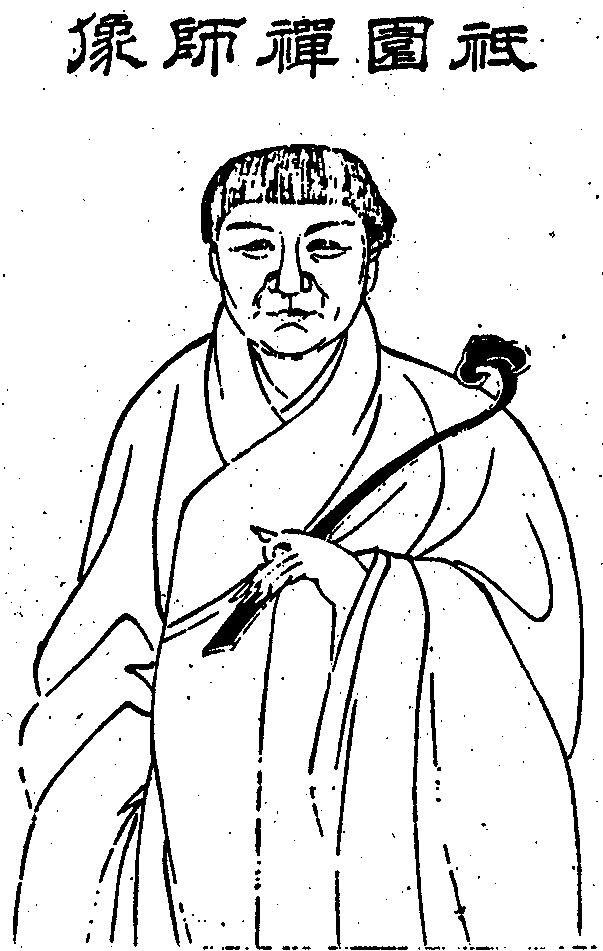
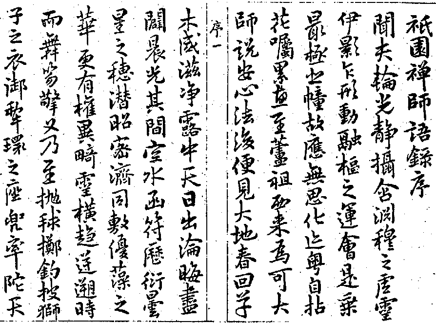
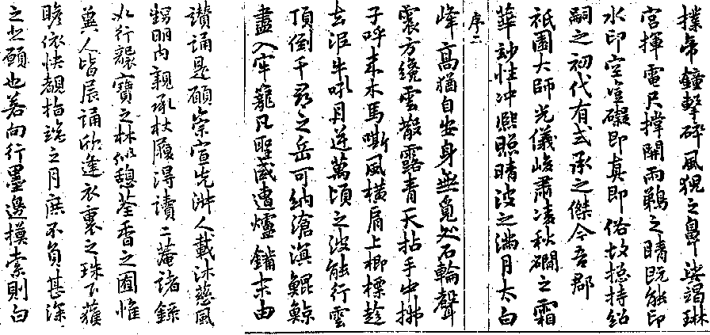
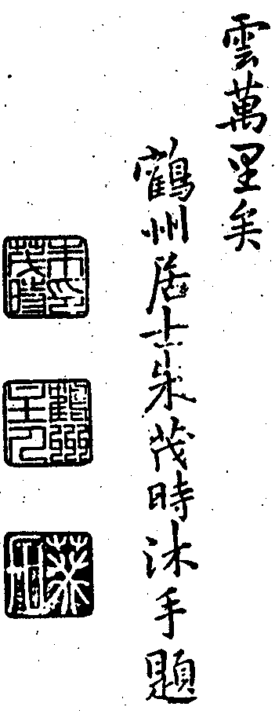
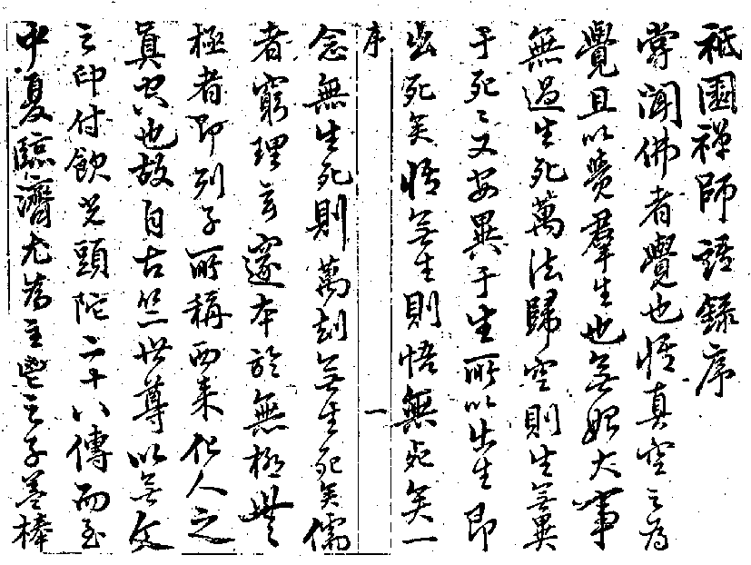
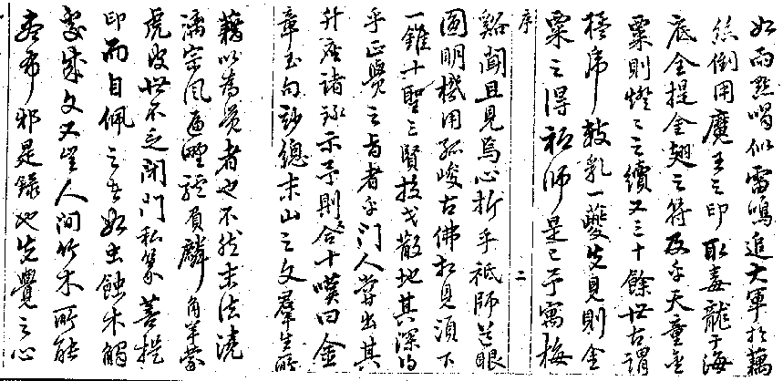
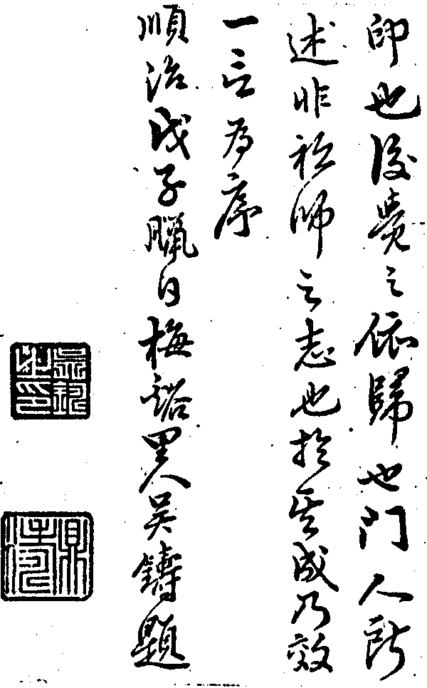
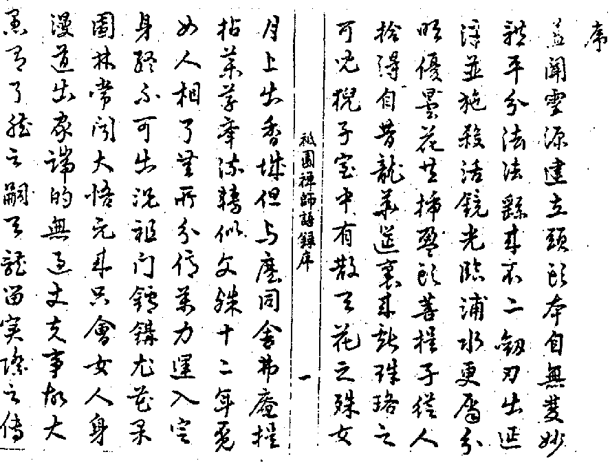
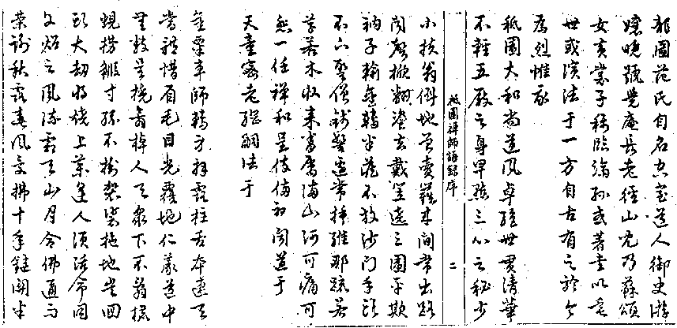
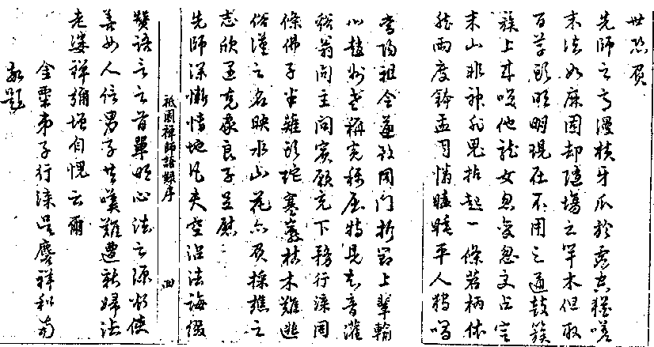

# 伏狮祇园禅师语录



> **藏经**：嘉兴大藏经（新文丰版）（嘉兴藏）　**册次** 第 28 册（J28）　**编号** JB210　**部类** 诸宗部　**卷次** 2 卷　**篇幅** 33,183 字

> **卷／品**：0 卷 · 3 品



---



## 目录



  - [祇园禅师语录序](#祇园禅师语录序)

  - [祗园禅师语录序](#祗园禅师语录序)

  - [序](#序)



---



祗园禅师像







------



### 祇园禅师语录序















------



### 祗园禅师语录序















------



### 序















伏狮祗园禅师语录总目



升座  

小参  

示众(附法语)  

机缘  

拈古  

颂古  

偈语  

书问  

题赞  

佛事  

源流颂  

行状  

塔铭



伏狮祗园禅师语录卷之上



嗣法门人　授远、超宿、超朗、超珂、超见、超振、超琛　仝编



书记超内录



升座



丁亥年三月朢日，梅溪众檀护、缁素等请师开法。师云：「山僧昨到梅溪省觐古南法叔大和尚，寓此董庵，檀护坚请上堂，山僧再三固辞，甚不得意，升於此座。」遂拈香毕，复云：「妙道无方所，遇缘便举扬，当头惟白棒，无法可商量。若论此事，觅纤尘了不可得。於此明得，三世诸佛齐立下风；於此不明，出生入死无有休息。急须一意努力加参，忽然彻见本来面目，则头头显现、法法全彰，岂不庆快平生？」举拂子，云：「脱体顿忘玄妙解，诸人自悟始风光。还会麼？不是一番寒彻骨，怎得梅花扑鼻香？」卓拄杖，下座。



结制升座。僧问：「今日结制即不问，不结不解意如何？」师云：「脚跟下七华八裂。」僧喝，师打，云：「喝后𫆏？」僧竖拳，师云：「钝置杀人。」乃云：「东蓝禅院打七，贵乎单刀直入，运动恶辣钳锤，煆出诸人骨髓。秖如超戒追荐先慈董门顾氏，又作麼生？」打圆相，云：「有物先天地，无形本寂寥，能为万象主，不逐四时凋。向这里领略得去，不妨庆快，坐断报化佛头，掀翻是非窠窟；如或未然，三根椽下、七尺单前，竖起生铁脊梁，个个壁立万仞，忽然拶破虚空，便乃翻身跳出。如何是安居一句？新出红炉金弹子，簉破阇黎铁面皮。」下座。



徐明彻请师升座。师云：「提金刚正眼，阐向上宗乘。」喝一喝，云：「向山僧一喝下透脱得去，释迦、弥勒拱手归降，顿契诸佛心宗，永证金刚固体，便能於一毫端现宝王刹，坐微尘里转大法轮，施机发用，导利众生，可谓成就慧身，不由他悟。」卓拄杖，下座。



升座。师云：「华严玄旨，诸佛之性海，无尽之宗趣，一瞻一礼，显大机、明大用，直须了悟无生，湛然常寂，不变不异，交光相罗，如宝珠网。诸人若肯回光返照，不隔丝毫。不见水潦和尚问江西马大师佛法大意，被马大师拦胸一踏，起来呵呵大笑云：『也大奇！也大奇！百千法门，无量妙义，向一毫头上识得根源去，岂不快哉？』即今还有证得无生法忍者麼？」良久，云：「卢舍那身全体现，豁开正眼绝纤尘。」下座。



解制日，檀越李晓令、郑云渡、徐吉士、张仲明等设斋，请升座。师云：「临济相传直指禅，才加点缀便廉纤，会中若有仙陀客，何用山僧更指鞭？」竖拂子，云：「大众还会麼？诸人直下承当去，一会灵山尚宛然。」下座。



四月八日世尊降生之辰，普闻上座为诞日设斋，请升座。师云：「一点水墨，两处成龙。昨日天晴日头出，今朝雨落地下湿。此事极分明，时人皆不识。若还识，未出母胎先荐得。昔日世尊才出母胎，七步周行，十种祥瑞，不费钳锤，天然气概。虽然如是，不见云门道：『当时我不在。若在，一棒打杀喂狗子吃，贵图天下太平。』云门虽则掣断金锁玉关，未免浑身泥水。若到伏狮门下，一点也用不著。且道有甚长处？」下座，一时打散。



结制升座。师云：「十方同聚会，个个学无为，此是选佛场，心空及第归。还有心空及第者麼？出众相见。」一音问：「杲日当空则不问，纤尘不立是如何？」师云：「放汝三十棒。」音喝，师云：「这一喝落在甚麼处？」音连喝，退。师云：「又恁麼去？」乃云：「九月廿八结制，不依寻常旧例，弘开罏鞴烜天，百煆光辉愈丽。贵乎直下承当，始称宗门大器，显发莫大威光，便可自他俱利。逼拶露柱灯笼，尽要心空及第，不妨游戏神通，总是灵山授记。且道：众施主设斋，功归何处？亘古逍遥常独露，个个心空证本真。」下座。



戒子请升座。师云：「诸佛之戒迥然独露，千华台上正体如如。」卓拄杖一下，云：「优波离尊者来也。在山僧拄杖头上放大宝光，光照十方，圆明普应。向这里会去，波澄性海，彻见心源，了知全体是戒，无持无犯；其或未然，切不可拨无因果。还见麼？卢舍那身全体现，大坐当轩孰敢窥？」喝一喝，下座。



解制升座。僧问：「海众云臻，十方聚集，如何是不结不解句？」师云：「舌头元在口。」进云：「人人眼横鼻直。」师云：「瞎。」怡然问：「慈悲杖下破朦胧，常寂恩光沐几重，脱洒自然无住体，圣凡坐断不施功。」师云：「杲日正当空。」进云：「黄草堆中清净土，万军丛里太平歌。」师云：「葛藤不少。」乃云：「伏狮结制期事毕，个事分明尽指出，十方世界荡无边，个个踏著真实地。真实地，脚下无私俱粉碎，禾山打鼓雪峰毬，不出当人个中意。今日维那设斋，大众受供，掬水月在手，弄花香满衣。须领略，莫迟疑，好看当人额下眉。」以拂子拂一拂，云：「收因结果一句作麼生道？鲸吞海水尽，露出珊瑚枝。」下座。



腊月八日，吴门卜氏请升座。师呈拂子，又左右一击，云：「八字打开为君荐，分明显示本来面。无灭无生常湛然，霜花映水棱层现。稚仙老居士曩参金粟先大和尚，言下知归，居尘不染，平生操履洁如冰玉，夫妇如宾，出入丛林，扇起仁慈助道之风，若非夙植德本，焉能如是？山僧与麼告报，诸人若善参详，不被生死笼罩。且道荐拔一句作麼生道？愿君得果成宝王，还度如是恒沙众。」下座。



晓令李居士、同室超进，为令慈庆诞，请升座。师云：「六十年前，蕊珠宫里降神仙；今朝诞日，锦上铺花添喜色。万瑞千祥如雾集，悟取中间不老人。如何是不老人？」蓦竖拳，云：「惟有这个与虚空同寿。向者里会去，掀翻花甲子，能报劬劳德，出入栴檀林，逍遥惟自适。且道：因斋庆赞一句作麼生道？清新岂让古人风？超然彻证无量寿。」卓拄杖，下座。



一音禅人请升座。一音问：「处处绿杨堪系马，家家有路透长安。如何是荐亡一句？」师云：「指出无生路，高登解脱城。」进云：「龙宫狮窟咸哮吼，昆虫草木尽沾恩。」师云：「不劳赞叹。」乃云：「春日融和百鸟鸣，声声只为唤人醒。急荐取、莫沉吟，鼻孔依然搭上唇。一音上座相依有年，向山僧棒下翻身，今日在会咸沾利乐，且作麼生荐亡一句？一道寒光含万有，逍遥亘古又弥今。」卓拄杖，下座。



法净上座为荐先严工部主事临鹉孙公请升座。师云：「本体恒然亘古今，无生无灭露全真；只因见倒生疑惑，致使轮回不𫏐停。法净上座发大信心，拨转昙华书短偈，凿开瀚海续长篇，无边香水海一滴，全收百亿秘密门，顿开弹指笔底流，华藏常转妙法轮。若能自契，已报先亲，无相光中常自在，觉华独露一枝春。」卓拄杖，下座。



非茂马居士荐考妣请升座。师云：「欲报劬劳罔极恩，愿承般若力弘深；慇懃虔请登高座，破伊生死了无尘。」竖拂，云：「二位亡灵在山僧拂子头上现身已了，大众还见麼？其或未然，未免山僧葛藤去也。裂爱网，出迷津，弹指高超华藏门。」掷拂子，云：「鸳鸯绣出从君看，莫把金针度与人。」下座。



吴仲木、叔耕、季容居士，为伯母诰封淑人朱氏六旬诞辰，请升座。西堂问：「道先天地，法亘古今；甲子掀翻，遐龄亲庆。敢问如何是祝寿一句？」师云：「九九八十一。」进云：「法座当阳狮子吼，堂前萱树证金刚。」师云：「桂子正飘香。」乃云：「紫绶金章节义全，居尘不染现优昙；拨转浮生花甲子，儿孙共庆万斯年。所以道：惟一坚密身，一切尘中现；圆如明月珠，利若金刚剑。」卓拄杖，下座。



一揆禅人薙染，升座。问：「昔日丹霞铲草，虽则烁古辉今；学人今日披缁，何异元来不隔？问和尚如何是全提不隔句？」师云：「袛树生新蕊，昙花匝地春。」进云：「恁麼则春风即在花枝上，浅碧深红古到今。」师云：「到者方知。」问：「头角峥嵘初出海，兴波作浪有谁当？」师云：「金翅鸟王当宇宙。」僧竖一指，云：「遇著个汉来是如何？」师云：「一棒打彻骨。」进云：「若不蒙师亲指示，焉知花外有春风？」师云：「放汝三十棒。」乃云：「繁华迥脱圣贤仪，法服全披解脱机；坚持戒行能操守，映水山花岂羡伊？为僧须发猛，宜作法中英；涅槃心易晓，差别智难明。玉不琢兮不成器，真金百炼转光辉；脱洒顿超凡圣位，心宗妙契始为尊。且道如何是庆赞一句？丈夫顶相当阳露，时至宏机正令行。」卓拄杖，下座。



孝子吴曰夔、吴为龙，仝母董氏，荐接候府君十周忌辰，请升座。西堂问：「月落西山日东上，生死去来无两样，请问和尚荐个甚麼？」师打，云：「当阳指出。」进云：「杖头指出毘卢境，匝地清风任运腾。」师云：「莲花世界藏不得，十方大地现全身。」乃云：「白苹红蓼楚江秋，思亲孝子泪盈眸；杖头指出逍遥路，天堂佛国任君游。一念回机同本得，无灭无生觌体周。」喝一喝，下座。



升宇柳居士邀众善信等饭僧，请升座。师云：「盛泽柳居士，丛林旧有名；相邀诸善信，营斋植胜因。若道居士设斋，又在盛泽；若道居士不到，又在此设斋。到与不到如何话会？山僧举一则公案。昔南泉不赴堂，众请赴堂。泉云：『我在庄上吃油糍饱。』大众云：『和尚不曾出入。』庄主云：『谢和尚。』吃油糍者则公案，古今提唱者甚多，错会者不少。山僧为汝拈出：官不容针，私通车马。向这里会去，少林的旨通贯古今，觌面提持，当阳显露，展开自家宝藏，掀翻灵鹫家风。於此不会，只知事逐眼前过，不觉老从头上来。」卓拄杖，喝云：「截断葛藤。」怡然问：「曹溪一派传千古，临济宗风又举扬，敢问和尚，如何是烹金琢玉句？」师打，云：「是烹金？是琢玉？」进云：「谢和尚证明。」一揆问：「如何是宾中宾？」师云：「浩浩走红尘。」「如何是宾中主？」师云：「问得自然亲。」「如何是主中宾？」师云：「答处出常情。」「如何是主中主？」师云：「打汝头颅破。」



解制升座。「豁开闲门户，管教全体露。若据正眼观，开口成话堕。觌体自承当，迥绝无遮互。全提宝剑铲廉纤，棒头击著人皆悟。今朝圣制告圆，因斋庆赞一句作麼生道？布袋打开从抖擞，笑看鹫岭碧层层。」下座。



盛门李氏荐先严原白府君，请升座。师云：「山河大地，明暗色空。时人不悟，强觅西东。」打圆相，云：「若向个里会去，冤愆尽解释，罪业自消镕，了无生死相，迥绝去来踪。」举拂，云：「还见麼？过去先灵在山僧拂子头上成等正觉，放大光明。为甚如此？各各自承般若力，堂堂证入宝莲心。」



一音上座请升座。僧问：「开炉结制，龙象骈臻。今日和尚升座，将何法示人？」师竖一指。进云：「诸佛未出世，人人鼻孔撩天。出世后为什杳无消息？」师打，云：「你分柝看。」僧一喝，归位。师乃云：「从来个事人皆具，何必山僧落二三？」喝一喝，云：「喝处掀翻海岳，认将为喝成誵。笑看结角罗纹处，铁眼铜睛不易窥。且道超宗越格一句作麼生道？一拳拳倒黄鹤楼，一踢踢翻鹦鹉洲。」卓拄杖，下座。



信官吴鼎陶居士率男源起，为荐先室宜人钱氏法名超荫，请师升座。乃云：「正体堂堂无去来，不贪富贵任盈怀；灵根夙植超今古，顿证无生笑满腮。」击拂子，云：「虚空击碎，爱网裂开，高超慧果，坐宝莲台。还知超荫落处麼？宝华弥满佛来迎，优钵罗华衬足行。」喝一喝，下座。



鼎陶吴居士述：「室人超荫，生平勤修妇顺，日持经卷。比年皈依师后，信道益笃，力疾趺坐，但令家人念佛。泊然而逝，少选苏云：『顷所行处，自呼祗园弟子，一往无碍，惟见佛接引。』连称快活。复留三日而去。没后，其子源起，梦母衣布素，稽首向佛于本庵禅堂，因请师对灵升座。是夕，复梦母乘座出堂，宝相庄严，香烟缭绕，大约超荫一心不乱。其临终得力如此。」(附记)



王言史居士、室人董氏请升座。师云：「佛与众生无优劣，秖因不觉生分别。妄想尘缘若不生，亘古灵明自豁彻。一念不生，全体寂灭，有甚麼为冤为对、为障为碍？且超荐一句作麼生道？不起纤毫修学心，无相光中常自在。」卓拄杖，下座。



师诞日，王夫人送法衣请升座。时师欲谢事，乃云：「玉露垂珠映碧秋，金风拂拂晚凉浮，优钵罗花开碓嘴，普劝诸人莫外求。今日王夫人法名超珪，造法衣与山僧庆诞，铺花锦上、锦上铺花，猛虎口中撑玉箸，狻猊颔下解金环，觑透毫芒何足贵，岂羡拈花独破颜？山僧才疏福尟，懒汩尘缘，藏锋纳鞘，隐遯度时。诸人衲衣下事，问取堂中二上座。大众！还知山僧底意麼？退居且作神仙客，潇洒清闲天地间。」喝一喝，卓拄杖，下座。



小参



姚夫人诞辰，请小参。师云：「夫人虽居火宅，夙有灵根归向三宝，居尘不染著，觌体绝廉纤，亘古今而不灭，全真独露；常自在以逍遥，应用无偏。虽然如是，更须明取向上一窍始得。且作麼生是向上一窍？」卓拄杖一下，云：「永证金刚无量寿，南山松柏古今青。」



孝子鍾宣远诵《华严经》，为荐先严瑞庵公小参。师云：「若人欲识佛境界，当净其意如虚空。远离妄想及诸取，令心所向皆无碍。但离妄想，真心自现。鍾公恁麼会得，则生本无生，死本无死；无死无生，湛然常住。」以拄杖击灵几云：「若向一毫头上了，毘卢华藏任悠悠。」



荐考妣小参。升座，云：「弹指光阴已数秋，全真只在一毛头；去来生死元无异，豁彻灵明得自繇。大众还见麼？先考养素胡公、先妣高氏陶氏两孺人，今日在山僧拄杖头上坐宝莲花，放光现瑞，来无所至，去无所从。」遂以拄杖指真，云：「百宝庄严无相身，一超直入如来地。」



小参。升座，云：「质可徐公，其生也忠肝义胆，其死也豁彻灵明，颖异过人，真是豪杰，世间希有。阖府与山僧往来数年，居士每与山僧谈及此事，有心领神会处。但世缘深重而不能纯一修行，若非曩劫薰习，焉能如是正信？须知四十三年万境之中，种种皆是佛之玅用。何以见得？玅性圆明，离诸名相，本来无有。世界众生，因妄有生，因生有灭，生灭名妄，灭妄名真。如何是真？」遂举拂子，云：「全凭这个威光，不向四生流转。」



信女行福请小参。师云：「思念手足情，奄然忽半载。惟有般若力，一句截情爱；坐断生死关，个中无变改。大众！还知沈氏孺人安身立命处麼？」以拄杖指灵几，云：「杖头指出金刚体，十地高超出爱缠。」



子葆朱居士请小参。师云：「圣凡同一体，生死悉皆如；秖因自不了，致使受轮回。朱老淑人还会麼？山僧示汝归真，永证金刚固体。急荐取，莫迟疑，觉悟世间真幻妄，超生脱死定无疑。」以拂子左右一击，下座。



请金粟本师车和尚真到，小参。师云：「这老汉一生逞尽伎俩，到临末稍头一事也无。引得不肖儿孙说道，金粟和尚形影在这里。毕竟和尚在什麼处？大众还知落处麼？」良久，云：「腾今耀古元无住，一道圆光烁太虚。」拈香，大展三拜。



示众



出关示众。「三载关中藏拙衲，幽深颇乐自恒然；堂堂正体无内外，逼塞虚空绝盖缠。既无内外，又绝盖缠，无形无相，觌体现前。摄大千于一毫端，融芥尘於十方刹。无拘无束，任运纵横，一喝一拳，迥然独露。」遂竖拂，云：「还会麼？正当恁麼时，独露一句作麼生道？横拈竖用总无别，万象之中不涉缘。」



坐香开示。「若论此事，人人本具，个个圆成，何须结制，畫地为牢？所谓良马一鞭，俊人一言，直下领会，不用多端。虚明历历，觌体全真，更无他物。」喝一喝，云：「了手还他彻骨汉，超今越古自腾腾。」



示众。「普劝大众，痛念生死事大，如救头然。至苦莫如业识茫茫，至乐莫如一心修道。道乃天下之极乐，舍道而求乐，犹弃食而求饱也。世人迷自本心，妄贪世乐，不知无常一到，万事皆空，百苦交煎，慞惶怕怖，不想世间之乐，动遭业缚，有爱必离，有冤必会。爱憎俱消，自然明白。修道之人，心同太虚，无是无非，慈悲忍辱，悉灭贪瞋，远离妄想，遇境逢缘，把定绳头，勿令犯人苗稼。勤持正念，刻刻提撕，猛著精彩，纤尘不立。一旦豁然，明彻本性，成佛不虚。此生若僧若俗，各请回心。」



除夕示众。「腊月三十日，古德喻人生死交会之际，不可不审。须要安思危、乐思苦，趁此无事之时，把话头顿在面前，昼夜挨拶，当发上志，以悟为则，豁然开朗，不枉出家之念，莫贪热闹。昔懒瓒和尚，唐太宗钦其名，遣中使入山请之，诏书三降，始起拨火捉煨芋，寒涕交颐，曾不之顾。天使笑曰：『请和尚拭寒涕。』瓒曰：『那有工夫与俗人拭涕耶？』使回，举似帝，帝益加钦敬。看他古人如是履践，名利不干怀，自然日用合道。大众还会麼？啼得血流无用处，不如缄口度残年。」



怡然病中请开示。师云：「山僧无一法污汝心田，单拈一条白棒；若向山僧棒头豁开正眼，始知立命安身。若得一知半解，如何抵得生死？要亲到不疑之地，方为稳当，方知我不欺汝。」复示偈云：「宗门中事贵真参，二六时中莫放宽；拶得一身白汗出，自然四大得轻安。」



十月十五日，古宿上座仝钱门吴氏设普茶。师示众云：「十五日以前，大地山河皆有月；十五日以后，谁家灶里火无烟？今日正当十五日，天上月正圆，人间道月半；欲得两相应，分身两处看。所谓心月孤圆，光吞万象。光非照境，境亦非存；光境俱忘，复是何物？」西堂义川云：「说似一物即不中。」师云：「毕竟是个什麼？」进云：「相逢者多，知音者少。」师便打。进云：「一棒当阳亘古今。」师云：「若不同床睡，焉知被底穿？」进云：「伏惟和尚珍重。」问：「宝印当空妙，花拈一小春。」师云：「风吹拂子千条线。」进云：「今日蒙师指，方知有一冬。」师云：「人人彻骨寒。」拽拄杖归方丈。



示众。「参禅打坐，求脱生死，不知安身立命处，如人在大海里坐，更问人讨水吃相似。学道人一切时中勤苦耐志，昼三夜三，念念相续，无有间断。豁然妙悟，随处明了，更无欠少，任运纵横，不离本际。果到这里，凡圣了无立处，直下承当，皎然无物。若人真不用功，更求解脱，正是迷波讨源，难成大器。趁此一期，必须了办。若不真切，甘为下劣耳。愿众兄弟各各努力。珍重。」



示众。「凡参禅人欲证悟者，从自己心中朴实做去，挨到水穷山尽处，忽然一念顿悟，如十字街头见亲父一般，更无疑惑。但悟有深浅，若从根本上做工夫，打破疑团，顿歇无明窠臼，一超直入，此上根利智。其餘渐修所证者，最怕得少为足，纵有会处，皆是识神边事，以此为真，认贼为子，此一关决要透过。若有习气未除，就于一切境上观照，顿省前非，消得一分习气，显得一分本智，全在工夫绵密，放下身心，单提一念，切莫管他悟与不悟，只管做将去，不必将心待悟，希求玄妙。众生妄心原是如来果体，妄想情虑原是神通妙用，工夫做到做不得处，更加一拶，才为了当。不然，则堕忧愁魔矣！」



法语。「山僧虽参金粟先和尚付授，自揣愚拙，决志住静。但先师嘱累为重，刀耕火种，觅一个半个以报先师法乳，于愿足矣。因董庵幽静，颇觉相宜。昔众檀信坚请上堂，山僧再三固辞，不得已升座示众，解制日已曾对众白过。今禅道纷纷，魔强法弱，非具大智慧、大力量、大福德者不能胜任。山野何人，自不度量？此事至大，若不慎于始，必殆于终。况乎远祖汾阳数请不赴，且山僧才轻德薄者乎？唯护法亮之。」



吴老夫人病中，令郎仲木居士乞法语开示。乃云：「愿夫人将四大五蕴、名闻利养、顺逆境界、病苦厄难、忧悲苦恼万缘一齐放下，直得净裸裸、赤洒洒，胸次中空牢牢地，单究本来面目。朝参暮究，日用如是行持。一旦豁然猛醒，生死情关顿然迸裂，踏著本地风光，自然心病身病俱消，方为廓落超方，为女中丈夫也。」除夜。「光阴倏忽间，不觉改容颜，努力勤修道，回心种福田。忍辱波罗蜜，慈悲是法船，不知佛世界，即是己心田。顿除人我见，憎爱不相关，云开红日烁，处处都皎然。本自天真佛，迷遭烦恼缠，透彻无僧俗，唯悟达根源。对境心常寂，如如体湛然，诸祖传心印，何曾别有禅？大道无文字，临机总现前，悟佛心宗也，教外岂虚传？」



「山僧兹寓董庵，安贫乐道，凡遇种种委曲逆顺之境，难治难调，甘心自受。况山僧二十餘年力行苦行，念念弘扬正宗，心心开发后学，愿与众兄弟苦志同参，视人如己，处险犹安，而且德薄寡能，故尔杜门藏拙，养病度时。每思从上有智之士，凡遇境缘，不为境缘所使，能受诸触，於诸触中行平等慈，冤亲不二，识得境风起处，烦恼即是菩提。如是则当处寂灭，总归解脱之场；深居一室，闭门即是深山。云峰高寄，任性随缘，众虽不相会面，於大光明藏中，时与众檀信觌面提持。正所谓：『无边刹境，自他不隔于毫端；十世古今，始终不离于当念。』旨哉斯言！伏惟明鉴。」



机缘



湛虚兄过访，弟子言：「师不在家。」茶罢，师出相见，虚云：「将谓主人不在。」师云：「动若行云，止犹谷神。」虚云：「非公境界。」师便喝，虚云：「这一喝未有主在。」师即竖一指，虚亦喝，师云：「再喝一喝看。」虚云：「钝置杀人。」



不二兄诣庵商量搆室，索偈云：「乞兄帮助。」师云：「劈面一掌。」不二云：「不要许多。」师云：「劈面一掌，顿绝伎俩，大施门开，度人无量。」



金台法师在天宁寺讲经，师往问云：「慧镜常明照十方，纤尘不立绝商量，骅骝今上康庄路，鞭影不施到故乡。请问老师到家之后如何行履？」台云：「汝做何工夫？」师便喝，台云：「你这一喝落在何处？」师云：「一喝浮云散，当阳日正辉。」台云：「我这里不用棒喝，只说三乘。」师云：「唯有一乘法，无二亦无三。」台云：「这上座是利根人。」师答偈云：「当阳正照绝中边，拄杖横拈击大千；放得源头真活水，都教灌溉好心田。」台复偈云：「枯木庭前蹉路多，行人到此尽蹉跎；只消本分酬他价，穿起婆衫却拜婆。」师又答云：「枯木重荣覆大千，临机无碍绝遮栏；明珠出现吞寰宇，一棒打通万仞关。」



当湖陆夫人参。「弟子今日要与和尚讨个落处。」师打云：「与你一棒，且道落在甚麼处？」陆云：「无踪亦无迹。」师云：「你在何处安身立命？」陆无语。师示偈云：「直指单传不涉言，棒头急荐个中玄。红尘堆里全身现，越圣超凡自在仙。」礼谢而退。



僧普闻呈偈云：「个里从前无易难，风波脱却事皆安；明明历历无他碍，任意纵横得自然。」师云：「如何是你明明历历境界？」进云：「高高山顶立，深深海底行。」师云：「非汝境界。」僧云：「一条直入长安路，吸尽江山一点无。」师云：「你向何处安身立命？」僧礼拜，师云：「放汝三十棒。」



僧参，师问：「仙乡何处？」僧云：「广德。」师云：「你曾得也未？」僧喝，师便打。



除夕，师问西堂怡然云：「如何是赵州火炉头宾主句？」进云：「村歌社饮。」师以箸掀翻炭火，僧礼拜，依位而立。师举如意云：「唤作如意则触，不唤作如意则背，不得下语，不得无语，不得错举。若道得的，当即分付汝。」西堂礼拜云：「伏惟和尚起居万福。」师云：「汝分上又作麼生？」答云：「万木春来自向荣。」师乃付。



师问义川：「你主人公在何处安身立命？」川云：「撒手无一物，直下自承当。」师云：「承当后如何？」云：「礼拜和尚。」师取拂子云：「不可唤作拂子，唤作什麼？」川竖拳，师云：「拂子与拳是同是别？」川云：「一个鼻头，两孔出气。」师乃付。



师问僧：「大彻底人本脱生死，因甚命根不断？」进云：「娑罗悉帝娑婆诃。」师云：「念后如何？」僧展手，师云：「展后𫆏？」僧喝，师打出。



朱超振呈颂，师云：「颂且置，如何是家里消息？」振无语。师劈面一掌，振礼拜。次日呈颂云：「当阳一掌便知恩，顿破疑情绝点尘；挥剑鸣琴皆是道，须弥推倒露珠真。」师云：「须弥作麼生推倒？」振拟议，师蓦竖拳云：「汝推得倒者个麼？」振无语，师云：「元来虚语，还须著力参究始得。」振云：「个事分明，机锋不利。」师乃示偈云：「聪明才智世间能，临济宗风绝点尘；若向棒头知落处，须弥推倒契天真。」



拈古



烧庵婆



婆子设钓抛纶，这僧可惜许，当锋错过。若是山僧，待他抱住时，劈面一掌云：「与汝证明了也。」



德山见卖饼婆



当时德山见他问点那个心，拈饼便行。待他动静，蓦面一唾，看他如何合杀。



德山小参不答话



若是山僧，当时才出，某甲不问话，与和尚相见。他行棒，接住便行，不妨庆快。



颂古



世尊降生



露著些儿便放憨，横行七步太无端，争如遇著云门老，一棒打教彻骨寒。



雪山睹明星悟道



明星一见髑髅穿，雪岭何劳坐六年。处处绿杨堪系马，家家有路透青天。



末后拈花示众



一花拈出万人前，刚有头陀解破颜。都道人天浑不识，谁知鼻孔亦撩天。



国师三唤侍者



蓦唤三回意已深，南阳肝胆一时倾。负吾负汝人难荐，描不就兮畫不成。



赵州勘二庵主竖拳



庵主拳头用处亲，谁知贼是小人心。从教一镞双雕落，依旧日轮东畔升。



赵州勘台山婆



蓦直台山一路通，赵州到此没行踪。老婆勘破归来也，踢倒须弥第一峰。



海舟禅师在万峰和尚会下三昼夜，寝食俱忘，偶香灯绳忽断堕地，豁然大悟。有居士问：「灯绳忽断时如何？」师答云：「击透髑髅。」



忽尔香灯堕地时，髑髅击透梦初回，横眠竖立浑无碍，倒驾铁船任往来。



宝峰禅师在海舟和尚会下刻意参究，不觉被火燎却眉毛，面如刀割，以镜照之，豁然大悟。



火燎眉毛刀割时，分明彻骨少人知，当台明镜如斯露，觌面相呈更有谁？



庐陵米价



米价庐陵越样新，寻常示众少知音，英灵触著丰棱露，谁道青原出少林？



武帝问达磨：「如何是圣谛第一义？」磨云：「廓然无圣。」帝云：「对朕者谁？」磨云：「不识。」



作家君王第一义，廓然无圣当锋举。挨拶将来对朕谁？不识因兹渡江去。阖国人追不再来，少室峰前唯面壁。错对神光露一机，至今遍界花狼藉。



二祖



觅心无处觅，当下便心安。纵使机前荐，已被老胡谩。早知灯是火，两臂定完全。



临济入门便喝



当机一喝震乾坤，万里青霄绝点尘，蓦直向人人不委，依前一个铁浑仑。



烧庵婆



抱定正当恁麼时，贼过张弓落二机。不是婆婆亲荐得，几乎放过老头皮。



南泉斩猫



提起猫儿斩处亲，一刀两段任英灵。草鞋头戴谁能会，千古风流疑杀人。



偈语



示徐道人超古



修行须忍耐，烦恼自然轻。真实为生死，念佛贵精勤。一心无间断，有何不解脱？念念不离佛，从此生死歇。平等自性中，荡然了无物。拍手任逍遥，不负余饶舌。



示南浔董道人



嘿嘿咨参渠是谁？忽然荐得了无依。看破始知来脉大，举头天外笑哈哈。



示钱圣月室人胡氏



学道须当了自心，青莲华发少林春。菩提种性人皆具，棒下翻身自古尊。



示朱老淑人(法名超觉)



一棒绝纤尘，当阳直指人。个中亲荐得，觌体自全真。



示一竟



一竟无别念，精进没间断，顶𩕳眼豁开，烁破娘生面。



示明元



在家学道人，不用别追寻。贪嗔憎爱断，步步证无生。



示惟一



参禅贵乎一，识一万事毕。荐得本来真，惟心而惟一。



示莲生



修行莫涉缘，一个话头参，豁然便领会，火里自生莲。



坐香示众



参禅须要起真疑，疑到情忘意绝时，荐得当阳全显露，堂堂日用了无依。



答朗目(附来韵)



从来个事莫传言，须得当机觌面间。古人八十犹行脚，微细其中玄更玄。



个事明明绝覆藏，好肉何须剜作疮？打破赵州关捩子，顶天立地露堂堂。



答野水兄(附来韵二首)



总持去后无消息，千载令人慨叹生。近日得君堪继袭，拈头作尾有经营。



龙池一派到金粟，滚滚连天孰敢当？幸有伊人施妙手，和源把住息汪洋。



师见，乃先著语云：「历历明明，盖天盖地，说甚麼无消息？」



历历孤明亘古今，当头一棒指诸人，个中若了全无事，万水同源一派真。



答觉如(附来韵)



新条旧发正森严，独占春光报上贤。挺直巍然当世界，红轮倒挂树头边。



春秋不涉本森严，亘古弥今独占先。湛湛澄澄含法界，日轮当午照无边。



咏梅花



梅开雪里倍精神，清彻馨香遍界闻。透出一枝天外动，园林独占自芳芬。



掩关二首



挈挈波波多少年，杜门息影隐林泉。乾坤踢破脚收转，独坐寒窗皎月圆。



其二



终日如愚顿息机，个中无是亦无非，堂堂坐断圣凡路，亘古弥今一本如。



觉如问：「这拄杖作麼生用？」师便打，云：「这样用。」遂示一偈。



贫僧一条拄杖，应用纵横无量。魔佛当头普施，定作人天榜样。



诞日示众



衲僧不与世人同，无灭无生任运中，若是庆生应有死，个中窥破寿无穷。



答孙子麟居士



堂皇独露了无依，透出云霄总不拘，描不成兮畫不就，大地山河不出渠。咦！若还认得渠，瞥尔翻腾迅若雷，文言中毒无轻泄，高寄云峰且待时。



答武林天羽仪(附来韵)



寄语祗园老比丘，赵州当日没来由。不须见面知端的，浅水如何泊得舟。



杀活纵横得自由，蒲团高坐懒抬眸。知君不是金牙作，谁敢般门弄斧头。



和郑云渡秋亭吟



大地浑然一草亭，烟云晨夕绕为櫺。松龛石壁无餘响，秋色空清谁解听。



孟夏关中闲咏



诸老门庭家业盛，自知疏拙隐为安。玄机棒喝都休歇，万法虚融莫问禅。



百结鹑衣倒挂肩，饥来吃饭倦时眠，蒲团稳坐浑忘世，一任窗前日月迁。



高卧云嶒寄幻躯，白云翠竹两依依。眼前幻境随迁变，深掩柴扉乐有餘。



茅舍风高孰敢亲，棒风喝月走烟云，俨然宝钵虚空托，淡饭黄虀自现成。



蒲团



团团一片绝遮拦，覆地翻天在处安。圣号凡名都坐断，大千收在一毫端。



拄杖



超然迥别骨棱棱，独立孤标亘古今，凡圣齐施全正令，撑天拄地独为尊。



拂子



拂拂真风绝覆藏，横拈竖用好风光，当年马祖曾悬壁，今日何妨再举扬。



钵盂



渗漏全无何俊哉，饥餐渴饮绝纤埃。要知洗后浑无事，多少迷人安柄来。



新正警众



浮生幻化苦奔波，终日忙忙被业磨。若能扫断无明窟，独露逍遥自在多。



人生幻世爱相延，爱若休时大觉仙。地狱天堂君自取，话头绵密莫贪缘。



心常坦坦本来清，细察多知混世情。直下翻身登彼岸，无明顿破笑吟吟。



了得凡心圣自圆，急参父母未生前。觑破本来一著子，山花流水共同欢。



书问



复朱老淑人



接手扎，乃知道人世念渐疏，悲哀尽净，慰甚！慰甚！然道人要先期以悟为则，将世间名利看破、家务放轻，则道念自然浓厚。须知一切境缘，自心所造，於境缘习熟处作得主，便不随境缘所转。看定话头，心心无间、刻刻提撕，蓦然撞破，则平时熟习，自无著处矣！古云：「他人难用力，自度自家身。」二六时中，不可散逸。至嘱。



又复



尊体违和，切须保重，盖心安则身自安矣。来谕大事茫然，山僧道：「不妨好个消息。」何不万缘放下，回光返照，看茫然底是谁？烦恼底是谁？知茫然底又是谁？烦恼之念起从何处起？灭向何处灭？看来看去，忽然豁开正眼，始知立命安身迥然独露，当体透脱，自由自在，是山僧之望也。



又复



流光迅速，浮世危脆，岂是久居？道人处富贵繁华之中，实为生死心切，真火中之莲也。此段大事因缘，虽是至易之事，亦是至难之事，必须发勇猛心，立决定志，朝参暮究，喜怒哀乐之间，断不可放过，精进中倍加精进，忽得心华发明，照十方刹，可谓不出尘劳而作佛事矣。



又复



迩来道履康宁否？体究个事无杂念否？日用应缘不？彼外境所夺否？勿驰求，莫妄想，儿孙之念，顿宜放轻。逆顺境界，即是菩提。若觑得破，即此火宅尘劳，便是当人出三界之处。一段风光，横拈竖用，只在寻常日用之中。头头开正眼，法法尽归宗。除此之外，贫道别无开示。嘱！嘱！



示海宁禅人



做工夫必须要发勇猛心，立决定志，痛念生死无常大事，毕其形命，不肯放过，识破一切世间爱憎是非境缘，不使一尘为障。行住坐卧，日用应缘处，时时体究，永无退转。又所谓工夫者，将思量世间尘劳底心，回在话头上做去，忽然无心撞破漆桶，自然默默相契矣。



复表嫂



若论此事，佛未出世，祖未西来，照天照地，无欠无餘，若僧若俗，皆可成佛作祖。今但二六时中，四威仪内，无时间断，看定父母未生前，如何是我本来面目？密密提撕，不为世事所夺。尘缘快乐时，自当猛省，不可放逸。愈久愈坚，久久纯熟，豁然透脱，方信吾言，此乃火宅中之真方便也。



又复



客秋一别，远隔至今，每承种种道爱，非言谢可尽，已知阖府起居佳胜为慰。近来世乱纷纷，如之奈何？此际只有参究工夫为最，更无别事可为也。倘得心地开通，彻见本来面目，得大自在，任他波浪掀天，我自湛然不动。山僧与诸行人苦志同参，又蒙见招，难以举动。稳坐家庭，一切纷纭变幻委之于数，万弗见虑。待外境稍平，望过庵一晤，是所愿也。



示瑞宗



瑞宗少年切志向上事，然于生死大事欲随处解脱，惟喜怒哀乐忽来，不能当下消殒，则主人公已被牵缠矣。只因忘却本有佛性，故一向在世情逆顺境界上为正事，不知此境界是生死根本，若一生打交辊不开，则不觉不知，虚生浪死。所以山僧教人参究看话头，深下疑情，念念不忘、心心不昧，一切闲忙动静、呼奴使婢、抱儿弄女，应酬之中重下疑情，毕竟如何是我本来面目？二六之时疑来疑去，忽然疑破话头，㘞！元来与佛祖同鼻孔出气，诚为火宅尘劳中女丈夫也。嘱！嘱！



复常翁居士



远承垂念，知二位大人尊体康泰，欣慰无量，幸添两令嗣常氏家门重兴，某愿足矣！所云田事，某昔日告别时，面对二大人言过，某痛念生死事大，无常迅速，时不待人，发愤要明此事，辞亲弃俗，甘旨不供，不能尽世间孝道，所以某将从前自置数亩，奉二亲供膳，聊表寸心，以免不孝之罪。久后可付令嗣，以作先道伴飨祀，以尽某在常门一番事也。去年四月八日掩关，一切并捐，所谓传佛心印，续佛慧命，岂细事哉！故只杜门守愚，且以度日耳。



复朱老淑人(因乞)



读来谕，贫僧无念中亦不能无挂念耳。若执幻妄为真实，迷头认影，了无出期。古云：「狂心一歇，歇即菩提。」妙净明心，本非外得，一朝猛省，则生死情关顿然迸裂，始知真妄不二，动静皆如，颠倒情尘自能瓦解冰消矣。



又复



且喜老居士玉体清胜，然道人亦须保养为要。日用之中，倾心向道，切莫唐丧光阴。即穿衣吃饭，无非这个消息；语言谈笑，亦无非本地风光。故云：「举不顾，即差互；拟思量，何劫悟？」道人宜深思之，不可蹉过也。



复吴稚仙居士



尊使到，知老居士阖府起居佳胜为慰。向承见招，到贵府饱领香斋，兼惠厚仪，而今复承远寄妙剂，山野德薄，何以克当？感愧无量。居士念先和尚一脉，来索山野颂古。山野质钝，难穷诸大尊宿之意，来谕师伯和尚婆心，为侄者惭惶无地，但痛念先和尚早逝，弟子追忆无穷，何时得报？五月初回庵，杜门藏拙以度时耳。



复郑居士



接手教展诵佳章，见居士慧性高朗，居尘不染，火里青莲。要了此事，急须努力加参，不可被文海诗江所浸，不妨向棒头豁开正眼，掀天揭地，佛祖同俦，可为居尘出尘之大丈夫也。山野质钝数语，也是钵盂安柄。愚见如此，不知高明何以诲山僧也？呵呵。



复郑云渡居士



居士同月朗兄过庵，命跋《华严经》。山僧才识谫劣，偶尔成文，明眼人前一场笑具。复命跋《法华经》，是法非思量分别之所能解，若有知解，是为门外三车矣。一跋、再跋，是知解、非知解？如其不然，自数他宝，请著精采，蓦忽撞破，血从何来？经是谁书？龙女谁做？便能豁开火宅，显出真机，携手同来，白牛露地。居士要行持此事，还宜一火焚却，不留一字，更为痛快也。复偈云：「《法华》未举现全身，笔底横流血染经，月朗当空映法海，临书妙用一毫吞。」



答澉浦吴裒仲居士



来谕日用未得一如，才涉闹处便不得力，须向日用应缘处立定脚跟，丝毫不昧，看是何物？忽然摸著鼻孔，觑破旧日家风，不用寻思，迥然独露。不然，世法、佛法打作两橛，何日自了？惟在决透此事，洞见圣贤精髓，真顶天立地大丈夫汉也。



又



来谕尘缘牵扰，山僧道：「不妨就在尘缘体究，头头用去，法法消归，自己静闹闲忙，无二无别，竿头进步，昼夜挨拶，忽尔㘞地一声，自然净土秽邦俱成宝所。」居士慧性高朗，根器不凡，山野拙语，宜付丙丁。法体珍重自爱，谨复不尽。



示戒禅人



道人尘劳中有志求出生死，须将个父母未生前本参话头研穷体究，以悟为则。先要立一片决定出生死心、久远不退之志，不可存一字在胸中，从前习气一齐抛却，家缘世情一齐放下，胸中了无一物，单提话头，重下疑情，只管勇猛做去，自然久久纯熟，豁然迸出本来面目，方信云门饼、赵州茶原是残羹馊饭。若达此旨，则日用不出尘劳而作佛事矣！



示琛禅人



禅人欲出尘劳而断生死，宜发大志，以期妙悟。身处繁华富贵之中，切莫任境飘流、优游纵逸。无始以来，习气浓厚，爱根深重，生死轮回不断。若要了悟，如世尊顿舍金轮皇位，雪山苦行六年，睹明星悟道，远云：「奇哉！众生具有如来智慧德相，只为妄想执著，不能证得。」此是第一个成佛的样子。禅人决要了生死大事，提起话头，如金刚王宝剑一齐斩断，顿歇妄心，拶到水穷山尽处，通身是一个谁字，彻见本来面目，广大圆满，了无一物，便知山僧棒头落处，微妙难解之法，不待问人而自明矣。山野质钝，矢上加尖，令兄高明博达，自有超方卓见，见此字当为之抵掌呵呵也。



示明秀



久不晤言，心怀耿耿。小姑早逝，母子至情，百劫千生，恩爱之所流注。道人既知有一段大事因缘，便好顿舍外缘，推穷生死大事。五浊世中，无一真实，有生有灭，种种虚幻，从本元无，因爱而有，生死轮回不断。道人当下试看，要哭的毕竟是谁？正烦恼时，亦非他物。从此著力一拶，忽然看破，头头显露，物物全彰，烦恼之念，自然冰释矣。



复裒仲吴居士



接手扎，知阖府迪吉安和为慰。来谕更求开示，居士犹在光影门头者，岂不荐取山野前日棒头落处？若果棒下见得亲切，于日用中秉一口金刚王宝剑，临机涉事一斩斩断，谁敢当锋？果然到此地位，万派千溪皆渤澥，七金五岳尽须弥。此外更无别嘱。呵呵。



复檀越董帷孺居士



接翰教，知阖府佳胜为慰。每念居士灵根夙种、妙慧今生，心宗顿契，大年再来，作皇家之柱石，为法苑之金汤，种种卫护，不胜感感。复承远怀厚贶，山僧才轻德薄，何以克当？拜领遥祝，谢谢不尽。明春居士光临嘉禾，可当一度河清也。



题赞



金粟本师车和尚真赞



咄者老人，骨格棱棱，无相光中，蓦现此身。一条白棒，断人命根，亲遭毒手，彻恨最深。而今触著当年事，一番提起一番新。



又



杰出丛林，金粟和尚。恶辣钳锤，佛祖不让。凡圣当前，顿绝伎俩。咄！全提向上不留情，天上人间更无样。



题待漏图(朱老淑人乞，法名超觉。)



朱老淑人，逼我题真，超然迥脱，觉即无尘。咦！丹凤朝金阙，独示本来身，团𪢮共说禅家语，火里莲花遍界闻。



题金氏像



手拈拂子，非俗非僧，合门庞眷属，聚首话无生。咦！到底还须亲撒手，迥然出格自由人。



李晓令居士



请晓令，自珍重，二六时中莫妄动，但有纤毫即是尘。咄！者一著，唯人自肯乃方亲。



题吴居士小像



从无住本而现相，处富贵中而不染。只影单瓢乐有餘，超生越死自能办。咄咄咄！浊恶世中为标格。



题质可徐居士耦耕图赞



咄！质可质可，无可不可。富贵不恋，隐遁耕耘。深藏务本，本立道生。齐眉举案，共乐清贫。楹樽共赏，稚子候门。忠心俊杰，传上丹青。



题曹居士像(殉难)



咄！莫谓介繁非介繁，孤峰月落映寒潭，超今越古离情谓，义胆忠心岂等闲？从此一番遭毒手，芳名千古落人间。



题进禅人梅花像赞



曹溪旨，绝廉纤。拟别会，隔天悬。急参透，省旧颜。咄！今人岂让古人风，如梅腊尽春先占。



题云岩师小像



平生性直，无我利人。坚持戒行，力为丛林。急须荐取，切莫因循。透得最初一句子，菩提树下道圆成。



莲宗禅人请题父小像(号常炤)



美哉父子同出尘，常炤不传之秘诀，孤危不让谢家风，一炉香对俨然别。咄！



题血书《华严经》



华严法界广无量，上人滴血收华藏。一字一笔一法门，不可思议转法轮。遮那妙体无生灭，一真实际刹那成。迅笔一挥亲荐得，转经为己任纵横。



钱圣月天童步趋图赞



透脱生平这一著，何必随师步趋法。人人有条拄杖子，规持任汝超方作。咄！月印千江休卜度。



大悲菩萨开光



庄严清净大悲王，幢盖重重妙莫量，圆应法身舒手眼，施为动转放明光。



施主送韦驮菩萨进院



菩萨密行难思议，觌面令人放宝光。内外障消魔永断，大众均沾慧日长。施主庄成功莫大，迷云开处性天香。选佛场中行佛事，无穷护法镇长行。大众还见麼？南无护法韦驮尊天菩萨。



题自像



袛园不会禅，饥吃饭，倦打眠。人来问道无他说，劈脊粗拳绝妙玄。



又(超洁超贞请)



手携如意，闲闲无虑。玉洁冰贞，寒梅发蕊。咦！无限香风动，我无隐乎尔！



题茂时孙居士家庆图



桂子兰孙正茂时，馨香悠远发新枝，千寻翠碧森森秀，满目清光个个知。石上端然坐，默参古佛机，亲逢渠面目，觑破自容仪。一门开正眼，何处不相宜？咄！天掀地揭凭君立，源远流长孰敢窥？



夏大至自畫像请题



自描自像，番成两样。豁然触著本来真，原来不在丹青上。咄！青松底下任闲闲，随缘潇洒江湖上。



题庚长徐居士像



徐公庚长，器宇堂堂，胸藏万卷，掩卷思量。咄！莫思量，眉毛剔起细参详，蓦然黑白都翻转，万别千差任汝扬。



又夫妇同赞



庞老团𪢮满目春，逢人无事笑吟吟，长庚灿烂横霄汉，野鹤翩翩迥出群。咦！虽然如是，更须透过祖师关始得。



题飞来大士赞(周天泽居士请)



飞来显化难思议，玉脸吹香展笑容，紫竹疏林演玅法，六根互用总圆通。咄！杨枝一滴香水海，天泽森森书室中。



题南浔董道人超域像赞



道人处世，本来成现。错认丹青，只因不荐。一念回光，不隔一线。咦！满目儿孙自成办，红尘堆里如来现。



题悟道人像



咄！观世界，幻娑婆。愿修行，出爱河。弃富贵，若敝履。玩尘俗，如糠秕。四德俱兼备，忘缘境自如。参透西来意，超悟了无拘。



题月辉禅人悼亡诗



欲明向上一著子，如月光辉应荐取。绝句佳章墨正浓，齐眉举案归何处。知归处，吟随机应悼亡空，众生迷倒不能契。铁鞋一踏证无生，谁信渠侬元不死。



史王言居士请题扇示偈



欲明生死大因缘，凡圣分明没两般。著相求真浑是妄，拨波寻水亦非禅。求玄觅妙乖真路，息智忘机岂等闲。史君坚请余题扇，只将春信报平安。



佛事



挂钟板



「列祖钳锤，丛林规鉴。」呈板，云：「还见麼？」遂一击，云：「还闻麼？既是闻见分明，大众急须自荐。」



许居士请荐媳



柳绿桃红解脱机，才加点缀涉离微。去来生死元无异，离合悲欢总是渠。咄！天上人间总不拘。



兰溪朱居士殁于杭城，室人同妹求荐，师各示偈。



鸳鸯惊散绣帏空，殁在他方泪莫穷。一道灵光无向背，高超九品宝莲中。



追念同胞手足情，翻身当下出迷津，为伊直指登觉路，堂皇独露证无生。



入西禅堂挂钟板



「佛祖权衡，丛林基业，旧令新提，钳锤玅密，龙象骈臻，彻骨彻髓。」击钟板，云：「还闻麼？若将耳听终难会，眼处闻声方始知。」



慈缘禅人起龛



「慈缘！慈缘！屏息诸缘，老僧出关遂汝愿，破伊生死绝廉纤，跏趺端坐机虽玅，一曲无生调更玄。咦！曾经几度红炉煆，觉华横亚一枝鲜。」卓拄杖三下，云：「去！去！去！」



举火



「丙丁童子炽然说，无位真人撒手行，信步踏翻生死海，优昙华发少林春。急荐取，莫沉吟，遍界无非净法身。」以火▆打圆相，云：「还见麼？」便撺下火炬。



入塔



「三界无安，犹如火宅，惟有此处，可以自适。不令人见转风流，全身藏处无踪迹。」呈骨便送入。



为息乾法兄和尚母　觉师举火



「世间最大惟生死，久住丛林莫可逃，独有老师沾法味，四山相逼自逍遥。生垂贤母范，久作法中英，亦既能谷子，与我同条生。一朝万事毕，撒手便空行。昭觉老师一生行履则且置，转身一句作麼生道？」呈火炬，云：「山僧助汝光明焰，当阳披露大家看，劈面来时亲荐得，海门送出一轮红。」掷火炬，便烧。



入塔



「塔影云霄，了无遮互，蓦唤汝回，证无生路。不让当年老牸牛，八角团团空里磨。咦！光前耀后转风流，鹫岭灵根秀千古。」呈骨送入。



慧锋禅人封龛



「慧锋！慧锋！五载相从。省得渠侬面，遍界一真空。空到无空处，还源总一同。咄！剔脱这重关捩子，碧天无际一清空。」



举火：



「踏翻生死本来元，故乡别是一壶天，顿忘人我超尘劫，逍遥只在刹那间。」以火炬打圆相，云：「还会麼？助汝腾腾红燄起，火中端坐一枝莲。」掷火烧。



吴夫人起棺



「诸佛妙道，八字打开，孝子追思，昊天罔极。超荫宜人还会麼？借山僧拄杖送汝一程。五蕴山头涅槃路，四方八面绝遮拦，在处昙华香满域，先向枝头泄漏音，觑透本来真面目，遍界全彰净妙身。大众！出门一句作麼生道？满目青山千古秀，莲台九品任高登。」喝一喝，云：「蓦直去。」



伏狮袛园禅师语录卷上(终)



伏狮衹园禅师语录卷下



第一世南岳让禅师



师诣曹溪参六祖，祖问：「甚麼处来？」师曰：「嵩山来。」祖曰：「甚麼物恁麼来？」师无语。遂经八载，忽有省，乃白祖曰：「某甲有个会处。」祖曰：「作麼生？」师曰：「说似一物即不中。」祖曰：「还假修证否？」师曰：「修证即不无，染污即不得。」祖曰：「秖此不染污，是诸佛之所护念。汝既如是，吾亦如是。」颂曰：



染不得兮不似物，豁开正眼露心华。掀天揭地磨今古，从此源流续不差。



第二世马祖一禅师



师在衡岳习坐禅，让和尚来问曰：「坐禅图作什麼？」师曰：「作佛。」让乃取一砖於庵前石上磨，师曰：「磨作什麼？」让曰：「作镜。」师曰：「磨砖岂得成镜？」让曰：「磨砖既不成镜，坐禅岂得作佛？」师曰：「如何即是？」让曰：「如牛驾车，车若不行，打车即是？打牛即是？」师无对。让示偈曰：「心地含诸种，遇泽悉皆萌。三昧华无相，何坏复何成？」师闻，豁然开悟。



打车即是打牛是，踢脱两头随转身。荐得磨砖不成镜，佛从何立枉劳神。



第三世百丈海禅师



师参马祖，侍行次，见一群野鸭飞过。祖曰：「是甚麼？」师曰：「野鸭子。」祖曰：「甚处去？」师曰：「飞过去也。」祖遂搊师鼻，负痛失声。祖曰：「又道飞过去也。」师于言下有省。次日，祖升堂，众才集，师出卷却席，祖便下座。师随至方丈，祖曰：「我适来未曾说话，汝为甚便卷却席？」师曰：「昨日被和尚搊得鼻头痛。」祖曰：「汝昨日向甚处留心？」师曰：「今日鼻头又不痛也。」祖曰：「汝深明昨日事。」



一群野鸭飞过去，搊鼻尖头露本真，哭笑自由随作活，无穷应用起家门。



第四世黄檗运禅师



师参马祖，值祖迁化，时百丈庐於塔傍。师请问平日得力句，丈举再参因缘，言：「老僧被马师一喝，直得三日耳聋。」师闻举，不觉吐舌。丈曰：「子后莫承嗣马祖去麼？」师曰：「不然。今日因师举，得见马祖大机之用，然且不识马祖。若嗣马祖，已后丧我儿孙。」丈曰：「如是，如是。见与师齐，减师半德；见过于师，方堪传授。子甚有超师之见。」



吐舌闻声三日聋，大机大用立宗风。超师越祖威狞甚，披露当阳意气雄。



第五世临济玄禅师



师在黄檗会中，第一座令问话，师遂去问：「如何是佛法的的大意？」檗便打。如是三问，三度被打，遂辞檗参大愚。愚问：「甚处来？」师曰：「黄檗。」愚曰：「有何言句？」师举前话，复云：「不知某甲有过无过？」愚曰：「黄檗恁麼老婆为汝彻困，犹觅过在？」师于言下大悟，曰：「元来黄檗佛法无多子。」愚搊住曰：「者尿床鬼子，适来道有过无过，而今又道佛法无多子。汝见个什麼道理？速道！速道！」师於愚胁下筑三拳，愚拓开曰：「汝师黄檗，非干我事。」师回举前话，檗曰：「大愚老汉饶舌，待来痛与一顿。」师曰：「说甚待来，即今便打。」遂掌。檗曰：「有风颠汉来者里捋虎须。」师便喝。檗曰：「侍者！引这风颠汉参堂去。」



三遭痛棒未开眸，一见高安当下休。有意气时添意气，当仁不让转风流。



第六世兴化奖禅师



师初参临济充侍者，后在三圣会中，尝曰：「我向南方行脚一遭，拄杖头不曾拨著一个会佛法的人。」圣闻问曰：「汝具个甚麼眼便恁麼道？」师喝。圣曰：「须是汝始得。」后到大觉为院主，觉曰：「闻汝道向南方行脚一遭，拄杖头不曾拨著一个会佛法底人。汝凭个什麼道理与麼道？」师喝，觉便打；师又喝，觉又打。来日从法堂前过，觉乃云：「院主！我直下疑汝昨日两喝。」师又喝，觉又打；师再喝，觉又打。师曰：「某甲于三圣师兄处学得宾主句，总被师兄折倒了也，愿与某甲个安乐法门。」觉曰：「者瞎汉来这里纳败阙，脱下衲衣痛与一顿。」师於言下荐得临济先师於黄檗处吃棒底道理。开堂拈香云：「此炷香本为三圣师兄，三圣于我太孤；本为大觉师兄，大觉於我太赊。不如供养临济先师。」



未悟先夸卖口头，亲逢毒手瞎双眸。棒头荐得先师旨，脱下衲衣始自休。



第七世南院颙禅师



上堂，云：「赤肉团上，壁立千仞。」时有僧问：「赤肉团上，壁立千仞，岂不是和尚道？」师曰：「是。」僧便掀倒禅床。师曰：「汝看者瞎驴乱作。」僧拟议，师便打趁。



壁立高巍赤肉团，通身庆快露全斑，瞎驴乱作打教出，后代儿孙棒下翻。



第八世风穴沼禅师



师参南院，院问：「南方一棒作麼商量？」师曰：「作奇特商量。」师却问：「此间一棒作麼商量？」院拈拄杖曰：「棒下无生忍，临机不见师。」师於言下大彻玄旨。郢州守请师上堂，云：「祖师心印，状似铁牛之机，去即印住，住即印破。秪如不去不住，印即是？不印即是？」时卢陂长老出问：「某甲有铁牛之机，请师不搭印。」师曰：「惯钓鲸鲵澄巨浸，却嗟蛙步𩨍泥沙。」陂伫思，师喝曰：「长老何不进语？」陂拟议，师打一拂子，曰：「还记得话头麼？」陂拟开口，师又打一拂子。守曰：「信知佛法与王法一般。」师曰：「见何道理？」守曰：「当断不断，反招其乱。」师便下座。



一棒当头绝覆藏，髑髅击透体全彰，无生语下彻心印，赢得佳声满大唐。



第九世首山念禅师



师常密诵《法华经》，晚於风穴会中，一日侍立次，穴乃垂涕告之曰：「不幸临济之道，至我将坠于地矣。」师曰：「观此一众，岂无人耶？」穴曰：「聪明者多，见性者少。」师曰：「如某者如何？」穴曰：「吾虽望子之久，犹恐耽著此经，不能放下。」师曰：「此亦可事，愿闻其要。」穴遂上堂，举世尊以青莲目顾大众，乃曰：「正当恁麼时，说个什麼？若道不说而说，又是埋没先圣。且道说个什麼？」师拂袖而退。穴掷拄杖归方丈。侍僧曰：「念法华因甚不袛对和尚？」穴曰：「念会也。」次日同真园头上问讯，穴曰：「作麼生是世尊不说说？」真曰：「鹁鸠树上鸣。」穴曰：「汝作许多痴福作麼？何不体究言句？」又问师，师曰：「动容扬古路，不堕悄然机。」穴谓真曰：「何不看念法华下语？」



青莲目顾示何言，拂袖归来话已圆，不堕悄然扬古路，灵山一脉古今然。



第十世汾阳昭禅师



师历参知识，最后到首山，问：「百丈卷席，意旨如何？」山曰：「龙袖拂开全体现。」师曰：「师意如何？」山曰：「象王行处绝狐踪。」师于言下大悟，曰：「万古碧潭空界月，再三捞摝始应知。」有问曰：「见何道理，便尔自肯？」师曰：「正是我放身命处。」



撒手披襟独得归，象王行处绝无依。阃居三十年曾出，道满乾坤彻四维。



第十一世石霜圆禅师



师谒汾阳，每见必诟骂，或毁诋诸方，及有所训，皆流俗鄙事。一夕，诉曰：「自至法席，不蒙指示，念岁月飘忽，己事未明，有失出家之利。」语未卒，汾叱曰：「是恶知识，敢裨贩我。」怒，举杖逐之。师拟伸救，汾掩其口，乃大悟曰：「是知临济道出常情。」



诸方诋毁验来由，掩口知情大悟休。一剑一鞋一盆水，英灵触著命难留。



第十二世扬岐会禅师



师久依慈明，每咨参，明曰：「库司事繁，且去。」他日又问，明曰：「监院异时儿孙遍天下在，何用忙为？」一日明出，师侦之，径搊住曰：「者老汉，今日须与我说，不说打汝去。」明曰：「知是般事便休。」语未卒，师大悟。一日，明上堂，师问：「幽鸟语喃喃，辞云入乱峰时如何？」明曰：「吾行荒草里，汝又入深村。」师曰：「官不容针，更借一问。」明便喝，师曰：「好喝！」明又喝，师亦喝，明连喝两喝，师礼拜，明曰：「此事是个人方能担荷。」师拂袖便行。



库司事繁云且去，搊住慈明不放开，礼拜泥途能荷担，儿孙遍界果奇哉。



第十三世白云端禅师



师参扬岐，岐问：「受业师为谁？」师曰：「茶陵郁和尚。」岐曰：「闻伊遭攧有省，作偈甚奇，能记否？」师诵偈，岐笑而趋起，师愕然，通夕不寐。黎明咨决，适岁暮，岐曰：「汝见昨日打殴傩者麼？」师曰：「见。」岐曰：「汝一筹不及渠。」师复骇问，岐曰：「渠爱人笑，汝怕人笑？」师大悟。后出世，上堂曰：「乾坤之内，宇宙之间，中有一宝，秘在形山。大众！眼在鼻上，脚在肚下，且道宝在甚处？」良久，云：「人面不知何处去？桃花依旧笑春风。」



笑里藏锋一夜愁，殴傩打处豁双眸，形山有宝难描畫，彻体风流孰可俦？



第十四世五祖演禅师



师谒白云，问南泉摩尼珠话，云叱之，师领悟。献投机偈曰：「山前一片闲田地，又手叮咛问祖翁。几度卖来还自买，为怜松竹引清风。」云令掌磨事。未几，云语曰：「有数禅客自庐山来，皆有悟入处。教伊说亦说得，举因缘亦明得，教伊下语亦下得，秖是未在。」师疑，自计曰：「既悟了说得明得，如何却未在？」遂参究累日，忽省悟，从前宝惜，一时放下。走见云，云为手舞足蹈，师亦一笑而已。后曰：「吾因兹出一身白汗，便明得下载清风。」



下载清风悟入真，投机偈语献来亲。故乡田地还身买，一笑分明无事人。



第十五世圆悟勤禅师



师为五祖侍者。一日，部使问道，祖曰：「提刑少时曾读小艳诗否？有两句颇相近：『频呼小玉元无事，秖要檀郎认得声。』」使应诺诺，祖曰：「且仔细。」师问：「提刑会否？」祖曰：「他秖认得声。」师曰：「秖要檀郎认得声。他既认得声，为甚却不是？」祖曰：「如何是祖师西来意？庭前柏树子𫆏？」师忽有省，遽出，见鸡飞上栏杆，鼓翅而鸣，复自谓曰：「此岂不是声？」遂袖香入室，通所得，呈偈曰：「金鸭香消锦绣帏，笙歌丛里醉扶归。少年一段风流事，秖许佳人独自知。」乃遍谓山中耆宿云：「我侍者参得禅也。」



小艳诗闻省旧颜，西来庭柏彻根源。色声堆上开真眼，始信壶中别有天。



第十六世虎丘隆禅师



师谒圆悟，悟问：「见见之时，见非是见，见犹离见，见不能及。」举拳曰：「还见麼？」师曰：「见。」悟曰：「头上安头。」师闻，脱然契证。悟叱曰：「见个甚麼？」师曰：「竹密不妨流水过。」悟肯之。有问曰：「隆藏主柔易若此，何能为哉？」悟曰：「瞌睡虎耳。」



举起拳头验作家，见安头上契非差，威狞睡虎全牙爪，竹密通流水拍涯。



第十七世应庵华禅师



师参虎丘未半载，顿明大事。后住归宗日，大慧在梅阳，有僧传师垂示语句，慧见之，极口称叹，以偈寄曰：「坐断金轮第一峰，千妖百怪自潜踪。年来又得真消息，报道扬岐正脉通。」其归重如此。虎丘忌日，师拈香云：「平生没兴，撞著者无意智老和尚，做尽伎俩，凑泊不得。从此卸却干戈，随分著衣吃饭。二十年来，坐曲录木，悬羊头，卖狗肉，知他有甚凭据？虽然，一年一度烧香日，千古令人恨转深。」



虎丘半载明机用，几度烧香恨莫穷。坐断金轮通正脉，闻声若个不朦胧。



第十八世密庵杰禅师



师参应庵，一日，庵问：「如何是正法眼？」师遽答曰：「破砂盆。」庵颔之。未几，辞回省觐，庵以偈送曰：「大彻投机句，当阳廓顶门，相从今四载，徵诘洞无痕。虽未付钵袋，气宇吞乾坤，却把正法眼，唤作破砂盆。此行将省觐，切忌便躲跟，吾有末后句，待归要汝遵。」



破砂盆是正法眼，觑却乾坤气宇吞，徵诘无痕超今古，机投彻后更谁遵？



第十九世破庵先禅师



师参密庵於灵隐，师分座，有道者请益，曰：「猢狲子捉不住，愿垂开示。」师曰：「用捉作麼？如风吹水，自然成纹。」



胡孙请益事如何？用捉他时是什麼？觌面当机浑活泼，如风吹水自成波。



第二十世无准范禅师



师谒灵隐，时破庵居第一座。同游石笋庵，有道者请益胡孙子话，师侍傍大悟。后开法，拈香供破庵。



侍傍忽听胡孙话，莹彻心源契己躬，㘞地一声皆历落，一香供报破庵翁。



第二十一世雪岩钦禅师



师初看临济三顿棒话，一夕上蒲团有省。后在无准会中，每遇入室，举主人公便可𨁝跳，举衲僧巴鼻、佛祖爪牙，更无下口处。经十年，偶佛殿前行，忽抬头见一株古柏，触著向来所得境界，和底一时飏下，始见径山老人立地处，正好三十拄杖。



衲僧巴鼻见还难，忽尔抬眸和底翻，触散碍膺缘古柏，老人立地不囊藏。



第二十二世高峰妙禅师



师参雪岩，凡入，岩便问：「谁与汝拖者死尸来？」随即打出。一日，因睹五祖真赞云：「百年三万六千朝，反覆元来是者汉。」忽然打破疑情。一日，岩问：「日间浩浩时作得主麼？」师曰：「作得主。」岩曰：「睡梦中作得主麼？」师曰：「作得主。」岩曰：「正睡著时，无梦无想，无见无闻，主在甚麼处？」师直得无言可对，无理可伸，遂奋志入龙须。越五载，偶同宿友推枕堕地作声，廓然大彻，自谓如在网罗中跳出，元来秖是旧时人，不改旧时行履处。自此安邦定国，天下太平，一念无为，十方坐断。



无梦无想主人公，凝然逼塞太虚空。忽然枕堕疑团破，沙界全容岩洞中。



第二十三世中峰本禅师



师初观流泉有省，诣高峰求证，峰打趁。既而民间讹传官选童男女，师因问：「忽有人来问和尚讨童男女时如何？」峰曰：「我但度竹篦子与他。」师于言下彻法源底。於是峰书真赞付师曰：「我相不思议，佛祖莫能视。独许不肖儿，见得半边鼻。」



有人来问讨童男，度却竹篦彻法源，妙用泼天全杀活，半边鼻子见机先。



第二十四世千岩长禅师



师见中峰参狗子无佛性话，因闻雀声有省，具陈悟因。峰斥之，师愤然。夜半，忽鼠翻猫饭器，堕地有声，恍然开悟。往质峰，峰问：「赵州何故云无？」师曰：「鼠食猫饭。」峰曰：「未在。」师曰：「饭器破矣。」峰曰：「破后如何？」师曰：「筑碎方甓。」峰乃微笑，嘱曰：「汝宜善自护持，栖遯岩穴。时节若至，其理自彰。」



鼠翻猫饭发真机，筑碎方甓觉笑微。活计千岩都打破，伏龙时至复传衣。



第二十五世万峰蔚禅师



师谒千岩，岩问：「将什麼与老僧相见？」师竖拳云：「者里与和尚相见。」岩曰：「死了烧了，向何处安身立命？」师曰：「沤生沤灭水还在，风息波平月映潭。」一日，普请斫松次，师拈圆石作献珠状，曰：「请和尚酬价。」岩曰：「不值半文钱。」师曰：「瞎！」岩曰：「我也瞎，你也瞎。」师曰：「瞎！瞎！」后充第一座。一日，岩上堂，举：「无风荷叶动，必定有鱼行。」师震威一喝，拂袖便行。岩示偈曰：「郁郁黄花满目秋，白云端坐碧峰头。无宾主句轻拈出，一喝千江水逆流。」



献石呈珠请价酬，千江一喝水横流，无宾主句轻敲破，透脱无依得自由。



第二十六世宝藏持禅师



师参万峰，峰付偈曰：「大愚胁下痛还拳，三要三玄绝正偏。临济窟中狮子子，灯灯续焰古今传。」



三要三玄绝正偏，高安滩上痛还拳。师承从此流真脉，临济儿孙遍大千。



第二十七世东明旵禅师



师因睹松有省，依宝藏。一日，藏问：「心不是佛，智不是道，汝如何会？」师向前问讯，叉手而立。藏呵曰：「汝在此许多时，还作者个见解？」师乃发愤。至次日，蓦然彻法源底。遂呈偈曰：「一拳打破太虚空，百亿须弥不露踪。借问个中谁是主？扶桑迸出一轮红。」



废寝忘餐未现前，虚空打破脱廉纤。翻天覆地无回互，日涌扶桑道播传。



第二十八世海舟慈禅师



师初参万峰有省，遂庐于洞庭山。后一僧排其见解，师弃庵谒东明。一日，明问：「曾见人否？」师曰：「见万峰。」明曰：「万峰即今在什麼处？」师罔然。明曰：「恁麼则何曾见万峰？」师归寮三昼夜，寝食俱忘，偶灯绳断堕地，廓然大悟。诣关前呈悟由，明曰：「老阇黎承嗣万峰去。」师曰：「和尚为我打彻，岂得承嗣万峰？」明遂出关，升座曰：「瞿昙有意向谁传？迦叶无端开笑颜。到此岂容七佛长？文殊面赤也茫然。今朝好笑东明事，千古令人费唾涎。幸得海公忘我我，济宗一派续绵绵。」掷拄杖云：「千斤担子方全付，玄要如今拄杖谈。」以拂子击三击，下座。



香灯随地绝追求，打彻骷髑当下休。大海渔舟千浪涌，滹沱一脉镇长流。



第二十九世宝峰瑄禅师



师因海舟造塔院，斧伤足有省，乃充火头。一日，负柴，舟见曰：「将棘刺去作什麼？」师曰：「是柴。」舟大笑曰：「是柴，将去烧却。」师遂起疑，力参究。偶被火燎眉面痛，取镜炤之，忽大悟，作偈呈舟，舟便打。师夺杖曰：「这条六尺竿，几年不用，今日又要重拈。」舟乃笑。师又呈偈曰：「棒头著处血痕斑，笑里藏刀仔细看。不是英灵真汉子，死人吃棒舞喃喃。」舟曰：「即此偈语，可绍吾宗。」



抽钉拔楔验来由，拂袖行时出格流。踞坐金陵传正脉，狰龙虓虎一齐收。



第三十世天奇瑞禅师



师事能和尚，即令看一归何处。后闻山鹿叫唤，会得日用之中无不是语。往南京，过单县，偶行间如梦而醒，始觉从前所悟所证一场懡㦬。乃参宝峰，问：「什麼处来？」曰：「北京。」峰曰：「只在北京，别有去处。」师曰：「随方潇洒。」峰曰：「曾到四川否？」曰：「曾到。」峰曰：「四川境界与此间境界如何？」曰：「江山虽异，风月一般。」峰竖拳曰：「还有这个麼？」曰：「无。」峰曰：「因甚却无？」曰：「非我境界。」峰曰：「如何是你境界？」曰：「诸佛不能识，谁敢强安名？」峰曰：「汝岂不是著空？」曰：「终不向鬼窟里作活计。」峰曰：「西天九十六种外道，你是第一。」师拂袖便出，乃付偈曰：「济山棒喝如轻触，杀活从兹手眼亲。圣解凡情俱坐断，昙花犹放一枝新。」



诸佛谁将名强安？彻心见胆是何般？济山棒喝从今触，凡圣俱空只恁看。



第三十一世绝学聪禅师



师参天奇，奇问：「在世忘世是如何？」师曰：「了物非物。」奇曰：「在念忘念是如何？」师曰：「於心无心。」奇曰：「心物俱忘是如何？」师曰：「华山高突太行峨。」后居随州关子岭龙泉寺，为开山第一世。僧问：「如何是本来面目？」师曰：「石香亭。」僧曰：「便恁麼去时如何？」师曰：「丧却了也。」



本来面目石香亭，绝迹无私遍界行。心物俱忘是何物，标名圆相见精灵。



第三十二世笑岩宝禅师



师参绝学，便问：「十圣三贤已全圣智，如何道不明斯旨？」学厉声曰：「十圣三贤尔已知，如何是斯旨？速道！」师下语不契。一日洗菜次，偶一茎菜堕水，逐水圜转捉不著，忽有省，喜跃携篮归。学见便问：「是什麼？」师曰：「一篮菜。」学曰：「何不别道一句？」师曰：「请和尚别问来。」后围炉次，学问：「人人有个本来父母，汝之父母即今在什麼处？」师曰：「一火焚却。」学曰：「恁麼则汝无父母那？」师曰：「有即有，佛眼觑不见。」学曰：「汝还见麼？」师曰：「亦不见。」学曰：「为甚不见？」师曰：「若见即非真父母。」呈偈曰：「本来真父母，历劫不曾离。起坐承他力，寒温亦共知。相逢不相见，相见不相识。为问今何在？分明举似师。」学肯之。



一茎菜叶圜流转，触著通身白汗流，堪绍吾宗凭半偈，一灯续焰万灯浮。



第三十三世幻有传禅师



师闻灯花爆声有省，遂谒笑岩求证。岩曰：「汝将从前得力处说来。」师具实语，中间岩蓦趯出只履曰：「向者里道一句看。」遂将师话一时打断。师通夕不寐，明晨立簷下，岩见召师，师回顾，岩翘一足作修罗障日月势，师当下脱然。



一鞋趯出有来由，打断话头当处休，正脉曹溪亲嘱付，乾坤烁破禹门秋。



第三十四世密云悟禅师



师因挑柴过一山湾，忽见一堆柴突露面前，有省，遂依幻有和尚脱白。幻每骂詈，师惭闷交感。一日城归，过铜棺山顶，忽觉情与无情焕然等现，正所谓大地平沉底境界。时幻迁北京，师往觐，幻问：「汝有新会处否？」师曰：「一人有庆，万民乐业。」幻曰：「汝又作麼生？」师曰：「某甲得得来省觐和尚。」幻曰：「念子远来，放汝三十棒。」师抽身便出。幻嘱师扶佛法，师呈偈曰：「若论某甲扶佛法，任他○○○○○。都来总与三十棒，莫道分明为赏罚。」



平沉大地震雷轰，情与无情历历明，太白峰头行正令，宗风千古振家声。



第三十五世石车乘禅师



师初在龙居，闻僧举：「不思善，不思恶，正恁麼时，那个是明上座本来面目？」忽有省。后参金粟，粟问曰：「那里来？」师云：「云门。」粟曰：「几时起身？」师打圆相。粟曰：「莫乱统。」师云：「千里同风，特来吃痛棒。」粟曰：「既千里同风，到这里作麼？」师翘左足。粟曰：「未在。」师翘右足。粟曰：「错也。」师云：「风吹别调中。」一日，粟举：「世尊拈花，迦叶微笑。」问师，师曰：「白日穿针。」粟连棒打出，师乃大悟，始见世尊拈花、临济痛棒，一切差别无不了了。粟许之，云：「大有见处。」后粟赴黄檗，请师继席开法。



拈花微笑露言前，电卷星驰一著先，白棒当阳施妙用，灯灯相续古今传。



伏狮袛园刚禅师行状



师讳行刚，号袛园，浙江嘉兴府嘉兴县人。俗姓胡，父字养素，母高氏、陶氏，师盖陶出也。师自幼朴实，好念佛，晨夕礼拜。岁十八，适庠生常公振，未期而寡。翁姑在堂，尽心奉事。一日，忽思光阴迅速，空住阎浮，生死到来，将何作主？愁闷日增，以不能参请知识为愧。日夜精勤，长跪佛前，愿此生得成正果。父母止生师一人，惜如掌珠，诲勿茹斋。师于是绝饮食，父母悯之，方随师意。其年二十六岁，参天慈老师，依慈行为师。三十一岁，父丧。三十三岁，往金粟参密老和尚。师问云：「那里是我安身立命处？」老和尚云：「念汝远来，放汝三十棒。」师礼拜退。自此以后，只体究「那里是我安身立命？」亦无入头处。终日闷闷不乐，自惜空过时光。三十四岁，丧母，决志出家。所有屋产衣饰等，一切俱舍。翁姑兄嫂，留师不住。父母墓傍，向有祠屋，师又增置数楹，栖身参究，立誓不往俗家。三十五岁，薙发，复往金粟密老和尚座下，受具足戒。师问：「心如杲日时如何？」密云：「你曾悟麼？」师云：「实未究竟，求和尚慈悲开示。」密连打三棒，师礼拜退。往盐官，参二宫慈庵老师，求开示。庵指参万法归一，一归何处？久无入头。庵云：「你因缘恐不在我处，可往金粟参石车和尚。」师从之，其年三十有六。粟问：「你一向作甚麼？」师云：「参万法归一。」粟云：「一归何处？」师云：「不会，求和尚开示。」师打云：「你死了、烧了向何处安身立命？」师遂跪粟前讨个落处，粟连打云：「今日毕竟要你还我落处。」师云：「我实不会。」粟云：「你是个灵利汉，有甚不了？」师云：「只是不会。」粟云：「你参父母未生前本来面目去。」师领话，又参一年，复谒粟，亦无下口处。粟云：「你过了一年，原是这般模样。」甚是不悦，复云：「你从今此去若不大悟，不用见我。」师从此回庵，七日为限，痛切追究，自恨愚拙，向佛痛哭睡魔，又重将戒衣顶戴跪于佛前，遇境逢缘初不放过，昼夜逼拶不得透脱。一日，正坐时，如暗室中忽见白日，须臾又被浮云遮却，盖工夫太急，不惜身命。一日，吐红三碗，饮食不进，其工夫实不放过，虽省发数次，本参尚未觑破。又往金粟坐次，粟问慈行师：「你看那则公案？」慈答云：「参谁字？」师在傍有省，遂答云：「问是谁？答是谁？穿衣吃饭任施为。」粟云：「你主人公在甚麼处安身立命？」师乃顿足。粟云：「你死了、烧了又作麼生？」师竖拳，粟便打。师云：「和尚死了、烧了在甚麼处？」粟云：「海底起红尘。」师礼拜。粟云：「见处也好，未曾透脱。」师遂回庵禁足，自己立誓：「若不透脱，决定不休。」二六时中切切追究。於此渐渐得力，正在疑中，忽然裂破话头，遂作偈云：「父母未生前，虚凝湛寂圆；本来无欠少，云散露青天。」其年三十八岁。一日午间，剃头下单，立地面前，豁然一开，身心粉碎，魂飞胆丧，触目遇缘，无不了了。复到金粟，师问云：「动静不相关，随缘本自然；触处非他物，头头自现前。请问现前后如何行履？」粟云：「你向何处安身立命？」师云：「金粟山头万枝松。」粟云：「非汝境界。」师云：「打开珍宝藏，露出夜明珠。」粟云：「此话且置，还我实悟底境界来。」师云：「出入潜龙，与师同用。」粟云：「未在，更道。」师无语，粟便打，遂呈偈云：「直下承当事不差，息机忘见始堪夸；心如杲日当空炤，烁破乾坤无物遮。」又一日，粟问：「如何是你本来面目？」师云：「眉横鼻直。」粟云：「未在，更道。」师云：「双手托开华藏界，当机觌面现如来。」粟云：「如何是你日用事？」师云：「穿衣吃饭，随缘潇洒。」粟云：「如何是你体？」师云：「体遍三千界，无去亦无来。」复呈偈云：「体性圆明遍大千，如如无碍任随缘。一真独露常光现，照破乾坤劫外天。」一日设斋，请粟上堂，师问云：「向上宗乘即不问，纤尘不立事如何？」粟云：「藏身露影。」师一喝，粟云：「喝后又作麼生？」师即礼拜。是后，粟乃付如意，师呈偈云：「如意拈来一脉通，无今无古耀虚空；若还识得真如意，不动如如在手中。」崇祯戊寅二月初四，粟示徵疾，命师到山，粟问：「一灵真性，不假胞胎时如何？」师云：「凝然湛寂。」粟云：「出胞胎后事如何？」师云：「赤条条地。」粟云：「作家相见事如何？」师云：「当机觌面。」粟云：「好好为后人标格。」遂付祖衣。粟云：「此衣表信，善自护持。」并嘱付云云。时师年四十有二，从是隐迹胡庵，真操实履，攻苦食淡，艰辛备尝。顺治丁亥，浔溪惟儒董居士，及李宅诸檀护，暨缙绅士庶，请住梅溪董庵，师辞再三，势不能已，方允其请。师先省候古南老人叙法脉，然后入院，众嘉师知大体。董庵今易名伏狮禅院。师至院时，或谓师现身末山尼，恐此镇难以行化。及见师法矩严肃、性地朗彻、丰姿仪表卓荦不凡，兼之平等接人，无论贵贱，一以慈悲本色接待，动静语嘿间令人意移神化，汪汪乎若江海之无不纳、覆载之无不容。其时遐迩闻风，户履日满。或又以常住钱谷为念，师遂引丹霞终身一布衲、赵州所卧惟一折脚床、匾担山餐橡栗过日、杨岐破屋不蔽风霜，清苦淡薄，元是衲子家风、祖先模范。昔芙蓉楷和尚终身不发疏簿、不请化主，我当效之。至今散守清规、不立化主，皆先师作法之良也。自是禅侣辐辏，禅堂狭小，难以容众，更辟西禅堂一所、寮房一带，数日落成。先师不过随缘任运，并不以营建系念，每年结制，自淮海、闽广、江宁诸省禅人，不惮险阻而来，先师但以本分接人，扫断佛祖葛藤、拈过诸方药忌，得师一机一境，便得终身受用，感礼不休。其勘辩学者、决择心法，虽久参宿学，不轻许可，纵礼意殷勤，朝斯夕斯，冀获印证，师痛棒热喝如秋霜烈日，并不少贷，其真切为人有如此者。厥后沐其教诲、沾其法味，即获诸方付嘱，孰知俱从吾师大冶中烹炼得来，所有法语偈言迅口冲出，了不经意，其必归於警聋开蔽，俾悟正知见而后已。间有𪫺人宵壬，素称梗化，见师即皈敬，改过自新。有簪缨世胄，贵介自矜，见师则虚怀改容，稽首求教。文人墨士，世智多辨，见师则韬锋敛锷，似讷如愚。又有老衲高贤，观一切主席丛林无足当其意者，闻师道行，无不心折，称道不绝。谓古来千有餘年，发明此事者，亦多大开炉鞲，煆炼圣凡，如星中拣月，惟师一人而已。以后承风接踵者比比，岂非吾师首倡之力哉？当先师祖车和尚开法金粟，法席甚盛，首以如意付先师，诸方禅侣，无不疑骇。至是睹师从真参实悟中，显大机大用，咸自逊谢。又昔天童密祖翁，师初见时，尚未薙染，即以郑十三娘目之，信为不诬矣。及师之至德感化，有难测识。澉浦吴稚仙居士，其室法名超慧，以稚仙之去世，请师对灵说法。吴氏诸眷属，未识师面者，皆预得异梦。梦中见师神仪挺特，五色宝幢，空中垂下。及师至时，见师形仪，宛若梦中无异，咸赞奇哉，叹未曾有。以故阖宅笃信，俱乞名为门弟子。当湖一音见兄，新搆禅堂，请师随喜。舟尚未泊岸，集千人诸善士，怀香跪迓，请益求示者，无间昼夜。街衢巷陌，挨济不通。师遂曳杖，阖邑僧俗男女，皆垂泪恳留，师不顾。壬辰春，息乾师伯请师往盐官，为母昭觉师举火。宰官达士，并优婆塞优婆夷，咸以活佛出世，得觏慈颜为快。自城中郊外，蜂屯蚁聚，罗拜道侧者，几以万计。及举火事竣，乡绅士庶，或请上堂小参，或求皈依开示。肩摩毂击，杖履为之不前。又或赍香仪为敬，或陈斋筵为供，师力辞不赴，如行云野鹤，即挂帆梅溪。不及见师者，举如怨如慕，如泣如诉，徒步至伏狮，识荆求教，如婴儿离母，不可名状。四方缁素，咸称旷古奇观。自天童密老人后，未之见也。壬辰仲秋，师以末法，不分皂白，出世者众，即不上堂，闭门守静。故退院法语，有衲衣下事，问取堂中二上座。退居且作神仙客，潇洒清闲天地间语。癸巳季秋，师往云栖，修水陆仪文。见莲大师遗风不坠，戒律精严。谓言：「当今禅和，见到者多，行到者少。必须严守戒律，行解相应，庶作中流砥柱。不可口口谈空，拨无因果，自误误人。戒之！戒之！」师其时不自彰名，作一云水道人，白龙鱼服，不可测识。时(琛)随侍。(琛)俗姓孙，有兄字子燐，讳鍾瑞者，三教精研，眼空一世。与师机缘相契，为师瓜葛。时亦随侍，盘桓一月。密窥先师行履，叹为莫逮。师在伏狮，开化八年，闻其风者如雷霆，瞻其貌者如春风，聆其教者如甘露。设假以岁时，阐化宗猷，正未有艾。惜乎！昊天不吊。甲午春，慨有离世之想。时义公珂，掩关浔溪般若庵。七月，师以手书唤之。公至，师见欣然曰：「老僧世缘已尽，自知九月要去矣！」公云：「和尚是何言欤？还须久住度众。」师云：「白牛固水草寻常，然而脚下无私，要行便行。」至八月初八日，果示微疾，粒米不进，其容色如常。徒辈请医投药，师不肯尝。众跪哀恳，师决云：「我病不须服药，自知秋残，必要去也。」众闻，涕泪不止。师云：「我休心已久，有何系恋？但末后数事，须得古南法叔来。」时古南老人适谢事天童，回旧院。师闻之，喜曰：「是满我念也。」即命徒辈迎至。居士胡观舟，师之姪也，同坐榻前，徒众环立。师面谈巨细，命义公珂为伏狮第二代住持，指拨诸事，井然有条。师虽自主，盖欲古南老人为一证据耳。时九月初二日也。塔院委义川朗料理，伏狮命义公珂主席，檀护省候皆面言之，更言：「愿始终护法。」十八日，以祖衣二顶付义川朗、义公珂，嘱云：「祖祖相传一脉，善自护持，深蓄厚养，随缘化度。」至廿三日，唤大众集方丈，师云：「汝辈随我有年，我去世后，当守我规矩，无得效世俗行孝礼。」复云：「我还有三日世缘，寅时当去。」廿六日后事周备。至中夜，师问：「外事完未？」众云：「已备。」即索浴更衣，趺坐说偈曰：「如月映千江，一轮光皎洁。今示以趺坐，众生瞻觑破。若问末后句——」抚掌云：「只者是。」微笑而逝。时九月廿七日寅时也。至辰刻，顶门煖气如蒸，闻讣执香来吊者莫计，哀声震野。龛留三日，颜色若生，遗命塔全身於伏狮院之右。世寿五十有八，法腊二十有三。嗣法门人：普闻授远、怡然超宿、义川超朗、义公超珂、一音超见、古鼎超振、一揆超(琛)。奉教缁白弟子不能悉数，惟宝持、超湛、朗月、明内、云岩、通猛、颖觉、超珪随之最久，终始如一，敬师不衰。师相魁硕，面如满月，举止态度纯乎丈夫气概。瞻其仪表，令人意消。居恒脱洒，谈笑自若。每志慕古人，不尚世趣。见徒辈少涉时习，即正色痛戒，不为少恕。临事应物，决志如神。常在机前，不落人后。一言一语，一举一动，无非利人为急。其自奉甚薄，间有善信餽遗，必给大众。其心周匝笃挚，细行必矜。尝出敝衣百结，云：「吾住静时所服，劳苦重务，一身兼之。」尝言：「昔年在俗，家称素封。及一心向道，寸丝不挂，空手出家。」时值暑天，惟身穿夏布粗衣而已。一日到金粟，方遇隆冬，酸风旁射，透骨僵立，发愿施众僧缠足布。回庵，即贷钱五千，躬自纺织，夜以继日，数月成之。送至金粟，人沾其惠。其平时海内僧众，或兴建，或接待，有求于师，皆不负其来意。殆相习成风，乃稍稍谢绝，盖末法奔竞，务外者多，师复有所儆也。至其出世，过当湖盐官时，檀施云委，师随散诸山禅林，修祖塔斋僧，囊中无剩。(琛)辈随侍左右，目击如此。入云栖时，遇舆夫舟子，途中乞丐，视之如恫瘝，乃身随施随舍。遇善人贫士，阴为周给，各踊跃欢呼而去，其惠济有不能殚述。一生担荷祖道，力为丛林，全副精神，尽在里许。当金粟车和尚卧疾时，及门竟有假源流承嗣者。先师不畏虎狼，只身挺出，为法故也。至今禅流谈及清源流一事，叹其才识卓绝。阅诸方语录，涉攻讦毁訾，则掩卷不观。谓三教一家，初无二义。况在法门，同条共贯，不可参差，自取罪戾。徒辈有卧疾，躬持汤药，亲自抚摩。有欲省亲，劝其孝敬，胜于奉师。或有忤俗，必委曲调和，俾其悔悟。以是及门徒众，咸望之凛然，亲之蔼然。久之幡然，愿执事终身者也。门人集其语录，有前录一册，源流一册，又录一册，后录一册，嗣有全录行世。每念先师道行高深，安所措辞。然不得不露布一番，式昭后昆，以俟续传灯者采焉。呜呼！仪型未远，法乳难酬。不肖超(琛)才识谫陋，如蠡测海，以管窥天。兹所述者，百不计一。尚俟缁林明眼，白社高贤，运如椽手笔，锡金玉鼎言，以垂不朽。法门幸甚，(琛)辈幸甚。



顺治乙未孟秋七夕日嗣法门人超(琛)稽首百拜谨状



塔铭



自少林以来，单传直指，千有餘年，支分派别，不绝如线。至天童密老人，驱策龙象，雷轰电掣，为佛法中兴焉。嗣老人者，十有二人，石车乘禅师其一也。下而法孙，以暨曾玄，难更仆数，要未有以现身大士，直证菩提，如袛园禅师者也。师名行刚，嘉兴人，姓胡氏，父养素，生止一女，即师也。师幼有至性，好禅诵，父母不听所愿，为相攸于常氏而归焉。未期而寡，金珠贝玉，粧赀甚具，师一切屏去，独市作麤布衣数十袭，贮之笥中，为终焉之计。事翁姑尽孝，且以其间茹素奉佛，誓欲了生死大事，於是参天慈师。逮密老人住金粟，旋往参焉，时未薙染，老人即以郑十三娘目之，自是只体究安身立命处。父母相继殁，遂庐于墓傍，即今之胡庵也。次年薙染，从密老人受具足戒，哀求开示，时年三十有五矣！又往盐官，参二宫慈庵师，庵指参万法归一，一归何处。久无入头，痛切追究，体不沾席。庵令参石车禅师于金粟，粟指参本来面目，不得透脱，昼夜逼拶，至呕血数升不辍。复参金粟，有穿衣吃饭任施为之答，当机不让，然犹未之许也。一日薙头，下单立地，豁然开悟，触目了然，时年三十有八。再参金粟，有直下承当之偈，屡承问答，机锋迅捷。粟付以如意，呈偈略云：「若还识得真如意，不动如如在手中。」粟旋示微疾，命师到山，遂付祖衣，授受之间，岂虚也哉？时师年四十有二。复闭关胡庵者九年，攻苦食淡，盖将阅而不闻也。浔溪、梅溪两邑绅士，请居梅溪伏狮禅院，师固辞不获，始允其请。院故浔溪董氏家庵，师至，首辟禅堂，创立矩矱，森严峻绝，法席俨然，缁白瞻礼，殆无虚日。师以平等接人，始终不异，及有参叩，痛棒热喝，不少假借。当世士大夫家纨绮闺阁，无不湔除洗涤，北面向道，无论识与不识，闻其风者，皆手额曰：「古佛再世也。」澉浦吴氏请师对灵小参，家人咸为异梦，见师神仪甚伟，幡幢羽盖交导而前。师至，果如梦中所见，举家叹异，即余先室钱宜人矢心皈依，师命名超荫。临殁时，逝而复苏者，再语家人曰：「向冥途中有以姓氏问者，应之云：『我袛园弟子超荫。』所过未尝惊怖。」则师之为神天瞻敬者，信矣。甲午八月，师示微疾，其徒强进以药，师不肯服，曰：「老僧世缘已尽，秋残去矣。」九月廿六夜，索浴更衣，次早说偈而逝。远近奔赴，然香恸哭，奉全身于伏狮之左，梅溪王乡绅舍地而塔焉。生寿五十有八，僧腊二十有三。嗣法弟子七人：普闻远、怡然宿、义川朗、义公珂、一音见、古鼎振、一揆琛。奉教弟子宝持、湛朗、月内、云岩、猛颖、觉珪等，餘不能悉数。师形貌魁硕，瞻其丰采，俨然一丈夫。再过当湖，盐官僧俗罗拜道左，杖履为之不前，咸垂泪请留，师不顾也。末法滥觞，夤缘假托，积习成风。师门庭崄峻，勘辩学者不轻许可。尤严持戒律，尝言：「当世禅和，见到者多，行到者少，必须勤心持守，行解相应。」平居自奉甚薄，诸方餽遗金币香茗，必给大众，餘则随散诸山丛林，囊无遗也。所著有前录一册、源流一册、又录一册、后录一册，今汇为一册。余自昔宦游，登博山、匡庐诸禅林，早跂师名。及遯迹梅里，亲沾法雨，先室钱宜人遂得受持师训。犹子婿胡生观舟，又师俗姪也，其徒以事状介观舟，请为之铭，余不敢辞。铭曰：



> 少室心传，提唱万古。支衍而二，派分而五。  

> 续佛慧灯，天童老人。具大法眼，现菩提身。  

> 金粟一席，横流法乳。万法归一，一归何处。  

> 直下承当，始显伏狮。作家相见，觌面当机。  

> 宗镜高悬，塔日永炳。无死无生，安身立命。



赐进士出身、协正庶尹、奉直大夫、吏部主事、改礼部晋阶一级、前江西广信府推官、两举卓异、省直同考试官吴铸顿首拜譔

