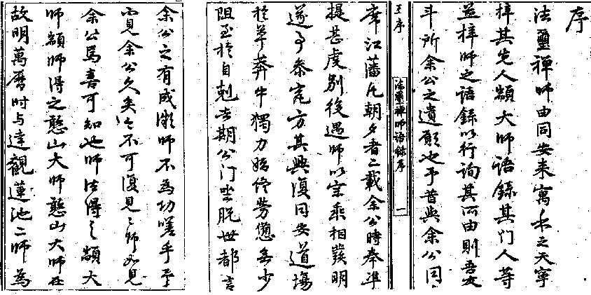
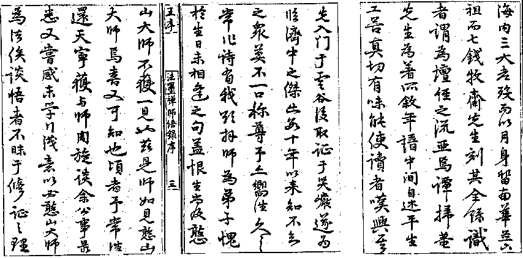
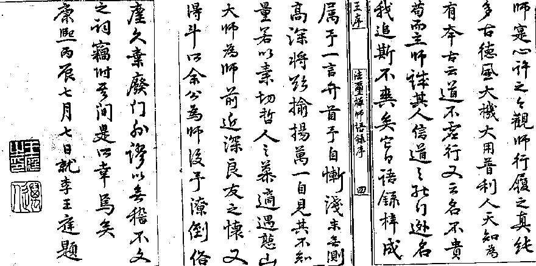

# 法玺印禅师语录



> **藏经**：嘉兴大藏经（新文丰版）（嘉兴藏）　**册次** 第 28 册（J28）　**编号** JB220　**部类** 诸宗部　**卷次** 12 卷　**篇幅** 95,654 字

> **卷／品**：0 卷 · 3 品



---



## 目录



  - [序](#序)

  - [序](#序-1)

  - [卷第一序](#卷第一序)



---



### 序















------



### 序



原夫妙明觉性虽自圆成，苟非其人，道不孤立。是以拈花微笑，世尊指示於西陲；立雪安心，达祖提撕於东土。嗣后六传分派，五叶蔚兴。济洞二宗，扬镳并辔。般若门中之龙象，却车而载、交臂而行，烝烝皇皇，於兹为盛。然而万语千言，横说竖说，祇以发明一大事因缘而已。世人妄业招引，非犷悍难驯，即萎薾不振，一则罔具信心，一则罕有慧力。波翻云靡，散乱昏沉。生死海中，头出头没，觅筏无门，良可深悯。自非佩法王之雄符，秉金刚之宝剑，眼横霞电，气薄风雷，孰能拣砂金而就冶，别碔玉以登堂，教育后昆，绍佛慧命也哉。古来尊宿，无俟缕陈。维昔笑岩大师，门庭高峻，少所许可，憨山老人荷笠瞻礼，师问：「从何处来？」答曰：「南方来。」师问：「记得来时路否？」答曰：「一过便休。」师曰：「子甚来路分明，善自护持。」机缘相对，授受亲切。法乳再传，有颛愚大师，克绍家风，卓然尊宿。嗣有法老和尚，嵋岫挺生，受佛遗嘱，乘愿而来，参学於江楚吴越之间，蓦然有得。住静於欧阜匡庐，出世於豫章北地，作狮子吼，觉诸有情。继临济三十一世，望初祖四十一传，道德崇巍，於法自在。　先君子笃信佛乘，锐志深入，现宰官身，不废参讨。历任江右藩司，簿书填委。旬宣拮据之餘，於本分消息殚力精求，一晤师颜，摅诚翘仰。同安佛刹，奕奕中兴，永泐贞玟，具可考而知也。师据宝华王座，掺纵自由，炉锤所成，指不胜屈。前住越山龙门，后住都城清化，一条楖栗随地举扬，四席风猷俨然未散，可谓作人天之眼目，度末世之津梁，振古轶今，光前耀后者矣。三瀛燥发翘瞻，长依道范，幸承　先泽，优游苕署。而师以重刻颛和尚语录之故，往来武林、嘉禾、霅川、邗水之际，时获亲近。每念　先君子音容云逝将及十年，缅昔良晨问道、深夜咨疑，举公案以勘淆讹、侍巾钵而聆棒喝，俨色笑之相关，或翰墨之互答，一弹指间，遂成隔世。为人子者，宁禁涕泗之沾裳乎？师四会语录，今亦告成，命瀛一言，弁兹全集。瀛无坡公天觉之才，自顾荒僿，理当逊避，以俟弘通。但思琼笈珠函，初经结集，法宝大成，人天赞叹。使　先君子而在，必当合十献颂，相视不逆，附以不朽。矧小子瀛，安敢自外？於是援㕙颖，滋隃麋，焚瓣香而叙其梗概焉，述先志也。



时大清康熙拾伍年岁在丙辰佛诞日，法门弟子三韩余三瀛盥手敬撰於苕溪公署。



法玺印禅师语录目录



------



### 卷第一序



同安上堂  

晚参



卷第二同安上堂



卷第三龙门上堂  

越山升座



卷第四清化上堂  

晚参



卷第五小参  

普说  

示众  

茶话



卷第六法语



卷第七勘验机缘  

参见机缘



卷第八书  

启



卷第九真赞  

自赞



卷第十颂古  

偈  

诗



卷第十一佛事



卷第十二募疏  

杂著



目录(终)



嗣法门人性圆、旋玑、旋哲、旋贤等编次



住江西南康府建昌县凤栖山同安禅寺语录



师於壬寅冬十一月初四日入院。



山门。「旧基者，是二十五代老古锥建立底解脱门，今日山僧到来，为甚却成荒址？」以拄杖划云：「无门为法门，全身须拶入。」



观音殿。「唤作古佛，却是观音；唤作观音，却又是古佛。且道毕竟唤作什麼？」遂大拜。



韦驮。「既是护法善神，因甚手握宝杵，胸例轩辕？」顾左右云：「礼防君子。」



伽蓝。「者片荒草，非你赤心片片，争有今朝？山僧也不敢辜负。」遂烧香。



祖堂。「不必攒眉，特来与你伸屈。」



方丈据座。「此室诸祖抽钉拔楔之处，我不作此条段。何则？不见道：我欲仁，斯仁至矣。」



即日，上堂。师至座前，拈疏召众，云：「会麼？此是黄面老汉末后一则不了底公案，落在诸大护法笔尖头上，珠回玉转。今日特向同安院里要山僧据款结案，只得人天众前露布去也。」以疏递：「再烦宣过。」宣毕。师指法座，云：「宝华王座，孰敢先登？任是出格英灵，不敢正眼觑著。其中有不甘者麼？」一喝便升。拈香，云：「此一瓣香，端为祝延当今皇帝万岁、万岁、万万岁，恭愿德媲羲、黄，道高尧、舜。此瓣香，奉为满朝文武、阖国公卿，为霖、为雨，业等伊、周。此香，奉为省郡尊官、本邑县主，及护法、缙绅、士庶等，爵位高迁，法门城堑。此香，奉为旧住请主、诸山耆德等，伏愿秉金刚之正智，立坚固之愿心，大家扶起破砂盆，同证无生等法忍。此一瓣香，明月堂夜半传来，紫竹林日午揭出，二十年函藏蛊毒，两三番彻骨冰霜，端为云居堂上传临济正宗第三十世伞居先师颛愚大和尚，用酬法乳。」敛衣，敷座。上首白椎，云：「法筵龙象众，当观第一义。」师喝，云：「早是第二义了也。毕竟如何是第一义？莫是山僧未出龙门是第一义耶？还是同安上堂为第一义耶？两途不涉，中道绝攀，众中莫有善观者麼？」龙门首座问：「千年祖席，今日重兴，正令高提，如何话会？」师云：「狮子碧天吞杲日，象王绿水噉清风。」进云：「恁麼则师象今朝关不住，东风吹起老龙来。」师云：「吸尽西江一滴水。」进云：「一滴乾枯金出井，吐洒秋蟾映玉池。」师云：「倒拈无孔笛，吹出凤游云。」进云：「若然，则师儿归窟去也。」师云：「一任𨁝跳。」问：「千山迥迥，万水滔滔，二九程途即不问，入门一句事如何？」师便打。进云：「黄檗也恁麼，和尚也恁麼，且道还有同别也无？」师打，云：「黄尚书，李仆射。」进云：「恁麼则一派寒风回万壑，同安祖席又重新。」师云：「赞叹有分。」问：「万法本闲，为人自闹，如何是自闹句？」师云：「瞽目进东城。」进云：「二十五代老古锥到来，又如何接待？」师随声打，云：「以此接待。」进云：「棒下无生忍，临机不让师。」师复打，云：「也是第二头。」僧喝，师云：「再喝看。」僧作礼，师云：「一场钝置。」乃以拂子一拂，云：「宝镜当轩，十方普照，辉天烁地，耀古腾今。者段境界犹是金锁玄关，尚未是衲僧作略。且作麼生是衲僧作略？」蓦拈拄杖卓云：「直教天下一个个头破脑裂去。汝诸人作麼生会？若缁素得出，始许同沐皇风、齐沾佛日；苟或未然，行人尽处是青山，青山更在行人外。」良久，复云：「山僧道荒德薄、智浅行疏，只宜云壑栖耕，不堪利生接物。兹因同安祖席虚废已久，本邑僧会云昙老宿深怜此地振卓无由，幸大护法昆湖廖翁任本府司理，奉　旨恢复，翁有诗云『夜半惊回香界梦，今朝还我古同安』之句。后昙公西逝，复祝乃徒中公谨同合邑绅衿及诸山耆宿於越山耑请山僧主持此席，尔时乃命监院眉剑独力撑持将经十载，今幸法堂辉煌、草莱颇辟，又承合省本邑及诸山等重申前请，山僧事不获已，秖得应个时节。且道时节又作麼生应？」遂举：「当山常察禅师，僧问：『如何是凤栖家风？』常云：『凤栖无家风。』僧云：『既是凤栖，因甚无家风？』师云：『不迎宾，不待客。』僧云：『恁麼则四海参寻当为何事？』师云：『盘饤自有傍人施。』」师拈云：「者老汉虽然担子度人，争免随身滞货？山僧则不然，设有问：『如何是凤栖家风？』向他道：『迎宾待客。因甚如此？岂不闻：云板响时归旧座，大家齐口嚼新羹。』」结座，云：「谛观法王法，法王法如是。」下座。



即日，晚参。师云：「古人建丛林、立宗旨，皆有人承褫。今日山僧滥膺斯席，举扬宗乘，且道甚麼人承褫？众中有知音者麼？」众无出。复云：「一众吝慈，山僧只得自拈自弄。来来来，由我好安排；去去去，无伊踪迹处。也不来，也不去，绿水常穿涧底流，碧云时在青山住。」一拂，云：「会麼？金井玉池碧眼开，佛头峰髻圆音布。」一击便行。



上堂。僧问：「曹洞祖席，临济重兴，正令全提，如何举唱？」师打，云：「一棒掀翻老古锥。」进云：「恁麼则有水皆含月，无山不带云。」师云：「非汝境界。」僧一喝便行，师云：「用喝作麼？」一僧出，一喝，师云：「未曾垂钓饵，先来弄尾针。」进云：「一喝即不问，如何是第一句？」师云：「道甚麼？」「如何是第二句？」师云：「道过了也。」「如何是第三句？」师云：「者里用不著。」僧云：「直下分明。」师云：「投子道底。」问：「铜头铁额，炉鞴重开，棒喝交驰，如何煆炼？」师云：「早已一身红。」进云：「把住则黄金失色，放行则瓦砾生光，还把住是？放行是？」师云：「两头坐断。」进云：「临济初参黄檗，三度吃棒，因甚到大愚胁下还拳？且道得大愚力？黄檗力？」师云：「一任卜度。」乃云：「把住放行已是撒土扬沙，受棒还拳未免腔板鼓弄，直饶三句齐收，依然跳不出斗，说什麼人境俱夺、棒喝交驰？会得者话，始许道有水皆含月，无山不带云；如不会，却向第二番葛藤去也。」复竖杖，云：「见麼？」一卓，云：「闻麼？闻非耳闻，见非眼见，眼见则瞎，耳闻则聋，恁麼会去，方可号令人天、提持佛祖，并知胁下还拳、三度吃棒，能收虎尾亦踞虎头，正好佛头峰上任往任还、太子岭头直上直下，始不负今日古音上座领阖省檀那入山设斋请扬此事。诸仁者！此事作麼生举𫆏？」复卓，云：「待别有消息时，却向伊吐露。」喝一喝，下座。



设两序，上堂。「龙吟雾起，虎啸风生，师子盘旋，象王起步。今日安名定位，建立法幢，以五须弥为众头首，将七金山作诸列职，以至日月星辰、森罗万象为云水禅流，庐阜云居、南岳普陀提浆运水，到恁麼地，方能如天普盖、似地普擎，何忧乎法道不扬？何惧乎宗猷不振？诸仁者！且道甚麼人便能若是？」举手顾左右，云：「孤掌不浪鸣。」下座。



储将承山王居士生日，请上堂。问：「雪覆千山，琼瑶满地，瑞景重重即不问，庆生一句请师宣。」师云：「曙日发生收地雪，万林仍是旧时容。」进云：「庆中境色如何？」师云：「珠帘卷夜雨，畫栋映朝云。」进云：「秖如无生一句又作麼生？」师云：「昨夜眉毛拖地白，明朝依旧接天青。」进云：「与麼则情与无情一齐庆赞去也。」师云：「且喜上座证明。」乃举云：「有物先天地，无形本寂寥，能为万象主，不逐四时凋。古人与麼道，忒煞太露筋骨。虽然如是，且王居士庆祝一句作麼生道？」以杖一划，云：「龟浮绿野连云出，鹤过秦关带雪来。」下座。



本里众檀请上堂。问：「五叶流芳即不问，如何是临济四喝？」师云：「著一问将来。」「如何是一喝如金刚王宝剑？」师打，云：「未出匣时光已露。」「如何是一喝如踞地师子？」师打，云：「石人心胆也须寒。」「如何是一喝如探竿影草？」师打，云：「莫道屈棒有人吃。」「如何是一喝不作一喝用？」师打，云：「才涉古今便不中。」进云：「四喝已蒙师指示，今日升堂事若何？」师云：「红日正当午，端的照无私。」僧作礼，云：「如是则千峰齐下拜，万派尽朝宗。」师云：「瞻之，仰之。」乃云：「千年祖席，今日重兴，时节既彰，莫当容易。二十五代之祖庭脉运几灰，千百餘载之法幢桑田几变，乃得没量大人回棘荆而成琼楼玉殿、转草莱而为紫壁金沙，至使海内衲僧续佛慧命、十方檀信顿悟己灵，赫赫光明廓周沙界。如是则两轮莫胜、周遍莫遮，在始在终凝然一道，始可於同安扶竖宗风、中兴祖道。还委悉麼？」一卓，云：「三教圣人同一辙，荐取当阳未发机。」下座。



沙弥戒，请上堂。僧问：「拨草瞻风即不问，凤栖升座事如何？」师云：「站立分明。」进云：「秖如戒定双彰，如何是沙弥得力处？」师云：「今日袈裟打湿角。」「如何是比丘转身处？」师云：「明朝依旧下西川。」「如何是菩萨亲切处？」师云：「托钵出云堂不是。」进云：「恁麼则龙门夜展千山雨，凤栖日挂万里天。」师云：「闲言语。」乃云：「脑盖重著楔，未许绝背面，通身庆快去，也须重判断。因甚如斯？只为诸人从无始劫来被者条黑漆索子缚住脚跟，不得自由。」以杖一卓，云：「若向者里体荐，八万法门一时顿证，三坛大戒弹指圆成，方识山僧袈裟打湿角，依旧下西川。如或不尔，纵使有得力转身亲切处，若要通身庆快，也是郑州出曹门。」一喝，下座。



比丘戒，请上堂。问：「弘宗演教，接物利生，大阐毘尼即不问，重新一句事如何？」师云：「东山呈曙色，万壑悉光辉。」进云：「光辉且置，秖如向上事如何指示？」师云：「高著眼。」进云：「云卷千峰碧，溪流万派清去也。」师咄：「莫乱走。」问：「龙吟虎啸风云会，凤翥鸾翔日月高，龙虎凤鸾即不问，浮山九带请师宣。」师云：「草本漫劳拈出。」进云：「如何是佛正法眼带？」师云：「万里晴空云影尽，千江平淡截波流。」「如何是佛法藏带？」师云：「尘尘不立全机露，法法皆空一镜收。」「如何是事贯带？」师云：「街前补衲连云绣，担水溪头带月归。」「如何是理贯带？」师云：「自古弟者可为长，从来孝子覆爷名。」「如何是理事纵横带？」师云：「蜂采上阳花到室，蝶翻幽径草归篱。」「如何是屈曲垂带？」师云：「涂炭不穿牙珮服，归乡且著破襕衫。」「如何是妙协兼带？」师云：「闻乐相忘三月味，始知垂钓在深潭。」「如何是金针双锁带？」师云：「李白桃红关不住，逍遥上苑展眉欢。」「如何是平怀常实带？」师云：「一片白云起谷口，数声黄鸟带泉飞。」乃云：「今朝为说比丘戒，请我先升曲录床，聊为诸人通一线，浮山九带快承当。如或未然，欲行千里，一步为初，向下文长，且听三师七证分付。」一喝，下座。



菩萨戒，请上堂。问：「昔日丹霞闻受戒，为什麼掩耳而出？」师云：「美食不中饱人餐。」进云：「律中道：『手推比丘者波夷提。』德山因什麼见僧便棒？」师云：「赤心片片。」进云：「嫌骂比丘者波夷提。临济因什麼见僧便喝？」师云：「片片赤心。」进云：「清净比丘不踏生草。南泉因什麼斩猫？」师云：「汝向何处见王老师？」乃云：「经中道：『众生受佛戒，即入诸佛位，位同大觉已，真实诸佛子。』虽然如是，只能入佛，未能入魔。何则？殊不知众生未受佛戒亦入诸佛位，所以临济、德山一任唤作波夷提，丹霞、南泉何常不是清净行？会得此意，则不负灵机禅人敦请举扬此事；其或不尔，别作商量去也。」遂举：「中邑洪恩禅师因仰山谢戒次，恩於禅床上拍手云：『鸣耶，鸣耶。』仰乃从东过西、从西过东，向中间立定，然后谢戒。恩云：『什麼处得此三昧？』仰云：『於曹溪印子脱来。』恩云：『汝道曹溪用此三昧接什麼人？』仰云：『接一宿觉。』仰复问恩云：『和尚在什麼处得此三昧？』恩云：『我於马大师处得来。』」师云：「者两个老汉败缺也不少，假如今日有人问：『山僧在什麼处得此三昧？』便与他劈脊一棒，云：『不从曹溪得，亦非马师来。』」喝一喝，下座。



当阳圣生陈居士诞日，请上堂。「当阳无量寿，无成亦无坏；坚固金刚体，无生亦无灭。诸仁者！秖如无生灭、无成坏底是个甚麼？」拈拄杖，云：「莫是者个麼？且喜没交涉。既不是者个，毕竟唤什麼作无生无灭？弥天匝地堂堂露，庆祝华封个寿山。」击禅床，下座。



结制，上堂。问：「大开罏鞴，锻炼圣凡，且道本分衲僧到来作麼生煆？」师云：「你不是本分底。」进云：「钳锤佛祖，必须作家。如何是作家？」师云：「杀人不眨眼。」进云：「恁麼则不动干戈定太平。」师云：「看脚下。」僧一喝，师云：「灼然。」问：「祖令当行即不问，作家相见事如何？」师打，云：「伯牙与子期，不是闲相识。」乃云：「诸方十月十五结，同安却比诸方别，试问其中事若何？因缘相值此时节。时节且置，秖如今日开炉明甚麼边事？」良久，云：「满炉添炭犹嫌冷，路上行人空守寒。参！」



元旦，上堂。「旭日辉辉，春风拂拂，乃国运之增新；山云霭霭，野鹤眠眠，正凤栖之添瑞。值此时节，峰头、峰尾列为普贤法门，山北、山南渝作观音境界，不许天下英俊说旧、说新，岂容现前清众论今、论古？」蓦拈杖，云：「惟有者个木上座，不涉一义、不侵旧新。」复卓，云：「向者里领略得去，可以同享太平，祝延圣寿；若领略不得，山僧一人庆祝去也。」遂起身，云：「一片皇风扇宇宙，斩新日月照乾坤。」一喝，下座。



解制，上堂。问：「今日解制即不问，应时值节事如何？」师云：「三更穿市过，走马出纱笼。」进云：「若不同床睡，焉知被底穿？」师云：「脚跟下好与三十。」问：「柏树庭前谭妙法，虚空抚掌笑吟吟。抚掌即不问，如何是庭前谭妙法？」师云：「石人暗点头。」进云：「恁麼则荆棘林中展手眼，红尘堆里定乾坤。」师打，云：「试展手眼看。」进云：「高悬祖印空王国，放去收来任纵横。」师云：「也是德山罗汉。」进云：「狮子吼时芳艸绿，象王行处落花红。」师打，云：「闲言语。」乃云：「同安今日解制，且喜灯王出世，蓦然触破纱笼，笑煞街头李四。前途有问如何？切莫当阳辜负。」一卓，下座。



方伯斗所余公大护法上佛殿梁，请上堂。问：「建法幢，立宗旨，秖如佛未出世、祖未西来，还有宗旨也无？」师打，云：「者是什麼所在？说有说无？」进云：「如何是临济宗？」师打，云：「一棒一条痕。」「如何是云门宗？」师打，云：「无你凑泊处。」「如何是曹洞宗？」师打，云：「忌讳个甚麼？」「如何是沩仰宗？」师打，云：「你跳得出麼？」「如何是法眼宗？」师打，云：「者里尽也未？」僧云：「五家宗旨蒙师指，更有一问，请师端的。」师打，云：「疑则别参。」问：「法席初启，宝殿重开，斩新条令即不问，向上宗乘事若何？」师云：「脚跟下好与三十棒。」僧喝，师云：「落在甚麼处？」进云：「万古碧潭空界月，再三捞摝始应知。」师云：「元来。」僧作礼，云：「大众分明记取。」师云：「瞎。」问：「慈云遍覆三千界，法雨均沾大地人，应时值节，请师速道。」师云：「龙飞千嶂碧，凤舞万山高。」进云：「即今宰官临筵，凡圣骈集，和尚如何施设？」师云：「巍巍宝殿耸霄汉，历历光明遍刹尘。」问：「举目尽皆弥勒阁，脚下无非古道场。如何是敷扬句？」师云：「弹指顿超空劫外，扶起当年旧刹竿。」进云：「恁麼则宗开柳巷，法振滹沱去也。」师云：「但愿春风齐著力，一时吹入我门来。」乃云：「凤栖山壁立万仞，佛头峰透彻云端。师子盘旋，象王蹴蹋。若是没量大人，自然全身担荷，别立生涯。其或眼目动定，不惟不能攀仰，要且望崖而退。还知麼？」遂举书云：「者是方伯余公见道的消息，今日特向人天众前分明举出。」举毕，「山僧亦有个颂子为伊证据：掀翻华岳忘机处，劈破长空月一帘。无限情尘都不见，喜君赢得旧山川。」一喝，下座。



方伯余公为夫人张氏生辰请上堂，问答不录。师乃云：「须弥高兮寿量，沧海深兮福祥，日月照临兮为祝，天地覆载兮悠长。」一喝，云：「若不喝住，打葛藤无有了日在。」复拈拄杖，云：「秖如者个还具寿量耶？殊不知竖穷三际、横遍十方，亘古亘今，凝然湛寂。且不落功勋一句作麼生道？紫微阁畔舒千臂，南极峰前照九垓。」下座。



佛成道，上堂。「六载雪山勤苦行，无端夜半睹明星，眼中早已重添屑，殃及儿孙事莫论。诸仁者！於此会得，则不辜负东升禅人设斋圆戒，耑请山僧举扬个事。者个且置，秖如释迦老子夜睹明星悟个什麼？若定当得出，方许了明向上宗乘，顿证金刚心地；其或未然，只得向诸人道破。」遂以杖击案，云：「甜瓜彻蒂甜，苦瓠连根苦。」一喝，下座。



洪州元戎海山张居士生日，请上堂。问：「师登宝座，法雨均沾，正令全提，如何判断？」师打，云：「你试定当看。」进云：「此意且置，秖如高峰四句请师垂示。」师云：「我者里一句也无。」「如何是大地无草？」师云：「白云横岭上。」「如何是大海无鱼？」师云：「明月浸波心。」「如何是大富无粮？」师云：「富嫌千口少。」「如何是大悟无道？」师云：「贫恨一身多。」进云：「恁麼则情与无情一齐庆生去也。」师云：「且喜阇黎道著。」乃云：「日轮正当午，虚空绝点尘，山河及大地，全露法王身。」蓦拈杖，云：「露堂堂，明历历，脱体无依；赤条条，光湛湛，圆融无碍。顿教入泥不点尘，入水不动波，七纵八横，抛三掷四，到恁麼时，尽大地是个大解脱场，遍虚空是个无量寿。故云：『佛身充满於法界，普现一切群生前，随缘赴感靡不周，而恒处此菩提座。』所以道：有时疋马单刀，现将军身而说将军法；有时霞冠素服，赈济群灵而归心大道。以致随处即主，遇缘即宾，坐断千差路，超出四威仪，何假鹤舞起清风，锦云铺杲日？虽然如是，且当机一句作麼生道？无位真人高迥迥，何山松柏不青青？」下座。



上堂。问：「今朝制期又兼演戒，秖如禅戒两忘的衲僧到来，和尚如何接待？」师随声打，云：「无你插足处。」进云：「如何是五家宗旨？」师打，云：「者个便是。」「如何是临济宗？」师云：「青天吃棒血流红。」「如何是云门宗？」师云：「眉毛瞎却不通风。」「如何是曹洞宗？」师云：「夜半乌鸡雪上封。」「如何是沩仰宗？」师云：「凡情圣解不留踪。」「如何是法眼宗？」师云：「六相团𪢮数莫穷。」僧喝，云：「礼拜去也。」师打，云：「再犯不容。」乃云：「宗师家掌握灵符，道眼清正，方许南面高坐，与大地人抽钉拔楔。有时，千寻岩下啸月吟风；有时，万顷波中跨龙钓鳄。花街柳巷，哩哩啰啰；林下水边，寥寥寂寂。屋后松梢带雪，皆为古佛家风；庭前梅蕊含霜，尽合祖师密意。者里见得，一任横拈倒用、说是说非，方可道不言而信、不怒而威，搜翻白拈窠穴，剪断从上根枝。苟或未谙，须向同安手里讨个著落始得。只如今日幻容禅人母难之日，特请山僧升座设斋求戒，以酬罔极之恩。且道：为伊作何条段？」遂一拂，云：「三坛次第演伽陀，万别千差齐坐断。」下座。



腊八日，觉宗禅人圆戒，请上堂。乃云：「诸佛涅槃心，甚深无伦匹，众生业垢重，难解亦难入。且道甚麼处是难解入底？良由五欲深沉、三毒缠绕，劳他没量大人手指天地作大师子吼云：『天上天下，唯我独尊。』及乎雪山六载，夜睹明星，已是第二杓恶水没头泼了。以至四十九年葛藤缕缕，又道无法可说，岂非灵龟曳尾？末后拈一枝花，惹得饮光展笑，始畅胸怀，可谓大人具大见、大智得大用。设使说遍无边香水海，广开重重弥勒阁，捡点将来，犹未是衲僧极则事。且因斋庆赞圆满毘尼一句作麼生道？三千次第重饶舌，八万行持弹指圆。」一喝，下座。



元旦，上堂。拈香祝圣毕，师竖拂，云：「灵山付嘱儿孙事，今日元辰复举扬，微笑拈花端的旨，相承少室继联芳。且喜融风𩖼𩖼，溥天布化育之休；更逢丽日辉辉，大地沐太平之兆。者里会得，方许斩新日月，特地乾坤，祝皇风于北阙，迎瑞彩于南宸，一人有庆，法社赖之。众中还有知得时节因缘底麼？」良久，云：「楚庵西堂遍历诸方，草鞋跟断，无端撞入同安，不觉掀翻宝惜，山僧固以祖父家业两手分付。」遂授衣，云：「展开鸡足峰前路，化浃娑婆遍地香。」楚云：「自愧樗才为绍续，蒙师彻骨老婆心。」师云：「正好撑天拄地。」进云：「恁麼则人归大国方尊贵，水到潇湘一样清。」师云：「珍重。」下座。



忏华严经，邓应塘居士请上堂。问：「善财五十三参，末后于弥勒楼阁弹指即开，且道如何是弹指意？」师云：「含灵犹有分，越格莫能求。」进云：「秖如百千万亿弥勒、百千万亿善财，那个是真底？」师云：「那个不是真底？」进云：「文殊兴云，普贤布雨，如何是智行双圆句？」师云：「道著了。」僧作礼，师打，云：「也须吃棒始得。」乃以拄杖打○相，云：「如来深境界，其量等虚空，一切众生入，而实无所入。所以道：三千刹土、八万微尘，於一尘中现出千丈卢舍那身，万德庄严，圆融行布，根尘迥绝，理事双彰，道无即有，道有即无，扫除凡见，不立纤尘。」以杖左右卓，云：「复从者里涌出无量菩萨僧伽、无量大悲苾刍、无量金刚天等、无量八部龙神，左右盘绕而为华严海会。」一击，云：「你诸人还闻麼？」又以杖打⊕相，云：「又从者里涌出无量彩盖云、无量璎珞云、无量光明云、无量音乐云，无量主山神、无量草木神，重重密护，行智齐彰，而为华藏庄严。你诸人还见麼？若也闻见精明，则有情、无情证等无异。到恁麼时，山僧向者里还赞扬得麼？直得义天性海，似帝网而交罗；智照神光，如洪炉之猛燄。今朝省邑护法居士等为诸人发上上机，助宣妙行，且道以何为验？弹指圆成八万门，刹那灭却三祗劫。」下座。



解制，上堂。问：「九旬禁足，三月安居，安居即不问，今朝解制事如何？」师云：「龙吟夜月洪波秀，虎啸风生碧汉空。」进云：「不是春风回万象，何能夜月照三阳？」师云：「汝作麼生？」进云：「师子吼时芳草绿，象王行处落花红。」师云：「且过一边。」乃云：「今朝十五元宵节，正值同安解制辰，试问诸人己躬事，其中那个是知音？龙蛇穴里藏身，凡圣途中著见，未能出格超群，及至七花八裂，只得挽回火树、拨转灯城，把住放行，全体独露。还委悉麼？」遂竖拂，云：「春风一段枝头泄，无古无今昼夜明。」一喝，下座。



方伯斗所余公大护法为拈花文佛暨诸贤圣等开光，请上堂。拈香毕。「祖庭千古复兴隆，殿阁浑如灵鹫宫，座下水云狮与象，有谁微笑破罗笼？还有承当者麼？」问：「昔年鹫岭拈花，迦叶微笑，今日同安举唱，未审是同？是别？」师云：「绿水时漩师子渡，红轮正照佛头峰。」进云：「恁麼则山河大地齐瞻仰，明暗色空古佛心。」师云：「实相圆明千里外，凤山独露万重云。」进云：「秖如方伯余翁报国酬恩一句，请师速道。」师云：「同安古刹重新建，四海禅流共祝厘。」乃竖杖，云：「释迦老子在山僧拄杖头上，堂堂独露，被诸人逼得三百六十骨节、八万四千毛窍尽皆紫金光聚，复於青莲花目放大宝光，烁破四天下，照耀恒沙国土，万亿诸佛、万亿菩萨、万亿圣众、万亿宝盖各各俱承此力，与释迦老子帝网交罗、镜光相照，圆明妙体共证真常，情与无情正等无异。汝诸人还见麼？设若见得，则知者段光明在圣不增、在凡不减，世尊得之照天照地、法古腾今，菩萨得之愿力宏深、悲智广大，罗汉得之神通莫测、妙用难量，祖师得之掀翻窠臼、喝破太虚，诸人得之吃饭穿衣、操持日用，即今方伯得之政化西江、运筹帷幄。且道山僧得之毕竟如何？」以杖一卓，云：「竿木随身，逢场作戏，越山顶头，擒天搂月，龙门殿上鼓浪兴波，同安榛芜丛中现出琼楼玉殿，演唱无腔曲调，拔除脑后尘钉，圆成千古奇缘，俾后瞻依不朽。赞扬且置，秖如今日方伯余公为佛开光一句作麼生道？」遂举笔点，云：「坐断十方光始现，大家仰祝圣皇恩。」下座。



结制，上堂。问：「涅槃无路，生死无门，且道工夫从甚处入？」师打，云：「无你咬嚼处。」进云：「某甲不会。」师打，云：「不会却相应。」乃举：「雪峰和尚云：『三世诸佛向火燄上转大法轮。』云门云：『火焰为三世诸佛说法，三世诸佛立地听。』应庵老祖云：『三世诸佛为火燄说法，火焰烧煞三世诸佛。』」师拈云：「者三个老汉各立边疆，赤心片片，点捡将来，不妨奇特。汝诸人会麼？会得雪峰句，眼光烁破四天下；会得云门句，舌里有骨；会得应庵句，天下和平，万国协庆。不须挝鼓上堂，开炉结制。若透未得，直待来年十五，为诸人别通消息。」一喝，下座。



腊八，上堂。问：「祖庭复振，四众云臻，竖拂拈椎即不问，夜睹明星事若何？」师云：「豁开眉上眼，射破海中天。」进云：「菩萨戒犹护生草，为甚南泉斩猫、归宗斩蛇？」师云：「速礼忏悔。」进云：「今朝和尚升座，且道说何法？」师云：「无法可说。」进云：「恁麼则虚设了也。」师云：「若虚设即有法也。」乃云：「吾佛当年诣雪山，倏尔夜睹明星发，突然悟得涅槃心，正眼看来总是瞎。诸仁者！那里是者老汉漏逗处？」良久，复举：「昔日元叟端和尚云：『未到雪山，脚跟下好与三十；既到雪山，脚跟下好与三十；夜睹明星，脚跟下好与三十。』」师云：「者老汉也须吃同安三十。何故？只知令行，不觉殃及。更有三十，同安自吃。何故？事因叮嘱起，日久见人心。秪如涌轮禅人今朝圆戒一句作麼生道？一轮涌出千山秀，万象光辉瑞色呈。」一喝，下座。



解制，上堂。「同安今日有三句，特为诸人明指示。且道是那三句？」以杖打○相，云：「旧年十月十五恁麼结，把断要津无漏泄。」又以手作展势，云：「今年正月十五恁麼解，泼天猛浪大张开。试问九旬日中更作麼生理会？」复以拄杖打○相，左右顾视，云：「若到诸方，切莫错举。」掷拄杖，下座。



嗣法门人性圆旋玑旋哲旋贤等编次



住江西南康府建昌县凤栖山同安禅寺语录



方伯斗所余公送藏经入山，上堂，问答不录。师竖拂子，云：「三藏十二部、一切修多罗都从山僧拂子头上流出，汝等诸人还信得及麼？」遂一击，云：「佛以一音演说法，众生随类各得解。汝诸人还闻麼？直下若见、若闻，则知一大藏教辟龙宫而不从龙宫得来、剖微尘而不假微尘流出，无时不在诸人脚跟下广布敷演，为玄为奥。若不恁麼，山僧未免再沥肝胆，从头告报。」一拂，云：「释迦四十九年、三百餘会，说有、说无，说顿、说渐，说偏、说圆，乃至尘尘尔、刹刹尔，炽然说无间歇，皆为一切众生迷失本源，不能当机直捷，劳他世尊多方淘汰、格外周遮，故曰：我此九部法，随顺众生说。要知起唯法起、灭为法灭，岂不是心外无法、法外无心？至于末后拈花，饮光微笑，方乃申怀。者里说心、说性、说事、说理，以始终顿圆、五法、三自性得麼？一大藏教皆是拈花之注脚耳。诸仁者！山僧恁麼葛藤，你还知得端倪也未？个里会得，亦不负余公担荷祖庭、捐金请藏之盛心也。虽然如是，敢问大众：作麼生是报国酬恩一句？」一拂，云：「四海衲僧开正眼，共祝吾皇亿万春。」下座。



尊胜寺寓庸中公诞辰，请上堂。书记问：「群僊昨夜离金阙，鳌首今朝渡碧波，七七知非即不问，五旬知命事如何？」师云：「日照山河明历历，云收大地寂如如。」进云：「秖如未生已前将何为验？」师云：「已生之后汝作麼生？」进云：「黄鹤未曾冲碧汉，青牛早已出函关。」师云：「有劳赞祝。」问：「深居祖窟陶材器，法令施行岂藉谁？敢问：如何是衲僧行履处？」师竖拂子。进云：「如何是和尚接待处？」师亦竖拂子。进云：「兴化道：『逢人则不出，出则便为人。』意旨如何？」师云：「放汝三十棒。」进云：「秖如三圣道：『逢人则出，出则不为人。』又如何？」师云：「放汝三十棒。」进云：「生前面目何须悟？悟得来时也是尘。」师打，云：「道甚麼？」拈杖，云：「朕垂未分前，无你下口处；朕垂既分后，早已七花八裂。然圆明玅体，本无去而无来；法性融通，岂有内而有外？所以道：日月不能并明、河海不能比量、须弥不能并峙、虚空不能包藏，至大而至微、至刚而至柔，纵横左右、洞彻十方，窥测无门、随机即应者，便是寓公本命元辰主人公。」随一喝，云：「既是窥测无门，唤甚麼作主人公？者里还注脚得麼？设使佛头峰、凤栖岭，管教称扬不及。若向此中会得，则知日照山河，阔角青牛常出谷；云收大地，无毛黄鹤日冲霄。一任波中取火、燄里敲冰。其或未然，行人更在青山外。今公诞辰，入山饭众，兼请举扬，山僧因风鼓絮，为伊据款结案。」一卓，云：「能为万象主，不逐四时凋。」一喝，下座。



开罏，上堂。问：「诸方大开罏鞴，同安共设钳锤，今有一人牙如剑树、口似血盆，当罏不避，和尚又作麼生？」师打，云：「正好千锤百鍊。」进云：「雪峰拈起，云门劈脊，除此二途，请师别道。」师打，云：「好事多同。」进云：「先德有言：『木人结契卖虚空。』未审何人证据？」师云：「老僧当轩坐。」进云：「『露柱前来写合同』，又作麼生？」师云：「承当也未？」进云：「四至分明须记得，不知何处有封疆？」师云：「照验明白。」乃云：「畫蛇添足，划地为牢，此是古人屈为今时。同安者里要且不然，直教虚空粉碎、大地平沉，不劳脊梁高竖、挨拶疑团，便与三世诸佛、历代祖师、天下老和尚同一鼻孔；设若不然，赵州东壁挂胡芦，诸人也须疑著。」一喝，下座。



元旦，上堂。问答不录，师云：「普天匝地祥云起，正是山僧祝圣时，惟愿风调并雨顺，顿令家国乐熙怡。诸兄弟还会麼？设若会得，人人叨尧舜之恩，个个享无为之化；其或未然，山僧只得八字打开去也。」遂起身，云：「八方霡霂无为化，万国歌谣乐太平。」



解制，付门人松等，上堂。「正月解制元宵节，灯王法法明皎洁，古今不改旧山川，直下相承联未歇。」蓦拈杖，云：「释迦老子道：『我此法印为欲世间利益，在所游方，勿妄宣传。』又道：『深固幽远，无人能到。』可见深之又深、秘之又秘，至于果熟天香，递代承袭，西天四七、东土二三，分枝列派，以讹传讹，故有五家门庭之别，独我临济一宗赫赫然遍满寰宇，至笑岩宝祖得憨山清翁直向先师顶𩕳一针而殃及山僧。今日不敢被盖囊藏，特对人天众前转相付授，务必星分碁布、草偃风行，撑持祖父门墙，宏绍正法眼藏。既然如是，且五叶流芳一句作麼生道？」一卓，云：「但愿春风齐著力，枝枝发艳吐辉煌。」下座。



弟子机兰、开文、制一为师诞辰，请上堂。问：「一年一度新，森罗咸稽首，且道如何是庆生句？」师竖拂，云：「龟毛拂子三千丈。」进云：「江山虽别，云月是同，如何是同条句？师云：脑后见腮。进云：蟠桃已熟，优钵既开，且道春秋多少？」师以拂子点三下。进云：「恁麼则昆仑突出无量寿，惊起须弥作寿山。」师云：「伶利衲僧。」进云：「者个且置，如何是第一句荐得为佛祖师？」师以杖左卓，云：「匝地溥天明历历，朝三暮四总如如。」「如何是第二句荐得为人天师？」师右卓，云：「几片白云横谷口，一轮明月照波心。」进云：「第三句荐得，作麼生是自救不了？」师从中一卓，云：「情真语露，不负知音。」乃云：「吼破虚空踢破烟，巴歌曾唱出西川，自从一别家山后，不觉今朝耳顺年。光阴瞬息，倏尔蹉跎，山僧与阒兄同生一处，出家一山，嗣后南询遍参，天各一方，且喜时节因缘略露者段消息。设若会得，神光不昧，万古徽猷，不变不迁，无来无去，不出今日者个时节。不唯不出今日者个时节，乃至尽未来际三世诸佛、历代祖师，是圣、是凡，或僧、或俗，山河大地，有情、无情，亦出不得者个时节。若识得者时节，威音无始，阿逸无终，事理纵横，圆融无碍。故古德云：『无边刹境，自他不隔于毫端；十世古今，始终不离于当念。』诸仁者！到恁麼地，正好高高峰顶立，深深海底行，方可道一切即一，一即一切，小中现大，大中现小，皆承今日者个时节。虽然如是，犹是建化程途边事。秖如当筵庆祝一句又作麼生？」一拂，云：「昨朝法雨连天一，今日南山松桧青。」下座。



两序为方伯诞辰，请上堂。问：「法幢高竖人天外，宗风此日大方传。如何是传底意旨？」师云：「峰前竖起刹竿子，直得青天翠欲流。」进云：「恁麼则志公当年轻漏泄，今朝一众发真源。」师云：「且道什麼人恩力？」进云：「即今方伯公寿诞，和尚作麼生庆祝？」师云：「南山梧桐栖彩凤，东海青波现巨鳌。」进云：「可谓福海与佛海同深，寿山等华山并峻去也。」师云：「一轮本自光寰宇，万里歌谣道太平。」僧礼拜，师乃云：「本月十四值方伯余公悬弧之旦，山僧亲领禅众于大雄宝殿熏礼梁皇法忏，本院两序忖思祖庭湮没、人物重兴，特请山僧升座举扬大法，预祝遐龄，报难报之恩、酬难酬之德。诸仁者！且道大法作麼生举𫆏？」竖拂子，云：「有物先天地。」遂掷下。「无形本寂寥，能为万象主。」喝！「不逐四时凋。甚麼物？岂不知心同虚空界，示等虚空法？证得虚空时，无是无非法。既无是，亦无非，以虚空为正体、以恒沙国土为妙用、以须弥山为寿山、以四大海为福海。恁麼赞扬，未是余公真实之地，而能万机不暇、千圣不到，斩断无始葛藤、掀翻空劫露布，又能护国祐民、作大佛事者，便是伊真实受用处。既然如此，将什麼作预祝一句？还会麼？指日风云腾瑞彩，长年福寿沐皇恩。」下座。



结制，上堂。师云：「大启红炉烹佛祖，钳锤玅密圣凡无，直饶钝铁重加锻，藻鉴分明握用殊。若恁麼，犹是阶下钝汉，堪作甚麼？除是英俊禅流一闻举扬，便掉臂而去。」良久，复举：「黄龙南禅师住同安，云：『撞钟钟鸣，击鼓鼓响，大众殷勤问讯，同安端然合掌。者是世法？那个是佛法？咄！』」师云：「黄龙老汉一代宗匠，犹将世法、佛法打作两橛。今日同安则不然，撞钟钟鸣，击鼓鼓响，大众殷勤问讯，同安端然合掌。」以拂子一击，云：「世法、佛法都在里许。诸兄弟！若向者里会得，不必三月安居，脊梁高竖；其或未然，须向古今举扬淆讹处缁素始得。」复击，下座。



解制，上堂。「欲识佛性义，当观时节因缘。时节若至，其理自彰。即今时节已至，众中还有自彰者麼？出来与汝证盟。」问：「师登宝座，大启法筵，钟鼓交参，如何举唱？」师云：「红轮涌出千峰翠，瑞气冲开大地春。」进云：「解制一句即不问，三玄三要请师宣。」师云：「草本念将来。」「如何是第一玄？」师云：「春风劫外天人眼，万象光中绝正偏。」「如何是第二玄？」师云：「杖头拟议穿腮过，海底泥牛吼碎烟。」「如何是第三玄？」师云：「云散千峰冰雪尽，大雄桥下水长川。」「如何是第一要？」师一卓，云：「棒下灵机无作造。」「如何是第二要？」师云：「千圣顶𩕳光晃耀。」「如何是第三要？」师云：「一曲长歌送返照。」进云：「玄要已蒙师指示，放行把住事如何？」师云：「非汝境界。」僧便喝，师云：「落在甚麼处？」僧又喝，师打，云：「转见不堪。」僧拂袖归位，师乃云：「去如孤云出岫，住若野鹤翘松，不住不去便是衲僧行履。你诸人还会麼？设若会得，倒骑铁马走长安，未曾移步；不恁麼会，鞭起泥牛耕大地，不动丝毫；其或总不恁麼，拄杖头边宽世界，象王鼻孔别家风。山僧只得与诸人分明道破。」良久，复云：「黄面瞿昙末后拈花全体露，饮光尊者傍观一笑逞风流，致令递代殃及山僧。今朝解制良辰、元宵佳节，将此佛祖源流分付维那知藏。虽然如是，且续燄联芳、罗纹结角一句作麼生道？」一卓，云：「区区一段家常事，珍重尔曹各自持。」下座。



结制，上堂。竖拂子，云：「当阳一著，结舌亡锋，略展家私，聊通一线。」问：「击鼓升堂无别事，请师直说了无生。」师云：「劫前高著眼。」进云：「无生句子蒙师指，今朝结制又如何？」师以拂子打○相，云：「总在里许。」进云：「古人道『尽大地是个火坑』，向什麼处著脚？」师云：「早已焦头烂额。」僧竖拳，师云：「者是什麼？」僧云：「万象森罗齐稽首，笑破虚空口不开。」师云：「三十棒亲领出去。」僧拂袖归位。二僧并出，师作射势，云：「一箭落双雕。」僧便问：「和尚传曹溪正宗，因甚问著棒喝齐施？」师云：「认作棒喝，入地狱如箭射。」进云：「恁麼则拄杖辽天狮子吼，大展宗风此日闻。」师云：「凤皇不是凡间物，不种梧桐誓不栖。」僧礼拜，师乃云：「今日同安结制，不许乱走一步，秖待宝镜池开，大地从此流泣。」顾左右，云：「大鹏须展摩霄翼，谁顾崩腾六合云？」下座。



解制，上堂。「百日禅期，今朝告毕，其中有赤身担荷者出众相见。」问：「钟鼓交参，法雷震地。交参即不问，如何是法雷震地？」师劈头便打，进云：「一棒迥超千圣外，此心能有几人知？」师震声一喝，僧云：「一句无私语，千古共敷扬。」便礼拜，师乃云：「当阳独露，迥别千差，坐断情尘，不容凡圣。净裸裸、赤洒洒，如月白风清；峭巍巍、孤迥迥，似银山铁壁。到者里，无动、无静，无宾、无主，无问、无答，无棒、无喝，无玄、无要，无纵、无夺，无古、无今，无凡、无圣，直教千圣莫能窥、万机莫能测，纵饶口剑唇鎗，也须亡锋结舌。诸兄弟！且道：者里还转得身也未？」遂以杖一卓，云：「辟开也在我，捏住也在我，变大地作黄金，搅长河为酥酪。如是，便有动、有静，有宾、有主，有问、有答，有棒、有喝，有玄、有要，有纵、有夺，有今、有古，有凡、有圣，尘尘彰般若之光，处处露法身全体，一任东涌西没、南没北涌，不动道场，遍周沙界。有如是作用，方可以五须弥收归芥子，向一尘内转大法轮，一为无量，无量为一，放去收来，自由自在。到恁麼时，正好接物利生，担荷祖道；其或未谙，莫怪山僧压良为贱去也。」良久，复举：「庞居士偈云：『十方同聚会，个个学无为，此是选佛场，心空及第归。』古人恁麼话，也是卖水江头，眼中著屑。同安今日与他下个注脚：十方同聚会，山枯水竭。个个学无为，钵盂安柄。此是选佛场，犹有者个在。心空及第归，雪上加霜。诸兄弟还会麼？若会得此四转语，不惟与古人同辙，亦可与诸祖联风。众中有善鉴者麼？如无，山僧自拈自弄去。」一喝，下座。



上堂。「布缦天网，惯打凤麟；垂直钓钩，捞漉鲲鲸。若是泥鳅曲鳝，徒劳上钓。即今莫有透网锦鳞？试出来鼓浪看。」问：「秪如古人道：『尽大地是个禅堂。』又作麼生结？」师竖拂子，云：「向者里荐取。」进云：「金风吹玉管，几个是知音？」师云：「高著眼。」进云：「恁麼则聚会群龙齐缩项，养成头角待风云。」师云：「虾跳不出斗。」进云：「蹋碎寒潭月，相传祖道光。」师云：「直须亲见始得。」问：「大地为罏，须弥为炭，从上佛祖向甚处安身立命？」师云：「尽在里许。」进云：「秖如和尚脚跟下又且如何？」师云：「突出青霄外。」进云：「恁麼则水到渠成全意气，个中无处不超伦。」师云：「放汝三十棒。」僧便喝，师云：「脚跟下更要一顿在。」乃云：「问似云兴，答如缾泻，总与诸人了没交涉。且道毕竟如何？」复举：「圆悟禅师示众云：『通身有眼不能见，通身有耳不能闻，通身有口不能说，通身有心不能鉴。通身则且置，秖如无眼人来作麼生见？无耳人来作麼生闻？无口人来作麼生说？无心人来作麼生鉴？向者里通得一条活路，便与古佛同参。』同安则不然，者里通得一条活路，便好生按云头、活捉谿尾，剖万象皮、出虚空髓。到恁麼地，何须三月安居、红罏锻炼？正好与三世诸佛、历代祖师、天下善知识同一鼻孔。设若未会，直须壁立万仞。假使斩头截臂，山僧亦不为你诸人道破。何故？为人须向损边求。」一喝，下座。



佛成道日，上堂。问：「古今不二乾坤合，理事双融气运调，和尚升堂於此日，世尊悟道在今宵。如何是古今不二句？」师云：「夜夜峰头千片白，朝朝海角一轮红。」「如何是理事双融句？」师云：「岁寒松柏元无变，春到梅花自有香。」进云：「恁麼则雪山与凤岭毫无间隔去也。」师云：「也须高著眼始得。」僧便喝，师云：「再喝看。」僧作礼。晦老宿问：「夜半明星旨，由来覆大千，如何是函盖乾坤句？」师便竖起拄杖。进云：「二五八六张，把定圣凡路，如何是截断众流句？」师便放倒拄杖。进云：「有水皆含月，无山不带云，如何是随波逐浪句？」师云：「且喜老兄相随来也。」进云：「更有一句请师拈出。」师云：「三十痛棒更待阿谁？」进云：「千山势倒岳边止，万派声归海上消。」师云：「也须恁麼始得。」进云：「大众证明。」师云：「露。」问：「龙披一缕免金翅之患，且道现前具足三坛当获何益？」师云：「尽在今朝一语传。」进云：「传后如何行履？」师云：「一状领过。」进云：「秖如脚跟下又作麼生？」师一喝，僧亦喝，师云：「是什麼？」僧云：「大众证明，某甲礼拜去也。」师云：「胡孙入布袋。」乃云：「今朝释迦老子成等正觉，吾观大地一切众生皆具如来智慧德相，但以妄想执著，有不能证得。」师震威一喝，云：「者老汉白日寐语，若向者里荐得，那有道可悟、有佛可成、有妄想可除、有众生可度？诸比丘等设若会得，则与释迦老子同一受用、诸大善知识同一举扬，即不负微道二禅人请山僧升座圆顿毘尼；其或未然，须向三师七证亹亹为诸人道破。」一喝，下座。



解制开锅，众请上堂。僧出，问：「第一义谛，人天有赖，去此二途，请师端的。」师云：「一杖冲开云顶鹤，千峰个个点头欢。」进云：「恁麼则横身一步超三界，裂破毘卢顶额门。」师打，云：「正好吃棒。」进云：「也知和尚有此机要。」师打，云：「何不领取？」进云：「无心而应，无相而行，遍刹海不动道场，且道还有为人处也无？」师云：「须是恁麼人始得。」进云：「四海浪平龙卧稳，九天云尽鹤飞高。」师云：「是谁证得？」进云：「者段家风谁不有，何须挑水卖江头？」师打，云：「学语之流。」乃云：「今日解制，又值常住开锅，若以佛法商量，不必如何若何。」复以手约锅势，云：「三世诸佛、历代祖师、四海衲僧、十方云水、有情无情，都向此中得其上味，又於此中转大法轮。汝诸人还会麼？虽然如是，秖如拄杖子还有结解也无？」遂横肩，云：「楖栗横担吞宇宙，个中端的少人知。」一卓，下座。



化士值雪归，上堂。「匝地普天冰雪铺，因思立雪暗嗟吁，豁开少室真消息，草偃风行事事如。」竖拂子，云：「者个所在，三世诸佛不能到，历代祖师不能觑。何故？秖许老胡知，不许老胡会。者里鉴得破、觑得真，不妨向针锋上走马、剑刃上翻身，大地平沉，出没游戏，方许作忤逆儿孙。其或尚留观听，背后喃喃，也知你布袋里老鸦虽活如死。到者里毕竟如何？只待雪消后，自然春到来。」良久，复举：「玑和尚一日问僧：『禅以何为义？』众答不契。后一僧理前问，请代一语。玑云：『禅以谤为义。』后雪堂拈云：『三世诸佛是谤、西天唐土是谤、天下老和尚是谤、诸人是谤、山僧是谤。众中还有不谤者麼？谈玄说妙河沙数，争似双峰谤得亲？』」师云：「玑师遇水安桥，雪老看孔著楔，虽然声气相符，未免钉桩摇橹。若是山僧则不然，禅以满钵为义，三世诸佛、历代祖师、天下老和尚以及现前清众，无有一人不满钵。倘一人不满，决定驰求心不歇。众中还知落处者麼？机慈上人前冬吃山僧一顿痛棒，剩得个无底钵盂，直向新昌觅得个大施主，为伊设斋供众，特请山僧升座为伊证据。且因斋庆赞一句作麼生道？」一拂，云：「风流卖尽求知己，始信壶中别有天。」下座。



开文上座领善友请上堂。晦之老宿问：「佛凤岭高，彤云现瑞；狮象峰棱，紫雾呈祥。如何是同安境？」师云：「檐飞锦翅栖鸾凤。」进云：「饭餘茶罢无他思，拽杖登高眺远山。如何是境中人？」师云：「独坐当轩验象龙。」进云：「大开罏鞴通身炼，达者方知彻骨寒。如何是人中句？」师云：「历历声音不是言。」晦一喝，云：「如何是语中意？」师云：「个里分明犹未会。」进云：「今日斋主入山请师说法，且道以何酬谢？」师云：「普。」进云：「恁麼则大众沾恩，一齐庆赞去也。」师云：「且喜老兄证明。」晦礼拜。问：「人天普集，海众临筵，出格句子，请师拈出。」师云：「掀翻狮子窟，棒破佛头峰。」进云：「恁麼则四海皆闻涂毒鼓，人天齐听好圆音。」师云：「且喜阇黎念得清。」乃云：「开文大德领庵主无瑕尼及诸善信入山饭众，兼请举扬大道。古人云：『大道只在目前，要且目前难睹。若识大道真体，不离声色言语。』又道：『百姓日用而不知。』世间几多英灵，或贵、或贱，或男、或女，或僧、或俗，都于尘世埋丧光阴，虚抛信施，头出头没，不能了明者，何也？盖谓五欲牵缠，家亲作祟，所以二六时中被他差排去了，无一时一刻自作得主宰，是为可怜悯者。山僧将此一副五脏撒在诸人面前，还信得及麼？果能信得，亦不负诸善信远来，同沾法会；其或未能，更为诸人举一则，陈烂葛藤以为证据。昔有一婆子住台山路上，凡僧过，有问：『台山路向什麼处去？』婆云：『蓦直去。』僧便行。婆云：『好个阿师！又恁麼去也。』后传至赵州，州云：『待与勘过。』一日，州亦如前问，婆云：『蓦直去。』州便行。婆云：『好个阿师！又恁麼去也。』州归告众云：『老僧为汝勘破了也。』」师云：「赵州计较短，婆子舌头长，明持瓦砾，暗撒珠珍则不无，捡点将来，也是徐六担板。同安则不然，待者婆子道：『蓦直去。』山僧便云：『错。』他又道：『好个阿师！又恁麼去。』山僧亦云：『错。』正好归告众云：『勘破了也。』且道与赵州是同是别？」良久，云：「错！错！错！」下座。



佛成道日，本邑袭洲刘居士请上堂。师至座前，以拂子打○相：「者是释迦老子睹明星一著，以为刘居士庆生了也。汝等诸人作麼生会？设若未会，看取山僧代者老汉大转法轮去也。」一喝便升。僧出，问：「世尊睹明星，居士逢大诞，子细看来，早成翳滞。去此二途，请师别道。」师云：「雪山松顶千年鹤，指出须弥万寿峰。」进云：「恁麼则长生古柏长春茂，劫外灵苗劫外馨。」师云：「非汝境界。」僧一喝，师云：「试再一喝看。」僧作礼。问：「大地雪消春欲去，昙花已放凤栖峰，请师不吝重拈出，普令人知最上宗。」师竖拄杖，云：「会麼？」进云：「祖印高提即且置，全提正令事如何？」师和声便打。进云：「动转施为浑太有，教学人如何履贱？」师云：「进前三步看。」进云：「谢师指示。」师云：「莫作假鸡鸣。」问：「昔日庞公夫妇入鹿门设斋，倒插髻而出，今朝刘居士夫妇饭众，且道是同是别？」师云：「同则总同，别则总别。」进云：「恁麼则山如仁者寿，风若圣人心。」师云：「且喜阇黎道著。」乃云：「昨日居士诞辰，今朝世尊悟道，虽然两科不侔，要且本无做造。」蓦竖拂子，召大众，云：「你看看，释迦老子在山僧拂子头上建殊胜缘、作奇特事，全机大用触处咸彰，顿渐偏圆一时毕具，见闻不隔、觌面相呈，一道清虚、圣凡平等。说甚麼妄想执著、具与不具？正眼观来，总未是我祖师门下事。且道毕竟如何？」遂竖杖一卓，云：「者里会得，弥纶万有、含吐十虚，杀活纵横、权衡在手，方可与无量寿、说无量法、具无量福、显无量用，始许庆快平生、提持祖道。汝等诸人还缁素得麼？若缁素得出，皇恩、佛恩以及父母、师长正与此日同成正觉，其或触途成滞、自相矛盾，莫怪山僧压良为贱去也。」拽拄杖，下座，旋风打散，便归方丈。



嗣法门人性圆旋玑旋哲旋贤等编次



住江西南昌府靖安县龙门山暇僧禅寺语录



师于癸巳秋八月十二日入院。



山门。一喝，云：「者道门马大师亲从出入，山僧到来未免随他去就。虽然——」以拄杖一卓，云：「驴驴马马，切忌蹋著。」



佛殿。「三即一，一即三，三一若存，能所历然。」以具打○相云：「彼此相见不相识。」



据室。「此乃大寂马祖及机禅师所踞，今日不肖远孙有甚长处？」喝云：「佛祖到来，也须乞命。」



即日，上堂。祝圣罢，次拈香，云：「千秋埋没，今日重新。十二载之绳墨，满口砒礵；三四番之斲轮，通身针虿。𦶟向炉中，供养前住云居归老竹林传临济正宗第三十世伞居先师颛愚大和尚，用酬法乳。」遂敛衣就座。白椎竟，师云：「独坐当轩，谁敢单刀直入？斩新条令，孰能格外全提？众中有不顾危险者，出众相见。」请主觉真问：「千年祖席，此日重兴，正令全提，如何举唱？」师打，云：「一棒敲开龙顶骨，明珠吐出色重光。」进云：「秖如当年临济打克符，是同？是别？」师云：「道士瓮里坐。」进云：「的旨不从人处得，莲花步步足轮生。」师打，云：「魔魅不少。」僧礼拜，师拈拄杖，云：「昔日临济住河北，建立黄檗宗旨，便是者条楖栗於人天众前横拈直竖、敲佛打祖。山僧今日拈出，触著则性命俱丧，犯著则头脑尽裂。且道：利害在甚麼处？」一卓，云：「寸刃不施魔胆碎，望风先已竖降旗。叙事毕，秖如高振祖规，刀斧不开一句作麼生道？君臣道合玄黄位，不涉阶梯化日长。」下座。



上堂。「欲识佛性义，当观时节因缘。诸仁者！作麼生是时节因缘？莫是世尊拈花、迦叶微笑时节因缘耶？还是达磨面壁、二祖安心，马祖一喝、百丈耳聋时节因缘耶？临济吃黄檗痛棒、向大愚胁下还拳时节因缘耶？憨山师翁参笑岩和尚一过便休、先师于曹溪憨祖顶门一针时节因缘耶？今朝众居士请山僧上堂时节因缘耶？既然总非，毕竟明甚麼边事？众中有善能甄别者麼？纵饶道得，犹是者边事。若论那边更那边，三世诸佛口挂壁上。到者里，学子潭、老人石措手不及，翠屏峰、说法台缩项有分。何故？向摩挲不得处而能定当得出，方许作忤逆儿孙；设或未能，只成得途路边客。且道毕竟如何？黄阁帘垂关白象，紫罗帐合系苍龙。」下座。



储将承山居士生日，请上堂。问：「如何是空手把锄头？」师云：「累坠煞人。」「如何是步行骑水牛？」师云：「离他不得。」「如何是人从桥上过？」师云：「照管脚跟。」「如何是桥流水不流？」师云：「直下觑看。」僧礼拜，师云：「念言语汉。」乃云：「诸法寂灭相，不可以言宣；本生无量寿，岂可以数记？果能当下体验，决定钉抽脑后，楔去眼中。所以道：即此见闻非见闻，无餘声色可呈君。个中若了原无事，体用何妨分不分？如能透得此意，即知寂灭相从来是用，无量寿原不离体。今日王公诞辰，特请高升曲录床，抛下无孔笛，贵要诸人当体全彰，方称居士本怀。苟或伫思停机，山僧只得漫成一偈，略为庆祝：天大将军寿固然，龙门聊以为君宣，本生父母如何睹？问取当年戏马前。」下座。



云居先老人忌日，上堂。问：「青山霭霭，碧水滔滔，恁麼境界，如何提唱？」师云：「竹舞千峰空劫外，香焚一片玉炉中。」进云：「空劫玉炉承师指，父子相见事如何？」师云：「珊瑚枕上两行泪，半是思君半恨君。」僧作女人拜，师云：「也是黑地穿针。」乃云：「明月堂前，青山霭霭；空王殿外，碧水滔滔。虽则竹舞千峰，香焚玉炷，未免愁肠暗结，方寸咨嗟。黄花泣秋露，慎终追远；红叶坠朝曦，难逢清鉴。诸人还知先师去来麼？本不曾生焉有灭？去来生灭好思量。」遂插香，云：「以此供养。」



腊八，圆戒，上堂。问：「和尚踞虎头，某甲收虎尾，第一句下明宗旨，如何是中间底？」师打，云：「百杂碎。」僧喝，师云：「喝什麼？」进云：「两岸猿声啼不住，扁舟已过万重山。」师云：「没交涉。」乃云：「今朝拄杖子与现前新学菩萨同成正觉，且道雪山老子悟个甚麼？秪悟得者一领破袈裟，末后拈花，以至二十八祖传到东震旦国，而荫被五宗，递相繁盛，可谓如花布锦，枝艳芬芳。山僧亲承祖印，无一丝毫许移易，诸人果能直下承当，方知不从人得。设若拟议，扁舟已过万重山。且道作麼生是本有底袈裟？」以手举，云：「曹溪吾祖亲留得，分付今朝克绍儿。」一喝，下座。



请执事，上堂。「霜花铺地白，红日映东升，古殿光辉耀，乾坤瑞气清。且喜象王起趾，师子嚬呻，阶下黄花展笑脸，树头红叶正相亲。」拈拄杖一卓，云：「者里会得，便能一切处扶起旧案，复振家声，以此为祥为瑞，以此法战纵横，万丈门庭今日起，大家著力一齐撑。会麼？不见道：客来须看贼来打，点盏蒿汤胜殊珍。」



上堂。「佛身充满於法界，无你站立处。普现一切群生前，者是香炉、那是烛台。随缘赴感靡不周，脱空妄语汉。而恒处此菩提座，普化来也。诸仁者！且作麼生说个靡不周底道理？试出来说看。」监院问：「拄杖子扬声大叫，棕阑拂笑展双眉，还是释迦祥瑞？还是大悲神通？」师云：「不是迦文祥瑞，亦非大悲神通。」进云：「世尊说法，天雨四花；和尚升座，锦铺簇簇。且道：是同？是别？」师云：「功德天，黑暗女。」进云：「恁麼则过、现、未来一齐供养去也。」师云：「急须吐却。」进云：「设若临济大师到来，和尚如何款待？」师和声便打，僧礼拜，师乃云：「山僧月前道过云阳，今朝回来孜孜挈挈，虽则周旋往来於者里，不曾动著一丝毫。所以道：不离此座而遍入道场，不动一毫而遍周沙界。向个里觑得透，方可庆快平生，随机应物，即不负监院设斋请宣此事；其或未然，山僧为诸人道破去也。」一喝，下座。



元旦，上堂。祝圣毕，僧出问：「斩新日月，特地乾坤，时节因缘即不问，今朝升座事如何？」师云：「黄河清澈底，玉烛日流辉。」进云：「只如此事，人人本具，因甚不会？」师云：「问取石头土块去。」进云：「蒙师指出秦时镜，照破乾元共证盟。」师云：「正好吃棒在。」僧作礼，师乃云：「出门相见大宾峰，函盖乾坤万像融，拽杖归来呈旧面，高升猊座祝皇风。且喜元正启祚，万物咸亨，钟鼓交参，人天普集，正值此时，祥麟彩凤独舞丹霄，锦衣当庚运行至道，众中还有不被时节动转底麼？设若不会，山僧只得与诸人通个消息。」良久，复举：「高峰大师云：『有钱难买岁朝春』，切莫错过。『姹女梳妆越样新』，面皮厚多少？『唯有东村王大姐』，早已看破者尿床鬼子。『依然满面是埃尘』，也是不会时节。诸仁者！山僧尽情道破了，还知端的也未？」以杖高竖，云：「目前无异路，不用贺新年。」一喝，下座。



解制，上堂。僧问：「今朝上元时节，村歌社舞不歇，打开祖师关捩，尽把春机漏泄。如何是漏泄底机？」师云：「刍草乍开山岳动，春风才放鸟啼新。」乃云：「赵州东壁挂胡芦，百日诸人会也无？不会，山僧明说破。」顾众，云：「说破个甚麼？咄！急荐取，莫胡涂，便是龙门解制符。个里若能亲会得，何须更觅赤须胡？」下座。



寒溪、云庵为荐师，请上堂(问答不录)。师乃云：「方友静主昔年来参，入门便打○相。山僧问：『者个是甚麼？』他无语。山僧云：『如何是你住山事？』主云：『闲挑苦菜，饥煮云羹。』山僧云：『其中还有事也无？』主云：『待和尚问即道。』山僧云：『问过了也。』主便喝，山僧亦喝，主复喝，山僧便打，云：『静主被龙门勘破了也。』诸仁者！且道那里是勘破处？」复成一偈云：「三十餘年住草庵，红炉煨尽鼻头寒，如今影里抽身去，不把闲名挂齿端。」下座。



端节，上堂。「清贫赢得菖蒲绿，热闹输他鼍鼓游，惟有长沙汀上泪，波心滴破令人愁。所以道：世人皆浊我独清，众人皆醉我独醒。且道：他有甚长处？他家曾踏上头关，千古遗闻重相忆。若如是，方可听笙歌于绿柳堤边，观龙舟于烟波江上。雄黄酒、菖蒲茶，无限馨香生两颊；艾虎符、善财药，亦能杀人亦能活。」顾众，云：「还有知得时节底麼？」以拄杖打○相于中书令字，云：「急急如律令。」一喝。



荐亡僧，上堂。问：「亡僧迁化向什麼处去？」师云：「不是天堂，便是地狱。」进云：「者个且置，脚跟下一句又作麼生？」师云：「黑土三尺深，佛眼觑不见。」乃云：「佛旨禅入，送芥纳灵骨归山，请山僧说些佛法。若论佛法二字，久已忘却了也。只记得畴昔之年，伊问：『翠竹烟霞即不问，大地黄花事若何？』山僧云：『刺瞎阇黎眼。』伊云：『刺后如何？』山僧云：『待汝死彻一番，即向汝道。』今日伊死了，因甚不道？诸兄弟！生死路头长，倏忽如掣电，急须抖擞精神，毕竟是个甚麼？莫待黑面老子索饭钱，漫言不道。」



上堂。「多时不说禅，口里生荆棘，好笑寒山子，吾心似秋月。月中丹桂喷天香，指示诸人识不识？若要识，问取东村王大伯。」乃举：「六祖大师道：『吾有一物，无背无面、无头无尾、无名无字，常在动用中，动用中不识。』诸仁者，既在动用中，为甚不识？龙门即不然，吾有一物，有头有尾、有背有面、有名有字，常在万像中，万像中不能覆。者里会得，青山叠叠，黄鹂舌转释迦心；碧水重重，鲸鱼性获祖师意。月中丹桂，威音那畔露真风；云外青松，选佛场中明个事。到恁麼地，岂敢囊藏？只得为诸人道破。今辰乃万玉叶居士为母庆生，特向人天众前无生说生、无梦说梦。虽然如是，且因斋庆赞一句作麼生道？花开铁树全提旨，一线抽牵万象中。」下座。



师诞日，上堂。「惟一坚密身，一切尘中现。山河大地、日月星宿，莫是坚密身麼？明暗色空、鳞甲羽毛，莫是坚密身麼？若恁麼会，与坚密身了没交涉。后来临济大师见人不会，却向坚密身上下个注脚：『汝等赤肉团上有一无位真人，在汝六根门头放光动地，未证者证。』自尔印文既破，以讹传讹，将此坚密身碎作七花八裂。所以安国云：『得之於心，伊兰作栴檀之树；失之於旨，甘露乃蒺藜之园。』临济大师可谓善学柳下惠，终不师其迹也。山僧恁麼葛藤，诸兄弟还知落处也未？」良久，云：「只知事逐眼前过，不觉老从头上来。」卓杖，下座。



结制，上堂。僧问：「今朝结制即不问，如何是五家宗？」师云：「念将来。」进云：「如何是临济宗？」师云：「一棒青天轰霹雳，从教海底绝烟尘。」「如何是云门宗？」师云：「三关险处难回避，一字藏身不犯机。」「如何是曹洞宗？」师云：「君臣道合金针密，偏正机轮玉线通。」「如何是沩仰宗？」师云：「子游父岭父引道，父渡秋江子弄篙。」「如何是法眼宗？」师云：「迦叶眼中空六相，毘卢顶上现全身。」进云：「五家宗旨承师指，作家相见事如何？」师云：「两口俱无舌，额下各长眉。」进云：「某甲即不然。」师云：「你杜撰看。」进云：「栴檀林里栴檀贵，狮子窟中狮子儿。」师云：「正好吃棒。」乃云：「古人道：『一年一解，一年一结，总是者事，不须多说，蹋著秤锤硬似铁。』龙门亦有个句子：一年一度解，一年一度结，慇懃告与君，一棒头脑裂，切忌眼中重著楔。」



管翁舒居士为母诞日请上堂(问答不录)。师乃云：「欲识未生面，当观坚密身；了得坚密身，始知未生面。」遂竖拂子，云：「者个是坚密身。」复掷下，云：「者个是未生面。若定当得出，始知万古青山只麼青，千年碧水仍还碧。秖如今日升座为梁氏夫人祝寿一句作麼生道？绣谷峰头红日杲，龙门寺里祝长年。」下座。



上堂。「今朝腊月一，也须知端的，雪覆千山毛骨寒，火生地炉血滴滴。血滴滴，谁是知音能掊析？若能分析得出，即明得过去诸如来斯门已成就、现在诸菩萨今各入圆明、未来修学人皆依如是住。」遂举杖，云：「不得动著，动著与他三十棒。毕竟如何？山僧不惜茎眉，为诸人垂手看，一片袈裟撩搭起，街头十字任纵横。」一卓，下座。



解制，上堂。问：「百日内若有所得，头上安头；若无所得，辜负今日。毕竟如何？」师云：「问取瞎汉去。」进云：「秖如世尊已前、弥勒已后是何面目？」师云：「他无面目。」进云：「恁麼则草鞋倒著去也。」师打，云：「承虚接响汉。」乃云：「世尊已前，千圣不言；弥勒已后，诸祖难透。何故？无他下口处。直饶透得彻骨彻髓，正好来吃龙门拄杖。何故？更有向上一著在。其或未谙，仍旧堕在窠臼里。山僧不惜唇齿，向诸人开一线道：家家户户灯，逢人莫错举。」



上堂。「安居禁足，依然逼塞弥天；出穴离巢，仍旧不离当处。所以道：匣里青蛇光灿烂，云中师子足洪音。既然如是，因甚有出有入𫆏？」一拂，云：「虽然有出入，原本是一家。昔，有僧辞雪峰去参灵云，乃问：『佛未出世时如何？』云竖起拂子。『出世后如何？』云亦竖起拂子。其僧却回，雪峰云：『返太速乎？』僧云：『某甲问佛法不契。』峰云：『汝问什麼？』僧举前话，峰云：『汝问，我与汝道。』便问：『佛未出世时如何？』峰竖起拂子。『出世后如何？』峰放下拂子。僧礼拜，峰便打。」师拈云：「者两个老汉怜儿不觉丑，可惜者僧至今犹未知丑在。假如今日有问：『座元未出关时如何？』山僧亦竖起拂子。『出关后如何？』山僧亦放下拂子。你诸人且道：山僧与古人是同？是别？倘未知得端倪，且向牧恒座元处与诸人道破。」下座。



因事，上堂。「七尺乌藤用得奇，彻头彻尾露真机，掀翻窠臼重拈出，敲佛打魔恰得宜。窥未透，莫狐疑，走向他家傍竹篱，鸡栖凤巢终是异，玅高峰顶岂能窥？」一喝，下座。



五通作祟，师以杖击碎焚之，上堂。「昨日说五通，今朝烧五通，地方从此振，事事悉昌隆。众中有知昨日今朝意旨者麼？」僧问：「佛照也恁麼，丹霞也恁麼，和尚也恁麼，意旨如何？」师云：「咸教天下太平。」进云：「既是五通，因甚被火烧却？」师云：「正是五通。」进云：「横按镆邪全正令，元来当斩不平人。」师云：「且喜阇黎领话。」僧作礼，师乃云：「横按镆邪全正令，提纲当斩不平人，烁地光天生灿烂，顿令邪怪绝烟尘。诸仁者！五通被山僧烧却，且道山僧有甚长处？」以杖打[○@吽]相，云：「我为法王，於法自在。」一喝，下座。



师诞辰上堂，问：「玉烛辉煌腾卍字，红轮光灿正东升，如何是知命意？」师云：「东山呈曙色，万壑悉光明。」进云：「五旬一万八千日，逗到今朝是正筵，且道与昔日同别若何？」师云：「文不加点。」进云：「当阳铁树花开别，不与人间色相齐。」师云：「仁者自生分别。」乃拈杖云：「赤条条，本自饱满；孤迥迥，几曾饥却？有时高高峰顶棒，破青天吐红日；有时深深海底，喝起泥牛耕玉浪。者里会得，自然量等虚空界，示等虚空法，证得虚空时，无是无非法。既无是又无非，扇子𨁝跳上三十三天，触著帝释鼻孔，东海鲤鱼打一棒，雨似盆倾。其或拟议，未免向虚空里钉橛去也。」复举：「大慧老人一日挂牌入室，慧问妙总尼：『古人不出方丈，为什麼却去庄上吃油糍？』尼云：『和尚放玅总过，方敢通个消息。』慧云：『我放你过，试道看。』尼云：『玅总亦放和尚过。』慧云：『争奈油糍何？』尼一喝便出，於是声闻四方。今日无瑕尼送大衣入山，山僧也不挂牌，无瑕亦不入室，设若有问，山僧代无瑕云：『和尚不得说梦。』便行。不但截断古人葛藤，亦免向油糍上作活计。会麼？」一卓云：「分明不在春枝上，卖尽风流人不知。」下座。



眉剑首座请上堂。僧问：「遇境逢缘即不问，庆生一句请师宣。」师云：「灯烛交辉，人境互换。」进云：「父母未生前，如何是和尚本来面目？」师云：「威音那畔不如我。」「如何是已生的本来面目？」师云：「那畔威音我不如。」进云：「临济宗旨纵夺分明，如何是夺人不夺境？」师云：「月印前朝寺，苍阶虚自明。」「如何是夺境不夺人？」师云：「牧童歌远调，方识老山深。」「如何是人境两俱夺？」师云：「白日西山坠，长安紧闭门。」「如何是人境俱不夺？」师云：「圣主临宝殿，野老尽相亲。」进云：「蒙师指出秦时镜，照破无生劫外春。」师云：「非汝境界。」乃云：「首座为我庆生，兼启山僧说法，若有法可说，却成世谛流布；若无法可说，未免取笑虚设。所以道：不见有人境互换，生灭、长短、动静无亏，全身荷负。眉剑首座随侍山僧一十六载，癸巳秋命守同安院事，于中经历寒暑，志兴祖席，道业、行业宛若冰霜，累被风波，毫无移易，今特山僧五旬远来庆祝。虽然如是，且不涉景缘一句作麼生道？愧惭半百等闲度，吃尽风霜耐岁寒。」下座。



九日，上堂。「三玄三要事难分，得意忘言道易亲，一句明明该万象，重阳九日菊花新。菊花既新，还有知时应节者麼？」僧问：「处处笙歌吹落帽，家家鼓乐宴龙山，如何是值时应节句？」师云：「几点重阳雨，洗出透灵源。」进云：「重阳佳节蒙师指，展翅鶤鹏事若何？」师云：「拔萃冲霄添瑞气，超群独步助春风。」进云：「恁麼则许渊明折一枝去也。」师云：「喜得上座领话。」僧礼拜，师乃云：「从上来建法幢、立宗旨，秖为绍隆佛种，接待后昆，山僧缦网张钩，倚望捞得一个半个，撑持祖道，法社增辉，不意监院慎独不远千里，山僧一见已知脱皮换骨，今日挝鼓集众，只得两手分付。且道付个什麼？龙门一派曹溪水，今古滔滔话不穷，独许慎公吸一滴，顿教陆地起苍龙。」下座。



结制，上堂。「最初一句子，眉下甚分明，鼻孔原向下，何劳别处寻？既不别处寻，今日因甚牵累山僧？奈你个个仰天觅地，把水求火，将灵然一段光明自己埋没，岂不知尽大地是个禅堂，返去他处栖迟，可谓无绳自缚？今日事不获已，只好将错就错，且向长连床上竖起脊梁，紧捏绳头，看是什麼道理？切须逼得通身汗下，绝后再苏，失脚井中摝得一个红烂铁锤也不可知。」顾左右，云：「唤甚麼作红烂铁锤？」众无语，师云：「如鸭闻雷。」拽杖，下座。



解制，上堂。「百日期满，眉毛放下，众中有收因结果者麼？出来为你证据。若论此事，不言而信、不动而彰，其静也翕、其动也辟，语其大，天下莫能载；语其小，天下莫能破。因什麼有九旬禁足、三月安居？盖为诸人不肯向己躬下讨个消息，如逼蛇化龙，一场笑具。众中还有不甘者麼？也是茅山土地。」



住江西南昌府奉新县越山宝莲禅寺语录



师于辛卯冬十月初一日入院。



升座，拈香祝圣罢，师云：「山僧八月赴云居，难却从前三次书，去住任缘酬宿债，偏来越阜钓龙鱼。」僧问：「越山高顶，冰壶发焰，和尚向者里钓个甚麼？」师云：「钓却也不知。」进云：「如何便脱去？」师云：「截断命根。」乃云：「云居、越山本无差别，者边、那边从来不异，秖为诸人节外生枝，不能脱於网钓。」遂竖拂子，云：「若向者里会得，任他丝垂千尺、网布漫天，纵具尚父之手、得养由之能，依然是陆地寻鱼、水中觅兔，亦捞摝伊不著，直须向空王殿里寻出无依道人、越山顶上摩著没相鼻孔，者回方许吃山僧拄杖。今朝达公监院请住宝莲，举扬个事。正与麼时，且高歌迎瑞、共乐清平一句作麼生道？」以杖卓，云：「眼耳顿开天地小，万象森罗拱北宸。」靠杖，下座。



结制，升座。师云：「晋公居士设斋，宝莲寺里结制，虽则法喜禅悦，正要诸人瞥地。教中道：其施汝者，不名福田；供养汝者，堕三恶道。且道：针锋头上，文殊、普贤劳攘个什麼？波斯照古镜。」



升座。「才见结制，今日又解，雪光和灿烂，瑞气涌三台，且喜青山洗出，玉树消融，万籁绝响，堂中悄静。适才侍者道：『恭喜大众都得根本智。』山僧劈脊一棒，且道是赏你？罚你？」复卓，云：「不见道：庭前生瑞草，好事不如无。」一喝，下座。



嗣法门人性圆旋玑旋哲旋贤等编次



住北京南城清化禅寺语录



师於壬子年九月二十二日进院。



山门。「门户近都，深固幽远。八字打开，谁是主者？」一喝便进。



弥勒殿。久视，云：「坦腹者阿师，为何笑不歇？想是布袋口，不敢轻漏泄。」插香，云：「明眼人难瞒。」



佛殿。「巍巍挺特，众圣中尊。且道今日新长老到来作麼生相见？」遂展具，云：「相随来也。」



大士殿。「婆心三大士，威德莫能齐，为什麼终日在者里成群作队？正眼看来，也须各领三十棒。」



伽蓝堂。「十方常住，赖汝维持，者个破砂盆，急急须扶起。何故𫆏？灵山受嘱来斯地，千古难忘者片心。」遂插香。



祖师堂。「一堂风冷澹，千古意分明。且道分明底是个什麼？」良久，云：「恶。」



据方丈。师以杖左卓云：「有宾有主，有照有用。」以杖右卓云：「有纵有夺，有杀有活。」以杖横案云：「三世诸佛、历代祖师、天下老和尚，都向者里纳败缺。」一僧才出，师劈头便棒云：「正令当行。」



即日上堂。师至座前，以杖指云：「者个所在，乃从上老古锥放舍身命处、广运神通处，今朝无面目的汉到来，且道作何三昧？」一喝便升。拈香祝圣毕，复拈香云：「此一瓣香，最初流落诸方深坑险隘，百炼不成；末后撞入云居大冶红炉，一锤打就。今对人天第四回拈出，𦶟向炉中，端为供养前住云居归老竹林堂上传临济正宗第三十世伞居先师颛愚大和尚，用酬法乳之恩。」遂敛衣就座。盘山语石和尚白槌云：「法筵龙象众，当观第一义。」师云：「第一义谛如热火燧、似太阿锋，触则头开脑裂、背则胆丧魂飞，众中有不顾性命者出来相见。」问：「敲唱同时，万里之钩齐放；主宾互换，缦天之网全彰。打凤罗龙即不问，如何是宾中主？」师竖起拂子。「如何是主中宾？」师垂下拂子。「如何是主中主？」师横按拂子。「如何是宾中宾？」师掷下拂子。进云：「宾主已蒙师指示，声气相同一句又作麼生？」师拈棒云：「照顾顶𩕳。」进云：「道泰不传天子令，时清休唱太平歌。」师打云：「要识青山雨后看。」问：「昔日灵山说法，天雨四花；今朝清化开堂，有何祥瑞？」师云：「钟鼓声喧海众齐。」进云：「金风吹玉管，杲日丽晴空。且道澹老法师暨诸缁素请师住院，以何法酬他？」师卓杖，云：「更无别物。」进云：「玉洞桥高行者少，汾河水浊饮人稀。秖如向上人来如何话会？」师云：「总教伊退步有分。」进云：「不辞万里来清化，大振宗风在帝都。」师云：「语出自殷勤。」僧礼拜。师乃云：「灵光独耀，迥脱根尘，至理无言，难容话会。与麼去就，未免有负傍观，今日山僧只得别通消息。」蓦竖拂子，云：「还见麼？」击一击，云：「还闻麼？若见、若闻，何异撒珍宝於十字街头，提折脚铛於千峰顶上？打凤罗龙则且置，秖如祝圣开堂一句作麼生道？」卓一卓，云：「耕凿不知由帝力，万邦齐唱太平歌。」叙事毕，复举：「南泉老人入新院时，有僧问云：『和尚进院归方丈后，以何法示人？』泉云：『昨夜三更失却牛，天明起来失却火。』后大慧和尚举云：『老僧昨夜也不曾失却牛，天明也不曾失却火。有人来问：「径山进院归方丈后，以何法示人？」只向他道：「饥来吃饭，困来打眠。」』」师云：「者两个汉各逞己长，捉风捕影，捡点将来，一得一失。今日设有人问：『清化进院归方丈，以何法示人？』便与他劈脊一棒。诸仁者！且道山僧与古人是同？是别？」遂卓杖，云：「但逢珠玉盘中现，始信真沙不博金。」语和尚结座，云：「谛观法王法，法王法如是。」下座。



当日，晚参。「道无南北，随方建立法幢；手眼通身，到处拈提祖令。应万物，如月影寒潭；赴群机，如云游空谷。非离非即，不有不无，自能驱耕夺食，攫雾拿云。且道个里有什麼长处便能如是？」遂举杖，云：「透水穿山禁冷热，撑天拄地耐春秋。」复举：「百丈示众云：『汝等与我开田，我与汝说大义。』众开田了，归请说大义。丈乃展两手。」师云：「古人虽则一期方便真实为人，争奈太杀郎当，傍观者哂？今晚山僧告众又且不然。何故𫆏？汝等为我执事，我为汝等说禅。众中有常住事毕来问禅者，即向他道：『花落鸟啼明祖意，水流风动演摩诃。』」便归方丈。



结制，上堂。「今日藂林结制，那肯当炉不避？惟有露柱灯笼，恰好心空及第。众中莫有出来吐露消息者麼？」问：「法不孤起，遇缘即宗，结制上堂如何举示？」师云：「寒风起处结冰花。」进云：「闭门打睡，接上上机；坐曲录床，勉为中下。且道清化开炉更接何等法器？」师云：「黧驽白牯一齐收。」进云：「假如心空及第，不受钳锤者到来又作麼生？」师打，云：「拈向一边。」问：「钟鼓交参，人天普集，向上宗乘则且置，开炉句子请师宣。」师云：「烈焰烘天，燋头烂尾。」进云：「天下衲僧都入般若堂中，为什麼水牯牛不入斯门？」师云：「头角太峥嵘。」进云：「且道得何道理便当如是？」师云：「不入众流。」僧喝，师便打，乃云：「大开炉鞴，妙密钳锤，是圣是凡，都归镕化，三头六臂悉在其中，鹘眼龙睛岂容拟议？黧驽白牯何妨动地放光？露柱灯笼管教横行直撞。果然恁麼，方许独步大方；其或不然，急须脱却芒鞋，高悬囊钵，向红炉焰里翻身，万仞崖前撒手。既然如是，且安禅结制一句作麼生道？」蓦竖拄杖，云：「钳锤既在无私手，铁额铜头也皱眉。」一卓，下座。



莱臣余护法为母张氏夫人诞辰，请上堂。问：「放行也，日月争光；把住也，乾坤失色。一切淆讹即不问，庆生句子请师宣。」师云：「西山老鹤鸣松顶，东海灵龟曳尾行。」进云：「昔日给孤长者舍祇园果现天宫，今朝余公为母诞辰饭众，有何瑞应？」师云：「冰花连底冻，石耳傍云生。」进云：「朝中佩玉乘车客，尽是当年作福人。」师云：「笑倒灯笼露柱。」问：「东华送福、南极呈祥即不问，庆寿一句作麼生？」师云：「满面寒风随日至，一天春景及时来。」进云：「恁麼则青松垂玉粒，碧海泛金樽。」师云：「恰似蓬莱阆苑。」进云：「前三三与后三三。」师打，云：「者是多少？」进云：「某甲只得礼拜。」师云：「乱统禅和。」乃云：「佛真法身犹若虚空，应物现形如水中月，者里会得，不惟古佛舒光，要且山河大地、万象森罗，情与无情一齐俱证无生法忍。与麼告报犹是第二头，岂不见张氏夫人自呈偈云：『大道本来无一字，字无何用费工夫？个中消息难描畫，水净天空月满壶。』今日乃莱臣护法为母饭众之辰，山僧不妨为伊据款结案。」良久，云：「常将日月为天眼，指出须弥作寿山。」复举：「庞居士与灵昭女云：『明明百草头，明明祖师意。』灵昭云：『老汉发白齿黄，犹作者个见解。』庞云：『汝作麼生？』昭云：『明明百草头，明明祖师意。』」师云：「庞公举处即当，灵昭答处孤峻，虽则父子纲常，早已互扬家丑。若在清化门下，正好唤来一顿痛棒。何故𫆏？明明百草头，明明祖师意。」一喝，下座。



澹恒法主诞辰，请上堂。问：「蟠桃果熟三千岁，优钵花开不记年，七十从心即不问，不通凡圣事如何？」师云：「威音那畔荐取。」进云：「风声嘹呖动生前，如何是过去心不可得？」师云：「虚室夜生白。」进云：「黄花翠竹总真如，如何是现在心不可得？」师云：「灯笼笑满腮。」进云：「月影浮沉荡太虚，如何是未来心不可得？」师云：「井里虾蟆吞却月。」进云：「与麼则情与无情一齐庆祝去也。」师云：「还有泰山石在。」问：「香风迎瑞彩，烛影现银花，森罗及万象，尽是眼中沙。如何是无生句？」师作听势，云：「道什麼？」进云：「老汉切莫粧聋好。」师云：「街头木杓几文钱。」僧便喝，师打，云：「波斯入闹市。」乃云：「佛子住此地，即同佛受用，常在於其中，经行及坐卧。且道经行坐卧的是什麼？莫是威音那畔减损不得的麼？莫是今世门头增加不得的麼？莫是澹恒法主出广长舌横说竖说的麼？莫是山僧手里七尺乌藤为人拣凡成圣的麼？若向者里检点得出，则一动一静、一语一默，总是诸佛受用，更说甚如来禅、祖师禅？有义路、无义路？脱体是个无量寿，风吹不动、斧劈不开，无党无偏、春秋不涉则止，秖如今日山僧为伊庆祝遐龄一句又作麼生道？」良久，挥拂，云：「虚空劫外传消息，石女今朝产圣僧。」复举：「江西马祖以禅道化人，西山亮座主以教法救世。一日，亮座主来参马祖，祖云：『见说大讲得经论，是否？』主云：『不敢。』祖云：『你还将什麼讲？』主云：『将心讲。』祖云：『心如工伎儿，意如和伎者，又怎讲得？』亮乃抗声云：『心既讲不得，莫是虚空讲得麼？』祖云：『却是虚空讲得。』亮不肯，即便出去。祖招云：『亮座主。』主回首，豁然大悟。」师云：「马大师拗直作曲，平地风波；亮座主气欲吞云，随风倒舵。不惟虚空解讲经，要且翻成话柄。山僧今日与澹恒法主同堂共住，声气相符，断不作者般语话。何故𫆏？桃花细逐杨花落，黄鸟时兼白鸟飞。」拽杖，下座。



佛成道日，刘山主诞辰，请上堂。问：「悉达冷坐六年，一夜睹明星而悟道，还端的也无？」师云：「拄杖头边悬杲日，龟毛尾上系清风。」进云：「三七思维无法说，一乘圆顿复何言？」师云：「梦里家山认得真。」进云：「摩揭掩室，毘耶杜口，还是为人？不为人？」师云：「两头截断不留中。」进云：「三顿得随摩竭令，当阳拈出大家看。」师云：「寐语作麼？」顾居士问：「太虚空还有相否？」师云：「有。」进云：「如何见得？」师打，云：「劈破两边看。」进云：「朔风已随冰影去，浮云片片带春来。」师云：「闲言语。」问：「世尊未出母胎，度人已毕，且道当初降生作麼？」师云：「矢上更加尖。」进云：「黄宫降诞早已称尊，且道雪山六载夜睹明星又悟个什麼？」师云：「虚空重钉橛。」进云：「几番揭露扬家丑，未审何人识得渠？」师云：「赖汝一个。」乃云：「今日是释迦老子成道之日，又是刘山主诞生之辰，荷花映水，松柏长青，杲日丽乎中天，须弥齐於寿岳。到恁麼田地，非情可测、非智可称，所以道：虚空可量风可系，无能尽说佛功德。」复举：「世尊於雪山六载，一夜睹明星而悟，曰：『奇哉！一切众生具有如来智慧德相，皆因妄想执著不能证得。』」师云：「黄面老汉大惊小怪，错认驴鞍桥作阿爷下颔。清化者里不然，夜夜明星灿烂，朝朝晓日辉煌，人人鼻孔撩天，个个脚跟点地。为什麼大众总不悟去？」卓云：「家无白泽之图，亦无如是妖怪。」下座。



除夕，上堂。问：「几回霜雪苦风寒，恰遇今朝对日欢，祖意西来即不问，迎新送旧请师宣。」师云：「五凤楼前瑞气浓。」进云：「爆竹一声除腊去，梅花几点送春来。」师云：「莫将声色成窠臼。」进云：「灯笼露柱皆证无生，未审和尚证个什麼？」师打，云：「一棒一条痕。」进云：「恁麼则人人知吉庆，个个尽酬恩。」师云：「山门合掌，佛殿和南。」乃云：「一岁光阴驹过隙，往来寒暑任懽呼，虽然身世荣枯事，个里依然绝有无。举措施为真受用，著衣吃饭自工夫，万别千差明的旨，唤龟作鳖岂模糊？撞倒灯笼露柱，报道庭际梅敷，北禅可笑设家宴，无端烹宰不相辜，清化从来澹薄，茶汤勉力空疏。且正当除夕一句作麼生道？」良久，云：「今日大年三十到，家家门首换桃符。」一喝，下座。



元旦，上堂。拈香祝　圣毕，问：「香烟霭霭，瑞气重重，佛法当阳，如何指示？」师云：「苍松翠柏淡烟笼。」进云：「昨宵是旧岁，今日是新年，且道佛法还有新旧也无？」师云：「春风回万壑，煦日丽千村。」进云：「恁麼则山川蒙至化，草木赖恩光。」师云：「脚跟下好与三十棒。」进云：「风雨去来天本净，雾云收尽日长明。」师云：「且喜没交涉。」乃举：「香岩和尚云：『去年贫未是贫，今年贫始是贫，去年贫犹有卓锥之地，今年贫连锥也无。』洞山和尚云：『去年富未是富，今年富始是富，去年富唯有一领墨黪布衫，今年富添得一条百衲山水袈裟，岁朝抖擞呈禅众，实谓风流出当家。』」师云：「二尊宿一人称贫、一人道富，长者长无端、短者短无度，虽然各显家风，未免世谛流布。」拈拄杖，云：「清化者里也不称贫、也不道富，任是年新月新，家风到底如旧。」遂高声召大众，众回首，师云：「昨日不同今日节，今年却是去年春。」卓一卓，喝一喝，下座。



解制，上堂。问：「九旬把住即不问，今日放行事若何？」师云：「擎头带角出风云。」进云：「众檀越皆以上元胜会为解制之端，且道宗乘中还得相应也未？」师云：「梵音声里彻云霄。」进云：「万里山河承帝力，讴歌此日祝长年。」师云：「须弥岌崿，海水沸腾。」乃云：「九旬把住，今日放行，杲日悬空，春风匝地。乔松转翠，多年丹凤舞池边；嫩柳垂青，无限锦鳞浮水面。银花火树，处处皆然；黄阁紫宸，明明透露。六街声动地，铁马响簷前。诸人眼见耳闻，必竟作何体段？」拈拄杖一卓，云：「拄杖子，骑佛殿，出山门，周游华藏世界海；跨须弥，入藕丝孔里转大法轮。诸仁者！还有知山僧为人落处麼？」良久，云：「一把柳丝收不得，和烟搭在玉栏杆。」掷拂子，下座。



退院日，值旃檀佛开光，上堂。「来自秋风来，去自秋风去，来去总秋风，为何成两义？你诸人还会麼？会得，时节已至，其理自彰，顶门上放大宝光，眉睫间现诸妙相，尘尘尔、刹刹尔，到处称尊，随方自在。到与麼地，唤丈六金身作一茎草也得，唤一茎草作丈六金身也得。所以道：法身游遍娑婆界，今古谁人识得渠？」复举：「世尊在忉利天为母说法，优填国王思佛，命匠刻旃檀像，及至世尊下来，像亦出迎。」师云：「世尊布缦天网，下透海钩，引波涛於陆地之中，钓鲲鲸於须弥之上，若非优填国王，当时也大难承顺。何故？童仆尚能多意气，主人应是不寻常。」喝一喝，下座。



嗣法门人性圆旋玑旋哲旋贤等编次



小参



「十方同聚会，个个学无为，此是选佛场，心空及第归。且作麼生是心空及第归底意？」以拂子打○相，云：「秋月满大地，山河光皎洁，翠屏峰上白云轻，招贤桥下碧水急。诸道流！若委悉，管教参学事了毕。庞居士於马大师一言之下，将历劫家私一时荡尽，便道：『有男不婚，有女不嫁，大家团𪢮头，共说无生话。』」师云：「者汉虽是道得清楚，未免俗气不除。若是山僧不作恁麼见解，何故𫆏？有男要婚，有女要嫁，但勤耕与织，说甚无生话？大众且道：孰优？孰劣？若捡点得出，方许把手入龙门；点捡不出，退后三步看。」



「有物先天地，无形本寂寥。能为万象主，不逐四时凋。诸兄弟！作麼生是不逐四时凋底意旨？」以杖掷下。



拈拄杖，卓，云：「声前一句，千圣不传；声后一言，诸祖莫测。正当恁麼时，诸人如何理会？」众无语，师掷杖，云：「劄。」



师过龙丘，值伯震叶居士为母圆经请，师云：「经不属圆，不属不圆，圆则截他头角，不圆则减他声价。岂不见？声前荐得，犹落今时；色里承当，迷头认影。所以道：『若以色见我，以音声求我，是人行邪道，不能见如来。』既不以色见声求，诸人作麼生会？山僧不惜口业，今日为汝注破。」乃拈拄杖，卓一卓，云：「有见有闻皆是妄，无声无色总归非，个中有只金刚眼，十圣三贤总莫知。果能如是，则翠竹之声塞两耳，亦非分外；红桃之色刺双眸，甚是平常。倚天长剑，凛凛威光；仆地金针，声声劄透。恁麼时，正好与蔡氏打开八字，两手分付。且结角罗文归功一句作麼生道？菩提玅法遍庄严，随所住处常安乐。」



握竹篦，云：「把住也是者个，放行也是者个，山僧今晚拈来，不妨塞却你底鼻孔、封却你底口门，进不得、出不得，左不得、右不得，到者里果能撒手悬崖、分身万像，方於此事少分相应，更有向上一著尚远在。」



举竹篦，云：「者是山僧七日已前为诸人把住的。」复掷下，云：「者是山僧七日已后为汝诸人放行的。且道不落把住、放行的是什麼？水中月、镜中像，不可以语言形，岂可以默照会？直须山尽水穷，自然有个出路。还会麼？」喝一喝，云：「瓮里何曾走却鳖？」



悦众问：「百鸟成群栖凤岭，千峰叠翠色斓斑。如何是同安境？」师云：「门前一湖水，屋后万重山。」「如何是境中人？」师云：「有工唯种竹，无暇不栽花。」「如何是人中意？」师云：「瞻之仰之。」「人境已蒙师指示，起七一句作麼生？」师劈脊打，云：「切忌在者里荐取。」乃云：「诸兄弟！者个消息甚是容易，设若会得，则门前一湖水、屋后万重山，作境会也得，不作境会也得。傥或踌躇，我也知你是金州路上客。」



拈竹篦作○相，云：「山是山，水是水。」复划破，云：「山不是山，水不是水。」乃击案，云：「山仍旧山，水仍旧水。就中有个汉见得彻，向者里掀翻窠臼、铲削条章，纵饶临济、德山只得吞声饮气；若也尚滞狐疑，敢保尽形寿无有倒断日在。既然如是，山僧索性为你诸人道破。」卓杖，云：「曙色未分人尽望，及乎天晓也寻常。」一击便行。



「灯宵十五日，诸方悉解制，龙门印长老，不敢违先式。且作麼生是先式？」以拄杖打[十○]相，云：「放。」复云：「若到诸方，切忌错举。」



举：「千岩和尚偈云：『六月山深日正长，道人行处不寻常，团团围绕青松下，殿角无风也自凉。』」师云：「者老汉大似向松阴处著到。山僧则不然，夏木森森日正长，道人行处极平常，任他市巷烦笳管，热闹场中也自凉。诸仁者！者里著得只眼，红尘堆里游戏，依然满地繁霜；碧岩深处打眠，仍旧普天杲日。到恁麼地，始知佛祖魔王无下手处，阎罗鬼判觑著无门。」以杖一畫，云：「截断葛藤。」



中秋。「无风动，绝云行，皎洁冰轮永夜清。历历孤明光上下，丹青有笔畫难成。」蓦唤云：「寒山子来也。」便归方丈。



「大雪纷纷落胆寒，彤云簇簇锁千山。漫言野衲输他贵，澹薄家风甚是安。诸兄弟！如何是澹薄家风？」拂云：「挑菜连云煮，和羹带柏香。一饱憨憨卧，无事可商量。权将玉烛铺银案，宽酌先春笑谢郎。」



「新出红炉金弹子，簉破阇黎铁面皮，一度拈来重举示，顿教佛祖也愁眉。」良久，云：「达磨老祖昨夜在山僧枕子边道：『者一著子本无迷悟，迥绝生死，亘古亘今，全体独露，只为诸人一向携灯觅火，无有了期，今日同安结制，也是平地生端。』诸仁者！老祖与麼告报，还有领略者麼？若是伶俐衲僧，不妨了达；设或未然，山僧更与你重重饶舌去也。」乃竖拄杖，云：「脊梁竖起如生铁，不破疑团不放休。」



「如来禅、祖师禅俱皆坐断，金刚圈、栗棘蓬一齐抛出，只教诸人吞吐不得、摇掇不开，无路可通、无门可入，四面八方银山铁壁，忽撞著个无手汉，蓦向脑后一推，豁然漆桶生光、顶门具眼，始得云从龙、风从虎，七纵八横、无拘无碍。诸仁者！虽然恁麼，犹是者边底事。秖如威音那畔更那畔一句，要你诸人七日后脚跟点地，始不怪山僧今日饶舌。」



「今朝解制，聚首九旬，同安始终如一，诸人去住自由。今有新令举示诸人：东去西去的，一重山过一重山，脚跟下痛与三十；钵囊高挂的，饥时吃饭倦时眠，脚跟下痛与三十。诸仁者！今日同安因甚如此？」良久，云：「为人须向损边行。」



师至柩前，以杖作○相云：「者是待赠高门余氏孺人，生前面目，死后仪容，清净圆明，灵通不昧。若向者里荐得，千了百当；若少有恣疑，未免错过去也。」复举：「文殊问庵提遮女云：『生以何为义？』女云：『生以不生生为生义。』殊云：『如何是不生生为生义？』女云：『若能明知地、水、火、风四缘未尝自得，有所和合而能随其所宜，是为生义。』殊云：『死以何为义？』女云：『死以不死死为死义。』殊云：『如何是死以不死死为死义？』女云：『若能明知地、水、火、风四缘未尝自得，有所离散而能随其所宜，是为死义。』庵提遮女问文殊曰：『明知生是不生之理，为什麼却被生死之所流转？』文殊云：『其力未充。』」师云：「文殊与庵提遮女太煞郎当，直饶道个监院房、典作房，亦是钉桩摇橹。今日有问山僧：『明知生是不生之理，为什麼却被生死之所流转？』只向他道：『昆山有玉莹如雪，万古声光无减增。』」



举竹篦，云：「宝镜当轩，狐妖胆丧；灵锋吼匣，魔佛魂飞。触著则脑裂，觑著则眼瞎。且道利害在甚麼处？」良久，一击，云：「兵随令转，将听符行。」乃度与西堂，便归方丈。



师踞座，良久，云：「古人道：有一物，明历历，上拄天，下拄地，常在动用中，动用中收不得。且道是什麼物？」蓦竖拄杖，云：「脚跟下荐取。」



「今朝解七，大众云集。试验本参，都卢黑漆。舌若生苔，唇犹著棘。进退无门，铜墙铁壁。特为诸人，聊通呼吸。且道呼吸作麼生通？」以拄杖一卓，云：「一齐拶碎疑团，便是心空及第。」



「今日檀那应供，归来打鼓起参，不言东土西竺，岂说前三后三？随缘放旷，任意逍遥，圣谛凡情了无计议，自然三千七百葛藤了然透彻。何故𫆏？风雨交加泥路滑，依然不湿个中衫。」



「巍巍堂堂、澄澄湛湛，当下迥绝承当，岂容从头计算？要知此事从来周遍十方，无餘无欠，总为诸人舍近从远、弃易求难，将己分一段真常置之不能受用，把古人闲言淡话蕴记胸中，被人三追四夺，依旧黑漫漫地。若恁麼，纵饶打七打三、结冬结夏，也是虚度光阴，终无实得。同安今日特为诸人别通一线。」乃拈拄杖，云：「有意无心俱是妄，清风明月不须沽。」



举竹篦，云：「释迦老子说法利生的也是者个、迦叶阿难传持法眼的也是者个、西天东土奕叶相承的也是者个、南岳青原石头马祖光前启后的也是者个、从上老古锥向人天会里举扬的也是者个、天下老和尚在城市山林拈弄的也是者个、今日山僧开炉结制锻鍊的也是者个，且道者个是什麼？」遂击一击，掷下竹篦，归方丈。



竖竹篦，云：「若论此事，从无向背，不假推移，本没周遮，何劳运转？直饶掣开心佛罗笼，打破圣凡关锁，犹是途路边事。且作麼生是到家一句？」掷下竹篦，云：「自有双睛悬额角，了无一物献尊堂。」



「佛法至妙，妙在明心。心若洞明，前后际断。超三祇於刹那之顷，证心印於弹指之间。且唤什麼作心印？」以拄杖一卓，云：「莫将闲学解，埋没祖师机。」



为云阳元清关主开关。师至关前云：「山僧有一问，你道得，长老未来时早已相见了也；若道不得，对面千里。只如未闭关已前，你在那里立脚？」主一喝，师云：「闭后又在什麼处安身？」主云：「睡觉。」师云：何不再喝？主拟议，师云：「破也，破也。」复以杖击云：「不须弹指开楼阁，透过祖师个一重。」



为灵岳书记隐关。岳问：「玄关玉锁，佛祖顶𩕳，乞师一言，以为龟鉴。」师云：「坐断千差时，顶门须具眼。」进曰：「秖如坐断的人向什处行履？」师云：「一日打眠三五度，也消不得许多闲。」岳便喝，师云：「退身三步看。」乃云：「今朝正值腊月八，睹星悟道事方恰，脚下有个灵俐郎，一关高掩宝王刹，有时上无攀仰，有时闲行周匝。且道内不放出、外不放入时，百尺竿头一句作麼生道？」乃卓拄杖，云：「待伊心肯处，是我命通时。」



问：「诸行无常是生灭法，如何是生以不生生为生义？」师云：「拄杖头边安世界，毫端尾上定乾坤。」进曰：「生灭灭已，寂灭为乐，如何是死以不死死为死义？」师云：「天上泥人骑木马，人间露柱击昆仑。」进曰：「只如不生不灭又作麼生？」师打，云：「正好吃棒。」进曰：「今朝设坛修梵，如何是接引一句？」师云：「薜萝缘古树。」进曰：「恁麼即证无生地，能超极乐天。」师云：「被你道著。」乃以拄杖高竖，云：「乌藤七尺绝甄别，祖意西来齐漏泄，威音那畔不曾生，今世门头那有灭？灭不灭，有奇特，万象森罗一印中，劈破虚空成两橛。南斗瓓珊北斗横，东山突兀西山缺，就中有个铁昆仑，一任东抛与西掷。若向者里会得，始知我　河厅李护法恭请山僧为母刘氏太夫人对灵说法的意是什麼意？」良久，卓杖，云：「生死涅槃齐坐断，孤明炯炯照三千。」



普说



两序到方丈，为请说些禅病。山僧云：「禅有什麼病？盖为参底人自病耳。然世间一切法现现成成，眼是能司见、耳是能司闻、鼻是能知香臭、舌是能知苦涩、身是能为动转、意是能晓思惟，以至蠢动含灵、草木昆虫无不是现成，你教山僧说个什麼？虽然，事无一向。若不如是，则辜负众等，秖得无实法中说些实法、绝理事处言些理事。」乃竖拂子，云：「会麼？达磨西来，教外别传，不立文字，直指人心，见性成佛之旨，总是者些子。所以，者些子能会得，便会万物为一体、古今为一源，超凡情、绝圣域，皆不出乎此。又如临济、云门、曹洞、沩仰、法眼，启肇宗旨，各立门庭，机无不备、法无不周，一切施为动静罔不自适，竭其枢要，亦是者些子。因甚日用之间、接物之际，不能毁方瓦合，却又触途成滞？秖因人到者里，未能向脚跟下细细穷研、脑后追觅，所以百事施行皆拂乱其所为也。及乎脚下觑破、脑后打开，又把者点静见死死守住，如病鸟栖芦、困鱼止水，已见法执全不殒亡，一切施为亦复如是。者等人如是行履、如是知解，争麼透得佛祖差别公案、达得佛祖从上根源？若不遇大手眼宗匠，替他把古人淆讹处指得实落、差别处点得分明，不然骑牛终不肯落地、下船又怕登涯，者个病如何消得去？正所谓：剑为不平离宝匣，药因救病出金瓶。所以高峰大师道：『若要开凿人天眼目、发扬佛祖宗猷，更将自己与选佛场镕作一块，飏在百千万亿世界之外，然后转身移步向威音那边更那边打一遭，却来西峰者里吃棒。』又如大慧老人云：『悟了若不遇人，十个有五双杜撰，至后决不能为人。』你看者两个老汉的话，教汝透彻宗猷、谙过眼目，转身移步向威音那边更那边打一遭，一切款案自然明白、一切差别悉有师承，自尔许伊开凿人天、抑扬后学，不是教汝徒将僻见把古人血脉断肢裂节、杜撰扭捏，虽纵自己僻见，秖谓之他受用，终不谓之自受用。又有一等一发可笑，全不会古人落处，学了几句儱侗语，终日芒鞋紧峭，看验知识某是文字禅、某是一橛禅，撞见一个明眼宗匠向他咽喉下一捏，者里便去不得，即将平日听记底便来抵塞，殊不知明眼看来真一场笑具。悲哉！恁麼参学，他日黑面老子正打你者个能喝能棒、打圆相拂袖行底，到恁麼时反道佛法无灵验。嗟嗟！去圣时遥，人心不古，若是有血气底，者样残羹馊饭誓不沾唇，毕竟要见得真、透得彻，未得牛时定要觅，已得了牛必要下。果能如是，自然终始相贯、本末齐收，一切款案无不了了，可谓一句通百句、千句一时通，一机透千机、百机一时透，若决江河，沛然莫之能御也。山僧恁麼说话，总要把彊橛打成一块、血脉凝作一团，然后淆讹处绝淆讹、差别处无差别，始称真正独脱之地。你诸人还会麼？」蓦竖拂子，云：「者里会得，才知者些子有如是施为、有如是受用，杀活纵擒，横遍十方，无不是者些子。」复竖拂子，云：「只如者些子，你若认著，也被拂子穿却；不认著，也被拂子穿却；总不恁麼，也被拂子穿却；总恁麼，也被拂子穿却。你诸人毕竟如何？试道看。」众无语，掷下拂子便归方丈。



示众



「芒鞋紧峭到山庭，六出飘飘冷脚跟，借问君家何所思？满头白发扣龙门。古人立雪齐腰为求大法，山僧者里无禅道佛法可学，日用平常更无餘事，寒则煨品字、饥则歠粥羹。既然如是，且道波禅冒雪冲寒，还是为扶宗教耶？周顾人情耶？若是人情，却同世谛；若扶宗教，又落轨辙。去此二途若定当得出，便知波禅未出，云阳早已眉毛相见；其或未然，今日与龙门犹隔千里在。」拽杖便行。



师竖拂子，云：「诸公今日入山求出世道，山僧直下拈出。若会得，不消鼻上加绳，无劳脚跟系索。诸公因什麼又寻枝摘叶，纳宝言贫？只为不能向云笼岳顶处打眠，雾锁岩阿里放足。所以，父母之傍万机扰扰，妻儿之处百念纷纷，以至桃园杏圃被他流转，酒肆婬坊随境去就。者里作得主去，有何生死可超？有何法名可安？虽然如是，诸公毕竟作麼生理会？」一拂，云：「只个灵符悬肘后，劫河生死任浮沉。」



「参禅贵要英灵子，一举话头心便死。白云只在岭头生，日月丽天走不止。咦！白鸠树头鸣，意在麻畬里。参！」



「虚度光阴可叹惜，今朝不觉是除夕。无端弹落半边牙，只恐阎家来催逼。诸兄弟！莫放逸，二六时中当警策。一挨一拶急向前，犹如一人万人敌。取得中军个一人，自然干戈从此息。方是天下太平时，何用鍾馗贴在壁。一声爆竹顶门开，去住纵横始自适。如此不负本来人，才许儿孙称忤逆。」



「风清月白，涧响松鸣，蓦面相逢，吾不知其谁家之子。到恁麼地，须是个人方可体会大道。若是荒草中跳出一个半个，未免悚悚惶惶、竞竞业业，成个什麼边事？若要担荷大法、辅弼宗教，必须脱皮换骨，绝后再苏。此事不在长连床上、不在知识口边，毕竟在甚麼处？」以杖打○相，云：「向者里荐取。」



「今朝六月二十六，方丈新成生多福，八部龙天拥护居，我来便登曲录木。」遂趺座，云：「新方丈已进，曲录木已登，若要听取新令，也须诸人别具眼目。」复以拄杖横案，云：「隔墙见角，隔山见烟，知牛识火，已迟八刻。同安者里不惟勘辩龙蛇，并本山二十五代老古锥也须当下俯首听令，始不负方伯余翁、文宗王翁建立方丈的大方手眼。」顾左右，云：「且道如何是不相辜负的意？」良久，击禅床，云：「一击虚空轰霹雳，铜头铁额尽攒眉。」便入寝室。



举：「黄龙南禅师云：『有五种不易：一、化者不易；二、施者不易；三、生变成熟不易；四、端座受供不易。更有一种不易是什麼？』良久，云：『𫆏？』」师云：「同安家风又且不然，即有五种不难：一、化者不难；二、施者不难；三、生变成熟不难；四、端座受供不难。更有一种不难是什麼？」良久，云：「东寮、西寮、前寮、后寮都是一队瞌睡汉。诸仁者！只如黄龙道不易、同安道不难，毕竟淆讹在什麼处？你诸人若捡点得出，则黄龙南、同安印总在你诸人脚跟下；若捡点不出，也须仔细著。」拽杖便行。



方丈上梁，师以拄杖指梁云：「者具大材，纬地经天，遮龙盖象，孤迥迥能为万象之主，赤条条堪作众圣之尊，巍巍乎竖穷三际，荡荡乎横遍十方，高耸青霄，频摩碧汉，光吞日月，体露真常，一道圆明，古今烜赫，直教千峰齐稽首，万派尽朝宗，号令人天，匡维佛祖，定四海之权衡，作诸方之榜样。只如者段境界，还是从什麼人所得？」以杖高拱云：「恭惟斗所余翁、文衡王翁二大护法，捐俸於同安祖庭修建凤栖方丈，卜取今辰上梁献彩。诸仁者！且道人天济济，法乐阗阗，上梁句子作麼宣说？」遂击梁云：「一齐著力撑霄汉，万古辉煌振大都。」



为燕京慈云寺大悲阁上梁。师以拄杖指梁云：「者具良材，还须大用。建法幢，为梁栋，势接云霄；招贤圣，贮象龙，光腾日月。纵横自在，耀古腾今；至贵至尊，为祥为瑞。恭惟阖京宰官、居士暨住持容辉禅师等，卜取吉日良辰，请山僧举扬上梁一案。且道山僧到来有何三昧？」遂进前击梁云：「高升云汉垂千古，永祝吾皇亿万年。」



茶话



「昨日晋公来书中有死心鲁直烧灰公案，越山今晚特特举似，要你诸人塞死心口，出山谷气。」顾众，云：「有麼？」僧作礼，云：「请和尚举。」师举毕，僧一喝便行，师把住，云：「不许喝，毕竟如何相见？」僧取帽，云：「今夜天寒，请和尚戴。」师云：「不是者般儱侗，毕竟还我落处来。」僧拟议，师连打，云：「三生六十劫，未许梦见在。」复云：「新长老、黄学士是一队没面孔汉，至今犹未相见在。何故？者俗汉只会吞酒艳饰，则才放下脚跟，被者老汉一捏，直得眼[耳*皮]眵。若论端的，未问已前早已相见了也，既问之后转没交涉。当时山僧若在傍，即时扭下禅床，劈面一掴，管取个老汉退步有分。山僧恁麼道，你诸人还知落处也未？」众无语，师云：「也是勾阑里泥瓦。」



拈龙门请书，云：「者是第三回催符子，越山者里不敢囊藏，要与诸人共知共见，辞不获已，大似生按牛头。试问诸人：还是允许？不允许？者里亲疏得相应，方可推倒山门、扶起露柱。不然，山僧断案去也。」一卓，云：「秋风桥下露花月，楖栗堂中验作家。」



「苍松鹤点，色象分明，收不尽绿野祥云，话难穷天然真趣。诸仁者！既然如是，且道还有能穷其话也无？觉真斗公落发此地，请白云天衢和尚弘宣戒律，末后以衣钵付嘱云：『龙门祖席、马祖开山，非草莽之地，将来必有真善知识踞此说法，汝当守护如护自心，切勿狼籍也。』公承谛嘱，遍历诸方，参罢归山数十餘年，其中风波险难、甘苦挫磨不可计算，如生铁橛相似，摇掇不动，盖谓祖庭是重，不忘衢翁末后之嘱，所以不敢移易其志也。癸巳年间，闻山僧开法越山，公领众房头三上越顶，迎请山僧主持此席，公即退居永宁，与鹿豕共住，可谓善继人之志、善述人之事者也。今值公七旬，入山设供，山僧亦不免为伊图空写月，饶舌一上。偈曰：满头白雪垂肩覆，一道青眉夹眼飞，七十从心理事化，今朝举示大家知。」



嗣法门人性圆旋玑旋哲旋贤等编次



法语



嘱生一禅人住静



厌喧避静，太华未足为俦；躲市逃林，昆仑到此难比。此一座山，裹包宇宙，青翠古今，烟云罩不住，雨露不能侵。到此之际，果能直下承当，嵯峨突兀，始许四面不通风；岳岫层峦，方得两轮不能照。到恁麼地，镢头边铲去，无不是清风；没底篮盛来，都总皆明月。所以僧问云居：「僧家什麼事？」云居回他一个居山好。者老总不出此意。今狮子岩前生一静主，将一幅没点畫的菼藤，蕲山僧与他一个居山好。山僧素识此公，闲挑苦菜，饥煮云羹，深藏岩谷，潜伏幽林。故兹将云居的公案，通一偈以嘱之。



突兀嵯峨几十秋，逃林避市许君游。云居留得居山好，寄与生公一镢头。



示续生禅人。



出家大道说一遍，住庵要住深山院，珍重切莫错用心，行住坐卧无致倦。无位真人在其中，明人有眼也难见，吃饭穿衣不相离，今古从来无改变。六根门头总是渠，圣与凡夫俱一串，秖缘分段有参差，象罔所以通一线。德山棒断野狐魂，临济喝破虚空面，青山绿水祖师心，蜂房蚁穴空王殿。门外时倾万斛珠，信手拈来甚相便？若能拨转目前机，方为石头亲法眷。明明吐露不隐藏，孰肯当阳去相荐？会得春秋接续生，牢关始许君家占。



示慈悟禅人居山



夫居山者，衲僧得力事也，如云栖壑、似鸟休林，各有天然之玅，勉强不得、假借不得。所以古人云：「一池荷叶衣无尽，数树松花食有餘，刚被世人知住处，又移茅屋入深居。」且道什麼人证得？慈悟禅人一日入室求示，山僧问曰：「正睡著时还作得主麼？」伊云：「一念不生全体现，长伸两脚到天明。」山僧曰：「者个消息那里得来？」伊云：「说破傍人笑。」即此二语可为赡老本钱，只要说行俱到耳。若使出世人天，未免畏影走日，所以山僧嘱云：独自居山好。



示素庵维那。



佛祖慧命，重越丘山，不是其人，难堪委授。最初必要寻师访友，历尽辛酸，念念只妨己躬大事不明，只将旷劫以来爱根种子、习气无明扫除清净，影也没些，自然祖师关捩子一朝打破，师资酬唱，针芥投机，如电若雷，天下人莫能掩其耳目也。素庵维那遍参后，特特来祖庭共住，喜其数载内外辛勤，且入室机缘超脱，大有法门气概，傥得猛力加鞭，则佛祖慧命亦可相续矣。嘱嘱。



示微密值岁。



数十年来山水艺，一朝丧却同安队，兴崇祖席念头真，陆水劬劳无怨戾。拖泥带水作常行，运瓦搬砖为日伎，才涉江兮又涉湖，深则砺兮浅则揭。有时冲寒冒暑来，有时戴月披星去，个般心力为谁忙？无非欲了死生计。禅人欲脱死生关，就中便是无生地，识得竹篦无触背，了得凡情即圣谛。山花簇簇灿心宗，百鸟喈喈宣玅偈，吾人动静与行藏，尽合祖师西来意。



付慈耶上座。



上座楚中人也，秉我颛先师戒法，嗣后遍历诸方，熟精名相，归住邵陵，演玅法音，众皆称服。值丁未谒云居先师塔头，先过同安祖席，与山僧相见，揭其所证，於本分事犹在依稀恍怫间，不能出脱窠臼。故於己酉冬重来同安，向如来藏里著意搜寻，不知者一著子，三乘十二分教也注破不得。忽於禅堂里、法座傍呵呵大笑云：「禅也，教也，诸佛不曾悟、众生不曾迷，从来蜜甜檗苦、鹄白鸟玄，风不待月而凉、火不待目而热，一一现成、头头显露。」山僧知上座得此消息，特将先老人传来的破油靴向人天众前踢出，与上座作个毘卢帽戴，向华王座上拈搥竖拂、撒土扬沙，令彼一切圣凡分疏不下，此时正好向同安院里嘘一嘘，充满法界、逼塞虚空，方不负同安之嘱、先师施戒之恩也。偈曰：佛祖传来非法法，付君持去法非非，一时非法传天下，始见同安共伞居。



示雪忍副寺。



雪忍大德真实行人，祝发於清远禅师，受具於山僧座下，曾在龙门职诸副寺，服劳奉养，役重任麤。及乎山僧开法同安，亦复如前行径，先走武昌倩铸洪钟，次入豫章募化大锅，种种所作皆属最胜行门，尽成不朽佛事，即此可谓祖庭中有力人也。山僧今欲北行，为送斗所余公深葬，并扫笑岩祖塔，无堪遗嘱，但望二六时中名自名、心自心，无起无倒，不变不迁，到老还须者个话语提挈一番，则生死关头更有一种奇特受用。者个受用总要一切处多为忍耐，久熟自成。何故？烦恼来、生死来也用自心忍耐，佛祖来、魔王来也用自心忍耐，如是种种忍耐，直忍得一些影子也没有，方得天堂地狱、人道鬼途、四乐八苦一齐锁殒。到与麼地，不异二祖立雪安心，觅也觅不得，自然得大解脱，此时正好衣钵随身，应受人天供养。问著，掀起两茎眉便道：我与诸佛一数。



示天颖悦众。



参学人，须具眼，怕杀殷勤，切勿懒散。泥里去，水里去，生铁秤锤被虫蛀；朝也行，暮也行，岩前石虎著人惊。直饶高揖释迦、不拜弥勒，拗却德山棒、掩住临济喝，旃檀藂中不得住脚，荆棘林里撩起便行，把太虚空捏𢷗成团，将须弥山一击粉碎，惊不瞬目、唤不回头，方与此事少分相应。然虽如是，必要举一明三，目机铢两，能於乱草堆头拨得金针，河沙数内寻得玉屑，竖去横来，无有丝毫拟议。具如是手段，方可撑我临济门庭。天颖悦众，游遍诸方，踏翻海岳，来我同安禅堂安居一载，见气志超群，可为法器。山僧特书此卷，以证将来。傥子直下承当，一肩担荷，则我伞居门下又有一遮风抵雨的汉子，卖弄天下人去在。



示善揆副寺。



未会佛法，通身是胆；会得佛法，气息全无。会与不会，总是衲僧家一场败缺。善揆副寺於祖庭有年，服劳无限，每每冒雨冲风、奔南走北，佛法二字抛在九霄云外，怕杀商量。何故𫆏？花从春里发，草向暮间生，长的任他长、短的任他短，大则塞乎天地之间、小则逼於身心之内，寒时寒杀阇黎、热时热杀阇黎，毁也毁不得、誉也誉不得，若有一点造作安排，便是蛇吞鳖鼻、虎囓大虫。古云：「丝毫系念，三途业因；瞥尔情生，万劫羁锁。」山僧恁麼告报，不知又作麼生？若作玄妙会去，且喜没交涉；若作平常会去，吃棒有分。直饶坐在无事甲里，未免沉没深坑。要於此中得个出身路径，许伊向毘卢顶上撒屙、红尘堆里垂手。且道是什麼作略？狮子舌尖流出月，象王口里放来云。



示一念副寺。



禅人亲近山僧，出力修造祖庭，昼夜不辞劳苦，水陆并行、燥湿皆到，此中实是真如玅道、无上菩提。知子二六时中承当有分，若于此中起心动念，将谓别有工夫，早是节外生枝、悬空钉橛了也。虽然如是，也要是个离钩脱网的汉子，乃可一念万年，不念生死涅槃、惟念种田博饭，不念超佛越祖、惟念塞壑填沟，不念文字语言、惟念勤行苦行，不念仓里积谷、园内灌蔬，只求大众安祥，绝无做嘴打面便为庆快。者个境界，要是过量人，不是至亲，切忌草草。



示石香悦众。



向上一著，父子不传，要在透顶透底，脱卸罗笼，自力承当，毫无隔越，方许向万里无寸草处插足，目前无阇黎处藏身，有佛处不得住，无佛处急走过，不被佛祖罗笼、人天拣择。到与麼地，自有人请你著破襕衫，舞三台上，冠冕祖父门庭，唤诸佛菩萨作奴儿婢子去在。勉之！勉之！



示石云悦众住山



临济门庭壁立万仞，须是勇猛丈夫许他攀跻。设使精神稍倦，色力不加，未免堕谿落涧，终难造极登峰。假如凝神定志，踊跃一番，脱却婆娑衫子，穿著无底芒鞋，仗清风而作翅，借明月以为依，自然一举到顶，绝没丝毫阻滞。当此之时，千山俯伏，万水洄漩，四海凤龙、九州狮象悉属家奴，飞禽走兽、鱼鳖鼋鼍总为拥护。到恁麼地，正好持𨱄斧子砍曹山树，提折脚铛煮云蒸饭。此中一段真实受用，子亦不可不知耳。



示宗旭副寺。



离心意识参，绝凡圣路学。参须真参，悟须实悟。真参实悟之人，为法忘身，临大事而有以择，临大难而不可夺。所以杨岐百世传闻，神鼎千秋不昧，皆是真参实悟之模范也。如宗旭禅人为同安副寺，数载殷勤，虽不及古人，亦可谓真实之人也。今山僧北行，有末后示训之语，为你将来作藂林之辅佐。示曰：离心意识参，绝凡圣路学。未出母胎时，早已名大觉。灼然恁麼会，仍归有卜度。一涉於丝微，垂手无所托。汝问事如何？释迦也难捉。也难捉，三间茅屋不可居，九路僧房非著落。



嘱岩碧知浴。



头目髓脑身外物，花香鸟语案中人，若能会得三玄旨，正偏坐断绝疏亲。所以道：语带玄而无路，舌头谈而不谈。昔日山僧在越山顶上，每日空手把锄头得一大受用事，三十年来未曾举著。今朝岩碧知浴亦是其人，不妨为伊点出。昔年典座今知浴，一度恩兮一度雠，是釜是瓶都带累，端端的的有来由。



示勉习禅人。



快勉旃，快勉旃，时时当习释迦言。虽然佛法无多子，也要真经有一篇。敏矣参禅还习教，殷勤习教更参禅。三乘法内堪知委，十二部中颇贯穿。兔子获来终弃陷，鱼儿归去自忘筌。不因今日愚痴汉，那识当年大觉僊。风过乔松言外意，云藏古洞句中玄。菩提莫谓因人学，应解菩提本自圆。



示盏饭一信禅人。



寒暑无回避，春秋日往来。二时家常办，缺一不成才。虽然如是，粒粒不囓著。一信禅人，可谓饭中无布，钵盂断柄。山僧不得辜负於你，你亦不得辜负山僧。偈曰：冒雨冲风不记年，肩挑日月每盘旋。有时踏断芒鞋后，始信功圆别有天。



示纯慈钟头。



纯钢铸就，生铁打成，一片慈心，古今无对。禅人自入同安以来，数年间妄缘俱削，佛法潜滋，岁月勤劳，寒暄不惧，唯知日背楞严玅法，夜扣幽冥洪钟，自以精进为基，直造纯清绝点，如日照世，如月照夜，孤迥迥，赤洒洒，绝承当，没可把，五阴、六入、十二处、十八界、二十五有圆通更须弥，报如来慈益精进，方不负出家一番也。珍重！珍重！



嘱慧力性侍者。



达磨老祖荷西天佛祖心印，特来东土建立宗猷，盖因此土多有大乘法器故耳。祖初遇梁王，王不契，入魏地少林，面壁九载，偶有断臂二祖始得其传，故非法器不传也。嗣后至六祖而分为两枝：一青原，一南岳。岳得马祖，祖得百丈，丈得黄檗，原得石头，头得药山，山得云岩。此二派之下又分为五宗，五宗之上诸大老又岂非法器也？山僧承临济三十一世，望初祖四十一传，虽不敢言其法器，而承上接下之系又岂外也？慧侍者於同安室中左右有年，辛亥春，同二三子侍山僧北上扫笑祖塔，是冬结制清化。此子於般若堂中得个入处，可为宗门法器，将来与从上诸祖眉毛撕结未可期也，山僧岂不厚望也耶？子当珍重。



示见诚总戎刘居士。



余丁酉出山，访博庵黎居士，挂锡於清虚禅院。时有诸公入院问道：「昨见诚刘公有办道气象，和尚作麼生起发？」山僧问他：「曾皈依什麼人来？」彼对言：「昔年曾皈依於白岳法师。」山僧问他：「白岳法师曾说个甚麼？」彼曰：「叫某甲持经念佛。」山僧诘曰：「作麼生持念了得伊生死去？」彼久坐，作礼求示。山僧曰：「今日不暇，明日来为伊说。」彼辞去。次日复来：「昨蒙和尚许某甲话。」山僧曰：「不知许个什麼话？」彼曰：「如何了得生死？」山僧言：「若要说个了生死的话，秖怕伊信不及；若信得及，山僧秖得忍著牙疼，按下云头去也。若论此事，如射箭相似，必定心正弓满，然后中鹄；傥心不正、弓不满，总有畫布栖皮，十发九失。又在临发之时，凝睛端手，把者个红心看得端端的的，自然一箭无不了当。然此时方识尽大地是一个红心、尽大地是一只箭、尽大地是居士全身、尽大地是居士法身，有何生可缚？何死可缠？所以古人道：『我有一只箭，从来不假炼，射去满十方，落处无人见。』伊既谛信此事，要把生死於二六时中时时提起、刻刻参详，勿生懈怠，如救头然。如是做去，自有个撞著的时节，方识得落处无人见的消息，才称得勇猛丈夫，不辜父母恩德、不负明师皈依、亦不负山僧今日之启示，伊当勉之。」彼闻，通身汗垂，作礼辞去。诸公以为何如？



示未明黄文学。



道义之交，非信不能全终始；穷道之路，非功不能达本源。故学道之士，必先立其信、树其功，然后路可穷而道可达，交可孚而义可全，始继物我一如，彼此无异，居安资深，左右逢源矣。居士既留心此事，但令自疑自悟，自证自明，向无下手处下手，无著眼处著眼，自然顿破疑团，豁开心眼，洞见十方，事事无碍，方识得杏坛三千总是一个，灵山十万绝无两人，始不负古圣之垂言。山僧之举示，居士当自强之。



示祝男道俗程居士。



至诚之道，智者不增，愚者不减，如太虚空，若当天日，浩浩肫肫，寂然不动，无你用心处，无你体会处。一起用心体会，云笼皎月，雾锁苍山，正所谓拟涉唇吻，即犯锋铓也。然灵源之体，本自天然，无容雕琢。近有一等人，虽行之而不能著，习矣而不能察，秖将本子上凑合些须，口头边捞摝几句，问他一个实落处，如作文成诗一般，摸索将来，弄两句合头语，在人前称个强手，当作他一个落处，有何交涉？如是行履，欲得大法，无有是处。必须把他家糟粕洗得洁洁白白，向寒岩深窟之下、月冷藤萝之前，任他鹿鸣猿啼、鸟语花开，耳不闻、眼不见，如枯木死灰相似，到冷冰冰地，将者个无相的影子疑来疑去，疑到山穷水尽、转不得气时一觑觑破，然后纸上文章、口边言语全无用处，方知实际理地不立一尘，今世门头不舍一法，然后侍父母、共妻儿，以至迎宾送客、吃饭穿衣，一切动用中表里精麤与至道符合。到恁麼地，无明妄想皆是大用大机，市井山林悉可放身放命，道俗宜深究之。



嘱御六张居士。



若论此事，本来现成，说个提持，早已埋没了也，那堪东语西话牵扯葛藤？只贵自己用心真切，悟处自然透顶透底。昔山谷居士参晦堂和尚，因闻木樨花香打失鼻孔，后于黔南道上始知大善知识老婆心切，恩逾父母，此是千古之下富贵不能笼罩一个参禅的样子。御六居士信向此事殊为真切，自来同安，茶里饭里未尝斯须忘却，遂於本参话头上得个下落，每於入室当机莫不清楚，不惟有庞老之遗风，亦且有超方之作用。是以临别求索一言，故山僧援笔书此，直教与山谷居士同一声名，庶不负居士一番用心也。嘱嘱。



嘱公玉赵居士。



世尊於人天会上将正法眼藏、涅槃玅心付嘱摩诃迦叶，迦叶得之，称尊道贵，惹得西天四七、东土二三、南岳青原、石头马祖降旗大展、露布高悬，四海鱼龙望风归向，不期至临济被三圣向瞎驴边灭却，自此人人拍掌、个个攒眉，手眼通身救之不暇，直待笑岩门下憨山师翁曲垂方便，时抑时扬，向多处添些子、少处减些子，犹且无人承当。末后得我颛愚先师赤身担荷，将金刚圈、栗棘蓬向人天众前一齐抛出，是以山僧因斯带累，三十年来觅一个俗汉了不可得，今日都内撞著个赵大郎，与山僧眉毛撕结、声气相求，左右逢源，罗笼不住，特以从上不了因缘遂付之。偈曰：从来佛法无多子，只要当人认得真，半月松梢君自挂，何烦祖令不重新。



示夌子吴居士。



向上一著，千圣不传，贵乎直下承当，不容丝毫拟议。果能如是，则有为法、无为法觌体全彰，如来禅、祖师禅一齐透过，云门乾屎橛拈向一边，洞山麻三斤了无交涉，白云流水总是同参，翠竹黄花无非伴侣。到与麼地，随方洒落、在处逍遥，任卷任舒、无拘无束，或向柳巷花街歌风啸月、或从水边林下抚几挥琴、或与朝堂卿相议政谈仁、或同里巷高贤赓诗献赋，动静闲忙、语默居止，莫不是自己常情独露、大用现前，不费丝毫勉强，自然与佛祖同机、圣贤合辙。其或不尔，正好向毘卢顶上未生已前周匝一回，方可顶门具眼、脑后见腮、眼里闻声、耳中见色，无方无向别行一路去也。今有夌子吴居士，江西浮梁人，早入儒门，深游圣学，视五湖归一握、指大地为一心，昨于都城慈云得接山僧更增信向，一日焚香皈依，欲乞山僧一语以决生平大事。山僧无可为言，特援笔书此以证将来之望耳。



示世勋龚居士。



本来玅体，洞澈圆明，不涉功勋，岂通凡圣？两仪未判之前，毫无欠缺；一气才分之后，点没加添。明明天地中、隐隐乾坤内，非人、非境，非物、非心，能变、能迁，能收、能放，有时高高峰顶立、有时深深海底行，有时针锋上走马、有时芥孔里藏身，有时通身无影像、有时遍界露全躯，观之即色、听之即声、嗅之即香、尝之即味、触之即觉、思之即明，若向眼、耳、鼻、舌、身、意上求之，依旧识他不得。古德云：「吾有一物，上拄天、下拄地，常在动用中，动用中收不得。」是以山僧今日特为举似龚居士，不妨闲空时用心斟究，看他是青、是白？是绿、是黄？审得停当，那时将佛祖圣贤一串穿却，更可与我临济门下作个护法的样子。勉之！勉之！



嘱余门张氏夫人。



夫道之一字，难言也。明明日用中，展转收不得；了了六根门，出入见不得；隐隐乾坤内，上下觅不得；昭昭今古间，去取划不得。是得也？非得也？非得之得，是名实得。天地得之不以为大，蟭螟得之不以为小，日月得之不以为明，山川得之不以为久。羽毛赖以飞翥，鳞足赖以游行，有形之物藉以为体，无形之物恃以为灵，在圣不增，在凡不减，人人本具，个个不无。奈因自己志性偏枯，妄生执著，却被无明烦恼、人我贡高，使得七颠八倒，以致苦海波中头出头没。劳我大觉金仙，离兜率、入皇宫、登雪山、升宝座，说法四十九年，谈经三百餘会，费尽多少机关，岂知一点也用不得。须知此事要在截断凡情，不通圣解，搏热火燧如案上冰轮，步太阿锋似街前坦道，所以各各当人于一切处得大自在、得大受用、得大解脱、得大安乐。到与麼地，于其中间觅生亦不可得、觅死亦不可得、觅染亦不可得、觅净亦不可得、觅名亦不可得、觅号亦不可得、觅四大五蕴世出世间一切法亦不可得。此不可得亦不可得，譬为虚空，体非诸相，不拒诸相，发挥一茎艸作丈六金身，将丈六金身作一茎艸，七纵八横，千变万化，左之右之，无施不可，岂不光明俊伟者哉？斗所余护法，昔任江西籓司，信向法门，捐修祖刹，於山僧处得明己躬大事。今其夫人张氏亦留心此道，求决生死工夫，山僧亦为开导，授以本参话头，不久之间得个下落。故山僧不敢负其来机，仍书此卷，法名旋彻，以作千秋之悬记、佛祖之道源也。珍重！



　(湖州府乌程县正堂信官高、　归安县正堂  

　信官何，仝心捐刻



> 　三百十三个，该银贰拾贰两九钱九分。仰祈  

> 佛力，福被人民。阖衙俱沾般若之光，大地悉受  

> 　菩提之润。谨意。  

> 　康熙十五年四月日，楞严藏经坊附板。)



嗣法门人性圆旋玑旋哲旋贤等编次



勘验机缘



僧问：「昨日吞钩，今朝脱钓。」师随声云：「脱后如何？」僧云：「通身洒落。」师云：「如何是你洒落处？」僧云：「要云即云，欲雨即雨。」师云：「试为山僧兴云布雨看。」僧便喝，师云：「者弄虚汉。」直打出方丈。



问僧云：「父母未生前，你在什麼处？」僧云：「十字街头。」师云：「不是。」僧便行。师云：「却被语言转去。」



问：「参底什麼话？」僧云：「正睡时主人公。」师云：「即今瞠著眼，那个是你主人公？」僧云：「不暇与和尚说梦。」师云：「不是，不是。」僧喝，师云：「我者里不许乱喝。」僧复喝，师直打出。



问：「不是心，不是佛，不是物，是个什麼？」僧喝云：「某甲是心，是佛，是物？」师打云：「囓人屎橛，不是好狗。出去！」



问：「德山托钵，岩头密启，其意那里是他密启处？」僧云：「到者里口挂壁上。」师云：「恁麼三生六十劫未梦见在。」僧拟进语，师便喝出。



问：「参底话头速道。」僧竖一指，师竖三指，僧拟议，师云：「弄精魂汉。」



僧作礼，师云：「不得辜负山僧。」僧云：「争敢辜负？」师云：「假若有人问，你作麼生？」僧云：「待问即道。」师云：「即今问也。」僧无语，师打云：「早已辜负了也。」



问僧：「参底是甚话？」僧云：「无梦无想主人公在什麼处？」师云：「即今𫆏？」僧云：「昨日灯笼知缩项，今朝露柱笑伸腰。」师云：「缩项伸腰即且从，秖如枕子落地意旨如何？」僧云：「且喜今朝捉败。」师云：「捉败后如何？」僧云：「依旧双眉横额上。」师云：「莫是思惟得底麼？」僧拂袖便出。师云：「到有些气息。」



问僧：「不是心，不是佛，不是物，是个甚麼？」僧云：「总不出里许。」师云：「你因什麼不在？」僧云：「叫某甲向什麼处去？」师便打，僧云：「屈棒，屈棒。」师云：「有人吃在。」僧拟议，师打云：「龙头蛇尾汉。」



师问：「那个是你本来面目？」僧云：「眉横鼻直。」师云：「死了烧了向什麼处去？」僧转身立。师云：「如何是威音那畔更那畔事？」僧云：「黑漆漆。」师云：「黑漆漆是个甚麼？」僧云：「逼塞虚空。」师云：「秖如逼塞虚空，汝向那处著脚？」僧拟议，师喝出。



僧参，师云：「因甚早不归来亲觐山僧？」僧云：「时刻不离和尚。」师云：「为什麼不见？」僧便喝，师云：「好好问你，恶发作麼？」僧无语，师直打出。



问：「不是心，不是佛，不是物，是个甚麼？」僧云：「树高千丈，叶落归根。」师云：「一口气不来，根向那里归？」僧云：「青山云里现，露地白牛回。」师云：「向你道不是心佛物，又道露地白牛回。」僧无语，师喝出。



师问：「父母未生前，你在那里？」僧云：「蒲团禅板。」师云：「者是大家底，那个是上座的？僧」云：「荡荡清风法界寒。」师云：「荡荡清风法界寒是什麼语？」僧拟议，师连打云：「乱统汉。」



师落堂，问僧：「参什麼话头？」僧云：「竹篦子。」师竖竹篦云：「你唤作甚麼？」僧云：「觌面拈来无多子，鹧鸪啼在百花枝。」师云：「触也有了，背也有了，不触不背作麼生道？」僧云：「从来不被舌头瞒。」师云：「得何长处？」僧无语，师喝出。



问：「无梦无想，无见无闻，那个是你主人公？」僧云：「行住坐卧。」师咄云：「驴前马后汉。」僧云：「个中无别人。」师云：「何不向百尺竿头道一句来？」僧云：「入地狱如箭射。」师云：「苦哉佛陀耶！」僧礼拜，师一踏。



师问：「百尺竿头如何进步？」僧云：「彻底掀翻。」师竖竹篦，云：「者个𫆏？」僧面赤，师云：「犹欠一点在。」便打出。



问僧云：「向下一句，速道，速道。」僧云：「和尚何不向上问？」师云：「者里无你插嘴处。」一僧云：「万里一条铁。」师云：「者还是向上语？向下语？」僧无语。师云：「脱空妄语汉。」



问僧：「如何是那畔事？」僧云：「不是山，不是水。」师云：「如何是者边事？」僧云：「是山是水。」师云：「如何是全体大用？」僧叉手近前云：「今日亲蒙和尚。」师云：「放汝三十棒。」



问僧：「你参甚麼话头？」僧云：「某甲忘却了也。」师竖杖云：「者个你还记得麼？」僧云：「和尚莫瞒人好。」师休去。



问僧云：「触背两忘事若何？」僧云：「鼻孔从来搭上唇。」师云：「即今在什麼处？」僧云：「被首座师打破了也。」师云：「是何道理？」僧云：「血流满地。」师休去。



师落堂同众经行，僧问：「正睡著，毕竟在什麼处？」师推僧云：「你还讨个什麼？」僧于言下有省。



问僧：「那个是你本来面目？」僧云：「东山云，西山雨。」师云：「云雨且置，你即今在什麼处？」僧一喝，师直打出。



问僧：「你一口气不来，向什麼处安身立命？」僧云：「岩前千丈云。」师云：「毕竟如何？」僧云：「揭开红日眼，坐断白云峰。」师云：「且过一边。」



师问僧：「生死到来作麼生回避？」僧云：「俱在钵盂里讨消息。」师云：「你唤什麼作钵盂？」僧作捧钵势，师打云：「弄精魂汉。」



参见机缘



僧参，师云：「从什麼处来？」僧云：「安义。」师云：「既是安义，又到者里作麼？」僧云：「亲近和尚。」师云：「将什麼亲近？」僧弹指，师打，云：「正好吃棒。」



僧参，师云：「那里来？」僧云：「庐山。」师云：「在彼多少时？」僧云：「随喜过。」师打○相，云：「者里过得麼？」僧无语，师打，云：「庐山易过，凤岭难登。」僧喝，师打，云：「徒劳𨁝跳。」



居士参，问：「昔日马大师示庞公云：『一口吸尽西江水，方与你道。』今日弟子到来，和尚如何垂示？」师便打，士云：「未审与马大师是同？是别？」师又打，云：「你试检点看。」士云：「掀翻海岳求知己，今日同安遇作家。」师云：「脚跟下再与一顿。」



师托钵洪州，方伯斗所余公过访，问：「祖师西来大意，能了生死，可得闻乎？」师云：「大护法曾问过几知识来？」公云：「即今请问和尚。」师举茶杯云：「者是什麼？」公云：「不会。」师云：「不会更亲切。」公云：「望和尚别开方便。」师遂开示向上数语，公出席作礼。



师一日与余公茶坐，忽闻风雨骤临，人各惊畏，公笑曰：「者个不是别人。」师云：「者话从什麼处得来？」公云：「不从外得。」师云：「毕竟从什麼处得？」公云：「请和尚道看。」师举茶杯云：「向下文长，付在来日。」至别时，师把住云：「正恁麼时，主人公在什麼处？」公云：「请问和尚：毕竟在什麼处？」师放开云：「有劳大驾。」



师一日与余公坐次，公便举惜取眉毛好的公案，问曰：「昨日看此则公案，大有疑情，请和尚决之。」师云：「者位居士也是钉桩摇橹，当时山僧若在，便与他道：『请和尚下禅床后即道。』公云：下了便罢，又道个什麼？」师与公大笑。



师应少宰雪堂熊翁斋罢经行，雪拈拄杖云：「者条拄杖恁麼直。」师云：「直且止。古人云：『唤作拄杖则触，不唤作拄杖则背。』不触不背，道道看。」雪云：「且喜在弟子手里。」师云：「意旨如何？」雪云：「撑天拄地。」师云：「珍重，珍重。」



师一日同御六张居士茶坐，举梦晤余翁，士云：「和尚即今是醒？是梦？」师举茶瓯云：「者是梦？不是梦？」士云：「不会。」师云：「不唯居士，三世诸佛也如是。」



师一晚又与张居士同游凤栖岭，师指云：「象王峰顶好一轮月。」士云：「好一轮月。」师指殿云：「唤作余翁得麼？」士云：「得。」师云：「唤作山僧得麼？」士云：「得，得。」师云：「既得，无外也。」士有省。至茶坐，师复问：「适来说话还有疑处麼？」士云：「自从得见同安后，直至如今更不疑。」师休去。



师一日与余公茶次，师云：「近来大护法与昔日不同。」公云：「略知滋味。」师拈蜜姜云：「姜毕竟辣，蜜毕竟甜。」公云：「也不敢妄生分别。」师休去。



僧参，师问：「那里戒？」僧云：「本是清净衲子，有什麼戒？」师云：「我问你是那里戒？」僧云：「道过了也。」师云：「你莫作机锋会麼？」僧云：「和尚还作机锋会那？」师云：「不作机锋会，放你三十棒。」僧一喝，师云：「喝作什麼？」僧云：「转见不堪。」师云：「你者一喝未有主在。」僧复喝，师连棒打，云：「噇酒糟汉。」



僧参，师问：「那里来？」僧云：「下路。」师云：「还在什麼处住脚？」僧云：「到处随喜。」师云：「选佛场为什麼不到？」僧一喝，师云：「落在什麼处？」僧云：「遍大地。」师云：「放你三十棒。」僧云：「某甲过在什麼处？」师云：「无你措足处。」



问：「上座甚处来？」僧云：「洞山。」师云：「者里相去多少？」僧云：「无别。」师云：「既无别，来作什麼？」僧无语。师云：「虚生浪死汉。」



僧问：「临济三玄三要一齐殒亡，还通得消息麼？」师打云：「百里听蚊声。」僧无语，师云：「著什死来由？」



僧问：「招贤桥渡尽往来人，因什麼自度不得？」师云：「从来没肚肠。」



师一日方伯余公茶次，公云：「弟子曾问宝峰山子：『大师击鼓上堂，当为何事？』山云：『负命者上钩。』弟子云：『四大本空，五蕴非有，钩向甚处钓？』山云：『堕也。』弟子一笑云：『草贼大败。』山无语。今请和尚代一语，圆成前话。」师云：「若恁麼，正好劈头一棒。」公欣然云：「果然临济道出常情。」师云：「此语亦不受。」



问御六居士：「近看什麼内典？」士云：「云栖净土集。」师云：「古人念佛一声，漱口三日，是何意旨？」士云：「家无二主。」师与余公笑云：「可谓得净土旨矣」。



建昌赞府许公茶次，师问：「大护法於治政之外，曾将己分事究竟否？」士云：「不知。」师云：「王法、佛法同一体也。」复以裴休见黄檗公案示之，士云：「只是不知根本。」师云：「大护法从贵省现大人相，到者里为国、为民，岂不是根本？」士云：「不识。」师云：「不识最亲切。」士欣然。



僧送放光石，师指云：「者是我川中的，你甚处得来？」僧云：「信手拈著。」师云：「因甚在山僧手里？」僧无语，师云：「美则美，只是不放光。」僧云：「正好放光。」师云：「光𫆏？」



僧参，师云：「速道。」僧云：「不敢道。」师云：「为甚不道？」僧以卧具打○相，师以手作拂势，僧便喝，师云：「者一喝未有主在。」僧拟议，师直打出。



一日，问侍者：「牛过窗櫺话，四蹄俱过，为甚尾巴过不得？」者云：「毫厘有差，天地悬隔。」师云：「那里是差处？」者罔措。复问傍僧：「你作麼生？」僧云：「只因脚下红线未断。」师云：「前有僧恁麼道，被山僧打出去。」僧面赤，师云：「总未在。」



僧参，「那里来？」僧云：「庐山开先。」师拈杖云：「开先还有者个麼？」僧云：「有。」师云：「既有，到者里作什麼？」僧无语，师便打。



僧参，师问云：「禅师从川中来麼？」僧云：「是。」师云：「曾见几员知识？」僧云：「昭觉双桂。」师云：「双桂破兄有多少法嗣？」僧云：「八十七人。」师云：「你第几？」僧云：「不在数。」师云：「相闻都是吃酒肉底，是否？」云：「是。」师云：「还有不吃者麼？」僧云：「都吃。」师云：「你吃麼？」僧云：「吃。」师云：「因什又道不在数？」僧无语。师云：「撩虚汉！」



僧参，师问：「一向那里住？」僧云：「崆峒。」师云：「崆峒为你说什麼？」僧云：「庭前柏树子。」师云：「是何消息？」僧无语，师云：「好株庭柏，折倒了也。」便打。



又问傍僧：「上座那里来？」僧云：「黄檗。」师云：「何往？」僧云：「随方去。」师云：「乱走作什麼？」僧云：「处处称尊。」师云：「见个甚麼便恁麼道？」僧云：「请师高著眼。」师云：「未在。」僧喝，师便打。至晚茶次，师云：「上午一喝，山僧未肯在。」僧云：「明眼难瞒。」师云：「古人一喝具三玄三要，你作麼生会？」僧面赤，师向侍者云：「者僧未梦见在，掇去果棹。」



僧送《高峰录》，师问：「者老汉上座在那里参见他？」僧云：「无处不见。」师云：「背后底𫆏？」僧无语，师打云：「撩虚汉。」



僧参，师云：「那里住？」僧云：「独丘。」师云：「因甚不在彼住？」僧云：「某甲不知安身立命处。」师云：「即今在什麼处？」僧便作礼，云：「会也，会也。」师云：「作麼会？」僧拟议，师打，云：「无主孤魂。」



僧问：「如何是常住真性？」师云：「山僧者里无者闲家具。」僧云：「不会。」师云：「你问常住真性那？」僧无语。师云：「出去。」



问僧：「死生到来，如何抵敌？」僧喝，师云：「毕竟如何？」僧云：「敌他作麼？」师打云：「虚生浪死汉。」



僧问：「如何是和尚本来面目？」师云：「鼻孔搭上唇。」僧涌跃礼拜，师云：「你见个什麼便礼拜？」僧作打势，师云：「莫乱做，出去。」



僧参：「请问和尚：如何是古佛？」师云：「过去久矣。」僧云：「杲日当天红焰暖，不须弹指到家中。」师云：「闲言语。」



问僧：「那里来？」僧云：「宝峰。」师云：「来时马大师向你道甚麼？」僧云：「道佛法。」师云：「赵州道：『佛之一字，吾不喜闻。』你作麼生？」僧拟议，师打云：「妄语汉！」喝出。



僧参，师问：「那里来？」僧云：「洞山。」师竖拂子云：「洞山还有者个麼？」僧拟议，师顾侍者云：「此僧未是那里来，与我推出去。」者才推，师便打，者云：「为什麼打某甲？」师云：「盗牛者去，拔桩者承。」



僧参，师问：「甚处来？」僧云：「百丈。」师云：「近闻百丈和尚五旬，是否？」僧云：「是。」师云：「大雄峰将什麼与他庆诞？」僧云：「千峰下拜。」师云：「因什麼释迦峰不点头？」僧拟议，师云：「虾蟆禅，出去。」



僧参，不作礼。师云：「莫礼，莫礼。」僧拟作礼，师打云：「执痴汉，出去。」



僧问：「如何是和尚家风？」师打云：「菜根香饱无餘事，拄杖当堂断是非。」僧云：「如何是常住真性？」师复卓杖云：「会麼？」僧云：「不会。」师云：「两问俱失。」



嗣法门人性圆旋玑旋哲旋贤等编次



书



复眉居宋侍御



居士来谕，云亟求开示：见我本来，此语是权耶？实耶？想居士以末季庸流之为愍念故，乃举此语耳。果然如是，贫道曾记得雪岩问高峰云：「日间浩浩时作得主麼？」峰云：「作得。」岩云：「有梦有想时作得主麼？」峰云：「作得。」岩云：「正睡著时，无梦无想、无见无闻，主人公毕竟在什麼处？」峰於此不会。若是转问贫道：「无梦想见闻时，主人公在什麼处？」只向道：「鼻息大如雷，天明不觉晓。」居士於此瞥地翻身，彻见本来眉目，不妨向尘劳堆里指引迷人、冠冕场中点开正眼，何藉一瓢一杖埋没於云山烟水间也？谨复不尽。



复萧大有居士



畴昔之日，接居士手教中言：非不知即心即佛(云云)。即心即佛，昔马大师接人，令人铲尽道理，法执相忘，方脱尽汗衫，全体独露。今时学道人多向意识中卜度，所以宿习旋灭旋生。居士若明此事，不须别求旨诀，秖要把玄妙知见去得乾净、之乎者也去得乾净，只将一个话头於二六时中挨拶不去，必要挨拶；发不得疑，必要发疑。然后到水穷山尽地步，忽撞著无面目主人，方得呵呵大笑云：「元来鼻头下垂、眉横眼上。」到那时方见贫道只是者个模样，并焉师即心即佛、非心非佛亦了然也。居士当黾勉之。复谢。



复汝鍾闵老居士



暇与二三子趺坐，道及居士贤乔梓久为法门金汤，正赞服间，忽翰下捧读，如云布中天，都在覆荫之下，可见声同耳门、气同鼻孔，皆从无意而意到也。承云：每念大力开山，先师一席俨然未散，至曷胜汗下之语，是大居士不忘先师南浦道中说法之时，视与越山为不别矣。然贫道鄙人也，终日抱守孤峰、目视云汉，不能为此山作一事、又不能为先师接一人，有居山之名而无居山之实，虽赖护奖，不知将来得不辜负否？准拟旋山奉迎，两相倾倒，忝在同门，谅不我却。是复。



谢文宗博庵黎居士撰十方碑文



昨晚舟中得大护法所撰龙门碑文，挑灯三读，真百世祖席之铁案，不特为龙门十方远计，亦更为发起云居、宝峰两刹之渊源。非大护法如椽之笔，曷能如斯也？赠大云诗可谓绝畅，非为山僧床头楖栗，亦是大护法杀活纵夺之机。此子得之，一生受用，舟中摇荡，暂复不尽。并谢。



又



客岁趋谒，秖聆大教，即知居士不独觑破孔老面目，而达磨直指之意亦有超越处矣。贫道叨嗣祖位，道德荒疏，宜云壑中栖耕博饭，不敢效诸方是非队里接物利生，望光密覆，令湖海参归，是大护法不忘悬记，共开选佛之场也。伏惟慈照不宣。



谢渭纶屠翁邑主立僧户



承立僧户。贫道归山，不啻祖庭感赖，抑且僧俗两分，非大护法垂手参赞，何以得机缘凑合之於此？虽叨马祖之灵，实赖大护法之力也。然今庄莅於堂堂万民之上，巍巍靖邑之中，万机顿赴而不挠其神，千难殊对而不干其虑，非得杏坛之真趣、灵山之宗猷，安能如斯耶？适闻大护法已旋贵治，敬遣二侍者代候，并呈归户四柱册二本，乞印照归户一案。况此案亦当大护法之主宰，亦是极美一事，如力行即感声无尽，方外之交甚释道怀耳。钦谢。



答孝廉晋公闵居士



山中寂寞，兀坐悬岩，目视云霄，神情虚阔，接教细读，末法中得居士，深於宗门用心，可谓有力之士，不然何能全身担荷？来谕云：日在宝云阅《宗镜》诸录，心中稍有明亮，如人在芦沟望皇殿，只见红与金色日光映成一片，至其中千门万户不敢自欺。此是真实譬喻。居士於诸经录中得见此段境界，山僧实未曾见，但见古人有云：「我几十年看经教是运粪出，诸人看的是运粪入。」如古人受用，只要铲得乾乾净净，居士虽看起许多物事涌在虚空，不过喻言而已，胸中必无是物。所以山僧常示众云：「诸仁者！到者里来了明大事，要将从前记的三教九流、诸子百家吐得尽尽无餘，方与越山相见；设若不然，也须吐却始得。」此是山僧垂语。昔有僧问古德曰：「学人不识佛，乞师指示。」德云：「我言，恐你不信。」僧曰：「和尚垂言，焉敢不信？」德曰：「即你便是。」僧曰：「如何保任？」德曰：「一翳在眼，空花乱坠。」后有尊宿判云：「古德答此僧所问，如百二十斤重担，此僧一肩荷负，蓦直便去，更不回头，可谓有力者也。」居士在越山一言之下担荷佛祖慧命，亦可谓是有力之士也。直复不宣。



复管翁舒居士



未出匡庐，已知居士才倾苏黄、词压班马，虚心内典、存诚外护，贫道欲见无由，驰神久矣。何幸曩辱鱼笺，嘉誉过当，意居士误信虚声，傥入山亲见，只相视一笑耳。即龙门请言一案：昔年弃云居、登越岭，已向无烟火处把茅盖头，不蓄一粒米、不栽一茎菜以塞饥疮，讵知居士及诸大护法并诸山耆宿、本寺众僧三请贫道入院，原为复理祖席，其餘田山琐琐悉是第二头，非今之急务也。所谓急务者，人心匪古、世道滔滔，不於砥柱中救人心术而营营他求者，岂真为生死者所为耶？此复。



与仲迁叶文学



正月，贺新禅人持居士后来一书，虽未得此事清楚，实有进步稳当，非摹写得的。贫道随读随喜，与牧座元相视，笑云：「待他面来，贫道再与一拶，始不负几回曲引也。」牧云：「和尚卖弄不少，待他作麼？」即挥案一下便行。贫道视侍者云：「不将渔父引，怎得见波涛？」一并书上。居士勿以半涂坐住，必要到家方是自由处。何如？



与方伯斗所余护法



山僧自行道二十年来，每晤宰官居士，留心於法门中者颇多，而耑求立证者，初见有博庵、雪堂二居士也。今睹大护法秉心坚固，问道真诚，一闻举扬，便信知有此段大事，直下生疑，即欲立证佛祖顶𩕳，不求伴侣。如此学般若之勇猛，则不异於古人之勇猛也。然佛祖大道，本无言说，不立功勋，贵乎直下承当，不容丝毫拟议。若有丝毫拟议，与道相殊。故曰：人人本具，个个不无。皆因妄想执著不能现前，以致沉滞轮回，迷沦三界。故山僧初於法云律堂一会，辄知大护法乃祖愿重来，终不以有为功行住脚。所以山僧觌面提持，发明生死大事，亟欲以言下知归，一了百当，直不得已，曲引正睡著话头，作一敲门瓦砾，大护法亦便稳於胸中，力有朝参暮请之决志也。虽然，若向百尺竿头进步，锋铓矢上加尖，朝夕不相离，闲忙打不失，单提一念，直到水穷山尽，无下手处，方可如枕子堕地，顿息尘情，得大庆快，亲证佛祖顶𩕳，别无伴侣。此即不惟出一头地，且续传灯於万古，自可期矣。是以山僧先将三代祖像、拄杖一条授与大护法，悬记末后因缘，始不负庞老之遗风、灵山之骨肉也。近有新得，幸通一二，以慰道怀。北望五云，临池翘首。



又



蒙赐钟资，感佩不尽。然此段公案，幽明两利，顿证圆通，永镇祖庭之物也。中兴碑记，词章简备，字句精妍，真乃佛心祖意，不惟起祖庭之湮没，而且有深惜天下黎民之重困切切也。将来谋石，与博翁之记并刻，以垂万古不朽之案也。谢谢。



又



承贵役远送碑石座不到，山僧询得来路甚远，且无损坏。及细观文色光润，其体坚固，山僧不觉眉尖鼓舞，可以传二大手笔也。此不惟祖庭增辉，诚千万古不磨之迹。若非大护法全体妙用，安能成就其速乎？不尽餘情，谨此附谢。



又



昨领盛馔，至今齿颊犹津也。但座中承问女子出定公案，一众知识举皆默然者，何也？正是满盘托出，大用全彰。故山僧又恐大护法全在定中著脚，不得本分相应，故返问：「一动一静，是出耶？是入耶？」若向此中见得，则知释迦老子、文殊、罔明皆弄精魂，举该吃棒。然虽如是，也要重徵，不妨将昨日问头，今朝还我。



又



出定公案，答以白笺，机用甚是，但不知尊意落处还作甚麼边会？若作有言，点畫未见；若作无言，白纸犹存。有无不作，终难决断。故山僧即碎其笺，请大护法再向其中下一转语。



又



向读来教，知大护法造道精勤，已到活泼泼地，物物头头，举皆是道，不被理之所转。但不被事之所转，有道可道，犹未是大解脱的境界。要到自如如地，物物头头，举非是道，不被理之所转。若不被理之所转，而无道可道，亦非大解脱境界。然大解脱境界，言语形容不到，师资受授不能，只贵自家亲证，不落规模，如人饮水，冷暖自知。古云：毫厘有差，天地悬隔矣。餘不尽笔，谅之谅之。



又



近来法门当盛，魔异多端，闻大护法见道亲切，作用愈奇，诚言道无难易，总在当人担荷为重。尝闻弘道为难，非难也；护法为难，非难也。然得正知见、具择法眼，分皂白、识是非，诚为难也。如大护法初未明佛法之时，能信然参究，及至己明之后，又能确尔行持，砥柱法门，摇掇不动，不被他人笼罩，不肯自己瞒顸，不以忙闲为隔，直得透顶穷源，深入阃奥，即无尽、大年辈，又何独善其声哉？然以此观大护法，亦可谓难行能行，若体若用、若放若收，举皆兼得之矣。钦服！钦服！今因薰风南来，凉生凤岭，特修尺素，问候起居，伏冀顺时自玉。



与制台玉翁张护法



前法云寓杖，蒙大护法下顾津津，隆施叠叠，惟恃福果所归，不敢哓哓言谢也。别归凤岭，而神情无时不驰，况炎威正炽，恨不能常依檀樾大树而分餘荫耳。蒙垂扁额，已挂中堂。华严经十五启讽，此不惟林泉增色，祖刹重辉，即福果所归，亦可以恩覃九有矣。傥非钧座作佛祖金汤，群生庇荫，安可得哉？驱颖遣人代躬鸣谢，临楮翘首。



与粮宪允升程护法



久慕高声，未遑接教，前一识荆，恍如旧契。询非过量人，不能以一茎草建立梵刹，将世谛而为佛法，就宦海以作金汤，得如是一段孤高，自不被物累之所牵制矣。然大护法素穷圣道，自与佛道相应，不妨更向红尘堆里别出一头，则自然头头合辙、物物同源，便与苏、黄续其旧案也。尝闻好善者不弃于刍荛，乐成者能加功于终篑。山僧故敢走笔，伏惟大护法向日用中究竟何物，果然亲见一回，即是尘寰中别出一路也。承惠所修藏阁，今择八月朔三上梁，望赐尊衔登上，俾得垂镇万古。又，本月望日，已启华严法宝，仗佛力而伫见，玉燕投怀，崇高爵位。谨此奉闻，乞为垂鉴。



与文宗印周王护法



同安殿堂，少叨就绪，初拟方丈，犹隐荆棘丛中，即若铜铊之于荒草。忽蒙大护法垂惠，一旦鼎新，不惟山僧有所依止，即十方云水亦得拶入，使将来知识奕叶相传，名为法窟。此段因缘，谓非千秋不朽之公案乎？向闻大驾高迁，故山僧特走灌城，以作阳关话会。不期值公冗猬临，未敢频聆咳唾，又且山中修造催忙，不能久居客舍，以致匆别归山，未得候送于南浦也。又。前闻法旆肯降凤栖，增辉泉石，今特遣侍者奉迎，万惟拨冗拱俟。不宣。



与靖安邑侯陈护法



大护法阳春布德，民赓裤襦之歌。山僧虽处凤栖僻谷，远承樾荫久矣。欲走双溪窃领唾咳，奈时当圣制，不能造谒琴堂，歉也何甚！兹启有贵治龙门寺，山僧开法有年，有数亩山粮，为资僧恒产。因圆顶方袍，不便公门出入，故有僧户之立。承前任屠公倡之于先，牛公继之于后，法门金汤，永垂不朽。近闻大护法轸念穷黎不均之叹，慨然平图。此种功德，万民感诵。龙门僧户，想自固圉，不令四海禅流，违公混俗。禅席藉振，国赋可足，是所望耳。伏望留神，餘容再布。



与少宰雪堂熊居士



山僧几番策杖南州，眠云饮月，侣凤俦麟，若于同安无深补浴，独大护法有格外之提撕，向先师塔铭中极力揄扬，今古赖以不朽，斯一奇也。蒲月入省，又得盘桓从上佛祖未了公案，担荷传灯于千古，斯再奇也。同安鼎建大殿，实出意外，余翁发心，尤仗弘文接引，忽然顿破无相三昧，此亦罕觏之缘，斯三奇也。是三奇，非昔灵山付嘱不能为之倡，更非破悭囊者不能为之和，不惟山僧得申出世之怀，即后代之瞻仰者如穆清风矣。承赐厚贶，虽已拜登，感愧交集。同安大殿，中秋后一日竖柱，十八日上梁，特遣侍者恭迎大驾，相约方伯、余翁、诸位上宪同降凤栖，则土面弥陀重添金色也。恭候，不宣。



与文宗博庵黎居士



素荷格外垂青，真我法门中了元坡翁一派，兼承屡屡留心於上蓝祖席，知山僧马师脚下儿孙当奉命唯唯，愧山僧道德荒疏，难以入廛垂手。矧江右之名蓝，惟此一刹为最，又蒙张制台护法焕然一新，必将来之知识有在，山僧未敢擅斯念也。蒲月出山，原为先师塔头未了之案，不觉机缘时至，偶值余公儵有鼎建同安之命，此非大护法平日久相赞助，奚能有斯之奇遇也？大殿拟本月望日上梁，特请文舆入山盟证，则山灵增色，云水腾懽，望杏瞻蒲，扫榻以俟。



又



春承德饱牛屋，齿颊至今犹香也。谢谢。别时正当公冗，未敢罄露心悰。山僧原出龙门入凤岭，欲为先师雪屈大转法轮，见其阶级成坎坷、法堂为草莽，自愧才疏行薄，不能广结法缘，止拟一瓶一钵坐草眠云，以度餘生之日夕耳。不期前岁杖抵灌城，祖光忽现，得方伯余翁与法相契，针芥投机，慨有复兴之念。续得制台张翁、司马熊翁二文接引，故得远近檀那都声乐助。业已殿室告成，又得藏经垂镇，尽可聚众安禅，得无餘欠矣。但思家有遗谱、国有传文，无是则不足以继远启后。兹同安祖庭乃廿五祖之遗迹，当斯百废既举之时，宜有中兴碑文方能悬记末后，是备沼毛，敢乞大方流布，俾得佛日长辉、名蓝再振。想大护法以佛祖为心，必不以金玉而靳笔也。临风翘企。



与给谏约生熊翁居士



向叨飞颖，命主同安，数载以来，目视云霄，冰霜自守。山僧每愧才疏行浅，不能继述先风，援拔祖庭淹没。今幸方伯余翁与山僧有夙生契合，发心捐俸起造大雄宝殿并诸堂阁，稍以荆棘之场，复为龙象之地。此非大护法首帅之名，乌得有如是之机缘乎？近闻门下乐隐林泉，倦为世法，单于内典留心，是以山僧特遣侍者持笺请驾入山度岁，不妨与西来祖结出世之盟，又是一番奇特也。再求颛先师云居塔院缘起，待面详白。临楮不胜，扫室拱候。



与旅庵曾居士



向入洪都，深叨厚惠，谢谢。山僧自别归山，为了云水之债，不暇只字问安，有疏道爱多矣。值前薰风南来，闻法体贵恙未甚大宁，山僧每于寤寐思维不遑安处，但幸大护法尝炙曹溪憨祖，入道甚深，必以烦恼场为休歇处，是非成坏皆能看破如幻，纵使身有老病，知必有安闲之法，得无妨碍耳。昔闻憨祖居诸阨难犹若寻常，此盖转苦为乐、转有为无，苦乐双泯、有无不立，诚谓住烦恼而不乱、居禅定而不寂，此非以大地为身心、三界为解脱者耶？今大护法诚能以病苦为乐缘，又以身心世界浑然一体，则有进于先人远矣。今遣讯候台禧，伏冀自玉。



与埽庵谭先生



久闻门下法门砥柱，象教金汤，海内一麟，古今之奇特也。印恨缘疏，未得亲领大教，尝于龙门惆怅中，忽得雪老人道行碑，续得曹溪憨翁肉祖年谱，沐诵之餘，倍舒眉宇，不啻唇吻荔枝，亲炙门下之左右耳。且集成我祖法道，更知尊见超庸，赤身担荷祖佛家私，若非天龙特降，乘愿而来，何由得先祖之腹心行状也？时即合爪朝南，称谢不尽。印虽侍师有年，根性微弱，识见靡长，数年间滥主宗门，伴随龙象，自越山龙门、同安各刹，略撑祖父门庭，未能大舒法约，几思买棹高门，听述先风，聊增钝置，因建同安祖刹土木工兴行　不果。今幸狮声道兄来谒，随遣侍者持笺代候，并附刻俚言，伏冀垂青斧正。率渎尊严，临风翘首。



与御六张居士



章门一别，忽见星周。然山川虽异，道契即邻，此心无时而不在浮云落日间共相委悉，诚谓千里同风，真俗不二也。想居士迩来德业与日俱升，浩气必以弥天，诚心定能贯日，坐断十方三际，踏翻窠臼，透脱罗笼，随方得妙，任意优游，放去收来，无不合乎古人之途辙也。但能向无凡圣处、不善恶中，豁开顶门正眼、弘舒脑后眉纹，将佛祖之真趣旨归一齐仆落，更有一番令人不可测度、不可胜数之受用耳。令亲翁建立同安祖席，担荷佛祖慧命，转荆棘以作菩提，洒醍醐而苏枯槁，不惟凤栖土石得放光动地，即天下知识亦有吐舌惊怀，此诚世出世间无不羡奇特也。昨闻法旆南旋，本应亲瞻台祉，又恐烦动兴居，是遣管墨问安，兼请车骑入山过夏，商量祖父风规，始不负昔入同安之室也。扫庭以俟。



请慧山元白尊宿归宝峰



客岁冬，曾奉一书，想蒙披照，宝峰、云居两刹，已得其详矣。但宝峰方丈自吾兄去江南之后，诚为法堂前草深一丈，弟每远眺珠峰，涌翠争荣，似有待其新令，又兼江楚衲子、靖邑檀那闻风望影，如渴鹿觅瀛，步之久矣。望吾兄棒喝重振於泐潭，照用覆彰於法座，令合邑檀那、合寺大众护守祖庭之有功也。临楮神驰，不胜翘企。



又



寒梅绽玉，枯木回春。正老法兄和尚阐宗风之际，开寿域之时。某应亲临法座，礼祝长年。奈为同安祖席，业识萦缠，力难从愿。今备微仪，耑使代贺，以表寸私。容俟诞辰，合自遥空稽首。某乃法门钝置，有负先人。若非法兄道德芳荣，声名洋溢，不能起振先风，规模后裔。老人塔院二案，功程尚未全完。明夏二十周期，烦仗锡降欧峰，指点大成。想以道统为心，不辞倦耳。餘尽晦弟口宣。临楮不胜神驰。



复慧峰山牧恒首座



读来书并升座法语，知位任堂头，其宗旨犹有来矣。然云居先师一脉，至我门庭孤峻，非过量人不能肩荷。汝能以一肩担荷，真不忘越山、龙门一点血脉。既为一方瞻望，宜道德成人、祖令成物，益宜空乏其身、纲维梵刹，始可以宗门光显、四众云来，不负笑岩缵续拈花之旧服、憨翁继承柳巷之单传。明月堂中弹古调，始称声声不坠；空王殿里传知音，方言曲曲转新。此是汝之应作，亦是山僧眉下之所致望也。珍重！是复。



与匡山狮声大师



未接教时，先请当事之目云：我法门之波无甚大波也。此是讹言，终归寝息。及读佳句云：顿使痴顽陷此机。令人深服其策。然非大人先见，万不能符合至此矣。凤栖祖刹湮没多秋，今承合省宰官护法共展初心，一旦捐金鼎复，方得土面弥陀、灰头罗汉焕然一新，历代祖师少伸悲屈。此非老法兄智力遥加、慈光远庇，何得有是速乎？昨闻江陵远行之速，弟恨不能拜送江干。冬日隆寒，伏冀途中自玉。



与紫竹林妙明和尚



相别愈久，相隔益遥，第老法兄光明日照我土，区区千里在眉睫间矣。每一念及，能无怅然？蒙爱不忘，远惠德音，兼赐先师顶像，俾得瓣香瞻礼，俨然如在，感谢感谢。弟恨薄劣，有愧先人塔上因缘，与众兄弟勉强数载，尚未拮据。今幸大护法余翁助其餘力，尽冬或得告完。但石工浩繁，难为收拾，想老兄亦不无心处此矣。弟因修葺祖庭，日兴夜寐，搬运土木之劳，沐雨栉风，无暂停息。因是病中膏肓，卢扁束手，恨不负荆亲聆慈诲。今幸风便，聊附寸柬，代躬问讯，俟明春大诞，耑贺华筵。幸惟慈照不宣。



与声隐和尚



久仰座下，道风大振，猊座之傍，人天围绕，足见老人后昆称兄独步，几欲买棹走候，稍伸渴怀。因妄膺法席，修复同安祖庭，荆棘瓦砾之场多端累聚，兹虽少有就绪，犹多未竣之羁，是以有怀而足不前也。云居老人之塔，向蒙协力赞襄十有八九，然尚未称圆满，今必须二百餘金方可如意。兹以慈、晦二大师为此来楚，想老法兄追忆老人，必须共出手眼，使得早合其尖，足见始终之谊矣。便中附询道履，不赘。



与超宗和尚



自壬寅春蒙法驾为先老人塔事远来，足见水源木本之思矣。第同安一别，六易星霜，怀老法兄秖有神驰楚江耳。幸今秋慈公到山，得以细询起居，少舒渴怀。且闻以万松常住竟付高门，自得退居静室，可谓有大作用矣。况此时年高德长，正好弘法利生，与其屏息于深山，何若阐宗风于五台耳？且此地原系老人先开之丛席，岂忍其冰冷草深乎？弟数年滥厕老人之门，多受同安之苦，今虽藉庇将及告成，而尚未能全毕，以致塔工未竣，不及分身。承老兄雅意谆谆，愧难从命也。若欲塔功圆满，烦望大力指挥，匡襄结案。语云：九级浮屠，必合其尖。老兄又岂肯以末后一著让与他人乎？餘衷不尽，幸谅之。



启



请新任邑侯藿思李护法游山



伏以天将良令，帝命人龙。善政刚敷，歌裤之声已遍；雄才特用，伐荆之誉先扬。宓琴静听於嵒阿，王舄远飞於郊外。象龙俛仰，云水懽腾。恭惟阁下有生柱石，象教金汤。名游李杜之班，学入苏黄之列。三台远映，阴阳燮理已司；百里方从，秉赋循良既露。公门若水，唯观鸾凤之翔；旷野如霜，不见鸡豚之扰。四境如荫拂翠，两岐麦蕙垂青。风披玉尺以加隆，月映冰壶而益畅。切思政成化洽，必为问俗观风。唯兹同安古刹，稽时开创唐朝。历代祖师以相传，合郡公侯而再建。届兹春光明媚，黄鹂鸣向钵盂峰；当斯日色和融，白鹤栖归锡杖岭。印也，世外愚僧，山中幻质。三际断而秖可供衲子之道仆，五蕴空而不足为学士之禅床。雅慕缁衣，每思授璨於适馆；心怀明德，恒窃饮醇於内交。敬挑野菜以当嘉殽，敢煮洞泉而充美酝。用扳盛驾，重赓解带之机；虔迓荣旌，复听秤僧之话。俾草木赖光而荣茂，庶山川借色以光辉。伏冀命驾于公餘，乞赐宠临于何日？平蹊俯俟，炳烛翘瞻。谨启。



请旧任邑侯马护法游山



伏以淳风既播，甘棠之蔽芾常青；雅化高臻，霜柏之悠长耐操。旌旗遄行於幽谷，益切钦衷；餘光过照於遐陬，倍叨盛庇。恭惟台下生民雅望，名世高仪，诚徼三异之奇歌，至感二邦之爱颂。推心赤子，慈仁久布於荒郊；加意青衿，文彩广留於花县。桑麻遍野，允称杜父之云仍；桃李成蹊，信誉岑君之风韵。威凤屈栖於黄棘，骊龙偶借於沧江，预卜豸史屏开，伫看乌台日转。衲荒郊薄德，末法微流，频蒙护法之干城，每荷回春之玉律，知酬有自，望驾无从。是蔡某日敬洁薄蔬，少伸不腆，顾兹一器之寡，非报二天之虔，自忘饮食之微，欲睹浚明之范。伏冀少舒尊重，初游凤岭以无辞；特赐宠临，即踏佛峰而弗倦。俾依台侧，而赓解愠之章；叨立下风，以贡升平之兆。扫迳焚香，睠焉鹄俟，僧等不胜忭忻之至。



请粮厅许护法



恭惟台下天榜题名，朕宫择牧，自富五车於学海，人歌万丈於文峰。先翥蓬蒿，知是搏鹏而示鷃；旨栖荆棘，识为威凤以指鹯。弼宪才猷，大经纶於国裕；司储德政，懋会计於持衡。上应天仓，下裨地部，声传莲社，泽及文林。持国典以听载功勋，执灯传而俟徼名姓，计期豸史，指日乌台。印。凤岭微躯，狮峰末品，寡识生前著子，徒轻今世门头。意望高贤，把臂谈心消永日；诚思达士，指空畫月作禅宗。由是特采山芹，用烹嵒水，净扫有痕之古路，洁拭无染之案台。谨卜某日之佳辰，虔迓命来之盛驾。伏冀统同新令，福星一路以迂临；会集旧侯，多士同时而出震。庶僧聆教，尤得萃拔夫山林；俾佛瞻光，益得类出乎僧相。云水翘瞻，无任瞻仰。



补祝方伯李护法



伏以涵养苍生，应是灵山有愿；光腾万里，定因帝阙流恩。德许频依，心容再借。恭惟护法储精紫阁，毓秀洪都。拯沦溺於僧门，届今天开寿域；救疮痍於民体，时当神裨福疆。野老欢讴，华封快祝。寒岩僻谷，尽逢和煦之光；塞北江南，总赖氤氲之气。乐收桃核，来谱大椿之年；喜贡霞杯，往唱冥灵之岁。印乃宗门钝置，慧种蕉芽。滥维祖席粪箕，敢效龙牌；焚祝钵囊悬磬，无效殷勤。少备芹仪，聊申曝敬。万冀麾存，足施光宠。



复众乡绅护法



伏以东山日丽，孤光皎洁映修江；南国风清，古气优游腾凤岭。名寄千秋之外，真俗咸欢；心存两间之中，高低并美。园林傲骨，泉石驰神；野鹤知归，山鸡解舞。恭唯众大护法阁下，朝廷榜样，社稷规模。遥瞻气概若弥天，直睹精诚如贯日。尝挂金绦辉里巷，大启家声；久留玉带振山门，弘扬祖道。玉衡平举，知衲子之重轻；宝镜高悬，识世人之忧戚。文光远引，信哉世外阶梯；翰墨遥颁，允矣尘中号令。云水钦崇，象龙俛仰。某也僧中钝置，法内遗流。自惭薄德，不守山林；自愧缘疏，难圆梵宇。宁甘险隘，远从浪里浮沉；宁受辛酸，固向尘中奔走。都城虽有住处，就里还同无住之时；旅底虽无归思，个中已定有归之日。偶得瑶函展读，意欲拽杖忙行。无奈春景迷途，敢待秋风荐爽。回南促膝，藉明月以致谢尊前；望北谈空，假寒霜而曲躬座侧。先对来者，略附报章。伏冀照原，无滋远虑。



复孝廉文学



恭惟台下庙廊储干，社稷英材，待时为盛世经纶，指日作中流柱石。身居学海，犹存偏爱於僧门；志决文林，尚布餘光於法社。笔花与山花齐灿，佛祖增光；剑气等云气同生，象龙启色。护丛林如眼目，泉石驩腾；保僧众若身心，云流会合。颂缁衣而时宜梓里，披彩服以日映枫宸，金玉声高，璇玑韵美，乡邻注念，遐迩知归。山僧法门樗栎，莲社愚顽，不能耐守山林，妄欲奔波城市。泥沾杖钵，真为识者所嘲；秽染袈裟，更被愚人所笑。忽接高贤华札，读之即欲南行，奈因金佛工残，思之不能北脱，只得先遣来人复命，预上报章，以便秋后野衲还山，恭宣谢忱。同安祖席，烦赖维持，始终乐有恃怙，清化禅林自能解脱，首尾不致奄留，遥对修江，可胜翘企。



嗣法门人性圆旋玑旋哲旋贤等编次



真赞



观音大士全身心经



八万四千毛孔，孔孔流出波罗密门；三百六十骨节，节节皆具金刚正眼。我闻悲智未发生，如月行空无净秽，通身罗列雁行斜，一畫一毫真教体。众生迷妄有迟速，菩萨圆通终不二，四威仪内玅庄严，一丝一缕胜三昧。我今稽首愿无畏，一切佛事永成就。



大士云中骑兽(王霄寰居士请)



衣衫黼黻，发鬓蓬松。乘云驾雾，驭兽腾空。童子鹦哥俛仰，净瓶杨柳随从。心每普周法界，身常陟降穹窿。离去洛伽界内，不居紫竹林中。示现人间天上，阐扬法尔神通。猗欤大士，太杀形容。若逢识者，笑尔颠风。



鱼篮观音



大士忙忙，应现无方。酒行肉市，真圆道场。净瓶倒泻，白玉毫光。乘斯光者，即证真常。更有一般奇特处，惹得鱼儿跳上筐。



蒲团兀坐，乍放痴憨。胸中若有思，救世更多般。不如称时归海上，青萝一幅覆花冠。



棱棱怪石，莲花捧足。手抱孩儿，眼睛突出。明月当空绝纤翳，翠竹清风弹一曲。都卢一味卖风流，个中一点全体露。



赢得山中猊。兀坐笑微微。不去鱼行肉市，谁怜竹翠鹦肥。甘露水常满，母陀罗臂泄天机。善财侍巾瓶，踏破烟霞捧落晖。人间那识山家趣，别有清风两鬓飞。



三大士出山像(隐嵒知客请)



三个老古锥，何不归山去？纵有婆子心，未免堕思虑。快快听我言，切莫久蹲踞。娑婆世界人，个个知落处。坐卧与打眠，不偏亦不易。你若再痴心，法中总不恕。三十痛棒头，莫道无毁誉。



又



者三老，也甚奇。居山一般头脑，出世各样行持。有教人从耳根而圆通全提，有教人从差别而大智可期，有教人从根本万行同归。辅法化，兴云布雨；度众生，随高就低。欲问道场何处，五台南海峨嵋。



罗汉



老老大大，古古怪怪。万仞峰前，兀然自在。阿翁名姓不知谁，忘却身心与世界。



又



悬崖下打坐，片石上施为。合掌无容放下，启目实难收回。微笑露头面，袈裟半掩围。者个不本分的阿师，在者里成群作队，好与一顿痛棒，趁去天台，免得你弄鬼捏怪。咄！是何言耶？



金刚经塔(竹浪禅人请)



文足顶，字满盘，银钩铁畫著眼看。有玅有玄心镜暗，无缝无罅露光寒。七层险级藏身易，四相空时下手难。者轴笺，奇特煞，一理明明分二法。若还号曰金刚经，却又安名设利塔。儱侗安排疑误人，毕竟如何方得恰？试问观音下一言，展开竹浪通身匝。



初祖达磨



者冻奴，齿疏脸黑，目凸耳长。西竺愁眉航海泛，东乾屈气遇梁王。暗度秋江归少室，九年冷坐绝商量。不是雪庭断臂，几乎家丧人亡。咄！虽是一花香满地，争免砒礵毒大唐。



又



梁王不契，折芦自适，拄杖倒拈，问著劈脊。咦！只段风流那个识？



又



番人穿珠袄，文字从教扫。折伏邪宗归正宗，明辨世珠非法宝。梁王问道重如轻，二祖安心是多少。五叶流芳诳吓人，只履卤归新罗鹞。者般丑态似淆讹，珍重时人莫草草。



中兴曹溪国师憨山师翁(同安两序请)



我师翁，世稀有。竖拂子於皇宫，膺帝王之敕绶；建法幢於曹溪，为众生之引诱。开炉鞴，煆炼四海圣凡；掌权柄，勘验人天贤否。请教即从始至终，倾悬河之口；问宗即拔楔抽钉，具恶辣之手。论道德，如高如厚；观学识，若山若斗。心空及第，则云去水来，无不翕受；唇吻珠玑，则文臣武士，俱亲左右。动容貌，犹麟趾呈祥；出辞气，如狮王作吼。有时披御服，显法道之尊荣；有时著垢衣，扬佛祖之家丑。象龙亲炙，而自西自东；狐犴闻风，而南奔北走。宗风嗣续笑岩翁，家当流传伞居叟。同安不肖孙，极言赞莫能穷，只得虎拜稽首。



又



憨山和尚，太杀无状，牢山触怒天子，曹溪拨转向上，始得宗门大振，寰中儿孙个个如龙如象。咦！惟有同安忤逆孙，瞎却师翁正法眼藏。



云居颛愚先师(同安两序请)



未中曹溪憨祖恶毒，先受台山印翁醋酱。天台灰头土面，庐阜愈见囊藏。祝融峰下，生死几回；双清机边，建立榜样。住青原，回庐陵之米价；主云居，转月堂之山向。倣中峰，拟一叶之轻舟；觅船子，睹江上之荡漾。竖一拂，弘宗於清凉天界。末后竹林一喝，惊杀诸方宗匠。如是生平，非临济三十世颛愚老汉，那得脚下儿孙大法弘扬。



又(可立禅师请)



须发如松，面冷心热。坐断葛藤，竖脊如铁。拂子高悬其上，乌藤不犯扭捏。噫！者段家私付与谁，可立禅师亲骨血。



又(龙门两序请)



心空四海，眼盖乾坤。佛祖位中留不住，死生浪里任浮沦。六十八岁受人天之供养，三十餘载续将坠之宗门。密持一拂兮云水腾奔，不棒不喝兮狮象频蹲。更有一种不负人德，不肖难以述情。且道如何是老人不负处？一掌一握血。



又(云居塔院请)



冰霜戒行，云鹤形踪。立圆通之法派，绍临济之正宗。接王臣而不出方丈，锻凡圣而不设红炉。击涂毒鼓，抛栗棘蓬，吞者皆丧，闻者皆聋。示寂震威一喝，截断万派泓淙。法身宝塔，永镇欧峰。大小阿师谁知者老汉，暗藏春色，明露秋风。



又



厚重如山，严冷似铁。提佛祖不露秋毫，验龙蛇惯多饶舌。绍临济之门庭，破魔王之窟穴。毒手惟一双，捏人性命绝。我昔曾遭恶辣锤，至今怨入骨髓彻。六座东南大道场，天界获得一麟歇。叮咛切莫乱承当，伞居要旨须辨别。



题方伯余翁斗所护法像(留同安祖堂)



此老形貌端庄，就中德业难量。为朝廷之砥柱，作佛祖之金汤。居敬行简，洁己如霜。施仁发政，视民如伤，不用蒲鞭笞杖，自然百姓纲常。了生脱死而凡圣俱忘，提宗喝道而体用双彰。扫却者边那畔，直教个里昂藏。建丛林，清己俸，犹非牵强；开善门，访知识，别有所长。任从打破诸方关锁，究竟难违凤岭封疆。到如今，只得把声名於庙廊之上，将全身於同安之堂。噫嘻！似者等，不惟盟府载千秋勋绩，亦且传灯有万世揄扬。



题谷旸笪居士像



者老孤卓卓的，三十年来法战寰中，弹指之间直超义谛，脱却无底芒鞋，兀坐青松怪石，剩得餘情琴书，分付儿童收拾，真乃本色道人，可谓即世出世。今日狭路相逢，撞著同安铁楖，任你额上有睛，到底也难回避。居家可为万代规模，出世可作法门标致。嗄！谁知我临济门下也有者个居士。



题牧公项居士像



瓶山有大士，家住蠡湖东。秉慧根而出宦海，披法服以警樊笼。锻红炉之钝铁，钓巨壑之鳞龙。棒则圣凡齐丧，喝则缁素俱聋。声名恶辣，捉麈谈宗。跨金明而荷断桥之法脉，起临济以效维摩之德风。诸方费尽，长篇短什。儒门钦慕，赞莫能穷。同安只道个秀州牧，道者元来不外乎斯中。



为澄空阇黎题畫



山中多隐亭，树下有畫阁。瀑布落千峰，白云起万壑。天涯水际宽，日月虚空博。万象与森罗，天然不造作。途中跨马醉仙翁，尽眺家乡都忘却。一段西来意现成，不须取觅更卜度。别有青峰插霄汉，犹待飞来云与鹤。觅我留题在上方，展去收来莫错过。



题净空禅宿



此翁白发时垂颈，一片袈裟常搭钩。煮云月于匡山顶上，坐蒲团於十字街头。济物无论高下，为众不计春秋。末后高隐秖园，一句弥陀尽收。从前皮肤俱脱尽，今日孤存纸上游。



题漏泽新元和尚像



个模样，孰为尊？神奇貌古意和温，拈椎竖拂明宗旨，打凤罗龙壮法门。独坐绳床兮气度存，弘扬祖道兮作用惇，万丈悬崖兮一手扪，千尺碧潭兮一口吞，常抛金弹兮惯打铁昆仑，欲识宗风嗣续兮，孔闻之子万如孙。



题敬泉李居士



粗浮易见，细密难穷。其性若雷霆，其意若春风。忘身如弃涕唾，为众不夸己功。有时一乘之上，有时九流之中。坐片石对琴鹤青松，看飞云伴落霞孤鸿。咦，者般行履，好似没规则的仙翁。



题道育比丘尼像



婆子气性似出格，丈夫之类也难齐。不喜梳妆穿绣服，却来披剃挂伽黎。本无恩爱何劳断，少有情尘非正规。虽如是，漫思惟，子母团𪢮共一仪。一朝摩著娘生鼻，便是当年末山尼。



题智彻比丘尼像



持戒似冰霜，见性如秋月，动静四威仪，世缘都休歇。歇不歇，有奇特，或问祖意自卤来，提起贯珠当头截，始信当年玅总尼，如今复名尼智彻。



题以忠徐居士小影



顶上紫霞冠，身披片云服。著个无底鞋，握柄龟毛拂。动止俨然唱道师，细观规模少拘束。端端七尺躯，落落有僊骨。试问傍边是阿谁，渠道忠公老格局。



题相吴郭居士像



者居士，多古朴，居尘离尘，在俗出俗。正衣冠而坐石台，敛神情而依空谷。手内恒持蜜蜡珠，无心常念弥陀佛。疏林夕照径无苔，瓦灶风吹茶易熟。不涉春秋意自殊，踏翻生死无拘束。坐忘身世不知归，自有山童歌短曲。问来由，将何复？太古遗风，维摩后族。



题凌子吴公



知此老，本非常，为爱园林别庙廊。万叠峰峦云外赏，几多经史腹中藏。远名利，傲羲皇，洗耳溪边作报章。自解难辞车马客，飘然物外坐高岗。入我室，坐吾床，犹将个事作商量。有时觑破生前面，不异张公入率堂。



题聩翁吴居士



荷曹洞宗，得临济句。拨开玄要三关，坐断君臣五位。不同俗子论真乘，要与泥人谈妙义。较禅源庞陆堪侔，观学海欧苏可例。入那伽而天地浑忘，颂圆通而正偏俱备。如斯一段清高，可谓即世出世。



自赞(方伯余公请)



此老曹谿真孙，伞居嫡子，弃云居如涕唾，住越山若砒礵，拈一枝拂向龙门院里轻轻一拂，只得海内鱼鳖虾蟹蚌蛤蛟蠡藏身处，也没有佛祖魔王大惊小怪。似者等不本分的老冻侬，只好在偏方僻地坐断天下人舌头，怎得同安高竖法幢，掀开诸祖旧面？还有人识得麼？咳！西江独许余方伯，眉横鼻直气同垂。



又(眉剑首座请)



者个藞苴，须发髼松。受宗镜戒，得云居髓。乞他谈宗，无外无里。请他言教，没函没底。禅也不参，佛也不礼。终日游山，穷年玩水。不识时文，未谙古史。出入行藏，绝无规矩。如是行持，不知羞耻。问是阿谁？咦！憨山之孙，伞居之子。



又(大云西堂请)



者汉洒洒落落，飘飘荡荡。请教截断葛藤，问宗劈脊便棒。举曹溪之宗猷，提云居之法网。常常兀坐此石，处处道风孤厂。别有一段精神，唤作一条拄杖。分付传去西川，永作佛祖榜样。



又(楚庵西堂请)



者汉生平多骨气，一身担荷无欺敌。放源归海浪滔天，寰中独步而游戏。等闲道个赤须胡，三千七百南山刈。打凤罗龙老不休，诳凡欺圣粗心极。年来大座古同安，脚下儿孙都波累。楚卤堂，不波累，一锭金还一锭金，古今授受无穷已。



又(灵岳书记请)



吾之之像真个古怪，任是僧繇也描不得。今日撞著个同声同气的阿儿，以须弥为笔，四海为墨，向虚空里图污一上，被老僧一喝，殃及伊持去作宗门万古之标格。



又(海门侍者请)



者川寮孤硬得好，有时高高峰顶立，却在十字街头全身放倒；有时深深海底行，却在千峰顶上透露头脑；有时披赤绛而纲宗齐掌；有时竖麈尾而佛魔俱扫。纵夺杀活，不容拟讨。设若额上有睛、肘后有符的衲僧到来，也难分他白早。到恁麼地，非推倒巫山、踏翻海岛，怎得为人天之师、宗门之宝？



又(眉浪禅人请)



者老秃，爱孤独，眼里无筋，心中有毒。为俗要住城隍，出家最喜山谷，一味清高，不求浊富。提宗旨如临济、德山，续慧命于东土、西竺。离师早，出世速，动四海之长波，扬五家之宗族。常思未报佛祖恩，只以先师朔望一盐，晨昏一粥。



又(慧然阇黎请)



发长不髡，须莽不剃。心毒砒礵，身柔泥絮。有时群行，嚣嚣足恃。有时燕坐，绰绰无倚。拄杖倒拈，敲骨打髓。其表如智，其里若愚。如斯行藏，恁麼举止。今朝举似慧然公，遗笑千秋未必己。咄！



又(道隆禅人请)



吃得十年苦，佛祖也不让。毘卢顶上屙，蟭螟眼中放。有时骂诸方，有时挥铁棒。待伊眼空识得渠，元来却是同安院里没肚肠的法玺和尚。



又(普观禅人请)



者汉到处烘烘烈烈，行坐规规矩矩，逢人十分回互，问法不容道理，大似德山临济，棒喝如电如雨，吃著通身白汗流，再见不须重竖指。恁麼形状，正好贬到千佛寺里镇山门，子子孙孙传不已。



又(一心禅人请)



者秃翁，没道理，手提白棒甚来由？逢人敲骨并打髓，只要卖自己的风流，不管教坏了人家男女。谩道是法中之王、玉中之玺，明哲到来恐为所耻，虽然志量宽弘，未免人间嫌喜。越山龙门两道场，伞居家风独撑起，同安赤手见中兴，毒鼓高挝闻者死。咦！汝正是吾，吾岂是汝？不须三呼唤汝名，无为真佛在那里𫆏？



又(元长侍者请)



形藏不与世相同，尽日单提向上宗。有问西来端的旨，一枝白尘笑春风。



嗣法门人性圆旋玑旋哲旋贤等编次



颂古



世尊初生



一出娘胎慌脚手，忙将霄壤指周全。无端陆地波涛起，惹得千秋祸业传。



夜睹明星



夜半山头开得口，早已失却一双睛。桃源不如收拾去，免得渔郎来问津。



女子出定



欲出不能出，出得亦非出。罔明与文殊，两两遭一跌。



百丈野狐(二首)



不落与不昧，一鼓两头擂。收却鼓桑子，二人袖手退。



一昧一落，一堕一脱，者般话会，一齐扫却。



国师塔样



古塔呈君君不识，全图捧出龙睛失。儿孙虽是覆重拈，郑虔依然难把笔。



德山托钵



等闲托出未声前，引起傍人论正偏。不是他家贤父子，几乎百世把名淹。



牛过窗櫺



头过尾不过，将月系萝藤。月落藤枯后，目前绝疏亲。



南泉斩猫



一治一乱，自古相换。拈起青霜，是非已判。咦！若要家家欢鼓乐，太平不出将军断。



九峰丹青



堂堂志公真，阿谁写得亲？僧繇却能绘，也是曲作伸。



沩山牯牛



一国无两主，邦家始太平。沩山僧某甲，错会去安名。



芭蕉拄杖



有即与，无即夺，裒寡益多，转转交错。撞著一个没头人，笑得唇皮俱脱落。



韶山是非



不到是非有句无，秋江月落鴈归芦，放开一线虽言有，依旧佳人一个夫。



大随覆龟



皮里骨，骨里皮，眼珠换却莫言迷。草鞋皮骨一齐泯，却被盲人返笑伊。



定上座问临济话



傍观者清，上局者迷。占得腹里，去了边皮。不是奕秋回一著，几乎输却一盘碁。



香岩上树(二首)



平田万里没遮栏，须信壶中别有长。若向树头去卜度，黄连草内索甘糖。



如人上树，强安譬喻，伐去树儿，了无证据。



宪宗迎佛舍利



百辟皆贺，觌面俱错。韩愈端立，眼横鼻直。问道如何是佛光，管教致得口门窄。虽然陛下问分明，依旧吾王眼打失。



乾屎橛



云门乾屎橛，千古不曾缺。拈出与当阳，诸佛不能测。



青州布衫



青州布衫子，无外亦无里。一秤称将来，都是自家的。



付法偈(三十二首)



与云阳迥波隆首座



云居末后震威喝，霹雳当阳那个知？今日许君亲吐舌，从教顿起马师机。



与同安眉剑圆首座



吾佛传来正法眼，当年迦叶得亲闻。家私尽底重拈出，今对人天付与君。



与龙门慎独玑首座



龙门一派曹溪水，今古滔滔话不穷。独许慎公吸一滴，顿教陆地起飞龙。



与慧峰牧恒依首座



明月堂中弹古调，空王殿里传知音。惟君记得吾宗旨，赤手拈来印汝心。



与狮峰生一真静主



独踞狮峰吞宇宙，悬崖返掷展威风，此回跳出金毛队，吼吼群狐尽失踪。



与大云佛西堂



一喝家风振古今，时人那个可传心？看来黄檗口中舌，独许云公解纵擒。



与灵岳贤侍者



临济一条楖栗棒，杀活从来都不让，而今分付克家儿，魔佛众生俱胆丧。



与楚庵哲西堂



佛祖传来正法眼，无端灭向瞎驴边。叮咛好去千峰外，振起吾宗旧要玄。



与剑门定监院



杀活一条生楖栗，付与吾儿待时节，横拈倒用接群英，继起先宗真骨血。



与松固乘维那



马师一喝吼如雷，千古闻声丧胆威，独许吾儿亲彻骨，一肩慧命付全提。



与吼云悟知浴



高高峰顶留不住，海底深深纵步驰。我祖门庭千古任，主宾玄要在君持。



与海门元侍者



三呼三应值生冤，折尽乌藤不记年。蓦地一回开眼界，海门深处钓金鲢。临济命根元不断，一条红线手中牵。



与入素白知藏



洛阳桥下放驴归，不负当年显大机，楖栗一条传慧命，人天千古仰雄威。



与芝庵信知藏



一喝两喝三四喝，振起家声眉宇豁。佛祖魔王丧胆魂，白日青天星斗脱。电扫雷轰已是迟，神龙角虎都教夺。如来慧命要人持，分付吾儿一手掇。



与孤明慧上座



棒开魔佛分宾主，喝破虚空定要玄，自此人天堆里去，直教拄杖遍三千。



与镜林以维那



佛佛授受，祖祖相传。黄檗三顿，临济徽猷。唯有吾儿多迥别，一椎击落万峰头。



与大拙慰维那



临济传来生铁棒，三界郎当没处放，分付拙公亲手持，佛祖魔王俱胆丧。



与鉴源知藏



达磨遗下一只履，直至而今提未起。分付鉴公信脚穿，从君倒走三千里。三千里，沧海深深踏到底。



与巨济源侍者



颛师曾用一柄伞，不论晴阴并早晚。分付吾儿亦若持，遮盖人天无择拣。无择拣，万象森罗齐具眼。



与隐岩智知客



灵山拈出一枝花，此日正当香得妙。分付隐公代举扬，必要人天齐发笑。齐发笑，三脚驴儿满地跳。



与绝学侍者



学无学，是真学。绝往绝来，筲箕木杓。休言样子不值钱，要识其中金不博。五车三藏本非真，一念万年犹是缚。我祖西来口不开，单将此事付无学。



与裕芳维那



今古凤𰗲选佛场，中兴玄要起联芳，乌藤直下亲分付，百万人天任举扬。



与山雨恩上座



佛祖当年第一机，拈花微笑待人知。今朝举似山雨去，好向人天勘嫡儿。勘嫡儿，有威慈，临济门庭从此振，伞居风月代相持。



与肯堂心知藏



柳巷程途过便休，端州破衲不须留。夜来明月堂前句，独许君家擅唱酬。



与月江定上座



伞居风月遍江天，历尽春秋未许传。今日同安亲举出，与君持去傲云巅。



与孝廉晋公闵居士(别号冶庵)



乌藤七尺逞风流，临济拈来解放收，分付冶公担荷去，好将佛祖结深雠。



与少宰雪堂熊居士



迦文大法付王臣，历代传灯六十人，珍重西江熊雪老，好将临济令重新。



与方伯斗所余居士(别号道庵)



佛祖传来正法眼，至今大地莫能藏，同安堂上重拈出，付与余翁代举扬。



与御六张居士



伞居遗下破油靴，三十年来不染沙，今日同安亲举出，御公穿去验龙蛇。



与兵宪旅庵曾居士



航海卤来老达磨，平将陆地起风波。心空及第谁堪委？独许曾公到恁麼。



与济临郡侯廖居士(号柴坡)



公堂举掌势难裁，直下承当一笑回，碓嘴生花香满院，虾蟆𨁝跳上三台。



与别驾莱臣余居士



一枝白拂付莱公，直下承当气宇雄。验尽诸方犹不歇，可称独步占寰中。



嘱密悟监院



相随两刹同甘苦，十二春秋未变迁。个事虽然瞒不得，不如传戒待龙天。



嘱闻旋侍者



记得南阳三唤意，今朝特地嘱吾儿。他年石马回途后，别有声名天下知。



嘱断山监院



三载披星何所事，欲穷千里展眉愁。直须踏断云山面，始信江天共一秋。



嘱镜初知客



曾作沩山水牯牛，耕翻大地未曾休，而今吼得虚空碎，好向深林卧碧秋。



嘱国一侍者出山



同安堂上狮儿，跳出金毛队里，一吼当阳震地天，群狐惊得奔千里。



嘱松龄悦众



佛头峰上骑狮子，马祖堂前弄象王，恁麼男儿行脚去，归来正好细商量。



嘱元长侍者归匡山侍师



掀翻窠臼透罗笼，送子归山侍父翁，直待狮峰重点首，一声吼出起宗风。



嘱旋珠熊二道人



天然婆子丈夫才，无中有路出尘埃，踢倒少林西祖意，头头成现不须裁。



嘱灵机大德



十载殷勤护祖庭，严霜烈日不相侵。从今不改初心地，他日归来付好音。



嘱龙门知客



昔日道人弥陀诵，今朝知客诵弥陀。直教诵得无生句，始会将砖作镜磨。



嘱龙门侍者



坐卧经行分付汝，时时要识主人翁，将来受用无他嘱，规矩不离二六中。



嘱龙门监院



山前一片闲田地，分付吾曹骑水牛，骑得牛儿步步实，自然秋到有全收。



嘱龙门副寺



善法堂前柏树子，赵州拈处意浮沉，若从枝上讨消息，早负当初一片心。



嘱赵共玉居士



历代祖翁提向上，儿孙尽被成虚诳，而今珍重赵玉公，切忌逢人莫错唱。



嘱鼎生蔡居士



血心片片惟知己，祖道殷勤过量人。顿把修江为玉带，凤栖千古镇常春。



嘱云石俞居士



庞翁昔日追群侣，裴宰当年问圣僧。从上诸君无底案，分付俞公一手撑。



嘱子贤周居士



当年临济三遭棒，今日拈来举似君。活捉生擒龙象聚，红尘堆里著功勋。



癸巳春受同安寓庸公请



刹竿欲复老烟霞，扶起还须出大家，珍重当年曾付托，佛头峰上一枝花。



受龙门觉真化宇慧然请



不惜老年登越岭，为怀祖席久虚沉，者回揭出空王印，印破龙门一点心。



嘱毓林义尼



威音那畔一著，独许林尼透脱。蓦然纵步这边，不负法门重托。



示道睿知客



井井无穷道睿深，滔滔写出劫前音。他年若得承源底，与汝相将踏上林。



示昙现禅人



春秋不落香盈地，雨露无沾亦秀芽。透得不萌枝上意，始知处处现昙花。



示智修禅人



春风正值拂春枝，步径临川得意时，识取智光原本具，方知更不假修持。



示高鉴禅人



野鸭翩翩飞过去，鼻头扭得痛相当。若能脚下亲高鉴，哭笑方知自举扬。



示截流禅人



镇海明珠光灿烂，须知不向外边求。当头一截根源断，修水文江总逆流。



示东升禅人居山



茅庵深隐煮砂锅，教汝居山事若何？就里一枝无柄镢，祖翁田地要耕过。



示大冶知众



红炉焰上雪花飞，佛祖输他一段机，会得真金不博意，任伊百击有便宜。



示六和悦众



随师秉拂度洪都，末后牢关会也无？若要老僧开示句，秋风拨转洞庭湖。



示荷庵库头



草庵止宿是谁知，山水相忘直不疑。但看百花香笑处，绿杨依旧点牛蹄。



示孤辉大德



一轮皎洁无伴，普天匝地难藏，不与万法为侣，时时揭露常光。



示明达殿主



日课两堂常不绝，香灯人境几经年。直待鼓槌抛却后，许儿曲枕傍云眠。



示隐素大德



人皆不识我名，我亦不知人姓。随山随水安居，自是一生孤硬。



示晦机孙



八万四千诸法门，清净毘尼为第一。开遮杀活是拈花，切忌钵盂重安柄。珍重晦机贤长孙，伞居门户当承褫。



示履素孙



维扬法窟九莲开，远自台庵一脉来，但望时时思祖德，他年跨灶识贤才。



示远诣孙



远溯曹溪月影深，须知形迹不相侵，但能亲诣台山路，自有霞光烛汝心。



示密清值岁



宗乘向上欲何通，运水搬柴显个中，普请牌儿将挂出，满堂云水笑相逢。



示道安禅人



匾檐头边明个事，脚跟翻转旧家风，超然一段天真趣，正好扶笻侍老翁。



又



目前百草祖师意，屋后青松古佛心。就里明明无隔越，何须更去觅知音。



示道彻大德



泥牛昨夜潜踪迹，直至于今未举鞭。借问其中消息路，大千沙界一同年。



示自若大德



一片袈裟洗却后，半肩云水去还来。莫道同安无新令，铁牛步步踏苍苔。



示玄生大德



依我龙门共凤栖，久远身心实罕稀，今日老人亲嘱累，因缘秖待在归时。



示乐如禅人



禅人一见凤栖老，胆大心麤气亦雄，记得钩头无限恨，他年指点赤飞龙。



示接代德音副寺



金刚般若自心彰，法法头头佛道场，日用但能如是住，天然德业有威光。



示接代若木书记



文章笔下自如事，一贯吾门莫是麼？书记秖须知接代，一身及第两登科。



示接代慧明侍者



汝师指过净瓶来，应是非常济世才。此话不消多节目，无阴阳地有花开。



示翠岩侄



伞居有一无私句，欲望吾儿代和音。他日果然不负约，同安堂上见新吟。



示子玉禅人遍参



荡荡春风遍界寒，劫前无句可盘桓。而今且向诸方去，他日归来倒刹竿。



示启愚迪参头



宝镜堂开露祖机，参天翠柏总成诗，当年赵老亲拈出，今日同安特举之。劫外灵根盘大地，春前老干覆清晖，婆娑一段西来意，付与人天▆远依。



示道远侍者行脚



但看溪边桃与竹，春风几度迎新绿。明明举示远禅人，何必迢遥去追逐。



示见谁禅人



记得当年入室时，天公始涉不疑谁。虽然瑚器堪成用，更觅贫人衣内珠。



示证初大德



住山志气要超群，铁臂铜肩敌万军，坐断白云头自点，方知佛是麻三觔。



示觉定禅人受戒



金襕应量亲收得，今日拈来举似君，珍重时时常记取，莫教辜负岭南云。



重游越山示峰元禅人



昔年留下破襕衫，此日重披勘圣凡，才到祖堂钟鼓震，不须竖拂口喃喃。



示佛珠戒子



戒珠光照三千界，分付阇黎善护持，不许囊藏与被盖，更须露出两茎眉。



示达性沙弥



沙弥初入凤𰗲峰，一见超然意气浓，若是吾家真种草，他年担荷祖师宗。



示不倚禅姪



霹雳光中显祖威，无毛铁鹞顶门飞。等闲觑破通天句，紫竹心空及第归。



示归源禅人



大地山河归一鉴，个中消息许谁通？忽然触著毫毛竖，始信床头杖化龙。



示公延禅姪



当年曾问卤来意，直指云中佛顶峰，他日一声高唤出，心空及第振家风。



示涌轮禅人



黄梅夜半传消息，明月堂前续正宗，今日拈来聊举似，莫教辜负凤𰗲峰。



示紫嵒米头



坠腰石𨁝跳，铁碓觜开花，舂熟箩中米，自是有筛家。



示日红知殿出山



从容托钵长街去，米到庐陵价不违，楖栗高悬中有待，天涯行尽莫忘归。



示慧照孙



处处青山呈旧面，家家明月露新容。果然得到个田地，堪作吾孙振济宗。



示应塘邓居士忏经



性海华严末后句，法王座上为君明，他年解得其中意，管取毘卢顶上行。



示幼全李居士忏经



不惜芒鞋来祖室，当阳一句无端的。要识华严劫外光，九九从来八十一。



示素白居士



马师口似虚空大，庞老女儿不娶嫁。咦嘻而今达道人，还须痛快棒头下。



示堪舆斗南刘居士



溪山踏遍老归心，太极如如不用寻，识得水穷山尽处，释迦峰上话知音。



示君直居士



与君相对话真风，觌面全提应不穷，再得耳聋三日后，白花影里更添红。



示东泉黄居士



唇舌生锋大有奇，脚跟下事赖君知。果然万里无青草，荆棘林中许自持。



示龙江孙居士



秘旨高深未易推，喜君玄要自堪期。果能直下无差别，临济宗纲待汝持。



赠岱宗禅宿



放出沩山水牯牛，千峰万壑尽良畴，等闲不逐东西岸，蓦鼻牵归卧碧秋。



赠慈云法姪归楚



邵陵此去千餘里，不著芒鞋便到家。记得龙门末后句，当阳切忌向人夸。



赠慈圆法姪归楚



相逢难得投针芥，针芥相投岂易遭？珍重万松林里去，无风正好起波涛。



赠西意和尚



坐断云山得自由，侍师三十老春秋。恩深相对难回避，倒卓爷头报大雠。



赠净方和尚



湖北湖南道不孤，风流卖尽老顽夫。伞居一段陈公案，每向人天验释儒。



赠西生和尚



伞居密室多麟子，独许吾兄力荷先，处处喜登狮子座，广长舌相续单传。



赠大观禅师



云居吸滴明湖水，喷去能滋大地枯，今得龙门觌面喝，金波银浪起江湖。



赠入密浪法姪



释老当年呈丑拙，饮光密地卖风流。君今已入南山室，何事烟波不下钩？



赠山樗法姪



济宗门户孰能开？须是狮儿出窟来，哮吼一声天外去，从教大地绝狐猜。



赠狮眼禅师



越岭峰头踢彩毬，翻身白下几经秋，凤栖一度重相见，只为当年陷虎椆。



赠云庵焕章禅人



拳室洞开日月，芒鞋踏破乾坤，者般受用谁有？独许白云共分。



赠芥庵悟生禅人



芥纳须弥不大，毫吞巨海无餘。个中机用谁得，应是觉公遗居。



赠久隐禅师



十二巫峰齐踏断，天童堂上芥针投，得来一尘挥魔佛，乡里同安见也愁。



赠耀寰叶居士



认著本来原是佛，还须更透祖师关，果然觑破真眉目，土块石头俱点颜。



赠相中王居士



记得猫儿话有因，一刀两断绝疏亲。赵州昔日来迟也，留与王公验后人。



寄超宗和尚



万松衣钵传人去，一杖迢迢入远山。两眼不须空宇宙，自然说法化尘寰。



寄酬文宗博庵黎护法譔龙门十方碑文



龙门碑记十方居，选佛场开验瞎驴，锡杖峰头悬慧日，光辉祖席有题书。



寄公弼涂居士刻宝峰伊庵禅师语录



隔山已得相逢句，铁马嘶风处处闻。扶起泐潭未了案，传灯何代不知君。



寄孝廉白常熊居士



当年希运招裴相，今日龙门醒白常。不是一声高唤出，祖庭焉得复生光。



祝尔弦王文学



时登花甲重开运，古柏烟消色更鲜。宝镜池边千叶柳，拈来奉祝万斯年。



祝清泉元白尊宿



天童大法泐潭开，一滴清泉遍界洄，荡漾铁船风月秀，千峰稽首到华台。



祝觉宗阇黎



钵底清波泛大千，西江个个颂耆天。本来寿域无今古，一任春秋体自然。



祝冰鉴和尚



不记春秋弘祖道，东乾西竺悉中行。法幢重振龙蛇动，今古人天仰太平。



祝彻庵道弟



不避寒暄扣祖帷，伞居消息要深知。而今铁树花枝绽，好把无生咏紫芝。



祝宜庵禅师



唐福山中弘大法，栽松道者复重来，古今面目难窥见，独许宜公善自裁。



祝湛明禅友



绣谷风高香世界，清心明月映双溪。都卢总是生前句，信口吟来作寿题。



祝戒如禅友



白云深处青松寺，不逐寒暄太古心。分付华西三祝客，无劳那畔乞威音。



请凌白大师归老人塔上



家声遥振楚山墟，灭却先师者瞎驴，记得乳峰亲切处，倒骑狮子上云居。



为余门性淳女开关



打开无缝黄金锁，八面玲珑理事融。更有一般超脱处，晴天高卷玉帘栊。



诗



七言绝



山居(五首)



一个茆庵一个僧，住行钵底米无升，夜来拨出无烟火，直教寒山烈焰腾。



最喜家常无一物，更深梦得净因窟，人情不但是空华，一切有为如电拂。



住久深山多寂寞，全身坐断白云涯，资生只倚黄虀饭，供客还将赵老茶。



几度伤思两鬓霜，懒将名利混诸方，青山影里尖头屋，火种刀耕道自香。



折脚铛儿为活计，锄头锹子作生涯，山前一片黄茆地，翻转春来好种麻。



游山



盘桓直上五峰头，曲径寥寥古洞幽，岩下啼猿声细细，不知埋没几春秋。



又



踏遍崚𡾓趣未穷，云生谷口带微浓，枯藤拄杖犹多健，任转千峰与万峰。



咏梅花



不畏严寒带雪开，枝枝绽玉破香腮。春风何事传山下，惹得骑驴客上来。



喜云昙禅宿复同安祖庭



悠悠古刹同安寺，流落尘寰百八秋，一点灵机埋不住，轻轻点著即回头。



经行



长空寥廓一孤僧，夜夜峰头月下行，行到水穷山尽处，归来打破煮云铛。



夜坐望月



寒嵒深处月来迟，兀坐危危意若痴，偶见疏林通一隙，移归窗下读残诗。



酬狮声大师过访



不弃虚堂意语投，媿无一物可相酬，家中幸有无烟火，烂煮秋风供上流。



伊庵、古雪二禅师过访



兀坐茆斋正寂寥，苔深谁唱白云谣？喜同品字煨香芋，且向寒炉把火挑。



挽石头庵冲怀老宿



遥忆春光对坐时，和声共读落花诗。千红万紫归何处？留得山山动远思。



赠退庵同参



记得茅堂曾与话，青山绿水共投机。而今再得通消息，万象森罗听指挥。



又



龙门住处虽云远，修水同安路不多，丕祖堂前扶旧案，大家齐步唱哩啰。



示本幻侍者行脚



五载炉头话正欢，芒鞋又到脚跟寒。寥寥此去无忘却，法乳溪边度钓竿。



春日坐小园偶成



春风拂尽老烟霞，坐对青天吃苦茶，识得东君言外意，墙头初放一枝花。



祝汝钟闵居士



云居一见已安心，老大风流贯古今。不二门开随出入，重重狮象寿儒林。



吊匡山罗汉坪丝外大师



不见床头楖栗木，惟餘崖上半间云，椎胸痛哭临行句，正眼圆明独让君。



又



忆昔云居同入室，月明帘外解翻身，而今铁笛一声去，唤转山河大地春。



挽优昙师兄



同条生不同条死，始是吾门骨肉亲，今日相逢难见面，邗江千古仰殷勤。



吊汝鍾闵翁护法(有引)



居士皈依先师颛老人，承当个事，每设坛礼圆通忏，以报佛恩。第山僧由越山、龙门、同安三刹，皆赖身心护持。前冬闻公僊逝，即欲赴吊，奈因祖庭土木工羁，迄今两载，方得临柩。特作俚言三首，以竭道怀，想公寂光中有以知我也。



雄名已久播朱门，德业文章万古存，怪杀西风携袖去，徒遗书剑在乾坤。



二十年来忝法交，吾宗所系谩言匏。老瓠莫谓浮江汉，更有新瓢托下梢。



君脱衣冠乘化风，我闻血泪浸虚空，奠香不及依时候，想必灵光鉴异同。



咏雪狮子



蹲踞无畏吐寒光，玉影孤踪孰敢当？莫向台山求大智，寻常骑出有儿郎。



春



澹云霭霭动游人，多少花街兴紫宸，满目春风关不住，一枝点出故园春。



夏



薰风一阵绿荷香，惊醒渔郎午梦长。唤起儿童烹苦茗，闲来拽杖步阴凉。



秋



雨滴梧桐声飒飒，风翻丹桂影层层。夜深木枕凉无比，留得阴楼待月登。



冬



纸被围床深夜坐，不知炉内火生烟。饶他隔岸霜钟报，只是蒙头熟打眠。



五言律



云居接给谏熊青翁居士



一入真如寺，山林展笑容，风生人面冷，露结草头浓。去道吟秋月，回途对远峰，孤身瓢笠客，也得近高踪。



访伯彩袁居士书房



记得盘桓处，依依若对容，两行疏影竹，一带密阴松。坐石忘今世，看云话古宗，怀君心意切，持杖上孤峰。



礼东林远祖塔



芳声传国外，别业到于今，寺老青松骨，池寒白社心。一轮峰顶莹，三笑虎溪深，不是回天力，谁堪和祖音？



咏金竹坪平顶松



傲尽风霜远，丛中独占奇，疏枝幽鸟托，老态碧云欺。月孕苔痕古，嵒吞鹤影痴，涛声泼在顶，惊起卧龙知。



游越山



特出高霄汉，群山落下风，洪崖肩可拍，百丈气原通。夜月穿湖底，晓云起谷中，空王居顶上，八面自玲珑。



与管生舒翁居士游双林古寺偶韵



偶言东晋寺，携我过林中，苔掩唐时路，山藏宋日风。堂虚思忍老，名胜藉权公，不仗郢人手，焉能展大雄？



七言律



山居(五首)



芒鞋踏著好居山，扠把黄茆宇宙间，紫芋烂煨随性饱，衲衣破绽任情闲。疏云秖合栖嵒谷，皓月无分照市阛，土面灰头无俗累，孤峰独坐听潺湲。



孤峰寄迹冷萧萧，懒向人前数寂寥，山有浅溪藏古月，林多修竹挂新瓢。铛中惯煮连根菜，爨下时焚带叶樵，僻谷了无尘世事，任他湖海浪生潮。



一个茆庵居物外，无心拾得未轻输，飘飘毳衲人同少，寂寂柴门道不孤。坐断千峰云作伴，烹残万壑月为沽，家囊虽是贫如洗，拄杖还堪出入扶。



茆庵半结五峰腰，千尺飞泉度短桥，风撼岩松惊鹤梦，谿分萝月引猿咷。流云遶榻经三匝，过客参堂只一宵，地僻山高尘世远，谁同掬水饮终朝？



卜得嶙峋尽有奇，市廛名利不相推，岩深洞古云来密，径小峰高客过迟。白昼临风趺乱草，黄昏带月续残诗，山中受用谁堪语，只许山中人自知。



再访狮子峰狮声、偃峰二禅师



寥廓柴扉不设关，峰头独步任留还，苔深路滑云先到，松老枝疏鹤易攀。花绽碧嵒春意别，风生翠壑晚情闲，几回拽杖同君晤，高眺鄱阳水一湾。



云居觅隐者



寥寥一杖出帘栊，小径高低烟水蒙，野鹤冲开▆北障，山猿攀动岭南风。寻源直透千峰上，觅友横穿碧涧中，因爱行观耽阁久，入门不觉月升东。



舟泊大同有感



轻舟一宿大同城，渔火争开两岸明，夜静芦深鸥入梦，天高云敛鴈归声。秋山古树添诗思，晚浦新潮长道情，来去几多江上客，不知白发鬓边生。



吉州礼隆庆祖塔有感



登临祖塔日初斜，草色离离未可夸，踪迹萧然闲世外，声名久已落天涯。山高不识昆仑势，寺老今归豪贵家，怪煞千秋龙象地，谁能还我旧烟霞？



礼天龙祖塔有感



路满寒霜竹满扉，残碑剥落草初回，法堂破案尘埃静，祖殿深苔足迹稀。月照萝龛清且冷，云来松涧住还飞，何期特地从新令，千古雄名一日归。



送玄微禅师入楚



未久盘桓楚地行，远风高挂一帆轻，因思黄鹤楼前句，却忆青鹰梦里盟。两岸春莎同我淡，一船夜月为君明，应知此去无堪赠，先赋齐安赤壁名。



登崖头寺坐月有感兼勉焕章禅人



岩头万仞碧峥嵘，月挂藤萝彻夜明，叠叠泉声超世远，重重云影接天生。谁开老寺垂今古，何代闲田任种耕，分付烟霞尘外客，调羹莫负昔人名。



赠制台玉翁张居士



数年威镇西江地，文敕烟尘尽扫收，宝剑弗施魔已伏，征鞍未跨帝先酬。名垂日月辉千古，道重乾坤育万流，记得灵峰曾有约，何妨弘护祖徽猷。



赠臬司苏居士



法堂兀坐笑相逢，促膝犹临鹫岭风，凛凛冰霜生六月，炎炎暑色寄三冬。毫挥黄峡漩流水，覆育青天转落红，扶竖宗猷须仗力，苏翁原是旧苏翁。



赠臬司补念秦居士



昔年马祖出庞公，今日何殊鼻孔同？南浦三秋悬古月，西江千里播清风。红尘堆里频垂手，紫阁台前独点胸，收放纵擒惟掌握，圣名凡号岂能容？



赠巡宪伯衡周居士



江汉澄清惠泽新，襜帷驻处自生春，莲花君子能鍾爱，草履山僧似饮醇。经纬纵横联上下，珠玑错落灿星辰，文章事业成双绝，名覆金瓯第一人。



赠文宗印周王居士



乾坤大道选文场，凤阁龙楼翰墨香，笔落明珠光万丈，胸藏碧玉映三冈。弦弹觌面言前调，乐奏声闻劫外锵，媿我何能跻佛印，喜君德不让苏黄。



祝寓庸请主兼怀祖庭事迹



公生无祝逮华封，旧案拈来表寸衷，崇胜昔年施血战，同安此际袭宗风。群花既洽回天力，百草奚忘贯日功，父子身心援祖道，勋名谁敢不流通？



过清凉台达道禅师不遇



孤峰特出远尘寰，小径新庐昼不关；白瀑泉悬青嶂里，红桃花绽碧嵒间。昔年共读风前韵，今日惟看云外山；满目畫图收未去，且留明月道人还。



寄东林主人唤铁禅宿



曾过东林经一宿，虚堂无壁傍云眠，六朝白社池心冷，千佛青灯夜月悬。鼓罢钟沉今复响，经残道寂此重传，若非天外孤笻至，谁向芳郊觅隐贤？



雪朝和伊庵禅师韵



寒床昨夜睡来迟，早起童呼竟不知；乞食鸟归惊晓梦，寻香客到供春枝。敲冰嬴得卢仝碗，拨火输开沩老眉；独坐茅庐思旧识，六花片片问阿谁？



和文宗博庵黎居士韵为上蓝记事



冒暑扶笻问大夫，相逢底意莫能呼，维摩奥室青狮座，𣆀老新堂旧马驹。欲向城边弘古道，宜须源上洽居儒，翻思昔日推车案，何事阶前丈艸芜？



和少宰雪堂熊居士



十载云农不出门，兹来为惜祖灯昏，若非流水新浮瓣，那识桃花别有村？佛老一围苏子带，颛翁三世笑嵒孙，笔中透尽玄中句，顶上青天足底坤。



赠给谏约生熊居士



云居一别十餘春，笑指相逢两鬓银，五位正偏俱截断，三乘玄要悉堪亲。光垂祖刹千年旧，恩普禅林百世新，今日特来呈塔样，请君拈出话当人。



赠邑侯渭纶屠居士



宝印高提绣谷峰，权衡有道自心空。云生双舄凌烟上，凤舞丹霄玉殿中。性海澄渟施舜德，法城稳叠布尧风。生生化育如天地，更好威音一著通。



和孝廉晋公闵居士入龙门韵



道荒德薄负苍天，相对今朝愧昔年。越岭云旗曾法战，龙门炉焰许凌烟。床头才得支郎杖，堂上重开马祖筵。独喜此番春正遇，一枝繁荫劫初前。



复宿云居明月堂见罗汉垣有感兼怀季纳熊居士



深怀畴昔干城护，今日重来明月堂；鹤返故林思故主，蝶归花苑采花香。薰风凉阁传新令，碧水流云遶旧场；十载欧峰头面冷，秖存周匝一垣墙。



喜方伯斗所余居士建法云律堂并赠



拽杖迢迢睹法云，茎茆头现紫金身，若非古佛舒千臂，那许闲僧遶万楯？浩浩尘中能作主，堂堂化外自来宾，相逢不觉投针芥，祖道垂秋又复新。



贺南康郡侯昆湖廖居士来任



几年畏垒忆君心，此日重逢五马临。柳拂金章歌昼永，花迎紫绶宴春深。匡山草木怀元晦，修水烟霞识赵衿。记得当初惊梦句，还于钟鼓续长吟。



贺建昌邑侯藿思李护法



文星此际下车来，梅雪争春万户开，畿甸远游飞舄上，海昏宽赖茧丝裁。琴堂久望陈君绩，草野遥瞻宓子才，三异赓歌民奏日，还留玉带凤栖台。



怀扫庵谭翁居士



高声久已播东南，自恨无缘觌面谈；双径峰前心法露，净慈池畔道光含。三朝肉祖由言著，万古宗猷仗力担；异地同风应寄纸，那堪短杓海中探？



和苏庵刘居士



为怜师道入山孤，觅火挑灯夜不纡，莫谓青原无嫡裔，须知庞老有良驹。输君环珮名金阙，赢我玻璃注酪酥，不负当年亲记莂，同安依旧会宗图。



次东岩和尚韵



何缘拽杖祖庭游？相对虚堂话更幽。愧挽真风惊世子，喜来红日乐嵒丘。鸦飞鹊噪春山好，草色花香道脉悠。消息许谁通一线？断翁颛老续先猷。



寿紫竹林妙明和尚



法轮常自转青筠，黼黻人天万古新。南度烟霞开斗柄，西池风月透栏楯。杖头花现优昙色，钵底香浮上苑春。柳巷遗来亲指掌，惟兄尽露五湖滨。



怀西生大师



记得飞笻过考盘，疏窗犹恨雪霜寒。一朝插草揆先哲，十载支薪壮远观。宝镜池深通吉水，庐陵米价探修澜。不忘凤岭临风句，伫望同扶旧刹竿。



怀西意和尚



一展慈光已七年，春秋荏苒若无迁，梦游欧阜云同赏，话别文江月满弦。柳巷纲宗惟大播，伞居消息幸多传，不辞飞锡来先塔，凤岭犹歌别有天。



次晦山和尚过访韵



声名久已出尘蒙，觌面雄谈动象龙，果是天童传少室，不虚欧阜起双峰。三生共饮曹溪水，一席同闻凤岭钟，宝镜池边才揖别，洞门依旧白云封。



酬云岩元洁和尚过访话旧



一见鸿川水逆漩，遗怀二十有餘年，弁山风入龙门浪，古洞云浮凤岭天。赋质同时邀劫外，谈心共谱约生前，徐陈此日重相遇，莫使声名世后传。



礼五乳憨山师翁衣钵塔



几年怀渴谒师翁，才得登山展积衷。明月照时心镜露，白云飞处鼎烟蒙。七贤侍座开生面，五老排门继古风。今日小孙来九顿，愿教血脉布寰中。



酬诸子贺进新方丈韵



方丈新成列祖基，中兴法道在斯时，多年种竹留丹凤，一夏携瓶灌紫芝。荷众自惭德业晚，酬机犹恨语言迟，只今负愧单传旨，不仗群英复待谁？



入京谒雷臣余山主



万里长江一苇航，山川迢递悉商量，橹声昼入三台梦，帆影时悬五凤𬙋。玉露点成丹桂彩，金风操动绿荷香，我来不借山阴兴，护法堂前别有光。



谒元臣余山主



有赖先人玉带垂，远乘轻舰入邦畿，秋风拽动河边柳，晓日披开洞口芝。遥望北城青气霭，翘瞻南岸白云低，孤舟万里情难状，聊以心歌一解颐。



入都，蒙莱臣、余山主先视，作此奉谒



畴昔文舆转玉寰，餘光常烛凤栖山，因时买棹乘炎气，指日扶笻对笑颜。忽感云堂先过视，莽排心曲不遑删，到来自愧无堪献，幸借秋风点翠斑。



谒翰林学士子静李居士



云外风飘翰墨来，故园秋色影三台，时登玉阙珠玑露，日陟金阶锦绣催。德重普天知大体，声高举世沐鸿才，餘光尚续传灯焰，西蜀遗钱岂复猜。



赠嘉兴郡侯遵度王居士之任



时光远烛　帝城边，荣发台隍五马连，紫绶低垂杨柳岸，金章微拂芰荷天。威宣岩壑风声著，令布沧浪月影悬，烟雨楼前歌昼永，还思世外有餘篇。



离乡



自出川江数十载，逢人从不问家音，遨游四海垂钩钓，放浪千山种玉金。每共长松歌短调，常同麋鹿喜登临，餘情尽付乡关外，只有单传一点心。



参禅歌



参禅好，参禅好，脱却夏天衫，更披冬月袄。竖起铁脊梁，尘埃都教扫。三更红日正当空，千峰万峰齐靠倒。禾山打鼓，囫囵吞枣，雪峰辊毬，抛砖引宝。呵呵呵，倒骑铁马出同安，秋水秋山何时老？



四威仪



山中行，清风竹杖轻；撞著贼，且喜一身贫。



山中住，家风无别虑；养颠狗，放出捉狐兔。



山中坐，白云来几朵；问如何，蒲团齐坐破。



山中卧，两脚长伸著；绝亲疏，一▆▆些过。



嗣法门人性圆旋玑旋哲旋贤等编次



佛事



扫北京笑岩宝祖法身塔



久视，云：「关子岭上，印破虚空面门；烈焰炉中，焚却本生父母。以金刚变相三昧酬答圣僧，将如来最上一乘开通后学，主宾互换，照用齐行，纵夺随宜，杀活自在，坐孤峰而不见云霞之色，居十字而杳闻风月之声，继法脉于将危，续宗风于未坠，声名洋溢，付嘱联芳，法统津梁，宗门关楗。虽然，若非龙池幻翁、曹溪憨翁法派两源流通海内，争得临济一枝遍满天下？今日不肖远孙来叩塔前，无堪报德，以大地为炉，日月为炬，白云为香，青山为供，列于我祖之前，且道还来鉴纳也未？」良久，顾众，云：「宝塔玲珑无背面，儿孙千载仰高风。」展具大拜。



扫五乳憨山国师衣钵塔



师视帧，云：「格外箴规，当阳正眼，操三玄甲而疏曹溪之脉，整万古纲而续柳巷之风，胸藏云六合，笔奋海千寻，世称临济一宗遍满寰宇，若非师翁宏愿法道，焉有今朝？法孙印，仰攀硕德，继续芳猷，中兴同安祖席，提持向上宗乘，此日特过五乳峰头，潦溪毛之供，致祭於中兴曹溪憨翁国师之灵，酬昔渊沿，钦承玅旨。」顾左右，云：「还有未知源流者麼？」拈香，云：「一炷兜楼触鼻孔，从教法乳振联芳。」



曹溪中兴憨山国师忌辰献供



师至像前久视，云：「轰霹雳舌，击涂毒鼓，闻者俱聋，见者悉瞽，此是师翁家常，未是忌辰极则事。衔天子恩，受士师法，刺目不逃，伤肤不挠，辛酸声满乾坤，苦涩名传天下，此是师翁家常，未是忌辰极则事。复曹溪真面，举笑岩的旨，拈白尾，验龙蛇，提乌藤，驱凡圣，只教亲炙沾恩，闻风受益，此是师翁家常，亦未是忌辰极则事。今日同安法孙既知报德酬恩，忌辰极则一事，作麼生举𫆏？」近案烧香，云：「修江水接曹溪水，同安门对海潮门。」遂展具拜。



扫云居颛愚先老和尚塔



师拈香云：「折临济棒，锁曹溪水，阐青原不为圣谛，兴云居有路隔山，竹林禅流雨集，五台衲子云臻，犹未是我先师后事。客岁仲秋四日，与同门昆季敬卜得一片无阴阳地，恭迁法身，惟愿如日如云，盖天盖地去也。今日不肖忝居同安祖席，聊备信香，於人天众前，专伸供养。」顾左右云：「且道先师来未？」良久云：「烧一分纸著。」遂大拜。



为云居先老和尚圆塔顶



「巍巍耸秀，象王峰上现全身；面面玲珑，太虚空里逞饶舌。见闻有赖，祖庭增光。伞居之家风，遮天盖地；曹溪之正脉，源远流长。凤子麟孙因斯出现，大机大用在处全彰，非我先师大和尚不能全提向上，赫奕古今，所以一时恒河沙数天龙八部，金刚地神昼夜围遶，至於尽未来际，无有了日。正恁麼时，圆顶一句作麼生道？」良久，云：「昂藏壁立云端外，万水千山列下风。」



云居颛愚老人十忌日



师拈香云：「沉檀一瓣，才拈起，不觉眉尖泪两行。记得老人临嘱句，当阳一喝起联芳。」遂插香云：「诸仁者！还知老人大人相麼？向香烟未起处看。」便拜。



吊云门雪峤和尚(时祭於匡山师子峰)



「不才闻得青狮吼，笠子腰包几欲友，恨杀云居云又深，弥封弥处难通走，今朝弃我而西行，四海婴儿失乳母，痛肠血泪染云衣，颦蹙双眉哭破口。末法时，正法朽，狮子绝行多狐狗。忆吾师，作家手，施为动静甚平常，语句辞章不捏扭。仔细思，世少有，正好峰头棒破天，何缘休世不肯久？今策杖，非其偶，青钱粉蝶满林飞，仙掌盈盈当作酒。何时覆到古云门？香焚一片重稽首。」



云居颛愚先老和尚二十周



师至塔前，拈香，云：「吾师还记得麼？於丙戌五月六日午时入般涅槃，示寂灭定，带累脚下儿孙，年年此日，岁岁今朝，继往开来，惟瞻惟仰。兹者二十周辰，远承藩司余翁谨修清供，列於我师塔前，不肖知时识节，奠一杯茶，烧一炷香，要薰我师鼻孔，怎奈云生山色，月转溪声，皆是我师法身，不敢世谛流布。」遂弹指三下，顾左右云：「已开寂灭定，现诸威仪，来格来歆，伏惟尚飨。」



扫同安佛头峰第二代常察禅师塔



「千峰连岳秀，万嶂不知春，孤崖倚石坐，不下白云心。诸仁者！还知此翁人境句子麼？千有年来不惟常住此山，且日炙风吹，消磨不得，所以孤迥迥，峭巍巍，亘古亘今，无杂无坏。虽然如是，苔封荆蔓久矣，今日揭出云霄，只要大家共见。正恁麼时，且道扫塔一句作麼生？」拈拄杖，卓一卓，云：「卓破虚空人境别，家风振起凤栖山。」



扫同安政公禅师塔



「祖庭湮没久，一塔镇孤村。热骨云侵冷，翻成铁面门。者是古今不昧的榜样，至今法席重兴，宗风复振。今日山僧烧一炷香，供一杯茶，愿与我师共镇祖庭。」遂展具拜，云：「一段慈肠和月冷，几回热唾带云开。」



扫龙门第二代大机用禅师塔



师登塔，以拄杖指云：「者座宰堵波，埋没已千载，今朝特地新，面目不曾改。诸仁者！且道机禅师不曾改的面目即今在什麼处？相逢难见面，见面不相识。」遂焚香作礼。



扫龙门戒杲空明和尚塔



师遶塔一匝，云：「此塔古今不昧，日月恒照，揭出当阳，圣凡一笑，清供谨拈，重彰体貌。大众！且道：此老在什麼处？」良久，云：「白云时遶青山外，绿水常流碧涧中。便是此翁真面目，令人代代仰清风。」遂拜。



设宝峰𠁼庵禅师供



师指像，云：「天童后裔，笑岩远孙，施马祖大用大机，行临济三玄三要，到此正好陶镕后学，何缘短笛横归，致使空山颓裂，藏海枯乾？正印今日得得为兄钱，烧蝴蝶茶点蜻蝇。」顾左右，云：「且道者汉面目即今还窥得麼？」良久，云：「烁迦罗眼犹难见，狭根魔子岂能知？到者里，非但汝窥之无分，总使伊闻之犹难。直须星攒碧落，月浸丹墀，翡翠帘垂，烛香人静，如此会得，才许黄口小儿搭齿粘唇；其或未然，向山僧与者汉相见中荐取。」遂拈香，泣云：「一瓣炉中烟篆冷，宝珠峰下泻春潮。」



寒食扫大机禅师塔



师云：「一回打扫一回新，时吐烟霞系故人，织锦春花连古壁，破天云浪卷红尘。青青翠竹歌玄调，朵朵奇峰展笑嚬，信手拈来堪作供，愿吾机祖鉴微忱。」遂烧香作礼。



寒食扫戒杲和尚塔



师以拄杖指塔云：「者座古塔，山僧畴昔已为诸人指出分明，今日重新举示，是什麼意？特为未见者见，未闻者闻。明初戒杲禅师重兴祖席，复理宗猷，居此寒岩深谷之中，被无耻辈把他一片青山埋没将尽，所以山僧今日复理风境。且道风境作麼生理？」遂拈香云：「清明三月菜花黄，云转寒崖道骨香，岭后松涛吼落日，令人千载仰声光。」



为龙云寺闻严耆宿起龛(值古云)



师云：「渊公闻老宿深居幽谷，傲雪欺霜，固守一片嵒头道场，自知老病休歇，於廿四日撩起便行，徒众特请山僧举扬末后一事。」顾众云：「且道末后起龛一事作麼生举？」喝一喝云：「一轮迸出千竿竹，三瀑冲开九叠云。」以拄杖指龛云：「起。」



举火



师以火炬打○相，云：「者个便是超生越死的大解脱门，未闻严先，灶里寒冰结；已闻严后，井中炭更红。於此荐得，方识四无遮拦，得大自在；设若不能，山僧为汝髑髅点出眼睛去也。」撺炬，云：「几茎不落春秋木，扑地烧成朵朵莲。」



为狮子庵藏一禅师封龛



师就龛云：「闻报藏公归去也，萧萧自在冷如风。虽然青嶂云归后，犹待山僧一句封。且道作麼生是一句封？」以拄杖指龛云：「千山万壑云，者片可藏一。」



为圣传铎副寺举火



师云：「圣传副寺，三载同志，当初越山，一击粉碎。惜乎今朝蝶随花去。且道甚麼处去？」以炬撺下，云：「烈焰长空无背面，圆明何处不清光？」



为德光静，主举火



师云：「德光，德光，揭露当阳，柳巷从君舞蹈，孤峰任汝徜徉。」打○相，云：「会得者里，许你格外承当；其或未知，还要山僧指出短长。」以炬撺下，云：「浑身拶出金刚燄，一朵优昙处处香。」



为戒生阇黎举火



师以火炬打○相，云；「来时恁麼来，去时恁麼去，来去本天然，切莫犯回避。且道如何得不犯回避去？」喝一喝，云：「烟霞直透青霄外，一道灵光耀古今。」



为慧光火头举火



师举炬，云：「性火真空，性空真火，狭路相逢，定无处躲，不是冤家不聚头，通身化作劫前火。」顾众，云：「慧光火头，到者里还有转身处麼？」遂撺炬，云：「清风一阵长空扫，红日团𪢮正当午。」



奠显微元法子



师至灵前，云：「圆明妙体，本无去来；自性天真，不属生死。恸惟新寂法子显微元侍者，一生孤硬，生铁铸成，龙门三载巾瓶，一朝打失鼻孔，同安室里，针芥投机，遂以济北家风，两手分付。岂期卤风忽起，北斗顿横，以致法门凋残，慧命莫续。今子道友晓也上座，秉道义之交，念同参之托，於数百里外送子灵骨归山，老人不觉五内尽枯，聊以祖庭丈左酌金井水，调野菜羹，奠于我子之前，以表师资法爱。来格来歆，惟兹尚飨。」



奠梅若法子



师至位前，良久，云：「梅若维那，少年英俊，秉出世心，担佛祖任。操德业，废寝忘餐；守律仪，如冰似雪。山僧以恶辣钳锤为伊彻骨彻髓，拟为法门利器，谁知格外闲人？伤哉？惜哉？两相辜负。诸仁者！且道今日还有不辜负处也无？」顾左右，云：「以此为验。」



为云昙禅宿入塔



师向塔前云：「心肝铁石，作用超方，复祖庭而不畏死生，掌诸山而多般权设，只因辅正驱邪，以致丧身失命。同安今日全赖恩光道风远播，所以山僧自愧无酬，只得将斯吉土，卜此良辰，为伊入祖塔之傍，以作千秋遗迹。虽然，且入塔一句作麼生道？」托骨入塔，云：「铁壁银山无出入，白云流水有声名。」



为众高僧入塔



「一点墨水，两处成龙，空谷传声，彼此相应。也有为生死不畏寒暄，也有为丛林不惜身命。到如今，山僧为他捏聚成团，挽回一镜，直教世谛空华，尘缘脱尽。且道如何是脱尽的事？」以手数灵骨入塔，云：「一众同归无缝塔，从教生杀不春秋。」



为旵堂法子起龛



师以杖指云：「龙门升堂，同安入室，泥牛海底来，木马云中去。透祖师关，无盖无函；秉如来命，自尊自贵。到恁麼地，正好绍隆佛种。何期一旦卤归，四五年恳切谁知？三十载苦心何在？虽然，也是世谛门中，若实际里地，何曾损坏纤毫？只如不损坏的是个什麼？一夜雨风头脑裂，千山血泪泻霜寒。」遂命舁出。



吊季纳熊居士



「夙世利根，金刚悲愿，护法云居三十年，声传海内；恢复同安千万古，名馥诸方。训子孙以圣贤，待缁素无彼此。坐尘寰中，出尘寰外，不被诸缘所转，唯愁大法未明。如此正好与法门打成一片，岂其劫外风生，横吹铁笛，山僧闻之，痛泪落腹，五内憔然。今日乘一叶轻舟，特到柩前烧一瓣香，奠一杯茶，不敢言报德酬恩，聊以进平生道契。虽然如是，更有与君不了一句又作麼生道？」顾左右，云：「痛泪不同流世谛，惟君悲愿复重来。」



为退庵禅师起龛



师云：「动也，定也，昨夜泥牛吞却月；定也，动也，今朝红日上东山。只得东涌西没，北达南通，一段孤光，死生不易。恭惟示寂退庵禅师，守毘尼，皎若冰霜；具法眼，明同古德。处僧处俗，浑如太古淳风；应世应缘，成就空华佛事。正好一方主化，何期铁笛横吹，致使龙象无依，法门清澹。今汝弟灵机大德启合县檀那，命山僧为伊作茶毘佛事，今日不敢他辞，只得打开玉锁，拨转玄关，为伊判决去也。」以杖击龛，云：「少时道破命出。」



为退庵禅师兼旧过空生禅宿举火



师云：「者个师徒恁麼奇特，生时不同生，死时不同死，生死虽不同，就中无彼此。所以道，『青山白云父，白云青山儿，白云任往来，青山总不知。』既然如是，今日为什麼又向者里聚头撞脑，觌面相逢？将末后一段因缘，要山僧为伊了却？且道即今更作麼生施设？」以炬打○相，云：「举起劫前三昧火，倒骑木马上云霄。」掷下便行。



为破衲禅人举火



师云：「破衲禅人，丛林实行，闻风灭火，为法亡身，看伊者段真心，可作千古标致，奈何不解藏身，以致徒空丧命。山僧今日只得教伊就火焰中寻一条出路。诸仁者！且道作麼生是伊出路𫆏？」以炬打○相，云：「会麼？设尔未然，不免重下注脚。」遂掷炬，云：「无底底中重破底，有枷枷上再加枷，命根截断终非断，烈焰腾空布雨花。」



为待赠高门余氏孺人火



师云：「昨日山僧出山，为吊高公之媳、余公之女，不意二公择此良辰，命山僧为伊指出生前面目、末后因缘。今对众前，且道如何结案？」以炬举起，云：「性火真空，性空真火，狭路相逢，定没处躲。」复掷下，云：「烈焰光中朵朵华，天堂佛国亲垂手。」



为智微禅德火



师云：「汝本真实人，所行真实行，迢迢千里来，唯求末后事。且道末后事作麼生为汝结案？」以炬打[十○]相，云：「四大本空如泡影，圆明一点露长空。」遂掷下便行。



为广福初开禅宿起龛



师云：「生也，死也，若青山之白云；来也，去也，似当天之杲日。本无心于出没，岂有相於去来？一道凝然，亘古不昧。恭惟禅德生世八十一年，戒腊四十餘夏，受毘尼于伞居之室，养道缘于约翁之庵。一句弥陀，直透安养国中；双融性相，不离今世门头。不期世幻已尽，撒手还家。今朝吉日良辰，为伊作一期佛事。」拈杖击龛，云：「举起初开那一步，临行重蹋上头关。」



举火



师云：「其生也，本自天然，其死也，无回避处。白云片片起千峰，黄鸟声声啼不住。既然去住自由，因甚留者壳漏子以待山僧？冤有头，债有主，烈焰光中独出手。」遂撺下。



吊方伯斗所余翁大护法对灵烧香



「三十年来求大道，同安始悟劫前人，君今撒手恁麼去，那个闻知不恸心？恭惟诰封光禄大夫斗所余公，别号道庵大护法，现宰官身，悟无上道，为朝廷之砥柱，作法门之金汤，建丛林於城市山中，宣王化於普天匝地，恭宽信敏，道德存身，教子有方，规绳合则，一贯纯风，慈心三昧。甲辰五月，山僧托钵洪都，挂锡法云，忽蒙先顾，片语相投，直下皈心，中兴祖席，直教四海俱闻，缁素共仰，正好辅扬大化，接益后来。殊期宦缘已尽，撒手离尘，但恨当时未与同安通个消息，使山僧五内尽裂，以致佛法垂秋。今日特对灵前拈一瓣香，奠一杯茶，以酬数载莫逆道交，并报建立祖庭厚德。报德酬恩即且置，拈香设供作麼生道？」良久，云：「觌面相逢呈旧案，今时原是昔时人。」



为法云律主雪眉和尚起龛



师云：「迦文入灭於双林，雪眉抽身於法云，无底草鞋踏破巫山十二重，无舌头人吸尽西江千万倾，吞栗棘蓬於天童密老，受三聚戒於华山昧师。嗣后道化南州，与方伯余公共同大愿，酬倡称时，建立藂林，十方云集，致使四众咸皈，三缘具足。倏尔化缘已尽，便与余公先后一揆。山僧同化江右，共一檀主，只得有条攀条，无条攀例，即今起龛一句还委悉麼？」卓杖，云：「请出那伽常大定，为祥为瑞现霞冠。」



入塔



师云：「孤光独露，耀古腾今，声出青霄，名垂后世。恭惟法驾开方便门，说清净法，化导群迷，成就四众，末后忍俊不禁，道个『老僧不曾生，今亦何曾死，生死与涅槃，霜花结石耳。』可谓临行洒落，不滞绳规，所以留下者段公案，秖待同安长老为他扫踪灭迹。古德云：『湘之南，潭之北，中有黄金充一国。』今日雪眉和尚亦有个无缝塔子，且道山僧作麼生与他结案？」以杖指云：「地为函，天为盖，中有虚空遍法界，函盖乾坤没些些，铁壁银山绝光彩。」一卓，云：「封好。」



为余护法起棺



师至棺前，云：「来自辽阳，去於江右，北斗藏身，无声无臭。恭惟皇清诰封光禄大夫江西布政司斗所余公大护法，居宰官位而恩泽弘深，透祖师关而道风远播，上为朝廷股肱，下与士庶分忧，时时鼓扬法化，处处建立藂林，二十餘年不辞鞅掌之任。有时向王法堂上因邪打正，有时於燕居闲处凡圣不分，有时向红尘堆里撒土扬沙，有时於金紫行中添花布锦。到恁麼地，正好放去收来，纵横祖道，岂料西风倏尔，撩起便行？今朝持服孝男雷臣居士等，特请山僧，於端表堂中重为举扬。举扬则且置，秖如起棺临行一步作麼生道？还委悉麼？」遂近前，以手举扛，云：「藩侯自北到江吴，九载恩垂道俗孚，疆外小城留不住，迎归帝里壮皇图。」复云：「起。」



为少宰雪堂熊翁诰封夫人叶氏烧香



师云：「古谓：『诸行无常，是生灭法，生灭灭已，寂灭为乐。』生灭且置，秖如诰命夫人寂灭受用，毕竟如何？」打○相，云：「常光一段无今古，自在天中坐宝莲。」遂烧香。



为雪堂熊公大护法烧香



师至灵前，云：「劫前铁树正芬芳，不落春秋不覆藏，枝叶疏疏撑宇宙，花开果熟落天香。恭惟大护法，朝廷柱石，佛法金汤，了多生向上之机，悟性中解脱之法，随缘不变，常住世间；不变随缘，性相不二。记得昔年在螺髻墩上，时公拈山僧杖云：『者条拄杖得恁麼直？』山僧云：『直且置，只如古人道，唤作拄杖则触，不唤则背，不触不背更作麼生？』公云：『且喜今日在弟子手中。』山僧徵云：『意旨如何？』公云：『撑天拄地。』山僧云：『珍重。』公便作礼。嗣后遂以临济一宗两手分付，不意抛却世缘，横吹铁笛，山僧直抵柩前，拈一炷香，奠一杯茶，以酬护法之德。还委悉麼？一片栴檀才举起，满腔彻底骨毛寒，仰劳大众𮘗经化楮。」



为汝鍾闵老居士烧香



「生本不生，死亦不死，一道圆明，古今不已。恭惟闵老居士，光吞日月，气裂山川，风声远播於尼山，名实低回於鹫岭。驾慈航，出宦海，了知自性本空；披绣服，礼圆通，亲见观音自在。非迷非悟，出脱凡情，是证是修，打翻圣谛。」以拂子打○相，云：「居士前岁告殂，山僧今日作吊，且道其中还有先后也未？」拈香，顾众，云：「从来春信无高下，一任花枝自短长。」



举朗目禅人火



「杲日中天，江北蓼花飞烂熳；眉头惨露，阶前野鹤恸凄声。此时此景，正是公末后一段好境界，正好操持前志，何期撒手长行？今公亲眷坚请山僧，为公了却末后公案。且作麼生了？」以炬打○相，复喝云：「举起自家三昧火，痛鞭木马带风嘶。」遂掷下。



同门丝外禅师起龛



「圆明寂照，本无去而无来；玅性融通，示有生而有灭。恭惟丝大师住世五十四载，法腊三十有二，同出伞居之门，共入云居之室。既尔天各一方，参商南北，秖望龙天推出，扶持济上之风，何期世缘抛掷，闹里抽身。小弟闻讣，五内痛裂，就於同安烹迸花之清泉，煮宝镜之苹藻，聊尽同门之法爱也。兼闻遗命，匆匆远来，将万派为茗，千峰作供，切勿常寂光中，展眉大笑，请兄向第二峰头少现火光三昧。」以杖击龛，云：「不移一丝全体露，敌胜还他狮子儿。」复云：「起。」



举火



「昨日云雨蒙蒙，今朝碧天皜皜，虽然时节因缘，临行方得恰好。」遂拈炬打○相，云：「者便是大师现底三昧。所以古人道，『三世诸佛于火燄中说法，三世诸佛立地听。』汝诸人还委悉麼？其或未然，山僧为诸人别通消息去也。」撺下，云：「烈焰光中垂只手，大千世界现全身。」



为老比丘下火



拈炬，云：「好山好水徒然过，荒草没头全身堕，八十年来总未知，临行乞我火一朵。今朝觌面重说破，说破个甚麼？」一喝，云：「杲日当空添烈焰，圆明一点去来博。」遂掷下。



慧中比丘尼举龛



「劫前个段无生理，今日拈来独让他，放下脚跟撩便去，了知生死是空华。者比丘尼生缘八十有六，出家三十餘春，解脱一切法尘，成就无上玅乐，可谓明如玉露，皎若冰霜。今诸道侣恭请山僧，少作一时佛事。」遂以杖击，云：「击碎云龛无处著，高移一步出凡伦。」



下火



举炬，云：「会麼？者是汝现前三昧，耀古腾今，无堪敌者。虽然，也须山僧为汝道破。」遂一喝，云：「高著眼，吾今助汝一星星，到处圆明光烁烁。」撺下。



为优昙颐公老宿起龛



「高高峰顶立，深深海底行，木马腾空走，玉象出昆仑。恭惟圆寂优昙师兄颐公老宿，得根本智于颛愚老人，受具足戒於密云和尚，编参知识，踏断差别路头；諮询名山露布，头陀苦行。末上邗江，拮搆禅室，四十年来把住要津，不通情窦，直至幻缘将谢之时，等闲道个『门前柳色垂青眼，槛外诸峰笑点头。』即此二语，不唯继续圆通二代，即我伞居先师父子不传的极则处，亦被师兄一时漏逗了也。弟自燕京回南，特过此烧瓣香，以尽同门之爱。不期乃徒旋恩、旋义，暨诸眷属等，於西南角上卜得一片无阴阳地，欲建无缝塔子。今当吉日良时，请作起龛佛事。是以忍俊不禁，葛藤至此，不免常寂光中，轩渠一笑。一笑且置，只如起龛一句作麼生道？」遂进前以杖击龛，云：「桃花处处笑相迎，高移一步春风送。」



入塔



以拄杖指云：「尽十方虚空，尽十方世界，总是师兄者一座埣堵波。自古及今，函盖乾坤，不通呼吸，无杂无坏，无始无终，到恁麼地，正好与万象森罗，情与无情，一齐证入无生国里，端拱无为，自由自在。虽然如是，犹有一点罅缝，待小弟盖覆去在。且道作麼生盖覆？」以拄杖作拽势，云：「一方顽石拽将来，犹待家人亲手掷。」复卓，云：「恰。」



为嘉兴郡侯遵度王公大护法烧香



「无去无来，灵光独耀，不生不灭，本体恒存。恭惟中宪大夫王护法，悲愿不忘，现宰官身而说法；雄才特用，悬金斗印以衡行。驱五马於黄堂，御六龙於赤绛，诸山各刹，总沐鋾镕，田叟渔翁，俱叨化育。山僧初晤于燕都，再逢于檇李，几度盘桓，无非中道，正好抚国安民，忽唱还乡曲子。嗟夫，西来大意，未尽商量，刻藏因缘，委诸檀度，此非护法有弃於山僧，盖为山僧无缘於凑就。兹居旅底，无表寸私，特向尊前瓣香作供。只如来格来歆一句作麼生道？」插香云：「信手拈来焚宝鼎，氤氲端的透朱陵。」



同安挂钟板，师拈椎云：「人天号令，祖师绳规，今日重提，风行草偃，直教一个个皮穿脑裂，胆丧魂惊，不守自家穷活计，岂容先圣旧仪轨？虽然如是，且坐断见闻一句作麼生道？」遂击钟板云：「一拨灵机天地陨，千差别处绝纤尘。」



嗣法门人性圆旋玑旋哲旋贤等编次



募疏



募修丕禅师并高僧普同三塔疏



豫章海昏之有同安者，唐朝古刹也。自同安和尚开山，而常察禅师居第二代，三代得丕禅师，宗风大振，至今曹洞龙象遍天下，悉皆丕祖之脚下儿孙，由是列祖代振法席，指难数屈。山僧於壬寅年滥厕祖位，见道场在荆棘丛中，慨有兴复之志。兹喜殿宇佛像渐已就绪，每当鹤唳天霜，莺啼春老之际，拽杖拨草，寻获常察禅师之塔，犹存佛头峰顶。若开山并丕祖高僧普同诸塔，虽存有基址，而狐窠兔穴，风吹雨浸，将有所不忍闻，不忍见者。夫蛙虫朝迁暮返，弗忘其本，乌羽返哺，犹知报恩，岂忝在法门，如秦人视越之肥瘠乎？或檀信长者，或曹洞后昆，闻风翕然，挥金助砌，当同阿育王造塔，涌出震旦，大放光明，普天匝地，沾恩去也。勉旃！望之！



化油疏



同安一室，黑漆如如，自古日不能辉，从来月未可照，有无一片，虚实成团，虽然天晓不露，何妨夜半正明？今告四方檀越，八表金汤，拈来投子油瓶，一任诸方定价，举出扬岐灯盏，发挥百宝光明，灯草藉以吐燄，琉璃因而普彻，到恁麼时，太乙僊毕竟开眼，然灯佛自然眉舞。



化茶疏



冬风唤而不回，春阳发而点出，优游乎云霞堆里，茂盛乎雨露场中，收归没底篮间，快乐无烟火上，直教露者露而藏者藏，囊者囊而橐者橐。十方檀那有能信手拈来，投於宝镜清泉，烹於沩山巨釜，则卢仝碗自浮香，赵州瓶自发润，不惟同安僧众两腋生风，亦且天台罗汉团𪢮沽味。设或有问：「如何？若何？」山僧只对他道：「吃茶去。」



募锅偈



南泉打破锅，至今无人补，乞个没钱人，大家相与辅。同安则不然，偏觅有钱主，虀羹与粥饭，禅悦在此釜。



慧明庵募化药师禅期修建大佛殿



靖邑有水曰双溪，溯流而上四十里许，有庵名慧明，然慧明之名非无由也，盖此地上达曹溪，下通庐峊，其中往来参询衲子，决明己事，接续佛祖慧命源头者，未有不过此也。余癸巳秋应龙门请，经此一宿，至深夜经行，偶见四面峰头烟云吐秀，瑞色冲霄，语侍者曰：「不久於此必建梵刹。」迨至今春，阳回大地，万物咸新，余与诸子乘时化道双溪，以效中峰故事，仍宿慧明，其主人持一册告曰：「某欲建立丛林，接纳云水，请和尚一语，导引大檀。」余深媿无文，不能动大方长者，聊举一则陈烂葛藤，以报诸君子。昔世尊与众游行次，以手指地云：「者一片地好建立梵刹。」帝释信手拈一茎艸，插於地云：「建梵刹已竟。」世尊微笑。诸居士，者两古人虽则随处建立，不费纤毫，检点将来，不无败缺。怎似我融通上座，要诸居士大家抛出玉粒金砖，各向慧明无阴阳地上建立琼楼玉殿，涌出丈六金身，到者里支无底锅，炊无米饭，接待往来，千饱万足，与诸居士同获真实功德，同证佛祖光明。达士高人不可不信。谨疏。



谷云峰化修主殿叙



道人动止如孤云野鹤，去住自由，本无定向。所以古德云：「未有常行而不住，未有常住而不行。」试看古人一言半句，意要衲僧如云如鹤，腾於霄汉之外，隐於洞壑之中，或出或没，了无所举，世未有出格超越如此也。惟我韫公，动止澹然，有古人之气色，不以时闹动转。自嗣海门洞宗之后，乘一叶逆流，止於浔阳能仁白云祖席。后入匡山，结茅於天池之上。闻余主靖邑祖席，以杖笠远来见访，余因邑中，於栖云相接，候事毕，同入龙门室中两月，意有劈道寻石，门理聪翁旧隐，以便与龙门往来。偶有梅溪汤氏家明德居士，领众檀越，请插茅於后山，额名谷云，嘱余代告十方，同扶露柱，共补虚堂。余于是为叙。



为北京慈云寺募化大悲阁缘疏



盖因果之道，杳渺难穷，世多惑于罔信者。惟功验之理，显然易见，人皆共得而趋之。何则？吾佛从。无量劫中，以其身心并舍、财法兼施，故感依正二报广大无涯，天上人间不堪比拟。故菩萨复以深重愿行，逐类现身，随方应迹，设慈悲法，破其悭贪，发其喜舍，使天下后世之人，各各皆得由斯而入也。然而修道者，果能效菩萨之行愿乎？效之，则入道之缘有在矣。东城盔甲厂慈云寺，乃都内七大名蓝之一也，有住持容辉上座，志气高上，戒德精严，笃於撑持，勤於接待，真法门之良干也。山僧从豫章开法二十餘年，亦因修造为虑，昨来京门，忝邀东堂挂搭。一日，容公商之曰：「某有一未了之案，敢请决之乎？」山僧询其故，则曰：「此一片地，曾为注水之场，万历间得翠峰和尚之所创立也。当清之时，有吾太祖了空自三韩而来，单瓢只杖，苦行年深，方得道场丕振。复得吾祖心如，担荷守成，百废俱兴，大悲阁未造，基址尚存，不能就绪。由是心祖临寂之时，呼某入室，嘱之曰：『此阁乃吾生平未了之愿，傥子得而述之，则吾寂光中知子矣。』」山僧一闻此举，不胜踊跃，曰：「此阁者，乃衲僧修道之所，众信崇福之门，有益於一方，留光於不朽，敢不愈加赞助乎？」山僧虽不能文，亦可以此继述之志，书告王公卿相、长者大檀，若男若女、或俗或僧，总祈大开宝藏，共成有相之功，信手拈来，同入无为之化，俾平地上涌出玉殿琼楼，虚空中突出金容宝相，金粟如来放光现瑞，大悲菩萨介福储祥，功德齐彰，果因不昧。想见者闻者亦必有以顿发兴起之念也夫？



江西黄檗山募请书本藏经缘疏



豫章新昌黄檗山，唐代敕赐报恩光孝禅寺，乃希运祖师之道场也。因元明之后，渝为荒岑，复得宗源老宿，祖位重来，四十餘年，劳心苦志，不惮寒暄燥湿，始获插艸栽松，重新殿宇，佛真堂[門@(?/大)]，靡不庄严。见请亦庵和尚说法斯间，弘扬向上，但思祖席具兴，唯缺藏经一事。夫藏经者，乃丛林之大观，人天之要具，不可缺也。缺之不足以知先德，不足以启后人，不足以明大道，不足以解玄微。及其往古型仪，历来修证，又奚足以稽之哉？纵能悟彻根源，未免管窥佛法，有负世尊四十九年，三百餘会尘说刹说，为人彻头彻尾之婆心也。此为继往开来，承音接响之务，可不急乎？故宗源老宿每欲计此，未得其人。幸有孙允吉公者，发坚固心，行广大行，叩浙省嘉郡，泥首振铃三越岁，乃感檀度施若干册，以全藏较之，十有二耳。余为先师重刻录附藏，寓嘉禾之天宁，见公往来酬酢，唯以藏经为事，因为代书数语，遍告王公宰辅、诸上善人。然而大藏真诠，非祖庭莫能持载；十方金玉，非胜事莫能动摇。黄檗乃天下之祖庭，檀越乃僧众之恃怙，有祖庭，无佛法，山不鍾灵；有僧众，无檀那，人无起色。今公此举，可为最胜，莫缺之端，谁云妄求奢诞之事？想能施之人，所施之法，定是同归；未遂之事，既遂之心，必为兼得之矣。伏愿指日告成，功德无量。



杂著



曹谿憨山师翁墨迹跋



尝闻吾祖憨山老人，五十餘年说法於南北两地，往往多於金紫行中，其与宰官居士往来交接者，不知几何人也。究承传受益，契法盟心，久约不忘，始终一致者，不甚多见。初闻有伯玉汪公，每以诗文勗望，不虚矢志之因；续闻有右武丁公，每於军戎崇敬，不轻患难之为；再闻有牧斋钱公、扫庵谭公，巾瓶从事，不忘法道之隆。虽则知其大概，不知其审也。何也？山僧开法二十餘年已来，总居江右，未免地广人稀，闻师翁者多，见师翁者少。及乎得师翁手书。垒积者，万无一矣。不期昨来嘉禾，得接牧公项居士，乃金明介之法嗣，襄毅公之后裔，入道殊深，弘法既久，布网垂钩，大有生活之手，真红尘中特出之金毛也。山僧正叹服，不知其何异焉。忽晤其叔寄庵居士，径於书笈中取一轴见示，曰：「先君楚东，历官粤东别驾，与憨大师往来相契，话道因缘，幸存其迹，和尚其一游目乎？」山僧得之欣然，读之不暇，遂袖归旧寓，细赏其由，始知楚东先生乃吾憨祖腹心中人也。第知楚先生知憨祖，寄居士知山僧，则又知牧公，知金明，皆祖先垂庇，非项府信响，法门有自哉？因此源源，故为之跋。时乙卯八月日也。



为瑞庆庵开山碑记



山不在高，有仙则名；水不在深，有龙则灵。言其本业有成，可以随缘得化也。古人建丛林，立宗旨，轰霹雳於晴空，鼓波涛于陆地，亦皆以道德为本。故在君则安天下之民，在臣则摄天下之政，仕之用以敷治，居之用以滋身，圣贤用以设教，佛祖用以度迷，鬼神不能窥，人物不能量，如斯玅道，可不进之乎？而无为公生地武邑，晓世空华，发无师之智，欲求出世之方，弃爱缘如敝屣，乐善法如醍醐，走建昌云居颛愚老人祝发，按圆通法派，取讳音问，号无为。数年精进持诵，勤行苦行，知有向上大事，便能直下追寻，为般若中勇夫也。受方融大师具戒，有志观方，游泳诸祖道场，参礼诸大知识，得是非不落之机，入见闻不涉之理，钉抽楔去，实往空归，复思崖居穴处，木食荷衣，是返本里，止宿下高泉，得瑞卿叶居士尽底盘桓，延至梅园，结茆三载。惟居士植众德本，种广福田，不忘灵山之委嘱，遂就址营庵，命名瑞庆，俾世生传续，千古留云，四众有依皈之处，乡党得焚祝之场。记其楹，前堂后殿，楼舍立於西东；记其像，释迦为中，应真为护，大士、宝光列於左右。饔餐不继，衣钵无充，仍施田粮若干，为僧恒产，铛，实藉以无虞，房廊足以容众。公来索记，余语坐问焉，公曰：「远郭七十里，景定癸丁，奇峦踞其上，曲水遶其前。」余曰：「此季约之萧斋，维摩之石室，公得而居之，则吾圆通法派可衍，公之本业又可崇矣。」因是援笔记之，以证将来之缘起也。



同安规约



夫出家者，离亲别族，未尽天伦，礼佛投师，求其向上。既知生死事大，必当办道为先，为法忘躯，莫辞勤苦。古人数十年居林下，劳其筋骨，饿其体肤，以致发明此事，增益不能，方许提纲唱道，黼黻宗猷，据位称师，临众驭物。故山僧竖法幢，开炉鞲，以锻圣凡，下恶钳锤，不拘唇吻，为诸人以了不了之因缘，以明未明之公案。间有冒违约束，不准规绳，九旬不满，即欲抽单出堂，一载未终，便来告假他往，此辈原无志於参求，岂有心于决择？俾之同堂，则如浊水污其清流；与之共住，则如嘉苗乱其稂莠。斯乃法门所恶，山僧特为严革耳。诸人既不远千里万里，冒暑冲风，来到同安，入堂结制，切勿懈怠。从前时光虚度，必当搬砖运瓦，念念如救头燃，心心无有间断，向己分中用工绵密，自然透顶透底，好与山僧眉毛厮结，揭露家风，如水合水，似空印空，何忧乎法道不兴？何惧乎门庭不振？微细规条，枚举於左。



清化规约



夫出世之事，应以参禅学道为本，远名利如涕唾，轻富贵若浮云，动则不知有营求世界，静则不知有寂守身心，形同槁木死灰，影合镜花水月，彼即此即，人离我离，浑无固必之心，绝没和混之意，一味劳形苦志，忍冷耽饥，学圣齐贤，成佛作祖，提宗唱道，了达真乘，方不负国王水土之恩，父母养育之德，师长训诲之功，己分勤劬之力。设或意纵情随，苟求安乐，诚恐他日阎罗老子扣算饭钱，那时无有脱身之计，悔不及矣。间有一等，手持匏器，背负囊箱，东茶西饭，混扰时光，决择之心全无，参求之念乌有，可惜一生虚度，无所实归，恤念将来，良可太息。是以山僧初来都中，慌居此院，饮用稀微，奈何时节到来，不敢违背。今亦延留清众，结制安居，为汝诸人决明向上，虽则有屈高贤，亦可聊资道统，烦望在此同居之人，内外悉宜守分，参请，遵其首座；规矩，听其维那；和雅，观其悦众；进退，任其知宾；营作，由其知众；饮食，从其汤头。不可仍前散惮，放逸自恣，交头接耳，说短道长，笑骂高声，惊群动众。如有此等，轻则跪香巡寮，重则责罚出院。二六时中，务宜各抱本参，用诚追究，动静闲忙，毋令散失，日就月将，自然透脱。此时正好向针锋上走马，闹市里抛砖，收放自由，全无隔碍。果能如是，不惟清化与你们寒暄共操，握手同行，即将从上祖父家私，两手分付可矣。珍重，珍重。



　(湖州府安吉州正堂信官年、　长兴县正堂  

　信官韩、　德清县正堂信官侯、　武康县正  

　堂信官冯、　孝丰县正堂信官罗，仝心捐刻



> 　▆▆百八十七字，该银贰拾贰两五钱五分。  

> 　▆▆▆  

> 佛力▆被人民，阖衙齐沾般若之光，大地总受  

> 　菩提之润。谨意。  

> 　康熙十五年四月日。楞严藏经坊附板。  

> 浙禾夏维宁梓。)

