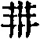

# 夔州卧龙字水禅师语录



> **藏经**：嘉兴大藏经（新文丰版）（嘉兴藏）　**册次** 第 29 册（J29）　**编号** JB222　**部类** 诸宗部　**卷次** 3 卷　**篇幅** 35,603 字

> **作者（译者）**：住夔州广福门人观谁录、住澧州洛浦门人寂亮录、住开县栖灵寺门人完矩录

> **卷／品**：3 卷 · 0 品



---



## 目录



- [夔州卧龙字水禅师语录卷一](#夔州卧龙字水禅师语录卷一)

- [夔州卧龙字水禅师语录卷二](#夔州卧龙字水禅师语录卷二)

- [夔州卧龙字水禅师语录卷三](#夔州卧龙字水禅师语录卷三)



---



夔州卧龙字水禅师语录叙



《指月园录》成，社中诸子索余叙，适余病胃，不耐执颖倦睡去，梦入指月园问侍寮索纸，接手即呈空纸一幅於师，师曰：「也须道一句子来。」余即畫一圜相，师曰：「只是不道？」余曰：「向痴人不得说梦，打屁后教谁滤渣？龟负出来，丧性命於赤字；鸿已飞矣，觅指又於黄芦。夜来八万四千偈，只须四两大黄下出；架上一千七百则，快索一把火苣飘扬。诸子闻於无闻，吾师说而无说，即使言前荐得有甚了期？」乃以手摸师额曰：「描看你面皮厚多少？」师遂蓦头一棒，曰：「贼！却女深心奉尘刹。」遂惊寤，索纸疾书出来，向痴人前说梦。



崇祯己卯二月十五日，夔州府新宁县嗣法弟子张懋德撰。



又



一色未立，万籁阒然。当是时也，木樨无隐，砌蛩俱默；桃华不语，鸡犬自恬。大千岂有坏时？诸佛何常出世？无奈劳劳多事，哆哆相承。教野老以还淳，洗素丝而求白，宜云门之有憾，诚曹山之不如。宁知空外劫前早没交涉？待尔破颜寒齿，堪作麼生？四十九年不自呕却，千七百则俟谁删之？青冥云冤，白日走魅，况又有搏饥虎而求食、伍白泽以为妖，发烈火於沧海、兴穨澜於赤波？上之则奴隶祖祢，下之则奔走人天，彻底掀翻，凭空颠扑。如我卧龙老贼，恨不及生初一棒打杀，令奄有今日举口祸生。休道以酉解醒，孰任鼓风扬焰？独哂如许狂肆，莫谓无人识他，若不趁斯翻除，将必有时骂我。



夔州府新宁县嗣法弟子熊之奇撰



启



伏以吾无隐尔，飘来云外古香；法亦非心，点破柏庭新翠。霜轮月转，智无功处全章；掜目华生，指所标时即堕。况至借人牙后之颖，乃转增我道眼之尘？自非吾师，孰续慧命？恭遇卧龙老和尚，扑破万古虚空，推倒十世诸佛。三书扭折鼻孔，曾当场法战古锥；一掌击碎茶桮，辄寻常勘验衲子。知马驹蹋杀天下，乃龙象近出蜀中。懋德等，志合孔、释之仝，力清朱、陆之垒，笑闻樨之从人借，陋见桃之自竟来。在懋德等，必不刺脑入胶盆；若吾师，无向虚空掘屎窖。幸来仝挝涂毒鼓，相将共坐多窑床。谨启。



夔州卧龙字水禅师语录目录



序二  

启  

第一卷上堂住夔州新宁县指月禅寺语录  

住夔州开县栖灵禅寺语录  

住荆州天皇护国禅寺语录  

住岳州慈利县华严禅寺语录  

住澧州药山禅寺语录  

住夔州新宁广福禅寺语录



第二卷小参  

晚参  

示众  

机缘  

法语  

规约  

佛吏



第三卷书问  

颂古  

分镫偈  

杂偈



附行状



夔州卧龙字水禅师语录目录(终)



------



## 夔州卧龙字水禅师语录卷一



**译者**：住夔州广福门人观谁录



住夔州新宁县指月禅院语录



崇祯戊寅十月朔到院。山门。云：「若论步步风规，则十方无壁落；若论重重关锁，则四面亦无门。」以杖指云：「者里合作麼生？大众！者里也好个入路。」



据室。师拈拄杖云：「铁人据铁室、坐铁座、拈铁棒，且道作麼生施设？」乃卓一卓云：「生铁铸就底，到来也须头破脑裂。」有僧便喝，师打七棒趁下。



刘兵宪、陈太守、李明府及绅士、护法请开堂。上堂。拈香祝圣毕，次拈香云：「九上万峰，石中有玉；三登中庆，沙里无油。若非扑碎窠巢，终是鼓鬻饭气。供养见住梁山太平禅寺破山明禅师大和尚。」维那白椎竟，乃云：「菩提涅槃、真如佛性，及从上来事总被者上座一椎丧尽了也，还有个甚麼而言观乎？」拈拂子畫云：「犀因玩月纹生角，象被雷惊华入牙。」擿拂子，下座。



上堂。竖拂子云：「会麼？天竺玄猷，少林家法，尽向者里露布，只是你诸人不肯领取，所以总成败阙。虽然，门前纵是知音少，却有秋风送月来。」



陈微一秀才送子出家，上堂。「父子儒释，挥麈持锡，两重公案，仝此消息。真亦非真，俗亦非俗。当年裴公送虎谿，今日陈子向指月。」



上堂。「除却心性，是个甚麼？欲觅踪由，错错错错。具眼衲僧，如何摸索？」便下座。



上堂。「游龙峰顶，猿鸟啼不二之圜音；指月竿头，青冥显无闻之般若。若能一一领得，则从上来事弹指圜成；其或不然，徒自疲困。」



上堂。「一呼便应，六室虚明；一举便知，六处解脱。若当向上宗乘，全非第一义谛。既然，甚处与女相见？」乃击案一下。



上堂。「蝴蜨生枯桩，千古之常事；指物与传心，早落第二义。」良久云：「不是，不是！」



上堂。「止止不须说，我法玅难思，诸增上慢者，闻必不敬信。」良久，擿拂子云：「诬人之罪，不堪持论。」



上堂。「释迦老人在你面门唱言：『惟此一事实，餘二则非真。』你诸人还见麼？」便下座。



上堂。僧问：「西来大意且置，未出方丈时如何？」师便打，僧喝，师复打，乃云：「一法不存，青山绿水，野艸闲华，头头不至。一念才举，塞北安南，人伦物理，历历在前。诸人向者里如何究竟？若究竟得，我与女仝枕共被；若究竟不得，你向潇湘我向秦。」



胡宪卿护法祈嗣，请上堂。师以拂子畫一畫，云：「无上玅道尽在於此；天地万物尽在於此。如是，则宪卿居士不向佛求、不向法求、不向僧求。求男得男，便生福德智慧之男；求女得女，便生端正有相之女。男女互生，生生不已，亦尽在於此。」复顾视左右云：「记取，记取！」张则尧居士诞，请上堂。师拈拄杖云：「诸法不自生，亦不从他生，不共不无因，是故说无生。寤得来底一尘不立；未曾寤底万虑云兴。」良久，靠拄杖，喝一喝云：「水冻冰生。」



上堂。僧拟问，师便打，乃云：「指月家风，眼高一世，逢魔不怖，见佛不礼。禅不知参，教不解习。夜不挑镫，日不埽地。哀不啼哭，乐不嬉戏。人若问著，不吐一句，唯条拄杖拦腮劈脊。」遂擿下杖，笑云：「且道是甚时节？」



冬至，上堂。「一缕麻线遮缕风，霜雪何妨满道中？不烧榾柮地卢空。」乃呵呵大笑，下座。



上堂。「小尽二十九，大尽三十日，十九八七六，五四三二一。於此会得，参学事毕。」



上堂。举拂子云：「会麼？此是指月于万峰山中无会易地上三锹九锄掘得来底，钝置多时，今日不忍被盍囊臧对众拈出。」时维那便喝，师云：「不劳注脚。」



新法堂成，上堂。「斩新日月，特地乾坤，刹竿竖出云霄，门头横厌海宇。所以感得庞居士说〈偈〉赞叹云：『十方仝聚会，个个学无为，此是选佛场，心空及第归。』虽然，毕竟如何是心空及第归底道理？」以杖畫一畫。



腊八，上堂。「腊月八，日正晴，放出明星刺眼睛。瞿昙老，作麼生？今古何曾有二人？」擿杖云：「不烦久立。」



上堂。「从上来事，总无多涂，若能直下承当，便是宗乘直截一路。既无灵利，只得引玄畣玅落艸商量，及乎究到头来全无用处。大众！佛不出世，祖不西来，还有是般事麼？所以道：『指南一路，智者知疏。』如今大众尽是多历江湖，久居林下，胡不体究？要待何时？生死事大，无常迅速。珍重！」



荐严，上堂。「朝闻道，夕死可矣！毕竟以何为道，夕死可矣？莫是明德亲民是道麼？莫是正心诚意是道麼？莫是修身齐家是道麼？莫是治国安民是道麼？莫是不睹不闻是道麼？莫是无声无臭是道麼？莫是纲常仁义是道麼？莫是升阶正笏是道麼？大众！向者里试辨看。若辨得分明，不枉绎初卫居士为尚书清敏公荐拔之诚。其或不尔，更听指南。」便下座。



上堂。「三世诸佛不知有，鬼怕神符；貍奴白羖却知有，狗咬枯骨。若明得此两语，南泉落在下风；若明不得此两语，大有事在。」



上堂。「雪色满园中，寒风吹古瓦，故人不见归，小鸟空啼野。」击香几，下座。



上堂。「指月门下不是一切人栖泊处，若向者里栖泊，焦头烂额；不向者里栖泊，亦焦头烂额。」良久云：「者里切忌说破。」



上堂。「七十二棒翻成一百五，总不是分外事，但恐一切人向他门头户底无出身之路，所以今日不惜眉毛露个说话。」举杖云：「不可唤作渠。」



上堂。「佛法因缘不是小事，亦不是博知经史及一切子书、语言文字上求觅得底，只须向佛祖未出世、父母未生时明得，始称参玄上士；不然，尽属狂解，恼乱其性。何故𫆏？中峰云乱起，涧底水潺潺。」



上堂。「小知不及大知，小年不及大年。」乃召众云：「冢庄今日向指月门下卖弄伎俩，被露柱镫笼曲折一上，只得有眼看不见、有耳听不闻，却来指月门下觅个说话。指月也只得道个：『巧伎尽时诸念尽，白云散后见青山。』」



上堂。「识得一，万事毕。」遂畫一畫，召众云：「者是一，你作麼生识？若识得，设保万事毕；若识不得，切莫向诸方道亲见指月来。」



上堂。「一室虚明，不是时人游戏处；一亘晴空，不是时人游戏处。千峰秀色，不是时人游戏处；万华争艳，不是时人游戏处。何也？巴东、湖南与麼去。」



上堂：「认著是，痛与一顿；不认著是，亦痛与一顿。昨见孤鸿塞北归，足边系得安南信。」以杖筑禅床，下座。



上堂。「开眼便见，开口便道，虽是省力，若较从上来事，十万八千在。何故？不见道：『分明月在梅华上，看到梅华早已迟。』」



上堂。「大众！不可造次。若造次，三世诸佛、历代祖师与你坐与你卧；若不造次，貍奴白羖、水鸟树林与你坐与你卧。」



上堂。「宗乘未唱，净白地上有许多人坐卧自在自由，及乎我祖西来，弄出者场祸事。如今要坐也不得、要卧也不得、要自在也不得、要自由也不得。虽然，总是玄沙道底。」



解制，上堂。「解开布袋，如意自在，任去任留，了然三昧。红华峰上正春晴，鹅城山下云霭霭。」



住开县栖灵禅院语录



据室：「『若论者个所在，也好歌於斯、哭於斯、聚国族於斯，为甚却道佛来祖来请居门外？者里合下得个甚麼语？』抛下杖云：『不图打艸，且要惊蛇。』」



结制，上堂。僧问：「诸佛诸祖道不得底，和尚作麼生道？」师打云：「一棒碎微尘。」进云：「恁麼百芔逢春，万华争艳去也。」师云：「豁开柳眼，笑杀梅梢。」乃云：「风行艸偃，水到渠成，本自天然，何假雕琢？才拟议时，即错了也。」以杖畫云：「将谓桃华深有意，谁知开后也徒然？」



上堂。僧问：「如何是天地仝根、万物一体？」师云：「释迦曾稽首。」进云：「和尚恁麼道，学人如何委悉？」师云：「甚麼人教你如此？」乃云：「若论天地仝根、万物一体，则人人本具、物物全章，无有大小方图，亦非玄黄朱紫。到者里，有无不得、是非不得、取舍不得、圣凡不得、玄玅不得、道理不得、言语不得、寂默不得，乃至真如佛性、菩提涅槃、宾主照用、玄要偏正、圜相、顾鉴、一字关、六相义、辊毬舞笏、打鼓挥剑、擎叉扣齿，千般伎俩不得。」顾左右云：「既总不得，且道作麼生才得？有定当得底出来道看。」一僧才出，师摇手云：「此是诸佛秘臧，无人能到，在所游方，勿妄宣传。」便下座。



上堂。「万峰青，万峰青，春色壹壹物自明，百啭流莺处处鸣。处处鸣，祇是时人不解听，依旧可怜生。」



上堂。「临江浪静，石龙船载明月之珠；鹿渡烟消，渔父子钓芦华之岸。一一是诸人出身处，切不可作竟话商量。若作竟话商量，西来大意埽地尽也。」



上堂。「盛山高映绣衣池，野鸟啼幽华落时，多少寻香逐嗅者，将心往往向深支。」



上堂。「百千三昧，无量玅义，祇向一毛头建立。敢问诸人，还识一毛头麼？子规啼绿树，牧竖歌青山。」



上堂。「红尘𠂤里，尽是谈般若之处，若著意追求，便被红尘盍覆，终无解脱之时。何也？总是鹿子蹋月。」



上堂。「临济吃黄檗棒，把髻投衙；百丈被马祖喝，以酉解醒。栖灵也无棒打人、也无喝喝人，但只闲看，家家绿树鸣黄鸟，处处青山覆白云。」



上堂。「向上一路，理涉幽玄，旨外一宗，机贵神寤。所以先宗道：『才著唇吻，便落是非。』大众不可容易，莫终日只浩浩商量那个书史可读、那个经论可讲，教坏人家男女。且一切百家异说尽不是了道之事，若作了道之事，达磨一宗尽属知解。」



上堂。「玉贵温润，道贵眼明，不然，终非至宝。故祖师西来，埽除知解，不立文字，谓之教外别传。今人不察，大失宗旨，不是於经论书史边记取，便向孔孟老庄上孰读。乌乎！殆不可教也。大众！幸是无事，趁此时节做上一场，莫走向他家瓮里淹杀，可惜许！」



上堂。「演若迷头，头本不失；鹿子蹋月，月非真形。学道人向镜中觅、景上求，纵百千劫有甚了期？大众！栖灵门下不是厌良为贱，亦非抬捺商量，祇要识得根宗便休。」喝一喝。



上堂。问：「一为无量且置，无量为一时如何？」师云：「拂子千条线，香烟一片云。」进云：「最初一句拈向一边，末后句子请为举扬。」师云：「却说他不出。」进云：「学道也不是，参禅也不是，和尚如何为人？」师云：「脚跟下荐取。」问：「远远趋风，和尚如何管待？」师云：「放女一顿。」进云：「若人识得心，大地无寸土。」指地云：「者个𫆏？」师云：「莫被刺眼好。」进云：「选佛场中及第归，不入此者作麼生勘验？」师打云：「速退，速退！」乃云：「道原无状，法亦强名。鸟啼华笑，月色溪声，凤凰山下，鹿渡溪滨。既是恁麼不快，何必落艸求人？」



上堂。「昨日四，今日五，渔歌自放临江渚，不是知音和不齐，祇缘来者尽下里。品字峰前，栖灵寺里。」良久云：「一二三四五。」



太平专使送法衣至，上堂。举起衣云：「大众唤作甚麼？唤作僧伽黎，鸡足山中薶没也；不唤作僧伽黎，大众有眼在。毕竟唤作甚麼？」以衣展开云：「品字峰前裁锦净，盛山顶上绣云飞。」



上堂。僧问：「石头瓦块转法轮时如何？」师喝云：「是甚麼？」进云：「击碎虚空，佛祖向甚处著？」师云：「屎桶里。」进云：「空外劫前又作麼生？」师云：「者桼桶。」乃云：「竺土大仙心，东西密相付，谨白参玄人，光会莫虚度。如今有不虚度底麼？曾忆当年骑竹马，今朝便作白头翁。」



上堂。「至道无难，惟嫌柬择，才拟开口，便落是非。正恁麼时，如何是不柬择者？」有僧便喝，师云：「不是弄潮人，休入洪波里。」



上堂。举：「秀和尚：『者一个，那一个，更一个，若是明眼人，何须重说破？』杲和尚云：『致令默照之徒，鬼堀长年打坐。』栖灵不然！」良久云：「忘却了也。」便下座。



上堂。「生从何来看脚下，死从何去高著眼。不涉两涂一句又作麼生？朔风凛凛，梅华灿灿。」



上堂。「长期短限，畫地为牢；究玅求玄，开眼作梦。所以道：『有佛处不可住，无佛处急走过。』大众！正恁麼时，栖灵门下作麼生行履？」时维那便喝，师云：「者个伎俩休拈出，不如随分过残春。」



上堂。「欲为师法，须有观光，不可沽名饰貌，窥窃祖位，恐知者窃笑。古之人欲立丛林住持，必须推选有道有诚信者，庶不致有破败事。近闻一种，不独尟道及诚信，抑且无僧规，但藉势以欺枉，丑态百出。乌乎！丛林之德风、释子之节义，将何以启迪乎？女等后来有个因缘，切不可效如是事。」



上堂。「欲究向上宗乘，不可将心待寤。所以道：『莫只忘形与死心。』大众！栖灵长老不是虚语，祇要一切人知个下落。不然，发白齿黄无了处，回头依旧黑漫漫。」



解制，上堂。举杖云：「生平惟与此相知，石榻谈心到极微，转眼才经三四载，固陵回首又辞归。祖师心印，状似铁牛之机，去即印住、住即印破。如是则行住坐卧、刹刹尘尘总不离此。据此而论，非去非住，难拟难思。其住也，春潮带雨；其去也，野渡无人。虽然，又何妨鼓唇弄舌，说去说住；携笻顶笠，打雨打风？所谓行亦禅、坐亦禅，语默动静体安然也。大众！正恁麼时一句作麼生？清江浪里春风急，楚水波头秋月明。」



住荆州府天皇护国禅院语录



据室。「据此室、坐此座、行此令。有时语驱耕夫之牛，有时默夺饥人之食。大众！忽有个二俱不涉底，如何管待？」以杖畫圜相，喝一喝云：「任是倾湫倒岳来，棒头喝下总按过。」



开卢，上堂。拈香祝圣毕，次拈香云：「万峰顶上得来，嗅著则脑裂；天皇寺里拈出，觑著则眼盲。供养破山大和尚。」举杖云：「卧龙道者，谯氏一丁，生年十三，确志出尘。十五游方楚水、吴门、衡岳、庐阜、江淛丛林，沈溺教海一十一春，真妄差别，小大区分。末归高梁太平门庭，三登九上，微契其心。中闲委曲，举似诸兄。初上万峰，火里寻冰；次上万峰，担雪填井；及登中庆，少分相应。因辞归来路，举古人木人之句，一旦澂清。虽然，还有一事急著眼睛。」以杖畫



：「落落景团团，千古万古与人看。」



上堂。僧问：「如何是道？」师云：「云生户外荆门上，莺啭林闲古树头。」乃云：「洞庭湖上，紫烟映日色之初；天皇寺中，钟声杂桂楫之响。诸般无碍，万象何拘？若能一一见得分明、闻得分明，便是顿超之理；其或不能，莫笑好音空啼野，别有恩光一段奇。」



上堂。「佛祖竟界，参未透时，如银山铁壁。拟欲进前，撞断眉目；拟欲退后，蹉过脚跟。大众！祇如进不得、退不得，毕竟如何出身？如出身得，生生庆快，处处无依，天下横行，大方独步；苟或未然，二六时中，抖擞精神急寻出路始得。」



上堂。僧问：「如何是天皇竟？」师云：「昨夜东风吹过去，今朝杲日送将来。」进云：「如何是竟中人？」师云：「密密无踪迹，相逢喜带颜。」进云：「人竟已蒙指示，无竟无人时如何？」师云：「放女三十棒。」进云：「恁麼则从今会得祖师禅也。」师云：「莫错认好。」乃云：「一光东照，智竟全章，弥勒、文殊为众激扬。如何委悉？若委悉得，人人常光见前、个个脚跟点地，张七赵八直指人心，瓦块砖头见性成佛，镫笼来露柱里转身、佛殿骑山门上出气。其或未委，天皇自道去也。无风荷叶动，毕竟有鱼行。」



上堂。「从上来事，本自见前。」举拂子云：「见麼？」击香几云：「闻麼？天皇不惜眉毛，将百亿须弥卢放在女眼睛里，百亿香海水灌入女耳孔里，犹自嫌少。」乃高声唤：「大众！」众举首，师云：「讨甚麼碗？」



上堂。举：「僧问同和尚：『一大臧教还有奇特事也无？』同云：『有。』云：『如何是奇特事？』同云：『演出一大臧教。』新和尚云：『演入一大臧教。』杲和尚云：『演出演入即不无，若论奇特事，二大老三生六十劫未梦见在。』则和尚云：『丛林商量，皆谓大慧不肯二老，若恁麼商量，三生六十劫未梦见大慧在。』」师云：「投子因风放火，不是好心；云岩路见不平，亦非本分；大慧矢上著尖，翻成特地；天如不忍袖手，俛力为人。天皇如是处断，且道还有曲直也无？」



上堂。僧问：「如今说个甚麼即得？」师云：「者桼桶犹问话在。」乃云：「雨雪风吹上翠微，大功一色露全机，却笑夜来人不识，层层包裹岂知非？如今还有知非者麼？有则出来道看，无则天皇鼓两片皮去也。」众皆侧耳，师便下座。



上堂。有二僧出，众齐喝，师一时趁散，复召众云：「天皇门下须是别有始得。若只今日也喝、明日也喝，总是鬻饭气，有甚宗眼？虽然，二僧岂无见处？」



上堂。「也好个时节。你道是甚时节？大众！年头便见雪飘飘，艸木层层里碎瑶，冻得荆山寒透骨，思量嬾把舌头饶。烧兽炭，酌香醪，一园玉竹临空曲，数树梅华映远郊。」



上堂。「古佛未生前，一畫九相圜，中有一相是，何曾落正偏？」拈拂子作九圜相云：「还见麼？苍天苍天！」



上堂。「昨日也口吧吧，前日也口吧吧，乃至过去无始也口吧吧；明日也口吧吧，后日也口吧吧，乃至未来无终也口吧吧。如今四众已集、宝座已升，也是要口吧吧。你道毕竟为个甚麼？如不会，待下座看。」



上堂。「天门山青，九溪水碧，唐虞之先，遗我今日。不知几千亿，犹问何消息？」



上堂。「昨日雨，今日风，昨日今朝事不仝。事不仝，张公吃酉醉王公，归来叫杀三更月。大众！为我道末后句看！」



上堂。蓦竖拂子云：「见麼？拂子是佛法宝臧，能含虚空、能含尘刹、能转法轮、能成佛道。你道如何相见？若以色相见，不得见拂子；若以声相见，亦不得见拂子。毕竟作麼生得见拂子？」擿下云：「觑著则眼瞎。」



上堂。「是法住法位，世间相常住。」竖拂子云：「者个是相，还常住麼？饶你说根身器界皆如来臧，大地山河尽露法身，也祇是个性常住，作麼生得相常住去？」



解制，上堂。「前年结，今年解，两个泥牛斗入海，蹋碎龙王夜明珠，水晶宫殿云烟霭。还有能知时节底麼？此处无人。」



谢两序，上堂。「两序大众，光伴法化，无可祇谢，惟有一文大光钱，聊为两序寿。」乃畫圜相云：「伏惟，伏惟！」



住慈利县华严禅院语录



据室。「设平地牢关，槛佛槛祖；布缦天网子，罗虎罗龙。」顾左右云：「不入者保社底出来。」有僧出，众以手掩师口，师退身打一棒云：「是甚麼？」僧喝，师云：「不是不是！」又打一棒。



结制，上堂。「尽乾坤界是个卢子，诸人卒难回避。若也回避得，一毛耑上驱雷走电、澍雨兴云；一微尘里大抹高挥、神出鬼没，总不是分外。设或未能，长连床上有鬻有饭，莫错认好。」复举：「蚬子禅师隐东山古庙。一日华严静和尚问：『如何是西来大意？』子云：『神前酉台盘。』」师云：「两人酬唱固是声扬千古，要塞新华严口未在。何故？蚬子祇知门前捞漉，不知家里臧头；华严祇知骑虎头，不知收虎尾。若是新华严，便与禽住云：『速道！』待伊开口，即与一顿，管教者汉一场败露。新华严恁麼，你道古人还落节也无？」



上堂。「今朝六月一，热得遍身白汗滴，万树熏风不得凉，阳乌衔火横空偪。前堂伐鼓声逢逢，古涧流泉劈箭急，祖师意旨已了然，两堂上座识不识？若识，掉臂便去；若不识，待拄杖别通气息。」便擿下。



上堂。「如如原不动，动即成妄想，一物不能为，为者亦伎俩。不慕诸圣师，不落己灵网。大众！是甚麼所在，许女妄承当？」



然律师请上堂。「自安上座春秋七十餘矣！僧腊亦四十餘矣。昔参方时，曾两到金陵，得戒於古心大师，归来行律亦有年矣！忽遇华严，深信此道，坚迎於本院，日究道玅。於是生老病死八苦交煎，始到安妥田地，可谓赤洒洒绝承当、净赢赢无回互，还有个甚麼戒体，持犯不持犯之元字脚挂於胸次中也？虽然，正恁麼时，如何是自安上座出身一路？」安一喝，师便下座。



上堂。僧问：「夏日炎炎，熏风徐徐，如何是清凉竟界？」师云：「热出冷汗来。」问：「劫火洞然，大千俱坏，未审者个坏不坏？」师便打。问：「心空及第归，如何是心空竟界？」师云：「女未到者竟界在。」进云：「未审到得底是甚麼人？」师云：「吾若说此人，无女安立分。」乃举：「庞居士云：『十方仝聚会』」师云：「不远千里而来。『个个学无为』」师云：「亦将有以利吾国乎？『此是选佛场』」师云：「何必曰利？『心空及第归』」师云：「亦有仁义而已矣！大众！华严如是注解，且道还杜得庞公口也无？设或未然，还有一人为女通个消息。」乃卓杖一下。



上堂。「记持名言，何生了道？柬择声色，何处求真？饶女讲得恒沙法门、背得无量文句，也只是个聪明学解，不如向声色里觅个出身之路好。所以道：『声是佛声，色是佛色。』大众！华严倾出了也，还有见得底麼？秋风柳上来，池底波纹起。」



上堂。僧问：「如何是华严家风？」师云：「一步未曾迻，十方在脚底。」进云：「筑著一微尘，无边瞋火发。」师云：「不是知心人，徒劳乱度量。」僧礼拜，师便打，乃云：「华严竟界不是小事大事比量，亦非顿说渐说可拟。女等后生欲究此宗大须立志，若不立志徒自殷勤。不见先宗道：『祇劫果满，始得解脱。』」乃弹指云：「祇劫果满也，且道还有解脱底麼？」



上堂。僧问：「从上来事，某甲还有分也无？」师便打。进云：「早知和尚有此机要。」师云：「自谓久饥虚，不能尝一粒。」乃云：「若论演说宗乘，何处不是？所以诸佛说、众生说、山河大地一齐说，无有间断。既是恁麼，又要华严说个甚麼？」起身云：「不可节外生支。」



上堂。僧问：「和尚未见太平时如何？」师云：「滴滴不断。」进云：「见后如何？」师云：「光光不漏。」进云：「从此家风超世外，更无一事落玄微。」师打云：「秋声处处响，木叶村村黄。」乃云：「释迦掩室，固执难袪；达磨壁观，痴顽太重。所以，是般事本来具足，不假修为。今时人不了此事，故他从上诸圣立种种名、说种种法，逗到如今总成病痛。虽然，不著本来衣，犹是玄谈意。」



上堂。僧问：「师唱谁家曲？宗风嗣阿谁？」师云：「雨洒不湿鳞，意气天然别。」进云：「直截一路，请师再垂。」师云：「天门山带碧，秋色暗中知。」僧喝，师便打，乃云：「秋风入慈昜，天门山色换，楼头梧叶飘，有眼如不见。如不见，一声猿啼肠欲断。」



上堂。「祖不西来，早有者场祸事，何况西来？如今诸方老宿事不获已，说个有禅可参、有道可学，总是止啼之事，若作实法商量，未免道听涂说。大众！华严如是，且道是祸事？不是祸事？」起身云：「祸事，祸事！」



上堂。问：「从上相传一路，请师直指。」师蓦竖拂子，进云：「谢师畣话。」师云：「不唱言前，宁谈句后？」进云：「不消弹指力，楼阁参遍时。」师便打，乃云：「不入弥勒楼阁，怎见家珍？未到华严圣门，安知法要？是以通方上士不拘一路一门，向上衲僧不足一知一见。若不如是，焉得传持？如今大众还知麼？从来参遍处，回首始知宗。」



上堂。「雕砂无镂玉之谈，落艸垂道人之意。诸仁者！向者里作麼生领会？如领会得，不枉亲见作家；不然，大有事在。」



解制，上堂。「华严今朝解制，兄弟东去西去，虽则理合如斯，华严一应分付。」遂高声云：「者边那边，更莫回顾。」卓拄杖，喝一喝。



住澧州药山禅院语录



据室。「谯老师入室久矣！今日重新据座，就中一著乎坦，见者不可错过。众中有不错过底麼？」僧便喝，师云：「胡喝乱喝。咄！」



开卢，上堂。僧问：「大众云臻，师登宝座，主宾酬唱，棒喝交驰，毕竟明甚麼边事？」师云：「此去龙潭不易。」进云：「意旨如何？」师云：「此去龙潭不易。」问：「龙天拥出为扶宗，优钵华开世罕逢，今日升堂如何指示？」师云：「拄杖五尺长。」僧礼拜，师便打，乃云：「直指人心，见性成佛，先宗固是直截，正眼看来却似不是。若是今日，只须道个青则青、白则白。恶！虽然，已是涂污诸人了也。」良久云：「事无一向。不见先药山一笑，应澧阳东去九十里许。如是则新药山开堂亦有一笑布施大众，不惟应澧阳千里万里，管教阖国人成祖成佛。」乃大笑云：「会麼？」便下座。



因事上堂。「雨洒风飘古殿脚，冬寒闭户然枯竹，何期挝鼓要升堂，曳杖强登曲录木。打喊讙讙，瞋火恶恶。本欲为众说法，只是不成法度。」



上堂。僧问：「如何是清净法身？」师云：「祇此一问也不消得。」进云：「怎知法身？」师云：「错，错！」进云：「和尚分上即得！」师云：「错错！」乃云：「鼇山露遮那之体，澧水泻不二之音。若人识得，有口只堪挂壁；若识不得，总成孤负。」



上堂。壁侍者问：「古人升座不吐一辞，此理还的当不？」师云：「毛吞巨海意，乖却本来真。」进云：「打得血流出，如何瞋火然？」师云：「莫以荆山玉，比作衣下珍。」者礼拜，师打三棒，乃云：「古人升座不说，今人升座要说。不说而说、说而不说，墙壁瓦砾放槁光，玅惠空生何处著？莫莫！开眼也著，合眼也著。」喝一喝。



上堂。僧问：「如何是和尚垂示一路？」师便打，进云：「不是某甲，几错承当？」师云：「以其自足，不如重出。」又打。进云：「领领！」便归众。师云：「可惜珍玉混泥沙。」乃云：「古佛心宗、衲僧肝胆，尽在一毛头建立、一毛头收归，只是大众未肯承当，所以在者里早上上来、晚下下去，不自回光，却成孤负。故先宗道：『京都邺都浩浩，便是菩提大道。』大众向者里信去，不可更疑；若更疑，驴年去在。」



上堂。「大众！有甚麼事隔碍，不如与麼去。药山在万峰六年，亦只与麼去。若不与麼去，不独六年，即六年又六年有甚了期？虽从上有三祇果满者、有七破蒲团者、有四十年不杂用心者、有四十九年尚自走作者，若不与麼去，亦只是个劳生老汉，有甚可取？大众！今日事不获已，乃说如是！不可谓药山重加笺注好。」



上堂。僧问：「动静正迻时，本分落在甚麼处？」师云：「大地雪消去，乾坤一片明。」进云：「意旨如何？」师云：「适来为女道破了也。」乃云：「识神种艸，粪埽𠂤里薶却千个万个未为分外。何故？若是出格高流，十年五载，时节到来，自然瞥地，放出牚天拄地之手，打开燿古腾今之燄。不劳矢镞，海晏河清；不动干戈，太平坐致。如此，则超群越格即不无，正恁麼时，甚麼处安身立命？」卓拄杖一下。



师因患脚，上堂。「有时节掉棒打月，接竹点天；有时节海晏河清，风恬浪静；有时节哎哟此一句，脚痛说不得。」便下座。



到龙潭寺，上堂。「一潭烟景，万顷波光。子规啼落杨华，渔父全抛玉饵。者个竟界且置，正与麼时如何指示？烧经台上浮青霭，仙眠洲中落紫霞。」



到夹山，上堂。「未到夹山，药山便有许多隔碍；及乎到来，药山隔碍全无。既然，不落两涂一句作麼生道？夹岭云生横谷口，药山月出照丹霄。」



上堂。「从上来，也有打者、也有喝者、也有百般做出者、也有一物不为者。药山今日点柬将来，各欠寤在。」挥拂子云：「也是抑而为之。」



上堂。「雪色媚诸峰，湖光摇三楚，若作佛法观，五五二十五。」拈拄杖，卓一卓云：「大众切忌茻卤。」



上堂。「一浦云烟，万井冰雪。玉楼人睡，不知天晓，琼树乌啼，不知晴明。林下道人，当恁麼时唤作何事？」以杖卓一下云：「等闲莫洒两行泪，恐染湘山竹上辨。」



解制，上堂。「九旬佛事今朝罢，垂示诸人无别话，东擿西抛任运行，路逢死蛇莫打杀。」



住新宁县牛山广福禅院语录



据室。「从上宗师於此开虾蟆口，说一二三四五，新广福於此又说个甚麼？」喝一喝云：「云中才见倾雷雨，涧底频惊倒岳机。」



结制，上堂。僧问：「从上老和尚施设尽是节外生支，和尚今日作麼生？」师挥拂子云：「广福无法说，拂子蓦面挥。」进云：「早个节外生支也。」师复挥拂子云：「莫孤山僧好。」乃蓦竖拂子召众云：「广福三登中庆、九上万峰，别无别得，单只得此断拂子一柄，遇人问著便将指挥。」拂一拂云：「拂子头上尘说、刹说、炽然说无闲歇，你道此断拂子见个甚麼道理便有如是神通、如是玅用、如是作为？你也须出来道看！既道不得，不可艸艸，且请出来秉戒。」



王珍送子出家，上堂。僧问：「一子出家，九族生天。未审一子出家，为甚九族便与麼去？」师云：「阇黎！下一转语看。」僧便喝，师云：「退后退后！」乃云：「广福说法无处启口，只好举则古人因缘聊为证据。道玄居士问马祖：『不与万法为侣者是甚麼人？』祖云：『待女一口吸尽西江水即向女道。』士於言下顿领玄旨，有〈偈〉云：『有男不婚，有女不嫁，大家团𪢮头，共说无生话。』广福论他千古之下虽是出群，犹有不尽善处，怎如思修居士也。不恁麼问，广福也不恁麼畣，自是另行一路。何也？他有男不婚、无女不嫁，何用团𪢮头，大家相接话？虽然！广福敢问大众，且道此公与庞老用处是仝是别？出来对众道看！若道得，堪为古今法眼；设或不能，不妨老实疑著好。」



上堂。「黄面老人自谓成道於天竺，雪峰老人自谓成道於鼇山。今日不肖儿孙要问二老人成个甚麼？」



上堂。僧问：「如何是提宗一句？」师云：「当机不唱无生曲。」进云：「早知是错。」师打云：「跛鳖漫追踪。」乃云：「者件大事，佛祖唱不出、辨才诠不出、大众疑不出、广福说不出，惟有松风水月、瓦块砖头、艸木丛林、拄杖拂子当头露布。大众！直下领取，更莫回顾。」



上堂。「鹅城峰碧，牛山咄青，不是古佛蠃髻，亦非诸圣顶门。昨夜文殊、普贤疑到五更，及至醒将起来，依旧可怜生。」



上堂。僧问：「从上来事即不问，如何是和尚家风？」师云：「一跛一跳。」进云：「莫便是不？」师云：「扬沙攃土底意非真。」僧礼拜，师打，乃云：「蜀魄啼柳，庄蜨舞华。若人於此闻得分明、见得分明，则不劳广福鼓唇弄舌，即与从上诸佛仝一龛室，不然，孤负杀人。」



解制，上堂。僧问：「如何是解制一句？」师云：「一声牛背笛，山山任遨游。」乃云：「诸方浩浩商量，且不是聚；广福人人解去，且不是离。若作聚，三十棒打折驴腰；若作离，三十棒打折驴腰。」



上堂。「神会、圭峰尚斥为知解宗徒，而泛泛字句支讲者岂能善乎？我此大众倘有向上志，五年十年不杂一语，何愁不是佛、不解语邪？珍重！」



上堂。「有句无句，如藤倚树，树倒藤枯，句归何处？阿呵呵！谁管你簇锦攒华？阿呵呵！谁管你倒肠括肚？」乃拍膝一下云：「东风昨夜向荆南，千峰万峰啼杜宇。」



上堂。「万法归一，刀刃上蜜，舐著些儿，血珠便滴。陷虎机，蛊毒食，见者丧，耳者死。」顾左右云：「且如何回避？掌上纵有返魂香，也须远离三千里。」



上堂。「拂子好打蝇，拄杖好打狗，若作佛法观，面南看北斗。苏州有、常州有，怎如山门前、佛殿后？」



上堂。「剋期取证，非但高峰为然，雪岩老人亦谓：『女等诸人若能，七日夜胁不至席、目不交眨，一念无闲；若不会，截取头去做浇屎勺。』此法从来得验者不可胜纪，今诸人一夏又过半矣！不惟没有下落，亦且妄想云兴。若不出来提过，期毕不得意，又道长老不道。」



军中谢世，上堂。「有时大声唤，有时小声叫。道是苦苦，为甚与人仝？道不是苦苦，滥泥有刺。」顾左右云：「知麼？老僧无耑堕向刀兵狱里，谁似三千年前双林中右胁而卧？」喝一喝，端坐而逝。



------



## 夔州卧龙字水禅师语录卷二



**译者**：住澧州洛浦门人寂亮录



小参



熊之可、之奇、之京请为胡县君对灵小参，师拈〈疏〉云：「第一第二总不足论，此是象山县君生平底，付与没量居士拈出。」宣毕，师云：「县君早修净业，持诵佛母准提；晚自知非，深究正法眼臧。乃於今年遣人求指诀，因教看个『不是心、不是佛，是个甚麼？』由是力参者三七日，忽然心识不行，言思路绝，将座铁山撞倒，笑曰：『范县君道：「元来恁麼近。」今果然！』县君病革，召仲君平原谓曰：『女为吾报师恩德。』言讫，自在而脱。大众！县君如是，得不为长君、孔原等庆幸乎？虽然，正恁麼时，如何是县君畅快一句？脱体顿超名相外，一弹指顷去来今。」



附请疏。伏以兴化於亲过奢，无劳集众；天如於母太煞，不觉重言。子母俱到，情忘慈孝，遂立人极之。可等痛念亡母诰封安人、象山县君胡氏，内政克修，曾见褒於天语；静业夙具，常梦游於梵宫。蚤稽首佛母准提，晚并心正法眼臧。已解人竟俱夺，但欠洒脱自闲。愧求事之未能，奈无法之可说。伏遇卧龙大和尚，人天眼目，幽明津梁，转经有类多罗、修仪一如七佛。幸蒙飞锡，妄冀垂杨。秦国有落艸之谈，已非因子及母；瞿昙申无常之偈，亦曰事亡如存。知从空放下不难，看对灵呼之或出。於斯识得荐母意，是则名为报佛恩。



明道黄道婆请为星拱黄映宿居士对灵小参。师拈拄杖指云：「见麼？星拱黄君其未死也，常听我打葛藤；其既死也，亦听我打葛藤。何也？盍崇祯庚午闲入我大觉法中，究心《楞严》少有入路，十年於兹遂成莫逆，自吾观之，实非一生两生结就者也。又常重建栖灵梵刹，欲期仝住，忽一旦攃手而去，岂复嫌於久住令人贱，频来亲也疏也邪？虽然，佛祖不传之事犹未指破在。」复拈杖指云：「星拱黄君即尔儒者身，身无其身；即尔菩萨形，形无其形。虚空仝体，世界浮云，生死昼夜，形骸旅亭。其来也，电光烁烁；其去也，石火腾腾。即见仝人作来去，原原委委亘常存。」时道婆歛手云：「哀哀！」师云：「作甚麼？」婆云：「为他黄君摘杨华。」师便下座。



熊止白居士请为余道婆小参。乃云：「止白得为吾徒，尔亦得为吾徒；止白吸尽香水海，尔方跳上须弥卢。」顾左右云：「者话且置，如何是道婆得力句？自从埽去云空翳，一月千江总自如。」



张道婆请为通碧徐道臣对灵小参。云：「者汉方脱却鹘臭布縿、炙脂帽子，便解向官潭渡里泛石龙船，逍逍遥遥，歌沧浪、弄明月，与性空仝游去也。山僧也有首歌曲为伊助喜。」遂云：「知音人！知音人！流水高山共此心，石印寺前重论旧，凤凰山下语犹深。折芦叶，荡秋会，断送孤帆白昼云。」喝一喝，云：「低声，低声！」



小参。问：「如何是西来大意？」师云：「江村渔火发，照见夜行舟。」乃云：「但尽凡心，别无圣解。山僧看来却又不然，未知有底，矿中有金；既知有底，金中有矿。所以道：『大事未明，如丧考妣；大事已明，如丧考妣。』莫道不知有底如此，即知有底愈要精进，除去无始劫来妄业流识，始有契证时节。虽然，当又知我宗无语句，亦无一法与人，须是自家屋里拈出，始得盍天盍地。不然，大有事在。」



小参。「放下著，莫妄想。如今坐立俨然，作麼生放下？莫是内六根、外六尘、中六识一齐放下麼？僧问赵州：『一物不将来时如何？』州云：『放下著。』僧於此寤去。大众！者便是放下底样子。虽然，不可便作容易。只须去尽无始壅塞及见前流识，使胸中七穴八穿，荡荡地、洒洒地，无事无为，真正道人，然后乃已；不尔，都无利益。所以道：『割发须及肤，翦叉宜侵体。』」



除日，小参。「学道人非一做便休，须是切之又切乃能穷高极深。古人在丛林久经磨洒，然后虽住得个院子，人犹讥为离师太早，盍在师边住一日有一日警策，故从上以今日为警策，谓一年十二月於今是尽月，一月三十日於今是尽日，所以鞭策道流，回光自照，若不如此，光会可惜。兄弟也有远来者、也有近来者，仝山僧打者鼓笛，须要一番磨洒、一番光明始不负初心。不尔，於事何益？」



小参。「山僧寻常有一机，不与诸佛共、不与祖师共、不与天下老和尚共，且道与谁共？有定夺得者，不妨出来相见；如无，山僧自道去也。今夜且烧旧腊火，来朝相贺新年人。」



小参。「今之参禅学道工夫不得力、此事不得明，无他，盍为去不下身心，自生爱染；放不下家缘，自起系念。系念起则好食恋衣，爱染生则贪生畏死，所以不能自在，而生死际头亦不得力，此之过也。兄弟家既办翀霄志，来者里仝甘澹泊、共守清贫，须是把生死念头密密举起、切切穷去，穷到心识不行、言思路绝，不待倒断而自倒断矣！」



小参。「若论本分接人，何须担枷带丑？无奈今时弊病颇多，师家亦只得随例起倒，道个此事不从佛祖经书边得、不从他人口嘴边得、不从静悄地里得、不从闹轰地里得，但除去见闻觉知、屏却咽喉唇吻，见得分晓，自然不动干戈，太平坐致。不然，还须把不明不会底做个生法身父母、长道德圣胎，或行或坐必要觑透根源，如县嵒上扑地一惊，始可谓罢参绝学真正道人。」



小参。「囊留萤火，凿壁引光，世出世虽不仝，向上心一也。栖灵门下既有镫又有烛，参玄上士须著猛力。或大事未明、祖意未透，著实参究，究到无可究处自然荡豁，可谓冷灰里有粒豆爆、枯木上有支华发，岂不是衲僧家生平庆幸邪？天寒，勿劳久立。」



小参。僧问：「如何是五宗仝道一句？」师云：「栖灵寺外诸峰秀，临水江头一月明。」「如何是五宗别开一句？」师云：「江清河浊流今昔，岷岭梁山别一宗。」僧喝，师便打，乃云：「春色晴明，佛祖体露；秋声送雨，衲僧命门。者里办得分明尚无入路，何况者里未曾发足？大众！你道如何是究竟一路？处处子规啼不尽，家家月色照无聊。」



小参。僧问：「师唱谁家曲？宗风嗣阿谁？」师云：「头顶黄河尾氐江。」僧云：「才挽雕弓意，喊声便震天。」师云：「弹子出红卢，阇黎一命殒。」僧便喝，师打，乃云：「放开一步，步步登高；把住一头，头头无路。所以，尽十方界只得无取无舍，始是佛祖转身一路。若不如此，徒劳担囊负钵、走东适西，有甚饱参时节？大众！我广福圜制之时，故以此进女大众。若女大众的欲明此一段大事，当须究竟，不可以少为足。古人三二十年始成道业，岂欺我哉？珍重！」



晚参



晚参。「此事不论僧之与俗、贵之与贱都行得，只是思虑太过，不能当下领取。如家居者，治生已遂又虑子孙，子孙罗列又虑科目，科目已登又虑名爵。名爵既极而世间事毕矣，方欲求免生死，则头白齿黄，恶有餘年可进此道邪？如不家居者欲研四谛，至灭道可已又思十二缘，至还灭尽已又思万行，至三观尚矣又思正觉，至正觉方观从前事业终是阶级建化门边事，恶有顿超之理？兄弟总不如向者里盍却，始得疌径。」



晚参。「山僧有三转语垂问，大众切须子细。此事元来见成，何须别用工夫？不用工夫，如何得见成去？有时节要人作佛祖，有时节不要人作佛祖，者老汉是甚麼心行？至道无难，唯嫌柬择，是何人语？若道山僧，孤负祖师；若道祖师，又成柬择。」



晚参。「兄弟家都是多历江湖、久参上士，不可只见一橛便谓禽纵杀活我已透得。古人常言：『大事已明，如丧考妣。』况未明大事即作自足想邪？何不趁此色力，百尺竿头快须进步？忽然虚空粉碎，是时不待罢参而自罢参矣！」



晚参。拈拄杖召众云：「有麼？」有僧便喝，师打云：「者样底有甚交涉？今日不许喝，竖拳、竖指、左右旋、女人拜，种种尽是学来底，只须别道始得。既道不得，何不精进？不见古人四十年不杂用心，除二时鬻饭是杂用心邪？又不见只愁不是佛，是佛何愁不解语邪？」



晚参。举德山和尚住后因缘，蓦顾左右大骂云：「看者桼桶把佛祖欺迕，只当笈中物，可惜当日仝事者不肯左袒佛祖，令伊肆意独迈高风，今七百年来亦未有为佛祖雪屈者。山僧虽生晚季必不私徇，要为干城启辟徽猷，胡不思先佛，天人莫上、众圣中尊，岂可欺迕当物看乎？祖师直指人心见性成佛，亦可欺迕当物看乎？」复顾左右云：「兄弟还甘此说麼？若甘，德山放行早已；不甘，佛祖过在甚麼处？」有僧出，师打云：「不是不是！」又僧出，师亦打云：「不是不是！」一众芒然莫识师意，从此内外，胁不至席矣！



晚参。「丈夫眉宇不作跛驴，为甚透脱不得？」有僧以脚打地，师打两棒云：「做甚麼？」僧才开口，师复打云：「问意有宗，畣意攸仝，是女乱做得麼？且者学得底济事不得。」又有僧从东过西，师亦打，云：「者桼桶，华严门下，佛来祖来一验骨出，铁额铜头不敢跨门，况女溺床鬼子欲逞神通邪？」又打两棒。



晚参。「山僧学道二十餘年，末上向万峰山顶见个无面孔老师，被他朝打三千、莫打八百，逼得到千里万里无我无人，冷清清地忽地醒来。」乃举杖云：「拾得者个唤作佛法，从巴蜀历荆楚，也曾拈示於人，只是无人证据；如今药山寺里新开卢鞲也，拈示於人，亦无人证据。夜里忽尔伤风，出气不得，衲被蒙头，闷得通身汗滴，天明刚才苏息，又被人问著，山僧无可措手。」复举杖云：「又只得将者个拈示，切勿道：夜来伤风，今犹喷嚏在。何也？者个千圣不能传，乾坤包不得，通身是手眼，亦少觑著者。兄弟！明见是个拄杖，不从南山来，便是北山出，因甚道千圣不能传，乾坤包不得？明见是个拄杖，长则长五尺，浑身似桼黑，因甚道通身是手眼，亦少觑著者？者里有具眼底，出来道看！」



晚参。「此段大事，就在诸人经行打坐处讨取自是分晓。行时讨取行底是甚麼，坐时讨取坐底是甚麼；一行一坐，通身讨取是甚麼？如是讨取，则行住坐卧，法法头头自然绵密，诚能尔者必有倒断时节。东院云：『一生不离丛林，十年五载不语，无人唤伊作哑汉。』岂欺人哉？」



晚参。「一口气不来，毕竟向甚麼处去？此博山大师语也。兄弟家将此一句顿在面前，行也此一句，坐也此一句；行住坐卧通身此一句。如是则手中掜著此一句、脚底蹋著此一句，眼中觑著此一句、耳里听著此一句，鼻头嗅著此一句、牙关咬著此一句，未常少闲、未常少歇，欲登佛祖阶亦何难也？只是兄弟家不能信去。山僧昔年将谓此老魔魅人，今日看来，何等见成？何等简易？兄弟家记取，记取！」



晚参。举庞居士〈偈〉至「神通玅用，运水般柴」，云：「只如早上般柴时，还得神通麼？兄弟家如不会，不免从头注破。『日用事无别』」师云：「还须知有。『惟吾自偶谐』」师云：「切莫认著。『头头非取舍』」师云：「是个甚麼？『处处勿张乖』」师云：「要且不识渠。『朱紫谁为号』」师云：「任从沧海变。『丘山绝点埃』」师云：「光景中死汉。『神通与玅用』」师云：「你试道看！『运水及般柴』」师云：「三生六十劫。山僧如此，且道是肯老庞？不肯老庞？各请下一转语。」



示众



住指月禅寺，到院日，示众。拈〈疏〉云：「此是没量大人，将佛祖百千三昧总向不律头上露出，倘不会，知事宣过。」乃云：「山中斫柴、涧下取水，自是住山本分，何故却来者里揭佛祖标格，用开卢钳锤鼓得三百五百，於丛林中闹浩浩地？」良久云：「只因使符逼，非是彊出来。」下座。



示众。「恶池见僧便喝，只在舌上用得；武陵见僧便棒，只在手里用得。何似山僧全体用得？」顾左右云：「且那里是全体用得处？」时维那云：「请归方丈与和尚道！」师云：「归方丈即不无，要且不见全体用得处。」时又有没量居士从东过西、从西过东云：「当甚破艸鞋？」止白居士拂袖便出；白拈居士喝一喝；玄倩居士便掀倒禅床退身三步。师云：「千般万般即不无，要且不见全体用得处。」



示众。「大凡演唱宗乘，须具金刚眼、择法眼、透关眼、超宗眼。具此四眼，始可用剑刃上事，坐曲录床。有麼？有麼？」僧便问：「如何是金刚眼？」师云：「烧眼非关日，精灵绝景相。」「如何是择法眼？」师云：「淘沙赤金出，漫谓白铜仝。」「如何是透关眼？」师云：「千重无留碍，急水打毛毬。」「如何是超宗眼？」师云：「上得瞿塘峡，始见众山低。」



示众。「诸方在浩浩里传持，药山在物物上建立，所以在西蜀即说西蜀底法，在楚澧即说楚澧底法。大众！西蜀且止，你道楚澧江南江北甚麼处是法？莫是艸木丛林、僧俗男女是法邪？料掉没交涉。莫是风云雨露、日月寒暑是法邪？料掉没交涉。莫是前堂后殿、厨库寮房是法邪？料掉没交涉。莫是镫笼露柱、瓦块砖头是法邪？料掉没交涉。莫是树支子摇、牛尾巴动是法邪？料掉没交涉。大众！毕竟在甚麼处？道道看！」



示众。「山僧者里有时是水上葫芦禅；有时是日中宝石禅；有时是色里胶青禅；有时是水中盐味禅。女等合作麼生会？」僧出问：「如何是水上葫芦禅？」师云：「才欲进前看，转便举头，早已失来踪。」「如何是日中宝石禅？」师云：「新出河山光烂熳，烧空灼地景微微。」「如何是色里胶青禅？」师云：「分明汉上无云物，比拟来时翳眼睛。」「如何是水中盐味禅？」师云：「晋人有舌应难辨，付与多情石女儿。」



示众。「我此大众江湖散人，听吾偈句以为道根。不可放纵、不可死心、不可妄想、不可执情。不可四顾、不可合睛、不可妄认、不可别寻。不可憎爱、不可无明、不可自欺、不可非人。不可不说、不可动唇、不可执坐、不可长行。不可系念、不可起瞋。无利益事决不可行，豪厘若犯，打出山门。」



示众。「净如珠、清如水、明如镜、𪸩如星、皎如月、杲如日，厚如地、大如天、虚如空、深如海。今之人不惟不能洞荡、不能深远、不能光明、不能皎洁，且不识自心在甚麼处？是个甚麼？近有一夥识神之徒升在高座，被人逼著便胡言汉语，非打即喝，几曾梦见临济、德山竟界来？及乎教除去者伎俩更与相见，必也眼瞠瞠地似个卜卦底见神见鬼，可怜生！胡不闻：『语不惊人，切莫开口；不识真人，毋认识神』之诫欤？珍重！」



埽龙潭信祖塔，示众。「擎茶奉饼天王时，底事分明敢自欺？今日艸荒人变色，椎胸更去告阿谁？」顾左右云：「为甚如此？虚空休掘洞，平地起孤𠂤。」



示众。「吾昔侍万峰时，与象岩、破雪诸人作偈颂，比被老人诃骂，即自知非。今诸人入来未经一月，便欲逞才作偈，得不为众中糟粕邪？如禁而不止，病在膏肓，难以救治。」



示众。「高高峰顶立，深深海底行，你道是甚麼人竟界？知与师齐，减师半德；知过於师，方堪相授。如今学人才向门墙边张一张，便开口说是说非，此等人，佛谓之可怜悯者，阎罗王殿前依旧汗下，何益也？不如做到佛祖田地，出来说两句光扬祖道，岂不谓之丈夫也哉？若是光景中、门墙上识得些子，便作者般虫豸，不惟不能为人，亦且箭折弓残於人矣！」时有张没量向前作掌埶，师云：「放女三十棒。」士礼拜而去。



示众。「莫妄想，见山见水是个甚麼？」众目定动，师喝云：「者里那有闲饭养你者死呆禅和？」拈棒便打，众泪下，师云：「会即会，泪甚麼？」复打板头一棒，云：「将头不猛，累及三军。」



因事示众。「昔在中庆万峰时，知事常差负薪汲水、耕嵒种石、剥笋采茶、打碓牵磨。知事诃责，於时只不与之争，然后始得己事了办。兄弟家念生死，来此聚首，即般几束柴未为分外，何小逆竟便打不过？如此是不能放下无明种子，如来诃为可怜悯者。不见曹溪掌碓、雪峰执炊、沩山诸老皆出行门，岂尽不及兄弟也？即如长老顺庆名族、缝掖子孙，曾二十年苦辛，岂亦不及兄弟也？快须放下，莫惭惶杀人好。」



示众。「赵州云：『诸方难见易识，我者里易见难识。』天皇亦常道：『诸方易见易识，我者里难见难识。』何则？不见道：『佛法不是小事，要在做到行到方知受用。』兄弟家如欲得者个受用，用心须是微细绵密，不可因循。如用心细，自然日劫相倍；用心密，亦自然日劫相倍。所谓生死心切、向上心坚，自然日劫相倍。兄弟家肯依此言，必也穷高极远，透彻精微，发用阔大，语句惊群。虽然，犹有一机尚要会在。」



示众。「兄弟家唤甚麼作道器？若聪明之士举起便知底，则世知辨聪如麻如粟，此等尚与情念黏著不能远离，稍有粟米粒事在胸中，日夜不安，心神搅乱，赵州谓：『诸人被十二时使。』正为此辈发药。兄弟家何不趁此鬻饭有吃，把自己不明不会底，急急回光返照打起精神，只要做到放光动地始可歇下。如德山见龙潭后，拈一条棒，佛来也打、祖来也打，者才是不负行脚，向上高流。时寒，珍重！」



示众。「学道人志须坚、心须固。万年一念、一念万年。如金如石，风吹不入、雨打不湿。到恁麼地，生禽佛祖、活捉衲僧，岂是分外事？虽然，还有一著不与道在。」



示众。「日月高县，乾坤倒卓。露柱镫笼，一动一静；砖头瓦块，或坐或行。正与麼时，耳其声者，死不移时，利害在甚麼处？曾经一中穿杨箭，乍见松毛也皱眉。」



示众。「拓钵出，低头入，伶俐汉，勿轻忽。瓦子鼓琴、虾蟆和曲，砖头惊起上月窟。」复云：「虚而盈、剥而复，若得绝后再稣，其宗不致寥落。」



示众。「诸方则难参易学，药山则难学易参。所以药山接人，不须济下玄要、洞上君臣。」拈拄杖竖起云：「见麼？十方薄伽梵，一路涅槃门。」



机缘



张则尧居士问：「如何是落艸句？」师云：「此去牛山一里许。」「如何是直截句？」师云：「牛头牛尾颠倒颠。」士信入。



开令万时公问：「父母未生前不问，四大消散时如何？」师云：「到头霜夜月，任运落前谿。」公礼拜。



师睡次，有陈瑞环居士至，问：「如何是和尚家风？」师云：「一枕齁鼾眠自足。」士云：「意旨如何？」师云：「曾无俗客到山家。」



问：「腊月三十到来如何？」师云：「雪抹山河皎，竹烧节候催。」进云：「新年佛法如何？」师云：「乌雅巢霰，锦鲤卧冰。」



问：「如何是体中玄？」师云：「华爱谈经名解语。」「如何是句中玄？」师云：「龟毛牚破水中月。」「如何是玄中玄？」师云：「蔆角尖尖三个叉。」



师问新到：「女住甚处？」僧云：「白云寺。」师云：「白云也有事。」僧无对。



问：「如何是诸佛出身处？」师低头云：「㘞！」



古山问：「某甲一向自谓有个入处，及举『如何是心』又去不得，过在甚处？」师打云：「是甚麼？犹问过在？」山礼拜，师复打七棒云：「棒下无情，聋瞆皆惊，你欲思量，千生万生。」



问：「大千世界一微尘，如何是一微尘？」师举首云：「是甚麼？」



问：「万法归一，一归何处？」师云：「揭谛，揭谛！」



问：「如何是空王殿？」师云：「横三竖四。」「如何是空王佛？」师云：「一二三。」



问：「明历历、黑桼桼，是个甚麼？」师与一蹋蹋倒。僧起复问：「生死不明，再乞指示！」师掌云：「者无血性汉。」



师问僧：「山河及大地，全露法王身。」随以手指地云：「者是甚麼？」僧无对。



问：「法堂前即不问，方丈里如何？」师云：「五眼莫能见。」云：「威音王后亦不问，威音王前如何？」师云：「四野青青一片春。」



师开堂日，张没量居士请书云堂额，师云：「攃佛处。」乃以衣袖左右㧑云：「山川也是！艸木也是！」士作虎声便出，师云：「者俗流也有点气息。」



师与胡是渠居士论次，师云：「文章虽居士，佛法须山僧。」士云：「互用得麼？」师云：「居士哭，山僧笑。」士便出去。



师与张文禅居士避暑牛山，师云：「何不脱衣冠？」士云：「礼也。」师云：「将谓你是个人。」士叩齿而去。



师与熊止白、玄倩山行次，师指树云：「唤作甚麼？」白云：「黄荆也不识。」师云：「绿叶因甚道黄荆？」白乃作舞。师复问倩，倩云：「是甚麼？」师云：「三十年后有人举在。」倩亦作舞。



佛侍者问：「某甲为甚愈参愈不得？」师云：「挑镫拨火，是甚麼道不得？」



师问婆子：「你是甚麼生底？」云：「某年。」师云：「那个是甚麼生底？」婆无对。



师梦入万峰室，峰问：「佛祖在甚麼处？」师便作掌埶。峰云：「不得动掌，在甚麼处？」师又举掌云：「好不识羞。」



师过乌雅山，问主僧：「山名甚麼？」云：「乌雅。」师云：「为甚不飞去？」



师问僧：「从那里来？」云：「金鸡。」师云：「来时金鸡啼也未？」僧无语。



德山僧参，师云：「金刚祖师道甚麼？」僧沈吟，师便打。



问：「门外人即不问，如何是门里人？」师厉声云：「眼瞎那！」僧喝，师云：「好喝！」僧礼拜，师便蹋倒。僧起欲语，师云：「住！住！此事须是命根下刺一刀底人始得，我者里刀刃上取人，容你眨眼不得。」



问：「县嵒攃手时如何？」师作听埶。僧理前问，师云：「三生六十劫。」



金鸡启教授参问：「赵州到投子，子过茶，州不顾；侍者过茶，州为甚礼侍者三拜？」师云：「山僧亦合礼你，你作麼生会？」启领玄旨。有〈偈〉云：「复将三拜验天人，石女闻之也断魂，赤眼波斯来何早？金鸡啼上铁昆仑。」师然之。



石林谁维那参，师云：「鼻孔向下垂，眉毛横两截作麼生？」谁释然礼拜云：「观谁终不敢忘和尚。」



钦山僧参，师问：「若人识得心，大地无寸土。眼前是甚麼？上座有会处，下一转语来。」僧无对。



问：「观世音将钱买胡饼，放下手却是馒头时如何？」师云：「女信不及邪？」



慧月亮西堂问：「寂亮在天童曾问向上一著，千圣不传意旨，未有入路，即今和尚如何指示？」师云：「轻舟浮水面。」亮於言下豁然，礼拜云：「喜得今日问过。」



师因肩复下山，遇张没量居士问云：「何不累侍者？」师云：「不欲假借人。」士直走而去。



问：「临济三玄、玄沙三玄，是仝是别？」师劈脊便打。



问：「三十日到来时如何？」师云：「县嵒解点头。」



问：「如何是佛法大意？」师云：「一锯葫芦两把瓢。」



师问壁侍者云：「女会佛法麼？」者云：「去年会，如今不会。」师云：「如今为甚不会？」者云：「早无管待，用会作麼？」师云：「放女一顿。」者礼拜。



师与壁侍者山行次，师问：「如何是正法眼臧？破砂盆。你作麼生会？」者云：「某甲不是弄淖人。」师云：「不弄淖怎见洪波？」者云：「洪波在甚麼处？」师以杖畫两畫，者揭涉曰：「莫淹杀某甲好。」师颔之。



师因座主问沩仰九十七圆相意旨，师以拂子畫相示之。主抹却，师复畫，主又抹却。师云：「吾不畫，你又作麼生？」主芒然，师云：「贩私盐汉放下著。」



师一日举楞严事究竟坚固，因击碎茶桮勘众云：「你道是坚固？是不坚固？若道坚固，山僧已击碎矣；若道不坚固，古人为甚如此道？」



瑞环陈居士入山，师举六祖〈转识成智歌〉毕，徵云：「作麼生会？」士豁然云：「向来闻和尚恁麼举，如镫景里相似；今日闻和尚恁麼举，洞见和尚为人彻顶彻底处。」师云：「试道道看！」士拍手大笑云：「莫道某甲无语好。」师休去。



明玅陈道婆参竹篦子话有年，一日於转车处忽然有省，入山饭僧，问：「承闻和尚打碎茶桮验事坚固是不？」师云：「是，女作麼生？」婆云：「任从沧海变，终不为师通。」乃转身礼拜而去。越五年，示微恙，有〈偈〉曰：「来是谁来？去是谁去？两脚长申，如是如是！」师闻而许之。



明理陈道婆入山饭僧，适师为天童悟和尚举哀，烧香毕，婆入来云：「久仰老人，今日得礼三拜。」师云：「道得许你礼拜。」云：「恁麼不消得。」转身便出。



明道黄道婆因乞法语，师命僧持去，婆接得云：「和尚来也。」僧云：「在甚麼处？」婆击案一下云：「见麼？」僧无语，师闻许之。



王道婆送子出家，请师上堂毕，婆指子曰：「且道此儿还承当个甚麼？」师便打，婆自怪云：「也是句贼入家。」



法语



示玄词西堂



常游楚之南北，而遍觅一个不畏毒害吞舟之鲤，尽其伎而莫之得。客岁天皇山中不下千人，独一尾肥壮赤梢，颇有意於竿头，大约为文义网罗，一时卒难及第。今夏率仝志将华严命来，坚请树法幢之於此院，又得一夏盘桓，而脚跟下一似安妥，第力量一时未充，乃书历来相见之语以嘉其志。山僧虽他往，亦可极力进道，须待临机大发，杀活自由，来寻山僧，何愁不点头也哉？



示参原熊居士



佛祖盛化，从昔至今而声扬万世，无有一人不深操远进称了事人，必也打起一片长远铁石精神，未透者必欲透、未彻者必欲彻，然后始承接得下。居士既欲为之，亦必也切切谆谆万年一念，不让杨内翰、李驸马一丝豪许，而山僧岂不忻然相印邪？



示三和张居士(懋鼎)



一千七百则铁馒头，打得开、咬得碎，何愁尽大地不光明，亦会万物为自己矣！碓嘴生华、枯椿结果，岂虚语哉？只怕个绵绵缠缠於世情中胶死了，则错过生平好消息也。山僧如不道过，异日又说我孤女学道之志。然必须放下满架书，与令兄没量切磋一上，又是两苏在我堂里也。公其勉之。



示自文禅人



若论此事，不可以有心求、不可以无心会，直须将「万法归一、一归何处？我在青州做领布縿重七斤」顿在面前。行住坐卧也在面前，穿衣吃饭也在面前，屙屎放尿也在面前，待客迎宾也在面前。无一时杂谈、无一时戏论，终日竟夜竖起眉头、青著嘴脸，勿懈勿怠。如此做去五年十年，若不寤道，山僧头在颈上，女来截取去做个浇屎勺子。



示玉莽熊居士



学士家道心壁直，无一丝委曲、无一豪私染，终日浩浩地里，於儿女丛中不著纤尘竟界，住在世闲，尽其寿命七八十岁，不怕病魔不畏生死，学地如是，可谓不出欲界而入佛界，山僧岂不羡慕也哉？又云：「住在世闲，作事弘广，客来待之以酉；僧至供之以茶。」谦而有礼，威而有德，一步步蹋在实地上，有何天堂地狱？惟只一个本来面目与之仝生仝死、无坏无灭，则真火中莲华也。



示见莽



真实为生死，须自己衣单下看是何物，行住坐卧不可打落无事甲里，穿衣吃饭不可走入瞢懂袋中，毕竟要觑透根源、见彻窠窟，然后两手禽著此物，冷笑一场来与山僧相见，即不孤女劳力於此保社也。



示会极



近墨者黑、近朱者赤。近飘飏，学轻细；近浑厚，学朴实；近操持，学勤习；近端严，学诚意；近文艺，学诗字；近莲社，学念佛。苟能如此行持，可谓遇竟逢缘，会其至极。所言至极，非从人得，从人得者断断不是真正消息。



示古山禅人



见山是山、见水是水。者个说话，明明只在目前，不能领会，恰似明眼人落井相似。然既不能如此，只须向目前横看竖看，三千里外撞著个无髭须底胡子，切莫错认。



规约



者鼓笛，自我初祖东来，打者不可胜纪，然未免钝置英灵，屈仝中下。山僧既是他儿孙，似不必以陈烂绳黑而缚诸人於保社者也。第近代以来识心纷扰，不无放荡，而纵情之极，只得又将从上老和尚用过底事件揭出，惟吾徒遵之守之，俟啐地折、爆地断，然后骂我魔魅人可也。



瞿昙老人一华垂示、两手分付以来，而东西两土代代相承，莫有一人一世而不以深进远操、洞贯古今、声扬万世为急务也。今之禅人犹古之禅人，今古[罩-卓+千]闲，而法范焉有不陈不严乎？余既滥当是任，不得已乃揭数条於僧堂，谅诸人亦必不以跛脚粗汉是厌良为贱也，宜共遵之。



佛事



自安然上座火。师拈火苣云：「会麼？者便是自安上座本来不昧底面目，其来也自安，其去也自安。既然正恁麼时，如何是他末后一句？」以火苣撺下云：「只此堂堂火把子，山色谿声白燄中。」



大觉寺定光耆宿火。定光大师九十年於盛山峰顶般弄佛祖公案，如今一旦敛衣辞众而去，可谓来亦无所从，日明东岭；去亦无所至，月照西村者也。虽然，末后一著犹要栖灵与伊点出。以火苣撺下拍手云：「归去来！归去来！」



------



## 夔州卧龙字水禅师语录卷三



**译者**：住开县栖灵寺门人完矩录



书问



与瑞环陈居士



雪山老子常言：「一切众生具有如来智慧德相。」此老子一片苦心，彻底要人当下寤去；而人只不肯，盍忽於平常返欲务高求深良可叹也。公肯信此言之切而当下寤去否？如不能，切须留神，不可甘为经史耽误平生。前之人，即尘劳中做去者有之，即洁白中做去者亦有之。第尘劳中拔出为百当千，了者常十一；而洁白中得来为百当千，了者常十九，此轻重之效也。能於二处做得去，此又真火中莲、丈夫汉也。山僧在荆南烟雾中，回首夔门俨在天上，安能与公把臂快谈乎？为道自佳，餘不备。



与笑一法师



湘南领众，刻不容离，何能谋面谈乡井中清话？直令人隐隐作凌云想耳！闻足下论《法华》於天门，而深固幽远之宝所当阳道出，参请辈觌面相承，余实跃然无休也。遣人趋座拾取毒言，不识足下毒肠以为何如？附后小偈：「灵山未散语何真？栗棘吞来怕杀人，竹杖仝君归锦里，銮师席上醉华春。」



复笑一法师(附来书)



至人应运，古佛为心，终不以讥刺、爱誉为二，而来教长笺批答，分析过当，词气少贬，讵非夫子有蓬之心也邪？足下大见，何薄且陋乎？前之人击涂毒鼓、洒甘露浆，茎艸见琼楼、须弥置芥孔，固非浅见可能测度。然余犹少羡於足下者，盍鉴祖、銮师皆出吾蜀，疑足下亦其人之流亚，实用缱绻待以智者，又誉以毒言、毒肠及小偈云云。孰知只泛泛一支讲人，实未梦见实际理耳！既非种艸似不当论，而武陵龙孝若常言：「足下曾见云门和尚，素有良遂敲门之勤。」今来谕「鄙辱殆尽，诚白面书生之浅见，能不错会余相爱者？」就来谕而试一论之。先德常言：「是贼识贼。」足下不妄称误作乱吼争光，安知人妄称误作乱吼争光乎？然不知此种种，亦何常不入正受不是玅理？所谓与诸劳侣仝一手作。倘学不如此，不无师子咬人、韩卢逐块，实可怜悯者。至於「太虚玅体，西氏丰神，不令稚子管窥、丑妇颦效，余恐羊质虎皮、鸡心凤状，大为人所笑也。」噫！足下识见只合美以红莲舌、白玉齿，不合称以毒言语、毒心肠。乌乎！醍醐上味为世所珍，遇此等人翻成毒药。有旨哉！有旨哉！



艸昧世界，机智人心。鱼目妄称明珠，山鸡误作彩凤。碔砆与白璧争光，狐狸仝狮子乱吼，良可叹也。予不欲以太虚玅体受稚子管窥、西氏丰神令丑妇颦效，於是偕二三好音，啸傲於烟云之上；五十知非，养恬於丘壑之中，乃予拙计也。闻老和尚於深山穷谷而棒喝交驰，费精殚神而平常少会，非大手段、大力量者不能。予欲向痴人前说梦，恐释迦老子笑我也。忽接来教，大章大书未必出自老和尚亲手，而中闲语句恐门弟子向口角边取录也。感谢感谢！俟迟，特谋一晤方面布，不悉。



复若明请住德山



鉴祖老人唱龙潭宗旨，於是山每接纳四来，棒如雨点亦如烧尾，辟历几七百年，绝无继此席者，而是山七百年竟寥寥耳！上座既惜此席久虚，乃有是命，欲山野极力扶持，其见可谓伟矣！但山野适有芰荷衣、松华食之想，其志既坚，似难回策。上座的欲完此段公案，亦应待其时、待其人，而不可艸艸光景，当亦如铁而老子断尽人知解，不惟不媿老人，亦不辱足下知人之累。



复亮西堂启教授



正欲走金鸡寻二公谈还乡曲与物不迁之旨，何期先辱华札，字字珠玑，诚得我悟师翁棒头消息者也。山野宁不羡且贺哉？手教问山僧在万峰时事，万峰唯打几顿，绝无物与人，临济儿孙何堪预数？二公过誉，使汗下浃背也。邀住金鸡，即当如命完此口愿。第方退药山院，而诸刹皆有命，以我病足未得少瘳，安能一一酬之？然金鸡虽不能久住，当必过看作三日谈耳！不尽欲言。



复李修吉居士



来楚二年，法幢三树，意觅一具眼人不得，何天假其缘相遘於仙眠洲上？说及此段光景无不相信，但试稘迫，不得三日提点耳！昨虽快谈，不过艸艸，而一口气怎能说得到底？居士气宇虽不减石公、龙湖，也须久久方能尽善。古人有生来净洁者、有学问淘洒者、有工夫磨炼者，阅来书，似在第三方得彻头。倘船子可，能留一日，再来痛领谈笑针锥、瞚扬棒喝，作赤身担荷人，无自甘门外。



复元璧金居士



向史书上楷模道理，恐不能作了当人。何也？公以孔、孟比大鉴而先，朱、程比临济而后，胸中何重前而轻后之甚邪？既朱、程比临济而后，则临济而后尽属知解？雪窦云：「此个尚不与教乘合，况《中庸》、《大学》邪？」若论大鉴而先，即玄元蒙庄犹尚不类，奚仁义之道一门哉？从上来事如大火聚，触之则烧，公谓纵禽便利可乎？不但不识古人，且不识古人用处，诚景响中事，无怪乎山僧语直也。倘把古人用处顿向面前著实理会，久当亲证，始知不是纵禽、不是便利，亦知山僧不女欺也。来书有「向道最为坚固，切欲实证」等语，故据实写来，谅必不气闷下笔没人情也。



复白拈张居士



来谕「生此季世，尔我皆苦，回望天竺尼山，真云泥殊继也。」大约过量人断出此苦之外，又何须论天竺尼山之乐而尔我不乐为哉？然山僧正好向一步一跛处示人，尔亦好向呼奴唤婢边作用，若身若世总是当人本地风光，谁见有一丝豪身世为苦乐邪？几时策俊骨过我，聚话一上何如？



复困庵龚居士



如何如何，一任卜度？若据者个，居士实未得在。不见认著依前不是，不认著依前亦不是。认与不认，居士如何承当？又谓：「棒之与笑，本自无殊，一任卜度，但屈杀古人多多也。」然者个即韩、白、苏、黄尚未梦见，况居士种种见解乃能得入路邪？至於近与不近、来与不来，山僧放居士二十棒，免得葛藤蔓延。



复净土寺净峨禅人



万峰老人祥符解制，复有黄龙之命连书相唤，欲山僧往黄龙，但不知何所教也？今又一书敦催，乃破暑而去，则前所许者实难如命，况撦葛藤念子，山僧灰冷久矣！如的欲完此因缘，可请彻兄甚玅。彻兄是山僧素所知者，二十四部无不洞渊造微，如舍彻兄而外，山僧莫得而知也。



复王方伯狄云居士



住方城山日，常在师僧前称说居士见宰官身护持我法者，适诵大教，至欲聆风旛之说，则已在公笔尖上漏泄了也，又要山僧矢上加尖，得不为葛藤禅所笑邪？如公识得，便是放心时节；不然，还须共山中人住几日，不致作门外弼，终门里相公也。



复长眉罗明府



土广人稀，山僧素所慨者。长乐庵得公金石之谈，山僧眼中意中不觉光明，此何修而能致此也？前牛山亦承公与之酬唱激扬，不然，何能使新宁道俗沾法利如是之沃也？适又承多宝臧中迻来利益人天，山僧汗颜，统此致谢。



复懋中朱居士



荆楚间每晤士大夫言及此事，无一二不怖毒害、能可其意者，故买轻舟溯流而西以寻亮座主旧址，对猿鹤、招麋鹿，诵箕山、燕蕨薇为乐。不意慈利多有辣手阻我兰桡，而复有居士，岂悦老再出，无尽后来乎？请过青莲山中重论末后句子，勿为纸墨交可也。



颂古



世尊初生



僧祇一片苦心肠，展手才堪示四方，若是独尊天地事，不须扶过祖师堂。



大慧举竹篦子



匹马西还无一荐，楼前空叹穿杨箭，来时祇想论神功，争奈宫中不召见？



世尊答五通仙人



堂堂大世尊，那通亦难穷，漫穿凿，枉费工。良久云：「春风依旧五湖中。」



善财度草



能杀能涽，只一茎艸，者里不会何处讨？善财善财，莫被谩好。



不落不昧



不昧不落，前错后错，春风起洛城，华鸟不见过。过！也是大虫看水磨。



十智仝真



百二严关欲上难，不知别路向长安，一声唤得故人出，绿酉红亭奏合欢。



杨岐示众：「老僧举则公案布施大众。」良久云：「口只堪吃饭。」



九十老婆逞玉颜，不知雪已覆云鬟，旁人却道风流甚，别是天地非人闲。



南泉斩猫



手中宝剑起龙文，百二河山荡最氛，从此太平消剑戟，更无戎马度河汾。



黄檗打临济三顿棒



无耑三度上云房，六十头皮起祸殃，寄语诸方当著眼，何须清浊费商量？



裴休丞相问黄檗壁上高僧象



畫人不会畫人心，何似人心会畫人？欲识畫人端的意，等闲唤处句来亲。



赵州三佛



木佛泥佛与金佛，何常不是大人作？只是当年老赵州，不曾把定末后著。



婆子烧庵



无耑突出向云中，一片寒天起黑风，好个金轮无艳色，回头猛火在墙东。



僧问云门：「如何是佛？」门云：「乾屎橛。」



云门屎橛，人多气急，屈指算将来，九九八十一。



夹山见船子



全身分付不须疑，才有丝豪便见欺。末后著，知不知，覆船入水也多时。



黄龙三关



我手佛手，拈苕弄帚，括地埽天，绝无好丑。我脚驴脚，步步蹋著，引得儿孙，无绳讨缚。人人生缘，种地耕田，蓦直一路，苍天苍天。



玄沙敢保老兄未彻话



蜚鸢岭下敶云黑，捉得玄沙者个贼，切却尾兮斫却头，铜睛铁眼认不得。



睦州见僧便云：「见成公案，放女三十棒。」



劈头把出验来人，匝匝清风绕客身，既是金兰莫逆友，何须戈戟暗中陈？



拾得曰：「无瞋即是戒，心净即出家，我性与你合，一切法无差。」



无瞋无个戒，无心无个家，我性与你性，拟合即成差。



僧问破山老人：「终日吃饭不曾咬著一粒米时如何？」山云：「一个斑鸠九只鸟。」



终日吃饭不曾咬，一个斑鸠九只鸟，飞来飞去树梢头，闹轰轰地生烦恼。



龙城元彻禅师示众：「眹兆未分，总是者个○；两仪既判，不离者个○；即今纵有者个○○○○○○，不出者个○。」



分不分，看此闲，不须一箭过重关，堂堂便是长安道，趁柳寻华白昼闲。



龙城又示众：「有时一棒向活路上寻死人；有时一棒向死路上寻活人；有时一棒教伊死也死不彻、活也活不来，立地恁麼？」



棒头下下且精明，杀活双章不著情，分明一一重拈出，不是五千旧葛藤。



分镫偈



付广福大仪观谁长老



嵩少东来直指禅，令行吴越复西川，栖灵更付临笻竹，恶辣声名自此传。



付洛浦慧月寂亮长老



兰江渡口令初开，铁铸才堪入室来，竹篦堂堂三尺铁，冯君拓上雨华台。



付金鸡大仝照启长老



天笃传来事事昌，如何更有别商量？药山一钵亲分付，好去烹泉济十方。



付栖灵顽石完矩长老



山亭一语绝多疑，衣钵今朝可付之，归到汉丰全正令，青山不许著便宜。



付牛山见斯圆照长老



十载巴东毒鼓鼙，闻声死去已多时，稣来可继牛山席，满院华飞信益奇。



付方城狮岩果沾长老



指月室中吃棒回，方城寺里吼如雷，重重惠女桃支杖，一任英灵四海来。



付广福可云果霁长老



十分胆气壮如雷，曾在栖灵中毒来，此法和囊分付女，山头药铺任从开。



付张懋德居士修之别号没量



拈华微笑到今来，六十八番正令开，且喜新安张没量，栖灵门下和歌回。



付熊之奇居士平原别号止白



桂楫中流两岸秋，悄然系艇大江头，纶竿才向苍龙窟，好个金鳞跃上流。



付张允中居士则尧别号白拈



牛山一棒断人魂，活得来时是上根，今日丁宁为圣种，堂堂谁是俗儿孙？



付熊之京居士大原别号玄倩



曹溪春色十分阑，一片清香谁解看？独许大原先得意，东风迢递入长安。



付胡龄祺居士是渠别号实参



济北宗风万古春，华香鸟语意偏新，苏黄当日声名重，今日峰头女更亲。



付张懋学居士二卯别号文禅



指月园中碎顶门，乌纱犹带棒头痕，写来一句知心话，不是愁人也断魂。



付陈正道居士瑞环别号明珠



乌纱丛里道偏孤，昨夜论心理目符，砖镜堂前月更皎，许多梅柳尽垂珠。



付王珍居士思修



六年死志出头来，语默相投果俊哉！此去燕居茅屋下，春风秋月任徘徊。



付王裕甲居士玉澡别号海艇



烽火极天物不宁，门庭冷落不堪听，曳回拄杖谁能委？付与吾徒万古馨。



付熊之哲居士参原



一曲衷肠欲话难，先宗独许默中看，谁知俗子豁开眼？拂袖还乡理钓竿。



付陈道婆明玅



盛山几度已曾说，法眼圜明性自悦，末后还乡曲更清，吾徒岂是空饶舌？



付陈道婆明理



十载殷勤岂偶然？江风明月是单传，等闲识得竿头意，秦国何劳说后先？



付黄道婆明道



生平直以道为先，渴饮饥餐岂妄传？授女庞婆回向句，谿山云月祖师禅。



付王道婆玄明



苏迷卢竟镇海澜，分明说在一豪耑，山僧不必重安柄，法乳从今任尔餐。



付熊道婆玄印



打碎无明窟可全，灵昭百艸又重诠，卧龙意旨从今得，任女油糍擿市廛。



杂偈



山中吟



我居山，无奇特，食黄精，烧松叶。闲不过，长自吟，三四句，寄知音。



玩月偶成



海上古明月，遥遥来古松，夜深云散尽，缈缈欲相从。



汉丰道中



携杖归来晚，落晖返照东，谿声乱石里，山色莫烟中。



示顽石矩禅人



顽石本无情，点头情自可，乃知生公徒，当年未负堕。



解嘲



无道人情好，人情返复闲，不如支枕卧，百事何相关？



示笑月初监院



洞壑深如此，公卿少干谒，悠然万事清，笑入松边月。



睡佛池



山头一个佛，半在水底眠，镫火不相照，明月却高县。



一笑亭



碧色媚孤山，万窍来怒号，大江自前横，笑归来时道。



示止白居士



赵州道个无，子湖教看狗，山僧无法说，拂子蓦打口。



示明峰监院



身住无尘地，心空亦是禅，偶来石上坐，峰月落飞泉。



答生死真妄问



去来不以相，动静不以身，非生亦非死，非妄亦非真。



示若洒禅人



一念心清净，光明犹若洒，直透威音前，何处狂妄起？



示孙居士从闻



几度入青山，草鞋也蹋破，如何不自知？还来论者个。



示印石禅人



餘霞散成绮，澂江清如练，天水两相望，化为石一片。



示明节禅人



出郭居松山，日日营何事？独有古人禅，平常不虚弃。



山居



挂笠夔州几载，了无一事可人？惟有峰头明月，往往来来自亲。



自余住此山中，白云半屋常闲，日里松闲鸟语，夜则衡门不关。



山深杳无人迹，独有麋鹿为邻，负杖有时出户，遥见食野之苹。



散步行到谿口，万树鸟语华香，忽见飘风骤雨，急向古穴嵒廊。



千里万里月色，三峰四峰秋光，乐则高歌一曲，倦则斜枕石床。



携笻刚到嵒谷，又闻石磬铿锵，缘径徐徐归去，沙铛已孰芥姜。



山中虽无奇处，林泉也胜长安，饥来几碗薄鬻，困则一个蒲团。



畴昔山翁行脚，草鞋蹋破几𠂤，今日高眠绝顶，任他佛来祖来。



居山没甚生涯，直条拄杖袈裟，闲到嵒头趺坐，笑落几点梅华。



山色谿光𠂤里，只好埽地焚香，如论祖佛公案，任他浩浩商量。



题宿云亭



白云与亭似有约，亭与白云亦相若，洒洒澹澹宿亭中，岁岁年年如旅泊。



赠美若蒋居士杰



八十二翁书草圣，江湖久矣识名姓，昨从岳寺远相寻，一幅送余真遒劲。



送竺微和尚还越



陇西尚未尽风尘，此日帆开送别津，遥忆鸳湖如镜净，不知秋月照何人？



送知微禅人



白月高天去不疑，吴山楚水欲何之？草鞋脚底如能解，回首巴山意莫迟。



示净远禅人



攃手逍遥一著子，本无生也本无死，当阳一棒是根源，申脚原从缩脚起。



偶成



得休休处且休休，今日方知远遁流，瓢笠好随风月老，任他佛祖不为俦。



示月林禅人



茅屋云中春色焕，千谿竹树香风满，有时支铫鬻清流，一气倾乾茶七碗。



过宝峰访龙城和尚



野径行来日已斜，云中犬吠是山家，阁上经声松外落，林耑也放白莲华。



吊烟霞道士



一到人闲八十秋，心仝云月自悠悠，夜来应有还乡信，御鹤翩翩到十洲。



赠龙城本明彻和尚



十载离情欲洒难，蜀山楚水几相看，归来独有龙城月，高映芦华十七滩。



示法昙禅人



破雨乘风赤脚来，相逢一味喝如雷，如何当作衣中宝？依旧从前热铁摧。



破雪和尚讣至



一到渝州未十秋，烟华浪里坐扁舟，锦鳞尚未吞香饵，何事丝纶即便收？



含璞和尚讣至



梁山笑聚万峰头，一别东西十度秋，此日芙蓉闻罢席，丛林寂寂与谁俦？



铁龙山十首



一袋还山过岭东，横担云月杖头中，诸方老宿宜公举，漫谓归贪枸杞红。



香茅诛得铁龙东，消受青山绿水中，自是清闲无外事，朝朝鉏药旁崆峒。



深山别是一生涯，芋栗多收乐岁华，更有一般清趣好，西林日日起烟霞。



山中别是一清机，水当茶来云作衣，世外高人如有意，何妨相继到嵒扉？



几个师僧住石泉，朝来饮食夜来眠，衣中一宝虽无异，大氐壶中别有天。



少林直指没多岐，不用劳劳别觅之，秋月春华频寄意，如何此外问真知？



破破茅庵旧旧床，十年坐卧此山冈，饥来自有松华饭，世外何劳辟谷方？



十年谿上牧牛儿，一片衷肠说向谁？独有寒猿啼夜月，天明蹋破老松支。



冰霜岁莫苦东林，纸被蒙头冷不禁，惟是庵前双柏树，孤根无改老幽岑。



从今一日不离山，万事无为心自闲，竹杖倚松云鹤静，清风回首在严关。



示中树熊居士



欲啼还笑都无意，别有商量落位次，翻复追寻声臭前，何常不是如来地？



示印文



无文印子向空印，印住虚空空不消，急急归来子细看，牛山耸出白云霄。



示可云书记



未透云门一字关，茅庵且住白云山，有时翻出平生手，一剑横抽埽百蛮。



送允一寿侍者



十年随侍凤凰山，送女西归白水湾，若到新安休住著，还须再上卧龙关。



示见宗



未破疑关见道难，疑关一破即长安，回头却有青山分，笑月吟风卧石盘。



示长木栋侍者



此日重来履碧霞，头皮一击血淋沙，堂堂好个还家路，争奈家乡隔海涯？



示慧波玨侍者



女父宗儒女学佛，宗儒学佛事如何？猛然跃过龙门去，电走云飞倒玉河。



与别眼熊居士



抟风带雨上山来，短短柴门为尔开，格物频频言底事，子韶一笑响嵒隈。



示熊尔锡孝廉



劳君几度到云门，兜率何堪可共言？若论心原无说处，茶桮举起便消魂。



复白拈张居士



卧龙无字到诸方，多谢少陵论短长，纵使文华雕刻好，劳劳未免费商量。



示甘使君六守居士



一系扁舟到卧龙，心原细细论初终，回头明月瞿塘上，冷冷清𪸩曜碧空。



示翼如禅人



泉向高嵒下碧天，帛拖一匹挂云边，烟波一似恶池出，白浪滔滔涌淡涟。



示云海禅人



舟泊临江鹿渡津，登山欲访白云人，风旛意旨如何道？三顿竹篦漫作瞋。



示徐成宇居士



十载沧浪理钓竿，芦湾一曲和应难，不如且擿烟波里，回首月高玉一团。



示璧侍者等三十餘人



令行四国已多年，未得英灵可息肩，报女吾将离四大，春风吹杀五湖船。



澡浴剃头都不许，粗麻细苎不须陈，堂堂荐取临行句，即是分身奉刹尘。



生灭无将来论我，此言终是著关锁，欲知正见复何如？明月峰头看猛火。



楚水巴山十四秋，说黄道黑岂无由？祇缘道大人难识，且暂高眠白月楼。



不是临行写热肠，亦非无可继衣钵，栖灵多恐久虚凉，珍重当须识本末。



法脉



圆完觉复，祖道常弘，镫传永世，绍续正宗。



(板存嘉兴楞严寺经坊)



夔州府卧龙寺字水圆䂐禅师行状



师讳圆䂐，字字水，铁龙其别号也。汉太师谯周之后。家安汉岳池羊山下。父圣功，母杨氏。生明万历乙巳十月七日，有异兆，人多奇之。五岁入塾，能诵四书，颇敦敏。十岁知《春秋》，能文，常喜与僧谈。一日，父谐往山寺。有僧看经，因问：「看者何书？」曰：「《心经》。」曰：「借览可乎？」曰：「可。」师遂览。既叹曰：「此圣之至也。」自是以后有出尘之意，而不敢𣊡告於亲友。年十三，将为纳聘，乃惟曰：「尘网恢恢，不裂之於此日，而后欲解亦难也。」因见有衲憩树下，而貌高古不类庸僧，乃问：「师欲何之？」衲不对，负囊而去。师虽不聆衲语，而心切慕之。一夜不乐，黎明即逸去。氐渝，追衲不及，急出峡，造江陵，遍谒名胜。忽见衲於千佛庵，急前揖曰：「师识弟子不？树闲一别两月逾矣！」衲惊且诘曰：「少年欲何事而远涉邪？」曰：「乞师剃度。」纳悯而收之。衲讳德崇，字大悟，是师从舅氏也。既脱白，勤习经律，而同列沙弥虽前十腊，不如师一岁学也。年十五，闻江浙讲席半为蜀人，欲往参学，白本师，本师听而遣之。由衡庐达建业，过武林，不入越岁，经旨远造，一时诸师莫不嘉叹。忽动省亲之想，买归櫂到江陵谒本师而后还蜀，则亲已逝矣！明年，往嘉州礼峨嵋，复欲下楚道梁山会明法师，与之论《法华》有契，留住分座说法。明法师腊尊学博，学者罕有契，而一见即许之，足见师之所造也。年二十五，开县有知微、云波者，仝瑞环陈公、星拱黄公，讶师大觉讲《楞严》，自此则新宁之牛山、达州之黄龙皆师法席矣！崇祯壬申，栖灵寺成，众以为非师莫主，公书迎师。师既居之，常阅《五镫》，见德山、圆寤皆是法师，遂欲罢席叩宗旨於吴越，忽闻破山老人自嘉禾还蜀，在梁山太平又见提唱语，颇信服。时有僧坐僧堂前，师过都不视之，师疑而邀入问焉！僧曰：「某自浙来，以天童衣钵在蜀，固欲见破和尚耳！」师疾与之谐往。既至，见方丈，长揖不拜。明日平上堂，举「德山见龙潭语」示之，师芒然不知是义所在。平召入室夜坐，不觉论之久，侍僧曰：「只一法师，而费此商量何也？」平曰：「是玉不可不琢。」越十日，襄香上方丈问：「佛说上中下修，未审修个甚麼？」平曰：「修即不无，女且明道眼著。」又问：「如何是成佛根本？」平曰：「父母未生前荐取。」师曰：「某到此不会。」平曰：「向此著力好。」时四方多故，而楚兵又将入蜀，因辞隐开县之九龙山。居一载，疑情愈重，再往见平请益工夫。平曰：「工夫不到不方圆，著实理会去。」及平迁中庆，师又往见之，求入堂，平不许，师曰：「此回如不得入路，誓不出。」平然之。一日，闻维那月竹舟师说：「前有僧入堂，三日有省。」师被此语激发，顿不知工夫之切密而痴绝者三七日，因竺微泰师一喝，而师之桶底脱也。走上方丈见平，平上下顾曰：「者是甚麼所在？」师曰：「者个所在不可说。」平曰：「你者说底𫆏？」师一喝便出，平随落堂。师问：「尽大地是一眼时如何？」平便打，师喝。平曰：「再试喝看。」师云：「知音不在频频举。」平曰：「伎死只如此。」师曰：「再有绝伎作麼生？」平曰：「重言不当吃。」师曰：「伎俩尽时诸念尽，犹来何处不称尊？」平曰：「去年有供养，没人还饭钱；今年有人还饭钱，又没人供养。」师拍一拍，平便归方丈。西堂珽师曰：「大慧十八寤，公得头一寤。」师作〈偈〉见意曰：「迷则千差，寤则不别，十圣三贤，系驴之橛。」一日，平上堂，师出拍两拍便𢍏却席，平便下座。师呈〈偈〉曰：「当场一语绝家私，此意须还父子知，自是旁人空著眼，徒劳叹息铁师儿。」平曰：「却似有个入路。」师曰：「也不可道别有。」平便打。因看「有句无句，如藤倚树」又似墨黑，乃叹曰：「大慧何人，尚疑到吃饭不知举箸？」因又起疑。后在书记寮偶与人语，忽然冰释，上方丈见平，适平在火卢上，便拈火柴头打出。师之有所得，心伏不住而欢喜踊跃，作歌词偈句不知竟几千也。一日过河口，忽念「木人夜半穿靴」之语，而一旦平妥，如云出岫、似鸟飞空，绝无管待。阅五家宗旨如子猷青[毛*詹]，实我家故物也。平，常书法语付师，其略曰：「字水䂐公，得得破家散宅，来入者保社，捉余脚手，大放憨睡。饥餐渴饮，尽是本地风光；啄唾掉臂，全章杀活机柄」云云，乃以师为西堂。平应栖灵请，师亦在焉！及平住祥符，师遣人上书论「有鼻孔无鼻孔」往还三次，又常击碎茶桮验事坚固，则师之所造非浅，故没量居士启云：「三书扭折鼻孔，曾当场法战古锥；一掌击碎茶桮，辄寻常勘验衲子。」盍本诸此也。其后师与破雪诸公祝平四十，平属师与雪公共广化门。雪回渝之西湖，师还夔之卧龙，将寻亮座主之山而为隐遯之计，年三十三矣！



新宁士大夫高师德风，以师名白郡，请出世於城西之指月，师幡然行曰：「吾不为而谁为？」於是归者如市，即士大夫愿假择木堂讲明此道者亦百人焉！由是汉丰之栖灵、江陵之天皇、慈利之华严、澧州之药山、新宁之广福，不十年则六坐道场矣！师说法有古德之风，故其上堂，如：「蝴蜨生枯桩，千古之常事；指物与传心，早落第二义。」又如「游龙峰顶，猿鸟啼不二之圆音；指月竿头，青冥𣊡无闻之般若。」又如「认著是，痛与一顿；不认著是，亦痛与一顿。昨见孤鸿塞北归，足边系得安南信。」又如「秋色入慈昜，天门山色换；楼头梧叶飘，有眼如不见。」又如「一浦云烟，万井冰雪，玉楼人睡不知天晓；琼树鸟啼不知晴明。」又如「鹅城峰碧，牛山岫青，不是古佛蠃髻，亦非诸圣顶门。昨夜文殊、普贤疑到五更，及至醒将起来，依旧可怜生」之类。他如「开堂日，没量张公居士请书云堂额，师曰：『攃佛处。』以衣袖左右㧑曰：『山川也是！草木也是！』」及四禅、四眼问答之类种种施设，若非深造远蹈，安能如此直截痛快乎？即厕之雪窦、真净、松源、天目、雪岩、高峰之闲，则亦伯仲焉尔！



师重道好德，不噬利、不荣名，暑寒一衲、饮食一钵，即钱谷如山、锦绣如市都不经眼，故凡师之及门，莫不以清白为行。所以师在栖灵日，有僧名全心者来，遗金三十，顽石矩公拾得，当白，众无认识者。全五日后方觉，来白师，师曰：「在某处。」矩出金，原封未解。又笑月初公往净土寺，拾金五十，归白，师曰：「此必商贾所遗也，初当候而还之。」两日后，其人来，仓皇之极，口数曰：「有死而已。」初诘之，其人曰：「两日前遗下白金，是贷以籴米者，某家寒，将何以偿？」言毕大恸。初曰：「无啼，金在我处。」遂出而还之。其人曰：「生我之恩逾於父母。」跽谢而去。如非师之好义，何能感及门清净若此？则是师之皇皇德业，而揆笔舌何能殚述焉？吾蜀父老亦能道之，常曰：「为佛祖儿孙如吾卧龙老人，可谓不忝也。」



毅庙甲申闲，杀僇之痛、焚烧之憯，无寸土乾净。师谐五七人避之方城、避之九龙、避之万峰，未七月日，而二郡三十县，人与物无有矣！师以昔年参方，勇不避暑湿，惟以佛法因缘在意，不觉成患而损一足，此时履动非马即舆，故不能远去万里外逃此大劫，乃於新宁之广福为戎垒所有。幸师德声素来远播，虽持兵者亦知有师，竞来礼拜奉以净食并乞师忏罪，师尽陈以罪福、忠孝之事。皆曰：「吾属本国家赤子，安能萌此不轨之心乎？此李某、张某陷吾属於此，奈何？」师益就此指之导之，故杀僇少贷，吾仝袍之释子亦赖此得免十一，其来集之及门，亦如卧龙时无减。此十二月十八日也。明年，迻营梁山，师目此竟非沙门所安。二月二十七告众曰：「吾自为僧以来，不受不义之衣食，况戈戟中吾岂乐乎？自今日始勿进饮食，来月朔吾当出营矣！」营之愚者闻师言，恐失师，皆防之。至朔之子，唤侍者张镫谓曰：「女为道，其努力之，吾以此时别女矣。」侍者求偈，师书数偈与之。又曰：「徐护法为师之重，独不留一面乎？且坐脱亦化人之一助？」因劝请。至午，徐率众至，求说法，师忻然上堂，说法毕，端坐而逝，实乙卯三月朔日也。留五日始茶毗。其营中慕师者，皆持缎帛及沈水等香，竞投薪中以表敬。及收骨，得五色设利若干，人皆争拾之。骨臧梁山金城之西，胡氏万松庵后，自此遐迩皆曰：「有佛矣！」师世寿四十有一，腊二十有八。室中亲印弟子，大仪谁公等七人，居士没量等十人、婆子明玅等五人，其受化获益者千万有餘。师语录，初，谁公裒刻於栖灵者八卷；次，亮公裒刻於药山者又八卷；次，矩公收全录裒刻於卧龙者总二十卷。今刻於黔南者，璧侍者囊中所存数篇，非师全璧焉！乌乎！师为一大时宗匠，道冲德备，嘉言懿行，揆焉能详述𣊡扬於天下，使仝事之人知师之所造乎？揆惧湮没，乃不过状其人所共见，俟大手笔为师作塔铭者有所考。



住夔州开县宝峰法姪明揆谨状

