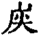

# 聚云吹万真禅师语录



> **藏经**：嘉兴大藏经（新文丰版）（嘉兴藏）　**册次** 第 29 册（J29）　**编号** JB238　**部类** 诸宗部　**卷次** 3 卷　**篇幅** 23,971 字

> **卷／品**：0 卷 · 1 品



---



## 目录



  - [序](#序)



---



### 序



禅宗至今日，滥觞极矣。得一橛之见者，辄诩诩自矜，冒名祖位，抹煞宗旨，埋没古人，以欺当世，予致慨者久之。聚云吹万大师，中兴大慧，力究五宗，发於言为灌顶醍醐，著於书为渡迷宝筏。昧者犹谓宗贵一家言，而不观乎吾儒明一经者，孰若博通五经之谓大儒耶？昔有称楚石为妙喜后一人，如聚云之作略，超群绝伦，即起楚石而问之，似亦愿避三舍，诚明兴以来，禅宗仅见之一人尔。惟是韬光晦迹，居於巫峡锦江之隈，不因人热，以务衒鬻，故圆寂数年，而语录犹未全刻。更有别录数十种，计近百卷，皆发明三代之奥，以旁抉诸子百家。即吾儒皓首穷经，尚不能闯其廊庑，岂今之粑脱禅所敢望而伍者哉？予与同盟，醉心此道，仰止高山，因谋诸剞劂，以行於世。噫！予未得为聚云徒也，予私淑诸人也。天下人未必皆以耳视，能具择法眼者，谅不以予言为谬矣。



崇祯壬午菊月，水部尚书郎前榷荆使者庐山千丈岩头陀熊汝学灯炤稽首敬识。



聚云吹万真禅师语录目次



卷上上堂  

茶话



卷中普说  

小参  

示众  

法语



卷下入堂  

入室  

勘辩  

问答  

颂古  

杂述  

塔铭



另刻正录十卷，广录三十种，共六十六卷，板存忠州治平禅院。



目毕



聚云吹万真禅师语录卷上



嗣法孙　灯来编



上堂



万历戊午上元日，霜轮上座、檀越、四众等请师开法於湖广衡州府潇湘湖东禅院。至座前，连喝三喝，云：「还会麼？也须高著眼。」升座，拈香，云：「此瓣香，浑沦世界，筦籥生成，吹之则书洛图河，扇之则云龙风虎。𦶟向罏中，奉祝皇帝万岁、太子千秋，辅弼伊周，贺金牛於锦幔；出入姜传，懽玉马於彤墀。此瓣香，如膏如泽，如旸如春，斡运四时，凭临造化。𦶟向罏中，奉为潇湘郡主宰官檀越，嘉禾穗茂，四境三祝於华封；荐句神开，五蕴独超於色相。此瓣香，轰天碎地，倒岳倾湫，灼破顶门眼睛，熏开眉毛骨髓。𦶟向罏中，供养大慧下见住四川叙州府朱提山上月下明和尚，用酬法乳。伏愿栴林哮吼，尘尘刹刹踊金毛；石室挥扬，郁郁葱葱飞玉片。」拈毕，据座。上首白椎，师乃云：「劈面迎风掌，当胸辊肚拳，具眼衲僧向这里用得，犹是三五一轮在在光辉，火树银花时时灿烂，若也半▆▆暗，恐未梦见在。呵呵！不是法门无面目，只怕蜈蚣太多足。咦！还有承当者麼？」上首再白椎，师下座。



上堂。「一不做，二不休，杀人须究亲下手，捉贼要识真领头。平息了，万事丢，一颗明珠衣下收。焰山叠嶂从兹破，爱海波涛信不流。」卓拄杖一下。



上堂。问：「仰钻瞻忽，意旨如何？」师述偈云：「硬似绵团软似铁，六月炎天一点雪，露柱灯笼笑点头，哑人得梦向谁说？」



上堂。「二月阳春仲，山花任自开。丈中风扫地，天上目临台。露柱黄昏笑，灯笼晓夜哀。若问他家信，庚方看月歪。」



解制，上堂。「西来正法眼，光照五须弥，风吹花草动，雷鸣天下知。昨夜金牛吼、木马嘶，惊起银河碧浪涌，震动蓬莱三岛驰，被老僧扭著鼻头，拽过人间天上，掷下寂灭光明海中，气也出不得。大众知麼？若知，即便两手捞出；若不知，闭却汝眼、塞却汝耳、箝却汝口，向万里无寸草处去，随分娑婆诃，只等秋风吹入户，寒雁送声来。」



崇祯辛未腊八日，布金檀越田侍御令子别驾素庵居士同四众等请师结制於忠州聚云禅院。拈香毕，竖拂子云：「从上古人只为这个东西瞒盰了许多英雄豪杰、赚陷了许多高人达士、抛撒了许多油盐酱醋，今日老僧不徇人情向汝诸人道破，只要汝等於日用二六时中行住坐卧处、穿衣吃饭处、运水搬柴处承当，若承当得来，英雄豪杰也瞒盰他不得、高人达士也赚陷他不得、油盐酱醋也抛撒他不得。且问大众：如何是这个东西？参。」



元旦，上堂。「去年腊月三十是岁之终，炭里乌龟走；今年正月元旦是岁之始，雪上鹭鹚飞。终处不为灭，始处不为生，作麼生是不生不灭底道理？」良久，云：「金芽柳灿莫轻瞒，自在东风煖复寒，著眼看时还不是，依稀萝影月阑干。」



上堂。「欲参自己生前事，急急回头点旧山。雪压翠微形不老，烟笼薄暮体非顽。怪来若讶云中石，觉后难分水上斑。花笑鸟啼随任运，何妨踏破祖师关。」



上堂。「三目山与滑石滩论义，一个𡁏𡁏𡁏，一个㗊㗊㗊，震动三界天主、四部地神，担起三藏十二部一切修多罗，为渠作个注解，解亦不出。被老僧拂子一喝，忽忙道个：『硬如绵絮软如钉，静似杨花动似岑，十个指头两只手，看来不是等闲人。』」



上堂。「聚云有三种法，名曰三关。若也透得，方许亲见。聚云第一种要脚掌掉后，若一向在前，直饶走到弥勒下生，也没休歇底日子。第二种要鼻孔朝天，若一向朝地，只唤作寻香逐臭。第三种要脑后具眼，若一向照前，则阿爷阿娘衣食冻馁，枯瘦如柴，为儿底毫无顾盻。听吾偈：黄昏钟响日头红，晓来依旧月当中。讨火童子吹波浪，征西戎马面朝东。」



上堂。「唤作如如，早是错也。唤作文字，不亦乖乎？虽然号作阳春令，却借东风暖上林。红白满园关不住，牧童狂指是花村。」



上堂。「大道只在目前，要且目前难睹。欲识大道真体，不离声色言语。如何是声色？黄莺啼柳树，白鹭立沙滩。如何是言语？佛印遭墨刑，面面都是字。」



浴佛，上堂。「今日释迦诞辰，诸人皆以殿前太子用香汤浇灌，大作一场漏逗。老僧单鼓两片皮，打些葛藤，拨开众生界中诸佛知见，不为分外。为甚麼如此？朝三暮四，朝四暮三，又令猴怒，又令猴懽。伏惟尚飨。」



盂兰日，上堂。「秋风清，秋水绿，烟锁幽林霜露拂，雪阵芦花万里绵，金雕沙渚千丘粟，于斯得见境中人，体素素兮文郁郁。大众知麼？欢喜日喜於此，盂兰盆营於此，僧伽耶供於此，百万亿座世界花，阿谁不在花光里？一回举著一回新，刹那脱却皆由尔。作麼生是皆由尔？参。」



接得汉月禅师书，上堂。「无事讨事，非故作故。过得江来，宾鸿迷路。解下素白，吴风扇鼓。如何是吴风扇鼓？」维那举柬云：「此是玄墓山汉月禅师来底书子。」高声读云：「大慧禅师说尽人间禅病，四百年内望之如渴人求井，不料一枝埋没向三峡锦江之上。」师喝。又读云：「前得来书语录，已见作略过人，第未得从容谈三月於水流石上，为恨不浅。」师又喝。复读云：「兹闻已返峡中，略伸四问，万乞答我，更欲禅师起已坠之禅於今日，令后辈重见天日於座下，断不令山野遗恨耳。至祷！至祷！」师复喝，乃云：「大众会麼？此正是我有时一喝不作一喝用。只这三喝，即当展具三拜，礼达汉月禅师。第一喝礼，不为禅师放光射於巴子国，只为禅师有大悲心，扼腕大慧老人门庭冷落；第二喝礼，不为禅师书通人事，奖誉过情，只为禅师识得忠州三目山聚云寺有一眼大慧泉从新迸出；第三喝礼，不为禅师千里同风，德音远顾，只为禅师启我将径山普觉塔子百咂碎倒，题年月唱一首，劈破韵底曲子，洗开天下衲僧耳中正眼，免使膏肓竖子假以心性椰榆、本命元辰。大众！山野为甚麼和泥合水作这般去就？忆昔幼年曾在芸局窗边偶得大慧老人语录，读之心醉，谁知破家散业后，拶入朝阳和尚洞里，咂著一粒老鼠药，灼然恶发，咬穿鼻孔，辊在水牯牛队中，作个他家儿孙，血脉自是不昧。」复喝一喝，云：「不因一事，不长一智。玄墓山前古镜悬，聚云堂上珠帘碎。交罗错杂满三千，百亿人天脚点地。从此一回音信通，犯垩挥斤无不是。」以拂子击禅床三下。



写师真，请上堂。举：「玉泉皓自赞云：『粥清后坐，床窄先卧，耳聋爱高声，眼昏宜字大。』这般说话虽是本分家风，向上一著犹未在。今日缁素辈以老僧三百六十骨节、八万四千毛窍交付丹青，一笔畫成，却请老僧自赞。出世三十年，头戴一只角，逢人看不见，空向我摸索。於今漏逗这封皮，海底榴花红似雪，只须著眼脑后观，青山万里一条铁。且道：是向上一著？是本分家风？」良久，云：「八百餘家成巧手，大家依样畫葫芦。」



铸佛，上堂。以拂子於空中畫○相，云：「这一尊，三昧乐正受意生身。」以拂子点一点，云：「这一尊，觉法自性性意生身。」以拂子畫十字，云：「这一尊，种类遍现无行作意生身。三佛形容总不真，眼中瞳子面前人，若能信得家中宝，啼鸟山花一样春。」掷下拂子。



元旦，上堂。「年年岁岁正月一，岁岁年年一月正，花开花谢还依树，尘生尘灭总由心。绿水动时飞浪雪，寒风逼杀结霜冰，可笑几番如此过，不知谁是住山人？大众！有识得住山人者麼？」僧出，师下座。



阅藏圆满上堂。座元问：「和尚大开炉鞴，应接方来，设使遮天盖地来时如何？」师云：「劄。」进云：「沉踪隐迹来时如何？」师云：「舌头飞铁马，脚指涌丝纶。」进云：「总不恁麼来时如何？」师云：「一任七颠八倒。」进云：「恁麼则虾蟆蚯蚓也解得禅。」师云：「著著著。」元掩耳入众，师乃云：「昔日达磨不来东土、二祖不入少林，所见所闻秖有黄面老子修多罗教，殊不知此教如标月指，若复见月，了知所标毕竟非月。后来鲁祖长老凡见僧来便面壁，恰到有些气息，所以万松道：『灵山如畫月，曹溪如指月。争似鲁祖在水晶宫中、广寒殿里披襟相见？』」以拂子畫○相，云：「还见月轮麼？」



尹参府受戒，请上堂。维那白椎，师云：「若论第一义，维那一椎打得谛当。但不知第一义已前还通得消息也未？」首座出，才礼拜，师云：「如何是第一义已前消息？」座便喝，师云：「未在，更道。」座掷下坐具，云：「疋马单鎗要与和尚相见。」师云：「海底泥牛脚插天。」座云：「某甲进前三步。」师云：「退后三步作麼生？」座复喝，师连喝二喝，座作礼。西堂出，师云：「如何是第一义已前消息？」堂云：「某甲不问，请和尚不答。」师云：「你正不问，我正不答。」进云：「还请直捷道一句。」师云：「葡萄架上结冬瓜。」堂云：「道破虚空无个事，恐惊牛斗卧江寒。」师云：「老僧不是恁麼人。」堂归众，师乃云：「僧问赵州：『万法归一。』且道与第一义底一是同是别？州云：『我在青州作领布衫重七斤。』且道与第一义已前消息是同是别？若道同，朗州山、澧州水，四海五湖王化里；若道别，豆子山打瓦鼓，阳平山下白雨。也不同、也不别，滕王高阁临江渚，佩玉鸣銮罢歌舞。今日尹参府皈依佛法，也只为这第一义；受持五戒，也只为这第一义；因戒生定，因定发慧，因慧参得自性念佛底主人公，也只为这第一义。且道如何是第一义？咦！」



上堂。「冬至日，一线天，地雷复，柳含烟，遍地红轮，真个是叶上霜珠圆更圆。佛身充满於法界，普现一切群生前，鹫峰峰下重相见，鼻孔原来总一般。急吐却，野狐涎，骅骝马，珊瑚鞭，一骑红尘妃子笑，等闲不许外人看。为甚麼不许外人看？路逢剑客须呈剑，不是诗人莫献诗。」问：「如何是佛？」师云：「拄杖撑著月。」「如何是祖？」师云：「横肩两样看。」「如何是超佛越祖？」师云：「提起三十棒。」僧一喝，师拍掌三下。



病中，上堂。「维摩病在毘耶城，老僧病在聚云寺，两个无孔铁锤，一前一后相似。今日若有人问话，但只摇手。如云：『不会。』向道：『老僧感冒伤风，失了声气。』」



元旦上堂。举：「长沙岑游山归，首座问：『游山事作麼生？』岑云：『始从芳草去，又逐落花回。』座云：『大似春意。』岑云：『也胜秋露滴芙蓉。』若有人问聚云：『游山事作麼生？』但道：『倒骑铁马飞金雨，呀咤狮子吼云腾。』若问：『长沙和尚语中带有春意，因甚和尚全无？』但道：『去年正月也有今日，前年正月也有今日，明年正月也有今日，后年正月也有今日，昼夜十二时，九十六成经，三百六十日，二十四成纶，和气暖风调宇宙，大地何方不是春？』」



崇祯丁丑二月望日，尹参府遂江居士请师於巴台禅院结制。



山门。「十方薄伽梵，一路涅槃门。既是一路涅槃门，也不须门外打之遶。」



佛殿。「金佛不度炉，木佛不度火，泥佛不度水，如何即得？」立定，云：「佛陀耶。」展具，云：「达磨耶。」合十，云：「僧伽耶。」礼拜起，复云：「𫆏。」



方丈。「古人唤作方丈地，老僧唤作方丈室。将来烹佛炼祖，道是衲僧巴鼻。」喝一喝。



上堂。拈香罢，维那白槌，师随喝一喝，云：「玄要料拣，宾主照用，一并漏逗了也。若也不会，听取一偈：野寺孤明夜月斜，高台飞阁远人家，绿水金辉浮桂影，青山玉晓堕霜华。」问：「心佛与众生是三无差别，如何是心？」师云：「门前几竿竹。」进云：「如何是佛？」师云：「岭上数株松。」进云：「还有众生也无？」师云：「心佛与众生是三无差别。」僧礼拜，师下座。



上堂。「出众者三十棒，不出众者三十棒，出众不出众者三十棒。」一僧出，问话不契，师乃云：「直下三玄已露，何曾三要无施？落花流水空去，殿前古柏当机。」



上堂。「春已暮，落花纷纷下红雨，南北行人归不归？千林万林鸣杜宇。我无家兮何所归？十方世界奚相依？老僧有个真消息，昨夜三更月到池。古人恁麼道，未免逐境随流。老僧则不然，春已暮，从来三月多春雨，东西南北不须归，滴血徒劳伤杜宇。老僧无家却有归，归来到处任相依。会得此中真消息，一轮明月在瑶池。」



上堂。「世尊见文殊在门外，召云：『文殊何不进门来？』殊云：『我不见一法在门外，何故教我进门？』曹洞宗旨尽从这里去。又见二人舁猪，世尊问云：『这个是甚麼人？』云：『佛具一切智，猪子也不识。』世尊云：『也须问过。』临济宗旨须是恁麼来。此不是一橛一见底硬节担板禅、此不是伸手竖拳底当门抵户禅，此是我黄面老子最上一乘禅，直至西天四七、东土二三，代代相传不昧。若在这里出得头、转得身，如枯木开花、泥人拍掌，便是唧嘹舌头三千里、六月梅花雪里开也不为分外。」问：「如何是百尺竿头事？」师云：「木马双头三只角。」进云：「如何是更进一步事？」师云：「乌龟尾上火轮车。」进云：「还有向上事也无？」师下座。



解制，上堂。「古人四月结制，老僧四月解制，不为仓廪无粮，只为逢暑当避。长连床土，济济多士，香积厨边，烟烽火炽，个个想著岩畔，共结清凉大会。作麼生是清凉一句？夜明帘外转身难，荆棘林中下脚易。」



崇祯戊寅七月朔日，师受请住菱州府万县宝峰山云来禅院结制。



上堂。拈香毕，喝一喝，云：「会麼？会得不可唤作喝。」卓拄杖，云：「会麼？会得不可唤作拄杖。」竖拂子，云：「会麼？会得不可唤作拂子。毕竟如何？」座元出云：「云来风晓月，九岭树吟龙。」师云：「疏林横古路，垒石傍丘山。」进云：「恁麼则大地无寸土，某甲独为尊。」师云：「你在甚处得这消息来？」元便喝，师云：「再喝一喝看。」元作礼，师云：「也是披露见文。」



营盆，上堂。「飒飒凄风遶树寒，夜深林里霭云烟。钱飞粉蝶千家纸，露湿绮罗万泪衫。独有长空辉月面，斗牛银汉玉阑干。」



上堂。「问在答处，答在问处，瞒盰一生。不以问求，不以答得，儱侗三世。不问而问，不答而答，正恁麼问，正恁麼答。壮士劳劳失却珠，怒息摩挲犹在额。」



入队，上堂。「昨日在忠城里，野马飞扬，黄尘扑面，看来尽是薄伽梵八万四千随好光明。今日在宝峰山，僧仪济济，钟鼓喧鸣，又恰是摩诃般若中倒翻筋斗底影子。所以道：尽大地是沙门一只眼，一切众生是摩诃般若光。既然如是，出队由来入队时，古今一念不参差，个中若了无来去，秋月寒蝉到处吹。」



解制，上堂。「父母未生以前，却是甚麼消息？空中石头拱手，树上乌龟作揖，蟭螟尾长三丈，须弥顶阔八尺，都卢细磨为浆，令乌有先生擎来，不勾拄杖子一口吃。」



师住夔州府万县兴龙禅寺，上堂。竖拂子，云：「此是释迦如来末后拈底金钵罗花。」以拂子畫○相，云：「此是达磨西来二祖神光得髓一句。」喝一喝，云：「此是临济大师宗门正眼，今日人天众前当阳举出。还见麼？打破秦时镜，现出海潮音，梵播恒沙界，香满功德林。更有末上一句，不妨拈出：周溪鱼跃三生石，巴峡猿啼十二峰。」



上堂。「木枥山与汝相见了也，窄小子与汝相见了也，兴龙寺与汝相见了也。是则是，只是不肯承当。若也承当得来，三门头合掌，佛殿后经行，东廊作揖，西廊拱手，何处不与相见？见即见，要且不见老僧。老僧即是阇黎，阇黎即是老僧。老僧与阇黎，迷却天下人，亦能悟却天下人。无须锁子两头摇，珊瑚枝枝撑著月。」僧问：「和尚道：『兴龙寺与学人相见。』未审龙在甚麼处？」师云：「若问其中意，便扣胡张三。」进云：「金翅鸟王在此。」师便喝，僧拟进语，师连喝云：「一问一答，却成漏逗，不自揣摩，徒劳心垢。」



解制，上堂。「一三如三，二三如六，三三如九。天以九得清，地以九得宁，人以九得灵，王侯以九镇宝位而天下平。且道在衲僧分上又作麼生？结制解制，用作九旬。开炉闭炉，摄生护生。惟有向上无拘忌，四时常在定盘星。」



茶话



元夕，茶话。「娑婆此夕号元夕，火树银花皆不实。」畫○相，云：「争如这个不曾迁？恒照春林三山竹。」僧问：「如何是诸佛大圆镜？」师云：「打不成，铸不就。」问：「昔生公说法，顽石点头。如今说法人多，因甚顽石不点？」师云：「秖为过东往西，观南眩北。」进云：「如何得点头去？」师云：「陕西枣子，四川萝卜。」



茶话。「求生本自无生，谓灭何曾暂灭？眼见不如耳见，口说争似鼻说？若也会得，梵语阿弥陀，此云无量寿；如或未然，欢娱嫌夜短，寂寞恨更长。」



茶话。「小尽二十九，大尽三十日，尽情都说破，恐汝信不及。」僧出，师云：「汝号甚麼？」答云：「觉圆。」师云：「汝号觉圆，必定圆觉。圆觉觉圆，镜花水月。」以筋指香云：「唤这个作不圆得麼？若是不圆，为甚麼𦶟一株时，室罗筏城四十里内一时得闻？」以筋指烛云：「唤这个作不觉得麼？若是不觉，为甚麼暗中物事借渠方才照见？是知世、出世法无一事不圆、无一时不觉，到这里犹是半提。」僧问：「如何是全提？」师云：「夹路桃花风雨后，马蹄何处避残红？」



茶话。「有一员大善知识，三头六臂，常在一切凡圣境界中转大法轮。洞山遇著与他结冤，神鼎遇著与他恰好。聚云与他批判一上：贪嗔痴，太无知，赖我今朝识得伊。行便打，坐便捶，分付心王仔细推。无量劫来不解脱，问你三人知不知？此是洞山结冤处。贪嗔痴，实无知，十二时中任纵伊。行即往，坐便随，分付心王拟何为？无量劫来原解脱，何须更问知不知？此是神鼎恰好处。且道聚云如何批判？一个如牧牛人执鞭，一个如骑牛人吹笛。执鞭底，到来函谷愁中月，归去蟠溪梦里山。吹笛底，颠狂柳絮随风舞，轻薄桃花逐水流。只如放鞭掷笛又作麼生？衲被蒙头万事休，此时山僧都不会。」



茶话。「古人道：『识得一，万事毕。』我则道：识得无明万事毕。盖无明者，教家谓之觉明种子，所以缘行、缘识、缘爱、缘取、缘生、缘死而成十二因缘，钩锁三世众生，如明镜一向开张，千丑百怪无不影现。若能打破此镜，佛尚不立，何况因缘？大众！还识得此镜麼？」一僧云：「不会。」师云：「会取不会底。」进云：「如何得打破去？」师良久，云：「破也！破也！只得钟子落地，盏子一天星。」



茶话。「有问有答寻常事，无闻无见谩商量，头头尽是西来意，何事从中较短长？是即是，只恐逆风扑面难掉头，不但拂著别人，亦且昧却自己。到这里，直须脱下垢腻汗衫，向没巴鼻处打个筋斗、没捞摸处扭转舌头，恰似一个死人一般，等他漫漫活将起来，有时放道清净光，即是清净法身佛；有时放道无分别光，即是圆满报身佛；有时放道无差别光，即是三类化身佛。及到三身坐断、独露本源，便是十地满心、等玅二觉来汝队中讨块闲地劄脚也没分。快事，快事。」



聚云吹万真禅师语录卷上



聚云吹万真禅师语录卷中



嗣法孙　灯来编



普说



参禅一法，贵要真参实悟，切不可将杂毒蕴在胸中。何谓杂毒𫆏？无明、烦恼、五阴、六入、十二处、十八界，此是欲界有情杂毒。喜、乐、舍、无心定、无想定，此是色界有情杂毒。空处定、识处定、无所有处定、非非想处定、灭尽定，此是无色界有情杂毒。见惑八十八使、思惑八十一品，此是声闻罗汉杂毒。三增进法、十信、十住、十行、十回向、四加行，此是权小菩萨杂毒。欢喜地乃至远行、不动、法云，能以一身变现一切色身得身自在，能以一心现一切处说法得心自在，此是十地菩萨杂毒。如来逆流如是，菩萨顺行而至觉际，入交过金刚喻定，便能应现无碍，此是等妙二觉杂毒。以圆方觉觉无不圆，以觉规圆圆无不觉，无一时不圆、无一处不觉，此是圆觉菩萨杂毒。一为无量、无量为一，小中现大、大中现小，一毛端现宝王刹，坐微尘里转大法轮，此是三世诸佛杂毒。拈椎竖拂、行棒行喝，瞬目扬眉、辊毬舞笏，拈古颂古、评古别古，此是诸大祖师杂毒。大众！我问汝等，昔在母胎中，六根未开、知觉未动，此是未生已前，看此中还具许多般也无？及至㘞地一声，睁眼即见，见无分别；张耳即闻，闻无分别；鼻里有气，嗅无分别；口啣血块，味无分别；手捏拳头，触无分别；见母不识母、见父不识父，意无分别，此是初生一著，看此中还有许多般也无？长至三五七岁、十三四岁，三细并显、六粗齐成，如蚕作茧自缠其身、如蛾赴灯自烧其体，反以不常为常、不乐为乐、非我为我、非净为净，竟成四倒执为我见。复有厌苦欣乐者趣为涅槃，担著四正勤、五根、五力、七菩提、八圣道、十八不共法、三十七助道品，又背真常为无常、真乐为不乐、真我为无我、真净为不净，凑成八倒执为法见。所以佛言：「一切众生具有如来智慧德相，秖因妄想执著而不见得。」及达磨航海而来，不立文字，直指人心，见性成佛，乃至净智妙圆、体自空寂八个字，如一灯然百千灯，明明无尽。何谓体自空寂𫆏？向未生已前六根未开、知觉未动处荐取。何谓净智妙圆𫆏？向初生时见闻觉知全无分别处荐取。今日新戒入山，惹得老僧挑出许多葛藤，却也当得入山，拄杖子再与一个方儿，两耳担柴、两眼挑水、脚板吃饭、眉毛踢起，有人问：「你作甚麼？」漫说道：「冷灰里曾爆豆子。」



普说。大慧禅师说尽人间禅病，此是三峰和尚语。然禅本无病，因学人错立知见，妄自推排，古人目之为病。如打地和尚凡见僧来问话便打地，后有人私窃其杖，令僧向前问话，地惟张口，何尝有病？百丈禅师谓众曰：「汝等与我开义田，我为汝等说佛法。」及至开田毕，大众向前求说佛法，百丈展手，何尝有病？高亭隔江见德山，山招手，高亭直趋而过，何尝有病？秖这三则公案，虽出寻常，却也深险。若谓张口展手是佛法，遍大地人俱在张口展手，为甚麼不是？若谓张口展手不是佛法，如何令诸方学人悟去？这里参来参去，将谓张口处是佛性，展手处是妙心，才有个认性认心底念头，便落识神，一切禅病生矣。长沙和尚曰：「学道之人不识真，秖为从前认识神。无量劫来生死本，痴人唤作本来人。」便是这个说话。



普说。师据座，首座代参头请问法要，师云：「江游船子钓，树唱柳堤莺，春融三日雨，晚照一溪云。此是法要？不是法要？」座云：「白云骑鹤鸟啣风。」师云：「从来达岸者，不必问津梁。」座归众，师乃云：「坐参一法，先以打断葛藤、顿断血筋为最义。日用二六时中，若有纤毫不如意事关於耳目，则身心不得洁净、工夫不得亲切，又与未坐参者一般。倘能提起话头，如银山铁壁，处处木马游春、在在石人观戏，似将一个硬石头垒在胸中，行也如是、坐也如是、动也如是、静也如是、美也如是、恶也如是，他日洗面摸著鼻孔、行路踢著指头、吃饭触著钵盂、伸手穿著袈裟，硬石头嚗地一下，七花八裂，也怪老僧不得。」



小参



「做工夫犹如丧却生身父母，行也思，坐也思；又如负却许多钱债，行也愁，坐也愁；又如一人与万人战，不容眨眼；又如堕入千尺井中，单单只求出井。所以道：『一念万年去，寒灰枯木去，一条白练去。』此正为学人下个做工夫底注脚。昔有观桃花而悟者，有闻击竹而悟者，有触翻溺器而悟者，总是念念逼拶，忽然行到滑石头上，嚗地断，碎地折，便尔七通八达去也。时节到来，妙理自彰。」



小参。「僧问赵州：『狗子还有佛性也无？』州云：『无。』这无字如恶龙出洞，疾风暴雨、轰雷掣电，无论山石丛林一水拖尽，到这里始会得万法归一、一归何处，本来面目现现成成。若是纯任狂慧，一向与无明撕结，他时恶龙有分。既然如是，何不早在聚云寺里变个恶龙，从自己四大色身中发起疾风暴雨、轰雷掣电，将无始以来习气窝、无明窟、人我山、烦恼矿，现前理障、事障、佛见、法见一齐拖尽，成一个空空洞洞底物事，好吃老僧一顿拄杖子。」



小参。「祖师门庭，魔来杀魔，佛来杀佛，若起佛见、法见，文殊堕入铁围山。何以故？只为诸人昧却平常心地，著於奇特妄想，才听说个三身、四智、五眼、六通、菩提、涅槃、真如、佛性，一个个聚头商量，胡思乱度，以为上上奇特事，正如世人差爱异言异服一般。若是说个饥来吃饭、困来打睡、冷来穿衣、热来挥扇，便尔错过去也。试看古人问：『如何是西来大意？』『庭前柏树子。』何尝奇特？『如何是本身卢舍那？』『与我过净瓶来。』何尝奇特？『如何是善知识？』『灯笼露柱、猫儿狗子。』何尝奇特？奇特且置，直今唤甚麼作平常心地？」良久，云：「每日起来七件事，柴、米、油、盐、酱、醋、茶。」



小参。「学人做工夫、参话头，先从这一副臭皮袋上痛劄一过，你看发、毛、爪、齿、皮、肤、筋、骨是地性，涕、唾、精、津、血、液、涎、沫是水性，煖、气是火性，动、转是风性，四大分张，只今做工夫、参话头的又在何处安身立命？若在这里参穷之极，忽然见得，如世小儿藏蒙相似，即云：『在这里。』」师复作猫一声。



小参。师云：「看箭。」以拂子东指云：「这一箭射透十方世界一切众生性灵，只令山头翻巨浪，海底热烽烟，枯木口喃喃，髑髅泪潸潸。」以拂子西指云：「这一箭射断十方世界一切众生命根，只令撒手堕悬岩，吐舌如匾檐，打碎频伽瓶，扯断红丝线。」以拂子上指云：「这一箭射开十方世界一切众生慧眼，只令顶门光亚竖，蓦直走金蛇，百千手臂百千执，万亿毫端万亿花。此是《涅槃经》上三点，老僧用作三箭，却也当箭即



，当



即箭，不曾是释迦眉毛在下，衲僧鼻孔掉转。」僧问：「射断命根后如何？」师云：「斩钉截铁。」进云：「如何是鼻孔掉转？」师云：「斑竹筒。」



小参。「末法时代去圣远矣，所出法门苗裔多务驰逐，荡丧己灵，纵有参禅慕道者，亦各任性担板，堕入狂慧执著之见，每见棒喝堂中有顺朱填墨者矣、棒喝室里有敲关击节者耶？临济云：『大凡演唱宗乘，一语中须具三玄门、一玄门须具三要，有权、有实，有照、有用，汝等诸人作麼生会？』复以四喝、四宾主、四料拣重重显示，况复曹洞之三渗漏、五君臣、五王子，彼虽出自青原，最初同一心宗，既会得临济宗旨，必会得沩仰、云门、法眼三宗，三宗既会则曹洞之宗当会矣。天目、中峰有五家之评，谓沩仰严谨、曹洞细密、临济痛快、云门高古、法眼简明，然五者果可缺一乎？用痛快以绝狐窠，使学人游於细密而严谨，居处自然高古、发药自然简明，何不可之有哉？今也不然，且言饮酒、食肉无非宗旨，持戒、习定俱成系缚，长发彩衣、高歌谈笑，谓为出格标榜，吾是以痛哭也、流涕也、长太息者也。诸仁者！宁可不作佛、不作祖，断不可不具三无漏学，以趋百尺之竿头、以究五宗之玄旨也。」



小参。「大凡学人请益，问处真实，方见答处的当。若问答相违，则聋瞽不相入矣。不见云门大师出语高古，不堕常流，后至曹洞门庭，循规蹈矩，细细讨论，正见他法海神龙能大能小、能升能隐，才显出老作家手段。到乾峰，峰示众云：『法身有三种病、二种光，须是一一透得，更须知有向上一窍。』门出众云：『秖如庵内人为甚不知庵外事？』峰呵呵大笑。门云：『犹是某甲疑处。』峰云：『你是甚麼心行？』门云：『也要和尚相委。』峰云：『直须恁麼始得稳坐地。』门云：『喏！喏！』到曹山，山示众云：『诸方尽把格则，何不与他道，却令他不疑去？』门出众云：『密密处为甚麼不知有？』山云：『秖为密密，所以不知有。』门云：『此人如何亲近？』山云：『莫向密密处亲近。』门云：『不向密密处亲近时如何？』山云：『始解亲近。』门云：『喏！喏！』到疏山，山上堂云：『病僧咸通年前会得法身边事，咸通年后会得法身向上事。』门出众云：『如何是法身边事？』山云：『枯桩。』门云：『如何是法身向上事？』山云：『非枯桩。』门云：『还许学人说道理也无？』山云：『许。』门云：『和尚道枯桩，岂不是法身边事？』山云：『是。』门云：『道非枯桩，岂不是法身向上事？』山云：『是。』门云：『秖如法身，还该一切也无？』山云：『法身周遍，岂得不该？』门指净瓶云：『秖如净瓶，还该法身也无？』山云：『阇黎莫向净瓶边觅。』门礼拜。直这三段因缘一一透得，可为万世法程，见地行履无不具足。若有个旁不肯底道：『和尚吃了常住饭，为甚打别人葛藤？』但向道：『病多谙药性，得效敢传方。』」



小参。「不道无禅，只是无师，师胜资强，古有明鉴。昔者大慧禅师初参奉圣初，问云：『承和尚有言：「金莲从地涌，宝盖自天垂。」为是神通妙用？为是法尔如然？』初云：『金莲从地涌，宝盖自天垂。』慧云：『鸾凤不栖荆棘树，燕雏犹恋旧时巢。』初云：『多年不见你有许多说话。』慧云：『只如适才僧问：「昔日世尊、今日和尚。」又作麼生？』初喝一喝，慧云：『这一喝未有主在。』初取拄杖稍迟，慧云：『掣电之机，徒劳伫思。』拂袖归众。据他这些作略，已是惯排阵势、临阵不怯底手段。后参湛堂准，准云：『你今日为甚麼鼻孔无半边？』慧云：『宝峰门下。』准云：『杜撰禅和。』一日，侍准入乡村，准指王十官人问曰：『此官人贵姓？』慧云：『姓梁。』准以手抹额曰：『怎奈姓梁底少个襆头？』慧云：『襆头虽无，鼻孔彷佛。』准云：『杜撰禅和。』乃归僧堂看经，准问云：『看甚麼经？』慧云：『《金刚经》。』准云：『是法平等，无有高下。为甚麼云居山高、宝峰山低？』慧云：『是法平等，无有高下。』准云：『你到做得座主。』使下。秪这三劄，从前临阵惯敌底鎗刀器械都不见了。又参圜悟，悟令下东山水上行底语，连下四十九转不契。一日，圜悟在天宁上堂，举：『僧问云门：「如何是诸佛出身处？」门云：「东山水上行。」若是天宁则不然，设有僧问：「如何是诸佛出身处？」但向他道：「薰风自南来，殿阁生微凉。」』慧於座下始有悟入，自谓畅快平生。悟见而谓曰：『也不意你到这个田地，可惜死了不曾活得，不疑言句是为大病。不见道：「悬岩撒手，自肯承当；绝后再苏，欺君不得。」』又令参有句无句底公案，苦参不入，问悟曰：『和尚昔曾请益师翁来，师翁有语不妨拈出。』悟曰：『老僧曾问先师：有句无句，如藤倚树时如何？先师云：「描也描不成，畫也畫不就。」又问：「树倒藤枯，句归何处？」先师云：「相随来也。」』慧於此方得彻悟，遂举淆讹公案，答无滞碍。大众！你看此老若不遇湛堂、圜悟两员真宗匠，早已堕入野狐队里，要且是他虚心受鍊、实领钳锤，才得如是透脱。所以，语有真语、有实语，有相似语、有合头语，量有现量、有比量，见有了了见、有相貌见。果能透得这些关节，始可唤作真正师、真正禅，莫只学个名字禅和子，口口吐出野狐涎，将来有甚麼用？所以古人道：『参须实参，悟须实悟，阎罗大王不怕多语。』」



示众



示众。「当日释迦初出母胎，即云：『天上天下，唯吾独尊。』只这句子，你看他是持戒习讲学来底、是打坐修定参公案学来底，正是未生前带来底习气。虽后离王宫、住雪山、转法轮，又是开眼作梦。何故？秖因四生六道一向在被单窝里，生去死来、贵去贱来、贫去富来、苦去乐来，头出头没，无有了期。他也堪忍不过，设了如许方便，插入被单里，摇醒几个众生罢休。不然，苦苦耽著能仁担子作甚麼？后来许多没筋骨底，不知如许方便原是止啼黄叶，教人借路还家套子。有入毘尼庵去者，穿著一领铁布衫，颈项也不肯掉；有入讲经堂去者，噇酒糟、饱饾饤、塞伤肚子，纵有扁鹊良医也救他不得；有入壁观婆罗门脚迹边去者，无论乾屎橛、麻三斤、烂东瓜、破沙盆，挑上一担，处处指东畫西、胡喝乱喝，道：『我是佛祖儿孙。』仔细检点将来，也只是些依样畫葫底写匠，那曾摸著释迦如来最初一句底样子？可怜生。千百年后秖遇个老云门，欲将一棒打杀，此正见报恩原是知恩人。咦！镢头在手非多事，运用还因路不平。」



示众。「盗跖直解杀人放火、抄州掠县，究其本事，无过一强下客，偷裘出狱、假鸡窃关、夺去物事，主人犹自不知，此是下客最奇妙处。今之禅者，若得盗跖一法，秖可施设门庭；若得下客一法，闭门造车、出门合辙。全提家风，切勿草草。」



示众。「近来参禅者未得真参实悟，所以不能一念知非、当下解脱，都是昏沉散乱搅作一团，皆由生死二字不切，纵入稠林广众随类而参，到底学成五花禅、高帽子禅、当门抵户禅，却与积锡锭者买卖一般，及至生死到来，业识茫茫无本可据。何为五花𫆏？若见古人好偈颂、好机缘、好语句，秖管记些，食生物而不化，被人问著驴头不斗马嘴，乱统几句。何为高帽子𫆏？或得一橛、或见一隅，便尔高谈阔论、眼底空人，身子不过三尺，强要出人头地，若论实际理地全没交涉。何为当门抵户𫆏？学得一棒一喝，打得个圆相，直候语到岐路上，疑信不分、迷悟不觉时，将来一抵抵住，也得个撑持家道底法子。好则好，只是阎罗大王不要你这些造作、善恶两部不上你这些语句、牛头夜叉不惧你这些棍棒。但愿大众参个无依倚底禅，透出这些络索，通身不犯，直到腊月三十日自在逍遥、去来无碍，好不快活、好不稳当。」



示众。「万顷波中一片石，立定脚跟赤骨历，纵横无碍百千般，都缘应化非真实。大凡善知识语默动静，他在尘波欲浪里转大法轮，脚跟下自有落处。学人不晓，遇喜认作喜、遇悲认作悲、遇嗔认作嗔、遇爱认作爱，譬如一水，天人罗鬼各见有异，问取性空真处，何曾得个水火琉璃鎗刀来？古人道：登山登绝顶，望众山而自远矣。然大小丘垤却走他眼光不过，若一向在山下计较卜度，则是跛者欲与渔者斗，事且未行而口过，怨声已招矣。慎之，慎之。」



示众。「一翳在眼，乱坠空花；一物在心，横森烦恼。论凡论圣，尽作碍眼之尘；说佛说生，总是蒙心之被。然眼本自净，何曾有翳观华？却不知翳即是眼。心本自清，未尝触物生恼，殊莫识物即是心。若能即物即心，眼翳遍圆通之路；如或即翳即眼，心物开普照之门。凡夫身出圣人心，圣人体即凡夫用，了无别矣。诸佛相出众生范，众生幻现诸佛真，复何异哉？打破这个关头，庶几略较些子。」



示众。「烂羊头，关内侯；貂不足，狗尾续。此讥世谛滥受官爵之语。今之禅宗有等旋蒸热卖者，但要学得一棒、叫得一喝，语句下打得个之遶，便尔付拂子、写源流，也不管宗旨明与不明、头尾正与不正，可怜生。且不从上亦有将就做底祖师耶？亦有半斗丝之和尚耶？古人道：『见与师齐，减师半德；见过於师，方堪传受。』此语将来何用？前百丈错答一转语，堕野狐五百生。比丘道眼不明，虚消信施，偿为后园木耳。黑脸老子不徇人情，未得谓得、未证谓证，於己何益？但愿诸仁者勿贪眼前名闻，结下未来酸苦，宁效无法嗣之睦州、不出头之清素，管教佛祖命脉光大无涯，切不可烂羊续狗，取笑诸方，累人累己。」



示众。「古人道：『末后一句，始到牢关。把断要津，不通凡圣。』秖这一句子，若也会得，是甚麼弄猢狲底家具、遣鬼神底茶饭，出门遇弥勒、入门遇释迦。如或未然，三生六十劫，十万八千年，也只是梦中说梦。」



示众。「五蕴山头有一片放光石，从眼门放光，照见山河大地；从耳门放光，采听一切音响；从鼻门放光，能闻一切香臭；从齿门放光，谈说一切语言。只是被无明、执著二种笼络，虽在光天化日之下，犹处黑暗，不自觉知。若有个智慧底人，善将此石镌作一尊古佛，不但观音、势至、文殊、普贤齐来唱和，即过去庄严、现在仁贤、未来星宿，三世诸佛同声赞扬。汝等若於行时无无明、无执著，便镌一尊行佛；於住时无无明、无执著，便镌一尊住佛；於坐时无无明、无执著，便镌一尊坐佛；於卧时无无明、无执著，便镌一尊卧佛。若是无明未破、执著未除，依旧是个四大幻身、缘起识性，则与六道四生为侣、黄土为块，那时不可谓老僧佛法无灵验也。」



示众。「从来不惯颠狂，一向那安清净。眼睛眨碎石头，鼻孔触瞎板凳。脚头脚底笑颜开，踢起眉毛急急如律令。会得那句是宾，那句是主，方许亲见聚云。」



示众。「举临济云：『有一无位真人在汝等面门出入，未证据者看看。』聚云不然，三世诸佛、历代祖师、一切天人阿修罗等，俱在无位真人面门出入，未证据者不消看得。恁麼道有过无过？」僧问：「如何是诸佛法身？」师云：「自从晨朝吃了粥，直至於今肚又饥。」



示众。「世尊无说，良马追风；维摩默然，文殊赞叹；空生宴坐，帝释散花；普眼念澄，愿王现相。若乃个个如是，老僧不必扬声，大众何劳侧耳？总为人有利钝、见有迟速，只得当面热瞒，抛沙撒土，道是甚麼心行？」



法语



示慧岳禅人。「『大道绝同，任向西东，石火莫及，电光罔通。』此临济老人语。若论此事，人人本具、个个不无，为甚麼有凡有圣、有智有愚、有得有不得？似不可谓之同。若能凡圣情尽、智愚见销，得失关破、任运无碍，又不可谓之异。到斯境界，同则不同、异则不异，自西自东、自南自北，何不可者？岂可以石火及之、电光通之耶？多见今之参禅人，但以击石火、闪电光，举了便会以为落处，引人业识茫茫无有了期。慧岳禅人始侍憨公、继参博老，复以榆里之怀参见聚云。请示行脚，信手书之，第一不得道老僧住在这里。」



示博野禅人索字。「汝欲学字，始而一点一畫、一剔一挑，全用心意识；继而手忘笔、笔忘纸，星驰电卷，势如塞上之将军；鱼跃鸢飞，妙若空中之噫气，何曾与心意识商量来？不可谓学字、参禅却有两端说话。」



示香灯侍者。「汝请心要，不离香灯。何故？是香即心，是心即香，熏成无漏，心迹亦忘。是心挑灯，是灯挑心，心灯亦如大地黄金。既云心迹亦忘，为甚麼又道大地黄金？」良久，云：「脱落语言文字外，须知别有好商量。」



示本源大德。「地、水、火、风顽然无知，聚而为身，总是一块血肉，因知而有运动。然知因心起，是则心为身根，四大尽属枝叶矣。方其病时，看是地病耶？风病耶？水病耶？火病耶？若是地病，地性坚实，如何得病？若是风病，风性隐藏，如何得病？若是水病，水性清凉，如何得病？若是火病，火性空腾，如何得病？若是知病，知本虚妄，如何得病？若是心病，心无形相，如何得病？直须恁麼一觑觑破，则地、水、火、风本来无病，知觉运动本来无病，无相心根本来无病。诸病既无，地、水、火、风亦无；地、水、火、风既无，知觉运动亦无；知觉运动既无，无相心根亦无；无相心根既无，无无亦无；无既无矣，直这觑破诸般病源、根境、知觉底一些子亦无。会得这一些子了，更有个出脱底方儿，云门扇子𨁝跳上三十三天，触著帝释鼻孔；东海鲤鱼打一棒，雨似盆倾。兹因本源大德有采薪之忧，走启请益，老僧施方却之，只得将自己服过灵验底万应丸聊与一枚，用精进水送下，霎时平复，急来聚云，酬我药价。」



示刘居士。「参禅须要实实领取一个话头。僧问赵州：『狗子还有佛性也无？』州云：『无。』茶来、饭来、行来、坐来、烦恼境界来，只将这个无字与之炼磨来、炼磨去，炼磨到不得已处，虚空忽然粉碎、大地自尔平沉，方知道三世诸佛也只是无，诸大祖师也只是无，天下老和尚也只是无，僧也只是无，俗也只是无，你也只是无，我也只是无。春游芳草地，夏赏绿荷池，秋饮黄花酒，冬吟白雪诗，无中却有闲四序，昼夜频呼十二时。」



付嘱隐首座。「大慧一脉，承接最难，其机微，其用普，其言显，其法阔。烈燄辉扬，觑著焦头烂额；吹毛剑利，触之断命消魂。眼里抽筋，说甚相如夺璧？脑后出楔，犹愈下客偷裘。老僧幼时读他语录，就被穿却鼻孔，谁知接他末代法嗣，只得勉效螳螂，为求辅弼。幸有同时作者，俱属相知，如三峰汉月禅师曰：『大慧禅师说尽人间禅病，四百年内望之如渴人求井，不料一枝埋没向三峡锦江之上。前得来书语录，已见作略过人，第未得从容谈三月於水流石上，为恨不浅。』是知聚云之脉真也。万峰破山禅师曰：『读一贯别传及诸著作，始知我大唐国内有人也，且喜且幸。虽是溪山关隔，时有云月通风，不妨同一鼻孔气。』是知聚云之作用也。临邛孝廉刘墨僊居士曰：『一见圣恩，再见聚云，虽门庭机用各有差殊，而入法精微，波澜阔大，大约共一鼻孔。杨岐、黄龙分振济宗，岂近日假平实、真粗莽之禅可比哉？』是知聚云之门庭也。此三老皆是天童嫡子嫡孙，其为大慧不浅矣。营山慧机隐然，别号铁壁者，自参聚云，力究多载，后值老僧结制，皆分座首众焉。至於见地行履，玄要深奥，老僧勘验有在，特付拂子一枝，以续大慧之裔云。」



聚云吹万真禅师语录卷中



聚云吹万真禅师语录卷下



嗣法孙　灯来编



入堂



入堂。「参话头一节，迺古人为后学开底方便法门，秖因心、意、识三种杂毒难除，与他一个硬石头磊在胸中，方始除去一切络索。若把著不变，何异无病服药，药反成病，久久倒作个死煞东西。或有工夫稍起者，但见参时有、不参时则无，静时有、动时则无，醒时有、睡著则无，说时有、不说则无，纵少有见处，总在黑山下卜度将来，何曾十分透脱？若是个力量汉，铁起脊梁，放下身命，千咀万嚼，把这硬石头百咂碎，依旧是个现现成成底，便尔开眼眼上有话头、侧耳耳上有话头、缩鼻鼻上有话头、动口口上有话头、伸手手上有话头、举足足上有话头，自从得入黄金殿，四壁光明遍十方。」



入堂。举：「长沙云：『我若一向举扬宗教，法堂前草生一丈。』聚云不然，我若一向不举扬宗教，法堂前草生一丈。举也不得，不举也不得，作麼生得法堂前草不生去？」良久，云：「田中蛙鼓叫，岭上野猿啼。」



入堂。「大凡参究这个，一切皆有悟处：有行持禁戒，向衣钵边得悟者；有看读经文，在语言中得悟者；有入众作务，触物遇缘得悟者。看得破时，处处菩提路，门门古佛家，不劳重进步，海角与天涯。」



入室



问僧：「麻三斤，乾屎橛，此是甚麼人语？」僧云：「癞狗泥猪语。」师便打。



问僧：「唤作竹篦则触，不唤作竹篦则背。首山念唱导，大慧杲依样畫葫。聚云又作麼生？」僧云：「铁菱角笑杀水乌龟。」师便打。



僧入，师以拄杖畫○相，云：「此是一字。」於左边畫○相，云：「此是二字。」於右边畫○相，云：「此是三字。昨日说与谢三郎，今朝说与新阇黎。」僧云：「洗面摸著鼻孔𫆏？」师云：「你鼻孔在甚麼处？」



问僧：「横担拄杖，紧鞘草鞋，是甚麼人行履？」僧进前两步，师作听势。



问僧：「无字作麼生参？」僧弹指，师打云：「莫道无语好。」僧云：「还许学人问话也无？」师打云：「莫道有语好。」僧云：「学人不会。」师复打。



问书记：「会写不怕笔头桩。」记云：「不打这鼓笛。」师打，云：「不打这鼓笛。」记云：「无手人又作麼生？」师打，云：「不打这鼓笛。」记云：「草里汉。」师打，云：「不打这鼓笛。」



僧入，师云：「我不问你。」僧云：「为何不问？」师便打，僧大叫，师连棒打出。僧入，师云：「适才有个野狐，被老僧打出去了。」僧云：「某是新产狮子儿。」师云：「我知道你。」僧云：「和尚也须骨出。」师云：「汝不是狮子儿。」



勘辨



有僧自曹溪来参，师云：「我有个人往曹溪。」僧云：「是甚麼人？」师云：「吃粥去。」



有行脚僧慕朝海，师云：「海虽阔大，却是川水流去底。」僧云：「未审川水在甚麼处流来？」师唤侍者云：「盘中菜著些醋好。」



侍者为师设饭，床太远，师自撤近前，者云：「君子离台三尺。」师云：「衲僧𫆏？」者无语，师代云：「近也吃，远也吃。」又云：「和尚年尊，将就些好。」



师住金陵观音庵，朝宗来参，师云：「甚处来？」宗云：「天童。」师云：「天童近日何如？」宗云：「大家在这里。」师云：「不要说脱空话。」宗云：「师何不往天童去？」师喝，宗云：「落在甚麼处？」师便打。



刘墨仙居士持圣恩问道录见访，与师坐间论及杨岐、九峰之语，师云：「正恁麼时，杨岐在前？九峰在前？」士良久，问：「和尚又作麼生？」师便喝，士云：「这一喝是前？是后？」师翘一足，士礼拜。



一僧来参，师问：「甚处来？」僧云：「金粟来。」师云：「如何是金粟得力句？」僧云：「白云覆青山，青山不露顶。」师云：「此是意识家语。如何是得力句？」僧云：「虚空粉碎，大地平沉。」师云：「此是义学家语。如何是得力句？」僧无语。师云：「汝不曾从金粟来。」



晚课次，师问一僧云：「自己是僧，又皈依个甚麼？」僧云：「不妨自皈。」师云：「语不离窠臼，安能出盖缠？」僧云：「从来不出门。」师云：「笨驴推磨。」



勘初机语。「西来大意，直指单传。且道传个甚麼？」



「心、佛与众生是三无差别，为甚麼凡夫不会？」



「水牯牛未降，猢狲子未死，衣钵放在甚麼处？」



勘诸方学人语。「可中有一物，牙如金爪，口似血盆，一昼夜吞却八万四千恒沙诸佛，未审过在甚麼处？」



「座下无席帽，案边无胥吏，阶下无荆条竹根，为甚麼祖师语言唤作公案？」



「形直影端，表里须正。为甚麼佛祖袈裟，东高西低，左披右袒？」



「六根俱有功德，为甚麼祖师多唱鼻孔？」



「父母生汝身，师长训汝法，为甚麼舍父逃走，背师行脚？」



问答



僧问：「薰风自南来，殿阁生微凉。意旨如何？」师吹一口。



僧问：「世尊道：『天上天下，唯吾独尊。』为甚麼云门要打杀？」师云：「路见不平，傍人铲削。」



一僧作礼云：「请和尚上雪山去。」师云：「我才在雪山来。」僧云：「某甲在山下，不曾得见。」师唤侍者一声。



僧问：「如何是当机一句？」师打云：「速道！速道！」僧拟对，师打出。



僧问：「一句当轩八万门，如何是永绝生死句？」师云：「毘卢顶上行。」



答汉月禅师四问



正睡著时，与死了烧了，心之与性，牙齿打不著，须向这里希取大用始得。如何是此处底大用？



答云：宁向太阳粧罗刹，不来黑暗扮观音。



沿流不止，绝却真照。照不到处，如何是吹毛用了急须磨？且道磨个甚麼？



答云：折脚铛里淡黄虀。



用处既已脱却心性，切莫在离心性处躲根。除此一边，如何相见？



答云：才过驴胎，又钻马腹。



近世野狐都说心性禅，不知姓张姓李，请禅师代答一转语，贵图天下衲僧脱却腥臭。



答云：夺这老贼头拄杖，拗折莫言不道。



问汉月禅师四问



作相问：用水一碗，贮米七粒，架茆草十字在上，请道是甚麼义？







沩仰九十六种圆相收在六义。问：这个收在那一义？



古人道：八角磨盘空里走。不知是空走磨，磨走空？



老鼠吞大象，虾蟆口咬著。吞不入，拖不出。苍头老儿跳一步，请下一转语。



颂古



世尊升座



冻岭梅花斗雪开，暗将香气逼人怀。浩然一见难藏兴，嬴得春风特地来。



举一不得举二



南北仙人各一山，狭路相逢似不干。瓢中俯仰无人见，暗里同心臭若兰。



赵州勘婆



妖镜从来不徇情，当阳照破野狐精。而今大地无差互，多少长安感旧人。



青州布衫



万顷茫茫一叶舟，东西何处是风流。岂如把钓沙滩上，明月芦花色转秋。



须弥山



等闲平地起骨堆，欲脱尘嚣反自埋，赖有霹雳无情手，把得山河击碎来。



一光东照



图佩环瀛山海齐，长安壁上竟成蹊。季卿且问家何在，一叶飘飘渭水西。



南遇唱和



夜月楼台霜户开，百花素女广寒来。玉人笑倚阑干上，执手牵衣过御阶。



杂述



示监院偈



情境纷纷路不繁，春亭花鸟木人看。指挥提掇谁为用，镜里无痕一照间。



示副寺



物心无二体非遥，握土成金行最高。日用应缘真我在，四时雪藕伴冰桃。



示典座



心如事事亦如如，百味从中妙不粗。但识盐梅堪熟鼎，谁知和气是香厨。



示知客



彬彬文质显僧伽，语默逢迎月下花，觌面既呈宾主意，何妨慧眼别龙蛇？



示杂办



妙用神通岂异殊，只在寻常会也无，把重提轻光灿烂，森罗象里自称孤。



示侍者



函丈方隅世界宽，折旋俯仰导人间，从来衣钵无他借，金色头陀代代传。



经行



一步一步踏实地，薰风过阁转清凉，不识个中天籁响，十指徒将作道场。



看经



文字千般焕眼光，觉来杂糅不成行。还他黑白和烟纸，依旧瞳人灼故乡。



坐禅



学人莫坐痴默禅，寂照何曾讳正偏。北斗藏身飞焰袅，不将双眼落林泉。



问答



海翁无事上矶头，把钓深波月一钩。结舌不题风味响，苍岩无耳漫思修。







木鸡撩倒百花仙，径寸盘中热露涓。鞀鼓龙舟白鹤浪，金鞍骝马珊瑚鞭。







万仞峰头壁立寒，招摇鹤舞玉阑干。无弦夜弄师襄调，六月梅花雪里看。







金毛踞地灿殊沙，火焰青莲水上花。十万亿程飞琥珀，无边芝草斗烟霞。







玉塌棱棱四角悬，红罗帐里月初圆。铁牛咂碎相思梦，鱼在烟波鸟在天。



看录



传灯录载传灯颂，总是先人口上禅。读罢了然无个事，秋风秋雨洗阑干。



法身



麦地牛生草，沙河马捉鱼。红炉冰种火，梅花夜读书。



诗



毛诗拟作(有序)



云之南，其望匪思。嗟嗟我榆，谁浣牵中衣。云之南，寄声维长。我侬异邦，厥志履清凉。云之南，疏竹荫清。古木瑶琴，现彼物中真。云之南，竺兮有蕸。我慈脱去，苞彼德中花。



右毛诗四章，章四句。此诗乃追母氏而作也。家慈自山野出俗后，厥志法门，六时危坐，心佛相忆者九年。初小病，七日前先计某日我当西去，是日敛衣踞坐於庭，左右将信将疑，时至果脱然念佛而逝。亲友闻已，自外以念佛敲鱼入庭，家慈闻佛声再觉，与众同音念诵一饷，告别长往。山野聆之，作是诗以自庆。



读花神三妙记(乐府)



绿霜涂柳翠，朱露染桃红。月娥素羽寒兔逼，妒杀英才花雨中。君不见，玉箫罗汉扑彤墀，白凤香囊苦离离。又不见，徒死苾刍细腰舞，挑目招心住江渚。可怜如剑复如蛇，螯我灵根戕我家。只须恶慧勤三作，不消景云长联赋。



秋日，田侍御见召，赋得君马黄辞之(古乐府)



君马黄，恒引驾。假乘之，难酬价。秋日驰之苦路斜，须惜当年产渥澍。况来抖擞不宜驰，追风逐电何用之。宁负竹楼神凤操，未许轻折杨柳枝。



善哉行(乐府)



谁将天地号红炉，百昌因之以荣枯。英豪束却臭皮袋，透得几人是丈夫。蚊蜩壳脱寒枝弃，蜂蝶神化壤坌无。明明云路弗施为，扑火吐丝何太愚。杨雄投阁徒已矣，介子焚身空悲尔。不识西华老神仙，天子呼之犹未起。幸来早觉华胥梦，始知妙湛缘影弄。可怜采石投江鱼，可惜玉京传白凤。举眼北邙笼冷烟，那能得入桃园洞。虽曰把酒且当歌，怎奈人生能几何。王子七日杳世路，波斯两次睹恒河。碧眼黄头原卓越，余已追之可长活。指上拈来四句真，大都一字皆隐括。徙倚出头解虎锡，熬煎炉内降龙钵。非为自私入云深，穷则独善兼则达。广成曾示我无摇，四体须发任萧条。中含一物先天地，年年不逐四时凋。四时凋兮余不老，个里蒲团秋月皎。这回踏遍海潮音，隐隐露出珊瑚宝。



君子行(乐府)



荆南之水祖岷峨，宛转波扬垒叠多。黄河之水自长天，哮涛流水不胜玄。从来枉直人间事，过者为之口𬣡𬣡。卜居楚子不须问，碧虚湫盘独是然。瓠巴鼓瑟游鱼戏，伯牙操琴仰马视。樵父不等烂柯回，世态怎知双眼泪。爝火不息访鹪鹩，日出而作意飘鹞。唐虞垂衣天下治，偏使我心何忉忉。方今太是气淤塞，较之雄伯尤污黩。投醪江饮不再来，分饭剖餐谁追复。腐鼠痴鸢满市场，石沉稿立羞干禄。岂如昌雨觅黄花，岂如乘兴看修竹。黄花修竹固悠悠，白牯黧奴可解求。了知击角愈增丑，罢读离骚短发游。潮吟岛岳三洲应，涧影星河一月秋。几回白云深处坐，几度百花丛里过。请循其本却归家，栩栩蝴蝶些儿个。羊裘莫说把丝纶，采薇休道耽饥饿。豪杰古今长夜中，街头布袋轻笑破。



除夕赋得将进酒似田侍御(乐府)



去年除夕荆南谑，今年除夕临江乐。雪花扑乱梅花飞，清香点就壶中酪。何须曲檗烦仪狄，竹叶寒光明的皪。化母展动三阳开，春风即送人日来。闲中且听八仙歌，长安李白信奇哉。



君马黄(感赋)



陟冈之马玄且黄，白璧月题鸾锵锵。介睨[翹-羽+喬]啮鞭策绝，骭气腾跃苦王良。可怜北冀生马多，肆无天厩怎奈何。盐车有恨徒惆怅，下乘液发忍蹉跎。我欲相忘索真马，皮毛外擢踏天下。千里昂昂大块中，七圣还来参牧者。



行路难



林之壑兮山之石，手之策兮足之屐。战兢一步一垂涎，此去天台还几尺。白云虽近御风迟，曳尾徒劳把钓痴。只今故向烟尘里，岂将黄叶赚啼儿。世道草莱秋禁度，转眼嘉平霜雪吐。驱驰若未彻骨寒，梅花孰肯枝头露。行路难，行路难，路难不作燕人慕。



感赋



昆山之玉原无色，幽谷之芝不漏香。嗟哉世态鲜青眼，触目黄金未见光。洛溟那识灵龙卧，苍梧谁知彩凤藏。呵呵云径归来也，门巷是兮人境狂。



代作陈郡侯德政乐府辞(日重光行)



附耳珮瑛何其象，点然流苏未作光。民无举目山无色，到处鲸鲵波浪狂。苍苍何幸怜孔迩，重光重轮特地起。葱郁文华绛帐开，歌颂欢声芾棠止。三接三锡频来颁，争守无妨遮闾里。君不见，莅政唯需一杯水。



游岑公洞



未到岑公洞，先读岑公碑。字字称金液，行行赞石芝。未识岑公知不知，却令古岛暗攒眉。宁使人将五恨推，谁肯犬吠落人嗤。君不见，踏遍歌声何所为？



春日策杖巴台，步杜甫赠王郎司直韵(短歌行)



不得抖擞，不若匏瓠一系哉。木叶乾壳，乘之岂谓风而偕。策杖柳堤碧烟舞，过桥涧底白云开。鸣玉庵前浅翠来，影入松关林鸟度。声传江干湍水怒，古道夹柏扇飞红。桃花凋落人不顾，唯有夜月欢相慕。



窗隙吟



举目看前窗，前窗绿影竹。转眼看左窗，左窗树影绿。相敲相舞叶摇风，为羽为商听不足。听不足，一轮月下瑶池窟。



宿万家庵有感



抟风不羡榆枋志，啧啧榆枋却有评。谁识山河无关楗，到处幽幽似白云。忆昔素王居陈蔡，芝兰芬芳何所碍。皎乎日月烟雨中，宽兮天地人情外。予经此际亦蹉跎，且无子路说穷态。



辞



布施



八识正幽幽，风停海静浪涛休。通明殿，孤光映十洲。森罗万象，色影咸收，檀度原非著相求。欲到头，心珠灿烂，逆水驾慈舟。



持戒



河汉锁空霄，月落寒潭斗柄高，往来的水面细风飘。雪谢冰消，清流独绕，尸罗尘垢绝纤毫。把斯标，金章玉篆，青华台上遶。



忍辱



斧劈太虚空，萤燄难烧海映红，歌利王却是古家风。寸刀断幻，四相无踪，个里知音大觉同。臭皮笼，烟波散尽，霹雳满天轰。



精进



一步一莲花，门门古佛信无差。琉璃地，现出老袈裟。法席冤家，从兹脱洒，太平谁道将军。大劫如沙，不离一息，超越过天涯。



禅定



铁脊古头陀，嚼碎寒空遍。大罗玄元始，化作须弥座。云舞风歌，龙潜虎卧，泥洹不假修持多。任蹉跎，玄黄消散，光阴孰碍我。



智慧



慧日独高悬，一寸灵心碧落天。十法界，到此绝尘烟。事理同圆。心法双玄。摩尼五色因缘现。论当然，朝朝行道，夜夜抱佛眠。



行



散步优游，穿径骑牛。寻逝水、鱼戏庄周。更奥窔处，万籁歌讴。听谷声雅，鸟声趣，竹声幽。



住



卷室茆庵，自在幽闲。论膻逐、与我无干。朝参麋鹿，暮侣猱猿。但嚼黄精，啖苦菜，掬清澜。



坐



竹椅蒲团，燕息悠然。追二气、固入泥洹。良久浑化，无地无天。到鸿蒙内，威音外，太虚前。



卧



石塌芦编，和衣共眠。一鼾了、无尽长天。双林树下，月朗星悬。任泥牛吼，木马唱，金虎言。



吹万大师塔铭



钦命整饬兵巡上川东兼理监军道湖广参知政事四川观察使浯江弟子田华国熏沐拜撰



州郊北有三目山，为郡之项脉。山龙小歇，蜿结虬盘，中创聚云禅林，迺阖郡缙绅士庶所就。其谋始而图成者，则本郡侍御高公与家大人实主之，(国)亦少与有力焉，盖以居吹万大师也。大师讳广真，僰道宜宾人，俗姓李，父祖三世为婆罗门。师生有异徵，详载行录。幼而业儒，长而事佛，得法於月明联池老人。池嗣铁牛远，远嗣荆山宝，宝嗣无念有，有嗣二仰钦，钦嗣小庵密，密嗣一言显，显嗣筏渡慈，慈嗣苦口益，益嗣净慈明，明嗣鼓山永，永嗣西禅需，需嗣大慧杲。历溯源流，师固大慧十四世孙也。大慧下十尊宿，递有机缘语录流传，至铁牛、月明，但述相见之语、付嘱之偈。大师崛起而中兴之，匪第光显径山、鼎新临济，而且扶宗拯弊、身体力行，师盖千古法门之功臣也。何以言之？当师之时，禅风衰晚，师则慨然有从先之志，套板时腔，窃耻而不为。是以涉海入吴、穿闽过粤，一带烟霞物色尽在目中，大都墨浪笔花，竞浮场社，无有可其意者。自湖东开法后，便尔返棹锦江。家君挽留卓锡，树帜云根。年来开堂，众至数千指。师之教人，每以慈悲真实忍辱为训。不稽之言，不出诸口；随俗之事，不行诸身。凡其作则立规者，皆准先正之典型，而不以师心自用。遐哉！其不可及也。呜呼！宗门割裂，斗诤成风。家创一言、人标一解，硬节担板之病，中於膏肓。师体医王之慈，痛为针灸。故有病在一棒一喝以为直捷者，师则救之以宗旨。有病在习见习闻以为沿流者，师则救之以悟明。有病在承虚接响以为解会者，师则救之以参证。至於冒名祖位，卖弄虚声，鄙弃律仪，肆行诳诞，种种疚患，师无不看病用方。谛观普说、小参，总皆对症药石。(国)不肖，虽不能窥其一斑，挹其餘绪，良由北面於师，未尝不从挥麈竖拂间，识婆心而奉法旨也。师殆不可及者哉！师正录十卷，广录近百卷，已属水部尚书郎月崖熊公捐俸刊刻。月崖讳汝学，豫章人。铁公法子，师之孙也。刊成而师之法雨澍矣。沐其泽者，靡不沾其润。觉片言只字，皆有师之面目存焉，则皆有师之鸿慈寓焉。具眼者那肯错过。若夫端严相好、和气春风，瞻师之容者咸生懽喜，接师之范者极其赞叹，则又师之威仪盛德感召乎人者，为自然尔。呜呼！今之沽源流而付衣钵者滥矣。师独不轻於授受，必勘其行履见地垂范人天者而后许之。如铁壁慧机禅师，则本川营山人。三目慧芝禅师，则吾郡刘氏子。铁眉三巴掌慧丽禅师，则北直赵州柏乡人。之三公者，皆师入室弟子也。其餘得师之法，或远引山林、或垂钩湖海者，未可尽悉。此则克振家声、丕承基业，(国)之所目击而心折者，乌容不并述以纪其传哉！师住世五十八年，开堂五处。偶示疾，山神悲号，树木摧折。病中尝歌唱自娱，提持学侣如旧。三月前谓侍者曰：「我临终须大喝而去。」於崇祯十二年己卯七月三十日，索笔书偈云：「朝打三千，暮打八百，要会聚云，眉毛出血。」掷笔危坐不语。至午果大喝两声脱去。茶毘，烟至松羃，结为五彩，遍地荷香袭人。起骨，得黄金锁子三茎，当门二齿变为紫色，五色舍利三百餘颗。平都地藏寺迎十二颗建塔，餘皆塔於本寺三目山之阳。弟子(华国)谨拜首飏言，而为之铭曰：



> 碧眼西来，不立文字，五叶一花，  

> 垂荫奕世。径山大慧，为临济宗，  

> 谥称普觉法海神龙。递传而下，  

> 迄师吹万，中兴，祖道光昭云汉。  

> 大哉师模，罕与为俦，高竖三目，  

> 卑彼陵丘。自号头陀，冠曰如醉，  

> 振铎聚云，提醒聋聩。当师之时，  

> 满地狂禅，譬如猎马，师痛加鞭。  

> 俾蹄啮者，服厥衔辔，载驰载驱，  

> 知进知退。扶衰救弊，师亦孔艰，  

> 良药苦口，为人所难。资学既优，  

> 且广识量，俯视丛林，而踞其上。  

> 屏山落落，浯水悠悠，法云常布，  

> 法雨常流。瞻师浮图，仪型犹在，  

> 允矣宗猷，古今攸赖。

